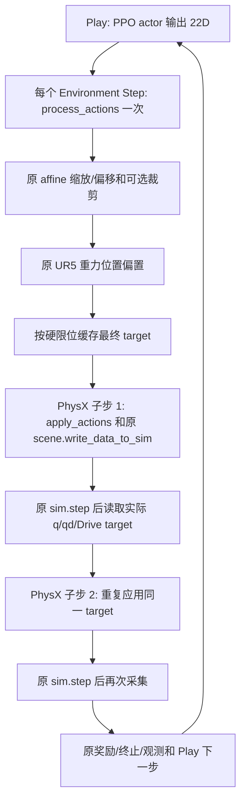

# Grasp1 Reset DEBUG 实测报告

日期：2026-10-27。工作目录：`/home/windsky/project/Grasp1`。

本次已完成 UR5-Allegro Teacher 的单环境 GUI 连续 5 次 Reset，采集 15 份状态快照、5 份候选评分和 5 份筛选结果。最终 GUI 运行及关闭 DEBUG 的普通单步检查均退出 0。

**结论：确认首次预抓取 Reset 之前的暂存姿态存在严重桌面碰撞、穿透和手指关节越界；5 次预抓取 Reset 写入后未复现这些异常。** Reset 写入未推进仿真时间，下一正常物理子步的关节、物体与掌部变化已独立记录。本次只增加诊断，保留全部现有采样、筛选、状态写入、失败重采样和抛异常行为，没有修复或规避碰撞。

## 1. 环境与本次修改

- Isaac Lab 2.3.2，Isaac Sim 5.1.0，Conda `grasp`，RTX 3070 Ti Laptop 8 GiB，驱动 580.178.04。
- 任务：`Grasp1-UR5-Allegro-Teacher-v0`，语义版本 8；观测 `[1,153]`，动作 `[1,22]`。
- `num_envs=1`，`seed=42`，物理步长 `1/120 s`，原有 `decimation=2`，每次 Reset 后只执行一次正常的零动作 `env.step()`。
- 固定训练集第一个环境分配的物体 `new_training_set/off_water_body`；5 次随机化位置、偏航及候选。物体种类不会在每次 Reset 时更换，这是现有行为。
- 已按要求阅读 `docs/文件结构.md`，对照原始 `train.py`、`Environment.hpp` 和 `cfgs/cfg_reg.yaml`。
- 只修改 4 个已有代码文件；仅按用户明确回复新增本报告 `docs/Debug.md`。未执行 Git 操作，未修改 RobustDexGrasp、Isaac Lab 库或资产。

| 已有文件 | 修改内容 |
| --- | --- |
| `scripts/zero_agent.py` | 增加 `--reset_debug`、`--reset_repeats`、`--seed`；DEBUG 分支重复 Reset；GUI 调整视角并隐藏遮挡视口的浮窗；采用 `torch.no_grad()`。 |
| `source/Grasp1/Grasp1/tasks/manager_based/grasp1/grasp1_env_cfg.py` | 增加默认 False 的 `reset_debug`；仅启用时注册 RecorderTerm；禁用数据集文件导出。 |
| `source/Grasp1/Grasp1/tasks/manager_based/grasp1/mdp/events.py` | 在既有流程旁记录候选、筛选原因和目标状态；通过 Recorder 回调只读采集三阶段状态。 |
| `source/Grasp1/Grasp1/tasks/manager_based/grasp1/mdp/geometry.py` | 为候选选择增加可选 `debug` 字典，直接导出已有索引、宽度、可行标志与分数；不重算、不更改选择。 |

## 2. 启动与关闭 DEBUG

在项目目录执行，默认弹出 GUI；5 次结束后自动退出：

```bash
cd /home/windsky/project/Grasp1
source /home/windsky/miniconda3/etc/profile.d/conda.sh
conda activate grasp
python scripts/zero_agent.py \
  --task Grasp1-UR5-Allegro-Teacher-v0 \
  --num_envs 1 --device cuda:0 --seed 42 \
  --reset_debug --reset_repeats 5
```

终端中的 `[RESET_DEBUG]` 后是 JSON；`[RESET_DEBUG_TRIAL]` 表示一次完整调试结束。若需要无窗口复查，可追加 `--headless`。GUI 每次正常控制步后停留 3 秒，停留期间不调用仿真或更新接口。GUI 画面为第二个正常物理子步后的渲染帧，`after_next_physics` 日志独立读取第一个子步，二者时点有区别。

也可在现有训练/播放命令前临时加 `GRASP1_RESET_DEBUG=1` 启用相同日志；或者在配置构造时设置 `reset_debug=True`。大量环境会产生大量日志，正式训练保持默认关闭。

关闭方式：不传 `--reset_debug`，不设置配置开关，并清除手动导出的环境变量：

```bash
unset GRASP1_RESET_DEBUG
```

正常 PPO 入口、动作、奖励、终止条件、Reset 状态写入和物理步数均未修改。DEBUG 关闭时不注册 Recorder、不创建诊断字典、不采集接触数据；本次没有启动 PPO 或评估抓取成功率。

## 3. 断点位置与数据时序

| 断点 | 已有位置 | 读取含义 |
| --- | --- | --- |
| Reset 前 | [events.py:32](/home/windsky/project/Grasp1/source/Grasp1/Grasp1/tasks/manager_based/grasp1/mdp/events.py:32) | `record_pre_reset`；在 scene.reset 和 Reset 事件前读取实际状态。 |
| 候选评分/索引 | [geometry.py:893](/home/windsky/project/Grasp1/source/Grasp1/Grasp1/tasks/manager_based/grasp1/mdp/geometry.py:893) | 原 `scores.argmin()`；DEBUG 仅导出原中间结果。 |
| 筛选结果 | [events.py:572](/home/windsky/project/Grasp1/source/Grasp1/Grasp1/tasks/manager_based/grasp1/mdp/events.py:572) | 选中 IK、有限值和模型硬限位；在原筛选之后打印原因。 |
| 机器人/物体写入 | [events.py:505](/home/windsky/project/Grasp1/source/Grasp1/Grasp1/tasks/manager_based/grasp1/mdp/events.py:505)、[物体:522](/home/windsky/project/Grasp1/source/Grasp1/Grasp1/tasks/manager_based/grasp1/mdp/events.py:522) | 原有 write_joint_state_to_sim、write_root_pose/velocity_to_sim。 |
| 写入后 | [events.py:43](/home/windsky/project/Grasp1/source/Grasp1/Grasp1/tasks/manager_based/grasp1/mdp/events.py:43) | `record_post_reset`；原 Reset、目标同步和原有 sim.forward 完成后，尚无新物理积分。 |
| 下一正常物理更新后 | [events.py:49](/home/windsky/project/Grasp1/source/Grasp1/Grasp1/tasks/manager_based/grasp1/mdp/events.py:49) | `record_post_physics_decimation_step`；第一次正常 sim.step 返回后立即读取，每次 Reset 只采一次。 |
| DEBUG 注册 | [grasp1_env_cfg.py:131](/home/windsky/project/Grasp1/source/Grasp1/Grasp1/tasks/manager_based/grasp1/grasp1_env_cfg.py:131) | 默认关闭，EXPORT_NONE，未生成 HDF5。 |
| 5 次 GUI 循环 | [zero_agent.py:85](/home/windsky/project/Grasp1/scripts/zero_agent.py:85) | 每轮 reset + 一次正常 env.step；断言没有额外物理步。 |

Recorder 的物理子步回调位于 Isaac Lab 原 `sim.step()` 之后、`scene.update()` 之前。因此使用公开的 `Articulation.root_physx_view` 读取当前 PhysX 状态，避免把尚未失效的 `.data` 缓存误认为新帧。不调用额外的 `scene.update()`、`sim.forward()` 或 `sim.step()`。原 Reset 自带的 `sim.forward()` 保留。

关节通过 `get_dof_positions/velocities()` 读取；根/连杆通过 `get_root_transforms/get_link_transforms()` 读取；四元数由 PhysX `xyzw` 转为 Isaac Lab `wxyz`。根/连杆位置是 link 原点，物体线速度是相应 COM 速度，均在世界系；不会把 COM 速度或根状态冒充 `top` 的状态。Allegro 与 UR5 属于同一 articulation，单独输出掌根 `Allegro_base_link` 的世界位姿。

接触通过公开的 `ContactSensor.contact_physx_view` 读取：法向合力、按过滤对象的法向力、有效 contact patch 的点/法线/separation，以及摩擦力。只按 counts/starts 读取有效条目，不读取未填充 buffer。负 separation 作为该 patch 的穿透证据；这不是全场景网格距离查询。无有效接触点时深度为 `null`，不写成“已证明零穿透”。

## 4. 五次 Reset 的实测结果

下表的物理计数是环境正常 rollout 的计数；仿真绝对时间在第一次 Reset 前已经是 `0.0166666675 s`，说明启动阶段已有物理活动。每次 Reset 前后时间、计数都不变，首个正常子步才增加 `1/120 s`。

| Reset | 前→写后→首子步计数 | 前/写后时间 s | 首子步时间 s | 每轮完整控制步 |
| --- | --- | --- | --- | --- |
| 1 | 0 → 0 → 1 | 0.016666668 | 0.025000001 | 2 个正常物理子步 |
| 2 | 2 → 2 → 3 | 0.033333335 | 0.041666669 | 2 个正常物理子步 |
| 3 | 4 → 4 → 5 | 0.050000003 | 0.058333336 | 2 个正常物理子步 |
| 4 | 6 → 6 → 7 | 0.066666670 | 0.075000004 | 2 个正常物理子步 |
| 5 | 8 → 8 → 9 | 0.083333338 | 0.091666671 | 2 个正常物理子步 |

### 4.1 Robot

五次三个时点的机械臂根位姿均为：

`[-0.193900004, -0.751519978, 0.771002412, 1, 0, 0, 0]`。

以下为写入后的掌根位姿，位置单位 m，四元数 wxyz：

| Reset | 掌根位置 W | 掌根四元数 W |
| --- | --- | --- |
| 1 | [0.3996107, -0.6407772, 1.035154] | [0.7606569, 0.1574025, 0.6259683, -0.0692045] |
| 2 | [0.1810983, -0.8406281, 1.048736] | [0.624265, 0.001304578, 0.7434792, -0.2398544] |
| 3 | [0.2767171, -0.782216, 1.049978] | [0.6918982, 0.0411654, 0.6975601, -0.1816372] |
| 4 | [0.2973089, -0.7005258, 1.056407] | [0.7009707, 0.1012713, 0.6957054, -0.1199088] |
| 5 | [0.2780048, -0.6735726, 1.061642] | [0.6834407, 0.1187468, 0.7130204, -0.1020281] |

写入后的 6 个机械臂关节，顺序为 shoulder_pan、shoulder_lift、elbow、wrist_1、wrist_2、wrist_3，单位 rad：

| Reset | 机械臂 q |
| --- | --- |
| 1 | [0.05462945, -1.22871, 1.61011, -0.5624037, 1.956725, -1.483958] |
| 2 | [-0.5635985, -1.75237, 2.08115, -0.2210303, 1.376884, -1.956711] |
| 3 | [-0.2949799, -1.549049, 1.920534, -0.3949231, 1.591483, -1.769063] |
| 4 | [-0.07996213, -1.486963, 1.834416, -0.3592523, 1.804791, -1.598402] |
| 5 | [-0.0149399, -1.512862, 1.836002, -0.2760513, 1.868763, -1.540128] |

完整运行时关节顺序、硬限位、速度限值及第 1 次写入位置如下。16 个手指关节在五次写入时相同，来自现有 default_joint_pos，与原 cfg_reg.yaml 中的 init_finger_pose 按名称对应一致。所有写入后的关节速度、物体线/角速度均精确为零。

| 关节名称 | 硬下限 rad | 硬上限 rad | 速度限值 rad/s | 第 1 次写入 q rad |
| --- | --- | --- | --- | --- |
| shoulder_pan_joint | -3.141593 | 3.141593 | 3.15 | 0.05462945 |
| shoulder_lift_joint | -3.141593 | 3.141593 | 3.15 | -1.22871 |
| elbow_joint | -3.141593 | 3.141593 | 3.15 | 1.61011 |
| wrist_1_joint | -3.141593 | 3.141593 | 3.2 | -0.5624037 |
| wrist_2_joint | -3.141593 | 3.141593 | 3.2 | 1.956725 |
| wrist_3_joint | -3.141593 | 3.141593 | 3.2 | -1.483958 |
| joint_0_0 | -0.47 | 0.47 | 7 | 0.2 |
| joint_12_0 | 0.263 | 1.396 | 7 | 1.3 |
| joint_4_0 | -0.47 | 0.47 | 7 | 0.2 |
| joint_8_0 | -0.47 | 0.47 | 7 | 0.2 |
| joint_1_0 | -0.196 | 1.61 | 7 | 0.6 |
| joint_13_0 | -0.105 | 1.163 | 7 | 0 |
| joint_5_0 | -0.196 | 1.61 | 7 | 0.6 |
| joint_9_0 | -0.196 | 1.61 | 7 | 0.6 |
| joint_2_0 | -0.174 | 1.709 | 7 | 0.2 |
| joint_14_0 | -0.189 | 1.644 | 7 | -0.1 |
| joint_6_0 | -0.174 | 1.709 | 7 | 0.2 |
| joint_10_0 | -0.174 | 1.709 | 7 | 0.2 |
| joint_3_0 | -0.227 | 1.618 | 7 | 0.5 |
| joint_15_0 | -0.162 | 1.719 | 7 | 0.2 |
| joint_7_0 | -0.227 | 1.618 | 7 | 0.5 |
| joint_11_0 | -0.227 | 1.618 | 7 | 0.5 |

首个正常物理子步后的所有关节速度，单位 rad/s；这是重力、现有驱动和接触求解后的实际读数：

| 关节名称 | Reset 1 | Reset 2 | Reset 3 | Reset 4 | Reset 5 |
| --- | --- | --- | --- | --- | --- |
| shoulder_pan_joint | -0.003348052 | -0.001732979 | -0.002282619 | -0.003253243 | -0.003873716 |
| shoulder_lift_joint | -0.01962457 | -0.007082077 | -0.01329966 | -0.01469844 | -0.0135691 |
| elbow_joint | -0.02165272 | -0.04530589 | -0.03644237 | -0.03286857 | -0.03703675 |
| wrist_1_joint | -0.003580783 | -0.007194721 | -0.003678008 | -0.01221055 | -0.003062611 |
| wrist_2_joint | 0.004263885 | -0.01397429 | 0.002628818 | 0.002192717 | -0.00821384 |
| wrist_3_joint | 0.1541123 | -0.005832337 | 0.01281222 | 0.009637551 | 0.2208277 |
| joint_0_0 | -0.3765496 | -0.06379237 | 0.004217915 | 0.004372608 | -0.481563 |
| joint_12_0 | 0.3874252 | -0.1431486 | -0.005953427 | 0.1481571 | 0.3904953 |
| joint_4_0 | -0.3938127 | -0.05983363 | -0.007977896 | -0.02954684 | -0.5002996 |
| joint_8_0 | -0.4251635 | -0.0654709 | 0.01816943 | -0.02309232 | -0.4892177 |
| joint_1_0 | 0.7149122 | 0.5886434 | 0.604982 | 0.6200797 | 0.6752877 |
| joint_13_0 | 0.05229683 | 0.004288895 | -0.005852408 | -0.008470628 | -0.00706335 |
| joint_5_0 | 0.6261172 | 0.5655564 | 0.6122433 | 0.5934159 | 0.582776 |
| joint_9_0 | 0.5528899 | 0.5777415 | 0.6212747 | 0.5847614 | 0.4659262 |
| joint_2_0 | -0.1097105 | -0.1815137 | -0.06515206 | -0.07326943 | -0.1022876 |
| joint_14_0 | -0.2571234 | -0.02173706 | -0.01498844 | -0.01573952 | -0.02049765 |
| joint_6_0 | -0.155993 | -0.07059547 | -0.1433342 | -0.06319803 | -0.1574146 |
| joint_10_0 | -0.1393495 | -0.06267808 | -0.1578688 | -0.05588508 | -0.09690973 |
| joint_3_0 | -1.23778e-06 | -2.155112e-06 | -4.936929e-07 | -8.843962e-07 | -9.197537e-07 |
| joint_15_0 | -6.198464e-05 | 0.002866277 | 0.0001146053 | 0.002170604 | -6.091504e-05 |
| joint_7_0 | -0.002513962 | -0.005239633 | 0.0006130291 | 0.00139771 | 0.0006727022 |
| joint_11_0 | -0.01002605 | 0.03096825 | -0.001238614 | 0.01629437 | -0.01027657 |

### 4.2 Object

物体名称均为 `off_water_body`。`lowest_point_new.txt = -0.015991 m`，原公式给出 `0.771 + 0.002 - (-0.015991) = 0.788991 m` 的根高度；对应几何最低点距离桌面约 2 mm。写入后的实测根位置、四元数如下，`top` 状态在附录单独保留。

| Reset | 写入后根位置 W (m) | 写入后根四元数 wxyz |
| --- | --- | --- |
| 1 | [0.5449933, -0.6465244, 0.788991] | [0.9987023, -9.26284e-08, 1.23338e-07, 0.05092784] |
| 2 | [0.2107189, -0.953956, 0.788991] | [0.9701762, -4.23267e-08, 9.732263e-08, 0.2424009] |
| 3 | [0.3576745, -0.8644204, 0.788991] | [0.9443886, -7.784175e-08, 1.597278e-08, -0.3288315] |
| 4 | [0.3897195, -0.7366178, 0.788991] | [0.9962112, -6.64423e-08, 1.129233e-07, 0.08696712] |
| 5 | [0.3572828, -0.6937792, 0.7889911] | [0.5297203, -8.47761e-10, 8.423532e-09, 0.8481724] |

| Reset | 首子步根 COM 线速度 W (m/s) | 首子步根角速度 W (rad/s) |
| --- | --- | --- |
| 1 | [1.460964e-06, -0.0009425639, -0.08174511] | [0.001228939, 0.0003862278, -0.0004486756] |
| 2 | [1.599448e-06, -0.0001062935, -0.08174334] | [0.0001262832, 4.90871e-05, -5.695769e-06] |
| 3 | [9.732781e-08, 0.0005541066, -0.08174855] | [-0.0007679112, -3.043121e-05, 0.0005808737] |
| 4 | [-7.343292e-07, -0.0007875474, -0.0817594] | [0.0009843871, 0.0003403375, -0.0003179836] |
| 5 | [1.358556e-08, -0.0007674758, -0.08174849] | [0.0009203691, -5.712523e-05, 0.0008576284] |

### 4.3 Relative Pose 与姿态偏差

相对位置表示物体 top 原点在掌根坐标系中的位置；距离是两个原点的欧氏距离。预抓取中心采用原 HAND_CENTER/GRASP_TCP_OFFSET 构造，不能把掌根距离误认为设计的 0.25 m 点云中心预抓取距离。以下为首个正常物理子步读数：

| Reset | top 在掌坐标系中的位置 (m) | 距离 m | 相对四元数 wxyz |
| --- | --- | --- | --- |
| 1 | [0.2697506, 0.0009126663, 0.09613255] | 0.286369830 | [0.7560154, -0.1890479, -0.6172997, 0.1079025] |
| 2 | [0.2689538, 0.001000196, 0.09565128] | 0.285458088 | [0.5474405, -0.1815494, -0.7210787, 0.3839194] |
| 3 | [0.2690872, -0.0001375079, 0.0964395] | 0.285847008 | [0.7130246, 0.1905366, -0.6724275, -0.05597262] |
| 4 | [0.269087, 0.0009462461, 0.09606914] | 0.285723627 | [0.6877524, -0.1613675, -0.6843974, 0.1804374] |
| 5 | [0.2692472, 0.0007063262, 0.09396504] | 0.285173625 | [0.275408, -0.6677604, -0.2770673, 0.6336244] |

| Reset | 写后预抓取中心误差 m | 写后姿态误差 rad | 首子步关节最大漂移 rad | 首子步掌根位移 m | 首子步预抓取中心误差 m |
| --- | --- | --- | --- | --- | --- |
| 1 | 2.66560079e-07 | 6.91202047e-07 | 0.00212156773 | 0.000199467599 | 0.000235591608 |
| 2 | 3.38489315e-07 | 7.38258564e-07 | 0.00209599733 | 0.000121921614 | 0.00015179519 |
| 3 | 5.05762159e-07 | 8.14491045e-07 | 0.00222945213 | 0.000151180328 | 0.000185520999 |
| 4 | 4.05355422e-07 | 6.33828961e-07 | 0.00219291449 | 0.000158850569 | 0.000192981301 |
| 5 | 3.67427702e-07 | 7.07799188e-07 | 0.00208693743 | 0.000152719876 | 0.000185824843 |

姿态误差使用 Isaac Lab `quat_error_magnitude`，不使用低精度 dot→acos 估计微小角差。写后物体位置误差最大 `1.884864389e-7 m`，写后预抓取中心误差最大 `5.057621593e-7 m`；写后预抓取姿态误差最大 `8.144910453e-7 rad`。首子步预抓取姿态误差约 `0.000330–0.000428 rad`。

### 4.4 Candidate

候选索引从 0 开始；每次 10 个，均进入原来的投影宽度 < 0.18 m 加权评分分支。所选候选均第 1 次采样即通过，未触发对象姿态重采样、32 次失败异常或任何默认姿态回退。

| Reset | 索引 | IK 可行数/10 | 选中宽度 m | 选中分数 | 不可行候选 | 筛选/失败原因/回退 |
| --- | --- | --- | --- | --- | --- | --- |
| 1 | 2 | 6 | 0.128228456 | 0.40623039 | [3, 4, 8, 9] | accepted=True / [] / none |
| 2 | 7 | 10 | 0.106372707 | -0.186578631 | [] | accepted=True / [] / none |
| 3 | 7 | 10 | 0.133203864 | -0.116755545 | [] | accepted=True / [] / none |
| 4 | 2 | 10 | 0.127901107 | 0.176692069 | [] | accepted=True / [] / none |
| 5 | 2 | 10 | 0.106446937 | 0.16537869 | [] | accepted=True / [] / none |

第 1 次的候选 3、4、8、9 是现有解析 IK 返回不可行；该返回值不携带更细的几何失败原因，本次不猜测为碰撞或不可达。日志保留所有宽度、可行标志和原始 scores。选中 IK 不可行、q 含 NaN/Inf、q 超硬限位时分别输出 `selected_ik_infeasible`、`nonfinite_joint_position`、`joint_outside_hard_limits`；它们只是原判定的日志，不是新增过滤条件。

### 4.5 Contact 与 Validation

已有 45 个接触传感器。五次写入后和首个物理子步均无 NaN/Inf、无关节越界。首个物理子步所有传感器法向合力为 0，过滤接触点数为 0，没有可报告的 patch 穿透深度。

| Reset | 写后 q 误差 rad | 首子步关节越界 | 首子步最大法向合力 N | 首子步过滤接触点 | 首子步 NaN/Inf | 首子步穿透深度 |
| --- | --- | --- | --- | --- | --- | --- |
| 1 | 0.0 | [] | 0.0 | 0 | 无 | null：无有效点 |
| 2 | 0.0 | [] | 0.0 | 0 | 无 | null：无有效点 |
| 3 | 0.0 | [] | 0.0 | 0 | 无 | null：无有效点 |
| 4 | 0.0 | [] | 0.0 | 0 | 无 | null：无有效点 |
| 5 | 0.0 | [] | 0.0 | 0 | 无 | null：无有效点 |

接触覆盖仅限现有传感器：Object/top、部分 Object/bottom、Table，以及各传感刚体的全部来源法向合力。未为 object-table、全部手部-bottom 组合或 self-contact 配对新增传感器；当前机器人还关闭自碰撞。不能据此宣称所有几何之间都无穿透，也不能把不存在的 self-contact 数据写成 0。

## 5. 已确认的问题与原因

### 5.1 首次 Reset 前的启动碰撞和状态异常

首次 `before_reset` 时，环境计数为 0，但仿真时间已有 16.6666675 ms；这个状态属于 scene 启动后的暂存状态，还未写入本次预抓取。已经测到如下越界：

| 关节 | 实测 q rad | 硬限位 rad | 实测 qd rad/s |
| --- | --- | --- | --- |
| joint_12_0 | 0.12400353 | [0.263, 1.396] | 2.58551455 |
| joint_8_0 | 0.682146907 | [-0.47, 0.47] | -81.4791718 |
| joint_11_0 | -1.92486286 | [-0.227, 1.618] | 302.837555 |

启动阶段全部关节中的最大速度为 `425.64978 rad/s`（joint_10_0）。最大硬限位越界为 `1.69786286 rad`。物体根 COM 的启动线速度是 `[-4.813349, -1.654714, 5.713134] m/s`，角速度是 `[6.586282, -9.574882, 2.707613] rad/s`，不应当作 Reset 后初始化速度。

| 启动接触部位 | 对象 | 该过滤对法向合力 N | 最小 separation m |
| --- | --- | --- | --- |
| wrist_3_link | Table | 2469.18311 | -0.0274640024 |
| link_5_0 | Table | 0 | 0.00039049983 |
| link_6_0 | Table | 0 | 0.000390082598 |
| link_7_0 | Table | 0 | 0.000392526388 |
| link_9_0 | Table | 497.971313 | -0.0466534495 |
| link_10_0 | Table | 2713.13184 | -0.0498251319 |
| link_11_0 | Table | 6053.83545 | -0.0493224561 |
| forearm_link | Object/top | 15.0356429 | 0.00021430105 |
| wrist_2_link | Table | 0 | -0.0219728351 |
| link_7_0_tip | Table | 0 | 0.00215262175 |
| link_11_0_tip | Table | 10.6375504 | -0.0429671705 |
| Allegro_base_link | Table | 630.252441 | -0.0436705649 |

启动期最大法向合力 `6053.835449 N`，最大已报告 patch 穿透深度 `0.0498251319 m`。多个传感器会重复观察同一刚体/接触，26 个报告点不等于 26 个独立物理接触，不能把重复传感器的力求和。

**定位证据：** 当前 `robots/ur5_allegro_cfg.py:137` 将机械臂暂存 q 设为全零；场景根位于桌面安装高度。按现有 URDF 固定链对全零机械臂做静态 FK，wrist_3 原点为 `[0.62335,-0.64237,0.765511399] m`，掌根为 `[0.62335,-0.56007,0.765511399] m`；两者高度都比 0.771 m 桌面低约 5.4886 mm。连杆碰撞体还具有体积，与读到的腕部、掌部和指节穿透相符。

Isaac Lab `manager_based_env.py:168` 在加载管理器和用户 env.reset 之前启动 `sim.reset()`、更新场景数据。因此全零暂存姿态可能在预抓取 Reset 前参与物理求解；本次启动时间与接触/速度实测确认了这一顺序下的异常。当前任务要求保持 Reset 行为，故没有改默认姿态、桌子、接触、限位或启动顺序。

### 5.2 写入后仍读到旧接触数据

第 1 次 `after_write` 虽然 q/qd、掌根和物体已写成新状态，接触 view 仍返回上述启动期接触及 49.83 mm 深度。这些接触属于**前一个物理求解时点**；`sim.forward()` 只更新运动学，不产生新的接触求解。日志明确标记 `data_phase=previous_physics_not_reset_collision`、`contact_current_reset_valid=false`。

第 1 次 `after_next_physics` 接触力、过滤接触点已经为 0。这证明“写入后接触读数非零”在此样本中是旧帧数据，不能直接作为新 Reset 姿态发生碰撞的证据。本次未通过额外物理步清除旧帧数据。

### 5.3 Reset 后的微小运动属于正常物理更新

首个正常子步物体下降约 `0.681–0.684 mm`，Z 速度约 `-0.0818 m/s`，与 `g*dt^2≈0.68125 mm`、`-g*dt≈-0.08175 m/s` 的自由落体量级一致。其初始 2 mm 间隙仍未完全落完，不是写入零速度失败。手指最大位置漂移约 `0.00209–0.00223 rad`，掌根位移约 `0.122–0.199 mm`，未越界；此时仍有正常驱动、重力和原有 UR5 重力补偿，零动作不代表冻结物理状态。

## 6. 与原始 RobustDexGrasp Reset 的差异

下列差异是当前代码既有行为，本次仅记录。原始根目录为 `/home/windsky/project/RobustDexGrasp`。

| 机制 | 原始实现证据 | 当前 Grasp1 / 判断 |
| --- | --- | --- |
| 位置与偏航 | `train.py:350–398`：源工作区 x/y、0.773-lowest、随机 yaw。 | 保留扇区/距离/2 mm 高度规则；按当前机器人根及 Rz(1.57) 转到新工作区；env origin 为必要适配。非逐值相同的世界坐标。 |
| 非均匀分支选择 | `train.py:361–387`：先选择一次均匀/Beta 分支，再在该分支拒绝采样。 | `events.py:279–300` 每次拒绝重试都重新抽 edge 分支；静态确认不完全等价，可能改变最终混合分布。本次不修改、不作统计量结论。 |
| 可见点与预抓取 | `train.py:400–480`、`cfgs/cfg_reg.yaml:28–50`。 | 保留 200 点、10 方向、0.25 m、HAND_CENTER、0.18 m 和 5/1 评分系数；原 NumPy 解析 IK/RaiSim 状态接口改为 Torch 解析 IK/PhysX 状态接口，不保证相同种子的逐值一致。 |
| 候选评分特殊分支 | `train.py:492–515`：无短投影时直接选最窄；短投影全不可行时所有分数 10000、argmin=0。 | `geometry.py:880–897` 保留这两个分支；外层会拒绝所选不可行 IK。没有改成“所有可行候选中最优”。 |
| IK/硬限位失败 | `train.py:480–515`：不可行项保留零 IK，直接选索引写入。 | `events.py:550–591` 增加现有 finite/硬限位/所选 IK 筛选，失败重新采样物体位姿，最多 32 次后 RuntimeError；无默认姿态回退。 |
| 初始碰撞检查与回退 | `train.py:517–552`：reset_state→零动作 step→检查 global_state[:,124:128]→拷贝同物体可用姿态或设固定臂位姿/物体 x=.1,y=-.5→再次 reset_state。 | 当前 Reset 没有这一步接触检查及对应回退，sim.forward 不能替代。原 global_state 的 4 项来自 contacts_arm_all[1:5]，不是完整全场景碰撞检测。本次按要求没有插入该物理检查步。 |
| 根、桌子、增益 | `Environment.hpp:458–515`：每次恢复桌子位姿/速度、重设机器人 base、清力及物体零增益。 | 当前物体零增益在构建时设置；桌子和固定机械臂根依赖既有场景，Reset 不重写机器人根或桌子，也不临时切换 PD。属于动力学/场景适配。 |
| 状态与控制目标 | `Environment.hpp:479–522`：机器人 q/qvel、物体根和关节、target/previous target、actionMean 同步。 | 当前写入机器人 q、零 qd、位置/速度目标，重置 teacher 动作缓存；物体根位姿、零根速度、零被动关节状态对应实现。 |
| 接触接口 | `Environment.hpp:791–890`：RaiSim contacts/逐接触 impulse；全臂标志用于初始检查。 | 现有 ContactSensor/公开 PhysX view 的力和 contact patch separation；没有声称复现 RaiSim 逐接触 impulse<0.001 的筛选。 |

原始源码可直接定位：

- [原 train.py](/home/windsky/project/RobustDexGrasp/raisimGymTorch/raisimGymTorch/env/envs/allegro_teacher/train.py:350)
- [原 Environment.hpp](/home/windsky/project/RobustDexGrasp/raisimGymTorch/raisimGymTorch/env/envs/allegro_teacher/Environment.hpp:448)
- [原 cfg_reg.yaml](/home/windsky/project/RobustDexGrasp/raisimGymTorch/raisimGymTorch/env/envs/allegro_teacher/cfgs/cfg_reg.yaml:28)

## 7. 验证范围与待验证问题

已完成：

1. 最终代码 GUI 单环境 5 次 Reset，15 个真实状态时点，完整原始数据见附录；每次只执行原 decimation 的两个物理子步，五轮总计 10 个正常 rollout 子步，Reset 本身时间不前进。调试实现过程还运行过同种子采集以检查接口及调整显示，未将它们叠加当作本表样本数。
2. 四个修改代码文件 AST 解析通过；对照修改前函数，以短投影、无短投影、全部 IK 不可行、等宽四种输入，检查“修改前/关闭 DEBUG/开启 DEBUG”的输出张量完全一致。所选索引 `[1,0,0,0]`，可行标志 `[True,False,False,True]`。
3. DEBUG 关闭的原 `zero_agent.py --headless --steps 1` 实测退出 0，Recorder 为 0 项，观测 153D/动作 22D，无 `[RESET_DEBUG]` 输出，正常完成一个控制步。这是普通运行路径验证，没有执行 PPO 更新。
4. 首次启动严重接触、越界与默认 q=0/场景启动顺序有实测和静态 FK 证据；没有把它归为五次 Reset 后仍发生的问题。

待验证：

- 本次仅对 `off_water_body`、seed 42、UR5-Allegro 做运行验收，不能外推所有物体、所有候选、长时间或多环境。FR3-Inspire 共用开关和诊断代码，但本次没有执行其 GUI/IK 验收。
- 真实物理 Reset 本次未触发选中 IK/硬限位失败、32 次重采样耗尽或失败抛异常路径；合成评分分支验证不能代替这些运行路径的验收。
- 现有传感器覆盖外的初始几何穿透，以及关闭自碰撞后潜在的 link-link 几何重叠未验证；力为 0 不能补足这些证据。
- 首次启动碰撞是否污染更长时间的求解器状态或训练指标，需要单独实验；本次后续 5 个首子步正常不能证明长期影响为零。按本次约束未修改机制。
- 原代码碰撞检查/回退缺失和非均匀采样分支时机差异已静态确认；它们各自造成多大 Reset 失败率或分布偏差尚未测量。

## 8. 实际采集原始数据

单位：m、rad、s、N；四元数 wxyz。速度字段前 3 项线速度、后 3 项角速度，均世界系 COM 速度。每轮依次保留 before_reset、candidate、candidate_validation、after_write、after_next_physics。`penetration_depth_m` 必须连同 contact.data_phase / contact_current_reset_valid 阅读，旧帧深度不能归因于新 Reset。

<details>
<summary>Reset 1：完整 5 条记录</summary>

```jsonl
{"reset": 1, "env": 0, "stage": "before_reset", "physics_step": 0, "simulation_time_s": 0.01666666753590107, "robot": {"root_pose_w": [-0.193900004029274, -0.7515199780464172, 0.7710024118423462, 1.0, 0.0, 0.0, 0.0], "palm_link": "Allegro_base_link", "hand_root_pose_w": [0.6247586011886597, -0.5518010258674622, 0.8109167814254761, 0.03440878167748451, -0.032750677317380905, 0.706173300743103, 0.7064435482025146], "flange_pose_w": [0.6247586011886597, -0.5518010258674622, 0.8109167814254761, 0.03440878167748451, -0.032750677317380905, 0.706173300743103, 0.7064435482025146], "joint_names": ["shoulder_pan_joint", "shoulder_lift_joint", "elbow_joint", "wrist_1_joint", "wrist_2_joint", "wrist_3_joint", "joint_0_0", "joint_12_0", "joint_4_0", "joint_8_0", "joint_1_0", "joint_13_0", "joint_5_0", "joint_9_0", "joint_2_0", "joint_14_0", "joint_6_0", "joint_10_0", "joint_3_0", "joint_15_0", "joint_7_0", "joint_11_0"], "joint_pos": [0.01009606383740902, -0.03776317834854126, -0.03686320781707764, 0.03493499383330345, 0.012429896742105484, -0.05532488971948624, 0.01398217212408781, 0.12400352954864502, 0.1623658835887909, 0.6821469068527222, 0.0006831837235949934, 0.018902651965618134, 0.011123491451144218, 0.31129536032676697, 0.006390238180756569, -0.03626977652311325, 0.011440131813287735, 1.385947346687317, 0.02680671028792858, -0.015654083341360092, -0.06116568297147751, -1.9248628616333008], "joint_vel": [3.428467035293579, -3.1384129524230957, 6.105734825134277, -15.153360366821289, -1.804060697555542, 25.428863525390625, -4.993957042694092, 2.585514545440674, -1.4903916120529175, -81.47917175292969, -7.626035690307617, -3.1847305297851562, -5.894415855407715, 143.9466552734375, -2.143707275390625, -9.945423126220703, -6.489773273468018, -425.6497802734375, 6.432614326477051, 0.09599167108535767, -0.07151204347610474, 302.8375549316406], "joint_limits": [[-3.1415927410125732, 3.1415927410125732], [-3.1415927410125732, 3.1415927410125732], [-3.1415927410125732, 3.1415927410125732], [-3.1415927410125732, 3.1415927410125732], [-3.1415927410125732, 3.1415927410125732], [-3.1415927410125732, 3.1415927410125732], [-0.4699999690055847, 0.4699999690055847], [0.2629999816417694, 1.3960000276565552], [-0.4699999690055847, 0.4699999690055847], [-0.4699999690055847, 0.4699999690055847], [-0.19599997997283936, 1.6099998950958252], [-0.10499999672174454, 1.1629998683929443], [-0.19599997997283936, 1.6099998950958252], [-0.19599997997283936, 1.6099998950958252], [-0.17399999499320984, 1.7089998722076416], [-0.1889999806880951, 1.6439999341964722], [-0.17399999499320984, 1.7089998722076416], [-0.17399999499320984, 1.7089998722076416], [-0.22699998319149017, 1.6179999113082886], [-0.16199998557567596, 1.7189998626708984], [-0.22699998319149017, 1.6179999113082886], [-0.22699998319149017, 1.6179999113082886]], "joint_velocity_limits": [3.1500000953674316, 3.1500000953674316, 3.1500000953674316, 3.200000047683716, 3.200000047683716, 3.200000047683716, 7.0, 7.0, 7.0, 7.0, 7.0, 7.0, 7.0, 7.0, 7.0, 7.0, 7.0, 7.0, 7.0, 7.0, 7.0, 7.0]}, "object": {"name": "off_water_body", "root_pose_w": [0.1975042223930359, -0.7519588470458984, 0.9246201515197754, 0.9989564418792725, 0.02058362029492855, -0.04071827232837677, 0.00207703560590744], "top_pose_w": [0.19750434160232544, -0.7519586682319641, 0.9246203899383545, 0.9989563822746277, 0.02058362029492855, -0.04071827232837677, 0.002077209297567606], "root_com_velocity_w": [-4.81334924697876, -1.654713749885559, 5.713134288787842, 6.586281776428223, -9.574881553649902, 2.7076125144958496], "top_com_velocity_w": [-0.2082400619983673, 0.05152401328086853, 0.5464385151863098, 6.594414234161377, -9.570749282836914, 2.607954502105713]}, "relative_pose": {"object_top_in_palm_position": [0.4140665829181671, 0.15377895534038544, -0.20109403133392334], "distance_m": 0.4853224754333496, "object_top_in_palm_quat_wxyz": [0.00641203997656703, 0.0031927002128213644, -0.721446692943573, -0.6924328804016113], "grasp_center_w": [0.6159204840660095, -0.4567798376083374, 0.8101003170013428]}, "contact": {"data_phase": "previous_physics_not_reset_collision", "sensor_count": 45, "active": [{"sensor": "teacher_af_contact_0", "bodies": ["wrist_3_link"], "filters": ["/World/envs/env_.*/Object/top"], "net_normal_force_w": [[0.0, 0.0, 2469.18310546875]], "filtered_normal_force_w": [[[0.0, 0.0, 0.0]]], "pairs": []}, {"sensor": "teacher_table_contact_0", "bodies": ["wrist_3_link"], "filters": ["/World/envs/env_.*/Table"], "net_normal_force_w": [[0.0, 0.0, 2469.18310546875]], "filtered_normal_force_w": [[[0.0, 0.0, 2469.18310546875]]], "pairs": [{"body": "wrist_3_link", "filter": "/World/envs/env_.*/Table", "normal_force_N": [[2332.830322265625], [136.35208129882812]], "point_w": [[0.6283411383628845, -0.5743050575256348, 0.7709999680519104], [0.6336567401885986, -0.570832371711731, 0.7709999680519104]], "normal_w": [[0.0, 0.0, 1.000000238418579], [0.0, 0.0, 1.000000238418579]], "separation_m": [[-0.02746400237083435], [-0.02656257152557373]], "friction_force_w": [[-21.30813980102539, -1110.927734375, -0.00034573461744003], [-31.766908645629883, -1110.6778564453125, -0.0003462470485828817]]}]}, {"sensor": "teacher_table_contact_4", "bodies": ["link_5_0"], "filters": ["/World/envs/env_.*/Table"], "net_normal_force_w": [[0.0, 0.0, 0.0]], "filtered_normal_force_w": [[[0.0, 0.0, 0.0]]], "pairs": [{"body": "link_5_0", "filter": "/World/envs/env_.*/Table", "normal_force_N": [[0.0], [0.0]], "point_w": [[0.624657154083252, -0.39380887150764465, 0.7709999680519104], [0.6252981424331665, -0.4338037669658661, 0.7709999680519104]], "normal_w": [[0.0, 0.0, 1.000000238418579], [0.0, 0.0, 1.000000238418579]], "separation_m": [[0.0003904998302459717], [0.00039118528366088867]], "friction_force_w": [[-0.1440296471118927, -1.0300850868225098, -4.5474234866560437e-07], [-0.10335537046194077, -1.0349576473236084, -4.543198599549214e-07]]}]}, {"sensor": "teacher_table_contact_5", "bodies": ["link_6_0"], "filters": ["/World/envs/env_.*/Table"], "net_normal_force_w": [[0.0, 0.0, 0.0]], "filtered_normal_force_w": [[[0.0, 0.0, 0.0]]], "pairs": [{"body": "link_6_0", "filter": "/World/envs/env_.*/Table", "normal_force_N": [[0.0], [0.0]], "point_w": [[0.6239696145057678, -0.34842726588249207, 0.7709999680519104], [0.6244743466377258, -0.3828235864639282, 0.7709999680519104]], "normal_w": [[0.0, 0.0, 1.000000238418579], [0.0, 0.0, 1.000000238418579]], "separation_m": [[0.00039008259773254395], [0.00039017200469970703]], "friction_force_w": [[-0.13159799575805664, -0.7262572050094604, -3.1924241739034187e-07], [-0.13115575909614563, -0.726337194442749, -3.192402004970063e-07]]}]}, {"sensor": "teacher_table_contact_6", "bodies": ["link_7_0"], "filters": ["/World/envs/env_.*/Table"], "net_normal_force_w": [[0.0, 0.0, 0.0]], "filtered_normal_force_w": [[[0.0, 0.0, 0.0]]], "pairs": [{"body": "link_7_0", "filter": "/World/envs/env_.*/Table", "normal_force_N": [[0.0], [0.0]], "point_w": [[0.6245810985565186, -0.324360728263855, 0.7709999680519104], [0.6240193843841553, -0.3360472619533539, 0.7709999680519104]], "normal_w": [[0.0, 0.0, 1.000000238418579], [0.0, 0.0, 1.000000238418579]], "separation_m": [[0.00040036439895629883], [0.00039252638816833496]], "friction_force_w": [[-0.053258463740348816, -0.5168645977973938, -2.2515223463415168e-07], [-0.07094163447618484, -0.5147355794906616, -2.2550480593963584e-07]]}]}, {"sensor": "teacher_af_contact_7", "bodies": ["link_9_0"], "filters": ["/World/envs/env_.*/Object/top"], "net_normal_force_w": [[0.0, 0.0, 497.9713134765625]], "filtered_normal_force_w": [[[0.0, 0.0, 0.0]]], "pairs": []}, {"sensor": "teacher_table_contact_7", "bodies": ["link_9_0"], "filters": ["/World/envs/env_.*/Table"], "net_normal_force_w": [[0.0, 0.0, 497.9713134765625]], "filtered_normal_force_w": [[[0.0, 0.0, 497.9713134765625]]], "pairs": [{"body": "link_9_0", "filter": "/World/envs/env_.*/Table", "normal_force_N": [[497.97119140625], [0.0]], "point_w": [[0.6347179412841797, -0.3979211449623108, 0.7709999680519104], [0.6331914067268372, -0.4377489984035492, 0.7709999680519104]], "normal_w": [[0.0, 0.0, 1.000000238418579], [0.0, 0.0, 1.000000238418579]], "separation_m": [[-0.04665344953536987], [-0.04327467083930969]], "friction_force_w": [[-175.885986328125, -138.84930419921875, -3.35852600983344e-05], [-219.7052764892578, 44.09772872924805, -2.3098369638319127e-05]]}]}, {"sensor": "teacher_af_contact_8", "bodies": ["link_10_0"], "filters": ["/World/envs/env_.*/Object/top"], "net_normal_force_w": [[0.0, 0.0, 2713.1318359375]], "filtered_normal_force_w": [[[0.0, 0.0, 0.0]]], "pairs": []}, {"sensor": "teacher_table_contact_8", "bodies": ["link_10_0"], "filters": ["/World/envs/env_.*/Table"], "net_normal_force_w": [[0.0, 0.0, 2713.1318359375]], "filtered_normal_force_w": [[[0.0, 0.0, 2713.1318359375]]], "pairs": [{"body": "link_10_0", "filter": "/World/envs/env_.*/Table", "normal_force_N": [[235.26919555664062], [1.539385437965393]], "point_w": [[0.643486499786377, -0.35642209649086, 0.7709999680519104], [0.633449912071228, -0.3892408013343811, 0.7709999680519104]], "normal_w": [[0.0, 0.0, 1.000000238418579], [0.0, 0.0, 1.000000238418579]], "separation_m": [[-0.04982513189315796], [-0.04746764898300171]], "friction_force_w": [[601.4715576171875, -1062.474365234375, -0.00012262168456800282], [-647.6941528320312, 1034.9454345703125, 0.00011009208537871018]]}]}, {"sensor": "teacher_af_contact_9", "bodies": ["link_11_0"], "filters": ["/World/envs/env_.*/Object/top"], "net_normal_force_w": [[0.0008133862866088748, 6053.83544921875, 0.0]], "filtered_normal_force_w": [[[0.0, 0.0, 0.0]]], "pairs": []}, {"sensor": "teacher_table_contact_9", "bodies": ["link_11_0"], "filters": ["/World/envs/env_.*/Table"], "net_normal_force_w": [[0.0008133862866088748, 6053.83544921875, 0.0]], "filtered_normal_force_w": [[[0.0008133862866088748, 6053.83544921875, 0.0]]], "pairs": [{"body": "link_11_0", "filter": "/World/envs/env_.*/Table", "normal_force_N": [[4422.1142578125], [866.111572265625]], "point_w": [[0.6404192447662354, -0.2965199649333954, 0.7466598749160767], [0.6253308057785034, -0.2965199649333954, 0.7470107078552246]], "normal_w": [[1.3435885648505064e-07, 1.0000001192092896, 0.0], [1.3435885648505064e-07, 1.0000001192092896, 0.0]], "separation_m": [[-0.03681737184524536], [-0.0493224561214447]], "friction_force_w": [[402.5469665527344, -0.0011478799860924482, -2694.320068359375], [13.163602828979492, -0.0011215381091460586, -2724.194091796875]]}]}, {"sensor": "teacher_arm_contact_2", "bodies": ["forearm_link"], "filters": ["/World/envs/env_.*/Object/top", "/World/envs/env_.*/Object/bottom", "/World/envs/env_.*/Table"], "net_normal_force_w": [[1.109763264656067, 8.16295051574707, -12.57796573638916]], "filtered_normal_force_w": [[[1.109763264656067, 8.16295051574707, -12.57796573638916], [0.0, 0.0, 0.0], [0.0, 0.0, 0.0]]], "pairs": [{"body": "forearm_link", "filter": "/World/envs/env_.*/Object/top", "normal_force_N": [[0.0], [0.0]], "point_w": [[0.26165229082107544, -0.7392637133598328, 0.9114019274711609], [0.25309765338897705, -0.745236337184906, 0.9077896475791931]], "normal_w": [[0.07380883395671844, 0.542906641960144, -0.8365432620048523], [0.07380883395671844, 0.542906641960144, -0.8365432620048523]], "separation_m": [[0.00021430104970932007], [0.0010664742439985275]], "friction_force_w": [[3.3507139682769775, -4.319292068481445, -2.507533073425293], [1.1460390090942383, -4.998170375823975, -3.1426374912261963]]}]}, {"sensor": "teacher_arm_contact_4", "bodies": ["wrist_2_link"], "filters": ["/World/envs/env_.*/Object/top", "/World/envs/env_.*/Object/bottom", "/World/envs/env_.*/Table"], "net_normal_force_w": [[0.0, 0.0, 0.0]], "filtered_normal_force_w": [[[0.0, 0.0, 0.0], [0.0, 0.0, 0.0], [0.0, 0.0, 0.0]]], "pairs": [{"body": "wrist_2_link", "filter": "/World/envs/env_.*/Table", "normal_force_N": [[0.0], [0.0]], "point_w": [[0.640922486782074, -0.6489312052726746, 0.7709999680519104], [0.6236034631729126, -0.6766296029090881, 0.7709999680519104]], "normal_w": [[0.0, 0.0, 1.000000238418579], [0.0, 0.0, 1.000000238418579]], "separation_m": [[-0.019788086414337158], [-0.021972835063934326]], "friction_force_w": [[-47.21882247924805, -203.05282592773438, -6.527754885610193e-05], [-39.06279373168945, -204.7783660888672, -6.5245883888565e-05]]}]}, {"sensor": "teacher_arm_contact_5", "bodies": ["wrist_3_link"], "filters": ["/World/envs/env_.*/Object/top", "/World/envs/env_.*/Object/bottom", "/World/envs/env_.*/Table"], "net_normal_force_w": [[0.0, 0.0, 2469.18310546875]], "filtered_normal_force_w": [[[0.0, 0.0, 0.0], [0.0, 0.0, 0.0], [0.0, 0.0, 2469.18310546875]]], "pairs": [{"body": "wrist_3_link", "filter": "/World/envs/env_.*/Table", "normal_force_N": [[2332.830322265625], [136.35208129882812]], "point_w": [[0.6283411383628845, -0.5743050575256348, 0.7709999680519104], [0.6336567401885986, -0.570832371711731, 0.7709999680519104]], "normal_w": [[0.0, 0.0, 1.000000238418579], [0.0, 0.0, 1.000000238418579]], "separation_m": [[-0.02746400237083435], [-0.02656257152557373]], "friction_force_w": [[-21.30813980102539, -1110.927734375, -0.00034573461744003], [-31.766908645629883, -1110.6778564453125, -0.0003462470485828817]]}]}, {"sensor": "teacher_tip_table_1", "bodies": ["link_7_0_tip"], "filters": ["/World/envs/env_.*/Table"], "net_normal_force_w": [[0.0, 0.0, 0.0]], "filtered_normal_force_w": [[[0.0, 0.0, 0.0]]], "pairs": [{"body": "link_7_0_tip", "filter": "/World/envs/env_.*/Table", "normal_force_N": [[0.0], [0.0]], "point_w": [[0.6157917380332947, -0.3113059401512146, 0.7709999680519104], [0.6158437728881836, -0.3239419162273407, 0.7709999680519104]], "normal_w": [[0.0, 0.0, 1.000000238418579], [0.0, 0.0, 1.000000238418579]], "separation_m": [[0.0023130476474761963], [0.0021526217460632324]], "friction_force_w": [[0.0, -0.0, -0.0], [0.0, -0.0, -0.0]]}]}, {"sensor": "teacher_tip_object_2", "bodies": ["link_11_0_tip"], "filters": ["/World/envs/env_.*/Object/top"], "net_normal_force_w": [[1.4292489822764765e-06, 10.637550354003906, 0.0]], "filtered_normal_force_w": [[[0.0, 0.0, 0.0]]], "pairs": []}, {"sensor": "teacher_tip_table_2", "bodies": ["link_11_0_tip"], "filters": ["/World/envs/env_.*/Table"], "net_normal_force_w": [[1.4292489822764765e-06, 10.637550354003906, 0.0]], "filtered_normal_force_w": [[[1.4292489822764765e-06, 10.637550354003906, 0.0]]], "pairs": [{"body": "link_11_0_tip", "filter": "/World/envs/env_.*/Table", "normal_force_N": [[7.203282356262207], [1.4628640413284302]], "point_w": [[0.6246874332427979, -0.2965199649333954, 0.7439272403717041], [0.6169289350509644, -0.2965199649333954, 0.7316939830780029]], "normal_w": [[1.3435885648505064e-07, 1.0000001192092896, 0.0], [1.3435885648505064e-07, 1.0000001192092896, 0.0]], "separation_m": [[-0.03495895862579346], [-0.04296717047691345]], "friction_force_w": [[1.2370555400848389, -2.586646132840542e-06, -5.908061981201172], [1.2946219444274902, -2.593317049104371e-06, -5.89571475982666]]}]}, {"sensor": "teacher_hand_table_0", "bodies": ["Allegro_base_link"], "filters": ["/World/envs/env_.*/Table"], "net_normal_force_w": [[0.0, 0.0, 630.25244140625]], "filtered_normal_force_w": [[[0.0, 0.0, 630.25244140625]]], "pairs": [{"body": "Allegro_base_link", "filter": "/World/envs/env_.*/Table", "normal_force_N": [[572.45166015625], [35.25157165527344]], "point_w": [[0.6136891841888428, -0.45429813861846924, 0.7709999680519104], [0.653942346572876, -0.45534035563468933, 0.7709999680519104]], "normal_w": [[0.0, 0.0, 1.000000238418579], [0.0, 0.0, 1.000000238418579]], "separation_m": [[-0.04367056488990784], [-0.0369914174079895]], "friction_force_w": [[-32.08828353881836, -281.79241943359375, -7.346079655690119e-05], [-20.565277099609375, -282.8669128417969, -7.3323528340552e-05]]}]}], "max_net_normal_force_N": 6053.83544921875, "reported_contact_points": 26, "coverage": "existing_contact_sensors_only; self-contact partners/unsensed pairs unavailable"}, "validation": {"nonfinite_fields": [], "contact_nonfinite": [], "joint_outside": ["joint_12_0", "joint_8_0", "joint_11_0"], "max_joint_limit_violation_rad": 1.6978628635406494, "quaternion_norm_error": {"robot_root": 0.0, "palm": 1.1920928955078125e-07, "object_root": 5.960464477539063e-08, "object_top": 1.1920928955078125e-07}, "abnormal_contact": "not_current_reset_contact_evidence", "contact_current_reset_valid": false, "penetration_depth_m": 0.04982513189315796, "penetration_status": "PhysX_contact_patch_separation; filtered_pairs_only"}}
{"stage": "candidate", "reset": 1, "env": 0, "index": 2, "widths": [0.04519839584827423, 0.0882134735584259, 0.12822845578193665, 0.13446098566055298, 0.10177167505025864, 0.04519839584827423, 0.0882134884595871, 0.12822845578193665, 0.13446098566055298, 0.10177165269851685], "ik_feasible": [true, true, true, false, false, true, true, true, false, false], "scores": [4.56495475769043, 1.3494991064071655, 0.4062303900718689, 10000.0, 10000.0, 4.56495475769043, 1.3494985103607178, 0.4062303900718689, 10000.0, 10000.0], "short_branch": true, "fallback": "none; selected IK/hard limits checked by reset_teacher"}
{"stage": "candidate_validation", "reset": 1, "env": 0, "attempt": 1, "accepted": true, "reasons": [], "fallback": "none"}
{"reset": 1, "env": 0, "stage": "after_write", "physics_step": 0, "simulation_time_s": 0.01666666753590107, "robot": {"root_pose_w": [-0.193900004029274, -0.7515199780464172, 0.7710024118423462, 1.0, 0.0, 0.0, 0.0], "palm_link": "Allegro_base_link", "hand_root_pose_w": [0.399610698223114, -0.6407771706581116, 1.0351537466049194, 0.7606568932533264, 0.15740254521369934, 0.6259682774543762, -0.06920450180768967], "flange_pose_w": [0.399610698223114, -0.6407771706581116, 1.0351537466049194, 0.7606568932533264, 0.15740254521369934, 0.6259682774543762, -0.06920450180768967], "joint_names": ["shoulder_pan_joint", "shoulder_lift_joint", "elbow_joint", "wrist_1_joint", "wrist_2_joint", "wrist_3_joint", "joint_0_0", "joint_12_0", "joint_4_0", "joint_8_0", "joint_1_0", "joint_13_0", "joint_5_0", "joint_9_0", "joint_2_0", "joint_14_0", "joint_6_0", "joint_10_0", "joint_3_0", "joint_15_0", "joint_7_0", "joint_11_0"], "joint_pos": [0.05462944507598877, -1.2287096977233887, 1.6101101636886597, -0.562403678894043, 1.9567254781723022, -1.4839577674865723, 0.20000000298023224, 1.2999999523162842, 0.20000000298023224, 0.20000000298023224, 0.6000000238418579, 0.0, 0.6000000238418579, 0.6000000238418579, 0.20000000298023224, -0.10000000149011612, 0.20000000298023224, 0.20000000298023224, 0.5, 0.20000000298023224, 0.5, 0.5], "joint_vel": [0.0, 0.0, 0.0, 0.0, 0.0, 0.0, 0.0, 0.0, 0.0, 0.0, 0.0, 0.0, 0.0, 0.0, 0.0, 0.0, 0.0, 0.0, 0.0, 0.0, 0.0, 0.0], "joint_limits": [[-3.1415927410125732, 3.1415927410125732], [-3.1415927410125732, 3.1415927410125732], [-3.1415927410125732, 3.1415927410125732], [-3.1415927410125732, 3.1415927410125732], [-3.1415927410125732, 3.1415927410125732], [-3.1415927410125732, 3.1415927410125732], [-0.4699999690055847, 0.4699999690055847], [0.2629999816417694, 1.3960000276565552], [-0.4699999690055847, 0.4699999690055847], [-0.4699999690055847, 0.4699999690055847], [-0.19599997997283936, 1.6099998950958252], [-0.10499999672174454, 1.1629998683929443], [-0.19599997997283936, 1.6099998950958252], [-0.19599997997283936, 1.6099998950958252], [-0.17399999499320984, 1.7089998722076416], [-0.1889999806880951, 1.6439999341964722], [-0.17399999499320984, 1.7089998722076416], [-0.17399999499320984, 1.7089998722076416], [-0.22699998319149017, 1.6179999113082886], [-0.16199998557567596, 1.7189998626708984], [-0.22699998319149017, 1.6179999113082886], [-0.22699998319149017, 1.6179999113082886]], "joint_velocity_limits": [3.1500000953674316, 3.1500000953674316, 3.1500000953674316, 3.200000047683716, 3.200000047683716, 3.200000047683716, 7.0, 7.0, 7.0, 7.0, 7.0, 7.0, 7.0, 7.0, 7.0, 7.0, 7.0, 7.0, 7.0, 7.0, 7.0, 7.0]}, "object": {"name": "off_water_body", "root_pose_w": [0.5449932813644409, -0.6465244293212891, 0.7889910340309143, 0.998702347278595, -9.262840450219301e-08, 1.2333802601460775e-07, 0.050927843898534775], "top_pose_w": [0.5449932813644409, -0.6465243101119995, 0.7889911532402039, 0.998702347278595, -9.150888047315675e-08, 1.0088539426078569e-07, 0.05092782527208328], "root_com_velocity_w": [0.0, 0.0, 0.0, 0.0, 0.0, 0.0], "top_com_velocity_w": [0.0, 0.0, 0.0, 0.0, 0.0, 0.0]}, "relative_pose": {"object_top_in_palm_position": [0.26931232213974, 0.0009292997419834137, 0.09609973430633545], "distance_m": 0.2859460711479187, "object_top_in_palm_quat_wxyz": [0.7561454772949219, -0.18907760083675385, -0.6171397566795349, 0.1078532487154007], "grasp_center_w": [0.4898903965950012, -0.6709213256835938, 1.0421333312988281]}, "contact": {"data_phase": "previous_physics_not_reset_collision", "sensor_count": 45, "active": [{"sensor": "teacher_af_contact_0", "bodies": ["wrist_3_link"], "filters": ["/World/envs/env_.*/Object/top"], "net_normal_force_w": [[0.0, 0.0, 2469.18310546875]], "filtered_normal_force_w": [[[0.0, 0.0, 0.0]]], "pairs": []}, {"sensor": "teacher_table_contact_0", "bodies": ["wrist_3_link"], "filters": ["/World/envs/env_.*/Table"], "net_normal_force_w": [[0.0, 0.0, 2469.18310546875]], "filtered_normal_force_w": [[[0.0, 0.0, 2469.18310546875]]], "pairs": [{"body": "wrist_3_link", "filter": "/World/envs/env_.*/Table", "normal_force_N": [[2332.830322265625], [136.35208129882812]], "point_w": [[0.6283411383628845, -0.5743050575256348, 0.7709999680519104], [0.6336567401885986, -0.570832371711731, 0.7709999680519104]], "normal_w": [[0.0, 0.0, 1.000000238418579], [0.0, 0.0, 1.000000238418579]], "separation_m": [[-0.02746400237083435], [-0.02656257152557373]], "friction_force_w": [[-21.30813980102539, -1110.927734375, -0.00034573461744003], [-31.766908645629883, -1110.6778564453125, -0.0003462470485828817]]}]}, {"sensor": "teacher_table_contact_4", "bodies": ["link_5_0"], "filters": ["/World/envs/env_.*/Table"], "net_normal_force_w": [[0.0, 0.0, 0.0]], "filtered_normal_force_w": [[[0.0, 0.0, 0.0]]], "pairs": [{"body": "link_5_0", "filter": "/World/envs/env_.*/Table", "normal_force_N": [[0.0], [0.0]], "point_w": [[0.624657154083252, -0.39380887150764465, 0.7709999680519104], [0.6252981424331665, -0.4338037669658661, 0.7709999680519104]], "normal_w": [[0.0, 0.0, 1.000000238418579], [0.0, 0.0, 1.000000238418579]], "separation_m": [[0.0003904998302459717], [0.00039118528366088867]], "friction_force_w": [[-0.1440296471118927, -1.0300850868225098, -4.5474234866560437e-07], [-0.10335537046194077, -1.0349576473236084, -4.543198599549214e-07]]}]}, {"sensor": "teacher_table_contact_5", "bodies": ["link_6_0"], "filters": ["/World/envs/env_.*/Table"], "net_normal_force_w": [[0.0, 0.0, 0.0]], "filtered_normal_force_w": [[[0.0, 0.0, 0.0]]], "pairs": [{"body": "link_6_0", "filter": "/World/envs/env_.*/Table", "normal_force_N": [[0.0], [0.0]], "point_w": [[0.6239696145057678, -0.34842726588249207, 0.7709999680519104], [0.6244743466377258, -0.3828235864639282, 0.7709999680519104]], "normal_w": [[0.0, 0.0, 1.000000238418579], [0.0, 0.0, 1.000000238418579]], "separation_m": [[0.00039008259773254395], [0.00039017200469970703]], "friction_force_w": [[-0.13159799575805664, -0.7262572050094604, -3.1924241739034187e-07], [-0.13115575909614563, -0.726337194442749, -3.192402004970063e-07]]}]}, {"sensor": "teacher_table_contact_6", "bodies": ["link_7_0"], "filters": ["/World/envs/env_.*/Table"], "net_normal_force_w": [[0.0, 0.0, 0.0]], "filtered_normal_force_w": [[[0.0, 0.0, 0.0]]], "pairs": [{"body": "link_7_0", "filter": "/World/envs/env_.*/Table", "normal_force_N": [[0.0], [0.0]], "point_w": [[0.6245810985565186, -0.324360728263855, 0.7709999680519104], [0.6240193843841553, -0.3360472619533539, 0.7709999680519104]], "normal_w": [[0.0, 0.0, 1.000000238418579], [0.0, 0.0, 1.000000238418579]], "separation_m": [[0.00040036439895629883], [0.00039252638816833496]], "friction_force_w": [[-0.053258463740348816, -0.5168645977973938, -2.2515223463415168e-07], [-0.07094163447618484, -0.5147355794906616, -2.2550480593963584e-07]]}]}, {"sensor": "teacher_af_contact_7", "bodies": ["link_9_0"], "filters": ["/World/envs/env_.*/Object/top"], "net_normal_force_w": [[0.0, 0.0, 497.9713134765625]], "filtered_normal_force_w": [[[0.0, 0.0, 0.0]]], "pairs": []}, {"sensor": "teacher_table_contact_7", "bodies": ["link_9_0"], "filters": ["/World/envs/env_.*/Table"], "net_normal_force_w": [[0.0, 0.0, 497.9713134765625]], "filtered_normal_force_w": [[[0.0, 0.0, 497.9713134765625]]], "pairs": [{"body": "link_9_0", "filter": "/World/envs/env_.*/Table", "normal_force_N": [[497.97119140625], [0.0]], "point_w": [[0.6347179412841797, -0.3979211449623108, 0.7709999680519104], [0.6331914067268372, -0.4377489984035492, 0.7709999680519104]], "normal_w": [[0.0, 0.0, 1.000000238418579], [0.0, 0.0, 1.000000238418579]], "separation_m": [[-0.04665344953536987], [-0.04327467083930969]], "friction_force_w": [[-175.885986328125, -138.84930419921875, -3.35852600983344e-05], [-219.7052764892578, 44.09772872924805, -2.3098369638319127e-05]]}]}, {"sensor": "teacher_af_contact_8", "bodies": ["link_10_0"], "filters": ["/World/envs/env_.*/Object/top"], "net_normal_force_w": [[0.0, 0.0, 2713.1318359375]], "filtered_normal_force_w": [[[0.0, 0.0, 0.0]]], "pairs": []}, {"sensor": "teacher_table_contact_8", "bodies": ["link_10_0"], "filters": ["/World/envs/env_.*/Table"], "net_normal_force_w": [[0.0, 0.0, 2713.1318359375]], "filtered_normal_force_w": [[[0.0, 0.0, 2713.1318359375]]], "pairs": [{"body": "link_10_0", "filter": "/World/envs/env_.*/Table", "normal_force_N": [[235.26919555664062], [1.539385437965393]], "point_w": [[0.643486499786377, -0.35642209649086, 0.7709999680519104], [0.633449912071228, -0.3892408013343811, 0.7709999680519104]], "normal_w": [[0.0, 0.0, 1.000000238418579], [0.0, 0.0, 1.000000238418579]], "separation_m": [[-0.04982513189315796], [-0.04746764898300171]], "friction_force_w": [[601.4715576171875, -1062.474365234375, -0.00012262168456800282], [-647.6941528320312, 1034.9454345703125, 0.00011009208537871018]]}]}, {"sensor": "teacher_af_contact_9", "bodies": ["link_11_0"], "filters": ["/World/envs/env_.*/Object/top"], "net_normal_force_w": [[0.0008133862866088748, 6053.83544921875, 0.0]], "filtered_normal_force_w": [[[0.0, 0.0, 0.0]]], "pairs": []}, {"sensor": "teacher_table_contact_9", "bodies": ["link_11_0"], "filters": ["/World/envs/env_.*/Table"], "net_normal_force_w": [[0.0008133862866088748, 6053.83544921875, 0.0]], "filtered_normal_force_w": [[[0.0008133862866088748, 6053.83544921875, 0.0]]], "pairs": [{"body": "link_11_0", "filter": "/World/envs/env_.*/Table", "normal_force_N": [[4422.1142578125], [866.111572265625]], "point_w": [[0.6404192447662354, -0.2965199649333954, 0.7466598749160767], [0.6253308057785034, -0.2965199649333954, 0.7470107078552246]], "normal_w": [[1.3435885648505064e-07, 1.0000001192092896, 0.0], [1.3435885648505064e-07, 1.0000001192092896, 0.0]], "separation_m": [[-0.03681737184524536], [-0.0493224561214447]], "friction_force_w": [[402.5469665527344, -0.0011478799860924482, -2694.320068359375], [13.163602828979492, -0.0011215381091460586, -2724.194091796875]]}]}, {"sensor": "teacher_arm_contact_2", "bodies": ["forearm_link"], "filters": ["/World/envs/env_.*/Object/top", "/World/envs/env_.*/Object/bottom", "/World/envs/env_.*/Table"], "net_normal_force_w": [[1.109763264656067, 8.16295051574707, -12.57796573638916]], "filtered_normal_force_w": [[[1.109763264656067, 8.16295051574707, -12.57796573638916], [0.0, 0.0, 0.0], [0.0, 0.0, 0.0]]], "pairs": [{"body": "forearm_link", "filter": "/World/envs/env_.*/Object/top", "normal_force_N": [[0.0], [0.0]], "point_w": [[0.26165229082107544, -0.7392637133598328, 0.9114019274711609], [0.25309765338897705, -0.745236337184906, 0.9077896475791931]], "normal_w": [[0.07380883395671844, 0.542906641960144, -0.8365432620048523], [0.07380883395671844, 0.542906641960144, -0.8365432620048523]], "separation_m": [[0.00021430104970932007], [0.0010664742439985275]], "friction_force_w": [[3.3507139682769775, -4.319292068481445, -2.507533073425293], [1.1460390090942383, -4.998170375823975, -3.1426374912261963]]}]}, {"sensor": "teacher_arm_contact_4", "bodies": ["wrist_2_link"], "filters": ["/World/envs/env_.*/Object/top", "/World/envs/env_.*/Object/bottom", "/World/envs/env_.*/Table"], "net_normal_force_w": [[0.0, 0.0, 0.0]], "filtered_normal_force_w": [[[0.0, 0.0, 0.0], [0.0, 0.0, 0.0], [0.0, 0.0, 0.0]]], "pairs": [{"body": "wrist_2_link", "filter": "/World/envs/env_.*/Table", "normal_force_N": [[0.0], [0.0]], "point_w": [[0.640922486782074, -0.6489312052726746, 0.7709999680519104], [0.6236034631729126, -0.6766296029090881, 0.7709999680519104]], "normal_w": [[0.0, 0.0, 1.000000238418579], [0.0, 0.0, 1.000000238418579]], "separation_m": [[-0.019788086414337158], [-0.021972835063934326]], "friction_force_w": [[-47.21882247924805, -203.05282592773438, -6.527754885610193e-05], [-39.06279373168945, -204.7783660888672, -6.5245883888565e-05]]}]}, {"sensor": "teacher_arm_contact_5", "bodies": ["wrist_3_link"], "filters": ["/World/envs/env_.*/Object/top", "/World/envs/env_.*/Object/bottom", "/World/envs/env_.*/Table"], "net_normal_force_w": [[0.0, 0.0, 2469.18310546875]], "filtered_normal_force_w": [[[0.0, 0.0, 0.0], [0.0, 0.0, 0.0], [0.0, 0.0, 2469.18310546875]]], "pairs": [{"body": "wrist_3_link", "filter": "/World/envs/env_.*/Table", "normal_force_N": [[2332.830322265625], [136.35208129882812]], "point_w": [[0.6283411383628845, -0.5743050575256348, 0.7709999680519104], [0.6336567401885986, -0.570832371711731, 0.7709999680519104]], "normal_w": [[0.0, 0.0, 1.000000238418579], [0.0, 0.0, 1.000000238418579]], "separation_m": [[-0.02746400237083435], [-0.02656257152557373]], "friction_force_w": [[-21.30813980102539, -1110.927734375, -0.00034573461744003], [-31.766908645629883, -1110.6778564453125, -0.0003462470485828817]]}]}, {"sensor": "teacher_tip_table_1", "bodies": ["link_7_0_tip"], "filters": ["/World/envs/env_.*/Table"], "net_normal_force_w": [[0.0, 0.0, 0.0]], "filtered_normal_force_w": [[[0.0, 0.0, 0.0]]], "pairs": [{"body": "link_7_0_tip", "filter": "/World/envs/env_.*/Table", "normal_force_N": [[0.0], [0.0]], "point_w": [[0.6157917380332947, -0.3113059401512146, 0.7709999680519104], [0.6158437728881836, -0.3239419162273407, 0.7709999680519104]], "normal_w": [[0.0, 0.0, 1.000000238418579], [0.0, 0.0, 1.000000238418579]], "separation_m": [[0.0023130476474761963], [0.0021526217460632324]], "friction_force_w": [[0.0, -0.0, -0.0], [0.0, -0.0, -0.0]]}]}, {"sensor": "teacher_tip_object_2", "bodies": ["link_11_0_tip"], "filters": ["/World/envs/env_.*/Object/top"], "net_normal_force_w": [[1.4292489822764765e-06, 10.637550354003906, 0.0]], "filtered_normal_force_w": [[[0.0, 0.0, 0.0]]], "pairs": []}, {"sensor": "teacher_tip_table_2", "bodies": ["link_11_0_tip"], "filters": ["/World/envs/env_.*/Table"], "net_normal_force_w": [[1.4292489822764765e-06, 10.637550354003906, 0.0]], "filtered_normal_force_w": [[[1.4292489822764765e-06, 10.637550354003906, 0.0]]], "pairs": [{"body": "link_11_0_tip", "filter": "/World/envs/env_.*/Table", "normal_force_N": [[7.203282356262207], [1.4628640413284302]], "point_w": [[0.6246874332427979, -0.2965199649333954, 0.7439272403717041], [0.6169289350509644, -0.2965199649333954, 0.7316939830780029]], "normal_w": [[1.3435885648505064e-07, 1.0000001192092896, 0.0], [1.3435885648505064e-07, 1.0000001192092896, 0.0]], "separation_m": [[-0.03495895862579346], [-0.04296717047691345]], "friction_force_w": [[1.2370555400848389, -2.586646132840542e-06, -5.908061981201172], [1.2946219444274902, -2.593317049104371e-06, -5.89571475982666]]}]}, {"sensor": "teacher_hand_table_0", "bodies": ["Allegro_base_link"], "filters": ["/World/envs/env_.*/Table"], "net_normal_force_w": [[0.0, 0.0, 630.25244140625]], "filtered_normal_force_w": [[[0.0, 0.0, 630.25244140625]]], "pairs": [{"body": "Allegro_base_link", "filter": "/World/envs/env_.*/Table", "normal_force_N": [[572.45166015625], [35.25157165527344]], "point_w": [[0.6136891841888428, -0.45429813861846924, 0.7709999680519104], [0.653942346572876, -0.45534035563468933, 0.7709999680519104]], "normal_w": [[0.0, 0.0, 1.000000238418579], [0.0, 0.0, 1.000000238418579]], "separation_m": [[-0.04367056488990784], [-0.0369914174079895]], "friction_force_w": [[-32.08828353881836, -281.79241943359375, -7.346079655690119e-05], [-20.565277099609375, -282.8669128417969, -7.3323528340552e-05]]}]}], "max_net_normal_force_N": 6053.83544921875, "reported_contact_points": 26, "coverage": "existing_contact_sensors_only; self-contact partners/unsensed pairs unavailable"}, "validation": {"nonfinite_fields": [], "contact_nonfinite": [], "joint_outside": [], "max_joint_limit_violation_rad": 0.0, "quaternion_norm_error": {"robot_root": 0.0, "palm": 0.0, "object_root": 0.0, "object_top": 0.0}, "abnormal_contact": "not_current_reset_contact_evidence", "contact_current_reset_valid": false, "penetration_depth_m": 0.04982513189315796, "penetration_status": "PhysX_contact_patch_separation; filtered_pairs_only", "write_joint_error_max_rad": 0.0, "object_write_position_error_m": 1.4600097131278744e-07, "object_write_angle_error_rad": 2.7243055455983267e-07, "pregrasp_center_error_m": 2.6656007889869215e-07, "pregrasp_orientation_error_rad": 6.912020467098046e-07}}
{"reset": 1, "env": 0, "stage": "after_next_physics", "physics_step": 1, "simulation_time_s": 0.025000001303851604, "robot": {"root_pose_w": [-0.193900004029274, -0.7515199780464172, 0.7710024118423462, 1.0, 0.0, 0.0, 0.0], "palm_link": "Allegro_base_link", "hand_root_pose_w": [0.3995964825153351, -0.6407773494720459, 1.0349547863006592, 0.7605293989181519, 0.15736472606658936, 0.6261264681816101, -0.06926022469997406], "flange_pose_w": [0.3995964825153351, -0.6407773494720459, 1.0349547863006592, 0.7605293989181519, 0.15736472606658936, 0.6261264681816101, -0.06926022469997406], "joint_names": ["shoulder_pan_joint", "shoulder_lift_joint", "elbow_joint", "wrist_1_joint", "wrist_2_joint", "wrist_3_joint", "joint_0_0", "joint_12_0", "joint_4_0", "joint_8_0", "joint_1_0", "joint_13_0", "joint_5_0", "joint_9_0", "joint_2_0", "joint_14_0", "joint_6_0", "joint_10_0", "joint_3_0", "joint_15_0", "joint_7_0", "joint_11_0"], "joint_pos": [0.05463015288114548, -1.2285282611846924, 1.6103010177612305, -0.5623676180839539, 1.9567234516143799, -1.4840034246444702, 0.19937118887901306, 1.3009357452392578, 0.19946669042110443, 0.1995326429605484, 0.6021128296852112, -1.959915243787691e-05, 0.6021215915679932, 0.6020508408546448, 0.199915811419487, -0.10004842281341553, 0.1999923288822174, 0.19995944201946259, 0.5, 0.19999876618385315, 0.5000050663948059, 0.4999551475048065], "joint_vel": [-0.0033480520360171795, -0.01962457410991192, -0.021652719005942345, -0.0035807834938168526, 0.004263885319232941, 0.15411227941513062, -0.3765495717525482, 0.3874252140522003, -0.3938126564025879, -0.42516347765922546, 0.7149122357368469, 0.05229682847857475, 0.6261172294616699, 0.5528899431228638, -0.10971052944660187, -0.25712335109710693, -0.15599298477172852, -0.13934946060180664, -1.2377799976093229e-06, -6.198463961482048e-05, -0.0025139618664979935, -0.010026052594184875], "joint_limits": [[-3.1415927410125732, 3.1415927410125732], [-3.1415927410125732, 3.1415927410125732], [-3.1415927410125732, 3.1415927410125732], [-3.1415927410125732, 3.1415927410125732], [-3.1415927410125732, 3.1415927410125732], [-3.1415927410125732, 3.1415927410125732], [-0.4699999690055847, 0.4699999690055847], [0.2629999816417694, 1.3960000276565552], [-0.4699999690055847, 0.4699999690055847], [-0.4699999690055847, 0.4699999690055847], [-0.19599997997283936, 1.6099998950958252], [-0.10499999672174454, 1.1629998683929443], [-0.19599997997283936, 1.6099998950958252], [-0.19599997997283936, 1.6099998950958252], [-0.17399999499320984, 1.7089998722076416], [-0.1889999806880951, 1.6439999341964722], [-0.17399999499320984, 1.7089998722076416], [-0.17399999499320984, 1.7089998722076416], [-0.22699998319149017, 1.6179999113082886], [-0.16199998557567596, 1.7189998626708984], [-0.22699998319149017, 1.6179999113082886], [-0.22699998319149017, 1.6179999113082886]], "joint_velocity_limits": [3.1500000953674316, 3.1500000953674316, 3.1500000953674316, 3.200000047683716, 3.200000047683716, 3.200000047683716, 7.0, 7.0, 7.0, 7.0, 7.0, 7.0, 7.0, 7.0, 7.0, 7.0, 7.0, 7.0, 7.0, 7.0, 7.0, 7.0]}, "object": {"name": "off_water_body", "root_pose_w": [0.5449906587600708, -0.6465274095535278, 0.7883070111274719, 0.9987022280693054, -9.734885964007844e-08, 9.830910130403936e-08, 0.050927843898534775], "top_pose_w": [0.5449907779693604, -0.6465274691581726, 0.7883070707321167, 0.998702347278595, -9.886191776331543e-08, 1.0622153467920725e-07, 0.050927821546792984], "root_com_velocity_w": [1.4609635172746493e-06, -0.0009425639291293919, -0.08174511045217514, 0.001228938577696681, 0.0003862277662847191, -0.00044867562246508896], "top_com_velocity_w": [-0.00030287602567113936, -0.0003809109330177307, -0.08209522068500519, 0.001228938577696681, 0.0003862277662847191, -0.00044867562246508896]}, "relative_pose": {"object_top_in_palm_position": [0.26975059509277344, 0.0009126663208007812, 0.0961325466632843], "distance_m": 0.28636983036994934, "object_top_in_palm_quat_wxyz": [0.756015419960022, -0.1890479177236557, -0.6172997355461121, 0.10790248960256577], "grasp_center_w": [0.48987895250320435, -0.6709215641021729, 1.041898250579834]}, "contact": {"data_phase": "current_physics", "sensor_count": 45, "active": [], "max_net_normal_force_N": 0.0, "reported_contact_points": 0, "coverage": "existing_contact_sensors_only; self-contact partners/unsensed pairs unavailable"}, "validation": {"nonfinite_fields": [], "contact_nonfinite": [], "joint_outside": [], "max_joint_limit_violation_rad": 0.0, "quaternion_norm_error": {"robot_root": 0.0, "palm": 5.960464477539063e-08, "object_root": 1.1920928955078125e-07, "object_top": 0.0}, "abnormal_contact": "none_in_sensor_coverage", "contact_current_reset_valid": true, "penetration_depth_m": null, "penetration_status": "no_filtered_contact_points; unobserved_pairs_not_tested", "write_joint_error_max_rad": 0.002121567726135254, "object_write_position_error_m": 0.0006839741254225373, "object_write_angle_error_rad": 2.3745251098716835e-07, "pregrasp_center_error_m": 0.00023559160763397813, "pregrasp_orientation_error_rad": 0.00042778829811140895, "joint_drift_max_rad": 0.002121567726135254, "palm_drift_m": 0.00019946759857703, "palm_angle_drift_rad": 0.00042803806718438864}}
```

</details>

<details>
<summary>Reset 2：完整 5 条记录</summary>

```jsonl
{"reset": 2, "env": 0, "stage": "before_reset", "physics_step": 2, "simulation_time_s": 0.03333333507180214, "robot": {"root_pose_w": [-0.193900004029274, -0.7515199780464172, 0.7710024118423462, 1.0, 0.0, 0.0, 0.0], "palm_link": "Allegro_base_link", "hand_root_pose_w": [0.39959442615509033, -0.6407830119132996, 1.0348877906799316, 0.7604749798774719, 0.1573069840669632, 0.626197874546051, -0.06934264302253723], "flange_pose_w": [0.39959442615509033, -0.6407830119132996, 1.0348877906799316, 0.7604749798774719, 0.1573069840669632, 0.626197874546051, -0.06934264302253723], "joint_names": ["shoulder_pan_joint", "shoulder_lift_joint", "elbow_joint", "wrist_1_joint", "wrist_2_joint", "wrist_3_joint", "joint_0_0", "joint_12_0", "joint_4_0", "joint_8_0", "joint_1_0", "joint_13_0", "joint_5_0", "joint_9_0", "joint_2_0", "joint_14_0", "joint_6_0", "joint_10_0", "joint_3_0", "joint_15_0", "joint_7_0", "joint_11_0"], "joint_pos": [0.05462085083127022, -1.2284621000289917, 1.6103527545928955, -0.562329113483429, 1.9567246437072754, -1.4841707944869995, 0.1987179070711136, 1.3032758235931396, 0.19876375794410706, 0.19863854348659515, 0.6060018539428711, -5.4661970352754e-05, 0.6058518886566162, 0.6058478951454163, 0.20022815465927124, -0.10059040784835815, 0.20033198595046997, 0.2001533806324005, 0.5, 0.19999678432941437, 0.5000131726264954, 0.49983635544776917], "joint_vel": [-0.0038798926398158073, -0.0296484287828207, -0.03315051645040512, -0.0016496870666742325, 0.0036987713538110256, -0.029660500586032867, 0.0008956706151366234, 0.31685367226600647, -0.023171722888946533, -0.006517238914966583, 0.6041085720062256, 0.06071363016963005, 0.6215298175811768, 0.6321555972099304, -0.018801072612404823, -0.26837438344955444, -0.14708533883094788, -0.14980977773666382, -1.7670166130301368e-07, -0.0003702716785483062, -0.0032875696197152138, 0.010843861848115921], "joint_limits": [[-3.1415927410125732, 3.1415927410125732], [-3.1415927410125732, 3.1415927410125732], [-3.1415927410125732, 3.1415927410125732], [-3.1415927410125732, 3.1415927410125732], [-3.1415927410125732, 3.1415927410125732], [-3.1415927410125732, 3.1415927410125732], [-0.4699999690055847, 0.4699999690055847], [0.2629999816417694, 1.3960000276565552], [-0.4699999690055847, 0.4699999690055847], [-0.4699999690055847, 0.4699999690055847], [-0.19599997997283936, 1.6099998950958252], [-0.10499999672174454, 1.1629998683929443], [-0.19599997997283936, 1.6099998950958252], [-0.19599997997283936, 1.6099998950958252], [-0.17399999499320984, 1.7089998722076416], [-0.1889999806880951, 1.6439999341964722], [-0.17399999499320984, 1.7089998722076416], [-0.17399999499320984, 1.7089998722076416], [-0.22699998319149017, 1.6179999113082886], [-0.16199998557567596, 1.7189998626708984], [-0.22699998319149017, 1.6179999113082886], [-0.22699998319149017, 1.6179999113082886]], "joint_velocity_limits": [3.1500000953674316, 3.1500000953674316, 3.1500000953674316, 3.200000047683716, 3.200000047683716, 3.200000047683716, 7.0, 7.0, 7.0, 7.0, 7.0, 7.0, 7.0, 7.0, 7.0, 7.0, 7.0, 7.0, 7.0, 7.0, 7.0, 7.0]}, "object": {"name": "off_water_body", "root_pose_w": [0.5449854135513306, -0.6465274095535278, 0.7869643568992615, 0.9987054467201233, -7.974016625666991e-05, -0.000260764267295599, 0.05086516961455345], "top_pose_w": [0.5449853539466858, -0.6465272903442383, 0.786964476108551, 0.9987054467201233, -7.97354950918816e-05, -0.00026078236987814307, 0.05086534097790718], "root_com_velocity_w": [-0.5218598246574402, 0.0850004330277443, 0.279645711183548, -0.3020744025707245, -1.5256500244140625, -0.09367849677801132], "top_com_velocity_w": [-0.02947906404733658, 0.00894214492291212, -0.06921704858541489, -0.30207544565200806, -1.5256497859954834, -0.09167930483818054]}, "relative_pose": {"object_top_in_palm_position": [0.27097922563552856, 0.0007863231003284454, 0.09595397114753723], "distance_m": 0.28746742010116577, "object_top_in_palm_quat_wxyz": [0.7557875514030457, -0.18899770081043243, -0.6175897717475891, 0.10792578756809235], "grasp_center_w": [0.48987722396850586, -0.670929491519928, 1.04181706905365]}, "contact": {"data_phase": "previous_physics_not_reset_collision", "sensor_count": 45, "active": [], "max_net_normal_force_N": 0.0, "reported_contact_points": 0, "coverage": "existing_contact_sensors_only; self-contact partners/unsensed pairs unavailable"}, "validation": {"nonfinite_fields": [], "contact_nonfinite": [], "joint_outside": [], "max_joint_limit_violation_rad": 0.0, "quaternion_norm_error": {"robot_root": 0.0, "palm": 1.1920928955078125e-07, "object_root": 5.960464477539063e-08, "object_top": 5.960464477539063e-08}, "abnormal_contact": "not_current_reset_contact_evidence", "contact_current_reset_valid": false, "penetration_depth_m": null, "penetration_status": "no_filtered_contact_points; unobserved_pairs_not_tested"}}
{"stage": "candidate", "reset": 2, "env": 0, "index": 7, "widths": [0.07648923993110657, 0.05006302148103714, 0.10637272894382477, 0.1307564377784729, 0.12473651766777039, 0.07648922502994537, 0.05006302893161774, 0.10637270659208298, 0.1307564526796341, 0.12473650276660919], "ik_feasible": [true, true, true, true, true, true, true, true, true, true], "scores": [1.4170054197311401, 0.4845871925354004, -0.18657851219177246, 3.7605109214782715, 4.400050640106201, 1.4170054197311401, 0.48458725214004517, -0.186578631401062, 3.7605109214782715, 4.400050640106201], "short_branch": true, "fallback": "none; selected IK/hard limits checked by reset_teacher"}
{"stage": "candidate_validation", "reset": 2, "env": 0, "attempt": 1, "accepted": true, "reasons": [], "fallback": "none"}
{"reset": 2, "env": 0, "stage": "after_write", "physics_step": 2, "simulation_time_s": 0.03333333507180214, "robot": {"root_pose_w": [-0.193900004029274, -0.7515199780464172, 0.7710024118423462, 1.0, 0.0, 0.0, 0.0], "palm_link": "Allegro_base_link", "hand_root_pose_w": [0.18109825253486633, -0.8406281471252441, 1.0487358570098877, 0.6242650151252747, 0.00130457803606987, 0.7434791922569275, -0.2398543506860733], "flange_pose_w": [0.18109825253486633, -0.8406281471252441, 1.0487358570098877, 0.6242650151252747, 0.00130457803606987, 0.7434791922569275, -0.2398543506860733], "joint_names": ["shoulder_pan_joint", "shoulder_lift_joint", "elbow_joint", "wrist_1_joint", "wrist_2_joint", "wrist_3_joint", "joint_0_0", "joint_12_0", "joint_4_0", "joint_8_0", "joint_1_0", "joint_13_0", "joint_5_0", "joint_9_0", "joint_2_0", "joint_14_0", "joint_6_0", "joint_10_0", "joint_3_0", "joint_15_0", "joint_7_0", "joint_11_0"], "joint_pos": [-0.5635984539985657, -1.7523701190948486, 2.0811495780944824, -0.22103026509284973, 1.3768843412399292, -1.956710934638977, 0.20000000298023224, 1.2999999523162842, 0.20000000298023224, 0.20000000298023224, 0.6000000238418579, 0.0, 0.6000000238418579, 0.6000000238418579, 0.20000000298023224, -0.10000000149011612, 0.20000000298023224, 0.20000000298023224, 0.5, 0.20000000298023224, 0.5, 0.5], "joint_vel": [0.0, 0.0, 0.0, 0.0, 0.0, 0.0, 0.0, 0.0, 0.0, 0.0, 0.0, 0.0, 0.0, 0.0, 0.0, 0.0, 0.0, 0.0, 0.0, 0.0, 0.0, 0.0], "joint_limits": [[-3.1415927410125732, 3.1415927410125732], [-3.1415927410125732, 3.1415927410125732], [-3.1415927410125732, 3.1415927410125732], [-3.1415927410125732, 3.1415927410125732], [-3.1415927410125732, 3.1415927410125732], [-3.1415927410125732, 3.1415927410125732], [-0.4699999690055847, 0.4699999690055847], [0.2629999816417694, 1.3960000276565552], [-0.4699999690055847, 0.4699999690055847], [-0.4699999690055847, 0.4699999690055847], [-0.19599997997283936, 1.6099998950958252], [-0.10499999672174454, 1.1629998683929443], [-0.19599997997283936, 1.6099998950958252], [-0.19599997997283936, 1.6099998950958252], [-0.17399999499320984, 1.7089998722076416], [-0.1889999806880951, 1.6439999341964722], [-0.17399999499320984, 1.7089998722076416], [-0.17399999499320984, 1.7089998722076416], [-0.22699998319149017, 1.6179999113082886], [-0.16199998557567596, 1.7189998626708984], [-0.22699998319149017, 1.6179999113082886], [-0.22699998319149017, 1.6179999113082886]], "joint_velocity_limits": [3.1500000953674316, 3.1500000953674316, 3.1500000953674316, 3.200000047683716, 3.200000047683716, 3.200000047683716, 7.0, 7.0, 7.0, 7.0, 7.0, 7.0, 7.0, 7.0, 7.0, 7.0, 7.0, 7.0, 7.0, 7.0, 7.0, 7.0]}, "object": {"name": "off_water_body", "root_pose_w": [0.21071891486644745, -0.9539560079574585, 0.7889909744262695, 0.9701761603355408, -4.232670391957072e-08, 9.732262640227418e-08, 0.2424008995294571], "top_pose_w": [0.21071889996528625, -0.953955888748169, 0.7889910936355591, 0.970176100730896, -4.02639059871035e-08, 8.392898820375194e-08, 0.2424008846282959], "root_com_velocity_w": [0.0, 0.0, 0.0, 0.0, 0.0, 0.0], "top_com_velocity_w": [0.0, 0.0, 0.0, 0.0, 0.0, 0.0]}, "relative_pose": {"object_top_in_palm_position": [0.2684563398361206, 0.0008557736873626709, 0.0954902321100235], "distance_m": 0.284934937953949, "object_top_in_palm_quat_wxyz": [0.5475062727928162, -0.18148574233055115, -0.7209895253181458, 0.3840233385562897], "grasp_center_w": [0.2672158181667328, -0.8773724436759949, 1.030258059501648]}, "contact": {"data_phase": "previous_physics_not_reset_collision", "sensor_count": 45, "active": [], "max_net_normal_force_N": 0.0, "reported_contact_points": 0, "coverage": "existing_contact_sensors_only; self-contact partners/unsensed pairs unavailable"}, "validation": {"nonfinite_fields": [], "contact_nonfinite": [], "joint_outside": [], "max_joint_limit_violation_rad": 0.0, "quaternion_norm_error": {"robot_root": 0.0, "palm": 5.960464477539063e-08, "object_root": 0.0, "object_top": 5.960464477539063e-08}, "abnormal_contact": "not_current_reset_contact_evidence", "contact_current_reset_valid": false, "penetration_depth_m": null, "penetration_status": "no_filtered_contact_points; unobserved_pairs_not_tested", "write_joint_error_max_rad": 0.0, "object_write_position_error_m": 1.3328003944934608e-07, "object_write_angle_error_rad": 1.0475182676827899e-07, "pregrasp_center_error_m": 3.3848931479951716e-07, "pregrasp_orientation_error_rad": 7.382585636150907e-07}}
{"reset": 2, "env": 0, "stage": "after_next_physics", "physics_step": 3, "simulation_time_s": 0.041666668839752674, "robot": {"root_pose_w": [-0.193900004029274, -0.7515199780464172, 0.7710024118423462, 1.0, 0.0, 0.0, 0.0], "palm_link": "Allegro_base_link", "hand_root_pose_w": [0.1810769885778427, -0.840609610080719, 1.0486172437667847, 0.624176025390625, 0.001344740274362266, 0.7435811758041382, -0.23976951837539673], "flange_pose_w": [0.1810769885778427, -0.840609610080719, 1.0486172437667847, 0.624176025390625, 0.001344740274362266, 0.7435811758041382, -0.23976951837539673], "joint_names": ["shoulder_pan_joint", "shoulder_lift_joint", "elbow_joint", "wrist_1_joint", "wrist_2_joint", "wrist_3_joint", "joint_0_0", "joint_12_0", "joint_4_0", "joint_8_0", "joint_1_0", "joint_13_0", "joint_5_0", "joint_9_0", "joint_2_0", "joint_14_0", "joint_6_0", "joint_10_0", "joint_3_0", "joint_15_0", "joint_7_0", "joint_11_0"], "joint_pos": [-0.5635862350463867, -1.7522714138031006, 2.081332206726074, -0.22100010514259338, 1.3768863677978516, -1.9566471576690674, 0.20007111132144928, 1.2996214628219604, 0.20002295076847076, 0.19996553659439087, 0.6019540429115295, -4.168625764577882e-06, 0.6020786762237549, 0.6020960211753845, 0.19990192353725433, -0.09937869757413864, 0.1998690515756607, 0.19989219307899475, 0.5, 0.19999516010284424, 0.500004768371582, 0.5000171661376953], "joint_vel": [-0.0017329786205664277, -0.007082077208906412, -0.04530589282512665, -0.0071947211399674416, -0.013974286615848541, -0.005832336843013763, -0.06379237025976181, -0.14314857125282288, -0.05983363091945648, -0.06547090411186218, 0.5886434316635132, 0.004288894589990377, 0.5655564069747925, 0.5777415037155151, -0.18151366710662842, -0.021737057715654373, -0.07059547305107117, -0.06267807632684708, -2.1551122699747793e-06, 0.0028662770055234432, -0.005239632911980152, 0.03096824511885643], "joint_limits": [[-3.1415927410125732, 3.1415927410125732], [-3.1415927410125732, 3.1415927410125732], [-3.1415927410125732, 3.1415927410125732], [-3.1415927410125732, 3.1415927410125732], [-3.1415927410125732, 3.1415927410125732], [-3.1415927410125732, 3.1415927410125732], [-0.4699999690055847, 0.4699999690055847], [0.2629999816417694, 1.3960000276565552], [-0.4699999690055847, 0.4699999690055847], [-0.4699999690055847, 0.4699999690055847], [-0.19599997997283936, 1.6099998950958252], [-0.10499999672174454, 1.1629998683929443], [-0.19599997997283936, 1.6099998950958252], [-0.19599997997283936, 1.6099998950958252], [-0.17399999499320984, 1.7089998722076416], [-0.1889999806880951, 1.6439999341964722], [-0.17399999499320984, 1.7089998722076416], [-0.17399999499320984, 1.7089998722076416], [-0.22699998319149017, 1.6179999113082886], [-0.16199998557567596, 1.7189998626708984], [-0.22699998319149017, 1.6179999113082886], [-0.22699998319149017, 1.6179999113082886]], "joint_velocity_limits": [3.1500000953674316, 3.1500000953674316, 3.1500000953674316, 3.200000047683716, 3.200000047683716, 3.200000047683716, 7.0, 7.0, 7.0, 7.0, 7.0, 7.0, 7.0, 7.0, 7.0, 7.0, 7.0, 7.0, 7.0, 7.0, 7.0, 7.0]}, "object": {"name": "off_water_body", "root_pose_w": [0.21071858704090118, -0.9539564847946167, 0.7883094549179077, 0.9701760411262512, -3.3854608005867703e-08, 1.0035017083964703e-07, 0.2424008846282959], "top_pose_w": [0.2107187658548355, -0.9539564847946167, 0.7883094549179077, 0.970176100730896, -3.273783022450516e-08, 8.720758160052355e-08, 0.2424008995294571], "root_com_velocity_w": [1.5994480691006174e-06, -0.0001062935043592006, -0.08174334466457367, 0.00012628315016627312, 4.9087095248978585e-05, -5.6957687775138766e-06], "top_com_velocity_w": [-1.8045200704364106e-05, -6.181708158692345e-05, -0.0817955881357193, 0.00012628315016627312, 4.9087095248978585e-05, -5.695774234482087e-06]}, "relative_pose": {"object_top_in_palm_position": [0.268953800201416, 0.0010001957416534424, 0.0956512838602066], "distance_m": 0.2854580879211426, "object_top_in_palm_quat_wxyz": [0.5474404692649841, -0.18154941499233246, -0.7210786938667297, 0.38391944766044617], "grasp_center_w": [0.26719027757644653, -0.8773494362831116, 1.030110478401184]}, "contact": {"data_phase": "current_physics", "sensor_count": 45, "active": [], "max_net_normal_force_N": 0.0, "reported_contact_points": 0, "coverage": "existing_contact_sensors_only; self-contact partners/unsensed pairs unavailable"}, "validation": {"nonfinite_fields": [], "contact_nonfinite": [], "joint_outside": [], "max_joint_limit_violation_rad": 0.0, "quaternion_norm_error": {"robot_root": 0.0, "palm": 5.960464477539063e-08, "object_root": 1.1920928955078125e-07, "object_top": 5.960464477539063e-08}, "abnormal_contact": "none_in_sensor_coverage", "contact_current_reset_valid": true, "penetration_depth_m": null, "penetration_status": "no_filtered_contact_points; unobserved_pairs_not_tested", "write_joint_error_max_rad": 0.0020959973335266113, "object_write_position_error_m": 0.0006815196829847991, "object_write_angle_error_rad": 4.518403784459224e-08, "pregrasp_center_error_m": 0.00015179518959484994, "pregrasp_orientation_error_rad": 0.0003301574906799942, "joint_drift_max_rad": 0.0020959973335266113, "palm_drift_m": 0.00012192161375423893, "palm_angle_drift_rad": 0.00032944438862614334}}
```

</details>

<details>
<summary>Reset 3：完整 5 条记录</summary>

```jsonl
{"reset": 3, "env": 0, "stage": "before_reset", "physics_step": 4, "simulation_time_s": 0.05000000260770321, "robot": {"root_pose_w": [-0.193900004029274, -0.7515199780464172, 0.7710024118423462, 1.0, 0.0, 0.0, 0.0], "palm_link": "Allegro_base_link", "hand_root_pose_w": [0.18108388781547546, -0.8406150341033936, 1.0486109256744385, 0.6241695880889893, 0.0013665477745234966, 0.7435926198959351, -0.2397507131099701], "flange_pose_w": [0.18108390271663666, -0.8406150341033936, 1.0486109256744385, 0.6241695880889893, 0.0013665477745234966, 0.7435926198959351, -0.2397507131099701], "joint_names": ["shoulder_pan_joint", "shoulder_lift_joint", "elbow_joint", "wrist_1_joint", "wrist_2_joint", "wrist_3_joint", "joint_0_0", "joint_12_0", "joint_4_0", "joint_8_0", "joint_1_0", "joint_13_0", "joint_5_0", "joint_9_0", "joint_2_0", "joint_14_0", "joint_6_0", "joint_10_0", "joint_3_0", "joint_15_0", "joint_7_0", "joint_11_0"], "joint_pos": [-0.5635870099067688, -1.752237319946289, 2.081315040588379, -0.22098247706890106, 1.3768926858901978, -1.9566009044647217, 0.2001626342535019, 1.298553705215454, 0.20005619525909424, 0.19993536174297333, 0.6049492359161377, -1.867292553470179e-06, 0.6052388548851013, 0.6053194999694824, 0.20006796717643738, -0.09869922697544098, 0.20004414021968842, 0.20010307431221008, 0.5, 0.199989452958107, 0.5000118017196655, 0.5000326037406921], "joint_vel": [-0.002021731808781624, -0.013142330572009087, -0.05643085017800331, -0.008533768355846405, -0.010807208716869354, 0.012334518134593964, -0.06242106109857559, -0.17192590236663818, -0.0637451559305191, -0.06319693475961685, 0.5758780241012573, 0.004891468212008476, 0.5391936898231506, 0.54546719789505, -0.1794755458831787, -0.020150482654571533, -0.0686279758810997, -0.05516131967306137, -2.0157503968221135e-06, 0.0025705494917929173, -0.0052976710721850395, 0.029968760907649994], "joint_limits": [[-3.1415927410125732, 3.1415927410125732], [-3.1415927410125732, 3.1415927410125732], [-3.1415927410125732, 3.1415927410125732], [-3.1415927410125732, 3.1415927410125732], [-3.1415927410125732, 3.1415927410125732], [-3.1415927410125732, 3.1415927410125732], [-0.4699999690055847, 0.4699999690055847], [0.2629999816417694, 1.3960000276565552], [-0.4699999690055847, 0.4699999690055847], [-0.4699999690055847, 0.4699999690055847], [-0.19599997997283936, 1.6099998950958252], [-0.10499999672174454, 1.1629998683929443], [-0.19599997997283936, 1.6099998950958252], [-0.19599997997283936, 1.6099998950958252], [-0.17399999499320984, 1.7089998722076416], [-0.1889999806880951, 1.6439999341964722], [-0.17399999499320984, 1.7089998722076416], [-0.17399999499320984, 1.7089998722076416], [-0.22699998319149017, 1.6179999113082886], [-0.16199998557567596, 1.7189998626708984], [-0.22699998319149017, 1.6179999113082886], [-0.22699998319149017, 1.6179999113082886]], "joint_velocity_limits": [3.1500000953674316, 3.1500000953674316, 3.1500000953674316, 3.200000047683716, 3.200000047683716, 3.200000047683716, 7.0, 7.0, 7.0, 7.0, 7.0, 7.0, 7.0, 7.0, 7.0, 7.0, 7.0, 7.0, 7.0, 7.0, 7.0, 7.0]}, "object": {"name": "off_water_body", "root_pose_w": [0.21071511507034302, -0.9539563059806824, 0.7869672775268555, 0.970189094543457, -4.289252683520317e-05, -0.00023941286781337112, 0.24234911799430847], "top_pose_w": [0.21071510016918182, -0.953956127166748, 0.786967396736145, 0.9701889753341675, -4.28904386353679e-05, -0.00023941222752910107, 0.2423492670059204], "root_com_velocity_w": [-0.5235818028450012, -0.11241908371448517, 0.2758910357952118, 0.2875405550003052, -1.5359174013137817, -0.07679974287748337], "top_com_velocity_w": [-0.02793346904218197, -0.0023342622444033623, -0.06973619014024734, 0.2875394821166992, -1.5359175205230713, -0.07459636777639389]}, "relative_pose": {"object_top_in_palm_position": [0.2701919674873352, 0.001461319625377655, 0.0957900881767273], "distance_m": 0.28667330741882324, "object_top_in_palm_quat_wxyz": [0.5472809076309204, -0.18150430917739868, -0.7212539911270142, 0.3838388919830322], "grasp_center_w": [0.2671964764595032, -0.8773547410964966, 1.0301008224487305]}, "contact": {"data_phase": "previous_physics_not_reset_collision", "sensor_count": 45, "active": [], "max_net_normal_force_N": 0.0, "reported_contact_points": 0, "coverage": "existing_contact_sensors_only; self-contact partners/unsensed pairs unavailable"}, "validation": {"nonfinite_fields": [], "contact_nonfinite": [], "joint_outside": [], "max_joint_limit_violation_rad": 0.0, "quaternion_norm_error": {"robot_root": 0.0, "palm": 5.960464477539063e-08, "object_root": 0.0, "object_top": 5.960464477539063e-08}, "abnormal_contact": "not_current_reset_contact_evidence", "contact_current_reset_valid": false, "penetration_depth_m": null, "penetration_status": "no_filtered_contact_points; unobserved_pairs_not_tested"}}
{"stage": "candidate", "reset": 3, "env": 0, "index": 7, "widths": [0.099924236536026, 0.1330440491437912, 0.13320386409759521, 0.09095054864883423, 0.046661555767059326, 0.099924236536026, 0.1330440491437912, 0.13320386409759521, 0.09095054119825363, 0.046661555767059326], "ik_feasible": [true, true, true, true, true, true, true, true, true, true], "scores": [4.888791084289551, 1.1478270292282104, -0.11675447225570679, 3.471426486968994, 3.98714017868042, 4.888791084289551, 1.1478270292282104, -0.11675554513931274, 3.471426486968994, 3.98714017868042], "short_branch": true, "fallback": "none; selected IK/hard limits checked by reset_teacher"}
{"stage": "candidate_validation", "reset": 3, "env": 0, "attempt": 1, "accepted": true, "reasons": [], "fallback": "none"}
{"reset": 3, "env": 0, "stage": "after_write", "physics_step": 4, "simulation_time_s": 0.05000000260770321, "robot": {"root_pose_w": [-0.193900004029274, -0.7515199780464172, 0.7710024118423462, 1.0, 0.0, 0.0, 0.0], "palm_link": "Allegro_base_link", "hand_root_pose_w": [0.27671706676483154, -0.7822160124778748, 1.049978494644165, 0.6918982267379761, 0.04116540029644966, 0.6975601315498352, -0.1816372126340866], "flange_pose_w": [0.27671706676483154, -0.7822160124778748, 1.049978494644165, 0.6918982267379761, 0.04116540029644966, 0.6975601315498352, -0.1816372126340866], "joint_names": ["shoulder_pan_joint", "shoulder_lift_joint", "elbow_joint", "wrist_1_joint", "wrist_2_joint", "wrist_3_joint", "joint_0_0", "joint_12_0", "joint_4_0", "joint_8_0", "joint_1_0", "joint_13_0", "joint_5_0", "joint_9_0", "joint_2_0", "joint_14_0", "joint_6_0", "joint_10_0", "joint_3_0", "joint_15_0", "joint_7_0", "joint_11_0"], "joint_pos": [-0.29497987031936646, -1.5490491390228271, 1.9205338954925537, -0.3949231207370758, 1.591483473777771, -1.7690634727478027, 0.20000000298023224, 1.2999999523162842, 0.20000000298023224, 0.20000000298023224, 0.6000000238418579, 0.0, 0.6000000238418579, 0.6000000238418579, 0.20000000298023224, -0.10000000149011612, 0.20000000298023224, 0.20000000298023224, 0.5, 0.20000000298023224, 0.5, 0.5], "joint_vel": [0.0, 0.0, 0.0, 0.0, 0.0, 0.0, 0.0, 0.0, 0.0, 0.0, 0.0, 0.0, 0.0, 0.0, 0.0, 0.0, 0.0, 0.0, 0.0, 0.0, 0.0, 0.0], "joint_limits": [[-3.1415927410125732, 3.1415927410125732], [-3.1415927410125732, 3.1415927410125732], [-3.1415927410125732, 3.1415927410125732], [-3.1415927410125732, 3.1415927410125732], [-3.1415927410125732, 3.1415927410125732], [-3.1415927410125732, 3.1415927410125732], [-0.4699999690055847, 0.4699999690055847], [0.2629999816417694, 1.3960000276565552], [-0.4699999690055847, 0.4699999690055847], [-0.4699999690055847, 0.4699999690055847], [-0.19599997997283936, 1.6099998950958252], [-0.10499999672174454, 1.1629998683929443], [-0.19599997997283936, 1.6099998950958252], [-0.19599997997283936, 1.6099998950958252], [-0.17399999499320984, 1.7089998722076416], [-0.1889999806880951, 1.6439999341964722], [-0.17399999499320984, 1.7089998722076416], [-0.17399999499320984, 1.7089998722076416], [-0.22699998319149017, 1.6179999113082886], [-0.16199998557567596, 1.7189998626708984], [-0.22699998319149017, 1.6179999113082886], [-0.22699998319149017, 1.6179999113082886]], "joint_velocity_limits": [3.1500000953674316, 3.1500000953674316, 3.1500000953674316, 3.200000047683716, 3.200000047683716, 3.200000047683716, 7.0, 7.0, 7.0, 7.0, 7.0, 7.0, 7.0, 7.0, 7.0, 7.0, 7.0, 7.0, 7.0, 7.0, 7.0, 7.0]}, "object": {"name": "off_water_body", "root_pose_w": [0.3576744794845581, -0.8644204139709473, 0.7889909744262695, 0.9443885684013367, -7.784174727021309e-08, 1.5972780431638967e-08, -0.3288314938545227], "top_pose_w": [0.35767456889152527, -0.8644203543663025, 0.7889910340309143, 0.9443885684013367, -7.727520312528213e-08, 3.58943665901279e-08, -0.3288314938545227], "root_com_velocity_w": [0.0, 0.0, 0.0, 0.0, 0.0, 0.0], "top_com_velocity_w": [0.0, 0.0, 0.0, 0.0, 0.0, 0.0]}, "relative_pose": {"object_top_in_palm_position": [0.2685994505882263, -0.00023482739925384521, 0.0963348001241684], "distance_m": 0.28535258769989014, "object_top_in_palm_quat_wxyz": [0.7131488919258118, 0.1905035376548767, -0.6723042726516724, -0.05598180741071701], "grasp_center_w": [0.36664173007011414, -0.8134658336639404, 1.043284296989441]}, "contact": {"data_phase": "previous_physics_not_reset_collision", "sensor_count": 45, "active": [], "max_net_normal_force_N": 0.0, "reported_contact_points": 0, "coverage": "existing_contact_sensors_only; self-contact partners/unsensed pairs unavailable"}, "validation": {"nonfinite_fields": [], "contact_nonfinite": [], "joint_outside": [], "max_joint_limit_violation_rad": 0.0, "quaternion_norm_error": {"robot_root": 0.0, "palm": 0.0, "object_root": 5.960464477539063e-08, "object_top": 5.960464477539063e-08}, "abnormal_contact": "not_current_reset_contact_evidence", "contact_current_reset_valid": false, "penetration_depth_m": null, "penetration_status": "no_filtered_contact_points; unobserved_pairs_not_tested", "write_joint_error_max_rad": 0.0, "object_write_position_error_m": 1.884864389012364e-07, "object_write_angle_error_rad": 3.3471130223006185e-07, "pregrasp_center_error_m": 5.057621592641226e-07, "pregrasp_orientation_error_rad": 8.144910452756449e-07}}
{"reset": 3, "env": 0, "stage": "after_next_physics", "physics_step": 5, "simulation_time_s": 0.058333336375653744, "robot": {"root_pose_w": [-0.193900004029274, -0.7515199780464172, 0.7710024118423462, 1.0, 0.0, 0.0, 0.0], "palm_link": "Allegro_base_link", "hand_root_pose_w": [0.27669557929039, -0.7822091579437256, 1.0498290061950684, 0.691777765750885, 0.04117479547858238, 0.6976873278617859, -0.18160507082939148], "flange_pose_w": [0.27669557929039, -0.7822091579437256, 1.0498290061950684, 0.691777765750885, 0.04117479547858238, 0.6976873278617859, -0.18160507082939148], "joint_names": ["shoulder_pan_joint", "shoulder_lift_joint", "elbow_joint", "wrist_1_joint", "wrist_2_joint", "wrist_3_joint", "joint_0_0", "joint_12_0", "joint_4_0", "joint_8_0", "joint_1_0", "joint_13_0", "joint_5_0", "joint_9_0", "joint_2_0", "joint_14_0", "joint_6_0", "joint_10_0", "joint_3_0", "joint_15_0", "joint_7_0", "joint_11_0"], "joint_pos": [-0.29497843980789185, -1.5489155054092407, 1.9207245111465454, -0.3948901295661926, 1.591487169265747, -1.7690526247024536, 0.20005540549755096, 1.2999637126922607, 0.2000626176595688, 0.20001552999019623, 0.6021865606307983, -1.2903932656627148e-05, 0.6022294759750366, 0.6022106409072876, 0.19988352060317993, -0.09965557605028152, 0.19995282590389252, 0.19995146989822388, 0.5, 0.19999736547470093, 0.5000039339065552, 0.4999847412109375], "joint_vel": [-0.0022826194763183594, -0.013299663551151752, -0.03644236922264099, -0.0036780075170099735, 0.0026288176886737347, 0.01281222328543663, 0.004217915236949921, -0.005953427404165268, -0.007977896369993687, 0.018169429153203964, 0.6049819588661194, -0.005852408241480589, 0.6122432947158813, 0.6212746500968933, -0.06515205651521683, -0.014988435432314873, -0.14333415031433105, -0.15786877274513245, -4.936929371979204e-07, 0.00011460529640316963, 0.0006130291149020195, -0.0012386138550937176], "joint_limits": [[-3.1415927410125732, 3.1415927410125732], [-3.1415927410125732, 3.1415927410125732], [-3.1415927410125732, 3.1415927410125732], [-3.1415927410125732, 3.1415927410125732], [-3.1415927410125732, 3.1415927410125732], [-3.1415927410125732, 3.1415927410125732], [-0.4699999690055847, 0.4699999690055847], [0.2629999816417694, 1.3960000276565552], [-0.4699999690055847, 0.4699999690055847], [-0.4699999690055847, 0.4699999690055847], [-0.19599997997283936, 1.6099998950958252], [-0.10499999672174454, 1.1629998683929443], [-0.19599997997283936, 1.6099998950958252], [-0.19599997997283936, 1.6099998950958252], [-0.17399999499320984, 1.7089998722076416], [-0.1889999806880951, 1.6439999341964722], [-0.17399999499320984, 1.7089998722076416], [-0.17399999499320984, 1.7089998722076416], [-0.22699998319149017, 1.6179999113082886], [-0.16199998557567596, 1.7189998626708984], [-0.22699998319149017, 1.6179999113082886], [-0.22699998319149017, 1.6179999113082886]], "joint_velocity_limits": [3.1500000953674316, 3.1500000953674316, 3.1500000953674316, 3.200000047683716, 3.200000047683716, 3.200000047683716, 7.0, 7.0, 7.0, 7.0, 7.0, 7.0, 7.0, 7.0, 7.0, 7.0, 7.0, 7.0, 7.0, 7.0, 7.0, 7.0]}, "object": {"name": "off_water_body", "root_pose_w": [0.35767483711242676, -0.8644203543663025, 0.7883100509643555, 0.9443885684013367, -7.784174727021309e-08, 1.5972780431638967e-08, -0.3288314938545227], "top_pose_w": [0.3576749563217163, -0.8644203543663025, 0.7883100509643555, 0.9443885684013367, -7.727520312528213e-08, 3.58943665901279e-08, -0.3288314938545227], "root_com_velocity_w": [9.732780625881787e-08, 0.0005541066057048738, -0.08174855262041092, -0.0007679112022742629, -3.043120523216203e-05, 0.0005808737478218973], "top_com_velocity_w": [4.5736047468381e-05, 7.67036726756487e-06, -0.08171684294939041, -0.0007679112022742629, -3.043120523216203e-05, 0.0005808740970678627]}, "relative_pose": {"object_top_in_palm_position": [0.26908719539642334, -0.00013750791549682617, 0.09643949568271637], "distance_m": 0.285847008228302, "object_top_in_palm_quat_wxyz": [0.7130245566368103, 0.19053658843040466, -0.6724275350570679, -0.055972617119550705], "grasp_center_w": [0.36661791801452637, -0.8134583830833435, 1.0431008338928223]}, "contact": {"data_phase": "current_physics", "sensor_count": 45, "active": [], "max_net_normal_force_N": 0.0, "reported_contact_points": 0, "coverage": "existing_contact_sensors_only; self-contact partners/unsensed pairs unavailable"}, "validation": {"nonfinite_fields": [], "contact_nonfinite": [], "joint_outside": [], "max_joint_limit_violation_rad": 0.0, "quaternion_norm_error": {"robot_root": 0.0, "palm": 5.960464477539063e-08, "object_root": 5.960464477539063e-08, "object_top": 5.960464477539063e-08}, "abnormal_contact": "none_in_sensor_coverage", "contact_current_reset_valid": true, "penetration_depth_m": null, "penetration_status": "no_filtered_contact_points; unobserved_pairs_not_tested", "write_joint_error_max_rad": 0.002229452133178711, "object_write_position_error_m": 0.0006809236947447062, "object_write_angle_error_rad": 3.3471130223006185e-07, "pregrasp_center_error_m": 0.00018552099936641753, "pregrasp_orientation_error_rad": 0.0003573763824533671, "joint_drift_max_rad": 0.002229452133178711, "palm_drift_m": 0.00015118032752070576, "palm_angle_drift_rad": 0.0003566667146515101}}
```

</details>

<details>
<summary>Reset 4：完整 5 条记录</summary>

```jsonl
{"reset": 4, "env": 0, "stage": "before_reset", "physics_step": 6, "simulation_time_s": 0.06666667014360428, "robot": {"root_pose_w": [-0.193900004029274, -0.7515199780464172, 0.7710024118423462, 1.0, 0.0, 0.0, 0.0], "palm_link": "Allegro_base_link", "hand_root_pose_w": [0.27669820189476013, -0.7822137475013733, 1.0498008728027344, 0.6917511820793152, 0.04118611291050911, 0.6977154612541199, -0.18159590661525726], "flange_pose_w": [0.27669820189476013, -0.7822137475013733, 1.0498008728027344, 0.6917511820793152, 0.04118611291050911, 0.6977154612541199, -0.18159590661525726], "joint_names": ["shoulder_pan_joint", "shoulder_lift_joint", "elbow_joint", "wrist_1_joint", "wrist_2_joint", "wrist_3_joint", "joint_0_0", "joint_12_0", "joint_4_0", "joint_8_0", "joint_1_0", "joint_13_0", "joint_5_0", "joint_9_0", "joint_2_0", "joint_14_0", "joint_6_0", "joint_10_0", "joint_3_0", "joint_15_0", "joint_7_0", "joint_11_0"], "joint_pos": [-0.2949855923652649, -1.548871636390686, 1.9207370281219482, -0.39486631751060486, 1.5914912223815918, -1.769034504890442, 0.20013710856437683, 1.2999106645584106, 0.20014169812202454, 0.20002856850624084, 0.6058120131492615, -1.9788298232015222e-05, 0.6058558821678162, 0.605843722820282, 0.20010599493980408, -0.09926003962755203, 0.20018459856510162, 0.2002125233411789, 0.5, 0.19999241828918457, 0.5000101327896118, 0.4999656677246094], "joint_vel": [-0.0023542146664112806, -0.021412137895822525, -0.04700450226664543, -0.00940948911011219, 0.0020100155379623175, 0.011097390204668045, 0.004074200987815857, -0.004756167531013489, -0.00040955469012260437, 0.01948528364300728, 0.6009988784790039, -0.005098516121506691, 0.5782616138458252, 0.6085748672485352, -0.061730414628982544, -0.013961751013994217, -0.05960799753665924, -0.13999098539352417, -6.757417168046231e-07, 6.376230157911777e-05, 0.0005726935341954231, 0.0059054819867014885], "joint_limits": [[-3.1415927410125732, 3.1415927410125732], [-3.1415927410125732, 3.1415927410125732], [-3.1415927410125732, 3.1415927410125732], [-3.1415927410125732, 3.1415927410125732], [-3.1415927410125732, 3.1415927410125732], [-3.1415927410125732, 3.1415927410125732], [-0.4699999690055847, 0.4699999690055847], [0.2629999816417694, 1.3960000276565552], [-0.4699999690055847, 0.4699999690055847], [-0.4699999690055847, 0.4699999690055847], [-0.19599997997283936, 1.6099998950958252], [-0.10499999672174454, 1.1629998683929443], [-0.19599997997283936, 1.6099998950958252], [-0.19599997997283936, 1.6099998950958252], [-0.17399999499320984, 1.7089998722076416], [-0.1889999806880951, 1.6439999341964722], [-0.17399999499320984, 1.7089998722076416], [-0.17399999499320984, 1.7089998722076416], [-0.22699998319149017, 1.6179999113082886], [-0.16199998557567596, 1.7189998626708984], [-0.22699998319149017, 1.6179999113082886], [-0.22699998319149017, 1.6179999113082886]], "joint_velocity_limits": [3.1500000953674316, 3.1500000953674316, 3.1500000953674316, 3.200000047683716, 3.200000047683716, 3.200000047683716, 7.0, 7.0, 7.0, 7.0, 7.0, 7.0, 7.0, 7.0, 7.0, 7.0, 7.0, 7.0, 7.0, 7.0, 7.0, 7.0]}, "object": {"name": "off_water_body", "root_pose_w": [0.35767433047294617, -0.8644178509712219, 0.7869679927825928, 0.9443709254264832, -0.0001762340689310804, -0.00017106725135818124, -0.32888197898864746], "top_pose_w": [0.35767436027526855, -0.8644177913665771, 0.7869680523872375, 0.9443710446357727, -0.00017624250904191285, -0.00017104776634369045, -0.3288818299770355], "root_com_velocity_w": [-0.30458396673202515, 0.44906896352767944, 0.2618345022201538, -1.3628160953521729, -0.8589152097702026, -0.0880032554268837], "top_com_velocity_w": [-0.012667100876569748, 0.01998968794941902, -0.07073044031858444, -1.362816572189331, -0.8589141964912415, -0.08569292724132538]}, "relative_pose": {"object_top_in_palm_position": [0.27036601305007935, 0.00012127310037612915, 0.09642572700977325], "distance_m": 0.28704655170440674, "object_top_in_palm_quat_wxyz": [0.7128668427467346, 0.19048011302947998, -0.6725979447364807, -0.056126344949007034], "grasp_center_w": [0.36661970615386963, -0.8134636282920837, 1.043065071105957]}, "contact": {"data_phase": "previous_physics_not_reset_collision", "sensor_count": 45, "active": [], "max_net_normal_force_N": 0.0, "reported_contact_points": 0, "coverage": "existing_contact_sensors_only; self-contact partners/unsensed pairs unavailable"}, "validation": {"nonfinite_fields": [], "contact_nonfinite": [], "joint_outside": [], "max_joint_limit_violation_rad": 0.0, "quaternion_norm_error": {"robot_root": 0.0, "palm": 0.0, "object_root": 5.960464477539063e-08, "object_top": 0.0}, "abnormal_contact": "not_current_reset_contact_evidence", "contact_current_reset_valid": false, "penetration_depth_m": null, "penetration_status": "no_filtered_contact_points; unobserved_pairs_not_tested"}}
{"stage": "candidate", "reset": 4, "env": 0, "index": 2, "widths": [0.046842753887176514, 0.08279833197593689, 0.1279011070728302, 0.13871124386787415, 0.10927657783031464, 0.046842750161886215, 0.08279833942651749, 0.1279011070728302, 0.13871124386787415, 0.10927656292915344], "ik_feasible": [true, true, true, true, true, true, true, true, true, true], "scores": [4.686488628387451, 1.1853947639465332, 0.17669206857681274, 3.556511402130127, 4.1645002365112305, 4.686488628387451, 1.1853947639465332, 0.17669206857681274, 3.5565128326416016, 4.164498329162598], "short_branch": true, "fallback": "none; selected IK/hard limits checked by reset_teacher"}
{"stage": "candidate_validation", "reset": 4, "env": 0, "attempt": 1, "accepted": true, "reasons": [], "fallback": "none"}
{"reset": 4, "env": 0, "stage": "after_write", "physics_step": 6, "simulation_time_s": 0.06666667014360428, "robot": {"root_pose_w": [-0.193900004029274, -0.7515199780464172, 0.7710024118423462, 1.0, 0.0, 0.0, 0.0], "palm_link": "Allegro_base_link", "hand_root_pose_w": [0.29730886220932007, -0.7005257606506348, 1.0564066171646118, 0.7009707093238831, 0.10127125680446625, 0.6957053542137146, -0.11990875750780106], "flange_pose_w": [0.29730886220932007, -0.7005257606506348, 1.0564066171646118, 0.7009707093238831, 0.10127125680446625, 0.6957053542137146, -0.11990875750780106], "joint_names": ["shoulder_pan_joint", "shoulder_lift_joint", "elbow_joint", "wrist_1_joint", "wrist_2_joint", "wrist_3_joint", "joint_0_0", "joint_12_0", "joint_4_0", "joint_8_0", "joint_1_0", "joint_13_0", "joint_5_0", "joint_9_0", "joint_2_0", "joint_14_0", "joint_6_0", "joint_10_0", "joint_3_0", "joint_15_0", "joint_7_0", "joint_11_0"], "joint_pos": [-0.07996213436126709, -1.4869625568389893, 1.8344162702560425, -0.35925233364105225, 1.8047910928726196, -1.5984021425247192, 0.20000000298023224, 1.2999999523162842, 0.20000000298023224, 0.20000000298023224, 0.6000000238418579, 0.0, 0.6000000238418579, 0.6000000238418579, 0.20000000298023224, -0.10000000149011612, 0.20000000298023224, 0.20000000298023224, 0.5, 0.20000000298023224, 0.5, 0.5], "joint_vel": [0.0, 0.0, 0.0, 0.0, 0.0, 0.0, 0.0, 0.0, 0.0, 0.0, 0.0, 0.0, 0.0, 0.0, 0.0, 0.0, 0.0, 0.0, 0.0, 0.0, 0.0, 0.0], "joint_limits": [[-3.1415927410125732, 3.1415927410125732], [-3.1415927410125732, 3.1415927410125732], [-3.1415927410125732, 3.1415927410125732], [-3.1415927410125732, 3.1415927410125732], [-3.1415927410125732, 3.1415927410125732], [-3.1415927410125732, 3.1415927410125732], [-0.4699999690055847, 0.4699999690055847], [0.2629999816417694, 1.3960000276565552], [-0.4699999690055847, 0.4699999690055847], [-0.4699999690055847, 0.4699999690055847], [-0.19599997997283936, 1.6099998950958252], [-0.10499999672174454, 1.1629998683929443], [-0.19599997997283936, 1.6099998950958252], [-0.19599997997283936, 1.6099998950958252], [-0.17399999499320984, 1.7089998722076416], [-0.1889999806880951, 1.6439999341964722], [-0.17399999499320984, 1.7089998722076416], [-0.17399999499320984, 1.7089998722076416], [-0.22699998319149017, 1.6179999113082886], [-0.16199998557567596, 1.7189998626708984], [-0.22699998319149017, 1.6179999113082886], [-0.22699998319149017, 1.6179999113082886]], "joint_velocity_limits": [3.1500000953674316, 3.1500000953674316, 3.1500000953674316, 3.200000047683716, 3.200000047683716, 3.200000047683716, 7.0, 7.0, 7.0, 7.0, 7.0, 7.0, 7.0, 7.0, 7.0, 7.0, 7.0, 7.0, 7.0, 7.0, 7.0, 7.0]}, "object": {"name": "off_water_body", "root_pose_w": [0.38971948623657227, -0.7366178035736084, 0.7889910340309143, 0.9962112307548523, -6.644230410302043e-08, 1.1292333823575973e-07, 0.0869671180844307], "top_pose_w": [0.38971948623657227, -0.7366176843643188, 0.7889911532402039, 0.9962111115455627, -5.968141181256215e-08, 9.044114790413005e-08, 0.0869670957326889], "root_com_velocity_w": [0.0, 0.0, 0.0, 0.0, 0.0, 0.0], "top_com_velocity_w": [0.0, 0.0, 0.0, 0.0, 0.0, 0.0]}, "relative_pose": {"object_top_in_palm_position": [0.2685953378677368, 0.0008920691907405853, 0.09596425294876099], "distance_m": 0.28522515296936035, "object_top_in_palm_quat_wxyz": [0.6878867745399475, -0.1613910049200058, -0.6842620968818665, 0.18041568994522095], "grasp_center_w": [0.38768815994262695, -0.7301110029220581, 1.0484002828598022]}, "contact": {"data_phase": "previous_physics_not_reset_collision", "sensor_count": 45, "active": [], "max_net_normal_force_N": 0.0, "reported_contact_points": 0, "coverage": "existing_contact_sensors_only; self-contact partners/unsensed pairs unavailable"}, "validation": {"nonfinite_fields": [], "contact_nonfinite": [], "joint_outside": [], "max_joint_limit_violation_rad": 0.0, "quaternion_norm_error": {"robot_root": 0.0, "palm": 5.960464477539063e-08, "object_root": 0.0, "object_top": 5.960464477539063e-08}, "abnormal_contact": "not_current_reset_contact_evidence", "contact_current_reset_valid": false, "penetration_depth_m": null, "penetration_status": "no_filtered_contact_points; unobserved_pairs_not_tested", "write_joint_error_max_rad": 0.0, "object_write_position_error_m": 8.429369557916289e-08, "object_write_angle_error_rad": 1.443407313672651e-07, "pregrasp_center_error_m": 4.053554221172817e-07, "pregrasp_orientation_error_rad": 6.338289608720515e-07}}
{"reset": 4, "env": 0, "stage": "after_next_physics", "physics_step": 7, "simulation_time_s": 0.07500000391155481, "robot": {"root_pose_w": [-0.193900004029274, -0.7515199780464172, 0.7710024118423462, 1.0, 0.0, 0.0, 0.0], "palm_link": "Allegro_base_link", "hand_root_pose_w": [0.2972920536994934, -0.7005243301391602, 1.056248664855957, 0.7008385062217712, 0.10123594850301743, 0.6958379149436951, -0.11994197964668274], "flange_pose_w": [0.2972920536994934, -0.7005242705345154, 1.056248664855957, 0.7008385062217712, 0.10123594850301743, 0.6958379149436951, -0.11994197964668274], "joint_names": ["shoulder_pan_joint", "shoulder_lift_joint", "elbow_joint", "wrist_1_joint", "wrist_2_joint", "wrist_3_joint", "joint_0_0", "joint_12_0", "joint_4_0", "joint_8_0", "joint_1_0", "joint_13_0", "joint_5_0", "joint_9_0", "joint_2_0", "joint_14_0", "joint_6_0", "joint_10_0", "joint_3_0", "joint_15_0", "joint_7_0", "joint_11_0"], "joint_pos": [-0.07996154576539993, -1.4868159294128418, 1.834604024887085, -0.35922205448150635, 1.8047934770584106, -1.598471999168396, 0.2000531256198883, 1.3004621267318726, 0.2001035213470459, 0.20007768273353577, 0.6021310687065125, -1.2520147720351815e-05, 0.602188229560852, 0.6021929383277893, 0.19988027215003967, -0.09975805133581161, 0.19989778101444244, 0.19985157251358032, 0.5, 0.19999836385250092, 0.5000036954879761, 0.49994927644729614], "joint_vel": [-0.0032532433979213238, -0.014698438346385956, -0.03286856785416603, -0.012210547924041748, 0.0021927168127149343, 0.009637551382184029, 0.004372607916593552, 0.14815708994865417, -0.029546841979026794, -0.023092318326234818, 0.6200796961784363, -0.008470628410577774, 0.5934158563613892, 0.584761381149292, -0.07326943427324295, -0.015739524737000465, -0.0631980299949646, -0.055885083973407745, -8.843962291393836e-07, 0.0021706039551645517, 0.0013977098278701305, 0.016294371336698532], "joint_limits": [[-3.1415927410125732, 3.1415927410125732], [-3.1415927410125732, 3.1415927410125732], [-3.1415927410125732, 3.1415927410125732], [-3.1415927410125732, 3.1415927410125732], [-3.1415927410125732, 3.1415927410125732], [-3.1415927410125732, 3.1415927410125732], [-0.4699999690055847, 0.4699999690055847], [0.2629999816417694, 1.3960000276565552], [-0.4699999690055847, 0.4699999690055847], [-0.4699999690055847, 0.4699999690055847], [-0.19599997997283936, 1.6099998950958252], [-0.10499999672174454, 1.1629998683929443], [-0.19599997997283936, 1.6099998950958252], [-0.19599997997283936, 1.6099998950958252], [-0.17399999499320984, 1.7089998722076416], [-0.1889999806880951, 1.6439999341964722], [-0.17399999499320984, 1.7089998722076416], [-0.17399999499320984, 1.7089998722076416], [-0.22699998319149017, 1.6179999113082886], [-0.16199998557567596, 1.7189998626708984], [-0.22699998319149017, 1.6179999113082886], [-0.22699998319149017, 1.6179999113082886]], "joint_velocity_limits": [3.1500000953674316, 3.1500000953674316, 3.1500000953674316, 3.200000047683716, 3.200000047683716, 3.200000047683716, 7.0, 7.0, 7.0, 7.0, 7.0, 7.0, 7.0, 7.0, 7.0, 7.0, 7.0, 7.0, 7.0, 7.0, 7.0, 7.0]}, "object": {"name": "off_water_body", "root_pose_w": [0.3897174298763275, -0.7366206645965576, 0.7883074283599854, 0.9962111711502075, -6.085436865532756e-08, 8.510045290677226e-08, 0.0869671031832695], "top_pose_w": [0.3897174596786499, -0.7366206645965576, 0.7883073687553406, 0.9962111711502075, -5.216397980234433e-08, 9.311870030614955e-08, 0.0869671031832695], "root_com_velocity_w": [-7.343292054429185e-07, -0.0007875473820604384, -0.08175940066576004, 0.0009843871230259538, 0.00034033748670481145, -0.0003179836494382471], "top_com_velocity_w": [-0.0002461355470586568, -0.00035923984250985086, -0.08206067234277725, 0.0009843871230259538, 0.00034033748670481145, -0.0003179835621267557]}, "relative_pose": {"object_top_in_palm_position": [0.269087016582489, 0.0009462460875511169, 0.09606914222240448], "distance_m": 0.28572362661361694, "object_top_in_palm_quat_wxyz": [0.687752366065979, -0.1613674759864807, -0.6843973994255066, 0.18043743073940277], "grasp_center_w": [0.3876681923866272, -0.7301100492477417, 1.0482087135314941]}, "contact": {"data_phase": "current_physics", "sensor_count": 45, "active": [], "max_net_normal_force_N": 0.0, "reported_contact_points": 0, "coverage": "existing_contact_sensors_only; self-contact partners/unsensed pairs unavailable"}, "validation": {"nonfinite_fields": [], "contact_nonfinite": [], "joint_outside": [], "max_joint_limit_violation_rad": 0.0, "quaternion_norm_error": {"robot_root": 0.0, "palm": 1.1920928955078125e-07, "object_root": 0.0, "object_top": 0.0}, "abnormal_contact": "none_in_sensor_coverage", "contact_current_reset_valid": true, "penetration_depth_m": null, "penetration_status": "no_filtered_contact_points; unobserved_pairs_not_tested", "write_joint_error_max_rad": 0.0021929144859313965, "object_write_position_error_m": 0.0006835549720562994, "object_write_angle_error_rad": 8.843414178727471e-08, "pregrasp_center_error_m": 0.0001929813006427139, "pregrasp_orientation_error_rad": 0.00038727265200577676, "joint_drift_max_rad": 0.0021929144859313965, "palm_drift_m": 0.00015885056927800179, "palm_angle_drift_rad": 0.0003867593186441809}}
```

</details>

<details>
<summary>Reset 5：完整 5 条记录</summary>

```jsonl
{"reset": 5, "env": 0, "stage": "before_reset", "physics_step": 8, "simulation_time_s": 0.08333333767950535, "robot": {"root_pose_w": [-0.193900004029274, -0.7515199780464172, 0.7710024118423462, 1.0, 0.0, 0.0, 0.0], "palm_link": "Allegro_base_link", "hand_root_pose_w": [0.2972968518733978, -0.7005288600921631, 1.056215524673462, 0.7008039951324463, 0.10121934860944748, 0.6958712339401245, -0.11996445804834366], "flange_pose_w": [0.2972968518733978, -0.7005288600921631, 1.056215524673462, 0.7008039951324463, 0.10121934860944748, 0.6958712339401245, -0.11996445804834366], "joint_names": ["shoulder_pan_joint", "shoulder_lift_joint", "elbow_joint", "wrist_1_joint", "wrist_2_joint", "wrist_3_joint", "joint_0_0", "joint_12_0", "joint_4_0", "joint_8_0", "joint_1_0", "joint_13_0", "joint_5_0", "joint_9_0", "joint_2_0", "joint_14_0", "joint_6_0", "joint_10_0", "joint_3_0", "joint_15_0", "joint_7_0", "joint_11_0"], "joint_pos": [-0.07996999472379684, -1.4867652654647827, 1.8346188068389893, -0.35919883847236633, 1.8047940731048584, -1.5985208749771118, 0.20013205707073212, 1.3018313646316528, 0.20023755729198456, 0.20016136765480042, 0.6057140827178955, -1.8055608961731195e-05, 0.6057748198509216, 0.6057820320129395, 0.2000960260629654, -0.09938204288482666, 0.20012006163597107, 0.2000322788953781, 0.5, 0.19999438524246216, 0.5000094175338745, 0.49989068508148193], "joint_vel": [-0.003094218671321869, -0.02311215177178383, -0.04532691091299057, -0.008416809141635895, 0.002533734543249011, -3.178417682647705e-05, 0.0033917613327503204, 0.1896124631166458, 0.012573335319757462, 0.0206296443939209, 0.5915310382843018, -0.004329134710133076, 0.5443537831306458, 0.5726708173751831, -0.051929034292697906, -0.011062674224376678, -0.010041940957307816, -0.0485353022813797, -5.821528930027853e-07, 0.0004519077483564615, 0.0002969917841255665, -0.011650331318378448], "joint_limits": [[-3.1415927410125732, 3.1415927410125732], [-3.1415927410125732, 3.1415927410125732], [-3.1415927410125732, 3.1415927410125732], [-3.1415927410125732, 3.1415927410125732], [-3.1415927410125732, 3.1415927410125732], [-3.1415927410125732, 3.1415927410125732], [-0.4699999690055847, 0.4699999690055847], [0.2629999816417694, 1.3960000276565552], [-0.4699999690055847, 0.4699999690055847], [-0.4699999690055847, 0.4699999690055847], [-0.19599997997283936, 1.6099998950958252], [-0.10499999672174454, 1.1629998683929443], [-0.19599997997283936, 1.6099998950958252], [-0.19599997997283936, 1.6099998950958252], [-0.17399999499320984, 1.7089998722076416], [-0.1889999806880951, 1.6439999341964722], [-0.17399999499320984, 1.7089998722076416], [-0.17399999499320984, 1.7089998722076416], [-0.22699998319149017, 1.6179999113082886], [-0.16199998557567596, 1.7189998626708984], [-0.22699998319149017, 1.6179999113082886], [-0.22699998319149017, 1.6179999113082886]], "joint_velocity_limits": [3.1500000953674316, 3.1500000953674316, 3.1500000953674316, 3.200000047683716, 3.200000047683716, 3.200000047683716, 7.0, 7.0, 7.0, 7.0, 7.0, 7.0, 7.0, 7.0, 7.0, 7.0, 7.0, 7.0, 7.0, 7.0, 7.0, 7.0]}, "object": {"name": "off_water_body", "root_pose_w": [0.38971176743507385, -0.7366214394569397, 0.7869635820388794, 0.9962164163589478, -6.470202788477764e-05, -0.00026746976072899997, 0.08690612763166428], "top_pose_w": [0.38971179723739624, -0.7366212010383606, 0.7869638204574585, 0.996216356754303, -6.470926746260375e-05, -0.00026749371318146586, 0.086906298995018], "root_com_velocity_w": [-0.52890944480896, 0.04177344962954521, 0.29097890853881836, -0.15669703483581543, -1.5348302125930786, -0.07771425694227219], "top_com_velocity_w": [-0.028896372765302658, 0.008978890255093575, -0.06932372599840164, -0.1566980928182602, -1.534830093383789, -0.07576578110456467]}, "relative_pose": {"object_top_in_palm_position": [0.2703883945941925, 0.0009990856051445007, 0.09606659412384033], "distance_m": 0.28694891929626465, "object_top_in_palm_quat_wxyz": [0.6875340342521667, -0.16132523119449615, -0.6846369504928589, 0.18039682507514954], "grasp_center_w": [0.3876718580722809, -0.7301158308982849, 1.04816734790802]}, "contact": {"data_phase": "previous_physics_not_reset_collision", "sensor_count": 45, "active": [], "max_net_normal_force_N": 0.0, "reported_contact_points": 0, "coverage": "existing_contact_sensors_only; self-contact partners/unsensed pairs unavailable"}, "validation": {"nonfinite_fields": [], "contact_nonfinite": [], "joint_outside": [], "max_joint_limit_violation_rad": 0.0, "quaternion_norm_error": {"robot_root": 0.0, "palm": 5.960464477539063e-08, "object_root": 5.960464477539063e-08, "object_top": 1.1920928955078125e-07}, "abnormal_contact": "not_current_reset_contact_evidence", "contact_current_reset_valid": false, "penetration_depth_m": null, "penetration_status": "no_filtered_contact_points; unobserved_pairs_not_tested"}}
{"stage": "candidate", "reset": 5, "env": 0, "index": 2, "widths": [0.1290617734193802, 0.13766473531723022, 0.10644693672657013, 0.045486703515052795, 0.0861399918794632, 0.1290617734193802, 0.13766473531723022, 0.10644695162773132, 0.045486703515052795, 0.08614003658294678], "ik_feasible": [true, true, true, true, true, true, true, true, true, true], "scores": [5.022952079772949, 1.5474467277526855, 0.16537868976593018, 3.0376076698303223, 3.987222671508789, 5.022952079772949, 1.5474467277526855, 0.16537880897521973, 3.037609577178955, 3.9872231483459473], "short_branch": true, "fallback": "none; selected IK/hard limits checked by reset_teacher"}
{"stage": "candidate_validation", "reset": 5, "env": 0, "attempt": 1, "accepted": true, "reasons": [], "fallback": "none"}
{"reset": 5, "env": 0, "stage": "after_write", "physics_step": 8, "simulation_time_s": 0.08333333767950535, "robot": {"root_pose_w": [-0.193900004029274, -0.7515199780464172, 0.7710024118423462, 1.0, 0.0, 0.0, 0.0], "palm_link": "Allegro_base_link", "hand_root_pose_w": [0.27800482511520386, -0.6735725998878479, 1.0616424083709717, 0.6834407448768616, 0.11874675005674362, 0.7130204439163208, -0.10202808678150177], "flange_pose_w": [0.27800482511520386, -0.6735725998878479, 1.0616424083709717, 0.6834407448768616, 0.11874675005674362, 0.7130204439163208, -0.10202808678150177], "joint_names": ["shoulder_pan_joint", "shoulder_lift_joint", "elbow_joint", "wrist_1_joint", "wrist_2_joint", "wrist_3_joint", "joint_0_0", "joint_12_0", "joint_4_0", "joint_8_0", "joint_1_0", "joint_13_0", "joint_5_0", "joint_9_0", "joint_2_0", "joint_14_0", "joint_6_0", "joint_10_0", "joint_3_0", "joint_15_0", "joint_7_0", "joint_11_0"], "joint_pos": [-0.014939903281629086, -1.512861728668213, 1.836001992225647, -0.2760513424873352, 1.868762731552124, -1.5401283502578735, 0.20000000298023224, 1.2999999523162842, 0.20000000298023224, 0.20000000298023224, 0.6000000238418579, 0.0, 0.6000000238418579, 0.6000000238418579, 0.20000000298023224, -0.10000000149011612, 0.20000000298023224, 0.20000000298023224, 0.5, 0.20000000298023224, 0.5, 0.5], "joint_vel": [0.0, 0.0, 0.0, 0.0, 0.0, 0.0, 0.0, 0.0, 0.0, 0.0, 0.0, 0.0, 0.0, 0.0, 0.0, 0.0, 0.0, 0.0, 0.0, 0.0, 0.0, 0.0], "joint_limits": [[-3.1415927410125732, 3.1415927410125732], [-3.1415927410125732, 3.1415927410125732], [-3.1415927410125732, 3.1415927410125732], [-3.1415927410125732, 3.1415927410125732], [-3.1415927410125732, 3.1415927410125732], [-3.1415927410125732, 3.1415927410125732], [-0.4699999690055847, 0.4699999690055847], [0.2629999816417694, 1.3960000276565552], [-0.4699999690055847, 0.4699999690055847], [-0.4699999690055847, 0.4699999690055847], [-0.19599997997283936, 1.6099998950958252], [-0.10499999672174454, 1.1629998683929443], [-0.19599997997283936, 1.6099998950958252], [-0.19599997997283936, 1.6099998950958252], [-0.17399999499320984, 1.7089998722076416], [-0.1889999806880951, 1.6439999341964722], [-0.17399999499320984, 1.7089998722076416], [-0.17399999499320984, 1.7089998722076416], [-0.22699998319149017, 1.6179999113082886], [-0.16199998557567596, 1.7189998626708984], [-0.22699998319149017, 1.6179999113082886], [-0.22699998319149017, 1.6179999113082886]], "joint_velocity_limits": [3.1500000953674316, 3.1500000953674316, 3.1500000953674316, 3.200000047683716, 3.200000047683716, 3.200000047683716, 7.0, 7.0, 7.0, 7.0, 7.0, 7.0, 7.0, 7.0, 7.0, 7.0, 7.0, 7.0, 7.0, 7.0, 7.0, 7.0]}, "object": {"name": "off_water_body", "root_pose_w": [0.3572827875614166, -0.6937792301177979, 0.7889910936355591, 0.5297203063964844, -8.477609725332513e-10, 8.423532094070652e-09, 0.8481724262237549], "top_pose_w": [0.357282817363739, -0.6937791705131531, 0.7889912128448486, 0.5297202467918396, -2.048556879685748e-08, 1.5374967077264046e-08, 0.8481723070144653], "root_com_velocity_w": [0.0, 0.0, 0.0, 0.0, 0.0, 0.0], "top_com_velocity_w": [0.0, 0.0, 0.0, 0.0, 0.0, 0.0]}, "relative_pose": {"object_top_in_palm_position": [0.2687506377696991, 0.0006798245012760162, 0.0938330590724945], "distance_m": 0.284661203622818, "object_top_in_palm_quat_wxyz": [0.27549493312835693, -0.6676667332649231, -0.2769836187362671, 0.6337217688560486], "grasp_center_w": [0.3679489493370056, -0.7025425434112549, 1.0482780933380127]}, "contact": {"data_phase": "previous_physics_not_reset_collision", "sensor_count": 45, "active": [], "max_net_normal_force_N": 0.0, "reported_contact_points": 0, "coverage": "existing_contact_sensors_only; self-contact partners/unsensed pairs unavailable"}, "validation": {"nonfinite_fields": [], "contact_nonfinite": [], "joint_outside": [], "max_joint_limit_violation_rad": 0.0, "quaternion_norm_error": {"robot_root": 0.0, "palm": 5.960464477539063e-08, "object_root": 0.0, "object_top": 1.1920928955078125e-07}, "abnormal_contact": "not_current_reset_contact_evidence", "contact_current_reset_valid": false, "penetration_depth_m": null, "penetration_status": "no_filtered_contact_points; unobserved_pairs_not_tested", "write_joint_error_max_rad": 0.0, "object_write_position_error_m": 1.4901161193847656e-07, "object_write_angle_error_rad": 5.609589592836528e-08, "pregrasp_center_error_m": 3.674277024856565e-07, "pregrasp_orientation_error_rad": 7.077991881487833e-07}}
{"reset": 5, "env": 0, "stage": "after_next_physics", "physics_step": 9, "simulation_time_s": 0.09166667144745588, "robot": {"root_pose_w": [-0.193900004029274, -0.7515199780464172, 0.7710024118423462, 1.0, 0.0, 0.0, 0.0], "palm_link": "Allegro_base_link", "hand_root_pose_w": [0.2779899835586548, -0.6735713481903076, 1.0614904165267944, 0.6833120584487915, 0.11872527748346329, 0.7131441831588745, -0.10205025225877762], "flange_pose_w": [0.2779899835586548, -0.6735713481903076, 1.0614904165267944, 0.6833120584487915, 0.11872527748346329, 0.7131441831588745, -0.10205025225877762], "joint_names": ["shoulder_pan_joint", "shoulder_lift_joint", "elbow_joint", "wrist_1_joint", "wrist_2_joint", "wrist_3_joint", "joint_0_0", "joint_12_0", "joint_4_0", "joint_8_0", "joint_1_0", "joint_13_0", "joint_5_0", "joint_9_0", "joint_2_0", "joint_14_0", "joint_6_0", "joint_10_0", "joint_3_0", "joint_15_0", "joint_7_0", "joint_11_0"], "joint_pos": [-0.0149380499497056, -1.5127168893814087, 1.8361848592758179, -0.2760200798511505, 1.8687615394592285, -1.5401394367218018, 0.19971048831939697, 1.3007285594940186, 0.19986474514007568, 0.19986136257648468, 0.6020869612693787, -6.939126706129173e-06, 0.6020464301109314, 0.6020064949989319, 0.199839785695076, -0.09962502866983414, 0.19992390275001526, 0.1999070942401886, 0.5, 0.19999809563159943, 0.5000035762786865, 0.4999699294567108], "joint_vel": [-0.0038737161085009575, -0.013569098897278309, -0.03703675419092178, -0.003062611445784569, -0.008213840425014496, 0.22082768380641937, -0.4815629720687866, 0.39049527049064636, -0.5002995729446411, -0.48921769857406616, 0.675287663936615, -0.007063349708914757, 0.5827759504318237, 0.4659262001514435, -0.10228762030601501, -0.020497649908065796, -0.15741461515426636, -0.09690973162651062, -9.197536883220891e-07, -6.091504474170506e-05, 0.0006727022118866444, -0.010276570916175842], "joint_limits": [[-3.1415927410125732, 3.1415927410125732], [-3.1415927410125732, 3.1415927410125732], [-3.1415927410125732, 3.1415927410125732], [-3.1415927410125732, 3.1415927410125732], [-3.1415927410125732, 3.1415927410125732], [-3.1415927410125732, 3.1415927410125732], [-0.4699999690055847, 0.4699999690055847], [0.2629999816417694, 1.3960000276565552], [-0.4699999690055847, 0.4699999690055847], [-0.4699999690055847, 0.4699999690055847], [-0.19599997997283936, 1.6099998950958252], [-0.10499999672174454, 1.1629998683929443], [-0.19599997997283936, 1.6099998950958252], [-0.19599997997283936, 1.6099998950958252], [-0.17399999499320984, 1.7089998722076416], [-0.1889999806880951, 1.6439999341964722], [-0.17399999499320984, 1.7089998722076416], [-0.17399999499320984, 1.7089998722076416], [-0.22699998319149017, 1.6179999113082886], [-0.16199998557567596, 1.7189998626708984], [-0.22699998319149017, 1.6179999113082886], [-0.22699998319149017, 1.6179999113082886]], "joint_velocity_limits": [3.1500000953674316, 3.1500000953674316, 3.1500000953674316, 3.200000047683716, 3.200000047683716, 3.200000047683716, 7.0, 7.0, 7.0, 7.0, 7.0, 7.0, 7.0, 7.0, 7.0, 7.0, 7.0, 7.0, 7.0, 7.0, 7.0, 7.0]}, "object": {"name": "off_water_body", "root_pose_w": [0.3572840392589569, -0.693779706954956, 0.7883089780807495, 0.5297203063964844, -8.477609725332513e-10, 8.423532094070652e-09, 0.8481724262237549], "top_pose_w": [0.3572840392589569, -0.6937796473503113, 0.7883090376853943, 0.5297202467918396, -2.048556879685748e-08, 1.5374967077264046e-08, 0.8481723070144653], "root_com_velocity_w": [1.3585555791451043e-08, -0.0007674757507629693, -0.08174848556518555, 0.0009203691151924431, -5.7125234889099374e-05, 0.0008576283580623567], "top_com_velocity_w": [0.00015197703032754362, -5.277015588944778e-05, -0.08186396211385727, 0.0009203691151924431, -5.7125234889099374e-05, 0.0008576285908930004]}, "relative_pose": {"object_top_in_palm_position": [0.26924723386764526, 0.0007063262164592743, 0.09396503865718842], "distance_m": 0.285173624753952, "object_top_in_palm_quat_wxyz": [0.2754080295562744, -0.6677603721618652, -0.2770673334598541, 0.6336244344711304], "grasp_center_w": [0.3679293394088745, -0.7025410532951355, 1.0480936765670776]}, "contact": {"data_phase": "current_physics", "sensor_count": 45, "active": [], "max_net_normal_force_N": 0.0, "reported_contact_points": 0, "coverage": "existing_contact_sensors_only; self-contact partners/unsensed pairs unavailable"}, "validation": {"nonfinite_fields": [], "contact_nonfinite": [], "joint_outside": [], "max_joint_limit_violation_rad": 0.0, "quaternion_norm_error": {"robot_root": 0.0, "palm": 5.960464477539063e-08, "object_root": 0.0, "object_top": 1.1920928955078125e-07}, "abnormal_contact": "none_in_sensor_coverage", "contact_current_reset_valid": true, "penetration_depth_m": null, "penetration_status": "no_filtered_contact_points; unobserved_pairs_not_tested", "write_joint_error_max_rad": 0.002086937427520752, "object_write_position_error_m": 0.0006819975096732378, "object_write_angle_error_rad": 5.609589592836528e-08, "pregrasp_center_error_m": 0.00018582484335638583, "pregrasp_orientation_error_rad": 0.0003629932180047035, "joint_drift_max_rad": 0.002086937427520752, "palm_drift_m": 0.0001527198764961213, "palm_angle_drift_rad": 0.00036235598963685334}}
```

</details>

### 每轮完成标记

```text
[RESET_DEBUG_TRIAL] trial=1, physics_steps=0->2
[RESET_DEBUG_TRIAL] trial=2, physics_steps=2->4
[RESET_DEBUG_TRIAL] trial=3, physics_steps=4->6
[RESET_DEBUG_TRIAL] trial=4, physics_steps=6->8
[RESET_DEBUG_TRIAL] trial=5, physics_steps=8->10
```

### DEBUG 关闭检查的实际输出摘录

```text
[INFO] Recorder Manager:  <RecorderManager> contains 0 active terms.
[INFO]: Gym observation space: Dict('policy': Box(-inf, inf, (1, 153), float32))
[INFO]: Gym action space: Box(-inf, inf, (1, 22), float32)
[INFO]: Completed 1 control steps.
```

---

# Grasp1 Action DEBUG 实测报告

日期：2026-10-27；原 Reset DEBUG 报告完整保留在上方。

**已完成：使用现有 Play 脚本、现有训练 Checkpoint、num_envs=1，连续采集前 100 个 Environment Steps / 200 个 PhysX Steps，退出码 0。映射和目标提交一致，但已确认手指持续顶限位、部分负向残差未产生相应负向运动、部分末端关节几乎不动；本窗口内未形成指尖物体接触。**

本次只修改已有 `mdp/actions.py` 与 `scripts/rsl_rl/play.py`，结果追加到已有 `docs/Debug.md`；未新建文件、Conda 环境或任务环境定义，未执行 Git 操作。仿真实例由原 Play 中原有的 gym.make 创建，沿用已有任务配置。未改动作参数、控制计算、P/D、摩擦、限位、物理步长、decimation、奖励、终止或 Checkpoint 契约。

## A1. Checkpoint 与采集条件

| 项目 | 实测/实际配置 |
| --- | --- |
| 工作目录、环境 | `/home/windsky/project/Grasp1`；现有 Conda `grasp`；Isaac Lab 2.3.2 / Isaac Sim 5.1.0 |
| 任务、维度 | `Grasp1-UR5-Allegro-Teacher-v0`，revision 8，观测 `[1,153]`，动作 `[1,22]` |
| Checkpoint | `/home/windsky/project/Grasp1/logs/rsl_rl/grasp1_ur5_allegro_teacher/2026-10-25_18-24-42_655801_opt17_2_gravity_pilot/model_199.pt` |
| 验证 | 原 `validate_teacher_checkpoint` 完整 task_contract 比较通过；`completed_updates=200`；原 runner.load 成功；没有绕过或放宽契约。 |
| 物体、种子 | `new_training_set/wood_block_oriented`，seed 42，保持现有 Play 按种子选择物体的行为；与上方 Reset 报告的物体不同。 |
| 运行方式 | headless；真实 PhysX 和已加载策略执行，非随机/零动作/脚本抓取，未进行 PPO 更新。 |
| 策略输出 | 现有 `get_inference_policy → act_inference` 的确定性 actor 输出；训练阶段的 Gaussian 探索噪声不在本次 Play 中采样。 |
| 时间 | 100 个环境步 = 1.6666667 s；14 s 抓取期共 840 步，本次只覆盖开头 100 步，未作整回合成功率评估。 |

## A2. DEBUG 启动方法

```bash
cd /home/windsky/project/Grasp1
source /home/windsky/miniconda3/etc/profile.d/conda.sh
conda activate grasp
unset GRASP1_RESET_DEBUG
python scripts/rsl_rl/play.py \
  --task Grasp1-UR5-Allegro-Teacher-v0 \
  --num_envs 1 --device cuda:0 --seed 42 \
  --checkpoint logs/rsl_rl/grasp1_ur5_allegro_teacher/2026-10-25_18-24-42_655801_opt17_2_gravity_pilot/model_199.pt \
  --action_debug --action_debug_steps 100 --headless
```

此命令是实际执行命令；去掉 `--headless` 可用同一入口显示 GUI。默认采集 100 步后退出，日志以 `[ACTION_DEBUG]` JSON 输出到终端；本报告附录已保存本次完整数据。不要将新运行的 stdout 重定向覆盖本报告。

关闭 DEBUG：原 Play 命令不传 `--action_debug` 即可。默认训练/播放不注册 Action Recorder，不执行这些诊断读数；`--action_debug_steps` 不修改动作数值、控制周期或原任务回合长度。

## A3. 数据链路、断点与接口



| 断点 | 位置 | 读数 |
| --- | --- | --- |
| PPO 输出 / Wrapper 前 | [play.py:85](/home/windsky/project/Grasp1/scripts/rsl_rl/play.py:85) | 原始动作、形状、min/max、有限值。 |
| Checkpoint 与 DEBUG 注册 | [play.py:53](/home/windsky/project/Grasp1/scripts/rsl_rl/play.py:53) | 先用原契约验证；随后仅添加不进入 Action 参数的 Recorder 配置。EXPORT_NONE，不生成数据集文件。 |
| 动作处理 | [actions.py:48](/home/windsky/project/Grasp1/source/Grasp1/Grasp1/tasks/manager_based/grasp1/mdp/actions.py:48) | 原 raw、affine、重力偏置、最终 processed delta、q 基准、未限位/限位目标。 |
| 实际关节映射 | [actions.py:83](/home/windsky/project/Grasp1/source/Grasp1/Grasp1/tasks/manager_based/grasp1/mdp/actions.py:83) | Action term 自身解析出的名称/运行时 id、scale、offset、硬限位、P/D、力矩及速度限值。 |
| 每个物理子步应用 | [actions.py:68](/home/windsky/project/Grasp1/source/Grasp1/Grasp1/tasks/manager_based/grasp1/mdp/actions.py:68) | 原位置/速度目标写入后的 data target buffer；记录实际调用次数。 |
| 物理更新完成 | [actions.py:16](/home/windsky/project/Grasp1/source/Grasp1/Grasp1/tasks/manager_based/grasp1/mdp/actions.py:16)、[实际读取:120](/home/windsky/project/Grasp1/source/Grasp1/Grasp1/tasks/manager_based/grasp1/mdp/actions.py:120) | 标准 RecorderTerm.record_post_physics_decimation_step；每个原 sim.step 后只读当前 PhysX。 |
| 每个环境步返回 | [play.py:92](/home/windsky/project/Grasp1/scripts/rsl_rl/play.py:92) | 子步应用次数、物理计数、done/是否自动 Reset。 |

物理回调在 `scene.update()` 之前，因此通过 Isaac Lab 公开的 `root_physx_view.get_dof_positions/velocities/position_targets()` 直接读取当前帧，避免读取旧 `.data` 缓存。Drive target 是 PhysX 实际持有的目标，区别于只检查 Python 缓存。接触只读已有指尖传感器的公开 `contact_physx_view`，未增加传感器。

还读取公开 `get_gravity_compensation_forces()`，只作为重力诊断。`explicit_pd_estimate_Nm = Kp*(target-q)-Kd*qd` 明确是显式 PD 估计，不是 PhysX 隐式驱动的实测力矩，也没有加入控制。所有新诊断均不调用 step、forward、scene.update 或写状态；DEBUG 下使用 torch.no_grad，原非 DEBUG Play 的 inference_mode 保留。

Recorder 激活会使 Isaac Lab 标准路径多做一次观测计算；本配置关闭观测噪声，采集接口补充前后两次同种子运行的全部 200 帧 q/qd 逐值一致。日志含 CPU 同步，会影响墙钟速度；60 Hz 指仿真控制频率，不是终端日志吞吐或实际运行帧率。

## A4. Raw / Processed Action 与映射实测

PPO Raw Action 全窗口范围为 `[-0.406024218, 0.255726963]`，形状始终 `[1,22]`，全部有限。PPO 输出和 Action term 收到的 raw 逐值相同，未被 Wrapper 改写。当前 raw 不是规定必须落在 [-1,1] 的信号；本次也没有出现 abs(raw)>1。

`wrapper.clip_actions=None`、Action `clip=None`、offset 全部为 0。真实运算为：

```text
affine = raw * scale + 0
processed[:6] = affine[:6] + gravity_compensation[:6] / arm_stiffness[:6]
processed[6:] = affine[6:]
target = clamp(q_measured_at_process + processed, hard_lower, hard_upper)
```

这是已有运算，DEBUG 不修改它。原有 UR5 偏置也不是手指偏置：100 步中手指 gravity_added_delta 全为 0；机械臂 PPO 增量最大绝对值约 `0.00050753 rad`，机械臂重力偏置最大约 `0.00288158 rad`，两者不能混称为 PPO 输出。

下面 Action idx 为 0 起始。原始关节名称来自当前磁盘上的原 URDF；USD 将点号变成下划线。运行时手指 id 不是顺序排列，但配置 preserve_order=True，映射解析和目标提交均符合原动作顺序。

| Action idx | 关节名称 | PhysX id | scale | 硬限位 rad | 速度限值 rad/s | P / D |
| --- | --- | --- | --- | --- | --- | --- |
| 0 | shoulder_pan_joint | 0 | 0.00125 | [-3.1415927, 3.1415927] | 3.15 | 15845.12 / 478.6604 |
| 1 | shoulder_lift_joint | 1 | 0.00125 | [-3.1415927, 3.1415927] | 3.15 | 16202.21 / 512.3049 |
| 2 | elbow_joint | 2 | 0.00125 | [-3.1415927, 3.1415927] | 3.15 | 15775.42 / 281.6572 |
| 3 | wrist_1_joint | 3 | 0.00125 | [-3.1415927, 3.1415927] | 3.2 | 16162.29 / 577.3148 |
| 4 | wrist_2_joint | 4 | 0.00125 | [-3.1415927, 3.1415927] | 3.2 | 16039.83 / 576.9467 |
| 5 | wrist_3_joint | 5 | 0.00125 | [-3.1415927, 3.1415927] | 3.2 | 16183.52 / 443.3455 |
| 6 | joint_0_0 | 6 | 0.1 | [-0.46999997, 0.46999997] | 7 | 3 / 0.1 |
| 7 | joint_1_0 | 10 | 0.1 | [-0.19599998, 1.6099999] | 7 | 3 / 0.1 |
| 8 | joint_2_0 | 14 | 0.1 | [-0.17399999, 1.7089999] | 7 | 3 / 0.1 |
| 9 | joint_3_0 | 18 | 0.1 | [-0.22699998, 1.6179999] | 7 | 3 / 0.1 |
| 10 | joint_4_0 | 8 | 0.1 | [-0.46999997, 0.46999997] | 7 | 3 / 0.1 |
| 11 | joint_5_0 | 12 | 0.1 | [-0.19599998, 1.6099999] | 7 | 3 / 0.1 |
| 12 | joint_6_0 | 16 | 0.1 | [-0.17399999, 1.7089999] | 7 | 3 / 0.1 |
| 13 | joint_7_0 | 20 | 0.1 | [-0.22699998, 1.6179999] | 7 | 3 / 0.1 |
| 14 | joint_8_0 | 9 | 0.1 | [-0.46999997, 0.46999997] | 7 | 3 / 0.1 |
| 15 | joint_9_0 | 13 | 0.1 | [-0.19599998, 1.6099999] | 7 | 3 / 0.1 |
| 16 | joint_10_0 | 17 | 0.1 | [-0.17399999, 1.7089999] | 7 | 3 / 0.1 |
| 17 | joint_11_0 | 21 | 0.1 | [-0.22699998, 1.6179999] | 7 | 3 / 0.1 |
| 18 | joint_12_0 | 7 | 0.1 | [0.26299998, 1.396] | 7 | 3 / 0.1 |
| 19 | joint_13_0 | 11 | 0.1 | [-0.105, 1.1629999] | 7 | 3 / 0.1 |
| 20 | joint_14_0 | 15 | 0.1 | [-0.18899998, 1.6439999] | 7 | 3 / 0.1 |
| 21 | joint_15_0 | 19 | 0.1 | [-0.16199999, 1.7189999] | 7 | 3 / 0.1 |

手指 effort_limit 为 `0.7 N·m`；机械臂为 `[150,150,150,28,28,28] N·m`。这些是既有运行时参数，未修改。

### A4.1 第 1 个环境步的实际数值

| 字段 | 机械臂 6D | 灵巧手 16D |
| --- | --- | --- |
| PPO raw | [-0.11004321, 0.20135713, 0.002587948, -0.0027981931, -0.3986035, 0.037703324] | [-0.15893018, -0.13301127, 0.10888407, 0.050943054, 0.2410091, -0.12395458, 0.12984096, 0.15214667, -0.17045027, -0.033672683, -0.072202526, -0.060174216, -0.050823674, -0.20711884, -0.094335586, 0.057029624] |
| 缩放/偏移后 | [-0.00013755402, 0.00025169642, 3.2349349e-06, -3.4977413e-06, -0.00049825438, 4.7129153e-05] | [-0.015893018, -0.013301127, 0.010888407, 0.0050943056, 0.024100911, -0.012395458, 0.012984096, 0.015214667, -0.017045027, -0.0033672682, -0.0072202529, -0.0060174218, -0.0050823675, -0.020711884, -0.0094335591, 0.0057029626] |
| 叠加原重力偏置后 | [-0.00013755383, -0.0025928284, -0.0018768914, -0.00025643452, -0.00051305088, 5.5289507e-05] | [-0.015893018, -0.013301127, 0.010888407, 0.0050943056, 0.024100911, -0.012395458, 0.012984096, 0.015214667, -0.017045027, -0.0033672682, -0.0072202529, -0.0060174218, -0.0050823675, -0.020711884, -0.0094335591, 0.0057029626] |
| 处理时实测 q | [0.075607657, -1.2756214, 1.5361598, -0.43816662, 1.9837662, -1.4538859] | [0.2, 0.60000002, 0.2, 0.5, 0.2, 0.60000002, 0.2, 0.5, 0.2, 0.60000002, 0.2, 0.5, 1.3, 0, -0.1, 0.2] |
| 最终目标 | [0.075470105, -1.2782142, 1.5342828, -0.43842307, 1.9832531, -1.4538306] | [0.18410699, 0.58669889, 0.21088842, 0.50509429, 0.22410092, 0.58760458, 0.2129841, 0.51521468, 0.18295498, 0.59663278, 0.19277975, 0.49398258, 1.2949176, -0.020711884, -0.10943356, 0.20570296] |

## A5. Timing、目标提交和 Validation

| 检查 | 实测结果 |
| --- | --- |
| sim.dt / decimation / 控制周期 | 1/120 s / 2 / 1/60 s；120 Hz 物理、60 Hz 动作更新。 |
| 实际调用 | 100 次 policy；100 次 process；200 次 apply；200 次 after_physics；100 次 step_result。 |
| 每步应用次数 | 全部环境步均为 2；前一环境步应用次数为 2 的记录有 99 条，第 1 条没有前步。 |
| 目标保持 | 每个环境步的两个 apply 目标和两个 PhysX Drive target 均与该步 process 缓存目标逐值一致；最大误差 0 rad。 |
| Python target buffer | 200 次应用后的目标 buffer 与最终 target 的最大差值 0 rad；速度目标始终 0。 |
| q 基准 | 第 2–100 步处理时的 q 与上一个环境步最后一帧物理 q 逐值相同；不存在用旧 q 重复累加目标。 |
| 自动 Reset | 100 步 dones 全为 0；不存在把 Reset 后状态误认为当前步跟踪状态。 |
| NaN / Inf | 所有 raw、processed、target、q、qd、重力及 PD 估计、指尖力均未检出。 |
| 关节/目标越界 | 200 帧关节位置均在硬限位内；PhysX Drive target 均在硬限位内。 |
| Raw / processed 裁剪 | 两级均未配置裁剪；abs(raw)>1 为 0，不将它误报为动作饱和。 |
| 最终目标限幅 | 81/100 个环境步至少一个手指被 clamp；全部发生在手部。 |
| 异常跳变判据 | 记录实际位置变化是否超过 velocity_limit*sim.dt，及相邻目标变化是否超过 velocity_limit*control_dt；两者均未触发，不作为新控制限制。 |
| 瞬时速度限值 | 1/200 帧超过已配置速度限值：第 62 步、子步 2、Action 17 / joint_11_0 = -7.01413584 rad/s，配置 7 rad/s，超约 0.202%。 |
| 最大跟踪误差 | 机械臂约 0.00292325 rad；手指约 0.02131781 rad，均为 target-q。 |
| 最大实际速度 | 机械臂约 0.255904645 rad/s；手部约 7.01413584 rad/s。 |

目标限幅的部位和时间：

| Action idx | 关节 | 首次限幅环境步 | 限幅步数 /100 | 主要触及边界 |
| --- | --- | --- | --- | --- |
| 6 | joint_0_0 | 91 | 10 | [-0.4699999690055847, 0.4699999690055847] |
| 10 | joint_4_0 | 41 | 60 | [-0.4699999690055847, 0.4699999690055847] |
| 19 | joint_13_0 | 21 | 80 | [-0.10499999672174454, 1.1629998683929443] |
| 20 | joint_14_0 | 20 | 81 | [-0.1889999806880951, 1.6439999341964722] |

目标 clamp 是原有合法边界处理；它证明动作在这些维度被限位截断，不等于实际关节已经越界。瞬时速度略超是实测异常，当前原有终止逻辑没有因此退出；DEBUG 没有新增终止、裁剪或恢复动作。

## A6. 灵巧手无法形成有效抓取：已确认与待验证

### A6.1 已确认：部分手指负残差下仍出现正向净运动

以下四个关节在全部 100 个环境步的 processed delta 均为负；对应 Drive target 始终按 measured q 施加负偏置，但最终 q 比起始 q 增大。不是漏传目标，也不是动作索引错位。

| 关节 | 负增量范围 rad | 起始 q rad | 末帧 q rad | 净变化 rad | 末帧 target-q rad |
| --- | --- | --- | --- | --- | --- |
| joint_1_0 | [-0.013301127, -0.0092140799] | 0.600000024 | 0.728746295 | 0.128746271 | -0.0105332136 |
| joint_5_0 | [-0.012738085, -0.010792623] | 0.600000024 | 0.629329324 | 0.0293292999 | -0.0123264194 |
| joint_9_0 | [-0.019147569, -0.0033672682] | 0.600000024 | 0.703514993 | 0.103514969 | -0.0186475515 |
| joint_12_0 | [-0.01319919, -0.0050823675] | 1.29999995 | 1.39148545 | 0.0914855003 | -0.0131407976 |

这些是相对当前实测 q 的残差指令，负 action 不表示一条固定下降的绝对轨迹。实际 q 若受重力/其他动力学影响上升，下一步目标也会随 measured q 重新定位；这与原始 actionMean=gc 语义一致。已确认的问题是：负向目标偏差在此窗口内未转化为预期负向净运动。

### A6.2 已确认：部分末端关节对目标变化反应很小

| 关节 | 200 帧实际 q 范围 rad | 200 帧目标范围 rad | 100 步净变化 rad |
| --- | --- | --- | --- |
| joint_3_0 | [0.5, 0.5] | [0.49079579, 0.50509429] | 0 |
| joint_7_0 | [0.50183004, 0.50382298] | [0.51098871, 0.51630425] | 0.00379061699 |
| joint_11_0 | [0.48204172, 0.4999148] | [0.46827242, 0.49398258] | -0.0179582834 |
| joint_15_0 | [0.2002628, 0.20066468] | [0.19929843, 0.20570296] | 0.000262796879 |

其中 joint_3_0 的 200 次实际位置读数全部精确为 0.5 rad，但目标覆盖约 0.490796–0.505094 rad；不是 policy 没有输出、不是没更新目标、也不是没有运行物理步。速度读数仍有最高约 1.72e-5 rad/s 的微小值，不能写成所有状态分量严格静止。

### A6.3 已确认：100 步内没有指尖物体接触，机械臂接近幅度有限

四个已有指尖传感器在 200 个子步的 Object/top 过滤法向力全部为 0。掌根—物体 top 原点距离从第 1 个子步的 `0.310692638 m` 到末帧 `0.300735235 m`，减少约 9.96 mm；窗口内最小距离即末帧，最大约 0.313247621 m。没有观察到指尖建立负载接触的证据。该距离是原点间距离，不是网格间隙；没有声称其他手部部位也无接触。

这说明该 Checkpoint 的前 1.67 秒未形成抓取，不能单凭此窗口判定完整 14 秒或其他 Checkpoint 的最终成功率。

### A6.4 已确认的动力学差异；因果贡献仍待验证

当前实测手部 P/D 是 3/0.1，原始 Allegrotemp.txt 及读取链为 600/20，数值均相差 200 倍。手部本次没有叠加重力位置偏置。末帧重力补偿与显式 PD 估计如下：

| 关节 | PhysX 重力补偿需求 N·m | 显式 PD 估计 N·m | target-q rad | 实测 qd rad/s |
| --- | --- | --- | --- | --- |
| joint_1_0 | -0.0410778895 | -0.0352593511 | -0.0105332136 | 0.0365971029 |
| joint_3_0 | -0.00132889184 | -0.0276126657 | -0.00920420885 | 3.95165557e-07 |
| joint_5_0 | -0.0345463231 | -0.0410799123 | -0.0123264194 | 0.0410065465 |
| joint_7_0 | -0.000262334623 | 0.0216179825 | 0.00719809532 | -0.000236963038 |
| joint_9_0 | -0.0412803851 | -0.0595431924 | -0.0186475515 | 0.0360053703 |
| joint_12_0 | -0.0367283188 | -0.0390991792 | -0.0131407976 | -0.00323212775 |

例如 joint_1_0 末帧所需重力补偿约 -0.04108 N·m，显式 PD 估计约 -0.03526 N·m，支持重力负载与当前残差驱动响应同量级的判断。但此估计没有测定隐式求解器实际驱动力矩、关节摩擦力矩或所有外力；其他关节的情况也不完全相同，不能仅由这张表宣称“唯一原因就是重力”或“提高 P 必然解决”。

静态还确认当前手部 friction=0.01、力矩上限 0.7 N·m，且不同引擎使用不同求解/驱动语义。**未证明电机力矩饱和，也未证明某关节被特定接触卡住。** 本次没有改增益、摩擦、惯量或控制幅度做消融，因此各因素对反向跟踪及末端不动的独立贡献仍待验证。

## A7. 与原始 RobustDexGrasp Action 的实际差异

原始证据：`allegro_teacher/Environment.hpp:602–640`、`cfgs/cfg_reg.yaml:59–74`、`hardware/hand/Allegrotemp.txt` 及 `hardware/hand/AllegroSim.cpp:18–45`、`hardware/hardware.hpp:286–294`。本次直接读取磁盘源码和原 URDF 关节顺序。

| 机制 | 原始 RobustDexGrasp | 当前 Grasp1 / 判断 |
| --- | --- | --- |
| 动作维度与顺序 | 22D：UR5 六关节 + joint_0.0 到 joint_15.0。 | 22D 同语义顺序；USD 名称替换为下划线，运行时 id 通过 preserve_order 解析。实测未发现错位。 |
| 相对动作基准 | pTarget = action*actionStd + actionMean；步末 actionMean=gc。 | target=clamp(q_measured+processed)，只在环境步处理一次并缓存；基准语义保留，不是累加上一 target。 |
| 物理/控制频率 | simulation_dt=0.01 s，control_dt=0.2 s，即100 Hz物理/5 Hz决策，每决策20子步。 | sim.dt=1/120 s，D2，即120 Hz物理/60 Hz决策，每决策2子步；控制频率12倍。 |
| 机械臂每次 raw 单位缩放 | 0.005 rad/raw。 | 0.00125 rad/raw，是原单次1/4；额外有原代码现存 G/Kp 位置偏置。 |
| 手指每次 raw 单位缩放 | 0.015 rad/raw。 | 0.1 rad/raw，是原单次约6.667倍。 |
| 名义残差更新速率 | 若 raw 恒为1，arm .005/.2=.025，hand .015/.2=.075 rad/s。 | arm .00125/(1/60)=.075，为3倍；hand .1/(1/60)=6，为80倍。这是目标偏置的更新尺度，绝非真实速度或保证积分轨迹。 |
| 手部 P/D | 600 / 20，RaiSim PD。 | 3 / 0.1，PhysX ImplicitActuator，数值降低200倍，不能宣称动力学等效。 |
| 单位 raw 的 Kp*delta 量级 | 初始零速、未限幅的显式项：600*.015=9 N·m/raw。 | 3*.1=.3 N·m/raw，为原代数项的1/30；不等同跨引擎真实输出力矩。 |
| 随机首子步延迟 | 每个环境步抽 delay_flag，部分情况下第1个物理子步沿用 previous target。 | 没有该随机延迟；两个子步均立即应用同一个新 target。静态确认既有差异，未补移植。 |
| 目标限位 | cwiseMax/min 使用模型硬限位。 | torch.clamp 使用运行时模型硬限位；本次81步手指触发此分支。 |
| 动作裁剪 | 源码此段没有对 raw 做 [-1,1] 裁剪，裁剪的是最终关节目标。 | Wrapper clip=None、Action clip=None，最终 target 仍有硬限位裁剪。 |
| 重力偏置 | 该 step 公式中无 G/Kp 位置偏置。 | UR5 6轴叠加已有重力位置偏置；手指不叠加。属于现有 ADAPTED 机制，本次未改。 |
| 抓取/抬升阶段 | 源训练/评估可切换 lift 并脚本插值臂目标。 | 现有纯 Play 仅策略动作，100步未启用脚本抬升；本次没有拿脚本动作代替 PPO 动作。 |

原始文件定位：

- [原 Action step](/home/windsky/project/RobustDexGrasp/raisimGymTorch/raisimGymTorch/env/envs/allegro_teacher/Environment.hpp:602)
- [原频率/幅度配置](/home/windsky/project/RobustDexGrasp/raisimGymTorch/raisimGymTorch/env/envs/allegro_teacher/cfgs/cfg_reg.yaml:59)
- [原手部 PD 参数](/home/windsky/project/RobustDexGrasp/raisimGymTorch/raisimGymTorch/env/hardware/hand/Allegrotemp.txt:1)
- [原 PD 装载与设置](/home/windsky/project/RobustDexGrasp/raisimGymTorch/raisimGymTorch/env/hardware/hardware.hpp:286)

## A8. 验证结论和未完成的因果验证

已确认：

1. 选中的 Checkpoint 契约有效；100 步真实策略执行完成，无自动 Reset。702 条结构化记录完整，100 处理/200 应用/200 物理更新符合配置。
2. Raw 未被 Wrapper 改写，22 维关节映射正确，最终目标从 Python buffer 到 PhysX Drive target 逐值一致，两个子步重复应用同一目标。
3. 81 步目标限幅、4 个手指持续负残差下发生正向净运动、joint_3_0 目标变化但位置不动、1 帧瞬时速度略超 7 rad/s，均有实测记录。
4. 200 个子步指尖法向接触为 0；机械臂接近仅约 1 cm；本窗口未建立有效指尖抓取。
5. 频率、幅度、PD 和随机延迟语义与原代码确有差异。本次没有直接修复或改参数。
6. 对照修改前源码的 AST，去掉诊断语句后，原 __init__/reset/process_actions/apply_actions 的控制语句完全一致。两个修改文件 AST 解析通过；补充重力诊断前后的两次相同种子 100 步运行，全部物理帧 q/qd 最大差为 0。

待验证：

- 手指反向跟踪、末端微动分别由隐式驱动、摩擦、惯量/约束、接触、重力各贡献多少；本次没有使用实测驱动力矩或参数消融作唯一原因判定。
- 原 5 Hz/0.015/600-20 与当前 60 Hz/0.1/3-0.1 的跨引擎物理响应差异大小；不能只按幅度倍率推断实际抓取速度或力量。
- 当前 Checkpoint 完整 840 步、其他 Checkpoint、其他物体或种子的抓取表现；本次仅 wood_block_oriented / seed42 / 前100步。
- FR3-Inspire 不属于本次已运行任务，不把 UR5 的 22D 结论外推到其 19D 契约。

## A9. 前 100 个 Environment Steps 的逐步结果

每行使用该环境步第2个物理子步的状态；详细 22D raw、processed、q/qd、目标、跟踪误差以及两个子步数据均在 A10。手部最大误差取该步两个子步的最大绝对值。

| Env Step | 物理步 | Raw min / max | 限幅 Action idx | 手部最大误差 rad | 手部最大速度 rad/s | 掌物距离 m | 速度超限 Action idx |
| --- | --- | --- | --- | --- | --- | --- | --- |
| 1 | 2 | -0.398603 / 0.241009 | [] | 0.02131781 | 1.9784367 | 0.31176993 | [] |
| 2 | 4 | -0.406024 / 0.229744 | [] | 0.018789187 | 2.3836095 | 0.31324762 | [] |
| 3 | 6 | -0.392918 / 0.234492 | [] | 0.019905955 | 2.216445 | 0.31316248 | [] |
| 4 | 8 | -0.387857 / 0.234204 | [] | 0.019751206 | 0.7335425 | 0.31300837 | [] |
| 5 | 10 | -0.381728 / 0.232189 | [] | 0.019186571 | 0.69412696 | 0.31285369 | [] |
| 6 | 12 | -0.378864 / 0.23275 | [] | 0.019860432 | 2.2032125 | 0.31275102 | [] |
| 7 | 14 | -0.376453 / 0.232183 | [] | 0.01916343 | 0.74073863 | 0.31264874 | [] |
| 8 | 16 | -0.371562 / 0.230794 | [] | 0.019617498 | 0.73147207 | 0.3125442 | [] |
| 9 | 18 | -0.374017 / 0.232265 | [] | 0.019229144 | 2.2084057 | 0.31243986 | [] |
| 10 | 20 | -0.370463 / 0.230334 | [] | 0.019500941 | 0.61143219 | 0.31233469 | [] |
| 11 | 22 | -0.368663 / 0.228742 | [] | 0.018974423 | 2.1988676 | 0.31222871 | [] |
| 12 | 24 | -0.364945 / 0.228124 | [] | 0.0189749 | 0.6778053 | 0.31212199 | [] |
| 13 | 26 | -0.36197 / 0.227996 | [] | 0.018976659 | 2.1906784 | 0.31201395 | [] |
| 14 | 28 | -0.358748 / 0.226721 | [] | 0.018851519 | 0.53316528 | 0.31190765 | [] |
| 15 | 30 | -0.355917 / 0.22676 | [] | 0.018868685 | 0.70008302 | 0.31179902 | [] |
| 16 | 32 | -0.354051 / 0.225887 | [] | 0.019324332 | 0.66777533 | 0.31169069 | [] |
| 17 | 34 | -0.352567 / 0.225444 | [] | 0.018842697 | 0.73733526 | 0.31158155 | [] |
| 18 | 36 | -0.347374 / 0.224837 | [] | 0.018853128 | 0.78490299 | 0.31147221 | [] |
| 19 | 38 | -0.345818 / 0.22403 | [] | 0.019228488 | 0.5974164 | 0.31136239 | [] |
| 20 | 40 | -0.34454 / 0.223067 | [20] | 0.018738359 | 0.69548005 | 0.31125215 | [] |
| 21 | 42 | -0.340123 / 0.224134 | [19, 20] | 0.019264728 | 0.82358325 | 0.31114313 | [] |
| 22 | 44 | -0.336828 / 0.222787 | [19, 20] | 0.018875003 | 0.75916946 | 0.3110339 | [] |
| 23 | 46 | -0.331928 / 0.212245 | [19, 20] | 0.018518329 | 0.72857207 | 0.31092173 | [] |
| 24 | 48 | -0.330966 / 0.211141 | [19, 20] | 0.018377364 | 2.2023025 | 0.31080842 | [] |
| 25 | 50 | -0.32901 / 0.210899 | [19, 20] | 0.017857969 | 0.73207009 | 0.3106955 | [] |
| 26 | 52 | -0.325891 / 0.209742 | [19, 20] | 0.01785621 | 0.668212 | 0.31058219 | [] |
| 27 | 54 | -0.324193 / 0.210122 | [19, 20] | 0.01789397 | 0.66952682 | 0.3104701 | [] |
| 28 | 56 | -0.320898 / 0.20907 | [19, 20] | 0.018251777 | 0.6733467 | 0.31035849 | [] |
| 29 | 58 | -0.319323 / 0.208148 | [19, 20] | 0.018253863 | 2.1372991 | 0.31024888 | [] |
| 30 | 60 | -0.318119 / 0.207681 | [19, 20] | 0.018119812 | 0.62853742 | 0.31014076 | [] |
| 31 | 62 | -0.316496 / 0.206694 | [19, 20] | 0.01802668 | 0.49770546 | 0.31003505 | [] |
| 32 | 64 | -0.314714 / 0.20753 | [19, 20] | 0.017584294 | 0.65745854 | 0.30992696 | [] |
| 33 | 66 | -0.315617 / 0.215325 | [19, 20] | 0.018772662 | 0.52946925 | 0.3097975 | [] |
| 34 | 68 | -0.314217 / 0.216044 | [19, 20] | 0.018411517 | 0.54755348 | 0.30967343 | [] |
| 35 | 70 | -0.312238 / 0.215921 | [19, 20] | 0.018526018 | 0.54918289 | 0.309549 | [] |
| 36 | 72 | -0.30844 / 0.216242 | [19, 20] | 0.018406123 | 0.49889553 | 0.30942127 | [] |
| 37 | 74 | -0.306993 / 0.216954 | [19, 20] | 0.018484324 | 0.512851 | 0.30929038 | [] |
| 38 | 76 | -0.304727 / 0.217659 | [19, 20] | 0.018385619 | 0.59280145 | 0.30916488 | [] |
| 39 | 78 | -0.309145 / 0.223236 | [19, 20] | 0.019471914 | 0.60583872 | 0.30903721 | [] |
| 40 | 80 | -0.307597 / 0.224021 | [19, 20] | 0.019499302 | 0.53341907 | 0.30890816 | [] |
| 41 | 82 | -0.307694 / 0.224951 | [10, 19, 20] | 0.015313953 | 0.57940972 | 0.30877581 | [] |
| 42 | 84 | -0.307242 / 0.227049 | [10, 19, 20] | 0.014368594 | 0.46949613 | 0.30864835 | [] |
| 43 | 86 | -0.305516 / 0.228685 | [10, 19, 20] | 0.01458782 | 0.54768139 | 0.3085168 | [] |
| 44 | 88 | -0.304394 / 0.229858 | [10, 19, 20] | 0.014796101 | 0.5083499 | 0.30838066 | [] |
| 45 | 90 | -0.30349 / 0.231328 | [10, 19, 20] | 0.015562788 | 0.41887671 | 0.30824974 | [] |
| 46 | 92 | -0.301662 / 0.231583 | [10, 19, 20] | 0.014969558 | 0.45523173 | 0.30811867 | [] |
| 47 | 94 | -0.300723 / 0.23195 | [10, 19, 20] | 0.01513271 | 0.56220448 | 0.3079859 | [] |
| 48 | 96 | -0.299939 / 0.232694 | [10, 19, 20] | 0.015230864 | 0.51122773 | 0.30785128 | [] |
| 49 | 98 | -0.298191 / 0.233357 | [10, 19, 20] | 0.015334621 | 0.52924132 | 0.3077175 | [] |
| 50 | 100 | -0.298013 / 0.234011 | [10, 19, 20] | 0.015466437 | 6.9615526 | 0.30758479 | [] |
| 51 | 102 | -0.296739 / 0.234897 | [10, 19, 20] | 0.015579492 | 0.78407621 | 0.30744848 | [] |
| 52 | 104 | -0.296259 / 0.23583 | [10, 19, 20] | 0.015689492 | 0.53331387 | 0.30731627 | [] |
| 53 | 106 | -0.294449 / 0.23659 | [10, 19, 20] | 0.015808895 | 0.53451014 | 0.30717719 | [] |
| 54 | 108 | -0.292401 / 0.23756 | [10, 19, 20] | 0.015872613 | 6.9080415 | 0.30704367 | [] |
| 55 | 110 | -0.294665 / 0.237401 | [10, 19, 20] | 0.015847549 | 0.44354427 | 0.3069118 | [] |
| 56 | 112 | -0.294336 / 0.238729 | [10, 19, 20] | 0.016134262 | 6.9995251 | 0.30677518 | [] |
| 57 | 114 | -0.295624 / 0.238703 | [10, 19, 20] | 0.015759379 | 0.81567395 | 0.3066408 | [] |
| 58 | 116 | -0.294857 / 0.240272 | [10, 19, 20] | 0.015949413 | 0.53651834 | 0.30650648 | [] |
| 59 | 118 | -0.293427 / 0.241079 | [10, 19, 20] | 0.016506672 | 0.40942168 | 0.30636537 | [] |
| 60 | 120 | -0.292037 / 0.240913 | [10, 19, 20] | 0.015992641 | 0.59476459 | 0.30623147 | [] |
| 61 | 122 | -0.29151 / 0.241776 | [10, 19, 20] | 0.016188487 | 0.82081032 | 0.30609715 | [] |
| 62 | 124 | -0.289716 / 0.241962 | [10, 19, 20] | 0.016128182 | 7.0141358 | 0.30595851 | [17] |
| 63 | 126 | -0.288579 / 0.242596 | [10, 19, 20] | 0.016339988 | 0.44062689 | 0.3058233 | [] |
| 64 | 128 | -0.291002 / 0.24134 | [10, 19, 20] | 0.016127005 | 0.84427381 | 0.3056829 | [] |
| 65 | 130 | -0.290007 / 0.241948 | [10, 19, 20] | 0.016271949 | 6.9932346 | 0.30554855 | [] |
| 66 | 132 | -0.28879 / 0.242723 | [10, 19, 20] | 0.016359419 | 0.45419791 | 0.30541 | [] |
| 67 | 134 | -0.28772 / 0.243226 | [10, 19, 20] | 0.016334683 | 0.8015424 | 0.30527386 | [] |
| 68 | 136 | -0.286348 / 0.244127 | [10, 19, 20] | 0.016511142 | 0.40427265 | 0.30513123 | [] |
| 69 | 138 | -0.285953 / 0.249039 | [10, 19, 20] | 0.017227113 | 0.79859078 | 0.3049933 | [] |
| 70 | 140 | -0.285254 / 0.250306 | [10, 19, 20] | 0.017358035 | 0.42073116 | 0.30485514 | [] |
| 71 | 142 | -0.283314 / 0.250301 | [10, 19, 20] | 0.017317742 | 0.7899884 | 0.30471265 | [] |
| 72 | 144 | -0.282586 / 0.251035 | [10, 19, 20] | 0.017530292 | 0.42430031 | 0.30457231 | [] |
| 73 | 146 | -0.281341 / 0.251313 | [10, 19, 20] | 0.017484754 | 0.79302108 | 0.304427 | [] |
| 74 | 148 | -0.28039 / 0.252043 | [10, 19, 20] | 0.017768413 | 0.44096178 | 0.30428857 | [] |
| 75 | 150 | -0.278753 / 0.252209 | [10, 19, 20] | 0.017651916 | 0.79734051 | 0.30414626 | [] |
| 76 | 152 | -0.277886 / 0.25281 | [10, 19, 20] | 0.017850995 | 0.47763279 | 0.3040058 | [] |
| 77 | 154 | -0.277007 / 0.253102 | [10, 19, 20] | 0.017857403 | 0.78968489 | 0.30385798 | [] |
| 78 | 156 | -0.275817 / 0.253792 | [10, 19, 20] | 0.018036783 | 0.47873524 | 0.30371803 | [] |
| 79 | 158 | -0.274274 / 0.254027 | [10, 19, 20] | 0.018006086 | 0.77722788 | 0.30357787 | [] |
| 80 | 160 | -0.273814 / 0.254858 | [10, 19, 20] | 0.018224895 | 0.47745144 | 0.30343151 | [] |
| 81 | 162 | -0.272157 / 0.254975 | [10, 19, 20] | 0.018173039 | 0.77671957 | 0.30328882 | [] |
| 82 | 164 | -0.271646 / 0.255727 | [10, 19, 20] | 0.018389702 | 0.46769246 | 0.30314878 | [] |
| 83 | 166 | -0.265129 / 0.250221 | [10, 19, 20] | 0.018420458 | 0.46633098 | 0.30301121 | [] |
| 84 | 168 | -0.262538 / 0.248816 | [10, 19, 20] | 0.018599272 | 0.46369538 | 0.30286866 | [] |
| 85 | 170 | -0.261516 / 0.249358 | [10, 19, 20] | 0.018657446 | 0.45253676 | 0.30273366 | [] |
| 86 | 172 | -0.260057 / 0.249712 | [10, 19, 20] | 0.018751621 | 0.47879893 | 0.30259988 | [] |
| 87 | 174 | -0.259036 / 0.249807 | [10, 19, 20] | 0.018736959 | 0.46002024 | 0.30245858 | [] |
| 88 | 176 | -0.25119 / 0.241686 | [10, 19, 20] | 0.018485099 | 0.49073824 | 0.30232599 | [] |
| 89 | 178 | -0.248942 / 0.241862 | [10, 19, 20] | 0.018629164 | 0.49204922 | 0.30219513 | [] |
| 90 | 180 | -0.248299 / 0.242351 | [10, 19, 20] | 0.018700302 | 0.43544972 | 0.30205801 | [] |
| 91 | 182 | -0.24659 / 0.242599 | [6, 10, 19, 20] | 0.01866135 | 0.43726641 | 0.30192491 | [] |
| 92 | 184 | -0.245295 / 0.242945 | [6, 10, 19, 20] | 0.018185854 | 0.30362755 | 0.30179387 | [] |
| 93 | 186 | -0.245229 / 0.242554 | [6, 10, 19, 20] | 0.018271148 | 0.35012731 | 0.30166283 | [] |
| 94 | 188 | -0.245558 / 0.242393 | [6, 10, 19, 20] | 0.018578231 | 0.25372159 | 0.3015238 | [] |
| 95 | 190 | -0.24464 / 0.242028 | [6, 10, 19, 20] | 0.018695772 | 0.25184515 | 0.30139357 | [] |
| 96 | 192 | -0.244154 / 0.242038 | [6, 10, 19, 20] | 0.018802285 | 0.083642349 | 0.30126372 | [] |
| 97 | 194 | -0.243301 / 0.241861 | [6, 10, 19, 20] | 0.018838286 | 0.076817475 | 0.30112708 | [] |
| 98 | 196 | -0.242837 / 0.241935 | [6, 10, 19, 20] | 0.018888295 | 0.077679619 | 0.30099514 | [] |
| 99 | 198 | -0.242004 / 0.241897 | [6, 10, 19, 20] | 0.018920779 | 0.077549636 | 0.3008655 | [] |
| 100 | 200 | -0.241304 / 0.241891 | [6, 10, 19, 20] | 0.018970668 | 0.077346183 | 0.30073524 | [] |

## A10. 完整原始数据

单位：rad、rad/s、m、N、N·m、s；向量严格按 A4 Action idx 排序。每个环境步保留 policy、process、apply1、after_physics1、apply2、after_physics2、step_result 共7条。Checkpoint/mapping 各1条，合计702条。数值未用表格显示精度替代原始精度。

### Checkpoint 与运行时映射

```jsonl
{"stage": "checkpoint", "path": "/home/windsky/project/Grasp1/logs/rsl_rl/grasp1_ur5_allegro_teacher/2026-10-25_18-24-42_655801_opt17_2_gravity_pilot/model_199.pt", "contract_validated": true, "task": "Grasp1-UR5-Allegro-Teacher-v0", "semantic_revision": 8, "completed_updates": 200, "object": "wood_block_oriented", "seed": 42, "observation_shape": [1, 153], "action_dim": 22, "wrapper_clip_actions": null, "policy_mode": "deterministic_act_inference", "policy_std": [0.5039657354354858, 0.5111097097396851, 0.5016680955886841, 0.496725469827652, 0.5079514384269714, 0.507217526435852, 0.5083397626876831, 0.508831262588501, 0.5027028322219849, 0.5030697584152222, 0.5028348565101624, 0.5058545470237732, 0.49984923005104065, 0.5007885098457336, 0.5050339102745056, 0.49982503056526184, 0.5046724677085876, 0.5098500847816467, 0.4998040497303009, 0.5014334321022034, 0.50602787733078, 0.5019411444664001]}
{"stage": "mapping", "shape": [1, 22], "action_joint_names": ["shoulder_pan_joint", "shoulder_lift_joint", "elbow_joint", "wrist_1_joint", "wrist_2_joint", "wrist_3_joint", "joint_0_0", "joint_1_0", "joint_2_0", "joint_3_0", "joint_4_0", "joint_5_0", "joint_6_0", "joint_7_0", "joint_8_0", "joint_9_0", "joint_10_0", "joint_11_0", "joint_12_0", "joint_13_0", "joint_14_0", "joint_15_0"], "runtime_joint_ids": [0, 1, 2, 3, 4, 5, 6, 10, 14, 18, 8, 12, 16, 20, 9, 13, 17, 21, 7, 11, 15, 19], "runtime_joint_names": ["shoulder_pan_joint", "shoulder_lift_joint", "elbow_joint", "wrist_1_joint", "wrist_2_joint", "wrist_3_joint", "joint_0_0", "joint_12_0", "joint_4_0", "joint_8_0", "joint_1_0", "joint_13_0", "joint_5_0", "joint_9_0", "joint_2_0", "joint_14_0", "joint_6_0", "joint_10_0", "joint_3_0", "joint_15_0", "joint_7_0", "joint_11_0"], "scale": [0.0012499999720603228, 0.0012499999720603228, 0.0012499999720603228, 0.0012499999720603228, 0.0012499999720603228, 0.0012499999720603228, 0.10000000149011612, 0.10000000149011612, 0.10000000149011612, 0.10000000149011612, 0.10000000149011612, 0.10000000149011612, 0.10000000149011612, 0.10000000149011612, 0.10000000149011612, 0.10000000149011612, 0.10000000149011612, 0.10000000149011612, 0.10000000149011612, 0.10000000149011612, 0.10000000149011612, 0.10000000149011612], "offset": [0.0, 0.0, 0.0, 0.0, 0.0, 0.0, 0.0, 0.0, 0.0, 0.0, 0.0, 0.0, 0.0, 0.0, 0.0, 0.0, 0.0, 0.0, 0.0, 0.0, 0.0, 0.0], "processed_clip": null, "joint_limits": [[-3.1415927410125732, 3.1415927410125732], [-3.1415927410125732, 3.1415927410125732], [-3.1415927410125732, 3.1415927410125732], [-3.1415927410125732, 3.1415927410125732], [-3.1415927410125732, 3.1415927410125732], [-3.1415927410125732, 3.1415927410125732], [-0.4699999690055847, 0.4699999690055847], [-0.19599997997283936, 1.6099998950958252], [-0.17399999499320984, 1.7089998722076416], [-0.22699998319149017, 1.6179999113082886], [-0.4699999690055847, 0.4699999690055847], [-0.19599997997283936, 1.6099998950958252], [-0.17399999499320984, 1.7089998722076416], [-0.22699998319149017, 1.6179999113082886], [-0.4699999690055847, 0.4699999690055847], [-0.19599997997283936, 1.6099998950958252], [-0.17399999499320984, 1.7089998722076416], [-0.22699998319149017, 1.6179999113082886], [0.2629999816417694, 1.3960000276565552], [-0.10499999672174454, 1.1629998683929443], [-0.1889999806880951, 1.6439999341964722], [-0.16199998557567596, 1.7189998626708984]], "velocity_limits": [3.1500000953674316, 3.1500000953674316, 3.1500000953674316, 3.200000047683716, 3.200000047683716, 3.200000047683716, 7.0, 7.0, 7.0, 7.0, 7.0, 7.0, 7.0, 7.0, 7.0, 7.0, 7.0, 7.0, 7.0, 7.0, 7.0, 7.0], "effort_limits": [150.0, 150.0, 150.0, 28.0, 28.0, 28.0, 0.699999988079071, 0.699999988079071, 0.699999988079071, 0.699999988079071, 0.699999988079071, 0.699999988079071, 0.699999988079071, 0.699999988079071, 0.699999988079071, 0.699999988079071, 0.699999988079071, 0.699999988079071, 0.699999988079071, 0.699999988079071, 0.699999988079071, 0.699999988079071], "stiffness": [15845.1220703125, 16202.208984375, 15775.421875, 16162.2900390625, 16039.8310546875, 16183.51953125, 3.0, 3.0, 3.0, 3.0, 3.0, 3.0, 3.0, 3.0, 3.0, 3.0, 3.0, 3.0, 3.0, 3.0, 3.0, 3.0], "damping": [478.6603698730469, 512.3048706054688, 281.6572265625, 577.3147583007812, 576.9467163085938, 443.34552001953125, 0.10000000149011612, 0.10000000149011612, 0.10000000149011612, 0.10000000149011612, 0.10000000149011612, 0.10000000149011612, 0.10000000149011612, 0.10000000149011612, 0.10000000149011612, 0.10000000149011612, 0.10000000149011612, 0.10000000149011612, 0.10000000149011612, 0.10000000149011612, 0.10000000149011612, 0.10000000149011612], "sim_dt": 0.008333333333333333, "decimation": 2, "control_dt": 0.016666666666666666, "control_hz": 60.0}
```

<details>
<summary>Environment Steps 1–10：完整70条记录</summary>

```jsonl
{"stage": "policy", "step": 1, "shape": [1, 22], "raw": [-0.11004321277141571, 0.20135712623596191, 0.0025879479944705963, -0.002798193134367466, -0.39860349893569946, 0.03770332410931587, -0.15893018245697021, -0.13301126658916473, 0.1088840663433075, 0.050943054258823395, 0.24100910127162933, -0.12395457923412323, 0.12984095513820648, 0.15214666724205017, -0.17045027017593384, -0.03367268294095993, -0.07220252603292465, -0.06017421558499336, -0.050823673605918884, -0.20711883902549744, -0.09433558583259583, 0.05702962353825569], "minimum": -0.39860349893569946, "maximum": 0.24100910127162933, "finite": true}
{"stage": "process", "step": 1, "physics_step_before": 0, "after_reset": true, "previous_step_apply_count": null, "raw": [-0.11004321277141571, 0.20135712623596191, 0.0025879479944705963, -0.002798193134367466, -0.39860349893569946, 0.03770332410931587, -0.15893018245697021, -0.13301126658916473, 0.1088840663433075, 0.050943054258823395, 0.24100910127162933, -0.12395457923412323, 0.12984095513820648, 0.15214666724205017, -0.17045027017593384, -0.03367268294095993, -0.07220252603292465, -0.06017421558499336, -0.050823673605918884, -0.20711883902549744, -0.09433558583259583, 0.05702962353825569], "affine_after_optional_clip": [-0.00013755401596426964, 0.0002516964159440249, 3.234934865758987e-06, -3.4977413179149153e-06, -0.0004982543759979308, 4.712915324489586e-05, -0.01589301787316799, -0.013301126658916473, 0.01088840700685978, 0.005094305612146854, 0.024100910872220993, -0.012395458295941353, 0.012984096072614193, 0.015214666724205017, -0.017045026645064354, -0.0033672682475298643, -0.007220252882689238, -0.006017421837896109, -0.005082367453724146, -0.020711883902549744, -0.009433559142053127, 0.0057029626332223415], "processed_delta": [-0.00013755382678937167, -0.002592828357592225, -0.0018768913578242064, -0.00025643451954238117, -0.000513050879817456, 5.528950714506209e-05, -0.01589301787316799, -0.013301126658916473, 0.01088840700685978, 0.005094305612146854, 0.024100910872220993, -0.012395458295941353, 0.012984096072614193, 0.015214666724205017, -0.017045026645064354, -0.0033672682475298643, -0.007220252882689238, -0.006017421837896109, -0.005082367453724146, -0.020711883902549744, -0.009433559142053127, 0.0057029626332223415], "q_at_process": [0.07560765743255615, -1.2756214141845703, 1.5361597537994385, -0.43816661834716797, 1.9837661981582642, -1.4538859128952026, 0.20000000298023224, 0.6000000238418579, 0.20000000298023224, 0.5, 0.20000000298023224, 0.6000000238418579, 0.20000000298023224, 0.5, 0.20000000298023224, 0.6000000238418579, 0.20000000298023224, 0.5, 1.2999999523162842, 0.0, -0.10000000149011612, 0.20000000298023224], "unclamped_target": [0.07547010481357574, -1.2782142162322998, 1.5342828035354614, -0.4384230673313141, 1.9832531213760376, -1.453830599784851, 0.1841069906949997, 0.5866988897323608, 0.21088841557502747, 0.5050942897796631, 0.22410091757774353, 0.5876045823097229, 0.212984099984169, 0.5152146816253662, 0.18295498192310333, 0.5966327786445618, 0.1927797496318817, 0.49398258328437805, 1.2949175834655762, -0.020711883902549744, -0.10943356156349182, 0.20570296049118042], "target": [0.07547010481357574, -1.2782142162322998, 1.5342828035354614, -0.4384230673313141, 1.9832531213760376, -1.453830599784851, 0.1841069906949997, 0.5866988897323608, 0.21088841557502747, 0.5050942897796631, 0.22410091757774353, 0.5876045823097229, 0.212984099984169, 0.5152146816253662, 0.18295498192310333, 0.5966327786445618, 0.1927797496318817, 0.49398258328437805, 1.2949175834655762, -0.020711883902549744, -0.10943356156349182, 0.20570296049118042], "raw_min": -0.39860349893569946, "raw_max": 0.24100910127162933, "raw_abs_gt_one": [], "gravity_added_delta": [1.8917489796876907e-10, -0.0028445248026400805, -0.0018801263067871332, -0.00025293679209426045, -1.4796503819525242e-05, 8.160353900166228e-06, 0.0, 0.0, 0.0, 0.0, 0.0, 0.0, 0.0, 0.0, 0.0, 0.0, 0.0, 0.0, 0.0, 0.0, 0.0, 0.0], "target_clamped": [], "target_jump": null, "target_jump_over_velocity_budget": [], "nonfinite_fields": []}
{"stage": "apply", "step": 1, "substep": 1, "physics_step": 1, "target": [0.07547010481357574, -1.2782142162322998, 1.5342828035354614, -0.4384230673313141, 1.9832531213760376, -1.453830599784851, 0.1841069906949997, 0.5866988897323608, 0.21088841557502747, 0.5050942897796631, 0.22410091757774353, 0.5876045823097229, 0.212984099984169, 0.5152146816253662, 0.18295498192310333, 0.5966327786445618, 0.1927797496318817, 0.49398258328437805, 1.2949175834655762, -0.020711883902549744, -0.10943356156349182, 0.20570296049118042], "joint_position_target_buffer": [0.07547010481357574, -1.2782142162322998, 1.5342828035354614, -0.4384230673313141, 1.9832531213760376, -1.453830599784851, 0.1841069906949997, 0.5866988897323608, 0.21088841557502747, 0.5050942897796631, 0.22410091757774353, 0.5876045823097229, 0.212984099984169, 0.5152146816253662, 0.18295498192310333, 0.5966327786445618, 0.1927797496318817, 0.49398258328437805, 1.2949175834655762, -0.020711883902549744, -0.10943356156349182, 0.20570296049118042], "joint_velocity_target_buffer": [0.0, 0.0, 0.0, 0.0, 0.0, 0.0, 0.0, 0.0, 0.0, 0.0, 0.0, 0.0, 0.0, 0.0, 0.0, 0.0, 0.0, 0.0, 0.0, 0.0, 0.0, 0.0], "buffer_target_error_max_rad": 0.0}
{"stage": "after_physics", "step": 1, "substep": 1, "physics_step": 1, "simulation_time_s": 0.025000001303851604, "q": [0.0755927711725235, -1.2754124402999878, 1.536338448524475, -0.43813037872314453, 1.983659029006958, -1.4539639949798584, 0.1968667209148407, 0.6002100110054016, 0.20202530920505524, 0.5, 0.20278310775756836, 0.6000623106956482, 0.2020329087972641, 0.5018300414085388, 0.19660885632038116, 0.6017261743545532, 0.19997453689575195, 0.4999147951602936, 1.300660252571106, -0.003671110374853015, -0.10137493163347244, 0.200664684176445], "qd": [-0.006917154416441917, -0.00999898836016655, -0.028166571632027626, 0.004558803979307413, -0.013830788433551788, -0.062046416103839874, -0.47789719700813293, 0.1032194197177887, 0.1592732071876526, 1.847867906690226e-06, 0.5423821210861206, -0.44891655445098877, 1.9784367084503174, -0.0016350746154785156, -0.5317776203155518, 0.5466939210891724, -0.17534750699996948, 0.005291387438774109, 0.11548656970262527, -0.6534879803657532, -0.35771656036376953, -0.0010082339867949486], "tracking_error": [-0.0001226663589477539, -0.0028017759323120117, -0.002055644989013672, -0.00029268860816955566, -0.00040590763092041016, 0.00013339519500732422, -0.012759730219841003, -0.013511121273040771, 0.008863106369972229, 0.005094289779663086, 0.02131780982017517, -0.012457728385925293, 0.010951191186904907, 0.013384640216827393, -0.013653874397277832, -0.005093395709991455, -0.007194787263870239, -0.005932211875915527, -0.005742669105529785, -0.01704077422618866, -0.008058629930019379, 0.005038276314735413], "movement": [-1.4886260032653809e-05, 0.00020897388458251953, 0.0001786947250366211, 3.62396240234375e-05, -0.00010716915130615234, -7.808208465576172e-05, -0.0031332820653915405, 0.00020998716354370117, 0.002025306224822998, 0.0, 0.0027831047773361206, 6.22868537902832e-05, 0.0020329058170318604, 0.0018300414085388184, -0.0033911466598510742, 0.0017261505126953125, -2.5466084480285645e-05, -8.52048397064209e-05, 0.0006603002548217773, -0.003671110374853015, -0.0013749301433563232, 0.0006646811962127686], "physx_drive_target": [0.07547010481357574, -1.2782142162322998, 1.5342828035354614, -0.4384230673313141, 1.9832531213760376, -1.453830599784851, 0.1841069906949997, 0.5866988897323608, 0.21088841557502747, 0.5050942897796631, 0.22410091757774353, 0.5876045823097229, 0.212984099984169, 0.5152146816253662, 0.18295498192310333, 0.5966327786445618, 0.1927797496318817, 0.49398258328437805, 1.2949175834655762, -0.020711883902549744, -0.10943356156349182, 0.20570296049118042], "gravity_compensation_Nm": [2.957792275992688e-06, -46.09454345703125, -29.655445098876953, -4.08634614944458, -0.23673085868358612, 0.13182662427425385, 0.01291643176227808, -0.045433856546878815, -0.011339966207742691, -0.002231917344033718, 0.0136359091848135, -0.04465057700872421, -0.011070378124713898, -0.0021363955456763506, 0.013925053179264069, -0.04401813820004463, -0.010850210674107075, -0.002059405203908682, -0.053146373480558395, 0.0013977669877931476, 0.006650818977504969, 0.002858646446838975], "explicit_pd_estimate_Nm": [1.3673042058944702, -40.27242660522461, -24.495346069335938, -7.362382888793945, 1.4689383506774902, 29.666805267333984, 0.009510528296232224, -0.050855305045843124, 0.010661998763680458, 0.015282684937119484, 0.009715218096971512, 0.007518470287322998, -0.16499009728431702, 0.04031742736697197, 0.01221613958477974, -0.06994958221912384, -0.00404961034655571, -0.018325773999094963, -0.028776664286851883, 0.014226473867893219, 0.011595766991376877, 0.01521565206348896], "drive_target_error_max_rad": 0.0, "joint_outside": [], "joint_limit_violation_rad": [0.0, 0.0, 0.0, 0.0, 0.0, 0.0, 0.0, 0.0, 0.0, 0.0, 0.0, 0.0, 0.0, 0.0, 0.0, 0.0, 0.0, 0.0, 0.0, 0.0, 0.0, 0.0], "target_outside": [], "speed_over_limit": [], "movement_over_velocity_budget": [], "nonfinite_fields": [], "object_top_position_w": [0.5449936389923096, -0.6465238332748413, 0.815596342086792], "palm_position_w": [0.3922381103038788, -0.6307810544967651, 1.085684895515442], "palm_object_distance_m": 0.3106926381587982, "tip_object_normal_force_w": [[0.0, 0.0, 0.0], [0.0, 0.0, 0.0], [0.0, 0.0, 0.0], [0.0, 0.0, 0.0]], "total_process_count": 1, "total_physics_count": 1}
{"stage": "apply", "step": 1, "substep": 2, "physics_step": 2, "target": [0.07547010481357574, -1.2782142162322998, 1.5342828035354614, -0.4384230673313141, 1.9832531213760376, -1.453830599784851, 0.1841069906949997, 0.5866988897323608, 0.21088841557502747, 0.5050942897796631, 0.22410091757774353, 0.5876045823097229, 0.212984099984169, 0.5152146816253662, 0.18295498192310333, 0.5966327786445618, 0.1927797496318817, 0.49398258328437805, 1.2949175834655762, -0.020711883902549744, -0.10943356156349182, 0.20570296049118042], "joint_position_target_buffer": [0.07547010481357574, -1.2782142162322998, 1.5342828035354614, -0.4384230673313141, 1.9832531213760376, -1.453830599784851, 0.1841069906949997, 0.5866988897323608, 0.21088841557502747, 0.5050942897796631, 0.22410091757774353, 0.5876045823097229, 0.212984099984169, 0.5152146816253662, 0.18295498192310333, 0.5966327786445618, 0.1927797496318817, 0.49398258328437805, 1.2949175834655762, -0.020711883902549744, -0.10943356156349182, 0.20570296049118042], "joint_velocity_target_buffer": [0.0, 0.0, 0.0, 0.0, 0.0, 0.0, 0.0, 0.0, 0.0, 0.0, 0.0, 0.0, 0.0, 0.0, 0.0, 0.0, 0.0, 0.0, 0.0, 0.0, 0.0, 0.0], "buffer_target_error_max_rad": 0.0}
{"stage": "after_physics", "step": 1, "substep": 2, "physics_step": 2, "simulation_time_s": 0.03333333507180214, "q": [0.07555616647005081, -1.2752909660339355, 1.5363813638687134, -0.4380989372730255, 1.9835762977600098, -1.454083800315857, 0.19285573065280914, 0.6007688641548157, 0.2041190266609192, 0.5, 0.20660723745822906, 0.6011093854904175, 0.204902783036232, 0.5036598443984985, 0.1922922134399414, 0.6046473979949951, 0.200186088681221, 0.4998053312301636, 1.3024564981460571, -0.007409206125885248, -0.10368148982524872, 0.20066262781620026], "qd": [-0.007377509959042072, -0.01934630051255226, -0.038840152323246, 0.005815885029733181, -0.008450621739029884, -0.03751801326870918, -0.44608017802238464, 0.12793603539466858, 0.19250963628292084, 2.4736941668379586e-06, 0.4809620678424835, -0.11869224905967712, 1.3889389038085938, -0.0013928413391113281, -0.46163418889045715, 0.5539321303367615, -0.17058643698692322, -0.00782975647598505, 0.21887758374214172, -0.766046941280365, -0.3881458044052124, -0.0012581248302012682], "tracking_error": [-8.606165647506714e-05, -0.002923250198364258, -0.002098560333251953, -0.0003241300582885742, -0.00032317638397216797, 0.0002532005310058594, -0.008748739957809448, -0.014069974422454834, 0.006769388914108276, 0.005094289779663086, 0.017493680119514465, -0.01350480318069458, 0.008081316947937012, 0.011554837226867676, -0.009337231516838074, -0.00801461935043335, -0.007406339049339294, -0.0058227479457855225, -0.007538914680480957, -0.013302678242325783, -0.005752071738243103, 0.005040332674980164], "movement": [-3.660470247268677e-05, 0.0001214742660522461, 4.291534423828125e-05, 3.1441450119018555e-05, -8.273124694824219e-05, -0.00011980533599853516, -0.004010990262031555, 0.0005588531494140625, 0.0020937174558639526, 0.0, 0.0038241297006607056, 0.0010470747947692871, 0.0028698742389678955, 0.0018298029899597168, -0.004316642880439758, 0.0029212236404418945, 0.00021155178546905518, -0.00010946393013000488, 0.0017962455749511719, -0.0037380957510322332, -0.0023065581917762756, -2.0563602447509766e-06], "physx_drive_target": [0.07547010481357574, -1.2782142162322998, 1.5342828035354614, -0.4384230673313141, 1.9832531213760376, -1.453830599784851, 0.1841069906949997, 0.5866988897323608, 0.21088841557502747, 0.5050942897796631, 0.22410091757774353, 0.5876045823097229, 0.212984099984169, 0.5152146816253662, 0.18295498192310333, 0.5966327786445618, 0.1927797496318817, 0.49398258328437805, 1.2949175834655762, -0.020711883902549744, -0.10943356156349182, 0.20570296049118042], "gravity_compensation_Nm": [2.9576085580629297e-06, -46.09894561767578, -29.653308868408203, -4.085322380065918, -0.2364591658115387, 0.13146699965000153, 0.01279248297214508, -0.04545457661151886, -0.011323170736432076, -0.0022211221512407064, 0.013783896341919899, -0.044520217925310135, -0.011003737337887287, -0.00210767169483006, 0.013822631910443306, -0.04400632530450821, -0.010830647312104702, -0.002047392074018717, -0.05287346616387367, 0.0014417542843148112, 0.006610179785639048, 0.0028527523390948772], "explicit_pd_estimate_Nm": [2.1676642894744873, -37.451904296875, -22.166065216064453, -8.596280097961426, -0.308135986328125, 20.73111915588379, 0.01836179941892624, -0.05500352755188942, 0.0010572019964456558, 0.01528262160718441, 0.004384834319353104, -0.028645183891057968, -0.1146499365568161, 0.03480379655957222, 0.018151726573705673, -0.07943707704544067, -0.005160372704267502, -0.01668526791036129, -0.044504500925540924, 0.036696657538414, 0.02155836671590805, 0.015246810391545296], "drive_target_error_max_rad": 0.0, "joint_outside": [], "joint_limit_violation_rad": [0.0, 0.0, 0.0, 0.0, 0.0, 0.0, 0.0, 0.0, 0.0, 0.0, 0.0, 0.0, 0.0, 0.0, 0.0, 0.0, 0.0, 0.0, 0.0, 0.0, 0.0, 0.0], "target_outside": [], "speed_over_limit": [], "movement_over_velocity_budget": [], "nonfinite_fields": [], "object_top_position_w": [0.5449948310852051, -0.6465203166007996, 0.814249575138092], "palm_position_w": [0.392261803150177, -0.6307947635650635, 1.0855903625488281], "palm_object_distance_m": 0.31176993250846863, "tip_object_normal_force_w": [[0.0, 0.0, 0.0], [0.0, 0.0, 0.0], [0.0, 0.0, 0.0], [0.0, 0.0, 0.0]], "total_process_count": 1, "total_physics_count": 2}
{"stage": "step_result", "step": 1, "dones": [0], "apply_count": 2, "physics_step": 2, "reset_after_physics": false}
{"stage": "policy", "step": 2, "shape": [1, 22], "raw": [-0.16533713042736053, 0.19599978625774384, -0.02327800914645195, 0.009740722365677357, -0.4060242176055908, 0.1018294170498848, -0.11286376416683197, -0.09509822726249695, 0.034343697130680084, -0.005146898329257965, 0.22974424064159393, -0.12230043113231659, 0.15789127349853516, 0.07776042819023132, -0.14953526854515076, -0.052600521594285965, -0.07909101992845535, -0.06257171928882599, -0.08874239027500153, -0.1585507094860077, -0.09406493604183197, 0.042632345110177994], "minimum": -0.4060242176055908, "maximum": 0.22974424064159393, "finite": true}
{"stage": "process", "step": 2, "physics_step_before": 2, "after_reset": false, "previous_step_apply_count": 2, "raw": [-0.16533713042736053, 0.19599978625774384, -0.02327800914645195, 0.009740722365677357, -0.4060242176055908, 0.1018294170498848, -0.11286376416683197, -0.09509822726249695, 0.034343697130680084, -0.005146898329257965, 0.22974424064159393, -0.12230043113231659, 0.15789127349853516, 0.07776042819023132, -0.14953526854515076, -0.052600521594285965, -0.07909101992845535, -0.06257171928882599, -0.08874239027500153, -0.1585507094860077, -0.09406493604183197, 0.042632345110177994], "affine_after_optional_clip": [-0.00020667140779551119, 0.0002449997409712523, -2.9097511287545785e-05, 1.217590306623606e-05, -0.0005075302324257791, 0.00012728676665574312, -0.011286376975476742, -0.00950982328504324, 0.003434369806200266, -0.0005146898329257965, 0.022974424064159393, -0.012230043299496174, 0.015789126977324486, 0.00777604291215539, -0.01495352666825056, -0.0052600521594285965, -0.007909102365374565, -0.006257172208279371, -0.008874239400029182, -0.01585507206618786, -0.009406493976712227, 0.004263234790414572], "processed_delta": [-0.00020667121862061322, -0.0026002260856330395, -0.0019088132539764047, -0.00024059286806732416, -0.0005222722538746893, 0.00013541027146857232, -0.011286376975476742, -0.00950982328504324, 0.003434369806200266, -0.0005146898329257965, 0.022974424064159393, -0.012230043299496174, 0.015789126977324486, 0.00777604291215539, -0.01495352666825056, -0.0052600521594285965, -0.007909102365374565, -0.006257172208279371, -0.008874239400029182, -0.01585507206618786, -0.009406493976712227, 0.004263234790414572], "q_at_process": [0.07555616647005081, -1.2752909660339355, 1.5363813638687134, -0.4380989372730255, 1.9835762977600098, -1.454083800315857, 0.19285573065280914, 0.6007688641548157, 0.2041190266609192, 0.5, 0.20660723745822906, 0.6011093854904175, 0.204902783036232, 0.5036598443984985, 0.1922922134399414, 0.6046473979949951, 0.200186088681221, 0.4998053312301636, 1.3024564981460571, -0.007409206125885248, -0.10368148982524872, 0.20066262781620026], "unclamped_target": [0.07534949481487274, -1.2778911590576172, 1.5344725847244263, -0.4383395314216614, 1.9830540418624878, -1.4539483785629272, 0.18156935274600983, 0.5912590622901917, 0.20755340158939362, 0.4994853138923645, 0.22958165407180786, 0.5888793468475342, 0.22069190442562103, 0.511435866355896, 0.17733868956565857, 0.5993873476982117, 0.1922769844532013, 0.4935481548309326, 1.2935822010040283, -0.02326427772641182, -0.1130879819393158, 0.20492586493492126], "target": [0.07534949481487274, -1.2778911590576172, 1.5344725847244263, -0.4383395314216614, 1.9830540418624878, -1.4539483785629272, 0.18156935274600983, 0.5912590622901917, 0.20755340158939362, 0.4994853138923645, 0.22958165407180786, 0.5888793468475342, 0.22069190442562103, 0.511435866355896, 0.17733868956565857, 0.5993873476982117, 0.1922769844532013, 0.4935481548309326, 1.2935822010040283, -0.02326427772641182, -0.1130879819393158, 0.20492586493492126], "raw_min": -0.4060242176055908, "raw_max": 0.22974424064159393, "raw_abs_gt_one": [], "gravity_added_delta": [1.8917489796876907e-10, -0.0028452258557081223, -0.0018797157099470496, -0.00025276877568103373, -1.4742021448910236e-05, 8.123504812829196e-06, 0.0, 0.0, 0.0, 0.0, 0.0, 0.0, 0.0, 0.0, 0.0, 0.0, 0.0, 0.0, 0.0, 0.0, 0.0, 0.0], "target_clamped": [], "target_jump": [-0.00012060999870300293, 0.0003230571746826172, 0.00018978118896484375, 8.353590965270996e-05, -0.0001990795135498047, -0.00011777877807617188, -0.002537637948989868, 0.0045601725578308105, -0.00333501398563385, -0.005608975887298584, 0.005480736494064331, 0.0012747645378112793, 0.007707804441452026, -0.003778815269470215, -0.005616292357444763, 0.0027545690536499023, -0.0005027651786804199, -0.00043442845344543457, -0.0013353824615478516, -0.002552393823862076, -0.0036544203758239746, -0.0007770955562591553], "target_jump_over_velocity_budget": [], "nonfinite_fields": []}
{"stage": "apply", "step": 2, "substep": 1, "physics_step": 3, "target": [0.07534949481487274, -1.2778911590576172, 1.5344725847244263, -0.4383395314216614, 1.9830540418624878, -1.4539483785629272, 0.18156935274600983, 0.5912590622901917, 0.20755340158939362, 0.4994853138923645, 0.22958165407180786, 0.5888793468475342, 0.22069190442562103, 0.511435866355896, 0.17733868956565857, 0.5993873476982117, 0.1922769844532013, 0.4935481548309326, 1.2935822010040283, -0.02326427772641182, -0.1130879819393158, 0.20492586493492126], "joint_position_target_buffer": [0.07534949481487274, -1.2778911590576172, 1.5344725847244263, -0.4383395314216614, 1.9830540418624878, -1.4539483785629272, 0.18156935274600983, 0.5912590622901917, 0.20755340158939362, 0.4994853138923645, 0.22958165407180786, 0.5888793468475342, 0.22069190442562103, 0.511435866355896, 0.17733868956565857, 0.5993873476982117, 0.1922769844532013, 0.4935481548309326, 1.2935822010040283, -0.02326427772641182, -0.1130879819393158, 0.20492586493492126], "joint_velocity_target_buffer": [0.0, 0.0, 0.0, 0.0, 0.0, 0.0, 0.0, 0.0, 0.0, 0.0, 0.0, 0.0, 0.0, 0.0, 0.0, 0.0, 0.0, 0.0, 0.0, 0.0, 0.0, 0.0], "buffer_target_error_max_rad": 0.0}
{"stage": "after_physics", "step": 2, "substep": 1, "physics_step": 3, "simulation_time_s": 0.041666668839752674, "q": [0.07550690323114395, -1.2752081155776978, 1.536397099494934, -0.43807023763656616, 1.9834703207015991, -1.4542144536972046, 0.1893245428800583, 0.6015583276748657, 0.20516836643218994, 0.5, 0.21079246699810028, 0.6019991040229797, 0.20925086736679077, 0.503663957118988, 0.1881714016199112, 0.6073778867721558, 0.2003326267004013, 0.4996867775917053, 1.3044711351394653, -0.011063000187277794, -0.10633060336112976, 0.20066125690937042], "qd": [-0.00970431137830019, -0.020427027717232704, -0.03660321608185768, 0.00389961339533329, -0.019603118300437927, -0.0018665343523025513, -0.4521842300891876, 0.16720305383205414, 0.24863722920417786, 2.7937953746004496e-06, 0.4419406056404114, 0.20724724233150482, 0.34276533126831055, 0.001585695194080472, -0.5139676928520203, 0.18256014585494995, 0.22919952869415283, -0.00039610685780644417, 0.26339900493621826, -0.0007819491438567638, -0.45700788497924805, -0.0012830003397539258], "tracking_error": [-0.00015740841627120972, -0.0026830434799194336, -0.0019245147705078125, -0.00026929378509521484, -0.0004162788391113281, 0.00026607513427734375, -0.007755190134048462, -0.010299265384674072, 0.0023850351572036743, -0.000514686107635498, 0.01878918707370758, -0.013119757175445557, 0.011441037058830261, 0.007771909236907959, -0.010832712054252625, -0.007990539073944092, -0.008055642247200012, -0.006138622760772705, -0.010888934135437012, -0.012201277539134026, -0.006757378578186035, 0.004264608025550842], "movement": [-4.926323890686035e-05, 8.285045623779297e-05, 1.5735626220703125e-05, 2.8699636459350586e-05, -0.00010597705841064453, -0.00013065338134765625, -0.0035311877727508545, 0.0007894635200500488, 0.001049339771270752, 0.0, 0.004185229539871216, 0.0008897185325622559, 0.004348084330558777, 4.112720489501953e-06, -0.004120811820030212, 0.0027304887771606445, 0.00014653801918029785, -0.00011855363845825195, 0.002014636993408203, -0.0036537940613925457, -0.0026491135358810425, -1.3709068298339844e-06], "physx_drive_target": [0.07534949481487274, -1.2778911590576172, 1.5344725847244263, -0.4383395314216614, 1.9830540418624878, -1.4539483785629272, 0.18156935274600983, 0.5912590622901917, 0.20755340158939362, 0.4994853138923645, 0.22958165407180786, 0.5888793468475342, 0.22069190442562103, 0.511435866355896, 0.17733868956565857, 0.5993873476982117, 0.1922769844532013, 0.4935481548309326, 1.2935822010040283, -0.02326427772641182, -0.1130879819393158, 0.20492586493492126], "gravity_compensation_Nm": [2.9573334359156433e-06, -46.101993560791016, -29.65188217163086, -4.0845746994018555, -0.23626387119293213, 0.13110730051994324, 0.012683883309364319, -0.04547455161809921, -0.011314104311168194, -0.002214014995843172, 0.013946262188255787, -0.04438114911317825, -0.010929984971880913, -0.002081339480355382, 0.01372262742370367, -0.04399740323424339, -0.010813573375344276, -0.002036686986684799, -0.05257100611925125, 0.0014921355759724975, 0.006552984472364187, 0.0028438048902899027], "explicit_pd_estimate_Nm": [2.1509134769439697, -33.00636291503906, -20.050472259521484, -6.603708267211914, 4.6329121589660645, 5.133551597595215, 0.021952852606773376, -0.04761810228228569, -0.017708618193864822, -0.0015443377196788788, 0.012173499912023544, -0.06008399650454521, 4.657730460166931e-05, 0.023157158866524696, 0.018898632377386093, -0.04222763329744339, -0.04708687961101532, -0.01837625727057457, -0.0590067058801651, -0.03652563691139221, 0.0254286527633667, 0.01292212400585413], "drive_target_error_max_rad": 0.0, "joint_outside": [], "joint_limit_violation_rad": [0.0, 0.0, 0.0, 0.0, 0.0, 0.0, 0.0, 0.0, 0.0, 0.0, 0.0, 0.0, 0.0, 0.0, 0.0, 0.0, 0.0, 0.0, 0.0, 0.0, 0.0, 0.0], "target_outside": [], "speed_over_limit": [], "movement_over_velocity_budget": [], "nonfinite_fields": [], "object_top_position_w": [0.5453639030456543, -0.6462205648422241, 0.813421368598938], "palm_position_w": [0.39228400588035583, -0.6308145523071289, 1.0855317115783691], "palm_object_distance_m": 0.3125937283039093, "tip_object_normal_force_w": [[0.0, 0.0, 0.0], [0.0, 0.0, 0.0], [0.0, 0.0, 0.0], [0.0, 0.0, 0.0]], "total_process_count": 2, "total_physics_count": 3}
{"stage": "apply", "step": 2, "substep": 2, "physics_step": 4, "target": [0.07534949481487274, -1.2778911590576172, 1.5344725847244263, -0.4383395314216614, 1.9830540418624878, -1.4539483785629272, 0.18156935274600983, 0.5912590622901917, 0.20755340158939362, 0.4994853138923645, 0.22958165407180786, 0.5888793468475342, 0.22069190442562103, 0.511435866355896, 0.17733868956565857, 0.5993873476982117, 0.1922769844532013, 0.4935481548309326, 1.2935822010040283, -0.02326427772641182, -0.1130879819393158, 0.20492586493492126], "joint_position_target_buffer": [0.07534949481487274, -1.2778911590576172, 1.5344725847244263, -0.4383395314216614, 1.9830540418624878, -1.4539483785629272, 0.18156935274600983, 0.5912590622901917, 0.20755340158939362, 0.4994853138923645, 0.22958165407180786, 0.5888793468475342, 0.22069190442562103, 0.511435866355896, 0.17733868956565857, 0.5993873476982117, 0.1922769844532013, 0.4935481548309326, 1.2935822010040283, -0.02326427772641182, -0.1130879819393158, 0.20492586493492126], "joint_velocity_target_buffer": [0.0, 0.0, 0.0, 0.0, 0.0, 0.0, 0.0, 0.0, 0.0, 0.0, 0.0, 0.0, 0.0, 0.0, 0.0, 0.0, 0.0, 0.0, 0.0, 0.0, 0.0, 0.0], "buffer_target_error_max_rad": 0.0}
{"stage": "after_physics", "step": 2, "substep": 2, "physics_step": 4, "simulation_time_s": 0.05000000260770321, "q": [0.0754600539803505, -1.2751336097717285, 1.5364161729812622, -0.43804579973220825, 1.9833869934082031, -1.4543277025222778, 0.18662481009960175, 0.6027788519859314, 0.20544704794883728, 0.5, 0.21427342295646667, 0.6026106476783752, 0.21231740713119507, 0.5036682486534119, 0.18462616205215454, 0.6089680194854736, 0.20047812163829803, 0.49956944584846497, 1.3063716888427734, -0.013152646832168102, -0.10853835940361023, 0.20065946877002716], "qd": [-0.008599797263741493, -0.02158123254776001, -0.03679061308503151, 0.00590113177895546, -0.019005604088306427, 0.0663522332906723, -0.47888514399528503, -0.7411957383155823, 2.3836095333099365, -1.7215264961123466e-05, 0.11287328600883484, 0.14458067715168, 0.30040276050567627, 0.012224351987242699, -0.48594704270362854, 0.10982534289360046, 0.17775680124759674, -0.002754494547843933, 0.30096864700317383, -0.0025089606642723083, -0.41621559858322144, -0.004263399168848991], "tracking_error": [-0.00011055916547775269, -0.002757549285888672, -0.0019435882568359375, -0.000293731689453125, -0.00033295154571533203, 0.00037932395935058594, -0.005055457353591919, -0.011519789695739746, 0.0021063536405563354, -0.000514686107635498, 0.015308231115341187, -0.013731300830841064, 0.008374497294425964, 0.007767617702484131, -0.007287472486495972, -0.009580671787261963, -0.00820113718509674, -0.006021291017532349, -0.012789487838745117, -0.010111630894243717, -0.004549622535705566, 0.004266396164894104], "movement": [-4.684925079345703e-05, 7.450580596923828e-05, 1.9073486328125e-05, 2.4437904357910156e-05, -8.33272933959961e-05, -0.00011324882507324219, -0.002699732780456543, 0.0012205243110656738, 0.00027868151664733887, 0.0, 0.003480955958366394, 0.0006115436553955078, 0.003066539764404297, 4.291534423828125e-06, -0.003545239567756653, 0.001590132713317871, 0.00014549493789672852, -0.00011733174324035645, 0.0019005537033081055, -0.0020896466448903084, -0.0022077560424804688, -1.7881393432617188e-06], "physx_drive_target": [0.07534949481487274, -1.2778911590576172, 1.5344725847244263, -0.4383395314216614, 1.9830540418624878, -1.4539483785629272, 0.18156935274600983, 0.5912590622901917, 0.20755340158939362, 0.4994853138923645, 0.22958165407180786, 0.5888793468475342, 0.22069190442562103, 0.511435866355896, 0.17733868956565857, 0.5993873476982117, 0.1922769844532013, 0.4935481548309326, 1.2935822010040283, -0.02326427772641182, -0.1130879819393158, 0.20492586493492126], "gravity_compensation_Nm": [2.9570614969998132e-06, -46.104732513427734, -29.65057373046875, -4.083909034729004, -0.23609663546085358, 0.13077060878276825, 0.012607111595571041, -0.045478709042072296, -0.011305812746286392, -0.0022080293856561184, 0.014077121391892433, -0.04427432268857956, -0.010875888168811798, -0.002062457147985697, 0.013623565435409546, -0.044009122997522354, -0.010806901380419731, -0.0020308264065533876, -0.05229121074080467, 0.0015334165655076504, 0.006481966003775597, 0.0028318464756011963], "explicit_pd_estimate_Nm": [2.364558696746826, -33.62221908569336, -20.298583984375, -8.154187202453613, 5.624733924865723, -23.278167724609375, 0.03272214159369469, 0.03956020623445511, -0.23204189538955688, -0.0015423367731273174, 0.034637365490198135, -0.05565197020769119, -0.004916785284876823, 0.022080417722463608, 0.02673228830099106, -0.039724551141262054, -0.042379092425107956, -0.017788423225283623, -0.06846532970666885, -0.030083997175097466, 0.027972694486379623, 0.013225528411567211], "drive_target_error_max_rad": 0.0, "joint_outside": [], "joint_limit_violation_rad": [0.0, 0.0, 0.0, 0.0, 0.0, 0.0, 0.0, 0.0, 0.0, 0.0, 0.0, 0.0, 0.0, 0.0, 0.0, 0.0, 0.0, 0.0, 0.0, 0.0, 0.0, 0.0], "target_outside": [], "speed_over_limit": [], "movement_over_velocity_budget": [], "nonfinite_fields": [], "object_top_position_w": [0.546112596988678, -0.646302342414856, 0.8130297064781189], "palm_position_w": [0.3923032879829407, -0.630834698677063, 1.0854769945144653], "palm_object_distance_m": 0.3132476210594177, "tip_object_normal_force_w": [[0.0, 0.0, 0.0], [0.0, 0.0, 0.0], [0.0, 0.0, 0.0], [0.0, 0.0, 0.0]], "total_process_count": 2, "total_physics_count": 4}
{"stage": "step_result", "step": 2, "dones": [0], "apply_count": 2, "physics_step": 4, "reset_after_physics": false}
{"stage": "policy", "step": 3, "shape": [1, 22], "raw": [-0.17461979389190674, 0.17302724719047546, -0.037617865949869156, -0.01087999064475298, -0.39291778206825256, 0.11691508442163467, -0.11783289909362793, -0.09285266697406769, 0.01420232281088829, -0.02700290083885193, 0.2344920039176941, -0.1228233277797699, 0.14318305253982544, 0.09076150506734848, -0.12266312539577484, -0.04387000575661659, -0.07507558912038803, -0.08384595811367035, -0.07906851172447205, -0.15469861030578613, -0.11130869388580322, 0.03179839625954628], "minimum": -0.39291778206825256, "maximum": 0.2344920039176941, "finite": true}
{"stage": "process", "step": 3, "physics_step_before": 4, "after_reset": false, "previous_step_apply_count": 2, "raw": [-0.17461979389190674, 0.17302724719047546, -0.037617865949869156, -0.01087999064475298, -0.39291778206825256, 0.11691508442163467, -0.11783289909362793, -0.09285266697406769, 0.01420232281088829, -0.02700290083885193, 0.2344920039176941, -0.1228233277797699, 0.14318305253982544, 0.09076150506734848, -0.12266312539577484, -0.04387000575661659, -0.07507558912038803, -0.08384595811367035, -0.07906851172447205, -0.15469861030578613, -0.11130869388580322, 0.03179839625954628], "affine_after_optional_clip": [-0.0002182747412007302, 0.00021628405374940485, -4.7022331273183227e-05, -1.3599988051282708e-05, -0.0004911472206003964, 0.00014614385145250708, -0.011783289723098278, -0.009285266511142254, 0.0014202323509380221, -0.0027002901770174503, 0.02344920113682747, -0.012282333336770535, 0.014318305067718029, 0.009076151065528393, -0.012266312725841999, -0.004387000575661659, -0.007507558912038803, -0.00838459562510252, -0.00790685135871172, -0.015469861216843128, -0.011130869388580322, 0.0031798395793884993], "processed_delta": [-0.00021827455202583224, -0.002629298949614167, -0.001926564727909863, -0.0002662813349161297, -0.0005058665992692113, 0.000154224326252006, -0.011783289723098278, -0.009285266511142254, 0.0014202323509380221, -0.0027002901770174503, 0.02344920113682747, -0.012282333336770535, 0.014318305067718029, 0.009076151065528393, -0.012266312725841999, -0.004387000575661659, -0.007507558912038803, -0.00838459562510252, -0.00790685135871172, -0.015469861216843128, -0.011130869388580322, 0.0031798395793884993], "q_at_process": [0.0754600539803505, -1.2751336097717285, 1.5364161729812622, -0.43804579973220825, 1.9833869934082031, -1.4543277025222778, 0.18662481009960175, 0.6027788519859314, 0.20544704794883728, 0.5, 0.21427342295646667, 0.6026106476783752, 0.21231740713119507, 0.5036682486534119, 0.18462616205215454, 0.6089680194854736, 0.20047812163829803, 0.49956944584846497, 1.3063716888427734, -0.013152646832168102, -0.10853835940361023, 0.20065946877002716], "unclamped_target": [0.07524178177118301, -1.2777628898620605, 1.534489631652832, -0.4383120834827423, 1.9828810691833496, -1.4541734457015991, 0.1748415231704712, 0.5934935808181763, 0.2068672776222229, 0.4972997009754181, 0.23772262036800385, 0.5903283357620239, 0.22663570940494537, 0.5127444267272949, 0.17235985398292542, 0.6045809984207153, 0.19297055900096893, 0.49118486046791077, 1.2984648942947388, -0.02862250804901123, -0.11966922879219055, 0.20383930206298828], "target": [0.07524178177118301, -1.2777628898620605, 1.534489631652832, -0.4383120834827423, 1.9828810691833496, -1.4541734457015991, 0.1748415231704712, 0.5934935808181763, 0.2068672776222229, 0.4972997009754181, 0.23772262036800385, 0.5903283357620239, 0.22663570940494537, 0.5127444267272949, 0.17235985398292542, 0.6045809984207153, 0.19297055900096893, 0.49118486046791077, 1.2984648942947388, -0.02862250804901123, -0.11966922879219055, 0.20383930206298828], "raw_min": -0.39291778206825256, "raw_max": 0.2344920039176941, "raw_abs_gt_one": [], "gravity_added_delta": [1.8917489796876907e-10, -0.0028455830179154873, -0.0018795423675328493, -0.0002526813477743417, -1.4719378668814898e-05, 8.080474799498916e-06, 0.0, 0.0, 0.0, 0.0, 0.0, 0.0, 0.0, 0.0, 0.0, 0.0, 0.0, 0.0, 0.0, 0.0, 0.0, 0.0], "target_clamped": [], "target_jump": [-0.00010771304368972778, 0.00012826919555664062, 1.704692840576172e-05, 2.7447938919067383e-05, -0.0001729726791381836, -0.000225067138671875, -0.006727829575538635, 0.002234518527984619, -0.0006861239671707153, -0.002185612916946411, 0.008140966296195984, 0.001448988914489746, 0.005943804979324341, 0.0013085603713989258, -0.004978835582733154, 0.005193650722503662, 0.0006935745477676392, -0.0023632943630218506, 0.004882693290710449, -0.005358230322599411, -0.006581246852874756, -0.0010865628719329834], "target_jump_over_velocity_budget": [], "nonfinite_fields": []}
{"stage": "apply", "step": 3, "substep": 1, "physics_step": 5, "target": [0.07524178177118301, -1.2777628898620605, 1.534489631652832, -0.4383120834827423, 1.9828810691833496, -1.4541734457015991, 0.1748415231704712, 0.5934935808181763, 0.2068672776222229, 0.4972997009754181, 0.23772262036800385, 0.5903283357620239, 0.22663570940494537, 0.5127444267272949, 0.17235985398292542, 0.6045809984207153, 0.19297055900096893, 0.49118486046791077, 1.2984648942947388, -0.02862250804901123, -0.11966922879219055, 0.20383930206298828], "joint_position_target_buffer": [0.07524178177118301, -1.2777628898620605, 1.534489631652832, -0.4383120834827423, 1.9828810691833496, -1.4541734457015991, 0.1748415231704712, 0.5934935808181763, 0.2068672776222229, 0.4972997009754181, 0.23772262036800385, 0.5903283357620239, 0.22663570940494537, 0.5127444267272949, 0.17235985398292542, 0.6045809984207153, 0.19297055900096893, 0.49118486046791077, 1.2984648942947388, -0.02862250804901123, -0.11966922879219055, 0.20383930206298828], "joint_velocity_target_buffer": [0.0, 0.0, 0.0, 0.0, 0.0, 0.0, 0.0, 0.0, 0.0, 0.0, 0.0, 0.0, 0.0, 0.0, 0.0, 0.0, 0.0, 0.0, 0.0, 0.0, 0.0, 0.0], "buffer_target_error_max_rad": 0.0}
{"stage": "after_physics", "step": 3, "substep": 1, "physics_step": 5, "simulation_time_s": 0.058333336375653744, "q": [0.07540811598300934, -1.2750602960586548, 1.5364251136779785, -0.43802595138549805, 1.9832870960235596, -1.454437255859375, 0.1831619292497635, 0.6035152077674866, 0.2069641798734665, 0.5, 0.21781666576862335, 0.6031182408332825, 0.215401291847229, 0.5036694407463074, 0.18112735450267792, 0.6107977628707886, 0.20055845379829407, 0.4994601309299469, 1.308196783065796, -0.015873463824391365, -0.11138374358415604, 0.20065858960151672], "qd": [-0.009555066004395485, -0.02129356935620308, -0.03751152381300926, 0.00015395088121294975, -0.012649625539779663, -0.015732157975435257, -0.41657283902168274, 0.1582983434200287, 0.18692894279956818, 2.079726073134225e-06, 0.47227421402931213, 0.13350701332092285, 0.1818525493144989, 0.00559361232444644, -0.4334787428379059, 0.44049787521362305, -0.1277966946363449, -0.009067723527550697, 0.2336205393075943, -0.0007502646185457706, -0.47880056500434875, -0.0032692397944629192], "tracking_error": [-0.00016633421182632446, -0.0027025938034057617, -0.0019354820251464844, -0.0002861320972442627, -0.00040602684020996094, 0.0002638101577758789, -0.008320406079292297, -0.010021626949310303, -9.690225124359131e-05, -0.002700299024581909, 0.019905954599380493, -0.012789905071258545, 0.01123441755771637, 0.009074985980987549, -0.008767500519752502, -0.006216764450073242, -0.007587894797325134, -0.008275270462036133, -0.009731888771057129, -0.012749044224619865, -0.008285485208034515, 0.0031807124614715576], "movement": [-5.1937997341156006e-05, 7.331371307373047e-05, 8.940696716308594e-06, 1.9848346710205078e-05, -9.989738464355469e-05, -0.00010955333709716797, -0.003462880849838257, 0.0007363557815551758, 0.0015171319246292114, 0.0, 0.0035432428121566772, 0.0005075931549072266, 0.0030838847160339355, 1.1920928955078125e-06, -0.0034988075494766235, 0.0018297433853149414, 8.033215999603271e-05, -0.0001093149185180664, 0.001825094223022461, -0.002720816992223263, -0.002845384180545807, -8.791685104370117e-07], "physx_drive_target": [0.07524178177118301, -1.2777628898620605, 1.534489631652832, -0.4383120834827423, 1.9828810691833496, -1.4541734457015991, 0.1748415231704712, 0.5934935808181763, 0.2068672776222229, 0.4972997009754181, 0.23772262036800385, 0.5903283357620239, 0.22663570940494537, 0.5127444267272949, 0.17235985398292542, 0.6045809984207153, 0.19297055900096893, 0.49118486046791077, 1.2984648942947388, -0.02862250804901123, -0.11966922879219055, 0.20383930206298828], "gravity_compensation_Nm": [2.9567625006166054e-06, -46.107505798339844, -29.649396896362305, -4.083282947540283, -0.2359403818845749, 0.13041649758815765, 0.012501603923738003, -0.045492786914110184, -0.01129169762134552, -0.002199012553319335, 0.014208648353815079, -0.04416884854435921, -0.010822564363479614, -0.0020440216176211834, 0.01352913212031126, -0.04401363059878349, -0.010797969065606594, -0.0020241180900484324, -0.05201774835586548, 0.0015881593571975827, 0.006394249387085438, 0.0028166919946670532], "explicit_pd_estimate_Nm": [1.9380455017089844, -32.87919235229492, -19.967653274536133, -4.713428020477295, 0.7855582237243652, 11.244158744812012, 0.016696065664291382, -0.04589471593499184, -0.01898360066115856, -0.008101104758679867, 0.012490440160036087, -0.05172041803598404, 0.01551799662411213, 0.026665596291422844, 0.01704537495970726, -0.06270007789134979, -0.009984014555811882, -0.023919038474559784, -0.052557721734046936, -0.038172103464603424, 0.02302360162138939, 0.009869061410427094], "drive_target_error_max_rad": 0.0, "joint_outside": [], "joint_limit_violation_rad": [0.0, 0.0, 0.0, 0.0, 0.0, 0.0, 0.0, 0.0, 0.0, 0.0, 0.0, 0.0, 0.0, 0.0, 0.0, 0.0, 0.0, 0.0, 0.0, 0.0, 0.0, 0.0], "target_outside": [], "speed_over_limit": [], "movement_over_velocity_budget": [], "nonfinite_fields": [], "object_top_position_w": [0.5462850332260132, -0.6463013887405396, 0.8131266832351685], "palm_position_w": [0.39232558012008667, -0.6308565139770508, 1.0854281187057495], "palm_object_distance_m": 0.3131934404373169, "tip_object_normal_force_w": [[0.0, 0.0, 0.0], [0.0, 0.0, 0.0], [0.0, 0.0, 0.0], [0.0, 0.0, 0.0]], "total_process_count": 3, "total_physics_count": 5}
{"stage": "apply", "step": 3, "substep": 2, "physics_step": 6, "target": [0.07524178177118301, -1.2777628898620605, 1.534489631652832, -0.4383120834827423, 1.9828810691833496, -1.4541734457015991, 0.1748415231704712, 0.5934935808181763, 0.2068672776222229, 0.4972997009754181, 0.23772262036800385, 0.5903283357620239, 0.22663570940494537, 0.5127444267272949, 0.17235985398292542, 0.6045809984207153, 0.19297055900096893, 0.49118486046791077, 1.2984648942947388, -0.02862250804901123, -0.11966922879219055, 0.20383930206298828], "joint_position_target_buffer": [0.07524178177118301, -1.2777628898620605, 1.534489631652832, -0.4383120834827423, 1.9828810691833496, -1.4541734457015991, 0.1748415231704712, 0.5934935808181763, 0.2068672776222229, 0.4972997009754181, 0.23772262036800385, 0.5903283357620239, 0.22663570940494537, 0.5127444267272949, 0.17235985398292542, 0.6045809984207153, 0.19297055900096893, 0.49118486046791077, 1.2984648942947388, -0.02862250804901123, -0.11966922879219055, 0.20383930206298828], "joint_velocity_target_buffer": [0.0, 0.0, 0.0, 0.0, 0.0, 0.0, 0.0, 0.0, 0.0, 0.0, 0.0, 0.0, 0.0, 0.0, 0.0, 0.0, 0.0, 0.0, 0.0, 0.0, 0.0, 0.0], "buffer_target_error_max_rad": 0.0}
{"stage": "after_physics", "step": 3, "substep": 2, "physics_step": 6, "simulation_time_s": 0.06666667014360428, "q": [0.07535815984010696, -1.2749929428100586, 1.5364354848861694, -0.43800249695777893, 1.9832055568695068, -1.454526662826538, 0.18035724759101868, 0.6045728921890259, 0.20719802379608154, 0.5, 0.22151075303554535, 0.603486180305481, 0.2175733745098114, 0.5036739110946655, 0.17806458473205566, 0.6129953861236572, 0.20071673393249512, 0.4993482232093811, 1.310050129890442, -0.018150607123970985, -0.11380832642316818, 0.2006572186946869], "qd": [-0.009225207380950451, -0.022098181769251823, -0.0391291007399559, 0.015944240614771843, -0.02316141501069069, 0.1825811266899109, -0.6372400522232056, 0.1454245150089264, 0.13481664657592773, 1.4652985100838123e-06, 0.059848591685295105, -0.7474054098129272, 2.216444969177246, 0.002961379010230303, -0.5418916940689087, 0.049417100846767426, 0.20798274874687195, 0.027643155306577682, 0.4120386838912964, 0.05371152609586716, -0.44127631187438965, -0.003384789451956749], "tracking_error": [-0.0001163780689239502, -0.002769947052001953, -0.0019458532333374023, -0.0003095865249633789, -0.00032448768615722656, 0.00035321712493896484, -0.005515724420547485, -0.01107931137084961, -0.0003307461738586426, -0.002700299024581909, 0.016211867332458496, -0.013157844543457031, 0.009062334895133972, 0.009070515632629395, -0.005704730749130249, -0.008414387702941895, -0.007746174931526184, -0.008163362741470337, -0.011585235595703125, -0.010471900925040245, -0.005860902369022369, 0.0031820833683013916], "movement": [-4.995614290237427e-05, 6.73532485961914e-05, 1.0371208190917969e-05, 2.345442771911621e-05, -8.153915405273438e-05, -8.940696716308594e-05, -0.002804681658744812, 0.0010576844215393066, 0.00023384392261505127, 0.0, 0.003694087266921997, 0.00036793947219848633, 0.0021720826625823975, 4.470348358154297e-06, -0.0030627697706222534, 0.0021976232528686523, 0.0001582801342010498, -0.0001119077205657959, 0.001853346824645996, -0.0022771432995796204, -0.002424582839012146, -1.3709068298339844e-06], "physx_drive_target": [0.07524178177118301, -1.2777628898620605, 1.534489631652832, -0.4383120834827423, 1.9828810691833496, -1.4541734457015991, 0.1748415231704712, 0.5934935808181763, 0.2068672776222229, 0.4972997009754181, 0.23772262036800385, 0.5903283357620239, 0.22663570940494537, 0.5127444267272949, 0.17235985398292542, 0.6045809984207153, 0.19297055900096893, 0.49118486046791077, 1.2984648942947388, -0.02862250804901123, -0.11966922879219055, 0.20383930206298828], "gravity_compensation_Nm": [2.9564716896857135e-06, -46.11000061035156, -29.648250579833984, -4.082681655883789, -0.23579074442386627, 0.13010843098163605, 0.012418984435498714, -0.04550226777791977, -0.011285831220448017, -0.002194030210375786, 0.01434028334915638, -0.04407389461994171, -0.0107801528647542, -0.0020302478224039078, 0.013455405831336975, -0.0439990796148777, -0.01078212819993496, -0.002015079138800502, -0.051744889467954636, 0.0016331824008375406, 0.006316445767879486, 0.002803380833938718], "explicit_pd_estimate_Nm": [2.57171630859375, -33.55825424194336, -19.675661087036133, -14.208473205566406, 8.158174514770508, -75.23023223876953, 0.04717683047056198, -0.04778038710355759, -0.014473902992904186, -0.008101043291389942, 0.0426507443189621, 0.03526701033115387, -0.1944575011730194, 0.026915408670902252, 0.0370749793946743, -0.030184872448444366, -0.04403679817914963, -0.02725440450012684, -0.07595957815647125, -0.03678685426712036, 0.026544924825429916, 0.00988472905009985], "drive_target_error_max_rad": 0.0, "joint_outside": [], "joint_limit_violation_rad": [0.0, 0.0, 0.0, 0.0, 0.0, 0.0, 0.0, 0.0, 0.0, 0.0, 0.0, 0.0, 0.0, 0.0, 0.0, 0.0, 0.0, 0.0, 0.0, 0.0, 0.0, 0.0], "target_outside": [], "speed_over_limit": [], "movement_over_velocity_budget": [], "nonfinite_fields": [], "object_top_position_w": [0.5462204217910767, -0.6463077068328857, 0.8130670189857483], "palm_position_w": [0.39234504103660583, -0.6308784484863281, 1.085381269454956], "palm_object_distance_m": 0.3131624758243561, "tip_object_normal_force_w": [[0.0, 0.0, 0.0], [0.0, 0.0, 0.0], [0.0, 0.0, 0.0], [0.0, 0.0, 0.0]], "total_process_count": 3, "total_physics_count": 6}
{"stage": "step_result", "step": 3, "dones": [0], "apply_count": 2, "physics_step": 6, "reset_after_physics": false}
{"stage": "policy", "step": 4, "shape": [1, 22], "raw": [-0.16735589504241943, 0.17227919399738312, -0.030498988926410675, -0.01200802344828844, -0.38785651326179504, 0.1132914200425148, -0.12257164716720581, -0.09547774493694305, 0.014089424163103104, -0.02605728805065155, 0.23420430719852448, -0.12215901911258698, 0.13972552120685577, 0.09700116515159607, -0.11775462329387665, -0.04801483452320099, -0.07113079726696014, -0.08383238315582275, -0.0781741738319397, -0.1524825394153595, -0.10778255760669708, 0.027046162635087967], "minimum": -0.38785651326179504, "maximum": 0.23420430719852448, "finite": true}
{"stage": "process", "step": 4, "physics_step_before": 6, "after_reset": false, "previous_step_apply_count": 2, "raw": [-0.16735589504241943, 0.17227919399738312, -0.030498988926410675, -0.01200802344828844, -0.38785651326179504, 0.1132914200425148, -0.12257164716720581, -0.09547774493694305, 0.014089424163103104, -0.02605728805065155, 0.23420430719852448, -0.12215901911258698, 0.13972552120685577, 0.09700116515159607, -0.11775462329387665, -0.04801483452320099, -0.07113079726696014, -0.08383238315582275, -0.0781741738319397, -0.1524825394153595, -0.10778255760669708, 0.027046162635087967], "affine_after_optional_clip": [-0.0002091948699671775, 0.00021534899133257568, -3.8123736885609105e-05, -1.5010028619144578e-05, -0.0004848206299357116, 0.00014161427679937333, -0.012257165275514126, -0.00954777467995882, 0.001408942393027246, -0.002605728805065155, 0.023420430719852448, -0.012215902097523212, 0.013972552493214607, 0.009700116701424122, -0.01177546288818121, -0.004801483359187841, -0.007113080006092787, -0.008383238688111305, -0.00781741738319397, -0.01524825394153595, -0.010778255760669708, 0.002704616403207183], "processed_delta": [-0.00020919468079227954, -0.0026305592618882656, -0.0019175187917426229, -0.0002676154254004359, -0.0004995209746994078, 0.0001496538461651653, -0.012257165275514126, -0.00954777467995882, 0.001408942393027246, -0.002605728805065155, 0.023420430719852448, -0.012215902097523212, 0.013972552493214607, 0.009700116701424122, -0.01177546288818121, -0.004801483359187841, -0.007113080006092787, -0.008383238688111305, -0.00781741738319397, -0.01524825394153595, -0.010778255760669708, 0.002704616403207183], "q_at_process": [0.07535815984010696, -1.2749929428100586, 1.5364354848861694, -0.43800249695777893, 1.9832055568695068, -1.454526662826538, 0.18035724759101868, 0.6045728921890259, 0.20719802379608154, 0.5, 0.22151075303554535, 0.603486180305481, 0.2175733745098114, 0.5036739110946655, 0.17806458473205566, 0.6129953861236572, 0.20071673393249512, 0.4993482232093811, 1.310050129890442, -0.018150607123970985, -0.11380832642316818, 0.2006572186946869], "unclamped_target": [0.07514896243810654, -1.2776235342025757, 1.5345180034637451, -0.43827012181282043, 1.982706069946289, -1.4543770551681519, 0.16810008883476257, 0.5950251221656799, 0.20860697329044342, 0.49739426374435425, 0.2449311912059784, 0.5912702679634094, 0.23154592514038086, 0.5133740305900574, 0.16628912091255188, 0.6081938743591309, 0.19360364973545074, 0.49096497893333435, 1.3022327423095703, -0.033398859202861786, -0.12458658218383789, 0.20336183905601501], "target": [0.07514896243810654, -1.2776235342025757, 1.5345180034637451, -0.43827012181282043, 1.982706069946289, -1.4543770551681519, 0.16810008883476257, 0.5950251221656799, 0.20860697329044342, 0.49739426374435425, 0.2449311912059784, 0.5912702679634094, 0.23154592514038086, 0.5133740305900574, 0.16628912091255188, 0.6081938743591309, 0.19360364973545074, 0.49096497893333435, 1.3022327423095703, -0.033398859202861786, -0.12458658218383789, 0.20336183905601501], "raw_min": -0.38785651326179504, "raw_max": 0.23420430719852448, "raw_abs_gt_one": [], "gravity_added_delta": [1.8917489796876907e-10, -0.0028459082823246717, -0.0018793951021507382, -0.00025260538677684963, -1.4700344763696194e-05, 8.039569365791976e-06, 0.0, 0.0, 0.0, 0.0, 0.0, 0.0, 0.0, 0.0, 0.0, 0.0, 0.0, 0.0, 0.0, 0.0, 0.0, 0.0], "target_clamped": [], "target_jump": [-9.281933307647705e-05, 0.00013935565948486328, 2.8371810913085938e-05, 4.1961669921875e-05, -0.00017499923706054688, -0.00020360946655273438, -0.006741434335708618, 0.0015315413475036621, 0.00173969566822052, 9.456276893615723e-05, 0.007208570837974548, 0.000941932201385498, 0.004910215735435486, 0.0006296038627624512, -0.006070733070373535, 0.0036128759384155273, 0.0006330907344818115, -0.00021988153457641602, 0.003767848014831543, -0.004776351153850555, -0.004917353391647339, -0.0004774630069732666], "target_jump_over_velocity_budget": [], "nonfinite_fields": []}
{"stage": "apply", "step": 4, "substep": 1, "physics_step": 7, "target": [0.07514896243810654, -1.2776235342025757, 1.5345180034637451, -0.43827012181282043, 1.982706069946289, -1.4543770551681519, 0.16810008883476257, 0.5950251221656799, 0.20860697329044342, 0.49739426374435425, 0.2449311912059784, 0.5912702679634094, 0.23154592514038086, 0.5133740305900574, 0.16628912091255188, 0.6081938743591309, 0.19360364973545074, 0.49096497893333435, 1.3022327423095703, -0.033398859202861786, -0.12458658218383789, 0.20336183905601501], "joint_position_target_buffer": [0.07514896243810654, -1.2776235342025757, 1.5345180034637451, -0.43827012181282043, 1.982706069946289, -1.4543770551681519, 0.16810008883476257, 0.5950251221656799, 0.20860697329044342, 0.49739426374435425, 0.2449311912059784, 0.5912702679634094, 0.23154592514038086, 0.5133740305900574, 0.16628912091255188, 0.6081938743591309, 0.19360364973545074, 0.49096497893333435, 1.3022327423095703, -0.033398859202861786, -0.12458658218383789, 0.20336183905601501], "joint_velocity_target_buffer": [0.0, 0.0, 0.0, 0.0, 0.0, 0.0, 0.0, 0.0, 0.0, 0.0, 0.0, 0.0, 0.0, 0.0, 0.0, 0.0, 0.0, 0.0, 0.0, 0.0, 0.0, 0.0], "buffer_target_error_max_rad": 0.0}
{"stage": "after_physics", "step": 4, "substep": 1, "physics_step": 7, "simulation_time_s": 0.07500000391155481, "q": [0.07530700415372849, -1.2749242782592773, 1.536442756652832, -0.43797916173934937, 1.9831041097640991, -1.4546512365341187, 0.17688289284706116, 0.6054064631462097, 0.2074296772480011, 0.5, 0.225179985165596, 0.6033743023872375, 0.2215294986963272, 0.503679096698761, 0.1748269945383072, 0.61484694480896, 0.20079481601715088, 0.49922990798950195, 1.3118736743927002, -0.020888658240437508, -0.11657610535621643, 0.2006552815437317], "qd": [-0.00927487388253212, -0.02118748426437378, -0.03955520689487457, 0.009337597526609898, -0.011744742281734943, -0.007404230535030365, -0.42605113983154297, 0.09501701593399048, 0.12342816591262817, 1.451977595934295e-06, 0.4729357957839966, 0.20041900873184204, 0.5585842132568359, -0.0014082174748182297, -0.40764281153678894, 0.16718347370624542, 0.1291826218366623, -0.02226337045431137, 0.20952212810516357, -0.7335425019264221, -0.4013497829437256, -0.0011292777489870787], "tracking_error": [-0.00015804171562194824, -0.00269925594329834, -0.001924753189086914, -0.00029096007347106934, -0.0003980398178100586, 0.0002741813659667969, -0.008782804012298584, -0.010381340980529785, 0.0011772960424423218, -0.002605736255645752, 0.019751206040382385, -0.012104034423828125, 0.01001642644405365, 0.009694933891296387, -0.00853787362575531, -0.0066530704498291016, -0.007191166281700134, -0.008264929056167603, -0.009640932083129883, -0.012510200962424278, -0.00801047682762146, 0.002706557512283325], "movement": [-5.1155686378479004e-05, 6.866455078125e-05, 7.271766662597656e-06, 2.333521842956543e-05, -0.00010144710540771484, -0.0001245737075805664, -0.0034743547439575195, 0.0008335709571838379, 0.00023165345191955566, 0.0, 0.003669232130050659, -0.0001118779182434082, 0.003956124186515808, 5.185604095458984e-06, -0.003237590193748474, 0.0018515586853027344, 7.808208465576172e-05, -0.00011831521987915039, 0.0018235445022583008, -0.002738051116466522, -0.0027677789330482483, -1.9371509552001953e-06], "physx_drive_target": [0.07514896243810654, -1.2776235342025757, 1.5345180034637451, -0.43827012181282043, 1.982706069946289, -1.4543770551681519, 0.16810008883476257, 0.5950251221656799, 0.20860697329044342, 0.49739426374435425, 0.2449311912059784, 0.5912702679634094, 0.23154592514038086, 0.5133740305900574, 0.16628912091255188, 0.6081938743591309, 0.19360364973545074, 0.49096497893333435, 1.3022327423095703, -0.033398859202861786, -0.12458658218383789, 0.20336183905601501], "gravity_compensation_Nm": [2.95617496703926e-06, -46.11260223388672, -29.64714241027832, -4.082087993621826, -0.2356405407190323, 0.12974999845027924, 0.012308923527598381, -0.04552719369530678, -0.01128462702035904, -0.002190376864746213, 0.014468642883002758, -0.04397235065698624, -0.010723435319960117, -0.002010636730119586, 0.013368223793804646, -0.04399775713682175, -0.01077177096158266, -0.0020081226248294115, -0.051467787474393845, 0.0016847519436851144, 0.006231273524463177, 0.0027886955067515373], "explicit_pd_estimate_Nm": [1.9353244304656982, -32.879459381103516, -19.2227840423584, -10.093313217163086, 0.391599178314209, 7.719851970672607, 0.016256701201200485, -0.04064572602510452, -0.008810929022729397, -0.007817354053258896, 0.011960037052631378, -0.05635400488972664, -0.025809142738580704, 0.029225623235106468, 0.015150662511587143, -0.036677561700344086, -0.03449176251888275, -0.02256844937801361, -0.049875009804964066, 0.035823650658130646, 0.01610354706645012, 0.008232600055634975], "drive_target_error_max_rad": 0.0, "joint_outside": [], "joint_limit_violation_rad": [0.0, 0.0, 0.0, 0.0, 0.0, 0.0, 0.0, 0.0, 0.0, 0.0, 0.0, 0.0, 0.0, 0.0, 0.0, 0.0, 0.0, 0.0, 0.0, 0.0, 0.0, 0.0], "target_outside": [], "speed_over_limit": [], "movement_over_velocity_budget": [], "nonfinite_fields": [], "object_top_position_w": [0.5461133718490601, -0.6462979316711426, 0.8130269050598145], "palm_position_w": [0.3923661708831787, -0.6308996081352234, 1.0853357315063477], "palm_object_distance_m": 0.31309330463409424, "tip_object_normal_force_w": [[0.0, 0.0, 0.0], [0.0, 0.0, 0.0], [0.0, 0.0, 0.0], [0.0, 0.0, 0.0]], "total_process_count": 4, "total_physics_count": 7}
{"stage": "apply", "step": 4, "substep": 2, "physics_step": 8, "target": [0.07514896243810654, -1.2776235342025757, 1.5345180034637451, -0.43827012181282043, 1.982706069946289, -1.4543770551681519, 0.16810008883476257, 0.5950251221656799, 0.20860697329044342, 0.49739426374435425, 0.2449311912059784, 0.5912702679634094, 0.23154592514038086, 0.5133740305900574, 0.16628912091255188, 0.6081938743591309, 0.19360364973545074, 0.49096497893333435, 1.3022327423095703, -0.033398859202861786, -0.12458658218383789, 0.20336183905601501], "joint_position_target_buffer": [0.07514896243810654, -1.2776235342025757, 1.5345180034637451, -0.43827012181282043, 1.982706069946289, -1.4543770551681519, 0.16810008883476257, 0.5950251221656799, 0.20860697329044342, 0.49739426374435425, 0.2449311912059784, 0.5912702679634094, 0.23154592514038086, 0.5133740305900574, 0.16628912091255188, 0.6081938743591309, 0.19360364973545074, 0.49096497893333435, 1.3022327423095703, -0.033398859202861786, -0.12458658218383789, 0.20336183905601501], "joint_velocity_target_buffer": [0.0, 0.0, 0.0, 0.0, 0.0, 0.0, 0.0, 0.0, 0.0, 0.0, 0.0, 0.0, 0.0, 0.0, 0.0, 0.0, 0.0, 0.0, 0.0, 0.0, 0.0, 0.0], "buffer_target_error_max_rad": 0.0}
{"stage": "after_physics", "step": 4, "substep": 2, "physics_step": 8, "simulation_time_s": 0.08333333767950535, "q": [0.07525917887687683, -1.2748584747314453, 1.5364549160003662, -0.4379604756832123, 1.9830248355865479, -1.454783320426941, 0.17403876781463623, 0.6061205863952637, 0.20767375826835632, 0.5, 0.22886872291564941, 0.6043981909751892, 0.2245166301727295, 0.5036828517913818, 0.17188963294029236, 0.6163844466209412, 0.20085810124874115, 0.49910226464271545, 1.313660979270935, -0.023694027215242386, -0.11898711323738098, 0.20065513253211975], "qd": [-0.007381916046142578, -0.02265479601919651, -0.035486772656440735, -0.011869659647345543, 0.004465053789317608, -0.19793245196342468, 0.0007914770394563675, 0.05815620720386505, 0.10168816149234772, 1.1475588053144747e-06, 0.622920572757721, 0.22914020717144012, 0.38368362188339233, 0.0004397777374833822, 0.0021935701370239258, 0.5177968740463257, -0.15388202667236328, 0.0010835900902748108, 0.00034184008836746216, -0.6920554637908936, -0.3962351977825165, -0.002159463707357645], "tracking_error": [-0.00011021643877029419, -0.002765059471130371, -0.0019369125366210938, -0.0003096461296081543, -0.00031876564025878906, 0.0004062652587890625, -0.005938678979873657, -0.01109546422958374, 0.0009332150220870972, -0.002605736255645752, 0.01606246829032898, -0.013127923011779785, 0.007029294967651367, 0.009691178798675537, -0.0056005120277404785, -0.008190572261810303, -0.007254451513290405, -0.008137285709381104, -0.011428236961364746, -0.0097048319876194, -0.005599468946456909, 0.0027067065238952637], "movement": [-4.782527685165405e-05, 6.580352783203125e-05, 1.2159347534179688e-05, 1.868605613708496e-05, -7.927417755126953e-05, -0.00013208389282226562, -0.0028441250324249268, 0.0007141232490539551, 0.0002440810203552246, 0.0, 0.0036887377500534058, 0.0010238885879516602, 0.0029871314764022827, 3.7550926208496094e-06, -0.0029373615980148315, 0.0015375018119812012, 6.3285231590271e-05, -0.00012764334678649902, 0.0017873048782348633, -0.0028053689748048782, -0.0024110078811645508, -1.4901161193847656e-07], "physx_drive_target": [0.07514896243810654, -1.2776235342025757, 1.5345180034637451, -0.43827012181282043, 1.982706069946289, -1.4543770551681519, 0.16810008883476257, 0.5950251221656799, 0.20860697329044342, 0.49739426374435425, 0.2449311912059784, 0.5912702679634094, 0.23154592514038086, 0.5133740305900574, 0.16628912091255188, 0.6081938743591309, 0.19360364973545074, 0.49096497893333435, 1.3022327423095703, -0.033398859202861786, -0.12458658218383789, 0.20336183905601501], "gravity_compensation_Nm": [2.9558939331764122e-06, -46.11503601074219, -29.646015167236328, -4.081498146057129, -0.2354983389377594, 0.12943752110004425, 0.012217951007187366, -0.045545708388090134, -0.011282455176115036, -0.002186889760196209, 0.014612924307584763, -0.04385107383131981, -0.010664667002856731, -0.00199026963673532, 0.013285642489790916, -0.04400011524558067, -0.01076399814337492, -0.0020025416743010283, -0.05119439959526062, 0.00172793201636523, 0.006164160557091236, 0.002777488436549902], "explicit_pd_estimate_Nm": [1.7870376110076904, -33.19390869140625, -20.56050682067871, 1.8479390144348145, -7.689044952392578, 94.32726287841797, -0.017895184457302094, -0.039102014154195786, -0.007369170896708965, -0.007817323319613934, -0.014104653149843216, -0.06229779124259949, -0.01728047803044319, 0.02902955934405327, -0.01702089235186577, -0.07635140419006348, -0.006375151686370373, -0.02452021650969982, -0.034318894147872925, 0.040091048926115036, 0.02282511442899704, 0.008336066268384457], "drive_target_error_max_rad": 0.0, "joint_outside": [], "joint_limit_violation_rad": [0.0, 0.0, 0.0, 0.0, 0.0, 0.0, 0.0, 0.0, 0.0, 0.0, 0.0, 0.0, 0.0, 0.0, 0.0, 0.0, 0.0, 0.0, 0.0, 0.0, 0.0, 0.0], "target_outside": [], "speed_over_limit": [], "movement_over_velocity_budget": [], "nonfinite_fields": [], "object_top_position_w": [0.5460616946220398, -0.6462832093238831, 0.8130366206169128], "palm_position_w": [0.3923851549625397, -0.6309205889701843, 1.085289716720581], "palm_object_distance_m": 0.3130083680152893, "tip_object_normal_force_w": [[0.0, 0.0, 0.0], [0.0, 0.0, 0.0], [0.0, 0.0, 0.0], [0.0, 0.0, 0.0]], "total_process_count": 4, "total_physics_count": 8}
{"stage": "step_result", "step": 4, "dones": [0], "apply_count": 2, "physics_step": 8, "reset_after_physics": false}
{"stage": "policy", "step": 5, "shape": [1, 22], "raw": [-0.16366738080978394, 0.17276224493980408, -0.02812376618385315, -0.013618490658700466, -0.3817276060581207, 0.11598909646272659, -0.122601717710495, -0.09694157540798187, 0.009939271956682205, -0.026438504457473755, 0.23218931257724762, -0.11951449513435364, 0.1404264122247696, 0.09933747351169586, -0.11292082071304321, -0.04872235283255577, -0.06794429570436478, -0.08695241808891296, -0.07924066483974457, -0.1497001349925995, -0.10504616796970367, 0.023920301347970963], "minimum": -0.3817276060581207, "maximum": 0.23218931257724762, "finite": true}
{"stage": "process", "step": 5, "physics_step_before": 8, "after_reset": false, "previous_step_apply_count": 2, "raw": [-0.16366738080978394, 0.17276224493980408, -0.02812376618385315, -0.013618490658700466, -0.3817276060581207, 0.11598909646272659, -0.122601717710495, -0.09694157540798187, 0.009939271956682205, -0.026438504457473755, 0.23218931257724762, -0.11951449513435364, 0.1404264122247696, 0.09933747351169586, -0.11292082071304321, -0.04872235283255577, -0.06794429570436478, -0.08695241808891296, -0.07924066483974457, -0.1497001349925995, -0.10504616796970367, 0.023920301347970963], "affine_after_optional_clip": [-0.00020458422659430653, 0.00021595280850306153, -3.515470598358661e-05, -1.7023112377501093e-05, -0.0004771594831254333, 0.00014498636301141232, -0.012260171584784985, -0.009694158099591732, 0.0009939272422343493, -0.0026438503991812468, 0.023218931630253792, -0.011951449327170849, 0.014042641036212444, 0.009933747351169586, -0.011292082257568836, -0.004872235469520092, -0.00679442984983325, -0.008695241995155811, -0.007924066856503487, -0.014970013871788979, -0.010504617355763912, 0.0023920300882309675], "processed_delta": [-0.00020458403741940856, -0.002630266360938549, -0.0019144081743434072, -0.0002695552830118686, -0.0004918415797874331, 0.00015298447397071868, -0.012260171584784985, -0.009694158099591732, 0.0009939272422343493, -0.0026438503991812468, 0.023218931630253792, -0.011951449327170849, 0.014042641036212444, 0.009933747351169586, -0.011292082257568836, -0.004872235469520092, -0.00679442984983325, -0.008695241995155811, -0.007924066856503487, -0.014970013871788979, -0.010504617355763912, 0.0023920300882309675], "q_at_process": [0.07525917887687683, -1.2748584747314453, 1.5364549160003662, -0.4379604756832123, 1.9830248355865479, -1.454783320426941, 0.17403876781463623, 0.6061205863952637, 0.20767375826835632, 0.5, 0.22886872291564941, 0.6043981909751892, 0.2245166301727295, 0.5036828517913818, 0.17188963294029236, 0.6163844466209412, 0.20085810124874115, 0.49910226464271545, 1.313660979270935, -0.023694027215242386, -0.11898711323738098, 0.20065513253211975], "unclamped_target": [0.0750545933842659, -1.2774887084960938, 1.5345405340194702, -0.438230037689209, 1.9825329780578613, -1.4546303749084473, 0.16177859902381897, 0.5964264273643494, 0.20866768062114716, 0.4973561465740204, 0.25208765268325806, 0.5924467444419861, 0.2385592758655548, 0.5136166214942932, 0.1605975478887558, 0.6115121841430664, 0.1940636783838272, 0.4904070198535919, 1.3057368993759155, -0.038664042949676514, -0.12949173152446747, 0.20304715633392334], "target": [0.0750545933842659, -1.2774887084960938, 1.5345405340194702, -0.438230037689209, 1.9825329780578613, -1.4546303749084473, 0.16177859902381897, 0.5964264273643494, 0.20866768062114716, 0.4973561465740204, 0.25208765268325806, 0.5924467444419861, 0.2385592758655548, 0.5136166214942932, 0.1605975478887558, 0.6115121841430664, 0.1940636783838272, 0.4904070198535919, 1.3057368993759155, -0.038664042949676514, -0.12949173152446747, 0.20304715633392334], "raw_min": -0.3817276060581207, "raw_max": 0.23218931257724762, "raw_abs_gt_one": [], "gravity_added_delta": [1.8917489796876907e-10, -0.0028462191112339497, -0.0018792534247040749, -0.0002525321615394205, -1.4682096661999822e-05, 7.99811095930636e-06, 0.0, 0.0, 0.0, 0.0, 0.0, 0.0, 0.0, 0.0, 0.0, 0.0, 0.0, 0.0, 0.0, 0.0, 0.0, 0.0], "target_clamped": [], "target_jump": [-9.436905384063721e-05, 0.0001348257064819336, 2.2530555725097656e-05, 4.0084123611450195e-05, -0.00017309188842773438, -0.00025331974029541016, -0.0063214898109436035, 0.0014013051986694336, 6.070733070373535e-05, -3.8117170333862305e-05, 0.007156461477279663, 0.0011764764785766602, 0.00701335072517395, 0.00024259090423583984, -0.0056915730237960815, 0.003318309783935547, 0.00046002864837646484, -0.0005579590797424316, 0.003504157066345215, -0.005265183746814728, -0.004905149340629578, -0.0003146827220916748], "target_jump_over_velocity_budget": [], "nonfinite_fields": []}
{"stage": "apply", "step": 5, "substep": 1, "physics_step": 9, "target": [0.0750545933842659, -1.2774887084960938, 1.5345405340194702, -0.438230037689209, 1.9825329780578613, -1.4546303749084473, 0.16177859902381897, 0.5964264273643494, 0.20866768062114716, 0.4973561465740204, 0.25208765268325806, 0.5924467444419861, 0.2385592758655548, 0.5136166214942932, 0.1605975478887558, 0.6115121841430664, 0.1940636783838272, 0.4904070198535919, 1.3057368993759155, -0.038664042949676514, -0.12949173152446747, 0.20304715633392334], "joint_position_target_buffer": [0.0750545933842659, -1.2774887084960938, 1.5345405340194702, -0.438230037689209, 1.9825329780578613, -1.4546303749084473, 0.16177859902381897, 0.5964264273643494, 0.20866768062114716, 0.4973561465740204, 0.25208765268325806, 0.5924467444419861, 0.2385592758655548, 0.5136166214942932, 0.1605975478887558, 0.6115121841430664, 0.1940636783838272, 0.4904070198535919, 1.3057368993759155, -0.038664042949676514, -0.12949173152446747, 0.20304715633392334], "joint_velocity_target_buffer": [0.0, 0.0, 0.0, 0.0, 0.0, 0.0, 0.0, 0.0, 0.0, 0.0, 0.0, 0.0, 0.0, 0.0, 0.0, 0.0, 0.0, 0.0, 0.0, 0.0, 0.0, 0.0], "buffer_target_error_max_rad": 0.0}
{"stage": "after_physics", "step": 5, "substep": 1, "physics_step": 9, "simulation_time_s": 0.09166667144745588, "q": [0.07520836591720581, -1.2747899293899536, 1.5364632606506348, -0.43793806433677673, 1.9829226732254028, -1.4548770189285278, 0.17102351784706116, 0.6068298816680908, 0.20788425207138062, 0.5, 0.23290108144283295, 0.6050813794136047, 0.22779899835586548, 0.5036882758140564, 0.1691388189792633, 0.618610143661499, 0.20097842812538147, 0.499004989862442, 1.3153221607208252, -0.027028175070881844, -0.12176422774791718, 0.20065194368362427], "qd": [-0.00899744313210249, -0.021586967632174492, -0.03732028231024742, 0.0002170950174331665, -0.012261279858648777, 0.03467705100774765, -0.4973145127296448, 0.38914161920547485, -0.23457381129264832, -2.6083323518832913e-06, 0.411838561296463, 0.147309809923172, 0.19453522562980652, -0.005597463343292475, -0.44502851366996765, 0.16046366095542908, 0.22135630249977112, 0.01922972872853279, 0.2663785219192505, 0.0003108009696006775, -0.4796137511730194, 0.0030925313476473093], "tracking_error": [-0.0001537725329399109, -0.0026987791061401367, -0.0019227266311645508, -0.000291973352432251, -0.0003896951675415039, 0.0002466440200805664, -0.009244918823242188, -0.010403454303741455, 0.0007834285497665405, -0.0026438534259796143, 0.01918657124042511, -0.012634634971618652, 0.010760277509689331, 0.009928345680236816, -0.008541271090507507, -0.007097959518432617, -0.00691474974155426, -0.008597970008850098, -0.009585261344909668, -0.01163586787879467, -0.007727503776550293, 0.0023952126502990723], "movement": [-5.081295967102051e-05, 6.854534149169922e-05, 8.344650268554688e-06, 2.2411346435546875e-05, -0.00010216236114501953, -9.369850158691406e-05, -0.0030152499675750732, 0.0007092952728271484, 0.000210493803024292, 0.0, 0.004032358527183533, 0.0006831884384155273, 0.0032823681831359863, 5.424022674560547e-06, -0.0027508139610290527, 0.0022256970405578613, 0.00012032687664031982, -9.72747802734375e-05, 0.0016611814498901367, -0.0033341478556394577, -0.002777114510536194, -3.1888484954833984e-06], "physx_drive_target": [0.0750545933842659, -1.2774887084960938, 1.5345405340194702, -0.438230037689209, 1.9825329780578613, -1.4546303749084473, 0.16177859902381897, 0.5964264273643494, 0.20866768062114716, 0.4973561465740204, 0.25208765268325806, 0.5924467444419861, 0.2385592758655548, 0.5136166214942932, 0.1605975478887558, 0.6115121841430664, 0.1940636783838272, 0.4904070198535919, 1.3057368993759155, -0.038664042949676514, -0.12949173152446747, 0.20304715633392334], "gravity_compensation_Nm": [2.95561312668724e-06, -46.11763000488281, -29.644906997680664, -4.0809125900268555, -0.23533231019973755, 0.1291612684726715, 0.01212192140519619, -0.04556625708937645, -0.011281056329607964, -0.0021836431697010994, 0.014765164814889431, -0.043728552758693695, -0.010604871436953545, -0.001969924196600914, 0.013220519758760929, -0.04397840052843094, -0.010746583342552185, -0.0019932230934500694, -0.05093797296285629, 0.001778602134436369, 0.006090354640036821, 0.0027649221010506153], "explicit_pd_estimate_Nm": [1.8701746463775635, -32.667076110839844, -19.820297241210938, -4.844290256500244, 0.823460578918457, -11.382347106933594, 0.021996695548295975, -0.07012452185153961, 0.025807667523622513, -0.00793129950761795, 0.016375858336687088, -0.052634887397289276, 0.012827308848500252, 0.030344784259796143, 0.018879037350416183, -0.03734024614095688, -0.04287987947463989, -0.027716882526874542, -0.05539363622665405, -0.03493868187069893, 0.02477886527776718, 0.00687638483941555], "drive_target_error_max_rad": 0.0, "joint_outside": [], "joint_limit_violation_rad": [0.0, 0.0, 0.0, 0.0, 0.0, 0.0, 0.0, 0.0, 0.0, 0.0, 0.0, 0.0, 0.0, 0.0, 0.0, 0.0, 0.0, 0.0, 0.0, 0.0, 0.0, 0.0], "target_outside": [], "speed_over_limit": [], "movement_over_velocity_budget": [], "nonfinite_fields": [], "object_top_position_w": [0.5460105538368225, -0.6462686061859131, 0.8130462765693665], "palm_position_w": [0.39240607619285583, -0.6309416890144348, 1.0852437019348145], "palm_object_distance_m": 0.3129228353500366, "tip_object_normal_force_w": [[0.0, 0.0, 0.0], [0.0, 0.0, 0.0], [0.0, 0.0, 0.0], [0.0, 0.0, 0.0]], "total_process_count": 5, "total_physics_count": 9}
{"stage": "apply", "step": 5, "substep": 2, "physics_step": 10, "target": [0.0750545933842659, -1.2774887084960938, 1.5345405340194702, -0.438230037689209, 1.9825329780578613, -1.4546303749084473, 0.16177859902381897, 0.5964264273643494, 0.20866768062114716, 0.4973561465740204, 0.25208765268325806, 0.5924467444419861, 0.2385592758655548, 0.5136166214942932, 0.1605975478887558, 0.6115121841430664, 0.1940636783838272, 0.4904070198535919, 1.3057368993759155, -0.038664042949676514, -0.12949173152446747, 0.20304715633392334], "joint_position_target_buffer": [0.0750545933842659, -1.2774887084960938, 1.5345405340194702, -0.438230037689209, 1.9825329780578613, -1.4546303749084473, 0.16177859902381897, 0.5964264273643494, 0.20866768062114716, 0.4973561465740204, 0.25208765268325806, 0.5924467444419861, 0.2385592758655548, 0.5136166214942932, 0.1605975478887558, 0.6115121841430664, 0.1940636783838272, 0.4904070198535919, 1.3057368993759155, -0.038664042949676514, -0.12949173152446747, 0.20304715633392334], "joint_velocity_target_buffer": [0.0, 0.0, 0.0, 0.0, 0.0, 0.0, 0.0, 0.0, 0.0, 0.0, 0.0, 0.0, 0.0, 0.0, 0.0, 0.0, 0.0, 0.0, 0.0, 0.0, 0.0, 0.0], "buffer_target_error_max_rad": 0.0}
{"stage": "after_physics", "step": 5, "substep": 2, "physics_step": 10, "simulation_time_s": 0.10000000521540642, "q": [0.0751626268029213, -1.2747241258621216, 1.5364760160446167, -0.43791553378105164, 1.9828426837921143, -1.4549658298492432, 0.16804708540439606, 0.6079957485198975, 0.20811182260513306, 0.5, 0.23636069893836975, 0.6054403781890869, 0.23000499606132507, 0.5036943554878235, 0.16620829701423645, 0.6201898455619812, 0.20114590227603912, 0.4989013373851776, 1.3170669078826904, -0.029090071097016335, -0.12406492978334427, 0.2006499171257019], "qd": [-0.008486924692988396, -0.022276271134614944, -0.03913046047091484, 0.011451099067926407, -0.015919862315058708, 0.18868201971054077, -0.6499963998794556, 0.4322505593299866, -0.18548569083213806, -1.8865687252400676e-06, -0.042700935155153275, 0.10014589130878448, 0.09818921238183975, -0.007741905748844147, -0.5350256562232971, 0.06609991937875748, 0.15181387960910797, 0.013977773487567902, 0.37472283840179443, -0.6941269636154175, -0.37970638275146484, 0.0024958066642284393], "tracking_error": [-0.00010803341865539551, -0.002764582633972168, -0.0019354820251464844, -0.00031450390815734863, -0.0003097057342529297, 0.00033545494079589844, -0.006268486380577087, -0.011569321155548096, 0.0005558580160140991, -0.0026438534259796143, 0.015726953744888306, -0.01299363374710083, 0.008554279804229736, 0.009922266006469727, -0.005610749125480652, -0.008677661418914795, -0.007082223892211914, -0.008494317531585693, -0.011330008506774902, -0.00957397185266018, -0.0054268017411231995, 0.0023972392082214355], "movement": [-4.573911428451538e-05, 6.580352783203125e-05, 1.2755393981933594e-05, 2.2530555725097656e-05, -7.998943328857422e-05, -8.881092071533203e-05, -0.0029764324426651, 0.0011658668518066406, 0.0002275705337524414, 0.0, 0.003459617495536804, 0.00035899877548217773, 0.0022059977054595947, 6.079673767089844e-06, -0.0029305219650268555, 0.0015797019004821777, 0.0001674741506576538, -0.0001036524772644043, 0.0017447471618652344, -0.002061896026134491, -0.0023007020354270935, -2.0265579223632812e-06], "physx_drive_target": [0.0750545933842659, -1.2774887084960938, 1.5345405340194702, -0.438230037689209, 1.9825329780578613, -1.4546303749084473, 0.16177859902381897, 0.5964264273643494, 0.20866768062114716, 0.4973561465740204, 0.25208765268325806, 0.5924467444419861, 0.2385592758655548, 0.5136166214942932, 0.1605975478887558, 0.6115121841430664, 0.1940636783838272, 0.4904070198535919, 1.3057368993759155, -0.038664042949676514, -0.12949173152446747, 0.20304715633392334], "gravity_compensation_Nm": [2.9553452804975677e-06, -46.120059967041016, -29.643781661987305, -4.080323219299316, -0.23518617451190948, 0.12884387373924255, 0.012033436447381973, -0.04557325690984726, -0.011274033226072788, -0.0021781455725431442, 0.014889267273247242, -0.04363557696342468, -0.010562699288129807, -0.0019561978988349438, 0.013139406219124794, -0.04397604241967201, -0.010736406780779362, -0.0019867129158228636, -0.05067707970738411, 0.0018190840492025018, 0.006011105142533779, 0.0027511618100106716], "explicit_pd_estimate_Nm": [2.3505518436431885, -33.380104064941406, -19.511669158935547, -11.693991661071777, 4.21728515625, -78.22248840332031, 0.046194180846214294, -0.07793302088975906, 0.020216142758727074, -0.007931371219456196, 0.051450952887535095, -0.048995491117239, 0.015843916684389114, 0.030540987849235535, 0.036670319736003876, -0.03264297544956207, -0.0364280603826046, -0.02688072994351387, -0.07146231085062027, 0.04069078713655472, 0.021690234541893005, 0.006942137144505978], "drive_target_error_max_rad": 0.0, "joint_outside": [], "joint_limit_violation_rad": [0.0, 0.0, 0.0, 0.0, 0.0, 0.0, 0.0, 0.0, 0.0, 0.0, 0.0, 0.0, 0.0, 0.0, 0.0, 0.0, 0.0, 0.0, 0.0, 0.0, 0.0, 0.0], "target_outside": [], "speed_over_limit": [], "movement_over_velocity_budget": [], "nonfinite_fields": [], "object_top_position_w": [0.545982837677002, -0.6462603807449341, 0.8130512237548828], "palm_position_w": [0.39242440462112427, -0.6309613585472107, 1.0851967334747314], "palm_object_distance_m": 0.31285369396209717, "tip_object_normal_force_w": [[0.0, 0.0, 0.0], [0.0, 0.0, 0.0], [0.0, 0.0, 0.0], [0.0, 0.0, 0.0]], "total_process_count": 5, "total_physics_count": 10}
{"stage": "step_result", "step": 5, "dones": [0], "apply_count": 2, "physics_step": 10, "reset_after_physics": false}
{"stage": "policy", "step": 6, "shape": [1, 22], "raw": [-0.16463829576969147, 0.17297965288162231, -0.02595454454421997, -0.01571650058031082, -0.37886378169059753, 0.1149851381778717, -0.1250380426645279, -0.09492354094982147, 0.005762487184256315, -0.029325246810913086, 0.23275019228458405, -0.11864016950130463, 0.13720543682575226, 0.09816616773605347, -0.1093146800994873, -0.05043036490678787, -0.06253383308649063, -0.08769920468330383, -0.07977810502052307, -0.14756792783737183, -0.1057027280330658, 0.024136748164892197], "minimum": -0.37886378169059753, "maximum": 0.23275019228458405, "finite": true}
{"stage": "process", "step": 6, "physics_step_before": 10, "after_reset": false, "previous_step_apply_count": 2, "raw": [-0.16463829576969147, 0.17297965288162231, -0.02595454454421997, -0.01571650058031082, -0.37886378169059753, 0.1149851381778717, -0.1250380426645279, -0.09492354094982147, 0.005762487184256315, -0.029325246810913086, 0.23275019228458405, -0.11864016950130463, 0.13720543682575226, 0.09816616773605347, -0.1093146800994873, -0.05043036490678787, -0.06253383308649063, -0.08769920468330383, -0.07977810502052307, -0.14756792783737183, -0.1057027280330658, 0.024136748164892197], "affine_after_optional_clip": [-0.00020579787087626755, 0.00021622456551995128, -3.244317849748768e-05, -1.9645625798148103e-05, -0.0004735797119792551, 0.0001437314203940332, -0.01250380463898182, -0.009492354467511177, 0.0005762487417086959, -0.002932524774223566, 0.023275019600987434, -0.011864016763865948, 0.013720544055104256, 0.009816616773605347, -0.010931468568742275, -0.00504303677007556, -0.0062533835880458355, -0.008769921027123928, -0.007977810688316822, -0.014756793156266212, -0.01057027280330658, 0.002413674956187606], "processed_delta": [-0.00020579768170136958, -0.002630304777994752, -0.0019115550676360726, -0.0002721050987020135, -0.00048824233817867935, 0.00015169284597504884, -0.01250380463898182, -0.009492354467511177, 0.0005762487417086959, -0.002932524774223566, 0.023275019600987434, -0.011864016763865948, 0.013720544055104256, 0.009816616773605347, -0.010931468568742275, -0.00504303677007556, -0.0062533835880458355, -0.008769921027123928, -0.007977810688316822, -0.014756793156266212, -0.01057027280330658, 0.002413674956187606], "q_at_process": [0.0751626268029213, -1.2747241258621216, 1.5364760160446167, -0.43791553378105164, 1.9828426837921143, -1.4549658298492432, 0.16804708540439606, 0.6079957485198975, 0.20811182260513306, 0.5, 0.23636069893836975, 0.6054403781890869, 0.23000499606132507, 0.5036943554878235, 0.16620829701423645, 0.6201898455619812, 0.20114590227603912, 0.4989013373851776, 1.3170669078826904, -0.029090071097016335, -0.12406492978334427, 0.2006499171257019], "unclamped_target": [0.07495682686567307, -1.2773544788360596, 1.53456449508667, -0.4381876289844513, 1.9823544025421143, -1.4548141956329346, 0.1555432826280594, 0.5985034108161926, 0.20868806540966034, 0.49706748127937317, 0.25963571667671204, 0.5935763716697693, 0.24372553825378418, 0.5135109424591064, 0.1552768349647522, 0.615146815776825, 0.1948925256729126, 0.4901314079761505, 1.3090890645980835, -0.04384686425328255, -0.13463521003723145, 0.20306359231472015], "target": [0.07495682686567307, -1.2773544788360596, 1.53456449508667, -0.4381876289844513, 1.9823544025421143, -1.4548141956329346, 0.1555432826280594, 0.5985034108161926, 0.20868806540966034, 0.49706748127937317, 0.25963571667671204, 0.5935763716697693, 0.24372553825378418, 0.5135109424591064, 0.1552768349647522, 0.615146815776825, 0.1948925256729126, 0.4901314079761505, 1.3090890645980835, -0.04384686425328255, -0.13463521003723145, 0.20306359231472015], "raw_min": -0.37886378169059753, "raw_max": 0.23275019228458405, "raw_abs_gt_one": [], "gravity_added_delta": [1.8917489796876907e-10, -0.0028465292416512966, -0.0018791118636727333, -0.00025245946017093956, -1.4662626199424267e-05, 7.961425581015646e-06, 0.0, 0.0, 0.0, 0.0, 0.0, 0.0, 0.0, 0.0, 0.0, 0.0, 0.0, 0.0, 0.0, 0.0, 0.0, 0.0], "target_clamped": [], "target_jump": [-9.776651859283447e-05, 0.0001342296600341797, 2.396106719970703e-05, 4.240870475769043e-05, -0.0001785755157470703, -0.0001838207244873047, -0.0062353163957595825, 0.0020769834518432617, 2.0384788513183594e-05, -0.0002886652946472168, 0.0075480639934539795, 0.0011296272277832031, 0.00516626238822937, -0.00010567903518676758, -0.005320712924003601, 0.003634631633758545, 0.0008288472890853882, -0.00027561187744140625, 0.0033521652221679688, -0.005182821303606033, -0.005143478512763977, 1.6435980796813965e-05], "target_jump_over_velocity_budget": [], "nonfinite_fields": []}
{"stage": "apply", "step": 6, "substep": 1, "physics_step": 11, "target": [0.07495682686567307, -1.2773544788360596, 1.53456449508667, -0.4381876289844513, 1.9823544025421143, -1.4548141956329346, 0.1555432826280594, 0.5985034108161926, 0.20868806540966034, 0.49706748127937317, 0.25963571667671204, 0.5935763716697693, 0.24372553825378418, 0.5135109424591064, 0.1552768349647522, 0.615146815776825, 0.1948925256729126, 0.4901314079761505, 1.3090890645980835, -0.04384686425328255, -0.13463521003723145, 0.20306359231472015], "joint_position_target_buffer": [0.07495682686567307, -1.2773544788360596, 1.53456449508667, -0.4381876289844513, 1.9823544025421143, -1.4548141956329346, 0.1555432826280594, 0.5985034108161926, 0.20868806540966034, 0.49706748127937317, 0.25963571667671204, 0.5935763716697693, 0.24372553825378418, 0.5135109424591064, 0.1552768349647522, 0.615146815776825, 0.1948925256729126, 0.4901314079761505, 1.3090890645980835, -0.04384686425328255, -0.13463521003723145, 0.20306359231472015], "joint_velocity_target_buffer": [0.0, 0.0, 0.0, 0.0, 0.0, 0.0, 0.0, 0.0, 0.0, 0.0, 0.0, 0.0, 0.0, 0.0, 0.0, 0.0, 0.0, 0.0, 0.0, 0.0, 0.0, 0.0], "buffer_target_error_max_rad": 0.0}
{"stage": "after_physics", "step": 6, "substep": 1, "physics_step": 11, "simulation_time_s": 0.10833333898335695, "q": [0.07511309534311295, -1.2746555805206299, 1.5364856719970703, -0.437896192073822, 1.982743740081787, -1.4551085233688354, 0.16455620527267456, 0.6093478202819824, 0.2083692103624344, 0.5, 0.23977528512477875, 0.6055036187171936, 0.23292051255702972, 0.5036996006965637, 0.16315196454524994, 0.621978759765625, 0.20115329325199127, 0.4987768530845642, 1.318725347518921, -0.032335612922906876, -0.12679968774318695, 0.20064765214920044], "qd": [-0.009685052558779716, -0.0215282142162323, -0.03844447433948517, 0.00802620593458414, -0.018882256001234055, -0.03813737630844116, -0.4077569246292114, 0.10132771730422974, 0.14244431257247925, 1.844961047936522e-06, 0.4752800166606903, 0.16260452568531036, 0.2787376046180725, 0.0013552028685808182, -0.3697296679019928, 0.16388702392578125, 0.19301967322826385, -0.001199210062623024, 0.1997183859348297, -0.000743241049349308, -0.45143836736679077, -0.0008617171552032232], "tracking_error": [-0.00015626847743988037, -0.0026988983154296875, -0.0019211769104003906, -0.00029143691062927246, -0.00038933753967285156, 0.0002943277359008789, -0.009012922644615173, -0.010844409465789795, 0.00031885504722595215, -0.002932518720626831, 0.01986043155193329, -0.011927247047424316, 0.010805025696754456, 0.009811341762542725, -0.007875129580497742, -0.006831943988800049, -0.006260767579078674, -0.008645445108413696, -0.009636282920837402, -0.011511251330375671, -0.007835522294044495, 0.0024159401655197144], "movement": [-4.953145980834961e-05, 6.854534149169922e-05, 9.655952453613281e-06, 1.9341707229614258e-05, -9.894371032714844e-05, -0.00014269351959228516, -0.0034908801317214966, 0.001352071762084961, 0.00025738775730133057, 0.0, 0.0034145861864089966, 6.324052810668945e-05, 0.002915516495704651, 5.245208740234375e-06, -0.0030563324689865112, 0.0017889142036437988, 7.3909759521484375e-06, -0.00012448430061340332, 0.0016584396362304688, -0.003245541825890541, -0.002734757959842682, -2.2649765014648438e-06], "physx_drive_target": [0.07495682686567307, -1.2773544788360596, 1.53456449508667, -0.4381876289844513, 1.9823544025421143, -1.4548141956329346, 0.1555432826280594, 0.5985034108161926, 0.20868806540966034, 0.49706748127937317, 0.25963571667671204, 0.5935763716697693, 0.24372553825378418, 0.5135109424591064, 0.1552768349647522, 0.615146815776825, 0.1948925256729126, 0.4901314079761505, 1.3090890645980835, -0.04384686425328255, -0.13463521003723145, 0.20306359231472015], "gravity_compensation_Nm": [2.9550599265348865e-06, -46.12263488769531, -29.64264678955078, -4.079729080200195, -0.23503753542900085, 0.1284932941198349, 0.011927800253033638, -0.04558226093649864, -0.01126621663570404, -0.0021718842908740044, 0.015007670037448406, -0.043543942272663116, -0.010516256093978882, -0.001940688700415194, 0.013054005801677704, -0.04397202655673027, -0.010726310312747955, -0.0019801687449216843, -0.050413087010383606, 0.00186744739767164, 0.005935396067798138, 0.002738215262070298], "explicit_pd_estimate_Nm": [2.1597578525543213, -32.69910430908203, -19.47921371459961, -9.343935012817383, 4.649147033691406, 21.671293258666992, 0.013736926019191742, -0.0426659993827343, -0.013287866488099098, -0.008797740563750267, 0.012053292244672775, -0.052042193710803986, 0.004541317000985146, 0.029298504814505577, 0.013347577303647995, -0.03688453510403633, -0.03808426856994629, -0.0258164145052433, -0.0488806888461113, -0.0344594307243824, 0.021637272089719772, 0.007333992049098015], "drive_target_error_max_rad": 0.0, "joint_outside": [], "joint_limit_violation_rad": [0.0, 0.0, 0.0, 0.0, 0.0, 0.0, 0.0, 0.0, 0.0, 0.0, 0.0, 0.0, 0.0, 0.0, 0.0, 0.0, 0.0, 0.0, 0.0, 0.0, 0.0, 0.0], "target_outside": [], "speed_over_limit": [], "movement_over_velocity_budget": [], "nonfinite_fields": [], "object_top_position_w": [0.5459815859794617, -0.6462603211402893, 0.8130516409873962], "palm_position_w": [0.3924451768398285, -0.6309818029403687, 1.0851503610610962], "palm_object_distance_m": 0.31280118227005005, "tip_object_normal_force_w": [[0.0, 0.0, 0.0], [0.0, 0.0, 0.0], [0.0, 0.0, 0.0], [0.0, 0.0, 0.0]], "total_process_count": 6, "total_physics_count": 11}
{"stage": "apply", "step": 6, "substep": 2, "physics_step": 12, "target": [0.07495682686567307, -1.2773544788360596, 1.53456449508667, -0.4381876289844513, 1.9823544025421143, -1.4548141956329346, 0.1555432826280594, 0.5985034108161926, 0.20868806540966034, 0.49706748127937317, 0.25963571667671204, 0.5935763716697693, 0.24372553825378418, 0.5135109424591064, 0.1552768349647522, 0.615146815776825, 0.1948925256729126, 0.4901314079761505, 1.3090890645980835, -0.04384686425328255, -0.13463521003723145, 0.20306359231472015], "joint_position_target_buffer": [0.07495682686567307, -1.2773544788360596, 1.53456449508667, -0.4381876289844513, 1.9823544025421143, -1.4548141956329346, 0.1555432826280594, 0.5985034108161926, 0.20868806540966034, 0.49706748127937317, 0.25963571667671204, 0.5935763716697693, 0.24372553825378418, 0.5135109424591064, 0.1552768349647522, 0.615146815776825, 0.1948925256729126, 0.4901314079761505, 1.3090890645980835, -0.04384686425328255, -0.13463521003723145, 0.20306359231472015], "joint_velocity_target_buffer": [0.0, 0.0, 0.0, 0.0, 0.0, 0.0, 0.0, 0.0, 0.0, 0.0, 0.0, 0.0, 0.0, 0.0, 0.0, 0.0, 0.0, 0.0, 0.0, 0.0, 0.0, 0.0], "buffer_target_error_max_rad": 0.0}
{"stage": "after_physics", "step": 6, "substep": 2, "physics_step": 12, "simulation_time_s": 0.11666667275130749, "q": [0.07506634294986725, -1.2745895385742188, 1.5364998579025269, -0.43787604570388794, 1.9826668500900269, -1.4552230834960938, 0.16169217228889465, 0.6100989580154419, 0.2086559236049652, 0.5, 0.24334359169006348, 0.6061535477638245, 0.23516294360160828, 0.5037035942077637, 0.1603880524635315, 0.6234691143035889, 0.20130622386932373, 0.4986462891101837, 1.3204526901245117, -0.03441185876727104, -0.1291048377752304, 0.2006474882364273], "qd": [-0.007443244103342295, -0.022318467497825623, -0.0366847924888134, -0.000901821069419384, -0.0025263335555791855, -0.19812363386154175, -0.006719263270497322, 0.032274793833494186, 0.07453305274248123, 7.810186843926203e-07, 0.6632033586502075, -0.6546077728271484, 2.2032124996185303, 0.0039036059752106667, -0.014518484473228455, 0.5318043231964111, -0.2721371650695801, 0.04049195349216461, 0.0470392219722271, -0.0594027042388916, -0.23365454375743866, -0.0011419979855418205], "tracking_error": [-0.00010951608419418335, -0.0027649402618408203, -0.0019353628158569336, -0.0003115832805633545, -0.00031244754791259766, 0.0004088878631591797, -0.006148889660835266, -0.011595547199249268, 3.2141804695129395e-05, -0.002932518720626831, 0.01629212498664856, -0.012577176094055176, 0.008562594652175903, 0.009807348251342773, -0.005111217498779297, -0.008322298526763916, -0.006413698196411133, -0.008514881134033203, -0.011363625526428223, -0.009435005486011505, -0.005530372262001038, 0.0024161040782928467], "movement": [-4.675239324569702e-05, 6.604194641113281e-05, 1.4185905456542969e-05, 2.014636993408203e-05, -7.68899917602539e-05, -0.00011456012725830078, -0.0028640329837799072, 0.0007511377334594727, 0.00028671324253082275, 0.0, 0.003568306565284729, 0.0006499290466308594, 0.0022424310445785522, 3.993511199951172e-06, -0.002763912081718445, 0.0014903545379638672, 0.0001529306173324585, -0.00013056397438049316, 0.0017273426055908203, -0.0020762458443641663, -0.002305150032043457, -1.6391277313232422e-07], "physx_drive_target": [0.07495682686567307, -1.2773544788360596, 1.53456449508667, -0.4381876289844513, 1.9823544025421143, -1.4548141956329346, 0.1555432826280594, 0.5985034108161926, 0.20868806540966034, 0.49706748127937317, 0.25963571667671204, 0.5935763716697693, 0.24372553825378418, 0.5135109424591064, 0.1552768349647522, 0.615146815776825, 0.1948925256729126, 0.4901314079761505, 1.3090890645980835, -0.04384686425328255, -0.13463521003723145, 0.20306359231472015], "gravity_compensation_Nm": [2.9547829853981966e-06, -46.12504959106445, -29.641511917114258, -4.07914400100708, -0.23489466309547424, 0.1281810849905014, 0.011835967190563679, -0.045597292482852936, -0.011262600310146809, -0.0021679196506738663, 0.01513982005417347, -0.043440740555524826, -0.010469972155988216, -0.001925467629916966, 0.012975329533219337, -0.0439692847430706, -0.010716693475842476, -0.00197414867579937, -0.05014945939183235, 0.0019068480469286442, 0.0058547211810946465, 0.002724178833886981], "explicit_pd_estimate_Nm": [1.8274900913238525, -33.364280700683594, -20.198627471923828, -4.515264511108398, -3.5540459156036377, 94.4544677734375, -0.01777474209666252, -0.03801412135362625, -0.0073568797670304775, -0.00879763439297676, -0.017443962395191193, 0.027729250490665436, -0.19463346898555756, 0.02903168462216854, -0.013881804421544075, -0.07814732939004898, 0.00797262229025364, -0.02959383837878704, -0.03879480063915253, -0.022364746779203415, 0.006774337962269783, 0.007362511940300465], "drive_target_error_max_rad": 0.0, "joint_outside": [], "joint_limit_violation_rad": [0.0, 0.0, 0.0, 0.0, 0.0, 0.0, 0.0, 0.0, 0.0, 0.0, 0.0, 0.0, 0.0, 0.0, 0.0, 0.0, 0.0, 0.0, 0.0, 0.0, 0.0, 0.0], "target_outside": [], "speed_over_limit": [], "movement_over_velocity_budget": [], "nonfinite_fields": [], "object_top_position_w": [0.5459828972816467, -0.6462607383728027, 0.8130514025688171], "palm_position_w": [0.39246341586112976, -0.6310024261474609, 1.085103154182434], "palm_object_distance_m": 0.31275102496147156, "tip_object_normal_force_w": [[0.0, 0.0, 0.0], [0.0, 0.0, 0.0], [0.0, 0.0, 0.0], [0.0, 0.0, 0.0]], "total_process_count": 6, "total_physics_count": 12}
{"stage": "step_result", "step": 6, "dones": [0], "apply_count": 2, "physics_step": 12, "reset_after_physics": false}
{"stage": "policy", "step": 7, "shape": [1, 22], "raw": [-0.16398024559020996, 0.17369487881660461, -0.02306041121482849, -0.016098257154226303, -0.37645289301872253, 0.1148960068821907, -0.12721259891986847, -0.09544229507446289, 0.00432800455018878, -0.02936910092830658, 0.23218341171741486, -0.11866053938865662, 0.13584205508232117, 0.09988804161548615, -0.10623419284820557, -0.052535176277160645, -0.059811659157276154, -0.08883257210254669, -0.080002561211586, -0.14572325348854065, -0.10423882305622101, 0.0226723812520504], "minimum": -0.37645289301872253, "maximum": 0.23218341171741486, "finite": true}
{"stage": "process", "step": 7, "physics_step_before": 12, "after_reset": false, "previous_step_apply_count": 2, "raw": [-0.16398024559020996, 0.17369487881660461, -0.02306041121482849, -0.016098257154226303, -0.37645289301872253, 0.1148960068821907, -0.12721259891986847, -0.09544229507446289, 0.00432800455018878, -0.02936910092830658, 0.23218341171741486, -0.11866053938865662, 0.13584205508232117, 0.09988804161548615, -0.10623419284820557, -0.052535176277160645, -0.059811659157276154, -0.08883257210254669, -0.080002561211586, -0.14572325348854065, -0.10423882305622101, 0.0226723812520504], "affine_after_optional_clip": [-0.0002049753093160689, 0.00021711859153583646, -2.8825514164054766e-05, -2.0122821297263727e-05, -0.0004705660976469517, 0.00014362001093104482, -0.012721260078251362, -0.009544230066239834, 0.00043280047248117626, -0.0029369101393967867, 0.023218341171741486, -0.011866054497659206, 0.013584205880761147, 0.00998880434781313, -0.010623419657349586, -0.005253517534583807, -0.005981165915727615, -0.008883257396519184, -0.00800025649368763, -0.01457232516258955, -0.010423882864415646, 0.0022672382183372974], "processed_delta": [-0.00020497512014117092, -0.0026297185104340315, -0.0019077934557572007, -0.0002725093509070575, -0.00048521056305617094, 0.00015154048742260784, -0.012721260078251362, -0.009544230066239834, 0.00043280047248117626, -0.0029369101393967867, 0.023218341171741486, -0.011866054497659206, 0.013584205880761147, 0.00998880434781313, -0.010623419657349586, -0.005253517534583807, -0.005981165915727615, -0.008883257396519184, -0.00800025649368763, -0.01457232516258955, -0.010423882864415646, 0.0022672382183372974], "q_at_process": [0.07506634294986725, -1.2745895385742188, 1.5364998579025269, -0.43787604570388794, 1.9826668500900269, -1.4552230834960938, 0.16169217228889465, 0.6100989580154419, 0.2086559236049652, 0.5, 0.24334359169006348, 0.6061535477638245, 0.23516294360160828, 0.5037035942077637, 0.1603880524635315, 0.6234691143035889, 0.20130622386932373, 0.4986462891101837, 1.3204526901245117, -0.03441185876727104, -0.1291048377752304, 0.2006474882364273], "unclamped_target": [0.07486137002706528, -1.277219295501709, 1.5345920324325562, -0.438148558139801, 1.9821816682815552, -1.4550715684890747, 0.14897091686725616, 0.6005547046661377, 0.20908872783184052, 0.4970631003379822, 0.26656192541122437, 0.5942875146865845, 0.24874715507030487, 0.5136923789978027, 0.14976462721824646, 0.6182156205177307, 0.1953250616788864, 0.4897630214691162, 1.3124524354934692, -0.048984184861183167, -0.13952872157096863, 0.20291472971439362], "target": [0.07486137002706528, -1.277219295501709, 1.5345920324325562, -0.438148558139801, 1.9821816682815552, -1.4550715684890747, 0.14897091686725616, 0.6005547046661377, 0.20908872783184052, 0.4970631003379822, 0.26656192541122437, 0.5942875146865845, 0.24874715507030487, 0.5136923789978027, 0.14976462721824646, 0.6182156205177307, 0.1953250616788864, 0.4897630214691162, 1.3124524354934692, -0.048984184861183167, -0.13952872157096863, 0.20291472971439362], "raw_min": -0.37645289301872253, "raw_max": 0.23218341171741486, "raw_abs_gt_one": [], "gravity_added_delta": [1.8917489796876907e-10, -0.002846837043762207, -0.0018789679743349552, -0.000252386525971815, -1.4644465409219265e-05, 7.920476491563022e-06, 0.0, 0.0, 0.0, 0.0, 0.0, 0.0, 0.0, 0.0, 0.0, 0.0, 0.0, 0.0, 0.0, 0.0, 0.0, 0.0], "target_clamped": [], "target_jump": [-9.545683860778809e-05, 0.00013518333435058594, 2.753734588623047e-05, 3.9070844650268555e-05, -0.00017273426055908203, -0.0002573728561401367, -0.006572365760803223, 0.0020512938499450684, 0.0004006624221801758, -4.380941390991211e-06, 0.006926208734512329, 0.0007111430168151855, 0.005021616816520691, 0.00018143653869628906, -0.005512207746505737, 0.0030688047409057617, 0.0004325360059738159, -0.00036838650703430176, 0.003363370895385742, -0.0051373206079006195, -0.004893511533737183, -0.00014886260032653809], "target_jump_over_velocity_budget": [], "nonfinite_fields": []}
{"stage": "apply", "step": 7, "substep": 1, "physics_step": 13, "target": [0.07486137002706528, -1.277219295501709, 1.5345920324325562, -0.438148558139801, 1.9821816682815552, -1.4550715684890747, 0.14897091686725616, 0.6005547046661377, 0.20908872783184052, 0.4970631003379822, 0.26656192541122437, 0.5942875146865845, 0.24874715507030487, 0.5136923789978027, 0.14976462721824646, 0.6182156205177307, 0.1953250616788864, 0.4897630214691162, 1.3124524354934692, -0.048984184861183167, -0.13952872157096863, 0.20291472971439362], "joint_position_target_buffer": [0.07486137002706528, -1.277219295501709, 1.5345920324325562, -0.438148558139801, 1.9821816682815552, -1.4550715684890747, 0.14897091686725616, 0.6005547046661377, 0.20908872783184052, 0.4970631003379822, 0.26656192541122437, 0.5942875146865845, 0.24874715507030487, 0.5136923789978027, 0.14976462721824646, 0.6182156205177307, 0.1953250616788864, 0.4897630214691162, 1.3124524354934692, -0.048984184861183167, -0.13952872157096863, 0.20291472971439362], "joint_velocity_target_buffer": [0.0, 0.0, 0.0, 0.0, 0.0, 0.0, 0.0, 0.0, 0.0, 0.0, 0.0, 0.0, 0.0, 0.0, 0.0, 0.0, 0.0, 0.0, 0.0, 0.0, 0.0, 0.0], "buffer_target_error_max_rad": 0.0}
{"stage": "after_physics", "step": 7, "substep": 1, "physics_step": 13, "simulation_time_s": 0.12500000651925802, "q": [0.07501634955406189, -1.274520754814148, 1.536510705947876, -0.4378562271595001, 1.9825690984725952, -1.4553064107894897, 0.15860362350940704, 0.6108675599098206, 0.20878289639949799, 0.5, 0.2473984956741333, 0.6062051057815552, 0.23919467628002167, 0.5037060976028442, 0.15771399438381195, 0.6256359219551086, 0.20140962302684784, 0.49855148792266846, 1.322251796722412, -0.03701946511864662, -0.13106726109981537, 0.2006453424692154], "qd": [-0.008401110768318176, -0.021495396271348, -0.03616364300251007, -0.0068837436847388744, -0.003567878156900406, -0.0001273774541914463, -0.43797874450683594, 0.13079819083213806, 0.12800052762031555, 1.3283022326504579e-06, 0.4531138241291046, 0.17962288856506348, 0.5812082290649414, 0.005242885090410709, -0.3830721080303192, 0.21755273640155792, 0.17053675651550293, -0.034593626856803894, 0.20145539939403534, -0.7407386302947998, -0.42974424362182617, -0.002527375938370824], "tracking_error": [-0.00015497952699661255, -0.002698540687561035, -0.0019186735153198242, -0.0002923309803009033, -0.00038743019104003906, 0.00023484230041503906, -0.009632706642150879, -0.010312855243682861, 0.0003058314323425293, -0.0029368996620178223, 0.019163429737091064, -0.011917591094970703, 0.009552478790283203, 0.009986281394958496, -0.00794936716556549, -0.00742030143737793, -0.006084561347961426, -0.008788466453552246, -0.009799361228942871, -0.011964719742536545, -0.00846146047115326, 0.0022693872451782227], "movement": [-4.999339580535889e-05, 6.878376007080078e-05, 1.0848045349121094e-05, 1.9818544387817383e-05, -9.775161743164062e-05, -8.33272933959961e-05, -0.00308854877948761, 0.0007686018943786621, 0.00012697279453277588, 0.0, 0.004054903984069824, 5.155801773071289e-05, 0.004031732678413391, 2.5033950805664062e-06, -0.0026740580797195435, 0.0021668076515197754, 0.00010339915752410889, -9.480118751525879e-05, 0.0017991065979003906, -0.00260760635137558, -0.001962423324584961, -2.1457672119140625e-06], "physx_drive_target": [0.07486137002706528, -1.277219295501709, 1.5345920324325562, -0.438148558139801, 1.9821816682815552, -1.4550715684890747, 0.14897091686725616, 0.6005547046661377, 0.20908872783184052, 0.4970631003379822, 0.26656192541122437, 0.5942875146865845, 0.24874715507030487, 0.5136923789978027, 0.14976462721824646, 0.6182156205177307, 0.1953250616788864, 0.4897630214691162, 1.3124524354934692, -0.048984184861183167, -0.13952872157096863, 0.20291472971439362], "gravity_compensation_Nm": [2.9544983135565417e-06, -46.127685546875, -29.640411376953125, -4.078590393066406, -0.23473729193210602, 0.12788277864456177, 0.01173677109181881, -0.045615941286087036, -0.011261101812124252, -0.002164693083614111, 0.015285252593457699, -0.043323952704668045, -0.010408315807580948, -0.0019046362722292542, 0.012909721583127975, -0.04394527152180672, -0.010699073784053326, -0.0019649530295282602, -0.049878232181072235, 0.0019377695862203836, 0.005801517516374588, 0.002715539187192917], "explicit_pd_estimate_Nm": [1.5656092166900635, -32.71012496948242, -20.08213233947754, -0.7506513595581055, -4.155839443206787, 3.8570473194122314, 0.014899756759405136, -0.04401838406920433, -0.011882558465003967, -0.008810832165181637, 0.012178905308246613, -0.053715065121650696, -0.02946338802576065, 0.029434556141495705, 0.014459110796451569, -0.04401617869734764, -0.03530736267566681, -0.02290603704750538, -0.049543626606464386, 0.038179706782102585, 0.01759004220366478, 0.0070608993992209435], "drive_target_error_max_rad": 0.0, "joint_outside": [], "joint_limit_violation_rad": [0.0, 0.0, 0.0, 0.0, 0.0, 0.0, 0.0, 0.0, 0.0, 0.0, 0.0, 0.0, 0.0, 0.0, 0.0, 0.0, 0.0, 0.0, 0.0, 0.0, 0.0, 0.0], "target_outside": [], "speed_over_limit": [], "movement_over_velocity_budget": [], "nonfinite_fields": [], "object_top_position_w": [0.5459833145141602, -0.6462607979774475, 0.8130512237548828], "palm_position_w": [0.39248397946357727, -0.6310234069824219, 1.0850558280944824], "palm_object_distance_m": 0.3126991093158722, "tip_object_normal_force_w": [[0.0, 0.0, 0.0], [0.0, 0.0, 0.0], [0.0, 0.0, 0.0], [0.0, 0.0, 0.0]], "total_process_count": 7, "total_physics_count": 13}
{"stage": "apply", "step": 7, "substep": 2, "physics_step": 14, "target": [0.07486137002706528, -1.277219295501709, 1.5345920324325562, -0.438148558139801, 1.9821816682815552, -1.4550715684890747, 0.14897091686725616, 0.6005547046661377, 0.20908872783184052, 0.4970631003379822, 0.26656192541122437, 0.5942875146865845, 0.24874715507030487, 0.5136923789978027, 0.14976462721824646, 0.6182156205177307, 0.1953250616788864, 0.4897630214691162, 1.3124524354934692, -0.048984184861183167, -0.13952872157096863, 0.20291472971439362], "joint_position_target_buffer": [0.07486137002706528, -1.277219295501709, 1.5345920324325562, -0.438148558139801, 1.9821816682815552, -1.4550715684890747, 0.14897091686725616, 0.6005547046661377, 0.20908872783184052, 0.4970631003379822, 0.26656192541122437, 0.5942875146865845, 0.24874715507030487, 0.5136923789978027, 0.14976462721824646, 0.6182156205177307, 0.1953250616788864, 0.4897630214691162, 1.3124524354934692, -0.048984184861183167, -0.13952872157096863, 0.20291472971439362], "joint_velocity_target_buffer": [0.0, 0.0, 0.0, 0.0, 0.0, 0.0, 0.0, 0.0, 0.0, 0.0, 0.0, 0.0, 0.0, 0.0, 0.0, 0.0, 0.0, 0.0, 0.0, 0.0, 0.0, 0.0], "buffer_target_error_max_rad": 0.0}
{"stage": "after_physics", "step": 7, "substep": 2, "physics_step": 14, "simulation_time_s": 0.13333334028720856, "q": [0.07496959716081619, -1.2744550704956055, 1.5365240573883057, -0.4378350079059601, 1.982489824295044, -1.455380916595459, 0.15554922819137573, 0.6116839647293091, 0.20897287130355835, 0.5, 0.25078633427619934, 0.6072369813919067, 0.24153341352939606, 0.5037098526954651, 0.15492117404937744, 0.627183198928833, 0.20157797634601593, 0.4984574019908905, 1.3239455223083496, -0.03989971801638603, -0.1335218995809555, 0.20064467191696167], "qd": [-0.00813127588480711, -0.02246435545384884, -0.03742571920156479, 0.003799381200224161, -0.010613367892801762, 0.1564880907535553, -0.5989879369735718, 0.1344565451145172, 0.1377909779548645, 1.8417042610963108e-06, 0.031147509813308716, 0.40127110481262207, -0.1828833967447281, 0.002609032904729247, -0.4848901331424713, 0.1202445849776268, 0.1109260618686676, -0.04142993688583374, 0.3379359841346741, -0.6915236711502075, -0.39470306038856506, -0.0027374643832445145], "tracking_error": [-0.00010822713375091553, -0.0027642250061035156, -0.0019320249557495117, -0.0003135502338409424, -0.00030815601348876953, 0.00030934810638427734, -0.006578311324119568, -0.011129260063171387, 0.00011585652828216553, -0.0029368996620178223, 0.015775591135025024, -0.012949466705322266, 0.0072137415409088135, 0.009982526302337646, -0.0051565468311309814, -0.008967578411102295, -0.006252914667129517, -0.008694380521774292, -0.011493086814880371, -0.009084466844797134, -0.0060068219900131226, 0.002270057797431946], "movement": [-4.675239324569702e-05, 6.568431854248047e-05, 1.33514404296875e-05, 2.1219253540039062e-05, -7.927417755126953e-05, -7.450580596923828e-05, -0.003054395318031311, 0.0008164048194885254, 0.00018997490406036377, 0.0, 0.00338783860206604, 0.0010318756103515625, 0.0023387372493743896, 3.7550926208496094e-06, -0.0027928203344345093, 0.0015472769737243652, 0.00016835331916809082, -9.40859317779541e-05, 0.0016937255859375, -0.0028802528977394104, -0.0024546384811401367, -6.705522537231445e-07], "physx_drive_target": [0.07486137002706528, -1.277219295501709, 1.5345920324325562, -0.438148558139801, 1.9821816682815552, -1.4550715684890747, 0.14897091686725616, 0.6005547046661377, 0.20908872783184052, 0.4970631003379822, 0.26656192541122437, 0.5942875146865845, 0.24874715507030487, 0.5136923789978027, 0.14976462721824646, 0.6182156205177307, 0.1953250616788864, 0.4897630214691162, 1.3124524354934692, -0.048984184861183167, -0.13952872157096863, 0.20291472971439362], "gravity_compensation_Nm": [2.9542263746407116e-06, -46.13007354736328, -29.639270782470703, -4.077988624572754, -0.23459139466285706, 0.1275726705789566, 0.011639724485576153, -0.045631490647792816, -0.011258105747401714, -0.0021609102841466665, 0.015419771894812584, -0.04321121424436569, -0.010357032530009747, -0.0018873672233894467, 0.012831129133701324, -0.04393913224339485, -0.010688060894608498, -0.0019583296962082386, -0.04961850494146347, 0.0019788341596722603, 0.005729539319872856, 0.00270322198048234], "explicit_pd_estimate_Nm": [2.1772472858428955, -33.2779541015625, -19.93728256225586, -7.2611284255981445, 1.180577278137207, -64.37195587158203, 0.040163859724998474, -0.04683343321084976, -0.013431528583168983, -0.00881088338792324, 0.04421202093362808, -0.07897551357746124, 0.03992956504225731, 0.02968667633831501, 0.033019375056028366, -0.038927193731069565, -0.02985135093331337, -0.021940147504210472, -0.06827285885810852, 0.04189896956086159, 0.021449841558933258, 0.007083919830620289], "drive_target_error_max_rad": 0.0, "joint_outside": [], "joint_limit_violation_rad": [0.0, 0.0, 0.0, 0.0, 0.0, 0.0, 0.0, 0.0, 0.0, 0.0, 0.0, 0.0, 0.0, 0.0, 0.0, 0.0, 0.0, 0.0, 0.0, 0.0, 0.0, 0.0], "target_outside": [], "speed_over_limit": [], "movement_over_velocity_budget": [], "nonfinite_fields": [], "object_top_position_w": [0.5459834933280945, -0.6462609171867371, 0.8130512833595276], "palm_position_w": [0.3925022780895233, -0.6310436129570007, 1.0850093364715576], "palm_object_distance_m": 0.312648743391037, "tip_object_normal_force_w": [[0.0, 0.0, 0.0], [0.0, 0.0, 0.0], [0.0, 0.0, 0.0], [0.0, 0.0, 0.0]], "total_process_count": 7, "total_physics_count": 14}
{"stage": "step_result", "step": 7, "dones": [0], "apply_count": 2, "physics_step": 14, "reset_after_physics": false}
{"stage": "policy", "step": 8, "shape": [1, 22], "raw": [-0.1618676483631134, 0.17525020241737366, -0.019726291298866272, -0.017596188932657242, -0.37156209349632263, 0.11536768823862076, -0.1281539797782898, -0.09513089060783386, 0.0001747715286910534, -0.030972540378570557, 0.23079447448253632, -0.11687774956226349, 0.13469620048999786, 0.1007094532251358, -0.10162204504013062, -0.05454472824931145, -0.056790195405483246, -0.0912574976682663, -0.08212946355342865, -0.14118069410324097, -0.10212463140487671, 0.01951681450009346], "minimum": -0.37156209349632263, "maximum": 0.23079447448253632, "finite": true}
{"stage": "process", "step": 8, "physics_step_before": 14, "after_reset": false, "previous_step_apply_count": 2, "raw": [-0.1618676483631134, 0.17525020241737366, -0.019726291298866272, -0.017596188932657242, -0.37156209349632263, 0.11536768823862076, -0.1281539797782898, -0.09513089060783386, 0.0001747715286910534, -0.030972540378570557, 0.23079447448253632, -0.11687774956226349, 0.13469620048999786, 0.1007094532251358, -0.10162204504013062, -0.05454472824931145, -0.056790195405483246, -0.0912574976682663, -0.08212946355342865, -0.14118069410324097, -0.10212463140487671, 0.01951681450009346], "affine_after_optional_clip": [-0.00020233455870766193, 0.0002190627419622615, -2.4657863832544535e-05, -2.199523623858113e-05, -0.0004644526052288711, 0.00014420961088035256, -0.012815398164093494, -0.009513089433312416, 1.747715396049898e-05, -0.0030972540844231844, 0.02307944744825363, -0.011687775142490864, 0.013469620607793331, 0.010070945136249065, -0.010162204504013062, -0.005454472731798887, -0.0056790197268128395, -0.009125749580562115, -0.008212946355342865, -0.014118069782853127, -0.010212463326752186, 0.001951681450009346], "processed_delta": [-0.00020233436953276396, -0.0026280845049768686, -0.0019034836441278458, -0.00027431026683188975, -0.0004790781531482935, 0.00015209248522296548, -0.012815398164093494, -0.009513089433312416, 1.747715396049898e-05, -0.0030972540844231844, 0.02307944744825363, -0.011687775142490864, 0.013469620607793331, 0.010070945136249065, -0.010162204504013062, -0.005454472731798887, -0.0056790197268128395, -0.009125749580562115, -0.008212946355342865, -0.014118069782853127, -0.010212463326752186, 0.001951681450009346], "q_at_process": [0.07496959716081619, -1.2744550704956055, 1.5365240573883057, -0.4378350079059601, 1.982489824295044, -1.455380916595459, 0.15554922819137573, 0.6116839647293091, 0.20897287130355835, 0.5, 0.25078633427619934, 0.6072369813919067, 0.24153341352939606, 0.5037098526954651, 0.15492117404937744, 0.627183198928833, 0.20157797634601593, 0.4984574019908905, 1.3239455223083496, -0.03989971801638603, -0.1335218995809555, 0.20064467191696167], "unclamped_target": [0.07476726174354553, -1.277083158493042, 1.5346205234527588, -0.43810930848121643, 1.9820107221603394, -1.4552288055419922, 0.14273382723331451, 0.6021708846092224, 0.20899035036563873, 0.496902734041214, 0.27386578917503357, 0.5955492258071899, 0.25500303506851196, 0.5137807726860046, 0.14475896954536438, 0.6217287182807922, 0.19589895009994507, 0.4893316626548767, 1.3157325983047485, -0.05401778966188431, -0.14373436570167542, 0.20259635150432587], "target": [0.07476726174354553, -1.277083158493042, 1.5346205234527588, -0.43810930848121643, 1.9820107221603394, -1.4552288055419922, 0.14273382723331451, 0.6021708846092224, 0.20899035036563873, 0.496902734041214, 0.27386578917503357, 0.5955492258071899, 0.25500303506851196, 0.5137807726860046, 0.14475896954536438, 0.6217287182807922, 0.19589895009994507, 0.4893316626548767, 1.3157325983047485, -0.05401778966188431, -0.14373436570167542, 0.20259635150432587], "raw_min": -0.37156209349632263, "raw_max": 0.23079447448253632, "raw_abs_gt_one": [], "gravity_added_delta": [1.8917489796876907e-10, -0.002847147174179554, -0.0018788258312270045, -0.0002523150178603828, -1.4625547919422388e-05, 7.882874342612922e-06, 0.0, 0.0, 0.0, 0.0, 0.0, 0.0, 0.0, 0.0, 0.0, 0.0, 0.0, 0.0, 0.0, 0.0, 0.0, 0.0], "target_clamped": [], "target_jump": [-9.410828351974487e-05, 0.0001361370086669922, 2.849102020263672e-05, 3.9249658584594727e-05, -0.0001709461212158203, -0.00015723705291748047, -0.00623708963394165, 0.0016161799430847168, -9.837746620178223e-05, -0.00016036629676818848, 0.007303863763809204, 0.0012617111206054688, 0.006255879998207092, 8.83936882019043e-05, -0.00500565767288208, 0.0035130977630615234, 0.0005738884210586548, -0.00043135881423950195, 0.003280162811279297, -0.005033604800701141, -0.004205644130706787, -0.000318378210067749], "target_jump_over_velocity_budget": [], "nonfinite_fields": []}
{"stage": "apply", "step": 8, "substep": 1, "physics_step": 15, "target": [0.07476726174354553, -1.277083158493042, 1.5346205234527588, -0.43810930848121643, 1.9820107221603394, -1.4552288055419922, 0.14273382723331451, 0.6021708846092224, 0.20899035036563873, 0.496902734041214, 0.27386578917503357, 0.5955492258071899, 0.25500303506851196, 0.5137807726860046, 0.14475896954536438, 0.6217287182807922, 0.19589895009994507, 0.4893316626548767, 1.3157325983047485, -0.05401778966188431, -0.14373436570167542, 0.20259635150432587], "joint_position_target_buffer": [0.07476726174354553, -1.277083158493042, 1.5346205234527588, -0.43810930848121643, 1.9820107221603394, -1.4552288055419922, 0.14273382723331451, 0.6021708846092224, 0.20899035036563873, 0.496902734041214, 0.27386578917503357, 0.5955492258071899, 0.25500303506851196, 0.5137807726860046, 0.14475896954536438, 0.6217287182807922, 0.19589895009994507, 0.4893316626548767, 1.3157325983047485, -0.05401778966188431, -0.14373436570167542, 0.20259635150432587], "joint_velocity_target_buffer": [0.0, 0.0, 0.0, 0.0, 0.0, 0.0, 0.0, 0.0, 0.0, 0.0, 0.0, 0.0, 0.0, 0.0, 0.0, 0.0, 0.0, 0.0, 0.0, 0.0, 0.0, 0.0], "buffer_target_error_max_rad": 0.0}
{"stage": "after_physics", "step": 8, "substep": 1, "physics_step": 15, "simulation_time_s": 0.1416666740551591, "q": [0.07492047548294067, -1.2743861675262451, 1.5365358591079712, -0.43781426548957825, 1.9823923110961914, -1.455501675605774, 0.15200284123420715, 0.6123533844947815, 0.20920191705226898, 0.5, 0.2542482912540436, 0.6078213453292847, 0.24455921351909637, 0.5037137269973755, 0.1520264446735382, 0.628864049911499, 0.20164094865322113, 0.4983418881893158, 1.3255606889724731, -0.04301703721284866, -0.13619893789291382, 0.20064325630664825], "qd": [-0.009184638038277626, -0.021314742043614388, -0.03848680853843689, 0.007019857410341501, -0.013633029535412788, -0.027406975626945496, -0.41350114345550537, 0.07084284722805023, 0.11359726637601852, 1.2596962051247829e-06, 0.4697149097919464, 0.14500290155410767, 0.23338380455970764, 0.0008298171451315284, -0.3579530119895935, 0.41920292377471924, -0.1428423821926117, 0.0007450859993696213, 0.19993604719638824, 4.8996880650520325e-05, -0.4545447528362274, -0.0005323674995452166], "tracking_error": [-0.0001532137393951416, -0.002696990966796875, -0.0019153356552124023, -0.0002950429916381836, -0.0003815889358520508, 0.0002728700637817383, -0.00926901400089264, -0.010182499885559082, -0.00021156668663024902, -0.0030972659587860107, 0.01961749792098999, -0.012272119522094727, 0.010443821549415588, 0.01006704568862915, -0.007267475128173828, -0.007135331630706787, -0.005741998553276062, -0.009010225534439087, -0.00982809066772461, -0.011000752449035645, -0.007535427808761597, 0.0019530951976776123], "movement": [-4.91216778755188e-05, 6.890296936035156e-05, 1.1801719665527344e-05, 2.0742416381835938e-05, -9.751319885253906e-05, -0.0001207590103149414, -0.003546386957168579, 0.0006694197654724121, 0.00022904574871063232, 0.0, 0.0034619569778442383, 0.0005843639373779297, 0.0030257999897003174, 3.874301910400391e-06, -0.0028947293758392334, 0.0016808509826660156, 6.29723072052002e-05, -0.00011551380157470703, 0.0016151666641235352, -0.0031173191964626312, -0.002677038311958313, -1.4156103134155273e-06], "physx_drive_target": [0.07476726174354553, -1.277083158493042, 1.5346205234527588, -0.43810930848121643, 1.9820107221603394, -1.4552288055419922, 0.14273382723331451, 0.6021708846092224, 0.20899035036563873, 0.496902734041214, 0.27386578917503357, 0.5955492258071899, 0.25500303506851196, 0.5137807726860046, 0.14475896954536438, 0.6217287182807922, 0.19589895009994507, 0.4893316626548767, 1.3157325983047485, -0.05401778966188431, -0.14373436570167542, 0.20259635150432587], "gravity_compensation_Nm": [2.9539401111833286e-06, -46.13262939453125, -29.638113021850586, -4.077388763427734, -0.23443768918514252, 0.12723058462142944, 0.011521844193339348, -0.04565707966685295, -0.011257728561758995, -0.0021577992010861635, 0.015550002455711365, -0.043101757764816284, -0.010302858427166939, -0.0018690055003389716, 0.012748461216688156, -0.04393212869763374, -0.010677187703549862, -0.001951733254827559, -0.04935971274971962, 0.0020238556899130344, 0.005650640930980444, 0.0026895618066191673], "explicit_pd_estimate_Nm": [1.9686317443847656, -32.777565002441406, -19.375139236450195, -8.821237564086914, 1.7449092864990234, 16.566757202148438, 0.01354307308793068, -0.03763178363442421, -0.01199442707002163, -0.009291923604905605, 0.01188100129365921, -0.051316648721694946, 0.007993083447217941, 0.030118156224489212, 0.013992875814437866, -0.06332628428936005, -0.0029417574405670166, -0.027105186134576797, -0.04947787523269653, -0.03300715610384941, 0.02284819260239601, 0.005912522319704294], "drive_target_error_max_rad": 0.0, "joint_outside": [], "joint_limit_violation_rad": [0.0, 0.0, 0.0, 0.0, 0.0, 0.0, 0.0, 0.0, 0.0, 0.0, 0.0, 0.0, 0.0, 0.0, 0.0, 0.0, 0.0, 0.0, 0.0, 0.0, 0.0, 0.0], "target_outside": [], "speed_over_limit": [], "movement_over_velocity_budget": [], "nonfinite_fields": [], "object_top_position_w": [0.5459836721420288, -0.6462609171867371, 0.813051164150238], "palm_position_w": [0.3925224542617798, -0.631064236164093, 1.0849616527557373], "palm_object_distance_m": 0.31259652972221375, "tip_object_normal_force_w": [[0.0, 0.0, 0.0], [0.0, 0.0, 0.0], [0.0, 0.0, 0.0], [0.0, 0.0, 0.0]], "total_process_count": 8, "total_physics_count": 15}
{"stage": "apply", "step": 8, "substep": 2, "physics_step": 16, "target": [0.07476726174354553, -1.277083158493042, 1.5346205234527588, -0.43810930848121643, 1.9820107221603394, -1.4552288055419922, 0.14273382723331451, 0.6021708846092224, 0.20899035036563873, 0.496902734041214, 0.27386578917503357, 0.5955492258071899, 0.25500303506851196, 0.5137807726860046, 0.14475896954536438, 0.6217287182807922, 0.19589895009994507, 0.4893316626548767, 1.3157325983047485, -0.05401778966188431, -0.14373436570167542, 0.20259635150432587], "joint_position_target_buffer": [0.07476726174354553, -1.277083158493042, 1.5346205234527588, -0.43810930848121643, 1.9820107221603394, -1.4552288055419922, 0.14273382723331451, 0.6021708846092224, 0.20899035036563873, 0.496902734041214, 0.27386578917503357, 0.5955492258071899, 0.25500303506851196, 0.5137807726860046, 0.14475896954536438, 0.6217287182807922, 0.19589895009994507, 0.4893316626548767, 1.3157325983047485, -0.05401778966188431, -0.14373436570167542, 0.20259635150432587], "joint_velocity_target_buffer": [0.0, 0.0, 0.0, 0.0, 0.0, 0.0, 0.0, 0.0, 0.0, 0.0, 0.0, 0.0, 0.0, 0.0, 0.0, 0.0, 0.0, 0.0, 0.0, 0.0, 0.0, 0.0], "buffer_target_error_max_rad": 0.0}
{"stage": "after_physics", "step": 8, "substep": 2, "physics_step": 16, "simulation_time_s": 0.15000000782310963, "q": [0.07487427443265915, -1.2743192911148071, 1.536551833152771, -0.43779534101486206, 1.982316255569458, -1.455628514289856, 0.14901261031627655, 0.613012969493866, 0.20941880345344543, 0.5, 0.25775694847106934, 0.6083022356033325, 0.2467426061630249, 0.5037169456481934, 0.14949016273021698, 0.6308960318565369, 0.20174482464790344, 0.49820902943611145, 1.3271703720092773, -0.044935137033462524, -0.13845600187778473, 0.20064334571361542], "qd": [-0.00738616194576025, -0.022479653358459473, -0.03594323992729187, -0.006509620230644941, 0.0007601242978125811, -0.19821859896183014, 0.003045019693672657, 0.06096392124891281, 0.09154599905014038, 1.0994519925588975e-06, 0.6256149411201477, 0.14052820205688477, 0.1375768482685089, -0.0019898214377462864, -0.048365820199251175, 0.524229109287262, -0.15356840193271637, 0.030455321073532104, -0.014678474515676498, -0.7314720749855042, -0.35789409279823303, 0.0007657271344214678], "tracking_error": [-0.00010701268911361694, -0.0027638673782348633, -0.001931309700012207, -0.0003139674663543701, -0.00030553340911865234, 0.00039970874786376953, -0.006278783082962036, -0.010842084884643555, -0.00042845308780670166, -0.0030972659587860107, 0.016108840703964233, -0.012753009796142578, 0.00826042890548706, 0.01006382703781128, -0.0047311931848526, -0.009167313575744629, -0.005845874547958374, -0.008877366781234741, -0.011437773704528809, -0.009082652628421783, -0.005278363823890686, 0.0019530057907104492], "movement": [-4.620105028152466e-05, 6.687641143798828e-05, 1.5974044799804688e-05, 1.8924474716186523e-05, -7.605552673339844e-05, -0.00012683868408203125, -0.002990230917930603, 0.0006595849990844727, 0.00021688640117645264, 0.0, 0.003508657217025757, 0.00048089027404785156, 0.002183392643928528, 3.2186508178710938e-06, -0.002536281943321228, 0.002031981945037842, 0.00010387599468231201, -0.0001328587532043457, 0.0016096830368041992, -0.001918099820613861, -0.0022570639848709106, 8.940696716308594e-08], "physx_drive_target": [0.07476726174354553, -1.277083158493042, 1.5346205234527588, -0.43810930848121643, 1.9820107221603394, -1.4552288055419922, 0.14273382723331451, 0.6021708846092224, 0.20899035036563873, 0.496902734041214, 0.27386578917503357, 0.5955492258071899, 0.25500303506851196, 0.5137807726860046, 0.14475896954536438, 0.6217287182807922, 0.19589895009994507, 0.4893316626548767, 1.3157325983047485, -0.05401778966188431, -0.14373436570167542, 0.20259635150432587], "gravity_compensation_Nm": [2.9536697638832266e-06, -46.135101318359375, -29.636951446533203, -4.0767927169799805, -0.23429036140441895, 0.12693141400814056, 0.011422581039369106, -0.04567510634660721, -0.011255799792706966, -0.0021545321214944124, 0.015676669776439667, -0.04300331324338913, -0.010259107686579227, -0.0018549165688455105, 0.012682534754276276, -0.043908875435590744, -0.01066049374639988, -0.0019431866239756346, -0.0491076223552227, 0.002060672966763377, 0.005566514562815428, 0.0026747160591185093], "explicit_pd_estimate_Nm": [1.8398339748382568, -33.264320373535156, -20.343551635742188, -1.316333532333374, -5.3392558097839355, 94.3480224609375, -0.019140850752592087, -0.038622647523880005, -0.010439959354698658, -0.009291907772421837, -0.014234974980354309, -0.05231184884905815, 0.01102360151708126, 0.030390463769435883, -0.009356997907161713, -0.07992485165596008, -0.0021807830780744553, -0.029677633196115494, -0.032845474779605865, 0.045899249613285065, 0.019954320043325424, 0.00578244449570775], "drive_target_error_max_rad": 0.0, "joint_outside": [], "joint_limit_violation_rad": [0.0, 0.0, 0.0, 0.0, 0.0, 0.0, 0.0, 0.0, 0.0, 0.0, 0.0, 0.0, 0.0, 0.0, 0.0, 0.0, 0.0, 0.0, 0.0, 0.0, 0.0, 0.0], "target_outside": [], "speed_over_limit": [], "movement_over_velocity_budget": [], "nonfinite_fields": [], "object_top_position_w": [0.5459838509559631, -0.6462609767913818, 0.8130512237548828], "palm_position_w": [0.39254075288772583, -0.6310846209526062, 1.084912896156311], "palm_object_distance_m": 0.31254419684410095, "tip_object_normal_force_w": [[0.0, 0.0, 0.0], [0.0, 0.0, 0.0], [0.0, 0.0, 0.0], [0.0, 0.0, 0.0]], "total_process_count": 8, "total_physics_count": 16}
{"stage": "step_result", "step": 8, "dones": [0], "apply_count": 2, "physics_step": 16, "reset_after_physics": false}
{"stage": "policy", "step": 9, "shape": [1, 22], "raw": [-0.16616708040237427, 0.17571811378002167, -0.02280658483505249, -0.02082185074687004, -0.3740167021751404, 0.12431947141885757, -0.12750503420829773, -0.09457965195178986, -0.012769490480422974, -0.03676823526620865, 0.23226533830165863, -0.11757588386535645, 0.1241750568151474, 0.10777667909860611, -0.10344304144382477, -0.05375523865222931, -0.06778218597173691, -0.09114892780780792, -0.09064158797264099, -0.13929741084575653, -0.09977157413959503, 0.021340515464544296], "minimum": -0.3740167021751404, "maximum": 0.23226533830165863, "finite": true}
{"stage": "process", "step": 9, "physics_step_before": 16, "after_reset": false, "previous_step_apply_count": 2, "raw": [-0.16616708040237427, 0.17571811378002167, -0.02280658483505249, -0.02082185074687004, -0.3740167021751404, 0.12431947141885757, -0.12750503420829773, -0.09457965195178986, -0.012769490480422974, -0.03676823526620865, 0.23226533830165863, -0.11757588386535645, 0.1241750568151474, 0.10777667909860611, -0.10344304144382477, -0.05375523865222931, -0.06778218597173691, -0.09114892780780792, -0.09064158797264099, -0.13929741084575653, -0.09977157413959503, 0.021340515464544296], "affine_after_optional_clip": [-0.00020770884293597192, 0.00021964764164295048, -2.8508229661383666e-05, -2.602731365186628e-05, -0.00046752087655477226, 0.0001553993351990357, -0.012750503607094288, -0.0094579653814435, -0.0012769490713253617, -0.0036768235731869936, 0.023226534947752953, -0.01175758894532919, 0.012417505495250225, 0.010777668096125126, -0.010344304144382477, -0.005375524051487446, -0.006778218783438206, -0.009114893153309822, -0.009064159356057644, -0.013929741457104683, -0.009977157227694988, 0.002134051639586687], "processed_delta": [-0.00020770865376107395, -0.0026278099976480007, -0.0019071870483458042, -0.0002782683586701751, -0.00048212765250355005, 0.00016324258467648178, -0.012750503607094288, -0.0094579653814435, -0.0012769490713253617, -0.0036768235731869936, 0.023226534947752953, -0.01175758894532919, 0.012417505495250225, 0.010777668096125126, -0.010344304144382477, -0.005375524051487446, -0.006778218783438206, -0.009114893153309822, -0.009064159356057644, -0.013929741457104683, -0.009977157227694988, 0.002134051639586687], "q_at_process": [0.07487427443265915, -1.2743192911148071, 1.536551833152771, -0.43779534101486206, 1.982316255569458, -1.455628514289856, 0.14901261031627655, 0.613012969493866, 0.20941880345344543, 0.5, 0.25775694847106934, 0.6083022356033325, 0.2467426061630249, 0.5037169456481934, 0.14949016273021698, 0.6308960318565369, 0.20174482464790344, 0.49820902943611145, 1.3271703720092773, -0.044935137033462524, -0.13845600187778473, 0.20064334571361542], "unclamped_target": [0.0746665671467781, -1.2769471406936646, 1.534644603729248, -0.43807360529899597, 1.9818341732025146, -1.455465316772461, 0.13626210391521454, 0.6035550236701965, 0.20814184844493866, 0.4963231682777405, 0.28098347783088684, 0.596544623374939, 0.2591601014137268, 0.5144945979118347, 0.1391458511352539, 0.6255205273628235, 0.19496659934520721, 0.4890941381454468, 1.3181061744689941, -0.05886487662792206, -0.1484331637620926, 0.20277740061283112], "target": [0.0746665671467781, -1.2769471406936646, 1.534644603729248, -0.43807360529899597, 1.9818341732025146, -1.455465316772461, 0.13626210391521454, 0.6035550236701965, 0.20814184844493866, 0.4963231682777405, 0.28098347783088684, 0.596544623374939, 0.2591601014137268, 0.5144945979118347, 0.1391458511352539, 0.6255205273628235, 0.19496659934520721, 0.4890941381454468, 1.3181061744689941, -0.05886487662792206, -0.1484331637620926, 0.20277740061283112], "raw_min": -0.3740167021751404, "raw_max": 0.23226533830165863, "raw_abs_gt_one": [], "gravity_added_delta": [1.8917489796876907e-10, -0.0028474575374275446, -0.0018786787986755371, -0.0002522410359233618, -1.4606775948777795e-05, 7.84324947744608e-06, 0.0, 0.0, 0.0, 0.0, 0.0, 0.0, 0.0, 0.0, 0.0, 0.0, 0.0, 0.0, 0.0, 0.0, 0.0, 0.0], "target_clamped": [], "target_jump": [-0.00010069459676742554, 0.0001360177993774414, 2.4080276489257812e-05, 3.5703182220458984e-05, -0.00017654895782470703, -0.00023651123046875, -0.006471723318099976, 0.001384139060974121, -0.0008485019207000732, -0.0005795657634735107, 0.0071176886558532715, 0.0009953975677490234, 0.004157066345214844, 0.0007138252258300781, -0.005613118410110474, 0.00379180908203125, -0.000932350754737854, -0.00023752450942993164, 0.0023735761642456055, -0.00484708696603775, -0.004698798060417175, 0.00018104910850524902], "target_jump_over_velocity_budget": [], "nonfinite_fields": []}
{"stage": "apply", "step": 9, "substep": 1, "physics_step": 17, "target": [0.0746665671467781, -1.2769471406936646, 1.534644603729248, -0.43807360529899597, 1.9818341732025146, -1.455465316772461, 0.13626210391521454, 0.6035550236701965, 0.20814184844493866, 0.4963231682777405, 0.28098347783088684, 0.596544623374939, 0.2591601014137268, 0.5144945979118347, 0.1391458511352539, 0.6255205273628235, 0.19496659934520721, 0.4890941381454468, 1.3181061744689941, -0.05886487662792206, -0.1484331637620926, 0.20277740061283112], "joint_position_target_buffer": [0.0746665671467781, -1.2769471406936646, 1.534644603729248, -0.43807360529899597, 1.9818341732025146, -1.455465316772461, 0.13626210391521454, 0.6035550236701965, 0.20814184844493866, 0.4963231682777405, 0.28098347783088684, 0.596544623374939, 0.2591601014137268, 0.5144945979118347, 0.1391458511352539, 0.6255205273628235, 0.19496659934520721, 0.4890941381454468, 1.3181061744689941, -0.05886487662792206, -0.1484331637620926, 0.20277740061283112], "joint_velocity_target_buffer": [0.0, 0.0, 0.0, 0.0, 0.0, 0.0, 0.0, 0.0, 0.0, 0.0, 0.0, 0.0, 0.0, 0.0, 0.0, 0.0, 0.0, 0.0, 0.0, 0.0, 0.0, 0.0], "buffer_target_error_max_rad": 0.0}
{"stage": "after_physics", "step": 9, "substep": 1, "physics_step": 17, "simulation_time_s": 0.15833334159106016, "q": [0.07482395321130753, -1.2742496728897095, 1.536563515663147, -0.4377719759941101, 1.9822158813476562, -1.4557102918624878, 0.14597582817077637, 0.6138437390327454, 0.20959888398647308, 0.5, 0.2617543339729309, 0.6083128452301025, 0.24944619834423065, 0.5037214159965515, 0.1467650830745697, 0.6331104636192322, 0.20193250477313995, 0.498113214969635, 1.3286672830581665, -0.0482596717774868, -0.14100274443626404, 0.2006407231092453], "qd": [-0.008713345974683762, -0.02167319692671299, -0.03553887456655502, -0.013320213183760643, -0.004227540455758572, 0.008718041703104973, -0.459972083568573, 0.39908674359321594, -0.1780894249677658, -2.043322410827386e-06, 0.4291705787181854, 0.20091545581817627, 0.5625303983688354, -0.004327354021370411, -0.3984869718551636, 0.474183052778244, -0.1441681981086731, -0.005108383484184742, 0.21692024171352386, -0.0023736953735351562, -0.4995827376842499, 0.0021506082266569138], "tracking_error": [-0.00015738606452941895, -0.002697467803955078, -0.0019189119338989258, -0.00030162930488586426, -0.00038170814514160156, 0.00024497509002685547, -0.009713724255561829, -0.010288715362548828, -0.0014570355415344238, -0.0036768317222595215, 0.019229143857955933, -0.011768221855163574, 0.009713903069496155, 0.010773181915283203, -0.007619231939315796, -0.007589936256408691, -0.006965905427932739, -0.009019076824188232, -0.010561108589172363, -0.010605204850435257, -0.007430419325828552, 0.0021366775035858154], "movement": [-5.0321221351623535e-05, 6.961822509765625e-05, 1.1682510375976562e-05, 2.3365020751953125e-05, -0.00010037422180175781, -8.177757263183594e-05, -0.003036782145500183, 0.0008307695388793945, 0.00018008053302764893, 0.0, 0.003997385501861572, 1.0609626770019531e-05, 0.0027035921812057495, 4.470348358154297e-06, -0.002725079655647278, 0.0022144317626953125, 0.00018768012523651123, -9.581446647644043e-05, 0.0014969110488891602, -0.0033245347440242767, -0.002546742558479309, -2.6226043701171875e-06], "physx_drive_target": [0.0746665671467781, -1.2769471406936646, 1.534644603729248, -0.43807360529899597, 1.9818341732025146, -1.455465316772461, 0.13626210391521454, 0.6035550236701965, 0.20814184844493866, 0.4963231682777405, 0.28098347783088684, 0.596544623374939, 0.2591601014137268, 0.5144945979118347, 0.1391458511352539, 0.6255205273628235, 0.19496659934520721, 0.4890941381454468, 1.3181061744689941, -0.05886487662792206, -0.1484331637620926, 0.20277740061283112], "gravity_compensation_Nm": [2.9533905490097823e-06, -46.13771057128906, -29.63580894470215, -4.076208114624023, -0.23411984741687775, 0.12665343284606934, 0.011324859224259853, -0.04568863287568092, -0.011252273805439472, -0.002150624757632613, 0.015814419835805893, -0.042901620268821716, -0.010212674736976624, -0.0018403396243229508, 0.01261368952691555, -0.04388049244880676, -0.010640728287398815, -0.0019332197261974216, -0.04886678606271744, 0.002102303085848689, 0.005497397389262915, 0.0026628468185663223], "explicit_pd_estimate_Nm": [1.6769320964813232, -32.601654052734375, -20.261863708496094, 2.8149352073669434, -3.6834685802459717, 0.09945440292358398, 0.016856037080287933, -0.07077482342720032, 0.01343783549964428, -0.011030291207134724, 0.014770373702049255, -0.05539621412754059, -0.02711133286356926, 0.03275228291749954, 0.01699100062251091, -0.07018812000751495, -0.0064808959141373634, -0.02654639258980751, -0.05337534844875336, -0.031578246504068375, 0.02766701579093933, 0.00619497150182724], "drive_target_error_max_rad": 0.0, "joint_outside": [], "joint_limit_violation_rad": [0.0, 0.0, 0.0, 0.0, 0.0, 0.0, 0.0, 0.0, 0.0, 0.0, 0.0, 0.0, 0.0, 0.0, 0.0, 0.0, 0.0, 0.0, 0.0, 0.0, 0.0, 0.0], "target_outside": [], "speed_over_limit": [], "movement_over_velocity_budget": [], "nonfinite_fields": [], "object_top_position_w": [0.5459839701652527, -0.6462610363960266, 0.813051164150238], "palm_position_w": [0.39256104826927185, -0.6311053037643433, 1.0848644971847534], "palm_object_distance_m": 0.312491238117218, "tip_object_normal_force_w": [[0.0, 0.0, 0.0], [0.0, 0.0, 0.0], [0.0, 0.0, 0.0], [0.0, 0.0, 0.0]], "total_process_count": 9, "total_physics_count": 17}
{"stage": "apply", "step": 9, "substep": 2, "physics_step": 18, "target": [0.0746665671467781, -1.2769471406936646, 1.534644603729248, -0.43807360529899597, 1.9818341732025146, -1.455465316772461, 0.13626210391521454, 0.6035550236701965, 0.20814184844493866, 0.4963231682777405, 0.28098347783088684, 0.596544623374939, 0.2591601014137268, 0.5144945979118347, 0.1391458511352539, 0.6255205273628235, 0.19496659934520721, 0.4890941381454468, 1.3181061744689941, -0.05886487662792206, -0.1484331637620926, 0.20277740061283112], "joint_position_target_buffer": [0.0746665671467781, -1.2769471406936646, 1.534644603729248, -0.43807360529899597, 1.9818341732025146, -1.455465316772461, 0.13626210391521454, 0.6035550236701965, 0.20814184844493866, 0.4963231682777405, 0.28098347783088684, 0.596544623374939, 0.2591601014137268, 0.5144945979118347, 0.1391458511352539, 0.6255205273628235, 0.19496659934520721, 0.4890941381454468, 1.3181061744689941, -0.05886487662792206, -0.1484331637620926, 0.20277740061283112], "joint_velocity_target_buffer": [0.0, 0.0, 0.0, 0.0, 0.0, 0.0, 0.0, 0.0, 0.0, 0.0, 0.0, 0.0, 0.0, 0.0, 0.0, 0.0, 0.0, 0.0, 0.0, 0.0, 0.0, 0.0], "buffer_target_error_max_rad": 0.0}
{"stage": "after_physics", "step": 9, "substep": 2, "physics_step": 18, "simulation_time_s": 0.1666666753590107, "q": [0.07477644830942154, -1.274182915687561, 1.536576747894287, -0.43775060772895813, 1.9821382761001587, -1.455794095993042, 0.14296221733093262, 0.6150264739990234, 0.20984482765197754, 0.5, 0.26511767506599426, 0.6093338131904602, 0.25174862146377563, 0.5037264227867126, 0.1441381573677063, 0.6351543664932251, 0.20211856067180634, 0.4980064928531647, 1.3301379680633545, -0.05018746852874756, -0.1432429701089859, 0.20063918828964233], "qd": [-0.009301350452005863, -0.022382589057087898, -0.03864208236336708, 0.017197560518980026, -0.025629155337810516, 0.2559046447277069, -0.7427281737327576, 0.4607382118701935, -0.22386690974235535, -2.7025034796679392e-06, -0.02115439996123314, -0.6981410980224609, 2.2084057331085205, -0.002387316431850195, -0.6062541007995605, 0.037955913692712784, 0.17575621604919434, 0.023681391030550003, 0.4380338490009308, -0.055783092975616455, -0.24024774134159088, 0.00264871958643198], "tracking_error": [-0.00010988116264343262, -0.0027642250061035156, -0.0019321441650390625, -0.0003229975700378418, -0.00030410289764404297, 0.0003287792205810547, -0.006700113415718079, -0.011471450328826904, -0.0017029792070388794, -0.0036768317222595215, 0.015865802764892578, -0.01278918981552124, 0.007411479949951172, 0.01076817512512207, -0.004992306232452393, -0.009633839130401611, -0.007151961326599121, -0.008912354707717896, -0.012031793594360352, -0.0086774080991745, -0.0051901936531066895, 0.0021382123231887817], "movement": [-4.750490188598633e-05, 6.67572021484375e-05, 1.3232231140136719e-05, 2.136826515197754e-05, -7.76052474975586e-05, -8.380413055419922e-05, -0.00301361083984375, 0.0011827349662780762, 0.00024594366550445557, 0.0, 0.0033633410930633545, 0.001020967960357666, 0.002302423119544983, 5.0067901611328125e-06, -0.0026269257068634033, 0.00204390287399292, 0.00018605589866638184, -0.00010672211647033691, 0.0014706850051879883, -0.0019277967512607574, -0.002240225672721863, -1.5348196029663086e-06], "physx_drive_target": [0.0746665671467781, -1.2769471406936646, 1.534644603729248, -0.43807360529899597, 1.9818341732025146, -1.455465316772461, 0.13626210391521454, 0.6035550236701965, 0.20814184844493866, 0.4963231682777405, 0.28098347783088684, 0.596544623374939, 0.2591601014137268, 0.5144945979118347, 0.1391458511352539, 0.6255205273628235, 0.19496659934520721, 0.4890941381454468, 1.3181061744689941, -0.05886487662792206, -0.1484331637620926, 0.20277740061283112], "gravity_compensation_Nm": [2.9531181553466013e-06, -46.140159606933594, -29.634647369384766, -4.075596332550049, -0.23396489024162292, 0.12638603150844574, 0.011232316493988037, -0.045691028237342834, -0.011243791319429874, -0.0021447420585900545, 0.01594788394868374, -0.04278864338994026, -0.010161733254790306, -0.0018233422888442874, 0.012545378878712654, -0.04385509714484215, -0.01062256470322609, -0.0019240312976762652, -0.04863720387220383, 0.002138666342943907, 0.005414031445980072, 0.0026479954831302166], "explicit_pd_estimate_Nm": [2.7111077308654785, -33.31984329223633, -19.596567153930664, -15.148786544799805, 9.90889835357666, -108.13336944580078, 0.05417247861623764, -0.0804881751537323, 0.017277752980589867, -0.011030225083231926, 0.04971284791827202, 0.031446538865566254, -0.19860613346099854, 0.032543256878852844, 0.045648492872714996, -0.03269710764288902, -0.0390315055847168, -0.029105203226208687, -0.07989876717329025, -0.020453914999961853, 0.00845419429242611, 0.006149765104055405], "drive_target_error_max_rad": 0.0, "joint_outside": [], "joint_limit_violation_rad": [0.0, 0.0, 0.0, 0.0, 0.0, 0.0, 0.0, 0.0, 0.0, 0.0, 0.0, 0.0, 0.0, 0.0, 0.0, 0.0, 0.0, 0.0, 0.0, 0.0, 0.0, 0.0], "target_outside": [], "speed_over_limit": [], "movement_over_velocity_budget": [], "nonfinite_fields": [], "object_top_position_w": [0.5459840893745422, -0.6462610363960266, 0.813051164150238], "palm_position_w": [0.39257970452308655, -0.631126344203949, 1.0848170518875122], "palm_object_distance_m": 0.31243985891342163, "tip_object_normal_force_w": [[0.0, 0.0, 0.0], [0.0, 0.0, 0.0], [0.0, 0.0, 0.0], [0.0, 0.0, 0.0]], "total_process_count": 9, "total_physics_count": 18}
{"stage": "step_result", "step": 9, "dones": [0], "apply_count": 2, "physics_step": 18, "reset_after_physics": false}
{"stage": "policy", "step": 10, "shape": [1, 22], "raw": [-0.16451385617256165, 0.177657350897789, -0.020635589957237244, -0.021668538451194763, -0.370462566614151, 0.12406868487596512, -0.1298525631427765, -0.09424808621406555, -0.01670122519135475, -0.03776632994413376, 0.23033402860164642, -0.11833010613918304, 0.12193921953439713, 0.10760679841041565, -0.09803323447704315, -0.05580246075987816, -0.06651589274406433, -0.09427835047245026, -0.09148862957954407, -0.13562604784965515, -0.0985805094242096, 0.01685001328587532], "minimum": -0.370462566614151, "maximum": 0.23033402860164642, "finite": true}
{"stage": "process", "step": 10, "physics_step_before": 18, "after_reset": false, "previous_step_apply_count": 2, "raw": [-0.16451385617256165, 0.177657350897789, -0.020635589957237244, -0.021668538451194763, -0.370462566614151, 0.12406868487596512, -0.1298525631427765, -0.09424808621406555, -0.01670122519135475, -0.03776632994413376, 0.23033402860164642, -0.11833010613918304, 0.12193921953439713, 0.10760679841041565, -0.09803323447704315, -0.05580246075987816, -0.06651589274406433, -0.09427835047245026, -0.09148862957954407, -0.13562604784965515, -0.0985805094242096, 0.01685001328587532], "affine_after_optional_clip": [-0.0002056423109024763, 0.0002220716851297766, -2.5794486646191217e-05, -2.7085672627435997e-05, -0.0004630782059393823, 0.00015508585784118623, -0.012985256500542164, -0.00942480843514204, -0.0016701224958524108, -0.003776632947847247, 0.023033402860164642, -0.01183301117271185, 0.012193921953439713, 0.010760679841041565, -0.00980332400649786, -0.005580245982855558, -0.006651589181274176, -0.00942783523350954, -0.009148863144218922, -0.013562604784965515, -0.00985805131494999, 0.0016850013053044677], "processed_delta": [-0.00020564212172757834, -0.0026256979908794165, -0.0019043273059651256, -0.00027925267932005227, -0.00047766469651833177, 0.0001628954050829634, -0.012985256500542164, -0.00942480843514204, -0.0016701224958524108, -0.003776632947847247, 0.023033402860164642, -0.01183301117271185, 0.012193921953439713, 0.010760679841041565, -0.00980332400649786, -0.005580245982855558, -0.006651589181274176, -0.00942783523350954, -0.009148863144218922, -0.013562604784965515, -0.00985805131494999, 0.0016850013053044677], "q_at_process": [0.07477644830942154, -1.274182915687561, 1.536576747894287, -0.43775060772895813, 1.9821382761001587, -1.455794095993042, 0.14296221733093262, 0.6150264739990234, 0.20984482765197754, 0.5, 0.26511767506599426, 0.6093338131904602, 0.25174862146377563, 0.5037264227867126, 0.1441381573677063, 0.6351543664932251, 0.20211856067180634, 0.4980064928531647, 1.3301379680633545, -0.05018746852874756, -0.1432429701089859, 0.20063918828964233], "unclamped_target": [0.07457080483436584, -1.2768086194992065, 1.5346723794937134, -0.43802985548973083, 1.9816606044769287, -1.4556312561035156, 0.12997695803642273, 0.6056016683578491, 0.2081747055053711, 0.4962233603000641, 0.2881510853767395, 0.5975008010864258, 0.26394253969192505, 0.514487087726593, 0.13433483242988586, 0.6295741200447083, 0.19546696543693542, 0.4885786473751068, 1.3209891319274902, -0.06375007331371307, -0.15310102701187134, 0.20232419669628143], "target": [0.07457080483436584, -1.2768086194992065, 1.5346723794937134, -0.43802985548973083, 1.9816606044769287, -1.4556312561035156, 0.12997695803642273, 0.6056016683578491, 0.2081747055053711, 0.4962233603000641, 0.2881510853767395, 0.5975008010864258, 0.26394253969192505, 0.514487087726593, 0.13433483242988586, 0.6295741200447083, 0.19546696543693542, 0.4885786473751068, 1.3209891319274902, -0.06375007331371307, -0.15310102701187134, 0.20232419669628143], "raw_min": -0.370462566614151, "raw_max": 0.23033402860164642, "raw_abs_gt_one": [], "gravity_added_delta": [1.8917489796876907e-10, -0.0028477697633206844, -0.0018785328138619661, -0.00025216699577867985, -1.4586490578949451e-05, 7.809547241777182e-06, 0.0, 0.0, 0.0, 0.0, 0.0, 0.0, 0.0, 0.0, 0.0, 0.0, 0.0, 0.0, 0.0, 0.0, 0.0, 0.0], "target_clamped": [], "target_jump": [-9.576231241226196e-05, 0.0001385211944580078, 2.777576446533203e-05, 4.374980926513672e-05, -0.0001735687255859375, -0.0001659393310546875, -0.006285145878791809, 0.002046644687652588, 3.285706043243408e-05, -9.98079776763916e-05, 0.007167607545852661, 0.0009561777114868164, 0.004782438278198242, -7.510185241699219e-06, -0.004811018705368042, 0.004053592681884766, 0.0005003660917282104, -0.0005154907703399658, 0.0028829574584960938, -0.004885196685791016, -0.0046678632497787476, -0.0004532039165496826], "target_jump_over_velocity_budget": [], "nonfinite_fields": []}
{"stage": "apply", "step": 10, "substep": 1, "physics_step": 19, "target": [0.07457080483436584, -1.2768086194992065, 1.5346723794937134, -0.43802985548973083, 1.9816606044769287, -1.4556312561035156, 0.12997695803642273, 0.6056016683578491, 0.2081747055053711, 0.4962233603000641, 0.2881510853767395, 0.5975008010864258, 0.26394253969192505, 0.514487087726593, 0.13433483242988586, 0.6295741200447083, 0.19546696543693542, 0.4885786473751068, 1.3209891319274902, -0.06375007331371307, -0.15310102701187134, 0.20232419669628143], "joint_position_target_buffer": [0.07457080483436584, -1.2768086194992065, 1.5346723794937134, -0.43802985548973083, 1.9816606044769287, -1.4556312561035156, 0.12997695803642273, 0.6056016683578491, 0.2081747055053711, 0.4962233603000641, 0.2881510853767395, 0.5975008010864258, 0.26394253969192505, 0.514487087726593, 0.13433483242988586, 0.6295741200447083, 0.19546696543693542, 0.4885786473751068, 1.3209891319274902, -0.06375007331371307, -0.15310102701187134, 0.20232419669628143], "joint_velocity_target_buffer": [0.0, 0.0, 0.0, 0.0, 0.0, 0.0, 0.0, 0.0, 0.0, 0.0, 0.0, 0.0, 0.0, 0.0, 0.0, 0.0, 0.0, 0.0, 0.0, 0.0, 0.0, 0.0], "buffer_target_error_max_rad": 0.0}
{"stage": "after_physics", "step": 10, "substep": 1, "physics_step": 19, "simulation_time_s": 0.17500000912696123, "q": [0.07472703605890274, -1.274113416671753, 1.536589503288269, -0.43773317337036133, 1.9820423126220703, -1.4559192657470703, 0.1394229680299759, 0.6163861751556396, 0.2101355940103531, 0.5, 0.2686501443386078, 0.6095580458641052, 0.2552054822444916, 0.5037305951118469, 0.1413004994392395, 0.6369521617889404, 0.20217567682266235, 0.49788182973861694, 1.3315364122390747, -0.052567873150110245, -0.14506833255290985, 0.20063722133636475], "qd": [-0.00905544962733984, -0.021486911922693253, -0.03667738288640976, -0.004434780217707157, -0.009000366553664207, 0.01431392040103674, -0.471173495054245, 0.43286779522895813, -0.2044462263584137, -2.377342980253161e-06, 0.41307687759399414, 0.16027726233005524, 0.14520008862018585, -0.0058824289590120316, -0.3893418312072754, 0.404763787984848, -0.11150503158569336, 0.02654222398996353, 0.20769524574279785, 0.0006856871768832207, -0.47973012924194336, 0.0025945715606212616], "tracking_error": [-0.00015623122453689575, -0.0026952028274536133, -0.001917123794555664, -0.00029668211936950684, -0.00038170814514160156, 0.0002880096435546875, -0.009446009993553162, -0.010784506797790527, -0.0019608885049819946, -0.003776639699935913, 0.019500941038131714, -0.012057244777679443, 0.008737057447433472, 0.010756492614746094, -0.006965667009353638, -0.007378041744232178, -0.006708711385726929, -0.009303182363510132, -0.010547280311584473, -0.011182200163602829, -0.008032694458961487, 0.001686975359916687], "movement": [-4.941225051879883e-05, 6.949901580810547e-05, 1.2755393981933594e-05, 1.7434358596801758e-05, -9.59634780883789e-05, -0.0001251697540283203, -0.003539249300956726, 0.001359701156616211, 0.0002907663583755493, 0.0, 0.0035324692726135254, 0.00022423267364501953, 0.0034568607807159424, 4.172325134277344e-06, -0.002837657928466797, 0.001797795295715332, 5.7116150856018066e-05, -0.0001246631145477295, 0.0013984441757202148, -0.002380404621362686, -0.0018253624439239502, -1.9669532775878906e-06], "physx_drive_target": [0.07457080483436584, -1.2768086194992065, 1.5346723794937134, -0.43802985548973083, 1.9816606044769287, -1.4556312561035156, 0.12997695803642273, 0.6056016683578491, 0.2081747055053711, 0.4962233603000641, 0.2881510853767395, 0.5975008010864258, 0.26394253969192505, 0.514487087726593, 0.13433483242988586, 0.6295741200447083, 0.19546696543693542, 0.4885786473751068, 1.3209891319274902, -0.06375007331371307, -0.15310102701187134, 0.20232419669628143], "gravity_compensation_Nm": [2.952837348857429e-06, -46.14277648925781, -29.633522033691406, -4.075034141540527, -0.23380902409553528, 0.12608543038368225, 0.011122019030153751, -0.045694686472415924, -0.011234212666749954, -0.002138013020157814, 0.016075626015663147, -0.042681120336055756, -0.010106234811246395, -0.001804716419428587, 0.01246379129588604, -0.043841563165187836, -0.010609587654471397, -0.001916795619763434, -0.04841041564941406, 0.0021657401230186224, 0.00536003103479743, 0.0026388666592538357], "explicit_pd_estimate_Nm": [1.8589823246002197, -32.6603889465332, -19.912986755371094, -2.2347984313964844, -0.929802417755127, -1.6850028038024902, 0.018779318779706955, -0.07564030587673187, 0.014561956748366356, -0.011329681612551212, 0.017195135354995728, -0.052199460566043854, 0.011691163294017315, 0.03285771980881691, 0.018037181347608566, -0.06261050701141357, -0.00897563062608242, -0.03056376986205578, -0.05241136625409126, -0.03361516818404198, 0.023874931037425995, 0.004801468923687935], "drive_target_error_max_rad": 0.0, "joint_outside": [], "joint_limit_violation_rad": [0.0, 0.0, 0.0, 0.0, 0.0, 0.0, 0.0, 0.0, 0.0, 0.0, 0.0, 0.0, 0.0, 0.0, 0.0, 0.0, 0.0, 0.0, 0.0, 0.0, 0.0, 0.0], "target_outside": [], "speed_over_limit": [], "movement_over_velocity_budget": [], "nonfinite_fields": [], "object_top_position_w": [0.5459842085838318, -0.6462610960006714, 0.8130511045455933], "palm_position_w": [0.39260005950927734, -0.631147027015686, 1.0847688913345337], "palm_object_distance_m": 0.312387079000473, "tip_object_normal_force_w": [[0.0, 0.0, 0.0], [0.0, 0.0, 0.0], [0.0, 0.0, 0.0], [0.0, 0.0, 0.0]], "total_process_count": 10, "total_physics_count": 19}
{"stage": "apply", "step": 10, "substep": 2, "physics_step": 20, "target": [0.07457080483436584, -1.2768086194992065, 1.5346723794937134, -0.43802985548973083, 1.9816606044769287, -1.4556312561035156, 0.12997695803642273, 0.6056016683578491, 0.2081747055053711, 0.4962233603000641, 0.2881510853767395, 0.5975008010864258, 0.26394253969192505, 0.514487087726593, 0.13433483242988586, 0.6295741200447083, 0.19546696543693542, 0.4885786473751068, 1.3209891319274902, -0.06375007331371307, -0.15310102701187134, 0.20232419669628143], "joint_position_target_buffer": [0.07457080483436584, -1.2768086194992065, 1.5346723794937134, -0.43802985548973083, 1.9816606044769287, -1.4556312561035156, 0.12997695803642273, 0.6056016683578491, 0.2081747055053711, 0.4962233603000641, 0.2881510853767395, 0.5975008010864258, 0.26394253969192505, 0.514487087726593, 0.13433483242988586, 0.6295741200447083, 0.19546696543693542, 0.4885786473751068, 1.3209891319274902, -0.06375007331371307, -0.15310102701187134, 0.20232419669628143], "joint_velocity_target_buffer": [0.0, 0.0, 0.0, 0.0, 0.0, 0.0, 0.0, 0.0, 0.0, 0.0, 0.0, 0.0, 0.0, 0.0, 0.0, 0.0, 0.0, 0.0, 0.0, 0.0, 0.0, 0.0], "buffer_target_error_max_rad": 0.0}
{"stage": "after_physics", "step": 10, "substep": 2, "physics_step": 20, "simulation_time_s": 0.18333334289491177, "q": [0.07467973977327347, -1.274045705795288, 1.5366045236587524, -0.43771350383758545, 1.981966257095337, -1.456025242805481, 0.13652969896793365, 0.6177157759666443, 0.21037407219409943, 0.5, 0.2720789313316345, 0.6098721623420715, 0.25724369287490845, 0.5037336945533752, 0.1388375610113144, 0.6388784646987915, 0.20235104858875275, 0.4977506101131439, 1.3328864574432373, -0.05440688133239746, -0.14741452038288116, 0.20063793659210205], "qd": [-0.008258093148469925, -0.022551439702510834, -0.03722897171974182, 0.0027131205424666405, -0.010537151247262955, -0.20086516439914703, 0.0017235353589057922, 0.08961337059736252, 0.14852386713027954, 1.618222768229316e-06, 0.6114321947097778, 0.09086668491363525, 0.18289849162101746, 0.005819923244416714, -0.01572704315185547, 0.5416603088378906, -0.2727757394313812, 0.03359213471412659, 0.01940716989338398, -0.05497152730822563, -0.20500780642032623, -0.0022193193435668945], "tracking_error": [-0.00010893493890762329, -0.002762913703918457, -0.0019321441650390625, -0.00031635165214538574, -0.0003056526184082031, 0.00039398670196533203, -0.006552740931510925, -0.012114107608795166, -0.0021993666887283325, -0.003776639699935913, 0.01607215404510498, -0.012371361255645752, 0.0066988468170166016, 0.010753393173217773, -0.004502728581428528, -0.009304344654083252, -0.006884083151817322, -0.00917196273803711, -0.01189732551574707, -0.009343191981315613, -0.005686506628990173, 0.0016862601041793823], "movement": [-4.729628562927246e-05, 6.771087646484375e-05, 1.5020370483398438e-05, 1.9669532775878906e-05, -7.605552673339844e-05, -0.00010597705841064453, -0.0028932690620422363, 0.0013296008110046387, 0.0002384781837463379, 0.0, 0.0034287869930267334, 0.0003141164779663086, 0.00203821063041687, 3.0994415283203125e-06, -0.00246293842792511, 0.0019263029098510742, 0.00017537176609039307, -0.00013121962547302246, 0.0013500452041625977, -0.0018390081822872162, -0.0023461878299713135, 7.152557373046875e-07], "physx_drive_target": [0.07457080483436584, -1.2768086194992065, 1.5346723794937134, -0.43802985548973083, 1.9816606044769287, -1.4556312561035156, 0.12997695803642273, 0.6056016683578491, 0.2081747055053711, 0.4962233603000641, 0.2881510853767395, 0.5975008010864258, 0.26394253969192505, 0.514487087726593, 0.13433483242988586, 0.6295741200447083, 0.19546696543693542, 0.4885786473751068, 1.3209891319274902, -0.06375007331371307, -0.15310102701187134, 0.20232419669628143], "gravity_compensation_Nm": [2.9525663194363005e-06, -46.145263671875, -29.63235855102539, -4.074432849884033, -0.23365376889705658, 0.12582355737686157, 0.011033721268177032, -0.04569057747721672, -0.011223495937883854, -0.002131363609805703, 0.01619691587984562, -0.04258827492594719, -0.010065983980894089, -0.0017921127146109939, 0.012397619895637035, -0.04381672292947769, -0.01059227716177702, -0.0019081967184320092, -0.048192352056503296, 0.002203952055424452, 0.005268950015306473, 0.0026224427856504917], "explicit_pd_estimate_Nm": [2.2267346382141113, -33.212093353271484, -19.994579315185547, -6.679291725158691, 1.1767582893371582, 95.42876434326172, -0.019830577075481415, -0.04530366137623787, -0.021450486034154892, -0.011330081149935722, -0.012926757335662842, -0.04620075225830078, 0.001806691288948059, 0.03167818859219551, -0.011935481801629066, -0.08207906782627106, 0.006625324487686157, -0.030875101685523987, -0.037632692605257034, -0.022532422095537186, 0.003441261127591133, 0.005280712153762579], "drive_target_error_max_rad": 0.0, "joint_outside": [], "joint_limit_violation_rad": [0.0, 0.0, 0.0, 0.0, 0.0, 0.0, 0.0, 0.0, 0.0, 0.0, 0.0, 0.0, 0.0, 0.0, 0.0, 0.0, 0.0, 0.0, 0.0, 0.0, 0.0, 0.0], "target_outside": [], "speed_over_limit": [], "movement_over_velocity_budget": [], "nonfinite_fields": [], "object_top_position_w": [0.5459843277931213, -0.6462611556053162, 0.8130511045455933], "palm_position_w": [0.39261865615844727, -0.6311679482460022, 1.084720253944397], "palm_object_distance_m": 0.31233468651771545, "tip_object_normal_force_w": [[0.0, 0.0, 0.0], [0.0, 0.0, 0.0], [0.0, 0.0, 0.0], [0.0, 0.0, 0.0]], "total_process_count": 10, "total_physics_count": 20}
{"stage": "step_result", "step": 10, "dones": [0], "apply_count": 2, "physics_step": 20, "reset_after_physics": false}
```

</details>

<details>
<summary>Environment Steps 11–20：完整70条记录</summary>

```jsonl
{"stage": "policy", "step": 11, "shape": [1, 22], "raw": [-0.1641247272491455, 0.17848044633865356, -0.01936184987425804, -0.021795041859149933, -0.36866268515586853, 0.12403164058923721, -0.13145039975643158, -0.095246821641922, -0.018485181033611298, -0.03696119040250778, 0.2287418097257614, -0.11928059160709381, 0.11992686986923218, 0.10893955826759338, -0.09638476371765137, -0.05824635922908783, -0.06462473422288895, -0.09526368975639343, -0.09164323657751083, -0.1340922862291336, -0.0971827507019043, 0.015279289335012436], "minimum": -0.36866268515586853, "maximum": 0.2287418097257614, "finite": true}
{"stage": "process", "step": 11, "physics_step_before": 20, "after_reset": false, "previous_step_apply_count": 2, "raw": [-0.1641247272491455, 0.17848044633865356, -0.01936184987425804, -0.021795041859149933, -0.36866268515586853, 0.12403164058923721, -0.13145039975643158, -0.095246821641922, -0.018485181033611298, -0.03696119040250778, 0.2287418097257614, -0.11928059160709381, 0.11992686986923218, 0.10893955826759338, -0.09638476371765137, -0.05824635922908783, -0.06462473422288895, -0.09526368975639343, -0.09164323657751083, -0.1340922862291336, -0.0971827507019043, 0.015279289335012436], "affine_after_optional_clip": [-0.00020515589858405292, 0.00022310054919216782, -2.4202312488341704e-05, -2.7243801014265046e-05, -0.0004608283343259245, 0.00015503955364692956, -0.013145039789378643, -0.00952468253672123, -0.0018485181499272585, -0.0036961191799491644, 0.02287418209016323, -0.011928059160709381, 0.011992687359452248, 0.010893955826759338, -0.009638476185500622, -0.005824636202305555, -0.006462473422288895, -0.009526369161903858, -0.009164324030280113, -0.01340922899544239, -0.009718275628983974, 0.0015279289800673723], "processed_delta": [-0.00020515570940915495, -0.0026249841321259737, -0.0019025900401175022, -0.0002793388266582042, -0.0004753954417537898, 0.0001628143509151414, -0.013145039789378643, -0.00952468253672123, -0.0018485181499272585, -0.0036961191799491644, 0.02287418209016323, -0.011928059160709381, 0.011992687359452248, 0.010893955826759338, -0.009638476185500622, -0.005824636202305555, -0.006462473422288895, -0.009526369161903858, -0.009164324030280113, -0.01340922899544239, -0.009718275628983974, 0.0015279289800673723], "q_at_process": [0.07467973977327347, -1.274045705795288, 1.5366045236587524, -0.43771350383758545, 1.981966257095337, -1.456025242805481, 0.13652969896793365, 0.6177157759666443, 0.21037407219409943, 0.5, 0.2720789313316345, 0.6098721623420715, 0.25724369287490845, 0.5037336945533752, 0.1388375610113144, 0.6388784646987915, 0.20235104858875275, 0.4977506101131439, 1.3328864574432373, -0.05440688133239746, -0.14741452038288116, 0.20063793659210205], "unclamped_target": [0.07447458058595657, -1.2766706943511963, 1.534701943397522, -0.4379928410053253, 1.9814908504486084, -1.4558624029159546, 0.12338466197252274, 0.6081910729408264, 0.20852555334568024, 0.49630388617515564, 0.2949531078338623, 0.5979440808296204, 0.26923638582229614, 0.5146276354789734, 0.1291990876197815, 0.6330538392066956, 0.19588857889175415, 0.48822423815727234, 1.3237221240997314, -0.0678161084651947, -0.15713278949260712, 0.2021658718585968], "target": [0.07447458058595657, -1.2766706943511963, 1.534701943397522, -0.4379928410053253, 1.9814908504486084, -1.4558624029159546, 0.12338466197252274, 0.6081910729408264, 0.20852555334568024, 0.49630388617515564, 0.2949531078338623, 0.5979440808296204, 0.26923638582229614, 0.5146276354789734, 0.1291990876197815, 0.6330538392066956, 0.19588857889175415, 0.48822423815727234, 1.3237221240997314, -0.0678161084651947, -0.15713278949260712, 0.2021658718585968], "raw_min": -0.36866268515586853, "raw_max": 0.2287418097257614, "raw_abs_gt_one": [], "gravity_added_delta": [1.8917489796876907e-10, -0.002848084783181548, -0.0018783877603709698, -0.00025209502200596035, -1.4567107427865267e-05, 7.774797268211842e-06, 0.0, 0.0, 0.0, 0.0, 0.0, 0.0, 0.0, 0.0, 0.0, 0.0, 0.0, 0.0, 0.0, 0.0, 0.0, 0.0], "target_clamped": [], "target_jump": [-9.622424840927124e-05, 0.0001379251480102539, 2.956390380859375e-05, 3.701448440551758e-05, -0.0001697540283203125, -0.00023114681243896484, -0.006592296063899994, 0.002589404582977295, 0.00035084784030914307, 8.052587509155273e-05, 0.006802022457122803, 0.0004432797431945801, 0.005293846130371094, 0.0001405477523803711, -0.00513574481010437, 0.0034797191619873047, 0.0004216134548187256, -0.00035440921783447266, 0.002732992172241211, -0.004066035151481628, -0.004031762480735779, -0.00015832483768463135], "target_jump_over_velocity_budget": [], "nonfinite_fields": []}
{"stage": "apply", "step": 11, "substep": 1, "physics_step": 21, "target": [0.07447458058595657, -1.2766706943511963, 1.534701943397522, -0.4379928410053253, 1.9814908504486084, -1.4558624029159546, 0.12338466197252274, 0.6081910729408264, 0.20852555334568024, 0.49630388617515564, 0.2949531078338623, 0.5979440808296204, 0.26923638582229614, 0.5146276354789734, 0.1291990876197815, 0.6330538392066956, 0.19588857889175415, 0.48822423815727234, 1.3237221240997314, -0.0678161084651947, -0.15713278949260712, 0.2021658718585968], "joint_position_target_buffer": [0.07447458058595657, -1.2766706943511963, 1.534701943397522, -0.4379928410053253, 1.9814908504486084, -1.4558624029159546, 0.12338466197252274, 0.6081910729408264, 0.20852555334568024, 0.49630388617515564, 0.2949531078338623, 0.5979440808296204, 0.26923638582229614, 0.5146276354789734, 0.1291990876197815, 0.6330538392066956, 0.19588857889175415, 0.48822423815727234, 1.3237221240997314, -0.0678161084651947, -0.15713278949260712, 0.2021658718585968], "joint_velocity_target_buffer": [0.0, 0.0, 0.0, 0.0, 0.0, 0.0, 0.0, 0.0, 0.0, 0.0, 0.0, 0.0, 0.0, 0.0, 0.0, 0.0, 0.0, 0.0, 0.0, 0.0, 0.0, 0.0], "buffer_target_error_max_rad": 0.0}
{"stage": "after_physics", "step": 11, "substep": 1, "physics_step": 21, "simulation_time_s": 0.1916666766628623, "q": [0.07463015615940094, -1.2739752531051636, 1.5366175174713135, -0.4376923739910126, 1.9818682670593262, -1.456105351448059, 0.13348738849163055, 0.6188462376594543, 0.2105783373117447, 0.5, 0.275978684425354, 0.6100640296936035, 0.25939857959747314, 0.5037382245063782, 0.13636766374111176, 0.6409960985183716, 0.20250700414180756, 0.49765142798423767, 1.3344087600708008, -0.05676291510462761, -0.14910149574279785, 0.20063520967960358], "qd": [-0.009526303969323635, -0.020897064357995987, -0.039406199008226395, 0.01432190090417862, -0.019116295501589775, -0.040777821093797684, -0.4003247618675232, 0.0856979489326477, 0.1334248036146164, 1.2539213685158757e-06, 0.503179132938385, -0.732215404510498, 2.1988675594329834, -0.002718636766076088, -0.32911697030067444, 0.4145030379295349, -0.12162595987319946, 0.0101076140999794, 0.12394386529922485, -0.6282485127449036, -0.37938421964645386, -0.0006107235094532371], "tracking_error": [-0.00015557557344436646, -0.002695441246032715, -0.001915574073791504, -0.00030046701431274414, -0.00037741661071777344, 0.0002429485321044922, -0.010102726519107819, -0.01065516471862793, -0.002052783966064453, -0.0036961138248443604, 0.0189744234085083, -0.012119948863983154, 0.009837806224822998, 0.010889410972595215, -0.007168576121330261, -0.007942259311676025, -0.006618425250053406, -0.009427189826965332, -0.010686635971069336, -0.011053193360567093, -0.008031293749809265, 0.001530662178993225], "movement": [-4.9583613872528076e-05, 7.045269012451172e-05, 1.2993812561035156e-05, 2.1129846572875977e-05, -9.799003601074219e-05, -8.0108642578125e-05, -0.0030423104763031006, 0.0011304616928100586, 0.00020426511764526367, 0.0, 0.0038997530937194824, 0.00019186735153198242, 0.0021548867225646973, 4.5299530029296875e-06, -0.0024698972702026367, 0.002117633819580078, 0.00015595555305480957, -9.918212890625e-05, 0.0015223026275634766, -0.0023560337722301483, -0.001686975359916687, -2.726912498474121e-06], "physx_drive_target": [0.07447458058595657, -1.2766706943511963, 1.534701943397522, -0.4379928410053253, 1.9814908504486084, -1.4558624029159546, 0.12338466197252274, 0.6081910729408264, 0.20852555334568024, 0.49630388617515564, 0.2949531078338623, 0.5979440808296204, 0.26923638582229614, 0.5146276354789734, 0.1291990876197815, 0.6330538392066956, 0.19588857889175415, 0.48822423815727234, 1.3237221240997314, -0.0678161084651947, -0.15713278949260712, 0.2021658718585968], "gravity_compensation_Nm": [2.952287559310207e-06, -46.147953033447266, -29.63123321533203, -4.073887348175049, -0.2334865778684616, 0.12555629014968872, 0.010938029736280441, -0.045693494379520416, -0.01121565792709589, -0.0021258287597447634, 0.016332507133483887, -0.04248799756169319, -0.010023838840425014, -0.0017793240258470178, 0.012333921156823635, -0.043785396963357925, -0.010572564788162708, -0.0018985903589054942, -0.0479544959962368, 0.002226996934041381, 0.005219773389399052, 0.0026142746210098267], "explicit_pd_estimate_Nm": [2.094750165939331, -32.96643829345703, -19.11994743347168, -13.124479293823242, 4.975385665893555, 22.010427474975586, 0.009724296629428864, -0.04053528979420662, -0.01950083300471306, -0.011088467203080654, 0.006605356931686401, 0.03686169534921646, -0.19037334620952606, 0.0329400971531868, 0.01140597090125084, -0.0652770847082138, -0.007692679762840271, -0.029292330145835876, -0.04445429518818855, 0.029665272682905197, 0.01384454220533371, 0.00465305894613266], "drive_target_error_max_rad": 0.0, "joint_outside": [], "joint_limit_violation_rad": [0.0, 0.0, 0.0, 0.0, 0.0, 0.0, 0.0, 0.0, 0.0, 0.0, 0.0, 0.0, 0.0, 0.0, 0.0, 0.0, 0.0, 0.0, 0.0, 0.0, 0.0, 0.0], "target_outside": [], "speed_over_limit": [], "movement_over_velocity_budget": [], "nonfinite_fields": [], "object_top_position_w": [0.5459845066070557, -0.6462611556053162, 0.8130510449409485], "palm_position_w": [0.3926389813423157, -0.631188690662384, 1.084671139717102], "palm_object_distance_m": 0.31228113174438477, "tip_object_normal_force_w": [[0.0, 0.0, 0.0], [0.0, 0.0, 0.0], [0.0, 0.0, 0.0], [0.0, 0.0, 0.0]], "total_process_count": 11, "total_physics_count": 21}
{"stage": "apply", "step": 11, "substep": 2, "physics_step": 22, "target": [0.07447458058595657, -1.2766706943511963, 1.534701943397522, -0.4379928410053253, 1.9814908504486084, -1.4558624029159546, 0.12338466197252274, 0.6081910729408264, 0.20852555334568024, 0.49630388617515564, 0.2949531078338623, 0.5979440808296204, 0.26923638582229614, 0.5146276354789734, 0.1291990876197815, 0.6330538392066956, 0.19588857889175415, 0.48822423815727234, 1.3237221240997314, -0.0678161084651947, -0.15713278949260712, 0.2021658718585968], "joint_position_target_buffer": [0.07447458058595657, -1.2766706943511963, 1.534701943397522, -0.4379928410053253, 1.9814908504486084, -1.4558624029159546, 0.12338466197252274, 0.6081910729408264, 0.20852555334568024, 0.49630388617515564, 0.2949531078338623, 0.5979440808296204, 0.26923638582229614, 0.5146276354789734, 0.1291990876197815, 0.6330538392066956, 0.19588857889175415, 0.48822423815727234, 1.3237221240997314, -0.0678161084651947, -0.15713278949260712, 0.2021658718585968], "joint_velocity_target_buffer": [0.0, 0.0, 0.0, 0.0, 0.0, 0.0, 0.0, 0.0, 0.0, 0.0, 0.0, 0.0, 0.0, 0.0, 0.0, 0.0, 0.0, 0.0, 0.0, 0.0, 0.0, 0.0], "buffer_target_error_max_rad": 0.0}
{"stage": "after_physics", "step": 11, "substep": 2, "physics_step": 22, "simulation_time_s": 0.20000001043081284, "q": [0.07458369433879852, -1.2739074230194092, 1.5366333723068237, -0.4376785457134247, 1.9817947149276733, -1.45622980594635, 0.13045845925807953, 0.6196814775466919, 0.2107977718114853, 0.5, 0.27930864691734314, 0.6100351810455322, 0.2625182867050171, 0.5037401914596558, 0.13391132652759552, 0.6429951190948486, 0.20262932777404785, 0.4975186884403229, 1.3356982469558716, -0.05937368795275688, -0.15144170820713043, 0.20063571631908417], "qd": [-0.007569173350930214, -0.022701777517795563, -0.035291291773319244, -0.009959802031517029, -0.002022828906774521, -0.20522533357143402, 0.005232637748122215, 0.07891401648521423, 0.11394891142845154, 1.3392029813985573e-06, 0.6010981202125549, 0.19112032651901245, 0.37373805046081543, 0.0063250744715332985, -0.06392550468444824, 0.518287181854248, -0.1554524302482605, 0.03827811777591705, 0.015800267457962036, -0.06100666522979736, -0.23233544826507568, 0.00042618904262781143], "tracking_error": [-0.00010911375284194946, -0.0027632713317871094, -0.0019314289093017578, -0.00031429529190063477, -0.0003038644790649414, 0.0003674030303955078, -0.007073797285556793, -0.011490404605865479, -0.0022722184658050537, -0.0036961138248443604, 0.015644460916519165, -0.012091100215911865, 0.006718099117279053, 0.010887444019317627, -0.004712238907814026, -0.009941279888153076, -0.006740748882293701, -0.009294450283050537, -0.011976122856140137, -0.00844242051243782, -0.005691081285476685, 0.0015301555395126343], "movement": [-4.646182060241699e-05, 6.783008575439453e-05, 1.5854835510253906e-05, 1.3828277587890625e-05, -7.355213165283203e-05, -0.00012445449829101562, -0.0030289292335510254, 0.0008352398872375488, 0.00021943449974060059, 0.0, 0.0033299624919891357, -2.8848648071289062e-05, 0.0031197071075439453, 1.9669532775878906e-06, -0.0024563372135162354, 0.0019990205764770508, 0.0001223236322402954, -0.00013273954391479492, 0.0012894868850708008, -0.0026107728481292725, -0.0023402124643325806, 5.066394805908203e-07], "physx_drive_target": [0.07447458058595657, -1.2766706943511963, 1.534701943397522, -0.4379928410053253, 1.9814908504486084, -1.4558624029159546, 0.12338466197252274, 0.6081910729408264, 0.20852555334568024, 0.49630388617515564, 0.2949531078338623, 0.5979440808296204, 0.26923638582229614, 0.5146276354789734, 0.1291990876197815, 0.6330538392066956, 0.19588857889175415, 0.48822423815727234, 1.3237221240997314, -0.0678161084651947, -0.15713278949260712, 0.2021658718585968], "gravity_compensation_Nm": [2.9520158477680525e-06, -46.15045928955078, -29.630067825317383, -4.073301315307617, -0.23334309458732605, 0.12527506053447723, 0.010837514884769917, -0.045704104006290436, -0.01121100690215826, -0.002121587051078677, 0.01644783467054367, -0.04239337518811226, -0.009975620545446873, -0.0017635062104091048, 0.012267193756997585, -0.043758176267147064, -0.010554822161793709, -0.001889877370558679, -0.04773705080151558, 0.0022635876666754484, 0.0051438878290355206, 0.002600851934403181], "explicit_pd_estimate_Nm": [1.8941426277160645, -33.140869140625, -20.52906036376953, 0.6702094078063965, -3.7068700790405273, 96.93161010742188, -0.021744655445218086, -0.04236261546611786, -0.018211547285318375, -0.011088475584983826, -0.013176430016756058, -0.05538533627986908, -0.017219509929418564, 0.03202982619404793, -0.0077441660687327385, -0.08165255934000015, -0.004677003249526024, -0.0317111611366272, -0.037508394569158554, -0.019226595759391785, 0.006160302087664604, 0.004547847900539637], "drive_target_error_max_rad": 0.0, "joint_outside": [], "joint_limit_violation_rad": [0.0, 0.0, 0.0, 0.0, 0.0, 0.0, 0.0, 0.0, 0.0, 0.0, 0.0, 0.0, 0.0, 0.0, 0.0, 0.0, 0.0, 0.0, 0.0, 0.0, 0.0, 0.0], "target_outside": [], "speed_over_limit": [], "movement_over_velocity_budget": [], "nonfinite_fields": [], "object_top_position_w": [0.5459846258163452, -0.6462612152099609, 0.8130509853363037], "palm_position_w": [0.3926578164100647, -0.6312094926834106, 1.0846225023269653], "palm_object_distance_m": 0.3122287094593048, "tip_object_normal_force_w": [[0.0, 0.0, 0.0], [0.0, 0.0, 0.0], [0.0, 0.0, 0.0], [0.0, 0.0, 0.0]], "total_process_count": 11, "total_physics_count": 22}
{"stage": "step_result", "step": 11, "dones": [0], "apply_count": 2, "physics_step": 22, "reset_after_physics": false}
{"stage": "policy", "step": 12, "shape": [1, 22], "raw": [-0.16203953325748444, 0.17996156215667725, -0.016090787947177887, -0.02328738570213318, -0.36494529247283936, 0.12273449450731277, -0.1340080201625824, -0.09486132860183716, -0.021241210401058197, -0.03854402154684067, 0.2281244844198227, -0.11818940937519073, 0.11810074001550674, 0.10951192677021027, -0.09213286638259888, -0.05994081497192383, -0.060573920607566833, -0.09702029824256897, -0.09278583526611328, -0.1310572773218155, -0.09638671576976776, 0.013716872781515121], "minimum": -0.36494529247283936, "maximum": 0.2281244844198227, "finite": true}
{"stage": "process", "step": 12, "physics_step_before": 22, "after_reset": false, "previous_step_apply_count": 2, "raw": [-0.16203953325748444, 0.17996156215667725, -0.016090787947177887, -0.02328738570213318, -0.36494529247283936, 0.12273449450731277, -0.1340080201625824, -0.09486132860183716, -0.021241210401058197, -0.03854402154684067, 0.2281244844198227, -0.11818940937519073, 0.11810074001550674, 0.10951192677021027, -0.09213286638259888, -0.05994081497192383, -0.060573920607566833, -0.09702029824256897, -0.09278583526611328, -0.1310572773218155, -0.09638671576976776, 0.013716872781515121], "affine_after_optional_clip": [-0.00020254941773600876, 0.00022495194571092725, -2.0113484424655326e-05, -2.910923103627283e-05, -0.0004561816167552024, 0.00015341812104452401, -0.01340080238878727, -0.009486133232712746, -0.002124121179804206, -0.003854402108117938, 0.02281244844198227, -0.011818940751254559, 0.01181007456034422, 0.010951193049550056, -0.009213286451995373, -0.005994081497192383, -0.006057392340153456, -0.009702029637992382, -0.009278583340346813, -0.013105727732181549, -0.009638671763241291, 0.0013716872781515121], "processed_delta": [-0.0002025492285611108, -0.002623453503474593, -0.0018983560148626566, -0.0002811342419590801, -0.0004707293410319835, 0.000161159026902169, -0.01340080238878727, -0.009486133232712746, -0.002124121179804206, -0.003854402108117938, 0.02281244844198227, -0.011818940751254559, 0.01181007456034422, 0.010951193049550056, -0.009213286451995373, -0.005994081497192383, -0.006057392340153456, -0.009702029637992382, -0.009278583340346813, -0.013105727732181549, -0.009638671763241291, 0.0013716872781515121], "q_at_process": [0.07458369433879852, -1.2739074230194092, 1.5366333723068237, -0.4376785457134247, 1.9817947149276733, -1.45622980594635, 0.13045845925807953, 0.6196814775466919, 0.2107977718114853, 0.5, 0.27930864691734314, 0.6100351810455322, 0.2625182867050171, 0.5037401914596558, 0.13391132652759552, 0.6429951190948486, 0.20262932777404785, 0.4975186884403229, 1.3356982469558716, -0.05937368795275688, -0.15144170820713043, 0.20063571631908417], "unclamped_target": [0.07438114285469055, -1.2765308618545532, 1.5347349643707275, -0.4379596710205078, 1.9813239574432373, -1.4560686349868774, 0.11705765873193741, 0.6101953387260437, 0.2086736559867859, 0.4961456060409546, 0.302121102809906, 0.5982162356376648, 0.274328351020813, 0.5146914124488831, 0.12469804286956787, 0.6370010375976562, 0.1965719312429428, 0.4878166615962982, 1.326419711112976, -0.07247941195964813, -0.16108037531375885, 0.20200739800930023], "target": [0.07438114285469055, -1.2765308618545532, 1.5347349643707275, -0.4379596710205078, 1.9813239574432373, -1.4560686349868774, 0.11705765873193741, 0.6101953387260437, 0.2086736559867859, 0.4961456060409546, 0.302121102809906, 0.5982162356376648, 0.274328351020813, 0.5146914124488831, 0.12469804286956787, 0.6370010375976562, 0.1965719312429428, 0.4878166615962982, 1.326419711112976, -0.07247941195964813, -0.16108037531375885, 0.20200739800930023], "raw_min": -0.36494529247283936, "raw_max": 0.2281244844198227, "raw_abs_gt_one": [], "gravity_added_delta": [1.8917489796876907e-10, -0.0028484053909778595, -0.0018782424740493298, -0.00025202499818988144, -1.4547724276781082e-05, 7.740905857644975e-06, 0.0, 0.0, 0.0, 0.0, 0.0, 0.0, 0.0, 0.0, 0.0, 0.0, 0.0, 0.0, 0.0, 0.0, 0.0, 0.0], "target_clamped": [], "target_jump": [-9.343773126602173e-05, 0.0001398324966430664, 3.3020973205566406e-05, 3.316998481750488e-05, -0.00016689300537109375, -0.00020623207092285156, -0.006327003240585327, 0.002004265785217285, 0.00014810264110565186, -0.0001582801342010498, 0.007167994976043701, 0.0002721548080444336, 0.005091965198516846, 6.377696990966797e-05, -0.004501044750213623, 0.003947198390960693, 0.0006833523511886597, -0.0004075765609741211, 0.002697587013244629, -0.00466330349445343, -0.003947585821151733, -0.00015847384929656982], "target_jump_over_velocity_budget": [], "nonfinite_fields": []}
{"stage": "apply", "step": 12, "substep": 1, "physics_step": 23, "target": [0.07438114285469055, -1.2765308618545532, 1.5347349643707275, -0.4379596710205078, 1.9813239574432373, -1.4560686349868774, 0.11705765873193741, 0.6101953387260437, 0.2086736559867859, 0.4961456060409546, 0.302121102809906, 0.5982162356376648, 0.274328351020813, 0.5146914124488831, 0.12469804286956787, 0.6370010375976562, 0.1965719312429428, 0.4878166615962982, 1.326419711112976, -0.07247941195964813, -0.16108037531375885, 0.20200739800930023], "joint_position_target_buffer": [0.07438114285469055, -1.2765308618545532, 1.5347349643707275, -0.4379596710205078, 1.9813239574432373, -1.4560686349868774, 0.11705765873193741, 0.6101953387260437, 0.2086736559867859, 0.4961456060409546, 0.302121102809906, 0.5982162356376648, 0.274328351020813, 0.5146914124488831, 0.12469804286956787, 0.6370010375976562, 0.1965719312429428, 0.4878166615962982, 1.326419711112976, -0.07247941195964813, -0.16108037531375885, 0.20200739800930023], "joint_velocity_target_buffer": [0.0, 0.0, 0.0, 0.0, 0.0, 0.0, 0.0, 0.0, 0.0, 0.0, 0.0, 0.0, 0.0, 0.0, 0.0, 0.0, 0.0, 0.0, 0.0, 0.0, 0.0, 0.0], "buffer_target_error_max_rad": 0.0}
{"stage": "after_physics", "step": 12, "substep": 1, "physics_step": 23, "simulation_time_s": 0.20833334419876337, "q": [0.07453430444002151, -1.2738375663757324, 1.536647081375122, -0.43766191601753235, 1.9817010164260864, -1.4563162326812744, 0.1273694634437561, 0.6206319332122803, 0.2109413892030716, 0.5, 0.2831462025642395, 0.6105635166168213, 0.2654147148132324, 0.503742516040802, 0.13134099543094635, 0.6451148986816406, 0.20277266204357147, 0.49742233753204346, 1.337193250656128, -0.06178923696279526, -0.15316790342330933, 0.20063363015651703], "qd": [-0.008362039923667908, -0.02145889773964882, -0.03494458645582199, -0.0107030114158988, -0.004076795652508736, -0.0041413744911551476, -0.44287222623825073, 0.140445739030838, 0.15009771287441254, 1.6645935829728842e-06, 0.4263836741447449, 0.21446339786052704, 0.4001150131225586, 0.005407995544373989, -0.3431514799594879, 0.18173626065254211, 0.19727635383605957, -0.01301830168813467, 0.1889629364013672, -0.004852354526519775, -0.47975271940231323, -0.0019970801658928394], "tracking_error": [-0.00015316158533096313, -0.0026932954788208008, -0.0019121170043945312, -0.00029775500297546387, -0.0003770589828491211, 0.00024759769439697266, -0.010311804711818695, -0.010436594486236572, -0.0022677332162857056, -0.00385439395904541, 0.018974900245666504, -0.012347280979156494, 0.008913636207580566, 0.010948896408081055, -0.006642952561378479, -0.008113861083984375, -0.006200730800628662, -0.00960567593574524, -0.010773539543151855, -0.010690174996852875, -0.007912471890449524, 0.0013737678527832031], "movement": [-4.938989877700806e-05, 6.985664367675781e-05, 1.3709068298339844e-05, 1.6629695892333984e-05, -9.369850158691406e-05, -8.64267349243164e-05, -0.0030889958143234253, 0.0009504556655883789, 0.0001436173915863037, 0.0, 0.0038375556468963623, 0.0005283355712890625, 0.002896428108215332, 2.3245811462402344e-06, -0.00257033109664917, 0.002119779586791992, 0.0001433342695236206, -9.635090827941895e-05, 0.0014950037002563477, -0.002415549010038376, -0.001726195216178894, -2.086162567138672e-06], "physx_drive_target": [0.07438114285469055, -1.2765308618545532, 1.5347349643707275, -0.4379596710205078, 1.9813239574432373, -1.4560686349868774, 0.11705765873193741, 0.6101953387260437, 0.2086736559867859, 0.4961456060409546, 0.302121102809906, 0.5982162356376648, 0.274328351020813, 0.5146914124488831, 0.12469804286956787, 0.6370010375976562, 0.1965719312429428, 0.4878166615962982, 1.326419711112976, -0.07247941195964813, -0.16108037531375885, 0.20200739800930023], "gravity_compensation_Nm": [2.9517384518840117e-06, -46.153106689453125, -29.62894630432129, -4.072749137878418, -0.23318246006965637, 0.12500545382499695, 0.010736923664808273, -0.04571230709552765, -0.011205880902707577, -0.002117163734510541, 0.016590163111686707, -0.04227634519338608, -0.009921443648636341, -0.0017459620721638203, 0.01219862513244152, -0.04372722655534744, -0.010535215958952904, -0.0018802923150360584, -0.047500286251306534, 0.0022866702638566494, 0.005093068350106478, 0.0025923505891114473], "explicit_pd_estimate_Nm": [1.5757133960723877, -32.643836975097656, -20.32205581665039, 1.3666038513183594, -3.6958682537078857, 5.843062400817871, 0.013351809233427048, -0.04535435885190964, -0.02181297168135643, -0.011563348583877087, 0.014286331832408905, -0.058488182723522186, -0.01327059417963028, 0.03230588883161545, 0.014386292546987534, -0.042515210807323456, -0.03832982853055, -0.027515197172760963, -0.051216915249824524, -0.031585291028022766, 0.02423785626888275, 0.0043210117146372795], "drive_target_error_max_rad": 0.0, "joint_outside": [], "joint_limit_violation_rad": [0.0, 0.0, 0.0, 0.0, 0.0, 0.0, 0.0, 0.0, 0.0, 0.0, 0.0, 0.0, 0.0, 0.0, 0.0, 0.0, 0.0, 0.0, 0.0, 0.0, 0.0, 0.0], "target_outside": [], "speed_over_limit": [], "movement_over_velocity_budget": [], "nonfinite_fields": [], "object_top_position_w": [0.5459848046302795, -0.6462612152099609, 0.8130509853363037], "palm_position_w": [0.39267802238464355, -0.6312302350997925, 1.0845736265182495], "palm_object_distance_m": 0.31217533349990845, "tip_object_normal_force_w": [[0.0, 0.0, 0.0], [0.0, 0.0, 0.0], [0.0, 0.0, 0.0], [0.0, 0.0, 0.0]], "total_process_count": 12, "total_physics_count": 23}
{"stage": "apply", "step": 12, "substep": 2, "physics_step": 24, "target": [0.07438114285469055, -1.2765308618545532, 1.5347349643707275, -0.4379596710205078, 1.9813239574432373, -1.4560686349868774, 0.11705765873193741, 0.6101953387260437, 0.2086736559867859, 0.4961456060409546, 0.302121102809906, 0.5982162356376648, 0.274328351020813, 0.5146914124488831, 0.12469804286956787, 0.6370010375976562, 0.1965719312429428, 0.4878166615962982, 1.326419711112976, -0.07247941195964813, -0.16108037531375885, 0.20200739800930023], "joint_position_target_buffer": [0.07438114285469055, -1.2765308618545532, 1.5347349643707275, -0.4379596710205078, 1.9813239574432373, -1.4560686349868774, 0.11705765873193741, 0.6101953387260437, 0.2086736559867859, 0.4961456060409546, 0.302121102809906, 0.5982162356376648, 0.274328351020813, 0.5146914124488831, 0.12469804286956787, 0.6370010375976562, 0.1965719312429428, 0.4878166615962982, 1.326419711112976, -0.07247941195964813, -0.16108037531375885, 0.20200739800930023], "joint_velocity_target_buffer": [0.0, 0.0, 0.0, 0.0, 0.0, 0.0, 0.0, 0.0, 0.0, 0.0, 0.0, 0.0, 0.0, 0.0, 0.0, 0.0, 0.0, 0.0, 0.0, 0.0, 0.0, 0.0], "buffer_target_error_max_rad": 0.0}
{"stage": "after_physics", "step": 12, "substep": 2, "physics_step": 24, "simulation_time_s": 0.2166666779667139, "q": [0.07448821514844894, -1.2737691402435303, 1.5366642475128174, -0.4376453459262848, 1.9816268682479858, -1.456445574760437, 0.12429042905569077, 0.621406078338623, 0.21115867793560028, 0.5, 0.2864358723163605, 0.6113670468330383, 0.267620712518692, 0.5037445425987244, 0.1290338784456253, 0.6465176343917847, 0.20287655293941498, 0.497293621301651, 1.3384475708007812, -0.06370007246732712, -0.1554221361875534, 0.2006344348192215], "qd": [-0.0076043144799768925, -0.02235535718500614, -0.03634754568338394, -0.0042742593213915825, -0.0026658286806195974, -0.19370314478874207, 0.007329694926738739, 0.08622303605079651, 0.11987940222024918, 1.427377583240741e-06, 0.5933315753936768, 0.14947332441806793, 0.1621989756822586, -0.00093076191842556, -0.06768476963043213, 0.46548765897750854, -0.14545859396457672, 0.042079001665115356, -0.02050080895423889, -0.6778053045272827, -0.35804498195648193, 0.0007439430337399244], "tracking_error": [-0.00010707229375839233, -0.0027617216110229492, -0.0019292831420898438, -0.00031432509422302246, -0.00030291080474853516, 0.0003769397735595703, -0.007232770323753357, -0.011210739612579346, -0.002485021948814392, -0.00385439395904541, 0.015685230493545532, -0.013150811195373535, 0.006707638502120972, 0.010946869850158691, -0.004335835576057434, -0.009516596794128418, -0.006304621696472168, -0.009476959705352783, -0.012027859687805176, -0.008779339492321014, -0.005658239126205444, 0.0013729631900787354], "movement": [-4.60892915725708e-05, 6.842613220214844e-05, 1.71661376953125e-05, 1.6570091247558594e-05, -7.414817810058594e-05, -0.00012934207916259766, -0.003079034388065338, 0.0007741451263427734, 0.00021728873252868652, 0.0, 0.0032896697521209717, 0.000803530216217041, 0.0022059977054595947, 2.0265579223632812e-06, -0.002307116985321045, 0.001402735710144043, 0.00010389089584350586, -0.00012871623039245605, 0.0012543201446533203, -0.0019108355045318604, -0.0022542327642440796, 8.046627044677734e-07], "physx_drive_target": [0.07438114285469055, -1.2765308618545532, 1.5347349643707275, -0.4379596710205078, 1.9813239574432373, -1.4560686349868774, 0.11705765873193741, 0.6101953387260437, 0.2086736559867859, 0.4961456060409546, 0.302121102809906, 0.5982162356376648, 0.274328351020813, 0.5146914124488831, 0.12469804286956787, 0.6370010375976562, 0.1965719312429428, 0.4878166615962982, 1.326419711112976, -0.07247941195964813, -0.16108037531375885, 0.20200739800930023], "gravity_compensation_Nm": [2.9514721973100677e-06, -46.15562438964844, -29.627761840820312, -4.072157859802246, -0.23303131759166718, 0.12473437935113907, 0.0106329545378685, -0.04572414606809616, -0.01120179332792759, -0.002113177441060543, 0.016715634614229202, -0.04217033460736275, -0.009874178096652031, -0.0017305542714893818, 0.012128150090575218, -0.04371482506394386, -0.010524044744670391, -0.0018743351101875305, -0.04728950187563896, 0.0023216172121465206, 0.0050061773508787155, 0.0025766603648662567], "explicit_pd_estimate_Nm": [1.9433103799819946, -33.29323196411133, -20.19770622253418, -2.6126205921173096, -3.3205971717834473, 91.97763061523438, -0.022431280463933945, -0.04225452244281769, -0.019443005323410034, -0.011563324369490147, -0.01227746531367302, -0.0543997660279274, 0.0039030183106660843, 0.032933685928583145, -0.006239029578864574, -0.07509855926036835, -0.004368005320429802, -0.032638780772686005, -0.03403349965810776, 0.04144251346588135, 0.01882978156208992, 0.004044495057314634], "drive_target_error_max_rad": 0.0, "joint_outside": [], "joint_limit_violation_rad": [0.0, 0.0, 0.0, 0.0, 0.0, 0.0, 0.0, 0.0, 0.0, 0.0, 0.0, 0.0, 0.0, 0.0, 0.0, 0.0, 0.0, 0.0, 0.0, 0.0, 0.0, 0.0], "target_outside": [], "speed_over_limit": [], "movement_over_velocity_budget": [], "nonfinite_fields": [], "object_top_position_w": [0.5459851026535034, -0.6462613344192505, 0.8130509257316589], "palm_position_w": [0.3926963806152344, -0.6312506794929504, 1.0845235586166382], "palm_object_distance_m": 0.3121219873428345, "tip_object_normal_force_w": [[0.0, 0.0, 0.0], [0.0, 0.0, 0.0], [0.0, 0.0, 0.0], [0.0, 0.0, 0.0]], "total_process_count": 12, "total_physics_count": 24}
{"stage": "step_result", "step": 12, "dones": [0], "apply_count": 2, "physics_step": 24, "reset_after_physics": false}
{"stage": "policy", "step": 13, "shape": [1, 22], "raw": [-0.16335463523864746, 0.18037383258342743, -0.01418585330247879, -0.02376221865415573, -0.36197030544281006, 0.124359630048275, -0.1347113698720932, -0.09432311356067657, -0.024320293217897415, -0.04043399542570114, 0.2279956042766571, -0.1171286553144455, 0.1159246563911438, 0.10938459634780884, -0.08857820928096771, -0.06246950849890709, -0.05752837657928467, -0.09861770272254944, -0.09378750622272491, -0.12763537466526031, -0.09512461721897125, 0.011844683438539505], "minimum": -0.36197030544281006, "maximum": 0.2279956042766571, "finite": true}
{"stage": "process", "step": 13, "physics_step_before": 24, "after_reset": false, "previous_step_apply_count": 2, "raw": [-0.16335463523864746, 0.18037383258342743, -0.01418585330247879, -0.02376221865415573, -0.36197030544281006, 0.124359630048275, -0.1347113698720932, -0.09432311356067657, -0.024320293217897415, -0.04043399542570114, 0.2279956042766571, -0.1171286553144455, 0.1159246563911438, 0.10938459634780884, -0.08857820928096771, -0.06246950849890709, -0.05752837657928467, -0.09861770272254944, -0.09378750622272491, -0.12763537466526031, -0.09512461721897125, 0.011844683438539505], "affine_after_optional_clip": [-0.00020419328939169645, 0.00022546728723682463, -1.7732316337060183e-05, -2.9702772735618055e-05, -0.00045246287481859326, 0.00015544953930657357, -0.013471136800944805, -0.009432311169803143, -0.0024320294614881277, -0.0040433998219668865, 0.02279956080019474, -0.01171286590397358, 0.011592465452849865, 0.010938460007309914, -0.008857821114361286, -0.006246950943022966, -0.005752837751060724, -0.009861770085990429, -0.009378750808537006, -0.012763537466526031, -0.009512461721897125, 0.0011844683904200792], "processed_delta": [-0.00020419310021679848, -0.0026232567615807056, -0.0018958286382257938, -0.0002816570340655744, -0.00046699115773662925, 0.00016315703396685421, -0.013471136800944805, -0.009432311169803143, -0.0024320294614881277, -0.0040433998219668865, 0.02279956080019474, -0.01171286590397358, 0.011592465452849865, 0.010938460007309914, -0.008857821114361286, -0.006246950943022966, -0.005752837751060724, -0.009861770085990429, -0.009378750808537006, -0.012763537466526031, -0.009512461721897125, 0.0011844683904200792], "q_at_process": [0.07448821514844894, -1.2737691402435303, 1.5366642475128174, -0.4376453459262848, 1.9816268682479858, -1.456445574760437, 0.12429042905569077, 0.621406078338623, 0.21115867793560028, 0.5, 0.2864358723163605, 0.6113670468330383, 0.267620712518692, 0.5037445425987244, 0.1290338784456253, 0.6465176343917847, 0.20287655293941498, 0.497293621301651, 1.3384475708007812, -0.06370007246732712, -0.1554221361875534, 0.2006344348192215], "unclamped_target": [0.07428402453660965, -1.2763923406600952, 1.5347684621810913, -0.4379270076751709, 1.9811599254608154, -1.456282377243042, 0.11081929504871368, 0.611973762512207, 0.2087266445159912, 0.4959565997123718, 0.30923542380332947, 0.5996541976928711, 0.27921319007873535, 0.5146830081939697, 0.1201760545372963, 0.6402707099914551, 0.197123721241951, 0.4874318540096283, 1.3290687799453735, -0.07646360993385315, -0.16493460536003113, 0.20181889832019806], "target": [0.07428402453660965, -1.2763923406600952, 1.5347684621810913, -0.4379270076751709, 1.9811599254608154, -1.456282377243042, 0.11081929504871368, 0.611973762512207, 0.2087266445159912, 0.4959565997123718, 0.30923542380332947, 0.5996541976928711, 0.27921319007873535, 0.5146830081939697, 0.1201760545372963, 0.6402707099914551, 0.197123721241951, 0.4874318540096283, 1.3290687799453735, -0.07646360993385315, -0.16493460536003113, 0.20181889832019806], "raw_min": -0.36197030544281006, "raw_max": 0.2279956042766571, "raw_abs_gt_one": [], "gravity_added_delta": [1.8917489796876907e-10, -0.0028487241361290216, -0.001878096372820437, -0.0002519542467780411, -1.4528282918035984e-05, 7.707494660280645e-06, 0.0, 0.0, 0.0, 0.0, 0.0, 0.0, 0.0, 0.0, 0.0, 0.0, 0.0, 0.0, 0.0, 0.0, 0.0, 0.0], "target_clamped": [], "target_jump": [-9.71183180809021e-05, 0.0001385211944580078, 3.349781036376953e-05, 3.266334533691406e-05, -0.000164031982421875, -0.00021374225616455078, -0.006238363683223724, 0.00177842378616333, 5.2988529205322266e-05, -0.00018900632858276367, 0.007114320993423462, 0.0014379620552062988, 0.004884839057922363, -8.404254913330078e-06, -0.004521988332271576, 0.003269672393798828, 0.0005517899990081787, -0.0003848075866699219, 0.002649068832397461, -0.003984197974205017, -0.003854230046272278, -0.00018849968910217285], "target_jump_over_velocity_budget": [], "nonfinite_fields": []}
{"stage": "apply", "step": 13, "substep": 1, "physics_step": 25, "target": [0.07428402453660965, -1.2763923406600952, 1.5347684621810913, -0.4379270076751709, 1.9811599254608154, -1.456282377243042, 0.11081929504871368, 0.611973762512207, 0.2087266445159912, 0.4959565997123718, 0.30923542380332947, 0.5996541976928711, 0.27921319007873535, 0.5146830081939697, 0.1201760545372963, 0.6402707099914551, 0.197123721241951, 0.4874318540096283, 1.3290687799453735, -0.07646360993385315, -0.16493460536003113, 0.20181889832019806], "joint_position_target_buffer": [0.07428402453660965, -1.2763923406600952, 1.5347684621810913, -0.4379270076751709, 1.9811599254608154, -1.456282377243042, 0.11081929504871368, 0.611973762512207, 0.2087266445159912, 0.4959565997123718, 0.30923542380332947, 0.5996541976928711, 0.27921319007873535, 0.5146830081939697, 0.1201760545372963, 0.6402707099914551, 0.197123721241951, 0.4874318540096283, 1.3290687799453735, -0.07646360993385315, -0.16493460536003113, 0.20181889832019806], "joint_velocity_target_buffer": [0.0, 0.0, 0.0, 0.0, 0.0, 0.0, 0.0, 0.0, 0.0, 0.0, 0.0, 0.0, 0.0, 0.0, 0.0, 0.0, 0.0, 0.0, 0.0, 0.0, 0.0, 0.0], "buffer_target_error_max_rad": 0.0}
{"stage": "after_physics", "step": 13, "substep": 1, "physics_step": 25, "simulation_time_s": 0.22500001173466444, "q": [0.0744386538863182, -1.2736986875534058, 1.5366787910461426, -0.43762609362602234, 1.9815306663513184, -1.4565390348434448, 0.12126773595809937, 0.6223916411399841, 0.21136890351772308, 0.5, 0.2902587652206421, 0.611710786819458, 0.2697569727897644, 0.5037495493888855, 0.12653197348117828, 0.6484638452529907, 0.20300114154815674, 0.49719715118408203, 1.339829921722412, -0.06655490398406982, -0.15784648060798645, 0.20063170790672302], "qd": [-0.008855709806084633, -0.02073909156024456, -0.03932049497961998, 0.017633691430091858, -0.008518029004335403, -0.2086709439754486, -0.016317814588546753, 0.022486671805381775, 0.11766999214887619, 1.1364779766154243e-06, 0.7060732245445251, -0.7340297698974609, 2.190678358078003, -0.004177786409854889, 0.11270889639854431, 0.23485659062862396, 0.14021983742713928, -0.07146939635276794, -0.09423114359378815, -0.7486696839332581, -0.17183157801628113, 0.005547728389501572], "tracking_error": [-0.00015462934970855713, -0.002693653106689453, -0.0019103288650512695, -0.00030091404914855957, -0.0003707408905029297, 0.00025665760040283203, -0.010448440909385681, -0.0104178786277771, -0.0026422590017318726, -0.004043400287628174, 0.018976658582687378, -0.012056589126586914, 0.009456217288970947, 0.010933458805084229, -0.0063559189438819885, -0.008193135261535645, -0.0058774203062057495, -0.009765297174453735, -0.010761141777038574, -0.009908705949783325, -0.007088124752044678, 0.0011871904134750366], "movement": [-4.9561262130737305e-05, 7.045269012451172e-05, 1.4543533325195312e-05, 1.9252300262451172e-05, -9.620189666748047e-05, -9.34600830078125e-05, -0.0030226930975914, 0.000985562801361084, 0.00021022558212280273, 0.0, 0.003822892904281616, 0.00034373998641967773, 0.0021362602710723877, 5.0067901611328125e-06, -0.0025019049644470215, 0.0019462108612060547, 0.00012458860874176025, -9.647011756896973e-05, 0.0013823509216308594, -0.0028548315167427063, -0.0024243444204330444, -2.726912498474121e-06], "physx_drive_target": [0.07428402453660965, -1.2763923406600952, 1.5347684621810913, -0.4379270076751709, 1.9811599254608154, -1.456282377243042, 0.11081929504871368, 0.611973762512207, 0.2087266445159912, 0.4959565997123718, 0.30923542380332947, 0.5996541976928711, 0.27921319007873535, 0.5146830081939697, 0.1201760545372963, 0.6402707099914551, 0.197123721241951, 0.4874318540096283, 1.3290687799453735, -0.07646360993385315, -0.16493460536003113, 0.20181889832019806], "gravity_compensation_Nm": [2.9511957109207287e-06, -46.15824890136719, -29.626602172851562, -4.071576118469238, -0.23286445438861847, 0.12446150928735733, 0.01053424272686243, -0.04572875052690506, -0.011195002123713493, -0.002108172280713916, 0.016850903630256653, -0.04206632450222969, -0.009830662049353123, -0.0017172786174342036, 0.012058354914188385, -0.0436873659491539, -0.010506266728043556, -0.0018655741587281227, -0.047059062868356705, 0.0023578470572829247, 0.004928638692945242, 0.0025629433803260326], "explicit_pd_estimate_Nm": [1.7887563705444336, -33.018394470214844, -19.061342239379883, -15.043649673461914, -1.032172679901123, 96.66695404052734, -0.029713541269302368, -0.033502303063869476, -0.019693776965141296, -0.012130314484238625, -0.013677351176738739, 0.03723321110010147, -0.19069918990135193, 0.033218156546354294, -0.030338646844029427, -0.04806506633758545, -0.031654246151447296, -0.02214895188808441, -0.022860310971736908, 0.04514085501432419, -0.004081215709447861, 0.0030067984480410814], "drive_target_error_max_rad": 0.0, "joint_outside": [], "joint_limit_violation_rad": [0.0, 0.0, 0.0, 0.0, 0.0, 0.0, 0.0, 0.0, 0.0, 0.0, 0.0, 0.0, 0.0, 0.0, 0.0, 0.0, 0.0, 0.0, 0.0, 0.0, 0.0, 0.0], "target_outside": [], "speed_over_limit": [], "movement_over_velocity_budget": [], "nonfinite_fields": [], "object_top_position_w": [0.5459854602813721, -0.64626145362854, 0.8130509257316589], "palm_position_w": [0.39271655678749084, -0.6312713623046875, 1.0844738483428955], "palm_object_distance_m": 0.31206804513931274, "tip_object_normal_force_w": [[0.0, 0.0, 0.0], [0.0, 0.0, 0.0], [0.0, 0.0, 0.0], [0.0, 0.0, 0.0]], "total_process_count": 13, "total_physics_count": 25}
{"stage": "apply", "step": 13, "substep": 2, "physics_step": 26, "target": [0.07428402453660965, -1.2763923406600952, 1.5347684621810913, -0.4379270076751709, 1.9811599254608154, -1.456282377243042, 0.11081929504871368, 0.611973762512207, 0.2087266445159912, 0.4959565997123718, 0.30923542380332947, 0.5996541976928711, 0.27921319007873535, 0.5146830081939697, 0.1201760545372963, 0.6402707099914551, 0.197123721241951, 0.4874318540096283, 1.3290687799453735, -0.07646360993385315, -0.16493460536003113, 0.20181889832019806], "joint_position_target_buffer": [0.07428402453660965, -1.2763923406600952, 1.5347684621810913, -0.4379270076751709, 1.9811599254608154, -1.456282377243042, 0.11081929504871368, 0.611973762512207, 0.2087266445159912, 0.4959565997123718, 0.30923542380332947, 0.5996541976928711, 0.27921319007873535, 0.5146830081939697, 0.1201760545372963, 0.6402707099914551, 0.197123721241951, 0.4874318540096283, 1.3290687799453735, -0.07646360993385315, -0.16493460536003113, 0.20181889832019806], "joint_velocity_target_buffer": [0.0, 0.0, 0.0, 0.0, 0.0, 0.0, 0.0, 0.0, 0.0, 0.0, 0.0, 0.0, 0.0, 0.0, 0.0, 0.0, 0.0, 0.0, 0.0, 0.0, 0.0, 0.0], "buffer_target_error_max_rad": 0.0}
{"stage": "after_physics", "step": 13, "substep": 2, "physics_step": 26, "simulation_time_s": 0.23333334550261497, "q": [0.07439173012971878, -1.273629903793335, 1.5366976261138916, -0.4376089870929718, 1.9814553260803223, -1.456623911857605, 0.11872972548007965, 0.6233494281768799, 0.21153630316257477, 0.5, 0.29347237944602966, 0.6116364598274231, 0.27275049686431885, 0.5037516951560974, 0.12500275671482086, 0.6497722864151001, 0.20316262543201447, 0.4970775246620178, 1.3407678604125977, -0.06898925453424454, -0.15938737988471985, 0.2006315439939499], "qd": [-0.0074960216879844666, -0.022277604788541794, -0.036116477102041245, -0.009184942580759525, -0.001201452687382698, -0.18391379714012146, 0.0137135349214077, 0.09799785912036896, 0.12437795102596283, 1.3345747902349103e-06, 0.5904091596603394, 0.17961245775222778, 0.5530130863189697, 0.002460559131577611, -0.06836697459220886, 0.5079216361045837, -0.2630113959312439, 0.04212583601474762, 0.01627594232559204, 0.04120635986328125, -0.38798224925994873, 0.00022313417866826057], "tracking_error": [-0.00010770559310913086, -0.002762436866760254, -0.001929163932800293, -0.0003180205821990967, -0.00029540061950683594, 0.0003415346145629883, -0.007910430431365967, -0.011375665664672852, -0.002809658646583557, -0.004043400287628174, 0.015763044357299805, -0.011982262134552002, 0.006462693214416504, 0.010931313037872314, -0.004826702177524567, -0.00950157642364502, -0.0060389041900634766, -0.009645670652389526, -0.011699080467224121, -0.007474355399608612, -0.005547225475311279, 0.001187354326248169], "movement": [-4.692375659942627e-05, 6.878376007080078e-05, 1.8835067749023438e-05, 1.710653305053711e-05, -7.534027099609375e-05, -8.487701416015625e-05, -0.0025380104780197144, 0.000957787036895752, 0.00016739964485168457, 0.0, 0.0032136142253875732, -7.432699203491211e-05, 0.0029935240745544434, 2.1457672119140625e-06, -0.0015292167663574219, 0.001308441162109375, 0.00016148388385772705, -0.00011962652206420898, 0.0009379386901855469, -0.002434350550174713, -0.0015408992767333984, -1.6391277313232422e-07], "physx_drive_target": [0.07428402453660965, -1.2763923406600952, 1.5347684621810913, -0.4379270076751709, 1.9811599254608154, -1.456282377243042, 0.11081929504871368, 0.611973762512207, 0.2087266445159912, 0.4959565997123718, 0.30923542380332947, 0.5996541976928711, 0.27921319007873535, 0.5146830081939697, 0.1201760545372963, 0.6402707099914551, 0.197123721241951, 0.4874318540096283, 1.3290687799453735, -0.07646360993385315, -0.16493460536003113, 0.20181889832019806], "gravity_compensation_Nm": [2.950933776446618e-06, -46.16085433959961, -29.625473022460938, -4.071051120758057, -0.23269785940647125, 0.12427587807178497, 0.01045222207903862, -0.045728228986263275, -0.01118757575750351, -0.0021032970398664474, 0.016962002962827682, -0.041974231600761414, -0.009784411638975143, -0.0017023179680109024, 0.012015513144433498, -0.043665505945682526, -0.0104928407818079, -0.0018593573477119207, -0.04689546301960945, 0.00237922347150743, 0.0048886691220104694, 0.002556177321821451], "explicit_pd_estimate_Nm": [1.8814401626586914, -33.34465408325195, -20.260906219482422, 0.16266202926635742, -4.04500150680542, 87.06459045410156, -0.0251026451587677, -0.04392678290605545, -0.020866770297288895, -0.012130334042012691, -0.011751782149076462, -0.05390803515911102, -0.03591322898864746, 0.032547883689403534, -0.007643409073352814, -0.07929689437150955, 0.00818442739546299, -0.0331495963037014, -0.03672483563423157, -0.02654370293021202, 0.022156547755002975, 0.0035397496540099382], "drive_target_error_max_rad": 0.0, "joint_outside": [], "joint_limit_violation_rad": [0.0, 0.0, 0.0, 0.0, 0.0, 0.0, 0.0, 0.0, 0.0, 0.0, 0.0, 0.0, 0.0, 0.0, 0.0, 0.0, 0.0, 0.0, 0.0, 0.0, 0.0, 0.0], "target_outside": [], "speed_over_limit": [], "movement_over_velocity_budget": [], "nonfinite_fields": [], "object_top_position_w": [0.5459858179092407, -0.6462615728378296, 0.8130508661270142], "palm_position_w": [0.3927347660064697, -0.6312922239303589, 1.0844228267669678], "palm_object_distance_m": 0.3120139539241791, "tip_object_normal_force_w": [[0.0, 0.0, 0.0], [0.0, 0.0, 0.0], [0.0, 0.0, 0.0], [0.0, 0.0, 0.0]], "total_process_count": 13, "total_physics_count": 26}
{"stage": "step_result", "step": 13, "dones": [0], "apply_count": 2, "physics_step": 26, "reset_after_physics": false}
{"stage": "policy", "step": 14, "shape": [1, 22], "raw": [-0.1599685549736023, 0.1812928169965744, -0.011074742302298546, -0.025253932923078537, -0.35874828696250916, 0.12269938737154007, -0.13859006762504578, -0.09537357091903687, -0.02541486546397209, -0.04014270752668381, 0.22672124207019806, -0.11761181056499481, 0.11394461989402771, 0.11145719140768051, -0.08527416735887527, -0.06366589665412903, -0.054295822978019714, -0.1000002771615982, -0.09296712279319763, -0.1264745146036148, -0.0945248156785965, 0.010169286280870438], "minimum": -0.35874828696250916, "maximum": 0.22672124207019806, "finite": true}
{"stage": "process", "step": 14, "physics_step_before": 26, "after_reset": false, "previous_step_apply_count": 2, "raw": [-0.1599685549736023, 0.1812928169965744, -0.011074742302298546, -0.025253932923078537, -0.35874828696250916, 0.12269938737154007, -0.13859006762504578, -0.09537357091903687, -0.02541486546397209, -0.04014270752668381, 0.22672124207019806, -0.11761181056499481, 0.11394461989402771, 0.11145719140768051, -0.08527416735887527, -0.06366589665412903, -0.054295822978019714, -0.1000002771615982, -0.09296712279319763, -0.1264745146036148, -0.0945248156785965, 0.010169286280870438], "affine_after_optional_clip": [-0.00019996069022454321, 0.0002266160154249519, -1.3843427950632758e-05, -3.1567415135214105e-05, -0.00044843534124083817, 0.00015337423246819526, -0.013859006576240063, -0.009537356905639172, -0.0025414866395294666, -0.004014270845800638, 0.022672124207019806, -0.011761181056499481, 0.011394462548196316, 0.011145719327032566, -0.008527416735887527, -0.006366589572280645, -0.005429582204669714, -0.01000002771615982, -0.009296712465584278, -0.01264745183289051, -0.009452481754124165, 0.0010169286979362369], "processed_delta": [-0.00019996050104964525, -0.002622431144118309, -0.001891794614493847, -0.0002834532060660422, -0.00046294284402392805, 0.00016105339454952627, -0.013859006576240063, -0.009537356905639172, -0.0025414866395294666, -0.004014270845800638, 0.022672124207019806, -0.011761181056499481, 0.011394462548196316, 0.011145719327032566, -0.008527416735887527, -0.006366589572280645, -0.005429582204669714, -0.01000002771615982, -0.009296712465584278, -0.01264745183289051, -0.009452481754124165, 0.0010169286979362369], "q_at_process": [0.07439173012971878, -1.273629903793335, 1.5366976261138916, -0.4376089870929718, 1.9814553260803223, -1.456623911857605, 0.11872972548007965, 0.6233494281768799, 0.21153630316257477, 0.5, 0.29347237944602966, 0.6116364598274231, 0.27275049686431885, 0.5037516951560974, 0.12500275671482086, 0.6497722864151001, 0.20316262543201447, 0.4970775246620178, 1.3407678604125977, -0.06898925453424454, -0.15938737988471985, 0.2006315439939499], "unclamped_target": [0.07419177144765854, -1.2762523889541626, 1.5348057746887207, -0.43789243698120117, 1.9809924364089966, -1.4564628601074219, 0.10487072169780731, 0.6138120889663696, 0.2089948207139969, 0.4959857165813446, 0.31614449620246887, 0.599875271320343, 0.28414496779441833, 0.5148974061012268, 0.11647534370422363, 0.6434056758880615, 0.1977330446243286, 0.4870775043964386, 1.3314712047576904, -0.0816367045044899, -0.16883985698223114, 0.20164847373962402], "target": [0.07419177144765854, -1.2762523889541626, 1.5348057746887207, -0.43789243698120117, 1.9809924364089966, -1.4564628601074219, 0.10487072169780731, 0.6138120889663696, 0.2089948207139969, 0.4959857165813446, 0.31614449620246887, 0.599875271320343, 0.28414496779441833, 0.5148974061012268, 0.11647534370422363, 0.6434056758880615, 0.1977330446243286, 0.4870775043964386, 1.3314712047576904, -0.0816367045044899, -0.16883985698223114, 0.20164847373962402], "raw_min": -0.35874828696250916, "raw_max": 0.22672124207019806, "raw_abs_gt_one": [], "gravity_added_delta": [1.8917489796876907e-10, -0.0028490470722317696, -0.0018779512029141188, -0.0002518857945688069, -1.4507502783089876e-05, 7.679162081331015e-06, 0.0, 0.0, 0.0, 0.0, 0.0, 0.0, 0.0, 0.0, 0.0, 0.0, 0.0, 0.0, 0.0, 0.0, 0.0, 0.0], "target_clamped": [], "target_jump": [-9.225308895111084e-05, 0.0001399517059326172, 3.731250762939453e-05, 3.457069396972656e-05, -0.00016748905181884766, -0.0001804828643798828, -0.005948573350906372, 0.0018383264541625977, 0.00026817619800567627, 2.911686897277832e-05, 0.006909072399139404, 0.00022107362747192383, 0.004931777715682983, 0.00021439790725708008, -0.0037007108330726624, 0.0031349658966064453, 0.0006093233823776245, -0.00035434961318969727, 0.0024024248123168945, -0.005173094570636749, -0.003905251622200012, -0.00017042458057403564], "target_jump_over_velocity_budget": [], "nonfinite_fields": []}
{"stage": "apply", "step": 14, "substep": 1, "physics_step": 27, "target": [0.07419177144765854, -1.2762523889541626, 1.5348057746887207, -0.43789243698120117, 1.9809924364089966, -1.4564628601074219, 0.10487072169780731, 0.6138120889663696, 0.2089948207139969, 0.4959857165813446, 0.31614449620246887, 0.599875271320343, 0.28414496779441833, 0.5148974061012268, 0.11647534370422363, 0.6434056758880615, 0.1977330446243286, 0.4870775043964386, 1.3314712047576904, -0.0816367045044899, -0.16883985698223114, 0.20164847373962402], "joint_position_target_buffer": [0.07419177144765854, -1.2762523889541626, 1.5348057746887207, -0.43789243698120117, 1.9809924364089966, -1.4564628601074219, 0.10487072169780731, 0.6138120889663696, 0.2089948207139969, 0.4959857165813446, 0.31614449620246887, 0.599875271320343, 0.28414496779441833, 0.5148974061012268, 0.11647534370422363, 0.6434056758880615, 0.1977330446243286, 0.4870775043964386, 1.3314712047576904, -0.0816367045044899, -0.16883985698223114, 0.20164847373962402], "joint_velocity_target_buffer": [0.0, 0.0, 0.0, 0.0, 0.0, 0.0, 0.0, 0.0, 0.0, 0.0, 0.0, 0.0, 0.0, 0.0, 0.0, 0.0, 0.0, 0.0, 0.0, 0.0, 0.0, 0.0], "buffer_target_error_max_rad": 0.0}
{"stage": "after_physics", "step": 14, "substep": 1, "physics_step": 27, "simulation_time_s": 0.2416666792705655, "q": [0.07434289902448654, -1.2735596895217896, 1.5367112159729004, -0.43758970499038696, 1.9813613891601562, -1.4567044973373413, 0.11570660024881363, 0.6243236064910889, 0.2117418497800827, 0.5, 0.2972929775714874, 0.6123429536819458, 0.2757236957550049, 0.5037561058998108, 0.12259544432163239, 0.6515994668006897, 0.20330750942230225, 0.4969824552536011, 1.34208345413208, -0.07125599682331085, -0.16159065067768097, 0.2006286382675171], "qd": [-0.00804924312978983, -0.02144937962293625, -0.03492800146341324, -0.014165039174258709, 0.0009019746794365346, 0.06550368666648865, -0.5331652760505676, 0.43528610467910767, -0.1962742805480957, -2.2632764284935547e-06, 0.3478790819644928, 0.2531724274158478, 0.3856543302536011, -0.004728404805064201, -0.3992471694946289, 0.40305349230766296, -0.11946818232536316, 0.020063946023583412, 0.24174661934375763, -0.0032149553298950195, -0.5030094385147095, 0.0020307230297476053], "tracking_error": [-0.00015112757682800293, -0.002692699432373047, -0.0019054412841796875, -0.000302731990814209, -0.00036895275115966797, 0.0002416372299194336, -0.010835878551006317, -0.010511517524719238, -0.0027470290660858154, -0.0040142834186553955, 0.018851518630981445, -0.012467682361602783, 0.008421272039413452, 0.011141300201416016, -0.0061201006174087524, -0.008193790912628174, -0.005574464797973633, -0.009904950857162476, -0.010612249374389648, -0.010380707681179047, -0.007249206304550171, 0.0010198354721069336], "movement": [-4.883110523223877e-05, 7.021427154541016e-05, 1.3589859008789062e-05, 1.9282102584838867e-05, -9.393692016601562e-05, -8.058547973632812e-05, -0.0030231252312660217, 0.0009741783142089844, 0.00020554661750793457, 0.0, 0.0038205981254577637, 0.0007064938545227051, 0.002973198890686035, 4.410743713378906e-06, -0.0024073123931884766, 0.0018271803855895996, 0.00014488399028778076, -9.506940841674805e-05, 0.0013155937194824219, -0.0022667422890663147, -0.0022032707929611206, -2.905726432800293e-06], "physx_drive_target": [0.07419177144765854, -1.2762523889541626, 1.5348057746887207, -0.43789243698120117, 1.9809924364089966, -1.4564628601074219, 0.10487072169780731, 0.6138120889663696, 0.2089948207139969, 0.4959857165813446, 0.31614449620246887, 0.599875271320343, 0.28414496779441833, 0.5148974061012268, 0.11647534370422363, 0.6434056758880615, 0.1977330446243286, 0.4870775043964386, 1.3314712047576904, -0.0816367045044899, -0.16883985698223114, 0.20164847373962402], "gravity_compensation_Nm": [2.9506620649044635e-06, -46.16345977783203, -29.62431526184082, -4.070469379425049, -0.23252874612808228, 0.12402873486280441, 0.01035311259329319, -0.04573211073875427, -0.011180700734257698, -0.002098328433930874, 0.017107553780078888, -0.04185023531317711, -0.009727143682539463, -0.0016837100265547633, 0.011947350576519966, -0.043639060109853745, -0.010475683026015759, -0.001850960310548544, -0.046678848564624786, 0.00241142138838768, 0.004809963051229715, 0.0025420847814530134], "explicit_pd_estimate_Nm": [1.4582188129425049, -32.63905715942383, -20.221416473388672, 3.2848434448242188, -6.438331127166748, -25.130224227905273, 0.02080889418721199, -0.07506316900253296, 0.011386340484023094, -0.012042623944580555, 0.021766647696495056, -0.06272029131650925, -0.01330161839723587, 0.03389674052596092, 0.021564416587352753, -0.06488671898841858, -0.004776575602591038, -0.031721245497465134, -0.05601140856742859, -0.030820626765489578, 0.028553325682878494, 0.002856434090062976], "drive_target_error_max_rad": 0.0, "joint_outside": [], "joint_limit_violation_rad": [0.0, 0.0, 0.0, 0.0, 0.0, 0.0, 0.0, 0.0, 0.0, 0.0, 0.0, 0.0, 0.0, 0.0, 0.0, 0.0, 0.0, 0.0, 0.0, 0.0, 0.0, 0.0], "target_outside": [], "speed_over_limit": [], "movement_over_velocity_budget": [], "nonfinite_fields": [], "object_top_position_w": [0.5459862947463989, -0.6462616920471191, 0.8130508065223694], "palm_position_w": [0.39275476336479187, -0.6313128471374512, 1.0843737125396729], "palm_object_distance_m": 0.31196069717407227, "tip_object_normal_force_w": [[0.0, 0.0, 0.0], [0.0, 0.0, 0.0], [0.0, 0.0, 0.0], [0.0, 0.0, 0.0]], "total_process_count": 14, "total_physics_count": 27}
{"stage": "apply", "step": 14, "substep": 2, "physics_step": 28, "target": [0.07419177144765854, -1.2762523889541626, 1.5348057746887207, -0.43789243698120117, 1.9809924364089966, -1.4564628601074219, 0.10487072169780731, 0.6138120889663696, 0.2089948207139969, 0.4959857165813446, 0.31614449620246887, 0.599875271320343, 0.28414496779441833, 0.5148974061012268, 0.11647534370422363, 0.6434056758880615, 0.1977330446243286, 0.4870775043964386, 1.3314712047576904, -0.0816367045044899, -0.16883985698223114, 0.20164847373962402], "joint_position_target_buffer": [0.07419177144765854, -1.2762523889541626, 1.5348057746887207, -0.43789243698120117, 1.9809924364089966, -1.4564628601074219, 0.10487072169780731, 0.6138120889663696, 0.2089948207139969, 0.4959857165813446, 0.31614449620246887, 0.599875271320343, 0.28414496779441833, 0.5148974061012268, 0.11647534370422363, 0.6434056758880615, 0.1977330446243286, 0.4870775043964386, 1.3314712047576904, -0.0816367045044899, -0.16883985698223114, 0.20164847373962402], "joint_velocity_target_buffer": [0.0, 0.0, 0.0, 0.0, 0.0, 0.0, 0.0, 0.0, 0.0, 0.0, 0.0, 0.0, 0.0, 0.0, 0.0, 0.0, 0.0, 0.0, 0.0, 0.0, 0.0, 0.0], "buffer_target_error_max_rad": 0.0}
{"stage": "after_physics", "step": 14, "substep": 2, "physics_step": 28, "simulation_time_s": 0.25000001303851604, "q": [0.07429730892181396, -1.2734919786453247, 1.5367298126220703, -0.4375711977481842, 1.9812861680984497, -1.456777811050415, 0.11249453574419022, 0.625526487827301, 0.21198266744613647, 0.5, 0.30044499039649963, 0.613135576248169, 0.2779391407966614, 0.503760039806366, 0.12041158974170685, 0.6533601880073547, 0.20350360870361328, 0.4968772828578949, 1.3433401584625244, -0.07298853248357773, -0.16377875208854675, 0.200627863407135], "qd": [-0.008503868244588375, -0.022828606888651848, -0.03557899594306946, 0.0008063837885856628, -0.017553266137838364, -0.028365887701511383, -0.41055408120155334, 0.07973949611186981, 0.15598540008068085, 1.7585675777809229e-06, 0.38042762875556946, 0.12103259563446045, 0.17208892107009888, 0.003951955586671829, -0.3091527819633484, 0.43899932503700256, -0.21530741453170776, -0.03343121334910393, 0.1546197235584259, -0.055438414216041565, -0.2050992101430893, -0.0003934853011742234], "tracking_error": [-0.00010553747415542603, -0.0027604103088378906, -0.0019240379333496094, -0.0003212392330169678, -0.000293731689453125, 0.00031495094299316406, -0.007623814046382904, -0.011714398860931396, -0.0029878467321395874, -0.0040142834186553955, 0.01569950580596924, -0.013260304927825928, 0.006205826997756958, 0.01113736629486084, -0.003936246037483215, -0.009954512119293213, -0.005770564079284668, -0.009799778461456299, -0.011868953704833984, -0.00864817202091217, -0.005061104893684387, 0.0010206103324890137], "movement": [-4.5590102672576904e-05, 6.771087646484375e-05, 1.8596649169921875e-05, 1.850724220275879e-05, -7.522106170654297e-05, -7.331371307373047e-05, -0.003212064504623413, 0.0012028813362121582, 0.00024081766605377197, 0.0, 0.003152012825012207, 0.0007926225662231445, 0.002215445041656494, 3.933906555175781e-06, -0.002183854579925537, 0.001760721206665039, 0.00019609928131103516, -0.00010517239570617676, 0.001256704330444336, -0.0017325356602668762, -0.0021881014108657837, -7.748603820800781e-07], "physx_drive_target": [0.07419177144765854, -1.2762523889541626, 1.5348057746887207, -0.43789243698120117, 1.9809924364089966, -1.4564628601074219, 0.10487072169780731, 0.6138120889663696, 0.2089948207139969, 0.4959857165813446, 0.31614449620246887, 0.599875271320343, 0.28414496779441833, 0.5148974061012268, 0.11647534370422363, 0.6434056758880615, 0.1977330446243286, 0.4870775043964386, 1.3314712047576904, -0.0816367045044899, -0.16883985698223114, 0.20164847373962402], "gravity_compensation_Nm": [2.95040376840916e-06, -46.165931701660156, -29.623109817504883, -4.069855213165283, -0.2323695868253708, 0.12377108633518219, 0.010249958373606205, -0.04573060944676399, -0.011171046644449234, -0.002092141890898347, 0.017230311408638954, -0.04174455255270004, -0.009679972194135189, -0.0016684108413755894, 0.01188642717897892, -0.043610408902168274, -0.010457905009388924, -0.0018425419693812728, -0.04647397622466087, 0.0024440076667815447, 0.004721264820545912, 0.002525943098589778], "explicit_pd_estimate_Nm": [2.3982105255126953, -33.029537200927734, -20.33142852783203, -5.657498836517334, 5.415892601013184, 17.67290496826172, 0.018183965235948563, -0.04311714693903923, -0.024562079459428787, -0.012043026275932789, 0.00905575230717659, -0.05188417434692383, 0.0014085881412029266, 0.033016905188560486, 0.019106540828943253, -0.07376347482204437, 0.004219049587845802, -0.026056213304400444, -0.05106883496046066, -0.020400675013661385, 0.005326606333255768, 0.0031011796090751886], "drive_target_error_max_rad": 0.0, "joint_outside": [], "joint_limit_violation_rad": [0.0, 0.0, 0.0, 0.0, 0.0, 0.0, 0.0, 0.0, 0.0, 0.0, 0.0, 0.0, 0.0, 0.0, 0.0, 0.0, 0.0, 0.0, 0.0, 0.0, 0.0, 0.0], "target_outside": [], "speed_over_limit": [], "movement_over_velocity_budget": [], "nonfinite_fields": [], "object_top_position_w": [0.5459868311882019, -0.6462618112564087, 0.8130506277084351], "palm_position_w": [0.3927726149559021, -0.6313329935073853, 1.0843234062194824], "palm_object_distance_m": 0.31190764904022217, "tip_object_normal_force_w": [[0.0, 0.0, 0.0], [0.0, 0.0, 0.0], [0.0, 0.0, 0.0], [0.0, 0.0, 0.0]], "total_process_count": 14, "total_physics_count": 28}
{"stage": "step_result", "step": 14, "dones": [0], "apply_count": 2, "physics_step": 28, "reset_after_physics": false}
{"stage": "policy", "step": 15, "shape": [1, 22], "raw": [-0.16277477145195007, 0.18217983841896057, -0.011263540014624596, -0.02555340901017189, -0.35591739416122437, 0.12414268404245377, -0.1381242275238037, -0.09472502768039703, -0.029561948031187057, -0.04267125576734543, 0.22676025331020355, -0.11673121154308319, 0.11316071450710297, 0.11023604869842529, -0.08249470591545105, -0.06587089598178864, -0.0517827644944191, -0.10187795758247375, -0.09474343061447144, -0.12261553108692169, -0.09306269884109497, 0.008655186742544174], "minimum": -0.35591739416122437, "maximum": 0.22676025331020355, "finite": true}
{"stage": "process", "step": 15, "physics_step_before": 28, "after_reset": false, "previous_step_apply_count": 2, "raw": [-0.16277477145195007, 0.18217983841896057, -0.011263540014624596, -0.02555340901017189, -0.35591739416122437, 0.12414268404245377, -0.1381242275238037, -0.09472502768039703, -0.029561948031187057, -0.04267125576734543, 0.22676025331020355, -0.11673121154308319, 0.11316071450710297, 0.11023604869842529, -0.08249470591545105, -0.06587089598178864, -0.0517827644944191, -0.10187795758247375, -0.09474343061447144, -0.12261553108692169, -0.09306269884109497, 0.008655186742544174], "affine_after_optional_clip": [-0.0002034684584941715, 0.00022772479860577732, -1.40794245453435e-05, -3.1941759516485035e-05, -0.00044489672291092575, 0.00015517834981437773, -0.013812422752380371, -0.009472503326833248, -0.0029561948031187057, -0.004267125856131315, 0.022676026448607445, -0.011673121713101864, 0.011316071264445782, 0.01102360524237156, -0.008249470964074135, -0.006587089505046606, -0.00517827644944191, -0.01018779631704092, -0.009474343620240688, -0.012261553667485714, -0.009306269697844982, 0.0008655186975374818], "processed_delta": [-0.00020346826931927353, -0.0026216353289783, -0.0018918807618319988, -0.0002837535575963557, -0.00045938376570120454, 0.00016282632714137435, -0.013812422752380371, -0.009472503326833248, -0.0029561948031187057, -0.004267125856131315, 0.022676026448607445, -0.011673121713101864, 0.011316071264445782, 0.01102360524237156, -0.008249470964074135, -0.006587089505046606, -0.00517827644944191, -0.01018779631704092, -0.009474343620240688, -0.012261553667485714, -0.009306269697844982, 0.0008655186975374818], "q_at_process": [0.07429730892181396, -1.2734919786453247, 1.5367298126220703, -0.4375711977481842, 1.9812861680984497, -1.456777811050415, 0.11249453574419022, 0.625526487827301, 0.21198266744613647, 0.5, 0.30044499039649963, 0.613135576248169, 0.2779391407966614, 0.503760039806366, 0.12041158974170685, 0.6533601880073547, 0.20350360870361328, 0.4968772828578949, 1.3433401584625244, -0.07298853248357773, -0.16377875208854675, 0.200627863407135], "unclamped_target": [0.07409384101629257, -1.2761136293411255, 1.5348379611968994, -0.43785494565963745, 1.980826735496521, -1.4566149711608887, 0.09868211299180984, 0.6160539984703064, 0.20902647078037262, 0.4957328736782074, 0.32312101125717163, 0.6014624834060669, 0.28925520181655884, 0.5147836208343506, 0.11216212064027786, 0.646773099899292, 0.19832533597946167, 0.4866894781589508, 1.333865761756897, -0.08525008708238602, -0.173085018992424, 0.20149338245391846], "target": [0.07409384101629257, -1.2761136293411255, 1.5348379611968994, -0.43785494565963745, 1.980826735496521, -1.4566149711608887, 0.09868211299180984, 0.6160539984703064, 0.20902647078037262, 0.4957328736782074, 0.32312101125717163, 0.6014624834060669, 0.28925520181655884, 0.5147836208343506, 0.11216212064027786, 0.646773099899292, 0.19832533597946167, 0.4866894781589508, 1.333865761756897, -0.08525008708238602, -0.173085018992424, 0.20149338245391846], "raw_min": -0.35591739416122437, "raw_max": 0.22676025331020355, "raw_abs_gt_one": [], "gravity_added_delta": [1.8917489796876907e-10, -0.002849360229447484, -0.0018778013763949275, -0.00025181181263178587, -1.4487042790278792e-05, 7.647977326996624e-06, 0.0, 0.0, 0.0, 0.0, 0.0, 0.0, 0.0, 0.0, 0.0, 0.0, 0.0, 0.0, 0.0, 0.0, 0.0, 0.0], "target_clamped": [], "target_jump": [-9.79304313659668e-05, 0.00013875961303710938, 3.218650817871094e-05, 3.74913215637207e-05, -0.00016570091247558594, -0.00015211105346679688, -0.006188608705997467, 0.0022419095039367676, 3.165006637573242e-05, -0.00025284290313720703, 0.006976515054702759, 0.001587212085723877, 0.005110234022140503, -0.0001137852668762207, -0.00431322306394577, 0.0033674240112304688, 0.0005922913551330566, -0.00038802623748779297, 0.002394556999206543, -0.003613382577896118, -0.004245162010192871, -0.0001550912857055664], "target_jump_over_velocity_budget": [], "nonfinite_fields": []}
{"stage": "apply", "step": 15, "substep": 1, "physics_step": 29, "target": [0.07409384101629257, -1.2761136293411255, 1.5348379611968994, -0.43785494565963745, 1.980826735496521, -1.4566149711608887, 0.09868211299180984, 0.6160539984703064, 0.20902647078037262, 0.4957328736782074, 0.32312101125717163, 0.6014624834060669, 0.28925520181655884, 0.5147836208343506, 0.11216212064027786, 0.646773099899292, 0.19832533597946167, 0.4866894781589508, 1.333865761756897, -0.08525008708238602, -0.173085018992424, 0.20149338245391846], "joint_position_target_buffer": [0.07409384101629257, -1.2761136293411255, 1.5348379611968994, -0.43785494565963745, 1.980826735496521, -1.4566149711608887, 0.09868211299180984, 0.6160539984703064, 0.20902647078037262, 0.4957328736782074, 0.32312101125717163, 0.6014624834060669, 0.28925520181655884, 0.5147836208343506, 0.11216212064027786, 0.646773099899292, 0.19832533597946167, 0.4866894781589508, 1.333865761756897, -0.08525008708238602, -0.173085018992424, 0.20149338245391846], "joint_velocity_target_buffer": [0.0, 0.0, 0.0, 0.0, 0.0, 0.0, 0.0, 0.0, 0.0, 0.0, 0.0, 0.0, 0.0, 0.0, 0.0, 0.0, 0.0, 0.0, 0.0, 0.0, 0.0, 0.0], "buffer_target_error_max_rad": 0.0}
{"stage": "after_physics", "step": 15, "substep": 1, "physics_step": 29, "simulation_time_s": 0.2583333468064666, "q": [0.07424900680780411, -1.273420810699463, 1.536747694015503, -0.4375557601451874, 1.9811956882476807, -1.4569149017333984, 0.10893233120441437, 0.6263617277145386, 0.2121882289648056, 0.5, 0.3042523264884949, 0.6134681701660156, 0.2800700068473816, 0.5037598609924316, 0.11792178452014923, 0.6553634405136108, 0.2035667896270752, 0.49674898386001587, 1.344480276107788, -0.07510485500097275, -0.16541944444179535, 0.2006290853023529], "qd": [-0.009206926450133324, -0.021458351984620094, -0.035896915942430496, -0.0033824490383267403, -0.013286836445331573, -0.10602902621030807, -0.3463711738586426, 0.09857029467821121, 0.09910991787910461, 1.1088118299085181e-06, 0.5175631642341614, 0.10082888603210449, 0.1370568871498108, 0.008490193635225296, -0.1570121943950653, 0.44685661792755127, -0.09457655251026154, 0.09440448880195618, 0.07739458978176117, 0.005793267861008644, -0.42941194772720337, -0.007868287153542042], "tracking_error": [-0.00015516579151153564, -0.0026928186416625977, -0.0019097328186035156, -0.00029918551445007324, -0.00036895275115966797, 0.0002999305725097656, -0.010250218212604523, -0.010307729244232178, -0.0031617581844329834, -0.0042671263217926025, 0.018868684768676758, -0.01200568675994873, 0.009185194969177246, 0.011023759841918945, -0.005759663879871368, -0.008590340614318848, -0.005241453647613525, -0.010059505701065063, -0.010614514350891113, -0.010145232081413269, -0.007665574550628662, 0.0008642971515655518], "movement": [-4.830211400985718e-05, 7.11679458618164e-05, 1.7881393432617188e-05, 1.5437602996826172e-05, -9.047985076904297e-05, -0.00013709068298339844, -0.0035622045397758484, 0.0008352398872375488, 0.00020556151866912842, 0.0, 0.0038073360919952393, 0.0003325939178466797, 0.002130866050720215, -1.7881393432617188e-07, -0.002489805221557617, 0.0020032525062561035, 6.318092346191406e-05, -0.00012829899787902832, 0.0011401176452636719, -0.0021163225173950195, -0.0016406923532485962, 1.2218952178955078e-06], "physx_drive_target": [0.07409384101629257, -1.2761136293411255, 1.5348379611968994, -0.43785494565963745, 1.980826735496521, -1.4566149711608887, 0.09868211299180984, 0.6160539984703064, 0.20902647078037262, 0.4957328736782074, 0.32312101125717163, 0.6014624834060669, 0.28925520181655884, 0.5147836208343506, 0.11216212064027786, 0.646773099899292, 0.19832533597946167, 0.4866894781589508, 1.333865761756897, -0.08525008708238602, -0.173085018992424, 0.20149338245391846], "gravity_compensation_Nm": [2.9501284188881982e-06, -46.16861343383789, -29.621944427490234, -4.0693039894104, -0.23220784962177277, 0.12350443750619888, 0.0101274773478508, -0.04574384167790413, -0.011166921816766262, -0.002087946515530348, 0.017363224178552628, -0.041640520095825195, -0.00963672250509262, -0.001655351952649653, 0.011814218945801258, -0.0435805469751358, -0.010439896024763584, -0.0018338634399697185, -0.0462762676179409, 0.0024652837309986353, 0.004667131695896387, 0.0025165400002151728], "explicit_pd_estimate_Nm": [1.9483699798583984, -32.63639450073242, -20.01621437072754, -2.8827853202819824, 1.7478570938110352, 51.86142349243164, 0.0038864649832248688, -0.040780216455459595, -0.01939626783132553, -0.012801489792764187, 0.004849735647439957, -0.0460999496281147, 0.013849896378815174, 0.032222259789705276, -0.0015777722001075745, -0.07045668363571167, -0.006266705691814423, -0.03961896523833275, -0.0395830012857914, -0.031015023589134216, 0.01994447037577629, 0.003379720263183117], "drive_target_error_max_rad": 0.0, "joint_outside": [], "joint_limit_violation_rad": [0.0, 0.0, 0.0, 0.0, 0.0, 0.0, 0.0, 0.0, 0.0, 0.0, 0.0, 0.0, 0.0, 0.0, 0.0, 0.0, 0.0, 0.0, 0.0, 0.0, 0.0, 0.0], "target_outside": [], "speed_over_limit": [], "movement_over_velocity_budget": [], "nonfinite_fields": [], "object_top_position_w": [0.5459875464439392, -0.646261990070343, 0.8130504488945007], "palm_position_w": [0.392792284488678, -0.6313535571098328, 1.084272027015686], "palm_object_distance_m": 0.3118528425693512, "tip_object_normal_force_w": [[0.0, 0.0, 0.0], [0.0, 0.0, 0.0], [0.0, 0.0, 0.0], [0.0, 0.0, 0.0]], "total_process_count": 15, "total_physics_count": 29}
{"stage": "apply", "step": 15, "substep": 2, "physics_step": 30, "target": [0.07409384101629257, -1.2761136293411255, 1.5348379611968994, -0.43785494565963745, 1.980826735496521, -1.4566149711608887, 0.09868211299180984, 0.6160539984703064, 0.20902647078037262, 0.4957328736782074, 0.32312101125717163, 0.6014624834060669, 0.28925520181655884, 0.5147836208343506, 0.11216212064027786, 0.646773099899292, 0.19832533597946167, 0.4866894781589508, 1.333865761756897, -0.08525008708238602, -0.173085018992424, 0.20149338245391846], "joint_position_target_buffer": [0.07409384101629257, -1.2761136293411255, 1.5348379611968994, -0.43785494565963745, 1.980826735496521, -1.4566149711608887, 0.09868211299180984, 0.6160539984703064, 0.20902647078037262, 0.4957328736782074, 0.32312101125717163, 0.6014624834060669, 0.28925520181655884, 0.5147836208343506, 0.11216212064027786, 0.646773099899292, 0.19832533597946167, 0.4866894781589508, 1.333865761756897, -0.08525008708238602, -0.173085018992424, 0.20149338245391846], "joint_velocity_target_buffer": [0.0, 0.0, 0.0, 0.0, 0.0, 0.0, 0.0, 0.0, 0.0, 0.0, 0.0, 0.0, 0.0, 0.0, 0.0, 0.0, 0.0, 0.0, 0.0, 0.0, 0.0, 0.0], "buffer_target_error_max_rad": 0.0}
{"stage": "after_physics", "step": 15, "substep": 2, "physics_step": 30, "simulation_time_s": 0.2666666805744171, "q": [0.07420238852500916, -1.2733514308929443, 1.5367653369903564, -0.4375363886356354, 1.9811229705810547, -1.4569960832595825, 0.10587651282548904, 0.627204179763794, 0.2123914361000061, 0.5, 0.30746614933013916, 0.6136246919631958, 0.2821178734302521, 0.5037633180618286, 0.11615370213985443, 0.6571557521820068, 0.20377734303474426, 0.49663805961608887, 1.3456634283065796, -0.07681159675121307, -0.16754116117954254, 0.20062877237796783], "qd": [-0.008402976207435131, -0.022051174193620682, -0.03799811378121376, 0.007460037246346474, -0.014445682987570763, 0.21750937402248383, -0.7000830173492432, 0.43041157722473145, -0.21200355887413025, -2.6378129405202344e-06, -0.0369226336479187, 0.1092822402715683, 0.12613390386104584, -0.006642043590545654, -0.5340526103973389, 0.031093046069145203, 0.18523328006267548, 0.04756288602948189, 0.37423914670944214, 0.046802304685115814, -0.4351103603839874, 0.0014329110272228718], "tracking_error": [-0.00010854750871658325, -0.0027621984481811523, -0.0019273757934570312, -0.0003185570240020752, -0.0002962350845336914, 0.00038111209869384766, -0.007194399833679199, -0.011150181293487549, -0.003364965319633484, -0.0042671263217926025, 0.01565486192703247, -0.012162208557128906, 0.007137328386306763, 0.011020302772521973, -0.003991581499576569, -0.010382652282714844, -0.005452007055282593, -0.009948581457138062, -0.011797666549682617, -0.008438490331172943, -0.00554385781288147, 0.0008646100759506226], "movement": [-4.661828279495239e-05, 6.937980651855469e-05, 1.7642974853515625e-05, 1.9371509552001953e-05, -7.271766662597656e-05, -8.118152618408203e-05, -0.0030558183789253235, 0.0008424520492553711, 0.0002032071352005005, 0.0, 0.003213822841644287, 0.00015652179718017578, 0.0020478665828704834, 3.4570693969726562e-06, -0.0017680823802947998, 0.001792311668395996, 0.00021055340766906738, -0.00011092424392700195, 0.001183152198791504, -0.001706741750240326, -0.0021217167377471924, -3.129243850708008e-07], "physx_drive_target": [0.07409384101629257, -1.2761136293411255, 1.5348379611968994, -0.43785494565963745, 1.980826735496521, -1.4566149711608887, 0.09868211299180984, 0.6160539984703064, 0.20902647078037262, 0.4957328736782074, 0.32312101125717163, 0.6014624834060669, 0.28925520181655884, 0.5147836208343506, 0.11216212064027786, 0.646773099899292, 0.19832533597946167, 0.4866894781589508, 1.333865761756897, -0.08525008708238602, -0.173085018992424, 0.20149338245391846], "gravity_compensation_Nm": [2.949863073808956e-06, -46.1711540222168, -29.620752334594727, -4.068713665008545, -0.2320476472377777, 0.12326212227344513, 0.010024567134678364, -0.045750051736831665, -0.011161226779222488, -0.002083521569147706, 0.017474982887506485, -0.041551753878593445, -0.009598404169082642, -0.001643663039430976, 0.011767649091780186, -0.043544769287109375, -0.010420183651149273, -0.00182504509575665, -0.04607965424656868, 0.0024963077157735825, 0.004580710083246231, 0.0025007810909301043], "explicit_pd_estimate_Nm": [2.302222967147827, -33.456790924072266, -19.70272445678711, -9.455400466918945, 3.582828998565674, -90.26407623291016, 0.0484251007437706, -0.07649169862270355, 0.011105461046099663, -0.012801115401089191, 0.05065684765577316, -0.04741485044360161, 0.00879859458655119, 0.03372511267662048, 0.0414305180311203, -0.03425726294517517, -0.034879349172115326, -0.034602031111717224, -0.07281691581010818, -0.02999570220708847, 0.026879463344812393, 0.002450539031997323], "drive_target_error_max_rad": 0.0, "joint_outside": [], "joint_limit_violation_rad": [0.0, 0.0, 0.0, 0.0, 0.0, 0.0, 0.0, 0.0, 0.0, 0.0, 0.0, 0.0, 0.0, 0.0, 0.0, 0.0, 0.0, 0.0, 0.0, 0.0, 0.0, 0.0], "target_outside": [], "speed_over_limit": [], "movement_over_velocity_budget": [], "nonfinite_fields": [], "object_top_position_w": [0.5459882020950317, -0.6462622284889221, 0.813050389289856], "palm_position_w": [0.3928104639053345, -0.6313743591308594, 1.0842211246490479], "palm_object_distance_m": 0.311799019575119, "tip_object_normal_force_w": [[0.0, 0.0, 0.0], [0.0, 0.0, 0.0], [0.0, 0.0, 0.0], [0.0, 0.0, 0.0]], "total_process_count": 15, "total_physics_count": 30}
{"stage": "step_result", "step": 15, "dones": [0], "apply_count": 2, "physics_step": 30, "reset_after_physics": false}
{"stage": "policy", "step": 16, "shape": [1, 22], "raw": [-0.16156166791915894, 0.18291771411895752, -0.007860077545046806, -0.026156507432460785, -0.35405126214027405, 0.1218361034989357, -0.1406995952129364, -0.09425044059753418, -0.031105462461709976, -0.04249628633260727, 0.2258869856595993, -0.11679424345493317, 0.11035029590129852, 0.11137156188488007, -0.08031585067510605, -0.06797666847705841, -0.048408329486846924, -0.1016741693019867, -0.0951404869556427, -0.12153331935405731, -0.09226219356060028, 0.008628305047750473], "minimum": -0.35405126214027405, "maximum": 0.2258869856595993, "finite": true}
{"stage": "process", "step": 16, "physics_step_before": 30, "after_reset": false, "previous_step_apply_count": 2, "raw": [-0.16156166791915894, 0.18291771411895752, -0.007860077545046806, -0.026156507432460785, -0.35405126214027405, 0.1218361034989357, -0.1406995952129364, -0.09425044059753418, -0.031105462461709976, -0.04249628633260727, 0.2258869856595993, -0.11679424345493317, 0.11035029590129852, 0.11137156188488007, -0.08031585067510605, -0.06797666847705841, -0.048408329486846924, -0.1016741693019867, -0.0951404869556427, -0.12153331935405731, -0.09226219356060028, 0.008628305047750473], "affine_after_optional_clip": [-0.00020195207616779953, 0.0002286471426486969, -9.825096640270203e-06, -3.2695632398827e-05, -0.000442564080003649, 0.0001522951206425205, -0.01406995952129364, -0.009425044059753418, -0.003110546385869384, -0.004249628633260727, 0.0225886981934309, -0.011679424904286861, 0.011035029776394367, 0.011137156747281551, -0.00803158525377512, -0.0067976671271026134, -0.004840833134949207, -0.010167417116463184, -0.00951404869556427, -0.012153332121670246, -0.009226219728589058, 0.0008628304931335151], "processed_delta": [-0.00020195188699290156, -0.0026210355572402477, -0.0018874771194532514, -0.0002844367700163275, -0.00045703104115091264, 0.00015991163672879338, -0.01406995952129364, -0.009425044059753418, -0.003110546385869384, -0.004249628633260727, 0.0225886981934309, -0.011679424904286861, 0.011035029776394367, 0.011137156747281551, -0.00803158525377512, -0.0067976671271026134, -0.004840833134949207, -0.010167417116463184, -0.00951404869556427, -0.012153332121670246, -0.009226219728589058, 0.0008628304931335151], "q_at_process": [0.07420238852500916, -1.2733514308929443, 1.5367653369903564, -0.4375363886356354, 1.9811229705810547, -1.4569960832595825, 0.10587651282548904, 0.627204179763794, 0.2123914361000061, 0.5, 0.30746614933013916, 0.6136246919631958, 0.2821178734302521, 0.5037633180618286, 0.11615370213985443, 0.6571557521820068, 0.20377734303474426, 0.49663805961608887, 1.3456634283065796, -0.07681159675121307, -0.16754116117954254, 0.20062877237796783], "unclamped_target": [0.07400043308734894, -1.2759724855422974, 1.534877896308899, -0.43782082200050354, 1.980665922164917, -1.456836223602295, 0.0918065533041954, 0.6177791357040405, 0.20928089320659637, 0.495750367641449, 0.3300548493862152, 0.6019452810287476, 0.29315289855003357, 0.5149004459381104, 0.10812211781740189, 0.6503580808639526, 0.19893650710582733, 0.48647063970565796, 1.3361493349075317, -0.08896493166685104, -0.17676737904548645, 0.2014916092157364], "target": [0.07400043308734894, -1.2759724855422974, 1.534877896308899, -0.43782082200050354, 1.980665922164917, -1.456836223602295, 0.0918065533041954, 0.6177791357040405, 0.20928089320659637, 0.495750367641449, 0.3300548493862152, 0.6019452810287476, 0.29315289855003357, 0.5149004459381104, 0.10812211781740189, 0.6503580808639526, 0.19893650710582733, 0.48647063970565796, 1.3361493349075317, -0.08896493166685104, -0.17676737904548645, 0.2014916092157364], "raw_min": -0.35405126214027405, "raw_max": 0.2258869856595993, "raw_abs_gt_one": [], "gravity_added_delta": [1.8917489796876907e-10, -0.0028496826998889446, -0.0018776520155370235, -0.0002517411485314369, -1.4466961147263646e-05, 7.616516086272895e-06, 0.0, 0.0, 0.0, 0.0, 0.0, 0.0, 0.0, 0.0, 0.0, 0.0, 0.0, 0.0, 0.0, 0.0, 0.0, 0.0], "target_clamped": [], "target_jump": [-9.340792894363403e-05, 0.000141143798828125, 3.993511199951172e-05, 3.412365913391113e-05, -0.0001608133316040039, -0.00022125244140625, -0.006875559687614441, 0.0017251372337341309, 0.0002544224262237549, 1.749396324157715e-05, 0.006933838129043579, 0.00048279762268066406, 0.0038976967334747314, 0.00011682510375976562, -0.0040400028228759766, 0.0035849809646606445, 0.0006111711263656616, -0.00021883845329284668, 0.0022835731506347656, -0.003714844584465027, -0.003682360053062439, -1.773238182067871e-06], "target_jump_over_velocity_budget": [], "nonfinite_fields": []}
{"stage": "apply", "step": 16, "substep": 1, "physics_step": 31, "target": [0.07400043308734894, -1.2759724855422974, 1.534877896308899, -0.43782082200050354, 1.980665922164917, -1.456836223602295, 0.0918065533041954, 0.6177791357040405, 0.20928089320659637, 0.495750367641449, 0.3300548493862152, 0.6019452810287476, 0.29315289855003357, 0.5149004459381104, 0.10812211781740189, 0.6503580808639526, 0.19893650710582733, 0.48647063970565796, 1.3361493349075317, -0.08896493166685104, -0.17676737904548645, 0.2014916092157364], "joint_position_target_buffer": [0.07400043308734894, -1.2759724855422974, 1.534877896308899, -0.43782082200050354, 1.980665922164917, -1.456836223602295, 0.0918065533041954, 0.6177791357040405, 0.20928089320659637, 0.495750367641449, 0.3300548493862152, 0.6019452810287476, 0.29315289855003357, 0.5149004459381104, 0.10812211781740189, 0.6503580808639526, 0.19893650710582733, 0.48647063970565796, 1.3361493349075317, -0.08896493166685104, -0.17676737904548645, 0.2014916092157364], "joint_velocity_target_buffer": [0.0, 0.0, 0.0, 0.0, 0.0, 0.0, 0.0, 0.0, 0.0, 0.0, 0.0, 0.0, 0.0, 0.0, 0.0, 0.0, 0.0, 0.0, 0.0, 0.0, 0.0, 0.0], "buffer_target_error_max_rad": 0.0}
{"stage": "after_physics", "step": 16, "substep": 1, "physics_step": 31, "simulation_time_s": 0.27500001434236765, "q": [0.07415345311164856, -1.2732806205749512, 1.5367820262908936, -0.4375159740447998, 1.9810291528701782, -1.457118272781372, 0.10218559205532074, 0.6284035444259644, 0.21264973282814026, 0.5, 0.310730516910553, 0.6138336062431335, 0.2842930555343628, 0.5037679672241211, 0.11371162533760071, 0.6585538983345032, 0.20384928584098816, 0.4965207278728485, 1.3468012809753418, -0.07893235981464386, -0.16979721188545227, 0.2006276696920395], "qd": [-0.00893041118979454, -0.021174274384975433, -0.036895379424095154, 0.002588806673884392, -0.01025545597076416, 0.05925919860601425, -0.5409544110298157, 0.4245285093784332, -0.20691317319869995, -2.570308879512595e-06, 0.34814298152923584, 0.08104701340198517, 0.06525720655918121, -0.008446887135505676, -0.37975311279296875, 0.0977761298418045, 0.14721091091632843, 0.018340514972805977, 0.22418732941150665, 0.05301595479249954, -0.46381789445877075, 0.001833733986131847], "tracking_error": [-0.00015302002429962158, -0.0026918649673461914, -0.001904129981994629, -0.00030484795570373535, -0.00036323070526123047, 0.00028204917907714844, -0.010379038751125336, -0.010624408721923828, -0.0033688396215438843, -0.004249632358551025, 0.01932433247566223, -0.011888325214385986, 0.008859843015670776, 0.011132478713989258, -0.005589507520198822, -0.008195817470550537, -0.004912778735160828, -0.010050088167190552, -0.010651946067810059, -0.010032571852207184, -0.00697016716003418, 0.0008639395236968994], "movement": [-4.89354133605957e-05, 7.081031799316406e-05, 1.6689300537109375e-05, 2.041459083557129e-05, -9.381771087646484e-05, -0.00012218952178955078, -0.0036909207701683044, 0.0011993646621704102, 0.0002582967281341553, 0.0, 0.0032643675804138184, 0.00020891427993774414, 0.0021751821041107178, 4.649162292480469e-06, -0.002442076802253723, 0.0013981461524963379, 7.194280624389648e-05, -0.00011733174324035645, 0.001137852668762207, -0.002120763063430786, -0.002256050705909729, -1.1026859283447266e-06], "physx_drive_target": [0.07400043308734894, -1.2759724855422974, 1.534877896308899, -0.43782082200050354, 1.980665922164917, -1.456836223602295, 0.0918065533041954, 0.6177791357040405, 0.20928089320659637, 0.495750367641449, 0.3300548493862152, 0.6019452810287476, 0.29315289855003357, 0.5149004459381104, 0.10812211781740189, 0.6503580808639526, 0.19893650710582733, 0.48647063970565796, 1.3361493349075317, -0.08896493166685104, -0.17676737904548645, 0.2014916092157364], "gravity_compensation_Nm": [2.9495822673197836e-06, -46.17378616333008, -29.619564056396484, -4.068119525909424, -0.23188255727291107, 0.12296079844236374, 0.009901214390993118, -0.045752279460430145, -0.011152137070894241, -0.002077308017760515, 0.017588390037417412, -0.04145975783467293, -0.009557999670505524, -0.001631189719773829, 0.011689380742609501, -0.04353133216500282, -0.010408910922706127, -0.0018190795090049505, -0.04587908089160919, 0.0025289710611104965, 0.004495002329349518, 0.0024852014612406492], "explicit_pd_estimate_Nm": [1.850013017654419, -32.766475677490234, -19.646602630615234, -6.421597480773926, 0.09069252014160156, -21.707752227783203, 0.02295832708477974, -0.07432608306407928, 0.010584799572825432, -0.012748640030622482, 0.02315869927406311, -0.043769676238298416, 0.020053807646036148, 0.03424212336540222, 0.02120678871870041, -0.03436506539583206, -0.029459428042173386, -0.03198431432247162, -0.0543745718896389, -0.035399310290813446, 0.025471288710832596, 0.0024084451142698526], "drive_target_error_max_rad": 0.0, "joint_outside": [], "joint_limit_violation_rad": [0.0, 0.0, 0.0, 0.0, 0.0, 0.0, 0.0, 0.0, 0.0, 0.0, 0.0, 0.0, 0.0, 0.0, 0.0, 0.0, 0.0, 0.0, 0.0, 0.0, 0.0, 0.0], "target_outside": [], "speed_over_limit": [], "movement_over_velocity_budget": [], "nonfinite_fields": [], "object_top_position_w": [0.5459890961647034, -0.6462624669075012, 0.8130502104759216], "palm_position_w": [0.3928300738334656, -0.6313949823379517, 1.0841699838638306], "palm_object_distance_m": 0.3117445409297943, "tip_object_normal_force_w": [[0.0, 0.0, 0.0], [0.0, 0.0, 0.0], [0.0, 0.0, 0.0], [0.0, 0.0, 0.0]], "total_process_count": 16, "total_physics_count": 31}
{"stage": "apply", "step": 16, "substep": 2, "physics_step": 32, "target": [0.07400043308734894, -1.2759724855422974, 1.534877896308899, -0.43782082200050354, 1.980665922164917, -1.456836223602295, 0.0918065533041954, 0.6177791357040405, 0.20928089320659637, 0.495750367641449, 0.3300548493862152, 0.6019452810287476, 0.29315289855003357, 0.5149004459381104, 0.10812211781740189, 0.6503580808639526, 0.19893650710582733, 0.48647063970565796, 1.3361493349075317, -0.08896493166685104, -0.17676737904548645, 0.2014916092157364], "joint_position_target_buffer": [0.07400043308734894, -1.2759724855422974, 1.534877896308899, -0.43782082200050354, 1.980665922164917, -1.456836223602295, 0.0918065533041954, 0.6177791357040405, 0.20928089320659637, 0.495750367641449, 0.3300548493862152, 0.6019452810287476, 0.29315289855003357, 0.5149004459381104, 0.10812211781740189, 0.6503580808639526, 0.19893650710582733, 0.48647063970565796, 1.3361493349075317, -0.08896493166685104, -0.17676737904548645, 0.2014916092157364], "joint_velocity_target_buffer": [0.0, 0.0, 0.0, 0.0, 0.0, 0.0, 0.0, 0.0, 0.0, 0.0, 0.0, 0.0, 0.0, 0.0, 0.0, 0.0, 0.0, 0.0, 0.0, 0.0, 0.0, 0.0], "buffer_target_error_max_rad": 0.0}
{"stage": "after_physics", "step": 16, "substep": 2, "physics_step": 32, "simulation_time_s": 0.2833333481103182, "q": [0.07410719990730286, -1.2732120752334595, 1.5368025302886963, -0.4375001788139343, 1.980957269668579, -1.4572433233261108, 0.09913232922554016, 0.6296443343162537, 0.21293318271636963, 0.5, 0.31401294469833374, 0.6139386892318726, 0.2862008213996887, 0.5037708878517151, 0.1117408350110054, 0.6597470641136169, 0.20389802753925323, 0.4963871240615845, 1.347888708114624, -0.08066128939390182, -0.17187687754631042, 0.20062848925590515], "qd": [-0.007442233618348837, -0.02211853489279747, -0.036386724561452866, -0.0033825975842773914, -0.0004460148047655821, -0.17207637429237366, 0.0044990889728069305, 0.07591372728347778, 0.110997274518013, 1.0134713193110656e-06, 0.5653916001319885, 0.12685050070285797, 0.18282465636730194, -0.0011053266935050488, -0.056393835693597794, 0.43368273973464966, -0.13637889921665192, 0.03212646394968033, -0.023333914577960968, -0.6677753329277039, -0.3371373414993286, 0.0012460295110940933], "tracking_error": [-0.00010676681995391846, -0.0027604103088378906, -0.0019246339797973633, -0.00032064318656921387, -0.0002913475036621094, 0.00040709972381591797, -0.007325775921344757, -0.011865198612213135, -0.0036522895097732544, -0.004249632358551025, 0.01604190468788147, -0.011993408203125, 0.006952077150344849, 0.011129558086395264, -0.0036187171936035156, -0.009388983249664307, -0.004961520433425903, -0.009916484355926514, -0.011739373207092285, -0.008303642272949219, -0.004890501499176025, 0.0008631199598312378], "movement": [-4.6253204345703125e-05, 6.854534149169922e-05, 2.0503997802734375e-05, 1.5795230865478516e-05, -7.18832015991211e-05, -0.00012505054473876953, -0.0030532628297805786, 0.0012407898902893066, 0.0002834498882293701, 0.0, 0.0032824277877807617, 0.00010508298873901367, 0.0019077658653259277, 2.9206275939941406e-06, -0.0019707903265953064, 0.0011931657791137695, 4.8741698265075684e-05, -0.00013360381126403809, 0.0010874271392822266, -0.001728929579257965, -0.0020796656608581543, 8.195638656616211e-07], "physx_drive_target": [0.07400043308734894, -1.2759724855422974, 1.534877896308899, -0.43782082200050354, 1.980665922164917, -1.456836223602295, 0.0918065533041954, 0.6177791357040405, 0.20928089320659637, 0.495750367641449, 0.3300548493862152, 0.6019452810287476, 0.29315289855003357, 0.5149004459381104, 0.10812211781740189, 0.6503580808639526, 0.19893650710582733, 0.48647063970565796, 1.3361493349075317, -0.08896493166685104, -0.17676737904548645, 0.2014916092157364], "gravity_compensation_Nm": [2.9493148758774623e-06, -46.176292419433594, -29.618366241455078, -4.067543029785156, -0.2317291647195816, 0.12270320951938629, 0.00980067253112793, -0.04574544355273247, -0.011140559799969196, -0.0020705522038042545, 0.017699340358376503, -0.0413728691637516, -0.009521731175482273, -0.0016203917330130935, 0.011625407263636589, -0.043518491089344025, -0.010399163700640202, -0.0018141036853194237, -0.045688383281230927, 0.0025587123818695545, 0.004410563036799431, 0.002469788072630763], "explicit_pd_estimate_Nm": [1.870569109916687, -33.393310546875, -20.113330841064453, -3.2295045852661133, -4.415838241577148, 82.87759399414062, -0.022427236661314964, -0.0431869700551033, -0.022056596353650093, -0.01274899858981371, -0.008413445204496384, -0.04866527393460274, 0.002573765814304352, 0.033499207347631454, -0.0052167680114507675, -0.07153522968292236, -0.0012466711923480034, -0.032962098717689514, -0.03288472816348076, 0.04186660796403885, 0.019042231142520905, 0.0024647568352520466], "drive_target_error_max_rad": 0.0, "joint_outside": [], "joint_limit_violation_rad": [0.0, 0.0, 0.0, 0.0, 0.0, 0.0, 0.0, 0.0, 0.0, 0.0, 0.0, 0.0, 0.0, 0.0, 0.0, 0.0, 0.0, 0.0, 0.0, 0.0, 0.0, 0.0], "target_outside": [], "speed_over_limit": [], "movement_over_velocity_budget": [], "nonfinite_fields": [], "object_top_position_w": [0.5459899306297302, -0.6462627649307251, 0.8130500912666321], "palm_position_w": [0.39284780621528625, -0.6314156651496887, 1.0841186046600342], "palm_object_distance_m": 0.31169068813323975, "tip_object_normal_force_w": [[0.0, 0.0, 0.0], [0.0, 0.0, 0.0], [0.0, 0.0, 0.0], [0.0, 0.0, 0.0]], "total_process_count": 16, "total_physics_count": 32}
{"stage": "step_result", "step": 16, "dones": [0], "apply_count": 2, "physics_step": 32, "reset_after_physics": false}
{"stage": "policy", "step": 17, "shape": [1, 22], "raw": [-0.16215813159942627, 0.18383337557315826, -0.007037796080112457, -0.026445087045431137, -0.3525668680667877, 0.1222088411450386, -0.1434430181980133, -0.09545744955539703, -0.031409312039613724, -0.04221203923225403, 0.2254442721605301, -0.11804869771003723, 0.10872149467468262, 0.1124093160033226, -0.0780780166387558, -0.06961777806282043, -0.04630009084939957, -0.103432297706604, -0.09412918984889984, -0.12108659744262695, -0.09185503423213959, 0.007564511150121689], "minimum": -0.3525668680667877, "maximum": 0.2254442721605301, "finite": true}
{"stage": "process", "step": 17, "physics_step_before": 32, "after_reset": false, "previous_step_apply_count": 2, "raw": [-0.16215813159942627, 0.18383337557315826, -0.007037796080112457, -0.026445087045431137, -0.3525668680667877, 0.1222088411450386, -0.1434430181980133, -0.09545744955539703, -0.031409312039613724, -0.04221203923225403, 0.2254442721605301, -0.11804869771003723, 0.10872149467468262, 0.1124093160033226, -0.0780780166387558, -0.06961777806282043, -0.04630009084939957, -0.103432297706604, -0.09412918984889984, -0.12108659744262695, -0.09185503423213959, 0.007564511150121689], "affine_after_optional_clip": [-0.00020269765809644014, 0.00022979170898906887, -8.797244845482055e-06, -3.305635982542299e-05, -0.00044070856529287994, 0.00015276104386430234, -0.014344302006065845, -0.009545745328068733, -0.003140931250527501, -0.004221204202622175, 0.02254442684352398, -0.011804870329797268, 0.010872149839997292, 0.011240932159125805, -0.007807801943272352, -0.0069617778062820435, -0.004630009178072214, -0.010343230329453945, -0.009412919171154499, -0.01210866030305624, -0.009185503236949444, 0.0007564511033706367], "processed_delta": [-0.00020269746892154217, -0.002620208077132702, -0.0018862980650737882, -0.00028472510166466236, -0.0004551556776277721, 0.00016034302825573832, -0.014344302006065845, -0.009545745328068733, -0.003140931250527501, -0.004221204202622175, 0.02254442684352398, -0.011804870329797268, 0.010872149839997292, 0.011240932159125805, -0.007807801943272352, -0.0069617778062820435, -0.004630009178072214, -0.010343230329453945, -0.009412919171154499, -0.01210866030305624, -0.009185503236949444, 0.0007564511033706367], "q_at_process": [0.07410719990730286, -1.2732120752334595, 1.5368025302886963, -0.4375001788139343, 1.980957269668579, -1.4572433233261108, 0.09913232922554016, 0.6296443343162537, 0.21293318271636963, 0.5, 0.31401294469833374, 0.6139386892318726, 0.2862008213996887, 0.5037708878517151, 0.1117408350110054, 0.6597470641136169, 0.20389802753925323, 0.4963871240615845, 1.347888708114624, -0.08066128939390182, -0.17187687754631042, 0.20062848925590515], "unclamped_target": [0.07390449941158295, -1.2758322954177856, 1.5349162817001343, -0.43778491020202637, 1.9805021286010742, -1.457082986831665, 0.08478802442550659, 0.6200985908508301, 0.20979225635528564, 0.49577879905700684, 0.3365573585033417, 0.6021338105201721, 0.29707297682762146, 0.5150118470191956, 0.10393303632736206, 0.6527853012084961, 0.19926801323890686, 0.48604390025138855, 1.3384758234024048, -0.09276995062828064, -0.18106238543987274, 0.20138494670391083], "target": [0.07390449941158295, -1.2758322954177856, 1.5349162817001343, -0.43778491020202637, 1.9805021286010742, -1.457082986831665, 0.08478802442550659, 0.6200985908508301, 0.20979225635528564, 0.49577879905700684, 0.3365573585033417, 0.6021338105201721, 0.29707297682762146, 0.5150118470191956, 0.10393303632736206, 0.6527853012084961, 0.19926801323890686, 0.48604390025138855, 1.3384758234024048, -0.09276995062828064, -0.18106238543987274, 0.20138494670391083], "raw_min": -0.3525668680667877, "raw_max": 0.2254442721605301, "raw_abs_gt_one": [], "gravity_added_delta": [1.8917489796876907e-10, -0.002849999815225601, -0.0018775007920339704, -0.00025166873820126057, -1.4447112334892154e-05, 7.581984391435981e-06, 0.0, 0.0, 0.0, 0.0, 0.0, 0.0, 0.0, 0.0, 0.0, 0.0, 0.0, 0.0, 0.0, 0.0, 0.0, 0.0], "target_clamped": [], "target_jump": [-9.593367576599121e-05, 0.00014019012451171875, 3.838539123535156e-05, 3.591179847717285e-05, -0.00016379356384277344, -0.0002467632293701172, -0.007018528878688812, 0.0023194551467895508, 0.00051136314868927, 2.8431415557861328e-05, 0.006502509117126465, 0.00018852949142456055, 0.003920078277587891, 0.00011140108108520508, -0.0041890814900398254, 0.002427220344543457, 0.0003315061330795288, -0.0004267394542694092, 0.002326488494873047, -0.003805018961429596, -0.0042950063943862915, -0.00010666251182556152], "target_jump_over_velocity_budget": [], "nonfinite_fields": []}
{"stage": "apply", "step": 17, "substep": 1, "physics_step": 33, "target": [0.07390449941158295, -1.2758322954177856, 1.5349162817001343, -0.43778491020202637, 1.9805021286010742, -1.457082986831665, 0.08478802442550659, 0.6200985908508301, 0.20979225635528564, 0.49577879905700684, 0.3365573585033417, 0.6021338105201721, 0.29707297682762146, 0.5150118470191956, 0.10393303632736206, 0.6527853012084961, 0.19926801323890686, 0.48604390025138855, 1.3384758234024048, -0.09276995062828064, -0.18106238543987274, 0.20138494670391083], "joint_position_target_buffer": [0.07390449941158295, -1.2758322954177856, 1.5349162817001343, -0.43778491020202637, 1.9805021286010742, -1.457082986831665, 0.08478802442550659, 0.6200985908508301, 0.20979225635528564, 0.49577879905700684, 0.3365573585033417, 0.6021338105201721, 0.29707297682762146, 0.5150118470191956, 0.10393303632736206, 0.6527853012084961, 0.19926801323890686, 0.48604390025138855, 1.3384758234024048, -0.09276995062828064, -0.18106238543987274, 0.20138494670391083], "joint_velocity_target_buffer": [0.0, 0.0, 0.0, 0.0, 0.0, 0.0, 0.0, 0.0, 0.0, 0.0, 0.0, 0.0, 0.0, 0.0, 0.0, 0.0, 0.0, 0.0, 0.0, 0.0, 0.0, 0.0], "buffer_target_error_max_rad": 0.0}
{"stage": "after_physics", "step": 17, "substep": 1, "physics_step": 33, "simulation_time_s": 0.2916666818782687, "q": [0.07405782490968704, -1.2731409072875977, 1.5368194580078125, -0.4374792277812958, 1.9808626174926758, -1.457321286201477, 0.09607160836458206, 0.6305155754089355, 0.2131480574607849, 0.5, 0.317714661359787, 0.6141689419746399, 0.2883390486240387, 0.5037762522697449, 0.10949163883924484, 0.6614474654197693, 0.2040640115737915, 0.49629560112953186, 1.3490737676620483, -0.08346698433160782, -0.17408114671707153, 0.20062582194805145], "qd": [-0.007961893454194069, -0.020953549072146416, -0.036889251321554184, -0.0028515150770545006, 0.006161944009363651, -0.1947605013847351, -0.006611227989196777, 0.03328373283147812, 0.1186743825674057, 1.2183240869489964e-06, 0.6402716636657715, 0.3515016734600067, -0.2138335108757019, -0.00912245362997055, 0.13258275389671326, 0.5321657061576843, -0.22329598665237427, -0.06901371479034424, -0.07299564778804779, -0.7373352646827698, -0.3863934278488159, 0.006305302493274212], "tracking_error": [-0.00015332549810409546, -0.0026913881301879883, -0.0019031763076782227, -0.0003056824207305908, -0.0003604888916015625, 0.00023829936981201172, -0.01128358393907547, -0.010416984558105469, -0.0033558011054992676, -0.004221200942993164, 0.018842697143554688, -0.012035131454467773, 0.008733928203582764, 0.011235594749450684, -0.005558602511882782, -0.008662164211273193, -0.0047959983348846436, -0.01025170087814331, -0.010597944259643555, -0.009302966296672821, -0.0069812387228012085, 0.000759124755859375], "movement": [-4.937499761581421e-05, 7.11679458618164e-05, 1.6927719116210938e-05, 2.0951032638549805e-05, -9.465217590332031e-05, -7.796287536621094e-05, -0.0030607208609580994, 0.0008712410926818848, 0.0002148747444152832, 0.0, 0.003701716661453247, 0.00023025274276733398, 0.0021382272243499756, 5.364418029785156e-06, -0.002249196171760559, 0.0017004013061523438, 0.00016598403453826904, -9.15229320526123e-05, 0.0011850595474243164, -0.0028056949377059937, -0.0022042691707611084, -2.6673078536987305e-06], "physx_drive_target": [0.07390449941158295, -1.2758322954177856, 1.5349162817001343, -0.43778491020202637, 1.9805021286010742, -1.457082986831665, 0.08478802442550659, 0.6200985908508301, 0.20979225635528564, 0.49577879905700684, 0.3365573585033417, 0.6021338105201721, 0.29707297682762146, 0.5150118470191956, 0.10393303632736206, 0.6527853012084961, 0.19926801323890686, 0.48604390025138855, 1.3384758234024048, -0.09276995062828064, -0.18106238543987274, 0.20138494670391083], "gravity_compensation_Nm": [2.9490408905985532e-06, -46.17893981933594, -29.617168426513672, -4.0669636726379395, -0.23155516386032104, 0.12244600057601929, 0.009696821682155132, -0.04574901983141899, -0.011133947409689426, -0.0020658494904637337, 0.01782846450805664, -0.041270822286605835, -0.009479541331529617, -0.001607812475413084, 0.011558962054550648, -0.04349065572023392, -0.010382003150880337, -0.001805954845622182, -0.04548203572630882, 0.0025885619688779116, 0.004339819774031639, 0.0024571791291236877], "explicit_pd_estimate_Nm": [1.3815815448760986, -32.871829986572266, -19.633285522460938, -3.2943062782287598, -9.33729362487793, 90.20272064208984, -0.03318962827324867, -0.0345793254673481, -0.021934840828180313, -0.012663724832236767, -0.007499076426029205, -0.07125556468963623, 0.0475851371884346, 0.034619029611349106, -0.029934082180261612, -0.07920306921005249, 0.007941603660583496, -0.023853730410337448, -0.024494268000125885, 0.04582463204860687, 0.017695628106594086, 0.001646843971684575], "drive_target_error_max_rad": 0.0, "joint_outside": [], "joint_limit_violation_rad": [0.0, 0.0, 0.0, 0.0, 0.0, 0.0, 0.0, 0.0, 0.0, 0.0, 0.0, 0.0, 0.0, 0.0, 0.0, 0.0, 0.0, 0.0, 0.0, 0.0, 0.0, 0.0], "target_outside": [], "speed_over_limit": [], "movement_over_velocity_budget": [], "nonfinite_fields": [], "object_top_position_w": [0.5459910035133362, -0.646263062953949, 0.8130497932434082], "palm_position_w": [0.39286738634109497, -0.6314363479614258, 1.0840669870376587], "palm_object_distance_m": 0.3116360008716583, "tip_object_normal_force_w": [[0.0, 0.0, 0.0], [0.0, 0.0, 0.0], [0.0, 0.0, 0.0], [0.0, 0.0, 0.0]], "total_process_count": 17, "total_physics_count": 33}
{"stage": "apply", "step": 17, "substep": 2, "physics_step": 34, "target": [0.07390449941158295, -1.2758322954177856, 1.5349162817001343, -0.43778491020202637, 1.9805021286010742, -1.457082986831665, 0.08478802442550659, 0.6200985908508301, 0.20979225635528564, 0.49577879905700684, 0.3365573585033417, 0.6021338105201721, 0.29707297682762146, 0.5150118470191956, 0.10393303632736206, 0.6527853012084961, 0.19926801323890686, 0.48604390025138855, 1.3384758234024048, -0.09276995062828064, -0.18106238543987274, 0.20138494670391083], "joint_position_target_buffer": [0.07390449941158295, -1.2758322954177856, 1.5349162817001343, -0.43778491020202637, 1.9805021286010742, -1.457082986831665, 0.08478802442550659, 0.6200985908508301, 0.20979225635528564, 0.49577879905700684, 0.3365573585033417, 0.6021338105201721, 0.29707297682762146, 0.5150118470191956, 0.10393303632736206, 0.6527853012084961, 0.19926801323890686, 0.48604390025138855, 1.3384758234024048, -0.09276995062828064, -0.18106238543987274, 0.20138494670391083], "joint_velocity_target_buffer": [0.0, 0.0, 0.0, 0.0, 0.0, 0.0, 0.0, 0.0, 0.0, 0.0, 0.0, 0.0, 0.0, 0.0, 0.0, 0.0, 0.0, 0.0, 0.0, 0.0, 0.0, 0.0], "buffer_target_error_max_rad": 0.0}
{"stage": "after_physics", "step": 17, "substep": 2, "physics_step": 34, "simulation_time_s": 0.30000001564621925, "q": [0.07401124387979507, -1.2730716466903687, 1.5368403196334839, -0.43746158480644226, 1.9807864427566528, -1.4573533535003662, 0.09339478611946106, 0.6312355995178223, 0.21333707869052887, 0.5, 0.32073256373405457, 0.6144379377365112, 0.2902968227863312, 0.5037807822227478, 0.10819723457098007, 0.6630725860595703, 0.2042732834815979, 0.4962078630924225, 1.3502081632614136, -0.0857289582490921, -0.17620205879211426, 0.20062404870986938], "qd": [-0.008438440039753914, -0.022819047793745995, -0.03507306054234505, -0.0047218082472682, -0.014775263145565987, 0.04459165781736374, -0.5081859827041626, 0.35500702261924744, -0.18634307384490967, -2.3216157387651037e-06, 0.30161479115486145, 0.1305052638053894, 0.19879493117332458, -0.002264193957671523, -0.38795381784439087, 0.3998706340789795, -0.18956652283668518, -0.020402736961841583, 0.21080464124679565, -0.05151666700839996, -0.21692734956741333, 0.0018295478075742722], "tracking_error": [-0.00010674446821212769, -0.002760648727416992, -0.0019240379333496094, -0.00032332539558410645, -0.0002843141555786133, 0.0002703666687011719, -0.008606761693954468, -0.011137008666992188, -0.003544822335243225, -0.004221200942993164, 0.01582479476928711, -0.012304127216339111, 0.006776154041290283, 0.011231064796447754, -0.0042641982436180115, -0.010287284851074219, -0.00500527024269104, -0.010163962841033936, -0.011732339859008789, -0.007040992379188538, -0.004860326647758484, 0.0007608979940414429], "movement": [-4.6581029891967773e-05, 6.92605972290039e-05, 2.086162567138672e-05, 1.7642974853515625e-05, -7.617473602294922e-05, -3.2067298889160156e-05, -0.002676822245121002, 0.0007200241088867188, 0.00018902122974395752, 0.0, 0.003017902374267578, 0.0002689957618713379, 0.0019577741622924805, 4.5299530029296875e-06, -0.0012944042682647705, 0.0016251206398010254, 0.00020927190780639648, -8.7738037109375e-05, 0.0011343955993652344, -0.0022619739174842834, -0.0021209120750427246, -1.773238182067871e-06], "physx_drive_target": [0.07390449941158295, -1.2758322954177856, 1.5349162817001343, -0.43778491020202637, 1.9805021286010742, -1.457082986831665, 0.08478802442550659, 0.6200985908508301, 0.20979225635528564, 0.49577879905700684, 0.3365573585033417, 0.6021338105201721, 0.29707297682762146, 0.5150118470191956, 0.10393303632736206, 0.6527853012084961, 0.19926801323890686, 0.48604390025138855, 1.3384758234024048, -0.09276995062828064, -0.18106238543987274, 0.20138494670391083], "gravity_compensation_Nm": [2.9487773645087145e-06, -46.181488037109375, -29.61598777770996, -4.066392421722412, -0.23138684034347534, 0.12223618477582932, 0.00960646104067564, -0.04575230926275253, -0.01112836692482233, -0.0020618620328605175, 0.017936913296580315, -0.04118182882666588, -0.009441441856324673, -0.001596158486790955, 0.011528093367815018, -0.04345206916332245, -0.010362406261265278, -0.0017975553637370467, -0.04529228061437607, 0.002617877209559083, 0.004263184033334255, 0.00244329497218132], "explicit_pd_estimate_Nm": [2.3477678298950195, -33.038299560546875, -20.47393035888672, -2.499709367752075, 3.964189052581787, -15.394027709960938, 0.024998314678668976, -0.06891173124313354, 0.007999841123819351, -0.012663370929658413, 0.017312904819846153, -0.049962908029556274, 0.0004489682614803314, 0.03391961380839348, 0.026002787053585052, -0.07084891945123672, 0.003940841183066368, -0.02845161408185959, -0.05627748370170593, -0.015971310436725616, 0.007111756131052971, 0.0020997391548007727], "drive_target_error_max_rad": 0.0, "joint_outside": [], "joint_limit_violation_rad": [0.0, 0.0, 0.0, 0.0, 0.0, 0.0, 0.0, 0.0, 0.0, 0.0, 0.0, 0.0, 0.0, 0.0, 0.0, 0.0, 0.0, 0.0, 0.0, 0.0, 0.0, 0.0], "target_outside": [], "speed_over_limit": [], "movement_over_velocity_budget": [], "nonfinite_fields": [], "object_top_position_w": [0.5459921360015869, -0.6462633013725281, 0.8130497336387634], "palm_position_w": [0.3928852379322052, -0.6314570903778076, 1.084014892578125], "palm_object_distance_m": 0.311581552028656, "tip_object_normal_force_w": [[0.0, 0.0, 0.0], [0.0, 0.0, 0.0], [0.0, 0.0, 0.0], [0.0, 0.0, 0.0]], "total_process_count": 17, "total_physics_count": 34}
{"stage": "step_result", "step": 17, "dones": [0], "apply_count": 2, "physics_step": 34, "reset_after_physics": false}
{"stage": "policy", "step": 18, "shape": [1, 22], "raw": [-0.1598130166530609, 0.18469198048114777, -0.003833729773759842, -0.028425052762031555, -0.3473735749721527, 0.12227653712034225, -0.1452745944261551, -0.09437950700521469, -0.03580936789512634, -0.04569448530673981, 0.22483748197555542, -0.11589500308036804, 0.10732361674308777, 0.11162646114826202, -0.07248567044734955, -0.0711379200220108, -0.041885241866111755, -0.10564202070236206, -0.09580716490745544, -0.11590053141117096, -0.09100450575351715, 0.004897270351648331], "minimum": -0.3473735749721527, "maximum": 0.22483748197555542, "finite": true}
{"stage": "process", "step": 18, "physics_step_before": 34, "after_reset": false, "previous_step_apply_count": 2, "raw": [-0.1598130166530609, 0.18469198048114777, -0.003833729773759842, -0.028425052762031555, -0.3473735749721527, 0.12227653712034225, -0.1452745944261551, -0.09437950700521469, -0.03580936789512634, -0.04569448530673981, 0.22483748197555542, -0.11589500308036804, 0.10732361674308777, 0.11162646114826202, -0.07248567044734955, -0.0711379200220108, -0.041885241866111755, -0.10564202070236206, -0.09580716490745544, -0.11590053141117096, -0.09100450575351715, 0.004897270351648331], "affine_after_optional_clip": [-0.000199766262085177, 0.00023086497094482183, -4.792162144440226e-06, -3.553131682565436e-05, -0.0004342169559095055, 0.0001528456632513553, -0.014527459628880024, -0.009437951259315014, -0.0035809369292110205, -0.004569448530673981, 0.02248374931514263, -0.01158950012177229, 0.010732362046837807, 0.011162646114826202, -0.007248566951602697, -0.00711379200220108, -0.004188524093478918, -0.010564202442765236, -0.009580716490745544, -0.011590053327381611, -0.00910045113414526, 0.0004897270700894296], "processed_delta": [-0.00019976607291027904, -0.0026194555684924126, -0.0018821420380845666, -0.00028712887433357537, -0.00044864273513667285, 0.00016039879119489342, -0.014527459628880024, -0.009437951259315014, -0.0035809369292110205, -0.004569448530673981, 0.02248374931514263, -0.01158950012177229, 0.010732362046837807, 0.011162646114826202, -0.007248566951602697, -0.00711379200220108, -0.004188524093478918, -0.010564202442765236, -0.009580716490745544, -0.011590053327381611, -0.00910045113414526, 0.0004897270700894296], "q_at_process": [0.07401124387979507, -1.2730716466903687, 1.5368403196334839, -0.43746158480644226, 1.9807864427566528, -1.4573533535003662, 0.09339478611946106, 0.6312355995178223, 0.21333707869052887, 0.5, 0.32073256373405457, 0.6144379377365112, 0.2902968227863312, 0.5037807822227478, 0.10819723457098007, 0.6630725860595703, 0.2042732834815979, 0.4962078630924225, 1.3502081632614136, -0.0857289582490921, -0.17620205879211426, 0.20062404870986938], "unclamped_target": [0.07381147891283035, -1.2756911516189575, 1.5349581241607666, -0.4377487003803253, 1.9803378582000732, -1.4571928977966309, 0.07886732369661331, 0.6217976212501526, 0.20975613594055176, 0.4954305589199066, 0.34321630001068115, 0.6028484106063843, 0.30102917551994324, 0.5149434208869934, 0.10094866901636124, 0.6559587717056274, 0.20008476078510284, 0.4856436550617218, 1.3406274318695068, -0.09731901437044144, -0.1853025108575821, 0.2011137753725052], "target": [0.07381147891283035, -1.2756911516189575, 1.5349581241607666, -0.4377487003803253, 1.9803378582000732, -1.4571928977966309, 0.07886732369661331, 0.6217976212501526, 0.20975613594055176, 0.4954305589199066, 0.34321630001068115, 0.6028484106063843, 0.30102917551994324, 0.5149434208869934, 0.10094866901636124, 0.6559587717056274, 0.20008476078510284, 0.4856436550617218, 1.3406274318695068, -0.09731901437044144, -0.1853025108575821, 0.2011137753725052], "raw_min": -0.3473735749721527, "raw_max": 0.22483748197555542, "raw_abs_gt_one": [], "gravity_added_delta": [1.8917489796876907e-10, -0.0028503206558525562, -0.0018773499177768826, -0.0002515975502319634, -1.4425779227167368e-05, 7.553127943538129e-06, 0.0, 0.0, 0.0, 0.0, 0.0, 0.0, 0.0, 0.0, 0.0, 0.0, 0.0, 0.0, 0.0, 0.0, 0.0, 0.0], "target_clamped": [], "target_jump": [-9.3020498752594e-05, 0.000141143798828125, 4.184246063232422e-05, 3.6209821701049805e-05, -0.00016427040100097656, -0.00010991096496582031, -0.00592070072889328, 0.0016990303993225098, -3.612041473388672e-05, -0.0003482401371002197, 0.0066589415073394775, 0.0007146000862121582, 0.003956198692321777, -6.842613220214844e-05, -0.002984367311000824, 0.0031734704971313477, 0.0008167475461959839, -0.00040024518966674805, 0.0021516084671020508, -0.004549063742160797, -0.004240125417709351, -0.00027117133140563965], "target_jump_over_velocity_budget": [], "nonfinite_fields": []}
{"stage": "apply", "step": 18, "substep": 1, "physics_step": 35, "target": [0.07381147891283035, -1.2756911516189575, 1.5349581241607666, -0.4377487003803253, 1.9803378582000732, -1.4571928977966309, 0.07886732369661331, 0.6217976212501526, 0.20975613594055176, 0.4954305589199066, 0.34321630001068115, 0.6028484106063843, 0.30102917551994324, 0.5149434208869934, 0.10094866901636124, 0.6559587717056274, 0.20008476078510284, 0.4856436550617218, 1.3406274318695068, -0.09731901437044144, -0.1853025108575821, 0.2011137753725052], "joint_position_target_buffer": [0.07381147891283035, -1.2756911516189575, 1.5349581241607666, -0.4377487003803253, 1.9803378582000732, -1.4571928977966309, 0.07886732369661331, 0.6217976212501526, 0.20975613594055176, 0.4954305589199066, 0.34321630001068115, 0.6028484106063843, 0.30102917551994324, 0.5149434208869934, 0.10094866901636124, 0.6559587717056274, 0.20008476078510284, 0.4856436550617218, 1.3406274318695068, -0.09731901437044144, -0.1853025108575821, 0.2011137753725052], "joint_velocity_target_buffer": [0.0, 0.0, 0.0, 0.0, 0.0, 0.0, 0.0, 0.0, 0.0, 0.0, 0.0, 0.0, 0.0, 0.0, 0.0, 0.0, 0.0, 0.0, 0.0, 0.0, 0.0, 0.0], "buffer_target_error_max_rad": 0.0}
{"stage": "after_physics", "step": 18, "substep": 1, "physics_step": 35, "simulation_time_s": 0.3083333494141698, "q": [0.07396287471055984, -1.2730002403259277, 1.5368586778640747, -0.43744462728500366, 1.980696201324463, -1.4574236869812012, 0.08964542299509048, 0.6324382424354553, 0.21347957849502563, 0.5, 0.32436317205429077, 0.614775538444519, 0.29239004850387573, 0.5037821531295776, 0.10584273189306259, 0.6648855805397034, 0.20439696311950684, 0.49611711502075195, 1.3513001203536987, -0.08772817254066467, -0.17773674428462982, 0.20062361657619476], "qd": [-0.00956058967858553, -0.02133132331073284, -0.036509815603494644, 0.003851593006402254, -0.01774583011865616, 0.2554794251918793, -0.7849029898643494, 0.4628268778324127, -0.10882382094860077, -1.1579127203731332e-06, 0.005703955888748169, 0.07679542154073715, 0.12176208198070526, 0.0003295880160294473, -0.5872842073440552, 0.08531695604324341, 0.14575940370559692, -0.019021272659301758, 0.39631253480911255, 0.00011662393808364868, -0.45237836241722107, 9.16793942451477e-05], "tracking_error": [-0.0001513957977294922, -0.002690911293029785, -0.0019005537033081055, -0.0003040730953216553, -0.00035834312438964844, 0.0002307891845703125, -0.010778099298477173, -0.010640621185302734, -0.003723442554473877, -0.004569441080093384, 0.01885312795639038, -0.011927127838134766, 0.008639127016067505, 0.011161267757415771, -0.004894062876701355, -0.008926808834075928, -0.004312202334403992, -0.010473459959030151, -0.010672688484191895, -0.009590841829776764, -0.0075657665729522705, 0.0004901587963104248], "movement": [-4.836916923522949e-05, 7.140636444091797e-05, 1.8358230590820312e-05, 1.6957521438598633e-05, -9.02414321899414e-05, -7.033348083496094e-05, -0.003749363124370575, 0.0012026429176330566, 0.00014249980449676514, 0.0, 0.003630608320236206, 0.0003376007080078125, 0.0020932257175445557, 1.3709068298339844e-06, -0.0023545026779174805, 0.0018129944801330566, 0.00012367963790893555, -9.074807167053223e-05, 0.0010919570922851562, -0.001999214291572571, -0.001534685492515564, -4.3213367462158203e-07], "physx_drive_target": [0.07381147891283035, -1.2756911516189575, 1.5349581241607666, -0.4377487003803253, 1.9803378582000732, -1.4571928977966309, 0.07886732369661331, 0.6217976212501526, 0.20975613594055176, 0.4954305589199066, 0.34321630001068115, 0.6028484106063843, 0.30102917551994324, 0.5149434208869934, 0.10094866901636124, 0.6559587717056274, 0.20008476078510284, 0.4856436550617218, 1.3406274318695068, -0.09731901437044144, -0.1853025108575821, 0.2011137753725052], "gravity_compensation_Nm": [2.9485038339771563e-06, -46.18416213989258, -29.614805221557617, -4.06583309173584, -0.23121991753578186, 0.12197938561439514, 0.009480798617005348, -0.045753445476293564, -0.011120017617940903, -0.0020560864359140396, 0.018065879121422768, -0.04107804596424103, -0.009398759342730045, -0.0015833887737244368, 0.01145851332694292, -0.04342164844274521, -0.010344427078962326, -0.0017890542512759566, -0.045108288526535034, 0.0026360959745943546, 0.004210466053336859, 0.002434021094813943], "explicit_pd_estimate_Nm": [2.1773903369903564, -32.670562744140625, -19.69878387451172, -7.13809871673584, 4.490635395050049, -109.53067779541016, 0.04615600407123566, -0.07820455729961395, -0.00028794538229703903, -0.013708207756280899, 0.055988989770412445, -0.04346092417836189, 0.013741172850131989, 0.03345084562897682, 0.04404623433947563, -0.03531212359666824, -0.027512546628713608, -0.02951825223863125, -0.07164932042360306, -0.028784187510609627, 0.022540535777807236, 0.0014613084495067596], "drive_target_error_max_rad": 0.0, "joint_outside": [], "joint_limit_violation_rad": [0.0, 0.0, 0.0, 0.0, 0.0, 0.0, 0.0, 0.0, 0.0, 0.0, 0.0, 0.0, 0.0, 0.0, 0.0, 0.0, 0.0, 0.0, 0.0, 0.0, 0.0, 0.0], "target_outside": [], "speed_over_limit": [], "movement_over_velocity_budget": [], "nonfinite_fields": [], "object_top_position_w": [0.545993447303772, -0.6462637186050415, 0.8130494356155396], "palm_position_w": [0.39290475845336914, -0.6314777135848999, 1.0839626789093018], "palm_object_distance_m": 0.31152647733688354, "tip_object_normal_force_w": [[0.0, 0.0, 0.0], [0.0, 0.0, 0.0], [0.0, 0.0, 0.0], [0.0, 0.0, 0.0]], "total_process_count": 18, "total_physics_count": 35}
{"stage": "apply", "step": 18, "substep": 2, "physics_step": 36, "target": [0.07381147891283035, -1.2756911516189575, 1.5349581241607666, -0.4377487003803253, 1.9803378582000732, -1.4571928977966309, 0.07886732369661331, 0.6217976212501526, 0.20975613594055176, 0.4954305589199066, 0.34321630001068115, 0.6028484106063843, 0.30102917551994324, 0.5149434208869934, 0.10094866901636124, 0.6559587717056274, 0.20008476078510284, 0.4856436550617218, 1.3406274318695068, -0.09731901437044144, -0.1853025108575821, 0.2011137753725052], "joint_position_target_buffer": [0.07381147891283035, -1.2756911516189575, 1.5349581241607666, -0.4377487003803253, 1.9803378582000732, -1.4571928977966309, 0.07886732369661331, 0.6217976212501526, 0.20975613594055176, 0.4954305589199066, 0.34321630001068115, 0.6028484106063843, 0.30102917551994324, 0.5149434208869934, 0.10094866901636124, 0.6559587717056274, 0.20008476078510284, 0.4856436550617218, 1.3406274318695068, -0.09731901437044144, -0.1853025108575821, 0.2011137753725052], "joint_velocity_target_buffer": [0.0, 0.0, 0.0, 0.0, 0.0, 0.0, 0.0, 0.0, 0.0, 0.0, 0.0, 0.0, 0.0, 0.0, 0.0, 0.0, 0.0, 0.0, 0.0, 0.0, 0.0, 0.0], "buffer_target_error_max_rad": 0.0}
{"stage": "after_physics", "step": 18, "substep": 2, "physics_step": 36, "simulation_time_s": 0.3166666831821203, "q": [0.07391726225614548, -1.2729308605194092, 1.5368804931640625, -0.43742963671684265, 1.980625867843628, -1.4575506448745728, 0.08655017614364624, 0.6337575912475586, 0.21375663578510284, 0.5, 0.3271767497062683, 0.6149004697799683, 0.29433900117874146, 0.5037845969200134, 0.10406807065010071, 0.6662548184394836, 0.20445185899734497, 0.49599674344062805, 1.3522484302520752, -0.08944616466760635, -0.17981131374835968, 0.20062345266342163], "qd": [-0.00828384980559349, -0.022287525236606598, -0.0360892154276371, -0.0004920981591567397, -0.013456701301038265, 0.2205294817686081, -0.7277083992958069, 0.48740434646606445, -0.17701506614685059, -1.982925823540427e-06, -0.05423593521118164, 0.11731699109077454, 0.17570438981056213, -0.0008595120161771774, -0.532135009765625, 0.03359273076057434, 0.2085932046175003, 0.06448567658662796, 0.3692059814929962, 0.046394944190979004, -0.43825817108154297, 0.00016702571883797646], "tracking_error": [-0.00010578334331512451, -0.00276029109954834, -0.0019223690032958984, -0.000319063663482666, -0.0002880096435546875, 0.00035774707794189453, -0.0076828524470329285, -0.011959969997406006, -0.004000499844551086, -0.004569441080093384, 0.016039550304412842, -0.012052059173583984, 0.006690174341201782, 0.01115882396697998, -0.0031194016337394714, -0.010296046733856201, -0.0043670982122421265, -0.01035308837890625, -0.01162099838256836, -0.007872849702835083, -0.005491197109222412, 0.0004903227090835571], "movement": [-4.5612454414367676e-05, 6.937980651855469e-05, 2.181529998779297e-05, 1.4990568161010742e-05, -7.033348083496094e-05, -0.00012695789337158203, -0.0030952468514442444, 0.0013193488121032715, 0.00027705729007720947, 0.0, 0.002813577651977539, 0.00012493133544921875, 0.0019489526748657227, 2.4437904357910156e-06, -0.0017746612429618835, 0.0013692378997802734, 5.4895877838134766e-05, -0.00012037158012390137, 0.0009483098983764648, -0.001717992126941681, -0.0020745694637298584, -1.6391277313232422e-07], "physx_drive_target": [0.07381147891283035, -1.2756911516189575, 1.5349581241607666, -0.4377487003803253, 1.9803378582000732, -1.4571928977966309, 0.07886732369661331, 0.6217976212501526, 0.20975613594055176, 0.4954305589199066, 0.34321630001068115, 0.6028484106063843, 0.30102917551994324, 0.5149434208869934, 0.10094866901636124, 0.6559587717056274, 0.20008476078510284, 0.4856436550617218, 1.3406274318695068, -0.09731901437044144, -0.1853025108575821, 0.2011137753725052], "gravity_compensation_Nm": [2.9482418995030457e-06, -46.18669128417969, -29.613582611083984, -4.065237998962402, -0.2310636192560196, 0.12172923982143402, 0.009377768263220787, -0.04574255272746086, -0.011107061058282852, -0.0020488682202994823, 0.018161706626415253, -0.040998220443725586, -0.009363540448248386, -0.0015725834527984262, 0.011402631178498268, -0.043399468064308167, -0.010331481695175171, -0.0017829913413152099, -0.04493384808301926, 0.002665300155058503, 0.004125348757952452, 0.002418352058157325], "explicit_pd_estimate_Nm": [2.2890005111694336, -33.304805755615234, -20.161392211914062, -4.872703552246094, 3.1441736221313477, -91.98115539550781, 0.04972228407859802, -0.08462034165859222, 0.005700007081031799, -0.013708124868571758, 0.05354224517941475, -0.04788787662982941, 0.0025000832974910736, 0.033562421798706055, 0.043855298310518265, -0.03424741327762604, -0.03396061807870865, -0.037507832050323486, -0.07178359478712082, -0.02825804427266121, 0.027352225035429, 0.0014542655553668737], "drive_target_error_max_rad": 0.0, "joint_outside": [], "joint_limit_violation_rad": [0.0, 0.0, 0.0, 0.0, 0.0, 0.0, 0.0, 0.0, 0.0, 0.0, 0.0, 0.0, 0.0, 0.0, 0.0, 0.0, 0.0, 0.0, 0.0, 0.0, 0.0, 0.0], "target_outside": [], "speed_over_limit": [], "movement_over_velocity_budget": [], "nonfinite_fields": [], "object_top_position_w": [0.5459948182106018, -0.6462641358375549, 0.8130491375923157], "palm_position_w": [0.39292237162590027, -0.6314982175827026, 1.0839102268218994], "palm_object_distance_m": 0.31147220730781555, "tip_object_normal_force_w": [[0.0, 0.0, 0.0], [0.0, 0.0, 0.0], [0.0, 0.0, 0.0], [0.0, 0.0, 0.0]], "total_process_count": 18, "total_physics_count": 36}
{"stage": "step_result", "step": 18, "dones": [0], "apply_count": 2, "physics_step": 36, "reset_after_physics": false}
{"stage": "policy", "step": 19, "shape": [1, 22], "raw": [-0.16027630865573883, 0.1851171851158142, -0.0026450157165527344, -0.02825753763318062, -0.34581810235977173, 0.1213318482041359, -0.14618518948554993, -0.09456996619701385, -0.03750264644622803, -0.04531911015510559, 0.2240295559167862, -0.11620590090751648, 0.10702918469905853, 0.11275587975978851, -0.0712355226278305, -0.07357960194349289, -0.04019675403833389, -0.10600146651268005, -0.0965595692396164, -0.1146049052476883, -0.08920806646347046, 0.004333425313234329], "minimum": -0.34581810235977173, "maximum": 0.2240295559167862, "finite": true}
{"stage": "process", "step": 19, "physics_step_before": 36, "after_reset": false, "previous_step_apply_count": 2, "raw": [-0.16027630865573883, 0.1851171851158142, -0.0026450157165527344, -0.02825753763318062, -0.34581810235977173, 0.1213318482041359, -0.14618518948554993, -0.09456996619701385, -0.03750264644622803, -0.04531911015510559, 0.2240295559167862, -0.11620590090751648, 0.10702918469905853, 0.11275587975978851, -0.0712355226278305, -0.07357960194349289, -0.04019675403833389, -0.10600146651268005, -0.0965595692396164, -0.1146049052476883, -0.08920806646347046, 0.004333425313234329], "affine_after_optional_clip": [-0.00020034538465552032, 0.00023139647964853793, -3.3062694910768187e-06, -3.532192204147577e-05, -0.0004322726163081825, 0.00015166480443440378, -0.014618518762290478, -0.0094569968059659, -0.0037502646446228027, -0.0045319111086428165, 0.02240295521914959, -0.011620590463280678, 0.010702918283641338, 0.011275588534772396, -0.0071235522627830505, -0.0073579601012170315, -0.004019675310701132, -0.01060014683753252, -0.009655957110226154, -0.01146049052476883, -0.008920806460082531, 0.0004333425313234329], "processed_delta": [-0.00020034519548062235, -0.002619245322421193, -0.001880503841675818, -0.0002868480223696679, -0.00044667822658084333, 0.00015918660210445523, -0.014618518762290478, -0.0094569968059659, -0.0037502646446228027, -0.0045319111086428165, 0.02240295521914959, -0.011620590463280678, 0.010702918283641338, 0.011275588534772396, -0.0071235522627830505, -0.0073579601012170315, -0.004019675310701132, -0.01060014683753252, -0.009655957110226154, -0.01146049052476883, -0.008920806460082531, 0.0004333425313234329], "q_at_process": [0.07391726225614548, -1.2729308605194092, 1.5368804931640625, -0.43742963671684265, 1.980625867843628, -1.4575506448745728, 0.08655017614364624, 0.6337575912475586, 0.21375663578510284, 0.5, 0.3271767497062683, 0.6149004697799683, 0.29433900117874146, 0.5037845969200134, 0.10406807065010071, 0.6662548184394836, 0.20445185899734497, 0.49599674344062805, 1.3522484302520752, -0.08944616466760635, -0.17981131374835968, 0.20062345266342163], "unclamped_target": [0.0737169161438942, -1.275550127029419, 1.534999966621399, -0.4377164840698242, 1.9801791906356812, -1.4573915004730225, 0.07193166017532349, 0.6243005990982056, 0.21000637114048004, 0.4954680800437927, 0.34957969188690186, 0.6032798886299133, 0.3050419092178345, 0.5150601863861084, 0.09694451838731766, 0.6588968634605408, 0.2004321813583374, 0.4853965938091278, 1.342592477798462, -0.10090665519237518, -0.1887321174144745, 0.20105679333209991], "target": [0.0737169161438942, -1.275550127029419, 1.534999966621399, -0.4377164840698242, 1.9801791906356812, -1.4573915004730225, 0.07193166017532349, 0.6243005990982056, 0.21000637114048004, 0.4954680800437927, 0.34957969188690186, 0.6032798886299133, 0.3050419092178345, 0.5150601863861084, 0.09694451838731766, 0.6588968634605408, 0.2004321813583374, 0.4853965938091278, 1.342592477798462, -0.10090665519237518, -0.1887321174144745, 0.20105679333209991], "raw_min": -0.34581810235977173, "raw_max": 0.2240295559167862, "raw_abs_gt_one": [], "gravity_added_delta": [1.8917489796876907e-10, -0.002850641729310155, -0.0018771975301206112, -0.0002515261003281921, -1.4405610272660851e-05, 7.5217976700514555e-06, 0.0, 0.0, 0.0, 0.0, 0.0, 0.0, 0.0, 0.0, 0.0, 0.0, 0.0, 0.0, 0.0, 0.0, 0.0, 0.0], "target_clamped": [], "target_jump": [-9.456276893615723e-05, 0.00014102458953857422, 4.184246063232422e-05, 3.221631050109863e-05, -0.00015866756439208984, -0.00019860267639160156, -0.0069356635212898254, 0.0025029778480529785, 0.0002502351999282837, 3.75211238861084e-05, 0.006363391876220703, 0.00043147802352905273, 0.004012733697891235, 0.00011676549911499023, -0.004004150629043579, 0.00293809175491333, 0.0003474205732345581, -0.00024706125259399414, 0.001965045928955078, -0.0035876408219337463, -0.003429606556892395, -5.698204040527344e-05], "target_jump_over_velocity_budget": [], "nonfinite_fields": []}
{"stage": "apply", "step": 19, "substep": 1, "physics_step": 37, "target": [0.0737169161438942, -1.275550127029419, 1.534999966621399, -0.4377164840698242, 1.9801791906356812, -1.4573915004730225, 0.07193166017532349, 0.6243005990982056, 0.21000637114048004, 0.4954680800437927, 0.34957969188690186, 0.6032798886299133, 0.3050419092178345, 0.5150601863861084, 0.09694451838731766, 0.6588968634605408, 0.2004321813583374, 0.4853965938091278, 1.342592477798462, -0.10090665519237518, -0.1887321174144745, 0.20105679333209991], "joint_position_target_buffer": [0.0737169161438942, -1.275550127029419, 1.534999966621399, -0.4377164840698242, 1.9801791906356812, -1.4573915004730225, 0.07193166017532349, 0.6243005990982056, 0.21000637114048004, 0.4954680800437927, 0.34957969188690186, 0.6032798886299133, 0.3050419092178345, 0.5150601863861084, 0.09694451838731766, 0.6588968634605408, 0.2004321813583374, 0.4853965938091278, 1.342592477798462, -0.10090665519237518, -0.1887321174144745, 0.20105679333209991], "joint_velocity_target_buffer": [0.0, 0.0, 0.0, 0.0, 0.0, 0.0, 0.0, 0.0, 0.0, 0.0, 0.0, 0.0, 0.0, 0.0, 0.0, 0.0, 0.0, 0.0, 0.0, 0.0, 0.0, 0.0], "buffer_target_error_max_rad": 0.0}
{"stage": "after_physics", "step": 19, "substep": 1, "physics_step": 37, "simulation_time_s": 0.32500001695007086, "q": [0.07386885583400726, -1.2728593349456787, 1.5368996858596802, -0.4374120831489563, 1.9805364608764648, -1.4577072858810425, 0.08282282948493958, 0.6351657509803772, 0.2140495926141739, 0.5, 0.33035120368003845, 0.6152042150497437, 0.2963828444480896, 0.5037885904312134, 0.10195515304803848, 0.6676340103149414, 0.20449648797512054, 0.49587321281433105, 1.35323166847229, -0.09147408604621887, -0.18195679783821106, 0.20062249898910522], "qd": [-0.008515859954059124, -0.021106785163283348, -0.035887785255908966, -0.002430557506158948, -0.0037486818619072437, 0.014958694577217102, -0.5066015720367432, 0.4254780113697052, -0.18711888790130615, -2.269713149871677e-06, 0.39449095726013184, 0.1269131600856781, 0.09371140599250793, -0.006340553052723408, -0.1154525876045227, 0.10295689105987549, 0.19710786640644073, 0.04580970108509064, 0.17198024690151215, 0.05338671803474426, -0.46208131313323975, 0.0013715045060962439], "tracking_error": [-0.00015193969011306763, -0.0026907920837402344, -0.00189971923828125, -0.0003044009208679199, -0.0003572702407836914, 0.00031578540802001953, -0.010891169309616089, -0.01086515188217163, -0.004043221473693848, -0.004531919956207275, 0.019228488206863403, -0.011924326419830322, 0.008659064769744873, 0.01127159595489502, -0.005010634660720825, -0.008737146854400635, -0.004064306616783142, -0.010476619005203247, -0.010639190673828125, -0.009432569146156311, -0.006775319576263428, 0.00043429434299468994], "movement": [-4.840642213821411e-05, 7.152557373046875e-05, 1.919269561767578e-05, 1.755356788635254e-05, -8.940696716308594e-05, -0.00015664100646972656, -0.003727346658706665, 0.0014081597328186035, 0.0002929568290710449, 0.0, 0.0031744539737701416, 0.0003037452697753906, 0.0020438432693481445, 3.993511199951172e-06, -0.0021129176020622253, 0.0013791918754577637, 4.462897777557373e-05, -0.00012353062629699707, 0.0009832382202148438, -0.0020279213786125183, -0.0021454840898513794, -9.5367431640625e-07], "physx_drive_target": [0.0737169161438942, -1.275550127029419, 1.534999966621399, -0.4377164840698242, 1.9801791906356812, -1.4573915004730225, 0.07193166017532349, 0.6243005990982056, 0.21000637114048004, 0.4954680800437927, 0.34957969188690186, 0.6032798886299133, 0.3050419092178345, 0.5150601863861084, 0.09694451838731766, 0.6588968634605408, 0.2004321813583374, 0.4853965938091278, 1.342592477798462, -0.10090665519237518, -0.1887321174144745, 0.20105679333209991], "gravity_compensation_Nm": [2.947964048871654e-06, -46.18933868408203, -29.61236572265625, -4.064643859863281, -0.2308986634016037, 0.1214432567358017, 0.009251216426491737, -0.04573485627770424, -0.011094124987721443, -0.002041294937953353, 0.01827201619744301, -0.04090591147542, -0.009323880076408386, -0.0015604401705786586, 0.01133276242762804, -0.043381281197071075, -0.010319472290575504, -0.0017770736012607813, -0.0447472408413887, 0.00269456603564322, 0.004041440784931183, 0.0024029877968132496], "explicit_pd_estimate_Nm": [1.6687018871307373, -32.783668518066406, -19.860816955566406, -3.5166192054748535, -3.5677645206451416, -1.5213508605957031, 0.01798665151000023, -0.07514326274394989, 0.006582224741578102, -0.01359553262591362, 0.018236368894577026, -0.04846429452300072, 0.016606053337454796, 0.03444884344935417, -0.00348664540797472, -0.03650712966918945, -0.0319037064909935, -0.036010827869176865, -0.04911559820175171, -0.03363637998700142, 0.02588217332959175, 0.0011657326249405742], "drive_target_error_max_rad": 0.0, "joint_outside": [], "joint_limit_violation_rad": [0.0, 0.0, 0.0, 0.0, 0.0, 0.0, 0.0, 0.0, 0.0, 0.0, 0.0, 0.0, 0.0, 0.0, 0.0, 0.0, 0.0, 0.0, 0.0, 0.0, 0.0, 0.0], "target_outside": [], "speed_over_limit": [], "movement_over_velocity_budget": [], "nonfinite_fields": [], "object_top_position_w": [0.545996367931366, -0.6462645530700684, 0.8130488395690918], "palm_position_w": [0.39294177293777466, -0.6315189599990845, 1.0838580131530762], "palm_object_distance_m": 0.3114173114299774, "tip_object_normal_force_w": [[0.0, 0.0, 0.0], [0.0, 0.0, 0.0], [0.0, 0.0, 0.0], [0.0, 0.0, 0.0]], "total_process_count": 19, "total_physics_count": 37}
{"stage": "apply", "step": 19, "substep": 2, "physics_step": 38, "target": [0.0737169161438942, -1.275550127029419, 1.534999966621399, -0.4377164840698242, 1.9801791906356812, -1.4573915004730225, 0.07193166017532349, 0.6243005990982056, 0.21000637114048004, 0.4954680800437927, 0.34957969188690186, 0.6032798886299133, 0.3050419092178345, 0.5150601863861084, 0.09694451838731766, 0.6588968634605408, 0.2004321813583374, 0.4853965938091278, 1.342592477798462, -0.10090665519237518, -0.1887321174144745, 0.20105679333209991], "joint_position_target_buffer": [0.0737169161438942, -1.275550127029419, 1.534999966621399, -0.4377164840698242, 1.9801791906356812, -1.4573915004730225, 0.07193166017532349, 0.6243005990982056, 0.21000637114048004, 0.4954680800437927, 0.34957969188690186, 0.6032798886299133, 0.3050419092178345, 0.5150601863861084, 0.09694451838731766, 0.6588968634605408, 0.2004321813583374, 0.4853965938091278, 1.342592477798462, -0.10090665519237518, -0.1887321174144745, 0.20105679333209991], "joint_velocity_target_buffer": [0.0, 0.0, 0.0, 0.0, 0.0, 0.0, 0.0, 0.0, 0.0, 0.0, 0.0, 0.0, 0.0, 0.0, 0.0, 0.0, 0.0, 0.0, 0.0, 0.0, 0.0, 0.0], "buffer_target_error_max_rad": 0.0}
{"stage": "after_physics", "step": 19, "substep": 2, "physics_step": 38, "simulation_time_s": 0.3333333507180214, "q": [0.07382254302501678, -1.2727893590927124, 1.5369222164154053, -0.4373959004878998, 1.980464220046997, -1.4578049182891846, 0.07967271655797958, 0.6365875601768494, 0.21429838240146637, 0.5, 0.3334893584251404, 0.6153303980827332, 0.29833337664604187, 0.503790020942688, 0.10077545046806335, 0.6687542796134949, 0.2046150416135788, 0.4957332909107208, 1.3542431592941284, -0.09297700226306915, -0.18399344384670258, 0.20062433183193207], "qd": [-0.007817249745130539, -0.022119540721178055, -0.03653973713517189, -0.0016340711154043674, -0.0064763156697154045, -0.19540362060070038, 0.00793203804641962, 0.0958666056394577, 0.13601700961589813, 1.3666640370502137e-06, 0.5974164009094238, 0.12494737654924393, 0.18542955815792084, 0.0006695818156003952, -0.05361945182085037, 0.4600203335285187, -0.23863065242767334, 0.048061713576316833, -0.01365640014410019, 0.04806998372077942, -0.37364280223846436, 0.00011612847447395325], "tracking_error": [-0.00010562688112258911, -0.002760767936706543, -0.0019222497940063477, -0.0003205835819244385, -0.00028502941131591797, 0.0004134178161621094, -0.007741056382656097, -0.012286961078643799, -0.004292011260986328, -0.004531919956207275, 0.016090333461761475, -0.012050509452819824, 0.0067085325717926025, 0.01127016544342041, -0.003830932080745697, -0.009857416152954102, -0.004182860255241394, -0.010336697101593018, -0.011650681495666504, -0.00792965292930603, -0.004738673567771912, 0.0004324615001678467], "movement": [-4.6312808990478516e-05, 6.99758529663086e-05, 2.2530555725097656e-05, 1.6182661056518555e-05, -7.224082946777344e-05, -9.763240814208984e-05, -0.0031501129269599915, 0.001421809196472168, 0.00024878978729248047, 0.0, 0.0031381547451019287, 0.00012618303298950195, 0.0019505321979522705, 1.430511474609375e-06, -0.0011797025799751282, 0.0011202692985534668, 0.00011855363845825195, -0.0001399219036102295, 0.001011490821838379, -0.0015029162168502808, -0.002036646008491516, 1.8328428268432617e-06], "physx_drive_target": [0.0737169161438942, -1.275550127029419, 1.534999966621399, -0.4377164840698242, 1.9801791906356812, -1.4573915004730225, 0.07193166017532349, 0.6243005990982056, 0.21000637114048004, 0.4954680800437927, 0.34957969188690186, 0.6032798886299133, 0.3050419092178345, 0.5150601863861084, 0.09694451838731766, 0.6588968634605408, 0.2004321813583374, 0.4853965938091278, 1.342592477798462, -0.10090665519237518, -0.1887321174144745, 0.20105679333209991], "gravity_compensation_Nm": [2.9477025691448944e-06, -46.19188690185547, -29.611133575439453, -4.06405782699585, -0.23073361814022064, 0.1212204098701477, 0.009147155098617077, -0.04572026804089546, -0.011079980991780758, -0.0020336529705673456, 0.01837919093668461, -0.04081854224205017, -0.009287184104323387, -0.0015495098195970058, 0.01129656471312046, -0.0433582104742527, -0.010307121090590954, -0.001771759707480669, -0.044568974524736404, 0.002722513861954212, 0.003953218460083008, 0.002386706182733178], "explicit_pd_estimate_Nm": [2.0681369304656982, -33.398590087890625, -20.03261947631836, -4.237991809844971, -0.8353345394134521, 93.32186889648438, -0.024016372859477997, -0.046447545289993286, -0.026477735489606857, -0.013595896773040295, -0.011470641940832138, -0.048646267503499985, 0.0015826411545276642, 0.033743537962436676, -0.006130850873887539, -0.07557427883148193, 0.011314485222101212, -0.035816263407468796, -0.03358640521764755, -0.028595957905054092, 0.02314826101064682, 0.001285771606490016], "drive_target_error_max_rad": 0.0, "joint_outside": [], "joint_limit_violation_rad": [0.0, 0.0, 0.0, 0.0, 0.0, 0.0, 0.0, 0.0, 0.0, 0.0, 0.0, 0.0, 0.0, 0.0, 0.0, 0.0, 0.0, 0.0, 0.0, 0.0, 0.0, 0.0], "target_outside": [], "speed_over_limit": [], "movement_over_velocity_budget": [], "nonfinite_fields": [], "object_top_position_w": [0.5459980368614197, -0.6462650299072266, 0.8130485415458679], "palm_position_w": [0.3929593563079834, -0.6315395832061768, 1.0838046073913574], "palm_object_distance_m": 0.3113623857498169, "tip_object_normal_force_w": [[0.0, 0.0, 0.0], [0.0, 0.0, 0.0], [0.0, 0.0, 0.0], [0.0, 0.0, 0.0]], "total_process_count": 19, "total_physics_count": 38}
{"stage": "step_result", "step": 19, "dones": [0], "apply_count": 2, "physics_step": 38, "reset_after_physics": false}
{"stage": "policy", "step": 20, "shape": [1, 22], "raw": [-0.16178448498249054, 0.18580876290798187, -0.0026940926909446716, -0.028645038604736328, -0.3445403575897217, 0.12243636697530746, -0.14780552685260773, -0.09465764462947845, -0.03942013159394264, -0.04587220400571823, 0.2230672389268875, -0.11770494282245636, 0.10419763624668121, 0.11247415840625763, -0.06945636868476868, -0.07555770874023438, -0.03793678432703018, -0.10685378313064575, -0.09599672257900238, -0.11346133053302765, -0.08892899751663208, 0.0033332854509353638], "minimum": -0.3445403575897217, "maximum": 0.2230672389268875, "finite": true}
{"stage": "process", "step": 20, "physics_step_before": 38, "after_reset": false, "previous_step_apply_count": 2, "raw": [-0.16178448498249054, 0.18580876290798187, -0.0026940926909446716, -0.028645038604736328, -0.3445403575897217, 0.12243636697530746, -0.14780552685260773, -0.09465764462947845, -0.03942013159394264, -0.04587220400571823, 0.2230672389268875, -0.11770494282245636, 0.10419763624668121, 0.11247415840625763, -0.06945636868476868, -0.07555770874023438, -0.03793678432703018, -0.10685378313064575, -0.09599672257900238, -0.11346133053302765, -0.08892899751663208, 0.0033332854509353638], "affine_after_optional_clip": [-0.00020223059982527047, 0.0002322609507245943, -3.3676158182061044e-06, -3.580629709176719e-05, -0.0004306754271965474, 0.00015304546104744077, -0.014780553057789803, -0.00946576427668333, -0.003942013252526522, -0.004587220493704081, 0.02230672352015972, -0.011770494282245636, 0.010419763624668121, 0.011247416026890278, -0.006945637054741383, -0.00755577115342021, -0.003793678479269147, -0.010685378685593605, -0.009599672630429268, -0.011346133425831795, -0.008892900310456753, 0.00033332855673506856], "processed_delta": [-0.0002022304106503725, -0.0026187014300376177, -0.0018804098945111036, -0.0002872594050131738, -0.00044506046106107533, 0.00016053582658059895, -0.014780553057789803, -0.00946576427668333, -0.003942013252526522, -0.004587220493704081, 0.02230672352015972, -0.011770494282245636, 0.010419763624668121, 0.011247416026890278, -0.006945637054741383, -0.00755577115342021, -0.003793678479269147, -0.010685378685593605, -0.009599672630429268, -0.011346133425831795, -0.008892900310456753, 0.00033332855673506856], "q_at_process": [0.07382254302501678, -1.2727893590927124, 1.5369222164154053, -0.4373959004878998, 1.980464220046997, -1.4578049182891846, 0.07967271655797958, 0.6365875601768494, 0.21429838240146637, 0.5, 0.3334893584251404, 0.6153303980827332, 0.29833337664604187, 0.503790020942688, 0.10077545046806335, 0.6687542796134949, 0.2046150416135788, 0.4957332909107208, 1.3542431592941284, -0.09297700226306915, -0.18399344384670258, 0.20062433183193207], "unclamped_target": [0.07362031191587448, -1.2754080295562744, 1.5350418090820312, -0.4376831650733948, 1.980019211769104, -1.4576443433761597, 0.06489216536283493, 0.6271218061447144, 0.21035636961460114, 0.49541276693344116, 0.35579606890678406, 0.6035599112510681, 0.3087531328201294, 0.5150374174118042, 0.09382981061935425, 0.6611984968185425, 0.20082136988639832, 0.4850479066371918, 1.344643473625183, -0.1043231338262558, -0.1928863376379013, 0.20095765590667725], "target": [0.07362031191587448, -1.2754080295562744, 1.5350418090820312, -0.4376831650733948, 1.980019211769104, -1.4576443433761597, 0.06489216536283493, 0.6271218061447144, 0.21035636961460114, 0.49541276693344116, 0.35579606890678406, 0.6035599112510681, 0.3087531328201294, 0.5150374174118042, 0.09382981061935425, 0.6611984968185425, 0.20082136988639832, 0.4850479066371918, 1.344643473625183, -0.1043231338262558, -0.1889999806880951, 0.20095765590667725], "raw_min": -0.3445403575897217, "raw_max": 0.2230672389268875, "raw_abs_gt_one": [], "gravity_added_delta": [1.8917489796876907e-10, -0.0028509623371064663, -0.001877042232081294, -0.0002514531079214066, -1.438503386452794e-05, 7.490365533158183e-06, 0.0, 0.0, 0.0, 0.0, 0.0, 0.0, 0.0, 0.0, 0.0, 0.0, 0.0, 0.0, 0.0, 0.0, 0.0, 0.0], "target_clamped": [20], "target_jump": [-9.660422801971436e-05, 0.00014209747314453125, 4.184246063232422e-05, 3.331899642944336e-05, -0.00015997886657714844, -0.00025284290313720703, -0.007039494812488556, 0.002821207046508789, 0.00034999847412109375, -5.53131103515625e-05, 0.006216377019882202, 0.00028002262115478516, 0.003711223602294922, -2.276897430419922e-05, -0.0031147077679634094, 0.002301633358001709, 0.0003891885280609131, -0.00034868717193603516, 0.0020509958267211914, -0.0034164786338806152, -0.00026786327362060547, -9.913742542266846e-05], "target_jump_over_velocity_budget": [], "nonfinite_fields": []}
{"stage": "apply", "step": 20, "substep": 1, "physics_step": 39, "target": [0.07362031191587448, -1.2754080295562744, 1.5350418090820312, -0.4376831650733948, 1.980019211769104, -1.4576443433761597, 0.06489216536283493, 0.6271218061447144, 0.21035636961460114, 0.49541276693344116, 0.35579606890678406, 0.6035599112510681, 0.3087531328201294, 0.5150374174118042, 0.09382981061935425, 0.6611984968185425, 0.20082136988639832, 0.4850479066371918, 1.344643473625183, -0.1043231338262558, -0.1889999806880951, 0.20095765590667725], "joint_position_target_buffer": [0.07362031191587448, -1.2754080295562744, 1.5350418090820312, -0.4376831650733948, 1.980019211769104, -1.4576443433761597, 0.06489216536283493, 0.6271218061447144, 0.21035636961460114, 0.49541276693344116, 0.35579606890678406, 0.6035599112510681, 0.3087531328201294, 0.5150374174118042, 0.09382981061935425, 0.6611984968185425, 0.20082136988639832, 0.4850479066371918, 1.344643473625183, -0.1043231338262558, -0.1889999806880951, 0.20095765590667725], "joint_velocity_target_buffer": [0.0, 0.0, 0.0, 0.0, 0.0, 0.0, 0.0, 0.0, 0.0, 0.0, 0.0, 0.0, 0.0, 0.0, 0.0, 0.0, 0.0, 0.0, 0.0, 0.0, 0.0, 0.0], "buffer_target_error_max_rad": 0.0}
{"stage": "after_physics", "step": 20, "substep": 1, "physics_step": 39, "simulation_time_s": 0.3416666844859719, "q": [0.07377371937036514, -1.2727173566818237, 1.5369420051574707, -0.4373761713504791, 1.9803719520568848, -1.4578553438186646, 0.0766008272767067, 0.6377207040786743, 0.2144349068403244, 0.5, 0.3370577096939087, 0.6155505180358887, 0.3004763126373291, 0.5037941932678223, 0.0987190455198288, 0.6702791452407837, 0.2047700583934784, 0.4956580102443695, 1.3554103374481201, -0.09481742978096008, -0.18559381365776062, 0.20062214136123657], "qd": [-0.009099370799958706, -0.021147646009922028, -0.036699630320072174, 0.0070902942679822445, -0.01632010005414486, 0.1784026324748993, -0.6954800486564636, 0.1549987494945526, 0.1729925572872162, 1.6461087852803757e-06, 0.04407114535570145, 0.04446575045585632, 0.08868204802274704, 0.0016428690869361162, -0.5109554529190063, 0.09292152523994446, 0.1325289011001587, -0.022519797086715698, 0.2854323387145996, -0.6709781885147095, -0.2930690050125122, -0.0015187759418040514], "tracking_error": [-0.00015340745449066162, -0.0026906728744506836, -0.0019001960754394531, -0.0003069937229156494, -0.0003527402877807617, 0.0002110004425048828, -0.011708661913871765, -0.010598897933959961, -0.004078537225723267, -0.004587233066558838, 0.018738359212875366, -0.011990606784820557, 0.008276820182800293, 0.011243224143981934, -0.004889234900474548, -0.009080648422241211, -0.003948688507080078, -0.010610103607177734, -0.010766863822937012, -0.009505704045295715, -0.0034061670303344727, 0.00033551454544067383], "movement": [-4.8823654651641846e-05, 7.200241088867188e-05, 1.9788742065429688e-05, 1.9729137420654297e-05, -9.226799011230469e-05, -5.042552947998047e-05, -0.003071889281272888, 0.0011331439018249512, 0.00013652443885803223, 0.0, 0.0035683512687683105, 0.00022011995315551758, 0.0021429359912872314, 4.172325134277344e-06, -0.002056404948234558, 0.0015248656272888184, 0.00015501677989959717, -7.528066635131836e-05, 0.0011671781539916992, -0.0018404275178909302, -0.0016003698110580444, -2.1904706954956055e-06], "physx_drive_target": [0.07362031191587448, -1.2754080295562744, 1.5350418090820312, -0.4376831650733948, 1.980019211769104, -1.4576443433761597, 0.06489216536283493, 0.6271218061447144, 0.21035636961460114, 0.49541276693344116, 0.35579606890678406, 0.6035599112510681, 0.3087531328201294, 0.5150374174118042, 0.09382981061935425, 0.6611984968185425, 0.20082136988639832, 0.4850479066371918, 1.344643473625183, -0.1043231338262558, -0.1889999806880951, 0.20095765590667725], "gravity_compensation_Nm": [2.9474288112396607e-06, -46.19457244873047, -29.60993194580078, -4.06349515914917, -0.23055750131607056, 0.12097888439893723, 0.009043863974511623, -0.04571372643113136, -0.011070292443037033, -0.002027902053669095, 0.01850426383316517, -0.04071684554219246, -0.009245317429304123, -0.0015371226472780108, 0.011234041303396225, -0.04333098977804184, -0.010290965437889099, -0.0017642127349972725, -0.044376108795404434, 0.0027406509034335613, 0.0038922138046473265, 0.0023757906164973974], "explicit_pd_estimate_Nm": [1.924748420715332, -32.76080322265625, -19.639678955078125, -9.055052757263184, 3.7579331398010254, -75.67928314208984, 0.03442201763391495, -0.047296568751335144, -0.02953486703336239, -0.01376186404377222, 0.051807962357997894, -0.04041839390993118, 0.015962254256010056, 0.03356538712978363, 0.03642784059047699, -0.03653409704566002, -0.025098957121372223, -0.029578331857919693, -0.060843825340270996, 0.03858070820569992, 0.019088400527834892, 0.0011584212770685554], "drive_target_error_max_rad": 0.0, "joint_outside": [], "joint_limit_violation_rad": [0.0, 0.0, 0.0, 0.0, 0.0, 0.0, 0.0, 0.0, 0.0, 0.0, 0.0, 0.0, 0.0, 0.0, 0.0, 0.0, 0.0, 0.0, 0.0, 0.0, 0.0, 0.0], "target_outside": [], "speed_over_limit": [], "movement_over_velocity_budget": [], "nonfinite_fields": [], "object_top_position_w": [0.5459998846054077, -0.6462655067443848, 0.8130481839179993], "palm_position_w": [0.3929785192012787, -0.6315603852272034, 1.0837515592575073], "palm_object_distance_m": 0.31130707263946533, "tip_object_normal_force_w": [[0.0, 0.0, 0.0], [0.0, 0.0, 0.0], [0.0, 0.0, 0.0], [0.0, 0.0, 0.0]], "total_process_count": 20, "total_physics_count": 39}
{"stage": "apply", "step": 20, "substep": 2, "physics_step": 40, "target": [0.07362031191587448, -1.2754080295562744, 1.5350418090820312, -0.4376831650733948, 1.980019211769104, -1.4576443433761597, 0.06489216536283493, 0.6271218061447144, 0.21035636961460114, 0.49541276693344116, 0.35579606890678406, 0.6035599112510681, 0.3087531328201294, 0.5150374174118042, 0.09382981061935425, 0.6611984968185425, 0.20082136988639832, 0.4850479066371918, 1.344643473625183, -0.1043231338262558, -0.1889999806880951, 0.20095765590667725], "joint_position_target_buffer": [0.07362031191587448, -1.2754080295562744, 1.5350418090820312, -0.4376831650733948, 1.980019211769104, -1.4576443433761597, 0.06489216536283493, 0.6271218061447144, 0.21035636961460114, 0.49541276693344116, 0.35579606890678406, 0.6035599112510681, 0.3087531328201294, 0.5150374174118042, 0.09382981061935425, 0.6611984968185425, 0.20082136988639832, 0.4850479066371918, 1.344643473625183, -0.1043231338262558, -0.1889999806880951, 0.20095765590667725], "joint_velocity_target_buffer": [0.0, 0.0, 0.0, 0.0, 0.0, 0.0, 0.0, 0.0, 0.0, 0.0, 0.0, 0.0, 0.0, 0.0, 0.0, 0.0, 0.0, 0.0, 0.0, 0.0, 0.0, 0.0], "buffer_target_error_max_rad": 0.0}
{"stage": "after_physics", "step": 20, "substep": 2, "physics_step": 40, "simulation_time_s": 0.35000001825392246, "q": [0.07372871786355972, -1.272647500038147, 1.536964774131775, -0.4373633563518524, 1.9803029298782349, -1.457935094833374, 0.07329203933477402, 0.6385615468025208, 0.21462486684322357, 0.5, 0.33956605195999146, 0.615458607673645, 0.3022715151309967, 0.5037952065467834, 0.09686215966939926, 0.671506404876709, 0.20486454665660858, 0.4955531656742096, 1.3564112186431885, -0.09720533341169357, -0.18683481216430664, 0.20062251389026642], "qd": [-0.007803022395819426, -0.022441232576966286, -0.034504394978284836, -0.006292874924838543, -0.008083740249276161, 0.15416844189167023, -0.6391253471374512, 0.14555558562278748, 0.17142952978610992, 1.9806891486950917e-06, 0.04080656170845032, 0.1434340626001358, 0.32167166471481323, 0.008410834707319736, -0.4679710268974304, 0.09276632964611053, 0.12194198369979858, -0.025993846356868744, 0.308004230260849, -0.04630541801452637, -0.17663784325122833, -0.0013638637028634548], "tracking_error": [-0.0001084059476852417, -0.0027605295181274414, -0.0019229650497436523, -0.0003198087215423584, -0.0002837181091308594, 0.00029075145721435547, -0.008399873971939087, -0.011439740657806396, -0.0042684972286224365, -0.004587233066558838, 0.016230016946792603, -0.011898696422576904, 0.00648161768913269, 0.011242210865020752, -0.0030323490500450134, -0.010307908058166504, -0.004043176770210266, -0.010505259037017822, -0.011767745018005371, -0.007117800414562225, -0.002165168523788452, 0.00033514201641082764], "movement": [-4.500150680541992e-05, 6.985664367675781e-05, 2.276897430419922e-05, 1.2814998626708984e-05, -6.902217864990234e-05, -7.975101470947266e-05, -0.0033087879419326782, 0.0008408427238464355, 0.00018996000289916992, 0.0, 0.0025083422660827637, -9.191036224365234e-05, 0.0017952024936676025, 1.0132789611816406e-06, -0.001856885850429535, 0.001227259635925293, 9.448826313018799e-05, -0.00010484457015991211, 0.0010008811950683594, -0.00238790363073349, -0.0012409985065460205, 3.725290298461914e-07], "physx_drive_target": [0.07362031191587448, -1.2754080295562744, 1.5350418090820312, -0.4376831650733948, 1.980019211769104, -1.4576443433761597, 0.06489216536283493, 0.6271218061447144, 0.21035636961460114, 0.49541276693344116, 0.35579606890678406, 0.6035599112510681, 0.3087531328201294, 0.5150374174118042, 0.09382981061935425, 0.6611984968185425, 0.20082136988639832, 0.4850479066371918, 1.344643473625183, -0.1043231338262558, -0.1889999806880951, 0.20095765590667725], "gravity_compensation_Nm": [2.9471625566657167e-06, -46.19718933105469, -29.60875701904297, -4.062963008880615, -0.2304116040468216, 0.12070310115814209, 0.008928051218390465, -0.04571713134646416, -0.011063922196626663, -0.002023363718762994, 0.01858655922114849, -0.04064856842160225, -0.009215281344950199, -0.0015281474916264415, 0.011174180544912815, -0.04331182315945625, -0.010278955101966858, -0.0017585050081834197, -0.04420067369937897, 0.002751952037215233, 0.003860289230942726, 0.002370548667386174], "explicit_pd_estimate_Nm": [2.017292022705078, -33.229923248291016, -20.617172241210938, -1.5358717441558838, 0.1130971908569336, -63.644508361816406, 0.03871291130781174, -0.04887478053569794, -0.029948445037007332, -0.013761897571384907, 0.044609393924474716, -0.05003949627280235, -0.012722313404083252, 0.03288554772734642, 0.03770005702972412, -0.040200356394052505, -0.024323727935552597, -0.028916392475366592, -0.06610365957021713, -0.01672285981476307, 0.011168278753757477, 0.0011418124195188284], "drive_target_error_max_rad": 0.0, "joint_outside": [], "joint_limit_violation_rad": [0.0, 0.0, 0.0, 0.0, 0.0, 0.0, 0.0, 0.0, 0.0, 0.0, 0.0, 0.0, 0.0, 0.0, 0.0, 0.0, 0.0, 0.0, 0.0, 0.0, 0.0, 0.0], "target_outside": [], "speed_over_limit": [], "movement_over_velocity_budget": [], "nonfinite_fields": [], "object_top_position_w": [0.5460019111633301, -0.6462661623954773, 0.8130478858947754], "palm_position_w": [0.39299625158309937, -0.6315805315971375, 1.083698034286499], "palm_object_distance_m": 0.3112521469593048, "tip_object_normal_force_w": [[0.0, 0.0, 0.0], [0.0, 0.0, 0.0], [0.0, 0.0, 0.0], [0.0, 0.0, 0.0]], "total_process_count": 20, "total_physics_count": 40}
{"stage": "step_result", "step": 20, "dones": [0], "apply_count": 2, "physics_step": 40, "reset_after_physics": false}
```

</details>

<details>
<summary>Environment Steps 21–30：完整70条记录</summary>

```jsonl
{"stage": "policy", "step": 21, "shape": [1, 22], "raw": [-0.15984532237052917, 0.18754751980304718, -0.0021967198699712753, -0.030169110745191574, -0.3401227295398712, 0.12060781568288803, -0.1513211727142334, -0.09721262753009796, -0.03958367556333542, -0.04765414446592331, 0.22413448989391327, -0.11686556041240692, 0.10391844809055328, 0.11412087827920914, -0.06534860283136368, -0.0751626268029213, -0.03418765217065811, -0.1099507212638855, -0.09522590041160583, -0.11114983260631561, -0.08862735331058502, 0.0019458457827568054], "minimum": -0.3401227295398712, "maximum": 0.22413448989391327, "finite": true}
{"stage": "process", "step": 21, "physics_step_before": 40, "after_reset": false, "previous_step_apply_count": 2, "raw": [-0.15984532237052917, 0.18754751980304718, -0.0021967198699712753, -0.030169110745191574, -0.3401227295398712, 0.12060781568288803, -0.1513211727142334, -0.09721262753009796, -0.03958367556333542, -0.04765414446592331, 0.22413448989391327, -0.11686556041240692, 0.10391844809055328, 0.11412087827920914, -0.06534860283136368, -0.0751626268029213, -0.03418765217065811, -0.1099507212638855, -0.09522590041160583, -0.11114983260631561, -0.08862735331058502, 0.0019458457827568054], "affine_after_optional_clip": [-0.00019980664364993572, 0.0002344343956792727, -2.745899791989359e-06, -3.771138653974049e-05, -0.000425153411924839, 0.00015075976261869073, -0.015132117085158825, -0.009721263311803341, -0.003958367742598057, -0.004765414632856846, 0.022413449361920357, -0.011686556041240692, 0.010391845367848873, 0.011412087827920914, -0.006534860469400883, -0.007516262587159872, -0.00341876526363194, -0.010995072312653065, -0.009522589854896069, -0.011114983819425106, -0.008862735703587532, 0.00019458458700682968], "processed_delta": [-0.00019980645447503775, -0.0026168550830334425, -0.001879637478850782, -0.0002890967298299074, -0.0004395183641463518, 0.0001582181575940922, -0.015132117085158825, -0.009721263311803341, -0.003958367742598057, -0.004765414632856846, 0.022413449361920357, -0.011686556041240692, 0.010391845367848873, 0.011412087827920914, -0.006534860469400883, -0.007516262587159872, -0.00341876526363194, -0.010995072312653065, -0.009522589854896069, -0.011114983819425106, -0.008862735703587532, 0.00019458458700682968], "q_at_process": [0.07372871786355972, -1.272647500038147, 1.536964774131775, -0.4373633563518524, 1.9803029298782349, -1.457935094833374, 0.07329203933477402, 0.6385615468025208, 0.21462486684322357, 0.5, 0.33956605195999146, 0.615458607673645, 0.3022715151309967, 0.5037952065467834, 0.09686215966939926, 0.671506404876709, 0.20486454665660858, 0.4955531656742096, 1.3564112186431885, -0.09720533341169357, -0.18683481216430664, 0.20062251389026642], "unclamped_target": [0.07352890819311142, -1.2752643823623657, 1.5350850820541382, -0.43765243887901306, 1.9798634052276611, -1.4577769041061401, 0.05815992131829262, 0.6288402676582336, 0.2106664925813675, 0.49523457884788513, 0.36197951436042786, 0.6037720441818237, 0.31266334652900696, 0.5152072906494141, 0.09032730013132095, 0.6639901399612427, 0.2014457881450653, 0.48455810546875, 1.3468886613845825, -0.10832031816244125, -0.19569754600524902, 0.20081709325313568], "target": [0.07352890819311142, -1.2752643823623657, 1.5350850820541382, -0.43765243887901306, 1.9798634052276611, -1.4577769041061401, 0.05815992131829262, 0.6288402676582336, 0.2106664925813675, 0.49523457884788513, 0.36197951436042786, 0.6037720441818237, 0.31266334652900696, 0.5152072906494141, 0.09032730013132095, 0.6639901399612427, 0.2014457881450653, 0.48455810546875, 1.3468886613845825, -0.10499999672174454, -0.1889999806880951, 0.20081709325313568], "raw_min": -0.3401227295398712, "raw_max": 0.22413448989391327, "raw_abs_gt_one": [], "gravity_added_delta": [1.8917489796876907e-10, -0.0028512894641608, -0.00187689159065485, -0.00025138535420410335, -1.4364952221512794e-05, 7.458394975401461e-06, 0.0, 0.0, 0.0, 0.0, 0.0, 0.0, 0.0, 0.0, 0.0, 0.0, 0.0, 0.0, 0.0, 0.0, 0.0, 0.0], "target_clamped": [19, 20], "target_jump": [-9.140372276306152e-05, 0.0001436471939086914, 4.3272972106933594e-05, 3.072619438171387e-05, -0.0001558065414428711, -0.00013256072998046875, -0.006732244044542313, 0.0017184615135192871, 0.0003101229667663574, -0.00017818808555603027, 0.006183445453643799, 0.00021213293075561523, 0.0039102137088775635, 0.00016987323760986328, -0.0035025104880332947, 0.0027916431427001953, 0.0006244182586669922, -0.0004898011684417725, 0.002245187759399414, -0.000676862895488739, 0.0, -0.00014056265354156494], "target_jump_over_velocity_budget": [], "nonfinite_fields": []}
{"stage": "apply", "step": 21, "substep": 1, "physics_step": 41, "target": [0.07352890819311142, -1.2752643823623657, 1.5350850820541382, -0.43765243887901306, 1.9798634052276611, -1.4577769041061401, 0.05815992131829262, 0.6288402676582336, 0.2106664925813675, 0.49523457884788513, 0.36197951436042786, 0.6037720441818237, 0.31266334652900696, 0.5152072906494141, 0.09032730013132095, 0.6639901399612427, 0.2014457881450653, 0.48455810546875, 1.3468886613845825, -0.10499999672174454, -0.1889999806880951, 0.20081709325313568], "joint_position_target_buffer": [0.07352890819311142, -1.2752643823623657, 1.5350850820541382, -0.43765243887901306, 1.9798634052276611, -1.4577769041061401, 0.05815992131829262, 0.6288402676582336, 0.2106664925813675, 0.49523457884788513, 0.36197951436042786, 0.6037720441818237, 0.31266334652900696, 0.5152072906494141, 0.09032730013132095, 0.6639901399612427, 0.2014457881450653, 0.48455810546875, 1.3468886613845825, -0.10499999672174454, -0.1889999806880951, 0.20081709325313568], "joint_velocity_target_buffer": [0.0, 0.0, 0.0, 0.0, 0.0, 0.0, 0.0, 0.0, 0.0, 0.0, 0.0, 0.0, 0.0, 0.0, 0.0, 0.0, 0.0, 0.0, 0.0, 0.0, 0.0, 0.0], "buffer_target_error_max_rad": 0.0}
{"stage": "after_physics", "step": 21, "substep": 1, "physics_step": 41, "simulation_time_s": 0.358333352021873, "q": [0.07368022948503494, -1.2725754976272583, 1.5369846820831299, -0.43734636902809143, 1.980216145515442, -1.4580762386322021, 0.06953317672014236, 0.6392534971237183, 0.21485131978988647, 0.5, 0.342714786529541, 0.6159597039222717, 0.30441269278526306, 0.5037965178489685, 0.0948394238948822, 0.6727380156517029, 0.2049202173948288, 0.49543410539627075, 1.3574976921081543, -0.0984978899359703, -0.18721887469291687, 0.20062199234962463], "qd": [-0.009684808552265167, -0.0210214015096426, -0.03833334147930145, 0.014045909978449345, -0.02183235064148903, 0.2465674877166748, -0.8235832452774048, 0.44505101442337036, -0.2311353087425232, -2.697312993404921e-06, -0.08767110109329224, 0.07426001876592636, 0.11582674086093903, 0.00027969107031822205, -0.5698280930519104, -0.04021799564361572, 0.21959921717643738, 0.1000751256942749, 0.3940432369709015, -0.019674306735396385, -0.0935736745595932, 0.0010948209092020988], "tracking_error": [-0.00015132129192352295, -0.002688884735107422, -0.0018996000289916992, -0.00030606985092163086, -0.0003527402877807617, 0.0002993345260620117, -0.011373255401849747, -0.01041322946548462, -0.004184827208518982, -0.004765421152114868, 0.01926472783088684, -0.012187659740447998, 0.008250653743743896, 0.011410772800445557, -0.004512123763561249, -0.008747875690460205, -0.0034744292497634888, -0.010875999927520752, -0.010609030723571777, -0.006502106785774231, -0.0017811059951782227, 0.00019510090351104736], "movement": [-4.8488378524780273e-05, 7.200241088867188e-05, 1.990795135498047e-05, 1.6987323760986328e-05, -8.678436279296875e-05, -0.000141143798828125, -0.003758862614631653, 0.0006919503211975098, 0.00022645294666290283, 0.0, 0.0031487345695495605, 0.000501096248626709, 0.0021411776542663574, 1.3113021850585938e-06, -0.0020227357745170593, 0.0012316107749938965, 5.5670738220214844e-05, -0.00011906027793884277, 0.0010864734649658203, -0.0012925565242767334, -0.0003840625286102295, -5.21540641784668e-07], "physx_drive_target": [0.07352890819311142, -1.2752643823623657, 1.5350850820541382, -0.43765243887901306, 1.9798634052276611, -1.4577769041061401, 0.05815992131829262, 0.6288402676582336, 0.2106664925813675, 0.49523457884788513, 0.36197951436042786, 0.6037720441818237, 0.31266334652900696, 0.5152072906494141, 0.09032730013132095, 0.6639901399612427, 0.2014457881450653, 0.48455810546875, 1.3468886613845825, -0.10499999672174454, -0.1889999806880951, 0.20081709325313568], "gravity_compensation_Nm": [2.9468803859344916e-06, -46.19992446899414, -29.60763168334961, -4.062464714050293, -0.23025374114513397, 0.12042776495218277, 0.008791814558207989, -0.04572847858071327, -0.011059754528105259, -0.0020194491371512413, 0.018700599670410156, -0.04054929316043854, -0.009172244928777218, -0.001514781848527491, 0.011105511337518692, -0.043295543640851974, -0.010267987847328186, -0.0017531157936900854, -0.04401939734816551, 0.0027479224372655153, 0.0038493038155138493, 0.002369307680055499], "explicit_pd_estimate_Nm": [2.238029718399048, -32.796504974365234, -19.170127868652344, -13.05570125579834, 6.938208103179932, -104.47030639648438, 0.04823855683207512, -0.07574479281902313, 0.010559050366282463, -0.014295993372797966, 0.06656129658222198, -0.04398898035287857, 0.013169286772608757, 0.03420434892177582, 0.04344644024968147, -0.022221827879548073, -0.032383210957050323, -0.042635511606931686, -0.0712314173579216, -0.0175388902425766, 0.004014049656689167, 0.0004758206196129322], "drive_target_error_max_rad": 0.0, "joint_outside": [], "joint_limit_violation_rad": [0.0, 0.0, 0.0, 0.0, 0.0, 0.0, 0.0, 0.0, 0.0, 0.0, 0.0, 0.0, 0.0, 0.0, 0.0, 0.0, 0.0, 0.0, 0.0, 0.0, 0.0, 0.0], "target_outside": [], "speed_over_limit": [], "movement_over_velocity_budget": [], "nonfinite_fields": [], "object_top_position_w": [0.5460042357444763, -0.6462668180465698, 0.8130474090576172], "palm_position_w": [0.39301541447639465, -0.6316014528274536, 1.083645224571228], "palm_object_distance_m": 0.311197429895401, "tip_object_normal_force_w": [[0.0, 0.0, 0.0], [0.0, 0.0, 0.0], [0.0, 0.0, 0.0], [0.0, 0.0, 0.0]], "total_process_count": 21, "total_physics_count": 41}
{"stage": "apply", "step": 21, "substep": 2, "physics_step": 42, "target": [0.07352890819311142, -1.2752643823623657, 1.5350850820541382, -0.43765243887901306, 1.9798634052276611, -1.4577769041061401, 0.05815992131829262, 0.6288402676582336, 0.2106664925813675, 0.49523457884788513, 0.36197951436042786, 0.6037720441818237, 0.31266334652900696, 0.5152072906494141, 0.09032730013132095, 0.6639901399612427, 0.2014457881450653, 0.48455810546875, 1.3468886613845825, -0.10499999672174454, -0.1889999806880951, 0.20081709325313568], "joint_position_target_buffer": [0.07352890819311142, -1.2752643823623657, 1.5350850820541382, -0.43765243887901306, 1.9798634052276611, -1.4577769041061401, 0.05815992131829262, 0.6288402676582336, 0.2106664925813675, 0.49523457884788513, 0.36197951436042786, 0.6037720441818237, 0.31266334652900696, 0.5152072906494141, 0.09032730013132095, 0.6639901399612427, 0.2014457881450653, 0.48455810546875, 1.3468886613845825, -0.10499999672174454, -0.1889999806880951, 0.20081709325313568], "joint_velocity_target_buffer": [0.0, 0.0, 0.0, 0.0, 0.0, 0.0, 0.0, 0.0, 0.0, 0.0, 0.0, 0.0, 0.0, 0.0, 0.0, 0.0, 0.0, 0.0, 0.0, 0.0, 0.0, 0.0], "buffer_target_error_max_rad": 0.0}
{"stage": "after_physics", "step": 21, "substep": 2, "physics_step": 42, "simulation_time_s": 0.36666668578982353, "q": [0.07363457977771759, -1.2725054025650024, 1.5370067358016968, -0.4373324513435364, 1.9801472425460815, -1.4582045078277588, 0.06626176089048386, 0.6404900550842285, 0.2150879055261612, 0.5, 0.3452443480491638, 0.6160582900047302, 0.3063087463378906, 0.5037962198257446, 0.09316252171993256, 0.6738573312759399, 0.204991415143013, 0.4952833354473114, 1.3585224151611328, -0.09941962361335754, -0.18736667931079865, 0.20062430202960968], "qd": [-0.0076788910664618015, -0.022055620327591896, -0.03602856025099754, -0.005777720361948013, -0.002290582051500678, -0.1914099007844925, 0.008689449168741703, 0.09818224608898163, 0.13792075216770172, 1.2607990811375203e-06, 0.5709402561187744, 0.1531096249818802, 0.2298666536808014, 0.00046206172555685043, -0.05211181938648224, 0.46305978298187256, -0.23840969800949097, 0.0471220463514328, -0.018196240067481995, 0.05152042582631111, -0.2209930419921875, 0.0001592794433236122], "tracking_error": [-0.00010567158460617065, -0.0027589797973632812, -0.0019216537475585938, -0.00031998753547668457, -0.00028383731842041016, 0.00042760372161865234, -0.008101839572191238, -0.011649787425994873, -0.004421412944793701, -0.004765421152114868, 0.016735166311264038, -0.012286245822906494, 0.006354600191116333, 0.011411070823669434, -0.002835221588611603, -0.009867191314697266, -0.003545626997947693, -0.010725229978561401, -0.011633753776550293, -0.005580373108386993, -0.0016333013772964478, 0.00019279122352600098], "movement": [-4.5649707317352295e-05, 7.009506225585938e-05, 2.205371856689453e-05, 1.3917684555053711e-05, -6.890296936035156e-05, -0.00012826919555664062, -0.0032714158296585083, 0.001236557960510254, 0.00023658573627471924, 0.0, 0.0025295615196228027, 9.85860824584961e-05, 0.0018960535526275635, -2.980232238769531e-07, -0.001676902174949646, 0.0011193156242370605, 7.11977481842041e-05, -0.00015076994895935059, 0.0010247230529785156, -0.0009217336773872375, -0.0001478046178817749, 2.3096799850463867e-06], "physx_drive_target": [0.07352890819311142, -1.2752643823623657, 1.5350850820541382, -0.43765243887901306, 1.9798634052276611, -1.4577769041061401, 0.05815992131829262, 0.6288402676582336, 0.2106664925813675, 0.49523457884788513, 0.36197951436042786, 0.6037720441818237, 0.31266334652900696, 0.5152072906494141, 0.09032730013132095, 0.6639901399612427, 0.2014457881450653, 0.48455810546875, 1.3468886613845825, -0.10499999672174454, -0.1889999806880951, 0.20081709325313568], "gravity_compensation_Nm": [2.9466104933817405e-06, -46.202579498291016, -29.60649299621582, -4.061970233917236, -0.23010678589344025, 0.1201728954911232, 0.008678753860294819, -0.045718420296907425, -0.011047663167119026, -0.0020126861054450274, 0.01878616213798523, -0.04047510772943497, -0.009138974361121655, -0.0015045565087348223, 0.011048801243305206, -0.04327833652496338, -0.010257421061396599, -0.0017482219263911247, -0.04385281726717949, 0.0027406341396272182, 0.003843925893306732, 0.002369089052081108], "explicit_pd_estimate_Nm": [2.001201629638672, -33.402366638183594, -20.167194366455078, -1.8361682891845703, -3.23115873336792, 91.7808609008789, -0.025174463167786598, -0.0447675883769989, -0.027056314051151276, -0.014296389184892178, -0.006888527423143387, -0.05216969922184944, -0.00392286479473114, 0.03418700769543648, -0.0032944828271865845, -0.07590755820274353, 0.013204088434576988, -0.036887895315885544, -0.03308163583278656, -0.02189316228032112, 0.017199400812387466, 0.0005624457262456417], "drive_target_error_max_rad": 0.0, "joint_outside": [], "joint_limit_violation_rad": [0.0, 0.0, 0.0, 0.0, 0.0, 0.0, 0.0, 0.0, 0.0, 0.0, 0.0, 0.0, 0.0, 0.0, 0.0, 0.0, 0.0, 0.0, 0.0, 0.0, 0.0, 0.0], "target_outside": [], "speed_over_limit": [], "movement_over_velocity_budget": [], "nonfinite_fields": [], "object_top_position_w": [0.5460066795349121, -0.6462674736976624, 0.813046932220459], "palm_position_w": [0.3930331766605377, -0.6316220760345459, 1.0835920572280884], "palm_object_distance_m": 0.3111431300640106, "tip_object_normal_force_w": [[0.0, 0.0, 0.0], [0.0, 0.0, 0.0], [0.0, 0.0, 0.0], [0.0, 0.0, 0.0]], "total_process_count": 21, "total_physics_count": 42}
{"stage": "step_result", "step": 21, "dones": [0], "apply_count": 2, "physics_step": 42, "reset_after_physics": false}
{"stage": "policy", "step": 22, "shape": [1, 22], "raw": [-0.1576004922389984, 0.1878773421049118, -0.00034170784056186676, -0.03028109297156334, -0.33682766556739807, 0.1207379475235939, -0.15242479741573334, -0.09808477759361267, -0.041326601058244705, -0.048085689544677734, 0.22278739511966705, -0.11650905013084412, 0.10535688698291779, 0.11546958982944489, -0.06128735840320587, -0.07720740139484406, -0.03183802217245102, -0.11184254288673401, -0.09577813744544983, -0.10954466462135315, -0.08672711253166199, -0.0007462464272975922], "minimum": -0.33682766556739807, "maximum": 0.22278739511966705, "finite": true}
{"stage": "process", "step": 22, "physics_step_before": 42, "after_reset": false, "previous_step_apply_count": 2, "raw": [-0.1576004922389984, 0.1878773421049118, -0.00034170784056186676, -0.03028109297156334, -0.33682766556739807, 0.1207379475235939, -0.15242479741573334, -0.09808477759361267, -0.041326601058244705, -0.048085689544677734, 0.22278739511966705, -0.11650905013084412, 0.10535688698291779, 0.11546958982944489, -0.06128735840320587, -0.07720740139484406, -0.03183802217245102, -0.11184254288673401, -0.09577813744544983, -0.10954466462135315, -0.08672711253166199, -0.0007462464272975922], "affine_after_optional_clip": [-0.00019700061238836497, 0.00023484666598960757, -4.271347791018343e-07, -3.7851365050300956e-05, -0.00042103457963094115, 0.00015092242392711341, -0.015242479741573334, -0.009808477945625782, -0.0041326601058244705, -0.004808568861335516, 0.022278739139437675, -0.011650905013084412, 0.010535689070820808, 0.011546959169209003, -0.006128735840320587, -0.007720740046352148, -0.003183802356943488, -0.01118425466120243, -0.009577813558280468, -0.01095446664839983, -0.008672711439430714, -7.462464418495074e-05], "processed_delta": [-0.000197000423213467, -0.002616775454953313, -0.0018771751783788204, -0.00028917528106831014, -0.0004353805270511657, 0.00015834806254133582, -0.015242479741573334, -0.009808477945625782, -0.0041326601058244705, -0.004808568861335516, 0.022278739139437675, -0.011650905013084412, 0.010535689070820808, 0.011546959169209003, -0.006128735840320587, -0.007720740046352148, -0.003183802356943488, -0.01118425466120243, -0.009577813558280468, -0.01095446664839983, -0.008672711439430714, -7.462464418495074e-05], "q_at_process": [0.07363457977771759, -1.2725054025650024, 1.5370067358016968, -0.4373324513435364, 1.9801472425460815, -1.4582045078277588, 0.06626176089048386, 0.6404900550842285, 0.2150879055261612, 0.5, 0.3452443480491638, 0.6160582900047302, 0.3063087463378906, 0.5037962198257446, 0.09316252171993256, 0.6738573312759399, 0.204991415143013, 0.4952833354473114, 1.3585224151611328, -0.09941962361335754, -0.18736667931079865, 0.20062430202960968], "unclamped_target": [0.07343757897615433, -1.2751221656799316, 1.5351295471191406, -0.4376216232776642, 1.979711890220642, -1.4580461978912354, 0.05101928114891052, 0.630681574344635, 0.21095524728298187, 0.49519142508506775, 0.36752307415008545, 0.6044073700904846, 0.3168444335460663, 0.515343189239502, 0.08703378587961197, 0.6661365628242493, 0.20180761814117432, 0.4840990900993347, 1.3489445447921753, -0.1103740930557251, -0.19603939354419708, 0.2005496770143509], "target": [0.07343757897615433, -1.2751221656799316, 1.5351295471191406, -0.4376216232776642, 1.979711890220642, -1.4580461978912354, 0.05101928114891052, 0.630681574344635, 0.21095524728298187, 0.49519142508506775, 0.36752307415008545, 0.6044073700904846, 0.3168444335460663, 0.515343189239502, 0.08703378587961197, 0.6661365628242493, 0.20180761814117432, 0.4840990900993347, 1.3489445447921753, -0.10499999672174454, -0.1889999806880951, 0.2005496770143509], "raw_min": -0.33682766556739807, "raw_max": 0.22278739511966705, "raw_abs_gt_one": [], "gravity_added_delta": [1.8917489796876907e-10, -0.0028516221791505814, -0.0018767480505630374, -0.0002513239160180092, -1.4345947420224547e-05, 7.425638614222407e-06, 0.0, 0.0, 0.0, 0.0, 0.0, 0.0, 0.0, 0.0, 0.0, 0.0, 0.0, 0.0, 0.0, 0.0, 0.0, 0.0], "target_clamped": [19, 20], "target_jump": [-9.132921695709229e-05, 0.00014221668243408203, 4.4465065002441406e-05, 3.081560134887695e-05, -0.00015151500701904297, -0.00026929378509521484, -0.007140640169382095, 0.0018413066864013672, 0.0002887547016143799, -4.315376281738281e-05, 0.005543559789657593, 0.0006353259086608887, 0.004181087017059326, 0.00013589859008789062, -0.0032935142517089844, 0.002146422863006592, 0.0003618299961090088, -0.0004590153694152832, 0.0020558834075927734, 0.0, 0.0, -0.00026741623878479004], "target_jump_over_velocity_budget": [], "nonfinite_fields": []}
{"stage": "apply", "step": 22, "substep": 1, "physics_step": 43, "target": [0.07343757897615433, -1.2751221656799316, 1.5351295471191406, -0.4376216232776642, 1.979711890220642, -1.4580461978912354, 0.05101928114891052, 0.630681574344635, 0.21095524728298187, 0.49519142508506775, 0.36752307415008545, 0.6044073700904846, 0.3168444335460663, 0.515343189239502, 0.08703378587961197, 0.6661365628242493, 0.20180761814117432, 0.4840990900993347, 1.3489445447921753, -0.10499999672174454, -0.1889999806880951, 0.2005496770143509], "joint_position_target_buffer": [0.07343757897615433, -1.2751221656799316, 1.5351295471191406, -0.4376216232776642, 1.979711890220642, -1.4580461978912354, 0.05101928114891052, 0.630681574344635, 0.21095524728298187, 0.49519142508506775, 0.36752307415008545, 0.6044073700904846, 0.3168444335460663, 0.515343189239502, 0.08703378587961197, 0.6661365628242493, 0.20180761814117432, 0.4840990900993347, 1.3489445447921753, -0.10499999672174454, -0.1889999806880951, 0.2005496770143509], "joint_velocity_target_buffer": [0.0, 0.0, 0.0, 0.0, 0.0, 0.0, 0.0, 0.0, 0.0, 0.0, 0.0, 0.0, 0.0, 0.0, 0.0, 0.0, 0.0, 0.0, 0.0, 0.0, 0.0, 0.0], "buffer_target_error_max_rad": 0.0}
{"stage": "after_physics", "step": 22, "substep": 1, "physics_step": 43, "simulation_time_s": 0.37500001955777407, "q": [0.07358575612306595, -1.2724334001541138, 1.5370265245437622, -0.43731480836868286, 1.980059027671814, -1.4582525491714478, 0.0631171315908432, 0.64159095287323, 0.2152286320924759, 0.5, 0.3486480712890625, 0.6163848042488098, 0.3084176778793335, 0.5037998557090759, 0.09128008037805557, 0.6752856969833374, 0.20517615973949432, 0.49520620703697205, 1.3596655130386353, -0.10016535967588425, -0.18789079785346985, 0.2006220668554306], "qd": [-0.009330960921943188, -0.02131682075560093, -0.03634831681847572, 0.007672847714275122, -0.02034718543291092, 0.16890038549900055, -0.6930598020553589, 0.14257055521011353, 0.16565236449241638, 2.018387476709904e-06, 0.04931056499481201, 0.08284866809844971, 0.12345582246780396, 0.00627225823700428, -0.5020683407783508, 0.06003769114613533, 0.12048841267824173, -0.020766280591487885, 0.31828683614730835, -0.021462878212332726, -0.0677669495344162, -0.0013425643555819988], "tracking_error": [-0.0001481771469116211, -0.002688765525817871, -0.001896977424621582, -0.00030681490898132324, -0.000347137451171875, 0.00020635128021240234, -0.012097850441932678, -0.01090937852859497, -0.0042733848094940186, -0.004808574914932251, 0.01887500286102295, -0.011977434158325195, 0.008426755666732788, 0.011543333530426025, -0.0042462944984436035, -0.009149134159088135, -0.0033685415983200073, -0.011107116937637329, -0.010720968246459961, -0.0048346370458602905, -0.0011091828346252441, -7.238984107971191e-05], "movement": [-4.8823654651641846e-05, 7.200241088867188e-05, 1.9788742065429688e-05, 1.7642974853515625e-05, -8.821487426757812e-05, -4.8041343688964844e-05, -0.0031446292996406555, 0.0011008977890014648, 0.00014072656631469727, 0.0, 0.0034037232398986816, 0.00032651424407958984, 0.002108931541442871, 3.635883331298828e-06, -0.0018824413418769836, 0.001428365707397461, 0.00018474459648132324, -7.712841033935547e-05, 0.0011430978775024414, -0.0007457360625267029, -0.0005241185426712036, -2.2351741790771484e-06], "physx_drive_target": [0.07343757897615433, -1.2751221656799316, 1.5351295471191406, -0.4376216232776642, 1.979711890220642, -1.4580461978912354, 0.05101928114891052, 0.630681574344635, 0.21095524728298187, 0.49519142508506775, 0.36752307415008545, 0.6044073700904846, 0.3168444335460663, 0.515343189239502, 0.08703378587961197, 0.6661365628242493, 0.20180761814117432, 0.4840990900993347, 1.3489445447921753, -0.10499999672174454, -0.1889999806880951, 0.2005496770143509], "gravity_compensation_Nm": [2.946333779618726e-06, -46.20531463623047, -29.60535430908203, -4.061468124389648, -0.22993618249893188, 0.11995185911655426, 0.008571067824959755, -0.04571119323372841, -0.011037897318601608, -0.0020069871097803116, 0.018907619640231133, -0.04037320986390114, -0.009096878580749035, -0.0014920068206265569, 0.01099071092903614, -0.043250519782304764, -0.010241325944662094, -0.001740888925269246, -0.043678734451532364, 0.0027402203995734453, 0.0038161403499543667, 0.0023644687607884407], "explicit_pd_estimate_Nm": [2.118476152420044, -32.64323043823242, -19.68785285949707, -9.388479232788086, 6.171215534210205, -71.54173278808594, 0.033012427389621735, -0.046985190361738205, -0.029385391622781754, -0.014425926841795444, 0.051693953573703766, -0.04421716928482056, 0.012934684753417969, 0.034002773463726044, 0.03746795281767845, -0.03345116972923279, -0.022154465317726135, -0.03124472312629223, -0.06399159133434296, -0.012357623316347599, 0.0034491466358304024, -8.291308768093586e-05], "drive_target_error_max_rad": 0.0, "joint_outside": [], "joint_limit_violation_rad": [0.0, 0.0, 0.0, 0.0, 0.0, 0.0, 0.0, 0.0, 0.0, 0.0, 0.0, 0.0, 0.0, 0.0, 0.0, 0.0, 0.0, 0.0, 0.0, 0.0, 0.0, 0.0], "target_outside": [], "speed_over_limit": [], "movement_over_velocity_budget": [], "nonfinite_fields": [], "object_top_position_w": [0.5460093021392822, -0.6462682485580444, 0.813046395778656], "palm_position_w": [0.393052339553833, -0.6316432356834412, 1.0835388898849487], "palm_object_distance_m": 0.31108829379081726, "tip_object_normal_force_w": [[0.0, 0.0, 0.0], [0.0, 0.0, 0.0], [0.0, 0.0, 0.0], [0.0, 0.0, 0.0]], "total_process_count": 22, "total_physics_count": 43}
{"stage": "apply", "step": 22, "substep": 2, "physics_step": 44, "target": [0.07343757897615433, -1.2751221656799316, 1.5351295471191406, -0.4376216232776642, 1.979711890220642, -1.4580461978912354, 0.05101928114891052, 0.630681574344635, 0.21095524728298187, 0.49519142508506775, 0.36752307415008545, 0.6044073700904846, 0.3168444335460663, 0.515343189239502, 0.08703378587961197, 0.6661365628242493, 0.20180761814117432, 0.4840990900993347, 1.3489445447921753, -0.10499999672174454, -0.1889999806880951, 0.2005496770143509], "joint_position_target_buffer": [0.07343757897615433, -1.2751221656799316, 1.5351295471191406, -0.4376216232776642, 1.979711890220642, -1.4580461978912354, 0.05101928114891052, 0.630681574344635, 0.21095524728298187, 0.49519142508506775, 0.36752307415008545, 0.6044073700904846, 0.3168444335460663, 0.515343189239502, 0.08703378587961197, 0.6661365628242493, 0.20180761814117432, 0.4840990900993347, 1.3489445447921753, -0.10499999672174454, -0.1889999806880951, 0.2005496770143509], "joint_velocity_target_buffer": [0.0, 0.0, 0.0, 0.0, 0.0, 0.0, 0.0, 0.0, 0.0, 0.0, 0.0, 0.0, 0.0, 0.0, 0.0, 0.0, 0.0, 0.0, 0.0, 0.0, 0.0, 0.0], "buffer_target_error_max_rad": 0.0}
{"stage": "after_physics", "step": 22, "substep": 2, "physics_step": 44, "simulation_time_s": 0.3833333533257246, "q": [0.07354167103767395, -1.2723629474639893, 1.537050485610962, -0.4373010993003845, 1.979992151260376, -1.4583994150161743, 0.05982007831335068, 0.6422045826911926, 0.21552608907222748, 0.5, 0.35128477215766907, 0.6164814829826355, 0.3103456497192383, 0.5038012266159058, 0.08966725319623947, 0.6763594746589661, 0.20519660413265228, 0.49507936835289, 1.3606303930282593, -0.10072868317365646, -0.18793043494224548, 0.2006218433380127], "qd": [-0.007933619432151318, -0.02221241034567356, -0.03582311049103737, -0.0015750712482258677, -0.010569032281637192, 0.23674210906028748, -0.7591694593429565, 0.5140082836151123, -0.35730642080307007, -3.746416723515722e-06, -0.11392879486083984, 0.14744935929775238, 0.219952791929245, -0.0025561274960637093, -0.5383435487747192, -0.004295408725738525, 0.22534573078155518, 0.1023721694946289, 0.37775468826293945, -0.001275879330933094, -0.02826336771249771, 0.0017260806635022163], "tracking_error": [-0.0001040920615196228, -0.002759218215942383, -0.001920938491821289, -0.0003205239772796631, -0.0002802610397338867, 0.00035321712493896484, -0.008800797164440155, -0.011523008346557617, -0.0045708417892456055, -0.004808574914932251, 0.016238301992416382, -0.012074112892150879, 0.006498783826828003, 0.011541962623596191, -0.0026334673166275024, -0.010222911834716797, -0.0033889859914779663, -0.010980278253555298, -0.011685848236083984, -0.004271313548088074, -0.0010695457458496094, -7.21663236618042e-05], "movement": [-4.408508539199829e-05, 7.045269012451172e-05, 2.396106719970703e-05, 1.3709068298339844e-05, -6.687641143798828e-05, -0.0001468658447265625, -0.003297053277492523, 0.0006136298179626465, 0.0002974569797515869, 0.0, 0.0026367008686065674, 9.66787338256836e-05, 0.0019279718399047852, 1.3709068298339844e-06, -0.001612827181816101, 0.0010737776756286621, 2.0444393157958984e-05, -0.00012683868408203125, 0.0009648799896240234, -0.0005633234977722168, -3.9637088775634766e-05, -2.2351741790771484e-07], "physx_drive_target": [0.07343757897615433, -1.2751221656799316, 1.5351295471191406, -0.4376216232776642, 1.979711890220642, -1.4580461978912354, 0.05101928114891052, 0.630681574344635, 0.21095524728298187, 0.49519142508506775, 0.36752307415008545, 0.6044073700904846, 0.3168444335460663, 0.515343189239502, 0.08703378587961197, 0.6661365628242493, 0.20180761814117432, 0.4840990900993347, 1.3489445447921753, -0.10499999672174454, -0.1889999806880951, 0.2005496770143509], "gravity_compensation_Nm": [2.946072072518291e-06, -46.2080078125, -29.604225158691406, -4.0609917640686035, -0.22978925704956055, 0.11970238387584686, 0.008449915796518326, -0.04571790248155594, -0.011032411828637123, -0.0020029027946293354, 0.018996011465787888, -0.04029649496078491, -0.0090628731995821, -0.0014816414332017303, 0.010934559628367424, -0.043234340846538544, -0.01023161131888628, -0.001736313570290804, -0.0435209721326828, 0.0027317835483700037, 0.003809557994827628, 0.0023639113642275333], "explicit_pd_estimate_Nm": [2.1481575965881348, -33.325904846191406, -20.213777542114258, -4.271089553833008, 1.6024284362792969, -99.24226379394531, 0.04951455444097519, -0.08596985042095184, 0.02201811596751213, -0.014425350353121758, 0.06010778620839119, -0.050967276096343994, -0.0024989284574985504, 0.03488150238990784, 0.045933954417705536, -0.030239194631576538, -0.0327015295624733, -0.043178051710128784, -0.07283301651477814, -0.012686353176832199, -0.000382300466299057, -0.00038910703733563423], "drive_target_error_max_rad": 0.0, "joint_outside": [], "joint_limit_violation_rad": [0.0, 0.0, 0.0, 0.0, 0.0, 0.0, 0.0, 0.0, 0.0, 0.0, 0.0, 0.0, 0.0, 0.0, 0.0, 0.0, 0.0, 0.0, 0.0, 0.0, 0.0, 0.0], "target_outside": [], "speed_over_limit": [], "movement_over_velocity_budget": [], "nonfinite_fields": [], "object_top_position_w": [0.5460121631622314, -0.6462691426277161, 0.8130459189414978], "palm_position_w": [0.3930697441101074, -0.6316630244255066, 1.0834851264953613], "palm_object_distance_m": 0.3110339045524597, "tip_object_normal_force_w": [[0.0, 0.0, 0.0], [0.0, 0.0, 0.0], [0.0, 0.0, 0.0], [0.0, 0.0, 0.0]], "total_process_count": 22, "total_physics_count": 44}
{"stage": "step_result", "step": 22, "dones": [0], "apply_count": 2, "physics_step": 44, "reset_after_physics": false}
{"stage": "policy", "step": 23, "shape": [1, 22], "raw": [-0.15488427877426147, 0.19701479375362396, 0.009161829017102718, -0.026670489460229874, -0.3319283723831177, 0.11629582196474075, -0.1570824533700943, -0.09298241138458252, -0.036609772592782974, -0.03252322971820831, 0.21224536001682281, -0.11554481089115143, 0.09296730905771255, 0.11829252541065216, -0.06846074014902115, -0.08738477528095245, -0.03184046596288681, -0.10004644095897675, -0.09876435995101929, -0.11137275397777557, -0.06691703200340271, -0.00015375390648841858], "minimum": -0.3319283723831177, "maximum": 0.21224536001682281, "finite": true}
{"stage": "process", "step": 23, "physics_step_before": 44, "after_reset": false, "previous_step_apply_count": 2, "raw": [-0.15488427877426147, 0.19701479375362396, 0.009161829017102718, -0.026670489460229874, -0.3319283723831177, 0.11629582196474075, -0.1570824533700943, -0.09298241138458252, -0.036609772592782974, -0.03252322971820831, 0.21224536001682281, -0.11554481089115143, 0.09296730905771255, 0.11829252541065216, -0.06846074014902115, -0.08738477528095245, -0.03184046596288681, -0.10004644095897675, -0.09876435995101929, -0.11137275397777557, -0.06691703200340271, -0.00015375390648841858], "affine_after_optional_clip": [-0.0001936053449753672, 0.00024626849335618317, 1.1452286344137974e-05, -3.333811037009582e-05, -0.0004149104643147439, 0.00014536977687384933, -0.01570824533700943, -0.009298241697251797, -0.003660977352410555, -0.00325232301838696, 0.02122453600168228, -0.011554481461644173, 0.00929673109203577, 0.011829252354800701, -0.006846074014902115, -0.00873847771435976, -0.003184046596288681, -0.01000464428216219, -0.009876436553895473, -0.011137275956571102, -0.0066917031072080135, -1.53753917402355e-05], "processed_delta": [-0.00019360515580046922, -0.0026056887581944466, -0.0018651521531865, -0.0002846014976967126, -0.00042923662113025784, 0.00015276634076144546, -0.01570824533700943, -0.009298241697251797, -0.003660977352410555, -0.00325232301838696, 0.02122453600168228, -0.011554481461644173, 0.00929673109203577, 0.011829252354800701, -0.006846074014902115, -0.00873847771435976, -0.003184046596288681, -0.01000464428216219, -0.009876436553895473, -0.011137275956571102, -0.0066917031072080135, -1.53753917402355e-05], "q_at_process": [0.07354167103767395, -1.2723629474639893, 1.537050485610962, -0.4373010993003845, 1.979992151260376, -1.4583994150161743, 0.05982007831335068, 0.6422045826911926, 0.21552608907222748, 0.5, 0.35128477215766907, 0.6164814829826355, 0.3103456497192383, 0.5038012266159058, 0.08966725319623947, 0.6763594746589661, 0.20519660413265228, 0.49507936835289, 1.3606303930282593, -0.10072868317365646, -0.18793043494224548, 0.2006218433380127], "unclamped_target": [0.07334806770086288, -1.2749686241149902, 1.5351853370666504, -0.437585711479187, 1.9795628786087036, -1.4582467079162598, 0.04411183297634125, 0.6329063177108765, 0.2118651121854782, 0.4967476725578308, 0.37250930070877075, 0.6049270033836365, 0.31964239478111267, 0.5156304836273193, 0.08282117545604706, 0.6676210165023804, 0.2020125538110733, 0.4850747287273407, 1.350753903388977, -0.11186596006155014, -0.19462214410305023, 0.20060646533966064], "target": [0.07334806770086288, -1.2749686241149902, 1.5351853370666504, -0.437585711479187, 1.9795628786087036, -1.4582467079162598, 0.04411183297634125, 0.6329063177108765, 0.2118651121854782, 0.4967476725578308, 0.37250930070877075, 0.6049270033836365, 0.31964239478111267, 0.5156304836273193, 0.08282117545604706, 0.6676210165023804, 0.2020125538110733, 0.4850747287273407, 1.350753903388977, -0.10499999672174454, -0.1889999806880951, 0.20060646533966064], "raw_min": -0.3319283723831177, "raw_max": 0.21224536001682281, "raw_abs_gt_one": [], "gravity_added_delta": [1.8917489796876907e-10, -0.0028519572224467993, -0.001876604394055903, -0.0002512633800506592, -1.4326156815513968e-05, 7.39656388759613e-06, 0.0, 0.0, 0.0, 0.0, 0.0, 0.0, 0.0, 0.0, 0.0, 0.0, 0.0, 0.0, 0.0, 0.0, 0.0, 0.0], "target_clamped": [19, 20], "target_jump": [-8.951127529144287e-05, 0.00015354156494140625, 5.5789947509765625e-05, 3.591179847717285e-05, -0.00014901161193847656, -0.00020051002502441406, -0.006907448172569275, 0.002224743366241455, 0.0009098649024963379, 0.0015562474727630615, 0.004986226558685303, 0.0005196332931518555, 0.0027979612350463867, 0.0002872943878173828, -0.004212610423564911, 0.0014844536781311035, 0.00020493566989898682, 0.0009756386280059814, 0.0018093585968017578, 0.0, 0.0, 5.678832530975342e-05], "target_jump_over_velocity_budget": [], "nonfinite_fields": []}
{"stage": "apply", "step": 23, "substep": 1, "physics_step": 45, "target": [0.07334806770086288, -1.2749686241149902, 1.5351853370666504, -0.437585711479187, 1.9795628786087036, -1.4582467079162598, 0.04411183297634125, 0.6329063177108765, 0.2118651121854782, 0.4967476725578308, 0.37250930070877075, 0.6049270033836365, 0.31964239478111267, 0.5156304836273193, 0.08282117545604706, 0.6676210165023804, 0.2020125538110733, 0.4850747287273407, 1.350753903388977, -0.10499999672174454, -0.1889999806880951, 0.20060646533966064], "joint_position_target_buffer": [0.07334806770086288, -1.2749686241149902, 1.5351853370666504, -0.437585711479187, 1.9795628786087036, -1.4582467079162598, 0.04411183297634125, 0.6329063177108765, 0.2118651121854782, 0.4967476725578308, 0.37250930070877075, 0.6049270033836365, 0.31964239478111267, 0.5156304836273193, 0.08282117545604706, 0.6676210165023804, 0.2020125538110733, 0.4850747287273407, 1.350753903388977, -0.10499999672174454, -0.1889999806880951, 0.20060646533966064], "joint_velocity_target_buffer": [0.0, 0.0, 0.0, 0.0, 0.0, 0.0, 0.0, 0.0, 0.0, 0.0, 0.0, 0.0, 0.0, 0.0, 0.0, 0.0, 0.0, 0.0, 0.0, 0.0, 0.0, 0.0], "buffer_target_error_max_rad": 0.0}
{"stage": "after_physics", "step": 23, "substep": 1, "physics_step": 45, "simulation_time_s": 0.39166668709367514, "q": [0.07349438220262527, -1.2722898721694946, 1.5370724201202393, -0.4372836947441101, 1.9799052476882935, -1.4585299491882324, 0.05584319308400154, 0.6434454321861267, 0.21571889519691467, 0.5, 0.35399097204208374, 0.6168191432952881, 0.31244292855262756, 0.5038027763366699, 0.08760983496904373, 0.677445113658905, 0.2053017020225525, 0.4949527680873871, 1.3615912199020386, -0.10109705477952957, -0.1879473179578781, 0.20062150061130524], "qd": [-0.008549354039132595, -0.021063320338726044, -0.03578575700521469, -5.8026984333992004e-05, -0.005670175887644291, -0.24229049682617188, -0.002573639154434204, 0.07411704957485199, 0.15828321874141693, 1.8230518890050007e-06, 0.6724991798400879, 0.09525973349809647, 0.13382446765899658, -0.0034266181755810976, 0.05968192219734192, 0.4818105697631836, -0.25260084867477417, -0.015001453459262848, -0.08088172227144241, -0.004258441273123026, 0.008371662348508835, 0.00670352578163147], "tracking_error": [-0.00014631450176239014, -0.0026787519454956055, -0.0018870830535888672, -0.0003020167350769043, -0.00034236907958984375, 0.00028324127197265625, -0.011731360107660294, -0.010539114475250244, -0.0038537830114364624, -0.0032523274421691895, 0.01851832866668701, -0.011892139911651611, 0.007199466228485107, 0.011827707290649414, -0.004788659512996674, -0.009824097156524658, -0.003289148211479187, -0.009878039360046387, -0.010837316513061523, -0.003902941942214966, -0.00105266273021698, -1.5035271644592285e-05], "movement": [-4.728883504867554e-05, 7.30752944946289e-05, 2.193450927734375e-05, 1.7404556274414062e-05, -8.690357208251953e-05, -0.00013053417205810547, -0.003976885229349136, 0.001240849494934082, 0.00019280612468719482, 0.0, 0.002706199884414673, 0.0003376603126525879, 0.0020972788333892822, 1.5497207641601562e-06, -0.0020574182271957397, 0.0010856389999389648, 0.00010509788990020752, -0.0001266002655029297, 0.0009608268737792969, -0.0003683716058731079, -1.6883015632629395e-05, -3.427267074584961e-07], "physx_drive_target": [0.07334806770086288, -1.2749686241149902, 1.5351853370666504, -0.437585711479187, 1.9795628786087036, -1.4582467079162598, 0.04411183297634125, 0.6329063177108765, 0.2118651121854782, 0.4967476725578308, 0.37250930070877075, 0.6049270033836365, 0.31964239478111267, 0.5156304836273193, 0.08282117545604706, 0.6676210165023804, 0.2020125538110733, 0.4850747287273407, 1.350753903388977, -0.10499999672174454, -0.1889999806880951, 0.20060646533966064], "gravity_compensation_Nm": [2.945796040876303e-06, -46.210784912109375, -29.603071212768555, -4.060487747192383, -0.22962526977062225, 0.1194295659661293, 0.008309266529977322, -0.04571259766817093, -0.01102167833596468, -0.001996400998905301, 0.019092516973614693, -0.04020973667502403, -0.009023811668157578, -0.0014694229466840625, 0.010862394236028194, -0.043221063911914825, -0.010221592150628567, -0.0017313634743914008, -0.043366800993680954, 0.0027233571745455265, 0.003800543025135994, 0.0023628477938473225], "explicit_pd_estimate_Nm": [1.7738659381866455, -32.61085510253906, -19.690214157104492, -4.847782135009766, -2.2201530933380127, 112.00224304199219, -0.03493671491742134, -0.03902904689311981, -0.02738967165350914, -0.009757164865732193, -0.011694930493831635, -0.04520239308476448, 0.00821595173329115, 0.035825785249471664, -0.020334171131253242, -0.07765334844589233, 0.015392640605568886, -0.028133973479270935, -0.02442377805709839, -0.011282981373369694, -0.003995154518634081, -0.0007154584163799882], "drive_target_error_max_rad": 0.0, "joint_outside": [], "joint_limit_violation_rad": [0.0, 0.0, 0.0, 0.0, 0.0, 0.0, 0.0, 0.0, 0.0, 0.0, 0.0, 0.0, 0.0, 0.0, 0.0, 0.0, 0.0, 0.0, 0.0, 0.0, 0.0, 0.0], "target_outside": [], "speed_over_limit": [], "movement_over_velocity_budget": [], "nonfinite_fields": [], "object_top_position_w": [0.5460154414176941, -0.6462699770927429, 0.8130452036857605], "palm_position_w": [0.3930886387825012, -0.6316834092140198, 1.0834300518035889], "palm_object_distance_m": 0.3109780251979828, "tip_object_normal_force_w": [[0.0, 0.0, 0.0], [0.0, 0.0, 0.0], [0.0, 0.0, 0.0], [0.0, 0.0, 0.0]], "total_process_count": 23, "total_physics_count": 45}
{"stage": "apply", "step": 23, "substep": 2, "physics_step": 46, "target": [0.07334806770086288, -1.2749686241149902, 1.5351853370666504, -0.437585711479187, 1.9795628786087036, -1.4582467079162598, 0.04411183297634125, 0.6329063177108765, 0.2118651121854782, 0.4967476725578308, 0.37250930070877075, 0.6049270033836365, 0.31964239478111267, 0.5156304836273193, 0.08282117545604706, 0.6676210165023804, 0.2020125538110733, 0.4850747287273407, 1.350753903388977, -0.10499999672174454, -0.1889999806880951, 0.20060646533966064], "joint_position_target_buffer": [0.07334806770086288, -1.2749686241149902, 1.5351853370666504, -0.437585711479187, 1.9795628786087036, -1.4582467079162598, 0.04411183297634125, 0.6329063177108765, 0.2118651121854782, 0.4967476725578308, 0.37250930070877075, 0.6049270033836365, 0.31964239478111267, 0.5156304836273193, 0.08282117545604706, 0.6676210165023804, 0.2020125538110733, 0.4850747287273407, 1.350753903388977, -0.10499999672174454, -0.1889999806880951, 0.20060646533966064], "joint_velocity_target_buffer": [0.0, 0.0, 0.0, 0.0, 0.0, 0.0, 0.0, 0.0, 0.0, 0.0, 0.0, 0.0, 0.0, 0.0, 0.0, 0.0, 0.0, 0.0, 0.0, 0.0, 0.0, 0.0], "buffer_target_error_max_rad": 0.0}
{"stage": "after_physics", "step": 23, "substep": 2, "physics_step": 46, "simulation_time_s": 0.40000002086162567, "q": [0.07344913482666016, -1.2722175121307373, 1.53709876537323, -0.43726450204849243, 1.9798368215560913, -1.4585999250411987, 0.05320640653371811, 0.6445560455322266, 0.21593300998210907, 0.5, 0.3569861352443695, 0.6170393824577332, 0.31362250447273254, 0.50380539894104, 0.08623833954334259, 0.6786971688270569, 0.20549076795578003, 0.4948500394821167, 1.362511157989502, -0.10146809369325638, -0.18796566128730774, 0.20061969757080078], "qd": [-0.007911439053714275, -0.02197151817381382, -0.03550202026963234, 0.003005426609888673, -0.014777716249227524, 0.2234913557767868, -0.7285720705986023, 0.4380445182323456, -0.20935091376304626, -2.27877399083809e-06, -0.08350011706352234, 0.02893834188580513, 0.03820190206170082, -0.0006713476032018661, -0.5352479815483093, -0.04619970917701721, 0.16946403682231903, 0.08394534885883331, 0.35161590576171875, -0.0037425910122692585, -0.029181715101003647, 0.001016930676996708], "tracking_error": [-0.00010106712579727173, -0.0027511119842529297, -0.0019134283065795898, -0.0003212094306945801, -0.0002739429473876953, 0.00035321712493896484, -0.009094573557376862, -0.011649727821350098, -0.004067897796630859, -0.0032523274421691895, 0.015523165464401245, -0.01211237907409668, 0.006019890308380127, 0.011825084686279297, -0.0034171640872955322, -0.011076152324676514, -0.003478214144706726, -0.009775310754776001, -0.011757254600524902, -0.003531903028488159, -0.0010343194007873535, -1.3232231140136719e-05], "movement": [-4.524737596511841e-05, 7.236003875732422e-05, 2.6345252990722656e-05, 1.919269561767578e-05, -6.842613220214844e-05, -6.99758529663086e-05, -0.002636786550283432, 0.0011106133460998535, 0.00021411478519439697, 0.0, 0.0029951632022857666, 0.00022023916244506836, 0.0011795759201049805, 2.6226043701171875e-06, -0.0013714954257011414, 0.0012520551681518555, 0.00018906593322753906, -0.00010272860527038574, 0.0009199380874633789, -0.00037103891372680664, -1.8343329429626465e-05, -1.8030405044555664e-06], "physx_drive_target": [0.07334806770086288, -1.2749686241149902, 1.5351853370666504, -0.437585711479187, 1.9795628786087036, -1.4582467079162598, 0.04411183297634125, 0.6329063177108765, 0.2118651121854782, 0.4967476725578308, 0.37250930070877075, 0.6049270033836365, 0.31964239478111267, 0.5156304836273193, 0.08282117545604706, 0.6676210165023804, 0.2020125538110733, 0.4850747287273407, 1.350753903388977, -0.10499999672174454, -0.1889999806880951, 0.20060646533966064], "gravity_compensation_Nm": [2.9455404728651047e-06, -46.2134895324707, -29.601882934570312, -4.059983253479004, -0.2294512540102005, 0.11925394088029861, 0.008218517526984215, -0.045697860419750214, -0.011009389534592628, -0.001990055898204446, 0.019194118678569794, -0.04012894257903099, -0.00899507012218237, -0.0014616262633353472, 0.010819933377206326, -0.043192535638809204, -0.01020634826272726, -0.0017247839132323861, -0.043226227164268494, 0.002715702634304762, 0.003792183008044958, 0.002361839869990945], "explicit_pd_estimate_Nm": [2.185471534729004, -33.31797790527344, -20.18573760986328, -6.926557540893555, 4.131956577301025, -93.36759948730469, 0.045573487877845764, -0.07875363528728485, 0.008731398731470108, -0.009756754152476788, 0.05491950735449791, -0.03923097252845764, 0.014239480718970299, 0.03554238751530647, 0.043273307383060455, -0.02860848605632782, -0.02738104574382305, -0.037720467895269394, -0.0704333558678627, -0.01022144965827465, -0.0001847867388278246, -0.00014138975529931486], "drive_target_error_max_rad": 0.0, "joint_outside": [], "joint_limit_violation_rad": [0.0, 0.0, 0.0, 0.0, 0.0, 0.0, 0.0, 0.0, 0.0, 0.0, 0.0, 0.0, 0.0, 0.0, 0.0, 0.0, 0.0, 0.0, 0.0, 0.0, 0.0, 0.0], "target_outside": [], "speed_over_limit": [], "movement_over_velocity_budget": [], "nonfinite_fields": [], "object_top_position_w": [0.5460188984870911, -0.6462709307670593, 0.8130446672439575], "palm_position_w": [0.39310556650161743, -0.6317038536071777, 1.0833734273910522], "palm_object_distance_m": 0.31092172861099243, "tip_object_normal_force_w": [[0.0, 0.0, 0.0], [0.0, 0.0, 0.0], [0.0, 0.0, 0.0], [0.0, 0.0, 0.0]], "total_process_count": 23, "total_physics_count": 46}
{"stage": "step_result", "step": 23, "dones": [0], "apply_count": 2, "physics_step": 46, "reset_after_physics": false}
{"stage": "policy", "step": 24, "shape": [1, 22], "raw": [-0.1553068310022354, 0.19996342062950134, 0.009592949412763119, -0.026935972273349762, -0.33096644282341003, 0.1163114607334137, -0.1582128256559372, -0.09261836856603622, -0.03843289241194725, -0.03309560567140579, 0.21114125847816467, -0.116000697016716, 0.09223493188619614, 0.116509810090065, -0.06621963530778885, -0.08830669522285461, -0.02912665158510208, -0.102569580078125, -0.10033740103244781, -0.11018192768096924, -0.06773339211940765, -0.0005532912909984589], "minimum": -0.33096644282341003, "maximum": 0.21114125847816467, "finite": true}
{"stage": "process", "step": 24, "physics_step_before": 46, "after_reset": false, "previous_step_apply_count": 2, "raw": [-0.1553068310022354, 0.19996342062950134, 0.009592949412763119, -0.026935972273349762, -0.33096644282341003, 0.1163114607334137, -0.1582128256559372, -0.09261836856603622, -0.03843289241194725, -0.03309560567140579, 0.21114125847816467, -0.116000697016716, 0.09223493188619614, 0.116509810090065, -0.06621963530778885, -0.08830669522285461, -0.02912665158510208, -0.102569580078125, -0.10033740103244781, -0.11018192768096924, -0.06773339211940765, -0.0005532912909984589], "affine_after_optional_clip": [-0.00019413353584241122, 0.00024995426065288484, 1.1991186511295382e-05, -3.366996315889992e-05, -0.0004137080395594239, 0.00014538932009600103, -0.01582128368318081, -0.009261837229132652, -0.0038432893343269825, -0.0033095607068389654, 0.021114125847816467, -0.0116000697016716, 0.009223493747413158, 0.01165098138153553, -0.006621963810175657, -0.008830669336020947, -0.0029126652516424656, -0.010256958194077015, -0.010033740662038326, -0.011018193326890469, -0.006773339118808508, -5.5329128372250125e-05], "processed_delta": [-0.00019413334666751325, -0.002602341352030635, -0.0018644646042957902, -0.00028487094095908105, -0.0004280131252016872, 0.00015275817713700235, -0.01582128368318081, -0.009261837229132652, -0.0038432893343269825, -0.0033095607068389654, 0.021114125847816467, -0.0116000697016716, 0.009223493747413158, 0.01165098138153553, -0.006621963810175657, -0.008830669336020947, -0.0029126652516424656, -0.010256958194077015, -0.010033740662038326, -0.011018193326890469, -0.006773339118808508, -5.5329128372250125e-05], "q_at_process": [0.07344913482666016, -1.2722175121307373, 1.53709876537323, -0.43726450204849243, 1.9798368215560913, -1.4585999250411987, 0.05320640653371811, 0.6445560455322266, 0.21593300998210907, 0.5, 0.3569861352443695, 0.6170393824577332, 0.31362250447273254, 0.50380539894104, 0.08623833954334259, 0.6786971688270569, 0.20549076795578003, 0.4948500394821167, 1.362511157989502, -0.10146809369325638, -0.18796566128730774, 0.20061969757080078], "unclamped_target": [0.07325500249862671, -1.2748198509216309, 1.5352343320846558, -0.4375493824481964, 1.979408860206604, -1.4584472179412842, 0.03738512098789215, 0.6352941989898682, 0.21208971738815308, 0.49669045209884644, 0.37810027599334717, 0.605439305305481, 0.322845995426178, 0.5154563784599304, 0.07961637526750565, 0.6698665022850037, 0.2025780975818634, 0.48459309339523315, 1.3524774312973022, -0.11248628795146942, -0.19473899900913239, 0.20056436955928802], "target": [0.07325500249862671, -1.2748198509216309, 1.5352343320846558, -0.4375493824481964, 1.979408860206604, -1.4584472179412842, 0.03738512098789215, 0.6352941989898682, 0.21208971738815308, 0.49669045209884644, 0.37810027599334717, 0.605439305305481, 0.322845995426178, 0.5154563784599304, 0.07961637526750565, 0.6698665022850037, 0.2025780975818634, 0.48459309339523315, 1.3524774312973022, -0.10499999672174454, -0.1889999806880951, 0.20056436955928802], "raw_min": -0.33096644282341003, "raw_max": 0.21114125847816467, "raw_abs_gt_one": [], "gravity_added_delta": [1.8917489796876907e-10, -0.0028522955253720284, -0.0018764558481052518, -0.00025120098143815994, -1.4305085642263293e-05, 7.36885704100132e-06, 0.0, 0.0, 0.0, 0.0, 0.0, 0.0, 0.0, 0.0, 0.0, 0.0, 0.0, 0.0, 0.0, 0.0, 0.0, 0.0], "target_clamped": [19, 20], "target_jump": [-9.306520223617554e-05, 0.000148773193359375, 4.8995018005371094e-05, 3.6329030990600586e-05, -0.00015401840209960938, -0.00020051002502441406, -0.006726711988449097, 0.0023878812789916992, 0.00022460520267486572, -5.7220458984375e-05, 0.005590975284576416, 0.0005123019218444824, 0.0032036006450653076, -0.00017410516738891602, -0.0032048001885414124, 0.002245485782623291, 0.0005655437707901001, -0.00048163533210754395, 0.0017235279083251953, 0.0, 0.0, -4.209578037261963e-05], "target_jump_over_velocity_budget": [], "nonfinite_fields": []}
{"stage": "apply", "step": 24, "substep": 1, "physics_step": 47, "target": [0.07325500249862671, -1.2748198509216309, 1.5352343320846558, -0.4375493824481964, 1.979408860206604, -1.4584472179412842, 0.03738512098789215, 0.6352941989898682, 0.21208971738815308, 0.49669045209884644, 0.37810027599334717, 0.605439305305481, 0.322845995426178, 0.5154563784599304, 0.07961637526750565, 0.6698665022850037, 0.2025780975818634, 0.48459309339523315, 1.3524774312973022, -0.10499999672174454, -0.1889999806880951, 0.20056436955928802], "joint_position_target_buffer": [0.07325500249862671, -1.2748198509216309, 1.5352343320846558, -0.4375493824481964, 1.979408860206604, -1.4584472179412842, 0.03738512098789215, 0.6352941989898682, 0.21208971738815308, 0.49669045209884644, 0.37810027599334717, 0.605439305305481, 0.322845995426178, 0.5154563784599304, 0.07961637526750565, 0.6698665022850037, 0.2025780975818634, 0.48459309339523315, 1.3524774312973022, -0.10499999672174454, -0.1889999806880951, 0.20056436955928802], "joint_velocity_target_buffer": [0.0, 0.0, 0.0, 0.0, 0.0, 0.0, 0.0, 0.0, 0.0, 0.0, 0.0, 0.0, 0.0, 0.0, 0.0, 0.0, 0.0, 0.0, 0.0, 0.0, 0.0, 0.0], "buffer_target_error_max_rad": 0.0}
{"stage": "after_physics", "step": 24, "substep": 1, "physics_step": 47, "simulation_time_s": 0.4083333546295762, "q": [0.07340329140424728, -1.2721426486968994, 1.5371242761611938, -0.4372482895851135, 1.9797507524490356, -1.4587279558181763, 0.04928246885538101, 0.6457265019416809, 0.2161979079246521, 0.5, 0.35972291231155396, 0.6168054342269897, 0.31545519828796387, 0.5038078427314758, 0.08419658988714218, 0.6794888377189636, 0.2055746465921402, 0.49472492933273315, 1.3634155988693237, -0.10165878385305405, -0.18798667192459106, 0.20061884820461273], "qd": [-0.008250780403614044, -0.020837826654314995, -0.03513622283935547, -0.005094099789857864, -0.0008576046675443649, -0.23174768686294556, -0.006794363260269165, 0.05049099028110504, 0.13075023889541626, 1.271646624445566e-06, 0.6513632535934448, 0.154336079955101, 0.2253132462501526, -0.004237808287143707, 0.070272296667099, 0.5034531950950623, -0.3206813931465149, -0.01686818152666092, -0.07740024477243423, -0.004918613005429506, 0.00428405636921525, 0.006861609406769276], "tracking_error": [-0.00014828890562057495, -0.0026772022247314453, -0.001889944076538086, -0.00030109286308288574, -0.0003418922424316406, 0.00028073787689208984, -0.011897347867488861, -0.010432302951812744, -0.0041081905364990234, -0.0033095479011535645, 0.018377363681793213, -0.011366128921508789, 0.007390797138214111, 0.01164853572845459, -0.004580214619636536, -0.009622335433959961, -0.0029965490102767944, -0.0101318359375, -0.010938167572021484, -0.0033412128686904907, -0.0010133087635040283, -5.447864532470703e-05], "movement": [-4.5843422412872314e-05, 7.486343383789062e-05, 2.5510787963867188e-05, 1.621246337890625e-05, -8.606910705566406e-05, -0.00012803077697753906, -0.003923937678337097, 0.0011704564094543457, 0.0002648979425430298, 0.0, 0.0027367770671844482, -0.0002339482307434082, 0.0018326938152313232, 2.4437904357910156e-06, -0.002041749656200409, 0.0007916688919067383, 8.387863636016846e-05, -0.00012511014938354492, 0.0009044408798217773, -0.00019069015979766846, -2.1010637283325195e-05, -8.493661880493164e-07], "physx_drive_target": [0.07325500249862671, -1.2748198509216309, 1.5352343320846558, -0.4375493824481964, 1.979408860206604, -1.4584472179412842, 0.03738512098789215, 0.6352941989898682, 0.21208971738815308, 0.49669045209884644, 0.37810027599334717, 0.605439305305481, 0.322845995426178, 0.5154563784599304, 0.07961637526750565, 0.6698665022850037, 0.2025780975818634, 0.48459309339523315, 1.3524774312973022, -0.10499999672174454, -0.1889999806880951, 0.20056436955928802], "gravity_compensation_Nm": [2.945274445664836e-06, -46.21636199951172, -29.600683212280273, -4.059487342834473, -0.2292865812778473, 0.11897392570972443, 0.00807843916118145, -0.04569176584482193, -0.010998144745826721, -0.0019834504928439856, 0.019278738647699356, -0.040058817714452744, -0.008965358138084412, -0.0014531072229146957, 0.010744627565145493, -0.04318807274103165, -0.010200033895671368, -0.0017213016981258988, -0.04308095946907997, 0.0027080827858299017, 0.003779928432777524, 0.0023600792046636343], "explicit_pd_estimate_Nm": [1.599665641784668, -32.701271057128906, -19.918292999267578, -1.9254512786865234, -4.989101886749268, 107.28762817382812, -0.03501260653138161, -0.03634600713849068, -0.025399595499038696, -0.009928771294653416, -0.010004237294197083, -0.04953199625015259, -0.00035893358290195465, 0.0353693887591362, -0.020767873153090477, -0.07921232283115387, 0.023078493773937225, -0.02870868891477585, -0.02507447823882103, -0.00953177735209465, -0.0034683318808674812, -0.0008495968650095165], "drive_target_error_max_rad": 0.0, "joint_outside": [], "joint_limit_violation_rad": [0.0, 0.0, 0.0, 0.0, 0.0, 0.0, 0.0, 0.0, 0.0, 0.0, 0.0, 0.0, 0.0, 0.0, 0.0, 0.0, 0.0, 0.0, 0.0, 0.0, 0.0, 0.0], "target_outside": [], "speed_over_limit": [], "movement_over_velocity_budget": [], "nonfinite_fields": [], "object_top_position_w": [0.5460226535797119, -0.6462720632553101, 0.8130438923835754], "palm_position_w": [0.3931240737438202, -0.6317232251167297, 1.0833162069320679], "palm_object_distance_m": 0.31086456775665283, "tip_object_normal_force_w": [[0.0, 0.0, 0.0], [0.0, 0.0, 0.0], [0.0, 0.0, 0.0], [0.0, 0.0, 0.0]], "total_process_count": 24, "total_physics_count": 47}
{"stage": "apply", "step": 24, "substep": 2, "physics_step": 48, "target": [0.07325500249862671, -1.2748198509216309, 1.5352343320846558, -0.4375493824481964, 1.979408860206604, -1.4584472179412842, 0.03738512098789215, 0.6352941989898682, 0.21208971738815308, 0.49669045209884644, 0.37810027599334717, 0.605439305305481, 0.322845995426178, 0.5154563784599304, 0.07961637526750565, 0.6698665022850037, 0.2025780975818634, 0.48459309339523315, 1.3524774312973022, -0.10499999672174454, -0.1889999806880951, 0.20056436955928802], "joint_position_target_buffer": [0.07325500249862671, -1.2748198509216309, 1.5352343320846558, -0.4375493824481964, 1.979408860206604, -1.4584472179412842, 0.03738512098789215, 0.6352941989898682, 0.21208971738815308, 0.49669045209884644, 0.37810027599334717, 0.605439305305481, 0.322845995426178, 0.5154563784599304, 0.07961637526750565, 0.6698665022850037, 0.2025780975818634, 0.48459309339523315, 1.3524774312973022, -0.10499999672174454, -0.1889999806880951, 0.20056436955928802], "joint_velocity_target_buffer": [0.0, 0.0, 0.0, 0.0, 0.0, 0.0, 0.0, 0.0, 0.0, 0.0, 0.0, 0.0, 0.0, 0.0, 0.0, 0.0, 0.0, 0.0, 0.0, 0.0, 0.0, 0.0], "buffer_target_error_max_rad": 0.0}
{"stage": "after_physics", "step": 24, "substep": 2, "physics_step": 48, "simulation_time_s": 0.41666668839752674, "q": [0.073357492685318, -1.2720695734024048, 1.537150263786316, -0.43723157048225403, 1.9796823263168335, -1.458799123764038, 0.046648912131786346, 0.6465805768966675, 0.2163620889186859, 0.5, 0.3626151978969574, 0.6172892451286316, 0.31665322184562683, 0.5038080215454102, 0.0828789696097374, 0.6807152032852173, 0.20573309063911438, 0.49460798501968384, 1.3643311262130737, -0.10185703635215759, -0.1880086064338684, 0.2006193846464157], "qd": [-0.00807920377701521, -0.021651174873113632, -0.036408260464668274, 0.005547996144741774, -0.017042752355337143, -0.09740404784679413, -0.34679439663887024, 0.09408120065927505, 0.09557212889194489, 1.15700822789222e-06, 0.4793393611907959, -0.7482609748840332, 2.2023024559020996, 0.01154694240540266, -0.16263960301876068, 0.3975415825843811, -0.23545236885547638, 0.12254050374031067, 0.07204054296016693, 0.008011763915419579, 0.011984714306890965, -0.007956225425004959], "tracking_error": [-0.00010249018669128418, -0.0027502775192260742, -0.0019159317016601562, -0.0003178119659423828, -0.0002734661102294922, 0.00035190582275390625, -0.009263791143894196, -0.011286377906799316, -0.004272371530532837, -0.0033095479011535645, 0.01548507809638977, -0.011849939823150635, 0.0061927735805511475, 0.011648356914520264, -0.0032625943422317505, -0.010848701000213623, -0.0031549930572509766, -0.010014891624450684, -0.011853694915771484, -0.0031429603695869446, -0.0009913742542266846, -5.501508712768555e-05], "movement": [-4.579871892929077e-05, 7.30752944946289e-05, 2.5987625122070312e-05, 1.671910285949707e-05, -6.842613220214844e-05, -7.11679458618164e-05, -0.0026335567235946655, 0.0008540749549865723, 0.00016418099403381348, 0.0, 0.0028922855854034424, 0.0004838109016418457, 0.0011980235576629639, 1.7881393432617188e-07, -0.0013176202774047852, 0.0012263655662536621, 0.00015844404697418213, -0.0001169443130493164, 0.00091552734375, -0.00019825249910354614, -2.193450927734375e-05, 5.364418029785156e-07], "physx_drive_target": [0.07325500249862671, -1.2748198509216309, 1.5352343320846558, -0.4375493824481964, 1.979408860206604, -1.4584472179412842, 0.03738512098789215, 0.6352941989898682, 0.21208971738815308, 0.49669045209884644, 0.37810027599334717, 0.605439305305481, 0.322845995426178, 0.5154563784599304, 0.07961637526750565, 0.6698665022850037, 0.2025780975818634, 0.48459309339523315, 1.3524774312973022, -0.10499999672174454, -0.1889999806880951, 0.20056436955928802], "gravity_compensation_Nm": [2.9450145575538045e-06, -46.219112396240234, -29.599502563476562, -4.058994770050049, -0.22911396622657776, 0.11880334466695786, 0.007984795607626438, -0.04568428173661232, -0.010989374481141567, -0.0019785594195127487, 0.01938246190547943, -0.039972785860300064, -0.008933817967772484, -0.0014441547682508826, 0.010703515261411667, -0.04315987974405289, -0.010185346007347107, -0.001715043094009161, -0.042941831052303314, 0.0027007563039660454, 0.0037683569826185703, 0.00235843937844038], "explicit_pd_estimate_Nm": [2.24322509765625, -33.46856689453125, -19.969980239868164, -8.339509010314941, 5.446409702301025, 48.87872314453125, 0.0068880654871463776, -0.043267253786325455, -0.02237432822585106, -0.009928759187459946, -0.0014787018299102783, 0.039276279509067535, -0.201651930809021, 0.03379037603735924, 0.006476176902651787, -0.0723002627491951, 0.014080258086323738, -0.04229872673749924, -0.042765140533447266, -0.010230057872831821, -0.004172594286501408, 0.0006305772694759071], "drive_target_error_max_rad": 0.0, "joint_outside": [], "joint_limit_violation_rad": [0.0, 0.0, 0.0, 0.0, 0.0, 0.0, 0.0, 0.0, 0.0, 0.0, 0.0, 0.0, 0.0, 0.0, 0.0, 0.0, 0.0, 0.0, 0.0, 0.0, 0.0, 0.0], "target_outside": [], "speed_over_limit": [], "movement_over_velocity_budget": [], "nonfinite_fields": [], "object_top_position_w": [0.546026885509491, -0.6462732553482056, 0.8130431771278381], "palm_position_w": [0.39314156770706177, -0.6317440271377563, 1.0832594633102417], "palm_object_distance_m": 0.3108084201812744, "tip_object_normal_force_w": [[0.0, 0.0, 0.0], [0.0, 0.0, 0.0], [0.0, 0.0, 0.0], [0.0, 0.0, 0.0]], "total_process_count": 24, "total_physics_count": 48}
{"stage": "step_result", "step": 24, "dones": [0], "apply_count": 2, "physics_step": 48, "reset_after_physics": false}
{"stage": "policy", "step": 25, "shape": [1, 22], "raw": [-0.15457510948181152, 0.20076380670070648, 0.011566548608243465, -0.027600806206464767, -0.3290102183818817, 0.11492415517568588, -0.16086545586585999, -0.09269929677248001, -0.038665249943733215, -0.033640749752521515, 0.21089912950992584, -0.1159544587135315, 0.09028956294059753, 0.1171586737036705, -0.0636204332113266, -0.08980469405651093, -0.026547960937023163, -0.10333530604839325, -0.10020285844802856, -0.10892483592033386, -0.0677371621131897, -0.0010164864361286163], "minimum": -0.3290102183818817, "maximum": 0.21089912950992584, "finite": true}
{"stage": "process", "step": 25, "physics_step_before": 48, "after_reset": false, "previous_step_apply_count": 2, "raw": [-0.15457510948181152, 0.20076380670070648, 0.011566548608243465, -0.027600806206464767, -0.3290102183818817, 0.11492415517568588, -0.16086545586585999, -0.09269929677248001, -0.038665249943733215, -0.033640749752521515, 0.21089912950992584, -0.1159544587135315, 0.09028956294059753, 0.1171586737036705, -0.0636204332113266, -0.08980469405651093, -0.026547960937023163, -0.10333530604839325, -0.10020285844802856, -0.10892483592033386, -0.0677371621131897, -0.0010164864361286163], "affine_after_optional_clip": [-0.00019321888976264745, 0.000250954763032496, 1.4458185432886239e-05, -3.450100848567672e-05, -0.0004112627648282796, 0.000143655197462067, -0.016086546704173088, -0.009269929490983486, -0.0038665251340717077, -0.0033640749752521515, 0.021089913323521614, -0.011595445685088634, 0.009028956294059753, 0.011715867556631565, -0.00636204332113266, -0.008980469778180122, -0.0026547962334007025, -0.010333530604839325, -0.010020285844802856, -0.010892483405768871, -0.006773716304451227, -0.00010164864215767011], "processed_delta": [-0.00019321870058774948, -0.0026016877964138985, -0.001861846772953868, -0.0002856408536899835, -0.00042554683750495315, 0.00015099620213732123, -0.016086546704173088, -0.009269929490983486, -0.0038665251340717077, -0.0033640749752521515, 0.021089913323521614, -0.011595445685088634, 0.009028956294059753, 0.011715867556631565, -0.00636204332113266, -0.008980469778180122, -0.0026547962334007025, -0.010333530604839325, -0.010020285844802856, -0.010892483405768871, -0.006773716304451227, -0.00010164864215767011], "q_at_process": [0.073357492685318, -1.2720695734024048, 1.537150263786316, -0.43723157048225403, 1.9796823263168335, -1.458799123764038, 0.046648912131786346, 0.6465805768966675, 0.2163620889186859, 0.5, 0.3626151978969574, 0.6172892451286316, 0.31665322184562683, 0.5038080215454102, 0.0828789696097374, 0.6807152032852173, 0.20573309063911438, 0.49460798501968384, 1.3643311262130737, -0.10185703635215759, -0.1880086064338684, 0.2006193846464157], "unclamped_target": [0.07316427677869797, -1.2746713161468506, 1.5352884531021118, -0.4375172257423401, 1.9792567491531372, -1.4586480855941772, 0.03056236542761326, 0.6373106241226196, 0.2124955654144287, 0.49663591384887695, 0.38370510935783386, 0.6056938171386719, 0.3256821632385254, 0.5155239105224609, 0.07651692628860474, 0.6717347502708435, 0.20307829976081848, 0.4842744469642639, 1.3543108701705933, -0.11274951696395874, -0.1947823166847229, 0.20051772892475128], "target": [0.07316427677869797, -1.2746713161468506, 1.5352884531021118, -0.4375172257423401, 1.9792567491531372, -1.4586480855941772, 0.03056236542761326, 0.6373106241226196, 0.2124955654144287, 0.49663591384887695, 0.38370510935783386, 0.6056938171386719, 0.3256821632385254, 0.5155239105224609, 0.07651692628860474, 0.6717347502708435, 0.20307829976081848, 0.4842744469642639, 1.3543108701705933, -0.10499999672174454, -0.1889999806880951, 0.20051772892475128], "raw_min": -0.3290102183818817, "raw_max": 0.21089912950992584, "raw_abs_gt_one": [], "gravity_added_delta": [1.8917489796876907e-10, -0.0028526424430310726, -0.001876304973848164, -0.00025113983429037035, -1.4284072676673532e-05, 7.341004675254226e-06, 0.0, 0.0, 0.0, 0.0, 0.0, 0.0, 0.0, 0.0, 0.0, 0.0, 0.0, 0.0, 0.0, 0.0, 0.0, 0.0], "target_clamped": [19, 20], "target_jump": [-9.072571992874146e-05, 0.00014853477478027344, 5.412101745605469e-05, 3.215670585632324e-05, -0.00015211105346679688, -0.0002008676528930664, -0.0068227555602788925, 0.002016425132751465, 0.00040584802627563477, -5.453824996948242e-05, 0.005604833364486694, 0.00025451183319091797, 0.002836167812347412, 6.753206253051758e-05, -0.0030994489789009094, 0.0018682479858398438, 0.0005002021789550781, -0.0003186464309692383, 0.0018334388732910156, 0.0, 0.0, -4.6640634536743164e-05], "target_jump_over_velocity_budget": [], "nonfinite_fields": []}
{"stage": "apply", "step": 25, "substep": 1, "physics_step": 49, "target": [0.07316427677869797, -1.2746713161468506, 1.5352884531021118, -0.4375172257423401, 1.9792567491531372, -1.4586480855941772, 0.03056236542761326, 0.6373106241226196, 0.2124955654144287, 0.49663591384887695, 0.38370510935783386, 0.6056938171386719, 0.3256821632385254, 0.5155239105224609, 0.07651692628860474, 0.6717347502708435, 0.20307829976081848, 0.4842744469642639, 1.3543108701705933, -0.10499999672174454, -0.1889999806880951, 0.20051772892475128], "joint_position_target_buffer": [0.07316427677869797, -1.2746713161468506, 1.5352884531021118, -0.4375172257423401, 1.9792567491531372, -1.4586480855941772, 0.03056236542761326, 0.6373106241226196, 0.2124955654144287, 0.49663591384887695, 0.38370510935783386, 0.6056938171386719, 0.3256821632385254, 0.5155239105224609, 0.07651692628860474, 0.6717347502708435, 0.20307829976081848, 0.4842744469642639, 1.3543108701705933, -0.10499999672174454, -0.1889999806880951, 0.20051772892475128], "joint_velocity_target_buffer": [0.0, 0.0, 0.0, 0.0, 0.0, 0.0, 0.0, 0.0, 0.0, 0.0, 0.0, 0.0, 0.0, 0.0, 0.0, 0.0, 0.0, 0.0, 0.0, 0.0, 0.0, 0.0], "buffer_target_error_max_rad": 0.0}
{"stage": "after_physics", "step": 25, "substep": 1, "physics_step": 49, "simulation_time_s": 0.4250000221654773, "q": [0.07331085205078125, -1.2719943523406982, 1.537175178527832, -0.4372151494026184, 1.9795973300933838, -1.4588651657104492, 0.04268049821257591, 0.6475397348403931, 0.21649213135242462, 0.5, 0.3658471405506134, 0.61725914478302, 0.3191169202327728, 0.5038087368011475, 0.08102773874998093, 0.6821126341819763, 0.20587724447250366, 0.494515985250473, 1.365360975265503, -0.10204755514860153, -0.1880350112915039, 0.20061911642551422], "qd": [-0.008814307861030102, -0.021155497059226036, -0.0342722125351429, -0.00514980498701334, -0.010701759718358517, 0.21236152946949005, -0.7320700883865356, 0.46347376704216003, -0.14032278954982758, -1.5598375284753274e-06, 0.0033975914120674133, 0.33322715759277344, -0.1934957206249237, 0.0009791238699108362, -0.5426322221755981, 0.09855158627033234, 0.11592882126569748, -0.0238068625330925, 0.3456366956233978, -0.0075458032079041, -0.027344685047864914, 0.00014632404781877995], "tracking_error": [-0.00014657527208328247, -0.0026769638061523438, -0.0018867254257202148, -0.0003020763397216797, -0.00034058094024658203, 0.00021708011627197266, -0.012118132784962654, -0.010229110717773438, -0.003996565937995911, -0.003364086151123047, 0.01785796880722046, -0.011565327644348145, 0.0065652430057525635, 0.011715173721313477, -0.00451081246137619, -0.010377883911132812, -0.0027989447116851807, -0.010241538286209106, -0.011050105094909668, -0.0029524415731430054, -0.0009649693965911865, -0.00010138750076293945], "movement": [-4.6640634536743164e-05, 7.522106170654297e-05, 2.491474151611328e-05, 1.6421079635620117e-05, -8.499622344970703e-05, -6.604194641113281e-05, -0.003968413919210434, 0.0009591579437255859, 0.0001300424337387085, 0.0, 0.003231942653656006, -3.0100345611572266e-05, 0.002463698387145996, 7.152557373046875e-07, -0.0018512308597564697, 0.0013974308967590332, 0.00014415383338928223, -9.199976921081543e-05, 0.0010298490524291992, -0.0001905187964439392, -2.6404857635498047e-05, -2.682209014892578e-07], "physx_drive_target": [0.07316427677869797, -1.2746713161468506, 1.5352884531021118, -0.4375172257423401, 1.9792567491531372, -1.4586480855941772, 0.03056236542761326, 0.6373106241226196, 0.2124955654144287, 0.49663591384887695, 0.38370510935783386, 0.6056938171386719, 0.3256821632385254, 0.5155239105224609, 0.07651692628860474, 0.6717347502708435, 0.20307829976081848, 0.4842744469642639, 1.3543108701705933, -0.10499999672174454, -0.1889999806880951, 0.20051772892475128], "gravity_compensation_Nm": [2.944745574495755e-06, -46.22197341918945, -29.598312377929688, -4.058485507965088, -0.2289423793554306, 0.11855550110340118, 0.007842415012419224, -0.0456848181784153, -0.010982058010995388, -0.0019736126996576786, 0.01949145458638668, -0.03987831249833107, -0.008892370387911797, -0.0014317906461656094, 0.01064392365515232, -0.043131619691848755, -0.010169693268835545, -0.0017080263933166862, -0.042788002640008926, 0.00269274297170341, 0.003755563870072365, 0.002356607234105468], "explicit_pd_estimate_Nm": [1.8965568542480469, -32.53466033935547, -20.11087417602539, -1.9091870784759521, 0.711484432220459, -90.63641357421875, 0.03685261309146881, -0.07703471183776855, 0.0020425813272595406, -0.01009210292249918, 0.053234148770570755, -0.06801870465278625, 0.0390453040599823, 0.035047609359025955, 0.040730785578489304, -0.04098881036043167, -0.01998971775174141, -0.0283439289778471, -0.06771399080753326, -0.008102744817733765, -0.00016043963842093945, -0.00031879491871222854], "drive_target_error_max_rad": 0.0, "joint_outside": [], "joint_limit_violation_rad": [0.0, 0.0, 0.0, 0.0, 0.0, 0.0, 0.0, 0.0, 0.0, 0.0, 0.0, 0.0, 0.0, 0.0, 0.0, 0.0, 0.0, 0.0, 0.0, 0.0, 0.0, 0.0], "target_outside": [], "speed_over_limit": [], "movement_over_velocity_budget": [], "nonfinite_fields": [], "object_top_position_w": [0.5460313558578491, -0.6462745666503906, 0.8130422830581665], "palm_position_w": [0.393160343170166, -0.6317641139030457, 1.0832018852233887], "palm_object_distance_m": 0.31075119972229004, "tip_object_normal_force_w": [[0.0, 0.0, 0.0], [0.0, 0.0, 0.0], [0.0, 0.0, 0.0], [0.0, 0.0, 0.0]], "total_process_count": 25, "total_physics_count": 49}
{"stage": "apply", "step": 25, "substep": 2, "physics_step": 50, "target": [0.07316427677869797, -1.2746713161468506, 1.5352884531021118, -0.4375172257423401, 1.9792567491531372, -1.4586480855941772, 0.03056236542761326, 0.6373106241226196, 0.2124955654144287, 0.49663591384887695, 0.38370510935783386, 0.6056938171386719, 0.3256821632385254, 0.5155239105224609, 0.07651692628860474, 0.6717347502708435, 0.20307829976081848, 0.4842744469642639, 1.3543108701705933, -0.10499999672174454, -0.1889999806880951, 0.20051772892475128], "joint_position_target_buffer": [0.07316427677869797, -1.2746713161468506, 1.5352884531021118, -0.4375172257423401, 1.9792567491531372, -1.4586480855941772, 0.03056236542761326, 0.6373106241226196, 0.2124955654144287, 0.49663591384887695, 0.38370510935783386, 0.6056938171386719, 0.3256821632385254, 0.5155239105224609, 0.07651692628860474, 0.6717347502708435, 0.20307829976081848, 0.4842744469642639, 1.3543108701705933, -0.10499999672174454, -0.1889999806880951, 0.20051772892475128], "joint_velocity_target_buffer": [0.0, 0.0, 0.0, 0.0, 0.0, 0.0, 0.0, 0.0, 0.0, 0.0, 0.0, 0.0, 0.0, 0.0, 0.0, 0.0, 0.0, 0.0, 0.0, 0.0, 0.0, 0.0], "buffer_target_error_max_rad": 0.0}
{"stage": "after_physics", "step": 25, "substep": 2, "physics_step": 50, "simulation_time_s": 0.4333333559334278, "q": [0.07326645404100418, -1.2719210386276245, 1.5372018814086914, -0.43719974160194397, 1.9795314073562622, -1.4589967727661133, 0.03942222520709038, 0.6489208340644836, 0.21676310896873474, 0.5, 0.3683203160762787, 0.617819607257843, 0.32018783688545227, 0.5038074851036072, 0.07934178411960602, 0.6831061840057373, 0.20596927404403687, 0.4943769574165344, 1.3662009239196777, -0.10223868489265442, -0.18804289400577545, 0.2006208747625351], "qd": [-0.007593008689582348, -0.02192668244242668, -0.03504742681980133, -0.002374279545620084, -0.009162998758256435, -0.06790722906589508, -0.3703181743621826, 0.12021159380674362, 0.12215934693813324, 1.2477997870519175e-06, 0.3866916000843048, 0.08805611729621887, 0.12591421604156494, 0.014083495363593102, -0.18946799635887146, 0.3451521396636963, -0.16601543128490448, 0.12634380161762238, 0.11078959703445435, 0.005677342414855957, -0.007882356643676758, -0.007921050302684307], "tracking_error": [-0.00010217726230621338, -0.0027502775192260742, -0.0019134283065795898, -0.00031748414039611816, -0.000274658203125, 0.00034868717193603516, -0.00885985977947712, -0.011610209941864014, -0.00426754355430603, -0.003364086151123047, 0.015384793281555176, -0.012125790119171143, 0.00549432635307312, 0.01171642541885376, -0.0028248578310012817, -0.011371433734893799, -0.002890974283218384, -0.010102510452270508, -0.011890053749084473, -0.0027613118290901184, -0.0009570866823196411, -0.00010314583778381348], "movement": [-4.439800977706909e-05, 7.331371307373047e-05, 2.6702880859375e-05, 1.5407800674438477e-05, -6.592273712158203e-05, -0.0001316070556640625, -0.0032582730054855347, 0.0013810992240905762, 0.00027097761631011963, 0.0, 0.002473175525665283, 0.000560462474822998, 0.0010709166526794434, -1.2516975402832031e-06, -0.0016859546303749084, 0.0009935498237609863, 9.202957153320312e-05, -0.00013902783393859863, 0.0008399486541748047, -0.00019112974405288696, -7.88271427154541e-06, 1.7583370208740234e-06], "physx_drive_target": [0.07316427677869797, -1.2746713161468506, 1.5352884531021118, -0.4375172257423401, 1.9792567491531372, -1.4586480855941772, 0.03056236542761326, 0.6373106241226196, 0.2124955654144287, 0.49663591384887695, 0.38370510935783386, 0.6056938171386719, 0.3256821632385254, 0.5155239105224609, 0.07651692628860474, 0.6717347502708435, 0.20307829976081848, 0.4842744469642639, 1.3543108701705933, -0.10499999672174454, -0.1889999806880951, 0.20051772892475128], "gravity_compensation_Nm": [2.9444881874951534e-06, -46.2247314453125, -29.59708023071289, -4.057960510253906, -0.22878088057041168, 0.11832699179649353, 0.007727335672825575, -0.0456647053360939, -0.01096642017364502, -0.001965711824595928, 0.019580718129873276, -0.03980131074786186, -0.00886333268135786, -0.0014232828980311751, 0.010583519004285336, -0.043116141110658646, -0.010159813798964024, -0.0017034539487212896, -0.04265119135379791, 0.0026852991431951523, 0.003744454588741064, 0.0023550468031316996], "explicit_pd_estimate_Nm": [2.0154612064361572, -33.327423095703125, -20.313777923583984, -3.7605643272399902, 0.8810906410217285, 35.749351501464844, 0.010452238842844963, -0.04685179144144058, -0.025018565356731415, -0.010092383250594139, 0.007485218346118927, -0.045182980597019196, 0.003891557455062866, 0.033740926533937454, 0.01047222688794136, -0.06862951815128326, 0.007928621023893356, -0.04294191300868988, -0.04674912244081497, -0.008851669728755951, -0.002083024475723505, 0.00048266752855852246], "drive_target_error_max_rad": 0.0, "joint_outside": [], "joint_limit_violation_rad": [0.0, 0.0, 0.0, 0.0, 0.0, 0.0, 0.0, 0.0, 0.0, 0.0, 0.0, 0.0, 0.0, 0.0, 0.0, 0.0, 0.0, 0.0, 0.0, 0.0, 0.0, 0.0], "target_outside": [], "speed_over_limit": [], "movement_over_velocity_budget": [], "nonfinite_fields": [], "object_top_position_w": [0.5460361838340759, -0.6462759375572205, 0.8130413293838501], "palm_position_w": [0.3931776285171509, -0.6317842602729797, 1.0831449031829834], "palm_object_distance_m": 0.31069549918174744, "tip_object_normal_force_w": [[0.0, 0.0, 0.0], [0.0, 0.0, 0.0], [0.0, 0.0, 0.0], [0.0, 0.0, 0.0]], "total_process_count": 25, "total_physics_count": 50}
{"stage": "step_result", "step": 25, "dones": [0], "apply_count": 2, "physics_step": 50, "reset_after_physics": false}
{"stage": "policy", "step": 26, "shape": [1, 22], "raw": [-0.15340322256088257, 0.2019316554069519, 0.012735729105770588, -0.027989469468593597, -0.3258912265300751, 0.11425676196813583, -0.16155079007148743, -0.09283940494060516, -0.04098993539810181, -0.03445567190647125, 0.20974235236644745, -0.11528430879116058, 0.09135517477989197, 0.11759143322706223, -0.06052257493138313, -0.09154004603624344, -0.024842269718647003, -0.1050063967704773, -0.10162277519702911, -0.10659092664718628, -0.06608766317367554, -0.002873353660106659], "minimum": -0.3258912265300751, "maximum": 0.20974235236644745, "finite": true}
{"stage": "process", "step": 26, "physics_step_before": 50, "after_reset": false, "previous_step_apply_count": 2, "raw": [-0.15340322256088257, 0.2019316554069519, 0.012735729105770588, -0.027989469468593597, -0.3258912265300751, 0.11425676196813583, -0.16155079007148743, -0.09283940494060516, -0.04098993539810181, -0.03445567190647125, 0.20974235236644745, -0.11528430879116058, 0.09135517477989197, 0.11759143322706223, -0.06052257493138313, -0.09154004603624344, -0.024842269718647003, -0.1050063967704773, -0.10162277519702911, -0.10659092664718628, -0.06608766317367554, -0.002873353660106659], "affine_after_optional_clip": [-0.0001917540212161839, 0.0002524145529605448, 1.5919660654617473e-05, -3.498683508951217e-05, -0.00040736401570029557, 0.00014282095071393996, -0.016155079007148743, -0.009283940307796001, -0.004098993726074696, -0.0034455673303455114, 0.020974235609173775, -0.011528431437909603, 0.009135517291724682, 0.011759143322706223, -0.006052257493138313, -0.009154004976153374, -0.0024842270649969578, -0.01050063967704773, -0.010162278078496456, -0.010659093037247658, -0.006608766503632069, -0.0002873353660106659], "processed_delta": [-0.00019175383204128593, -0.002600574865937233, -0.0018602317431941628, -0.00028606265550479293, -0.000421627308242023, 0.0001501325168646872, -0.016155079007148743, -0.009283940307796001, -0.004098993726074696, -0.0034455673303455114, 0.020974235609173775, -0.011528431437909603, 0.009135517291724682, 0.011759143322706223, -0.006052257493138313, -0.009154004976153374, -0.0024842270649969578, -0.01050063967704773, -0.010162278078496456, -0.010659093037247658, -0.006608766503632069, -0.0002873353660106659], "q_at_process": [0.07326645404100418, -1.2719210386276245, 1.5372018814086914, -0.43719974160194397, 1.9795314073562622, -1.4589967727661133, 0.03942222520709038, 0.6489208340644836, 0.21676310896873474, 0.5, 0.3683203160762787, 0.617819607257843, 0.32018783688545227, 0.5038074851036072, 0.07934178411960602, 0.6831061840057373, 0.20596927404403687, 0.4943769574165344, 1.3662009239196777, -0.10223868489265442, -0.18804289400577545, 0.2006208747625351], "unclamped_target": [0.07307469844818115, -1.2745215892791748, 1.5353416204452515, -0.43748581409454346, 1.979109764099121, -1.4588466882705688, 0.023267146199941635, 0.6396368741989136, 0.21266411244869232, 0.496554434299469, 0.3892945647239685, 0.6062911748886108, 0.32932335138320923, 0.5155666470527649, 0.07328952848911285, 0.6739521622657776, 0.20348504185676575, 0.4838763177394867, 1.3560386896133423, -0.11289777606725693, -0.19465166330337524, 0.20033353567123413], "target": [0.07307469844818115, -1.2745215892791748, 1.5353416204452515, -0.43748581409454346, 1.979109764099121, -1.4588466882705688, 0.023267146199941635, 0.6396368741989136, 0.21266411244869232, 0.496554434299469, 0.3892945647239685, 0.6062911748886108, 0.32932335138320923, 0.5155666470527649, 0.07328952848911285, 0.6739521622657776, 0.20348504185676575, 0.4838763177394867, 1.3560386896133423, -0.10499999672174454, -0.1889999806880951, 0.20033353567123413], "raw_min": -0.3258912265300751, "raw_max": 0.20974235236644745, "raw_abs_gt_one": [], "gravity_added_delta": [1.8917489796876907e-10, -0.002852989360690117, -0.0018761514220386744, -0.000251075834967196, -1.4263292541727424e-05, 7.31156615074724e-06, 0.0, 0.0, 0.0, 0.0, 0.0, 0.0, 0.0, 0.0, 0.0, 0.0, 0.0, 0.0, 0.0, 0.0, 0.0, 0.0], "target_clamped": [19, 20], "target_jump": [-8.957833051681519e-05, 0.00014972686767578125, 5.316734313964844e-05, 3.141164779663086e-05, -0.00014698505401611328, -0.00019860267639160156, -0.007295219227671623, 0.0023262500762939453, 0.00016854703426361084, -8.147954940795898e-05, 0.0055894553661346436, 0.0005973577499389648, 0.003641188144683838, 4.273653030395508e-05, -0.0032273977994918823, 0.002217411994934082, 0.0004067420959472656, -0.0003981292247772217, 0.0017278194427490234, 0.0, 0.0, -0.00018419325351715088], "target_jump_over_velocity_budget": [], "nonfinite_fields": []}
{"stage": "apply", "step": 26, "substep": 1, "physics_step": 51, "target": [0.07307469844818115, -1.2745215892791748, 1.5353416204452515, -0.43748581409454346, 1.979109764099121, -1.4588466882705688, 0.023267146199941635, 0.6396368741989136, 0.21266411244869232, 0.496554434299469, 0.3892945647239685, 0.6062911748886108, 0.32932335138320923, 0.5155666470527649, 0.07328952848911285, 0.6739521622657776, 0.20348504185676575, 0.4838763177394867, 1.3560386896133423, -0.10499999672174454, -0.1889999806880951, 0.20033353567123413], "joint_position_target_buffer": [0.07307469844818115, -1.2745215892791748, 1.5353416204452515, -0.43748581409454346, 1.979109764099121, -1.4588466882705688, 0.023267146199941635, 0.6396368741989136, 0.21266411244869232, 0.496554434299469, 0.3892945647239685, 0.6062911748886108, 0.32932335138320923, 0.5155666470527649, 0.07328952848911285, 0.6739521622657776, 0.20348504185676575, 0.4838763177394867, 1.3560386896133423, -0.10499999672174454, -0.1889999806880951, 0.20033353567123413], "joint_velocity_target_buffer": [0.0, 0.0, 0.0, 0.0, 0.0, 0.0, 0.0, 0.0, 0.0, 0.0, 0.0, 0.0, 0.0, 0.0, 0.0, 0.0, 0.0, 0.0, 0.0, 0.0, 0.0, 0.0], "buffer_target_error_max_rad": 0.0}
{"stage": "after_physics", "step": 26, "substep": 1, "physics_step": 51, "simulation_time_s": 0.44166668970137835, "q": [0.0732199177145958, -1.2718452215194702, 1.537227988243103, -0.43718254566192627, 1.979446291923523, -1.4591045379638672, 0.035497307777404785, 0.649935245513916, 0.2169409692287445, 0.5, 0.3714383542537689, 0.6179612874984741, 0.32213661074638367, 0.503808319568634, 0.07757944613695145, 0.684384822845459, 0.20611558854579926, 0.4942604601383209, 1.3672757148742676, -0.10225038230419159, -0.18807226419448853, 0.20062023401260376], "qd": [-0.008455527015030384, -0.020805874839425087, -0.035438742488622665, -0.0010497495532035828, -0.005400512833148241, -0.24263650178909302, -0.0038142502307891846, 0.06565571576356888, 0.14708340167999268, 1.543957750982372e-06, 0.6682119965553284, 0.10491986572742462, 0.14571231603622437, -0.004017143975943327, 0.06121817231178284, 0.49914899468421936, -0.2594097852706909, -0.015109747648239136, -0.0799466073513031, -0.0034374401438981295, 0.011078285053372383, 0.006798318587243557], "tracking_error": [-0.00014521926641464233, -0.00267636775970459, -0.0018863677978515625, -0.0003032684326171875, -0.00033652782440185547, 0.00025784969329833984, -0.01223016157746315, -0.010298371315002441, -0.004276856780052185, -0.003445565700531006, 0.017856210470199585, -0.011670112609863281, 0.0071867406368255615, 0.01175832748413086, -0.0042899176478385925, -0.010432660579681396, -0.0026305466890335083, -0.010384142398834229, -0.011237025260925293, -0.002749614417552948, -0.0009277164936065674, -0.0002866983413696289], "movement": [-4.653632640838623e-05, 7.581710815429688e-05, 2.6106834411621094e-05, 1.7195940017700195e-05, -8.511543273925781e-05, -0.00010776519775390625, -0.003924917429685593, 0.001014411449432373, 0.00017786026000976562, 0.0, 0.0031180381774902344, 0.00014168024063110352, 0.0019487738609313965, 8.344650268554688e-07, -0.0017623379826545715, 0.0012786388397216797, 0.00014631450176239014, -0.00011649727821350098, 0.0010747909545898438, -1.169741153717041e-05, -2.937018871307373e-05, -6.407499313354492e-07], "physx_drive_target": [0.07307469844818115, -1.2745215892791748, 1.5353416204452515, -0.43748581409454346, 1.979109764099121, -1.4588466882705688, 0.023267146199941635, 0.6396368741989136, 0.21266411244869232, 0.496554434299469, 0.3892945647239685, 0.6062911748886108, 0.32932335138320923, 0.5155666470527649, 0.07328952848911285, 0.6739521622657776, 0.20348504185676575, 0.4838763177394867, 1.3560386896133423, -0.10499999672174454, -0.1889999806880951, 0.20033353567123413], "gravity_compensation_Nm": [2.944220113931806e-06, -46.227561950683594, -29.595855712890625, -4.057438373565674, -0.228609099984169, 0.11806380748748779, 0.007584573235362768, -0.0456613227725029, -0.010957418009638786, -0.001960167894139886, 0.019686071202158928, -0.03971100598573685, -0.008826371282339096, -0.0014125145971775055, 0.010523919016122818, -0.04309084638953209, -0.010145533829927444, -0.0016970948781818151, -0.042486779391765594, 0.0026769968681037426, 0.003727245843037963, 0.0023523729760199785], "explicit_pd_estimate_Nm": [1.7463085651397705, -32.70412063598633, -19.776668548583984, -4.29547643661499, -2.282041311264038, 111.74472045898438, -0.03630905970931053, -0.03746068477630615, -0.027538910508155823, -0.010336851701140404, -0.01325257122516632, -0.045502323657274246, 0.006988990120589733, 0.03567669540643692, -0.01899157091975212, -0.08121287822723389, 0.018049338832497597, -0.02964145317673683, -0.02571641467511654, -0.007905099540948868, -0.0038909781724214554, -0.0015399269759654999], "drive_target_error_max_rad": 0.0, "joint_outside": [], "joint_limit_violation_rad": [0.0, 0.0, 0.0, 0.0, 0.0, 0.0, 0.0, 0.0, 0.0, 0.0, 0.0, 0.0, 0.0, 0.0, 0.0, 0.0, 0.0, 0.0, 0.0, 0.0, 0.0, 0.0], "target_outside": [], "speed_over_limit": [], "movement_over_velocity_budget": [], "nonfinite_fields": [], "object_top_position_w": [0.5460416078567505, -0.6462774276733398, 0.8130403757095337], "palm_position_w": [0.3931960463523865, -0.6318041086196899, 1.0830864906311035], "palm_object_distance_m": 0.31063830852508545, "tip_object_normal_force_w": [[0.0, 0.0, 0.0], [0.0, 0.0, 0.0], [0.0, 0.0, 0.0], [0.0, 0.0, 0.0]], "total_process_count": 26, "total_physics_count": 51}
{"stage": "apply", "step": 26, "substep": 2, "physics_step": 52, "target": [0.07307469844818115, -1.2745215892791748, 1.5353416204452515, -0.43748581409454346, 1.979109764099121, -1.4588466882705688, 0.023267146199941635, 0.6396368741989136, 0.21266411244869232, 0.496554434299469, 0.3892945647239685, 0.6062911748886108, 0.32932335138320923, 0.5155666470527649, 0.07328952848911285, 0.6739521622657776, 0.20348504185676575, 0.4838763177394867, 1.3560386896133423, -0.10499999672174454, -0.1889999806880951, 0.20033353567123413], "joint_position_target_buffer": [0.07307469844818115, -1.2745215892791748, 1.5353416204452515, -0.43748581409454346, 1.979109764099121, -1.4588466882705688, 0.023267146199941635, 0.6396368741989136, 0.21266411244869232, 0.496554434299469, 0.3892945647239685, 0.6062911748886108, 0.32932335138320923, 0.5155666470527649, 0.07328952848911285, 0.6739521622657776, 0.20348504185676575, 0.4838763177394867, 1.3560386896133423, -0.10499999672174454, -0.1889999806880951, 0.20033353567123413], "joint_velocity_target_buffer": [0.0, 0.0, 0.0, 0.0, 0.0, 0.0, 0.0, 0.0, 0.0, 0.0, 0.0, 0.0, 0.0, 0.0, 0.0, 0.0, 0.0, 0.0, 0.0, 0.0, 0.0, 0.0], "buffer_target_error_max_rad": 0.0}
{"stage": "after_physics", "step": 26, "substep": 2, "physics_step": 52, "simulation_time_s": 0.4500000234693289, "q": [0.07317529618740082, -1.2717710733413696, 1.5372554063796997, -0.4371646046638489, 1.979379653930664, -1.4591928720474243, 0.03288218379020691, 0.6509512066841125, 0.21716804802417755, 0.5, 0.37428542971611023, 0.618188202381134, 0.3233342170715332, 0.50380939245224, 0.07635056227445602, 0.6856319308280945, 0.20628806948661804, 0.4941515028476715, 1.3682255744934082, -0.10226153582334518, -0.18809425830841064, 0.2006201148033142], "qd": [-0.0071188658475875854, -0.021957090124487877, -0.0341169610619545, -0.008848955854773521, -0.0026219566352665424, -0.09225736558437347, -0.3467698097229004, 0.0874420776963234, 0.07920399308204651, 9.527262818664894e-07, 0.4194570779800415, 0.29948219656944275, -0.2029416263103485, 0.009510941803455353, -0.08656993508338928, 0.3918724060058594, -0.18186207115650177, 0.06174057722091675, 0.06473825871944427, 0.0032534957863390446, -0.0029980000108480453, -0.007259921170771122], "tracking_error": [-0.00010059773921966553, -0.0027505159378051758, -0.0019137859344482422, -0.0003212094306945801, -0.00026988983154296875, 0.00034618377685546875, -0.009615037590265274, -0.011314332485198975, -0.0045039355754852295, -0.003445565700531006, 0.015009135007858276, -0.011897027492523193, 0.005989134311676025, 0.011757254600524902, -0.00306103378534317, -0.011679768562316895, -0.002803027629852295, -0.010275185108184814, -0.012186884880065918, -0.002738460898399353, -0.0009057223796844482, -0.0002865791320800781], "movement": [-4.462152719497681e-05, 7.414817810058594e-05, 2.7418136596679688e-05, 1.7940998077392578e-05, -6.663799285888672e-05, -8.83340835571289e-05, -0.002615123987197876, 0.0010159611701965332, 0.00022707879543304443, 0.0, 0.0028470754623413086, 0.0002269148826599121, 0.0011976063251495361, 1.0728836059570312e-06, -0.0012288838624954224, 0.001247107982635498, 0.00017248094081878662, -0.00010895729064941406, 0.000949859619140625, -1.115351915359497e-05, -2.199411392211914e-05, -1.1920928955078125e-07], "physx_drive_target": [0.07307469844818115, -1.2745215892791748, 1.5353416204452515, -0.43748581409454346, 1.979109764099121, -1.4588466882705688, 0.023267146199941635, 0.6396368741989136, 0.21266411244869232, 0.496554434299469, 0.3892945647239685, 0.6062911748886108, 0.32932335138320923, 0.5155666470527649, 0.07328952848911285, 0.6739521622657776, 0.20348504185676575, 0.4838763177394867, 1.3560386896133423, -0.10499999672174454, -0.1889999806880951, 0.20033353567123413], "gravity_compensation_Nm": [2.943963181678555e-06, -46.230342864990234, -29.59463882446289, -4.056921482086182, -0.22843439877033234, 0.11788094788789749, 0.007490945048630238, -0.045646049082279205, -0.010945294052362442, -0.0019540635403245687, 0.019782133400440216, -0.039631932973861694, -0.008797929622232914, -0.0014047635486349463, 0.010484928265213966, -0.0430600605905056, -0.010129926726222038, -0.0016905541997402906, -0.04234199970960617, 0.002669623587280512, 0.0037116091698408127, 0.002349927555769682], "explicit_pd_estimate_Nm": [1.813535451889038, -33.315711975097656, -20.581493377685547, -0.08284711837768555, -2.816257953643799, 46.50436019897461, 0.005831867456436157, -0.04268720746040344, -0.02143220603466034, -0.010336792096495628, 0.0030816979706287384, -0.06563930213451385, 0.03826156631112099, 0.03432067111134529, -0.0005261078476905823, -0.07422654330730438, 0.009777124971151352, -0.03699961304664612, -0.04303447902202606, -0.008540731854736805, -0.002417367184534669, -0.0001337452558800578], "drive_target_error_max_rad": 0.0, "joint_outside": [], "joint_limit_violation_rad": [0.0, 0.0, 0.0, 0.0, 0.0, 0.0, 0.0, 0.0, 0.0, 0.0, 0.0, 0.0, 0.0, 0.0, 0.0, 0.0, 0.0, 0.0, 0.0, 0.0, 0.0, 0.0], "target_outside": [], "speed_over_limit": [], "movement_over_velocity_budget": [], "nonfinite_fields": [], "object_top_position_w": [0.5460474491119385, -0.6462791562080383, 0.8130391836166382], "palm_position_w": [0.39321327209472656, -0.6318246126174927, 1.0830281972885132], "palm_object_distance_m": 0.3105821907520294, "tip_object_normal_force_w": [[0.0, 0.0, 0.0], [0.0, 0.0, 0.0], [0.0, 0.0, 0.0], [0.0, 0.0, 0.0]], "total_process_count": 26, "total_physics_count": 52}
{"stage": "step_result", "step": 26, "dones": [0], "apply_count": 2, "physics_step": 52, "reset_after_physics": false}
{"stage": "policy", "step": 27, "shape": [1, 22], "raw": [-0.15335729718208313, 0.20304247736930847, 0.014254107140004635, -0.02889159694314003, -0.32419291138648987, 0.1126616969704628, -0.16445788741111755, -0.092140793800354, -0.04202144220471382, -0.03614179790019989, 0.21012242138385773, -0.11515383422374725, 0.08853290230035782, 0.11702702939510345, -0.05778808891773224, -0.09303556382656097, -0.021526910364627838, -0.10547500848770142, -0.10164153575897217, -0.1047668606042862, -0.06711675226688385, -0.002795405685901642], "minimum": -0.32419291138648987, "maximum": 0.21012242138385773, "finite": true}
{"stage": "process", "step": 27, "physics_step_before": 52, "after_reset": false, "previous_step_apply_count": 2, "raw": [-0.15335729718208313, 0.20304247736930847, 0.014254107140004635, -0.02889159694314003, -0.32419291138648987, 0.1126616969704628, -0.16445788741111755, -0.092140793800354, -0.04202144220471382, -0.03614179790019989, 0.21012242138385773, -0.11515383422374725, 0.08853290230035782, 0.11702702939510345, -0.05778808891773224, -0.09303556382656097, -0.021526910364627838, -0.10547500848770142, -0.10164153575897217, -0.1047668606042862, -0.06711675226688385, -0.002795405685901642], "affine_after_optional_clip": [-0.000191696613910608, 0.0002538030967116356, 1.7817634216044098e-05, -3.611449574236758e-05, -0.0004052411240991205, 0.00014082712004892528, -0.016445789486169815, -0.009214079938828945, -0.004202144220471382, -0.003614179790019989, 0.021012242883443832, -0.01151538360863924, 0.008853290230035782, 0.011702703312039375, -0.005778809078037739, -0.009303556755185127, -0.0021526911295950413, -0.010547501035034657, -0.010164153762161732, -0.01047668606042862, -0.0067116753198206425, -0.0002795405744109303], "processed_delta": [-0.00019169642473571002, -0.0025995327159762383, -0.0018581791082397103, -0.00028712605126202106, -0.000419482821598649, 0.00014811112487223, -0.016445789486169815, -0.009214079938828945, -0.004202144220471382, -0.003614179790019989, 0.021012242883443832, -0.01151538360863924, 0.008853290230035782, 0.011702703312039375, -0.005778809078037739, -0.009303556755185127, -0.0021526911295950413, -0.010547501035034657, -0.010164153762161732, -0.01047668606042862, -0.0067116753198206425, -0.0002795405744109303], "q_at_process": [0.07317529618740082, -1.2717710733413696, 1.5372554063796997, -0.4371646046638489, 1.979379653930664, -1.4591928720474243, 0.03288218379020691, 0.6509512066841125, 0.21716804802417755, 0.5, 0.37428542971611023, 0.618188202381134, 0.3233342170715332, 0.50380939245224, 0.07635056227445602, 0.6856319308280945, 0.20628806948661804, 0.4941515028476715, 1.3682255744934082, -0.10226153582334518, -0.18809425830841064, 0.2006201148033142], "unclamped_target": [0.07298360019922256, -1.274370551109314, 1.5353971719741821, -0.43745172023773193, 1.9789601564407349, -1.4590448141098022, 0.016436394304037094, 0.6417371034622192, 0.21296590566635132, 0.4963858127593994, 0.39529767632484436, 0.6066728234291077, 0.3321875035762787, 0.5155121088027954, 0.07057175040245056, 0.6763283610343933, 0.20413537323474884, 0.4836040139198303, 1.35806143283844, -0.1127382218837738, -0.19480593502521515, 0.20034056901931763], "target": [0.07298360019922256, -1.274370551109314, 1.5353971719741821, -0.43745172023773193, 1.9789601564407349, -1.4590448141098022, 0.016436394304037094, 0.6417371034622192, 0.21296590566635132, 0.4963858127593994, 0.39529767632484436, 0.6066728234291077, 0.3321875035762787, 0.5155121088027954, 0.07057175040245056, 0.6763283610343933, 0.20413537323474884, 0.4836040139198303, 1.35806143283844, -0.10499999672174454, -0.1889999806880951, 0.20034056901931763], "raw_min": -0.32419291138648987, "raw_max": 0.21012242138385773, "raw_abs_gt_one": [], "gravity_added_delta": [1.8917489796876907e-10, -0.002853335812687874, -0.0018759967060759664, -0.00025101154460571706, -1.4241697499528527e-05, 7.284004823304713e-06, 0.0, 0.0, 0.0, 0.0, 0.0, 0.0, 0.0, 0.0, 0.0, 0.0, 0.0, 0.0, 0.0, 0.0, 0.0, 0.0], "target_clamped": [19, 20], "target_jump": [-9.109824895858765e-05, 0.00015103816986083984, 5.555152893066406e-05, 3.409385681152344e-05, -0.00014960765838623047, -0.00019812583923339844, -0.006830751895904541, 0.002100229263305664, 0.0003017932176589966, -0.00016862154006958008, 0.0060031116008758545, 0.00038164854049682617, 0.002864152193069458, -5.453824996948242e-05, -0.0027177780866622925, 0.0023761987686157227, 0.0006503313779830933, -0.00027230381965637207, 0.0020227432250976562, 0.0, 0.0, 7.033348083496094e-06], "target_jump_over_velocity_budget": [], "nonfinite_fields": []}
{"stage": "apply", "step": 27, "substep": 1, "physics_step": 53, "target": [0.07298360019922256, -1.274370551109314, 1.5353971719741821, -0.43745172023773193, 1.9789601564407349, -1.4590448141098022, 0.016436394304037094, 0.6417371034622192, 0.21296590566635132, 0.4963858127593994, 0.39529767632484436, 0.6066728234291077, 0.3321875035762787, 0.5155121088027954, 0.07057175040245056, 0.6763283610343933, 0.20413537323474884, 0.4836040139198303, 1.35806143283844, -0.10499999672174454, -0.1889999806880951, 0.20034056901931763], "joint_position_target_buffer": [0.07298360019922256, -1.274370551109314, 1.5353971719741821, -0.43745172023773193, 1.9789601564407349, -1.4590448141098022, 0.016436394304037094, 0.6417371034622192, 0.21296590566635132, 0.4963858127593994, 0.39529767632484436, 0.6066728234291077, 0.3321875035762787, 0.5155121088027954, 0.07057175040245056, 0.6763283610343933, 0.20413537323474884, 0.4836040139198303, 1.35806143283844, -0.10499999672174454, -0.1889999806880951, 0.20034056901931763], "joint_velocity_target_buffer": [0.0, 0.0, 0.0, 0.0, 0.0, 0.0, 0.0, 0.0, 0.0, 0.0, 0.0, 0.0, 0.0, 0.0, 0.0, 0.0, 0.0, 0.0, 0.0, 0.0, 0.0, 0.0], "buffer_target_error_max_rad": 0.0}
{"stage": "after_physics", "step": 27, "substep": 1, "physics_step": 53, "simulation_time_s": 0.4583333572372794, "q": [0.0731290876865387, -1.2716947793960571, 1.5372822284698486, -0.43714845180511475, 1.9792948961257935, -1.459287166595459, 0.028894435614347458, 0.6517660021781921, 0.21730603277683258, 0.5, 0.37740370631217957, 0.6183409094810486, 0.3251345157623291, 0.5038101077079773, 0.07485224306583405, 0.6869264245033264, 0.20643801987171173, 0.49404042959213257, 1.3691856861114502, -0.1022723838686943, -0.1881209760904312, 0.20061951875686646], "qd": [-0.00776362419128418, -0.02089722268283367, -0.03362239524722099, -0.012875648215413094, 0.003339913673698902, -0.24022343754768372, -0.0030958950519561768, 0.06740385293960571, 0.1486225128173828, 1.5961045392032247e-06, 0.6695268154144287, 0.20393775403499603, 0.3392229676246643, -0.00406847195699811, 0.0637633204460144, 0.5240148305892944, -0.26977431774139404, -0.01700497418642044, -0.0814802348613739, -0.005340648349374533, 0.004004350863397121, 0.00691614393144846], "tracking_error": [-0.0001454874873161316, -0.002675771713256836, -0.001885056495666504, -0.0003032684326171875, -0.00033473968505859375, 0.00024235248565673828, -0.012458041310310364, -0.0100288987159729, -0.004340127110481262, -0.003614187240600586, 0.017893970012664795, -0.011668086051940918, 0.007052987813949585, 0.011702001094818115, -0.004280492663383484, -0.010598063468933105, -0.0023026466369628906, -0.010436415672302246, -0.011124253273010254, -0.002727612853050232, -0.0008790045976638794, -0.0002789497375488281], "movement": [-4.620850086212158e-05, 7.62939453125e-05, 2.682209014892578e-05, 1.615285873413086e-05, -8.475780487060547e-05, -9.429454803466797e-05, -0.003987748175859451, 0.0008147954940795898, 0.0001379847526550293, 0.0, 0.003118276596069336, 0.00015270709991455078, 0.0018002986907958984, 7.152557373046875e-07, -0.0014983192086219788, 0.0012944936752319336, 0.00014995038509368896, -0.00011107325553894043, 0.0009601116180419922, -1.0848045349121094e-05, -2.6717782020568848e-05, -5.960464477539062e-07], "physx_drive_target": [0.07298360019922256, -1.274370551109314, 1.5353971719741821, -0.43745172023773193, 1.9789601564407349, -1.4590448141098022, 0.016436394304037094, 0.6417371034622192, 0.21296590566635132, 0.4963858127593994, 0.39529767632484436, 0.6066728234291077, 0.3321875035762787, 0.5155121088027954, 0.07057175040245056, 0.6763283610343933, 0.20413537323474884, 0.4836040139198303, 1.35806143283844, -0.10499999672174454, -0.1889999806880951, 0.20034056901931763], "gravity_compensation_Nm": [2.943702611446497e-06, -46.23325729370117, -29.593402862548828, -4.056411266326904, -0.22825908660888672, 0.1176406517624855, 0.007343958131968975, -0.04564826190471649, -0.01093901414424181, -0.0019496475579217076, 0.019887346774339676, -0.039542365819215775, -0.008762482553720474, -0.0013946404214948416, 0.010435600765049458, -0.04303079470992088, -0.010114606469869614, -0.001683965791016817, -0.042194560170173645, 0.0026621713768690825, 0.0036955904215574265, 0.0023474108893424273], "explicit_pd_estimate_Nm": [1.410872220993042, -32.64766311645508, -20.26757049560547, 2.531789779663086, -7.2961201667785645, 110.42410278320312, -0.037064533680677414, -0.03682707995176315, -0.027882631868124008, -0.010842720977962017, -0.013270772993564606, -0.05539803206920624, -0.012763332575559616, 0.03551284968852997, -0.019217809662222862, -0.08419567346572876, 0.020069492980837822, -0.029608748853206635, -0.025224735960364342, -0.007648773491382599, -0.003037448972463608, -0.0015284635592252016], "drive_target_error_max_rad": 0.0, "joint_outside": [], "joint_limit_violation_rad": [0.0, 0.0, 0.0, 0.0, 0.0, 0.0, 0.0, 0.0, 0.0, 0.0, 0.0, 0.0, 0.0, 0.0, 0.0, 0.0, 0.0, 0.0, 0.0, 0.0, 0.0, 0.0], "target_outside": [], "speed_over_limit": [], "movement_over_velocity_budget": [], "nonfinite_fields": [], "object_top_position_w": [0.5460538268089294, -0.6462809443473816, 0.8130380511283875], "palm_position_w": [0.3932317793369293, -0.6318442225456238, 1.0829691886901855], "palm_object_distance_m": 0.3105250597000122, "tip_object_normal_force_w": [[0.0, 0.0, 0.0], [0.0, 0.0, 0.0], [0.0, 0.0, 0.0], [0.0, 0.0, 0.0]], "total_process_count": 27, "total_physics_count": 53}
{"stage": "apply", "step": 27, "substep": 2, "physics_step": 54, "target": [0.07298360019922256, -1.274370551109314, 1.5353971719741821, -0.43745172023773193, 1.9789601564407349, -1.4590448141098022, 0.016436394304037094, 0.6417371034622192, 0.21296590566635132, 0.4963858127593994, 0.39529767632484436, 0.6066728234291077, 0.3321875035762787, 0.5155121088027954, 0.07057175040245056, 0.6763283610343933, 0.20413537323474884, 0.4836040139198303, 1.35806143283844, -0.10499999672174454, -0.1889999806880951, 0.20034056901931763], "joint_position_target_buffer": [0.07298360019922256, -1.274370551109314, 1.5353971719741821, -0.43745172023773193, 1.9789601564407349, -1.4590448141098022, 0.016436394304037094, 0.6417371034622192, 0.21296590566635132, 0.4963858127593994, 0.39529767632484436, 0.6066728234291077, 0.3321875035762787, 0.5155121088027954, 0.07057175040245056, 0.6763283610343933, 0.20413537323474884, 0.4836040139198303, 1.35806143283844, -0.10499999672174454, -0.1889999806880951, 0.20034056901931763], "joint_velocity_target_buffer": [0.0, 0.0, 0.0, 0.0, 0.0, 0.0, 0.0, 0.0, 0.0, 0.0, 0.0, 0.0, 0.0, 0.0, 0.0, 0.0, 0.0, 0.0, 0.0, 0.0, 0.0, 0.0], "buffer_target_error_max_rad": 0.0}
{"stage": "after_physics", "step": 27, "substep": 2, "physics_step": 54, "simulation_time_s": 0.46666669100522995, "q": [0.07308430224657059, -1.2716208696365356, 1.5373097658157349, -0.43713316321372986, 1.9792274236679077, -1.459318995475769, 0.02607981115579605, 0.6528380513191223, 0.21743272244930267, 0.5, 0.3801897466182709, 0.6188470125198364, 0.3270705044269562, 0.503811776638031, 0.07349994778633118, 0.6881414651870728, 0.20661073923110962, 0.4939574897289276, 1.3701415061950684, -0.10228245705366135, -0.18803678452968597, 0.20061811804771423], "qd": [-0.007327305153012276, -0.021767405793070793, -0.03473128005862236, -0.0027853092178702354, -0.0058495160192251205, 0.1473398208618164, -0.5998415946960449, 0.1441594362258911, 0.16653436422348022, 1.6134949873958249e-06, 0.040594205260276794, 0.1713564544916153, 0.3524184823036194, 0.004770430736243725, -0.4399884343147278, 0.08944202959537506, 0.11321350932121277, -0.025675933808088303, 0.26508086919784546, -0.004422931931912899, 0.0006868466734886169, -0.0013295873068273067], "tracking_error": [-0.00010070204734802246, -0.0027496814727783203, -0.0019125938415527344, -0.0003185570240020752, -0.00026726722717285156, 0.0002741813659667969, -0.009643416851758957, -0.011100947856903076, -0.004466816782951355, -0.003614187240600586, 0.015107929706573486, -0.01217418909072876, 0.00511699914932251, 0.011700332164764404, -0.0029281973838806152, -0.011813104152679443, -0.002475365996360779, -0.01035347580909729, -0.012080073356628418, -0.002717539668083191, -0.0009631961584091187, -0.00027754902839660645], "movement": [-4.478543996810913e-05, 7.390975952148438e-05, 2.753734588623047e-05, 1.5288591384887695e-05, -6.747245788574219e-05, -3.1828880310058594e-05, -0.002814624458551407, 0.0010720491409301758, 0.00012668967247009277, 0.0, 0.0027860403060913086, 0.0005061030387878418, 0.0019359886646270752, 1.6689300537109375e-06, -0.0013522952795028687, 0.0012150406837463379, 0.00017271935939788818, -8.293986320495605e-05, 0.0009558200836181641, -1.0073184967041016e-05, 8.419156074523926e-05, -1.4007091522216797e-06], "physx_drive_target": [0.07298360019922256, -1.274370551109314, 1.5353971719741821, -0.43745172023773193, 1.9789601564407349, -1.4590448141098022, 0.016436394304037094, 0.6417371034622192, 0.21296590566635132, 0.4963858127593994, 0.39529767632484436, 0.6066728234291077, 0.3321875035762787, 0.5155121088027954, 0.07057175040245056, 0.6763283610343933, 0.20413537323474884, 0.4836040139198303, 1.35806143283844, -0.10499999672174454, -0.1889999806880951, 0.20034056901931763], "gravity_compensation_Nm": [2.943449089798378e-06, -46.23600387573242, -29.592195510864258, -4.055900573730469, -0.22808663547039032, 0.11746669560670853, 0.007244606502354145, -0.04563288763165474, -0.010927561670541763, -0.0019437901210039854, 0.019992023706436157, -0.03944755718111992, -0.008722533471882343, -0.0013824821216985583, 0.010393353179097176, -0.04300116375088692, -0.01009928435087204, -0.0016774263931438327, -0.042057305574417114, 0.0026532700285315514, 0.003686115611344576, 0.0023461251985281706], "explicit_pd_estimate_Nm": [1.9116543531417847, -33.39936828613281, -20.389657974243164, -3.5406107902526855, -0.9120619297027588, -60.885231018066406, 0.031053908169269562, -0.04771878570318222, -0.030053887516260147, -0.010842722840607166, 0.0412643700838089, -0.05365821346640587, -0.01989085227251053, 0.03462395444512367, 0.03521425276994705, -0.044383514672517776, -0.018747448921203613, -0.02849283441901207, -0.06274830549955368, -0.007710325997322798, -0.00295827304944396, -0.0006996883312240243], "drive_target_error_max_rad": 0.0, "joint_outside": [], "joint_limit_violation_rad": [0.0, 0.0, 0.0, 0.0, 0.0, 0.0, 0.0, 0.0, 0.0, 0.0, 0.0, 0.0, 0.0, 0.0, 0.0, 0.0, 0.0, 0.0, 0.0, 0.0, 0.0, 0.0], "target_outside": [], "speed_over_limit": [], "movement_over_velocity_budget": [], "nonfinite_fields": [], "object_top_position_w": [0.5460607409477234, -0.6462829113006592, 0.8130367398262024], "palm_position_w": [0.3932490646839142, -0.6318644881248474, 1.082911491394043], "palm_object_distance_m": 0.3104701042175293, "tip_object_normal_force_w": [[0.0, 0.0, 0.0], [0.0, 0.0, 0.0], [0.0, 0.0, 0.0], [0.0, 0.0, 0.0]], "total_process_count": 27, "total_physics_count": 54}
{"stage": "step_result", "step": 27, "dones": [0], "apply_count": 2, "physics_step": 54, "reset_after_physics": false}
{"stage": "policy", "step": 28, "shape": [1, 22], "raw": [-0.15244309604167938, 0.20392093062400818, 0.015980418771505356, -0.029336079955101013, -0.32089799642562866, 0.1129797175526619, -0.16537165641784668, -0.09246504306793213, -0.04392368718981743, -0.03679957985877991, 0.2090698480606079, -0.11429153382778168, 0.08794581890106201, 0.11771214008331299, -0.054829828441143036, -0.09455366432666779, -0.019945159554481506, -0.10692812502384186, -0.1024509072303772, -0.10208411514759064, -0.0656178891658783, -0.004775162786245346], "minimum": -0.32089799642562866, "maximum": 0.2090698480606079, "finite": true}
{"stage": "process", "step": 28, "physics_step_before": 54, "after_reset": false, "previous_step_apply_count": 2, "raw": [-0.15244309604167938, 0.20392093062400818, 0.015980418771505356, -0.029336079955101013, -0.32089799642562866, 0.1129797175526619, -0.16537165641784668, -0.09246504306793213, -0.04392368718981743, -0.03679957985877991, 0.2090698480606079, -0.11429153382778168, 0.08794581890106201, 0.11771214008331299, -0.054829828441143036, -0.09455366432666779, -0.019945159554481506, -0.10692812502384186, -0.1024509072303772, -0.10208411514759064, -0.0656178891658783, -0.004775162786245346], "affine_after_optional_clip": [-0.00019055386655963957, 0.0002549011551309377, 1.997552317334339e-05, -3.667009877972305e-05, -0.00040112249553203583, 0.0001412246492691338, -0.016537165269255638, -0.009246504865586758, -0.004392368718981743, -0.003679957939311862, 0.02090698480606079, -0.011429153382778168, 0.008794582448899746, 0.011771214194595814, -0.005482982844114304, -0.009455366991460323, -0.0019945160020142794, -0.010692812502384186, -0.010245091281831264, -0.010208412073552608, -0.006561789195984602, -0.0004775162960868329], "processed_delta": [-0.0001905536773847416, -0.002598784165456891, -0.0018558662850409746, -0.000287618488073349, -0.0004153425106778741, 0.00014848305727355182, -0.016537165269255638, -0.009246504865586758, -0.004392368718981743, -0.003679957939311862, 0.02090698480606079, -0.011429153382778168, 0.008794582448899746, 0.011771214194595814, -0.005482982844114304, -0.009455366991460323, -0.0019945160020142794, -0.010692812502384186, -0.010245091281831264, -0.010208412073552608, -0.006561789195984602, -0.0004775162960868329], "q_at_process": [0.07308430224657059, -1.2716208696365356, 1.5373097658157349, -0.43713316321372986, 1.9792274236679077, -1.459318995475769, 0.02607981115579605, 0.6528380513191223, 0.21743272244930267, 0.5, 0.3801897466182709, 0.6188470125198364, 0.3270705044269562, 0.503811776638031, 0.07349994778633118, 0.6881414651870728, 0.20661073923110962, 0.4939574897289276, 1.3701415061950684, -0.10228245705366135, -0.18803678452968597, 0.20061811804771423], "unclamped_target": [0.07289374619722366, -1.2742196321487427, 1.5354539155960083, -0.4374207854270935, 1.9788120985031128, -1.4591704607009888, 0.009542645886540413, 0.6435915231704712, 0.21304035186767578, 0.49632003903388977, 0.40109673142433167, 0.6074178814888, 0.3358650803565979, 0.5155829787254333, 0.06801696121692657, 0.6786860823631287, 0.2046162188053131, 0.483264684677124, 1.3598964214324951, -0.11249087005853653, -0.19459857046604156, 0.2001405954360962], "target": [0.07289374619722366, -1.2742196321487427, 1.5354539155960083, -0.4374207854270935, 1.9788120985031128, -1.4591704607009888, 0.009542645886540413, 0.6435915231704712, 0.21304035186767578, 0.49632003903388977, 0.40109673142433167, 0.6074178814888, 0.3358650803565979, 0.5155829787254333, 0.06801696121692657, 0.6786860823631287, 0.2046162188053131, 0.483264684677124, 1.3598964214324951, -0.10499999672174454, -0.1889999806880951, 0.2001405954360962], "raw_min": -0.32089799642562866, "raw_max": 0.2090698480606079, "raw_abs_gt_one": [], "gravity_added_delta": [1.8917489796876907e-10, -0.0028536852914839983, -0.0018758417572826147, -0.00025094838929362595, -1.422001514583826e-05, 7.2584080044180155e-06, 0.0, 0.0, 0.0, 0.0, 0.0, 0.0, 0.0, 0.0, 0.0, 0.0, 0.0, 0.0, 0.0, 0.0, 0.0, 0.0], "target_clamped": [19, 20], "target_jump": [-8.985400199890137e-05, 0.00015091896057128906, 5.6743621826171875e-05, 3.0934810638427734e-05, -0.0001480579376220703, -0.00012564659118652344, -0.006893748417496681, 0.0018544197082519531, 7.444620132446289e-05, -6.577372550964355e-05, 0.005799055099487305, 0.0007450580596923828, 0.003677576780319214, 7.086992263793945e-05, -0.002554789185523987, 0.0023577213287353516, 0.00048084557056427, -0.00033932924270629883, 0.0018349885940551758, 0.0, 0.0, -0.00019997358322143555], "target_jump_over_velocity_budget": [], "nonfinite_fields": []}
{"stage": "apply", "step": 28, "substep": 1, "physics_step": 55, "target": [0.07289374619722366, -1.2742196321487427, 1.5354539155960083, -0.4374207854270935, 1.9788120985031128, -1.4591704607009888, 0.009542645886540413, 0.6435915231704712, 0.21304035186767578, 0.49632003903388977, 0.40109673142433167, 0.6074178814888, 0.3358650803565979, 0.5155829787254333, 0.06801696121692657, 0.6786860823631287, 0.2046162188053131, 0.483264684677124, 1.3598964214324951, -0.10499999672174454, -0.1889999806880951, 0.2001405954360962], "joint_position_target_buffer": [0.07289374619722366, -1.2742196321487427, 1.5354539155960083, -0.4374207854270935, 1.9788120985031128, -1.4591704607009888, 0.009542645886540413, 0.6435915231704712, 0.21304035186767578, 0.49632003903388977, 0.40109673142433167, 0.6074178814888, 0.3358650803565979, 0.5155829787254333, 0.06801696121692657, 0.6786860823631287, 0.2046162188053131, 0.483264684677124, 1.3598964214324951, -0.10499999672174454, -0.1889999806880951, 0.2001405954360962], "joint_velocity_target_buffer": [0.0, 0.0, 0.0, 0.0, 0.0, 0.0, 0.0, 0.0, 0.0, 0.0, 0.0, 0.0, 0.0, 0.0, 0.0, 0.0, 0.0, 0.0, 0.0, 0.0, 0.0, 0.0], "buffer_target_error_max_rad": 0.0}
{"stage": "after_physics", "step": 28, "substep": 1, "physics_step": 55, "simulation_time_s": 0.4750000247731805, "q": [0.07303833216428757, -1.2715446949005127, 1.5373371839523315, -0.43711674213409424, 1.9791436195373535, -1.4593948125839233, 0.022086499258875847, 0.6536728739738464, 0.2175872027873993, 0.5, 0.3828449547290802, 0.6193791627883911, 0.32922860980033875, 0.5038122534751892, 0.07169802486896515, 0.6890525221824646, 0.20673201978206635, 0.49386632442474365, 1.3709814548492432, -0.10229091346263885, -0.1879470944404602, 0.20061759650707245], "qd": [-0.00903561245650053, -0.020814884454011917, -0.035443954169750214, 0.006856075022369623, -0.017466310411691666, 0.15282751619815826, -0.6705038547515869, 0.14040794968605042, 0.1592656672000885, 1.485375491938612e-06, 0.04295281320810318, 0.06750164926052094, 0.14920395612716675, 0.004706970416009426, -0.47452372312545776, 0.05043058842420578, 0.08415033668279648, -0.021852634847164154, 0.2625264823436737, -0.0033372370526194572, 0.005436640232801437, -0.0013287554029375315], "tracking_error": [-0.0001445859670639038, -0.0026749372482299805, -0.0018832683563232422, -0.0003040432929992676, -0.00033152103424072266, 0.0002243518829345703, -0.012543853372335434, -0.010081350803375244, -0.004546850919723511, -0.0036799609661102295, 0.018251776695251465, -0.011961281299591064, 0.006636470556259155, 0.01177072525024414, -0.0036810636520385742, -0.010366439819335938, -0.002115800976753235, -0.010601639747619629, -0.011085033416748047, -0.0027090832591056824, -0.0010528862476348877, -0.0004770010709762573], "movement": [-4.597008228302002e-05, 7.617473602294922e-05, 2.7418136596679688e-05, 1.6421079635620117e-05, -8.380413055419922e-05, -7.581710815429688e-05, -0.003993311896920204, 0.0008348226547241211, 0.00015448033809661865, 0.0, 0.002655208110809326, 0.0005321502685546875, 0.0021581053733825684, 4.76837158203125e-07, -0.0018019229173660278, 0.0009110569953918457, 0.00012128055095672607, -9.116530418395996e-05, 0.0008399486541748047, -8.456408977508545e-06, 8.969008922576904e-05, -5.21540641784668e-07], "physx_drive_target": [0.07289374619722366, -1.2742196321487427, 1.5354539155960083, -0.4374207854270935, 1.9788120985031128, -1.4591704607009888, 0.009542645886540413, 0.6435915231704712, 0.21304035186767578, 0.49632003903388977, 0.40109673142433167, 0.6074178814888, 0.3358650803565979, 0.5155829787254333, 0.06801696121692657, 0.6786860823631287, 0.2046162188053131, 0.483264684677124, 1.3598964214324951, -0.10499999672174454, -0.1889999806880951, 0.2001405954360962], "gravity_compensation_Nm": [2.943185563708539e-06, -46.23887634277344, -29.590961456298828, -4.055387020111084, -0.22791056334972382, 0.11722565442323685, 0.007097412366420031, -0.04563285782933235, -0.010920499451458454, -0.0019391507375985384, 0.020092297345399857, -0.039353080093860626, -0.008680452592670918, -0.0013693219516426325, 0.010328731499612331, -0.042987000197172165, -0.010089595802128315, -0.00167280831374228, -0.041929204016923904, 0.002644760301336646, 0.0036770838778465986, 0.0023448930587619543], "explicit_pd_estimate_Nm": [2.0340075492858887, -32.676326751708984, -19.726306915283203, -8.872148513793945, 4.759588718414307, -64.12458801269531, 0.029418829828500748, -0.044284846633672714, -0.029567120596766472, -0.011040030978620052, 0.05046004801988602, -0.042634010314941406, 0.004989015869796276, 0.03484147787094116, 0.036409180611371994, -0.03614237904548645, -0.014762436971068382, -0.02961965650320053, -0.05950774997472763, -0.007793526165187359, -0.003702322719618678, -0.0012981276959180832], "drive_target_error_max_rad": 0.0, "joint_outside": [], "joint_limit_violation_rad": [0.0, 0.0, 0.0, 0.0, 0.0, 0.0, 0.0, 0.0, 0.0, 0.0, 0.0, 0.0, 0.0, 0.0, 0.0, 0.0, 0.0, 0.0, 0.0, 0.0, 0.0, 0.0], "target_outside": [], "speed_over_limit": [], "movement_over_velocity_budget": [], "nonfinite_fields": [], "object_top_position_w": [0.5460682511329651, -0.6462850570678711, 0.8130351901054382], "palm_position_w": [0.39326733350753784, -0.6318842768669128, 1.0828523635864258], "palm_object_distance_m": 0.3104139268398285, "tip_object_normal_force_w": [[0.0, 0.0, 0.0], [0.0, 0.0, 0.0], [0.0, 0.0, 0.0], [0.0, 0.0, 0.0]], "total_process_count": 28, "total_physics_count": 55}
{"stage": "apply", "step": 28, "substep": 2, "physics_step": 56, "target": [0.07289374619722366, -1.2742196321487427, 1.5354539155960083, -0.4374207854270935, 1.9788120985031128, -1.4591704607009888, 0.009542645886540413, 0.6435915231704712, 0.21304035186767578, 0.49632003903388977, 0.40109673142433167, 0.6074178814888, 0.3358650803565979, 0.5155829787254333, 0.06801696121692657, 0.6786860823631287, 0.2046162188053131, 0.483264684677124, 1.3598964214324951, -0.10499999672174454, -0.1889999806880951, 0.2001405954360962], "joint_position_target_buffer": [0.07289374619722366, -1.2742196321487427, 1.5354539155960083, -0.4374207854270935, 1.9788120985031128, -1.4591704607009888, 0.009542645886540413, 0.6435915231704712, 0.21304035186767578, 0.49632003903388977, 0.40109673142433167, 0.6074178814888, 0.3358650803565979, 0.5155829787254333, 0.06801696121692657, 0.6786860823631287, 0.2046162188053131, 0.483264684677124, 1.3598964214324951, -0.10499999672174454, -0.1889999806880951, 0.2001405954360962], "joint_velocity_target_buffer": [0.0, 0.0, 0.0, 0.0, 0.0, 0.0, 0.0, 0.0, 0.0, 0.0, 0.0, 0.0, 0.0, 0.0, 0.0, 0.0, 0.0, 0.0, 0.0, 0.0, 0.0, 0.0], "buffer_target_error_max_rad": 0.0}
{"stage": "after_physics", "step": 28, "substep": 2, "physics_step": 56, "simulation_time_s": 0.483333358541131, "q": [0.07299471646547318, -1.271470069885254, 1.5373666286468506, -0.4371010363101959, 1.9790778160095215, -1.459479808807373, 0.018680110573768616, 0.6545222997665405, 0.217818945646286, 0.5, 0.38512277603149414, 0.619597315788269, 0.33039772510528564, 0.5038127899169922, 0.07017654925584793, 0.6898036003112793, 0.20679642260074615, 0.4937605857849121, 1.371762752532959, -0.10230113565921783, -0.18796588480472565, 0.20061753690242767], "qd": [-0.008141344413161278, -0.021746937185525894, -0.035827748477458954, 0.004521417431533337, -0.014254564419388771, 0.1923007220029831, -0.6733466982841492, 0.4025687575340271, -0.1884600818157196, -1.7287553646383458e-06, -0.037147872149944305, 0.037857405841350555, 0.0368359200656414, -0.003941189497709274, -0.49654048681259155, 0.04106707498431206, 0.10321709513664246, 0.014706166461110115, 0.29062050580978394, -3.563042264431715e-05, -0.01750035025179386, 0.0012595225125551224], "tracking_error": [-0.00010097026824951172, -0.0027495622634887695, -0.0019127130508422852, -0.000319749116897583, -0.0002657175064086914, 0.00030934810638427734, -0.009137464687228203, -0.010930776596069336, -0.0047785937786102295, -0.0036799609661102295, 0.015973955392837524, -0.012179434299468994, 0.005467355251312256, 0.011770188808441162, -0.002159588038921356, -0.011117517948150635, -0.0021802037954330444, -0.010495901107788086, -0.011866331100463867, -0.002698861062526703, -0.0010340958833694458, -0.00047694146633148193], "movement": [-4.361569881439209e-05, 7.462501525878906e-05, 2.944469451904297e-05, 1.570582389831543e-05, -6.580352783203125e-05, -8.499622344970703e-05, -0.003406388685107231, 0.0008494257926940918, 0.00023174285888671875, 0.0, 0.0022778213024139404, 0.0002181529998779297, 0.0011691153049468994, 5.364418029785156e-07, -0.001521475613117218, 0.0007510781288146973, 6.440281867980957e-05, -0.00010573863983154297, 0.0007812976837158203, -1.0222196578979492e-05, -1.8790364265441895e-05, -5.960464477539063e-08], "physx_drive_target": [0.07289374619722366, -1.2742196321487427, 1.5354539155960083, -0.4374207854270935, 1.9788120985031128, -1.4591704607009888, 0.009542645886540413, 0.6435915231704712, 0.21304035186767578, 0.49632003903388977, 0.40109673142433167, 0.6074178814888, 0.3358650803565979, 0.5155829787254333, 0.06801696121692657, 0.6786860823631287, 0.2046162188053131, 0.483264684677124, 1.3598964214324951, -0.10499999672174454, -0.1889999806880951, 0.2001405954360962], "gravity_compensation_Nm": [2.9429302230710164e-06, -46.24169158935547, -29.5897216796875, -4.054872989654541, -0.22774606943130493, 0.11699509620666504, 0.006971822585910559, -0.0456264354288578, -0.010911181569099426, -0.0019339168211445212, 0.020169861614704132, -0.03928578644990921, -0.008654703386127949, -0.0013619960518553853, 0.010272708721458912, -0.04297590255737305, -0.01008211076259613, -0.0016692548524588346, -0.04180723801255226, 0.0026385716628283262, 0.0036629431415349245, 0.002342639956623316], "explicit_pd_estimate_Nm": [2.2970528602600098, -33.407920837402344, -20.08271026611328, -7.778159141540527, 3.96205997467041, -80.24932098388672, 0.039922282099723816, -0.07304920256137848, 0.004510227590799332, -0.01103970967233181, 0.05163665488362312, -0.04032404348254204, 0.012718473561108112, 0.03570468723773956, 0.04317528381943703, -0.03745926171541214, -0.01686232164502144, -0.032958321273326874, -0.06466104090213776, -0.00809301994740963, -0.0013522525550797582, -0.0015567766968160868], "drive_target_error_max_rad": 0.0, "joint_outside": [], "joint_limit_violation_rad": [0.0, 0.0, 0.0, 0.0, 0.0, 0.0, 0.0, 0.0, 0.0, 0.0, 0.0, 0.0, 0.0, 0.0, 0.0, 0.0, 0.0, 0.0, 0.0, 0.0, 0.0, 0.0], "target_outside": [], "speed_over_limit": [], "movement_over_velocity_budget": [], "nonfinite_fields": [], "object_top_position_w": [0.5460764765739441, -0.6462873220443726, 0.8130338191986084], "palm_position_w": [0.39328432083129883, -0.6319040656089783, 1.082793116569519], "palm_object_distance_m": 0.3103584945201874, "tip_object_normal_force_w": [[0.0, 0.0, 0.0], [0.0, 0.0, 0.0], [0.0, 0.0, 0.0], [0.0, 0.0, 0.0]], "total_process_count": 28, "total_physics_count": 56}
{"stage": "step_result", "step": 28, "dones": [0], "apply_count": 2, "physics_step": 56, "reset_after_physics": false}
{"stage": "policy", "step": 29, "shape": [1, 22], "raw": [-0.15184417366981506, 0.20430855453014374, 0.01767677813768387, -0.028654292225837708, -0.3193228244781494, 0.11261296272277832, -0.16684041917324066, -0.09356632828712463, -0.043963901698589325, -0.03624831140041351, 0.20814849436283112, -0.11456276476383209, 0.08710289746522903, 0.11869378387928009, -0.052552349865436554, -0.09658747911453247, -0.018221847712993622, -0.10787135362625122, -0.102561354637146, -0.10117152333259583, -0.06451873481273651, -0.006052043288946152], "minimum": -0.3193228244781494, "maximum": 0.20814849436283112, "finite": true}
{"stage": "process", "step": 29, "physics_step_before": 56, "after_reset": false, "previous_step_apply_count": 2, "raw": [-0.15184417366981506, 0.20430855453014374, 0.01767677813768387, -0.028654292225837708, -0.3193228244781494, 0.11261296272277832, -0.16684041917324066, -0.09356632828712463, -0.043963901698589325, -0.03624831140041351, 0.20814849436283112, -0.11456276476383209, 0.08710289746522903, 0.11869378387928009, -0.052552349865436554, -0.09658747911453247, -0.018221847712993622, -0.10787135362625122, -0.102561354637146, -0.10117152333259583, -0.06451873481273651, -0.006052043288946152], "affine_after_optional_clip": [-0.00018980521417688578, 0.0002553856757003814, 2.2095971871749498e-05, -3.5817865864373744e-05, -0.0003991535340901464, 0.00014076620573177934, -0.016684042289853096, -0.009356632828712463, -0.0043963901698589325, -0.0036248310934752226, 0.02081484906375408, -0.011456276290118694, 0.008710290305316448, 0.011869378387928009, -0.005255234893411398, -0.009658748283982277, -0.0018221847712993622, -0.010787135921418667, -0.01025613583624363, -0.010117152705788612, -0.006451873574405909, -0.000605204317253083], "processed_delta": [-0.00018980502500198781, -0.0025986505206674337, -0.0018535889685153961, -0.0002867026487365365, -0.00041335230343975127, 0.00014799548080191016, -0.016684042289853096, -0.009356632828712463, -0.0043963901698589325, -0.0036248310934752226, 0.02081484906375408, -0.011456276290118694, 0.008710290305316448, 0.011869378387928009, -0.005255234893411398, -0.009658748283982277, -0.0018221847712993622, -0.010787135921418667, -0.01025613583624363, -0.010117152705788612, -0.006451873574405909, -0.000605204317253083], "q_at_process": [0.07299471646547318, -1.271470069885254, 1.5373666286468506, -0.4371010363101959, 1.9790778160095215, -1.459479808807373, 0.018680110573768616, 0.6545222997665405, 0.217818945646286, 0.5, 0.38512277603149414, 0.619597315788269, 0.33039772510528564, 0.5038127899169922, 0.07017654925584793, 0.6898036003112793, 0.20679642260074615, 0.4937605857849121, 1.371762752532959, -0.10230113565921783, -0.18796588480472565, 0.20061753690242767], "unclamped_target": [0.07280491292476654, -1.2740687131881714, 1.5355130434036255, -0.43738773465156555, 1.978664517402649, -1.4593318700790405, 0.0019960682839155197, 0.6451656818389893, 0.21342255175113678, 0.496375173330307, 0.4059376120567322, 0.6081410646438599, 0.33910802006721497, 0.5156821608543396, 0.0649213120341301, 0.6801448464393616, 0.2049742341041565, 0.48297345638275146, 1.3615065813064575, -0.1124182865023613, -0.19441775977611542, 0.20001232624053955], "target": [0.07280491292476654, -1.2740687131881714, 1.5355130434036255, -0.43738773465156555, 1.978664517402649, -1.4593318700790405, 0.0019960682839155197, 0.6451656818389893, 0.21342255175113678, 0.496375173330307, 0.4059376120567322, 0.6081410646438599, 0.33910802006721497, 0.5156821608543396, 0.0649213120341301, 0.6801448464393616, 0.2049742341041565, 0.48297345638275146, 1.3615065813064575, -0.10499999672174454, -0.1889999806880951, 0.20001232624053955], "raw_min": -0.3193228244781494, "raw_max": 0.20814849436283112, "raw_abs_gt_one": [], "gravity_added_delta": [1.8917489796876907e-10, -0.0028540361672639847, -0.0018756849458441138, -0.000250884797424078, -1.4198769349604845e-05, 7.229275070130825e-06, 0.0, 0.0, 0.0, 0.0, 0.0, 0.0, 0.0, 0.0, 0.0, 0.0, 0.0, 0.0, 0.0, 0.0, 0.0, 0.0], "target_clamped": [19, 20], "target_jump": [-8.88332724571228e-05, 0.00015091896057128906, 5.91278076171875e-05, 3.30507755279541e-05, -0.0001475811004638672, -0.0001614093780517578, -0.007546577602624893, 0.0015741586685180664, 0.00038219988346099854, 5.513429641723633e-05, 0.004840880632400513, 0.0007231831550598145, 0.0032429397106170654, 9.918212890625e-05, -0.0030956491827964783, 0.0014587640762329102, 0.0003580152988433838, -0.0002912282943725586, 0.0016101598739624023, 0.0, 0.0, -0.00012826919555664062], "target_jump_over_velocity_budget": [], "nonfinite_fields": []}
{"stage": "apply", "step": 29, "substep": 1, "physics_step": 57, "target": [0.07280491292476654, -1.2740687131881714, 1.5355130434036255, -0.43738773465156555, 1.978664517402649, -1.4593318700790405, 0.0019960682839155197, 0.6451656818389893, 0.21342255175113678, 0.496375173330307, 0.4059376120567322, 0.6081410646438599, 0.33910802006721497, 0.5156821608543396, 0.0649213120341301, 0.6801448464393616, 0.2049742341041565, 0.48297345638275146, 1.3615065813064575, -0.10499999672174454, -0.1889999806880951, 0.20001232624053955], "joint_position_target_buffer": [0.07280491292476654, -1.2740687131881714, 1.5355130434036255, -0.43738773465156555, 1.978664517402649, -1.4593318700790405, 0.0019960682839155197, 0.6451656818389893, 0.21342255175113678, 0.496375173330307, 0.4059376120567322, 0.6081410646438599, 0.33910802006721497, 0.5156821608543396, 0.0649213120341301, 0.6801448464393616, 0.2049742341041565, 0.48297345638275146, 1.3615065813064575, -0.10499999672174454, -0.1889999806880951, 0.20001232624053955], "joint_velocity_target_buffer": [0.0, 0.0, 0.0, 0.0, 0.0, 0.0, 0.0, 0.0, 0.0, 0.0, 0.0, 0.0, 0.0, 0.0, 0.0, 0.0, 0.0, 0.0, 0.0, 0.0, 0.0, 0.0], "buffer_target_error_max_rad": 0.0}
{"stage": "after_physics", "step": 29, "substep": 1, "physics_step": 57, "simulation_time_s": 0.49166669230908155, "q": [0.07294854521751404, -1.2713934183120728, 1.5373951196670532, -0.4370863735675812, 1.9789952039718628, -1.4595648050308228, 0.0146773187443614, 0.6557636260986328, 0.2179788500070572, 0.5, 0.3876837491989136, 0.6193463802337646, 0.33211955428123474, 0.5038139820098877, 0.0684409961104393, 0.6906726956367493, 0.20686791837215424, 0.49366268515586853, 1.372502326965332, -0.10231202840805054, -0.1879923790693283, 0.2006167620420456], "qd": [-0.00840806495398283, -0.02083473838865757, -0.03404988721013069, -0.003720918670296669, -0.008024201728403568, 0.1393127739429474, -0.64389568567276, 0.16287261247634888, 0.1834312081336975, 1.8664159142645076e-06, 0.04774040728807449, 0.14600500464439392, 0.3148308992385864, 0.0054410104639828205, -0.45023176074028015, 0.08062426000833511, 0.0993524044752121, -0.02451474405825138, 0.2384485900402069, -0.005252022296190262, 0.0004089958965778351, -0.0015324498526751995], "tracking_error": [-0.00014363229274749756, -0.002675294876098633, -0.0018820762634277344, -0.000301361083984375, -0.0003306865692138672, 0.00023293495178222656, -0.012681250460445881, -0.010597944259643555, -0.00455629825592041, -0.003624826669692993, 0.018253862857818604, -0.011205315589904785, 0.006988465785980225, 0.011868178844451904, -0.003519684076309204, -0.010527849197387695, -0.0018936842679977417, -0.010689228773117065, -0.010995745658874512, -0.0026879683136940002, -0.0010076016187667847, -0.0006044358015060425], "movement": [-4.617124795913696e-05, 7.665157318115234e-05, 2.849102020263672e-05, 1.4662742614746094e-05, -8.26120376586914e-05, -8.499622344970703e-05, -0.004002791829407215, 0.0012413263320922852, 0.0001599043607711792, 0.0, 0.0025609731674194336, -0.00025093555450439453, 0.0017218291759490967, 1.1920928955078125e-06, -0.0017355531454086304, 0.0008690953254699707, 7.149577140808105e-05, -9.79006290435791e-05, 0.0007395744323730469, -1.0892748832702637e-05, -2.6494264602661133e-05, -7.748603820800781e-07], "physx_drive_target": [0.07280491292476654, -1.2740687131881714, 1.5355130434036255, -0.43738773465156555, 1.978664517402649, -1.4593318700790405, 0.0019960682839155197, 0.6451656818389893, 0.21342255175113678, 0.496375173330307, 0.4059376120567322, 0.6081410646438599, 0.33910802006721497, 0.5156821608543396, 0.0649213120341301, 0.6801448464393616, 0.2049742341041565, 0.48297345638275146, 1.3615065813064575, -0.10499999672174454, -0.1889999806880951, 0.20001232624053955], "gravity_compensation_Nm": [2.9426639684970723e-06, -46.24456787109375, -29.58848762512207, -4.054367542266846, -0.22757382690906525, 0.11674543470144272, 0.006826135795563459, -0.045612599700689316, -0.010898655280470848, -0.0019271946512162685, 0.020248575136065483, -0.039218150079250336, -0.008626882918179035, -0.0013542257947847247, 0.01020953617990017, -0.042962878942489624, -0.010073410347104073, -0.0016650957986712456, -0.04169046878814697, 0.0026327897794544697, 0.0036488028708845377, 0.002340351464226842], "explicit_pd_estimate_Nm": [1.7487363815307617, -32.67195129394531, -20.10015106201172, -2.722543954849243, -0.6746201515197754, -57.993988037109375, 0.026345819234848022, -0.04808109253644943, -0.03201201558113098, -0.010874666273593903, 0.0499875470995903, -0.04821644723415375, -0.010517694056034088, 0.03506043553352356, 0.03446412459015846, -0.0396459735929966, -0.01561629306524992, -0.029616212472319603, -0.056832097470760345, -0.007538702804595232, -0.00306370435282588, -0.0016600624658167362], "drive_target_error_max_rad": 0.0, "joint_outside": [], "joint_limit_violation_rad": [0.0, 0.0, 0.0, 0.0, 0.0, 0.0, 0.0, 0.0, 0.0, 0.0, 0.0, 0.0, 0.0, 0.0, 0.0, 0.0, 0.0, 0.0, 0.0, 0.0, 0.0, 0.0], "target_outside": [], "speed_over_limit": [], "movement_over_velocity_budget": [], "nonfinite_fields": [], "object_top_position_w": [0.5460852980613708, -0.6462899446487427, 0.8130320310592651], "palm_position_w": [0.39330264925956726, -0.6319239735603333, 1.0827335119247437], "palm_object_distance_m": 0.3103027641773224, "tip_object_normal_force_w": [[0.0, 0.0, 0.0], [0.0, 0.0, 0.0], [0.0, 0.0, 0.0], [0.0, 0.0, 0.0]], "total_process_count": 29, "total_physics_count": 57}
{"stage": "apply", "step": 29, "substep": 2, "physics_step": 58, "target": [0.07280491292476654, -1.2740687131881714, 1.5355130434036255, -0.43738773465156555, 1.978664517402649, -1.4593318700790405, 0.0019960682839155197, 0.6451656818389893, 0.21342255175113678, 0.496375173330307, 0.4059376120567322, 0.6081410646438599, 0.33910802006721497, 0.5156821608543396, 0.0649213120341301, 0.6801448464393616, 0.2049742341041565, 0.48297345638275146, 1.3615065813064575, -0.10499999672174454, -0.1889999806880951, 0.20001232624053955], "joint_position_target_buffer": [0.07280491292476654, -1.2740687131881714, 1.5355130434036255, -0.43738773465156555, 1.978664517402649, -1.4593318700790405, 0.0019960682839155197, 0.6451656818389893, 0.21342255175113678, 0.496375173330307, 0.4059376120567322, 0.6081410646438599, 0.33910802006721497, 0.5156821608543396, 0.0649213120341301, 0.6801448464393616, 0.2049742341041565, 0.48297345638275146, 1.3615065813064575, -0.10499999672174454, -0.1889999806880951, 0.20001232624053955], "joint_velocity_target_buffer": [0.0, 0.0, 0.0, 0.0, 0.0, 0.0, 0.0, 0.0, 0.0, 0.0, 0.0, 0.0, 0.0, 0.0, 0.0, 0.0, 0.0, 0.0, 0.0, 0.0, 0.0, 0.0], "buffer_target_error_max_rad": 0.0}
{"stage": "after_physics", "step": 29, "substep": 2, "physics_step": 58, "simulation_time_s": 0.5000000260770321, "q": [0.07290443778038025, -1.2713191509246826, 1.537423849105835, -0.43706950545310974, 1.9789296388626099, -1.4596422910690308, 0.011293311603367329, 0.656535804271698, 0.21822957694530487, 0.5, 0.3898922801017761, 0.6199899911880493, 0.33331331610679626, 0.5038148760795593, 0.06697460263967514, 0.6914395689964294, 0.20698629319667816, 0.4935578405857086, 1.3732614517211914, -0.10232099890708923, -0.18789587914943695, 0.2006165087223053], "qd": [-0.008665995672345161, -0.021610334515571594, -0.03636826202273369, 0.01099996455013752, -0.022208696231245995, 0.2064044326543808, -0.710617184638977, 0.39798176288604736, -0.200639545917511, -2.043930180661846e-06, -0.01872718706727028, -0.7121572494506836, 2.137299060821533, -0.00440625287592411, -0.5244814157485962, -0.006799738854169846, 0.09373345971107483, 0.025266874581575394, 0.2955594062805176, 0.0018641544738784432, -0.011952126398682594, 0.0013727666810154915], "tracking_error": [-9.95248556137085e-05, -0.0027495622634887695, -0.0019108057022094727, -0.00031822919845581055, -0.0002651214599609375, 0.0003104209899902344, -0.009297243319451809, -0.01137012243270874, -0.004807025194168091, -0.003624826669692993, 0.016045331954956055, -0.011848926544189453, 0.005794703960418701, 0.011867284774780273, -0.002053290605545044, -0.011294722557067871, -0.0020120590925216675, -0.010584384202957153, -0.011754870414733887, -0.002678997814655304, -0.001104101538658142, -0.0006041824817657471], "movement": [-4.410743713378906e-05, 7.426738739013672e-05, 2.872943878173828e-05, 1.6868114471435547e-05, -6.556510925292969e-05, -7.748603820800781e-05, -0.003384007140994072, 0.0007721781730651855, 0.00025072693824768066, 0.0, 0.002208530902862549, 0.000643610954284668, 0.0011937618255615234, 8.940696716308594e-07, -0.0014663934707641602, 0.0007668733596801758, 0.00011837482452392578, -0.00010484457015991211, 0.000759124755859375, -8.970499038696289e-06, 9.649991989135742e-05, -2.5331974029541016e-07], "physx_drive_target": [0.07280491292476654, -1.2740687131881714, 1.5355130434036255, -0.43738773465156555, 1.978664517402649, -1.4593318700790405, 0.0019960682839155197, 0.6451656818389893, 0.21342255175113678, 0.496375173330307, 0.4059376120567322, 0.6081410646438599, 0.33910802006721497, 0.5156821608543396, 0.0649213120341301, 0.6801448464393616, 0.2049742341041565, 0.48297345638275146, 1.3615065813064575, -0.10499999672174454, -0.1889999806880951, 0.20001232624053955], "gravity_compensation_Nm": [2.9424074909911724e-06, -46.24736022949219, -29.587251663208008, -4.053850173950195, -0.22740526497364044, 0.1165308877825737, 0.00670031551271677, -0.0456068255007267, -0.010889716446399689, -0.0019221920520067215, 0.020333178341388702, -0.039140794426202774, -0.008596261963248253, -0.001344979158602655, 0.010155842639505863, -0.042949605733156204, -0.010064776986837387, -0.0016611551400274038, -0.04157329350709915, 0.0026247738860547543, 0.003640718525275588, 0.0023392592556774616], "explicit_pd_estimate_Nm": [2.5710854530334473, -33.477901458740234, -19.90038299560547, -11.493754386901855, 8.560730934143066, -86.48477935791016, 0.04316999390721321, -0.07390854507684708, 0.005642879754304886, -0.010874276049435139, 0.05000871419906616, 0.03566894680261612, -0.19634579122066498, 0.0360424779355526, 0.04628827050328255, -0.03320419415831566, -0.015409523621201515, -0.03427983820438385, -0.0648205503821373, -0.008223408833146095, -0.002117091789841652, -0.001949824159964919], "drive_target_error_max_rad": 0.0, "joint_outside": [], "joint_limit_violation_rad": [0.0, 0.0, 0.0, 0.0, 0.0, 0.0, 0.0, 0.0, 0.0, 0.0, 0.0, 0.0, 0.0, 0.0, 0.0, 0.0, 0.0, 0.0, 0.0, 0.0, 0.0, 0.0], "target_outside": [], "speed_over_limit": [], "movement_over_velocity_budget": [], "nonfinite_fields": [], "object_top_position_w": [0.546095073223114, -0.6462927460670471, 0.8130301833152771], "palm_position_w": [0.3933195471763611, -0.6319440603256226, 1.0826746225357056], "palm_object_distance_m": 0.31024888157844543, "tip_object_normal_force_w": [[0.0, 0.0, 0.0], [0.0, 0.0, 0.0], [0.0, 0.0, 0.0], [0.0, 0.0, 0.0]], "total_process_count": 29, "total_physics_count": 58}
{"stage": "step_result", "step": 29, "dones": [0], "apply_count": 2, "physics_step": 58, "reset_after_physics": false}
{"stage": "policy", "step": 30, "shape": [1, 22], "raw": [-0.15162500739097595, 0.20541837811470032, 0.018705032765865326, -0.028860867023468018, -0.3181185722351074, 0.11126723140478134, -0.16889622807502747, -0.0937013030052185, -0.04488396644592285, -0.036719538271427155, 0.20768104493618011, -0.11497658491134644, 0.08626099675893784, 0.1184505820274353, -0.05067591741681099, -0.09826948493719101, -0.015909232199192047, -0.10845446586608887, -0.10279765725135803, -0.10037578642368317, -0.06467290222644806, -0.0062989890575408936], "minimum": -0.3181185722351074, "maximum": 0.20768104493618011, "finite": true}
{"stage": "process", "step": 30, "physics_step_before": 58, "after_reset": false, "previous_step_apply_count": 2, "raw": [-0.15162500739097595, 0.20541837811470032, 0.018705032765865326, -0.028860867023468018, -0.3181185722351074, 0.11126723140478134, -0.16889622807502747, -0.0937013030052185, -0.04488396644592285, -0.036719538271427155, 0.20768104493618011, -0.11497658491134644, 0.08626099675893784, 0.1184505820274353, -0.05067591741681099, -0.09826948493719101, -0.015909232199192047, -0.10845446586608887, -0.10279765725135803, -0.10037578642368317, -0.06467290222644806, -0.0062989890575408936], "affine_after_optional_clip": [-0.00018953125982079655, 0.0002567729679867625, 2.338128979317844e-05, -3.60760823241435e-05, -0.0003976481966674328, 0.00013908403343521059, -0.016889622434973717, -0.009370130486786366, -0.0044883969239890575, -0.003671953920274973, 0.02076810412108898, -0.011497658677399158, 0.008626099675893784, 0.011845058761537075, -0.005067592021077871, -0.00982694886624813, -0.0015909232897683978, -0.010845446959137917, -0.010279766283929348, -0.010037578642368317, -0.006467290222644806, -0.0006298989173956215], "processed_delta": [-0.00018953107064589858, -0.0025976132601499557, -0.0018521470483392477, -0.00028689761529676616, -0.0004118257202208042, 0.0001462846266804263, -0.016889622434973717, -0.009370130486786366, -0.0044883969239890575, -0.003671953920274973, 0.02076810412108898, -0.011497658677399158, 0.008626099675893784, 0.011845058761537075, -0.005067592021077871, -0.00982694886624813, -0.0015909232897683978, -0.010845446959137917, -0.010279766283929348, -0.010037578642368317, -0.006467290222644806, -0.0006298989173956215], "q_at_process": [0.07290443778038025, -1.2713191509246826, 1.537423849105835, -0.43706950545310974, 1.9789296388626099, -1.4596422910690308, 0.011293311603367329, 0.656535804271698, 0.21822957694530487, 0.5, 0.3898922801017761, 0.6199899911880493, 0.33331331610679626, 0.5038148760795593, 0.06697460263967514, 0.6914395689964294, 0.20698629319667816, 0.4935578405857086, 1.3732614517211914, -0.10232099890708923, -0.18789587914943695, 0.2006165087223053], "unclamped_target": [0.0727149099111557, -1.2739167213439941, 1.5355716943740845, -0.4373564124107361, 1.978517770767212, -1.459496021270752, -0.005596310831606388, 0.6471656560897827, 0.21374118328094482, 0.49632805585861206, 0.41066038608551025, 0.6084923148155212, 0.34193941950798035, 0.5156599283218384, 0.06190701201558113, 0.6816126108169556, 0.20539537072181702, 0.48271238803863525, 1.3629816770553589, -0.11235857754945755, -0.19436317682266235, 0.19998660683631897], "target": [0.0727149099111557, -1.2739167213439941, 1.5355716943740845, -0.4373564124107361, 1.978517770767212, -1.459496021270752, -0.005596310831606388, 0.6471656560897827, 0.21374118328094482, 0.49632805585861206, 0.41066038608551025, 0.6084923148155212, 0.34193941950798035, 0.5156599283218384, 0.06190701201558113, 0.6816126108169556, 0.20539537072181702, 0.48271238803863525, 1.3629816770553589, -0.10499999672174454, -0.1889999806880951, 0.19998660683631897], "raw_min": -0.3181185722351074, "raw_max": 0.20768104493618011, "raw_abs_gt_one": [], "gravity_added_delta": [1.8917489796876907e-10, -0.00285438634455204, -0.0018755283672362566, -0.00025082152569666505, -1.417752355337143e-05, 7.200593245215714e-06, 0.0, 0.0, 0.0, 0.0, 0.0, 0.0, 0.0, 0.0, 0.0, 0.0, 0.0, 0.0, 0.0, 0.0, 0.0, 0.0], "target_clamped": [19, 20], "target_jump": [-9.000301361083984e-05, 0.0001519918441772461, 5.8650970458984375e-05, 3.1322240829467773e-05, -0.00014674663543701172, -0.00016415119171142578, -0.007592379115521908, 0.001999974250793457, 0.00031863152980804443, -4.711747169494629e-05, 0.004722774028778076, 0.00035125017166137695, 0.002831399440765381, -2.2232532501220703e-05, -0.0030143000185489655, 0.0014677643775939941, 0.00042113661766052246, -0.00026106834411621094, 0.0014750957489013672, 0.0, 0.0, -2.5719404220581055e-05], "target_jump_over_velocity_budget": [], "nonfinite_fields": []}
{"stage": "apply", "step": 30, "substep": 1, "physics_step": 59, "target": [0.0727149099111557, -1.2739167213439941, 1.5355716943740845, -0.4373564124107361, 1.978517770767212, -1.459496021270752, -0.005596310831606388, 0.6471656560897827, 0.21374118328094482, 0.49632805585861206, 0.41066038608551025, 0.6084923148155212, 0.34193941950798035, 0.5156599283218384, 0.06190701201558113, 0.6816126108169556, 0.20539537072181702, 0.48271238803863525, 1.3629816770553589, -0.10499999672174454, -0.1889999806880951, 0.19998660683631897], "joint_position_target_buffer": [0.0727149099111557, -1.2739167213439941, 1.5355716943740845, -0.4373564124107361, 1.978517770767212, -1.459496021270752, -0.005596310831606388, 0.6471656560897827, 0.21374118328094482, 0.49632805585861206, 0.41066038608551025, 0.6084923148155212, 0.34193941950798035, 0.5156599283218384, 0.06190701201558113, 0.6816126108169556, 0.20539537072181702, 0.48271238803863525, 1.3629816770553589, -0.10499999672174454, -0.1889999806880951, 0.19998660683631897], "joint_velocity_target_buffer": [0.0, 0.0, 0.0, 0.0, 0.0, 0.0, 0.0, 0.0, 0.0, 0.0, 0.0, 0.0, 0.0, 0.0, 0.0, 0.0, 0.0, 0.0, 0.0, 0.0, 0.0, 0.0], "buffer_target_error_max_rad": 0.0}
{"stage": "after_physics", "step": 30, "substep": 1, "physics_step": 59, "simulation_time_s": 0.5083333598449826, "q": [0.07285834848880768, -1.2712424993515015, 1.537451982498169, -0.4370548129081726, 1.9788490533828735, -1.4597795009613037, 0.007295111659914255, 0.6577479839324951, 0.2184617519378662, 0.5, 0.3925405740737915, 0.6200727224349976, 0.33568519353866577, 0.5038168430328369, 0.06535220891237259, 0.692192018032074, 0.20702426135540009, 0.4934394061565399, 1.373889684677124, -0.1023317277431488, -0.18791727721691132, 0.20061537623405457], "qd": [-0.008124537765979767, -0.02028711885213852, -0.03632352128624916, 0.007606835104525089, -0.0033759837970137596, -0.08238457143306732, -0.3916178047657013, 0.07862861454486847, 0.11715055257081985, 1.3069627584627597e-06, 0.4932728707790375, 0.1014741063117981, 0.10638725757598877, 0.0003400676359888166, -0.0019940659403800964, 0.0778849720954895, 0.10907047986984253, -0.0002897791564464569, -0.00481328135356307, 0.0005417694337666035, 0.004571841098368168, -0.0003969443205278367], "tracking_error": [-0.00014343857765197754, -0.0026742219924926758, -0.0018802881240844727, -0.00030159950256347656, -0.0003312826156616211, 0.0002834796905517578, -0.01289142295718193, -0.010582327842712402, -0.004720568656921387, -0.0036719441413879395, 0.01811981201171875, -0.011580407619476318, 0.006254225969314575, 0.011843085289001465, -0.003445196896791458, -0.010579407215118408, -0.0016288906335830688, -0.010727018117904663, -0.010908007621765137, -0.0026682689785957336, -0.0010827034711837769, -0.0006287693977355957], "movement": [-4.60892915725708e-05, 7.665157318115234e-05, 2.8133392333984375e-05, 1.4692544937133789e-05, -8.058547973632812e-05, -0.00013720989227294922, -0.0039981999434530735, 0.0012121796607971191, 0.00023217499256134033, 0.0, 0.002648293972015381, 8.273124694824219e-05, 0.002371877431869507, 1.9669532775878906e-06, -0.0016223937273025513, 0.0007524490356445312, 3.796815872192383e-05, -0.00011843442916870117, 0.0006282329559326172, -1.0728836059570312e-05, -2.1398067474365234e-05, -1.1324882507324219e-06], "physx_drive_target": [0.0727149099111557, -1.2739167213439941, 1.5355716943740845, -0.4373564124107361, 1.978517770767212, -1.459496021270752, -0.005596310831606388, 0.6471656560897827, 0.21374118328094482, 0.49632805585861206, 0.41066038608551025, 0.6084923148155212, 0.34193941950798035, 0.5156599283218384, 0.06190701201558113, 0.6816126108169556, 0.20539537072181702, 0.48271238803863525, 1.3629816770553589, -0.10499999672174454, -0.1889999806880951, 0.19998660683631897], "gravity_compensation_Nm": [2.9421432827803073e-06, -46.250240325927734, -29.58599853515625, -4.053334712982178, -0.22723188996315002, 0.11629513651132584, 0.006551781203597784, -0.04559171944856644, -0.010876321233808994, -0.0019151868764311075, 0.020422428846359253, -0.039056241512298584, -0.008557143621146679, -0.0013329453067854047, 0.010093431919813156, -0.042940106242895126, -0.010057961568236351, -0.0016578417271375656, -0.04146440699696541, 0.0026193305384367704, 0.0036270611453801394, 0.0023370280396193266], "explicit_pd_estimate_Nm": [1.6160924434661865, -32.935115814208984, -19.431556701660156, -9.266077041625977, -3.365954637527466, 41.11252975463867, 0.00048751384019851685, -0.039609845727682114, -0.025876760482788086, -0.011015962809324265, 0.005032148212194443, -0.044888634234666824, 0.008123951964080334, 0.035495247691869736, -0.01013618428260088, -0.039526719599962234, -0.01579372026026249, -0.032152075320482254, -0.03224269300699234, -0.008058983832597733, -0.003705294569954276, -0.0018466137116774917], "drive_target_error_max_rad": 0.0, "joint_outside": [], "joint_limit_violation_rad": [0.0, 0.0, 0.0, 0.0, 0.0, 0.0, 0.0, 0.0, 0.0, 0.0, 0.0, 0.0, 0.0, 0.0, 0.0, 0.0, 0.0, 0.0, 0.0, 0.0, 0.0, 0.0], "target_outside": [], "speed_over_limit": [], "movement_over_velocity_budget": [], "nonfinite_fields": [], "object_top_position_w": [0.546105682849884, -0.6462957262992859, 0.8130282163619995], "palm_position_w": [0.3933379054069519, -0.6319640278816223, 1.0826150178909302], "palm_object_distance_m": 0.310194194316864, "tip_object_normal_force_w": [[0.0, 0.0, 0.0], [0.0, 0.0, 0.0], [0.0, 0.0, 0.0], [0.0, 0.0, 0.0]], "total_process_count": 30, "total_physics_count": 59}
{"stage": "apply", "step": 30, "substep": 2, "physics_step": 60, "target": [0.0727149099111557, -1.2739167213439941, 1.5355716943740845, -0.4373564124107361, 1.978517770767212, -1.459496021270752, -0.005596310831606388, 0.6471656560897827, 0.21374118328094482, 0.49632805585861206, 0.41066038608551025, 0.6084923148155212, 0.34193941950798035, 0.5156599283218384, 0.06190701201558113, 0.6816126108169556, 0.20539537072181702, 0.48271238803863525, 1.3629816770553589, -0.10499999672174454, -0.1889999806880951, 0.19998660683631897], "joint_position_target_buffer": [0.0727149099111557, -1.2739167213439941, 1.5355716943740845, -0.4373564124107361, 1.978517770767212, -1.459496021270752, -0.005596310831606388, 0.6471656560897827, 0.21374118328094482, 0.49632805585861206, 0.41066038608551025, 0.6084923148155212, 0.34193941950798035, 0.5156599283218384, 0.06190701201558113, 0.6816126108169556, 0.20539537072181702, 0.48271238803863525, 1.3629816770553589, -0.10499999672174454, -0.1889999806880951, 0.19998660683631897], "joint_velocity_target_buffer": [0.0, 0.0, 0.0, 0.0, 0.0, 0.0, 0.0, 0.0, 0.0, 0.0, 0.0, 0.0, 0.0, 0.0, 0.0, 0.0, 0.0, 0.0, 0.0, 0.0, 0.0, 0.0], "buffer_target_error_max_rad": 0.0}
{"stage": "after_physics", "step": 30, "substep": 2, "physics_step": 60, "simulation_time_s": 0.5166666936129332, "q": [0.07281433790922165, -1.2711676359176636, 1.5374829769134521, -0.4370385706424713, 1.9787826538085938, -1.459804892539978, 0.0038413519505411386, 0.6585850119590759, 0.21860530972480774, 0.5, 0.39520329236984253, 0.6202821135520935, 0.3368321359157562, 0.5038167238235474, 0.06448658555746078, 0.692665696144104, 0.20719102025032043, 0.4933512508869171, 1.374505877494812, -0.10234282165765762, -0.18794357776641846, 0.2006155401468277], "qd": [-0.008164535276591778, -0.021844495087862015, -0.034980155527591705, 0.004146255552768707, -0.0169397983700037, 0.14649665355682373, -0.6285374164581299, 0.12941619753837585, 0.14055484533309937, 1.3549455388783826e-06, 0.045129671692848206, 0.017845995724201202, 0.07177387177944183, 0.004744423553347588, -0.44756191968917847, 0.019435331225395203, 0.025359220802783966, -0.028529830276966095, 0.2229849100112915, -0.004453413188457489, 0.0012564677745103836, -0.0013395771384239197], "tracking_error": [-9.942799806594849e-05, -0.0027490854263305664, -0.0019112825393676758, -0.0003178417682647705, -0.00026488304138183594, 0.0003088712692260742, -0.009437662549316883, -0.011419355869293213, -0.004864126443862915, -0.0036719441413879395, 0.015457093715667725, -0.011789798736572266, 0.005107283592224121, 0.011843204498291016, -0.002579573541879654, -0.011053085327148438, -0.001795649528503418, -0.01063886284828186, -0.011524200439453125, -0.002657175064086914, -0.0010564029216766357, -0.000628933310508728], "movement": [-4.401057958602905e-05, 7.486343383789062e-05, 3.0994415283203125e-05, 1.6242265701293945e-05, -6.639957427978516e-05, -2.5391578674316406e-05, -0.0034537597093731165, 0.0008370280265808105, 0.00014355778694152832, 0.0, 0.0026627182960510254, 0.00020939111709594727, 0.001146942377090454, -1.1920928955078125e-07, -0.0008656233549118042, 0.0004736781120300293, 0.00016675889492034912, -8.815526962280273e-05, 0.0006161928176879883, -1.109391450881958e-05, -2.6300549507141113e-05, 1.6391277313232422e-07], "physx_drive_target": [0.0727149099111557, -1.2739167213439941, 1.5355716943740845, -0.4373564124107361, 1.978517770767212, -1.459496021270752, -0.005596310831606388, 0.6471656560897827, 0.21374118328094482, 0.49632805585861206, 0.41066038608551025, 0.6084923148155212, 0.34193941950798035, 0.5156599283218384, 0.06190701201558113, 0.6816126108169556, 0.20539537072181702, 0.48271238803863525, 1.3629816770553589, -0.10499999672174454, -0.1889999806880951, 0.19998660683631897], "gravity_compensation_Nm": [2.9418952181003988e-06, -46.25305938720703, -29.584779739379883, -4.052844524383545, -0.22705335915088654, 0.11613336205482483, 0.006424823775887489, -0.045584212988615036, -0.01086767390370369, -0.0019103651866316795, 0.020513607189059258, -0.03897937387228012, -0.00852994341403246, -0.0013256591046229005, 0.010061773471534252, -0.04292881861329079, -0.010050870478153229, -0.0016548294806852937, -0.04137224704027176, 0.002614878350868821, 0.0036144752521067858, 0.0023349442053586245], "explicit_pd_estimate_Nm": [2.3325908184051514, -33.350215911865234, -20.29887580871582, -7.530745506286621, 5.52468204498291, -59.950008392333984, 0.03454075753688812, -0.047199688851833344, -0.02864786423742771, -0.011015967465937138, 0.04185831546783447, -0.03715399652719498, 0.008144463412463665, 0.03505517169833183, 0.037017472088336945, -0.03510278835892677, -0.00792287103831768, -0.029063604772090912, -0.056871093809604645, -0.007526183966547251, -0.0032948555890470743, -0.0017528422176837921], "drive_target_error_max_rad": 0.0, "joint_outside": [], "joint_limit_violation_rad": [0.0, 0.0, 0.0, 0.0, 0.0, 0.0, 0.0, 0.0, 0.0, 0.0, 0.0, 0.0, 0.0, 0.0, 0.0, 0.0, 0.0, 0.0, 0.0, 0.0, 0.0, 0.0], "target_outside": [], "speed_over_limit": [], "movement_over_velocity_budget": [], "nonfinite_fields": [], "object_top_position_w": [0.5461171865463257, -0.6462990045547485, 0.813025951385498], "palm_position_w": [0.39335450530052185, -0.6319839358329773, 1.0825550556182861], "palm_object_distance_m": 0.3101407587528229, "tip_object_normal_force_w": [[0.0, 0.0, 0.0], [0.0, 0.0, 0.0], [0.0, 0.0, 0.0], [0.0, 0.0, 0.0]], "total_process_count": 30, "total_physics_count": 60}
{"stage": "step_result", "step": 30, "dones": [0], "apply_count": 2, "physics_step": 60, "reset_after_physics": false}
```

</details>

<details>
<summary>Environment Steps 31–40：完整70条记录</summary>

```jsonl
{"stage": "policy", "step": 31, "shape": [1, 22], "raw": [-0.15127301216125488, 0.20646846294403076, 0.01961779221892357, -0.029506217688322067, -0.31649571657180786, 0.11083018034696579, -0.17070448398590088, -0.09420904517173767, -0.045366499572992325, -0.03631164878606796, 0.20669418573379517, -0.11577092111110687, 0.08407510071992874, 0.11933790892362595, -0.04925649240612984, -0.09980249404907227, -0.014402292668819427, -0.10916399955749512, -0.10229837894439697, -0.09985090792179108, -0.06436938047409058, -0.007317904382944107], "minimum": -0.31649571657180786, "maximum": 0.20669418573379517, "finite": true}
{"stage": "process", "step": 31, "physics_step_before": 60, "after_reset": false, "previous_step_apply_count": 2, "raw": [-0.15127301216125488, 0.20646846294403076, 0.01961779221892357, -0.029506217688322067, -0.31649571657180786, 0.11083018034696579, -0.17070448398590088, -0.09420904517173767, -0.045366499572992325, -0.03631164878606796, 0.20669418573379517, -0.11577092111110687, 0.08407510071992874, 0.11933790892362595, -0.04925649240612984, -0.09980249404907227, -0.014402292668819427, -0.10916399955749512, -0.10229837894439697, -0.09985090792179108, -0.06436938047409058, -0.007317904382944107], "affine_after_optional_clip": [-0.00018909126811195165, 0.00025808557984419167, 2.4522239982616156e-05, -3.688277138280682e-05, -0.000395619630580768, 0.00013853772543370724, -0.017070448026061058, -0.009420904330909252, -0.004536650143563747, -0.0036311650183051825, 0.020669419318437576, -0.011577092111110687, 0.00840750988572836, 0.01193379145115614, -0.004925649147480726, -0.009980249218642712, -0.0014402292435988784, -0.010916399769484997, -0.010229838080704212, -0.009985091164708138, -0.0064369379542768, -0.0007317904382944107], "processed_delta": [-0.00018909107893705368, -0.0025966523680835962, -0.0018508494831621647, -0.00028764206217601895, -0.0004097752389498055, 0.00014571375504601747, -0.017070448026061058, -0.009420904330909252, -0.004536650143563747, -0.0036311650183051825, 0.020669419318437576, -0.011577092111110687, 0.00840750988572836, 0.01193379145115614, -0.004925649147480726, -0.009980249218642712, -0.0014402292435988784, -0.010916399769484997, -0.010229838080704212, -0.009985091164708138, -0.0064369379542768, -0.0007317904382944107], "q_at_process": [0.07281433790922165, -1.2711676359176636, 1.5374829769134521, -0.4370385706424713, 1.9787826538085938, -1.459804892539978, 0.0038413519505411386, 0.6585850119590759, 0.21860530972480774, 0.5, 0.39520329236984253, 0.6202821135520935, 0.3368321359157562, 0.5038167238235474, 0.06448658555746078, 0.692665696144104, 0.20719102025032043, 0.4933512508869171, 1.374505877494812, -0.10234282165765762, -0.18794357776641846, 0.2006155401468277], "unclamped_target": [0.07262524962425232, -1.2737642526626587, 1.5356321334838867, -0.43732622265815735, 1.9783729314804077, -1.459659218788147, -0.013229096308350563, 0.649164080619812, 0.21406866610050201, 0.4963688254356384, 0.415872722864151, 0.6087050437927246, 0.34523963928222656, 0.515750527381897, 0.05956093594431877, 0.6826854348182678, 0.20575079321861267, 0.48243483901023865, 1.3642760515213013, -0.11232791095972061, -0.194380521774292, 0.19988374412059784], "target": [0.07262524962425232, -1.2737642526626587, 1.5356321334838867, -0.43732622265815735, 1.9783729314804077, -1.459659218788147, -0.013229096308350563, 0.649164080619812, 0.21406866610050201, 0.4963688254356384, 0.415872722864151, 0.6087050437927246, 0.34523963928222656, 0.515750527381897, 0.05956093594431877, 0.6826854348182678, 0.20575079321861267, 0.48243483901023865, 1.3642760515213013, -0.10499999672174454, -0.1889999806880951, 0.19988374412059784], "raw_min": -0.31649571657180786, "raw_max": 0.20669418573379517, "raw_abs_gt_one": [], "gravity_added_delta": [1.8917489796876907e-10, -0.0028547379188239574, -0.0018753716722130775, -0.00025075930170714855, -1.4155608369037509e-05, 7.176029612310231e-06, 0.0, 0.0, 0.0, 0.0, 0.0, 0.0, 0.0, 0.0, 0.0, 0.0, 0.0, 0.0, 0.0, 0.0, 0.0, 0.0], "target_clamped": [19, 20], "target_jump": [-8.966028690338135e-05, 0.00015246868133544922, 6.0439109802246094e-05, 3.018975257873535e-05, -0.00014483928680419922, -0.00016319751739501953, -0.007632785476744175, 0.001998424530029297, 0.00032748281955718994, 4.076957702636719e-05, 0.005212336778640747, 0.00021272897720336914, 0.003300219774246216, 9.059906005859375e-05, -0.0023460760712623596, 0.0010728240013122559, 0.0003554224967956543, -0.00027754902839660645, 0.0012943744659423828, 0.0, 0.0, -0.00010286271572113037], "target_jump_over_velocity_budget": [], "nonfinite_fields": []}
{"stage": "apply", "step": 31, "substep": 1, "physics_step": 61, "target": [0.07262524962425232, -1.2737642526626587, 1.5356321334838867, -0.43732622265815735, 1.9783729314804077, -1.459659218788147, -0.013229096308350563, 0.649164080619812, 0.21406866610050201, 0.4963688254356384, 0.415872722864151, 0.6087050437927246, 0.34523963928222656, 0.515750527381897, 0.05956093594431877, 0.6826854348182678, 0.20575079321861267, 0.48243483901023865, 1.3642760515213013, -0.10499999672174454, -0.1889999806880951, 0.19988374412059784], "joint_position_target_buffer": [0.07262524962425232, -1.2737642526626587, 1.5356321334838867, -0.43732622265815735, 1.9783729314804077, -1.459659218788147, -0.013229096308350563, 0.649164080619812, 0.21406866610050201, 0.4963688254356384, 0.415872722864151, 0.6087050437927246, 0.34523963928222656, 0.515750527381897, 0.05956093594431877, 0.6826854348182678, 0.20575079321861267, 0.48243483901023865, 1.3642760515213013, -0.10499999672174454, -0.1889999806880951, 0.19988374412059784], "joint_velocity_target_buffer": [0.0, 0.0, 0.0, 0.0, 0.0, 0.0, 0.0, 0.0, 0.0, 0.0, 0.0, 0.0, 0.0, 0.0, 0.0, 0.0, 0.0, 0.0, 0.0, 0.0, 0.0, 0.0], "buffer_target_error_max_rad": 0.0}
{"stage": "after_physics", "step": 31, "substep": 1, "physics_step": 61, "simulation_time_s": 0.5250000273808837, "q": [0.0727689266204834, -1.2710907459259033, 1.537511944770813, -0.4370212256908417, 1.9786986112594604, -1.4599103927612305, -0.0001979061053134501, 0.6593027710914612, 0.21885618567466736, 0.5, 0.3978460431098938, 0.6199964284896851, 0.338453084230423, 0.5038179159164429, 0.06285257637500763, 0.693238377571106, 0.2072277069091797, 0.493246853351593, 1.37510347366333, -0.10235162079334259, -0.18796053528785706, 0.20061446726322174], "qd": [-0.007757384330034256, -0.020649200305342674, -0.03366875648498535, -0.0102878138422966, 0.0027110232040286064, -0.061111416667699814, -0.41657501459121704, 0.3634982407093048, -0.22178012132644653, -2.2195429210114526e-06, 0.4715353846549988, 0.1395416259765625, 0.49770545959472656, -0.0030239680781960487, -0.06435705721378326, 0.09023123979568481, 0.07497009634971619, 0.015241395682096481, 0.035701170563697815, -0.0008906066650524735, -0.022656014189124107, 0.001524614985100925], "tracking_error": [-0.0001436769962310791, -0.002673506736755371, -0.0018798112869262695, -0.00030499696731567383, -0.0003256797790527344, 0.0002511739730834961, -0.013031190261244774, -0.01013869047164917, -0.004787519574165344, -0.0036311745643615723, 0.018026679754257202, -0.01129138469696045, 0.006786555051803589, 0.011932611465454102, -0.003291640430688858, -0.010552942752838135, -0.0014769136905670166, -0.01081201434135437, -0.010827422142028809, -0.002648375928401947, -0.0010394454002380371, -0.0007307231426239014], "movement": [-4.541128873825073e-05, 7.68899917602539e-05, 2.8967857360839844e-05, 1.7344951629638672e-05, -8.404254913330078e-05, -0.0001055002212524414, -0.0040392582304775715, 0.0007177591323852539, 0.00025087594985961914, 0.0, 0.0026427507400512695, -0.00028568506240844727, 0.001620948314666748, 1.1920928955078125e-06, -0.0016340091824531555, 0.0005726814270019531, 3.668665885925293e-05, -0.00010439753532409668, 0.0005975961685180664, -8.799135684967041e-06, -1.6957521438598633e-05, -1.0728836059570312e-06], "physx_drive_target": [0.07262524962425232, -1.2737642526626587, 1.5356321334838867, -0.43732622265815735, 1.9783729314804077, -1.459659218788147, -0.013229096308350563, 0.649164080619812, 0.21406866610050201, 0.4963688254356384, 0.415872722864151, 0.6087050437927246, 0.34523963928222656, 0.515750527381897, 0.05956093594431877, 0.6826854348182678, 0.20575079321861267, 0.48243483901023865, 1.3642760515213013, -0.10499999672174454, -0.1889999806880951, 0.19988374412059784], "gravity_compensation_Nm": [2.9416335109999636e-06, -46.2559928894043, -29.583545684814453, -4.052350044250488, -0.22687597572803497, 0.11589060723781586, 0.006271712481975555, -0.0455826073884964, -0.01085988525301218, -0.0019056518794968724, 0.02059265971183777, -0.038911785930395126, -0.008503400720655918, -0.0013185085263103247, 0.009998088702559471, -0.04292450472712517, -0.010046098381280899, -0.0016522827791050076, -0.04127151146531105, 0.0026097968220710754, 0.0036013976205140352, 0.0023327970411628485], "explicit_pd_estimate_Nm": [1.436572790145874, -32.73802947998047, -20.171768188476562, 1.009857177734375, -6.787964820861816, 31.15835189819336, 0.002563934773206711, -0.06676589697599411, 0.00781545415520668, -0.010893302038311958, 0.006926499307155609, -0.0478283166885376, -0.02941088005900383, 0.03610023111104965, -0.0034392154775559902, -0.040681950747966766, -0.011927750892937183, -0.03396018221974373, -0.03605238348245621, -0.007856067270040512, -0.0008527347818017006, -0.0023446308914572], "drive_target_error_max_rad": 0.0, "joint_outside": [], "joint_limit_violation_rad": [0.0, 0.0, 0.0, 0.0, 0.0, 0.0, 0.0, 0.0, 0.0, 0.0, 0.0, 0.0, 0.0, 0.0, 0.0, 0.0, 0.0, 0.0, 0.0, 0.0, 0.0, 0.0], "target_outside": [], "speed_over_limit": [], "movement_over_velocity_budget": [], "nonfinite_fields": [], "object_top_position_w": [0.5461297631263733, -0.6463025808334351, 0.813023567199707], "palm_position_w": [0.39337262511253357, -0.6320034861564636, 1.0824943780899048], "palm_object_distance_m": 0.3100866377353668, "tip_object_normal_force_w": [[0.0, 0.0, 0.0], [0.0, 0.0, 0.0], [0.0, 0.0, 0.0], [0.0, 0.0, 0.0]], "total_process_count": 31, "total_physics_count": 61}
{"stage": "apply", "step": 31, "substep": 2, "physics_step": 62, "target": [0.07262524962425232, -1.2737642526626587, 1.5356321334838867, -0.43732622265815735, 1.9783729314804077, -1.459659218788147, -0.013229096308350563, 0.649164080619812, 0.21406866610050201, 0.4963688254356384, 0.415872722864151, 0.6087050437927246, 0.34523963928222656, 0.515750527381897, 0.05956093594431877, 0.6826854348182678, 0.20575079321861267, 0.48243483901023865, 1.3642760515213013, -0.10499999672174454, -0.1889999806880951, 0.19988374412059784], "joint_position_target_buffer": [0.07262524962425232, -1.2737642526626587, 1.5356321334838867, -0.43732622265815735, 1.9783729314804077, -1.459659218788147, -0.013229096308350563, 0.649164080619812, 0.21406866610050201, 0.4963688254356384, 0.415872722864151, 0.6087050437927246, 0.34523963928222656, 0.515750527381897, 0.05956093594431877, 0.6826854348182678, 0.20575079321861267, 0.48243483901023865, 1.3642760515213013, -0.10499999672174454, -0.1889999806880951, 0.19988374412059784], "joint_velocity_target_buffer": [0.0, 0.0, 0.0, 0.0, 0.0, 0.0, 0.0, 0.0, 0.0, 0.0, 0.0, 0.0, 0.0, 0.0, 0.0, 0.0, 0.0, 0.0, 0.0, 0.0, 0.0, 0.0], "buffer_target_error_max_rad": 0.0}
{"stage": "after_physics", "step": 31, "substep": 2, "physics_step": 62, "simulation_time_s": 0.5333333611488342, "q": [0.07272469997406006, -1.2710157632827759, 1.5375406742095947, -0.43700653314590454, 1.978635549545288, -1.4600108861923218, -0.0035916082561016083, 0.6604288220405579, 0.21909017860889435, 0.5, 0.40062519907951355, 0.6205313205718994, 0.3404179513454437, 0.5038179159164429, 0.06201428547501564, 0.693721354007721, 0.20733608305454254, 0.49313145875930786, 1.3757625818252563, -0.10236404836177826, -0.18797864019870758, 0.2006157785654068], "qd": [-0.006543925032019615, -0.021950993686914444, -0.03258109837770462, -0.01918492466211319, 0.0054381429217755795, -0.03450590372085571, -0.3970760703086853, 0.4484960436820984, -0.25768375396728516, -3.0019637051736936e-06, 0.37049227952957153, 0.1972251534461975, 0.34495604038238525, 0.004186158999800682, -0.14090070128440857, 0.31710851192474365, -0.20232143998146057, 0.09249952435493469, 0.10749709606170654, 0.004694545641541481, -0.02253694273531437, -0.005095686763525009], "tracking_error": [-9.945034980773926e-05, -0.0027484893798828125, -0.0019085407257080078, -0.0003196895122528076, -0.0002626180648803711, 0.0003516674041748047, -0.009637488052248955, -0.01126474142074585, -0.005021512508392334, -0.0036311745643615723, 0.015247523784637451, -0.011826276779174805, 0.004821687936782837, 0.011932611465454102, -0.002453349530696869, -0.011035919189453125, -0.0015852898359298706, -0.010696619749069214, -0.011486530303955078, -0.002635948359966278, -0.0010213404893875122, -0.00073203444480896], "movement": [-4.4226646423339844e-05, 7.49826431274414e-05, 2.872943878173828e-05, 1.4692544937133789e-05, -6.306171417236328e-05, -0.0001004934310913086, -0.003393702208995819, 0.0011260509490966797, 0.00023399293422698975, 0.0, 0.002779155969619751, 0.0005348920822143555, 0.001964867115020752, 0.0, -0.0008382908999919891, 0.00048297643661499023, 0.000108376145362854, -0.00011539459228515625, 0.0006591081619262695, -1.2427568435668945e-05, -1.8104910850524902e-05, 1.3113021850585938e-06], "physx_drive_target": [0.07262524962425232, -1.2737642526626587, 1.5356321334838867, -0.43732622265815735, 1.9783729314804077, -1.459659218788147, -0.013229096308350563, 0.649164080619812, 0.21406866610050201, 0.4963688254356384, 0.415872722864151, 0.6087050437927246, 0.34523963928222656, 0.515750527381897, 0.05956093594431877, 0.6826854348182678, 0.20575079321861267, 0.48243483901023865, 1.3642760515213013, -0.10499999672174454, -0.1889999806880951, 0.19988374412059784], "gravity_compensation_Nm": [2.941382263088599e-06, -46.2587890625, -29.582305908203125, -4.051840782165527, -0.22670303285121918, 0.11572083085775375, 0.006145538296550512, -0.04556380584836006, -0.01084614172577858, -0.0018988853553310037, 0.020695241168141365, -0.03881625831127167, -0.008463097736239433, -0.001306293299421668, 0.009964464232325554, -0.042914412915706635, -0.010039951652288437, -0.0016497038304805756, -0.041163645684719086, 0.0026043301913887262, 0.003588196588680148, 0.002330668503418565], "explicit_pd_estimate_Nm": [1.5565146207809448, -33.2859992980957, -20.93133544921875, 5.908825397491455, -7.349867820739746, 20.989253997802734, 0.010795144364237785, -0.07864382863044739, 0.010703837499022484, -0.01089322380721569, 0.008693341165781021, -0.055201344192028046, -0.020030539482831955, 0.03537921980023384, 0.00673002190887928, -0.0648186057806015, 0.015476275235414505, -0.04133981093764305, -0.04520929977297783, -0.008377299644052982, -0.0008103272411972284, -0.0016865346115082502], "drive_target_error_max_rad": 0.0, "joint_outside": [], "joint_limit_violation_rad": [0.0, 0.0, 0.0, 0.0, 0.0, 0.0, 0.0, 0.0, 0.0, 0.0, 0.0, 0.0, 0.0, 0.0, 0.0, 0.0, 0.0, 0.0, 0.0, 0.0, 0.0, 0.0], "target_outside": [], "speed_over_limit": [], "movement_over_velocity_budget": [], "nonfinite_fields": [], "object_top_position_w": [0.5461433529853821, -0.6463064551353455, 0.8130209445953369], "palm_position_w": [0.3933897614479065, -0.6320236921310425, 1.0824352502822876], "palm_object_distance_m": 0.3100350499153137, "tip_object_normal_force_w": [[0.0, 0.0, 0.0], [0.0, 0.0, 0.0], [0.0, 0.0, 0.0], [0.0, 0.0, 0.0]], "total_process_count": 31, "total_physics_count": 62}
{"stage": "step_result", "step": 31, "dones": [0], "apply_count": 2, "physics_step": 62, "reset_after_physics": false}
{"stage": "policy", "step": 32, "shape": [1, 22], "raw": [-0.1506843864917755, 0.20752961933612823, 0.0206470787525177, -0.029783371835947037, -0.3147139847278595, 0.10990211367607117, -0.17249220609664917, -0.09481972455978394, -0.04557712376117706, -0.03656265139579773, 0.20631711184978485, -0.11607198417186737, 0.08286162465810776, 0.11988707631826401, -0.047086555510759354, -0.10124954581260681, -0.012405648827552795, -0.11014920473098755, -0.10230115056037903, -0.09863738715648651, -0.06416864693164825, -0.008250702172517776], "minimum": -0.3147139847278595, "maximum": 0.20752961933612823, "finite": true}
{"stage": "process", "step": 32, "physics_step_before": 62, "after_reset": false, "previous_step_apply_count": 2, "raw": [-0.1506843864917755, 0.20752961933612823, 0.0206470787525177, -0.029783371835947037, -0.3147139847278595, 0.10990211367607117, -0.17249220609664917, -0.09481972455978394, -0.04557712376117706, -0.03656265139579773, 0.20631711184978485, -0.11607198417186737, 0.08286162465810776, 0.11988707631826401, -0.047086555510759354, -0.10124954581260681, -0.012405648827552795, -0.11014920473098755, -0.10230115056037903, -0.09863738715648651, -0.06416864693164825, -0.008250702172517776], "affine_after_optional_clip": [-0.00018835547962225974, 0.00025941201602108777, 2.580884756753221e-05, -3.722921246662736e-05, -0.00039339245995506644, 0.0001373776321997866, -0.017249220982193947, -0.009481973014771938, -0.004557712469249964, -0.0036562650930136442, 0.020631711930036545, -0.011607198975980282, 0.00828616227954626, 0.011988707818090916, -0.004708655644208193, -0.010124954394996166, -0.0012405648594722152, -0.01101492065936327, -0.010230115614831448, -0.009863738901913166, -0.0064168646931648254, -0.0008250702521763742], "processed_delta": [-0.00018835529044736177, -0.0025956796016544104, -0.0018494060495868325, -0.00028792640659958124, -0.00040752621134743094, 0.00014452816685661674, -0.017249220982193947, -0.009481973014771938, -0.004557712469249964, -0.0036562650930136442, 0.020631711930036545, -0.011607198975980282, 0.00828616227954626, 0.011988707818090916, -0.004708655644208193, -0.010124954394996166, -0.0012405648594722152, -0.01101492065936327, -0.010230115614831448, -0.009863738901913166, -0.0064168646931648254, -0.0008250702521763742], "q_at_process": [0.07272469997406006, -1.2710157632827759, 1.5375406742095947, -0.43700653314590454, 1.978635549545288, -1.4600108861923218, -0.0035916082561016083, 0.6604288220405579, 0.21909017860889435, 0.5, 0.40062519907951355, 0.6205313205718994, 0.3404179513454437, 0.5038179159164429, 0.06201428547501564, 0.693721354007721, 0.20733608305454254, 0.49313145875930786, 1.3757625818252563, -0.10236404836177826, -0.18797864019870758, 0.2006157785654068], "unclamped_target": [0.07253634184598923, -1.2736114263534546, 1.535691261291504, -0.43729445338249207, 1.978227972984314, -1.4598664045333862, -0.020840829238295555, 0.650946855545044, 0.21453246474266052, 0.496343731880188, 0.4212568998336792, 0.608924150466919, 0.34870409965515137, 0.5158066153526306, 0.057305630296468735, 0.6835963726043701, 0.20609551668167114, 0.48211655020713806, 1.3655325174331665, -0.11222779005765915, -0.194395512342453, 0.19979070127010345], "target": [0.07253634184598923, -1.2736114263534546, 1.535691261291504, -0.43729445338249207, 1.978227972984314, -1.4598664045333862, -0.020840829238295555, 0.650946855545044, 0.21453246474266052, 0.496343731880188, 0.4212568998336792, 0.608924150466919, 0.34870409965515137, 0.5158066153526306, 0.057305630296468735, 0.6835963726043701, 0.20609551668167114, 0.48211655020713806, 1.3655325174331665, -0.10499999672174454, -0.1889999806880951, 0.19979070127010345], "raw_min": -0.3147139847278595, "raw_max": 0.20752961933612823, "raw_abs_gt_one": [], "gravity_added_delta": [1.8917489796876907e-10, -0.0028550915885716677, -0.0018752148607745767, -0.0002506971941329539, -1.4133751392364502e-05, 7.150534656830132e-06, 0.0, 0.0, 0.0, 0.0, 0.0, 0.0, 0.0, 0.0, 0.0, 0.0, 0.0, 0.0, 0.0, 0.0, 0.0, 0.0], "target_clamped": [19, 20], "target_jump": [-8.890777826309204e-05, 0.00015282630920410156, 5.91278076171875e-05, 3.17692756652832e-05, -0.00014495849609375, -0.0002071857452392578, -0.007611732929944992, 0.0017827749252319336, 0.0004637986421585083, -2.5093555450439453e-05, 0.005384176969528198, 0.00021910667419433594, 0.0034644603729248047, 5.608797073364258e-05, -0.0022553056478500366, 0.0009109377861022949, 0.0003447234630584717, -0.00031828880310058594, 0.0012564659118652344, 0.0, 0.0, -9.304285049438477e-05], "target_jump_over_velocity_budget": [], "nonfinite_fields": []}
{"stage": "apply", "step": 32, "substep": 1, "physics_step": 63, "target": [0.07253634184598923, -1.2736114263534546, 1.535691261291504, -0.43729445338249207, 1.978227972984314, -1.4598664045333862, -0.020840829238295555, 0.650946855545044, 0.21453246474266052, 0.496343731880188, 0.4212568998336792, 0.608924150466919, 0.34870409965515137, 0.5158066153526306, 0.057305630296468735, 0.6835963726043701, 0.20609551668167114, 0.48211655020713806, 1.3655325174331665, -0.10499999672174454, -0.1889999806880951, 0.19979070127010345], "joint_position_target_buffer": [0.07253634184598923, -1.2736114263534546, 1.535691261291504, -0.43729445338249207, 1.978227972984314, -1.4598664045333862, -0.020840829238295555, 0.650946855545044, 0.21453246474266052, 0.496343731880188, 0.4212568998336792, 0.608924150466919, 0.34870409965515137, 0.5158066153526306, 0.057305630296468735, 0.6835963726043701, 0.20609551668167114, 0.48211655020713806, 1.3655325174331665, -0.10499999672174454, -0.1889999806880951, 0.19979070127010345], "joint_velocity_target_buffer": [0.0, 0.0, 0.0, 0.0, 0.0, 0.0, 0.0, 0.0, 0.0, 0.0, 0.0, 0.0, 0.0, 0.0, 0.0, 0.0, 0.0, 0.0, 0.0, 0.0, 0.0, 0.0], "buffer_target_error_max_rad": 0.0}
{"stage": "after_physics", "step": 32, "substep": 1, "physics_step": 63, "simulation_time_s": 0.5416666949167848, "q": [0.07267888635396957, -1.270938754081726, 1.5375688076019287, -0.43699121475219727, 1.9785549640655518, -1.4601401090621948, -0.007516549900174141, 0.6618485450744629, 0.2192864567041397, 0.5, 0.40367260575294495, 0.6209844350814819, 0.34251078963279724, 0.503818154335022, 0.060816455632448196, 0.6946332454681396, 0.2074039876461029, 0.4930207133293152, 1.3766098022460938, -0.10237502306699753, -0.18788309395313263, 0.20061638951301575], "qd": [-0.008518355898559093, -0.020607195794582367, -0.035583946853876114, 0.005201244261115789, -0.012302630580961704, -0.08593013882637024, -0.412318617105484, 0.12142717093229294, 0.11829337477684021, 1.3381898043007823e-06, 0.4814380407333374, 0.10622148215770721, 0.23045234382152557, 0.009216618724167347, -0.1285264790058136, 0.07521116733551025, 0.1605803668498993, 0.05268768221139908, 0.07054924964904785, 0.008244365453720093, 0.013922841288149357, -0.008149316534399986], "tracking_error": [-0.00014254450798034668, -0.0026726722717285156, -0.0018775463104248047, -0.0003032386302947998, -0.00032699108123779297, 0.00027370452880859375, -0.013324279338121414, -0.010901689529418945, -0.004753991961479187, -0.0036562681198120117, 0.017584294080734253, -0.012060284614562988, 0.006193310022354126, 0.011988461017608643, -0.0035108253359794617, -0.011036872863769531, -0.0013084709644317627, -0.010904163122177124, -0.011077284812927246, -0.0026249736547470093, -0.0011168867349624634, -0.0008256882429122925], "movement": [-4.581362009048462e-05, 7.700920104980469e-05, 2.8133392333984375e-05, 1.531839370727539e-05, -8.058547973632812e-05, -0.00012922286987304688, -0.003924941644072533, 0.0014197230339050293, 0.00019627809524536133, 0.0, 0.0030474066734313965, 0.00045311450958251953, 0.0020928382873535156, 2.384185791015625e-07, -0.0011978298425674438, 0.0009118914604187012, 6.790459156036377e-05, -0.00011074542999267578, 0.0008472204208374023, -1.0974705219268799e-05, 9.554624557495117e-05, 6.109476089477539e-07], "physx_drive_target": [0.07253634184598923, -1.2736114263534546, 1.535691261291504, -0.43729445338249207, 1.978227972984314, -1.4598664045333862, -0.020840829238295555, 0.650946855545044, 0.21453246474266052, 0.496343731880188, 0.4212568998336792, 0.608924150466919, 0.34870409965515137, 0.5158066153526306, 0.057305630296468735, 0.6835963726043701, 0.20609551668167114, 0.48211655020713806, 1.3655325174331665, -0.10499999672174454, -0.1889999806880951, 0.19979070127010345], "gravity_compensation_Nm": [2.941122829724918e-06, -46.261680603027344, -29.5810489654541, -4.05131196975708, -0.22652585804462433, 0.11549782007932663, 0.005999361630529165, -0.045539118349552155, -0.010829747654497623, -0.0018908954225480556, 0.02080390229821205, -0.03871598839759827, -0.008421318605542183, -0.0012938262661918998, 0.009919828735291958, -0.04289443418383598, -0.010029595345258713, -0.0016452721320092678, -0.04102727770805359, 0.0025953056756407022, 0.003578839125111699, 0.0023294021375477314], "explicit_pd_estimate_Nm": [1.8187642097473145, -32.746028900146484, -19.596609115600586, -7.903785705566406, 1.8530807495117188, 42.5262451171875, 0.0012590251863002777, -0.04484778642654419, -0.0260913148522377, -0.01096893846988678, 0.0046090781688690186, -0.04680300131440163, -0.0044653043150901794, 0.03504372015595436, 0.0023201722651720047, -0.0406317338347435, -0.019983449950814247, -0.03798125684261322, -0.04028677940368652, -0.008699357509613037, -0.004742944613099098, -0.00166213302873075], "drive_target_error_max_rad": 0.0, "joint_outside": [], "joint_limit_violation_rad": [0.0, 0.0, 0.0, 0.0, 0.0, 0.0, 0.0, 0.0, 0.0, 0.0, 0.0, 0.0, 0.0, 0.0, 0.0, 0.0, 0.0, 0.0, 0.0, 0.0, 0.0, 0.0], "target_outside": [], "speed_over_limit": [], "movement_over_velocity_budget": [], "nonfinite_fields": [], "object_top_position_w": [0.5461582541465759, -0.6463106870651245, 0.8130181431770325], "palm_position_w": [0.3934079706668854, -0.6320436000823975, 1.0823755264282227], "palm_object_distance_m": 0.3099832236766815, "tip_object_normal_force_w": [[0.0, 0.0, 0.0], [0.0, 0.0, 0.0], [0.0, 0.0, 0.0], [0.0, 0.0, 0.0]], "total_process_count": 32, "total_physics_count": 63}
{"stage": "apply", "step": 32, "substep": 2, "physics_step": 64, "target": [0.07253634184598923, -1.2736114263534546, 1.535691261291504, -0.43729445338249207, 1.978227972984314, -1.4598664045333862, -0.020840829238295555, 0.650946855545044, 0.21453246474266052, 0.496343731880188, 0.4212568998336792, 0.608924150466919, 0.34870409965515137, 0.5158066153526306, 0.057305630296468735, 0.6835963726043701, 0.20609551668167114, 0.48211655020713806, 1.3655325174331665, -0.10499999672174454, -0.1889999806880951, 0.19979070127010345], "joint_position_target_buffer": [0.07253634184598923, -1.2736114263534546, 1.535691261291504, -0.43729445338249207, 1.978227972984314, -1.4598664045333862, -0.020840829238295555, 0.650946855545044, 0.21453246474266052, 0.496343731880188, 0.4212568998336792, 0.608924150466919, 0.34870409965515137, 0.5158066153526306, 0.057305630296468735, 0.6835963726043701, 0.20609551668167114, 0.48211655020713806, 1.3655325174331665, -0.10499999672174454, -0.1889999806880951, 0.19979070127010345], "joint_velocity_target_buffer": [0.0, 0.0, 0.0, 0.0, 0.0, 0.0, 0.0, 0.0, 0.0, 0.0, 0.0, 0.0, 0.0, 0.0, 0.0, 0.0, 0.0, 0.0, 0.0, 0.0, 0.0, 0.0], "buffer_target_error_max_rad": 0.0}
{"stage": "after_physics", "step": 32, "substep": 2, "physics_step": 64, "simulation_time_s": 0.5500000286847353, "q": [0.07263609021902084, -1.2708635330200195, 1.5375999212265015, -0.43697595596313477, 1.9784902334213257, -1.4601839780807495, -0.010951191186904907, 0.6628303527832031, 0.21945548057556152, 0.5, 0.4062853753566742, 0.6213117241859436, 0.34365519881248474, 0.5038180351257324, 0.05963094159960747, 0.6951311230659485, 0.20759764313697815, 0.49292510747909546, 1.3776195049285889, -0.10238674283027649, -0.1879117637872696, 0.20061610639095306], "qd": [-0.007997826673090458, -0.021792426705360413, -0.03469603881239891, 0.0028389845974743366, -0.014704999513924122, 0.15678712725639343, -0.6574585437774658, 0.1329282522201538, 0.14819175004959106, 1.455847041142988e-06, 0.04906480014324188, 0.0684213638305664, 0.09098869562149048, 0.004614194855093956, -0.46354156732559204, 0.013400852680206299, 0.03248130530118942, -0.026709675788879395, 0.2707613706588745, -0.00408497778698802, 0.0026884302496910095, -0.001368353608995676], "tracking_error": [-9.974837303161621e-05, -0.0027478933334350586, -0.0019086599349975586, -0.0003184974193572998, -0.00026226043701171875, 0.00031757354736328125, -0.009889638051390648, -0.01188349723815918, -0.004923015832901001, -0.0036562681198120117, 0.014971524477005005, -0.012387573719024658, 0.005048900842666626, 0.011988580226898193, -0.002325311303138733, -0.01153475046157837, -0.0015021264553070068, -0.010808557271957397, -0.012086987495422363, -0.002613253891468048, -0.0010882169008255005, -0.0008254051208496094], "movement": [-4.279613494873047e-05, 7.522106170654297e-05, 3.1113624572753906e-05, 1.52587890625e-05, -6.473064422607422e-05, -4.38690185546875e-05, -0.0034346412867307663, 0.0009818077087402344, 0.00016902387142181396, 0.0, 0.002612769603729248, 0.0003272891044616699, 0.0011444091796875, -1.1920928955078125e-07, -0.0011855140328407288, 0.0004978775978088379, 0.00019365549087524414, -9.560585021972656e-05, 0.0010097026824951172, -1.1719763278961182e-05, -2.866983413696289e-05, -2.8312206268310547e-07], "physx_drive_target": [0.07253634184598923, -1.2736114263534546, 1.535691261291504, -0.43729445338249207, 1.978227972984314, -1.4598664045333862, -0.020840829238295555, 0.650946855545044, 0.21453246474266052, 0.496343731880188, 0.4212568998336792, 0.608924150466919, 0.34870409965515137, 0.5158066153526306, 0.057305630296468735, 0.6835963726043701, 0.20609551668167114, 0.48211655020713806, 1.3655325174331665, -0.10499999672174454, -0.1889999806880951, 0.19979070127010345], "gravity_compensation_Nm": [2.9408711270662025e-06, -46.26447677612305, -29.579792022705078, -4.0507917404174805, -0.22635985910892487, 0.11526545137166977, 0.005871910601854324, -0.045524273067712784, -0.01081832405179739, -0.001885126461274922, 0.02089514583349228, -0.038637008517980576, -0.008393106050789356, -0.0012861340073868632, 0.009875140152871609, -0.042885031551122665, -0.010022502392530441, -0.0016421134350821376, -0.04087989404797554, 0.002587909810245037, 0.00356287625618279, 0.002326881978660822], "explicit_pd_estimate_Nm": [2.2477176189422607, -33.357574462890625, -20.3375244140625, -6.786635398864746, 4.277388095855713, -64.37141418457031, 0.03607694059610367, -0.04894331842660904, -0.02958822250366211, -0.010968949645757675, 0.040008094161748886, -0.044004857540130615, 0.006047832779586315, 0.03550432249903679, 0.039378222078084946, -0.03594433516263962, -0.007754510268568993, -0.029754703864455223, -0.06333710253238678, -0.0074312640354037285, -0.0035334937274456024, -0.002339380094781518], "drive_target_error_max_rad": 0.0, "joint_outside": [], "joint_limit_violation_rad": [0.0, 0.0, 0.0, 0.0, 0.0, 0.0, 0.0, 0.0, 0.0, 0.0, 0.0, 0.0, 0.0, 0.0, 0.0, 0.0, 0.0, 0.0, 0.0, 0.0, 0.0, 0.0], "target_outside": [], "speed_over_limit": [], "movement_over_velocity_budget": [], "nonfinite_fields": [], "object_top_position_w": [0.5461657047271729, -0.6463130116462708, 0.8130165934562683], "palm_position_w": [0.3934246003627777, -0.6320629715919495, 1.0823153257369995], "palm_object_distance_m": 0.30992695689201355, "tip_object_normal_force_w": [[0.0, 0.0, 0.0], [0.0, 0.0, 0.0], [0.0, 0.0, 0.0], [0.0, 0.0, 0.0]], "total_process_count": 32, "total_physics_count": 64}
{"stage": "step_result", "step": 32, "dones": [0], "apply_count": 2, "physics_step": 64, "reset_after_physics": false}
{"stage": "policy", "step": 33, "shape": [1, 22], "raw": [-0.1484474539756775, 0.21494346857070923, 0.018098872154951096, -0.0291326604783535, -0.3156168758869171, 0.10721898078918457, -0.16961224377155304, -0.09598152339458466, -0.04192448779940605, -0.04745608568191528, 0.21532508730888367, -0.10977829992771149, 0.10273990035057068, 0.11794620752334595, -0.04509555175900459, -0.10323792695999146, -0.005217336118221283, -0.1120707094669342, -0.11048756539821625, -0.09855405986309052, -0.06662066280841827, -0.009371206164360046], "minimum": -0.3156168758869171, "maximum": 0.21532508730888367, "finite": true}
{"stage": "process", "step": 33, "physics_step_before": 64, "after_reset": false, "previous_step_apply_count": 2, "raw": [-0.1484474539756775, 0.21494346857070923, 0.018098872154951096, -0.0291326604783535, -0.3156168758869171, 0.10721898078918457, -0.16961224377155304, -0.09598152339458466, -0.04192448779940605, -0.04745608568191528, 0.21532508730888367, -0.10977829992771149, 0.10273990035057068, 0.11794620752334595, -0.04509555175900459, -0.10323792695999146, -0.005217336118221283, -0.1120707094669342, -0.11048756539821625, -0.09855405986309052, -0.06662066280841827, -0.009371206164360046], "affine_after_optional_clip": [-0.00018555931455921382, 0.0002686793159227818, 2.2623589757131413e-05, -3.641582588898018e-05, -0.0003945210773963481, 0.00013402372132986784, -0.016961224377155304, -0.009598152711987495, -0.004192448686808348, -0.004745608661323786, 0.021532509475946426, -0.010977829806506634, 0.010273990221321583, 0.011794621124863625, -0.004509555175900459, -0.010323792695999146, -0.0005217336001805961, -0.011207071132957935, -0.011048756539821625, -0.009855406358838081, -0.0066620665602386, -0.000937120639719069], "processed_delta": [-0.00018555912538431585, -0.0025867631193250418, -0.0018524319166317582, -0.00028704811120405793, -0.0004086334374733269, 0.0001411461125826463, -0.016961224377155304, -0.009598152711987495, -0.004192448686808348, -0.004745608661323786, 0.021532509475946426, -0.010977829806506634, 0.010273990221321583, 0.011794621124863625, -0.004509555175900459, -0.010323792695999146, -0.0005217336001805961, -0.011207071132957935, -0.011048756539821625, -0.009855406358838081, -0.0066620665602386, -0.000937120639719069], "q_at_process": [0.07263609021902084, -1.2708635330200195, 1.5375999212265015, -0.43697595596313477, 1.9784902334213257, -1.4601839780807495, -0.010951191186904907, 0.6628303527832031, 0.21945548057556152, 0.5, 0.4062853753566742, 0.6213117241859436, 0.34365519881248474, 0.5038180351257324, 0.05963094159960747, 0.6951311230659485, 0.20759764313697815, 0.49292510747909546, 1.3776195049285889, -0.10238674283027649, -0.1879117637872696, 0.20061610639095306], "unclamped_target": [0.07245053350925446, -1.273450255393982, 1.5357475280761719, -0.43726301193237305, 1.9780815839767456, -1.4600428342819214, -0.02791241556406021, 0.653232216835022, 0.21526303887367249, 0.49525439739227295, 0.4278178811073303, 0.6103339195251465, 0.35392919182777405, 0.5156126618385315, 0.05512138456106186, 0.684807300567627, 0.20707590878009796, 0.4817180335521698, 1.3665707111358643, -0.11224214732646942, -0.19457383453845978, 0.19967898726463318], "target": [0.07245053350925446, -1.273450255393982, 1.5357475280761719, -0.43726301193237305, 1.9780815839767456, -1.4600428342819214, -0.02791241556406021, 0.653232216835022, 0.21526303887367249, 0.49525439739227295, 0.4278178811073303, 0.6103339195251465, 0.35392919182777405, 0.5156126618385315, 0.05512138456106186, 0.684807300567627, 0.20707590878009796, 0.4817180335521698, 1.3665707111358643, -0.10499999672174454, -0.1889999806880951, 0.19967898726463318], "raw_min": -0.3156168758869171, "raw_max": 0.21532508730888367, "raw_abs_gt_one": [], "gravity_added_delta": [1.8917489796876907e-10, -0.002855442464351654, -0.0018750554881989956, -0.00025063229259103537, -1.4112360076978803e-05, 7.1223912527784705e-06, 0.0, 0.0, 0.0, 0.0, 0.0, 0.0, 0.0, 0.0, 0.0, 0.0, 0.0, 0.0, 0.0, 0.0, 0.0, 0.0], "target_clamped": [19, 20], "target_jump": [-8.580833673477173e-05, 0.00016117095947265625, 5.626678466796875e-05, 3.1441450119018555e-05, -0.00014638900756835938, -0.00017642974853515625, -0.007071586325764656, 0.0022853612899780273, 0.0007305741310119629, -0.001089334487915039, 0.006560981273651123, 0.001409769058227539, 0.005225092172622681, -0.0001939535140991211, -0.0021842457354068756, 0.001210927963256836, 0.0009803920984268188, -0.0003985166549682617, 0.001038193702697754, 0.0, 0.0, -0.00011171400547027588], "target_jump_over_velocity_budget": [], "nonfinite_fields": []}
{"stage": "apply", "step": 33, "substep": 1, "physics_step": 65, "target": [0.07245053350925446, -1.273450255393982, 1.5357475280761719, -0.43726301193237305, 1.9780815839767456, -1.4600428342819214, -0.02791241556406021, 0.653232216835022, 0.21526303887367249, 0.49525439739227295, 0.4278178811073303, 0.6103339195251465, 0.35392919182777405, 0.5156126618385315, 0.05512138456106186, 0.684807300567627, 0.20707590878009796, 0.4817180335521698, 1.3665707111358643, -0.10499999672174454, -0.1889999806880951, 0.19967898726463318], "joint_position_target_buffer": [0.07245053350925446, -1.273450255393982, 1.5357475280761719, -0.43726301193237305, 1.9780815839767456, -1.4600428342819214, -0.02791241556406021, 0.653232216835022, 0.21526303887367249, 0.49525439739227295, 0.4278178811073303, 0.6103339195251465, 0.35392919182777405, 0.5156126618385315, 0.05512138456106186, 0.684807300567627, 0.20707590878009796, 0.4817180335521698, 1.3665707111358643, -0.10499999672174454, -0.1889999806880951, 0.19967898726463318], "joint_velocity_target_buffer": [0.0, 0.0, 0.0, 0.0, 0.0, 0.0, 0.0, 0.0, 0.0, 0.0, 0.0, 0.0, 0.0, 0.0, 0.0, 0.0, 0.0, 0.0, 0.0, 0.0, 0.0, 0.0], "buffer_target_error_max_rad": 0.0}
{"stage": "after_physics", "step": 33, "substep": 1, "physics_step": 65, "simulation_time_s": 0.5583333624526858, "q": [0.07259099185466766, -1.2707850933074951, 1.537629246711731, -0.4369605779647827, 1.978409767150879, -1.4602859020233154, -0.015031207352876663, 0.6635378003120422, 0.21962279081344604, 0.5, 0.4090452194213867, 0.6213446259498596, 0.3456043601036072, 0.5038173198699951, 0.058085847645998, 0.6955941319465637, 0.20767951011657715, 0.49281707406044006, 1.3783994913101196, -0.10239563137292862, -0.18782229721546173, 0.20061558485031128], "qd": [-0.008687580935657024, -0.02045242302119732, -0.03498013690114021, 0.003912939690053463, -0.01253742165863514, 0.03157263249158859, -0.5294692516326904, 0.120748370885849, 0.12827640771865845, 1.3069541182630928e-06, 0.3869844377040863, 0.04814111068844795, 0.11082921922206879, 0.004074214957654476, -0.3322608172893524, 0.03625026345252991, 0.030747145414352417, -0.014359137043356895, 0.1292140930891037, -0.0035571397747844458, 0.0033179353922605515, -0.0012107124784961343], "tracking_error": [-0.000140458345413208, -0.0026651620864868164, -0.001881718635559082, -0.00030243396759033203, -0.0003281831741333008, 0.00024306774139404297, -0.012881208211183548, -0.010305583477020264, -0.00435975193977356, -0.004745602607727051, 0.018772661685943604, -0.011010706424713135, 0.00832483172416687, 0.011795341968536377, -0.002964463084936142, -0.010786831378936768, -0.000603601336479187, -0.011099040508270264, -0.011828780174255371, -0.002604365348815918, -0.0011776834726333618, -0.0009365975856781006], "movement": [-4.509836435317993e-05, 7.843971252441406e-05, 2.9325485229492188e-05, 1.537799835205078e-05, -8.046627044677734e-05, -0.00010192394256591797, -0.004080016165971756, 0.0007074475288391113, 0.00016731023788452148, 0.0, 0.0027598440647125244, 3.2901763916015625e-05, 0.0019491612911224365, -7.152557373046875e-07, -0.0015450939536094666, 0.0004630088806152344, 8.186697959899902e-05, -0.00010803341865539551, 0.0007799863815307617, -8.888542652130127e-06, 8.946657180786133e-05, -5.21540641784668e-07], "physx_drive_target": [0.07245053350925446, -1.273450255393982, 1.5357475280761719, -0.43726301193237305, 1.9780815839767456, -1.4600428342819214, -0.02791241556406021, 0.653232216835022, 0.21526303887367249, 0.49525439739227295, 0.4278178811073303, 0.6103339195251465, 0.35392919182777405, 0.5156126618385315, 0.05512138456106186, 0.684807300567627, 0.20707590878009796, 0.4817180335521698, 1.3665707111358643, -0.10499999672174454, -0.1889999806880951, 0.19967898726463318], "gravity_compensation_Nm": [2.9406094199657673e-06, -46.2674560546875, -29.578533172607422, -4.050286293029785, -0.2261858880519867, 0.11501196771860123, 0.005715613253414631, -0.045521412044763565, -0.010811093263328075, -0.0018807813758030534, 0.020985811948776245, -0.03855430334806442, -0.008358768187463284, -0.0012762254336848855, 0.009813708253204823, -0.042882293462753296, -0.01001826673746109, -0.001639867783524096, -0.04075587913393974, 0.0025796552654355764, 0.003553894581273198, 0.002325627952814102], "explicit_pd_estimate_Nm": [1.9328207969665527, -32.70363998413086, -19.832496643066406, -7.1470232009887695, 1.96942138671875, -10.063894271850586, 0.014303300529718399, -0.04299158602952957, -0.025906898081302643, -0.014236938208341599, 0.017619539052248, -0.03784622997045517, 0.013891573064029217, 0.034978605806827545, 0.024332694709300995, -0.03598552197217941, -0.004885518923401833, -0.031861208379268646, -0.048407748341560364, -0.007457382045686245, -0.003864843863993883, -0.0026887215208262205], "drive_target_error_max_rad": 0.0, "joint_outside": [], "joint_limit_violation_rad": [0.0, 0.0, 0.0, 0.0, 0.0, 0.0, 0.0, 0.0, 0.0, 0.0, 0.0, 0.0, 0.0, 0.0, 0.0, 0.0, 0.0, 0.0, 0.0, 0.0, 0.0, 0.0], "target_outside": [], "speed_over_limit": [], "movement_over_velocity_budget": [], "nonfinite_fields": [], "object_top_position_w": [0.5461602807044983, -0.6463112831115723, 0.8130176663398743], "palm_position_w": [0.39344292879104614, -0.6320824027061462, 1.0822539329528809], "palm_object_distance_m": 0.3098599910736084, "tip_object_normal_force_w": [[0.0, 0.0, 0.0], [0.0, 0.0, 0.0], [0.0, 0.0, 0.0], [0.0, 0.0, 0.0]], "total_process_count": 33, "total_physics_count": 65}
{"stage": "apply", "step": 33, "substep": 2, "physics_step": 66, "target": [0.07245053350925446, -1.273450255393982, 1.5357475280761719, -0.43726301193237305, 1.9780815839767456, -1.4600428342819214, -0.02791241556406021, 0.653232216835022, 0.21526303887367249, 0.49525439739227295, 0.4278178811073303, 0.6103339195251465, 0.35392919182777405, 0.5156126618385315, 0.05512138456106186, 0.684807300567627, 0.20707590878009796, 0.4817180335521698, 1.3665707111358643, -0.10499999672174454, -0.1889999806880951, 0.19967898726463318], "joint_position_target_buffer": [0.07245053350925446, -1.273450255393982, 1.5357475280761719, -0.43726301193237305, 1.9780815839767456, -1.4600428342819214, -0.02791241556406021, 0.653232216835022, 0.21526303887367249, 0.49525439739227295, 0.4278178811073303, 0.6103339195251465, 0.35392919182777405, 0.5156126618385315, 0.05512138456106186, 0.684807300567627, 0.20707590878009796, 0.4817180335521698, 1.3665707111358643, -0.10499999672174454, -0.1889999806880951, 0.19967898726463318], "joint_velocity_target_buffer": [0.0, 0.0, 0.0, 0.0, 0.0, 0.0, 0.0, 0.0, 0.0, 0.0, 0.0, 0.0, 0.0, 0.0, 0.0, 0.0, 0.0, 0.0, 0.0, 0.0, 0.0, 0.0], "buffer_target_error_max_rad": 0.0}
{"stage": "after_physics", "step": 33, "substep": 2, "physics_step": 66, "simulation_time_s": 0.5666666962206364, "q": [0.07254788279533386, -1.2707077264785767, 1.5376585721969604, -0.43694809079170227, 1.9783481359481812, -1.4603956937789917, -0.01828272081911564, 0.6643712520599365, 0.2198246717453003, 0.5, 0.41197285056114197, 0.6213756799697876, 0.34734493494033813, 0.5038154125213623, 0.05682491511106491, 0.6960445046424866, 0.2077258825302124, 0.49270346760749817, 1.3790658712387085, -0.10240790992975235, -0.1878451257944107, 0.20061714947223663], "qd": [-0.00689011299982667, -0.02131238952279091, -0.03469917178153992, -0.004362496081739664, -0.0010668672621250153, -0.0535709410905838, -0.3874179720878601, 0.10657519102096558, 0.09583895653486252, 9.535345952826901e-07, 0.41870301961898804, 0.14297817647457123, 0.3221333622932434, 0.010626604780554771, -0.12610813975334167, 0.008968666195869446, 0.1265142560005188, 0.06469424813985825, 0.06882470846176147, 0.005310596898198128, 0.0031783301383256912, -0.008015346713364124], "tracking_error": [-9.734928607940674e-05, -0.0027425289154052734, -0.0019110441207885742, -0.00031492114067077637, -0.0002665519714355469, 0.0003528594970703125, -0.009629694744944572, -0.01113903522491455, -0.004561632871627808, -0.004745602607727051, 0.015845030546188354, -0.011041760444641113, 0.006584256887435913, 0.01179724931716919, -0.0017035305500030518, -0.01123720407485962, -0.0006499737501144409, -0.01098543405532837, -0.012495160102844238, -0.0025920867919921875, -0.0011548548936843872, -0.0009381622076034546], "movement": [-4.310905933380127e-05, 7.736682891845703e-05, 2.9325485229492188e-05, 1.2487173080444336e-05, -6.16312026977539e-05, -0.00010979175567626953, -0.0032515134662389755, 0.0008334517478942871, 0.00020188093185424805, 0.0, 0.002927631139755249, 3.1054019927978516e-05, 0.001740574836730957, -1.9073486328125e-06, -0.0012609325349330902, 0.00045037269592285156, 4.6372413635253906e-05, -0.00011360645294189453, 0.0006663799285888672, -1.2278556823730469e-05, -2.282857894897461e-05, 1.564621925354004e-06], "physx_drive_target": [0.07245053350925446, -1.273450255393982, 1.5357475280761719, -0.43726301193237305, 1.9780815839767456, -1.4600428342819214, -0.02791241556406021, 0.653232216835022, 0.21526303887367249, 0.49525439739227295, 0.4278178811073303, 0.6103339195251465, 0.35392919182777405, 0.5156126618385315, 0.05512138456106186, 0.684807300567627, 0.20707590878009796, 0.4817180335521698, 1.3665707111358643, -0.10499999672174454, -0.1889999806880951, 0.19967898726463318], "gravity_compensation_Nm": [2.9403602184174815e-06, -46.27037811279297, -29.577285766601562, -4.049783229827881, -0.22601906955242157, 0.11481606215238571, 0.005591128952801228, -0.04550869017839432, -0.010800660587847233, -0.0018755140481516719, 0.021080655977129936, -0.03847035393118858, -0.008326182141900063, -0.0012672162847593427, 0.0097627192735672, -0.042877864092588425, -0.010014125145971775, -0.0016378321452066302, -0.04064582660794258, 0.0025741856079548597, 0.003540201811119914, 0.0023234060499817133], "explicit_pd_estimate_Nm": [1.7555125951766968, -33.51658630371094, -20.374256134033203, -2.5713131427764893, -3.6599233150482178, 29.46094512939453, 0.009852712973952293, -0.04407462477684021, -0.023268794640898705, -0.014236902818083763, 0.00566478818655014, -0.0474230982363224, -0.012460567057132721, 0.03432908654212952, 0.007500222884118557, -0.03460847958922386, -0.014601347036659718, -0.03942572697997093, -0.0443679504096508, -0.008307320065796375, -0.0037823976017534733, -0.00201295199804008], "drive_target_error_max_rad": 0.0, "joint_outside": [], "joint_limit_violation_rad": [0.0, 0.0, 0.0, 0.0, 0.0, 0.0, 0.0, 0.0, 0.0, 0.0, 0.0, 0.0, 0.0, 0.0, 0.0, 0.0, 0.0, 0.0, 0.0, 0.0, 0.0, 0.0], "target_outside": [], "speed_over_limit": [], "movement_over_velocity_budget": [], "nonfinite_fields": [], "object_top_position_w": [0.5461599230766296, -0.6463111639022827, 0.8130177855491638], "palm_position_w": [0.39346036314964294, -0.6321022510528564, 1.0821932554244995], "palm_object_distance_m": 0.3097974956035614, "tip_object_normal_force_w": [[0.0, 0.0, 0.0], [0.0, 0.0, 0.0], [0.0, 0.0, 0.0], [0.0, 0.0, 0.0]], "total_process_count": 33, "total_physics_count": 66}
{"stage": "step_result", "step": 33, "dones": [0], "apply_count": 2, "physics_step": 66, "reset_after_physics": false}
{"stage": "policy", "step": 34, "shape": [1, 22], "raw": [-0.1472308337688446, 0.21513915061950684, 0.021353982388973236, -0.028894010931253433, -0.3142165541648865, 0.10440605133771896, -0.1734098494052887, -0.0965295135974884, -0.0405903235077858, -0.0476151779294014, 0.2160438448190689, -0.1090601235628128, 0.10138785094022751, 0.11986033618450165, -0.04284175485372543, -0.10477481782436371, -0.0023871809244155884, -0.11087560653686523, -0.10969232022762299, -0.09838499128818512, -0.06644059717655182, -0.007745515555143356], "minimum": -0.3142165541648865, "maximum": 0.2160438448190689, "finite": true}
{"stage": "process", "step": 34, "physics_step_before": 66, "after_reset": false, "previous_step_apply_count": 2, "raw": [-0.1472308337688446, 0.21513915061950684, 0.021353982388973236, -0.028894010931253433, -0.3142165541648865, 0.10440605133771896, -0.1734098494052887, -0.0965295135974884, -0.0405903235077858, -0.0476151779294014, 0.2160438448190689, -0.1090601235628128, 0.10138785094022751, 0.11986033618450165, -0.04284175485372543, -0.10477481782436371, -0.0023871809244155884, -0.11087560653686523, -0.10969232022762299, -0.09838499128818512, -0.06644059717655182, -0.007745515555143356], "affine_after_optional_clip": [-0.00018403853755444288, 0.00026892393361777067, 2.669247805897612e-05, -3.611751162679866e-05, -0.0003927706857211888, 0.00013050755660515279, -0.01734098605811596, -0.00965295173227787, -0.004059032537043095, -0.004761517979204655, 0.02160438522696495, -0.01090601272881031, 0.01013878546655178, 0.011986033990979195, -0.004284175578504801, -0.010477482341229916, -0.00023871810117270797, -0.011087561026215553, -0.010969231836497784, -0.009838499128818512, -0.006644059903919697, -0.0007745515904389322], "processed_delta": [-0.00018403834837954491, -0.0025868830271065235, -0.0018482041778042912, -0.0002866873983293772, -0.00040686180000193417, 0.00013760218280367553, -0.01734098605811596, -0.00965295173227787, -0.004059032537043095, -0.004761517979204655, 0.02160438522696495, -0.01090601272881031, 0.01013878546655178, 0.011986033990979195, -0.004284175578504801, -0.010477482341229916, -0.00023871810117270797, -0.011087561026215553, -0.010969231836497784, -0.009838499128818512, -0.006644059903919697, -0.0007745515904389322], "q_at_process": [0.07254788279533386, -1.2707077264785767, 1.5376585721969604, -0.43694809079170227, 1.9783481359481812, -1.4603956937789917, -0.01828272081911564, 0.6643712520599365, 0.2198246717453003, 0.5, 0.41197285056114197, 0.6213756799697876, 0.34734493494033813, 0.5038154125213623, 0.05682491511106491, 0.6960445046424866, 0.2077258825302124, 0.49270346760749817, 1.3790658712387085, -0.10240790992975235, -0.1878451257944107, 0.20061714947223663], "unclamped_target": [0.07236384600400925, -1.2732945680618286, 1.5358103513717651, -0.4372347891330719, 1.9779412746429443, -1.46025812625885, -0.0356237068772316, 0.654718279838562, 0.21576564013957977, 0.4952384829521179, 0.4335772395133972, 0.6104696393013, 0.35748371481895447, 0.5158014297485352, 0.05254073813557625, 0.6855670213699341, 0.20748716592788696, 0.48161590099334717, 1.3680965900421143, -0.11224640905857086, -0.19448918104171753, 0.19984260201454163], "target": [0.07236384600400925, -1.2732945680618286, 1.5358103513717651, -0.4372347891330719, 1.9779412746429443, -1.46025812625885, -0.0356237068772316, 0.654718279838562, 0.21576564013957977, 0.4952384829521179, 0.4335772395133972, 0.6104696393013, 0.35748371481895447, 0.5158014297485352, 0.05254073813557625, 0.6855670213699341, 0.20748716592788696, 0.48161590099334717, 1.3680965900421143, -0.10499999672174454, -0.1889999806880951, 0.19984260201454163], "raw_min": -0.3142165541648865, "raw_max": 0.2160438448190689, "raw_abs_gt_one": [], "gravity_added_delta": [1.8917489796876907e-10, -0.002855807077139616, -0.0018748966977000237, -0.00025056989397853613, -1.4091114280745387e-05, 7.0946261985227466e-06, 0.0, 0.0, 0.0, 0.0, 0.0, 0.0, 0.0, 0.0, 0.0, 0.0, 0.0, 0.0, 0.0, 0.0, 0.0, 0.0], "target_clamped": [19, 20], "target_jump": [-8.668750524520874e-05, 0.0001556873321533203, 6.282329559326172e-05, 2.822279930114746e-05, -0.00014030933380126953, -0.00021529197692871094, -0.007711291313171387, 0.001486063003540039, 0.0005026012659072876, -1.5914440155029297e-05, 0.0057593584060668945, 0.00013571977615356445, 0.00355452299118042, 0.0001887679100036621, -0.002580646425485611, 0.0007597208023071289, 0.00041125714778900146, -0.00010213255882263184, 0.00152587890625, 0.0, 0.0, 0.00016361474990844727], "target_jump_over_velocity_budget": [], "nonfinite_fields": []}
{"stage": "apply", "step": 34, "substep": 1, "physics_step": 67, "target": [0.07236384600400925, -1.2732945680618286, 1.5358103513717651, -0.4372347891330719, 1.9779412746429443, -1.46025812625885, -0.0356237068772316, 0.654718279838562, 0.21576564013957977, 0.4952384829521179, 0.4335772395133972, 0.6104696393013, 0.35748371481895447, 0.5158014297485352, 0.05254073813557625, 0.6855670213699341, 0.20748716592788696, 0.48161590099334717, 1.3680965900421143, -0.10499999672174454, -0.1889999806880951, 0.19984260201454163], "joint_position_target_buffer": [0.07236384600400925, -1.2732945680618286, 1.5358103513717651, -0.4372347891330719, 1.9779412746429443, -1.46025812625885, -0.0356237068772316, 0.654718279838562, 0.21576564013957977, 0.4952384829521179, 0.4335772395133972, 0.6104696393013, 0.35748371481895447, 0.5158014297485352, 0.05254073813557625, 0.6855670213699341, 0.20748716592788696, 0.48161590099334717, 1.3680965900421143, -0.10499999672174454, -0.1889999806880951, 0.19984260201454163], "joint_velocity_target_buffer": [0.0, 0.0, 0.0, 0.0, 0.0, 0.0, 0.0, 0.0, 0.0, 0.0, 0.0, 0.0, 0.0, 0.0, 0.0, 0.0, 0.0, 0.0, 0.0, 0.0, 0.0, 0.0], "buffer_target_error_max_rad": 0.0}
{"stage": "after_physics", "step": 34, "substep": 1, "physics_step": 67, "simulation_time_s": 0.5750000299885869, "q": [0.07250268012285233, -1.2706286907196045, 1.5376874208450317, -0.43693336844444275, 1.978268027305603, -1.4605039358139038, -0.022333964705467224, 0.6651978492736816, 0.21998226642608643, 0.5, 0.4151657223701477, 0.6218270063400269, 0.34944888949394226, 0.5038161873817444, 0.05566338449716568, 0.6963433027267456, 0.2078104168176651, 0.49260595440864563, 1.379808783531189, -0.10241763293743134, -0.1878676414489746, 0.20061616599559784], "qd": [-0.008065060712397099, -0.020231163129210472, -0.035576049238443375, 0.003932797349989414, -0.0065492852590978146, -0.12019212543964386, -0.36069080233573914, 0.07892201840877533, 0.11685065180063248, 1.2048149073962122e-06, 0.5475534796714783, 0.11516110599040985, 0.12918239831924438, -4.6581029891967773e-05, -0.0010073110461235046, 0.06260993331670761, 0.07872071862220764, -0.0008257217705249786, -0.0037452448159456253, 0.001737658167257905, 0.008693578653037548, -0.0003682171809487045], "tracking_error": [-0.0001388341188430786, -0.002665877342224121, -0.0018770694732666016, -0.0003014206886291504, -0.0003267526626586914, 0.00024580955505371094, -0.013289742171764374, -0.010479569435119629, -0.004216626286506653, -0.00476151704788208, 0.01841151714324951, -0.011357367038726807, 0.008034825325012207, 0.011985242366790771, -0.0031226463615894318, -0.010776281356811523, -0.0003232508897781372, -0.010990053415298462, -0.011712193489074707, -0.002582363784313202, -0.0011323392391204834, -0.0007735639810562134], "movement": [-4.5202672481536865e-05, 7.903575897216797e-05, 2.8848648071289062e-05, 1.4722347259521484e-05, -8.0108642578125e-05, -0.00010824203491210938, -0.004051243886351585, 0.0008265972137451172, 0.0001575946807861328, 0.0, 0.0031928718090057373, 0.0004513263702392578, 0.002103954553604126, 7.748603820800781e-07, -0.001161530613899231, 0.0002987980842590332, 8.453428745269775e-05, -9.751319885253906e-05, 0.0007429122924804688, -9.723007678985596e-06, -2.251565456390381e-05, -9.834766387939453e-07], "physx_drive_target": [0.07236384600400925, -1.2732945680618286, 1.5358103513717651, -0.4372347891330719, 1.9779412746429443, -1.46025812625885, -0.0356237068772316, 0.654718279838562, 0.21576564013957977, 0.4952384829521179, 0.4335772395133972, 0.6104696393013, 0.35748371481895447, 0.5158014297485352, 0.05254073813557625, 0.6855670213699341, 0.20748716592788696, 0.48161590099334717, 1.3680965900421143, -0.10499999672174454, -0.1889999806880951, 0.19984260201454163], "gravity_compensation_Nm": [2.940103968285257e-06, -46.27338409423828, -29.576032638549805, -4.049279689788818, -0.22583986818790436, 0.11459940671920776, 0.005435658618807793, -0.04550066590309143, -0.010791675187647343, -0.0018705727998167276, 0.021194379776716232, -0.03836563229560852, -0.008283663541078568, -0.0012547492515295744, 0.009714128449559212, -0.04287678003311157, -0.010011113248765469, -0.0016362440073862672, -0.04052502661943436, 0.002568089170381427, 0.0035257863346487284, 0.002321066800504923], "explicit_pd_estimate_Nm": [1.660581350326538, -32.828575134277344, -19.591312408447266, -7.142110824584961, -1.4624688625335693, 57.264705657958984, -0.0038001462817192078, -0.03933091089129448, -0.024334944784641266, -0.014284671284258366, 0.0004792027175426483, -0.045588210225105286, 0.011186235584318638, 0.03596038371324539, -0.00926720816642046, -0.03858983889222145, -0.00884182471781969, -0.03288758918642998, -0.034762054681777954, -0.007920857518911362, -0.0042663756757974625, -0.002283870242536068], "drive_target_error_max_rad": 0.0, "joint_outside": [], "joint_limit_violation_rad": [0.0, 0.0, 0.0, 0.0, 0.0, 0.0, 0.0, 0.0, 0.0, 0.0, 0.0, 0.0, 0.0, 0.0, 0.0, 0.0, 0.0, 0.0, 0.0, 0.0, 0.0, 0.0], "target_outside": [], "speed_over_limit": [], "movement_over_velocity_budget": [], "nonfinite_fields": [], "object_top_position_w": [0.5461611151695251, -0.6463115811347961, 0.8130175471305847], "palm_position_w": [0.39347898960113525, -0.6321218013763428, 1.0821318626403809], "palm_object_distance_m": 0.30973488092422485, "tip_object_normal_force_w": [[0.0, 0.0, 0.0], [0.0, 0.0, 0.0], [0.0, 0.0, 0.0], [0.0, 0.0, 0.0]], "total_process_count": 34, "total_physics_count": 67}
{"stage": "apply", "step": 34, "substep": 2, "physics_step": 68, "target": [0.07236384600400925, -1.2732945680618286, 1.5358103513717651, -0.4372347891330719, 1.9779412746429443, -1.46025812625885, -0.0356237068772316, 0.654718279838562, 0.21576564013957977, 0.4952384829521179, 0.4335772395133972, 0.6104696393013, 0.35748371481895447, 0.5158014297485352, 0.05254073813557625, 0.6855670213699341, 0.20748716592788696, 0.48161590099334717, 1.3680965900421143, -0.10499999672174454, -0.1889999806880951, 0.19984260201454163], "joint_position_target_buffer": [0.07236384600400925, -1.2732945680618286, 1.5358103513717651, -0.4372347891330719, 1.9779412746429443, -1.46025812625885, -0.0356237068772316, 0.654718279838562, 0.21576564013957977, 0.4952384829521179, 0.4335772395133972, 0.6104696393013, 0.35748371481895447, 0.5158014297485352, 0.05254073813557625, 0.6855670213699341, 0.20748716592788696, 0.48161590099334717, 1.3680965900421143, -0.10499999672174454, -0.1889999806880951, 0.19984260201454163], "joint_velocity_target_buffer": [0.0, 0.0, 0.0, 0.0, 0.0, 0.0, 0.0, 0.0, 0.0, 0.0, 0.0, 0.0, 0.0, 0.0, 0.0, 0.0, 0.0, 0.0, 0.0, 0.0, 0.0, 0.0], "buffer_target_error_max_rad": 0.0}
{"stage": "after_physics", "step": 34, "substep": 2, "physics_step": 68, "simulation_time_s": 0.5833333637565374, "q": [0.07246004045009613, -1.270551323890686, 1.5377177000045776, -0.4369165003299713, 1.978201150894165, -1.460557460784912, -0.025799982249736786, 0.6660509705543518, 0.22017304599285126, 0.5, 0.4179379940032959, 0.6219457387924194, 0.35106217861175537, 0.5038162469863892, 0.054800380021333694, 0.6966373324394226, 0.20791186392307281, 0.4925127327442169, 1.380542516708374, -0.1024288535118103, -0.18789048492908478, 0.2006157785654068], "qd": [-0.00775322038680315, -0.021463176235556602, -0.03529849648475647, 0.0005032271146774292, -0.008200200274586678, -0.04679621756076813, -0.39176756143569946, 0.05914869159460068, 0.12456262856721878, 1.3816072623740183e-06, 0.39255985617637634, 0.14780449867248535, 0.5408324003219604, -0.0026062526740133762, -0.22448387742042542, 0.1518722027540207, -0.03593337535858154, -0.10121693462133408, 0.001149103045463562, -0.0028019174933433533, -0.0073132989928126335, -0.0003077914589084685], "tracking_error": [-9.619444608688354e-05, -0.002743244171142578, -0.0019073486328125, -0.00031828880310058594, -0.0002598762512207031, 0.0002993345260620117, -0.009823724627494812, -0.011332690715789795, -0.004407405853271484, -0.00476151704788208, 0.01563924551010132, -0.011476099491119385, 0.006421536207199097, 0.011985182762145996, -0.0022596418857574463, -0.011070311069488525, -0.00042469799518585205, -0.010896831750869751, -0.012445926666259766, -0.0025711432099342346, -0.001109495759010315, -0.0007731765508651733], "movement": [-4.263967275619507e-05, 7.736682891845703e-05, 3.0279159545898438e-05, 1.6868114471435547e-05, -6.687641143798828e-05, -5.352497100830078e-05, -0.0034660175442695618, 0.000853121280670166, 0.00019077956676483154, 0.0, 0.0027722716331481934, 0.00011873245239257812, 0.0016132891178131104, 5.960464477539063e-08, -0.0008630044758319855, 0.00029402971267700195, 0.00010144710540771484, -9.322166442871094e-05, 0.0007337331771850586, -1.1220574378967285e-05, -2.2843480110168457e-05, -3.8743019104003906e-07], "physx_drive_target": [0.07236384600400925, -1.2732945680618286, 1.5358103513717651, -0.4372347891330719, 1.9779412746429443, -1.46025812625885, -0.0356237068772316, 0.654718279838562, 0.21576564013957977, 0.4952384829521179, 0.4335772395133972, 0.6104696393013, 0.35748371481895447, 0.5158014297485352, 0.05254073813557625, 0.6855670213699341, 0.20748716592788696, 0.48161590099334717, 1.3680965900421143, -0.10499999672174454, -0.1889999806880951, 0.19984260201454163], "gravity_compensation_Nm": [2.939862952189287e-06, -46.27629470825195, -29.57476806640625, -4.048770904541016, -0.22566212713718414, 0.1144096776843071, 0.005304430145770311, -0.04548724368214607, -0.010781061835587025, -0.0018652345752343535, 0.021287262439727783, -0.03828257694840431, -0.008251877501606941, -0.0012459548888728023, 0.009679141454398632, -0.04287201538681984, -0.010007103905081749, -0.0016344537725672126, -0.04041299968957901, 0.002562508452683687, 0.003511969465762377, 0.0023188211489468813], "explicit_pd_estimate_Nm": [2.186946392059326, -33.450927734375, -20.147151947021484, -5.434796333312988, 0.5627074241638184, 25.59117889404297, 0.00970558449625969, -0.03991294279694557, -0.02567848190665245, -0.014284688979387283, 0.007661748677492142, -0.04920874908566475, -0.034818630665540695, 0.03621617332100868, 0.015669463202357292, -0.048398151993751526, 0.0023192435037344694, -0.022568801417946815, -0.03745269030332565, -0.007433237973600626, -0.0025971573777496815, -0.0022887506056576967], "drive_target_error_max_rad": 0.0, "joint_outside": [], "joint_limit_violation_rad": [0.0, 0.0, 0.0, 0.0, 0.0, 0.0, 0.0, 0.0, 0.0, 0.0, 0.0, 0.0, 0.0, 0.0, 0.0, 0.0, 0.0, 0.0, 0.0, 0.0, 0.0, 0.0], "target_outside": [], "speed_over_limit": [], "movement_over_velocity_budget": [], "nonfinite_fields": [], "object_top_position_w": [0.5461629033088684, -0.6463119983673096, 0.8130172491073608], "palm_position_w": [0.39349600672721863, -0.6321407556533813, 1.0820704698562622], "palm_object_distance_m": 0.3096734285354614, "tip_object_normal_force_w": [[0.0, 0.0, 0.0], [0.0, 0.0, 0.0], [0.0, 0.0, 0.0], [0.0, 0.0, 0.0]], "total_process_count": 34, "total_physics_count": 68}
{"stage": "step_result", "step": 34, "dones": [0], "apply_count": 2, "physics_step": 68, "reset_after_physics": false}
{"stage": "policy", "step": 35, "shape": [1, 22], "raw": [-0.14824940264225006, 0.21592070162296295, 0.022362764924764633, -0.02942943572998047, -0.3122382164001465, 0.10522808879613876, -0.1745489537715912, -0.09585417807102203, -0.042367640882730484, -0.048678599298000336, 0.21543991565704346, -0.10912694036960602, 0.09965697675943375, 0.11920898407697678, -0.04038510471582413, -0.10630182921886444, -0.0005564019083976746, -0.1117953360080719, -0.1098644882440567, -0.0968734472990036, -0.06626942753791809, -0.008723028004169464], "minimum": -0.3122382164001465, "maximum": 0.21592070162296295, "finite": true}
{"stage": "process", "step": 35, "physics_step_before": 68, "after_reset": false, "previous_step_apply_count": 2, "raw": [-0.14824940264225006, 0.21592070162296295, 0.022362764924764633, -0.02942943572998047, -0.3122382164001465, 0.10522808879613876, -0.1745489537715912, -0.09585417807102203, -0.042367640882730484, -0.048678599298000336, 0.21543991565704346, -0.10912694036960602, 0.09965697675943375, 0.11920898407697678, -0.04038510471582413, -0.10630182921886444, -0.0005564019083976746, -0.1117953360080719, -0.1098644882440567, -0.0968734472990036, -0.06626942753791809, -0.008723028004169464], "affine_after_optional_clip": [-0.0001853117428254336, 0.00026990086189471185, 2.7953456083196215e-05, -3.678679422591813e-05, -0.0003902977623511106, 0.00013153511099517345, -0.01745489612221718, -0.009585417807102203, -0.004236764274537563, -0.0048678601160645485, 0.021543992683291435, -0.010912694036960602, 0.00996569823473692, 0.011920898221433163, -0.004038510378450155, -0.010630182921886444, -5.5640190112171695e-05, -0.011179533787071705, -0.0109864491969347, -0.009687344543635845, -0.006626942660659552, -0.0008723028004169464], "processed_delta": [-0.00018531155365053564, -0.002586271148175001, -0.001846783678047359, -0.0002872940676752478, -0.00040436661220155656, 0.00013860463513992727, -0.01745489612221718, -0.009585417807102203, -0.004236764274537563, -0.0048678601160645485, 0.021543992683291435, -0.010912694036960602, 0.00996569823473692, 0.011920898221433163, -0.004038510378450155, -0.010630182921886444, -5.5640190112171695e-05, -0.011179533787071705, -0.0109864491969347, -0.009687344543635845, -0.006626942660659552, -0.0008723028004169464], "q_at_process": [0.07246004045009613, -1.270551323890686, 1.5377177000045776, -0.4369165003299713, 1.978201150894165, -1.460557460784912, -0.025799982249736786, 0.6660509705543518, 0.22017304599285126, 0.5, 0.4179379940032959, 0.6219457387924194, 0.35106217861175537, 0.5038162469863892, 0.054800380021333694, 0.6966373324394226, 0.20791186392307281, 0.4925127327442169, 1.380542516708374, -0.1024288535118103, -0.18789048492908478, 0.2006157785654068], "unclamped_target": [0.07227472960948944, -1.2731375694274902, 1.535870909690857, -0.4372037947177887, 1.9777967929840088, -1.4604188203811646, -0.043254878371953964, 0.6564655303955078, 0.21593628823757172, 0.4951321482658386, 0.4394819736480713, 0.611033022403717, 0.36102786660194397, 0.5157371163368225, 0.0507618710398674, 0.6860071420669556, 0.207856222987175, 0.4813331961631775, 1.3695560693740845, -0.11211619526147842, -0.19451743364334106, 0.19974347949028015], "target": [0.07227472960948944, -1.2731375694274902, 1.535870909690857, -0.4372037947177887, 1.9777967929840088, -1.4604188203811646, -0.043254878371953964, 0.6564655303955078, 0.21593628823757172, 0.4951321482658386, 0.4394819736480713, 0.611033022403717, 0.36102786660194397, 0.5157371163368225, 0.0507618710398674, 0.6860071420669556, 0.207856222987175, 0.4813331961631775, 1.3695560693740845, -0.10499999672174454, -0.1889999806880951, 0.19974347949028015], "raw_min": -0.3122382164001465, "raw_max": 0.21592070162296295, "raw_abs_gt_one": [], "gravity_added_delta": [1.8917489796876907e-10, -0.0028561719227582216, -0.001874737092293799, -0.00025050726253539324, -1.4068849850445986e-05, 7.069524144753814e-06, 0.0, 0.0, 0.0, 0.0, 0.0, 0.0, 0.0, 0.0, 0.0, 0.0, 0.0, 0.0, 0.0, 0.0, 0.0, 0.0], "target_clamped": [19, 20], "target_jump": [-8.911639451980591e-05, 0.0001569986343383789, 6.0558319091796875e-05, 3.0994415283203125e-05, -0.00014448165893554688, -0.00016069412231445312, -0.007631171494722366, 0.0017472505569458008, 0.00017064809799194336, -0.00010633468627929688, 0.005904734134674072, 0.0005633831024169922, 0.003544151782989502, -6.431341171264648e-05, -0.001778867095708847, 0.0004401206970214844, 0.0003690570592880249, -0.00028270483016967773, 0.0014594793319702148, 0.0, 0.0, -9.912252426147461e-05], "target_jump_over_velocity_budget": [], "nonfinite_fields": []}
{"stage": "apply", "step": 35, "substep": 1, "physics_step": 69, "target": [0.07227472960948944, -1.2731375694274902, 1.535870909690857, -0.4372037947177887, 1.9777967929840088, -1.4604188203811646, -0.043254878371953964, 0.6564655303955078, 0.21593628823757172, 0.4951321482658386, 0.4394819736480713, 0.611033022403717, 0.36102786660194397, 0.5157371163368225, 0.0507618710398674, 0.6860071420669556, 0.207856222987175, 0.4813331961631775, 1.3695560693740845, -0.10499999672174454, -0.1889999806880951, 0.19974347949028015], "joint_position_target_buffer": [0.07227472960948944, -1.2731375694274902, 1.535870909690857, -0.4372037947177887, 1.9777967929840088, -1.4604188203811646, -0.043254878371953964, 0.6564655303955078, 0.21593628823757172, 0.4951321482658386, 0.4394819736480713, 0.611033022403717, 0.36102786660194397, 0.5157371163368225, 0.0507618710398674, 0.6860071420669556, 0.207856222987175, 0.4813331961631775, 1.3695560693740845, -0.10499999672174454, -0.1889999806880951, 0.19974347949028015], "joint_velocity_target_buffer": [0.0, 0.0, 0.0, 0.0, 0.0, 0.0, 0.0, 0.0, 0.0, 0.0, 0.0, 0.0, 0.0, 0.0, 0.0, 0.0, 0.0, 0.0, 0.0, 0.0, 0.0, 0.0], "buffer_target_error_max_rad": 0.0}
{"stage": "after_physics", "step": 35, "substep": 1, "physics_step": 69, "simulation_time_s": 0.591666697524488, "q": [0.07241427898406982, -1.2704722881317139, 1.5377473831176758, -0.4368996322154999, 1.9781190156936646, -1.4606273174285889, -0.02984708733856678, 0.6667338609695435, 0.22032931447029114, 0.5, 0.42095595598220825, 0.6227366328239441, 0.3533135652542114, 0.503817617893219, 0.05337391048669815, 0.6970850229263306, 0.208040252327919, 0.4924287497997284, 1.3809068202972412, -0.10243993252515793, -0.18791744112968445, 0.20061460137367249], "qd": [-0.00889050867408514, -0.02056775614619255, -0.03464484587311745, 0.004222545772790909, -0.014529550448060036, -0.02017742395401001, -0.4733404219150543, 0.05743405967950821, 0.1287148892879486, 1.2378482097119559e-06, 0.43359583616256714, 0.1270444542169571, 0.13821756839752197, -0.0020879670046269894, -0.27813097834587097, 0.08667530119419098, -0.014113441109657288, -0.07101290673017502, 0.0024429112672805786, 0.0008598137646913528, 0.004324897192418575, -0.0002533182268962264], "tracking_error": [-0.0001395493745803833, -0.002665281295776367, -0.0018764734268188477, -0.00030416250228881836, -0.0003222227096557617, 0.0002084970474243164, -0.013407791033387184, -0.010268330574035645, -0.004393026232719421, -0.004867851734161377, 0.018526017665863037, -0.01170361042022705, 0.007714301347732544, 0.011919498443603516, -0.0026120394468307495, -0.011077880859375, -0.00018402934074401855, -0.011095553636550903, -0.011350750923156738, -0.002560064196586609, -0.0010825395584106445, -0.000871121883392334], "movement": [-4.576146602630615e-05, 7.903575897216797e-05, 2.968311309814453e-05, 1.6868114471435547e-05, -8.213520050048828e-05, -6.985664367675781e-05, -0.004047105088829994, 0.0006828904151916504, 0.00015626847743988037, 0.0, 0.0030179619789123535, 0.0007908940315246582, 0.0022513866424560547, 1.3709068298339844e-06, -0.0014264695346355438, 0.000447690486907959, 0.0001283884048461914, -8.398294448852539e-05, 0.0003643035888671875, -1.1079013347625732e-05, -2.695620059967041e-05, -1.1771917343139648e-06], "physx_drive_target": [0.07227472960948944, -1.2731375694274902, 1.535870909690857, -0.4372037947177887, 1.9777967929840088, -1.4604188203811646, -0.043254878371953964, 0.6564655303955078, 0.21593628823757172, 0.4951321482658386, 0.4394819736480713, 0.611033022403717, 0.36102786660194397, 0.5157371163368225, 0.0507618710398674, 0.6860071420669556, 0.207856222987175, 0.4813331961631775, 1.3695560693740845, -0.10499999672174454, -0.1889999806880951, 0.19974347949028015], "gravity_compensation_Nm": [2.939610567409545e-06, -46.279293060302734, -29.573490142822266, -4.048255443572998, -0.22546763718128204, 0.1142481192946434, 0.005149069242179394, -0.045482076704502106, -0.010773544199764729, -0.0018609755206853151, 0.021404458209872246, -0.038170263171195984, -0.00820439588278532, -0.0012314807390794158, 0.0096230274066329, -0.04286709427833557, -0.010001865215599537, -0.0016318538691848516, -0.04034795984625816, 0.002559540793299675, 0.0035006029065698385, 0.0023168460465967655], "explicit_pd_estimate_Nm": [2.0443572998046875, -32.646484375, -19.844188690185547, -7.353700637817383, 3.2143783569335938, 12.31978702545166, 0.007110666483640671, -0.036548398435115814, -0.026050567626953125, -0.014603679068386555, 0.012218467891216278, -0.04781527817249298, 0.00932114664465189, 0.03596729040145874, 0.01997697912156582, -0.04190117120742798, 0.0008592561352998018, -0.026185370981693268, -0.03429654240608215, -0.007766174152493477, -0.0036801083479076624, -0.0025880339089781046], "drive_target_error_max_rad": 0.0, "joint_outside": [], "joint_limit_violation_rad": [0.0, 0.0, 0.0, 0.0, 0.0, 0.0, 0.0, 0.0, 0.0, 0.0, 0.0, 0.0, 0.0, 0.0, 0.0, 0.0, 0.0, 0.0, 0.0, 0.0, 0.0, 0.0], "target_outside": [], "speed_over_limit": [], "movement_over_velocity_budget": [], "nonfinite_fields": [], "object_top_position_w": [0.546164870262146, -0.6463125944137573, 0.8130168318748474], "palm_position_w": [0.39351439476013184, -0.6321606040000916, 1.0820086002349854], "palm_object_distance_m": 0.30961108207702637, "tip_object_normal_force_w": [[0.0, 0.0, 0.0], [0.0, 0.0, 0.0], [0.0, 0.0, 0.0], [0.0, 0.0, 0.0]], "total_process_count": 35, "total_physics_count": 69}
{"stage": "apply", "step": 35, "substep": 2, "physics_step": 70, "target": [0.07227472960948944, -1.2731375694274902, 1.535870909690857, -0.4372037947177887, 1.9777967929840088, -1.4604188203811646, -0.043254878371953964, 0.6564655303955078, 0.21593628823757172, 0.4951321482658386, 0.4394819736480713, 0.611033022403717, 0.36102786660194397, 0.5157371163368225, 0.0507618710398674, 0.6860071420669556, 0.207856222987175, 0.4813331961631775, 1.3695560693740845, -0.10499999672174454, -0.1889999806880951, 0.19974347949028015], "joint_position_target_buffer": [0.07227472960948944, -1.2731375694274902, 1.535870909690857, -0.4372037947177887, 1.9777967929840088, -1.4604188203811646, -0.043254878371953964, 0.6564655303955078, 0.21593628823757172, 0.4951321482658386, 0.4394819736480713, 0.611033022403717, 0.36102786660194397, 0.5157371163368225, 0.0507618710398674, 0.6860071420669556, 0.207856222987175, 0.4813331961631775, 1.3695560693740845, -0.10499999672174454, -0.1889999806880951, 0.19974347949028015], "joint_velocity_target_buffer": [0.0, 0.0, 0.0, 0.0, 0.0, 0.0, 0.0, 0.0, 0.0, 0.0, 0.0, 0.0, 0.0, 0.0, 0.0, 0.0, 0.0, 0.0, 0.0, 0.0, 0.0, 0.0], "buffer_target_error_max_rad": 0.0}
{"stage": "after_physics", "step": 35, "substep": 2, "physics_step": 70, "simulation_time_s": 0.6000000312924385, "q": [0.07237168401479721, -1.2703946828842163, 1.5377789735794067, -0.4368841350078583, 1.9780546426773071, -1.4607192277908325, -0.03333604708313942, 0.6674020290374756, 0.22053076326847076, 0.5, 0.4237774610519409, 0.6228756904602051, 0.35495200753211975, 0.5038182735443115, 0.052131302654743195, 0.697475790977478, 0.2080836445093155, 0.4923437237739563, 1.3810793161392212, -0.10245010256767273, -0.18793697655200958, 0.20061427354812622], "qd": [-0.006977731361985207, -0.021304769441485405, -0.03442402184009552, -0.005345783196389675, 0.0008633416146039963, -0.0663507878780365, -0.33990785479545593, 0.06263573467731476, 0.08514921367168427, 8.052608109210269e-07, 0.42918461561203003, 0.13734108209609985, 0.5491828918457031, 0.0006751134060323238, 0.008057611994445324, 0.1223641186952591, 0.05006532371044159, -0.027489768341183662, -0.005129236727952957, -0.0024732223246246576, -0.005910997278988361, -0.0003526167420204729], "tracking_error": [-9.695440530776978e-05, -0.0027428865432739258, -0.0019080638885498047, -0.0003196597099304199, -0.00025784969329833984, 0.00030040740966796875, -0.009918831288814545, -0.010936498641967773, -0.004594475030899048, -0.004867851734161377, 0.01570451259613037, -0.011842668056488037, 0.006075859069824219, 0.011918842792510986, -0.0013694316148757935, -0.011468648910522461, -0.00022742152214050293, -0.011010527610778809, -0.011523246765136719, -0.002549894154071808, -0.0010630041360855103, -0.0008707940578460693], "movement": [-4.2594969272613525e-05, 7.76052474975586e-05, 3.159046173095703e-05, 1.5497207641601562e-05, -6.437301635742188e-05, -9.191036224365234e-05, -0.0034889597445726395, 0.0006681680679321289, 0.00020144879817962646, 0.0, 0.002821505069732666, 0.00013905763626098633, 0.0016384422779083252, 6.556510925292969e-07, -0.001242607831954956, 0.00039076805114746094, 4.3392181396484375e-05, -8.502602577209473e-05, 0.00017249584197998047, -1.0170042514801025e-05, -1.9535422325134277e-05, -3.2782554626464844e-07], "physx_drive_target": [0.07227472960948944, -1.2731375694274902, 1.535870909690857, -0.4372037947177887, 1.9777967929840088, -1.4604188203811646, -0.043254878371953964, 0.6564655303955078, 0.21593628823757172, 0.4951321482658386, 0.4394819736480713, 0.611033022403717, 0.36102786660194397, 0.5157371163368225, 0.0507618710398674, 0.6860071420669556, 0.207856222987175, 0.4813331961631775, 1.3695560693740845, -0.10499999672174454, -0.1889999806880951, 0.19974347949028015], "gravity_compensation_Nm": [2.939377054644865e-06, -46.2822151184082, -29.572227478027344, -4.04775857925415, -0.22528281807899475, 0.11411046981811523, 0.0050139962695539, -0.045473285019397736, -0.010764879174530506, -0.0018564605852589011, 0.02149808220565319, -0.03808582201600075, -0.008172081783413887, -0.0012225351529195905, 0.009572604671120644, -0.042863596230745316, -0.009998159483075142, -0.0016299373237416148, -0.040306370705366135, 0.00255770911462605, 0.003490824019536376, 0.002315094694495201], "explicit_pd_estimate_Nm": [1.8037090301513672, -33.526283264160156, -20.404739379882812, -2.080233335494995, -4.633967876434326, 34.27797317504883, 0.004234291613101959, -0.039073068648576736, -0.02229834720492363, -0.014603635296225548, 0.004195075482130051, -0.049262113869190216, -0.036690711975097656, 0.03568901866674423, -0.004914056044071913, -0.04664235934615135, -0.00568879721686244, -0.030282605439424515, -0.03405681625008583, -0.007402360439300537, -0.0025979126803576946, -0.0025771204382181168], "drive_target_error_max_rad": 0.0, "joint_outside": [], "joint_limit_violation_rad": [0.0, 0.0, 0.0, 0.0, 0.0, 0.0, 0.0, 0.0, 0.0, 0.0, 0.0, 0.0, 0.0, 0.0, 0.0, 0.0, 0.0, 0.0, 0.0, 0.0, 0.0, 0.0], "target_outside": [], "speed_over_limit": [], "movement_over_velocity_budget": [], "nonfinite_fields": [], "object_top_position_w": [0.5461664795875549, -0.6463130116462708, 0.8130166530609131], "palm_position_w": [0.3935312330722809, -0.6321797370910645, 1.081946611404419], "palm_object_distance_m": 0.3095490038394928, "tip_object_normal_force_w": [[0.0, 0.0, 0.0], [0.0, 0.0, 0.0], [0.0, 0.0, 0.0], [0.0, 0.0, 0.0]], "total_process_count": 35, "total_physics_count": 70}
{"stage": "step_result", "step": 35, "dones": [0], "apply_count": 2, "physics_step": 70, "reset_after_physics": false}
{"stage": "policy", "step": 36, "shape": [1, 22], "raw": [-0.14620158076286316, 0.2162422090768814, 0.02408118173480034, -0.02997344359755516, -0.3084399104118347, 0.10424322634935379, -0.17535273730754852, -0.09732964634895325, -0.04325328394770622, -0.048881419003009796, 0.21514491736888885, -0.10792623460292816, 0.09986872225999832, 0.12064965814352036, -0.037410441786050797, -0.10713309049606323, 0.0017663463950157166, -0.11345186829566956, -0.11014747619628906, -0.09482207894325256, -0.06475265324115753, -0.010791528970003128], "minimum": -0.3084399104118347, "maximum": 0.2162422090768814, "finite": true}
{"stage": "process", "step": 36, "physics_step_before": 70, "after_reset": false, "previous_step_apply_count": 2, "raw": [-0.14620158076286316, 0.2162422090768814, 0.02408118173480034, -0.02997344359755516, -0.3084399104118347, 0.10424322634935379, -0.17535273730754852, -0.09732964634895325, -0.04325328394770622, -0.048881419003009796, 0.21514491736888885, -0.10792623460292816, 0.09986872225999832, 0.12064965814352036, -0.037410441786050797, -0.10713309049606323, 0.0017663463950157166, -0.11345186829566956, -0.11014747619628906, -0.09482207894325256, -0.06475265324115753, -0.010791528970003128], "affine_after_optional_clip": [-0.0001827519736252725, 0.0002703027566894889, 3.010147702298127e-05, -3.746680522453971e-05, -0.00038554987986572087, 0.00013030403351876885, -0.017535274848341942, -0.00973296444863081, -0.004325328394770622, -0.004888141993433237, 0.021514492109417915, -0.010792623274028301, 0.009986872784793377, 0.01206496637314558, -0.003741044318303466, -0.010713309049606323, 0.00017663463950157166, -0.011345187202095985, -0.011014747433364391, -0.009482207708060741, -0.0064752656035125256, -0.0010791529202833772], "processed_delta": [-0.00018275178445037454, -0.002586234360933304, -0.0018444744637236, -0.0002879114472307265, -0.000399595097405836, 0.0001373550621792674, -0.017535274848341942, -0.00973296444863081, -0.004325328394770622, -0.004888141993433237, 0.021514492109417915, -0.010792623274028301, 0.009986872784793377, 0.01206496637314558, -0.003741044318303466, -0.010713309049606323, 0.00017663463950157166, -0.011345187202095985, -0.011014747433364391, -0.009482207708060741, -0.0064752656035125256, -0.0010791529202833772], "q_at_process": [0.07237168401479721, -1.2703946828842163, 1.5377789735794067, -0.4368841350078583, 1.9780546426773071, -1.4607192277908325, -0.03333604708313942, 0.6674020290374756, 0.22053076326847076, 0.5, 0.4237774610519409, 0.6228756904602051, 0.35495200753211975, 0.5038182735443115, 0.052131302654743195, 0.697475790977478, 0.2080836445093155, 0.4923437237739563, 1.3810793161392212, -0.10245010256767273, -0.18793697655200958, 0.20061427354812622], "unclamped_target": [0.07218892872333527, -1.2729809284210205, 1.5359344482421875, -0.4371720552444458, 1.977655053138733, -1.46058189868927, -0.05087132006883621, 0.6576690673828125, 0.216205433011055, 0.4951118528842926, 0.4452919661998749, 0.6120830774307251, 0.364938884973526, 0.5158832669258118, 0.048390258103609085, 0.6867624521255493, 0.20826028287410736, 0.48099854588508606, 1.370064616203308, -0.11193230748176575, -0.1944122463464737, 0.19953511655330658], "target": [0.07218892872333527, -1.2729809284210205, 1.5359344482421875, -0.4371720552444458, 1.977655053138733, -1.46058189868927, -0.05087132006883621, 0.6576690673828125, 0.216205433011055, 0.4951118528842926, 0.4452919661998749, 0.6120830774307251, 0.364938884973526, 0.5158832669258118, 0.048390258103609085, 0.6867624521255493, 0.20826028287410736, 0.48099854588508606, 1.370064616203308, -0.10499999672174454, -0.1889999806880951, 0.19953511655330658], "raw_min": -0.3084399104118347, "raw_max": 0.2162422090768814, "raw_abs_gt_one": [], "gravity_added_delta": [1.8917489796876907e-10, -0.0028565372340381145, -0.0018745759734883904, -0.00025044463109225035, -1.4045217540115118e-05, 7.0510286604985595e-06, 0.0, 0.0, 0.0, 0.0, 0.0, 0.0, 0.0, 0.0, 0.0, 0.0, 0.0, 0.0, 0.0, 0.0, 0.0, 0.0], "target_clamped": [19, 20], "target_jump": [-8.58008861541748e-05, 0.00015664100646972656, 6.35385513305664e-05, 3.173947334289551e-05, -0.0001417398452758789, -0.00016307830810546875, -0.007616441696882248, 0.0012035369873046875, 0.00026914477348327637, -2.0295381546020508e-05, 0.005809992551803589, 0.0010500550270080566, 0.003911018371582031, 0.0001461505889892578, -0.002371612936258316, 0.00075531005859375, 0.00040405988693237305, -0.00033465027809143066, 0.0005085468292236328, 0.0, 0.0, -0.00020836293697357178], "target_jump_over_velocity_budget": [], "nonfinite_fields": []}
{"stage": "apply", "step": 36, "substep": 1, "physics_step": 71, "target": [0.07218892872333527, -1.2729809284210205, 1.5359344482421875, -0.4371720552444458, 1.977655053138733, -1.46058189868927, -0.05087132006883621, 0.6576690673828125, 0.216205433011055, 0.4951118528842926, 0.4452919661998749, 0.6120830774307251, 0.364938884973526, 0.5158832669258118, 0.048390258103609085, 0.6867624521255493, 0.20826028287410736, 0.48099854588508606, 1.370064616203308, -0.10499999672174454, -0.1889999806880951, 0.19953511655330658], "joint_position_target_buffer": [0.07218892872333527, -1.2729809284210205, 1.5359344482421875, -0.4371720552444458, 1.977655053138733, -1.46058189868927, -0.05087132006883621, 0.6576690673828125, 0.216205433011055, 0.4951118528842926, 0.4452919661998749, 0.6120830774307251, 0.364938884973526, 0.5158832669258118, 0.048390258103609085, 0.6867624521255493, 0.20826028287410736, 0.48099854588508606, 1.370064616203308, -0.10499999672174454, -0.1889999806880951, 0.19953511655330658], "joint_velocity_target_buffer": [0.0, 0.0, 0.0, 0.0, 0.0, 0.0, 0.0, 0.0, 0.0, 0.0, 0.0, 0.0, 0.0, 0.0, 0.0, 0.0, 0.0, 0.0, 0.0, 0.0, 0.0, 0.0], "buffer_target_error_max_rad": 0.0}
{"stage": "after_physics", "step": 36, "substep": 1, "physics_step": 71, "simulation_time_s": 0.608333365060389, "q": [0.07232661545276642, -1.270315170288086, 1.537809133529663, -0.4368668496608734, 1.9779736995697021, -1.4608150720596313, -0.03726544231176376, 0.667959988117218, 0.22072510421276093, 0.5, 0.42688584327697754, 0.6235443949699402, 0.35721907019615173, 0.5038192868232727, 0.051454365253448486, 0.6979488730430603, 0.20822381973266602, 0.49224653840065, 1.3814432621002197, -0.10245910286903381, -0.18795672059059143, 0.20061266422271729], "qd": [-0.008177713491022587, -0.020521968603134155, -0.034265343099832535, -0.0034425673075020313, -0.005513392388820648, -0.029563449323177338, -0.47511300444602966, 0.3566317558288574, -0.24559681117534637, -2.706345640035579e-06, 0.44254904985427856, 0.11135216057300568, 0.13820171356201172, -0.0028874147683382034, -0.03986489772796631, 0.30502501130104065, -0.22360768914222717, 0.0393277183175087, 0.03594110906124115, 0.0008810097351670265, -0.017069734632968903, 0.0016161297680810094], "tracking_error": [-0.00013768672943115234, -0.0026657581329345703, -0.001874685287475586, -0.0003052055835723877, -0.0003186464309692383, 0.00023317337036132812, -0.013605877757072449, -0.010290920734405518, -0.004519671201705933, -0.0048881471157073975, 0.01840612292289734, -0.011461317539215088, 0.007719814777374268, 0.012063980102539062, -0.0030641071498394012, -0.011186420917510986, 3.6463141441345215e-05, -0.011247992515563965, -0.011378645896911621, -0.002540893852710724, -0.0010432600975036621, -0.0010775476694107056], "movement": [-4.5068562030792236e-05, 7.95125961303711e-05, 3.0159950256347656e-05, 1.728534698486328e-05, -8.094310760498047e-05, -9.584426879882812e-05, -0.003929395228624344, 0.0005579590797424316, 0.00019434094429016113, 0.0, 0.003108382225036621, 0.0006687045097351074, 0.0022670626640319824, 1.0132789611816406e-06, -0.0006769374012947083, 0.0004730820655822754, 0.0001401752233505249, -9.718537330627441e-05, 0.00036394596099853516, -9.000301361083984e-06, -1.9744038581848145e-05, -1.6093254089355469e-06], "physx_drive_target": [0.07218892872333527, -1.2729809284210205, 1.5359344482421875, -0.4371720552444458, 1.977655053138733, -1.46058189868927, -0.05087132006883621, 0.6576690673828125, 0.216205433011055, 0.4951118528842926, 0.4452919661998749, 0.6120830774307251, 0.364938884973526, 0.5158832669258118, 0.048390258103609085, 0.6867624521255493, 0.20826028287410736, 0.48099854588508606, 1.370064616203308, -0.10499999672174454, -0.1889999806880951, 0.19953511655330658], "gravity_compensation_Nm": [2.9391330826911144e-06, -46.28521728515625, -29.570955276489258, -4.047255039215088, -0.22508375346660614, 0.11397325992584229, 0.004860818386077881, -0.04546967148780823, -0.01075803767889738, -0.001852555200457573, 0.02161455526947975, -0.03797454759478569, -0.008125552907586098, -0.0012085557682439685, 0.00954460073262453, -0.04285096377134323, -0.009991055354475975, -0.0016270605847239494, -0.0402379147708416, 0.0025544348172843456, 0.0034793855156749487, 0.002313117031008005], "explicit_pd_estimate_Nm": [1.7326843738555908, -32.67766571044922, -19.922870635986328, -2.945376396179199, -1.9301011562347412, 16.880388259887695, 0.0066936686635017395, -0.06653593480587006, 0.01100066863000393, -0.01466417033225298, 0.01096346229314804, -0.04551916942000389, 0.00933927297592163, 0.036480680108070374, -0.005205831490457058, -0.06406176090240479, 0.022470159456133842, -0.037676747888326645, -0.03773004934191704, -0.007710782345384359, -0.001422806759364903, -0.003394255880266428], "drive_target_error_max_rad": 0.0, "joint_outside": [], "joint_limit_violation_rad": [0.0, 0.0, 0.0, 0.0, 0.0, 0.0, 0.0, 0.0, 0.0, 0.0, 0.0, 0.0, 0.0, 0.0, 0.0, 0.0, 0.0, 0.0, 0.0, 0.0, 0.0, 0.0], "target_outside": [], "speed_over_limit": [], "movement_over_velocity_budget": [], "nonfinite_fields": [], "object_top_position_w": [0.5461644530296326, -0.6463125348091125, 0.8130168914794922], "palm_position_w": [0.3935493230819702, -0.6321992874145508, 1.0818841457366943], "palm_object_distance_m": 0.30948370695114136, "tip_object_normal_force_w": [[0.0, 0.0, 0.0], [0.0, 0.0, 0.0], [0.0, 0.0, 0.0], [0.0, 0.0, 0.0]], "total_process_count": 36, "total_physics_count": 71}
{"stage": "apply", "step": 36, "substep": 2, "physics_step": 72, "target": [0.07218892872333527, -1.2729809284210205, 1.5359344482421875, -0.4371720552444458, 1.977655053138733, -1.46058189868927, -0.05087132006883621, 0.6576690673828125, 0.216205433011055, 0.4951118528842926, 0.4452919661998749, 0.6120830774307251, 0.364938884973526, 0.5158832669258118, 0.048390258103609085, 0.6867624521255493, 0.20826028287410736, 0.48099854588508606, 1.370064616203308, -0.10499999672174454, -0.1889999806880951, 0.19953511655330658], "joint_position_target_buffer": [0.07218892872333527, -1.2729809284210205, 1.5359344482421875, -0.4371720552444458, 1.977655053138733, -1.46058189868927, -0.05087132006883621, 0.6576690673828125, 0.216205433011055, 0.4951118528842926, 0.4452919661998749, 0.6120830774307251, 0.364938884973526, 0.5158832669258118, 0.048390258103609085, 0.6867624521255493, 0.20826028287410736, 0.48099854588508606, 1.370064616203308, -0.10499999672174454, -0.1889999806880951, 0.19953511655330658], "joint_velocity_target_buffer": [0.0, 0.0, 0.0, 0.0, 0.0, 0.0, 0.0, 0.0, 0.0, 0.0, 0.0, 0.0, 0.0, 0.0, 0.0, 0.0, 0.0, 0.0, 0.0, 0.0, 0.0, 0.0], "buffer_target_error_max_rad": 0.0}
{"stage": "after_physics", "step": 36, "substep": 2, "physics_step": 72, "simulation_time_s": 0.6166666988283396, "q": [0.07228457182645798, -1.2702375650405884, 1.5378400087356567, -0.43684953451156616, 1.9779064655303955, -1.460854411125183, -0.04086322709918022, 0.6690467000007629, 0.22091293334960938, 0.5, 0.42968666553497314, 0.6235613822937012, 0.35889551043510437, 0.5038197040557861, 0.05079127103090286, 0.6987075805664062, 0.20836058259010315, 0.4921565651893616, 1.3818928003311157, -0.102470263838768, -0.18797533214092255, 0.20061229169368744], "qd": [-0.007248532492667437, -0.021640118211507797, -0.03380961716175079, -0.008314813487231731, -0.002878650091588497, 0.00254860520362854, -0.4222632050514221, 0.3899998068809509, -0.17004704475402832, -1.7108169458879274e-06, 0.3177295923233032, 0.13674306869506836, 0.498895525932312, -0.0061964429914951324, -0.26125064492225647, 0.14310607314109802, -0.0013104081153869629, -0.07053212821483612, 0.03843151032924652, -0.002100398764014244, -0.02675548940896988, 0.0014285629149526358], "tracking_error": [-9.564310312271118e-05, -0.002743363380432129, -0.0019055604934692383, -0.00032252073287963867, -0.00025141239166259766, 0.00027251243591308594, -0.01000809296965599, -0.01137763261795044, -0.004707500338554382, -0.0048881471157073975, 0.015605300664901733, -0.011478304862976074, 0.006043374538421631, 0.012063562870025635, -0.0024010129272937775, -0.011945128440856934, -0.00010029971599578857, -0.011158019304275513, -0.011828184127807617, -0.002529732882976532, -0.0010246485471725464, -0.0010771751403808594], "movement": [-4.204362630844116e-05, 7.76052474975586e-05, 3.0875205993652344e-05, 1.7315149307250977e-05, -6.723403930664062e-05, -3.933906555175781e-05, -0.003597784787416458, 0.0010867118835449219, 0.0001878291368484497, 0.0, 0.0028008222579956055, 1.6987323760986328e-05, 0.0016764402389526367, 4.172325134277344e-07, -0.0006630942225456238, 0.0007587075233459473, 0.0001367628574371338, -8.997321128845215e-05, 0.0004495382308959961, -1.1160969734191895e-05, -1.8611550331115723e-05, -3.725290298461914e-07], "physx_drive_target": [0.07218892872333527, -1.2729809284210205, 1.5359344482421875, -0.4371720552444458, 1.977655053138733, -1.46058189868927, -0.05087132006883621, 0.6576690673828125, 0.216205433011055, 0.4951118528842926, 0.4452919661998749, 0.6120830774307251, 0.364938884973526, 0.5158832669258118, 0.048390258103609085, 0.6867624521255493, 0.20826028287410736, 0.48099854588508606, 1.370064616203308, -0.10499999672174454, -0.1889999806880951, 0.19953511655330658], "gravity_compensation_Nm": [2.938902980531566e-06, -46.28815460205078, -29.56968879699707, -4.046737194061279, -0.22489486634731293, 0.11383035033941269, 0.0047249081544578075, -0.04544705152511597, -0.010744021274149418, -0.001846006140112877, 0.021706387400627136, -0.0378916896879673, -0.008094084449112415, -0.0012000076239928603, 0.009522008709609509, -0.042827896773815155, -0.009980025701224804, -0.0016226910520344973, -0.04016576707363129, 0.0025509304832667112, 0.003468097420409322, 0.0023111936170607805], "explicit_pd_estimate_Nm": [1.954108476638794, -33.36220932006836, -20.53829574584961, -0.41240930557250977, -2.3717846870422363, 3.28029727935791, 0.01220204308629036, -0.07313288003206253, 0.002882203087210655, -0.014664269983768463, 0.015042942017316818, -0.04810922220349312, -0.03175942972302437, 0.03681033104658127, 0.018922025337815285, -0.050145991146564484, -0.00016985833644866943, -0.026420844718813896, -0.039327703416347504, -0.007379158865660429, -0.00039839674718678, -0.0033743816893547773], "drive_target_error_max_rad": 0.0, "joint_outside": [], "joint_limit_violation_rad": [0.0, 0.0, 0.0, 0.0, 0.0, 0.0, 0.0, 0.0, 0.0, 0.0, 0.0, 0.0, 0.0, 0.0, 0.0, 0.0, 0.0, 0.0, 0.0, 0.0, 0.0, 0.0], "target_outside": [], "speed_over_limit": [], "movement_over_velocity_budget": [], "nonfinite_fields": [], "object_top_position_w": [0.546165406703949, -0.6463127732276917, 0.8130167126655579], "palm_position_w": [0.3935664892196655, -0.6322180032730103, 1.0818222761154175], "palm_object_distance_m": 0.30942127108573914, "tip_object_normal_force_w": [[0.0, 0.0, 0.0], [0.0, 0.0, 0.0], [0.0, 0.0, 0.0], [0.0, 0.0, 0.0]], "total_process_count": 36, "total_physics_count": 72}
{"stage": "step_result", "step": 36, "dones": [0], "apply_count": 2, "physics_step": 72, "reset_after_physics": false}
{"stage": "policy", "step": 37, "shape": [1, 22], "raw": [-0.14658033847808838, 0.21695418655872345, 0.024137724190950394, -0.030526477843523026, -0.30699312686920166, 0.10371219366788864, -0.1769704818725586, -0.09654885530471802, -0.04522508382797241, -0.05005904287099838, 0.21382714807987213, -0.10905858874320984, 0.0978890061378479, 0.11953157186508179, -0.035677775740623474, -0.10889451205730438, 0.0039120689034461975, -0.11336569488048553, -0.1101701408624649, -0.09335555136203766, -0.0651288777589798, -0.010975867509841919], "minimum": -0.30699312686920166, "maximum": 0.21695418655872345, "finite": true}
{"stage": "process", "step": 37, "physics_step_before": 72, "after_reset": false, "previous_step_apply_count": 2, "raw": [-0.14658033847808838, 0.21695418655872345, 0.024137724190950394, -0.030526477843523026, -0.30699312686920166, 0.10371219366788864, -0.1769704818725586, -0.09654885530471802, -0.04522508382797241, -0.05005904287099838, 0.21382714807987213, -0.10905858874320984, 0.0978890061378479, 0.11953157186508179, -0.035677775740623474, -0.10889451205730438, 0.0039120689034461975, -0.11336569488048553, -0.1101701408624649, -0.09335555136203766, -0.0651288777589798, -0.010975867509841919], "affine_after_optional_clip": [-0.00018322542018722743, 0.00027119272272102535, 3.0172153856256045e-05, -3.8158097595442086e-05, -0.0003837413969449699, 0.00012964023335371166, -0.01769704930484295, -0.009654886089265347, -0.004522508475929499, -0.005005904473364353, 0.021382715553045273, -0.010905859060585499, 0.00978890061378479, 0.011953157372772694, -0.0035677775740623474, -0.010889451019465923, 0.000391206907806918, -0.011336569674313068, -0.011017014272511005, -0.009335555136203766, -0.00651288777589798, -0.001097586820833385], "processed_delta": [-0.00018322523101232946, -0.0025857111904770136, -0.0018442429136484861, -0.0002885395078919828, -0.00039776242920197546, 0.0001366739597870037, -0.01769704930484295, -0.009654886089265347, -0.004522508475929499, -0.005005904473364353, 0.021382715553045273, -0.010905859060585499, 0.00978890061378479, 0.011953157372772694, -0.0035677775740623474, -0.010889451019465923, 0.000391206907806918, -0.011336569674313068, -0.011017014272511005, -0.009335555136203766, -0.00651288777589798, -0.001097586820833385], "q_at_process": [0.07228457182645798, -1.2702375650405884, 1.5378400087356567, -0.43684953451156616, 1.9779064655303955, -1.460854411125183, -0.04086322709918022, 0.6690467000007629, 0.22091293334960938, 0.5, 0.42968666553497314, 0.6235613822937012, 0.35889551043510437, 0.5038197040557861, 0.05079127103090286, 0.6987075805664062, 0.20836058259010315, 0.4921565651893616, 1.3818928003311157, -0.102470263838768, -0.18797533214092255, 0.20061229169368744], "unclamped_target": [0.07210134714841843, -1.2728233337402344, 1.5359957218170166, -0.43713808059692383, 1.9775086641311646, -1.4607176780700684, -0.05856027454137802, 0.6593918204307556, 0.2163904309272766, 0.4949941039085388, 0.4510693848133087, 0.612655520439148, 0.36868441104888916, 0.5157728791236877, 0.047223493456840515, 0.6878181099891663, 0.20875178277492523, 0.4808200001716614, 1.3708758354187012, -0.11180581897497177, -0.19448822736740112, 0.199514701962471], "target": [0.07210134714841843, -1.2728233337402344, 1.5359957218170166, -0.43713808059692383, 1.9775086641311646, -1.4607176780700684, -0.05856027454137802, 0.6593918204307556, 0.2163904309272766, 0.4949941039085388, 0.4510693848133087, 0.612655520439148, 0.36868441104888916, 0.5157728791236877, 0.047223493456840515, 0.6878181099891663, 0.20875178277492523, 0.4808200001716614, 1.3708758354187012, -0.10499999672174454, -0.1889999806880951, 0.199514701962471], "raw_min": -0.30699312686920166, "raw_max": 0.21695418655872345, "raw_abs_gt_one": [], "gravity_added_delta": [1.8917489796876907e-10, -0.0028569039423018694, -0.0018744150875136256, -0.0002503814175724983, -1.4021032257005572e-05, 7.033726433292031e-06, 0.0, 0.0, 0.0, 0.0, 0.0, 0.0, 0.0, 0.0, 0.0, 0.0, 0.0, 0.0, 0.0, 0.0, 0.0, 0.0], "target_clamped": [19, 20], "target_jump": [-8.75815749168396e-05, 0.0001575946807861328, 6.127357482910156e-05, 3.3974647521972656e-05, -0.00014638900756835938, -0.00013577938079833984, -0.007688954472541809, 0.0017227530479431152, 0.00018499791622161865, -0.00011774897575378418, 0.005777418613433838, 0.0005724430084228516, 0.003745526075363159, -0.00011038780212402344, -0.00116676464676857, 0.0010556578636169434, 0.0004914999008178711, -0.00017854571342468262, 0.0008112192153930664, 0.0, 0.0, -2.041459083557129e-05], "target_jump_over_velocity_budget": [], "nonfinite_fields": []}
{"stage": "apply", "step": 37, "substep": 1, "physics_step": 73, "target": [0.07210134714841843, -1.2728233337402344, 1.5359957218170166, -0.43713808059692383, 1.9775086641311646, -1.4607176780700684, -0.05856027454137802, 0.6593918204307556, 0.2163904309272766, 0.4949941039085388, 0.4510693848133087, 0.612655520439148, 0.36868441104888916, 0.5157728791236877, 0.047223493456840515, 0.6878181099891663, 0.20875178277492523, 0.4808200001716614, 1.3708758354187012, -0.10499999672174454, -0.1889999806880951, 0.199514701962471], "joint_position_target_buffer": [0.07210134714841843, -1.2728233337402344, 1.5359957218170166, -0.43713808059692383, 1.9775086641311646, -1.4607176780700684, -0.05856027454137802, 0.6593918204307556, 0.2163904309272766, 0.4949941039085388, 0.4510693848133087, 0.612655520439148, 0.36868441104888916, 0.5157728791236877, 0.047223493456840515, 0.6878181099891663, 0.20875178277492523, 0.4808200001716614, 1.3708758354187012, -0.10499999672174454, -0.1889999806880951, 0.199514701962471], "joint_velocity_target_buffer": [0.0, 0.0, 0.0, 0.0, 0.0, 0.0, 0.0, 0.0, 0.0, 0.0, 0.0, 0.0, 0.0, 0.0, 0.0, 0.0, 0.0, 0.0, 0.0, 0.0, 0.0, 0.0], "buffer_target_error_max_rad": 0.0}
{"stage": "after_physics", "step": 37, "substep": 1, "physics_step": 73, "simulation_time_s": 0.6250000325962901, "q": [0.07223962247371674, -1.270158290863037, 1.5378706455230713, -0.4368339478969574, 1.97782564163208, -1.4609159231185913, -0.04481882601976395, 0.6703895926475525, 0.2210833728313446, 0.5, 0.43258506059646606, 0.6241755485534668, 0.3610646426677704, 0.5038210153579712, 0.049483124166727066, 0.6991631388664246, 0.2085062563419342, 0.49207600951194763, 1.3821768760681152, -0.10248024761676788, -0.18799923360347748, 0.2006107121706009], "qd": [-0.008392663672566414, -0.020567813888192177, -0.03389594331383705, -0.0001545380800962448, -0.010363048873841763, -0.04659132659435272, -0.447376549243927, 0.12186431884765625, 0.16777148842811584, 1.9338622223585844e-06, 0.45643100142478943, 0.11479794979095459, 0.14193274080753326, 0.001328490674495697, -0.23657840490341187, 0.1022103875875473, -0.01848660781979561, -0.08638933300971985, -0.027872949838638306, -0.0032990570180118084, 0.004562847316265106, -0.0012321284739300609], "tracking_error": [-0.00013827532529830933, -0.0026650428771972656, -0.0018749237060546875, -0.00030413269996643066, -0.00031697750091552734, 0.00019824504852294922, -0.013741448521614075, -0.010997772216796875, -0.004692941904067993, -0.005005896091461182, 0.01848432421684265, -0.011520028114318848, 0.007619768381118774, 0.011951863765716553, -0.002259630709886551, -0.0113450288772583, 0.00024552643299102783, -0.011256009340286255, -0.011301040649414062, -0.002519749104976654, -0.0010007470846176147, -0.0010960102081298828], "movement": [-4.4949352741241455e-05, 7.927417755126953e-05, 3.063678741455078e-05, 1.558661460876465e-05, -8.082389831542969e-05, -6.151199340820312e-05, -0.003955598920583725, 0.0013428926467895508, 0.0001704394817352295, 0.0, 0.00289839506149292, 0.000614166259765625, 0.0021691322326660156, 1.3113021850585938e-06, -0.0013081468641757965, 0.00045555830001831055, 0.0001456737518310547, -8.055567741394043e-05, 0.0002840757369995117, -9.98377799987793e-06, -2.390146255493164e-05, -1.5795230865478516e-06], "physx_drive_target": [0.07210134714841843, -1.2728233337402344, 1.5359957218170166, -0.43713808059692383, 1.9775086641311646, -1.4607176780700684, -0.05856027454137802, 0.6593918204307556, 0.2163904309272766, 0.4949941039085388, 0.4510693848133087, 0.612655520439148, 0.36868441104888916, 0.5157728791236877, 0.047223493456840515, 0.6878181099891663, 0.20875178277492523, 0.4808200001716614, 1.3708758354187012, -0.10499999672174454, -0.1889999806880951, 0.199514701962471], "gravity_compensation_Nm": [2.9386596906988416e-06, -46.29110336303711, -29.568382263183594, -4.046207904815674, -0.22469811141490936, 0.11368156224489212, 0.004575165919959545, -0.04541752114892006, -0.010727139189839363, -0.0018382510170340538, 0.021815702319145203, -0.03778647631406784, -0.008050031960010529, -0.0011867985595017672, 0.009470689110457897, -0.042820945382118225, -0.009974093176424503, -0.0016198999946936965, -0.04011266306042671, 0.0025485733058303595, 0.003457549959421158, 0.0023093337658792734], "explicit_pd_estimate_Nm": [1.8262457847595215, -32.6425895690918, -20.030675888061523, -4.826263904571533, 0.8946614265441895, 23.864356994628906, 0.0035133101046085358, -0.04517974704504013, -0.030855974182486534, -0.015017881989479065, 0.009809870272874832, -0.046039879322052, 0.008666031062602997, 0.03572274371981621, 0.016878949478268623, -0.04425612464547157, 0.002585240174084902, -0.02512909471988678, -0.031115826219320297, -0.00722934165969491, -0.003458525985479355, -0.003164817811921239], "drive_target_error_max_rad": 0.0, "joint_outside": [], "joint_limit_violation_rad": [0.0, 0.0, 0.0, 0.0, 0.0, 0.0, 0.0, 0.0, 0.0, 0.0, 0.0, 0.0, 0.0, 0.0, 0.0, 0.0, 0.0, 0.0, 0.0, 0.0, 0.0, 0.0], "target_outside": [], "speed_over_limit": [], "movement_over_velocity_budget": [], "nonfinite_fields": [], "object_top_position_w": [0.5461666584014893, -0.6463130116462708, 0.8130166530609131], "palm_position_w": [0.3935844302177429, -0.6322373151779175, 1.0817595720291138], "palm_object_distance_m": 0.30935776233673096, "tip_object_normal_force_w": [[0.0, 0.0, 0.0], [0.0, 0.0, 0.0], [0.0, 0.0, 0.0], [0.0, 0.0, 0.0]], "total_process_count": 37, "total_physics_count": 73}
{"stage": "apply", "step": 37, "substep": 2, "physics_step": 74, "target": [0.07210134714841843, -1.2728233337402344, 1.5359957218170166, -0.43713808059692383, 1.9775086641311646, -1.4607176780700684, -0.05856027454137802, 0.6593918204307556, 0.2163904309272766, 0.4949941039085388, 0.4510693848133087, 0.612655520439148, 0.36868441104888916, 0.5157728791236877, 0.047223493456840515, 0.6878181099891663, 0.20875178277492523, 0.4808200001716614, 1.3708758354187012, -0.10499999672174454, -0.1889999806880951, 0.199514701962471], "joint_position_target_buffer": [0.07210134714841843, -1.2728233337402344, 1.5359957218170166, -0.43713808059692383, 1.9775086641311646, -1.4607176780700684, -0.05856027454137802, 0.6593918204307556, 0.2163904309272766, 0.4949941039085388, 0.4510693848133087, 0.612655520439148, 0.36868441104888916, 0.5157728791236877, 0.047223493456840515, 0.6878181099891663, 0.20875178277492523, 0.4808200001716614, 1.3708758354187012, -0.10499999672174454, -0.1889999806880951, 0.199514701962471], "joint_velocity_target_buffer": [0.0, 0.0, 0.0, 0.0, 0.0, 0.0, 0.0, 0.0, 0.0, 0.0, 0.0, 0.0, 0.0, 0.0, 0.0, 0.0, 0.0, 0.0, 0.0, 0.0, 0.0, 0.0], "buffer_target_error_max_rad": 0.0}
{"stage": "after_physics", "step": 37, "substep": 2, "physics_step": 74, "simulation_time_s": 0.6333333663642406, "q": [0.07219770550727844, -1.2700800895690918, 1.5379031896591187, -0.4368164837360382, 1.977760672569275, -1.4609776735305786, -0.04842548072338104, 0.6712222099304199, 0.2213156372308731, 0.5, 0.4353184401988983, 0.6242014169692993, 0.3627541959285736, 0.5038211941719055, 0.048257891088724136, 0.6994633674621582, 0.20862971246242523, 0.4919939637184143, 1.382338523864746, -0.10249063372612, -0.18801729381084442, 0.20061035454273224], "qd": [-0.007465038914233446, -0.021486526355147362, -0.0340937040746212, -0.0037223021499812603, -0.005702388472855091, -0.021436303853988647, -0.38157159090042114, 0.06783121824264526, 0.1276434361934662, 1.3503358786692843e-06, 0.3627723455429077, 0.11650925874710083, 0.5128509998321533, -0.0005584511673077941, -0.22773347795009613, 0.10975860059261322, -0.05249536782503128, -0.08273059129714966, -0.0021085739135742188, -0.0030507745686918497, -0.007413300219923258, -0.0003744891146197915], "tracking_error": [-9.635835886001587e-05, -0.002743244171142578, -0.0019074678421020508, -0.0003215968608856201, -0.00025200843811035156, 0.0002599954605102539, -0.010134793817996979, -0.011830389499664307, -0.004925206303596497, -0.005005896091461182, 0.0157509446144104, -0.011545896530151367, 0.005930215120315552, 0.011951684951782227, -0.0010343976318836212, -0.011645257472991943, 0.0001220703125, -0.01117396354675293, -0.011462688446044922, -0.0025093629956245422, -0.0009826868772506714, -0.0010956525802612305], "movement": [-4.191696643829346e-05, 7.82012939453125e-05, 3.254413604736328e-05, 1.7464160919189453e-05, -6.496906280517578e-05, -6.175041198730469e-05, -0.003606654703617096, 0.0008326172828674316, 0.00023226439952850342, 0.0, 0.002733379602432251, 2.586841583251953e-05, 0.0016895532608032227, 1.7881393432617188e-07, -0.0012252330780029297, 0.0003002285957336426, 0.00012345612049102783, -8.20457935333252e-05, 0.00016164779663085938, -1.0386109352111816e-05, -1.806020736694336e-05, -3.5762786865234375e-07], "physx_drive_target": [0.07210134714841843, -1.2728233337402344, 1.5359957218170166, -0.43713808059692383, 1.9775086641311646, -1.4607176780700684, -0.05856027454137802, 0.6593918204307556, 0.2163904309272766, 0.4949941039085388, 0.4510693848133087, 0.612655520439148, 0.36868441104888916, 0.5157728791236877, 0.047223493456840515, 0.6878181099891663, 0.20875178277492523, 0.4808200001716614, 1.3708758354187012, -0.10499999672174454, -0.1889999806880951, 0.199514701962471], "gravity_compensation_Nm": [2.9384286790445913e-06, -46.29405975341797, -29.567100524902344, -4.045697212219238, -0.22450856864452362, 0.11354158818721771, 0.00443616509437561, -0.04540102183818817, -0.010715469717979431, -0.0018326803110539913, 0.02190471813082695, -0.03770485892891884, -0.008018662221729755, -0.0011782200308516622, 0.009421109221875668, -0.04281850904226303, -0.00997026264667511, -0.0016179786762222648, -0.040076449513435364, 0.0025470152031630278, 0.003448154078796506, 0.002307634335011244], "explicit_pd_estimate_Nm": [2.0464084148406982, -33.43896484375, -20.488372802734375, -3.0488016605377197, -0.7521986961364746, 13.71133041381836, 0.007752779871225357, -0.04227428883314133, -0.027539962902665138, -0.015017823316156864, 0.01097559928894043, -0.046288616955280304, -0.03349445387721062, 0.03591090068221092, 0.01967015489935875, -0.04591163247823715, 0.0056157479993999004, -0.025248831138014793, -0.034177206456661224, -0.007223011460155249, -0.002206730656325817, -0.0032495087943971157], "drive_target_error_max_rad": 0.0, "joint_outside": [], "joint_limit_violation_rad": [0.0, 0.0, 0.0, 0.0, 0.0, 0.0, 0.0, 0.0, 0.0, 0.0, 0.0, 0.0, 0.0, 0.0, 0.0, 0.0, 0.0, 0.0, 0.0, 0.0, 0.0, 0.0], "target_outside": [], "speed_over_limit": [], "movement_over_velocity_budget": [], "nonfinite_fields": [], "object_top_position_w": [0.5461608171463013, -0.6463114619255066, 0.8130176067352295], "palm_position_w": [0.3936011791229248, -0.6322561502456665, 1.08169686794281], "palm_object_distance_m": 0.3092903792858124, "tip_object_normal_force_w": [[0.0, 0.0, 0.0], [0.0, 0.0, 0.0], [0.0, 0.0, 0.0], [0.0, 0.0, 0.0]], "total_process_count": 37, "total_physics_count": 74}
{"stage": "step_result", "step": 37, "dones": [0], "apply_count": 2, "physics_step": 74, "reset_after_physics": false}
{"stage": "policy", "step": 38, "shape": [1, 22], "raw": [-0.14585742354393005, 0.2176588624715805, 0.02516772598028183, -0.03070491924881935, -0.3047269284725189, 0.10185074806213379, -0.17946889996528625, -0.09793099761009216, -0.04451586306095123, -0.0499536395072937, 0.21398061513900757, -0.10896016657352448, 0.09782290458679199, 0.12059012055397034, -0.033177245408296585, -0.10982149839401245, 0.005694057792425156, -0.1151263415813446, -0.10966581106185913, -0.0924564003944397, -0.06486964225769043, -0.011798597872257233], "minimum": -0.3047269284725189, "maximum": 0.2176588624715805, "finite": true}
{"stage": "process", "step": 38, "physics_step_before": 74, "after_reset": false, "previous_step_apply_count": 2, "raw": [-0.14585742354393005, 0.2176588624715805, 0.02516772598028183, -0.03070491924881935, -0.3047269284725189, 0.10185074806213379, -0.17946889996528625, -0.09793099761009216, -0.04451586306095123, -0.0499536395072937, 0.21398061513900757, -0.10896016657352448, 0.09782290458679199, 0.12059012055397034, -0.033177245408296585, -0.10982149839401245, 0.005694057792425156, -0.1151263415813446, -0.10966581106185913, -0.0924564003944397, -0.06486964225769043, -0.011798597872257233], "affine_after_optional_clip": [-0.0001823217753553763, 0.00027207357925362885, 3.145965820294805e-05, -3.8381149352062494e-05, -0.0003809086629189551, 0.0001273134257644415, -0.017946889623999596, -0.009793099947273731, -0.004451586399227381, -0.0049953642301261425, 0.021398061886429787, -0.010896016843616962, 0.009782291017472744, 0.012059012427926064, -0.0033177246805280447, -0.010982150211930275, 0.0005694057908840477, -0.011512634344398975, -0.010966581292450428, -0.009245640598237514, -0.006486964412033558, -0.0011798598570749164], "processed_delta": [-0.00018232158618047833, -0.0025851947721093893, -0.001842791447415948, -0.00028869821107946336, -0.0003949055972043425, 0.00013432929699774832, -0.017946889623999596, -0.009793099947273731, -0.004451586399227381, -0.0049953642301261425, 0.021398061886429787, -0.010896016843616962, 0.009782291017472744, 0.012059012427926064, -0.0033177246805280447, -0.010982150211930275, 0.0005694057908840477, -0.011512634344398975, -0.010966581292450428, -0.009245640598237514, -0.006486964412033558, -0.0011798598570749164], "q_at_process": [0.07219770550727844, -1.2700800895690918, 1.5379031896591187, -0.4368164837360382, 1.977760672569275, -1.4609776735305786, -0.04842548072338104, 0.6712222099304199, 0.2213156372308731, 0.5, 0.4353184401988983, 0.6242014169692993, 0.3627541959285736, 0.5038211941719055, 0.048257891088724136, 0.6994633674621582, 0.20862971246242523, 0.4919939637184143, 1.382338523864746, -0.10249063372612, -0.18801729381084442, 0.20061035454273224], "unclamped_target": [0.07201538234949112, -1.27266526222229, 1.5360604524612427, -0.4371051788330078, 1.9773657321929932, -1.4608433246612549, -0.06637237221002579, 0.6614291071891785, 0.21686404943466187, 0.4950046241283417, 0.45671650767326355, 0.613305389881134, 0.37253648042678833, 0.5158802270889282, 0.04494016617536545, 0.6884812116622925, 0.20919911563396454, 0.4804813265800476, 1.3713719844818115, -0.11173627525568008, -0.1945042610168457, 0.19943049550056458], "target": [0.07201538234949112, -1.27266526222229, 1.5360604524612427, -0.4371051788330078, 1.9773657321929932, -1.4608433246612549, -0.06637237221002579, 0.6614291071891785, 0.21686404943466187, 0.4950046241283417, 0.45671650767326355, 0.613305389881134, 0.37253648042678833, 0.5158802270889282, 0.04494016617536545, 0.6884812116622925, 0.20919911563396454, 0.4804813265800476, 1.3713719844818115, -0.10499999672174454, -0.1889999806880951, 0.19943049550056458], "raw_min": -0.3047269284725189, "raw_max": 0.2176588624715805, "raw_abs_gt_one": [], "gravity_added_delta": [1.8917489796876907e-10, -0.0028572683222591877, -0.0018742510583251715, -0.0002503170690033585, -1.3996934285387397e-05, 7.015871233306825e-06, 0.0, 0.0, 0.0, 0.0, 0.0, 0.0, 0.0, 0.0, 0.0, 0.0, 0.0, 0.0, 0.0, 0.0, 0.0, 0.0], "target_clamped": [19, 20], "target_jump": [-8.596479892730713e-05, 0.00015807151794433594, 6.473064422607422e-05, 3.2901763916015625e-05, -0.00014293193817138672, -0.00012564659118652344, -0.007812097668647766, 0.0020372867584228516, 0.0004736185073852539, 1.0520219802856445e-05, 0.005647122859954834, 0.000649869441986084, 0.00385206937789917, 0.00010734796524047852, -0.002283327281475067, 0.0006631016731262207, 0.00044733285903930664, -0.00033867359161376953, 0.0004961490631103516, 0.0, 0.0, -8.42064619064331e-05], "target_jump_over_velocity_budget": [], "nonfinite_fields": []}
{"stage": "apply", "step": 38, "substep": 1, "physics_step": 75, "target": [0.07201538234949112, -1.27266526222229, 1.5360604524612427, -0.4371051788330078, 1.9773657321929932, -1.4608433246612549, -0.06637237221002579, 0.6614291071891785, 0.21686404943466187, 0.4950046241283417, 0.45671650767326355, 0.613305389881134, 0.37253648042678833, 0.5158802270889282, 0.04494016617536545, 0.6884812116622925, 0.20919911563396454, 0.4804813265800476, 1.3713719844818115, -0.10499999672174454, -0.1889999806880951, 0.19943049550056458], "joint_position_target_buffer": [0.07201538234949112, -1.27266526222229, 1.5360604524612427, -0.4371051788330078, 1.9773657321929932, -1.4608433246612549, -0.06637237221002579, 0.6614291071891785, 0.21686404943466187, 0.4950046241283417, 0.45671650767326355, 0.613305389881134, 0.37253648042678833, 0.5158802270889282, 0.04494016617536545, 0.6884812116622925, 0.20919911563396454, 0.4804813265800476, 1.3713719844818115, -0.10499999672174454, -0.1889999806880951, 0.19943049550056458], "joint_velocity_target_buffer": [0.0, 0.0, 0.0, 0.0, 0.0, 0.0, 0.0, 0.0, 0.0, 0.0, 0.0, 0.0, 0.0, 0.0, 0.0, 0.0, 0.0, 0.0, 0.0, 0.0, 0.0, 0.0], "buffer_target_error_max_rad": 0.0}
{"stage": "after_physics", "step": 38, "substep": 1, "physics_step": 75, "simulation_time_s": 0.6416667001321912, "q": [0.07215292006731033, -1.2699999809265137, 1.5379340648651123, -0.43679970502853394, 1.9776808023452759, -1.4610676765441895, -0.0523710623383522, 0.6718828082084656, 0.22150610387325287, 0.5, 0.43833088874816895, 0.6247268319129944, 0.3650379478931427, 0.5038229823112488, 0.04706759378314018, 0.6997630000114441, 0.20873859524726868, 0.4919113516807556, 1.38249671459198, -0.10249938815832138, -0.18792612850666046, 0.20060858130455017], "qd": [-0.007550426293164492, -0.020316431298851967, -0.03407241031527519, -0.0062307873740792274, 0.001364393625408411, -0.08501935005187988, -0.387787401676178, 0.0603925883769989, 0.08785658329725266, 8.287843797916139e-07, 0.49766507744789124, 0.3842903971672058, -0.1702679693698883, 0.002478785580024123, 0.017589572817087173, 0.3284798264503479, -0.2632100582122803, 0.007074589841067791, -0.006511566694825888, -0.0019886367954313755, -0.0030911173671483994, -0.00034320232225582004], "tracking_error": [-0.00013753771781921387, -0.002665281295776367, -0.001873612403869629, -0.00030547380447387695, -0.00031507015228271484, 0.0002243518829345703, -0.014001309871673584, -0.01045370101928711, -0.004642054438591003, -0.004995375871658325, 0.018385618925094604, -0.011421442031860352, 0.00749853253364563, 0.012057244777679443, -0.0021274276077747345, -0.011281788349151611, 0.0004605203866958618, -0.011430025100708008, -0.011124730110168457, -0.0025006085634231567, -0.0010738521814346313, -0.0011780858039855957], "movement": [-4.478543996810913e-05, 8.0108642578125e-05, 3.0875205993652344e-05, 1.677870750427246e-05, -7.987022399902344e-05, -9.000301361083984e-05, -0.003945581614971161, 0.0006605982780456543, 0.00019046664237976074, 0.0, 0.00301244854927063, 0.0005254149436950684, 0.002283751964569092, 1.7881393432617188e-06, -0.0011902973055839539, 0.00029963254928588867, 0.00010888278484344482, -8.26120376586914e-05, 0.00015819072723388672, -8.754432201385498e-06, 9.116530418395996e-05, -1.773238182067871e-06], "physx_drive_target": [0.07201538234949112, -1.27266526222229, 1.5360604524612427, -0.4371051788330078, 1.9773657321929932, -1.4608433246612549, -0.06637237221002579, 0.6614291071891785, 0.21686404943466187, 0.4950046241283417, 0.45671650767326355, 0.613305389881134, 0.37253648042678833, 0.5158802270889282, 0.04494016617536545, 0.6884812116622925, 0.20919911563396454, 0.4804813265800476, 1.3713719844818115, -0.10499999672174454, -0.1889999806880951, 0.19943049550056458], "gravity_compensation_Nm": [2.938186980827595e-06, -46.297088623046875, -29.565826416015625, -4.045195579528809, -0.2243102788925171, 0.11340443044900894, 0.00428180955350399, -0.04539145901799202, -0.01070674043148756, -0.001828196458518505, 0.022014956921339035, -0.03759830445051193, -0.007974004372954369, -0.001164932269603014, 0.009371560998260975, -0.042816273868083954, -0.009966639801859856, -0.0016161329112946987, -0.040037207305431366, 0.002543384674936533, 0.003443982219323516, 0.002306956797838211], "explicit_pd_estimate_Nm": [1.4347877502441406, -32.775238037109375, -19.960285186767578, -1.3400306701660156, -5.840854167938232, 41.32374954223633, -0.0032251887023448944, -0.03740036115050316, -0.022711820900440216, -0.014986210502684116, 0.00539034977555275, -0.0726933628320694, 0.03952239453792572, 0.03592385724186897, -0.00814124010503292, -0.06669335067272186, 0.027702568098902702, -0.03499753400683403, -0.03272303193807602, -0.007302962243556976, -0.0029124447610229254, -0.003499937243759632], "drive_target_error_max_rad": 0.0, "joint_outside": [], "joint_limit_violation_rad": [0.0, 0.0, 0.0, 0.0, 0.0, 0.0, 0.0, 0.0, 0.0, 0.0, 0.0, 0.0, 0.0, 0.0, 0.0, 0.0, 0.0, 0.0, 0.0, 0.0, 0.0, 0.0], "target_outside": [], "speed_over_limit": [], "movement_over_velocity_budget": [], "nonfinite_fields": [], "object_top_position_w": [0.5461627244949341, -0.6463119387626648, 0.8130171298980713], "palm_position_w": [0.39361926913261414, -0.6322755217552185, 1.0816338062286377], "palm_object_distance_m": 0.3092271685600281, "tip_object_normal_force_w": [[0.0, 0.0, 0.0], [0.0, 0.0, 0.0], [0.0, 0.0, 0.0], [0.0, 0.0, 0.0]], "total_process_count": 38, "total_physics_count": 75}
{"stage": "apply", "step": 38, "substep": 2, "physics_step": 76, "target": [0.07201538234949112, -1.27266526222229, 1.5360604524612427, -0.4371051788330078, 1.9773657321929932, -1.4608433246612549, -0.06637237221002579, 0.6614291071891785, 0.21686404943466187, 0.4950046241283417, 0.45671650767326355, 0.613305389881134, 0.37253648042678833, 0.5158802270889282, 0.04494016617536545, 0.6884812116622925, 0.20919911563396454, 0.4804813265800476, 1.3713719844818115, -0.10499999672174454, -0.1889999806880951, 0.19943049550056458], "joint_position_target_buffer": [0.07201538234949112, -1.27266526222229, 1.5360604524612427, -0.4371051788330078, 1.9773657321929932, -1.4608433246612549, -0.06637237221002579, 0.6614291071891785, 0.21686404943466187, 0.4950046241283417, 0.45671650767326355, 0.613305389881134, 0.37253648042678833, 0.5158802270889282, 0.04494016617536545, 0.6884812116622925, 0.20919911563396454, 0.4804813265800476, 1.3713719844818115, -0.10499999672174454, -0.1889999806880951, 0.19943049550056458], "joint_velocity_target_buffer": [0.0, 0.0, 0.0, 0.0, 0.0, 0.0, 0.0, 0.0, 0.0, 0.0, 0.0, 0.0, 0.0, 0.0, 0.0, 0.0, 0.0, 0.0, 0.0, 0.0, 0.0, 0.0], "buffer_target_error_max_rad": 0.0}
{"stage": "after_physics", "step": 38, "substep": 2, "physics_step": 76, "simulation_time_s": 0.6500000339001417, "q": [0.07211092859506607, -1.269922137260437, 1.5379652976989746, -0.4367839992046356, 1.9776155948638916, -1.4610978364944458, -0.05594388023018837, 0.6725149750709534, 0.22161433100700378, 0.5, 0.4410485625267029, 0.6251486539840698, 0.3666858673095703, 0.5038215517997742, 0.04650174081325531, 0.7004583477973938, 0.2088356465101242, 0.4918326437473297, 1.3830116987228394, -0.10250872373580933, -0.18794798851013184, 0.2006085067987442], "qd": [-0.007712316233664751, -0.021471165120601654, -0.035083770751953125, 0.0012105503119528294, -0.011012339033186436, 0.13939443230628967, -0.5928014516830444, 0.12494790554046631, 0.127892404794693, 1.6304800283251097e-06, 0.029444526880979538, 0.1227649450302124, 0.5578829050064087, 0.004347543697804213, -0.3960326611995697, 0.09176070988178253, 0.0550934299826622, -0.04275196045637131, 0.20767928659915924, -0.006981204263865948, -0.00698461290448904, -0.0013404120691120625], "tracking_error": [-9.554624557495117e-05, -0.0027431249618530273, -0.0019048452377319336, -0.0003211796283721924, -0.0002498626708984375, 0.00025451183319091797, -0.010428491979837418, -0.011085867881774902, -0.004750281572341919, -0.004995375871658325, 0.01566794514656067, -0.011843264102935791, 0.005850613117218018, 0.012058675289154053, -0.001561574637889862, -0.011977136135101318, 0.00036346912384033203, -0.011351317167282104, -0.011639714241027832, -0.002491272985935211, -0.0010519921779632568, -0.0011780112981796265], "movement": [-4.1991472244262695e-05, 7.784366607666016e-05, 3.123283386230469e-05, 1.570582389831543e-05, -6.520748138427734e-05, -3.0159950256347656e-05, -0.0035728178918361664, 0.000632166862487793, 0.00010822713375091553, 0.0, 0.0027176737785339355, 0.00042182207107543945, 0.0016479194164276123, -1.430511474609375e-06, -0.0005658529698848724, 0.000695347785949707, 9.705126285552979e-05, -7.870793342590332e-05, 0.000514984130859375, -9.335577487945557e-06, -2.1860003471374512e-05, -7.450580596923828e-08], "physx_drive_target": [0.07201538234949112, -1.27266526222229, 1.5360604524612427, -0.4371051788330078, 1.9773657321929932, -1.4608433246612549, -0.06637237221002579, 0.6614291071891785, 0.21686404943466187, 0.4950046241283417, 0.45671650767326355, 0.613305389881134, 0.37253648042678833, 0.5158802270889282, 0.04494016617536545, 0.6884812116622925, 0.20919911563396454, 0.4804813265800476, 1.3713719844818115, -0.10499999672174454, -0.1889999806880951, 0.19943049550056458], "gravity_compensation_Nm": [2.9379527859418886e-06, -46.300010681152344, -29.56454086303711, -4.044682025909424, -0.22412391006946564, 0.11326330900192261, 0.004143711645156145, -0.04538160562515259, -0.010698975995182991, -0.0018242462538182735, 0.022113054990768433, -0.037506647408008575, -0.007938651368021965, -0.0011549037881195545, 0.00935223326086998, -0.04279458522796631, -0.009956610389053822, -0.0016121853841468692, -0.03995760902762413, 0.0025395238772034645, 0.0034321616403758526, 0.002304959809407592], "explicit_pd_estimate_Nm": [2.177638053894043, -33.44490051269531, -20.168140411376953, -5.889866828918457, 2.345777988433838, -57.680999755859375, 0.02799466997385025, -0.0457523949444294, -0.027040086686611176, -0.014986290596425533, 0.044059380888938904, -0.047806285321712494, -0.03823645040392876, 0.03574127331376076, 0.034918542951345444, -0.04510748013854027, -0.004418935626745224, -0.029778756201267242, -0.0556870698928833, -0.006775698624551296, -0.002457515336573124, -0.0033999925944954157], "drive_target_error_max_rad": 0.0, "joint_outside": [], "joint_limit_violation_rad": [0.0, 0.0, 0.0, 0.0, 0.0, 0.0, 0.0, 0.0, 0.0, 0.0, 0.0, 0.0, 0.0, 0.0, 0.0, 0.0, 0.0, 0.0, 0.0, 0.0, 0.0, 0.0], "target_outside": [], "speed_over_limit": [], "movement_over_velocity_budget": [], "nonfinite_fields": [], "object_top_position_w": [0.5461646914482117, -0.6463125348091125, 0.813016951084137], "palm_position_w": [0.39363616704940796, -0.6322945356369019, 1.081571340560913], "palm_object_distance_m": 0.3091648817062378, "tip_object_normal_force_w": [[0.0, 0.0, 0.0], [0.0, 0.0, 0.0], [0.0, 0.0, 0.0], [0.0, 0.0, 0.0]], "total_process_count": 38, "total_physics_count": 76}
{"stage": "step_result", "step": 38, "dones": [0], "apply_count": 2, "physics_step": 76, "reset_after_physics": false}
{"stage": "policy", "step": 39, "shape": [1, 22], "raw": [-0.13776832818984985, 0.22323602437973022, 0.023498576134443283, -0.026955433189868927, -0.30914542078971863, 0.09417208284139633, -0.17641416192054749, -0.10863983631134033, -0.03705533221364021, -0.05021855980157852, 0.22138960659503937, -0.1109965592622757, 0.11269227415323257, 0.12363699078559875, -0.036303989589214325, -0.11523085832595825, 0.014553558081388474, -0.10878454148769379, -0.11044938862323761, -0.09249068796634674, -0.07004672288894653, -0.008565094321966171], "minimum": -0.30914542078971863, "maximum": 0.22323602437973022, "finite": true}
{"stage": "process", "step": 39, "physics_step_before": 76, "after_reset": false, "previous_step_apply_count": 2, "raw": [-0.13776832818984985, 0.22323602437973022, 0.023498576134443283, -0.026955433189868927, -0.30914542078971863, 0.09417208284139633, -0.17641416192054749, -0.10863983631134033, -0.03705533221364021, -0.05021855980157852, 0.22138960659503937, -0.1109965592622757, 0.11269227415323257, 0.12363699078559875, -0.036303989589214325, -0.11523085832595825, 0.014553558081388474, -0.10878454148769379, -0.11044938862323761, -0.09249068796634674, -0.07004672288894653, -0.008565094321966171], "affine_after_optional_clip": [-0.00017221040616277605, 0.00027904502348974347, 2.9373219149420038e-05, -3.369429032318294e-05, -0.00038643175503239036, 0.00011771509889513254, -0.01764141581952572, -0.010863984003663063, -0.0037055332213640213, -0.005021856166422367, 0.022138960659503937, -0.011099656112492085, 0.011269227601587772, 0.01236369926482439, -0.0036303990054875612, -0.01152308564633131, 0.001455355784855783, -0.010878453962504864, -0.011044939048588276, -0.009249068796634674, -0.007004672195762396, -0.0008565094321966171], "processed_delta": [-0.00017221021698787808, -0.002578590763732791, -0.0018447155598551035, -0.0002839485532604158, -0.0004004047077614814, 0.00012471378431655467, -0.01764141581952572, -0.010863984003663063, -0.0037055332213640213, -0.005021856166422367, 0.022138960659503937, -0.011099656112492085, 0.011269227601587772, 0.01236369926482439, -0.0036303990054875612, -0.01152308564633131, 0.001455355784855783, -0.010878453962504864, -0.011044939048588276, -0.009249068796634674, -0.007004672195762396, -0.0008565094321966171], "q_at_process": [0.07211092859506607, -1.269922137260437, 1.5379652976989746, -0.4367839992046356, 1.9776155948638916, -1.4610978364944458, -0.05594388023018837, 0.6725149750709534, 0.22161433100700378, 0.5, 0.4410485625267029, 0.6251486539840698, 0.3666858673095703, 0.5038215517997742, 0.04650174081325531, 0.7004583477973938, 0.2088356465101242, 0.4918326437473297, 1.3830116987228394, -0.10250872373580933, -0.18794798851013184, 0.2006085067987442], "unclamped_target": [0.07193871587514877, -1.27250075340271, 1.5361205339431763, -0.4370679557323456, 1.9772151708602905, -1.4609731435775757, -0.07358529418706894, 0.6616510152816772, 0.2179087996482849, 0.494978129863739, 0.4631875157356262, 0.6140490174293518, 0.3779551088809967, 0.5161852240562439, 0.04287134110927582, 0.6889352798461914, 0.21029099822044373, 0.48095420002937317, 1.3719667196273804, -0.111757792532444, -0.19495266675949097, 0.19975200295448303], "target": [0.07193871587514877, -1.27250075340271, 1.5361205339431763, -0.4370679557323456, 1.9772151708602905, -1.4609731435775757, -0.07358529418706894, 0.6616510152816772, 0.2179087996482849, 0.494978129863739, 0.4631875157356262, 0.6140490174293518, 0.3779551088809967, 0.5161852240562439, 0.04287134110927582, 0.6889352798461914, 0.21029099822044373, 0.48095420002937317, 1.3719667196273804, -0.10499999672174454, -0.1889999806880951, 0.19975200295448303], "raw_min": -0.30914542078971863, "raw_max": 0.22323602437973022, "raw_abs_gt_one": [], "gravity_added_delta": [1.8917489796876907e-10, -0.0028576357290148735, -0.0018740887753665447, -0.00025025426293723285, -1.3972952729091048e-05, 6.998685421422124e-06, 0.0, 0.0, 0.0, 0.0, 0.0, 0.0, 0.0, 0.0, 0.0, 0.0, 0.0, 0.0, 0.0, 0.0, 0.0, 0.0], "target_clamped": [19, 20], "target_jump": [-7.666647434234619e-05, 0.00016450881958007812, 6.008148193359375e-05, 3.7223100662231445e-05, -0.00015056133270263672, -0.00012981891632080078, -0.007212921977043152, 0.0002219080924987793, 0.0010447502136230469, -2.6494264602661133e-05, 0.006471008062362671, 0.0007436275482177734, 0.005418628454208374, 0.00030499696731567383, -0.00206882506608963, 0.0004540681838989258, 0.001091882586479187, 0.0004728734493255615, 0.0005947351455688477, 0.0, 0.0, 0.00032150745391845703], "target_jump_over_velocity_budget": [], "nonfinite_fields": []}
{"stage": "apply", "step": 39, "substep": 1, "physics_step": 77, "target": [0.07193871587514877, -1.27250075340271, 1.5361205339431763, -0.4370679557323456, 1.9772151708602905, -1.4609731435775757, -0.07358529418706894, 0.6616510152816772, 0.2179087996482849, 0.494978129863739, 0.4631875157356262, 0.6140490174293518, 0.3779551088809967, 0.5161852240562439, 0.04287134110927582, 0.6889352798461914, 0.21029099822044373, 0.48095420002937317, 1.3719667196273804, -0.10499999672174454, -0.1889999806880951, 0.19975200295448303], "joint_position_target_buffer": [0.07193871587514877, -1.27250075340271, 1.5361205339431763, -0.4370679557323456, 1.9772151708602905, -1.4609731435775757, -0.07358529418706894, 0.6616510152816772, 0.2179087996482849, 0.494978129863739, 0.4631875157356262, 0.6140490174293518, 0.3779551088809967, 0.5161852240562439, 0.04287134110927582, 0.6889352798461914, 0.21029099822044373, 0.48095420002937317, 1.3719667196273804, -0.10499999672174454, -0.1889999806880951, 0.19975200295448303], "joint_velocity_target_buffer": [0.0, 0.0, 0.0, 0.0, 0.0, 0.0, 0.0, 0.0, 0.0, 0.0, 0.0, 0.0, 0.0, 0.0, 0.0, 0.0, 0.0, 0.0, 0.0, 0.0, 0.0, 0.0], "buffer_target_error_max_rad": 0.0}
{"stage": "after_physics", "step": 39, "substep": 1, "physics_step": 77, "simulation_time_s": 0.6583333676680923, "q": [0.07206802815198898, -1.2698416709899902, 1.5379949808120728, -0.4367644488811493, 1.9775339365005493, -1.4612072706222534, -0.059894900768995285, 0.6729364991188049, 0.22184255719184875, 0.5, 0.4437156021595001, 0.6256448030471802, 0.3695000112056732, 0.5038227438926697, 0.04532760754227638, 0.701065182685852, 0.20893912017345428, 0.49173784255981445, 1.3835400342941284, -0.10251688212156296, -0.18785421550273895, 0.20060692727565765], "qd": [-0.00744992308318615, -0.02002299204468727, -0.03453216329216957, -0.0023353230208158493, -0.0007163602858781815, -0.09771138429641724, -0.37782350182533264, 0.05230098217725754, 0.07442913949489594, 5.649498007187503e-07, 0.5319744348526001, 0.16469603776931763, 0.601830244064331, 0.000512017693836242, 0.02304004319012165, 0.10534629225730896, 0.05603799223899841, -0.025138311088085175, -0.0036840266548097134, -0.0019960403442382812, -0.00442659854888916, -0.00027746683917939663], "tracking_error": [-0.00012931227684020996, -0.0026590824127197266, -0.0018744468688964844, -0.00030350685119628906, -0.00031876564025878906, 0.00023412704467773438, -0.013690393418073654, -0.011285483837127686, -0.003933757543563843, -0.005021870136260986, 0.0194719135761261, -0.01159578561782837, 0.008455097675323486, 0.012362480163574219, -0.0024562664330005646, -0.012129902839660645, 0.001351878046989441, -0.010783642530441284, -0.011573314666748047, -0.0024831146001815796, -0.0011457651853561401, -0.0008549243211746216], "movement": [-4.29004430770874e-05, 8.046627044677734e-05, 2.968311309814453e-05, 1.9550323486328125e-05, -8.165836334228516e-05, -0.00010943412780761719, -0.003951020538806915, 0.0004215240478515625, 0.0002282261848449707, 0.0, 0.002667039632797241, 0.0004961490631103516, 0.0028141438961029053, 1.1920928955078125e-06, -0.0011741332709789276, 0.000606834888458252, 0.00010347366333007812, -9.480118751525879e-05, 0.0005283355712890625, -8.158385753631592e-06, 9.37730073928833e-05, -1.5795230865478516e-06], "physx_drive_target": [0.07193871587514877, -1.27250075340271, 1.5361205339431763, -0.4370679557323456, 1.9772151708602905, -1.4609731435775757, -0.07358529418706894, 0.6616510152816772, 0.2179087996482849, 0.494978129863739, 0.4631875157356262, 0.6140490174293518, 0.3779551088809967, 0.5161852240562439, 0.04287134110927582, 0.6889352798461914, 0.21029099822044373, 0.48095420002937317, 1.3719667196273804, -0.10499999672174454, -0.1889999806880951, 0.19975200295448303], "gravity_compensation_Nm": [2.937721092166612e-06, -46.303062438964844, -29.563236236572266, -4.04415225982666, -0.22393153607845306, 0.11306492984294891, 0.003986827097833157, -0.045377884060144424, -0.010692507028579712, -0.0018207154935225844, 0.02221321128308773, -0.037402696907520294, -0.007889799773693085, -0.0011396200861781836, 0.009305236861109734, -0.04278206825256348, -0.00994910392910242, -0.0016089051496237516, -0.03986598551273346, 0.002533006714656949, 0.0034249178133904934, 0.0023038967046886683], "explicit_pd_estimate_Nm": [1.5170142650604248, -32.825130462646484, -19.843955993652344, -3.5571494102478027, -4.699645042419434, 47.10890197753906, -0.0032888278365135193, -0.03908655047416687, -0.019244186580181122, -0.01506566721946001, 0.005218297243118286, -0.05125696212053299, -0.034817732870578766, 0.037036240100860596, -0.009672803804278374, -0.04692433774471283, -0.001548164989799261, -0.029837096109986305, -0.034351542592048645, -0.007249739952385426, -0.002994635608047247, -0.0025370263028889894], "drive_target_error_max_rad": 0.0, "joint_outside": [], "joint_limit_violation_rad": [0.0, 0.0, 0.0, 0.0, 0.0, 0.0, 0.0, 0.0, 0.0, 0.0, 0.0, 0.0, 0.0, 0.0, 0.0, 0.0, 0.0, 0.0, 0.0, 0.0, 0.0, 0.0], "target_outside": [], "speed_over_limit": [], "movement_over_velocity_budget": [], "nonfinite_fields": [], "object_top_position_w": [0.5461664199829102, -0.6463130116462708, 0.8130165934562683], "palm_position_w": [0.3936542868614197, -0.6323123574256897, 1.0815085172653198], "palm_object_distance_m": 0.30910173058509827, "tip_object_normal_force_w": [[0.0, 0.0, 0.0], [0.0, 0.0, 0.0], [0.0, 0.0, 0.0], [0.0, 0.0, 0.0]], "total_process_count": 39, "total_physics_count": 77}
{"stage": "apply", "step": 39, "substep": 2, "physics_step": 78, "target": [0.07193871587514877, -1.27250075340271, 1.5361205339431763, -0.4370679557323456, 1.9772151708602905, -1.4609731435775757, -0.07358529418706894, 0.6616510152816772, 0.2179087996482849, 0.494978129863739, 0.4631875157356262, 0.6140490174293518, 0.3779551088809967, 0.5161852240562439, 0.04287134110927582, 0.6889352798461914, 0.21029099822044373, 0.48095420002937317, 1.3719667196273804, -0.10499999672174454, -0.1889999806880951, 0.19975200295448303], "joint_position_target_buffer": [0.07193871587514877, -1.27250075340271, 1.5361205339431763, -0.4370679557323456, 1.9772151708602905, -1.4609731435775757, -0.07358529418706894, 0.6616510152816772, 0.2179087996482849, 0.494978129863739, 0.4631875157356262, 0.6140490174293518, 0.3779551088809967, 0.5161852240562439, 0.04287134110927582, 0.6889352798461914, 0.21029099822044373, 0.48095420002937317, 1.3719667196273804, -0.10499999672174454, -0.1889999806880951, 0.19975200295448303], "joint_velocity_target_buffer": [0.0, 0.0, 0.0, 0.0, 0.0, 0.0, 0.0, 0.0, 0.0, 0.0, 0.0, 0.0, 0.0, 0.0, 0.0, 0.0, 0.0, 0.0, 0.0, 0.0, 0.0, 0.0], "buffer_target_error_max_rad": 0.0}
{"stage": "after_physics", "step": 39, "substep": 2, "physics_step": 78, "simulation_time_s": 0.6666667014360428, "q": [0.07202770560979843, -1.269762396812439, 1.538026213645935, -0.43674835562705994, 1.9774694442749023, -1.4612505435943604, -0.06337030231952667, 0.6734621524810791, 0.22200065851211548, 0.5, 0.44660064578056335, 0.626460075378418, 0.37169569730758667, 0.5038220882415771, 0.044692859053611755, 0.7013965845108032, 0.2090965360403061, 0.49164751172065735, 1.3841365575790405, -0.10252797603607178, -0.18787749111652374, 0.2006063610315323], "qd": [-0.008071002550423145, -0.02132110297679901, -0.03605150058865547, 0.011035030707716942, -0.02092699334025383, 0.13811004161834717, -0.6058387160301208, 0.06647548079490662, 0.09362183511257172, 8.053078204284247e-07, 0.010445445775985718, 0.07594434916973114, 0.13871216773986816, 0.0009936708956956863, -0.41231292486190796, -0.009717248380184174, 0.023091696202754974, -0.00302683562040329, 0.2098621428012848, -0.0007720338180661201, 0.0011385167017579079, -0.0004445868544280529], "tracking_error": [-8.89897346496582e-05, -0.002738356590270996, -0.001905679702758789, -0.00031960010528564453, -0.0002542734146118164, 0.00027740001678466797, -0.010214991867542267, -0.011811137199401855, -0.004091858863830566, -0.005021870136260986, 0.016586869955062866, -0.012411057949066162, 0.006259411573410034, 0.012363135814666748, -0.0018215179443359375, -0.012461304664611816, 0.0011944621801376343, -0.01069331169128418, -0.012169837951660156, -0.00247202068567276, -0.00112248957157135, -0.0008543580770492554], "movement": [-4.032254219055176e-05, 7.927417755126953e-05, 3.123283386230469e-05, 1.609325408935547e-05, -6.449222564697266e-05, -4.3272972106933594e-05, -0.0034754015505313873, 0.0005256533622741699, 0.00015810132026672363, 0.0, 0.0028850436210632324, 0.000815272331237793, 0.002195686101913452, -6.556510925292969e-07, -0.0006347484886646271, 0.0003314018249511719, 0.00015741586685180664, -9.033083915710449e-05, 0.0005965232849121094, -1.109391450881958e-05, -2.327561378479004e-05, -5.662441253662109e-07], "physx_drive_target": [0.07193871587514877, -1.27250075340271, 1.5361205339431763, -0.4370679557323456, 1.9772151708602905, -1.4609731435775757, -0.07358529418706894, 0.6616510152816772, 0.2179087996482849, 0.494978129863739, 0.4631875157356262, 0.6140490174293518, 0.3779551088809967, 0.5161852240562439, 0.04287134110927582, 0.6889352798461914, 0.21029099822044373, 0.48095420002937317, 1.3719667196273804, -0.10499999672174454, -0.1889999806880951, 0.19975200295448303], "gravity_compensation_Nm": [2.937498948085704e-06, -46.3060188293457, -29.561939239501953, -4.04362678527832, -0.22374382615089417, 0.11292155086994171, 0.0038511690218001604, -0.04536919668316841, -0.010685114189982414, -0.0018169949762523174, 0.022326959297060966, -0.03729122877120972, -0.00784325785934925, -0.0011256093857809901, 0.009279492311179638, -0.042772457003593445, -0.009943217039108276, -0.0016065408708527684, -0.039773594588041306, 0.002528495155274868, 0.0034121659118682146, 0.0023017677012830973], "explicit_pd_estimate_Nm": [2.4532158374786377, -33.44451904296875, -19.908735275268555, -11.536155700683594, 7.995257377624512, -56.74116134643555, 0.029938895255327225, -0.04208096116781235, -0.02163776010274887, -0.015065690502524376, 0.04871606454253197, -0.04482761025428772, 0.004907017573714256, 0.03699003905057907, 0.03576673939824104, -0.03641219064593315, 0.0012742169201374054, -0.03177725151181221, -0.05749572813510895, -0.007338858675211668, -0.0034813203383237123, -0.0025186154525727034], "drive_target_error_max_rad": 0.0, "joint_outside": [], "joint_limit_violation_rad": [0.0, 0.0, 0.0, 0.0, 0.0, 0.0, 0.0, 0.0, 0.0, 0.0, 0.0, 0.0, 0.0, 0.0, 0.0, 0.0, 0.0, 0.0, 0.0, 0.0, 0.0, 0.0], "target_outside": [], "speed_over_limit": [], "movement_over_velocity_budget": [], "nonfinite_fields": [], "object_top_position_w": [0.5461650490760803, -0.6463127136230469, 0.8130167126655579], "palm_position_w": [0.3936712145805359, -0.6323304176330566, 1.0814456939697266], "palm_object_distance_m": 0.3090372085571289, "tip_object_normal_force_w": [[0.0, 0.0, 0.0], [0.0, 0.0, 0.0], [0.0, 0.0, 0.0], [0.0, 0.0, 0.0]], "total_process_count": 39, "total_physics_count": 78}
{"stage": "step_result", "step": 39, "dones": [0], "apply_count": 2, "physics_step": 78, "reset_after_physics": false}
{"stage": "policy", "step": 40, "shape": [1, 22], "raw": [-0.13998115062713623, 0.2240213304758072, 0.02411193773150444, -0.02610071748495102, -0.3075965344905853, 0.0960177406668663, -0.17607927322387695, -0.10733047127723694, -0.040044233202934265, -0.05271688103675842, 0.22098369896411896, -0.11025680601596832, 0.1145453155040741, 0.12141166627407074, -0.03324025869369507, -0.11729438602924347, 0.01632467284798622, -0.10934154689311981, -0.11220838129520416, -0.08987194299697876, -0.0693633109331131, -0.008735351264476776], "minimum": -0.3075965344905853, "maximum": 0.2240213304758072, "finite": true}
{"stage": "process", "step": 40, "physics_step_before": 78, "after_reset": false, "previous_step_apply_count": 2, "raw": [-0.13998115062713623, 0.2240213304758072, 0.02411193773150444, -0.02610071748495102, -0.3075965344905853, 0.0960177406668663, -0.17607927322387695, -0.10733047127723694, -0.040044233202934265, -0.05271688103675842, 0.22098369896411896, -0.11025680601596832, 0.1145453155040741, 0.12141166627407074, -0.03324025869369507, -0.11729438602924347, 0.01632467284798622, -0.10934154689311981, -0.11220838129520416, -0.08987194299697876, -0.0693633109331131, -0.008735351264476776], "affine_after_optional_clip": [-0.00017497643420938402, 0.00028002666658721864, 3.0139921364025213e-05, -3.262589598307386e-05, -0.0003844956518150866, 0.00012002217408735305, -0.017607927322387695, -0.010733047500252724, -0.0040044235065579414, -0.005271688103675842, 0.022098369896411896, -0.011025681160390377, 0.01145453192293644, 0.012141167186200619, -0.003324026009067893, -0.011729438789188862, 0.0016324672615155578, -0.010934154503047466, -0.011220837943255901, -0.00898719485849142, -0.006936331279575825, -0.0008735351148061454], "processed_delta": [-0.00017497624503448606, -0.002577980048954487, -0.0018437838880345225, -0.00028281487175263464, -0.00039844491402618587, 0.00012699974467977881, -0.017607927322387695, -0.010733047500252724, -0.0040044235065579414, -0.005271688103675842, 0.022098369896411896, -0.011025681160390377, 0.01145453192293644, 0.012141167186200619, -0.003324026009067893, -0.011729438789188862, 0.0016324672615155578, -0.010934154503047466, -0.011220837943255901, -0.00898719485849142, -0.006936331279575825, -0.0008735351148061454], "q_at_process": [0.07202770560979843, -1.269762396812439, 1.538026213645935, -0.43674835562705994, 1.9774694442749023, -1.4612505435943604, -0.06337030231952667, 0.6734621524810791, 0.22200065851211548, 0.5, 0.44660064578056335, 0.626460075378418, 0.37169569730758667, 0.5038220882415771, 0.044692859053611755, 0.7013965845108032, 0.2090965360403061, 0.49164751172065735, 1.3841365575790405, -0.10252797603607178, -0.18787749111652374, 0.2006063610315323], "unclamped_target": [0.07185272872447968, -1.2723404169082642, 1.5361824035644531, -0.43703117966651917, 1.9770710468292236, -1.4611235857009888, -0.08097822964191437, 0.6627290844917297, 0.2179962396621704, 0.49472832679748535, 0.46869900822639465, 0.6154344081878662, 0.38315021991729736, 0.5159632563591003, 0.04136883467435837, 0.6896671652793884, 0.21072900295257568, 0.4807133674621582, 1.3729157447814941, -0.11151517182588577, -0.1948138177394867, 0.19973282516002655], "target": [0.07185272872447968, -1.2723404169082642, 1.5361824035644531, -0.43703117966651917, 1.9770710468292236, -1.4611235857009888, -0.08097822964191437, 0.6627290844917297, 0.2179962396621704, 0.49472832679748535, 0.46869900822639465, 0.6154344081878662, 0.38315021991729736, 0.5159632563591003, 0.04136883467435837, 0.6896671652793884, 0.21072900295257568, 0.4807133674621582, 1.3729157447814941, -0.10499999672174454, -0.1889999806880951, 0.19973282516002655], "raw_min": -0.3075965344905853, "raw_max": 0.2240213304758072, "raw_abs_gt_one": [], "gravity_added_delta": [1.8917489796876907e-10, -0.002858006628230214, -0.001873923814855516, -0.0002501889830455184, -1.3949262211099267e-05, 6.977570592425764e-06, 0.0, 0.0, 0.0, 0.0, 0.0, 0.0, 0.0, 0.0, 0.0, 0.0, 0.0, 0.0, 0.0, 0.0, 0.0, 0.0], "target_clamped": [19, 20], "target_jump": [-8.59871506690979e-05, 0.00016033649444580078, 6.186962127685547e-05, 3.6776065826416016e-05, -0.00014412403106689453, -0.00015044212341308594, -0.0073929354548454285, 0.0010780692100524902, 8.744001388549805e-05, -0.0002498030662536621, 0.005511492490768433, 0.0013853907585144043, 0.005195111036300659, -0.0002219676971435547, -0.00150250643491745, 0.0007318854331970215, 0.000438004732131958, -0.00024083256721496582, 0.0009490251541137695, 0.0, 0.0, -1.9177794456481934e-05], "target_jump_over_velocity_budget": [], "nonfinite_fields": []}
{"stage": "apply", "step": 40, "substep": 1, "physics_step": 79, "target": [0.07185272872447968, -1.2723404169082642, 1.5361824035644531, -0.43703117966651917, 1.9770710468292236, -1.4611235857009888, -0.08097822964191437, 0.6627290844917297, 0.2179962396621704, 0.49472832679748535, 0.46869900822639465, 0.6154344081878662, 0.38315021991729736, 0.5159632563591003, 0.04136883467435837, 0.6896671652793884, 0.21072900295257568, 0.4807133674621582, 1.3729157447814941, -0.10499999672174454, -0.1889999806880951, 0.19973282516002655], "joint_position_target_buffer": [0.07185272872447968, -1.2723404169082642, 1.5361824035644531, -0.43703117966651917, 1.9770710468292236, -1.4611235857009888, -0.08097822964191437, 0.6627290844917297, 0.2179962396621704, 0.49472832679748535, 0.46869900822639465, 0.6154344081878662, 0.38315021991729736, 0.5159632563591003, 0.04136883467435837, 0.6896671652793884, 0.21072900295257568, 0.4807133674621582, 1.3729157447814941, -0.10499999672174454, -0.1889999806880951, 0.19973282516002655], "joint_velocity_target_buffer": [0.0, 0.0, 0.0, 0.0, 0.0, 0.0, 0.0, 0.0, 0.0, 0.0, 0.0, 0.0, 0.0, 0.0, 0.0, 0.0, 0.0, 0.0, 0.0, 0.0, 0.0, 0.0], "buffer_target_error_max_rad": 0.0}
{"stage": "after_physics", "step": 40, "substep": 1, "physics_step": 79, "simulation_time_s": 0.6750000352039933, "q": [0.07198597490787506, -1.2696809768676758, 1.5380580425262451, -0.4367315173149109, 1.9773898124694824, -1.4613574743270874, -0.06732695549726486, 0.6738057732582092, 0.22215187549591064, 0.5, 0.44919970631599426, 0.6265166997909546, 0.3737940788269043, 0.5038226842880249, 0.04354047402739525, 0.7017160654067993, 0.20919102430343628, 0.4915507733821869, 1.384669303894043, -0.10253758728504181, -0.187901571393013, 0.20060507953166962], "qd": [-0.007817717269062996, -0.019974615424871445, -0.035144876688718796, 0.003972215577960014, -0.007385925389826298, -0.10714857280254364, -0.36920666694641113, 0.0626060962677002, 0.08942122012376785, 8.489755600749049e-07, 0.5334190726280212, 0.04866018891334534, 0.09098543226718903, 0.00031439121812582016, 0.000599294900894165, 0.03431134298443794, 0.03179527819156647, -0.0023127198219299316, -0.004096696153283119, 0.0013981861993670464, 0.00786500796675682, -0.0003129399265162647], "tracking_error": [-0.00013324618339538574, -0.002659440040588379, -0.0018756389617919922, -0.00029966235160827637, -0.00031876564025878906, 0.0002338886260986328, -0.013651274144649506, -0.011076688766479492, -0.004155635833740234, -0.0052716732025146484, 0.01949930191040039, -0.011082291603088379, 0.009356141090393066, 0.01214057207107544, -0.0021716393530368805, -0.012048900127410889, 0.0015379786491394043, -0.010837405920028687, -0.011753559112548828, -0.0024624094367027283, -0.0010984092950820923, -0.0008722543716430664], "movement": [-4.173070192337036e-05, 8.14199447631836e-05, 3.1828880310058594e-05, 1.683831214904785e-05, -7.963180541992188e-05, -0.00010693073272705078, -0.00395665317773819, 0.00034362077713012695, 0.00015121698379516602, 0.0, 0.002599060535430908, 5.6624412536621094e-05, 0.002098381519317627, 5.960464477539062e-07, -0.001152385026216507, 0.00031948089599609375, 9.448826313018799e-05, -9.673833847045898e-05, 0.0005327463150024414, -9.611248970031738e-06, -2.4080276489257812e-05, -1.2814998626708984e-06], "physx_drive_target": [0.07185272872447968, -1.2723404169082642, 1.5361824035644531, -0.43703117966651917, 1.9770710468292236, -1.4611235857009888, -0.08097822964191437, 0.6627290844917297, 0.2179962396621704, 0.49472832679748535, 0.46869900822639465, 0.6154344081878662, 0.38315021991729736, 0.5159632563591003, 0.04136883467435837, 0.6896671652793884, 0.21072900295257568, 0.4807133674621582, 1.3729157447814941, -0.10499999672174454, -0.1889999806880951, 0.19973282516002655], "gravity_compensation_Nm": [2.9372647531999974e-06, -46.309120178222656, -29.560626983642578, -4.0431084632873535, -0.22355668246746063, 0.11270365118980408, 0.0036933727096766233, -0.045367613434791565, -0.010680347681045532, -0.0018142134649679065, 0.022412216290831566, -0.03720756620168686, -0.007807728368788958, -0.001115323044359684, 0.009230648167431355, -0.042769283056259155, -0.009939471259713173, -0.001604720950126648, -0.0396808423101902, 0.002523985458537936, 0.0033988964278250933, 0.002299531362950802], "explicit_pd_estimate_Nm": [1.6307291984558105, -32.855709075927734, -19.690185546875, -7.136448383331299, -0.8516616821289062, 51.28898239135742, -0.0040331557393074036, -0.039490677416324615, -0.021409031003713608, -0.01581510528922081, 0.0051559992134571075, -0.03811289370059967, 0.018969878554344177, 0.0363902784883976, -0.006574847735464573, -0.03957783430814743, 0.0014344081282615662, -0.03228094428777695, -0.03485100716352463, -0.007527046836912632, -0.004081728868186474, -0.0025854690466076136], "drive_target_error_max_rad": 0.0, "joint_outside": [], "joint_limit_violation_rad": [0.0, 0.0, 0.0, 0.0, 0.0, 0.0, 0.0, 0.0, 0.0, 0.0, 0.0, 0.0, 0.0, 0.0, 0.0, 0.0, 0.0, 0.0, 0.0, 0.0, 0.0, 0.0], "target_outside": [], "speed_over_limit": [], "movement_over_velocity_budget": [], "nonfinite_fields": [], "object_top_position_w": [0.5461660623550415, -0.6463128924369812, 0.8130166530609131], "palm_position_w": [0.3936890959739685, -0.6323480010032654, 1.0813814401626587], "palm_object_distance_m": 0.3089723289012909, "tip_object_normal_force_w": [[0.0, 0.0, 0.0], [0.0, 0.0, 0.0], [0.0, 0.0, 0.0], [0.0, 0.0, 0.0]], "total_process_count": 40, "total_physics_count": 79}
{"stage": "apply", "step": 40, "substep": 2, "physics_step": 80, "target": [0.07185272872447968, -1.2723404169082642, 1.5361824035644531, -0.43703117966651917, 1.9770710468292236, -1.4611235857009888, -0.08097822964191437, 0.6627290844917297, 0.2179962396621704, 0.49472832679748535, 0.46869900822639465, 0.6154344081878662, 0.38315021991729736, 0.5159632563591003, 0.04136883467435837, 0.6896671652793884, 0.21072900295257568, 0.4807133674621582, 1.3729157447814941, -0.10499999672174454, -0.1889999806880951, 0.19973282516002655], "joint_position_target_buffer": [0.07185272872447968, -1.2723404169082642, 1.5361824035644531, -0.43703117966651917, 1.9770710468292236, -1.4611235857009888, -0.08097822964191437, 0.6627290844917297, 0.2179962396621704, 0.49472832679748535, 0.46869900822639465, 0.6154344081878662, 0.38315021991729736, 0.5159632563591003, 0.04136883467435837, 0.6896671652793884, 0.21072900295257568, 0.4807133674621582, 1.3729157447814941, -0.10499999672174454, -0.1889999806880951, 0.19973282516002655], "joint_velocity_target_buffer": [0.0, 0.0, 0.0, 0.0, 0.0, 0.0, 0.0, 0.0, 0.0, 0.0, 0.0, 0.0, 0.0, 0.0, 0.0, 0.0, 0.0, 0.0, 0.0, 0.0, 0.0, 0.0], "buffer_target_error_max_rad": 0.0}
{"stage": "after_physics", "step": 40, "substep": 2, "physics_step": 80, "simulation_time_s": 0.6833333689719439, "q": [0.07194525003433228, -1.2696009874343872, 1.5380899906158447, -0.43671783804893494, 1.9773283004760742, -1.461431622505188, -0.07072027027606964, 0.6744804382324219, 0.22231197357177734, 0.5, 0.45212462544441223, 0.626459538936615, 0.3756261467933655, 0.5038219094276428, 0.04292763024568558, 0.7018831968307495, 0.20928296446800232, 0.49145230650901794, 1.3852745294570923, -0.10254868865013123, -0.1879262626171112, 0.20060446858406067], "qd": [-0.007314080838114023, -0.021092060953378677, -0.03595206141471863, 0.004660189151763916, -0.008161179721355438, -0.10776309669017792, -0.3252887725830078, 0.06761579215526581, 0.09654170274734497, 9.885682175081456e-07, 0.47191449999809265, 0.10248725116252899, 0.182661771774292, 0.00028319493867456913, 0.0005538389086723328, 0.0348479337990284, 0.03209890052676201, -0.002089284360408783, -0.004252329468727112, 0.0013552287127822638, 0.007748298346996307, -0.0003347834572196007], "tracking_error": [-9.25213098526001e-05, -0.002739429473876953, -0.0019075870513916016, -0.0003133416175842285, -0.00025725364685058594, 0.00030803680419921875, -0.010257959365844727, -0.011751353740692139, -0.004315733909606934, -0.0052716732025146484, 0.016574382781982422, -0.01102513074874878, 0.007524073123931885, 0.01214134693145752, -0.0015587955713272095, -0.012216031551361084, 0.0014460384845733643, -0.010738939046859741, -0.012358784675598145, -0.0024513080716133118, -0.0010737180709838867, -0.0008716434240341187], "movement": [-4.0724873542785645e-05, 7.998943328857422e-05, 3.1948089599609375e-05, 1.3679265975952148e-05, -6.151199340820312e-05, -7.414817810058594e-05, -0.003393314778804779, 0.0006746649742126465, 0.00016009807586669922, 0.0, 0.0029249191284179688, -5.716085433959961e-05, 0.0018320679664611816, -7.748603820800781e-07, -0.000612843781709671, 0.0001671314239501953, 9.194016456604004e-05, -9.846687316894531e-05, 0.0006052255630493164, -1.1101365089416504e-05, -2.4691224098205566e-05, -6.109476089477539e-07], "physx_drive_target": [0.07185272872447968, -1.2723404169082642, 1.5361824035644531, -0.43703117966651917, 1.9770710468292236, -1.4611235857009888, -0.08097822964191437, 0.6627290844917297, 0.2179962396621704, 0.49472832679748535, 0.46869900822639465, 0.6154344081878662, 0.38315021991729736, 0.5159632563591003, 0.04136883467435837, 0.6896671652793884, 0.21072900295257568, 0.4807133674621582, 1.3729157447814941, -0.10499999672174454, -0.1889999806880951, 0.19973282516002655], "gravity_compensation_Nm": [2.9370348784141243e-06, -46.31212615966797, -29.559337615966797, -4.042603492736816, -0.22337821125984192, 0.11253278702497482, 0.003559801494702697, -0.0453527569770813, -0.010670676827430725, -0.0018096754793077707, 0.02250497043132782, -0.0371214784681797, -0.007775135338306427, -0.0011066204169765115, 0.009202951565384865, -0.042766183614730835, -0.009936652146279812, -0.0016035614535212517, -0.03958309814333916, 0.002519176807254553, 0.00338569562882185, 0.002297323662787676], "explicit_pd_estimate_Nm": [2.03494930267334, -33.57924270629883, -19.966833114624023, -7.754714012145996, 0.5822606086730957, 52.76140594482422, 0.0017549991607666016, -0.042015641927719116, -0.022601373493671417, -0.015815118327736855, 0.0025316961109638214, -0.04332411661744118, 0.004306042566895485, 0.03639572113752365, -0.004731770604848862, -0.04013288766145706, 0.0011282253544777632, -0.032007887959480286, -0.0366511195898056, -0.007489447016268969, -0.003995983861386776, -0.0025814520195126534], "drive_target_error_max_rad": 0.0, "joint_outside": [], "joint_limit_violation_rad": [0.0, 0.0, 0.0, 0.0, 0.0, 0.0, 0.0, 0.0, 0.0, 0.0, 0.0, 0.0, 0.0, 0.0, 0.0, 0.0, 0.0, 0.0, 0.0, 0.0, 0.0, 0.0], "target_outside": [], "speed_over_limit": [], "movement_over_velocity_budget": [], "nonfinite_fields": [], "object_top_position_w": [0.5461666584014893, -0.6463130712509155, 0.8130165934562683], "palm_position_w": [0.3937061131000519, -0.6323663592338562, 1.0813177824020386], "palm_object_distance_m": 0.3089081645011902, "tip_object_normal_force_w": [[0.0, 0.0, 0.0], [0.0, 0.0, 0.0], [0.0, 0.0, 0.0], [0.0, 0.0, 0.0]], "total_process_count": 40, "total_physics_count": 80}
{"stage": "step_result", "step": 40, "dones": [0], "apply_count": 2, "physics_step": 80, "reset_after_physics": false}
```

</details>

<details>
<summary>Environment Steps 41–50：完整70条记录</summary>

```jsonl
{"stage": "policy", "step": 41, "shape": [1, 22], "raw": [-0.14004763960838318, 0.2249508649110794, 0.025842886418104172, -0.026364635676145554, -0.3076942265033722, 0.0923435389995575, -0.18049637973308563, -0.10766333341598511, -0.037924569100141525, -0.05200543254613876, 0.22156551480293274, -0.11167185008525848, 0.11146177351474762, 0.12224824726581573, -0.032347578555345535, -0.11816934496164322, 0.01886133849620819, -0.10877248644828796, -0.11051669716835022, -0.0912163108587265, -0.07109999656677246, -0.006777327507734299], "minimum": -0.3076942265033722, "maximum": 0.2249508649110794, "finite": true}
{"stage": "process", "step": 41, "physics_step_before": 80, "after_reset": false, "previous_step_apply_count": 2, "raw": [-0.14004763960838318, 0.2249508649110794, 0.025842886418104172, -0.026364635676145554, -0.3076942265033722, 0.0923435389995575, -0.18049637973308563, -0.10766333341598511, -0.037924569100141525, -0.05200543254613876, 0.22156551480293274, -0.11167185008525848, 0.11146177351474762, 0.12224824726581573, -0.032347578555345535, -0.11816934496164322, 0.01886133849620819, -0.10877248644828796, -0.11051669716835022, -0.0912163108587265, -0.07109999656677246, -0.006777327507734299], "affine_after_optional_clip": [-0.00017505954019725323, 0.0002811885788105428, 3.2303607440553606e-05, -3.295579517725855e-05, -0.00038461777148768306, 0.00011542942229425535, -0.018049638718366623, -0.010766333900392056, -0.0037924570497125387, -0.005200543440878391, 0.022156551480293274, -0.011167185381054878, 0.011146177537739277, 0.012224825099110603, -0.003234757808968425, -0.011816934682428837, 0.0018861339194700122, -0.010877248831093311, -0.011051669716835022, -0.009121631272137165, -0.007109999656677246, -0.0006777327507734299], "processed_delta": [-0.00017505935102235526, -0.0025771947111934423, -0.0018414553487673402, -0.00028308143373578787, -0.0003985442453995347, 0.00012238296039868146, -0.018049638718366623, -0.010766333900392056, -0.0037924570497125387, -0.005200543440878391, 0.022156551480293274, -0.011167185381054878, 0.011146177537739277, 0.012224825099110603, -0.003234757808968425, -0.011816934682428837, 0.0018861339194700122, -0.010877248831093311, -0.011051669716835022, -0.009121631272137165, -0.007109999656677246, -0.0006777327507734299], "q_at_process": [0.07194525003433228, -1.2696009874343872, 1.5380899906158447, -0.43671783804893494, 1.9773283004760742, -1.461431622505188, -0.07072027027606964, 0.6744804382324219, 0.22231197357177734, 0.5, 0.45212462544441223, 0.626459538936615, 0.3756261467933655, 0.5038219094276428, 0.04292763024568558, 0.7018831968307495, 0.20928296446800232, 0.49145230650901794, 1.3852745294570923, -0.10254868865013123, -0.1879262626171112, 0.20060446858406067], "unclamped_target": [0.07177019119262695, -1.2721781730651855, 1.5362485647201538, -0.43700093030929565, 1.976929783821106, -1.4613091945648193, -0.08876991271972656, 0.6637141108512878, 0.21851952373981476, 0.4947994649410248, 0.4742811918258667, 0.6152923703193665, 0.3867723345756531, 0.5160467624664307, 0.039692871272563934, 0.6900662779808044, 0.21116909384727478, 0.4805750548839569, 1.3742228746414185, -0.11167032271623611, -0.19503626227378845, 0.1999267339706421], "target": [0.07177019119262695, -1.2721781730651855, 1.5362485647201538, -0.43700093030929565, 1.976929783821106, -1.4613091945648193, -0.08876991271972656, 0.6637141108512878, 0.21851952373981476, 0.4947994649410248, 0.4699999690055847, 0.6152923703193665, 0.3867723345756531, 0.5160467624664307, 0.039692871272563934, 0.6900662779808044, 0.21116909384727478, 0.4805750548839569, 1.3742228746414185, -0.10499999672174454, -0.1889999806880951, 0.1999267339706421], "raw_min": -0.3076942265033722, "raw_max": 0.2249508649110794, "raw_abs_gt_one": [], "gravity_added_delta": [1.8917489796876907e-10, -0.002858383348211646, -0.001873758970759809, -0.00025012565311044455, -1.3926473911851645e-05, 6.953538104426116e-06, 0.0, 0.0, 0.0, 0.0, 0.0, 0.0, 0.0, 0.0, 0.0, 0.0, 0.0, 0.0, 0.0, 0.0, 0.0, 0.0], "target_clamped": [10, 19, 20], "target_jump": [-8.253753185272217e-05, 0.00016224384307861328, 6.61611557006836e-05, 3.0249357223510742e-05, -0.00014126300811767578, -0.0001856088638305664, -0.007791683077812195, 0.0009850263595581055, 0.0005232840776443481, 7.113814353942871e-05, 0.0013009607791900635, -0.00014203786849975586, 0.003622114658355713, 8.350610733032227e-05, -0.0016759634017944336, 0.0003991127014160156, 0.0004400908946990967, -0.00013831257820129395, 0.0013071298599243164, 0.0, 0.0, 0.00019390881061553955], "target_jump_over_velocity_budget": [], "nonfinite_fields": []}
{"stage": "apply", "step": 41, "substep": 1, "physics_step": 81, "target": [0.07177019119262695, -1.2721781730651855, 1.5362485647201538, -0.43700093030929565, 1.976929783821106, -1.4613091945648193, -0.08876991271972656, 0.6637141108512878, 0.21851952373981476, 0.4947994649410248, 0.4699999690055847, 0.6152923703193665, 0.3867723345756531, 0.5160467624664307, 0.039692871272563934, 0.6900662779808044, 0.21116909384727478, 0.4805750548839569, 1.3742228746414185, -0.10499999672174454, -0.1889999806880951, 0.1999267339706421], "joint_position_target_buffer": [0.07177019119262695, -1.2721781730651855, 1.5362485647201538, -0.43700093030929565, 1.976929783821106, -1.4613091945648193, -0.08876991271972656, 0.6637141108512878, 0.21851952373981476, 0.4947994649410248, 0.4699999690055847, 0.6152923703193665, 0.3867723345756531, 0.5160467624664307, 0.039692871272563934, 0.6900662779808044, 0.21116909384727478, 0.4805750548839569, 1.3742228746414185, -0.10499999672174454, -0.1889999806880951, 0.1999267339706421], "joint_velocity_target_buffer": [0.0, 0.0, 0.0, 0.0, 0.0, 0.0, 0.0, 0.0, 0.0, 0.0, 0.0, 0.0, 0.0, 0.0, 0.0, 0.0, 0.0, 0.0, 0.0, 0.0, 0.0, 0.0], "buffer_target_error_max_rad": 0.0}
{"stage": "after_physics", "step": 41, "substep": 1, "physics_step": 81, "simulation_time_s": 0.6916667027398944, "q": [0.07190247625112534, -1.2695196866989136, 1.5381205081939697, -0.43670105934143066, 1.9772473573684692, -1.461520791053772, -0.0747416540980339, 0.6751466393470764, 0.22247518599033356, 0.5, 0.4546860158443451, 0.6266599297523499, 0.3776639997959137, 0.5038225650787354, 0.04217828810214996, 0.7020317316055298, 0.2093852162361145, 0.49136608839035034, 1.3858784437179565, -0.10255871713161469, -0.18794994056224823, 0.20060288906097412], "qd": [-0.007784818299114704, -0.02002536877989769, -0.03523217514157295, 0.004732024855911732, -0.007783188950270414, -0.10743274539709091, -0.375956654548645, 0.06752453744411469, 0.09514374285936356, 1.0086156407851377e-06, 0.4318035840988159, 0.038952987641096115, 0.07564064115285873, 0.0005010403692722321, 0.0006065592169761658, 0.03380711004137993, 0.030438125133514404, -0.0022706128656864166, -0.004959871992468834, 0.0008417571661993861, 0.006164916791021824, -0.0003529626992531121], "tracking_error": [-0.00013228505849838257, -0.0026584863662719727, -0.001871943473815918, -0.00029987096786499023, -0.00031757354736328125, 0.00021159648895263672, -0.014028258621692657, -0.011432528495788574, -0.003955662250518799, -0.00520053505897522, 0.015313953161239624, -0.011367559432983398, 0.00910833477973938, 0.012224197387695312, -0.002485416829586029, -0.011965453624725342, 0.0017838776111602783, -0.010791033506393433, -0.011655569076538086, -0.0024412795901298523, -0.0010500401258468628, -0.0006761550903320312], "movement": [-4.27737832069397e-05, 8.130073547363281e-05, 3.0517578125e-05, 1.677870750427246e-05, -8.094310760498047e-05, -8.916854858398438e-05, -0.004021383821964264, 0.000666201114654541, 0.00016321241855621338, 0.0, 0.0025613903999328613, 0.00020039081573486328, 0.0020378530025482178, 6.556510925292969e-07, -0.000749342143535614, 0.00014853477478027344, 0.00010225176811218262, -8.621811866760254e-05, 0.0006039142608642578, -1.0028481483459473e-05, -2.3677945137023926e-05, -1.5795230865478516e-06], "physx_drive_target": [0.07177019119262695, -1.2721781730651855, 1.5362485647201538, -0.43700093030929565, 1.976929783821106, -1.4613091945648193, -0.08876991271972656, 0.6637141108512878, 0.21851952373981476, 0.4947994649410248, 0.4699999690055847, 0.6152923703193665, 0.3867723345756531, 0.5160467624664307, 0.039692871272563934, 0.6900662779808044, 0.21116909384727478, 0.4805750548839569, 1.3742228746414185, -0.10499999672174454, -0.1889999806880951, 0.1999267339706421], "gravity_compensation_Nm": [2.936795681307558e-06, -46.31522750854492, -29.558040618896484, -4.0420918464660645, -0.22319096326828003, 0.11232239753007889, 0.003400993999093771, -0.0453396774828434, -0.010661378502845764, -0.0018051876686513424, 0.022592416033148766, -0.03703514114022255, -0.007738832384347916, -0.0010960499057546258, 0.009169088676571846, -0.04276483133435249, -0.009934166446328163, -0.0016024232609197497, -0.03948310762643814, 0.0025142591912299395, 0.00337221659719944, 0.002295068930834532], "explicit_pd_estimate_Nm": [1.6302111148834229, -32.81425857543945, -19.607301712036133, -7.578469276428223, -0.6033406257629395, 51.054203033447266, -0.004489108920097351, -0.04105003923177719, -0.021381361410021782, -0.015601705759763718, 0.00276150181889534, -0.03799797594547272, 0.019760940223932266, 0.036622487008571625, -0.007516906596720219, -0.03927707299590111, 0.0023078203666955233, -0.032146040350198746, -0.03447071835398674, -0.007408014498651028, -0.0037666121497750282, -0.0019931690767407417], "drive_target_error_max_rad": 0.0, "joint_outside": [], "joint_limit_violation_rad": [0.0, 0.0, 0.0, 0.0, 0.0, 0.0, 0.0, 0.0, 0.0, 0.0, 0.0, 0.0, 0.0, 0.0, 0.0, 0.0, 0.0, 0.0, 0.0, 0.0, 0.0, 0.0], "target_outside": [], "speed_over_limit": [], "movement_over_velocity_budget": [], "nonfinite_fields": [], "object_top_position_w": [0.5461609363555908, -0.6463115215301514, 0.8130175471305847], "palm_position_w": [0.3937245011329651, -0.6323844790458679, 1.081254005432129], "palm_object_distance_m": 0.3088391423225403, "tip_object_normal_force_w": [[0.0, 0.0, 0.0], [0.0, 0.0, 0.0], [0.0, 0.0, 0.0], [0.0, 0.0, 0.0]], "total_process_count": 41, "total_physics_count": 81}
{"stage": "apply", "step": 41, "substep": 2, "physics_step": 82, "target": [0.07177019119262695, -1.2721781730651855, 1.5362485647201538, -0.43700093030929565, 1.976929783821106, -1.4613091945648193, -0.08876991271972656, 0.6637141108512878, 0.21851952373981476, 0.4947994649410248, 0.4699999690055847, 0.6152923703193665, 0.3867723345756531, 0.5160467624664307, 0.039692871272563934, 0.6900662779808044, 0.21116909384727478, 0.4805750548839569, 1.3742228746414185, -0.10499999672174454, -0.1889999806880951, 0.1999267339706421], "joint_position_target_buffer": [0.07177019119262695, -1.2721781730651855, 1.5362485647201538, -0.43700093030929565, 1.976929783821106, -1.4613091945648193, -0.08876991271972656, 0.6637141108512878, 0.21851952373981476, 0.4947994649410248, 0.4699999690055847, 0.6152923703193665, 0.3867723345756531, 0.5160467624664307, 0.039692871272563934, 0.6900662779808044, 0.21116909384727478, 0.4805750548839569, 1.3742228746414185, -0.10499999672174454, -0.1889999806880951, 0.1999267339706421], "joint_velocity_target_buffer": [0.0, 0.0, 0.0, 0.0, 0.0, 0.0, 0.0, 0.0, 0.0, 0.0, 0.0, 0.0, 0.0, 0.0, 0.0, 0.0, 0.0, 0.0, 0.0, 0.0, 0.0, 0.0], "buffer_target_error_max_rad": 0.0}
{"stage": "after_physics", "step": 41, "substep": 2, "physics_step": 82, "simulation_time_s": 0.7000000365078449, "q": [0.07186220586299896, -1.2694401741027832, 1.5381536483764648, -0.43668773770332336, 1.9771859645843506, -1.461576223373413, -0.07822657376527786, 0.6758135557174683, 0.22261576354503632, 0.5, 0.45668336749076843, 0.6264472603797913, 0.3794343173503876, 0.5038210153579712, 0.04147040471434593, 0.7021908760070801, 0.2094799429178238, 0.4912717640399933, 1.3865076303482056, -0.10257046669721603, -0.18797987699508667, 0.2006024718284607], "qd": [-0.007943358272314072, -0.02139247953891754, -0.03499980270862579, 0.003538015764206648, -0.014318536967039108, 0.1231849193572998, -0.5794097185134888, 0.11568641662597656, 0.11985325813293457, 1.0871106042031897e-06, 0.04481889307498932, 0.11285185068845749, 0.23526562750339508, 0.0038272978272289038, -0.3882242739200592, 0.015078462660312653, 0.014298751950263977, -0.02950805425643921, 0.1952977478504181, -0.004270251840353012, 0.002787044271826744, -0.001309963408857584], "tracking_error": [-9.201467037200928e-05, -0.0027379989624023438, -0.0019050836563110352, -0.00031319260597229004, -0.0002561807632446289, 0.00026702880859375, -0.0105433389544487, -0.01209944486618042, -0.004096239805221558, -0.00520053505897522, 0.013316601514816284, -0.011154890060424805, 0.007338017225265503, 0.012225747108459473, -0.0017775334417819977, -0.012124598026275635, 0.0016891509294509888, -0.010696709156036377, -0.01228475570678711, -0.0024295300245285034, -0.0010201036930084229, -0.0006757378578186035], "movement": [-4.027038812637329e-05, 7.95125961303711e-05, 3.314018249511719e-05, 1.3321638107299805e-05, -6.139278411865234e-05, -5.543231964111328e-05, -0.0034849196672439575, 0.0006669163703918457, 0.0001405775547027588, 0.0, 0.00199735164642334, -0.00021266937255859375, 0.001770317554473877, -1.5497207641601562e-06, -0.0007078833878040314, 0.00015914440155029297, 9.472668170928955e-05, -9.432435035705566e-05, 0.0006291866302490234, -1.1749565601348877e-05, -2.993643283843994e-05, -4.172325134277344e-07], "physx_drive_target": [0.07177019119262695, -1.2721781730651855, 1.5362485647201538, -0.43700093030929565, 1.976929783821106, -1.4613091945648193, -0.08876991271972656, 0.6637141108512878, 0.21851952373981476, 0.4947994649410248, 0.4699999690055847, 0.6152923703193665, 0.3867723345756531, 0.5160467624664307, 0.039692871272563934, 0.6900662779808044, 0.21116909384727478, 0.4805750548839569, 1.3742228746414185, -0.10499999672174454, -0.1889999806880951, 0.1999267339706421], "gravity_compensation_Nm": [2.9365619411692023e-06, -46.318199157714844, -29.55673599243164, -4.041579723358154, -0.2230187952518463, 0.11211220175027847, 0.0032640655990689993, -0.045324377715587616, -0.010651866905391216, -0.0018007730832323432, 0.022653093561530113, -0.03697400912642479, -0.00771229388192296, -0.0010884988587349653, 0.009138228371739388, -0.04276244342327118, -0.009931506589055061, -0.001601273426786065, -0.039384517818689346, 0.0025095033925026655, 0.003358747810125351, 0.00229282071813941], "explicit_pd_estimate_Nm": [2.344187021255493, -33.402156829833984, -20.195552825927734, -7.104458332061768, 4.151937007904053, -50.29201889038086, 0.026310954242944717, -0.047866977751255035, -0.02427404560148716, -0.01560171414166689, 0.03546791523694992, -0.04474985599517822, -0.0015125107020139694, 0.03629451245069504, 0.03348982706665993, -0.03788163885474205, 0.0036375774070620537, -0.02913932129740715, -0.05638404190540314, -0.006861564703285694, -0.0033390154130756855, -0.0018962172325700521], "drive_target_error_max_rad": 0.0, "joint_outside": [], "joint_limit_violation_rad": [0.0, 0.0, 0.0, 0.0, 0.0, 0.0, 0.0, 0.0, 0.0, 0.0, 0.0, 0.0, 0.0, 0.0, 0.0, 0.0, 0.0, 0.0, 0.0, 0.0, 0.0, 0.0], "target_outside": [], "speed_over_limit": [], "movement_over_velocity_budget": [], "nonfinite_fields": [], "object_top_position_w": [0.5461628437042236, -0.6463119983673096, 0.8130172491073608], "palm_position_w": [0.3937412202358246, -0.6324026584625244, 1.0811901092529297], "palm_object_distance_m": 0.30877581238746643, "tip_object_normal_force_w": [[0.0, 0.0, 0.0], [0.0, 0.0, 0.0], [0.0, 0.0, 0.0], [0.0, 0.0, 0.0]], "total_process_count": 41, "total_physics_count": 82}
{"stage": "step_result", "step": 41, "dones": [0], "apply_count": 2, "physics_step": 82, "reset_after_physics": false}
{"stage": "policy", "step": 42, "shape": [1, 22], "raw": [-0.1413794457912445, 0.2270490527153015, 0.02676389366388321, -0.02881578728556633, -0.30724188685417175, 0.08818740397691727, -0.18420009315013885, -0.10645703971385956, -0.03667940944433212, -0.05172225087881088, 0.22323240339756012, -0.1122485101222992, 0.107416532933712, 0.12299036234617233, -0.03225017711520195, -0.11861640214920044, 0.021411007270216942, -0.10932600498199463, -0.109251007437706, -0.0934876799583435, -0.07341602444648743, -0.004848465323448181], "minimum": -0.30724188685417175, "maximum": 0.2270490527153015, "finite": true}
{"stage": "process", "step": 42, "physics_step_before": 82, "after_reset": false, "previous_step_apply_count": 2, "raw": [-0.1413794457912445, 0.2270490527153015, 0.02676389366388321, -0.02881578728556633, -0.30724188685417175, 0.08818740397691727, -0.18420009315013885, -0.10645703971385956, -0.03667940944433212, -0.05172225087881088, 0.22323240339756012, -0.1122485101222992, 0.107416532933712, 0.12299036234617233, -0.03225017711520195, -0.11861640214920044, 0.021411007270216942, -0.10932600498199463, -0.109251007437706, -0.0934876799583435, -0.07341602444648743, -0.004848465323448181], "affine_after_optional_clip": [-0.00017672430840320885, 0.00028381129959598184, 3.345486766193062e-05, -3.6019733670400456e-05, -0.00038405234226956964, 0.00011023425031453371, -0.018420008942484856, -0.010645704343914986, -0.0036679410841315985, -0.005172225181013346, 0.0223232414573431, -0.01122485101222992, 0.010741653852164745, 0.012299036607146263, -0.0032250178046524525, -0.011861640028655529, 0.0021411008201539516, -0.010932601056993008, -0.01092510111629963, -0.009348767809569836, -0.007341602351516485, -0.0004848465323448181], "processed_delta": [-0.00017672411922831088, -0.002574946964159608, -0.0018401391571387649, -0.00028608206775970757, -0.0003979564062319696, 0.00011716180597431958, -0.018420008942484856, -0.010645704343914986, -0.0036679410841315985, -0.005172225181013346, 0.0223232414573431, -0.01122485101222992, 0.010741653852164745, 0.012299036607146263, -0.0032250178046524525, -0.011861640028655529, 0.0021411008201539516, -0.010932601056993008, -0.01092510111629963, -0.009348767809569836, -0.007341602351516485, -0.0004848465323448181], "q_at_process": [0.07186220586299896, -1.2694401741027832, 1.5381536483764648, -0.43668773770332336, 1.9771859645843506, -1.461576223373413, -0.07822657376527786, 0.6758135557174683, 0.22261576354503632, 0.5, 0.45668336749076843, 0.6264472603797913, 0.3794343173503876, 0.5038210153579712, 0.04147040471434593, 0.7021908760070801, 0.2094799429178238, 0.4912717640399933, 1.3865076303482056, -0.10257046669721603, -0.18797987699508667, 0.2006024718284607], "unclamped_target": [0.07168547809123993, -1.27201509475708, 1.536313533782959, -0.43697381019592285, 1.97678804397583, -1.4614590406417847, -0.09664658457040787, 0.6651678681373596, 0.21894782781600952, 0.4948277771472931, 0.4790066182613373, 0.6152223944664001, 0.3901759684085846, 0.5161200761795044, 0.03824538737535477, 0.6903292536735535, 0.21162104606628418, 0.4803391695022583, 1.3755825757980347, -0.11191923171281815, -0.1953214854001999, 0.20011761784553528], "target": [0.07168547809123993, -1.27201509475708, 1.536313533782959, -0.43697381019592285, 1.97678804397583, -1.4614590406417847, -0.09664658457040787, 0.6651678681373596, 0.21894782781600952, 0.4948277771472931, 0.4699999690055847, 0.6152223944664001, 0.3901759684085846, 0.5161200761795044, 0.03824538737535477, 0.6903292536735535, 0.21162104606628418, 0.4803391695022583, 1.3755825757980347, -0.10499999672174454, -0.1889999806880951, 0.20011761784553528], "raw_min": -0.30724188685417175, "raw_max": 0.2270490527153015, "raw_abs_gt_one": [], "gravity_added_delta": [1.8917489796876907e-10, -0.002858758205547929, -0.0018735940102487803, -0.0002500623231753707, -1.390406396239996e-05, 6.927555659785867e-06, 0.0, 0.0, 0.0, 0.0, 0.0, 0.0, 0.0, 0.0, 0.0, 0.0, 0.0, 0.0, 0.0, 0.0, 0.0, 0.0], "target_clamped": [10, 19, 20], "target_jump": [-8.471310138702393e-05, 0.00016307830810546875, 6.496906280517578e-05, 2.7120113372802734e-05, -0.0001417398452758789, -0.00014984607696533203, -0.007876671850681305, 0.0014537572860717773, 0.0004283040761947632, 2.8312206268310547e-05, 0.0, -6.99758529663086e-05, 0.0034036338329315186, 7.331371307373047e-05, -0.0014474838972091675, 0.00026297569274902344, 0.0004519522190093994, -0.0002358853816986084, 0.001359701156616211, 0.0, 0.0, 0.00019088387489318848], "target_jump_over_velocity_budget": [], "nonfinite_fields": []}
{"stage": "apply", "step": 42, "substep": 1, "physics_step": 83, "target": [0.07168547809123993, -1.27201509475708, 1.536313533782959, -0.43697381019592285, 1.97678804397583, -1.4614590406417847, -0.09664658457040787, 0.6651678681373596, 0.21894782781600952, 0.4948277771472931, 0.4699999690055847, 0.6152223944664001, 0.3901759684085846, 0.5161200761795044, 0.03824538737535477, 0.6903292536735535, 0.21162104606628418, 0.4803391695022583, 1.3755825757980347, -0.10499999672174454, -0.1889999806880951, 0.20011761784553528], "joint_position_target_buffer": [0.07168547809123993, -1.27201509475708, 1.536313533782959, -0.43697381019592285, 1.97678804397583, -1.4614590406417847, -0.09664658457040787, 0.6651678681373596, 0.21894782781600952, 0.4948277771472931, 0.4699999690055847, 0.6152223944664001, 0.3901759684085846, 0.5161200761795044, 0.03824538737535477, 0.6903292536735535, 0.21162104606628418, 0.4803391695022583, 1.3755825757980347, -0.10499999672174454, -0.1889999806880951, 0.20011761784553528], "joint_velocity_target_buffer": [0.0, 0.0, 0.0, 0.0, 0.0, 0.0, 0.0, 0.0, 0.0, 0.0, 0.0, 0.0, 0.0, 0.0, 0.0, 0.0, 0.0, 0.0, 0.0, 0.0, 0.0, 0.0], "buffer_target_error_max_rad": 0.0}
{"stage": "after_physics", "step": 42, "substep": 1, "physics_step": 83, "simulation_time_s": 0.7083333702757955, "q": [0.07181941717863083, -1.2693581581115723, 1.5381845235824585, -0.43667200207710266, 1.9771050214767456, -1.4616708755493164, -0.08227799087762833, 0.676348090171814, 0.22280578315258026, 0.5, 0.4579549729824066, 0.6266710758209229, 0.3815251290798187, 0.5038215517997742, 0.04030974954366684, 0.702495276927948, 0.20958247780799866, 0.4911873936653137, 1.3870073556900024, -0.10257881134748459, -0.1879984438419342, 0.2006007730960846], "qd": [-0.007570781745016575, -0.01998634822666645, -0.03473073989152908, -0.0004848663229495287, -0.0018812487833201885, -0.10689447075128555, -0.37358900904655457, 0.06935366988182068, 0.09369499236345291, 1.0618073247314896e-06, 0.34258833527565, 0.3231322765350342, -0.19274631142616272, 0.0009995962027460337, 0.008272886276245117, 0.05088840425014496, 0.01967404969036579, -0.01043868437409401, -0.006496483460068703, -0.0006293371552601457, 0.0017848815768957138, -0.0003960581962019205], "tracking_error": [-0.00013393908739089966, -0.0026569366455078125, -0.0018709897994995117, -0.00030180811882019043, -0.00031697750091552734, 0.00021183490753173828, -0.014368593692779541, -0.011180222034454346, -0.0038579553365707397, -0.005172222852706909, 0.0120449960231781, -0.011448681354522705, 0.00865083932876587, 0.012298524379730225, -0.0020643621683120728, -0.012166023254394531, 0.0020385682582855225, -0.01084822416305542, -0.011424779891967773, -0.0024211853742599487, -0.0010015368461608887, -0.0004831552505493164], "movement": [-4.2788684368133545e-05, 8.20159912109375e-05, 3.0875205993652344e-05, 1.5735626220703125e-05, -8.094310760498047e-05, -9.465217590332031e-05, -0.004051417112350464, 0.0005345344543457031, 0.0001900196075439453, 0.0, 0.0012716054916381836, 0.0002238154411315918, 0.0020908117294311523, 5.364418029785156e-07, -0.0011606551706790924, 0.0003044009208679199, 0.00010253489017486572, -8.437037467956543e-05, 0.000499725341796875, -8.344650268554688e-06, -1.856684684753418e-05, -1.6987323760986328e-06], "physx_drive_target": [0.07168547809123993, -1.27201509475708, 1.536313533782959, -0.43697381019592285, 1.97678804397583, -1.4614590406417847, -0.09664658457040787, 0.6651678681373596, 0.21894782781600952, 0.4948277771472931, 0.4699999690055847, 0.6152223944664001, 0.3901759684085846, 0.5161200761795044, 0.03824538737535477, 0.6903292536735535, 0.21162104606628418, 0.4803391695022583, 1.3755825757980347, -0.10499999672174454, -0.1889999806880951, 0.20011761784553528], "gravity_compensation_Nm": [2.936318196589127e-06, -46.32130813598633, -29.555416107177734, -4.041049003601074, -0.22283820807933807, 0.11185873299837112, 0.0031027989462018013, -0.04531398043036461, -0.01064365915954113, -0.001796779572032392, 0.022701049223542213, -0.03691578283905983, -0.007680231239646673, -0.001077887020073831, 0.009089356288313866, -0.04275941848754883, -0.009927726350724697, -0.001599423005245626, -0.039297863841056824, 0.002505209995433688, 0.003346251556649804, 0.002290700562298298], "explicit_pd_estimate_Nm": [1.5015521049499512, -32.80914306640625, -19.733489990234375, -4.597989559173584, -3.9988853931427, 50.819419860839844, -0.005746878683567047, -0.040476031601428986, -0.02094336599111557, -0.015516774728894234, 0.00187615305185318, -0.06665927171707153, 0.04522714763879776, 0.036795612424612045, -0.0070203752256929874, -0.04158690944314003, 0.004148299805819988, -0.03150080516934395, -0.033624690026044846, -0.0072006224654614925, -0.003183098742738366, -0.001409859978593886], "drive_target_error_max_rad": 0.0, "joint_outside": [], "joint_limit_violation_rad": [0.0, 0.0, 0.0, 0.0, 0.0, 0.0, 0.0, 0.0, 0.0, 0.0, 0.0, 0.0, 0.0, 0.0, 0.0, 0.0, 0.0, 0.0, 0.0, 0.0, 0.0, 0.0], "target_outside": [], "speed_over_limit": [], "movement_over_velocity_budget": [], "nonfinite_fields": [], "object_top_position_w": [0.5461648106575012, -0.6463125944137573, 0.8130168318748474], "palm_position_w": [0.3937595784664154, -0.6324205994606018, 1.081126093864441], "palm_object_distance_m": 0.3087117075920105, "tip_object_normal_force_w": [[0.0, 0.0, 0.0], [0.0, 0.0, 0.0], [0.0, 0.0, 0.0], [0.0, 0.0, 0.0]], "total_process_count": 42, "total_physics_count": 83}
{"stage": "apply", "step": 42, "substep": 2, "physics_step": 84, "target": [0.07168547809123993, -1.27201509475708, 1.536313533782959, -0.43697381019592285, 1.97678804397583, -1.4614590406417847, -0.09664658457040787, 0.6651678681373596, 0.21894782781600952, 0.4948277771472931, 0.4699999690055847, 0.6152223944664001, 0.3901759684085846, 0.5161200761795044, 0.03824538737535477, 0.6903292536735535, 0.21162104606628418, 0.4803391695022583, 1.3755825757980347, -0.10499999672174454, -0.1889999806880951, 0.20011761784553528], "joint_position_target_buffer": [0.07168547809123993, -1.27201509475708, 1.536313533782959, -0.43697381019592285, 1.97678804397583, -1.4614590406417847, -0.09664658457040787, 0.6651678681373596, 0.21894782781600952, 0.4948277771472931, 0.4699999690055847, 0.6152223944664001, 0.3901759684085846, 0.5161200761795044, 0.03824538737535477, 0.6903292536735535, 0.21162104606628418, 0.4803391695022583, 1.3755825757980347, -0.10499999672174454, -0.1889999806880951, 0.20011761784553528], "joint_velocity_target_buffer": [0.0, 0.0, 0.0, 0.0, 0.0, 0.0, 0.0, 0.0, 0.0, 0.0, 0.0, 0.0, 0.0, 0.0, 0.0, 0.0, 0.0, 0.0, 0.0, 0.0, 0.0, 0.0], "buffer_target_error_max_rad": 0.0}
{"stage": "after_physics", "step": 42, "substep": 2, "physics_step": 84, "simulation_time_s": 0.716666704043746, "q": [0.07177837193012238, -1.2692781686782837, 1.5382174253463745, -0.4366588294506073, 1.9770427942276, -1.4617249965667725, -0.0859181135892868, 0.6769989728927612, 0.22293882071971893, 0.5, 0.45903897285461426, 0.626878023147583, 0.3833184242248535, 0.5038198232650757, 0.03967679291963577, 0.7026516199111938, 0.20968054234981537, 0.49109551310539246, 1.387591004371643, -0.10259022563695908, -0.18802687525749207, 0.20060056447982788], "qd": [-0.00738119101151824, -0.021139085292816162, -0.03514690324664116, 0.001994661521166563, -0.008488653227686882, 0.047248635441064835, -0.46949613094329834, 0.10821735858917236, 0.1183754950761795, 1.3648275398736587e-06, 0.036822445690631866, 0.13176560401916504, 0.2564750611782074, 0.0031058359891176224, -0.29123175144195557, 0.026671843603253365, 0.015223901718854904, -0.021596189588308334, 0.12805986404418945, -0.0029666072223335505, 0.005225496366620064, -0.001123234978877008], "tracking_error": [-9.289383888244629e-05, -0.0027369260787963867, -0.0019038915634155273, -0.00031498074531555176, -0.00025475025177001953, 0.00026595592498779297, -0.010728470981121063, -0.011831104755401611, -0.003990992903709412, -0.005172222852706909, 0.010960996150970459, -0.011655628681182861, 0.006857544183731079, 0.012300252914428711, -0.0014314055442810059, -0.01232236623764038, 0.001940503716468811, -0.010756343603134155, -0.012008428573608398, -0.0024097710847854614, -0.0009731054306030273, -0.00048294663429260254], "movement": [-4.104524850845337e-05, 7.998943328857422e-05, 3.2901763916015625e-05, 1.3172626495361328e-05, -6.222724914550781e-05, -5.412101745605469e-05, -0.003640122711658478, 0.0006508827209472656, 0.00013303756713867188, 0.0, 0.0010839998722076416, 0.00020694732666015625, 0.00179329514503479, -1.7285346984863281e-06, -0.0006329566240310669, 0.0001563429832458496, 9.806454181671143e-05, -9.188055992126465e-05, 0.000583648681640625, -1.1414289474487305e-05, -2.8431415557861328e-05, -2.086162567138672e-07], "physx_drive_target": [0.07168547809123993, -1.27201509475708, 1.536313533782959, -0.43697381019592285, 1.97678804397583, -1.4614590406417847, -0.09664658457040787, 0.6651678681373596, 0.21894782781600952, 0.4948277771472931, 0.4699999690055847, 0.6152223944664001, 0.3901759684085846, 0.5161200761795044, 0.03824538737535477, 0.6903292536735535, 0.21162104606628418, 0.4803391695022583, 1.3755825757980347, -0.10499999672174454, -0.1889999806880951, 0.20011761784553528], "gravity_compensation_Nm": [2.9360787721088855e-06, -46.32429504394531, -29.554088592529297, -4.040520668029785, -0.2226681113243103, 0.11163468658924103, 0.002959310542792082, -0.04529862478375435, -0.010634280741214752, -0.0017924507847055793, 0.022743064910173416, -0.03686459735035896, -0.0076522803865373135, -0.0010686665773391724, 0.009061545133590698, -0.042756326496601105, -0.009924894198775291, -0.0015982462791725993, -0.039205580949783325, 0.0025007619988173246, 0.003333283821120858, 0.0022885208018124104], "explicit_pd_estimate_Nm": [2.0611696243286133, -33.51459503173828, -20.135313034057617, -6.2423577308654785, 0.8113493919372559, -16.643367767333984, 0.014764200896024704, -0.04631505161523819, -0.023810528218746185, -0.015516805462539196, 0.02920074388384819, -0.04814344644546509, -0.0050748735666275024, 0.036590173840522766, 0.0248289592564106, -0.039634283632040024, 0.004299120977520943, -0.030109411105513573, -0.0488312728703022, -0.006932652555406094, -0.003441866021603346, -0.001336516346782446], "drive_target_error_max_rad": 0.0, "joint_outside": [], "joint_limit_violation_rad": [0.0, 0.0, 0.0, 0.0, 0.0, 0.0, 0.0, 0.0, 0.0, 0.0, 0.0, 0.0, 0.0, 0.0, 0.0, 0.0, 0.0, 0.0, 0.0, 0.0, 0.0, 0.0], "target_outside": [], "speed_over_limit": [], "movement_over_velocity_budget": [], "nonfinite_fields": [], "object_top_position_w": [0.5461664795875549, -0.6463130116462708, 0.8130165934562683], "palm_position_w": [0.3937765657901764, -0.6324391961097717, 1.0810625553131104], "palm_object_distance_m": 0.30864834785461426, "tip_object_normal_force_w": [[0.0, 0.0, 0.0], [0.0, 0.0, 0.0], [0.0, 0.0, 0.0], [0.0, 0.0, 0.0]], "total_process_count": 42, "total_physics_count": 84}
{"stage": "step_result", "step": 42, "dones": [0], "apply_count": 2, "physics_step": 84, "reset_after_physics": false}
{"stage": "policy", "step": 43, "shape": [1, 22], "raw": [-0.14112752676010132, 0.22868463397026062, 0.027998853474855423, -0.030556317418813705, -0.3055160343647003, 0.08483999222517014, -0.1861611306667328, -0.10625156760215759, -0.03601473569869995, -0.05178338289260864, 0.2245187610387802, -0.11161203682422638, 0.10567087680101395, 0.12398001551628113, -0.03117784857749939, -0.11929798126220703, 0.023771539330482483, -0.110314279794693, -0.10915830731391907, -0.09392209351062775, -0.07414416968822479, -0.004603881388902664], "minimum": -0.3055160343647003, "maximum": 0.22868463397026062, "finite": true}
{"stage": "process", "step": 43, "physics_step_before": 84, "after_reset": false, "previous_step_apply_count": 2, "raw": [-0.14112752676010132, 0.22868463397026062, 0.027998853474855423, -0.030556317418813705, -0.3055160343647003, 0.08483999222517014, -0.1861611306667328, -0.10625156760215759, -0.03601473569869995, -0.05178338289260864, 0.2245187610387802, -0.11161203682422638, 0.10567087680101395, 0.12398001551628113, -0.03117784857749939, -0.11929798126220703, 0.023771539330482483, -0.110314279794693, -0.10915830731391907, -0.09392209351062775, -0.07414416968822479, -0.004603881388902664], "affine_after_optional_clip": [-0.000176409404957667, 0.00028585578547790647, 3.499856757116504e-05, -3.819539415417239e-05, -0.00038189502083696425, 0.00010604998533381149, -0.01861611381173134, -0.010625156573951244, -0.0036014735233038664, -0.005178338382393122, 0.02245187573134899, -0.011161203496158123, 0.010567087680101395, 0.012398001737892628, -0.003117784857749939, -0.011929797939956188, 0.0023771540727466345, -0.01103142835199833, -0.010915830731391907, -0.009392209351062775, -0.007414416875690222, -0.0004603881388902664], "processed_delta": [-0.00017640921578276902, -0.002573278732597828, -0.0018384276190772653, -0.00028819218277931213, -0.0003957772278226912, 0.00011294802970951423, -0.01861611381173134, -0.010625156573951244, -0.0036014735233038664, -0.005178338382393122, 0.02245187573134899, -0.011161203496158123, 0.010567087680101395, 0.012398001737892628, -0.003117784857749939, -0.011929797939956188, 0.0023771540727466345, -0.01103142835199833, -0.010915830731391907, -0.009392209351062775, -0.007414416875690222, -0.0004603881388902664], "q_at_process": [0.07177837193012238, -1.2692781686782837, 1.5382174253463745, -0.4366588294506073, 1.9770427942276, -1.4617249965667725, -0.0859181135892868, 0.6769989728927612, 0.22293882071971893, 0.5, 0.45903897285461426, 0.626878023147583, 0.3833184242248535, 0.5038198232650757, 0.03967679291963577, 0.7026516199111938, 0.20968054234981537, 0.49109551310539246, 1.387591004371643, -0.10259022563695908, -0.18802687525749207, 0.20060056447982788], "unclamped_target": [0.07160196453332901, -1.2718514204025269, 1.5363789796829224, -0.4369470179080963, 1.9766470193862915, -1.4616121053695679, -0.10453422367572784, 0.6663737893104553, 0.2193373441696167, 0.4948216676712036, 0.4814908504486084, 0.615716814994812, 0.3938855230808258, 0.516217827796936, 0.036559008061885834, 0.6907218098640442, 0.2120576947927475, 0.4800640940666199, 1.3766751289367676, -0.11198243498802185, -0.19544129073619843, 0.20014017820358276], "target": [0.07160196453332901, -1.2718514204025269, 1.5363789796829224, -0.4369470179080963, 1.9766470193862915, -1.4616121053695679, -0.10453422367572784, 0.6663737893104553, 0.2193373441696167, 0.4948216676712036, 0.4699999690055847, 0.615716814994812, 0.3938855230808258, 0.516217827796936, 0.036559008061885834, 0.6907218098640442, 0.2120576947927475, 0.4800640940666199, 1.3766751289367676, -0.10499999672174454, -0.1889999806880951, 0.20014017820358276], "raw_min": -0.3055160343647003, "raw_max": 0.22868463397026062, "raw_abs_gt_one": [], "gravity_added_delta": [1.8917489796876907e-10, -0.0028591344598680735, -0.0018734261393547058, -0.00024999678134918213, -1.3882206985726953e-05, 6.898044375702739e-06, 0.0, 0.0, 0.0, 0.0, 0.0, 0.0, 0.0, 0.0, 0.0, 0.0, 0.0, 0.0, 0.0, 0.0, 0.0, 0.0], "target_clamped": [10, 19, 20], "target_jump": [-8.351355791091919e-05, 0.00016367435455322266, 6.54458999633789e-05, 2.6792287826538086e-05, -0.00014102458953857422, -0.00015306472778320312, -0.007887639105319977, 0.0012059211730957031, 0.00038951635360717773, -6.109476089477539e-06, 0.0, 0.0004944205284118652, 0.003709554672241211, 9.775161743164062e-05, -0.001686379313468933, 0.00039255619049072266, 0.00043664872646331787, -0.00027507543563842773, 0.0010925531387329102, 0.0, 0.0, 2.256035804748535e-05], "target_jump_over_velocity_budget": [], "nonfinite_fields": []}
{"stage": "apply", "step": 43, "substep": 1, "physics_step": 85, "target": [0.07160196453332901, -1.2718514204025269, 1.5363789796829224, -0.4369470179080963, 1.9766470193862915, -1.4616121053695679, -0.10453422367572784, 0.6663737893104553, 0.2193373441696167, 0.4948216676712036, 0.4699999690055847, 0.615716814994812, 0.3938855230808258, 0.516217827796936, 0.036559008061885834, 0.6907218098640442, 0.2120576947927475, 0.4800640940666199, 1.3766751289367676, -0.10499999672174454, -0.1889999806880951, 0.20014017820358276], "joint_position_target_buffer": [0.07160196453332901, -1.2718514204025269, 1.5363789796829224, -0.4369470179080963, 1.9766470193862915, -1.4616121053695679, -0.10453422367572784, 0.6663737893104553, 0.2193373441696167, 0.4948216676712036, 0.4699999690055847, 0.615716814994812, 0.3938855230808258, 0.516217827796936, 0.036559008061885834, 0.6907218098640442, 0.2120576947927475, 0.4800640940666199, 1.3766751289367676, -0.10499999672174454, -0.1889999806880951, 0.20014017820358276], "joint_velocity_target_buffer": [0.0, 0.0, 0.0, 0.0, 0.0, 0.0, 0.0, 0.0, 0.0, 0.0, 0.0, 0.0, 0.0, 0.0, 0.0, 0.0, 0.0, 0.0, 0.0, 0.0, 0.0, 0.0], "buffer_target_error_max_rad": 0.0}
{"stage": "after_physics", "step": 43, "substep": 1, "physics_step": 85, "simulation_time_s": 0.7250000378116965, "q": [0.07173553109169006, -1.2691961526870728, 1.5382494926452637, -0.4366447925567627, 1.9769636392593384, -1.4618021249771118, -0.08994640409946442, 0.6776390671730042, 0.22309206426143646, 0.5, 0.4595097601413727, 0.6271844506263733, 0.38536888360977173, 0.5038197040557861, 0.03851289674639702, 0.7028089165687561, 0.20978321135044098, 0.49101048707962036, 1.3881019353866577, -0.10259928554296494, -0.1879386603832245, 0.2005988359451294], "qd": [-0.008099781349301338, -0.020154453814029694, -0.03394366800785065, 0.0002931179478764534, -0.009891699068248272, 0.04584520682692528, -0.5476813912391663, 0.10986903309822083, 0.11976262927055359, 1.3985741134092677e-06, 0.041422098875045776, 0.09190775454044342, 0.11390256881713867, 0.0031318189576268196, -0.315629780292511, 0.02065371721982956, 0.021341076120734215, -0.01614844612777233, 0.11797693371772766, -0.0032386616803705692, 0.004051864147186279, -0.0011394366156309843], "tracking_error": [-0.00013356655836105347, -0.0026552677154541016, -0.0018705129623413086, -0.00030222535133361816, -0.000316619873046875, 0.0001900196075439453, -0.014587819576263428, -0.011265277862548828, -0.003754720091819763, -0.005178332328796387, 0.010490208864212036, -0.01146763563156128, 0.008516639471054077, 0.012398123741149902, -0.0019538886845111847, -0.012087106704711914, 0.0022744834423065186, -0.010946393013000488, -0.011426806449890137, -0.002400711178779602, -0.0010613203048706055, -0.00045865774154663086], "movement": [-4.284083843231201e-05, 8.20159912109375e-05, 3.2067298889160156e-05, 1.4036893844604492e-05, -7.915496826171875e-05, -7.712841033935547e-05, -0.004028290510177612, 0.0006400942802429199, 0.0001532435417175293, 0.0, 0.00047078728675842285, 0.0003064274787902832, 0.002050459384918213, -1.1920928955078125e-07, -0.0011638961732387543, 0.00015729665756225586, 0.00010266900062561035, -8.502602577209473e-05, 0.0005109310150146484, -9.059906005859375e-06, 8.821487426757812e-05, -1.7285346984863281e-06], "physx_drive_target": [0.07160196453332901, -1.2718514204025269, 1.5363789796829224, -0.4369470179080963, 1.9766470193862915, -1.4616121053695679, -0.10453422367572784, 0.6663737893104553, 0.2193373441696167, 0.4948216676712036, 0.4699999690055847, 0.615716814994812, 0.3938855230808258, 0.516217827796936, 0.036559008061885834, 0.6907218098640442, 0.2120576947927475, 0.4800640940666199, 1.3766751289367676, -0.10499999672174454, -0.1889999806880951, 0.20014017820358276], "gravity_compensation_Nm": [2.9358288884395733e-06, -46.32737350463867, -29.552757263183594, -4.039987564086914, -0.2224923074245453, 0.11136040836572647, 0.0027995137497782707, -0.045283835381269455, -0.01062487531453371, -0.0017880776431411505, 0.02276860922574997, -0.03682251274585724, -0.007622748613357544, -0.0010580254020169377, 0.009011846967041492, -0.04275793954730034, -0.009922980330884457, -0.0015971201937645674, -0.03912050649523735, 0.002494722604751587, 0.0033263545483350754, 0.002287483075633645], "explicit_pd_estimate_Nm": [1.7606661319732666, -32.69597625732422, -19.947650909423828, -5.053874969482422, 0.6284537315368652, -17.25008201599121, 0.011004682630300522, -0.04478273540735245, -0.023240424692630768, -0.015535136684775352, 0.02732841670513153, -0.04359368234872818, 0.01415966171771288, 0.03688118979334831, 0.025701314210891724, -0.0383266918361187, 0.004689342342317104, -0.031224334612488747, -0.04607811197638512, -0.006878267508000135, -0.003589147236198187, -0.0012620295165106654], "drive_target_error_max_rad": 0.0, "joint_outside": [], "joint_limit_violation_rad": [0.0, 0.0, 0.0, 0.0, 0.0, 0.0, 0.0, 0.0, 0.0, 0.0, 0.0, 0.0, 0.0, 0.0, 0.0, 0.0, 0.0, 0.0, 0.0, 0.0, 0.0, 0.0], "target_outside": [], "speed_over_limit": [], "movement_over_velocity_budget": [], "nonfinite_fields": [], "object_top_position_w": [0.5461646914482117, -0.6463125944137573, 0.8130167722702026], "palm_position_w": [0.3937947452068329, -0.632457435131073, 1.0809977054595947], "palm_object_distance_m": 0.3085811734199524, "tip_object_normal_force_w": [[0.0, 0.0, 0.0], [0.0, 0.0, 0.0], [0.0, 0.0, 0.0], [0.0, 0.0, 0.0]], "total_process_count": 43, "total_physics_count": 85}
{"stage": "apply", "step": 43, "substep": 2, "physics_step": 86, "target": [0.07160196453332901, -1.2718514204025269, 1.5363789796829224, -0.4369470179080963, 1.9766470193862915, -1.4616121053695679, -0.10453422367572784, 0.6663737893104553, 0.2193373441696167, 0.4948216676712036, 0.4699999690055847, 0.615716814994812, 0.3938855230808258, 0.516217827796936, 0.036559008061885834, 0.6907218098640442, 0.2120576947927475, 0.4800640940666199, 1.3766751289367676, -0.10499999672174454, -0.1889999806880951, 0.20014017820358276], "joint_position_target_buffer": [0.07160196453332901, -1.2718514204025269, 1.5363789796829224, -0.4369470179080963, 1.9766470193862915, -1.4616121053695679, -0.10453422367572784, 0.6663737893104553, 0.2193373441696167, 0.4948216676712036, 0.4699999690055847, 0.615716814994812, 0.3938855230808258, 0.516217827796936, 0.036559008061885834, 0.6907218098640442, 0.2120576947927475, 0.4800640940666199, 1.3766751289367676, -0.10499999672174454, -0.1889999806880951, 0.20014017820358276], "joint_velocity_target_buffer": [0.0, 0.0, 0.0, 0.0, 0.0, 0.0, 0.0, 0.0, 0.0, 0.0, 0.0, 0.0, 0.0, 0.0, 0.0, 0.0, 0.0, 0.0, 0.0, 0.0, 0.0, 0.0], "buffer_target_error_max_rad": 0.0}
{"stage": "after_physics", "step": 43, "substep": 2, "physics_step": 86, "simulation_time_s": 0.7333333715796471, "q": [0.07169497013092041, -1.269115686416626, 1.538282871246338, -0.43663156032562256, 1.9769054651260376, -1.4619269371032715, -0.09353041648864746, 0.6781853437423706, 0.2233264148235321, 0.5, 0.45994696021080017, 0.6272579431533813, 0.3871713876724243, 0.5038166642189026, 0.037491027265787125, 0.7030031681060791, 0.20985840260982513, 0.49089315533638, 1.388472318649292, -0.10261057317256927, -0.18784545361995697, 0.2006000280380249], "qd": [-0.007164316717535257, -0.02108142524957657, -0.03479607030749321, -0.0014596632681787014, -0.003961706534028053, -0.05700893700122833, -0.34667128324508667, 0.06782741844654083, 0.0518258661031723, 5.95455617258267e-07, 0.2559013366699219, 0.11780880391597748, 0.24981746077537537, 0.011638598516583443, -0.09821869432926178, 0.2570260763168335, -0.20321138203144073, 0.07309024035930634, 0.06467099487781525, 0.005437728017568588, 0.005474359728395939, -0.007371949497610331], "tracking_error": [-9.300559759140015e-05, -0.002735733985900879, -0.0019038915634155273, -0.0003154575824737549, -0.00025844573974609375, 0.0003148317337036133, -0.011003807187080383, -0.011811554431915283, -0.003989070653915405, -0.005178332328796387, 0.010053008794784546, -0.011541128158569336, 0.006714135408401489, 0.012401163578033447, -0.0009320192039012909, -0.012281358242034912, 0.0021992921829223633, -0.010829061269760132, -0.011797189712524414, -0.0023894235491752625, -0.0011545270681381226, -0.00045984983444213867], "movement": [-4.056096076965332e-05, 8.046627044677734e-05, 3.337860107421875e-05, 1.3232231140136719e-05, -5.817413330078125e-05, -0.00012481212615966797, -0.0035840123891830444, 0.0005462765693664551, 0.0002343505620956421, 0.0, 0.00043720006942749023, 7.349252700805664e-05, 0.0018025040626525879, -3.039836883544922e-06, -0.0010218694806098938, 0.00019425153732299805, 7.519125938415527e-05, -0.00011733174324035645, 0.00037038326263427734, -1.12876296043396e-05, 9.320676326751709e-05, 1.1920928955078125e-06], "physx_drive_target": [0.07160196453332901, -1.2718514204025269, 1.5363789796829224, -0.4369470179080963, 1.9766470193862915, -1.4616121053695679, -0.10453422367572784, 0.6663737893104553, 0.2193373441696167, 0.4948216676712036, 0.4699999690055847, 0.615716814994812, 0.3938855230808258, 0.516217827796936, 0.036559008061885834, 0.6907218098640442, 0.2120576947927475, 0.4800640940666199, 1.3766751289367676, -0.10499999672174454, -0.1889999806880951, 0.20014017820358276], "gravity_compensation_Nm": [2.9355883270909544e-06, -46.330387115478516, -29.551414489746094, -4.039450645446777, -0.22232739627361298, 0.11111120134592056, 0.0026547822635620832, -0.045269131660461426, -0.010615192353725433, -0.001783704268746078, 0.02278538979589939, -0.03679082542657852, -0.0075989458709955215, -0.0010494531597942114, 0.008966229856014252, -0.042758021503686905, -0.0099209388718009, -0.0015961010940372944, -0.039048612117767334, 0.0024893053341656923, 0.0033203258644789457, 0.0022865943610668182], "explicit_pd_estimate_Nm": [1.9555895328521729, -33.52481460571289, -20.234127044677734, -4.255831718444824, -1.8597321510314941, 30.369741439819336, 0.0016557089984416962, -0.042217403650283813, -0.017149798572063446, -0.015535056591033936, 0.004568891599774361, -0.046404264867305756, -0.004839340224862099, 0.03603963181376457, 0.007025811821222305, -0.06254668533802032, 0.026919014751911163, -0.03979620710015297, -0.04185866937041283, -0.007712043356150389, -0.004011017270386219, -0.0006423545419238508], "drive_target_error_max_rad": 0.0, "joint_outside": [], "joint_limit_violation_rad": [0.0, 0.0, 0.0, 0.0, 0.0, 0.0, 0.0, 0.0, 0.0, 0.0, 0.0, 0.0, 0.0, 0.0, 0.0, 0.0, 0.0, 0.0, 0.0, 0.0, 0.0, 0.0], "target_outside": [], "speed_over_limit": [], "movement_over_velocity_budget": [], "nonfinite_fields": [], "object_top_position_w": [0.5461656451225281, -0.6463128328323364, 0.8130166530609131], "palm_position_w": [0.3938116431236267, -0.6324758529663086, 1.0809334516525269], "palm_object_distance_m": 0.30851680040359497, "tip_object_normal_force_w": [[0.0, 0.0, 0.0], [0.0, 0.0, 0.0], [0.0, 0.0, 0.0], [0.0, 0.0, 0.0]], "total_process_count": 43, "total_physics_count": 86}
{"stage": "step_result", "step": 43, "dones": [0], "apply_count": 2, "physics_step": 86, "reset_after_physics": false}
{"stage": "policy", "step": 44, "shape": [1, 22], "raw": [-0.13994470238685608, 0.22985832393169403, 0.02920195832848549, -0.0311734676361084, -0.3043935000896454, 0.0819849893450737, -0.18807673454284668, -0.10703998804092407, -0.034905143082141876, -0.051497697830200195, 0.22510641813278198, -0.11145694553852081, 0.10517112910747528, 0.12479743361473083, -0.029996272176504135, -0.12043318152427673, 0.025907250121235847, -0.11083579063415527, -0.10904544591903687, -0.0941879004240036, -0.07469066977500916, -0.004588667303323746], "minimum": -0.3043935000896454, "maximum": 0.22985832393169403, "finite": true}
{"stage": "process", "step": 44, "physics_step_before": 86, "after_reset": false, "previous_step_apply_count": 2, "raw": [-0.13994470238685608, 0.22985832393169403, 0.02920195832848549, -0.0311734676361084, -0.3043935000896454, 0.0819849893450737, -0.18807673454284668, -0.10703998804092407, -0.034905143082141876, -0.051497697830200195, 0.22510641813278198, -0.11145694553852081, 0.10517112910747528, 0.12479743361473083, -0.029996272176504135, -0.12043318152427673, 0.025907250121235847, -0.11083579063415527, -0.10904544591903687, -0.0941879004240036, -0.07469066977500916, -0.004588667303323746], "affine_after_optional_clip": [-0.000174930872162804, 0.0002873229095712304, 3.6502446164377034e-05, -3.89668348361738e-05, -0.0003804918669629842, 0.00010248123726341873, -0.018807673826813698, -0.010703998617827892, -0.0034905143547803164, -0.005149770062416792, 0.022510642185807228, -0.011145695112645626, 0.010517112910747528, 0.012479743920266628, -0.0029996272642165422, -0.012043318711221218, 0.002590724965557456, -0.011083579622209072, -0.010904544964432716, -0.009418790228664875, -0.007469066884368658, -0.00045886673615314066], "processed_delta": [-0.00017493068298790604, -0.002572187688201666, -0.001836754148826003, -0.0002888974267989397, -0.00039435282815247774, 0.00010934694000752643, -0.018807673826813698, -0.010703998617827892, -0.0034905143547803164, -0.005149770062416792, 0.022510642185807228, -0.011145695112645626, 0.010517112910747528, 0.012479743920266628, -0.0029996272642165422, -0.012043318711221218, 0.002590724965557456, -0.011083579622209072, -0.010904544964432716, -0.009418790228664875, -0.007469066884368658, -0.00045886673615314066], "q_at_process": [0.07169497013092041, -1.269115686416626, 1.538282871246338, -0.43663156032562256, 1.9769054651260376, -1.4619269371032715, -0.09353041648864746, 0.6781853437423706, 0.2233264148235321, 0.5, 0.45994696021080017, 0.6272579431533813, 0.3871713876724243, 0.5038166642189026, 0.037491027265787125, 0.7030031681060791, 0.20985840260982513, 0.49089315533638, 1.388472318649292, -0.10261057317256927, -0.18784545361995697, 0.2006000280380249], "unclamped_target": [0.07152003794908524, -1.2716878652572632, 1.5364460945129395, -0.4369204640388489, 1.9765111207962036, -1.4618176221847534, -0.11233808845281601, 0.6674813628196716, 0.21983590722084045, 0.494850218296051, 0.48245760798454285, 0.616112232208252, 0.39768850803375244, 0.51629638671875, 0.0344914011657238, 0.6909598708152771, 0.21244913339614868, 0.47980958223342896, 1.3775677680969238, -0.11202936619520187, -0.19531452655792236, 0.20014116168022156], "target": [0.07152003794908524, -1.2716878652572632, 1.5364460945129395, -0.4369204640388489, 1.9765111207962036, -1.4618176221847534, -0.11233808845281601, 0.6674813628196716, 0.21983590722084045, 0.494850218296051, 0.4699999690055847, 0.616112232208252, 0.39768850803375244, 0.51629638671875, 0.0344914011657238, 0.6909598708152771, 0.21244913339614868, 0.47980958223342896, 1.3775677680969238, -0.10499999672174454, -0.1889999806880951, 0.20014116168022156], "raw_min": -0.3043935000896454, "raw_max": 0.22985832393169403, "raw_abs_gt_one": [], "gravity_added_delta": [1.8917489796876907e-10, -0.0028595104813575745, -0.0018732566386461258, -0.0002499305992387235, -1.3860961189493537e-05, 6.8657027441076934e-06, 0.0, 0.0, 0.0, 0.0, 0.0, 0.0, 0.0, 0.0, 0.0, 0.0, 0.0, 0.0, 0.0, 0.0, 0.0, 0.0], "target_clamped": [10, 19, 20], "target_jump": [-8.192658424377441e-05, 0.00016355514526367188, 6.711483001708984e-05, 2.6553869247436523e-05, -0.00013589859008789062, -0.00020551681518554688, -0.007803864777088165, 0.0011075735092163086, 0.0004985630512237549, 2.855062484741211e-05, 0.0, 0.0003954172134399414, 0.0038029849529266357, 7.855892181396484e-05, -0.002067606896162033, 0.00023806095123291016, 0.0003914386034011841, -0.00025451183319091797, 0.00089263916015625, 0.0, 0.0, 9.834766387939453e-07], "target_jump_over_velocity_budget": [], "nonfinite_fields": []}
{"stage": "apply", "step": 44, "substep": 1, "physics_step": 87, "target": [0.07152003794908524, -1.2716878652572632, 1.5364460945129395, -0.4369204640388489, 1.9765111207962036, -1.4618176221847534, -0.11233808845281601, 0.6674813628196716, 0.21983590722084045, 0.494850218296051, 0.4699999690055847, 0.616112232208252, 0.39768850803375244, 0.51629638671875, 0.0344914011657238, 0.6909598708152771, 0.21244913339614868, 0.47980958223342896, 1.3775677680969238, -0.10499999672174454, -0.1889999806880951, 0.20014116168022156], "joint_position_target_buffer": [0.07152003794908524, -1.2716878652572632, 1.5364460945129395, -0.4369204640388489, 1.9765111207962036, -1.4618176221847534, -0.11233808845281601, 0.6674813628196716, 0.21983590722084045, 0.494850218296051, 0.4699999690055847, 0.616112232208252, 0.39768850803375244, 0.51629638671875, 0.0344914011657238, 0.6909598708152771, 0.21244913339614868, 0.47980958223342896, 1.3775677680969238, -0.10499999672174454, -0.1889999806880951, 0.20014116168022156], "joint_velocity_target_buffer": [0.0, 0.0, 0.0, 0.0, 0.0, 0.0, 0.0, 0.0, 0.0, 0.0, 0.0, 0.0, 0.0, 0.0, 0.0, 0.0, 0.0, 0.0, 0.0, 0.0, 0.0, 0.0], "buffer_target_error_max_rad": 0.0}
{"stage": "after_physics", "step": 44, "substep": 1, "physics_step": 87, "simulation_time_s": 0.7416667053475976, "q": [0.07165180891752243, -1.2690331935882568, 1.5383152961730957, -0.43661588430404663, 1.9768247604370117, -1.4620102643966675, -0.09754198789596558, 0.6786769032478333, 0.22346273064613342, 0.5, 0.4606527090072632, 0.6274676322937012, 0.38926824927330017, 0.5038161277770996, 0.03662958741188049, 0.7034725546836853, 0.21001723408699036, 0.490810751914978, 1.389157772064209, -0.10262004286050797, -0.18786944448947906, 0.2005980908870697], "qd": [-0.00789334811270237, -0.0200725719332695, -0.03435187414288521, -0.0006785590667277575, -0.007296409457921982, -0.1355447620153427, -0.3577408194541931, 0.05680352449417114, 0.09491400420665741, 8.668644113640767e-07, 0.3127637207508087, 0.04805837944149971, 0.09833591431379318, 0.004487625323235989, 0.04442470148205757, 0.35532310605049133, -0.25793033838272095, 0.0004515480250120163, -0.005717191845178604, 0.0013446391094475985, 0.008347943425178528, -0.00028409098740667105], "tracking_error": [-0.00013177096843719482, -0.0026546716690063477, -0.00186920166015625, -0.0003045797348022461, -0.00031363964080810547, 0.0001926422119140625, -0.014796100556850433, -0.011195540428161621, -0.0036268234252929688, -0.005149781703948975, 0.009347259998321533, -0.011355400085449219, 0.00842025876045227, 0.01248025894165039, -0.0021381862461566925, -0.012512683868408203, 0.002431899309158325, -0.011001169681549072, -0.011590003967285156, -0.0023799538612365723, -0.0011305361986160278, -0.00045692920684814453], "movement": [-4.3161213397979736e-05, 8.249282836914062e-05, 3.24249267578125e-05, 1.5676021575927734e-05, -8.07046890258789e-05, -8.33272933959961e-05, -0.004011571407318115, 0.0004915595054626465, 0.00013631582260131836, 0.0, 0.0007057487964630127, 0.00020968914031982422, 0.0020968616008758545, -5.364418029785156e-07, -0.0008614398539066315, 0.00046938657760620117, 0.00015883147716522217, -8.240342140197754e-05, 0.0006854534149169922, -9.469687938690186e-06, -2.3990869522094727e-05, -1.9371509552001953e-06], "physx_drive_target": [0.07152003794908524, -1.2716878652572632, 1.5364460945129395, -0.4369204640388489, 1.9765111207962036, -1.4618176221847534, -0.11233808845281601, 0.6674813628196716, 0.21983590722084045, 0.494850218296051, 0.4699999690055847, 0.616112232208252, 0.39768850803375244, 0.51629638671875, 0.0344914011657238, 0.6909598708152771, 0.21244913339614868, 0.47980958223342896, 1.3775677680969238, -0.10499999672174454, -0.1889999806880951, 0.20014116168022156], "gravity_compensation_Nm": [2.9353338959481334e-06, -46.333473205566406, -29.550058364868164, -4.038900852203369, -0.22214795649051666, 0.11083085089921951, 0.0024943985044956207, -0.045257870107889175, -0.010607602074742317, -0.0017801242647692561, 0.022815905511379242, -0.03674529120326042, -0.0075690168887376785, -0.0010389824165031314, 0.008930823765695095, -0.042745672166347504, -0.00991359818726778, -0.0015930550871416926, -0.03893817216157913, 0.0024838114622980356, 0.003306149272248149, 0.002284232061356306], "explicit_pd_estimate_Nm": [1.6903057098388672, -32.728267669677734, -19.81199073791504, -4.530963897705078, -0.8210873603820801, 63.210792541503906, -0.008614219725131989, -0.03926697373390198, -0.020371871069073677, -0.015449431724846363, -0.0032345913350582123, -0.03887203708291054, 0.015427184291183949, 0.036992013454437256, -0.010857028886675835, -0.07307036221027374, 0.03308873251080513, -0.033048663288354874, -0.03419829159975052, -0.007274325471371412, -0.004226402845233679, -0.001342378556728363], "drive_target_error_max_rad": 0.0, "joint_outside": [], "joint_limit_violation_rad": [0.0, 0.0, 0.0, 0.0, 0.0, 0.0, 0.0, 0.0, 0.0, 0.0, 0.0, 0.0, 0.0, 0.0, 0.0, 0.0, 0.0, 0.0, 0.0, 0.0, 0.0, 0.0], "target_outside": [], "speed_over_limit": [], "movement_over_velocity_budget": [], "nonfinite_fields": [], "object_top_position_w": [0.546166718006134, -0.6463130116462708, 0.8130166530609131], "palm_position_w": [0.39382997155189514, -0.6324944496154785, 1.0808680057525635], "palm_object_distance_m": 0.3084506094455719, "tip_object_normal_force_w": [[0.0, 0.0, 0.0], [0.0, 0.0, 0.0], [0.0, 0.0, 0.0], [0.0, 0.0, 0.0]], "total_process_count": 44, "total_physics_count": 87}
{"stage": "apply", "step": 44, "substep": 2, "physics_step": 88, "target": [0.07152003794908524, -1.2716878652572632, 1.5364460945129395, -0.4369204640388489, 1.9765111207962036, -1.4618176221847534, -0.11233808845281601, 0.6674813628196716, 0.21983590722084045, 0.494850218296051, 0.4699999690055847, 0.616112232208252, 0.39768850803375244, 0.51629638671875, 0.0344914011657238, 0.6909598708152771, 0.21244913339614868, 0.47980958223342896, 1.3775677680969238, -0.10499999672174454, -0.1889999806880951, 0.20014116168022156], "joint_position_target_buffer": [0.07152003794908524, -1.2716878652572632, 1.5364460945129395, -0.4369204640388489, 1.9765111207962036, -1.4618176221847534, -0.11233808845281601, 0.6674813628196716, 0.21983590722084045, 0.494850218296051, 0.4699999690055847, 0.616112232208252, 0.39768850803375244, 0.51629638671875, 0.0344914011657238, 0.6909598708152771, 0.21244913339614868, 0.47980958223342896, 1.3775677680969238, -0.10499999672174454, -0.1889999806880951, 0.20014116168022156], "joint_velocity_target_buffer": [0.0, 0.0, 0.0, 0.0, 0.0, 0.0, 0.0, 0.0, 0.0, 0.0, 0.0, 0.0, 0.0, 0.0, 0.0, 0.0, 0.0, 0.0, 0.0, 0.0, 0.0, 0.0], "buffer_target_error_max_rad": 0.0}
{"stage": "after_physics", "step": 44, "substep": 2, "physics_step": 88, "simulation_time_s": 0.7500000391155481, "q": [0.07161125540733337, -1.2689523696899414, 1.5383484363555908, -0.4365995526313782, 1.9767616987228394, -1.4620953798294067, -0.10124519467353821, 0.6792334318161011, 0.2236533910036087, 0.5, 0.46112141013145447, 0.6273217797279358, 0.3908539116382599, 0.5038138031959534, 0.03610854968428612, 0.7040921449661255, 0.2101397067308426, 0.4907098412513733, 1.3898162841796875, -0.1026310920715332, -0.1878921091556549, 0.20059746503829956], "qd": [-0.006513345055282116, -0.020870378240942955, -0.03456001356244087, -0.004393873270601034, 0.007710243575274944, -0.16978192329406738, -0.003319263458251953, 0.03273855894804001, 0.0923367440700531, 9.899276847136207e-07, 0.3660503625869751, 0.12996959686279297, 0.5083498954772949, -0.005819633603096008, 0.13958905637264252, 0.16627930104732513, 0.008332543075084686, -0.08447521924972534, -0.07238450646400452, -0.006685403175652027, -0.004323831759393215, 0.006695343181490898], "tracking_error": [-9.121745824813843e-05, -0.0027354955673217773, -0.0019023418426513672, -0.0003209114074707031, -0.0002505779266357422, 0.0002777576446533203, -0.011092893779277802, -0.011752068996429443, -0.0038174837827682495, -0.005149781703948975, 0.008878558874130249, -0.011209547519683838, 0.006834596395492554, 0.01248258352279663, -0.001617148518562317, -0.013132274150848389, 0.0023094266653060913, -0.010900259017944336, -0.012248516082763672, -0.0023689046502113342, -0.0011078715324401855, -0.00045630335807800293], "movement": [-4.0553510189056396e-05, 8.082389831542969e-05, 3.314018249511719e-05, 1.633167266845703e-05, -6.306171417236328e-05, -8.511543273925781e-05, -0.003703206777572632, 0.0005565285682678223, 0.00019066035747528076, 0.0, 0.0004687011241912842, -0.00014585256576538086, 0.0015856623649597168, -2.3245811462402344e-06, -0.0005210377275943756, 0.0006195902824401855, 0.0001224726438522339, -0.00010091066360473633, 0.0006585121154785156, -1.1049211025238037e-05, -2.2664666175842285e-05, -6.258487701416016e-07], "physx_drive_target": [0.07152003794908524, -1.2716878652572632, 1.5364460945129395, -0.4369204640388489, 1.9765111207962036, -1.4618176221847534, -0.11233808845281601, 0.6674813628196716, 0.21983590722084045, 0.494850218296051, 0.4699999690055847, 0.616112232208252, 0.39768850803375244, 0.51629638671875, 0.0344914011657238, 0.6909598708152771, 0.21244913339614868, 0.47980958223342896, 1.3775677680969238, -0.10499999672174454, -0.1889999806880951, 0.20014116168022156], "gravity_compensation_Nm": [2.935093107225839e-06, -46.336463928222656, -29.5487003326416, -4.038344383239746, -0.22197753190994263, 0.11056540161371231, 0.0023460870143026114, -0.04524238035082817, -0.01059812307357788, -0.0017758861649781466, 0.022828981280326843, -0.036719825118780136, -0.0075498055666685104, -0.001032232423312962, 0.008909947238862514, -0.04272580146789551, -0.009904203936457634, -0.0015894421376287937, -0.038831401616334915, 0.002478503156453371, 0.003292233683168888, 0.0022819209843873978], "explicit_pd_estimate_Nm": [1.6723283529281616, -33.62907409667969, -20.276166915893555, -2.650015354156494, -8.467626571655273, 79.76715087890625, -0.03294675424695015, -0.03853006288409233, -0.020686127245426178, -0.015449443832039833, -0.009969361126422882, -0.04662560299038887, -0.03033120185136795, 0.03802971541881561, -0.018810350447893143, -0.05602475255727768, 0.006095025688409805, -0.024253254756331444, -0.029507096856832504, -0.006438173819333315, -0.0028912313282489777, -0.0020384443923830986], "drive_target_error_max_rad": 0.0, "joint_outside": [], "joint_limit_violation_rad": [0.0, 0.0, 0.0, 0.0, 0.0, 0.0, 0.0, 0.0, 0.0, 0.0, 0.0, 0.0, 0.0, 0.0, 0.0, 0.0, 0.0, 0.0, 0.0, 0.0, 0.0, 0.0], "target_outside": [], "speed_over_limit": [], "movement_over_velocity_budget": [], "nonfinite_fields": [], "object_top_position_w": [0.5461596250534058, -0.6463111042976379, 0.8130177855491638], "palm_position_w": [0.39384669065475464, -0.6325125098228455, 1.0808031558990479], "palm_object_distance_m": 0.308380663394928, "tip_object_normal_force_w": [[0.0, 0.0, 0.0], [0.0, 0.0, 0.0], [0.0, 0.0, 0.0], [0.0, 0.0, 0.0]], "total_process_count": 44, "total_physics_count": 88}
{"stage": "step_result", "step": 44, "dones": [0], "apply_count": 2, "physics_step": 88, "reset_after_physics": false}
{"stage": "policy", "step": 45, "shape": [1, 22], "raw": [-0.1401066780090332, 0.23132754862308502, 0.02959749475121498, -0.03224079683423042, -0.30349022150039673, 0.0793394222855568, -0.18959055840969086, -0.10585449635982513, -0.03594188764691353, -0.05286122113466263, 0.225290447473526, -0.11154764890670776, 0.10380354523658752, 0.12366724014282227, -0.028985757380723953, -0.12179607152938843, 0.028494494035840034, -0.11050742864608765, -0.1097305417060852, -0.09351256489753723, -0.07585568726062775, -0.0036644600331783295], "minimum": -0.30349022150039673, "maximum": 0.23132754862308502, "finite": true}
{"stage": "process", "step": 45, "physics_step_before": 88, "after_reset": false, "previous_step_apply_count": 2, "raw": [-0.1401066780090332, 0.23132754862308502, 0.02959749475121498, -0.03224079683423042, -0.30349022150039673, 0.0793394222855568, -0.18959055840969086, -0.10585449635982513, -0.03594188764691353, -0.05286122113466263, 0.225290447473526, -0.11154764890670776, 0.10380354523658752, 0.12366724014282227, -0.028985757380723953, -0.12179607152938843, 0.028494494035840034, -0.11050742864608765, -0.1097305417060852, -0.09351256489753723, -0.07585568726062775, -0.0036644600331783295], "affine_after_optional_clip": [-0.0001751333475112915, 0.0002891594194807112, 3.699686931213364e-05, -4.0300994442077354e-05, -0.00037936275475658476, 9.91742781479843e-05, -0.018959056586027145, -0.010585449635982513, -0.003594188718125224, -0.00528612220659852, 0.02252904511988163, -0.011154765263199806, 0.010380354709923267, 0.012366724200546741, -0.0028985757380723953, -0.012179607525467873, 0.0028494494035840034, -0.01105074305087328, -0.010973053984344006, -0.009351256303489208, -0.007585568819195032, -0.00036644600913859904], "processed_delta": [-0.00017513315833639354, -0.0025707262102514505, -0.0018360877875238657, -0.00029016315238550305, -0.00039320188807323575, 0.00010600624955259264, -0.018959056586027145, -0.010585449635982513, -0.003594188718125224, -0.00528612220659852, 0.02252904511988163, -0.011154765263199806, 0.010380354709923267, 0.012366724200546741, -0.0028985757380723953, -0.012179607525467873, 0.0028494494035840034, -0.01105074305087328, -0.010973053984344006, -0.009351256303489208, -0.007585568819195032, -0.00036644600913859904], "q_at_process": [0.07161125540733337, -1.2689523696899414, 1.5383484363555908, -0.4365995526313782, 1.9767616987228394, -1.4620953798294067, -0.10124519467353821, 0.6792334318161011, 0.2236533910036087, 0.5, 0.46112141013145447, 0.6273217797279358, 0.3908539116382599, 0.5038138031959534, 0.03610854968428612, 0.7040921449661255, 0.2101397067308426, 0.4907098412513733, 1.3898162841796875, -0.1026310920715332, -0.1878921091556549, 0.20059746503829956], "unclamped_target": [0.07143612205982208, -1.271523118019104, 1.5365123748779297, -0.4368897080421448, 1.9763685464859009, -1.461989402770996, -0.12020425498485565, 0.6686480045318604, 0.22005920112133026, 0.4947138726711273, 0.48365044593811035, 0.6161670088768005, 0.4012342691421509, 0.5161805152893066, 0.03320997208356857, 0.6919125318527222, 0.21298915147781372, 0.4796591103076935, 1.3788431882858276, -0.11198234558105469, -0.1954776793718338, 0.20023101568222046], "target": [0.07143612205982208, -1.271523118019104, 1.5365123748779297, -0.4368897080421448, 1.9763685464859009, -1.461989402770996, -0.12020425498485565, 0.6686480045318604, 0.22005920112133026, 0.4947138726711273, 0.4699999690055847, 0.6161670088768005, 0.4012342691421509, 0.5161805152893066, 0.03320997208356857, 0.6919125318527222, 0.21298915147781372, 0.4796591103076935, 1.3788431882858276, -0.10499999672174454, -0.1889999806880951, 0.20023101568222046], "raw_min": -0.30349022150039673, "raw_max": 0.23132754862308502, "raw_abs_gt_one": [], "gravity_added_delta": [1.8917489796876907e-10, -0.002859885571524501, -0.0018730846932157874, -0.0002498621470294893, -1.3839133316650987e-05, 6.831971404608339e-06, 0.0, 0.0, 0.0, 0.0, 0.0, 0.0, 0.0, 0.0, 0.0, 0.0, 0.0, 0.0, 0.0, 0.0, 0.0, 0.0], "target_clamped": [10, 19, 20], "target_jump": [-8.391588926315308e-05, 0.0001647472381591797, 6.628036499023438e-05, 3.075599670410156e-05, -0.00014257431030273438, -0.00017178058624267578, -0.007866166532039642, 0.0011666417121887207, 0.00022329390048980713, -0.00013634562492370605, 0.0, 5.4776668548583984e-05, 0.0035457611083984375, -0.00011587142944335938, -0.0012814290821552277, 0.0009526610374450684, 0.0005400180816650391, -0.00015047192573547363, 0.0012754201889038086, 0.0, 0.0, 8.985400199890137e-05], "target_jump_over_velocity_budget": [], "nonfinite_fields": []}
{"stage": "apply", "step": 45, "substep": 1, "physics_step": 89, "target": [0.07143612205982208, -1.271523118019104, 1.5365123748779297, -0.4368897080421448, 1.9763685464859009, -1.461989402770996, -0.12020425498485565, 0.6686480045318604, 0.22005920112133026, 0.4947138726711273, 0.4699999690055847, 0.6161670088768005, 0.4012342691421509, 0.5161805152893066, 0.03320997208356857, 0.6919125318527222, 0.21298915147781372, 0.4796591103076935, 1.3788431882858276, -0.10499999672174454, -0.1889999806880951, 0.20023101568222046], "joint_position_target_buffer": [0.07143612205982208, -1.271523118019104, 1.5365123748779297, -0.4368897080421448, 1.9763685464859009, -1.461989402770996, -0.12020425498485565, 0.6686480045318604, 0.22005920112133026, 0.4947138726711273, 0.4699999690055847, 0.6161670088768005, 0.4012342691421509, 0.5161805152893066, 0.03320997208356857, 0.6919125318527222, 0.21298915147781372, 0.4796591103076935, 1.3788431882858276, -0.10499999672174454, -0.1889999806880951, 0.20023101568222046], "joint_velocity_target_buffer": [0.0, 0.0, 0.0, 0.0, 0.0, 0.0, 0.0, 0.0, 0.0, 0.0, 0.0, 0.0, 0.0, 0.0, 0.0, 0.0, 0.0, 0.0, 0.0, 0.0, 0.0, 0.0], "buffer_target_error_max_rad": 0.0}
{"stage": "after_physics", "step": 45, "substep": 1, "physics_step": 89, "simulation_time_s": 0.7583333728834987, "q": [0.07156750559806824, -1.2688696384429932, 1.5383813381195068, -0.43658310174942017, 1.9766795635223389, -1.4621598720550537, -0.10464146733283997, 0.6797639727592468, 0.2238156795501709, 0.5, 0.4615238606929779, 0.6278311610221863, 0.3930169641971588, 0.5038161873817444, 0.03552990406751633, 0.7044016122817993, 0.210307776927948, 0.490640789270401, 1.3903354406356812, -0.10263954102993011, -0.18791534006595612, 0.20059357583522797], "qd": [-0.007697885390371084, -0.020058969035744667, -0.033774565905332565, -0.0028035796713083982, -0.004876766353845596, -0.06573036313056946, -0.4188767075538635, 0.05291321128606796, 0.07589408755302429, 9.452526228415081e-07, 0.00859503448009491, 0.33552286028862, -0.15461477637290955, 0.0003200559876859188, 0.0029682284221053123, 0.04121715947985649, 0.025022614747285843, -0.007036375813186169, -0.003676626831293106, -0.0021339019294828176, -0.00542936846613884, -0.0002875459031201899], "tracking_error": [-0.00013138353824615479, -0.00265347957611084, -0.0018689632415771484, -0.0003066062927246094, -0.0003110170364379883, 0.0001704692840576172, -0.015562787652015686, -0.011115968227386475, -0.003756478428840637, -0.005286127328872681, 0.008476108312606812, -0.011664152145385742, 0.008217304944992065, 0.012364327907562256, -0.002319931983947754, -0.012489080429077148, 0.0026813745498657227, -0.01098167896270752, -0.011492252349853516, -0.0023604556918144226, -0.001084640622138977, -0.0003625601530075073], "movement": [-4.374980926513672e-05, 8.273124694824219e-05, 3.2901763916015625e-05, 1.6450881958007812e-05, -8.213520050048828e-05, -6.449222564697266e-05, -0.003396272659301758, 0.000530540943145752, 0.00016228854656219482, 0.0, 0.0004024505615234375, 0.0005093812942504883, 0.0021630525588989258, 2.384185791015625e-06, -0.0005786456167697906, 0.0003094673156738281, 0.00016807019710540771, -6.905198097229004e-05, 0.0005191564559936523, -8.448958396911621e-06, -2.3230910301208496e-05, -3.889203071594238e-06], "physx_drive_target": [0.07143612205982208, -1.271523118019104, 1.5365123748779297, -0.4368897080421448, 1.9763685464859009, -1.461989402770996, -0.12020425498485565, 0.6686480045318604, 0.22005920112133026, 0.4947138726711273, 0.4699999690055847, 0.6161670088768005, 0.4012342691421509, 0.5161805152893066, 0.03320997208356857, 0.6919125318527222, 0.21298915147781372, 0.4796591103076935, 1.3788431882858276, -0.10499999672174454, -0.1889999806880951, 0.20023101568222046], "gravity_compensation_Nm": [2.9348470889090095e-06, -46.33955764770508, -29.547346115112305, -4.037806034088135, -0.2217867523431778, 0.11034341901540756, 0.002210098085924983, -0.04522688686847687, -0.01058910321444273, -0.0017719111638143659, 0.022857530042529106, -0.0366724357008934, -0.007516756653785706, -0.0010202431585639715, 0.008884849026799202, -0.04271592199802399, -0.00989817176014185, -0.001587005564942956, -0.038745854049921036, 0.0024743550457060337, 0.00327953789383173, 0.00227973866276443], "explicit_pd_estimate_Nm": [1.602884292602539, -32.71592330932617, -19.97083282470703, -3.336911678314209, -2.1750264167785645, 31.900054931640625, -0.004800692200660706, -0.03863922506570816, -0.01885884441435337, -0.015858476981520653, 0.024568822234869003, -0.06854474544525146, 0.04011339321732521, 0.03706097975373268, -0.0072566187009215355, -0.041588958352804184, 0.005541861988604069, -0.032241400331258774, -0.03410909324884415, -0.006867976859211922, -0.002710985019803047, -0.001058925874531269], "drive_target_error_max_rad": 0.0, "joint_outside": [], "joint_limit_violation_rad": [0.0, 0.0, 0.0, 0.0, 0.0, 0.0, 0.0, 0.0, 0.0, 0.0, 0.0, 0.0, 0.0, 0.0, 0.0, 0.0, 0.0, 0.0, 0.0, 0.0, 0.0, 0.0], "target_outside": [], "speed_over_limit": [], "movement_over_velocity_budget": [], "nonfinite_fields": [], "object_top_position_w": [0.546160876750946, -0.6463114619255066, 0.8130176067352295], "palm_position_w": [0.39386481046676636, -0.6325310468673706, 1.0807377099990845], "palm_object_distance_m": 0.30831485986709595, "tip_object_normal_force_w": [[0.0, 0.0, 0.0], [0.0, 0.0, 0.0], [0.0, 0.0, 0.0], [0.0, 0.0, 0.0]], "total_process_count": 45, "total_physics_count": 89}
{"stage": "apply", "step": 45, "substep": 2, "physics_step": 90, "target": [0.07143612205982208, -1.271523118019104, 1.5365123748779297, -0.4368897080421448, 1.9763685464859009, -1.461989402770996, -0.12020425498485565, 0.6686480045318604, 0.22005920112133026, 0.4947138726711273, 0.4699999690055847, 0.6161670088768005, 0.4012342691421509, 0.5161805152893066, 0.03320997208356857, 0.6919125318527222, 0.21298915147781372, 0.4796591103076935, 1.3788431882858276, -0.10499999672174454, -0.1889999806880951, 0.20023101568222046], "joint_position_target_buffer": [0.07143612205982208, -1.271523118019104, 1.5365123748779297, -0.4368897080421448, 1.9763685464859009, -1.461989402770996, -0.12020425498485565, 0.6686480045318604, 0.22005920112133026, 0.4947138726711273, 0.4699999690055847, 0.6161670088768005, 0.4012342691421509, 0.5161805152893066, 0.03320997208356857, 0.6919125318527222, 0.21298915147781372, 0.4796591103076935, 1.3788431882858276, -0.10499999672174454, -0.1889999806880951, 0.20023101568222046], "joint_velocity_target_buffer": [0.0, 0.0, 0.0, 0.0, 0.0, 0.0, 0.0, 0.0, 0.0, 0.0, 0.0, 0.0, 0.0, 0.0, 0.0, 0.0, 0.0, 0.0, 0.0, 0.0, 0.0, 0.0], "buffer_target_error_max_rad": 0.0}
{"stage": "after_physics", "step": 45, "substep": 2, "physics_step": 90, "simulation_time_s": 0.7666667066514492, "q": [0.07152720540761948, -1.2687880992889404, 1.5384161472320557, -0.43657058477401733, 1.9766186475753784, -1.462246298789978, -0.10843547433614731, 0.6802510619163513, 0.2239452749490738, 0.5, 0.4616914987564087, 0.6280530691146851, 0.3948346972465515, 0.5038138628005981, 0.035035714507102966, 0.7045822739601135, 0.21038959920406342, 0.49053114652633667, 1.3905407190322876, -0.10265059769153595, -0.1879442185163498, 0.20059308409690857], "qd": [-0.007253645453602076, -0.02102762833237648, -0.03473567217588425, 0.00031425897032022476, -0.005206539295613766, -0.048546187579631805, -0.3710007965564728, 0.08499160408973694, 0.09359818696975708, 9.063213610716048e-07, 0.03351464867591858, 0.1331779658794403, 0.24569913744926453, 0.002502754796296358, -0.00857187807559967, 0.028917312622070312, 0.03226231038570404, 0.00415477529168129, -0.025033950805664062, -0.0028970972634851933, 0.0034612659364938736, -0.0009581921622157097], "tracking_error": [-9.10833477973938e-05, -0.0027350187301635742, -0.0019037723541259766, -0.0003191232681274414, -0.00025010108947753906, 0.0002568960189819336, -0.011768780648708344, -0.011603057384490967, -0.0038860738277435303, -0.005286127328872681, 0.008308470249176025, -0.011886060237884521, 0.006399571895599365, 0.012366652488708496, -0.0018257424235343933, -0.012669742107391357, 0.002599552273750305, -0.010872036218643188, -0.011697530746459961, -0.0023493990302085876, -0.0010557621717453003, -0.00036206841468811035], "movement": [-4.0300190448760986e-05, 8.153915405273438e-05, 3.4809112548828125e-05, 1.2516975402832031e-05, -6.091594696044922e-05, -8.64267349243164e-05, -0.0037940070033073425, 0.0004870891571044922, 0.00012959539890289307, 0.0, 0.00016763806343078613, 0.0002219080924987793, 0.0018177330493927002, -2.3245811462402344e-06, -0.0004941895604133606, 0.00018066167831420898, 8.182227611541748e-05, -0.00010964274406433105, 0.0002052783966064453, -1.1056661605834961e-05, -2.8878450393676758e-05, -4.917383193969727e-07], "physx_drive_target": [0.07143612205982208, -1.271523118019104, 1.5365123748779297, -0.4368897080421448, 1.9763685464859009, -1.461989402770996, -0.12020425498485565, 0.6686480045318604, 0.22005920112133026, 0.4947138726711273, 0.4699999690055847, 0.6161670088768005, 0.4012342691421509, 0.5161805152893066, 0.03320997208356857, 0.6919125318527222, 0.21298915147781372, 0.4796591103076935, 1.3788431882858276, -0.10499999672174454, -0.1889999806880951, 0.20023101568222046], "gravity_compensation_Nm": [2.9346156225074083e-06, -46.342613220214844, -29.545978546142578, -4.037268161773682, -0.22161108255386353, 0.11012935638427734, 0.0020576303359121084, -0.0452134907245636, -0.010581142269074917, -0.0017683175392448902, 0.022870494052767754, -0.036641985177993774, -0.0074918498285114765, -0.0010109900031238794, 0.008861072361469269, -0.042711224406957626, -0.009895064868032932, -0.0015858443221077323, -0.038700126111507416, 0.002472470747306943, 0.0032688735518604517, 0.0022778171114623547], "explicit_pd_estimate_Nm": [2.028805732727051, -33.54079055786133, -20.24925994873047, -5.339189529418945, -1.007683277130127, 25.680217742919922, 0.001793738454580307, -0.043308332562446594, -0.02101803943514824, -0.015858473256230354, 0.021573945879936218, -0.048975978046655655, -0.005371198058128357, 0.03684968128800392, -0.004620039369910955, -0.040900956839323044, 0.004572425968945026, -0.033031586557626724, -0.03258919715881348, -0.006758487317711115, -0.0035134130157530308, -0.0009903860045596957], "drive_target_error_max_rad": 0.0, "joint_outside": [], "joint_limit_violation_rad": [0.0, 0.0, 0.0, 0.0, 0.0, 0.0, 0.0, 0.0, 0.0, 0.0, 0.0, 0.0, 0.0, 0.0, 0.0, 0.0, 0.0, 0.0, 0.0, 0.0, 0.0, 0.0], "target_outside": [], "speed_over_limit": [], "movement_over_velocity_budget": [], "nonfinite_fields": [], "object_top_position_w": [0.5461627244949341, -0.6463119387626648, 0.8130172491073608], "palm_position_w": [0.39388176798820496, -0.6325492262840271, 1.0806719064712524], "palm_object_distance_m": 0.30824974179267883, "tip_object_normal_force_w": [[0.0, 0.0, 0.0], [0.0, 0.0, 0.0], [0.0, 0.0, 0.0], [0.0, 0.0, 0.0]], "total_process_count": 45, "total_physics_count": 90}
{"stage": "step_result", "step": 45, "dones": [0], "apply_count": 2, "physics_step": 90, "reset_after_physics": false}
{"stage": "policy", "step": 46, "shape": [1, 22], "raw": [-0.13989579677581787, 0.23158268630504608, 0.03031337261199951, -0.03289181739091873, -0.30166229605674744, 0.07912755757570267, -0.19044950604438782, -0.10636961460113525, -0.03606659919023514, -0.053412772715091705, 0.22562891244888306, -0.11110749840736389, 0.10249622911214828, 0.12382271885871887, -0.027468357235193253, -0.12305863946676254, 0.030445918440818787, -0.11123800277709961, -0.10933756828308105, -0.09245042502880096, -0.07607901096343994, -0.004850536584854126], "minimum": -0.30166229605674744, "maximum": 0.23158268630504608, "finite": true}
{"stage": "process", "step": 46, "physics_step_before": 90, "after_reset": false, "previous_step_apply_count": 2, "raw": [-0.13989579677581787, 0.23158268630504608, 0.03031337261199951, -0.03289181739091873, -0.30166229605674744, 0.07912755757570267, -0.19044950604438782, -0.10636961460113525, -0.03606659919023514, -0.053412772715091705, 0.22562891244888306, -0.11110749840736389, 0.10249622911214828, 0.12382271885871887, -0.027468357235193253, -0.12305863946676254, 0.030445918440818787, -0.11123800277709961, -0.10933756828308105, -0.09245042502880096, -0.07607901096343994, -0.004850536584854126], "affine_after_optional_clip": [-0.00017486973956692964, 0.0002894783392548561, 3.789171387325041e-05, -4.111477028345689e-05, -0.0003770778712350875, 9.890944784274325e-05, -0.019044950604438782, -0.01063696201890707, -0.0036066600587219, -0.0053412774577736855, 0.022562891244888306, -0.011110750027000904, 0.010249623097479343, 0.012382271699607372, -0.0027468358166515827, -0.01230586413294077, 0.003044591983780265, -0.01112380065023899, -0.010933756828308105, -0.009245042689144611, -0.007607901003211737, -0.0004850536643061787], "processed_delta": [-0.00017486955039203167, -0.0025707867462188005, -0.0018350203754380345, -0.0002909103350248188, -0.00039089415804482996, 0.00010571447637630627, -0.019044950604438782, -0.01063696201890707, -0.0036066600587219, -0.0053412774577736855, 0.022562891244888306, -0.011110750027000904, 0.010249623097479343, 0.012382271699607372, -0.0027468358166515827, -0.01230586413294077, 0.003044591983780265, -0.01112380065023899, -0.010933756828308105, -0.009245042689144611, -0.007607901003211737, -0.0004850536643061787], "q_at_process": [0.07152720540761948, -1.2687880992889404, 1.5384161472320557, -0.43657058477401733, 1.9766186475753784, -1.462246298789978, -0.10843547433614731, 0.6802510619163513, 0.2239452749490738, 0.5, 0.4616914987564087, 0.6280530691146851, 0.3948346972465515, 0.5038138628005981, 0.035035714507102966, 0.7045822739601135, 0.21038959920406342, 0.49053114652633667, 1.3905407190322876, -0.10265059769153595, -0.1879442185163498, 0.20059308409690857], "unclamped_target": [0.07135233283042908, -1.271358847618103, 1.5365811586380005, -0.43686148524284363, 1.9762277603149414, -1.4621405601501465, -0.1274804174900055, 0.6696140766143799, 0.2203386127948761, 0.4946587085723877, 0.484254390001297, 0.6169423460960388, 0.4050843119621277, 0.5161961317062378, 0.03228887915611267, 0.6922764182090759, 0.21343418955802917, 0.47940734028816223, 1.3796069622039795, -0.11189564317464828, -0.19555212557315826, 0.20010803639888763], "target": [0.07135233283042908, -1.271358847618103, 1.5365811586380005, -0.43686148524284363, 1.9762277603149414, -1.4621405601501465, -0.1274804174900055, 0.6696140766143799, 0.2203386127948761, 0.4946587085723877, 0.4699999690055847, 0.6169423460960388, 0.4050843119621277, 0.5161961317062378, 0.03228887915611267, 0.6922764182090759, 0.21343418955802917, 0.47940734028816223, 1.3796069622039795, -0.10499999672174454, -0.1889999806880951, 0.20010803639888763], "raw_min": -0.30166229605674744, "raw_max": 0.23158268630504608, "raw_abs_gt_one": [], "gravity_added_delta": [1.8917489796876907e-10, -0.0028602650854736567, -0.001872912049293518, -0.00024979555746540427, -1.381628680974245e-05, 6.805028533563018e-06, 0.0, 0.0, 0.0, 0.0, 0.0, 0.0, 0.0, 0.0, 0.0, 0.0, 0.0, 0.0, 0.0, 0.0, 0.0, 0.0], "target_clamped": [10, 19, 20], "target_jump": [-8.378922939300537e-05, 0.00016427040100097656, 6.878376007080078e-05, 2.822279930114746e-05, -0.00014078617095947266, -0.00015115737915039062, -0.007276162505149841, 0.0009660720825195312, 0.0002794116735458374, -5.5164098739624023e-05, 0.0, 0.0007753372192382812, 0.0038500428199768066, 1.5616416931152344e-05, -0.0009210929274559021, 0.00036388635635375977, 0.0004450380802154541, -0.00025177001953125, 0.0007637739181518555, 0.0, 0.0, -0.0001229792833328247], "target_jump_over_velocity_budget": [], "nonfinite_fields": []}
{"stage": "apply", "step": 46, "substep": 1, "physics_step": 91, "target": [0.07135233283042908, -1.271358847618103, 1.5365811586380005, -0.43686148524284363, 1.9762277603149414, -1.4621405601501465, -0.1274804174900055, 0.6696140766143799, 0.2203386127948761, 0.4946587085723877, 0.4699999690055847, 0.6169423460960388, 0.4050843119621277, 0.5161961317062378, 0.03228887915611267, 0.6922764182090759, 0.21343418955802917, 0.47940734028816223, 1.3796069622039795, -0.10499999672174454, -0.1889999806880951, 0.20010803639888763], "joint_position_target_buffer": [0.07135233283042908, -1.271358847618103, 1.5365811586380005, -0.43686148524284363, 1.9762277603149414, -1.4621405601501465, -0.1274804174900055, 0.6696140766143799, 0.2203386127948761, 0.4946587085723877, 0.4699999690055847, 0.6169423460960388, 0.4050843119621277, 0.5161961317062378, 0.03228887915611267, 0.6922764182090759, 0.21343418955802917, 0.47940734028816223, 1.3796069622039795, -0.10499999672174454, -0.1889999806880951, 0.20010803639888763], "joint_velocity_target_buffer": [0.0, 0.0, 0.0, 0.0, 0.0, 0.0, 0.0, 0.0, 0.0, 0.0, 0.0, 0.0, 0.0, 0.0, 0.0, 0.0, 0.0, 0.0, 0.0, 0.0, 0.0, 0.0], "buffer_target_error_max_rad": 0.0}
{"stage": "after_physics", "step": 46, "substep": 1, "physics_step": 91, "simulation_time_s": 0.7750000404193997, "q": [0.07148373872041702, -1.2687046527862549, 1.5384495258331299, -0.4365558624267578, 1.9765393733978271, -1.4623260498046875, -0.11251085996627808, 0.6808736324310303, 0.22408616542816162, 0.5, 0.4618317782878876, 0.628269374370575, 0.3969310224056244, 0.5038133859634399, 0.034496866166591644, 0.7047306299209595, 0.21048738062381744, 0.4904390275478363, 1.3905085325241089, -0.10265987366437912, -0.18796972930431366, 0.20059135556221008], "qd": [-0.007755350321531296, -0.020086057484149933, -0.033375952392816544, -0.004687956999987364, -0.0031223297119140625, -0.03290032595396042, -0.4552317261695862, 0.10080981254577637, 0.11196446418762207, 1.1727637456715456e-06, 0.021097728982567787, 0.32536014914512634, -0.17205646634101868, 0.003752918913960457, -0.002767115831375122, 0.03952110931277275, 0.022391952574253082, -0.002008805051445961, -0.02884708344936371, -0.004806504584848881, -0.0011935755610466003, -0.0011047901352867484], "tracking_error": [-0.00013140588998794556, -0.0026541948318481445, -0.0018683671951293945, -0.00030562281608581543, -0.0003116130828857422, 0.00018548965454101562, -0.014969557523727417, -0.01125955581665039, -0.0037475526332855225, -0.005341291427612305, 0.008168190717697144, -0.011327028274536133, 0.008153289556503296, 0.012382745742797852, -0.0022079870104789734, -0.012454211711883545, 0.002946808934211731, -0.011031687259674072, -0.010901570320129395, -0.0023401230573654175, -0.001030251383781433, -0.00048331916332244873], "movement": [-4.346668720245361e-05, 8.344650268554688e-05, 3.337860107421875e-05, 1.4722347259521484e-05, -7.927417755126953e-05, -7.975101470947266e-05, -0.004075385630130768, 0.0006225705146789551, 0.0001408904790878296, 0.0, 0.00014027953147888184, 0.00021630525588989258, 0.002096325159072876, -4.76837158203125e-07, -0.000538848340511322, 0.00014835596084594727, 9.778141975402832e-05, -9.211897850036621e-05, -3.218650817871094e-05, -9.275972843170166e-06, -2.5510787963867188e-05, -1.7285346984863281e-06], "physx_drive_target": [0.07135233283042908, -1.271358847618103, 1.5365811586380005, -0.43686148524284363, 1.9762277603149414, -1.4621405601501465, -0.1274804174900055, 0.6696140766143799, 0.2203386127948761, 0.4946587085723877, 0.4699999690055847, 0.6169423460960388, 0.4050843119621277, 0.5161961317062378, 0.03228887915611267, 0.6922764182090759, 0.21343418955802917, 0.47940734028816223, 1.3796069622039795, -0.10499999672174454, -0.1889999806880951, 0.20010803639888763], "gravity_compensation_Nm": [2.9343730147957103e-06, -46.34577178955078, -29.544647216796875, -4.036745548248291, -0.22141799330711365, 0.10993612557649612, 0.001894342596642673, -0.04519541561603546, -0.010571213439106941, -0.0017639745492488146, 0.022883588448166847, -0.03660890460014343, -0.0074638742953538895, -0.001000570016913116, 0.00883551500737667, -0.04270758479833603, -0.009892127476632595, -0.0015846733003854752, -0.03868676722049713, 0.0024722563102841377, 0.0032601370476186275, 0.0022761437576264143], "explicit_pd_estimate_Nm": [1.6300365924835205, -32.7136344909668, -20.07370376586914, -2.233137845993042, -3.196803569793701, 17.58808708190918, 0.0006145015358924866, -0.04385964944958687, -0.022439103573560715, -0.016023991629481316, 0.022394798696041107, -0.06651709973812103, 0.041665516793727875, 0.036772944033145905, -0.006347249262034893, -0.041314747184515, 0.006601231172680855, -0.032894182950258255, -0.029820002615451813, -0.006539718713611364, -0.0029713965486735106, -0.0013394784182310104], "drive_target_error_max_rad": 0.0, "joint_outside": [], "joint_limit_violation_rad": [0.0, 0.0, 0.0, 0.0, 0.0, 0.0, 0.0, 0.0, 0.0, 0.0, 0.0, 0.0, 0.0, 0.0, 0.0, 0.0, 0.0, 0.0, 0.0, 0.0, 0.0, 0.0], "target_outside": [], "speed_over_limit": [], "movement_over_velocity_budget": [], "nonfinite_fields": [], "object_top_position_w": [0.5461647510528564, -0.6463125944137573, 0.8130168318748474], "palm_position_w": [0.3939000964164734, -0.632567822933197, 1.0806057453155518], "palm_object_distance_m": 0.30818381905555725, "tip_object_normal_force_w": [[0.0, 0.0, 0.0], [0.0, 0.0, 0.0], [0.0, 0.0, 0.0], [0.0, 0.0, 0.0]], "total_process_count": 46, "total_physics_count": 91}
{"stage": "apply", "step": 46, "substep": 2, "physics_step": 92, "target": [0.07135233283042908, -1.271358847618103, 1.5365811586380005, -0.43686148524284363, 1.9762277603149414, -1.4621405601501465, -0.1274804174900055, 0.6696140766143799, 0.2203386127948761, 0.4946587085723877, 0.4699999690055847, 0.6169423460960388, 0.4050843119621277, 0.5161961317062378, 0.03228887915611267, 0.6922764182090759, 0.21343418955802917, 0.47940734028816223, 1.3796069622039795, -0.10499999672174454, -0.1889999806880951, 0.20010803639888763], "joint_position_target_buffer": [0.07135233283042908, -1.271358847618103, 1.5365811586380005, -0.43686148524284363, 1.9762277603149414, -1.4621405601501465, -0.1274804174900055, 0.6696140766143799, 0.2203386127948761, 0.4946587085723877, 0.4699999690055847, 0.6169423460960388, 0.4050843119621277, 0.5161961317062378, 0.03228887915611267, 0.6922764182090759, 0.21343418955802917, 0.47940734028816223, 1.3796069622039795, -0.10499999672174454, -0.1889999806880951, 0.20010803639888763], "joint_velocity_target_buffer": [0.0, 0.0, 0.0, 0.0, 0.0, 0.0, 0.0, 0.0, 0.0, 0.0, 0.0, 0.0, 0.0, 0.0, 0.0, 0.0, 0.0, 0.0, 0.0, 0.0, 0.0, 0.0], "buffer_target_error_max_rad": 0.0}
{"stage": "after_physics", "step": 46, "substep": 2, "physics_step": 92, "simulation_time_s": 0.7833333741873503, "q": [0.07144307345151901, -1.2686231136322021, 1.5384838581085205, -0.43654194474220276, 1.9764779806137085, -1.4624079465866089, -0.11621594429016113, 0.6814257502555847, 0.2243160903453827, 0.5, 0.46199923753738403, 0.6284328103065491, 0.3986746668815613, 0.5038127303123474, 0.0341472290456295, 0.7048950791358948, 0.21057769656181335, 0.4903406500816345, 1.3904489278793335, -0.10267076641321182, -0.18788005411624908, 0.20059053599834442], "qd": [-0.006323519162833691, -0.021150879561901093, -0.0326639786362648, -0.013803240843117237, 0.005641520954668522, 0.024850433692336082, -0.4188253879547119, 0.38050612807273865, -0.24577569961547852, -2.5905676466209115e-06, -0.06363241374492645, 0.18454095721244812, 0.31334084272384644, -0.002901291474699974, -0.055784087628126144, 0.00960996001958847, 0.0558890774846077, 0.024445656687021255, 0.03780094534158707, 0.00013238657265901566, -0.022950798273086548, 0.0016598958754912019], "tracking_error": [-9.07406210899353e-05, -0.002735733985900879, -0.0019026994705200195, -0.00031954050064086914, -0.00025022029876708984, 0.00026738643646240234, -0.01126447319984436, -0.011811673641204834, -0.003977477550506592, -0.005341291427612305, 0.008000731468200684, -0.011490464210510254, 0.006409645080566406, 0.01238340139389038, -0.0018583498895168304, -0.012618660926818848, 0.0028564929962158203, -0.01093330979347229, -0.010841965675354004, -0.002329230308532715, -0.0011199265718460083, -0.0004824995994567871], "movement": [-4.0665268898010254e-05, 8.153915405273438e-05, 3.4332275390625e-05, 1.3917684555053711e-05, -6.139278411865234e-05, -8.189678192138672e-05, -0.0037050843238830566, 0.0005521178245544434, 0.00022992491722106934, 0.0, 0.00016745924949645996, 0.0001634359359741211, 0.0017436444759368896, -6.556510925292969e-07, -0.00034963712096214294, 0.00016444921493530273, 9.031593799591064e-05, -9.837746620178223e-05, -5.9604644775390625e-05, -1.0892748832702637e-05, 8.96751880645752e-05, -8.195638656616211e-07], "physx_drive_target": [0.07135233283042908, -1.271358847618103, 1.5365811586380005, -0.43686148524284363, 1.9762277603149414, -1.4621405601501465, -0.1274804174900055, 0.6696140766143799, 0.2203386127948761, 0.4946587085723877, 0.4699999690055847, 0.6169423460960388, 0.4050843119621277, 0.5161961317062378, 0.03228887915611267, 0.6922764182090759, 0.21343418955802917, 0.47940734028816223, 1.3796069622039795, -0.10499999672174454, -0.1889999806880951, 0.20010803639888763], "gravity_compensation_Nm": [2.9341447316255653e-06, -46.348838806152344, -29.543302536010742, -4.036226272583008, -0.22123442590236664, 0.10976728051900864, 0.001745216199196875, -0.045177165418863297, -0.010560759343206882, -0.001759497681632638, 0.022894974797964096, -0.03658050671219826, -0.007440358866006136, -0.0009918635478243232, 0.008817468769848347, -0.042701926082372665, -0.009888784028589725, -0.0015834609512239695, -0.038678333163261414, 0.0024703769013285637, 0.003257627598941326, 0.002275677863508463], "explicit_pd_estimate_Nm": [1.5890218019485474, -33.489234924316406, -20.815841674804688, 2.8043084144592285, -7.268348217010498, -6.690074443817139, 0.00808912143111229, -0.07348563522100449, 0.012645138427615166, -0.01602361537516117, 0.030365435406565666, -0.05292548984289169, -0.012105148285627365, 0.037440333515405655, 3.359280526638031e-06, -0.03881697729229927, 0.0029805712401866913, -0.035244494676589966, -0.0363059900701046, -0.0070009296759963036, -0.0010646998416632414, -0.001613488420844078], "drive_target_error_max_rad": 0.0, "joint_outside": [], "joint_limit_violation_rad": [0.0, 0.0, 0.0, 0.0, 0.0, 0.0, 0.0, 0.0, 0.0, 0.0, 0.0, 0.0, 0.0, 0.0, 0.0, 0.0, 0.0, 0.0, 0.0, 0.0, 0.0, 0.0], "target_outside": [], "speed_over_limit": [], "movement_over_velocity_budget": [], "nonfinite_fields": [], "object_top_position_w": [0.5461664199829102, -0.6463130116462708, 0.8130166530609131], "palm_position_w": [0.39391714334487915, -0.6325861215591431, 1.0805401802062988], "palm_object_distance_m": 0.30811867117881775, "tip_object_normal_force_w": [[0.0, 0.0, 0.0], [0.0, 0.0, 0.0], [0.0, 0.0, 0.0], [0.0, 0.0, 0.0]], "total_process_count": 46, "total_physics_count": 92}
{"stage": "step_result", "step": 46, "dones": [0], "apply_count": 2, "physics_step": 92, "reset_after_physics": false}
{"stage": "policy", "step": 47, "shape": [1, 22], "raw": [-0.13855797052383423, 0.23195014894008636, 0.030766457319259644, -0.03302450105547905, -0.3007226586341858, 0.07689621299505234, -0.1913911998271942, -0.10760492086410522, -0.035548146814107895, -0.05202091485261917, 0.22480735182762146, -0.11186926066875458, 0.1020406037569046, 0.12491538375616074, -0.027603965252637863, -0.1244068443775177, 0.03194265067577362, -0.11106361448764801, -0.10886754095554352, -0.09340023994445801, -0.07565122842788696, -0.0051589906215667725], "minimum": -0.3007226586341858, "maximum": 0.23195014894008636, "finite": true}
{"stage": "process", "step": 47, "physics_step_before": 92, "after_reset": false, "previous_step_apply_count": 2, "raw": [-0.13855797052383423, 0.23195014894008636, 0.030766457319259644, -0.03302450105547905, -0.3007226586341858, 0.07689621299505234, -0.1913911998271942, -0.10760492086410522, -0.035548146814107895, -0.05202091485261917, 0.22480735182762146, -0.11186926066875458, 0.1020406037569046, 0.12491538375616074, -0.027603965252637863, -0.1244068443775177, 0.03194265067577362, -0.11106361448764801, -0.10886754095554352, -0.09340023994445801, -0.07565122842788696, -0.0051589906215667725], "affine_after_optional_clip": [-0.00017319746257271618, 0.00028993768501095474, 3.845807077595964e-05, -4.12806257372722e-05, -0.0003759033279493451, 9.612026769900694e-05, -0.01913912035524845, -0.010760492645204067, -0.0035548147279769182, -0.0052020917646586895, 0.022480735555291176, -0.011186926625669003, 0.010204060934484005, 0.012491538189351559, -0.002760396571829915, -0.012440684251487255, 0.003194265067577362, -0.011106361635029316, -0.010886753909289837, -0.009340024553239346, -0.007565123029053211, -0.0005158990970812738], "processed_delta": [-0.0001731972733978182, -0.0025707115419209003, -0.0018342843977734447, -0.0002910117036662996, -0.00038969615707173944, 0.00010290292266290635, -0.01913912035524845, -0.010760492645204067, -0.0035548147279769182, -0.0052020917646586895, 0.022480735555291176, -0.011186926625669003, 0.010204060934484005, 0.012491538189351559, -0.002760396571829915, -0.012440684251487255, 0.003194265067577362, -0.011106361635029316, -0.010886753909289837, -0.009340024553239346, -0.007565123029053211, -0.0005158990970812738], "q_at_process": [0.07144307345151901, -1.2686231136322021, 1.5384838581085205, -0.43654194474220276, 1.9764779806137085, -1.4624079465866089, -0.11621594429016113, 0.6814257502555847, 0.2243160903453827, 0.5, 0.46199923753738403, 0.6284328103065491, 0.3986746668815613, 0.5038127303123474, 0.0341472290456295, 0.7048950791358948, 0.21057769656181335, 0.4903406500816345, 1.3904489278793335, -0.10267076641321182, -0.18788005411624908, 0.20059053599834442], "unclamped_target": [0.07126987725496292, -1.2711938619613647, 1.5366495847702026, -0.4368329644203186, 1.976088285446167, -1.4623050689697266, -0.13535507023334503, 0.6706652641296387, 0.2207612693309784, 0.4947979152202606, 0.48447996377944946, 0.6172459125518799, 0.40887871384620667, 0.5163042545318604, 0.031386833637952805, 0.6924543976783752, 0.2137719690799713, 0.4792342782020569, 1.3795621395111084, -0.11201079189777374, -0.19544517993927002, 0.20007464289665222], "target": [0.07126987725496292, -1.2711938619613647, 1.5366495847702026, -0.4368329644203186, 1.976088285446167, -1.4623050689697266, -0.13535507023334503, 0.6706652641296387, 0.2207612693309784, 0.4947979152202606, 0.4699999690055847, 0.6172459125518799, 0.40887871384620667, 0.5163042545318604, 0.031386833637952805, 0.6924543976783752, 0.2137719690799713, 0.4792342782020569, 1.3795621395111084, -0.10499999672174454, -0.1889999806880951, 0.20007464289665222], "raw_min": -0.3007226586341858, "raw_max": 0.23195014894008636, "raw_abs_gt_one": [], "gravity_added_delta": [1.8917489796876907e-10, -0.0028606492560356855, -0.0018727424321696162, -0.00024973106337711215, -1.3792829122394323e-05, 6.782654963899404e-06, 0.0, 0.0, 0.0, 0.0, 0.0, 0.0, 0.0, 0.0, 0.0, 0.0, 0.0, 0.0, 0.0, 0.0, 0.0, 0.0], "target_clamped": [10, 19, 20], "target_jump": [-8.2455575466156e-05, 0.00016498565673828125, 6.842613220214844e-05, 2.8520822525024414e-05, -0.00013947486877441406, -0.00016450881958007812, -0.007874652743339539, 0.001051187515258789, 0.0004226565361022949, 0.0001392066478729248, 0.0, 0.00030356645584106445, 0.0037944018840789795, 0.0001081228256225586, -0.0009020455181598663, 0.0001779794692993164, 0.00033777952194213867, -0.00017306208610534668, -4.482269287109375e-05, 0.0, 0.0, -3.33935022354126e-05], "target_jump_over_velocity_budget": [], "nonfinite_fields": []}
{"stage": "apply", "step": 47, "substep": 1, "physics_step": 93, "target": [0.07126987725496292, -1.2711938619613647, 1.5366495847702026, -0.4368329644203186, 1.976088285446167, -1.4623050689697266, -0.13535507023334503, 0.6706652641296387, 0.2207612693309784, 0.4947979152202606, 0.4699999690055847, 0.6172459125518799, 0.40887871384620667, 0.5163042545318604, 0.031386833637952805, 0.6924543976783752, 0.2137719690799713, 0.4792342782020569, 1.3795621395111084, -0.10499999672174454, -0.1889999806880951, 0.20007464289665222], "joint_position_target_buffer": [0.07126987725496292, -1.2711938619613647, 1.5366495847702026, -0.4368329644203186, 1.976088285446167, -1.4623050689697266, -0.13535507023334503, 0.6706652641296387, 0.2207612693309784, 0.4947979152202606, 0.4699999690055847, 0.6172459125518799, 0.40887871384620667, 0.5163042545318604, 0.031386833637952805, 0.6924543976783752, 0.2137719690799713, 0.4792342782020569, 1.3795621395111084, -0.10499999672174454, -0.1889999806880951, 0.20007464289665222], "joint_velocity_target_buffer": [0.0, 0.0, 0.0, 0.0, 0.0, 0.0, 0.0, 0.0, 0.0, 0.0, 0.0, 0.0, 0.0, 0.0, 0.0, 0.0, 0.0, 0.0, 0.0, 0.0, 0.0, 0.0], "buffer_target_error_max_rad": 0.0}
{"stage": "after_physics", "step": 47, "substep": 1, "physics_step": 93, "simulation_time_s": 0.7916667079553008, "q": [0.07140016555786133, -1.2685401439666748, 1.5385164022445679, -0.43652620911598206, 1.976398229598999, -1.4624979496002197, -0.12022235989570618, 0.6823717951774597, 0.224488765001297, 0.5, 0.46214330196380615, 0.6287928819656372, 0.40082067251205444, 0.5038140416145325, 0.03370290622115135, 0.7050395607948303, 0.21067656576633453, 0.4902527928352356, 1.3904061317443848, -0.1026795357465744, -0.18778540194034576, 0.20058807730674744], "qd": [-0.007667024154216051, -0.01994400843977928, -0.03436940535902977, 4.6788016334176064e-05, -0.004835090599954128, -0.03376457840204239, -0.45472991466522217, 0.08869417011737823, 0.12076542526483536, 1.0656999620550778e-06, -0.012990467250347137, 0.3287295997142792, -0.17270202934741974, 0.002172645181417465, -0.012301472947001457, 0.023293357342481613, 0.034307196736335754, 0.003539604600518942, -0.009492406621575356, -0.0012529343366622925, 0.0010899875778704882, -0.0005335017340257764], "tracking_error": [-0.00013028830289840698, -0.0026537179946899414, -0.0018668174743652344, -0.00030675530433654785, -0.00030994415283203125, 0.00019288063049316406, -0.015132710337638855, -0.011706531047821045, -0.0037274956703186035, -0.00520208477973938, 0.007856667041778564, -0.011546969413757324, 0.008058041334152222, 0.01249021291732788, -0.0023160725831985474, -0.012585163116455078, 0.00309540331363678, -0.011018514633178711, -0.010843992233276367, -0.0023204609751701355, -0.0012145787477493286, -0.0005134344100952148], "movement": [-4.2907893657684326e-05, 8.296966552734375e-05, 3.254413604736328e-05, 1.5735626220703125e-05, -7.975101470947266e-05, -9.000301361083984e-05, -0.004006415605545044, 0.000946044921875, 0.00017267465591430664, 0.0, 0.00014406442642211914, 0.00036007165908813477, 0.002146005630493164, 1.3113021850585938e-06, -0.0004443228244781494, 0.00014448165893554688, 9.88692045211792e-05, -8.785724639892578e-05, -4.279613494873047e-05, -8.769333362579346e-06, 9.465217590332031e-05, -2.4586915969848633e-06], "physx_drive_target": [0.07126987725496292, -1.2711938619613647, 1.5366495847702026, -0.4368329644203186, 1.976088285446167, -1.4623050689697266, -0.13535507023334503, 0.6706652641296387, 0.2207612693309784, 0.4947979152202606, 0.4699999690055847, 0.6172459125518799, 0.40887871384620667, 0.5163042545318604, 0.031386833637952805, 0.6924543976783752, 0.2137719690799713, 0.4792342782020569, 1.3795621395111084, -0.10499999672174454, -0.1889999806880951, 0.20007464289665222], "gravity_compensation_Nm": [2.9339089451241307e-06, -46.351951599121094, -29.54196548461914, -4.035698413848877, -0.22103969752788544, 0.10958199948072433, 0.0015842472203075886, -0.04514661058783531, -0.010545853525400162, -0.0017533047357574105, 0.02291121892631054, -0.0365433469414711, -0.007410100661218166, -0.0009806042071431875, 0.00879512820392847, -0.0426977202296257, -0.009885747916996479, -0.0015822838759049773, -0.038665980100631714, 0.0024682313669472933, 0.003254946554079652, 0.002275182167068124], "explicit_pd_estimate_Nm": [1.605466604232788, -32.77867889404297, -19.769441604614258, -4.984879493713379, -2.1818621158599854, 18.090862274169922, 7.485970854759216e-05, -0.04398901015520096, -0.023259028792381287, -0.015606360509991646, 0.024869047105312347, -0.06751386821269989, 0.0414443276822567, 0.03725337237119675, -0.005718070548027754, -0.040084823966026306, 0.005855490453541279, -0.03340950608253479, -0.03158273547887802, -0.006836089305579662, -0.0037527349777519703, -0.0014869531150907278], "drive_target_error_max_rad": 0.0, "joint_outside": [], "joint_limit_violation_rad": [0.0, 0.0, 0.0, 0.0, 0.0, 0.0, 0.0, 0.0, 0.0, 0.0, 0.0, 0.0, 0.0, 0.0, 0.0, 0.0, 0.0, 0.0, 0.0, 0.0, 0.0, 0.0], "target_outside": [], "speed_over_limit": [], "movement_over_velocity_budget": [], "nonfinite_fields": [], "object_top_position_w": [0.5461651086807251, -0.6463127136230469, 0.8130167722702026], "palm_position_w": [0.3939352035522461, -0.6326043009757996, 1.080474853515625], "palm_object_distance_m": 0.3080514371395111, "tip_object_normal_force_w": [[0.0, 0.0, 0.0], [0.0, 0.0, 0.0], [0.0, 0.0, 0.0], [0.0, 0.0, 0.0]], "total_process_count": 47, "total_physics_count": 93}
{"stage": "apply", "step": 47, "substep": 2, "physics_step": 94, "target": [0.07126987725496292, -1.2711938619613647, 1.5366495847702026, -0.4368329644203186, 1.976088285446167, -1.4623050689697266, -0.13535507023334503, 0.6706652641296387, 0.2207612693309784, 0.4947979152202606, 0.4699999690055847, 0.6172459125518799, 0.40887871384620667, 0.5163042545318604, 0.031386833637952805, 0.6924543976783752, 0.2137719690799713, 0.4792342782020569, 1.3795621395111084, -0.10499999672174454, -0.1889999806880951, 0.20007464289665222], "joint_position_target_buffer": [0.07126987725496292, -1.2711938619613647, 1.5366495847702026, -0.4368329644203186, 1.976088285446167, -1.4623050689697266, -0.13535507023334503, 0.6706652641296387, 0.2207612693309784, 0.4947979152202606, 0.4699999690055847, 0.6172459125518799, 0.40887871384620667, 0.5163042545318604, 0.031386833637952805, 0.6924543976783752, 0.2137719690799713, 0.4792342782020569, 1.3795621395111084, -0.10499999672174454, -0.1889999806880951, 0.20007464289665222], "joint_velocity_target_buffer": [0.0, 0.0, 0.0, 0.0, 0.0, 0.0, 0.0, 0.0, 0.0, 0.0, 0.0, 0.0, 0.0, 0.0, 0.0, 0.0, 0.0, 0.0, 0.0, 0.0, 0.0, 0.0], "buffer_target_error_max_rad": 0.0}
{"stage": "after_physics", "step": 47, "substep": 2, "physics_step": 94, "simulation_time_s": 0.8000000417232513, "q": [0.07136020064353943, -1.268458366394043, 1.538550853729248, -0.4365096986293793, 1.9763346910476685, -1.4625623226165771, -0.12395332008600235, 0.6829195618629456, 0.22469042241573334, 0.5, 0.4623033404350281, 0.6290349364280701, 0.4024011790752411, 0.503813624382019, 0.03326328471302986, 0.705187201499939, 0.21077309548854828, 0.4901580512523651, 1.390489101409912, -0.10268966853618622, -0.18780399858951569, 0.20058728754520416], "qd": [-0.0072001307271420956, -0.021080799400806427, -0.03418942913413048, -0.0026771295815706253, -0.005686194635927677, -0.011972755193710327, -0.3871005177497864, 0.057231999933719635, 0.09862020611763, 1.0745102372311521e-06, 0.05475706234574318, 0.13997656106948853, 0.5622044801712036, -0.0025879417080432177, -0.22459174692630768, 0.09008970856666565, -0.03709125518798828, -0.059431444853544235, -0.0017407089471817017, -0.003610953688621521, -0.009617552161216736, -0.000342576444381848], "tracking_error": [-9.032338857650757e-05, -0.0027354955673217773, -0.0019012689590454102, -0.00032326579093933105, -0.00024640560150146484, 0.00025725364685058594, -0.011401750147342682, -0.012254297733306885, -0.003929153084754944, -0.00520208477973938, 0.007696628570556641, -0.011789023876190186, 0.006477534770965576, 0.012490630149841309, -0.0018764510750770569, -0.01273280382156372, 0.0029988735914230347, -0.010923773050308228, -0.010926961898803711, -0.002310328185558319, -0.0011959820985794067, -0.0005126446485519409], "movement": [-3.9964914321899414e-05, 8.177757263183594e-05, 3.445148468017578e-05, 1.6510486602783203e-05, -6.35385513305664e-05, -6.437301635742188e-05, -0.003730960190296173, 0.0005477666854858398, 0.00020165741443634033, 0.0, 0.00016003847122192383, 0.00024205446243286133, 0.0015805065631866455, -4.172325134277344e-07, -0.0004396215081214905, 0.00014764070510864258, 9.652972221374512e-05, -9.47415828704834e-05, 8.296966552734375e-05, -1.0132789611816406e-05, -1.8596649169921875e-05, -7.897615432739258e-07], "physx_drive_target": [0.07126987725496292, -1.2711938619613647, 1.5366495847702026, -0.4368329644203186, 1.976088285446167, -1.4623050689697266, -0.13535507023334503, 0.6706652641296387, 0.2207612693309784, 0.4947979152202606, 0.4699999690055847, 0.6172459125518799, 0.40887871384620667, 0.5163042545318604, 0.031386833637952805, 0.6924543976783752, 0.2137719690799713, 0.4792342782020569, 1.3795621395111084, -0.10499999672174454, -0.1889999806880951, 0.20007464289665222], "gravity_compensation_Nm": [2.9336824809433892e-06, -46.35499954223633, -29.540607452392578, -4.035162448883057, -0.2208540439605713, 0.10939300805330276, 0.0014342849608510733, -0.04512760415673256, -0.010535555891692638, -0.0017489641904830933, 0.022924019023776054, -0.03651447594165802, -0.007387436926364899, -0.0009722299291752279, 0.0087739871814847, -0.04269300028681755, -0.009882582351565361, -0.0015810931799933314, -0.03863974288105965, 0.0024672180879861116, 0.003245844040066004, 0.002273485530167818], "explicit_pd_estimate_Nm": [2.0152320861816406, -33.52127456665039, -20.36362075805664, -3.679169178009033, -0.6716728210449219, 9.471336364746094, 0.004504803568124771, -0.04248609393835068, -0.021649479866027832, -0.01560636144131422, 0.017614178359508514, -0.04936472699046135, -0.03678784519433975, 0.037730686366558075, 0.016829822212457657, -0.04720738157629967, 0.012705746106803417, -0.02682817354798317, -0.0326068140566349, -0.00656988937407732, -0.0026261911261826754, -0.0015036762924864888], "drive_target_error_max_rad": 0.0, "joint_outside": [], "joint_limit_violation_rad": [0.0, 0.0, 0.0, 0.0, 0.0, 0.0, 0.0, 0.0, 0.0, 0.0, 0.0, 0.0, 0.0, 0.0, 0.0, 0.0, 0.0, 0.0, 0.0, 0.0, 0.0, 0.0], "target_outside": [], "speed_over_limit": [], "movement_over_velocity_budget": [], "nonfinite_fields": [], "object_top_position_w": [0.546166181564331, -0.6463128924369812, 0.8130166530609131], "palm_position_w": [0.3939519226551056, -0.6326221227645874, 1.080409049987793], "palm_object_distance_m": 0.30798590183258057, "tip_object_normal_force_w": [[0.0, 0.0, 0.0], [0.0, 0.0, 0.0], [0.0, 0.0, 0.0], [0.0, 0.0, 0.0]], "total_process_count": 47, "total_physics_count": 94}
{"stage": "step_result", "step": 47, "dones": [0], "apply_count": 2, "physics_step": 94, "reset_after_physics": false}
{"stage": "policy", "step": 48, "shape": [1, 22], "raw": [-0.1389947235584259, 0.23269440233707428, 0.030404377728700638, -0.033077433705329895, -0.29993870854377747, 0.0755210891366005, -0.19224120676517487, -0.10740357637405396, -0.036052968353033066, -0.05317040532827377, 0.22469602525234222, -0.11215148866176605, 0.10201645642518997, 0.12354201078414917, -0.0263875350356102, -0.12612296640872955, 0.03383306786417961, -0.11144410073757172, -0.10940141975879669, -0.09235665202140808, -0.07631264626979828, -0.005217466503381729], "minimum": -0.29993870854377747, "maximum": 0.23269440233707428, "finite": true}
{"stage": "process", "step": 48, "physics_step_before": 94, "after_reset": false, "previous_step_apply_count": 2, "raw": [-0.1389947235584259, 0.23269440233707428, 0.030404377728700638, -0.033077433705329895, -0.29993870854377747, 0.0755210891366005, -0.19224120676517487, -0.10740357637405396, -0.036052968353033066, -0.05317040532827377, 0.22469602525234222, -0.11215148866176605, 0.10201645642518997, 0.12354201078414917, -0.0263875350356102, -0.12612296640872955, 0.03383306786417961, -0.11144410073757172, -0.10940141975879669, -0.09235665202140808, -0.07631264626979828, -0.005217466503381729], "affine_after_optional_clip": [-0.00017374340677633882, 0.00029086798895150423, 3.800546983256936e-05, -4.134678965783678e-05, -0.00037492337287403643, 9.440135909244418e-05, -0.019224120303988457, -0.01074035745114088, -0.0036052968353033066, -0.005317040719091892, 0.022469602525234222, -0.01121514942497015, 0.010201646015048027, 0.012354201637208462, -0.00263875350356102, -0.0126122971996665, 0.003383306786417961, -0.011144409887492657, -0.01094014197587967, -0.009235665202140808, -0.007631264626979828, -0.0005217466386966407], "processed_delta": [-0.00017374321760144085, -0.00257016159594059, -0.0018345662392675877, -0.00029101205291226506, -0.0003886924823746085, 0.00010116089106304571, -0.019224120303988457, -0.01074035745114088, -0.0036052968353033066, -0.005317040719091892, 0.022469602525234222, -0.01121514942497015, 0.010201646015048027, 0.012354201637208462, -0.00263875350356102, -0.0126122971996665, 0.003383306786417961, -0.011144409887492657, -0.01094014197587967, -0.009235665202140808, -0.007631264626979828, -0.0005217466386966407], "q_at_process": [0.07136020064353943, -1.268458366394043, 1.538550853729248, -0.4365096986293793, 1.9763346910476685, -1.4625623226165771, -0.12395332008600235, 0.6829195618629456, 0.22469042241573334, 0.5, 0.4623033404350281, 0.6290349364280701, 0.4024011790752411, 0.503813624382019, 0.03326328471302986, 0.705187201499939, 0.21077309548854828, 0.4901580512523651, 1.390489101409912, -0.10268966853618622, -0.18780399858951569, 0.20058728754520416], "unclamped_target": [0.07118646055459976, -1.2710285186767578, 1.536716341972351, -0.4368007183074951, 1.9759459495544434, -1.4624611139297485, -0.14317743480205536, 0.6721792221069336, 0.22108513116836548, 0.4946829676628113, 0.4847729504108429, 0.6178197860717773, 0.41260281205177307, 0.5161678194999695, 0.03062453120946884, 0.6925749182701111, 0.2141564041376114, 0.4790136516094208, 1.3795489072799683, -0.11192533373832703, -0.19543525576591492, 0.20006553828716278], "target": [0.07118646055459976, -1.2710285186767578, 1.536716341972351, -0.4368007183074951, 1.9759459495544434, -1.4624611139297485, -0.14317743480205536, 0.6721792221069336, 0.22108513116836548, 0.4946829676628113, 0.4699999690055847, 0.6178197860717773, 0.41260281205177307, 0.5161678194999695, 0.03062453120946884, 0.6925749182701111, 0.2141564041376114, 0.4790136516094208, 1.3795489072799683, -0.10499999672174454, -0.1889999806880951, 0.20006553828716278], "raw_min": -0.29993870854377747, "raw_max": 0.23269440233707428, "raw_abs_gt_one": [], "gravity_added_delta": [1.8917489796876907e-10, -0.0028610294684767723, -0.0018725716508924961, -0.0002496652596164495, -1.3769109500572085e-05, 6.759531970601529e-06, 0.0, 0.0, 0.0, 0.0, 0.0, 0.0, 0.0, 0.0, 0.0, 0.0, 0.0, 0.0, 0.0, 0.0, 0.0, 0.0], "target_clamped": [10, 19, 20], "target_jump": [-8.341670036315918e-05, 0.0001653432846069336, 6.67572021484375e-05, 3.224611282348633e-05, -0.0001423358917236328, -0.00015604496002197266, -0.007822364568710327, 0.0015139579772949219, 0.00032386183738708496, -0.00011494755744934082, 0.0, 0.0005738735198974609, 0.0037240982055664062, -0.00013643503189086914, -0.000762302428483963, 0.00012052059173583984, 0.0003844350576400757, -0.0002206265926361084, -1.3232231140136719e-05, 0.0, 0.0, -9.104609489440918e-06], "target_jump_over_velocity_budget": [], "nonfinite_fields": []}
{"stage": "apply", "step": 48, "substep": 1, "physics_step": 95, "target": [0.07118646055459976, -1.2710285186767578, 1.536716341972351, -0.4368007183074951, 1.9759459495544434, -1.4624611139297485, -0.14317743480205536, 0.6721792221069336, 0.22108513116836548, 0.4946829676628113, 0.4699999690055847, 0.6178197860717773, 0.41260281205177307, 0.5161678194999695, 0.03062453120946884, 0.6925749182701111, 0.2141564041376114, 0.4790136516094208, 1.3795489072799683, -0.10499999672174454, -0.1889999806880951, 0.20006553828716278], "joint_position_target_buffer": [0.07118646055459976, -1.2710285186767578, 1.536716341972351, -0.4368007183074951, 1.9759459495544434, -1.4624611139297485, -0.14317743480205536, 0.6721792221069336, 0.22108513116836548, 0.4946829676628113, 0.4699999690055847, 0.6178197860717773, 0.41260281205177307, 0.5161678194999695, 0.03062453120946884, 0.6925749182701111, 0.2141564041376114, 0.4790136516094208, 1.3795489072799683, -0.10499999672174454, -0.1889999806880951, 0.20006553828716278], "joint_velocity_target_buffer": [0.0, 0.0, 0.0, 0.0, 0.0, 0.0, 0.0, 0.0, 0.0, 0.0, 0.0, 0.0, 0.0, 0.0, 0.0, 0.0, 0.0, 0.0, 0.0, 0.0, 0.0, 0.0], "buffer_target_error_max_rad": 0.0}
{"stage": "after_physics", "step": 48, "substep": 1, "physics_step": 95, "simulation_time_s": 0.8083333754912019, "q": [0.07131755352020264, -1.2683744430541992, 1.5385843515396118, -0.4364950656890869, 1.9762561321258545, -1.4626425504684448, -0.12794657051563263, 0.68338543176651, 0.2248220145702362, 0.5, 0.4624306857585907, 0.6296976804733276, 0.40462425351142883, 0.5038133263587952, 0.03216579556465149, 0.7053432464599609, 0.21087981760501862, 0.49007609486579895, 1.390462040901184, -0.10269873589277267, -0.18783046305179596, 0.20058518648147583], "qd": [-0.008210601285099983, -0.01998087950050831, -0.034476347267627716, 0.0043040066957473755, -0.010561289265751839, -0.027649976313114166, -0.47265368700027466, 0.08203089237213135, 0.0906466543674469, 9.871830570773454e-07, 0.023547645658254623, 0.0747288390994072, 0.13544636964797974, 0.0028625279664993286, -0.015948951244354248, 0.01540265791118145, 0.035404909402132034, 0.009611593559384346, -0.025165095925331116, -0.0022711381316184998, 0.006212377920746803, -0.0009492369135841727], "tracking_error": [-0.00013109296560287476, -0.0026540756225585938, -0.0018680095672607422, -0.0003056526184082031, -0.0003101825714111328, 0.00018143653869628906, -0.01523086428642273, -0.011206209659576416, -0.0037368834018707275, -0.005317032337188721, 0.0075692832469940186, -0.011877894401550293, 0.007978558540344238, 0.012354493141174316, -0.0015412643551826477, -0.012768328189849854, 0.0032765865325927734, -0.011062443256378174, -0.01091313362121582, -0.002301260828971863, -0.0011695176362991333, -0.0005196481943130493], "movement": [-4.264712333679199e-05, 8.392333984375e-05, 3.349781036376953e-05, 1.4632940292358398e-05, -7.855892181396484e-05, -8.022785186767578e-05, -0.0039932504296302795, 0.0004658699035644531, 0.00013159215450286865, 0.0, 0.00012734532356262207, 0.0006627440452575684, 0.002223074436187744, -2.980232238769531e-07, -0.0010974891483783722, 0.00015604496002197266, 0.00010672211647033691, -8.195638656616211e-05, -2.7060508728027344e-05, -9.067356586456299e-06, -2.6464462280273438e-05, -2.1010637283325195e-06], "physx_drive_target": [0.07118646055459976, -1.2710285186767578, 1.536716341972351, -0.4368007183074951, 1.9759459495544434, -1.4624611139297485, -0.14317743480205536, 0.6721792221069336, 0.22108513116836548, 0.4946829676628113, 0.4699999690055847, 0.6178197860717773, 0.41260281205177307, 0.5161678194999695, 0.03062453120946884, 0.6925749182701111, 0.2141564041376114, 0.4790136516094208, 1.3795489072799683, -0.10499999672174454, -0.1889999806880951, 0.20006553828716278], "gravity_compensation_Nm": [2.9334435112104984e-06, -46.358154296875, -29.539216995239258, -4.034611701965332, -0.22066086530685425, 0.10918787121772766, 0.0012729386799037457, -0.04511189088225365, -0.010527178645133972, -0.0017453896580263972, 0.02294699102640152, -0.03646880015730858, -0.007352739572525024, -0.0009593372815288603, 0.00872647762298584, -0.04269346594810486, -0.009880333207547665, -0.0015798915410414338, -0.03862560912966728, 0.0024670155253261328, 0.003236913587898016, 0.0022717765532433987], "explicit_pd_estimate_Nm": [1.852905511856079, -32.765586853027344, -19.758127212524414, -7.4248127937316895, 1.118025302886963, 15.194774627685547, 0.001572776585817337, -0.04182171821594238, -0.020275317132472992, -0.01595119573175907, 0.020353084430098534, -0.0431065671145916, 0.010391038842499256, 0.036777228116989136, -0.0030288980342447758, -0.03984525054693222, 0.006289268843829632, -0.03414848819375038, -0.03022289089858532, -0.006676668766885996, -0.00412979070097208, -0.0014640209265053272], "drive_target_error_max_rad": 0.0, "joint_outside": [], "joint_limit_violation_rad": [0.0, 0.0, 0.0, 0.0, 0.0, 0.0, 0.0, 0.0, 0.0, 0.0, 0.0, 0.0, 0.0, 0.0, 0.0, 0.0, 0.0, 0.0, 0.0, 0.0, 0.0, 0.0], "target_outside": [], "speed_over_limit": [], "movement_over_velocity_budget": [], "nonfinite_fields": [], "object_top_position_w": [0.5461662411689758, -0.6463130116462708, 0.8130165338516235], "palm_position_w": [0.3939700722694397, -0.6326404809951782, 1.080342173576355], "palm_object_distance_m": 0.3079181909561157, "tip_object_normal_force_w": [[0.0, 0.0, 0.0], [0.0, 0.0, 0.0], [0.0, 0.0, 0.0], [0.0, 0.0, 0.0]], "total_process_count": 48, "total_physics_count": 95}
{"stage": "apply", "step": 48, "substep": 2, "physics_step": 96, "target": [0.07118646055459976, -1.2710285186767578, 1.536716341972351, -0.4368007183074951, 1.9759459495544434, -1.4624611139297485, -0.14317743480205536, 0.6721792221069336, 0.22108513116836548, 0.4946829676628113, 0.4699999690055847, 0.6178197860717773, 0.41260281205177307, 0.5161678194999695, 0.03062453120946884, 0.6925749182701111, 0.2141564041376114, 0.4790136516094208, 1.3795489072799683, -0.10499999672174454, -0.1889999806880951, 0.20006553828716278], "joint_position_target_buffer": [0.07118646055459976, -1.2710285186767578, 1.536716341972351, -0.4368007183074951, 1.9759459495544434, -1.4624611139297485, -0.14317743480205536, 0.6721792221069336, 0.22108513116836548, 0.4946829676628113, 0.4699999690055847, 0.6178197860717773, 0.41260281205177307, 0.5161678194999695, 0.03062453120946884, 0.6925749182701111, 0.2141564041376114, 0.4790136516094208, 1.3795489072799683, -0.10499999672174454, -0.1889999806880951, 0.20006553828716278], "joint_velocity_target_buffer": [0.0, 0.0, 0.0, 0.0, 0.0, 0.0, 0.0, 0.0, 0.0, 0.0, 0.0, 0.0, 0.0, 0.0, 0.0, 0.0, 0.0, 0.0, 0.0, 0.0, 0.0, 0.0], "buffer_target_error_max_rad": 0.0}
{"stage": "after_physics", "step": 48, "substep": 2, "physics_step": 96, "simulation_time_s": 0.8166667092591524, "q": [0.07127702236175537, -1.2682926654815674, 1.5386193990707397, -0.43647903203964233, 1.9761940240859985, -1.462726354598999, -0.13166137039661407, 0.6839190721511841, 0.2250351756811142, 0.5, 0.46259620785713196, 0.629697859287262, 0.40623459219932556, 0.5038125514984131, 0.03197796270251274, 0.7054982781410217, 0.2109774351119995, 0.4899826645851135, 1.3904048204421997, -0.10270918160676956, -0.18785016238689423, 0.200584277510643], "qd": [-0.006780943833291531, -0.021163536235690117, -0.03311529383063316, -0.010827293619513512, 0.000834289938211441, 0.021016070619225502, -0.42302265763282776, 0.3662646412849426, -0.23520947992801666, -2.393685917922994e-06, -0.06515894830226898, 0.12698429822921753, 0.5112277269363403, -0.002509601181373, -0.03201376274228096, 0.03933918476104736, 0.019021520391106606, 0.003762229112908244, 0.0330115407705307, -0.0015906597254797816, -0.025885991752147675, 0.0014958750689402223], "tracking_error": [-9.056180715560913e-05, -0.0027358531951904297, -0.0019030570983886719, -0.0003216862678527832, -0.0002480745315551758, 0.0002652406692504883, -0.011516064405441284, -0.011739850044250488, -0.003950044512748718, -0.005317032337188721, 0.007403761148452759, -0.01187807321548462, 0.00636821985244751, 0.012355268001556396, -0.0013534314930438995, -0.012923359870910645, 0.0031789690256118774, -0.010969012975692749, -0.010855913162231445, -0.0022908151149749756, -0.0011498183012008667, -0.0005187392234802246], "movement": [-4.0531158447265625e-05, 8.177757263183594e-05, 3.504753112792969e-05, 1.6033649444580078e-05, -6.210803985595703e-05, -8.380413055419922e-05, -0.0037147998809814453, 0.0005336403846740723, 0.00021316111087799072, 0.0, 0.00016552209854125977, 1.7881393432617188e-07, 0.0016103386878967285, -7.748603820800781e-07, -0.00018783286213874817, 0.00015503168106079102, 9.7617506980896e-05, -9.34302806854248e-05, -5.7220458984375e-05, -1.0445713996887207e-05, -1.96993350982666e-05, -9.08970832824707e-07], "physx_drive_target": [0.07118646055459976, -1.2710285186767578, 1.536716341972351, -0.4368007183074951, 1.9759459495544434, -1.4624611139297485, -0.14317743480205536, 0.6721792221069336, 0.22108513116836548, 0.4946829676628113, 0.4699999690055847, 0.6178197860717773, 0.41260281205177307, 0.5161678194999695, 0.03062453120946884, 0.6925749182701111, 0.2141564041376114, 0.4790136516094208, 1.3795489072799683, -0.10499999672174454, -0.1889999806880951, 0.20006553828716278], "gravity_compensation_Nm": [2.9332163649087306e-06, -46.3612060546875, -29.537878036499023, -4.03408670425415, -0.2204740047454834, 0.10901662707328796, 0.0011224800255149603, -0.045091886073350906, -0.010516607202589512, -0.0017410158179700375, 0.022953927516937256, -0.036445945501327515, -0.007332487963140011, -0.0009518649312667549, 0.008714571595191956, -0.042686577886343, -0.009876665659248829, -0.0015786192379891872, -0.038615576922893524, 0.0024668830446898937, 0.003228610847145319, 0.0022701802663505077], "explicit_pd_estimate_Nm": [1.810806155204773, -33.484683990478516, -20.694366455078125, 1.0515694618225098, -4.460414409637451, -5.024853229522705, 0.007754072546958923, -0.07184601575136185, 0.011670814827084541, -0.01595085673034191, 0.028727177530527115, -0.04833265021443367, -0.032018113881349564, 0.03731676563620567, -0.0008589180652052164, -0.04270399734377861, 0.007634755223989487, -0.03328326344490051, -0.035868894308805466, -0.0067133791744709015, -0.0008608556818217039, -0.0017058051889762282], "drive_target_error_max_rad": 0.0, "joint_outside": [], "joint_limit_violation_rad": [0.0, 0.0, 0.0, 0.0, 0.0, 0.0, 0.0, 0.0, 0.0, 0.0, 0.0, 0.0, 0.0, 0.0, 0.0, 0.0, 0.0, 0.0, 0.0, 0.0, 0.0, 0.0], "target_outside": [], "speed_over_limit": [], "movement_over_velocity_budget": [], "nonfinite_fields": [], "object_top_position_w": [0.546165406703949, -0.6463128328323364, 0.8130167126655579], "palm_position_w": [0.3939867913722992, -0.6326586008071899, 1.0802762508392334], "palm_object_distance_m": 0.30785128474235535, "tip_object_normal_force_w": [[0.0, 0.0, 0.0], [0.0, 0.0, 0.0], [0.0, 0.0, 0.0], [0.0, 0.0, 0.0]], "total_process_count": 48, "total_physics_count": 96}
{"stage": "step_result", "step": 48, "dones": [0], "apply_count": 2, "physics_step": 96, "reset_after_physics": false}
{"stage": "policy", "step": 49, "shape": [1, 22], "raw": [-0.13776642084121704, 0.2333565503358841, 0.031113293021917343, -0.03322816267609596, -0.29819074273109436, 0.07323840260505676, -0.19338259100914001, -0.10835464298725128, -0.035408612340688705, -0.05366281419992447, 0.22499312460422516, -0.11160360276699066, 0.10203419625759125, 0.12384089827537537, -0.024794813245534897, -0.12732212245464325, 0.03586622327566147, -0.1119917631149292, -0.10966737568378448, -0.09112700819969177, -0.07633565366268158, -0.005641330033540726], "minimum": -0.29819074273109436, "maximum": 0.2333565503358841, "finite": true}
{"stage": "process", "step": 49, "physics_step_before": 96, "after_reset": false, "previous_step_apply_count": 2, "raw": [-0.13776642084121704, 0.2333565503358841, 0.031113293021917343, -0.03322816267609596, -0.29819074273109436, 0.07323840260505676, -0.19338259100914001, -0.10835464298725128, -0.035408612340688705, -0.05366281419992447, 0.22499312460422516, -0.11160360276699066, 0.10203419625759125, 0.12384089827537537, -0.024794813245534897, -0.12732212245464325, 0.03586622327566147, -0.1119917631149292, -0.10966737568378448, -0.09112700819969177, -0.07633565366268158, -0.005641330033540726], "affine_after_optional_clip": [-0.0001722080196486786, 0.0002916956727858633, 3.8891615986358374e-05, -4.153520421823487e-05, -0.0003727384319063276, 9.154799772659317e-05, -0.01933825947344303, -0.010835464112460613, -0.003540861187502742, -0.005366281606256962, 0.022499313578009605, -0.011160360649228096, 0.01020342018455267, 0.012384089641273022, -0.002479481277987361, -0.01273221243172884, 0.0035866224206984043, -0.01119917631149292, -0.010966737754642963, -0.009112700819969177, -0.007633565459400415, -0.0005641329917125404], "processed_delta": [-0.00017220783047378063, -0.0025697171222418547, -0.0018335070926696062, -0.0002911339106503874, -0.0003864838508889079, 9.828427573665977e-05, -0.01933825947344303, -0.010835464112460613, -0.003540861187502742, -0.005366281606256962, 0.022499313578009605, -0.011160360649228096, 0.01020342018455267, 0.012384089641273022, -0.002479481277987361, -0.01273221243172884, 0.0035866224206984043, -0.01119917631149292, -0.010966737754642963, -0.009112700819969177, -0.007633565459400415, -0.0005641329917125404], "q_at_process": [0.07127702236175537, -1.2682926654815674, 1.5386193990707397, -0.43647903203964233, 1.9761940240859985, -1.462726354598999, -0.13166137039661407, 0.6839190721511841, 0.2250351756811142, 0.5, 0.46259620785713196, 0.629697859287262, 0.40623459219932556, 0.5038125514984131, 0.03197796270251274, 0.7054982781410217, 0.2109774351119995, 0.4899826645851135, 1.3904048204421997, -0.10270918160676956, -0.18785016238689423, 0.200584277510643], "unclamped_target": [0.07110481709241867, -1.270862340927124, 1.5367858409881592, -0.43677017092704773, 1.975807547569275, -1.4626281261444092, -0.15099963545799255, 0.6730836033821106, 0.22149431705474854, 0.4946337044239044, 0.4850955307483673, 0.6185374855995178, 0.4164380133152008, 0.5161966681480408, 0.02949848212301731, 0.6927660703659058, 0.21456405520439148, 0.4787834882736206, 1.379438042640686, -0.11182188242673874, -0.1954837292432785, 0.20002014935016632], "target": [0.07110481709241867, -1.270862340927124, 1.5367858409881592, -0.43677017092704773, 1.975807547569275, -1.4626281261444092, -0.15099963545799255, 0.6730836033821106, 0.22149431705474854, 0.4946337044239044, 0.4699999690055847, 0.6185374855995178, 0.4164380133152008, 0.5161966681480408, 0.02949848212301731, 0.6927660703659058, 0.21456405520439148, 0.4787834882736206, 1.379438042640686, -0.10499999672174454, -0.1889999806880951, 0.20002014935016632], "raw_min": -0.29819074273109436, "raw_max": 0.2333565503358841, "raw_abs_gt_one": [], "gravity_added_delta": [1.8917489796876907e-10, -0.0028614127077162266, -0.0018723986577242613, -0.0002495986991561949, -1.3745418982580304e-05, 6.736278010066599e-06, 0.0, 0.0, 0.0, 0.0, 0.0, 0.0, 0.0, 0.0, 0.0, 0.0, 0.0, 0.0, 0.0, 0.0, 0.0, 0.0], "target_clamped": [10, 19, 20], "target_jump": [-8.164346218109131e-05, 0.00016617774963378906, 6.949901580810547e-05, 3.0547380447387695e-05, -0.00013840198516845703, -0.00016701221466064453, -0.007822200655937195, 0.000904381275177002, 0.00040918588638305664, -4.926323890686035e-05, 0.0, 0.0007176995277404785, 0.0038352012634277344, 2.8848648071289062e-05, -0.0011260490864515305, 0.00019115209579467773, 0.00040765106678009033, -0.0002301633358001709, -0.00011086463928222656, 0.0, 0.0, -4.538893699645996e-05], "target_jump_over_velocity_budget": [], "nonfinite_fields": []}
{"stage": "apply", "step": 49, "substep": 1, "physics_step": 97, "target": [0.07110481709241867, -1.270862340927124, 1.5367858409881592, -0.43677017092704773, 1.975807547569275, -1.4626281261444092, -0.15099963545799255, 0.6730836033821106, 0.22149431705474854, 0.4946337044239044, 0.4699999690055847, 0.6185374855995178, 0.4164380133152008, 0.5161966681480408, 0.02949848212301731, 0.6927660703659058, 0.21456405520439148, 0.4787834882736206, 1.379438042640686, -0.10499999672174454, -0.1889999806880951, 0.20002014935016632], "joint_position_target_buffer": [0.07110481709241867, -1.270862340927124, 1.5367858409881592, -0.43677017092704773, 1.975807547569275, -1.4626281261444092, -0.15099963545799255, 0.6730836033821106, 0.22149431705474854, 0.4946337044239044, 0.4699999690055847, 0.6185374855995178, 0.4164380133152008, 0.5161966681480408, 0.02949848212301731, 0.6927660703659058, 0.21456405520439148, 0.4787834882736206, 1.379438042640686, -0.10499999672174454, -0.1889999806880951, 0.20002014935016632], "joint_velocity_target_buffer": [0.0, 0.0, 0.0, 0.0, 0.0, 0.0, 0.0, 0.0, 0.0, 0.0, 0.0, 0.0, 0.0, 0.0, 0.0, 0.0, 0.0, 0.0, 0.0, 0.0, 0.0, 0.0], "buffer_target_error_max_rad": 0.0}
{"stage": "after_physics", "step": 49, "substep": 1, "physics_step": 97, "simulation_time_s": 0.825000043027103, "q": [0.07123421877622604, -1.2682089805603027, 1.5386521816253662, -0.4364639222621918, 1.9761157035827637, -1.4628162384033203, -0.13566501438617706, 0.6847818493843079, 0.22524705529212952, 0.5, 0.4627401530742645, 0.6301869750022888, 0.40838271379470825, 0.5038141012191772, 0.03169901669025421, 0.7056593894958496, 0.21107342839241028, 0.4898921847343445, 1.3903608322143555, -0.10271922498941422, -0.18786975741386414, 0.20058153569698334], "qd": [-0.007460849825292826, -0.020015785470604897, -0.033389005810022354, -0.004830262158066034, -0.003282513003796339, 0.023459330201148987, -0.5193045139312744, 0.3905928432941437, -0.2307676374912262, -2.3417228476318996e-06, -0.0543845035135746, 0.1261502355337143, 0.09996888041496277, -0.003126884810626507, -0.06331115961074829, -0.007877275347709656, 0.061813466250896454, 0.03158634155988693, 0.03800714388489723, 0.0022064936347305775, -0.015548475086688995, 0.0016522853402420878], "tracking_error": [-0.00012940168380737305, -0.002653360366821289, -0.0018663406372070312, -0.00030624866485595703, -0.00030815601348876953, 0.0001881122589111328, -0.01533462107181549, -0.011698246002197266, -0.0037527382373809814, -0.005366295576095581, 0.00725981593132019, -0.011649489402770996, 0.008055299520492554, 0.012382566928863525, -0.0022005345672369003, -0.012893319129943848, 0.003490626811981201, -0.011108696460723877, -0.010922789573669434, -0.0022807717323303223, -0.001130223274230957, -0.0005613863468170166], "movement": [-4.280358552932739e-05, 8.368492126464844e-05, 3.2782554626464844e-05, 1.5109777450561523e-05, -7.832050323486328e-05, -8.988380432128906e-05, -0.004003643989562988, 0.0008627772331237793, 0.00021187961101531982, 0.0, 0.00014394521713256836, 0.0004891157150268555, 0.0021481215953826904, 1.5497207641601562e-06, -0.00027894601225852966, 0.00016111135482788086, 9.59932804107666e-05, -9.047985076904297e-05, -4.398822784423828e-05, -1.004338264465332e-05, -1.9595026969909668e-05, -2.7418136596679688e-06], "physx_drive_target": [0.07110481709241867, -1.270862340927124, 1.5367858409881592, -0.43677017092704773, 1.975807547569275, -1.4626281261444092, -0.15099963545799255, 0.6730836033821106, 0.22149431705474854, 0.4946337044239044, 0.4699999690055847, 0.6185374855995178, 0.4164380133152008, 0.5161966681480408, 0.02949848212301731, 0.6927660703659058, 0.21456405520439148, 0.4787834882736206, 1.379438042640686, -0.10499999672174454, -0.1889999806880951, 0.20002014935016632], "gravity_compensation_Nm": [2.932978986791568e-06, -46.364341735839844, -29.53650665283203, -4.03354549407959, -0.2202775627374649, 0.10883960872888565, 0.000960378791205585, -0.04506076127290726, -0.010501676239073277, -0.0017349806148558855, 0.02297288365662098, -0.03640524297952652, -0.007300522178411484, -0.0009400150738656521, 0.008698792196810246, -0.04268037900328636, -0.00987311638891697, -0.0015773370396345854, -0.03860259801149368, 0.0024666523095220327, 0.0032201088033616543, 0.0022685397416353226], "explicit_pd_estimate_Nm": [1.5208277702331543, -32.736114501953125, -20.038055419921875, -2.1610982418060303, -3.0489354133605957, -7.356270790100098, 0.005926590412855148, -0.07415401935577393, 0.011818548664450645, -0.01609865203499794, 0.02721789851784706, -0.04756349325180054, 0.01416901033371687, 0.037460390478372574, -0.0002704877406358719, -0.03789222985506058, 0.004290533717721701, -0.036484722048044205, -0.036569081246852875, -0.007062964607030153, -0.0018358222441747785, -0.001849387539550662], "drive_target_error_max_rad": 0.0, "joint_outside": [], "joint_limit_violation_rad": [0.0, 0.0, 0.0, 0.0, 0.0, 0.0, 0.0, 0.0, 0.0, 0.0, 0.0, 0.0, 0.0, 0.0, 0.0, 0.0, 0.0, 0.0, 0.0, 0.0, 0.0, 0.0], "target_outside": [], "speed_over_limit": [], "movement_over_velocity_budget": [], "nonfinite_fields": [], "object_top_position_w": [0.5461664795875549, -0.6463130116462708, 0.8130165934562683], "palm_position_w": [0.3940048813819885, -0.6326770782470703, 1.0802102088928223], "palm_object_distance_m": 0.3077848553657532, "tip_object_normal_force_w": [[0.0, 0.0, 0.0], [0.0, 0.0, 0.0], [0.0, 0.0, 0.0], [0.0, 0.0, 0.0]], "total_process_count": 49, "total_physics_count": 97}
{"stage": "apply", "step": 49, "substep": 2, "physics_step": 98, "target": [0.07110481709241867, -1.270862340927124, 1.5367858409881592, -0.43677017092704773, 1.975807547569275, -1.4626281261444092, -0.15099963545799255, 0.6730836033821106, 0.22149431705474854, 0.4946337044239044, 0.4699999690055847, 0.6185374855995178, 0.4164380133152008, 0.5161966681480408, 0.02949848212301731, 0.6927660703659058, 0.21456405520439148, 0.4787834882736206, 1.379438042640686, -0.10499999672174454, -0.1889999806880951, 0.20002014935016632], "joint_position_target_buffer": [0.07110481709241867, -1.270862340927124, 1.5367858409881592, -0.43677017092704773, 1.975807547569275, -1.4626281261444092, -0.15099963545799255, 0.6730836033821106, 0.22149431705474854, 0.4946337044239044, 0.4699999690055847, 0.6185374855995178, 0.4164380133152008, 0.5161966681480408, 0.02949848212301731, 0.6927660703659058, 0.21456405520439148, 0.4787834882736206, 1.379438042640686, -0.10499999672174454, -0.1889999806880951, 0.20002014935016632], "joint_velocity_target_buffer": [0.0, 0.0, 0.0, 0.0, 0.0, 0.0, 0.0, 0.0, 0.0, 0.0, 0.0, 0.0, 0.0, 0.0, 0.0, 0.0, 0.0, 0.0, 0.0, 0.0, 0.0, 0.0], "buffer_target_error_max_rad": 0.0}
{"stage": "after_physics", "step": 49, "substep": 2, "physics_step": 98, "simulation_time_s": 0.8333333767950535, "q": [0.07119450718164444, -1.2681270837783813, 1.5386863946914673, -0.43644800782203674, 1.9760534763336182, -1.4629029035568237, -0.1393725872039795, 0.6857696175575256, 0.2254476249217987, 0.5, 0.46291831135749817, 0.6301889419555664, 0.4100225865840912, 0.5038131475448608, 0.03136197105050087, 0.7058159112930298, 0.211161807179451, 0.4897919297218323, 1.3903672695159912, -0.102729931473732, -0.18788772821426392, 0.200580433011055], "qd": [-0.006840417627245188, -0.020952055230736732, -0.03441888093948364, -0.00214419886469841, -0.0020417794585227966, -0.031590785831213, -0.3637591600418091, 0.09266559779644012, 0.12188117206096649, 1.074586634786101e-06, -0.024907786399126053, 0.1054803729057312, 0.5292413234710693, 0.0024469138588756323, -0.006303722038865089, 0.03779613971710205, 0.022521020844578743, -0.004402702674269676, -0.010984431952238083, -0.0027802600525319576, -0.0033334707841277122, -0.0005886101862415671], "tracking_error": [-8.969008922576904e-05, -0.0027352571487426758, -0.0019005537033081055, -0.00032216310501098633, -0.0002459287643432617, 0.0002747774124145508, -0.011627048254013062, -0.012686014175415039, -0.003953307867050171, -0.005366295576095581, 0.007081657648086548, -0.011651456356048584, 0.006415426731109619, 0.012383520603179932, -0.0018634889274835587, -0.013049840927124023, 0.0034022480249404907, -0.01100844144821167, -0.010929226875305176, -0.0022700652480125427, -0.0011122524738311768, -0.0005602836608886719], "movement": [-3.9711594581604004e-05, 8.189678192138672e-05, 3.421306610107422e-05, 1.5914440155029297e-05, -6.222724914550781e-05, -8.666515350341797e-05, -0.003707572817802429, 0.0009877681732177734, 0.00020056962966918945, 0.0, 0.00017815828323364258, 1.9669532775878906e-06, 0.0016398727893829346, -9.5367431640625e-07, -0.0003370456397533417, 0.00015652179718017578, 8.837878704071045e-05, -0.00010025501251220703, 6.4373016357421875e-06, -1.0706484317779541e-05, -1.7970800399780273e-05, -1.1026859283447266e-06], "physx_drive_target": [0.07110481709241867, -1.270862340927124, 1.5367858409881592, -0.43677017092704773, 1.975807547569275, -1.4626281261444092, -0.15099963545799255, 0.6730836033821106, 0.22149431705474854, 0.4946337044239044, 0.4699999690055847, 0.6185374855995178, 0.4164380133152008, 0.5161966681480408, 0.02949848212301731, 0.6927660703659058, 0.21456405520439148, 0.4787834882736206, 1.379438042640686, -0.10499999672174454, -0.1889999806880951, 0.20002014935016632], "gravity_compensation_Nm": [2.9327557058422826e-06, -46.367401123046875, -29.5351505279541, -4.0330047607421875, -0.2200932651758194, 0.1086517721414566, 0.000809983117505908, -0.04502475634217262, -0.010485028848052025, -0.0017283272463828325, 0.02298017218708992, -0.03638172894716263, -0.007279828656464815, -0.0009324044222012162, 0.008680898696184158, -0.04267482832074165, -0.009869851171970367, -0.0015761726535856724, -0.038583654910326004, 0.002466027159243822, 0.0032113934867084026, 0.002266896655783057], "explicit_pd_estimate_Nm": [1.8530864715576172, -33.58336639404297, -20.287710189819336, -3.9690158367156982, -2.766657829284668, 18.452499389648438, 0.001494772732257843, -0.04732460156083107, -0.02404804155230522, -0.0160989947617054, 0.02373575232923031, -0.04550240561366081, -0.033677853643894196, 0.03690586984157562, -0.004960094578564167, -0.042929135262966156, 0.007954642176628113, -0.03258505463600159, -0.03168923780322075, -0.006532169878482819, -0.0030034102965146303, -0.0016219899989664555], "drive_target_error_max_rad": 0.0, "joint_outside": [], "joint_limit_violation_rad": [0.0, 0.0, 0.0, 0.0, 0.0, 0.0, 0.0, 0.0, 0.0, 0.0, 0.0, 0.0, 0.0, 0.0, 0.0, 0.0, 0.0, 0.0, 0.0, 0.0, 0.0, 0.0], "target_outside": [], "speed_over_limit": [], "movement_over_velocity_budget": [], "nonfinite_fields": [], "object_top_position_w": [0.5461645126342773, -0.6463125944137573, 0.8130168318748474], "palm_position_w": [0.39402174949645996, -0.6326948404312134, 1.0801445245742798], "palm_object_distance_m": 0.307717502117157, "tip_object_normal_force_w": [[0.0, 0.0, 0.0], [0.0, 0.0, 0.0], [0.0, 0.0, 0.0], [0.0, 0.0, 0.0]], "total_process_count": 49, "total_physics_count": 98}
{"stage": "step_result", "step": 49, "dones": [0], "apply_count": 2, "physics_step": 98, "reset_after_physics": false}
{"stage": "policy", "step": 50, "shape": [1, 22], "raw": [-0.1382841169834137, 0.23401083052158356, 0.0302395299077034, -0.03339823707938194, -0.298013299703598, 0.07157068699598312, -0.19471055269241333, -0.10818690061569214, -0.035809069871902466, -0.05430058389902115, 0.22451992332935333, -0.11280928552150726, 0.1017007902264595, 0.12268753349781036, -0.02443169243633747, -0.12907853722572327, 0.037474002689123154, -0.11164811253547668, -0.10948897898197174, -0.09100797772407532, -0.07726965844631195, -0.005217839032411575], "minimum": -0.298013299703598, "maximum": 0.23401083052158356, "finite": true}
{"stage": "process", "step": 50, "physics_step_before": 98, "after_reset": false, "previous_step_apply_count": 2, "raw": [-0.1382841169834137, 0.23401083052158356, 0.0302395299077034, -0.03339823707938194, -0.298013299703598, 0.07157068699598312, -0.19471055269241333, -0.10818690061569214, -0.035809069871902466, -0.05430058389902115, 0.22451992332935333, -0.11280928552150726, 0.1017007902264595, 0.12268753349781036, -0.02443169243633747, -0.12907853722572327, 0.037474002689123154, -0.11164811253547668, -0.10948897898197174, -0.09100797772407532, -0.07726965844631195, -0.005217839032411575], "affine_after_optional_clip": [-0.00017285514331888407, 0.00029251351952552795, 3.779941107495688e-05, -4.1747796785784885e-05, -0.0003725166025105864, 8.946335583459586e-05, -0.019471054896712303, -0.010818690061569214, -0.0035809071268886328, -0.00543005857616663, 0.022451993077993393, -0.011280928738415241, 0.010170078836381435, 0.012268753722310066, -0.002443169243633747, -0.012907854281365871, 0.003747400362044573, -0.011164811439812183, -0.010948898270726204, -0.009100797586143017, -0.0077269659377634525, -0.0005217838915996253], "processed_delta": [-0.0001728549541439861, -0.0025692814961075783, -0.0018344263080507517, -0.0002912795462179929, -0.000386238272767514, 9.61770856520161e-05, -0.019471054896712303, -0.010818690061569214, -0.0035809071268886328, -0.00543005857616663, 0.022451993077993393, -0.011280928738415241, 0.010170078836381435, 0.012268753722310066, -0.002443169243633747, -0.012907854281365871, 0.003747400362044573, -0.011164811439812183, -0.010948898270726204, -0.009100797586143017, -0.0077269659377634525, -0.0005217838915996253], "q_at_process": [0.07119450718164444, -1.2681270837783813, 1.5386863946914673, -0.43644800782203674, 1.9760534763336182, -1.4629029035568237, -0.1393725872039795, 0.6857696175575256, 0.2254476249217987, 0.5, 0.46291831135749817, 0.6301889419555664, 0.4100225865840912, 0.5038131475448608, 0.03136197105050087, 0.7058159112930298, 0.211161807179451, 0.4897919297218323, 1.3903672695159912, -0.102729931473732, -0.18788772821426392, 0.200580433011055], "unclamped_target": [0.0710216537117958, -1.2706964015960693, 1.5368520021438599, -0.4367392957210541, 1.9756672382354736, -1.4628067016601562, -0.15884363651275635, 0.6749509572982788, 0.22186671197414398, 0.49456992745399475, 0.48537030816078186, 0.6189079880714417, 0.4201926589012146, 0.5160819292068481, 0.028918802738189697, 0.6929080486297607, 0.21490921080112457, 0.47862711548805237, 1.3794183731079102, -0.11183072626590729, -0.19561469554901123, 0.20005865395069122], "target": [0.0710216537117958, -1.2706964015960693, 1.5368520021438599, -0.4367392957210541, 1.9756672382354736, -1.4628067016601562, -0.15884363651275635, 0.6749509572982788, 0.22186671197414398, 0.49456992745399475, 0.4699999690055847, 0.6189079880714417, 0.4201926589012146, 0.5160819292068481, 0.028918802738189697, 0.6929080486297607, 0.21490921080112457, 0.47862711548805237, 1.3794183731079102, -0.10499999672174454, -0.1889999806880951, 0.20005865395069122], "raw_min": -0.298013299703598, "raw_max": 0.23401083052158356, "raw_abs_gt_one": [], "gravity_added_delta": [1.8917489796876907e-10, -0.0028617950156331062, -0.0018722256645560265, -0.00024953176034614444, -1.372167025692761e-05, 6.713729817420244e-06, 0.0, 0.0, 0.0, 0.0, 0.0, 0.0, 0.0, 0.0, 0.0, 0.0, 0.0, 0.0, 0.0, 0.0, 0.0, 0.0], "target_clamped": [10, 19, 20], "target_jump": [-8.316338062286377e-05, 0.0001659393310546875, 6.61611557006836e-05, 3.0875205993652344e-05, -0.00014030933380126953, -0.0001785755157470703, -0.007844001054763794, 0.0018673539161682129, 0.0003723949193954468, -6.377696990966797e-05, 0.0, 0.0003705024719238281, 0.003754645586013794, -0.00011473894119262695, -0.0005796793848276138, 0.00014197826385498047, 0.00034515559673309326, -0.0001563727855682373, -1.9669532775878906e-05, 0.0, 0.0, 3.8504600524902344e-05], "target_jump_over_velocity_budget": [], "nonfinite_fields": []}
{"stage": "apply", "step": 50, "substep": 1, "physics_step": 99, "target": [0.0710216537117958, -1.2706964015960693, 1.5368520021438599, -0.4367392957210541, 1.9756672382354736, -1.4628067016601562, -0.15884363651275635, 0.6749509572982788, 0.22186671197414398, 0.49456992745399475, 0.4699999690055847, 0.6189079880714417, 0.4201926589012146, 0.5160819292068481, 0.028918802738189697, 0.6929080486297607, 0.21490921080112457, 0.47862711548805237, 1.3794183731079102, -0.10499999672174454, -0.1889999806880951, 0.20005865395069122], "joint_position_target_buffer": [0.0710216537117958, -1.2706964015960693, 1.5368520021438599, -0.4367392957210541, 1.9756672382354736, -1.4628067016601562, -0.15884363651275635, 0.6749509572982788, 0.22186671197414398, 0.49456992745399475, 0.4699999690055847, 0.6189079880714417, 0.4201926589012146, 0.5160819292068481, 0.028918802738189697, 0.6929080486297607, 0.21490921080112457, 0.47862711548805237, 1.3794183731079102, -0.10499999672174454, -0.1889999806880951, 0.20005865395069122], "joint_velocity_target_buffer": [0.0, 0.0, 0.0, 0.0, 0.0, 0.0, 0.0, 0.0, 0.0, 0.0, 0.0, 0.0, 0.0, 0.0, 0.0, 0.0, 0.0, 0.0, 0.0, 0.0, 0.0, 0.0], "buffer_target_error_max_rad": 0.0}
{"stage": "after_physics", "step": 50, "substep": 1, "physics_step": 99, "simulation_time_s": 0.841666710563004, "q": [0.071151964366436, -1.2680431604385376, 1.5387197732925415, -0.43643203377723694, 1.9759747982025146, -1.4629923105239868, -0.14337719976902008, 0.6863184571266174, 0.22566869854927063, 0.5, 0.4630628824234009, 0.6306727528572083, 0.41220951080322266, 0.5038136839866638, 0.030939137563109398, 0.705970823764801, 0.2112569659948349, 0.4896956980228424, 1.390363335609436, -0.10273938626050949, -0.18790863454341888, 0.2005777508020401], "qd": [-0.007954878732562065, -0.01992719992995262, -0.0343426913022995, 0.0034562619403004646, -0.00919787585735321, 0.04015824943780899, -0.545449435710907, 0.3502182066440582, -0.23955604434013367, -2.009878471653792e-06, -0.054432790726423264, 0.08664503693580627, 0.10462209582328796, -0.0030746660195291042, -0.10543185472488403, -1.0078147649765015, 4.71197509765625, -6.961552619934082, 0.03683767467737198, 0.00266998796723783, -0.01329340785741806, 0.0016340127913281322], "tracking_error": [-0.00013031065464019775, -0.0026532411575317383, -0.0018677711486816406, -0.00030726194381713867, -0.0003075599670410156, 0.0001856088638305664, -0.015466436743736267, -0.011367499828338623, -0.003801986575126648, -0.005430072546005249, 0.006937086582183838, -0.011764764785766602, 0.007983148097991943, 0.012268245220184326, -0.0020203348249197006, -0.013062775135040283, 0.003652244806289673, -0.011068582534790039, -0.010944962501525879, -0.0022606104612350464, -0.0010913461446762085, -0.000519096851348877], "movement": [-4.254281520843506e-05, 8.392333984375e-05, 3.337860107421875e-05, 1.5974044799804688e-05, -7.867813110351562e-05, -8.940696716308594e-05, -0.004004612565040588, 0.0005488395690917969, 0.00022107362747192383, 0.0, 0.00014457106590270996, 0.0004838109016418457, 0.0021869242191314697, 5.364418029785156e-07, -0.00042283348739147186, 0.00015491247177124023, 9.515881538391113e-05, -9.623169898986816e-05, -3.933906555175781e-06, -9.454786777496338e-06, -2.0906329154968262e-05, -2.682209014892578e-06], "physx_drive_target": [0.0710216537117958, -1.2706964015960693, 1.5368520021438599, -0.4367392957210541, 1.9756672382354736, -1.4628067016601562, -0.15884363651275635, 0.6749509572982788, 0.22186671197414398, 0.49456992745399475, 0.4699999690055847, 0.6189079880714417, 0.4201926589012146, 0.5160819292068481, 0.028918802738189697, 0.6929080486297607, 0.21490921080112457, 0.47862711548805237, 1.3794183731079102, -0.10499999672174454, -0.1889999806880951, 0.20005865395069122], "gravity_compensation_Nm": [2.9325233299459796e-06, -46.370574951171875, -29.53377914428711, -4.032466888427734, -0.21989642083644867, 0.10846298933029175, 0.0006470378721132874, -0.045002445578575134, -0.01047380268573761, -0.0017238004365935922, 0.022999035194516182, -0.03634055331349373, -0.007247367408126593, -0.0009203996742144227, 0.008659292943775654, -0.04266998916864395, -0.009866680949926376, -0.0015749846352264285, -0.03856522962450981, 0.0024654814042150974, 0.003202434629201889, 0.0022651900071650743], "explicit_pd_estimate_Nm": [1.7428967952728271, -32.77956771850586, -19.792011260986328, -6.961407661437988, 0.3734745979309082, -14.800174713134766, 0.008145634084939957, -0.06912432610988617, 0.012549644336104393, -0.01629001647233963, 0.02625453844666481, -0.04395879805088043, 0.013487234711647034, 0.03711220249533653, 0.0044821808114647865, 0.061593152582645416, -0.46024078130722046, 0.6629495024681091, -0.036518655717372894, -0.0070488303899765015, -0.0019446975784376264, -0.0017206917982548475], "drive_target_error_max_rad": 0.0, "joint_outside": [], "joint_limit_violation_rad": [0.0, 0.0, 0.0, 0.0, 0.0, 0.0, 0.0, 0.0, 0.0, 0.0, 0.0, 0.0, 0.0, 0.0, 0.0, 0.0, 0.0, 0.0, 0.0, 0.0, 0.0, 0.0], "target_outside": [], "speed_over_limit": [], "movement_over_velocity_budget": [], "nonfinite_fields": [], "object_top_position_w": [0.5461655259132385, -0.6463127732276917, 0.8130167126655579], "palm_position_w": [0.3940398693084717, -0.632712721824646, 1.0800777673721313], "palm_object_distance_m": 0.3076504170894623, "tip_object_normal_force_w": [[0.0, 0.0, 0.0], [0.0, 0.0, 0.0], [0.0, 0.0, 0.0], [0.0, 0.0, 0.0]], "total_process_count": 50, "total_physics_count": 99}
{"stage": "apply", "step": 50, "substep": 2, "physics_step": 100, "target": [0.0710216537117958, -1.2706964015960693, 1.5368520021438599, -0.4367392957210541, 1.9756672382354736, -1.4628067016601562, -0.15884363651275635, 0.6749509572982788, 0.22186671197414398, 0.49456992745399475, 0.4699999690055847, 0.6189079880714417, 0.4201926589012146, 0.5160819292068481, 0.028918802738189697, 0.6929080486297607, 0.21490921080112457, 0.47862711548805237, 1.3794183731079102, -0.10499999672174454, -0.1889999806880951, 0.20005865395069122], "joint_position_target_buffer": [0.0710216537117958, -1.2706964015960693, 1.5368520021438599, -0.4367392957210541, 1.9756672382354736, -1.4628067016601562, -0.15884363651275635, 0.6749509572982788, 0.22186671197414398, 0.49456992745399475, 0.4699999690055847, 0.6189079880714417, 0.4201926589012146, 0.5160819292068481, 0.028918802738189697, 0.6929080486297607, 0.21490921080112457, 0.47862711548805237, 1.3794183731079102, -0.10499999672174454, -0.1889999806880951, 0.20005865395069122], "joint_velocity_target_buffer": [0.0, 0.0, 0.0, 0.0, 0.0, 0.0, 0.0, 0.0, 0.0, 0.0, 0.0, 0.0, 0.0, 0.0, 0.0, 0.0, 0.0, 0.0, 0.0, 0.0, 0.0, 0.0], "buffer_target_error_max_rad": 0.0}
{"stage": "after_physics", "step": 50, "substep": 2, "physics_step": 100, "simulation_time_s": 0.8500000443309546, "q": [0.07111170142889023, -1.267960786819458, 1.538753628730774, -0.4364166259765625, 1.9759116172790527, -1.4630818367004395, -0.14709460735321045, 0.6871777772903442, 0.2258843332529068, 0.5, 0.4632432460784912, 0.6306660175323486, 0.41379332542419434, 0.5038127899169922, 0.030533095821738243, 0.7060673236846924, 0.21199755370616913, 0.48959097266197205, 1.3903018236160278, -0.10275088250637054, -0.1879284828901291, 0.2005765289068222], "qd": [-0.00687214732170105, -0.02121991477906704, -0.033077672123909, -0.010174622759222984, -0.00040454044938087463, 0.03206426650285721, -0.43405038118362427, 0.40615275502204895, -0.23478612303733826, -2.026244828812196e-06, -0.08820029348134995, 0.12555956840515137, 0.5068575143814087, -0.0015613005962222815, -0.09511858224868774, 0.03035174123942852, 0.043643489480018616, 0.03448423743247986, 0.035141006112098694, -0.0011211331002414227, -0.02592441998422146, 0.0015849622432142496], "tracking_error": [-9.004771709442139e-05, -0.002735614776611328, -0.0019016265869140625, -0.00032266974449157715, -0.00024437904357910156, 0.0002751350402832031, -0.011749029159545898, -0.01222681999206543, -0.004017621278762817, -0.005430072546005249, 0.006756722927093506, -0.011758029460906982, 0.006399333477020264, 0.012269139289855957, -0.0016142930835485458, -0.01315927505493164, 0.0029116570949554443, -0.010963857173919678, -0.010883450508117676, -0.002249114215373993, -0.0010714977979660034, -0.0005178749561309814], "movement": [-4.026293754577637e-05, 8.237361907958984e-05, 3.3855438232421875e-05, 1.5407800674438477e-05, -6.318092346191406e-05, -8.952617645263672e-05, -0.0037174075841903687, 0.0008593201637268066, 0.00021563470363616943, 0.0, 0.00018036365509033203, -6.735324859619141e-06, 0.0015838146209716797, -8.940696716308594e-07, -0.0004060417413711548, 9.649991989135742e-05, 0.0007405877113342285, -0.00010472536087036133, -6.151199340820312e-05, -1.1496245861053467e-05, -1.9848346710205078e-05, -1.2218952178955078e-06], "physx_drive_target": [0.0710216537117958, -1.2706964015960693, 1.5368520021438599, -0.4367392957210541, 1.9756672382354736, -1.4628067016601562, -0.15884363651275635, 0.6749509572982788, 0.22186671197414398, 0.49456992745399475, 0.4699999690055847, 0.6189079880714417, 0.4201926589012146, 0.5160819292068481, 0.028918802738189697, 0.6929080486297607, 0.21490921080112457, 0.47862711548805237, 1.3794183731079102, -0.10499999672174454, -0.1889999806880951, 0.20005865395069122], "gravity_compensation_Nm": [2.932295728896861e-06, -46.37364196777344, -29.532411575317383, -4.031919956207275, -0.2197103351354599, 0.1082829013466835, 0.0004954297328367829, -0.044969141483306885, -0.010458349250257015, -0.0017176872352138162, 0.023005783557891846, -0.0363178513944149, -0.007227352354675531, -0.0009130533435381949, 0.008639206178486347, -0.042658478021621704, -0.009855744428932667, -0.001570875640027225, -0.038554951548576355, 0.002465370576828718, 0.003194122575223446, 0.002263586036860943], "explicit_pd_estimate_Nm": [1.8626075983047485, -33.451934814453125, -20.682395935058594, 0.6588778495788574, -3.6864004135131836, -9.762895584106445, 0.008157949894666672, -0.07729573547840118, 0.011425748467445374, -0.01629001460969448, 0.02909019961953163, -0.047830045223236084, -0.03148775175213814, 0.03696354851126671, 0.004668978974223137, -0.04251299798488617, 0.0043706223368644714, -0.03633999451994896, -0.03616445139050484, -0.006635229103267193, -0.000622051302343607, -0.001712121069431305], "drive_target_error_max_rad": 0.0, "joint_outside": [], "joint_limit_violation_rad": [0.0, 0.0, 0.0, 0.0, 0.0, 0.0, 0.0, 0.0, 0.0, 0.0, 0.0, 0.0, 0.0, 0.0, 0.0, 0.0, 0.0, 0.0, 0.0, 0.0, 0.0, 0.0], "target_outside": [], "speed_over_limit": [], "movement_over_velocity_budget": [], "nonfinite_fields": [], "object_top_position_w": [0.546166718006134, -0.6463130116462708, 0.8130166530609131], "palm_position_w": [0.3940567970275879, -0.6327308416366577, 1.0800119638442993], "palm_object_distance_m": 0.3075847923755646, "tip_object_normal_force_w": [[0.0, 0.0, 0.0], [0.0, 0.0, 0.0], [0.0, 0.0, 0.0], [0.0, 0.0, 0.0]], "total_process_count": 50, "total_physics_count": 100}
{"stage": "step_result", "step": 50, "dones": [0], "apply_count": 2, "physics_step": 100, "reset_after_physics": false}
```

</details>

<details>
<summary>Environment Steps 51–60：完整70条记录</summary>

```jsonl
{"stage": "policy", "step": 51, "shape": [1, 22], "raw": [-0.137568861246109, 0.23489733040332794, 0.030656106770038605, -0.03318009153008461, -0.29673895239830017, 0.06959913671016693, -0.19582585990428925, -0.10892701148986816, -0.03559904545545578, -0.05442165583372116, 0.22412797808647156, -0.11292053759098053, 0.100730299949646, 0.12229275703430176, -0.022930849343538284, -0.13038600981235504, 0.03887917473912239, -0.11250008642673492, -0.10972104966640472, -0.08983325958251953, -0.07757624983787537, -0.006151087582111359], "minimum": -0.29673895239830017, "maximum": 0.23489733040332794, "finite": true}
{"stage": "process", "step": 51, "physics_step_before": 100, "after_reset": false, "previous_step_apply_count": 2, "raw": [-0.137568861246109, 0.23489733040332794, 0.030656106770038605, -0.03318009153008461, -0.29673895239830017, 0.06959913671016693, -0.19582585990428925, -0.10892701148986816, -0.03559904545545578, -0.05442165583372116, 0.22412797808647156, -0.11292053759098053, 0.100730299949646, 0.12229275703430176, -0.022930849343538284, -0.13038600981235504, 0.03887917473912239, -0.11250008642673492, -0.10972104966640472, -0.08983325958251953, -0.07757624983787537, -0.006151087582111359], "affine_after_optional_clip": [-0.00017196107364725322, 0.0002936216478701681, 3.832013317150995e-05, -4.1475112084299326e-05, -0.00037092369166202843, 8.699891623109579e-05, -0.019582586362957954, -0.010892701335251331, -0.0035599046386778355, -0.005442165769636631, 0.022412797436118126, -0.011292054317891598, 0.01007303036749363, 0.01222927588969469, -0.002293084980919957, -0.01303860079497099, 0.0038879176136106253, -0.011250008828938007, -0.010972104966640472, -0.008983326144516468, -0.007757625076919794, -0.0006151087582111359], "processed_delta": [-0.00017196088447235525, -0.002568558556959033, -0.0018337320070713758, -0.00029093975899741054, -0.0003846214967779815, 9.36898504733108e-05, -0.019582586362957954, -0.010892701335251331, -0.0035599046386778355, -0.005442165769636631, 0.022412797436118126, -0.011292054317891598, 0.01007303036749363, 0.01222927588969469, -0.002293084980919957, -0.01303860079497099, 0.0038879176136106253, -0.011250008828938007, -0.010972104966640472, -0.008983326144516468, -0.007757625076919794, -0.0006151087582111359], "q_at_process": [0.07111170142889023, -1.267960786819458, 1.538753628730774, -0.4364166259765625, 1.9759116172790527, -1.4630818367004395, -0.14709460735321045, 0.6871777772903442, 0.2258843332529068, 0.5, 0.4632432460784912, 0.6306660175323486, 0.41379332542419434, 0.5038127899169922, 0.030533095821738243, 0.7060673236846924, 0.21199755370616913, 0.48959097266197205, 1.3903018236160278, -0.10275088250637054, -0.1879284828901291, 0.2005765289068222], "unclamped_target": [0.07093974202871323, -1.2705293893814087, 1.5369199514389038, -0.4367075562477112, 1.975527048110962, -1.4629881381988525, -0.16667719185352325, 0.6762850880622864, 0.2223244309425354, 0.49455782771110535, 0.4856560528278351, 0.6193739771842957, 0.4238663613796234, 0.5160420536994934, 0.028240010142326355, 0.6930287480354309, 0.2158854752779007, 0.4783409535884857, 1.3793296813964844, -0.11173421144485474, -0.19568610191345215, 0.19996142387390137], "target": [0.07093974202871323, -1.2705293893814087, 1.5369199514389038, -0.4367075562477112, 1.975527048110962, -1.4629881381988525, -0.16667719185352325, 0.6762850880622864, 0.2223244309425354, 0.49455782771110535, 0.4699999690055847, 0.6193739771842957, 0.4238663613796234, 0.5160420536994934, 0.028240010142326355, 0.6930287480354309, 0.2158854752779007, 0.4783409535884857, 1.3793296813964844, -0.10499999672174454, -0.1889999806880951, 0.19996142387390137], "raw_min": -0.29673895239830017, "raw_max": 0.23489733040332794, "raw_abs_gt_one": [], "gravity_added_delta": [1.8917489796876907e-10, -0.0028621801175177097, -0.0018720520893111825, -0.0002494646469131112, -1.3697805115953088e-05, 6.6909342422150075e-06, 0.0, 0.0, 0.0, 0.0, 0.0, 0.0, 0.0, 0.0, 0.0, 0.0, 0.0, 0.0, 0.0, 0.0, 0.0, 0.0], "target_clamped": [10, 19, 20], "target_jump": [-8.191168308258057e-05, 0.00016701221466064453, 6.794929504394531e-05, 3.173947334289551e-05, -0.00014019012451171875, -0.00018143653869628906, -0.007833555340766907, 0.0013341307640075684, 0.00045771896839141846, -1.2099742889404297e-05, 0.0, 0.0004659891128540039, 0.0036737024784088135, -3.987550735473633e-05, -0.0006787925958633423, 0.00012069940567016602, 0.000976264476776123, -0.0002861618995666504, -8.869171142578125e-05, 0.0, 0.0, -9.723007678985596e-05], "target_jump_over_velocity_budget": [], "nonfinite_fields": []}
{"stage": "apply", "step": 51, "substep": 1, "physics_step": 101, "target": [0.07093974202871323, -1.2705293893814087, 1.5369199514389038, -0.4367075562477112, 1.975527048110962, -1.4629881381988525, -0.16667719185352325, 0.6762850880622864, 0.2223244309425354, 0.49455782771110535, 0.4699999690055847, 0.6193739771842957, 0.4238663613796234, 0.5160420536994934, 0.028240010142326355, 0.6930287480354309, 0.2158854752779007, 0.4783409535884857, 1.3793296813964844, -0.10499999672174454, -0.1889999806880951, 0.19996142387390137], "joint_position_target_buffer": [0.07093974202871323, -1.2705293893814087, 1.5369199514389038, -0.4367075562477112, 1.975527048110962, -1.4629881381988525, -0.16667719185352325, 0.6762850880622864, 0.2223244309425354, 0.49455782771110535, 0.4699999690055847, 0.6193739771842957, 0.4238663613796234, 0.5160420536994934, 0.028240010142326355, 0.6930287480354309, 0.2158854752779007, 0.4783409535884857, 1.3793296813964844, -0.10499999672174454, -0.1889999806880951, 0.19996142387390137], "joint_velocity_target_buffer": [0.0, 0.0, 0.0, 0.0, 0.0, 0.0, 0.0, 0.0, 0.0, 0.0, 0.0, 0.0, 0.0, 0.0, 0.0, 0.0, 0.0, 0.0, 0.0, 0.0, 0.0, 0.0], "buffer_target_error_max_rad": 0.0}
{"stage": "after_physics", "step": 51, "substep": 1, "physics_step": 101, "simulation_time_s": 0.8583333780989051, "q": [0.07106919586658478, -1.2678766250610352, 1.5387861728668213, -0.4363996982574463, 1.9758341312408447, -1.4631683826446533, -0.15109769999980927, 0.6881827712059021, 0.22612044215202332, 0.5, 0.46338996291160583, 0.6311405897140503, 0.4159253239631653, 0.5038142800331116, 0.03009898215532303, 0.7060208320617676, 0.2126549631357193, 0.4894963800907135, 1.390257716178894, -0.10276073217391968, -0.1878363937139511, 0.20057351887226105], "qd": [-0.007551700342446566, -0.02001321315765381, -0.033119719475507736, -0.00586129492148757, -0.0037756843958050013, 0.025505978614091873, -0.5210832357406616, 0.4003763794898987, -0.23388820886611938, -2.3508043796027778e-06, -0.07394179701805115, 0.12294512987136841, 0.09543733298778534, -0.0018837993266060948, -0.06440615653991699, -0.19989514350891113, 0.7840762138366699, 0.0559728667140007, 0.037000417709350586, 0.0015599287580698729, -0.017444781959056854, 0.0016681859269738197], "tracking_error": [-0.00012945383787155151, -0.002652764320373535, -0.0018662214279174805, -0.0003078579902648926, -0.0003070831298828125, 0.00018024444580078125, -0.01557949185371399, -0.011897683143615723, -0.003796011209487915, -0.005442172288894653, 0.006610006093978882, -0.011766612529754639, 0.00794103741645813, 0.012227773666381836, -0.0018589720129966736, -0.01299208402633667, 0.0032305121421813965, -0.011155426502227783, -0.010928034782409668, -0.0022392645478248596, -0.001163586974143982, -0.0006120949983596802], "movement": [-4.250556230545044e-05, 8.416175842285156e-05, 3.254413604736328e-05, 1.6927719116210938e-05, -7.748603820800781e-05, -8.654594421386719e-05, -0.004003092646598816, 0.0010049939155578613, 0.0002361088991165161, 0.0, 0.00014671683311462402, 0.00047457218170166016, 0.0021319985389709473, 1.4901161193847656e-06, -0.00043411366641521454, -4.649162292480469e-05, 0.0006574094295501709, -9.459257125854492e-05, -4.410743713378906e-05, -9.8496675491333e-06, 9.208917617797852e-05, -3.0100345611572266e-06], "physx_drive_target": [0.07093974202871323, -1.2705293893814087, 1.5369199514389038, -0.4367075562477112, 1.975527048110962, -1.4629881381988525, -0.16667719185352325, 0.6762850880622864, 0.2223244309425354, 0.49455782771110535, 0.4699999690055847, 0.6193739771842957, 0.4238663613796234, 0.5160420536994934, 0.028240010142326355, 0.6930287480354309, 0.2158854752779007, 0.4783409535884857, 1.3793296813964844, -0.10499999672174454, -0.1889999806880951, 0.19996142387390137], "gravity_compensation_Nm": [2.932060851890128e-06, -46.37679672241211, -29.531042098999023, -4.031371116638184, -0.21951346099376678, 0.10809767246246338, 0.00033240357879549265, -0.044930215924978256, -0.010440605692565441, -0.0017107202438637614, 0.023024359717965126, -0.03627735376358032, -0.007195536512881517, -0.0009013047092594206, 0.008616693317890167, -0.04265309497714043, -0.009847769513726234, -0.001567856757901609, -0.03854326158761978, 0.0024632802233099937, 0.0031912883277982473, 0.002263045636937022], "explicit_pd_estimate_Nm": [1.5634877681732178, -32.72777557373047, -20.112022399902344, -1.5918784141540527, -2.747192621231079, -8.390972137451172, 0.005369849503040314, -0.07573068886995316, 0.012000788003206253, -0.016326282173395157, 0.02722419798374176, -0.0475943498313427, 0.014279378578066826, 0.03687170147895813, 0.0008636997081339359, -0.018986737355589867, -0.06871608644723892, -0.03906356543302536, -0.03648414462804794, -0.006873786449432373, -0.0017462826799601316, -0.002003103494644165], "drive_target_error_max_rad": 0.0, "joint_outside": [], "joint_limit_violation_rad": [0.0, 0.0, 0.0, 0.0, 0.0, 0.0, 0.0, 0.0, 0.0, 0.0, 0.0, 0.0, 0.0, 0.0, 0.0, 0.0, 0.0, 0.0, 0.0, 0.0, 0.0, 0.0], "target_outside": [], "speed_over_limit": [], "movement_over_velocity_budget": [], "nonfinite_fields": [], "object_top_position_w": [0.5461632609367371, -0.6463121175765991, 0.8130171298980713], "palm_position_w": [0.39407503604888916, -0.632749080657959, 1.0799453258514404], "palm_object_distance_m": 0.3075149357318878, "tip_object_normal_force_w": [[0.0, 0.0, 0.0], [0.0, 0.0, 0.0], [0.0, 0.0, 0.0], [0.0, 0.0, 0.0]], "total_process_count": 51, "total_physics_count": 101}
{"stage": "apply", "step": 51, "substep": 2, "physics_step": 102, "target": [0.07093974202871323, -1.2705293893814087, 1.5369199514389038, -0.4367075562477112, 1.975527048110962, -1.4629881381988525, -0.16667719185352325, 0.6762850880622864, 0.2223244309425354, 0.49455782771110535, 0.4699999690055847, 0.6193739771842957, 0.4238663613796234, 0.5160420536994934, 0.028240010142326355, 0.6930287480354309, 0.2158854752779007, 0.4783409535884857, 1.3793296813964844, -0.10499999672174454, -0.1889999806880951, 0.19996142387390137], "joint_position_target_buffer": [0.07093974202871323, -1.2705293893814087, 1.5369199514389038, -0.4367075562477112, 1.975527048110962, -1.4629881381988525, -0.16667719185352325, 0.6762850880622864, 0.2223244309425354, 0.49455782771110535, 0.4699999690055847, 0.6193739771842957, 0.4238663613796234, 0.5160420536994934, 0.028240010142326355, 0.6930287480354309, 0.2158854752779007, 0.4783409535884857, 1.3793296813964844, -0.10499999672174454, -0.1889999806880951, 0.19996142387390137], "joint_velocity_target_buffer": [0.0, 0.0, 0.0, 0.0, 0.0, 0.0, 0.0, 0.0, 0.0, 0.0, 0.0, 0.0, 0.0, 0.0, 0.0, 0.0, 0.0, 0.0, 0.0, 0.0, 0.0, 0.0], "buffer_target_error_max_rad": 0.0}
{"stage": "after_physics", "step": 51, "substep": 2, "physics_step": 102, "simulation_time_s": 0.8666667118668556, "q": [0.07102932035923004, -1.2677946090698242, 1.538820505142212, -0.4363853633403778, 1.9757721424102783, -1.4632630348205566, -0.1548040807247162, 0.6891604661941528, 0.22632668912410736, 0.5, 0.46356201171875, 0.6311408281326294, 0.41753101348876953, 0.5038135647773743, 0.02984464354813099, 0.7062125205993652, 0.2137618511915207, 0.4893980920314789, 1.390276312828064, -0.10277111828327179, -0.18785299360752106, 0.20057225227355957], "qd": [-0.0068550328724086285, -0.02078375406563282, -0.03524266183376312, 0.00027680862694978714, -0.0018713045865297318, -0.032701194286346436, -0.3635210692882538, 0.09027799218893051, 0.11771752685308456, 9.682516974862665e-07, -0.01752004772424698, 0.10262793302536011, 0.5219694375991821, 0.0020187196787446737, -0.008008010685443878, 0.11464329808950424, 0.1286419928073883, -0.006784368306398392, -0.010532915592193604, -0.002966757398098707, -0.004274862818419933, -0.0005795146571472287], "tracking_error": [-8.957833051681519e-05, -0.0027347803115844727, -0.0019005537033081055, -0.000322192907333374, -0.00024509429931640625, 0.00027489662170410156, -0.011873111128807068, -0.012875378131866455, -0.0040022581815719604, -0.005442172288894653, 0.006437957286834717, -0.01176685094833374, 0.006335347890853882, 0.01222848892211914, -0.001604633405804634, -0.013183772563934326, 0.002123624086380005, -0.011057138442993164, -0.01094663143157959, -0.002228878438472748, -0.0011469870805740356, -0.0006108283996582031], "movement": [-3.987550735473633e-05, 8.20159912109375e-05, 3.4332275390625e-05, 1.4334917068481445e-05, -6.198883056640625e-05, -9.465217590332031e-05, -0.0037063807249069214, 0.0009776949882507324, 0.0002062469720840454, 0.0, 0.00017204880714416504, 2.384185791015625e-07, 0.001605689525604248, -7.152557373046875e-07, -0.0002543386071920395, 0.00019168853759765625, 0.0011068880558013916, -9.828805923461914e-05, 1.8596649169921875e-05, -1.0386109352111816e-05, -1.659989356994629e-05, -1.2665987014770508e-06], "physx_drive_target": [0.07093974202871323, -1.2705293893814087, 1.5369199514389038, -0.4367075562477112, 1.975527048110962, -1.4629881381988525, -0.16667719185352325, 0.6762850880622864, 0.2223244309425354, 0.49455782771110535, 0.4699999690055847, 0.6193739771842957, 0.4238663613796234, 0.5160420536994934, 0.028240010142326355, 0.6930287480354309, 0.2158854752779007, 0.4783409535884857, 1.3793296813964844, -0.10499999672174454, -0.1889999806880951, 0.19996142387390137], "gravity_compensation_Nm": [2.931837570940843e-06, -46.379859924316406, -29.52967071533203, -4.030821323394775, -0.2193295657634735, 0.10791146010160446, 0.0001804812636692077, -0.04489188268780708, -0.010423453524708748, -0.0017040271777659655, 0.023030932992696762, -0.03625449165701866, -0.00717519223690033, -0.0008938421378843486, 0.008603759109973907, -0.042632266879081726, -0.009830445051193237, -0.001561370911076665, -0.038521718233823776, 0.0024624918587505817, 0.003182507585734129, 0.002261403249576688], "explicit_pd_estimate_Nm": [1.861853003501892, -33.661865234375, -20.055686950683594, -5.367180824279785, -2.851628065109253, 18.94672203063965, 0.0007327757775783539, -0.047653935849666595, -0.023778527975082397, -0.01632661372423172, 0.02106587588787079, -0.04556334763765335, -0.033190902322530746, 0.03648359328508377, -0.004013099242001772, -0.05101564899086952, -0.006493327207863331, -0.0324929803609848, -0.03178660199046135, -0.006389959715306759, -0.003013474866747856, -0.001774533768184483], "drive_target_error_max_rad": 0.0, "joint_outside": [], "joint_limit_violation_rad": [0.0, 0.0, 0.0, 0.0, 0.0, 0.0, 0.0, 0.0, 0.0, 0.0, 0.0, 0.0, 0.0, 0.0, 0.0, 0.0, 0.0, 0.0, 0.0, 0.0, 0.0, 0.0], "target_outside": [], "speed_over_limit": [], "movement_over_velocity_budget": [], "nonfinite_fields": [], "object_top_position_w": [0.5461629033088684, -0.6463119983673096, 0.8130172491073608], "palm_position_w": [0.39409199357032776, -0.6327669024467468, 1.079879641532898], "palm_object_distance_m": 0.30744847655296326, "tip_object_normal_force_w": [[0.0, 0.0, 0.0], [0.0, 0.0, 0.0], [0.0, 0.0, 0.0], [0.0, 0.0, 0.0]], "total_process_count": 51, "total_physics_count": 102}
{"stage": "step_result", "step": 51, "dones": [0], "apply_count": 2, "physics_step": 102, "reset_after_physics": false}
{"stage": "policy", "step": 52, "shape": [1, 22], "raw": [-0.13764838874340057, 0.2358301877975464, 0.03000270575284958, -0.032764069736003876, -0.2962590754032135, 0.06782776862382889, -0.19696465134620667, -0.10923402011394501, -0.03625211864709854, -0.054431237280368805, 0.2228899747133255, -0.1140749454498291, 0.0998762995004654, 0.12087667733430862, -0.02197972685098648, -0.1321553736925125, 0.03971666470170021, -0.11328177154064178, -0.10990937054157257, -0.08917012810707092, -0.0783383846282959, -0.007024168968200684], "minimum": -0.2962590754032135, "maximum": 0.2358301877975464, "finite": true}
{"stage": "process", "step": 52, "physics_step_before": 102, "after_reset": false, "previous_step_apply_count": 2, "raw": [-0.13764838874340057, 0.2358301877975464, 0.03000270575284958, -0.032764069736003876, -0.2962590754032135, 0.06782776862382889, -0.19696465134620667, -0.10923402011394501, -0.03625211864709854, -0.054431237280368805, 0.2228899747133255, -0.1140749454498291, 0.0998762995004654, 0.12087667733430862, -0.02197972685098648, -0.1321553736925125, 0.03971666470170021, -0.11328177154064178, -0.10990937054157257, -0.08917012810707092, -0.0783383846282959, -0.007024168968200684], "affine_after_optional_clip": [-0.0001720604777801782, 0.0002947877219412476, 3.750338146346621e-05, -4.095508484169841e-05, -0.0003703238326124847, 8.478471136186272e-05, -0.019696464762091637, -0.01092340238392353, -0.0036252120044082403, -0.005443123634904623, 0.02228899858891964, -0.01140749454498291, 0.00998762995004654, 0.012087668292224407, -0.002197972731664777, -0.013215537182986736, 0.0039716665633022785, -0.011328177526593208, -0.010990937240421772, -0.008917013183236122, -0.00783383846282959, -0.0007024169317446649], "processed_delta": [-0.00017206028860528022, -0.002567776245996356, -0.001834374968893826, -0.0002903517452068627, -0.0003839978890027851, 9.145269723376259e-05, -0.019696464762091637, -0.01092340238392353, -0.0036252120044082403, -0.005443123634904623, 0.02228899858891964, -0.01140749454498291, 0.00998762995004654, 0.012087668292224407, -0.002197972731664777, -0.013215537182986736, 0.0039716665633022785, -0.011328177526593208, -0.010990937240421772, -0.008917013183236122, -0.00783383846282959, -0.0007024169317446649], "q_at_process": [0.07102932035923004, -1.2677946090698242, 1.538820505142212, -0.4363853633403778, 1.9757721424102783, -1.4632630348205566, -0.1548040807247162, 0.6891604661941528, 0.22632668912410736, 0.5, 0.46356201171875, 0.6311408281326294, 0.41753101348876953, 0.5038135647773743, 0.02984464354813099, 0.7062125205993652, 0.2137618511915207, 0.4893980920314789, 1.390276312828064, -0.10277111828327179, -0.18785299360752106, 0.20057225227355957], "unclamped_target": [0.07085725665092468, -1.270362377166748, 1.5369861125946045, -0.4366757273674011, 1.9753881692886353, -1.4631716012954712, -0.17450053989887238, 0.6782370805740356, 0.22270147502422333, 0.49455687403678894, 0.4858510196208954, 0.6197333335876465, 0.4275186359882355, 0.5159012079238892, 0.02764667011797428, 0.6929969787597656, 0.21773351728916168, 0.47806990146636963, 1.3792853355407715, -0.11168812960386276, -0.19568683207035065, 0.19986984133720398], "target": [0.07085725665092468, -1.270362377166748, 1.5369861125946045, -0.4366757273674011, 1.9753881692886353, -1.4631716012954712, -0.17450053989887238, 0.6782370805740356, 0.22270147502422333, 0.49455687403678894, 0.4699999690055847, 0.6197333335876465, 0.4275186359882355, 0.5159012079238892, 0.02764667011797428, 0.6929969787597656, 0.21773351728916168, 0.47806990146636963, 1.3792853355407715, -0.10499999672174454, -0.1889999806880951, 0.19986984133720398], "raw_min": -0.2962590754032135, "raw_max": 0.2358301877975464, "raw_abs_gt_one": [], "gravity_added_delta": [1.8917489796876907e-10, -0.002862564055249095, -0.0018718783976510167, -0.0002493966603651643, -1.3674056390300393e-05, 6.667985871899873e-06, 0.0, 0.0, 0.0, 0.0, 0.0, 0.0, 0.0, 0.0, 0.0, 0.0, 0.0, 0.0, 0.0, 0.0, 0.0, 0.0], "target_clamped": [10, 19, 20], "target_jump": [-8.24853777885437e-05, 0.00016701221466064453, 6.61611557006836e-05, 3.1828880310058594e-05, -0.00013887882232666016, -0.00018346309661865234, -0.007823348045349121, 0.0019519925117492676, 0.00037704408168792725, -9.5367431640625e-07, 0.0, 0.0003593564033508301, 0.0036522746086120605, -0.00014084577560424805, -0.0005933400243520737, -3.17692756652832e-05, 0.0018480420112609863, -0.00027105212211608887, -4.4345855712890625e-05, 0.0, 0.0, -9.15825366973877e-05], "target_jump_over_velocity_budget": [], "nonfinite_fields": []}
{"stage": "apply", "step": 52, "substep": 1, "physics_step": 103, "target": [0.07085725665092468, -1.270362377166748, 1.5369861125946045, -0.4366757273674011, 1.9753881692886353, -1.4631716012954712, -0.17450053989887238, 0.6782370805740356, 0.22270147502422333, 0.49455687403678894, 0.4699999690055847, 0.6197333335876465, 0.4275186359882355, 0.5159012079238892, 0.02764667011797428, 0.6929969787597656, 0.21773351728916168, 0.47806990146636963, 1.3792853355407715, -0.10499999672174454, -0.1889999806880951, 0.19986984133720398], "joint_position_target_buffer": [0.07085725665092468, -1.270362377166748, 1.5369861125946045, -0.4366757273674011, 1.9753881692886353, -1.4631716012954712, -0.17450053989887238, 0.6782370805740356, 0.22270147502422333, 0.49455687403678894, 0.4699999690055847, 0.6197333335876465, 0.4275186359882355, 0.5159012079238892, 0.02764667011797428, 0.6929969787597656, 0.21773351728916168, 0.47806990146636963, 1.3792853355407715, -0.10499999672174454, -0.1889999806880951, 0.19986984133720398], "joint_velocity_target_buffer": [0.0, 0.0, 0.0, 0.0, 0.0, 0.0, 0.0, 0.0, 0.0, 0.0, 0.0, 0.0, 0.0, 0.0, 0.0, 0.0, 0.0, 0.0, 0.0, 0.0, 0.0, 0.0], "buffer_target_error_max_rad": 0.0}
{"stage": "after_physics", "step": 52, "substep": 1, "physics_step": 103, "simulation_time_s": 0.8750000456348062, "q": [0.07098687440156937, -1.2677103281021118, 1.5388541221618652, -0.43637052178382874, 1.9756942987442017, -1.4633562564849854, -0.1588110476732254, 0.6896994113922119, 0.22654588520526886, 0.5, 0.4637052118778229, 0.6316141486167908, 0.41965252161026, 0.5038142204284668, 0.029494699090719223, 0.7064926028251648, 0.21477442979812622, 0.4893011450767517, 1.3902729749679565, -0.10278131067752838, -0.18787626922130585, 0.20056946575641632], "qd": [-0.007738103624433279, -0.019916096702218056, -0.03391629830002785, -0.002583386842161417, -0.005807968322187662, 0.03205748274922371, -0.5333138704299927, 0.3567672371864319, -0.24020247161388397, -2.310499894520035e-06, -0.059873297810554504, 0.11877268552780151, 0.09217135608196259, -0.002525961957871914, -0.11271857470273972, 0.06231572479009628, 0.16913506388664246, 0.05154167860746384, 0.03711378574371338, 0.002230859361588955, -0.01568702608346939, 0.0016645172145217657], "tracking_error": [-0.00012961775064468384, -0.0026520490646362305, -0.0018680095672607422, -0.0003052055835723877, -0.00030612945556640625, 0.00018465518951416016, -0.015689492225646973, -0.01146233081817627, -0.0038444101810455322, -0.00544312596321106, 0.006294757127761841, -0.011880815029144287, 0.007866114377975464, 0.012086987495422363, -0.0018480289727449417, -0.01349562406539917, 0.0029590874910354614, -0.01123124361038208, -0.010987639427185059, -0.002218686044216156, -0.0011237114667892456, -0.0006996244192123413], "movement": [-4.244595766067505e-05, 8.428096771240234e-05, 3.361701965332031e-05, 1.4841556549072266e-05, -7.784366607666016e-05, -9.322166442871094e-05, -0.004006966948509216, 0.000538945198059082, 0.00021919608116149902, 0.0, 0.00014320015907287598, 0.00047332048416137695, 0.0021215081214904785, 6.556510925292969e-07, -0.00034994445741176605, 0.00028008222579956055, 0.0010125786066055298, -9.694695472717285e-05, -3.337860107421875e-06, -1.0192394256591797e-05, -2.327561378479004e-05, -2.7865171432495117e-06], "physx_drive_target": [0.07085725665092468, -1.270362377166748, 1.5369861125946045, -0.4366757273674011, 1.9753881692886353, -1.4631716012954712, -0.17450053989887238, 0.6782370805740356, 0.22270147502422333, 0.49455687403678894, 0.4699999690055847, 0.6197333335876465, 0.4275186359882355, 0.5159012079238892, 0.02764667011797428, 0.6929969787597656, 0.21773351728916168, 0.47806990146636963, 1.3792853355407715, -0.10499999672174454, -0.1889999806880951, 0.19986984133720398], "gravity_compensation_Nm": [2.9316020118130837e-06, -46.382991790771484, -29.528278350830078, -4.030268669128418, -0.21913251280784607, 0.10772695392370224, 1.6339949070243165e-05, -0.044867247343063354, -0.01041179895401001, -0.001699497690424323, 0.023049021139740944, -0.03621425852179527, -0.007143465336412191, -0.0008821405936032534, 0.008587482385337353, -0.04261038079857826, -0.009813307784497738, -0.001554919988848269, -0.03850270435214043, 0.002461961703374982, 0.003173431381583214, 0.002259671688079834], "explicit_pd_estimate_Nm": [1.6501142978668213, -32.76593780517578, -19.915868759155273, -3.4413938522338867, -1.5593767166137695, -11.224170684814453, 0.00626290962100029, -0.07006371766328812, 0.0124870166182518, -0.016329146921634674, 0.024871600791811943, -0.04751971364021301, 0.014381207525730133, 0.0365135595202446, 0.005727770738303661, -0.04671844467520714, -0.008036244660615921, -0.038847897201776505, -0.03667429834604263, -0.006879143882542849, -0.0018024317687377334, -0.0022653250489383936], "drive_target_error_max_rad": 0.0, "joint_outside": [], "joint_limit_violation_rad": [0.0, 0.0, 0.0, 0.0, 0.0, 0.0, 0.0, 0.0, 0.0, 0.0, 0.0, 0.0, 0.0, 0.0, 0.0, 0.0, 0.0, 0.0, 0.0, 0.0, 0.0, 0.0], "target_outside": [], "speed_over_limit": [], "movement_over_velocity_budget": [], "nonfinite_fields": [], "object_top_position_w": [0.5461642146110535, -0.646312415599823, 0.8130168914794922], "palm_position_w": [0.3941100239753723, -0.6327850818634033, 1.07981276512146], "palm_object_distance_m": 0.30738168954849243, "tip_object_normal_force_w": [[0.0, 0.0, 0.0], [0.0, 0.0, 0.0], [0.0, 0.0, 0.0], [0.0, 0.0, 0.0]], "total_process_count": 52, "total_physics_count": 103}
{"stage": "apply", "step": 52, "substep": 2, "physics_step": 104, "target": [0.07085725665092468, -1.270362377166748, 1.5369861125946045, -0.4366757273674011, 1.9753881692886353, -1.4631716012954712, -0.17450053989887238, 0.6782370805740356, 0.22270147502422333, 0.49455687403678894, 0.4699999690055847, 0.6197333335876465, 0.4275186359882355, 0.5159012079238892, 0.02764667011797428, 0.6929969787597656, 0.21773351728916168, 0.47806990146636963, 1.3792853355407715, -0.10499999672174454, -0.1889999806880951, 0.19986984133720398], "joint_position_target_buffer": [0.07085725665092468, -1.270362377166748, 1.5369861125946045, -0.4366757273674011, 1.9753881692886353, -1.4631716012954712, -0.17450053989887238, 0.6782370805740356, 0.22270147502422333, 0.49455687403678894, 0.4699999690055847, 0.6197333335876465, 0.4275186359882355, 0.5159012079238892, 0.02764667011797428, 0.6929969787597656, 0.21773351728916168, 0.47806990146636963, 1.3792853355407715, -0.10499999672174454, -0.1889999806880951, 0.19986984133720398], "joint_velocity_target_buffer": [0.0, 0.0, 0.0, 0.0, 0.0, 0.0, 0.0, 0.0, 0.0, 0.0, 0.0, 0.0, 0.0, 0.0, 0.0, 0.0, 0.0, 0.0, 0.0, 0.0, 0.0, 0.0], "buffer_target_error_max_rad": 0.0}
{"stage": "after_physics", "step": 52, "substep": 2, "physics_step": 104, "simulation_time_s": 0.8833333794027567, "q": [0.07094702124595642, -1.2676278352737427, 1.538887858390808, -0.43635293841362, 1.9756325483322144, -1.4633976221084595, -0.1625773310661316, 0.6906158924102783, 0.22668233513832092, 0.5, 0.4638555943965912, 0.6316150426864624, 0.42123517394065857, 0.5038135647773743, 0.029040290042757988, 0.706643283367157, 0.2155289351940155, 0.48920848965644836, 1.390261173248291, -0.10279157012701035, -0.18789713084697723, 0.20056864619255066], "qd": [-0.007136611733585596, -0.0213363878428936, -0.0325099378824234, -0.013120496645569801, -0.0042349896393716335, -0.03746902942657471, -0.3575921058654785, 0.1152070164680481, 0.1552574336528778, 1.6260675010926207e-06, 0.07404976338148117, 0.11334127187728882, 0.5206027030944824, 0.00019722315482795238, -0.19621610641479492, 0.20727217197418213, 0.3843182325363159, -0.0545630007982254, -0.026166990399360657, -0.007894283160567284, -0.00957304798066616, -0.0011865049600601196], "tracking_error": [-8.976459503173828e-05, -0.002734541893005371, -0.0019017457962036133, -0.00032278895378112793, -0.00024437904357910156, 0.00022602081298828125, -0.011923208832740784, -0.012378811836242676, -0.003980860114097595, -0.00544312596321106, 0.00614437460899353, -0.011881709098815918, 0.006283462047576904, 0.012087643146514893, -0.0013936199247837067, -0.013646304607391357, 0.002204582095146179, -0.011138588190078735, -0.010975837707519531, -0.002208426594734192, -0.0011028498411178589, -0.0006988048553466797], "movement": [-3.985315561294556e-05, 8.249282836914062e-05, 3.3736228942871094e-05, 1.7583370208740234e-05, -6.175041198730469e-05, -4.1365623474121094e-05, -0.003766283392906189, 0.0009164810180664062, 0.000136449933052063, 0.0, 0.00015038251876831055, 8.940696716308594e-07, 0.0015826523303985596, -6.556510925292969e-07, -0.00045440904796123505, 0.0001506805419921875, 0.0007545053958892822, -9.265542030334473e-05, -1.1801719665527344e-05, -1.0259449481964111e-05, -2.086162567138672e-05, -8.195638656616211e-07], "physx_drive_target": [0.07085725665092468, -1.270362377166748, 1.5369861125946045, -0.4366757273674011, 1.9753881692886353, -1.4631716012954712, -0.17450053989887238, 0.6782370805740356, 0.22270147502422333, 0.49455687403678894, 0.4699999690055847, 0.6197333335876465, 0.4275186359882355, 0.5159012079238892, 0.02764667011797428, 0.6929969787597656, 0.21773351728916168, 0.47806990146636963, 1.3792853355407715, -0.10499999672174454, -0.1889999806880951, 0.19986984133720398], "gravity_compensation_Nm": [2.931380095105851e-06, -46.38606643676758, -29.526897430419922, -4.029709815979004, -0.21894438564777374, 0.1075458973646164, -0.00013645605940837413, -0.04483061283826828, -0.010396125726401806, -0.0016934543382376432, 0.023056423291563988, -0.03619081526994705, -0.007123189978301525, -0.0008747417596168816, 0.008567745797336102, -0.0425964817404747, -0.009801271371543407, -0.0015503625618293881, -0.0384921133518219, 0.0024618397001177073, 0.0031651153694838285, 0.002258069347590208], "explicit_pd_estimate_Nm": [1.9936822652816772, -33.374881744384766, -20.84418487548828, 2.3576478958129883, -1.4764351844787598, 20.26953887939453, -1.0415911674499512e-05, -0.0486571379005909, -0.027468323707580566, -0.016329539939761162, 0.011028147302567959, -0.046979255974292755, -0.03320988640189171, 0.03624320775270462, 0.015440750867128372, -0.061666131019592285, -0.031818076968193054, -0.027959464117884636, -0.03031081333756447, -0.005835851654410362, -0.002351244678720832, -0.001977764070034027], "drive_target_error_max_rad": 0.0, "joint_outside": [], "joint_limit_violation_rad": [0.0, 0.0, 0.0, 0.0, 0.0, 0.0, 0.0, 0.0, 0.0, 0.0, 0.0, 0.0, 0.0, 0.0, 0.0, 0.0, 0.0, 0.0, 0.0, 0.0, 0.0, 0.0], "target_outside": [], "speed_over_limit": [], "movement_over_velocity_budget": [], "nonfinite_fields": [], "object_top_position_w": [0.5461657047271729, -0.6463128328323364, 0.8130166530609131], "palm_position_w": [0.3941267430782318, -0.6328029036521912, 1.0797467231750488], "palm_object_distance_m": 0.30731627345085144, "tip_object_normal_force_w": [[0.0, 0.0, 0.0], [0.0, 0.0, 0.0], [0.0, 0.0, 0.0], [0.0, 0.0, 0.0]], "total_process_count": 52, "total_physics_count": 104}
{"stage": "step_result", "step": 52, "dones": [0], "apply_count": 2, "physics_step": 104, "reset_after_physics": false}
{"stage": "policy", "step": 53, "shape": [1, 22], "raw": [-0.1368439495563507, 0.2365901619195938, 0.030430026352405548, -0.032977860420942307, -0.29444852471351624, 0.06562977284193039, -0.1979207694530487, -0.10956290364265442, -0.0364145003259182, -0.05543532222509384, 0.2227969616651535, -0.11364813148975372, 0.09953544288873672, 0.12036096304655075, -0.020485062152147293, -0.13355106115341187, 0.041844096034765244, -0.11374306678771973, -0.11055153608322144, -0.08741651475429535, -0.07846634089946747, -0.007372427731752396], "minimum": -0.29444852471351624, "maximum": 0.2365901619195938, "finite": true}
{"stage": "process", "step": 53, "physics_step_before": 104, "after_reset": false, "previous_step_apply_count": 2, "raw": [-0.1368439495563507, 0.2365901619195938, 0.030430026352405548, -0.032977860420942307, -0.29444852471351624, 0.06562977284193039, -0.1979207694530487, -0.10956290364265442, -0.0364145003259182, -0.05543532222509384, 0.2227969616651535, -0.11364813148975372, 0.09953544288873672, 0.12036096304655075, -0.020485062152147293, -0.13355106115341187, 0.041844096034765244, -0.11374306678771973, -0.11055153608322144, -0.08741651475429535, -0.07846634089946747, -0.007372427731752396], "affine_after_optional_clip": [-0.0001710549258859828, 0.00029573770007118583, 3.803753133979626e-05, -4.122232348890975e-05, -0.00036806066054850817, 8.203721517929807e-05, -0.01979207806289196, -0.010956290178000927, -0.0036414500791579485, -0.005543532315641642, 0.02227969653904438, -0.011364812962710857, 0.009953544475138187, 0.012036096304655075, -0.0020485061686486006, -0.013355106115341187, 0.004184409510344267, -0.011374306865036488, -0.011055153794586658, -0.00874165166169405, -0.007846633903682232, -0.0007372428080998361], "processed_delta": [-0.00017105473671108484, -0.002567209303379059, -0.0018336650682613254, -0.00029055020422674716, -0.00038171070627868176, 8.86826092028059e-05, -0.01979207806289196, -0.010956290178000927, -0.0036414500791579485, -0.005543532315641642, 0.02227969653904438, -0.011364812962710857, 0.009953544475138187, 0.012036096304655075, -0.0020485061686486006, -0.013355106115341187, 0.004184409510344267, -0.011374306865036488, -0.011055153794586658, -0.00874165166169405, -0.007846633903682232, -0.0007372428080998361], "q_at_process": [0.07094702124595642, -1.2676278352737427, 1.538887858390808, -0.43635293841362, 1.9756325483322144, -1.4633976221084595, -0.1625773310661316, 0.6906158924102783, 0.22668233513832092, 0.5, 0.4638555943965912, 0.6316150426864624, 0.42123517394065857, 0.5038135647773743, 0.029040290042757988, 0.706643283367157, 0.2155289351940155, 0.48920848965644836, 1.390261173248291, -0.10279157012701035, -0.18789713084697723, 0.20056864619255066], "unclamped_target": [0.07077596336603165, -1.2701950073242188, 1.537054181098938, -0.43664348125457764, 1.9752508401870728, -1.4633089303970337, -0.1823694109916687, 0.6796596050262451, 0.2230408787727356, 0.4944564700126648, 0.4861353039741516, 0.6202502250671387, 0.4311887323856354, 0.5158496499061584, 0.02699178457260132, 0.6932882070541382, 0.21971334517002106, 0.47783419489860535, 1.3792060613632202, -0.11153322458267212, -0.19574376940727234, 0.19983139634132385], "target": [0.07077596336603165, -1.2701950073242188, 1.537054181098938, -0.43664348125457764, 1.9752508401870728, -1.4633089303970337, -0.1823694109916687, 0.6796596050262451, 0.2230408787727356, 0.4944564700126648, 0.4699999690055847, 0.6202502250671387, 0.4311887323856354, 0.5158496499061584, 0.02699178457260132, 0.6932882070541382, 0.21971334517002106, 0.47783419489860535, 1.3792060613632202, -0.10499999672174454, -0.1889999806880951, 0.19983139634132385], "raw_min": -0.29444852471351624, "raw_max": 0.2365901619195938, "raw_abs_gt_one": [], "gravity_added_delta": [1.8917489796876907e-10, -0.0028629470616579056, -0.001871702610515058, -0.000249327888013795, -1.3650045730173588e-05, 6.6453940235078335e-06, 0.0, 0.0, 0.0, 0.0, 0.0, 0.0, 0.0, 0.0, 0.0, 0.0, 0.0, 0.0, 0.0, 0.0, 0.0, 0.0], "target_clamped": [10, 19, 20], "target_jump": [-8.129328489303589e-05, 0.00016736984252929688, 6.80685043334961e-05, 3.224611282348633e-05, -0.0001373291015625, -0.0001373291015625, -0.007868871092796326, 0.0014225244522094727, 0.00033940374851226807, -0.00010040402412414551, 0.0, 0.0005168914794921875, 0.0036700963973999023, -5.155801773071289e-05, -0.000654885545372963, 0.0002912282943725586, 0.001979827880859375, -0.00023570656776428223, -7.927417755126953e-05, 0.0, 0.0, -3.844499588012695e-05], "target_jump_over_velocity_budget": [], "nonfinite_fields": []}
{"stage": "apply", "step": 53, "substep": 1, "physics_step": 105, "target": [0.07077596336603165, -1.2701950073242188, 1.537054181098938, -0.43664348125457764, 1.9752508401870728, -1.4633089303970337, -0.1823694109916687, 0.6796596050262451, 0.2230408787727356, 0.4944564700126648, 0.4699999690055847, 0.6202502250671387, 0.4311887323856354, 0.5158496499061584, 0.02699178457260132, 0.6932882070541382, 0.21971334517002106, 0.47783419489860535, 1.3792060613632202, -0.10499999672174454, -0.1889999806880951, 0.19983139634132385], "joint_position_target_buffer": [0.07077596336603165, -1.2701950073242188, 1.537054181098938, -0.43664348125457764, 1.9752508401870728, -1.4633089303970337, -0.1823694109916687, 0.6796596050262451, 0.2230408787727356, 0.4944564700126648, 0.4699999690055847, 0.6202502250671387, 0.4311887323856354, 0.5158496499061584, 0.02699178457260132, 0.6932882070541382, 0.21971334517002106, 0.47783419489860535, 1.3792060613632202, -0.10499999672174454, -0.1889999806880951, 0.19983139634132385], "joint_velocity_target_buffer": [0.0, 0.0, 0.0, 0.0, 0.0, 0.0, 0.0, 0.0, 0.0, 0.0, 0.0, 0.0, 0.0, 0.0, 0.0, 0.0, 0.0, 0.0, 0.0, 0.0, 0.0, 0.0], "buffer_target_error_max_rad": 0.0}
{"stage": "after_physics", "step": 53, "substep": 1, "physics_step": 105, "simulation_time_s": 0.8916667131707072, "q": [0.07090472429990768, -1.2675433158874512, 1.5389198064804077, -0.43633660674095154, 1.9755550622940063, -1.4634788036346436, -0.16656051576137543, 0.6912651658058167, 0.22687402367591858, 0.5, 0.4639885723590851, 0.6319986581802368, 0.42346277832984924, 0.5038141012191772, 0.028067829087376595, 0.7073625922203064, 0.2168005108833313, 0.48912566900253296, 1.3902294635772705, -0.10280009359121323, -0.18780557811260223, 0.20056584477424622], "qd": [-0.007941054180264473, -0.02023034356534481, -0.033285293728113174, -0.005481135565787554, -0.007323115598410368, -0.03815630450844765, -0.4566601514816284, 0.07740335166454315, 0.10715994983911514, 1.046795887305052e-06, -0.042270511388778687, 0.3405163288116455, -0.17914220690727234, 0.003667591605335474, -0.054846376180648804, 0.3512653112411499, -0.2085191160440445, 0.04364219680428505, -0.010000806301832199, -0.0022036447189748287, -0.0018898244015872478, -0.0004927924019284546], "tracking_error": [-0.0001287609338760376, -0.002651691436767578, -0.0018656253814697266, -0.00030687451362609863, -0.00030422210693359375, 0.00016987323760986328, -0.015808895230293274, -0.011605560779571533, -0.0038331449031829834, -0.005543529987335205, 0.006011396646499634, -0.011748433113098145, 0.007725954055786133, 0.012035548686981201, -0.0010760445147752762, -0.014074385166168213, 0.0029128342866897583, -0.011291474103927612, -0.011023402214050293, -0.002199903130531311, -0.0011944025754928589, -0.0007344484329223633], "movement": [-4.229694604873657e-05, 8.45193862915039e-05, 3.1948089599609375e-05, 1.633167266845703e-05, -7.748603820800781e-05, -8.118152618408203e-05, -0.0039831846952438354, 0.0006492733955383301, 0.00019168853759765625, 0.0, 0.00013297796249389648, 0.00038361549377441406, 0.002227604389190674, 5.364418029785156e-07, -0.0009724609553813934, 0.0007193088531494141, 0.001271575689315796, -8.282065391540527e-05, -3.170967102050781e-05, -8.52346420288086e-06, 9.1552734375e-05, -2.8014183044433594e-06], "physx_drive_target": [0.07077596336603165, -1.2701950073242188, 1.537054181098938, -0.43664348125457764, 1.9752508401870728, -1.4633089303970337, -0.1823694109916687, 0.6796596050262451, 0.2230408787727356, 0.4944564700126648, 0.4699999690055847, 0.6202502250671387, 0.4311887323856354, 0.5158496499061584, 0.02699178457260132, 0.6932882070541382, 0.21971334517002106, 0.47783419489860535, 1.3792060613632202, -0.10499999672174454, -0.1889999806880951, 0.19983139634132385], "gravity_compensation_Nm": [2.9311468097148463e-06, -46.38923645019531, -29.525493621826172, -4.02913761138916, -0.21874871850013733, 0.10734806209802628, -0.0002996608382090926, -0.04480138048529625, -0.01038307510316372, -0.0016884704818949103, 0.023072797805070877, -0.03615148738026619, -0.007091166917234659, -0.0008629647782072425, 0.008531332947313786, -0.04256084933876991, -0.009775785729289055, -0.0015404154546558857, -0.03847957029938698, 0.002459717681631446, 0.003162228735163808, 0.0022575322072952986], "explicit_pd_estimate_Nm": [1.7608351707458496, -32.599159240722656, -20.055984497070312, -1.795454502105713, -0.6546235084533691, 19.66557502746582, -0.0017606690526008606, -0.042557016015052795, -0.022215429693460464, -0.016630694270133972, 0.0222612414509058, -0.0692969337105751, 0.04109208285808563, 0.03573988750576973, 0.0022565042600035667, -0.0773496925830841, 0.029590414837002754, -0.03823864087462425, -0.03207012638449669, -0.006379344966262579, -0.0033942253794521093, -0.0021540659945458174], "drive_target_error_max_rad": 0.0, "joint_outside": [], "joint_limit_violation_rad": [0.0, 0.0, 0.0, 0.0, 0.0, 0.0, 0.0, 0.0, 0.0, 0.0, 0.0, 0.0, 0.0, 0.0, 0.0, 0.0, 0.0, 0.0, 0.0, 0.0, 0.0, 0.0], "target_outside": [], "speed_over_limit": [], "movement_over_velocity_budget": [], "nonfinite_fields": [], "object_top_position_w": [0.5461667776107788, -0.646312952041626, 0.8130166530609131], "palm_position_w": [0.39414510130882263, -0.6328209042549133, 1.0796802043914795], "palm_object_distance_m": 0.3072492182254791, "tip_object_normal_force_w": [[0.0, 0.0, 0.0], [0.0, 0.0, 0.0], [0.0, 0.0, 0.0], [0.0, 0.0, 0.0]], "total_process_count": 53, "total_physics_count": 105}
{"stage": "apply", "step": 53, "substep": 2, "physics_step": 106, "target": [0.07077596336603165, -1.2701950073242188, 1.537054181098938, -0.43664348125457764, 1.9752508401870728, -1.4633089303970337, -0.1823694109916687, 0.6796596050262451, 0.2230408787727356, 0.4944564700126648, 0.4699999690055847, 0.6202502250671387, 0.4311887323856354, 0.5158496499061584, 0.02699178457260132, 0.6932882070541382, 0.21971334517002106, 0.47783419489860535, 1.3792060613632202, -0.10499999672174454, -0.1889999806880951, 0.19983139634132385], "joint_position_target_buffer": [0.07077596336603165, -1.2701950073242188, 1.537054181098938, -0.43664348125457764, 1.9752508401870728, -1.4633089303970337, -0.1823694109916687, 0.6796596050262451, 0.2230408787727356, 0.4944564700126648, 0.4699999690055847, 0.6202502250671387, 0.4311887323856354, 0.5158496499061584, 0.02699178457260132, 0.6932882070541382, 0.21971334517002106, 0.47783419489860535, 1.3792060613632202, -0.10499999672174454, -0.1889999806880951, 0.19983139634132385], "joint_velocity_target_buffer": [0.0, 0.0, 0.0, 0.0, 0.0, 0.0, 0.0, 0.0, 0.0, 0.0, 0.0, 0.0, 0.0, 0.0, 0.0, 0.0, 0.0, 0.0, 0.0, 0.0, 0.0, 0.0], "buffer_target_error_max_rad": 0.0}
{"stage": "after_physics", "step": 53, "substep": 2, "physics_step": 106, "simulation_time_s": 0.9000000469386578, "q": [0.07086509466171265, -1.2674604654312134, 1.5389546155929565, -0.43632033467292786, 1.9754924774169922, -1.463552474975586, -0.17028887569904327, 0.691677987575531, 0.22709748148918152, 0.5, 0.4640668034553528, 0.6321402192115784, 0.42503637075424194, 0.5038130283355713, 0.02780432067811489, 0.7077088356018066, 0.2176647037267685, 0.4890303313732147, 1.3903032541275024, -0.10280998796224594, -0.18771184980869293, 0.20056459307670593], "qd": [-0.007064279168844223, -0.021576274186372757, -0.03132883459329605, -0.019451823085546494, -0.003818928264081478, -0.011543147265911102, -0.39926937222480774, 0.3592389225959778, -0.2526904046535492, -2.4548571673221886e-06, -0.08418744802474976, 0.13920116424560547, 0.5345101356506348, -0.001376618631184101, -0.08714426308870316, 0.17835623025894165, 0.28692999482154846, 0.02900281921029091, 0.03426891565322876, -0.0018203158397227526, -0.02885277196764946, 0.0016055653104558587], "tracking_error": [-8.913129568099976e-05, -0.002734541893005371, -0.0019004344940185547, -0.0003231465816497803, -0.0002416372299194336, 0.0002435445785522461, -0.012080535292625427, -0.012018382549285889, -0.004056602716445923, -0.005543529987335205, 0.005933165550231934, -0.011889994144439697, 0.006152361631393433, 0.012036621570587158, -0.0008125361055135727, -0.014420628547668457, 0.0020486414432525635, -0.011196136474609375, -0.011097192764282227, -0.002190008759498596, -0.0012881308794021606, -0.0007331967353820801], "movement": [-3.962963819503784e-05, 8.285045623779297e-05, 3.4809112548828125e-05, 1.627206802368164e-05, -6.258487701416016e-05, -7.367134094238281e-05, -0.0037283599376678467, 0.00041282176971435547, 0.00022345781326293945, 0.0, 7.82310962677002e-05, 0.00014156103134155273, 0.0015735924243927002, -1.0728836059570312e-06, -0.0002635084092617035, 0.00034624338150024414, 0.0008641928434371948, -9.53376293182373e-05, 7.37905502319336e-05, -9.894371032714844e-06, 9.372830390930176e-05, -1.2516975402832031e-06], "physx_drive_target": [0.07077596336603165, -1.2701950073242188, 1.537054181098938, -0.43664348125457764, 1.9752508401870728, -1.4633089303970337, -0.1823694109916687, 0.6796596050262451, 0.2230408787727356, 0.4944564700126648, 0.4699999690055847, 0.6202502250671387, 0.4311887323856354, 0.5158496499061584, 0.02699178457260132, 0.6932882070541382, 0.21971334517002106, 0.47783419489860535, 1.3792060613632202, -0.10499999672174454, -0.1889999806880951, 0.19983139634132385], "gravity_compensation_Nm": [2.930921482402482e-06, -46.392303466796875, -29.52411651611328, -4.028590679168701, -0.21856187283992767, 0.10716274380683899, -0.00045248883543536067, -0.04477900266647339, -0.010372644290328026, -0.0016845188802108169, 0.02307998389005661, -0.036126818507909775, -0.007069667801260948, -0.0008550093043595552, 0.008519508875906467, -0.042537592351436615, -0.009759439155459404, -0.0015343180857598782, -0.0384540930390358, 0.002456865506246686, 0.003158734180033207, 0.002256931969895959], "explicit_pd_estimate_Nm": [1.9690942764282227, -33.25198745727539, -21.15616226196289, 6.007036209106445, -1.6725022792816162, 9.059011459350586, 0.0036853328347206116, -0.07197904586791992, 0.01309923268854618, -0.016630344092845917, 0.026218242943286896, -0.0495900996029377, -0.03499392792582512, 0.03624752536416054, 0.0062768179923295975, -0.061097510159015656, -0.022547075524926186, -0.03648868948221207, -0.036718469113111496, -0.00638799462467432, -0.0009791154880076647, -0.002360146725550294], "drive_target_error_max_rad": 0.0, "joint_outside": [], "joint_limit_violation_rad": [0.0, 0.0, 0.0, 0.0, 0.0, 0.0, 0.0, 0.0, 0.0, 0.0, 0.0, 0.0, 0.0, 0.0, 0.0, 0.0, 0.0, 0.0, 0.0, 0.0, 0.0, 0.0], "target_outside": [], "speed_over_limit": [], "movement_over_velocity_budget": [], "nonfinite_fields": [], "object_top_position_w": [0.5461589097976685, -0.6463108658790588, 0.8130179643630981], "palm_position_w": [0.39416182041168213, -0.6328387260437012, 1.0796135663986206], "palm_object_distance_m": 0.30717718601226807, "tip_object_normal_force_w": [[0.0, 0.0, 0.0], [0.0, 0.0, 0.0], [0.0, 0.0, 0.0], [0.0, 0.0, 0.0]], "total_process_count": 53, "total_physics_count": 106}
{"stage": "step_result", "step": 53, "dones": [0], "apply_count": 2, "physics_step": 106, "reset_after_physics": false}
{"stage": "policy", "step": 54, "shape": [1, 22], "raw": [-0.13526833057403564, 0.23755992949008942, 0.031290944665670395, -0.032941292971372604, -0.2924010157585144, 0.06299225240945816, -0.19871646165847778, -0.11003629863262177, -0.03681689873337746, -0.05635812133550644, 0.22262796759605408, -0.11287496984004974, 0.10021398961544037, 0.11984569579362869, -0.01837802678346634, -0.13492998480796814, 0.04376550391316414, -0.1145421713590622, -0.11164632439613342, -0.0853482186794281, -0.07844077050685883, -0.008170709013938904], "minimum": -0.2924010157585144, "maximum": 0.23755992949008942, "finite": true}
{"stage": "process", "step": 54, "physics_step_before": 106, "after_reset": false, "previous_step_apply_count": 2, "raw": [-0.13526833057403564, 0.23755992949008942, 0.031290944665670395, -0.032941292971372604, -0.2924010157585144, 0.06299225240945816, -0.19871646165847778, -0.11003629863262177, -0.03681689873337746, -0.05635812133550644, 0.22262796759605408, -0.11287496984004974, 0.10021398961544037, 0.11984569579362869, -0.01837802678346634, -0.13492998480796814, 0.04376550391316414, -0.1145421713590622, -0.11164632439613342, -0.0853482186794281, -0.07844077050685883, -0.008170709013938904], "affine_after_optional_clip": [-0.00016908541147131473, 0.00029694990371353924, 3.911367821274325e-05, -4.117661592317745e-05, -0.000365501269698143, 7.874031143728644e-05, -0.019871646538376808, -0.011003630235791206, -0.003681689966470003, -0.005635812412947416, 0.022262796759605408, -0.011287497356534004, 0.010021398775279522, 0.011984569951891899, -0.0018378027016296983, -0.013492998667061329, 0.004376550670713186, -0.01145421713590622, -0.011164632625877857, -0.008534821681678295, -0.007844077423214912, -0.0008170708897523582], "processed_delta": [-0.00016908522229641676, -0.0025663820561021566, -0.0018324125558137894, -0.0002904352732002735, -0.00037912745028734207, 8.536202949471772e-05, -0.019871646538376808, -0.011003630235791206, -0.003681689966470003, -0.005635812412947416, 0.022262796759605408, -0.011287497356534004, 0.010021398775279522, 0.011984569951891899, -0.0018378027016296983, -0.013492998667061329, 0.004376550670713186, -0.01145421713590622, -0.011164632625877857, -0.008534821681678295, -0.007844077423214912, -0.0008170708897523582], "q_at_process": [0.07086509466171265, -1.2674604654312134, 1.5389546155929565, -0.43632033467292786, 1.9754924774169922, -1.463552474975586, -0.17028887569904327, 0.691677987575531, 0.22709748148918152, 0.5, 0.4640668034553528, 0.6321402192115784, 0.42503637075424194, 0.5038130283355713, 0.02780432067811489, 0.7077088356018066, 0.2176647037267685, 0.4890303313732147, 1.3903032541275024, -0.10280998796224594, -0.18771184980869293, 0.20056459307670593], "unclamped_target": [0.07069601118564606, -1.2700268030166626, 1.5371222496032715, -0.43661075830459595, 1.9751133918762207, -1.4634671211242676, -0.19016052782535553, 0.6806743741035461, 0.2234157919883728, 0.4943642020225525, 0.4863296151161194, 0.6208527088165283, 0.43505775928497314, 0.5157976150512695, 0.025966517627239227, 0.6942158341407776, 0.22204124927520752, 0.4775761067867279, 1.3791385889053345, -0.11134480684995651, -0.1955559253692627, 0.19974751770496368], "target": [0.07069601118564606, -1.2700268030166626, 1.5371222496032715, -0.43661075830459595, 1.9751133918762207, -1.4634671211242676, -0.19016052782535553, 0.6806743741035461, 0.2234157919883728, 0.4943642020225525, 0.4699999690055847, 0.6208527088165283, 0.43505775928497314, 0.5157976150512695, 0.025966517627239227, 0.6942158341407776, 0.22204124927520752, 0.4775761067867279, 1.3791385889053345, -0.10499999672174454, -0.1889999806880951, 0.19974751770496368], "raw_min": -0.2924010157585144, "raw_max": 0.23755992949008942, "raw_abs_gt_one": [], "gravity_added_delta": [1.8917489796876907e-10, -0.0028633319307118654, -0.0018715262413024902, -0.00024925865000113845, -1.3626180589199066e-05, 6.621718057431281e-06, 0.0, 0.0, 0.0, 0.0, 0.0, 0.0, 0.0, 0.0, 0.0, 0.0, 0.0, 0.0, 0.0, 0.0, 0.0, 0.0], "target_clamped": [10, 19, 20], "target_jump": [-7.99521803855896e-05, 0.00016820430755615234, 6.80685043334961e-05, 3.272294998168945e-05, -0.00013744831085205078, -0.00015819072723388672, -0.007791116833686829, 0.0010147690773010254, 0.00037491321563720703, -9.226799011230469e-05, 0.0, 0.0006024837493896484, 0.0038690268993377686, -5.2034854888916016e-05, -0.001025266945362091, 0.0009276270866394043, 0.0023279041051864624, -0.0002580881118774414, -6.747245788574219e-05, 0.0, 0.0, -8.387863636016846e-05], "target_jump_over_velocity_budget": [], "nonfinite_fields": []}
{"stage": "apply", "step": 54, "substep": 1, "physics_step": 107, "target": [0.07069601118564606, -1.2700268030166626, 1.5371222496032715, -0.43661075830459595, 1.9751133918762207, -1.4634671211242676, -0.19016052782535553, 0.6806743741035461, 0.2234157919883728, 0.4943642020225525, 0.4699999690055847, 0.6208527088165283, 0.43505775928497314, 0.5157976150512695, 0.025966517627239227, 0.6942158341407776, 0.22204124927520752, 0.4775761067867279, 1.3791385889053345, -0.10499999672174454, -0.1889999806880951, 0.19974751770496368], "joint_position_target_buffer": [0.07069601118564606, -1.2700268030166626, 1.5371222496032715, -0.43661075830459595, 1.9751133918762207, -1.4634671211242676, -0.19016052782535553, 0.6806743741035461, 0.2234157919883728, 0.4943642020225525, 0.4699999690055847, 0.6208527088165283, 0.43505775928497314, 0.5157976150512695, 0.025966517627239227, 0.6942158341407776, 0.22204124927520752, 0.4775761067867279, 1.3791385889053345, -0.10499999672174454, -0.1889999806880951, 0.19974751770496368], "joint_velocity_target_buffer": [0.0, 0.0, 0.0, 0.0, 0.0, 0.0, 0.0, 0.0, 0.0, 0.0, 0.0, 0.0, 0.0, 0.0, 0.0, 0.0, 0.0, 0.0, 0.0, 0.0, 0.0, 0.0], "buffer_target_error_max_rad": 0.0}
{"stage": "after_physics", "step": 54, "substep": 1, "physics_step": 107, "simulation_time_s": 0.9083333807066083, "q": [0.07082304358482361, -1.2673754692077637, 1.5389869213104248, -0.43630415201187134, 1.9754159450531006, -1.463649034500122, -0.17428791522979736, 0.6925009489059448, 0.22726938128471375, 0.5, 0.46420425176620483, 0.6326441168785095, 0.42720067501068115, 0.5038139820098877, 0.027441278100013733, 0.7082374095916748, 0.21888072788715363, 0.48894214630126953, 1.3903772830963135, -0.10281899571418762, -0.18761944770812988, 0.20056161284446716], "qd": [-0.007999569177627563, -0.01976839080452919, -0.03526865690946579, 0.008418059907853603, -0.01089057233184576, -0.033685352653265, -0.46573907136917114, 0.06525891274213791, 0.09418735653162003, 9.121678203882766e-07, 0.014499550685286522, 0.06911873817443848, 0.11717736721038818, 3.6905461456626654e-05, -0.0009846296161413193, 0.06157071143388748, 0.09132613241672516, -0.0009553469717502594, -0.00482516922056675, 0.0002173521206714213, 0.004125995095819235, -0.00035976580693386495], "tracking_error": [-0.00012703239917755127, -0.0026513338088989258, -0.0018646717071533203, -0.0003066062927246094, -0.0003025531768798828, 0.0001819133758544922, -0.015872612595558167, -0.011826574802398682, -0.0038535892963409424, -0.00563579797744751, 0.005795717239379883, -0.011791408061981201, 0.007857084274291992, 0.011983633041381836, -0.0014747604727745056, -0.014021575450897217, 0.003160521388053894, -0.011366039514541626, -0.011238694190979004, -0.0021810010075569153, -0.00138053297996521, -0.000814095139503479], "movement": [-4.2051076889038086e-05, 8.499622344970703e-05, 3.230571746826172e-05, 1.6182661056518555e-05, -7.653236389160156e-05, -9.655952453613281e-05, -0.003999039530754089, 0.0008229613304138184, 0.00017189979553222656, 0.0, 0.00013744831085205078, 0.0005038976669311523, 0.002164304256439209, 9.5367431640625e-07, -0.00036304257810115814, 0.0005285739898681641, 0.0012160241603851318, -8.818507194519043e-05, 7.402896881103516e-05, -9.007751941680908e-06, 9.240210056304932e-05, -2.9802322387695312e-06], "physx_drive_target": [0.07069601118564606, -1.2700268030166626, 1.5371222496032715, -0.43661075830459595, 1.9751133918762207, -1.4634671211242676, -0.19016052782535553, 0.6806743741035461, 0.2234157919883728, 0.4943642020225525, 0.4699999690055847, 0.6208527088165283, 0.43505775928497314, 0.5157976150512695, 0.025966517627239227, 0.6942158341407776, 0.22204124927520752, 0.4775761067867279, 1.3791385889053345, -0.10499999672174454, -0.1889999806880951, 0.19974751770496368], "gravity_compensation_Nm": [2.930693199232337e-06, -46.39548110961914, -29.522701263427734, -4.028017997741699, -0.2183651477098465, 0.10696902126073837, -0.0006174540612846613, -0.04474283382296562, -0.010357254184782505, -0.0016787070780992508, 0.02309838868677616, -0.036085259169340134, -0.007036913651973009, -0.0008429578156210482, 0.008504824712872505, -0.04250434786081314, -0.009736158885061741, -0.0015255174366757274, -0.03842506185173988, 0.002453848486766219, 0.00315485754981637, 0.0022562628146260977], "explicit_pd_estimate_Nm": [1.8162329196929932, -32.83002471923828, -19.482311248779297, -9.815330505371094, 1.4303779602050781, 17.87824821472168, -0.0010439306497573853, -0.042005617171525955, -0.02097950503230095, -0.01690748520195484, 0.01593719609081745, -0.04228609800338745, 0.011853516101837158, 0.03594720736145973, -0.00432581827044487, -0.04822179675102234, 0.00034895073622465134, -0.03400258347392082, -0.03323356434702873, -0.006564738228917122, -0.0045541985891759396, -0.0024063088931143284], "drive_target_error_max_rad": 0.0, "joint_outside": [], "joint_limit_violation_rad": [0.0, 0.0, 0.0, 0.0, 0.0, 0.0, 0.0, 0.0, 0.0, 0.0, 0.0, 0.0, 0.0, 0.0, 0.0, 0.0, 0.0, 0.0, 0.0, 0.0, 0.0, 0.0], "target_outside": [], "speed_over_limit": [], "movement_over_velocity_budget": [], "nonfinite_fields": [], "object_top_position_w": [0.5461598038673401, -0.6463111639022827, 0.8130178451538086], "palm_position_w": [0.3941801190376282, -0.6328564882278442, 1.0795466899871826], "palm_object_distance_m": 0.30710986256599426, "tip_object_normal_force_w": [[0.0, 0.0, 0.0], [0.0, 0.0, 0.0], [0.0, 0.0, 0.0], [0.0, 0.0, 0.0]], "total_process_count": 54, "total_physics_count": 107}
{"stage": "apply", "step": 54, "substep": 2, "physics_step": 108, "target": [0.07069601118564606, -1.2700268030166626, 1.5371222496032715, -0.43661075830459595, 1.9751133918762207, -1.4634671211242676, -0.19016052782535553, 0.6806743741035461, 0.2234157919883728, 0.4943642020225525, 0.4699999690055847, 0.6208527088165283, 0.43505775928497314, 0.5157976150512695, 0.025966517627239227, 0.6942158341407776, 0.22204124927520752, 0.4775761067867279, 1.3791385889053345, -0.10499999672174454, -0.1889999806880951, 0.19974751770496368], "joint_position_target_buffer": [0.07069601118564606, -1.2700268030166626, 1.5371222496032715, -0.43661075830459595, 1.9751133918762207, -1.4634671211242676, -0.19016052782535553, 0.6806743741035461, 0.2234157919883728, 0.4943642020225525, 0.4699999690055847, 0.6208527088165283, 0.43505775928497314, 0.5157976150512695, 0.025966517627239227, 0.6942158341407776, 0.22204124927520752, 0.4775761067867279, 1.3791385889053345, -0.10499999672174454, -0.1889999806880951, 0.19974751770496368], "joint_velocity_target_buffer": [0.0, 0.0, 0.0, 0.0, 0.0, 0.0, 0.0, 0.0, 0.0, 0.0, 0.0, 0.0, 0.0, 0.0, 0.0, 0.0, 0.0, 0.0, 0.0, 0.0, 0.0, 0.0], "buffer_target_error_max_rad": 0.0}
{"stage": "after_physics", "step": 54, "substep": 2, "physics_step": 108, "simulation_time_s": 0.9166667144745588, "q": [0.07078387588262558, -1.2672926187515259, 1.5390233993530273, -0.436288982629776, 1.975356101989746, -1.4637291431427002, -0.17800645530223846, 0.6929080486297607, 0.22749315202236176, 0.5, 0.46437469124794006, 0.6328223347663879, 0.42829906940460205, 0.5038124918937683, 0.027277616783976555, 0.7085919380187988, 0.219023197889328, 0.48883363604545593, 1.3904047012329102, -0.1028306856751442, -0.18764321506023407, 0.20056024193763733], "qd": [-0.007002154365181923, -0.020678890869021416, -0.034496720880270004, 0.005011780187487602, -0.010745474137365818, 0.11631344258785248, -0.538215696811676, 0.36858564615249634, -0.2844541072845459, -2.8295748961681966e-06, -0.1037837341427803, -0.6854746341705322, 1.8886808156967163, 0.0009582166094332933, -0.19513529539108276, -1.0750032663345337, 4.7719316482543945, -6.908041477203369, 0.15877799689769745, 0.0036134631372988224, -0.011007783934473991, 0.0017185523174703121], "tracking_error": [-8.78646969795227e-05, -0.0027341842651367188, -0.0019011497497558594, -0.0003217756748199463, -0.00024271011352539062, 0.0002620220184326172, -0.012154072523117065, -0.0122336745262146, -0.004077360033988953, -0.00563579797744751, 0.005625277757644653, -0.01196962594985962, 0.006758689880371094, 0.01198512315750122, -0.0013110991567373276, -0.01437610387802124, 0.0030180513858795166, -0.011257529258728027, -0.011266112327575684, -0.002169311046600342, -0.001356765627861023, -0.000812724232673645], "movement": [-3.9167702198028564e-05, 8.285045623779297e-05, 3.647804260253906e-05, 1.5169382095336914e-05, -5.984306335449219e-05, -8.0108642578125e-05, -0.003718540072441101, 0.00040709972381591797, 0.00022377073764801025, 0.0, 0.0001704394817352295, 0.00017821788787841797, 0.0010983943939208984, -1.4901161193847656e-06, -0.00016366131603717804, 0.00035452842712402344, 0.00014247000217437744, -0.00010851025581359863, 2.7418136596679688e-05, -1.1689960956573486e-05, -2.3767352104187012e-05, -1.3709068298339844e-06], "physx_drive_target": [0.07069601118564606, -1.2700268030166626, 1.5371222496032715, -0.43661075830459595, 1.9751133918762207, -1.4634671211242676, -0.19016052782535553, 0.6806743741035461, 0.2234157919883728, 0.4943642020225525, 0.4699999690055847, 0.6208527088165283, 0.43505775928497314, 0.5157976150512695, 0.025966517627239227, 0.6942158341407776, 0.22204124927520752, 0.4775761067867279, 1.3791385889053345, -0.10499999672174454, -0.1889999806880951, 0.19974751770496368], "gravity_compensation_Nm": [2.9304676445462974e-06, -46.39854431152344, -29.521318435668945, -4.027473449707031, -0.21817772090435028, 0.10679022967815399, -0.0007703876472078264, -0.04471934214234352, -0.010346585884690285, -0.00167474162299186, 0.02310744673013687, -0.03606322035193443, -0.007020150776952505, -0.0008368653361685574, 0.00849547516554594, -0.04248959198594093, -0.009729170240461826, -0.0015230646822601557, -0.03840404376387596, 0.0024532172828912735, 0.0031456025317311287, 0.002254517050459981], "explicit_pd_estimate_Nm": [1.959426999092102, -33.70592498779297, -20.275188446044922, -8.094006538391113, 2.3065366744995117, -47.32660675048828, 0.017359353601932526, -0.07355958968400955, 0.01621333137154579, -0.016907110810279846, 0.02725420705974102, 0.032638587057590485, -0.16859202086925507, 0.035859547555446625, 0.015580233186483383, 0.06437201797962189, -0.46813902258872986, 0.6570315957069397, -0.049676135182380676, -0.0068692793138325214, -0.002969518303871155, -0.0026100280229002237], "drive_target_error_max_rad": 0.0, "joint_outside": [], "joint_limit_violation_rad": [0.0, 0.0, 0.0, 0.0, 0.0, 0.0, 0.0, 0.0, 0.0, 0.0, 0.0, 0.0, 0.0, 0.0, 0.0, 0.0, 0.0, 0.0, 0.0, 0.0, 0.0, 0.0], "target_outside": [], "speed_over_limit": [], "movement_over_velocity_budget": [], "nonfinite_fields": [], "object_top_position_w": [0.5461614727973938, -0.6463116407394409, 0.8130175471305847], "palm_position_w": [0.39419645071029663, -0.6328743696212769, 1.0794793367385864], "palm_object_distance_m": 0.3070436716079712, "tip_object_normal_force_w": [[0.0, 0.0, 0.0], [0.0, 0.0, 0.0], [0.0, 0.0, 0.0], [0.0, 0.0, 0.0]], "total_process_count": 54, "total_physics_count": 108}
{"stage": "step_result", "step": 54, "dones": [0], "apply_count": 2, "physics_step": 108, "reset_after_physics": false}
{"stage": "policy", "step": 55, "shape": [1, 22], "raw": [-0.138506218791008, 0.2374008744955063, 0.028895888477563858, -0.03482264280319214, -0.29466545581817627, 0.06704860925674438, -0.19834977388381958, -0.10858641564846039, -0.04308440908789635, -0.060956694185733795, 0.22436924278736115, -0.11350955069065094, 0.09475450217723846, 0.12201234698295593, -0.02043740078806877, -0.13532167673110962, 0.03833811730146408, -0.11261773109436035, -0.11622442305088043, -0.084872767329216, -0.07868096232414246, -0.005193531513214111], "minimum": -0.29466545581817627, "maximum": 0.2374008744955063, "finite": true}
{"stage": "process", "step": 55, "physics_step_before": 108, "after_reset": false, "previous_step_apply_count": 2, "raw": [-0.138506218791008, 0.2374008744955063, 0.028895888477563858, -0.03482264280319214, -0.29466545581817627, 0.06704860925674438, -0.19834977388381958, -0.10858641564846039, -0.04308440908789635, -0.060956694185733795, 0.22436924278736115, -0.11350955069065094, 0.09475450217723846, 0.12201234698295593, -0.02043740078806877, -0.13532167673110962, 0.03833811730146408, -0.11261773109436035, -0.11622442305088043, -0.084872767329216, -0.07868096232414246, -0.005193531513214111], "affine_after_optional_clip": [-0.00017313276475761086, 0.0002967510954476893, 3.6119858123129234e-05, -4.3528303649509326e-05, -0.00036833182093687356, 8.381075895158574e-05, -0.019834978505969048, -0.010858641937375069, -0.004308441188186407, -0.006095669697970152, 0.022436924278736115, -0.011350954882800579, 0.009475450031459332, 0.012201234698295593, -0.002043740125373006, -0.013532168231904507, 0.003833811730146408, -0.01126177329570055, -0.011622442863881588, -0.0084872767329216, -0.007868096232414246, -0.000519353139679879], "processed_delta": [-0.0001731325755827129, -0.002566966228187084, -0.0018352291081100702, -0.0002927178284153342, -0.0003819340781774372, 9.040946315508336e-05, -0.019834978505969048, -0.010858641937375069, -0.004308441188186407, -0.006095669697970152, 0.022436924278736115, -0.011350954882800579, 0.009475450031459332, 0.012201234698295593, -0.002043740125373006, -0.013532168231904507, 0.003833811730146408, -0.01126177329570055, -0.011622442863881588, -0.0084872767329216, -0.007868096232414246, -0.000519353139679879], "q_at_process": [0.07078387588262558, -1.2672926187515259, 1.5390233993530273, -0.436288982629776, 1.975356101989746, -1.4637291431427002, -0.17800645530223846, 0.6929080486297607, 0.22749315202236176, 0.5, 0.46437469124794006, 0.6328223347663879, 0.42829906940460205, 0.5038124918937683, 0.027277616783976555, 0.7085919380187988, 0.219023197889328, 0.48883363604545593, 1.3904047012329102, -0.1028306856751442, -0.18764321506023407, 0.20056024193763733], "unclamped_target": [0.07061074674129486, -1.2698595523834229, 1.537188172340393, -0.43658170104026794, 1.9749741554260254, -1.4636387825012207, -0.19784143567085266, 0.6820493936538696, 0.2231847047805786, 0.49390432238578796, 0.4868116080760956, 0.6214714050292969, 0.43777450919151306, 0.5160137414932251, 0.025233875960111618, 0.6950597763061523, 0.2228570133447647, 0.47757187485694885, 1.3787822723388672, -0.1113179624080658, -0.19551131129264832, 0.20004089176654816], "target": [0.07061074674129486, -1.2698595523834229, 1.537188172340393, -0.43658170104026794, 1.9749741554260254, -1.4636387825012207, -0.19784143567085266, 0.6820493936538696, 0.2231847047805786, 0.49390432238578796, 0.4699999690055847, 0.6214714050292969, 0.43777450919151306, 0.5160137414932251, 0.025233875960111618, 0.6950597763061523, 0.2228570133447647, 0.47757187485694885, 1.3787822723388672, -0.10499999672174454, -0.1889999806880951, 0.20004089176654816], "raw_min": -0.29466545581817627, "raw_max": 0.2374008744955063, "raw_abs_gt_one": [], "gravity_added_delta": [1.8917489796876907e-10, -0.0028637172654271126, -0.0018713489407673478, -0.0002491895284038037, -1.3602257240563631e-05, 6.5987042034976184e-06, 0.0, 0.0, 0.0, 0.0, 0.0, 0.0, 0.0, 0.0, 0.0, 0.0, 0.0, 0.0, 0.0, 0.0, 0.0, 0.0], "target_clamped": [10, 19, 20], "target_jump": [-8.526444435119629e-05, 0.0001672506332397461, 6.592273712158203e-05, 2.905726432800293e-05, -0.0001392364501953125, -0.000171661376953125, -0.007680907845497131, 0.0013750195503234863, -0.00023108720779418945, -0.00045987963676452637, 0.0, 0.0006186962127685547, 0.002716749906539917, 0.0002161264419555664, -0.0007326416671276093, 0.0008439421653747559, 0.0008157640695571899, -4.231929779052734e-06, -0.00035631656646728516, 0.0, 0.0, 0.00029337406158447266], "target_jump_over_velocity_budget": [], "nonfinite_fields": []}
{"stage": "apply", "step": 55, "substep": 1, "physics_step": 109, "target": [0.07061074674129486, -1.2698595523834229, 1.537188172340393, -0.43658170104026794, 1.9749741554260254, -1.4636387825012207, -0.19784143567085266, 0.6820493936538696, 0.2231847047805786, 0.49390432238578796, 0.4699999690055847, 0.6214714050292969, 0.43777450919151306, 0.5160137414932251, 0.025233875960111618, 0.6950597763061523, 0.2228570133447647, 0.47757187485694885, 1.3787822723388672, -0.10499999672174454, -0.1889999806880951, 0.20004089176654816], "joint_position_target_buffer": [0.07061074674129486, -1.2698595523834229, 1.537188172340393, -0.43658170104026794, 1.9749741554260254, -1.4636387825012207, -0.19784143567085266, 0.6820493936538696, 0.2231847047805786, 0.49390432238578796, 0.4699999690055847, 0.6214714050292969, 0.43777450919151306, 0.5160137414932251, 0.025233875960111618, 0.6950597763061523, 0.2228570133447647, 0.47757187485694885, 1.3787822723388672, -0.10499999672174454, -0.1889999806880951, 0.20004089176654816], "joint_velocity_target_buffer": [0.0, 0.0, 0.0, 0.0, 0.0, 0.0, 0.0, 0.0, 0.0, 0.0, 0.0, 0.0, 0.0, 0.0, 0.0, 0.0, 0.0, 0.0, 0.0, 0.0, 0.0, 0.0], "buffer_target_error_max_rad": 0.0}
{"stage": "after_physics", "step": 55, "substep": 1, "physics_step": 109, "simulation_time_s": 0.9250000482425094, "q": [0.07074201852083206, -1.267207384109497, 1.5390560626983643, -0.4362766742706299, 1.9752793312072754, -1.4638252258300781, -0.18199388682842255, 0.6937440037727356, 0.2276763617992401, 0.5, 0.46450966596603394, 0.6325746178627014, 0.43066009879112244, 0.5038137435913086, 0.026918252930045128, 0.7086672186851501, 0.21975553035736084, 0.48874539136886597, 1.3905144929885864, -0.10284096747636795, -0.1876642256975174, 0.20055721700191498], "qd": [-0.007774146739393473, -0.019900349900126457, -0.03404410183429718, 0.0017025575507432222, -0.008361726067960262, -0.04649432748556137, -0.44354426860809326, 0.06399760395288467, 0.09657003730535507, 8.162200515471341e-07, 0.00868217833340168, 0.03162115067243576, 0.05686710402369499, 0.00021403568098321557, -0.007253066636621952, 0.02620277926325798, 0.04569486901164055, 0.0025139711797237396, -0.00358464359305799, -0.00030355167109519243, 0.0014608711935579777, -0.0003252484602853656], "tracking_error": [-0.00013127177953720093, -0.0026521682739257812, -0.0018678903579711914, -0.0003050267696380615, -0.00030517578125, 0.00018644332885742188, -0.015847548842430115, -0.011694610118865967, -0.004491657018661499, -0.006095677614212036, 0.005490303039550781, -0.011103212833404541, 0.007114410400390625, 0.012199997901916504, -0.0016843769699335098, -0.013607442378997803, 0.0031014829874038696, -0.011173516511917114, -0.011732220649719238, -0.002159029245376587, -0.0013357549905776978, -0.0005163252353668213], "movement": [-4.1857361793518066e-05, 8.52346420288086e-05, 3.266334533691406e-05, 1.2308359146118164e-05, -7.677078247070312e-05, -9.608268737792969e-05, -0.003987431526184082, 0.0008359551429748535, 0.00018320977687835693, 0.0, 0.00013497471809387207, -0.00024771690368652344, 0.0023610293865203857, 1.2516975402832031e-06, -0.000359363853931427, 7.528066635131836e-05, 0.0007323324680328369, -8.824467658996582e-05, 0.00010979175567626953, -1.0281801223754883e-05, -2.1010637283325195e-05, -3.0249357223510742e-06], "physx_drive_target": [0.07061074674129486, -1.2698595523834229, 1.537188172340393, -0.43658170104026794, 1.9749741554260254, -1.4636387825012207, -0.19784143567085266, 0.6820493936538696, 0.2231847047805786, 0.49390432238578796, 0.4699999690055847, 0.6214714050292969, 0.43777450919151306, 0.5160137414932251, 0.025233875960111618, 0.6950597763061523, 0.2228570133447647, 0.47757187485694885, 1.3787822723388672, -0.10499999672174454, -0.1889999806880951, 0.20004089176654816], "gravity_compensation_Nm": [2.9302323127922136e-06, -46.401771545410156, -29.519941329956055, -4.026936054229736, -0.2179926633834839, 0.10656771063804626, -0.0009352706256322563, -0.04468144476413727, -0.010330653749406338, -0.0016687921015545726, 0.023109564557671547, -0.03603864088654518, -0.0069938586093485355, -0.0008272056002169847, 0.00847648922353983, -0.04247839376330376, -0.009718375280499458, -0.0015190064441412687, -0.038369543850421906, 0.0024518000427633524, 0.0031358832493424416, 0.002252720296382904], "explicit_pd_estimate_Nm": [1.6411585807800293, -32.77593994140625, -19.87799072265625, -5.912842750549316, -0.07069778442382812, 23.630361557006836, -0.0031882189214229584, -0.04148359224200249, -0.023131974041461945, -0.018287114799022675, 0.01560269109904766, -0.03647175431251526, 0.015656519681215286, 0.03657859191298485, -0.004327824339270592, -0.043442606925964355, 0.004734961781650782, -0.03377194702625275, -0.03483819589018822, -0.006446732673794031, -0.004153352230787277, -0.0015164508949965239], "drive_target_error_max_rad": 0.0, "joint_outside": [], "joint_limit_violation_rad": [0.0, 0.0, 0.0, 0.0, 0.0, 0.0, 0.0, 0.0, 0.0, 0.0, 0.0, 0.0, 0.0, 0.0, 0.0, 0.0, 0.0, 0.0, 0.0, 0.0, 0.0, 0.0], "target_outside": [], "speed_over_limit": [], "movement_over_velocity_budget": [], "nonfinite_fields": [], "object_top_position_w": [0.5461633801460266, -0.6463121771812439, 0.8130171298980713], "palm_position_w": [0.39421507716178894, -0.6328922510147095, 1.079412579536438], "palm_object_distance_m": 0.3069770634174347, "tip_object_normal_force_w": [[0.0, 0.0, 0.0], [0.0, 0.0, 0.0], [0.0, 0.0, 0.0], [0.0, 0.0, 0.0]], "total_process_count": 55, "total_physics_count": 109}
{"stage": "apply", "step": 55, "substep": 2, "physics_step": 110, "target": [0.07061074674129486, -1.2698595523834229, 1.537188172340393, -0.43658170104026794, 1.9749741554260254, -1.4636387825012207, -0.19784143567085266, 0.6820493936538696, 0.2231847047805786, 0.49390432238578796, 0.4699999690055847, 0.6214714050292969, 0.43777450919151306, 0.5160137414932251, 0.025233875960111618, 0.6950597763061523, 0.2228570133447647, 0.47757187485694885, 1.3787822723388672, -0.10499999672174454, -0.1889999806880951, 0.20004089176654816], "joint_position_target_buffer": [0.07061074674129486, -1.2698595523834229, 1.537188172340393, -0.43658170104026794, 1.9749741554260254, -1.4636387825012207, -0.19784143567085266, 0.6820493936538696, 0.2231847047805786, 0.49390432238578796, 0.4699999690055847, 0.6214714050292969, 0.43777450919151306, 0.5160137414932251, 0.025233875960111618, 0.6950597763061523, 0.2228570133447647, 0.47757187485694885, 1.3787822723388672, -0.10499999672174454, -0.1889999806880951, 0.20004089176654816], "joint_velocity_target_buffer": [0.0, 0.0, 0.0, 0.0, 0.0, 0.0, 0.0, 0.0, 0.0, 0.0, 0.0, 0.0, 0.0, 0.0, 0.0, 0.0, 0.0, 0.0, 0.0, 0.0, 0.0, 0.0], "buffer_target_error_max_rad": 0.0}
{"stage": "after_physics", "step": 55, "substep": 2, "physics_step": 110, "simulation_time_s": 0.9333333820104599, "q": [0.07070188969373703, -1.2671245336532593, 1.5390905141830444, -0.43626296520233154, 1.9752200841903687, -1.4639058113098145, -0.18567368388175964, 0.6941471695899963, 0.22789694368839264, 0.5, 0.4645825922489166, 0.632576584815979, 0.431653767824173, 0.5038126707077026, 0.026654625311493874, 0.7088432908058167, 0.21984654664993286, 0.48864680528640747, 1.390601396560669, -0.10285201668739319, -0.1876862645149231, 0.20055575668811798], "qd": [-0.006850249599665403, -0.020975559949874878, -0.03424292057752609, -0.003108302364125848, -0.0028976192697882652, 0.0021850764751434326, -0.4030304551124573, 0.32943224906921387, -0.24900352954864502, -2.7707708341040416e-06, -0.04701695963740349, 0.05219578370451927, 0.055303774774074554, -0.0027854193467646837, -0.05163881927728653, 0.007478535175323486, 0.04752788692712784, 0.021763071417808533, 0.0352148674428463, 0.0013864473439753056, -0.017810888588428497, 0.0016323237214237452], "tracking_error": [-9.114295244216919e-05, -0.0027350187301635742, -0.0019023418426513672, -0.00031873583793640137, -0.0002459287643432617, 0.00026702880859375, -0.012167751789093018, -0.012097775936126709, -0.004712238907814026, -0.006095677614212036, 0.005417376756668091, -0.011105179786682129, 0.006120741367340088, 0.012201070785522461, -0.0014207493513822556, -0.013783514499664307, 0.003010466694831848, -0.011074930429458618, -0.011819124221801758, -0.002147980034351349, -0.001313716173171997, -0.0005148649215698242], "movement": [-4.012882709503174e-05, 8.285045623779297e-05, 3.445148468017578e-05, 1.3709068298339844e-05, -5.924701690673828e-05, -8.058547973632812e-05, -0.003679797053337097, 0.0004031658172607422, 0.00022058188915252686, 0.0, 7.292628288269043e-05, 1.9669532775878906e-06, 0.0009936690330505371, -1.0728836059570312e-06, -0.00026362761855125427, 0.0001760721206665039, 9.101629257202148e-05, -9.85860824584961e-05, 8.690357208251953e-05, -1.1049211025238037e-05, -2.2038817405700684e-05, -1.4603137969970703e-06], "physx_drive_target": [0.07061074674129486, -1.2698595523834229, 1.537188172340393, -0.43658170104026794, 1.9749741554260254, -1.4636387825012207, -0.19784143567085266, 0.6820493936538696, 0.2231847047805786, 0.49390432238578796, 0.4699999690055847, 0.6214714050292969, 0.43777450919151306, 0.5160137414932251, 0.025233875960111618, 0.6950597763061523, 0.2228570133447647, 0.47757187485694885, 1.3787822723388672, -0.10499999672174454, -0.1889999806880951, 0.20004089176654816], "gravity_compensation_Nm": [2.930000164269586e-06, -46.404876708984375, -29.51857566833496, -4.026412487030029, -0.21781493723392487, 0.1063697338104248, -0.0010870767291635275, -0.04465711489319801, -0.010319900698959827, -0.0016648761229589581, 0.02311128005385399, -0.0360245443880558, -0.006980739068239927, -0.0008223304757848382, 0.008461754769086838, -0.0424712710082531, -0.009714582934975624, -0.0015176916494965553, -0.03834056481719017, 0.0024506940972059965, 0.0031264445278793573, 0.002250968012958765], "explicit_pd_estimate_Nm": [1.8347718715667725, -33.567466735839844, -20.365478515625, -3.357032299041748, -2.272883892059326, 3.35272216796875, 0.003799792379140854, -0.06923655420541763, 0.010763635858893394, -0.018286755308508873, 0.02095382660627365, -0.038535118103027344, 0.012831846252083778, 0.03688175603747368, 0.0009016338735818863, -0.04209839552640915, 0.004278611391782761, -0.03540109843015671, -0.03897885978221893, -0.006582584697753191, -0.002160059753805399, -0.0017078270902857184], "drive_target_error_max_rad": 0.0, "joint_outside": [], "joint_limit_violation_rad": [0.0, 0.0, 0.0, 0.0, 0.0, 0.0, 0.0, 0.0, 0.0, 0.0, 0.0, 0.0, 0.0, 0.0, 0.0, 0.0, 0.0, 0.0, 0.0, 0.0, 0.0, 0.0], "target_outside": [], "speed_over_limit": [], "movement_over_velocity_budget": [], "nonfinite_fields": [], "object_top_position_w": [0.5461652874946594, -0.6463127136230469, 0.8130167126655579], "palm_position_w": [0.39423200488090515, -0.632910430431366, 1.0793464183807373], "palm_object_distance_m": 0.30691179633140564, "tip_object_normal_force_w": [[0.0, 0.0, 0.0], [0.0, 0.0, 0.0], [0.0, 0.0, 0.0], [0.0, 0.0, 0.0]], "total_process_count": 55, "total_physics_count": 110}
{"stage": "step_result", "step": 55, "dones": [0], "apply_count": 2, "physics_step": 110, "reset_after_physics": false}
{"stage": "policy", "step": 56, "shape": [1, 22], "raw": [-0.13702738285064697, 0.23872940242290497, 0.029815051704645157, -0.03473208099603653, -0.29433587193489075, 0.06446702033281326, -0.20131796598434448, -0.10998158156871796, -0.040269479155540466, -0.059616006910800934, 0.22401569783687592, -0.11516682803630829, 0.09317664802074432, 0.12342816591262817, -0.01938881352543831, -0.13642443716526031, 0.03859974443912506, -0.11291033029556274, -0.11493010818958282, -0.0854489803314209, -0.07932087779045105, -0.005686093121767044], "minimum": -0.29433587193489075, "maximum": 0.23872940242290497, "finite": true}
{"stage": "process", "step": 56, "physics_step_before": 110, "after_reset": false, "previous_step_apply_count": 2, "raw": [-0.13702738285064697, 0.23872940242290497, 0.029815051704645157, -0.03473208099603653, -0.29433587193489075, 0.06446702033281326, -0.20131796598434448, -0.10998158156871796, -0.040269479155540466, -0.059616006910800934, 0.22401569783687592, -0.11516682803630829, 0.09317664802074432, 0.12342816591262817, -0.01938881352543831, -0.13642443716526031, 0.03859974443912506, -0.11291033029556274, -0.11493010818958282, -0.0854489803314209, -0.07932087779045105, -0.005686093121767044], "affine_after_optional_clip": [-0.0001712842204142362, 0.0002984117600135505, 3.726881550392136e-05, -4.341510066296905e-05, -0.00036791982711292803, 8.05837771622464e-05, -0.020131796598434448, -0.01099815871566534, -0.004026948008686304, -0.005961600691080093, 0.02240156941115856, -0.011516682803630829, 0.009317665360867977, 0.012342817150056362, -0.0019388813525438309, -0.013642444275319576, 0.003859974443912506, -0.01129103358834982, -0.011493011377751827, -0.008544898591935635, -0.00793208833783865, -0.0005686093354597688], "processed_delta": [-0.00017128403123933822, -0.0025656961370259523, -0.001833906164392829, -0.00029253901448100805, -0.0003814994415733963, 8.715649892110378e-05, -0.020131796598434448, -0.01099815871566534, -0.004026948008686304, -0.005961600691080093, 0.02240156941115856, -0.011516682803630829, 0.009317665360867977, 0.012342817150056362, -0.0019388813525438309, -0.013642444275319576, 0.003859974443912506, -0.01129103358834982, -0.011493011377751827, -0.008544898591935635, -0.00793208833783865, -0.0005686093354597688], "q_at_process": [0.07070188969373703, -1.2671245336532593, 1.5390905141830444, -0.43626296520233154, 1.9752200841903687, -1.4639058113098145, -0.18567368388175964, 0.6941471695899963, 0.22789694368839264, 0.5, 0.4645825922489166, 0.632576584815979, 0.431653767824173, 0.5038126707077026, 0.026654625311493874, 0.7088432908058167, 0.21984654664993286, 0.48864680528640747, 1.390601396560669, -0.10285201668739319, -0.1876862645149231, 0.20055575668811798], "unclamped_target": [0.07053060829639435, -1.2696902751922607, 1.5372565984725952, -0.43655550479888916, 1.9748386144638062, -1.4638186693191528, -0.2058054804801941, 0.6831490397453308, 0.22386999428272247, 0.4940384030342102, 0.48698416352272034, 0.6210598945617676, 0.4409714341163635, 0.516155481338501, 0.024715743958950043, 0.6952008605003357, 0.22370651364326477, 0.4773557782173157, 1.3791084289550781, -0.1113969162106514, -0.19561834633350372, 0.19998714327812195], "target": [0.07053060829639435, -1.2696902751922607, 1.5372565984725952, -0.43655550479888916, 1.9748386144638062, -1.4638186693191528, -0.2058054804801941, 0.6831490397453308, 0.22386999428272247, 0.4940384030342102, 0.4699999690055847, 0.6210598945617676, 0.4409714341163635, 0.516155481338501, 0.024715743958950043, 0.6952008605003357, 0.22370651364326477, 0.4773557782173157, 1.3791084289550781, -0.10499999672174454, -0.1889999806880951, 0.19998714327812195], "raw_min": -0.29433587193489075, "raw_max": 0.23872940242290497, "raw_abs_gt_one": [], "gravity_added_delta": [1.8917489796876907e-10, -0.0028641079552471638, -0.0018711750162765384, -0.00024912389926612377, -1.3579614460468292e-05, 6.572721758857369e-06, 0.0, 0.0, 0.0, 0.0, 0.0, 0.0, 0.0, 0.0, 0.0, 0.0, 0.0, 0.0, 0.0, 0.0, 0.0, 0.0], "target_clamped": [10, 19, 20], "target_jump": [-8.01384449005127e-05, 0.00016927719116210938, 6.842613220214844e-05, 2.619624137878418e-05, -0.00013554096221923828, -0.0001798868179321289, -0.00796404480934143, 0.0010996460914611816, 0.0006852895021438599, 0.0001340806484222412, 0.0, -0.0004115104675292969, 0.003196924924850464, 0.0001417398452758789, -0.0005181320011615753, 0.0001410841941833496, 0.000849500298500061, -0.0002160966396331787, 0.0003261566162109375, 0.0, 0.0, -5.3748488426208496e-05], "target_jump_over_velocity_budget": [], "nonfinite_fields": []}
{"stage": "apply", "step": 56, "substep": 1, "physics_step": 111, "target": [0.07053060829639435, -1.2696902751922607, 1.5372565984725952, -0.43655550479888916, 1.9748386144638062, -1.4638186693191528, -0.2058054804801941, 0.6831490397453308, 0.22386999428272247, 0.4940384030342102, 0.4699999690055847, 0.6210598945617676, 0.4409714341163635, 0.516155481338501, 0.024715743958950043, 0.6952008605003357, 0.22370651364326477, 0.4773557782173157, 1.3791084289550781, -0.10499999672174454, -0.1889999806880951, 0.19998714327812195], "joint_position_target_buffer": [0.07053060829639435, -1.2696902751922607, 1.5372565984725952, -0.43655550479888916, 1.9748386144638062, -1.4638186693191528, -0.2058054804801941, 0.6831490397453308, 0.22386999428272247, 0.4940384030342102, 0.4699999690055847, 0.6210598945617676, 0.4409714341163635, 0.516155481338501, 0.024715743958950043, 0.6952008605003357, 0.22370651364326477, 0.4773557782173157, 1.3791084289550781, -0.10499999672174454, -0.1889999806880951, 0.19998714327812195], "joint_velocity_target_buffer": [0.0, 0.0, 0.0, 0.0, 0.0, 0.0, 0.0, 0.0, 0.0, 0.0, 0.0, 0.0, 0.0, 0.0, 0.0, 0.0, 0.0, 0.0, 0.0, 0.0, 0.0, 0.0], "buffer_target_error_max_rad": 0.0}
{"stage": "after_physics", "step": 56, "substep": 1, "physics_step": 111, "simulation_time_s": 0.9416667157784104, "q": [0.07065954059362411, -1.267039179801941, 1.5391234159469604, -0.4362499415874481, 1.9751445055007935, -1.464001178741455, -0.18967121839523315, 0.6949586868286133, 0.22804467380046844, 0.5, 0.4647268056869507, 0.6323241591453552, 0.4333775043487549, 0.5038135647773743, 0.026376497000455856, 0.7090046405792236, 0.21993419528007507, 0.4885558485984802, 1.3906376361846924, -0.10286284983158112, -0.18771147727966309, 0.20055270195007324], "qd": [-0.007798682898283005, -0.019553743302822113, -0.035578276962041855, 0.00808463804423809, -0.007001445163041353, -0.017046263441443443, -0.4746614098548889, 0.07786158472299576, 0.10883393883705139, 1.0711192999224295e-06, 0.0036499816924333572, 0.11725346744060516, 0.2240389585494995, 0.0007158524822443724, -0.019753694534301758, -0.9932956695556641, 4.710826873779297, -6.99952507019043, -0.00649682804942131, 0.0009422702714800835, 0.007358879782259464, -0.0004444093210622668], "tracking_error": [-0.00012893229722976685, -0.0026510953903198242, -0.0018668174743652344, -0.00030556321144104004, -0.0003058910369873047, 0.0001825094223022461, -0.016134262084960938, -0.01180964708328247, -0.004174679517745972, -0.005961596965789795, 0.005273163318634033, -0.011264264583587646, 0.007593929767608643, 0.012341916561126709, -0.0016607530415058136, -0.01380378007888794, 0.0037723183631896973, -0.01120007038116455, -0.011529207229614258, -0.0021371468901634216, -0.0012885034084320068, -0.0005655586719512939], "movement": [-4.234910011291504e-05, 8.535385131835938e-05, 3.2901763916015625e-05, 1.3023614883422852e-05, -7.557868957519531e-05, -9.5367431640625e-05, -0.003997534513473511, 0.0008115172386169434, 0.00014773011207580566, 0.0, 0.00014421343803405762, -0.0002524256706237793, 0.0017237365245819092, 8.940696716308594e-07, -0.0002781283110380173, 0.00016134977340698242, 8.764863014221191e-05, -9.09566879272461e-05, 3.62396240234375e-05, -1.0833144187927246e-05, -2.5212764739990234e-05, -3.0547380447387695e-06], "physx_drive_target": [0.07053060829639435, -1.2696902751922607, 1.5372565984725952, -0.43655550479888916, 1.9748386144638062, -1.4638186693191528, -0.2058054804801941, 0.6831490397453308, 0.22386999428272247, 0.4940384030342102, 0.4699999690055847, 0.6210598945617676, 0.4409714341163635, 0.516155481338501, 0.024715743958950043, 0.6952008605003357, 0.22370651364326477, 0.4773557782173157, 1.3791084289550781, -0.10499999672174454, -0.1889999806880951, 0.19998714327812195], "gravity_compensation_Nm": [2.9297643777681515e-06, -46.408119201660156, -29.517210006713867, -4.025885581970215, -0.21762783825397491, 0.10615812242031097, -0.0012527937069535255, -0.044619131833314896, -0.010304453782737255, -0.001659191446378827, 0.0231113750487566, -0.03600718453526497, -0.0069618322886526585, -0.0008154024835675955, 0.008445648476481438, -0.0424649603664875, -0.00971106719225645, -0.0015164387878030539, -0.03831615671515465, 0.0024499082937836647, 0.003117021406069398, 0.0022491873241961002], "explicit_pd_estimate_Nm": [1.6899724006652832, -32.93612289428711, -19.428955078125, -9.605981826782227, -0.8669800758361816, 10.511029243469238, -0.0009366460144519806, -0.04321509972214699, -0.023407433182001114, -0.01788489893078804, 0.015454491600394249, -0.045518141239881516, 0.00037789344787597656, 0.03695416450500488, -0.0030068897176533937, 0.05791822820901871, -0.4597657322883606, 0.6663523316383362, -0.03393793851137161, -0.006505667697638273, -0.004601398017257452, -0.0016522350488230586], "drive_target_error_max_rad": 0.0, "joint_outside": [], "joint_limit_violation_rad": [0.0, 0.0, 0.0, 0.0, 0.0, 0.0, 0.0, 0.0, 0.0, 0.0, 0.0, 0.0, 0.0, 0.0, 0.0, 0.0, 0.0, 0.0, 0.0, 0.0, 0.0, 0.0], "target_outside": [], "speed_over_limit": [], "movement_over_velocity_budget": [], "nonfinite_fields": [], "object_top_position_w": [0.5461667776107788, -0.6463130116462708, 0.8130166530609131], "palm_position_w": [0.3942505121231079, -0.6329284906387329, 1.0792794227600098], "palm_object_distance_m": 0.3068445324897766, "tip_object_normal_force_w": [[0.0, 0.0, 0.0], [0.0, 0.0, 0.0], [0.0, 0.0, 0.0], [0.0, 0.0, 0.0]], "total_process_count": 56, "total_physics_count": 111}
{"stage": "apply", "step": 56, "substep": 2, "physics_step": 112, "target": [0.07053060829639435, -1.2696902751922607, 1.5372565984725952, -0.43655550479888916, 1.9748386144638062, -1.4638186693191528, -0.2058054804801941, 0.6831490397453308, 0.22386999428272247, 0.4940384030342102, 0.4699999690055847, 0.6210598945617676, 0.4409714341163635, 0.516155481338501, 0.024715743958950043, 0.6952008605003357, 0.22370651364326477, 0.4773557782173157, 1.3791084289550781, -0.10499999672174454, -0.1889999806880951, 0.19998714327812195], "joint_position_target_buffer": [0.07053060829639435, -1.2696902751922607, 1.5372565984725952, -0.43655550479888916, 1.9748386144638062, -1.4638186693191528, -0.2058054804801941, 0.6831490397453308, 0.22386999428272247, 0.4940384030342102, 0.4699999690055847, 0.6210598945617676, 0.4409714341163635, 0.516155481338501, 0.024715743958950043, 0.6952008605003357, 0.22370651364326477, 0.4773557782173157, 1.3791084289550781, -0.10499999672174454, -0.1889999806880951, 0.19998714327812195], "joint_velocity_target_buffer": [0.0, 0.0, 0.0, 0.0, 0.0, 0.0, 0.0, 0.0, 0.0, 0.0, 0.0, 0.0, 0.0, 0.0, 0.0, 0.0, 0.0, 0.0, 0.0, 0.0, 0.0, 0.0], "buffer_target_error_max_rad": 0.0}
{"stage": "after_physics", "step": 56, "substep": 2, "physics_step": 112, "simulation_time_s": 0.950000049546361, "q": [0.0706191211938858, -1.2669563293457031, 1.5391573905944824, -0.43623703718185425, 1.9750832319259644, -1.4640696048736572, -0.1934160739183426, 0.6954938173294067, 0.22822852432727814, 0.5, 0.4647882580757141, 0.632654070854187, 0.4345095455646515, 0.5038127303123474, 0.026110012084245682, 0.7090651392936707, 0.22064460813999176, 0.4884612560272217, 1.3906375169754028, -0.10287343710660934, -0.18773266673088074, 0.200551375746727], "qd": [-0.007224738132208586, -0.020567383617162704, -0.03584515303373337, 0.009456884115934372, -0.012633574195206165, -0.034056566655635834, -0.38131991028785706, 0.051881782710552216, 0.0815109834074974, 9.208063147525536e-07, 0.019510362297296524, -0.707219123840332, 2.0090436935424805, 0.0005331006832420826, -0.0654100775718689, -0.0012107789516448975, 0.05707507207989693, 0.036007724702358246, -0.003207352478057146, 0.001508441288024187, 0.007671982981264591, -0.00026459325454197824], "tracking_error": [-8.851289749145508e-05, -0.002733945846557617, -0.001900792121887207, -0.0003184676170349121, -0.0002446174621582031, 0.00025093555450439453, -0.012389406561851501, -0.012344777584075928, -0.004358530044555664, -0.005961596965789795, 0.0052117109298706055, -0.011594176292419434, 0.006461888551712036, 0.012342751026153564, -0.001394268125295639, -0.013864278793334961, 0.0030619055032730103, -0.011105477809906006, -0.011529088020324707, -0.002126559615135193, -0.0012673139572143555, -0.0005642324686050415], "movement": [-4.041939973831177e-05, 8.285045623779297e-05, 3.3974647521972656e-05, 1.290440559387207e-05, -6.127357482910156e-05, -6.842613220214844e-05, -0.003744855523109436, 0.000535130500793457, 0.00018385052680969238, 0.0, 6.145238876342773e-05, 0.0003299117088317871, 0.0011320412158966064, -8.344650268554688e-07, -0.00026648491621017456, 6.0498714447021484e-05, 0.000710412859916687, -9.459257125854492e-05, -1.1920928955078125e-07, -1.058727502822876e-05, -2.1189451217651367e-05, -1.3262033462524414e-06], "physx_drive_target": [0.07053060829639435, -1.2696902751922607, 1.5372565984725952, -0.43655550479888916, 1.9748386144638062, -1.4638186693191528, -0.2058054804801941, 0.6831490397453308, 0.22386999428272247, 0.4940384030342102, 0.4699999690055847, 0.6210598945617676, 0.4409714341163635, 0.516155481338501, 0.024715743958950043, 0.6952008605003357, 0.22370651364326477, 0.4773557782173157, 1.3791084289550781, -0.10499999672174454, -0.1889999806880951, 0.19998714327812195], "gravity_compensation_Nm": [2.929532229245524e-06, -46.411216735839844, -29.515850067138672, -4.02535343170166, -0.21744582056999207, 0.10597844421863556, -0.0014071057084947824, -0.04458968713879585, -0.010292205028235912, -0.0016547677805647254, 0.02312086708843708, -0.03598308563232422, -0.0069432430900633335, -0.0008085303124971688, 0.00843132846057415, -0.04245344176888466, -0.009700517170131207, -0.001512561459094286, -0.038300562649965286, 0.0024495248217135668, 0.0031084867659956217, 0.002247561700642109], "explicit_pd_estimate_Nm": [2.0556983947753906, -33.759193420410156, -19.889751434326172, -10.60676383972168, 3.3652760982513428, 19.159847259521484, 0.0009637735784053802, -0.042222511023283005, -0.021226689219474792, -0.017884882166981697, 0.013684096746146679, 0.03593938797712326, -0.18151870369911194, 0.0369749441742897, 0.002358203288167715, -0.041471756994724274, 0.0034782090224325657, -0.03691720589995384, -0.034266527742147446, -0.006530522834509611, -0.004569140262901783, -0.0016662380658090115], "drive_target_error_max_rad": 0.0, "joint_outside": [], "joint_limit_violation_rad": [0.0, 0.0, 0.0, 0.0, 0.0, 0.0, 0.0, 0.0, 0.0, 0.0, 0.0, 0.0, 0.0, 0.0, 0.0, 0.0, 0.0, 0.0, 0.0, 0.0, 0.0, 0.0], "target_outside": [], "speed_over_limit": [], "movement_over_velocity_budget": [], "nonfinite_fields": [], "object_top_position_w": [0.546162486076355, -0.64631187915802, 0.8130173087120056], "palm_position_w": [0.39426764845848083, -0.6329469084739685, 1.0792133808135986], "palm_object_distance_m": 0.30677518248558044, "tip_object_normal_force_w": [[0.0, 0.0, 0.0], [0.0, 0.0, 0.0], [0.0, 0.0, 0.0], [0.0, 0.0, 0.0]], "total_process_count": 56, "total_physics_count": 112}
{"stage": "step_result", "step": 56, "dones": [0], "apply_count": 2, "physics_step": 112, "reset_after_physics": false}
{"stage": "policy", "step": 57, "shape": [1, 22], "raw": [-0.13834640383720398, 0.23870263993740082, 0.03328678011894226, -0.03424607962369919, -0.29562389850616455, 0.06734922528266907, -0.1974632740020752, -0.1111564189195633, -0.04262266680598259, -0.05800120532512665, 0.2252400815486908, -0.11270473897457123, 0.09387875348329544, 0.123006671667099, -0.021622035652399063, -0.13721181452274323, 0.040348298847675323, -0.11417655646800995, -0.11700735986232758, -0.0853014886379242, -0.07911907136440277, -0.0029550008475780487], "minimum": -0.29562389850616455, "maximum": 0.23870263993740082, "finite": true}
{"stage": "process", "step": 57, "physics_step_before": 112, "after_reset": false, "previous_step_apply_count": 2, "raw": [-0.13834640383720398, 0.23870263993740082, 0.03328678011894226, -0.03424607962369919, -0.29562389850616455, 0.06734922528266907, -0.1974632740020752, -0.1111564189195633, -0.04262266680598259, -0.05800120532512665, 0.2252400815486908, -0.11270473897457123, 0.09387875348329544, 0.123006671667099, -0.021622035652399063, -0.13721181452274323, 0.040348298847675323, -0.11417655646800995, -0.11700735986232758, -0.0853014886379242, -0.07911907136440277, -0.0029550008475780487], "affine_after_optional_clip": [-0.00017293299606535584, 0.0002983782906085253, 4.1608473111409694e-05, -4.2807598219951615e-05, -0.00036952985101379454, 8.418653305852786e-05, -0.01974632777273655, -0.01111564226448536, -0.004262266680598259, -0.005800120532512665, 0.02252400852739811, -0.011270473711192608, 0.009387875907123089, 0.012300667352974415, -0.0021622036583721638, -0.013721182011067867, 0.004034829791635275, -0.01141765620559454, -0.011700736358761787, -0.00853014923632145, -0.007911907508969307, -0.00029550009639933705], "processed_delta": [-0.00017293280689045787, -0.0025661210529506207, -0.0018293937901034951, -0.00029186595929786563, -0.000383086473448202, 9.07350768102333e-05, -0.01974632777273655, -0.01111564226448536, -0.004262266680598259, -0.005800120532512665, 0.02252400852739811, -0.011270473711192608, 0.009387875907123089, 0.012300667352974415, -0.0021622036583721638, -0.013721182011067867, 0.004034829791635275, -0.01141765620559454, -0.011700736358761787, -0.00853014923632145, -0.007911907508969307, -0.00029550009639933705], "q_at_process": [0.0706191211938858, -1.2669563293457031, 1.5391573905944824, -0.43623703718185425, 1.9750832319259644, -1.4640696048736572, -0.1934160739183426, 0.6954938173294067, 0.22822852432727814, 0.5, 0.4647882580757141, 0.632654070854187, 0.4345095455646515, 0.5038127303123474, 0.026110012084245682, 0.7090651392936707, 0.22064460813999176, 0.4884612560272217, 1.3906375169754028, -0.10287343710660934, -0.18773266673088074, 0.200551375746727], "unclamped_target": [0.0704461857676506, -1.2695224285125732, 1.5373280048370361, -0.43652889132499695, 1.9747000932693481, -1.463978886604309, -0.2131624072790146, 0.6843781471252441, 0.22396625578403473, 0.49419987201690674, 0.4873122572898865, 0.6213836073875427, 0.44389742612838745, 0.5161134004592896, 0.023947808891534805, 0.6953439712524414, 0.22467944025993347, 0.47704359889030457, 1.378936767578125, -0.11140358448028564, -0.1956445723772049, 0.2002558708190918], "target": [0.0704461857676506, -1.2695224285125732, 1.5373280048370361, -0.43652889132499695, 1.9747000932693481, -1.463978886604309, -0.2131624072790146, 0.6843781471252441, 0.22396625578403473, 0.49419987201690674, 0.4699999690055847, 0.6213836073875427, 0.44389742612838745, 0.5161134004592896, 0.023947808891534805, 0.6953439712524414, 0.22467944025993347, 0.47704359889030457, 1.378936767578125, -0.10499999672174454, -0.1889999806880951, 0.2002558708190918], "raw_min": -0.29562389850616455, "raw_max": 0.23870263993740082, "raw_abs_gt_one": [], "gravity_added_delta": [1.8917489796876907e-10, -0.002864499343559146, -0.0018710022559389472, -0.0002490583574399352, -1.3556622434407473e-05, 6.548543751705438e-06, 0.0, 0.0, 0.0, 0.0, 0.0, 0.0, 0.0, 0.0, 0.0, 0.0, 0.0, 0.0, 0.0, 0.0, 0.0, 0.0], "target_clamped": [10, 19, 20], "target_jump": [-8.44225287437439e-05, 0.0001678466796875, 7.140636444091797e-05, 2.6613473892211914e-05, -0.0001385211944580078, -0.00016021728515625, -0.007356926798820496, 0.00122910737991333, 9.626150131225586e-05, 0.0001614689826965332, 0.0, 0.0003237128257751465, 0.0029259920120239258, -4.208087921142578e-05, -0.0007679350674152374, 0.0001431107521057129, 0.0009729266166687012, -0.0003121793270111084, -0.000171661376953125, 0.0, 0.0, 0.00026872754096984863], "target_jump_over_velocity_budget": [], "nonfinite_fields": []}
{"stage": "apply", "step": 57, "substep": 1, "physics_step": 113, "target": [0.0704461857676506, -1.2695224285125732, 1.5373280048370361, -0.43652889132499695, 1.9747000932693481, -1.463978886604309, -0.2131624072790146, 0.6843781471252441, 0.22396625578403473, 0.49419987201690674, 0.4699999690055847, 0.6213836073875427, 0.44389742612838745, 0.5161134004592896, 0.023947808891534805, 0.6953439712524414, 0.22467944025993347, 0.47704359889030457, 1.378936767578125, -0.10499999672174454, -0.1889999806880951, 0.2002558708190918], "joint_position_target_buffer": [0.0704461857676506, -1.2695224285125732, 1.5373280048370361, -0.43652889132499695, 1.9747000932693481, -1.463978886604309, -0.2131624072790146, 0.6843781471252441, 0.22396625578403473, 0.49419987201690674, 0.4699999690055847, 0.6213836073875427, 0.44389742612838745, 0.5161134004592896, 0.023947808891534805, 0.6953439712524414, 0.22467944025993347, 0.47704359889030457, 1.378936767578125, -0.10499999672174454, -0.1889999806880951, 0.2002558708190918], "joint_velocity_target_buffer": [0.0, 0.0, 0.0, 0.0, 0.0, 0.0, 0.0, 0.0, 0.0, 0.0, 0.0, 0.0, 0.0, 0.0, 0.0, 0.0, 0.0, 0.0, 0.0, 0.0, 0.0, 0.0], "buffer_target_error_max_rad": 0.0}
{"stage": "after_physics", "step": 57, "substep": 1, "physics_step": 113, "simulation_time_s": 0.9583333833143115, "q": [0.0705769956111908, -1.2668710947036743, 1.5391916036605835, -0.4362229108810425, 1.9750055074691772, -1.4641112089157104, -0.19740302860736847, 0.6959954500198364, 0.2283778041601181, 0.5, 0.46474194526672363, 0.6324348449707031, 0.43690723180770874, 0.5038138031959534, 0.025547247380018234, 0.7089924216270447, 0.22130267322063446, 0.48838502168655396, 1.3906875848770142, -0.10288379341363907, -0.18775777518749237, 0.20054860413074493], "qd": [-0.007803469896316528, -0.019714726135134697, -0.03448248654603958, 0.004032718483358622, -0.010212469846010208, -0.02449776977300644, -0.4511586129665375, 0.04402342438697815, 0.1015237420797348, 8.188561082533852e-07, 0.01728135347366333, 0.029629020020365715, 0.04514268785715103, -0.0007479740888811648, -0.1989288330078125, -0.23696088790893555, 0.8156739473342896, -0.04453924298286438, 0.0009418278932571411, -1.8870225176215172e-05, 0.0017498577944934368, -0.00019872342818416655], "tracking_error": [-0.00013080984354019165, -0.0026513338088989258, -0.0018635988235473633, -0.0003059804439544678, -0.00030541419982910156, 0.0001323223114013672, -0.015759378671646118, -0.011617302894592285, -0.004411548376083374, -0.005800127983093262, 0.005258023738861084, -0.0110512375831604, 0.006990194320678711, 0.012299597263336182, -0.001599438488483429, -0.013648450374603271, 0.0033767670392990112, -0.01134142279624939, -0.01175081729888916, -0.0021162033081054688, -0.0012422055006027222, -0.0002927333116531372], "movement": [-4.2125582695007324e-05, 8.52346420288086e-05, 3.421306610107422e-05, 1.4126300811767578e-05, -7.772445678710938e-05, -4.1604042053222656e-05, -0.003986954689025879, 0.0005016326904296875, 0.00014927983283996582, 0.0, -4.6312808990478516e-05, -0.00021922588348388672, 0.002397686243057251, 1.0728836059570312e-06, -0.0005627647042274475, -7.271766662597656e-05, 0.0006580650806427002, -7.623434066772461e-05, 5.0067901611328125e-05, -1.0356307029724121e-05, -2.51084566116333e-05, -2.771615982055664e-06], "physx_drive_target": [0.0704461857676506, -1.2695224285125732, 1.5373280048370361, -0.43652889132499695, 1.9747000932693481, -1.463978886604309, -0.2131624072790146, 0.6843781471252441, 0.22396625578403473, 0.49419987201690674, 0.4699999690055847, 0.6213836073875427, 0.44389742612838745, 0.5161134004592896, 0.023947808891534805, 0.6953439712524414, 0.22467944025993347, 0.47704359889030457, 1.378936767578125, -0.10499999672174454, -0.1889999806880951, 0.2002558708190918], "gravity_compensation_Nm": [2.92929689749144e-06, -46.4144287109375, -29.514463424682617, -4.02482271194458, -0.2172555923461914, 0.10576384514570236, -0.0015702737728133798, -0.044560883194208145, -0.010280641727149487, -0.001650659367442131, 0.023119667544960976, -0.03595995530486107, -0.00691645685583353, -0.0007985630654729903, 0.00840506237000227, -0.042449045926332474, -0.009692724794149399, -0.001509541878476739, -0.03828123211860657, 0.0024490049108862877, 0.0030994918197393417, 0.0022458492312580347], "explicit_pd_estimate_Nm": [1.6625139713287354, -32.85751724243164, -19.686817169189453, -7.273492336273193, 0.9932584762573242, 13.002416610717773, -0.0021622739732265472, -0.03925425186753273, -0.023387018591165543, -0.01740046590566635, 0.014045936055481434, -0.03611661493778229, 0.01645631343126297, 0.03697358816862106, 0.015094568952918053, -0.01724926196038723, -0.07143709808588028, -0.02957034483551979, -0.035346634685993195, -0.006346723064780235, -0.0039016022346913815, -0.0008583276066929102], "drive_target_error_max_rad": 0.0, "joint_outside": [], "joint_limit_violation_rad": [0.0, 0.0, 0.0, 0.0, 0.0, 0.0, 0.0, 0.0, 0.0, 0.0, 0.0, 0.0, 0.0, 0.0, 0.0, 0.0, 0.0, 0.0, 0.0, 0.0, 0.0, 0.0], "target_outside": [], "speed_over_limit": [], "movement_over_velocity_budget": [], "nonfinite_fields": [], "object_top_position_w": [0.5461627840995789, -0.6463119983673096, 0.8130171895027161], "palm_position_w": [0.39428579807281494, -0.6329647302627563, 1.0791457891464233], "palm_object_distance_m": 0.3067070245742798, "tip_object_normal_force_w": [[0.0, 0.0, 0.0], [0.0, 0.0, 0.0], [0.0, 0.0, 0.0], [0.0, 0.0, 0.0]], "total_process_count": 57, "total_physics_count": 113}
{"stage": "apply", "step": 57, "substep": 2, "physics_step": 114, "target": [0.0704461857676506, -1.2695224285125732, 1.5373280048370361, -0.43652889132499695, 1.9747000932693481, -1.463978886604309, -0.2131624072790146, 0.6843781471252441, 0.22396625578403473, 0.49419987201690674, 0.4699999690055847, 0.6213836073875427, 0.44389742612838745, 0.5161134004592896, 0.023947808891534805, 0.6953439712524414, 0.22467944025993347, 0.47704359889030457, 1.378936767578125, -0.10499999672174454, -0.1889999806880951, 0.2002558708190918], "joint_position_target_buffer": [0.0704461857676506, -1.2695224285125732, 1.5373280048370361, -0.43652889132499695, 1.9747000932693481, -1.463978886604309, -0.2131624072790146, 0.6843781471252441, 0.22396625578403473, 0.49419987201690674, 0.4699999690055847, 0.6213836073875427, 0.44389742612838745, 0.5161134004592896, 0.023947808891534805, 0.6953439712524414, 0.22467944025993347, 0.47704359889030457, 1.378936767578125, -0.10499999672174454, -0.1889999806880951, 0.2002558708190918], "joint_velocity_target_buffer": [0.0, 0.0, 0.0, 0.0, 0.0, 0.0, 0.0, 0.0, 0.0, 0.0, 0.0, 0.0, 0.0, 0.0, 0.0, 0.0, 0.0, 0.0, 0.0, 0.0, 0.0, 0.0], "buffer_target_error_max_rad": 0.0}
{"stage": "after_physics", "step": 57, "substep": 2, "physics_step": 114, "simulation_time_s": 0.966666717082262, "q": [0.07053688913583755, -1.2667880058288574, 1.539226770401001, -0.43621084094047546, 1.9749478101730347, -1.4642277956008911, -0.20096667110919952, 0.6963781118392944, 0.22855964303016663, 0.5, 0.4648977220058441, 0.6324371099472046, 0.4378741681575775, 0.5038125514984131, 0.02470994181931019, 0.7091596722602844, 0.22235704958438873, 0.4882897734642029, 1.390641212463379, -0.1028950959444046, -0.18778274953365326, 0.20054705440998077], "qd": [-0.007100570015609264, -0.020796049386262894, -0.035299599170684814, 0.004434921778738499, -0.0044157677330076694, -0.015578408725559711, -0.37564244866371155, 0.0420609712600708, 0.06311148405075073, 7.444873517670203e-07, -0.002147470135241747, 0.03353206068277359, 0.06307677179574966, 0.0006109660025686026, -0.01278071478009224, 0.08520422875881195, 0.14732566475868225, 0.00420417170971632, -0.0029879575595259666, -0.0002787738339975476, 0.0008181419689208269, -0.000227827433263883], "tracking_error": [-9.070336818695068e-05, -0.0027344226837158203, -0.0018987655639648438, -0.0003180503845214844, -0.00024771690368652344, 0.00024890899658203125, -0.012195736169815063, -0.011999964714050293, -0.004593387246131897, -0.005800127983093262, 0.005102246999740601, -0.011053502559661865, 0.0060232579708099365, 0.012300848960876465, -0.000762132927775383, -0.013815701007843018, 0.0023223906755447388, -0.011246174573898315, -0.011704444885253906, -0.0021049007773399353, -0.0012172311544418335, -0.00029118359088897705], "movement": [-4.010647535324097e-05, 8.308887481689453e-05, 3.516674041748047e-05, 1.2069940567016602e-05, -5.7697296142578125e-05, -0.00011658668518066406, -0.0035636425018310547, 0.0003826618194580078, 0.00018183887004852295, 0.0, 0.0001557767391204834, 2.2649765014648438e-06, 0.0009669363498687744, -1.2516975402832031e-06, -0.000837305560708046, 0.0001672506332397461, 0.0010543763637542725, -9.524822235107422e-05, -4.6372413635253906e-05, -1.1302530765533447e-05, -2.4974346160888672e-05, -1.5497207641601562e-06], "physx_drive_target": [0.0704461857676506, -1.2695224285125732, 1.5373280048370361, -0.43652889132499695, 1.9747000932693481, -1.463978886604309, -0.2131624072790146, 0.6843781471252441, 0.22396625578403473, 0.49419987201690674, 0.4699999690055847, 0.6213836073875427, 0.44389742612838745, 0.5161134004592896, 0.023947808891534805, 0.6953439712524414, 0.22467944025993347, 0.47704359889030457, 1.378936767578125, -0.10499999672174454, -0.1889999806880951, 0.2002558708190918], "gravity_compensation_Nm": [2.9290611109900055e-06, -46.41753005981445, -29.513084411621094, -4.0242815017700195, -0.21707864105701447, 0.10556173324584961, -0.001719391206279397, -0.04453539848327637, -0.010270168073475361, -0.001646974589675665, 0.02312268689274788, -0.035945065319538116, -0.006903429515659809, -0.0007937891059555113, 0.008367756381630898, -0.04243418946862221, -0.009677191264927387, -0.001503500621765852, -0.03826552629470825, 0.0024486843030899763, 0.0030905003659427166, 0.0022441335022449493], "explicit_pd_estimate_Nm": [1.9615556001663208, -33.64977264404297, -20.01144027709961, -7.70076847076416, -1.4256744384765625, 10.93484115600586, 0.0009770356118679047, -0.04020599275827408, -0.020091310143470764, -0.017400458455085754, 0.015521488152444363, -0.036513712257146835, 0.011762096546590328, 0.03684145212173462, -0.001008327235467732, -0.04996752738952637, -0.007765394635498524, -0.034158941358327866, -0.034814540296792984, -0.006286825053393841, -0.00373350759036839, -0.0008507680031470954], "drive_target_error_max_rad": 0.0, "joint_outside": [], "joint_limit_violation_rad": [0.0, 0.0, 0.0, 0.0, 0.0, 0.0, 0.0, 0.0, 0.0, 0.0, 0.0, 0.0, 0.0, 0.0, 0.0, 0.0, 0.0, 0.0, 0.0, 0.0, 0.0, 0.0], "target_outside": [], "speed_over_limit": [], "movement_over_velocity_budget": [], "nonfinite_fields": [], "object_top_position_w": [0.5461642146110535, -0.646312415599823, 0.813016951084137], "palm_position_w": [0.3943028450012207, -0.6329832673072815, 1.079079031944275], "palm_object_distance_m": 0.3066408038139343, "tip_object_normal_force_w": [[0.0, 0.0, 0.0], [0.0, 0.0, 0.0], [0.0, 0.0, 0.0], [0.0, 0.0, 0.0]], "total_process_count": 57, "total_physics_count": 114}
{"stage": "step_result", "step": 57, "dones": [0], "apply_count": 2, "physics_step": 114, "reset_after_physics": false}
{"stage": "policy", "step": 58, "shape": [1, 22], "raw": [-0.13696061074733734, 0.24027211964130402, 0.03398149088025093, -0.0338033102452755, -0.2948572039604187, 0.0645545944571495, -0.19913512468338013, -0.11267261207103729, -0.04109920188784599, -0.05671711266040802, 0.2241537719964981, -0.1138116866350174, 0.0932292714715004, 0.12323310971260071, -0.020450018346309662, -0.1381881833076477, 0.04065437242388725, -0.11545339226722717, -0.11699824035167694, -0.08517336845397949, -0.07942065596580505, -0.004050746560096741], "minimum": -0.2948572039604187, "maximum": 0.24027211964130402, "finite": true}
{"stage": "process", "step": 58, "physics_step_before": 114, "after_reset": false, "previous_step_apply_count": 2, "raw": [-0.13696061074733734, 0.24027211964130402, 0.03398149088025093, -0.0338033102452755, -0.2948572039604187, 0.0645545944571495, -0.19913512468338013, -0.11267261207103729, -0.04109920188784599, -0.05671711266040802, 0.2241537719964981, -0.1138116866350174, 0.0932292714715004, 0.12323310971260071, -0.020450018346309662, -0.1381881833076477, 0.04065437242388725, -0.11545339226722717, -0.11699824035167694, -0.08517336845397949, -0.07942065596580505, -0.004050746560096741], "affine_after_optional_clip": [-0.0001712007651804015, 0.00030034015071578324, 4.247686229064129e-05, -4.2254137952113524e-05, -0.00036857149098068476, 8.06932439445518e-05, -0.019913513213396072, -0.011267261579632759, -0.004109920468181372, -0.0056717111729085445, 0.02241537719964981, -0.011381168849766254, 0.009322927333414555, 0.012323311530053616, -0.002045001834630966, -0.013818818144500256, 0.004065437242388725, -0.011545339599251747, -0.011699824593961239, -0.008517337031662464, -0.007942065596580505, -0.000405074650188908], "processed_delta": [-0.00017120057600550354, -0.002564548747614026, -0.0018283501267433167, -0.00029124616412445903, -0.0003821052087005228, 8.721603808226064e-05, -0.019913513213396072, -0.011267261579632759, -0.004109920468181372, -0.0056717111729085445, 0.02241537719964981, -0.011381168849766254, 0.009322927333414555, 0.012323311530053616, -0.002045001834630966, -0.013818818144500256, 0.004065437242388725, -0.011545339599251747, -0.011699824593961239, -0.008517337031662464, -0.007942065596580505, -0.000405074650188908], "q_at_process": [0.07053688913583755, -1.2667880058288574, 1.539226770401001, -0.43621084094047546, 1.9749478101730347, -1.4642277956008911, -0.20096667110919952, 0.6963781118392944, 0.22855964303016663, 0.5, 0.4648977220058441, 0.6324371099472046, 0.4378741681575775, 0.5038125514984131, 0.02470994181931019, 0.7091596722602844, 0.22235704958438873, 0.4882897734642029, 1.390641212463379, -0.1028950959444046, -0.18778274953365326, 0.20054705440998077], "unclamped_target": [0.07036568969488144, -1.2693525552749634, 1.5373984575271606, -0.4365020990371704, 1.9745657444000244, -1.46414053440094, -0.2208801805973053, 0.685110867023468, 0.22444972395896912, 0.4943282902240753, 0.48731309175491333, 0.6210559606552124, 0.4471971094608307, 0.5161358714103699, 0.022664939984679222, 0.6953408718109131, 0.2264224886894226, 0.4767444431781769, 1.3789414167404175, -0.11141243577003479, -0.19572481513023376, 0.20014198124408722], "target": [0.07036568969488144, -1.2693525552749634, 1.5373984575271606, -0.4365020990371704, 1.9745657444000244, -1.46414053440094, -0.2208801805973053, 0.685110867023468, 0.22444972395896912, 0.4943282902240753, 0.4699999690055847, 0.6210559606552124, 0.4471971094608307, 0.5161358714103699, 0.022664939984679222, 0.6953408718109131, 0.2264224886894226, 0.4767444431781769, 1.3789414167404175, -0.10499999672174454, -0.1889999806880951, 0.20014198124408722], "raw_min": -0.2948572039604187, "raw_max": 0.24027211964130402, "raw_abs_gt_one": [], "gravity_added_delta": [1.8917489796876907e-10, -0.002864888869225979, -0.0018708269344642758, -0.0002489920298103243, -1.3533717719838023e-05, 6.522794137708843e-06, 0.0, 0.0, 0.0, 0.0, 0.0, 0.0, 0.0, 0.0, 0.0, 0.0, 0.0, 0.0, 0.0, 0.0, 0.0, 0.0], "target_clamped": [10, 19, 20], "target_jump": [-8.049607276916504e-05, 0.00016987323760986328, 7.045269012451172e-05, 2.6792287826538086e-05, -0.00013434886932373047, -0.00016164779663085938, -0.0077177733182907104, 0.000732719898223877, 0.0004834681749343872, 0.0001284182071685791, 0.0, -0.00032764673233032227, 0.0032996833324432373, 2.2470951080322266e-05, -0.0012828689068555832, -3.0994415283203125e-06, 0.0017430484294891357, -0.00029915571212768555, 4.649162292480469e-06, 0.0, 0.0, -0.00011388957500457764], "target_jump_over_velocity_budget": [], "nonfinite_fields": []}
{"stage": "apply", "step": 58, "substep": 1, "physics_step": 115, "target": [0.07036568969488144, -1.2693525552749634, 1.5373984575271606, -0.4365020990371704, 1.9745657444000244, -1.46414053440094, -0.2208801805973053, 0.685110867023468, 0.22444972395896912, 0.4943282902240753, 0.4699999690055847, 0.6210559606552124, 0.4471971094608307, 0.5161358714103699, 0.022664939984679222, 0.6953408718109131, 0.2264224886894226, 0.4767444431781769, 1.3789414167404175, -0.10499999672174454, -0.1889999806880951, 0.20014198124408722], "joint_position_target_buffer": [0.07036568969488144, -1.2693525552749634, 1.5373984575271606, -0.4365020990371704, 1.9745657444000244, -1.46414053440094, -0.2208801805973053, 0.685110867023468, 0.22444972395896912, 0.4943282902240753, 0.4699999690055847, 0.6210559606552124, 0.4471971094608307, 0.5161358714103699, 0.022664939984679222, 0.6953408718109131, 0.2264224886894226, 0.4767444431781769, 1.3789414167404175, -0.10499999672174454, -0.1889999806880951, 0.20014198124408722], "joint_velocity_target_buffer": [0.0, 0.0, 0.0, 0.0, 0.0, 0.0, 0.0, 0.0, 0.0, 0.0, 0.0, 0.0, 0.0, 0.0, 0.0, 0.0, 0.0, 0.0, 0.0, 0.0, 0.0, 0.0], "buffer_target_error_max_rad": 0.0}
{"stage": "after_physics", "step": 58, "substep": 1, "physics_step": 115, "simulation_time_s": 0.9750000508502126, "q": [0.07049431651830673, -1.2667027711868286, 1.5392621755599976, -0.4361990690231323, 1.9748704433441162, -1.464277744293213, -0.20493076741695404, 0.6967298984527588, 0.22869142889976501, 0.5, 0.46493983268737793, 0.6321782469749451, 0.43958619236946106, 0.5038135051727295, 0.024399233981966972, 0.7094101309776306, 0.22337783873081207, 0.4882189631462097, 1.3906481266021729, -0.10290558636188507, -0.1878093034029007, 0.20054419338703156], "qd": [-0.008186062797904015, -0.01962505653500557, -0.03543930873274803, 0.0054428172297775745, -0.011737825348973274, -0.007814839482307434, -0.47570866346359253, 0.042070172727108, 0.09506701678037643, 1.0169751476496458e-06, 0.02569141983985901, 0.12292254716157913, 0.22130341827869415, -0.0013291812501847744, -0.22891609370708466, 0.1427607536315918, 0.0894266664981842, -0.05830743536353111, 0.0011230707168579102, 0.0012749708257615566, 0.00614873506128788, -0.0001993164769373834], "tracking_error": [-0.00012862682342529297, -0.0026497840881347656, -0.001863718032836914, -0.00030303001403808594, -0.0003046989440917969, 0.00013720989227294922, -0.015949413180351257, -0.011619031429290771, -0.0042417049407958984, -0.005671709775924683, 0.005060136318206787, -0.011122286319732666, 0.007610917091369629, 0.01232236623764038, -0.0017342939972877502, -0.01406925916671753, 0.0030446499586105347, -0.011474519968032837, -0.011706709861755371, -0.0020944103598594666, -0.001190677285194397, -0.00040221214294433594], "movement": [-4.2572617530822754e-05, 8.52346420288086e-05, 3.540515899658203e-05, 1.1771917343139648e-05, -7.736682891845703e-05, -4.9948692321777344e-05, -0.003964096307754517, 0.00035178661346435547, 0.00013178586959838867, 0.0, 4.2110681533813477e-05, -0.0002588629722595215, 0.001712024211883545, 9.5367431640625e-07, -0.00031070783734321594, 0.0002504587173461914, 0.0010207891464233398, -7.081031799316406e-05, 6.9141387939453125e-06, -1.049041748046875e-05, -2.6553869247436523e-05, -2.86102294921875e-06], "physx_drive_target": [0.07036568969488144, -1.2693525552749634, 1.5373984575271606, -0.4365020990371704, 1.9745657444000244, -1.46414053440094, -0.2208801805973053, 0.685110867023468, 0.22444972395896912, 0.4943282902240753, 0.4699999690055847, 0.6210559606552124, 0.4471971094608307, 0.5161358714103699, 0.022664939984679222, 0.6953408718109131, 0.2264224886894226, 0.4767444431781769, 1.3789414167404175, -0.10499999672174454, -0.1889999806880951, 0.20014198124408722], "gravity_compensation_Nm": [2.928825324488571e-06, -46.42072677612305, -29.51169776916504, -4.023758411407471, -0.21688713133335114, 0.10536662489175797, -0.0018819357501342893, -0.04451068490743637, -0.01026061363518238, -0.0016437132144346833, 0.023120714351534843, -0.035929225385189056, -0.006884866859763861, -0.0007869364926591516, 0.008354256860911846, -0.0424119234085083, -0.00965980812907219, -0.0014969559852033854, -0.038250964134931564, 0.0024484596215188503, 0.0030817126389592886, 0.0022424475755542517], "explicit_pd_estimate_Nm": [1.8802361488342285, -32.87834167480469, -19.419200897216797, -8.039877891540527, 1.8847804069519043, 5.685213088989258, -0.00027737393975257874, -0.039064113050699234, -0.0222318172454834, -0.017015231773257256, 0.012611267156898975, -0.04565911367535591, 0.0007024090737104416, 0.037100017070770264, 0.017688727006316185, -0.05648385360836983, 0.00019128341227769852, -0.02859281562268734, -0.035232435911893845, -0.006410728208720684, -0.004186905454844236, -0.0011867047287523746], "drive_target_error_max_rad": 0.0, "joint_outside": [], "joint_limit_violation_rad": [0.0, 0.0, 0.0, 0.0, 0.0, 0.0, 0.0, 0.0, 0.0, 0.0, 0.0, 0.0, 0.0, 0.0, 0.0, 0.0, 0.0, 0.0, 0.0, 0.0, 0.0, 0.0], "target_outside": [], "speed_over_limit": [], "movement_over_velocity_budget": [], "nonfinite_fields": [], "object_top_position_w": [0.5461657047271729, -0.6463128328323364, 0.8130166530609131], "palm_position_w": [0.39432084560394287, -0.6330013871192932, 1.079011082649231], "palm_object_distance_m": 0.30657315254211426, "tip_object_normal_force_w": [[0.0, 0.0, 0.0], [0.0, 0.0, 0.0], [0.0, 0.0, 0.0], [0.0, 0.0, 0.0]], "total_process_count": 58, "total_physics_count": 115}
{"stage": "apply", "step": 58, "substep": 2, "physics_step": 116, "target": [0.07036568969488144, -1.2693525552749634, 1.5373984575271606, -0.4365020990371704, 1.9745657444000244, -1.46414053440094, -0.2208801805973053, 0.685110867023468, 0.22444972395896912, 0.4943282902240753, 0.4699999690055847, 0.6210559606552124, 0.4471971094608307, 0.5161358714103699, 0.022664939984679222, 0.6953408718109131, 0.2264224886894226, 0.4767444431781769, 1.3789414167404175, -0.10499999672174454, -0.1889999806880951, 0.20014198124408722], "joint_position_target_buffer": [0.07036568969488144, -1.2693525552749634, 1.5373984575271606, -0.4365020990371704, 1.9745657444000244, -1.46414053440094, -0.2208801805973053, 0.685110867023468, 0.22444972395896912, 0.4943282902240753, 0.4699999690055847, 0.6210559606552124, 0.4471971094608307, 0.5161358714103699, 0.022664939984679222, 0.6953408718109131, 0.2264224886894226, 0.4767444431781769, 1.3789414167404175, -0.10499999672174454, -0.1889999806880951, 0.20014198124408722], "joint_velocity_target_buffer": [0.0, 0.0, 0.0, 0.0, 0.0, 0.0, 0.0, 0.0, 0.0, 0.0, 0.0, 0.0, 0.0, 0.0, 0.0, 0.0, 0.0, 0.0, 0.0, 0.0, 0.0, 0.0], "buffer_target_error_max_rad": 0.0}
{"stage": "after_physics", "step": 58, "substep": 2, "physics_step": 116, "simulation_time_s": 0.9833333846181631, "q": [0.07045454531908035, -1.2666189670562744, 1.5392969846725464, -0.4361847937107086, 1.974808692932129, -1.4643388986587524, -0.20856912434101105, 0.6971008777618408, 0.2288355976343155, 0.5, 0.4649764895439148, 0.6323266625404358, 0.4412105083465576, 0.5038133263587952, 0.023486804217100143, 0.7095777988433838, 0.22424505650997162, 0.4881560504436493, 1.3906567096710205, -0.10291558504104614, -0.18783031404018402, 0.2005428671836853], "qd": [-0.006816514302045107, -0.021395888179540634, -0.03195500746369362, -0.017771944403648376, -0.00039887335151433945, -0.23013576865196228, -0.0034067630767822266, 0.04017951712012291, 0.10761196166276932, 1.0039510698334198e-06, 0.11429684609174728, 0.14488357305526733, 0.5365183353424072, -0.01016929093748331, 0.1555146723985672, 0.2903766632080078, 0.19632670283317566, -0.09681807458400726, -0.18449482321739197, -0.0058744545094668865, -0.007308565080165863, 0.005111495032906532], "tracking_error": [-8.885562419891357e-05, -0.002733588218688965, -0.0018985271453857422, -0.000317305326461792, -0.0002429485321044922, 0.0001983642578125, -0.01231105625629425, -0.011990010738372803, -0.0043858736753463745, -0.005671709775924683, 0.005023479461669922, -0.011270701885223389, 0.005986601114273071, 0.012322545051574707, -0.0008218642324209213, -0.014236927032470703, 0.0021774321794509888, -0.011411607265472412, -0.011715292930603027, -0.0020844116806983948, -0.0011696666479110718, -0.0004008859395980835], "movement": [-3.9771199226379395e-05, 8.380413055419922e-05, 3.4809112548828125e-05, 1.4275312423706055e-05, -6.175041198730469e-05, -6.115436553955078e-05, -0.003638356924057007, 0.00037097930908203125, 0.00014416873455047607, 0.0, 3.6656856536865234e-05, 0.00014841556549072266, 0.0016243159770965576, -1.7881393432617188e-07, -0.0009124297648668289, 0.00016766786575317383, 0.0008672177791595459, -6.29127025604248e-05, 8.58306884765625e-06, -9.998679161071777e-06, -2.1010637283325195e-05, -1.3262033462524414e-06], "physx_drive_target": [0.07036568969488144, -1.2693525552749634, 1.5373984575271606, -0.4365020990371704, 1.9745657444000244, -1.46414053440094, -0.2208801805973053, 0.685110867023468, 0.22444972395896912, 0.4943282902240753, 0.4699999690055847, 0.6210559606552124, 0.4471971094608307, 0.5161358714103699, 0.022664939984679222, 0.6953408718109131, 0.2264224886894226, 0.4767444431781769, 1.3789414167404175, -0.10499999672174454, -0.1889999806880951, 0.20014198124408722], "gravity_compensation_Nm": [2.9285984055604786e-06, -46.423851013183594, -29.510299682617188, -4.023204803466797, -0.21670407056808472, 0.1051640510559082, -0.002031967043876648, -0.04448506236076355, -0.010250577703118324, -0.0016402661567553878, 0.023127175867557526, -0.0359041653573513, -0.006862540729343891, -0.0007786983042024076, 0.00831569079309702, -0.04239916056394577, -0.00964647438377142, -0.0014916477957740426, -0.03823509067296982, 0.0024480416905134916, 0.0030730552971363068, 0.0022408002987504005], "explicit_pd_estimate_Nm": [1.8548669815063477, -33.328948974609375, -20.949708938598633, 5.131625175476074, -3.666724681854248, 105.23989868164062, -0.03659249097108841, -0.03998798504471779, -0.023918818682432175, -0.017015229910612106, 0.0036407532170414925, -0.04830046370625496, -0.03569203242659569, 0.037984564900398254, -0.018017061054706573, -0.07174845039844513, -0.01310037449002266, -0.02455301396548748, -0.016696395352482796, -0.005665789358317852, -0.0027781433891505003, -0.001713807345367968], "drive_target_error_max_rad": 0.0, "joint_outside": [], "joint_limit_violation_rad": [0.0, 0.0, 0.0, 0.0, 0.0, 0.0, 0.0, 0.0, 0.0, 0.0, 0.0, 0.0, 0.0, 0.0, 0.0, 0.0, 0.0, 0.0, 0.0, 0.0, 0.0, 0.0], "target_outside": [], "speed_over_limit": [], "movement_over_velocity_budget": [], "nonfinite_fields": [], "object_top_position_w": [0.5461667776107788, -0.646312952041626, 0.8130165934562683], "palm_position_w": [0.39433789253234863, -0.633019208908081, 1.078944206237793], "palm_object_distance_m": 0.306506484746933, "tip_object_normal_force_w": [[0.0, 0.0, 0.0], [0.0, 0.0, 0.0], [0.0, 0.0, 0.0], [0.0, 0.0, 0.0]], "total_process_count": 58, "total_physics_count": 116}
{"stage": "step_result", "step": 58, "dones": [0], "apply_count": 2, "physics_step": 116, "reset_after_physics": false}
{"stage": "policy", "step": 59, "shape": [1, 22], "raw": [-0.136627197265625, 0.24107852578163147, 0.033953823149204254, -0.03378798067569733, -0.2934267520904541, 0.06339912861585617, -0.1994607299566269, -0.11278384923934937, -0.04217557981610298, -0.057910554111003876, 0.22353078424930573, -0.11371438205242157, 0.09343022108078003, 0.12185169756412506, -0.018949273973703384, -0.1398102194070816, 0.04246695712208748, -0.11606490612030029, -0.11792130768299103, -0.08358176052570343, -0.07962159812450409, -0.00471699982881546], "minimum": -0.2934267520904541, "maximum": 0.24107852578163147, "finite": true}
{"stage": "process", "step": 59, "physics_step_before": 116, "after_reset": false, "previous_step_apply_count": 2, "raw": [-0.136627197265625, 0.24107852578163147, 0.033953823149204254, -0.03378798067569733, -0.2934267520904541, 0.06339912861585617, -0.1994607299566269, -0.11278384923934937, -0.04217557981610298, -0.057910554111003876, 0.22353078424930573, -0.11371438205242157, 0.09343022108078003, 0.12185169756412506, -0.018949273973703384, -0.1398102194070816, 0.04246695712208748, -0.11606490612030029, -0.11792130768299103, -0.08358176052570343, -0.07962159812450409, -0.00471699982881546], "affine_after_optional_clip": [-0.00017078399832826108, 0.0003013481618836522, 4.244227966410108e-05, -4.223497671773657e-05, -0.0003667834389489144, 7.924890815047547e-05, -0.01994607411324978, -0.011278385296463966, -0.004217558074742556, -0.005791055504232645, 0.022353079169988632, -0.011371438391506672, 0.009343022480607033, 0.012185170315206051, -0.0018949274672195315, -0.01398102194070816, 0.004246695898473263, -0.011606491170823574, -0.011792130768299103, -0.008358175866305828, -0.007962159812450409, -0.000471699982881546], "processed_delta": [-0.0001707838091533631, -0.0025639310479164124, -0.0018282082164660096, -0.00029116039513610303, -0.00038029381539672613, 8.57471241033636e-05, -0.01994607411324978, -0.011278385296463966, -0.004217558074742556, -0.005791055504232645, 0.022353079169988632, -0.011371438391506672, 0.009343022480607033, 0.012185170315206051, -0.0018949274672195315, -0.01398102194070816, 0.004246695898473263, -0.011606491170823574, -0.011792130768299103, -0.008358175866305828, -0.007962159812450409, -0.000471699982881546], "q_at_process": [0.07045454531908035, -1.2666189670562744, 1.5392969846725464, -0.4361847937107086, 1.974808692932129, -1.4643388986587524, -0.20856912434101105, 0.6971008777618408, 0.2288355976343155, 0.5, 0.4649764895439148, 0.6323266625404358, 0.4412105083465576, 0.5038133263587952, 0.023486804217100143, 0.7095777988433838, 0.22424505650997162, 0.4881560504436493, 1.3906567096710205, -0.10291558504104614, -0.18783031404018402, 0.2005428671836853], "unclamped_target": [0.07028376311063766, -1.2691829204559326, 1.5374687910079956, -0.4364759624004364, 1.974428415298462, -1.4642531871795654, -0.22851519286632538, 0.6858224868774414, 0.22461803257465363, 0.4942089319229126, 0.4873295724391937, 0.620955228805542, 0.4505535364151001, 0.5159984827041626, 0.021591877564787865, 0.6955967545509338, 0.22849175333976746, 0.47654956579208374, 1.3788645267486572, -0.11127375811338425, -0.19579246640205383, 0.20007117092609406], "target": [0.07028376311063766, -1.2691829204559326, 1.5374687910079956, -0.4364759624004364, 1.974428415298462, -1.4642531871795654, -0.22851519286632538, 0.6858224868774414, 0.22461803257465363, 0.4942089319229126, 0.4699999690055847, 0.620955228805542, 0.4505535364151001, 0.5159984827041626, 0.021591877564787865, 0.6955967545509338, 0.22849175333976746, 0.47654956579208374, 1.3788645267486572, -0.10499999672174454, -0.1889999806880951, 0.20007117092609406], "raw_min": -0.2934267520904541, "raw_max": 0.24107852578163147, "raw_abs_gt_one": [], "gravity_added_delta": [1.8917489796876907e-10, -0.0028652790933847427, -0.0018706504488363862, -0.00024892541114240885, -1.3510376447811723e-05, 6.498215952888131e-06, 0.0, 0.0, 0.0, 0.0, 0.0, 0.0, 0.0, 0.0, 0.0, 0.0, 0.0, 0.0, 0.0, 0.0, 0.0, 0.0], "target_clamped": [10, 19, 20], "target_jump": [-8.192658424377441e-05, 0.00016963481903076172, 7.033348083496094e-05, 2.613663673400879e-05, -0.0001373291015625, -0.00011265277862548828, -0.007635012269020081, 0.0007116198539733887, 0.00016830861568450928, -0.00011935830116271973, 0.0, -0.00010073184967041016, 0.003356426954269409, -0.0001373887062072754, -0.0010730624198913574, 0.00025588274002075195, 0.0020692646503448486, -0.00019487738609313965, -7.68899917602539e-05, 0.0, 0.0, -7.081031799316406e-05], "target_jump_over_velocity_budget": [], "nonfinite_fields": []}
{"stage": "apply", "step": 59, "substep": 1, "physics_step": 117, "target": [0.07028376311063766, -1.2691829204559326, 1.5374687910079956, -0.4364759624004364, 1.974428415298462, -1.4642531871795654, -0.22851519286632538, 0.6858224868774414, 0.22461803257465363, 0.4942089319229126, 0.4699999690055847, 0.620955228805542, 0.4505535364151001, 0.5159984827041626, 0.021591877564787865, 0.6955967545509338, 0.22849175333976746, 0.47654956579208374, 1.3788645267486572, -0.10499999672174454, -0.1889999806880951, 0.20007117092609406], "joint_position_target_buffer": [0.07028376311063766, -1.2691829204559326, 1.5374687910079956, -0.4364759624004364, 1.974428415298462, -1.4642531871795654, -0.22851519286632538, 0.6858224868774414, 0.22461803257465363, 0.4942089319229126, 0.4699999690055847, 0.620955228805542, 0.4505535364151001, 0.5159984827041626, 0.021591877564787865, 0.6955967545509338, 0.22849175333976746, 0.47654956579208374, 1.3788645267486572, -0.10499999672174454, -0.1889999806880951, 0.20007117092609406], "joint_velocity_target_buffer": [0.0, 0.0, 0.0, 0.0, 0.0, 0.0, 0.0, 0.0, 0.0, 0.0, 0.0, 0.0, 0.0, 0.0, 0.0, 0.0, 0.0, 0.0, 0.0, 0.0, 0.0, 0.0], "buffer_target_error_max_rad": 0.0}
{"stage": "after_physics", "step": 59, "substep": 1, "physics_step": 117, "simulation_time_s": 0.9916667183861136, "q": [0.07041217386722565, -1.266533613204956, 1.539330244064331, -0.4361690878868103, 1.9747309684753418, -1.4643974304199219, -0.2120085209608078, 0.6976203322410583, 0.22896252572536469, 0.5, 0.46470651030540466, 0.6328176856040955, 0.44338029623031616, 0.5038161277770996, 0.02307356894016266, 0.7099432945251465, 0.2254595309495926, 0.48809194564819336, 1.3908109664916992, -0.10292363166809082, -0.18774014711380005, 0.20053859055042267], "qd": [-0.007606665138155222, -0.019721653312444687, -0.034607626497745514, 0.00417894683778286, -0.00883781909942627, -0.0659046620130539, -0.4094216823577881, 0.06312161684036255, 0.091880202293396, 8.760462151258253e-07, -0.004510640166699886, 0.060189902782440186, 0.11514401435852051, 0.0007941331714391708, -0.0059602148830890656, 0.05159560963511467, 0.0797710120677948, 0.001730324700474739, -0.004496285691857338, 0.0011882227845489979, 0.007473181001842022, -0.00033023522701114416], "tracking_error": [-0.00012841075658798218, -0.0026493072509765625, -0.0018614530563354492, -0.00030687451362609863, -0.0003025531768798828, 0.0001442432403564453, -0.016506671905517578, -0.011797845363616943, -0.00434449315071106, -0.005791068077087402, 0.005293458700180054, -0.011862456798553467, 0.0071732401847839355, 0.012182354927062988, -0.001481691375374794, -0.014346539974212646, 0.0030322223901748657, -0.01154237985610962, -0.011946439743041992, -0.002076365053653717, -0.001259833574295044, -0.0004674196243286133], "movement": [-4.237145185470581e-05, 8.535385131835938e-05, 3.325939178466797e-05, 1.570582389831543e-05, -7.772445678710938e-05, -5.8531761169433594e-05, -0.003439396619796753, 0.0005194544792175293, 0.00012692809104919434, 0.0, -0.00026997923851013184, 0.000491023063659668, 0.002169787883758545, 2.8014183044433594e-06, -0.00041323527693748474, 0.0003654956817626953, 0.0012144744396209717, -6.410479545593262e-05, 0.00015425682067871094, -8.046627044677734e-06, 9.016692638397217e-05, -4.276633262634277e-06], "physx_drive_target": [0.07028376311063766, -1.2691829204559326, 1.5374687910079956, -0.4364759624004364, 1.974428415298462, -1.4642531871795654, -0.22851519286632538, 0.6858224868774414, 0.22461803257465363, 0.4942089319229126, 0.4699999690055847, 0.620955228805542, 0.4505535364151001, 0.5159984827041626, 0.021591877564787865, 0.6955967545509338, 0.22849175333976746, 0.47654956579208374, 1.3788645267486572, -0.10499999672174454, -0.1889999806880951, 0.20007117092609406], "gravity_compensation_Nm": [2.9283633011800703e-06, -46.427032470703125, -29.50890350341797, -4.022645950317383, -0.21650640666484833, 0.10497527569532394, -0.0021745043341070414, -0.044454529881477356, -0.01023879088461399, -0.001636151922866702, 0.02313322015106678, -0.035870667546987534, -0.006830702070146799, -0.0007666114252060652, 0.008298893459141254, -0.04237103462219238, -0.009625030681490898, -0.001483505591750145, -0.03820028901100159, 0.0024447499308735132, 0.0030688720289617777, 0.002240074798464775], "explicit_pd_estimate_Nm": [1.6063249111175537, -32.821128845214844, -19.617719650268555, -7.3723626136779785, 0.2460489273071289, 31.552900314331055, -0.008577845990657806, -0.041705697774887085, -0.022221500054001808, -0.01737329177558422, 0.016331439837813377, -0.0416063591837883, 0.010005318559706211, 0.03646765276789665, -0.0038490525912493467, -0.04819918051362038, 0.0011195661500096321, -0.034800171852111816, -0.03538969159126282, -0.00634791748598218, -0.004526818636804819, -0.0013692353386431932], "drive_target_error_max_rad": 0.0, "joint_outside": [], "joint_limit_violation_rad": [0.0, 0.0, 0.0, 0.0, 0.0, 0.0, 0.0, 0.0, 0.0, 0.0, 0.0, 0.0, 0.0, 0.0, 0.0, 0.0, 0.0, 0.0, 0.0, 0.0, 0.0, 0.0], "target_outside": [], "speed_over_limit": [], "movement_over_velocity_budget": [], "nonfinite_fields": [], "object_top_position_w": [0.5461586713790894, -0.6463108658790588, 0.8130179643630981], "palm_position_w": [0.39435622096061707, -0.6330373883247375, 1.0788766145706177], "palm_object_distance_m": 0.30643266439437866, "tip_object_normal_force_w": [[0.0, 0.0, 0.0], [0.0, 0.0, 0.0], [0.0, 0.0, 0.0], [0.0, 0.0, 0.0]], "total_process_count": 59, "total_physics_count": 117}
{"stage": "apply", "step": 59, "substep": 2, "physics_step": 118, "target": [0.07028376311063766, -1.2691829204559326, 1.5374687910079956, -0.4364759624004364, 1.974428415298462, -1.4642531871795654, -0.22851519286632538, 0.6858224868774414, 0.22461803257465363, 0.4942089319229126, 0.4699999690055847, 0.620955228805542, 0.4505535364151001, 0.5159984827041626, 0.021591877564787865, 0.6955967545509338, 0.22849175333976746, 0.47654956579208374, 1.3788645267486572, -0.10499999672174454, -0.1889999806880951, 0.20007117092609406], "joint_position_target_buffer": [0.07028376311063766, -1.2691829204559326, 1.5374687910079956, -0.4364759624004364, 1.974428415298462, -1.4642531871795654, -0.22851519286632538, 0.6858224868774414, 0.22461803257465363, 0.4942089319229126, 0.4699999690055847, 0.620955228805542, 0.4505535364151001, 0.5159984827041626, 0.021591877564787865, 0.6955967545509338, 0.22849175333976746, 0.47654956579208374, 1.3788645267486572, -0.10499999672174454, -0.1889999806880951, 0.20007117092609406], "joint_velocity_target_buffer": [0.0, 0.0, 0.0, 0.0, 0.0, 0.0, 0.0, 0.0, 0.0, 0.0, 0.0, 0.0, 0.0, 0.0, 0.0, 0.0, 0.0, 0.0, 0.0, 0.0, 0.0, 0.0], "buffer_target_error_max_rad": 0.0}
{"stage": "after_physics", "step": 59, "substep": 2, "physics_step": 118, "simulation_time_s": 1.0000000521540642, "q": [0.0703732892870903, -1.2664496898651123, 1.5393668413162231, -0.43615594506263733, 1.9746713638305664, -1.464470624923706, -0.2156890332698822, 0.6981412172317505, 0.22911237180233002, 0.5, 0.464590460062027, 0.6328635811805725, 0.4444275200366974, 0.5038152933120728, 0.02278469130396843, 0.7101230025291443, 0.22559258341789246, 0.4880053699016571, 1.3910032510757446, -0.1029345914721489, -0.18776459991931915, 0.2005370408296585], "qd": [-0.0067908125929534435, -0.0208332110196352, -0.034527737647295, 0.0010353141697123647, -0.006594154518097639, -0.08094272017478943, -0.32420945167541504, 0.06400590389966965, 0.09369488060474396, 9.229515853803605e-07, 0.0033545969054102898, 0.020267236977815628, 0.041839804500341415, 0.0003819230478256941, -0.0008061937987804413, 0.030560296028852463, 0.032878801226615906, -0.0012057945132255554, -0.003933066502213478, 0.0007712722290307283, 0.005741894245147705, -0.0003252546302974224], "tracking_error": [-8.952617645263672e-05, -0.0027332305908203125, -0.001898050308227539, -0.00032001733779907227, -0.0002429485321044922, 0.000217437744140625, -0.012826159596443176, -0.012318730354309082, -0.004494339227676392, -0.005791068077087402, 0.005409508943557739, -0.011908352375030518, 0.00612601637840271, 0.012183189392089844, -0.0011928137391805649, -0.01452624797821045, 0.002899169921875, -0.011455804109573364, -0.012138724327087402, -0.002065405249595642, -0.00123538076877594, -0.0004658699035644531], "movement": [-3.888458013534546e-05, 8.392333984375e-05, 3.6597251892089844e-05, 1.3142824172973633e-05, -5.9604644775390625e-05, -7.319450378417969e-05, -0.003680512309074402, 0.0005208849906921387, 0.00014984607696533203, 0.0, -0.00011605024337768555, 4.589557647705078e-05, 0.0010472238063812256, -8.344650268554688e-07, -0.0002888776361942291, 0.00017970800399780273, 0.00013305246829986572, -8.657574653625488e-05, 0.00019228458404541016, -1.0959804058074951e-05, -2.4452805519104004e-05, -1.5497207641601562e-06], "physx_drive_target": [0.07028376311063766, -1.2691829204559326, 1.5374687910079956, -0.4364759624004364, 1.974428415298462, -1.4642531871795654, -0.22851519286632538, 0.6858224868774414, 0.22461803257465363, 0.4942089319229126, 0.4699999690055847, 0.620955228805542, 0.4505535364151001, 0.5159984827041626, 0.021591877564787865, 0.6955967545509338, 0.22849175333976746, 0.47654956579208374, 1.3788645267486572, -0.10499999672174454, -0.1889999806880951, 0.20007117092609406], "gravity_compensation_Nm": [2.928137519120355e-06, -46.43016052246094, -29.507490158081055, -4.022096633911133, -0.21632760763168335, 0.10475607216358185, -0.002327295020222664, -0.04442256689071655, -0.010226435028016567, -0.0016318788984790444, 0.023130176588892937, -0.0358586423099041, -0.006816864479333162, -0.0007612816989421844, 0.008283346891403198, -0.04236306622624397, -0.009620510041713715, -0.0014818785712122917, -0.038157977163791656, 0.0024429764598608017, 0.0030584540218114853, 0.0022381797898560762], "explicit_pd_estimate_Nm": [1.8319395780563354, -33.611419677734375, -20.217557907104492, -5.7699151039123535, -0.0923776626586914, 39.404502868652344, -0.006057534366846085, -0.04335677996277809, -0.02285250648856163, -0.01737329736351967, 0.01589306630194187, -0.037751778960227966, 0.014194068498909473, 0.0365113765001297, -0.003497821744531393, -0.046634774655103683, 0.005409629549831152, -0.03424683213233948, -0.036022868007421494, -0.00627334276214242, -0.004280331544578075, -0.0013650842010974884], "drive_target_error_max_rad": 0.0, "joint_outside": [], "joint_limit_violation_rad": [0.0, 0.0, 0.0, 0.0, 0.0, 0.0, 0.0, 0.0, 0.0, 0.0, 0.0, 0.0, 0.0, 0.0, 0.0, 0.0, 0.0, 0.0, 0.0, 0.0, 0.0, 0.0], "target_outside": [], "speed_over_limit": [], "movement_over_velocity_budget": [], "nonfinite_fields": [], "object_top_position_w": [0.5461595058441162, -0.6463109850883484, 0.8130179047584534], "palm_position_w": [0.39437276124954224, -0.633054792881012, 1.0788087844848633], "palm_object_distance_m": 0.30636537075042725, "tip_object_normal_force_w": [[0.0, 0.0, 0.0], [0.0, 0.0, 0.0], [0.0, 0.0, 0.0], [0.0, 0.0, 0.0]], "total_process_count": 59, "total_physics_count": 118}
{"stage": "step_result", "step": 59, "dones": [0], "apply_count": 2, "physics_step": 118, "reset_after_physics": false}
{"stage": "policy", "step": 60, "shape": [1, 22], "raw": [-0.13749894499778748, 0.24091316759586334, 0.033531393855810165, -0.033824414014816284, -0.29203689098358154, 0.06358407437801361, -0.19935396313667297, -0.1117856353521347, -0.04374708607792854, -0.061051174998283386, 0.22390618920326233, -0.11311109364032745, 0.0943753644824028, 0.11958347260951996, -0.016881871968507767, -0.1418904811143875, 0.04498967528343201, -0.11580672860145569, -0.11890649795532227, -0.08065104484558105, -0.08017811179161072, -0.004850480705499649], "minimum": -0.29203689098358154, "maximum": 0.24091316759586334, "finite": true}
{"stage": "process", "step": 60, "physics_step_before": 118, "after_reset": false, "previous_step_apply_count": 2, "raw": [-0.13749894499778748, 0.24091316759586334, 0.033531393855810165, -0.033824414014816284, -0.29203689098358154, 0.06358407437801361, -0.19935396313667297, -0.1117856353521347, -0.04374708607792854, -0.061051174998283386, 0.22390618920326233, -0.11311109364032745, 0.0943753644824028, 0.11958347260951996, -0.016881871968507767, -0.1418904811143875, 0.04498967528343201, -0.11580672860145569, -0.11890649795532227, -0.08065104484558105, -0.08017811179161072, -0.004850480705499649], "affine_after_optional_clip": [-0.00017187367484439164, 0.0003011414664797485, 4.1914241592166945e-05, -4.2280516936443746e-05, -0.00036504611489363015, 7.948009442770854e-05, -0.019935397431254387, -0.011178563348948956, -0.004374708514660597, -0.006105117499828339, 0.022390618920326233, -0.01131110917776823, 0.00943753682076931, 0.011958347633481026, -0.0016881872434169054, -0.014189048670232296, 0.004498967435210943, -0.011580673046410084, -0.011890649795532227, -0.008065104484558105, -0.008017810992896557, -0.000485048076370731], "processed_delta": [-0.00017187348566949368, -0.0025645270943641663, -0.0018285580445080996, -0.00029113737400621176, -0.0003785330045502633, 8.595310646342114e-05, -0.019935397431254387, -0.011178563348948956, -0.004374708514660597, -0.006105117499828339, 0.022390618920326233, -0.01131110917776823, 0.00943753682076931, 0.011958347633481026, -0.0016881872434169054, -0.014189048670232296, 0.004498967435210943, -0.011580673046410084, -0.011890649795532227, -0.008065104484558105, -0.008017810992896557, -0.000485048076370731], "q_at_process": [0.0703732892870903, -1.2664496898651123, 1.5393668413162231, -0.43615594506263733, 1.9746713638305664, -1.464470624923706, -0.2156890332698822, 0.6981412172317505, 0.22911237180233002, 0.5, 0.464590460062027, 0.6328635811805725, 0.4444275200366974, 0.5038152933120728, 0.02278469130396843, 0.7101230025291443, 0.22559258341789246, 0.4880053699016571, 1.3910032510757446, -0.1029345914721489, -0.18776459991931915, 0.2005370408296585], "unclamped_target": [0.07020141929388046, -1.2690142393112183, 1.5375382900238037, -0.4364470839500427, 1.9742928743362427, -1.46438467502594, -0.23562443256378174, 0.6869626641273499, 0.22473765909671783, 0.49389487504959106, 0.4869810938835144, 0.6215524673461914, 0.45386505126953125, 0.5157736539840698, 0.021096503362059593, 0.6959339380264282, 0.23009155690670013, 0.4764246940612793, 1.3791126012802124, -0.110999695956707, -0.19578240811824799, 0.20005199313163757], "target": [0.07020141929388046, -1.2690142393112183, 1.5375382900238037, -0.4364470839500427, 1.9742928743362427, -1.46438467502594, -0.23562443256378174, 0.6869626641273499, 0.22473765909671783, 0.49389487504959106, 0.4699999690055847, 0.6215524673461914, 0.45386505126953125, 0.5157736539840698, 0.021096503362059593, 0.6959339380264282, 0.23009155690670013, 0.4764246940612793, 1.3791126012802124, -0.10499999672174454, -0.1889999806880951, 0.20005199313163757], "raw_min": -0.29203689098358154, "raw_max": 0.24091316759586334, "raw_abs_gt_one": [], "gravity_added_delta": [1.8917489796876907e-10, -0.0028656686190515757, -0.001870472333393991, -0.0002488568425178528, -1.3486889656633139e-05, 6.4730120357126e-06, 0.0, 0.0, 0.0, 0.0, 0.0, 0.0, 0.0, 0.0, 0.0, 0.0, 0.0, 0.0, 0.0, 0.0, 0.0, 0.0], "target_clamped": [10, 19, 20], "target_jump": [-8.234381675720215e-05, 0.00016868114471435547, 6.949901580810547e-05, 2.8878450393676758e-05, -0.00013554096221923828, -0.00013148784637451172, -0.00710923969745636, 0.0011401772499084473, 0.00011962652206420898, -0.0003140568733215332, 0.0, 0.0005972385406494141, 0.0033115148544311523, -0.00022482872009277344, -0.0004953742027282715, 0.00033718347549438477, 0.0015998035669326782, -0.00012487173080444336, 0.0002480745315551758, 0.0, 0.0, -1.9177794456481934e-05], "target_jump_over_velocity_budget": [], "nonfinite_fields": []}
{"stage": "apply", "step": 60, "substep": 1, "physics_step": 119, "target": [0.07020141929388046, -1.2690142393112183, 1.5375382900238037, -0.4364470839500427, 1.9742928743362427, -1.46438467502594, -0.23562443256378174, 0.6869626641273499, 0.22473765909671783, 0.49389487504959106, 0.4699999690055847, 0.6215524673461914, 0.45386505126953125, 0.5157736539840698, 0.021096503362059593, 0.6959339380264282, 0.23009155690670013, 0.4764246940612793, 1.3791126012802124, -0.10499999672174454, -0.1889999806880951, 0.20005199313163757], "joint_position_target_buffer": [0.07020141929388046, -1.2690142393112183, 1.5375382900238037, -0.4364470839500427, 1.9742928743362427, -1.46438467502594, -0.23562443256378174, 0.6869626641273499, 0.22473765909671783, 0.49389487504959106, 0.4699999690055847, 0.6215524673461914, 0.45386505126953125, 0.5157736539840698, 0.021096503362059593, 0.6959339380264282, 0.23009155690670013, 0.4764246940612793, 1.3791126012802124, -0.10499999672174454, -0.1889999806880951, 0.20005199313163757], "joint_velocity_target_buffer": [0.0, 0.0, 0.0, 0.0, 0.0, 0.0, 0.0, 0.0, 0.0, 0.0, 0.0, 0.0, 0.0, 0.0, 0.0, 0.0, 0.0, 0.0, 0.0, 0.0, 0.0, 0.0], "buffer_target_error_max_rad": 0.0}
{"stage": "after_physics", "step": 60, "substep": 1, "physics_step": 119, "simulation_time_s": 1.0083333859220147, "q": [0.0703316405415535, -1.266363501548767, 1.5394021272659302, -0.43614277243614197, 1.9745967388153076, -1.4645400047302246, -0.21963179111480713, 0.6986597180366516, 0.22923758625984192, 0.5, 0.4645494520664215, 0.6325381994247437, 0.4460548162460327, 0.5038154721260071, 0.022419685497879982, 0.7099661231040955, 0.22645394504070282, 0.48791807889938354, 1.3912737369537354, -0.1029449999332428, -0.1877947598695755, 0.20053429901599884], "qd": [-0.007835356518626213, -0.020449921488761902, -0.030409274622797966, -0.017093047499656677, -0.00790372584015131, 0.10474923253059387, -0.5823848247528076, 0.12664970755577087, 0.1098724901676178, 1.0396033758297563e-06, -0.2992757260799408, 0.1485651284456253, 0.3260400891304016, 0.0030967690981924534, -0.3596486449241638, 0.04357418417930603, 0.24638128280639648, 0.02613062970340252, 0.16295431554317474, -0.008523820899426937, -0.008643319830298424, -0.001464168424718082], "tracking_error": [-0.00013022124767303467, -0.002650737762451172, -0.0018638372421264648, -0.00030431151390075684, -0.0003038644790649414, 0.00015532970428466797, -0.01599264144897461, -0.011697053909301758, -0.0044999271631240845, -0.0061051249504089355, 0.005450516939163208, -0.010985732078552246, 0.007810235023498535, 0.011958181858062744, -0.0013231821358203888, -0.014032185077667236, 0.0036376118659973145, -0.011493384838104248, -0.01216113567352295, -0.0020549967885017395, -0.0012052208185195923, -0.0004823058843612671], "movement": [-4.16487455368042e-05, 8.618831634521484e-05, 3.528594970703125e-05, 1.3172626495361328e-05, -7.462501525878906e-05, -6.937980651855469e-05, -0.003942757844924927, 0.000518500804901123, 0.00012521445751190186, 0.0, -4.100799560546875e-05, -0.0003253817558288574, 0.0016272962093353271, 1.7881393432617188e-07, -0.00036500580608844757, -0.00015687942504882812, 0.0008613616228103638, -8.729100227355957e-05, 0.00027048587799072266, -1.0408461093902588e-05, -3.0159950256347656e-05, -2.7418136596679688e-06], "physx_drive_target": [0.07020141929388046, -1.2690142393112183, 1.5375382900238037, -0.4364470839500427, 1.9742928743362427, -1.46438467502594, -0.23562443256378174, 0.6869626641273499, 0.22473765909671783, 0.49389487504959106, 0.4699999690055847, 0.6215524673461914, 0.45386505126953125, 0.5157736539840698, 0.021096503362059593, 0.6959339380264282, 0.23009155690670013, 0.4764246940612793, 1.3791126012802124, -0.10499999672174454, -0.1889999806880951, 0.20005199313163757], "gravity_compensation_Nm": [2.927894229287631e-06, -46.433387756347656, -29.50609588623047, -4.021561622619629, -0.216144397854805, 0.10450761020183563, -0.0024905242025852203, -0.044389817863702774, -0.010214196518063545, -0.0016277303220704198, 0.023123253136873245, -0.03584761172533035, -0.00680029671639204, -0.0007550460868515074, 0.008263491094112396, -0.04235752299427986, -0.009610835462808609, -0.0014782828511670232, -0.038105182349681854, 0.002440714044496417, 0.0030471235513687134, 0.0022361385636031628], "explicit_pd_estimate_Nm": [1.687103033065796, -32.471214294433594, -20.837825775146484, 4.949697971343994, -0.313906192779541, -43.92631912231445, 0.010260559618473053, -0.0477561317384243, -0.024487029761075974, -0.018315479159355164, 0.04627912491559982, -0.04781370982527733, -0.009173303842544556, 0.03556486964225769, 0.031995318830013275, -0.04645397514104843, -0.013725293800234795, -0.03709321841597557, -0.05277884006500244, -0.00531260808929801, -0.002751330379396677, -0.0013005008222535253], "drive_target_error_max_rad": 0.0, "joint_outside": [], "joint_limit_violation_rad": [0.0, 0.0, 0.0, 0.0, 0.0, 0.0, 0.0, 0.0, 0.0, 0.0, 0.0, 0.0, 0.0, 0.0, 0.0, 0.0, 0.0, 0.0, 0.0, 0.0, 0.0, 0.0], "target_outside": [], "speed_over_limit": [], "movement_over_velocity_budget": [], "nonfinite_fields": [], "object_top_position_w": [0.5461611151695251, -0.6463115811347961, 0.8130175471305847], "palm_position_w": [0.39439088106155396, -0.6330729722976685, 1.0787403583526611], "palm_object_distance_m": 0.3062973618507385, "tip_object_normal_force_w": [[0.0, 0.0, 0.0], [0.0, 0.0, 0.0], [0.0, 0.0, 0.0], [0.0, 0.0, 0.0]], "total_process_count": 60, "total_physics_count": 119}
{"stage": "apply", "step": 60, "substep": 2, "physics_step": 120, "target": [0.07020141929388046, -1.2690142393112183, 1.5375382900238037, -0.4364470839500427, 1.9742928743362427, -1.46438467502594, -0.23562443256378174, 0.6869626641273499, 0.22473765909671783, 0.49389487504959106, 0.4699999690055847, 0.6215524673461914, 0.45386505126953125, 0.5157736539840698, 0.021096503362059593, 0.6959339380264282, 0.23009155690670013, 0.4764246940612793, 1.3791126012802124, -0.10499999672174454, -0.1889999806880951, 0.20005199313163757], "joint_position_target_buffer": [0.07020141929388046, -1.2690142393112183, 1.5375382900238037, -0.4364470839500427, 1.9742928743362427, -1.46438467502594, -0.23562443256378174, 0.6869626641273499, 0.22473765909671783, 0.49389487504959106, 0.4699999690055847, 0.6215524673461914, 0.45386505126953125, 0.5157736539840698, 0.021096503362059593, 0.6959339380264282, 0.23009155690670013, 0.4764246940612793, 1.3791126012802124, -0.10499999672174454, -0.1889999806880951, 0.20005199313163757], "joint_velocity_target_buffer": [0.0, 0.0, 0.0, 0.0, 0.0, 0.0, 0.0, 0.0, 0.0, 0.0, 0.0, 0.0, 0.0, 0.0, 0.0, 0.0, 0.0, 0.0, 0.0, 0.0, 0.0, 0.0], "buffer_target_error_max_rad": 0.0}
{"stage": "after_physics", "step": 60, "substep": 2, "physics_step": 120, "simulation_time_s": 1.0166667196899652, "q": [0.07029146701097488, -1.2662800550460815, 1.5394361019134521, -0.43612951040267944, 1.974536657333374, -1.4646369218826294, -0.22322149574756622, 0.6989379525184631, 0.22945308685302734, 0.5, 0.4642423987388611, 0.6328274011611938, 0.4477187693119049, 0.5038139820098877, 0.021641643717885017, 0.7102246880531311, 0.2274533361196518, 0.4878292679786682, 1.3915399312973022, -0.10295293480157852, -0.1876891851425171, 0.2005326747894287], "qd": [-0.006738776806741953, -0.020756706595420837, -0.03482326865196228, -0.0027071330696344376, 0.0006527584046125412, -0.06840070337057114, -0.30948176980018616, 0.042284637689590454, 0.06041049212217331, 7.184794412751216e-07, -0.011819839477539062, 0.1376897692680359, 0.5947645902633667, 0.0005069123581051826, 0.018586188554763794, 0.15662150084972382, 0.14565590023994446, -0.022913692519068718, -0.003317349124699831, -0.0025380905717611313, -0.0065885186195373535, -0.00024529354413971305], "tracking_error": [-9.004771709442139e-05, -0.0027341842651367188, -0.0018978118896484375, -0.00031757354736328125, -0.00024378299713134766, 0.0002522468566894531, -0.012402936816215515, -0.011975288391113281, -0.004715427756309509, -0.0061051249504089355, 0.005757570266723633, -0.011274933815002441, 0.006146281957626343, 0.011959671974182129, -0.0005451403558254242, -0.01429075002670288, 0.00263822078704834, -0.011404573917388916, -0.012427330017089844, -0.0020470619201660156, -0.001310795545578003, -0.0004806816577911377], "movement": [-4.017353057861328e-05, 8.344650268554688e-05, 3.3974647521972656e-05, 1.3262033462524414e-05, -6.008148193359375e-05, -9.691715240478516e-05, -0.0035897046327590942, 0.00027823448181152344, 0.0002155005931854248, 0.0, -0.0003070533275604248, 0.0002892017364501953, 0.0016639530658721924, -1.4901161193847656e-06, -0.0007780417799949646, 0.00025856494903564453, 0.0009993910789489746, -8.881092071533203e-05, 0.00026619434356689453, -7.934868335723877e-06, 0.00010557472705841064, -1.6242265701293945e-06], "physx_drive_target": [0.07020141929388046, -1.2690142393112183, 1.5375382900238037, -0.4364470839500427, 1.9742928743362427, -1.46438467502594, -0.23562443256378174, 0.6869626641273499, 0.22473765909671783, 0.49389487504959106, 0.4699999690055847, 0.6215524673461914, 0.45386505126953125, 0.5157736539840698, 0.021096503362059593, 0.6959339380264282, 0.23009155690670013, 0.4764246940612793, 1.3791126012802124, -0.10499999672174454, -0.1889999806880951, 0.20005199313163757], "gravity_compensation_Nm": [2.927656851170468e-06, -46.43648910522461, -29.504688262939453, -4.020997524261475, -0.21597087383270264, 0.1042645052075386, -0.0026402815710753202, -0.04436415806412697, -0.010203995741903782, -0.0016243429854512215, 0.02312084287405014, -0.03582672402262688, -0.006776981055736542, -0.000746015110053122, 0.008229606784880161, -0.04233923181891441, -0.009594472125172615, -0.0014719784958288074, -0.03805078938603401, 0.0024360951501876116, 0.003042542841285467, 0.0022354344837367535], "explicit_pd_estimate_Nm": [1.798768401145935, -33.66606140136719, -20.130558013916016, -3.569847822189331, -4.286844730377197, 34.407386779785156, -0.00626063346862793, -0.04015433043241501, -0.02018733322620392, -0.018315447494387627, 0.018454695120453835, -0.04759377986192703, -0.04103761538863182, 0.035828325897455215, -0.003494040109217167, -0.058534398674964905, -0.006650927476584911, -0.0319223515689373, -0.036950256675481796, -0.005887376610189676, -0.003273534821346402, -0.001417515566572547], "drive_target_error_max_rad": 0.0, "joint_outside": [], "joint_limit_violation_rad": [0.0, 0.0, 0.0, 0.0, 0.0, 0.0, 0.0, 0.0, 0.0, 0.0, 0.0, 0.0, 0.0, 0.0, 0.0, 0.0, 0.0, 0.0, 0.0, 0.0, 0.0, 0.0], "target_outside": [], "speed_over_limit": [], "movement_over_velocity_budget": [], "nonfinite_fields": [], "object_top_position_w": [0.5461630821228027, -0.6463120579719543, 0.8130171895027161], "palm_position_w": [0.39440804719924927, -0.6330910921096802, 1.0786736011505127], "palm_object_distance_m": 0.30623146891593933, "tip_object_normal_force_w": [[0.0, 0.0, 0.0], [0.0, 0.0, 0.0], [0.0, 0.0, 0.0], [0.0, 0.0, 0.0]], "total_process_count": 60, "total_physics_count": 120}
{"stage": "step_result", "step": 60, "dones": [0], "apply_count": 2, "physics_step": 120, "reset_after_physics": false}
```

</details>

<details>
<summary>Environment Steps 61–70：完整70条记录</summary>

```jsonl
{"stage": "policy", "step": 61, "shape": [1, 22], "raw": [-0.13609594106674194, 0.2417755126953125, 0.03444954380393028, -0.032914984971284866, -0.291509747505188, 0.06104474887251854, -0.20094621181488037, -0.11326715350151062, -0.04213125258684158, -0.0599001869559288, 0.22324684262275696, -0.11385898292064667, 0.09410949051380157, 0.12037058174610138, -0.015890855342149734, -0.14327889680862427, 0.0456380732357502, -0.11619371175765991, -0.11877261102199554, -0.08053646981716156, -0.08023567497730255, -0.0053689144551754], "minimum": -0.291509747505188, "maximum": 0.2417755126953125, "finite": true}
{"stage": "process", "step": 61, "physics_step_before": 120, "after_reset": false, "previous_step_apply_count": 2, "raw": [-0.13609594106674194, 0.2417755126953125, 0.03444954380393028, -0.032914984971284866, -0.291509747505188, 0.06104474887251854, -0.20094621181488037, -0.11326715350151062, -0.04213125258684158, -0.0599001869559288, 0.22324684262275696, -0.11385898292064667, 0.09410949051380157, 0.12037058174610138, -0.015890855342149734, -0.14327889680862427, 0.0456380732357502, -0.11619371175765991, -0.11877261102199554, -0.08053646981716156, -0.08023567497730255, -0.0053689144551754], "affine_after_optional_clip": [-0.00017011992167681456, 0.00030221938504837453, 4.3061929318355396e-05, -4.114372859476134e-05, -0.00036438717506825924, 7.630593609064817e-05, -0.020094621926546097, -0.011326715350151062, -0.004213125444948673, -0.005990018602460623, 0.022324685007333755, -0.011385898105800152, 0.009410949423909187, 0.012037058360874653, -0.0015890855574980378, -0.014327890239655972, 0.004563807509839535, -0.011619371362030506, -0.011877261102199554, -0.008053647354245186, -0.008023567497730255, -0.0005368914571590722], "processed_delta": [-0.0001701197325019166, -0.0025638397783041, -0.0018272327724844217, -0.0002899325918406248, -0.00037785182939842343, 8.274857100332156e-05, -0.020094621926546097, -0.011326715350151062, -0.004213125444948673, -0.005990018602460623, 0.022324685007333755, -0.011385898105800152, 0.009410949423909187, 0.012037058360874653, -0.0015890855574980378, -0.014327890239655972, 0.004563807509839535, -0.011619371362030506, -0.011877261102199554, -0.008053647354245186, -0.008023567497730255, -0.0005368914571590722], "q_at_process": [0.07029146701097488, -1.2662800550460815, 1.5394361019134521, -0.43612951040267944, 1.974536657333374, -1.4646369218826294, -0.22322149574756622, 0.6989379525184631, 0.22945308685302734, 0.5, 0.4642423987388611, 0.6328274011611938, 0.4477187693119049, 0.5038139820098877, 0.021641643717885017, 0.7102246880531311, 0.2274533361196518, 0.4878292679786682, 1.3915399312973022, -0.10295293480157852, -0.1876891851425171, 0.2005326747894287], "unclamped_target": [0.07012134790420532, -1.2688438892364502, 1.5376088619232178, -0.43641945719718933, 1.974158763885498, -1.4645541906356812, -0.24331611394882202, 0.6876112222671509, 0.22523996233940125, 0.49400997161865234, 0.48656708002090454, 0.6214414834976196, 0.45712971687316895, 0.5158510208129883, 0.020052557811141014, 0.6958968043327332, 0.2320171445608139, 0.4762099087238312, 1.3796626329421997, -0.11100658029317856, -0.19571274518966675, 0.19999578595161438], "target": [0.07012134790420532, -1.2688438892364502, 1.5376088619232178, -0.43641945719718933, 1.974158763885498, -1.4645541906356812, -0.24331611394882202, 0.6876112222671509, 0.22523996233940125, 0.49400997161865234, 0.4699999690055847, 0.6214414834976196, 0.45712971687316895, 0.5158510208129883, 0.020052557811141014, 0.6958968043327332, 0.2320171445608139, 0.4762099087238312, 1.3796626329421997, -0.10499999672174454, -0.1889999806880951, 0.19999578595161438], "raw_min": -0.291509747505188, "raw_max": 0.2417755126953125, "raw_abs_gt_one": [], "gravity_added_delta": [1.8917489796876907e-10, -0.002866059076040983, -0.001870294683612883, -0.00024878885596990585, -1.3464654330164194e-05, 6.442634912673384e-06, 0.0, 0.0, 0.0, 0.0, 0.0, 0.0, 0.0, 0.0, 0.0, 0.0, 0.0, 0.0, 0.0, 0.0, 0.0, 0.0], "target_clamped": [10, 19, 20], "target_jump": [-8.007138967514038e-05, 0.0001703500747680664, 7.05718994140625e-05, 2.7626752853393555e-05, -0.0001341104507446289, -0.00016951560974121094, -0.007691681385040283, 0.0006485581398010254, 0.0005023032426834106, 0.0001150965690612793, 0.0, -0.00011098384857177734, 0.0032646656036376953, 7.736682891845703e-05, -0.001043945550918579, -3.713369369506836e-05, 0.0019255876541137695, -0.00021478533744812012, 0.0005500316619873047, 0.0, 0.0, -5.620718002319336e-05], "target_jump_over_velocity_budget": [], "nonfinite_fields": []}
{"stage": "apply", "step": 61, "substep": 1, "physics_step": 121, "target": [0.07012134790420532, -1.2688438892364502, 1.5376088619232178, -0.43641945719718933, 1.974158763885498, -1.4645541906356812, -0.24331611394882202, 0.6876112222671509, 0.22523996233940125, 0.49400997161865234, 0.4699999690055847, 0.6214414834976196, 0.45712971687316895, 0.5158510208129883, 0.020052557811141014, 0.6958968043327332, 0.2320171445608139, 0.4762099087238312, 1.3796626329421997, -0.10499999672174454, -0.1889999806880951, 0.19999578595161438], "joint_position_target_buffer": [0.07012134790420532, -1.2688438892364502, 1.5376088619232178, -0.43641945719718933, 1.974158763885498, -1.4645541906356812, -0.24331611394882202, 0.6876112222671509, 0.22523996233940125, 0.49400997161865234, 0.4699999690055847, 0.6214414834976196, 0.45712971687316895, 0.5158510208129883, 0.020052557811141014, 0.6958968043327332, 0.2320171445608139, 0.4762099087238312, 1.3796626329421997, -0.10499999672174454, -0.1889999806880951, 0.19999578595161438], "joint_velocity_target_buffer": [0.0, 0.0, 0.0, 0.0, 0.0, 0.0, 0.0, 0.0, 0.0, 0.0, 0.0, 0.0, 0.0, 0.0, 0.0, 0.0, 0.0, 0.0, 0.0, 0.0, 0.0, 0.0], "buffer_target_error_max_rad": 0.0}
{"stage": "after_physics", "step": 61, "substep": 1, "physics_step": 121, "simulation_time_s": 1.0250000534579158, "q": [0.07024858146905899, -1.2661947011947632, 1.5394707918167114, -0.43611493706703186, 1.9744608402252197, -1.4647189378738403, -0.22712762653827667, 0.6993001103401184, 0.22958774864673615, 0.5, 0.46420231461524963, 0.633438229560852, 0.44990095496177673, 0.5038142204284668, 0.021367017179727554, 0.7105616331100464, 0.22854728996753693, 0.4877379536628723, 1.391739010810852, -0.10296274721622467, -0.18771421909332275, 0.20052962005138397], "qd": [-0.007633914239704609, -0.0196710042655468, -0.03448976203799248, 0.003482280997559428, -0.007133512292057276, -0.04232712462544441, -0.43680253624916077, 0.04638773947954178, 0.07167146354913712, 7.918046094346209e-07, 0.002233549952507019, 0.11092731356620789, 0.11878888309001923, 0.0004922577645629644, -0.05688959360122681, 0.04533098638057709, 0.09726512432098389, 0.02693086862564087, -0.0028385818004608154, 0.0001049702987074852, 0.0019210483878850937, -0.00024560943711549044], "tracking_error": [-0.0001272335648536682, -0.0026491880416870117, -0.0018619298934936523, -0.0003045201301574707, -0.0003020763397216797, 0.0001647472381591797, -0.01618848741054535, -0.01168888807296753, -0.0043477863073349, -0.005990028381347656, 0.005797654390335083, -0.011996746063232422, 0.007228761911392212, 0.012036800384521484, -0.0013144593685865402, -0.014664828777313232, 0.0034698545932769775, -0.011528044939041138, -0.012076377868652344, -0.002037249505519867, -0.0012857615947723389, -0.0005338340997695923], "movement": [-4.2885541915893555e-05, 8.535385131835938e-05, 3.4689903259277344e-05, 1.4573335647583008e-05, -7.581710815429688e-05, -8.20159912109375e-05, -0.0039061307907104492, 0.00036215782165527344, 0.00013466179370880127, 0.0, -4.0084123611450195e-05, 0.0006108283996582031, 0.002182185649871826, 2.384185791015625e-07, -0.0002746265381574631, 0.0003369450569152832, 0.0010939538478851318, -9.131431579589844e-05, 0.0001990795135498047, -9.812414646148682e-06, -2.5033950805664062e-05, -3.0547380447387695e-06], "physx_drive_target": [0.07012134790420532, -1.2688438892364502, 1.5376088619232178, -0.43641945719718933, 1.974158763885498, -1.4645541906356812, -0.24331611394882202, 0.6876112222671509, 0.22523996233940125, 0.49400997161865234, 0.4699999690055847, 0.6214414834976196, 0.45712971687316895, 0.5158510208129883, 0.020052557811141014, 0.6958968043327332, 0.2320171445608139, 0.4762099087238312, 1.3796626329421997, -0.10499999672174454, -0.1889999806880951, 0.19999578595161438], "gravity_compensation_Nm": [2.927417654063902e-06, -46.43964767456055, -29.503259658813477, -4.020424842834473, -0.21577684581279755, 0.10405737906694412, -0.0028023747727274895, -0.044335346668958664, -0.010193459689617157, -0.0016209178138524294, 0.023135874420404434, -0.03578520938754082, -0.006742722354829311, -0.000733353546820581, 0.00821694266051054, -0.0423128679394722, -0.009574919939041138, -0.0014647053321823478, -0.038005828857421875, 0.0024341868702322245, 0.0030318410135805607, 0.002233484061434865], "explicit_pd_estimate_Nm": [1.6380209922790527, -32.84514617919922, -19.65843963623047, -6.932114601135254, -0.7295970916748047, 21.431732177734375, -0.004885207861661911, -0.039705436676740646, -0.02021050453186035, -0.017970165237784386, 0.017169607803225517, -0.047082968056201935, 0.009807397611439228, 0.03606117516756058, 0.0017455811612308025, -0.04852758347988129, 0.0006830515339970589, -0.0372772216796875, -0.03594527393579483, -0.006122245453298092, -0.004049389623105526, -0.0015769413439556956], "drive_target_error_max_rad": 0.0, "joint_outside": [], "joint_limit_violation_rad": [0.0, 0.0, 0.0, 0.0, 0.0, 0.0, 0.0, 0.0, 0.0, 0.0, 0.0, 0.0, 0.0, 0.0, 0.0, 0.0, 0.0, 0.0, 0.0, 0.0, 0.0, 0.0], "target_outside": [], "speed_over_limit": [], "movement_over_velocity_budget": [], "nonfinite_fields": [], "object_top_position_w": [0.5461651086807251, -0.6463126540184021, 0.8130167722702026], "palm_position_w": [0.39442598819732666, -0.6331095695495605, 1.0786058902740479], "palm_object_distance_m": 0.3061644434928894, "tip_object_normal_force_w": [[0.0, 0.0, 0.0], [0.0, 0.0, 0.0], [0.0, 0.0, 0.0], [0.0, 0.0, 0.0]], "total_process_count": 61, "total_physics_count": 121}
{"stage": "apply", "step": 61, "substep": 2, "physics_step": 122, "target": [0.07012134790420532, -1.2688438892364502, 1.5376088619232178, -0.43641945719718933, 1.974158763885498, -1.4645541906356812, -0.24331611394882202, 0.6876112222671509, 0.22523996233940125, 0.49400997161865234, 0.4699999690055847, 0.6214414834976196, 0.45712971687316895, 0.5158510208129883, 0.020052557811141014, 0.6958968043327332, 0.2320171445608139, 0.4762099087238312, 1.3796626329421997, -0.10499999672174454, -0.1889999806880951, 0.19999578595161438], "joint_position_target_buffer": [0.07012134790420532, -1.2688438892364502, 1.5376088619232178, -0.43641945719718933, 1.974158763885498, -1.4645541906356812, -0.24331611394882202, 0.6876112222671509, 0.22523996233940125, 0.49400997161865234, 0.4699999690055847, 0.6214414834976196, 0.45712971687316895, 0.5158510208129883, 0.020052557811141014, 0.6958968043327332, 0.2320171445608139, 0.4762099087238312, 1.3796626329421997, -0.10499999672174454, -0.1889999806880951, 0.19999578595161438], "joint_velocity_target_buffer": [0.0, 0.0, 0.0, 0.0, 0.0, 0.0, 0.0, 0.0, 0.0, 0.0, 0.0, 0.0, 0.0, 0.0, 0.0, 0.0, 0.0, 0.0, 0.0, 0.0, 0.0, 0.0], "buffer_target_error_max_rad": 0.0}
{"stage": "after_physics", "step": 61, "substep": 2, "physics_step": 122, "simulation_time_s": 1.0333333872258663, "q": [0.07020918279886246, -1.2661104202270508, 1.5395070314407349, -0.43609872460365295, 1.974402666091919, -1.464799165725708, -0.2307499647140503, 0.6996740102767944, 0.22975336015224457, 0.5, 0.4643653929233551, 0.6336276531219482, 0.4509868323802948, 0.5038118362426758, 0.021019222214818, 0.7105520367622375, 0.22921635210514069, 0.4876354932785034, 1.3917980194091797, -0.10297391563653946, -0.18773896992206573, 0.20052802562713623], "qd": [-0.006870863027870655, -0.02072165720164776, -0.034438151866197586, 0.0023732748813927174, -0.004462098237127066, -0.017764782533049583, -0.3696444034576416, 0.043306902050971985, 0.06393347680568695, 7.130918220354943e-07, -0.01665199175477028, 0.022530172020196915, 0.039885446429252625, 0.0015605536755174398, -0.01222119852900505, -0.24319452047348022, 0.8208103179931641, 0.0252506285905838, -0.004424501210451126, -0.0012888178462162614, -0.001813854556530714, -0.0002509536570869386], "tracking_error": [-8.783489465713501e-05, -0.002733469009399414, -0.0018981695175170898, -0.00032073259353637695, -0.00024390220642089844, 0.00024497509002685547, -0.012566149234771729, -0.012062788009643555, -0.004513397812843323, -0.005990028381347656, 0.005634576082229614, -0.012186169624328613, 0.0061428844928741455, 0.0120391845703125, -0.0009666644036769867, -0.014655232429504395, 0.0028007924556732178, -0.011425584554672241, -0.01213538646697998, -0.002026081085205078, -0.001261010766029358, -0.0005322396755218506], "movement": [-3.93986701965332e-05, 8.428096771240234e-05, 3.62396240234375e-05, 1.621246337890625e-05, -5.817413330078125e-05, -8.022785186767578e-05, -0.0036223381757736206, 0.0003738999366760254, 0.00016561150550842285, 0.0, 0.00016307830810546875, 0.0001894235610961914, 0.0010858774185180664, -2.384185791015625e-06, -0.00034779496490955353, -9.59634780883789e-06, 0.0006690621376037598, -0.00010246038436889648, 5.900859832763672e-05, -1.1168420314788818e-05, -2.4750828742980957e-05, -1.5944242477416992e-06], "physx_drive_target": [0.07012134790420532, -1.2688438892364502, 1.5376088619232178, -0.43641945719718933, 1.974158763885498, -1.4645541906356812, -0.24331611394882202, 0.6876112222671509, 0.22523996233940125, 0.49400997161865234, 0.4699999690055847, 0.6214414834976196, 0.45712971687316895, 0.5158510208129883, 0.020052557811141014, 0.6958968043327332, 0.2320171445608139, 0.4762099087238312, 1.3796626329421997, -0.10499999672174454, -0.1889999806880951, 0.19999578595161438], "gravity_compensation_Nm": [2.9271907351358095e-06, -46.442779541015625, -29.501850128173828, -4.019870281219482, -0.215590700507164, 0.10386520624160767, -0.002953207353129983, -0.04430584982037544, -0.010182352736592293, -0.0016172582982107997, 0.023144537582993507, -0.03576281666755676, -0.006725727580487728, -0.0007272301591001451, 0.0081981485709548, -0.04230472072958946, -0.009565859101712704, -0.0014613964594900608, -0.037980515509843826, 0.0024333319161087275, 0.0030221750494092703, 0.0022316714748740196], "explicit_pd_estimate_Nm": [1.8970551490783691, -33.672428131103516, -20.244670867919922, -6.553899765014648, -1.3377571105957031, 11.840496063232422, -0.0007340051233768463, -0.04051905497908592, -0.019933540374040604, -0.01797015592455864, 0.01856892742216587, -0.03881152719259262, 0.014440108090639114, 0.03596149757504463, -0.0016778733115643263, -0.01964624412357807, -0.07367865741252899, -0.036801815032958984, -0.03596371039748192, -0.005949361249804497, -0.003601646749302745, -0.001571623608469963], "drive_target_error_max_rad": 0.0, "joint_outside": [], "joint_limit_violation_rad": [0.0, 0.0, 0.0, 0.0, 0.0, 0.0, 0.0, 0.0, 0.0, 0.0, 0.0, 0.0, 0.0, 0.0, 0.0, 0.0, 0.0, 0.0, 0.0, 0.0, 0.0, 0.0], "target_outside": [], "speed_over_limit": [], "movement_over_velocity_budget": [], "nonfinite_fields": [], "object_top_position_w": [0.5461666584014893, -0.6463130116462708, 0.8130166530609131], "palm_position_w": [0.3944425880908966, -0.6331276297569275, 1.0785377025604248], "palm_object_distance_m": 0.306097149848938, "tip_object_normal_force_w": [[0.0, 0.0, 0.0], [0.0, 0.0, 0.0], [0.0, 0.0, 0.0], [0.0, 0.0, 0.0]], "total_process_count": 61, "total_physics_count": 122}
{"stage": "step_result", "step": 61, "dones": [0], "apply_count": 2, "physics_step": 122, "reset_after_physics": false}
{"stage": "policy", "step": 62, "shape": [1, 22], "raw": [-0.1365967094898224, 0.24196220934391022, 0.03427901491522789, -0.03291386365890503, -0.28971579670906067, 0.06142451986670494, -0.200018048286438, -0.11277388036251068, -0.044357966631650925, -0.06171446293592453, 0.22279027104377747, -0.11324603855609894, 0.09451548755168915, 0.11852561682462692, -0.01424064114689827, -0.1451336294412613, 0.04771300032734871, -0.11666351556777954, -0.11994868516921997, -0.07841695845127106, -0.08004195988178253, -0.006511945277452469], "minimum": -0.28971579670906067, "maximum": 0.24196220934391022, "finite": true}
{"stage": "process", "step": 62, "physics_step_before": 122, "after_reset": false, "previous_step_apply_count": 2, "raw": [-0.1365967094898224, 0.24196220934391022, 0.03427901491522789, -0.03291386365890503, -0.28971579670906067, 0.06142451986670494, -0.200018048286438, -0.11277388036251068, -0.044357966631650925, -0.06171446293592453, 0.22279027104377747, -0.11324603855609894, 0.09451548755168915, 0.11852561682462692, -0.01424064114689827, -0.1451336294412613, 0.04771300032734871, -0.11666351556777954, -0.11994868516921997, -0.07841695845127106, -0.08004195988178253, -0.006511945277452469], "affine_after_optional_clip": [-0.00017074588686227798, 0.0003024527686648071, 4.284876922611147e-05, -4.114232797292061e-05, -0.0003621447249315679, 7.678064866922796e-05, -0.02000180445611477, -0.011277387849986553, -0.00443579675629735, -0.006171446293592453, 0.022279027849435806, -0.011324604041874409, 0.0094515485689044, 0.011852561496198177, -0.0014240641612559557, -0.014513363130390644, 0.004771300125867128, -0.011666351929306984, -0.011994868516921997, -0.00784169603139162, -0.008004195988178253, -0.0006511945393867791], "processed_delta": [-0.00017074569768738002, -0.00256399461068213, -0.0018272660672664642, -0.0002898614329751581, -0.0003755856887437403, 8.319861080963165e-05, -0.02000180445611477, -0.011277387849986553, -0.00443579675629735, -0.006171446293592453, 0.022279027849435806, -0.011324604041874409, 0.0094515485689044, 0.011852561496198177, -0.0014240641612559557, -0.014513363130390644, 0.004771300125867128, -0.011666351929306984, -0.011994868516921997, -0.00784169603139162, -0.008004195988178253, -0.0006511945393867791], "q_at_process": [0.07020918279886246, -1.2661104202270508, 1.5395070314407349, -0.43609872460365295, 1.974402666091919, -1.464799165725708, -0.2307499647140503, 0.6996740102767944, 0.22975336015224457, 0.5, 0.4643653929233551, 0.6336276531219482, 0.4509868323802948, 0.5038118362426758, 0.021019222214818, 0.7105520367622375, 0.22921635210514069, 0.4876354932785034, 1.3917980194091797, -0.10297391563653946, -0.18773896992206573, 0.20052802562713623], "unclamped_target": [0.07003843784332275, -1.268674373626709, 1.5376797914505005, -0.4363885819911957, 1.9740270376205444, -1.4647159576416016, -0.2507517635822296, 0.6883966326713562, 0.2253175675868988, 0.49382856488227844, 0.4866444170475006, 0.6223030686378479, 0.4604383707046509, 0.5156643986701965, 0.019595157355070114, 0.6960386633872986, 0.23398765921592712, 0.475969135761261, 1.37980318069458, -0.1108156144618988, -0.19574317336082458, 0.1998768299818039], "target": [0.07003843784332275, -1.268674373626709, 1.5376797914505005, -0.4363885819911957, 1.9740270376205444, -1.4647159576416016, -0.2507517635822296, 0.6883966326713562, 0.2253175675868988, 0.49382856488227844, 0.4699999690055847, 0.6223030686378479, 0.4604383707046509, 0.5156643986701965, 0.019595157355070114, 0.6960386633872986, 0.23398765921592712, 0.475969135761261, 1.37980318069458, -0.10499999672174454, -0.1889999806880951, 0.1998768299818039], "raw_min": -0.28971579670906067, "raw_max": 0.24196220934391022, "raw_abs_gt_one": [], "gravity_added_delta": [1.8917489796876907e-10, -0.002866447437554598, -0.0018701148219406605, -0.00024871909408830106, -1.3440963812172413e-05, 6.417962140403688e-06, 0.0, 0.0, 0.0, 0.0, 0.0, 0.0, 0.0, 0.0, 0.0, 0.0, 0.0, 0.0, 0.0, 0.0, 0.0, 0.0], "target_clamped": [10, 19, 20], "target_jump": [-8.291006088256836e-05, 0.00016951560974121094, 7.092952728271484e-05, 3.0875205993652344e-05, -0.00013172626495361328, -0.00016176700592041016, -0.007435649633407593, 0.0007854104042053223, 7.76052474975586e-05, -0.00018140673637390137, 0.0, 0.0008615851402282715, 0.0033086538314819336, -0.00018662214279174805, -0.00045740045607089996, 0.0001418590545654297, 0.00197051465511322, -0.00024077296257019043, 0.0001405477523803711, 0.0, 0.0, -0.00011895596981048584], "target_jump_over_velocity_budget": [], "nonfinite_fields": []}
{"stage": "apply", "step": 62, "substep": 1, "physics_step": 123, "target": [0.07003843784332275, -1.268674373626709, 1.5376797914505005, -0.4363885819911957, 1.9740270376205444, -1.4647159576416016, -0.2507517635822296, 0.6883966326713562, 0.2253175675868988, 0.49382856488227844, 0.4699999690055847, 0.6223030686378479, 0.4604383707046509, 0.5156643986701965, 0.019595157355070114, 0.6960386633872986, 0.23398765921592712, 0.475969135761261, 1.37980318069458, -0.10499999672174454, -0.1889999806880951, 0.1998768299818039], "joint_position_target_buffer": [0.07003843784332275, -1.268674373626709, 1.5376797914505005, -0.4363885819911957, 1.9740270376205444, -1.4647159576416016, -0.2507517635822296, 0.6883966326713562, 0.2253175675868988, 0.49382856488227844, 0.4699999690055847, 0.6223030686378479, 0.4604383707046509, 0.5156643986701965, 0.019595157355070114, 0.6960386633872986, 0.23398765921592712, 0.475969135761261, 1.37980318069458, -0.10499999672174454, -0.1889999806880951, 0.1998768299818039], "joint_velocity_target_buffer": [0.0, 0.0, 0.0, 0.0, 0.0, 0.0, 0.0, 0.0, 0.0, 0.0, 0.0, 0.0, 0.0, 0.0, 0.0, 0.0, 0.0, 0.0, 0.0, 0.0, 0.0, 0.0], "buffer_target_error_max_rad": 0.0}
{"stage": "after_physics", "step": 62, "substep": 1, "physics_step": 123, "simulation_time_s": 1.0416667209938169, "q": [0.07016747444868088, -1.2660242319107056, 1.5395429134368896, -0.436087042093277, 1.9743287563323975, -1.464880108833313, -0.23462358117103577, 0.7000036835670471, 0.22987230122089386, 0.5, 0.464395672082901, 0.6333155035972595, 0.4526136815547943, 0.5038121938705444, 0.020886104553937912, 0.7106075286865234, 0.23039798438549042, 0.4875602126121521, 1.3918310403823853, -0.10298361629247665, -0.18776744604110718, 0.200525164604187], "qd": [-0.007442903239279985, -0.01995053142309189, -0.032031238079071045, -0.010412415489554405, -0.0012585557997226715, -0.01295367069542408, -0.4520612955093384, 0.08784067630767822, 0.08155128359794617, 1.055110146808147e-06, 0.07969257235527039, 0.15227672457695007, 0.3259245455265045, -0.00025252613704651594, -0.20053966343402863, 0.09457303583621979, 0.01920260488986969, -0.06418786942958832, -0.02609497867524624, -0.006443114951252937, -0.007335701957345009, -0.0010712192161008716], "tracking_error": [-0.00012903660535812378, -0.002650141716003418, -0.0018631219863891602, -0.00030153989791870117, -0.00030171871185302734, 0.00016415119171142578, -0.016128182411193848, -0.011607050895690918, -0.004554733633995056, -0.006171435117721558, 0.005604296922683716, -0.011012434959411621, 0.007824689149856567, 0.0118522047996521, -0.0012909471988677979, -0.014568865299224854, 0.0035896748304367065, -0.011591076850891113, -0.012027859687805176, -0.0020163804292678833, -0.001232534646987915, -0.0006483346223831177], "movement": [-4.170835018157959e-05, 8.618831634521484e-05, 3.5881996154785156e-05, 1.1682510375976562e-05, -7.390975952148438e-05, -8.094310760498047e-05, -0.0038736164569854736, 0.00032967329025268555, 0.00011894106864929199, 0.0, 3.0279159545898438e-05, -0.0003121495246887207, 0.0016268491744995117, 3.5762786865234375e-07, -0.0001331176608800888, 5.549192428588867e-05, 0.0011816322803497314, -7.528066635131836e-05, 3.3020973205566406e-05, -9.700655937194824e-06, -2.847611904144287e-05, -2.86102294921875e-06], "physx_drive_target": [0.07003843784332275, -1.268674373626709, 1.5376797914505005, -0.4363885819911957, 1.9740270376205444, -1.4647159576416016, -0.2507517635822296, 0.6883966326713562, 0.2253175675868988, 0.49382856488227844, 0.4699999690055847, 0.6223030686378479, 0.4604383707046509, 0.5156643986701965, 0.019595157355070114, 0.6960386633872986, 0.23398765921592712, 0.475969135761261, 1.37980318069458, -0.10499999672174454, -0.1889999806880951, 0.1998768299818039], "gravity_compensation_Nm": [2.9269551760080503e-06, -46.44601821899414, -29.500442504882812, -4.019344329833984, -0.21540038287639618, 0.10366569459438324, -0.0031139834318310022, -0.04427729547023773, -0.010172262787818909, -0.0016140617663040757, 0.023139677941799164, -0.03575003147125244, -0.006708710920065641, -0.000720929354429245, 0.008189021609723568, -0.042285650968551636, -0.009548560716211796, -0.00145498919300735, -0.03795837238430977, 0.002432717941701412, 0.003012638306245208, 0.0022298619151115417], "explicit_pd_estimate_Nm": [1.518022060394287, -32.71739196777344, -20.369705200195312, 1.1376657485961914, -4.113397598266602, 8.399496078491211, -0.003178417682647705, -0.043605219572782516, -0.021819330751895905, -0.01851441152393818, 0.008843633346259594, -0.04826497659087181, -0.009118389338254929, 0.03558186814188957, 0.01618112437427044, -0.05316390097141266, 0.00884876400232315, -0.028354443609714508, -0.03347408026456833, -0.005404829978942871, -0.0029640337452292442, -0.0018378819804638624], "drive_target_error_max_rad": 0.0, "joint_outside": [], "joint_limit_violation_rad": [0.0, 0.0, 0.0, 0.0, 0.0, 0.0, 0.0, 0.0, 0.0, 0.0, 0.0, 0.0, 0.0, 0.0, 0.0, 0.0, 0.0, 0.0, 0.0, 0.0, 0.0, 0.0], "target_outside": [], "speed_over_limit": [], "movement_over_velocity_budget": [], "nonfinite_fields": [], "object_top_position_w": [0.546161413192749, -0.6463116407394409, 0.8130174875259399], "palm_position_w": [0.3944605588912964, -0.6331455707550049, 1.078468918800354], "palm_object_distance_m": 0.306024432182312, "tip_object_normal_force_w": [[0.0, 0.0, 0.0], [0.0, 0.0, 0.0], [0.0, 0.0, 0.0], [0.0, 0.0, 0.0]], "total_process_count": 62, "total_physics_count": 123}
{"stage": "apply", "step": 62, "substep": 2, "physics_step": 124, "target": [0.07003843784332275, -1.268674373626709, 1.5376797914505005, -0.4363885819911957, 1.9740270376205444, -1.4647159576416016, -0.2507517635822296, 0.6883966326713562, 0.2253175675868988, 0.49382856488227844, 0.4699999690055847, 0.6223030686378479, 0.4604383707046509, 0.5156643986701965, 0.019595157355070114, 0.6960386633872986, 0.23398765921592712, 0.475969135761261, 1.37980318069458, -0.10499999672174454, -0.1889999806880951, 0.1998768299818039], "joint_position_target_buffer": [0.07003843784332275, -1.268674373626709, 1.5376797914505005, -0.4363885819911957, 1.9740270376205444, -1.4647159576416016, -0.2507517635822296, 0.6883966326713562, 0.2253175675868988, 0.49382856488227844, 0.4699999690055847, 0.6223030686378479, 0.4604383707046509, 0.5156643986701965, 0.019595157355070114, 0.6960386633872986, 0.23398765921592712, 0.475969135761261, 1.37980318069458, -0.10499999672174454, -0.1889999806880951, 0.1998768299818039], "joint_velocity_target_buffer": [0.0, 0.0, 0.0, 0.0, 0.0, 0.0, 0.0, 0.0, 0.0, 0.0, 0.0, 0.0, 0.0, 0.0, 0.0, 0.0, 0.0, 0.0, 0.0, 0.0, 0.0, 0.0], "buffer_target_error_max_rad": 0.0}
{"stage": "after_physics", "step": 62, "substep": 2, "physics_step": 124, "simulation_time_s": 1.0500000547617674, "q": [0.0701274573802948, -1.2659401893615723, 1.539577603340149, -0.43607378005981445, 1.974271535873413, -1.4649569988250732, -0.23820272088050842, 0.7003851532936096, 0.23005837202072144, 0.5, 0.4646171033382416, 0.63362717628479, 0.45439979434013367, 0.5038113594055176, 0.020168978720903397, 0.71091228723526, 0.2305169552564621, 0.48748159408569336, 1.3917503356933594, -0.10299357771873474, -0.18767620623111725, 0.20052339136600494], "qd": [-0.006455226801335812, -0.0208640918135643, -0.033384986221790314, -0.0039090923964977264, 0.003219079691916704, -0.004140453413128853, -0.3649980425834656, 0.04662502557039261, 0.06779411435127258, 7.089806217663863e-07, 0.011150849983096123, 0.17235806584358215, 0.3490464687347412, -0.00012520421296358109, 0.004514376632869244, -0.9804862141609192, 4.718245983123779, -7.014135837554932, -0.002446310594677925, -0.0015672524459660053, -0.004716482013463974, -0.00025499824550934136], "tracking_error": [-8.90195369720459e-05, -0.0027341842651367188, -0.0018978118896484375, -0.0003148019313812256, -0.00024449825286865234, 0.0002410411834716797, -0.012549042701721191, -0.011988520622253418, -0.004740804433822632, -0.006171435117721558, 0.00538286566734314, -0.011324107646942139, 0.006038576364517212, 0.011853039264678955, -0.0005738213658332825, -0.014873623847961426, 0.003470703959465027, -0.011512458324432373, -0.011947154998779297, -0.002006419003009796, -0.0013237744569778442, -0.0006465613842010498], "movement": [-4.001706838607788e-05, 8.404254913330078e-05, 3.4689903259277344e-05, 1.3262033462524414e-05, -5.7220458984375e-05, -7.68899917602539e-05, -0.0035791397094726562, 0.0003814697265625, 0.00018607079982757568, 0.0, 0.00022143125534057617, 0.0003116726875305176, 0.0017861127853393555, -8.344650268554688e-07, -0.0007171258330345154, 0.00030475854873657227, 0.00011897087097167969, -7.861852645874023e-05, -8.07046890258789e-05, -9.961426258087158e-06, 9.12398099899292e-05, -1.773238182067871e-06], "physx_drive_target": [0.07003843784332275, -1.268674373626709, 1.5376797914505005, -0.4363885819911957, 1.9740270376205444, -1.4647159576416016, -0.2507517635822296, 0.6883966326713562, 0.2253175675868988, 0.49382856488227844, 0.4699999690055847, 0.6223030686378479, 0.4604383707046509, 0.5156643986701965, 0.019595157355070114, 0.6960386633872986, 0.23398765921592712, 0.475969135761261, 1.37980318069458, -0.10499999672174454, -0.1889999806880951, 0.1998768299818039], "gravity_compensation_Nm": [2.926730303443037e-06, -46.449153900146484, -29.499046325683594, -4.018797874450684, -0.2152169942855835, 0.10349132865667343, -0.003263095859438181, -0.04424651712179184, -0.010160667821764946, -0.0016102788504213095, 0.023155225440859795, -0.03571491688489914, -0.006681773345917463, -0.0007112727034837008, 0.008157283067703247, -0.04227674379944801, -0.009543152526021004, -0.001452832599170506, -0.03795335069298744, 0.0024310213048011065, 0.0030102659948170185, 0.0022293967194855213], "explicit_pd_estimate_Nm": [1.6793357133865356, -33.611045837402344, -20.535659790039062, -2.831143379211426, -5.7789483070373535, 5.736546039581299, -0.0011473223567008972, -0.040628064423799515, -0.021001825109124184, -0.018514376133680344, 0.015033512376248837, -0.05120813101530075, -0.016788918524980545, 0.035571638494729996, -0.0021729017607867718, 0.05342774838209152, -0.4614124894142151, 0.6668761968612671, -0.035596832633018494, -0.005862531717866659, -0.003499675076454878, -0.001914184307679534], "drive_target_error_max_rad": 0.0, "joint_outside": [], "joint_limit_violation_rad": [0.0, 0.0, 0.0, 0.0, 0.0, 0.0, 0.0, 0.0, 0.0, 0.0, 0.0, 0.0, 0.0, 0.0, 0.0, 0.0, 0.0, 0.0, 0.0, 0.0, 0.0, 0.0], "target_outside": [], "speed_over_limit": [17], "movement_over_velocity_budget": [], "nonfinite_fields": [], "object_top_position_w": [0.5461634993553162, -0.6463122367858887, 0.8130171298980713], "palm_position_w": [0.394477516412735, -0.6331638097763062, 1.0784019231796265], "palm_object_distance_m": 0.30595850944519043, "tip_object_normal_force_w": [[0.0, 0.0, 0.0], [0.0, 0.0, 0.0], [0.0, 0.0, 0.0], [0.0, 0.0, 0.0]], "total_process_count": 62, "total_physics_count": 124}
{"stage": "step_result", "step": 62, "dones": [0], "apply_count": 2, "physics_step": 124, "reset_after_physics": false}
{"stage": "policy", "step": 63, "shape": [1, 22], "raw": [-0.13465112447738647, 0.24259592592716217, 0.035165075212717056, -0.033441562205553055, -0.28857871890068054, 0.057783495634794235, -0.20226497948169708, -0.11404357850551605, -0.042387254536151886, -0.06116638332605362, 0.22318607568740845, -0.11354829370975494, 0.09444030374288559, 0.11987408995628357, -0.013841409236192703, -0.14593207836151123, 0.04981190338730812, -0.1163436621427536, -0.11921927332878113, -0.07882606983184814, -0.08054330945014954, -0.005749523639678955], "minimum": -0.28857871890068054, "maximum": 0.24259592592716217, "finite": true}
{"stage": "process", "step": 63, "physics_step_before": 124, "after_reset": false, "previous_step_apply_count": 2, "raw": [-0.13465112447738647, 0.24259592592716217, 0.035165075212717056, -0.033441562205553055, -0.28857871890068054, 0.057783495634794235, -0.20226497948169708, -0.11404357850551605, -0.042387254536151886, -0.06116638332605362, 0.22318607568740845, -0.11354829370975494, 0.09444030374288559, 0.11987408995628357, -0.013841409236192703, -0.14593207836151123, 0.04981190338730812, -0.1163436621427536, -0.11921927332878113, -0.07882606983184814, -0.08054330945014954, -0.005749523639678955], "affine_after_optional_clip": [-0.00016831389802973717, 0.000303244887618348, 4.395634459797293e-05, -4.180195173830725e-05, -0.0003607233811635524, 7.22293698345311e-05, -0.020226499065756798, -0.011404357850551605, -0.0042387256398797035, -0.006116638425737619, 0.022318607196211815, -0.01135482918471098, 0.009444030933082104, 0.011987409554421902, -0.0013841409236192703, -0.014593208208680153, 0.0049811904318630695, -0.01163436658680439, -0.011921927332878113, -0.00788260716944933, -0.008054330945014954, -0.0005749523988924921], "processed_delta": [-0.0001683137088548392, -0.0025635960046201944, -0.001825980725698173, -0.00029045468545518816, -0.00037414103280752897, 7.862423080950975e-05, -0.020226499065756798, -0.011404357850551605, -0.0042387256398797035, -0.006116638425737619, 0.022318607196211815, -0.01135482918471098, 0.009444030933082104, 0.011987409554421902, -0.0013841409236192703, -0.014593208208680153, 0.0049811904318630695, -0.01163436658680439, -0.011921927332878113, -0.00788260716944933, -0.008054330945014954, -0.0005749523988924921], "q_at_process": [0.0701274573802948, -1.2659401893615723, 1.539577603340149, -0.43607378005981445, 1.974271535873413, -1.4649569988250732, -0.23820272088050842, 0.7003851532936096, 0.23005837202072144, 0.5, 0.4646171033382416, 0.63362717628479, 0.45439979434013367, 0.5038113594055176, 0.020168978720903397, 0.71091228723526, 0.2305169552564621, 0.48748159408569336, 1.3917503356933594, -0.10299357771873474, -0.18767620623111725, 0.20052339136600494], "unclamped_target": [0.0699591413140297, -1.2685037851333618, 1.5377516746520996, -0.43636423349380493, 1.9738973379135132, -1.4648783206939697, -0.25842922925949097, 0.6889808177947998, 0.2258196473121643, 0.4938833713531494, 0.48693570494651794, 0.6222723722457886, 0.46384382247924805, 0.5157987475395203, 0.018784837797284126, 0.6963191032409668, 0.23549814522266388, 0.4758472144603729, 1.3798284530639648, -0.1108761876821518, -0.1957305371761322, 0.19994844496250153], "target": [0.0699591413140297, -1.2685037851333618, 1.5377516746520996, -0.43636423349380493, 1.9738973379135132, -1.4648783206939697, -0.25842922925949097, 0.6889808177947998, 0.2258196473121643, 0.4938833713531494, 0.4699999690055847, 0.6222723722457886, 0.46384382247924805, 0.5157987475395203, 0.018784837797284126, 0.6963191032409668, 0.23549814522266388, 0.4758472144603729, 1.3798284530639648, -0.10499999672174454, -0.1889999806880951, 0.19994844496250153], "raw_min": -0.28857871890068054, "raw_max": 0.24259592592716217, "raw_abs_gt_one": [], "gravity_added_delta": [1.8917489796876907e-10, -0.002866840921342373, -0.0018699370557442307, -0.0002486527373548597, -1.341765164397657e-05, 6.394860974978656e-06, 0.0, 0.0, 0.0, 0.0, 0.0, 0.0, 0.0, 0.0, 0.0, 0.0, 0.0, 0.0, 0.0, 0.0, 0.0, 0.0], "target_clamped": [10, 19, 20], "target_jump": [-7.92965292930603e-05, 0.00017058849334716797, 7.18832015991211e-05, 2.434849739074707e-05, -0.00012969970703125, -0.00016236305236816406, -0.0076774656772613525, 0.0005841851234436035, 0.0005020797252655029, 5.480647087097168e-05, 0.0, -3.069639205932617e-05, 0.003405451774597168, 0.00013434886932373047, -0.0008103195577859879, 0.0002804398536682129, 0.0015104860067367554, -0.00012192130088806152, 2.5272369384765625e-05, 0.0, 0.0, 7.161498069763184e-05], "target_jump_over_velocity_budget": [], "nonfinite_fields": []}
{"stage": "apply", "step": 63, "substep": 1, "physics_step": 125, "target": [0.0699591413140297, -1.2685037851333618, 1.5377516746520996, -0.43636423349380493, 1.9738973379135132, -1.4648783206939697, -0.25842922925949097, 0.6889808177947998, 0.2258196473121643, 0.4938833713531494, 0.4699999690055847, 0.6222723722457886, 0.46384382247924805, 0.5157987475395203, 0.018784837797284126, 0.6963191032409668, 0.23549814522266388, 0.4758472144603729, 1.3798284530639648, -0.10499999672174454, -0.1889999806880951, 0.19994844496250153], "joint_position_target_buffer": [0.0699591413140297, -1.2685037851333618, 1.5377516746520996, -0.43636423349380493, 1.9738973379135132, -1.4648783206939697, -0.25842922925949097, 0.6889808177947998, 0.2258196473121643, 0.4938833713531494, 0.4699999690055847, 0.6222723722457886, 0.46384382247924805, 0.5157987475395203, 0.018784837797284126, 0.6963191032409668, 0.23549814522266388, 0.4758472144603729, 1.3798284530639648, -0.10499999672174454, -0.1889999806880951, 0.19994844496250153], "joint_velocity_target_buffer": [0.0, 0.0, 0.0, 0.0, 0.0, 0.0, 0.0, 0.0, 0.0, 0.0, 0.0, 0.0, 0.0, 0.0, 0.0, 0.0, 0.0, 0.0, 0.0, 0.0, 0.0, 0.0], "buffer_target_error_max_rad": 0.0}
{"stage": "after_physics", "step": 63, "substep": 1, "physics_step": 125, "simulation_time_s": 1.058333388529718, "q": [0.07008527219295502, -1.265854001045227, 1.5396133661270142, -0.43605950474739075, 1.9741958379745483, -1.4650379419326782, -0.24208924174308777, 0.7006000876426697, 0.23020868003368378, 0.5, 0.4647342264652252, 0.6339713931083679, 0.45651930570602417, 0.5038123726844788, 0.020122483372688293, 0.710658848285675, 0.23198820650577545, 0.4874105453491211, 1.3917241096496582, -0.10300236195325851, -0.18758483231067657, 0.20052020251750946], "qd": [-0.007836234755814075, -0.020224235951900482, -0.0318760946393013, -0.010192498564720154, -0.006632017903029919, -0.03573978692293167, -0.4406268894672394, 0.049246907234191895, 0.06965090334415436, 5.718239890484256e-07, -0.01713348925113678, 0.33767613768577576, -0.14777790009975433, 0.0017139008268713951, 0.009844286367297173, 0.11144721508026123, 0.2423456907272339, 0.003459738567471504, -0.0054743061773478985, -0.002668246626853943, -0.0061375717632472515, -0.0003082631737925112], "tracking_error": [-0.00012613087892532349, -0.0026497840881347656, -0.0018616914749145508, -0.00030472874641418457, -0.00029850006103515625, 0.0001596212387084961, -0.016339987516403198, -0.011619269847869873, -0.00438903272151947, -0.006116628646850586, 0.005265742540359497, -0.011699020862579346, 0.007324516773223877, 0.011986374855041504, -0.0013376455754041672, -0.014339745044708252, 0.0035099387168884277, -0.011563330888748169, -0.01189565658569336, -0.001997634768486023, -0.001415148377418518, -0.0005717575550079346], "movement": [-4.2185187339782715e-05, 8.618831634521484e-05, 3.5762786865234375e-05, 1.4275312423706055e-05, -7.56978988647461e-05, -8.094310760498047e-05, -0.0038865208625793457, 0.0002149343490600586, 0.0001503080129623413, 0.0, 0.00011712312698364258, 0.00034421682357788086, 0.002119511365890503, 1.0132789611816406e-06, -4.649534821510315e-05, -0.00025343894958496094, 0.0014712512493133545, -7.104873657226562e-05, -2.6226043701171875e-05, -8.784234523773193e-06, 9.137392044067383e-05, -3.1888484954833984e-06], "physx_drive_target": [0.0699591413140297, -1.2685037851333618, 1.5377516746520996, -0.43636423349380493, 1.9738973379135132, -1.4648783206939697, -0.25842922925949097, 0.6889808177947998, 0.2258196473121643, 0.4938833713531494, 0.4699999690055847, 0.6222723722457886, 0.46384382247924805, 0.5157987475395203, 0.018784837797284126, 0.6963191032409668, 0.23549814522266388, 0.4758472144603729, 1.3798284530639648, -0.10499999672174454, -0.1889999806880951, 0.19994844496250153], "gravity_compensation_Nm": [2.9264981549204094e-06, -46.452392578125, -29.49763298034668, -4.018260955810547, -0.21501678228378296, 0.10331983864307404, -0.00342426635324955, -0.04422003775835037, -0.010151384398341179, -0.0016074684681370854, 0.02316902205348015, -0.035677287727594376, -0.006650731898844242, -0.0006999996840022504, 0.00814962200820446, -0.04226372018456459, -0.009525896050035954, -0.0014464714331552386, -0.03793993964791298, 0.002428882522508502, 0.0030071346554905176, 0.0022288060281425714], "explicit_pd_estimate_Nm": [1.7523359060287476, -32.571380615234375, -20.390836715698242, 0.9591655731201172, -0.9615695476531982, 18.428308486938477, -0.004957273602485657, -0.03978250175714493, -0.020132187753915787, -0.018349943682551384, 0.01751057617366314, -0.06886467337608337, 0.036751341074705124, 0.035787735134363174, -0.004997365176677704, -0.05416395515203476, -0.013704752549529076, -0.03503596782684326, -0.0351395383477211, -0.00572607945650816, -0.003631687955930829, -0.0016844463534653187], "drive_target_error_max_rad": 0.0, "joint_outside": [], "joint_limit_violation_rad": [0.0, 0.0, 0.0, 0.0, 0.0, 0.0, 0.0, 0.0, 0.0, 0.0, 0.0, 0.0, 0.0, 0.0, 0.0, 0.0, 0.0, 0.0, 0.0, 0.0, 0.0, 0.0], "target_outside": [], "speed_over_limit": [], "movement_over_velocity_budget": [], "nonfinite_fields": [], "object_top_position_w": [0.546165406703949, -0.6463127732276917, 0.8130167126655579], "palm_position_w": [0.39449548721313477, -0.6331818699836731, 1.078332781791687], "palm_object_distance_m": 0.30589017271995544, "tip_object_normal_force_w": [[0.0, 0.0, 0.0], [0.0, 0.0, 0.0], [0.0, 0.0, 0.0], [0.0, 0.0, 0.0]], "total_process_count": 63, "total_physics_count": 125}
{"stage": "apply", "step": 63, "substep": 2, "physics_step": 126, "target": [0.0699591413140297, -1.2685037851333618, 1.5377516746520996, -0.43636423349380493, 1.9738973379135132, -1.4648783206939697, -0.25842922925949097, 0.6889808177947998, 0.2258196473121643, 0.4938833713531494, 0.4699999690055847, 0.6222723722457886, 0.46384382247924805, 0.5157987475395203, 0.018784837797284126, 0.6963191032409668, 0.23549814522266388, 0.4758472144603729, 1.3798284530639648, -0.10499999672174454, -0.1889999806880951, 0.19994844496250153], "joint_position_target_buffer": [0.0699591413140297, -1.2685037851333618, 1.5377516746520996, -0.43636423349380493, 1.9738973379135132, -1.4648783206939697, -0.25842922925949097, 0.6889808177947998, 0.2258196473121643, 0.4938833713531494, 0.4699999690055847, 0.6222723722457886, 0.46384382247924805, 0.5157987475395203, 0.018784837797284126, 0.6963191032409668, 0.23549814522266388, 0.4758472144603729, 1.3798284530639648, -0.10499999672174454, -0.1889999806880951, 0.19994844496250153], "joint_velocity_target_buffer": [0.0, 0.0, 0.0, 0.0, 0.0, 0.0, 0.0, 0.0, 0.0, 0.0, 0.0, 0.0, 0.0, 0.0, 0.0, 0.0, 0.0, 0.0, 0.0, 0.0, 0.0, 0.0], "buffer_target_error_max_rad": 0.0}
{"stage": "after_physics", "step": 63, "substep": 2, "physics_step": 126, "simulation_time_s": 1.0666667222976685, "q": [0.07004622370004654, -1.265769600868225, 1.5396485328674316, -0.4360470473766327, 1.9741380214691162, -1.4651213884353638, -0.24568529427051544, 0.7008454203605652, 0.2303825467824936, 0.5, 0.46479612588882446, 0.634367048740387, 0.45757800340652466, 0.5038108229637146, 0.020102305337786674, 0.7109631299972534, 0.23303130269050598, 0.4873189628124237, 1.3917386531829834, -0.10301269590854645, -0.18749453127384186, 0.2005184292793274], "qd": [-0.006887519266456366, -0.020798413082957268, -0.03477214276790619, 0.00238604168407619, -0.003928421065211296, -0.016536179929971695, -0.37047940492630005, 0.031316399574279785, 0.046092770993709564, 2.758193318186386e-07, 0.01280418410897255, 0.08687813580036163, 0.0788121223449707, -0.0002085700398311019, -0.00541302002966404, 0.08992326259613037, 0.14524661004543304, 0.0015134681016206741, -0.0015744701959192753, -0.00035384809598326683, -0.0005992753431200981, -0.00016410884563811123], "tracking_error": [-8.70823860168457e-05, -0.0027341842651367188, -0.0018968582153320312, -0.0003171861171722412, -0.00024068355560302734, 0.00024306774139404297, -0.012743934988975525, -0.01186460256576538, -0.004562899470329285, -0.006116628646850586, 0.005203843116760254, -0.012094676494598389, 0.006265819072723389, 0.011987924575805664, -0.0013174675405025482, -0.014644026756286621, 0.002466842532157898, -0.011471748352050781, -0.011910200119018555, -0.0019873008131980896, -0.0015054494142532349, -0.0005699843168258667], "movement": [-3.904849290847778e-05, 8.440017700195312e-05, 3.516674041748047e-05, 1.245737075805664e-05, -5.7816505432128906e-05, -8.344650268554688e-05, -0.0035960525274276733, 0.0002453327178955078, 0.00017386674880981445, 0.0, 6.189942359924316e-05, 0.00039565563201904297, 0.0010586977005004883, -1.5497207641601562e-06, -2.0178034901618958e-05, 0.00030428171157836914, 0.0010430961847305298, -9.15825366973877e-05, 1.4543533325195312e-05, -1.033395528793335e-05, 9.03010368347168e-05, -1.773238182067871e-06], "physx_drive_target": [0.0699591413140297, -1.2685037851333618, 1.5377516746520996, -0.43636423349380493, 1.9738973379135132, -1.4648783206939697, -0.25842922925949097, 0.6889808177947998, 0.2258196473121643, 0.4938833713531494, 0.4699999690055847, 0.6222723722457886, 0.46384382247924805, 0.5157987475395203, 0.018784837797284126, 0.6963191032409668, 0.23549814522266388, 0.4758472144603729, 1.3798284530639648, -0.10499999672174454, -0.1889999806880951, 0.19994844496250153], "gravity_compensation_Nm": [2.9262755560921505e-06, -46.455543518066406, -29.49624252319336, -4.0177202224731445, -0.21483218669891357, 0.10315507650375366, -0.0035738497972488403, -0.04419277235865593, -0.010141518898308277, -0.0016044107032939792, 0.023178832605481148, -0.035652175545692444, -0.0066319056786596775, -0.0006931002717465162, 0.008146698586642742, -0.042237114161252975, -0.009506979957222939, -0.001439581741578877, -0.03792121261358261, 0.0024264687672257423, 0.0030038573313504457, 0.002228216268122196], "explicit_pd_estimate_Nm": [1.9169514179229736, -33.64469528198242, -20.129913330078125, -6.503951072692871, -1.5940337181091309, 11.264932632446289, -0.0011838637292385101, -0.03872544690966606, -0.01829797588288784, -0.018349913880228996, 0.014331110753118992, -0.04497184231877327, 0.01091624516993761, 0.03598463162779808, -0.003411100711673498, -0.05292440578341484, -0.007124133408069611, -0.034566592425107956, -0.03557315468788147, -0.005926517769694328, -0.00445642089471221, -0.0016935421153903008], "drive_target_error_max_rad": 0.0, "joint_outside": [], "joint_limit_violation_rad": [0.0, 0.0, 0.0, 0.0, 0.0, 0.0, 0.0, 0.0, 0.0, 0.0, 0.0, 0.0, 0.0, 0.0, 0.0, 0.0, 0.0, 0.0, 0.0, 0.0, 0.0, 0.0], "target_outside": [], "speed_over_limit": [], "movement_over_velocity_budget": [], "nonfinite_fields": [], "object_top_position_w": [0.546166718006134, -0.6463130116462708, 0.8130166530609131], "palm_position_w": [0.39451244473457336, -0.6331998705863953, 1.0782654285430908], "palm_object_distance_m": 0.30582329630851746, "tip_object_normal_force_w": [[0.0, 0.0, 0.0], [0.0, 0.0, 0.0], [0.0, 0.0, 0.0], [0.0, 0.0, 0.0]], "total_process_count": 63, "total_physics_count": 126}
{"stage": "step_result", "step": 63, "dones": [0], "apply_count": 2, "physics_step": 126, "reset_after_physics": false}
{"stage": "policy", "step": 64, "shape": [1, 22], "raw": [-0.13919614255428314, 0.24133984744548798, 0.03585102781653404, -0.03062966838479042, -0.2910018563270569, 0.05868973955512047, -0.1997414529323578, -0.11240668594837189, -0.0416916124522686, -0.06098741292953491, 0.22280319035053253, -0.11356942355632782, 0.08970559388399124, 0.11725383996963501, -0.017524156719446182, -0.1471654325723648, 0.048247188329696655, -0.11708229780197144, -0.11815215647220612, -0.07801687717437744, -0.08197028934955597, -0.0037344321608543396], "minimum": -0.2910018563270569, "maximum": 0.24133984744548798, "finite": true}
{"stage": "process", "step": 64, "physics_step_before": 126, "after_reset": false, "previous_step_apply_count": 2, "raw": [-0.13919614255428314, 0.24133984744548798, 0.03585102781653404, -0.03062966838479042, -0.2910018563270569, 0.05868973955512047, -0.1997414529323578, -0.11240668594837189, -0.0416916124522686, -0.06098741292953491, 0.22280319035053253, -0.11356942355632782, 0.08970559388399124, 0.11725383996963501, -0.017524156719446182, -0.1471654325723648, 0.048247188329696655, -0.11708229780197144, -0.11815215647220612, -0.07801687717437744, -0.08197028934955597, -0.0037344321608543396], "affine_after_optional_clip": [-0.0001739951694617048, 0.00030167479417286813, 4.481378346099518e-05, -3.828708577202633e-05, -0.00036375230411067605, 7.336217095144093e-05, -0.01997414603829384, -0.011240668594837189, -0.004169161431491375, -0.006098741199821234, 0.022280318662524223, -0.011356942355632782, 0.008970559574663639, 0.011725383810698986, -0.0017524156719446182, -0.01471654325723648, 0.004824718926101923, -0.011708229780197144, -0.011815215460956097, -0.007801687810570002, -0.008197029121220112, -0.00037344321026466787], "processed_delta": [-0.00017399498028680682, -0.002565560396760702, -0.0018249456770718098, -0.00028687313897535205, -0.00037714597419835627, 7.973625179147348e-05, -0.01997414603829384, -0.011240668594837189, -0.004169161431491375, -0.006098741199821234, 0.022280318662524223, -0.011356942355632782, 0.008970559574663639, 0.011725383810698986, -0.0017524156719446182, -0.01471654325723648, 0.004824718926101923, -0.011708229780197144, -0.011815215460956097, -0.007801687810570002, -0.008197029121220112, -0.00037344321026466787], "q_at_process": [0.07004622370004654, -1.265769600868225, 1.5396485328674316, -0.4360470473766327, 1.9741380214691162, -1.4651213884353638, -0.24568529427051544, 0.7008454203605652, 0.2303825467824936, 0.5, 0.46479612588882446, 0.634367048740387, 0.45757800340652466, 0.5038108229637146, 0.020102305337786674, 0.7109631299972534, 0.23303130269050598, 0.4873189628124237, 1.3917386531829834, -0.10301269590854645, -0.18749453127384186, 0.2005184292793274], "unclamped_target": [0.06987223029136658, -1.2683351039886475, 1.5378235578536987, -0.43633392453193665, 1.9737608432769775, -1.4650416374206543, -0.2656594514846802, 0.6896047592163086, 0.22621338069438934, 0.49390125274658203, 0.48707643151283264, 0.6230100989341736, 0.4665485620498657, 0.5155361890792847, 0.018349889665842056, 0.6962465643882751, 0.23785601556301117, 0.47561073303222656, 1.3799234628677368, -0.11081438511610031, -0.1956915557384491, 0.20014499127864838], "target": [0.06987223029136658, -1.2683351039886475, 1.5378235578536987, -0.43633392453193665, 1.9737608432769775, -1.4650416374206543, -0.2656594514846802, 0.6896047592163086, 0.22621338069438934, 0.49390125274658203, 0.4699999690055847, 0.6230100989341736, 0.4665485620498657, 0.5155361890792847, 0.018349889665842056, 0.6962465643882751, 0.23785601556301117, 0.47561073303222656, 1.3799234628677368, -0.10499999672174454, -0.1889999806880951, 0.20014499127864838], "raw_min": -0.2910018563270569, "raw_max": 0.24133984744548798, "raw_abs_gt_one": [], "gravity_added_delta": [1.8917489796876907e-10, -0.002867235103622079, -0.0018697594059631228, -0.00024858606047928333, -1.339367008768022e-05, 6.374080840032548e-06, 0.0, 0.0, 0.0, 0.0, 0.0, 0.0, 0.0, 0.0, 0.0, 0.0, 0.0, 0.0, 0.0, 0.0, 0.0, 0.0], "target_clamped": [10, 19, 20], "target_jump": [-8.691102266311646e-05, 0.00016868114471435547, 7.18832015991211e-05, 3.0308961868286133e-05, -0.00013649463653564453, -0.0001633167266845703, -0.007230222225189209, 0.0006239414215087891, 0.0003937333822250366, 1.7881393432617188e-05, 0.0, 0.0007377266883850098, 0.0027047395706176758, -0.0002625584602355957, -0.00043494813144207, -7.253885269165039e-05, 0.00235787034034729, -0.0002364814281463623, 9.500980377197266e-05, 0.0, 0.0, 0.00019654631614685059], "target_jump_over_velocity_budget": [], "nonfinite_fields": []}
{"stage": "apply", "step": 64, "substep": 1, "physics_step": 127, "target": [0.06987223029136658, -1.2683351039886475, 1.5378235578536987, -0.43633392453193665, 1.9737608432769775, -1.4650416374206543, -0.2656594514846802, 0.6896047592163086, 0.22621338069438934, 0.49390125274658203, 0.4699999690055847, 0.6230100989341736, 0.4665485620498657, 0.5155361890792847, 0.018349889665842056, 0.6962465643882751, 0.23785601556301117, 0.47561073303222656, 1.3799234628677368, -0.10499999672174454, -0.1889999806880951, 0.20014499127864838], "joint_position_target_buffer": [0.06987223029136658, -1.2683351039886475, 1.5378235578536987, -0.43633392453193665, 1.9737608432769775, -1.4650416374206543, -0.2656594514846802, 0.6896047592163086, 0.22621338069438934, 0.49390125274658203, 0.4699999690055847, 0.6230100989341736, 0.4665485620498657, 0.5155361890792847, 0.018349889665842056, 0.6962465643882751, 0.23785601556301117, 0.47561073303222656, 1.3799234628677368, -0.10499999672174454, -0.1889999806880951, 0.20014499127864838], "joint_velocity_target_buffer": [0.0, 0.0, 0.0, 0.0, 0.0, 0.0, 0.0, 0.0, 0.0, 0.0, 0.0, 0.0, 0.0, 0.0, 0.0, 0.0, 0.0, 0.0, 0.0, 0.0, 0.0, 0.0], "buffer_target_error_max_rad": 0.0}
{"stage": "after_physics", "step": 64, "substep": 1, "physics_step": 127, "simulation_time_s": 1.075000056065619, "q": [0.07000412046909332, -1.2656837701797485, 1.5396846532821655, -0.436033695936203, 1.9740629196166992, -1.4651949405670166, -0.24953244626522064, 0.7010443210601807, 0.23049135506153107, 0.5, 0.4649188220500946, 0.634278416633606, 0.4593135714530945, 0.5038109421730042, 0.01996207982301712, 0.7111383676528931, 0.2341226190328598, 0.4872417747974396, 1.391714334487915, -0.10302266478538513, -0.18752115964889526, 0.20051541924476624], "qd": [-0.007846099324524403, -0.019544824957847595, -0.03513750433921814, 0.004864895716309547, -0.007058271672576666, -0.02164769545197487, -0.44558411836624146, 0.05685381591320038, 0.07868147641420364, 7.768936711727292e-07, -0.009239986538887024, 0.12041688710451126, 0.22901591658592224, 0.001144522917456925, -0.02182130701839924, 0.03919822722673416, 0.09654548019170761, 0.01114730630069971, -0.005665529519319534, 0.000537022715434432, 0.005532733164727688, -0.00033976923441514373], "tracking_error": [-0.0001318901777267456, -0.0026513338088989258, -0.0018610954284667969, -0.0003002285957336426, -0.0003020763397216797, 0.0001533031463623047, -0.016127005219459534, -0.01143956184387207, -0.004277974367141724, -0.006098747253417969, 0.005081146955490112, -0.011268317699432373, 0.00723499059677124, 0.011725246906280518, -0.001612190157175064, -0.01489180326461792, 0.003733396530151367, -0.011631041765213013, -0.011790871620178223, -0.0019773319363594055, -0.001478821039199829, -0.0003704279661178589], "movement": [-4.210323095321655e-05, 8.58306884765625e-05, 3.612041473388672e-05, 1.33514404296875e-05, -7.510185241699219e-05, -7.355213165283203e-05, -0.0038471519947052, 0.00019890069961547852, 0.00010880827903747559, 0.0, 0.0001226961612701416, -8.863210678100586e-05, 0.0017355680465698242, 1.1920928955078125e-07, -0.00014022551476955414, 0.00017523765563964844, 0.0010913163423538208, -7.718801498413086e-05, -2.4318695068359375e-05, -9.968876838684082e-06, -2.6628375053405762e-05, -3.0100345611572266e-06], "physx_drive_target": [0.06987223029136658, -1.2683351039886475, 1.5378235578536987, -0.43633392453193665, 1.9737608432769775, -1.4650416374206543, -0.2656594514846802, 0.6896047592163086, 0.22621338069438934, 0.49390125274658203, 0.4699999690055847, 0.6230100989341736, 0.4665485620498657, 0.5155361890792847, 0.018349889665842056, 0.6962465643882751, 0.23785601556301117, 0.47561073303222656, 1.3799234628677368, -0.10499999672174454, -0.1889999806880951, 0.20014499127864838], "gravity_compensation_Nm": [2.9260431801958475e-06, -46.45875549316406, -29.494840621948242, -4.017190933227539, -0.21463602781295776, 0.10297456383705139, -0.0037331755738705397, -0.044166550040245056, -0.01013285294175148, -0.0016018952010199428, 0.023182163015007973, -0.035629987716674805, -0.006610514130443335, -0.0006853654631413519, 0.008138316683471203, -0.042215052992105484, -0.009489220567047596, -0.0014330189442262053, -0.037907689809799194, 0.00242630741558969, 0.002994873095303774, 0.0022264819126576185], "explicit_pd_estimate_Nm": [1.6658010482788086, -32.944557189941406, -19.462833404541016, -7.6609578132629395, -0.7730069160461426, 12.078393936157227, -0.003822602331638336, -0.04000406712293625, -0.020702071487903595, -0.018296319991350174, 0.01616743952035904, -0.045846641063690186, -0.001196620985865593, 0.03506128862500191, -0.0026544397696852684, -0.048595231026411057, 0.0015456415712833405, -0.03600785508751869, -0.034806061536073685, -0.005985698197036982, -0.004989736247807741, -0.0010773069225251675], "drive_target_error_max_rad": 0.0, "joint_outside": [], "joint_limit_violation_rad": [0.0, 0.0, 0.0, 0.0, 0.0, 0.0, 0.0, 0.0, 0.0, 0.0, 0.0, 0.0, 0.0, 0.0, 0.0, 0.0, 0.0, 0.0, 0.0, 0.0, 0.0, 0.0], "target_outside": [], "speed_over_limit": [], "movement_over_velocity_budget": [], "nonfinite_fields": [], "object_top_position_w": [0.546161949634552, -0.6463117599487305, 0.8130173087120056], "palm_position_w": [0.39453017711639404, -0.6332178711891174, 1.078196406364441], "palm_object_distance_m": 0.30575087666511536, "tip_object_normal_force_w": [[0.0, 0.0, 0.0], [0.0, 0.0, 0.0], [0.0, 0.0, 0.0], [0.0, 0.0, 0.0]], "total_process_count": 64, "total_physics_count": 127}
{"stage": "apply", "step": 64, "substep": 2, "physics_step": 128, "target": [0.06987223029136658, -1.2683351039886475, 1.5378235578536987, -0.43633392453193665, 1.9737608432769775, -1.4650416374206543, -0.2656594514846802, 0.6896047592163086, 0.22621338069438934, 0.49390125274658203, 0.4699999690055847, 0.6230100989341736, 0.4665485620498657, 0.5155361890792847, 0.018349889665842056, 0.6962465643882751, 0.23785601556301117, 0.47561073303222656, 1.3799234628677368, -0.10499999672174454, -0.1889999806880951, 0.20014499127864838], "joint_position_target_buffer": [0.06987223029136658, -1.2683351039886475, 1.5378235578536987, -0.43633392453193665, 1.9737608432769775, -1.4650416374206543, -0.2656594514846802, 0.6896047592163086, 0.22621338069438934, 0.49390125274658203, 0.4699999690055847, 0.6230100989341736, 0.4665485620498657, 0.5155361890792847, 0.018349889665842056, 0.6962465643882751, 0.23785601556301117, 0.47561073303222656, 1.3799234628677368, -0.10499999672174454, -0.1889999806880951, 0.20014499127864838], "joint_velocity_target_buffer": [0.0, 0.0, 0.0, 0.0, 0.0, 0.0, 0.0, 0.0, 0.0, 0.0, 0.0, 0.0, 0.0, 0.0, 0.0, 0.0, 0.0, 0.0, 0.0, 0.0, 0.0, 0.0], "buffer_target_error_max_rad": 0.0}
{"stage": "after_physics", "step": 64, "substep": 2, "physics_step": 128, "simulation_time_s": 1.0833333898335695, "q": [0.06996381282806396, -1.2655994892120361, 1.5397199392318726, -0.43601861596107483, 1.9740036725997925, -1.4652436971664429, -0.25309276580810547, 0.7015293836593628, 0.23062925040721893, 0.5, 0.46488267183303833, 0.6345869898796082, 0.4604295492172241, 0.5038094520568848, 0.019741656258702278, 0.7110995054244995, 0.23481249809265137, 0.4871584177017212, 1.3917628526687622, -0.10303285717964172, -0.18754352629184723, 0.2005137950181961], "qd": [-0.00710893701761961, -0.020745646208524704, -0.03530436381697655, 0.005238409154117107, -0.008481640368700027, -0.057610757648944855, -0.3257802724838257, 0.058792777359485626, 0.08598047494888306, 8.73676071933005e-07, -0.01789040118455887, 0.04829312860965729, 0.08074629306793213, 0.0015099155716598034, -0.0073677897453308105, -0.24662959575653076, 0.8442738056182861, 0.022992979735136032, -0.0052306437864899635, 0.0009923235047608614, 0.007621915079653263, -0.00031465734355151653], "tracking_error": [-9.15825366973877e-05, -0.002735614776611328, -0.0018963813781738281, -0.0003153085708618164, -0.0002428293228149414, 0.00020205974578857422, -0.012566685676574707, -0.0119246244430542, -0.00441586971282959, -0.006098747253417969, 0.005117297172546387, -0.01157689094543457, 0.0061190128326416016, 0.011726737022399902, -0.0013917665928602219, -0.014852941036224365, 0.0030435174703598022, -0.011547684669494629, -0.01183938980102539, -0.0019671395421028137, -0.0014564543962478638, -0.0003688037395477295], "movement": [-4.030764102935791e-05, 8.428096771240234e-05, 3.528594970703125e-05, 1.5079975128173828e-05, -5.924701690673828e-05, -4.875659942626953e-05, -0.0035603195428848267, 0.0004850625991821289, 0.0001378953456878662, 0.0, -3.6150217056274414e-05, 0.00030857324600219727, 0.0011159777641296387, -1.4901161193847656e-06, -0.00022042356431484222, -3.886222839355469e-05, 0.0006898790597915649, -8.335709571838379e-05, 4.851818084716797e-05, -1.0192394256591797e-05, -2.2366642951965332e-05, -1.6242265701293945e-06], "physx_drive_target": [0.06987223029136658, -1.2683351039886475, 1.5378235578536987, -0.43633392453193665, 1.9737608432769775, -1.4650416374206543, -0.2656594514846802, 0.6896047592163086, 0.22621338069438934, 0.49390125274658203, 0.4699999690055847, 0.6230100989341736, 0.4665485620498657, 0.5155361890792847, 0.018349889665842056, 0.6962465643882751, 0.23785601556301117, 0.47561073303222656, 1.3799234628677368, -0.10499999672174454, -0.1889999806880951, 0.20014499127864838], "gravity_compensation_Nm": [2.9258119411679218e-06, -46.461891174316406, -29.49342918395996, -4.016639232635498, -0.2144487202167511, 0.10279633849859238, -0.0038809615653008223, -0.0441308319568634, -0.010120091959834099, -0.0015977801522240043, 0.023188220337033272, -0.03560781478881836, -0.006592176388949156, -0.000678574841003865, 0.008125634863972664, -0.04220609739422798, -0.009479825384914875, -0.0014296098379418254, -0.03788798302412033, 0.00242569949477911, 0.0029858797788619995, 0.002224777825176716], "explicit_pd_estimate_Nm": [1.9516299962997437, -33.694908142089844, -19.97248649597168, -8.120319366455078, 0.9985132217407227, 28.81151008605957, -0.005122028291225433, -0.04165315255522728, -0.021845657378435135, -0.01829632930457592, 0.017140932381153107, -0.0395599864423275, 0.010282409377396107, 0.03502922132611275, -0.003438520710915327, -0.01989586278796196, -0.07529682666063309, -0.03694235160946846, -0.03499510511755943, -0.00600065104663372, -0.005131554789841175, -0.001074945437721908], "drive_target_error_max_rad": 0.0, "joint_outside": [], "joint_limit_violation_rad": [0.0, 0.0, 0.0, 0.0, 0.0, 0.0, 0.0, 0.0, 0.0, 0.0, 0.0, 0.0, 0.0, 0.0, 0.0, 0.0, 0.0, 0.0, 0.0, 0.0, 0.0, 0.0], "target_outside": [], "speed_over_limit": [], "movement_over_velocity_budget": [], "nonfinite_fields": [], "object_top_position_w": [0.5461620688438416, -0.6463117599487305, 0.8130173683166504], "palm_position_w": [0.3945470452308655, -0.6332363486289978, 1.0781285762786865], "palm_object_distance_m": 0.305682897567749, "tip_object_normal_force_w": [[0.0, 0.0, 0.0], [0.0, 0.0, 0.0], [0.0, 0.0, 0.0], [0.0, 0.0, 0.0]], "total_process_count": 64, "total_physics_count": 128}
{"stage": "step_result", "step": 64, "dones": [0], "apply_count": 2, "physics_step": 128, "reset_after_physics": false}
{"stage": "policy", "step": 65, "shape": [1, 22], "raw": [-0.13885250687599182, 0.2419477105140686, 0.036327771842479706, -0.030921414494514465, -0.2900066375732422, 0.05660858005285263, -0.20088797807693481, -0.11271469295024872, -0.041087716817855835, -0.06104101240634918, 0.22256644070148468, -0.11389826238155365, 0.08971156179904938, 0.11716967821121216, -0.01720287650823593, -0.14816845953464508, 0.049815140664577484, -0.11682768166065216, -0.11801499128341675, -0.07787666469812393, -0.08234593272209167, -0.0031468383967876434], "minimum": -0.2900066375732422, "maximum": 0.2419477105140686, "finite": true}
{"stage": "process", "step": 65, "physics_step_before": 128, "after_reset": false, "previous_step_apply_count": 2, "raw": [-0.13885250687599182, 0.2419477105140686, 0.036327771842479706, -0.030921414494514465, -0.2900066375732422, 0.05660858005285263, -0.20088797807693481, -0.11271469295024872, -0.041087716817855835, -0.06104101240634918, 0.22256644070148468, -0.11389826238155365, 0.08971156179904938, 0.11716967821121216, -0.01720287650823593, -0.14816845953464508, 0.049815140664577484, -0.11682768166065216, -0.11801499128341675, -0.07787666469812393, -0.08234593272209167, -0.0031468383967876434], "affine_after_optional_clip": [-0.00017356562602799386, 0.00030243463697843254, 4.540971349342726e-05, -3.8651767681585625e-05, -0.0003625082899816334, 7.076072506606579e-05, -0.02008879743516445, -0.011271469295024872, -0.0041087716817855835, -0.006104101426899433, 0.022256644442677498, -0.01138982642441988, 0.008971156552433968, 0.01171696837991476, -0.0017202877206727862, -0.014816845767199993, 0.004981514066457748, -0.011682768352329731, -0.01180149894207716, -0.007787666749209166, -0.008234593085944653, -0.0003146838571410626], "processed_delta": [-0.0001735654368530959, -0.0025651922915130854, -0.0018241713987663388, -0.0002871709584724158, -0.00037587806582450867, 7.711264333920553e-05, -0.02008879743516445, -0.011271469295024872, -0.0041087716817855835, -0.006104101426899433, 0.022256644442677498, -0.01138982642441988, 0.008971156552433968, 0.01171696837991476, -0.0017202877206727862, -0.014816845767199993, 0.004981514066457748, -0.011682768352329731, -0.01180149894207716, -0.007787666749209166, -0.008234593085944653, -0.0003146838571410626], "q_at_process": [0.06996381282806396, -1.2655994892120361, 1.5397199392318726, -0.43601861596107483, 1.9740036725997925, -1.4652436971664429, -0.25309276580810547, 0.7015293836593628, 0.23062925040721893, 0.5, 0.46488267183303833, 0.6345869898796082, 0.4604295492172241, 0.5038094520568848, 0.019741656258702278, 0.7110995054244995, 0.23481249809265137, 0.4871584177017212, 1.3917628526687622, -0.10303285717964172, -0.18754352629184723, 0.2005137950181961], "unclamped_target": [0.06979024410247803, -1.2681646347045898, 1.5378957986831665, -0.43630579113960266, 1.9736278057098389, -1.4651665687561035, -0.2731815576553345, 0.6902579069137573, 0.22652047872543335, 0.49389588832855225, 0.4871393144130707, 0.6231971383094788, 0.46940070390701294, 0.5155264139175415, 0.018021369352936745, 0.696282684803009, 0.23979401588439941, 0.47547563910484314, 1.379961371421814, -0.11082052439451218, -0.19577811658382416, 0.20019911229610443], "target": [0.06979024410247803, -1.2681646347045898, 1.5378957986831665, -0.43630579113960266, 1.9736278057098389, -1.4651665687561035, -0.2731815576553345, 0.6902579069137573, 0.22652047872543335, 0.49389588832855225, 0.4699999690055847, 0.6231971383094788, 0.46940070390701294, 0.5155264139175415, 0.018021369352936745, 0.696282684803009, 0.23979401588439941, 0.47547563910484314, 1.379961371421814, -0.10499999672174454, -0.1889999806880951, 0.20019911229610443], "raw_min": -0.2900066375732422, "raw_max": 0.2419477105140686, "raw_abs_gt_one": [], "gravity_added_delta": [1.8917489796876907e-10, -0.0028676269575953484, -0.001869581057690084, -0.00024851917987689376, -1.3369775842875242e-05, 6.351918273139745e-06, 0.0, 0.0, 0.0, 0.0, 0.0, 0.0, 0.0, 0.0, 0.0, 0.0, 0.0, 0.0, 0.0, 0.0, 0.0, 0.0], "target_clamped": [10, 19, 20], "target_jump": [-8.19861888885498e-05, 0.0001704692840576172, 7.224082946777344e-05, 2.8133392333984375e-05, -0.00013303756713867188, -0.00012493133544921875, -0.007522106170654297, 0.0006531476974487305, 0.00030709803104400635, -5.364418029785156e-06, 0.0, 0.00018703937530517578, 0.002852141857147217, -9.775161743164062e-06, -0.0003285203129053116, 3.612041473388672e-05, 0.0019380003213882446, -0.00013509392738342285, 3.790855407714844e-05, 0.0, 0.0, 5.412101745605469e-05], "target_jump_over_velocity_budget": [], "nonfinite_fields": []}
{"stage": "apply", "step": 65, "substep": 1, "physics_step": 129, "target": [0.06979024410247803, -1.2681646347045898, 1.5378957986831665, -0.43630579113960266, 1.9736278057098389, -1.4651665687561035, -0.2731815576553345, 0.6902579069137573, 0.22652047872543335, 0.49389588832855225, 0.4699999690055847, 0.6231971383094788, 0.46940070390701294, 0.5155264139175415, 0.018021369352936745, 0.696282684803009, 0.23979401588439941, 0.47547563910484314, 1.379961371421814, -0.10499999672174454, -0.1889999806880951, 0.20019911229610443], "joint_position_target_buffer": [0.06979024410247803, -1.2681646347045898, 1.5378957986831665, -0.43630579113960266, 1.9736278057098389, -1.4651665687561035, -0.2731815576553345, 0.6902579069137573, 0.22652047872543335, 0.49389588832855225, 0.4699999690055847, 0.6231971383094788, 0.46940070390701294, 0.5155264139175415, 0.018021369352936745, 0.696282684803009, 0.23979401588439941, 0.47547563910484314, 1.379961371421814, -0.10499999672174454, -0.1889999806880951, 0.20019911229610443], "joint_velocity_target_buffer": [0.0, 0.0, 0.0, 0.0, 0.0, 0.0, 0.0, 0.0, 0.0, 0.0, 0.0, 0.0, 0.0, 0.0, 0.0, 0.0, 0.0, 0.0, 0.0, 0.0, 0.0, 0.0], "buffer_target_error_max_rad": 0.0}
{"stage": "after_physics", "step": 65, "substep": 1, "physics_step": 129, "simulation_time_s": 1.09166672360152, "q": [0.06992164999246597, -1.26551353931427, 1.5397557020187378, -0.43600594997406006, 1.9739280939102173, -1.4653161764144897, -0.2569096088409424, 0.7020301818847656, 0.23076851665973663, 0.5, 0.4648131728172302, 0.6344287395477295, 0.46209052205085754, 0.5038108825683594, 0.019434073939919472, 0.7111167311668396, 0.23602986335754395, 0.4870886206626892, 1.3919085264205933, -0.10304316878318787, -0.1875695437192917, 0.20051047205924988], "qd": [-0.006970549467951059, -0.01977146416902542, -0.03290973976254463, -0.008035393431782722, 0.0009107693331316113, -0.07912786304950714, -0.3717474937438965, 0.06698083877563477, 0.09893938153982162, 1.047465275405557e-06, -0.0025046346709132195, 0.15087899565696716, 0.3140161335468292, 0.0006513695698231459, 0.0032866187393665314, 0.05827852338552475, 0.06135904788970947, -0.004636261612176895, -0.003884212113916874, -0.0005887537263333797, 0.00033523887395858765, -0.00034352490911260247], "tracking_error": [-0.00013140588998794556, -0.0026510953903198242, -0.001859903335571289, -0.00029984116554260254, -0.00030028820037841797, 0.00014960765838623047, -0.01627194881439209, -0.0117722749710083, -0.004248037934303284, -0.006104111671447754, 0.005186796188354492, -0.011231601238250732, 0.0073101818561553955, 0.011715531349182129, -0.001412704586982727, -0.014834046363830566, 0.0037641525268554688, -0.01161298155784607, -0.011947154998779297, -0.001956827938556671, -0.0014304369688034058, -0.0003113597631454468], "movement": [-4.216283559799194e-05, 8.594989776611328e-05, 3.5762786865234375e-05, 1.2665987014770508e-05, -7.557868957519531e-05, -7.2479248046875e-05, -0.003816843032836914, 0.000500798225402832, 0.0001392662525177002, 0.0, -6.949901580810547e-05, -0.0001582503318786621, 0.0016609728336334229, 1.430511474609375e-06, -0.0003075823187828064, 1.722574234008789e-05, 0.0012173652648925781, -6.979703903198242e-05, 0.0001456737518310547, -1.0311603546142578e-05, -2.6017427444458008e-05, -3.3229589462280273e-06], "physx_drive_target": [0.06979024410247803, -1.2681646347045898, 1.5378957986831665, -0.43630579113960266, 1.9736278057098389, -1.4651665687561035, -0.2731815576553345, 0.6902579069137573, 0.22652047872543335, 0.49389588832855225, 0.4699999690055847, 0.6231971383094788, 0.46940070390701294, 0.5155264139175415, 0.018021369352936745, 0.696282684803009, 0.23979401588439941, 0.47547563910484314, 1.379961371421814, -0.10499999672174454, -0.1889999806880951, 0.20019911229610443], "gravity_compensation_Nm": [2.925574108303408e-06, -46.465110778808594, -29.492015838623047, -4.016097068786621, -0.21425966918468475, 0.10257530212402344, -0.004040193278342485, -0.04409302771091461, -0.010106774047017097, -0.0015935464762151241, 0.023183761164546013, -0.03559247404336929, -0.006573061924427748, -0.0006714269402436912, 0.008109552785754204, -0.042189016938209534, -0.009462692774832249, -0.0014232025714591146, -0.037851668894290924, 0.0024242810904979706, 0.0029756620060652494, 0.002222886774688959], "explicit_pd_estimate_Nm": [1.2543833255767822, -32.8245849609375, -20.07149314880371, -0.2071685791015625, -5.342037677764893, 37.502159118652344, -0.011641096323728561, -0.04201490804553032, -0.022638052701950073, -0.01831243932247162, 0.015810852870345116, -0.048782702535390854, -0.009471070021390915, 0.03508145734667778, -0.004566775634884834, -0.050329990684986115, 0.0051565528847277164, -0.03437531739473343, -0.03545304387807846, -0.005811608396470547, -0.004324834793806076, -0.0008997268159873784], "drive_target_error_max_rad": 0.0, "joint_outside": [], "joint_limit_violation_rad": [0.0, 0.0, 0.0, 0.0, 0.0, 0.0, 0.0, 0.0, 0.0, 0.0, 0.0, 0.0, 0.0, 0.0, 0.0, 0.0, 0.0, 0.0, 0.0, 0.0, 0.0, 0.0], "target_outside": [], "speed_over_limit": [], "movement_over_velocity_budget": [], "nonfinite_fields": [], "object_top_position_w": [0.5461634397506714, -0.6463121771812439, 0.8130171298980713], "palm_position_w": [0.39456507563591003, -0.6332544088363647, 1.0780599117279053], "palm_object_distance_m": 0.30561453104019165, "tip_object_normal_force_w": [[0.0, 0.0, 0.0], [0.0, 0.0, 0.0], [0.0, 0.0, 0.0], [0.0, 0.0, 0.0]], "total_process_count": 65, "total_physics_count": 129}
{"stage": "apply", "step": 65, "substep": 2, "physics_step": 130, "target": [0.06979024410247803, -1.2681646347045898, 1.5378957986831665, -0.43630579113960266, 1.9736278057098389, -1.4651665687561035, -0.2731815576553345, 0.6902579069137573, 0.22652047872543335, 0.49389588832855225, 0.4699999690055847, 0.6231971383094788, 0.46940070390701294, 0.5155264139175415, 0.018021369352936745, 0.696282684803009, 0.23979401588439941, 0.47547563910484314, 1.379961371421814, -0.10499999672174454, -0.1889999806880951, 0.20019911229610443], "joint_position_target_buffer": [0.06979024410247803, -1.2681646347045898, 1.5378957986831665, -0.43630579113960266, 1.9736278057098389, -1.4651665687561035, -0.2731815576553345, 0.6902579069137573, 0.22652047872543335, 0.49389588832855225, 0.4699999690055847, 0.6231971383094788, 0.46940070390701294, 0.5155264139175415, 0.018021369352936745, 0.696282684803009, 0.23979401588439941, 0.47547563910484314, 1.379961371421814, -0.10499999672174454, -0.1889999806880951, 0.20019911229610443], "joint_velocity_target_buffer": [0.0, 0.0, 0.0, 0.0, 0.0, 0.0, 0.0, 0.0, 0.0, 0.0, 0.0, 0.0, 0.0, 0.0, 0.0, 0.0, 0.0, 0.0, 0.0, 0.0, 0.0, 0.0], "buffer_target_error_max_rad": 0.0}
{"stage": "after_physics", "step": 65, "substep": 2, "physics_step": 130, "simulation_time_s": 1.1000000573694706, "q": [0.06988158822059631, -1.2654297351837158, 1.5397909879684448, -0.4359920620918274, 1.973870038986206, -1.4654024839401245, -0.2604306936264038, 0.7024374008178711, 0.23096835613250732, 0.5, 0.4646344482898712, 0.634633481502533, 0.46387284994125366, 0.5038091540336609, 0.019107067957520485, 0.7112935781478882, 0.23612621426582336, 0.4869862496852875, 1.3921847343444824, -0.1030537486076355, -0.1875905841588974, 0.2005084604024887], "qd": [-0.0064102839678525925, -0.02087215520441532, -0.033391572535037994, -0.0034982613287866116, 0.0030880181584507227, -0.03369234874844551, -0.32983696460723877, 0.03584130108356476, 0.05468320846557617, 5.948415946477326e-07, 0.006587356328964233, 0.15679460763931274, 0.3170982301235199, 1.076841726899147e-06, -0.04406459629535675, -0.9948099851608276, 4.7524027824401855, -6.993234634399414, -0.0014069373719394207, -0.0018425420857965946, -0.006576202809810638, -0.00019476516172289848], "tracking_error": [-9.134411811828613e-05, -0.0027348995208740234, -0.0018951892852783203, -0.00031372904777526855, -0.0002422332763671875, 0.0002359151840209961, -0.012750864028930664, -0.01217949390411377, -0.004447877407073975, -0.006104111671447754, 0.005365520715713501, -0.0114363431930542, 0.005527853965759277, 0.011717259883880615, -0.0010856986045837402, -0.01501089334487915, 0.00366780161857605, -0.011510610580444336, -0.012223362922668457, -0.0019462481141090393, -0.0014093965291976929, -0.00030934810638427734], "movement": [-4.0061771869659424e-05, 8.380413055419922e-05, 3.528594970703125e-05, 1.3887882232666016e-05, -5.805492401123047e-05, -8.630752563476562e-05, -0.0035210847854614258, 0.00040721893310546875, 0.00019983947277069092, 0.0, -0.0001787245273590088, 0.0002047419548034668, 0.0017823278903961182, -1.7285346984863281e-06, -0.0003270059823989868, 0.00017684698104858398, 9.635090827941895e-05, -0.0001023709774017334, 0.00027620792388916016, -1.0579824447631836e-05, -2.104043960571289e-05, -2.0116567611694336e-06], "physx_drive_target": [0.06979024410247803, -1.2681646347045898, 1.5378957986831665, -0.43630579113960266, 1.9736278057098389, -1.4651665687561035, -0.2731815576553345, 0.6902579069137573, 0.22652047872543335, 0.49389588832855225, 0.4699999690055847, 0.6231971383094788, 0.46940070390701294, 0.5155264139175415, 0.018021369352936745, 0.696282684803009, 0.23979401588439941, 0.47547563910484314, 1.379961371421814, -0.10499999672174454, -0.1889999806880951, 0.20019911229610443], "gravity_compensation_Nm": [2.9253362754388945e-06, -46.46820068359375, -29.4906005859375, -4.0155348777771, -0.2140825390815735, 0.1023503914475441, -0.004187859129160643, -0.044058047235012054, -0.01009400375187397, -0.001589494408108294, 0.02318381704390049, -0.03556891158223152, -0.006548518780618906, -0.0006621939828619361, 0.008091859519481659, -0.042181987315416336, -0.00945878867059946, -0.0014218498254194856, -0.03779633715748787, 0.0024217332247644663, 0.002964625135064125, 0.0022209170274436474], "explicit_pd_estimate_Nm": [1.6209901571273804, -33.618507385253906, -20.492433547973633, -3.0509819984436035, -5.6670026779174805, 18.755290985107422, -0.005268894135951996, -0.040122613310813904, -0.01881195232272148, -0.018312394618988037, 0.01543782651424408, -0.04998849332332611, -0.015126261860132217, 0.03515167161822319, 0.0011493638157844543, 0.05444832146167755, -0.46423688530921936, 0.6647916436195374, -0.03652939572930336, -0.00565449008718133, -0.0035705692134797573, -0.0009085678029805422], "drive_target_error_max_rad": 0.0, "joint_outside": [], "joint_limit_violation_rad": [0.0, 0.0, 0.0, 0.0, 0.0, 0.0, 0.0, 0.0, 0.0, 0.0, 0.0, 0.0, 0.0, 0.0, 0.0, 0.0, 0.0, 0.0, 0.0, 0.0, 0.0, 0.0], "target_outside": [], "speed_over_limit": [], "movement_over_velocity_budget": [], "nonfinite_fields": [], "object_top_position_w": [0.5461651086807251, -0.6463126540184021, 0.8130167722702026], "palm_position_w": [0.39458173513412476, -0.6332727670669556, 1.0779929161071777], "palm_object_distance_m": 0.3055485486984253, "tip_object_normal_force_w": [[0.0, 0.0, 0.0], [0.0, 0.0, 0.0], [0.0, 0.0, 0.0], [0.0, 0.0, 0.0]], "total_process_count": 65, "total_physics_count": 130}
{"stage": "step_result", "step": 65, "dones": [0], "apply_count": 2, "physics_step": 130, "reset_after_physics": false}
{"stage": "policy", "step": 66, "shape": [1, 22], "raw": [-0.13810062408447266, 0.24272266030311584, 0.036265600472688675, -0.030759673565626144, -0.28878968954086304, 0.05527254194021225, -0.20171359181404114, -0.11349837481975555, -0.04042322561144829, -0.061841242015361786, 0.22264263033866882, -0.11397843062877655, 0.09121473878622055, 0.11694267392158508, -0.015797149389982224, -0.14938311278820038, 0.051225870847702026, -0.1172330379486084, -0.11837345361709595, -0.07662639021873474, -0.0825817883014679, -0.0033565014600753784], "minimum": -0.28878968954086304, "maximum": 0.24272266030311584, "finite": true}
{"stage": "process", "step": 66, "physics_step_before": 130, "after_reset": false, "previous_step_apply_count": 2, "raw": [-0.13810062408447266, 0.24272266030311584, 0.036265600472688675, -0.030759673565626144, -0.28878968954086304, 0.05527254194021225, -0.20171359181404114, -0.11349837481975555, -0.04042322561144829, -0.061841242015361786, 0.22264263033866882, -0.11397843062877655, 0.09121473878622055, 0.11694267392158508, -0.015797149389982224, -0.14938311278820038, 0.051225870847702026, -0.1172330379486084, -0.11837345361709595, -0.07662639021873474, -0.0825817883014679, -0.0033565014600753784], "affine_after_optional_clip": [-0.00017262577603105456, 0.00030340332887135446, 4.533199899015017e-05, -3.844959064736031e-05, -0.00036098709097132087, 6.909067451488227e-05, -0.020171359181404114, -0.01134983729571104, -0.004042322747409344, -0.0061841243878006935, 0.022264262661337852, -0.01139784324914217, 0.009121473878622055, 0.011694267392158508, -0.0015797149389982224, -0.014938311651349068, 0.005122587084770203, -0.01172330416738987, -0.01183734554797411, -0.007662639021873474, -0.00825817883014679, -0.00033565014018677175], "processed_delta": [-0.0001726255868561566, -0.002564613241702318, -0.001824069651775062, -0.0002869004674721509, -0.0003743340203072876, 7.541503146057948e-05, -0.020171359181404114, -0.01134983729571104, -0.004042322747409344, -0.0061841243878006935, 0.022264262661337852, -0.01139784324914217, 0.009121473878622055, 0.011694267392158508, -0.0015797149389982224, -0.014938311651349068, 0.005122587084770203, -0.01172330416738987, -0.01183734554797411, -0.007662639021873474, -0.00825817883014679, -0.00033565014018677175], "q_at_process": [0.06988158822059631, -1.2654297351837158, 1.5397909879684448, -0.4359920620918274, 1.973870038986206, -1.4654024839401245, -0.2604306936264038, 0.7024374008178711, 0.23096835613250732, 0.5, 0.4646344482898712, 0.634633481502533, 0.46387284994125366, 0.5038091540336609, 0.019107067957520485, 0.7112935781478882, 0.23612621426582336, 0.4869862496852875, 1.3921847343444824, -0.1030537486076355, -0.1875905841588974, 0.2005084604024887], "unclamped_target": [0.06970896571874619, -1.2679944038391113, 1.5379669666290283, -0.43627896904945374, 1.9734957218170166, -1.4653270244598389, -0.28060203790664673, 0.691087543964386, 0.2269260287284851, 0.4938158690929413, 0.4868987202644348, 0.6232356429100037, 0.472994327545166, 0.5155034065246582, 0.017527353018522263, 0.6963552832603455, 0.24124880135059357, 0.47526293992996216, 1.3803473711013794, -0.11071638762950897, -0.1958487629890442, 0.2001728117465973], "target": [0.06970896571874619, -1.2679944038391113, 1.5379669666290283, -0.43627896904945374, 1.9734957218170166, -1.4653270244598389, -0.28060203790664673, 0.691087543964386, 0.2269260287284851, 0.4938158690929413, 0.4699999690055847, 0.6232356429100037, 0.472994327545166, 0.5155034065246582, 0.017527353018522263, 0.6963552832603455, 0.24124880135059357, 0.47526293992996216, 1.3803473711013794, -0.10499999672174454, -0.1889999806880951, 0.2001728117465973], "raw_min": -0.28878968954086304, "raw_max": 0.24272266030311584, "raw_abs_gt_one": [], "gravity_added_delta": [1.8917489796876907e-10, -0.0028680164832621813, -0.0018694016616791487, -0.0002484508731868118, -1.3346929335966706e-05, 6.324356945697218e-06, 0.0, 0.0, 0.0, 0.0, 0.0, 0.0, 0.0, 0.0, 0.0, 0.0, 0.0, 0.0, 0.0, 0.0, 0.0, 0.0], "target_clamped": [10, 19, 20], "target_jump": [-8.127838373184204e-05, 0.00017023086547851562, 7.11679458618164e-05, 2.682209014892578e-05, -0.00013208389282226562, -0.00016045570373535156, -0.007420480251312256, 0.0008296370506286621, 0.0004055500030517578, -8.001923561096191e-05, 0.0, 3.8504600524902344e-05, 0.003593623638153076, -2.300739288330078e-05, -0.0004940163344144821, 7.259845733642578e-05, 0.0014547854661941528, -0.00021269917488098145, 0.0003859996795654297, 0.0, 0.0, -2.6300549507141113e-05], "target_jump_over_velocity_budget": [], "nonfinite_fields": []}
{"stage": "apply", "step": 66, "substep": 1, "physics_step": 131, "target": [0.06970896571874619, -1.2679944038391113, 1.5379669666290283, -0.43627896904945374, 1.9734957218170166, -1.4653270244598389, -0.28060203790664673, 0.691087543964386, 0.2269260287284851, 0.4938158690929413, 0.4699999690055847, 0.6232356429100037, 0.472994327545166, 0.5155034065246582, 0.017527353018522263, 0.6963552832603455, 0.24124880135059357, 0.47526293992996216, 1.3803473711013794, -0.10499999672174454, -0.1889999806880951, 0.2001728117465973], "joint_position_target_buffer": [0.06970896571874619, -1.2679944038391113, 1.5379669666290283, -0.43627896904945374, 1.9734957218170166, -1.4653270244598389, -0.28060203790664673, 0.691087543964386, 0.2269260287284851, 0.4938158690929413, 0.4699999690055847, 0.6232356429100037, 0.472994327545166, 0.5155034065246582, 0.017527353018522263, 0.6963552832603455, 0.24124880135059357, 0.47526293992996216, 1.3803473711013794, -0.10499999672174454, -0.1889999806880951, 0.2001728117465973], "joint_velocity_target_buffer": [0.0, 0.0, 0.0, 0.0, 0.0, 0.0, 0.0, 0.0, 0.0, 0.0, 0.0, 0.0, 0.0, 0.0, 0.0, 0.0, 0.0, 0.0, 0.0, 0.0, 0.0, 0.0], "buffer_target_error_max_rad": 0.0}
{"stage": "after_physics", "step": 66, "substep": 1, "physics_step": 131, "simulation_time_s": 1.1083333911374211, "q": [0.06983818113803864, -1.2653439044952393, 1.539827585220337, -0.4359784722328186, 1.9737951755523682, -1.4654990434646606, -0.26424261927604675, 0.7026527523994446, 0.23110666871070862, 0.5, 0.4647659957408905, 0.6349241733551025, 0.4659114480018616, 0.5038090348243713, 0.018748050555586815, 0.7110550999641418, 0.23764120042324066, 0.4869007468223572, 1.3922011852264404, -0.10306376218795776, -0.18761587142944336, 0.2005050927400589], "qd": [-0.008230535313487053, -0.019954591989517212, -0.03357210382819176, 0.0004828085657209158, -0.011224091053009033, -0.021202219650149345, -0.4541979134082794, 0.04037540405988693, 0.06480182707309723, 5.319089382282982e-07, -0.018323056399822235, 0.08976683020591736, 0.1624787598848343, 0.001340631628409028, -0.061343833804130554, 0.07995899021625519, 0.1723136305809021, 0.02885144203901291, -0.002927985042333603, 4.51116356998682e-05, 0.0018884260207414627, -0.000215970998397097], "tracking_error": [-0.00012921541929244995, -0.0026504993438720703, -0.0018606185913085938, -0.00030049681663513184, -0.0002994537353515625, 0.00017201900482177734, -0.016359418630599976, -0.011565208435058594, -0.004180639982223511, -0.006184130907058716, 0.005233973264694214, -0.011688530445098877, 0.007082879543304443, 0.011694371700286865, -0.0012206975370645523, -0.014699816703796387, 0.0036076009273529053, -0.01163780689239502, -0.011853814125061035, -0.0019362345337867737, -0.0013841092586517334, -0.0003322809934616089], "movement": [-4.340708255767822e-05, 8.58306884765625e-05, 3.6597251892089844e-05, 1.3589859008789062e-05, -7.486343383789062e-05, -9.655952453613281e-05, -0.0038119256496429443, 0.00021535158157348633, 0.00013831257820129395, 0.0, 0.0001315474510192871, 0.0002906918525695801, 0.00203859806060791, -1.1920928955078125e-07, -0.00035901740193367004, -0.0002384781837463379, 0.0015149861574172974, -8.550286293029785e-05, 1.6450881958007812e-05, -1.0013580322265625e-05, -2.5287270545959473e-05, -3.3676624298095703e-06], "physx_drive_target": [0.06970896571874619, -1.2679944038391113, 1.5379669666290283, -0.43627896904945374, 1.9734957218170166, -1.4653270244598389, -0.28060203790664673, 0.691087543964386, 0.2269260287284851, 0.4938158690929413, 0.4699999690055847, 0.6232356429100037, 0.472994327545166, 0.5155034065246582, 0.017527353018522263, 0.6963552832603455, 0.24124880135059357, 0.47526293992996216, 1.3803473711013794, -0.10499999672174454, -0.1889999806880951, 0.2001728117465973], "gravity_compensation_Nm": [2.925092303485144e-06, -46.471412658691406, -29.48917579650879, -4.01498556137085, -0.2138870805501938, 0.10215634107589722, -0.004346845205873251, -0.044028520584106445, -0.010084223002195358, -0.00158668402582407, 0.023195898160338402, -0.03553341329097748, -0.006518904585391283, -0.000651489186566323, 0.008071327582001686, -0.04217034578323364, -0.009441230446100235, -0.001415317878127098, -0.03777412325143814, 0.0024210605770349503, 0.002955059055238962, 0.0022190960589796305], "explicit_pd_estimate_Nm": [1.8921968936920166, -32.721107482910156, -19.896217346191406, -5.135448932647705, 1.6725149154663086, 12.183781623840332, -0.003658462315797806, -0.038733165711164474, -0.019022103399038315, -0.018552446737885475, 0.017534226179122925, -0.04404227435588837, 0.005000762641429901, 0.03494905307888985, 0.0024722907692193985, -0.05209534987807274, -0.006408561021089554, -0.03779856488108635, -0.035268642008304596, -0.005813214927911758, -0.0043411701917648315, -0.0009752459009177983], "drive_target_error_max_rad": 0.0, "joint_outside": [], "joint_limit_violation_rad": [0.0, 0.0, 0.0, 0.0, 0.0, 0.0, 0.0, 0.0, 0.0, 0.0, 0.0, 0.0, 0.0, 0.0, 0.0, 0.0, 0.0, 0.0, 0.0, 0.0, 0.0, 0.0], "target_outside": [], "speed_over_limit": [], "movement_over_velocity_budget": [], "nonfinite_fields": [], "object_top_position_w": [0.5461666584014893, -0.6463130116462708, 0.8130166530609131], "palm_position_w": [0.39459964632987976, -0.6332917809486389, 1.0779235363006592], "palm_object_distance_m": 0.30547958612442017, "tip_object_normal_force_w": [[0.0, 0.0, 0.0], [0.0, 0.0, 0.0], [0.0, 0.0, 0.0], [0.0, 0.0, 0.0]], "total_process_count": 66, "total_physics_count": 131}
{"stage": "apply", "step": 66, "substep": 2, "physics_step": 132, "target": [0.06970896571874619, -1.2679944038391113, 1.5379669666290283, -0.43627896904945374, 1.9734957218170166, -1.4653270244598389, -0.28060203790664673, 0.691087543964386, 0.2269260287284851, 0.4938158690929413, 0.4699999690055847, 0.6232356429100037, 0.472994327545166, 0.5155034065246582, 0.017527353018522263, 0.6963552832603455, 0.24124880135059357, 0.47526293992996216, 1.3803473711013794, -0.10499999672174454, -0.1889999806880951, 0.2001728117465973], "joint_position_target_buffer": [0.06970896571874619, -1.2679944038391113, 1.5379669666290283, -0.43627896904945374, 1.9734957218170166, -1.4653270244598389, -0.28060203790664673, 0.691087543964386, 0.2269260287284851, 0.4938158690929413, 0.4699999690055847, 0.6232356429100037, 0.472994327545166, 0.5155034065246582, 0.017527353018522263, 0.6963552832603455, 0.24124880135059357, 0.47526293992996216, 1.3803473711013794, -0.10499999672174454, -0.1889999806880951, 0.2001728117465973], "joint_velocity_target_buffer": [0.0, 0.0, 0.0, 0.0, 0.0, 0.0, 0.0, 0.0, 0.0, 0.0, 0.0, 0.0, 0.0, 0.0, 0.0, 0.0, 0.0, 0.0, 0.0, 0.0, 0.0, 0.0], "buffer_target_error_max_rad": 0.0}
{"stage": "after_physics", "step": 66, "substep": 2, "physics_step": 132, "simulation_time_s": 1.1166667249053717, "q": [0.06979812681674957, -1.2652593851089478, 1.5398635864257812, -0.43596476316452026, 1.9737368822097778, -1.4655781984329224, -0.2677750885486603, 0.7029007077217102, 0.23130103945732117, 0.5, 0.46481984853744507, 0.6351056694984436, 0.46701696515083313, 0.5038076639175415, 0.01855761930346489, 0.7113006114959717, 0.23860232532024384, 0.48681584000587463, 1.3922055959701538, -0.10307406634092331, -0.18763679265975952, 0.20050306618213654], "qd": [-0.006992780137807131, -0.02076025865972042, -0.03494812920689583, 0.003429974429309368, -0.00487496005371213, -0.024587223306298256, -0.3561550974845886, 0.019312402233481407, 0.026349399238824844, 4.247962124281912e-07, 0.01026164460927248, 0.025039061903953552, 0.045802243053913116, -0.0002669875102583319, 0.00011190399527549744, 0.11638794839382172, 0.16281700134277344, -0.004273880273103714, -0.0013563464162871242, -0.0006748744053766131, -0.0017122740391641855, -0.0001152700133388862], "tracking_error": [-8.916109800338745e-05, -0.0027350187301635742, -0.0018966197967529297, -0.0003142058849334717, -0.00024116039276123047, 0.0002511739730834961, -0.01282694935798645, -0.011813163757324219, -0.00437501072883606, -0.006184130907058716, 0.0051801204681396484, -0.011870026588439941, 0.005977362394332886, 0.0116957426071167, -0.001030266284942627, -0.01494532823562622, 0.0026464760303497314, -0.011552900075912476, -0.011858224868774414, -0.001925930380821228, -0.0013631880283355713, -0.0003302544355392456], "movement": [-4.00543212890625e-05, 8.45193862915039e-05, 3.600120544433594e-05, 1.3709068298339844e-05, -5.829334259033203e-05, -7.915496826171875e-05, -0.0035324692726135254, 0.000247955322265625, 0.00019437074661254883, 0.0, 5.385279655456543e-05, 0.00018149614334106445, 0.0011055171489715576, -1.3709068298339844e-06, -0.00019043125212192535, 0.000245511531829834, 0.0009611248970031738, -8.490681648254395e-05, 4.410743713378906e-06, -1.0304152965545654e-05, -2.092123031616211e-05, -2.0265579223632812e-06], "physx_drive_target": [0.06970896571874619, -1.2679944038391113, 1.5379669666290283, -0.43627896904945374, 1.9734957218170166, -1.4653270244598389, -0.28060203790664673, 0.691087543964386, 0.2269260287284851, 0.4938158690929413, 0.4699999690055847, 0.6232356429100037, 0.472994327545166, 0.5155034065246582, 0.017527353018522263, 0.6963552832603455, 0.24124880135059357, 0.47526293992996216, 1.3803473711013794, -0.10499999672174454, -0.1889999806880951, 0.2001728117465973], "gravity_compensation_Nm": [2.92486447506235e-06, -46.47453308105469, -29.487762451171875, -4.0144362449646, -0.21370023488998413, 0.1019834652543068, -0.0044941166415810585, -0.04399788752198219, -0.010073427110910416, -0.0015834486111998558, 0.02320086769759655, -0.03551321104168892, -0.006501929834485054, -0.0006452871020883322, 0.008061143569648266, -0.042147912085056305, -0.00942432414740324, -0.0014090968761593103, -0.037756387144327164, 0.0024205725640058517, 0.002946107182651758, 0.0022173889447003603], "explicit_pd_estimate_Nm": [1.9343982934951782, -33.677764892578125, -20.076583862304688, -7.058461666107178, -1.055579662322998, 14.96551513671875, -0.002865336835384369, -0.03737073019146919, -0.015759972855448723, -0.01855243556201458, 0.014514196664094925, -0.03811398521065712, 0.013351863250136375, 0.035113926976919174, -0.003101989161223173, -0.056474778801202774, -0.00834227167069912, -0.034231312572956085, -0.03543904051184654, -0.005710303783416748, -0.00391833670437336, -0.000979236327111721], "drive_target_error_max_rad": 0.0, "joint_outside": [], "joint_limit_violation_rad": [0.0, 0.0, 0.0, 0.0, 0.0, 0.0, 0.0, 0.0, 0.0, 0.0, 0.0, 0.0, 0.0, 0.0, 0.0, 0.0, 0.0, 0.0, 0.0, 0.0, 0.0, 0.0], "target_outside": [], "speed_over_limit": [], "movement_over_velocity_budget": [], "nonfinite_fields": [], "object_top_position_w": [0.5461637377738953, -0.6463122963905334, 0.8130170106887817], "palm_position_w": [0.39461636543273926, -0.6333100199699402, 1.0778558254241943], "palm_object_distance_m": 0.3054099977016449, "tip_object_normal_force_w": [[0.0, 0.0, 0.0], [0.0, 0.0, 0.0], [0.0, 0.0, 0.0], [0.0, 0.0, 0.0]], "total_process_count": 66, "total_physics_count": 132}
{"stage": "step_result", "step": 66, "dones": [0], "apply_count": 2, "physics_step": 132, "reset_after_physics": false}
{"stage": "policy", "step": 67, "shape": [1, 22], "raw": [-0.13796907663345337, 0.2432260364294052, 0.03677046671509743, -0.030098453164100647, -0.28772011399269104, 0.054331790655851364, -0.20192992687225342, -0.11392349004745483, -0.04128854721784592, -0.06175364553928375, 0.22170960903167725, -0.11416459083557129, 0.08976580202579498, 0.11576434969902039, -0.014325805008411407, -0.15089696645736694, 0.052365127950906754, -0.11823159456253052, -0.11870095133781433, -0.07576249539852142, -0.0828859955072403, -0.004931021481752396], "minimum": -0.28772011399269104, "maximum": 0.2432260364294052, "finite": true}
{"stage": "process", "step": 67, "physics_step_before": 132, "after_reset": false, "previous_step_apply_count": 2, "raw": [-0.13796907663345337, 0.2432260364294052, 0.03677046671509743, -0.030098453164100647, -0.28772011399269104, 0.054331790655851364, -0.20192992687225342, -0.11392349004745483, -0.04128854721784592, -0.06175364553928375, 0.22170960903167725, -0.11416459083557129, 0.08976580202579498, 0.11576434969902039, -0.014325805008411407, -0.15089696645736694, 0.052365127950906754, -0.11823159456253052, -0.11870095133781433, -0.07576249539852142, -0.0828859955072403, -0.004931021481752396], "affine_after_optional_clip": [-0.000172461339388974, 0.0003040325245819986, 4.5963082811795175e-05, -3.762306732824072e-05, -0.0003596501483116299, 6.791473424527794e-05, -0.02019299380481243, -0.011392349377274513, -0.004128854721784592, -0.006175364833325148, 0.022170960903167725, -0.011416459456086159, 0.008976580575108528, 0.011576435528695583, -0.0014325805241242051, -0.015089697204530239, 0.00523651298135519, -0.011823159642517567, -0.011870095506310463, -0.007576249539852142, -0.00828859955072403, -0.0004931021830998361], "processed_delta": [-0.00017246115021407604, -0.002564374590292573, -0.0018232587026432157, -0.0002860059612430632, -0.00037297324161045253, 7.421641930704936e-05, -0.02019299380481243, -0.011392349377274513, -0.004128854721784592, -0.006175364833325148, 0.022170960903167725, -0.011416459456086159, 0.008976580575108528, 0.011576435528695583, -0.0014325805241242051, -0.015089697204530239, 0.00523651298135519, -0.011823159642517567, -0.011870095506310463, -0.007576249539852142, -0.00828859955072403, -0.0004931021830998361], "q_at_process": [0.06979812681674957, -1.2652593851089478, 1.5398635864257812, -0.43596476316452026, 1.9737368822097778, -1.4655781984329224, -0.2677750885486603, 0.7029007077217102, 0.23130103945732117, 0.5, 0.46481984853744507, 0.6351056694984436, 0.46701696515083313, 0.5038076639175415, 0.01855761930346489, 0.7113006114959717, 0.23860232532024384, 0.48681584000587463, 1.3922055959701538, -0.10307406634092331, -0.18763679265975952, 0.20050306618213654], "unclamped_target": [0.06962566822767258, -1.2678238153457642, 1.538040280342102, -0.436250776052475, 1.9733638763427734, -1.4655039310455322, -0.28796806931495667, 0.6915083527565002, 0.22717218101024628, 0.49382463097572327, 0.4869908094406128, 0.6236892342567444, 0.4759935438632965, 0.5153840780258179, 0.01712503843009472, 0.6962109208106995, 0.243838831782341, 0.47499269247055054, 1.3803354501724243, -0.11065031588077545, -0.19592538475990295, 0.20000995695590973], "target": [0.06962566822767258, -1.2678238153457642, 1.538040280342102, -0.436250776052475, 1.9733638763427734, -1.4655039310455322, -0.28796806931495667, 0.6915083527565002, 0.22717218101024628, 0.49382463097572327, 0.4699999690055847, 0.6236892342567444, 0.4759935438632965, 0.5153840780258179, 0.01712503843009472, 0.6962109208106995, 0.243838831782341, 0.47499269247055054, 1.3803354501724243, -0.10499999672174454, -0.1889999806880951, 0.20000995695590973], "raw_min": -0.28772011399269104, "raw_max": 0.2432260364294052, "raw_abs_gt_one": [], "gravity_added_delta": [1.8917489796876907e-10, -0.0028684071730822325, -0.001869221800006926, -0.0002483828866388649, -1.3323093298822641e-05, 6.301685061771423e-06, 0.0, 0.0, 0.0, 0.0, 0.0, 0.0, 0.0, 0.0, 0.0, 0.0, 0.0, 0.0, 0.0, 0.0, 0.0, 0.0], "target_clamped": [10, 19, 20], "target_jump": [-8.32974910736084e-05, 0.00017058849334716797, 7.331371307373047e-05, 2.8192996978759766e-05, -0.00013184547424316406, -0.00017690658569335938, -0.0073660314083099365, 0.0004208087921142578, 0.00024615228176116943, 8.761882781982422e-06, 0.0, 0.00045359134674072266, 0.002999216318130493, -0.00011932849884033203, -0.00040231458842754364, -0.0001443624496459961, 0.0025900304317474365, -0.0002702474594116211, -1.1920928955078125e-05, 0.0, 0.0, -0.00016285479068756104], "target_jump_over_velocity_budget": [], "nonfinite_fields": []}
{"stage": "apply", "step": 67, "substep": 1, "physics_step": 133, "target": [0.06962566822767258, -1.2678238153457642, 1.538040280342102, -0.436250776052475, 1.9733638763427734, -1.4655039310455322, -0.28796806931495667, 0.6915083527565002, 0.22717218101024628, 0.49382463097572327, 0.4699999690055847, 0.6236892342567444, 0.4759935438632965, 0.5153840780258179, 0.01712503843009472, 0.6962109208106995, 0.243838831782341, 0.47499269247055054, 1.3803354501724243, -0.10499999672174454, -0.1889999806880951, 0.20000995695590973], "joint_position_target_buffer": [0.06962566822767258, -1.2678238153457642, 1.538040280342102, -0.436250776052475, 1.9733638763427734, -1.4655039310455322, -0.28796806931495667, 0.6915083527565002, 0.22717218101024628, 0.49382463097572327, 0.4699999690055847, 0.6236892342567444, 0.4759935438632965, 0.5153840780258179, 0.01712503843009472, 0.6962109208106995, 0.243838831782341, 0.47499269247055054, 1.3803354501724243, -0.10499999672174454, -0.1889999806880951, 0.20000995695590973], "joint_velocity_target_buffer": [0.0, 0.0, 0.0, 0.0, 0.0, 0.0, 0.0, 0.0, 0.0, 0.0, 0.0, 0.0, 0.0, 0.0, 0.0, 0.0, 0.0, 0.0, 0.0, 0.0, 0.0, 0.0], "buffer_target_error_max_rad": 0.0}
{"stage": "after_physics", "step": 67, "substep": 1, "physics_step": 133, "simulation_time_s": 1.1250000586733222, "q": [0.06975556910037994, -1.2651734352111816, 1.5399000644683838, -0.4359489381313324, 1.9736590385437012, -1.465610146522522, -0.2716333866119385, 0.7030797600746155, 0.23137180507183075, 0.5, 0.4648495316505432, 0.6347729563713074, 0.46850013732910156, 0.5038074851036072, 0.01839018426835537, 0.7116047739982605, 0.2397398203611374, 0.48675742745399475, 1.3922359943389893, -0.10308344662189484, -0.18766511976718903, 0.20050019025802612], "qd": [-0.008207649923861027, -0.019992919638752937, -0.03295363113284111, -0.0008917975355871022, -0.015780581161379814, 0.14225365221500397, -0.6093305945396423, 0.0985327959060669, 0.09009680151939392, 6.548737019329565e-07, -0.3160052001476288, -0.20323270559310913, 0.8015424013137817, 0.0021703054662793875, -0.3950830101966858, 0.05009263753890991, 0.051017217338085175, -0.026179686188697815, 0.1645624339580536, -0.006280421745032072, -0.002270665019750595, -0.0012396478559821844], "tracking_error": [-0.00012990087270736694, -0.0026503801345825195, -0.0018597841262817383, -0.0003018379211425781, -0.0002951622009277344, 0.0001062154769897461, -0.01633468270301819, -0.011571407318115234, -0.004199624061584473, -0.006175369024276733, 0.005150437355041504, -0.011083722114562988, 0.007493406534194946, 0.011576592922210693, -0.0012651458382606506, -0.015393853187561035, 0.004099011421203613, -0.011764734983444214, -0.011900544166564941, -0.001916550099849701, -0.001334860920906067, -0.000490233302116394], "movement": [-4.2557716369628906e-05, 8.594989776611328e-05, 3.647804260253906e-05, 1.582503318786621e-05, -7.784366607666016e-05, -3.1948089599609375e-05, -0.0038582980632781982, 0.00017905235290527344, 7.076561450958252e-05, 0.0, 2.968311309814453e-05, -0.00033271312713623047, 0.0014831721782684326, -1.7881393432617188e-07, -0.00016743503510951996, 0.00030416250228881836, 0.0011374950408935547, -5.841255187988281e-05, 3.039836883544922e-05, -9.3802809715271e-06, -2.8327107429504395e-05, -2.8759241104125977e-06], "physx_drive_target": [0.06962566822767258, -1.2678238153457642, 1.538040280342102, -0.436250776052475, 1.9733638763427734, -1.4655039310455322, -0.28796806931495667, 0.6915083527565002, 0.22717218101024628, 0.49382463097572327, 0.4699999690055847, 0.6236892342567444, 0.4759935438632965, 0.5153840780258179, 0.01712503843009472, 0.6962109208106995, 0.243838831782341, 0.47499269247055054, 1.3803354501724243, -0.10499999672174454, -0.1889999806880951, 0.20000995695590973], "gravity_compensation_Nm": [2.9246277790662134e-06, -46.47776412963867, -29.486347198486328, -4.013900279998779, -0.21349990367889404, 0.10179663449525833, -0.004652326926589012, -0.04396957531571388, -0.010064870119094849, -0.001581176882609725, 0.023196354508399963, -0.03550135716795921, -0.00648648152127862, -0.000639654288534075, 0.008054150268435478, -0.042120154947042465, -0.009403858333826065, -0.0014014984481036663, -0.03774081543087959, 0.0024203083012253046, 0.002936930861324072, 0.002215621992945671], "explicit_pd_estimate_Nm": [1.8703815937042236, -32.69954299926758, -20.0572509765625, -4.363544464111328, 4.370202541351318, -61.34857940673828, 0.011929012835025787, -0.04456750303506851, -0.02160855382680893, -0.018526172265410423, 0.04705183207988739, -0.012927895411849022, -0.057674020528793335, 0.03451274707913399, 0.03571286424994469, -0.0511908233165741, 0.007195312529802322, -0.03267623484134674, -0.05215787887573242, -0.005121608264744282, -0.00377751630730927, -0.0013467351673170924], "drive_target_error_max_rad": 0.0, "joint_outside": [], "joint_limit_violation_rad": [0.0, 0.0, 0.0, 0.0, 0.0, 0.0, 0.0, 0.0, 0.0, 0.0, 0.0, 0.0, 0.0, 0.0, 0.0, 0.0, 0.0, 0.0, 0.0, 0.0, 0.0, 0.0], "target_outside": [], "speed_over_limit": [], "movement_over_velocity_budget": [], "nonfinite_fields": [], "object_top_position_w": [0.546164333820343, -0.646312415599823, 0.813016951084137], "palm_position_w": [0.39463406801223755, -0.6333283185958862, 1.0777864456176758], "palm_object_distance_m": 0.30534061789512634, "tip_object_normal_force_w": [[0.0, 0.0, 0.0], [0.0, 0.0, 0.0], [0.0, 0.0, 0.0], [0.0, 0.0, 0.0]], "total_process_count": 67, "total_physics_count": 133}
{"stage": "apply", "step": 67, "substep": 2, "physics_step": 134, "target": [0.06962566822767258, -1.2678238153457642, 1.538040280342102, -0.436250776052475, 1.9733638763427734, -1.4655039310455322, -0.28796806931495667, 0.6915083527565002, 0.22717218101024628, 0.49382463097572327, 0.4699999690055847, 0.6236892342567444, 0.4759935438632965, 0.5153840780258179, 0.01712503843009472, 0.6962109208106995, 0.243838831782341, 0.47499269247055054, 1.3803354501724243, -0.10499999672174454, -0.1889999806880951, 0.20000995695590973], "joint_position_target_buffer": [0.06962566822767258, -1.2678238153457642, 1.538040280342102, -0.436250776052475, 1.9733638763427734, -1.4655039310455322, -0.28796806931495667, 0.6915083527565002, 0.22717218101024628, 0.49382463097572327, 0.4699999690055847, 0.6236892342567444, 0.4759935438632965, 0.5153840780258179, 0.01712503843009472, 0.6962109208106995, 0.243838831782341, 0.47499269247055054, 1.3803354501724243, -0.10499999672174454, -0.1889999806880951, 0.20000995695590973], "joint_velocity_target_buffer": [0.0, 0.0, 0.0, 0.0, 0.0, 0.0, 0.0, 0.0, 0.0, 0.0, 0.0, 0.0, 0.0, 0.0, 0.0, 0.0, 0.0, 0.0, 0.0, 0.0, 0.0, 0.0], "buffer_target_error_max_rad": 0.0}
{"stage": "after_physics", "step": 67, "substep": 2, "physics_step": 134, "simulation_time_s": 1.1333333924412727, "q": [0.06971649825572968, -1.2650890350341797, 1.5399361848831177, -0.4359380602836609, 1.9736038446426392, -1.4657191038131714, -0.27509596943855286, 0.7033088803291321, 0.23155032098293304, 0.5, 0.4645483195781708, 0.6347127556800842, 0.4703381061553955, 0.5038062930107117, 0.0177028588950634, 0.7117053866386414, 0.24067336320877075, 0.4866657555103302, 1.392323613166809, -0.10309343039989471, -0.18757620453834534, 0.20049817860126495], "qd": [-0.006521057803183794, -0.020902812480926514, -0.033458858728408813, -0.006614214740693569, 0.003857553005218506, -0.03677523508667946, -0.3261650502681732, 0.05296222120523453, 0.07585174590349197, 8.329410547958105e-07, 0.005397970788180828, 0.14874713122844696, 0.30948886275291443, 0.00031359848799183965, 0.006656341254711151, 0.09144290536642075, 0.11495757102966309, -0.0065615251660346985, -0.003909370396286249, -0.00183420954272151, -0.004427134059369564, -0.0003052600659430027], "tracking_error": [-9.083002805709839e-05, -0.0027347803115844727, -0.001895904541015625, -0.0003127157688140869, -0.00023996829986572266, 0.00021517276763916016, -0.012872099876403809, -0.011800527572631836, -0.004378139972686768, -0.006175369024276733, 0.00545164942741394, -0.011023521423339844, 0.005655437707901001, 0.011577785015106201, -0.0005778204649686813, -0.015494465827941895, 0.0031654685735702515, -0.011673063039779663, -0.011988162994384766, -0.001906566321849823, -0.0014237761497497559, -0.0004882216453552246], "movement": [-3.9070844650268555e-05, 8.440017700195312e-05, 3.612041473388672e-05, 1.0877847671508789e-05, -5.519390106201172e-05, -0.00010895729064941406, -0.00346258282661438, 0.00022912025451660156, 0.00017851591110229492, 0.0, -0.0003012120723724365, -6.020069122314453e-05, 0.0018379688262939453, -1.1920928955078125e-06, -0.0006873253732919693, 0.00010061264038085938, 0.0009335428476333618, -9.167194366455078e-05, 8.761882781982422e-05, -9.98377799987793e-06, 8.891522884368896e-05, -2.0116567611694336e-06], "physx_drive_target": [0.06962566822767258, -1.2678238153457642, 1.538040280342102, -0.436250776052475, 1.9733638763427734, -1.4655039310455322, -0.28796806931495667, 0.6915083527565002, 0.22717218101024628, 0.49382463097572327, 0.4699999690055847, 0.6236892342567444, 0.4759935438632965, 0.5153840780258179, 0.01712503843009472, 0.6962109208106995, 0.243838831782341, 0.47499269247055054, 1.3803354501724243, -0.10499999672174454, -0.1889999806880951, 0.20000995695590973], "gravity_compensation_Nm": [2.924395175796235e-06, -46.480873107910156, -29.484926223754883, -4.013348579406738, -0.21332773566246033, 0.10157320648431778, -0.0047978805378079414, -0.04393891617655754, -0.010054363869130611, -0.0015781099209561944, 0.023186083883047104, -0.03548708185553551, -0.006464789621531963, -0.0006312972982414067, 0.008021851070225239, -0.04210715740919113, -0.009390134364366531, -0.0013962817611172795, -0.03770890086889267, 0.00241721048951149, 0.002932779723778367, 0.002214915119111538], "explicit_pd_estimate_Nm": [1.6821590662002563, -33.600868225097656, -20.484764099121094, -1.2357192039489746, -6.074653625488281, 19.786388397216797, -0.005999792367219925, -0.04069780558347702, -0.02071959525346756, -0.018526190891861916, 0.01581515185534954, -0.04794527590274811, -0.01398257352411747, 0.03470199555158615, -0.002399095566943288, -0.05562768876552582, -0.0019993511959910393, -0.0343630351126194, -0.035573553293943405, -0.005536277778446674, -0.0038286149501800537, -0.0014341389760375023], "drive_target_error_max_rad": 0.0, "joint_outside": [], "joint_limit_violation_rad": [0.0, 0.0, 0.0, 0.0, 0.0, 0.0, 0.0, 0.0, 0.0, 0.0, 0.0, 0.0, 0.0, 0.0, 0.0, 0.0, 0.0, 0.0, 0.0, 0.0, 0.0, 0.0], "target_outside": [], "speed_over_limit": [], "movement_over_velocity_budget": [], "nonfinite_fields": [], "object_top_position_w": [0.5461657047271729, -0.6463128924369812, 0.8130165934562683], "palm_position_w": [0.39465078711509705, -0.6333463191986084, 1.077718734741211], "palm_object_distance_m": 0.3052738606929779, "tip_object_normal_force_w": [[0.0, 0.0, 0.0], [0.0, 0.0, 0.0], [0.0, 0.0, 0.0], [0.0, 0.0, 0.0]], "total_process_count": 67, "total_physics_count": 134}
{"stage": "step_result", "step": 67, "dones": [0], "apply_count": 2, "physics_step": 134, "reset_after_physics": false}
{"stage": "policy", "step": 68, "shape": [1, 22], "raw": [-0.13591019809246063, 0.24412734806537628, 0.03730851784348488, -0.030199594795703888, -0.2863481938838959, 0.051342207938432693, -0.20348000526428223, -0.11518356204032898, -0.04013533517718315, -0.061906345188617706, 0.22162969410419464, -0.11425076425075531, 0.09094087779521942, 0.11617368459701538, -0.013417035341262817, -0.15180571377277374, 0.05423098802566528, -0.11829259991645813, -0.11887605488300323, -0.07506789267063141, -0.08319702744483948, -0.004569265991449356], "minimum": -0.2863481938838959, "maximum": 0.24412734806537628, "finite": true}
{"stage": "process", "step": 68, "physics_step_before": 134, "after_reset": false, "previous_step_apply_count": 2, "raw": [-0.13591019809246063, 0.24412734806537628, 0.03730851784348488, -0.030199594795703888, -0.2863481938838959, 0.051342207938432693, -0.20348000526428223, -0.11518356204032898, -0.04013533517718315, -0.061906345188617706, 0.22162969410419464, -0.11425076425075531, 0.09094087779521942, 0.11617368459701538, -0.013417035341262817, -0.15180571377277374, 0.05423098802566528, -0.11829259991645813, -0.11887605488300323, -0.07506789267063141, -0.08319702744483948, -0.004569265991449356], "affine_after_optional_clip": [-0.00016988774586934596, 0.00030515919206663966, 4.663564686779864e-05, -3.7749494367744774e-05, -0.0003579352342057973, 6.417775875888765e-05, -0.020348001271486282, -0.011518356390297413, -0.00401353370398283, -0.006190634798258543, 0.022162970155477524, -0.011425076983869076, 0.009094088338315487, 0.011617369018495083, -0.0013417035806924105, -0.015180571936070919, 0.005423098802566528, -0.011829259805381298, -0.011887605302035809, -0.007506789173930883, -0.008319702930748463, -0.0004569266166072339], "processed_delta": [-0.000169887556694448, -0.002563639311119914, -0.0018224064260721207, -0.0002860651002265513, -0.0003712351026479155, 7.045409438433126e-05, -0.020348001271486282, -0.011518356390297413, -0.00401353370398283, -0.006190634798258543, 0.022162970155477524, -0.011425076983869076, 0.009094088338315487, 0.011617369018495083, -0.0013417035806924105, -0.015180571936070919, 0.005423098802566528, -0.011829259805381298, -0.011887605302035809, -0.007506789173930883, -0.008319702930748463, -0.0004569266166072339], "q_at_process": [0.06971649825572968, -1.2650890350341797, 1.5399361848831177, -0.4359380602836609, 1.9736038446426392, -1.4657191038131714, -0.27509596943855286, 0.7033088803291321, 0.23155032098293304, 0.5, 0.4645483195781708, 0.6347127556800842, 0.4703381061553955, 0.5038062930107117, 0.0177028588950634, 0.7117053866386414, 0.24067336320877075, 0.4866657555103302, 1.392323613166809, -0.10309343039989471, -0.18757620453834534, 0.20049817860126495], "unclamped_target": [0.06954661011695862, -1.2676526308059692, 1.5381138324737549, -0.4362241327762604, 1.973232626914978, -1.4656486511230469, -0.29544398188591003, 0.6917905211448669, 0.22753678262233734, 0.49380937218666077, 0.4867112934589386, 0.6232876777648926, 0.47943219542503357, 0.5154236555099487, 0.01636115461587906, 0.6965247988700867, 0.24609646201133728, 0.4748364984989166, 1.3804360628128052, -0.11060021817684174, -0.19589591026306152, 0.2000412493944168], "target": [0.06954661011695862, -1.2676526308059692, 1.5381138324737549, -0.4362241327762604, 1.973232626914978, -1.4656486511230469, -0.29544398188591003, 0.6917905211448669, 0.22753678262233734, 0.49380937218666077, 0.4699999690055847, 0.6232876777648926, 0.47943219542503357, 0.5154236555099487, 0.01636115461587906, 0.6965247988700867, 0.24609646201133728, 0.4748364984989166, 1.3804360628128052, -0.10499999672174454, -0.1889999806880951, 0.2000412493944168], "raw_min": -0.2863481938838959, "raw_max": 0.24412734806537628, "raw_abs_gt_one": [], "gravity_added_delta": [1.8917489796876907e-10, -0.0028687985613942146, -0.0018690420547500253, -0.0002483155985828489, -1.3299868442118168e-05, 6.2763356254436076e-06, 0.0, 0.0, 0.0, 0.0, 0.0, 0.0, 0.0, 0.0, 0.0, 0.0, 0.0, 0.0, 0.0, 0.0, 0.0, 0.0], "target_clamped": [10, 19, 20], "target_jump": [-7.905811071395874e-05, 0.00017118453979492188, 7.355213165283203e-05, 2.664327621459961e-05, -0.00013124942779541016, -0.00014472007751464844, -0.007475912570953369, 0.0002821683883666992, 0.00036460161209106445, -1.52587890625e-05, 0.0, -0.00040155649185180664, 0.0034386515617370605, 3.9577484130859375e-05, -0.0007638838142156601, 0.00031387805938720703, 0.002257630228996277, -0.00015619397163391113, 0.00010061264038085938, 0.0, 0.0, 3.129243850708008e-05], "target_jump_over_velocity_budget": [], "nonfinite_fields": []}
{"stage": "apply", "step": 68, "substep": 1, "physics_step": 135, "target": [0.06954661011695862, -1.2676526308059692, 1.5381138324737549, -0.4362241327762604, 1.973232626914978, -1.4656486511230469, -0.29544398188591003, 0.6917905211448669, 0.22753678262233734, 0.49380937218666077, 0.4699999690055847, 0.6232876777648926, 0.47943219542503357, 0.5154236555099487, 0.01636115461587906, 0.6965247988700867, 0.24609646201133728, 0.4748364984989166, 1.3804360628128052, -0.10499999672174454, -0.1889999806880951, 0.2000412493944168], "joint_position_target_buffer": [0.06954661011695862, -1.2676526308059692, 1.5381138324737549, -0.4362241327762604, 1.973232626914978, -1.4656486511230469, -0.29544398188591003, 0.6917905211448669, 0.22753678262233734, 0.49380937218666077, 0.4699999690055847, 0.6232876777648926, 0.47943219542503357, 0.5154236555099487, 0.01636115461587906, 0.6965247988700867, 0.24609646201133728, 0.4748364984989166, 1.3804360628128052, -0.10499999672174454, -0.1889999806880951, 0.2000412493944168], "joint_velocity_target_buffer": [0.0, 0.0, 0.0, 0.0, 0.0, 0.0, 0.0, 0.0, 0.0, 0.0, 0.0, 0.0, 0.0, 0.0, 0.0, 0.0, 0.0, 0.0, 0.0, 0.0, 0.0, 0.0], "buffer_target_error_max_rad": 0.0}
{"stage": "after_physics", "step": 68, "substep": 1, "physics_step": 135, "simulation_time_s": 1.1416667262092233, "q": [0.06967353820800781, -1.2650030851364136, 1.5399723052978516, -0.43592381477355957, 1.9735288619995117, -1.465779423713684, -0.2789328396320343, 0.7036582231521606, 0.23168250918388367, 0.5, 0.46457186341285706, 0.6349912285804749, 0.47230446338653564, 0.5038074851036072, 0.01754802092909813, 0.7118209004402161, 0.24174992740154266, 0.4866005480289459, 1.392382025718689, -0.10310204327106476, -0.1874852031469345, 0.20049484074115753], "qd": [-0.007640745956450701, -0.01961517706513405, -0.03467099368572235, 0.0037291685584932566, -0.009146495722234249, -0.06595395505428314, -0.4042726457118988, 0.051046762615442276, 0.07471700757741928, 9.96965582089615e-07, -0.002532671671360731, 0.08793327957391739, 0.16292528808116913, 0.0004395835567265749, -0.005653297528624535, 0.044798851013183594, 0.06983667612075806, 0.0016737915575504303, -0.00333274994045496, 0.001386022544465959, 0.007614217232912779, -0.00026108144083991647], "tracking_error": [-0.00012692809104919434, -0.002649545669555664, -0.0018584728240966797, -0.00030031800270080566, -0.0002962350845336914, 0.00013077259063720703, -0.016511142253875732, -0.011867702007293701, -0.004145726561546326, -0.006190627813339233, 0.005428105592727661, -0.011703550815582275, 0.007127732038497925, 0.011616170406341553, -0.0011868663132190704, -0.015296101570129395, 0.004346534609794617, -0.011764049530029297, -0.011945962905883789, -0.001897953450679779, -0.0015147775411605835, -0.00045359134674072266], "movement": [-4.296004772186279e-05, 8.594989776611328e-05, 3.612041473388672e-05, 1.424551010131836e-05, -7.49826431274414e-05, -6.031990051269531e-05, -0.0038368701934814453, 0.00034934282302856445, 0.00013218820095062256, 0.0, 2.3543834686279297e-05, 0.000278472900390625, 0.0019663572311401367, 1.1920928955078125e-06, -0.000154837965965271, 0.00011551380157470703, 0.0010765641927719116, -6.520748138427734e-05, 5.841255187988281e-05, -8.612871170043945e-06, 9.100139141082764e-05, -3.337860107421875e-06], "physx_drive_target": [0.06954661011695862, -1.2676526308059692, 1.5381138324737549, -0.4362241327762604, 1.973232626914978, -1.4656486511230469, -0.29544398188591003, 0.6917905211448669, 0.22753678262233734, 0.49380937218666077, 0.4699999690055847, 0.6232876777648926, 0.47943219542503357, 0.5154236555099487, 0.01636115461587906, 0.6965247988700867, 0.24609646201133728, 0.4748364984989166, 1.3804360628128052, -0.10499999672174454, -0.1889999806880951, 0.2000412493944168], "gravity_compensation_Nm": [2.924156206063344e-06, -46.48408508300781, -29.48349380493164, -4.012795925140381, -0.21312910318374634, 0.10138875991106033, -0.004956980235874653, -0.04390287026762962, -0.010042471811175346, -0.001574629102833569, 0.02319517731666565, -0.0354541577398777, -0.0064362408593297005, -0.0006209173589013517, 0.008012845180928707, -0.04208708181977272, -0.009373147040605545, -0.0013900139601901174, -0.03768689185380936, 0.0024146174546331167, 0.002929211826995015, 0.0022142704110592604], "explicit_pd_estimate_Nm": [1.6461310386657715, -32.87954330444336, -19.5528564453125, -7.006730556488037, 0.525479793548584, 31.35675048828125, -0.009106162935495377, -0.0407077819108963, -0.019908880814909935, -0.01857198402285576, 0.016537584364414215, -0.043903980404138565, 0.005090666934847832, 0.03480455279350281, -0.002995269140228629, -0.05036818981170654, 0.006055936217308044, -0.035459525883197784, -0.03550461307168007, -0.0058324625715613365, -0.0053057544864714146, -0.0013346659252420068], "drive_target_error_max_rad": 0.0, "joint_outside": [], "joint_limit_violation_rad": [0.0, 0.0, 0.0, 0.0, 0.0, 0.0, 0.0, 0.0, 0.0, 0.0, 0.0, 0.0, 0.0, 0.0, 0.0, 0.0, 0.0, 0.0, 0.0, 0.0, 0.0, 0.0], "target_outside": [], "speed_over_limit": [], "movement_over_velocity_budget": [], "nonfinite_fields": [], "object_top_position_w": [0.546166718006134, -0.646312952041626, 0.8130165934562683], "palm_position_w": [0.3946685492992401, -0.6333650350570679, 1.077649474143982], "palm_object_distance_m": 0.30520468950271606, "tip_object_normal_force_w": [[0.0, 0.0, 0.0], [0.0, 0.0, 0.0], [0.0, 0.0, 0.0], [0.0, 0.0, 0.0]], "total_process_count": 68, "total_physics_count": 135}
{"stage": "apply", "step": 68, "substep": 2, "physics_step": 136, "target": [0.06954661011695862, -1.2676526308059692, 1.5381138324737549, -0.4362241327762604, 1.973232626914978, -1.4656486511230469, -0.29544398188591003, 0.6917905211448669, 0.22753678262233734, 0.49380937218666077, 0.4699999690055847, 0.6232876777648926, 0.47943219542503357, 0.5154236555099487, 0.01636115461587906, 0.6965247988700867, 0.24609646201133728, 0.4748364984989166, 1.3804360628128052, -0.10499999672174454, -0.1889999806880951, 0.2000412493944168], "joint_position_target_buffer": [0.06954661011695862, -1.2676526308059692, 1.5381138324737549, -0.4362241327762604, 1.973232626914978, -1.4656486511230469, -0.29544398188591003, 0.6917905211448669, 0.22753678262233734, 0.49380937218666077, 0.4699999690055847, 0.6232876777648926, 0.47943219542503357, 0.5154236555099487, 0.01636115461587906, 0.6965247988700867, 0.24609646201133728, 0.4748364984989166, 1.3804360628128052, -0.10499999672174454, -0.1889999806880951, 0.2000412493944168], "joint_velocity_target_buffer": [0.0, 0.0, 0.0, 0.0, 0.0, 0.0, 0.0, 0.0, 0.0, 0.0, 0.0, 0.0, 0.0, 0.0, 0.0, 0.0, 0.0, 0.0, 0.0, 0.0, 0.0, 0.0], "buffer_target_error_max_rad": 0.0}
{"stage": "after_physics", "step": 68, "substep": 2, "physics_step": 136, "simulation_time_s": 1.1500000599771738, "q": [0.06963475048542023, -1.264918565750122, 1.5400086641311646, -0.4359099268913269, 1.97347092628479, -1.465860366821289, -0.28245222568511963, 0.7040486335754395, 0.23187017440795898, 0.5, 0.4644455313682556, 0.6351756453514099, 0.47337135672569275, 0.5038065910339355, 0.01735551841557026, 0.7117082476615906, 0.24266505241394043, 0.48651888966560364, 1.392579197883606, -0.10311264544725418, -0.18750685453414917, 0.20049266517162323], "qd": [-0.006764151621609926, -0.020992660894989967, -0.033667486160993576, -0.0024951924569904804, -0.005155922379344702, -0.07558467984199524, -0.3055579364299774, 0.03295038640499115, 0.04703398048877716, 4.822591108677443e-07, 0.01438974216580391, 0.023372557014226913, 0.04288669675588608, -0.00036728696431964636, 0.012057725340127945, 0.10266157239675522, 0.14009560644626617, -0.008358443155884743, -0.002073296345770359, -0.0008399935904890299, -0.0016284154262393713, -0.00018457139958627522], "tracking_error": [-8.814036846160889e-05, -0.002734065055847168, -0.001894831657409668, -0.0003142058849334717, -0.00023829936981201172, 0.0002117156982421875, -0.012991756200790405, -0.01225811243057251, -0.004333391785621643, -0.006190627813339233, 0.0055544376373291016, -0.011887967586517334, 0.00606083869934082, 0.011617064476013184, -0.0009943637996912003, -0.015183448791503906, 0.0034314095973968506, -0.011682391166687012, -0.012143135070800781, -0.0018873512744903564, -0.0014931261539459229, -0.0004514157772064209], "movement": [-3.878772258758545e-05, 8.45193862915039e-05, 3.635883331298828e-05, 1.3887882232666016e-05, -5.793571472167969e-05, -8.094310760498047e-05, -0.003519386053085327, 0.0003904104232788086, 0.00018766522407531738, 0.0, -0.00012633204460144043, 0.0001844167709350586, 0.0010668933391571045, -8.940696716308594e-07, -0.00019250251352787018, -0.00011265277862548828, 0.0009151250123977661, -8.165836334228516e-05, 0.0001971721649169922, -1.0602176189422607e-05, -2.1651387214660645e-05, -2.175569534301758e-06], "physx_drive_target": [0.06954661011695862, -1.2676526308059692, 1.5381138324737549, -0.4362241327762604, 1.973232626914978, -1.4656486511230469, -0.29544398188591003, 0.6917905211448669, 0.22753678262233734, 0.49380937218666077, 0.4699999690055847, 0.6232876777648926, 0.47943219542503357, 0.5154236555099487, 0.01636115461587906, 0.6965247988700867, 0.24609646201133728, 0.4748364984989166, 1.3804360628128052, -0.10499999672174454, -0.1889999806880951, 0.2000412493944168], "gravity_compensation_Nm": [2.9239317882456817e-06, -46.487205505371094, -29.482080459594727, -4.012243270874023, -0.21294832229614258, 0.10117850452661514, -0.005104577634483576, -0.04386550188064575, -0.010029454715549946, -0.001570660388097167, 0.02319427579641342, -0.03543819114565849, -0.006420153193175793, -0.0006148288957774639, 0.00799969770014286, -0.04207763448357582, -0.009361645206809044, -0.0013858184684067965, -0.037642765790224075, 0.002412686124444008, 0.0029187272302806377, 0.0022123593371361494], "explicit_pd_estimate_Nm": [1.8411363363265991, -33.543251037597656, -20.40907859802246, -3.637775182723999, -0.8475890159606934, 36.936431884765625, -0.008419474586844444, -0.040069375187158585, -0.017703574150800705, -0.01857193186879158, 0.015224338509142399, -0.038001157343387604, 0.013893846422433853, 0.03488792106509209, -0.004188864026218653, -0.05581650510430336, -0.0037153316661715508, -0.034211330115795135, -0.036222074180841446, -0.005578054580837488, -0.004316536709666252, -0.0013357901480048895], "drive_target_error_max_rad": 0.0, "joint_outside": [], "joint_limit_violation_rad": [0.0, 0.0, 0.0, 0.0, 0.0, 0.0, 0.0, 0.0, 0.0, 0.0, 0.0, 0.0, 0.0, 0.0, 0.0, 0.0, 0.0, 0.0, 0.0, 0.0, 0.0, 0.0], "target_outside": [], "speed_over_limit": [], "movement_over_velocity_budget": [], "nonfinite_fields": [], "object_top_position_w": [0.5461586713790894, -0.6463109254837036, 0.8130179643630981], "palm_position_w": [0.39468511939048767, -0.6333824396133423, 1.0775811672210693], "palm_object_distance_m": 0.3051312267780304, "tip_object_normal_force_w": [[0.0, 0.0, 0.0], [0.0, 0.0, 0.0], [0.0, 0.0, 0.0], [0.0, 0.0, 0.0]], "total_process_count": 68, "total_physics_count": 136}
{"stage": "step_result", "step": 68, "dones": [0], "apply_count": 2, "physics_step": 136, "reset_after_physics": false}
{"stage": "policy", "step": 69, "shape": [1, 22], "raw": [-0.13512268662452698, 0.2490387260913849, 0.0429307296872139, -0.0263531394302845, -0.28595349192619324, 0.045864205807447433, -0.21152296662330627, -0.11281545460224152, -0.042647335678339005, -0.059308841824531555, 0.21858863532543182, -0.11450298130512238, 0.08859657496213913, 0.11294665932655334, -0.010272908955812454, -0.15733730792999268, 0.050242483615875244, -0.12072214484214783, -0.12388518452644348, -0.07078593969345093, -0.07997111976146698, -0.00562131404876709], "minimum": -0.28595349192619324, "maximum": 0.2490387260913849, "finite": true}
{"stage": "process", "step": 69, "physics_step_before": 136, "after_reset": false, "previous_step_apply_count": 2, "raw": [-0.13512268662452698, 0.2490387260913849, 0.0429307296872139, -0.0263531394302845, -0.28595349192619324, 0.045864205807447433, -0.21152296662330627, -0.11281545460224152, -0.042647335678339005, -0.059308841824531555, 0.21858863532543182, -0.11450298130512238, 0.08859657496213913, 0.11294665932655334, -0.010272908955812454, -0.15733730792999268, 0.050242483615875244, -0.12072214484214783, -0.12388518452644348, -0.07078593969345093, -0.07997111976146698, -0.00562131404876709], "affine_after_optional_clip": [-0.00016890335245989263, 0.000311298412270844, 5.366341065382585e-05, -3.294142516097054e-05, -0.00035744186607189476, 5.7330256822751835e-05, -0.021152297034859657, -0.011281545273959637, -0.004264733754098415, -0.005930884275585413, 0.021858863532543182, -0.011450298130512238, 0.008859657682478428, 0.01129466574639082, -0.0010272909421473742, -0.015733731910586357, 0.005024248268455267, -0.012072214856743813, -0.012388519011437893, -0.00707859406247735, -0.007997112348675728, -0.000562131404876709], "processed_delta": [-0.00016890316328499466, -0.0025578909553587437, -0.0018151982221752405, -0.00028118863701820374, -0.0003707180730998516, 6.358220707625151e-05, -0.021152297034859657, -0.011281545273959637, -0.004264733754098415, -0.005930884275585413, 0.021858863532543182, -0.011450298130512238, 0.008859657682478428, 0.01129466574639082, -0.0010272909421473742, -0.015733731910586357, 0.005024248268455267, -0.012072214856743813, -0.012388519011437893, -0.00707859406247735, -0.007997112348675728, -0.000562131404876709], "q_at_process": [0.06963475048542023, -1.264918565750122, 1.5400086641311646, -0.4359099268913269, 1.97347092628479, -1.465860366821289, -0.28245222568511963, 0.7040486335754395, 0.23187017440795898, 0.5, 0.4644455313682556, 0.6351756453514099, 0.47337135672569275, 0.5038065910339355, 0.01735551841557026, 0.7117082476615906, 0.24266505241394043, 0.48651888966560364, 1.392579197883606, -0.10311264544725418, -0.18750685453414917, 0.20049266517162323], "unclamped_target": [0.06946584582328796, -1.2674764394760132, 1.5381934642791748, -0.4361911118030548, 1.973100185394287, -1.4657968282699585, -0.30360451340675354, 0.6927670836448669, 0.2276054471731186, 0.4940691292285919, 0.4863044023513794, 0.6237253546714783, 0.4822310209274292, 0.5151012539863586, 0.016328226774930954, 0.6959745287895203, 0.24768930673599243, 0.47444668412208557, 1.3801907300949097, -0.1101912409067154, -0.19550396502017975, 0.19993053376674652], "target": [0.06946584582328796, -1.2674764394760132, 1.5381934642791748, -0.4361911118030548, 1.973100185394287, -1.4657968282699585, -0.30360451340675354, 0.6927670836448669, 0.2276054471731186, 0.4940691292285919, 0.4699999690055847, 0.6237253546714783, 0.4822310209274292, 0.5151012539863586, 0.016328226774930954, 0.6959745287895203, 0.24768930673599243, 0.47444668412208557, 1.3801907300949097, -0.10499999672174454, -0.1889999806880951, 0.19993053376674652], "raw_min": -0.28595349192619324, "raw_max": 0.2490387260913849, "raw_abs_gt_one": [], "gravity_added_delta": [1.8917489796876907e-10, -0.002869189251214266, -0.0018688616110011935, -0.0002482472045812756, -1.3276207027956843e-05, 6.251950253499672e-06, 0.0, 0.0, 0.0, 0.0, 0.0, 0.0, 0.0, 0.0, 0.0, 0.0, 0.0, 0.0, 0.0, 0.0, 0.0, 0.0], "target_clamped": [10, 19, 20], "target_jump": [-8.07642936706543e-05, 0.0001761913299560547, 7.963180541992188e-05, 3.3020973205566406e-05, -0.00013244152069091797, -0.0001481771469116211, -0.008160531520843506, 0.0009765625, 6.866455078125e-05, 0.00025975704193115234, 0.0, 0.00043767690658569336, 0.00279882550239563, -0.0003224015235900879, -3.292784094810486e-05, -0.0005502700805664062, 0.0015928447246551514, -0.0003898143768310547, -0.0002453327178955078, 0.0, 0.0, -0.00011071562767028809], "target_jump_over_velocity_budget": [], "nonfinite_fields": []}
{"stage": "apply", "step": 69, "substep": 1, "physics_step": 137, "target": [0.06946584582328796, -1.2674764394760132, 1.5381934642791748, -0.4361911118030548, 1.973100185394287, -1.4657968282699585, -0.30360451340675354, 0.6927670836448669, 0.2276054471731186, 0.4940691292285919, 0.4699999690055847, 0.6237253546714783, 0.4822310209274292, 0.5151012539863586, 0.016328226774930954, 0.6959745287895203, 0.24768930673599243, 0.47444668412208557, 1.3801907300949097, -0.10499999672174454, -0.1889999806880951, 0.19993053376674652], "joint_position_target_buffer": [0.06946584582328796, -1.2674764394760132, 1.5381934642791748, -0.4361911118030548, 1.973100185394287, -1.4657968282699585, -0.30360451340675354, 0.6927670836448669, 0.2276054471731186, 0.4940691292285919, 0.4699999690055847, 0.6237253546714783, 0.4822310209274292, 0.5151012539863586, 0.016328226774930954, 0.6959745287895203, 0.24768930673599243, 0.47444668412208557, 1.3801907300949097, -0.10499999672174454, -0.1889999806880951, 0.19993053376674652], "joint_velocity_target_buffer": [0.0, 0.0, 0.0, 0.0, 0.0, 0.0, 0.0, 0.0, 0.0, 0.0, 0.0, 0.0, 0.0, 0.0, 0.0, 0.0, 0.0, 0.0, 0.0, 0.0, 0.0, 0.0], "buffer_target_error_max_rad": 0.0}
{"stage": "after_physics", "step": 69, "substep": 1, "physics_step": 137, "simulation_time_s": 1.1583333937451243, "q": [0.06959308683872223, -1.2648319005966187, 1.5400465726852417, -0.4358936548233032, 1.9733951091766357, -1.4659292697906494, -0.2863774001598358, 0.7043837308883667, 0.23197989165782928, 0.5, 0.4644762873649597, 0.6348286867141724, 0.4748174846172333, 0.5038074254989624, 0.017209604382514954, 0.7118136286735535, 0.243765190243721, 0.4864519238471985, 1.3927561044692993, -0.10312189906835556, -0.18753133714199066, 0.20048919320106506], "qd": [-0.007431707810610533, -0.01946050114929676, -0.034022267907857895, 0.0016069761477410793, -0.008273746818304062, -0.07487443834543228, -0.4105287790298462, 0.053526949137449265, 0.07471149414777756, 7.170447702264937e-07, -0.009895406663417816, -0.20598363876342773, 0.7985907793045044, 0.0004490368301048875, 0.001318400725722313, 0.06598386913537979, 0.06416293233633041, -0.006912990007549524, -0.004230138845741749, -0.0002289099938934669, 0.002489641308784485, -0.0002997147385030985], "tracking_error": [-0.00012724101543426514, -0.0026445388793945312, -0.0018531084060668945, -0.0002974569797515869, -0.0002949237823486328, 0.00013244152069091797, -0.017227113246917725, -0.011616647243499756, -0.004374444484710693, -0.005930870771408081, 0.005523681640625, -0.011103332042694092, 0.007413536310195923, 0.01129382848739624, -0.0008813776075839996, -0.015839099884033203, 0.003924116492271423, -0.012005239725112915, -0.012565374374389648, -0.001878097653388977, -0.0014686435461044312, -0.0005586594343185425], "movement": [-4.166364669799805e-05, 8.666515350341797e-05, 3.790855407714844e-05, 1.627206802368164e-05, -7.581710815429688e-05, -6.890296936035156e-05, -0.0039251744747161865, 0.0003350973129272461, 0.00010971724987030029, 0.0, 3.075599670410156e-05, -0.00034695863723754883, 0.0014461278915405273, 8.344650268554688e-07, -0.00014591403305530548, 0.00010538101196289062, 0.0011001378297805786, -6.696581840515137e-05, 0.00017690658569335938, -9.253621101379395e-06, -2.44826078414917e-05, -3.471970558166504e-06], "physx_drive_target": [0.06946584582328796, -1.2674764394760132, 1.5381934642791748, -0.4361911118030548, 1.973100185394287, -1.4657968282699585, -0.30360451340675354, 0.6927670836448669, 0.2276054471731186, 0.4940691292285919, 0.4699999690055847, 0.6237253546714783, 0.4822310209274292, 0.5151012539863586, 0.016328226774930954, 0.6959745287895203, 0.24768930673599243, 0.47444668412208557, 1.3801907300949097, -0.10499999672174454, -0.1889999806880951, 0.19993053376674652], "gravity_compensation_Nm": [2.9236921363917645e-06, -46.49041748046875, -29.480619430541992, -4.011687278747559, -0.2127520740032196, 0.10095655173063278, -0.005267733708024025, -0.04382845759391785, -0.010017656721174717, -0.001567311817780137, 0.023188108578324318, -0.03542781621217728, -0.006405326537787914, -0.0006093880510888994, 0.00799053069204092, -0.04205740988254547, -0.009344387799501419, -0.0013794603291898966, -0.037602491676807404, 0.002411023946478963, 0.0029080684762448072, 0.0022103916853666306], "explicit_pd_estimate_Nm": [1.5411145687103271, -32.877662658691406, -19.65094757080078, -5.735317230224609, 0.042983055114746094, 35.338619232177734, -0.010628461837768555, -0.040202636271715164, -0.020594483241438866, -0.017792683094739914, 0.01756058633327484, -0.012711631134152412, -0.05761846899986267, 0.03383658081293106, -0.002775972941890359, -0.05411568656563759, 0.005356056150048971, -0.035324420779943466, -0.037273108959198, -0.005611401982605457, -0.004654894582927227, -0.0016460068291053176], "drive_target_error_max_rad": 0.0, "joint_outside": [], "joint_limit_violation_rad": [0.0, 0.0, 0.0, 0.0, 0.0, 0.0, 0.0, 0.0, 0.0, 0.0, 0.0, 0.0, 0.0, 0.0, 0.0, 0.0, 0.0, 0.0, 0.0, 0.0, 0.0, 0.0], "target_outside": [], "speed_over_limit": [], "movement_over_velocity_budget": [], "nonfinite_fields": [], "object_top_position_w": [0.546159565448761, -0.6463110446929932, 0.8130179047584534], "palm_position_w": [0.3947024345397949, -0.6334004998207092, 1.0775108337402344], "palm_object_distance_m": 0.305061399936676, "tip_object_normal_force_w": [[0.0, 0.0, 0.0], [0.0, 0.0, 0.0], [0.0, 0.0, 0.0], [0.0, 0.0, 0.0]], "total_process_count": 69, "total_physics_count": 137}
{"stage": "apply", "step": 69, "substep": 2, "physics_step": 138, "target": [0.06946584582328796, -1.2674764394760132, 1.5381934642791748, -0.4361911118030548, 1.973100185394287, -1.4657968282699585, -0.30360451340675354, 0.6927670836448669, 0.2276054471731186, 0.4940691292285919, 0.4699999690055847, 0.6237253546714783, 0.4822310209274292, 0.5151012539863586, 0.016328226774930954, 0.6959745287895203, 0.24768930673599243, 0.47444668412208557, 1.3801907300949097, -0.10499999672174454, -0.1889999806880951, 0.19993053376674652], "joint_position_target_buffer": [0.06946584582328796, -1.2674764394760132, 1.5381934642791748, -0.4361911118030548, 1.973100185394287, -1.4657968282699585, -0.30360451340675354, 0.6927670836448669, 0.2276054471731186, 0.4940691292285919, 0.4699999690055847, 0.6237253546714783, 0.4822310209274292, 0.5151012539863586, 0.016328226774930954, 0.6959745287895203, 0.24768930673599243, 0.47444668412208557, 1.3801907300949097, -0.10499999672174454, -0.1889999806880951, 0.19993053376674652], "joint_velocity_target_buffer": [0.0, 0.0, 0.0, 0.0, 0.0, 0.0, 0.0, 0.0, 0.0, 0.0, 0.0, 0.0, 0.0, 0.0, 0.0, 0.0, 0.0, 0.0, 0.0, 0.0, 0.0, 0.0], "buffer_target_error_max_rad": 0.0}
{"stage": "after_physics", "step": 69, "substep": 2, "physics_step": 138, "simulation_time_s": 1.1666667275130749, "q": [0.06955398619174957, -1.2647461891174316, 1.5400842428207397, -0.43587636947631836, 1.97333824634552, -1.4660223722457886, -0.2900235950946808, 0.7047716379165649, 0.23216956853866577, 0.5, 0.46436819434165955, 0.6347268223762512, 0.4765127897262573, 0.5038055777549744, 0.017115648835897446, 0.7116969227790833, 0.24463535845279694, 0.4863564074039459, 1.392945647239685, -0.10313266515731812, -0.1875539869070053, 0.2004869431257248], "qd": [-0.007047649472951889, -0.021189317107200623, -0.031858090311288834, -0.010821380652487278, -0.0034131910651922226, -0.05359475314617157, -0.33743390440940857, 0.04126138985157013, 0.05176492780447006, 4.2597457650117576e-07, -0.02390217036008835, 0.10342919826507568, 0.532724142074585, 0.001614313805475831, 0.019424892961978912, 0.09644031524658203, 0.2042366862297058, -0.0016573378816246986, -0.006266584154218435, -0.004898654762655497, -0.013505024835467339, -0.00030755362240597606], "tracking_error": [-8.814036846160889e-05, -0.002730250358581543, -0.0018907785415649414, -0.0003147423267364502, -0.00023806095123291016, 0.00022554397583007812, -0.013580918312072754, -0.012004554271697998, -0.00456412136554718, -0.005930870771408081, 0.005631774663925171, -0.01100146770477295, 0.005718231201171875, 0.011295676231384277, -0.0007874220609664917, -0.01572239398956299, 0.0030539482831954956, -0.011909723281860352, -0.01275491714477539, -0.0018673315644264221, -0.0014459937810897827, -0.0005564093589782715], "movement": [-3.910064697265625e-05, 8.571147918701172e-05, 3.7670135498046875e-05, 1.728534698486328e-05, -5.6862831115722656e-05, -9.310245513916016e-05, -0.0036461949348449707, 0.0003879070281982422, 0.00018967688083648682, 0.0, -0.0001080930233001709, -0.00010186433792114258, 0.0016953051090240479, -1.8477439880371094e-06, -9.395554661750793e-05, -0.00011670589447021484, 0.0008701682090759277, -9.551644325256348e-05, 0.0001895427703857422, -1.0766088962554932e-05, -2.2649765014648438e-05, -2.250075340270996e-06], "physx_drive_target": [0.06946584582328796, -1.2674764394760132, 1.5381934642791748, -0.4361911118030548, 1.973100185394287, -1.4657968282699585, -0.30360451340675354, 0.6927670836448669, 0.2276054471731186, 0.4940691292285919, 0.4699999690055847, 0.6237253546714783, 0.4822310209274292, 0.5151012539863586, 0.016328226774930954, 0.6959745287895203, 0.24768930673599243, 0.47444668412208557, 1.3801907300949097, -0.10499999672174454, -0.1889999806880951, 0.19993053376674652], "gravity_compensation_Nm": [2.9234654448373476e-06, -46.49357604980469, -29.479148864746094, -4.011103630065918, -0.21256490051746368, 0.10073692351579666, -0.005421002861112356, -0.04378916323184967, -0.010004200041294098, -0.0015632882714271545, 0.023182911798357964, -0.03541138395667076, -0.006384975276887417, -0.0006017889827489853, 0.007980553433299065, -0.042048048228025436, -0.009333443827927113, -0.0013755629770457745, -0.03755749762058258, 0.002409071661531925, 0.00289708049967885, 0.0022083891090005636], "explicit_pd_estimate_Nm": [1.9768356084823608, -33.380699157714844, -20.854766845703125, 1.1603856086730957, -1.849228024482727, 27.411088943481445, -0.006999362260103226, -0.04013980180025101, -0.018868856132030487, -0.017792655155062675, 0.019285541027784348, -0.0433473214507103, -0.03611772134900093, 0.03372559696435928, -0.004304755479097366, -0.05681121349334717, -0.011261824518442154, -0.03556343540549278, -0.037638094276189804, -0.005112129263579845, -0.0029874788597226143, -0.001638472662307322], "drive_target_error_max_rad": 0.0, "joint_outside": [], "joint_limit_violation_rad": [0.0, 0.0, 0.0, 0.0, 0.0, 0.0, 0.0, 0.0, 0.0, 0.0, 0.0, 0.0, 0.0, 0.0, 0.0, 0.0, 0.0, 0.0, 0.0, 0.0, 0.0, 0.0], "target_outside": [], "speed_over_limit": [], "movement_over_velocity_budget": [], "nonfinite_fields": [], "object_top_position_w": [0.5461612343788147, -0.6463115811347961, 0.8130175471305847], "palm_position_w": [0.39471861720085144, -0.6334182620048523, 1.0774410963058472], "palm_object_distance_m": 0.30499330163002014, "tip_object_normal_force_w": [[0.0, 0.0, 0.0], [0.0, 0.0, 0.0], [0.0, 0.0, 0.0], [0.0, 0.0, 0.0]], "total_process_count": 69, "total_physics_count": 138}
{"stage": "step_result", "step": 69, "dones": [0], "apply_count": 2, "physics_step": 138, "reset_after_physics": false}
{"stage": "policy", "step": 70, "shape": [1, 22], "raw": [-0.13380765914916992, 0.25030604004859924, 0.04275786504149437, -0.026274818927049637, -0.28525370359420776, 0.04281492158770561, -0.2135293185710907, -0.1137433797121048, -0.041435759514570236, -0.05969046801328659, 0.21818090975284576, -0.11551962792873383, 0.08802403509616852, 0.11203916370868683, -0.009150229394435883, -0.1581205129623413, 0.05184924602508545, -0.12114961445331573, -0.12384730577468872, -0.06950747966766357, -0.0815928727388382, -0.005567729473114014], "minimum": -0.28525370359420776, "maximum": 0.25030604004859924, "finite": true}
{"stage": "process", "step": 70, "physics_step_before": 138, "after_reset": false, "previous_step_apply_count": 2, "raw": [-0.13380765914916992, 0.25030604004859924, 0.04275786504149437, -0.026274818927049637, -0.28525370359420776, 0.04281492158770561, -0.2135293185710907, -0.1137433797121048, -0.041435759514570236, -0.05969046801328659, 0.21818090975284576, -0.11551962792873383, 0.08802403509616852, 0.11203916370868683, -0.009150229394435883, -0.1581205129623413, 0.05184924602508545, -0.12114961445331573, -0.12384730577468872, -0.06950747966766357, -0.0815928727388382, -0.005567729473114014], "affine_after_optional_clip": [-0.0001672595681156963, 0.000312882533762604, 5.344732926459983e-05, -3.2843523513292894e-05, -0.0003565671213436872, 5.351865183911286e-05, -0.02135293185710907, -0.011374338530004025, -0.0041435761377215385, -0.0059690470807254314, 0.021818092092871666, -0.011551963165402412, 0.008802403695881367, 0.011203916743397713, -0.0009150229743681848, -0.01581205241382122, 0.005184924695640802, -0.012114961631596088, -0.012384730391204357, -0.006950748153030872, -0.00815928727388382, -0.0005567729822359979], "processed_delta": [-0.00016725937894079834, -0.002556700026616454, -0.0018152284901589155, -0.0002810202131513506, -0.00036981943412683904, 5.974331361358054e-05, -0.02135293185710907, -0.011374338530004025, -0.0041435761377215385, -0.0059690470807254314, 0.021818092092871666, -0.011551963165402412, 0.008802403695881367, 0.011203916743397713, -0.0009150229743681848, -0.01581205241382122, 0.005184924695640802, -0.012114961631596088, -0.012384730391204357, -0.006950748153030872, -0.00815928727388382, -0.0005567729822359979], "q_at_process": [0.06955398619174957, -1.2647461891174316, 1.5400842428207397, -0.43587636947631836, 1.97333824634552, -1.4660223722457886, -0.2900235950946808, 0.7047716379165649, 0.23216956853866577, 0.5, 0.46436819434165955, 0.6347268223762512, 0.4765127897262573, 0.5038055777549744, 0.017115648835897446, 0.7116969227790833, 0.24463535845279694, 0.4863564074039459, 1.392945647239685, -0.10313266515731812, -0.1875539869070053, 0.2004869431257248], "unclamped_target": [0.06938672810792923, -1.2673028707504272, 1.53826904296875, -0.43615737557411194, 1.9729684591293335, -1.4659626483917236, -0.31137651205062866, 0.6933972835540771, 0.22802598774433136, 0.4940309524536133, 0.48618629574775696, 0.6231748461723328, 0.485315203666687, 0.5150095224380493, 0.016200626268982887, 0.6958848834037781, 0.249820277094841, 0.4742414355278015, 1.3805608749389648, -0.11008341610431671, -0.19571328163146973, 0.19993017613887787], "target": [0.06938672810792923, -1.2673028707504272, 1.53826904296875, -0.43615737557411194, 1.9729684591293335, -1.4659626483917236, -0.31137651205062866, 0.6933972835540771, 0.22802598774433136, 0.4940309524536133, 0.4699999690055847, 0.6231748461723328, 0.485315203666687, 0.5150095224380493, 0.016200626268982887, 0.6958848834037781, 0.249820277094841, 0.4742414355278015, 1.3805608749389648, -0.10499999672174454, -0.1889999806880951, 0.19993017613887787], "raw_min": -0.28525370359420776, "raw_max": 0.25030604004859924, "raw_abs_gt_one": [], "gravity_added_delta": [1.8917489796876907e-10, -0.002869582502171397, -0.0018686758121475577, -0.0002481766860000789, -1.3252312783151865e-05, 6.224661774467677e-06, 0.0, 0.0, 0.0, 0.0, 0.0, 0.0, 0.0, 0.0, 0.0, 0.0, 0.0, 0.0, 0.0, 0.0, 0.0, 0.0], "target_clamped": [10, 19, 20], "target_jump": [-7.911771535873413e-05, 0.0001735687255859375, 7.557868957519531e-05, 3.3736228942871094e-05, -0.00013172626495361328, -0.00016582012176513672, -0.007771998643875122, 0.0006301999092102051, 0.00042054057121276855, -3.8176774978637695e-05, 0.0, -0.0005505084991455078, 0.0030841827392578125, -9.173154830932617e-05, -0.0001276005059480667, -8.96453857421875e-05, 0.0021309703588485718, -0.00020524859428405762, 0.0003701448440551758, 0.0, 0.0, -3.5762786865234375e-07], "target_jump_over_velocity_budget": [], "nonfinite_fields": []}
{"stage": "apply", "step": 70, "substep": 1, "physics_step": 139, "target": [0.06938672810792923, -1.2673028707504272, 1.53826904296875, -0.43615737557411194, 1.9729684591293335, -1.4659626483917236, -0.31137651205062866, 0.6933972835540771, 0.22802598774433136, 0.4940309524536133, 0.4699999690055847, 0.6231748461723328, 0.485315203666687, 0.5150095224380493, 0.016200626268982887, 0.6958848834037781, 0.249820277094841, 0.4742414355278015, 1.3805608749389648, -0.10499999672174454, -0.1889999806880951, 0.19993017613887787], "joint_position_target_buffer": [0.06938672810792923, -1.2673028707504272, 1.53826904296875, -0.43615737557411194, 1.9729684591293335, -1.4659626483917236, -0.31137651205062866, 0.6933972835540771, 0.22802598774433136, 0.4940309524536133, 0.4699999690055847, 0.6231748461723328, 0.485315203666687, 0.5150095224380493, 0.016200626268982887, 0.6958848834037781, 0.249820277094841, 0.4742414355278015, 1.3805608749389648, -0.10499999672174454, -0.1889999806880951, 0.19993017613887787], "joint_velocity_target_buffer": [0.0, 0.0, 0.0, 0.0, 0.0, 0.0, 0.0, 0.0, 0.0, 0.0, 0.0, 0.0, 0.0, 0.0, 0.0, 0.0, 0.0, 0.0, 0.0, 0.0, 0.0, 0.0], "buffer_target_error_max_rad": 0.0}
{"stage": "after_physics", "step": 70, "substep": 1, "physics_step": 139, "simulation_time_s": 1.1750000612810254, "q": [0.06951165944337845, -1.2646586894989014, 1.5401231050491333, -0.4358609914779663, 1.9732632637023926, -1.466084599494934, -0.2940184772014618, 0.7049773931503296, 0.23227274417877197, 0.5, 0.4643821716308594, 0.6350653767585754, 0.47862508893013, 0.5038065314292908, 0.01705283671617508, 0.7118288278579712, 0.245770663022995, 0.48629069328308105, 1.3929797410964966, -0.10314192622900009, -0.18757890164852142, 0.2004835605621338], "qd": [-0.007454537786543369, -0.019443608820438385, -0.03422049432992935, 0.0031201953534036875, -0.009089960716664791, -0.06953398883342743, -0.42073115706443787, 0.05364665016531944, 0.07831594347953796, 7.210027206383529e-07, -0.001296273898333311, 0.06917031109333038, 0.12992072105407715, 0.0003886132035404444, -0.0037951506674289703, 0.04737411439418793, 0.06798907369375229, 0.00041546672582626343, -0.0034568700939416885, 0.0014099407708272338, 0.007868383079767227, -0.0002742553479038179], "tracking_error": [-0.00012493133544921875, -0.002644181251525879, -0.0018540620803833008, -0.0002963840961456299, -0.00029480457305908203, 0.00012195110321044922, -0.01735803484916687, -0.011580109596252441, -0.004246756434440613, -0.005969047546386719, 0.005617797374725342, -0.011890530586242676, 0.006690114736557007, 0.011202991008758545, -0.0008522104471921921, -0.015943944454193115, 0.004049614071846008, -0.012049257755279541, -0.012418866157531738, -0.0018580704927444458, -0.0014210790395736694, -0.0005533844232559204], "movement": [-4.232674837112427e-05, 8.749961853027344e-05, 3.886222839355469e-05, 1.537799835205078e-05, -7.49826431274414e-05, -6.222724914550781e-05, -0.003994882106781006, 0.00020575523376464844, 0.00010317564010620117, 0.0, 1.3977289199829102e-05, 0.00033855438232421875, 0.0021122992038726807, 9.5367431640625e-07, -6.281211972236633e-05, 0.00013190507888793945, 0.001135304570198059, -6.571412086486816e-05, 3.409385681152344e-05, -9.261071681976318e-06, -2.491474151611328e-05, -3.382563591003418e-06], "physx_drive_target": [0.06938672810792923, -1.2673028707504272, 1.53826904296875, -0.43615737557411194, 1.9729684591293335, -1.4659626483917236, -0.31137651205062866, 0.6933972835540771, 0.22802598774433136, 0.4940309524536133, 0.4699999690055847, 0.6231748461723328, 0.485315203666687, 0.5150095224380493, 0.016200626268982887, 0.6958848834037781, 0.249820277094841, 0.4742414355278015, 1.3805608749389648, -0.10499999672174454, -0.1889999806880951, 0.19993017613887787], "gravity_compensation_Nm": [2.923229203588562e-06, -46.496788024902344, -29.4776668548584, -4.010529041290283, -0.21236014366149902, 0.10055442899465561, -0.005586054176092148, -0.04375502094626427, -0.00999391544610262, -0.0015606129309162498, 0.023193208500742912, -0.035375166684389114, -0.00635379645973444, -0.0005904755089432001, 0.007975241169333458, -0.04202565550804138, -0.009315164759755135, -0.0013688676990568638, -0.03753736615180969, 0.0024085103068500757, 0.002887541428208351, 0.0022065669763833284], "explicit_pd_estimate_Nm": [1.588639497756958, -32.88051986694336, -19.61016082763672, -6.591580390930176, 0.5158071517944336, 32.80118179321289, -0.010000988841056824, -0.04010499268770218, -0.020571865141391754, -0.017907215282320976, 0.016983019188046455, -0.042588621377944946, 0.007078272290527821, 0.03357011079788208, -0.0021771162282675505, -0.05256924405694008, 0.005349934566766024, -0.03618932142853737, -0.03691091015934944, -0.005715205334126949, -0.005050075240433216, -0.0016327276825904846], "drive_target_error_max_rad": 0.0, "joint_outside": [], "joint_limit_violation_rad": [0.0, 0.0, 0.0, 0.0, 0.0, 0.0, 0.0, 0.0, 0.0, 0.0, 0.0, 0.0, 0.0, 0.0, 0.0, 0.0, 0.0, 0.0, 0.0, 0.0, 0.0, 0.0], "target_outside": [], "speed_over_limit": [], "movement_over_velocity_budget": [], "nonfinite_fields": [], "object_top_position_w": [0.5461631417274475, -0.6463121175765991, 0.8130172491073608], "palm_position_w": [0.39473602175712585, -0.6334366202354431, 1.0773701667785645], "palm_object_distance_m": 0.3049236238002777, "tip_object_normal_force_w": [[0.0, 0.0, 0.0], [0.0, 0.0, 0.0], [0.0, 0.0, 0.0], [0.0, 0.0, 0.0]], "total_process_count": 70, "total_physics_count": 139}
{"stage": "apply", "step": 70, "substep": 2, "physics_step": 140, "target": [0.06938672810792923, -1.2673028707504272, 1.53826904296875, -0.43615737557411194, 1.9729684591293335, -1.4659626483917236, -0.31137651205062866, 0.6933972835540771, 0.22802598774433136, 0.4940309524536133, 0.4699999690055847, 0.6231748461723328, 0.485315203666687, 0.5150095224380493, 0.016200626268982887, 0.6958848834037781, 0.249820277094841, 0.4742414355278015, 1.3805608749389648, -0.10499999672174454, -0.1889999806880951, 0.19993017613887787], "joint_position_target_buffer": [0.06938672810792923, -1.2673028707504272, 1.53826904296875, -0.43615737557411194, 1.9729684591293335, -1.4659626483917236, -0.31137651205062866, 0.6933972835540771, 0.22802598774433136, 0.4940309524536133, 0.4699999690055847, 0.6231748461723328, 0.485315203666687, 0.5150095224380493, 0.016200626268982887, 0.6958848834037781, 0.249820277094841, 0.4742414355278015, 1.3805608749389648, -0.10499999672174454, -0.1889999806880951, 0.19993017613887787], "joint_velocity_target_buffer": [0.0, 0.0, 0.0, 0.0, 0.0, 0.0, 0.0, 0.0, 0.0, 0.0, 0.0, 0.0, 0.0, 0.0, 0.0, 0.0, 0.0, 0.0, 0.0, 0.0, 0.0, 0.0], "buffer_target_error_max_rad": 0.0}
{"stage": "after_physics", "step": 70, "substep": 2, "physics_step": 140, "simulation_time_s": 1.183333395048976, "q": [0.0694735199213028, -1.2645725011825562, 1.540161371231079, -0.435844361782074, 1.973206877708435, -1.4661765098571777, -0.2976795732975006, 0.7053607106208801, 0.23246754705905914, 0.5, 0.46436676383018494, 0.6352217197418213, 0.4796499013900757, 0.5038046836853027, 0.016958875581622124, 0.7117058038711548, 0.24664106965065002, 0.48619604110717773, 1.3931407928466797, -0.10315283387899399, -0.18760168552398682, 0.20048131048679352], "qd": [-0.00715267937630415, -0.021096061915159225, -0.03261038661003113, -0.004008869640529156, -0.008220492862164974, -0.05017450824379921, -0.35210365056991577, 0.03318260982632637, 0.045746851712465286, 5.876925683878653e-07, -0.007853355258703232, 0.0312175489962101, 0.05547313392162323, 0.001026790589094162, 0.006030261516571045, 0.0600263774394989, 0.22451651096343994, 0.014635428786277771, -0.0038855099119246006, -0.0019001441542059183, -0.004394580610096455, -0.00021050321811344475], "tracking_error": [-8.679181337356567e-05, -0.0027303695678710938, -0.0018923282623291016, -0.00031301379203796387, -0.0002384185791015625, 0.00021386146545410156, -0.013696938753128052, -0.011963427066802979, -0.004441559314727783, -0.005969047546386719, 0.00563320517539978, -0.012046873569488525, 0.005665302276611328, 0.011204838752746582, -0.0007582493126392365, -0.01582092046737671, 0.003179207444190979, -0.01195460557937622, -0.012579917907714844, -0.0018471628427505493, -0.0013982951641082764, -0.0005511343479156494], "movement": [-3.8139522075653076e-05, 8.618831634521484e-05, 3.826618194580078e-05, 1.6629695892333984e-05, -5.638599395751953e-05, -9.191036224365234e-05, -0.0036610960960388184, 0.0003833174705505371, 0.0001948028802871704, 0.0, -1.5407800674438477e-05, 0.0001563429832458496, 0.0010248124599456787, -1.8477439880371094e-06, -9.396113455295563e-05, -0.00012302398681640625, 0.0008704066276550293, -9.465217590332031e-05, 0.00016105175018310547, -1.0907649993896484e-05, -2.2783875465393066e-05, -2.250075340270996e-06], "physx_drive_target": [0.06938672810792923, -1.2673028707504272, 1.53826904296875, -0.43615737557411194, 1.9729684591293335, -1.4659626483917236, -0.31137651205062866, 0.6933972835540771, 0.22802598774433136, 0.4940309524536133, 0.4699999690055847, 0.6231748461723328, 0.485315203666687, 0.5150095224380493, 0.016200626268982887, 0.6958848834037781, 0.249820277094841, 0.4742414355278015, 1.3805608749389648, -0.10499999672174454, -0.1889999806880951, 0.19993017613887787], "gravity_compensation_Nm": [2.9230056952656014e-06, -46.49994659423828, -29.476200103759766, -4.009949684143066, -0.21217161417007446, 0.10034564882516861, -0.005739950109273195, -0.04371465742588043, -0.009980211034417152, -0.0015565614448860288, 0.02319459058344364, -0.035358063876628876, -0.006338103674352169, -0.0005846694111824036, 0.007965333759784698, -0.042016446590423584, -0.009304244071245193, -0.0013649794273078442, -0.037496548146009445, 0.0024067929480224848, 0.002876783488318324, 0.002204588148742914], "explicit_pd_estimate_Nm": [2.0484771728515625, -33.43040466308594, -20.66732406616211, -2.7446398735046387, 0.9185926914215088, 25.70567512512207, -0.005880448967218399, -0.0392085425555706, -0.017899364233016968, -0.01790720224380493, 0.017684951424598694, -0.039262376725673676, 0.011448593810200691, 0.03351183608174324, -0.0028777741827070713, -0.05346539989113808, -0.012914029881358147, -0.0373273603618145, -0.037351202219724655, -0.005351474042981863, -0.0037554274313151836, -0.00163235270883888], "drive_target_error_max_rad": 0.0, "joint_outside": [], "joint_limit_violation_rad": [0.0, 0.0, 0.0, 0.0, 0.0, 0.0, 0.0, 0.0, 0.0, 0.0, 0.0, 0.0, 0.0, 0.0, 0.0, 0.0, 0.0, 0.0, 0.0, 0.0, 0.0, 0.0], "target_outside": [], "speed_over_limit": [], "movement_over_velocity_budget": [], "nonfinite_fields": [], "object_top_position_w": [0.5461651682853699, -0.6463127136230469, 0.8130167722702026], "palm_position_w": [0.3947521448135376, -0.6334541440010071, 1.0772995948791504], "palm_object_distance_m": 0.3048551380634308, "tip_object_normal_force_w": [[0.0, 0.0, 0.0], [0.0, 0.0, 0.0], [0.0, 0.0, 0.0], [0.0, 0.0, 0.0]], "total_process_count": 70, "total_physics_count": 140}
{"stage": "step_result", "step": 70, "dones": [0], "apply_count": 2, "physics_step": 140, "reset_after_physics": false}
```

</details>

<details>
<summary>Environment Steps 71–80：完整70条记录</summary>

```jsonl
{"stage": "policy", "step": 71, "shape": [1, 22], "raw": [-0.13436372578144073, 0.2503010034561157, 0.04271169379353523, -0.02606114000082016, -0.2833143472671509, 0.0430879108607769, -0.21275019645690918, -0.11344549059867859, -0.04303803667426109, -0.0614401176571846, 0.21799512207508087, -0.11473669111728668, 0.0885474681854248, 0.11046893894672394, -0.007268376648426056, -0.15982753038406372, 0.053589966148138046, -0.12191496789455414, -0.12485665082931519, -0.06718900054693222, -0.0813792496919632, -0.006860453635454178], "minimum": -0.2833143472671509, "maximum": 0.2503010034561157, "finite": true}
{"stage": "process", "step": 71, "physics_step_before": 140, "after_reset": false, "previous_step_apply_count": 2, "raw": [-0.13436372578144073, 0.2503010034561157, 0.04271169379353523, -0.02606114000082016, -0.2833143472671509, 0.0430879108607769, -0.21275019645690918, -0.11344549059867859, -0.04303803667426109, -0.0614401176571846, 0.21799512207508087, -0.11473669111728668, 0.0885474681854248, 0.11046893894672394, -0.007268376648426056, -0.15982753038406372, 0.053589966148138046, -0.12191496789455414, -0.12485665082931519, -0.06718900054693222, -0.0813792496919632, -0.006860453635454178], "affine_after_optional_clip": [-0.00016795465489849448, 0.00031287624733522534, 5.338961636880413e-05, -3.257642310927622e-05, -0.00035414291778579354, 5.385988697526045e-05, -0.021275019273161888, -0.011344549246132374, -0.004303803667426109, -0.0061440118588507175, 0.021799512207508087, -0.011473669670522213, 0.00885474681854248, 0.011046893894672394, -0.0007268376648426056, -0.015982752665877342, 0.0053589968010783195, -0.012191496789455414, -0.012485665269196033, -0.006718900054693222, -0.008137925527989864, -0.0006860453868284822], "processed_delta": [-0.0001679544657235965, -0.002557099564000964, -0.0018150992691516876, -0.00028068170649930835, -0.00036737072514370084, 6.00603707425762e-05, -0.021275019273161888, -0.011344549246132374, -0.004303803667426109, -0.0061440118588507175, 0.021799512207508087, -0.011473669670522213, 0.00885474681854248, 0.011046893894672394, -0.0007268376648426056, -0.015982752665877342, 0.0053589968010783195, -0.012191496789455414, -0.012485665269196033, -0.006718900054693222, -0.008137925527989864, -0.0006860453868284822], "q_at_process": [0.0694735199213028, -1.2645725011825562, 1.540161371231079, -0.435844361782074, 1.973206877708435, -1.4661765098571777, -0.2976795732975006, 0.7053607106208801, 0.23246754705905914, 0.5, 0.46436676383018494, 0.6352217197418213, 0.4796499013900757, 0.5038046836853027, 0.016958875581622124, 0.7117058038711548, 0.24664106965065002, 0.48619604110717773, 1.3931407928466797, -0.10315283387899399, -0.18760168552398682, 0.20048131048679352], "unclamped_target": [0.06930556893348694, -1.26712965965271, 1.538346290588379, -0.4361250400543213, 1.9728394746780396, -1.4661164283752441, -0.31895458698272705, 0.69401615858078, 0.22816374897956848, 0.4938559830188751, 0.4861662685871124, 0.6237480640411377, 0.48850464820861816, 0.5148515701293945, 0.016232037916779518, 0.6957230567932129, 0.2520000636577606, 0.4740045368671417, 1.3806551694869995, -0.10987173020839691, -0.19573961198329926, 0.19979526102542877], "target": [0.06930556893348694, -1.26712965965271, 1.538346290588379, -0.4361250400543213, 1.9728394746780396, -1.4661164283752441, -0.31895458698272705, 0.69401615858078, 0.22816374897956848, 0.4938559830188751, 0.4699999690055847, 0.6237480640411377, 0.48850464820861816, 0.5148515701293945, 0.016232037916779518, 0.6957230567932129, 0.2520000636577606, 0.4740045368671417, 1.3806551694869995, -0.10499999672174454, -0.1889999806880951, 0.19979526102542877], "raw_min": -0.2833143472671509, "raw_max": 0.2503010034561157, "raw_abs_gt_one": [], "gravity_added_delta": [1.8917489796876907e-10, -0.0028699757531285286, -0.0018684888491407037, -0.00024810529430396855, -1.3227807357907295e-05, 6.200483767315745e-06, 0.0, 0.0, 0.0, 0.0, 0.0, 0.0, 0.0, 0.0, 0.0, 0.0, 0.0, 0.0, 0.0, 0.0, 0.0, 0.0], "target_clamped": [10, 19, 20], "target_jump": [-8.115917444229126e-05, 0.00017321109771728516, 7.724761962890625e-05, 3.2335519790649414e-05, -0.0001289844512939453, -0.0001537799835205078, -0.007578074932098389, 0.0006188750267028809, 0.00013776123523712158, -0.00017496943473815918, 0.0, 0.0005732178688049316, 0.0031894445419311523, -0.00015795230865478516, 3.141164779663086e-05, -0.00016182661056518555, 0.0021797865629196167, -0.00023689866065979004, 9.429454803466797e-05, 0.0, 0.0, -0.00013491511344909668], "target_jump_over_velocity_budget": [], "nonfinite_fields": []}
{"stage": "apply", "step": 71, "substep": 1, "physics_step": 141, "target": [0.06930556893348694, -1.26712965965271, 1.538346290588379, -0.4361250400543213, 1.9728394746780396, -1.4661164283752441, -0.31895458698272705, 0.69401615858078, 0.22816374897956848, 0.4938559830188751, 0.4699999690055847, 0.6237480640411377, 0.48850464820861816, 0.5148515701293945, 0.016232037916779518, 0.6957230567932129, 0.2520000636577606, 0.4740045368671417, 1.3806551694869995, -0.10499999672174454, -0.1889999806880951, 0.19979526102542877], "joint_position_target_buffer": [0.06930556893348694, -1.26712965965271, 1.538346290588379, -0.4361250400543213, 1.9728394746780396, -1.4661164283752441, -0.31895458698272705, 0.69401615858078, 0.22816374897956848, 0.4938559830188751, 0.4699999690055847, 0.6237480640411377, 0.48850464820861816, 0.5148515701293945, 0.016232037916779518, 0.6957230567932129, 0.2520000636577606, 0.4740045368671417, 1.3806551694869995, -0.10499999672174454, -0.1889999806880951, 0.19979526102542877], "joint_velocity_target_buffer": [0.0, 0.0, 0.0, 0.0, 0.0, 0.0, 0.0, 0.0, 0.0, 0.0, 0.0, 0.0, 0.0, 0.0, 0.0, 0.0, 0.0, 0.0, 0.0, 0.0, 0.0, 0.0], "buffer_target_error_max_rad": 0.0}
{"stage": "after_physics", "step": 71, "substep": 1, "physics_step": 141, "simulation_time_s": 1.1916667288169265, "q": [0.06943194568157196, -1.264484167098999, 1.5402002334594727, -0.43582725524902344, 1.9731314182281494, -1.4662549495697021, -0.30163684487342834, 0.7055788636207581, 0.2325926125049591, 0.5, 0.4644143581390381, 0.6348915696144104, 0.48111969232559204, 0.5038043260574341, 0.016928501427173615, 0.7118421792984009, 0.2477383315563202, 0.48611485958099365, 1.3931738138198853, -0.10316196829080582, -0.1876249611377716, 0.20047776401042938], "qd": [-0.007747948635369539, -0.01947016641497612, -0.03373909741640091, 0.0030665944796055555, -0.009328635409474373, -0.02116738073527813, -0.46229225397109985, 0.0436951145529747, 0.06313803046941757, 7.872749847592786e-07, -0.017740949988365173, -0.19791385531425476, 0.7899883985519409, 0.0009893137030303478, -0.05112914741039276, 0.03658575937151909, 0.04917040467262268, 0.018504567444324493, -0.0042638108134269714, -0.0019171854946762323, -0.004114236682653427, -0.00027410060283727944], "tracking_error": [-0.00012637674808502197, -0.0026454925537109375, -0.00185394287109375, -0.00029778480529785156, -0.0002919435501098633, 0.0001385211944580078, -0.017317742109298706, -0.011562705039978027, -0.004428863525390625, -0.006144016981124878, 0.005585610866546631, -0.011143505573272705, 0.007384955883026123, 0.01104724407196045, -0.0006964635103940964, -0.01611912250518799, 0.00426173210144043, -0.012110322713851929, -0.012518644332885742, -0.0018380284309387207, -0.0013750195503234863, -0.0006825029850006104], "movement": [-4.157423973083496e-05, 8.83340835571289e-05, 3.886222839355469e-05, 1.710653305053711e-05, -7.545948028564453e-05, -7.843971252441406e-05, -0.003957271575927734, 0.0002181529998779297, 0.00012506544589996338, 0.0, 4.7594308853149414e-05, -0.00033015012741088867, 0.0014697909355163574, -3.5762786865234375e-07, -3.0374154448509216e-05, 0.00013637542724609375, 0.001097261905670166, -8.118152618408203e-05, 3.3020973205566406e-05, -9.134411811828613e-06, -2.327561378479004e-05, -3.546476364135742e-06], "physx_drive_target": [0.06930556893348694, -1.26712965965271, 1.538346290588379, -0.4361250400543213, 1.9728394746780396, -1.4661164283752441, -0.31895458698272705, 0.69401615858078, 0.22816374897956848, 0.4938559830188751, 0.4699999690055847, 0.6237480640411377, 0.48850464820861816, 0.5148515701293945, 0.016232037916779518, 0.6957230567932129, 0.2520000636577606, 0.4740045368671417, 1.3806551694869995, -0.10499999672174454, -0.1889999806880951, 0.19979526102542877], "gravity_compensation_Nm": [2.9227712730062194e-06, -46.503231048583984, -29.474716186523438, -4.00938606262207, -0.21196703612804413, 0.10014495998620987, -0.005904264748096466, -0.04367856681346893, -0.009969202801585197, -0.0015536745777353644, 0.023189062252640724, -0.035346612334251404, -0.006322645116597414, -0.0005790251307189465, 0.007960562594234943, -0.041994284838438034, -0.009286437183618546, -0.0013585129054263234, -0.03747425228357315, 0.0024060956202447414, 0.002866925671696663, 0.002202721079811454], "explicit_pd_estimate_Nm": [1.7061810493469238, -32.888160705566406, -19.74386978149414, -6.583274841308594, 0.6993999481201172, 11.62622356414795, -0.0057240016758441925, -0.03905762732028961, -0.019600393250584602, -0.0184321291744709, 0.01853092759847641, -0.013639131560921669, -0.05684397369623184, 0.033042799681425095, 0.0030235243029892445, -0.05201594531536102, 0.007868155837059021, -0.038181424140930176, -0.03712955117225647, -0.005322366952896118, -0.003713635029271245, -0.0020200989674776793], "drive_target_error_max_rad": 0.0, "joint_outside": [], "joint_limit_violation_rad": [0.0, 0.0, 0.0, 0.0, 0.0, 0.0, 0.0, 0.0, 0.0, 0.0, 0.0, 0.0, 0.0, 0.0, 0.0, 0.0, 0.0, 0.0, 0.0, 0.0, 0.0, 0.0], "target_outside": [], "speed_over_limit": [], "movement_over_velocity_budget": [], "nonfinite_fields": [], "object_top_position_w": [0.546166718006134, -0.6463130116462708, 0.8130166530609131], "palm_position_w": [0.394769549369812, -0.6334720849990845, 1.0772274732589722], "palm_object_distance_m": 0.3047840893268585, "tip_object_normal_force_w": [[0.0, 0.0, 0.0], [0.0, 0.0, 0.0], [0.0, 0.0, 0.0], [0.0, 0.0, 0.0]], "total_process_count": 71, "total_physics_count": 141}
{"stage": "apply", "step": 71, "substep": 2, "physics_step": 142, "target": [0.06930556893348694, -1.26712965965271, 1.538346290588379, -0.4361250400543213, 1.9728394746780396, -1.4661164283752441, -0.31895458698272705, 0.69401615858078, 0.22816374897956848, 0.4938559830188751, 0.4699999690055847, 0.6237480640411377, 0.48850464820861816, 0.5148515701293945, 0.016232037916779518, 0.6957230567932129, 0.2520000636577606, 0.4740045368671417, 1.3806551694869995, -0.10499999672174454, -0.1889999806880951, 0.19979526102542877], "joint_position_target_buffer": [0.06930556893348694, -1.26712965965271, 1.538346290588379, -0.4361250400543213, 1.9728394746780396, -1.4661164283752441, -0.31895458698272705, 0.69401615858078, 0.22816374897956848, 0.4938559830188751, 0.4699999690055847, 0.6237480640411377, 0.48850464820861816, 0.5148515701293945, 0.016232037916779518, 0.6957230567932129, 0.2520000636577606, 0.4740045368671417, 1.3806551694869995, -0.10499999672174454, -0.1889999806880951, 0.19979526102542877], "joint_velocity_target_buffer": [0.0, 0.0, 0.0, 0.0, 0.0, 0.0, 0.0, 0.0, 0.0, 0.0, 0.0, 0.0, 0.0, 0.0, 0.0, 0.0, 0.0, 0.0, 0.0, 0.0, 0.0, 0.0], "buffer_target_error_max_rad": 0.0}
{"stage": "after_physics", "step": 71, "substep": 2, "physics_step": 142, "simulation_time_s": 1.200000062584877, "q": [0.06939265877008438, -1.2643979787826538, 1.540238618850708, -0.4358101785182953, 1.9730745553970337, -1.46632981300354, -0.30527830123901367, 0.7058272361755371, 0.23278629779815674, 0.5, 0.4644785225391388, 0.6347947716712952, 0.48281624913215637, 0.5038028955459595, 0.016820944845676422, 0.7116920948028564, 0.2486223727464676, 0.4860292673110962, 1.3931758403778076, -0.10317286103963852, -0.18764805793762207, 0.20047549903392792], "qd": [-0.006925483699887991, -0.021296517923474312, -0.03096107393503189, -0.017604755237698555, -0.0024699606001377106, 0.0025334805250167847, -0.38994479179382324, 0.34137845039367676, -0.2666676640510559, -2.6193802113994025e-06, -0.08744478970766068, 0.11716192960739136, 0.5244419574737549, -4.7096924390643835e-05, -0.032291874289512634, 0.07412344217300415, 0.2259034514427185, 0.021854348480701447, 0.0329277403652668, -0.0014171168440952897, -0.02857966162264347, 0.0016615139320492744], "tracking_error": [-8.708983659744263e-05, -0.0027316808700561523, -0.0018923282623291016, -0.000314861536026001, -0.00023508071899414062, 0.00021338462829589844, -0.013676285743713379, -0.01181107759475708, -0.004622548818588257, -0.006144016981124878, 0.005521446466445923, -0.01104670763015747, 0.005688399076461792, 0.011048674583435059, -0.000588906928896904, -0.015969038009643555, 0.00337769091129303, -0.012024730443954468, -0.012520670890808105, -0.001827135682106018, -0.0013519227504730225, -0.0006802380084991455], "movement": [-3.9286911487579346e-05, 8.618831634521484e-05, 3.838539123535156e-05, 1.7076730728149414e-05, -5.6862831115722656e-05, -7.486343383789062e-05, -0.003641456365585327, 0.00024837255477905273, 0.00019368529319763184, 0.0, 6.416440010070801e-05, -9.679794311523438e-05, 0.001696556806564331, -1.430511474609375e-06, -0.00010755658149719238, -0.0001500844955444336, 0.0008840411901473999, -8.559226989746094e-05, 2.0265579223632812e-06, -1.0892748832702637e-05, -2.3096799850463867e-05, -2.2649765014648438e-06], "physx_drive_target": [0.06930556893348694, -1.26712965965271, 1.538346290588379, -0.4361250400543213, 1.9728394746780396, -1.4661164283752441, -0.31895458698272705, 0.69401615858078, 0.22816374897956848, 0.4938559830188751, 0.4699999690055847, 0.6237480640411377, 0.48850464820861816, 0.5148515701293945, 0.016232037916779518, 0.6957230567932129, 0.2520000636577606, 0.4740045368671417, 1.3806551694869995, -0.10499999672174454, -0.1889999806880951, 0.19979526102542877], "gravity_compensation_Nm": [2.922546855188557e-06, -46.506412506103516, -29.473247528076172, -4.008816242218018, -0.211774080991745, 0.09996213763952255, -0.006055849138647318, -0.04364190250635147, -0.009957154281437397, -0.0015503077302128077, 0.023189902305603027, -0.03532585874199867, -0.00630155298858881, -0.0005714060389436781, 0.007950487546622753, -0.041985709220170975, -0.009275626391172409, -0.0013546458212658763, -0.03745728358626366, 0.0024056758265942335, 0.0028575777541846037, 0.002200925489887595], "explicit_pd_estimate_Nm": [1.9350054264068604, -33.34895706176758, -21.131866455078125, 5.074601173400879, -2.3456192016601562, 2.3301072120666504, -0.002034377306699753, -0.06957107782363892, 0.01279911957681179, -0.018431788310408592, 0.025308817625045776, -0.04485631734132767, -0.03537900000810623, 0.03315073251724243, 0.0014624667819589376, -0.05531945824623108, -0.012457272037863731, -0.03825962543487549, -0.04085478559136391, -0.005339695140719414, -0.001197802135720849, -0.0022068654652684927], "drive_target_error_max_rad": 0.0, "joint_outside": [], "joint_limit_violation_rad": [0.0, 0.0, 0.0, 0.0, 0.0, 0.0, 0.0, 0.0, 0.0, 0.0, 0.0, 0.0, 0.0, 0.0, 0.0, 0.0, 0.0, 0.0, 0.0, 0.0, 0.0, 0.0], "target_outside": [], "speed_over_limit": [], "movement_over_velocity_budget": [], "nonfinite_fields": [], "object_top_position_w": [0.5461641550064087, -0.646312415599823, 0.813016951084137], "palm_position_w": [0.3947857916355133, -0.6334900259971619, 1.0771570205688477], "palm_object_distance_m": 0.3047126531600952, "tip_object_normal_force_w": [[0.0, 0.0, 0.0], [0.0, 0.0, 0.0], [0.0, 0.0, 0.0], [0.0, 0.0, 0.0]], "total_process_count": 71, "total_physics_count": 142}
{"stage": "step_result", "step": 71, "dones": [0], "apply_count": 2, "physics_step": 142, "reset_after_physics": false}
{"stage": "policy", "step": 72, "shape": [1, 22], "raw": [-0.13267828524112701, 0.2510354518890381, 0.04331531003117561, -0.02619549259543419, -0.2825864255428314, 0.0396902970969677, -0.21494436264038086, -0.11469770967960358, -0.04112850874662399, -0.06061535328626633, 0.21794919669628143, -0.11558620631694794, 0.08783520758152008, 0.11132819950580597, -0.006997864693403244, -0.16058920323848724, 0.05526461452245712, -0.12167558073997498, -0.12398052215576172, -0.067742720246315, -0.0822334736585617, -0.006290864199399948], "minimum": -0.2825864255428314, "maximum": 0.2510354518890381, "finite": true}
{"stage": "process", "step": 72, "physics_step_before": 142, "after_reset": false, "previous_step_apply_count": 2, "raw": [-0.13267828524112701, 0.2510354518890381, 0.04331531003117561, -0.02619549259543419, -0.2825864255428314, 0.0396902970969677, -0.21494436264038086, -0.11469770967960358, -0.04112850874662399, -0.06061535328626633, 0.21794919669628143, -0.11558620631694794, 0.08783520758152008, 0.11132819950580597, -0.006997864693403244, -0.16058920323848724, 0.05526461452245712, -0.12167558073997498, -0.12398052215576172, -0.067742720246315, -0.0822334736585617, -0.006290864199399948], "affine_after_optional_clip": [-0.00016584785771556199, 0.00031379429856315255, 5.4144136811373755e-05, -3.27443667629268e-05, -0.0003532330156303942, 4.961287049809471e-05, -0.021494437009096146, -0.011469771154224873, -0.004112850874662399, -0.006061535328626633, 0.021794920787215233, -0.011558621190488338, 0.008783521130681038, 0.011132820509374142, -0.0006997864693403244, -0.016058919951319695, 0.005526461638510227, -0.012167558073997498, -0.012398052029311657, -0.006774272304028273, -0.00822334736585617, -0.0006290864548645914], "processed_delta": [-0.00016584766854066402, -0.0025565805844962597, -0.0018141574691981077, -0.00028077952447347343, -0.0003664360265247524, 5.578965647146106e-05, -0.021494437009096146, -0.011469771154224873, -0.004112850874662399, -0.006061535328626633, 0.021794920787215233, -0.011558621190488338, 0.008783521130681038, 0.011132820509374142, -0.0006997864693403244, -0.016058919951319695, 0.005526461638510227, -0.012167558073997498, -0.012398052029311657, -0.006774272304028273, -0.00822334736585617, -0.0006290864548645914], "q_at_process": [0.06939265877008438, -1.2643979787826538, 1.540238618850708, -0.4358101785182953, 1.9730745553970337, -1.46632981300354, -0.30527830123901367, 0.7058272361755371, 0.23278629779815674, 0.5, 0.4644785225391388, 0.6347947716712952, 0.48281624913215637, 0.5038028955459595, 0.016820944845676422, 0.7116920948028564, 0.2486223727464676, 0.4860292673110962, 1.3931758403778076, -0.10317286103963852, -0.18764805793762207, 0.20047549903392792], "unclamped_target": [0.06922680884599686, -1.2669545412063599, 1.5384244918823242, -0.43609094619750977, 1.9727081060409546, -1.4662740230560303, -0.3267727494239807, 0.6943574547767639, 0.22867344319820404, 0.49393847584724426, 0.4862734377384186, 0.6232361793518066, 0.49159976840019226, 0.5149357318878174, 0.016121158376336098, 0.6956331729888916, 0.25414884090423584, 0.4738616943359375, 1.3807778358459473, -0.10994713008403778, -0.19587141275405884, 0.19984641671180725], "target": [0.06922680884599686, -1.2669545412063599, 1.5384244918823242, -0.43609094619750977, 1.9727081060409546, -1.4662740230560303, -0.3267727494239807, 0.6943574547767639, 0.22867344319820404, 0.49393847584724426, 0.4699999690055847, 0.6232361793518066, 0.49159976840019226, 0.5149357318878174, 0.016121158376336098, 0.6956331729888916, 0.25414884090423584, 0.4738616943359375, 1.3807778358459473, -0.10499999672174454, -0.1889999806880951, 0.19984641671180725], "raw_min": -0.2825864255428314, "raw_max": 0.2510354518890381, "raw_abs_gt_one": [], "gravity_added_delta": [1.8917489796876907e-10, -0.0028703748248517513, -0.001868301653303206, -0.0002480351540725678, -1.3203010894358158e-05, 6.17678597336635e-06, 0.0, 0.0, 0.0, 0.0, 0.0, 0.0, 0.0, 0.0, 0.0, 0.0, 0.0, 0.0, 0.0, 0.0, 0.0, 0.0], "target_clamped": [10, 19, 20], "target_jump": [-7.876008749008179e-05, 0.00017511844635009766, 7.82012939453125e-05, 3.409385681152344e-05, -0.00013136863708496094, -0.0001575946807861328, -0.007818162441253662, 0.0003412961959838867, 0.0005096942186355591, 8.249282836914062e-05, 0.0, -0.0005118846893310547, 0.0030951201915740967, 8.416175842285156e-05, -0.00011087954044342041, -8.988380432128906e-05, 0.0021487772464752197, -0.00014284253120422363, 0.0001226663589477539, 0.0, 0.0, 5.1155686378479004e-05], "target_jump_over_velocity_budget": [], "nonfinite_fields": []}
{"stage": "apply", "step": 72, "substep": 1, "physics_step": 143, "target": [0.06922680884599686, -1.2669545412063599, 1.5384244918823242, -0.43609094619750977, 1.9727081060409546, -1.4662740230560303, -0.3267727494239807, 0.6943574547767639, 0.22867344319820404, 0.49393847584724426, 0.4699999690055847, 0.6232361793518066, 0.49159976840019226, 0.5149357318878174, 0.016121158376336098, 0.6956331729888916, 0.25414884090423584, 0.4738616943359375, 1.3807778358459473, -0.10499999672174454, -0.1889999806880951, 0.19984641671180725], "joint_position_target_buffer": [0.06922680884599686, -1.2669545412063599, 1.5384244918823242, -0.43609094619750977, 1.9727081060409546, -1.4662740230560303, -0.3267727494239807, 0.6943574547767639, 0.22867344319820404, 0.49393847584724426, 0.4699999690055847, 0.6232361793518066, 0.49159976840019226, 0.5149357318878174, 0.016121158376336098, 0.6956331729888916, 0.25414884090423584, 0.4738616943359375, 1.3807778358459473, -0.10499999672174454, -0.1889999806880951, 0.19984641671180725], "joint_velocity_target_buffer": [0.0, 0.0, 0.0, 0.0, 0.0, 0.0, 0.0, 0.0, 0.0, 0.0, 0.0, 0.0, 0.0, 0.0, 0.0, 0.0, 0.0, 0.0, 0.0, 0.0, 0.0, 0.0], "buffer_target_error_max_rad": 0.0}
{"stage": "after_physics", "step": 72, "substep": 1, "physics_step": 143, "simulation_time_s": 1.2083333963528275, "q": [0.06935092806816101, -1.2643101215362549, 1.5402759313583374, -0.4357944130897522, 1.9729995727539062, -1.4663946628570557, -0.30924245715141296, 0.7064773440361023, 0.2329159379005432, 0.5, 0.46449336409568787, 0.6351319551467896, 0.48491770029067993, 0.5038044452667236, 0.01684284768998623, 0.7118198275566101, 0.24975676834583282, 0.48596301674842834, 1.3931987285614014, -0.10318218916654587, -0.18755730986595154, 0.2004716992378235], "qd": [-0.007448319345712662, -0.01949562504887581, -0.03413429856300354, 0.00366029841825366, -0.00912120658904314, -0.06262873113155365, -0.42430031299591064, 0.0707930326461792, 0.10404743254184723, 9.309334245699574e-07, -0.003843325423076749, 0.06748931109905243, 0.1299777776002884, 0.0006866774056106806, -0.004648536443710327, 0.03860524296760559, 0.06058226525783539, 0.0016153324395418167, -0.0048113297671079636, 0.0013222000561654568, 0.00856703519821167, -0.0003692731261253357], "tracking_error": [-0.00012411922216415405, -0.0026444196701049805, -0.0018514394760131836, -0.00029653310775756836, -0.00029146671295166016, 0.00012063980102539062, -0.01753029227256775, -0.012119889259338379, -0.004242494702339172, -0.006061524152755737, 0.005506604909896851, -0.01189577579498291, 0.006682068109512329, 0.01113128662109375, -0.0007216893136501312, -0.016186654567718506, 0.004392072558403015, -0.012101322412490845, -0.012420892715454102, -0.0018178075551986694, -0.0014426708221435547, -0.0006252825260162354], "movement": [-4.173070192337036e-05, 8.785724639892578e-05, 3.731250762939453e-05, 1.576542854309082e-05, -7.49826431274414e-05, -6.4849853515625e-05, -0.003964155912399292, 0.0006501078605651855, 0.0001296401023864746, 0.0, 1.4841556549072266e-05, 0.00033718347549438477, 0.0021014511585235596, 1.5497207641601562e-06, 2.1902844309806824e-05, 0.0001277327537536621, 0.0011343955993652344, -6.625056266784668e-05, 2.288818359375e-05, -9.328126907348633e-06, 9.074807167053223e-05, -3.7997961044311523e-06], "physx_drive_target": [0.06922680884599686, -1.2669545412063599, 1.5384244918823242, -0.43609094619750977, 1.9727081060409546, -1.4662740230560303, -0.3267727494239807, 0.6943574547767639, 0.22867344319820404, 0.49393847584724426, 0.4699999690055847, 0.6232361793518066, 0.49159976840019226, 0.5149357318878174, 0.016121158376336098, 0.6956331729888916, 0.25414884090423584, 0.4738616943359375, 1.3807778358459473, -0.10499999672174454, -0.1889999806880951, 0.19984641671180725], "gravity_compensation_Nm": [2.922318117271061e-06, -46.50967025756836, -29.47176742553711, -4.008235454559326, -0.21156896650791168, 0.09978216141462326, -0.0062224105931818485, -0.04359021782875061, -0.009940140880644321, -0.0015452018706128001, 0.02319990284740925, -0.035289689898490906, -0.006270415615290403, -0.0005601388402283192, 0.007948391139507294, -0.04196280613541603, -0.009257246740162373, -0.0013479499612003565, -0.037439171224832535, 0.002403300954028964, 0.002854021964594722, 0.002200257731601596], "explicit_pd_estimate_Nm": [1.5985311269760132, -32.85773468017578, -19.593067169189453, -6.905798435211182, 0.5873732566833496, 29.718544006347656, -0.010160844773054123, -0.04343897104263306, -0.02313222736120224, -0.018184665590524673, 0.01690414734184742, -0.042436257004737854, 0.007048426195979118, 0.0333251915872097, -0.0017002143431454897, -0.052420489490032196, 0.007117990870028734, -0.03646549955010414, -0.03678154572844505, -0.005585642531514168, -0.0051847160793840885, -0.0018389202887192369], "drive_target_error_max_rad": 0.0, "joint_outside": [], "joint_limit_violation_rad": [0.0, 0.0, 0.0, 0.0, 0.0, 0.0, 0.0, 0.0, 0.0, 0.0, 0.0, 0.0, 0.0, 0.0, 0.0, 0.0, 0.0, 0.0, 0.0, 0.0, 0.0, 0.0], "target_outside": [], "speed_over_limit": [], "movement_over_velocity_budget": [], "nonfinite_fields": [], "object_top_position_w": [0.5461640357971191, -0.6463123559951782, 0.813016951084137], "palm_position_w": [0.3948034942150116, -0.6335079073905945, 1.077086329460144], "palm_object_distance_m": 0.3046417832374573, "tip_object_normal_force_w": [[0.0, 0.0, 0.0], [0.0, 0.0, 0.0], [0.0, 0.0, 0.0], [0.0, 0.0, 0.0]], "total_process_count": 72, "total_physics_count": 143}
{"stage": "apply", "step": 72, "substep": 2, "physics_step": 144, "target": [0.06922680884599686, -1.2669545412063599, 1.5384244918823242, -0.43609094619750977, 1.9727081060409546, -1.4662740230560303, -0.3267727494239807, 0.6943574547767639, 0.22867344319820404, 0.49393847584724426, 0.4699999690055847, 0.6232361793518066, 0.49159976840019226, 0.5149357318878174, 0.016121158376336098, 0.6956331729888916, 0.25414884090423584, 0.4738616943359375, 1.3807778358459473, -0.10499999672174454, -0.1889999806880951, 0.19984641671180725], "joint_position_target_buffer": [0.06922680884599686, -1.2669545412063599, 1.5384244918823242, -0.43609094619750977, 1.9727081060409546, -1.4662740230560303, -0.3267727494239807, 0.6943574547767639, 0.22867344319820404, 0.49393847584724426, 0.4699999690055847, 0.6232361793518066, 0.49159976840019226, 0.5149357318878174, 0.016121158376336098, 0.6956331729888916, 0.25414884090423584, 0.4738616943359375, 1.3807778358459473, -0.10499999672174454, -0.1889999806880951, 0.19984641671180725], "joint_velocity_target_buffer": [0.0, 0.0, 0.0, 0.0, 0.0, 0.0, 0.0, 0.0, 0.0, 0.0, 0.0, 0.0, 0.0, 0.0, 0.0, 0.0, 0.0, 0.0, 0.0, 0.0, 0.0, 0.0], "buffer_target_error_max_rad": 0.0}
{"stage": "after_physics", "step": 72, "substep": 2, "physics_step": 144, "simulation_time_s": 1.216666730120778, "q": [0.06931283324956894, -1.2642238140106201, 1.5403153896331787, -0.43577930331230164, 1.9729431867599487, -1.4664860963821411, -0.3128920793533325, 0.7068971395492554, 0.23311501741409302, 0.5, 0.4645541310310364, 0.6352870464324951, 0.48593661189079285, 0.5038023591041565, 0.016765478998422623, 0.7116960287094116, 0.25066471099853516, 0.48586389422416687, 1.3932865858078003, -0.10319354385137558, -0.18758119642734528, 0.2004692554473877], "qd": [-0.007137516047805548, -0.021015504375100136, -0.03289658948779106, -0.0023010428994894028, -0.008808216080069542, -0.03260134905576706, -0.36743801832199097, 0.041386909782886505, 0.06418220698833466, 6.597251740458887e-07, -0.012829557061195374, 0.028633134439587593, 0.053936924785375595, 0.001196208642795682, -0.05566571652889252, 0.06459806859493256, 0.14203402400016785, 0.02592485398054123, -0.003161091823130846, -0.001221340149641037, -0.0026778317987918854, -0.00023378050536848605], "tracking_error": [-8.602440357208252e-05, -0.002730727195739746, -0.0018908977508544922, -0.0003116428852081299, -0.00023508071899414062, 0.00021207332611083984, -0.013880670070648193, -0.012539684772491455, -0.004441574215888977, -0.006061524152755737, 0.00544583797454834, -0.012050867080688477, 0.005663156509399414, 0.011133372783660889, -0.000644320622086525, -0.01606285572052002, 0.0034841299057006836, -0.01200219988822937, -0.012508749961853027, -0.0018064528703689575, -0.001418784260749817, -0.0006228387355804443], "movement": [-3.809481859207153e-05, 8.630752563476562e-05, 3.9458274841308594e-05, 1.5109777450561523e-05, -5.638599395751953e-05, -9.143352508544922e-05, -0.0036496222019195557, 0.00041979551315307617, 0.0001990795135498047, 0.0, 6.076693534851074e-05, 0.0001550912857055664, 0.001018911600112915, -2.086162567138672e-06, -7.736869156360626e-05, -0.00012379884719848633, 0.0009079426527023315, -9.912252426147461e-05, 8.785724639892578e-05, -1.1354684829711914e-05, -2.3886561393737793e-05, -2.4437904357910156e-06], "physx_drive_target": [0.06922680884599686, -1.2669545412063599, 1.5384244918823242, -0.43609094619750977, 1.9727081060409546, -1.4662740230560303, -0.3267727494239807, 0.6943574547767639, 0.22867344319820404, 0.49393847584724426, 0.4699999690055847, 0.6232361793518066, 0.49159976840019226, 0.5149357318878174, 0.016121158376336098, 0.6956331729888916, 0.25414884090423584, 0.4738616943359375, 1.3807778358459473, -0.10499999672174454, -0.1889999806880951, 0.19984641671180725], "gravity_compensation_Nm": [2.922095973190153e-06, -46.51280975341797, -29.470279693603516, -4.007656097412109, -0.21137851476669312, 0.09958551824092865, -0.006376148667186499, -0.04354642331600189, -0.009925474412739277, -0.0015409097541123629, 0.02320355735719204, -0.03527090325951576, -0.006254496984183788, -0.0005543557344935834, 0.007939187809824944, -0.041952989995479584, -0.009245771914720535, -0.0013438948662951589, -0.03740823641419411, 0.0024021242279559374, 0.002843789290636778, 0.002198353409767151], "explicit_pd_estimate_Nm": [2.0533788204193115, -33.47746658325195, -20.56414794921875, -3.708436965942383, 1.3112165927886963, 17.88575553894043, -0.004898209124803543, -0.041757743805646896, -0.019742943346500397, -0.018184637650847435, 0.017620470374822617, -0.039015915244817734, 0.011595776304602623, 0.033280499279499054, 0.0036336099728941917, -0.054648373275995255, -0.003751012496650219, -0.03859908506274223, -0.037210140377283096, -0.005297224503010511, -0.003988569602370262, -0.0018451381474733353], "drive_target_error_max_rad": 0.0, "joint_outside": [], "joint_limit_violation_rad": [0.0, 0.0, 0.0, 0.0, 0.0, 0.0, 0.0, 0.0, 0.0, 0.0, 0.0, 0.0, 0.0, 0.0, 0.0, 0.0, 0.0, 0.0, 0.0, 0.0, 0.0, 0.0], "target_outside": [], "speed_over_limit": [], "movement_over_velocity_budget": [], "nonfinite_fields": [], "object_top_position_w": [0.5461652874946594, -0.6463127136230469, 0.8130167722702026], "palm_position_w": [0.394819438457489, -0.6335254311561584, 1.0770152807235718], "palm_object_distance_m": 0.30457231402397156, "tip_object_normal_force_w": [[0.0, 0.0, 0.0], [0.0, 0.0, 0.0], [0.0, 0.0, 0.0], [0.0, 0.0, 0.0]], "total_process_count": 72, "total_physics_count": 144}
{"stage": "step_result", "step": 72, "dones": [0], "apply_count": 2, "physics_step": 144, "reset_after_physics": false}
{"stage": "policy", "step": 73, "shape": [1, 22], "raw": [-0.13400951027870178, 0.25131332874298096, 0.0426705926656723, -0.025907456874847412, -0.28134071826934814, 0.03994731977581978, -0.21439296007156372, -0.11392676830291748, -0.04295767843723297, -0.06253717839717865, 0.21766428649425507, -0.11535154283046722, 0.08872407674789429, 0.10896795988082886, -0.0053284429013729095, -0.16245946288108826, 0.05675467103719711, -0.12245252728462219, -0.12504328787326813, -0.06583285331726074, -0.08254368603229523, -0.0071877725422382355], "minimum": -0.28134071826934814, "maximum": 0.25131332874298096, "finite": true}
{"stage": "process", "step": 73, "physics_step_before": 144, "after_reset": false, "previous_step_apply_count": 2, "raw": [-0.13400951027870178, 0.25131332874298096, 0.0426705926656723, -0.025907456874847412, -0.28134071826934814, 0.03994731977581978, -0.21439296007156372, -0.11392676830291748, -0.04295767843723297, -0.06253717839717865, 0.21766428649425507, -0.11535154283046722, 0.08872407674789429, 0.10896795988082886, -0.0053284429013729095, -0.16245946288108826, 0.05675467103719711, -0.12245252728462219, -0.12504328787326813, -0.06583285331726074, -0.08254368603229523, -0.0071877725422382355], "affine_after_optional_clip": [-0.00016751188377384096, 0.00031414165277965367, 5.333824083209038e-05, -3.238431963836774e-05, -0.00035167590249329805, 4.993414768250659e-05, -0.02143929712474346, -0.011392677202820778, -0.00429576775059104, -0.0062537179328501225, 0.021766429767012596, -0.011535154655575752, 0.008872407488524914, 0.010896796360611916, -0.0005328442784957588, -0.016245946288108826, 0.005675467196851969, -0.01224525272846222, -0.012504328973591328, -0.006583285517990589, -0.008254368789494038, -0.0007187772425822914], "processed_delta": [-0.000167511694598943, -0.002556628081947565, -0.0018147752853110433, -0.00028034771094098687, -0.00036485426244325936, 5.6087661505443975e-05, -0.02143929712474346, -0.011392677202820778, -0.00429576775059104, -0.0062537179328501225, 0.021766429767012596, -0.011535154655575752, 0.008872407488524914, 0.010896796360611916, -0.0005328442784957588, -0.016245946288108826, 0.005675467196851969, -0.01224525272846222, -0.012504328973591328, -0.006583285517990589, -0.008254368789494038, -0.0007187772425822914], "q_at_process": [0.06931283324956894, -1.2642238140106201, 1.5403153896331787, -0.43577930331230164, 1.9729431867599487, -1.4664860963821411, -0.3128920793533325, 0.7068971395492554, 0.23311501741409302, 0.5, 0.4645541310310364, 0.6352870464324951, 0.48593661189079285, 0.5038023591041565, 0.016765478998422623, 0.7116960287094116, 0.25066471099853516, 0.48586389422416687, 1.3932865858078003, -0.10319354385137558, -0.18758119642734528, 0.2004692554473877], "unclamped_target": [0.0691453218460083, -1.2667804956436157, 1.5385006666183472, -0.4360596537590027, 1.9725782871246338, -1.4664300680160522, -0.33433136343955994, 0.6955044865608215, 0.22881925106048584, 0.493746280670166, 0.4863205552101135, 0.6237518787384033, 0.49480903148651123, 0.5146991610527039, 0.016232633963227272, 0.6954500675201416, 0.2563401758670807, 0.47361862659454346, 1.3807822465896606, -0.10977683216333389, -0.19583556056022644, 0.19975048303604126], "target": [0.0691453218460083, -1.2667804956436157, 1.5385006666183472, -0.4360596537590027, 1.9725782871246338, -1.4664300680160522, -0.33433136343955994, 0.6955044865608215, 0.22881925106048584, 0.493746280670166, 0.4699999690055847, 0.6237518787384033, 0.49480903148651123, 0.5146991610527039, 0.016232633963227272, 0.6954500675201416, 0.2563401758670807, 0.47361862659454346, 1.3807822465896606, -0.10499999672174454, -0.1889999806880951, 0.19975048303604126], "raw_min": -0.28134071826934814, "raw_max": 0.25131332874298096, "raw_abs_gt_one": [], "gravity_added_delta": [1.8917489796876907e-10, -0.0028707697056233883, -0.0018681135261431336, -0.0002479633840266615, -1.3178359949961305e-05, 6.153513822937384e-06, 0.0, 0.0, 0.0, 0.0, 0.0, 0.0, 0.0, 0.0, 0.0, 0.0, 0.0, 0.0, 0.0, 0.0, 0.0, 0.0], "target_clamped": [10, 19, 20], "target_jump": [-8.148699998855591e-05, 0.00017404556274414062, 7.617473602294922e-05, 3.129243850708008e-05, -0.00012981891632080078, -0.00015604496002197266, -0.007558614015579224, 0.0011470317840576172, 0.00014580786228179932, -0.00019219517707824707, 0.0, 0.0005156993865966797, 0.0032092630863189697, -0.0002365708351135254, 0.00011147558689117432, -0.00018310546875, 0.0021913349628448486, -0.00024306774139404297, 4.410743713378906e-06, 0.0, 0.0, -9.593367576599121e-05], "target_jump_over_velocity_budget": [], "nonfinite_fields": []}
{"stage": "apply", "step": 73, "substep": 1, "physics_step": 145, "target": [0.0691453218460083, -1.2667804956436157, 1.5385006666183472, -0.4360596537590027, 1.9725782871246338, -1.4664300680160522, -0.33433136343955994, 0.6955044865608215, 0.22881925106048584, 0.493746280670166, 0.4699999690055847, 0.6237518787384033, 0.49480903148651123, 0.5146991610527039, 0.016232633963227272, 0.6954500675201416, 0.2563401758670807, 0.47361862659454346, 1.3807822465896606, -0.10499999672174454, -0.1889999806880951, 0.19975048303604126], "joint_position_target_buffer": [0.0691453218460083, -1.2667804956436157, 1.5385006666183472, -0.4360596537590027, 1.9725782871246338, -1.4664300680160522, -0.33433136343955994, 0.6955044865608215, 0.22881925106048584, 0.493746280670166, 0.4699999690055847, 0.6237518787384033, 0.49480903148651123, 0.5146991610527039, 0.016232633963227272, 0.6954500675201416, 0.2563401758670807, 0.47361862659454346, 1.3807822465896606, -0.10499999672174454, -0.1889999806880951, 0.19975048303604126], "joint_velocity_target_buffer": [0.0, 0.0, 0.0, 0.0, 0.0, 0.0, 0.0, 0.0, 0.0, 0.0, 0.0, 0.0, 0.0, 0.0, 0.0, 0.0, 0.0, 0.0, 0.0, 0.0, 0.0, 0.0], "buffer_target_error_max_rad": 0.0}
{"stage": "after_physics", "step": 73, "substep": 1, "physics_step": 145, "simulation_time_s": 1.2250000638887286, "q": [0.06927166134119034, -1.2641348838806152, 1.5403543710708618, -0.43576303124427795, 1.9728679656982422, -1.4665498733520508, -0.3168466091156006, 0.7072281241416931, 0.23323798179626465, 0.5, 0.4645824134349823, 0.6349553465843201, 0.4873996376991272, 0.5038032531738281, 0.016615362837910652, 0.711768627166748, 0.25177431106567383, 0.48580408096313477, 1.3933058977127075, -0.10320259630680084, -0.18760448694229126, 0.20046564936637878], "qd": [-0.007368772756308317, -0.019345255568623543, -0.03385673090815544, 0.0016042913775891066, -0.007468272466212511, -0.055592261254787445, -0.42419949173927307, 0.05203060060739517, 0.07305705547332764, 9.69412553786242e-07, -0.017173893749713898, -0.1970057487487793, 0.7930210828781128, 0.0008158361306414008, -0.0007574260234832764, 0.052859049290418625, 0.05539587140083313, -0.004794961307197809, -0.004576819948852062, -0.000282082095509395, 0.0025179414078593254, -0.0003002719604410231], "tracking_error": [-0.00012633949518203735, -0.0026456117630004883, -0.0018537044525146484, -0.00029662251472473145, -0.00028967857360839844, 0.00011980533599853516, -0.01748475432395935, -0.011723637580871582, -0.004418730735778809, -0.006253719329833984, 0.005417555570602417, -0.011203467845916748, 0.007409393787384033, 0.010895907878875732, -0.0003827288746833801, -0.016318559646606445, 0.00456586480140686, -0.012185454368591309, -0.012523651123046875, -0.001797400414943695, -0.001395493745803833, -0.0007151663303375244], "movement": [-4.1171908378601074e-05, 8.893013000488281e-05, 3.898143768310547e-05, 1.627206802368164e-05, -7.522106170654297e-05, -6.377696990966797e-05, -0.003954529762268066, 0.00033098459243774414, 0.00012296438217163086, 0.0, 2.828240394592285e-05, -0.00033169984817504883, 0.0014630258083343506, 8.940696716308594e-07, -0.00015011616051197052, 7.259845733642578e-05, 0.0011096000671386719, -5.981326103210449e-05, 1.9311904907226562e-05, -9.052455425262451e-06, -2.3290514945983887e-05, -3.606081008911133e-06], "physx_drive_target": [0.0691453218460083, -1.2667804956436157, 1.5385006666183472, -0.4360596537590027, 1.9725782871246338, -1.4664300680160522, -0.33433136343955994, 0.6955044865608215, 0.22881925106048584, 0.493746280670166, 0.4699999690055847, 0.6237518787384033, 0.49480903148651123, 0.5146991610527039, 0.016232633963227272, 0.6954500675201416, 0.2563401758670807, 0.47361862659454346, 1.3807822465896606, -0.10499999672174454, -0.1889999806880951, 0.19975048303604126], "gravity_compensation_Nm": [2.92186609840428e-06, -46.51611328125, -29.468780517578125, -4.007091045379639, -0.21117453277111053, 0.09938441962003708, -0.006540447939187288, -0.043504372239112854, -0.00991257093846798, -0.0015374370850622654, 0.023197783157229424, -0.03525964170694351, -0.006239091977477074, -0.0005487457965500653, 0.007929624058306217, -0.04193345829844475, -0.009228646755218506, -0.0013375832932069898, -0.03738978132605553, 0.0024016459938138723, 0.0028342201840132475, 0.0021965119522064924], "explicit_pd_estimate_Nm": [1.5252747535705566, -32.95408630371094, -19.70697784423828, -5.720280647277832, -0.3375997543334961, 26.585451126098633, -0.010034311562776566, -0.04037397354841232, -0.02056189812719822, -0.018761254847049713, 0.01797005534172058, -0.013909827917814255, -0.0570739284157753, 0.03260613977909088, -0.0010724440217018127, -0.05424158275127411, 0.008158007636666298, -0.0360768660902977, -0.03711327165365219, -0.005363992881029844, -0.004438275471329689, -0.0021154717542231083], "drive_target_error_max_rad": 0.0, "joint_outside": [], "joint_limit_violation_rad": [0.0, 0.0, 0.0, 0.0, 0.0, 0.0, 0.0, 0.0, 0.0, 0.0, 0.0, 0.0, 0.0, 0.0, 0.0, 0.0, 0.0, 0.0, 0.0, 0.0, 0.0, 0.0], "target_outside": [], "speed_over_limit": [], "movement_over_velocity_budget": [], "nonfinite_fields": [], "object_top_position_w": [0.5461666584014893, -0.6463130116462708, 0.8130165934562683], "palm_position_w": [0.3948368728160858, -0.6335430145263672, 1.0769429206848145], "palm_object_distance_m": 0.3045010566711426, "tip_object_normal_force_w": [[0.0, 0.0, 0.0], [0.0, 0.0, 0.0], [0.0, 0.0, 0.0], [0.0, 0.0, 0.0]], "total_process_count": 73, "total_physics_count": 145}
{"stage": "apply", "step": 73, "substep": 2, "physics_step": 146, "target": [0.0691453218460083, -1.2667804956436157, 1.5385006666183472, -0.4360596537590027, 1.9725782871246338, -1.4664300680160522, -0.33433136343955994, 0.6955044865608215, 0.22881925106048584, 0.493746280670166, 0.4699999690055847, 0.6237518787384033, 0.49480903148651123, 0.5146991610527039, 0.016232633963227272, 0.6954500675201416, 0.2563401758670807, 0.47361862659454346, 1.3807822465896606, -0.10499999672174454, -0.1889999806880951, 0.19975048303604126], "joint_position_target_buffer": [0.0691453218460083, -1.2667804956436157, 1.5385006666183472, -0.4360596537590027, 1.9725782871246338, -1.4664300680160522, -0.33433136343955994, 0.6955044865608215, 0.22881925106048584, 0.493746280670166, 0.4699999690055847, 0.6237518787384033, 0.49480903148651123, 0.5146991610527039, 0.016232633963227272, 0.6954500675201416, 0.2563401758670807, 0.47361862659454346, 1.3807822465896606, -0.10499999672174454, -0.1889999806880951, 0.19975048303604126], "joint_velocity_target_buffer": [0.0, 0.0, 0.0, 0.0, 0.0, 0.0, 0.0, 0.0, 0.0, 0.0, 0.0, 0.0, 0.0, 0.0, 0.0, 0.0, 0.0, 0.0, 0.0, 0.0, 0.0, 0.0], "buffer_target_error_max_rad": 0.0}
{"stage": "after_physics", "step": 73, "substep": 2, "physics_step": 146, "simulation_time_s": 1.2333333976566792, "q": [0.06923239678144455, -1.264048457145691, 1.540392518043518, -0.4357472360134125, 1.97281014919281, -1.4666075706481934, -0.3205001950263977, 0.7076257467269897, 0.23341140151023865, 0.5, 0.4645310640335083, 0.6348541378974915, 0.4890948235988617, 0.5038019418716431, 0.016582757234573364, 0.7116342186927795, 0.2527272403240204, 0.4857272505760193, 1.3933830261230469, -0.10321401059627533, -0.18762841820716858, 0.2004632204771042], "qd": [-0.007127012126147747, -0.021133797243237495, -0.032245535403490067, -0.011164048686623573, -0.008648833259940147, 0.15090696513652802, -0.530972421169281, 0.3659403920173645, -0.23568178713321686, -2.265462399009266e-06, -0.3785483241081238, 0.10950654745101929, 0.5187933444976807, -0.0013397124130278826, -0.39392080903053284, 0.07704495638608932, 0.0772579088807106, -0.006378542631864548, 0.18958893418312073, -0.0013820496387779713, -0.02795976959168911, 0.00153914128895849], "tracking_error": [-8.707493543624878e-05, -0.0027320384979248047, -0.0018918514251708984, -0.00031241774559020996, -0.00023186206817626953, 0.00017750263214111328, -0.013831168413162231, -0.012121260166168213, -0.004592150449752808, -0.006253719329833984, 0.005468904972076416, -0.011102259159088135, 0.005714207887649536, 0.010897219181060791, -0.0003501232713460922, -0.01618415117263794, 0.0036129355430603027, -0.01210862398147583, -0.01260077953338623, -0.0017859861254692078, -0.0013715624809265137, -0.0007127374410629272], "movement": [-3.9264559745788574e-05, 8.64267349243164e-05, 3.814697265625e-05, 1.5795230865478516e-05, -5.7816505432128906e-05, -5.7697296142578125e-05, -0.003653585910797119, 0.00039762258529663086, 0.00017341971397399902, 0.0, -5.1349401473999023e-05, -0.00010120868682861328, 0.001695185899734497, -1.3113021850585938e-06, -3.26056033372879e-05, -0.00013440847396850586, 0.0009529292583465576, -7.683038711547852e-05, 7.712841033935547e-05, -1.1414289474487305e-05, -2.3931264877319336e-05, -2.428889274597168e-06], "physx_drive_target": [0.0691453218460083, -1.2667804956436157, 1.5385006666183472, -0.4360596537590027, 1.9725782871246338, -1.4664300680160522, -0.33433136343955994, 0.6955044865608215, 0.22881925106048584, 0.493746280670166, 0.4699999690055847, 0.6237518787384033, 0.49480903148651123, 0.5146991610527039, 0.016232633963227272, 0.6954500675201416, 0.2563401758670807, 0.47361862659454346, 1.3807822465896606, -0.10499999672174454, -0.1889999806880951, 0.19975048303604126], "gravity_compensation_Nm": [2.9216380426078103e-06, -46.51930236816406, -29.46731948852539, -4.006518840789795, -0.21098262071609497, 0.09919396042823792, -0.0066929226741194725, -0.04346085339784622, -0.00989840179681778, -0.0015333991032093763, 0.023195262998342514, -0.03524104878306389, -0.006218283902853727, -0.0005411277525126934, 0.00792353879660368, -0.041922543197870255, -0.009216426871716976, -0.0013332122471183538, -0.03736487030982971, 0.002400796627625823, 0.002824501134455204, 0.002194678410887718], "explicit_pd_estimate_Nm": [2.031705379486084, -33.438114166259766, -20.7625675201416, 1.3957839012145996, 1.2708873748779297, -64.03131103515625, 0.011603739112615585, -0.07295782119035721, 0.009791728109121323, -0.018760930746793747, 0.054261546581983566, -0.04425743222236633, -0.03473671153187752, 0.03282563015818596, 0.0383417084813118, -0.05625694990158081, 0.003113015554845333, -0.035688016563653946, -0.056761234998703, -0.005219753365963697, -0.0013187103904783726, -0.002292126417160034], "drive_target_error_max_rad": 0.0, "joint_outside": [], "joint_limit_violation_rad": [0.0, 0.0, 0.0, 0.0, 0.0, 0.0, 0.0, 0.0, 0.0, 0.0, 0.0, 0.0, 0.0, 0.0, 0.0, 0.0, 0.0, 0.0, 0.0, 0.0, 0.0, 0.0], "target_outside": [], "speed_over_limit": [], "movement_over_velocity_budget": [], "nonfinite_fields": [], "object_top_position_w": [0.546160876750946, -0.6463115215301514, 0.8130176067352295], "palm_position_w": [0.394853413105011, -0.6335610151290894, 1.0768722295761108], "palm_object_distance_m": 0.30442699790000916, "tip_object_normal_force_w": [[0.0, 0.0, 0.0], [0.0, 0.0, 0.0], [0.0, 0.0, 0.0], [0.0, 0.0, 0.0]], "total_process_count": 73, "total_physics_count": 146}
{"stage": "step_result", "step": 73, "dones": [0], "apply_count": 2, "physics_step": 146, "reset_after_physics": false}
{"stage": "policy", "step": 74, "shape": [1, 22], "raw": [-0.13236987590789795, 0.2520427703857422, 0.043460287153720856, -0.02597963809967041, -0.28038957715034485, 0.03659340366721153, -0.21661069989204407, -0.115085169672966, -0.04107038304209709, -0.06197763979434967, 0.21760813891887665, -0.11592571437358856, 0.08788134902715683, 0.10968706011772156, -0.004740819334983826, -0.16323643922805786, 0.05839493125677109, -0.12233336269855499, -0.12437795102596283, -0.06586003303527832, -0.08330018818378448, -0.00670798122882843], "minimum": -0.28038957715034485, "maximum": 0.2520427703857422, "finite": true}
{"stage": "process", "step": 74, "physics_step_before": 146, "after_reset": false, "previous_step_apply_count": 2, "raw": [-0.13236987590789795, 0.2520427703857422, 0.043460287153720856, -0.02597963809967041, -0.28038957715034485, 0.03659340366721153, -0.21661069989204407, -0.115085169672966, -0.04107038304209709, -0.06197763979434967, 0.21760813891887665, -0.11592571437358856, 0.08788134902715683, 0.10968706011772156, -0.004740819334983826, -0.16323643922805786, 0.05839493125677109, -0.12233336269855499, -0.12437795102596283, -0.06586003303527832, -0.08330018818378448, -0.00670798122882843], "affine_after_optional_clip": [-0.0001654623483773321, 0.0003150534466840327, 5.432535908767022e-05, -3.2474545150762424e-05, -0.00035048695281147957, 4.574175181915052e-05, -0.021661071106791496, -0.0115085169672966, -0.004107038490474224, -0.0061977640725672245, 0.021760813891887665, -0.011592571623623371, 0.008788134902715683, 0.0109687065705657, -0.0004740819276776165, -0.016323644667863846, 0.005839493125677109, -0.012233336456120014, -0.012437795288860798, -0.006586003582924604, -0.008330019190907478, -0.000670798122882843], "processed_delta": [-0.00016546215920243412, -0.002556117018684745, -0.0018136006547138095, -0.00028036755975335836, -0.00036364063271321356, 5.187107308302075e-05, -0.021661071106791496, -0.0115085169672966, -0.004107038490474224, -0.0061977640725672245, 0.021760813891887665, -0.011592571623623371, 0.008788134902715683, 0.0109687065705657, -0.0004740819276776165, -0.016323644667863846, 0.005839493125677109, -0.012233336456120014, -0.012437795288860798, -0.006586003582924604, -0.008330019190907478, -0.000670798122882843], "q_at_process": [0.06923239678144455, -1.264048457145691, 1.540392518043518, -0.4357472360134125, 1.97281014919281, -1.4666075706481934, -0.3205001950263977, 0.7076257467269897, 0.23341140151023865, 0.5, 0.4645310640335083, 0.6348541378974915, 0.4890948235988617, 0.5038019418716431, 0.016582757234573364, 0.7116342186927795, 0.2527272403240204, 0.4857272505760193, 1.3933830261230469, -0.10321401059627533, -0.18762841820716858, 0.2004632204771042], "unclamped_target": [0.06906693428754807, -1.2666045427322388, 1.5385788679122925, -0.4360276162624359, 1.9724465608596802, -1.4665557146072388, -0.34216126799583435, 0.6961172223091125, 0.22930435836315155, 0.4938022494316101, 0.48629188537597656, 0.623261570930481, 0.4978829622268677, 0.5147706270217896, 0.016108674928545952, 0.6953105926513672, 0.2585667371749878, 0.47349390387535095, 1.3809452056884766, -0.10980001091957092, -0.1959584355354309, 0.19979241490364075], "target": [0.06906693428754807, -1.2666045427322388, 1.5385788679122925, -0.4360276162624359, 1.9724465608596802, -1.4665557146072388, -0.34216126799583435, 0.6961172223091125, 0.22930435836315155, 0.4938022494316101, 0.4699999690055847, 0.623261570930481, 0.4978829622268677, 0.5147706270217896, 0.016108674928545952, 0.6953105926513672, 0.2585667371749878, 0.47349390387535095, 1.3809452056884766, -0.10499999672174454, -0.1889999806880951, 0.19979241490364075], "raw_min": -0.28038957715034485, "raw_max": 0.2520427703857422, "raw_abs_gt_one": [], "gravity_added_delta": [1.8917489796876907e-10, -0.0028711704071611166, -0.0018679259810596704, -0.00024789301096461713, -1.3153679901733994e-05, 6.129321263870224e-06, 0.0, 0.0, 0.0, 0.0, 0.0, 0.0, 0.0, 0.0, 0.0, 0.0, 0.0, 0.0, 0.0, 0.0, 0.0, 0.0], "target_clamped": [10, 19, 20], "target_jump": [-7.83875584602356e-05, 0.00017595291137695312, 7.82012939453125e-05, 3.203749656677246e-05, -0.00013172626495361328, -0.00012564659118652344, -0.007829904556274414, 0.0006127357482910156, 0.00048510730266571045, 5.59687614440918e-05, 0.0, -0.0004903078079223633, 0.0030739307403564453, 7.146596908569336e-05, -0.0001239590346813202, -0.00013947486877441406, 0.0022265613079071045, -0.00012472271919250488, 0.00016295909881591797, 0.0, 0.0, 4.1931867599487305e-05], "target_jump_over_velocity_budget": [], "nonfinite_fields": []}
{"stage": "apply", "step": 74, "substep": 1, "physics_step": 147, "target": [0.06906693428754807, -1.2666045427322388, 1.5385788679122925, -0.4360276162624359, 1.9724465608596802, -1.4665557146072388, -0.34216126799583435, 0.6961172223091125, 0.22930435836315155, 0.4938022494316101, 0.4699999690055847, 0.623261570930481, 0.4978829622268677, 0.5147706270217896, 0.016108674928545952, 0.6953105926513672, 0.2585667371749878, 0.47349390387535095, 1.3809452056884766, -0.10499999672174454, -0.1889999806880951, 0.19979241490364075], "joint_position_target_buffer": [0.06906693428754807, -1.2666045427322388, 1.5385788679122925, -0.4360276162624359, 1.9724465608596802, -1.4665557146072388, -0.34216126799583435, 0.6961172223091125, 0.22930435836315155, 0.4938022494316101, 0.4699999690055847, 0.623261570930481, 0.4978829622268677, 0.5147706270217896, 0.016108674928545952, 0.6953105926513672, 0.2585667371749878, 0.47349390387535095, 1.3809452056884766, -0.10499999672174454, -0.1889999806880951, 0.19979241490364075], "joint_velocity_target_buffer": [0.0, 0.0, 0.0, 0.0, 0.0, 0.0, 0.0, 0.0, 0.0, 0.0, 0.0, 0.0, 0.0, 0.0, 0.0, 0.0, 0.0, 0.0, 0.0, 0.0, 0.0, 0.0], "buffer_target_error_max_rad": 0.0}
{"stage": "after_physics", "step": 74, "substep": 1, "physics_step": 147, "simulation_time_s": 1.2416667314246297, "q": [0.06919191777706146, -1.263960361480713, 1.5404291152954102, -0.4357302784919739, 1.9727380275726318, -1.4667123556137085, -0.3243928551673889, 0.7081642746925354, 0.23362469673156738, 0.5, 0.4641154110431671, 0.6351980566978455, 0.4911896884441376, 0.5038031935691833, 0.016052206978201866, 0.7117637395858765, 0.253779798746109, 0.48564913868904114, 1.393563151359558, -0.10322242975234985, -0.18753324449062347, 0.20045891404151917], "qd": [-0.007700436748564243, -0.019638849422335625, -0.033693116158246994, 0.004316203761845827, -0.007265404798090458, -0.043416883796453476, -0.4409617781639099, 0.038215622305870056, 0.055556442588567734, 6.102883958192251e-07, 0.012123093008995056, 0.07018841058015823, 0.12790313363075256, -0.0002954883093480021, 0.006628029048442841, 0.04331847280263901, 0.04973034933209419, -0.004699466750025749, -0.002450929256156087, -0.00038570608012378216, 0.00045854877680540085, -0.00021098461002111435], "tracking_error": [-0.00012498348951339722, -0.002644181251525879, -0.0018502473831176758, -0.00029733777046203613, -0.00029146671295166016, 0.00015664100646972656, -0.017768412828445435, -0.012047052383422852, -0.0043203383684158325, -0.006197750568389893, 0.0058845579624176025, -0.011936485767364502, 0.0066932737827301025, 0.010967433452606201, 5.646795034408569e-05, -0.016453146934509277, 0.004786938428878784, -0.012155234813690186, -0.012617945671081543, -0.0017775669693946838, -0.0014667361974716187, -0.000666499137878418], "movement": [-4.047900438308716e-05, 8.809566497802734e-05, 3.6597251892089844e-05, 1.6957521438598633e-05, -7.212162017822266e-05, -0.00010478496551513672, -0.003892660140991211, 0.0005385279655456543, 0.00021329522132873535, 0.0, -0.0004156529903411865, 0.0003439188003540039, 0.002094864845275879, 1.2516975402832031e-06, -0.0005305502563714981, 0.00012952089309692383, 0.001052558422088623, -7.811188697814941e-05, 0.00018012523651123047, -8.419156074523926e-06, 9.517371654510498e-05, -4.306435585021973e-06], "physx_drive_target": [0.06906693428754807, -1.2666045427322388, 1.5385788679122925, -0.4360276162624359, 1.9724465608596802, -1.4665557146072388, -0.34216126799583435, 0.6961172223091125, 0.22930435836315155, 0.4938022494316101, 0.4699999690055847, 0.623261570930481, 0.4978829622268677, 0.5147706270217896, 0.016108674928545952, 0.6953105926513672, 0.2585667371749878, 0.47349390387535095, 1.3809452056884766, -0.10499999672174454, -0.1889999806880951, 0.19979241490364075], "gravity_compensation_Nm": [2.9214072583272355e-06, -46.522544860839844, -29.46581268310547, -4.0059099197387695, -0.21078839898109436, 0.09894894063472748, -0.006857805419713259, -0.04340958595275879, -0.00988130085170269, -0.0015283821849152446, 0.023190375417470932, -0.035214755684137344, -0.00618829345330596, -0.0005297447205521166, 0.007897673174738884, -0.041905105113983154, -0.009200042113661766, -0.0013270664494484663, -0.037320178002119064, 0.0023969155736267567, 0.002819438697770238, 0.002193815540522337], "explicit_pd_estimate_Nm": [1.7055153846740723, -32.78049850463867, -19.698522567749023, -7.297467231750488, -0.4833254814147949, 21.78368377685547, -0.009209059178829193, -0.03996272012591362, -0.0185166597366333, -0.018593313172459602, 0.016441363841295242, -0.04282829910516739, 0.0072895074263215065, 0.032931849360466, -0.0004933990421704948, -0.05369128659367561, 0.009387779980897903, -0.035995759069919586, -0.03760874271392822, -0.0052941301837563515, -0.004446063656359911, -0.001978398999199271], "drive_target_error_max_rad": 0.0, "joint_outside": [], "joint_limit_violation_rad": [0.0, 0.0, 0.0, 0.0, 0.0, 0.0, 0.0, 0.0, 0.0, 0.0, 0.0, 0.0, 0.0, 0.0, 0.0, 0.0, 0.0, 0.0, 0.0, 0.0, 0.0, 0.0], "target_outside": [], "speed_over_limit": [], "movement_over_velocity_budget": [], "nonfinite_fields": [], "object_top_position_w": [0.5461627840995789, -0.6463119983673096, 0.8130171298980713], "palm_position_w": [0.3948707580566406, -0.6335784196853638, 1.0768018960952759], "palm_object_distance_m": 0.3043580651283264, "tip_object_normal_force_w": [[0.0, 0.0, 0.0], [0.0, 0.0, 0.0], [0.0, 0.0, 0.0], [0.0, 0.0, 0.0]], "total_process_count": 74, "total_physics_count": 147}
{"stage": "apply", "step": 74, "substep": 2, "physics_step": 148, "target": [0.06906693428754807, -1.2666045427322388, 1.5385788679122925, -0.4360276162624359, 1.9724465608596802, -1.4665557146072388, -0.34216126799583435, 0.6961172223091125, 0.22930435836315155, 0.4938022494316101, 0.4699999690055847, 0.623261570930481, 0.4978829622268677, 0.5147706270217896, 0.016108674928545952, 0.6953105926513672, 0.2585667371749878, 0.47349390387535095, 1.3809452056884766, -0.10499999672174454, -0.1889999806880951, 0.19979241490364075], "joint_position_target_buffer": [0.06906693428754807, -1.2666045427322388, 1.5385788679122925, -0.4360276162624359, 1.9724465608596802, -1.4665557146072388, -0.34216126799583435, 0.6961172223091125, 0.22930435836315155, 0.4938022494316101, 0.4699999690055847, 0.623261570930481, 0.4978829622268677, 0.5147706270217896, 0.016108674928545952, 0.6953105926513672, 0.2585667371749878, 0.47349390387535095, 1.3809452056884766, -0.10499999672174454, -0.1889999806880951, 0.19979241490364075], "joint_velocity_target_buffer": [0.0, 0.0, 0.0, 0.0, 0.0, 0.0, 0.0, 0.0, 0.0, 0.0, 0.0, 0.0, 0.0, 0.0, 0.0, 0.0, 0.0, 0.0, 0.0, 0.0, 0.0, 0.0], "buffer_target_error_max_rad": 0.0}
{"stage": "after_physics", "step": 74, "substep": 2, "physics_step": 148, "simulation_time_s": 1.2500000651925802, "q": [0.06915239989757538, -1.2638742923736572, 1.5404703617095947, -0.43571510910987854, 1.9726824760437012, -1.4667986631393433, -0.328060120344162, 0.7084121108055115, 0.23381492495536804, 0.5, 0.46426013112068176, 0.6353520750999451, 0.4922065734863281, 0.5038016438484192, 0.016202788800001144, 0.7116338610649109, 0.2547317445278168, 0.48556044697761536, 1.3935614824295044, -0.10323406755924225, -0.1875588595867157, 0.2004563957452774], "qd": [-0.007016109302639961, -0.020707355812191963, -0.03372236713767052, 0.0008267470402643085, -0.006686159875243902, -0.020800108090043068, -0.3763917088508606, 0.020398195832967758, 0.027512606233358383, 1.4128181646810845e-07, 0.011603864841163158, 0.028422780334949493, 0.05181073024868965, -0.0003265178529545665, 0.0030804667621850967, 0.0726289451122284, 0.09670761972665787, -0.004130362533032894, -0.0014648139476776123, -0.000988013343885541, -0.0027237627655267715, -0.00012386543676257133], "tracking_error": [-8.546561002731323e-05, -0.002730250358581543, -0.001891493797302246, -0.00031250715255737305, -0.0002359151840209961, 0.0002429485321044922, -0.014101147651672363, -0.012294888496398926, -0.004510566592216492, -0.006197750568389893, 0.005739837884902954, -0.012090504169464111, 0.005676388740539551, 0.010968983173370361, -9.411387145519257e-05, -0.0163232684135437, 0.0038349926471710205, -0.012066543102264404, -0.012616276741027832, -0.0017659291625022888, -0.0014411211013793945, -0.0006639808416366577], "movement": [-3.9517879486083984e-05, 8.606910705566406e-05, 4.124641418457031e-05, 1.5169382095336914e-05, -5.555152893066406e-05, -8.630752563476562e-05, -0.0036672651767730713, 0.0002478361129760742, 0.00019022822380065918, 0.0, 0.00014472007751464844, 0.00015401840209960938, 0.0010168850421905518, -1.5497207641601562e-06, 0.00015058182179927826, -0.00012987852096557617, 0.0009519457817077637, -8.869171142578125e-05, -1.6689300537109375e-06, -1.163780689239502e-05, -2.561509609222412e-05, -2.518296241760254e-06], "physx_drive_target": [0.06906693428754807, -1.2666045427322388, 1.5385788679122925, -0.4360276162624359, 1.9724465608596802, -1.4665557146072388, -0.34216126799583435, 0.6961172223091125, 0.22930435836315155, 0.4938022494316101, 0.4699999690055847, 0.623261570930481, 0.4978829622268677, 0.5147706270217896, 0.016108674928545952, 0.6953105926513672, 0.2585667371749878, 0.47349390387535095, 1.3809452056884766, -0.10499999672174454, -0.1889999806880951, 0.19979241490364075], "gravity_compensation_Nm": [2.9211817036411958e-06, -46.52568817138672, -29.464319229125977, -4.005338191986084, -0.21059300005435944, 0.09877876937389374, -0.007011071313172579, -0.04336939752101898, -0.009868575260043144, -0.0015249873977154493, 0.023196779191493988, -0.035193976014852524, -0.006172101944684982, -0.0005239857127889991, 0.007897737435996532, -0.04189303517341614, -0.00918758474290371, -0.0013227143790572882, -0.03730200603604317, 0.0023964785505086184, 0.0028097722679376602, 0.002191973617300391], "explicit_pd_estimate_Nm": [2.0041205883026123, -33.62760925292969, -20.340965270996094, -5.528124809265137, 0.07351827621459961, 13.153396606445312, -0.00466427206993103, -0.03892448544502258, -0.016282960772514343, -0.01859326660633087, 0.01605912670493126, -0.039113789796829224, 0.011848093010485172, 0.0329396016895771, -0.0005903883138671517, -0.056232698261737823, 0.001834215596318245, -0.03578659147024155, -0.037702348083257675, -0.005198986269533634, -0.0040509868413209915, -0.0019795559346675873], "drive_target_error_max_rad": 0.0, "joint_outside": [], "joint_limit_violation_rad": [0.0, 0.0, 0.0, 0.0, 0.0, 0.0, 0.0, 0.0, 0.0, 0.0, 0.0, 0.0, 0.0, 0.0, 0.0, 0.0, 0.0, 0.0, 0.0, 0.0, 0.0, 0.0], "target_outside": [], "speed_over_limit": [], "movement_over_velocity_budget": [], "nonfinite_fields": [], "object_top_position_w": [0.5461646914482117, -0.6463125944137573, 0.8130168914794922], "palm_position_w": [0.39488649368286133, -0.6335965991020203, 1.0767302513122559], "palm_object_distance_m": 0.3042885661125183, "tip_object_normal_force_w": [[0.0, 0.0, 0.0], [0.0, 0.0, 0.0], [0.0, 0.0, 0.0], [0.0, 0.0, 0.0]], "total_process_count": 74, "total_physics_count": 148}
{"stage": "step_result", "step": 74, "dones": [0], "apply_count": 2, "physics_step": 148, "reset_after_physics": false}
{"stage": "policy", "step": 75, "shape": [1, 22], "raw": [-0.13280507922172546, 0.25220903754234314, 0.04333757981657982, -0.025389596819877625, -0.27875325083732605, 0.036889564245939255, -0.21578097343444824, -0.11495386064052582, -0.042372819036245346, -0.06388334929943085, 0.21757067739963531, -0.11516036093235016, 0.08940840512514114, 0.10787447541952133, -0.0025517381727695465, -0.16502970457077026, 0.06007665395736694, -0.12318255007266998, -0.12562669813632965, -0.0634380355477333, -0.08320005238056183, -0.007964637130498886], "minimum": -0.27875325083732605, "maximum": 0.25220903754234314, "finite": true}
{"stage": "process", "step": 75, "physics_step_before": 148, "after_reset": false, "previous_step_apply_count": 2, "raw": [-0.13280507922172546, 0.25220903754234314, 0.04333757981657982, -0.025389596819877625, -0.27875325083732605, 0.036889564245939255, -0.21578097343444824, -0.11495386064052582, -0.042372819036245346, -0.06388334929943085, 0.21757067739963531, -0.11516036093235016, 0.08940840512514114, 0.10787447541952133, -0.0025517381727695465, -0.16502970457077026, 0.06007665395736694, -0.12318255007266998, -0.12562669813632965, -0.0634380355477333, -0.08320005238056183, -0.007964637130498886], "affine_after_optional_clip": [-0.00016600634262431413, 0.0003152612771373242, 5.417197462520562e-05, -3.173699587932788e-05, -0.0003484415647108108, 4.6111952542560175e-05, -0.021578097715973854, -0.011495386250317097, -0.0042372820898890495, -0.006388335023075342, 0.02175706811249256, -0.011516036465764046, 0.00894084107130766, 0.010787447914481163, -0.00025517382891848683, -0.016502970829606056, 0.006007665302604437, -0.012318255379796028, -0.012562669813632965, -0.006343803834170103, -0.008320005610585213, -0.0007964637479744852], "processed_delta": [-0.00016600615344941616, -0.002556303283199668, -0.0018135637510567904, -0.0002795569598674774, -0.0003615709429141134, 5.221561877988279e-05, -0.021578097715973854, -0.011495386250317097, -0.0042372820898890495, -0.006388335023075342, 0.02175706811249256, -0.011516036465764046, 0.00894084107130766, 0.010787447914481163, -0.00025517382891848683, -0.016502970829606056, 0.006007665302604437, -0.012318255379796028, -0.012562669813632965, -0.006343803834170103, -0.008320005610585213, -0.0007964637479744852], "q_at_process": [0.06915239989757538, -1.2638742923736572, 1.5404703617095947, -0.43571510910987854, 1.9726824760437012, -1.4667986631393433, -0.328060120344162, 0.7084121108055115, 0.23381492495536804, 0.5, 0.46426013112068176, 0.6353520750999451, 0.4922065734863281, 0.5038016438484192, 0.016202788800001144, 0.7116338610649109, 0.2547317445278168, 0.48556044697761536, 1.3935614824295044, -0.10323406755924225, -0.1875588595867157, 0.2004563957452774], "unclamped_target": [0.06898639351129532, -1.2664306163787842, 1.5386568307876587, -0.4359946548938751, 1.9723209142684937, -1.46674644947052, -0.3496382236480713, 0.6969166994094849, 0.22957764565944672, 0.4936116635799408, 0.4860171973705292, 0.6238360404968262, 0.5011473894119263, 0.5145890712738037, 0.01594761572778225, 0.6951308846473694, 0.26073941588401794, 0.4732421934604645, 1.3809988498687744, -0.10957787185907364, -0.19587886333465576, 0.19965992867946625], "target": [0.06898639351129532, -1.2664306163787842, 1.5386568307876587, -0.4359946548938751, 1.9723209142684937, -1.46674644947052, -0.3496382236480713, 0.6969166994094849, 0.22957764565944672, 0.4936116635799408, 0.4699999690055847, 0.6238360404968262, 0.5011473894119263, 0.5145890712738037, 0.01594761572778225, 0.6951308846473694, 0.26073941588401794, 0.4732421934604645, 1.3809988498687744, -0.10499999672174454, -0.1889999806880951, 0.19965992867946625], "raw_min": -0.27875325083732605, "raw_max": 0.25220903754234314, "raw_abs_gt_one": [], "gravity_added_delta": [1.8917489796876907e-10, -0.0028715645894408226, -0.0018677357584238052, -0.00024781996035017073, -1.3129378203302622e-05, 6.103666237322614e-06, 0.0, 0.0, 0.0, 0.0, 0.0, 0.0, 0.0, 0.0, 0.0, 0.0, 0.0, 0.0, 0.0, 0.0, 0.0, 0.0], "target_clamped": [10, 19, 20], "target_jump": [-8.054077625274658e-05, 0.00017392635345458984, 7.796287536621094e-05, 3.2961368560791016e-05, -0.00012564659118652344, -0.00019073486328125, -0.0074769556522369385, 0.0007994771003723145, 0.000273287296295166, -0.00019058585166931152, 0.0, 0.0005744695663452148, 0.0032644271850585938, -0.00018155574798583984, -0.0001610592007637024, -0.00017970800399780273, 0.0021726787090301514, -0.0002517104148864746, 5.364418029785156e-05, 0.0, 0.0, -0.0001324862241744995], "target_jump_over_velocity_budget": [], "nonfinite_fields": []}
{"stage": "apply", "step": 75, "substep": 1, "physics_step": 149, "target": [0.06898639351129532, -1.2664306163787842, 1.5386568307876587, -0.4359946548938751, 1.9723209142684937, -1.46674644947052, -0.3496382236480713, 0.6969166994094849, 0.22957764565944672, 0.4936116635799408, 0.4699999690055847, 0.6238360404968262, 0.5011473894119263, 0.5145890712738037, 0.01594761572778225, 0.6951308846473694, 0.26073941588401794, 0.4732421934604645, 1.3809988498687744, -0.10499999672174454, -0.1889999806880951, 0.19965992867946625], "joint_position_target_buffer": [0.06898639351129532, -1.2664306163787842, 1.5386568307876587, -0.4359946548938751, 1.9723209142684937, -1.46674644947052, -0.3496382236480713, 0.6969166994094849, 0.22957764565944672, 0.4936116635799408, 0.4699999690055847, 0.6238360404968262, 0.5011473894119263, 0.5145890712738037, 0.01594761572778225, 0.6951308846473694, 0.26073941588401794, 0.4732421934604645, 1.3809988498687744, -0.10499999672174454, -0.1889999806880951, 0.19965992867946625], "joint_velocity_target_buffer": [0.0, 0.0, 0.0, 0.0, 0.0, 0.0, 0.0, 0.0, 0.0, 0.0, 0.0, 0.0, 0.0, 0.0, 0.0, 0.0, 0.0, 0.0, 0.0, 0.0, 0.0, 0.0], "buffer_target_error_max_rad": 0.0}
{"stage": "after_physics", "step": 75, "substep": 1, "physics_step": 149, "simulation_time_s": 1.2583333989605308, "q": [0.0691114068031311, -1.2637853622436523, 1.5405094623565674, -0.4356972575187683, 1.972609281539917, -1.466883659362793, -0.33198630809783936, 0.7084937691688538, 0.23396393656730652, 0.5, 0.46438413858413696, 0.63502037525177, 0.49366989731788635, 0.5038019418716431, 0.016315018758177757, 0.711705207824707, 0.2557942271232605, 0.48549020290374756, 1.3935421705245972, -0.10324332863092422, -0.18758152425289154, 0.200452521443367], "qd": [-0.007852189242839813, -0.019583027809858322, -0.033004604279994965, 0.0013920878991484642, -0.009132327511906624, -0.002092560287564993, -0.478409081697464, 0.022845977917313576, 0.028976306319236755, 1.1193262139386206e-07, -0.006374090909957886, -0.20115995407104492, 0.7973405122756958, 0.00016245964798144996, 0.0032751294784247875, 0.04423277825117111, 0.03853922337293625, -0.006730710621923208, -0.0026435046456754208, -0.002078026533126831, -0.005747520364820957, -0.0001616923400433734], "tracking_error": [-0.0001250132918357849, -0.002645254135131836, -0.0018526315689086914, -0.0002973973751068115, -0.00028836727142333984, 0.00013720989227294922, -0.017651915550231934, -0.011577069759368896, -0.004386290907859802, -0.006388336420059204, 0.005615830421447754, -0.011184334754943848, 0.007477492094039917, 0.010787129402160645, -0.0003674030303955078, -0.016574323177337646, 0.004945188760757446, -0.012248009443283081, -0.012543320655822754, -0.0017566680908203125, -0.0014184564352035522, -0.0007925927639007568], "movement": [-4.09930944442749e-05, 8.893013000488281e-05, 3.910064697265625e-05, 1.7851591110229492e-05, -7.319450378417969e-05, -8.499622344970703e-05, -0.003926187753677368, 8.165836334228516e-05, 0.00014901161193847656, 0.0, 0.0001240074634552002, -0.00033169984817504883, 0.0014633238315582275, 2.980232238769531e-07, 0.00011222995817661285, 7.134675979614258e-05, 0.0010624825954437256, -7.024407386779785e-05, -1.9311904907226562e-05, -9.261071681976318e-06, -2.2664666175842285e-05, -3.874301910400391e-06], "physx_drive_target": [0.06898639351129532, -1.2664306163787842, 1.5386568307876587, -0.4359946548938751, 1.9723209142684937, -1.46674644947052, -0.3496382236480713, 0.6969166994094849, 0.22957764565944672, 0.4936116635799408, 0.4699999690055847, 0.6238360404968262, 0.5011473894119263, 0.5145890712738037, 0.01594761572778225, 0.6951308846473694, 0.26073941588401794, 0.4732421934604645, 1.3809988498687744, -0.10499999672174454, -0.1889999806880951, 0.19965992867946625], "gravity_compensation_Nm": [2.9209511467342963e-06, -46.528968811035156, -29.46282958984375, -4.0047783851623535, -0.21038644015789032, 0.09859280288219452, -0.007173569872975349, -0.0433330275118351, -0.009858136996626854, -0.0015225911047309637, 0.023193128407001495, -0.03518098220229149, -0.00615638168528676, -0.0005183611065149307, 0.00789774302393198, -0.04187246039509773, -0.009170779027044773, -0.0013166755670681596, -0.037285976111888885, 0.0023961050901561975, 0.002800234127789736, 0.002190121216699481], "explicit_pd_estimate_Nm": [1.7776809930801392, -32.82647705078125, -19.930057525634766, -5.610295295715332, 0.6435041427612305, 3.148266077041626, -0.005114838480949402, -0.03701580688357353, -0.016056504100561142, -0.019165020436048508, 0.01748489961028099, -0.013437008485198021, -0.05730157345533371, 0.03234514221549034, -0.0014297220623120666, -0.05414624884724617, 0.010981643572449684, -0.03607095777988434, -0.037365611642599106, -0.005062201526015997, -0.0036806173156946898, -0.002361609134823084], "drive_target_error_max_rad": 0.0, "joint_outside": [], "joint_limit_violation_rad": [0.0, 0.0, 0.0, 0.0, 0.0, 0.0, 0.0, 0.0, 0.0, 0.0, 0.0, 0.0, 0.0, 0.0, 0.0, 0.0, 0.0, 0.0, 0.0, 0.0, 0.0, 0.0], "target_outside": [], "speed_over_limit": [], "movement_over_velocity_budget": [], "nonfinite_fields": [], "object_top_position_w": [0.5461664795875549, -0.6463130116462708, 0.8130165934562683], "palm_position_w": [0.39490365982055664, -0.6336144208908081, 1.0766578912734985], "palm_object_distance_m": 0.30421772599220276, "tip_object_normal_force_w": [[0.0, 0.0, 0.0], [0.0, 0.0, 0.0], [0.0, 0.0, 0.0], [0.0, 0.0, 0.0]], "total_process_count": 75, "total_physics_count": 149}
{"stage": "apply", "step": 75, "substep": 2, "physics_step": 150, "target": [0.06898639351129532, -1.2664306163787842, 1.5386568307876587, -0.4359946548938751, 1.9723209142684937, -1.46674644947052, -0.3496382236480713, 0.6969166994094849, 0.22957764565944672, 0.4936116635799408, 0.4699999690055847, 0.6238360404968262, 0.5011473894119263, 0.5145890712738037, 0.01594761572778225, 0.6951308846473694, 0.26073941588401794, 0.4732421934604645, 1.3809988498687744, -0.10499999672174454, -0.1889999806880951, 0.19965992867946625], "joint_position_target_buffer": [0.06898639351129532, -1.2664306163787842, 1.5386568307876587, -0.4359946548938751, 1.9723209142684937, -1.46674644947052, -0.3496382236480713, 0.6969166994094849, 0.22957764565944672, 0.4936116635799408, 0.4699999690055847, 0.6238360404968262, 0.5011473894119263, 0.5145890712738037, 0.01594761572778225, 0.6951308846473694, 0.26073941588401794, 0.4732421934604645, 1.3809988498687744, -0.10499999672174454, -0.1889999806880951, 0.19965992867946625], "joint_velocity_target_buffer": [0.0, 0.0, 0.0, 0.0, 0.0, 0.0, 0.0, 0.0, 0.0, 0.0, 0.0, 0.0, 0.0, 0.0, 0.0, 0.0, 0.0, 0.0, 0.0, 0.0, 0.0, 0.0], "buffer_target_error_max_rad": 0.0}
{"stage": "after_physics", "step": 75, "substep": 2, "physics_step": 150, "simulation_time_s": 1.2666667327284813, "q": [0.06907246261835098, -1.2636983394622803, 1.5405488014221191, -0.43568500876426697, 1.9725548028945923, -1.4669595956802368, -0.33560502529144287, 0.7085814476013184, 0.23412173986434937, 0.5, 0.4645141661167145, 0.6349484920501709, 0.4954710602760315, 0.5038009881973267, 0.016449814662337303, 0.7115992307662964, 0.2567468583583832, 0.4854077994823456, 1.3935068845748901, -0.10325482487678528, -0.18760789930820465, 0.2004501074552536], "qd": [-0.006508004851639271, -0.020950833335518837, -0.03199401870369911, -0.01292694453150034, 0.0019851084798574448, 0.02727477252483368, -0.40273305773735046, 0.31584474444389343, -0.24816203117370605, -1.9898920982086565e-06, -0.042266033589839935, 0.15935121476650238, 0.29785528779029846, -0.0017047666478902102, -0.03863148391246796, 0.06065487489104271, 0.09154919534921646, 0.011168502271175385, 0.03388914093375206, 0.0007930845022201538, -0.022327596321702003, 0.0016210738103836775], "tracking_error": [-8.606910705566406e-05, -0.0027322769165039062, -0.0018919706344604492, -0.0003096461296081543, -0.0002338886260986328, 0.00021314620971679688, -0.014033198356628418, -0.011664748191833496, -0.004544094204902649, -0.006388336420059204, 0.005485802888870239, -0.011112451553344727, 0.005676329135894775, 0.01078808307647705, -0.0005021989345550537, -0.016468346118927002, 0.003992557525634766, -0.012165606021881104, -0.012508034706115723, -0.001745171844959259, -0.001392081379890442, -0.0007901787757873535], "movement": [-3.894418478012085e-05, 8.702278137207031e-05, 3.933906555175781e-05, 1.2248754501342773e-05, -5.447864532470703e-05, -7.593631744384766e-05, -0.0036187171936035156, 8.767843246459961e-05, 0.00015780329704284668, 0.0, 0.00013002753257751465, -7.18832015991211e-05, 0.0018011629581451416, -9.5367431640625e-07, 0.0001347959041595459, -0.00010597705841064453, 0.0009526312351226807, -8.240342140197754e-05, -3.528594970703125e-05, -1.1496245861053467e-05, -2.637505531311035e-05, -2.4139881134033203e-06], "physx_drive_target": [0.06898639351129532, -1.2664306163787842, 1.5386568307876587, -0.4359946548938751, 1.9723209142684937, -1.46674644947052, -0.3496382236480713, 0.6969166994094849, 0.22957764565944672, 0.4936116635799408, 0.4699999690055847, 0.6238360404968262, 0.5011473894119263, 0.5145890712738037, 0.01594761572778225, 0.6951308846473694, 0.26073941588401794, 0.4732421934604645, 1.3809988498687744, -0.10499999672174454, -0.1889999806880951, 0.19965992867946625], "gravity_compensation_Nm": [2.920730366895441e-06, -46.532196044921875, -29.461353302001953, -4.004220485687256, -0.21019485592842102, 0.09843078255653381, -0.00732321897521615, -0.04329811781644821, -0.009847926907241344, -0.0015201842179521918, 0.023196764290332794, -0.03515677526593208, -0.006133388262242079, -0.000510182639118284, 0.007897820323705673, -0.041859548538923264, -0.009157992899417877, -0.0013121748343110085, -0.03727387264370918, 0.0023960040416568518, 0.002791093196719885, 0.002188357524573803], "explicit_pd_estimate_Nm": [1.7513484954833984, -33.53570556640625, -20.835289001464844, 2.4583253860473633, -4.896835803985596, -8.642692565917969, -0.0018262900412082672, -0.06657871603965759, 0.011183921247720718, -0.019164809957146645, 0.02068401128053665, -0.04927247762680054, -0.01275654137134552, 0.032534725964069366, 0.0023565515875816345, -0.05547052621841431, 0.0028227530419826508, -0.03761366754770279, -0.040913019329309464, -0.005314824171364307, -0.0019434844143688679, -0.0025326437316834927], "drive_target_error_max_rad": 0.0, "joint_outside": [], "joint_limit_violation_rad": [0.0, 0.0, 0.0, 0.0, 0.0, 0.0, 0.0, 0.0, 0.0, 0.0, 0.0, 0.0, 0.0, 0.0, 0.0, 0.0, 0.0, 0.0, 0.0, 0.0, 0.0, 0.0], "target_outside": [], "speed_over_limit": [], "movement_over_velocity_budget": [], "nonfinite_fields": [], "object_top_position_w": [0.5461649894714355, -0.6463127136230469, 0.8130167126655579], "palm_position_w": [0.39492014050483704, -0.6336323618888855, 1.0765867233276367], "palm_object_distance_m": 0.30414626002311707, "tip_object_normal_force_w": [[0.0, 0.0, 0.0], [0.0, 0.0, 0.0], [0.0, 0.0, 0.0], [0.0, 0.0, 0.0]], "total_process_count": 75, "total_physics_count": 150}
{"stage": "step_result", "step": 75, "dones": [0], "apply_count": 2, "physics_step": 150, "reset_after_physics": false}
{"stage": "policy", "step": 76, "shape": [1, 22], "raw": [-0.13117867708206177, 0.25281012058258057, 0.04422508180141449, -0.025649074465036392, -0.2778862416744232, 0.03402160853147507, -0.21766294538974762, -0.11592426896095276, -0.04086776822805405, -0.06302935630083084, 0.21715138852596283, -0.11593842506408691, 0.08767282962799072, 0.10869462788105011, -0.002460997551679611, -0.16587211191654205, 0.061798643320798874, -0.12259066104888916, -0.12473632395267487, -0.06386635452508926, -0.08388879895210266, -0.00749317929148674], "minimum": -0.2778862416744232, "maximum": 0.25281012058258057, "finite": true}
{"stage": "process", "step": 76, "physics_step_before": 150, "after_reset": false, "previous_step_apply_count": 2, "raw": [-0.13117867708206177, 0.25281012058258057, 0.04422508180141449, -0.025649074465036392, -0.2778862416744232, 0.03402160853147507, -0.21766294538974762, -0.11592426896095276, -0.04086776822805405, -0.06302935630083084, 0.21715138852596283, -0.11593842506408691, 0.08767282962799072, 0.10869462788105011, -0.002460997551679611, -0.16587211191654205, 0.061798643320798874, -0.12259066104888916, -0.12473632395267487, -0.06386635452508926, -0.08388879895210266, -0.00749317929148674], "affine_after_optional_clip": [-0.00016397333820350468, 0.0003160126507282257, 5.528135079657659e-05, -3.206134351785295e-05, -0.00034735779627226293, 4.2527008190518245e-05, -0.02176629565656185, -0.011592427268624306, -0.004086777102202177, -0.006302935536950827, 0.021715139970183372, -0.011593842878937721, 0.008767283521592617, 0.010869462974369526, -0.00024609974934719503, -0.016587210819125175, 0.006179864518344402, -0.012259066104888916, -0.012473632581532001, -0.006386635359376669, -0.008388879708945751, -0.000749317929148674], "processed_delta": [-0.0001639731490286067, -0.0025559535715729, -0.001812266418710351, -0.00027981214225292206, -0.00036046234890818596, 4.860917033511214e-05, -0.02176629565656185, -0.011592427268624306, -0.004086777102202177, -0.006302935536950827, 0.021715139970183372, -0.011593842878937721, 0.008767283521592617, 0.010869462974369526, -0.00024609974934719503, -0.016587210819125175, 0.006179864518344402, -0.012259066104888916, -0.012473632581532001, -0.006386635359376669, -0.008388879708945751, -0.000749317929148674], "q_at_process": [0.06907246261835098, -1.2636983394622803, 1.5405488014221191, -0.43568500876426697, 1.9725548028945923, -1.4669595956802368, -0.33560502529144287, 0.7085814476013184, 0.23412173986434937, 0.5, 0.4645141661167145, 0.6349484920501709, 0.4954710602760315, 0.5038009881973267, 0.016449814662337303, 0.7115992307662964, 0.2567468583583832, 0.4854077994823456, 1.3935068845748901, -0.10325482487678528, -0.18760789930820465, 0.2004501074552536], "unclamped_target": [0.06890849024057388, -1.2662543058395386, 1.5387365818023682, -0.43596482276916504, 1.9721943140029907, -1.4669109582901, -0.35737133026123047, 0.6969889998435974, 0.2300349622964859, 0.49369707703590393, 0.4862293004989624, 0.6233546733856201, 0.5042383670806885, 0.5146704316139221, 0.016203714534640312, 0.6950120329856873, 0.26292672753334045, 0.47314873337745667, 1.3810333013534546, -0.10964146256446838, -0.19599677622318268, 0.19970078766345978], "target": [0.06890849024057388, -1.2662543058395386, 1.5387365818023682, -0.43596482276916504, 1.9721943140029907, -1.4669109582901, -0.35737133026123047, 0.6969889998435974, 0.2300349622964859, 0.49369707703590393, 0.4699999690055847, 0.6233546733856201, 0.5042383670806885, 0.5146704316139221, 0.016203714534640312, 0.6950120329856873, 0.26292672753334045, 0.47314873337745667, 1.3810333013534546, -0.10499999672174454, -0.1889999806880951, 0.19970078766345978], "raw_min": -0.2778862416744232, "raw_max": 0.25281012058258057, "raw_abs_gt_one": [], "gravity_added_delta": [1.8917489796876907e-10, -0.0028719662223011255, -0.0018675477476790547, -0.00024775080964900553, -1.3104552635923028e-05, 6.0821621445938945e-06, 0.0, 0.0, 0.0, 0.0, 0.0, 0.0, 0.0, 0.0, 0.0, 0.0, 0.0, 0.0, 0.0, 0.0, 0.0, 0.0], "target_clamped": [10, 19, 20], "target_jump": [-7.790327072143555e-05, 0.00017631053924560547, 7.975101470947266e-05, 2.9832124710083008e-05, -0.0001266002655029297, -0.00016450881958007812, -0.00773310661315918, 7.230043411254883e-05, 0.00045731663703918457, 8.541345596313477e-05, 0.0, -0.0004813671112060547, 0.003090977668762207, 8.13603401184082e-05, 0.00025609880685806274, -0.0001188516616821289, 0.0021873116493225098, -9.34600830078125e-05, 3.445148468017578e-05, 0.0, 0.0, 4.0858983993530273e-05], "target_jump_over_velocity_budget": [], "nonfinite_fields": []}
{"stage": "apply", "step": 76, "substep": 1, "physics_step": 151, "target": [0.06890849024057388, -1.2662543058395386, 1.5387365818023682, -0.43596482276916504, 1.9721943140029907, -1.4669109582901, -0.35737133026123047, 0.6969889998435974, 0.2300349622964859, 0.49369707703590393, 0.4699999690055847, 0.6233546733856201, 0.5042383670806885, 0.5146704316139221, 0.016203714534640312, 0.6950120329856873, 0.26292672753334045, 0.47314873337745667, 1.3810333013534546, -0.10499999672174454, -0.1889999806880951, 0.19970078766345978], "joint_position_target_buffer": [0.06890849024057388, -1.2662543058395386, 1.5387365818023682, -0.43596482276916504, 1.9721943140029907, -1.4669109582901, -0.35737133026123047, 0.6969889998435974, 0.2300349622964859, 0.49369707703590393, 0.4699999690055847, 0.6233546733856201, 0.5042383670806885, 0.5146704316139221, 0.016203714534640312, 0.6950120329856873, 0.26292672753334045, 0.47314873337745667, 1.3810333013534546, -0.10499999672174454, -0.1889999806880951, 0.19970078766345978], "joint_velocity_target_buffer": [0.0, 0.0, 0.0, 0.0, 0.0, 0.0, 0.0, 0.0, 0.0, 0.0, 0.0, 0.0, 0.0, 0.0, 0.0, 0.0, 0.0, 0.0, 0.0, 0.0, 0.0, 0.0], "buffer_target_error_max_rad": 0.0}
{"stage": "after_physics", "step": 76, "substep": 1, "physics_step": 151, "simulation_time_s": 1.2750000664964318, "q": [0.06903155893087387, -1.2636096477508545, 1.5405863523483276, -0.43566831946372986, 1.9724823236465454, -1.467047095298767, -0.33952033519744873, 0.7090960741043091, 0.23429861664772034, 0.5, 0.46463310718536377, 0.6351222395896912, 0.4974437654018402, 0.5038019418716431, 0.016566351056098938, 0.7115302681922913, 0.2577874958515167, 0.48533618450164795, 1.3934818506240845, -0.1032637357711792, -0.18750955164432526, 0.20044584572315216], "qd": [-0.007883298210799694, -0.0196954645216465, -0.03343107923865318, 0.003801995888352394, -0.009514374658465385, -0.005245966371148825, -0.4776327908039093, 0.04272398352622986, 0.06204430013895035, 5.556926794270112e-07, 0.007107401266694069, 0.061769112944602966, 0.11462292820215225, 5.86879177717492e-05, -0.0003543710336089134, 0.032411664724349976, 0.04898141697049141, -0.00046054087579250336, -0.003037750255316496, -0.0007839248282834888, -0.0007059955969452858, -0.00024112255778163671], "tracking_error": [-0.0001230686902999878, -0.002644658088684082, -0.0018497705459594727, -0.00029650330543518066, -0.0002880096435546875, 0.0001361370086669922, -0.01785099506378174, -0.01210707426071167, -0.004263654351234436, -0.006302922964096069, 0.005366861820220947, -0.011767566204071045, 0.006794601678848267, 0.010868489742279053, -0.0003626365214586258, -0.016518235206604004, 0.0051392316818237305, -0.012187451124191284, -0.012448549270629883, -0.0017362609505653381, -0.0014904290437698364, -0.0007450580596923828], "movement": [-4.0903687477111816e-05, 8.869171142578125e-05, 3.7550926208496094e-05, 1.6689300537109375e-05, -7.2479248046875e-05, -8.749961853027344e-05, -0.003915309906005859, 0.0005146265029907227, 0.00017687678337097168, 0.0, 0.00011894106864929199, 0.00017374753952026367, 0.001972705125808716, 9.5367431640625e-07, 0.00011653639376163483, -6.896257400512695e-05, 0.001040637493133545, -7.161498069763184e-05, -2.5033950805664062e-05, -8.910894393920898e-06, 9.834766387939453e-05, -4.26173210144043e-06], "physx_drive_target": [0.06890849024057388, -1.2662543058395386, 1.5387365818023682, -0.43596482276916504, 1.9721943140029907, -1.4669109582901, -0.35737133026123047, 0.6969889998435974, 0.2300349622964859, 0.49369707703590393, 0.4699999690055847, 0.6233546733856201, 0.5042383670806885, 0.5146704316139221, 0.016203714534640312, 0.6950120329856873, 0.26292672753334045, 0.47314873337745667, 1.3810333013534546, -0.10499999672174454, -0.1889999806880951, 0.19970078766345978], "gravity_compensation_Nm": [2.920504584835726e-06, -46.53548049926758, -29.459877014160156, -4.003648281097412, -0.20998993515968323, 0.09825374186038971, -0.0074882227927446365, -0.043245814740657806, -0.00983117613941431, -0.0015154480934143066, 0.023205187171697617, -0.03512439876794815, -0.006105297710746527, -0.000500160560477525, 0.00789694208651781, -0.04184428229928017, -0.00914342887699604, -0.001306980731897056, -0.03725944086909294, 0.0023937236983329058, 0.002787915989756584, 0.002187750767916441], "explicit_pd_estimate_Nm": [1.8233840465545654, -32.75922393798828, -19.76480484008789, -6.987120628356934, 0.8696613311767578, 4.528951644897461, -0.005789704620838165, -0.040593620389699936, -0.018995393067598343, -0.018908824771642685, 0.015389845706522465, -0.04147960990667343, 0.00892151240259409, 0.03259960189461708, -0.0010524725075811148, -0.05279587209224701, 0.01051955297589302, -0.03651629760861397, -0.03704187273979187, -0.005130390170961618, -0.004400687757879496, -0.00221106200478971], "drive_target_error_max_rad": 0.0, "joint_outside": [], "joint_limit_violation_rad": [0.0, 0.0, 0.0, 0.0, 0.0, 0.0, 0.0, 0.0, 0.0, 0.0, 0.0, 0.0, 0.0, 0.0, 0.0, 0.0, 0.0, 0.0, 0.0, 0.0, 0.0, 0.0], "target_outside": [], "speed_over_limit": [], "movement_over_velocity_budget": [], "nonfinite_fields": [], "object_top_position_w": [0.5461660027503967, -0.6463128924369812, 0.8130167126655579], "palm_position_w": [0.39493757486343384, -0.6336500644683838, 1.0765156745910645], "palm_object_distance_m": 0.30407577753067017, "tip_object_normal_force_w": [[0.0, 0.0, 0.0], [0.0, 0.0, 0.0], [0.0, 0.0, 0.0], [0.0, 0.0, 0.0]], "total_process_count": 76, "total_physics_count": 151}
{"stage": "apply", "step": 76, "substep": 2, "physics_step": 152, "target": [0.06890849024057388, -1.2662543058395386, 1.5387365818023682, -0.43596482276916504, 1.9721943140029907, -1.4669109582901, -0.35737133026123047, 0.6969889998435974, 0.2300349622964859, 0.49369707703590393, 0.4699999690055847, 0.6233546733856201, 0.5042383670806885, 0.5146704316139221, 0.016203714534640312, 0.6950120329856873, 0.26292672753334045, 0.47314873337745667, 1.3810333013534546, -0.10499999672174454, -0.1889999806880951, 0.19970078766345978], "joint_position_target_buffer": [0.06890849024057388, -1.2662543058395386, 1.5387365818023682, -0.43596482276916504, 1.9721943140029907, -1.4669109582901, -0.35737133026123047, 0.6969889998435974, 0.2300349622964859, 0.49369707703590393, 0.4699999690055847, 0.6233546733856201, 0.5042383670806885, 0.5146704316139221, 0.016203714534640312, 0.6950120329856873, 0.26292672753334045, 0.47314873337745667, 1.3810333013534546, -0.10499999672174454, -0.1889999806880951, 0.19970078766345978], "joint_velocity_target_buffer": [0.0, 0.0, 0.0, 0.0, 0.0, 0.0, 0.0, 0.0, 0.0, 0.0, 0.0, 0.0, 0.0, 0.0, 0.0, 0.0, 0.0, 0.0, 0.0, 0.0, 0.0, 0.0], "buffer_target_error_max_rad": 0.0}
{"stage": "after_physics", "step": 76, "substep": 2, "physics_step": 152, "simulation_time_s": 1.2833334002643824, "q": [0.0689932182431221, -1.2635232210159302, 1.5406264066696167, -0.4356538951396942, 1.9724270105361938, -1.467124342918396, -0.3431588113307953, 0.7093411087989807, 0.23448866605758667, 0.5, 0.4647652506828308, 0.6352671980857849, 0.49843674898147583, 0.5038008093833923, 0.016699766740202904, 0.7114072442054749, 0.25875887274742126, 0.4852563738822937, 1.3934459686279297, -0.10327467322349548, -0.1875329315662384, 0.20044322311878204], "qd": [-0.007002951577305794, -0.020748255774378777, -0.03383606672286987, 0.0020401428919285536, -0.00661804573610425, -0.007934844121336937, -0.3844650387763977, 0.020654616877436638, 0.02826434001326561, 1.1372367225703783e-07, 0.008667177520692348, 0.02741033211350441, 0.05048621818423271, -0.0001847854146035388, 0.0006746556609869003, 0.05985301360487938, 0.0813722088932991, -0.0025805654004216194, -0.0015689745778217912, -0.000849661068059504, -0.0021244341041892767, -0.00012545309436973184], "tracking_error": [-8.472800254821777e-05, -0.0027310848236083984, -0.0018898248672485352, -0.0003109276294708252, -0.000232696533203125, 0.00021338462829589844, -0.01421251893043518, -0.0123521089553833, -0.004453703761100769, -0.006302922964096069, 0.005234718322753906, -0.011912524700164795, 0.0058016180992126465, 0.010869622230529785, -0.0004960522055625916, -0.016395211219787598, 0.0041678547859191895, -0.012107640504837036, -0.012412667274475098, -0.001725323498249054, -0.0014670491218566895, -0.0007424354553222656], "movement": [-3.834068775177002e-05, 8.64267349243164e-05, 4.00543212890625e-05, 1.4424324035644531e-05, -5.53131103515625e-05, -7.724761962890625e-05, -0.0036384761333465576, 0.00024503469467163086, 0.000190049409866333, 0.0, 0.00013214349746704102, 0.00014495849609375, 0.0009929835796356201, -1.1324882507324219e-06, 0.00013341568410396576, -0.00012302398681640625, 0.000971376895904541, -7.981061935424805e-05, -3.5881996154785156e-05, -1.093745231628418e-05, -2.3379921913146973e-05, -2.6226043701171875e-06], "physx_drive_target": [0.06890849024057388, -1.2662543058395386, 1.5387365818023682, -0.43596482276916504, 1.9721943140029907, -1.4669109582901, -0.35737133026123047, 0.6969889998435974, 0.2300349622964859, 0.49369707703590393, 0.4699999690055847, 0.6233546733856201, 0.5042383670806885, 0.5146704316139221, 0.016203714534640312, 0.6950120329856873, 0.26292672753334045, 0.47314873337745667, 1.3810333013534546, -0.10499999672174454, -0.1889999806880951, 0.19970078766345978], "gravity_compensation_Nm": [2.9202885798440548e-06, -46.53865432739258, -29.45839500427246, -4.003083229064941, -0.20979462563991547, 0.09809257090091705, -0.007639802992343903, -0.04320384934544563, -0.009818155318498611, -0.0015120379393920302, 0.02321118302643299, -0.03510424867272377, -0.006089461967349052, -0.0004945344990119338, 0.00789682287722826, -0.04183168336749077, -0.009130558930337429, -0.0013024528743699193, -0.03724708780646324, 0.0023935572244226933, 0.002778794849291444, 0.0021859807893633842], "explicit_pd_estimate_Nm": [2.009509563446045, -33.620174407958984, -20.282611846923828, -6.203106880187988, 0.0858466625213623, 6.971191883087158, -0.004191052168607712, -0.03912178799510002, -0.016187544912099838, -0.018908780068159103, 0.014837437309324741, -0.038478605449199677, 0.012356232851743698, 0.03262734413146973, -0.001555622206069529, -0.0551709346473217, 0.004366342909634113, -0.036064863204956055, -0.03708110377192497, -0.00509100453928113, -0.004188703838735819, -0.002214760985225439], "drive_target_error_max_rad": 0.0, "joint_outside": [], "joint_limit_violation_rad": [0.0, 0.0, 0.0, 0.0, 0.0, 0.0, 0.0, 0.0, 0.0, 0.0, 0.0, 0.0, 0.0, 0.0, 0.0, 0.0, 0.0, 0.0, 0.0, 0.0, 0.0, 0.0], "target_outside": [], "speed_over_limit": [], "movement_over_velocity_budget": [], "nonfinite_fields": [], "object_top_position_w": [0.5461666584014893, -0.6463130116462708, 0.8130165934562683], "palm_position_w": [0.39495348930358887, -0.6336674690246582, 1.076444387435913], "palm_object_distance_m": 0.30400580167770386, "tip_object_normal_force_w": [[0.0, 0.0, 0.0], [0.0, 0.0, 0.0], [0.0, 0.0, 0.0], [0.0, 0.0, 0.0]], "total_process_count": 76, "total_physics_count": 152}
{"stage": "step_result", "step": 76, "dones": [0], "apply_count": 2, "physics_step": 152, "reset_after_physics": false}
{"stage": "policy", "step": 77, "shape": [1, 22], "raw": [-0.13246890902519226, 0.25310179591178894, 0.043755751103162766, -0.025491725653409958, -0.27700716257095337, 0.033625371754169464, -0.21772445738315582, -0.11530661582946777, -0.041760265827178955, -0.06442319601774216, 0.2171933948993683, -0.116009920835495, 0.08796966820955276, 0.10679954290390015, -0.001223091036081314, -0.1674746423959732, 0.06337249279022217, -0.12320607900619507, -0.1252068430185318, -0.06280955672264099, -0.08461298048496246, -0.007869917899370193], "minimum": -0.27700716257095337, "maximum": 0.25310179591178894, "finite": true}
{"stage": "process", "step": 77, "physics_step_before": 152, "after_reset": false, "previous_step_apply_count": 2, "raw": [-0.13246890902519226, 0.25310179591178894, 0.043755751103162766, -0.025491725653409958, -0.27700716257095337, 0.033625371754169464, -0.21772445738315582, -0.11530661582946777, -0.041760265827178955, -0.06442319601774216, 0.2171933948993683, -0.116009920835495, 0.08796966820955276, 0.10679954290390015, -0.001223091036081314, -0.1674746423959732, 0.06337249279022217, -0.12320607900619507, -0.1252068430185318, -0.06280955672264099, -0.08461298048496246, -0.007869917899370193], "affine_after_optional_clip": [-0.00016558612696826458, 0.0003163772344123572, 5.469468669616617e-05, -3.1864656193647534e-05, -0.0003462589520495385, 4.2031715565826744e-05, -0.021772446110844612, -0.011530661955475807, -0.004176026675850153, -0.006442319601774216, 0.02171934023499489, -0.011600992642343044, 0.008796966634690762, 0.010679954662919044, -0.0001223091094288975, -0.01674746535718441, 0.006337249185889959, -0.012320607900619507, -0.012520684860646725, -0.006280955858528614, -0.008461298421025276, -0.0007869917899370193], "processed_delta": [-0.0001655859377933666, -0.0025559875648468733, -0.0018126654904335737, -0.00027954508550465107, -0.0003593385627027601, 4.8092977522173896e-05, -0.021772446110844612, -0.011530661955475807, -0.004176026675850153, -0.006442319601774216, 0.02171934023499489, -0.011600992642343044, 0.008796966634690762, 0.010679954662919044, -0.0001223091094288975, -0.01674746535718441, 0.006337249185889959, -0.012320607900619507, -0.012520684860646725, -0.006280955858528614, -0.008461298421025276, -0.0007869917899370193], "q_at_process": [0.0689932182431221, -1.2635232210159302, 1.5406264066696167, -0.4356538951396942, 1.9724270105361938, -1.467124342918396, -0.3431588113307953, 0.7093411087989807, 0.23448866605758667, 0.5, 0.4647652506828308, 0.6352671980857849, 0.49843674898147583, 0.5038008093833923, 0.016699766740202904, 0.7114072442054749, 0.25875887274742126, 0.4852563738822937, 1.3934459686279297, -0.10327467322349548, -0.1875329315662384, 0.20044322311878204], "unclamped_target": [0.06882762908935547, -1.2660791873931885, 1.5388137102127075, -0.4359334409236908, 1.9720677137374878, -1.467076301574707, -0.36493125557899475, 0.6978104710578918, 0.23031264543533325, 0.4935576915740967, 0.4864845871925354, 0.6236662268638611, 0.507233738899231, 0.5144807696342468, 0.016577458009123802, 0.6946597695350647, 0.26509612798690796, 0.4729357659816742, 1.3809252977371216, -0.10955563187599182, -0.19599422812461853, 0.19965623319149017], "target": [0.06882762908935547, -1.2660791873931885, 1.5388137102127075, -0.4359334409236908, 1.9720677137374878, -1.467076301574707, -0.36493125557899475, 0.6978104710578918, 0.23031264543533325, 0.4935576915740967, 0.4699999690055847, 0.6236662268638611, 0.507233738899231, 0.5144807696342468, 0.016577458009123802, 0.6946597695350647, 0.26509612798690796, 0.4729357659816742, 1.3809252977371216, -0.10499999672174454, -0.1889999806880951, 0.19965623319149017], "raw_min": -0.27700716257095337, "raw_max": 0.25310179591178894, "raw_abs_gt_one": [], "gravity_added_delta": [1.8917489796876907e-10, -0.002872364828363061, -0.0018673602025955915, -0.00024768043658696115, -1.3079610653221607e-05, 6.061261956347153e-06, 0.0, 0.0, 0.0, 0.0, 0.0, 0.0, 0.0, 0.0, 0.0, 0.0, 0.0, 0.0, 0.0, 0.0, 0.0, 0.0], "target_clamped": [10, 19, 20], "target_jump": [-8.08611512184143e-05, 0.00017511844635009766, 7.712841033935547e-05, 3.1381845474243164e-05, -0.0001266002655029297, -0.0001653432846069336, -0.007559925317764282, 0.0008214712142944336, 0.0002776831388473511, -0.00013938546180725098, 0.0, 0.0003115534782409668, 0.0029953718185424805, -0.00018966197967529297, 0.00037374347448349, -0.0003522634506225586, 0.002169400453567505, -0.0002129673957824707, -0.00010800361633300781, 0.0, 0.0, -4.455447196960449e-05], "target_jump_over_velocity_budget": [], "nonfinite_fields": []}
{"stage": "apply", "step": 77, "substep": 1, "physics_step": 153, "target": [0.06882762908935547, -1.2660791873931885, 1.5388137102127075, -0.4359334409236908, 1.9720677137374878, -1.467076301574707, -0.36493125557899475, 0.6978104710578918, 0.23031264543533325, 0.4935576915740967, 0.4699999690055847, 0.6236662268638611, 0.507233738899231, 0.5144807696342468, 0.016577458009123802, 0.6946597695350647, 0.26509612798690796, 0.4729357659816742, 1.3809252977371216, -0.10499999672174454, -0.1889999806880951, 0.19965623319149017], "joint_position_target_buffer": [0.06882762908935547, -1.2660791873931885, 1.5388137102127075, -0.4359334409236908, 1.9720677137374878, -1.467076301574707, -0.36493125557899475, 0.6978104710578918, 0.23031264543533325, 0.4935576915740967, 0.4699999690055847, 0.6236662268638611, 0.507233738899231, 0.5144807696342468, 0.016577458009123802, 0.6946597695350647, 0.26509612798690796, 0.4729357659816742, 1.3809252977371216, -0.10499999672174454, -0.1889999806880951, 0.19965623319149017], "joint_velocity_target_buffer": [0.0, 0.0, 0.0, 0.0, 0.0, 0.0, 0.0, 0.0, 0.0, 0.0, 0.0, 0.0, 0.0, 0.0, 0.0, 0.0, 0.0, 0.0, 0.0, 0.0, 0.0, 0.0], "buffer_target_error_max_rad": 0.0}
{"stage": "after_physics", "step": 77, "substep": 1, "physics_step": 153, "simulation_time_s": 1.291666734032333, "q": [0.06895270943641663, -1.2634341716766357, 1.540665626525879, -0.43563640117645264, 1.9723544120788574, -1.4672044515609741, -0.34707385301589966, 0.7094220519065857, 0.23463726043701172, 0.5, 0.4648822844028473, 0.6349388360977173, 0.4998752474784851, 0.5038015246391296, 0.01680445671081543, 0.711331844329834, 0.2598211467266083, 0.485190749168396, 1.393428087234497, -0.10328369587659836, -0.18755477666854858, 0.2004391998052597], "qd": [-0.00783389713615179, -0.019595136865973473, -0.033019714057445526, 0.0014943634159862995, -0.009134325198829174, -0.0021703119855374098, -0.47710955142974854, 0.022555094212293625, 0.028776327148079872, 3.108671080553904e-07, -0.006135467439889908, -0.20246240496635437, 0.7896848917007446, 0.0001370944082736969, 0.0031118206679821014, 0.04442446678876877, 0.039783112704753876, -0.006546079181134701, -0.002568734111264348, -0.0020440723747015, -0.00565430149435997, -0.00015908954082988203], "tracking_error": [-0.00012508034706115723, -0.0026450157165527344, -0.0018519163131713867, -0.0002970397472381592, -0.0002866983413696289, 0.00012814998626708984, -0.017857402563095093, -0.011611580848693848, -0.004324615001678467, -0.00644230842590332, 0.005117684602737427, -0.011272609233856201, 0.00735849142074585, 0.010679244995117188, -0.0002269987016916275, -0.016672074794769287, 0.005274981260299683, -0.012254983186721802, -0.012502789497375488, -0.0017163008451461792, -0.0014452040195465088, -0.0007829666137695312], "movement": [-4.0508806705474854e-05, 8.90493392944336e-05, 3.921985626220703e-05, 1.749396324157715e-05, -7.259845733642578e-05, -8.0108642578125e-05, -0.00391504168510437, 8.094310760498047e-05, 0.00014859437942504883, 0.0, 0.00011703372001647949, -0.00032836198806762695, 0.0014384984970092773, 7.152557373046875e-07, 0.00010468997061252594, -7.539987564086914e-05, 0.0010622739791870117, -6.562471389770508e-05, -1.7881393432617188e-05, -9.022653102874756e-06, -2.1845102310180664e-05, -4.023313522338867e-06], "physx_drive_target": [0.06882762908935547, -1.2660791873931885, 1.5388137102127075, -0.4359334409236908, 1.9720677137374878, -1.467076301574707, -0.36493125557899475, 0.6978104710578918, 0.23031264543533325, 0.4935576915740967, 0.4699999690055847, 0.6236662268638611, 0.507233738899231, 0.5144807696342468, 0.016577458009123802, 0.6946597695350647, 0.26509612798690796, 0.4729357659816742, 1.3809252977371216, -0.10499999672174454, -0.1889999806880951, 0.19965623319149017], "gravity_compensation_Nm": [2.9200580229371553e-06, -46.541954040527344, -29.4569091796875, -4.002525806427002, -0.2095889151096344, 0.09790589660406113, -0.007801447995007038, -0.04316534474492073, -0.009807315655052662, -0.0015096268616616726, 0.023207413032650948, -0.035091474652290344, -0.0060739642940461636, -0.0004890086129307747, 0.007895695976912975, -0.041816212236881256, -0.009115704335272312, -0.0012971259420737624, -0.037231456488370895, 0.002393183996900916, 0.002769353101029992, 0.0021841556299477816], "explicit_pd_estimate_Nm": [1.7678627967834473, -32.81641387939453, -19.914520263671875, -5.66356086730957, 0.6714262962341309, 3.036115884780884, -0.005861252546310425, -0.037090253084897995, -0.015851477161049843, -0.019326956942677498, 0.01596659980714321, -0.013571586459875107, -0.056893013417720795, 0.03202402591705322, -0.0009921782184392214, -0.05445867031812668, 0.0118466317653656, -0.03611034154891968, -0.03725149482488632, -0.004944495391100645, -0.0037701819092035294, -0.002332990989089012], "drive_target_error_max_rad": 0.0, "joint_outside": [], "joint_limit_violation_rad": [0.0, 0.0, 0.0, 0.0, 0.0, 0.0, 0.0, 0.0, 0.0, 0.0, 0.0, 0.0, 0.0, 0.0, 0.0, 0.0, 0.0, 0.0, 0.0, 0.0, 0.0, 0.0], "target_outside": [], "speed_over_limit": [], "movement_over_velocity_budget": [], "nonfinite_fields": [], "object_top_position_w": [0.5461581349372864, -0.6463106870651245, 0.8130180835723877], "palm_position_w": [0.3949705958366394, -0.6336852312088013, 1.0763715505599976], "palm_object_distance_m": 0.30392783880233765, "tip_object_normal_force_w": [[0.0, 0.0, 0.0], [0.0, 0.0, 0.0], [0.0, 0.0, 0.0], [0.0, 0.0, 0.0]], "total_process_count": 77, "total_physics_count": 153}
{"stage": "apply", "step": 77, "substep": 2, "physics_step": 154, "target": [0.06882762908935547, -1.2660791873931885, 1.5388137102127075, -0.4359334409236908, 1.9720677137374878, -1.467076301574707, -0.36493125557899475, 0.6978104710578918, 0.23031264543533325, 0.4935576915740967, 0.4699999690055847, 0.6236662268638611, 0.507233738899231, 0.5144807696342468, 0.016577458009123802, 0.6946597695350647, 0.26509612798690796, 0.4729357659816742, 1.3809252977371216, -0.10499999672174454, -0.1889999806880951, 0.19965623319149017], "joint_position_target_buffer": [0.06882762908935547, -1.2660791873931885, 1.5388137102127075, -0.4359334409236908, 1.9720677137374878, -1.467076301574707, -0.36493125557899475, 0.6978104710578918, 0.23031264543533325, 0.4935576915740967, 0.4699999690055847, 0.6236662268638611, 0.507233738899231, 0.5144807696342468, 0.016577458009123802, 0.6946597695350647, 0.26509612798690796, 0.4729357659816742, 1.3809252977371216, -0.10499999672174454, -0.1889999806880951, 0.19965623319149017], "joint_velocity_target_buffer": [0.0, 0.0, 0.0, 0.0, 0.0, 0.0, 0.0, 0.0, 0.0, 0.0, 0.0, 0.0, 0.0, 0.0, 0.0, 0.0, 0.0, 0.0, 0.0, 0.0, 0.0, 0.0], "buffer_target_error_max_rad": 0.0}
{"stage": "after_physics", "step": 77, "substep": 2, "physics_step": 154, "simulation_time_s": 1.3000000678002834, "q": [0.06891371309757233, -1.2633471488952637, 1.540704369544983, -0.43562132120132446, 1.972298264503479, -1.467281699180603, -0.3506932854652405, 0.7095068097114563, 0.23479153215885162, 0.5, 0.46501609683036804, 0.6348360776901245, 0.5015403032302856, 0.5038002729415894, 0.01693541184067726, 0.711226224899292, 0.2607916593551636, 0.4851123094558716, 1.3933947086334229, -0.10329412668943405, -0.1875779926776886, 0.20043668150901794], "qd": [-0.006899894215166569, -0.020802877843379974, -0.033184971660375595, -0.004413529299199581, -0.0021495474502444267, -0.006809488870203495, -0.3717292249202728, 0.027272265404462814, 0.03300536796450615, 4.431432500950905e-07, -0.00905369222164154, 0.09695899486541748, 0.5269441604614258, 0.00043512985575944185, 0.012688086368143559, 0.07945719361305237, 0.04659540206193924, -0.01640251837670803, -0.003803315805271268, -0.0038654059171676636, -0.011301080696284771, -0.0002134894602932036], "tracking_error": [-8.608400821685791e-05, -0.0027320384979248047, -0.0018906593322753906, -0.000312119722366333, -0.00023055076599121094, 0.0002053976058959961, -0.014237970113754272, -0.011696338653564453, -0.004478886723518372, -0.00644230842590332, 0.004983872175216675, -0.011169850826263428, 0.0056934356689453125, 0.01068049669265747, -0.00035795383155345917, -0.016566455364227295, 0.004304468631744385, -0.012176543474197388, -0.01246941089630127, -0.0017058700323104858, -0.0014219880104064941, -0.000780448317527771], "movement": [-3.8996338844299316e-05, 8.702278137207031e-05, 3.8743019104003906e-05, 1.5079975128173828e-05, -5.614757537841797e-05, -7.724761962890625e-05, -0.0036194324493408203, 8.475780487060547e-05, 0.00015427172183990479, 0.0, 0.00013381242752075195, -0.00010275840759277344, 0.0016650557518005371, -1.2516975402832031e-06, 0.00013095512986183167, -0.00010561943054199219, 0.0009705126285552979, -7.843971252441406e-05, -3.337860107421875e-05, -1.043081283569336e-05, -2.321600914001465e-05, -2.518296241760254e-06], "physx_drive_target": [0.06882762908935547, -1.2660791873931885, 1.5388137102127075, -0.4359334409236908, 1.9720677137374878, -1.467076301574707, -0.36493125557899475, 0.6978104710578918, 0.23031264543533325, 0.4935576915740967, 0.4699999690055847, 0.6236662268638611, 0.507233738899231, 0.5144807696342468, 0.016577458009123802, 0.6946597695350647, 0.26509612798690796, 0.4729357659816742, 1.3809252977371216, -0.10499999672174454, -0.1889999806880951, 0.19965623319149017], "gravity_compensation_Nm": [2.9198372430983e-06, -46.545162200927734, -29.455429077148438, -4.001964092254639, -0.2093946933746338, 0.09774177521467209, -0.007951007224619389, -0.04312834516167641, -0.009796719066798687, -0.0015072087990120053, 0.023209895938634872, -0.03506952151656151, -0.006052897311747074, -0.00048153780517168343, 0.007895639166235924, -0.041802991181612015, -0.0091025959700346, -0.001292498200200498, -0.037219028919935226, 0.0023930263705551624, 0.002760226372629404, 0.0021823858842253685], "explicit_pd_estimate_Nm": [1.9386943578720093, -33.607643127441406, -20.47916030883789, -2.4965739250183105, -2.4578211307525635, 6.343012809753418, -0.005540985614061356, -0.03781624138355255, -0.0167371965944767, -0.019326969981193542, 0.01585698500275612, -0.04320545122027397, -0.03561411052942276, 0.03199797868728638, -0.002342670224606991, -0.05764508619904518, 0.00825386494398117, -0.034889377653598785, -0.03702790290117264, -0.004731069318950176, -0.0031358557753264904, -0.0023199960123747587], "drive_target_error_max_rad": 0.0, "joint_outside": [], "joint_limit_violation_rad": [0.0, 0.0, 0.0, 0.0, 0.0, 0.0, 0.0, 0.0, 0.0, 0.0, 0.0, 0.0, 0.0, 0.0, 0.0, 0.0, 0.0, 0.0, 0.0, 0.0, 0.0, 0.0], "target_outside": [], "speed_over_limit": [], "movement_over_velocity_budget": [], "nonfinite_fields": [], "object_top_position_w": [0.5461585521697998, -0.6463108062744141, 0.8130180239677429], "palm_position_w": [0.3949868679046631, -0.6337031126022339, 1.076300859451294], "palm_object_distance_m": 0.3038579821586609, "tip_object_normal_force_w": [[0.0, 0.0, 0.0], [0.0, 0.0, 0.0], [0.0, 0.0, 0.0], [0.0, 0.0, 0.0]], "total_process_count": 77, "total_physics_count": 154}
{"stage": "step_result", "step": 77, "dones": [0], "apply_count": 2, "physics_step": 154, "reset_after_physics": false}
{"stage": "policy", "step": 78, "shape": [1, 22], "raw": [-0.13087548315525055, 0.253791868686676, 0.044646307826042175, -0.02568626031279564, -0.2758166193962097, 0.03063136711716652, -0.21950414776802063, -0.11631666123867035, -0.040036510676145554, -0.06394882500171661, 0.21722739934921265, -0.11628171801567078, 0.08700013160705566, 0.10747569054365158, -0.0005509629845619202, -0.16807158291339874, 0.0650622695684433, -0.12316378951072693, -0.12460838258266449, -0.06274688243865967, -0.0853387862443924, -0.0075094811618328094], "minimum": -0.2758166193962097, "maximum": 0.253791868686676, "finite": true}
{"stage": "process", "step": 78, "physics_step_before": 154, "after_reset": false, "previous_step_apply_count": 2, "raw": [-0.13087548315525055, 0.253791868686676, 0.044646307826042175, -0.02568626031279564, -0.2758166193962097, 0.03063136711716652, -0.21950414776802063, -0.11631666123867035, -0.040036510676145554, -0.06394882500171661, 0.21722739934921265, -0.11628171801567078, 0.08700013160705566, 0.10747569054365158, -0.0005509629845619202, -0.16807158291339874, 0.0650622695684433, -0.12316378951072693, -0.12460838258266449, -0.06274688243865967, -0.0853387862443924, -0.0075094811618328094], "affine_after_optional_clip": [-0.0001635943481232971, 0.00031723984284326434, 5.580788274528459e-05, -3.210782597307116e-05, -0.00034477075678296387, 3.8289206713670865e-05, -0.021950414404273033, -0.01163166668266058, -0.004003650974482298, -0.006394882686436176, 0.021722739562392235, -0.011628172360360622, 0.008700013160705566, 0.010747569613158703, -5.5096297728596255e-05, -0.016807159408926964, 0.00650622695684433, -0.012316378764808178, -0.012460838072001934, -0.006274688523262739, -0.008533879183232784, -0.0007509481511078775], "processed_delta": [-0.00016359415894839913, -0.0025555265601724386, -0.001811364316381514, -0.0002797190099954605, -0.00035782542545348406, 4.4328793592285365e-05, -0.021950414404273033, -0.01163166668266058, -0.004003650974482298, -0.006394882686436176, 0.021722739562392235, -0.011628172360360622, 0.008700013160705566, 0.010747569613158703, -5.5096297728596255e-05, -0.016807159408926964, 0.00650622695684433, -0.012316378764808178, -0.012460838072001934, -0.006274688523262739, -0.008533879183232784, -0.0007509481511078775], "q_at_process": [0.06891371309757233, -1.2633471488952637, 1.540704369544983, -0.43562132120132446, 1.972298264503479, -1.467281699180603, -0.3506932854652405, 0.7095068097114563, 0.23479153215885162, 0.5, 0.46501609683036804, 0.6348360776901245, 0.5015403032302856, 0.5038002729415894, 0.01693541184067726, 0.711226224899292, 0.2607916593551636, 0.4851123094558716, 1.3933947086334229, -0.10329412668943405, -0.1875779926776886, 0.20043668150901794], "unclamped_target": [0.06875012069940567, -1.2659026384353638, 1.5388929843902588, -0.43590104579925537, 1.9719403982162476, -1.4672373533248901, -0.37264370918273926, 0.6978751420974731, 0.23078788816928864, 0.4936051070690155, 0.48673883080482483, 0.6232079267501831, 0.5102403163909912, 0.5145478248596191, 0.01688031479716301, 0.6944190859794617, 0.2672978937625885, 0.47279593348503113, 1.3809338808059692, -0.10956881195306778, -0.19611187279224396, 0.199685737490654], "target": [0.06875012069940567, -1.2659026384353638, 1.5388929843902588, -0.43590104579925537, 1.9719403982162476, -1.4672373533248901, -0.37264370918273926, 0.6978751420974731, 0.23078788816928864, 0.4936051070690155, 0.4699999690055847, 0.6232079267501831, 0.5102403163909912, 0.5145478248596191, 0.01688031479716301, 0.6944190859794617, 0.2672978937625885, 0.47279593348503113, 1.3809338808059692, -0.10499999672174454, -0.1889999806880951, 0.199685737490654], "raw_min": -0.2758166193962097, "raw_max": 0.253791868686676, "raw_abs_gt_one": [], "gravity_added_delta": [1.8917489796876907e-10, -0.002872766461223364, -0.001867172191850841, -0.0002476111985743046, -1.3054668670520186e-05, 6.0395868786145e-06, 0.0, 0.0, 0.0, 0.0, 0.0, 0.0, 0.0, 0.0, 0.0, 0.0, 0.0, 0.0, 0.0, 0.0, 0.0, 0.0], "target_clamped": [10, 19, 20], "target_jump": [-7.750838994979858e-05, 0.00017654895782470703, 7.927417755126953e-05, 3.2395124435424805e-05, -0.00012731552124023438, -0.00016105175018310547, -0.007712453603744507, 6.467103958129883e-05, 0.0004752427339553833, 4.741549491882324e-05, 0.0, -0.0004583001136779785, 0.003006577491760254, 6.705522537231445e-05, 0.00030285678803920746, -0.00024068355560302734, 0.002201765775680542, -0.0001398324966430664, 8.58306884765625e-06, 0.0, 0.0, 2.950429916381836e-05], "target_jump_over_velocity_budget": [], "nonfinite_fields": []}
{"stage": "apply", "step": 78, "substep": 1, "physics_step": 155, "target": [0.06875012069940567, -1.2659026384353638, 1.5388929843902588, -0.43590104579925537, 1.9719403982162476, -1.4672373533248901, -0.37264370918273926, 0.6978751420974731, 0.23078788816928864, 0.4936051070690155, 0.4699999690055847, 0.6232079267501831, 0.5102403163909912, 0.5145478248596191, 0.01688031479716301, 0.6944190859794617, 0.2672978937625885, 0.47279593348503113, 1.3809338808059692, -0.10499999672174454, -0.1889999806880951, 0.199685737490654], "joint_position_target_buffer": [0.06875012069940567, -1.2659026384353638, 1.5388929843902588, -0.43590104579925537, 1.9719403982162476, -1.4672373533248901, -0.37264370918273926, 0.6978751420974731, 0.23078788816928864, 0.4936051070690155, 0.4699999690055847, 0.6232079267501831, 0.5102403163909912, 0.5145478248596191, 0.01688031479716301, 0.6944190859794617, 0.2672978937625885, 0.47279593348503113, 1.3809338808059692, -0.10499999672174454, -0.1889999806880951, 0.199685737490654], "joint_velocity_target_buffer": [0.0, 0.0, 0.0, 0.0, 0.0, 0.0, 0.0, 0.0, 0.0, 0.0, 0.0, 0.0, 0.0, 0.0, 0.0, 0.0, 0.0, 0.0, 0.0, 0.0, 0.0, 0.0], "buffer_target_error_max_rad": 0.0}
{"stage": "after_physics", "step": 78, "substep": 1, "physics_step": 155, "simulation_time_s": 1.308333401568234, "q": [0.06887282431125641, -1.2632585763931274, 1.5407432317733765, -0.4356050491333008, 1.9722265005111694, -1.4673618078231812, -0.3546069264411926, 0.7095848321914673, 0.23494039475917816, 0.5, 0.4651217758655548, 0.6351668834686279, 0.5036071538925171, 0.503801167011261, 0.017041413113474846, 0.7111371755599976, 0.2618419826030731, 0.48504549264907837, 1.3933779001235962, -0.10330303013324738, -0.18748770654201508, 0.20043258368968964], "qd": [-0.0078683290630579, -0.01968892104923725, -0.0332927443087101, 0.0032346099615097046, -0.009566118940711021, -0.0039020352996885777, -0.4787352383136749, 0.01962500438094139, 0.027377700433135033, 1.688309225755802e-07, 0.0057461680844426155, 0.06842754036188126, 0.12496812641620636, -7.752826059004292e-05, -0.0009637624025344849, 0.032546576112508774, 0.04920036345720291, -0.0003556828014552593, -0.0014798028860241175, -0.0007622698321938515, -0.0018987269140779972, -0.00011742365313693881], "tracking_error": [-0.00012270361185073853, -0.002644062042236328, -0.0018502473831176758, -0.00029599666595458984, -0.000286102294921875, 0.00012445449829101562, -0.01803678274154663, -0.01170969009399414, -0.004152506589889526, -0.006394892930984497, 0.004878193140029907, -0.011958956718444824, 0.006633162498474121, 0.010746657848358154, -0.00016109831631183624, -0.01671808958053589, 0.005455911159515381, -0.012249559164047241, -0.012444019317626953, -0.0016969665884971619, -0.001512274146080017, -0.0007468461990356445], "movement": [-4.088878631591797e-05, 8.857250213623047e-05, 3.886222839355469e-05, 1.627206802368164e-05, -7.176399230957031e-05, -8.0108642578125e-05, -0.0039136409759521484, 7.802248001098633e-05, 0.00014886260032653809, 0.0, 0.00010567903518676758, 0.00033080577850341797, 0.0020668506622314453, 8.940696716308594e-07, 0.00010600127279758453, -8.90493392944336e-05, 0.001050323247909546, -6.681680679321289e-05, -1.6808509826660156e-05, -8.903443813323975e-06, 9.028613567352295e-05, -4.0978193283081055e-06], "physx_drive_target": [0.06875012069940567, -1.2659026384353638, 1.5388929843902588, -0.43590104579925537, 1.9719403982162476, -1.4672373533248901, -0.37264370918273926, 0.6978751420974731, 0.23078788816928864, 0.4936051070690155, 0.4699999690055847, 0.6232079267501831, 0.5102403163909912, 0.5145478248596191, 0.01688031479716301, 0.6944190859794617, 0.2672978937625885, 0.47279593348503113, 1.3809338808059692, -0.10499999672174454, -0.1889999806880951, 0.199685737490654], "gravity_compensation_Nm": [2.919611006291234e-06, -46.54844665527344, -29.453943252563477, -4.001396179199219, -0.2091880738735199, 0.09757255762815475, -0.008112384006381035, -0.0430888794362545, -0.00978571642190218, -0.0015047942288219929, 0.023221714422106743, -0.03503186255693436, -0.006021642126142979, -0.0004704027669504285, 0.007894467562437057, -0.04178817570209503, -0.00908809993416071, -0.0012873228406533599, -0.03720423951745033, 0.0023908570874482393, 0.0027566023636609316, 0.0021816976368427277], "explicit_pd_estimate_Nm": [1.8220036029815674, -32.75291442871094, -19.811290740966797, -6.651371955871582, 0.9301080703735352, 3.7440614700317383, -0.00623682513833046, -0.03709157183766365, -0.015195289626717567, -0.019184695556759834, 0.014059962704777718, -0.04271962493658066, 0.0074026742950081825, 0.03224772587418556, -0.0003869187203235924, -0.05340892821550369, 0.011447696946561337, -0.03671310842037201, -0.03718407824635506, -0.005014672875404358, -0.004346949979662895, -0.002228796249255538], "drive_target_error_max_rad": 0.0, "joint_outside": [], "joint_limit_violation_rad": [0.0, 0.0, 0.0, 0.0, 0.0, 0.0, 0.0, 0.0, 0.0, 0.0, 0.0, 0.0, 0.0, 0.0, 0.0, 0.0, 0.0, 0.0, 0.0, 0.0, 0.0, 0.0], "target_outside": [], "speed_over_limit": [], "movement_over_velocity_budget": [], "nonfinite_fields": [], "object_top_position_w": [0.546160101890564, -0.6463111639022827, 0.8130177855491638], "palm_position_w": [0.3950040936470032, -0.633720874786377, 1.0762286186218262], "palm_object_distance_m": 0.30378708243370056, "tip_object_normal_force_w": [[0.0, 0.0, 0.0], [0.0, 0.0, 0.0], [0.0, 0.0, 0.0], [0.0, 0.0, 0.0]], "total_process_count": 78, "total_physics_count": 155}
{"stage": "apply", "step": 78, "substep": 2, "physics_step": 156, "target": [0.06875012069940567, -1.2659026384353638, 1.5388929843902588, -0.43590104579925537, 1.9719403982162476, -1.4672373533248901, -0.37264370918273926, 0.6978751420974731, 0.23078788816928864, 0.4936051070690155, 0.4699999690055847, 0.6232079267501831, 0.5102403163909912, 0.5145478248596191, 0.01688031479716301, 0.6944190859794617, 0.2672978937625885, 0.47279593348503113, 1.3809338808059692, -0.10499999672174454, -0.1889999806880951, 0.199685737490654], "joint_position_target_buffer": [0.06875012069940567, -1.2659026384353638, 1.5388929843902588, -0.43590104579925537, 1.9719403982162476, -1.4672373533248901, -0.37264370918273926, 0.6978751420974731, 0.23078788816928864, 0.4936051070690155, 0.4699999690055847, 0.6232079267501831, 0.5102403163909912, 0.5145478248596191, 0.01688031479716301, 0.6944190859794617, 0.2672978937625885, 0.47279593348503113, 1.3809338808059692, -0.10499999672174454, -0.1889999806880951, 0.199685737490654], "joint_velocity_target_buffer": [0.0, 0.0, 0.0, 0.0, 0.0, 0.0, 0.0, 0.0, 0.0, 0.0, 0.0, 0.0, 0.0, 0.0, 0.0, 0.0, 0.0, 0.0, 0.0, 0.0, 0.0, 0.0], "buffer_target_error_max_rad": 0.0}
{"stage": "after_physics", "step": 78, "substep": 2, "physics_step": 156, "simulation_time_s": 1.3166667353361845, "q": [0.06883469969034195, -1.2631715536117554, 1.5407828092575073, -0.43559086322784424, 1.9721713066101074, -1.467439889907837, -0.3582437336444855, 0.7096689343452454, 0.2350941151380539, 0.5, 0.46525123715400696, 0.6353092789649963, 0.5046277046203613, 0.5037999749183655, 0.017172127962112427, 0.7110193967819214, 0.2628236413002014, 0.4849666655063629, 1.3933449983596802, -0.10331379622220993, -0.18751195073127747, 0.2004299908876419], "qd": [-0.007055163383483887, -0.020761763677001, -0.033884357661008835, 0.002437141491100192, -0.006910934112966061, -0.0051429481245577335, -0.3867425322532654, 0.020520199090242386, 0.028017813339829445, 4.6961184807514655e-07, 0.008075620047748089, 0.0331357903778553, 0.06095423921942711, -0.00015411734057124704, -7.813051342964172e-05, 0.049897659569978714, 0.06861476600170135, -0.001820940524339676, -0.0015882293228060007, -0.0009487001225352287, -0.002490089740604162, -0.000125603168271482], "tracking_error": [-8.45789909362793e-05, -0.0027310848236083984, -0.0018898248672485352, -0.0003101825714111328, -0.00023090839385986328, 0.00020253658294677734, -0.014399975538253784, -0.011793792247772217, -0.004306226968765259, -0.006394892930984497, 0.004748731851577759, -0.012101352214813232, 0.005612611770629883, 0.010747849941253662, -0.0002918131649494171, -0.016600310802459717, 0.004474252462387085, -0.012170732021331787, -0.012411117553710938, -0.001686200499534607, -0.001488029956817627, -0.000744253396987915], "movement": [-3.812462091445923e-05, 8.702278137207031e-05, 3.9577484130859375e-05, 1.4185905456542969e-05, -5.519390106201172e-05, -7.808208465576172e-05, -0.0036368072032928467, 8.410215377807617e-05, 0.00015372037887573242, 0.0, 0.00012946128845214844, 0.0001423954963684082, 0.0010205507278442383, -1.1920928955078125e-06, 0.00013071484863758087, -0.00011777877807617188, 0.000981658697128296, -7.88271427154541e-05, -3.2901763916015625e-05, -1.0766088962554932e-05, -2.4244189262390137e-05, -2.592802047729492e-06], "physx_drive_target": [0.06875012069940567, -1.2659026384353638, 1.5388929843902588, -0.43590104579925537, 1.9719403982162476, -1.4672373533248901, -0.37264370918273926, 0.6978751420974731, 0.23078788816928864, 0.4936051070690155, 0.4699999690055847, 0.6232079267501831, 0.5102403163909912, 0.5145478248596191, 0.01688031479716301, 0.6944190859794617, 0.2672978937625885, 0.47279593348503113, 1.3809338808059692, -0.10499999672174454, -0.1889999806880951, 0.199685737490654], "gravity_compensation_Nm": [2.919394546552212e-06, -46.55165100097656, -29.452472686767578, -4.0008392333984375, -0.2089937925338745, 0.09741093218326569, -0.00826240237802267, -0.04305069148540497, -0.00977491494268179, -0.0015023717423900962, 0.023227514699101448, -0.035011425614356995, -0.006005457602441311, -0.00046467178617604077, 0.007894186303019524, -0.041775256395339966, -0.009074988774955273, -0.0012826994061470032, -0.03719141334295273, 0.0023906677961349487, 0.002747433027252555, 0.002179923001676798], "explicit_pd_estimate_Nm": [2.03686261177063, -33.61325454711914, -20.26900863647461, -6.420258522033691, 0.2835092544555664, 5.557857513427734, -0.004525672644376755, -0.03743339702486992, -0.015720462426543236, -0.019184725359082222, 0.013438633643090725, -0.0396176353096962, 0.010742411017417908, 0.03225896134972572, -0.0008676264551468194, -0.05479069799184799, 0.006561280693858862, -0.03633010387420654, -0.03707452863454819, -0.0049637313932180405, -0.0042150807566940784, -0.0022201999090611935], "drive_target_error_max_rad": 0.0, "joint_outside": [], "joint_limit_violation_rad": [0.0, 0.0, 0.0, 0.0, 0.0, 0.0, 0.0, 0.0, 0.0, 0.0, 0.0, 0.0, 0.0, 0.0, 0.0, 0.0, 0.0, 0.0, 0.0, 0.0, 0.0, 0.0], "target_outside": [], "speed_over_limit": [], "movement_over_velocity_budget": [], "nonfinite_fields": [], "object_top_position_w": [0.546161949634552, -0.6463118195533752, 0.8130173683166504], "palm_position_w": [0.39502012729644775, -0.6337382793426514, 1.0761574506759644], "palm_object_distance_m": 0.30371803045272827, "tip_object_normal_force_w": [[0.0, 0.0, 0.0], [0.0, 0.0, 0.0], [0.0, 0.0, 0.0], [0.0, 0.0, 0.0]], "total_process_count": 78, "total_physics_count": 156}
{"stage": "step_result", "step": 78, "dones": [0], "apply_count": 2, "physics_step": 156, "reset_after_physics": false}
{"stage": "policy", "step": 79, "shape": [1, 22], "raw": [-0.13151204586029053, 0.25402694940567017, 0.04466674104332924, -0.025513794273138046, -0.2742738723754883, 0.030457455664873123, -0.2191205620765686, -0.11595536768436432, -0.041019782423973083, -0.06541786342859268, 0.21722890436649323, -0.11573994159698486, 0.08738481998443604, 0.10593509674072266, 0.001116093248128891, -0.16958871483802795, 0.06669323146343231, -0.12393178045749664, -0.12539629638195038, -0.061067186295986176, -0.08556286990642548, -0.00835028663277626], "minimum": -0.2742738723754883, "maximum": 0.25402694940567017, "finite": true}
{"stage": "process", "step": 79, "physics_step_before": 156, "after_reset": false, "previous_step_apply_count": 2, "raw": [-0.13151204586029053, 0.25402694940567017, 0.04466674104332924, -0.025513794273138046, -0.2742738723754883, 0.030457455664873123, -0.2191205620765686, -0.11595536768436432, -0.041019782423973083, -0.06541786342859268, 0.21722890436649323, -0.11573994159698486, 0.08738481998443604, 0.10593509674072266, 0.001116093248128891, -0.16958871483802795, 0.06669323146343231, -0.12393178045749664, -0.12539629638195038, -0.061067186295986176, -0.08556286990642548, -0.00835028663277626], "affine_after_optional_clip": [-0.0001643900468479842, 0.0003175336751155555, 5.583342499448918e-05, -3.189224298694171e-05, -0.0003428423369769007, 3.80718192900531e-05, -0.02191205695271492, -0.011595536954700947, -0.004101978149265051, -0.006541786249727011, 0.021722890436649323, -0.011573994532227516, 0.008738482370972633, 0.01059351023286581, 0.00011160932626808062, -0.016958871856331825, 0.006669323425740004, -0.012393178418278694, -0.012539629824459553, -0.00610671890899539, -0.008556286804378033, -0.0008350286516360939], "processed_delta": [-0.00016438985767308623, -0.002555633196607232, -0.0018111513927578926, -0.00027943385066464543, -0.00035587200545705855, 4.409096436575055e-05, -0.02191205695271492, -0.011595536954700947, -0.004101978149265051, -0.006541786249727011, 0.021722890436649323, -0.011573994532227516, 0.008738482370972633, 0.01059351023286581, 0.00011160932626808062, -0.016958871856331825, 0.006669323425740004, -0.012393178418278694, -0.012539629824459553, -0.00610671890899539, -0.008556286804378033, -0.0008350286516360939], "q_at_process": [0.06883469969034195, -1.2631715536117554, 1.5407828092575073, -0.43559086322784424, 1.9721713066101074, -1.467439889907837, -0.3582437336444855, 0.7096689343452454, 0.2350941151380539, 0.5, 0.46525123715400696, 0.6353092789649963, 0.5046277046203613, 0.5037999749183655, 0.017172127962112427, 0.7110193967819214, 0.2628236413002014, 0.4849666655063629, 1.3933449983596802, -0.10331379622220993, -0.18751195073127747, 0.2004299908876419], "unclamped_target": [0.06867031008005142, -1.265727162361145, 1.5389716625213623, -0.43587028980255127, 1.9718154668807983, -1.4673957824707031, -0.3801558017730713, 0.6980733871459961, 0.2309921383857727, 0.49345821142196655, 0.4869741201400757, 0.6237353086471558, 0.513366162776947, 0.5143935084342957, 0.017283737659454346, 0.6940605044364929, 0.2694929540157318, 0.47257348895072937, 1.3808053731918335, -0.10942051559686661, -0.19606824219226837, 0.19959495961666107], "target": [0.06867031008005142, -1.265727162361145, 1.5389716625213623, -0.43587028980255127, 1.9718154668807983, -1.4673957824707031, -0.3801558017730713, 0.6980733871459961, 0.2309921383857727, 0.49345821142196655, 0.4699999690055847, 0.6237353086471558, 0.513366162776947, 0.5143935084342957, 0.017283737659454346, 0.6940605044364929, 0.2694929540157318, 0.47257348895072937, 1.3808053731918335, -0.10499999672174454, -0.1889999806880951, 0.19959495961666107], "raw_min": -0.2742738723754883, "raw_max": 0.25402694940567017, "raw_abs_gt_one": [], "gravity_added_delta": [1.8917489796876907e-10, -0.0028731669299304485, -0.0018669847631826997, -0.00024754161131568253, -1.3029668480157852e-05, 6.019145075697452e-06, 0.0, 0.0, 0.0, 0.0, 0.0, 0.0, 0.0, 0.0, 0.0, 0.0, 0.0, 0.0, 0.0, 0.0, 0.0, 0.0], "target_clamped": [10, 19, 20], "target_jump": [-7.981061935424805e-05, 0.00017547607421875, 7.867813110351562e-05, 3.075599670410156e-05, -0.00012493133544921875, -0.00015842914581298828, -0.007512092590332031, 0.00019824504852294922, 0.00020425021648406982, -0.0001468956470489502, 0.0, 0.0005273818969726562, 0.0031258463859558105, -0.00015431642532348633, 0.00040342286229133606, -0.00035858154296875, 0.0021950602531433105, -0.0002224445343017578, -0.0001285076141357422, 0.0, 0.0, -9.077787399291992e-05], "target_jump_over_velocity_budget": [], "nonfinite_fields": []}
{"stage": "apply", "step": 79, "substep": 1, "physics_step": 157, "target": [0.06867031008005142, -1.265727162361145, 1.5389716625213623, -0.43587028980255127, 1.9718154668807983, -1.4673957824707031, -0.3801558017730713, 0.6980733871459961, 0.2309921383857727, 0.49345821142196655, 0.4699999690055847, 0.6237353086471558, 0.513366162776947, 0.5143935084342957, 0.017283737659454346, 0.6940605044364929, 0.2694929540157318, 0.47257348895072937, 1.3808053731918335, -0.10499999672174454, -0.1889999806880951, 0.19959495961666107], "joint_position_target_buffer": [0.06867031008005142, -1.265727162361145, 1.5389716625213623, -0.43587028980255127, 1.9718154668807983, -1.4673957824707031, -0.3801558017730713, 0.6980733871459961, 0.2309921383857727, 0.49345821142196655, 0.4699999690055847, 0.6237353086471558, 0.513366162776947, 0.5143935084342957, 0.017283737659454346, 0.6940605044364929, 0.2694929540157318, 0.47257348895072937, 1.3808053731918335, -0.10499999672174454, -0.1889999806880951, 0.19959495961666107], "joint_velocity_target_buffer": [0.0, 0.0, 0.0, 0.0, 0.0, 0.0, 0.0, 0.0, 0.0, 0.0, 0.0, 0.0, 0.0, 0.0, 0.0, 0.0, 0.0, 0.0, 0.0, 0.0, 0.0, 0.0], "buffer_target_error_max_rad": 0.0}
{"stage": "after_physics", "step": 79, "substep": 1, "physics_step": 157, "simulation_time_s": 1.325000069104135, "q": [0.06879434734582901, -1.2630823850631714, 1.540822148323059, -0.4355734884738922, 1.9720988273620605, -1.4675184488296509, -0.362149715423584, 0.7097471356391907, 0.23524156212806702, 0.5, 0.46536561846733093, 0.6349941492080688, 0.5060749053955078, 0.5038005709648132, 0.017274387180805206, 0.7109150886535645, 0.2638874053955078, 0.4849030375480652, 1.393328309059143, -0.10332278162240982, -0.18753373622894287, 0.2004258930683136], "qd": [-0.007795464247465134, -0.019605381414294243, -0.03294124826788902, 0.0012475261464715004, -0.008857224136590958, -0.002557535655796528, -0.47407856583595276, 0.022553497925400734, 0.02884150855243206, 1.5592144109177752e-07, -0.006281755864620209, -0.18991521000862122, 0.7772278785705566, 0.00013580548693425953, 0.0035331519320607185, 0.04433573782444, 0.038091517984867096, -0.006873215548694134, -0.002575719030573964, -0.0021229570265859365, -0.005908690858632326, -0.00015973181871231645], "tracking_error": [-0.0001240372657775879, -0.002644777297973633, -0.0018504858016967773, -0.0002968013286590576, -0.00028336048126220703, 0.0001226663589477539, -0.018006086349487305, -0.01167374849319458, -0.0042494237422943115, -0.006541788578033447, 0.004634350538253784, -0.011258840560913086, 0.007291257381439209, 0.010592937469482422, 9.350478649139404e-06, -0.016854584217071533, 0.005605548620223999, -0.012329548597335815, -0.01252293586730957, -0.0016772150993347168, -0.0014662444591522217, -0.0008309334516525269], "movement": [-4.035234451293945e-05, 8.916854858398438e-05, 3.933906555175781e-05, 1.7374753952026367e-05, -7.2479248046875e-05, -7.855892181396484e-05, -0.0039059817790985107, 7.82012939453125e-05, 0.00014744699001312256, 0.0, 0.00011438131332397461, -0.00031512975692749023, 0.0014472007751464844, 5.960464477539062e-07, 0.00010225921869277954, -0.0001043081283569336, 0.0010637640953063965, -6.362795829772949e-05, -1.6689300537109375e-05, -8.985400199890137e-06, -2.1785497665405273e-05, -4.0978193283081055e-06], "physx_drive_target": [0.06867031008005142, -1.265727162361145, 1.5389716625213623, -0.43587028980255127, 1.9718154668807983, -1.4673957824707031, -0.3801558017730713, 0.6980733871459961, 0.2309921383857727, 0.49345821142196655, 0.4699999690055847, 0.6237353086471558, 0.513366162776947, 0.5143935084342957, 0.017283737659454346, 0.6940605044364929, 0.2694929540157318, 0.47257348895072937, 1.3808053731918335, -0.10499999672174454, -0.1889999806880951, 0.19959495961666107], "gravity_compensation_Nm": [2.9191701287345495e-06, -46.554962158203125, -29.450973510742188, -4.000279903411865, -0.20878766477108002, 0.09722693264484406, -0.008423210121691227, -0.04301004856824875, -0.00976367574185133, -0.0014999380800873041, 0.023224011063575745, -0.03499816730618477, -0.005989630240947008, -0.00045903821592219174, 0.007892877794802189, -0.041760679334402084, -0.009060444310307503, -0.0012774980859830976, -0.03717602416872978, 0.0023903341498225927, 0.0027379554230719805, 0.0021780829411000013], "explicit_pd_estimate_Nm": [1.7659940719604492, -32.80730438232422, -19.914052963256836, -5.517204284667969, 0.5650920867919922, 3.1190454959869385, -0.006610400974750519, -0.03727659583091736, -0.015632422640919685, -0.019625380635261536, 0.014531226828694344, -0.014785001054406166, -0.05584901571273804, 0.031765230000019073, -0.0003252637689001858, -0.05499732494354248, 0.013007493689656258, -0.036301326006650925, -0.037311237305402756, -0.0048193493857979774, -0.0038078641518950462, -0.0024768272414803505], "drive_target_error_max_rad": 0.0, "joint_outside": [], "joint_limit_violation_rad": [0.0, 0.0, 0.0, 0.0, 0.0, 0.0, 0.0, 0.0, 0.0, 0.0, 0.0, 0.0, 0.0, 0.0, 0.0, 0.0, 0.0, 0.0, 0.0, 0.0, 0.0, 0.0], "target_outside": [], "speed_over_limit": [], "movement_over_velocity_budget": [], "nonfinite_fields": [], "object_top_position_w": [0.5461640954017639, -0.6463123559951782, 0.8130170106887817], "palm_position_w": [0.39503711462020874, -0.633755624294281, 1.0760847330093384], "palm_object_distance_m": 0.3036472797393799, "tip_object_normal_force_w": [[0.0, 0.0, 0.0], [0.0, 0.0, 0.0], [0.0, 0.0, 0.0], [0.0, 0.0, 0.0]], "total_process_count": 79, "total_physics_count": 157}
{"stage": "apply", "step": 79, "substep": 2, "physics_step": 158, "target": [0.06867031008005142, -1.265727162361145, 1.5389716625213623, -0.43587028980255127, 1.9718154668807983, -1.4673957824707031, -0.3801558017730713, 0.6980733871459961, 0.2309921383857727, 0.49345821142196655, 0.4699999690055847, 0.6237353086471558, 0.513366162776947, 0.5143935084342957, 0.017283737659454346, 0.6940605044364929, 0.2694929540157318, 0.47257348895072937, 1.3808053731918335, -0.10499999672174454, -0.1889999806880951, 0.19959495961666107], "joint_position_target_buffer": [0.06867031008005142, -1.265727162361145, 1.5389716625213623, -0.43587028980255127, 1.9718154668807983, -1.4673957824707031, -0.3801558017730713, 0.6980733871459961, 0.2309921383857727, 0.49345821142196655, 0.4699999690055847, 0.6237353086471558, 0.513366162776947, 0.5143935084342957, 0.017283737659454346, 0.6940605044364929, 0.2694929540157318, 0.47257348895072937, 1.3808053731918335, -0.10499999672174454, -0.1889999806880951, 0.19959495961666107], "joint_velocity_target_buffer": [0.0, 0.0, 0.0, 0.0, 0.0, 0.0, 0.0, 0.0, 0.0, 0.0, 0.0, 0.0, 0.0, 0.0, 0.0, 0.0, 0.0, 0.0, 0.0, 0.0, 0.0, 0.0], "buffer_target_error_max_rad": 0.0}
{"stage": "after_physics", "step": 79, "substep": 2, "physics_step": 158, "simulation_time_s": 1.3333334028720856, "q": [0.06875576078891754, -1.2629953622817993, 1.5408612489700317, -0.43555864691734314, 1.9720433950424194, -1.4675933122634888, -0.36575549840927124, 0.7098304629325867, 0.235394686460495, 0.5, 0.46540969610214233, 0.6348956823348999, 0.5077325701713562, 0.5037993788719177, 0.017400309443473816, 0.7107917070388794, 0.2648884654045105, 0.4848276674747467, 1.3933292627334595, -0.10333286970853806, -0.18755577504634857, 0.20042327046394348], "qd": [-0.006860766559839249, -0.020794255658984184, -0.03323732689023018, -0.003973385784775019, -0.0020170919597148895, -0.012814587913453579, -0.36390063166618347, 0.026776395738124847, 0.03187232464551926, 3.25893267927313e-07, -0.006421297788619995, 0.09594982862472534, 0.5243490934371948, 0.00030032359063625336, 0.013409403152763844, 0.08134740591049194, 0.046276696026325226, -0.016944553703069687, -0.0037219857331365347, -0.004072024021297693, -0.01211368665099144, -0.000212481536436826], "tracking_error": [-8.545070886611938e-05, -0.002731800079345703, -0.0018895864486694336, -0.0003116428852081299, -0.00022792816162109375, 0.00019752979278564453, -0.014400303363800049, -0.011757075786590576, -0.00440254807472229, -0.006541788578033447, 0.004590272903442383, -0.01116037368774414, 0.00563359260559082, 0.01059412956237793, -0.00011657178401947021, -0.016731202602386475, 0.0046044886112213135, -0.012254178524017334, -0.012523889541625977, -0.001667127013206482, -0.001444205641746521, -0.0008283108472824097], "movement": [-3.8586556911468506e-05, 8.702278137207031e-05, 3.910064697265625e-05, 1.4841556549072266e-05, -5.543231964111328e-05, -7.486343383789062e-05, -0.003605782985687256, 8.33272933959961e-05, 0.00015312433242797852, 0.0, 4.407763481140137e-05, -9.846687316894531e-05, 0.0016576647758483887, -1.1920928955078125e-06, 0.00012592226266860962, -0.0001233816146850586, 0.0010010600090026855, -7.537007331848145e-05, 9.5367431640625e-07, -1.0088086128234863e-05, -2.2038817405700684e-05, -2.6226043701171875e-06], "physx_drive_target": [0.06867031008005142, -1.265727162361145, 1.5389716625213623, -0.43587028980255127, 1.9718154668807983, -1.4673957824707031, -0.3801558017730713, 0.6980733871459961, 0.2309921383857727, 0.49345821142196655, 0.4699999690055847, 0.6237353086471558, 0.513366162776947, 0.5143935084342957, 0.017283737659454346, 0.6940605044364929, 0.2694929540157318, 0.47257348895072937, 1.3808053731918335, -0.10499999672174454, -0.1889999806880951, 0.19959495961666107], "gravity_compensation_Nm": [2.918950258390396e-06, -46.55816650390625, -29.449504852294922, -3.999715566635132, -0.20859412848949432, 0.0970563292503357, -0.008571850135922432, -0.04297114536166191, -0.009752731770277023, -0.0014975036028772593, 0.02322370745241642, -0.03497796878218651, -0.00596876023337245, -0.00045155518455430865, 0.007892511785030365, -0.041747596114873886, -0.00904708169400692, -0.0012727836146950722, -0.03715910390019417, 0.002389900153502822, 0.002728645456954837, 0.002176296664401889], "explicit_pd_estimate_Nm": [1.9300000667572021, -33.60819625854492, -20.447490692138672, -2.7429685592651367, -2.4921746253967285, 8.87801742553711, -0.006810847669839859, -0.037948865443468094, -0.016394875943660736, -0.01962539739906788, 0.014412948861718178, -0.043076105415821075, -0.03553413227200508, 0.03175235539674759, -0.0016906557139009237, -0.05832834914326668, 0.009185796603560448, -0.035068079829216, -0.0371994711458683, -0.00459417887032032, -0.0031212482135742903, -0.002463684417307377], "drive_target_error_max_rad": 0.0, "joint_outside": [], "joint_limit_violation_rad": [0.0, 0.0, 0.0, 0.0, 0.0, 0.0, 0.0, 0.0, 0.0, 0.0, 0.0, 0.0, 0.0, 0.0, 0.0, 0.0, 0.0, 0.0, 0.0, 0.0, 0.0, 0.0], "target_outside": [], "speed_over_limit": [], "movement_over_velocity_budget": [], "nonfinite_fields": [], "object_top_position_w": [0.5461658239364624, -0.6463128328323364, 0.8130166530609131], "palm_position_w": [0.3950533866882324, -0.6337732672691345, 1.076013445854187], "palm_object_distance_m": 0.30357787013053894, "tip_object_normal_force_w": [[0.0, 0.0, 0.0], [0.0, 0.0, 0.0], [0.0, 0.0, 0.0], [0.0, 0.0, 0.0]], "total_process_count": 79, "total_physics_count": 158}
{"stage": "step_result", "step": 79, "dones": [0], "apply_count": 2, "physics_step": 158, "reset_after_physics": false}
{"stage": "policy", "step": 80, "shape": [1, 22], "raw": [-0.13028785586357117, 0.25485759973526, 0.045087575912475586, -0.025532502681016922, -0.2738136649131775, 0.02711685374379158, -0.22129878401756287, -0.11696736514568329, -0.03911855071783066, -0.06470596045255661, 0.2172047644853592, -0.11673176288604736, 0.08668366819620132, 0.10640886425971985, 0.0013246722519397736, -0.1703326553106308, 0.06812675297260284, -0.12374389171600342, -0.12456314265727997, -0.06165846809744835, -0.08667796850204468, -0.00762905552983284], "minimum": -0.2738136649131775, "maximum": 0.25485759973526, "finite": true}
{"stage": "process", "step": 80, "physics_step_before": 158, "after_reset": false, "previous_step_apply_count": 2, "raw": [-0.13028785586357117, 0.25485759973526, 0.045087575912475586, -0.025532502681016922, -0.2738136649131775, 0.02711685374379158, -0.22129878401756287, -0.11696736514568329, -0.03911855071783066, -0.06470596045255661, 0.2172047644853592, -0.11673176288604736, 0.08668366819620132, 0.10640886425971985, 0.0013246722519397736, -0.1703326553106308, 0.06812675297260284, -0.12374389171600342, -0.12456314265727997, -0.06165846809744835, -0.08667796850204468, -0.00762905552983284], "affine_after_optional_clip": [-0.00016285981109831482, 0.00031857198337092996, 5.6359469454037026e-05, -3.1915627914713696e-05, -0.0003422670706640929, 3.3896067179739475e-05, -0.022129878401756287, -0.011696736328303814, -0.003911855164915323, -0.0064705959521234035, 0.02172047644853592, -0.011673176661133766, 0.008668366819620132, 0.0106408866122365, 0.0001324672339251265, -0.01703326590359211, 0.006812675390392542, -0.012374388985335827, -0.012456314638257027, -0.0061658467166125774, -0.008667796850204468, -0.0007629055762663484], "processed_delta": [-0.00016285962192341685, -0.0025549971032887697, -0.0018104371847584844, -0.0002793877210933715, -0.0003552718262653798, 3.9893300709081814e-05, -0.022129878401756287, -0.011696736328303814, -0.003911855164915323, -0.0064705959521234035, 0.02172047644853592, -0.011673176661133766, 0.008668366819620132, 0.0106408866122365, 0.0001324672339251265, -0.01703326590359211, 0.006812675390392542, -0.012374388985335827, -0.012456314638257027, -0.0061658467166125774, -0.008667796850204468, -0.0007629055762663484], "q_at_process": [0.06875576078891754, -1.2629953622817993, 1.5408612489700317, -0.43555864691734314, 1.9720433950424194, -1.4675933122634888, -0.36575549840927124, 0.7098304629325867, 0.235394686460495, 0.5, 0.46540969610214233, 0.6348956823348999, 0.5077325701713562, 0.5037993788719177, 0.017400309443473816, 0.7107917070388794, 0.2648884654045105, 0.4848276674747467, 1.3933292627334595, -0.10333286970853806, -0.18755577504634857, 0.20042327046394348], "unclamped_target": [0.06859289854764938, -1.2655503749847412, 1.539050817489624, -0.4358380436897278, 1.971688151359558, -1.4675533771514893, -0.3878853917121887, 0.6981337070465088, 0.2314828336238861, 0.49352940917015076, 0.48713016510009766, 0.6232225298881531, 0.516400933265686, 0.5144402384757996, 0.017532777041196823, 0.6937584280967712, 0.2717011272907257, 0.4724532663822174, 1.3808729648590088, -0.10949871689081192, -0.19622357189655304, 0.19966036081314087], "target": [0.06859289854764938, -1.2655503749847412, 1.539050817489624, -0.4358380436897278, 1.971688151359558, -1.4675533771514893, -0.3878853917121887, 0.6981337070465088, 0.2314828336238861, 0.49352940917015076, 0.4699999690055847, 0.6232225298881531, 0.516400933265686, 0.5144402384757996, 0.017532777041196823, 0.6937584280967712, 0.2717011272907257, 0.4724532663822174, 1.3808729648590088, -0.10499999672174454, -0.1889999806880951, 0.19966036081314087], "raw_min": -0.2738136649131775, "raw_max": 0.25485759973526, "raw_abs_gt_one": [], "gravity_added_delta": [1.8917489796876907e-10, -0.0028735690284520388, -0.0018667966360226274, -0.0002474720822647214, -1.3004755601286888e-05, 5.9972335293423384e-06, 0.0, 0.0, 0.0, 0.0, 0.0, 0.0, 0.0, 0.0, 0.0, 0.0, 0.0, 0.0, 0.0, 0.0, 0.0, 0.0], "target_clamped": [10, 19, 20], "target_jump": [-7.741153240203857e-05, 0.0001767873764038086, 7.915496826171875e-05, 3.224611282348633e-05, -0.00012731552124023438, -0.0001575946807861328, -0.007729589939117432, 6.031990051269531e-05, 0.0004906952381134033, 7.11977481842041e-05, 0.0, -0.0005127787590026855, 0.0030347704887390137, 4.673004150390625e-05, 0.0002490393817424774, -0.0003020763397216797, 0.0022081732749938965, -0.00012022256851196289, 6.759166717529297e-05, 0.0, 0.0, 6.540119647979736e-05], "target_jump_over_velocity_budget": [], "nonfinite_fields": []}
{"stage": "apply", "step": 80, "substep": 1, "physics_step": 159, "target": [0.06859289854764938, -1.2655503749847412, 1.539050817489624, -0.4358380436897278, 1.971688151359558, -1.4675533771514893, -0.3878853917121887, 0.6981337070465088, 0.2314828336238861, 0.49352940917015076, 0.4699999690055847, 0.6232225298881531, 0.516400933265686, 0.5144402384757996, 0.017532777041196823, 0.6937584280967712, 0.2717011272907257, 0.4724532663822174, 1.3808729648590088, -0.10499999672174454, -0.1889999806880951, 0.19966036081314087], "joint_position_target_buffer": [0.06859289854764938, -1.2655503749847412, 1.539050817489624, -0.4358380436897278, 1.971688151359558, -1.4675533771514893, -0.3878853917121887, 0.6981337070465088, 0.2314828336238861, 0.49352940917015076, 0.4699999690055847, 0.6232225298881531, 0.516400933265686, 0.5144402384757996, 0.017532777041196823, 0.6937584280967712, 0.2717011272907257, 0.4724532663822174, 1.3808729648590088, -0.10499999672174454, -0.1889999806880951, 0.19966036081314087], "joint_velocity_target_buffer": [0.0, 0.0, 0.0, 0.0, 0.0, 0.0, 0.0, 0.0, 0.0, 0.0, 0.0, 0.0, 0.0, 0.0, 0.0, 0.0, 0.0, 0.0, 0.0, 0.0, 0.0, 0.0], "buffer_target_error_max_rad": 0.0}
{"stage": "after_physics", "step": 80, "substep": 1, "physics_step": 159, "simulation_time_s": 1.341666736640036, "q": [0.06871497631072998, -1.262906551361084, 1.5409002304077148, -0.4355420768260956, 1.9719722270965576, -1.4676754474639893, -0.36966049671173096, 0.7099097371101379, 0.23554295301437378, 0.5, 0.46551647782325745, 0.6352261304855347, 0.5097836256027222, 0.503800094127655, 0.01750768907368183, 0.7107030749320984, 0.26592767238616943, 0.48476025462150574, 1.3933138847351074, -0.10334201902151108, -0.18746770918369293, 0.20041905343532562], "qd": [-0.007847953587770462, -0.019684433937072754, -0.033192962408065796, 0.003077409230172634, -0.009502154774963856, -0.0038838651962578297, -0.4774514436721802, 0.01955536939203739, 0.027371257543563843, 4.474169941204309e-07, 0.005474948324263096, 0.06789175420999527, 0.12438428401947021, -7.258710684254766e-05, -0.0007822765037417412, 0.02861756645143032, 0.04359624907374382, -0.00028535909950733185, -0.0014705045614391565, -0.0007639495888724923, -0.0018931934610009193, -0.00011673392145894468], "tracking_error": [-0.00012207776308059692, -0.0026438236236572266, -0.0018494129180908203, -0.00029596686363220215, -0.0002840757369995117, 0.0001220703125, -0.018224895000457764, -0.01177603006362915, -0.004060119390487671, -0.006470590829849243, 0.0044834911823272705, -0.012003600597381592, 0.006617307662963867, 0.010640144348144531, 2.508796751499176e-05, -0.01694464683532715, 0.005773454904556274, -0.01230698823928833, -0.012440919876098633, -0.0016579777002334595, -0.0015322715044021606, -0.0007586926221847534], "movement": [-4.0784478187561035e-05, 8.881092071533203e-05, 3.898143768310547e-05, 1.6570091247558594e-05, -7.11679458618164e-05, -8.213520050048828e-05, -0.003904998302459717, 7.927417755126953e-05, 0.00014826655387878418, 0.0, 0.0001067817211151123, 0.0003304481506347656, 0.002051055431365967, 7.152557373046875e-07, 0.00010737963020801544, -8.863210678100586e-05, 0.0010392069816589355, -6.74128532409668e-05, -1.537799835205078e-05, -9.149312973022461e-06, 8.806586265563965e-05, -4.217028617858887e-06], "physx_drive_target": [0.06859289854764938, -1.2655503749847412, 1.539050817489624, -0.4358380436897278, 1.971688151359558, -1.4675533771514893, -0.3878853917121887, 0.6981337070465088, 0.2314828336238861, 0.49352940917015076, 0.4699999690055847, 0.6232225298881531, 0.516400933265686, 0.5144402384757996, 0.017532777041196823, 0.6937584280967712, 0.2717011272907257, 0.4724532663822174, 1.3808729648590088, -0.10499999672174454, -0.1889999806880951, 0.19966036081314087], "gravity_compensation_Nm": [2.918723112088628e-06, -46.561439514160156, -29.448001861572266, -3.999145030975342, -0.2083876132965088, 0.09688713401556015, -0.008732553571462631, -0.04292935132980347, -0.009741272777318954, -0.0014950475888326764, 0.023235220462083817, -0.034940410405397415, -0.005937585141509771, -0.0004404780047480017, 0.007891331799328327, -0.04173293337225914, -0.009032709524035454, -0.001267654588446021, -0.03714384511113167, 0.0023877499625086784, 0.0027248691767454147, 0.002175581408664584], "explicit_pd_estimate_Nm": [1.8221672773361206, -32.75135040283203, -19.826229095458984, -6.560135841369629, 0.9257102012634277, 3.6974215507507324, -0.006929539144039154, -0.037283625453710556, -0.014917483553290367, -0.01941181719303131, 0.01290297880768776, -0.04279997572302818, 0.007413494400680065, 0.031927689909935, 0.00015349156456068158, -0.05369569733738899, 0.012960739433765411, -0.03689242899417877, -0.03717570751905441, -0.004897538106888533, -0.0044074952602386475, -0.002264404436573386], "drive_target_error_max_rad": 0.0, "joint_outside": [], "joint_limit_violation_rad": [0.0, 0.0, 0.0, 0.0, 0.0, 0.0, 0.0, 0.0, 0.0, 0.0, 0.0, 0.0, 0.0, 0.0, 0.0, 0.0, 0.0, 0.0, 0.0, 0.0, 0.0, 0.0], "target_outside": [], "speed_over_limit": [], "movement_over_velocity_budget": [], "nonfinite_fields": [], "object_top_position_w": [0.5461667776107788, -0.6463130116462708, 0.8130165934562683], "palm_position_w": [0.39507049322128296, -0.6337910890579224, 1.0759414434432983], "palm_object_distance_m": 0.3035067617893219, "tip_object_normal_force_w": [[0.0, 0.0, 0.0], [0.0, 0.0, 0.0], [0.0, 0.0, 0.0], [0.0, 0.0, 0.0]], "total_process_count": 80, "total_physics_count": 159}
{"stage": "apply", "step": 80, "substep": 2, "physics_step": 160, "target": [0.06859289854764938, -1.2655503749847412, 1.539050817489624, -0.4358380436897278, 1.971688151359558, -1.4675533771514893, -0.3878853917121887, 0.6981337070465088, 0.2314828336238861, 0.49352940917015076, 0.4699999690055847, 0.6232225298881531, 0.516400933265686, 0.5144402384757996, 0.017532777041196823, 0.6937584280967712, 0.2717011272907257, 0.4724532663822174, 1.3808729648590088, -0.10499999672174454, -0.1889999806880951, 0.19966036081314087], "joint_position_target_buffer": [0.06859289854764938, -1.2655503749847412, 1.539050817489624, -0.4358380436897278, 1.971688151359558, -1.4675533771514893, -0.3878853917121887, 0.6981337070465088, 0.2314828336238861, 0.49352940917015076, 0.4699999690055847, 0.6232225298881531, 0.516400933265686, 0.5144402384757996, 0.017532777041196823, 0.6937584280967712, 0.2717011272907257, 0.4724532663822174, 1.3808729648590088, -0.10499999672174454, -0.1889999806880951, 0.19966036081314087], "joint_velocity_target_buffer": [0.0, 0.0, 0.0, 0.0, 0.0, 0.0, 0.0, 0.0, 0.0, 0.0, 0.0, 0.0, 0.0, 0.0, 0.0, 0.0, 0.0, 0.0, 0.0, 0.0, 0.0, 0.0], "buffer_target_error_max_rad": 0.0}
{"stage": "after_physics", "step": 80, "substep": 2, "physics_step": 160, "simulation_time_s": 1.3500000704079866, "q": [0.06867695599794388, -1.2628192901611328, 1.5409401655197144, -0.4355279207229614, 1.9719173908233643, -1.4677530527114868, -0.3732921779155731, 0.709993302822113, 0.235695481300354, 0.5, 0.46564507484436035, 0.635366678237915, 0.5107952952384949, 0.5037988424301147, 0.017637357115745544, 0.7105794548988342, 0.2669006288051605, 0.48468196392059326, 1.3932826519012451, -0.10335277765989304, -0.1874920129776001, 0.20041635632514954], "qd": [-0.007058826740831137, -0.020782172679901123, -0.033739350736141205, 0.0022759074345231056, -0.00697557395324111, -0.0034415568225085735, -0.38719677925109863, 0.020576924085617065, 0.028262531384825706, 8.749304925004253e-08, 0.007269982248544693, 0.032754991203546524, 0.060503747314214706, -0.00011363481462467462, -0.00024668313562870026, 0.04159975051879883, 0.05767889320850372, -0.0013850415125489235, -0.0015933013055473566, -0.001020821277052164, -0.0027511073276400566, -0.0001256986433872953], "tracking_error": [-8.405745029449463e-05, -0.0027310848236083984, -0.001889348030090332, -0.0003101229667663574, -0.00022923946380615234, 0.0001996755599975586, -0.0145932137966156, -0.011859595775604248, -0.0042126476764678955, -0.006470590829849243, 0.004354894161224365, -0.012144148349761963, 0.005605638027191162, 0.010641396045684814, -0.00010458007454872131, -0.01682102680206299, 0.0048004984855651855, -0.012228697538375854, -0.012409687042236328, -0.0016472190618515015, -0.0015079677104949951, -0.000755995512008667], "movement": [-3.8020312786102295e-05, 8.726119995117188e-05, 3.993511199951172e-05, 1.4156103134155273e-05, -5.4836273193359375e-05, -7.76052474975586e-05, -0.003631681203842163, 8.356571197509766e-05, 0.0001525282859802246, 0.0, 0.00012859702110290527, 0.0001405477523803711, 0.001011669635772705, -1.2516975402832031e-06, 0.00012966804206371307, -0.00012362003326416016, 0.0009729564189910889, -7.829070091247559e-05, -3.123283386230469e-05, -1.0758638381958008e-05, -2.4303793907165527e-05, -2.6971101760864258e-06], "physx_drive_target": [0.06859289854764938, -1.2655503749847412, 1.539050817489624, -0.4358380436897278, 1.971688151359558, -1.4675533771514893, -0.3878853917121887, 0.6981337070465088, 0.2314828336238861, 0.49352940917015076, 0.4699999690055847, 0.6232225298881531, 0.516400933265686, 0.5144402384757996, 0.017532777041196823, 0.6937584280967712, 0.2717011272907257, 0.4724532663822174, 1.3808729648590088, -0.10499999672174454, -0.1889999806880951, 0.19966036081314087], "gravity_compensation_Nm": [2.918508016591659e-06, -46.56465148925781, -29.446510314941406, -3.998581647872925, -0.20819249749183655, 0.09672558307647705, -0.008882114663720131, -0.04288914427161217, -0.00973005685955286, -0.0014925982104614377, 0.023240895941853523, -0.034920088946819305, -0.0059214704670012, -0.00043479030136950314, 0.007891028188169003, -0.041720230132341385, -0.00901973620057106, -0.0012630984419956803, -0.03713090717792511, 0.002387551125138998, 0.0027156544383615255, 0.002173792105168104], "explicit_pd_estimate_Nm": [2.046880006790161, -33.60279846191406, -20.302330017089844, -6.326211929321289, 0.34757232666015625, 4.757252216339111, -0.005059961229562759, -0.03763648122549057, -0.015464195981621742, -0.019411781802773476, 0.012337684631347656, -0.03970794379711151, 0.010766539722681046, 0.03193555027246475, -0.0002890719042625278, -0.05462305620312691, 0.008633606135845184, -0.03654759004712105, -0.03706973046064377, -0.004839574918150902, -0.004248792305588722, -0.0022554167080670595], "drive_target_error_max_rad": 0.0, "joint_outside": [], "joint_limit_violation_rad": [0.0, 0.0, 0.0, 0.0, 0.0, 0.0, 0.0, 0.0, 0.0, 0.0, 0.0, 0.0, 0.0, 0.0, 0.0, 0.0, 0.0, 0.0, 0.0, 0.0, 0.0, 0.0], "target_outside": [], "speed_over_limit": [], "movement_over_velocity_budget": [], "nonfinite_fields": [], "object_top_position_w": [0.546160101890564, -0.6463112235069275, 0.8130177855491638], "palm_position_w": [0.39508646726608276, -0.6338085532188416, 1.0758696794509888], "palm_object_distance_m": 0.30343151092529297, "tip_object_normal_force_w": [[0.0, 0.0, 0.0], [0.0, 0.0, 0.0], [0.0, 0.0, 0.0], [0.0, 0.0, 0.0]], "total_process_count": 80, "total_physics_count": 160}
{"stage": "step_result", "step": 80, "dones": [0], "apply_count": 2, "physics_step": 160, "reset_after_physics": false}
```

</details>

<details>
<summary>Environment Steps 81–90：完整70条记录</summary>

```jsonl
{"stage": "policy", "step": 81, "shape": [1, 22], "raw": [-0.13105538487434387, 0.25497549772262573, 0.0451066754758358, -0.02544606849551201, -0.2721572518348694, 0.027129359543323517, -0.22071102261543274, -0.11643868684768677, -0.04035750404000282, -0.06636670231819153, 0.21726089715957642, -0.11601912975311279, 0.08713583648204803, 0.10468659549951553, 0.003066662698984146, -0.1717870533466339, 0.06989283859729767, -0.12447680532932281, -0.12541255354881287, -0.05987391620874405, -0.08691319823265076, -0.00844251736998558], "minimum": -0.2721572518348694, "maximum": 0.25497549772262573, "finite": true}
{"stage": "process", "step": 81, "physics_step_before": 160, "after_reset": false, "previous_step_apply_count": 2, "raw": [-0.13105538487434387, 0.25497549772262573, 0.0451066754758358, -0.02544606849551201, -0.2721572518348694, 0.027129359543323517, -0.22071102261543274, -0.11643868684768677, -0.04035750404000282, -0.06636670231819153, 0.21726089715957642, -0.11601912975311279, 0.08713583648204803, 0.10468659549951553, 0.003066662698984146, -0.1717870533466339, 0.06989283859729767, -0.12447680532932281, -0.12541255354881287, -0.05987391620874405, -0.08691319823265076, -0.00844251736998558], "affine_after_optional_clip": [-0.00016381923342123628, 0.00031871936516836286, 5.638334187096916e-05, -3.180758358212188e-05, -0.00034019656595773995, 3.391169957467355e-05, -0.022071102634072304, -0.011643868871033192, -0.004035750404000282, -0.00663667032495141, 0.0217260904610157, -0.011601912789046764, 0.008713583461940289, 0.010468659922480583, 0.0003066662757191807, -0.01717870496213436, 0.006989283952862024, -0.012447680346667767, -0.012541255913674831, -0.00598739180713892, -0.008691320195794106, -0.0008442517719231546], "processed_delta": [-0.0001638190442463383, -0.002555249957367778, -0.001810223562642932, -0.0002792094892356545, -0.00035317629226483405, 3.9888494939077646e-05, -0.022071102634072304, -0.011643868871033192, -0.004035750404000282, -0.00663667032495141, 0.0217260904610157, -0.011601912789046764, 0.008713583461940289, 0.010468659922480583, 0.0003066662757191807, -0.01717870496213436, 0.006989283952862024, -0.012447680346667767, -0.012541255913674831, -0.00598739180713892, -0.008691320195794106, -0.0008442517719231546], "q_at_process": [0.06867695599794388, -1.2628192901611328, 1.5409401655197144, -0.4355279207229614, 1.9719173908233643, -1.4677530527114868, -0.3732921779155731, 0.709993302822113, 0.235695481300354, 0.5, 0.46564507484436035, 0.635366678237915, 0.5107952952384949, 0.5037988424301147, 0.017637357115745544, 0.7105794548988342, 0.2669006288051605, 0.48468196392059326, 1.3932826519012451, -0.10335277765989304, -0.1874920129776001, 0.20041635632514954], "unclamped_target": [0.06851314008235931, -1.2653745412826538, 1.5391299724578857, -0.43580713868141174, 1.9715641736984253, -1.4677131175994873, -0.3953632712364197, 0.6983494162559509, 0.23165972530841827, 0.49336332082748413, 0.48737117648124695, 0.6237647533416748, 0.5195088982582092, 0.5142675042152405, 0.01794402301311493, 0.6934007406234741, 0.2738898992538452, 0.4722342789173126, 1.3807413578033447, -0.10934016853570938, -0.19618333876132965, 0.1995721012353897], "target": [0.06851314008235931, -1.2653745412826538, 1.5391299724578857, -0.43580713868141174, 1.9715641736984253, -1.4677131175994873, -0.3953632712364197, 0.6983494162559509, 0.23165972530841827, 0.49336332082748413, 0.4699999690055847, 0.6237647533416748, 0.5195088982582092, 0.5142675042152405, 0.01794402301311493, 0.6934007406234741, 0.2738898992538452, 0.4722342789173126, 1.3807413578033447, -0.10499999672174454, -0.1889999806880951, 0.1995721012353897], "raw_min": -0.2721572518348694, "raw_max": 0.25497549772262573, "raw_abs_gt_one": [], "gravity_added_delta": [1.8917489796876907e-10, -0.0028739692643284798, -0.0018666068790480494, -0.0002474019129294902, -1.2979726307094097e-05, 5.976795364404097e-06, 0.0, 0.0, 0.0, 0.0, 0.0, 0.0, 0.0, 0.0, 0.0, 0.0, 0.0, 0.0, 0.0, 0.0, 0.0, 0.0], "target_clamped": [10, 19, 20], "target_jump": [-7.975846529006958e-05, 0.00017583370208740234, 7.915496826171875e-05, 3.090500831604004e-05, -0.0001239776611328125, -0.00015974044799804688, -0.007477879524230957, 0.00021570920944213867, 0.00017689168453216553, -0.00016608834266662598, 0.0, 0.0005422234535217285, 0.0031079649925231934, -0.00017273426055908203, 0.0004112459719181061, -0.00035768747329711914, 0.002188771963119507, -0.00021898746490478516, -0.0001316070556640625, 0.0, 0.0, -8.825957775115967e-05], "target_jump_over_velocity_budget": [], "nonfinite_fields": []}
{"stage": "apply", "step": 81, "substep": 1, "physics_step": 161, "target": [0.06851314008235931, -1.2653745412826538, 1.5391299724578857, -0.43580713868141174, 1.9715641736984253, -1.4677131175994873, -0.3953632712364197, 0.6983494162559509, 0.23165972530841827, 0.49336332082748413, 0.4699999690055847, 0.6237647533416748, 0.5195088982582092, 0.5142675042152405, 0.01794402301311493, 0.6934007406234741, 0.2738898992538452, 0.4722342789173126, 1.3807413578033447, -0.10499999672174454, -0.1889999806880951, 0.1995721012353897], "joint_position_target_buffer": [0.06851314008235931, -1.2653745412826538, 1.5391299724578857, -0.43580713868141174, 1.9715641736984253, -1.4677131175994873, -0.3953632712364197, 0.6983494162559509, 0.23165972530841827, 0.49336332082748413, 0.4699999690055847, 0.6237647533416748, 0.5195088982582092, 0.5142675042152405, 0.01794402301311493, 0.6934007406234741, 0.2738898992538452, 0.4722342789173126, 1.3807413578033447, -0.10499999672174454, -0.1889999806880951, 0.1995721012353897], "joint_velocity_target_buffer": [0.0, 0.0, 0.0, 0.0, 0.0, 0.0, 0.0, 0.0, 0.0, 0.0, 0.0, 0.0, 0.0, 0.0, 0.0, 0.0, 0.0, 0.0, 0.0, 0.0, 0.0, 0.0], "buffer_target_error_max_rad": 0.0}
{"stage": "after_physics", "step": 81, "substep": 1, "physics_step": 161, "simulation_time_s": 1.3583334041759372, "q": [0.06863672286272049, -1.2627300024032593, 1.5409797430038452, -0.4355107545852661, 1.971845269203186, -1.4678306579589844, -0.3771902322769165, 0.7100708484649658, 0.23584213852882385, 0.5, 0.4657573699951172, 0.635050892829895, 0.5122309923171997, 0.503799557685852, 0.01773744821548462, 0.7104578018188477, 0.26792845129966736, 0.4846198558807373, 1.393267035484314, -0.10336174815893173, -0.18751373887062073, 0.20041215419769287], "qd": [-0.007781272288411856, -0.019605372101068497, -0.03285566717386246, 0.0011658202856779099, -0.008868781849741936, -0.0026595285162329674, -0.47226229310035706, 0.02236473746597767, 0.028803423047065735, 1.5057838709253701e-07, -0.00648147240281105, -0.19241464138031006, 0.7767195701599121, 0.00013178613153286278, 0.003549981862306595, 0.039523303508758545, 0.031796060502529144, -0.006624323315918446, -0.0025296607054769993, -0.002098013646900654, -0.005824121180921793, -0.00015777380031067878], "tracking_error": [-0.00012358278036117554, -0.0026445388793945312, -0.0018497705459594727, -0.0002963840961456299, -0.0002810955047607422, 0.00011754035949707031, -0.018173038959503174, -0.011721432209014893, -0.004182413220405579, -0.006636679172515869, 0.004242599010467529, -0.011286139488220215, 0.0072779059410095215, 0.010467946529388428, 0.00020657479763031006, -0.017057061195373535, 0.0059614479541778564, -0.012385576963424683, -0.012525677680969238, -0.0016382485628128052, -0.0014862418174743652, -0.0008400529623031616], "movement": [-4.023313522338867e-05, 8.928775787353516e-05, 3.9577484130859375e-05, 1.71661376953125e-05, -7.212162017822266e-05, -7.76052474975586e-05, -0.003898054361343384, 7.75456428527832e-05, 0.00014665722846984863, 0.0, 0.00011229515075683594, -0.00031578540802001953, 0.001435697078704834, 7.152557373046875e-07, 0.00010009109973907471, -0.00012165307998657227, 0.001027822494506836, -6.210803985595703e-05, -1.5616416931152344e-05, -8.970499038696289e-06, -2.1725893020629883e-05, -4.202127456665039e-06], "physx_drive_target": [0.06851314008235931, -1.2653745412826538, 1.5391299724578857, -0.43580713868141174, 1.9715641736984253, -1.4677131175994873, -0.3953632712364197, 0.6983494162559509, 0.23165972530841827, 0.49336332082748413, 0.4699999690055847, 0.6237647533416748, 0.5195088982582092, 0.5142675042152405, 0.01794402301311493, 0.6934007406234741, 0.2738898992538452, 0.4722342789173126, 1.3807413578033447, -0.10499999672174454, -0.1889999806880951, 0.1995721012353897], "gravity_compensation_Nm": [2.918283826147672e-06, -46.56795120239258, -29.44501495361328, -3.9980225563049316, -0.20798680186271667, 0.09654053300619125, -0.009042071178555489, -0.04284629970788956, -0.009718413464725018, -0.0014901428949087858, 0.023237258195877075, -0.03490690886974335, -0.00590573251247406, -0.00042919846600852907, 0.007889390923082829, -0.041706763207912445, -0.009005914442241192, -0.00125815998762846, -0.037115428596735, 0.002387196058407426, 0.0027061670552939177, 0.0021719508804380894], "explicit_pd_estimate_Nm": [1.7664024829864502, -32.803443908691406, -19.9268741607666, -5.463290691375732, 0.6080904006958008, 3.0813066959381104, -0.007292885333299637, -0.03740077093243599, -0.01542758196592331, -0.0199100524187088, 0.013375944457948208, -0.01461695320904255, -0.055838242173194885, 0.031390659511089325, 0.0002647262008395046, -0.05512351542711258, 0.014704737812280655, -0.03649429976940155, -0.03732406720519066, -0.00470494432374835, -0.0038763133343309164, -0.0025043815840035677], "drive_target_error_max_rad": 0.0, "joint_outside": [], "joint_limit_violation_rad": [0.0, 0.0, 0.0, 0.0, 0.0, 0.0, 0.0, 0.0, 0.0, 0.0, 0.0, 0.0, 0.0, 0.0, 0.0, 0.0, 0.0, 0.0, 0.0, 0.0, 0.0, 0.0], "target_outside": [], "speed_over_limit": [], "movement_over_velocity_budget": [], "nonfinite_fields": [], "object_top_position_w": [0.5461594462394714, -0.6463110446929932, 0.8130177855491638], "palm_position_w": [0.395103394985199, -0.6338258385658264, 1.0757967233657837], "palm_object_distance_m": 0.3033588230609894, "tip_object_normal_force_w": [[0.0, 0.0, 0.0], [0.0, 0.0, 0.0], [0.0, 0.0, 0.0], [0.0, 0.0, 0.0]], "total_process_count": 81, "total_physics_count": 161}
{"stage": "apply", "step": 81, "substep": 2, "physics_step": 162, "target": [0.06851314008235931, -1.2653745412826538, 1.5391299724578857, -0.43580713868141174, 1.9715641736984253, -1.4677131175994873, -0.3953632712364197, 0.6983494162559509, 0.23165972530841827, 0.49336332082748413, 0.4699999690055847, 0.6237647533416748, 0.5195088982582092, 0.5142675042152405, 0.01794402301311493, 0.6934007406234741, 0.2738898992538452, 0.4722342789173126, 1.3807413578033447, -0.10499999672174454, -0.1889999806880951, 0.1995721012353897], "joint_position_target_buffer": [0.06851314008235931, -1.2653745412826538, 1.5391299724578857, -0.43580713868141174, 1.9715641736984253, -1.4677131175994873, -0.3953632712364197, 0.6983494162559509, 0.23165972530841827, 0.49336332082748413, 0.4699999690055847, 0.6237647533416748, 0.5195088982582092, 0.5142675042152405, 0.01794402301311493, 0.6934007406234741, 0.2738898992538452, 0.4722342789173126, 1.3807413578033447, -0.10499999672174454, -0.1889999806880951, 0.1995721012353897], "joint_velocity_target_buffer": [0.0, 0.0, 0.0, 0.0, 0.0, 0.0, 0.0, 0.0, 0.0, 0.0, 0.0, 0.0, 0.0, 0.0, 0.0, 0.0, 0.0, 0.0, 0.0, 0.0, 0.0, 0.0], "buffer_target_error_max_rad": 0.0}
{"stage": "after_physics", "step": 81, "substep": 2, "physics_step": 162, "simulation_time_s": 1.3666667379438877, "q": [0.06859821826219559, -1.2626429796218872, 1.5410189628601074, -0.43549618124961853, 1.9717893600463867, -1.4678987264633179, -0.38079360127449036, 0.7101562023162842, 0.2359931766986847, 0.5, 0.46573036909103394, 0.6349506378173828, 0.5138727426528931, 0.5037976503372192, 0.017852388322353363, 0.7103235125541687, 0.26892614364624023, 0.4845491945743561, 1.3932691812515259, -0.10337242484092712, -0.18753774464130402, 0.2004094123840332], "qd": [-0.006901489105075598, -0.020858366042375565, -0.032999493181705475, -0.0044361138716340065, -0.002332438714802265, -0.006917262449860573, -0.3656746745109558, 0.022146636620163918, 0.039003580808639526, 5.503184752342349e-07, -0.061031922698020935, 0.09263461828231812, 0.5245312452316284, 0.003025209065526724, 0.03868291527032852, 0.07739178836345673, 0.032285794615745544, -0.02568267658352852, -0.0035056411288678646, -0.0032380709890276194, -0.009767094627022743, -0.0001614205102669075], "tracking_error": [-8.50781798362732e-05, -0.0027315616607666016, -0.0018889904022216797, -0.0003109574317932129, -0.00022518634796142578, 0.0001856088638305664, -0.014569669961929321, -0.011806786060333252, -0.0043334513902664185, -0.006636679172515869, 0.004269599914550781, -0.011185884475708008, 0.005636155605316162, 0.01046985387802124, 9.163469076156616e-05, -0.01692277193069458, 0.0049637556076049805, -0.012314915657043457, -0.012527823448181152, -0.0016275718808174133, -0.0014622360467910767, -0.0008373111486434937], "movement": [-3.8504600524902344e-05, 8.702278137207031e-05, 3.921985626220703e-05, 1.4573335647583008e-05, -5.5909156799316406e-05, -6.80685043334961e-05, -0.0036033689975738525, 8.535385131835938e-05, 0.00015103816986083984, 0.0, -2.7000904083251953e-05, -0.00010025501251220703, 0.0016417503356933594, -1.9073486328125e-06, 0.0001149401068687439, -0.00013428926467895508, 0.000997692346572876, -7.066130638122559e-05, 2.1457672119140625e-06, -1.0676681995391846e-05, -2.4005770683288574e-05, -2.7418136596679688e-06], "physx_drive_target": [0.06851314008235931, -1.2653745412826538, 1.5391299724578857, -0.43580713868141174, 1.9715641736984253, -1.4677131175994873, -0.3953632712364197, 0.6983494162559509, 0.23165972530841827, 0.49336332082748413, 0.4699999690055847, 0.6237647533416748, 0.5195088982582092, 0.5142675042152405, 0.01794402301311493, 0.6934007406234741, 0.2738898992538452, 0.4722342789173126, 1.3807413578033447, -0.10499999672174454, -0.1889999806880951, 0.1995721012353897], "gravity_compensation_Nm": [2.91806236418779e-06, -46.57115936279297, -29.44353485107422, -3.9974582195281982, -0.20779326558113098, 0.09636865556240082, -0.009189997799694538, -0.042805369943380356, -0.009707082994282246, -0.001487676170654595, 0.023234736174345016, -0.034888267517089844, -0.005885181482881308, -0.0004217694513499737, 0.007888778112828732, -0.04169406741857529, -0.00899268127977848, -0.001253486960195005, -0.03709922730922699, 0.002386830048635602, 0.0026968405582010746, 0.002170162508264184], "explicit_pd_estimate_Nm": [1.955395221710205, -33.57148742675781, -20.50507354736328, -2.464750051498413, -2.2662580013275146, 6.070542335510254, -0.007141541689634323, -0.03763502091169357, -0.016900712624192238, -0.019910093396902084, 0.018911991268396378, -0.042821116745471954, -0.035544659942388535, 0.031107040122151375, -0.003593387547880411, -0.05850749462842941, 0.011662687174975872, -0.03437647968530655, -0.037232905626297, -0.004558908753097057, -0.0034099984914064407, -0.002495791297405958], "drive_target_error_max_rad": 0.0, "joint_outside": [], "joint_limit_violation_rad": [0.0, 0.0, 0.0, 0.0, 0.0, 0.0, 0.0, 0.0, 0.0, 0.0, 0.0, 0.0, 0.0, 0.0, 0.0, 0.0, 0.0, 0.0, 0.0, 0.0, 0.0, 0.0], "target_outside": [], "speed_over_limit": [], "movement_over_velocity_budget": [], "nonfinite_fields": [], "object_top_position_w": [0.5461604595184326, -0.646311342716217, 0.813017725944519], "palm_position_w": [0.39511963725090027, -0.6338436007499695, 1.0757254362106323], "palm_object_distance_m": 0.3032888174057007, "tip_object_normal_force_w": [[0.0, 0.0, 0.0], [0.0, 0.0, 0.0], [0.0, 0.0, 0.0], [0.0, 0.0, 0.0]], "total_process_count": 81, "total_physics_count": 162}
{"stage": "step_result", "step": 81, "dones": [0], "apply_count": 2, "physics_step": 162, "reset_after_physics": false}
{"stage": "policy", "step": 82, "shape": [1, 22], "raw": [-0.12980645895004272, 0.25572696328163147, 0.045559871941804886, -0.025474965572357178, -0.271645724773407, 0.023834437131881714, -0.2228890210390091, -0.1174609363079071, -0.03841989114880562, -0.0656767189502716, 0.21725162863731384, -0.11697053909301758, 0.08645852655172348, 0.10520310699939728, 0.003309551626443863, -0.17250944674015045, 0.07132898271083832, -0.12426596879959106, -0.12455467879772186, -0.060427434742450714, -0.08799406886100769, -0.007713112980127335], "minimum": -0.271645724773407, "maximum": 0.25572696328163147, "finite": true}
{"stage": "process", "step": 82, "physics_step_before": 162, "after_reset": false, "previous_step_apply_count": 2, "raw": [-0.12980645895004272, 0.25572696328163147, 0.045559871941804886, -0.025474965572357178, -0.271645724773407, 0.023834437131881714, -0.2228890210390091, -0.1174609363079071, -0.03841989114880562, -0.0656767189502716, 0.21725162863731384, -0.11697053909301758, 0.08645852655172348, 0.10520310699939728, 0.003309551626443863, -0.17250944674015045, 0.07132898271083832, -0.12426596879959106, -0.12455467879772186, -0.060427434742450714, -0.08799406886100769, -0.007713112980127335], "affine_after_optional_clip": [-0.00016225807485170662, 0.00031965869129635394, 5.694983701687306e-05, -3.184370507369749e-05, -0.0003395571548026055, 2.979304554173723e-05, -0.02228890173137188, -0.01174609363079071, -0.0038419892080128193, -0.006567671895027161, 0.021725162863731384, -0.011697053909301758, 0.008645853027701378, 0.010520311072468758, 0.0003309551684651524, -0.017250945791602135, 0.007132898550480604, -0.012426597066223621, -0.012455468066036701, -0.006042743567377329, -0.008799406699836254, -0.0007713112863712013], "processed_delta": [-0.00016225788567680866, -0.0025547121185809374, -0.0018094683764502406, -0.0002791761071421206, -0.0003525119973346591, 3.574778384063393e-05, -0.02228890173137188, -0.01174609363079071, -0.0038419892080128193, -0.006567671895027161, 0.021725162863731384, -0.011697053909301758, 0.008645853027701378, 0.010520311072468758, 0.0003309551684651524, -0.017250945791602135, 0.007132898550480604, -0.012426597066223621, -0.012455468066036701, -0.006042743567377329, -0.008799406699836254, -0.0007713112863712013], "q_at_process": [0.06859821826219559, -1.2626429796218872, 1.5410189628601074, -0.43549618124961853, 1.9717893600463867, -1.4678987264633179, -0.38079360127449036, 0.7101562023162842, 0.2359931766986847, 0.5, 0.46573036909103394, 0.6349506378173828, 0.5138727426528931, 0.5037976503372192, 0.017852388322353363, 0.7103235125541687, 0.26892614364624023, 0.4845491945743561, 1.3932691812515259, -0.10337242484092712, -0.18753774464130402, 0.2004094123840332], "unclamped_target": [0.06843595951795578, -1.2651976346969604, 1.5392094850540161, -0.43577536940574646, 1.971436858177185, -1.4678629636764526, -0.4030824899673462, 0.6984100937843323, 0.23215118050575256, 0.49343234300613403, 0.4874555468559265, 0.623253583908081, 0.5225185751914978, 0.5143179893493652, 0.01818334311246872, 0.6930725574493408, 0.27605903148651123, 0.4721226096153259, 1.380813717842102, -0.10941516607999802, -0.19633714854717255, 0.19963809847831726], "target": [0.06843595951795578, -1.2651976346969604, 1.5392094850540161, -0.43577536940574646, 1.971436858177185, -1.4678629636764526, -0.4030824899673462, 0.6984100937843323, 0.23215118050575256, 0.49343234300613403, 0.4699999690055847, 0.623253583908081, 0.5225185751914978, 0.5143179893493652, 0.01818334311246872, 0.6930725574493408, 0.27605903148651123, 0.4721226096153259, 1.380813717842102, -0.10499999672174454, -0.1889999806880951, 0.19963809847831726], "raw_min": -0.271645724773407, "raw_max": 0.25572696328163147, "raw_abs_gt_one": [], "gravity_added_delta": [1.8917489796876907e-10, -0.0028743708971887827, -0.001866418169811368, -0.00024733241298235953, -1.295484253205359e-05, 5.9547382988967e-06, 0.0, 0.0, 0.0, 0.0, 0.0, 0.0, 0.0, 0.0, 0.0, 0.0, 0.0, 0.0, 0.0, 0.0, 0.0, 0.0], "target_clamped": [10, 19, 20], "target_jump": [-7.718056440353394e-05, 0.00017690658569335938, 7.95125961303711e-05, 3.17692756652832e-05, -0.00012731552124023438, -0.00014984607696533203, -0.007719218730926514, 6.0677528381347656e-05, 0.0004914551973342896, 6.902217864990234e-05, 0.0, -0.00051116943359375, 0.0030096769332885742, 5.048513412475586e-05, 0.00023932009935379028, -0.0003281831741333008, 0.0021691322326660156, -0.00011166930198669434, 7.236003875732422e-05, 0.0, 0.0, 6.599724292755127e-05], "target_jump_over_velocity_budget": [], "nonfinite_fields": []}
{"stage": "apply", "step": 82, "substep": 1, "physics_step": 163, "target": [0.06843595951795578, -1.2651976346969604, 1.5392094850540161, -0.43577536940574646, 1.971436858177185, -1.4678629636764526, -0.4030824899673462, 0.6984100937843323, 0.23215118050575256, 0.49343234300613403, 0.4699999690055847, 0.623253583908081, 0.5225185751914978, 0.5143179893493652, 0.01818334311246872, 0.6930725574493408, 0.27605903148651123, 0.4721226096153259, 1.380813717842102, -0.10499999672174454, -0.1889999806880951, 0.19963809847831726], "joint_position_target_buffer": [0.06843595951795578, -1.2651976346969604, 1.5392094850540161, -0.43577536940574646, 1.971436858177185, -1.4678629636764526, -0.4030824899673462, 0.6984100937843323, 0.23215118050575256, 0.49343234300613403, 0.4699999690055847, 0.623253583908081, 0.5225185751914978, 0.5143179893493652, 0.01818334311246872, 0.6930725574493408, 0.27605903148651123, 0.4721226096153259, 1.380813717842102, -0.10499999672174454, -0.1889999806880951, 0.19963809847831726], "joint_velocity_target_buffer": [0.0, 0.0, 0.0, 0.0, 0.0, 0.0, 0.0, 0.0, 0.0, 0.0, 0.0, 0.0, 0.0, 0.0, 0.0, 0.0, 0.0, 0.0, 0.0, 0.0, 0.0, 0.0], "buffer_target_error_max_rad": 0.0}
{"stage": "after_physics", "step": 82, "substep": 1, "physics_step": 163, "simulation_time_s": 1.3750000717118382, "q": [0.06855760514736176, -1.2625538110733032, 1.5410579442977905, -0.43548038601875305, 1.9717177152633667, -1.4679679870605469, -0.3846927881240845, 0.7102310657501221, 0.2361394464969635, 0.5, 0.46558842062950134, 0.6352758407592773, 0.5159106850624084, 0.5037979483604431, 0.017945783212780952, 0.7102110385894775, 0.2699723243713379, 0.4844886362552643, 1.3932545185089111, -0.10338158905506134, -0.18744969367980957, 0.200405091047287], "qd": [-0.007780255284160376, -0.019677691161632538, -0.03322245925664902, 0.003110607387498021, -0.00914957094937563, -0.009036079049110413, -0.46769246459007263, 0.014183344319462776, 0.03232380375266075, 1.2177065400464926e-07, -0.04571932554244995, 0.06549722701311111, 0.1263311803340912, 0.002468049293383956, 0.027141591534018517, 0.035670168697834015, 0.03734532743692398, -0.011115629225969315, -0.0012811217457056046, 0.00019604526460170746, 0.0009711701422929764, -6.500695599243045e-05], "tracking_error": [-0.00012164562940597534, -0.0026438236236572266, -0.001848459243774414, -0.0002949833869934082, -0.0002808570861816406, 0.00010502338409423828, -0.01838970184326172, -0.011820971965789795, -0.0039882659912109375, -0.006567656993865967, 0.004411548376083374, -0.012022256851196289, 0.0066078901290893555, 0.01052004098892212, 0.00023755989968776703, -0.01713848114013672, 0.00608670711517334, -0.012366026639938354, -0.012440800666809082, -0.001618407666683197, -0.0015502870082855225, -0.0007669925689697266], "movement": [-4.061311483383179e-05, 8.916854858398438e-05, 3.898143768310547e-05, 1.5795230865478516e-05, -7.164478302001953e-05, -6.92605972290039e-05, -0.003899186849594116, 7.486343383789062e-05, 0.0001462697982788086, 0.0, -0.00014194846153259277, 0.00032520294189453125, 0.002037942409515381, 2.980232238769531e-07, 9.339489042758942e-05, -0.00011247396469116211, 0.0010461807250976562, -6.0558319091796875e-05, -1.4662742614746094e-05, -9.164214134216309e-06, 8.80509614944458e-05, -4.32133674621582e-06], "physx_drive_target": [0.06843595951795578, -1.2651976346969604, 1.5392094850540161, -0.43577536940574646, 1.971436858177185, -1.4678629636764526, -0.4030824899673462, 0.6984100937843323, 0.23215118050575256, 0.49343234300613403, 0.4699999690055847, 0.623253583908081, 0.5225185751914978, 0.5143179893493652, 0.01818334311246872, 0.6930725574493408, 0.27605903148651123, 0.4721226096153259, 1.380813717842102, -0.10499999672174454, -0.1889999806880951, 0.19963809847831726], "gravity_compensation_Nm": [2.917834535764996e-06, -46.57447052001953, -29.442033767700195, -3.996887445449829, -0.20758727192878723, 0.0961947813630104, -0.009349508211016655, -0.0427616611123085, -0.009695306420326233, -0.0014852338936179876, 0.02323843352496624, -0.0348559245467186, -0.005854735150933266, -0.00041071546729654074, 0.007887376472353935, -0.041679974645376205, -0.008978448808193207, -0.0012483993778005242, -0.03708576038479805, 0.002384779043495655, 0.002693197689950466, 0.0021694605238735676], "explicit_pd_estimate_Nm": [1.7966099977493286, -32.75480270385742, -19.802879333496094, -6.563406944274902, 0.7739148139953613, 5.705752849578857, -0.008399859070777893, -0.03688124939799309, -0.015197178348898888, -0.019702984020113945, 0.017806578427553177, -0.04261649399995804, 0.007190552540123463, 0.03131331875920296, -0.0020014795009046793, -0.05498246103525162, 0.014525588601827621, -0.0359865166246891, -0.03719428926706314, -0.004874827340245247, -0.0047479779459536076, -0.0022944770753383636], "drive_target_error_max_rad": 0.0, "joint_outside": [], "joint_limit_violation_rad": [0.0, 0.0, 0.0, 0.0, 0.0, 0.0, 0.0, 0.0, 0.0, 0.0, 0.0, 0.0, 0.0, 0.0, 0.0, 0.0, 0.0, 0.0, 0.0, 0.0, 0.0, 0.0], "target_outside": [], "speed_over_limit": [], "movement_over_velocity_budget": [], "nonfinite_fields": [], "object_top_position_w": [0.5461621880531311, -0.6463118195533752, 0.8130172491073608], "palm_position_w": [0.39513683319091797, -0.6338613629341125, 1.075653076171875], "palm_object_distance_m": 0.30321815609931946, "tip_object_normal_force_w": [[0.0, 0.0, 0.0], [0.0, 0.0, 0.0], [0.0, 0.0, 0.0], [0.0, 0.0, 0.0]], "total_process_count": 82, "total_physics_count": 163}
{"stage": "apply", "step": 82, "substep": 2, "physics_step": 164, "target": [0.06843595951795578, -1.2651976346969604, 1.5392094850540161, -0.43577536940574646, 1.971436858177185, -1.4678629636764526, -0.4030824899673462, 0.6984100937843323, 0.23215118050575256, 0.49343234300613403, 0.4699999690055847, 0.623253583908081, 0.5225185751914978, 0.5143179893493652, 0.01818334311246872, 0.6930725574493408, 0.27605903148651123, 0.4721226096153259, 1.380813717842102, -0.10499999672174454, -0.1889999806880951, 0.19963809847831726], "joint_position_target_buffer": [0.06843595951795578, -1.2651976346969604, 1.5392094850540161, -0.43577536940574646, 1.971436858177185, -1.4678629636764526, -0.4030824899673462, 0.6984100937843323, 0.23215118050575256, 0.49343234300613403, 0.4699999690055847, 0.623253583908081, 0.5225185751914978, 0.5143179893493652, 0.01818334311246872, 0.6930725574493408, 0.27605903148651123, 0.4721226096153259, 1.380813717842102, -0.10499999672174454, -0.1889999806880951, 0.19963809847831726], "joint_velocity_target_buffer": [0.0, 0.0, 0.0, 0.0, 0.0, 0.0, 0.0, 0.0, 0.0, 0.0, 0.0, 0.0, 0.0, 0.0, 0.0, 0.0, 0.0, 0.0, 0.0, 0.0, 0.0, 0.0], "buffer_target_error_max_rad": 0.0}
{"stage": "after_physics", "step": 82, "substep": 2, "physics_step": 164, "simulation_time_s": 1.3833334054797888, "q": [0.06851985305547714, -1.262466311454773, 1.541097640991211, -0.43546628952026367, 1.9716635942459106, -1.4680451154708862, -0.3883071839809418, 0.7103109359741211, 0.23629046976566315, 0.5, 0.46553200483322144, 0.6354140639305115, 0.5169159770011902, 0.5037968754768372, 0.018073098734021187, 0.710076093673706, 0.27097368240356445, 0.4844120442867279, 1.393263339996338, -0.10339193046092987, -0.18747268617153168, 0.20040231943130493], "qd": [-0.006907908711582422, -0.020710548385977745, -0.03397292643785477, 0.002901079598814249, -0.005821967497467995, -0.0169464573264122, -0.37114033102989197, 0.019103944301605225, 0.0260993130505085, 4.259112529325648e-08, 0.008848728612065315, 0.03281969577074051, 0.061024948954582214, -0.00024044167366810143, 0.004700092598795891, 0.046734895557165146, 0.05462649464607239, -0.004227806814014912, -0.001414202037267387, -0.0008351185824722052, -0.002127929823473096, -0.00011601575533859432], "tracking_error": [-8.38935375213623e-05, -0.0027313232421875, -0.0018881559371948242, -0.0003090798854827881, -0.00022673606872558594, 0.00018215179443359375, -0.014775305986404419, -0.011900842189788818, -0.0041392892599105835, -0.006567656993865967, 0.004467964172363281, -0.01216048002243042, 0.005602598190307617, 0.010521113872528076, 0.00011024437844753265, -0.017003536224365234, 0.005085349082946777, -0.012289434671401978, -0.01244962215423584, -0.0016080662608146667, -0.0015272945165634155, -0.0007642209529876709], "movement": [-3.775209188461304e-05, 8.749961853027344e-05, 3.9696693420410156e-05, 1.4096498489379883e-05, -5.412101745605469e-05, -7.712841033935547e-05, -0.0036143958568573, 7.987022399902344e-05, 0.000151023268699646, 0.0, -5.6415796279907227e-05, 0.00013822317123413086, 0.0010052919387817383, -1.0728836059570312e-06, 0.00012731552124023438, -0.00013494491577148438, 0.0010013580322265625, -7.659196853637695e-05, 8.821487426757812e-06, -1.0341405868530273e-05, -2.2992491722106934e-05, -2.771615982055664e-06], "physx_drive_target": [0.06843595951795578, -1.2651976346969604, 1.5392094850540161, -0.43577536940574646, 1.971436858177185, -1.4678629636764526, -0.4030824899673462, 0.6984100937843323, 0.23215118050575256, 0.49343234300613403, 0.4699999690055847, 0.623253583908081, 0.5225185751914978, 0.5143179893493652, 0.01818334311246872, 0.6930725574493408, 0.27605903148651123, 0.4721226096153259, 1.380813717842102, -0.10499999672174454, -0.1889999806880951, 0.19963809847831726], "gravity_compensation_Nm": [2.917622623499483e-06, -46.577674865722656, -29.44053840637207, -3.9963197708129883, -0.20739495754241943, 0.09602280706167221, -0.00949790421873331, -0.042719658464193344, -0.009683790616691113, -0.0014827782288193703, 0.023238033056259155, -0.03483954071998596, -0.005839141085743904, -0.0004049963899888098, 0.007886971347033978, -0.041667282581329346, -0.008965195156633854, -0.0012437427649274468, -0.03706744685769081, 0.0023842910304665565, 0.00268372381106019, 0.0021676458418369293], "explicit_pd_estimate_Nm": [1.9772387742996216, -33.64335632324219, -20.217737197875977, -6.67027473449707, -0.2778432369232178, 10.460992813110352, -0.007211882621049881, -0.0376129224896431, -0.01502779871225357, -0.0197029747068882, 0.012519019655883312, -0.03976340964436531, 0.01070529967546463, 0.0315873846411705, -0.00013927611871622503, -0.05568409711122513, 0.009793397039175034, -0.03644552454352379, -0.03720744699239731, -0.00474068708717823, -0.004369090776890516, -0.0022810613736510277], "drive_target_error_max_rad": 0.0, "joint_outside": [], "joint_limit_violation_rad": [0.0, 0.0, 0.0, 0.0, 0.0, 0.0, 0.0, 0.0, 0.0, 0.0, 0.0, 0.0, 0.0, 0.0, 0.0, 0.0, 0.0, 0.0, 0.0, 0.0, 0.0, 0.0], "target_outside": [], "speed_over_limit": [], "movement_over_velocity_budget": [], "nonfinite_fields": [], "object_top_position_w": [0.5461641550064087, -0.646312415599823, 0.8130170106887817], "palm_position_w": [0.395152747631073, -0.6338784694671631, 1.0755815505981445], "palm_object_distance_m": 0.3031487762928009, "tip_object_normal_force_w": [[0.0, 0.0, 0.0], [0.0, 0.0, 0.0], [0.0, 0.0, 0.0], [0.0, 0.0, 0.0]], "total_process_count": 82, "total_physics_count": 164}
{"stage": "step_result", "step": 82, "dones": [0], "apply_count": 2, "physics_step": 164, "reset_after_physics": false}
{"stage": "policy", "step": 83, "shape": [1, 22], "raw": [-0.15228521823883057, 0.25022056698799133, 0.02569430321455002, -0.0384603776037693, -0.2651294767856598, 0.019519980996847153, -0.22300845384597778, -0.09699875116348267, -0.050043366849422455, -0.08476530760526657, 0.21024636924266815, -0.12422186136245728, 0.07459871470928192, 0.08218233287334442, 0.01431402936577797, -0.17022493481636047, 0.061234064400196075, -0.1334400177001953, -0.1286066174507141, -0.05326436460018158, -0.08654433488845825, -0.0038730762898921967], "minimum": -0.2651294767856598, "maximum": 0.25022056698799133, "finite": true}
{"stage": "process", "step": 83, "physics_step_before": 164, "after_reset": false, "previous_step_apply_count": 2, "raw": [-0.15228521823883057, 0.25022056698799133, 0.02569430321455002, -0.0384603776037693, -0.2651294767856598, 0.019519980996847153, -0.22300845384597778, -0.09699875116348267, -0.050043366849422455, -0.08476530760526657, 0.21024636924266815, -0.12422186136245728, 0.07459871470928192, 0.08218233287334442, 0.01431402936577797, -0.17022493481636047, 0.061234064400196075, -0.1334400177001953, -0.1286066174507141, -0.05326436460018158, -0.08654433488845825, -0.0038730762898921967], "affine_after_optional_clip": [-0.00019035651348531246, 0.00031277569360099733, 3.211787770851515e-05, -4.807547156815417e-05, -0.000331411836668849, 2.439997660985682e-05, -0.02230084501206875, -0.009699875488877296, -0.005004336591809988, -0.008476531133055687, 0.021024636924266815, -0.012422186322510242, 0.007459871470928192, 0.008218233473598957, 0.0014314029831439257, -0.017022494226694107, 0.00612340634688735, -0.013344001956284046, -0.012860662303864956, -0.0053264363668859005, -0.00865443330258131, -0.00038730763480998576], "processed_delta": [-0.0001903563243104145, -0.0025619976222515106, -0.0018341104732826352, -0.0002953374641947448, -0.00034434182452969253, 3.033334724023007e-05, -0.02230084501206875, -0.009699875488877296, -0.005004336591809988, -0.008476531133055687, 0.021024636924266815, -0.012422186322510242, 0.007459871470928192, 0.008218233473598957, 0.0014314029831439257, -0.017022494226694107, 0.00612340634688735, -0.013344001956284046, -0.012860662303864956, -0.0053264363668859005, -0.00865443330258131, -0.00038730763480998576], "q_at_process": [0.06851985305547714, -1.262466311454773, 1.541097640991211, -0.43546628952026367, 1.9716635942459106, -1.4680451154708862, -0.3883071839809418, 0.7103109359741211, 0.23629046976566315, 0.5, 0.46553200483322144, 0.6354140639305115, 0.5169159770011902, 0.5037968754768372, 0.018073098734021187, 0.710076093673706, 0.27097368240356445, 0.4844120442867279, 1.393263339996338, -0.10339193046092987, -0.18747268617153168, 0.20040231943130493], "unclamped_target": [0.06832949817180634, -1.2650283575057983, 1.5392634868621826, -0.43576163053512573, 1.9713191986083984, -1.4680148363113403, -0.4106080234050751, 0.7006110548973083, 0.23128613829612732, 0.49152347445487976, 0.48655664920806885, 0.6229918599128723, 0.524375855922699, 0.5120151042938232, 0.019504502415657043, 0.6930536031723022, 0.27709707617759705, 0.47106805443763733, 1.380402684211731, -0.10871836543083191, -0.19612711668014526, 0.20001500844955444], "target": [0.06832949817180634, -1.2650283575057983, 1.5392634868621826, -0.43576163053512573, 1.9713191986083984, -1.4680148363113403, -0.4106080234050751, 0.7006110548973083, 0.23128613829612732, 0.49152347445487976, 0.4699999690055847, 0.6229918599128723, 0.524375855922699, 0.5120151042938232, 0.019504502415657043, 0.6930536031723022, 0.27709707617759705, 0.47106805443763733, 1.380402684211731, -0.10499999672174454, -0.1889999806880951, 0.20001500844955444], "raw_min": -0.2651294767856598, "raw_max": 0.25022056698799133, "raw_abs_gt_one": [], "gravity_added_delta": [1.8917489796876907e-10, -0.0028747732285410166, -0.0018662282964214683, -0.00024726198171265423, -1.292998786084354e-05, 5.933370630373247e-06, 0.0, 0.0, 0.0, 0.0, 0.0, 0.0, 0.0, 0.0, 0.0, 0.0, 0.0, 0.0, 0.0, 0.0, 0.0, 0.0], "target_clamped": [10, 19, 20], "target_jump": [-0.00010646134614944458, 0.00016927719116210938, 5.4001808166503906e-05, 1.3738870620727539e-05, -0.0001176595687866211, -0.0001518726348876953, -0.007525533437728882, 0.0022009611129760742, -0.0008650422096252441, -0.0019088685512542725, 0.0, -0.00026172399520874023, 0.0018572807312011719, -0.002302885055541992, 0.001321159303188324, -1.895427703857422e-05, 0.0010380446910858154, -0.0010545551776885986, -0.00041103363037109375, 0.0, 0.0, 0.0003769099712371826], "target_jump_over_velocity_budget": [], "nonfinite_fields": []}
{"stage": "apply", "step": 83, "substep": 1, "physics_step": 165, "target": [0.06832949817180634, -1.2650283575057983, 1.5392634868621826, -0.43576163053512573, 1.9713191986083984, -1.4680148363113403, -0.4106080234050751, 0.7006110548973083, 0.23128613829612732, 0.49152347445487976, 0.4699999690055847, 0.6229918599128723, 0.524375855922699, 0.5120151042938232, 0.019504502415657043, 0.6930536031723022, 0.27709707617759705, 0.47106805443763733, 1.380402684211731, -0.10499999672174454, -0.1889999806880951, 0.20001500844955444], "joint_position_target_buffer": [0.06832949817180634, -1.2650283575057983, 1.5392634868621826, -0.43576163053512573, 1.9713191986083984, -1.4680148363113403, -0.4106080234050751, 0.7006110548973083, 0.23128613829612732, 0.49152347445487976, 0.4699999690055847, 0.6229918599128723, 0.524375855922699, 0.5120151042938232, 0.019504502415657043, 0.6930536031723022, 0.27709707617759705, 0.47106805443763733, 1.380402684211731, -0.10499999672174454, -0.1889999806880951, 0.20001500844955444], "joint_velocity_target_buffer": [0.0, 0.0, 0.0, 0.0, 0.0, 0.0, 0.0, 0.0, 0.0, 0.0, 0.0, 0.0, 0.0, 0.0, 0.0, 0.0, 0.0, 0.0, 0.0, 0.0, 0.0, 0.0], "buffer_target_error_max_rad": 0.0}
{"stage": "after_physics", "step": 83, "substep": 1, "physics_step": 165, "simulation_time_s": 1.3916667392477393, "q": [0.06847626715898514, -1.2623765468597412, 1.5411326885223389, -0.4354538321495056, 1.9715949296951294, -1.4681286811828613, -0.39218756556510925, 0.7106279730796814, 0.23638831079006195, 0.5, 0.46563756465911865, 0.6352541446685791, 0.5178973078727722, 0.5037973523139954, 0.018178293481469154, 0.7099608778953552, 0.2719949185848236, 0.48434606194496155, 1.393251657485962, -0.1034018024802208, -0.1874995231628418, 0.20039813220500946], "qd": [-0.008375545963644981, -0.019565163180232048, -0.03434431925415993, 0.0031537998002022505, -0.00803934782743454, -0.007118514273315668, -0.46633097529411316, 0.047845855355262756, 0.06842563301324844, 8.626862495475507e-07, 0.008453156799077988, 0.02341713011264801, 0.046617064625024796, 4.845035800826736e-05, 0.00019745342433452606, 0.0363716185092926, 0.051643047481775284, -0.0010620886459946632, -0.0037235545460134745, -0.0010466836392879486, -0.0010552059393376112, -0.00027958492864854634], "tracking_error": [-0.0001467689871788025, -0.002651810646057129, -0.00186920166015625, -0.0003077983856201172, -0.00027573108673095703, 0.0001138448715209961, -0.01842045783996582, -0.010016918182373047, -0.005102172493934631, -0.00847652554512024, 0.0043624043464660645, -0.012262284755706787, 0.006478548049926758, 0.00821775197982788, 0.001326208934187889, -0.01690727472305298, 0.0051021575927734375, -0.013278007507324219, -0.012848973274230957, -0.0015981942415237427, -0.001500457525253296, -0.0003831237554550171], "movement": [-4.3585896492004395e-05, 8.976459503173828e-05, 3.504753112792969e-05, 1.245737075805664e-05, -6.866455078125e-05, -8.356571197509766e-05, -0.0038803815841674805, 0.00031703710556030273, 9.784102439880371e-05, 0.0, 0.0001055598258972168, -0.00015991926193237305, 0.0009813308715820312, 4.76837158203125e-07, 0.00010519474744796753, -0.00011521577835083008, 0.0010212361812591553, -6.598234176635742e-05, -1.1682510375976562e-05, -9.872019290924072e-06, -2.683699131011963e-05, -4.187226295471191e-06], "physx_drive_target": [0.06832949817180634, -1.2650283575057983, 1.5392634868621826, -0.43576163053512573, 1.9713191986083984, -1.4680148363113403, -0.4106080234050751, 0.7006110548973083, 0.23128613829612732, 0.49152347445487976, 0.4699999690055847, 0.6229918599128723, 0.524375855922699, 0.5120151042938232, 0.019504502415657043, 0.6930536031723022, 0.27709707617759705, 0.47106805443763733, 1.380402684211731, -0.10499999672174454, -0.1889999806880951, 0.20001500844955444], "gravity_compensation_Nm": [2.9173695565987146e-06, -46.581050872802734, -29.43909454345703, -3.995786428451538, -0.20720231533050537, 0.09583796560764313, -0.009658957831561565, -0.04266762733459473, -0.009669311344623566, -0.001479374710470438, 0.023236161097884178, -0.03482828661799431, -0.0058271982707083225, -0.00040075360448099673, 0.007885477505624294, -0.04165392369031906, -0.008951466530561447, -0.0012388612376525998, -0.03705092892050743, 0.002383950399234891, 0.0026743891648948193, 0.0021658402401953936], "explicit_pd_estimate_Nm": [1.683469295501709, -32.941864013671875, -19.814117431640625, -6.795461654663086, 0.21559524536132812, 4.9983720779418945, -0.008628275245428085, -0.0348353385925293, -0.02214908041059971, -0.025429662317037582, 0.01224189717322588, -0.03912856802344322, 0.014773936942219734, 0.024648411199450493, 0.003958881366997957, -0.054358985275030136, 0.010142168030142784, -0.03972781449556351, -0.03817456588149071, -0.004689914174377918, -0.004395851865410805, -0.001121412729844451], "drive_target_error_max_rad": 0.0, "joint_outside": [], "joint_limit_violation_rad": [0.0, 0.0, 0.0, 0.0, 0.0, 0.0, 0.0, 0.0, 0.0, 0.0, 0.0, 0.0, 0.0, 0.0, 0.0, 0.0, 0.0, 0.0, 0.0, 0.0, 0.0, 0.0], "target_outside": [], "speed_over_limit": [], "movement_over_velocity_budget": [], "nonfinite_fields": [], "object_top_position_w": [0.5461658835411072, -0.6463128328323364, 0.8130166530609131], "palm_position_w": [0.39517146348953247, -0.6338981986045837, 1.0755109786987305], "palm_object_distance_m": 0.30307871103286743, "tip_object_normal_force_w": [[0.0, 0.0, 0.0], [0.0, 0.0, 0.0], [0.0, 0.0, 0.0], [0.0, 0.0, 0.0]], "total_process_count": 83, "total_physics_count": 165}
{"stage": "apply", "step": 83, "substep": 2, "physics_step": 166, "target": [0.06832949817180634, -1.2650283575057983, 1.5392634868621826, -0.43576163053512573, 1.9713191986083984, -1.4680148363113403, -0.4106080234050751, 0.7006110548973083, 0.23128613829612732, 0.49152347445487976, 0.4699999690055847, 0.6229918599128723, 0.524375855922699, 0.5120151042938232, 0.019504502415657043, 0.6930536031723022, 0.27709707617759705, 0.47106805443763733, 1.380402684211731, -0.10499999672174454, -0.1889999806880951, 0.20001500844955444], "joint_position_target_buffer": [0.06832949817180634, -1.2650283575057983, 1.5392634868621826, -0.43576163053512573, 1.9713191986083984, -1.4680148363113403, -0.4106080234050751, 0.7006110548973083, 0.23128613829612732, 0.49152347445487976, 0.4699999690055847, 0.6229918599128723, 0.524375855922699, 0.5120151042938232, 0.019504502415657043, 0.6930536031723022, 0.27709707617759705, 0.47106805443763733, 1.380402684211731, -0.10499999672174454, -0.1889999806880951, 0.20001500844955444], "joint_velocity_target_buffer": [0.0, 0.0, 0.0, 0.0, 0.0, 0.0, 0.0, 0.0, 0.0, 0.0, 0.0, 0.0, 0.0, 0.0, 0.0, 0.0, 0.0, 0.0, 0.0, 0.0, 0.0, 0.0], "buffer_target_error_max_rad": 0.0}
{"stage": "after_physics", "step": 83, "substep": 2, "physics_step": 166, "simulation_time_s": 1.4000000730156898, "q": [0.0684322938323021, -1.2622900009155273, 1.5411649942398071, -0.4354429841041565, 1.9715423583984375, -1.4682033061981201, -0.39578506350517273, 0.7109984755516052, 0.23655469715595245, 0.5, 0.46567848324775696, 0.6350901126861572, 0.5187996625900269, 0.5037962198257446, 0.018302444368600845, 0.7098281383514404, 0.2729628384113312, 0.48427140712738037, 1.3932217359542847, -0.10341248661279678, -0.1875232756137848, 0.20039519667625427], "qd": [-0.007759461645036936, -0.021061871200799942, -0.034211140125989914, -0.002848447533324361, -0.0065981363877654076, 0.023596394807100296, -0.4116577208042145, 0.34681639075279236, -0.25767162442207336, -2.3310285541811027e-06, -0.039584480226039886, 0.04777684435248375, 0.057595714926719666, -0.0015729495789855719, -0.044536203145980835, 0.04888058453798294, 0.08845674246549606, 0.014355504885315895, 0.035566963255405426, 0.0029555014334619045, -0.016269898042082787, 0.0017171513754874468], "tracking_error": [-0.00010279566049575806, -0.002738356590270996, -0.0019015073776245117, -0.0003186464309692383, -0.0002231597900390625, 0.00018846988677978516, -0.014822959899902344, -0.010387420654296875, -0.005268558859825134, -0.00847652554512024, 0.004321485757827759, -0.012098252773284912, 0.005576193332672119, 0.008218884468078613, 0.0012020580470561981, -0.016774535179138184, 0.004134237766265869, -0.013203352689743042, -0.012819051742553711, -0.001587510108947754, -0.0014767050743103027, -0.0003801882266998291], "movement": [-4.3973326683044434e-05, 8.654594421386719e-05, 3.230571746826172e-05, 1.0848045349121094e-05, -5.257129669189453e-05, -7.462501525878906e-05, -0.0035974979400634766, 0.0003705024719238281, 0.00016638636589050293, 0.0, 4.0918588638305664e-05, -0.000164031982421875, 0.0009023547172546387, -1.1324882507324219e-06, 0.00012415088713169098, -0.00013273954391479492, 0.0009679198265075684, -7.465481758117676e-05, -2.9921531677246094e-05, -1.068413257598877e-05, -2.3752450942993164e-05, -2.9355287551879883e-06], "physx_drive_target": [0.06832949817180634, -1.2650283575057983, 1.5392634868621826, -0.43576163053512573, 1.9713191986083984, -1.4680148363113403, -0.4106080234050751, 0.7006110548973083, 0.23128613829612732, 0.49152347445487976, 0.4699999690055847, 0.6229918599128723, 0.524375855922699, 0.5120151042938232, 0.019504502415657043, 0.6930536031723022, 0.27709707617759705, 0.47106805443763733, 1.380402684211731, -0.10499999672174454, -0.1889999806880951, 0.20001500844955444], "gravity_compensation_Nm": [2.9171123969717883e-06, -46.58431625366211, -29.437705993652344, -3.995262384414673, -0.20702609419822693, 0.0956672728061676, -0.009808897972106934, -0.04261527955532074, -0.009653756394982338, -0.0014754318399354815, 0.023232460021972656, -0.03481939062476158, -0.005816490855067968, -0.00039688381366431713, 0.007885255850851536, -0.04164193198084831, -0.008938765153288841, -0.0012344029964879155, -0.03703872486948967, 0.0023838113993406296, 0.0026658300776034594, 0.0021641775965690613], "explicit_pd_estimate_Nm": [2.0853371620178223, -33.57732391357422, -20.36126708984375, -3.5056052207946777, 0.22732782363891602, -7.411250114440918, -0.003303106874227524, -0.06584390252828598, 0.009961485862731934, -0.025429343804717064, 0.016922906041145325, -0.04107244312763214, 0.010969008319079876, 0.024813948199152946, 0.008059794083237648, -0.055211663246154785, 0.0035570384934544563, -0.04104560986161232, -0.042013850063085556, -0.0050580804236233234, -0.0028031254187226295, -0.0013122798409312963], "drive_target_error_max_rad": 0.0, "joint_outside": [], "joint_limit_violation_rad": [0.0, 0.0, 0.0, 0.0, 0.0, 0.0, 0.0, 0.0, 0.0, 0.0, 0.0, 0.0, 0.0, 0.0, 0.0, 0.0, 0.0, 0.0, 0.0, 0.0, 0.0, 0.0], "target_outside": [], "speed_over_limit": [], "movement_over_velocity_budget": [], "nonfinite_fields": [], "object_top_position_w": [0.546166718006134, -0.6463130116462708, 0.8130165934562683], "palm_position_w": [0.395189493894577, -0.6339191198348999, 1.0754438638687134], "palm_object_distance_m": 0.3030112087726593, "tip_object_normal_force_w": [[0.0, 0.0, 0.0], [0.0, 0.0, 0.0], [0.0, 0.0, 0.0], [0.0, 0.0, 0.0]], "total_process_count": 83, "total_physics_count": 166}
{"stage": "step_result", "step": 83, "dones": [0], "apply_count": 2, "physics_step": 166, "reset_after_physics": false}
{"stage": "policy", "step": 84, "shape": [1, 22], "raw": [-0.15130338072776794, 0.24881622195243835, 0.02739984169602394, -0.03858261555433273, -0.2625381648540497, 0.01592453196644783, -0.2249312698841095, -0.09735238552093506, -0.048815902322530746, -0.08503860980272293, 0.21052171289920807, -0.1236727386713028, 0.07201576232910156, 0.08358711004257202, 0.016122903674840927, -0.17118363082408905, 0.061344556510448456, -0.1332671046257019, -0.1271216720342636, -0.05027647688984871, -0.08667320013046265, -0.005518030375242233], "minimum": -0.2625381648540497, "maximum": 0.24881622195243835, "finite": true}
{"stage": "process", "step": 84, "physics_step_before": 166, "after_reset": false, "previous_step_apply_count": 2, "raw": [-0.15130338072776794, 0.24881622195243835, 0.02739984169602394, -0.03858261555433273, -0.2625381648540497, 0.01592453196644783, -0.2249312698841095, -0.09735238552093506, -0.048815902322530746, -0.08503860980272293, 0.21052171289920807, -0.1236727386713028, 0.07201576232910156, 0.08358711004257202, 0.016122903674840927, -0.17118363082408905, 0.061344556510448456, -0.1332671046257019, -0.1271216720342636, -0.05027647688984871, -0.08667320013046265, -0.005518030375242233], "affine_after_optional_clip": [-0.00018912921950686723, 0.000311020266963169, 3.424980241106823e-05, -4.822826667805202e-05, -0.00032817269675433636, 1.990566488530021e-05, -0.02249312773346901, -0.00973523873835802, -0.004881590139120817, -0.008503860794007778, 0.021052172407507896, -0.012367273680865765, 0.007201576139777899, 0.008358711376786232, 0.001612290390767157, -0.017118362709879875, 0.006134455557912588, -0.013326711021363735, -0.012712167575955391, -0.0050276475958526134, -0.008667320013046265, -0.0005518030375242233], "processed_delta": [-0.00018912903033196926, -0.002564162714406848, -0.0018317989306524396, -0.00029542483389377594, -0.0003410796925891191, 2.5817065761657432e-05, -0.02249312773346901, -0.00973523873835802, -0.004881590139120817, -0.008503860794007778, 0.021052172407507896, -0.012367273680865765, 0.007201576139777899, 0.008358711376786232, 0.001612290390767157, -0.017118362709879875, 0.006134455557912588, -0.013326711021363735, -0.012712167575955391, -0.0050276475958526134, -0.008667320013046265, -0.0005518030375242233], "q_at_process": [0.0684322938323021, -1.2622900009155273, 1.5411649942398071, -0.4354429841041565, 1.9715423583984375, -1.4682033061981201, -0.39578506350517273, 0.7109984755516052, 0.23655469715595245, 0.5, 0.46567848324775696, 0.6350901126861572, 0.5187996625900269, 0.5037962198257446, 0.018302444368600845, 0.7098281383514404, 0.2729628384113312, 0.48427140712738037, 1.3932217359542847, -0.10341248661279678, -0.1875232756137848, 0.20039519667625427], "unclamped_target": [0.06824316829442978, -1.2648541927337646, 1.5393332242965698, -0.4357384145259857, 1.9712013006210327, -1.4681774377822876, -0.41827818751335144, 0.7012632489204407, 0.23167310655117035, 0.49149614572525024, 0.4867306649684906, 0.622722864151001, 0.5260012149810791, 0.5121549367904663, 0.019914735108613968, 0.6927098035812378, 0.2790972888469696, 0.47094470262527466, 1.380509614944458, -0.10844013094902039, -0.19619059562683105, 0.1998433917760849], "target": [0.06824316829442978, -1.2648541927337646, 1.5393332242965698, -0.4357384145259857, 1.9712013006210327, -1.4681774377822876, -0.41827818751335144, 0.7012632489204407, 0.23167310655117035, 0.49149614572525024, 0.4699999690055847, 0.622722864151001, 0.5260012149810791, 0.5121549367904663, 0.019914735108613968, 0.6927098035812378, 0.2790972888469696, 0.47094470262527466, 1.380509614944458, -0.10499999672174454, -0.1889999806880951, 0.1998433917760849], "raw_min": -0.2625381648540497, "raw_max": 0.24881622195243835, "raw_abs_gt_one": [], "gravity_added_delta": [1.8917489796876907e-10, -0.0028751830104738474, -0.0018660487839952111, -0.0002471965563017875, -1.290699583478272e-05, 5.91140087635722e-06, 0.0, 0.0, 0.0, 0.0, 0.0, 0.0, 0.0, 0.0, 0.0, 0.0, 0.0, 0.0, 0.0, 0.0, 0.0, 0.0], "target_clamped": [10, 19, 20], "target_jump": [-8.63298773765564e-05, 0.0001741647720336914, 6.973743438720703e-05, 2.321600914001465e-05, -0.00011789798736572266, -0.00016260147094726562, -0.007670164108276367, 0.0006521940231323242, 0.0003869682550430298, -2.73287296295166e-05, 0.0, -0.0002689957618713379, 0.001625359058380127, 0.0001398324966430664, 0.00041023269295692444, -0.0003437995910644531, 0.0020002126693725586, -0.0001233518123626709, 0.00010693073272705078, 0.0, 0.0, -0.00017161667346954346], "target_jump_over_velocity_budget": [], "nonfinite_fields": []}
{"stage": "apply", "step": 84, "substep": 1, "physics_step": 167, "target": [0.06824316829442978, -1.2648541927337646, 1.5393332242965698, -0.4357384145259857, 1.9712013006210327, -1.4681774377822876, -0.41827818751335144, 0.7012632489204407, 0.23167310655117035, 0.49149614572525024, 0.4699999690055847, 0.622722864151001, 0.5260012149810791, 0.5121549367904663, 0.019914735108613968, 0.6927098035812378, 0.2790972888469696, 0.47094470262527466, 1.380509614944458, -0.10499999672174454, -0.1889999806880951, 0.1998433917760849], "joint_position_target_buffer": [0.06824316829442978, -1.2648541927337646, 1.5393332242965698, -0.4357384145259857, 1.9712013006210327, -1.4681774377822876, -0.41827818751335144, 0.7012632489204407, 0.23167310655117035, 0.49149614572525024, 0.4699999690055847, 0.622722864151001, 0.5260012149810791, 0.5121549367904663, 0.019914735108613968, 0.6927098035812378, 0.2790972888469696, 0.47094470262527466, 1.380509614944458, -0.10499999672174454, -0.1889999806880951, 0.1998433917760849], "joint_velocity_target_buffer": [0.0, 0.0, 0.0, 0.0, 0.0, 0.0, 0.0, 0.0, 0.0, 0.0, 0.0, 0.0, 0.0, 0.0, 0.0, 0.0, 0.0, 0.0, 0.0, 0.0, 0.0, 0.0], "buffer_target_error_max_rad": 0.0}
{"stage": "after_physics", "step": 84, "substep": 1, "physics_step": 167, "simulation_time_s": 1.4083334067836404, "q": [0.06838585436344147, -1.2622021436691284, 1.5411957502365112, -0.4354305565357208, 1.9714744091033936, -1.4682908058166504, -0.39967891573905945, 0.7119059562683105, 0.2366848737001419, 0.5, 0.4657910466194153, 0.6349341869354248, 0.5197573900222778, 0.5037969946861267, 0.018413109704852104, 0.7097335457801819, 0.27402055263519287, 0.484203577041626, 1.3932037353515625, -0.10342247039079666, -0.18754541873931885, 0.20039060711860657], "qd": [-0.008515534922480583, -0.019800882786512375, -0.03466648980975151, 0.004738377407193184, -0.009089842438697815, -0.01593213900923729, -0.46369537711143494, 0.0834793820977211, 0.11443011462688446, 1.051358367476496e-06, 0.0074528418481349945, 0.019580969586968422, 0.04638771712779999, 0.0004601028049364686, -0.00733637809753418, 0.03336844593286514, 0.05615832284092903, 0.0031866785138845444, -0.007620437070727348, -0.0008313707076013088, 0.0026663928292691708, -0.0005052728811278939], "tracking_error": [-0.00014268606901168823, -0.0026520490646362305, -0.0018625259399414062, -0.0003078579902648926, -0.00027310848236083984, 0.00011336803436279297, -0.018599271774291992, -0.010642707347869873, -0.005011767148971558, -0.008503854274749756, 0.004208922386169434, -0.012211322784423828, 0.0062438249588012695, 0.0083579421043396, 0.0015016254037618637, -0.017023742198944092, 0.005076736211776733, -0.013258874416351318, -0.012694120407104492, -0.001577526330947876, -0.0014545619487762451, -0.0005472153425216675], "movement": [-4.643946886062622e-05, 8.785724639892578e-05, 3.075599670410156e-05, 1.2427568435668945e-05, -6.794929504394531e-05, -8.749961853027344e-05, -0.0038938522338867188, 0.0009074807167053223, 0.00013017654418945312, 0.0, 0.0001125633716583252, -0.00015592575073242188, 0.0009577274322509766, 7.748603820800781e-07, 0.00011066533625125885, -9.459257125854492e-05, 0.0010577142238616943, -6.783008575439453e-05, -1.800060272216797e-05, -9.98377799987793e-06, -2.2143125534057617e-05, -4.589557647705078e-06], "physx_drive_target": [0.06824316829442978, -1.2648541927337646, 1.5393332242965698, -0.4357384145259857, 1.9712013006210327, -1.4681774377822876, -0.41827818751335144, 0.7012632489204407, 0.23167310655117035, 0.49149614572525024, 0.4699999690055847, 0.622722864151001, 0.5260012149810791, 0.5121549367904663, 0.019914735108613968, 0.6927098035812378, 0.2790972888469696, 0.47094470262527466, 1.380509614944458, -0.10499999672174454, -0.1889999806880951, 0.1998433917760849], "gravity_compensation_Nm": [2.916845915024169e-06, -46.5876579284668, -29.436302185058594, -3.9947257041931152, -0.2068413347005844, 0.09547457098960876, -0.009976034983992577, -0.04254211485385895, -0.0096309008076787, -0.0014689096715301275, 0.02323080226778984, -0.03480837494134903, -0.005804839078336954, -0.00039274824666790664, 0.007884129881858826, -0.041627440601587296, -0.008924276567995548, -0.001229260815307498, -0.03702281042933464, 0.002383403480052948, 0.002657018369063735, 0.002162471180781722], "explicit_pd_estimate_Nm": [1.815171241760254, -32.8249626159668, -19.618064880371094, -7.711225509643555, 0.8637409210205078, 8.898136138916016, -0.009428277611732483, -0.04027606174349785, -0.02647831290960312, -0.025511667132377625, 0.011881482787430286, -0.03859206661581993, 0.01409270241856575, 0.025027815252542496, 0.005238513927906752, -0.05440806970000267, 0.009614376351237297, -0.040095292031764984, -0.03732031583786011, -0.004649441689252853, -0.004630325362086296, -0.0015911187510937452], "drive_target_error_max_rad": 0.0, "joint_outside": [], "joint_limit_violation_rad": [0.0, 0.0, 0.0, 0.0, 0.0, 0.0, 0.0, 0.0, 0.0, 0.0, 0.0, 0.0, 0.0, 0.0, 0.0, 0.0, 0.0, 0.0, 0.0, 0.0, 0.0, 0.0], "target_outside": [], "speed_over_limit": [], "movement_over_velocity_budget": [], "nonfinite_fields": [], "object_top_position_w": [0.5461578369140625, -0.6463106274604797, 0.8130181431770325], "palm_position_w": [0.39520880579948425, -0.6339402794837952, 1.0753761529922485], "palm_object_distance_m": 0.30293622612953186, "tip_object_normal_force_w": [[0.0, 0.0, 0.0], [0.0, 0.0, 0.0], [0.0, 0.0, 0.0], [0.0, 0.0, 0.0]], "total_process_count": 84, "total_physics_count": 167}
{"stage": "apply", "step": 84, "substep": 2, "physics_step": 168, "target": [0.06824316829442978, -1.2648541927337646, 1.5393332242965698, -0.4357384145259857, 1.9712013006210327, -1.4681774377822876, -0.41827818751335144, 0.7012632489204407, 0.23167310655117035, 0.49149614572525024, 0.4699999690055847, 0.622722864151001, 0.5260012149810791, 0.5121549367904663, 0.019914735108613968, 0.6927098035812378, 0.2790972888469696, 0.47094470262527466, 1.380509614944458, -0.10499999672174454, -0.1889999806880951, 0.1998433917760849], "joint_position_target_buffer": [0.06824316829442978, -1.2648541927337646, 1.5393332242965698, -0.4357384145259857, 1.9712013006210327, -1.4681774377822876, -0.41827818751335144, 0.7012632489204407, 0.23167310655117035, 0.49149614572525024, 0.4699999690055847, 0.622722864151001, 0.5260012149810791, 0.5121549367904663, 0.019914735108613968, 0.6927098035812378, 0.2790972888469696, 0.47094470262527466, 1.380509614944458, -0.10499999672174454, -0.1889999806880951, 0.1998433917760849], "joint_velocity_target_buffer": [0.0, 0.0, 0.0, 0.0, 0.0, 0.0, 0.0, 0.0, 0.0, 0.0, 0.0, 0.0, 0.0, 0.0, 0.0, 0.0, 0.0, 0.0, 0.0, 0.0, 0.0, 0.0], "buffer_target_error_max_rad": 0.0}
{"stage": "after_physics", "step": 84, "substep": 2, "physics_step": 168, "simulation_time_s": 1.416666740551591, "q": [0.06834225356578827, -1.2621170282363892, 1.541229486465454, -0.4354197680950165, 1.9714226722717285, -1.4683672189712524, -0.4032993018627167, 0.7124367356300354, 0.23688259720802307, 0.5, 0.4658292829990387, 0.6347547769546509, 0.5206498503684998, 0.5037961006164551, 0.01853853277862072, 0.7095941305160522, 0.2749837636947632, 0.48412877321243286, 1.393209457397461, -0.10343305766582489, -0.18756741285324097, 0.20038753747940063], "qd": [-0.0076320581138134, -0.020946437492966652, -0.03494437038898468, 0.003380372654646635, -0.006272411905229092, -0.02123485878109932, -0.36757394671440125, 0.04372177645564079, 0.06214715912938118, 5.330452381713258e-07, 0.014210356399416924, 0.04237911477684975, 0.07952745258808136, -0.0003399801207706332, 0.003248792141675949, 0.058642804622650146, 0.07491809129714966, -0.003733420744538307, -0.0030630300752818584, -0.0009642395889386535, -0.001152833690866828, -0.000251553748967126], "tracking_error": [-9.908527135848999e-05, -0.0027371644973754883, -0.0018962621688842773, -0.0003186464309692383, -0.00022137165069580078, 0.00018978118896484375, -0.014978885650634766, -0.011173486709594727, -0.005209490656852722, -0.008503854274749756, 0.0041706860065460205, -0.012031912803649902, 0.005351364612579346, 0.00835883617401123, 0.001376202329993248, -0.016884326934814453, 0.004113525152206421, -0.013184070587158203, -0.01269984245300293, -0.0015669390559196472, -0.001432567834854126, -0.0005441457033157349], "movement": [-4.360079765319824e-05, 8.511543273925781e-05, 3.3736228942871094e-05, 1.0788440704345703e-05, -5.173683166503906e-05, -7.641315460205078e-05, -0.0036203861236572266, 0.0005307793617248535, 0.00019772350788116455, 0.0, 3.8236379623413086e-05, -0.00017940998077392578, 0.0008924603462219238, -8.940696716308594e-07, 0.00012542307376861572, -0.00013941526412963867, 0.0009632110595703125, -7.480382919311523e-05, 5.7220458984375e-06, -1.058727502822876e-05, -2.199411392211914e-05, -3.069639205932617e-06], "physx_drive_target": [0.06824316829442978, -1.2648541927337646, 1.5393332242965698, -0.4357384145259857, 1.9712013006210327, -1.4681774377822876, -0.41827818751335144, 0.7012632489204407, 0.23167310655117035, 0.49149614572525024, 0.4699999690055847, 0.622722864151001, 0.5260012149810791, 0.5121549367904663, 0.019914735108613968, 0.6927098035812378, 0.2790972888469696, 0.47094470262527466, 1.380509614944458, -0.10499999672174454, -0.1889999806880951, 0.1998433917760849], "gravity_compensation_Nm": [2.916584435297409e-06, -46.59084701538086, -29.434906005859375, -3.9941959381103516, -0.20666632056236267, 0.09529483318328857, -0.010128524154424667, -0.04248279333114624, -0.009612592868506908, -0.0014639954315498471, 0.023226572200655937, -0.03480008244514465, -0.005794447846710682, -0.00038899347418919206, 0.007883830927312374, -0.04161572456359863, -0.00891172606498003, -0.0012248656712472439, -0.03700551018118858, 0.0023829538840800524, 0.0026482385583221912, 0.0021607906091958284], "explicit_pd_estimate_Nm": [2.0831456184387207, -33.617149353027344, -20.07200050354004, -7.101594924926758, 0.06808352470397949, 12.485706329345703, -0.008179262280464172, -0.03789263963699341, -0.021843187510967255, -0.025511616840958595, 0.011091022752225399, -0.04033365100622177, 0.008101348765194416, 0.025110507383942604, 0.0038037276826798916, -0.056517262011766434, 0.004848766140639782, -0.03917887061834335, -0.037793222814798355, -0.004604393150657415, -0.004182420205324888, -0.001607281737960875], "drive_target_error_max_rad": 0.0, "joint_outside": [], "joint_limit_violation_rad": [0.0, 0.0, 0.0, 0.0, 0.0, 0.0, 0.0, 0.0, 0.0, 0.0, 0.0, 0.0, 0.0, 0.0, 0.0, 0.0, 0.0, 0.0, 0.0, 0.0, 0.0, 0.0], "target_outside": [], "speed_over_limit": [], "movement_over_velocity_budget": [], "nonfinite_fields": [], "object_top_position_w": [0.5461582541465759, -0.6463106870651245, 0.8130180835723877], "palm_position_w": [0.3952263593673706, -0.6339613795280457, 1.075308918952942], "palm_object_distance_m": 0.30286866426467896, "tip_object_normal_force_w": [[0.0, 0.0, 0.0], [0.0, 0.0, 0.0], [0.0, 0.0, 0.0], [0.0, 0.0, 0.0]], "total_process_count": 84, "total_physics_count": 168}
{"stage": "step_result", "step": 84, "dones": [0], "apply_count": 2, "physics_step": 168, "reset_after_physics": false}
{"stage": "policy", "step": 85, "shape": [1, 22], "raw": [-0.15080945193767548, 0.24935795366764069, 0.026769407093524933, -0.038533374667167664, -0.2615163028240204, 0.014437904581427574, -0.2257189154624939, -0.09788048267364502, -0.04884849116206169, -0.08531693369150162, 0.21019265055656433, -0.12415012717247009, 0.07266774773597717, 0.08289331942796707, 0.016992073506116867, -0.17216166853904724, 0.06259869039058685, -0.13386282324790955, -0.1270751953125, -0.04995696619153023, -0.08728565275669098, -0.005897637456655502], "minimum": -0.2615163028240204, "maximum": 0.24935795366764069, "finite": true}
{"stage": "process", "step": 85, "physics_step_before": 168, "after_reset": false, "previous_step_apply_count": 2, "raw": [-0.15080945193767548, 0.24935795366764069, 0.026769407093524933, -0.038533374667167664, -0.2615163028240204, 0.014437904581427574, -0.2257189154624939, -0.09788048267364502, -0.04884849116206169, -0.08531693369150162, 0.21019265055656433, -0.12415012717247009, 0.07266774773597717, 0.08289331942796707, 0.016992073506116867, -0.17216166853904724, 0.06259869039058685, -0.13386282324790955, -0.1270751953125, -0.04995696619153023, -0.08728565275669098, -0.005897637456655502], "affine_after_optional_clip": [-0.00018851181084755808, 0.0003116974257864058, 3.346175799379125e-05, -4.816671571461484e-05, -0.00032689535873942077, 1.8047379853669554e-05, -0.02257189154624939, -0.009788048453629017, -0.004884849302470684, -0.008531693369150162, 0.021019265055656433, -0.012415013276040554, 0.007266774773597717, 0.008289332501590252, 0.0016992073506116867, -0.017216166481375694, 0.006259869318455458, -0.01338628213852644, -0.012707519344985485, -0.00499569671228528, -0.008728565648198128, -0.0005897637456655502], "processed_delta": [-0.0001885116216726601, -0.0025638886727392673, -0.0018324095290154219, -0.00029529730090871453, -0.00033977991552092135, 2.3935766876093112e-05, -0.02257189154624939, -0.009788048453629017, -0.004884849302470684, -0.008531693369150162, 0.021019265055656433, -0.012415013276040554, 0.007266774773597717, 0.008289332501590252, 0.0016992073506116867, -0.017216166481375694, 0.006259869318455458, -0.01338628213852644, -0.012707519344985485, -0.00499569671228528, -0.008728565648198128, -0.0005897637456655502], "q_at_process": [0.06834225356578827, -1.2621170282363892, 1.541229486465454, -0.4354197680950165, 1.9714226722717285, -1.4683672189712524, -0.4032993018627167, 0.7124367356300354, 0.23688259720802307, 0.5, 0.4658292829990387, 0.6347547769546509, 0.5206498503684998, 0.5037961006164551, 0.01853853277862072, 0.7095941305160522, 0.2749837636947632, 0.48412877321243286, 1.393209457397461, -0.10343305766582489, -0.18756741285324097, 0.20038753747940063], "unclamped_target": [0.0681537389755249, -1.2646808624267578, 1.539397120475769, -0.43571507930755615, 1.9710829257965088, -1.4683432579040527, -0.42587119340896606, 0.7026486992835999, 0.23199774324893951, 0.49146831035614014, 0.48684853315353394, 0.6223397850990295, 0.5279166102409363, 0.5120854377746582, 0.020237740129232407, 0.6923779845237732, 0.28124362230300903, 0.47074249386787415, 1.3805019855499268, -0.10842875391244888, -0.19629597663879395, 0.19979777932167053], "target": [0.0681537389755249, -1.2646808624267578, 1.539397120475769, -0.43571507930755615, 1.9710829257965088, -1.4683432579040527, -0.42587119340896606, 0.7026486992835999, 0.23199774324893951, 0.49146831035614014, 0.4699999690055847, 0.6223397850990295, 0.5279166102409363, 0.5120854377746582, 0.020237740129232407, 0.6923779845237732, 0.28124362230300903, 0.47074249386787415, 1.3805019855499268, -0.10499999672174454, -0.1889999806880951, 0.19979777932167053], "raw_min": -0.2615163028240204, "raw_max": 0.24935795366764069, "raw_abs_gt_one": [], "gravity_added_delta": [1.8917489796876907e-10, -0.0028755860403180122, -0.001865871250629425, -0.0002471305779181421, -1.2884556781500578e-05, 5.888387022423558e-06, 0.0, 0.0, 0.0, 0.0, 0.0, 0.0, 0.0, 0.0, 0.0, 0.0, 0.0, 0.0, 0.0, 0.0, 0.0, 0.0], "target_clamped": [10, 19, 20], "target_jump": [-8.942931890487671e-05, 0.00017333030700683594, 6.389617919921875e-05, 2.333521842956543e-05, -0.00011837482452392578, -0.00016582012176513672, -0.007593005895614624, 0.0013854503631591797, 0.00032463669776916504, -2.7835369110107422e-05, 0.0, -0.00038307905197143555, 0.0019153952598571777, -6.949901580810547e-05, 0.0003230050206184387, -0.0003318190574645996, 0.0021463334560394287, -0.0002022087574005127, -7.62939453125e-06, 0.0, 0.0, -4.5612454414367676e-05], "target_jump_over_velocity_budget": [], "nonfinite_fields": []}
{"stage": "apply", "step": 85, "substep": 1, "physics_step": 169, "target": [0.0681537389755249, -1.2646808624267578, 1.539397120475769, -0.43571507930755615, 1.9710829257965088, -1.4683432579040527, -0.42587119340896606, 0.7026486992835999, 0.23199774324893951, 0.49146831035614014, 0.4699999690055847, 0.6223397850990295, 0.5279166102409363, 0.5120854377746582, 0.020237740129232407, 0.6923779845237732, 0.28124362230300903, 0.47074249386787415, 1.3805019855499268, -0.10499999672174454, -0.1889999806880951, 0.19979777932167053], "joint_position_target_buffer": [0.0681537389755249, -1.2646808624267578, 1.539397120475769, -0.43571507930755615, 1.9710829257965088, -1.4683432579040527, -0.42587119340896606, 0.7026486992835999, 0.23199774324893951, 0.49146831035614014, 0.4699999690055847, 0.6223397850990295, 0.5279166102409363, 0.5120854377746582, 0.020237740129232407, 0.6923779845237732, 0.28124362230300903, 0.47074249386787415, 1.3805019855499268, -0.10499999672174454, -0.1889999806880951, 0.19979777932167053], "joint_velocity_target_buffer": [0.0, 0.0, 0.0, 0.0, 0.0, 0.0, 0.0, 0.0, 0.0, 0.0, 0.0, 0.0, 0.0, 0.0, 0.0, 0.0, 0.0, 0.0, 0.0, 0.0, 0.0, 0.0], "buffer_target_error_max_rad": 0.0}
{"stage": "after_physics", "step": 85, "substep": 1, "physics_step": 169, "simulation_time_s": 1.4250000743195415, "q": [0.06829617917537689, -1.2620289325714111, 1.5412617921829224, -0.4354083240032196, 1.971354603767395, -1.4684367179870605, -0.4072137475013733, 0.7128756642341614, 0.23696649074554443, 0.5, 0.4658588171005249, 0.6346083879470825, 0.5216321349143982, 0.5037956833839417, 0.0186233501881361, 0.7094957828521729, 0.27602073550224304, 0.4840710461139679, 1.393204927444458, -0.10344250500202179, -0.18759723007678986, 0.2003834992647171], "qd": [-0.008469714783132076, -0.019934561103582382, -0.03366700932383537, -0.0002383165992796421, -0.007393223699182272, -0.021199669688940048, -0.45253676176071167, 0.08263963460922241, 0.09624475240707397, 5.853972879776848e-07, -0.004067331552505493, 0.02035403810441494, 0.05578961223363876, 0.0027831862680613995, 0.07662505656480789, 0.05680539086461067, 0.031070366501808167, -0.032539643347263336, -0.025238890200853348, -0.003981617745012045, 0.0032873302698135376, -0.0010123340180143714], "tracking_error": [-0.00014244019985198975, -0.0026519298553466797, -0.0018646717071533203, -0.00030675530433654785, -0.00027167797088623047, 9.34600830078125e-05, -0.018657445907592773, -0.010226964950561523, -0.004968747496604919, -0.008531689643859863, 0.0041411519050598145, -0.012268602848052979, 0.006284475326538086, 0.008289754390716553, 0.0016143899410963058, -0.017117798328399658, 0.005222886800765991, -0.01332855224609375, -0.01270294189453125, -0.0015574917197227478, -0.0014027506113052368, -0.0005857199430465698], "movement": [-4.607439041137695e-05, 8.809566497802734e-05, 3.230571746826172e-05, 1.1444091796875e-05, -6.80685043334961e-05, -6.949901580810547e-05, -0.003914445638656616, 0.00043892860412597656, 8.38935375213623e-05, 0.0, 2.9534101486206055e-05, -0.00014638900756835938, 0.0009822845458984375, -4.172325134277344e-07, 8.481740951538086e-05, -9.834766387939453e-05, 0.0010369718074798584, -5.772709846496582e-05, -4.5299530029296875e-06, -9.447336196899414e-06, -2.981722354888916e-05, -4.038214683532715e-06], "physx_drive_target": [0.0681537389755249, -1.2646808624267578, 1.539397120475769, -0.43571507930755615, 1.9710829257965088, -1.4683432579040527, -0.42587119340896606, 0.7026486992835999, 0.23199774324893951, 0.49146831035614014, 0.4699999690055847, 0.6223397850990295, 0.5279166102409363, 0.5120854377746582, 0.020237740129232407, 0.6923779845237732, 0.28124362230300903, 0.47074249386787415, 1.3805019855499268, -0.10499999672174454, -0.1889999806880951, 0.19979777932167053], "gravity_compensation_Nm": [2.9163174986024387e-06, -46.594181060791016, -29.433513641357422, -3.9936766624450684, -0.20648206770420074, 0.09510631114244461, -0.010291274636983871, -0.042424820363521576, -0.009596344083547592, -0.0014600587310269475, 0.023223072290420532, -0.03478988632559776, -0.005782533437013626, -0.0003846926265396178, 0.007882311008870602, -0.041601598262786865, -0.008897492662072182, -0.0012197843752801418, -0.036990195512771606, 0.0023827096447348595, 0.0026391507126390934, 0.0021590287797152996], "explicit_pd_estimate_Nm": [1.7971343994140625, -32.754547119140625, -19.933425903320312, -4.820284366607666, -0.09217262268066406, 10.91129207611084, -0.010718662291765213, -0.03894485905766487, -0.024530718103051186, -0.025595126673579216, 0.012830188497900963, -0.038841214030981064, 0.013274464756250381, 0.02459094487130642, -0.0028193360194563866, -0.05703393369913101, 0.012561623938381672, -0.036731693893671036, -0.035584937781095505, -0.00427431333810091, -0.004536984954029322, -0.0016559264622628689], "drive_target_error_max_rad": 0.0, "joint_outside": [], "joint_limit_violation_rad": [0.0, 0.0, 0.0, 0.0, 0.0, 0.0, 0.0, 0.0, 0.0, 0.0, 0.0, 0.0, 0.0, 0.0, 0.0, 0.0, 0.0, 0.0, 0.0, 0.0, 0.0, 0.0], "target_outside": [], "speed_over_limit": [], "movement_over_velocity_budget": [], "nonfinite_fields": [], "object_top_position_w": [0.5461596846580505, -0.6463110446929932, 0.8130177855491638], "palm_position_w": [0.39524543285369873, -0.6339824795722961, 1.0752408504486084], "palm_object_distance_m": 0.30280032753944397, "tip_object_normal_force_w": [[0.0, 0.0, 0.0], [0.0, 0.0, 0.0], [0.0, 0.0, 0.0], [0.0, 0.0, 0.0]], "total_process_count": 85, "total_physics_count": 169}
{"stage": "apply", "step": 85, "substep": 2, "physics_step": 170, "target": [0.0681537389755249, -1.2646808624267578, 1.539397120475769, -0.43571507930755615, 1.9710829257965088, -1.4683432579040527, -0.42587119340896606, 0.7026486992835999, 0.23199774324893951, 0.49146831035614014, 0.4699999690055847, 0.6223397850990295, 0.5279166102409363, 0.5120854377746582, 0.020237740129232407, 0.6923779845237732, 0.28124362230300903, 0.47074249386787415, 1.3805019855499268, -0.10499999672174454, -0.1889999806880951, 0.19979777932167053], "joint_position_target_buffer": [0.0681537389755249, -1.2646808624267578, 1.539397120475769, -0.43571507930755615, 1.9710829257965088, -1.4683432579040527, -0.42587119340896606, 0.7026486992835999, 0.23199774324893951, 0.49146831035614014, 0.4699999690055847, 0.6223397850990295, 0.5279166102409363, 0.5120854377746582, 0.020237740129232407, 0.6923779845237732, 0.28124362230300903, 0.47074249386787415, 1.3805019855499268, -0.10499999672174454, -0.1889999806880951, 0.19979777932167053], "joint_velocity_target_buffer": [0.0, 0.0, 0.0, 0.0, 0.0, 0.0, 0.0, 0.0, 0.0, 0.0, 0.0, 0.0, 0.0, 0.0, 0.0, 0.0, 0.0, 0.0, 0.0, 0.0, 0.0, 0.0], "buffer_target_error_max_rad": 0.0}
{"stage": "after_physics", "step": 85, "substep": 2, "physics_step": 170, "simulation_time_s": 1.433333408087492, "q": [0.0682525783777237, -1.2619433403015137, 1.5412943363189697, -0.43539804220199585, 1.971301794052124, -1.4685022830963135, -0.4108283519744873, 0.7133862376213074, 0.2371528148651123, 0.5, 0.46582791209220886, 0.6344208121299744, 0.5225275158882141, 0.5037940740585327, 0.01873541623353958, 0.7093440890312195, 0.2769886553287506, 0.48400214314460754, 1.3931748867034912, -0.1034531220793724, -0.1876194179058075, 0.20038041472434998], "qd": [-0.007707898039370775, -0.021173948422074318, -0.0341300405561924, -0.002605351386591792, -0.006915116682648659, 0.024188430979847908, -0.41038545966148376, 0.34156760573387146, -0.23118856549263, -1.934728516062023e-06, -0.09267599880695343, 0.05194106698036194, 0.07380710542201996, 0.0013657915405929089, -0.016615845263004303, 0.05237045884132385, 0.08282370120286942, 0.00421030493453145, 0.0340820848941803, 0.0038704462349414825, -0.012645576149225235, 0.001679793233051896], "tracking_error": [-9.88394021987915e-05, -0.0027375221252441406, -0.0018972158432006836, -0.00031703710556030273, -0.00021886825561523438, 0.0001590251922607422, -0.01504284143447876, -0.01073753833770752, -0.0051550716161727905, -0.008531689643859863, 0.0041720569133758545, -0.012081027030944824, 0.005389094352722168, 0.008291363716125488, 0.0015023238956928253, -0.01696610450744629, 0.004254966974258423, -0.013259649276733398, -0.012672901153564453, -0.0015468746423721313, -0.0013805627822875977, -0.0005826354026794434], "movement": [-4.360079765319824e-05, 8.559226989746094e-05, 3.254413604736328e-05, 1.0281801223754883e-05, -5.2809715270996094e-05, -6.556510925292969e-05, -0.0036146044731140137, 0.0005105733871459961, 0.0001863241195678711, 0.0, -3.090500831604004e-05, -0.0001875758171081543, 0.000895380973815918, -1.6093254089355469e-06, 0.00011206604540348053, -0.00015169382095336914, 0.0009679198265075684, -6.890296936035156e-05, -3.0040740966796875e-05, -1.0617077350616455e-05, -2.218782901763916e-05, -3.084540367126465e-06], "physx_drive_target": [0.0681537389755249, -1.2646808624267578, 1.539397120475769, -0.43571507930755615, 1.9710829257965088, -1.4683432579040527, -0.42587119340896606, 0.7026486992835999, 0.23199774324893951, 0.49146831035614014, 0.4699999690055847, 0.6223397850990295, 0.5279166102409363, 0.5120854377746582, 0.020237740129232407, 0.6923779845237732, 0.28124362230300903, 0.47074249386787415, 1.3805019855499268, -0.10499999672174454, -0.1889999806880951, 0.19979777932167053], "gravity_compensation_Nm": [2.916061248470214e-06, -46.59739685058594, -29.43212127685547, -3.993152618408203, -0.2063072770833969, 0.09493152052164078, -0.010442915372550488, -0.042365528643131256, -0.009578317403793335, -0.0014553142245858908, 0.023216770961880684, -0.03478299453854561, -0.0057723671197891235, -0.0003809539775829762, 0.007881812751293182, -0.041590191423892975, -0.008885002695024014, -0.0012153959833085537, -0.03697934374213219, 0.002382604405283928, 0.0026308316737413406, 0.0021574050188064575], "explicit_pd_estimate_Nm": [2.123342990875244, -33.506385803222656, -20.316408157348633, -3.6199378967285156, 0.47904396057128906, -8.15024471282959, -0.004089977592229843, -0.06636937707662582, 0.007653642445802689, -0.02559487521648407, 0.021783770993351936, -0.04143718630075455, 0.008786572143435478, 0.024737512692809105, 0.006168556399643421, -0.05613536015152931, 0.004482530988752842, -0.04019998013973236, -0.04142691195011139, -0.005027668550610542, -0.002877130638808012, -0.001915885484777391], "drive_target_error_max_rad": 0.0, "joint_outside": [], "joint_limit_violation_rad": [0.0, 0.0, 0.0, 0.0, 0.0, 0.0, 0.0, 0.0, 0.0, 0.0, 0.0, 0.0, 0.0, 0.0, 0.0, 0.0, 0.0, 0.0, 0.0, 0.0, 0.0, 0.0], "target_outside": [], "speed_over_limit": [], "movement_over_velocity_budget": [], "nonfinite_fields": [], "object_top_position_w": [0.5461615324020386, -0.6463117003440857, 0.8130174875259399], "palm_position_w": [0.39526334404945374, -0.6340031623840332, 1.0751737356185913], "palm_object_distance_m": 0.3027336597442627, "tip_object_normal_force_w": [[0.0, 0.0, 0.0], [0.0, 0.0, 0.0], [0.0, 0.0, 0.0], [0.0, 0.0, 0.0]], "total_process_count": 85, "total_physics_count": 170}
{"stage": "step_result", "step": 85, "dones": [0], "apply_count": 2, "physics_step": 170, "reset_after_physics": false}
{"stage": "policy", "step": 86, "shape": [1, 22], "raw": [-0.15020981431007385, 0.24971207976341248, 0.027210503816604614, -0.03849382326006889, -0.26005738973617554, 0.013054560869932175, -0.22638240456581116, -0.09821771085262299, -0.048499614000320435, -0.0860120877623558, 0.2101701945066452, -0.12388376891613007, 0.07242829352617264, 0.08242468535900116, 0.018238555639982224, -0.1731707900762558, 0.06429482251405716, -0.13418398797512054, -0.12725159525871277, -0.04880185425281525, -0.08758139610290527, -0.006222698837518692], "minimum": -0.26005738973617554, "maximum": 0.24971207976341248, "finite": true}
{"stage": "process", "step": 86, "physics_step_before": 170, "after_reset": false, "previous_step_apply_count": 2, "raw": [-0.15020981431007385, 0.24971207976341248, 0.027210503816604614, -0.03849382326006889, -0.26005738973617554, 0.013054560869932175, -0.22638240456581116, -0.09821771085262299, -0.048499614000320435, -0.0860120877623558, 0.2101701945066452, -0.12388376891613007, 0.07242829352617264, 0.08242468535900116, 0.018238555639982224, -0.1731707900762558, 0.06429482251405716, -0.13418398797512054, -0.12725159525871277, -0.04880185425281525, -0.08758139610290527, -0.006222698837518692], "affine_after_optional_clip": [-0.00018776227079797536, 0.0003121400950476527, 3.401313006179407e-05, -4.811727922060527e-05, -0.0003250717418268323, 1.631820123293437e-05, -0.022638240829110146, -0.009821771644055843, -0.004849961493164301, -0.00860120914876461, 0.02101702056825161, -0.012388377450406551, 0.007242829538881779, 0.008242468349635601, 0.0018238555639982224, -0.01731707900762558, 0.006429482251405716, -0.013418398797512054, -0.012725159525871277, -0.004880185704678297, -0.008758139796555042, -0.000622269872110337], "processed_delta": [-0.0001877620816230774, -0.002563850488513708, -0.001831681584008038, -0.0002951833012048155, -0.00033793391776271164, 2.218414010712877e-05, -0.022638240829110146, -0.009821771644055843, -0.004849961493164301, -0.00860120914876461, 0.02101702056825161, -0.012388377450406551, 0.007242829538881779, 0.008242468349635601, 0.0018238555639982224, -0.01731707900762558, 0.006429482251405716, -0.013418398797512054, -0.012725159525871277, -0.004880185704678297, -0.008758139796555042, -0.000622269872110337], "q_at_process": [0.0682525783777237, -1.2619433403015137, 1.5412943363189697, -0.43539804220199585, 1.971301794052124, -1.4685022830963135, -0.4108283519744873, 0.7133862376213074, 0.2371528148651123, 0.5, 0.46582791209220886, 0.6344208121299744, 0.5225275158882141, 0.5037940740585327, 0.01873541623353958, 0.7093440890312195, 0.2769886553287506, 0.48400214314460754, 1.3931748867034912, -0.1034531220793724, -0.1876194179058075, 0.20038041472434998], "unclamped_target": [0.06806481629610062, -1.2645071744918823, 1.539462685585022, -0.43569323420524597, 1.9709638357162476, -1.468480110168457, -0.4334665834903717, 0.703564465045929, 0.23230285942554474, 0.49139878153800964, 0.486844927072525, 0.6220324635505676, 0.5297703742980957, 0.5120365619659424, 0.020559271797537804, 0.6920270323753357, 0.2834181487560272, 0.4705837368965149, 1.3804497718811035, -0.10833330452442169, -0.19637756049633026, 0.1997581422328949], "target": [0.06806481629610062, -1.2645071744918823, 1.539462685585022, -0.43569323420524597, 1.9709638357162476, -1.468480110168457, -0.4334665834903717, 0.703564465045929, 0.23230285942554474, 0.49139878153800964, 0.4699999690055847, 0.6220324635505676, 0.5297703742980957, 0.5120365619659424, 0.020559271797537804, 0.6920270323753357, 0.2834181487560272, 0.4705837368965149, 1.3804497718811035, -0.10499999672174454, -0.1889999806880951, 0.1997581422328949], "raw_min": -0.26005738973617554, "raw_max": 0.24971207976341248, "raw_abs_gt_one": [], "gravity_added_delta": [1.8917489796876907e-10, -0.0028759906999766827, -0.0018656947650015354, -0.00024706602562218904, -1.286217593587935e-05, 5.8659388741943985e-06, 0.0, 0.0, 0.0, 0.0, 0.0, 0.0, 0.0, 0.0, 0.0, 0.0, 0.0, 0.0, 0.0, 0.0, 0.0, 0.0], "target_clamped": [10, 19, 20], "target_jump": [-8.892267942428589e-05, 0.00017368793487548828, 6.556510925292969e-05, 2.1845102310180664e-05, -0.00011909008026123047, -0.00013685226440429688, -0.00759539008140564, 0.0009157657623291016, 0.0003051161766052246, -6.952881813049316e-05, 0.0, -0.00030732154846191406, 0.0018537640571594238, -4.887580871582031e-05, 0.00032153166830539703, -0.0003509521484375, 0.0021745264530181885, -0.00015875697135925293, -5.221366882324219e-05, 0.0, 0.0, -3.9637088775634766e-05], "target_jump_over_velocity_budget": [], "nonfinite_fields": []}
{"stage": "apply", "step": 86, "substep": 1, "physics_step": 171, "target": [0.06806481629610062, -1.2645071744918823, 1.539462685585022, -0.43569323420524597, 1.9709638357162476, -1.468480110168457, -0.4334665834903717, 0.703564465045929, 0.23230285942554474, 0.49139878153800964, 0.4699999690055847, 0.6220324635505676, 0.5297703742980957, 0.5120365619659424, 0.020559271797537804, 0.6920270323753357, 0.2834181487560272, 0.4705837368965149, 1.3804497718811035, -0.10499999672174454, -0.1889999806880951, 0.1997581422328949], "joint_position_target_buffer": [0.06806481629610062, -1.2645071744918823, 1.539462685585022, -0.43569323420524597, 1.9709638357162476, -1.468480110168457, -0.4334665834903717, 0.703564465045929, 0.23230285942554474, 0.49139878153800964, 0.4699999690055847, 0.6220324635505676, 0.5297703742980957, 0.5120365619659424, 0.020559271797537804, 0.6920270323753357, 0.2834181487560272, 0.4705837368965149, 1.3804497718811035, -0.10499999672174454, -0.1889999806880951, 0.1997581422328949], "joint_velocity_target_buffer": [0.0, 0.0, 0.0, 0.0, 0.0, 0.0, 0.0, 0.0, 0.0, 0.0, 0.0, 0.0, 0.0, 0.0, 0.0, 0.0, 0.0, 0.0, 0.0, 0.0, 0.0, 0.0], "buffer_target_error_max_rad": 0.0}
{"stage": "after_physics", "step": 86, "substep": 1, "physics_step": 171, "simulation_time_s": 1.4416667418554425, "q": [0.06820692121982574, -1.2618556022644043, 1.5413254499435425, -0.435386061668396, 1.9712340831756592, -1.4685792922973633, -0.4147149622440338, 0.7142990231513977, 0.23726916313171387, 0.5, 0.465751051902771, 0.6342770457267761, 0.5235071182250977, 0.5037948489189148, 0.01883605122566223, 0.7092477679252625, 0.27803653478622437, 0.4839388132095337, 1.393198013305664, -0.10346192121505737, -0.1876419633626938, 0.2003760188817978], "qd": [-0.008636374026536942, -0.02013176865875721, -0.033436451107263565, -0.0004067069385200739, -0.010380283929407597, 0.0015014596283435822, -0.47879892587661743, 0.1176677942276001, 0.11656352877616882, 1.148028786701616e-06, -0.21813134849071503, 0.022772166877985, 0.046393781900405884, -0.0028546506073325872, 0.008885957300662994, 0.03524360805749893, 0.048666320741176605, -0.005178842693567276, -0.02824629470705986, -0.0070387376472353935, -0.004321414977312088, -0.0012903481256216764], "tracking_error": [-0.00014210492372512817, -0.0026515722274780273, -0.0018627643585205078, -0.0003071725368499756, -0.0002702474594116211, 9.918212890625e-05, -0.01875162124633789, -0.01073455810546875, -0.004966303706169128, -0.008601218461990356, 0.004248917102813721, -0.012244582176208496, 0.006263256072998047, 0.008241713047027588, 0.0017232205718755722, -0.017220735549926758, 0.0053816139698028564, -0.013355076313018799, -0.012748241424560547, -0.0015380755066871643, -0.0013580173254013062, -0.0006178766489028931], "movement": [-4.565715789794922e-05, 8.7738037109375e-05, 3.1113624572753906e-05, 1.1980533599853516e-05, -6.771087646484375e-05, -7.700920104980469e-05, -0.003886610269546509, 0.000912785530090332, 0.0001163482666015625, 0.0, -7.686018943786621e-05, -0.0001437664031982422, 0.000979602336883545, 7.748603820800781e-07, 0.00010063499212265015, -9.632110595703125e-05, 0.0010478794574737549, -6.332993507385254e-05, 2.3126602172851562e-05, -8.799135684967041e-06, -2.2545456886291504e-05, -4.395842552185059e-06], "physx_drive_target": [0.06806481629610062, -1.2645071744918823, 1.539462685585022, -0.43569323420524597, 1.9709638357162476, -1.468480110168457, -0.4334665834903717, 0.703564465045929, 0.23230285942554474, 0.49139878153800964, 0.4699999690055847, 0.6220324635505676, 0.5297703742980957, 0.5120365619659424, 0.020559271797537804, 0.6920270323753357, 0.2834181487560272, 0.4705837368965149, 1.3804497718811035, -0.10499999672174454, -0.1889999806880951, 0.1997581422328949], "gravity_compensation_Nm": [2.9157952212699456e-06, -46.6007194519043, -29.43071746826172, -3.9926164150238037, -0.20612432062625885, 0.0947316363453865, -0.010609501041471958, -0.04229040443897247, -0.00955523457378149, -0.0014488366432487965, 0.023209676146507263, -0.03477516025304794, -0.005760714411735535, -0.00037660938687622547, 0.007880784571170807, -0.04157589375972748, -0.0088706249371171, -0.00121027952991426, -0.036959294229745865, 0.0023820139467716217, 0.0026218099519610405, 0.0021556748542934656], "explicit_pd_estimate_Nm": [1.8822202682495117, -32.64772415161133, -19.96827507019043, -4.729813575744629, 1.6541471481323242, 0.9394505023956299, -0.008374970406293869, -0.04397045448422432, -0.026555264368653297, -0.02580377086997032, 0.034559886902570724, -0.03901096433401108, 0.014150390401482582, 0.0250106044113636, 0.00428106589242816, -0.05518656596541405, 0.011278210207819939, -0.03954734653234482, -0.035420093685388565, -0.0039103529416024685, -0.003641910385340452, -0.0017245950875803828], "drive_target_error_max_rad": 0.0, "joint_outside": [], "joint_limit_violation_rad": [0.0, 0.0, 0.0, 0.0, 0.0, 0.0, 0.0, 0.0, 0.0, 0.0, 0.0, 0.0, 0.0, 0.0, 0.0, 0.0, 0.0, 0.0, 0.0, 0.0, 0.0, 0.0], "target_outside": [], "speed_over_limit": [], "movement_over_velocity_budget": [], "nonfinite_fields": [], "object_top_position_w": [0.5461636185646057, -0.6463122367858887, 0.8130170702934265], "palm_position_w": [0.39528241753578186, -0.6340239644050598, 1.0751063823699951], "palm_object_distance_m": 0.30266639590263367, "tip_object_normal_force_w": [[0.0, 0.0, 0.0], [0.0, 0.0, 0.0], [0.0, 0.0, 0.0], [0.0, 0.0, 0.0]], "total_process_count": 86, "total_physics_count": 171}
{"stage": "apply", "step": 86, "substep": 2, "physics_step": 172, "target": [0.06806481629610062, -1.2645071744918823, 1.539462685585022, -0.43569323420524597, 1.9709638357162476, -1.468480110168457, -0.4334665834903717, 0.703564465045929, 0.23230285942554474, 0.49139878153800964, 0.4699999690055847, 0.6220324635505676, 0.5297703742980957, 0.5120365619659424, 0.020559271797537804, 0.6920270323753357, 0.2834181487560272, 0.4705837368965149, 1.3804497718811035, -0.10499999672174454, -0.1889999806880951, 0.1997581422328949], "joint_position_target_buffer": [0.06806481629610062, -1.2645071744918823, 1.539462685585022, -0.43569323420524597, 1.9709638357162476, -1.468480110168457, -0.4334665834903717, 0.703564465045929, 0.23230285942554474, 0.49139878153800964, 0.4699999690055847, 0.6220324635505676, 0.5297703742980957, 0.5120365619659424, 0.020559271797537804, 0.6920270323753357, 0.2834181487560272, 0.4705837368965149, 1.3804497718811035, -0.10499999672174454, -0.1889999806880951, 0.1997581422328949], "joint_velocity_target_buffer": [0.0, 0.0, 0.0, 0.0, 0.0, 0.0, 0.0, 0.0, 0.0, 0.0, 0.0, 0.0, 0.0, 0.0, 0.0, 0.0, 0.0, 0.0, 0.0, 0.0, 0.0, 0.0], "buffer_target_error_max_rad": 0.0}
{"stage": "after_physics", "step": 86, "substep": 2, "physics_step": 172, "simulation_time_s": 1.450000075623393, "q": [0.06816364824771881, -1.2617703676223755, 1.5413587093353271, -0.43537479639053345, 1.971182942390442, -1.4686589241027832, -0.41827312111854553, 0.714840829372406, 0.23748750984668732, 0.5, 0.4651038646697998, 0.6340911388397217, 0.5243962407112122, 0.5037946105003357, 0.01896623708307743, 0.7091076970100403, 0.27899470925331116, 0.4838624596595764, 1.3930978775024414, -0.10347256064414978, -0.18755312263965607, 0.20037268102169037], "qd": [-0.00757360365241766, -0.021109359338879585, -0.034058135002851486, -0.0022901420015841722, -0.0051039126701653, 0.02342383936047554, -0.41938382387161255, 0.342037171125412, -0.23211698234081268, -2.5831400307652075e-06, -0.052813753485679626, 0.05351906269788742, 0.07491350173950195, -0.0006501460447907448, -0.03391166776418686, 0.03984208405017853, 0.07071733474731445, 0.010558659210801125, 0.034090567380189896, 0.0038382827769964933, -0.012279486283659935, 0.0016477807657793164], "tracking_error": [-9.883195161819458e-05, -0.002736806869506836, -0.0018960237503051758, -0.0003184378147125244, -0.00021910667419433594, 0.00017881393432617188, -0.015193462371826172, -0.01127636432647705, -0.005184650421142578, -0.008601218461990356, 0.004896104335784912, -0.012058675289154053, 0.005374133586883545, 0.00824195146560669, 0.001593034714460373, -0.01708066463470459, 0.0044234395027160645, -0.013278722763061523, -0.01264810562133789, -0.001527436077594757, -0.0014468580484390259, -0.0006145387887954712], "movement": [-4.3272972106933594e-05, 8.52346420288086e-05, 3.325939178466797e-05, 1.1265277862548828e-05, -5.1140785217285156e-05, -7.963180541992188e-05, -0.0035581588745117188, 0.0005418062210083008, 0.0002183467149734497, 0.0, -0.0006471872329711914, -0.00018590688705444336, 0.000889122486114502, -2.384185791015625e-07, 0.00013018585741519928, -0.00014007091522216797, 0.000958174467086792, -7.635354995727539e-05, -0.00010013580322265625, -1.0639429092407227e-05, 8.884072303771973e-05, -3.337860107421875e-06], "physx_drive_target": [0.06806481629610062, -1.2645071744918823, 1.539462685585022, -0.43569323420524597, 1.9709638357162476, -1.468480110168457, -0.4334665834903717, 0.703564465045929, 0.23230285942554474, 0.49139878153800964, 0.4699999690055847, 0.6220324635505676, 0.5297703742980957, 0.5120365619659424, 0.020559271797537804, 0.6920270323753357, 0.2834181487560272, 0.4705837368965149, 1.3804497718811035, -0.10499999672174454, -0.1889999806880951, 0.1997581422328949], "gravity_compensation_Nm": [2.9155371521483175e-06, -46.60390853881836, -29.429325103759766, -3.992084264755249, -0.20595058798789978, 0.09454553574323654, -0.010759957134723663, -0.0422290600836277, -0.00953626073896885, -0.0014437647769227624, 0.02318325638771057, -0.03478162735700607, -0.0057521299459040165, -0.00037269137101247907, 0.007880443707108498, -0.0415642112493515, -0.00885811261832714, -0.001205910462886095, -0.036956820636987686, 0.002380513120442629, 0.002619505859911442, 0.00215519848279655], "explicit_pd_estimate_Nm": [2.0591793060302734, -33.527889251708984, -20.317853927612305, -3.8245513439178467, -0.5697484016418457, -7.491015434265137, -0.003642003983259201, -0.06803281605243683, 0.007657747715711594, -0.025803396478295326, 0.01996968872845173, -0.04152793064713478, 0.00863105058670044, 0.024790868163108826, 0.008170271292328835, -0.05522620305418968, 0.006198585033416748, -0.04089203476905823, -0.04135337471961975, -0.004966136533766985, -0.003112625330686569, -0.0020083943381905556], "drive_target_error_max_rad": 0.0, "joint_outside": [], "joint_limit_violation_rad": [0.0, 0.0, 0.0, 0.0, 0.0, 0.0, 0.0, 0.0, 0.0, 0.0, 0.0, 0.0, 0.0, 0.0, 0.0, 0.0, 0.0, 0.0, 0.0, 0.0, 0.0, 0.0], "target_outside": [], "speed_over_limit": [], "movement_over_velocity_budget": [], "nonfinite_fields": [], "object_top_position_w": [0.5461655259132385, -0.6463128328323364, 0.8130167126655579], "palm_position_w": [0.3952999413013458, -0.6340448260307312, 1.0750391483306885], "palm_object_distance_m": 0.30259987711906433, "tip_object_normal_force_w": [[0.0, 0.0, 0.0], [0.0, 0.0, 0.0], [0.0, 0.0, 0.0], [0.0, 0.0, 0.0]], "total_process_count": 86, "total_physics_count": 172}
{"stage": "step_result", "step": 86, "dones": [0], "apply_count": 2, "physics_step": 172, "reset_after_physics": false}
{"stage": "policy", "step": 87, "shape": [1, 22], "raw": [-0.14989450573921204, 0.2498069554567337, 0.026801928877830505, -0.03782670572400093, -0.25903621315956116, 0.012546349316835403, -0.2264668047428131, -0.09865355491638184, -0.04888879880309105, -0.08693607896566391, 0.20958343148231506, -0.12412717938423157, 0.07386571168899536, 0.08120536804199219, 0.019461404532194138, -0.17458897829055786, 0.06544482707977295, -0.13441048562526703, -0.12766790390014648, -0.04736320674419403, -0.08774520456790924, -0.006921548396348953], "minimum": -0.25903621315956116, "maximum": 0.2498069554567337, "finite": true}
{"stage": "process", "step": 87, "physics_step_before": 172, "after_reset": false, "previous_step_apply_count": 2, "raw": [-0.14989450573921204, 0.2498069554567337, 0.026801928877830505, -0.03782670572400093, -0.25903621315956116, 0.012546349316835403, -0.2264668047428131, -0.09865355491638184, -0.04888879880309105, -0.08693607896566391, 0.20958343148231506, -0.12412717938423157, 0.07386571168899536, 0.08120536804199219, 0.019461404532194138, -0.17458897829055786, 0.06544482707977295, -0.13441048562526703, -0.12766790390014648, -0.04736320674419403, -0.08774520456790924, -0.006921548396348953], "affine_after_optional_clip": [-0.00018736813217401505, 0.0003122586931567639, 3.3502408768981695e-05, -4.728338171844371e-05, -0.00032379524782299995, 1.5682935554650612e-05, -0.02264668047428131, -0.009865355677902699, -0.00488888006657362, -0.008693608455359936, 0.020958343520760536, -0.012412718497216702, 0.007386571262031794, 0.008120536804199219, 0.0019461404299363494, -0.017458898946642876, 0.00654448289424181, -0.013441048562526703, -0.012766790576279163, -0.004736320581287146, -0.008774520829319954, -0.0006921548629179597], "processed_delta": [-0.00018736794299911708, -0.0025641336105763912, -0.0018320151139050722, -0.0002942832943517715, -0.00033663518843241036, 2.1525022020796314e-05, -0.02264668047428131, -0.009865355677902699, -0.00488888006657362, -0.008693608455359936, 0.020958343520760536, -0.012412718497216702, 0.007386571262031794, 0.008120536804199219, 0.0019461404299363494, -0.017458898946642876, 0.00654448289424181, -0.013441048562526703, -0.012766790576279163, -0.004736320581287146, -0.008774520829319954, -0.0006921548629179597], "q_at_process": [0.06816364824771881, -1.2617703676223755, 1.5413587093353271, -0.43537479639053345, 1.971182942390442, -1.4686589241027832, -0.41827312111854553, 0.714840829372406, 0.23748750984668732, 0.5, 0.4651038646697998, 0.6340911388397217, 0.5243962407112122, 0.5037946105003357, 0.01896623708307743, 0.7091076970100403, 0.27899470925331116, 0.4838624596595764, 1.3930978775024414, -0.10347256064414978, -0.18755312263965607, 0.20037268102169037], "unclamped_target": [0.06797628104686737, -1.2643345594406128, 1.5395267009735107, -0.43566909432411194, 1.9708462953567505, -1.4686373472213745, -0.44091981649398804, 0.7049754858016968, 0.23259863257408142, 0.4913063943386078, 0.4860621988773346, 0.6216784119606018, 0.5317828059196472, 0.5119151473045349, 0.020912377163767815, 0.6916487812995911, 0.2855391800403595, 0.4704214036464691, 1.380331039428711, -0.10820887982845306, -0.19632764160633087, 0.19968052208423615], "target": [0.06797628104686737, -1.2643345594406128, 1.5395267009735107, -0.43566909432411194, 1.9708462953567505, -1.4686373472213745, -0.44091981649398804, 0.7049754858016968, 0.23259863257408142, 0.4913063943386078, 0.4699999690055847, 0.6216784119606018, 0.5317828059196472, 0.5119151473045349, 0.020912377163767815, 0.6916487812995911, 0.2855391800403595, 0.4704214036464691, 1.380331039428711, -0.10499999672174454, -0.1889999806880951, 0.19968052208423615], "raw_min": -0.25903621315956116, "raw_max": 0.2498069554567337, "raw_abs_gt_one": [], "gravity_added_delta": [1.8917489796876907e-10, -0.0028763923328369856, -0.0018655175808817148, -0.00024699990171939135, -1.2839940609410405e-05, 5.842086466145702e-06, 0.0, 0.0, 0.0, 0.0, 0.0, 0.0, 0.0, 0.0, 0.0, 0.0, 0.0, 0.0, 0.0, 0.0, 0.0, 0.0], "target_clamped": [10, 19, 20], "target_jump": [-8.853524923324585e-05, 0.00017261505126953125, 6.401538848876953e-05, 2.4139881134033203e-05, -0.00011754035949707031, -0.00015723705291748047, -0.007453233003616333, 0.0014110207557678223, 0.00029577314853668213, -9.238719940185547e-05, 0.0, -0.0003540515899658203, 0.0020124316215515137, -0.0001214146614074707, 0.000353105366230011, -0.0003782510757446289, 0.0021210312843322754, -0.00016233325004577637, -0.00011873245239257812, 0.0, 0.0, -7.762014865875244e-05], "target_jump_over_velocity_budget": [], "nonfinite_fields": []}
{"stage": "apply", "step": 87, "substep": 1, "physics_step": 173, "target": [0.06797628104686737, -1.2643345594406128, 1.5395267009735107, -0.43566909432411194, 1.9708462953567505, -1.4686373472213745, -0.44091981649398804, 0.7049754858016968, 0.23259863257408142, 0.4913063943386078, 0.4699999690055847, 0.6216784119606018, 0.5317828059196472, 0.5119151473045349, 0.020912377163767815, 0.6916487812995911, 0.2855391800403595, 0.4704214036464691, 1.380331039428711, -0.10499999672174454, -0.1889999806880951, 0.19968052208423615], "joint_position_target_buffer": [0.06797628104686737, -1.2643345594406128, 1.5395267009735107, -0.43566909432411194, 1.9708462953567505, -1.4686373472213745, -0.44091981649398804, 0.7049754858016968, 0.23259863257408142, 0.4913063943386078, 0.4699999690055847, 0.6216784119606018, 0.5317828059196472, 0.5119151473045349, 0.020912377163767815, 0.6916487812995911, 0.2855391800403595, 0.4704214036464691, 1.380331039428711, -0.10499999672174454, -0.1889999806880951, 0.19968052208423615], "joint_velocity_target_buffer": [0.0, 0.0, 0.0, 0.0, 0.0, 0.0, 0.0, 0.0, 0.0, 0.0, 0.0, 0.0, 0.0, 0.0, 0.0, 0.0, 0.0, 0.0, 0.0, 0.0, 0.0, 0.0], "buffer_target_error_max_rad": 0.0}
{"stage": "after_physics", "step": 87, "substep": 1, "physics_step": 173, "simulation_time_s": 1.4583334093913436, "q": [0.06811770796775818, -1.261682152748108, 1.5413905382156372, -0.43536174297332764, 1.971116304397583, -1.4687477350234985, -0.4221828579902649, 0.7157514691352844, 0.2376268357038498, 0.5, 0.4652157723903656, 0.6339436173439026, 0.5253635048866272, 0.5037950277328491, 0.019078191369771957, 0.7089917063713074, 0.2800200283527374, 0.48379451036453247, 1.393080234527588, -0.10348252207040787, -0.18757447600364685, 0.2003680318593979], "qd": [-0.008438513614237309, -0.019789068028330803, -0.034533046185970306, 0.004361992701888084, -0.008782049641013145, -0.015360482037067413, -0.4600202441215515, 0.08260762691497803, 0.11347556859254837, 9.710408903629286e-07, 0.007045995444059372, 0.016185065731406212, 0.03985949233174324, 0.0004362116160336882, -0.006941087543964386, 0.02771768346428871, 0.04789673909544945, 0.003192635253071785, -0.007472900673747063, -0.0009060478769242764, 0.002389982109889388, -0.0005014032358303666], "tracking_error": [-0.0001414269208908081, -0.002652406692504883, -0.0018638372421264648, -0.00030735135078430176, -0.00027000904083251953, 0.00011038780212402344, -0.018736958503723145, -0.010775983333587646, -0.005028203129768372, -0.008693605661392212, 0.004784196615219116, -0.012265205383300781, 0.0064193010330200195, 0.008120119571685791, 0.0018341857939958572, -0.01734292507171631, 0.00551915168762207, -0.013373106718063354, -0.012749195098876953, -0.00151747465133667, -0.0014255046844482422, -0.0006875097751617432], "movement": [-4.5940279960632324e-05, 8.821487426757812e-05, 3.1828880310058594e-05, 1.3053417205810547e-05, -6.663799285888672e-05, -8.881092071533203e-05, -0.00390973687171936, 0.000910639762878418, 0.00013932585716247559, 0.0, 0.0001119077205657959, -0.0001475214958190918, 0.0009672641754150391, 4.172325134277344e-07, 0.00011195428669452667, -0.00011599063873291016, 0.0010253190994262695, -6.794929504394531e-05, -1.7642974853515625e-05, -9.961426258087158e-06, -2.135336399078369e-05, -4.649162292480469e-06], "physx_drive_target": [0.06797628104686737, -1.2643345594406128, 1.5395267009735107, -0.43566909432411194, 1.9708462953567505, -1.4686373472213745, -0.44091981649398804, 0.7049754858016968, 0.23259863257408142, 0.4913063943386078, 0.4699999690055847, 0.6216784119606018, 0.5317828059196472, 0.5119151473045349, 0.020912377163767815, 0.6916487812995911, 0.2855391800403595, 0.4704214036464691, 1.380331039428711, -0.10499999672174454, -0.1889999806880951, 0.19968052208423615], "gravity_compensation_Nm": [2.9152724891901016e-06, -46.60723114013672, -29.42790412902832, -3.99153995513916, -0.2057647705078125, 0.09435295313596725, -0.010928038507699966, -0.04215221107006073, -0.009512603282928467, -0.001437157392501831, 0.023181678727269173, -0.03477022424340248, -0.0057401941157877445, -0.00036847178125754, 0.007879091426730156, -0.04155086353421211, -0.008844312280416489, -0.0012010354548692703, -0.03694060444831848, 0.0023801156785339117, 0.002610592870041728, 0.0021534767001867294], "explicit_pd_estimate_Nm": [1.798255443572998, -32.83681106567383, -19.67633628845215, -7.485744476318359, 0.7358756065368652, 8.596464157104492, -0.010208848863840103, -0.04058871418237686, -0.02643216773867607, -0.026080913841724396, 0.013647990301251411, -0.0384141243994236, 0.015271954238414764, 0.024316737428307533, 0.006196666043251753, -0.05480054393410683, 0.011767780408263206, -0.040438584983348846, -0.0375002957880497, -0.004461819306015968, -0.004515512380748987, -0.002012389013543725], "drive_target_error_max_rad": 0.0, "joint_outside": [], "joint_limit_violation_rad": [0.0, 0.0, 0.0, 0.0, 0.0, 0.0, 0.0, 0.0, 0.0, 0.0, 0.0, 0.0, 0.0, 0.0, 0.0, 0.0, 0.0, 0.0, 0.0, 0.0, 0.0, 0.0], "target_outside": [], "speed_over_limit": [], "movement_over_velocity_budget": [], "nonfinite_fields": [], "object_top_position_w": [0.5461667776107788, -0.6463130116462708, 0.8130165934562683], "palm_position_w": [0.395318865776062, -0.6340656876564026, 1.0749711990356445], "palm_object_distance_m": 0.30253148078918457, "tip_object_normal_force_w": [[0.0, 0.0, 0.0], [0.0, 0.0, 0.0], [0.0, 0.0, 0.0], [0.0, 0.0, 0.0]], "total_process_count": 87, "total_physics_count": 173}
{"stage": "apply", "step": 87, "substep": 2, "physics_step": 174, "target": [0.06797628104686737, -1.2643345594406128, 1.5395267009735107, -0.43566909432411194, 1.9708462953567505, -1.4686373472213745, -0.44091981649398804, 0.7049754858016968, 0.23259863257408142, 0.4913063943386078, 0.4699999690055847, 0.6216784119606018, 0.5317828059196472, 0.5119151473045349, 0.020912377163767815, 0.6916487812995911, 0.2855391800403595, 0.4704214036464691, 1.380331039428711, -0.10499999672174454, -0.1889999806880951, 0.19968052208423615], "joint_position_target_buffer": [0.06797628104686737, -1.2643345594406128, 1.5395267009735107, -0.43566909432411194, 1.9708462953567505, -1.4686373472213745, -0.44091981649398804, 0.7049754858016968, 0.23259863257408142, 0.4913063943386078, 0.4699999690055847, 0.6216784119606018, 0.5317828059196472, 0.5119151473045349, 0.020912377163767815, 0.6916487812995911, 0.2855391800403595, 0.4704214036464691, 1.380331039428711, -0.10499999672174454, -0.1889999806880951, 0.19968052208423615], "joint_velocity_target_buffer": [0.0, 0.0, 0.0, 0.0, 0.0, 0.0, 0.0, 0.0, 0.0, 0.0, 0.0, 0.0, 0.0, 0.0, 0.0, 0.0, 0.0, 0.0, 0.0, 0.0, 0.0, 0.0], "buffer_target_error_max_rad": 0.0}
{"stage": "after_physics", "step": 87, "substep": 2, "physics_step": 174, "simulation_time_s": 1.4666667431592941, "q": [0.06807433068752289, -1.261596441268921, 1.5414236783981323, -0.4353507161140442, 1.971065878868103, -1.4688276052474976, -0.42576682567596436, 0.7162585258483887, 0.23781298100948334, 0.5, 0.46534186601638794, 0.6337495446205139, 0.5262547731399536, 0.5037938356399536, 0.019207147881388664, 0.7088520526885986, 0.28098809719085693, 0.4837178885936737, 1.393052101135254, -0.10349343717098236, -0.187598317861557, 0.2003648281097412], "qd": [-0.007668099366128445, -0.020970841869711876, -0.03483819216489792, 0.0032543200068175793, -0.0064970385283231735, -0.008652769029140472, -0.3742539584636688, 0.047667160630226135, 0.06904925405979156, 6.896186732774368e-07, 0.009808582253754139, 0.041600435972213745, 0.07918179035186768, -0.00011027803702745587, 0.0011575855314731598, 0.04469119757413864, 0.06211144104599953, -0.0018396414816379547, -0.003347743069753051, -0.000852558296173811, -0.00046236393973231316, -0.0002713108260650188], "tracking_error": [-9.804964065551758e-05, -0.0027381181716918945, -0.001896977424621582, -0.000318378210067749, -0.00021958351135253906, 0.00019025802612304688, -0.015152990818023682, -0.011283040046691895, -0.0052143484354019165, -0.008693605661392212, 0.004658102989196777, -0.01207113265991211, 0.0055280327796936035, 0.008121311664581299, 0.0017052292823791504, -0.01720327138900757, 0.0045510828495025635, -0.01329648494720459, -0.012721061706542969, -0.0015065595507621765, -0.001401662826538086, -0.0006843060255050659], "movement": [-4.337728023529053e-05, 8.571147918701172e-05, 3.314018249511719e-05, 1.1026859283447266e-05, -5.042552947998047e-05, -7.987022399902344e-05, -0.003583967685699463, 0.000507056713104248, 0.00018614530563354492, 0.0, 0.00012609362602233887, -0.00019407272338867188, 0.000891268253326416, -1.1920928955078125e-06, 0.00012895651161670685, -0.00013965368270874023, 0.0009680688381195068, -7.662177085876465e-05, -2.8133392333984375e-05, -1.0915100574493408e-05, -2.384185791015625e-05, -3.203749656677246e-06], "physx_drive_target": [0.06797628104686737, -1.2643345594406128, 1.5395267009735107, -0.43566909432411194, 1.9708462953567505, -1.4686373472213745, -0.44091981649398804, 0.7049754858016968, 0.23259863257408142, 0.4913063943386078, 0.4699999690055847, 0.6216784119606018, 0.5317828059196472, 0.5119151473045349, 0.020912377163767815, 0.6916487812995911, 0.2855391800403595, 0.4704214036464691, 1.380331039428711, -0.10499999672174454, -0.1889999806880951, 0.19968052208423615], "gravity_compensation_Nm": [2.9150139653211227e-06, -46.61042785644531, -29.426502227783203, -3.9910104274749756, -0.20558984577655792, 0.09418012201786041, -0.011079143732786179, -0.04209118336439133, -0.00949428603053093, -0.0014324155636131763, 0.023179832845926285, -0.03476050868630409, -0.005729749798774719, -0.0003647944249678403, 0.007878745906054974, -0.04153899475932121, -0.00883165467530489, -0.0011966164456680417, -0.03692757710814476, 0.002379908924922347, 0.0026019613724201918, 0.0021518005523830652], "explicit_pd_estimate_Nm": [2.1168065071105957, -33.62009811401367, -20.113189697265625, -7.0244879722595215, 0.2263627052307129, 6.915210723876953, -0.008033577352762222, -0.038615837693214417, -0.022547971457242966, -0.026080885902047157, 0.012993451207876205, -0.04037344083189964, 0.008665919303894043, 0.024374963715672493, 0.00499992910772562, -0.05607893317937851, 0.007442104164510965, -0.03970549255609512, -0.037828411906957626, -0.004434422589838505, -0.004158752039074898, -0.0020257870201021433], "drive_target_error_max_rad": 0.0, "joint_outside": [], "joint_limit_violation_rad": [0.0, 0.0, 0.0, 0.0, 0.0, 0.0, 0.0, 0.0, 0.0, 0.0, 0.0, 0.0, 0.0, 0.0, 0.0, 0.0, 0.0, 0.0, 0.0, 0.0, 0.0, 0.0], "target_outside": [], "speed_over_limit": [], "movement_over_velocity_budget": [], "nonfinite_fields": [], "object_top_position_w": [0.5461592674255371, -0.6463109850883484, 0.8130177855491638], "palm_position_w": [0.39533647894859314, -0.6340867280960083, 1.0749037265777588], "palm_object_distance_m": 0.30245858430862427, "tip_object_normal_force_w": [[0.0, 0.0, 0.0], [0.0, 0.0, 0.0], [0.0, 0.0, 0.0], [0.0, 0.0, 0.0]], "total_process_count": 87, "total_physics_count": 174}
{"stage": "step_result", "step": 87, "dones": [0], "apply_count": 2, "physics_step": 174, "reset_after_physics": false}
{"stage": "policy", "step": 88, "shape": [1, 22], "raw": [-0.14808091521263123, 0.24168606102466583, 0.024628400802612305, -0.04542115330696106, -0.2511895000934601, 0.023007787764072418, -0.22282543778419495, -0.09811083972454071, -0.059928011149168015, -0.08837588876485825, 0.20670397579669952, -0.12430621683597565, 0.06996234506368637, 0.07599148899316788, 0.03359576687216759, -0.18012405931949615, 0.06322209537029266, -0.13812726736068726, -0.1268404722213745, -0.04448787868022919, -0.08403940498828888, -0.006823785603046417], "minimum": -0.2511895000934601, "maximum": 0.24168606102466583, "finite": true}
{"stage": "process", "step": 88, "physics_step_before": 174, "after_reset": false, "previous_step_apply_count": 2, "raw": [-0.14808091521263123, 0.24168606102466583, 0.024628400802612305, -0.04542115330696106, -0.2511895000934601, 0.023007787764072418, -0.22282543778419495, -0.09811083972454071, -0.059928011149168015, -0.08837588876485825, 0.20670397579669952, -0.12430621683597565, 0.06996234506368637, 0.07599148899316788, 0.03359576687216759, -0.18012405931949615, 0.06322209537029266, -0.13812726736068726, -0.1268404722213745, -0.04448787868022919, -0.08403940498828888, -0.006823785603046417], "affine_after_optional_clip": [-0.00018510113295633346, 0.00030210756813175976, 3.0785500712227076e-05, -5.677644003299065e-05, -0.00031398687860928476, 2.8759734050254337e-05, -0.022282544523477554, -0.009811083786189556, -0.005992801394313574, -0.00883758906275034, 0.020670397207140923, -0.01243062224239111, 0.00699623441323638, 0.007599148899316788, 0.0033595766872167587, -0.018012406304478645, 0.006322209723293781, -0.01381272729486227, -0.012684047222137451, -0.004448787774890661, -0.008403941057622433, -0.0006823785952292383], "processed_delta": [-0.0001851009437814355, -0.00257468712516129, -0.0018345530843362212, -0.00030370993772521615, -0.0003268043219577521, 3.457924321992323e-05, -0.022282544523477554, -0.009811083786189556, -0.005992801394313574, -0.00883758906275034, 0.020670397207140923, -0.01243062224239111, 0.00699623441323638, 0.007599148899316788, 0.0033595766872167587, -0.018012406304478645, 0.006322209723293781, -0.01381272729486227, -0.012684047222137451, -0.004448787774890661, -0.008403941057622433, -0.0006823785952292383], "q_at_process": [0.06807433068752289, -1.261596441268921, 1.5414236783981323, -0.4353507161140442, 1.971065878868103, -1.4688276052474976, -0.42576682567596436, 0.7162585258483887, 0.23781298100948334, 0.5, 0.46534186601638794, 0.6337495446205139, 0.5262547731399536, 0.5037938356399536, 0.019207147881388664, 0.7088520526885986, 0.28098809719085693, 0.4837178885936737, 1.393052101135254, -0.10349343717098236, -0.187598317861557, 0.2003648281097412], "unclamped_target": [0.06788922846317291, -1.2641711235046387, 1.5395891666412354, -0.4356544315814972, 1.9707391262054443, -1.4687930345535278, -0.4480493664741516, 0.706447422504425, 0.23182018101215363, 0.49116241931915283, 0.4860122501850128, 0.6213189363479614, 0.5332509875297546, 0.5113930106163025, 0.022566724568605423, 0.6908396482467651, 0.28731030225753784, 0.46990516781806946, 1.3803679943084717, -0.10794222354888916, -0.19600225985050201, 0.19968244433403015], "target": [0.06788922846317291, -1.2641711235046387, 1.5395891666412354, -0.4356544315814972, 1.9707391262054443, -1.4687930345535278, -0.4480493664741516, 0.706447422504425, 0.23182018101215363, 0.49116241931915283, 0.4699999690055847, 0.6213189363479614, 0.5332509875297546, 0.5113930106163025, 0.022566724568605423, 0.6908396482467651, 0.28731030225753784, 0.46990516781806946, 1.3803679943084717, -0.10499999672174454, -0.1889999806880951, 0.19968244433403015], "raw_min": -0.2511895000934601, "raw_max": 0.24168606102466583, "raw_abs_gt_one": [], "gravity_added_delta": [1.8917489796876907e-10, -0.0028767946641892195, -0.001865338534116745, -0.0002469334867782891, -1.281744334846735e-05, 5.8195091696688905e-06, 0.0, 0.0, 0.0, 0.0, 0.0, 0.0, 0.0, 0.0, 0.0, 0.0, 0.0, 0.0, 0.0, 0.0, 0.0, 0.0], "target_clamped": [10, 19, 20], "target_jump": [-8.705258369445801e-05, 0.0001634359359741211, 6.246566772460938e-05, 1.4662742614746094e-05, -0.00010716915130615234, -0.0001556873321533203, -0.007129549980163574, 0.0014719367027282715, -0.0007784515619277954, -0.00014397501945495605, 0.0, -0.00035947561264038086, 0.0014681816101074219, -0.0005221366882324219, 0.0016543474048376083, -0.0008091330528259277, 0.0017711222171783447, -0.0005162358283996582, 3.695487976074219e-05, 0.0, 0.0, 1.9222497940063477e-06], "target_jump_over_velocity_budget": [], "nonfinite_fields": []}
{"stage": "apply", "step": 88, "substep": 1, "physics_step": 175, "target": [0.06788922846317291, -1.2641711235046387, 1.5395891666412354, -0.4356544315814972, 1.9707391262054443, -1.4687930345535278, -0.4480493664741516, 0.706447422504425, 0.23182018101215363, 0.49116241931915283, 0.4699999690055847, 0.6213189363479614, 0.5332509875297546, 0.5113930106163025, 0.022566724568605423, 0.6908396482467651, 0.28731030225753784, 0.46990516781806946, 1.3803679943084717, -0.10499999672174454, -0.1889999806880951, 0.19968244433403015], "joint_position_target_buffer": [0.06788922846317291, -1.2641711235046387, 1.5395891666412354, -0.4356544315814972, 1.9707391262054443, -1.4687930345535278, -0.4480493664741516, 0.706447422504425, 0.23182018101215363, 0.49116241931915283, 0.4699999690055847, 0.6213189363479614, 0.5332509875297546, 0.5113930106163025, 0.022566724568605423, 0.6908396482467651, 0.28731030225753784, 0.46990516781806946, 1.3803679943084717, -0.10499999672174454, -0.1889999806880951, 0.19968244433403015], "joint_velocity_target_buffer": [0.0, 0.0, 0.0, 0.0, 0.0, 0.0, 0.0, 0.0, 0.0, 0.0, 0.0, 0.0, 0.0, 0.0, 0.0, 0.0, 0.0, 0.0, 0.0, 0.0, 0.0, 0.0], "buffer_target_error_max_rad": 0.0}
{"stage": "after_physics", "step": 88, "substep": 1, "physics_step": 175, "simulation_time_s": 1.4750000769272447, "q": [0.06802896410226822, -1.2615094184875488, 1.5414555072784424, -0.4353397786617279, 1.9710006713867188, -1.4689056873321533, -0.4295642673969269, 0.7166166305541992, 0.2379717230796814, 0.5, 0.46544429659843445, 0.6336008310317993, 0.527213454246521, 0.5037947297096252, 0.019307436421513557, 0.7087013125419617, 0.28202903270721436, 0.483655720949173, 1.3930394649505615, -0.10350298136472702, -0.18762153387069702, 0.20036016404628754], "qd": [-0.008427275344729424, -0.02021856978535652, -0.03337634727358818, -0.003268674947321415, -0.008305558003485203, 0.029827773571014404, -0.49073824286460876, 0.33308711647987366, -0.2448142021894455, -2.2422564143198542e-06, -0.04060138389468193, 0.03547007963061333, 0.03833722695708275, -0.001062427880242467, -0.0438448041677475, 0.025766665115952492, 0.05847135931253433, 0.01497718971222639, 0.03366723656654358, 0.002698300639167428, -0.01654166355729103, 0.0016504650702700019], "tracking_error": [-0.0001397356390953064, -0.0026617050170898438, -0.0018663406372070312, -0.0003146529197692871, -0.00026154518127441406, 0.00011265277862548828, -0.01848509907722473, -0.01016920804977417, -0.006151542067527771, -0.008837580680847168, 0.0045556724071502686, -0.01228189468383789, 0.006037533283233643, 0.007598280906677246, 0.0032592881470918655, -0.017861664295196533, 0.005281269550323486, -0.013750553131103516, -0.012671470642089844, -0.001497015357017517, -0.0013784468173980713, -0.0006777197122573853], "movement": [-4.536658525466919e-05, 8.702278137207031e-05, 3.1828880310058594e-05, 1.093745231628418e-05, -6.520748138427734e-05, -7.808208465576172e-05, -0.0037974417209625244, 0.0003581047058105469, 0.00015874207019805908, 0.0, 0.00010243058204650879, -0.0001487135887145996, 0.0009586811065673828, 8.940696716308594e-07, 0.00010028854012489319, -0.0001507401466369629, 0.0010409355163574219, -6.216764450073242e-05, -1.2636184692382812e-05, -9.544193744659424e-06, -2.321600914001465e-05, -4.664063453674316e-06], "physx_drive_target": [0.06788922846317291, -1.2641711235046387, 1.5395891666412354, -0.4356544315814972, 1.9707391262054443, -1.4687930345535278, -0.4480493664741516, 0.706447422504425, 0.23182018101215363, 0.49116241931915283, 0.4699999690055847, 0.6213189363479614, 0.5332509875297546, 0.5113930106163025, 0.022566724568605423, 0.6908396482467651, 0.28731030225753784, 0.46990516781806946, 1.3803679943084717, -0.10499999672174454, -0.1889999806880951, 0.19968244433403015], "gravity_compensation_Nm": [2.914750439231284e-06, -46.61373519897461, -29.425128936767578, -3.9904978275299072, -0.2054082304239273, 0.09399957954883575, -0.01123694609850645, -0.042032815515995026, -0.009477752260863781, -0.0014285104116424918, 0.02317826636135578, -0.03474925458431244, -0.005717964377254248, -0.00036062728031538427, 0.007877322845160961, -0.04152669012546539, -0.008818092755973339, -0.0011918144300580025, -0.03691224008798599, 0.0023795701563358307, 0.0025932402350008488, 0.0021501078736037016], "explicit_pd_estimate_Nm": [1.8196742534637451, -32.76742935180664, -20.041622161865234, -3.1984572410583496, 0.5967240333557129, -11.400891304016113, -0.006381470710039139, -0.06381633877754211, 0.006026795133948326, -0.026512518525123596, 0.01772715523838997, -0.040392693132162094, 0.014278877526521683, 0.022901086136698723, 0.014162344858050346, -0.05616166070103645, 0.009996673092246056, -0.04274937883019447, -0.04138113558292389, -0.004760876297950745, -0.0024811741895973682, -0.0021982055623084307], "drive_target_error_max_rad": 0.0, "joint_outside": [], "joint_limit_violation_rad": [0.0, 0.0, 0.0, 0.0, 0.0, 0.0, 0.0, 0.0, 0.0, 0.0, 0.0, 0.0, 0.0, 0.0, 0.0, 0.0, 0.0, 0.0, 0.0, 0.0, 0.0, 0.0], "target_outside": [], "speed_over_limit": [], "movement_over_velocity_budget": [], "nonfinite_fields": [], "object_top_position_w": [0.5461603403091431, -0.6463112831115723, 0.8130177855491638], "palm_position_w": [0.3953552544116974, -0.6341076493263245, 1.0748366117477417], "palm_object_distance_m": 0.30239081382751465, "tip_object_normal_force_w": [[0.0, 0.0, 0.0], [0.0, 0.0, 0.0], [0.0, 0.0, 0.0], [0.0, 0.0, 0.0]], "total_process_count": 88, "total_physics_count": 175}
{"stage": "apply", "step": 88, "substep": 2, "physics_step": 176, "target": [0.06788922846317291, -1.2641711235046387, 1.5395891666412354, -0.4356544315814972, 1.9707391262054443, -1.4687930345535278, -0.4480493664741516, 0.706447422504425, 0.23182018101215363, 0.49116241931915283, 0.4699999690055847, 0.6213189363479614, 0.5332509875297546, 0.5113930106163025, 0.022566724568605423, 0.6908396482467651, 0.28731030225753784, 0.46990516781806946, 1.3803679943084717, -0.10499999672174454, -0.1889999806880951, 0.19968244433403015], "joint_position_target_buffer": [0.06788922846317291, -1.2641711235046387, 1.5395891666412354, -0.4356544315814972, 1.9707391262054443, -1.4687930345535278, -0.4480493664741516, 0.706447422504425, 0.23182018101215363, 0.49116241931915283, 0.4699999690055847, 0.6213189363479614, 0.5332509875297546, 0.5113930106163025, 0.022566724568605423, 0.6908396482467651, 0.28731030225753784, 0.46990516781806946, 1.3803679943084717, -0.10499999672174454, -0.1889999806880951, 0.19968244433403015], "joint_velocity_target_buffer": [0.0, 0.0, 0.0, 0.0, 0.0, 0.0, 0.0, 0.0, 0.0, 0.0, 0.0, 0.0, 0.0, 0.0, 0.0, 0.0, 0.0, 0.0, 0.0, 0.0, 0.0, 0.0], "buffer_target_error_max_rad": 0.0}
{"stage": "after_physics", "step": 88, "substep": 2, "physics_step": 176, "simulation_time_s": 1.4833334106951952, "q": [0.0679861307144165, -1.2614256143569946, 1.5414869785308838, -0.43533074855804443, 1.9709511995315552, -1.4689786434173584, -0.4330604672431946, 0.7174137234687805, 0.23815448582172394, 0.5, 0.4654867947101593, 0.6334084868431091, 0.5280870795249939, 0.5037940740585327, 0.019431836903095245, 0.708528995513916, 0.2830086052417755, 0.48358264565467834, 1.3930410146713257, -0.10351403057575226, -0.18764197826385498, 0.20035669207572937], "qd": [-0.0076151094399392605, -0.02139212004840374, -0.0343572199344635, -0.002196880057454109, -0.006545418407768011, 0.016259867697954178, -0.3907170593738556, 0.3735716640949249, -0.24394258856773376, -2.342314473935403e-06, -0.03775754198431969, 0.06514648348093033, 0.0917195975780487, -0.0013865652726963162, -0.04422746226191521, 0.04471650719642639, 0.0806896984577179, 0.01399686187505722, 0.03540945425629616, 0.0032926038838922977, -0.015590590424835682, 0.0017048318404704332], "tracking_error": [-9.690225124359131e-05, -0.002745509147644043, -0.0018978118896484375, -0.0003236830234527588, -0.00021207332611083984, 0.0001856088638305664, -0.014988899230957031, -0.010966300964355469, -0.0063343048095703125, -0.008837580680847168, 0.004513174295425415, -0.012089550495147705, 0.005163908004760742, 0.007598936557769775, 0.0031348876655101776, -0.01768934726715088, 0.004301697015762329, -0.013677477836608887, -0.012673020362854004, -0.001485966145992279, -0.0013580024242401123, -0.0006742477416992188], "movement": [-4.283338785171509e-05, 8.380413055419922e-05, 3.147125244140625e-05, 9.03010368347168e-06, -4.947185516357422e-05, -7.295608520507812e-05, -0.0034961998462677, 0.0007970929145812988, 0.0001827627420425415, 0.0, 4.2498111724853516e-05, -0.00019234418869018555, 0.0008736252784729004, -6.556510925292969e-07, 0.00012440048158168793, -0.0001723170280456543, 0.0009795725345611572, -7.30752944946289e-05, 1.5497207641601562e-06, -1.1049211025238037e-05, -2.0444393157958984e-05, -3.471970558166504e-06], "physx_drive_target": [0.06788922846317291, -1.2641711235046387, 1.5395891666412354, -0.4356544315814972, 1.9707391262054443, -1.4687930345535278, -0.4480493664741516, 0.706447422504425, 0.23182018101215363, 0.49116241931915283, 0.4699999690055847, 0.6213189363479614, 0.5332509875297546, 0.5113930106163025, 0.022566724568605423, 0.6908396482467651, 0.28731030225753784, 0.46990516781806946, 1.3803679943084717, -0.10499999672174454, -0.1889999806880951, 0.19968244433403015], "gravity_compensation_Nm": [2.9144966902094893e-06, -46.61688232421875, -29.42375946044922, -3.9899771213531494, -0.20524081587791443, 0.09382191300392151, -0.011387079022824764, -0.04196244478225708, -0.009455757215619087, -0.0014223783509805799, 0.023173917084932327, -0.03474143147468567, -0.00570796150714159, -0.0003570317931007594, 0.00787689071148634, -0.041515935212373734, -0.008805756457149982, -0.0011875034542754292, -0.03689636290073395, 0.0023791410494595766, 0.0025849309749901295, 0.0021484994795173407], "explicit_pd_estimate_Nm": [2.1096229553222656, -33.524024963378906, -20.261825561523438, -3.963167905807495, 0.3747372627258301, -4.204934597015381, -0.005894992500543594, -0.0702560693025589, 0.005391344428062439, -0.0265125073492527, 0.017315277829766273, -0.04278330132365227, 0.006319764070212841, 0.022935466840863228, 0.013827409595251083, -0.057539694011211395, 0.004836120642721653, -0.04243211820721626, -0.04156000539660454, -0.004787158686667681, -0.0025149481371045113, -0.0021932264789938927], "drive_target_error_max_rad": 0.0, "joint_outside": [], "joint_limit_violation_rad": [0.0, 0.0, 0.0, 0.0, 0.0, 0.0, 0.0, 0.0, 0.0, 0.0, 0.0, 0.0, 0.0, 0.0, 0.0, 0.0, 0.0, 0.0, 0.0, 0.0, 0.0, 0.0], "target_outside": [], "speed_over_limit": [], "movement_over_velocity_budget": [], "nonfinite_fields": [], "object_top_position_w": [0.5461620688438416, -0.6463118195533752, 0.8130173683166504], "palm_position_w": [0.39537283778190613, -0.6341282725334167, 1.0747714042663574], "palm_object_distance_m": 0.3023259937763214, "tip_object_normal_force_w": [[0.0, 0.0, 0.0], [0.0, 0.0, 0.0], [0.0, 0.0, 0.0], [0.0, 0.0, 0.0]], "total_process_count": 88, "total_physics_count": 176}
{"stage": "step_result", "step": 88, "dones": [0], "apply_count": 2, "physics_step": 176, "reset_after_physics": false}
{"stage": "policy", "step": 89, "shape": [1, 22], "raw": [-0.1463836133480072, 0.24186234176158905, 0.02482118085026741, -0.045783355832099915, -0.2489420771598816, 0.0194057859480381, -0.2238977551460266, -0.09903612732887268, -0.05861971154808998, -0.08862567692995071, 0.20711778104305267, -0.12431022524833679, 0.07041072100400925, 0.07647313177585602, 0.03520025685429573, -0.18043743073940277, 0.06443460285663605, -0.1392667293548584, -0.12680038809776306, -0.042743004858493805, -0.08421890437602997, -0.00800253078341484], "minimum": -0.2489420771598816, "maximum": 0.24186234176158905, "finite": true}
{"stage": "process", "step": 89, "physics_step_before": 176, "after_reset": false, "previous_step_apply_count": 2, "raw": [-0.1463836133480072, 0.24186234176158905, 0.02482118085026741, -0.045783355832099915, -0.2489420771598816, 0.0194057859480381, -0.2238977551460266, -0.09903612732887268, -0.05861971154808998, -0.08862567692995071, 0.20711778104305267, -0.12431022524833679, 0.07041072100400925, 0.07647313177585602, 0.03520025685429573, -0.18043743073940277, 0.06443460285663605, -0.1392667293548584, -0.12680038809776306, -0.042743004858493805, -0.08421890437602997, -0.00800253078341484], "affine_after_optional_clip": [-0.00018297950737178326, 0.0003023279132321477, 3.1026476790430024e-05, -5.722919377149083e-05, -0.0003111776022706181, 2.425723141641356e-05, -0.02238977514207363, -0.009903612546622753, -0.005861971061676741, -0.008862568065524101, 0.020711777731776237, -0.012431022711098194, 0.007041072007268667, 0.007647313177585602, 0.0035200256388634443, -0.018043743446469307, 0.00644346047192812, -0.013926672749221325, -0.012680038809776306, -0.004274300765246153, -0.008421890437602997, -0.0008002530666999519], "processed_delta": [-0.0001829793181968853, -0.0025748652406036854, -0.00183413818012923, -0.00030409873579628766, -0.00032397330505773425, 3.00546053040307e-05, -0.02238977514207363, -0.009903612546622753, -0.005861971061676741, -0.008862568065524101, 0.020711777731776237, -0.012431022711098194, 0.007041072007268667, 0.007647313177585602, 0.0035200256388634443, -0.018043743446469307, 0.00644346047192812, -0.013926672749221325, -0.012680038809776306, -0.004274300765246153, -0.008421890437602997, -0.0008002530666999519], "q_at_process": [0.0679861307144165, -1.2614256143569946, 1.5414869785308838, -0.43533074855804443, 1.9709511995315552, -1.4689786434173584, -0.4330604672431946, 0.7174137234687805, 0.23815448582172394, 0.5, 0.4654867947101593, 0.6334084868431091, 0.5280870795249939, 0.5037940740585327, 0.019431836903095245, 0.708528995513916, 0.2830086052417755, 0.48358264565467834, 1.3930410146713257, -0.10351403057575226, -0.18764197826385498, 0.20035669207572937], "unclamped_target": [0.06780315190553665, -1.2640005350112915, 1.5396528244018555, -0.4356348514556885, 1.9706271886825562, -1.4689486026763916, -0.45545023679733276, 0.7075101137161255, 0.2322925180196762, 0.49113744497299194, 0.4861985743045807, 0.6209774613380432, 0.5351281762123108, 0.5114414095878601, 0.02295186184346676, 0.6904852390289307, 0.28945207595825195, 0.46965596079826355, 1.3803609609603882, -0.1077883318066597, -0.19606387615203857, 0.19955644011497498], "target": [0.06780315190553665, -1.2640005350112915, 1.5396528244018555, -0.4356348514556885, 1.9706271886825562, -1.4689486026763916, -0.45545023679733276, 0.7075101137161255, 0.2322925180196762, 0.49113744497299194, 0.4699999690055847, 0.6209774613380432, 0.5351281762123108, 0.5114414095878601, 0.02295186184346676, 0.6904852390289307, 0.28945207595825195, 0.46965596079826355, 1.3803609609603882, -0.10499999672174454, -0.1889999806880951, 0.19955644011497498], "raw_min": -0.2489420771598816, "raw_max": 0.24186234176158905, "raw_abs_gt_one": [], "gravity_added_delta": [1.8917489796876907e-10, -0.0028771930374205112, -0.0018651646096259356, -0.00024686954566277564, -1.279570278711617e-05, 5.797373887617141e-06, 0.0, 0.0, 0.0, 0.0, 0.0, 0.0, 0.0, 0.0, 0.0, 0.0, 0.0, 0.0, 0.0, 0.0, 0.0, 0.0], "target_clamped": [10, 19, 20], "target_jump": [-8.607655763626099e-05, 0.00017058849334716797, 6.365776062011719e-05, 1.958012580871582e-05, -0.0001119375228881836, -0.00015556812286376953, -0.007400870323181152, 0.0010626912117004395, 0.000472337007522583, -2.4974346160888672e-05, 0.0, -0.0003414750099182129, 0.0018771886825561523, 4.839897155761719e-05, 0.00038513727486133575, -0.00035440921783447266, 0.0021417737007141113, -0.0002492070198059082, -7.033348083496094e-06, 0.0, 0.0, -0.00012600421905517578], "target_jump_over_velocity_budget": [], "nonfinite_fields": []}
{"stage": "apply", "step": 89, "substep": 1, "physics_step": 177, "target": [0.06780315190553665, -1.2640005350112915, 1.5396528244018555, -0.4356348514556885, 1.9706271886825562, -1.4689486026763916, -0.45545023679733276, 0.7075101137161255, 0.2322925180196762, 0.49113744497299194, 0.4699999690055847, 0.6209774613380432, 0.5351281762123108, 0.5114414095878601, 0.02295186184346676, 0.6904852390289307, 0.28945207595825195, 0.46965596079826355, 1.3803609609603882, -0.10499999672174454, -0.1889999806880951, 0.19955644011497498], "joint_position_target_buffer": [0.06780315190553665, -1.2640005350112915, 1.5396528244018555, -0.4356348514556885, 1.9706271886825562, -1.4689486026763916, -0.45545023679733276, 0.7075101137161255, 0.2322925180196762, 0.49113744497299194, 0.4699999690055847, 0.6209774613380432, 0.5351281762123108, 0.5114414095878601, 0.02295186184346676, 0.6904852390289307, 0.28945207595825195, 0.46965596079826355, 1.3803609609603882, -0.10499999672174454, -0.1889999806880951, 0.19955644011497498], "joint_velocity_target_buffer": [0.0, 0.0, 0.0, 0.0, 0.0, 0.0, 0.0, 0.0, 0.0, 0.0, 0.0, 0.0, 0.0, 0.0, 0.0, 0.0, 0.0, 0.0, 0.0, 0.0, 0.0, 0.0], "buffer_target_error_max_rad": 0.0}
{"stage": "after_physics", "step": 89, "substep": 1, "physics_step": 177, "simulation_time_s": 1.4916667444631457, "q": [0.06794112920761108, -1.2613400220870972, 1.5415171384811401, -0.43531888723373413, 1.9708871841430664, -1.4690682888031006, -0.4368210732936859, 0.71836918592453, 0.23834951221942902, 0.5, 0.4656042754650116, 0.6332800984382629, 0.5290855765342712, 0.5037947297096252, 0.019547004252672195, 0.7084019780158997, 0.2840406596660614, 0.4835141599178314, 1.3930219411849976, -0.10352469980716705, -0.18766328692436218, 0.20035158097743988], "qd": [-0.008374425582587719, -0.020351236686110497, -0.033378325402736664, -0.0030074343085289, -0.008296226151287556, 0.03262815624475479, -0.4920492172241211, 0.3896316885948181, -0.23674313724040985, -2.156429900423973e-06, -0.04454438015818596, 0.03633888065814972, 0.039528705179691315, -0.0009828408947214484, -0.047881484031677246, 0.020046383142471313, 0.05396866425871849, 0.01684250682592392, 0.035614728927612305, 0.0031023952178657055, -0.01657351665198803, 0.0017059578094631433], "tracking_error": [-0.00013797730207443237, -0.002660512924194336, -0.001864314079284668, -0.0003159642219543457, -0.0002599954605102539, 0.00011968612670898438, -0.01862916350364685, -0.010859072208404541, -0.006056994199752808, -0.008862555027008057, 0.00439569354057312, -0.012302637100219727, 0.006042599678039551, 0.007646679878234863, 0.0034048575907945633, -0.017916738986968994, 0.005411416292190552, -0.013858199119567871, -0.012660980224609375, -0.0014752969145774841, -0.0013366937637329102, -0.0007951408624649048], "movement": [-4.500150680541992e-05, 8.559226989746094e-05, 3.0159950256347656e-05, 1.1861324310302734e-05, -6.401538848876953e-05, -8.96453857421875e-05, -0.003760606050491333, 0.0009554624557495117, 0.00019502639770507812, 0.0, 0.00011748075485229492, -0.0001283884048461914, 0.0009984970092773438, 6.556510925292969e-07, 0.00011516734957695007, -0.00012701749801635742, 0.0010320544242858887, -6.848573684692383e-05, -1.9073486328125e-05, -1.0669231414794922e-05, -2.130866050720215e-05, -5.111098289489746e-06], "physx_drive_target": [0.06780315190553665, -1.2640005350112915, 1.5396528244018555, -0.4356348514556885, 1.9706271886825562, -1.4689486026763916, -0.45545023679733276, 0.7075101137161255, 0.2322925180196762, 0.49113744497299194, 0.4699999690055847, 0.6209774613380432, 0.5351281762123108, 0.5114414095878601, 0.02295186184346676, 0.6904852390289307, 0.28945207595825195, 0.46965596079826355, 1.3803609609603882, -0.10499999672174454, -0.1889999806880951, 0.19955644011497498], "gravity_compensation_Nm": [2.914235437856405e-06, -46.620121002197266, -29.422382354736328, -3.9894471168518066, -0.2050616443157196, 0.0936344638466835, -0.011550160124897957, -0.041883084923028946, -0.009430809877812862, -0.0014153248630464077, 0.023173032328486443, -0.034729111939668655, -0.005695435684174299, -0.0003525981737766415, 0.007875684648752213, -0.041502948850393295, -0.008792025037109852, -0.0011826645350083709, -0.03688056766986847, 0.002378776902332902, 0.0025763169396668673, 0.002146828221157193], "explicit_pd_estimate_Nm": [1.8222386837005615, -32.68014907836914, -20.00909423828125, -3.370469093322754, 0.6161971092224121, -12.528603553771973, -0.006682567298412323, -0.07154038548469543, 0.005503332242369652, -0.02658744901418686, 0.017641518265008926, -0.04054179787635803, 0.01417492888867855, 0.02303832396864891, 0.015002721920609474, -0.055754855275154114, 0.010837381705641747, -0.043258849531412125, -0.041544415056705475, -0.004736130125820637, -0.0023527294397354126, -0.0025560182984918356], "drive_target_error_max_rad": 0.0, "joint_outside": [], "joint_limit_violation_rad": [0.0, 0.0, 0.0, 0.0, 0.0, 0.0, 0.0, 0.0, 0.0, 0.0, 0.0, 0.0, 0.0, 0.0, 0.0, 0.0, 0.0, 0.0, 0.0, 0.0, 0.0, 0.0], "target_outside": [], "speed_over_limit": [], "movement_over_velocity_budget": [], "nonfinite_fields": [], "object_top_position_w": [0.5461640954017639, -0.6463123559951782, 0.813016951084137], "palm_position_w": [0.39539140462875366, -0.634148895740509, 1.0747054815292358], "palm_object_distance_m": 0.30226022005081177, "tip_object_normal_force_w": [[0.0, 0.0, 0.0], [0.0, 0.0, 0.0], [0.0, 0.0, 0.0], [0.0, 0.0, 0.0]], "total_process_count": 89, "total_physics_count": 177}
{"stage": "apply", "step": 89, "substep": 2, "physics_step": 178, "target": [0.06780315190553665, -1.2640005350112915, 1.5396528244018555, -0.4356348514556885, 1.9706271886825562, -1.4689486026763916, -0.45545023679733276, 0.7075101137161255, 0.2322925180196762, 0.49113744497299194, 0.4699999690055847, 0.6209774613380432, 0.5351281762123108, 0.5114414095878601, 0.02295186184346676, 0.6904852390289307, 0.28945207595825195, 0.46965596079826355, 1.3803609609603882, -0.10499999672174454, -0.1889999806880951, 0.19955644011497498], "joint_position_target_buffer": [0.06780315190553665, -1.2640005350112915, 1.5396528244018555, -0.4356348514556885, 1.9706271886825562, -1.4689486026763916, -0.45545023679733276, 0.7075101137161255, 0.2322925180196762, 0.49113744497299194, 0.4699999690055847, 0.6209774613380432, 0.5351281762123108, 0.5114414095878601, 0.02295186184346676, 0.6904852390289307, 0.28945207595825195, 0.46965596079826355, 1.3803609609603882, -0.10499999672174454, -0.1889999806880951, 0.19955644011497498], "joint_velocity_target_buffer": [0.0, 0.0, 0.0, 0.0, 0.0, 0.0, 0.0, 0.0, 0.0, 0.0, 0.0, 0.0, 0.0, 0.0, 0.0, 0.0, 0.0, 0.0, 0.0, 0.0, 0.0, 0.0], "buffer_target_error_max_rad": 0.0}
{"stage": "after_physics", "step": 89, "substep": 2, "physics_step": 178, "simulation_time_s": 1.5000000782310963, "q": [0.06789883971214294, -1.2612563371658325, 1.5415493249893188, -0.435310423374176, 1.9708375930786133, -1.4691379070281982, -0.4403212070465088, 0.7193230986595154, 0.23852629959583282, 0.5, 0.4656398594379425, 0.6330875158309937, 0.5299617648124695, 0.5037940144538879, 0.019669760018587112, 0.7082144618034363, 0.2850234806537628, 0.483442097902298, 1.3930258750915527, -0.10353578627109528, -0.18768410384655, 0.20034806430339813], "qd": [-0.007491003256291151, -0.02110183611512184, -0.03561149165034294, 0.005156760104000568, -0.00665760925039649, -0.03136620298027992, -0.34576746821403503, 0.08017975091934204, 0.10866066813468933, 9.113956025430525e-07, 0.013265799731016159, 0.04966234788298607, 0.10048647224903107, 1.0802177712321281e-05, -0.00391223281621933, 0.049887821078300476, 0.07187463343143463, 0.0006824880838394165, -0.007212461903691292, -0.0006279093213379383, 0.0033912111539393663, -0.0004913733573630452], "tracking_error": [-9.568780660629272e-05, -0.0027441978454589844, -0.001896500587463379, -0.00032442808151245117, -0.0002104043960571289, 0.00018930435180664062, -0.015129029750823975, -0.011812984943389893, -0.006233781576156616, -0.008862555027008057, 0.004360109567642212, -0.01211005449295044, 0.005166411399841309, 0.007647395133972168, 0.0032821018248796463, -0.017729222774505615, 0.004428595304489136, -0.013786137104034424, -0.01266491413116455, -0.0014642104506492615, -0.001315876841545105, -0.0007916241884231567], "movement": [-4.228949546813965e-05, 8.368492126464844e-05, 3.218650817871094e-05, 8.463859558105469e-06, -4.9591064453125e-05, -6.961822509765625e-05, -0.003500133752822876, 0.0009539127349853516, 0.0001767873764038086, 0.0, 3.55839729309082e-05, -0.0001925826072692871, 0.0008761882781982422, -7.152557373046875e-07, 0.000122755765914917, -0.0001875162124633789, 0.000982820987701416, -7.206201553344727e-05, 3.933906555175781e-06, -1.1086463928222656e-05, -2.0816922187805176e-05, -3.516674041748047e-06], "physx_drive_target": [0.06780315190553665, -1.2640005350112915, 1.5396528244018555, -0.4356348514556885, 1.9706271886825562, -1.4689486026763916, -0.45545023679733276, 0.7075101137161255, 0.2322925180196762, 0.49113744497299194, 0.4699999690055847, 0.6209774613380432, 0.5351281762123108, 0.5114414095878601, 0.02295186184346676, 0.6904852390289307, 0.28945207595825195, 0.46965596079826355, 1.3803609609603882, -0.10499999672174454, -0.1889999806880951, 0.19955644011497498], "gravity_compensation_Nm": [2.913980551966233e-06, -46.623226165771484, -29.42101287841797, -3.9889214038848877, -0.2048943042755127, 0.09345446527004242, -0.01170225441455841, -0.04180660843849182, -0.009406678378582, -0.0014084422728046775, 0.023168588057160378, -0.03472134470939636, -0.005685415584594011, -0.00034899558522738516, 0.007875269278883934, -0.04149264097213745, -0.008779834024608135, -0.0011784177040681243, -0.03686469793319702, 0.0023783422075212, 0.0025680004619061947, 0.002145222621038556], "explicit_pd_estimate_Nm": [2.0694613456726074, -33.651493072509766, -19.887863159179688, -8.220574378967285, 0.4662349224090576, 16.969676971435547, -0.01081034168601036, -0.04345693066716194, -0.0295674130320549, -0.026587756350636482, 0.01175374910235405, -0.041296400129795074, 0.005450586788356304, 0.02294110506772995, 0.010237528942525387, -0.05817645043134689, 0.006098322570323944, -0.041426658630371094, -0.03727349638938904, -0.004329840652644634, -0.004286751616746187, -0.0023257352877408266], "drive_target_error_max_rad": 0.0, "joint_outside": [], "joint_limit_violation_rad": [0.0, 0.0, 0.0, 0.0, 0.0, 0.0, 0.0, 0.0, 0.0, 0.0, 0.0, 0.0, 0.0, 0.0, 0.0, 0.0, 0.0, 0.0, 0.0, 0.0, 0.0, 0.0], "target_outside": [], "speed_over_limit": [], "movement_over_velocity_budget": [], "nonfinite_fields": [], "object_top_position_w": [0.5461658239364624, -0.6463128924369812, 0.8130167126655579], "palm_position_w": [0.3954088091850281, -0.6341694593429565, 1.0746400356292725], "palm_object_distance_m": 0.30219513177871704, "tip_object_normal_force_w": [[0.0, 0.0, 0.0], [0.0, 0.0, 0.0], [0.0, 0.0, 0.0], [0.0, 0.0, 0.0]], "total_process_count": 89, "total_physics_count": 178}
{"stage": "step_result", "step": 89, "dones": [0], "apply_count": 2, "physics_step": 178, "reset_after_physics": false}
{"stage": "policy", "step": 90, "shape": [1, 22], "raw": [-0.14661532640457153, 0.242350772023201, 0.02406187728047371, -0.04571259766817093, -0.24829939007759094, 0.017898906022310257, -0.22481191158294678, -0.09911148250102997, -0.058652278035879135, -0.08927734941244125, 0.20695339143276215, -0.12488503754138947, 0.07092711329460144, 0.0754232406616211, 0.035864267498254776, -0.18164578080177307, 0.06570711731910706, -0.13955798745155334, -0.12677626311779022, -0.04240500554442406, -0.08500169217586517, -0.007973197847604752], "minimum": -0.24829939007759094, "maximum": 0.242350772023201, "finite": true}
{"stage": "process", "step": 90, "physics_step_before": 178, "after_reset": false, "previous_step_apply_count": 2, "raw": [-0.14661532640457153, 0.242350772023201, 0.02406187728047371, -0.04571259766817093, -0.24829939007759094, 0.017898906022310257, -0.22481191158294678, -0.09911148250102997, -0.058652278035879135, -0.08927734941244125, 0.20695339143276215, -0.12488503754138947, 0.07092711329460144, 0.0754232406616211, 0.035864267498254776, -0.18164578080177307, 0.06570711731910706, -0.13955798745155334, -0.12677626311779022, -0.04240500554442406, -0.08500169217586517, -0.007973197847604752], "affine_after_optional_clip": [-0.00018326914869248867, 0.00030293845338746905, 3.0077346309553832e-05, -5.7140747230732813e-05, -0.0003103742201346904, 2.2373631509253755e-05, -0.022481191903352737, -0.009911148808896542, -0.005865227896720171, -0.00892773550003767, 0.020695339888334274, -0.012488503940403461, 0.007092711515724659, 0.007542324252426624, 0.003586426842957735, -0.018164578825235367, 0.006570711731910706, -0.01395579893141985, -0.012677626684308052, -0.004240500740706921, -0.008500169031322002, -0.0007973198080435395], "processed_delta": [-0.0001832689595175907, -0.002574646146968007, -0.0018349132733419538, -0.0003039449511561543, -0.0003231483278796077, 2.8148300771135837e-05, -0.022481191903352737, -0.009911148808896542, -0.005865227896720171, -0.00892773550003767, 0.020695339888334274, -0.012488503940403461, 0.007092711515724659, 0.007542324252426624, 0.003586426842957735, -0.018164578825235367, 0.006570711731910706, -0.01395579893141985, -0.012677626684308052, -0.004240500740706921, -0.008500169031322002, -0.0007973198080435395], "q_at_process": [0.06789883971214294, -1.2612563371658325, 1.5415493249893188, -0.435310423374176, 1.9708375930786133, -1.4691379070281982, -0.4403212070465088, 0.7193230986595154, 0.23852629959583282, 0.5, 0.4656398594379425, 0.6330875158309937, 0.5299617648124695, 0.5037940144538879, 0.019669760018587112, 0.7082144618034363, 0.2850234806537628, 0.483442097902298, 1.3930258750915527, -0.10353578627109528, -0.18768410384655, 0.20034806430339813], "unclamped_target": [0.06771557033061981, -1.2638310194015503, 1.5397144556045532, -0.43561437726020813, 1.9705144166946411, -1.4691097736358643, -0.4628024101257324, 0.7094119787216187, 0.23266106843948364, 0.49107226729393005, 0.4863351881504059, 0.6205990314483643, 0.5370544791221619, 0.5113363265991211, 0.02325618639588356, 0.6900498867034912, 0.2915942072868347, 0.4694862961769104, 1.3803482055664062, -0.10777628421783447, -0.19618427753448486, 0.19955074787139893], "target": [0.06771557033061981, -1.2638310194015503, 1.5397144556045532, -0.43561437726020813, 1.9705144166946411, -1.4691097736358643, -0.4628024101257324, 0.7094119787216187, 0.23266106843948364, 0.49107226729393005, 0.4699999690055847, 0.6205990314483643, 0.5370544791221619, 0.5113363265991211, 0.02325618639588356, 0.6900498867034912, 0.2915942072868347, 0.4694862961769104, 1.3803482055664062, -0.10499999672174454, -0.1889999806880951, 0.19955074787139893], "raw_min": -0.24829939007759094, "raw_max": 0.242350772023201, "raw_abs_gt_one": [], "gravity_added_delta": [1.8917489796876907e-10, -0.002877584658563137, -0.0018649905687198043, -0.00024680420756340027, -1.2774107744917274e-05, 5.774669261882082e-06, 0.0, 0.0, 0.0, 0.0, 0.0, 0.0, 0.0, 0.0, 0.0, 0.0, 0.0, 0.0, 0.0, 0.0, 0.0, 0.0], "target_clamped": [10, 19, 20], "target_jump": [-8.75815749168396e-05, 0.00016951560974121094, 6.16312026977539e-05, 2.047419548034668e-05, -0.00011277198791503906, -0.00016117095947265625, -0.007352173328399658, 0.001901865005493164, 0.0003685504198074341, -6.517767906188965e-05, 0.0, -0.0003784298896789551, 0.0019263029098510742, -0.00010508298873901367, 0.00030432455241680145, -0.0004353523254394531, 0.0021421313285827637, -0.00016966462135314941, -1.2755393981933594e-05, 0.0, 0.0, -5.692243576049805e-06], "target_jump_over_velocity_budget": [], "nonfinite_fields": []}
{"stage": "apply", "step": 90, "substep": 1, "physics_step": 179, "target": [0.06771557033061981, -1.2638310194015503, 1.5397144556045532, -0.43561437726020813, 1.9705144166946411, -1.4691097736358643, -0.4628024101257324, 0.7094119787216187, 0.23266106843948364, 0.49107226729393005, 0.4699999690055847, 0.6205990314483643, 0.5370544791221619, 0.5113363265991211, 0.02325618639588356, 0.6900498867034912, 0.2915942072868347, 0.4694862961769104, 1.3803482055664062, -0.10499999672174454, -0.1889999806880951, 0.19955074787139893], "joint_position_target_buffer": [0.06771557033061981, -1.2638310194015503, 1.5397144556045532, -0.43561437726020813, 1.9705144166946411, -1.4691097736358643, -0.4628024101257324, 0.7094119787216187, 0.23266106843948364, 0.49107226729393005, 0.4699999690055847, 0.6205990314483643, 0.5370544791221619, 0.5113363265991211, 0.02325618639588356, 0.6900498867034912, 0.2915942072868347, 0.4694862961769104, 1.3803482055664062, -0.10499999672174454, -0.1889999806880951, 0.19955074787139893], "joint_velocity_target_buffer": [0.0, 0.0, 0.0, 0.0, 0.0, 0.0, 0.0, 0.0, 0.0, 0.0, 0.0, 0.0, 0.0, 0.0, 0.0, 0.0, 0.0, 0.0, 0.0, 0.0, 0.0, 0.0], "buffer_target_error_max_rad": 0.0}
{"stage": "after_physics", "step": 90, "substep": 1, "physics_step": 179, "simulation_time_s": 1.5083334119990468, "q": [0.06785400211811066, -1.2611706256866455, 1.541580080986023, -0.43530020117759705, 1.9707729816436768, -1.4692085981369019, -0.44410210847854614, 0.7199146747589111, 0.23863840103149414, 0.5, 0.4656703770160675, 0.632969081401825, 0.5309296250343323, 0.5037936568260193, 0.01975662261247635, 0.7080667018890381, 0.2860693037509918, 0.4833846986293793, 1.3930225372314453, -0.1035454049706459, -0.1877133697271347, 0.20034365355968475], "qd": [-0.00830765813589096, -0.020199604332447052, -0.03379479795694351, -0.0001372816041111946, -0.006977265700697899, -0.0209449864923954, -0.4354497194290161, 0.09183469414710999, 0.1118776798248291, 1.1359998097759672e-06, -0.005469977855682373, 0.01587725803256035, 0.04725868999958038, 0.0026223845779895782, 0.07446759939193726, 0.053803328424692154, 0.028182506561279297, -0.031129568815231323, -0.024644948542118073, -0.003969928715378046, 0.0035340040922164917, -0.0010434219148010015], "tracking_error": [-0.00013843178749084473, -0.002660393714904785, -0.0018656253814697266, -0.000314176082611084, -0.00025856494903564453, 9.882450103759766e-05, -0.01870030164718628, -0.01050269603729248, -0.005977332592010498, -0.008927732706069946, 0.004329591989517212, -0.012370049953460693, 0.00612485408782959, 0.007542669773101807, 0.0034995637834072113, -0.018016815185546875, 0.0055249035358428955, -0.013898402452468872, -0.012674331665039062, -0.0014545917510986328, -0.0012866109609603882, -0.0007929056882858276], "movement": [-4.48375940322876e-05, 8.571147918701172e-05, 3.075599670410156e-05, 1.0222196578979492e-05, -6.461143493652344e-05, -7.069110870361328e-05, -0.0037809014320373535, 0.000591576099395752, 0.00011210143566131592, 0.0, 3.0517578125e-05, -0.00011843442916870117, 0.000967860221862793, -3.5762786865234375e-07, 8.686259388923645e-05, -0.00014775991439819336, 0.001045823097229004, -5.739927291870117e-05, -3.337860107421875e-06, -9.618699550628662e-06, -2.9265880584716797e-05, -4.410743713378906e-06], "physx_drive_target": [0.06771557033061981, -1.2638310194015503, 1.5397144556045532, -0.43561437726020813, 1.9705144166946411, -1.4691097736358643, -0.4628024101257324, 0.7094119787216187, 0.23266106843948364, 0.49107226729393005, 0.4699999690055847, 0.6205990314483643, 0.5370544791221619, 0.5113363265991211, 0.02325618639588356, 0.6900498867034912, 0.2915942072868347, 0.4694862961769104, 1.3803482055664062, -0.10499999672174454, -0.1889999806880951, 0.19955074787139893], "gravity_compensation_Nm": [2.913724983955035e-06, -46.6264762878418, -29.419647216796875, -3.9884109497070312, -0.20471754670143127, 0.09326998889446259, -0.011861485429108143, -0.0417395755648613, -0.009387449361383915, -0.001403630361892283, 0.02316567860543728, -0.034710593521595, -0.005673304665833712, -0.0003446450282353908, 0.00787367019802332, -0.0414801724255085, -0.008766122162342072, -0.0011735507287085056, -0.03684930130839348, 0.002378098201006651, 0.002559144515544176, 0.002143504098057747], "explicit_pd_estimate_Nm": [1.7830781936645508, -32.75590133666992, -19.912479400634766, -4.9985504150390625, -0.12182760238647461, 10.885193824768066, -0.012555930763483047, -0.0406915582716465, -0.029119767248630524, -0.026783311739563942, 0.013535773381590843, -0.038697876036167145, 0.013648692518472672, 0.022365771234035492, 0.003051931504160166, -0.05943077802658081, 0.013756459578871727, -0.038582250475883484, -0.03555849939584732, -0.003966782242059708, -0.004213233478367329, -0.002274374943226576], "drive_target_error_max_rad": 0.0, "joint_outside": [], "joint_limit_violation_rad": [0.0, 0.0, 0.0, 0.0, 0.0, 0.0, 0.0, 0.0, 0.0, 0.0, 0.0, 0.0, 0.0, 0.0, 0.0, 0.0, 0.0, 0.0, 0.0, 0.0, 0.0, 0.0], "target_outside": [], "speed_over_limit": [], "movement_over_velocity_budget": [], "nonfinite_fields": [], "object_top_position_w": [0.546166718006134, -0.646312952041626, 0.8130165934562683], "palm_position_w": [0.395427405834198, -0.6341897249221802, 1.0745738744735718], "palm_object_distance_m": 0.30212831497192383, "tip_object_normal_force_w": [[0.0, 0.0, 0.0], [0.0, 0.0, 0.0], [0.0, 0.0, 0.0], [0.0, 0.0, 0.0]], "total_process_count": 90, "total_physics_count": 179}
{"stage": "apply", "step": 90, "substep": 2, "physics_step": 180, "target": [0.06771557033061981, -1.2638310194015503, 1.5397144556045532, -0.43561437726020813, 1.9705144166946411, -1.4691097736358643, -0.4628024101257324, 0.7094119787216187, 0.23266106843948364, 0.49107226729393005, 0.4699999690055847, 0.6205990314483643, 0.5370544791221619, 0.5113363265991211, 0.02325618639588356, 0.6900498867034912, 0.2915942072868347, 0.4694862961769104, 1.3803482055664062, -0.10499999672174454, -0.1889999806880951, 0.19955074787139893], "joint_position_target_buffer": [0.06771557033061981, -1.2638310194015503, 1.5397144556045532, -0.43561437726020813, 1.9705144166946411, -1.4691097736358643, -0.4628024101257324, 0.7094119787216187, 0.23266106843948364, 0.49107226729393005, 0.4699999690055847, 0.6205990314483643, 0.5370544791221619, 0.5113363265991211, 0.02325618639588356, 0.6900498867034912, 0.2915942072868347, 0.4694862961769104, 1.3803482055664062, -0.10499999672174454, -0.1889999806880951, 0.19955074787139893], "joint_velocity_target_buffer": [0.0, 0.0, 0.0, 0.0, 0.0, 0.0, 0.0, 0.0, 0.0, 0.0, 0.0, 0.0, 0.0, 0.0, 0.0, 0.0, 0.0, 0.0, 0.0, 0.0, 0.0, 0.0], "buffer_target_error_max_rad": 0.0}
{"stage": "after_physics", "step": 90, "substep": 2, "physics_step": 180, "simulation_time_s": 1.5166667457669973, "q": [0.06781154125928879, -1.2610869407653809, 1.541612148284912, -0.43529173731803894, 1.9707231521606445, -1.4692696332931519, -0.4475996196269989, 0.7204305529594421, 0.23882389068603516, 0.5, 0.46562808752059937, 0.6327624320983887, 0.5317956209182739, 0.5037920475006104, 0.019865240901708603, 0.707893431186676, 0.2870391309261322, 0.4833177924156189, 1.3929961919784546, -0.10355601459741592, -0.18773587048053741, 0.20034021139144897], "qd": [-0.007574784569442272, -0.02122989296913147, -0.03501112759113312, 0.0030553878750652075, -0.006184029392898083, -0.010961078107357025, -0.3594440221786499, 0.04247087240219116, 0.07429727166891098, 4.78427409689175e-07, -0.04075472056865692, 0.04972410574555397, 0.10027717798948288, 0.002396714873611927, 0.02736666426062584, 0.04927710443735123, 0.055412407964468, -0.011577337980270386, -0.0031508314423263073, 6.988085806369781e-05, 0.002229963429272175, -0.00022012492991052568], "tracking_error": [-9.597092866897583e-05, -0.0027440786361694336, -0.0018976926803588867, -0.00032263994216918945, -0.00020873546600341797, 0.00015985965728759766, -0.01520279049873352, -0.011018574237823486, -0.006162822246551514, -0.008927732706069946, 0.0043718814849853516, -0.012163400650024414, 0.0052588582038879395, 0.007544279098510742, 0.0033909454941749573, -0.017843544483184814, 0.004555076360702515, -0.013831496238708496, -0.01264798641204834, -0.0014439821243286133, -0.0012641102075576782, -0.0007894635200500488], "movement": [-4.2460858821868896e-05, 8.368492126464844e-05, 3.2067298889160156e-05, 8.463859558105469e-06, -4.982948303222656e-05, -6.103515625e-05, -0.003497511148452759, 0.0005158782005310059, 0.00018548965454101562, 0.0, -4.228949546813965e-05, -0.0002066493034362793, 0.0008659958839416504, -1.6093254089355469e-06, 0.00010861828923225403, -0.00017327070236206055, 0.0009698271751403809, -6.690621376037598e-05, -2.6345252990722656e-05, -1.0609626770019531e-05, -2.250075340270996e-05, -3.4421682357788086e-06], "physx_drive_target": [0.06771557033061981, -1.2638310194015503, 1.5397144556045532, -0.43561437726020813, 1.9705144166946411, -1.4691097736358643, -0.4628024101257324, 0.7094119787216187, 0.23266106843948364, 0.49107226729393005, 0.4699999690055847, 0.6205990314483643, 0.5370544791221619, 0.5113363265991211, 0.02325618639588356, 0.6900498867034912, 0.2915942072868347, 0.4694862961769104, 1.3803482055664062, -0.10499999672174454, -0.1889999806880951, 0.19955074787139893], "gravity_compensation_Nm": [2.913472144427942e-06, -46.62961959838867, -29.418289184570312, -3.987900495529175, -0.2045493721961975, 0.093100406229496, -0.01200843695551157, -0.04167686030268669, -0.009368841536343098, -0.0013988878345116973, 0.02315864898264408, -0.034704770892858505, -0.005663733929395676, -0.0003411210491321981, 0.007873105816543102, -0.0414695106446743, -0.008753843605518341, -0.001169248833321035, -0.036838632076978683, 0.002377975033596158, 0.0025510808918625116, 0.002141934121027589], "explicit_pd_estimate_Nm": [2.1050779819488525, -33.58395767211914, -20.07576560974121, -6.978520393371582, 0.2197737693786621, 7.44663667678833, -0.009663969278335571, -0.037302810698747635, -0.02591819316148758, -0.02678324654698372, 0.017191115766763687, -0.04146261140704155, 0.00574885681271553, 0.02239316515624523, 0.007436170242726803, -0.058458343148231506, 0.008123988285660744, -0.04033675417304039, -0.03762887790799141, -0.004338934551924467, -0.004015326965600252, -0.0023463780526071787], "drive_target_error_max_rad": 0.0, "joint_outside": [], "joint_limit_violation_rad": [0.0, 0.0, 0.0, 0.0, 0.0, 0.0, 0.0, 0.0, 0.0, 0.0, 0.0, 0.0, 0.0, 0.0, 0.0, 0.0, 0.0, 0.0, 0.0, 0.0, 0.0, 0.0], "target_outside": [], "speed_over_limit": [], "movement_over_velocity_budget": [], "nonfinite_fields": [], "object_top_position_w": [0.5461599826812744, -0.6463112235069275, 0.8130177855491638], "palm_position_w": [0.3954448401927948, -0.6342102885246277, 1.074508786201477], "palm_object_distance_m": 0.30205801129341125, "tip_object_normal_force_w": [[0.0, 0.0, 0.0], [0.0, 0.0, 0.0], [0.0, 0.0, 0.0], [0.0, 0.0, 0.0]], "total_process_count": 90, "total_physics_count": 180}
{"stage": "step_result", "step": 90, "dones": [0], "apply_count": 2, "physics_step": 180, "reset_after_physics": false}
```

</details>

<details>
<summary>Environment Steps 91–100：完整70条记录</summary>

```jsonl
{"stage": "policy", "step": 91, "shape": [1, 22], "raw": [-0.14583763480186462, 0.24259869754314423, 0.024821944534778595, -0.045722655951976776, -0.24658992886543274, 0.016595352441072464, -0.22538620233535767, -0.09941376745700836, -0.05828334763646126, -0.09006126970052719, 0.2070229947566986, -0.12424330413341522, 0.07045477628707886, 0.0750802606344223, 0.03731485828757286, -0.1825076788663864, 0.06750400364398956, -0.1398264467716217, -0.12700048089027405, -0.04099058359861374, -0.08514678478240967, -0.008350443094968796], "minimum": -0.24658992886543274, "maximum": 0.24259869754314423, "finite": true}
{"stage": "process", "step": 91, "physics_step_before": 180, "after_reset": false, "previous_step_apply_count": 2, "raw": [-0.14583763480186462, 0.24259869754314423, 0.024821944534778595, -0.045722655951976776, -0.24658992886543274, 0.016595352441072464, -0.22538620233535767, -0.09941376745700836, -0.05828334763646126, -0.09006126970052719, 0.2070229947566986, -0.12424330413341522, 0.07045477628707886, 0.0750802606344223, 0.03731485828757286, -0.1825076788663864, 0.06750400364398956, -0.1398264467716217, -0.12700048089027405, -0.04099058359861374, -0.08514678478240967, -0.008350443094968796], "affine_after_optional_clip": [-0.00018229703709948808, 0.00030324835097417235, 3.102742994087748e-05, -5.715332008549012e-05, -0.000308237416902557, 2.0744189896504395e-05, -0.022538620978593826, -0.009941376745700836, -0.005828334949910641, -0.009006126783788204, 0.02070230059325695, -0.012424330227077007, 0.007045477628707886, 0.007508025970309973, 0.0037314859218895435, -0.01825076900422573, 0.006750400643795729, -0.013982645235955715, -0.01270004827529192, -0.004099058452993631, -0.008514679037034512, -0.0008350443094968796], "processed_delta": [-0.0001822968479245901, -0.0025747306644916534, -0.001833790447562933, -0.00030389436869882047, -0.00032099001691676676, 2.6496980353840627e-05, -0.022538620978593826, -0.009941376745700836, -0.005828334949910641, -0.009006126783788204, 0.02070230059325695, -0.012424330227077007, 0.007045477628707886, 0.007508025970309973, 0.0037314859218895435, -0.01825076900422573, 0.006750400643795729, -0.013982645235955715, -0.01270004827529192, -0.004099058452993631, -0.008514679037034512, -0.0008350443094968796], "q_at_process": [0.06781154125928879, -1.2610869407653809, 1.541612148284912, -0.43529173731803894, 1.9707231521606445, -1.4692696332931519, -0.4475996196269989, 0.7204305529594421, 0.23882389068603516, 0.5, 0.46562808752059937, 0.6327624320983887, 0.5317956209182739, 0.5037920475006104, 0.019865240901708603, 0.707893431186676, 0.2870391309261322, 0.4833177924156189, 1.3929961919784546, -0.10355601459741592, -0.18773587048053741, 0.20034021139144897], "unclamped_target": [0.06762924790382385, -1.2636616230010986, 1.5397783517837524, -0.43559563159942627, 1.9704021215438843, -1.4692431688308716, -0.4701382517814636, 0.7104891538619995, 0.23299555480480194, 0.4909938871860504, 0.48633038997650146, 0.6203380823135376, 0.5388411283493042, 0.5113000869750977, 0.02359672635793686, 0.6896426677703857, 0.2937895357608795, 0.46933513879776, 1.3802961111068726, -0.10765507072210312, -0.1962505429983139, 0.19950516521930695], "target": [0.06762924790382385, -1.2636616230010986, 1.5397783517837524, -0.43559563159942627, 1.9704021215438843, -1.4692431688308716, -0.4699999690055847, 0.7104891538619995, 0.23299555480480194, 0.4909938871860504, 0.4699999690055847, 0.6203380823135376, 0.5388411283493042, 0.5113000869750977, 0.02359672635793686, 0.6896426677703857, 0.2937895357608795, 0.46933513879776, 1.3802961111068726, -0.10499999672174454, -0.1889999806880951, 0.19950516521930695], "raw_min": -0.24658992886543274, "raw_max": 0.24259869754314423, "raw_abs_gt_one": [], "gravity_added_delta": [1.8917489796876907e-10, -0.0028779790736734867, -0.001864817924797535, -0.00024674105225130916, -1.2752600014209747e-05, 5.752790457336232e-06, 0.0, 0.0, 0.0, 0.0, 0.0, 0.0, 0.0, 0.0, 0.0, 0.0, 0.0, 0.0, 0.0, 0.0, 0.0, 0.0], "target_clamped": [6, 10, 19, 20], "target_jump": [-8.632242679595947e-05, 0.00016939640045166016, 6.389617919921875e-05, 1.874566078186035e-05, -0.00011229515075683594, -0.00013339519500732422, -0.007197558879852295, 0.0010771751403808594, 0.00033448636531829834, -7.838010787963867e-05, 0.0, -0.00026094913482666016, 0.001786649227142334, -3.62396240234375e-05, 0.00034053996205329895, -0.00040721893310546875, 0.0021953284740448, -0.00015115737915039062, -5.2094459533691406e-05, 0.0, 0.0, -4.558265209197998e-05], "target_jump_over_velocity_budget": [], "nonfinite_fields": []}
{"stage": "apply", "step": 91, "substep": 1, "physics_step": 181, "target": [0.06762924790382385, -1.2636616230010986, 1.5397783517837524, -0.43559563159942627, 1.9704021215438843, -1.4692431688308716, -0.4699999690055847, 0.7104891538619995, 0.23299555480480194, 0.4909938871860504, 0.4699999690055847, 0.6203380823135376, 0.5388411283493042, 0.5113000869750977, 0.02359672635793686, 0.6896426677703857, 0.2937895357608795, 0.46933513879776, 1.3802961111068726, -0.10499999672174454, -0.1889999806880951, 0.19950516521930695], "joint_position_target_buffer": [0.06762924790382385, -1.2636616230010986, 1.5397783517837524, -0.43559563159942627, 1.9704021215438843, -1.4692431688308716, -0.4699999690055847, 0.7104891538619995, 0.23299555480480194, 0.4909938871860504, 0.4699999690055847, 0.6203380823135376, 0.5388411283493042, 0.5113000869750977, 0.02359672635793686, 0.6896426677703857, 0.2937895357608795, 0.46933513879776, 1.3802961111068726, -0.10499999672174454, -0.1889999806880951, 0.19950516521930695], "joint_velocity_target_buffer": [0.0, 0.0, 0.0, 0.0, 0.0, 0.0, 0.0, 0.0, 0.0, 0.0, 0.0, 0.0, 0.0, 0.0, 0.0, 0.0, 0.0, 0.0, 0.0, 0.0, 0.0, 0.0], "buffer_target_error_max_rad": 0.0}
{"stage": "after_physics", "step": 91, "substep": 1, "physics_step": 181, "simulation_time_s": 1.5250000795349479, "q": [0.0677669569849968, -1.2610009908676147, 1.5416430234909058, -0.43528124690055847, 1.9706592559814453, -1.4693433046340942, -0.45133861899375916, 0.7207722067832947, 0.23896364867687225, 0.5, 0.4655560851097107, 0.6326330900192261, 0.5327855348587036, 0.5037928819656372, 0.01996157132089138, 0.7077370882034302, 0.28807753324508667, 0.483257919549942, 1.39298677444458, -0.10356516391038895, -0.187758669257164, 0.20033544301986694], "qd": [-0.008145914413034916, -0.020054301247000694, -0.034386515617370605, 0.002452265936881304, -0.0065789916552603245, -0.015508576296269894, -0.43726640939712524, 0.039899516850709915, 0.05841635540127754, 5.576541752816411e-07, 0.007576155476272106, 0.02469220757484436, 0.048332225531339645, -7.791095413267612e-05, 0.0051751509308815, 0.034007392823696136, 0.039504095911979675, -0.003552926704287529, -0.002720483113080263, -0.0007476829923689365, -0.0005245017819106579, -0.00022608868312090635], "tracking_error": [-0.00013770908117294312, -0.0026606321334838867, -0.0018646717071533203, -0.00031438469886779785, -0.00025713443756103516, 0.00010013580322265625, -0.01866135001182556, -0.010283052921295166, -0.0059680938720703125, -0.009006112813949585, 0.0044438838958740234, -0.012295007705688477, 0.006055593490600586, 0.007507205009460449, 0.003635155037045479, -0.018094420433044434, 0.005712002515792847, -0.013922780752182007, -0.01269066333770752, -0.0014348328113555908, -0.0012413114309310913, -0.0008302778005599976], "movement": [-4.458427429199219e-05, 8.594989776611328e-05, 3.0875205993652344e-05, 1.049041748046875e-05, -6.389617919921875e-05, -7.367134094238281e-05, -0.003738999366760254, 0.00034165382385253906, 0.00013975799083709717, 0.0, -7.200241088867188e-05, -0.00012934207916259766, 0.0009899139404296875, 8.344650268554688e-07, 9.63304191827774e-05, -0.0001563429832458496, 0.0010384023189544678, -5.987286567687988e-05, -9.417533874511719e-06, -9.149312973022461e-06, -2.2798776626586914e-05, -4.76837158203125e-06], "physx_drive_target": [0.06762924790382385, -1.2636616230010986, 1.5397783517837524, -0.43559563159942627, 1.9704021215438843, -1.4692431688308716, -0.4699999690055847, 0.7104891538619995, 0.23299555480480194, 0.4909938871860504, 0.4699999690055847, 0.6203380823135376, 0.5388411283493042, 0.5113000869750977, 0.02359672635793686, 0.6896426677703857, 0.2937895357608795, 0.46933513879776, 1.3802961111068726, -0.10499999672174454, -0.1889999806880951, 0.19950516521930695], "gravity_compensation_Nm": [2.913212028943235e-06, -46.63288116455078, -29.416919708251953, -3.987393856048584, -0.20437195897102356, 0.0929182767868042, -0.012163412757217884, -0.04161711037158966, -0.009352410212159157, -0.0013951690634712577, 0.023152193054556847, -0.03469625115394592, -0.0056517343036830425, -0.0003366824530530721, 0.00787159614264965, -0.04145742952823639, -0.008740371093153954, -0.0011644840706139803, -0.036823660135269165, 0.0023776639718562365, 0.002542500849813223, 0.002140268450602889], "explicit_pd_estimate_Nm": [1.717109203338623, -32.834197998046875, -19.73077392578125, -6.496906280517578, -0.32866525650024414, 8.496208190917969, -0.0122574083507061, -0.03483910858631134, -0.023745916783809662, -0.027018394321203232, 0.012574035674333572, -0.039354242384433746, 0.013333557173609734, 0.02252940647304058, 0.010387949645519257, -0.057684000581502914, 0.013185597956180573, -0.04141305014491081, -0.03779994323849678, -0.004229729995131493, -0.0036714840680360794, -0.0024682246148586273], "drive_target_error_max_rad": 0.0, "joint_outside": [], "joint_limit_violation_rad": [0.0, 0.0, 0.0, 0.0, 0.0, 0.0, 0.0, 0.0, 0.0, 0.0, 0.0, 0.0, 0.0, 0.0, 0.0, 0.0, 0.0, 0.0, 0.0, 0.0, 0.0, 0.0], "target_outside": [], "speed_over_limit": [], "movement_over_velocity_budget": [], "nonfinite_fields": [], "object_top_position_w": [0.5461593270301819, -0.6463109850883484, 0.8130178451538086], "palm_position_w": [0.39546340703964233, -0.6342307329177856, 1.0744423866271973], "palm_object_distance_m": 0.3019900321960449, "tip_object_normal_force_w": [[0.0, 0.0, 0.0], [0.0, 0.0, 0.0], [0.0, 0.0, 0.0], [0.0, 0.0, 0.0]], "total_process_count": 91, "total_physics_count": 181}
{"stage": "apply", "step": 91, "substep": 2, "physics_step": 182, "target": [0.06762924790382385, -1.2636616230010986, 1.5397783517837524, -0.43559563159942627, 1.9704021215438843, -1.4692431688308716, -0.4699999690055847, 0.7104891538619995, 0.23299555480480194, 0.4909938871860504, 0.4699999690055847, 0.6203380823135376, 0.5388411283493042, 0.5113000869750977, 0.02359672635793686, 0.6896426677703857, 0.2937895357608795, 0.46933513879776, 1.3802961111068726, -0.10499999672174454, -0.1889999806880951, 0.19950516521930695], "joint_position_target_buffer": [0.06762924790382385, -1.2636616230010986, 1.5397783517837524, -0.43559563159942627, 1.9704021215438843, -1.4692431688308716, -0.4699999690055847, 0.7104891538619995, 0.23299555480480194, 0.4909938871860504, 0.4699999690055847, 0.6203380823135376, 0.5388411283493042, 0.5113000869750977, 0.02359672635793686, 0.6896426677703857, 0.2937895357608795, 0.46933513879776, 1.3802961111068726, -0.10499999672174454, -0.1889999806880951, 0.19950516521930695], "joint_velocity_target_buffer": [0.0, 0.0, 0.0, 0.0, 0.0, 0.0, 0.0, 0.0, 0.0, 0.0, 0.0, 0.0, 0.0, 0.0, 0.0, 0.0, 0.0, 0.0, 0.0, 0.0, 0.0, 0.0], "buffer_target_error_max_rad": 0.0}
{"stage": "after_physics", "step": 91, "substep": 2, "physics_step": 182, "simulation_time_s": 1.5333334133028984, "q": [0.06772474199533463, -1.26091730594635, 1.5416748523712158, -0.4352725148200989, 1.9706109762191772, -1.4694184064865112, -0.45480042695999146, 0.7211219668388367, 0.23911237716674805, 0.5, 0.46558934450149536, 0.6324406862258911, 0.5336586833000183, 0.5037918090820312, 0.02008196897804737, 0.7075710892677307, 0.28906044363975525, 0.48318585753440857, 1.3930007219314575, -0.10357556492090225, -0.187782421708107, 0.20033207535743713], "qd": [-0.007569191511720419, -0.021239373832941055, -0.03494057059288025, 0.0029754964634776115, -0.006143796257674694, -0.015043416060507298, -0.3549588918685913, 0.03259923309087753, 0.045991476625204086, 2.898551088037493e-07, 0.011563154868781567, 0.05397089570760727, 0.10085706412792206, -0.00032810805714689195, 0.0021985508501529694, 0.045044537633657455, 0.05837838724255562, -0.00266242865473032, -0.0022648118901997805, -0.0009577781893312931, -0.0017409392166882753, -0.00019163847900927067], "tracking_error": [-9.54940915107727e-05, -0.002744317054748535, -0.001896500587463379, -0.0003231167793273926, -0.00020885467529296875, 0.00017523765563964844, -0.015199542045593262, -0.010632812976837158, -0.006116822361946106, -0.009006112813949585, 0.0044106245040893555, -0.012102603912353516, 0.005182445049285889, 0.007508277893066406, 0.0035147573798894882, -0.01792842149734497, 0.004729092121124268, -0.01385071873664856, -0.012704610824584961, -0.0014244318008422852, -0.0012175589799880981, -0.000826910138130188], "movement": [-4.221498966217041e-05, 8.368492126464844e-05, 3.1828880310058594e-05, 8.732080459594727e-06, -4.8279762268066406e-05, -7.510185241699219e-05, -0.0034618079662323, 0.0003497600555419922, 0.00014872848987579346, 0.0, 3.325939178466797e-05, -0.00019240379333496094, 0.0008731484413146973, -1.0728836059570312e-06, 0.0001203976571559906, -0.0001659989356994629, 0.000982910394668579, -7.206201553344727e-05, 1.3947486877441406e-05, -1.0401010513305664e-05, -2.3752450942993164e-05, -3.3676624298095703e-06], "physx_drive_target": [0.06762924790382385, -1.2636616230010986, 1.5397783517837524, -0.43559563159942627, 1.9704021215438843, -1.4692431688308716, -0.4699999690055847, 0.7104891538619995, 0.23299555480480194, 0.4909938871860504, 0.4699999690055847, 0.6203380823135376, 0.5388411283493042, 0.5113000869750977, 0.02359672635793686, 0.6896426677703857, 0.2937895357608795, 0.46933513879776, 1.3802961111068726, -0.10499999672174454, -0.1889999806880951, 0.19950516521930695], "gravity_compensation_Nm": [2.9129619179002475e-06, -46.63603210449219, -29.415573120117188, -3.9868886470794678, -0.20420581102371216, 0.09274575114250183, -0.01230758149176836, -0.04155973345041275, -0.009336345829069614, -0.0013914400478824973, 0.02314748801290989, -0.034688688814640045, -0.005641743540763855, -0.00033309226273559034, 0.007871064357459545, -0.041446372866630554, -0.00872785784304142, -0.0011601221049204469, -0.03680582344532013, 0.002377183875069022, 0.0025339152198284864, 0.002138613723218441], "explicit_pd_estimate_Nm": [2.1099562644958496, -33.58296203613281, -20.076831817626953, -6.940105438232422, 0.19464945793151855, 9.505393028259277, -0.010102737694978714, -0.03515836223959923, -0.022949615493416786, -0.027018368244171143, 0.012075558304786682, -0.041704900562763214, 0.005461628548800945, 0.022557644173502922, 0.010324416682124138, -0.05828971788287163, 0.008349437266588211, -0.041285913437604904, -0.03788734972476959, -0.004177517723292112, -0.003478582948446274, -0.0024615665897727013], "drive_target_error_max_rad": 0.0, "joint_outside": [], "joint_limit_violation_rad": [0.0, 0.0, 0.0, 0.0, 0.0, 0.0, 0.0, 0.0, 0.0, 0.0, 0.0, 0.0, 0.0, 0.0, 0.0, 0.0, 0.0, 0.0, 0.0, 0.0, 0.0, 0.0], "target_outside": [], "speed_over_limit": [], "movement_over_velocity_budget": [], "nonfinite_fields": [], "object_top_position_w": [0.5461603403091431, -0.6463112831115723, 0.8130177855491638], "palm_position_w": [0.3954807221889496, -0.6342509984970093, 1.074377417564392], "palm_object_distance_m": 0.3019249141216278, "tip_object_normal_force_w": [[0.0, 0.0, 0.0], [0.0, 0.0, 0.0], [0.0, 0.0, 0.0], [0.0, 0.0, 0.0]], "total_process_count": 91, "total_physics_count": 182}
{"stage": "step_result", "step": 91, "dones": [0], "apply_count": 2, "physics_step": 182, "reset_after_physics": false}
{"stage": "policy", "step": 92, "shape": [1, 22], "raw": [-0.14503711462020874, 0.24294526875019073, 0.025233134627342224, -0.045518796890974045, -0.24529489874839783, 0.01529121957719326, -0.22589987516403198, -0.099953293800354, -0.05775728449225426, -0.09044568985700607, 0.2069232314825058, -0.1240808367729187, 0.07055408507585526, 0.07488515228033066, 0.03845376893877983, -0.18344318866729736, 0.06893260031938553, -0.14005905389785767, -0.12711550295352936, -0.040093280375003815, -0.08533701300621033, -0.008688155561685562], "minimum": -0.24529489874839783, "maximum": 0.24294526875019073, "finite": true}
{"stage": "process", "step": 92, "physics_step_before": 182, "after_reset": false, "previous_step_apply_count": 2, "raw": [-0.14503711462020874, 0.24294526875019073, 0.025233134627342224, -0.045518796890974045, -0.24529489874839783, 0.01529121957719326, -0.22589987516403198, -0.099953293800354, -0.05775728449225426, -0.09044568985700607, 0.2069232314825058, -0.1240808367729187, 0.07055408507585526, 0.07488515228033066, 0.03845376893877983, -0.18344318866729736, 0.06893260031938553, -0.14005905389785767, -0.12711550295352936, -0.040093280375003815, -0.08533701300621033, -0.008688155561685562], "affine_after_optional_clip": [-0.00018129638920072466, 0.0003036815905943513, 3.154141813865863e-05, -5.6898494221968576e-05, -0.0003066186036448926, 1.9114024325972423e-05, -0.02258998714387417, -0.009995329193770885, -0.005775728728622198, -0.009044568985700607, 0.02069232426583767, -0.012408084236085415, 0.007055408786982298, 0.007488515228033066, 0.003845376893877983, -0.018344318494200706, 0.006893259938806295, -0.014005905948579311, -0.012711550109088421, -0.004009328316897154, -0.008533701300621033, -0.0008688155794516206], "processed_delta": [-0.0001812962000258267, -0.002574693411588669, -0.001833104295656085, -0.0003035769332200289, -0.00031934978323988616, 2.4844901417964138e-05, -0.02258998714387417, -0.009995329193770885, -0.005775728728622198, -0.009044568985700607, 0.02069232426583767, -0.012408084236085415, 0.007055408786982298, 0.007488515228033066, 0.003845376893877983, -0.018344318494200706, 0.006893259938806295, -0.014005905948579311, -0.012711550109088421, -0.004009328316897154, -0.008533701300621033, -0.0008688155794516206], "q_at_process": [0.06772474199533463, -1.26091730594635, 1.5416748523712158, -0.4352725148200989, 1.9706109762191772, -1.4694184064865112, -0.45480042695999146, 0.7211219668388367, 0.23911237716674805, 0.5, 0.46558934450149536, 0.6324406862258911, 0.5336586833000183, 0.5037918090820312, 0.02008196897804737, 0.7075710892677307, 0.28906044363975525, 0.48318585753440857, 1.3930007219314575, -0.10357556492090225, -0.187782421708107, 0.20033207535743713], "unclamped_target": [0.06754344701766968, -1.2634919881820679, 1.5398417711257935, -0.43557608127593994, 1.9702916145324707, -1.4693936109542847, -0.4773904085159302, 0.7111266255378723, 0.2333366423845291, 0.4909554421901703, 0.4862816631793976, 0.6200326085090637, 0.5407140851020813, 0.5112802982330322, 0.023927345871925354, 0.6892267465591431, 0.2959536910057068, 0.4691799581050873, 1.3802891969680786, -0.1075848937034607, -0.19631612300872803, 0.19946326315402985], "target": [0.06754344701766968, -1.2634919881820679, 1.5398417711257935, -0.43557608127593994, 1.9702916145324707, -1.4693936109542847, -0.4699999690055847, 0.7111266255378723, 0.2333366423845291, 0.4909554421901703, 0.4699999690055847, 0.6200326085090637, 0.5407140851020813, 0.5112802982330322, 0.023927345871925354, 0.6892267465591431, 0.2959536910057068, 0.4691799581050873, 1.3802891969680786, -0.10499999672174454, -0.1889999806880951, 0.19946326315402985], "raw_min": -0.24529489874839783, "raw_max": 0.24294526875019073, "raw_abs_gt_one": [], "gravity_added_delta": [1.8917489796876907e-10, -0.0028783748857676983, -0.001864645746536553, -0.0002466784499119967, -1.2731179594993591e-05, 5.730877091991715e-06, 0.0, 0.0, 0.0, 0.0, 0.0, 0.0, 0.0, 0.0, 0.0, 0.0, 0.0, 0.0, 0.0, 0.0, 0.0, 0.0], "target_clamped": [6, 10, 19, 20], "target_jump": [-8.58008861541748e-05, 0.00016963481903076172, 6.341934204101562e-05, 1.9550323486328125e-05, -0.00011050701141357422, -0.00015044212341308594, 0.0, 0.0006374716758728027, 0.00034108757972717285, -3.844499588012695e-05, 0.0, -0.00030547380447387695, 0.0018729567527770996, -1.9788742065429688e-05, 0.0003306195139884949, -0.0004159212112426758, 0.0021641552448272705, -0.0001551806926727295, -6.9141387939453125e-06, 0.0, 0.0, -4.190206527709961e-05], "target_jump_over_velocity_budget": [], "nonfinite_fields": []}
{"stage": "apply", "step": 92, "substep": 1, "physics_step": 183, "target": [0.06754344701766968, -1.2634919881820679, 1.5398417711257935, -0.43557608127593994, 1.9702916145324707, -1.4693936109542847, -0.4699999690055847, 0.7111266255378723, 0.2333366423845291, 0.4909554421901703, 0.4699999690055847, 0.6200326085090637, 0.5407140851020813, 0.5112802982330322, 0.023927345871925354, 0.6892267465591431, 0.2959536910057068, 0.4691799581050873, 1.3802891969680786, -0.10499999672174454, -0.1889999806880951, 0.19946326315402985], "joint_position_target_buffer": [0.06754344701766968, -1.2634919881820679, 1.5398417711257935, -0.43557608127593994, 1.9702916145324707, -1.4693936109542847, -0.4699999690055847, 0.7111266255378723, 0.2333366423845291, 0.4909554421901703, 0.4699999690055847, 0.6200326085090637, 0.5407140851020813, 0.5112802982330322, 0.023927345871925354, 0.6892267465591431, 0.2959536910057068, 0.4691799581050873, 1.3802891969680786, -0.10499999672174454, -0.1889999806880951, 0.19946326315402985], "joint_velocity_target_buffer": [0.0, 0.0, 0.0, 0.0, 0.0, 0.0, 0.0, 0.0, 0.0, 0.0, 0.0, 0.0, 0.0, 0.0, 0.0, 0.0, 0.0, 0.0, 0.0, 0.0, 0.0, 0.0], "buffer_target_error_max_rad": 0.0}
{"stage": "after_physics", "step": 92, "substep": 1, "physics_step": 183, "simulation_time_s": 1.541666747070849, "q": [0.06767946481704712, -1.260831356048584, 1.5417064428329468, -0.4352627396583557, 1.9705486297607422, -1.4695006608963013, -0.4574878215789795, 0.7214190363883972, 0.23919932544231415, 0.5, 0.4656950533390045, 0.6323220729827881, 0.5346498489379883, 0.5037903189659119, 0.020187318325042725, 0.707412600517273, 0.290103018283844, 0.4831196367740631, 1.3929868936538696, -0.10358522087335587, -0.18781054019927979, 0.20032913982868195], "qd": [-0.0085517056286335, -0.02039746381342411, -0.033337052911520004, -0.0017875239718705416, -0.010394752956926823, 0.010633805766701698, -0.30362755060195923, 0.08332812786102295, 0.06837195158004761, 1.075594582289341e-06, -0.2098385989665985, 0.024242976680397987, 0.04600534215569496, -0.0029315617866814137, 0.005113419145345688, 0.030353190377354622, 0.047138720750808716, -0.0031355898827314377, -0.024360187351703644, -0.006815501023083925, -0.006002751179039478, -0.001076761051081121], "tracking_error": [-0.0001360177993774414, -0.0026606321334838867, -0.0018646717071533203, -0.0003133416175842285, -0.0002570152282714844, 0.00010704994201660156, -0.012512147426605225, -0.010292410850524902, -0.005862683057785034, -0.009044557809829712, 0.0043049156665802, -0.012289464473724365, 0.006064236164093018, 0.007489979267120361, 0.0037400275468826294, -0.018185853958129883, 0.005850672721862793, -0.01393967866897583, -0.012697696685791016, -0.0014147758483886719, -0.0011894404888153076, -0.0008658766746520996], "movement": [-4.5277178287506104e-05, 8.594989776611328e-05, 3.159046173095703e-05, 9.775161743164062e-06, -6.23464584350586e-05, -8.225440979003906e-05, -0.002687394618988037, 0.0002970695495605469, 8.694827556610107e-05, 0.0, 0.00010570883750915527, -0.00011861324310302734, 0.0009911656379699707, -1.4901161193847656e-06, 0.0001053493469953537, -0.00015848875045776367, 0.0010425746440887451, -6.622076034545898e-05, -1.3828277587890625e-05, -9.655952453613281e-06, -2.8118491172790527e-05, -2.9355287551879883e-06], "physx_drive_target": [0.06754344701766968, -1.2634919881820679, 1.5398417711257935, -0.43557608127593994, 1.9702916145324707, -1.4693936109542847, -0.4699999690055847, 0.7111266255378723, 0.2333366423845291, 0.4909554421901703, 0.4699999690055847, 0.6200326085090637, 0.5407140851020813, 0.5112802982330322, 0.023927345871925354, 0.6892267465591431, 0.2959536910057068, 0.4691799581050873, 1.3802891969680786, -0.10499999672174454, -0.1889999806880951, 0.19946326315402985], "gravity_compensation_Nm": [2.912703621404944e-06, -46.639312744140625, -29.414220809936523, -3.9863979816436768, -0.20402249693870544, 0.0926089733839035, -0.012421243824064732, -0.04151289537549019, -0.009323342703282833, -0.0013883886858820915, 0.023146620020270348, -0.03467622399330139, -0.005629169289022684, -0.00032865532557480037, 0.007869540713727474, -0.04143429547548294, -0.008714362047612667, -0.001155370264314115, -0.03679032251238823, 0.0023769105318933725, 0.0025250217877328396, 0.0021369007881730795], "explicit_pd_estimate_Nm": [1.9381442070007324, -32.65839385986328, -20.0263614654541, -4.032354354858398, 1.8747377395629883, -2.9820055961608887, -0.007173687219619751, -0.03921004384756088, -0.024425243958830833, -0.02713378146290779, 0.03389860689640045, -0.03929268941283226, 0.013592174276709557, 0.022763093933463097, 0.010708740912377834, -0.057592879980802536, 0.012838145717978477, -0.04150547832250595, -0.03565707057714462, -0.003562777303159237, -0.002968046348541975, -0.002489954000338912], "drive_target_error_max_rad": 0.0, "joint_outside": [], "joint_limit_violation_rad": [0.0, 0.0, 0.0, 0.0, 0.0, 0.0, 0.0, 0.0, 0.0, 0.0, 0.0, 0.0, 0.0, 0.0, 0.0, 0.0, 0.0, 0.0, 0.0, 0.0, 0.0, 0.0], "target_outside": [], "speed_over_limit": [], "movement_over_velocity_budget": [], "nonfinite_fields": [], "object_top_position_w": [0.5461620688438416, -0.6463117599487305, 0.8130173683166504], "palm_position_w": [0.3954993486404419, -0.634272038936615, 1.0743106603622437], "palm_object_distance_m": 0.30185824632644653, "tip_object_normal_force_w": [[0.0, 0.0, 0.0], [0.0, 0.0, 0.0], [0.0, 0.0, 0.0], [0.0, 0.0, 0.0]], "total_process_count": 92, "total_physics_count": 183}
{"stage": "apply", "step": 92, "substep": 2, "physics_step": 184, "target": [0.06754344701766968, -1.2634919881820679, 1.5398417711257935, -0.43557608127593994, 1.9702916145324707, -1.4693936109542847, -0.4699999690055847, 0.7111266255378723, 0.2333366423845291, 0.4909554421901703, 0.4699999690055847, 0.6200326085090637, 0.5407140851020813, 0.5112802982330322, 0.023927345871925354, 0.6892267465591431, 0.2959536910057068, 0.4691799581050873, 1.3802891969680786, -0.10499999672174454, -0.1889999806880951, 0.19946326315402985], "joint_position_target_buffer": [0.06754344701766968, -1.2634919881820679, 1.5398417711257935, -0.43557608127593994, 1.9702916145324707, -1.4693936109542847, -0.4699999690055847, 0.7111266255378723, 0.2333366423845291, 0.4909554421901703, 0.4699999690055847, 0.6200326085090637, 0.5407140851020813, 0.5112802982330322, 0.023927345871925354, 0.6892267465591431, 0.2959536910057068, 0.4691799581050873, 1.3802891969680786, -0.10499999672174454, -0.1889999806880951, 0.19946326315402985], "joint_velocity_target_buffer": [0.0, 0.0, 0.0, 0.0, 0.0, 0.0, 0.0, 0.0, 0.0, 0.0, 0.0, 0.0, 0.0, 0.0, 0.0, 0.0, 0.0, 0.0, 0.0, 0.0, 0.0, 0.0], "buffer_target_error_max_rad": 0.0}
{"stage": "after_physics", "step": 92, "substep": 2, "physics_step": 184, "simulation_time_s": 1.5500000808387995, "q": [0.0676373764872551, -1.2607475519180298, 1.541737675666809, -0.4352550506591797, 1.9705009460449219, -1.4695736169815063, -0.4592631161212921, 0.7218788266181946, 0.23932699859142303, 0.5, 0.4651382267475128, 0.6321231126785278, 0.5355194807052612, 0.503788411617279, 0.02031330205500126, 0.7072617411613464, 0.29106828570365906, 0.48304447531700134, 1.392853856086731, -0.1035958081483841, -0.18783466517925262, 0.20032711327075958], "qd": [-0.007289680186659098, -0.02124793827533722, -0.034866295754909515, 0.0005287192761898041, -0.0030995062552392483, -0.10911242663860321, 0.00203673355281353, 0.05408749356865883, 0.08546262979507446, 8.962983883975539e-07, 0.058196697384119034, 0.058735426515340805, 0.09876266866922379, -0.002309772651642561, 0.048549994826316833, 0.08232253789901733, 0.020457793027162552, -0.029316287487745285, -0.13150058686733246, 7.4696727097034454e-06, 0.0013418858870863914, -0.0009818957187235355], "tracking_error": [-9.39294695854187e-05, -0.002744436264038086, -0.001895904541015625, -0.0003210306167602539, -0.00020933151245117188, 0.0001800060272216797, -0.010736852884292603, -0.010752201080322266, -0.005990356206893921, -0.009044557809829712, 0.004861742258071899, -0.012090504169464111, 0.005194604396820068, 0.007491886615753174, 0.003614043816924095, -0.01803499460220337, 0.0048854053020477295, -0.013864517211914062, -0.012564659118652344, -0.0014041885733604431, -0.0011653155088424683, -0.0008638501167297363], "movement": [-4.2088329792022705e-05, 8.380413055419922e-05, 3.123283386230469e-05, 7.68899917602539e-06, -4.76837158203125e-05, -7.295608520507812e-05, -0.001775294542312622, 0.0004597902297973633, 0.00012767314910888672, 0.0, -0.0005568265914916992, -0.0001989603042602539, 0.0008696317672729492, -1.9073486328125e-06, 0.00012598372995853424, -0.00015085935592651367, 0.0009652674198150635, -7.516145706176758e-05, -0.00013303756713867188, -1.058727502822876e-05, -2.4124979972839355e-05, -2.0265579223632812e-06], "physx_drive_target": [0.06754344701766968, -1.2634919881820679, 1.5398417711257935, -0.43557608127593994, 1.9702916145324707, -1.4693936109542847, -0.4699999690055847, 0.7111266255378723, 0.2333366423845291, 0.4909554421901703, 0.4699999690055847, 0.6200326085090637, 0.5407140851020813, 0.5112802982330322, 0.023927345871925354, 0.6892267465591431, 0.2959536910057068, 0.4691799581050873, 1.3802891969680786, -0.10499999672174454, -0.1889999806880951, 0.19946326315402985], "gravity_compensation_Nm": [2.9124612410669215e-06, -46.642494201660156, -29.412893295288086, -3.985915422439575, -0.20384812355041504, 0.09250274300575256, -0.012500712648034096, -0.04147044196724892, -0.009309750981628895, -0.0013845086796209216, 0.023122888058423996, -0.034681230783462524, -0.005620711483061314, -0.00032492561149410903, 0.007869419641792774, -0.041422970592975616, -0.008701881393790245, -0.0011510261101648211, -0.03679264709353447, 0.0023775463923811913, 0.002517599845305085, 0.002135420450940728], "explicit_pd_estimate_Nm": [2.0009570121765137, -33.580509185791016, -20.088348388671875, -5.4938273429870605, -1.569392204284668, 51.287635803222656, -0.032414231449365616, -0.03766535222530365, -0.02651733160018921, -0.0271337628364563, 0.00876555684953928, -0.042145054787397385, 0.005707546137273312, 0.022706637158989906, 0.005987131968140602, -0.0623372383415699, 0.012610436417162418, -0.03866192325949669, -0.024543918669223785, -0.004213312640786171, -0.0036301352083683014, -0.0024933607783168554], "drive_target_error_max_rad": 0.0, "joint_outside": [], "joint_limit_violation_rad": [0.0, 0.0, 0.0, 0.0, 0.0, 0.0, 0.0, 0.0, 0.0, 0.0, 0.0, 0.0, 0.0, 0.0, 0.0, 0.0, 0.0, 0.0, 0.0, 0.0, 0.0, 0.0], "target_outside": [], "speed_over_limit": [], "movement_over_velocity_budget": [], "nonfinite_fields": [], "object_top_position_w": [0.5461640954017639, -0.6463123559951782, 0.813016951084137], "palm_position_w": [0.3955168128013611, -0.6342925429344177, 1.0742456912994385], "palm_object_distance_m": 0.3017938733100891, "tip_object_normal_force_w": [[0.0, 0.0, 0.0], [0.0, 0.0, 0.0], [0.0, 0.0, 0.0], [0.0, 0.0, 0.0]], "total_process_count": 92, "total_physics_count": 184}
{"stage": "step_result", "step": 92, "dones": [0], "apply_count": 2, "physics_step": 184, "reset_after_physics": false}
{"stage": "policy", "step": 93, "shape": [1, 22], "raw": [-0.1456993818283081, 0.2425536960363388, 0.024310000240802765, -0.04358675703406334, -0.2452290654182434, 0.01495341956615448, -0.22221805155277252, -0.09972882270812988, -0.059633877128362656, -0.08777076750993729, 0.2030966579914093, -0.12559066712856293, 0.07257441431283951, 0.07582074403762817, 0.03654884919524193, -0.1858750283718109, 0.0670454129576683, -0.1392797976732254, -0.12924587726593018, -0.04155386611819267, -0.08143235743045807, -0.0092998668551445], "minimum": -0.2452290654182434, "maximum": 0.2425536960363388, "finite": true}
{"stage": "process", "step": 93, "physics_step_before": 184, "after_reset": false, "previous_step_apply_count": 2, "raw": [-0.1456993818283081, 0.2425536960363388, 0.024310000240802765, -0.04358675703406334, -0.2452290654182434, 0.01495341956615448, -0.22221805155277252, -0.09972882270812988, -0.059633877128362656, -0.08777076750993729, 0.2030966579914093, -0.12559066712856293, 0.07257441431283951, 0.07582074403762817, 0.03654884919524193, -0.1858750283718109, 0.0670454129576683, -0.1392797976732254, -0.12924587726593018, -0.04155386611819267, -0.08143235743045807, -0.0092998668551445], "affine_after_optional_clip": [-0.000182124218554236, 0.00030319212237372994, 3.0387500373763032e-05, -5.4483443818753585e-05, -0.0003065363271161914, 1.8691773220780306e-05, -0.022221805527806282, -0.009972882457077503, -0.0059633878991007805, -0.008777077309787273, 0.02030966617166996, -0.012559066526591778, 0.007257441524416208, 0.007582074496895075, 0.003654884872958064, -0.01858750358223915, 0.006704541388899088, -0.013927980326116085, -0.012924588285386562, -0.004155386704951525, -0.008143235929310322, -0.0009299867087975144], "processed_delta": [-0.00018212402937933803, -0.0025755816604942083, -0.001834088354371488, -0.00030110168154351413, -0.00031924518407322466, 2.440763455524575e-05, -0.022221805527806282, -0.009972882457077503, -0.0059633878991007805, -0.008777077309787273, 0.02030966617166996, -0.012559066526591778, 0.007257441524416208, 0.007582074496895075, 0.003654884872958064, -0.01858750358223915, 0.006704541388899088, -0.013927980326116085, -0.012924588285386562, -0.004155386704951525, -0.008143235929310322, -0.0009299867087975144], "q_at_process": [0.0676373764872551, -1.2607475519180298, 1.541737675666809, -0.4352550506591797, 1.9705009460449219, -1.4695736169815063, -0.4592631161212921, 0.7218788266181946, 0.23932699859142303, 0.5, 0.4651382267475128, 0.6321231126785278, 0.5355194807052612, 0.503788411617279, 0.02031330205500126, 0.7072617411613464, 0.29106828570365906, 0.48304447531700134, 1.392853856086731, -0.1035958081483841, -0.18783466517925262, 0.20032711327075958], "unclamped_target": [0.06745525449514389, -1.263323187828064, 1.5399036407470703, -0.4355561435222626, 1.9701817035675049, -1.4695491790771484, -0.48148491978645325, 0.7119059562683105, 0.23336361348628998, 0.49122291803359985, 0.48544788360595703, 0.6195640563964844, 0.5427769422531128, 0.5113704800605774, 0.023968186229467392, 0.6886742115020752, 0.2977728247642517, 0.4691165089607239, 1.3799293041229248, -0.10775119811296463, -0.19597789645195007, 0.19939713180065155], "target": [0.06745525449514389, -1.263323187828064, 1.5399036407470703, -0.4355561435222626, 1.9701817035675049, -1.4695491790771484, -0.4699999690055847, 0.7119059562683105, 0.23336361348628998, 0.49122291803359985, 0.4699999690055847, 0.6195640563964844, 0.5427769422531128, 0.5113704800605774, 0.023968186229467392, 0.6886742115020752, 0.2977728247642517, 0.4691165089607239, 1.3799293041229248, -0.10499999672174454, -0.1889999806880951, 0.19939713180065155], "raw_min": -0.2452290654182434, "raw_max": 0.2425536960363388, "raw_abs_gt_one": [], "gravity_added_delta": [1.8917489796876907e-10, -0.0028787737246602774, -0.0018644758965820074, -0.00024661823408678174, -1.2708856957033277e-05, 5.715861334465444e-06, 0.0, 0.0, 0.0, 0.0, 0.0, 0.0, 0.0, 0.0, 0.0, 0.0, 0.0, 0.0, 0.0, 0.0, 0.0, 0.0], "target_clamped": [6, 10, 19, 20], "target_jump": [-8.819252252578735e-05, 0.00016880035400390625, 6.186962127685547e-05, 1.9937753677368164e-05, -0.00010991096496582031, -0.00015556812286376953, 0.0, 0.0007793307304382324, 2.6971101760864258e-05, 0.00026747584342956543, 0.0, -0.0004685521125793457, 0.002062857151031494, 9.018182754516602e-05, 4.0840357542037964e-05, -0.0005525350570678711, 0.0018191337585449219, -6.344914436340332e-05, -0.0003598928451538086, 0.0, 0.0, -6.61313533782959e-05], "target_jump_over_velocity_budget": [], "nonfinite_fields": []}
{"stage": "apply", "step": 93, "substep": 1, "physics_step": 185, "target": [0.06745525449514389, -1.263323187828064, 1.5399036407470703, -0.4355561435222626, 1.9701817035675049, -1.4695491790771484, -0.4699999690055847, 0.7119059562683105, 0.23336361348628998, 0.49122291803359985, 0.4699999690055847, 0.6195640563964844, 0.5427769422531128, 0.5113704800605774, 0.023968186229467392, 0.6886742115020752, 0.2977728247642517, 0.4691165089607239, 1.3799293041229248, -0.10499999672174454, -0.1889999806880951, 0.19939713180065155], "joint_position_target_buffer": [0.06745525449514389, -1.263323187828064, 1.5399036407470703, -0.4355561435222626, 1.9701817035675049, -1.4695491790771484, -0.4699999690055847, 0.7119059562683105, 0.23336361348628998, 0.49122291803359985, 0.4699999690055847, 0.6195640563964844, 0.5427769422531128, 0.5113704800605774, 0.023968186229467392, 0.6886742115020752, 0.2977728247642517, 0.4691165089607239, 1.3799293041229248, -0.10499999672174454, -0.1889999806880951, 0.19939713180065155], "joint_velocity_target_buffer": [0.0, 0.0, 0.0, 0.0, 0.0, 0.0, 0.0, 0.0, 0.0, 0.0, 0.0, 0.0, 0.0, 0.0, 0.0, 0.0, 0.0, 0.0, 0.0, 0.0, 0.0, 0.0], "buffer_target_error_max_rad": 0.0}
{"stage": "after_physics", "step": 93, "substep": 1, "physics_step": 185, "simulation_time_s": 1.55833341460675, "q": [0.06759202480316162, -1.2606617212295532, 1.5417685508728027, -0.4352424442768097, 1.9704381227493286, -1.4696412086486816, -0.46015167236328125, 0.7223708033561707, 0.23948465287685394, 0.5, 0.46513596177101135, 0.6319899559020996, 0.5365051031112671, 0.5037909150123596, 0.020394787192344666, 0.7069453597068787, 0.29208606481552124, 0.48299458622932434, 1.3927475214004517, -0.1036049947142601, -0.18785661458969116, 0.20032146573066711], "qd": [-0.00856486801058054, -0.020385656505823135, -0.03359023109078407, -0.0017344062216579914, -0.01285826787352562, 0.0687791034579277, -0.32376691699028015, 0.35012730956077576, -0.23862412571907043, -2.281655042679631e-06, -0.2861625552177429, 0.030356789007782936, 0.024504579603672028, -0.004334925673902035, -0.05487201735377312, 0.011263473890721798, 0.05325203388929367, 0.01795007847249508, 0.03445717319846153, 0.001966032898053527, -0.019751133397221565, 0.0016152895987033844], "tracking_error": [-0.0001367703080177307, -0.002661466598510742, -0.0018649101257324219, -0.00031369924545288086, -0.00025641918182373047, 9.202957153320312e-05, -0.009848296642303467, -0.010464847087860107, -0.006121039390563965, -0.008777081966400146, 0.004864007234573364, -0.012425899505615234, 0.006271839141845703, 0.0075795650482177734, 0.0035733990371227264, -0.018271148204803467, 0.005686759948730469, -0.013878077268600464, -0.012818217277526855, -0.001395002007484436, -0.0011433660984039307, -0.000924333930015564], "movement": [-4.535168409347534e-05, 8.58306884765625e-05, 3.0875205993652344e-05, 1.2606382369995117e-05, -6.282329559326172e-05, -6.759166717529297e-05, -0.0008885562419891357, 0.0004919767379760742, 0.0001576542854309082, 0.0, -2.2649765014648438e-06, -0.00013315677642822266, 0.0009856224060058594, 2.5033950805664062e-06, 8.148513734340668e-05, -0.00031638145446777344, 0.0010177791118621826, -4.988908767700195e-05, -0.00010633468627929688, -9.18656587600708e-06, -2.1949410438537598e-05, -5.647540092468262e-06], "physx_drive_target": [0.06745525449514389, -1.263323187828064, 1.5399036407470703, -0.4355561435222626, 1.9701817035675049, -1.4695491790771484, -0.4699999690055847, 0.7119059562683105, 0.23336361348628998, 0.49122291803359985, 0.4699999690055847, 0.6195640563964844, 0.5427769422531128, 0.5113704800605774, 0.023968186229467392, 0.6886742115020752, 0.2977728247642517, 0.4691165089607239, 1.3799293041229248, -0.10499999672174454, -0.1889999806880951, 0.19939713180065155], "gravity_compensation_Nm": [2.9122124942659866e-06, -46.64576721191406, -29.41156768798828, -3.985445499420166, -0.20365124940872192, 0.09244398772716522, -0.012545940466225147, -0.04143625125288963, -0.009297278709709644, -0.0013804661575704813, 0.023118706420063972, -0.03467115759849548, -0.005608555860817432, -0.0003205272660125047, 0.007866316474974155, -0.0414167158305645, -0.00869083683937788, -0.0011471206089481711, -0.036791589111089706, 0.0023779626935720444, 0.002509788144379854, 0.0021338430233299732], "explicit_pd_estimate_Nm": [1.9325206279754639, -32.6779670715332, -19.958812713623047, -4.06879997253418, 3.305614948272705, -29.003543853759766, 0.0028318017721176147, -0.06640727818012238, 0.005499294027686119, -0.026331018656492233, 0.043208278715610504, -0.04031337797641754, 0.016365058720111847, 0.02317218855023384, 0.01620739884674549, -0.05593979358673096, 0.01173507608473301, -0.043429240584373474, -0.04190037027001381, -0.00438160914927721, -0.0014549850020557642, -0.002934530843049288], "drive_target_error_max_rad": 0.0, "joint_outside": [], "joint_limit_violation_rad": [0.0, 0.0, 0.0, 0.0, 0.0, 0.0, 0.0, 0.0, 0.0, 0.0, 0.0, 0.0, 0.0, 0.0, 0.0, 0.0, 0.0, 0.0, 0.0, 0.0, 0.0, 0.0], "target_outside": [], "speed_over_limit": [], "movement_over_velocity_budget": [], "nonfinite_fields": [], "object_top_position_w": [0.5461658835411072, -0.6463128924369812, 0.8130166530609131], "palm_position_w": [0.39553526043891907, -0.6343136429786682, 1.0741792917251587], "palm_object_distance_m": 0.3017275035381317, "tip_object_normal_force_w": [[0.0, 0.0, 0.0], [0.0, 0.0, 0.0], [0.0, 0.0, 0.0], [0.0, 0.0, 0.0]], "total_process_count": 93, "total_physics_count": 185}
{"stage": "apply", "step": 93, "substep": 2, "physics_step": 186, "target": [0.06745525449514389, -1.263323187828064, 1.5399036407470703, -0.4355561435222626, 1.9701817035675049, -1.4695491790771484, -0.4699999690055847, 0.7119059562683105, 0.23336361348628998, 0.49122291803359985, 0.4699999690055847, 0.6195640563964844, 0.5427769422531128, 0.5113704800605774, 0.023968186229467392, 0.6886742115020752, 0.2977728247642517, 0.4691165089607239, 1.3799293041229248, -0.10499999672174454, -0.1889999806880951, 0.19939713180065155], "joint_position_target_buffer": [0.06745525449514389, -1.263323187828064, 1.5399036407470703, -0.4355561435222626, 1.9701817035675049, -1.4695491790771484, -0.4699999690055847, 0.7119059562683105, 0.23336361348628998, 0.49122291803359985, 0.4699999690055847, 0.6195640563964844, 0.5427769422531128, 0.5113704800605774, 0.023968186229467392, 0.6886742115020752, 0.2977728247642517, 0.4691165089607239, 1.3799293041229248, -0.10499999672174454, -0.1889999806880951, 0.19939713180065155], "joint_velocity_target_buffer": [0.0, 0.0, 0.0, 0.0, 0.0, 0.0, 0.0, 0.0, 0.0, 0.0, 0.0, 0.0, 0.0, 0.0, 0.0, 0.0, 0.0, 0.0, 0.0, 0.0, 0.0, 0.0], "buffer_target_error_max_rad": 0.0}
{"stage": "after_physics", "step": 93, "substep": 2, "physics_step": 186, "simulation_time_s": 1.5666667483747005, "q": [0.0675504207611084, -1.2605780363082886, 1.5417993068695068, -0.4352339804172516, 1.9703902006149292, -1.469722032546997, -0.461360365152359, 0.7231763005256653, 0.239625945687294, 0.5, 0.46465936303138733, 0.6318030953407288, 0.5373705625534058, 0.5037893652915955, 0.020528549328446388, 0.7067776322364807, 0.29305851459503174, 0.482916921377182, 1.3926384449005127, -0.10361655056476593, -0.18787994980812073, 0.20031891763210297], "qd": [-0.007294731214642525, -0.021275242790579796, -0.03483262658119202, 0.0011581925209611654, -0.0038652457296848297, -0.1010088175535202, 0.0030927639454603195, 0.07097017765045166, 0.11130410432815552, 9.649457979321596e-07, 0.05503835529088974, 0.04477826505899429, 0.07728863507509232, -0.0018918514251708984, 0.04731397330760956, 0.08455131202936172, 0.031241774559020996, -0.028195936232805252, -0.12544728815555573, 0.0001135501079261303, 0.002357250778004527, -0.0012600226327776909], "tracking_error": [-9.516626596450806e-05, -0.0027451515197753906, -0.0018956661224365234, -0.00032216310501098633, -0.0002084970474243164, 0.0001728534698486328, -0.008639603853225708, -0.011270344257354736, -0.006262332201004028, -0.008777081966400146, 0.005340605974197388, -0.012239038944244385, 0.005406379699707031, 0.007581114768981934, 0.0034396369010210037, -0.018103420734405518, 0.004714310169219971, -0.01380041241645813, -0.01270914077758789, -0.0013834461569786072, -0.0011200308799743652, -0.000921785831451416], "movement": [-4.1604042053222656e-05, 8.368492126464844e-05, 3.075599670410156e-05, 8.463859558105469e-06, -4.792213439941406e-05, -8.082389831542969e-05, -0.0012086927890777588, 0.0008054971694946289, 0.00014129281044006348, 0.0, -0.00047659873962402344, -0.0001868605613708496, 0.0008654594421386719, -1.5497207641601562e-06, 0.00013376213610172272, -0.00016772747039794922, 0.000972449779510498, -7.766485214233398e-05, -0.00010907649993896484, -1.1555850505828857e-05, -2.333521842956543e-05, -2.5480985641479492e-06], "physx_drive_target": [0.06745525449514389, -1.263323187828064, 1.5399036407470703, -0.4355561435222626, 1.9701817035675049, -1.4695491790771484, -0.4699999690055847, 0.7119059562683105, 0.23336361348628998, 0.49122291803359985, 0.4699999690055847, 0.6195640563964844, 0.5427769422531128, 0.5113704800605774, 0.023968186229467392, 0.6886742115020752, 0.2977728247642517, 0.4691165089607239, 1.3799293041229248, -0.10499999672174454, -0.1889999806880951, 0.19939713180065155], "gravity_compensation_Nm": [2.9119773898855783e-06, -46.64893341064453, -29.41024398803711, -3.984959840774536, -0.2034747451543808, 0.09235233068466187, -0.012607683427631855, -0.04138832166790962, -0.009280217811465263, -0.0013749100035056472, 0.02309763990342617, -0.03467436507344246, -0.005599827039986849, -0.0003167792456224561, 0.007866105064749718, -0.04140585660934448, -0.008678503334522247, -0.0011428565485402942, -0.03678971901535988, 0.002378357807174325, 0.0025021762121468782, 0.0021323326509445906], "explicit_pd_estimate_Nm": [1.983777642250061, -33.57810974121094, -20.094070434570312, -5.875535011291504, -1.1142165660858154, 47.579185485839844, -0.02622808888554573, -0.040908049792051315, -0.029917407780885696, -0.0263313427567482, 0.010517982766032219, -0.041194941848516464, 0.008490275591611862, 0.02293252944946289, 0.005587513092905283, -0.06276538968086243, 0.011018753051757812, -0.038581643253564835, -0.0255826935172081, -0.004161693621426821, -0.0035958178341388702, -0.0026393551379442215], "drive_target_error_max_rad": 0.0, "joint_outside": [], "joint_limit_violation_rad": [0.0, 0.0, 0.0, 0.0, 0.0, 0.0, 0.0, 0.0, 0.0, 0.0, 0.0, 0.0, 0.0, 0.0, 0.0, 0.0, 0.0, 0.0, 0.0, 0.0, 0.0, 0.0], "target_outside": [], "speed_over_limit": [], "movement_over_velocity_budget": [], "nonfinite_fields": [], "object_top_position_w": [0.5461667776107788, -0.646312952041626, 0.8130165934562683], "palm_position_w": [0.3955526351928711, -0.6343336701393127, 1.0741149187088013], "palm_object_distance_m": 0.3016628324985504, "tip_object_normal_force_w": [[0.0, 0.0, 0.0], [0.0, 0.0, 0.0], [0.0, 0.0, 0.0], [0.0, 0.0, 0.0]], "total_process_count": 93, "total_physics_count": 186}
{"stage": "step_result", "step": 93, "dones": [0], "apply_count": 2, "physics_step": 186, "reset_after_physics": false}
{"stage": "policy", "step": 94, "shape": [1, 22], "raw": [-0.1468857228755951, 0.24239294230937958, 0.02270105481147766, -0.04242544248700142, -0.24555844068527222, 0.014877669513225555, -0.22046665847301483, -0.09914541244506836, -0.060916196554899216, -0.0875440463423729, 0.20106326043605804, -0.1271411031484604, 0.07324077188968658, 0.07459770143032074, 0.03602741286158562, -0.18768548965454102, 0.06654562056064606, -0.1390606015920639, -0.13050024211406708, -0.04157561808824539, -0.080330491065979, -0.009656164795160294], "minimum": -0.24555844068527222, "maximum": 0.24239294230937958, "finite": true}
{"stage": "process", "step": 94, "physics_step_before": 186, "after_reset": false, "previous_step_apply_count": 2, "raw": [-0.1468857228755951, 0.24239294230937958, 0.02270105481147766, -0.04242544248700142, -0.24555844068527222, 0.014877669513225555, -0.22046665847301483, -0.09914541244506836, -0.060916196554899216, -0.0875440463423729, 0.20106326043605804, -0.1271411031484604, 0.07324077188968658, 0.07459770143032074, 0.03602741286158562, -0.18768548965454102, 0.06654562056064606, -0.1390606015920639, -0.13050024211406708, -0.04157561808824539, -0.080330491065979, -0.009656164795160294], "affine_after_optional_clip": [-0.00018360714602749795, 0.0003029911604244262, 2.8376318368827924e-05, -5.303180296323262e-05, -0.00030694802990183234, 1.8597085727378726e-05, -0.022046666592359543, -0.009914541617035866, -0.0060916198417544365, -0.008754405193030834, 0.020106326788663864, -0.012714110314846039, 0.0073240771889686584, 0.007459770422428846, 0.0036027412861585617, -0.0187685489654541, 0.006654561962932348, -0.013906060717999935, -0.013050024397671223, -0.004157561808824539, -0.008033049292862415, -0.0009656164911575615], "processed_delta": [-0.00018360695685259998, -0.0025761800352483988, -0.001835931558161974, -0.0002995909017045051, -0.0003196336328983307, 2.430365202599205e-05, -0.022046666592359543, -0.009914541617035866, -0.0060916198417544365, -0.008754405193030834, 0.020106326788663864, -0.012714110314846039, 0.0073240771889686584, 0.007459770422428846, 0.0036027412861585617, -0.0187685489654541, 0.006654561962932348, -0.013906060717999935, -0.013050024397671223, -0.004157561808824539, -0.008033049292862415, -0.0009656164911575615], "q_at_process": [0.0675504207611084, -1.2605780363082886, 1.5417993068695068, -0.4352339804172516, 1.9703902006149292, -1.469722032546997, -0.461360365152359, 0.7231763005256653, 0.239625945687294, 0.5, 0.46465936303138733, 0.6318030953407288, 0.5373705625534058, 0.5037893652915955, 0.020528549328446388, 0.7067776322364807, 0.29305851459503174, 0.482916921377182, 1.3926384449005127, -0.10361655056476593, -0.18787994980812073, 0.20031891763210297], "unclamped_target": [0.0673668161034584, -1.2631542682647705, 1.5399633646011353, -0.4355335831642151, 1.9700706005096436, -1.4696977138519287, -0.48340702056884766, 0.7132617831230164, 0.2335343211889267, 0.4912455976009369, 0.4847656786441803, 0.6190890073776245, 0.5446946620941162, 0.5112491250038147, 0.02413129061460495, 0.6880090832710266, 0.2997130751609802, 0.4690108597278595, 1.3795883655548096, -0.10777410864830017, -0.19591300189495087, 0.19935330748558044], "target": [0.0673668161034584, -1.2631542682647705, 1.5399633646011353, -0.4355335831642151, 1.9700706005096436, -1.4696977138519287, -0.4699999690055847, 0.7132617831230164, 0.2335343211889267, 0.4912455976009369, 0.4699999690055847, 0.6190890073776245, 0.5446946620941162, 0.5112491250038147, 0.02413129061460495, 0.6880090832710266, 0.2997130751609802, 0.4690108597278595, 1.3795883655548096, -0.10499999672174454, -0.1889999806880951, 0.19935330748558044], "raw_min": -0.24555844068527222, "raw_max": 0.24239294230937958, "raw_abs_gt_one": [], "gravity_added_delta": [1.8917489796876907e-10, -0.0028791711665689945, -0.0018643079092726111, -0.00024655909510329366, -1.2685602996498346e-05, 5.706566298613325e-06, 0.0, 0.0, 0.0, 0.0, 0.0, 0.0, 0.0, 0.0, 0.0, 0.0, 0.0, 0.0, 0.0, 0.0, 0.0, 0.0], "target_clamped": [6, 10, 19, 20], "target_jump": [-8.843839168548584e-05, 0.00016891956329345703, 5.9723854064941406e-05, 2.256035804748535e-05, -0.00011110305786132812, -0.00014853477478027344, 0.0, 0.0013558268547058105, 0.00017070770263671875, 2.2679567337036133e-05, 0.0, -0.0004750490188598633, 0.001917719841003418, -0.00012135505676269531, 0.00016310438513755798, -0.000665128231048584, 0.0019402503967285156, -0.00010564923286437988, -0.0003409385681152344, 0.0, 0.0, -4.382431507110596e-05], "target_jump_over_velocity_budget": [], "nonfinite_fields": []}
{"stage": "apply", "step": 94, "substep": 1, "physics_step": 187, "target": [0.0673668161034584, -1.2631542682647705, 1.5399633646011353, -0.4355335831642151, 1.9700706005096436, -1.4696977138519287, -0.4699999690055847, 0.7132617831230164, 0.2335343211889267, 0.4912455976009369, 0.4699999690055847, 0.6190890073776245, 0.5446946620941162, 0.5112491250038147, 0.02413129061460495, 0.6880090832710266, 0.2997130751609802, 0.4690108597278595, 1.3795883655548096, -0.10499999672174454, -0.1889999806880951, 0.19935330748558044], "joint_position_target_buffer": [0.0673668161034584, -1.2631542682647705, 1.5399633646011353, -0.4355335831642151, 1.9700706005096436, -1.4696977138519287, -0.4699999690055847, 0.7132617831230164, 0.2335343211889267, 0.4912455976009369, 0.4699999690055847, 0.6190890073776245, 0.5446946620941162, 0.5112491250038147, 0.02413129061460495, 0.6880090832710266, 0.2997130751609802, 0.4690108597278595, 1.3795883655548096, -0.10499999672174454, -0.1889999806880951, 0.19935330748558044], "joint_velocity_target_buffer": [0.0, 0.0, 0.0, 0.0, 0.0, 0.0, 0.0, 0.0, 0.0, 0.0, 0.0, 0.0, 0.0, 0.0, 0.0, 0.0, 0.0, 0.0, 0.0, 0.0, 0.0, 0.0], "buffer_target_error_max_rad": 0.0}
{"stage": "after_physics", "step": 94, "substep": 1, "physics_step": 187, "simulation_time_s": 1.575000082142651, "q": [0.06750499457120895, -1.260492205619812, 1.5418298244476318, -0.4352220892906189, 1.970327615737915, -1.4697844982147217, -0.4618503749370575, 0.7237893342971802, 0.23973089456558228, 0.5, 0.46473070979118347, 0.6316372752189636, 0.5383483171463013, 0.5037916302680969, 0.020605353638529778, 0.7065873146057129, 0.2940905690193176, 0.48286741971969604, 1.3925358057022095, -0.10362491011619568, -0.1879049688577652, 0.2003137767314911], "qd": [-0.008643762208521366, -0.02031884156167507, -0.033883772790431976, 0.0012744552223011851, -0.012402939610183239, 0.02517642080783844, -0.25372159481048584, 0.10162967443466187, 0.10830000042915344, 8.262295523309149e-07, -0.2159375250339508, 0.020433994010090828, 0.04227035865187645, -0.0037642261013388634, 0.028740294277668, 0.03186457231640816, 0.035714130848646164, -0.013936977833509445, -0.024289488792419434, -0.0064477622509002686, -0.004198405891656876, -0.001169511117041111], "tracking_error": [-0.00013817846775054932, -0.002662062644958496, -0.001866459846496582, -0.0003114938735961914, -0.0002570152282714844, 8.678436279296875e-05, -0.008149594068527222, -0.010527551174163818, -0.006196573376655579, -0.00875440239906311, 0.005269259214401245, -0.012548267841339111, 0.006346344947814941, 0.0074574947357177734, 0.0035259369760751724, -0.01857823133468628, 0.005622506141662598, -0.013856559991836548, -0.012947440147399902, -0.0013750866055488586, -0.001095011830329895, -0.0009604692459106445], "movement": [-4.542618989944458e-05, 8.58306884765625e-05, 3.0517578125e-05, 1.189112663269043e-05, -6.258487701416016e-05, -6.246566772460938e-05, -0.0004900097846984863, 0.0006130337715148926, 0.00010494887828826904, 0.0, 7.134675979614258e-05, -0.00016582012176513672, 0.0009777545928955078, 2.2649765014648438e-06, 7.680431008338928e-05, -0.00019031763076782227, 0.0010320544242858887, -4.9501657485961914e-05, -0.00010263919830322266, -8.359551429748535e-06, -2.5019049644470215e-05, -5.140900611877441e-06], "physx_drive_target": [0.0673668161034584, -1.2631542682647705, 1.5399633646011353, -0.4355335831642151, 1.9700706005096436, -1.4696977138519287, -0.4699999690055847, 0.7132617831230164, 0.2335343211889267, 0.4912455976009369, 0.4699999690055847, 0.6190890073776245, 0.5446946620941162, 0.5112491250038147, 0.02413129061460495, 0.6880090832710266, 0.2997130751609802, 0.4690108597278595, 1.3795883655548096, -0.10499999672174454, -0.1889999806880951, 0.19935330748558044], "gravity_compensation_Nm": [2.9117347821738804e-06, -46.65224075317383, -29.408912658691406, -3.984489679336548, -0.20327454805374146, 0.092311792075634, -0.012638602405786514, -0.04135531187057495, -0.009267734363675117, -0.0013705985620617867, 0.023095298558473587, -0.03466358408331871, -0.0055879573337733746, -0.0003125715011265129, 0.007864010520279408, -0.041394952684640884, -0.008665455505251884, -0.0011382180964574218, -0.03678889572620392, 0.0023788127582520247, 0.0024942627642303705, 0.0021307365968823433], "explicit_pd_estimate_Nm": [1.9479715824127197, -32.72185134887695, -19.90058135986328, -5.77021598815918, 3.0333542823791504, -9.757377624511719, 0.0009233783930540085, -0.0417456217110157, -0.02941972017288208, -0.026263289153575897, 0.037401530891656876, -0.03968820348381996, 0.01481199823319912, 0.022748906165361404, 0.0077037811279296875, -0.058921150863170624, 0.013296104967594147, -0.04017598181962967, -0.036413371562957764, -0.0034804835449904203, -0.00286519480869174, -0.0027644566725939512], "drive_target_error_max_rad": 0.0, "joint_outside": [], "joint_limit_violation_rad": [0.0, 0.0, 0.0, 0.0, 0.0, 0.0, 0.0, 0.0, 0.0, 0.0, 0.0, 0.0, 0.0, 0.0, 0.0, 0.0, 0.0, 0.0, 0.0, 0.0, 0.0, 0.0], "target_outside": [], "speed_over_limit": [], "movement_over_velocity_budget": [], "nonfinite_fields": [], "object_top_position_w": [0.5461581349372864, -0.6463106870651245, 0.8130180835723877], "palm_position_w": [0.395571231842041, -0.6343545913696289, 1.0740485191345215], "palm_object_distance_m": 0.3015895485877991, "tip_object_normal_force_w": [[0.0, 0.0, 0.0], [0.0, 0.0, 0.0], [0.0, 0.0, 0.0], [0.0, 0.0, 0.0]], "total_process_count": 94, "total_physics_count": 187}
{"stage": "apply", "step": 94, "substep": 2, "physics_step": 188, "target": [0.0673668161034584, -1.2631542682647705, 1.5399633646011353, -0.4355335831642151, 1.9700706005096436, -1.4696977138519287, -0.4699999690055847, 0.7132617831230164, 0.2335343211889267, 0.4912455976009369, 0.4699999690055847, 0.6190890073776245, 0.5446946620941162, 0.5112491250038147, 0.02413129061460495, 0.6880090832710266, 0.2997130751609802, 0.4690108597278595, 1.3795883655548096, -0.10499999672174454, -0.1889999806880951, 0.19935330748558044], "joint_position_target_buffer": [0.0673668161034584, -1.2631542682647705, 1.5399633646011353, -0.4355335831642151, 1.9700706005096436, -1.4696977138519287, -0.4699999690055847, 0.7132617831230164, 0.2335343211889267, 0.4912455976009369, 0.4699999690055847, 0.6190890073776245, 0.5446946620941162, 0.5112491250038147, 0.02413129061460495, 0.6880090832710266, 0.2997130751609802, 0.4690108597278595, 1.3795883655548096, -0.10499999672174454, -0.1889999806880951, 0.19935330748558044], "joint_velocity_target_buffer": [0.0, 0.0, 0.0, 0.0, 0.0, 0.0, 0.0, 0.0, 0.0, 0.0, 0.0, 0.0, 0.0, 0.0, 0.0, 0.0, 0.0, 0.0, 0.0, 0.0, 0.0, 0.0], "buffer_target_error_max_rad": 0.0}
{"stage": "after_physics", "step": 94, "substep": 2, "physics_step": 188, "simulation_time_s": 1.5833334159106016, "q": [0.06746271997690201, -1.2604082822799683, 1.5418606996536255, -0.4352136254310608, 1.9702783823013306, -1.4698500633239746, -0.46268579363822937, 0.7242966890335083, 0.23988088965415955, 0.5, 0.46441298723220825, 0.6314440965652466, 0.5392318964004517, 0.5037906765937805, 0.02072250470519066, 0.7064014077186584, 0.29506197571754456, 0.48279744386672974, 1.3922673463821411, -0.10363546013832092, -0.18792878091335297, 0.20031119883060455], "qd": [-0.007229784969240427, -0.021203286945819855, -0.034949515014886856, 0.000756401801481843, -0.004289367701858282, -0.10009583830833435, 0.0020314957946538925, 0.05852566659450531, 0.09519118070602417, 7.025970489848987e-07, 0.056631751358509064, 0.044801659882068634, 0.07718690484762192, -0.00191891856957227, 0.05244346708059311, 0.08499273657798767, 0.026518115773797035, -0.030766617506742477, -0.12960697710514069, 0.000439194031059742, 0.0021910755895078182, -0.0014251023530960083], "tracking_error": [-9.590387344360352e-05, -0.002745985984802246, -0.0018973350524902344, -0.0003199577331542969, -0.00020778179168701172, 0.00015234947204589844, -0.007314175367355347, -0.011034905910491943, -0.006346568465232849, -0.00875440239906311, 0.005586981773376465, -0.01235508918762207, 0.005462765693664551, 0.00745844841003418, 0.0034087859094142914, -0.018392324447631836, 0.004651099443435669, -0.01378658413887024, -0.012678980827331543, -0.0013645365834236145, -0.0010711997747421265, -0.0009578913450241089], "movement": [-4.22745943069458e-05, 8.392333984375e-05, 3.0875205993652344e-05, 8.463859558105469e-06, -4.9233436584472656e-05, -6.556510925292969e-05, -0.000835418701171875, 0.000507354736328125, 0.0001499950885772705, 0.0, -0.0003177225589752197, -0.00019317865371704102, 0.0008835792541503906, -9.5367431640625e-07, 0.00011715106666088104, -0.00018590688705444336, 0.0009714066982269287, -6.99758529663086e-05, -0.0002684593200683594, -1.055002212524414e-05, -2.3812055587768555e-05, -2.5779008865356445e-06], "physx_drive_target": [0.0673668161034584, -1.2631542682647705, 1.5399633646011353, -0.4355335831642151, 1.9700706005096436, -1.4696977138519287, -0.4699999690055847, 0.7132617831230164, 0.2335343211889267, 0.4912455976009369, 0.4699999690055847, 0.6190890073776245, 0.5446946620941162, 0.5112491250038147, 0.02413129061460495, 0.6880090832710266, 0.2997130751609802, 0.4690108597278595, 1.3795883655548096, -0.10499999672174454, -0.1889999806880951, 0.19935330748558044], "gravity_compensation_Nm": [2.9115024062775774e-06, -46.655460357666016, -29.40760612487793, -3.9840266704559326, -0.20309016108512878, 0.09226853400468826, -0.01268184557557106, -0.041321445256471634, -0.00925532542169094, -0.001366556971333921, 0.023079654201865196, -0.034663040190935135, -0.005578627809882164, -0.00030881885322742164, 0.007863521575927734, -0.04138470068573952, -0.008653325028717518, -0.001134000951424241, -0.03681057691574097, 0.0023805000819265842, 0.0024879598058760166, 0.0021293999161571264], "explicit_pd_estimate_Nm": [1.9410029649734497, -33.62849426269531, -20.087478637695312, -5.607931613922119, -0.8580482006072998, 46.84259033203125, -0.022145675495266914, -0.03895728290081024, -0.028558824211359024, -0.026263277977705002, 0.011097770184278488, -0.041545432060956955, 0.008669606409966946, 0.02256723679602146, 0.004982010927051306, -0.06367624551057816, 0.011301486752927303, -0.0382830910384655, -0.0250762440264225, -0.00413752906024456, -0.00343270692974329, -0.002731163753196597], "drive_target_error_max_rad": 0.0, "joint_outside": [], "joint_limit_violation_rad": [0.0, 0.0, 0.0, 0.0, 0.0, 0.0, 0.0, 0.0, 0.0, 0.0, 0.0, 0.0, 0.0, 0.0, 0.0, 0.0, 0.0, 0.0, 0.0, 0.0, 0.0, 0.0], "target_outside": [], "speed_over_limit": [], "movement_over_velocity_budget": [], "nonfinite_fields": [], "object_top_position_w": [0.5461585521697998, -0.6463108062744141, 0.8130180835723877], "palm_position_w": [0.39558887481689453, -0.6343749165534973, 1.0739834308624268], "palm_object_distance_m": 0.3015238046646118, "tip_object_normal_force_w": [[0.0, 0.0, 0.0], [0.0, 0.0, 0.0], [0.0, 0.0, 0.0], [0.0, 0.0, 0.0]], "total_process_count": 94, "total_physics_count": 188}
{"stage": "step_result", "step": 94, "dones": [0], "apply_count": 2, "physics_step": 188, "reset_after_physics": false}
{"stage": "policy", "step": 95, "shape": [1, 22], "raw": [-0.14682689309120178, 0.24202771484851837, 0.0220302976667881, -0.041954051703214645, -0.24464046955108643, 0.014353357255458832, -0.219214528799057, -0.0989127904176712, -0.06182863935828209, -0.08793636411428452, 0.20000573992729187, -0.1272423416376114, 0.07357495278120041, 0.07403412461280823, 0.036296505481004715, -0.1887977123260498, 0.0668884813785553, -0.13893336057662964, -0.13148178160190582, -0.04069322347640991, -0.07928292453289032, -0.010047264397144318], "minimum": -0.24464046955108643, "maximum": 0.24202771484851837, "finite": true}
{"stage": "process", "step": 95, "physics_step_before": 188, "after_reset": false, "previous_step_apply_count": 2, "raw": [-0.14682689309120178, 0.24202771484851837, 0.0220302976667881, -0.041954051703214645, -0.24464046955108643, 0.014353357255458832, -0.219214528799057, -0.0989127904176712, -0.06182863935828209, -0.08793636411428452, 0.20000573992729187, -0.1272423416376114, 0.07357495278120041, 0.07403412461280823, 0.036296505481004715, -0.1887977123260498, 0.0668884813785553, -0.13893336057662964, -0.13148178160190582, -0.04069322347640991, -0.07928292453289032, -0.010047264397144318], "affine_after_optional_clip": [-0.000183533615199849, 0.0003025346377398819, 2.7537871574168094e-05, -5.2442563173826784e-05, -0.00030580058228224516, 1.794169656932354e-05, -0.02192145399749279, -0.00989127904176712, -0.0061828638426959515, -0.008793636225163937, 0.020000575110316277, -0.012724234722554684, 0.007357495371252298, 0.007403412368148565, 0.0036296506877988577, -0.01887977123260498, 0.00668884813785553, -0.013893336057662964, -0.013148178346455097, -0.004069322254508734, -0.007928292267024517, -0.0010047265095636249], "processed_delta": [-0.00018353342602495104, -0.002577039413154125, -0.001836602808907628, -0.00029894395265728235, -0.00031846220372244716, 2.3643086024094373e-05, -0.02192145399749279, -0.00989127904176712, -0.0061828638426959515, -0.008793636225163937, 0.020000575110316277, -0.012724234722554684, 0.007357495371252298, 0.007403412368148565, 0.0036296506877988577, -0.01887977123260498, 0.00668884813785553, -0.013893336057662964, -0.013148178346455097, -0.004069322254508734, -0.007928292267024517, -0.0010047265095636249], "q_at_process": [0.06746271997690201, -1.2604082822799683, 1.5418606996536255, -0.4352136254310608, 1.9702783823013306, -1.4698500633239746, -0.46268579363822937, 0.7242966890335083, 0.23988088965415955, 0.5, 0.46441298723220825, 0.6314440965652466, 0.5392318964004517, 0.5037906765937805, 0.02072250470519066, 0.7064014077186584, 0.29506197571754456, 0.48279744386672974, 1.3922673463821411, -0.10363546013832092, -0.18792878091335297, 0.20031119883060455], "unclamped_target": [0.06727918982505798, -1.262985348701477, 1.5400240421295166, -0.43551257252693176, 1.9699599742889404, -1.4698264598846436, -0.4846072494983673, 0.7144054174423218, 0.2336980253458023, 0.4912063777446747, 0.4844135642051697, 0.6187198758125305, 0.5465893745422363, 0.511194109916687, 0.02435215562582016, 0.6875216364860535, 0.3017508387565613, 0.4689041078090668, 1.3791191577911377, -0.1077047809958458, -0.19585707783699036, 0.19930647313594818], "target": [0.06727918982505798, -1.262985348701477, 1.5400240421295166, -0.43551257252693176, 1.9699599742889404, -1.4698264598846436, -0.4699999690055847, 0.7144054174423218, 0.2336980253458023, 0.4912063777446747, 0.4699999690055847, 0.6187198758125305, 0.5465893745422363, 0.511194109916687, 0.02435215562582016, 0.6875216364860535, 0.3017508387565613, 0.4689041078090668, 1.3791191577911377, -0.10499999672174454, -0.1889999806880951, 0.19930647313594818], "raw_min": -0.24464046955108643, "raw_max": 0.24202771484851837, "raw_abs_gt_one": [], "gravity_added_delta": [1.8917489796876907e-10, -0.0028795739635825157, -0.0018641407368704677, -0.00024650138220749795, -1.2661621440201998e-05, 5.701389454770833e-06, 0.0, 0.0, 0.0, 0.0, 0.0, 0.0, 0.0, 0.0, 0.0, 0.0, 0.0, 0.0, 0.0, 0.0, 0.0, 0.0], "target_clamped": [6, 10, 19, 20], "target_jump": [-8.762627840042114e-05, 0.00016891956329345703, 6.0677528381347656e-05, 2.1010637283325195e-05, -0.000110626220703125, -0.00012874603271484375, 0.0, 0.00114363431930542, 0.00016370415687561035, -3.921985626220703e-05, 0.0, -0.00036913156509399414, 0.0018947124481201172, -5.501508712768555e-05, 0.00022086501121520996, -0.00048744678497314453, 0.0020377635955810547, -0.00010675191879272461, -0.000469207763671875, 0.0, 0.0, -4.6834349632263184e-05], "target_jump_over_velocity_budget": [], "nonfinite_fields": []}
{"stage": "apply", "step": 95, "substep": 1, "physics_step": 189, "target": [0.06727918982505798, -1.262985348701477, 1.5400240421295166, -0.43551257252693176, 1.9699599742889404, -1.4698264598846436, -0.4699999690055847, 0.7144054174423218, 0.2336980253458023, 0.4912063777446747, 0.4699999690055847, 0.6187198758125305, 0.5465893745422363, 0.511194109916687, 0.02435215562582016, 0.6875216364860535, 0.3017508387565613, 0.4689041078090668, 1.3791191577911377, -0.10499999672174454, -0.1889999806880951, 0.19930647313594818], "joint_position_target_buffer": [0.06727918982505798, -1.262985348701477, 1.5400240421295166, -0.43551257252693176, 1.9699599742889404, -1.4698264598846436, -0.4699999690055847, 0.7144054174423218, 0.2336980253458023, 0.4912063777446747, 0.4699999690055847, 0.6187198758125305, 0.5465893745422363, 0.511194109916687, 0.02435215562582016, 0.6875216364860535, 0.3017508387565613, 0.4689041078090668, 1.3791191577911377, -0.10499999672174454, -0.1889999806880951, 0.19930647313594818], "joint_velocity_target_buffer": [0.0, 0.0, 0.0, 0.0, 0.0, 0.0, 0.0, 0.0, 0.0, 0.0, 0.0, 0.0, 0.0, 0.0, 0.0, 0.0, 0.0, 0.0, 0.0, 0.0, 0.0, 0.0], "buffer_target_error_max_rad": 0.0}
{"stage": "after_physics", "step": 95, "substep": 1, "physics_step": 189, "simulation_time_s": 1.5916667496785522, "q": [0.06741757690906525, -1.2603222131729126, 1.5418905019760132, -0.43520188331604004, 1.9702163934707642, -1.4699292182922363, -0.4628744125366211, 0.7247917056083679, 0.240024134516716, 0.5, 0.46450576186180115, 0.6312804818153381, 0.5402083992958069, 0.5037911534309387, 0.02082054875791073, 0.7062174081802368, 0.2960805296897888, 0.4827381372451782, 1.3921098709106445, -0.10364529490470886, -0.1879512369632721, 0.20030730962753296], "qd": [-0.008145499043166637, -0.02024279162287712, -0.033799443393945694, -0.001146727241575718, -0.006262492388486862, -0.08469194918870926, 0.0008232018444687128, 0.04630979523062706, 0.07931584119796753, 5.445535862236284e-07, 0.06869926303625107, 0.030424855649471283, 0.04062175750732422, -0.0028613256290555, 0.04769640415906906, 0.07073991000652313, 0.009093624539673328, -0.02884274162352085, -0.12187790870666504, -0.0012344461865723133, -0.004418025724589825, -0.0009105801582336426], "tracking_error": [-0.00013838708400726318, -0.002663135528564453, -0.001866459846496582, -0.00031068921089172363, -0.00025641918182373047, 0.00010275840759277344, -0.007125556468963623, -0.010386288166046143, -0.006326109170913696, -0.008793622255325317, 0.005494207143783569, -0.012560606002807617, 0.006380975246429443, 0.007402956485748291, 0.0035316068679094315, -0.01869577169418335, 0.005670309066772461, -0.01383402943611145, -0.012990713119506836, -0.001354701817035675, -0.001048743724822998, -0.0010008364915847778], "movement": [-4.5143067836761475e-05, 8.606910705566406e-05, 2.9802322387695312e-05, 1.1742115020751953e-05, -6.198883056640625e-05, -7.915496826171875e-05, -0.00018861889839172363, 0.0004950165748596191, 0.00014324486255645752, 0.0, 9.277462959289551e-05, -0.00016361474990844727, 0.0009765028953552246, 4.76837158203125e-07, 9.804405272006989e-05, -0.00018399953842163086, 0.0010185539722442627, -5.930662155151367e-05, -0.00015747547149658203, -9.834766387939453e-06, -2.2456049919128418e-05, -3.889203071594238e-06], "physx_drive_target": [0.06727918982505798, -1.262985348701477, 1.5400240421295166, -0.43551257252693176, 1.9699599742889404, -1.4698264598846436, -0.4699999690055847, 0.7144054174423218, 0.2336980253458023, 0.4912063777446747, 0.4699999690055847, 0.6187198758125305, 0.5465893745422363, 0.511194109916687, 0.02435215562582016, 0.6875216364860535, 0.3017508387565613, 0.4689041078090668, 1.3791191577911377, -0.10499999672174454, -0.1889999806880951, 0.19930647313594818], "gravity_compensation_Nm": [2.9112593438185286e-06, -46.65876007080078, -29.406301498413086, -3.9835691452026367, -0.20289048552513123, 0.09224457293748856, -0.012700367718935013, -0.041295018047094345, -0.009244514629244804, -0.001362689770758152, 0.023077402263879776, -0.03465212881565094, -0.005566773936152458, -0.00030463768052868545, 0.007861679419875145, -0.04137377813458443, -0.008640438318252563, -0.0011294677387923002, -0.03681504353880882, 0.002381228841841221, 0.0024805020075291395, 0.002127880696207285], "explicit_pd_estimate_Nm": [1.706167459487915, -32.7781982421875, -19.924333572387695, -4.359426498413086, -0.49979591369628906, 39.210792541503906, -0.02145898900926113, -0.035789843648672104, -0.02690991200506687, -0.02638092078268528, 0.009612694382667542, -0.04072430357336998, 0.015080749988555908, 0.022495001554489136, 0.005825180094689131, -0.06316130608320236, 0.016101565212011337, -0.0386178158223629, -0.026784349232912064, -0.00394066097214818, -0.002704428508877754, -0.002911451505497098], "drive_target_error_max_rad": 0.0, "joint_outside": [], "joint_limit_violation_rad": [0.0, 0.0, 0.0, 0.0, 0.0, 0.0, 0.0, 0.0, 0.0, 0.0, 0.0, 0.0, 0.0, 0.0, 0.0, 0.0, 0.0, 0.0, 0.0, 0.0, 0.0, 0.0], "target_outside": [], "speed_over_limit": [], "movement_over_velocity_budget": [], "nonfinite_fields": [], "object_top_position_w": [0.5461601614952087, -0.6463111639022827, 0.8130177855491638], "palm_position_w": [0.3956074118614197, -0.6343960762023926, 1.0739177465438843], "palm_object_distance_m": 0.301457941532135, "tip_object_normal_force_w": [[0.0, 0.0, 0.0], [0.0, 0.0, 0.0], [0.0, 0.0, 0.0], [0.0, 0.0, 0.0]], "total_process_count": 95, "total_physics_count": 189}
{"stage": "apply", "step": 95, "substep": 2, "physics_step": 190, "target": [0.06727918982505798, -1.262985348701477, 1.5400240421295166, -0.43551257252693176, 1.9699599742889404, -1.4698264598846436, -0.4699999690055847, 0.7144054174423218, 0.2336980253458023, 0.4912063777446747, 0.4699999690055847, 0.6187198758125305, 0.5465893745422363, 0.511194109916687, 0.02435215562582016, 0.6875216364860535, 0.3017508387565613, 0.4689041078090668, 1.3791191577911377, -0.10499999672174454, -0.1889999806880951, 0.19930647313594818], "joint_position_target_buffer": [0.06727918982505798, -1.262985348701477, 1.5400240421295166, -0.43551257252693176, 1.9699599742889404, -1.4698264598846436, -0.4699999690055847, 0.7144054174423218, 0.2336980253458023, 0.4912063777446747, 0.4699999690055847, 0.6187198758125305, 0.5465893745422363, 0.511194109916687, 0.02435215562582016, 0.6875216364860535, 0.3017508387565613, 0.4689041078090668, 1.3791191577911377, -0.10499999672174454, -0.1889999806880951, 0.19930647313594818], "joint_velocity_target_buffer": [0.0, 0.0, 0.0, 0.0, 0.0, 0.0, 0.0, 0.0, 0.0, 0.0, 0.0, 0.0, 0.0, 0.0, 0.0, 0.0, 0.0, 0.0, 0.0, 0.0, 0.0, 0.0], "buffer_target_error_max_rad": 0.0}
{"stage": "after_physics", "step": 95, "substep": 2, "physics_step": 190, "simulation_time_s": 1.6000000834465027, "q": [0.06737508624792099, -1.260238528251648, 1.5419214963912964, -0.43519216775894165, 1.970166802406311, -1.4699723720550537, -0.46299394965171814, 0.7252420783042908, 0.24010717868804932, 0.5, 0.46457982063293457, 0.6310746669769287, 0.5410982966423035, 0.5037931203842163, 0.02089848741889, 0.7058765888214111, 0.2970622479915619, 0.4826883375644684, 1.3919711112976074, -0.10365381091833115, -0.18797776103019714, 0.2003021240234375], "qd": [-0.007949219085276127, -0.021498030051589012, -0.03448724001646042, 0.002146997954696417, -0.01183689571917057, 0.03444097936153412, -0.2518451511859894, 0.09055781364440918, 0.09729650616645813, 1.244084955942526e-06, -0.20039892196655273, 0.0371643528342247, 0.07517720758914948, -0.003592240624129772, 0.03563939779996872, 0.043893780559301376, 0.052931830286979675, -0.01698514074087143, -0.022948995232582092, -0.0058918241411447525, -0.0032671503722667694, -0.0010946737602353096], "tracking_error": [-9.589642286300659e-05, -0.0027468204498291016, -0.0018974542617797852, -0.0003204047679901123, -0.00020682811737060547, 0.00014591217041015625, -0.007006019353866577, -0.010836660861968994, -0.006409153342247009, -0.008793622255325317, 0.0054201483726501465, -0.012354791164398193, 0.005491077899932861, 0.007400989532470703, 0.0034536682069301605, -0.018354952335357666, 0.00468859076499939, -0.013784229755401611, -0.012851953506469727, -0.0013461858034133911, -0.0010222196578979492, -0.0009956508874893188], "movement": [-4.249066114425659e-05, 8.368492126464844e-05, 3.0994415283203125e-05, 9.715557098388672e-06, -4.9591064453125e-05, -4.315376281738281e-05, -0.0001195371150970459, 0.00045037269592285156, 8.304417133331299e-05, 0.0, 7.405877113342285e-05, -0.00020581483840942383, 0.000889897346496582, 1.9669532775878906e-06, 7.793866097927094e-05, -0.0003408193588256836, 0.0009817183017730713, -4.979968070983887e-05, -0.00013875961303710938, -8.516013622283936e-06, -2.6524066925048828e-05, -5.185604095458984e-06], "physx_drive_target": [0.06727918982505798, -1.262985348701477, 1.5400240421295166, -0.43551257252693176, 1.9699599742889404, -1.4698264598846436, -0.4699999690055847, 0.7144054174423218, 0.2336980253458023, 0.4912063777446747, 0.4699999690055847, 0.6187198758125305, 0.5465893745422363, 0.511194109916687, 0.02435215562582016, 0.6875216364860535, 0.3017508387565613, 0.4689041078090668, 1.3791191577911377, -0.10499999672174454, -0.1889999806880951, 0.19930647313594818], "gravity_compensation_Nm": [2.9110299237800064e-06, -46.66197967529297, -29.40501594543457, -3.9831230640411377, -0.2027013897895813, 0.09222779422998428, -0.012714054435491562, -0.04127234220504761, -0.009235413745045662, -0.001359393703751266, 0.023074785247445107, -0.03464313596487045, -0.005556492600589991, -0.0003010201908182353, 0.007859373465180397, -0.0413687638938427, -0.008630219846963882, -0.0011258755112066865, -0.03682216256856918, 0.00238216994330287, 0.002473274478688836, 0.0021263915114104748], "explicit_pd_estimate_Nm": [2.2854857444763184, -33.49101257324219, -20.219562530517578, -6.41796875, 3.511770009994507, -12.907880783081055, 0.004166457802057266, -0.04156576469540596, -0.02895710989832878, -0.02638099156320095, 0.03630033880472183, -0.04078080877661705, 0.008955512195825577, 0.022562192752957344, 0.0067970650270581245, -0.059454236179590225, 0.008772589266300201, -0.03965417668223381, -0.03626096248626709, -0.003449375042691827, -0.002739944029599428, -0.002877485239878297], "drive_target_error_max_rad": 0.0, "joint_outside": [], "joint_limit_violation_rad": [0.0, 0.0, 0.0, 0.0, 0.0, 0.0, 0.0, 0.0, 0.0, 0.0, 0.0, 0.0, 0.0, 0.0, 0.0, 0.0, 0.0, 0.0, 0.0, 0.0, 0.0, 0.0], "target_outside": [], "speed_over_limit": [], "movement_over_velocity_budget": [], "nonfinite_fields": [], "object_top_position_w": [0.5461620688438416, -0.6463118195533752, 0.8130173683166504], "palm_position_w": [0.39562496542930603, -0.6344164609909058, 1.0738528966903687], "palm_object_distance_m": 0.3013935685157776, "tip_object_normal_force_w": [[0.0, 0.0, 0.0], [0.0, 0.0, 0.0], [0.0, 0.0, 0.0], [0.0, 0.0, 0.0]], "total_process_count": 95, "total_physics_count": 190}
{"stage": "step_result", "step": 95, "dones": [0], "apply_count": 2, "physics_step": 190, "reset_after_physics": false}
{"stage": "policy", "step": 96, "shape": [1, 22], "raw": [-0.14669747650623322, 0.24203787744045258, 0.02163121849298477, -0.04197200387716293, -0.2441542148590088, 0.013118850067257881, -0.21967041492462158, -0.09888511896133423, -0.06123559549450874, -0.08861004561185837, 0.20023301243782043, -0.1273808479309082, 0.07290668040513992, 0.07367567718029022, 0.03676797077059746, -0.18947520852088928, 0.06773045659065247, -0.1389075219631195, -0.13148356974124908, -0.040245380252599716, -0.07961153984069824, -0.009760018438100815], "minimum": -0.2441542148590088, "maximum": 0.24203787744045258, "finite": true}
{"stage": "process", "step": 96, "physics_step_before": 190, "after_reset": false, "previous_step_apply_count": 2, "raw": [-0.14669747650623322, 0.24203787744045258, 0.02163121849298477, -0.04197200387716293, -0.2441542148590088, 0.013118850067257881, -0.21967041492462158, -0.09888511896133423, -0.06123559549450874, -0.08861004561185837, 0.20023301243782043, -0.1273808479309082, 0.07290668040513992, 0.07367567718029022, 0.03676797077059746, -0.18947520852088928, 0.06773045659065247, -0.1389075219631195, -0.13148356974124908, -0.040245380252599716, -0.07961153984069824, -0.009760018438100815], "affine_after_optional_clip": [-0.00018337184155825526, 0.000302547327009961, 2.703902282519266e-05, -5.2465002227108926e-05, -0.0003051927487831563, 1.6398562365793623e-05, -0.021967042237520218, -0.009888512082397938, -0.006123559549450874, -0.008861004374921322, 0.020023301243782043, -0.012738085351884365, 0.007290668319910765, 0.007367567624896765, 0.003676797030493617, -0.018947521224617958, 0.006773045752197504, -0.01389075256884098, -0.013148357160389423, -0.0040245382115244865, -0.007961153984069824, -0.0009760018438100815], "processed_delta": [-0.0001833716523833573, -0.002577428938820958, -0.0018369375029578805, -0.0002989104832522571, -0.0003178301267325878, 2.2097432520240545e-05, -0.021967042237520218, -0.009888512082397938, -0.006123559549450874, -0.008861004374921322, 0.020023301243782043, -0.012738085351884365, 0.007290668319910765, 0.007367567624896765, 0.003676797030493617, -0.018947521224617958, 0.006773045752197504, -0.01389075256884098, -0.013148357160389423, -0.0040245382115244865, -0.007961153984069824, -0.0009760018438100815], "q_at_process": [0.06737508624792099, -1.260238528251648, 1.5419214963912964, -0.43519216775894165, 1.970166802406311, -1.4699723720550537, -0.46299394965171814, 0.7252420783042908, 0.24010717868804932, 0.5, 0.46457982063293457, 0.6310746669769287, 0.5410982966423035, 0.5037931203842163, 0.02089848741889, 0.7058765888214111, 0.2970622479915619, 0.4826883375644684, 1.3919711112976074, -0.10365381091833115, -0.18797776103019714, 0.2003021240234375], "unclamped_target": [0.0671917125582695, -1.2628159523010254, 1.5400846004486084, -0.43549108505249023, 1.9698489904403687, -1.4699503183364868, -0.48496100306510925, 0.7153535485267639, 0.2339836210012436, 0.4911389946937561, 0.4846031069755554, 0.61833655834198, 0.5483889579772949, 0.511160671710968, 0.024575283750891685, 0.6869290471076965, 0.30383530259132385, 0.46879759430885315, 1.3788228034973145, -0.10767834633588791, -0.19593891501426697, 0.19932612776756287], "target": [0.0671917125582695, -1.2628159523010254, 1.5400846004486084, -0.43549108505249023, 1.9698489904403687, -1.4699503183364868, -0.4699999690055847, 0.7153535485267639, 0.2339836210012436, 0.4911389946937561, 0.4699999690055847, 0.61833655834198, 0.5483889579772949, 0.511160671710968, 0.024575283750891685, 0.6869290471076965, 0.30383530259132385, 0.46879759430885315, 1.3788228034973145, -0.10499999672174454, -0.1889999806880951, 0.19932612776756287], "raw_min": -0.2441542148590088, "raw_max": 0.24203787744045258, "raw_abs_gt_one": [], "gravity_added_delta": [1.8917489796876907e-10, -0.0028799762949347496, -0.0018639764748513699, -0.00024644547374919057, -1.2637377949431539e-05, 5.698870154446922e-06, 0.0, 0.0, 0.0, 0.0, 0.0, 0.0, 0.0, 0.0, 0.0, 0.0, 0.0, 0.0, 0.0, 0.0, 0.0, 0.0], "target_clamped": [6, 10, 19, 20], "target_jump": [-8.747726678848267e-05, 0.00016939640045166016, 6.0558319091796875e-05, 2.148747444152832e-05, -0.00011098384857177734, -0.00012385845184326172, 0.0, 0.0009481310844421387, 0.0002855956554412842, -6.73830509185791e-05, 0.0, -0.0003833174705505371, 0.0017995834350585938, -3.343820571899414e-05, 0.00022312812507152557, -0.0005925893783569336, 0.0020844638347625732, -0.00010651350021362305, -0.0002963542938232422, 0.0, 0.0, 1.965463161468506e-05], "target_jump_over_velocity_budget": [], "nonfinite_fields": []}
{"stage": "apply", "step": 96, "substep": 1, "physics_step": 191, "target": [0.0671917125582695, -1.2628159523010254, 1.5400846004486084, -0.43549108505249023, 1.9698489904403687, -1.4699503183364868, -0.4699999690055847, 0.7153535485267639, 0.2339836210012436, 0.4911389946937561, 0.4699999690055847, 0.61833655834198, 0.5483889579772949, 0.511160671710968, 0.024575283750891685, 0.6869290471076965, 0.30383530259132385, 0.46879759430885315, 1.3788228034973145, -0.10499999672174454, -0.1889999806880951, 0.19932612776756287], "joint_position_target_buffer": [0.0671917125582695, -1.2628159523010254, 1.5400846004486084, -0.43549108505249023, 1.9698489904403687, -1.4699503183364868, -0.4699999690055847, 0.7153535485267639, 0.2339836210012436, 0.4911389946937561, 0.4699999690055847, 0.61833655834198, 0.5483889579772949, 0.511160671710968, 0.024575283750891685, 0.6869290471076965, 0.30383530259132385, 0.46879759430885315, 1.3788228034973145, -0.10499999672174454, -0.1889999806880951, 0.19932612776756287], "joint_velocity_target_buffer": [0.0, 0.0, 0.0, 0.0, 0.0, 0.0, 0.0, 0.0, 0.0, 0.0, 0.0, 0.0, 0.0, 0.0, 0.0, 0.0, 0.0, 0.0, 0.0, 0.0, 0.0, 0.0], "buffer_target_error_max_rad": 0.0}
{"stage": "after_physics", "step": 96, "substep": 1, "physics_step": 191, "simulation_time_s": 1.6083334172144532, "q": [0.0673302635550499, -1.260152816772461, 1.5419509410858154, -0.43518152832984924, 1.970105528831482, -1.4700549840927124, -0.4635832905769348, 0.7257168292999268, 0.24025435745716095, 0.5, 0.4644280970096588, 0.6309284567832947, 0.5420595407485962, 0.5037914514541626, 0.02101881243288517, 0.7057313323020935, 0.2980819344520569, 0.4826164245605469, 1.3916102647781372, -0.103664331138134, -0.18789026141166687, 0.20030003786087036], "qd": [-0.00828511267900467, -0.020111260935664177, -0.034855637699365616, 0.004105157218873501, -0.007273892872035503, -0.0014348924160003662, 0.006062531843781471, 0.06267207115888596, 0.08364234864711761, 9.24494258924824e-07, -0.0030050892382860184, 0.020160088315606117, 0.048231251537799835, 0.0008423045510426164, -0.010735318064689636, 0.020635243505239487, 0.04815622419118881, 0.005623210221529007, -0.00487494096159935, -0.0003981352783739567, 0.003091576509177685, -0.0005599767318926752], "tracking_error": [-0.0001385509967803955, -0.002663135528564453, -0.0018663406372070312, -0.0003095567226409912, -0.00025653839111328125, 0.00010466575622558594, -0.006416678428649902, -0.010363280773162842, -0.006270736455917358, -0.008861005306243896, 0.005571871995925903, -0.012591898441314697, 0.0063294172286987305, 0.00736922025680542, 0.0035564713180065155, -0.018802285194396973, 0.005753368139266968, -0.013818830251693726, -0.012787461280822754, -0.0013356655836105347, -0.0011097192764282227, -0.0009739100933074951], "movement": [-4.482269287109375e-05, 8.571147918701172e-05, 2.944469451904297e-05, 1.0639429092407227e-05, -6.127357482910156e-05, -8.26120376586914e-05, -0.0005893409252166748, 0.00047475099563598633, 0.0001471787691116333, 0.0, -0.00015172362327575684, -0.0001462101936340332, 0.0009612441062927246, -1.6689300537109375e-06, 0.0001203250139951706, -0.00014525651931762695, 0.0010196864604949951, -7.191300392150879e-05, -0.00036084651947021484, -1.0520219802856445e-05, 8.749961853027344e-05, -2.086162567138672e-06], "physx_drive_target": [0.0671917125582695, -1.2628159523010254, 1.5400846004486084, -0.43549108505249023, 1.9698489904403687, -1.4699503183364868, -0.4699999690055847, 0.7153535485267639, 0.2339836210012436, 0.4911389946937561, 0.4699999690055847, 0.61833655834198, 0.5483889579772949, 0.511160671710968, 0.024575283750891685, 0.6869290471076965, 0.30383530259132385, 0.46879759430885315, 1.3788228034973145, -0.10499999672174454, -0.1889999806880951, 0.19932612776756287], "gravity_compensation_Nm": [2.91079072667344e-06, -46.66529083251953, -29.403717041015625, -3.9826760292053223, -0.2025032788515091, 0.09221076220273972, -0.012748152017593384, -0.04124199226498604, -0.009223912842571735, -0.0013555445475503802, 0.023064956068992615, -0.03463717922568321, -0.005545204970985651, -0.00029675892437808216, 0.007858524098992348, -0.04135645180940628, -0.008616822771728039, -0.0011211943347007036, -0.03685463219881058, 0.002382604405283928, 0.0024730812292546034, 0.002126208506524563], "explicit_pd_estimate_Nm": [1.770397424697876, -32.8455810546875, -19.624969482421875, -7.373113632202148, 0.08181619644165039, 2.3300132751464844, -0.0198562890291214, -0.03735705092549324, -0.027176443487405777, -0.02658310905098915, 0.017016123980283737, -0.03979170322418213, 0.014165125787258148, 0.022023430094122887, 0.01174294576048851, -0.05847037956118584, 0.012444481253623962, -0.04201881214976311, -0.03787488862872124, -0.00396718317642808, -0.0036383154802024364, -0.0028657326474785805], "drive_target_error_max_rad": 0.0, "joint_outside": [], "joint_limit_violation_rad": [0.0, 0.0, 0.0, 0.0, 0.0, 0.0, 0.0, 0.0, 0.0, 0.0, 0.0, 0.0, 0.0, 0.0, 0.0, 0.0, 0.0, 0.0, 0.0, 0.0, 0.0, 0.0], "target_outside": [], "speed_over_limit": [], "movement_over_velocity_budget": [], "nonfinite_fields": [], "object_top_position_w": [0.5461641550064087, -0.646312415599823, 0.813016951084137], "palm_position_w": [0.3956436216831207, -0.6344373226165771, 1.0737873315811157], "palm_object_distance_m": 0.3013281226158142, "tip_object_normal_force_w": [[0.0, 0.0, 0.0], [0.0, 0.0, 0.0], [0.0, 0.0, 0.0], [0.0, 0.0, 0.0]], "total_process_count": 96, "total_physics_count": 191}
{"stage": "apply", "step": 96, "substep": 2, "physics_step": 192, "target": [0.0671917125582695, -1.2628159523010254, 1.5400846004486084, -0.43549108505249023, 1.9698489904403687, -1.4699503183364868, -0.4699999690055847, 0.7153535485267639, 0.2339836210012436, 0.4911389946937561, 0.4699999690055847, 0.61833655834198, 0.5483889579772949, 0.511160671710968, 0.024575283750891685, 0.6869290471076965, 0.30383530259132385, 0.46879759430885315, 1.3788228034973145, -0.10499999672174454, -0.1889999806880951, 0.19932612776756287], "joint_position_target_buffer": [0.0671917125582695, -1.2628159523010254, 1.5400846004486084, -0.43549108505249023, 1.9698489904403687, -1.4699503183364868, -0.4699999690055847, 0.7153535485267639, 0.2339836210012436, 0.4911389946937561, 0.4699999690055847, 0.61833655834198, 0.5483889579772949, 0.511160671710968, 0.024575283750891685, 0.6869290471076965, 0.30383530259132385, 0.46879759430885315, 1.3788228034973145, -0.10499999672174454, -0.1889999806880951, 0.19932612776756287], "joint_velocity_target_buffer": [0.0, 0.0, 0.0, 0.0, 0.0, 0.0, 0.0, 0.0, 0.0, 0.0, 0.0, 0.0, 0.0, 0.0, 0.0, 0.0, 0.0, 0.0, 0.0, 0.0, 0.0, 0.0], "buffer_target_error_max_rad": 0.0}
{"stage": "after_physics", "step": 96, "substep": 2, "physics_step": 192, "simulation_time_s": 1.6166667509824038, "q": [0.06728792190551758, -1.2600693702697754, 1.5419816970825195, -0.4351714849472046, 1.9700559377670288, -1.4701181650161743, -0.463541179895401, 0.726081371307373, 0.24041953682899475, 0.5, 0.4645327031612396, 0.6307278871536255, 0.5429435968399048, 0.5037918090820312, 0.02112451009452343, 0.7055272459983826, 0.29907143115997314, 0.4825528860092163, 1.3915952444076538, -0.10367392748594284, -0.1879121959209442, 0.20029564201831818], "qd": [-0.007476868107914925, -0.0213160403072834, -0.0348365493118763, 0.0023849026765674353, -0.006006255280226469, -0.01050872728228569, 0.002623358741402626, 0.03644552081823349, 0.05271582305431366, 5.854736286892148e-07, 0.00995067972689867, 0.04088852182030678, 0.07655893266201019, -0.00029935722704976797, 0.0020902715623378754, 0.04023976996541023, 0.05359955132007599, -0.0022722138091921806, -0.0033424776047468185, -0.0009299132507294416, -0.0012018505949527025, -0.0001151184260379523], "tracking_error": [-9.620934724807739e-05, -0.00274658203125, -0.0018970966339111328, -0.00031960010528564453, -0.00020694732666015625, 0.0001678466796875, -0.006458789110183716, -0.01072782278060913, -0.00643591582775116, -0.008861005306243896, 0.005467265844345093, -0.012391328811645508, 0.005445361137390137, 0.007368862628936768, 0.0034507736563682556, -0.018598198890686035, 0.004763871431350708, -0.01375529170036316, -0.012772440910339355, -0.0013260692358016968, -0.001087784767150879, -0.0009695142507553101], "movement": [-4.2341649532318115e-05, 8.344650268554688e-05, 3.075599670410156e-05, 1.004338264465332e-05, -4.9591064453125e-05, -6.318092346191406e-05, 4.2110681533813477e-05, 0.00036454200744628906, 0.00016517937183380127, 0.0, 0.00010460615158081055, -0.00020056962966918945, 0.0008840560913085938, 3.5762786865234375e-07, 0.00010569766163825989, -0.0002040863037109375, 0.0009894967079162598, -6.35385513305664e-05, -1.5020370483398438e-05, -9.59634780883789e-06, -2.193450927734375e-05, -4.395842552185059e-06], "physx_drive_target": [0.0671917125582695, -1.2628159523010254, 1.5400846004486084, -0.43549108505249023, 1.9698489904403687, -1.4699503183364868, -0.4699999690055847, 0.7153535485267639, 0.2339836210012436, 0.4911389946937561, 0.4699999690055847, 0.61833655834198, 0.5483889579772949, 0.511160671710968, 0.024575283750891685, 0.6869290471076965, 0.30383530259132385, 0.46879759430885315, 1.3788228034973145, -0.10499999672174454, -0.1889999806880951, 0.19932612776756287], "gravity_compensation_Nm": [2.910557896029786e-06, -46.668487548828125, -29.40241813659668, -3.9822216033935547, -0.2023150771856308, 0.09218437969684601, -0.01275558676570654, -0.04122258722782135, -0.00921513233333826, -0.0013522739754989743, 0.02306274138391018, -0.03462786227464676, -0.005534914322197437, -0.0002931537455879152, 0.007857568562030792, -0.041346531361341476, -0.00860459916293621, -0.001116932719014585, -0.03684219717979431, 0.0023823927622288465, 0.00246486347168684, 0.0021246098913252354], "explicit_pd_estimate_Nm": [2.054431676864624, -33.58038330078125, -20.11553382873535, -6.542309284210205, 0.1458892822265625, 7.375347137451172, -0.019638702273368835, -0.03582802042365074, -0.024579329416155815, -0.026583073660731316, 0.015406729653477669, -0.04126283898949623, 0.008680189959704876, 0.022136524319648743, 0.010143293999135494, -0.0598185732960701, 0.008931659162044525, -0.04103865474462509, -0.03798307478427887, -0.003885216312482953, -0.003143169218674302, -0.002897030906751752], "drive_target_error_max_rad": 0.0, "joint_outside": [], "joint_limit_violation_rad": [0.0, 0.0, 0.0, 0.0, 0.0, 0.0, 0.0, 0.0, 0.0, 0.0, 0.0, 0.0, 0.0, 0.0, 0.0, 0.0, 0.0, 0.0, 0.0, 0.0, 0.0, 0.0], "target_outside": [], "speed_over_limit": [], "movement_over_velocity_budget": [], "nonfinite_fields": [], "object_top_position_w": [0.546165943145752, -0.6463128924369812, 0.8130166530609131], "palm_position_w": [0.3956609070301056, -0.6344577670097351, 1.0737224817276], "palm_object_distance_m": 0.3012637197971344, "tip_object_normal_force_w": [[0.0, 0.0, 0.0], [0.0, 0.0, 0.0], [0.0, 0.0, 0.0], [0.0, 0.0, 0.0]], "total_process_count": 96, "total_physics_count": 192}
{"stage": "step_result", "step": 96, "dones": [0], "apply_count": 2, "physics_step": 192, "reset_after_physics": false}
{"stage": "policy", "step": 97, "shape": [1, 22], "raw": [-0.14622268080711365, 0.2418614774942398, 0.021353866904973984, -0.041772499680519104, -0.2433013916015625, 0.012302549555897713, -0.21918313205242157, -0.09887576103210449, -0.061458807438611984, -0.08917593210935593, 0.19997788965702057, -0.1272367388010025, 0.07325635850429535, 0.07332523167133331, 0.03727903589606285, -0.19027544558048248, 0.06835579872131348, -0.13881903886795044, -0.1319918930530548, -0.03952103108167648, -0.07917511463165283, -0.009972203522920609], "minimum": -0.2433013916015625, "maximum": 0.2418614774942398, "finite": true}
{"stage": "process", "step": 97, "physics_step_before": 192, "after_reset": false, "previous_step_apply_count": 2, "raw": [-0.14622268080711365, 0.2418614774942398, 0.021353866904973984, -0.041772499680519104, -0.2433013916015625, 0.012302549555897713, -0.21918313205242157, -0.09887576103210449, -0.061458807438611984, -0.08917593210935593, 0.19997788965702057, -0.1272367388010025, 0.07325635850429535, 0.07332523167133331, 0.03727903589606285, -0.19027544558048248, 0.06835579872131348, -0.13881903886795044, -0.1319918930530548, -0.03952103108167648, -0.07917511463165283, -0.009972203522920609], "affine_after_optional_clip": [-0.0001827783416956663, 0.0003023268363904208, 2.6692332539823838e-05, -5.2215622417861596e-05, -0.00030412673368118703, 1.5378185707959346e-05, -0.021918313577771187, -0.00988757610321045, -0.006145881023257971, -0.008917593397200108, 0.019997788593173027, -0.012723674066364765, 0.0073256357572972775, 0.007332523353397846, 0.003727903589606285, -0.01902754418551922, 0.006835579872131348, -0.013881904073059559, -0.01319918967783451, -0.003952103201299906, -0.007917511276900768, -0.0009972203988581896], "processed_delta": [-0.00018277815252076834, -0.002578051295131445, -0.0018371195765212178, -0.0002986053004860878, -0.0003167400136590004, 2.1074374672025442e-05, -0.021918313577771187, -0.00988757610321045, -0.006145881023257971, -0.008917593397200108, 0.019997788593173027, -0.012723674066364765, 0.0073256357572972775, 0.007332523353397846, 0.003727903589606285, -0.01902754418551922, 0.006835579872131348, -0.013881904073059559, -0.01319918967783451, -0.003952103201299906, -0.007917511276900768, -0.0009972203988581896], "q_at_process": [0.06728792190551758, -1.2600693702697754, 1.5419816970825195, -0.4351714849472046, 1.9700559377670288, -1.4701181650161743, -0.463541179895401, 0.726081371307373, 0.24041953682899475, 0.5, 0.4645327031612396, 0.6307278871536255, 0.5429435968399048, 0.5037918090820312, 0.02112451009452343, 0.7055272459983826, 0.29907143115997314, 0.4825528860092163, 1.3915952444076538, -0.10367392748594284, -0.1879121959209442, 0.20029564201831818], "unclamped_target": [0.06710514426231384, -1.2626473903656006, 1.5401445627212524, -0.4354701042175293, 1.9697391986846924, -1.4700970649719238, -0.48545950651168823, 0.7161937952041626, 0.23427365720272064, 0.49108240008354187, 0.4845304787158966, 0.6180042028427124, 0.5502692461013794, 0.511124312877655, 0.024852413684129715, 0.6864997148513794, 0.3059070110321045, 0.4686709940433502, 1.3783960342407227, -0.10762602835893631, -0.19582970440387726, 0.1992984265089035], "target": [0.06710514426231384, -1.2626473903656006, 1.5401445627212524, -0.4354701042175293, 1.9697391986846924, -1.4700970649719238, -0.4699999690055847, 0.7161937952041626, 0.23427365720272064, 0.49108240008354187, 0.4699999690055847, 0.6180042028427124, 0.5502692461013794, 0.511124312877655, 0.024852413684129715, 0.6864997148513794, 0.3059070110321045, 0.4686709940433502, 1.3783960342407227, -0.10499999672174454, -0.1889999806880951, 0.1992984265089035], "raw_min": -0.2433013916015625, "raw_max": 0.2418614774942398, "raw_abs_gt_one": [], "gravity_added_delta": [1.8917489796876907e-10, -0.002880378160625696, -0.0018638118635863066, -0.000246389681706205, -1.2613279977813363e-05, 5.696188964066096e-06, 0.0, 0.0, 0.0, 0.0, 0.0, 0.0, 0.0, 0.0, 0.0, 0.0, 0.0, 0.0, 0.0, 0.0, 0.0, 0.0], "target_clamped": [6, 10, 19, 20], "target_jump": [-8.656829595565796e-05, 0.0001685619354248047, 5.996227264404297e-05, 2.09808349609375e-05, -0.00010979175567626953, -0.00014674663543701172, 0.0, 0.0008402466773986816, 0.0002900362014770508, -5.65946102142334e-05, 0.0, -0.0003323554992675781, 0.0018802881240844727, -3.635883331298828e-05, 0.0002771299332380295, -0.00042933225631713867, 0.0020717084407806396, -0.0001266002655029297, -0.0004267692565917969, 0.0, 0.0, -2.7701258659362793e-05], "target_jump_over_velocity_budget": [], "nonfinite_fields": []}
{"stage": "apply", "step": 97, "substep": 1, "physics_step": 193, "target": [0.06710514426231384, -1.2626473903656006, 1.5401445627212524, -0.4354701042175293, 1.9697391986846924, -1.4700970649719238, -0.4699999690055847, 0.7161937952041626, 0.23427365720272064, 0.49108240008354187, 0.4699999690055847, 0.6180042028427124, 0.5502692461013794, 0.511124312877655, 0.024852413684129715, 0.6864997148513794, 0.3059070110321045, 0.4686709940433502, 1.3783960342407227, -0.10499999672174454, -0.1889999806880951, 0.1992984265089035], "joint_position_target_buffer": [0.06710514426231384, -1.2626473903656006, 1.5401445627212524, -0.4354701042175293, 1.9697391986846924, -1.4700970649719238, -0.4699999690055847, 0.7161937952041626, 0.23427365720272064, 0.49108240008354187, 0.4699999690055847, 0.6180042028427124, 0.5502692461013794, 0.511124312877655, 0.024852413684129715, 0.6864997148513794, 0.3059070110321045, 0.4686709940433502, 1.3783960342407227, -0.10499999672174454, -0.1889999806880951, 0.1992984265089035], "joint_velocity_target_buffer": [0.0, 0.0, 0.0, 0.0, 0.0, 0.0, 0.0, 0.0, 0.0, 0.0, 0.0, 0.0, 0.0, 0.0, 0.0, 0.0, 0.0, 0.0, 0.0, 0.0, 0.0, 0.0], "buffer_target_error_max_rad": 0.0}
{"stage": "after_physics", "step": 97, "substep": 1, "physics_step": 193, "simulation_time_s": 1.6250000847503543, "q": [0.06724311411380768, -1.2599835395812988, 1.5420113801956177, -0.4351606070995331, 1.9699935913085938, -1.470198154449463, -0.46350333094596863, 0.726391077041626, 0.24051891267299652, 0.5, 0.46463504433631897, 0.6305649876594543, 0.5439099073410034, 0.5037915706634521, 0.021225087344646454, 0.7053380012512207, 0.300094872713089, 0.48249074816703796, 1.3915828466415405, -0.10368355363607407, -0.18793733417987823, 0.2002917379140854], "qd": [-0.008286166936159134, -0.020132018253207207, -0.03471698239445686, 0.0033364100381731987, -0.008152349852025509, -0.013059644028544426, 0.005565090104937553, 0.05493658781051636, 0.07176785916090012, 7.318161578950821e-07, 0.004634387791156769, 0.020822487771511078, 0.046301133930683136, 0.00035830162232741714, -0.008251741528511047, 0.024199549108743668, 0.04373880475759506, 0.003636818379163742, -0.004749208688735962, -0.0008962005376815796, 0.0007301022997125983, -0.0004388272063806653], "tracking_error": [-0.00013796985149383545, -0.002663850784301758, -0.0018668174743652344, -0.0003094971179962158, -0.0002543926239013672, 0.0001010894775390625, -0.006496638059616089, -0.010197281837463379, -0.006245255470275879, -0.00891759991645813, 0.005364924669265747, -0.012560784816741943, 0.0063593387603759766, 0.007332742214202881, 0.003627326339483261, -0.01883828639984131, 0.005812138319015503, -0.013819754123687744, -0.013186812400817871, -0.0013164430856704712, -0.001062646508216858, -0.0009933114051818848], "movement": [-4.48077917098999e-05, 8.58306884765625e-05, 2.968311309814453e-05, 1.0877847671508789e-05, -6.23464584350586e-05, -7.998943328857422e-05, 3.784894943237305e-05, 0.0003097057342529297, 9.937584400177002e-05, 0.0, 0.0001023411750793457, -0.00016289949417114258, 0.0009663105010986328, -2.384185791015625e-07, 0.00010057725012302399, -0.00018924474716186523, 0.0010234415531158447, -6.213784217834473e-05, -1.239776611328125e-05, -9.626150131225586e-06, -2.5138258934020996e-05, -3.904104232788086e-06], "physx_drive_target": [0.06710514426231384, -1.2626473903656006, 1.5401445627212524, -0.4354701042175293, 1.9697391986846924, -1.4700970649719238, -0.4699999690055847, 0.7161937952041626, 0.23427365720272064, 0.49108240008354187, 0.4699999690055847, 0.6180042028427124, 0.5502692461013794, 0.511124312877655, 0.024852413684129715, 0.6864997148513794, 0.3059070110321045, 0.4686709940433502, 1.3783960342407227, -0.10499999672174454, -0.1889999806880951, 0.1992984265089035], "gravity_compensation_Nm": [2.9103175620548427e-06, -46.67180633544922, -29.401121139526367, -3.981773853302002, -0.20211850106716156, 0.09215257316827774, -0.01276304479688406, -0.04120549187064171, -0.009207832626998425, -0.001349588856101036, 0.023060699924826622, -0.034616898745298386, -0.005523142870515585, -0.0002890166942961514, 0.007855793461203575, -0.041335783898830414, -0.008591749705374241, -0.0011124215088784695, -0.03682680055499077, 0.002382077742367983, 0.002456212416291237, 0.0021229346748441458], "explicit_pd_estimate_Nm": [1.7801105976104736, -32.846534729003906, -19.67154312133789, -6.928340911865234, 0.6230568885803223, 7.425918102264404, -0.020046424120664597, -0.03608550503849983, -0.025912553071975708, -0.02675287239253521, 0.015631334856152534, -0.03976460173726082, 0.014447903260588646, 0.021962396800518036, 0.011707153171300888, -0.05893481522798538, 0.013062534853816032, -0.04182294383645058, -0.0390855148434639, -0.0038597092498093843, -0.003260949859395623, -0.0029360514599829912], "drive_target_error_max_rad": 0.0, "joint_outside": [], "joint_limit_violation_rad": [0.0, 0.0, 0.0, 0.0, 0.0, 0.0, 0.0, 0.0, 0.0, 0.0, 0.0, 0.0, 0.0, 0.0, 0.0, 0.0, 0.0, 0.0, 0.0, 0.0, 0.0, 0.0], "target_outside": [], "speed_over_limit": [], "movement_over_velocity_budget": [], "nonfinite_fields": [], "object_top_position_w": [0.546166718006134, -0.646312952041626, 0.8130165934562683], "palm_position_w": [0.39567962288856506, -0.6344785094261169, 1.0736567974090576], "palm_object_distance_m": 0.3011971712112427, "tip_object_normal_force_w": [[0.0, 0.0, 0.0], [0.0, 0.0, 0.0], [0.0, 0.0, 0.0], [0.0, 0.0, 0.0]], "total_process_count": 97, "total_physics_count": 193}
{"stage": "apply", "step": 97, "substep": 2, "physics_step": 194, "target": [0.06710514426231384, -1.2626473903656006, 1.5401445627212524, -0.4354701042175293, 1.9697391986846924, -1.4700970649719238, -0.4699999690055847, 0.7161937952041626, 0.23427365720272064, 0.49108240008354187, 0.4699999690055847, 0.6180042028427124, 0.5502692461013794, 0.511124312877655, 0.024852413684129715, 0.6864997148513794, 0.3059070110321045, 0.4686709940433502, 1.3783960342407227, -0.10499999672174454, -0.1889999806880951, 0.1992984265089035], "joint_position_target_buffer": [0.06710514426231384, -1.2626473903656006, 1.5401445627212524, -0.4354701042175293, 1.9697391986846924, -1.4700970649719238, -0.4699999690055847, 0.7161937952041626, 0.23427365720272064, 0.49108240008354187, 0.4699999690055847, 0.6180042028427124, 0.5502692461013794, 0.511124312877655, 0.024852413684129715, 0.6864997148513794, 0.3059070110321045, 0.4686709940433502, 1.3783960342407227, -0.10499999672174454, -0.1889999806880951, 0.1992984265089035], "joint_velocity_target_buffer": [0.0, 0.0, 0.0, 0.0, 0.0, 0.0, 0.0, 0.0, 0.0, 0.0, 0.0, 0.0, 0.0, 0.0, 0.0, 0.0, 0.0, 0.0, 0.0, 0.0, 0.0, 0.0], "buffer_target_error_max_rad": 0.0}
{"stage": "after_physics", "step": 97, "substep": 2, "physics_step": 194, "simulation_time_s": 1.6333334185183048, "q": [0.06720089167356491, -1.2598998546600342, 1.5420421361923218, -0.4351506531238556, 1.9699450731277466, -1.4702669382095337, -0.46346160769462585, 0.7267465591430664, 0.24067272245883942, 0.5, 0.4647444784641266, 0.6303648352622986, 0.5447930097579956, 0.5037915706634521, 0.02133624441921711, 0.7050141096115112, 0.3010770380496979, 0.4824245870113373, 1.391567349433899, -0.10369356721639633, -0.1879611611366272, 0.20028741657733917], "qd": [-0.007480583153665066, -0.021328803151845932, -0.03488531708717346, 0.0024555143900215626, -0.005963380914181471, -0.010088385082781315, 0.0026023637037724257, 0.03613831102848053, 0.0522574707865715, 3.497403326946369e-07, 0.00998611282557249, 0.04099992662668228, 0.07681747525930405, -0.0003053423424717039, 0.0019785407930612564, 0.042337995022535324, 0.05684642866253853, -0.0022922735661268234, -0.003334681037813425, -0.0009297992801293731, -0.0012209434062242508, -0.00011163856834173203], "tracking_error": [-9.574741125106812e-05, -0.0027475357055664062, -0.001897573471069336, -0.00031945109367370605, -0.00020587444305419922, 0.00016987323760986328, -0.006538361310958862, -0.010552763938903809, -0.006399065256118774, -0.00891759991645813, 0.00525549054145813, -0.012360632419586182, 0.005476236343383789, 0.007332742214202881, 0.0035161692649126053, -0.018514394760131836, 0.004829972982406616, -0.01375359296798706, -0.01317131519317627, -0.0013064295053482056, -0.0010388195514678955, -0.000988990068435669], "movement": [-4.2222440242767334e-05, 8.368492126464844e-05, 3.075599670410156e-05, 9.953975677490234e-06, -4.851818084716797e-05, -6.878376007080078e-05, 4.172325134277344e-05, 0.0003554821014404297, 0.0001538097858428955, 0.0, 0.00010943412780761719, -0.00020015239715576172, 0.0008831024169921875, 0.0, 0.00011115707457065582, -0.00032389163970947266, 0.0009821653366088867, -6.61611557006836e-05, -1.5497207641601562e-05, -1.0013580322265625e-05, -2.3826956748962402e-05, -4.32133674621582e-06], "physx_drive_target": [0.06710514426231384, -1.2626473903656006, 1.5401445627212524, -0.4354701042175293, 1.9697391986846924, -1.4700970649719238, -0.4699999690055847, 0.7161937952041626, 0.23427365720272064, 0.49108240008354187, 0.4699999690055847, 0.6180042028427124, 0.5502692461013794, 0.511124312877655, 0.024852413684129715, 0.6864997148513794, 0.3059070110321045, 0.4686709940433502, 1.3783960342407227, -0.10499999672174454, -0.1889999806880951, 0.1992984265089035], "gravity_compensation_Nm": [2.910088369389996e-06, -46.67499923706055, -29.399822235107422, -3.981321096420288, -0.2019316703081131, 0.09212225675582886, -0.012770590372383595, -0.04118644446134567, -0.009199295192956924, -0.0013464224757626653, 0.023058462888002396, -0.03460758924484253, -0.0055128480307757854, -0.0002854192571248859, 0.007853944785892963, -0.04133020341396332, -0.008581346832215786, -0.0011088295141234994, -0.036813847720623016, 0.002381878439337015, 0.0024478433188050985, 0.0021212974097579718], "explicit_pd_estimate_Nm": [2.0635292530059814, -33.589298248291016, -20.10932159423828, -6.580665588378906, 0.13836169242858887, 7.221787452697754, -0.01987531967461109, -0.03527212142944336, -0.024422943592071533, -0.026752835139632225, 0.014767860062420368, -0.041181888431310654, 0.008746961131691933, 0.022028760984539986, 0.010350653901696205, -0.05977698415517807, 0.00880527589470148, -0.041031550616025925, -0.03918047621846199, -0.0038263085298240185, -0.00299436436034739, -0.002955806441605091], "drive_target_error_max_rad": 0.0, "joint_outside": [], "joint_limit_violation_rad": [0.0, 0.0, 0.0, 0.0, 0.0, 0.0, 0.0, 0.0, 0.0, 0.0, 0.0, 0.0, 0.0, 0.0, 0.0, 0.0, 0.0, 0.0, 0.0, 0.0, 0.0, 0.0], "target_outside": [], "speed_over_limit": [], "movement_over_velocity_budget": [], "nonfinite_fields": [], "object_top_position_w": [0.5461599230766296, -0.6463111639022827, 0.8130177855491638], "palm_position_w": [0.39569681882858276, -0.6344987154006958, 1.0735918283462524], "palm_object_distance_m": 0.3011270761489868, "tip_object_normal_force_w": [[0.0, 0.0, 0.0], [0.0, 0.0, 0.0], [0.0, 0.0, 0.0], [0.0, 0.0, 0.0]], "total_process_count": 97, "total_physics_count": 194}
{"stage": "step_result", "step": 97, "dones": [0], "apply_count": 2, "physics_step": 194, "reset_after_physics": false}
{"stage": "policy", "step": 98, "shape": [1, 22], "raw": [-0.14621222019195557, 0.24193529784679413, 0.021023694425821304, -0.04194669425487518, -0.24283692240715027, 0.01109781488776207, -0.21999430656433105, -0.09867316484451294, -0.06072713062167168, -0.09032265096902847, 0.20068241655826569, -0.1271359771490097, 0.07248998433351517, 0.07267172634601593, 0.03808754310011864, -0.19076679646968842, 0.06946568936109543, -0.13883478939533234, -0.13189712166786194, -0.03889995440840721, -0.08004537224769592, -0.009395688772201538], "minimum": -0.24283692240715027, "maximum": 0.24193529784679413, "finite": true}
{"stage": "process", "step": 98, "physics_step_before": 194, "after_reset": false, "previous_step_apply_count": 2, "raw": [-0.14621222019195557, 0.24193529784679413, 0.021023694425821304, -0.04194669425487518, -0.24283692240715027, 0.01109781488776207, -0.21999430656433105, -0.09867316484451294, -0.06072713062167168, -0.09032265096902847, 0.20068241655826569, -0.1271359771490097, 0.07248998433351517, 0.07267172634601593, 0.03808754310011864, -0.19076679646968842, 0.06946568936109543, -0.13883478939533234, -0.13189712166786194, -0.03889995440840721, -0.08004537224769592, -0.009395688772201538], "affine_after_optional_clip": [-0.00018276527407579124, 0.0003024191246367991, 2.6279616577085108e-05, -5.2433366363402456e-05, -0.00030354614136740565, 1.3872268027625978e-05, -0.021999431774020195, -0.009867317043244839, -0.006072713062167168, -0.009032265283167362, 0.02006824128329754, -0.01271359808743, 0.007248998619616032, 0.007267172913998365, 0.003808754263445735, -0.01907668076455593, 0.006946568842977285, -0.013883478939533234, -0.013189712539315224, -0.0038899953942745924, -0.008004537783563137, -0.0009395689121447504], "processed_delta": [-0.00018276508490089327, -0.0025783609598875046, -0.001837367657572031, -0.0002987673506140709, -0.00031613552710041404, 1.956461710506119e-05, -0.021999431774020195, -0.009867317043244839, -0.006072713062167168, -0.009032265283167362, 0.02006824128329754, -0.01271359808743, 0.007248998619616032, 0.007267172913998365, 0.003808754263445735, -0.01907668076455593, 0.006946568842977285, -0.013883478939533234, -0.013189712539315224, -0.0038899953942745924, -0.008004537783563137, -0.0009395689121447504], "q_at_process": [0.06720089167356491, -1.2598998546600342, 1.5420421361923218, -0.4351506531238556, 1.9699450731277466, -1.4702669382095337, -0.46346160769462585, 0.7267465591430664, 0.24067272245883942, 0.5, 0.4647444784641266, 0.6303648352622986, 0.5447930097579956, 0.5037915706634521, 0.02133624441921711, 0.7050141096115112, 0.3010770380496979, 0.4824245870113373, 1.391567349433899, -0.10369356721639633, -0.1879611611366272, 0.20028741657733917], "unclamped_target": [0.06701812893152237, -1.262478232383728, 1.5402047634124756, -0.43544942140579224, 1.969628930091858, -1.4702473878860474, -0.48546102643013, 0.7168792486190796, 0.2346000075340271, 0.490967720746994, 0.4848127067089081, 0.6176512241363525, 0.5520420074462891, 0.5110587477684021, 0.025144997984170914, 0.6859374046325684, 0.308023601770401, 0.46854111552238464, 1.3783776760101318, -0.10758356004953384, -0.1959656924009323, 0.1993478536605835], "target": [0.06701812893152237, -1.262478232383728, 1.5402047634124756, -0.43544942140579224, 1.969628930091858, -1.4702473878860474, -0.4699999690055847, 0.7168792486190796, 0.2346000075340271, 0.490967720746994, 0.4699999690055847, 0.6176512241363525, 0.5520420074462891, 0.5110587477684021, 0.025144997984170914, 0.6859374046325684, 0.308023601770401, 0.46854111552238464, 1.3783776760101318, -0.10499999672174454, -0.1889999806880951, 0.1993478536605835], "raw_min": -0.24283692240715027, "raw_max": 0.24193529784679413, "raw_abs_gt_one": [], "gravity_added_delta": [1.8917489796876907e-10, -0.0028807800263166428, -0.0018636472523212433, -0.0002463339769747108, -1.2589385733008385e-05, 5.69234907743521e-06, 0.0, 0.0, 0.0, 0.0, 0.0, 0.0, 0.0, 0.0, 0.0, 0.0, 0.0, 0.0, 0.0, 0.0, 0.0, 0.0], "target_clamped": [6, 10, 19, 20], "target_jump": [-8.701533079147339e-05, 0.0001691579818725586, 6.020069122314453e-05, 2.0682811737060547e-05, -0.00011026859283447266, -0.00015032291412353516, 0.0, 0.0006854534149169922, 0.0003263503313064575, -0.00011467933654785156, 0.0, -0.0003529787063598633, 0.001772761344909668, -6.556510925292969e-05, 0.00029258430004119873, -0.0005623102188110352, 0.002116590738296509, -0.00012987852096557617, -1.8358230590820312e-05, 0.0, 0.0, 4.9427151679992676e-05], "target_jump_over_velocity_budget": [], "nonfinite_fields": []}
{"stage": "apply", "step": 98, "substep": 1, "physics_step": 195, "target": [0.06701812893152237, -1.262478232383728, 1.5402047634124756, -0.43544942140579224, 1.969628930091858, -1.4702473878860474, -0.4699999690055847, 0.7168792486190796, 0.2346000075340271, 0.490967720746994, 0.4699999690055847, 0.6176512241363525, 0.5520420074462891, 0.5110587477684021, 0.025144997984170914, 0.6859374046325684, 0.308023601770401, 0.46854111552238464, 1.3783776760101318, -0.10499999672174454, -0.1889999806880951, 0.1993478536605835], "joint_position_target_buffer": [0.06701812893152237, -1.262478232383728, 1.5402047634124756, -0.43544942140579224, 1.969628930091858, -1.4702473878860474, -0.4699999690055847, 0.7168792486190796, 0.2346000075340271, 0.490967720746994, 0.4699999690055847, 0.6176512241363525, 0.5520420074462891, 0.5110587477684021, 0.025144997984170914, 0.6859374046325684, 0.308023601770401, 0.46854111552238464, 1.3783776760101318, -0.10499999672174454, -0.1889999806880951, 0.1993478536605835], "joint_velocity_target_buffer": [0.0, 0.0, 0.0, 0.0, 0.0, 0.0, 0.0, 0.0, 0.0, 0.0, 0.0, 0.0, 0.0, 0.0, 0.0, 0.0, 0.0, 0.0, 0.0, 0.0, 0.0, 0.0], "buffer_target_error_max_rad": 0.0}
{"stage": "after_physics", "step": 98, "substep": 1, "physics_step": 195, "simulation_time_s": 1.6416667522862554, "q": [0.06715609133243561, -1.2598140239715576, 1.5420714616775513, -0.43513989448547363, 1.9698829650878906, -1.470347285270691, -0.46342387795448303, 0.7270556688308716, 0.24077117443084717, 0.5, 0.4648464620113373, 0.6302036046981812, 0.5457510948181152, 0.503791332244873, 0.02143622748553753, 0.7048256993293762, 0.30211660265922546, 0.48236283659935, 1.3915550708770752, -0.10370316356420517, -0.18798613548278809, 0.20028351247310638], "qd": [-0.008285376243293285, -0.020146919414401054, -0.03472762182354927, 0.0033357879146933556, -0.008133305236697197, -0.013064485043287277, 0.005552427843213081, 0.05485828220844269, 0.07166822254657745, 5.128212023919332e-07, 0.004646014422178268, 0.020641010254621506, 0.04600173234939575, 0.0003552608541212976, -0.00824655219912529, 0.02450164407491684, 0.04421380162239075, 0.0036124642938375473, -0.004742920398712158, -0.00089648412540555, 0.0007223273860290647, -0.00043805676978081465], "tracking_error": [-0.00013796240091323853, -0.00266420841217041, -0.0018666982650756836, -0.0003095269203186035, -0.00025403499603271484, 9.989738464355469e-05, -0.006576091051101685, -0.010176420211791992, -0.006171166896820068, -0.009032279253005981, 0.0051535069942474365, -0.012552380561828613, 0.006290912628173828, 0.007267415523529053, 0.0037087704986333847, -0.01888829469680786, 0.005906999111175537, -0.013821721076965332, -0.01317739486694336, -0.0012968331575393677, -0.0010138452053070068, -0.0009356588125228882], "movement": [-4.480034112930298e-05, 8.58306884765625e-05, 2.9325485229492188e-05, 1.0758638381958008e-05, -6.210803985595703e-05, -8.034706115722656e-05, 3.7729740142822266e-05, 0.0003091096878051758, 9.845197200775146e-05, 0.0, 0.00010198354721069336, -0.00016123056411743164, 0.0009580850601196289, -2.384185791015625e-07, 9.998306632041931e-05, -0.00018841028213500977, 0.0010395646095275879, -6.175041198730469e-05, -1.2278556823730469e-05, -9.59634780883789e-06, -2.4974346160888672e-05, -3.904104232788086e-06], "physx_drive_target": [0.06701812893152237, -1.262478232383728, 1.5402047634124756, -0.43544942140579224, 1.969628930091858, -1.4702473878860474, -0.4699999690055847, 0.7168792486190796, 0.2346000075340271, 0.490967720746994, 0.4699999690055847, 0.6176512241363525, 0.5520420074462891, 0.5110587477684021, 0.025144997984170914, 0.6859374046325684, 0.308023601770401, 0.46854111552238464, 1.3783776760101318, -0.10499999672174454, -0.1889999806880951, 0.1993478536605835], "gravity_compensation_Nm": [2.90984417006257e-06, -46.678321838378906, -29.39853286743164, -3.9808781147003174, -0.20173586905002594, 0.09209299832582474, -0.012778177857398987, -0.04116939380764961, -0.0091920280829072, -0.0013437488814815879, 0.023056520149111748, -0.034596722573041916, -0.005501165054738522, -0.0002813110768329352, 0.007852114737033844, -0.04131922498345375, -0.008568227291107178, -0.0011042237747460604, -0.03679846227169037, 0.0023815606255084276, 0.0024391880724579096, 0.002119622891768813], "explicit_pd_estimate_Nm": [1.7798502445220947, -32.844696044921875, -19.666667938232422, -6.928463935852051, 0.6178054809570312, 7.408771991729736, -0.020283516496419907, -0.036015089601278305, -0.02568032220005989, -0.027096889913082123, 0.014995919540524483, -0.03972124308347702, 0.014272565022110939, 0.021766720339655876, 0.011950966902077198, -0.05911504849791527, 0.013299616985023022, -0.041826408356428146, -0.0390578918159008, -0.003800851060077548, -0.003113768296316266, -0.002763170748949051], "drive_target_error_max_rad": 0.0, "joint_outside": [], "joint_limit_violation_rad": [0.0, 0.0, 0.0, 0.0, 0.0, 0.0, 0.0, 0.0, 0.0, 0.0, 0.0, 0.0, 0.0, 0.0, 0.0, 0.0, 0.0, 0.0, 0.0, 0.0, 0.0, 0.0], "target_outside": [], "speed_over_limit": [], "movement_over_velocity_budget": [], "nonfinite_fields": [], "object_top_position_w": [0.5461590886116028, -0.6463109254837036, 0.8130179047584534], "palm_position_w": [0.3957156240940094, -0.6345196962356567, 1.0735265016555786], "palm_object_distance_m": 0.3010598123073578, "tip_object_normal_force_w": [[0.0, 0.0, 0.0], [0.0, 0.0, 0.0], [0.0, 0.0, 0.0], [0.0, 0.0, 0.0]], "total_process_count": 98, "total_physics_count": 195}
{"stage": "apply", "step": 98, "substep": 2, "physics_step": 196, "target": [0.06701812893152237, -1.262478232383728, 1.5402047634124756, -0.43544942140579224, 1.969628930091858, -1.4702473878860474, -0.4699999690055847, 0.7168792486190796, 0.2346000075340271, 0.490967720746994, 0.4699999690055847, 0.6176512241363525, 0.5520420074462891, 0.5110587477684021, 0.025144997984170914, 0.6859374046325684, 0.308023601770401, 0.46854111552238464, 1.3783776760101318, -0.10499999672174454, -0.1889999806880951, 0.1993478536605835], "joint_position_target_buffer": [0.06701812893152237, -1.262478232383728, 1.5402047634124756, -0.43544942140579224, 1.969628930091858, -1.4702473878860474, -0.4699999690055847, 0.7168792486190796, 0.2346000075340271, 0.490967720746994, 0.4699999690055847, 0.6176512241363525, 0.5520420074462891, 0.5110587477684021, 0.025144997984170914, 0.6859374046325684, 0.308023601770401, 0.46854111552238464, 1.3783776760101318, -0.10499999672174454, -0.1889999806880951, 0.1993478536605835], "joint_velocity_target_buffer": [0.0, 0.0, 0.0, 0.0, 0.0, 0.0, 0.0, 0.0, 0.0, 0.0, 0.0, 0.0, 0.0, 0.0, 0.0, 0.0, 0.0, 0.0, 0.0, 0.0, 0.0, 0.0], "buffer_target_error_max_rad": 0.0}
{"stage": "after_physics", "step": 98, "substep": 2, "physics_step": 196, "simulation_time_s": 1.650000086054206, "q": [0.06711385399103165, -1.259730577468872, 1.5421017408370972, -0.435129851102829, 1.9698344469070435, -1.470416784286499, -0.46338221430778503, 0.7274140119552612, 0.24092307686805725, 0.5, 0.46495693922042847, 0.6300111413002014, 0.5466235280036926, 0.5037912726402283, 0.02154826559126377, 0.7045179605484009, 0.3030777871608734, 0.48229607939720154, 1.391539454460144, -0.10371315479278564, -0.18800996243953705, 0.20027922093868256], "qd": [-0.007513829972594976, -0.021368293091654778, -0.034815941005945206, 0.002490472514182329, -0.006107371766120195, -0.007607773412019014, 0.0026475631166249514, 0.036779895424842834, 0.05325823649764061, 5.03722560551978e-07, 0.00906088575720787, 0.041255950927734375, 0.07767961919307709, -0.00023294449783861637, 0.0014258623123168945, 0.036062516272068024, 0.049298569560050964, -0.0017425082623958588, -0.003237659577280283, -0.000992194632999599, -0.0014562734868377447, -0.0001334581756964326], "tracking_error": [-9.572505950927734e-05, -0.002747654914855957, -0.001896977424621582, -0.00031957030296325684, -0.00020551681518554688, 0.00016939640045166016, -0.006617754697799683, -0.01053476333618164, -0.006323069334030151, -0.009032279253005981, 0.00504302978515625, -0.012359917163848877, 0.0054184794425964355, 0.007267475128173828, 0.0035967323929071426, -0.01858055591583252, 0.004945814609527588, -0.013754963874816895, -0.013161778450012207, -0.0012868419289588928, -0.0009900182485580444, -0.0009313672780990601], "movement": [-4.223734140396118e-05, 8.344650268554688e-05, 3.0279159545898438e-05, 1.004338264465332e-05, -4.851818084716797e-05, -6.949901580810547e-05, 4.166364669799805e-05, 0.00035834312438964844, 0.000151902437210083, 0.0, 0.00011047720909118652, -0.00019246339797973633, 0.0008724331855773926, -5.960464477539063e-08, 0.00011203810572624207, -0.0003077387809753418, 0.0009611845016479492, -6.67572021484375e-05, -1.5616416931152344e-05, -9.991228580474854e-06, -2.3826956748962402e-05, -4.291534423828125e-06], "physx_drive_target": [0.06701812893152237, -1.262478232383728, 1.5402047634124756, -0.43544942140579224, 1.969628930091858, -1.4702473878860474, -0.4699999690055847, 0.7168792486190796, 0.2346000075340271, 0.490967720746994, 0.4699999690055847, 0.6176512241363525, 0.5520420074462891, 0.5110587477684021, 0.025144997984170914, 0.6859374046325684, 0.308023601770401, 0.46854111552238464, 1.3783776760101318, -0.10499999672174454, -0.1889999806880951, 0.1993478536605835], "gravity_compensation_Nm": [2.9096145226503722e-06, -46.681522369384766, -29.397247314453125, -3.9804282188415527, -0.2015499323606491, 0.09206351637840271, -0.012785627506673336, -0.04115023463964462, -0.009183479472994804, -0.0013405723730102181, 0.023054398596286774, -0.034587278962135315, -0.005490902811288834, -0.00027773503097705543, 0.007850364781916142, -0.041313376277685165, -0.00855789054185152, -0.001100657507777214, -0.03678534924983978, 0.0023813489824533463, 0.002430886263027787, 0.0021180070471018553], "explicit_pd_estimate_Nm": [2.0797972679138184, -33.57099914550781, -20.119457244873047, -6.602774620056152, 0.2271730899810791, 6.114302635192871, -0.020118020474910736, -0.035282280296087265, -0.024295032024383545, -0.027096888050436974, 0.014223000966012478, -0.04120534658432007, 0.008487476035952568, 0.021825719624757767, 0.010647610761225224, -0.05934792011976242, 0.009907586500048637, -0.04109064117074013, -0.039161570370197296, -0.003761306405067444, -0.0028244273271411657, -0.0027807559818029404], "drive_target_error_max_rad": 0.0, "joint_outside": [], "joint_limit_violation_rad": [0.0, 0.0, 0.0, 0.0, 0.0, 0.0, 0.0, 0.0, 0.0, 0.0, 0.0, 0.0, 0.0, 0.0, 0.0, 0.0, 0.0, 0.0, 0.0, 0.0, 0.0, 0.0], "target_outside": [], "speed_over_limit": [], "movement_over_velocity_budget": [], "nonfinite_fields": [], "object_top_position_w": [0.546160101890564, -0.6463112235069275, 0.8130177855491638], "palm_position_w": [0.3957329988479614, -0.6345400214195251, 1.0734620094299316], "palm_object_distance_m": 0.3009951412677765, "tip_object_normal_force_w": [[0.0, 0.0, 0.0], [0.0, 0.0, 0.0], [0.0, 0.0, 0.0], [0.0, 0.0, 0.0]], "total_process_count": 98, "total_physics_count": 196}
{"stage": "step_result", "step": 98, "dones": [0], "apply_count": 2, "physics_step": 196, "reset_after_physics": false}
{"stage": "policy", "step": 99, "shape": [1, 22], "raw": [-0.1458996683359146, 0.2418966293334961, 0.020843148231506348, -0.0422380194067955, -0.24200350046157837, 0.010011356323957443, -0.220441997051239, -0.09865714609622955, -0.06037391349673271, -0.09121949225664139, 0.2013087421655655, -0.12680591642856598, 0.072252556681633, 0.07232002168893814, 0.03878290578722954, -0.19110175967216492, 0.07047976553440094, -0.1389084905385971, -0.1318211704492569, -0.038378916680812836, -0.08047182857990265, -0.00917273759841919], "minimum": -0.24200350046157837, "maximum": 0.2418966293334961, "finite": true}
{"stage": "process", "step": 99, "physics_step_before": 196, "after_reset": false, "previous_step_apply_count": 2, "raw": [-0.1458996683359146, 0.2418966293334961, 0.020843148231506348, -0.0422380194067955, -0.24200350046157837, 0.010011356323957443, -0.220441997051239, -0.09865714609622955, -0.06037391349673271, -0.09121949225664139, 0.2013087421655655, -0.12680591642856598, 0.072252556681633, 0.07232002168893814, 0.03878290578722954, -0.19110175967216492, 0.07047976553440094, -0.1389084905385971, -0.1318211704492569, -0.038378916680812836, -0.08047182857990265, -0.00917273759841919], "affine_after_optional_clip": [-0.00018237458425574005, 0.00030237078317441046, 2.6053934561787173e-05, -5.279752440401353e-05, -0.00030250436975620687, 1.2514195077528711e-05, -0.02204420045018196, -0.0098657151684165, -0.006037391256541014, -0.009121949784457684, 0.02013087458908558, -0.012680592015385628, 0.007225255947560072, 0.0072320024482905865, 0.003878290532156825, -0.01911017671227455, 0.007047976832836866, -0.01389084942638874, -0.013182117603719234, -0.003837891621515155, -0.00804718304425478, -0.0009172737482003868], "processed_delta": [-0.00018237439508084208, -0.0025788117200136185, -0.0018374300561845303, -0.00029907625867053866, -0.00031506994855590165, 1.8202914361609146e-05, -0.02204420045018196, -0.0098657151684165, -0.006037391256541014, -0.009121949784457684, 0.02013087458908558, -0.012680592015385628, 0.007225255947560072, 0.0072320024482905865, 0.003878290532156825, -0.01911017671227455, 0.007047976832836866, -0.01389084942638874, -0.013182117603719234, -0.003837891621515155, -0.00804718304425478, -0.0009172737482003868], "q_at_process": [0.06711385399103165, -1.259730577468872, 1.5421017408370972, -0.435129851102829, 1.9698344469070435, -1.470416784286499, -0.46338221430778503, 0.7274140119552612, 0.24092307686805725, 0.5, 0.46495693922042847, 0.6300111413002014, 0.5466235280036926, 0.5037912726402283, 0.02154826559126377, 0.7045179605484009, 0.3030777871608734, 0.48229607939720154, 1.391539454460144, -0.10371315479278564, -0.18800996243953705, 0.20027922093868256], "unclamped_target": [0.06693147867918015, -1.2623094320297241, 1.540264368057251, -0.4354289174079895, 1.9695193767547607, -1.4703985452651978, -0.4854264259338379, 0.7175483107566833, 0.23488569259643555, 0.49087804555892944, 0.4850878119468689, 0.6173305511474609, 0.5538488030433655, 0.5110232830047607, 0.025426555424928665, 0.6854077577590942, 0.31012576818466187, 0.46840521693229675, 1.3783572912216187, -0.10755104571580887, -0.19605714082717896, 0.19936195015907288], "target": [0.06693147867918015, -1.2623094320297241, 1.540264368057251, -0.4354289174079895, 1.9695193767547607, -1.4703985452651978, -0.4699999690055847, 0.7175483107566833, 0.23488569259643555, 0.49087804555892944, 0.4699999690055847, 0.6173305511474609, 0.5538488030433655, 0.5110232830047607, 0.025426555424928665, 0.6854077577590942, 0.31012576818466187, 0.46840521693229675, 1.3783572912216187, -0.10499999672174454, -0.1889999806880951, 0.19936195015907288], "raw_min": -0.24200350046157837, "raw_max": 0.2418966293334961, "raw_abs_gt_one": [], "gravity_added_delta": [1.8917489796876907e-10, -0.0028811825904995203, -0.001863484038040042, -0.00024627873790450394, -1.2565578799694777e-05, 5.688719284080435e-06, 0.0, 0.0, 0.0, 0.0, 0.0, 0.0, 0.0, 0.0, 0.0, 0.0, 0.0, 0.0, 0.0, 0.0, 0.0, 0.0], "target_clamped": [6, 10, 19, 20], "target_jump": [-8.665025234222412e-05, 0.00016880035400390625, 5.9604644775390625e-05, 2.0503997802734375e-05, -0.00010955333709716797, -0.00015115737915039062, 0.0, 0.0006690621376037598, 0.00028568506240844727, -8.96751880645752e-05, 0.0, -0.00032067298889160156, 0.001806795597076416, -3.546476364135742e-05, 0.00028155744075775146, -0.0005296468734741211, 0.0021021664142608643, -0.00013589859008789062, -2.0384788513183594e-05, 0.0, 0.0, 1.4096498489379883e-05], "target_jump_over_velocity_budget": [], "nonfinite_fields": []}
{"stage": "apply", "step": 99, "substep": 1, "physics_step": 197, "target": [0.06693147867918015, -1.2623094320297241, 1.540264368057251, -0.4354289174079895, 1.9695193767547607, -1.4703985452651978, -0.4699999690055847, 0.7175483107566833, 0.23488569259643555, 0.49087804555892944, 0.4699999690055847, 0.6173305511474609, 0.5538488030433655, 0.5110232830047607, 0.025426555424928665, 0.6854077577590942, 0.31012576818466187, 0.46840521693229675, 1.3783572912216187, -0.10499999672174454, -0.1889999806880951, 0.19936195015907288], "joint_position_target_buffer": [0.06693147867918015, -1.2623094320297241, 1.540264368057251, -0.4354289174079895, 1.9695193767547607, -1.4703985452651978, -0.4699999690055847, 0.7175483107566833, 0.23488569259643555, 0.49087804555892944, 0.4699999690055847, 0.6173305511474609, 0.5538488030433655, 0.5110232830047607, 0.025426555424928665, 0.6854077577590942, 0.31012576818466187, 0.46840521693229675, 1.3783572912216187, -0.10499999672174454, -0.1889999806880951, 0.19936195015907288], "joint_velocity_target_buffer": [0.0, 0.0, 0.0, 0.0, 0.0, 0.0, 0.0, 0.0, 0.0, 0.0, 0.0, 0.0, 0.0, 0.0, 0.0, 0.0, 0.0, 0.0, 0.0, 0.0, 0.0, 0.0], "buffer_target_error_max_rad": 0.0}
{"stage": "after_physics", "step": 99, "substep": 1, "physics_step": 197, "simulation_time_s": 1.6583334198221564, "q": [0.06706909835338593, -1.2596447467803955, 1.5421314239501953, -0.43511924147605896, 1.9697721004486084, -1.4704958200454712, -0.463344544172287, 0.7277230620384216, 0.24102181196212769, 0.5, 0.4650575816631317, 0.6298571825027466, 0.5475797653198242, 0.503791093826294, 0.021646972745656967, 0.7043285369873047, 0.3041093051433563, 0.48223525285720825, 1.391527771949768, -0.10372268408536911, -0.1880347728729248, 0.2002752721309662], "qd": [-0.00827222503721714, -0.020158248022198677, -0.03472128137946129, 0.003314527217298746, -0.008105766959488392, -0.013235626742243767, 0.00554441474378109, 0.05481378734111786, 0.07160595059394836, 8.117121979012154e-07, 0.00464789941906929, 0.020571228116750717, 0.045908667147159576, 0.0003535230061970651, -0.008211050182580948, 0.023915041238069534, 0.04333672672510147, 0.0036048274487257004, -0.004740402102470398, -0.0008981926366686821, 0.0007136838976293802, -0.0004377333098091185], "tracking_error": [-0.00013761967420578003, -0.0026646852493286133, -0.001867055892944336, -0.000309675931930542, -0.00025272369384765625, 9.72747802734375e-05, -0.0066554248332977295, -0.010174751281738281, -0.006136119365692139, -0.009121954441070557, 0.004942387342453003, -0.012526631355285645, 0.00626903772354126, 0.007232189178466797, 0.003779582679271698, -0.01892077922821045, 0.006016463041305542, -0.013830035924911499, -0.013170480728149414, -0.0012773126363754272, -0.0009652078151702881, -0.0009133219718933105], "movement": [-4.4755637645721436e-05, 8.58306884765625e-05, 2.968311309814453e-05, 1.0609626770019531e-05, -6.23464584350586e-05, -7.903575897216797e-05, 3.7670135498046875e-05, 0.0003090500831604004, 9.873509407043457e-05, 0.0, 0.00010064244270324707, -0.00015395879745483398, 0.0009562373161315918, -1.7881393432617188e-07, 9.87071543931961e-05, -0.0001894235610961914, 0.0010315179824829102, -6.082653999328613e-05, -1.1682510375976562e-05, -9.529292583465576e-06, -2.4810433387756348e-05, -3.948807716369629e-06], "physx_drive_target": [0.06693147867918015, -1.2623094320297241, 1.540264368057251, -0.4354289174079895, 1.9695193767547607, -1.4703985452651978, -0.4699999690055847, 0.7175483107566833, 0.23488569259643555, 0.49087804555892944, 0.4699999690055847, 0.6173305511474609, 0.5538488030433655, 0.5110232830047607, 0.025426555424928665, 0.6854077577590942, 0.31012576818466187, 0.46840521693229675, 1.3783572912216187, -0.10499999672174454, -0.1889999806880951, 0.19936195015907288], "gravity_compensation_Nm": [2.909374870796455e-06, -46.684818267822266, -29.39594268798828, -3.9799814224243164, -0.20135395228862762, 0.0920310914516449, -0.012793186120688915, -0.041133154183626175, -0.009176192805171013, -0.0013378943549469113, 0.023052534088492393, -0.034576255828142166, -0.005479139741510153, -0.000273599085630849, 0.007848596200346947, -0.04130248352885246, -0.008544889278709888, -0.0010960946092382073, -0.03677003085613251, 0.0023810449056327343, 0.002422235207632184, 0.0021163313649594784], "explicit_pd_estimate_Nm": [1.7789857387542725, -32.84661865234375, -19.674095153808594, -6.91859769821167, 0.622950553894043, 7.442203998565674, -0.020520716905593872, -0.03600563108921051, -0.025568952783942223, -0.027365945279598236, 0.01436237245798111, -0.039637017995119095, 0.014216246083378792, 0.021661214530467987, 0.012159853242337704, -0.05915383994579315, 0.013715716078877449, -0.04185058921575546, -0.03903740271925926, -0.003742118598893285, -0.0029669918585568666, -0.002696192590519786], "drive_target_error_max_rad": 0.0, "joint_outside": [], "joint_limit_violation_rad": [0.0, 0.0, 0.0, 0.0, 0.0, 0.0, 0.0, 0.0, 0.0, 0.0, 0.0, 0.0, 0.0, 0.0, 0.0, 0.0, 0.0, 0.0, 0.0, 0.0, 0.0, 0.0], "target_outside": [], "speed_over_limit": [], "movement_over_velocity_budget": [], "nonfinite_fields": [], "object_top_position_w": [0.5461617708206177, -0.6463117599487305, 0.8130173683166504], "palm_position_w": [0.3957515358924866, -0.6345605850219727, 1.0733963251113892], "palm_object_distance_m": 0.3009294271469116, "tip_object_normal_force_w": [[0.0, 0.0, 0.0], [0.0, 0.0, 0.0], [0.0, 0.0, 0.0], [0.0, 0.0, 0.0]], "total_process_count": 99, "total_physics_count": 197}
{"stage": "apply", "step": 99, "substep": 2, "physics_step": 198, "target": [0.06693147867918015, -1.2623094320297241, 1.540264368057251, -0.4354289174079895, 1.9695193767547607, -1.4703985452651978, -0.4699999690055847, 0.7175483107566833, 0.23488569259643555, 0.49087804555892944, 0.4699999690055847, 0.6173305511474609, 0.5538488030433655, 0.5110232830047607, 0.025426555424928665, 0.6854077577590942, 0.31012576818466187, 0.46840521693229675, 1.3783572912216187, -0.10499999672174454, -0.1889999806880951, 0.19936195015907288], "joint_position_target_buffer": [0.06693147867918015, -1.2623094320297241, 1.540264368057251, -0.4354289174079895, 1.9695193767547607, -1.4703985452651978, -0.4699999690055847, 0.7175483107566833, 0.23488569259643555, 0.49087804555892944, 0.4699999690055847, 0.6173305511474609, 0.5538488030433655, 0.5110232830047607, 0.025426555424928665, 0.6854077577590942, 0.31012576818466187, 0.46840521693229675, 1.3783572912216187, -0.10499999672174454, -0.1889999806880951, 0.19936195015907288], "joint_velocity_target_buffer": [0.0, 0.0, 0.0, 0.0, 0.0, 0.0, 0.0, 0.0, 0.0, 0.0, 0.0, 0.0, 0.0, 0.0, 0.0, 0.0, 0.0, 0.0, 0.0, 0.0, 0.0, 0.0], "buffer_target_error_max_rad": 0.0}
{"stage": "after_physics", "step": 99, "substep": 2, "physics_step": 198, "simulation_time_s": 1.666666753590107, "q": [0.06702697277069092, -1.25956130027771, 1.542161464691162, -0.43510928750038147, 1.9697239398956299, -1.470565676689148, -0.46330296993255615, 0.7280809879302979, 0.24117323756217957, 0.5, 0.46516790986061096, 0.629665732383728, 0.5484480261802673, 0.5037910342216492, 0.021758917719125748, 0.7040150165557861, 0.3050782084465027, 0.4821687638759613, 1.391512155532837, -0.1037326529622078, -0.188058540225029, 0.20027098059654236], "qd": [-0.007503531873226166, -0.021379102021455765, -0.03482765331864357, 0.0024890638887882233, -0.006074414122849703, -0.007705511059612036, 0.0026415179017931223, 0.036718469113111496, 0.05316720902919769, 5.404357352745137e-07, 0.009076708927750587, 0.04114910960197449, 0.07754963636398315, -0.00023533662897534668, 0.0014273058623075485, 0.036190763115882874, 0.049489978700876236, -0.0017484594136476517, -0.003237019293010235, -0.0009927761275321245, -0.001461811363697052, -0.00013266748283058405], "tracking_error": [-9.54940915107727e-05, -0.00274813175201416, -0.0018970966339111328, -0.0003196299076080322, -0.00020456314086914062, 0.0001671314239501953, -0.0066969990730285645, -0.010532677173614502, -0.0062875449657440186, -0.009121954441070557, 0.004832059144973755, -0.01233518123626709, 0.0054007768630981445, 0.007232248783111572, 0.0036676377058029175, -0.018607258796691895, 0.00504755973815918, -0.01376354694366455, -0.013154864311218262, -0.0012673437595367432, -0.0009414404630661011, -0.0009090304374694824], "movement": [-4.2125582695007324e-05, 8.344650268554688e-05, 3.0040740966796875e-05, 9.953975677490234e-06, -4.8160552978515625e-05, -6.985664367675781e-05, 4.157423973083496e-05, 0.0003579258918762207, 0.00015142560005187988, 0.0, 0.00011032819747924805, -0.0001914501190185547, 0.0008682608604431152, -5.960464477539063e-08, 0.00011194497346878052, -0.0003135204315185547, 0.0009689033031463623, -6.648898124694824e-05, -1.5616416931152344e-05, -9.968876838684082e-06, -2.3767352104187012e-05, -4.291534423828125e-06], "physx_drive_target": [0.06693147867918015, -1.2623094320297241, 1.540264368057251, -0.4354289174079895, 1.9695193767547607, -1.4703985452651978, -0.4699999690055847, 0.7175483107566833, 0.23488569259643555, 0.49087804555892944, 0.4699999690055847, 0.6173305511474609, 0.5538488030433655, 0.5110232830047607, 0.025426555424928665, 0.6854077577590942, 0.31012576818466187, 0.46840521693229675, 1.3783572912216187, -0.10499999672174454, -0.1889999806880951, 0.19936195015907288], "gravity_compensation_Nm": [2.9091427222738275e-06, -46.68804168701172, -29.394662857055664, -3.9795303344726562, -0.20116880536079407, 0.09200204163789749, -0.012800712138414383, -0.041114069521427155, -0.009167658165097237, -0.001334730302914977, 0.023050375282764435, -0.03456690162420273, -0.005468924064189196, -0.00027003345894627273, 0.007846803404390812, -0.04129673168063164, -0.008534528315067291, -0.001092527061700821, -0.03675682097673416, 0.002380810910835862, 0.002413916401565075, 0.0021147080697119236], "explicit_pd_estimate_Nm": [2.0785279273986816, -33.57318878173828, -20.118038177490234, -6.602924346923828, 0.22345519065856934, 6.120978355407715, -0.02035514824092388, -0.035269878804683685, -0.024179356172680855, -0.027365917339920998, 0.01358850672841072, -0.04112045466899872, 0.008447366766631603, 0.02172028087079525, 0.010860182344913483, -0.05944085121154785, 0.010193681344389915, -0.04111579433083534, -0.039140891283750534, -0.0037027536891400814, -0.0026781402993947268, -0.0027138246223330498], "drive_target_error_max_rad": 0.0, "joint_outside": [], "joint_limit_violation_rad": [0.0, 0.0, 0.0, 0.0, 0.0, 0.0, 0.0, 0.0, 0.0, 0.0, 0.0, 0.0, 0.0, 0.0, 0.0, 0.0, 0.0, 0.0, 0.0, 0.0, 0.0, 0.0], "target_outside": [], "speed_over_limit": [], "movement_over_velocity_budget": [], "nonfinite_fields": [], "object_top_position_w": [0.54616379737854, -0.6463122963905334, 0.8130170702934265], "palm_position_w": [0.39576900005340576, -0.6345811486244202, 1.0733319520950317], "palm_object_distance_m": 0.30086550116539, "tip_object_normal_force_w": [[0.0, 0.0, 0.0], [0.0, 0.0, 0.0], [0.0, 0.0, 0.0], [0.0, 0.0, 0.0]], "total_process_count": 99, "total_physics_count": 198}
{"stage": "step_result", "step": 99, "dones": [0], "apply_count": 2, "physics_step": 198, "reset_after_physics": false}
{"stage": "policy", "step": 100, "shape": [1, 22], "raw": [-0.14559447765350342, 0.24189135432243347, 0.02062186226248741, -0.04250612482428551, -0.24130365252494812, 0.008849654346704483, -0.22100618481636047, -0.09867927432060242, -0.0598943866789341, -0.0920419916510582, 0.2019297033548355, -0.12662829458713531, 0.07186908274888992, 0.07197655737400055, 0.03940042480826378, -0.19147568941116333, 0.07150906324386597, -0.13896343111991882, -0.13167446851730347, -0.037978630512952805, -0.08098550140857697, -0.008910872042179108], "minimum": -0.24130365252494812, "maximum": 0.24189135432243347, "finite": true}
{"stage": "process", "step": 100, "physics_step_before": 198, "after_reset": false, "previous_step_apply_count": 2, "raw": [-0.14559447765350342, 0.24189135432243347, 0.02062186226248741, -0.04250612482428551, -0.24130365252494812, 0.008849654346704483, -0.22100618481636047, -0.09867927432060242, -0.0598943866789341, -0.0920419916510582, 0.2019297033548355, -0.12662829458713531, 0.07186908274888992, 0.07197655737400055, 0.03940042480826378, -0.19147568941116333, 0.07150906324386597, -0.13896343111991882, -0.13167446851730347, -0.037978630512952805, -0.08098550140857697, -0.008910872042179108], "affine_after_optional_clip": [-0.00018199309124611318, 0.0003023641766048968, 2.577732811914757e-05, -5.313265501172282e-05, -0.00030162956682033837, 1.10620676423423e-05, -0.022100618109107018, -0.009867927990853786, -0.005989438854157925, -0.00920419953763485, 0.02019297145307064, -0.012662829831242561, 0.007186908274888992, 0.007197655737400055, 0.003940042573958635, -0.019147569313645363, 0.007150906603783369, -0.013896343298256397, -0.013167447410523891, -0.003797863144427538, -0.008098550140857697, -0.0008910872275009751], "processed_delta": [-0.0001819929020712152, -0.0025792208034545183, -0.0018375428626313806, -0.00029935583006590605, -0.00031417139689438045, 1.6746989786042832e-05, -0.022100618109107018, -0.009867927990853786, -0.005989438854157925, -0.00920419953763485, 0.02019297145307064, -0.012662829831242561, 0.007186908274888992, 0.007197655737400055, 0.003940042573958635, -0.019147569313645363, 0.007150906603783369, -0.013896343298256397, -0.013167447410523891, -0.003797863144427538, -0.008098550140857697, -0.0008910872275009751], "q_at_process": [0.06702697277069092, -1.25956130027771, 1.542161464691162, -0.43510928750038147, 1.9697239398956299, -1.470565676689148, -0.46330296993255615, 0.7280809879302979, 0.24117323756217957, 0.5, 0.46516790986061096, 0.629665732383728, 0.5484480261802673, 0.5037910342216492, 0.021758917719125748, 0.7040150165557861, 0.3050782084465027, 0.4821687638759613, 1.391512155532837, -0.1037326529622078, -0.188058540225029, 0.20027098059654236], "unclamped_target": [0.06684497743844986, -1.2621405124664307, 1.5403239727020264, -0.43540865182876587, 1.9694098234176636, -1.4705489873886108, -0.4854035973548889, 0.7182130813598633, 0.23518380522727966, 0.4907957911491394, 0.48536089062690735, 0.6170029044151306, 0.5556349158287048, 0.510988712310791, 0.025698959827423096, 0.6848674416542053, 0.31222912669181824, 0.4682724177837372, 1.3783446550369263, -0.10753051936626434, -0.19615709781646729, 0.19937989115715027], "target": [0.06684497743844986, -1.2621405124664307, 1.5403239727020264, -0.43540865182876587, 1.9694098234176636, -1.4705489873886108, -0.4699999690055847, 0.7182130813598633, 0.23518380522727966, 0.4907957911491394, 0.4699999690055847, 0.6170029044151306, 0.5556349158287048, 0.510988712310791, 0.025698959827423096, 0.6848674416542053, 0.31222912669181824, 0.4682724177837372, 1.3783446550369263, -0.10499999672174454, -0.1889999806880951, 0.19937989115715027], "raw_min": -0.24130365252494812, "raw_max": 0.24189135432243347, "raw_abs_gt_one": [], "gravity_added_delta": [1.8917489796876907e-10, -0.002881584921851754, -0.0018633202416822314, -0.00024622317869216204, -1.2541830074042082e-05, 5.684922143700533e-06, 0.0, 0.0, 0.0, 0.0, 0.0, 0.0, 0.0, 0.0, 0.0, 0.0, 0.0, 0.0, 0.0, 0.0, 0.0, 0.0], "target_clamped": [6, 10, 19, 20], "target_jump": [-8.650124073028564e-05, 0.00016891956329345703, 5.9604644775390625e-05, 2.0265579223632812e-05, -0.00010955333709716797, -0.00015044212341308594, 0.0, 0.0006647706031799316, 0.0002981126308441162, -8.225440979003906e-05, 0.0, -0.00032764673233032227, 0.0017861127853393555, -3.457069396972656e-05, 0.00027240440249443054, -0.000540316104888916, 0.002103358507156372, -0.0001327991485595703, -1.2636184692382812e-05, 0.0, 0.0, 1.7940998077392578e-05], "target_jump_over_velocity_budget": [], "nonfinite_fields": []}
{"stage": "apply", "step": 100, "substep": 1, "physics_step": 199, "target": [0.06684497743844986, -1.2621405124664307, 1.5403239727020264, -0.43540865182876587, 1.9694098234176636, -1.4705489873886108, -0.4699999690055847, 0.7182130813598633, 0.23518380522727966, 0.4907957911491394, 0.4699999690055847, 0.6170029044151306, 0.5556349158287048, 0.510988712310791, 0.025698959827423096, 0.6848674416542053, 0.31222912669181824, 0.4682724177837372, 1.3783446550369263, -0.10499999672174454, -0.1889999806880951, 0.19937989115715027], "joint_position_target_buffer": [0.06684497743844986, -1.2621405124664307, 1.5403239727020264, -0.43540865182876587, 1.9694098234176636, -1.4705489873886108, -0.4699999690055847, 0.7182130813598633, 0.23518380522727966, 0.4907957911491394, 0.4699999690055847, 0.6170029044151306, 0.5556349158287048, 0.510988712310791, 0.025698959827423096, 0.6848674416542053, 0.31222912669181824, 0.4682724177837372, 1.3783446550369263, -0.10499999672174454, -0.1889999806880951, 0.19937989115715027], "joint_velocity_target_buffer": [0.0, 0.0, 0.0, 0.0, 0.0, 0.0, 0.0, 0.0, 0.0, 0.0, 0.0, 0.0, 0.0, 0.0, 0.0, 0.0, 0.0, 0.0, 0.0, 0.0, 0.0, 0.0], "buffer_target_error_max_rad": 0.0}
{"stage": "after_physics", "step": 100, "substep": 1, "physics_step": 199, "simulation_time_s": 1.6750000873580575, "q": [0.06698230654001236, -1.2594754695892334, 1.542190432548523, -0.43509870767593384, 1.969662070274353, -1.4706447124481201, -0.4632653594017029, 0.7283896207809448, 0.2412714958190918, 0.5, 0.4652688503265381, 0.6295197010040283, 0.5493976473808289, 0.5037907958030701, 0.02185751684010029, 0.7038381099700928, 0.3060770034790039, 0.4821079671382904, 1.3915005922317505, -0.10374217480421066, -0.18808339536190033, 0.20026706159114838], "qd": [-0.008268095552921295, -0.020182162523269653, -0.034674398601055145, 0.003204918000847101, -0.008134899660944939, -0.01282205618917942, 0.005514873191714287, 0.054723355919122696, 0.07158681750297546, 8.766979817664833e-07, 0.004278883337974548, 0.020832056179642677, 0.04652736335992813, 0.0003748854505829513, -0.008178651332855225, 0.021062307059764862, 0.03952404856681824, 0.0037057921290397644, -0.004650196060538292, -0.0008800150826573372, 0.0007547358982264996, -0.0004455269081518054], "tracking_error": [-0.0001373291015625, -0.0026650428771972656, -0.001866459846496582, -0.00030994415283203125, -0.0002522468566894531, 9.572505950927734e-05, -0.006734609603881836, -0.010176539421081543, -0.006087690591812134, -0.009204208850860596, 0.004731118679046631, -0.012516796588897705, 0.0062372684478759766, 0.007197916507720947, 0.0038414429873228073, -0.01897066831588745, 0.006152123212814331, -0.013835549354553223, -0.013155937194824219, -0.0012578219175338745, -0.0009165853261947632, -0.0008871704339981079], "movement": [-4.466623067855835e-05, 8.58306884765625e-05, 2.8967857360839844e-05, 1.0579824447631836e-05, -6.186962127685547e-05, -7.903575897216797e-05, 3.7610530853271484e-05, 0.00030863285064697266, 9.825825691223145e-05, 0.0, 0.00010094046592712402, -0.00014603137969970703, 0.0009496212005615234, -2.384185791015625e-07, 9.859912097454071e-05, -0.00017690658569335938, 0.0009987950325012207, -6.079673767089844e-05, -1.1563301086425781e-05, -9.521842002868652e-06, -2.485513687133789e-05, -3.919005393981934e-06], "physx_drive_target": [0.06684497743844986, -1.2621405124664307, 1.5403239727020264, -0.43540865182876587, 1.9694098234176636, -1.4705489873886108, -0.4699999690055847, 0.7182130813598633, 0.23518380522727966, 0.4907957911491394, 0.4699999690055847, 0.6170029044151306, 0.5556349158287048, 0.510988712310791, 0.025698959827423096, 0.6848674416542053, 0.31222912669181824, 0.4682724177837372, 1.3783446550369263, -0.10499999672174454, -0.1889999806880951, 0.19937989115715027], "gravity_compensation_Nm": [2.9089005693094805e-06, -46.691341400146484, -29.393367767333984, -3.9790871143341064, -0.20097360014915466, 0.09197046607732773, -0.012808162719011307, -0.04109697416424751, -0.009160391986370087, -0.0013320535654202104, 0.023048674687743187, -0.03455568477511406, -0.005457126535475254, -0.0002658976591192186, 0.007844979874789715, -0.04128587990999222, -0.008521775715053082, -0.001088058459572494, -0.03674156963825226, 0.002380488207563758, 0.0024053044617176056, 0.002113041467964649], "explicit_pd_estimate_Nm": [1.7816133499145508, -32.84016036987305, -19.67789649963379, -6.859653949737549, 0.6474065780639648, 7.233769416809082, -0.02075531706213951, -0.03600195422768593, -0.025421753525733948, -0.0276127140969038, 0.013765467330813408, -0.03963359445333481, 0.014059068635106087, 0.02155626006424427, 0.012342194095253944, -0.05901823565363884, 0.0145039651542902, -0.041877228766679764, -0.03900279104709625, -0.0036854641512036324, -0.002825229661539197, -0.0026169586926698685], "drive_target_error_max_rad": 0.0, "joint_outside": [], "joint_limit_violation_rad": [0.0, 0.0, 0.0, 0.0, 0.0, 0.0, 0.0, 0.0, 0.0, 0.0, 0.0, 0.0, 0.0, 0.0, 0.0, 0.0, 0.0, 0.0, 0.0, 0.0, 0.0, 0.0], "target_outside": [], "speed_over_limit": [], "movement_over_velocity_budget": [], "nonfinite_fields": [], "object_top_position_w": [0.5461656451225281, -0.6463128328323364, 0.8130165934562683], "palm_position_w": [0.39578765630722046, -0.634601891040802, 1.0732665061950684], "palm_object_distance_m": 0.300800085067749, "tip_object_normal_force_w": [[0.0, 0.0, 0.0], [0.0, 0.0, 0.0], [0.0, 0.0, 0.0], [0.0, 0.0, 0.0]], "total_process_count": 100, "total_physics_count": 199}
{"stage": "apply", "step": 100, "substep": 2, "physics_step": 200, "target": [0.06684497743844986, -1.2621405124664307, 1.5403239727020264, -0.43540865182876587, 1.9694098234176636, -1.4705489873886108, -0.4699999690055847, 0.7182130813598633, 0.23518380522727966, 0.4907957911491394, 0.4699999690055847, 0.6170029044151306, 0.5556349158287048, 0.510988712310791, 0.025698959827423096, 0.6848674416542053, 0.31222912669181824, 0.4682724177837372, 1.3783446550369263, -0.10499999672174454, -0.1889999806880951, 0.19937989115715027], "joint_position_target_buffer": [0.06684497743844986, -1.2621405124664307, 1.5403239727020264, -0.43540865182876587, 1.9694098234176636, -1.4705489873886108, -0.4699999690055847, 0.7182130813598633, 0.23518380522727966, 0.4907957911491394, 0.4699999690055847, 0.6170029044151306, 0.5556349158287048, 0.510988712310791, 0.025698959827423096, 0.6848674416542053, 0.31222912669181824, 0.4682724177837372, 1.3783446550369263, -0.10499999672174454, -0.1889999806880951, 0.19937989115715027], "joint_velocity_target_buffer": [0.0, 0.0, 0.0, 0.0, 0.0, 0.0, 0.0, 0.0, 0.0, 0.0, 0.0, 0.0, 0.0, 0.0, 0.0, 0.0, 0.0, 0.0, 0.0, 0.0, 0.0, 0.0], "buffer_target_error_max_rad": 0.0}
{"stage": "after_physics", "step": 100, "substep": 2, "physics_step": 200, "simulation_time_s": 1.683333421126008, "q": [0.06694025546312332, -1.2593919038772583, 1.5422205924987793, -0.43508875370025635, 1.9696141481399536, -1.4707146883010864, -0.4632238745689392, 0.7287462949752808, 0.24142225086688995, 0.5, 0.46537891030311584, 0.6293293237686157, 0.5502620935440063, 0.5037906169891357, 0.021969124674797058, 0.7035149931907654, 0.3070494532585144, 0.48204171657562256, 1.3914854526519775, -0.10375208407640457, -0.18810701370239258, 0.20026279985904694], "qd": [-0.007493617013096809, -0.021393761038780212, -0.03480273112654686, 0.0024727676063776016, -0.006058907136321068, -0.007826512679457664, 0.0026325173676013947, 0.036597102880477905, 0.05298370495438576, 3.9516555716545554e-07, 0.009083455428481102, 0.04100654646754265, 0.07734618335962296, -0.00023696303833276033, 0.00144142284989357, 0.03600537031888962, 0.049192991107702255, -0.001749829389154911, -0.0032321277540177107, -0.0009932643733918667, -0.0014699390158057213, -0.0001317001588176936], "tracking_error": [-9.527802467346191e-05, -0.0027486085891723633, -0.0018966197967529297, -0.0003198981285095215, -0.00020432472229003906, 0.00016570091247558594, -0.006776094436645508, -0.01053321361541748, -0.0062384456396102905, -0.009204208850860596, 0.004621058702468872, -0.012326419353485107, 0.005372822284698486, 0.0071980953216552734, 0.0037298351526260376, -0.01864755153656006, 0.005179673433303833, -0.013769298791885376, -0.01314079761505127, -0.0012479126453399658, -0.0008929669857025146, -0.0008829087018966675], "movement": [-4.2051076889038086e-05, 8.356571197509766e-05, 3.0159950256347656e-05, 9.953975677490234e-06, -4.792213439941406e-05, -6.99758529663086e-05, 4.1484832763671875e-05, 0.0003566741943359375, 0.00015075504779815674, 0.0, 0.00011005997657775879, -0.00019037723541259766, 0.0008644461631774902, -1.7881393432617188e-07, 0.00011160783469676971, -0.0003231167793273926, 0.000972449779510498, -6.625056266784668e-05, -1.5139579772949219e-05, -9.909272193908691e-06, -2.3618340492248535e-05, -4.26173210144043e-06], "physx_drive_target": [0.06684497743844986, -1.2621405124664307, 1.5403239727020264, -0.43540865182876587, 1.9694098234176636, -1.4705489873886108, -0.4699999690055847, 0.7182130813598633, 0.23518380522727966, 0.4907957911491394, 0.4699999690055847, 0.6170029044151306, 0.5556349158287048, 0.510988712310791, 0.025698959827423096, 0.6848674416542053, 0.31222912669181824, 0.4682724177837372, 1.3783446550369263, -0.10499999672174454, -0.1889999806880951, 0.19937989115715027], "gravity_compensation_Nm": [2.9086731956340373e-06, -46.69456481933594, -29.392070770263672, -3.978635549545288, -0.20078817009925842, 0.09194015711545944, -0.012815761379897594, -0.04107788950204849, -0.009151852689683437, -0.0013288918416947126, 0.023046545684337616, -0.034546323120594025, -0.005446920171380043, -0.00026233462267555296, 0.00784312468022108, -0.04128038510680199, -0.008511488325893879, -0.0010845185024663806, -0.03672831878066063, 0.002380265388637781, 0.0023970010224729776, 0.0021114246919751167], "explicit_pd_estimate_Nm": [2.0772054195404053, -33.573402404785156, -20.117536544799805, -6.597851276397705, 0.21833252906799316, 6.151473045349121, -0.020591534674167633, -0.03525935113430023, -0.024013707414269447, -0.02761266566812992, 0.012954830192029476, -0.04107991233468056, 0.008383847773075104, 0.021617982536554337, 0.011045362800359726, -0.0595431923866272, 0.010619720444083214, -0.041132912039756775, -0.039099179208278656, -0.003644411452114582, -0.002531907055526972, -0.0026355560403317213], "drive_target_error_max_rad": 0.0, "joint_outside": [], "joint_limit_violation_rad": [0.0, 0.0, 0.0, 0.0, 0.0, 0.0, 0.0, 0.0, 0.0, 0.0, 0.0, 0.0, 0.0, 0.0, 0.0, 0.0, 0.0, 0.0, 0.0, 0.0, 0.0, 0.0], "target_outside": [], "speed_over_limit": [], "movement_over_velocity_budget": [], "nonfinite_fields": [], "object_top_position_w": [0.5461667776107788, -0.646312952041626, 0.8130166530609131], "palm_position_w": [0.3958050608634949, -0.6346220374107361, 1.0732018947601318], "palm_object_distance_m": 0.3007352352142334, "tip_object_normal_force_w": [[0.0, 0.0, 0.0], [0.0, 0.0, 0.0], [0.0, 0.0, 0.0], [0.0, 0.0, 0.0]], "total_process_count": 100, "total_physics_count": 200}
{"stage": "step_result", "step": 100, "dones": [0], "apply_count": 2, "physics_step": 200, "reset_after_physics": false}
```

</details>

终端完成标记：

```text
[ACTION_DEBUG_DONE] environment_steps=100, physics_steps=200
```

---

# Grasp1 PhysX DEBUG 实测报告

日期：2026-10-27。原 Reset / Action 报告完整保留；其中脚本行号是采集时快照，本节给出当前断点。

**已完成：零动作与训练 Checkpoint 各100个 Environment Steps / 200个 PhysX Steps，并各采集Reset前后状态。两组均退出0，共406条结构化记录。** 物体在桌面稳定支撑，没有建立指尖物体接触，因此未验证抓住后的稳定抓持或滑落。主要已确认异常是启动碰撞、零动作手指漂移、拇指根微小越界，以及Checkpoint单帧qd与位置差分速度明显不同。

仅修改已有 `mdp/events.py`、`scripts/zero_agent.py`、`scripts/rsl_rl/play.py`，追加已有Debug.md。未新建文件、Conda环境或任务定义，未执行Git操作，未修改资产、物理参数、控制逻辑、训练行为或Checkpoint契约。仿真实例沿用原Zero/Play中的gym.make入口。

## P1. 启动方法和采集条件

沿用Conda grasp，Isaac Lab 2.3.2 / Isaac Sim 5.1.0，RTX 3070 Ti Laptop 8GiB、驱动580.178.04。任务为Grasp1-UR5-Allegro-Teacher-v0、revision8、153D/22D。两组num_envs=1、seed42、wood_block_oriented，Reset的q及物体根/top位姿逐值相同。零动作DEBUG使用与现有Play相同的种子选物体，仅为本次比较一致；普通零动作模式的物体分配不变。

Checkpoint为model_199.pt、200次PPO更新，原完整task_contract验证和runner.load成功。先校验原配置，再添加仅用于观察的Sensor/Recorder；未修改验证函数。实际采用headless，真实PhysX运行；没有PPO更新或脚本抓取。100步是1.6666667s，不代表完整14s回合评估。

零动作实际命令：

```bash
cd /home/windsky/project/Grasp1
source /home/windsky/miniconda3/etc/profile.d/conda.sh
conda activate grasp
unset GRASP1_RESET_DEBUG
python scripts/zero_agent.py \
  --task Grasp1-UR5-Allegro-Teacher-v0 \
  --num_envs 1 --device cuda:0 --seed 42 \
  --steps 100 --physx_debug --headless
```

Checkpoint实际命令：

```bash
python scripts/rsl_rl/play.py \
  --task Grasp1-UR5-Allegro-Teacher-v0 \
  --num_envs 1 --device cuda:0 --seed 42 \
  --checkpoint logs/rsl_rl/grasp1_ur5_allegro_teacher/2026-10-25_18-24-42_655801_opt17_2_gravity_pilot/model_199.pt \
  --physx_debug --physx_debug_steps 100 --headless
```

去掉headless可显示GUI。本次完整数据保存在P10，不要重定向覆盖报告。关闭DEBUG：原命令不传 `--physx_debug`。默认训练/播放不注册新增Sensor/Recorder。终端日志前缀为 `[PHYSX_DEBUG]`。

## P2. 断点、时点和接口

| 断点 | 当前位置 | 读取行为 |
| --- | --- | --- |
| DEBUG观测注册 | [events.py:652](/home/windsky/project/Grasp1/source/Grasp1/Grasp1/tasks/manager_based/grasp1/mdp/events.py:652) | 复用45个ContactSensor，仅增加1个Object/top→Table观察；EXPORT_NONE，不生成HDF5。 |
| Reset前 | [events.py:683](/home/windsky/project/Grasp1/source/Grasp1/Grasp1/tasks/manager_based/grasp1/mdp/events.py:683) | 原scene.reset和Reset事件前；首次同时审计加载场景。 |
| Reset后 | [events.py:689](/home/windsky/project/Grasp1/source/Grasp1/Grasp1/tasks/manager_based/grasp1/mdp/events.py:689) | 原Reset、目标同步和已有forward完成后；尚无新物理积分。 |
| Environment Step | [events.py:696](/home/windsky/project/Grasp1/source/Grasp1/Grasp1/tasks/manager_based/grasp1/mdp/events.py:696) | record_pre_step计数，每环境步一次。 |
| PhysX Step | [events.py:701](/home/windsky/project/Grasp1/source/Grasp1/Grasp1/tasks/manager_based/grasp1/mdp/events.py:701)、[采集:812](/home/windsky/project/Grasp1/source/Grasp1/Grasp1/tasks/manager_based/grasp1/mdp/events.py:812) | 标准RecorderTerm.record_post_physics_decimation_step，原sim.step之后、scene.update之前，逐子步读取。 |
| 加载物性/几何 | [events.py:708](/home/windsky/project/Grasp1/source/Grasp1/Grasp1/tasks/manager_based/grasp1/mdp/events.py:708) | USD真实Mesh/Cube、过滤关系，原生Tensor质量/惯量/材质/摩擦/原生关节限制。 |
| 力矩/反力 | [events.py:872](/home/windsky/project/Grasp1/source/Grasp1/Grasp1/tasks/manager_based/grasp1/mdp/events.py:872) | 外加actuation、DOF投影反力及6D incoming joint wrench。 |
| 原入口 | [zero_agent.py:75](/home/windsky/project/Grasp1/scripts/zero_agent.py:75)、[play.py:67](/home/windsky/project/Grasp1/scripts/rsl_rl/play.py:67) | 不创建新任务定义，DEBUG下用torch.no_grad，普通模式保留原路径。 |

只读公开 `Articulation.root_physx_view` 与 `ContactSensor.contact_physx_view`，避免子步回调读取尚未失效的data缓存。没有增加step、forward或scene.update。位姿转为wxyz；COM线速度与top link原点线速度分开记录，后者按COM偏移和角速度换算，避免误用远置bottom占位体COM速度。

接触持续时间按sensor/body/filter的 `|filtered normal force|>0` 连续样本累加physics_dt，表示观察窗口内的持续时间，不是引擎内部接触年龄。有效patch点按counts/starts读取，不读未填充buffer。接触点、非零接触力和负separation分别记录；重复传感器不被加成独立总力。

## P3. Physics Config、Collision和物理材质

| 项目 | 当前读取 | 边界/含义 |
| --- | --- | --- |
| sim.dt / decimation / 控制周期 | 1/120s / 2 / 1/60s | 120Hz物理，60Hz动作；每组100/200。 |
| 求解器 | solver_type=1，TGS | 未改变。 |
| 迭代设置 | 机器人32/1，物体16/0，position/velocity | 加载USD实际设置，不是Profiler测得的迭代轨迹。 |
| 原生重力 | [0, 0, -9.8100004] m/s² | 世界系。 |
| 自碰撞 | Robot=False，Object=False | 未检测到自碰撞力不能排除几何重叠。 |
| 桌子 | 原生/加载kinematic=True | 与RaiSim的100kg可运动Box不同。 |
| 桌面世界边界 | [-0.44000002, -1.20652, -4.1842461e-08] → [0.84000001, -0.29651996, 0.77099999] | 实际Mesh变换；顶面约0.770999986m。 |
| 碰撞几何 | 机器人25、Object/top1、Table1；共27 | 14Mesh、13Cube；Mesh为convexHull。 |
| 源机器人碰撞体集合 | 按名称比较：无缺失、无新增 | 不保证两个引擎内部cooked形状完全相同。 |
| 物体质量 | [0.00098000001, 0.24875] kg；bottom/top | 合计约0.24973kg，重量约2.44985N；bottom无collision。 |
| 物体被动关节 | 原生K=0/D=0/friction=[0,0,0]，armature≈0.1 | 原生限位[0,0.001]rad；保留Articulation。 |
| Robot contact offset | 0.00136250025–0.00232025189m | rest offset全0。 |
| Object contact/rest offset | [0.0017780398] / [0] m | 原生解析值。 |
| Table contact/rest offset | [0.01542] / [0] m | 原生解析值0.01542/0。 |
| Robot/Object形状材质 | static≈0.8，dynamic≈0.8，restitution=0 | 原生get_material_properties，不只看cfg。 |
| Table形状材质 | [[1.0, 1.0, 0.0]] | static=1，dynamic=1，restitution=0。 |
| Table材质绑定 | /World/envs/env_0/Table/Collisions/TableSurface | 引用资产局部材质，不等于全局默认0.8。 |
| Combine模式 | 全局默认friction/restitution=average | 未直接采到引用TableSurface全部combine属性，不将推算0.9当实测配对系数。 |
| 手部原生Drive | K=3，D=.1，16轴maxForce≈.7N·m，maxVelocity=7rad/s | 原生读取；未发现末端maxForce为0。 |
| 手部关节摩擦 | static effort≈.01N·m，dynamic=0，viscous=0 | 与接触表面摩擦系数是两类参数。 |

### P3.1 USD默认-inf不是物理状态发散

Table USD中的contactOffset/restOffset均为schema默认 `-inf`，没有authored value。官方PhysxSchema说明前者由仿真按形状尺寸选择，刚体restOffset选0。本次原生Tensor确认实际解析为0.0154200001m/0m，均有限。日志将USD原始标记保留为字符串，与运行状态NaN/Inf分开。

[本地官方Schema定义](/home/windsky/isaacsim/extscache/omni.usd.schema.physx-107.3.26+107.3.3.lx64.r.cp311.u353/plugins/PhysxSchema/resources/generatedSchema.usda:516)。

### P3.2 实际加载的碰撞几何

读取真实Mesh顶点和Cube的size，处理完整子变换/缩放；不把CollisionAPI所在Xform容器当几何。动态物体最低点用实际PhysX top位姿变换原几何顶点，不依赖Fabric下旧USD世界位姿。以下是原几何刚体系边界，不是PhysX内部cooked凸包顶点查询。

| 刚体 | 类型 | approximation | 顶点数 | 刚体系边界m |
| --- | --- | --- | --- | --- |
| base_link | Mesh | convexHull | 1734 | [-0.073579401, -0.11, -2.39932e-06] → [0.073633298, 0.073551401, 0.0240003] |
| shoulder_link | Mesh | convexHull | 2022 | [-0.059404001, -0.0597464, -0.065200202] → [0.059500199, 0.070501298, 0.068459697] |
| upper_arm_link | Mesh | convexHull | 3528 | [-0.059892401, -0.065200001, -0.059746101] → [0.0594799, 0.068597302, 0.48489901] |
| forearm_link | Mesh | convexHull | 3150 | [-0.057912201, -0.057176098, -0.0579855] → [0.058534, 0.054510701, 0.431279] |
| wrist_1_link | Mesh | convexHull | 2106 | [-0.038600098, 0.0474994, -0.057176098] → [0.038889799, 0.13249999, 0.047499899] |
| wrist_2_link | Mesh | convexHull | 2106 | [-0.038889699, -0.057188101, 0.0491498] → [0.0386943, 0.047499999, 0.13338301] |
| wrist_3_link | Mesh | convexHull | 1338 | [-0.0375157, 0.047324698, -0.0375157] → [0.0375157, 0.0818251, 0.043000001] |
| ee_link | Cube | primitive | 8 | [-0.015, -0.0049999999, -0.0049999999] → [-0.0049999999, 0.0049999999, 0.0049999999] |
| Allegro_base_link | Mesh | convexHull | 107 | [-0.0204, -0.056738999, 0.0099999979] → [0.020400001, 0.056738999, 0.1067] |
| link_1_0 | Cube | primitive | 8 | [-0.0098000001, -0.01375, -0.0020000003] → [0.0098000001, 0.01375, 0.037999999] |
| link_2_0 | Cube | primitive | 8 | [-0.0098000001, -0.01375, -0.0050000008] → [0.0098000001, 0.01375, 0.0294] |
| link_3_0 | Cube | primitive | 8 | [-0.0098000001, -0.01375, 0.0040000002] → [0.0098000001, 0.01375, 0.0157] |
| link_3_0_tip | Mesh | convexHull | 55 | [-0.012051, -0.011904, -0.011] → [0.011988, 0.011976, 0.011888] |
| link_13_0 | Cube | primitive | 8 | [-0.0098000001, -0.01375, 0.0037000002] → [0.0098000001, 0.01375, 0.014400001] |
| link_14_0 | Cube | primitive | 8 | [-0.0098000001, -0.01375, 0.0081999991] → [0.0098000001, 0.01375, 0.043199999] |
| link_15_0 | Cube | primitive | 8 | [-0.0098000001, -0.01375, 0.0055] → [0.0098000001, 0.01375, 0.0308] |
| link_15_0_tip | Mesh | convexHull | 55 | [-0.012051, -0.011904, -0.011] → [0.011988, 0.011976, 0.011888] |
| link_5_0 | Cube | primitive | 8 | [-0.0098000001, -0.01375, -0.0020000003] → [0.0098000001, 0.01375, 0.037999999] |
| link_6_0 | Cube | primitive | 8 | [-0.0098000001, -0.01375, -0.0050000008] → [0.0098000001, 0.01375, 0.0294] |
| link_7_0 | Cube | primitive | 8 | [-0.0098000001, -0.01375, 0.0040000002] → [0.0098000001, 0.01375, 0.0157] |
| link_7_0_tip | Mesh | convexHull | 55 | [-0.012051, -0.011904, -0.011] → [0.011988, 0.011976, 0.011888] |
| link_9_0 | Cube | primitive | 8 | [-0.0098000001, -0.01375, -0.0020000003] → [0.0098000001, 0.01375, 0.037999999] |
| link_10_0 | Cube | primitive | 8 | [-0.0098000001, -0.01375, -0.0050000008] → [0.0098000001, 0.01375, 0.0294] |
| link_11_0 | Cube | primitive | 8 | [-0.0098000001, -0.01375, 0.0040000002] → [0.0098000001, 0.01375, 0.0157] |
| link_11_0_tip | Mesh | convexHull | 55 | [-0.012051, -0.011904, -0.011] → [0.011988, 0.011976, 0.011888] |
| top | Mesh | convexHull | 102 | [-0.047708001, -0.085530996, -0.043276999] → [0.043462001, 0.119957, 0.045692999] |
| Table | Mesh | convexHull | 8 | [-0.455, -0.4839, -0.77331303] → [0.455, 0.7961, -0.0023130001] |

已有45个ContactSensor复用，只新增 `debug_object_table`（Object/top→Table），max_contact_data_count_per_prim=64、track_friction_forces=True。增加的是报告视图，不是碰撞体或物理过滤更改。46个Sensor映射、USD排除关系、原生质量/惯量/COM等在P10 metadata保留。

## P4. Reset和物体/接触的实际结果

| 项目 | 零动作 | Checkpoint |
| --- | --- | --- |
| 记录数 | metadata1+Reset前1+Reset后1+物理帧200=203 | 同左，共406条 |
| Reset前最大法向力N | 6019.56787 | 6019.56787 |
| Reset前最大报告穿透m | 0.0498142838 | 0.0498142838 |
| Reset后top位置m | [0.54499328, -0.64652431, 0.81627721] | [0.54499328, -0.64652431, 0.81627721] |
| Reset后top四元数wxyz | [0.99870229, -8.874872e-08, 1.528541e-07, 0.050927833] | [0.99870229, -8.874872e-08, 1.528541e-07, 0.050927833] |
| Reset后几何间隙m | 0.00200025451 | 0.00200025451 |
| Reset后关节及top线/角速度 | 全部0 | 全部0 |
| 窗口最大法向力N | 4.14018536 | 4.14018536 |
| 末帧Object→Table法向力N | [0, 0, 2.448216] | [0, 0, 2.448216] |
| 末帧Object→Table摩擦力N | [-0.031398736, 0.0102835, 0] | [-0.031398736, 0.0102835, 0] |
| top原点最大线速度m/s | 0.104262535 | 0.104262535 |
| 最大角速度rad/s | 1.53396678 | 1.53396678 |
| 最大单子步位移m | 0.00134677207 | 0.00134677207 |
| 末帧相对Reset位移m | [0.0011734962, 0.00021135807, -0.0032605529] | [0.0011734962, 0.00021135807, -0.0032605529] |
| 末帧top线速度m/s | [-6.2413121e-05, 0.00010652561, -8.805484e-05] | [-6.2413121e-05, 0.00010652561, -8.805484e-05] |
| 末帧top角速度rad/s | [0.00046740394, 0.0056579961, 0.00087201048] | [0.00046740394, 0.0056579961, 0.00087201048] |
| 机器人/指尖接触 | 200帧现有传感器无机器人法向力/过滤接触 | 同左；无指尖物体接触 |
| 连续承载接触 | 从物理帧2起有法向力，末帧持续1.6583333s | 同左 |

两组物体轨迹逐值相同。末帧桌面法向力2.44822N接近总重量2.44985N，说明物体由桌面支撑。其下落约3.26mm、水平移动约1.17mm及小转动属于本窗口落桌/调整过程，未触发日志中的高速（>1m/s）或大单步位移（>0.05m）迹象。阈值仅诊断，不参与控制或终止。

关键物理帧（两组物体/支撑相同）：

| PhysX帧 | Env/子步 | 几何底部-桌顶m | 桌面法向力N | patch最大穿透m | 连续承载s |
| --- | --- | --- | --- | --- | --- |
| 1 | 1/1 | 0.00131939065 | 0 | 0.0 | 0 |
| 2 | 1/2 | -5.38218021e-06 | 1.54112339 | 0.0 | 0.00833333333 |
| 3 | 2/1 | -0.000368076444 | 4.10301781 | 5.1856036407116335e-06 | 0.0166666667 |
| 4 | 2/2 | -0.000347930074 | 4.14018536 | 0.0 | 0.025 |
| 20 | 10/2 | -0.000136214375 | 2.44985366 | 1.4901159772762185e-07 | 0.158333333 |
| 120 | 60/2 | -0.000404614091 | 2.44978499 | 2.0861624250301247e-07 | 0.991666667 |
| 200 | 100/2 | -0.000409561276 | 2.44821596 | 2.3841856489070778e-07 | 1.65833333 |

第1帧已有Object/Table候选接触点，法向力仍为0，不能将候选点视为承载碰撞。最深原生patch负separation约5.19μm。原网格最低点曾低于桌面约0.410mm，而patch距离接近0；原网格、cooked凸包及接触求解距离不是同一对象，不能直接宣称0.410mm真实深穿透。

两组before_reset与after_reset时间均0.0166666675s，首个正常子步0.0250000013s，末帧1.6833334211s。首次Reset前已有物理活动并复现约6019.57N/49.81mm启动碰撞。Reset后仍读到旧接触，明确标记previous_physics_not_new_reset_evidence；首个新子步机器人接触归零。没有额外物理步清除旧接触。

## P5. Joint Dynamics和异常定位

### P5.1 零动作显著手部漂移

原控制每个环境步将measured q重新作为相对目标基准，零action不等于保持Reset绝对目标。UR5保留已有G/Kp偏置，手部没有。零动作也发生下列漂移，证明姿态变化不能全部归因于PPO输出。

| 手部关节 | Reset q | Zero末帧q | Zero净漂移rad | PPO末帧q | PPO净漂移rad |
| --- | --- | --- | --- | --- | --- |
| joint_0_0 | 0.2 | 0.10048021 | -0.099519789 | -0.46322387 | -0.66322388 |
| joint_1_0 | 0.60000002 | 1.0918887 | 0.49188864 | 0.72874629 | 0.12874627 |
| joint_2_0 | 0.2 | 0.21989214 | 0.019892141 | 0.24142225 | 0.041422248 |
| joint_3_0 | 0.5 | 0.5 | 0 | 0.5 | 0 |
| joint_4_0 | 0.2 | 0.087539345 | -0.11246066 | 0.46537891 | 0.26537891 |
| joint_5_0 | 0.60000002 | 1.0836434 | 0.48364341 | 0.62932932 | 0.0293293 |
| joint_6_0 | 0.2 | 0.22056045 | 0.020560443 | 0.55026209 | 0.35026209 |
| joint_7_0 | 0.5 | 0.50137901 | 0.0013790131 | 0.50379062 | 0.003790617 |
| joint_8_0 | 0.2 | 0.089982077 | -0.11001793 | 0.021969125 | -0.17803088 |
| joint_9_0 | 0.60000002 | 1.0712736 | 0.47127354 | 0.70351499 | 0.10351497 |
| joint_10_0 | 0.2 | 0.20580889 | 0.0058088899 | 0.30704945 | 0.10704945 |
| joint_11_0 | 0.5 | 0.47899136 | -0.021008641 | 0.48204172 | -0.017958283 |
| joint_12_0 | 1.3 | 1.3959787 | 0.095978737 | 1.3914855 | 0.0914855 |
| joint_13_0 | 0 | -0.0028975289 | -0.0028975289 | -0.10375208 | -0.10375208 |
| joint_14_0 | -0.1 | -0.084331729 | 0.015668273 | -0.18810701 | -0.088107012 |
| joint_15_0 | 0.2 | 0.19946676 | -0.00053323805 | 0.2002628 | 0.00026279688 |

零动作joint_1_0/5_0/9_0分别漂移约0.49189/0.48364/0.47127rad；机械臂最大净漂移约0.0238045rad（wrist_3）。Checkpoint复现负残差下部分正向净运动、joint_3_0目标变化但q恒为0.5rad。没有机器人接触力证据，不能称为被物体卡住；自碰撞关闭也不能据此排除link-link几何重叠。

### P5.2 微小越界及速度读数差异

| 检查 | 零动作 | Checkpoint |
| --- | --- | --- |
| 机器人位置越界 | 33/200帧，均Action18/joint_12_0 | 0/200帧 |
| 最大越界 | PhysX120（Env60/子步2）：q=1.396023035，上限1.396000028；超2.3007393e-5rad | 无 |
| 对应目标 | 1.396000028rad，原目标在限位内；qd≈.207498rad/s | — |
| 瞬时速度超过配置 | 无；峰值|qd|≈.664056rad/s | PhysX124（Env62/子步2）：joint_11_0=-7.01413584rad/s，配置7，超约.202%。 |
| |qd-位置差分速度|最大 | 约.472639rad/s，joint_0_0，PhysX20 | 约7.004702rad/s，joint_11_0，PhysX124 |
| 物体被动关节 | 范围[-7.44e-8,3.29455e-5]rad；5帧低于0，未越上限.001 | 同左；原始joint_pos与metadata原生限位对照得出。 |
| NaN/Inf | 运行状态、接触、力/估计和最终几何未检出 | 同左；USD自动值的字符串另见P3.1。 |

拇指最大越界约0.00132°，仍按严格限位如实报告，不把它称为位姿爆炸。Checkpoint第124帧：q=.487481594rad，target-q≈-.011512458rad；差分速度≈-.00943422rad/s，但原生qd=-7.01413584rad/s。两者由同一post-step回调原生Tensor读取，不是旧data缓存混入。

瞬时末帧速度和区间平均差分速度不必完全相等，TGS/约束修正可能产生差异；本次未隔离具体原因。不能把该瞬时qd直接当成已经发生的0.058rad位移或物体弹飞。对应真实q变化、目标、反力均已保留。

### P5.3 力矩/反力的实际可用读数

| 字段 | Zero峰值绝对值 | PPO峰值绝对值 | 含义 |
| --- | --- | --- | --- |
| implicit_computed_torque_estimate_Nm | 118.755608 | 112.002243 | 最后scene.write_data_to_sim前的PD模型估计，未限幅。 |
| implicit_applied_torque_estimate_Nm | 46.0883522 | 42.0091209 | 上述估计的限幅值，不是实测隐式Drive输出。 |
| external_actuation_Nm | 0 | 0 | 公开get_dof_actuation_forces读取的外加DOF力矩。 |
| projected_joint_reaction_Nm | 56.5307426 | 54.4578285 | incoming合反力的DOF投影，不是孤立motor/limit torque。 |

两组external actuation为0，**不代表Drive未执行**：位置目标已提交，关节运动且反力非零。控制使用隐式位置Drive，不另设非零effort。ImplicitActuator的标准实现明确说明PhysX未单独暴露驱动力矩，computed/applied torque均为估计；本次没有编造孤立电机输出。6D incoming wrench在子关节坐标系，按metadata.robot.bodies排序；22D投影反力、重力需求及跟踪误差也逐帧保留。

### P5.4 滑落/弹飞/不稳定的边界

- 启动碰撞、大关节速度/越界和物体扰动是首次Reset前的已确认异常；Reset后重新归零并分开分析。
- Reset后未观察到深穿透、弹飞、NaN/Inf或持续大位移；手部漂移不等于全局PhysX发散。
- 两组无指尖接触，slip_assessment始终no_prior_tip_contact；没有验证抓住后滑落，也没有测到稳定抓持力闭合。
- 自碰撞关闭、cooked几何细节、未覆盖接触对及独立驱动力矩仍有限制。

## P6. 原始RaiSim对照：语义差异与真实异常

直接读取当前磁盘原Environment.hpp、cfg_reg.yaml、hardware.hpp与URDF；没有运行RaiSim，不把其最终运行行为当作实测。

| 机制 | 原RobustDexGrasp | 当前Grasp1 / 判断 |
| --- | --- | --- |
| 时间 | simulation_dt=.01、control_dt=.2，100Hz/5Hz、20子步。 | 120Hz/60Hz、2子步；保持时间和动作频率改变。 |
| 求解器 | Environment.hpp:41 setERP(0)，本段未逐项指定RaiSim迭代配置。 | TGS与32/1、16/0；不存在逐项等效映射证据。 |
| 重力 | 原任务未显式setGravity，依赖默认；本次未运行读取。 | 原生[0,0,-9.81000042]，不将未读到的RaiSim值标为实测。 |
| 桌子 | 2×1×.771m、100kg可运动Box，Reset重设。 | 1.28×.91×.771m、convexHull/kinematic Table，尺寸和动力响应不同。 |
| 材质 | 默认/object-finger≈.8，hardware.hpp:436按cfg将table-object配对设.2。 | Robot/Object形状.8，Table形状1且有局部绑定；不是只看全局cfg.8即可确认相同。 |
| 碰撞组/自碰撞 | 原机器人group0、mask含0,1,2,63；最终RaiSim自过滤未运行验证。 | 两articulation自碰撞均False；无接触不排除几何重叠。 |
| 碰撞几何 | 原URDF25个机器人collision body、top mesh、bottom无collision。 | 名称集合无增减；USD convexHull/cooked与RaiSim内部形状不保证一致。 |
| 驱动 | 原手部PD=600/20，RaiSim。 | 原生3/.1，PhysX隐式Drive、静摩擦effort=.01、maxForce=.7；未称响应等效。 |
| 物体关节 | 原URDF限位[0,.001]，声明damping/friction=1/1，源reset设PD0；引擎如何保留被动项未实测。 | 原生K/D/friction=0/0/0、armature=.1；既有ADAPTED机制。 |
| 逐接触冲量 | Environment.hpp:797等，先按每个contact的|impulse|<.001N·s丢弃。 | patch/过滤刚体力与摩擦聚合，不能精确复现逐contact过滤；没有加替代阈值改物理/奖励。 |
| 身体接触标志 | 逐contact过滤、矢量汇总后norm>.01N·s置1；contacts_arm_all另有未过滤标志。 | 候选点、非零力、负separation、持续时间分别记录，不混称完全复现。 |
| 力到冲量 | 返回最后simulation step的接触冲量，非20子步直接求和。 | J≈(Fn+Ft)*physics_dt，只乘1/120；当前TeacherRewardState也是末物理帧聚合，标为ADAPTED。 |
| 源torque字段 | Environment.hpp:908 right_hand_torque=(target-gc)，实际是位置误差rad。 | target_error用rad，N·m估计/反力单独命名，不能拿源该字段验证驱动力矩。 |

末帧Object→Table法向力约[0,0,2.448216]N，摩擦力[-.0313987,.0102835,0]N，乘1/120得到聚合冲量模约.02040366N·s。这只是单位换算例子，不是RaiSim逐接触过滤结果，也未用于改奖励。

[原接触代码](/home/windsky/project/RobustDexGrasp/raisimGymTorch/raisimGymTorch/env/envs/allegro_teacher/Environment.hpp:789)、[原配置](/home/windsky/project/RobustDexGrasp/raisimGymTorch/raisimGymTorch/env/envs/allegro_teacher/cfgs/cfg_reg.yaml:59)、[原材质设置](/home/windsky/project/RobustDexGrasp/raisimGymTorch/raisimGymTorch/env/hardware/hardware.hpp:428)、[当前冲量聚合](/home/windsky/project/Grasp1/source/Grasp1/Grasp1/tasks/manager_based/grasp1/mdp/observations.py:745)。

## P7. 修复建议：本次未实施

| 优先项 | 已有证据 | 建议范围 |
| --- | --- | --- |
| 启动暂存姿态 | 首次Reset前约6019.57N/49.81mm碰撞，全零暂存臂姿态与安装桌面冲突。 | 单独变更为经碰撞验证的暂存姿态，并在第一次物理启动前写好；不在Reset内加物理步掩盖。 |
| 零动作手部漂移 | 无机器人接触时也有约.49rad漂移，目标按当前q重算。 | 先明确零动作保持语义；保留源相对语义时，针对已定位关节单独核验驱动阻抗、静摩擦、重力和惯量；一次只改一个机制，不直接复制600/20。 |
| 微小越界 | thumb第120帧2.30e-5rad；被动object关节极微小下限误差。 | 按记录目标/q/qd/反力复现约束行为后决定修复；不放宽限位或裁剪实测q。 |
| qd与差分不同 | PPO第124帧qd=-7.014而差分≈-.00943rad/s。 | 先核对TGS积分/约束速度时点和反力来源；不能仅降速、夹qd或扩大阈值。当前未隔离具体原因。 |
| 桌面材质语义 | 源配对.2，当前Table1/Object.8并有局部绑定。 | 若要求等价，单独核验真实绑定/combine再决定配对材质；不要只改全局默认。 |
| 稳定抓取/滑落 | 物体由桌面支撑，没有指尖接触。 | 后续使用能建立接触的既有策略或另行批准的诊断姿态，检验真实载荷与接触丢失；不以落桌稳定代替抓取验收。 |

## P8. 验证与未验证范围

三个修改文件AST通过；events.py原代码前缀完整不变，仅末尾增加Collector，Action和物理配置文件未改。两组各203条记录、100/200次完整，退出0；Reset前后时间不变，逐原PhysX子步采样。

Zero与Checkpoint的Reset q/物体位姿完全相同，400帧物体轨迹一致。Checkpoint全部200帧q/qd与上轮Action DEBUG逐值相同、最大差0。默认不注册新增观测；DEBUG日志会消耗墙钟时间，不改变dt。标准Recorder激活会多计算一次观测，本配置没有观测噪声，上述对照未见轨迹改变。

几何读取曾将Xform容器误当几何，已修正为Mesh/Cube；最终406条记录几何有限，早期无效包围盒不作穿透证据。USD自动-inf另以字符串区分，所有运行数值payload均可严格JSON序列化。

本次仅UR5-Allegro、wood_block_oriented、seed42、前1.67s；未执行PPO更新、完整14s回合、RaiSim运行或FR3验收。没有单独实测驱动力矩、没有证明电机饱和或特定接触卡住，尚未经历抓住后滑落。

## P9. 前100个环境步摘要

每行取该步子步2；越界和速度取两个子步的峰值。完整原始向量在P10。

| Env步 | PhysX末帧 | Zero手部最大累计漂移rad | PPO手部最大累计漂移rad | Zero最大越界rad | PPO手部峰值速度rad/s | Object→Table法向力N | 几何底部代理间隙m |
| --- | --- | --- | --- | --- | --- | --- | --- |
| 1 | 2 | 0.005899787 | 0.00770779 | 0 | 1.978437 | 1.541123 | -5.38218e-06 |
| 2 | 4 | 0.01261562 | 0.01537384 | 0 | 2.38361 | 4.140185 | -0.0003479301 |
| 3 | 6 | 0.01900625 | 0.02193542 | 0 | 2.216445 | 1.808704 | -0.000390011 |
| 4 | 8 | 0.02544665 | 0.02886872 | 0 | 0.7335425 | 2.447336 | -0.0002526819 |
| 5 | 10 | 0.03191727 | 0.0363607 | 0 | 0.694127 | 2.448097 | -0.0001329957 |
| 6 | 12 | 0.03834212 | 0.04334359 | 0 | 2.203212 | 2.448287 | -0.0001341878 |
| 7 | 14 | 0.04459196 | 0.05078633 | 0 | 0.7407386 | 2.449759 | -0.0001352011 |
| 8 | 16 | 0.0509184 | 0.05775695 | 0 | 0.7314721 | 2.449832 | -0.0001354991 |
| 9 | 18 | 0.0572989 | 0.06511767 | 0 | 2.208406 | 2.449873 | -0.0001358567 |
| 10 | 20 | 0.06357521 | 0.07207893 | 0 | 0.6114322 | 2.449854 | -0.0001362144 |
| 11 | 22 | 0.06985933 | 0.07930864 | 0 | 2.198868 | 2.449854 | -0.0001366912 |
| 12 | 24 | 0.07601607 | 0.08643587 | 0 | 0.6778053 | 2.449972 | -0.0001373469 |
| 13 | 26 | 0.08215749 | 0.09347238 | 0 | 2.190678 | 2.449829 | -0.0001383005 |
| 14 | 28 | 0.08819205 | 0.100445 | 0 | 0.5331653 | 2.449841 | -0.0001398503 |
| 15 | 30 | 0.09429258 | 0.1074661 | 0 | 0.700083 | 2.449864 | -0.0001419364 |
| 16 | 32 | 0.1004353 | 0.1140129 | 0 | 0.6677753 | 2.449845 | -0.0001444994 |
| 17 | 34 | 0.1065067 | 0.1207326 | 0 | 0.7373353 | 2.449739 | -0.0001477181 |
| 18 | 36 | 0.1119905 | 0.1271767 | 1.192093e-06 | 0.784903 | 2.449844 | -0.0001517712 |
| 19 | 38 | 0.1178202 | 0.1334894 | 0 | 0.5974164 | 2.44983 | -0.0001565992 |
| 20 | 40 | 0.1237875 | 0.139566 | 0 | 0.69548 | 2.449844 | -0.0001623808 |
| 21 | 42 | 0.1296771 | 0.1452443 | 0 | 0.8235832 | 2.449866 | -0.0001694142 |
| 22 | 44 | 0.13557 | 0.1512848 | 2.741814e-06 | 0.7591695 | 2.449855 | -0.0001778184 |
| 23 | 46 | 0.141505 | 0.1569861 | 0 | 0.7285721 | 2.449866 | -0.0001878916 |
| 24 | 48 | 0.1473938 | 0.1626152 | 0 | 2.202302 | 2.449848 | -0.0001997529 |
| 25 | 50 | 0.1531624 | 0.1683203 | 0 | 0.7320701 | 2.449833 | -0.0002139984 |
| 26 | 52 | 0.1589271 | 0.1742854 | 0 | 0.668212 | 2.449841 | -0.0002308069 |
| 27 | 54 | 0.1646485 | 0.1801897 | 0 | 0.6695268 | 2.449816 | -0.0002507149 |
| 28 | 56 | 0.1703426 | 0.1851228 | 0 | 0.6733467 | 2.449849 | -0.0002741991 |
| 29 | 58 | 0.176088 | 0.1898923 | 0 | 2.137299 | 2.449823 | -0.0003023325 |
| 30 | 60 | 0.1817912 | 0.1961587 | 0 | 0.6285374 | 2.449812 | -0.0003355323 |
| 31 | 62 | 0.1874093 | 0.2035916 | 0 | 0.4977055 | 2.449785 | -0.000374931 |
| 32 | 64 | 0.1930935 | 0.2109512 | 0 | 0.6574585 | 2.446962 | -0.0004092036 |
| 33 | 66 | 0.1987244 | 0.2182827 | 0 | 0.5294693 | 2.449899 | -0.0004000245 |
| 34 | 68 | 0.2043424 | 0.2258 | 0 | 0.5475535 | 2.449843 | -0.0004043161 |
| 35 | 70 | 0.2098408 | 0.2333361 | 0 | 0.5491829 | 2.450469 | -0.0004094421 |
| 36 | 72 | 0.2153696 | 0.2408632 | 2.384186e-06 | 0.4988955 | 2.449863 | -0.0004080712 |
| 37 | 74 | 0.2208982 | 0.2484255 | 1.740456e-05 | 0.512851 | 2.45038 | -0.0004013954 |
| 38 | 76 | 0.2263643 | 0.2559439 | 0 | 0.5928015 | 2.449668 | -0.0004069387 |
| 39 | 78 | 0.2318378 | 0.2633703 | 0 | 0.6058387 | 2.448672 | -0.0004078327 |
| 40 | 80 | 0.2365887 | 0.2707203 | 0 | 0.5334191 | 2.448745 | -0.0004095613 |
| 41 | 82 | 0.2414064 | 0.2782266 | 1.835823e-05 | 0.5794097 | 2.450051 | -0.0004041373 |
| 42 | 84 | 0.246778 | 0.2859181 | 0 | 0.4694961 | 2.450623 | -0.0004094421 |
| 43 | 86 | 0.2514415 | 0.2935304 | 0 | 0.5476814 | 2.449879 | -0.000408548 |
| 44 | 88 | 0.2568435 | 0.3012452 | 0 | 0.5083499 | 2.451132 | -0.0003996669 |
| 45 | 90 | 0.2621608 | 0.3084355 | 1.80006e-05 | 0.4188767 | 2.449819 | -0.0004040776 |
| 46 | 92 | 0.2674307 | 0.3162159 | 0 | 0.4552317 | 2.451005 | -0.0004093229 |
| 47 | 94 | 0.2720528 | 0.3239533 | 0 | 0.5622045 | 2.451023 | -0.000409144 |
| 48 | 96 | 0.2772702 | 0.3316614 | 0 | 0.5112277 | 2.44833 | -0.0004081308 |
| 49 | 98 | 0.2824657 | 0.3393726 | 1.680851e-05 | 0.5292413 | 2.449075 | -0.0004071175 |
| 50 | 100 | 0.2875856 | 0.3470946 | 0 | 6.961553 | 2.448823 | -0.0004094421 |
| 51 | 102 | 0.2927801 | 0.3548041 | 0 | 0.7840762 | 2.449845 | -0.0004044353 |
| 52 | 104 | 0.2979136 | 0.3625773 | 0 | 0.5333139 | 2.449824 | -0.0004086076 |
| 53 | 106 | 0.3024305 | 0.3702889 | 0 | 0.5345101 | 2.451517 | -0.0003984152 |
| 54 | 108 | 0.3075065 | 0.3780065 | 1.597404e-05 | 6.908041 | 2.449814 | -0.0004020511 |
| 55 | 110 | 0.3126168 | 0.3856737 | 1.585484e-05 | 0.4435443 | 2.44982 | -0.0004080712 |
| 56 | 112 | 0.3175943 | 0.3934161 | 0 | 6.999525 | 2.4508 | -0.0004036604 |
| 57 | 114 | 0.3220039 | 0.4009667 | 0 | 0.8156739 | 2.449846 | -0.000406283 |
| 58 | 116 | 0.3263018 | 0.4085691 | 0 | 0.5365183 | 2.448114 | -0.0004095613 |
| 59 | 118 | 0.3306564 | 0.415689 | 1.5378e-05 | 0.4094217 | 2.450017 | -0.0003992497 |
| 60 | 120 | 0.3356312 | 0.4232215 | 2.300739e-05 | 0.5947646 | 2.449785 | -0.0004046141 |
| 61 | 122 | 0.340444 | 0.43075 | 0 | 0.8208103 | 2.449611 | -0.0004095017 |
| 62 | 124 | 0.3452643 | 0.4382027 | 2.980232e-06 | 7.014136 | 2.450028 | -0.0004052697 |
| 63 | 126 | 0.3500845 | 0.4456853 | 8.46386e-06 | 0.4406269 | 2.448606 | -0.0004095613 |
| 64 | 128 | 0.3548402 | 0.4530928 | 0 | 0.8442738 | 2.450049 | -0.0004031836 |
| 65 | 130 | 0.3589784 | 0.4604307 | 0 | 6.993235 | 2.44983 | -0.0004076539 |
| 66 | 132 | 0.3630361 | 0.4677751 | 1.788139e-06 | 0.4541979 | 2.449851 | -0.0004055678 |
| 67 | 134 | 0.3677084 | 0.475096 | 0 | 0.8015424 | 2.449804 | -0.0004087268 |
| 68 | 136 | 0.3723149 | 0.4824522 | 0 | 0.4042726 | 2.451549 | -0.0003982364 |
| 69 | 138 | 0.3768942 | 0.4900236 | 0 | 0.7985908 | 2.449826 | -0.0004017531 |
| 70 | 140 | 0.3814383 | 0.4976796 | 0 | 0.4207312 | 2.449788 | -0.0004077135 |
| 71 | 142 | 0.3860368 | 0.5052783 | 3.576279e-06 | 0.7899884 | 2.450152 | -0.000406283 |
| 72 | 144 | 0.3905336 | 0.5128921 | 1.66893e-06 | 0.4243003 | 2.449822 | -0.0004078923 |
| 73 | 146 | 0.3950621 | 0.5205002 | 1.5378e-05 | 0.7930211 | 2.450348 | -0.000401455 |
| 74 | 148 | 0.3990357 | 0.5280601 | 2.276897e-05 | 0.4409618 | 2.449827 | -0.0004071771 |
| 75 | 150 | 0.4026054 | 0.535605 | 0 | 0.7973405 | 2.448774 | -0.0004076539 |
| 76 | 152 | 0.4070486 | 0.5431588 | 0 | 0.4776328 | 2.448137 | -0.0004095613 |
| 77 | 154 | 0.4109188 | 0.5506933 | 3.218651e-06 | 0.7896849 | 2.450056 | -0.0003978788 |
| 78 | 156 | 0.4144819 | 0.5582437 | 0 | 0.4787352 | 2.449826 | -0.0004030048 |
| 79 | 158 | 0.4183029 | 0.5657555 | 3.33786e-06 | 0.7772279 | 2.449797 | -0.0004087864 |
| 80 | 160 | 0.4221359 | 0.5732922 | 0 | 0.4774514 | 2.451692 | -0.0004001437 |
| 81 | 162 | 0.4257658 | 0.5807936 | 2.384186e-06 | 0.7767196 | 2.449857 | -0.0004006206 |
| 82 | 164 | 0.4300771 | 0.5883072 | 0 | 0.4676925 | 2.449813 | -0.0004062234 |
| 83 | 166 | 0.4343039 | 0.5957851 | 0 | 0.466331 | 2.447927 | -0.0004095017 |
| 84 | 168 | 0.4385828 | 0.6032993 | 1.454353e-05 | 0.4636954 | 2.45004 | -0.0003973423 |
| 85 | 170 | 0.4421632 | 0.6108284 | 0 | 0.4525368 | 2.449801 | -0.0004023491 |
| 86 | 172 | 0.4452312 | 0.6182731 | 5.483627e-06 | 0.4787989 | 2.44981 | -0.00040825 |
| 87 | 174 | 0.4492663 | 0.6257668 | 2.300739e-05 | 0.4600202 | 2.451336 | -0.0003990709 |
| 88 | 176 | 0.452847 | 0.6330605 | 0 | 0.4907382 | 2.449812 | -0.000403124 |
| 89 | 178 | 0.4557787 | 0.6403212 | 8.702278e-06 | 0.4920492 | 2.449797 | -0.0004086672 |
| 90 | 180 | 0.4586142 | 0.6475996 | 3.457069e-06 | 0.4354497 | 2.451692 | -0.0004000841 |
| 91 | 182 | 0.4618897 | 0.6548004 | 3.814697e-06 | 0.4372664 | 2.449824 | -0.0004003822 |
| 92 | 184 | 0.4654458 | 0.6592631 | 0 | 0.3036276 | 2.449796 | -0.000406283 |
| 93 | 186 | 0.4686867 | 0.6613604 | 9.179115e-06 | 0.3501273 | 2.447976 | -0.0004095613 |
| 94 | 188 | 0.4722087 | 0.6626858 | 0 | 0.2537216 | 2.450016 | -0.0003978788 |
| 95 | 190 | 0.474815 | 0.662994 | 1.263618e-05 | 0.2518452 | 2.449816 | -0.0004030048 |
| 96 | 192 | 0.478637 | 0.6635412 | 3.33786e-06 | 0.08364235 | 2.449807 | -0.000408846 |
| 97 | 194 | 0.4819591 | 0.6634616 | 0 | 0.07681748 | 2.451749 | -0.0003999053 |
| 98 | 196 | 0.48541 | 0.6633822 | 2.503395e-06 | 0.07767962 | 2.449832 | -0.0004000841 |
| 99 | 198 | 0.4886853 | 0.663303 | 0 | 0.07754964 | 2.449837 | -0.0004056274 |
| 100 | 200 | 0.4918886 | 0.6632239 | 0 | 0.07734618 | 2.448216 | -0.0004095613 |

## P10. 完整实际数据

每组metadata1、Reset前后各1、物理帧200，共406条。Joint向量按metadata.action_joint_names，6D incoming wrench按metadata.robot.bodies，Object body顺序bottom/top。单位m、rad、s、m/s、rad/s、N、N·m、N·s。wxyz位姿及metadata原生xyzw COM变换已按字段名区分。旧接触必须结合contact_phase解释。

### zero：metadata与Reset

<details>
<summary>zero配置、Reset前后：完整3条</summary>

```jsonl
{"mode": "zero", "stage": "metadata", "sim_dt": 0.008333333333333333, "decimation": 2, "control_dt": 0.016666666666666666, "gravity": [0.0, 0.0, -9.8100004196167], "physx_config": {"solver_type": 1, "solve_articulation_contact_last": false, "min_position_iteration_count": 1, "max_position_iteration_count": 255, "min_velocity_iteration_count": 0, "max_velocity_iteration_count": 255, "enable_ccd": false, "enable_stabilization": false, "enable_external_forces_every_iteration": false, "enable_enhanced_determinism": false, "bounce_threshold_velocity": 0.5, "friction_offset_threshold": 0.04, "friction_correlation_distance": 0.025, "gpu_max_rigid_contact_count": 8388608, "gpu_max_rigid_patch_count": 163840, "gpu_found_lost_pairs_capacity": 2097152, "gpu_found_lost_aggregate_pairs_capacity": 33554432, "gpu_total_aggregate_pairs_capacity": 2097152, "gpu_collision_stack_size": 67108864, "gpu_heap_capacity": 67108864, "gpu_temp_buffer_capacity": 16777216, "gpu_max_num_partitions": 8, "gpu_max_soft_body_contacts": 1048576, "gpu_max_particle_contacts": 1048576}, "articulations": [{"path": "/World/envs/env_0/Robot/root_joint", "properties": {"physxArticulation:articulationEnabled": true, "physxArticulation:enabledSelfCollisions": false, "physxArticulation:sleepThreshold": 4.999999873689376e-05, "physxArticulation:solverPositionIterationCount": 32, "physxArticulation:solverVelocityIterationCount": 1, "physxArticulation:stabilizationThreshold": 9.999999747378752e-06}}, {"path": "/World/envs/env_0/Object/bottom", "properties": {"physxArticulation:articulationEnabled": true, "physxArticulation:enabledSelfCollisions": false, "physxArticulation:sleepThreshold": 4.999999873689376e-05, "physxArticulation:solverPositionIterationCount": 16, "physxArticulation:solverVelocityIterationCount": 0, "physxArticulation:stabilizationThreshold": 9.999999747378752e-06}}], "robot": {"bodies": ["base_link", "base", "shoulder_link", "upper_arm_link", "forearm_link", "wrist_1_link", "wrist_2_link", "wrist_3_link", "ee_link", "tool0", "Flange_base_link", "Allegro_base_link", "link_0_0", "link_12_0", "link_4_0", "link_8_0", "link_1_0", "link_13_0", "link_5_0", "link_9_0", "link_2_0", "link_14_0", "link_6_0", "link_10_0", "link_3_0", "link_15_0", "link_7_0", "link_11_0", "link_3_0_tip", "link_15_0_tip", "link_7_0_tip", "link_11_0_tip"], "masses_kg": [4.0, 1.0, 3.700000047683716, 8.392999649047852, 2.2750000953674316, 1.218999981880188, 1.218999981880188, 0.18790000677108765, 0.0010000000474974513, 1.0, 1.0, 0.415399968624115, 0.014580000191926956, 0.0272000003606081, 0.014580000191926956, 0.014580000191926956, 0.07959999889135361, 0.018360000103712082, 0.07959999889135361, 0.07959999889135361, 0.04349000006914139, 0.05863000079989433, 0.04349000006914139, 0.04349000006914139, 0.011029999703168869, 0.059870000928640366, 0.011029999703168869, 0.011029999703168869, 0.020579999312758446, 0.025922399014234543, 0.020579999312758446, 0.020579999312758446], "inertias": [[0.004433331545442343, 0.0, 0.0, 0.0, 0.004433331545442343, 0.0, 0.0, 0.0, 0.007200000341981649], [9.999999747378752e-05, 0.0, 0.0, 0.0, 9.999999747378752e-05, 0.0, 0.0, 0.0, 9.999999747378752e-05], [0.010267496109008789, 0.0, 0.0, 0.0, 0.010267496109008789, 0.0, 0.0, 0.0, 0.006659999955445528], [0.2268906831741333, 0.0, 0.0, 0.0, 0.2268906831741333, 0.0, 0.0, 0.0, 0.01510739978402853], [0.03121679089963436, 0.0, 0.0, 0.0, 0.03121679089963436, 0.0, 0.0, 0.0, 0.004095000214874744], [0.0025598988868296146, 0.0, 0.0, 0.0, 0.0025598988868296146, 0.0, 0.0, 0.0, 0.0021941999439150095], [0.0025598988868296146, 0.0, 0.0, 0.0, 0.0025598988868296146, 0.0, 0.0, 0.0, 0.0021941999439150095], [8.469589374726638e-05, 0.0, 0.0, 0.0, 0.00013211721670813859, 5.653059617638512e-12, 0.0, 5.653059617638512e-12, 8.469590829918161e-05], [1.666666626931601e-08, 0.0, 0.0, 0.0, 1.666666626931601e-08, 0.0, 0.0, 0.0, 1.666666626931601e-08], [9.999999747378752e-05, 0.0, 0.0, 0.0, 9.999999747378752e-05, 0.0, 0.0, 0.0, 9.999999747378752e-05], [9.999999747378752e-05, 0.0, 0.0, 0.0, 9.999999747378752e-05, 0.0, 0.0, 0.0, 9.999999747378752e-05], [9.999999747378752e-05, 0.0, 0.0, 0.0, 9.999999747378752e-05, 0.0, 0.0, 0.0, 9.999999747378752e-05], [1.2454165698727593e-06, 0.0, 0.0, 0.0, 7.934047516755527e-07, 0.0, 0.0, 0.0, 1.2454165698727593e-06], [2.9204878956079483e-05, 1.1058928976126481e-05, 8.26381437946111e-06, 1.1058929885621183e-05, 2.20661677303724e-05, 1.0502894838282373e-05, 8.263813469966408e-06, 1.0502893928787671e-05, 2.9204875318100676e-05], [1.2454165698727593e-06, 0.0, 0.0, 0.0, 7.934047516755527e-07, 0.0, 0.0, 0.0, 1.2454165698727593e-06], [1.2454165698727593e-06, 0.0, 0.0, 0.0, 7.934047516755527e-07, 0.0, 0.0, 0.0, 1.2454165698727593e-06], [9.746762225404382e-05, 2.106878127960954e-05, 1.0729469067882746e-05, 2.106878127960954e-05, 3.026838749065064e-05, 2.9560787879745476e-05, 1.0729469067882746e-05, 2.9560787879745476e-05, 9.746764408191666e-05], [6.546190888911951e-06, 1.592510216141818e-06, 2.4742394089116715e-06, 1.592510216141818e-06, 6.979956197028514e-06, 2.2343892851495184e-06, 2.474239636285347e-06, 2.234389512523194e-06, 6.546191798406653e-06], [9.746762225404382e-05, 2.106878127960954e-05, 1.0729469067882746e-05, 2.106878127960954e-05, 3.026838749065064e-05, 2.9560787879745476e-05, 1.0729469067882746e-05, 2.9560787879745476e-05, 9.746764408191666e-05], [9.746762225404382e-05, 2.106878127960954e-05, 1.0729469067882746e-05, 2.106878127960954e-05, 3.026838749065064e-05, 2.9560787879745476e-05, 1.0729469067882746e-05, 2.9560787879745476e-05, 9.746764408191666e-05], [3.23374624713324e-05, 8.18261378299212e-06, 5.859943485120311e-06, 8.182614692486823e-06, 1.6531197616131976e-05, 1.1480702596600167e-05, 5.859945304109715e-06, 1.1480702596600167e-05, 3.233745519537479e-05], [6.64168837829493e-05, 1.4767553693673108e-05, 7.900925993453711e-06, 1.4767555512662511e-05, 2.2288930267677642e-05, 2.0719786334666423e-05, 7.900929631432518e-06, 2.0719786334666423e-05, 6.64168837829493e-05], [3.23374624713324e-05, 8.18261378299212e-06, 5.859943485120311e-06, 8.182614692486823e-06, 1.6531197616131976e-05, 1.1480702596600167e-05, 5.859945304109715e-06, 1.1480702596600167e-05, 3.233745519537479e-05], [3.23374624713324e-05, 8.18261378299212e-06, 5.859943485120311e-06, 8.182614692486823e-06, 1.6531197616131976e-05, 1.1480702596600167e-05, 5.859945304109715e-06, 1.1480702596600167e-05, 3.233745519537479e-05], [5.759028681495693e-06, 1.5385612641694024e-06, 1.584659912623465e-06, 1.5385612641694024e-06, 4.470407475309912e-06, 2.158695224352414e-06, 1.5846601399971405e-06, 2.1586954517260892e-06, 5.759028681495693e-06], [5.0799138989532366e-05, 1.2408930160745513e-05, 8.067268936429173e-06, 1.2408928341756109e-05, 2.275817678309977e-05, 1.7410478903912008e-05, 8.067270755418576e-06, 1.741048072290141e-05, 5.079913535155356e-05], [5.759028681495693e-06, 1.5385612641694024e-06, 1.584659912623465e-06, 1.5385612641694024e-06, 4.470407475309912e-06, 2.158695224352414e-06, 1.5846601399971405e-06, 2.1586954517260892e-06, 5.759028681495693e-06], [5.759028681495693e-06, 1.5385612641694024e-06, 1.584659912623465e-06, 1.5385612641694024e-06, 4.470407475309912e-06, 2.158695224352414e-06, 1.5846601399971405e-06, 2.1586954517260892e-06, 5.759028681495693e-06], [1.1857999879794079e-06, 0.0, 0.0, 0.0, 1.1857999879794079e-06, 0.0, 0.0, 0.0, 1.1857999879794079e-06], [1.4936240404495038e-06, 0.0, 0.0, 0.0, 1.4936240404495038e-06, 0.0, 0.0, 0.0, 1.4936240404495038e-06], [1.1857999879794079e-06, 0.0, 0.0, 0.0, 1.1857999879794079e-06, 0.0, 0.0, 0.0, 1.1857999879794079e-06], [1.1857999879794079e-06, 0.0, 0.0, 0.0, 1.1857999879794079e-06, 0.0, 0.0, 0.0, 1.1857999879794079e-06]], "coms_body_xyzw": [[0.0, 0.0, 0.0, 0.0, 0.0, 0.0, 1.0], [0.0, 0.0, 0.0, 0.0, 0.0, 0.0, 1.0], [0.0, 0.0, 0.0, 0.0, 0.0, 0.0, 1.0], [0.0, 0.0, 0.2800000011920929, 0.0, 0.0, 0.0, 1.0], [0.0, 0.0, 0.19612500071525574, 0.0, 0.0, 0.0, 1.0], [0.0, 0.09300000220537186, 0.0, 0.0, 0.0, 0.0, 1.0], [0.0, 0.0, 0.09465000033378601, 0.0, 0.0, 0.0, 1.0], [0.0, 0.06504999846220016, 0.0, 0.7071068286895752, 0.0, 0.0, 0.7071068286895752], [-0.009999999776482582, 0.0, 0.0, 0.0, 0.0, 0.0, 1.0], [0.0, 0.0, 0.0, 0.0, 0.0, 0.0, 1.0], [0.0, 0.0, 0.0, 0.0, 0.0, 0.0, 1.0], [0.0, 0.0, 0.04749999940395355, 0.0, 0.0, 0.0, 1.0], [0.0, 0.0, 0.0, 0.0, 0.0, 0.0, 1.0], [0.0, 0.0, 0.0, -0.08716727793216705, -0.3595237731933594, 0.2585063576698303, 0.8923670649528503], [0.0, 0.0, 0.0, 0.0, 0.0, 0.0, 1.0], [0.0, 0.0, 0.0, 0.0, 0.0, 0.0, 1.0], [0.0, 0.0, 0.0, -0.18344803154468536, 0.3407948613166809, 0.04023764654994011, 0.921187698841095], [0.0, 0.0, 0.0, -0.2171362191438675, 0.38649317622184753, 0.2552618086338043, 0.8592533469200134], [0.0, 0.0, 0.0, -0.18344803154468536, 0.3407948613166809, 0.04023764654994011, 0.921187698841095], [0.0, 0.0, 0.0, -0.18344803154468536, 0.3407948613166809, 0.04023764654994011, 0.921187698841095], [0.0, 0.0, 0.0, -0.2281065583229065, 0.3342268466949463, 0.03648483380675316, 0.9137443900108337], [0.0, 0.0, 0.0, -0.18970543146133423, 0.3401097059249878, 0.04053574800491333, 0.9201598167419434], [0.0, 0.0, 0.0, -0.2281065583229065, 0.3342268466949463, 0.03648483380675316, 0.9137443900108337], [0.0, 0.0, 0.0, -0.2281065583229065, 0.3342268466949463, 0.03648483380675316, 0.9137443900108337], [0.0, 0.0, 0.0, -0.28779563307762146, 0.3114299178123474, -0.01617458090186119, 0.9054962992668152], [0.0, 0.0, 0.0, -0.2150583565235138, 0.3366355001926422, 0.0393141470849514, 0.9159044623374939], [0.0, 0.0, 0.0, -0.28779563307762146, 0.3114299178123474, -0.01617458090186119, 0.9054962992668152], [0.0, 0.0, 0.0, -0.28779563307762146, 0.3114299178123474, -0.01617458090186119, 0.9054962992668152], [0.0, 0.0, 0.0, 0.0, 0.0, 0.0, 1.0], [0.0, 0.0, 0.0, 0.0, 0.0, 0.0, 1.0], [0.0, 0.0, 0.0, 0.0, 0.0, 0.0, 1.0], [0.0, 0.0, 0.0, 0.0, 0.0, 0.0, 1.0]], "material_properties_static_dynamic_restitution": [[0.800000011920929, 0.800000011920929, 0.0], [0.800000011920929, 0.800000011920929, 0.0], [0.800000011920929, 0.800000011920929, 0.0], [0.800000011920929, 0.800000011920929, 0.0], [0.800000011920929, 0.800000011920929, 0.0], [0.800000011920929, 0.800000011920929, 0.0], [0.800000011920929, 0.800000011920929, 0.0], [0.800000011920929, 0.800000011920929, 0.0], [0.800000011920929, 0.800000011920929, 0.0], [0.800000011920929, 0.800000011920929, 0.0], [0.800000011920929, 0.800000011920929, 0.0], [0.800000011920929, 0.800000011920929, 0.0], [0.800000011920929, 0.800000011920929, 0.0], [0.800000011920929, 0.800000011920929, 0.0], [0.800000011920929, 0.800000011920929, 0.0], [0.800000011920929, 0.800000011920929, 0.0], [0.800000011920929, 0.800000011920929, 0.0], [0.800000011920929, 0.800000011920929, 0.0], [0.800000011920929, 0.800000011920929, 0.0], [0.800000011920929, 0.800000011920929, 0.0], [0.800000011920929, 0.800000011920929, 0.0], [0.800000011920929, 0.800000011920929, 0.0], [0.800000011920929, 0.800000011920929, 0.0], [0.800000011920929, 0.800000011920929, 0.0], [0.800000011920929, 0.800000011920929, 0.0]], "contact_offsets_m": [0.0013625002466142178, 0.0023202518932521343, 0.0023157119285315275, 0.0022335320245474577, 0.0014758780598640442, 0.0015180578920990229, 0.0013625002466142178, 0.0013625002466142178, 0.0013625002466142178, 0.0013625002466142178, 0.0013625002466142178, 0.0013625002466142178, 0.0013625002466142178, 0.0013625002466142178, 0.0013625002466142178, 0.0013625002466142178, 0.0013625002466142178, 0.0013625002466142178, 0.0013625002466142178, 0.0013625002466142178, 0.0013625002466142178, 0.0013625002466142178, 0.0013625002466142178, 0.0013625002466142178, 0.0013625002466142178], "rest_offsets_m": [0.0, 0.0, 0.0, 0.0, 0.0, 0.0, 0.0, 0.0, 0.0, 0.0, 0.0, 0.0, 0.0, 0.0, 0.0, 0.0, 0.0, 0.0, 0.0, 0.0, 0.0, 0.0, 0.0, 0.0, 0.0], "joint_names": ["shoulder_pan_joint", "shoulder_lift_joint", "elbow_joint", "wrist_1_joint", "wrist_2_joint", "wrist_3_joint", "joint_0_0", "joint_12_0", "joint_4_0", "joint_8_0", "joint_1_0", "joint_13_0", "joint_5_0", "joint_9_0", "joint_2_0", "joint_14_0", "joint_6_0", "joint_10_0", "joint_3_0", "joint_15_0", "joint_7_0", "joint_11_0"], "stiffness": [15845.1220703125, 16202.208984375, 15775.421875, 16162.2900390625, 16039.8310546875, 16183.51953125, 3.0, 3.0, 3.0, 3.0, 3.0, 3.0, 3.0, 3.0, 3.0, 3.0, 3.0, 3.0, 3.0, 3.0, 3.0, 3.0], "damping": [478.6603698730469, 512.3048706054688, 281.6572265625, 577.3147583007812, 576.9467163085938, 443.34552001953125, 0.10000000149011612, 0.10000000149011612, 0.10000000149011612, 0.10000000149011612, 0.10000000149011612, 0.10000000149011612, 0.10000000149011612, 0.10000000149011612, 0.10000000149011612, 0.10000000149011612, 0.10000000149011612, 0.10000000149011612, 0.10000000149011612, 0.10000000149011612, 0.10000000149011612, 0.10000000149011612], "armatures": [0.0, 0.0, 0.0, 0.0, 0.0, 0.0, 0.0, 0.0, 0.0, 0.0, 0.0, 0.0, 0.0, 0.0, 0.0, 0.0, 0.0, 0.0, 0.0, 0.0, 0.0, 0.0], "native_dof_limits": [[-3.1415927410125732, 3.1415927410125732], [-3.1415927410125732, 3.1415927410125732], [-3.1415927410125732, 3.1415927410125732], [-3.1415927410125732, 3.1415927410125732], [-3.1415927410125732, 3.1415927410125732], [-3.1415927410125732, 3.1415927410125732], [-0.4699999690055847, 0.4699999690055847], [0.2629999816417694, 1.3960000276565552], [-0.4699999690055847, 0.4699999690055847], [-0.4699999690055847, 0.4699999690055847], [-0.19599997997283936, 1.6099998950958252], [-0.10499999672174454, 1.1629998683929443], [-0.19599997997283936, 1.6099998950958252], [-0.19599997997283936, 1.6099998950958252], [-0.17399999499320984, 1.7089998722076416], [-0.1889999806880951, 1.6439999341964722], [-0.17399999499320984, 1.7089998722076416], [-0.17399999499320984, 1.7089998722076416], [-0.22699998319149017, 1.6179999113082886], [-0.16199998557567596, 1.7189998626708984], [-0.22699998319149017, 1.6179999113082886], [-0.22699998319149017, 1.6179999113082886]], "native_drive_max_force": [150.0, 150.0, 150.0, 28.0, 28.0, 28.0, 0.699999988079071, 0.699999988079071, 0.699999988079071, 0.699999988079071, 0.699999988079071, 0.699999988079071, 0.699999988079071, 0.699999988079071, 0.699999988079071, 0.699999988079071, 0.699999988079071, 0.699999988079071, 0.699999988079071, 0.699999988079071, 0.699999988079071, 0.699999988079071], "native_max_velocity": [3.1500000953674316, 3.1500000953674316, 3.1500000953674316, 3.200000047683716, 3.200000047683716, 3.200000047683716, 7.0, 7.0, 7.0, 7.0, 7.0, 7.0, 7.0, 7.0, 7.0, 7.0, 7.0, 7.0, 7.0, 7.0, 7.0, 7.0], "joint_friction_static_dynamic_viscous": [[0.0, 0.0, 0.0], [0.0, 0.0, 0.0], [0.0, 0.0, 0.0], [0.0, 0.0, 0.0], [0.0, 0.0, 0.0], [0.0, 0.0, 0.0], [0.009999999776482582, 0.0, 0.0], [0.009999999776482582, 0.0, 0.0], [0.009999999776482582, 0.0, 0.0], [0.009999999776482582, 0.0, 0.0], [0.009999999776482582, 0.0, 0.0], [0.009999999776482582, 0.0, 0.0], [0.009999999776482582, 0.0, 0.0], [0.009999999776482582, 0.0, 0.0], [0.009999999776482582, 0.0, 0.0], [0.009999999776482582, 0.0, 0.0], [0.009999999776482582, 0.0, 0.0], [0.009999999776482582, 0.0, 0.0], [0.009999999776482582, 0.0, 0.0], [0.009999999776482582, 0.0, 0.0], [0.009999999776482582, 0.0, 0.0], [0.009999999776482582, 0.0, 0.0]]}, "object": {"bodies": ["bottom", "top"], "masses_kg": [0.0009800000116229057, 0.2487500011920929], "inertias": [[1.6333329355688875e-08, -8.881784197001252e-16, 8.881784197001252e-16, -8.881784197001252e-16, 1.6333332908402554e-08, 5.551115123125783e-16, 8.881784197001252e-16, 3.3306690738754696e-16, 1.6333331132045714e-08], [0.0010227090679109097, -3.880349140672479e-06, 8.169590728357434e-07, -3.880349140672479e-06, 0.0003181255888193846, -4.383432496979367e-06, 8.169590728357434e-07, -4.383432496979367e-06, 0.0010277689434587955]], "coms_body_xyzw": [[0.34640800952911377, 0.34640800952911377, 0.34640800952911377, -0.2236274629831314, 0.8628947138786316, -0.027331264689564705, 0.4523896872997284], [-0.0022361662704497576, 0.017374329268932343, 0.0016914582811295986, 0.003295273520052433, 0.08006159961223602, -0.0024939896538853645, 0.9967813491821289]], "material_properties_static_dynamic_restitution": [[0.800000011920929, 0.800000011920929, 0.0]], "contact_offsets_m": [0.0017780398484319448], "rest_offsets_m": [0.0], "joint_names": ["rotation"], "stiffness": [0.0], "damping": [0.0], "armatures": [0.10000000149011612], "native_dof_limits": [[0.0, 0.0010000000474974513]], "native_drive_max_force": [0.10000000149011612], "native_max_velocity": [0.09999999403953552], "joint_friction_static_dynamic_viscous": [[0.0, 0.0, 0.0]]}, "table_kinematic": true, "table_material_properties": [[1.0, 1.0, 0.0]], "table_contact_offsets_m": [0.015420000068843365], "table_rest_offsets_m": [0.0], "table_world_bounds": [[-0.44000002258349225, -1.2065200052957592, -4.184246060745522e-08], [0.84000000856448, -0.2965199614832262, 0.7709999858140946]], "materials": [{"path": "/physicsScene/defaultMaterial", "static_friction": 0.800000011920929, "dynamic_friction": 0.800000011920929, "restitution": 0.0, "combine_properties": {"physxMaterial:dampingCombineMode": "average", "physxMaterial:frictionCombineMode": "average", "physxMaterial:restitutionCombineMode": "average"}}, {"path": "/World/GroundPlane/physicsMaterial", "static_friction": 0.800000011920929, "dynamic_friction": 0.800000011920929, "restitution": 0.0, "combine_properties": {"physxMaterial:dampingCombineMode": "average", "physxMaterial:frictionCombineMode": "average", "physxMaterial:restitutionCombineMode": "average"}}], "action_joint_names": ["shoulder_pan_joint", "shoulder_lift_joint", "elbow_joint", "wrist_1_joint", "wrist_2_joint", "wrist_3_joint", "joint_0_0", "joint_1_0", "joint_2_0", "joint_3_0", "joint_4_0", "joint_5_0", "joint_6_0", "joint_7_0", "joint_8_0", "joint_9_0", "joint_10_0", "joint_11_0", "joint_12_0", "joint_13_0", "joint_14_0", "joint_15_0"], "action_runtime_ids": [0, 1, 2, 3, 4, 5, 6, 10, 14, 18, 8, 12, 16, 20, 9, 13, 17, 21, 7, 11, 15, 19], "collision_geometry": [{"path": "/World/envs/env_0/Robot/base_link/collisions/base_stl/World/mesh", "body": "/World/envs/env_0/Robot/base_link", "type": "Mesh", "collision_api_path": "/World/envs/env_0/Robot/base_link/collisions/base_stl/World", "collision_api_schemas": ["PhysicsCollisionAPI", "PhysicsMeshCollisionAPI"], "collision_enabled": true, "approximation": "convexHull", "vertex_count": 1734, "body_local_bounds_with_scale": [[-0.07357940077781677, -0.10999999940395355, -2.399320010226802e-06], [0.07363329827785492, 0.07355140149593353, 0.024000300094485283]], "physics_material": null, "contact_offset_usd": "None", "rest_offset_usd": "None", "contact_offset_is_authored": false, "rest_offset_is_authored": false}, {"path": "/World/envs/env_0/Robot/shoulder_link/collisions/shoulder_stl/World/mesh", "body": "/World/envs/env_0/Robot/shoulder_link", "type": "Mesh", "collision_api_path": "/World/envs/env_0/Robot/shoulder_link/collisions/shoulder_stl/World", "collision_api_schemas": ["PhysicsCollisionAPI", "PhysicsMeshCollisionAPI"], "collision_enabled": true, "approximation": "convexHull", "vertex_count": 2022, "body_local_bounds_with_scale": [[-0.059404000639915466, -0.0597463995218277, -0.06520020216703415], [0.05950019881129265, 0.07050129771232605, 0.06845969706773758]], "physics_material": null, "contact_offset_usd": "None", "rest_offset_usd": "None", "contact_offset_is_authored": false, "rest_offset_is_authored": false}, {"path": "/World/envs/env_0/Robot/upper_arm_link/collisions/upperarm_stl/World/mesh", "body": "/World/envs/env_0/Robot/upper_arm_link", "type": "Mesh", "collision_api_path": "/World/envs/env_0/Robot/upper_arm_link/collisions/upperarm_stl/World", "collision_api_schemas": ["PhysicsCollisionAPI", "PhysicsMeshCollisionAPI"], "collision_enabled": true, "approximation": "convexHull", "vertex_count": 3528, "body_local_bounds_with_scale": [[-0.05989240109920501, -0.06520000100135814, -0.059746101498603814], [0.05947989970445632, 0.06859730184078205, 0.4848990142345428]], "physics_material": null, "contact_offset_usd": "None", "rest_offset_usd": "None", "contact_offset_is_authored": false, "rest_offset_is_authored": false}, {"path": "/World/envs/env_0/Robot/forearm_link/collisions/forearm_stl/World/mesh", "body": "/World/envs/env_0/Robot/forearm_link", "type": "Mesh", "collision_api_path": "/World/envs/env_0/Robot/forearm_link/collisions/forearm_stl/World", "collision_api_schemas": ["PhysicsCollisionAPI", "PhysicsMeshCollisionAPI"], "collision_enabled": true, "approximation": "convexHull", "vertex_count": 3150, "body_local_bounds_with_scale": [[-0.05791220068931579, -0.057176098227500805, -0.057985499501228326], [0.05853400006890296, 0.05451070144772541, 0.43127900362014765]], "physics_material": null, "contact_offset_usd": "None", "rest_offset_usd": "None", "contact_offset_is_authored": false, "rest_offset_is_authored": false}, {"path": "/World/envs/env_0/Robot/wrist_1_link/collisions/wrist1_stl/World/mesh", "body": "/World/envs/env_0/Robot/wrist_1_link", "type": "Mesh", "collision_api_path": "/World/envs/env_0/Robot/wrist_1_link/collisions/wrist1_stl/World", "collision_api_schemas": ["PhysicsCollisionAPI", "PhysicsMeshCollisionAPI"], "collision_enabled": true, "approximation": "convexHull", "vertex_count": 2106, "body_local_bounds_with_scale": [[-0.038600098341703415, 0.0474993996322155, -0.057176098227500916], [0.038889799267053604, 0.13249999284744263, 0.047499898821115494]], "physics_material": null, "contact_offset_usd": "None", "rest_offset_usd": "None", "contact_offset_is_authored": false, "rest_offset_is_authored": false}, {"path": "/World/envs/env_0/Robot/wrist_2_link/collisions/wrist2_stl/World/mesh", "body": "/World/envs/env_0/Robot/wrist_2_link", "type": "Mesh", "collision_api_path": "/World/envs/env_0/Robot/wrist_2_link/collisions/wrist2_stl/World", "collision_api_schemas": ["PhysicsCollisionAPI", "PhysicsMeshCollisionAPI"], "collision_enabled": true, "approximation": "convexHull", "vertex_count": 2106, "body_local_bounds_with_scale": [[-0.038889698684215546, -0.05718810111284256, 0.04914980009198189], [0.03869429975748062, 0.04749999940395355, 0.13338300585746765]], "physics_material": null, "contact_offset_usd": "None", "rest_offset_usd": "None", "contact_offset_is_authored": false, "rest_offset_is_authored": false}, {"path": "/World/envs/env_0/Robot/wrist_3_link/collisions/wrist3_stl/World/mesh", "body": "/World/envs/env_0/Robot/wrist_3_link", "type": "Mesh", "collision_api_path": "/World/envs/env_0/Robot/wrist_3_link/collisions/wrist3_stl/World", "collision_api_schemas": ["PhysicsCollisionAPI", "PhysicsMeshCollisionAPI"], "collision_enabled": true, "approximation": "convexHull", "vertex_count": 1338, "body_local_bounds_with_scale": [[-0.03751569986343384, 0.04732469841837883, -0.03751569986343384], [0.03751569986343384, 0.08182509988546371, 0.0430000014603138]], "physics_material": null, "contact_offset_usd": "None", "rest_offset_usd": "None", "contact_offset_is_authored": false, "rest_offset_is_authored": false}, {"path": "/World/envs/env_0/Robot/ee_link/collisions/mesh_0/box", "body": "/World/envs/env_0/Robot/ee_link", "type": "Cube", "collision_api_path": "/World/envs/env_0/Robot/ee_link/collisions/mesh_0/box", "collision_api_schemas": ["PhysicsCollisionAPI"], "collision_enabled": true, "approximation": null, "vertex_count": 8, "body_local_bounds_with_scale": [[-0.01499999966472388, -0.00499999988824118, -0.004999999888241183], [-0.004999999888241294, 0.004999999888241402, 0.004999999888241405]], "physics_material": null, "contact_offset_usd": "None", "rest_offset_usd": "None", "contact_offset_is_authored": false, "rest_offset_is_authored": false}, {"path": "/World/envs/env_0/Robot/Allegro_base_link/collisions/palm_sim/World/mesh", "body": "/World/envs/env_0/Robot/Allegro_base_link", "type": "Mesh", "collision_api_path": "/World/envs/env_0/Robot/Allegro_base_link/collisions/palm_sim/World", "collision_api_schemas": ["PhysicsCollisionAPI", "PhysicsMeshCollisionAPI"], "collision_enabled": true, "approximation": "convexHull", "vertex_count": 107, "body_local_bounds_with_scale": [[-0.02039999980479491, -0.05673899874091151, 0.009999997913837433], [0.020400000736117262, 0.05673899874091151, 0.10669999674428254]], "physics_material": null, "contact_offset_usd": "None", "rest_offset_usd": "None", "contact_offset_is_authored": false, "rest_offset_is_authored": false}, {"path": "/World/envs/env_0/Robot/link_1_0/collisions/mesh_0/box", "body": "/World/envs/env_0/Robot/link_1_0", "type": "Cube", "collision_api_path": "/World/envs/env_0/Robot/link_1_0/collisions/mesh_0/box", "collision_api_schemas": ["PhysicsCollisionAPI"], "collision_enabled": true, "approximation": null, "vertex_count": 8, "body_local_bounds_with_scale": [[-0.009800000116229174, -0.01374999992549409, -0.002000000327825543], [0.009800000116228951, 0.013749999925494312, 0.03799999877810478]], "physics_material": null, "contact_offset_usd": "None", "rest_offset_usd": "None", "contact_offset_is_authored": false, "rest_offset_is_authored": false}, {"path": "/World/envs/env_0/Robot/link_2_0/collisions/mesh_0/box", "body": "/World/envs/env_0/Robot/link_2_0", "type": "Cube", "collision_api_path": "/World/envs/env_0/Robot/link_2_0/collisions/mesh_0/box", "collision_api_schemas": ["PhysicsCollisionAPI"], "collision_enabled": true, "approximation": null, "vertex_count": 8, "body_local_bounds_with_scale": [[-0.009800000116229174, -0.013749999925494312, -0.005000000819563925], [0.009800000116228951, 0.01374999992549409, 0.02940000034868712]], "physics_material": null, "contact_offset_usd": "None", "rest_offset_usd": "None", "contact_offset_is_authored": false, "rest_offset_is_authored": false}, {"path": "/World/envs/env_0/Robot/link_3_0/collisions/mesh_0/box", "body": "/World/envs/env_0/Robot/link_3_0", "type": "Cube", "collision_api_path": "/World/envs/env_0/Robot/link_3_0/collisions/mesh_0/box", "collision_api_schemas": ["PhysicsCollisionAPI"], "collision_enabled": true, "approximation": null, "vertex_count": 8, "body_local_bounds_with_scale": [[-0.009800000116229174, -0.013749999925494201, 0.004000000189989805], [0.009800000116228951, 0.013749999925494201, 0.015699999872595072]], "physics_material": null, "contact_offset_usd": "None", "rest_offset_usd": "None", "contact_offset_is_authored": false, "rest_offset_is_authored": false}, {"path": "/World/envs/env_0/Robot/link_3_0_tip/collisions/tip/World/mesh", "body": "/World/envs/env_0/Robot/link_3_0_tip", "type": "Mesh", "collision_api_path": "/World/envs/env_0/Robot/link_3_0_tip/collisions/tip/World", "collision_api_schemas": ["PhysicsCollisionAPI", "PhysicsMeshCollisionAPI"], "collision_enabled": true, "approximation": "convexHull", "vertex_count": 55, "body_local_bounds_with_scale": [[-0.012051000259816763, -0.011904000304639234, -0.010999999940395355], [0.011988000012934102, 0.011975999921560404, 0.011888000182807446]], "physics_material": null, "contact_offset_usd": "None", "rest_offset_usd": "None", "contact_offset_is_authored": false, "rest_offset_is_authored": false}, {"path": "/World/envs/env_0/Robot/link_13_0/collisions/mesh_0/box", "body": "/World/envs/env_0/Robot/link_13_0", "type": "Cube", "collision_api_path": "/World/envs/env_0/Robot/link_13_0/collisions/mesh_0/box", "collision_api_schemas": ["PhysicsCollisionAPI"], "collision_enabled": true, "approximation": null, "vertex_count": 8, "body_local_bounds_with_scale": [[-0.00980000011622906, -0.013749999925494309, 0.003700000233948119], [0.00980000011622906, 0.013749999925494086, 0.014400000683963188]], "physics_material": null, "contact_offset_usd": "None", "rest_offset_usd": "None", "contact_offset_is_authored": false, "rest_offset_is_authored": false}, {"path": "/World/envs/env_0/Robot/link_14_0/collisions/mesh_0/box", "body": "/World/envs/env_0/Robot/link_14_0", "type": "Cube", "collision_api_path": "/World/envs/env_0/Robot/link_14_0/collisions/mesh_0/box", "collision_api_schemas": ["PhysicsCollisionAPI"], "collision_enabled": true, "approximation": null, "vertex_count": 8, "body_local_bounds_with_scale": [[-0.009800000116229172, -0.013749999925494198, 0.008199999108910672], [0.00980000011622895, 0.013749999925494198, 0.043199999257922284]], "physics_material": null, "contact_offset_usd": "None", "rest_offset_usd": "None", "contact_offset_is_authored": false, "rest_offset_is_authored": false}, {"path": "/World/envs/env_0/Robot/link_15_0/collisions/mesh_0/box", "body": "/World/envs/env_0/Robot/link_15_0", "type": "Cube", "collision_api_path": "/World/envs/env_0/Robot/link_15_0/collisions/mesh_0/box", "collision_api_schemas": ["PhysicsCollisionAPI"], "collision_enabled": true, "approximation": null, "vertex_count": 8, "body_local_bounds_with_scale": [[-0.00980000011622906, -0.013749999925494309, 0.005499999970197789], [0.00980000011622906, 0.013749999925494086, 0.030799999833107106]], "physics_material": null, "contact_offset_usd": "None", "rest_offset_usd": "None", "contact_offset_is_authored": false, "rest_offset_is_authored": false}, {"path": "/World/envs/env_0/Robot/link_15_0_tip/collisions/tip/World/mesh", "body": "/World/envs/env_0/Robot/link_15_0_tip", "type": "Mesh", "collision_api_path": "/World/envs/env_0/Robot/link_15_0_tip/collisions/tip/World", "collision_api_schemas": ["PhysicsCollisionAPI", "PhysicsMeshCollisionAPI"], "collision_enabled": true, "approximation": "convexHull", "vertex_count": 55, "body_local_bounds_with_scale": [[-0.012051000259816706, -0.011904000304639343, -0.010999999940395355], [0.011988000012934156, 0.011975999921560291, 0.011888000182807446]], "physics_material": null, "contact_offset_usd": "None", "rest_offset_usd": "None", "contact_offset_is_authored": false, "rest_offset_is_authored": false}, {"path": "/World/envs/env_0/Robot/link_5_0/collisions/mesh_0/box", "body": "/World/envs/env_0/Robot/link_5_0", "type": "Cube", "collision_api_path": "/World/envs/env_0/Robot/link_5_0/collisions/mesh_0/box", "collision_api_schemas": ["PhysicsCollisionAPI"], "collision_enabled": true, "approximation": null, "vertex_count": 8, "body_local_bounds_with_scale": [[-0.009800000116229174, -0.013749999925494312, -0.0020000003278254908], [0.009800000116228951, 0.01374999992549409, 0.03799999877810484]], "physics_material": null, "contact_offset_usd": "None", "rest_offset_usd": "None", "contact_offset_is_authored": false, "rest_offset_is_authored": false}, {"path": "/World/envs/env_0/Robot/link_6_0/collisions/mesh_0/box", "body": "/World/envs/env_0/Robot/link_6_0", "type": "Cube", "collision_api_path": "/World/envs/env_0/Robot/link_6_0/collisions/mesh_0/box", "collision_api_schemas": ["PhysicsCollisionAPI"], "collision_enabled": true, "approximation": null, "vertex_count": 8, "body_local_bounds_with_scale": [[-0.009800000116229174, -0.013749999925494312, -0.005000000819563866], [0.009800000116228951, 0.01374999992549409, 0.029400000348687172]], "physics_material": null, "contact_offset_usd": "None", "rest_offset_usd": "None", "contact_offset_is_authored": false, "rest_offset_is_authored": false}, {"path": "/World/envs/env_0/Robot/link_7_0/collisions/mesh_0/box", "body": "/World/envs/env_0/Robot/link_7_0", "type": "Cube", "collision_api_path": "/World/envs/env_0/Robot/link_7_0/collisions/mesh_0/box", "collision_api_schemas": ["PhysicsCollisionAPI"], "collision_enabled": true, "approximation": null, "vertex_count": 8, "body_local_bounds_with_scale": [[-0.009800000116229174, -0.013749999925494312, 0.00400000018998975], [0.009800000116228951, 0.01374999992549409, 0.015699999872595016]], "physics_material": null, "contact_offset_usd": "None", "rest_offset_usd": "None", "contact_offset_is_authored": false, "rest_offset_is_authored": false}, {"path": "/World/envs/env_0/Robot/link_7_0_tip/collisions/tip/World/mesh", "body": "/World/envs/env_0/Robot/link_7_0_tip", "type": "Mesh", "collision_api_path": "/World/envs/env_0/Robot/link_7_0_tip/collisions/tip/World", "collision_api_schemas": ["PhysicsCollisionAPI", "PhysicsMeshCollisionAPI"], "collision_enabled": true, "approximation": "convexHull", "vertex_count": 55, "body_local_bounds_with_scale": [[-0.012051000259816763, -0.011904000304639456, -0.010999999940395355], [0.011988000012934102, 0.011975999921560182, 0.011888000182807446]], "physics_material": null, "contact_offset_usd": "None", "rest_offset_usd": "None", "contact_offset_is_authored": false, "rest_offset_is_authored": false}, {"path": "/World/envs/env_0/Robot/link_9_0/collisions/mesh_0/box", "body": "/World/envs/env_0/Robot/link_9_0", "type": "Cube", "collision_api_path": "/World/envs/env_0/Robot/link_9_0/collisions/mesh_0/box", "collision_api_schemas": ["PhysicsCollisionAPI"], "collision_enabled": true, "approximation": null, "vertex_count": 8, "body_local_bounds_with_scale": [[-0.009800000116229174, -0.013749999925494312, -0.002000000327825543], [0.009800000116228951, 0.01374999992549409, 0.03799999877810478]], "physics_material": null, "contact_offset_usd": "None", "rest_offset_usd": "None", "contact_offset_is_authored": false, "rest_offset_is_authored": false}, {"path": "/World/envs/env_0/Robot/link_10_0/collisions/mesh_0/box", "body": "/World/envs/env_0/Robot/link_10_0", "type": "Cube", "collision_api_path": "/World/envs/env_0/Robot/link_10_0/collisions/mesh_0/box", "collision_api_schemas": ["PhysicsCollisionAPI"], "collision_enabled": true, "approximation": null, "vertex_count": 8, "body_local_bounds_with_scale": [[-0.009800000116229174, -0.01374999992549409, -0.005000000819563869], [0.009800000116228951, 0.013749999925494312, 0.029400000348687175]], "physics_material": null, "contact_offset_usd": "None", "rest_offset_usd": "None", "contact_offset_is_authored": false, "rest_offset_is_authored": false}, {"path": "/World/envs/env_0/Robot/link_11_0/collisions/mesh_0/box", "body": "/World/envs/env_0/Robot/link_11_0", "type": "Cube", "collision_api_path": "/World/envs/env_0/Robot/link_11_0/collisions/mesh_0/box", "collision_api_schemas": ["PhysicsCollisionAPI"], "collision_enabled": true, "approximation": null, "vertex_count": 8, "body_local_bounds_with_scale": [[-0.009800000116229174, -0.013749999925494312, 0.004000000189989805], [0.009800000116228951, 0.01374999992549409, 0.015699999872595072]], "physics_material": null, "contact_offset_usd": "None", "rest_offset_usd": "None", "contact_offset_is_authored": false, "rest_offset_is_authored": false}, {"path": "/World/envs/env_0/Robot/link_11_0_tip/collisions/tip/World/mesh", "body": "/World/envs/env_0/Robot/link_11_0_tip", "type": "Mesh", "collision_api_path": "/World/envs/env_0/Robot/link_11_0_tip/collisions/tip/World", "collision_api_schemas": ["PhysicsCollisionAPI", "PhysicsMeshCollisionAPI"], "collision_enabled": true, "approximation": "convexHull", "vertex_count": 55, "body_local_bounds_with_scale": [[-0.012051000259816763, -0.011904000304639456, -0.010999999940395355], [0.011988000012934102, 0.011975999921560182, 0.011888000182807446]], "physics_material": null, "contact_offset_usd": "None", "rest_offset_usd": "None", "contact_offset_is_authored": false, "rest_offset_is_authored": false}, {"path": "/World/envs/env_0/Object/top/collisions/top_watertight_tiny/World/mesh", "body": "/World/envs/env_0/Object/top", "type": "Mesh", "collision_api_path": "/World/envs/env_0/Object/top/collisions/top_watertight_tiny/World", "collision_api_schemas": ["PhysicsCollisionAPI", "PhysicsMeshCollisionAPI"], "collision_enabled": true, "approximation": "convexHull", "vertex_count": 102, "body_local_bounds_with_scale": [[-0.04770800098776817, -0.08553099632263184, -0.04327699914574623], [0.04346200078725815, 0.11995700001716614, 0.04569299891591072]], "physics_material": null, "contact_offset_usd": "None", "rest_offset_usd": "None", "contact_offset_is_authored": false, "rest_offset_is_authored": false}, {"path": "/World/envs/env_0/Table/Collisions/Cube", "body": "/World/envs/env_0/Table", "type": "Mesh", "collision_api_path": "/World/envs/env_0/Table/Collisions/Cube", "collision_api_schemas": ["PhysicsCollisionAPI", "PhysxCollisionAPI", "PhysxTriangleMeshCollisionAPI", "PhysicsMeshCollisionAPI", "MaterialBindingAPI", "PhysxConvexHullCollisionAPI", "PhysxCookedDataAPI:convexHull"], "collision_enabled": true, "approximation": "convexHull", "vertex_count": 8, "body_local_bounds_with_scale": [[-0.45499999999999996, -0.48389999999999994, -0.7733130277395247], [0.45499999999999996, 0.7960999999999998, -0.002313000082969667]], "physics_material": "/World/envs/env_0/Table/Collisions/TableSurface", "contact_offset_usd": "-inf", "rest_offset_usd": "-inf", "contact_offset_is_authored": false, "rest_offset_is_authored": false}], "filtered_pairs": [], "sensors": [{"name": "teacher_af_contact_0", "bodies": ["wrist_3_link"], "filters": ["/World/envs/env_.*/Object/top"], "max_contact_data_count_per_prim": 32}, {"name": "teacher_table_contact_0", "bodies": ["wrist_3_link"], "filters": ["/World/envs/env_.*/Table"], "max_contact_data_count_per_prim": 32}, {"name": "teacher_af_contact_1", "bodies": ["link_1_0"], "filters": ["/World/envs/env_.*/Object/top"], "max_contact_data_count_per_prim": 32}, {"name": "teacher_table_contact_1", "bodies": ["link_1_0"], "filters": ["/World/envs/env_.*/Table"], "max_contact_data_count_per_prim": 32}, {"name": "teacher_af_contact_2", "bodies": ["link_2_0"], "filters": ["/World/envs/env_.*/Object/top"], "max_contact_data_count_per_prim": 32}, {"name": "teacher_table_contact_2", "bodies": ["link_2_0"], "filters": ["/World/envs/env_.*/Table"], "max_contact_data_count_per_prim": 32}, {"name": "teacher_af_contact_3", "bodies": ["link_3_0"], "filters": ["/World/envs/env_.*/Object/top"], "max_contact_data_count_per_prim": 32}, {"name": "teacher_table_contact_3", "bodies": ["link_3_0"], "filters": ["/World/envs/env_.*/Table"], "max_contact_data_count_per_prim": 32}, {"name": "teacher_af_contact_4", "bodies": ["link_5_0"], "filters": ["/World/envs/env_.*/Object/top"], "max_contact_data_count_per_prim": 32}, {"name": "teacher_table_contact_4", "bodies": ["link_5_0"], "filters": ["/World/envs/env_.*/Table"], "max_contact_data_count_per_prim": 32}, {"name": "teacher_af_contact_5", "bodies": ["link_6_0"], "filters": ["/World/envs/env_.*/Object/top"], "max_contact_data_count_per_prim": 32}, {"name": "teacher_table_contact_5", "bodies": ["link_6_0"], "filters": ["/World/envs/env_.*/Table"], "max_contact_data_count_per_prim": 32}, {"name": "teacher_af_contact_6", "bodies": ["link_7_0"], "filters": ["/World/envs/env_.*/Object/top"], "max_contact_data_count_per_prim": 32}, {"name": "teacher_table_contact_6", "bodies": ["link_7_0"], "filters": ["/World/envs/env_.*/Table"], "max_contact_data_count_per_prim": 32}, {"name": "teacher_af_contact_7", "bodies": ["link_9_0"], "filters": ["/World/envs/env_.*/Object/top"], "max_contact_data_count_per_prim": 32}, {"name": "teacher_table_contact_7", "bodies": ["link_9_0"], "filters": ["/World/envs/env_.*/Table"], "max_contact_data_count_per_prim": 32}, {"name": "teacher_af_contact_8", "bodies": ["link_10_0"], "filters": ["/World/envs/env_.*/Object/top"], "max_contact_data_count_per_prim": 32}, {"name": "teacher_table_contact_8", "bodies": ["link_10_0"], "filters": ["/World/envs/env_.*/Table"], "max_contact_data_count_per_prim": 32}, {"name": "teacher_af_contact_9", "bodies": ["link_11_0"], "filters": ["/World/envs/env_.*/Object/top"], "max_contact_data_count_per_prim": 32}, {"name": "teacher_table_contact_9", "bodies": ["link_11_0"], "filters": ["/World/envs/env_.*/Table"], "max_contact_data_count_per_prim": 32}, {"name": "teacher_af_contact_10", "bodies": ["link_13_0"], "filters": ["/World/envs/env_.*/Object/top"], "max_contact_data_count_per_prim": 32}, {"name": "teacher_table_contact_10", "bodies": ["link_13_0"], "filters": ["/World/envs/env_.*/Table"], "max_contact_data_count_per_prim": 32}, {"name": "teacher_af_contact_11", "bodies": ["link_14_0"], "filters": ["/World/envs/env_.*/Object/top"], "max_contact_data_count_per_prim": 32}, {"name": "teacher_table_contact_11", "bodies": ["link_14_0"], "filters": ["/World/envs/env_.*/Table"], "max_contact_data_count_per_prim": 32}, {"name": "teacher_af_contact_12", "bodies": ["link_15_0"], "filters": ["/World/envs/env_.*/Object/top"], "max_contact_data_count_per_prim": 32}, {"name": "teacher_table_contact_12", "bodies": ["link_15_0"], "filters": ["/World/envs/env_.*/Table"], "max_contact_data_count_per_prim": 32}, {"name": "teacher_arm_contact_0", "bodies": ["shoulder_link"], "filters": ["/World/envs/env_.*/Object/top", "/World/envs/env_.*/Object/bottom", "/World/envs/env_.*/Table"], "max_contact_data_count_per_prim": 32}, {"name": "teacher_arm_contact_1", "bodies": ["upper_arm_link"], "filters": ["/World/envs/env_.*/Object/top", "/World/envs/env_.*/Object/bottom", "/World/envs/env_.*/Table"], "max_contact_data_count_per_prim": 32}, {"name": "teacher_arm_contact_2", "bodies": ["forearm_link"], "filters": ["/World/envs/env_.*/Object/top", "/World/envs/env_.*/Object/bottom", "/World/envs/env_.*/Table"], "max_contact_data_count_per_prim": 32}, {"name": "teacher_arm_contact_3", "bodies": ["wrist_1_link"], "filters": ["/World/envs/env_.*/Object/top", "/World/envs/env_.*/Object/bottom", "/World/envs/env_.*/Table"], "max_contact_data_count_per_prim": 32}, {"name": "teacher_arm_contact_4", "bodies": ["wrist_2_link"], "filters": ["/World/envs/env_.*/Object/top", "/World/envs/env_.*/Object/bottom", "/World/envs/env_.*/Table"], "max_contact_data_count_per_prim": 32}, {"name": "teacher_arm_contact_5", "bodies": ["wrist_3_link"], "filters": ["/World/envs/env_.*/Object/top", "/World/envs/env_.*/Object/bottom", "/World/envs/env_.*/Table"], "max_contact_data_count_per_prim": 32}, {"name": "teacher_tip_object_0", "bodies": ["link_3_0_tip"], "filters": ["/World/envs/env_.*/Object/top"], "max_contact_data_count_per_prim": 32}, {"name": "teacher_tip_table_0", "bodies": ["link_3_0_tip"], "filters": ["/World/envs/env_.*/Table"], "max_contact_data_count_per_prim": 32}, {"name": "teacher_tip_object_1", "bodies": ["link_7_0_tip"], "filters": ["/World/envs/env_.*/Object/top"], "max_contact_data_count_per_prim": 32}, {"name": "teacher_tip_table_1", "bodies": ["link_7_0_tip"], "filters": ["/World/envs/env_.*/Table"], "max_contact_data_count_per_prim": 32}, {"name": "teacher_tip_object_2", "bodies": ["link_11_0_tip"], "filters": ["/World/envs/env_.*/Object/top"], "max_contact_data_count_per_prim": 32}, {"name": "teacher_tip_table_2", "bodies": ["link_11_0_tip"], "filters": ["/World/envs/env_.*/Table"], "max_contact_data_count_per_prim": 32}, {"name": "teacher_tip_object_3", "bodies": ["link_15_0_tip"], "filters": ["/World/envs/env_.*/Object/top"], "max_contact_data_count_per_prim": 32}, {"name": "teacher_tip_table_3", "bodies": ["link_15_0_tip"], "filters": ["/World/envs/env_.*/Table"], "max_contact_data_count_per_prim": 32}, {"name": "teacher_hand_table_0", "bodies": ["Allegro_base_link"], "filters": ["/World/envs/env_.*/Table"], "max_contact_data_count_per_prim": 32}, {"name": "teacher_hand_table_1", "bodies": ["link_0_0"], "filters": ["/World/envs/env_.*/Table"], "max_contact_data_count_per_prim": 32}, {"name": "teacher_hand_table_2", "bodies": ["link_4_0"], "filters": ["/World/envs/env_.*/Table"], "max_contact_data_count_per_prim": 32}, {"name": "teacher_hand_table_3", "bodies": ["link_8_0"], "filters": ["/World/envs/env_.*/Table"], "max_contact_data_count_per_prim": 32}, {"name": "teacher_hand_table_4", "bodies": ["link_12_0"], "filters": ["/World/envs/env_.*/Table"], "max_contact_data_count_per_prim": 32}, {"name": "debug_object_table", "bodies": ["top"], "filters": ["/World/envs/env_.*/Table"], "max_contact_data_count_per_prim": 64}]}
{"mode": "zero", "stage": "before_reset", "step": 0, "substep": 0, "physics_step": 0, "simulation_time_s": 0.01666666753590107, "physics_samples": 0, "contact_phase": "previous_physics_not_new_reset_evidence", "joint": {"q": [0.009972105734050274, -0.038251880556344986, -0.035896532237529755, 0.03485442325472832, 0.012509940192103386, -0.055994853377342224, 0.014183527790009975, 0.0012379658874124289, 0.00350342714227736, 0.026997413486242294, 0.1619347184896469, 0.012034891173243523, 0.011606021784245968, -0.06035945191979408, 0.6795027256011963, 0.3131689131259918, 1.3876550197601318, -1.8557043075561523, 0.12392081320285797, 0.018217431381344795, -0.036073409020900726, -0.015229474753141403], "qd": [3.432432174682617, -3.3086960315704346, 6.458680629730225, -15.105264663696289, -1.7652921676635742, 25.79965591430664, -5.100160598754883, -7.6208577156066895, -2.458930015563965, 6.4761271476745605, -2.1413698196411133, -5.866263389587402, -6.721436500549316, -0.08094358444213867, -80.91207885742188, 140.87698364257812, -406.1021728515625, 276.2458801269531, 2.6838560104370117, -3.096881151199341, -10.069851875305176, 0.09869285672903061], "target": [0.0, 0.0, 0.0, 0.0, 0.0, 0.0, 0.0, 0.0, 0.0, 0.0, 0.0, 0.0, 0.0, 0.0, 0.0, 0.0, 0.0, 0.0, 0.0, 0.0, 0.0, 0.0], "target_error": [-0.009972105734050274, 0.038251880556344986, 0.035896532237529755, -0.03485442325472832, -0.012509940192103386, 0.055994853377342224, -0.014183527790009975, -0.0012379658874124289, -0.00350342714227736, -0.026997413486242294, -0.1619347184896469, -0.012034891173243523, -0.011606021784245968, 0.06035945191979408, -0.6795027256011963, -0.3131689131259918, -1.3876550197601318, 1.8557043075561523, -0.12392081320285797, -0.018217431381344795, 0.036073409020900726, 0.015229474753141403], "finite_difference_qd": null, "external_actuation_Nm": [0.0, 0.0, 0.0, 0.0, 0.0, 0.0, 0.0, 0.0, 0.0, 0.0, 0.0, 0.0, 0.0, 0.0, 0.0, 0.0, 0.0, 0.0, 0.0, 0.0, 0.0, 0.0], "projected_joint_reaction_Nm": [0.0002640241873450577, -1.775226354598999, 171.72679138183594, -73.04650115966797, 0.4586832523345947, -24.70927619934082, 0.19123710691928864, -0.46312955021858215, -0.14809852838516235, -0.04348244518041611, 0.17222651839256287, 0.055423177778720856, -0.02152552455663681, -0.0011258850572630763, -35.661949157714844, 301.9635314941406, 243.40113830566406, 179.39263916015625, -3.857779026031494, 0.01599867269396782, 1.2270983457565308, 0.20527219772338867], "incoming_joint_wrench_child_frame": [[0.0, 0.0, 0.0, 0.0, 0.0, 0.0], [0.0, 0.0, 9.8100004196167, 0.0, 0.0, 0.0], [-153.81776428222656, 555.987060546875, 568.661376953125, 447.2913818359375, -1.1927939653396606, 0.0002793343155644834], [-537.8572998046875, 555.987060546875, -133.3463592529297, 37.90788269042969, -1.7752249240875244, 371.0856018066406], [478.47027587890625, -369.21185302734375, 273.8285217285156, 275.6260986328125, 171.726806640625, 307.2467041015625], [-296.8764953613281, -918.1690673828125, 706.8388061523438, -314.34051513671875, -73.0465087890625, 25.836475372314453], [-360.8302307128906, -1305.509521484375, 745.5503540039062, -380.8653869628906, -63.98725128173828, 0.4586701989173889], [-126.02003479003906, -2107.691650390625, 787.296630859375, -497.3163757324219, -24.709293365478516, 28.243640899658203], [0.32295796275138855, 0.04456104338169098, -0.02961474470794201, 3.5056978958891705e-05, -0.00029537067166529596, -0.00045580859296023846], [-309.4688720703125, 1635.689208984375, -4358.39501953125, -478.0166931152344, -27.843162536621094, -34.10780334472656], [-271.02252197265625, 1605.4935302734375, -4681.318359375, -478.01202392578125, -27.904342651367188, -34.31814956665039], [-232.5762176513672, 1575.2977294921875, -5004.24169921875, -477.97003173828125, -29.298860549926758, -34.949947357177734], [-12.441225051879883, 6.435330390930176, 53.62122344970703, -0.32777461409568787, -0.660859227180481, 0.19123709201812744], [-53.846946716308594, 36.916683197021484, -2.2679131031036377, -3.857779026031494, -3.7157094478607178, 0.7739470601081848], [5.235092639923096, 8.67684268951416, 58.229949951171875, -0.49166056513786316, 0.12826602160930634, 0.17222648859024048], [883.5579833984375, 1399.610595703125, -6030.45703125, -473.7291564941406, 316.3909606933594, -35.661964416503906], [-11.55716609954834, 5.9290852546691895, 48.9815559387207, -0.23052170872688293, -0.46312955021858215, 0.18788683414459229], [44.30070495605469, -36.5754280090332, -1.8138152360916138, 2.4244120121002197, 1.9097567796707153, 0.015998756512999535], [4.064802169799805, 7.943599224090576, 53.660335540771484, -0.36278989911079407, 0.05542316287755966, 0.1653691530227661], [2697.8955078125, 1399.8126220703125, -5469.94873046875, -417.7999267578125, 301.9635314941406, -172.74998474121094], [-7.00895881652832, 3.0808804035186768, 23.716981887817383, -0.06845937669277191, -0.14809852838516235, 0.051271334290504456], [38.37794876098633, -34.13426208496094, -3.0113892555236816, 1.8085299730300903, 1.2270984649658203, -0.04400361329317093], [0.6632952690124512, 3.979261636734009, 26.326541900634766, -0.13138295710086823, -0.02152552828192711, 0.03369009122252464], [5959.5615234375, 1591.9195556640625, 2260.885009765625, 98.4828872680664, 243.40113830566406, -366.4490966796875], [-3.6470487117767334, 1.3379051685333252, 9.8671875, -0.020321687683463097, -0.04348244518041611, 0.009667892940342426], [19.88514518737793, -24.427690505981445, -2.059816598892212, 0.4518500864505768, 0.20527221262454987, -0.015307938680052757], [0.09498638659715652, 1.7372640371322632, 11.060612678527832, -0.042972076684236526, -0.00112588657066226, 0.006605049129575491], [1928.8438720703125, 3872.131591796875, -6856.16650390625, -253.47784423828125, 179.39260864257812, 51.825557708740234], [-2.348557472229004, 0.8688793182373047, 6.426255226135254, -0.00014513605856336653, 0.00016754039097577333, 0.001856165356002748], [5.049551963806152, -8.801383018493652, -0.6089110970497131, 0.002771315397694707, -0.0018686793046072125, -7.401733455481008e-05], [-0.04907699674367905, 1.1267321109771729, 6.522860050201416, -1.4466835636994801e-05, -0.0009870210196822882, 0.001640045433305204], [6.412381172180176, 8.599150657653809, -11.528547286987305, -0.33539238572120667, 0.2549276053905487, -0.04142031446099281]], "gravity_compensation_Nm": [3.3115234145952854e-06, -82.94169616699219, -26.51209259033203, -0.11991260945796967, 0.14265382289886475, 0.09038679301738739, 0.00027481777942739427, -0.0046513755805790424, -0.0014219306176528335, -0.00045169563964009285, 0.0005610938533209264, 0.003800691571086645, 0.0011515447404235601, 0.00035885878605768085, 0.019311070442199707, 0.024867359548807144, 0.003023897996172309, 0.002853225450962782, -0.03870340436697006, 0.00046150703565217555, 0.0065483530052006245, 0.0014310041442513466], "implicit_computed_torque_estimate_Nm": [0.0, 0.0, 0.0, 0.0, 0.0, 0.0, 0.0, 0.0, 0.0, 0.0, 0.0, 0.0, 0.0, 0.0, 0.0, 0.0, 0.0, 0.0, 0.0, 0.0, 0.0, 0.0], "implicit_applied_torque_estimate_Nm": [0.0, 0.0, 0.0, 0.0, 0.0, 0.0, 0.0, 0.0, 0.0, 0.0, 0.0, 0.0, 0.0, 0.0, 0.0, 0.0, 0.0, 0.0, 0.0, 0.0, 0.0, 0.0]}, "object": {"name": "wood_block_oriented", "root_pose_wxyz": [0.19460240006446838, -0.7602243423461914, 0.9553571939468384, 0.9889495372772217, 0.1413515955209732, -0.0435483492910862, 0.010096418671309948], "body_poses_wxyz": [[0.19460240006446838, -0.7602243423461914, 0.9553571939468384, 0.9889495372772217, 0.1413515955209732, -0.0435483492910862, 0.010096418671309948], [0.19460247457027435, -0.7602244019508362, 0.9553571343421936, 0.9889495968818665, 0.1413516104221344, -0.04354831948876381, 0.010096429847180843]], "body_com_velocities_w": [[-4.2045440673828125, -2.6938130855560303, 4.662045001983643, 7.353997707366943, -7.161528587341309, 2.247926950454712], [-0.4663325548171997, -0.05933507904410362, 0.8256723880767822, 7.354015350341797, -7.161468982696533, 2.2477245330810547]], "top_link_velocity_w": [-0.38511747121810913, -0.00671045109629631, 0.7276233434677124], "top_angular_velocity_w": [7.354015350341797, -7.161468982696533, 2.2477245330810547], "joint_pos": [-4.610114245906516e-08], "joint_vel": [0.00021172012202441692], "geometric_bottom_minus_table_top_m": 0.11603729140758512, "palm_distance_m": 0.49928897619247437, "displacement_from_reset_m": null, "step_displacement_m": null, "step_angle_rad": null}, "contact": {"max_net_normal_force_N": 6019.56787109375, "active": [{"sensor": "teacher_af_contact_0", "bodies": ["wrist_3_link"], "net_normal_force_w": [[0.0, 0.0, 2434.7421875]], "pairs": []}, {"sensor": "teacher_table_contact_0", "bodies": ["wrist_3_link"], "net_normal_force_w": [[0.0, 0.0, 2434.7421875]], "pairs": [{"body": "wrist_3_link", "filter": "/World/envs/env_.*/Table", "force_contact_duration_s": 0.0, "aggregate_impulse_norm_Ns": 27.296600341796875, "point_w": [[0.6283349394798279, -0.5743552446365356, 0.7709999680519104], [0.633650541305542, -0.5708824396133423, 0.7709999680519104]], "normal_w": [[0.0, 0.0, 1.000000238418579], [0.0, 0.0, 1.000000238418579]], "separation_m": [[-0.027466148138046265], [-0.02656501531600952]], "normal_patch_force_N": [[2297.99560546875], [136.7459259033203]], "normal_force_w": [0.0, 0.0, 2434.7421875], "friction_force_w": [-44.763999938964844, -2190.78369140625, -0.0006827216129750013], "aggregate_impulse_Ns": [-0.373033344745636, -18.25653076171875, 20.289512634277344]}]}, {"sensor": "teacher_table_contact_4", "bodies": ["link_5_0"], "net_normal_force_w": [[0.0, 0.0, 0.0]], "pairs": [{"body": "link_5_0", "filter": "/World/envs/env_.*/Table", "force_contact_duration_s": 0.0, "aggregate_impulse_norm_Ns": 0.01738515868782997, "point_w": [[0.6246558427810669, -0.3938606381416321, 0.7709999680519104], [0.6252906322479248, -0.4338556230068207, 0.7709999680519104]], "normal_w": [[0.0, 0.0, 1.000000238418579], [0.0, 0.0, 1.000000238418579]], "separation_m": [[0.00038880109786987305], [0.00038951635360717773]], "normal_patch_force_N": [[0.0], [0.0]], "normal_force_w": [0.0, 0.0, 0.0], "friction_force_w": [-0.2461085021495819, -2.0716514587402344, -9.13247845346632e-07], "aggregate_impulse_Ns": [-0.0020509043242782354, -0.017263762652873993, -7.610399421764669e-09]}]}, {"sensor": "teacher_table_contact_5", "bodies": ["link_6_0"], "net_normal_force_w": [[0.0, 0.0, 0.0]], "pairs": [{"body": "link_6_0", "filter": "/World/envs/env_.*/Table", "force_contact_duration_s": 0.0, "aggregate_impulse_norm_Ns": 0.012341408990323544, "point_w": [[0.6239641308784485, -0.34847548604011536, 0.7709999680519104], [0.624476432800293, -0.38287168741226196, 0.7709999680519104]], "normal_w": [[0.0, 0.0, 1.000000238418579], [0.0, 0.0, 1.000000238418579]], "separation_m": [[0.00038826465606689453], [0.0003885328769683838]], "normal_patch_force_N": [[0.0], [0.0]], "normal_force_w": [0.0, 0.0, 0.0], "friction_force_w": [-0.26073533296585083, -1.4578361511230469, -6.415224333977676e-07], "aggregate_impulse_Ns": [-0.002172794658690691, -0.01214863546192646, -5.3460205151623086e-09]}]}, {"sensor": "teacher_table_contact_6", "bodies": ["link_7_0"], "net_normal_force_w": [[0.0, 0.0, 0.0]], "pairs": [{"body": "link_7_0", "filter": "/World/envs/env_.*/Table", "force_contact_duration_s": 0.0, "aggregate_impulse_norm_Ns": 0.008688464760780334, "point_w": [[0.6245575547218323, -0.3243999779224396, 0.7709999680519104], [0.6240081191062927, -0.33608704805374146, 0.7709999680519104]], "normal_w": [[0.0, 0.0, 1.000000238418579], [0.0, 0.0, 1.000000238418579]], "separation_m": [[0.00039836764335632324], [0.00039067864418029785]], "normal_patch_force_N": [[0.0], [0.0]], "normal_force_w": [0.0, 0.0, 0.0], "friction_force_w": [-0.11698302626609802, -1.0360320806503296, -4.53072431128021e-07], "aggregate_impulse_Ns": [-0.0009748585871420801, -0.008633601479232311, -3.775603829581087e-09]}]}, {"sensor": "teacher_af_contact_7", "bodies": ["link_9_0"], "net_normal_force_w": [[0.0, 0.0, 499.79412841796875]], "pairs": []}, {"sensor": "teacher_table_contact_7", "bodies": ["link_9_0"], "net_normal_force_w": [[0.0, 0.0, 499.79412841796875]], "pairs": [{"body": "link_9_0", "filter": "/World/envs/env_.*/Table", "force_contact_duration_s": 0.0, "aggregate_impulse_norm_Ns": 5.3742547035217285, "point_w": [[0.6347165107727051, -0.3979714810848236, 0.7709999680519104], [0.6331887245178223, -0.4377993047237396, 0.7709999680519104]], "normal_w": [[0.0, 0.0, 1.000000238418579], [0.0, 0.0, 1.000000238418579]], "separation_m": [[-0.04664930701255798], [-0.04327109456062317]], "normal_patch_force_N": [[499.79400634765625], [0.0]], "normal_force_w": [0.0, 0.0, 499.79412841796875], "friction_force_w": [-396.30047607421875, -95.19139099121094, -5.6900022173067555e-05], "aggregate_impulse_Ns": [-3.302504062652588, -0.7932616472244263, 4.164950847625732]}]}, {"sensor": "teacher_af_contact_8", "bodies": ["link_10_0"], "net_normal_force_w": [[0.0, 0.0, 2739.733154296875]], "pairs": []}, {"sensor": "teacher_table_contact_8", "bodies": ["link_10_0"], "net_normal_force_w": [[0.0, 0.0, 2739.733154296875]], "pairs": [{"body": "link_10_0", "filter": "/World/envs/env_.*/Table", "force_contact_duration_s": 0.0, "aggregate_impulse_norm_Ns": 22.8339786529541, "point_w": [[0.6435061693191528, -0.3564862906932831, 0.7709999680519104], [0.6334429979324341, -0.38929739594459534, 0.7709999680519104]], "normal_w": [[0.0, 0.0, 1.000000238418579], [0.0, 0.0, 1.000000238418579]], "separation_m": [[-0.04981428384780884], [-0.0474640429019928]], "normal_patch_force_N": [[237.64450073242188], [1.6103888750076294]], "normal_force_w": [0.0, 0.0, 2739.733154296875], "friction_force_w": [-37.0606689453125, -22.6312255859375, -1.0146286513190717e-05], "aggregate_impulse_Ns": [-0.30883893370628357, -0.1885935515165329, 22.83111000061035]}]}, {"sensor": "teacher_af_contact_9", "bodies": ["link_11_0"], "net_normal_force_w": [[0.0008087821770459414, 6019.56787109375, 0.0]], "pairs": []}, {"sensor": "teacher_table_contact_9", "bodies": ["link_11_0"], "net_normal_force_w": [[0.0008087821770459414, 6019.56787109375, 0.0]], "pairs": [{"body": "link_11_0", "filter": "/World/envs/env_.*/Table", "force_contact_duration_s": 0.0, "aggregate_impulse_norm_Ns": 67.41940307617188, "point_w": [[0.6404274702072144, -0.2965199649333954, 0.7466683387756348], [0.6253470182418823, -0.2965199649333954, 0.7470120787620544]], "normal_w": [[1.3435885648505064e-07, 1.0000001192092896, 0.0], [1.3435885648505064e-07, 1.0000001192092896, 0.0]], "separation_m": [[-0.036872923374176025], [-0.04938781261444092]], "normal_patch_force_N": [[4401.8857421875], [862.2742309570312]], "normal_force_w": [0.0008087821770459414, 6019.56787109375, 0.0], "friction_force_w": [402.0665588378906, -0.002241997979581356, -5390.416015625], "aggregate_impulse_Ns": [3.3505616188049316, 50.163047790527344, -44.920135498046875]}]}, {"sensor": "teacher_arm_contact_1", "bodies": ["upper_arm_link"], "net_normal_force_w": [[0.0, 0.0, 0.0]], "pairs": [{"body": "upper_arm_link", "filter": "/World/envs/env_.*/Object/top", "force_contact_duration_s": 0.0, "aggregate_impulse_norm_Ns": 0.002101961988955736, "point_w": [[0.15755881369113922, -0.6758054494857788, 0.9112415313720703], [0.1573115587234497, -0.662250280380249, 0.9138737916946411]], "normal_w": [[0.020944906398653984, 0.18595577776432037, -0.9823350310325623], [0.020944906398653984, 0.18595577776432037, -0.9823350310325623]], "separation_m": [[-0.013077809475362301], [-0.009739512577652931]], "normal_patch_force_N": [[0.0], [0.0]], "normal_force_w": [0.0, 0.0, 0.0], "friction_force_w": [-0.25216513872146606, -0.0017170603387057781, -0.005701705813407898], "aggregate_impulse_Ns": [-0.002101376187056303, -1.4308837307908107e-05, -4.751421874971129e-05]}]}, {"sensor": "teacher_arm_contact_2", "bodies": ["forearm_link"], "net_normal_force_w": [[0.325590044260025, 1.3189901113510132, -6.7770795822143555]], "pairs": [{"body": "forearm_link", "filter": "/World/envs/env_.*/Object/top", "force_contact_duration_s": 0.0, "aggregate_impulse_norm_Ns": 0.0737607553601265, "point_w": [[0.2213583141565323, -0.6786847710609436, 0.9137416481971741], [0.23907920718193054, -0.6788532137870789, 0.9143073558807373]], "normal_w": [[0.047105636447668076, 0.19082854688167572, -0.9804927110671997], [0.047105636447668076, 0.19082854688167572, -0.9804927110671997]], "separation_m": [[-0.011187304742634296], [-0.01032490748912096]], "normal_patch_force_N": [[0.0], [0.0]], "normal_force_w": [0.325590044260025, 1.3189901113510132, -6.7770795822143555], "friction_force_w": [1.156670331954956, 5.296472549438477, 1.086395502090454], "aggregate_impulse_Ns": [0.012352170422673225, 0.05512886121869087, -0.0474223718047142]}]}, {"sensor": "teacher_arm_contact_4", "bodies": ["wrist_2_link"], "net_normal_force_w": [[0.0, 0.0, 0.0]], "pairs": [{"body": "wrist_2_link", "filter": "/World/envs/env_.*/Table", "force_contact_duration_s": 0.0, "aggregate_impulse_norm_Ns": 3.474083423614502, "point_w": [[0.6409174203872681, -0.6489810347557068, 0.7709999680519104], [0.6235989332199097, -0.6766798496246338, 0.7709999680519104]], "normal_w": [[0.0, 0.0, 1.000000238418579], [0.0, 0.0, 1.000000238418579]], "separation_m": [[-0.01979118585586548], [-0.02197432518005371]], "normal_patch_force_N": [[0.0], [0.0]], "normal_force_w": [0.0, 0.0, 0.0], "friction_force_w": [-85.74124145507812, -407.97760009765625, -0.00013063743244856596], "aggregate_impulse_Ns": [-0.7145103812217712, -3.399813413619995, -1.0886453765124315e-06]}]}, {"sensor": "teacher_arm_contact_5", "bodies": ["wrist_3_link"], "net_normal_force_w": [[0.0, 0.0, 2434.7421875]], "pairs": [{"body": "wrist_3_link", "filter": "/World/envs/env_.*/Table", "force_contact_duration_s": 0.0, "aggregate_impulse_norm_Ns": 27.296600341796875, "point_w": [[0.6283349394798279, -0.5743552446365356, 0.7709999680519104], [0.633650541305542, -0.5708824396133423, 0.7709999680519104]], "normal_w": [[0.0, 0.0, 1.000000238418579], [0.0, 0.0, 1.000000238418579]], "separation_m": [[-0.027466148138046265], [-0.02656501531600952]], "normal_patch_force_N": [[2297.99560546875], [136.7459259033203]], "normal_force_w": [0.0, 0.0, 2434.7421875], "friction_force_w": [-44.763999938964844, -2190.78369140625, -0.0006827216129750013], "aggregate_impulse_Ns": [-0.373033344745636, -18.25653076171875, 20.289512634277344]}]}, {"sensor": "teacher_tip_table_1", "bodies": ["link_7_0_tip"], "net_normal_force_w": [[0.0, 0.0, 0.0]], "pairs": [{"body": "link_7_0_tip", "filter": "/World/envs/env_.*/Table", "force_contact_duration_s": 0.0, "aggregate_impulse_norm_Ns": 0.0, "point_w": [[0.6157544255256653, -0.31135445833206177, 0.7709999680519104], [0.6158198118209839, -0.3239903748035431, 0.7709999680519104]], "normal_w": [[0.0, 0.0, 1.000000238418579], [0.0, 0.0, 1.000000238418579]], "separation_m": [[0.0023106932640075684], [0.0021504759788513184]], "normal_patch_force_N": [[0.0], [0.0]], "normal_force_w": [0.0, 0.0, 0.0], "friction_force_w": [0.0, 0.0, 0.0], "aggregate_impulse_Ns": [0.0, 0.0, 0.0]}]}, {"sensor": "teacher_tip_object_2", "bodies": ["link_11_0_tip"], "net_normal_force_w": [[1.157968313236779e-06, 8.618474960327148, 0.0]], "pairs": []}, {"sensor": "teacher_tip_table_2", "bodies": ["link_11_0_tip"], "net_normal_force_w": [[1.157968313236779e-06, 8.618474960327148, 0.0]], "pairs": [{"body": "link_11_0_tip", "filter": "/World/envs/env_.*/Table", "force_contact_duration_s": 0.0, "aggregate_impulse_norm_Ns": 0.12356483936309814, "point_w": [[0.6246957778930664, -0.2965199649333954, 0.7439278364181519], [0.6169485449790955, -0.2965199649333954, 0.7316908836364746]], "normal_w": [[1.3435885648505064e-07, 1.0000001192092896, 0.0], [1.3435885648505064e-07, 1.0000001192092896, 0.0]], "separation_m": [[-0.03502491116523743], [-0.043038636445999146]], "normal_patch_force_N": [[7.191232681274414], [1.427241563796997]], "normal_force_w": [1.157968313236779e-06, 8.618474960327148, 0.0], "friction_force_w": [2.787724494934082, -5.173986664885888e-06, -11.739404678344727], "aggregate_impulse_Ns": [0.02323104813694954, 0.07182058691978455, -0.09782838076353073]}]}, {"sensor": "teacher_hand_table_0", "bodies": ["Allegro_base_link"], "net_normal_force_w": [[0.0, 0.0, 626.756591796875]], "pairs": [{"body": "Allegro_base_link", "filter": "/World/envs/env_.*/Table", "force_contact_duration_s": 0.0, "aggregate_impulse_norm_Ns": 7.026096343994141, "point_w": [[0.6136789321899414, -0.45434871315956116, 0.7709999680519104], [0.6539324522018433, -0.45538991689682007, 0.7709999680519104]], "normal_w": [[0.0, 0.0, 1.000000238418579], [0.0, 0.0, 1.000000238418579]], "separation_m": [[-0.04367217421531677], [-0.036995381116867065]], "normal_patch_force_N": [[560.0817260742188], [43.06278610229492]], "normal_force_w": [0.0, 0.0, 626.756591796875], "friction_force_w": [-52.08306884765625, -561.54638671875, -0.00014615090913139284], "aggregate_impulse_Ns": [-0.4340255856513977, -4.679553508758545, 5.222970962524414]}]}, {"sensor": "debug_object_table", "bodies": ["top"], "net_normal_force_w": [[-0.325590044260025, -1.3189901113510132, 6.7770795822143555]], "pairs": []}], "tip_object_contact": false, "max_reported_patch_penetration_m": 0.04981428384780884, "max_current_force_contact_duration_s": 0.0}, "validation": {"nonfinite_fields": [], "nonfinite_contacts": [], "joint_outside": [14, 17, 18], "joint_limit_violation_rad": [0.0, 0.0, 0.0, 0.0, 0.0, 0.0, 0.0, 0.0, 0.0, 0.0, 0.0, 0.0, 0.0, 0.0, 0.20950275659561157, 0.0, 0.0, 1.628704309463501, 0.13907916843891144, 0.0, 0.0, 0.0], "speed_over_limit": [0, 1, 2, 3, 5, 7, 14, 15, 16, 17, 20], "object_speed_gt_1_m_s": false, "object_step_displacement_gt_0_05_m": false, "object_geometry_below_table_gt_0_01_m": false, "geometry_nonfinite": false, "contact_loss_with_object_descending": false, "slip_assessment": "no_prior_tip_contact"}}
{"mode": "zero", "stage": "after_reset", "step": 0, "substep": 0, "physics_step": 0, "simulation_time_s": 0.01666666753590107, "physics_samples": 0, "contact_phase": "previous_physics_not_new_reset_evidence", "joint": {"q": [0.07560765743255615, -1.2756214141845703, 1.5361597537994385, -0.43816661834716797, 1.9837661981582642, -1.4538859128952026, 0.20000000298023224, 0.6000000238418579, 0.20000000298023224, 0.5, 0.20000000298023224, 0.6000000238418579, 0.20000000298023224, 0.5, 0.20000000298023224, 0.6000000238418579, 0.20000000298023224, 0.5, 1.2999999523162842, 0.0, -0.10000000149011612, 0.20000000298023224], "qd": [0.0, 0.0, 0.0, 0.0, 0.0, 0.0, 0.0, 0.0, 0.0, 0.0, 0.0, 0.0, 0.0, 0.0, 0.0, 0.0, 0.0, 0.0, 0.0, 0.0, 0.0, 0.0], "target": [0.07560765743255615, -1.2756214141845703, 1.5361597537994385, -0.43816661834716797, 1.9837661981582642, -1.4538859128952026, 0.20000000298023224, 0.6000000238418579, 0.20000000298023224, 0.5, 0.20000000298023224, 0.6000000238418579, 0.20000000298023224, 0.5, 0.20000000298023224, 0.6000000238418579, 0.20000000298023224, 0.5, 1.2999999523162842, 0.0, -0.10000000149011612, 0.20000000298023224], "target_error": [0.0, 0.0, 0.0, 0.0, 0.0, 0.0, 0.0, 0.0, 0.0, 0.0, 0.0, 0.0, 0.0, 0.0, 0.0, 0.0, 0.0, 0.0, 0.0, 0.0, 0.0, 0.0], "finite_difference_qd": null, "external_actuation_Nm": [0.0, 0.0, 0.0, 0.0, 0.0, 0.0, 0.0, 0.0, 0.0, 0.0, 0.0, 0.0, 0.0, 0.0, 0.0, 0.0, 0.0, 0.0, 0.0, 0.0, 0.0, 0.0], "projected_joint_reaction_Nm": [0.0, 0.0, 0.0, 0.0, 0.0, 0.0, 0.0, 0.0, 0.0, 0.0, 0.0, 0.0, 0.0, 0.0, 0.0, 0.0, 0.0, 0.0, 0.0, 0.0, 0.0, 0.0], "incoming_joint_wrench_child_frame": [[0.0, 0.0, 0.0, 0.0, 0.0, 0.0], [0.0, 0.0, 0.0, 0.0, 0.0, 0.0], [0.0, 0.0, 0.0, 0.0, 0.0, 0.0], [0.0, 0.0, 0.0, 0.0, 0.0, 0.0], [0.0, 0.0, 0.0, 0.0, 0.0, 0.0], [0.0, 0.0, 0.0, 0.0, 0.0, 0.0], [0.0, 0.0, 0.0, 0.0, 0.0, 0.0], [0.0, 0.0, 0.0, 0.0, 0.0, 0.0], [0.0, 0.0, 0.0, 0.0, 0.0, 0.0], [0.0, 0.0, 0.0, 0.0, 0.0, 0.0], [0.0, 0.0, 0.0, 0.0, 0.0, 0.0], [0.0, 0.0, 0.0, 0.0, 0.0, 0.0], [0.0, 0.0, 0.0, 0.0, 0.0, 0.0], [0.0, 0.0, 0.0, 0.0, 0.0, 0.0], [0.0, 0.0, 0.0, 0.0, 0.0, 0.0], [0.0, 0.0, 0.0, 0.0, 0.0, 0.0], [0.0, 0.0, 0.0, 0.0, 0.0, 0.0], [0.0, 0.0, 0.0, 0.0, 0.0, 0.0], [0.0, 0.0, 0.0, 0.0, 0.0, 0.0], [0.0, 0.0, 0.0, 0.0, 0.0, 0.0], [0.0, 0.0, 0.0, 0.0, 0.0, 0.0], [0.0, 0.0, 0.0, 0.0, 0.0, 0.0], [0.0, 0.0, 0.0, 0.0, 0.0, 0.0], [0.0, 0.0, 0.0, 0.0, 0.0, 0.0], [0.0, 0.0, 0.0, 0.0, 0.0, 0.0], [0.0, 0.0, 0.0, 0.0, 0.0, 0.0], [0.0, 0.0, 0.0, 0.0, 0.0, 0.0], [0.0, 0.0, 0.0, 0.0, 0.0, 0.0], [0.0, 0.0, 0.0, 0.0, 0.0, 0.0], [0.0, 0.0, 0.0, 0.0, 0.0, 0.0], [0.0, 0.0, 0.0, 0.0, 0.0, 0.0], [0.0, 0.0, 0.0, 0.0, 0.0, 0.0]], "gravity_compensation_Nm": [2.9577743134723278e-06, -46.08758544921875, -29.659786224365234, -4.088037967681885, -0.23733371496200562, 0.13206321001052856, 0.013017171993851662, -0.04542139917612076, -0.011357348412275314, -0.0022422154434025288, 0.013542567379772663, -0.04473400115966797, -0.011115390807390213, -0.002157318638637662, 0.014017993584275246, -0.04401394724845886, -0.010859250091016293, -0.0020664313342422247, -0.05327211692929268, 0.0013741820584982634, 0.006650411989539862, 0.0028524186927825212], "implicit_computed_torque_estimate_Nm": [0.0, 0.0, 0.0, 0.0, 0.0, 0.0, 0.0, 0.0, 0.0, 0.0, 0.0, 0.0, 0.0, 0.0, 0.0, 0.0, 0.0, 0.0, 0.0, 0.0, 0.0, 0.0], "implicit_applied_torque_estimate_Nm": [0.0, 0.0, 0.0, 0.0, 0.0, 0.0, 0.0, 0.0, 0.0, 0.0, 0.0, 0.0, 0.0, 0.0, 0.0, 0.0, 0.0, 0.0, 0.0, 0.0, 0.0, 0.0]}, "object": {"name": "wood_block_oriented", "root_pose_wxyz": [0.5449932813644409, -0.6465244293212891, 0.8162770867347717, 0.998702347278595, -9.262840450219301e-08, 1.2333802601460775e-07, 0.050927843898534775], "body_poses_wxyz": [[0.5449932813644409, -0.6465244293212891, 0.8162770867347717, 0.998702347278595, -9.262840450219301e-08, 1.2333802601460775e-07, 0.050927843898534775], [0.5449932813644409, -0.6465243101119995, 0.8162772059440613, 0.9987022876739502, -8.874872037267778e-08, 1.5285409915577475e-07, 0.05092783272266388]], "body_com_velocities_w": [[0.0, 0.0, 0.0, 0.0, 0.0, 0.0], [0.0, 0.0, 0.0, 0.0, 0.0, 0.0]], "top_link_velocity_w": [0.0, 0.0, 0.0], "top_angular_velocity_w": [0.0, 0.0, 0.0], "joint_pos": [0.0], "joint_vel": [0.0], "geometric_bottom_minus_table_top_m": 0.002000254511833166, "palm_distance_m": 0.3102917969226837, "displacement_from_reset_m": null, "step_displacement_m": null, "step_angle_rad": null}, "contact": {"max_net_normal_force_N": 6019.56787109375, "active": [{"sensor": "teacher_af_contact_0", "bodies": ["wrist_3_link"], "net_normal_force_w": [[0.0, 0.0, 2434.7421875]], "pairs": []}, {"sensor": "teacher_table_contact_0", "bodies": ["wrist_3_link"], "net_normal_force_w": [[0.0, 0.0, 2434.7421875]], "pairs": [{"body": "wrist_3_link", "filter": "/World/envs/env_.*/Table", "force_contact_duration_s": 0.0, "aggregate_impulse_norm_Ns": 27.296600341796875, "point_w": [[0.6283349394798279, -0.5743552446365356, 0.7709999680519104], [0.633650541305542, -0.5708824396133423, 0.7709999680519104]], "normal_w": [[0.0, 0.0, 1.000000238418579], [0.0, 0.0, 1.000000238418579]], "separation_m": [[-0.027466148138046265], [-0.02656501531600952]], "normal_patch_force_N": [[2297.99560546875], [136.7459259033203]], "normal_force_w": [0.0, 0.0, 2434.7421875], "friction_force_w": [-44.763999938964844, -2190.78369140625, -0.0006827216129750013], "aggregate_impulse_Ns": [-0.373033344745636, -18.25653076171875, 20.289512634277344]}]}, {"sensor": "teacher_table_contact_4", "bodies": ["link_5_0"], "net_normal_force_w": [[0.0, 0.0, 0.0]], "pairs": [{"body": "link_5_0", "filter": "/World/envs/env_.*/Table", "force_contact_duration_s": 0.0, "aggregate_impulse_norm_Ns": 0.01738515868782997, "point_w": [[0.6246558427810669, -0.3938606381416321, 0.7709999680519104], [0.6252906322479248, -0.4338556230068207, 0.7709999680519104]], "normal_w": [[0.0, 0.0, 1.000000238418579], [0.0, 0.0, 1.000000238418579]], "separation_m": [[0.00038880109786987305], [0.00038951635360717773]], "normal_patch_force_N": [[0.0], [0.0]], "normal_force_w": [0.0, 0.0, 0.0], "friction_force_w": [-0.2461085021495819, -2.0716514587402344, -9.13247845346632e-07], "aggregate_impulse_Ns": [-0.0020509043242782354, -0.017263762652873993, -7.610399421764669e-09]}]}, {"sensor": "teacher_table_contact_5", "bodies": ["link_6_0"], "net_normal_force_w": [[0.0, 0.0, 0.0]], "pairs": [{"body": "link_6_0", "filter": "/World/envs/env_.*/Table", "force_contact_duration_s": 0.0, "aggregate_impulse_norm_Ns": 0.012341408990323544, "point_w": [[0.6239641308784485, -0.34847548604011536, 0.7709999680519104], [0.624476432800293, -0.38287168741226196, 0.7709999680519104]], "normal_w": [[0.0, 0.0, 1.000000238418579], [0.0, 0.0, 1.000000238418579]], "separation_m": [[0.00038826465606689453], [0.0003885328769683838]], "normal_patch_force_N": [[0.0], [0.0]], "normal_force_w": [0.0, 0.0, 0.0], "friction_force_w": [-0.26073533296585083, -1.4578361511230469, -6.415224333977676e-07], "aggregate_impulse_Ns": [-0.002172794658690691, -0.01214863546192646, -5.3460205151623086e-09]}]}, {"sensor": "teacher_table_contact_6", "bodies": ["link_7_0"], "net_normal_force_w": [[0.0, 0.0, 0.0]], "pairs": [{"body": "link_7_0", "filter": "/World/envs/env_.*/Table", "force_contact_duration_s": 0.0, "aggregate_impulse_norm_Ns": 0.008688464760780334, "point_w": [[0.6245575547218323, -0.3243999779224396, 0.7709999680519104], [0.6240081191062927, -0.33608704805374146, 0.7709999680519104]], "normal_w": [[0.0, 0.0, 1.000000238418579], [0.0, 0.0, 1.000000238418579]], "separation_m": [[0.00039836764335632324], [0.00039067864418029785]], "normal_patch_force_N": [[0.0], [0.0]], "normal_force_w": [0.0, 0.0, 0.0], "friction_force_w": [-0.11698302626609802, -1.0360320806503296, -4.53072431128021e-07], "aggregate_impulse_Ns": [-0.0009748585871420801, -0.008633601479232311, -3.775603829581087e-09]}]}, {"sensor": "teacher_af_contact_7", "bodies": ["link_9_0"], "net_normal_force_w": [[0.0, 0.0, 499.79412841796875]], "pairs": []}, {"sensor": "teacher_table_contact_7", "bodies": ["link_9_0"], "net_normal_force_w": [[0.0, 0.0, 499.79412841796875]], "pairs": [{"body": "link_9_0", "filter": "/World/envs/env_.*/Table", "force_contact_duration_s": 0.0, "aggregate_impulse_norm_Ns": 5.3742547035217285, "point_w": [[0.6347165107727051, -0.3979714810848236, 0.7709999680519104], [0.6331887245178223, -0.4377993047237396, 0.7709999680519104]], "normal_w": [[0.0, 0.0, 1.000000238418579], [0.0, 0.0, 1.000000238418579]], "separation_m": [[-0.04664930701255798], [-0.04327109456062317]], "normal_patch_force_N": [[499.79400634765625], [0.0]], "normal_force_w": [0.0, 0.0, 499.79412841796875], "friction_force_w": [-396.30047607421875, -95.19139099121094, -5.6900022173067555e-05], "aggregate_impulse_Ns": [-3.302504062652588, -0.7932616472244263, 4.164950847625732]}]}, {"sensor": "teacher_af_contact_8", "bodies": ["link_10_0"], "net_normal_force_w": [[0.0, 0.0, 2739.733154296875]], "pairs": []}, {"sensor": "teacher_table_contact_8", "bodies": ["link_10_0"], "net_normal_force_w": [[0.0, 0.0, 2739.733154296875]], "pairs": [{"body": "link_10_0", "filter": "/World/envs/env_.*/Table", "force_contact_duration_s": 0.0, "aggregate_impulse_norm_Ns": 22.8339786529541, "point_w": [[0.6435061693191528, -0.3564862906932831, 0.7709999680519104], [0.6334429979324341, -0.38929739594459534, 0.7709999680519104]], "normal_w": [[0.0, 0.0, 1.000000238418579], [0.0, 0.0, 1.000000238418579]], "separation_m": [[-0.04981428384780884], [-0.0474640429019928]], "normal_patch_force_N": [[237.64450073242188], [1.6103888750076294]], "normal_force_w": [0.0, 0.0, 2739.733154296875], "friction_force_w": [-37.0606689453125, -22.6312255859375, -1.0146286513190717e-05], "aggregate_impulse_Ns": [-0.30883893370628357, -0.1885935515165329, 22.83111000061035]}]}, {"sensor": "teacher_af_contact_9", "bodies": ["link_11_0"], "net_normal_force_w": [[0.0008087821770459414, 6019.56787109375, 0.0]], "pairs": []}, {"sensor": "teacher_table_contact_9", "bodies": ["link_11_0"], "net_normal_force_w": [[0.0008087821770459414, 6019.56787109375, 0.0]], "pairs": [{"body": "link_11_0", "filter": "/World/envs/env_.*/Table", "force_contact_duration_s": 0.0, "aggregate_impulse_norm_Ns": 67.41940307617188, "point_w": [[0.6404274702072144, -0.2965199649333954, 0.7466683387756348], [0.6253470182418823, -0.2965199649333954, 0.7470120787620544]], "normal_w": [[1.3435885648505064e-07, 1.0000001192092896, 0.0], [1.3435885648505064e-07, 1.0000001192092896, 0.0]], "separation_m": [[-0.036872923374176025], [-0.04938781261444092]], "normal_patch_force_N": [[4401.8857421875], [862.2742309570312]], "normal_force_w": [0.0008087821770459414, 6019.56787109375, 0.0], "friction_force_w": [402.0665588378906, -0.002241997979581356, -5390.416015625], "aggregate_impulse_Ns": [3.3505616188049316, 50.163047790527344, -44.920135498046875]}]}, {"sensor": "teacher_arm_contact_1", "bodies": ["upper_arm_link"], "net_normal_force_w": [[0.0, 0.0, 0.0]], "pairs": [{"body": "upper_arm_link", "filter": "/World/envs/env_.*/Object/top", "force_contact_duration_s": 0.0, "aggregate_impulse_norm_Ns": 0.002101961988955736, "point_w": [[0.15755881369113922, -0.6758054494857788, 0.9112415313720703], [0.1573115587234497, -0.662250280380249, 0.9138737916946411]], "normal_w": [[0.020944906398653984, 0.18595577776432037, -0.9823350310325623], [0.020944906398653984, 0.18595577776432037, -0.9823350310325623]], "separation_m": [[-0.013077809475362301], [-0.009739512577652931]], "normal_patch_force_N": [[0.0], [0.0]], "normal_force_w": [0.0, 0.0, 0.0], "friction_force_w": [-0.25216513872146606, -0.0017170603387057781, -0.005701705813407898], "aggregate_impulse_Ns": [-0.002101376187056303, -1.4308837307908107e-05, -4.751421874971129e-05]}]}, {"sensor": "teacher_arm_contact_2", "bodies": ["forearm_link"], "net_normal_force_w": [[0.325590044260025, 1.3189901113510132, -6.7770795822143555]], "pairs": [{"body": "forearm_link", "filter": "/World/envs/env_.*/Object/top", "force_contact_duration_s": 0.0, "aggregate_impulse_norm_Ns": 0.0737607553601265, "point_w": [[0.2213583141565323, -0.6786847710609436, 0.9137416481971741], [0.23907920718193054, -0.6788532137870789, 0.9143073558807373]], "normal_w": [[0.047105636447668076, 0.19082854688167572, -0.9804927110671997], [0.047105636447668076, 0.19082854688167572, -0.9804927110671997]], "separation_m": [[-0.011187304742634296], [-0.01032490748912096]], "normal_patch_force_N": [[0.0], [0.0]], "normal_force_w": [0.325590044260025, 1.3189901113510132, -6.7770795822143555], "friction_force_w": [1.156670331954956, 5.296472549438477, 1.086395502090454], "aggregate_impulse_Ns": [0.012352170422673225, 0.05512886121869087, -0.0474223718047142]}]}, {"sensor": "teacher_arm_contact_4", "bodies": ["wrist_2_link"], "net_normal_force_w": [[0.0, 0.0, 0.0]], "pairs": [{"body": "wrist_2_link", "filter": "/World/envs/env_.*/Table", "force_contact_duration_s": 0.0, "aggregate_impulse_norm_Ns": 3.474083423614502, "point_w": [[0.6409174203872681, -0.6489810347557068, 0.7709999680519104], [0.6235989332199097, -0.6766798496246338, 0.7709999680519104]], "normal_w": [[0.0, 0.0, 1.000000238418579], [0.0, 0.0, 1.000000238418579]], "separation_m": [[-0.01979118585586548], [-0.02197432518005371]], "normal_patch_force_N": [[0.0], [0.0]], "normal_force_w": [0.0, 0.0, 0.0], "friction_force_w": [-85.74124145507812, -407.97760009765625, -0.00013063743244856596], "aggregate_impulse_Ns": [-0.7145103812217712, -3.399813413619995, -1.0886453765124315e-06]}]}, {"sensor": "teacher_arm_contact_5", "bodies": ["wrist_3_link"], "net_normal_force_w": [[0.0, 0.0, 2434.7421875]], "pairs": [{"body": "wrist_3_link", "filter": "/World/envs/env_.*/Table", "force_contact_duration_s": 0.0, "aggregate_impulse_norm_Ns": 27.296600341796875, "point_w": [[0.6283349394798279, -0.5743552446365356, 0.7709999680519104], [0.633650541305542, -0.5708824396133423, 0.7709999680519104]], "normal_w": [[0.0, 0.0, 1.000000238418579], [0.0, 0.0, 1.000000238418579]], "separation_m": [[-0.027466148138046265], [-0.02656501531600952]], "normal_patch_force_N": [[2297.99560546875], [136.7459259033203]], "normal_force_w": [0.0, 0.0, 2434.7421875], "friction_force_w": [-44.763999938964844, -2190.78369140625, -0.0006827216129750013], "aggregate_impulse_Ns": [-0.373033344745636, -18.25653076171875, 20.289512634277344]}]}, {"sensor": "teacher_tip_table_1", "bodies": ["link_7_0_tip"], "net_normal_force_w": [[0.0, 0.0, 0.0]], "pairs": [{"body": "link_7_0_tip", "filter": "/World/envs/env_.*/Table", "force_contact_duration_s": 0.0, "aggregate_impulse_norm_Ns": 0.0, "point_w": [[0.6157544255256653, -0.31135445833206177, 0.7709999680519104], [0.6158198118209839, -0.3239903748035431, 0.7709999680519104]], "normal_w": [[0.0, 0.0, 1.000000238418579], [0.0, 0.0, 1.000000238418579]], "separation_m": [[0.0023106932640075684], [0.0021504759788513184]], "normal_patch_force_N": [[0.0], [0.0]], "normal_force_w": [0.0, 0.0, 0.0], "friction_force_w": [0.0, 0.0, 0.0], "aggregate_impulse_Ns": [0.0, 0.0, 0.0]}]}, {"sensor": "teacher_tip_object_2", "bodies": ["link_11_0_tip"], "net_normal_force_w": [[1.157968313236779e-06, 8.618474960327148, 0.0]], "pairs": []}, {"sensor": "teacher_tip_table_2", "bodies": ["link_11_0_tip"], "net_normal_force_w": [[1.157968313236779e-06, 8.618474960327148, 0.0]], "pairs": [{"body": "link_11_0_tip", "filter": "/World/envs/env_.*/Table", "force_contact_duration_s": 0.0, "aggregate_impulse_norm_Ns": 0.12356483936309814, "point_w": [[0.6246957778930664, -0.2965199649333954, 0.7439278364181519], [0.6169485449790955, -0.2965199649333954, 0.7316908836364746]], "normal_w": [[1.3435885648505064e-07, 1.0000001192092896, 0.0], [1.3435885648505064e-07, 1.0000001192092896, 0.0]], "separation_m": [[-0.03502491116523743], [-0.043038636445999146]], "normal_patch_force_N": [[7.191232681274414], [1.427241563796997]], "normal_force_w": [1.157968313236779e-06, 8.618474960327148, 0.0], "friction_force_w": [2.787724494934082, -5.173986664885888e-06, -11.739404678344727], "aggregate_impulse_Ns": [0.02323104813694954, 0.07182058691978455, -0.09782838076353073]}]}, {"sensor": "teacher_hand_table_0", "bodies": ["Allegro_base_link"], "net_normal_force_w": [[0.0, 0.0, 626.756591796875]], "pairs": [{"body": "Allegro_base_link", "filter": "/World/envs/env_.*/Table", "force_contact_duration_s": 0.0, "aggregate_impulse_norm_Ns": 7.026096343994141, "point_w": [[0.6136789321899414, -0.45434871315956116, 0.7709999680519104], [0.6539324522018433, -0.45538991689682007, 0.7709999680519104]], "normal_w": [[0.0, 0.0, 1.000000238418579], [0.0, 0.0, 1.000000238418579]], "separation_m": [[-0.04367217421531677], [-0.036995381116867065]], "normal_patch_force_N": [[560.0817260742188], [43.06278610229492]], "normal_force_w": [0.0, 0.0, 626.756591796875], "friction_force_w": [-52.08306884765625, -561.54638671875, -0.00014615090913139284], "aggregate_impulse_Ns": [-0.4340255856513977, -4.679553508758545, 5.222970962524414]}]}, {"sensor": "debug_object_table", "bodies": ["top"], "net_normal_force_w": [[-0.325590044260025, -1.3189901113510132, 6.7770795822143555]], "pairs": []}], "tip_object_contact": false, "max_reported_patch_penetration_m": 0.04981428384780884, "max_current_force_contact_duration_s": 0.0}, "validation": {"nonfinite_fields": [], "nonfinite_contacts": [], "joint_outside": [], "joint_limit_violation_rad": [0.0, 0.0, 0.0, 0.0, 0.0, 0.0, 0.0, 0.0, 0.0, 0.0, 0.0, 0.0, 0.0, 0.0, 0.0, 0.0, 0.0, 0.0, 0.0, 0.0, 0.0, 0.0], "speed_over_limit": [], "object_speed_gt_1_m_s": false, "object_step_displacement_gt_0_05_m": false, "object_geometry_below_table_gt_0_01_m": false, "geometry_nonfinite": false, "contact_loss_with_object_descending": false, "slip_assessment": "no_prior_tip_contact"}}
```

</details>

<details>
<summary>zero PhysX Steps 1–20：完整20条</summary>

```jsonl
{"mode": "zero", "stage": "after_physics", "step": 1, "substep": 1, "physics_step": 1, "simulation_time_s": 0.025000001303851604, "physics_samples": 1, "contact_phase": "current_physics", "joint": {"q": [0.07561108469963074, -1.2754414081573486, 1.5363479852676392, -0.43813076615333557, 1.9837642908096313, -1.4539687633514404, 0.19934728741645813, 0.6021366715431213, 0.19994066655635834, 0.5, 0.19938860833644867, 0.6021228432655334, 0.19999432563781738, 0.5000044107437134, 0.1994653046131134, 0.6020742654800415, 0.19994205236434937, 0.4999336898326874, 1.3010433912277222, -2.357905759708956e-05, -0.10005637258291245, 0.2000003308057785], "qd": [-0.0032031654845923185, -0.01520717516541481, -0.02636975236237049, -0.00629428680986166, 0.010613341815769672, -0.007483124732971191, 0.004681535065174103, 0.6215906143188477, -0.07220904529094696, -8.814963621261995e-07, -0.03890812397003174, 0.6175738573074341, -0.14839839935302734, -0.00242622010409832, -0.2617851495742798, 0.6514203548431396, -0.21389469504356384, -0.0316842645406723, 0.25183719396591187, 0.06017812341451645, -0.23439384996891022, -0.0013577900826931], "target": [0.07560765743255615, -1.278465986251831, 1.5342795848846436, -0.43841955065727234, 1.9837514162063599, -1.4538778066635132, 0.20000000298023224, 0.6000000238418579, 0.20000000298023224, 0.5, 0.20000000298023224, 0.6000000238418579, 0.20000000298023224, 0.5, 0.20000000298023224, 0.6000000238418579, 0.20000000298023224, 0.5, 1.2999999523162842, 0.0, -0.10000000149011612, 0.20000000298023224], "target_error": [-3.427267074584961e-06, -0.003024578094482422, -0.0020684003829956055, -0.0002887845039367676, -1.2874603271484375e-05, 9.09566879272461e-05, 0.0006527155637741089, -0.0021366477012634277, 5.933642387390137e-05, 0.0, 0.0006113946437835693, -0.002122819423675537, 5.677342414855957e-06, -4.410743713378906e-06, 0.0005346983671188354, -0.0020742416381835938, 5.7950615882873535e-05, 6.631016731262207e-05, -0.0010434389114379883, 2.357905759708956e-05, 5.6371092796325684e-05, -3.2782554626464844e-07], "finite_difference_qd": [0.00041127201984636486, 0.021600721403956413, 0.022587774321436882, 0.004302262794226408, -0.00022888182138558477, -0.009942053817212582, -0.07832586020231247, 0.25639769434928894, -0.007120370399206877, 0.0, -0.07336734980344772, 0.25473830103874207, -0.0006812810315750539, 0.0005292891873978078, -0.06416379660367966, 0.24890898168087006, -0.006954073440283537, -0.007957219146192074, 0.1252126544713974, -0.0028294867370277643, -0.006764530669897795, 3.9339061913779005e-05], "external_actuation_Nm": [0.0, 0.0, 0.0, 0.0, 0.0, 0.0, 0.0, 0.0, 0.0, 0.0, 0.0, 0.0, 0.0, 0.0, 0.0, 0.0, 0.0, 0.0, 0.0, 0.0, 0.0, 0.0], "projected_joint_reaction_Nm": [-0.5673770308494568, -56.53074264526367, -36.236488342285156, -5.007901191711426, -0.19446204602718353, 0.10890490561723709, 0.017157064750790596, -0.02662321925163269, -0.002436739858239889, 0.0007468364201486111, 0.016254154965281487, -0.027650533244013786, -0.003253624076023698, 0.0004901809734292328, 0.007944511249661446, -0.026250673457980156, -0.003068813355639577, 0.0005323555669747293, -0.014546052552759647, 5.899505049455911e-05, 0.0012915284605696797, 0.001152974902652204], "incoming_joint_wrench_child_frame": [[0.0, 0.0, 0.0, 0.0, 0.0, 0.0], [0.0, 0.0, 9.8100004196167, 0.0, 0.0, 0.0], [-4.613605499267578, -2.149188995361328, 214.46566772460938, 18.255861282348633, -56.522300720214844, -0.567376434803009], [-56.275108337402344, -2.14920711517334, 169.11080932617188, -5.343878269195557, -56.530738830566406, -2.8715169429779053], [-91.13993072509766, -1.886433482170105, -25.31577491760254, -0.3810727596282959, -36.236488342285156, 4.56981897354126], [-12.420279502868652, -1.6125952005386353, -68.48682403564453, -4.5954790115356445, -5.007900714874268, 0.9615051746368408], [2.7890050411224365, 9.7965087890625, -54.133907318115234, -5.283344268798828, 0.3785717487335205, -0.19446220993995667], [-39.298404693603516, 6.959486484527588, -6.43618631362915, -0.7029317617416382, 0.1089048832654953, 4.290043830871582], [0.0023272070102393627, 0.011994521133601665, -0.002094691153615713, 2.242956576026245e-08, -2.096398384310305e-05, -0.0001198544487124309], [-37.04003143310547, 6.039109706878662, 6.519866943359375, -0.18015895783901215, -1.0942342281341553, 0.10874270647764206], [-24.99106216430664, 3.9546713829040527, 4.192681312561035, -0.18026144802570343, -1.0936897993087769, 0.10860811173915863], [-12.942092895507812, 1.8702329397201538, 1.8654965162277222, -0.18036727607250214, -1.0931780338287354, 0.10848301649093628], [-1.7666089534759521, 0.7249377369880676, 0.19542823731899261, -0.02637494169175625, -0.052713241428136826, 0.017157062888145447], [-0.39584726095199585, 0.5314128398895264, -2.1846723556518555, -0.014546052552759647, 0.031360432505607605, 0.00887120421975851], [-1.7621934413909912, 0.7416856288909912, 0.17446154356002808, -0.026513420045375824, -0.05368940904736519, 0.016254154965281487], [-1.7334438562393188, 0.6751680970191956, 0.1334410160779953, -0.01982901059091091, -0.05184420198202133, 0.007944510318338871], [-1.4002327919006348, 0.6630288362503052, -0.7709532380104065, -0.02249258942902088, -0.02662321738898754, 0.005358902737498283], [0.3288387060165405, -0.3942597806453705, -1.872761607170105, 0.008884814567863941, 0.006255797576159239, 5.8995356084778905e-05], [-1.387516975402832, 0.6768121123313904, -0.7839347720146179, -0.02191227674484253, -0.027650531381368637, 0.004669612273573875], [-1.3438111543655396, 0.6076561808586121, -0.7995657324790955, -0.012649815529584885, -0.026250671595335007, 0.0009922015015035868], [-0.3982924818992615, 0.3249143362045288, -0.4809277653694153, -0.006825963035225868, -0.002436740091070533, 0.0019298555562272668], [0.1119915023446083, -0.3234369158744812, -1.6819343566894531, 0.00328028853982687, 0.0012915285769850016, -0.00025809029466472566], [-0.40014344453811646, 0.32253727316856384, -0.4847511053085327, -0.006527881603688002, -0.0032536243088543415, 0.0016563169192522764], [-0.3733326494693756, 0.23901225626468658, -0.4852107763290405, -0.002783694537356496, -0.003068813355639577, 0.0005150925717316568], [0.006253035273402929, 0.13799603283405304, -0.23756244778633118, -0.002326466841623187, 0.0007468363037332892, 0.00012358257663436234], [0.21410076320171356, -0.12773734331130981, -0.9739049077033997, -0.0011325539089739323, 0.001152974902652204, -0.000437244976637885], [-0.002654031850397587, 0.13312821090221405, -0.24257761240005493, -0.0022036214359104633, 0.0004901809152215719, 0.00010141544044017792], [0.0027904431335628033, 0.07664797455072403, -0.23857109248638153, -0.0009380863630212843, 0.0005323555087670684, 8.073494245763868e-05], [0.01563102938234806, 0.09011375159025192, -0.15463925898075104, -1.6711798025426106e-06, 7.14928173692897e-05, 2.7530450097401626e-07], [0.047338906675577164, -0.015732336789369583, -0.2942318320274353, -4.462632932700217e-05, -3.387733886484057e-05, 5.59378304387792e-06], [0.007948999293148518, 0.08606556802988052, -0.15790806710720062, 3.768313263208256e-06, 5.9846304793609306e-05, -1.1857985100505175e-06], [0.010118788108229637, 0.044437456876039505, -0.15530063211917877, 3.381940405233763e-05, 5.1336464821361005e-05, -9.411781320523005e-06]], "gravity_compensation_Nm": [2.957853894258733e-06, -46.09307861328125, -29.655548095703125, -4.086313247680664, -0.2368055284023285, 0.13191469013690948, 0.013021653518080711, -0.045369334518909454, -0.011333150789141655, -0.002231413498520851, 0.0135486526414752, -0.044681232422590256, -0.011090779677033424, -0.002146392362192273, 0.01402567233890295, -0.04396217316389084, -0.010835953988134861, -0.0020563488360494375, -0.05311177298426628, 0.00137189996894449, 0.006625698413699865, 0.0028485385701060295], "implicit_computed_torque_estimate_Nm": [0.0, -46.08835220336914, -29.660457611083984, -4.087965488433838, -0.2371000051498413, 0.13118736445903778, 0.0, 0.0, 0.0, 0.0, 0.0, 0.0, 0.0, 0.0, 0.0, 0.0, 0.0, 0.0, 0.0, 0.0, 0.0, 0.0], "implicit_applied_torque_estimate_Nm": [0.0, -46.08835220336914, -29.660457611083984, -4.087965488433838, -0.2371000051498413, 0.13118736445903778, 0.0, 0.0, 0.0, 0.0, 0.0, 0.0, 0.0, 0.0, 0.0, 0.0, 0.0, 0.0, 0.0, 0.0, 0.0, 0.0]}, "object": {"name": "wood_block_oriented", "root_pose_wxyz": [0.54499351978302, -0.6465237736701965, 0.8155964016914368, 0.9987022280693054, -9.734885964007844e-08, 9.830910130403936e-08, 0.050927843898534775], "body_poses_wxyz": [[0.54499351978302, -0.6465237736701965, 0.8155964016914368, 0.9987022280693054, -9.734885964007844e-08, 9.830910130403936e-08, 0.050927843898534775], [0.5449936389923096, -0.6465238332748413, 0.815596342086792, 0.9987022876739502, -8.262970396799574e-08, 1.6024863214170182e-07, 0.05092783644795418]], "body_com_velocities_w": [[-5.32857711732504e-07, 0.0001428019313607365, -0.08175154775381088, -0.0001377534499624744, 5.3170142564340495e-06, 0.00013146412675268948], [4.532844104687683e-05, 5.4119780543260276e-05, -0.0816999077796936, -0.0001377534499624744, 5.3170142564340495e-06, 0.00013146409764885902]], "top_link_velocity_w": [4.7561796236550435e-05, 5.441157554741949e-05, -0.08169757574796677], "top_angular_velocity_w": [-0.0001377534499624744, 5.3170142564340495e-06, 0.00013146409764885902], "joint_pos": [1.935411737558762e-13], "joint_vel": [2.594140527389932e-11], "geometric_bottom_minus_table_top_m": 0.001319390654563879, "palm_distance_m": 0.310709685087204, "displacement_from_reset_m": [3.5762786865234375e-07, 4.76837158203125e-07, -0.0006808638572692871], "step_displacement_m": [3.5762786865234375e-07, 4.76837158203125e-07, -0.0006808638572692871], "step_angle_rad": 1.0457387844553523e-07}, "contact": {"max_net_normal_force_N": 0.0, "active": [{"sensor": "debug_object_table", "bodies": ["top"], "net_normal_force_w": [[0.0, 0.0, 0.0]], "pairs": [{"body": "top", "filter": "/World/envs/env_.*/Table", "force_contact_duration_s": 0.0, "aggregate_impulse_norm_Ns": 0.0, "point_w": [[0.5929158926010132, -0.7272622585296631, 0.7709999680519104], [0.5130120515823364, -0.7338847517967224, 0.7709999680519104]], "normal_w": [[0.0, 0.0, 1.000000238418579], [0.0, 0.0, 1.000000238418579]], "separation_m": [[0.004108428955078125], [0.002000480890274048]], "normal_patch_force_N": [[0.0], [0.0]], "normal_force_w": [0.0, 0.0, 0.0], "friction_force_w": [0.0, 0.0, 0.0], "aggregate_impulse_Ns": [0.0, 0.0, 0.0]}]}], "tip_object_contact": false, "max_reported_patch_penetration_m": 0.0, "max_current_force_contact_duration_s": 0.0}, "validation": {"nonfinite_fields": [], "nonfinite_contacts": [], "joint_outside": [], "joint_limit_violation_rad": [0.0, 0.0, 0.0, 0.0, 0.0, 0.0, 0.0, 0.0, 0.0, 0.0, 0.0, 0.0, 0.0, 0.0, 0.0, 0.0, 0.0, 0.0, 0.0, 0.0, 0.0, 0.0], "speed_over_limit": [], "object_speed_gt_1_m_s": false, "object_step_displacement_gt_0_05_m": false, "object_geometry_below_table_gt_0_01_m": false, "geometry_nonfinite": false, "contact_loss_with_object_descending": false, "slip_assessment": "no_prior_tip_contact"}}
{"mode": "zero", "stage": "after_physics", "step": 1, "substep": 2, "physics_step": 2, "simulation_time_s": 0.03333333507180214, "physics_samples": 2, "contact_phase": "current_physics", "joint": {"q": [0.07560061663389206, -1.2753665447235107, 1.536393165588379, -0.43809765577316284, 1.9837603569030762, -1.454103946685791, 0.19899307191371918, 0.6058998107910156, 0.2002713978290558, 0.5, 0.19895857572555542, 0.6058129668235779, 0.20027385652065277, 0.5000138282775879, 0.19842521846294403, 0.6057723760604858, 0.20010732114315033, 0.49983882904052734, 1.303632378578186, -5.3302293963497505e-05, -0.1005779355764389, 0.19999557733535767], "qd": [-0.0036301917862147093, -0.025622276589274406, -0.0359223335981369, -0.010344134643673897, 0.0023494791239500046, -0.11747961491346359, -0.05542537569999695, 0.5951104164123535, -0.10889244079589844, -1.2793659607268637e-06, -0.04125361144542694, 0.595080554485321, -0.05656493827700615, -0.004920127801597118, -0.04540960490703583, 0.6640563607215881, -0.10001099109649658, 0.021424174308776855, 0.26817062497138977, -0.007623836398124695, -0.050747331231832504, 0.0032034036703407764], "target": [0.07560765743255615, -1.278465986251831, 1.5342795848846436, -0.43841955065727234, 1.9837514162063599, -1.4538778066635132, 0.20000000298023224, 0.6000000238418579, 0.20000000298023224, 0.5, 0.20000000298023224, 0.6000000238418579, 0.20000000298023224, 0.5, 0.20000000298023224, 0.6000000238418579, 0.20000000298023224, 0.5, 1.2999999523162842, 0.0, -0.10000000149011612, 0.20000000298023224], "target_error": [7.040798664093018e-06, -0.0030994415283203125, -0.0021135807037353516, -0.00032189488410949707, -8.940696716308594e-06, 0.00022614002227783203, 0.0010069310665130615, -0.005899786949157715, -0.00027139484882354736, 0.0, 0.0010414272546768188, -0.005812942981719971, -0.0002738535404205322, -1.3828277587890625e-05, 0.001574784517288208, -0.00577235221862793, -0.00010731816291809082, 0.00016117095947265625, -0.0036324262619018555, 5.3302293963497505e-05, 0.0005779340863227844, 4.425644874572754e-06], "finite_difference_qd": [-0.0012561677722260356, 0.0089836111292243, 0.005421638023108244, 0.003973245155066252, -0.0004720687575172633, -0.016221998259425163, -0.04250585660338402, 0.45157667994499207, 0.03968774899840355, 0.0, -0.05160390958189964, 0.44281479716300964, 0.033543702214956284, 0.0011301039485260844, -0.12481033056974411, 0.4437732398509979, 0.019832251593470573, -0.011383294127881527, 0.3106784522533417, -0.0035667880438268185, -0.06258755177259445, -0.0005704163922928274], "external_actuation_Nm": [0.0, 0.0, 0.0, 0.0, 0.0, 0.0, 0.0, 0.0, 0.0, 0.0, 0.0, 0.0, 0.0, 0.0, 0.0, 0.0, 0.0, 0.0, 0.0, 0.0, 0.0, 0.0], "projected_joint_reaction_Nm": [0.29041850566864014, -52.29969787597656, -33.25115966796875, -4.694326400756836, -0.2511973977088928, 0.11334133893251419, 0.008501644246280193, -0.05387560650706291, -0.014027346856892109, -0.002889694180339575, 0.011993300169706345, -0.05263743922114372, -0.01261673029512167, -0.0023466444108635187, 0.022089077159762383, -0.05125567317008972, -0.011653361842036247, -0.0019372926326468587, -0.03900955617427826, 0.0005578941782005131, 0.016946185380220413, 0.00584421306848526], "incoming_joint_wrench_child_frame": [[0.0, 0.0, 0.0, 0.0, 0.0, 0.0], [0.0, 0.0, 9.8100004196167, 0.0, 0.0, 0.0], [-3.876147985458374, -0.22551655769348145, 206.67770385742188, 17.098655700683594, -52.296077728271484, 0.2904191017150879], [-53.314701080322266, -0.22553502023220062, 161.8708038330078, -5.717027187347412, -52.29969787597656, -1.9864022731781006], [-83.94722747802734, -0.19064362347126007, -23.58794593811035, -1.0388208627700806, -33.251155853271484, 4.172218322753906], [-10.941943168640137, -0.15418104827404022, -62.539031982421875, -4.248061180114746, -4.694326400756836, 0.7665162682533264], [3.4674463272094727, 8.219659805297852, -49.436378479003906, -4.921582221984863, 0.44447049498558044, -0.25119757652282715], [-35.78913497924805, 6.050347328186035, -6.76523494720459, -0.7290878891944885, 0.1133413091301918, 4.0797343254089355], [0.0017794175073504448, 0.010770335793495178, -0.002086813561618328, -2.0083791696379194e-07, -2.0847464838880114e-05, -0.00010766135528683662], [-33.75802230834961, 6.37274169921875, 5.714205265045166, -0.17896181344985962, -1.1690452098846436, 0.11493713408708572], [-22.962533950805664, 4.273513317108154, 3.9348130226135254, -0.17883780598640442, -1.1687933206558228, 0.1161421611905098], [-12.16703987121582, 2.174286365509033, 2.155421495437622, -0.17871607840061188, -1.1685556173324585, 0.11734864860773087], [-1.7094048261642456, 0.6157704591751099, 0.3469649851322174, -0.022880762815475464, -0.07953403145074844, 0.008501643314957619], [-0.5038979053497314, 0.7101082801818848, -1.85598623752594, -0.03900955617427826, 0.0007887869141995907, 0.013787128031253815], [-1.7816365957260132, 0.6880297660827637, 0.306673526763916, -0.026703407987952232, -0.07936493307352066, 0.011993298307061195], [-1.8485666513442993, 0.8277719020843506, 0.26419612765312195, -0.036101676523685455, -0.07896680384874344, 0.022089073434472084], [-1.467631459236145, 0.5574363470077515, -0.6288812160491943, -0.01614730805158615, -0.053875602781772614, -0.000815212435554713], [0.4515775740146637, -0.5774868726730347, -1.5902248620986938, 0.02414895035326481, 0.02426411397755146, 0.0005578949931077659], [-1.4993079900741577, 0.6258423328399658, -0.69747394323349, -0.020350515842437744, -0.052637435495853424, 0.0005115141975693405], [-1.525550127029419, 0.7620195746421814, -0.7648009061813354, -0.03197012096643448, -0.05125567317008972, 0.004705178551375866], [-0.6539339423179626, 0.23699426651000977, -0.4424973726272583, -0.004136877600103617, -0.014027346856892109, 7.15685382601805e-05], [0.27162569761276245, -0.4991585612297058, -1.4446238279342651, 0.01534601766616106, 0.016946185380220413, -0.000910421134904027], [-0.6506166458129883, 0.2840922176837921, -0.4802808463573456, -0.005575364921241999, -0.01261673029512167, 0.0006329085445031524], [-0.6434841752052307, 0.4005393385887146, -0.5152323246002197, -0.010064695961773396, -0.011653360910713673, 0.0019218800589442253], [-0.16034844517707825, 0.08483589440584183, -0.29862329363822937, -0.0012794926296919584, -0.002889694180339575, -4.003373396699317e-05], [0.3797292709350586, -0.26374876499176025, -0.8009310960769653, 0.002492083003744483, 0.00584421306848526, -0.00025675538927316666], [-0.13773953914642334, 0.11053112149238586, -0.3067798316478729, -0.0017850759904831648, -0.002346644178032875, -9.59897897701012e-06], [-0.12055537849664688, 0.18109029531478882, -0.3162687420845032, -0.003293482819572091, -0.0019372926326468587, 2.0533090719254687e-05], [-0.10607556998729706, 0.051717158406972885, -0.19447530806064606, 2.1778774680569768e-05, -1.0360453416069504e-05, -7.751211342110764e-06], [0.13284167647361755, -0.06964178383350372, -0.24206259846687317, -1.9656132280942984e-05, 3.5383749491302297e-05, -1.6343325114576146e-05], [-0.08856386691331863, 0.06976862996816635, -0.19976018369197845, 1.3588337424152996e-05, 6.902941549924435e-06, -5.77621267439099e-06], [-0.07498053461313248, 0.12061021476984024, -0.20593534409999847, -1.6781201338744722e-05, 2.1738273062510416e-05, 2.300543201272376e-06]], "gravity_compensation_Nm": [2.957800006697653e-06, -46.095340728759766, -29.65377426147461, -4.085355758666992, -0.2366206794977188, 0.1316482424736023, 0.013062388636171818, -0.04527226835489273, -0.011288481764495373, -0.002212436869740486, 0.013587485998868942, -0.04458663612604141, -0.011047568172216415, -0.002128055552020669, 0.014045665971934795, -0.043877724558115005, -0.010796488262712955, -0.002039350103586912, -0.05275127291679382, 0.0013757084961980581, 0.006588966120034456, 0.002843397669494152], "implicit_computed_torque_estimate_Nm": [1.478922963142395, -41.214134216308594, -25.202659606933594, -1.0336341857910156, -6.329838752746582, 4.789608955383301, 0.0014899931848049164, -0.06856900453567505, 0.0073989140801131725, 8.814964047587637e-08, 0.005724996328353882, -0.06812584400177002, 0.014856872148811817, 0.00022938978509046137, 0.027782609686255455, -0.07136476039886475, 0.021563321352005005, 0.0033673569560050964, -0.02831403724849224, -0.005947075318545103, 0.02360849827528, 0.0001347955403616652], "implicit_applied_torque_estimate_Nm": [1.478922963142395, -41.214134216308594, -25.202659606933594, -1.0336341857910156, -6.329838752746582, 4.789608955383301, 0.0014899931848049164, -0.06856900453567505, 0.0073989140801131725, 8.814964047587637e-08, 0.005724996328353882, -0.06812584400177002, 0.014856872148811817, 0.00022938978509046137, 0.027782609686255455, -0.07136476039886475, 0.021563321352005005, 0.0033673569560050964, -0.02831403724849224, -0.005947075318545103, 0.02360849827528, 0.0001347955403616652]}, "object": {"name": "wood_block_oriented", "root_pose_wxyz": [0.5449948310852051, -0.6465202569961548, 0.8142496943473816, 0.9987024068832397, -0.00010183908307226375, 6.271682650549337e-05, 0.05092697590589523], "body_poses_wxyz": [[0.5449948310852051, -0.6465202569961548, 0.8142496943473816, 0.9987024068832397, -0.00010183908307226375, 6.271682650549337e-05, 0.05092697590589523], [0.5449948310852051, -0.6465203166007996, 0.814249575138092, 0.9987024068832397, -0.000101830592029728, 6.278383079916239e-05, 0.050926968455314636]], "body_com_velocities_w": [[0.1372414380311966, 0.29372814297676086, -0.5004337430000305, -0.7560886740684509, 0.36882373690605164, 0.0044183204881846905], [0.011739933863282204, 0.031790345907211304, -0.1104850023984909, -0.7560886144638062, 0.3688238263130188, 0.004794799257069826]], "top_link_velocity_w": [0.011199019849300385, 0.030532952398061752, -0.09906057268381119], "top_angular_velocity_w": [-0.7560886144638062, 0.3688238263130188, 0.004794799257069826], "joint_pos": [-7.44113179962369e-08], "joint_vel": [-0.0003764785942621529], "geometric_bottom_minus_table_top_m": -5.382180213953092e-06, "palm_distance_m": 0.3118182420730591, "displacement_from_reset_m": [1.5497207641601562e-06, 3.993511199951172e-06, -0.0020276308059692383], "step_displacement_m": [1.1920928955078125e-06, 3.516674041748047e-06, -0.0013467669486999512], "step_angle_rad": 0.0002389414730714634}, "contact": {"max_net_normal_force_N": 1.541123390197754, "active": [{"sensor": "debug_object_table", "bodies": ["top"], "net_normal_force_w": [[0.0, 0.0, 1.541123390197754]], "pairs": [{"body": "top", "filter": "/World/envs/env_.*/Table", "force_contact_duration_s": 0.008333333333333333, "aggregate_impulse_norm_Ns": 0.015527332201600075, "point_w": [[0.5929158926010132, -0.7272622585296631, 0.7709999680519104], [0.5130120515823364, -0.7338847517967224, 0.7709999680519104]], "normal_w": [[0.0, 0.0, 1.000000238418579], [0.0, 0.0, 1.000000238418579]], "separation_m": [[0.0034275350626558065], [0.0013195871142670512]], "normal_patch_force_N": [[0.0], [1.5411231517791748]], "normal_force_w": [0.0, 0.0, 1.541123390197754], "friction_force_w": [0.3649924397468567, 0.9815961122512817, 0.0], "aggregate_impulse_Ns": [0.003041603835299611, 0.008179968222975731, 0.012842695228755474]}]}], "tip_object_contact": false, "max_reported_patch_penetration_m": 0.0, "max_current_force_contact_duration_s": 0.008333333333333333}, "validation": {"nonfinite_fields": [], "nonfinite_contacts": [], "joint_outside": [], "joint_limit_violation_rad": [0.0, 0.0, 0.0, 0.0, 0.0, 0.0, 0.0, 0.0, 0.0, 0.0, 0.0, 0.0, 0.0, 0.0, 0.0, 0.0, 0.0, 0.0, 0.0, 0.0, 0.0, 0.0], "speed_over_limit": [], "object_speed_gt_1_m_s": false, "object_step_displacement_gt_0_05_m": false, "object_geometry_below_table_gt_0_01_m": false, "geometry_nonfinite": false, "contact_loss_with_object_descending": false, "slip_assessment": "no_prior_tip_contact"}}
{"mode": "zero", "stage": "after_physics", "step": 2, "substep": 1, "physics_step": 3, "simulation_time_s": 0.041666668839752674, "physics_samples": 3, "contact_phase": "current_physics", "joint": {"q": [0.07559338957071304, -1.2753368616104126, 1.536415457725525, -0.4380696415901184, 1.9837570190429688, -1.454269528388977, 0.19818782806396484, 0.6094756722450256, 0.20053482055664062, 0.5, 0.19829894602298737, 0.6093894243240356, 0.20051251351833344, 0.5000209808349609, 0.197895810008049, 0.6094162464141846, 0.20026662945747375, 0.49973049759864807, 1.3068093061447144, -7.167190051404759e-05, -0.10060707479715347, 0.1999923288822174], "qd": [-0.003359717084094882, -0.027124222368001938, -0.034234970808029175, -0.007360709831118584, 0.0009300615638494492, -0.11521009355783463, -0.054018668830394745, 0.5772064328193665, -0.10908496379852295, -1.3766522215519217e-06, -0.03976611793041229, 0.559057891368866, -0.01652960106730461, -0.005453934893012047, -0.04650638997554779, 0.6401141285896301, -0.08676452934741974, 0.021677464246749878, 0.3137718439102173, 0.002552625723183155, -0.01335253193974495, 0.0032547274604439735], "target": [0.07560061663389206, -1.2782115936279297, 1.5345134735107422, -0.4383504390716553, 1.9837455749511719, -1.4540958404541016, 0.19899307191371918, 0.6058998107910156, 0.2002713978290558, 0.5, 0.19895857572555542, 0.6058129668235779, 0.20027385652065277, 0.5000138282775879, 0.19842521846294403, 0.6057723760604858, 0.20010732114315033, 0.49983882904052734, 1.303632378578186, -5.3302293963497505e-05, -0.1005779355764389, 0.19999557733535767], "target_error": [7.227063179016113e-06, -0.00287473201751709, -0.0019019842147827148, -0.00028079748153686523, -1.1444091796875e-05, 0.00017368793487548828, 0.0008052438497543335, -0.0035758614540100098, -0.00026342272758483887, 0.0, 0.0006596297025680542, -0.0035764575004577637, -0.00023865699768066406, -7.152557373046875e-06, 0.0005294084548950195, -0.0036438703536987305, -0.0001593083143234253, 0.00010833144187927246, -0.0031769275665283203, 1.8369606550550088e-05, 2.9139220714569092e-05, 3.248453140258789e-06], "finite_difference_qd": [-0.0008672475232742727, 0.0035619733389467, 0.0026750562246888876, 0.0033617017325013876, -0.00040054318378679454, -0.01986980251967907, -0.09662925451993942, 0.4291033446788788, 0.031610723584890366, 0.0, -0.07915555685758591, 0.42917487025260925, 0.02863883785903454, 0.0008583068265579641, -0.06352900713682175, 0.43726441264152527, 0.019116995856165886, -0.01299977209419012, 0.38123127818107605, -0.00220435275696218, -0.0034967062529176474, -0.00038981434772722423], "external_actuation_Nm": [0.0, 0.0, 0.0, 0.0, 0.0, 0.0, 0.0, 0.0, 0.0, 0.0, 0.0, 0.0, 0.0, 0.0, 0.0, 0.0, 0.0, 0.0, 0.0, 0.0, 0.0, 0.0], "projected_joint_reaction_Nm": [0.16105270385742188, -46.43596649169922, -29.52322006225586, -4.035430908203125, -0.22504755854606628, 0.12339679151773453, 0.013148506172001362, -0.04563257098197937, -0.011445533484220505, -0.002246400574222207, 0.013604938983917236, -0.045125190168619156, -0.011076691560447216, -0.002110741101205349, 0.013916022144258022, -0.04429762065410614, -0.010910937562584877, -0.0020563353318721056, -0.04397091269493103, 0.0014304406940937042, 0.007521056570112705, 0.003165623638778925], "incoming_joint_wrench_child_frame": [[0.0, 0.0, 0.0, 0.0, 0.0, 0.0], [0.0, 0.0, 9.8100004196167, 0.0, 0.0, 0.0], [-1.1848459243774414, 0.11800424009561539, 197.36776733398438, 16.321331024169922, -46.43452835083008, 0.16105324029922485], [-48.03396224975586, 0.11798934638500214, 153.74627685546875, -5.319265365600586, -46.43596267700195, -1.6191473007202148], [-75.7579574584961, 0.09538630396127701, -21.008930206298828, -1.0772364139556885, -29.523218154907227, 3.745316743850708], [-9.343748092651367, 0.07215160876512527, -55.47634506225586, -3.8342158794403076, -4.035430908203125, 0.6438502073287964], [2.9903101921081543, 6.694651126861572, -43.67070007324219, -4.228572368621826, 0.40605512261390686, -0.22504770755767822], [-31.39470863342285, 4.900423526763916, -5.871623992919922, -0.641146719455719, 0.12339676171541214, 3.545337677001953], [0.001471579889766872, 0.009515522979199886, -0.0017962856218218803, 2.0052153271166162e-09, -1.7960310287890024e-05, -9.516134014120325e-05], [-29.596696853637695, 5.532527923583984, 4.622428894042969, -0.1637367606163025, -0.9925351142883301, 0.12338218092918396], [-20.084890365600586, 3.73465895652771, 3.1508944034576416, -0.16372150182724, -0.9925718903541565, 0.12337011843919754], [-10.573084831237793, 1.9367913007736206, 1.6793593168258667, -0.1637072116136551, -0.992614209651947, 0.12335848808288574], [-1.5248419046401978, 0.5958675742149353, 0.27866023778915405, -0.024244895204901695, -0.06849627196788788, 0.013148505240678787], [-0.32762038707733154, 0.6999770402908325, -1.66439950466156, -0.04397091269493103, 0.015270459465682507, 0.015897111967206], [-1.5238133668899536, 0.6182042360305786, 0.25516369938850403, -0.025181200355291367, -0.0679800808429718, 0.013604937121272087], [-1.5162763595581055, 0.6362676024436951, 0.2273017019033432, -0.02583882585167885, -0.06703538447618484, 0.013916020281612873], [-1.289192795753479, 0.5446305871009827, -0.588882327079773, -0.0200823787599802, -0.04563257098197937, 0.0020151224453002214], [0.28349995613098145, -0.5887168645858765, -1.4270150661468506, 0.027573376893997192, 0.012009134516119957, 0.001430441509000957], [-1.2765676975250244, 0.5650410652160645, -0.6059771180152893, -0.02083667740225792, -0.04512518644332886, 0.0020467874128371477], [-1.2560604810714722, 0.5814328193664551, -0.6228861808776855, -0.021333809942007065, -0.04429761692881584, 0.002079092664644122], [-0.5614644289016724, 0.26479119062423706, -0.40610185265541077, -0.006028905976563692, -0.011445533484220505, 0.0009003589511848986], [0.12551821768283844, -0.5175440907478333, -1.2851190567016602, 0.018420005217194557, 0.007521056570112705, -0.0004300684668123722], [-0.5559219121932983, 0.27469003200531006, -0.41426846385002136, -0.006221730262041092, -0.011076690629124641, 0.0009654241148382425], [-0.5431381464004517, 0.28195491433143616, -0.41952183842658997, -0.006377538666129112, -0.010910937562584877, 0.0009560142061673105], [-0.1270594745874405, 0.1116706058382988, -0.2641035318374634, -0.0019513015868142247, -0.002246400574222207, -9.53726612351602e-06], [0.23380832374095917, -0.295779824256897, -0.7321745157241821, 0.003408740507438779, 0.003165623638778925, 7.478315819753334e-05], [-0.12087547034025192, 0.11582013219594955, -0.2651280164718628, -0.0020185341127216816, -0.0021107408683747053, -4.602558874466922e-06], [-0.11677384376525879, 0.11859191954135895, -0.2650768458843231, -0.002064676722511649, -0.0020563353318721056, -8.470126886095386e-06], [-0.08306778967380524, 0.0727589800953865, -0.17198781669139862, -3.574315030618891e-07, -2.097221113217529e-06, 9.399313682934007e-08], [0.0738048329949379, -0.08523005992174149, -0.22131341695785522, -8.108977453957777e-06, 6.131070222181734e-06, 1.0141438906430267e-06], [-0.07854261249303818, 0.07545629888772964, -0.17265871167182922, -3.3255165021728317e-07, 9.896612027660012e-07, 8.250636085449514e-08], [-0.07619070261716843, 0.0771961510181427, -0.17263472080230713, 6.488944137572616e-08, -9.778411822480848e-07, -1.238821489835118e-08]], "gravity_compensation_Nm": [2.957723609142704e-06, -46.095909118652344, -29.652738571166992, -4.0846781730651855, -0.23655106127262115, 0.13129372894763947, 0.01308421976864338, -0.04518885910511017, -0.011248746886849403, -0.0021951235830783844, 0.013616153970360756, -0.04450029134750366, -0.011007482185959816, -0.002110822359099984, 0.014081251807510853, -0.04378768056631088, -0.01075641717761755, -0.002022692933678627, -0.05231286957859993, 0.0013665552251040936, 0.006578510627150536, 0.002843746216967702], "implicit_computed_torque_estimate_Nm": [1.7376289367675781, -32.96965789794922, -19.5351505279541, 1.8862648010253906, -1.592624306678772, 52.215248107910156, 0.005542537663131952, -0.05951104313135147, 0.010889244265854359, 1.2793660175702826e-07, 0.004125361330807209, -0.059508055448532104, 0.005656493827700615, 0.0004920127685181797, 0.004540960770100355, -0.06640563905239105, 0.010001099668443203, -0.0021424174774438143, -0.026817062869668007, 0.0007623836281709373, 0.005074733402580023, -0.00032034036121331155], "implicit_applied_torque_estimate_Nm": [1.7376289367675781, -32.96965789794922, -19.5351505279541, 1.8862648010253906, -1.592624306678772, 28.0, 0.005542537663131952, -0.05951104313135147, 0.010889244265854359, 1.2793660175702826e-07, 0.004125361330807209, -0.059508055448532104, 0.005656493827700615, 0.0004920127685181797, 0.004540960770100355, -0.06640563905239105, 0.010001099668443203, -0.0021424174774438143, -0.026817062869668007, 0.0007623836281709373, 0.005074733402580023, -0.00032034036121331155]}, "object": {"name": "wood_block_oriented", "root_pose_wxyz": [0.5453639030456543, -0.6462205648422241, 0.813421368598938, 0.9986873269081116, -0.0031507902313023806, 0.0043238187208771706, 0.05093933269381523], "body_poses_wxyz": [[0.5453639030456543, -0.6462205648422241, 0.813421368598938, 0.9986873269081116, -0.0031507902313023806, 0.0043238187208771706, 0.05093933269381523], [0.5453639030456543, -0.6462205648422241, 0.813421368598938, 0.9986876249313354, -0.0031508048996329308, 0.004323877394199371, 0.050935786217451096]], "body_com_velocities_w": [[0.5892115831375122, 0.06007956713438034, -0.5915173292160034, -0.1476680487394333, 1.5268526077270508, 0.0030990431550890207], [0.07178099453449249, 0.008951624855399132, -0.05481012165546417, -0.14768296480178833, 1.5268405675888062, 0.0013060508063063025]], "top_link_velocity_w": [0.06934552639722824, 0.008719095028936863, -0.058364059776067734], "top_angular_velocity_w": [-0.14768296480178833, 1.5268405675888062, 0.0013060508063063025], "joint_pos": [7.373218068096321e-06], "joint_vel": [0.0017930950270965695], "geometric_bottom_minus_table_top_m": -0.00036807644367220504, "palm_distance_m": 0.31267714500427246, "displacement_from_reset_m": [0.0003706216812133789, 0.0003037452697753906, -0.002855837345123291], "step_displacement_m": [0.00036907196044921875, 0.00029975175857543945, -0.0008282065391540527], "step_angle_rad": 0.01047910749912262}, "contact": {"max_net_normal_force_N": 4.103017807006836, "active": [{"sensor": "debug_object_table", "bodies": ["top"], "net_normal_force_w": [[0.0, 0.0, 4.103017807006836]], "pairs": [{"body": "top", "filter": "/World/envs/env_.*/Table", "force_contact_duration_s": 0.016666666666666666, "aggregate_impulse_norm_Ns": 0.03795715048909187, "point_w": [[0.5929158926010132, -0.7272622585296631, 0.7709999680519104], [0.5130120515823364, -0.7338847517967224, 0.7709999680519104]], "normal_w": [[0.0, 0.0, 1.000000238418579], [0.0, 0.0, 1.000000238418579]], "separation_m": [[0.0020922122057527304], [-5.1856036407116335e-06]], "normal_patch_force_N": [[0.0], [1.3765674829483032]], "normal_force_w": [0.0, 0.0, 4.103017807006836], "friction_force_w": [1.8471916913986206, -0.7070056796073914, -5.6772364587232005e-08], "aggregate_impulse_Ns": [0.015393264591693878, -0.005891714245080948, 0.03419181704521179]}]}], "tip_object_contact": false, "max_reported_patch_penetration_m": 5.1856036407116335e-06, "max_current_force_contact_duration_s": 0.016666666666666666}, "validation": {"nonfinite_fields": [], "nonfinite_contacts": [], "joint_outside": [], "joint_limit_violation_rad": [0.0, 0.0, 0.0, 0.0, 0.0, 0.0, 0.0, 0.0, 0.0, 0.0, 0.0, 0.0, 0.0, 0.0, 0.0, 0.0, 0.0, 0.0, 0.0, 0.0, 0.0, 0.0], "speed_over_limit": [], "object_speed_gt_1_m_s": false, "object_step_displacement_gt_0_05_m": false, "object_geometry_below_table_gt_0_01_m": false, "geometry_nonfinite": false, "contact_loss_with_object_descending": false, "slip_assessment": "no_prior_tip_contact"}}
{"mode": "zero", "stage": "after_physics", "step": 2, "substep": 2, "physics_step": 4, "simulation_time_s": 0.05000000260770321, "physics_samples": 4, "contact_phase": "current_physics", "joint": {"q": [0.0755893737077713, -1.2753125429153442, 1.5364396572113037, -0.4380410611629486, 1.9837548732757568, -1.4544076919555664, 0.19748832285404205, 0.6126156449317932, 0.20083345472812653, 0.5, 0.19783557951450348, 0.6123917102813721, 0.20086582005023956, 0.5000278949737549, 0.19747401773929596, 0.6125693321228027, 0.2005225121974945, 0.49960219860076904, 1.3101232051849365, -8.838508074404672e-05, -0.1006278395652771, 0.1999892145395279], "qd": [-0.0030467980541288853, -0.02729211561381817, -0.03593805804848671, -0.003485610708594322, 0.0017778570763766766, -0.09095504134893417, -0.043162211775779724, 0.5053936243057251, -0.08610779047012329, -1.0610102663122234e-06, -0.04975147545337677, 0.5506868362426758, -0.16316401958465576, -0.0041014663875103, -0.033799976110458374, 0.5892250537872314, -0.1977827250957489, 0.02770102024078369, 0.32229968905448914, 0.0011365619720891118, -0.014346582815051079, 0.002029665745794773], "target": [0.07560061663389206, -1.2782115936279297, 1.5345134735107422, -0.4383504390716553, 1.9837455749511719, -1.4540958404541016, 0.19899307191371918, 0.6058998107910156, 0.2002713978290558, 0.5, 0.19895857572555542, 0.6058129668235779, 0.20027385652065277, 0.5000138282775879, 0.19842521846294403, 0.6057723760604858, 0.20010732114315033, 0.49983882904052734, 1.303632378578186, -5.3302293963497505e-05, -0.1005779355764389, 0.19999557733535767], "target_error": [1.1242926120758057e-05, -0.0028990507125854492, -0.0019261837005615234, -0.00030937790870666504, -9.298324584960938e-06, 0.00031185150146484375, 0.001504749059677124, -0.006715834140777588, -0.0005620568990707397, 0.0, 0.001122996211051941, -0.0065787434577941895, -0.000591963529586792, -1.4066696166992188e-05, 0.0009512007236480713, -0.0067969560623168945, -0.00041519105434417725, 0.00023663043975830078, -0.006490826606750488, 3.508278678054921e-05, 4.99039888381958e-05, 6.362795829772949e-06], "finite_difference_qd": [-0.00048190352390520275, 0.0029182431753724813, 0.0029039380606263876, 0.003429651027545333, -0.00025749203632585704, -0.016579626128077507, -0.08394061774015427, 0.376796692609787, 0.03583609685301781, 0.0, -0.05560397729277611, 0.3602742850780487, 0.04239678010344505, 0.0008296965970657766, -0.05061506852507591, 0.3783702552318573, 0.030705926939845085, -0.015395878814160824, 0.39766785502433777, -0.002005581511184573, -0.0024917719420045614, -0.00037372109363786876], "external_actuation_Nm": [0.0, 0.0, 0.0, 0.0, 0.0, 0.0, 0.0, 0.0, 0.0, 0.0, 0.0, 0.0, 0.0, 0.0, 0.0, 0.0, 0.0, 0.0, 0.0, 0.0, 0.0, 0.0], "projected_joint_reaction_Nm": [0.07092806696891785, -46.4952507019043, -29.952993392944336, -4.149724006652832, -0.2444031536579132, 0.1414811760187149, 0.014585942961275578, -0.049949754029512405, -0.012854771688580513, -0.002640004735440016, 0.014225738123059273, -0.04866594448685646, -0.013299120590090752, -0.0028352108784019947, 0.015452977269887924, -0.04907546192407608, -0.013382233679294586, -0.0028481767512857914, -0.05554361268877983, 0.001502404804341495, 0.006535444408655167, 0.002864189213141799], "incoming_joint_wrench_child_frame": [[0.0, 0.0, 0.0, 0.0, 0.0, 0.0], [0.0, 0.0, 9.8100004196167, 0.0, 0.0, 0.0], [-0.05955812707543373, 0.13673266768455505, 197.91920471191406, 16.357593536376953, -46.49409866333008, 0.07092862576246262], [-47.121826171875, 0.1367182582616806, 154.60032653808594, -5.37440824508667, -46.49524688720703, -1.5705242156982422], [-76.59478759765625, 0.11063536256551743, -20.438264846801758, -1.0589661598205566, -29.952991485595703, 3.7999181747436523], [-10.03067398071289, 0.08376326411962509, -55.962928771972656, -3.8736701011657715, -4.149724006652832, 0.6883683800697327], [3.224668502807617, 7.208402156829834, -44.08794021606445, -4.335268497467041, 0.446462482213974, -0.24440328776836395], [-31.720685958862305, 5.28866720199585, -6.082328796386719, -0.6671671271324158, 0.14148114621639252, 3.600464105606079], [0.0015745649579912424, 0.009578078985214233, -0.0018311594612896442, 4.692742194833954e-08, -1.8313205146114342e-05, -9.578426397638395e-05], [-29.91107177734375, 5.736305236816406, 4.991218566894531, -0.1725565791130066, -1.0210212469100952, 0.14111219346523285], [-20.335132598876953, 3.906066417694092, 3.4166953563690186, -0.17256629467010498, -1.0210422277450562, 0.1408306062221527], [-10.75919246673584, 2.075829029083252, 1.8421720266342163, -0.1725769340991974, -1.0210695266723633, 0.14055058360099792], [-1.5854072570800781, 0.6178998947143555, 0.32049560546875, -0.025903109461069107, -0.07376109808683395, 0.014585942029953003], [-0.3285967707633972, 0.8013427257537842, -1.6852805614471436, -0.05554361268877983, 0.016766393557190895, 0.018793366849422455], [-1.5454168319702148, 0.6287468671798706, 0.2928461730480194, -0.025895973667502403, -0.07185729593038559, 0.014225736260414124], [-1.5373096466064453, 0.6553690433502197, 0.2753744423389435, -0.02752797119319439, -0.07216821610927582, 0.01545297633856535], [-1.3576658964157104, 0.5658912658691406, -0.5933170318603516, -0.02198399230837822, -0.04994975030422211, 0.00237109512090683], [0.28162890672683716, -0.6904100775718689, -1.444115161895752, 0.03494897484779358, 0.010962062515318394, 0.0015024058520793915], [-1.3123115301132202, 0.574977457523346, -0.5920088291168213, -0.021650439128279686, -0.04866594448685646, 0.0021735646296292543], [-1.2986817359924316, 0.6001355051994324, -0.6010380387306213, -0.023352202028036118, -0.04907545819878578, 0.0024698590859770775], [-0.6111994385719299, 0.28205662965774536, -0.41734054684638977, -0.006728841923177242, -0.012854771688580513, 0.0010288809426128864], [0.11984583735466003, -0.6141722798347473, -1.3000094890594482, 0.024015460163354874, 0.006535445339977741, -0.0009337759693153203], [-0.5845683217048645, 0.2815943658351898, -0.4073735773563385, -0.006659802049398422, -0.013299120590090752, 0.0007920634816400707], [-0.5876353979110718, 0.29882147908210754, -0.4123808741569519, -0.007247159257531166, -0.013382232747972012, 0.0009257642086595297], [-0.14701777696609497, 0.12195328623056412, -0.279683381319046, -0.00217807968147099, -0.002640004735440016, -1.6244444850599393e-05], [0.22305414080619812, -0.36884456872940063, -0.7431233525276184, 0.004896568600088358, 0.0028641894459724426, 2.9081409593345597e-05], [-0.15078356862068176, 0.11967597901821136, -0.27493107318878174, -0.002127659972757101, -0.0028352108784019947, -4.33612112828996e-05], [-0.15139394998550415, 0.12909428775310516, -0.27754995226860046, -0.002321210689842701, -0.0028481765184551477, -4.2902829591184855e-05], [-0.0968523919582367, 0.0801505595445633, -0.18213193118572235, -4.671259375754744e-06, -6.986348125792574e-06, 1.4317159866550355e-06], [0.06725910305976868, -0.11282757669687271, -0.22466754913330078, 2.661412736415514e-06, -2.985828757573472e-07, 1.6710131944819295e-07], [-0.1016690731048584, 0.0781998336315155, -0.1790548861026764, -1.7769988289728644e-06, -2.1611143893096596e-05, 7.37082302748604e-07], [-0.10207182914018631, 0.08482720702886581, -0.18076564371585846, -4.84704378322931e-06, -2.1641975763486698e-05, 1.614174493624887e-06]], "gravity_compensation_Nm": [2.9576642646134133e-06, -46.09626388549805, -29.651763916015625, -4.084041595458984, -0.23649300634860992, 0.13091857731342316, 0.01310365553945303, -0.04511387646198273, -0.01121282298117876, -0.0021795397624373436, 0.013643416576087475, -0.044423907995224, -0.010971537791192532, -0.0020955344662070274, 0.014113361947238445, -0.043707169592380524, -0.010720198974013329, -0.0020078057423233986, -0.051859717816114426, 0.0013568695867434144, 0.006568561773747206, 0.0028442577458918095], "implicit_computed_torque_estimate_Nm": [1.722677230834961, -32.68113708496094, -20.362077713012695, -0.28888416290283203, -0.720157265663147, 53.88875961303711, 0.007817598059773445, -0.06844823062419891, 0.010118228383362293, 1.376652249973631e-07, 0.005955500993877649, -0.06663516163825989, 0.0009369890904054046, 0.0005239358288235962, 0.00623886426910758, -0.07494302839040756, 0.008198528550565243, -0.0018427520990371704, -0.04090796783566475, -0.00020015375048387796, 0.001422670902684331, -0.00031572740408591926], "implicit_applied_torque_estimate_Nm": [1.722677230834961, -32.68113708496094, -20.362077713012695, -0.28888416290283203, -0.720157265663147, 28.0, 0.007817598059773445, -0.06844823062419891, 0.010118228383362293, 1.376652249973631e-07, 0.005955500993877649, -0.06663516163825989, 0.0009369890904054046, 0.0005239358288235962, 0.00623886426910758, -0.07494302839040756, 0.008198528550565243, -0.0018427520990371704, -0.04090796783566475, -0.00020015375048387796, 0.001422670902684331, -0.00031572740408591926]}, "object": {"name": "wood_block_oriented", "root_pose_wxyz": [0.5461125373840332, -0.646302342414856, 0.8130297064781189, 0.9986191987991333, -0.00185225042514503, 0.012659596279263496, 0.05094807222485542], "body_poses_wxyz": [[0.5461125373840332, -0.646302342414856, 0.8130297064781189, 0.9986191987991333, -0.00185225042514503, 0.012659596279263496, 0.05094807222485542], [0.546112596988678, -0.646302342414856, 0.8130297064781189, 0.9986200928688049, -0.0018524454208090901, 0.012659614905714989, 0.05093253776431084]], "body_com_velocities_w": [[0.4752255380153656, -0.12430528551340103, -0.27308040857315063, 0.33542200922966003, 1.2300028800964355, 0.0019253011560067534], [0.06399428844451904, -0.01257472112774849, 0.000565235095564276, 0.3353753685951233, 1.2299935817718506, 6.68960201437585e-05]], "top_link_velocity_w": [0.061897072941064835, -0.012002309784293175, -0.010015986859798431], "top_angular_velocity_w": [0.3353753685951233, 1.2299935817718506, 6.68960201437585e-05], "joint_pos": [3.132441997877322e-05], "joint_vel": [0.001859014038927853], "geometric_bottom_minus_table_top_m": -0.000347930073738123, "palm_distance_m": 0.3133644461631775, "displacement_from_reset_m": [0.0011193156242370605, 0.0002219676971435547, -0.003247499465942383], "step_displacement_m": [0.0007486939430236816, -8.177757263183594e-05, -0.0003916621208190918], "step_angle_rad": 0.016873028129339218}, "contact": {"max_net_normal_force_N": 4.140185356140137, "active": [{"sensor": "debug_object_table", "bodies": ["top"], "net_normal_force_w": [[0.0, 0.0, 4.140185356140137]], "pairs": [{"body": "top", "filter": "/World/envs/env_.*/Table", "force_contact_duration_s": 0.025, "aggregate_impulse_norm_Ns": 0.035002972930669785, "point_w": [[0.5929158926010132, -0.7272622585296631, 0.7709999680519104], [0.5130120515823364, -0.7338847517967224, 0.7709999680519104]], "normal_w": [[0.0, 0.0, 1.000000238418579], [0.0, 0.0, 1.000000238418579]], "separation_m": [[0.0014000831870362163], [1.2814997489840607e-06]], "normal_patch_force_N": [[0.0], [1.5474514961242676]], "normal_force_w": [0.0, 0.0, 4.140185356140137], "friction_force_w": [-0.2459184229373932, -0.6643723249435425, -2.8111662686569616e-07], "aggregate_impulse_Ns": [-0.002049320377409458, -0.005536436103284359, 0.034501541405916214]}]}], "tip_object_contact": false, "max_reported_patch_penetration_m": 0.0, "max_current_force_contact_duration_s": 0.025}, "validation": {"nonfinite_fields": [], "nonfinite_contacts": [], "joint_outside": [], "joint_limit_violation_rad": [0.0, 0.0, 0.0, 0.0, 0.0, 0.0, 0.0, 0.0, 0.0, 0.0, 0.0, 0.0, 0.0, 0.0, 0.0, 0.0, 0.0, 0.0, 0.0, 0.0, 0.0, 0.0], "speed_over_limit": [], "object_speed_gt_1_m_s": false, "object_step_displacement_gt_0_05_m": false, "object_geometry_below_table_gt_0_01_m": false, "geometry_nonfinite": false, "contact_loss_with_object_descending": false, "slip_assessment": "no_prior_tip_contact"}}
{"mode": "zero", "stage": "after_physics", "step": 3, "substep": 1, "physics_step": 5, "simulation_time_s": 0.058333336375653744, "physics_samples": 5, "contact_phase": "current_physics", "joint": {"q": [0.07558535039424896, -1.2752898931503296, 1.5364618301391602, -0.4380146265029907, 1.9837522506713867, -1.4545708894729614, 0.19676834344863892, 0.6158835291862488, 0.20105692744255066, 0.5, 0.19721776247024536, 0.6156240105628967, 0.2010488361120224, 0.500034511089325, 0.19703274965286255, 0.6158338785171509, 0.20060254633426666, 0.49949467182159424, 1.313483476638794, -0.00010484814265510067, -0.10065320134162903, 0.199986070394516], "qd": [-0.0030280144419521093, -0.027578502893447876, -0.033730339258909225, -0.012791920453310013, 0.0032723848707973957, -0.11724122613668442, -0.05390907824039459, 0.5746098160743713, -0.11553126573562622, -1.5849659575906117e-06, -0.040456973016262054, 0.5864192247390747, -0.06769748777151108, -0.005518391262739897, -0.04520682990550995, 0.6388525366783142, -0.09375610947608948, 0.021221056580543518, 0.3264792561531067, 0.0015522632747888565, -0.017261464148759842, 0.0032337310258299112], "target": [0.0755893737077713, -1.2781575918197632, 1.5345600843429565, -0.4382937550544739, 1.9837400913238525, -1.454399585723877, 0.19748832285404205, 0.6126156449317932, 0.20083345472812653, 0.5, 0.19783557951450348, 0.6123917102813721, 0.20086582005023956, 0.5000278949737549, 0.19747401773929596, 0.6125693321228027, 0.2005225121974945, 0.49960219860076904, 1.3101232051849365, -8.838508074404672e-05, -0.1006278395652771, 0.1999892145395279], "target_error": [4.023313522338867e-06, -0.0028676986694335938, -0.0019017457962036133, -0.0002791285514831543, -1.2159347534179688e-05, 0.00017130374908447266, 0.0007199794054031372, -0.0032678842544555664, -0.0002234727144241333, 0.0, 0.0006178170442581177, -0.003232300281524658, -0.00018301606178283691, -6.616115570068359e-06, 0.00044126808643341064, -0.0032645463943481445, -8.003413677215576e-05, 0.00010752677917480469, -0.003360271453857422, 1.6463061911053956e-05, 2.536177635192871e-05, 3.1441450119018555e-06], "finite_difference_qd": [-0.0004827975935768336, 0.002717971568927169, 0.002660751109942794, 0.0031721589621156454, -0.00031471249531023204, -0.019583700224757195, -0.08639752119779587, 0.3921460807323456, 0.026816723868250847, 0.0, -0.07413803786039352, 0.3878760039806366, 0.02196192555129528, 0.0007939338102005422, -0.05295216664671898, 0.39174553751945496, 0.009604095481336117, -0.012903212569653988, 0.40323254466056824, -0.001975567312911153, -0.0030434129294008017, -0.0003772973723243922], "external_actuation_Nm": [0.0, 0.0, 0.0, 0.0, 0.0, 0.0, 0.0, 0.0, 0.0, 0.0, 0.0, 0.0, 0.0, 0.0, 0.0, 0.0, 0.0, 0.0, 0.0, 0.0, 0.0, 0.0], "projected_joint_reaction_Nm": [-0.04038428142666817, -45.96491622924805, -29.505775451660156, -4.064382553100586, -0.2227449119091034, 0.11898390203714371, 0.01154470443725586, -0.041739385575056076, -0.01006317138671875, -0.0018481947481632233, 0.013020897284150124, -0.04076731577515602, -0.009023564867675304, -0.0014666722854599357, 0.012788398191332817, -0.039641015231609344, -0.008492766879498959, -0.0012767368461936712, -0.046407055109739304, 0.0012315551284700632, 0.006908728741109371, 0.0029014914762228727], "incoming_joint_wrench_child_frame": [[0.0, 0.0, 0.0, 0.0, 0.0, 0.0], [0.0, 0.0, 9.8100004196167, 0.0, 0.0, 0.0], [-0.1429290920495987, -0.0726265162229538, 196.93209838867188, 16.336971282958984, -45.96388244628906, -0.0403837226331234], [-46.917537689208984, -0.07264336943626404, 153.63064575195312, -5.230169296264648, -45.96491241455078, -1.654693841934204], [-75.60718536376953, -0.07454084604978561, -20.27277183532715, -0.9534875750541687, -29.505773544311523, 3.7352662086486816], [-9.858319282531738, -0.07624661922454834, -55.176292419433594, -3.7995340824127197, -4.064382553100586, 0.6940740346908569], [3.0669291019439697, 7.1932373046875, -43.49562072753906, -4.254871368408203, 0.4101763665676117, -0.22274506092071533], [-31.343948364257812, 5.232628345489502, -5.880776405334473, -0.6358486413955688, 0.11898387968540192, 3.5219950675964355], [0.0016081077046692371, 0.009495853446424007, -0.0018064245814457536, -4.6696715827465596e-08, -1.8065695257973857e-05, -9.494466212345287e-05], [-29.55130958557129, 5.539434909820557, 4.928854942321777, -0.15774431824684143, -0.973177969455719, 0.11935635656118393], [-20.04718589782715, 3.733846426010132, 3.320784091949463, -0.15775303542613983, -0.9730949401855469, 0.11963653564453125], [-10.543057441711426, 1.9282569885253906, 1.7127131223678589, -0.15776246786117554, -0.9730172157287598, 0.11991837620735168], [-1.4905645847320557, 0.5670421719551086, 0.27445611357688904, -0.02190256491303444, -0.06404045969247818, 0.01154470257461071], [-0.34036383032798767, 0.7187873721122742, -1.6661949157714844, -0.046407055109739304, 0.015386722050607204, 0.016225552186369896], [-1.5102967023849487, 0.6058912873268127, 0.24346016347408295, -0.023825164884328842, -0.06337061524391174, 0.013020896352827549], [-1.5194721221923828, 0.6232204437255859, 0.20900750160217285, -0.024097882211208344, -0.062373045831918716, 0.012788397260010242], [-1.2536274194717407, 0.5168408155441284, -0.5825415849685669, -0.01763170212507248, -0.041739385575056076, 0.001671660109423101], [0.2926880717277527, -0.6088292598724365, -1.4279601573944092, 0.029132096096873283, 0.01151114422827959, 0.0012315561762079597], [-1.2521916627883911, 0.5531647801399231, -0.6163409948348999, -0.019565127789974213, -0.04076731577515602, 0.0021126940846443176], [-1.239940881729126, 0.5682594180107117, -0.6472946405410767, -0.01945345662534237, -0.039641015231609344, 0.001906705554574728], [-0.5203574299812317, 0.24272562563419342, -0.3964639902114868, -0.005138682667165995, -0.01006317138671875, 0.0007673125364817679], [0.1313856691122055, -0.5371140837669373, -1.2867406606674194, 0.019590765237808228, 0.006908728741109371, -0.0007495722966268659], [-0.5157665014266968, 0.2651979327201843, -0.415658175945282, -0.005718373227864504, -0.00902356393635273, 0.0010523415403440595], [-0.5021880865097046, 0.26803457736968994, -0.42866742610931396, -0.005584857892245054, -0.008492765948176384, 0.0010167111176997423], [-0.10825122892856598, 0.09872619807720184, -0.25015488266944885, -0.0016662331763654947, -0.0018481947481632233, 3.7135030197532615e-06], [0.22897370159626007, -0.3115891218185425, -0.7338658571243286, 0.0037329879123717546, 0.0029014917090535164, -2.5141314836218953e-05], [-0.09271959215402603, 0.11023956537246704, -0.25264978408813477, -0.001877952367067337, -0.0014666724018752575, 2.5682988052722067e-05], [-0.08311145007610321, 0.10950218886137009, -0.25383472442626953, -0.0018347356235608459, -0.0012767368461936712, 2.8852999093942344e-05], [-0.06967546790838242, 0.06350240111351013, -0.16288995742797852, 4.7808343879296444e-06, 4.988646651327144e-06, -1.2192003850941546e-06], [0.06949329376220703, -0.0915885791182518, -0.22184734046459198, -5.0263879529666156e-06, 5.750248419644777e-07, -4.896382392871601e-07], [-0.05753953009843826, 0.07145874202251434, -0.16450227797031403, 1.9322417301737005e-06, 1.7503980416222475e-05, -5.541381256080058e-07], [-0.05092881992459297, 0.07053592801094055, -0.1652761697769165, 4.671949227486039e-06, 1.9700830307556316e-05, -1.3323614211913082e-06]], "gravity_compensation_Nm": [2.9576017368526664e-06, -46.09654998779297, -29.650840759277344, -4.0834150314331055, -0.23644384741783142, 0.13052912056446075, 0.013122828677296638, -0.045036450028419495, -0.011176321655511856, -0.0021637179888784885, 0.013667323626577854, -0.044345673173666, -0.010935474187135696, -0.002080050064250827, 0.014145037159323692, -0.04362582415342331, -0.010684702545404434, -0.001993153477087617, -0.05139670521020889, 0.0013470486737787724, 0.006558511406183243, 0.002844788134098053], "implicit_computed_torque_estimate_Nm": [1.4583815336227417, -32.114192962646484, -19.528841018676758, -2.071817636489868, -1.2628288269042969, 40.45569610595703, 0.004316221456974745, -0.05053936317563057, 0.008610779419541359, 1.0610102663122234e-07, 0.004975147545337677, -0.05506868287920952, 0.016316402703523636, 0.0004101466329302639, 0.0033799975644797087, -0.058922506868839264, 0.01977827213704586, -0.0027701021172106266, -0.03222997114062309, -0.0001136561986641027, 0.0014346583047881722, -0.00020296657748986036], "implicit_applied_torque_estimate_Nm": [1.4583815336227417, -32.114192962646484, -19.528841018676758, -2.071817636489868, -1.2628288269042969, 28.0, 0.004316221456974745, -0.05053936317563057, 0.008610779419541359, 1.0610102663122234e-07, 0.004975147545337677, -0.05506868287920952, 0.016316402703523636, 0.0004101466329302639, 0.0033799975644797087, -0.058922506868839264, 0.01977827213704586, -0.0027701021172106266, -0.03222997114062309, -0.0001136561986641027, 0.0014346583047881722, -0.00020296657748986036]}, "object": {"name": "wood_block_oriented", "root_pose_wxyz": [0.5462849140167236, -0.6463015079498291, 0.8131266832351685, 0.9985926151275635, -0.0017719152383506298, 0.014510801061987877, 0.05098045989871025], "body_poses_wxyz": [[0.5462849140167236, -0.6463015079498291, 0.8131266832351685, 0.9985926151275635, -0.0017719152383506298, 0.014510801061987877, 0.05098045989871025], [0.5462850332260132, -0.6463013887405396, 0.8131266832351685, 0.9985934495925903, -0.0017721543554216623, 0.014510891400277615, 0.05096416547894478]], "body_com_velocities_w": [[0.1369001418352127, 0.011981414631009102, -0.11317174136638641, -0.03402026370167732, 0.3569572865962982, -0.0010348462965339422], [0.017397524788975716, 0.0009623803198337555, 0.014560461044311523, -0.03402036055922508, 0.35695725679397583, -0.0010381836909800768]], "top_link_velocity_w": [0.016765788197517395, 0.0008997653494589031, 0.013733094558119774], "top_angular_velocity_w": [-0.03402036055922508, 0.35695725679397583, -0.0010381836909800768], "joint_pos": [3.294552880106494e-05], "joint_vel": [3.3387884741387097e-06], "geometric_bottom_minus_table_top_m": -0.0003695069551468144, "palm_distance_m": 0.313342422246933, "displacement_from_reset_m": [0.0012917518615722656, 0.00022292137145996094, -0.0031505227088928223], "step_displacement_m": [0.00017243623733520508, 9.5367431640625e-07, 9.697675704956055e-05], "step_angle_rad": 0.0037069590762257576}, "contact": {"max_net_normal_force_N": 2.8862667083740234, "active": [{"sensor": "debug_object_table", "bodies": ["top"], "net_normal_force_w": [[0.0, 0.0, 2.8862667083740234]], "pairs": [{"body": "top", "filter": "/World/envs/env_.*/Table", "force_contact_duration_s": 0.03333333333333333, "aggregate_impulse_norm_Ns": 0.027072664350271225, "point_w": [[0.5929158926010132, -0.7272622585296631, 0.7709999680519104], [0.5130120515823364, -0.7338847517967224, 0.7709999680519104]], "normal_w": [[0.0, 0.0, 1.000000238418579], [0.0, 0.0, 1.000000238418579]], "separation_m": [[7.453560101566836e-05], [5.543231509363977e-06]], "normal_patch_force_N": [[1.8232390880584717], [0.0]], "normal_force_w": [0.0, 0.0, 2.8862667083740234], "friction_force_w": [-1.430835485458374, 0.4199509918689728, -9.485843293077778e-07], "aggregate_impulse_Ns": [-0.01192362979054451, 0.0034995917230844498, 0.024052215740084648]}]}], "tip_object_contact": false, "max_reported_patch_penetration_m": 0.0, "max_current_force_contact_duration_s": 0.03333333333333333}, "validation": {"nonfinite_fields": [], "nonfinite_contacts": [], "joint_outside": [], "joint_limit_violation_rad": [0.0, 0.0, 0.0, 0.0, 0.0, 0.0, 0.0, 0.0, 0.0, 0.0, 0.0, 0.0, 0.0, 0.0, 0.0, 0.0, 0.0, 0.0, 0.0, 0.0, 0.0, 0.0], "speed_over_limit": [], "object_speed_gt_1_m_s": false, "object_step_displacement_gt_0_05_m": false, "object_geometry_below_table_gt_0_01_m": false, "geometry_nonfinite": false, "contact_loss_with_object_descending": false, "slip_assessment": "no_prior_tip_contact"}}
{"mode": "zero", "stage": "after_physics", "step": 3, "substep": 2, "physics_step": 6, "simulation_time_s": 0.06666667014360428, "physics_samples": 6, "contact_phase": "current_physics", "joint": {"q": [0.07558152079582214, -1.2752666473388672, 1.5364837646484375, -0.4379902780056, 1.9837528467178345, -1.45472252368927, 0.19606421887874603, 0.6190062761306763, 0.2013048678636551, 0.5, 0.19675461947917938, 0.6186941862106323, 0.20133696496486664, 0.5000401735305786, 0.19663165509700775, 0.6190009117126465, 0.20078840851783752, 0.4993651211261749, 1.3168362379074097, -0.00012171725393272936, -0.10056809335947037, 0.1999838799238205], "qd": [-0.002762353979051113, -0.02749040350317955, -0.03436696156859398, -0.011502368375658989, 0.009760040789842606, -0.05955173820257187, 0.002238217741250992, 0.5236649513244629, -0.036188554018735886, -3.7515334838644776e-07, 0.017102379351854324, 0.535854697227478, -0.06801262497901917, 0.00014322297647595406, 0.01726067252457142, 0.5608412027359009, -0.08743856847286224, -0.010304276831448078, 0.3509093225002289, -0.0048132529482245445, -0.012272125110030174, 0.0006782636046409607], "target": [0.0755893737077713, -1.2781575918197632, 1.5345600843429565, -0.4382937550544739, 1.9837400913238525, -1.454399585723877, 0.19748832285404205, 0.6126156449317932, 0.20083345472812653, 0.5, 0.19783557951450348, 0.6123917102813721, 0.20086582005023956, 0.5000278949737549, 0.19747401773929596, 0.6125693321228027, 0.2005225121974945, 0.49960219860076904, 1.3101232051849365, -8.838508074404672e-05, -0.1006278395652771, 0.1999892145395279], "target_error": [7.852911949157715e-06, -0.002890944480895996, -0.001923680305480957, -0.00030347704887390137, -1.2755393981933594e-05, 0.0003229379653930664, 0.0014241039752960205, -0.006390631198883057, -0.00047141313552856445, 0.0, 0.0010809600353240967, -0.006302475929260254, -0.0004711449146270752, -1.2278556823730469e-05, 0.000842362642288208, -0.00643157958984375, -0.0002658963203430176, 0.0002370774745941162, -0.0067130327224731445, 3.3332173188682646e-05, -5.974620580673218e-05, 5.334615707397461e-06], "finite_difference_qd": [-0.00045955178211443126, 0.0027894971426576376, 0.0026321408804506063, 0.002921819454059005, 7.152556645451114e-05, -0.0181961040943861, -0.0844949409365654, 0.37472960352897644, 0.02975284866988659, 0.0, -0.05557715520262718, 0.3684210479259491, 0.034575458616018295, 0.0006794928922317922, -0.048131342977285385, 0.38004395365715027, 0.02230346016585827, -0.015546082518994808, 0.40233132243156433, -0.00202429317869246, 0.010212956927716732, -0.0002628564543556422], "external_actuation_Nm": [0.0, 0.0, 0.0, 0.0, 0.0, 0.0, 0.0, 0.0, 0.0, 0.0, 0.0, 0.0, 0.0, 0.0, 0.0, 0.0, 0.0, 0.0, 0.0, 0.0, 0.0, 0.0], "projected_joint_reaction_Nm": [0.013518555089831352, -46.30078125, -29.82383155822754, -4.142765045166016, -0.24496139585971832, 0.15674355626106262, 0.01758802868425846, -0.04813079163432121, -0.011783654801547527, -0.0022794438991695642, 0.017947683110833168, -0.047617729753255844, -0.012198983691632748, -0.0024565502535551786, 0.018328092992305756, -0.047059185802936554, -0.012248790822923183, -0.002538165310397744, -0.056580059230327606, 0.0016108121490105987, 0.007361558265984058, 0.0031115873716771603], "incoming_joint_wrench_child_frame": [[0.0, 0.0, 0.0, 0.0, 0.0, 0.0], [0.0, 0.0, 9.8100004196167, 0.0, 0.0, 0.0], [0.007179624866694212, 0.03056335635483265, 197.5555419921875, 16.365846633911133, -46.29972457885742, 0.013519113883376122], [-46.959075927734375, 0.030545495450496674, 154.269775390625, -5.305095672607422, -46.30078125, -1.6001836061477661], [-76.25972747802734, 0.008374330587685108, -20.365114212036133, -1.0195776224136353, -29.823829650878906, 3.783226728439331], [-9.957321166992188, -0.014449094422161579, -55.70632553100586, -3.8586275577545166, -4.142765045166016, 0.6810001730918884], [3.1160402297973633, 7.196578502655029, -43.90714645385742, -4.3250274658203125, 0.4516023099422455, -0.24496152997016907], [-31.630352020263672, 5.2767229080200195, -5.956112861633301, -0.6669777631759644, 0.15674351155757904, 3.591017961502075], [0.0015746194403618574, 0.009533029049634933, -0.0017699338495731354, 1.1479470174435846e-07, -1.771198913047556e-05, -9.533014963380992e-05], [-29.82954978942871, 5.620754241943359, 4.9792656898498535, -0.1826276332139969, -1.0188380479812622, 0.1558343768119812], [-20.296489715576172, 3.858360528945923, 3.404694080352783, -0.18270355463027954, -1.018837332725525, 0.15514560043811798], [-10.76342487335205, 2.09596586227417, 1.8301219940185547, -0.18278050422668457, -1.0188422203063965, 0.15445716679096222], [-1.602886438369751, 0.6360813975334167, 0.3080817759037018, -0.027584385126829147, -0.0721866711974144, 0.017588026821613312], [-0.3420875370502472, 0.7989044785499573, -1.7011646032333374, -0.056580059230327606, 0.015464495867490768, 0.018948275595903397], [-1.5528982877731323, 0.6513775587081909, 0.288439005613327, -0.028321726247668266, -0.07093110680580139, 0.01794767938554287], [-1.508984923362732, 0.66407310962677, 0.26725876331329346, -0.029011685401201248, -0.06972826272249222, 0.018328091129660606], [-1.3585718870162964, 0.5852702260017395, -0.620983362197876, -0.024844761937856674, -0.048130787909030914, 0.003874534275382757], [0.29519033432006836, -0.693050742149353, -1.4569920301437378, 0.03586446866393089, 0.012028277851641178, 0.001610813313163817], [-1.3120274543762207, 0.5992473363876343, -0.6081846356391907, -0.025465980172157288, -0.047617729753255844, 0.0038802381604909897], [-1.2691923379898071, 0.6109578013420105, -0.6007827520370483, -0.026093054562807083, -0.047059185802936554, 0.003892649430781603], [-0.5975621938705444, 0.30867767333984375, -0.43122634291648865, -0.007904836907982826, -0.011783653870224953, 0.0015274742618203163], [0.13182367384433746, -0.6184412240982056, -1.3126461505889893, 0.024844789877533913, 0.007361559197306633, -0.0009144737850874662], [-0.5829721093177795, 0.3156053125858307, -0.419312447309494, -0.008157271891832352, -0.012198983691632748, 0.001445471541956067], [-0.5718289613723755, 0.322092741727829, -0.41173866391181946, -0.008367398753762245, -0.012248790822923183, 0.0014565691817551851], [-0.13117237389087677, 0.14065228402614594, -0.27913743257522583, -0.0025946744717657566, -0.0022794436663389206, 6.3590855461370666e-06], [0.23461277782917023, -0.3761040270328522, -0.7485972046852112, 0.005186951719224453, 0.0031115873716771603, 7.638860552106053e-05], [-0.1362779587507248, 0.1436566412448883, -0.2748665511608124, -0.002659938530996442, -0.002456550020724535, -1.1183774404344149e-05], [-0.13706925511360168, 0.1467742621898651, -0.2704075872898102, -0.002729168627411127, -0.0025381650775671005, -2.3822134608053602e-05], [-0.08489156514406204, 0.09405913203954697, -0.1817699670791626, -1.5407897080876864e-05, 3.18611250804679e-06, 4.791498213307932e-06], [0.07173178344964981, -0.11664929240942001, -0.22633546590805054, 5.838468041474698e-06, 1.6119369092848501e-06, 3.492113194170088e-07], [-0.08979613333940506, 0.09604512155056, -0.17900079488754272, -1.5595791410305537e-05, -6.588452379219234e-06, 4.991890818928368e-06], [-0.09153283387422562, 0.09817175567150116, -0.17610962688922882, -1.619852082512807e-05, -1.4140468010737095e-05, 5.3187332014204e-06]], "gravity_compensation_Nm": [2.9575439839391038e-06, -46.09688186645508, -29.64991569519043, -4.082803726196289, -0.23639869689941406, 0.1301441341638565, 0.013140630908310413, -0.044961702078580856, -0.011140920221805573, -0.0021484054159373045, 0.013694403693079948, -0.04426749423146248, -0.010899325832724571, -0.002064731204882264, 0.014176835305988789, -0.04354469105601311, -0.010648895055055618, -0.0019785037729889154, -0.05093599483370781, 0.0013348537031561136, 0.006554058287292719, 0.0028463585767894983], "implicit_computed_torque_estimate_Nm": [1.5131404399871826, -32.33445358276367, -20.500450134277344, 2.873607635498047, -2.0830254554748535, 54.750667572021484, 0.007550846319645643, -0.0672646313905716, 0.010882708244025707, 1.58496604285574e-07, 0.005899148527532816, -0.06833882629871368, 0.0062207006849348545, 0.0005319907795637846, 0.005844487342983484, -0.0736788958311081, 0.00913550890982151, -0.001799525460228324, -0.042728740721940994, -0.00010583714174572378, 0.0018022317672148347, -0.00031394066172651947], "implicit_applied_torque_estimate_Nm": [1.5131404399871826, -32.33445358276367, -20.500450134277344, 2.873607635498047, -2.0830254554748535, 28.0, 0.007550846319645643, -0.0672646313905716, 0.010882708244025707, 1.58496604285574e-07, 0.005899148527532816, -0.06833882629871368, 0.0062207006849348545, 0.0005319907795637846, 0.005844487342983484, -0.0736788958311081, 0.00913550890982151, -0.001799525460228324, -0.042728740721940994, -0.00010583714174572378, 0.0018022317672148347, -0.00031394066172651947]}, "object": {"name": "wood_block_oriented", "root_pose_wxyz": [0.5462204217910767, -0.6463077068328857, 0.8130668997764587, 0.9986036419868469, -0.0017366963438689709, 0.013745092786848545, 0.05097741633653641], "body_poses_wxyz": [[0.5462204217910767, -0.6463077068328857, 0.8130668997764587, 0.9986036419868469, -0.0017366963438689709, 0.013745092786848545, 0.05097741633653641], [0.5462204217910767, -0.6463077068328857, 0.8130670189857483, 0.9986042976379395, -0.0017368742264807224, 0.013745103031396866, 0.05096394568681717]], "body_com_velocities_w": [[-0.06943082809448242, -0.00705817760899663, 0.0585445761680603, 0.01802767813205719, -0.18469777703285217, -0.0007963864482007921], [-0.007992940954864025, -0.0007777173887006938, -0.007606848143041134, 0.018045295029878616, -0.18469463288784027, -0.00015070285007823259]], "top_link_velocity_w": [-0.007678454276174307, -0.0007473345031030476, -0.007185822352766991], "top_angular_velocity_w": [0.018045295029878616, -0.18469463288784027, -0.00015070285007823259], "joint_pos": [2.7191685148864053e-05], "joint_vel": [-0.0006459317519329488], "geometric_bottom_minus_table_top_m": -0.0003900109529495488, "palm_distance_m": 0.31333988904953003, "displacement_from_reset_m": [0.0012271404266357422, 0.00021660327911376953, -0.0032101869583129883], "step_displacement_m": [-6.461143493652344e-05, -6.318092346191406e-06, -5.9664249420166016e-05], "step_angle_rad": 0.001533338101580739}, "contact": {"max_net_normal_force_N": 1.8087043762207031, "active": [{"sensor": "debug_object_table", "bodies": ["top"], "net_normal_force_w": [[0.0, 0.0, 1.8087043762207031]], "pairs": [{"body": "top", "filter": "/World/envs/env_.*/Table", "force_contact_duration_s": 0.041666666666666664, "aggregate_impulse_norm_Ns": 0.016426516696810722, "point_w": [[0.5929158926010132, -0.7272622585296631, 0.7709999680519104], [0.5130120515823364, -0.7338847517967224, 0.7709999680519104]], "normal_w": [[0.0, 0.0, 1.000000238418579], [0.0, 0.0, 1.000000238418579]], "separation_m": [[2.682208730675484e-07], [0.00022768972849007696]], "normal_patch_force_N": [[0.8615580797195435], [0.0]], "normal_force_w": [0.0, 0.0, 1.8087043762207031], "friction_force_w": [-0.7818312048912048, -0.05377684533596039, -1.3922399375587702e-06], "aggregate_impulse_Ns": [-0.006515260320156813, -0.00044814040302298963, 0.015072525478899479]}]}], "tip_object_contact": false, "max_reported_patch_penetration_m": 0.0, "max_current_force_contact_duration_s": 0.041666666666666664}, "validation": {"nonfinite_fields": [], "nonfinite_contacts": [], "joint_outside": [], "joint_limit_violation_rad": [0.0, 0.0, 0.0, 0.0, 0.0, 0.0, 0.0, 0.0, 0.0, 0.0, 0.0, 0.0, 0.0, 0.0, 0.0, 0.0, 0.0, 0.0, 0.0, 0.0, 0.0, 0.0], "speed_over_limit": [], "object_speed_gt_1_m_s": false, "object_step_displacement_gt_0_05_m": false, "object_geometry_below_table_gt_0_01_m": false, "geometry_nonfinite": false, "contact_loss_with_object_descending": false, "slip_assessment": "no_prior_tip_contact"}}
{"mode": "zero", "stage": "after_physics", "step": 4, "substep": 1, "physics_step": 7, "simulation_time_s": 0.07500000391155481, "physics_samples": 7, "contact_phase": "current_physics", "joint": {"q": [0.07557638734579086, -1.2752437591552734, 1.5365053415298462, -0.4379640519618988, 1.9837490320205688, -1.4548171758651733, 0.1955571472644806, 0.6223669648170471, 0.20146512985229492, 0.5, 0.19645218551158905, 0.6219671964645386, 0.2015448361635208, 0.500045657157898, 0.1963130533695221, 0.6222636699676514, 0.20095787942409515, 0.4992786645889282, 1.3202494382858276, -0.0001353846600977704, -0.10047872364521027, 0.19998082518577576], "qd": [-0.0037361581344157457, -0.027530400082468987, -0.034982338547706604, -0.0037159710191190243, -0.007424053270369768, 0.1377660036087036, -0.4089345932006836, 0.6259675025939941, -0.03204952925443649, -2.857948686596501e-07, -0.4145979583263397, 0.5589893460273743, -0.0640304759144783, 0.0003822832368314266, -0.41307389736175537, 0.4978804886341095, -0.08851659297943115, -0.00035668909549713135, 0.5645086765289307, -0.00392385758459568, -0.012553494423627853, -2.8929905965924263e-05], "target": [0.07558152079582214, -1.2781116962432861, 1.5346043109893799, -0.4382428824901581, 1.9837380647659302, -1.4547145366668701, 0.19606421887874603, 0.6190062761306763, 0.2013048678636551, 0.5, 0.19675461947917938, 0.6186941862106323, 0.20133696496486664, 0.5000401735305786, 0.19663165509700775, 0.6190009117126465, 0.20078840851783752, 0.4993651211261749, 1.3168362379074097, -0.00012171725393272936, -0.10056809335947037, 0.1999838799238205], "target_error": [5.133450031280518e-06, -0.0028679370880126953, -0.0019010305404663086, -0.00027883052825927734, -1.0967254638671875e-05, 0.00010263919830322266, 0.0005070716142654419, -0.0033606886863708496, -0.00016026198863983154, 0.0, 0.00030243396759033203, -0.00327301025390625, -0.0002078711986541748, -5.4836273193359375e-06, 0.00031860172748565674, -0.003262758255004883, -0.0001694709062576294, 8.64565372467041e-05, -0.0034132003784179688, 1.366740616504103e-05, -8.936971426010132e-05, 3.0547380447387695e-06], "finite_difference_qd": [-0.0006160139455460012, 0.0027465817984193563, 0.002589225536212325, 0.0031471250113099813, -0.00045776364277116954, -0.011358260177075863, -0.06084858998656273, 0.40328261256217957, 0.019231436774134636, 0.0, -0.036292072385549545, 0.3927612006664276, 0.024944541975855827, 0.0006580352201126516, -0.03823220357298851, 0.39153096079826355, 0.020336506888270378, -0.010374783538281918, 0.40958401560783386, -0.0016400886233896017, 0.010724364779889584, -0.0003665685362648219], "external_actuation_Nm": [0.0, 0.0, 0.0, 0.0, 0.0, 0.0, 0.0, 0.0, 0.0, 0.0, 0.0, 0.0, 0.0, 0.0, 0.0, 0.0, 0.0, 0.0, 0.0, 0.0, 0.0, 0.0], "projected_joint_reaction_Nm": [0.014227420091629028, -45.93275451660156, -29.5102481842041, -4.014541149139404, -0.25221720337867737, 0.12765245139598846, 0.007137869484722614, -0.04195726662874222, -0.009350316599011421, -0.0014520327094942331, 0.005853067617863417, -0.041101377457380295, -0.009722072631120682, -0.001706508919596672, 0.005349255166947842, -0.04071708768606186, -0.010287784971296787, -0.002012062119320035, -0.04682096838951111, 0.0010290247155353427, 0.006415235344320536, 0.002863809699192643], "incoming_joint_wrench_child_frame": [[0.0, 0.0, 0.0, 0.0, 0.0, 0.0], [0.0, 0.0, 9.8100004196167, 0.0, 0.0, 0.0], [0.059914328157901764, -0.07828161120414734, 197.10264587402344, 16.38999366760254, -45.931640625, 0.014227979816496372], [-46.780277252197266, -0.07829750329256058, 153.850830078125, -5.2257161140441895, -45.93275451660156, -1.5668835639953613], [-75.78987884521484, 0.0013616150245070457, -20.328296661376953, -1.0491708517074585, -29.51024627685547, 3.766233444213867], [-9.796343803405762, 0.0845431461930275, -55.25431442260742, -3.849900960922241, -4.014540672302246, 0.6590937972068787], [3.2198972702026367, 6.959890365600586, -43.449249267578125, -4.195986747741699, 0.43148618936538696, -0.2522173523902893], [-31.14484214782715, 5.070326328277588, -6.117940902709961, -0.6558395624160767, 0.12765242159366608, 3.486762046813965], [0.0015497679123654962, 0.009476727806031704, -0.0018626900855451822, 3.8857390904922795e-07, -1.8596203517518006e-05, -9.478379070060328e-05], [-29.353330612182617, 5.768595218658447, 4.7775726318359375, -0.15819048881530762, -0.9544656276702881, 0.12457463145256042], [-19.88656234741211, 3.8874847888946533, 3.2278497219085693, -0.15800635516643524, -0.9545649886131287, 0.12224315851926804], [-10.419790267944336, 2.0063741207122803, 1.6781271696090698, -0.15782296657562256, -0.9546693563461304, 0.11991308629512787], [-1.6050012111663818, 0.6133359670639038, 0.23452620208263397, -0.02080683782696724, -0.06594511866569519, 0.007137868087738752], [-0.32706722617149353, 0.722689151763916, -1.7387409210205078, -0.04682096838951111, 0.018180744722485542, 0.01614006981253624], [-1.457933783531189, 0.592624843120575, 0.24362468719482422, -0.019867615774273872, -0.06292159855365753, 0.005853066686540842], [-1.3167916536331177, 0.5775959491729736, 0.2540646195411682, -0.01956244930624962, -0.060464244335889816, 0.005349254235625267], [-1.3110753297805786, 0.5532165169715881, -0.6817064881324768, -0.013712036423385143, -0.04195726662874222, -0.0010131488088518381], [0.2816689610481262, -0.6130014657974243, -1.490004062652588, 0.02966758795082569, 0.010843954980373383, 0.0010290257632732391], [-1.2102679014205933, 0.5332652926445007, -0.5954895615577698, -0.012468616478145123, -0.041101377457380295, -0.0016930936835706234], [-1.1146035194396973, 0.5192939043045044, -0.5122572183609009, -0.012113073840737343, -0.04071708768606186, -0.0020621076691895723], [-0.5229849815368652, 0.2223687320947647, -0.44884225726127625, -0.0031080031767487526, -0.009350316599011421, 8.596961561124772e-05], [0.11649199575185776, -0.5416889190673828, -1.340505599975586, 0.0200188010931015, 0.006415235344320536, -0.0009821266867220402], [-0.5052643418312073, 0.2070850282907486, -0.40028196573257446, -0.0026343457866460085, -0.009722071699798107, -0.00012635158782359213], [-0.4926174581050873, 0.199403315782547, -0.35366714000701904, -0.002526839729398489, -0.010287784971296787, -0.00025456937146373093], [-0.09123306721448898, 0.07329438626766205, -0.26736029982566833, -0.0009728642762638628, -0.0014520327094942331, 4.275946594134439e-06], [0.22714491188526154, -0.31636813282966614, -0.7668306231498718, 0.003885439597070217, 0.002863809699192643, -0.00010834212298505008], [-0.10149603337049484, 0.06462829560041428, -0.24839696288108826, -0.0008032010518945754, -0.001706508919596672, -9.152829079539515e-06], [-0.11439556628465652, 0.06117082014679909, -0.2315831035375595, -0.0007532226154580712, -0.002012062119320035, -2.2874395654071122e-05], [-0.05707525834441185, 0.04297735542058945, -0.17409071326255798, 2.935371594503522e-05, 1.438498202332994e-05, -9.842538929660805e-06], [0.06897515058517456, -0.09397315233945847, -0.23180906474590302, -3.1910528832668206e-06, 6.524962259391032e-07, -3.1818703973840456e-06], [-0.06519369781017303, 0.036860205233097076, -0.16174666583538055, 3.22933447023388e-05, 5.500158749782713e-06, -1.011429321806645e-05], [-0.07508458197116852, 0.03458968177437782, -0.15080378949642181, 3.241110607632436e-05, -3.7309109757188708e-06, -9.696386769064702e-06]], "gravity_compensation_Nm": [2.9574775908258744e-06, -46.097198486328125, -29.649003982543945, -4.082188606262207, -0.2363443821668625, 0.12978608906269073, 0.01316992100328207, -0.04487733170390129, -0.011102871038019657, -0.0021322625689208508, 0.013731470331549644, -0.04418081045150757, -0.010860869660973549, -0.002048696856945753, 0.014214634895324707, -0.043457992374897, -0.010611264035105705, -0.0019631662871688604, -0.05047394335269928, 0.0013225609436631203, 0.006550006102770567, 0.0028479848988354206], "implicit_computed_torque_estimate_Nm": [1.3222293853759766, -32.012611389160156, -19.969470977783203, 2.5578203201293945, -5.868123531341553, 26.531253814697266, -0.00022382177121471614, -0.05236649513244629, 0.003618855495005846, 3.7515334838644776e-08, -0.0017102379351854324, -0.0535854697227478, 0.0068012624979019165, -1.4322297829494346e-05, -0.0017260672757402062, -0.05608412250876427, 0.00874385703355074, 0.001030427752994001, -0.03509093448519707, 0.00048132528900168836, 0.001227212487719953, -6.782636046409607e-05], "implicit_applied_torque_estimate_Nm": [1.3222293853759766, -32.012611389160156, -19.969470977783203, 2.5578203201293945, -5.868123531341553, 26.531253814697266, -0.00022382177121471614, -0.05236649513244629, 0.003618855495005846, 3.7515334838644776e-08, -0.0017102379351854324, -0.0535854697227478, 0.0068012624979019165, -1.4322297829494346e-05, -0.0017260672757402062, -0.05608412250876427, 0.00874385703355074, 0.001030427752994001, -0.03509093448519707, 0.00048132528900168836, 0.001227212487719953, -6.782636046409607e-05]}, "object": {"name": "wood_block_oriented", "root_pose_wxyz": [0.5461133718490601, -0.6462979316711426, 0.8130267858505249, 0.9986203908920288, -0.0019156477646902204, 0.01248265616595745, 0.05096904933452606], "body_poses_wxyz": [[0.5461133718490601, -0.6462979316711426, 0.8130267858505249, 0.9986203908920288, -0.0019156477646902204, 0.01248265616595745, 0.05096904933452606], [0.5461133718490601, -0.6462979316711426, 0.8130269050598145, 0.998620867729187, -0.0019157719798386097, 0.012482686899602413, 0.05095915123820305]], "body_com_velocities_w": [[-0.056581996381282806, 0.015430169180035591, 0.03295650705695152, -0.041271012276411057, -0.14927273988723755, -0.0004352789546828717], [-0.0067441086284816265, 0.0017416487680748105, -2.472812047926709e-05, -0.04125542566180229, -0.14926952123641968, 0.00019469400285743177]], "top_link_velocity_w": [-0.0064866202883422375, 0.0016721711726859212, 0.001269088825210929], "top_angular_velocity_w": [-0.04125542566180229, -0.14926952123641968, 0.00019469400285743177], "joint_pos": [2.005087117140647e-05], "joint_vel": [-0.0006301740068010986], "geometric_bottom_minus_table_top_m": -0.00033040630817415817, "palm_distance_m": 0.3132992088794708, "displacement_from_reset_m": [0.0011200904846191406, 0.0002263784408569336, -0.003250300884246826], "step_displacement_m": [-0.00010704994201660156, 9.775161743164062e-06, -4.011392593383789e-05], "step_angle_rad": 0.0025503088254481554}, "contact": {"max_net_normal_force_N": 2.673137903213501, "active": [{"sensor": "debug_object_table", "bodies": ["top"], "net_normal_force_w": [[0.0, 0.0, 2.673137903213501]], "pairs": [{"body": "top", "filter": "/World/envs/env_.*/Table", "force_contact_duration_s": 0.049999999999999996, "aggregate_impulse_norm_Ns": 0.022287923842668533, "point_w": [[0.5929158926010132, -0.7272622585296631, 0.7709999680519104], [0.5130120515823364, -0.7338847517967224, 0.7709999680519104]], "normal_w": [[0.0, 0.0, 1.000000238418579], [0.0, 0.0, 1.000000238418579]], "separation_m": [[-5.9604641222676946e-08], [0.00010442733037052676]], "normal_patch_force_N": [[0.0], [1.3869037628173828]], "normal_force_w": [0.0, 0.0, 2.673137903213501], "friction_force_w": [0.038761042058467865, 0.07780269533395767, 0.0], "aggregate_impulse_Ns": [0.00032300868770107627, 0.0006483558099716902, 0.022276150062680244]}]}], "tip_object_contact": false, "max_reported_patch_penetration_m": 5.9604641222676946e-08, "max_current_force_contact_duration_s": 0.049999999999999996}, "validation": {"nonfinite_fields": [], "nonfinite_contacts": [], "joint_outside": [], "joint_limit_violation_rad": [0.0, 0.0, 0.0, 0.0, 0.0, 0.0, 0.0, 0.0, 0.0, 0.0, 0.0, 0.0, 0.0, 0.0, 0.0, 0.0, 0.0, 0.0, 0.0, 0.0, 0.0, 0.0], "speed_over_limit": [], "object_speed_gt_1_m_s": false, "object_step_displacement_gt_0_05_m": false, "object_geometry_below_table_gt_0_01_m": false, "geometry_nonfinite": false, "contact_loss_with_object_descending": false, "slip_assessment": "no_prior_tip_contact"}}
{"mode": "zero", "stage": "after_physics", "step": 4, "substep": 2, "physics_step": 8, "simulation_time_s": 0.08333333767950535, "physics_samples": 8, "contact_phase": "current_physics", "joint": {"q": [0.07557345926761627, -1.2752211093902588, 1.5365269184112549, -0.43793985247612, 1.9837514162063599, -1.455006718635559, 0.1948697865009308, 0.6254466772079468, 0.20176589488983154, 0.5, 0.19569474458694458, 0.6249909996986389, 0.20182505249977112, 0.5000506639480591, 0.195567324757576, 0.6253769993782043, 0.20107324421405792, 0.4991390109062195, 1.3235212564468384, -0.00015152894775383174, -0.10038352757692337, 0.1999792605638504], "qd": [-0.0031797788105905056, -0.027756210416555405, -0.03363540768623352, -0.012773161754012108, 0.007605849765241146, -0.030371608212590218, 0.002974569797515869, 0.5447747707366943, -0.04753977805376053, -6.106469072619802e-07, 0.012546427547931671, 0.5394371747970581, -0.07035518437623978, 0.00030683213844895363, 0.018177926540374756, 0.5381636023521423, -0.07144290208816528, -0.010658232495188713, 0.372715562582016, -0.004977438133209944, -0.01408805139362812, 0.00041216216050088406], "target": [0.07558152079582214, -1.2781116962432861, 1.5346043109893799, -0.4382428824901581, 1.9837380647659302, -1.4547145366668701, 0.19606421887874603, 0.6190062761306763, 0.2013048678636551, 0.5, 0.19675461947917938, 0.6186941862106323, 0.20133696496486664, 0.5000401735305786, 0.19663165509700775, 0.6190009117126465, 0.20078840851783752, 0.4993651211261749, 1.3168362379074097, -0.00012171725393272936, -0.10056809335947037, 0.1999838799238205], "target_error": [8.061528205871582e-06, -0.0028905868530273438, -0.001922607421875, -0.00030303001403808594, -1.33514404296875e-05, 0.00029218196868896484, 0.0011944323778152466, -0.006440401077270508, -0.00046102702617645264, 0.0, 0.0010598748922348022, -0.006296813488006592, -0.00048808753490448, -1.049041748046875e-05, 0.0010643303394317627, -0.006376087665557861, -0.00028483569622039795, 0.00022611021995544434, -0.006685018539428711, 2.981169382110238e-05, -0.00018456578254699707, 4.6193599700927734e-06], "finite_difference_qd": [-0.0003513693518470973, 0.002717971568927169, 0.002589225536212325, 0.0029039380606263876, 0.00028610226581804454, -0.022745130583643913, -0.08248328417539597, 0.3695654571056366, 0.03609180077910423, 0.0, -0.09089290350675583, 0.36285635828971863, 0.03362595662474632, 0.0006008147611282766, -0.08948742598295212, 0.37359949946403503, 0.013843773864209652, -0.01675844006240368, 0.3926181495189667, -0.0019373144023120403, 0.011423527263104916, -0.00018775461649056524], "external_actuation_Nm": [0.0, 0.0, 0.0, 0.0, 0.0, 0.0, 0.0, 0.0, 0.0, 0.0, 0.0, 0.0, 0.0, 0.0, 0.0, 0.0, 0.0, 0.0, 0.0, 0.0, 0.0, 0.0], "projected_joint_reaction_Nm": [-0.02585308812558651, -46.29550552368164, -29.785594940185547, -4.160308837890625, -0.2344799041748047, 0.1415201723575592, 0.02075067162513733, -0.047601379454135895, -0.012736011296510696, -0.0027557960711419582, 0.022806042805314064, -0.0471729077398777, -0.01197939831763506, -0.002384306862950325, 0.024359960108995438, -0.04654204845428467, -0.01109493337571621, -0.00197994033806026, -0.055734068155288696, 0.0017274708952754736, 0.006773567758500576, 0.0028779050335288048], "incoming_joint_wrench_child_frame": [[0.0, 0.0, 0.0, 0.0, 0.0, 0.0], [0.0, 0.0, 9.8100004196167, 0.0, 0.0, 0.0], [-0.13580919802188873, -0.01930025964975357, 197.4114227294922, 16.343168258666992, -46.294464111328125, -0.02585252746939659], [-47.060935974121094, -0.019317638128995895, 154.08804321289062, -5.290796756744385, -46.29550552368164, -1.657797932624817], [-76.0889663696289, -0.06544923037290573, -20.345870971679688, -0.9592376947402954, -29.785594940185547, 3.752824544906616], [-9.973115921020508, -0.11316314339637756, -55.607818603515625, -3.819484233856201, -4.160308837890625, 0.6928757429122925], [3.038163661956787, 7.318126201629639, -43.8853759765625, -4.3506951332092285, 0.43009376525878906, -0.23448005318641663], [-31.700695037841797, 5.355975151062012, -5.8337788581848145, -0.6590603590011597, 0.14152014255523682, 3.603818416595459], [0.0016093800077214837, 0.009543485939502716, -0.0017315163277089596, -3.2959962936729426e-07, -1.734212855808437e-05, -9.541708277538419e-05], [-29.899362564086914, 5.504480838775635, 5.051949977874756, -0.1847459226846695, -1.0257692337036133, 0.14413325488567352], [-20.345243453979492, 3.789242744445801, 3.4426093101501465, -0.1849077343940735, -1.0256626605987549, 0.14611081779003143], [-10.791131973266602, 2.0740044116973877, 1.8332693576812744, -0.1850706934928894, -1.0255619287490845, 0.14808830618858337], [-1.4647064208984375, 0.5891265273094177, 0.3419300317764282, -0.027929970994591713, -0.06961286067962646, 0.02075066976249218], [-0.3328435719013214, 0.7883504033088684, -1.6254847049713135, -0.055734068155288696, 0.014965546317398548, 0.018871422857046127], [-1.5814474821090698, 0.653002917766571, 0.2881254553794861, -0.030586665496230125, -0.07090554386377335, 0.022806039080023766], [-1.6977871656417847, 0.7083747982978821, 0.23116402328014374, -0.03270893171429634, -0.07198894023895264, 0.02435995638370514], [-1.2729383707046509, 0.5469138026237488, -0.5298921465873718, -0.027500376105308533, -0.047601375728845596, 0.005690786521881819], [0.28449997305870056, -0.6833206415176392, -1.392940640449524, 0.03512018173933029, 0.01124428492039442, 0.0017274720594286919], [-1.3282934427261353, 0.6061014533042908, -0.6321377754211426, -0.03006589226424694, -0.0471729077398777, 0.006382007617503405], [-1.381042718887329, 0.6571367979049683, -0.7376651763916016, -0.032019153237342834, -0.04654204845428467, 0.006877346429973841], [-0.5829622745513916, 0.3187063932418823, -0.3793404698371887, -0.009387778118252754, -0.012736011296510696, 0.0018920721486210823], [0.12697216868400574, -0.6092240214347839, -1.2550556659698486, 0.024284007027745247, 0.006773568224161863, -0.0007430621772073209], [-0.5817522406578064, 0.351855605840683, -0.4316883683204651, -0.010227828286588192, -0.01197939831763506, 0.0021399594843387604], [-0.5787743926048279, 0.37877604365348816, -0.4850327670574188, -0.010826698504388332, -0.011094932444393635, 0.0023451114539057016], [-0.14924100041389465, 0.15741434693336487, -0.2619154155254364, -0.0030830097384750843, -0.0027557960711419582, -1.4729278518643696e-05], [0.22120867669582367, -0.3692711293697357, -0.7162536382675171, 0.005017903633415699, 0.0028779052663594484, 0.00013362830213736743], [-0.13189633190631866, 0.17310722172260284, -0.27862709760665894, -0.003368780482560396, -0.002384306862950325, -3.0318303743115393e-06], [-0.11295510083436966, 0.18519817292690277, -0.2947487235069275, -0.0035775350406765938, -0.00197994033806026, 9.830465387494769e-06], [-0.099330835044384, 0.10789383202791214, -0.17059819400310516, -3.352069325046614e-05, -1.3332878552319016e-05, 1.0652972378011327e-05], [0.0665857270359993, -0.1139000803232193, -0.2165517807006836, 4.5006781874690205e-06, -5.436116907731048e-07, 2.921697841884452e-06], [-0.086736299097538, 0.11847326904535294, -0.18145908415317535, -3.5751290852203965e-05, -5.284203325572889e-06, 1.0765588740468957e-05], [-0.0730477049946785, 0.126485675573349, -0.19193917512893677, -3.660821676021442e-05, 3.1005481559986947e-06, 1.0574822226772085e-05]], "gravity_compensation_Nm": [2.9574171094282065e-06, -46.09749984741211, -29.648073196411133, -4.081566333770752, -0.23630520701408386, 0.1293759047985077, 0.013185819610953331, -0.044802140444517136, -0.011067060753703117, -0.0021168251987546682, 0.013745897449553013, -0.04410800337791443, -0.010826155543327332, -0.0020337167661637068, 0.01423178892582655, -0.04338434711098671, -0.010578024201095104, -0.0019492810824885964, -0.05001743137836456, 0.0013102819211781025, 0.006545992102473974, 0.002849582815542817], "implicit_computed_torque_estimate_Nm": [1.869691014289856, -32.36295700073242, -20.136531829833984, -2.361254930496216, 4.107370376586914, -59.41687774658203, 0.042414676398038864, -0.0726788192987442, 0.0027241669595241547, 2.8579487221236377e-08, 0.04236709699034691, -0.06571796536445618, 0.005779433995485306, -5.4679207096342e-05, 0.04226319491863251, -0.05957632511854172, 0.008343246765434742, 0.00029503850964829326, -0.06669047474861145, 0.00043338799150660634, 0.0009872403461486101, 1.2057204912707675e-05], "implicit_applied_torque_estimate_Nm": [1.869691014289856, -32.36295700073242, -20.136531829833984, -2.361254930496216, 4.107370376586914, -28.0, 0.042414676398038864, -0.0726788192987442, 0.0027241669595241547, 2.8579487221236377e-08, 0.04236709699034691, -0.06571796536445618, 0.005779433995485306, -5.4679207096342e-05, 0.04226319491863251, -0.05957632511854172, 0.008343246765434742, 0.00029503850964829326, -0.06669047474861145, 0.00043338799150660634, 0.0009872403461486101, 1.2057204912707675e-05]}, "object": {"name": "wood_block_oriented", "root_pose_wxyz": [0.5460617542266846, -0.6462832689285278, 0.8130365014076233, 0.9986276626586914, -0.002121828030794859, 0.011877527460455894, 0.05096200853586197], "body_poses_wxyz": [[0.5460617542266846, -0.6462832689285278, 0.8130365014076233, 0.9986276626586914, -0.002121828030794859, 0.011877527460455894, 0.05096200853586197], [0.5460616946220398, -0.6462832093238831, 0.8130366206169128, 0.9986280798912048, -0.002121900673955679, 0.011877567507326603, 0.05095469579100609]], "body_com_velocities_w": [[-0.055656228214502335, 0.015711577609181404, 0.03193758800625801, -0.04210038110613823, -0.1474960595369339, -0.0007554071489721537], [-0.0064907618798315525, 0.0018366555450484157, -0.00010446203668834642, -0.04208569601178169, -0.1474926620721817, -0.0001307767233811319]], "top_link_velocity_w": [-0.006243451498448849, 0.0017649339279159904, 0.001196830766275525], "top_angular_velocity_w": [-0.04208569601178169, -0.1474926620721817, -0.0001307767233811319], "joint_pos": [1.4799120435782243e-05], "joint_vel": [-0.0006248124409466982], "geometric_bottom_minus_table_top_m": -0.0002526818513870488, "palm_distance_m": 0.3132419288158417, "displacement_from_reset_m": [0.001068413257598877, 0.00024110078811645508, -0.0032405853271484375], "step_displacement_m": [-5.167722702026367e-05, 1.4722347259521484e-05, 9.715557098388672e-06], "step_angle_rad": 0.001278537791222334}, "contact": {"max_net_normal_force_N": 2.447336196899414, "active": [{"sensor": "debug_object_table", "bodies": ["top"], "net_normal_force_w": [[0.0, 0.0, 2.447336196899414]], "pairs": [{"body": "top", "filter": "/World/envs/env_.*/Table", "force_contact_duration_s": 0.05833333333333333, "aggregate_impulse_norm_Ns": 0.0203945841640234, "point_w": [[0.5929158926010132, -0.7272622585296631, 0.7709999680519104], [0.5130120515823364, -0.7338847517967224, 0.7709999680519104]], "normal_w": [[0.0, 0.0, 1.000000238418579], [0.0, 0.0, 1.000000238418579]], "separation_m": [[9.730457531986758e-05], [2.682208730675484e-07]], "normal_patch_force_N": [[0.0], [1.2158350944519043]], "normal_force_w": [0.0, 0.0, 2.447336196899414], "friction_force_w": [0.0076879654079675674, 0.0028726235032081604, 0.0], "aggregate_impulse_Ns": [6.406637839972973e-05, 2.3938529920997098e-05, 0.020394468680024147]}]}], "tip_object_contact": false, "max_reported_patch_penetration_m": 0.0, "max_current_force_contact_duration_s": 0.05833333333333333}, "validation": {"nonfinite_fields": [], "nonfinite_contacts": [], "joint_outside": [], "joint_limit_violation_rad": [0.0, 0.0, 0.0, 0.0, 0.0, 0.0, 0.0, 0.0, 0.0, 0.0, 0.0, 0.0, 0.0, 0.0, 0.0, 0.0, 0.0, 0.0, 0.0, 0.0, 0.0, 0.0], "speed_over_limit": [], "object_speed_gt_1_m_s": false, "object_step_displacement_gt_0_05_m": false, "object_geometry_below_table_gt_0_01_m": false, "geometry_nonfinite": false, "contact_loss_with_object_descending": false, "slip_assessment": "no_prior_tip_contact"}}
{"mode": "zero", "stage": "after_physics", "step": 5, "substep": 1, "physics_step": 9, "simulation_time_s": 0.09166667144745588, "physics_samples": 9, "contact_phase": "current_physics", "joint": {"q": [0.07556803524494171, -1.2751983404159546, 1.5365484952926636, -0.4379138946533203, 1.9837478399276733, -1.4551092386245728, 0.1944984346628189, 0.628807783126831, 0.20193517208099365, 0.5, 0.19549690186977386, 0.6282697916030884, 0.20203107595443726, 0.5000561475753784, 0.1954108476638794, 0.6286161541938782, 0.20124174654483795, 0.4990583658218384, 1.3268712759017944, -0.00016437082376796752, -0.10029254853725433, 0.19997596740722656], "qd": [-0.0036888739559799433, -0.027501408010721207, -0.03505038470029831, -0.0037849112413823605, -0.007514041382819414, 0.14375987648963928, -0.4193800985813141, 0.6385875940322876, -0.052389957010746, -7.402042001558584e-07, -0.4252069592475891, 0.5583955645561218, -0.0636335238814354, 0.00045480160042643547, -0.4147126376628876, 0.4899461269378662, -0.08480307459831238, -0.0005559660494327545, 0.5646242499351501, -0.0045263818465173244, -0.014854646287858486, -2.1690968424081802e-05], "target": [0.07557345926761627, -1.2780662775039673, 1.5346475839614868, -0.4381923973560333, 1.9837366342544556, -1.4549987316131592, 0.1948697865009308, 0.6254466772079468, 0.20176589488983154, 0.5, 0.19569474458694458, 0.6249909996986389, 0.20182505249977112, 0.5000506639480591, 0.195567324757576, 0.6253769993782043, 0.20107324421405792, 0.4991390109062195, 1.3235212564468384, -0.00015152894775383174, -0.10038352757692337, 0.1999792605638504], "target_error": [5.424022674560547e-06, -0.0028679370880126953, -0.0019009113311767578, -0.0002785027027130127, -1.1205673217773438e-05, 0.00011050701141357422, 0.00037135183811187744, -0.0033611059188842773, -0.00016927719116210938, 0.0, 0.00019784271717071533, -0.003278791904449463, -0.0002060234546661377, -5.4836273193359375e-06, 0.00015647709369659424, -0.003239154815673828, -0.0001685023307800293, 8.064508438110352e-05, -0.0033500194549560547, 1.2841876014135778e-05, -9.097903966903687e-05, 3.293156623840332e-06], "finite_difference_qd": [-0.0006508826627396047, 0.0027322766836732626, 0.002589225536212325, 0.0031149385031312704, -0.00042915341327898204, -0.01230239775031805, -0.044562216848134995, 0.4033326804637909, 0.020313261076807976, 0.0, -0.02374112419784069, 0.39345499873161316, 0.024722812697291374, 0.0006580352201126516, -0.01877724938094616, 0.388698548078537, 0.020220277830958366, -0.009677409194409847, 0.4020023047924042, -0.0015410250052809715, 0.01091748382896185, -0.0003951787657570094], "external_actuation_Nm": [0.0, 0.0, 0.0, 0.0, 0.0, 0.0, 0.0, 0.0, 0.0, 0.0, 0.0, 0.0, 0.0, 0.0, 0.0, 0.0, 0.0, 0.0, 0.0, 0.0, 0.0, 0.0], "projected_joint_reaction_Nm": [0.04368371143937111, -45.92388153076172, -29.524688720703125, -4.006497383117676, -0.23907552659511566, 0.11887838691473007, 0.005357041489332914, -0.0419611856341362, -0.009445094503462315, -0.0014869561418890953, 0.004395696334540844, -0.04118628054857254, -0.009711086750030518, -0.001688443124294281, 0.004176882095634937, -0.040595728904008865, -0.010194966569542885, -0.0019582025706768036, -0.04593261331319809, 0.0010167191503569484, 0.006250589154660702, 0.0028173814062029123], "incoming_joint_wrench_child_frame": [[0.0, 0.0, 0.0, 0.0, 0.0, 0.0], [0.0, 0.0, 9.8100004196167, 0.0, 0.0, 0.0], [0.12144476175308228, 0.05369795486330986, 197.13522338867188, 16.34514808654785, -45.92277145385742, 0.04368426650762558], [-46.737945556640625, 0.05367701128125191, 153.8977508544922, -5.28369140625, -45.92388153076172, -1.5456559658050537], [-75.85477447509766, 0.09512610733509064, -20.30569839477539, -1.066772222518921, -29.524688720703125, 3.7710320949554443], [-9.803586959838867, 0.13855183124542236, -55.29438400268555, -3.848801612854004, -4.006497383117676, 0.672788679599762], [3.233062505722046, 6.940548896789551, -43.46984100341797, -4.190762042999268, 0.4238956868648529, -0.2390756756067276], [-31.15040397644043, 5.055967807769775, -6.085931777954102, -0.6418187022209167, 0.11887836456298828, 3.485255002975464], [0.0015456716064363718, 0.009485544636845589, -0.001876872731372714, 3.4181982755399076e-07, -1.8741338863037527e-05, -9.487289935350418e-05], [-29.357147216796875, 5.733633518218994, 4.763987064361572, -0.14687182009220123, -0.95253586769104, 0.11617027223110199], [-19.88213348388672, 3.8403453826904297, 3.218360662460327, -0.14670754969120026, -0.9526408910751343, 0.11411939561367035], [-10.407115936279297, 1.9470560550689697, 1.6727343797683716, -0.1465439796447754, -0.9527508616447449, 0.1120697632431984], [-1.590938925743103, 0.5838674902915955, 0.23874406516551971, -0.018886692821979523, -0.06574369966983795, 0.00535704055801034], [-0.32371753454208374, 0.7121796011924744, -1.7346659898757935, -0.04593261331319809, 0.01845615729689598, 0.015898849815130234], [-1.4619272947311401, 0.5700064897537231, 0.24410195648670197, -0.018295397982001305, -0.06306891143321991, 0.004395695868879557], [-1.3345106840133667, 0.5611165165901184, 0.24875587224960327, -0.0182480551302433, -0.06060194969177246, 0.00417688162997365], [-1.2990140914916992, 0.5247265100479126, -0.679379403591156, -0.011486005038022995, -0.0419611819088459, -0.0016831518150866032], [0.27826809883117676, -0.6037774085998535, -1.486681342124939, 0.02914002537727356, 0.0106203006580472, 0.0010167201980948448], [-1.209891438484192, 0.5112568140029907, -0.6049027442932129, -0.010623930022120476, -0.04118628054857254, -0.00223543425090611], [-1.1210614442825317, 0.5030668377876282, -0.5327849388122559, -0.010564873926341534, -0.040595728904008865, -0.0024678795598447323], [-0.5204278826713562, 0.19955548644065857, -0.4469330906867981, -0.0022768897470086813, -0.009445094503462315, -0.00012843463628087193], [0.11379591375589371, -0.5333432555198669, -1.3372308015823364, 0.019642379134893417, 0.006250589154660702, -0.0009528613300062716], [-0.505106508731842, 0.18867504596710205, -0.405163437128067, -0.0019323650049045682, -0.009711085818707943, -0.00028708894387818873], [-0.490386426448822, 0.18475978076457977, -0.3635167181491852, -0.0019428868545219302, -0.010194966569542885, -0.0003888338105753064], [-0.0923924371600151, 0.060037706047296524, -0.26677176356315613, -0.0006958412704989314, -0.0014869561418890953, 3.5432778986432822e-06], [0.2245682030916214, -0.3110215365886688, -0.7653319239616394, 0.0037972538266330957, 0.002817381639033556, -0.0001043871816364117], [-0.10059987753629684, 0.05374165251851082, -0.25022462010383606, -0.0005719864275306463, -0.0016884430078789592, -6.5906251620617695e-06], [-0.11156731098890305, 0.05225758999586105, -0.23472435772418976, -0.0005608822102658451, -0.0019582025706768036, -2.0471190509852022e-05], [-0.058183375746011734, 0.03355538100004196, -0.1737099438905716, 3.4249558666488156e-05, 1.220071135321632e-05, -1.052596780937165e-05], [0.06800192594528198, -0.09219767898321152, -0.2313513308763504, -3.5029097489314154e-06, 2.7111070721730357e-07, -2.8842789561167592e-06], [-0.06464248150587082, 0.029095027595758438, -0.162937194108963, 3.648502388386987e-05, 5.301425062498311e-06, -1.0669077710190322e-05], [-0.0732261911034584, 0.02819228358566761, -0.15284888446331024, 3.608969200286083e-05, -3.624642658905941e-06, -1.0209144420514349e-05]], "gravity_compensation_Nm": [2.957355263788486e-06, -46.09782409667969, -29.64716148376465, -4.080955982208252, -0.23624823987483978, 0.1290348470211029, 0.01321882102638483, -0.044714562594890594, -0.011028151027858257, -0.002100513316690922, 0.013785777613520622, -0.044018588960170746, -0.010787024162709713, -0.0020175552926957607, 0.014273883774876595, -0.043294768780469894, -0.010539796203374863, -0.0019338909769430757, -0.04956148564815521, 0.0012981499312445521, 0.0065421005710959435, 0.0028511635027825832], "implicit_computed_torque_estimate_Nm": [1.5220340490341187, -31.87836456298828, -20.17363739013672, 3.292431354522705, -4.625270366668701, 13.594374656677246, -0.0002974569797515869, -0.05447747930884361, 0.004753977991640568, 6.106468930511255e-08, -0.0012546427315101027, -0.05394371971487999, 0.007035518530756235, -3.0683215300086886e-05, -0.0018177926540374756, -0.053816359490156174, 0.007144290488213301, 0.0010658232495188713, -0.03727155551314354, 0.0004977438366040587, 0.001408805139362812, -4.1216215322492644e-05], "implicit_applied_torque_estimate_Nm": [1.5220340490341187, -31.87836456298828, -20.17363739013672, 3.292431354522705, -4.625270366668701, 13.594374656677246, -0.0002974569797515869, -0.05447747930884361, 0.004753977991640568, 6.106468930511255e-08, -0.0012546427315101027, -0.05394371971487999, 0.007035518530756235, -3.0683215300086886e-05, -0.0018177926540374756, -0.053816359490156174, 0.007144290488213301, 0.0010658232495188713, -0.03727155551314354, 0.0004977438366040587, 0.001408805139362812, -4.1216215322492644e-05]}, "object": {"name": "wood_block_oriented", "root_pose_wxyz": [0.546010434627533, -0.6462687253952026, 0.8130460977554321, 0.9986344575881958, -0.002325618639588356, 0.011280754581093788, 0.05095542222261429], "body_poses_wxyz": [[0.546010434627533, -0.6462687253952026, 0.8130460977554321, 0.9986344575881958, -0.002325618639588356, 0.011280754581093788, 0.05095542222261429], [0.5460105538368225, -0.6462686061859131, 0.8130462765693665, 0.9986346364021301, -0.0023256849963217974, 0.0112808458507061, 0.05095074698328972]], "body_com_velocities_w": [[-0.05501879006624222, 0.015531287528574467, 0.03148028999567032, -0.041593991219997406, -0.14571884274482727, -0.0007556447526440024], [-0.006411019247025251, 0.0018149733077734709, -0.00011168121272930875, -0.04158005863428116, -0.14571522176265717, -0.00013093859888613224]], "top_link_velocity_w": [-0.006168278865516186, 0.0017445513512939215, 0.0011742754140868783], "top_angular_velocity_w": [-0.04158005863428116, -0.14571522176265717, -0.00013093859888613224], "joint_pos": [9.573341230861843e-06], "joint_vel": [-0.0006248722202144563], "geometric_bottom_minus_table_top_m": -0.0001757918596267949, "palm_distance_m": 0.31318479776382446, "displacement_from_reset_m": [0.0010172724723815918, 0.0002557039260864258, -0.0032309293746948242], "step_displacement_m": [-5.1140785217285156e-05, 1.4603137969970703e-05, 9.655952453613281e-06], "step_angle_rad": 0.0012612724676728249}, "contact": {"max_net_normal_force_N": 2.44958233833313, "active": [{"sensor": "debug_object_table", "bodies": ["top"], "net_normal_force_w": [[0.0, 0.0, 2.44958233833313]], "pairs": [{"body": "top", "filter": "/World/envs/env_.*/Table", "force_contact_duration_s": 0.06666666666666667, "aggregate_impulse_norm_Ns": 0.020413197576999664, "point_w": [[0.5929158926010132, -0.7272622585296631, 0.7709999680519104], [0.5130120515823364, -0.7338847517967224, 0.7709999680519104]], "normal_w": [[0.0, 0.0, 1.000000238418579], [0.0, 0.0, 1.000000238418579]], "separation_m": [[0.0001930892321979627], [5.9604641222676946e-08]], "normal_patch_force_N": [[0.0], [1.2150733470916748]], "normal_force_w": [0.0, 0.0, 2.44958233833313], "friction_force_w": [0.002464625984430313, -0.0006695762276649475, 0.0], "aggregate_impulse_Ns": [2.0538551325444132e-05, -5.579802291322267e-06, 0.02041318640112877]}]}], "tip_object_contact": false, "max_reported_patch_penetration_m": 0.0, "max_current_force_contact_duration_s": 0.06666666666666667}, "validation": {"nonfinite_fields": [], "nonfinite_contacts": [], "joint_outside": [], "joint_limit_violation_rad": [0.0, 0.0, 0.0, 0.0, 0.0, 0.0, 0.0, 0.0, 0.0, 0.0, 0.0, 0.0, 0.0, 0.0, 0.0, 0.0, 0.0, 0.0, 0.0, 0.0, 0.0, 0.0], "speed_over_limit": [], "object_speed_gt_1_m_s": false, "object_step_displacement_gt_0_05_m": false, "object_geometry_below_table_gt_0_01_m": false, "geometry_nonfinite": false, "contact_loss_with_object_descending": false, "slip_assessment": "no_prior_tip_contact"}}
{"mode": "zero", "stage": "after_physics", "step": 5, "substep": 2, "physics_step": 10, "simulation_time_s": 0.10000000521540642, "physics_samples": 10, "contact_phase": "current_physics", "joint": {"q": [0.0755651444196701, -1.2751754522323608, 1.5365700721740723, -0.43789002299308777, 1.983746886253357, -1.4552444219589233, 0.1936989575624466, 0.6319172978401184, 0.20219860970973969, 0.5, 0.19460375607013702, 0.6312888264656067, 0.2023075968027115, 0.5000619292259216, 0.194537952542305, 0.6316829323768616, 0.20137406885623932, 0.49893903732299805, 1.3301454782485962, -0.00017982555436901748, -0.10020115971565247, 0.19997309148311615], "qd": [-0.00417018448933959, -0.027949118986725807, -0.03425627574324608, -0.004301343113183975, -0.011919500306248665, 0.19787277281284332, -0.5020374059677124, 0.6082026362419128, -0.055444084107875824, -6.248165504985081e-07, -0.45773985981941223, 0.5051576495170593, -0.05801960080862045, 0.00036174384877085686, -0.46743136644363403, 0.16895371675491333, 0.2379978597164154, -0.0006095990538597107, 0.5885773301124573, -0.0033144690096378326, -0.013117076829075813, -2.6898924261331558e-05], "target": [0.07557345926761627, -1.2780662775039673, 1.5346475839614868, -0.4381923973560333, 1.9837366342544556, -1.4549987316131592, 0.1948697865009308, 0.6254466772079468, 0.20176589488983154, 0.5, 0.19569474458694458, 0.6249909996986389, 0.20182505249977112, 0.5000506639480591, 0.195567324757576, 0.6253769993782043, 0.20107324421405792, 0.4991390109062195, 1.3235212564468384, -0.00015152894775383174, -0.10038352757692337, 0.1999792605638504], "target_error": [8.314847946166992e-06, -0.0028908252716064453, -0.0019224882125854492, -0.00030237436294555664, -1.0251998901367188e-05, 0.00024569034576416016, 0.001170828938484192, -0.006470620632171631, -0.0004327148199081421, 0.0, 0.0010909885168075562, -0.0062978267669677734, -0.00048254430294036865, -1.1265277862548828e-05, 0.001029372215270996, -0.0063059329986572266, -0.0003008246421813965, 0.00019997358322143555, -0.0066242218017578125, 2.8296606615185738e-05, -0.00018236786127090454, 6.16908073425293e-06], "finite_difference_qd": [-0.000346899003488943, 0.0027465817984193563, 0.002589225536212325, 0.00286459899507463, -0.00011444091069279239, -0.016221998259425163, -0.09593724459409714, 0.37314173579216003, 0.03161251172423363, 0.0, -0.1071774885058403, 0.3622841536998749, 0.033182498067617416, 0.000693798006977886, -0.10474740713834763, 0.3680133521556854, 0.015878675505518913, -0.01431941892951727, 0.39290425181388855, -0.0018545675557106733, 0.010966657660901546, -0.00034511086414568126], "external_actuation_Nm": [0.0, 0.0, 0.0, 0.0, 0.0, 0.0, 0.0, 0.0, 0.0, 0.0, 0.0, 0.0, 0.0, 0.0, 0.0, 0.0, 0.0, 0.0, 0.0, 0.0, 0.0, 0.0], "projected_joint_reaction_Nm": [-0.04073307290673256, -46.297157287597656, -29.781770706176758, -4.144843578338623, -0.2445540726184845, 0.13750335574150085, 0.012625712901353836, -0.0481172576546669, -0.012143650092184544, -0.0023794290609657764, 0.01509821880608797, -0.04715245962142944, -0.011973041109740734, -0.0023674448020756245, 0.014131683856248856, -0.054554395377635956, -0.013433651998639107, -0.0027155508287250996, -0.055305976420640945, 0.0015090153319761157, 0.00689762132242322, 0.0029978344682604074], "incoming_joint_wrench_child_frame": [[0.0, 0.0, 0.0, 0.0, 0.0, 0.0], [0.0, 0.0, 9.8100004196167, 0.0, 0.0, 0.0], [-0.080128975212574, -0.14168547093868256, 197.48390197753906, 16.4008846282959, -46.296119689941406, -0.04073251038789749], [-47.035850524902344, -0.14170096814632416, 154.1714324951172, -5.243048667907715, -46.297157287597656, -1.6503022909164429], [-76.13276672363281, -0.10259322822093964, -20.3922119140625, -0.9738476872444153, -29.781768798828125, 3.758317470550537], [-9.94974136352539, -0.06155424937605858, -55.61881637573242, -3.8309590816497803, -4.144843578338623, 0.6808961033821106], [3.1373865604400635, 7.225933074951172, -43.852439880371094, -4.334503650665283, 0.43445032835006714, -0.24455422163009644], [-31.60200309753418, 5.311167240142822, -6.022090911865234, -0.6627827286720276, 0.13750332593917847, 3.5981040000915527], [0.0015705093974247575, 0.00951069314032793, -0.0017979919211938977, 1.0834299501993883e-07, -1.7971895431401208e-05, -9.510738891549408e-05], [-29.805383682250977, 5.683096885681152, 5.014493942260742, -0.172959104180336, -1.0281902551651, 0.13664577901363373], [-20.29500389099121, 3.8804080486297607, 3.444020986557007, -0.17291098833084106, -1.0281932353973389, 0.13599573075771332], [-10.784618377685547, 2.0777199268341064, 1.8735480308532715, -0.1728636771440506, -1.028201699256897, 0.13534732162952423], [-1.5887478590011597, 0.6016567945480347, 0.30410096049308777, -0.023842601105570793, -0.07195699214935303, 0.012625711970031261], [-0.33259570598602295, 0.7862827777862549, -1.7014378309249878, -0.055305976420640945, 0.01648157648742199, 0.01851768232882023], [-1.5431621074676514, 0.6403378248214722, 0.28769001364707947, -0.026368850842118263, -0.07031791657209396, 0.015098216943442822], [-1.5877630710601807, 0.6429385542869568, 0.32832014560699463, -0.027059540152549744, -0.07852311432361603, 0.014131682924926281], [-1.337850570678711, 0.5489024519920349, -0.6333808302879333, -0.019434859976172447, -0.0481172539293766, 0.0014252837281674147], [0.28622034192085266, -0.6807743906974792, -1.4575047492980957, 0.035110969096422195, 0.011410458013415337, 0.0015090163797140121], [-1.296589732170105, 0.5861895680427551, -0.6198995113372803, -0.022434549406170845, -0.04715245962142944, 0.002297246130183339], [-1.3611899614334106, 0.5877113342285156, -0.614778459072113, -0.022403854876756668, -0.054554395377635956, 0.0011176050174981356], [-0.5867029428482056, 0.2601567506790161, -0.433753103017807, -0.005692782811820507, -0.012143650092184544, 0.0007287799962796271], [0.12381144613027573, -0.6072339415550232, -1.3122187852859497, 0.024288542568683624, 0.006897622253745794, -0.0009474562248215079], [-0.573844850063324, 0.28997260332107544, -0.4239588677883148, -0.006824570707976818, -0.011973041109740734, 0.001000581425614655], [-0.6643117666244507, 0.28574252128601074, -0.4413359463214874, -0.0064771356992423534, -0.013433651998639107, 0.0009987542871385813], [-0.13327237963676453, 0.10676412284374237, -0.28041988611221313, -0.0018286415142938495, -0.002379428828135133, -1.7292857592110522e-05], [0.22836914658546448, -0.36866092681884766, -0.749530017375946, 0.005056571215391159, 0.002997834701091051, 5.081695053377189e-05], [-0.13158144056797028, 0.1242838203907013, -0.27454155683517456, -0.0022036931477487087, -0.0023674448020756245, -1.9300159692647867e-05], [-0.15578016638755798, 0.12045669555664062, -0.2967721223831177, -0.0020997028332203627, -0.002715550595894456, -3.7806057662237436e-06], [-0.08762571215629578, 0.0688740611076355, -0.18263459205627441, 3.898615432262886e-06, -5.250586582405958e-06, -1.4173641602610587e-06], [0.06950268894433975, -0.11416205018758774, -0.2266039252281189, 5.372623490984552e-06, 9.380070764564152e-07, -6.767380256178512e-08], [-0.08674680441617966, 0.08140311390161514, -0.1787952482700348, -3.041474883502815e-06, -6.626440153922886e-06, 3.579994256597274e-07], [-0.1012561172246933, 0.0784543827176094, -0.1932510882616043, -2.0377441956043185e-07, 1.068383312485821e-06, -2.4548552346459473e-07]], "gravity_compensation_Nm": [2.957294327643467e-06, -46.0981330871582, -29.646236419677734, -4.0803375244140625, -0.23620885610580444, 0.12862001359462738, 0.013232273049652576, -0.044638875871896744, -0.010992340743541718, -0.002085080835968256, 0.013796597719192505, -0.043946146965026855, -0.010752382688224316, -0.002002589637413621, 0.014287185855209827, -0.043222084641456604, -0.010506722144782543, -0.001920004840940237, -0.04911062493920326, 0.0012861579889431596, 0.0065383752807974815, 0.002852734411135316], "implicit_computed_torque_estimate_Nm": [1.851662039756775, -32.3778076171875, -20.1154842376709, -2.3161566257476807, 4.1554646492004395, -61.94690704345703, 0.0430520661175251, -0.07394208014011383, 0.004731164313852787, 7.402042001558584e-08, 0.043114226311445236, -0.06567592918872833, 0.005745281931012869, -6.19310449110344e-05, 0.04194069653749466, -0.058712076395750046, 0.007974800653755665, 0.0002975318639073521, -0.06651248037815094, 0.0004911638097837567, 0.001212527509778738, 1.2048566532030236e-05], "implicit_applied_torque_estimate_Nm": [1.851662039756775, -32.3778076171875, -20.1154842376709, -2.3161566257476807, 4.1554646492004395, -28.0, 0.0430520661175251, -0.07394208014011383, 0.004731164313852787, 7.402042001558584e-08, 0.043114226311445236, -0.06567592918872833, 0.005745281931012869, -6.19310449110344e-05, 0.04194069653749466, -0.058712076395750046, 0.007974800653755665, 0.0002975318639073521, -0.06651248037815094, 0.0004911638097837567, 0.001212527509778738, 1.2048566532030236e-05]}, "object": {"name": "wood_block_oriented", "root_pose_wxyz": [0.5459827780723572, -0.6462602615356445, 0.8130512833595276, 0.9986380338668823, -0.0024403068237006664, 0.010945758782327175, 0.0509505458176136], "body_poses_wxyz": [[0.5459827780723572, -0.6462602615356445, 0.8130512833595276, 0.9986380338668823, -0.0024403068237006664, 0.010945758782327175, 0.0509505458176136], [0.545982837677002, -0.6462603807449341, 0.8130512237548828, 0.998638391494751, -0.0024403342977166176, 0.010945770889520645, 0.05094775930047035]], "body_com_velocities_w": [[-0.003289134707301855, 0.002361597726121545, -0.0010874354047700763, -0.004588575102388859, -0.001958973705768585, 0.0024553544353693724], [-0.001740463892929256, 3.273932452430017e-05, -4.14443711633794e-05, -0.004582550842314959, -0.0019573040772229433, 0.0027340238448232412]], "top_link_velocity_w": [-0.0016905245138332248, 3.587951869121753e-05, 4.4508109567686915e-05], "top_angular_velocity_w": [-0.004582550842314959, -0.0019573040772229433, 0.0027340238448232412], "joint_pos": [5.7407955864619e-06], "joint_vel": [-0.00027873963699676096], "geometric_bottom_minus_table_top_m": -0.00013299572467806442, "palm_distance_m": 0.3131442368030548, "displacement_from_reset_m": [0.0009895563125610352, 0.0002639293670654297, -0.003225982189178467], "step_displacement_m": [-2.771615982055664e-05, 8.225440979003906e-06, 4.947185516357422e-06], "step_angle_rad": 0.0007082321681082249}, "contact": {"max_net_normal_force_N": 2.448096513748169, "active": [{"sensor": "debug_object_table", "bodies": ["top"], "net_normal_force_w": [[0.0, 0.0, 2.448096513748169]], "pairs": [{"body": "top", "filter": "/World/envs/env_.*/Table", "force_contact_duration_s": 0.075, "aggregate_impulse_norm_Ns": 0.020441893488168716, "point_w": [[0.5929158926010132, -0.7272622585296631, 0.7709999680519104], [0.5130120515823364, -0.7338847517967224, 0.7709999680519104]], "normal_w": [[0.0, 0.0, 1.000000238418579], [0.0, 0.0, 1.000000238418579]], "separation_m": [[0.0002877711958717555], [1.1920928244535389e-07]], "normal_patch_force_N": [[0.0], [1.1321297883987427]], "normal_force_w": [0.0, 0.0, 2.448096513748169], "friction_force_w": [0.14548419415950775, -0.05476848781108856, 0.0], "aggregate_impulse_Ns": [0.0012123683700338006, -0.0004564040864352137, 0.02040080539882183]}]}], "tip_object_contact": false, "max_reported_patch_penetration_m": 0.0, "max_current_force_contact_duration_s": 0.075}, "validation": {"nonfinite_fields": [], "nonfinite_contacts": [], "joint_outside": [], "joint_limit_violation_rad": [0.0, 0.0, 0.0, 0.0, 0.0, 0.0, 0.0, 0.0, 0.0, 0.0, 0.0, 0.0, 0.0, 0.0, 0.0, 0.0, 0.0, 0.0, 0.0, 0.0, 0.0, 0.0], "speed_over_limit": [], "object_speed_gt_1_m_s": false, "object_step_displacement_gt_0_05_m": false, "object_geometry_below_table_gt_0_01_m": false, "geometry_nonfinite": false, "contact_loss_with_object_descending": false, "slip_assessment": "no_prior_tip_contact"}}
{"mode": "zero", "stage": "after_physics", "step": 6, "substep": 1, "physics_step": 11, "simulation_time_s": 0.10833333898335695, "physics_samples": 11, "contact_phase": "current_physics", "joint": {"q": [0.07556120306253433, -1.2751530408859253, 1.5365920066833496, -0.4378661513328552, 1.9837456941604614, -1.4554331302642822, 0.19272339344024658, 0.6352101564407349, 0.20247237384319305, 0.5, 0.19375282526016235, 0.6345822215080261, 0.20248576998710632, 0.5000680685043335, 0.1936652511358261, 0.6344441771507263, 0.20139378309249878, 0.4988236725330353, 1.333358645439148, -0.00019424341735430062, -0.10010064393281937, 0.1999705582857132], "qd": [-0.003381388960406184, -0.027511795982718468, -0.034691497683525085, -0.007461012341082096, 0.0008416429627686739, -0.11349400132894516, -0.04933261126279831, 0.5521847605705261, -0.09576061367988586, -8.416783430220676e-07, -0.03608942776918411, 0.5375543236732483, 0.00018766522407531738, -0.005485450848937035, -0.041926413774490356, 0.6000137329101562, -0.09553739428520203, 0.01930265873670578, 0.31157368421554565, 0.001950924750417471, -0.012939929030835629, 0.0031427284702658653], "target": [0.0755651444196701, -1.2780206203460693, 1.5346908569335938, -0.43814247846603394, 1.9837321043014526, -1.4552364349365234, 0.1936989575624466, 0.6319172978401184, 0.20219860970973969, 0.5, 0.19460375607013702, 0.6312888264656067, 0.2023075968027115, 0.5000619292259216, 0.194537952542305, 0.6316829323768616, 0.20137406885623932, 0.49893903732299805, 1.3301454782485962, -0.00017982555436901748, -0.10020115971565247, 0.19997309148311615], "target_error": [3.941357135772705e-06, -0.002867579460144043, -0.0019011497497558594, -0.00027632713317871094, -1.3589859008789062e-05, 0.00019669532775878906, 0.0009755641222000122, -0.003292858600616455, -0.00027376413345336914, 0.0, 0.0008509308099746704, -0.0032933950424194336, -0.00017817318439483643, -6.139278411865234e-06, 0.0008727014064788818, -0.002761244773864746, -1.971423625946045e-05, 0.00011536478996276855, -0.003213167190551758, 1.4417862985283136e-05, -0.00010051578283309937, 2.5331974029541016e-06], "finite_difference_qd": [-0.00047296282718889415, 0.0026893613394349813, 0.0026321408804506063, 0.00286459899507463, -0.00014305113290902227, -0.022644994780421257, -0.11706768721342087, 0.3951430022716522, 0.032851692289114, 0.0, -0.10211168974637985, 0.39520737528800964, 0.021380780264735222, 0.0007367133512161672, -0.10472416132688522, 0.33134934306144714, 0.0023657081183046103, -0.013843773864209652, 0.38558003306388855, -0.0017301434418186545, 0.01206189300864935, -0.00030398365925066173], "external_actuation_Nm": [0.0, 0.0, 0.0, 0.0, 0.0, 0.0, 0.0, 0.0, 0.0, 0.0, 0.0, 0.0, 0.0, 0.0, 0.0, 0.0, 0.0, 0.0, 0.0, 0.0, 0.0, 0.0], "projected_joint_reaction_Nm": [-0.039067529141902924, -45.92654037475586, -29.50176239013672, -4.016871452331543, -0.1996239572763443, 0.09785182029008865, 0.015507755801081657, -0.04175711050629616, -0.011114345863461494, -0.0023776106536388397, 0.01622866839170456, -0.04156358912587166, -0.009482099674642086, -0.001597986207343638, 0.0188954658806324, -0.03301548212766647, -0.0070661152713000774, -0.000742432486731559, -0.04449598863720894, 0.0013899634359404445, 0.0053356303833425045, 0.0024253095034509897], "incoming_joint_wrench_child_frame": [[0.0, 0.0, 0.0, 0.0, 0.0, 0.0], [0.0, 0.0, 9.8100004196167, 0.0, 0.0, 0.0], [-0.02593916840851307, 0.0553540363907814, 197.01715087890625, 16.2818660736084, -45.92550277709961, -0.039066970348358154], [-46.851417541503906, 0.05533493682742119, 153.7397918701172, -5.2985405921936035, -45.92654037475586, -1.658956527709961], [-75.74848937988281, -0.0099642900750041, -20.304115295410156, -0.9515417218208313, -29.501760482788086, 3.7351274490356445], [-9.772496223449707, -0.07757401466369629, -55.26256561279297, -3.7923309803009033, -4.016871452331543, 0.7090148329734802], [2.9513165950775146, 7.073963642120361, -43.4996452331543, -4.218687534332275, 0.3776218891143799, -0.19962410628795624], [-31.291284561157227, 5.1264801025390625, -5.672195911407471, -0.6098653674125671, 0.09785179793834686, 3.501350164413452], [0.0015973399858921766, 0.009535648860037327, -0.0017588707851246, -6.197747097758111e-07, -1.761169005476404e-05, -9.534806304145604e-05], [-29.490678787231445, 5.338053226470947, 4.824737548828125, -0.14891181886196136, -0.9570311903953552, 0.10276685655117035], [-19.94998550415039, 3.593095302581787, 3.227435350418091, -0.14904972910881042, -0.9569807052612305, 0.1064855083823204], [-10.409296035766602, 1.8481370210647583, 1.6301336288452148, -0.14918847382068634, -0.9569352865219116, 0.1102042868733406], [-1.3069665431976318, 0.4947645962238312, 0.3209860026836395, -0.02192438207566738, -0.06136825308203697, 0.015507753938436508], [-0.30494457483291626, 0.6911702752113342, -1.5676720142364502, -0.04449598863720894, 0.016859540715813637, 0.015956761315464973], [-1.5359103679656982, 0.5635960102081299, 0.24873590469360352, -0.023766541853547096, -0.064559705555439, 0.01622866652905941], [-1.6634352207183838, 0.645957887172699, 0.11441372334957123, -0.025885675102472305, -0.05773235857486725, 0.0188954658806324], [-1.137864351272583, 0.45659270882606506, -0.4719401001930237, -0.020811259746551514, -0.04175710678100586, 0.0038985228165984154], [0.25644785165786743, -0.5855377316474915, -1.3455297946929932, 0.02778533101081848, 0.009311807341873646, 0.0013899642508476973], [-1.2628188133239746, 0.5186424255371094, -0.6497592329978943, -0.02190229296684265, -0.04156358912587166, 0.004007626324892044], [-1.2691854238510132, 0.594553530216217, -0.8178038597106934, -0.02418532222509384, -0.03301548212766647, 0.005640136543661356], [-0.5118585228919983, 0.2506621181964874, -0.337034672498703, -0.006914017256349325, -0.01111434493213892, 0.0013167044380679727], [0.10504870116710663, -0.5160985589027405, -1.210534930229187, 0.01864486001431942, 0.005335630849003792, -0.0004915699828416109], [-0.5220914483070374, 0.27487313747406006, -0.43281275033950806, -0.007022336591035128, -0.009482098743319511, 0.0015111123211681843], [-0.4193737506866455, 0.314748615026474, -0.49361199140548706, -0.008030681870877743, -0.007066115736961365, 0.0016248086467385292], [-0.12954877316951752, 0.11856120079755783, -0.2311849296092987, -0.002265007235109806, -0.002377610420808196, -9.306627362093423e-06], [0.1991799920797348, -0.29835718870162964, -0.6934776306152344, 0.003488966729491949, 0.0024253097362816334, 6.318210216704756e-05], [-0.09624698013067245, 0.12599340081214905, -0.2619898021221161, -0.002325845882296562, -0.0015979863237589598, 2.459087409079075e-05], [-0.047577377408742905, 0.14366458356380463, -0.26444363594055176, -0.002642131643369794, -0.00074243254493922, 2.2078591427998617e-05], [-0.08610369265079498, 0.08029534667730331, -0.150582954287529, -1.9267266907263547e-05, -1.0817137081176043e-05, 7.112375442375196e-06], [0.058736156672239304, -0.08701054006814957, -0.20963037014007568, -6.160156772239134e-06, -2.8707270303129917e-06, 3.380321913937223e-06], [-0.0608639121055603, 0.0844564288854599, -0.17060594260692596, -1.5054350114951376e-05, 1.1172463018738199e-05, 5.25605082657421e-06], [-0.029034484177827835, 0.09611088782548904, -0.1722022145986557, -1.596918809809722e-05, 1.2052903912262991e-05, 4.732416527986061e-06]], "gravity_compensation_Nm": [2.957228616651264e-06, -46.098411560058594, -29.64530372619629, -4.079713344573975, -0.23617136478424072, 0.12819482386112213, 0.013240132480859756, -0.04456062987446785, -0.010954845696687698, -0.0020688031800091267, 0.013810543343424797, -0.043866805732250214, -0.010715624317526817, -0.0019867767114192247, 0.01429310254752636, -0.04315981641411781, -0.010478544980287552, -0.001908044912852347, -0.04866020008921623, 0.0012740051606670022, 0.006534899119287729, 0.002854330698028207], "implicit_computed_torque_estimate_Nm": [1.9961020946502686, -31.779537200927734, -19.996885299682617, -1.597029447555542, 6.6398162841796875, -87.59674835205078, 0.05020374059677124, -0.060820262879133224, 0.005544408690184355, 6.248165362876534e-08, 0.04577398672699928, -0.05051576718688011, 0.005801960360258818, -3.6174384149489924e-05, 0.046743135899305344, -0.016895372420549393, -0.02379978634417057, 6.095990465837531e-05, -0.05885773524641991, 0.00033144690678454936, 0.001311707659624517, 2.689892426133156e-06], "implicit_applied_torque_estimate_Nm": [1.9961020946502686, -31.779537200927734, -19.996885299682617, -1.597029447555542, 6.6398162841796875, -28.0, 0.05020374059677124, -0.060820262879133224, 0.005544408690184355, 6.248165362876534e-08, 0.04577398672699928, -0.05051576718688011, 0.005801960360258818, -3.6174384149489924e-05, 0.046743135899305344, -0.016895372420549393, -0.02379978634417057, 6.095990465837531e-05, -0.05885773524641991, 0.00033144690678454936, 0.001311707659624517, 2.689892426133156e-06]}, "object": {"name": "wood_block_oriented", "root_pose_wxyz": [0.5459815859794617, -0.6462602615356445, 0.813051700592041, 0.9986382126808167, -0.0024416858796030283, 0.010940155014395714, 0.05095076560974121], "body_poses_wxyz": [[0.5459815859794617, -0.6462602615356445, 0.813051700592041, 0.9986382126808167, -0.0024416858796030283, 0.010940155014395714, 0.05095076560974121], [0.5459815859794617, -0.6462603211402893, 0.8130516409873962, 0.9986383318901062, -0.002441700780764222, 0.010940171778202057, 0.05094889923930168]], "body_com_velocities_w": [[-0.00048446969594806433, 8.892608457244933e-05, 0.00033399477251805365, -0.0002999416319653392, -0.001224789535626769, -7.459826883859932e-05], [-0.00010325812036171556, 1.1526627531566191e-05, 5.070505721960217e-05, -0.0002964986488223076, -0.0012238345807418227, 8.474685455439612e-05]], "top_link_velocity_w": [-9.976174624171108e-05, 1.1365258615114726e-05, 6.060727537260391e-05], "top_angular_velocity_w": [-0.0002964986488223076, -0.0012238345807418227, 8.474685455439612e-05], "joint_pos": [3.959793502872344e-06], "joint_vel": [-0.00015938517753966153], "geometric_bottom_minus_table_top_m": -0.00013204205036165817, "palm_distance_m": 0.31312114000320435, "displacement_from_reset_m": [0.000988304615020752, 0.0002639889717102051, -0.003225564956665039], "step_displacement_m": [-1.2516975402832031e-06, 5.960464477539063e-08, 4.172325134277344e-07], "step_angle_rad": 1.1704943972290494e-05}, "contact": {"max_net_normal_force_N": 2.452791929244995, "active": [{"sensor": "debug_object_table", "bodies": ["top"], "net_normal_force_w": [[0.0, 0.0, 2.452791929244995]], "pairs": [{"body": "top", "filter": "/World/envs/env_.*/Table", "force_contact_duration_s": 0.08333333333333333, "aggregate_impulse_norm_Ns": 0.020444050431251526, "point_w": [[0.5929158926010132, -0.7272622585296631, 0.7709999680519104], [0.5130120515823364, -0.7338847517967224, 0.7709999680519104]], "normal_w": [[0.0, 0.0, 1.000000238418579], [0.0, 0.0, 1.000000238418579]], "separation_m": [[0.0003404617018532008], [-3.27825517842939e-07]], "normal_patch_force_N": [[0.0], [1.2066386938095093]], "normal_force_w": [0.0, 0.0, 2.452791929244995], "friction_force_w": [0.04922720044851303, -0.0008850321173667908, 0.0], "aggregate_impulse_Ns": [0.00041022669756785035, -7.375268069154117e-06, 0.020439933985471725]}]}], "tip_object_contact": false, "max_reported_patch_penetration_m": 3.27825517842939e-07, "max_current_force_contact_duration_s": 0.08333333333333333}, "validation": {"nonfinite_fields": [], "nonfinite_contacts": [], "joint_outside": [], "joint_limit_violation_rad": [0.0, 0.0, 0.0, 0.0, 0.0, 0.0, 0.0, 0.0, 0.0, 0.0, 0.0, 0.0, 0.0, 0.0, 0.0, 0.0, 0.0, 0.0, 0.0, 0.0, 0.0, 0.0], "speed_over_limit": [], "object_speed_gt_1_m_s": false, "object_step_displacement_gt_0_05_m": false, "object_geometry_below_table_gt_0_01_m": false, "geometry_nonfinite": false, "contact_loss_with_object_descending": false, "slip_assessment": "no_prior_tip_contact"}}
{"mode": "zero", "stage": "after_physics", "step": 6, "substep": 2, "physics_step": 12, "simulation_time_s": 0.11666667275130749, "physics_samples": 12, "contact_phase": "current_physics", "joint": {"q": [0.07555624842643738, -1.2751299142837524, 1.5366137027740479, -0.4378383755683899, 1.9837433099746704, -1.4555201530456543, 0.19211459159851074, 0.6383421421051025, 0.2026779055595398, 0.5, 0.193284809589386, 0.6374961733818054, 0.202819362282753, 0.5000742673873901, 0.19323451817035675, 0.6374454498291016, 0.20161820948123932, 0.498712956905365, 1.3366180658340454, -0.00021016420214436948, -0.1000174880027771, 0.19996753334999084], "qd": [-0.004229079931974411, -0.027704371139407158, -0.03572968393564224, -0.0005467208102345467, -0.012258235365152359, 0.1755741536617279, -0.45156237483024597, 0.5715834498405457, -0.03288063406944275, -4.274366460776946e-07, -0.43493106961250305, 0.5366658568382263, -0.16608327627182007, 0.0004481617361307144, -0.44365978240966797, 0.4365801513195038, -0.09678962826728821, -0.010020114481449127, 0.5599951148033142, -0.0044256215915083885, -0.013285808265209198, -2.8425361961126328e-05], "target": [0.0755651444196701, -1.2780206203460693, 1.5346908569335938, -0.43814247846603394, 1.9837321043014526, -1.4552364349365234, 0.1936989575624466, 0.6319172978401184, 0.20219860970973969, 0.5, 0.19460375607013702, 0.6312888264656067, 0.2023075968027115, 0.5000619292259216, 0.194537952542305, 0.6316829323768616, 0.20137406885623932, 0.49893903732299805, 1.3301454782485962, -0.00017982555436901748, -0.10020115971565247, 0.19997309148311615], "target_error": [8.89599323272705e-06, -0.0028907060623168945, -0.0019228458404541016, -0.00030410289764404297, -1.1205673217773438e-05, 0.0002837181091308594, 0.001584365963935852, -0.006424844264984131, -0.00047929584980010986, 0.0, 0.0013189464807510376, -0.0062073469161987305, -0.0005117654800415039, -1.233816146850586e-05, 0.0013034343719482422, -0.00576251745223999, -0.000244140625, 0.00022608041763305664, -0.006472587585449219, 3.0338647775352e-05, -0.0001836717128753662, 5.558133125305176e-06], "finite_difference_qd": [-0.0005945562734268606, 0.002775192027911544, 0.002603530650958419, 0.0033330915030092, -0.00028610226581804454, -0.010442732833325863, -0.07305621355772018, 0.3758382499217987, 0.024663804098963737, 0.0, -0.056161876767873764, 0.34967419505119324, 0.0400310717523098, 0.0007438659085892141, -0.051687952131032944, 0.3601526916027069, 0.026931164786219597, -0.013285874389111996, 0.3911304175853729, -0.001910494058392942, 0.009978710673749447, -0.00036299225757829845], "external_actuation_Nm": [0.0, 0.0, 0.0, 0.0, 0.0, 0.0, 0.0, 0.0, 0.0, 0.0, 0.0, 0.0, 0.0, 0.0, 0.0, 0.0, 0.0, 0.0, 0.0, 0.0, 0.0, 0.0], "projected_joint_reaction_Nm": [0.059893518686294556, -46.28167724609375, -29.825336456298828, -4.1237287521362305, -0.2785043716430664, 0.16390985250473022, 0.011715135537087917, -0.04844062775373459, -0.01117769442498684, -0.0018820659024640918, 0.01116445567458868, -0.04676355794072151, -0.012703252024948597, -0.0026360354386270046, 0.009983625262975693, -0.04487396776676178, -0.012263927608728409, -0.0027041835710406303, -0.0546555370092392, 0.0012799784308299422, 0.007440071552991867, 0.0032125820871442556], "incoming_joint_wrench_child_frame": [[0.0, 0.0, 0.0, 0.0, 0.0, 0.0], [0.0, 0.0, 9.8100004196167, 0.0, 0.0, 0.0], [0.14297668635845184, -0.013988738879561424, 197.63523864746094, 16.42424774169922, -46.280555725097656, 0.059894077479839325], [-46.87351608276367, -0.014004531316459179, 154.37911987304688, -5.278543472290039, -46.281673431396484, -1.5241948366165161], [-76.32428741455078, 0.055248744785785675, -20.342927932739258, -1.0936821699142456, -29.825334548950195, 3.805816173553467], [-10.01088809967041, 0.12763361632823944, -55.70880889892578, -3.8964669704437256, -4.123728275299072, 0.6527262926101685], [3.337155818939209, 7.143363952636719, -43.868431091308594, -4.293855667114258, 0.47902658581733704, -0.27850452065467834], [-31.518959045410156, 5.239800453186035, -6.240200519561768, -0.689748227596283, 0.16390982270240784, 3.5636496543884277], [0.001561292097903788, 0.009520534425973892, -0.0018400653498247266, 5.732216550313751e-07, -1.8377546439296566e-05, -9.521833271719515e-05], [-29.719440460205078, 5.894512176513672, 4.944863319396973, -0.18201319873332977, -1.0006821155548096, 0.15936681628227234], [-20.206727981567383, 4.040555477142334, 3.383612632751465, -0.1818745732307434, -1.0007600784301758, 0.15592749416828156], [-10.69401741027832, 2.186598300933838, 1.8223615884780884, -0.18173682689666748, -1.0008436441421509, 0.1524897962808609], [-1.7425954341888428, 0.6718364953994751, 0.2725750803947449, -0.025048203766345978, -0.07455450296401978, 0.011715134605765343], [-0.346232533454895, 0.7773622274398804, -1.7971419095993042, -0.0546555370092392, 0.01726379059255123, 0.01802324317395687], [-1.5044012069702148, 0.6468768119812012, 0.2867683470249176, -0.02437707781791687, -0.06932801008224487, 0.011164453811943531], [-1.296231985092163, 0.6136577725410461, 0.29905807971954346, -0.023322589695453644, -0.0643787682056427, 0.009983623400330544], [-1.4264440536499023, 0.6103397011756897, -0.7496374845504761, -0.019066637381911278, -0.04844062775373459, 0.0004625267465598881], [0.30075934529304504, -0.674139142036438, -1.5384447574615479, 0.0350898876786232, 0.012206917628645897, 0.0012799794785678387], [-1.2628957033157349, 0.5873593091964722, -0.606704592704773, -0.018502231687307358, -0.04676355421543121, 0.000210360944038257], [-1.121706247329712, 0.5564823746681213, -0.4840862452983856, -0.017359966412186623, -0.04487396404147148, -0.0004113130853511393], [-0.5971803069114685, 0.27226442098617554, -0.4973923861980438, -0.005135864485055208, -0.01117769442498684, 0.000582132488489151], [0.13079611957073212, -0.6021063327789307, -1.384998083114624, 0.02433021180331707, 0.007440072018653154, -0.0011689356761053205], [-0.5556702613830566, 0.26083889603614807, -0.40982452034950256, -0.005155453458428383, -0.012703252024948597, 0.0002303816145285964], [-0.532983660697937, 0.24349644780158997, -0.3441077768802643, -0.0046648322604596615, -0.012263926677405834, 0.00020439412037376314], [-0.11273007839918137, 0.10390236228704453, -0.3016829490661621, -0.0016459703911095858, -0.00188206578604877, -4.3210647504565713e-07], [0.24341081082820892, -0.36738455295562744, -0.7906696200370789, 0.005131354555487633, 0.0032125820871442556, -3.581550845410675e-05], [-0.14000165462493896, 0.09916242212057114, -0.27020466327667236, -0.0016055176965892315, -0.0026360354386270046, -5.2680821681860834e-05], [-0.14354896545410156, 0.09111128747463226, -0.2400410771369934, -0.0014581592986360192, -0.0027041833382099867, -5.033039997215383e-05], [-0.0718684047460556, 0.06511899828910828, -0.19644100964069366, 1.5637584510841407e-05, 9.461352419748437e-06, -5.7543147704564035e-06], [0.07464820891618729, -0.11465117335319519, -0.23903875052928925, 7.082285719661741e-06, 2.130663006028044e-06, -3.2037887649494223e-06], [-0.09466133266687393, 0.062094155699014664, -0.1759745478630066, 1.5252977391355671e-05, -2.1689333152608015e-05, -4.9532231969351415e-06], [-0.09716169536113739, 0.056726668030023575, -0.1563335359096527, 1.602831071068067e-05, -2.286993731104303e-05, -4.478569280763622e-06]], "gravity_compensation_Nm": [2.957160859295982e-06, -46.09873580932617, -29.644378662109375, -4.079093933105469, -0.23611703515052795, 0.12782473862171173, 0.013261242769658566, -0.04448028281331062, -0.010918308980762959, -0.0020533588249236345, 0.013835499063134193, -0.04378823935985565, -0.010679541155695915, -0.001971704885363579, 0.014321793802082539, -0.04307899996638298, -0.010443032719194889, -0.0018936623819172382, -0.04821629077196121, 0.0012623727088794112, 0.006530871149152517, 0.0028557688929140568], "implicit_computed_torque_estimate_Nm": [1.6809881925582886, -32.36669158935547, -20.22032928466797, -0.15872669219970703, -0.7035622000694275, 53.500282287597656, 0.007859953679144382, -0.06509704887866974, 0.008754769340157509, 8.41678371443777e-08, 0.006161735393106937, -0.06363561749458313, -0.0005532860523089767, 0.0005301272612996399, 0.006810745690017939, -0.06828510761260986, 0.009494597092270851, -0.001584171550348401, -0.04079686850309372, -0.00015183888899628073, 0.0009924456244334579, -0.0003066732606384903], "implicit_applied_torque_estimate_Nm": [1.6809881925582886, -32.36669158935547, -20.22032928466797, -0.15872669219970703, -0.7035622000694275, 28.0, 0.007859953679144382, -0.06509704887866974, 0.008754769340157509, 8.41678371443777e-08, 0.006161735393106937, -0.06363561749458313, -0.0005532860523089767, 0.0005301272612996399, 0.006810745690017939, -0.06828510761260986, 0.009494597092270851, -0.001584171550348401, -0.04079686850309372, -0.00015183888899628073, 0.0009924456244334579, -0.0003066732606384903]}, "object": {"name": "wood_block_oriented", "root_pose_wxyz": [0.545982837677002, -0.646260678768158, 0.8130514621734619, 0.9986380338668823, -0.0024358737282454967, 0.010956897400319576, 0.050950340926647186], "body_poses_wxyz": [[0.545982837677002, -0.646260678768158, 0.8130514621734619, 0.9986380338668823, -0.0024358737282454967, 0.010956897400319576, 0.050950340926647186], [0.5459828972816467, -0.6462607383728027, 0.8130514025688171, 0.9986382126808167, -0.0024358832743018866, 0.010956917889416218, 0.05094883590936661]], "body_com_velocities_w": [[-0.0005445352289825678, 0.00018233514856547117, 0.0002728235558606684, -0.00048531690845265985, -0.001407196163199842, 2.9123605145287e-06], [-7.11601969669573e-05, 1.84770324267447e-05, -1.4093011486693285e-06, -0.00048524688463658094, -0.0014071768382564187, 6.147421117930207e-06]], "top_link_velocity_w": [-6.869770732009783e-05, 1.7688375010038726e-05, 1.2439494639693294e-05], "top_angular_velocity_w": [-0.00048524688463658094, -0.0014071768382564187, 6.147421117930207e-06], "joint_pos": [3.2992090837069554e-06], "joint_vel": [-3.235876647522673e-06], "geometric_bottom_minus_table_top_m": -0.00013418781757357223, "palm_distance_m": 0.3130989074707031, "displacement_from_reset_m": [0.0009896159172058105, 0.00026357173919677734, -0.0032258033752441406], "step_displacement_m": [1.3113021850585938e-06, -4.172325134277344e-07, -2.384185791015625e-07], "step_angle_rad": 3.559385731932707e-05}, "contact": {"max_net_normal_force_N": 2.4482874870300293, "active": [{"sensor": "debug_object_table", "bodies": ["top"], "net_normal_force_w": [[0.0, 0.0, 2.4482874870300293]], "pairs": [{"body": "top", "filter": "/World/envs/env_.*/Table", "force_contact_duration_s": 0.09166666666666666, "aggregate_impulse_norm_Ns": 0.020402397960424423, "point_w": [[0.5929158926010132, -0.7272622585296631, 0.7709999680519104], [0.5130120515823364, -0.7338847517967224, 0.7709999680519104]], "normal_w": [[0.0, 0.0, 1.000000238418579], [0.0, 0.0, 1.000000238418579]], "separation_m": [[0.0003415941901039332], [-8.940696005765858e-08]], "normal_patch_force_N": [[0.0], [1.2147661447525024]], "normal_force_w": [0.0, 0.0, 2.4482874870300293], "friction_force_w": [0.000956488773226738, 0.00022333115339279175, 0.0], "aggregate_impulse_Ns": [7.970740625751205e-06, 1.8610930965223815e-06, 0.020402396097779274]}]}], "tip_object_contact": false, "max_reported_patch_penetration_m": 8.940696005765858e-08, "max_current_force_contact_duration_s": 0.09166666666666666}, "validation": {"nonfinite_fields": [], "nonfinite_contacts": [], "joint_outside": [], "joint_limit_violation_rad": [0.0, 0.0, 0.0, 0.0, 0.0, 0.0, 0.0, 0.0, 0.0, 0.0, 0.0, 0.0, 0.0, 0.0, 0.0, 0.0, 0.0, 0.0, 0.0, 0.0, 0.0, 0.0], "speed_over_limit": [], "object_speed_gt_1_m_s": false, "object_step_displacement_gt_0_05_m": false, "object_geometry_below_table_gt_0_01_m": false, "geometry_nonfinite": false, "contact_loss_with_object_descending": false, "slip_assessment": "no_prior_tip_contact"}}
{"mode": "zero", "stage": "after_physics", "step": 7, "substep": 1, "physics_step": 13, "simulation_time_s": 0.12500000651925802, "physics_samples": 13, "contact_phase": "current_physics", "joint": {"q": [0.07555244863033295, -1.2751072645187378, 1.536634087562561, -0.43781253695487976, 1.98374342918396, -1.455714464187622, 0.19126194715499878, 0.6415122151374817, 0.2029605358839035, 0.5, 0.19244471192359924, 0.6407436728477478, 0.20297302305698395, 0.500080406665802, 0.19238799810409546, 0.6407045722007751, 0.2016465961933136, 0.4985879957675934, 1.3397616147994995, -0.00022539064229931682, -0.09991947561502457, 0.1999654471874237], "qd": [-0.00367270247079432, -0.0274506825953722, -0.03526704013347626, -0.0029242555610835552, 0.0008690678514540195, -0.03577500581741333, -0.05804436653852463, 0.6106033325195312, -0.17962339520454407, -2.1570467652054504e-06, -0.05620872601866722, 0.5242392420768738, 0.0001393444836139679, -0.0064779119566082954, -0.06336433440446854, 0.568361759185791, -0.057361066341400146, 0.031312067061662674, 0.37365323305130005, 0.002573619596660137, -0.018355779349803925, 0.0032691340893507004], "target": [0.07555624842643738, -1.277975082397461, 1.5347346067428589, -0.4380907714366913, 1.9837286472320557, -1.455512285232544, 0.19211459159851074, 0.6383421421051025, 0.2026779055595398, 0.5, 0.193284809589386, 0.6374961733818054, 0.202819362282753, 0.5000742673873901, 0.19323451817035675, 0.6374454498291016, 0.20161820948123932, 0.498712956905365, 1.3366180658340454, -0.00021016420214436948, -0.1000174880027771, 0.19996753334999084], "target_error": [3.7997961044311523e-06, -0.0028678178787231445, -0.0018994808197021484, -0.00027823448181152344, -1.4781951904296875e-05, 0.000202178955078125, 0.0008526444435119629, -0.0031700730323791504, -0.0002826303243637085, 0.0, 0.0008400976657867432, -0.003247499465942383, -0.00015366077423095703, -6.139278411865234e-06, 0.0008465200662612915, -0.003259122371673584, -2.8386712074279785e-05, 0.00012496113777160645, -0.0031435489654541016, 1.522644015494734e-05, -9.801238775253296e-05, 2.086162567138672e-06], "finite_difference_qd": [-0.0004559755034279078, 0.002717971568927169, 0.0024461743887513876, 0.0031006333883851767, 1.4305113836599048e-05, -0.023317335173487663, -0.10231732577085495, 0.38040873408317566, 0.03391563519835472, 0.0, -0.10081171244382858, 0.38969990611076355, 0.018439291045069695, 0.0007367133512161672, -0.10158240050077438, 0.3910946547985077, 0.0034064052160829306, -0.014995335601270199, 0.3772258460521698, -0.001827172702178359, 0.01176148559898138, -0.00025033947895281017], "external_actuation_Nm": [0.0, 0.0, 0.0, 0.0, 0.0, 0.0, 0.0, 0.0, 0.0, 0.0, 0.0, 0.0, 0.0, 0.0, 0.0, 0.0, 0.0, 0.0, 0.0, 0.0, 0.0, 0.0], "projected_joint_reaction_Nm": [-0.05129311978816986, -45.937015533447266, -29.457565307617188, -4.026692867279053, -0.21013030409812927, 0.11177007853984833, 0.018051330000162125, -0.040366917848587036, -0.010813994333148003, -0.0022532332222908735, 0.01884225569665432, -0.04110081493854523, -0.008829547092318535, -0.0013708797050639987, 0.020560113713145256, -0.03956715017557144, -0.008082270622253418, -0.0009666054975241423, -0.04369956627488136, 0.0014091598568484187, 0.005471672397106886, 0.002509303158149123], "incoming_joint_wrench_child_frame": [[0.0, 0.0, 0.0, 0.0, 0.0, 0.0], [0.0, 0.0, 9.8100004196167, 0.0, 0.0, 0.0], [-0.18060003221035004, -0.039429571479558945, 196.9157257080078, 16.30536460876465, -45.93597412109375, -0.05129256099462509], [-46.976905822753906, -0.03945033997297287, 153.59548950195312, -5.253175735473633, -45.937015533447266, -1.6799516677856445], [-75.59871673583984, -0.08565706759691238, -20.412948608398438, -0.94355708360672, -29.457563400268555, 3.722572088241577], [-9.6436128616333, -0.13339273631572723, -55.19830322265625, -3.78888201713562, -4.026692867279053, 0.6865820288658142], [2.874394178390503, 6.994930744171143, -43.46762466430664, -4.227081775665283, 0.38406461477279663, -0.21013043820858002], [-31.297996520996094, 5.082804203033447, -5.621548175811768, -0.6213438510894775, 0.11177005618810654, 3.51648211479187], [0.0015683543169870973, 0.009502029977738857, -0.0017183416057378054, -4.2103374653379433e-07, -1.7207907148986124e-05, -9.50144458329305e-05], [-29.50352668762207, 5.294949054718018, 4.786533355712891, -0.16443686187267303, -0.9715168476104736, 0.11510946601629257], [-19.997987747192383, 3.5914130210876465, 3.218214988708496, -0.16458384692668915, -0.9714818596839905, 0.11763567477464676], [-10.492448806762695, 1.8878778219223022, 1.6498969793319702, -0.1647317111492157, -0.9714517593383789, 0.12016181647777557], [-1.3531912565231323, 0.5377691388130188, 0.2954941987991333, -0.024001549929380417, -0.060628943145275116, 0.018051328137516975], [-0.3067907691001892, 0.6753489375114441, -1.6087141036987305, -0.04369956627488136, 0.017449162900447845, 0.015663471072912216], [-1.5358936786651611, 0.5951443910598755, 0.24504108726978302, -0.025977443903684616, -0.06411027163267136, 0.01884225569665432], [-1.669442057609558, 0.6566848158836365, 0.17454726994037628, -0.028096215799450874, -0.06451674550771713, 0.020560111850500107], [-1.1515580415725708, 0.4976012110710144, -0.5230007171630859, -0.023479219526052475, -0.04036691412329674, 0.00495994184166193], [0.25937536358833313, -0.5740026831626892, -1.3800171613693237, 0.027582045644521713, 0.009508822113275528, 0.0014091606717556715], [-1.257506251335144, 0.5496845841407776, -0.6606257557868958, -0.024848315864801407, -0.04110081493854523, 0.004943631123751402], [-1.3117507696151733, 0.6062925457954407, -0.7855839133262634, -0.02682856097817421, -0.03956715017557144, 0.005610149819403887], [-0.4936811029911041, 0.28066346049308777, -0.3580155372619629, -0.00799026619642973, -0.010813994333148003, 0.001525639439933002], [0.10519905388355255, -0.5067856907844543, -1.2412497997283936, 0.01859946921467781, 0.005471672862768173, -0.0004692254005931318], [-0.5222829580307007, 0.30330589413642883, -0.4409966468811035, -0.008093600161373615, -0.008829547092318535, 0.0019068167312070727], [-0.5042218565940857, 0.332430899143219, -0.4991717040538788, -0.008790753781795502, -0.008082270622253418, 0.002007929841056466], [-0.12070173770189285, 0.1353284865617752, -0.23601479828357697, -0.0026153221260756254, -0.0022532332222908735, -1.695772516541183e-05], [0.20342038571834564, -0.29508867859840393, -0.7112560868263245, 0.0035367263481020927, 0.002509303390979767, 8.468650776194409e-05], [-0.08751466870307922, 0.143626406788826, -0.26238417625427246, -0.002698116470128298, -0.0013708798214793205, 4.005659866379574e-05], [-0.0677449032664299, 0.15637119114398956, -0.28012868762016296, -0.0029165437445044518, -0.0009666055557318032, 4.9304489948553964e-05], [-0.08077429234981537, 0.09212013334035873, -0.1537250429391861, -2.4882716388674453e-05, -1.3485732779372483e-05, 8.133443770930171e-06], [0.06021185219287872, -0.08678881824016571, -0.2150014489889145, -4.664277184929233e-06, -2.4910270894906716e-06, 3.6386197734827874e-06], [-0.05372381582856178, 0.09720443934202194, -0.17084915935993195, -2.2893571440363303e-05, 2.0167297407169826e-05, 7.070175797707634e-06], [-0.03975551202893257, 0.10557843744754791, -0.18239693343639374, -2.335938006581273e-05, 2.695007970032748e-05, 6.708719411108177e-06]], "gravity_compensation_Nm": [2.9570956030511297e-06, -46.09902572631836, -29.643444061279297, -4.078455924987793, -0.23607473075389862, 0.12741708755493164, 0.013270542025566101, -0.04440233111381531, -0.010881359688937664, -0.002037474187090993, 0.01384812779724598, -0.04370914772152901, -0.010643215849995613, -0.0019561422523111105, 0.014335551299154758, -0.04300103709101677, -0.010408684611320496, -0.00187933468259871, -0.04777324199676514, 0.0012504832120612264, 0.006527372635900974, 0.0028572888113558292], "implicit_computed_torque_estimate_Nm": [2.0242929458618164, -31.904922485351562, -19.58000946044922, -3.763665199279785, 6.837160587310791, -77.71268463134766, 0.04515623673796654, -0.057158347219228745, 0.0032880634535104036, 4.274366460776946e-08, 0.043493106961250305, -0.05366658791899681, 0.016608327627182007, -4.481617361307144e-05, 0.044365979731082916, -0.04365801438689232, 0.009678962640464306, 0.001002011471427977, -0.0559995137155056, 0.00044256215915083885, 0.001328580896370113, 2.842536332536838e-06], "implicit_applied_torque_estimate_Nm": [2.0242929458618164, -31.904922485351562, -19.58000946044922, -3.763665199279785, 6.837160587310791, -28.0, 0.04515623673796654, -0.057158347219228745, 0.0032880634535104036, 4.274366460776946e-08, 0.043493106961250305, -0.05366658791899681, 0.016608327627182007, -4.481617361307144e-05, 0.044365979731082916, -0.04365801438689232, 0.009678962640464306, 0.001002011471427977, -0.0559995137155056, 0.00044256215915083885, 0.001328580896370113, 2.842536332536838e-06]}, "object": {"name": "wood_block_oriented", "root_pose_wxyz": [0.5459833145141602, -0.6462607383728027, 0.8130512237548828, 0.9986380934715271, -0.0024346697609871626, 0.010960966348648071, 0.050950199365615845], "body_poses_wxyz": [[0.5459833145141602, -0.6462607383728027, 0.8130512237548828, 0.9986380934715271, -0.0024346697609871626, 0.010960966348648071, 0.050950199365615845], [0.5459833145141602, -0.6462607979774475, 0.8130512237548828, 0.9986381530761719, -0.002434677444398403, 0.010960999876260757, 0.05094868689775467]], "body_com_velocities_w": [[-0.0004928786074742675, 0.00018074260151479393, 0.00024008432228583843, -0.0004812129191122949, -0.0012999532045796514, -4.384354724606965e-06], [-5.810822040075436e-05, 2.0617051632143557e-05, -1.2576642802741844e-06, -0.00048121821600943804, -0.001299954717978835, -4.628361693903571e-06]], "top_link_velocity_w": [-5.600919030257501e-05, 1.979247826966457e-05, 1.2098140359739773e-05], "top_angular_velocity_w": [-0.00048121821600943804, -0.001299954717978835, -4.628361693903571e-06], "joint_pos": [3.3223850550712086e-06], "joint_vel": [2.440686159843608e-07], "geometric_bottom_minus_table_top_m": -0.00013484346866610153, "palm_distance_m": 0.31307706236839294, "displacement_from_reset_m": [0.0009900331497192383, 0.00026351213455200195, -0.003225982189178467], "step_displacement_m": [4.172325134277344e-07, -5.960464477539063e-08, -1.7881393432617188e-07], "step_angle_rad": 8.417769095103722e-06}, "contact": {"max_net_normal_force_N": 2.449859619140625, "active": [{"sensor": "debug_object_table", "bodies": ["top"], "net_normal_force_w": [[0.0, 0.0, 2.449859619140625]], "pairs": [{"body": "top", "filter": "/World/envs/env_.*/Table", "force_contact_duration_s": 0.09999999999999999, "aggregate_impulse_norm_Ns": 0.020415497943758965, "point_w": [[0.5929158926010132, -0.7272622585296631, 0.7709999680519104], [0.5130120515823364, -0.7338847517967224, 0.7709999680519104]], "normal_w": [[0.0, 0.0, 1.000000238418579], [0.0, 0.0, 1.000000238418579]], "separation_m": [[0.00033897158573381603], [-5.9604641222676946e-08]], "normal_patch_force_N": [[0.0], [1.215372920036316]], "normal_force_w": [0.0, 0.0, 2.449859619140625], "friction_force_w": [0.0003966856747865677, 6.113201379776001e-05, 0.0], "aggregate_impulse_Ns": [3.305714017187711e-06, 5.094334483146667e-07, 0.020415497943758965]}]}], "tip_object_contact": false, "max_reported_patch_penetration_m": 5.9604641222676946e-08, "max_current_force_contact_duration_s": 0.09999999999999999}, "validation": {"nonfinite_fields": [], "nonfinite_contacts": [], "joint_outside": [], "joint_limit_violation_rad": [0.0, 0.0, 0.0, 0.0, 0.0, 0.0, 0.0, 0.0, 0.0, 0.0, 0.0, 0.0, 0.0, 0.0, 0.0, 0.0, 0.0, 0.0, 0.0, 0.0, 0.0, 0.0], "speed_over_limit": [], "object_speed_gt_1_m_s": false, "object_step_displacement_gt_0_05_m": false, "object_geometry_below_table_gt_0_01_m": false, "geometry_nonfinite": false, "contact_loss_with_object_descending": false, "slip_assessment": "no_prior_tip_contact"}}
{"mode": "zero", "stage": "after_physics", "step": 7, "substep": 2, "physics_step": 14, "simulation_time_s": 0.13333334028720856, "physics_samples": 14, "contact_phase": "current_physics", "joint": {"q": [0.0755474865436554, -1.275084137916565, 1.5366564989089966, -0.4377855658531189, 1.9837397336959839, -1.4558261632919312, 0.1907985359430313, 0.6445919871330261, 0.20323151350021362, 0.5, 0.19217213988304138, 0.6436491012573242, 0.20329873263835907, 0.5000877976417542, 0.19213928282260895, 0.6437612771987915, 0.20187798142433167, 0.49846896529197693, 1.342935562133789, -0.00024097508867271245, -0.0998319536447525, 0.199961856007576], "qd": [-0.0030531298834830523, -0.02727794460952282, -0.03635569289326668, -0.003127138130366802, 0.001920349895954132, -0.08718796074390411, -0.041717566549777985, 0.5048027038574219, -0.09280449151992798, -9.523593007543241e-07, -0.04845094680786133, 0.5518592596054077, -0.17070969939231873, -0.0044501726515591145, -0.03258243203163147, 0.5909446477890015, -0.20444822311401367, 0.027927562594413757, 0.30111321806907654, 0.0008480239193886518, -0.014516143128275871, 0.0021092253737151623], "target": [0.07555624842643738, -1.277975082397461, 1.5347346067428589, -0.4380907714366913, 1.9837286472320557, -1.455512285232544, 0.19211459159851074, 0.6383421421051025, 0.2026779055595398, 0.5, 0.193284809589386, 0.6374961733818054, 0.202819362282753, 0.5000742673873901, 0.19323451817035675, 0.6374454498291016, 0.20161820948123932, 0.498712956905365, 1.3366180658340454, -0.00021016420214436948, -0.1000174880027771, 0.19996753334999084], "target_error": [8.761882781982422e-06, -0.002890944480895996, -0.0019218921661376953, -0.0003052055835723877, -1.1086463928222656e-05, 0.00031387805938720703, 0.0013160556554794312, -0.006249845027923584, -0.0005536079406738281, 0.0, 0.0011126697063446045, -0.006152927875518799, -0.0004793703556060791, -1.3530254364013672e-05, 0.0010952353477478027, -0.006315827369689941, -0.0002597719430923462, 0.00024399161338806152, -0.006317496299743652, 3.081088652834296e-05, -0.00018553435802459717, 5.677342414855957e-06], "finite_difference_qd": [-0.0005954503430984914, 0.002775192027911544, 0.0026893613394349813, 0.0032365319784730673, -0.0004434585280250758, -0.01340389158576727, -0.05560934171080589, 0.36957260966300964, 0.03251731023192406, 0.0, -0.03270864114165306, 0.34865137934684753, 0.03908514603972435, 0.0008869170560501516, -0.0298458319157362, 0.3668045699596405, 0.02776622585952282, -0.014283656142652035, 0.3808736503124237, -0.0018701334483921528, 0.01050263550132513, -0.00043094155262224376], "external_actuation_Nm": [0.0, 0.0, 0.0, 0.0, 0.0, 0.0, 0.0, 0.0, 0.0, 0.0, 0.0, 0.0, 0.0, 0.0, 0.0, 0.0, 0.0, 0.0, 0.0, 0.0, 0.0, 0.0], "projected_joint_reaction_Nm": [0.0823407918214798, -46.276790618896484, -29.834545135498047, -4.124592304229736, -0.2315865457057953, 0.12209809571504593, 0.011354112066328526, -0.048137787729501724, -0.011990226805210114, -0.0023582137655466795, 0.01195383258163929, -0.04656684398651123, -0.012511203996837139, -0.0025536706671118736, 0.01367410458624363, -0.04701479151844978, -0.012441367842257023, -0.0024844228755682707, -0.0534515455365181, 0.0014559188857674599, 0.006614390294998884, 0.002883241744711995], "incoming_joint_wrench_child_frame": [[0.0, 0.0, 0.0, 0.0, 0.0, 0.0], [0.0, 0.0, 9.8100004196167, 0.0, 0.0, 0.0], [0.11714368313550949, 0.24663971364498138, 197.60116577148438, 16.29011344909668, -46.27569580078125, 0.08234135061502457], [-46.89535903930664, 0.24662195146083832, 154.33692932128906, -5.407506942749023, -46.276790618896484, -1.5451740026474], [-76.33832550048828, 0.19528375566005707, -20.274856567382812, -1.0626178979873657, -29.834543228149414, 3.782721519470215], [-10.053291320800781, 0.14216281473636627, -55.72623825073242, -3.8474836349487305, -4.124591827392578, 0.7032080292701721], [3.2734968662261963, 7.230854034423828, -43.90813446044922, -4.313079357147217, 0.4320981800556183, -0.23158669471740723], [-31.605239868164062, 5.296911716461182, -6.0403361320495605, -0.6464123725891113, 0.12209806591272354, 3.57785701751709], [0.0015862340806052089, 0.009555652737617493, -0.001841665362007916, -1.0174014875019566e-07, -1.841733683249913e-05, -9.555439464747906e-05], [-29.800342559814453, 5.692397117614746, 4.997271537780762, -0.15528587996959686, -1.0078058242797852, 0.12290636450052261], [-20.243453979492188, 3.851139545440674, 3.4110724925994873, -0.15529002249240875, -1.0077930688858032, 0.12351682037115097], [-10.686568260192871, 2.0098814964294434, 1.8248733282089233, -0.1552949696779251, -1.0077861547470093, 0.1241288036108017], [-1.5355685949325562, 0.5534458160400391, 0.3256540596485138, -0.021726874634623528, -0.07121022790670395, 0.011354111135005951], [-0.3282411992549896, 0.7677468061447144, -1.6750574111938477, -0.0534515455365181, 0.016505712643265724, 0.018021568655967712], [-1.5394777059555054, 0.5849561095237732, 0.28484907746315, -0.022586854174733162, -0.06964927911758423, 0.011953831650316715], [-1.58293616771698, 0.6267858743667603, 0.25767138600349426, -0.024719784036278725, -0.07075418531894684, 0.01367410272359848], [-1.3050501346588135, 0.5042957663536072, -0.6053129434585571, -0.01758207380771637, -0.048137784004211426, 0.0009943313198164105], [0.2809436023235321, -0.6632959246635437, -1.4355108737945557, 0.033884886652231216, 0.011027611792087555, 0.0014559200499206781], [-1.2829145193099976, 0.5328118801116943, -0.6353058218955994, -0.01825544610619545, -0.04656684026122093, 0.0012562350602820516], [-1.299973964691162, 0.5720269680023193, -0.679310142993927, -0.02047751098871231, -0.047014787793159485, 0.0017332594143226743], [-0.5878597497940063, 0.2361123412847519, -0.42143452167510986, -0.005036275368183851, -0.011990225873887539, 0.0006745257996954024], [0.12099345773458481, -0.5908500552177429, -1.292236328125, 0.023363057523965836, 0.0066143907606601715, -0.000896336801815778], [-0.5561959147453308, 0.24815167486667633, -0.42480936646461487, -0.005395024083554745, -0.012511203065514565, 0.0004852307611145079], [-0.5615786910057068, 0.2729574143886566, -0.4473407566547394, -0.0061571369878947735, -0.012441367842257023, 0.0006675196927972138], [-0.13381457328796387, 0.09582094848155975, -0.2750677764415741, -0.0016231131739914417, -0.0023582137655466795, -7.397429271804867e-06], [0.22308003902435303, -0.35679227113723755, -0.7383939623832703, 0.0048113795928657055, 0.002883241744711995, 4.316258491599001e-05], [-0.1357230842113495, 0.100066639482975, -0.27525413036346436, -0.0017076788935810328, -0.0025536706671118736, -4.145794810028747e-05], [-0.13222312927246094, 0.11289991438388824, -0.2838715612888336, -0.0019613616168498993, -0.0024844228755682707, -4.061306026414968e-05], [-0.08748282492160797, 0.061603184789419174, -0.17911396920681, 4.830030775337946e-06, -2.2124879706098e-06, -9.080040399567224e-07], [0.06737449765205383, -0.10980034619569778, -0.22322945296764374, 3.862057837977773e-06, -8.600987655427161e-08, 3.173772427089716e-07], [-0.09163759648799896, 0.06417642533779144, -0.17925839126110077, 6.009075605106773e-06, -2.021889667958021e-05, -1.2931024002682534e-06], [-0.0891527533531189, 0.07305851578712463, -0.18487252295017242, 2.7477328785607824e-06, -1.8941942471428774e-05, -6.804080499023257e-07]], "gravity_compensation_Nm": [2.9570369406428654e-06, -46.0993537902832, -29.64252281188965, -4.077842712402344, -0.2360171675682068, 0.12706591188907623, 0.01329467911273241, -0.04431980475783348, -0.010843955911695957, -0.0020218396093696356, 0.013878246769309044, -0.043627381324768066, -0.010606488212943077, -0.0019410165259614587, 0.014370034448802471, -0.042915210127830505, -0.010371694341301918, -0.0018645862583070993, -0.0473361536860466, 0.0012390032643452287, 0.006523655727505684, 0.0028587044216692448], "implicit_computed_torque_estimate_Nm": [1.8181853294372559, -32.4018669128418, -20.03189468383789, -2.8086905479431152, -0.7385058403015137, 19.13265609741211, 0.008362369611859322, -0.07057055830955505, 0.01711444929242134, 2.157046736783741e-07, 0.008141165599226952, -0.062166422605514526, -0.0004749167710542679, 0.0006293733604252338, 0.008875994011759758, -0.06661354005336761, 0.005650946404784918, -0.0027563234325498343, -0.04679597169160843, -0.00021168265084270388, 0.0015415408415719867, -0.00032065491541288793], "implicit_applied_torque_estimate_Nm": [1.8181853294372559, -32.4018669128418, -20.03189468383789, -2.8086905479431152, -0.7385058403015137, 19.13265609741211, 0.008362369611859322, -0.07057055830955505, 0.01711444929242134, 2.157046736783741e-07, 0.008141165599226952, -0.062166422605514526, -0.0004749167710542679, 0.0006293733604252338, 0.008875994011759758, -0.06661354005336761, 0.005650946404784918, -0.0027563234325498343, -0.04679597169160843, -0.00021168265084270388, 0.0015415408415719867, -0.00032065491541288793]}, "object": {"name": "wood_block_oriented", "root_pose_wxyz": [0.5459834337234497, -0.6462610960006714, 0.8130511045455933, 0.9986380934715271, -0.0024329188745468855, 0.010964063927531242, 0.050950296223163605], "body_poses_wxyz": [[0.5459834337234497, -0.6462610960006714, 0.8130511045455933, 0.9986380934715271, -0.0024329188745468855, 0.010964063927531242, 0.050950296223163605], [0.5459834933280945, -0.6462609171867371, 0.8130512833595276, 0.9986380338668823, -0.0024329249281436205, 0.010964106768369675, 0.05094878375530243]], "body_com_velocities_w": [[-0.00044863735092803836, 0.00016867980593815446, 0.00022564070241060108, -0.00044632601202465594, -0.0012250329600647092, -1.6227351807174273e-05], [-4.333985270932317e-05, 2.4063225282588974e-05, -4.404687842907151e-06, -0.0004463289806153625, -0.001225033774971962, -1.636466731724795e-05]], "top_link_velocity_w": [-4.156654904363677e-05, 2.3250639060279354e-05, 8.059252650127746e-06], "top_angular_velocity_w": [-0.0004463289806153625, -0.001225033774971962, -1.636466731724795e-05], "joint_pos": [3.3442256608395837e-06], "joint_vel": [1.3735044035456667e-07], "geometric_bottom_minus_table_top_m": -0.00013520109653475387, "palm_distance_m": 0.31305402517318726, "displacement_from_reset_m": [0.0009902119636535645, 0.00026339292526245117, -0.0032259225845336914], "step_displacement_m": [1.7881393432617188e-07, -1.1920928955078125e-07, 5.960464477539063e-08], "step_angle_rad": 7.226620709843701e-06}, "contact": {"max_net_normal_force_N": 2.4497592449188232, "active": [{"sensor": "debug_object_table", "bodies": ["top"], "net_normal_force_w": [[0.0, 0.0, 2.4497592449188232]], "pairs": [{"body": "top", "filter": "/World/envs/env_.*/Table", "force_contact_duration_s": 0.10833333333333332, "aggregate_impulse_norm_Ns": 0.02041466161608696, "point_w": [[0.5929158926010132, -0.7272622585296631, 0.7709999680519104], [0.5130120515823364, -0.7338847517967224, 0.7709999680519104]], "normal_w": [[0.0, 0.0, 1.000000238418579], [0.0, 0.0, 1.000000238418579]], "separation_m": [[0.00033822652767412364], [-1.4901159772762185e-07]], "normal_patch_force_N": [[0.0], [1.2153127193450928]], "normal_force_w": [0.0, 0.0, 2.4497592449188232], "friction_force_w": [0.0004493705928325653, 9.974837303161621e-05, 0.0], "aggregate_impulse_Ns": [3.744755076695583e-06, 8.312364911944314e-07, 0.02041466161608696]}]}], "tip_object_contact": false, "max_reported_patch_penetration_m": 1.4901159772762185e-07, "max_current_force_contact_duration_s": 0.10833333333333332}, "validation": {"nonfinite_fields": [], "nonfinite_contacts": [], "joint_outside": [], "joint_limit_violation_rad": [0.0, 0.0, 0.0, 0.0, 0.0, 0.0, 0.0, 0.0, 0.0, 0.0, 0.0, 0.0, 0.0, 0.0, 0.0, 0.0, 0.0, 0.0, 0.0, 0.0, 0.0, 0.0], "speed_over_limit": [], "object_speed_gt_1_m_s": false, "object_step_displacement_gt_0_05_m": false, "object_geometry_below_table_gt_0_01_m": false, "geometry_nonfinite": false, "contact_loss_with_object_descending": false, "slip_assessment": "no_prior_tip_contact"}}
{"mode": "zero", "stage": "after_physics", "step": 8, "substep": 1, "physics_step": 15, "simulation_time_s": 0.1416666740551591, "physics_samples": 15, "contact_phase": "current_physics", "joint": {"q": [0.07554347068071365, -1.2750612497329712, 1.5366777181625366, -0.4377594590187073, 1.983738899230957, -1.4559626579284668, 0.19009599089622498, 0.6478396654129028, 0.20338989794254303, 0.5, 0.19149371981620789, 0.6468547582626343, 0.2034500688314438, 0.5000926852226257, 0.19163471460342407, 0.6469323635101318, 0.20200879871845245, 0.4983574450016022, 1.3460768461227417, -0.00025792777887545526, -0.09975077211856842, 0.19996094703674316], "qd": [-0.0028723834548145533, -0.027007803320884705, -0.03620986267924309, -0.0015487545169889927, 0.00921345129609108, -0.04701508581638336, 0.002421826124191284, 0.5521761178970337, -0.03061094880104065, -2.210857701356872e-07, -0.04587838053703308, 0.5361781120300293, -0.015012196265161037, 0.0012685987167060375, 0.025106579065322876, 0.6156454086303711, -0.18404552340507507, 0.004585921764373779, 0.35000088810920715, 0.00067911297082901, -0.006728220731019974, -0.002386198379099369], "target": [0.0755474865436554, -1.277929425239563, 1.5347775220870972, -0.4380378723144531, 1.9837250709533691, -1.4558182954788208, 0.1907985359430313, 0.6445919871330261, 0.20323151350021362, 0.5, 0.19217213988304138, 0.6436491012573242, 0.20329873263835907, 0.5000877976417542, 0.19213928282260895, 0.6437612771987915, 0.20187798142433167, 0.49846896529197693, 1.342935562133789, -0.00024097508867271245, -0.0998319536447525, 0.199961856007576], "target_error": [4.015862941741943e-06, -0.002868175506591797, -0.0019001960754394531, -0.0002784132957458496, -1.3828277587890625e-05, 0.0001443624496459961, 0.0007025450468063354, -0.003247678279876709, -0.00015838444232940674, 0.0, 0.0006784200668334961, -0.0032056570053100586, -0.0001513361930847168, -4.887580871582031e-06, 0.0005045682191848755, -0.003171086311340332, -0.00013081729412078857, 0.00011152029037475586, -0.0031412839889526367, 1.6952690202742815e-05, -8.118152618408203e-05, 9.08970832824707e-07], "finite_difference_qd": [-0.00048190352390520275, 0.0027465817984193563, 0.002546310191974044, 0.0031328198965638876, -0.00010013579594669864, -0.016379354521632195, -0.08430539816617966, 0.3897213637828827, 0.01900613121688366, 0.0, -0.08141040056943893, 0.38467881083488464, 0.018160341307520866, 0.0005865096463821828, -0.06054818257689476, 0.38053032755851746, 0.01569807343184948, -0.013382433913648129, 0.376954048871994, -0.002034322591498494, 0.00974178221076727, -0.00010907649266300723], "external_actuation_Nm": [0.0, 0.0, 0.0, 0.0, 0.0, 0.0, 0.0, 0.0, 0.0, 0.0, 0.0, 0.0, 0.0, 0.0, 0.0, 0.0, 0.0, 0.0, 0.0, 0.0, 0.0, 0.0], "projected_joint_reaction_Nm": [-0.040805913507938385, -45.94381332397461, -29.47313117980957, -4.031234264373779, -0.22341085970401764, 0.1361314356327057, 0.01638822816312313, -0.040571942925453186, -0.00901385024189949, -0.001437052502296865, 0.014891449362039566, -0.04047698527574539, -0.008649067021906376, -0.0013007191009819508, 0.017653483897447586, -0.03943570330739021, -0.00917875301092863, -0.00156808877363801, -0.043553195893764496, 0.0013213340425863862, 0.007041764445602894, 0.0030099484138190746], "incoming_joint_wrench_child_frame": [[0.0, 0.0, 0.0, 0.0, 0.0, 0.0], [0.0, 0.0, 9.8100004196167, 0.0, 0.0, 0.0], [-0.12419091165065765, -0.0726587176322937, 196.9505615234375, 16.346065521240234, -45.94272232055664, -0.04080535098910332], [-46.94017791748047, -0.07267412543296814, 153.64309692382812, -5.224080562591553, -45.94381332397461, -1.6520662307739258], [-75.63191986083984, -0.0878823846578598, -20.42854881286621, -0.9731423854827881, -29.473129272460938, 3.744046688079834], [-9.63247299194336, -0.10344479978084564, -55.22172927856445, -3.819133996963501, -4.031234264373779, 0.6723618507385254], [2.9176385402679443, 6.950229167938232, -43.47665023803711, -4.220991611480713, 0.4120509922504425, -0.22341099381446838], [-31.284284591674805, 5.0616068840026855, -5.697312355041504, -0.6321402788162231, 0.1361314207315445, 3.514446258544922], [0.0015490584773942828, 0.00948401540517807, -0.0017273275880143046, 7.874997010048901e-08, -1.728791175992228e-05, -9.484210750088096e-05], [-29.492572784423828, 5.36983585357666, 4.768978595733643, -0.16896332800388336, -0.9706020355224609, 0.13550901412963867], [-20.0097713470459, 3.6512603759765625, 3.2199599742889404, -0.1690511554479599, -0.9706138372421265, 0.13503651320934296], [-10.52697467803955, 1.9326848983764648, 1.6709414720535278, -0.16913975775241852, -0.9706305861473083, 0.1345648169517517], [-1.5328201055526733, 0.5962628126144409, 0.260209858417511, -0.024444792419672012, -0.06350722908973694, 0.01638822816312313], [-0.33447521924972534, 0.6664994359016418, -1.7094000577926636, -0.043553195893764496, 0.01645010896027088, 0.015306748449802399], [-1.5115909576416016, 0.595600962638855, 0.241201251745224, -0.023835180327296257, -0.06311985850334167, 0.014891448430716991], [-1.465895175933838, 0.6354197859764099, 0.21393142640590668, -0.026397157460451126, -0.06138300895690918, 0.017653483897447586], [-1.256987452507019, 0.5477534532546997, -0.6565121412277222, -0.022212078794836998, -0.040571942925453186, 0.003726700786501169], [0.288313627243042, -0.5691667199134827, -1.4646977186203003, 0.02798088639974594, 0.011590942740440369, 0.001321334857493639], [-1.2335233688354492, 0.5454313158988953, -0.6576335430145264, -0.020854037255048752, -0.04047698527574539, 0.0029035229235887527], [-1.1848751306533813, 0.5839795470237732, -0.6517278552055359, -0.024053962901234627, -0.03943570330739021, 0.003935989458113909], [-0.5114445090293884, 0.2839658558368683, -0.43538790941238403, -0.006990405730903149, -0.00901385024189949, 0.0014570163330063224], [0.12605874240398407, -0.5039618015289307, -1.3186663389205933, 0.019025232642889023, 0.007041764911264181, -0.0005941809504292905], [-0.5110424160957336, 0.27268028259277344, -0.43740203976631165, -0.006310698576271534, -0.008649067021906376, 0.0013278757687658072], [-0.488827109336853, 0.304394394159317, -0.4250132143497467, -0.0076416609808802605, -0.00917875301092863, 0.0014839359791949391], [-0.08916420489549637, 0.12743069231510162, -0.2598443627357483, -0.0023098192177712917, -0.001437052502296865, 2.6387593607068993e-05], [0.2319144308567047, -0.2969285547733307, -0.7526432275772095, 0.0037384540773928165, 0.0030099486466497183, 5.272480484563857e-05], [-0.08458489924669266, 0.11846964806318283, -0.25910767912864685, -0.0020895786583423615, -0.0013007192173972726, 3.803376966970973e-05], [-0.09068818390369415, 0.13727819919586182, -0.2536383867263794, -0.0025124680250883102, -0.0015680888900533319, 6.477872830146225e-06], [-0.0556180439889431, 0.08479880541563034, -0.1691938042640686, -1.1363406883901916e-05, 1.5075817827892024e-05, 3.558845037332503e-06], [0.07076217979192734, -0.08878567814826965, -0.22751273214817047, -1.848930878622923e-06, 1.3165888503863243e-06, 1.0047324394690804e-06], [-0.05172700062394142, 0.07803016155958176, -0.16870522499084473, -5.578446234721923e-06, 2.0698471416835673e-05, 2.360661710554268e-06], [-0.058475423604249954, 0.09150107204914093, -0.1651579737663269, -1.316395810135873e-05, 3.5389105050853686e-06, 4.207705842418363e-06]], "gravity_compensation_Nm": [2.9569773687398992e-06, -46.09967041015625, -29.641590118408203, -4.077212810516357, -0.23596660792827606, 0.12669147551059723, 0.013311328366398811, -0.04423707351088524, -0.010806594975292683, -0.0020060266833752394, 0.013897130265831947, -0.04354505613446236, -0.010569604113698006, -0.0019254807848483324, 0.014395910315215588, -0.04283110052347183, -0.010335383005440235, -0.0018498593708500266, -0.04689985141158104, 0.001227651140652597, 0.006519717164337635, 0.002860074397176504], "implicit_computed_torque_estimate_Nm": [1.4614123106002808, -32.12531661987305, -19.40180778503418, -2.2725071907043457, -1.3431274890899658, 38.78172302246094, 0.004171756561845541, -0.05048027262091637, 0.009280449710786343, 9.523593291760335e-08, 0.004845094867050648, -0.05518592521548271, 0.017070969566702843, 0.00044501727097667754, 0.003258243203163147, -0.059094466269016266, 0.020444823428988457, -0.0027927563060075045, -0.030111322179436684, -8.480239193886518e-05, 0.0014516143128275871, -0.00021092254610266536], "implicit_applied_torque_estimate_Nm": [1.4614123106002808, -32.12531661987305, -19.40180778503418, -2.2725071907043457, -1.3431274890899658, 28.0, 0.004171756561845541, -0.05048027262091637, 0.009280449710786343, 9.523593291760335e-08, 0.004845094867050648, -0.05518592521548271, 0.017070969566702843, 0.00044501727097667754, 0.003258243203163147, -0.059094466269016266, 0.020444823428988457, -0.0027927563060075045, -0.030111322179436684, -8.480239193886518e-05, 0.0014516143128275871, -0.00021092254610266536]}, "object": {"name": "wood_block_oriented", "root_pose_wxyz": [0.5459835529327393, -0.6462609767913818, 0.8130511045455933, 0.9986379742622375, -0.0024329638108611107, 0.010965229012072086, 0.050950292497873306], "body_poses_wxyz": [[0.5459835529327393, -0.6462609767913818, 0.8130511045455933, 0.9986379742622375, -0.0024329638108611107, 0.010965229012072086, 0.050950292497873306], [0.5459836721420288, -0.6462609171867371, 0.813051164150238, 0.9986380338668823, -0.002432967070490122, 0.01096528023481369, 0.050948794931173325]], "body_com_velocities_w": [[-0.00035606458550319076, 0.00014690573152620345, 0.00015976768918335438, -0.0003925692872144282, -0.0009482006425969303, -7.00787632013089e-06], [-4.0328450268134475e-05, 1.737806996970903e-05, -1.1075055681430968e-06, -0.0003925748751498759, -0.0009482022142037749, -7.266092779900646e-06]], "top_link_velocity_w": [-3.886370177497156e-05, 1.669154517003335e-05, 9.343799320049584e-06], "top_angular_velocity_w": [-0.0003925748751498759, -0.0009482022142037749, -7.266092779900646e-06], "joint_pos": [3.3598810205148766e-06], "joint_vel": [2.5828182970144553e-07], "geometric_bottom_minus_table_top_m": -0.00013537991046908004, "palm_distance_m": 0.31303170323371887, "displacement_from_reset_m": [0.0009903907775878906, 0.00026339292526245117, -0.003226041793823242], "step_displacement_m": [1.7881393432617188e-07, 0.0, -1.1920928955078125e-07], "step_angle_rad": 2.2200167677510763e-06}, "contact": {"max_net_normal_force_N": 2.449941873550415, "active": [{"sensor": "debug_object_table", "bodies": ["top"], "net_normal_force_w": [[0.0, 0.0, 2.449941873550415]], "pairs": [{"body": "top", "filter": "/World/envs/env_.*/Table", "force_contact_duration_s": 0.11666666666666665, "aggregate_impulse_norm_Ns": 0.02041618339717388, "point_w": [[0.5929158926010132, -0.7272622585296631, 0.7709999680519104], [0.5130120515823364, -0.7338847517967224, 0.7709999680519104]], "normal_w": [[0.0, 0.0, 1.000000238418579], [0.0, 0.0, 1.000000238418579]], "separation_m": [[0.0003377794928383082], [-1.1920928244535389e-07]], "normal_patch_force_N": [[0.0], [1.215303897857666]], "normal_force_w": [0.0, 0.0, 2.449941873550415], "friction_force_w": [8.771941065788269e-05, -0.00020426511764526367, 0.0], "aggregate_impulse_Ns": [7.309951115530566e-07, -1.7022093743435107e-06, 0.02041618339717388]}]}], "tip_object_contact": false, "max_reported_patch_penetration_m": 1.1920928244535389e-07, "max_current_force_contact_duration_s": 0.11666666666666665}, "validation": {"nonfinite_fields": [], "nonfinite_contacts": [], "joint_outside": [], "joint_limit_violation_rad": [0.0, 0.0, 0.0, 0.0, 0.0, 0.0, 0.0, 0.0, 0.0, 0.0, 0.0, 0.0, 0.0, 0.0, 0.0, 0.0, 0.0, 0.0, 0.0, 0.0, 0.0, 0.0], "speed_over_limit": [], "object_speed_gt_1_m_s": false, "object_step_displacement_gt_0_05_m": false, "object_geometry_below_table_gt_0_01_m": false, "geometry_nonfinite": false, "contact_loss_with_object_descending": false, "slip_assessment": "no_prior_tip_contact"}}
{"mode": "zero", "stage": "after_physics", "step": 8, "substep": 2, "physics_step": 16, "simulation_time_s": 0.15000000782310963, "physics_samples": 16, "contact_phase": "current_physics", "joint": {"q": [0.0755387395620346, -1.2750388383865356, 1.5367000102996826, -0.43773385882377625, 1.9837355613708496, -1.4560610055923462, 0.1897435188293457, 0.6509184241294861, 0.20364630222320557, 0.5, 0.1911301463842392, 0.6498013138771057, 0.20377227663993835, 0.5000982284545898, 0.19146212935447693, 0.6499459743499756, 0.20220203697681427, 0.49824264645576477, 1.3491895198822021, -0.0002736872702371329, -0.09966257959604263, 0.19995899498462677], "qd": [-0.002609199844300747, -0.02699395641684532, -0.03678712621331215, -0.002347296103835106, 0.009200161322951317, -0.04519917815923691, 0.0027825012803077698, 0.5121306777000427, -0.038087837398052216, -3.2912782899074955e-07, -0.054244279861450195, 0.5450311899185181, -0.16021740436553955, 0.0014487262815237045, 0.02943137288093567, 0.5631486177444458, -0.17340722680091858, -0.007510896772146225, 0.3262867033481598, 3.5037752240896225e-05, -0.008882381021976471, -0.0025625890120863914], "target": [0.0755474865436554, -1.277929425239563, 1.5347775220870972, -0.4380378723144531, 1.9837250709533691, -1.4558182954788208, 0.1907985359430313, 0.6445919871330261, 0.20323151350021362, 0.5, 0.19217213988304138, 0.6436491012573242, 0.20329873263835907, 0.5000877976417542, 0.19213928282260895, 0.6437612771987915, 0.20187798142433167, 0.49846896529197693, 1.342935562133789, -0.00024097508867271245, -0.0998319536447525, 0.199961856007576], "target_error": [8.746981620788574e-06, -0.0028905868530273438, -0.0019224882125854492, -0.0003040134906768799, -1.049041748046875e-05, 0.00024271011352539062, 0.001055017113685608, -0.006326436996459961, -0.00041478872299194336, 0.0, 0.001041993498802185, -0.006152212619781494, -0.00047354400157928467, -1.043081283569336e-05, 0.000677153468132019, -0.006184697151184082, -0.000324055552482605, 0.0002263188362121582, -0.006253957748413086, 3.271218156442046e-05, -0.00016937404870986938, 2.86102294921875e-06], "finite_difference_qd": [-0.0005677341832779348, 0.0026893613394349813, 0.0026750562246888876, 0.003072023158892989, -0.00040054318378679454, -0.01180171873420477, -0.0422966443002224, 0.36945101618766785, 0.030768511816859245, 0.0, -0.04362880811095238, 0.3535866439342499, 0.038664933294057846, 0.0006651877774856985, -0.020710228011012077, 0.3616332709789276, 0.02318858914077282, -0.013775824569165707, 0.3735208213329315, -0.0018911388469859958, 0.010583101771771908, -0.00023424623941536993], "external_actuation_Nm": [0.0, 0.0, 0.0, 0.0, 0.0, 0.0, 0.0, 0.0, 0.0, 0.0, 0.0, 0.0, 0.0, 0.0, 0.0, 0.0, 0.0, 0.0, 0.0, 0.0, 0.0, 0.0], "projected_joint_reaction_Nm": [0.06346838176250458, -46.28495788574219, -29.83150291442871, -4.13329553604126, -0.24588917195796967, 0.13305367529392242, 0.013562795706093311, -0.047416623681783676, -0.012011530809104443, -0.0023546707816421986, 0.013813805766403675, -0.04690312594175339, -0.012531432323157787, -0.0025506089441478252, 0.014812258072197437, -0.04630378261208534, -0.011604362167418003, -0.0022283480502665043, -0.05264538899064064, 0.0014290764229372144, 0.0066615864634513855, 0.0029182215221226215], "incoming_joint_wrench_child_frame": [[0.0, 0.0, 0.0, 0.0, 0.0, 0.0], [0.0, 0.0, 9.8100004196167, 0.0, 0.0, 0.0], [0.10193271934986115, 0.14903967082500458, 197.58480834960938, 16.32697868347168, -46.28389358520508, 0.06346894055604935], [-46.912132263183594, 0.14902004599571228, 154.31468200683594, -5.364048480987549, -46.28495788574219, -1.5537879467010498], [-76.3025894165039, 0.12706208229064941, -20.294401168823242, -1.0566155910491943, -29.831501007080078, 3.7816364765167236], [-10.04238224029541, 0.10445952415466309, -55.71129608154297, -3.853304624557495, -4.13329553604126, 0.6879834532737732], [3.263965368270874, 7.237796783447266, -43.907711029052734, -4.318090438842773, 0.442167192697525, -0.2458893060684204], [-31.618459701538086, 5.302219867706299, -6.053711414337158, -0.6600838303565979, 0.13305364549160004, 3.58064341545105], [0.0015875776298344135, 0.009548358619213104, -0.0018209400586783886, 4.798275554662723e-09, -1.820862598833628e-05, -9.548115485813469e-05], [-29.814958572387695, 5.70980978012085, 5.002323150634766, -0.16777965426445007, -1.0094777345657349, 0.1330178827047348], [-20.265172958374023, 3.888392448425293, 3.4147818088531494, -0.1677750051021576, -1.0094630718231201, 0.1329890787601471], [-10.7153959274292, 2.0669748783111572, 1.8272407054901123, -0.16777120530605316, -1.0094542503356934, 0.13296185433864594], [-1.561098337173462, 0.5873053669929504, 0.3141554296016693, -0.023539196699857712, -0.07084541022777557, 0.013562793843448162], [-0.3310752511024475, 0.755132794380188, -1.7015788555145264, -0.05264538899064064, 0.016873426735401154, 0.017715580761432648], [-1.544222116470337, 0.6089608073234558, 0.2895560562610626, -0.024213459342718124, -0.07006582617759705, 0.0138138048350811], [-1.5511142015457153, 0.6371922492980957, 0.2639416456222534, -0.025656985118985176, -0.06958885490894318, 0.014812257140874863], [-1.3114731311798096, 0.5368610620498657, -0.6358739733695984, -0.019939595833420753, -0.04741661995649338, 0.00186131929513067], [0.2839837074279785, -0.6533924341201782, -1.4578291177749634, 0.033567480742931366, 0.011127877980470657, 0.0014290774706751108], [-1.2857129573822021, 0.5562856197357178, -0.6424181461334229, -0.020373336970806122, -0.04690312594175339, 0.0018692786106839776], [-1.277501106262207, 0.5826260447502136, -0.665612518787384, -0.0217819232493639, -0.04630378261208534, 0.002047530608251691], [-0.5762466788291931, 0.26135557889938354, -0.43310415744781494, -0.00599557114765048, -0.012011529877781868, 0.0008332550060003996], [0.1219804510474205, -0.5825199484825134, -1.31219482421875, 0.023187894374132156, 0.00666158739477396, -0.0009035665425471961], [-0.5605630874633789, 0.2686089873313904, -0.42978939414024353, -0.006190546788275242, -0.012531431391835213, 0.0006948256632313132], [-0.5604564547538757, 0.2846309542655945, -0.44368717074394226, -0.006557170767337084, -0.011604361236095428, 0.0009318938828073442], [-0.1308543086051941, 0.1102956160902977, -0.27845582365989685, -0.001931845908984542, -0.002354670548811555, -1.8887387341237627e-05], [0.22565369307994843, -0.3529597818851471, -0.7499474883079529, 0.004804658703505993, 0.0029182215221226215, 4.402348349685781e-05], [-0.1356307417154312, 0.11245190352201462, -0.2776971161365509, -0.001973651349544525, -0.0025506089441478252, -4.143299156567082e-05], [-0.12318329513072968, 0.12052476406097412, -0.27864670753479004, -0.002115934155881405, -0.0022283480502665043, -2.087768734782003e-05], [-0.0863170176744461, 0.07186967134475708, -0.18133652210235596, -3.801256696078781e-07, -6.9188367888273206e-06, 7.85489362442604e-09], [0.06810104101896286, -0.10903574526309967, -0.22671520709991455, 4.63078777102055e-06, -1.800167552801213e-07, 2.602273241336661e-07], [-0.09146208316087723, 0.07307779043912888, -0.1808496117591858, 8.283998340630205e-07, -1.9504930605762638e-05, -2.1555000273565383e-07], [-0.08146122097969055, 0.07862412184476852, -0.18144652247428894, -9.63766638051311e-07, -7.780498890497256e-06, 1.28736729720913e-07]], "gravity_compensation_Nm": [2.9569164325948805e-06, -46.099952697753906, -29.64068603515625, -4.076609134674072, -0.23590949177742004, 0.1263544261455536, 0.013339122757315636, -0.04415199160575867, -0.010768706910312176, -0.0019903634674847126, 0.01392474677413702, -0.043462395668029785, -0.010532449930906296, -0.0019101806683465838, 0.01443222165107727, -0.042744603008031845, -0.010298763401806355, -0.001835385337471962, -0.046471644192934036, 0.0012163862120360136, 0.0065163797698915005, 0.002861494431272149], "implicit_computed_torque_estimate_Nm": [1.438528060913086, -32.634552001953125, -19.777626037597656, -3.605677604675293, -5.537473678588867, 23.180219650268555, 0.0018654525047168136, -0.06496064364910126, 0.002585941692814231, 2.2108578079382823e-08, 0.006623098161071539, -0.06323478370904922, 0.0010472111171111465, -0.00014152261428534985, -0.0009969533421099186, -0.07107780128717422, 0.01801210083067417, -0.00012403129949234426, -0.044423941522836685, -1.70532293850556e-05, 0.0004292774829082191, 0.00024134675913956016], "implicit_applied_torque_estimate_Nm": [1.438528060913086, -32.634552001953125, -19.777626037597656, -3.605677604675293, -5.537473678588867, 23.180219650268555, 0.0018654525047168136, -0.06496064364910126, 0.002585941692814231, 2.2108578079382823e-08, 0.006623098161071539, -0.06323478370904922, 0.0010472111171111465, -0.00014152261428534985, -0.0009969533421099186, -0.07107780128717422, 0.01801210083067417, -0.00012403129949234426, -0.044423941522836685, -1.70532293850556e-05, 0.0004292774829082191, 0.00024134675913956016]}, "object": {"name": "wood_block_oriented", "root_pose_wxyz": [0.5459836721420288, -0.6462609767913818, 0.8130511045455933, 0.9986379146575928, -0.0024324541445821524, 0.010966964066028595, 0.050950195640325546], "body_poses_wxyz": [[0.5459836721420288, -0.6462609767913818, 0.8130511045455933, 0.9986379146575928, -0.0024324541445821524, 0.010966964066028595, 0.050950195640325546], [0.5459838509559631, -0.6462609767913818, 0.8130512237548828, 0.9986380338668823, -0.0024324660189449787, 0.010966958478093147, 0.05094851925969124]], "body_com_velocities_w": [[-0.0002865724381990731, 0.0001288276253035292, 0.0001191761766676791, -0.0003449612413533032, -0.0007671305211260915, -7.522277883253992e-06], [-3.1805411708774045e-05, 1.5446139514097013e-05, -9.978459729609312e-07, -0.00034496697480790317, -0.0007671320927329361, -7.787589311192278e-06]], "top_link_velocity_w": [-3.0652932764496654e-05, 1.4837311937299091e-05, 7.924571946205106e-06], "top_angular_velocity_w": [-0.00034496697480790317, -0.0007671320927329361, -7.787589311192278e-06], "joint_pos": [3.3757319215510506e-06], "joint_vel": [2.65378901076474e-07], "geometric_bottom_minus_table_top_m": -0.00013549911975863083, "palm_distance_m": 0.313009113073349, "displacement_from_reset_m": [0.0009905695915222168, 0.0002633333206176758, -0.003225982189178467], "step_displacement_m": [1.7881393432617188e-07, -5.960464477539063e-08, 5.960464477539063e-08], "step_angle_rad": 3.6132396417087875e-06}, "contact": {"max_net_normal_force_N": 2.4498324394226074, "active": [{"sensor": "debug_object_table", "bodies": ["top"], "net_normal_force_w": [[0.0, 0.0, 2.4498324394226074]], "pairs": [{"body": "top", "filter": "/World/envs/env_.*/Table", "force_contact_duration_s": 0.12499999999999999, "aggregate_impulse_norm_Ns": 0.02041527070105076, "point_w": [[0.5929158926010132, -0.7272622585296631, 0.7709999680519104], [0.5130120515823364, -0.7338847517967224, 0.7709999680519104]], "normal_w": [[0.0, 0.0, 1.000000238418579], [0.0, 0.0, 1.000000238418579]], "separation_m": [[0.00033754107425920665], [-1.4901159772762185e-07]], "normal_patch_force_N": [[0.0], [1.215273141860962]], "normal_force_w": [0.0, 0.0, 2.4498324394226074], "friction_force_w": [0.00026988983154296875, -6.873905658721924e-05, 0.0], "aggregate_impulse_Ns": [2.2490819446829846e-06, -5.728255132453342e-07, 0.02041527070105076]}]}], "tip_object_contact": false, "max_reported_patch_penetration_m": 1.4901159772762185e-07, "max_current_force_contact_duration_s": 0.12499999999999999}, "validation": {"nonfinite_fields": [], "nonfinite_contacts": [], "joint_outside": [], "joint_limit_violation_rad": [0.0, 0.0, 0.0, 0.0, 0.0, 0.0, 0.0, 0.0, 0.0, 0.0, 0.0, 0.0, 0.0, 0.0, 0.0, 0.0, 0.0, 0.0, 0.0, 0.0, 0.0, 0.0], "speed_over_limit": [], "object_speed_gt_1_m_s": false, "object_step_displacement_gt_0_05_m": false, "object_geometry_below_table_gt_0_01_m": false, "geometry_nonfinite": false, "contact_loss_with_object_descending": false, "slip_assessment": "no_prior_tip_contact"}}
{"mode": "zero", "stage": "after_physics", "step": 9, "substep": 1, "physics_step": 17, "simulation_time_s": 0.15833334159106016, "physics_samples": 17, "contact_phase": "current_physics", "joint": {"q": [0.07553442567586899, -1.2750160694122314, 1.5367203950881958, -0.43770653009414673, 1.9837340116500854, -1.4562007188796997, 0.18925151228904724, 0.6542149186134338, 0.20383428037166595, 0.5, 0.19065524637699127, 0.6529553532600403, 0.20398180186748505, 0.5001033544540405, 0.19128009676933289, 0.6531202793121338, 0.2023349106311798, 0.49813875555992126, 1.3522464036941528, -0.00028697209199890494, -0.09957332164049149, 0.1999567598104477], "qd": [-0.002713071648031473, -0.026949964463710785, -0.03639873489737511, -0.0013555772602558136, 0.009897783398628235, -0.05499308556318283, 0.0027535296976566315, 0.5539863109588623, -0.04670786112546921, -4.944637908010918e-07, 0.003603162243962288, 0.571934700012207, -0.13215211033821106, 0.0004305369220674038, 0.02409305050969124, 0.6173178553581238, -0.19545936584472656, -0.0009616948664188385, 0.33522483706474304, -0.004851050674915314, -0.011710694059729576, 0.0002524154260754585], "target": [0.0755387395620346, -1.2778841257095337, 1.5348211526870728, -0.4379860758781433, 1.9837208986282349, -1.4560532569885254, 0.1897435188293457, 0.6509184241294861, 0.20364630222320557, 0.5, 0.1911301463842392, 0.6498013138771057, 0.20377227663993835, 0.5000982284545898, 0.19146212935447693, 0.6499459743499756, 0.20220203697681427, 0.49824264645576477, 1.3491895198822021, -0.0002736872702371329, -0.09966257959604263, 0.19995899498462677], "target_error": [4.3138861656188965e-06, -0.002868056297302246, -0.0018992424011230469, -0.00027954578399658203, -1.3113021850585938e-05, 0.0001474618911743164, 0.0004920065402984619, -0.003296494483947754, -0.00018797814846038818, 0.0, 0.0004749000072479248, -0.0031540393829345703, -0.0002095252275466919, -5.125999450683594e-06, 0.00018203258514404297, -0.003174304962158203, -0.00013287365436553955, 0.00010389089584350586, -0.0030568838119506836, 1.3284821761772037e-05, -8.925795555114746e-05, 2.2351741790771484e-06], "finite_difference_qd": [-0.0005176662816666067, 0.0027322766836732626, 0.0024461743887513876, 0.0032794473227113485, -0.00018596647714730352, -0.016765592619776726, -0.05904078111052513, 0.3955793082714081, 0.022557375952601433, 0.0, -0.05698799714446068, 0.37848469614982605, 0.025143025442957878, 0.0006151198758743703, -0.021843908354640007, 0.380916565656662, 0.015944836661219597, -0.012466906569898129, 0.36682602763175964, -0.0015941784949973226, 0.01071095373481512, -0.00026822087238542736], "external_actuation_Nm": [0.0, 0.0, 0.0, 0.0, 0.0, 0.0, 0.0, 0.0, 0.0, 0.0, 0.0, 0.0, 0.0, 0.0, 0.0, 0.0, 0.0, 0.0, 0.0, 0.0, 0.0, 0.0], "projected_joint_reaction_Nm": [-0.02433580905199051, -45.9449462890625, -29.467313766479492, -4.023338794708252, -0.22842969000339508, 0.12110932916402817, 0.012620067223906517, -0.04107314348220825, -0.009685982950031757, -0.0016793609829619527, 0.01576101966202259, -0.040659237653017044, -0.009365038014948368, -0.0015610548434779048, 0.013571579940617085, -0.03971874713897705, -0.009215044789016247, -0.0015043149469420314, -0.042185280472040176, 0.001050155726261437, 0.006078141275793314, 0.002741482574492693], "incoming_joint_wrench_child_frame": [[0.0, 0.0, 0.0, 0.0, 0.0, 0.0], [0.0, 0.0, 9.8100004196167, 0.0, 0.0, 0.0], [-0.12354781478643417, -0.06926242262125015, 196.97047424316406, 16.344398498535156, -45.94386672973633, -0.02433525025844574], [-46.952327728271484, -0.06927888095378876, 153.6603240966797, -5.233067989349365, -45.9449462890625, -1.6375195980072021], [-75.63732147216797, -0.0610412172973156, -20.41362190246582, -0.9863800406455994, -29.46731185913086, 3.7388548851013184], [-9.669759750366211, -0.052239663898944855, -55.20952606201172, -3.813994884490967, -4.023338794708252, 0.6708853244781494], [3.0027012825012207, 6.96470832824707, -43.45940017700195, -4.215202331542969, 0.4051353931427002, -0.22842982411384583], [-31.25139617919922, 5.069427013397217, -5.792376518249512, -0.633798360824585, 0.12110929936170578, 3.506934642791748], [0.0015545142814517021, 0.009488857351243496, -0.0017636371776461601, -2.077381289211644e-08, -1.7638307326706126e-05, -9.489090734859928e-05], [-29.458740234375, 5.459080696105957, 4.775770664215088, -0.16283339262008667, -0.965815544128418, 0.12127529084682465], [-19.971324920654297, 3.696589946746826, 3.2212958335876465, -0.16284503042697906, -0.9658297300338745, 0.12139996141195297], [-10.483907699584961, 1.9341001510620117, 1.6668208837509155, -0.16285742819309235, -0.9658489227294922, 0.12152571231126785], [-1.4944156408309937, 0.5594423413276672, 0.26853224635124207, -0.021572604775428772, -0.06344107538461685, 0.012620065361261368], [-0.3193308115005493, 0.6580061912536621, -1.691394329071045, -0.042185280472040176, 0.017929939553141594, 0.014800122939050198], [-1.5021272897720337, 0.6138904690742493, 0.24409914016723633, -0.024797474965453148, -0.06314869225025177, 0.01576101966202259], [-1.4992250204086304, 0.608827531337738, 0.21240660548210144, -0.023427195847034454, -0.062154389917850494, 0.01357157900929451], [-1.230608582496643, 0.5107421278953552, -0.6366204023361206, -0.01815268024802208, -0.041073139756917953, 0.001984932692721486], [0.2730904817581177, -0.5590328574180603, -1.4499213695526123, 0.02699689008295536, 0.010355585254728794, 0.0010501566575840116], [-1.2237812280654907, 0.5628236532211304, -0.6572285294532776, -0.02193618007004261, -0.040659233927726746, 0.0030554786790162325], [-1.2032384872436523, 0.5556882619857788, -0.678716242313385, -0.01961658149957657, -0.03971874713897705, 0.002082102233543992], [-0.5080159306526184, 0.24507197737693787, -0.4224550724029541, -0.005392117891460657, -0.009685982018709183, 0.0008671571267768741], [0.1128363385796547, -0.4938798248767853, -1.3041961193084717, 0.018212344497442245, 0.006078141741454601, -0.0007685889140702784], [-0.5044001340866089, 0.28420546650886536, -0.4328039288520813, -0.0067757125943899155, -0.009365037083625793, 0.0012350644683465362], [-0.48902031779289246, 0.2657281756401062, -0.4385935366153717, -0.005814599804580212, -0.009215044789016247, 0.0009096040739677846], [-0.09840846061706543, 0.10201702266931534, -0.2572859823703766, -0.00175454281270504, -0.0016793609829619527, 5.00204350828426e-06], [0.21853502094745636, -0.2882106602191925, -0.7464509010314941, 0.003514781128615141, 0.0027414828073233366, -4.371162867755629e-05], [-0.09268517047166824, 0.12430480122566223, -0.25948354601860046, -0.0022176546044647694, -0.0015610549598932266, 8.40800112200668e-06], [-0.08871405571699142, 0.11019547283649445, -0.25930288434028625, -0.0018876384710893035, -0.0015043149469420314, 5.178869741939707e-06], [-0.0632617175579071, 0.06618006527423859, -0.16753853857517242, 1.4747217846888816e-06, 5.021519882575376e-06, -1.141839334195538e-07], [0.06587377935647964, -0.0853634625673294, -0.22563107311725616, -3.3861183510452975e-06, -3.2279845640914573e-07, -9.345878879685188e-07], [-0.05907980725169182, 0.08198743313550949, -0.16895680129528046, -6.551070782734314e-06, 7.837573321012314e-06, 1.6257959032373037e-06], [-0.05686600133776665, 0.07138403505086899, -0.1688382625579834, 2.223684987257002e-06, 5.535736818274017e-06, -3.5636728057397704e-07]], "gravity_compensation_Nm": [2.9568609534180723e-06, -46.10026931762695, -29.639768600463867, -4.075985431671143, -0.23585237562656403, 0.12601107358932495, 0.013363208621740341, -0.04406340792775154, -0.010729476809501648, -0.0019740359857678413, 0.013949347659945488, -0.043376874178647995, -0.010494545102119446, -0.0018944679759442806, 0.014468815177679062, -0.042654480785131454, -0.01026100479066372, -0.0018204022198915482, -0.046045150607824326, 0.0012051607482135296, 0.006512909196317196, 0.002862856024876237], "implicit_computed_torque_estimate_Nm": [1.2489205598831177, -32.27080535888672, -19.278411865234375, -2.72127628326416, -5.543190956115723, 20.16425323486328, -0.00027825013967230916, -0.05121306702494621, 0.003808783832937479, 3.291278360961769e-08, 0.005424428265541792, -0.054503120481967926, 0.016021741554141045, -0.0001448726252419874, -0.002943137427791953, -0.0563148632645607, 0.017340723425149918, 0.000751089712139219, -0.03262867033481598, -3.5037753605138278e-06, 0.0008882381371222436, 0.00025625890702940524], "implicit_applied_torque_estimate_Nm": [1.2489205598831177, -32.27080535888672, -19.278411865234375, -2.72127628326416, -5.543190956115723, 20.16425323486328, -0.00027825013967230916, -0.05121306702494621, 0.003808783832937479, 3.291278360961769e-08, 0.005424428265541792, -0.054503120481967926, 0.016021741554141045, -0.0001448726252419874, -0.002943137427791953, -0.0563148632645607, 0.017340723425149918, 0.000751089712139219, -0.03262867033481598, -3.5037753605138278e-06, 0.0008882381371222436, 0.00025625890702940524]}, "object": {"name": "wood_block_oriented", "root_pose_wxyz": [0.5459836721420288, -0.6462610960006714, 0.8130511045455933, 0.998637855052948, -0.002431996865198016, 0.010968409478664398, 0.05095044523477554], "body_poses_wxyz": [[0.5459836721420288, -0.6462610960006714, 0.8130511045455933, 0.998637855052948, -0.002431996865198016, 0.010968409478664398, 0.05095044523477554], [0.5459839701652527, -0.6462610363960266, 0.813051164150238, 0.9986379742622375, -0.0024320066440850496, 0.010968419723212719, 0.050948772579431534]], "body_com_velocities_w": [[-0.00021441502030938864, 0.00010952791490126401, 7.776339043630287e-05, -0.00029416318284347653, -0.0005798736237920821, -8.32073055789806e-06], [-2.2797243218519725e-05, 1.3454428881232161e-05, -8.882900601747679e-07, -0.0002941690036095679, -0.0005798752536065876, -8.589569915784523e-06]], "top_link_velocity_w": [-2.1972200556774624e-05, 1.2927536772622261e-05, 6.426335858122911e-06], "top_angular_velocity_w": [-0.0002941690036095679, -0.0005798752536065876, -8.589569915784523e-06], "joint_pos": [3.3872847780003212e-06], "joint_vel": [2.689071152417455e-07], "geometric_bottom_minus_table_top_m": -0.0001357375383377324, "palm_distance_m": 0.3129870295524597, "displacement_from_reset_m": [0.0009906888008117676, 0.0002632737159729004, -0.003226041793823242], "step_displacement_m": [1.1920928955078125e-07, -5.960464477539063e-08, -5.960464477539063e-08], "step_angle_rad": 3.0417886591749266e-06}, "contact": {"max_net_normal_force_N": 2.449840784072876, "active": [{"sensor": "debug_object_table", "bodies": ["top"], "net_normal_force_w": [[0.0, 0.0, 2.449840784072876]], "pairs": [{"body": "top", "filter": "/World/envs/env_.*/Table", "force_contact_duration_s": 0.13333333333333333, "aggregate_impulse_norm_Ns": 0.02041534148156643, "point_w": [[0.5929158926010132, -0.7272622585296631, 0.7709999680519104], [0.5130120515823364, -0.7338847517967224, 0.7709999680519104]], "normal_w": [[0.0, 0.0, 1.000000238418579], [0.0, 0.0, 1.000000238418579]], "separation_m": [[0.0003373622603248805], [-8.940696005765858e-08]], "normal_patch_force_N": [[0.0], [1.215285301208496]], "normal_force_w": [0.0, 0.0, 2.449840784072876], "friction_force_w": [0.00026873499155044556, -6.430596113204956e-05, 0.0], "aggregate_impulse_Ns": [2.23945835386985e-06, -5.358830321711139e-07, 0.02041534148156643]}]}], "tip_object_contact": false, "max_reported_patch_penetration_m": 8.940696005765858e-08, "max_current_force_contact_duration_s": 0.13333333333333333}, "validation": {"nonfinite_fields": [], "nonfinite_contacts": [], "joint_outside": [], "joint_limit_violation_rad": [0.0, 0.0, 0.0, 0.0, 0.0, 0.0, 0.0, 0.0, 0.0, 0.0, 0.0, 0.0, 0.0, 0.0, 0.0, 0.0, 0.0, 0.0, 0.0, 0.0, 0.0, 0.0], "speed_over_limit": [], "object_speed_gt_1_m_s": false, "object_step_displacement_gt_0_05_m": false, "object_geometry_below_table_gt_0_01_m": false, "geometry_nonfinite": false, "contact_loss_with_object_descending": false, "slip_assessment": "no_prior_tip_contact"}}
{"mode": "zero", "stage": "after_physics", "step": 9, "substep": 2, "physics_step": 18, "simulation_time_s": 0.1666666753590107, "physics_samples": 18, "contact_phase": "current_physics", "joint": {"q": [0.07553013414144516, -1.2749934196472168, 1.5367426872253418, -0.4376814067363739, 1.9837290048599243, -1.4562699794769287, 0.18877266347408295, 0.6572989225387573, 0.20407232642173767, 0.5, 0.19035707414150238, 0.6558372974395752, 0.20427097380161285, 0.5001096129417419, 0.19098582863807678, 0.6560816764831543, 0.20253708958625793, 0.49804291129112244, 1.355330467224121, -0.0003014104731846601, -0.09949062019586563, 0.19995328783988953], "qd": [-0.0028102670330554247, -0.027153892442584038, -0.03650091215968132, -0.002902299165725708, 0.0041730268858373165, 0.020080313086509705, 0.002725958824157715, 0.5222392678260803, -0.025199517607688904, -2.9777720556012355e-07, -0.24362829327583313, 0.5491381287574768, -0.16800248622894287, -0.0016025090590119362, -0.26335060596466064, 0.537031888961792, -0.1619727909564972, -0.07035712897777557, 0.3845669627189636, -0.011904625222086906, -0.008399671874940395, 0.0054199108853936195], "target": [0.0755387395620346, -1.2778841257095337, 1.5348211526870728, -0.4379860758781433, 1.9837208986282349, -1.4560532569885254, 0.1897435188293457, 0.6509184241294861, 0.20364630222320557, 0.5, 0.1911301463842392, 0.6498013138771057, 0.20377227663993835, 0.5000982284545898, 0.19146212935447693, 0.6499459743499756, 0.20220203697681427, 0.49824264645576477, 1.3491895198822021, -0.0002736872702371329, -0.09966257959604263, 0.19995899498462677], "target_error": [8.605420589447021e-06, -0.0028907060623168945, -0.001921534538269043, -0.0003046691417694092, -8.106231689453125e-06, 0.0002167224884033203, 0.0009708553552627563, -0.00638049840927124, -0.0004260241985321045, 0.0, 0.0007730722427368164, -0.006035983562469482, -0.0004986971616744995, -1.138448715209961e-05, 0.0004763007164001465, -0.006135702133178711, -0.00033505260944366455, 0.00019973516464233398, -0.006140947341918945, 2.772320294752717e-05, -0.00017195940017700195, 5.707144737243652e-06], "finite_difference_qd": [-0.0005149840726517141, 0.002717971568927169, 0.0026750562246888876, 0.003014802699908614, -0.0006008147611282766, -0.008311270736157894, -0.057461854070425034, 0.37008044123649597, 0.028565524145960808, 0.0, -0.035780664533376694, 0.34583327174186707, 0.034700628370046616, 0.000751018465962261, -0.03531217202544212, 0.35536763072013855, 0.02426147274672985, -0.0115013113245368, 0.370087593793869, -0.0017326056258752942, 0.009924172423779964, -0.00041663643787615], "external_actuation_Nm": [0.0, 0.0, 0.0, 0.0, 0.0, 0.0, 0.0, 0.0, 0.0, 0.0, 0.0, 0.0, 0.0, 0.0, 0.0, 0.0, 0.0, 0.0, 0.0, 0.0, 0.0, 0.0], "projected_joint_reaction_Nm": [0.03472449630498886, -46.28462600708008, -29.817298889160156, -4.129608154296875, -0.24182535707950592, 0.13191071152687073, 0.018050020560622215, -0.04765752702951431, -0.011750075034797192, -0.0022110147401690483, 0.007382033858448267, -0.04609989747405052, -0.011624565348029137, -0.002218003151938319, 0.005731661804020405, -0.04590111970901489, -0.011618558317422867, -0.0023142423015087843, -0.051685743033885956, 0.0012709451839327812, 0.00732684088870883, 0.0031466870568692684], "incoming_joint_wrench_child_frame": [[0.0, 0.0, 0.0, 0.0, 0.0, 0.0], [0.0, 0.0, 9.8100004196167, 0.0, 0.0, 0.0], [0.08061885088682175, 0.06822521239519119, 197.57577514648438, 16.356849670410156, -46.283531188964844, 0.03472505509853363], [-46.93692398071289, 0.06821326911449432, 154.29769897460938, -5.3250837326049805, -46.28462600708008, -1.5749562978744507], [-76.2717056274414, 0.07589267194271088, -20.30565071105957, -1.0369970798492432, -29.817296981811523, 3.7833638191223145], [-10.044915199279785, 0.08411579579114914, -55.689544677734375, -3.8530454635620117, -4.129608154296875, 0.6923759579658508], [3.276333808898926, 7.250781059265137, -43.89387893676758, -4.3138628005981445, 0.44223329424858093, -0.24182550609111786], [-31.609224319458008, 5.31110143661499, -6.086634635925293, -0.6532570719718933, 0.13191068172454834, 3.5758402347564697], [0.0015909457579255104, 0.00954369269311428, -0.0018419373081997037, 1.5158467192577518e-07, -1.8407841707812622e-05, -9.543474880047143e-05], [-29.806594848632812, 5.739644527435303, 5.010570049285889, -0.158241406083107, -1.00542151927948, 0.1307128667831421], [-20.261642456054688, 3.8907790184020996, 3.4196598529815674, -0.15817229449748993, -1.0054086446762085, 0.1298033595085144], [-10.716694831848145, 2.041914463043213, 1.828749656677246, -0.15810370445251465, -1.0054010152816772, 0.128896564245224], [-1.61540949344635, 0.6663860082626343, 0.3061356842517853, -0.028039831668138504, -0.07189620286226273, 0.018050018697977066], [-0.3426911532878876, 0.7449225187301636, -1.7339409589767456, -0.051685743033885956, 0.016260581091046333, 0.0172309298068285], [-1.5406111478805542, 0.5633499622344971, 0.285529226064682, -0.019521135836839676, -0.06921211630105972, 0.007382032927125692], [-1.4869239330291748, 0.5536888241767883, 0.27608227729797363, -0.01857133023440838, -0.06823184341192245, 0.0057316613383591175], [-1.3416424989700317, 0.6125227808952332, -0.6806195378303528, -0.025265906006097794, -0.04765752702951431, 0.0032867786940187216], [0.2958914637565613, -0.6440802812576294, -1.4851220846176147, 0.033114779740571976, 0.011998874135315418, 0.0012709462316706777], [-1.276893973350525, 0.5082786679267883, -0.6515222191810608, -0.013381627388298512, -0.04609989374876022, -0.00094966049073264], [-1.2345807552337646, 0.49773797392845154, -0.6285306215286255, -0.011762795969843864, -0.04590111970901489, -0.001782074337825179], [-0.5818625688552856, 0.31734058260917664, -0.4579382836818695, -0.007932036183774471, -0.011750075034797192, 0.0013057687319815159], [0.13133463263511658, -0.5742082595825195, -1.3373759984970093, 0.02287188172340393, 0.0073268418200314045, -0.0010184497805312276], [-0.5544947385787964, 0.2066958248615265, -0.4363057017326355, -0.003224672982469201, -0.011624565348029137, 8.750938832235988e-06], [-0.54994136095047, 0.1915501356124878, -0.4221819341182709, -0.0025056416634470224, -0.011618558317422867, -0.00016348394274245948], [-0.12431944906711578, 0.14162378013134003, -0.2874428927898407, -0.002574250800535083, -0.0022110147401690483, -1.877799877547659e-05], [0.2370973378419876, -0.34783416986465454, -0.7630486488342285, 0.0047639659605920315, 0.003146687289699912, -2.448906570862164e-06], [-0.1233387216925621, 0.07002726197242737, -0.2755874693393707, -0.0009971167892217636, -0.002218003151938319, -2.1624302462441847e-05], [-0.12558361887931824, 0.059524863958358765, -0.2684442400932312, -0.0007678650435991585, -0.0023142423015087843, -3.269059379817918e-05], [-0.08132293820381165, 0.09393344819545746, -0.18718376755714417, -1.069531117536826e-05, -2.3452271307178307e-06, 1.260724047824624e-06], [0.07300453633069992, -0.10761252790689468, -0.23066963255405426, 4.8762885853648186e-06, 2.647566134328372e-06, -2.048081796601764e-06], [-0.08169523626565933, 0.04176412150263786, -0.17945469915866852, 2.368847890465986e-05, -8.60342970554484e-06, -5.896845777897397e-06], [-0.08428457379341125, 0.034016478806734085, -0.17480383813381195, 2.932004827016499e-05, -1.5580048057017848e-05, -7.039785032247892e-06]], "gravity_compensation_Nm": [2.956804337372887e-06, -46.10057830810547, -29.63885498046875, -4.075382232666016, -0.23579390347003937, 0.12567566335201263, 0.013387007638812065, -0.04397881403565407, -0.010691768489778042, -0.0019584186375141144, 0.013978785835206509, -0.043294113129377365, -0.01045795064419508, -0.001879516406916082, 0.014500733464956284, -0.042569778859615326, -0.010224842466413975, -0.0018060277216136456, -0.045623619109392166, 0.0011941773118451238, 0.006509578786790371, 0.0028641968965530396], "implicit_computed_torque_estimate_Nm": [1.3669939041137695, -32.66225051879883, -19.709383010864258, -3.7355055809020996, -5.92082405090332, 26.76738929748535, 0.0012006666511297226, -0.06528811156749725, 0.004106851760298014, 4.944638121173739e-08, 0.0010643837740644813, -0.06665559113025665, 0.012586635537445545, -5.843169128638692e-05, -0.0018632074352353811, -0.07125470042228699, 0.019147315993905067, 0.00040784216253086925, -0.042693134397268295, 0.0005249595269560814, 0.000903295585885644, -1.8536020434112288e-05], "implicit_applied_torque_estimate_Nm": [1.3669939041137695, -32.66225051879883, -19.709383010864258, -3.7355055809020996, -5.92082405090332, 26.76738929748535, 0.0012006666511297226, -0.06528811156749725, 0.004106851760298014, 4.944638121173739e-08, 0.0010643837740644813, -0.06665559113025665, 0.012586635537445545, -5.843169128638692e-05, -0.0018632074352353811, -0.07125470042228699, 0.019147315993905067, 0.00040784216253086925, -0.042693134397268295, 0.0005249595269560814, 0.000903295585885644, -1.8536020434112288e-05]}, "object": {"name": "wood_block_oriented", "root_pose_wxyz": [0.5459840297698975, -0.6462610363960266, 0.813051164150238, 0.9986379742622375, -0.0024318487849086523, 0.010969678871333599, 0.050950583070516586], "body_poses_wxyz": [[0.5459840297698975, -0.6462610363960266, 0.813051164150238, 0.9986379742622375, -0.0024318487849086523, 0.010969678871333599, 0.050950583070516586], [0.5459840893745422, -0.6462610363960266, 0.813051164150238, 0.9986380934715271, -0.0024318592622876167, 0.010969694703817368, 0.050948914140462875]], "body_com_velocities_w": [[-0.00014072628982830793, 8.948447793954983e-05, 3.520732934703119e-05, -0.00024123537878040224, -0.00038652410148642957, -8.386888111999724e-06], [-1.4035370440979023e-05, 1.1198866559425369e-05, -7.447497978319007e-07, -0.0002412412577541545, -0.00038652573130093515, -8.658238584757783e-06]], "top_link_velocity_w": [-1.353547031612834e-05, 1.0760385521280114e-05, 4.9016302909876686e-06], "top_angular_velocity_w": [-0.0002412412577541545, -0.00038652573130093515, -8.658238584757783e-06], "joint_pos": [3.3973255995078944e-06], "joint_vel": [2.7141888381265744e-07], "geometric_bottom_minus_table_top_m": -0.00013585674762728317, "palm_distance_m": 0.3129642903804779, "displacement_from_reset_m": [0.0009908080101013184, 0.0002632737159729004, -0.003226041793823242], "step_displacement_m": [1.1920928955078125e-07, 0.0, 0.0], "step_angle_rad": 2.7045150545745855e-06}, "contact": {"max_net_normal_force_N": 2.449873208999634, "active": [{"sensor": "debug_object_table", "bodies": ["top"], "net_normal_force_w": [[0.0, 0.0, 2.449873208999634]], "pairs": [{"body": "top", "filter": "/World/envs/env_.*/Table", "force_contact_duration_s": 0.14166666666666666, "aggregate_impulse_norm_Ns": 0.020415611565113068, "point_w": [[0.5929158926010132, -0.7272622585296631, 0.7709999680519104], [0.5130120515823364, -0.7338847517967224, 0.7709999680519104]], "normal_w": [[0.0, 0.0, 1.000000238418579], [0.0, 0.0, 1.000000238418579]], "separation_m": [[0.0003371238417457789], [-8.940696005765858e-08]], "normal_patch_force_N": [[0.0], [1.2152843475341797]], "normal_force_w": [0.0, 0.0, 2.449873208999634], "friction_force_w": [0.00026100873947143555, -7.37309455871582e-05, 0.0], "aggregate_impulse_Ns": [2.17507295019459e-06, -6.14424550349213e-07, 0.020415611565113068]}]}], "tip_object_contact": false, "max_reported_patch_penetration_m": 8.940696005765858e-08, "max_current_force_contact_duration_s": 0.14166666666666666}, "validation": {"nonfinite_fields": [], "nonfinite_contacts": [], "joint_outside": [], "joint_limit_violation_rad": [0.0, 0.0, 0.0, 0.0, 0.0, 0.0, 0.0, 0.0, 0.0, 0.0, 0.0, 0.0, 0.0, 0.0, 0.0, 0.0, 0.0, 0.0, 0.0, 0.0, 0.0, 0.0], "speed_over_limit": [], "object_speed_gt_1_m_s": false, "object_step_displacement_gt_0_05_m": false, "object_geometry_below_table_gt_0_01_m": false, "geometry_nonfinite": false, "contact_loss_with_object_descending": false, "slip_assessment": "no_prior_tip_contact"}}
{"mode": "zero", "stage": "after_physics", "step": 10, "substep": 1, "physics_step": 19, "simulation_time_s": 0.17500000912696123, "physics_samples": 19, "contact_phase": "current_physics", "joint": {"q": [0.07552623748779297, -1.2749707698822021, 1.5367635488510132, -0.4376562833786011, 1.983726978302002, -1.4564238786697388, 0.18855442106723785, 0.6605437994003296, 0.20430408418178558, 0.5, 0.18939349055290222, 0.6590574979782104, 0.20441816747188568, 0.5001170039176941, 0.19008348882198334, 0.6592485308647156, 0.20258988440036774, 0.4979465901851654, 1.3583239316940308, -0.00031383728492073715, -0.0993942841887474, 0.19994908571243286], "qd": [-0.0031969326082617044, -0.027449384331703186, -0.034960705786943436, -0.006643775850534439, 0.0015933332033455372, -0.1099901795387268, -0.04717698693275452, 0.5440391302108765, -0.10022088885307312, -1.1334134342178004e-06, -0.03598891198635101, 0.5259777307510376, 0.0014728624373674393, -0.005728560499846935, -0.040247753262519836, 0.618007242679596, -0.09556707739830017, 0.018515322357416153, 0.2848547399044037, 0.0016190230380743742, -0.013294152915477753, 0.003120006062090397], "target": [0.07553013414144516, -1.2778387069702148, 1.534863829612732, -0.4379335641860962, 1.9837143421173096, -1.456262230873108, 0.18877266347408295, 0.6572989225387573, 0.20407232642173767, 0.5, 0.19035707414150238, 0.6558372974395752, 0.20427097380161285, 0.5001096129417419, 0.19098582863807678, 0.6560816764831543, 0.20253708958625793, 0.49804291129112244, 1.355330467224121, -0.0003014104731846601, -0.09949062019586563, 0.19995328783988953], "target_error": [3.896653652191162e-06, -0.0028679370880126953, -0.00189971923828125, -0.0002772808074951172, -1.2636184692382812e-05, 0.00016164779663085938, 0.00021824240684509277, -0.0032448768615722656, -0.0002317577600479126, 0.0, 0.0009635835886001587, -0.003220200538635254, -0.00014719367027282715, -7.3909759521484375e-06, 0.0009023398160934448, -0.0031668543815612793, -5.2794814109802246e-05, 9.632110595703125e-05, -0.002993464469909668, 1.242681173607707e-05, -9.63360071182251e-05, 4.202127456665039e-06], "finite_difference_qd": [-0.000467598409159109, 0.002717971568927169, 0.0025033948477357626, 0.003014802699908614, -0.00024318693613167852, -0.018467901274561882, -0.026189086958765984, 0.3893851935863495, 0.027810929343104362, 0.0, -0.11563002318143845, 0.3864240348339081, 0.01766323857009411, 0.0008869170560501516, -0.10828077048063278, 0.38002249598503113, 0.006335377227514982, -0.011558531783521175, 0.35921570658683777, -0.0014912172919139266, 0.011560319922864437, -0.0005042552365921438], "external_actuation_Nm": [0.0, 0.0, 0.0, 0.0, 0.0, 0.0, 0.0, 0.0, 0.0, 0.0, 0.0, 0.0, 0.0, 0.0, 0.0, 0.0, 0.0, 0.0, 0.0, 0.0, 0.0, 0.0], "projected_joint_reaction_Nm": [-0.05680542439222336, -45.94033432006836, -29.451108932495117, -4.028595924377441, -0.2267167717218399, 0.1017523780465126, 0.00454108277335763, -0.04126686975359917, -0.010376629419624805, -0.0019640824757516384, 0.017040064558386803, -0.04079309478402138, -0.008676347322762012, -0.0012939483858644962, 0.018969155848026276, -0.03877193480730057, -0.007841737940907478, -0.0008816029294393957, -0.04120474308729172, 0.001192482654005289, 0.005474935285747051, 0.002513294341042638], "incoming_joint_wrench_child_frame": [[0.0, 0.0, 0.0, 0.0, 0.0, 0.0], [0.0, 0.0, 9.8100004196167, 0.0, 0.0, 0.0], [-0.15823252499103546, -0.1491820067167282, 196.9248809814453, 16.35015296936035, -45.93928527832031, -0.05680486187338829], [-46.9791145324707, -0.14919991791248322, 153.6042938232422, -5.21079158782959, -45.94033432006836, -1.6696186065673828], [-75.56916809082031, -0.11774041503667831, -20.383647918701172, -0.9513359665870667, -29.451108932495117, 3.7191507816314697], [-9.719486236572266, -0.08475378155708313, -55.15697479248047, -3.789151668548584, -4.028595447540283, 0.6772955060005188], [3.0262229442596436, 7.047706127166748, -43.439979553222656, -4.226926326751709, 0.38847076892852783, -0.22671692073345184], [-31.262226104736328, 5.126810550689697, -5.822507381439209, -0.630845308303833, 0.10175234824419022, 3.510101556777954], [0.001575530506670475, 0.009491575881838799, -0.001777862780727446, -2.5821648819146503e-07, -1.777371835487429e-05, -9.491157106822357e-05], [-29.469600677490234, 5.487070560455322, 4.829189300537109, -0.15740211308002472, -0.9680584073066711, 0.10380063205957413], [-19.975568771362305, 3.706287145614624, 3.253697156906128, -0.15737269818782806, -0.9680335521697998, 0.10534998774528503], [-10.48153305053711, 1.9255025386810303, 1.6782045364379883, -0.15734390914440155, -0.968013346195221, 0.10690069198608398], [-1.4129114151000977, 0.45088228583335876, 0.28594091534614563, -0.014475466683506966, -0.0624283142387867, 0.004541081842035055], [-0.30877307057380676, 0.6519301533699036, -1.6482925415039062, -0.04120474308729172, 0.018239175900816917, 0.014761988073587418], [-1.5247362852096558, 0.6195284128189087, 0.2484395056962967, -0.025657039135694504, -0.06363823264837265, 0.017040064558386803], [-1.5992645025253296, 0.6733014583587646, 0.19314178824424744, -0.027762360870838165, -0.06268885731697083, 0.018969153985381126], [-1.1791744232177734, 0.40483495593070984, -0.5855453610420227, -0.008990430273115635, -0.04126686975359917, -0.0012008192716166377], [0.26188111305236816, -0.5512985587120056, -1.413738489151001, 0.026198219507932663, 0.009553620591759682, 0.0011924834689125419], [-1.239319086074829, 0.5694738030433655, -0.6748073697090149, -0.02332771196961403, -0.04079309478402138, 0.003469859715551138], [-1.2581602334976196, 0.6194175481796265, -0.7571429014205933, -0.025524921715259552, -0.03877193480730057, 0.004200649913400412], [-0.4996938407421112, 0.1533341407775879, -0.392755925655365, -0.0018911402439698577, -0.010376629419624805, -0.00015881496074143797], [0.10530015081167221, -0.48601195216178894, -1.2711690664291382, 0.017577001824975014, 0.0054749357514083385, -0.0005661583272740245], [-0.5136010050773621, 0.29576724767684937, -0.4470594525337219, -0.007241313345730305, -0.008676346391439438, 0.0015072340611368418], [-0.4907833933830261, 0.32446885108947754, -0.4836404025554657, -0.00804043561220169, -0.007841737940907478, 0.0016482204664498568], [-0.11015443503856659, 0.046479638665914536, -0.24786537885665894, -0.0005716217565350235, -0.0019640824757516384, -1.1264143722655717e-05], [0.20740394294261932, -0.2811521887779236, -0.7285133004188538, 0.0032988376915454865, 0.002513294341042638, 1.0572319297352806e-05], [-0.08338044583797455, 0.13253997266292572, -0.2630125880241394, -0.0023917986545711756, -0.0012939483858644962, 2.6843872547033243e-05], [-0.06572785973548889, 0.1463775783777237, -0.2721498906612396, -0.002640271093696356, -0.0008816030458547175, 4.5956414396641776e-05], [-0.072722427546978, 0.026241444051265717, -0.16141349077224731, 2.4873603251762688e-05, -6.194623892952222e-06, -5.318920102581615e-06], [0.061147142201662064, -0.08217187970876694, -0.22020450234413147, -5.454633537738118e-06, -2.999723619723227e-06, 1.835235821090464e-06], [-0.05105241388082504, 0.08806442469358444, -0.17125430703163147, -1.0980775186908431e-05, 2.0028492144774646e-05, 1.9846154373226454e-06], [-0.037649642676115036, 0.09744706749916077, -0.17719170451164246, -1.3286853572935797e-05, 3.1837909773457795e-05, 2.1868972908123396e-06]], "gravity_compensation_Nm": [2.956747493954026e-06, -46.10086441040039, -29.63792610168457, -4.0747504234313965, -0.2357437163591385, 0.1253008097410202, 0.013419197872281075, -0.04388647899031639, -0.010651507414877415, -0.001941961352713406, 0.013985839672386646, -0.04321369156241417, -0.010421321727335453, -0.0018639208283275366, 0.014510507695376873, -0.04249098524451256, -0.01019030250608921, -0.001791696879081428, -0.045202720910310745, 0.0011830036528408527, 0.006506580393761396, 0.002865580143406987], "implicit_computed_torque_estimate_Nm": [1.3451634645462036, -32.18886947631836, -19.359027862548828, -2.399901866912842, -2.6428022384643555, -8.777117729187012, -0.0002725958765950054, -0.05222392827272415, 0.0025199519004672766, 2.977772162182646e-08, 0.024362830445170403, -0.05491381511092186, 0.016800248995423317, 0.00016025091463234276, 0.026335060596466064, -0.0537031888961792, 0.01619727909564972, 0.00703571317717433, -0.03845669701695442, 0.0011904624989256263, 0.0008399672224186361, -0.000541991088539362], "implicit_applied_torque_estimate_Nm": [1.3451634645462036, -32.18886947631836, -19.359027862548828, -2.399901866912842, -2.6428022384643555, -8.777117729187012, -0.0002725958765950054, -0.05222392827272415, 0.0025199519004672766, 2.977772162182646e-08, 0.024362830445170403, -0.05491381511092186, 0.016800248995423317, 0.00016025091463234276, 0.026335060596466064, -0.0537031888961792, 0.01619727909564972, 0.00703571317717433, -0.03845669701695442, 0.0011904624989256263, 0.0008399672224186361, -0.000541991088539362]}, "object": {"name": "wood_block_oriented", "root_pose_wxyz": [0.545984148979187, -0.6462610363960266, 0.8130511045455933, 0.998637855052948, -0.00243111839517951, 0.010970516130328178, 0.05095053091645241], "body_poses_wxyz": [[0.545984148979187, -0.6462610363960266, 0.8130511045455933, 0.998637855052948, -0.00243111839517951, 0.010970516130328178, 0.05095053091645241], [0.5459842085838318, -0.6462610960006714, 0.8130511045455933, 0.9986380338668823, -0.0024311279412359, 0.010970518924295902, 0.0509488545358181]], "body_com_velocities_w": [[-6.756513175787404e-05, 6.912126991664991e-05, -6.204868441272993e-06, -0.00018741305393632501, -0.00019582384265959263, -8.832996172714047e-06], [-5.050056643085554e-06, 9.045561455423012e-06, -6.330803898890736e-07, -0.00018741903477348387, -0.00019582548702601343, -9.109255188377574e-06]], "top_link_velocity_w": [-4.87738725496456e-06, 8.69547511683777e-06, 3.3402682220184943e-06], "top_angular_velocity_w": [-0.00018741903477348387, -0.00019582548702601343, -9.109255188377574e-06], "joint_pos": [3.401933554414427e-06], "joint_vel": [2.763290751772729e-07], "geometric_bottom_minus_table_top_m": -0.00013603556156160934, "palm_distance_m": 0.3129423260688782, "displacement_from_reset_m": [0.0009909272193908691, 0.000263214111328125, -0.0032261013984680176], "step_displacement_m": [1.1920928955078125e-07, -5.960464477539063e-08, -5.960464477539063e-08], "step_angle_rad": 2.1602529614028754e-06}, "contact": {"max_net_normal_force_N": 2.449862241744995, "active": [{"sensor": "debug_object_table", "bodies": ["top"], "net_normal_force_w": [[0.0, 0.0, 2.449862241744995]], "pairs": [{"body": "top", "filter": "/World/envs/env_.*/Table", "force_contact_duration_s": 0.15, "aggregate_impulse_norm_Ns": 0.020415520295500755, "point_w": [[0.5929158926010132, -0.7272622585296631, 0.7709999680519104], [0.5130120515823364, -0.7338847517967224, 0.7709999680519104]], "normal_w": [[0.0, 0.0, 1.000000238418579], [0.0, 0.0, 1.000000238418579]], "separation_m": [[0.00033697483013384044], [-2.9802320611338473e-08]], "normal_patch_force_N": [[0.0], [1.2153297662734985]], "normal_force_w": [0.0, 0.0, 2.449862241744995], "friction_force_w": [0.00027325935661792755, -7.109344005584717e-05, 0.0], "aggregate_impulse_Ns": [2.2771614567318466e-06, -5.924453603256552e-07, 0.020415520295500755]}]}], "tip_object_contact": false, "max_reported_patch_penetration_m": 2.9802320611338473e-08, "max_current_force_contact_duration_s": 0.15}, "validation": {"nonfinite_fields": [], "nonfinite_contacts": [], "joint_outside": [], "joint_limit_violation_rad": [0.0, 0.0, 0.0, 0.0, 0.0, 0.0, 0.0, 0.0, 0.0, 0.0, 0.0, 0.0, 0.0, 0.0, 0.0, 0.0, 0.0, 0.0, 0.0, 0.0, 0.0, 0.0], "speed_over_limit": [], "object_speed_gt_1_m_s": false, "object_step_displacement_gt_0_05_m": false, "object_geometry_below_table_gt_0_01_m": false, "geometry_nonfinite": false, "contact_loss_with_object_descending": false, "slip_assessment": "no_prior_tip_contact"}}
{"mode": "zero", "stage": "after_physics", "step": 10, "substep": 2, "physics_step": 20, "simulation_time_s": 0.18333334289491177, "physics_samples": 20, "contact_phase": "current_physics", "joint": {"q": [0.07552194595336914, -1.2749478816986084, 1.5367859601974487, -0.43762922286987305, 1.9837253093719482, -1.4565088748931885, 0.1878039538860321, 0.6635752320289612, 0.2045086920261383, 0.5, 0.18892435729503632, 0.6619263291358948, 0.2047349512577057, 0.5001233816146851, 0.18965113162994385, 0.6622606515884399, 0.20282939076423645, 0.49784091114997864, 1.3613420724868774, -0.0003291473549325019, -0.09931161999702454, 0.19994613528251648], "qd": [-0.003853132948279381, -0.027551736682653427, -0.03562931343913078, 0.0008685868233442307, -0.008989385329186916, 0.26814526319503784, -0.5626949071884155, 0.6387600302696228, -0.11933870613574982, -1.355582071482786e-06, -0.5222128629684448, 0.5199661254882812, -0.15754857659339905, 0.000929530244320631, -0.5164325833320618, 0.12773734331130981, 0.1974407136440277, -0.011504709720611572, 0.615911602973938, -0.006223319098353386, -0.019348623231053352, -8.116068784147501e-05], "target": [0.07553013414144516, -1.2778387069702148, 1.534863829612732, -0.4379335641860962, 1.9837143421173096, -1.456262230873108, 0.18877266347408295, 0.6572989225387573, 0.20407232642173767, 0.5, 0.19035707414150238, 0.6558372974395752, 0.20427097380161285, 0.5001096129417419, 0.19098582863807678, 0.6560816764831543, 0.20253708958625793, 0.49804291129112244, 1.355330467224121, -0.0003014104731846601, -0.09949062019586563, 0.19995328783988953], "target_error": [8.188188076019287e-06, -0.0028908252716064453, -0.0019221305847167969, -0.00030434131622314453, -1.0967254638671875e-05, 0.0002466440200805664, 0.0009687095880508423, -0.006276309490203857, -0.00043636560440063477, 0.0, 0.0014327168464660645, -0.00608903169631958, -0.00046397745609283447, -1.3768672943115234e-05, 0.0013346970081329346, -0.0061789751052856445, -0.0002923011779785156, 0.00020200014114379883, -0.006011605262756348, 2.7736881747841835e-05, -0.00017900019884109497, 7.152557373046875e-06], "finite_difference_qd": [-0.0005149840726517141, 0.0027465817984193563, 0.0026893613394349813, 0.0032472608145326376, -0.00020027159189339727, -0.01019954588264227, -0.09005605429410934, 0.36377188563346863, 0.02455293945968151, 0.0, -0.05629598721861839, 0.34425970911979675, 0.03801405057311058, 0.0007653235807083547, -0.05188285931944847, 0.36145445704460144, 0.028740761801600456, -0.012681483291089535, 0.3621768653392792, -0.00183720828499645, 0.00991970207542181, -0.00035405156086198986], "external_actuation_Nm": [0.0, 0.0, 0.0, 0.0, 0.0, 0.0, 0.0, 0.0, 0.0, 0.0, 0.0, 0.0, 0.0, 0.0, 0.0, 0.0, 0.0, 0.0, 0.0, 0.0, 0.0, 0.0], "projected_joint_reaction_Nm": [0.022368762642145157, -46.28126525878906, -29.80638313293457, -4.135383129119873, -0.2660869359970093, 0.16410686075687408, 0.011202402412891388, -0.04697607457637787, -0.010685054585337639, -0.0016573579050600529, 0.011343135498464108, -0.04595942422747612, -0.012346986681222916, -0.002498089801520109, 0.009955385699868202, -0.055537283420562744, -0.015190033242106438, -0.0035153820645064116, -0.05067429319024086, 0.0011949847685173154, 0.007618279661983252, 0.003309151390567422], "incoming_joint_wrench_child_frame": [[0.0, 0.0, 0.0, 0.0, 0.0, 0.0], [0.0, 0.0, 9.8100004196167, 0.0, 0.0, 0.0], [0.09217436611652374, -0.055649492889642715, 197.5580596923828, 16.415353775024414, -46.28019714355469, 0.022369325160980225], [-46.92770004272461, -0.05566815659403801, 154.28201293945312, -5.263733386993408, -46.28126525878906, -1.5673316717147827], [-76.23702239990234, -0.002088166307657957, -20.399168014526367, -1.0561803579330444, -29.80638313293457, 3.7904796600341797], [-9.921058654785156, 0.0539325550198555, -55.68122100830078, -3.8774423599243164, -4.135383129119873, 0.6567409634590149], [3.2269296646118164, 7.1108856201171875, -43.86556625366211, -4.311450958251953, 0.4686722457408905, -0.26608705520629883], [-31.559505462646484, 5.241076469421387, -6.100981712341309, -0.676889181137085, 0.1641068309545517, 3.5865087509155273], [0.001533605856820941, 0.009495929814875126, -0.0018081567250192165, 7.505777830374427e-07, -1.806328509701416e-05, -9.497368591837585e-05], [-29.7645320892334, 5.760923385620117, 4.951374053955078, -0.18053913116455078, -1.0201339721679688, 0.15815868973731995], [-20.27726936340332, 3.941776752471924, 3.4178080558776855, -0.18042945861816406, -1.020220398902893, 0.15365523099899292], [-10.790006637573242, 2.122629404067993, 1.8842415809631348, -0.18032075464725494, -1.020312786102295, 0.14915286004543304], [-1.7939046621322632, 0.6690882444381714, 0.2523944079875946, -0.023772234097123146, -0.07382865995168686, 0.011202400550246239], [-0.3493635058403015, 0.7229123115539551, -1.8477102518081665, -0.05067429319024086, 0.01796780526638031, 0.016717130318284035], [-1.5015974044799805, 0.6416587829589844, 0.28342318534851074, -0.023729637265205383, -0.06848315894603729, 0.011343134567141533], [-1.3366498947143555, 0.5999645590782166, 0.39273256063461304, -0.023902010172605515, -0.07581872493028641, 0.009955383837223053], [-1.4302102327346802, 0.6065972447395325, -0.8288513422012329, -0.017801932990550995, -0.04697607085108757, 0.0003282980469521135], [0.30488646030426025, -0.6289811134338379, -1.5810489654541016, 0.033099785447120667, 0.01246498804539442, 0.0011949859326705337], [-1.243937373161316, 0.5823470950126648, -0.6381576061248779, -0.01816595532000065, -0.04595942050218582, 0.0002462989359628409], [-1.2047268152236938, 0.5441319942474365, -0.4665459394454956, -0.017942894250154495, -0.055537279695272446, -0.001347044133581221], [-0.5750857591629028, 0.2632707953453064, -0.53276127576828, -0.004689809866249561, -0.010685054585337639, 0.0004592021577991545], [0.1320895552635193, -0.5626683831214905, -1.4228949546813965, 0.023034535348415375, 0.007618280127644539, -0.0011107251048088074], [-0.5437115430831909, 0.25733712315559387, -0.4242075979709625, -0.005043753422796726, -0.012346986681222916, 0.000244422146352008], [-0.6545690894126892, 0.23908255994319916, -0.360502153635025, -0.0046723936684429646, -0.015190032310783863, 0.00022226013243198395], [-0.09901344776153564, 0.09728404879570007, -0.31085121631622314, -0.001497505814768374, -0.001657357788644731, 6.850586942164227e-07], [0.2491515874862671, -0.3454952538013458, -0.8124492764472961, 0.004912079311907291, 0.003309151390567422, -2.437761395412963e-05], [-0.13238446414470673, 0.097455695271492, -0.27300509810447693, -0.0015741492388769984, -0.002498089801520109, -4.7142781113507226e-05], [-0.18822668492794037, 0.0902075320482254, -0.2714451551437378, -0.001462916610762477, -0.0035153820645064116, -5.093340223538689e-05], [-0.06326215714216232, 0.06022047623991966, -0.20240838825702667, 1.9287032046122476e-05, 7.454409114870941e-06, -5.889731710340129e-06], [0.07656624913215637, -0.10856635868549347, -0.2456027716398239, 8.117341167235281e-06, 2.4925741399783874e-06, -3.1323088478529826e-06], [-0.0896320790052414, 0.06098062917590141, -0.1777954399585724, 1.5267656635842286e-05, -2.1257206753944047e-05, -4.171396540186834e-06], [-0.1268356442451477, 0.05641350895166397, -0.17678460478782654, 1.4323543837235775e-05, -2.649347334227059e-05, -3.1312054034060566e-06]], "gravity_compensation_Nm": [2.9566890589194372e-06, -46.101173400878906, -29.636987686157227, -4.0741286277771, -0.23568734526634216, 0.12494642287492752, 0.013431328348815441, -0.043806590139865875, -0.010615362785756588, -0.0019267905736342072, 0.01400782261043787, -0.04313267022371292, -0.010384850203990936, -0.0018489169888198376, 0.014537233859300613, -0.04240576922893524, -0.010153403505682945, -0.0017769669648259878, -0.0447869598865509, 0.0011722311610355973, 0.006503179203718901, 0.0028668446466326714], "implicit_computed_torque_estimate_Nm": [1.5919878482818604, -32.40446090698242, -20.121936798095703, -0.6459431648254395, -1.121950626373291, 51.37968444824219, 0.0053724260069429874, -0.06413854658603668, 0.009326815605163574, 1.1334134342178004e-07, 0.006489641964435577, -0.06225837394595146, -0.000588867231272161, 0.0005506831221282482, 0.006731794681400061, -0.07130128890275955, 0.009398323483765125, -0.001562568941153586, -0.03746587038040161, -0.0001246218744199723, 0.001040407340042293, -0.0002993942180182785], "implicit_applied_torque_estimate_Nm": [1.5919878482818604, -32.40446090698242, -20.121936798095703, -0.6459431648254395, -1.121950626373291, 28.0, 0.0053724260069429874, -0.06413854658603668, 0.009326815605163574, 1.1334134342178004e-07, 0.006489641964435577, -0.06225837394595146, -0.000588867231272161, 0.0005506831221282482, 0.006731794681400061, -0.07130128890275955, 0.009398323483765125, -0.001562568941153586, -0.03746587038040161, -0.0001246218744199723, 0.001040407340042293, -0.0002993942180182785]}, "object": {"name": "wood_block_oriented", "root_pose_wxyz": [0.545984148979187, -0.6462611556053162, 0.8130510449409485, 0.998637855052948, -0.0024304604157805443, 0.01097176969051361, 0.050950486212968826], "body_poses_wxyz": [[0.545984148979187, -0.6462611556053162, 0.8130510449409485, 0.998637855052948, -0.0024304604157805443, 0.01097176969051361, 0.050950486212968826], [0.5459843277931213, -0.6462611556053162, 0.8130511045455933, 0.9986379146575928, -0.0024304683320224285, 0.010971786454319954, 0.050948821008205414]], "body_com_velocities_w": [[9.372333806823008e-06, 4.7836296289460734e-05, -5.074573709862307e-05, -0.00013124394172336906, 7.448759788530879e-06, -8.545396667614114e-06], [3.7590202737192158e-06, 6.522940111608477e-06, -4.738182326491369e-07, -0.0001312499662162736, 7.4470985964580905e-06, -8.823509233479854e-06]], "top_link_velocity_w": [3.595954240154242e-06, 6.268100150919054e-06, 1.73670889580535e-06], "top_angular_velocity_w": [-0.0001312499662162736, 7.4470985964580905e-06, -8.823509233479854e-06], "joint_pos": [3.4101217352144886e-06], "joint_vel": [2.7818293801828986e-07], "geometric_bottom_minus_table_top_m": -0.0001362143754959355, "palm_distance_m": 0.31291940808296204, "displacement_from_reset_m": [0.00099104642868042, 0.0002631545066833496, -0.0032261013984680176], "step_displacement_m": [1.1920928955078125e-07, -5.960464477539063e-08, 0.0], "step_angle_rad": 2.875511427191668e-06}, "contact": {"max_net_normal_force_N": 2.4498536586761475, "active": [{"sensor": "debug_object_table", "bodies": ["top"], "net_normal_force_w": [[0.0, 0.0, 2.4498536586761475]], "pairs": [{"body": "top", "filter": "/World/envs/env_.*/Table", "force_contact_duration_s": 0.15833333333333333, "aggregate_impulse_norm_Ns": 0.020415447652339935, "point_w": [[0.5929158926010132, -0.7272622585296631, 0.7709999680519104], [0.5130120515823364, -0.7338847517967224, 0.7709999680519104]], "normal_w": [[0.0, 0.0, 1.000000238418579], [0.0, 0.0, 1.000000238418579]], "separation_m": [[0.0003367364115547389], [-1.4901159772762185e-07]], "normal_patch_force_N": [[0.0], [1.2153041362762451]], "normal_force_w": [0.0, 0.0, 2.4498536586761475], "friction_force_w": [0.0002573840320110321, -7.537007331848145e-05, 0.0], "aggregate_impulse_Ns": [2.1448670395329827e-06, -6.280839670580463e-07, 0.020415447652339935]}]}], "tip_object_contact": false, "max_reported_patch_penetration_m": 1.4901159772762185e-07, "max_current_force_contact_duration_s": 0.15833333333333333}, "validation": {"nonfinite_fields": [], "nonfinite_contacts": [], "joint_outside": [], "joint_limit_violation_rad": [0.0, 0.0, 0.0, 0.0, 0.0, 0.0, 0.0, 0.0, 0.0, 0.0, 0.0, 0.0, 0.0, 0.0, 0.0, 0.0, 0.0, 0.0, 0.0, 0.0, 0.0, 0.0], "speed_over_limit": [], "object_speed_gt_1_m_s": false, "object_step_displacement_gt_0_05_m": false, "object_geometry_below_table_gt_0_01_m": false, "geometry_nonfinite": false, "contact_loss_with_object_descending": false, "slip_assessment": "no_prior_tip_contact"}}
```

</details>

<details>
<summary>zero PhysX Steps 21–40：完整20条</summary>

```jsonl
{"mode": "zero", "stage": "after_physics", "step": 11, "substep": 1, "physics_step": 21, "simulation_time_s": 0.1916666766628623, "physics_samples": 21, "contact_phase": "current_physics", "joint": {"q": [0.07551848888397217, -1.2749251127243042, 1.5368070602416992, -0.437606543302536, 1.983726978302002, -1.456696629524231, 0.18685901165008545, 0.6667757630348206, 0.20470848679542542, 0.5, 0.18807782232761383, 0.6651289463043213, 0.2048729658126831, 0.5001281499862671, 0.18879498541355133, 0.6649085283279419, 0.2028021514415741, 0.4977213740348816, 1.3642542362213135, -0.00034364857128821313, -0.09921576827764511, 0.1999451369047165], "qd": [-0.0036740063223987818, -0.02738868072628975, -0.0355529747903347, -0.001745882909744978, 0.0018512806855142117, -0.06352002173662186, 0.0004024673253297806, 0.5314199924468994, -0.008147280663251877, -7.510934807442027e-08, -0.0017965026199817657, 0.5116860270500183, 0.006448626518249512, 0.0001388730015605688, -0.007058316376060247, 0.5424798130989075, -0.06467491388320923, 0.0031685801222920418, 0.3177067041397095, -0.0009584086947143078, -0.004170140251517296, -0.0001065690303221345], "target": [0.07552194595336914, -1.277793288230896, 1.5349072217941284, -0.4378812909126282, 1.9837106466293335, -1.4565011262893677, 0.1878039538860321, 0.6635752320289612, 0.2045086920261383, 0.5, 0.18892435729503632, 0.6619263291358948, 0.2047349512577057, 0.5001233816146851, 0.18965113162994385, 0.6622606515884399, 0.20282939076423645, 0.49784091114997864, 1.3613420724868774, -0.0003291473549325019, -0.09931161999702454, 0.19994613528251648], "target_error": [3.4570693969726562e-06, -0.002868175506591797, -0.0018998384475708008, -0.0002747476100921631, -1.633167266845703e-05, 0.00019550323486328125, 0.0009449422359466553, -0.003200531005859375, -0.00019979476928710938, 0.0, 0.0008465349674224854, -0.0032026171684265137, -0.000138014554977417, -4.76837158203125e-06, 0.0008561462163925171, -0.002647876739501953, 2.7239322662353516e-05, 0.0001195371150970459, -0.002912163734436035, 1.4501216355711222e-05, -9.585171937942505e-05, 9.98377799987793e-07], "finite_difference_qd": [-0.0004148482985328883, 0.0027322766836732626, 0.00253200507722795, 0.0027215478476136923, 0.00020027159189339727, -0.022530553862452507, -0.11339306086301804, 0.3840636909008026, 0.023975370451807976, 0.0, -0.10158418864011765, 0.38431403040885925, 0.01656174473464489, 0.0005722045316360891, -0.10273753851652145, 0.317745178937912, -0.0032687184866517782, -0.014344452880322933, 0.34945961833000183, -0.0017401458462700248, 0.011502205394208431, -0.00011980532872257754], "external_actuation_Nm": [0.0, 0.0, 0.0, 0.0, 0.0, 0.0, 0.0, 0.0, 0.0, 0.0, 0.0, 0.0, 0.0, 0.0, 0.0, 0.0, 0.0, 0.0, 0.0, 0.0, 0.0, 0.0], "projected_joint_reaction_Nm": [-0.07619588077068329, -45.951759338378906, -29.482696533203125, -4.0152587890625, -0.21819140017032623, 0.10285491496324539, 0.019666189327836037, -0.03984614461660385, -0.00969886127859354, -0.001888382132165134, 0.019892428070306778, -0.04049164429306984, -0.008526313118636608, -0.0012358441017568111, 0.02203536592423916, -0.03171754255890846, -0.006149614229798317, -0.00039925132296048105, -0.040434978902339935, 0.001308494247496128, 0.005719765555113554, 0.0025512904394418], "incoming_joint_wrench_child_frame": [[0.0, 0.0, 0.0, 0.0, 0.0, 0.0], [0.0, 0.0, 9.8100004196167, 0.0, 0.0, 0.0], [-0.08552402257919312, -0.11515334248542786, 197.016845703125, 16.337295532226562, -45.95069122314453, -0.07619532197713852], [-46.94343185424805, -0.11517336219549179, 153.7113800048828, -5.232061862945557, -45.951759338378906, -1.6867828369140625], [-75.69951629638672, -0.13034462928771973, -20.39848518371582, -0.9350557923316956, -29.482694625854492, 3.72513484954834], [-9.692748069763184, -0.14580291509628296, -55.2564697265625, -3.7930259704589844, -4.0152587890625, 0.6831886172294617], [2.9056570529937744, 7.028401851654053, -43.49834060668945, -4.216920375823975, 0.37818247079849243, -0.21819153428077698], [-31.3008975982666, 5.090275287628174, -5.6420488357543945, -0.6238558888435364, 0.1028548926115036, 3.5027787685394287], [0.001589696272276342, 0.009531902149319649, -0.0017125050071626902, -6.611318212890183e-07, -1.7145519450423308e-05, -9.531225077807903e-05], [-29.5008602142334, 5.316871643066406, 4.789970397949219, -0.16521675884723663, -0.9576665163040161, 0.1080964207649231], [-19.96491813659668, 3.6167986392974854, 3.2003090381622314, -0.1653396040201187, -0.9576261043548584, 0.11206322908401489], [-10.428976058959961, 1.916724681854248, 1.6106479167938232, -0.16546328365802765, -0.9575900435447693, 0.11602970212697983], [-1.296667456626892, 0.5205958485603333, 0.31471139192581177, -0.024255972355604172, -0.05931108444929123, 0.019666187465190887], [-0.3065330982208252, 0.638493537902832, -1.5800451040267944, -0.040434978902339935, 0.016662508249282837, 0.014637600630521774], [-1.5463684797286987, 0.5854908227920532, 0.24657748639583588, -0.025722719728946686, -0.06365615129470825, 0.01989242620766163], [-1.68825364112854, 0.6646501421928406, 0.10584301501512527, -0.02732320874929428, -0.05681328848004341, 0.02203536406159401], [-1.1117048263549805, 0.4841560125350952, -0.5068145394325256, -0.02496432326734066, -0.03984614461660385, 0.00533470930531621], [0.25840386748313904, -0.5404186844825745, -1.3562451601028442, 0.02559501864016056, 0.009736018255352974, 0.0013084950624033809], [-1.2492179870605469, 0.5420809984207153, -0.6959689259529114, -0.025505034253001213, -0.04049164429306984, 0.005240458529442549], [-1.2565505504608154, 0.6144793629646301, -0.8771077394485474, -0.02715129777789116, -0.03171754255890846, 0.006679196376353502], [-0.496275931596756, 0.28755757212638855, -0.35635149478912354, -0.008493728004395962, -0.00969886127859354, 0.0018912679515779018], [0.10760562866926193, -0.4761316776275635, -1.220059871673584, 0.017168166115880013, 0.005719765555113554, -0.00040713438647799194], [-0.5126287937164307, 0.30658072233200073, -0.45788800716400146, -0.008412683382630348, -0.008526312187314034, 0.0019759181886911392], [-0.40548449754714966, 0.3412097990512848, -0.5227867364883423, -0.009184878319501877, -0.006149614695459604, 0.0019973369780927896], [-0.10835052281618118, 0.14368373155593872, -0.23094318807125092, -0.002810482168570161, -0.0018883822485804558, 8.714724572200794e-06], [0.20466099679470062, -0.2747631072998047, -0.6981691122055054, 0.0032041198574006557, 0.0025512902066111565, 7.310772343771532e-05], [-0.08007771521806717, 0.14764881134033203, -0.2665993869304657, -0.00280010886490345, -0.0012358441017568111, 3.5933058825321496e-05], [-0.030976837500929832, 0.161593958735466, -0.27013522386550903, -0.0030348862055689096, -0.0003992514393758029, 2.8701959308818914e-05], [-0.06992961466312408, 0.09872107952833176, -0.1504124253988266, -3.205940083716996e-05, 3.8522853174072225e-06, 8.8425140347681e-06], [0.06116243079304695, -0.07994984090328217, -0.2110271453857422, -6.02311456532334e-06, -1.3585753322331584e-06, 3.170507852701121e-06], [-0.04869622364640236, 0.10034985840320587, -0.17359261214733124, -2.6144365619984455e-05, 2.1312111130100675e-05, 6.7932182901131455e-06], [-0.017094191163778305, 0.1092388927936554, -0.1758948564529419, -2.4957240384537727e-05, 1.90467089851154e-05, 5.854834398633102e-06]], "gravity_compensation_Nm": [2.956625394290313e-06, -46.10147476196289, -29.636062622070312, -4.073500156402588, -0.23564839363098145, 0.12454146891832352, 0.01343497633934021, -0.04372526332736015, -0.010577979497611523, -0.0019108931301161647, 0.014016863889992237, -0.04305056110024452, -0.010347970761358738, -0.0018333668122068048, 0.014538721181452274, -0.04234239459037781, -0.010125819593667984, -0.0017655023839324713, -0.0443715862929821, 0.001161213032901287, 0.006500257179141045, 0.002868207637220621], "implicit_computed_torque_estimate_Nm": [1.8443419933319092, -31.986982345581055, -19.602638244628906, -4.575445175170898, 4.951208114624023, -118.75560760498047, 0.05626949295401573, -0.06387600302696228, 0.011933870613574982, 1.3555820999044954e-07, 0.05222128704190254, -0.051996614784002304, 0.015754858031868935, -9.295302879763767e-05, 0.051643259823322296, -0.012773734517395496, -0.01974407210946083, 0.0011504710419103503, -0.06159115955233574, 0.0006223319214768708, 0.0019348623463883996, 8.116068784147501e-06], "implicit_applied_torque_estimate_Nm": [1.8443419933319092, -31.986982345581055, -19.602638244628906, -4.575445175170898, 4.951208114624023, -28.0, 0.05626949295401573, -0.06387600302696228, 0.011933870613574982, 1.3555820999044954e-07, 0.05222128704190254, -0.051996614784002304, 0.015754858031868935, -9.295302879763767e-05, 0.051643259823322296, -0.012773734517395496, -0.01974407210946083, 0.0011504710419103503, -0.06159115955233574, 0.0006223319214768708, 0.0019348623463883996, 8.116068784147501e-06]}, "object": {"name": "wood_block_oriented", "root_pose_wxyz": [0.5459843873977661, -0.6462610960006714, 0.8130509853363037, 0.9986379146575928, -0.0024301493540406227, 0.010973204858601093, 0.05095069855451584], "body_poses_wxyz": [[0.5459843873977661, -0.6462610960006714, 0.8130509853363037, 0.9986379146575928, -0.0024301493540406227, 0.010973204858601093, 0.05095069855451584], [0.5459845066070557, -0.6462611556053162, 0.8130510449409485, 0.9986379742622375, -0.002430158434435725, 0.010973210446536541, 0.05094902589917183]], "body_com_velocities_w": [[8.281253394670784e-05, 2.833100370480679e-05, -9.32015391299501e-05, -7.987128628883511e-05, 0.00019870346295647323, -9.13318399398122e-06], [1.2785794751835056e-05, 4.450678716239054e-06, -3.3346560712743667e-07, -7.987737626535818e-05, 0.00019870178948622197, -9.414273336005863e-06]], "top_link_velocity_w": [1.2292162864468992e-05, 4.279583208699478e-06, 2.436467525512853e-07], "top_angular_velocity_w": [-7.987737626535818e-05, 0.00019870178948622197, -9.414273336005863e-06], "joint_pos": [3.406730002097902e-06], "joint_vel": [2.811604815633473e-07], "geometric_bottom_minus_table_top_m": -0.00013645279407503708, "palm_distance_m": 0.31289711594581604, "displacement_from_reset_m": [0.000991225242614746, 0.0002631545066833496, -0.003226161003112793], "step_displacement_m": [1.7881393432617188e-07, 0.0, -5.960464477539063e-08], "step_angle_rad": 2.807530336212949e-06}, "contact": {"max_net_normal_force_N": 2.4498302936553955, "active": [{"sensor": "debug_object_table", "bodies": ["top"], "net_normal_force_w": [[0.0, 0.0, 2.4498302936553955]], "pairs": [{"body": "top", "filter": "/World/envs/env_.*/Table", "force_contact_duration_s": 0.16666666666666666, "aggregate_impulse_norm_Ns": 0.020415253937244415, "point_w": [[0.5929158926010132, -0.7272622585296631, 0.7709999680519104], [0.5130120515823364, -0.7338847517967224, 0.7709999680519104]], "normal_w": [[0.0, 0.0, 1.000000238418579], [0.0, 0.0, 1.000000238418579]], "separation_m": [[0.000336527795298025], [-1.4901159772762185e-07]], "normal_patch_force_N": [[0.0], [1.2152774333953857]], "normal_force_w": [0.0, 0.0, 2.4498302936553955], "friction_force_w": [0.00029363855719566345, -6.298720836639404e-05, 0.0], "aggregate_impulse_Ns": [2.446987991788774e-06, -5.24893437159335e-07, 0.020415253937244415]}]}], "tip_object_contact": false, "max_reported_patch_penetration_m": 1.4901159772762185e-07, "max_current_force_contact_duration_s": 0.16666666666666666}, "validation": {"nonfinite_fields": [], "nonfinite_contacts": [], "joint_outside": [], "joint_limit_violation_rad": [0.0, 0.0, 0.0, 0.0, 0.0, 0.0, 0.0, 0.0, 0.0, 0.0, 0.0, 0.0, 0.0, 0.0, 0.0, 0.0, 0.0, 0.0, 0.0, 0.0, 0.0, 0.0], "speed_over_limit": [], "object_speed_gt_1_m_s": false, "object_step_displacement_gt_0_05_m": false, "object_geometry_below_table_gt_0_01_m": false, "geometry_nonfinite": false, "contact_loss_with_object_descending": false, "slip_assessment": "no_prior_tip_contact"}}
{"mode": "zero", "stage": "after_physics", "step": 11, "substep": 2, "physics_step": 22, "simulation_time_s": 0.20000001043081284, "physics_samples": 22, "contact_phase": "current_physics", "joint": {"q": [0.07551320642232895, -1.274902582168579, 1.5368294715881348, -0.4375832974910736, 1.983725666999817, -1.4568105936050415, 0.1864921748638153, 0.6698593497276306, 0.2049592137336731, 0.5, 0.1878800094127655, 0.6680514216423035, 0.2051352709531784, 0.5001342296600342, 0.18863055109977722, 0.6678739190101624, 0.20294198393821716, 0.4976084530353546, 1.3671923875808716, -0.00035879440838471055, -0.09913133829832077, 0.19994227588176727], "qd": [-0.0026934719644486904, -0.02745751105248928, -0.03462963178753853, -0.011334800161421299, 0.009513698518276215, -0.05914134904742241, 0.002197783440351486, 0.5144879817962646, -0.03724493458867073, -4.7346398446279636e-07, 0.01687009073793888, 0.5224308967590332, -0.06739996373653412, 0.00014089280739426613, 0.01746468059718609, 0.557651162147522, -0.09021959453821182, -0.010927424766123295, 0.2999904453754425, -0.004665822722017765, -0.011940769851207733, 0.000650669215247035], "target": [0.07552194595336914, -1.277793288230896, 1.5349072217941284, -0.4378812909126282, 1.9837106466293335, -1.4565011262893677, 0.1878039538860321, 0.6635752320289612, 0.2045086920261383, 0.5, 0.18892435729503632, 0.6619263291358948, 0.2047349512577057, 0.5001233816146851, 0.18965113162994385, 0.6622606515884399, 0.20282939076423645, 0.49784091114997864, 1.3613420724868774, -0.0003291473549325019, -0.09931161999702454, 0.19994613528251648], "target_error": [8.73953104019165e-06, -0.0028907060623168945, -0.0019222497940063477, -0.00029799342155456543, -1.5020370483398438e-05, 0.0003094673156738281, 0.0013117790222167969, -0.006284117698669434, -0.00045052170753479004, 0.0, 0.001044347882270813, -0.006125092506408691, -0.0004003196954727173, -1.0848045349121094e-05, 0.001020580530166626, -0.005613267421722412, -0.00011259317398071289, 0.00023245811462402344, -0.005850315093994141, 2.9647053452208638e-05, -0.00018028169870376587, 3.859400749206543e-06], "finite_difference_qd": [-0.0006338953389786184, 0.002703666454181075, 0.0026893613394349813, 0.0027894971426576376, -0.00015735624765511602, -0.01367568876594305, -0.044020410627126694, 0.37003037333488464, 0.03008723072707653, 0.0, -0.023737547919154167, 0.35069701075553894, 0.03147661313414574, 0.0007295607938431203, -0.019732115790247917, 0.3558468520641327, 0.01677989773452282, -0.01355051901191473, 0.35257813334465027, -0.0018175003351643682, 0.010131596587598324, -0.00034332272480241954], "external_actuation_Nm": [0.0, 0.0, 0.0, 0.0, 0.0, 0.0, 0.0, 0.0, 0.0, 0.0, 0.0, 0.0, 0.0, 0.0, 0.0, 0.0, 0.0, 0.0, 0.0, 0.0, 0.0, 0.0], "projected_joint_reaction_Nm": [0.10503058135509491, -46.2855224609375, -29.807178497314453, -4.1507182121276855, -0.2331569492816925, 0.13412874937057495, 0.013594862073659897, -0.04736220836639404, -0.011957943439483643, -0.002301792148500681, 0.014993323013186455, -0.04565788805484772, -0.01159532181918621, -0.0022081073839217424, 0.015791578218340874, -0.04321504756808281, -0.010532147251069546, -0.0018932133680209517, -0.04944873973727226, 0.001385353971272707, 0.007266152184456587, 0.0030825077556073666], "incoming_joint_wrench_child_frame": [[0.0, 0.0, 0.0, 0.0, 0.0, 0.0], [0.0, 0.0, 9.8100004196167, 0.0, 0.0, 0.0], [-0.01549720298498869, 0.29167640209198, 197.4597625732422, 16.26849365234375, -46.2844352722168, 0.10503113269805908], [-47.0090446472168, 0.291654497385025, 154.15443420410156, -5.410835266113281, -46.285518646240234, -1.5426740646362305], [-76.17070770263672, 0.2106069177389145, -20.277658462524414, -1.063410758972168, -29.807178497314453, 3.7773265838623047], [-10.042943954467773, 0.12660369277000427, -55.64908218383789, -3.8425776958465576, -4.1507182121276855, 0.7005829811096191], [3.2582340240478516, 7.301214694976807, -43.913997650146484, -4.333986759185791, 0.4436478912830353, -0.23315708339214325], [-31.705751419067383, 5.344597339630127, -5.964579105377197, -0.6474652886390686, 0.13412871956825256, 3.5901591777801514], [0.0016048499383032322, 0.00955216120928526, -0.0018099236767739058, 1.6052052131954042e-08, -1.8110795281245373e-05, -9.550423419568688e-05], [-29.90275001525879, 5.621748924255371, 5.041430950164795, -0.16254110634326935, -1.0117250680923462, 0.13400223851203918], [-20.34021759033203, 3.8187429904937744, 3.4366183280944824, -0.1626104861497879, -1.011621117591858, 0.13390594720840454], [-10.777687072753906, 2.015737533569336, 1.8318061828613281, -0.16268080472946167, -1.0115224123001099, 0.13380995392799377], [-1.5860038995742798, 0.5703067183494568, 0.32008981704711914, -0.02250765822827816, -0.07116186618804932, 0.013594861142337322], [-0.34617042541503906, 0.714952826499939, -1.7264405488967896, -0.04944873973727226, 0.015967300161719322, 0.01669737510383129], [-1.5646010637283325, 0.6042415499687195, 0.2847777307033539, -0.02408713661134243, -0.06912364065647125, 0.014993321150541306], [-1.544866919517517, 0.6291277408599854, 0.2428639829158783, -0.02507115714251995, -0.06637413054704666, 0.015791578218340874], [-1.3201136589050293, 0.5212688446044922, -0.6705212593078613, -0.019382912665605545, -0.04736220836639404, 0.0019889483228325844], [0.29864805936813354, -0.6190200448036194, -1.478421688079834, 0.03183805197477341, 0.0119807543233037, 0.0013853549025952816], [-1.2850513458251953, 0.5529985427856445, -0.681229829788208, -0.021075332537293434, -0.04565788432955742, 0.002463674871250987], [-1.2462310791015625, 0.5760000944137573, -0.7001785039901733, -0.02204505354166031, -0.04321504756808281, 0.002717529656365514], [-0.5736743807792664, 0.25416165590286255, -0.4502938687801361, -0.005868000444024801, -0.011957943439483643, 0.0008352395961992443], [0.13439755141735077, -0.5519176721572876, -1.3316305875778198, 0.022003090009093285, 0.0072661531157791615, -0.0008206028724089265], [-0.5506605505943298, 0.27386918663978577, -0.4502362608909607, -0.0064942603930830956, -0.011595320887863636, 0.0009381183190271258], [-0.5248817801475525, 0.28660422563552856, -0.4546387195587158, -0.006780310533940792, -0.010532147251069546, 0.0010801071766763926], [-0.12726768851280212, 0.10762316733598709, -0.28459522128105164, -0.001893525361083448, -0.002301792148500681, -1.682545553194359e-05], [0.23611852526664734, -0.3345256745815277, -0.7596275210380554, 0.00456371670588851, 0.0030825077556073666, 5.961978604318574e-05], [-0.12058456242084503, 0.11771012097597122, -0.28060778975486755, -0.0020954140927642584, -0.0022081073839217424, -2.2088368496042676e-05], [-0.1054295226931572, 0.12372879683971405, -0.2745537757873535, -0.0022016407456249, -0.0018932134844362736, -1.1787635230575688e-05], [-0.08415316790342331, 0.07025129348039627, -0.18533538281917572, -1.1386149481040775e-06, -7.97651409811806e-06, 8.296066198454355e-07], [0.07166354358196259, -0.10335850715637207, -0.22963033616542816, 4.421907306095818e-06, 5.996132586005842e-07, 4.837493747800181e-07], [-0.08017989248037338, 0.07721592485904694, -0.18273888528347015, -3.597993782022968e-06, -1.0313624443369918e-05, 1.3373702358876471e-06], [-0.06940774619579315, 0.08128122240304947, -0.1787874698638916, -4.505487140704645e-06, -4.716765488410601e-06, 1.557950554342824e-06]], "gravity_compensation_Nm": [2.9565667318820488e-06, -46.10177230834961, -29.63515853881836, -4.072900295257568, -0.23559191823005676, 0.12422004342079163, 0.013460114598274231, -0.04363735020160675, -0.010539320297539234, -0.0018950755475088954, 0.014047634787857533, -0.04296428710222244, -0.010310526005923748, -0.001818235730752349, 0.01457240805029869, -0.04225542023777962, -0.010089722461998463, -0.0017513645580038428, -0.043961841613054276, 0.001150565454736352, 0.0064971791580319405, 0.0028694751672446728], "implicit_computed_torque_estimate_Nm": [1.813378930091858, -32.439422607421875, -19.957000732421875, -3.432626247406006, -1.330047607421875, 31.32524871826172, 0.0027945800684392452, -0.06274358928203583, 0.00021534378174692392, 7.51093498507771e-09, 0.0027192551642656326, -0.06077645346522331, -0.0010589063167572021, -2.819241490215063e-05, 0.0032742703333497047, -0.062191613018512726, 0.006549209356307983, 4.1753315599635243e-05, -0.04050716385245323, 0.00013934451271779835, 0.00012945887283422053, 1.3652036614075769e-05], "implicit_applied_torque_estimate_Nm": [1.813378930091858, -32.439422607421875, -19.957000732421875, -3.432626247406006, -1.330047607421875, 28.0, 0.0027945800684392452, -0.06274358928203583, 0.00021534378174692392, 7.51093498507771e-09, 0.0027192551642656326, -0.06077645346522331, -0.0010589063167572021, -2.819241490215063e-05, 0.0032742703333497047, -0.062191613018512726, 0.006549209356307983, 4.1753315599635243e-05, -0.04050716385245323, 0.00013934451271779835, 0.00012945887283422053, 1.3652036614075769e-05]}, "object": {"name": "wood_block_oriented", "root_pose_wxyz": [0.5459845066070557, -0.6462612152099609, 0.8130508661270142, 0.998637855052948, -0.002429800108075142, 0.010975207202136517, 0.05095072090625763], "body_poses_wxyz": [[0.5459845066070557, -0.6462612152099609, 0.8130508661270142, 0.998637855052948, -0.002429800108075142, 0.010975207202136517, 0.05095072090625763], [0.5459846258163452, -0.6462612152099609, 0.8130509853363037, 0.9986379146575928, -0.0024298063945025206, 0.010975251905620098, 0.050949033349752426]], "body_com_velocities_w": [[0.00015913812967482954, 7.354258741543163e-06, -0.000136838381877169, -2.4379192836931907e-05, 0.00039830562309361994, -9.369818144477904e-06], [2.202456926170271e-05, 2.17708134186978e-06, -1.9943341555972438e-07, -2.43853974097874e-05, 0.000398303905967623, -9.656008842284791e-06]], "top_link_velocity_w": [2.119233067787718e-05, 2.0980164663342293e-06, -1.3590616845249315e-06], "top_angular_velocity_w": [-2.43853974097874e-05, 0.000398303905967623, -9.656008842284791e-06], "joint_pos": [3.3960841392399743e-06], "joint_vel": [2.862632300093537e-07], "geometric_bottom_minus_table_top_m": -0.00013669121265413864, "palm_distance_m": 0.31287482380867004, "displacement_from_reset_m": [0.0009913444519042969, 0.0002630949020385742, -0.0032262206077575684], "step_displacement_m": [1.1920928955078125e-07, -5.960464477539063e-08, -5.960464477539063e-08], "step_angle_rad": 4.198510850983439e-06}, "contact": {"max_net_normal_force_N": 2.4498538970947266, "active": [{"sensor": "debug_object_table", "bodies": ["top"], "net_normal_force_w": [[0.0, 0.0, 2.4498538970947266]], "pairs": [{"body": "top", "filter": "/World/envs/env_.*/Table", "force_contact_duration_s": 0.175, "aggregate_impulse_norm_Ns": 0.020415449514985085, "point_w": [[0.5929158926010132, -0.7272622585296631, 0.7709999680519104], [0.5130120515823364, -0.7338847517967224, 0.7709999680519104]], "normal_w": [[0.0, 0.0, 1.000000238418579], [0.0, 0.0, 1.000000238418579]], "separation_m": [[0.00033628937671892345], [-1.7881392011531716e-07]], "normal_patch_force_N": [[0.0], [1.2153223752975464]], "normal_force_w": [0.0, 0.0, 2.4498538970947266], "friction_force_w": [0.0002839919179677963, -7.002055644989014e-05, 0.0], "aggregate_impulse_Ns": [2.3665993467147928e-06, -5.835046863467142e-07, 0.020415449514985085]}]}], "tip_object_contact": false, "max_reported_patch_penetration_m": 1.7881392011531716e-07, "max_current_force_contact_duration_s": 0.175}, "validation": {"nonfinite_fields": [], "nonfinite_contacts": [], "joint_outside": [], "joint_limit_violation_rad": [0.0, 0.0, 0.0, 0.0, 0.0, 0.0, 0.0, 0.0, 0.0, 0.0, 0.0, 0.0, 0.0, 0.0, 0.0, 0.0, 0.0, 0.0, 0.0, 0.0, 0.0, 0.0], "speed_over_limit": [], "object_speed_gt_1_m_s": false, "object_step_displacement_gt_0_05_m": false, "object_geometry_below_table_gt_0_01_m": false, "geometry_nonfinite": false, "contact_loss_with_object_descending": false, "slip_assessment": "no_prior_tip_contact"}}
{"mode": "zero", "stage": "after_physics", "step": 12, "substep": 1, "physics_step": 23, "simulation_time_s": 0.20833334419876337, "physics_samples": 23, "contact_phase": "current_physics", "joint": {"q": [0.07550854235887527, -1.274880290031433, 1.536850929260254, -0.43755924701690674, 1.98372220993042, -1.4569408893585205, 0.18600481748580933, 0.6730255484580994, 0.20518802106380463, 0.5, 0.18756887316703796, 0.6712252497673035, 0.2052909880876541, 0.500141441822052, 0.18834266066551208, 0.6711155772209167, 0.2030431181192398, 0.49751710891723633, 1.3701121807098389, -0.00037179229548200965, -0.09903543442487717, 0.1999385952949524], "qd": [-0.0029821114148944616, -0.02732129767537117, -0.035358648747205734, -0.0065251728519797325, 0.001910993130877614, -0.11757099628448486, -0.05122774839401245, 0.5660766363143921, -0.14239245653152466, -1.462308887312247e-06, -0.03946501761674881, 0.5307981371879578, -0.0004815608263015747, -0.006591116543859243, -0.045451462268829346, 0.613082230091095, -0.09575554728507996, 0.021219849586486816, 0.2663506865501404, 0.0019378259312361479, -0.013887761160731316, 0.0035579712130129337], "target": [0.07551320642232895, -1.2777479887008667, 1.534950852394104, -0.43783530592918396, 1.9837110042572021, -1.4568029642105103, 0.1864921748638153, 0.6698593497276306, 0.2049592137336731, 0.5, 0.1878800094127655, 0.6680514216423035, 0.2051352709531784, 0.5001342296600342, 0.18863055109977722, 0.6678739190101624, 0.20294198393821716, 0.4976084530353546, 1.3671923875808716, -0.00035879440838471055, -0.09913133829832077, 0.19994227588176727], "target_error": [4.664063453674316e-06, -0.0028676986694335938, -0.0019000768661499023, -0.0002760589122772217, -1.1205673217773438e-05, 0.0001379251480102539, 0.00048735737800598145, -0.00316619873046875, -0.00022880733013153076, 0.0, 0.00031113624572753906, -0.003173828125, -0.000155717134475708, -7.212162017822266e-06, 0.0002878904342651367, -0.0032416582107543945, -0.00010113418102264404, 9.134411811828613e-05, -0.002919793128967285, 1.2997887097299099e-05, -9.590387344360352e-05, 3.680586814880371e-06], "finite_difference_qd": [-0.0005596875562332571, 0.0026750562246888876, 0.0025749204214662313, 0.0028860566671937704, -0.0004148482985328883, -0.01563548855483532, -0.058482881635427475, 0.3799438178539276, 0.027456877753138542, 0.0, -0.03733634576201439, 0.3808593451976776, 0.01868605427443981, 0.000865459383931011, -0.03454684838652611, 0.38899895548820496, 0.01213610079139471, -0.010961293242871761, 0.35037514567375183, -0.00155974633526057, 0.011508463881909847, -0.0004416703886818141], "external_actuation_Nm": [0.0, 0.0, 0.0, 0.0, 0.0, 0.0, 0.0, 0.0, 0.0, 0.0, 0.0, 0.0, 0.0, 0.0, 0.0, 0.0, 0.0, 0.0, 0.0, 0.0, 0.0, 0.0], "projected_joint_reaction_Nm": [-0.005986378062516451, -45.936031341552734, -29.483800888061523, -3.9972007274627686, -0.22404563426971436, 0.09668062627315521, 0.008547266013920307, -0.04042508825659752, -0.01005688589066267, -0.0018310417653992772, 0.009187258780002594, -0.04009389877319336, -0.00890075508505106, -0.0013750120997428894, 0.009726817719638348, -0.0396040603518486, -0.008833862841129303, -0.0012915473198518157, -0.04030929133296013, 0.0010212076595053077, 0.005357205402106047, 0.0025449274107813835], "incoming_joint_wrench_child_frame": [[0.0, 0.0, 0.0, 0.0, 0.0, 0.0], [0.0, 0.0, 9.8100004196167, 0.0, 0.0, 0.0], [0.0015394693473353982, -0.013566582463681698, 197.078369140625, 16.330547332763672, -45.93496322631836, -0.005985818803310394], [-46.88495635986328, -0.013583645224571228, 153.7935333251953, -5.27046537399292, -45.93602752685547, -1.6125956773757935], [-75.76278686523438, 0.009839463047683239, -20.391237258911133, -1.0086795091629028, -29.483800888061523, 3.741931438446045], [-9.70726490020752, 0.03443962335586548, -55.269412994384766, -3.8134896755218506, -3.9972009658813477, 0.6788043975830078], [3.098207473754883, 6.933068752288818, -43.46832275390625, -4.194497585296631, 0.3893895149230957, -0.2240457683801651], [-31.20098304748535, 5.041776657104492, -5.876346111297607, -0.6228008270263672, 0.09668059647083282, 3.4913222789764404], [0.0015511850360780954, 0.009503449313342571, -0.001814887160435319, -1.2035070540150627e-07, -1.8135271602659486e-05, -9.504369518253952e-05], [-29.405014038085938, 5.534634590148926, 4.748753070831299, -0.14499078691005707, -0.9544452428817749, 0.09763744473457336], [-19.907146453857422, 3.7115671634674072, 3.1976141929626465, -0.14490923285484314, -0.9545007348060608, 0.0983595922589302], [-10.409276962280273, 1.88849937915802, 1.6464745998382568, -0.14482833445072174, -0.9545613527297974, 0.099083311855793], [-1.4429432153701782, 0.5187175869941711, 0.2696618437767029, -0.018174555152654648, -0.062018826603889465, 0.008547264151275158], [-0.30393141508102417, 0.6399490833282471, -1.6785483360290527, -0.04030929133296013, 0.019294457510113716, 0.014330040663480759], [-1.4965440034866333, 0.5534848570823669, 0.24268241226673126, -0.019490351900458336, -0.06250127404928207, 0.00918725784868002], [-1.532776117324829, 0.5837110877037048, 0.2106350064277649, -0.020476175472140312, -0.06253857910633087, 0.009726816788315773], [-1.1825997829437256, 0.4697034955024719, -0.6289383172988892, -0.013526069931685925, -0.04042508453130722, 0.00016974758182186633], [0.2578061521053314, -0.5414350628852844, -1.4397250413894653, 0.02582295797765255, 0.009370463900268078, 0.0010212084744125605], [-1.20685613155365, 0.5014109015464783, -0.6774070262908936, -0.014547127299010754, -0.04009389877319336, 0.00020078000670764595], [-1.2133358716964722, 0.5288293361663818, -0.720841109752655, -0.015303007327020168, -0.0396040603518486, 0.00029238141723908484], [-0.48891016840934753, 0.20134496688842773, -0.4125196039676666, -0.00359448348172009, -0.010056884959340096, 0.00022885801445227116], [0.10000434517860413, -0.4775605797767639, -1.2937254905700684, 0.017338545992970467, 0.005357205402106047, -0.0006993928109295666], [-0.49467846751213074, 0.21619896590709686, -0.4423655569553375, -0.0037516115698963404, -0.00890075508505106, 0.0004493421292863786], [-0.48625263571739197, 0.2281332015991211, -0.4605751037597656, -0.00399767654016614, -0.008833862841129303, 0.00041859238990582526], [-0.10206417739391327, 0.07348021864891052, -0.25292593240737915, -0.001133418525569141, -0.0018310416489839554, -1.5324058040278032e-05], [0.20761726796627045, -0.2768106162548065, -0.7422029376029968, 0.003286415245383978, 0.00254492717795074, -3.9475809899158776e-05], [-0.08453410863876343, 0.07945561408996582, -0.26005950570106506, -0.0012108773225918412, -0.0013750119833275676, 1.3350825611269102e-05], [-0.08038192242383957, 0.0838739201426506, -0.26611337065696716, -0.0012775829527527094, -0.0012915473198518157, 1.4127642316452693e-05], [-0.0674295425415039, 0.04530999809503555, -0.16470442712306976, 1.56545102072414e-05, -6.036807008058531e-06, -3.7319280181691283e-06], [0.06181689351797104, -0.08125603199005127, -0.2243383675813675, -4.679633548221318e-06, -1.8056291537504876e-06, -9.533397360428353e-08], [-0.05332475155591965, 0.04912661388516426, -0.16933603584766388, 1.611213338037487e-05, 1.0608569937176071e-05, -4.00939234168618e-06], [-0.050429828464984894, 0.05185877904295921, -0.17327682673931122, 1.7005944755510427e-05, 1.1793162229878362e-05, -4.420951427164255e-06]], "gravity_compensation_Nm": [2.956513526441995e-06, -46.10209274291992, -29.634246826171875, -4.072287082672119, -0.23553432524204254, 0.12389231473207474, 0.013481179252266884, -0.04354862496256828, -0.010500180535018444, -0.0018789781024679542, 0.01407688483595848, -0.042873214930295944, -0.010271637700498104, -0.0018024384044110775, 0.014604966156184673, -0.042162198573350906, -0.010051067918539047, -0.0017360622296109796, -0.04355217143893242, 0.0011397458147257566, 0.006494596600532532, 0.002870822325348854], "implicit_computed_torque_estimate_Nm": [1.2892582416534424, -32.035255432128906, -19.88232421875, 2.4707140922546387, -5.724085330963135, 26.343523025512695, -0.00021977834694553167, -0.051448799669742584, 0.0037244935519993305, 4.7346400577907843e-08, -0.0016870091203600168, -0.05224309116601944, 0.006739996373653412, -1.4089280739426613e-05, -0.001746468129567802, -0.055765118449926376, 0.009021959267556667, 0.0010927425464615226, -0.02999904565513134, 0.0004665822780225426, 0.001194076961837709, -6.506692443508655e-05], "implicit_applied_torque_estimate_Nm": [1.2892582416534424, -32.035255432128906, -19.88232421875, 2.4707140922546387, -5.724085330963135, 26.343523025512695, -0.00021977834694553167, -0.051448799669742584, 0.0037244935519993305, 4.7346400577907843e-08, -0.0016870091203600168, -0.05224309116601944, 0.006739996373653412, -1.4089280739426613e-05, -0.001746468129567802, -0.055765118449926376, 0.009021959267556667, 0.0010927425464615226, -0.02999904565513134, 0.0004665822780225426, 0.001194076961837709, -6.506692443508655e-05]}, "object": {"name": "wood_block_oriented", "root_pose_wxyz": [0.5459847450256348, -0.6462612152099609, 0.8130510449409485, 0.998637855052948, -0.002428778912872076, 0.010977302677929401, 0.050950732082128525], "body_poses_wxyz": [[0.5459847450256348, -0.6462612152099609, 0.8130510449409485, 0.998637855052948, -0.002428778912872076, 0.010977302677929401, 0.050950732082128525], [0.5459848046302795, -0.6462612152099609, 0.8130509853363037, 0.9986379146575928, -0.0024287919513881207, 0.010977313853800297, 0.05094904825091362]], "body_com_velocities_w": [[0.0002148065686924383, -1.116166549763875e-05, -0.0001556896895635873, 2.830071207426954e-05, 0.0005061055417172611, -2.027776099566836e-05], [3.7525638617808e-05, 4.84209840578842e-06, -3.69606573258352e-06, 2.829789082170464e-05, 0.0005061047850176692, -2.04078769456828e-05]], "top_link_velocity_w": [3.632923471741378e-05, 4.8087795221363194e-06, -6.18130525253946e-06], "top_angular_velocity_w": [2.829789082170464e-05, 0.0005061047850176692, -2.04078769456828e-05], "joint_pos": [3.3956860079342732e-06], "joint_vel": [1.3014806654609856e-07], "geometric_bottom_minus_table_top_m": -0.0001369296312332402, "palm_distance_m": 0.3128527104854584, "displacement_from_reset_m": [0.000991523265838623, 0.0002630949020385742, -0.0032262206077575684], "step_displacement_m": [1.7881393432617188e-07, 0.0, 0.0], "step_angle_rad": 4.559445642371429e-06}, "contact": {"max_net_normal_force_N": 2.449739933013916, "active": [{"sensor": "debug_object_table", "bodies": ["top"], "net_normal_force_w": [[0.0, 0.0, 2.449739933013916]], "pairs": [{"body": "top", "filter": "/World/envs/env_.*/Table", "force_contact_duration_s": 0.18333333333333332, "aggregate_impulse_norm_Ns": 0.020414501428604126, "point_w": [[0.5929158926010132, -0.7272622585296631, 0.7709999680519104], [0.5130120515823364, -0.7338847517967224, 0.7709999680519104]], "normal_w": [[0.0, 0.0, 1.000000238418579], [0.0, 0.0, 1.000000238418579]], "separation_m": [[0.0003359913534950465], [-1.1920928244535389e-07]], "normal_patch_force_N": [[0.0], [1.2152702808380127]], "normal_force_w": [0.0, 0.0, 2.449739933013916], "friction_force_w": [0.00046286359429359436, 7.321685552597046e-05, 0.0], "aggregate_impulse_Ns": [3.857197043544147e-06, 6.101404892433493e-07, 0.020414501428604126]}]}], "tip_object_contact": false, "max_reported_patch_penetration_m": 1.1920928244535389e-07, "max_current_force_contact_duration_s": 0.18333333333333332}, "validation": {"nonfinite_fields": [], "nonfinite_contacts": [], "joint_outside": [], "joint_limit_violation_rad": [0.0, 0.0, 0.0, 0.0, 0.0, 0.0, 0.0, 0.0, 0.0, 0.0, 0.0, 0.0, 0.0, 0.0, 0.0, 0.0, 0.0, 0.0, 0.0, 0.0, 0.0, 0.0], "speed_over_limit": [], "object_speed_gt_1_m_s": false, "object_step_displacement_gt_0_05_m": false, "object_geometry_below_table_gt_0_01_m": false, "geometry_nonfinite": false, "contact_loss_with_object_descending": false, "slip_assessment": "no_prior_tip_contact"}}
{"mode": "zero", "stage": "after_physics", "step": 12, "substep": 2, "physics_step": 24, "simulation_time_s": 0.2166666779667139, "physics_samples": 24, "contact_phase": "current_physics", "joint": {"q": [0.07550523430109024, -1.2748572826385498, 1.5368715524673462, -0.4375319182872772, 1.9837214946746826, -1.4570801258087158, 0.18524016439914703, 0.676016092300415, 0.205436110496521, 0.5, 0.18691623210906982, 0.6741024851799011, 0.20560753345489502, 0.5001488327980042, 0.18779033422470093, 0.6740791201591492, 0.20326487720012665, 0.49739205837249756, 1.3729759454727173, -0.00038739602314308286, -0.09894843399524689, 0.19993557035923004], "qd": [-0.003193244570866227, -0.027428926900029182, -0.03609130531549454, -0.0036890702322125435, 0.0016480060294270515, -0.09091457724571228, -0.039771392941474915, 0.5001745223999023, -0.09149926900863647, -1.0495630249351962e-06, -0.044691815972328186, 0.5448017120361328, -0.1709863543510437, -0.004749152809381485, -0.03147047758102417, 0.5851986408233643, -0.20730677247047424, 0.0278402641415596, 0.26458311080932617, 0.0004568949807435274, -0.014321314170956612, 0.0022313392255455256], "target": [0.07551320642232895, -1.2777479887008667, 1.534950852394104, -0.43783530592918396, 1.9837110042572021, -1.4568029642105103, 0.1864921748638153, 0.6698593497276306, 0.2049592137336731, 0.5, 0.1878800094127655, 0.6680514216423035, 0.2051352709531784, 0.5001342296600342, 0.18863055109977722, 0.6678739190101624, 0.20294198393821716, 0.4976084530353546, 1.3671923875808716, -0.00035879440838471055, -0.09913133829832077, 0.19994227588176727], "target_error": [7.972121238708496e-06, -0.0028907060623168945, -0.0019207000732421875, -0.0003033876419067383, -1.049041748046875e-05, 0.0002771615982055664, 0.001252010464668274, -0.006156742572784424, -0.0004768967628479004, 0.0, 0.0009637773036956787, -0.006051063537597656, -0.00047226250171661377, -1.4603137969970703e-05, 0.0008402168750762939, -0.006205201148986816, -0.00032289326190948486, 0.00021639466285705566, -0.005783557891845703, 2.8601614758372307e-05, -0.00018290430307388306, 6.705522537231445e-06], "finite_difference_qd": [-0.0003969669051002711, 0.00276088691316545, 0.002474784618243575, 0.0032794473227113485, -8.583068120060489e-05, -0.01670837216079235, -0.0917583629488945, 0.35886523127555847, 0.029770730063319206, 0.0, -0.07831691950559616, 0.34526821970939636, 0.03798544034361839, 0.0008869170560501516, -0.06627916544675827, 0.35562512278556824, 0.02661108784377575, -0.01500606443732977, 0.34365174174308777, -0.0018724472029134631, 0.01044005062431097, -0.00036299225757829845], "external_actuation_Nm": [0.0, 0.0, 0.0, 0.0, 0.0, 0.0, 0.0, 0.0, 0.0, 0.0, 0.0, 0.0, 0.0, 0.0, 0.0, 0.0, 0.0, 0.0, 0.0, 0.0, 0.0, 0.0], "projected_joint_reaction_Nm": [-0.01996713876724243, -46.28407287597656, -29.782512664794922, -4.111435890197754, -0.24260587990283966, 0.13716959953308105, 0.015196296386420727, -0.04709457978606224, -0.011520814150571823, -0.002141906414180994, 0.015014786273241043, -0.04600995406508446, -0.012317663058638573, -0.002469147089868784, 0.016228200867772102, -0.04579554870724678, -0.012082692235708237, -0.0023944785352796316, -0.04865681752562523, 0.0013265572488307953, 0.006526454817503691, 0.0029131872579455376], "incoming_joint_wrench_child_frame": [[0.0, 0.0, 0.0, 0.0, 0.0, 0.0], [0.0, 0.0, 9.8100004196167, 0.0, 0.0, 0.0], [0.019916241988539696, -0.06572797894477844, 197.56556701660156, 16.390764236450195, -46.28300476074219, -0.019966576248407364], [-47.012977600097656, -0.0657462477684021, 154.26377868652344, -5.272774696350098, -46.2840690612793, -1.6254993677139282], [-76.2376480102539, -0.048727065324783325, -20.424022674560547, -1.0003137588500977, -29.78251075744629, 3.7736167907714844], [-9.89818286895752, -0.030766531825065613, -55.688594818115234, -3.848849296569824, -4.111435890197754, 0.6779789924621582], [3.1137137413024902, 7.145167827606201, -43.86736297607422, -4.299943923950195, 0.4316267669200897, -0.2426060289144516], [-31.578161239624023, 5.236841201782227, -5.916604518890381, -0.6522718071937561, 0.13716958463191986, 3.573289632797241], [0.0015652027213945985, 0.009543430991470814, -0.001766157103702426, 5.156325144639595e-08, -1.7661985111772083e-05, -9.543783380649984e-05], [-29.775108337402344, 5.582955837249756, 4.941167831420898, -0.17108120024204254, -1.0054636001586914, 0.13676223158836365], [-20.23384666442871, 3.816999673843384, 3.3760061264038086, -0.1710837334394455, -1.005484938621521, 0.1364528238773346], [-10.692584991455078, 2.051042318344116, 1.8108445405960083, -0.17108719050884247, -1.005511999130249, 0.13614444434642792], [-1.5828300714492798, 0.592437207698822, 0.31212905049324036, -0.02399533800780773, -0.0708564966917038, 0.015196295455098152], [-0.325899600982666, 0.703095555305481, -1.7257007360458374, -0.04865681752562523, 0.017817415297031403, 0.016444582492113113], [-1.5376311540603638, 0.6063522100448608, 0.2861079275608063, -0.02417829819023609, -0.06906997412443161, 0.015014784410595894], [-1.5232857465744019, 0.6336624026298523, 0.2664576768875122, -0.02571266144514084, -0.06865823268890381, 0.016228199005126953], [-1.3099137544631958, 0.5428882241249084, -0.6825852394104004, -0.021277647465467453, -0.04709457606077194, 0.0024069470819085836], [0.279545396566391, -0.6092417240142822, -1.4785034656524658, 0.03144703060388565, 0.010923327878117561, 0.0013265582965686917], [-1.2629252672195435, 0.5548898577690125, -0.6719714403152466, -0.021150460466742516, -0.04600995406508446, 0.002316428814083338], [-1.242769718170166, 0.580592930316925, -0.6779269576072693, -0.022775467485189438, -0.04579554870724678, 0.002568048657849431], [-0.5727638602256775, 0.2723865807056427, -0.4580017626285553, -0.006520071532577276, -0.011520813219249249, 0.0010491590946912766], [0.11721692234277725, -0.5435275435447693, -1.329957365989685, 0.021757835522294044, 0.006526455283164978, -0.0008470848551951349], [-0.5458454489707947, 0.27400705218315125, -0.44192326068878174, -0.006569724529981613, -0.012317662127315998, 0.0007869715336710215], [-0.5442585349082947, 0.2910023629665375, -0.4441130459308624, -0.007101940922439098, -0.012082691304385662, 0.0009353767381981015], [-0.120841383934021, 0.11839397251605988, -0.2855361998081207, -0.0021162484772503376, -0.0021419061813503504, -9.710802260087803e-06], [0.22514821588993073, -0.3302347660064697, -0.7607887387275696, 0.00452912924811244, 0.0029131874907761812, 4.5001033868175e-05], [-0.12961120903491974, 0.11731718480587006, -0.2799358665943146, -0.002098554279655218, -0.002469147089868784, -4.433609137777239e-05], [-0.12701813876628876, 0.1263781040906906, -0.27929243445396423, -0.0022770704235881567, -0.0023944785352796316, -3.857257979689166e-05], [-0.07903266698122025, 0.07791782915592194, -0.18593309819698334, -5.185138434171677e-06, -2.183137212341535e-06, 1.091252670448739e-06], [0.0679301992058754, -0.1023196429014206, -0.22998201847076416, 4.925328084937064e-06, -2.1634980384988012e-07, 2.7904826538360794e-07], [-0.08790415525436401, 0.07683499157428741, -0.18231062591075897, -2.827694515872281e-06, -2.1733769244747236e-05, 7.279122655745596e-07], [-0.08566274493932724, 0.08315875381231308, -0.1818910837173462, -5.456397047964856e-06, -1.8311453459318727e-05, 1.3247979495645268e-06]], "gravity_compensation_Nm": [2.9564582746388623e-06, -46.102394104003906, -29.633310317993164, -4.071657657623291, -0.23548182845115662, 0.12352503836154938, 0.01348917931318283, -0.043468065559864044, -0.010463564656674862, -0.0018636726308614016, 0.014089452102780342, -0.04279351979494095, -0.010235264897346497, -0.001787366345524788, 0.014623644761741161, -0.04207959026098251, -0.01001517754048109, -0.0017217333661392331, -0.04314808174967766, 0.0011292252456769347, 0.006491494365036488, 0.0028720255941152573], "implicit_computed_torque_estimate_Nm": [1.5013211965560913, -32.46622085571289, -20.01549530029297, -0.6946656703948975, -1.282278299331665, 54.356685638427734, 0.006584846880286932, -0.06610625982284546, 0.013552824035286903, 1.462308887312247e-07, 0.004879910498857498, -0.06260129809379578, -0.00041899533243849874, 0.0006374751683324575, 0.005408817436546087, -0.07103319466114044, 0.009272152557969093, -0.0018479526042938232, -0.03539444878697395, -0.00015478894056286663, 0.001101064495742321, -0.00034475536085665226], "implicit_applied_torque_estimate_Nm": [1.5013211965560913, -32.46622085571289, -20.01549530029297, -0.6946656703948975, -1.282278299331665, 28.0, 0.006584846880286932, -0.06610625982284546, 0.013552824035286903, 1.462308887312247e-07, 0.004879910498857498, -0.06260129809379578, -0.00041899533243849874, 0.0006374751683324575, 0.005408817436546087, -0.07103319466114044, 0.009272152557969093, -0.0018479526042938232, -0.03539444878697395, -0.00015478894056286663, 0.001101064495742321, -0.00034475536085665226]}, "object": {"name": "wood_block_oriented", "root_pose_wxyz": [0.5459849834442139, -0.6462613344192505, 0.8130509853363037, 0.9986377954483032, -0.002427703468129039, 0.010980291292071342, 0.05095069110393524], "body_poses_wxyz": [[0.5459849834442139, -0.6462613344192505, 0.8130509853363037, 0.9986377954483032, -0.002427703468129039, 0.010980291292071342, 0.05095069110393524], [0.5459851026535034, -0.6462613344192505, 0.8130509257316589, 0.998637855052948, -0.002427713479846716, 0.010980341583490372, 0.050949178636074066]], "body_com_velocities_w": [[0.0003207154804840684, -3.850809662253596e-05, -0.00022847762738820165, 9.321197285316885e-05, 0.0008188198553398252, -1.358816462015966e-05], [4.084004103788175e-05, -2.876801545426133e-06, 1.313245547862607e-07, 9.329449676442891e-05, 0.0008188425563275814, -9.783366294868756e-06]], "top_link_velocity_w": [3.93008413084317e-05, -2.759162498477963e-06, -4.700457338913111e-06], "top_angular_velocity_w": [9.329449676442891e-05, 0.0008188425563275814, -9.783366294868756e-06], "joint_pos": [3.3604912914597662e-06], "joint_vel": [-3.805761934927432e-06], "geometric_bottom_minus_table_top_m": -0.00013734686374666794, "palm_distance_m": 0.3128304183483124, "displacement_from_reset_m": [0.0009918212890625, 0.00026297569274902344, -0.0032262802124023438], "step_displacement_m": [2.980232238769531e-07, -1.1920928955078125e-07, -5.960464477539063e-08], "step_angle_rad": 6.4880091485974845e-06}, "contact": {"max_net_normal_force_N": 2.4499716758728027, "active": [{"sensor": "debug_object_table", "bodies": ["top"], "net_normal_force_w": [[0.0, 0.0, 2.4499716758728027]], "pairs": [{"body": "top", "filter": "/World/envs/env_.*/Table", "force_contact_duration_s": 0.19166666666666665, "aggregate_impulse_norm_Ns": 0.02041643112897873, "point_w": [[0.5929158926010132, -0.7272622585296631, 0.7709999680519104], [0.5130120515823364, -0.7338847517967224, 0.7709999680519104]], "normal_w": [[0.0, 0.0, 1.000000238418579], [0.0, 0.0, 1.000000238418579]], "separation_m": [[0.00033563372562639415], [-1.4901159772762185e-07]], "normal_patch_force_N": [[0.0], [1.2153236865997314]], "normal_force_w": [0.0, 0.0, 2.4499716758728027], "friction_force_w": [9.756162762641907e-05, -0.00023239105939865112, 0.0], "aggregate_impulse_Ns": [8.130136279760336e-07, -1.9365922980796313e-06, 0.02041643112897873]}]}], "tip_object_contact": false, "max_reported_patch_penetration_m": 1.4901159772762185e-07, "max_current_force_contact_duration_s": 0.19166666666666665}, "validation": {"nonfinite_fields": [], "nonfinite_contacts": [], "joint_outside": [], "joint_limit_violation_rad": [0.0, 0.0, 0.0, 0.0, 0.0, 0.0, 0.0, 0.0, 0.0, 0.0, 0.0, 0.0, 0.0, 0.0, 0.0, 0.0, 0.0, 0.0, 0.0, 0.0, 0.0, 0.0], "speed_over_limit": [], "object_speed_gt_1_m_s": false, "object_step_displacement_gt_0_05_m": false, "object_geometry_below_table_gt_0_01_m": false, "geometry_nonfinite": false, "contact_loss_with_object_descending": false, "slip_assessment": "no_prior_tip_contact"}}
{"mode": "zero", "stage": "after_physics", "step": 13, "substep": 1, "physics_step": 25, "simulation_time_s": 0.22500001173466444, "physics_samples": 25, "contact_phase": "current_physics", "joint": {"q": [0.07550088316202164, -1.2748347520828247, 1.5368930101394653, -0.43750685453414917, 1.983719825744629, -1.4572316408157349, 0.1844797134399414, 0.6791610717773438, 0.20562633872032166, 0.5, 0.1862160712480545, 0.677241861820221, 0.20576031506061554, 0.5001559257507324, 0.18728107213974, 0.6772112250328064, 0.20333291590213776, 0.4972899556159973, 1.3758151531219482, -0.0004026868555229157, -0.09886312484741211, 0.19993248581886292], "qd": [-0.003067874116823077, -0.027602387592196465, -0.03394355624914169, -0.012047117576003075, 0.0036861090920865536, -0.11251737922430038, -0.04814939200878143, 0.5619233846664429, -0.11178600788116455, -1.3737095514443354e-06, -0.03638356178998947, 0.5632006525993347, -0.06029558181762695, -0.00619126670062542, -0.04117476940155029, 0.6258291006088257, -0.10326574742794037, 0.01928441971540451, 0.264434814453125, 0.0006102160550653934, -0.017166540026664734, 0.003316336777061224], "target": [0.07550523430109024, -1.2777026891708374, 1.534993052482605, -0.4377838373184204, 1.9837068319320679, -1.4570724964141846, 0.18524016439914703, 0.676016092300415, 0.205436110496521, 0.5, 0.18691623210906982, 0.6741024851799011, 0.20560753345489502, 0.5001488327980042, 0.18779033422470093, 0.6740791201591492, 0.20326487720012665, 0.49739205837249756, 1.3729759454727173, -0.00038739602314308286, -0.09894843399524689, 0.19993557035923004], "target_error": [4.351139068603516e-06, -0.0028679370880126953, -0.0018999576568603516, -0.00027698278427124023, -1.2993812561035156e-05, 0.00015914440155029297, 0.0007604509592056274, -0.003144979476928711, -0.00019022822380065918, 0.0, 0.0007001608610153198, -0.0031393766403198242, -0.00015278160572052002, -7.092952728271484e-06, 0.0005092620849609375, -0.0031321048736572266, -6.80387020111084e-05, 0.00010210275650024414, -0.002839207649230957, 1.5290832379832864e-05, -8.530914783477783e-05, 3.084540367126465e-06], "finite_difference_qd": [-0.000522136630024761, 0.002703666454181075, 0.0025749204214662313, 0.0030076501425355673, -0.00020027159189339727, -0.018181798979640007, -0.0912541076540947, 0.3773975074291229, 0.022827384993433952, 0.0, -0.08401929587125778, 0.3767251670360565, 0.018333790823817253, 0.0008511542691849172, -0.0611114464700222, 0.3758525550365448, 0.008164643310010433, -0.012252329848706722, 0.34070488810539246, -0.0018348997691646218, 0.010237096808850765, -0.0003701448149513453], "external_actuation_Nm": [0.0, 0.0, 0.0, 0.0, 0.0, 0.0, 0.0, 0.0, 0.0, 0.0, 0.0, 0.0, 0.0, 0.0, 0.0, 0.0, 0.0, 0.0, 0.0, 0.0, 0.0, 0.0], "projected_joint_reaction_Nm": [-0.019347194582223892, -45.93861770629883, -29.462411880493164, -4.047591209411621, -0.22151118516921997, 0.11366961151361465, 0.012022585608065128, -0.04027341678738594, -0.00934232771396637, -0.0015387787716463208, 0.013446873985230923, -0.03966629132628441, -0.008430706337094307, -0.001198143931105733, 0.013309692032635212, -0.03822808712720871, -0.007907111197710037, -0.0010340395383536816, -0.03932724520564079, 0.0010620150715112686, 0.006782371085137129, 0.0029237987473607063], "incoming_joint_wrench_child_frame": [[0.0, 0.0, 0.0, 0.0, 0.0, 0.0], [0.0, 0.0, 9.8100004196167, 0.0, 0.0, 0.0], [-0.14404168725013733, -0.02439592219889164, 196.87196350097656, 16.31488037109375, -45.93754959106445, -0.019346635788679123], [-46.97102737426758, -0.024409102275967598, 153.551513671875, -5.248805046081543, -45.93861770629883, -1.6412415504455566], [-75.53571319580078, -0.03509683161973953, -20.343040466308594, -0.9728137254714966, -29.46240997314453, 3.7292122840881348], [-9.745832443237305, -0.04592645913362503, -55.15130615234375, -3.7966420650482178, -4.047591209411621, 0.6848194003105164], [3.047390937805176, 7.093283176422119, -43.4734001159668, -4.240026950836182, 0.4028986990451813, -0.2215113341808319], [-31.341947555541992, 5.16058874130249, -5.779179096221924, -0.6247851848602295, 0.11366958171129227, 3.5187325477600098], [0.0015852059004828334, 0.009491168893873692, -0.0017733783461153507, -3.809860160686185e-08, -1.7736354493536055e-05, -9.489958029007539e-05], [-29.550033569335938, 5.443994045257568, 4.861133575439453, -0.15494194626808167, -0.9700742363929749, 0.11397400498390198], [-20.0516414642334, 3.6721229553222656, 3.275967836380005, -0.15495739877223969, -0.970001757144928, 0.11420261859893799], [-10.553252220153809, 1.9002500772476196, 1.690801978111267, -0.15497355163097382, -0.9699339270591736, 0.11443213373422623], [-1.5036418437957764, 0.5444770455360413, 0.2704075276851654, -0.020290911197662354, -0.06277606636285782, 0.012022583745419979], [-0.3350287675857544, 0.6216815710067749, -1.7107311487197876, -0.03932724520564079, 0.01679150201380253, 0.013897892087697983], [-1.523476243019104, 0.5830116271972656, 0.24316741526126862, -0.022153617814183235, -0.062478628009557724, 0.013446873053908348], [-1.5261988639831543, 0.6016108989715576, 0.20701728761196136, -0.022482220083475113, -0.06106911972165108, 0.013309690169990063], [-1.2215243577957153, 0.4963580071926117, -0.6712496876716614, -0.017009079456329346, -0.04027341678738594, 0.0017256529536098242], [0.28816139698028564, -0.5277799367904663, -1.4659500122070312, 0.025467000901699066, 0.011314652860164642, 0.0010620158864185214], [-1.2218316793441772, 0.5323039293289185, -0.7002264857292175, -0.018888769671320915, -0.03966629132628441, 0.0020684213377535343], [-1.202054500579834, 0.5486063361167908, -0.7275838851928711, -0.01885201223194599, -0.03822808712720871, 0.0019257684471085668], [-0.4960172176361084, 0.23371972143650055, -0.4382157325744629, -0.004974500276148319, -0.00934232771396637, 0.0007737711421214044], [0.1263301968574524, -0.46615320444107056, -1.3196114301681519, 0.017181197181344032, 0.006782371085137129, -0.0006461311713792384], [-0.4952722489833832, 0.25548282265663147, -0.45581936836242676, -0.005520504433661699, -0.008430705405771732, 0.0010355017147958279], [-0.47795528173446655, 0.25919580459594727, -0.46476179361343384, -0.005431034602224827, -0.007907111197710037, 0.0010022437199950218], [-0.09060775488615036, 0.09543848037719727, -0.2605753540992737, -0.0016169287264347076, -0.0015387787716463208, 6.864559054520214e-06], [0.22977133095264435, -0.2717638909816742, -0.7535427808761597, 0.0033079711720347404, 0.0029237985145300627, -1.0072647455672268e-05], [-0.07716847211122513, 0.10638599097728729, -0.263406902551651, -0.0018155085854232311, -0.0011981440475210547, 2.7018053515348583e-05], [-0.06842388212680817, 0.10619210451841354, -0.26243969798088074, -0.0017860798398032784, -0.0010340396547690034, 2.9000913855270483e-05], [-0.058141257613897324, 0.0614999458193779, -0.16967278718948364, 3.928855221602134e-06, 5.2796522140852176e-06, -6.209174898685887e-07], [0.06969158351421356, -0.08034292608499527, -0.2277650237083435, -3.4845133995986544e-06, 4.993120796825679e-07, -2.2362523566243908e-07], [-0.0474466048181057, 0.06901682168245316, -0.17150433361530304, 1.520733121651574e-06, 1.730560870782938e-05, -2.320753793583208e-07], [-0.04159524664282799, 0.06849898397922516, -0.17087776958942413, 3.942649527743924e-06, 1.8283952158526517e-05, -7.612407557644474e-07]], "gravity_compensation_Nm": [2.9563982479885453e-06, -46.10267639160156, -29.632387161254883, -4.071025848388672, -0.2354287952184677, 0.12316520512104034, 0.013498437590897083, -0.04338321462273598, -0.010425650514662266, -0.0018478775164112449, 0.01410268247127533, -0.042708273977041245, -0.010197781026363373, -0.0017718321178108454, 0.014645096845924854, -0.04199279472231865, -0.009978807531297207, -0.0017072008922696114, -0.04274548217654228, 0.0011188145726919174, 0.006488381419330835, 0.002873203717172146], "implicit_computed_torque_estimate_Nm": [1.5284795761108398, -32.04990005493164, -19.468753814697266, -1.941833734512329, -1.1859996318817139, 40.4300422668457, 0.003977139480412006, -0.050017453730106354, 0.009149926714599133, 1.0495630675677603e-07, 0.004469181876629591, -0.0544801726937294, 0.01709863543510437, 0.0004749152867589146, 0.0031470477115362883, -0.058519866317510605, 0.020730677992105484, -0.0027840265538543463, -0.026458311825990677, -4.5689499529544264e-05, 0.0014321313938125968, -0.0002231339312857017], "implicit_applied_torque_estimate_Nm": [1.5284795761108398, -32.04990005493164, -19.468753814697266, -1.941833734512329, -1.1859996318817139, 28.0, 0.003977139480412006, -0.050017453730106354, 0.009149926714599133, 1.0495630675677603e-07, 0.004469181876629591, -0.0544801726937294, 0.01709863543510437, 0.0004749152867589146, 0.0031470477115362883, -0.058519866317510605, 0.020730677992105484, -0.0027840265538543463, -0.026458311825990677, -4.5689499529544264e-05, 0.0014321313938125968, -0.0002231339312857017]}, "object": {"name": "wood_block_oriented", "root_pose_wxyz": [0.5459853410720825, -0.64626145362854, 0.8130508661270142, 0.9986377358436584, -0.002426382852718234, 0.0109835434705019, 0.05095044896006584], "body_poses_wxyz": [[0.5459853410720825, -0.64626145362854, 0.8130508661270142, 0.9986377358436584, -0.002426382852718234, 0.0109835434705019, 0.05095044896006584], [0.5459854602813721, -0.64626145362854, 0.8130509257316589, 0.998637855052948, -0.002426388906314969, 0.010983599349856377, 0.050948940217494965]], "body_com_velocities_w": [[0.00040105285006575286, -6.033735189703293e-05, -0.00027534403488971293, 0.0001536166964797303, 0.0010342358145862818, -1.0036784260591958e-05], [5.0219936383655295e-05, -5.556532869377406e-06, 3.1733688388158043e-07, 0.00015363037528004497, 0.0010342395398765802, -9.40624340728391e-06]], "top_link_velocity_w": [4.8326135583920404e-05, -5.3362796279543545e-06, -6.396320713975001e-06], "top_angular_velocity_w": [0.00015363037528004497, 0.0010342395398765802, -9.40624340728391e-06], "joint_pos": [3.3142198390123667e-06], "joint_vel": [-6.307002422545338e-07], "geometric_bottom_minus_table_top_m": -0.00013776409626009567, "palm_distance_m": 0.31280839443206787, "displacement_from_reset_m": [0.0009921789169311523, 0.00026285648345947266, -0.0032262802124023438], "step_displacement_m": [3.5762786865234375e-07, -1.1920928955078125e-07, 0.0], "step_angle_rad": 6.997426226007519e-06}, "contact": {"max_net_normal_force_N": 2.449843168258667, "active": [{"sensor": "debug_object_table", "bodies": ["top"], "net_normal_force_w": [[0.0, 0.0, 2.449843168258667]], "pairs": [{"body": "top", "filter": "/World/envs/env_.*/Table", "force_contact_duration_s": 0.19999999999999998, "aggregate_impulse_norm_Ns": 0.02041536010801792, "point_w": [[0.5929158926010132, -0.7272622585296631, 0.7709999680519104], [0.5130120515823364, -0.7338847517967224, 0.7709999680519104]], "normal_w": [[0.0, 0.0, 1.000000238418579], [0.0, 0.0, 1.000000238418579]], "separation_m": [[0.00033512708614580333], [-1.7881392011531716e-07]], "normal_patch_force_N": [[0.0], [1.2152808904647827]], "normal_force_w": [0.0, 0.0, 2.449843168258667], "friction_force_w": [0.00029778480529785156, -7.66068696975708e-05, 0.0], "aggregate_impulse_Ns": [2.4815401502564782e-06, -6.383905883922125e-07, 0.02041536010801792]}]}], "tip_object_contact": false, "max_reported_patch_penetration_m": 1.7881392011531716e-07, "max_current_force_contact_duration_s": 0.19999999999999998}, "validation": {"nonfinite_fields": [], "nonfinite_contacts": [], "joint_outside": [], "joint_limit_violation_rad": [0.0, 0.0, 0.0, 0.0, 0.0, 0.0, 0.0, 0.0, 0.0, 0.0, 0.0, 0.0, 0.0, 0.0, 0.0, 0.0, 0.0, 0.0, 0.0, 0.0, 0.0, 0.0], "speed_over_limit": [], "object_speed_gt_1_m_s": false, "object_step_displacement_gt_0_05_m": false, "object_geometry_below_table_gt_0_01_m": false, "geometry_nonfinite": false, "contact_loss_with_object_descending": false, "slip_assessment": "no_prior_tip_contact"}}
{"mode": "zero", "stage": "after_physics", "step": 13, "substep": 2, "physics_step": 26, "simulation_time_s": 0.23333334550261497, "physics_samples": 26, "contact_phase": "current_physics", "joint": {"q": [0.07549674063920975, -1.274811863899231, 1.536914348602295, -0.43748000264167786, 1.9837183952331543, -1.4573603868484497, 0.18380136787891388, 0.6821575164794922, 0.20588095486164093, 0.5, 0.1856677383184433, 0.6801116466522217, 0.20606446266174316, 0.5001633763313293, 0.18679343163967133, 0.6802092790603638, 0.20355714857578278, 0.49716705083847046, 1.3786323070526123, -0.0004176629881840199, -0.09877223521471024, 0.19992943108081818], "qd": [-0.0031694667413830757, -0.027402417734265327, -0.03610079735517502, -0.003761439584195614, 0.0016403617337346077, -0.09144777059555054, -0.03874672204256058, 0.4920751750469208, -0.08930155634880066, -7.047190138109727e-07, -0.043352216482162476, 0.5442832708358765, -0.17101067304611206, -0.004722641780972481, -0.030426040291786194, 0.5836606025695801, -0.20767128467559814, 0.027320221066474915, 0.2582402527332306, 0.0003519089659675956, -0.014110961928963661, 0.0022142755333334208], "target": [0.07550523430109024, -1.2777026891708374, 1.534993052482605, -0.4377838373184204, 1.9837068319320679, -1.4570724964141846, 0.18524016439914703, 0.676016092300415, 0.205436110496521, 0.5, 0.18691623210906982, 0.6741024851799011, 0.20560753345489502, 0.5001488327980042, 0.18779033422470093, 0.6740791201591492, 0.20326487720012665, 0.49739205837249756, 1.3729759454727173, -0.00038739602314308286, -0.09894843399524689, 0.19993557035923004], "target_error": [8.493661880493164e-06, -0.0028908252716064453, -0.0019212961196899414, -0.0003038346767425537, -1.1563301086425781e-05, 0.0002878904342651367, 0.0014387965202331543, -0.0061414241790771484, -0.0004448443651199341, 0.0, 0.0012484937906265259, -0.006009161472320557, -0.00045692920684814453, -1.4543533325195312e-05, 0.000996902585029602, -0.0061301589012146, -0.00029227137565612793, 0.0002250075340270996, -0.0056563615798950195, 3.0266965040937066e-05, -0.0001761987805366516, 6.139278411865234e-06], "finite_difference_qd": [-0.0004971026792190969, 0.0027465817984193563, 0.0025606153067201376, 0.0032222268637269735, -0.00017166136240120977, -0.015449522994458675, -0.08140145987272263, 0.3595733344554901, 0.03055393509566784, 0.0, -0.06579994410276413, 0.3443741500377655, 0.03649770841002464, 0.0008940696134231985, -0.05851685628294945, 0.3597664535045624, 0.026907918974757195, -0.014748572371900082, 0.3380584418773651, -0.0017971358029171824, 0.010906754992902279, -0.0003665685362648219], "external_actuation_Nm": [0.0, 0.0, 0.0, 0.0, 0.0, 0.0, 0.0, 0.0, 0.0, 0.0, 0.0, 0.0, 0.0, 0.0, 0.0, 0.0, 0.0, 0.0, 0.0, 0.0, 0.0, 0.0], "projected_joint_reaction_Nm": [0.02873818576335907, -46.28202819824219, -29.809011459350586, -4.09756326675415, -0.24896547198295593, 0.13406771421432495, 0.01489812508225441, -0.04705636948347092, -0.011702840216457844, -0.002209792612120509, 0.014702276326715946, -0.04588235169649124, -0.012002659030258656, -0.0023520959075540304, 0.015903819352388382, -0.04597734659910202, -0.012119537219405174, -0.0023947712033987045, -0.047758299857378006, 0.0012995967408642173, 0.006205214187502861, 0.0028385240584611893], "incoming_joint_wrench_child_frame": [[0.0, 0.0, 0.0, 0.0, 0.0, 0.0], [0.0, 0.0, 9.8100004196167, 0.0, 0.0, 0.0], [0.12922441959381104, 0.043159984052181244, 197.656494140625, 16.367889404296875, -46.28093338012695, 0.02873874455690384], [-46.9420280456543, 0.04314322769641876, 154.38058471679688, -5.324910640716553, -46.28202438354492, -1.5753110647201538], [-76.35888671875, 0.051145728677511215, -20.42098045349121, -1.0498937368392944, -29.809009552001953, 3.7835705280303955], [-9.894611358642578, 0.05972621217370033, -55.759281158447266, -3.8629350662231445, -4.09756326675415, 0.6712590456008911], [3.1713669300079346, 7.071390628814697, -43.88811111450195, -4.285444736480713, 0.433451771736145, -0.24896560609340668], [-31.544227600097656, 5.183917045593262, -5.961780548095703, -0.6563817858695984, 0.13406768441200256, 3.566554069519043], [0.0015480624279007316, 0.009548550471663475, -0.0017804556991904974, 3.6956766535922725e-08, -1.7802120055421256e-05, -9.549735841574147e-05], [-29.739519119262695, 5.62566614151001, 4.891485691070557, -0.17150136828422546, -1.0015919208526611, 0.1337767243385315], [-20.198135375976562, 3.8436970710754395, 3.3434677124023438, -0.17148679494857788, -1.001663327217102, 0.13355502486228943], [-10.656754493713379, 2.0617289543151855, 1.7954494953155518, -0.17147307097911835, -1.0017403364181519, 0.13333463668823242], [-1.5686583518981934, 0.5883636474609375, 0.31231755018234253, -0.023658787831664085, -0.07060648500919342, 0.01489812321960926], [-0.31713640689849854, 0.693666398525238, -1.7222844362258911, -0.047758299857378006, 0.018565384671092033, 0.01621183753013611], [-1.5348973274230957, 0.60336834192276, 0.2856345474720001, -0.02389378473162651, -0.06890958547592163, 0.014702275395393372], [-1.5239393711090088, 0.6313146948814392, 0.26752108335494995, -0.02541382797062397, -0.06885378807783127, 0.015903819352388382], [-1.2960642576217651, 0.5388415455818176, -0.6820458769798279, -0.02089511789381504, -0.04705636575818062, 0.002216196386143565], [0.2711479365825653, -0.600503146648407, -1.4759814739227295, 0.03090398944914341, 0.010460849851369858, 0.0012995977886021137], [-1.2572332620620728, 0.551837682723999, -0.6784295439720154, -0.02078596130013466, -0.04588234797120094, 0.0020948820747435093], [-1.2400777339935303, 0.5780616402626038, -0.6850592494010925, -0.022387653589248657, -0.04597734287381172, 0.0023393984884023666], [-0.5686518549919128, 0.2684032618999481, -0.45612597465515137, -0.006385394372045994, -0.011702840216457844, 0.0009597012540325522], [0.10997949540615082, -0.5355072021484375, -1.3269482851028442, 0.02136048674583435, 0.006205214653164148, -0.0008288001408800483], [-0.5460115075111389, 0.27048245072364807, -0.4466691017150879, -0.006372523959726095, -0.012002658098936081, 0.0007878738106228411], [-0.545045018196106, 0.2873513698577881, -0.4479231536388397, -0.006929775699973106, -0.012119537219405174, 0.00087600271217525], [-0.12276387214660645, 0.11584188789129257, -0.2851434648036957, -0.002064322354272008, -0.0022097923792898655, -1.7194261090480722e-05], [0.22019217908382416, -0.32481884956359863, -0.7599408626556396, 0.00443203654140234, 0.002838524291291833, 4.272213845979422e-05], [-0.12523402273654938, 0.1149643212556839, -0.28041985630989075, -0.0020393948070704937, -0.0023520959075540304, -3.685476985992864e-05], [-0.12693507969379425, 0.12379566580057144, -0.28096914291381836, -0.002217683009803295, -0.002394770970568061, -3.977289088652469e-05], [-0.080914206802845, 0.07605684548616409, -0.18568192422389984, -3.9507117435277905e-06, -6.078857040847652e-06, 7.546250344603322e-07], [0.06631593406200409, -0.10044876486063004, -0.22972048819065094, 4.468320639716694e-06, -4.436462006651709e-07, 3.720613221958047e-07], [-0.08434423059225082, 0.07510320842266083, -0.1826174259185791, -1.5872751646384131e-06, -1.7345162632409483e-05, 3.698246473504696e-07], [-0.08565452694892883, 0.08123715221881866, -0.18298211693763733, -3.967729298892664e-06, -1.8596740119392052e-05, 8.860929483489599e-07]], "gravity_compensation_Nm": [2.956343223559088e-06, -46.10300064086914, -29.631454467773438, -4.070399284362793, -0.2353714406490326, 0.12281625717878342, 0.013509372249245644, -0.04330003634095192, -0.01038829144090414, -0.001832416164688766, 0.014118660241365433, -0.042626287788152695, -0.010161023586988449, -0.0017567614559084177, 0.014666378498077393, -0.041906941682100296, -0.009941932745277882, -0.0016925965901464224, -0.04234830290079117, 0.0011084008729085326, 0.006485647987574339, 0.0028744179289788008], "implicit_computed_torque_estimate_Nm": [1.5374140739440918, -32.32607650756836, -20.412185668945312, 2.4783029556274414, -2.3351070880889893, 52.459590911865234, 0.007096291985362768, -0.06562727689743042, 0.010607915930449963, 1.3737096082877542e-07, 0.005738838575780392, -0.06573820114135742, 0.00557121355086565, 0.0005978478002361953, 0.005645263474434614, -0.07197922468185425, 0.010122458450496197, -0.0016221337718889117, -0.03496110439300537, -1.5149107639444992e-05, 0.0014607266057282686, -0.0003223800740670413], "implicit_applied_torque_estimate_Nm": [1.5374140739440918, -32.32607650756836, -20.412185668945312, 2.4783029556274414, -2.3351070880889893, 28.0, 0.007096291985362768, -0.06562727689743042, 0.010607915930449963, 1.3737096082877542e-07, 0.005738838575780392, -0.06573820114135742, 0.00557121355086565, 0.0005978478002361953, 0.005645263474434614, -0.07197922468185425, 0.010122458450496197, -0.0016221337718889117, -0.03496110439300537, -1.5149107639444992e-05, 0.0014607266057282686, -0.0003223800740670413]}, "object": {"name": "wood_block_oriented", "root_pose_wxyz": [0.5459856986999512, -0.64626145362854, 0.8130508661270142, 0.9986376762390137, -0.002425013342872262, 0.010987899266183376, 0.05095057561993599], "body_poses_wxyz": [[0.5459856986999512, -0.64626145362854, 0.8130508661270142, 0.9986376762390137, -0.002425013342872262, 0.010987899266183376, 0.05095057561993599], [0.5459858179092407, -0.6462615728378296, 0.8130508661270142, 0.998637855052948, -0.0024250184651464224, 0.010987954214215279, 0.05094906687736511]], "body_com_velocities_w": [[0.00048435042845085263, -8.394025644520298e-05, -0.00032296907738782465, 0.000216794345760718, 0.0012551492545753717, -8.781507858657278e-06], [5.9839927416760474e-05, -8.352017175639048e-06, 4.987894612895616e-07, 0.00021678805933333933, 0.0012551475083455443, -9.070991836779285e-06]], "top_link_velocity_w": [5.7581539294915274e-05, -8.02457634563325e-06, -8.166706720658112e-06], "top_angular_velocity_w": [0.00021678805933333933, 0.0012551475083455443, -9.070991836779285e-06], "joint_pos": [3.3035325941455085e-06], "joint_vel": [2.895576471928507e-07], "geometric_bottom_minus_table_top_m": -0.00013830053806307419, "palm_distance_m": 0.3127858638763428, "displacement_from_reset_m": [0.0009925365447998047, 0.0002627372741699219, -0.003226339817047119], "step_displacement_m": [3.5762786865234375e-07, -1.1920928955078125e-07, -5.960464477539063e-08], "step_angle_rad": 9.03748605196597e-06}, "contact": {"max_net_normal_force_N": 2.4498291015625, "active": [{"sensor": "debug_object_table", "bodies": ["top"], "net_normal_force_w": [[0.0, 0.0, 2.4498291015625]], "pairs": [{"body": "top", "filter": "/World/envs/env_.*/Table", "force_contact_duration_s": 0.20833333333333331, "aggregate_impulse_norm_Ns": 0.02041524276137352, "point_w": [[0.5929158926010132, -0.7272622585296631, 0.7709999680519104], [0.5130120515823364, -0.7338847517967224, 0.7709999680519104]], "normal_w": [[0.0, 0.0, 1.000000238418579], [0.0, 0.0, 1.000000238418579]], "separation_m": [[0.0003346204466652125], [-1.7881392011531716e-07]], "normal_patch_force_N": [[0.0], [1.2152698040008545]], "normal_force_w": [0.0, 0.0, 2.4498291015625], "friction_force_w": [0.00030656158924102783, -8.96155834197998e-05, 0.0], "aggregate_impulse_Ns": [2.554680122557329e-06, -7.467965588148218e-07, 0.02041524276137352]}]}], "tip_object_contact": false, "max_reported_patch_penetration_m": 1.7881392011531716e-07, "max_current_force_contact_duration_s": 0.20833333333333331}, "validation": {"nonfinite_fields": [], "nonfinite_contacts": [], "joint_outside": [], "joint_limit_violation_rad": [0.0, 0.0, 0.0, 0.0, 0.0, 0.0, 0.0, 0.0, 0.0, 0.0, 0.0, 0.0, 0.0, 0.0, 0.0, 0.0, 0.0, 0.0, 0.0, 0.0, 0.0, 0.0], "speed_over_limit": [], "object_speed_gt_1_m_s": false, "object_step_displacement_gt_0_05_m": false, "object_geometry_below_table_gt_0_01_m": false, "geometry_nonfinite": false, "contact_loss_with_object_descending": false, "slip_assessment": "no_prior_tip_contact"}}
{"mode": "zero", "stage": "after_physics", "step": 14, "substep": 1, "physics_step": 27, "simulation_time_s": 0.2416666792705655, "physics_samples": 27, "contact_phase": "current_physics", "joint": {"q": [0.07549244910478592, -1.2747889757156372, 1.5369353294372559, -0.43745437264442444, 1.9837173223495483, -1.4575177431106567, 0.18311761319637299, 0.6852443814277649, 0.20608802139759064, 0.5, 0.18505847454071045, 0.6832777857780457, 0.2061961442232132, 0.5001705288887024, 0.18629151582717896, 0.683352530002594, 0.20362211763858795, 0.49706047773361206, 1.3814122676849365, -0.0004331397940404713, -0.09868504852056503, 0.1999266892671585], "qd": [-0.0033833987545222044, -0.027383839711546898, -0.035397719591856, -0.0039030329789966345, 0.0016854407731443644, -0.06609198451042175, -0.05387061834335327, 0.5878123044967651, -0.17543062567710876, -1.6691508335497929e-06, -0.057992298156023026, 0.5124476552009583, 0.0041813477873802185, -0.006921989843249321, -0.04680024832487106, 0.5733592510223389, -0.07280883193016052, 0.022089283913373947, 0.298045814037323, 0.002543229144066572, -0.01741326041519642, 0.003123657777905464], "target": [0.07549674063920975, -1.277657389640808, 1.5350359678268433, -0.43773186206817627, 1.9837037324905396, -1.4573527574539185, 0.18380136787891388, 0.6821575164794922, 0.20588095486164093, 0.5, 0.1856677383184433, 0.6801116466522217, 0.20606446266174316, 0.5001633763313293, 0.18679343163967133, 0.6802092790603638, 0.20355714857578278, 0.49716705083847046, 1.3786323070526123, -0.0004176629881840199, -0.09877223521471024, 0.19992943108081818], "target_error": [4.291534423828125e-06, -0.0028684139251708984, -0.0018993616104125977, -0.00027748942375183105, -1.3589859008789062e-05, 0.00016498565673828125, 0.0006837546825408936, -0.003086864948272705, -0.00020706653594970703, 0.0, 0.0006092637777328491, -0.0031661391258239746, -0.00013168156147003174, -7.152557373046875e-06, 0.0005019158124923706, -0.0031432509422302246, -6.496906280517578e-05, 0.00010657310485839844, -0.0027799606323242188, 1.5476805856451392e-05, -8.718669414520264e-05, 2.7418136596679688e-06], "finite_difference_qd": [-0.0005149840726517141, 0.0027465817984193563, 0.0025176999624818563, 0.0030755994375795126, -0.00012874601816292852, -0.0188827496021986, -0.08205055445432663, 0.3704237639904022, 0.024847982451319695, 0.0, -0.0731116458773613, 0.37993666529655457, 0.01580178551375866, 0.0008583068265579641, -0.060229893773794174, 0.37719008326530457, 0.0077962870709598064, -0.012788771651685238, 0.33359524607658386, -0.0018572165863588452, 0.010462402366101742, -0.0003290176100563258], "external_actuation_Nm": [0.0, 0.0, 0.0, 0.0, 0.0, 0.0, 0.0, 0.0, 0.0, 0.0, 0.0, 0.0, 0.0, 0.0, 0.0, 0.0, 0.0, 0.0, 0.0, 0.0, 0.0, 0.0], "projected_joint_reaction_Nm": [-0.026763219386339188, -45.94579315185547, -29.467065811157227, -4.027378559112549, -0.23411397635936737, 0.12290254980325699, 0.014096240513026714, -0.03964492678642273, -0.00935748964548111, -0.001540984259918332, 0.014462694525718689, -0.040118034929037094, -0.00836049672216177, -0.0011621369048953056, 0.014837740920484066, -0.038333434611558914, -0.008028279058635235, -0.0011026108404621482, -0.03863590210676193, 0.0010611286852508783, 0.00634513096883893, 0.0028407976496964693], "incoming_joint_wrench_child_frame": [[0.0, 0.0, 0.0, 0.0, 0.0, 0.0], [0.0, 0.0, 9.8100004196167, 0.0, 0.0, 0.0], [-0.09534431248903275, -0.0889497920870781, 196.9588623046875, 16.35153579711914, -45.944698333740234, -0.02676266059279442], [-46.956871032714844, -0.08896508067846298, 153.64669799804688, -5.224801540374756, -45.94579315185547, -1.634742021560669], [-75.62020874023438, -0.07174073159694672, -20.424156188964844, -0.989456057548523, -29.467063903808594, 3.737558364868164], [-9.657471656799316, -0.05354174226522446, -55.212005615234375, -3.815443992614746, -4.027378559112549, 0.6640866994857788], [3.009835958480835, 6.964398384094238, -43.47508239746094, -4.218184471130371, 0.4077029228210449, -0.23411411046981812], [-31.28585433959961, 5.068665981292725, -5.770495414733887, -0.6349993944168091, 0.1229025274515152, 3.5098936557769775], [0.0015548832016065717, 0.009487488307058811, -0.001748068374581635, 5.012090653622181e-08, -1.748139038681984e-05, -9.487575152888894e-05], [-29.49358367919922, 5.440240859985352, 4.774947166442871, -0.1657768338918686, -0.9659247994422913, 0.1225055605173111], [-20.006671905517578, 3.6925642490386963, 3.220099925994873, -0.1657811403274536, -0.9659303426742554, 0.12220484763383865], [-10.519758224487305, 1.9448881149291992, 1.665252685546875, -0.16578619182109833, -0.9659406542778015, 0.12190475314855576], [-1.5146284103393555, 0.5717167258262634, 0.2575744688510895, -0.021866239607334137, -0.06229568272829056, 0.014096238650381565], [-0.32402682304382324, 0.6096816658973694, -1.7260993719100952, -0.03863590210676193, 0.01816263049840927, 0.013698169030249119], [-1.5199528932571411, 0.5942186713218689, 0.24644248187541962, -0.023016449064016342, -0.06289464235305786, 0.01446269266307354], [-1.4855833053588867, 0.6122442483901978, 0.2147982269525528, -0.023621298372745514, -0.060583751648664474, 0.014837739057838917], [-1.2166601419448853, 0.5228509902954102, -0.6938887238502502, -0.019211295992136, -0.03964492678642273, 0.0025014029815793037], [0.2780154049396515, -0.5186102390289307, -1.479276418685913, 0.025197787210345268, 0.01071117538958788, 0.0010611295001581311], [-1.2183353900909424, 0.5434039831161499, -0.7032747268676758, -0.020068250596523285, -0.040118031203746796, 0.0023098757956176996], [-1.1749165058135986, 0.5597755312919617, -0.7058116793632507, -0.020566226914525032, -0.038333430886268616, 0.0023870302829891443], [-0.4853099584579468, 0.2560707926750183, -0.4463362693786621, -0.005870235618203878, -0.00935748964548111, 0.0009320464450865984], [0.11610594391822815, -0.4585205316543579, -1.3304466009140015, 0.01704469695687294, 0.0063451314345002174, -0.0006316143553704023], [-0.501649796962738, 0.26604506373405457, -0.45973649621009827, -0.005927305202931166, -0.00836049672216177, 0.0011752148857340217], [-0.47794175148010254, 0.2734501361846924, -0.45387497544288635, -0.0060980841517448425, -0.008028279058635235, 0.0011641744058579206], [-0.08827678114175797, 0.10875000804662704, -0.26260173320770264, -0.0019059713231399655, -0.001540984376333654, -3.229974709029193e-06], [0.2242320328950882, -0.2684716582298279, -0.7611918449401855, 0.003307023551315069, 0.0028407976496964693, -2.121512210351284e-07], [-0.07642461359500885, 0.11298788338899612, -0.265293151140213, -0.001955450978130102, -0.0011621370213106275, 3.11953917844221e-05], [-0.07163716852664948, 0.11588969826698303, -0.258790522813797, -0.002006115159019828, -0.0011026108404621482, 2.6600479031912982e-05], [-0.05729319155216217, 0.07102209329605103, -0.17099428176879883, -1.3649098491441691e-06, 1.1391441603336716e-06, 3.0715597176822484e-07], [0.06770570576190948, -0.07974911481142044, -0.23007453978061676, -2.7014073111786274e-06, -1.1036530622732244e-07, 1.5116874862997065e-07], [-0.0465005487203598, 0.07379226386547089, -0.1727311909198761, -1.4323926507131546e-06, 2.016171310970094e-05, 3.604088760766899e-07], [-0.04383628070354462, 0.07563698291778564, -0.16850267350673676, -1.1582712886593072e-06, 1.736319245537743e-05, 3.746471008980734e-07]], "gravity_compensation_Nm": [2.956285698019201e-06, -46.10331344604492, -29.630516052246094, -4.06976318359375, -0.2353164553642273, 0.12246426194906235, 0.01351978536695242, -0.04321453347802162, -0.010350341908633709, -0.0018167232628911734, 0.014134644530713558, -0.042538221925497055, -0.01012289710342884, -0.0017411011504009366, 0.014687445014715195, -0.041818782687187195, -0.009905194863677025, -0.0016779863508418202, -0.041951946914196014, 0.001098116859793663, 0.006482710596174002, 0.0028755762614309788], "implicit_computed_torque_estimate_Nm": [1.517098069190979, -32.06541061401367, -19.46419906616211, -1.8990907669067383, -1.1815892457962036, 40.66643142700195, 0.003874672343954444, -0.04920751973986626, 0.008930156007409096, 7.047190564435368e-08, 0.0043352218344807625, -0.054428327828645706, 0.017101068049669266, 0.00047226418973878026, 0.003042604075744748, -0.05836606025695801, 0.020767128095030785, -0.002732022199779749, -0.02582402527332306, -3.519089659675956e-05, 0.0014110961928963661, -0.00022142755915410817], "implicit_applied_torque_estimate_Nm": [1.517098069190979, -32.06541061401367, -19.46419906616211, -1.8990907669067383, -1.1815892457962036, 28.0, 0.003874672343954444, -0.04920751973986626, 0.008930156007409096, 7.047190564435368e-08, 0.0043352218344807625, -0.054428327828645706, 0.017101068049669266, 0.00047226418973878026, 0.003042604075744748, -0.05836606025695801, 0.020767128095030785, -0.002732022199779749, -0.02582402527332306, -3.519089659675956e-05, 0.0014110961928963661, -0.00022142755915410817]}, "object": {"name": "wood_block_oriented", "root_pose_wxyz": [0.5459862947463989, -0.6462616920471191, 0.8130507469177246, 0.9986376762390137, -0.002423422411084175, 0.010993151925504208, 0.050950683653354645], "body_poses_wxyz": [[0.5459862947463989, -0.6462616920471191, 0.8130507469177246, 0.9986376762390137, -0.002423422411084175, 0.010993151925504208, 0.050950683653354645], [0.5459862947463989, -0.6462616920471191, 0.8130508065223694, 0.9986377358436584, -0.002423426602035761, 0.010993214324116707, 0.050949178636074066]], "body_com_velocities_w": [[0.0005701477057300508, -0.0001093993050744757, -0.00037128673284314573, 0.00028422550531104207, 0.0014831272419542074, -7.989784535311628e-06], [6.940511957509443e-05, -1.1431283382989932e-05, 7.043375376269978e-07, 0.00028421924798749387, 0.00148312549572438, -8.277576853288338e-06]], "top_link_velocity_w": [6.677806231891736e-05, -1.0987666428263765e-05, -1.001389045995893e-05], "top_angular_velocity_w": [0.00028421924798749387, 0.00148312549572438, -8.277576853288338e-06], "joint_pos": [3.3056728625524556e-06], "joint_vel": [2.878654754567833e-07], "geometric_bottom_minus_table_top_m": -0.0001388965845108281, "palm_distance_m": 0.31276392936706543, "displacement_from_reset_m": [0.0009930133819580078, 0.0002626180648803711, -0.0032263994216918945], "step_displacement_m": [4.76837158203125e-07, -1.1920928955078125e-07, -5.960464477539063e-08], "step_angle_rad": 1.089058605430182e-05}, "contact": {"max_net_normal_force_N": 2.4498534202575684, "active": [{"sensor": "debug_object_table", "bodies": ["top"], "net_normal_force_w": [[0.0, 0.0, 2.4498534202575684]], "pairs": [{"body": "top", "filter": "/World/envs/env_.*/Table", "force_contact_duration_s": 0.21666666666666665, "aggregate_impulse_norm_Ns": 0.020415445789694786, "point_w": [[0.5929158926010132, -0.7272622585296631, 0.7709999680519104], [0.5130120515823364, -0.7338847517967224, 0.7709999680519104]], "normal_w": [[0.0, 0.0, 1.000000238418579], [0.0, 0.0, 1.000000238418579]], "separation_m": [[0.0003339945978950709], [-1.1920928244535389e-07]], "normal_patch_force_N": [[0.0], [1.215298056602478]], "normal_force_w": [0.0, 0.0, 2.4498534202575684], "friction_force_w": [0.00031092017889022827, -9.58070158958435e-05, 0.0], "aggregate_impulse_Ns": [2.5910017029673327e-06, -7.983918521858868e-07, 0.020415445789694786]}]}], "tip_object_contact": false, "max_reported_patch_penetration_m": 1.1920928244535389e-07, "max_current_force_contact_duration_s": 0.21666666666666665}, "validation": {"nonfinite_fields": [], "nonfinite_contacts": [], "joint_outside": [], "joint_limit_violation_rad": [0.0, 0.0, 0.0, 0.0, 0.0, 0.0, 0.0, 0.0, 0.0, 0.0, 0.0, 0.0, 0.0, 0.0, 0.0, 0.0, 0.0, 0.0, 0.0, 0.0, 0.0, 0.0], "speed_over_limit": [], "object_speed_gt_1_m_s": false, "object_step_displacement_gt_0_05_m": false, "object_geometry_below_table_gt_0_01_m": false, "geometry_nonfinite": false, "contact_loss_with_object_descending": false, "slip_assessment": "no_prior_tip_contact"}}
{"mode": "zero", "stage": "after_physics", "step": 14, "substep": 2, "physics_step": 28, "simulation_time_s": 0.25000001303851604, "physics_samples": 28, "contact_phase": "current_physics", "joint": {"q": [0.07548819482326508, -1.274766206741333, 1.5369572639465332, -0.4374271333217621, 1.9837172031402588, -1.4576548337936401, 0.18267229199409485, 0.6881920695304871, 0.20633573830127716, 0.5, 0.18462036550045013, 0.6860713958740234, 0.206498920917511, 0.5001780986785889, 0.1859154850244522, 0.6863040924072266, 0.2038251906633377, 0.49692949652671814, 1.3841642141342163, -0.0004490436986088753, -0.09859610348939896, 0.19992399215698242], "qd": [-0.0035629868507385254, -0.02738085575401783, -0.03652976080775261, 0.00016465038061141968, 0.000791892409324646, -0.010033991187810898, -0.043816499412059784, 0.5403766632080078, -0.13662204146385193, -1.1966058082180098e-06, -0.061155013740062714, 0.5353955030441284, -0.16856735944747925, -0.005254196934401989, -0.04657110571861267, 0.5240442752838135, -0.1638316512107849, 0.03689217567443848, 0.3253937363624573, 0.0008138386765494943, -0.01851845532655716, 0.0020334329456090927], "target": [0.07549674063920975, -1.277657389640808, 1.5350359678268433, -0.43773186206817627, 1.9837037324905396, -1.4573527574539185, 0.18380136787891388, 0.6821575164794922, 0.20588095486164093, 0.5, 0.1856677383184433, 0.6801116466522217, 0.20606446266174316, 0.5001633763313293, 0.18679343163967133, 0.6802092790603638, 0.20355714857578278, 0.49716705083847046, 1.3786323070526123, -0.0004176629881840199, -0.09877223521471024, 0.19992943108081818], "target_error": [8.545815944671631e-06, -0.0028911828994750977, -0.0019212961196899414, -0.00030472874641418457, -1.3470649719238281e-05, 0.0003020763397216797, 0.0011290758848190308, -0.006034553050994873, -0.00045478343963623047, 0.0, 0.001047372817993164, -0.005959749221801758, -0.00043445825576782227, -1.4722347259521484e-05, 0.0008779466152191162, -0.006094813346862793, -0.00026804208755493164, 0.00023755431175231934, -0.005531907081604004, 3.138071042485535e-05, -0.0001761317253112793, 5.4389238357543945e-06], "finite_difference_qd": [-0.0005105137242935598, 0.0027322766836732626, 0.0026321408804506063, 0.0032687184866517782, -1.4305113836599048e-05, -0.016450880095362663, -0.053438540548086166, 0.35372254252433777, 0.029726026579737663, 0.0, -0.052573081105947495, 0.3352331817150116, 0.036333199590444565, 0.0009083747281692922, -0.045123692601919174, 0.3541874587535858, 0.024368761107325554, -0.01571774296462536, 0.33023354411125183, -0.0019084684317931533, 0.010673402808606625, -0.00032365319202654064], "external_actuation_Nm": [0.0, 0.0, 0.0, 0.0, 0.0, 0.0, 0.0, 0.0, 0.0, 0.0, 0.0, 0.0, 0.0, 0.0, 0.0, 0.0, 0.0, 0.0, 0.0, 0.0, 0.0, 0.0], "projected_joint_reaction_Nm": [0.034955620765686035, -46.291259765625, -29.80765151977539, -4.1148576736450195, -0.26015833020210266, 0.14373666048049927, 0.01689569652080536, -0.046438902616500854, -0.011233197525143623, -0.0020254754927009344, 0.016738517209887505, -0.044949352741241455, -0.011933688074350357, -0.0023465503472834826, 0.0170940849930048, -0.04532080516219139, -0.011894400231540203, -0.0023372131399810314, -0.046824824064970016, 0.001266262959688902, 0.006576184649020433, 0.002943958854302764], "incoming_joint_wrench_child_frame": [[0.0, 0.0, 0.0, 0.0, 0.0, 0.0], [0.0, 0.0, 9.8100004196167, 0.0, 0.0, 0.0], [0.09190992265939713, 0.020426947623491287, 197.60943603515625, 16.377910614013672, -46.290191650390625, 0.034956175833940506], [-46.97098159790039, 0.020411856472492218, 154.32249450683594, -5.309492588043213, -46.291259765625, -1.5696038007736206], [-76.29723358154297, 0.03479363024234772, -20.406360626220703, -1.053550124168396, -29.80765151977539, 3.7825074195861816], [-9.919624328613281, 0.0500408411026001, -55.72726821899414, -3.8658201694488525, -4.1148576736450195, 0.6624124646186829], [3.190439224243164, 7.124783992767334, -43.89345932006836, -4.297975540161133, 0.44534382224082947, -0.2601584792137146], [-31.58646583557129, 5.220833778381348, -5.975531101226807, -0.6675113439559937, 0.14373661577701569, 3.5719289779663086], [0.00156163121573627, 0.009546480141580105, -0.001767258276231587, 1.096634676400754e-07, -1.767181311151944e-05, -9.547018999001011e-05], [-29.782678604125977, 5.6417646408081055, 4.925840377807617, -0.18146705627441406, -1.0034419298171997, 0.1428680270910263], [-20.239484786987305, 3.874032735824585, 3.3642454147338867, -0.18146251142024994, -1.0034745931625366, 0.14221003651618958], [-10.696298599243164, 2.1063010692596436, 1.8026511669158936, -0.18145893514156342, -1.0035128593444824, 0.14155271649360657], [-1.5998929738998413, 0.6141855716705322, 0.3055829703807831, -0.025121191516518593, -0.07044711709022522, 0.01689569465816021], [-0.32693201303482056, 0.6805063486099243, -1.7445341348648071, -0.046824824064970016, 0.0181281641125679, 0.015850499272346497], [-1.5308412313461304, 0.624971330165863, 0.2811111807823181, -0.02524958923459053, -0.06790008395910263, 0.016738517209887505], [-1.501169204711914, 0.6402083039283752, 0.27057352662086487, -0.026133675128221512, -0.0678584948182106, 0.0170940849930048], [-1.3089826107025146, 0.5640137195587158, -0.7130275964736938, -0.022984009236097336, -0.046438902616500854, 0.002962137572467327], [0.28077515959739685, -0.58976811170578, -1.4944992065429688, 0.03047538548707962, 0.010995358228683472, 0.0012662640074267983], [-1.2465190887451172, 0.5732556581497192, -0.6866376996040344, -0.022861536592245102, -0.04494934901595116, 0.002905428409576416], [-1.221726655960083, 0.5872436165809631, -0.6772853136062622, -0.023593734949827194, -0.04532080516219139, 0.002759857103228569], [-0.5641763210296631, 0.28997981548309326, -0.472098171710968, -0.007178605999797583, -0.011233196593821049, 0.0012012403458356857], [0.11748715490102768, -0.5262329578399658, -1.3441417217254639, 0.021092034876346588, 0.006576185580343008, -0.0008331512799486518], [-0.53294438123703, 0.2909310460090637, -0.44728416204452515, -0.007238015998154879, -0.011933688074350357, 0.0009569693938829005], [-0.5379416942596436, 0.29823917150497437, -0.4430404305458069, -0.007405589800328016, -0.011894400231540203, 0.0010113661410287023], [-0.1142745167016983, 0.12875080108642578, -0.28879159688949585, -0.0023330149706453085, -0.0020254754927009344, -1.214510848512873e-05], [0.22718682885169983, -0.3199133574962616, -0.7689540982246399, 0.004396902862936258, 0.002943958854302764, 3.985003786510788e-05], [-0.12289933860301971, 0.1277087777853012, -0.2789841890335083, -0.0023204574827104807, -0.0023465503472834826, -4.529853322310373e-05], [-0.1244206428527832, 0.13103501498699188, -0.27744796872138977, -0.0023765498772263527, -0.0023372131399810314, -3.7477533624041826e-05], [-0.07464348524808884, 0.08529295772314072, -0.18804830312728882, -9.094393135455903e-06, -1.4840190942777554e-06, 1.5647947293473408e-06], [0.068638876080513, -0.09920018166303635, -0.2324388325214386, 4.925516805087682e-06, -3.2004201955260214e-08, 8.45925143266868e-08], [-0.08336013555526733, 0.08430911600589752, -0.18168708682060242, -7.208804618130671e-06, -2.0659470465034246e-05, 1.392529156873934e-06], [-0.08372273296117783, 0.08653660118579865, -0.1806858628988266, -7.592158453917364e-06, -1.6776102711446583e-05, 1.6216680478464696e-06]], "gravity_compensation_Nm": [2.956229309347691e-06, -46.103580474853516, -29.62958526611328, -4.06913948059082, -0.23525720834732056, 0.12213240563869476, 0.013537617400288582, -0.0431288443505764, -0.01031270157545805, -0.0018013824010267854, 0.014152688905596733, -0.042456164956092834, -0.010086484253406525, -0.0017262967303395271, 0.01471116952598095, -0.04173223301768303, -0.009868601337075233, -0.0016636521322652698, -0.041561614722013474, 0.001087993965484202, 0.006479924079030752, 0.002876722253859043], "implicit_computed_torque_estimate_Nm": [1.687498688697815, -32.445770263671875, -19.993206024169922, -2.231586217880249, -1.190388560295105, 31.971633911132812, 0.00743832578882575, -0.0680418312549591, 0.016921862959861755, 1.6691508619715023e-07, 0.0076270210556685925, -0.06074318289756775, -0.0008131794747896492, 0.0006707413122057915, 0.006185772363096476, -0.0667656809091568, 0.00708597619086504, -0.0018892090301960707, -0.03814446181058884, -0.00020789250265806913, 0.0014797659823670983, -0.0003041403542738408], "implicit_applied_torque_estimate_Nm": [1.687498688697815, -32.445770263671875, -19.993206024169922, -2.231586217880249, -1.190388560295105, 28.0, 0.00743832578882575, -0.0680418312549591, 0.016921862959861755, 1.6691508619715023e-07, 0.0076270210556685925, -0.06074318289756775, -0.0008131794747896492, 0.0006707413122057915, 0.006185772363096476, -0.0667656809091568, 0.00708597619086504, -0.0018892090301960707, -0.03814446181058884, -0.00020789250265806913, 0.0014797659823670983, -0.0003041403542738408]}, "object": {"name": "wood_block_oriented", "root_pose_wxyz": [0.5459867119789124, -0.6462618112564087, 0.8130506277084351, 0.9986375570297241, -0.002421061974018812, 0.010999751277267933, 0.05095081776380539], "body_poses_wxyz": [[0.5459867119789124, -0.6462618112564087, 0.8130506277084351, 0.9986375570297241, -0.002421061974018812, 0.010999751277267933, 0.05095081776380539], [0.5459868311882019, -0.6462618112564087, 0.8130506277084351, 0.9986376762390137, -0.0024210659321397543, 0.010999810881912708, 0.050949305295944214]], "body_com_velocities_w": [[0.0006609490374103189, -0.00013402900367509574, -0.0004234825319144875, 0.00034923243219964206, 0.0017203150782734156, -8.435094059677795e-06], [8.043360867304727e-05, -1.4098634892434347e-05, 8.734795073905843e-07, 0.0003492261457722634, 0.0017203133320435882, -8.724707186047453e-06]], "top_link_velocity_w": [7.740117143839598e-05, -1.3547789421863854e-05, -1.1892525435541756e-05], "top_angular_velocity_w": [0.0003492261457722634, 0.0017203133320435882, -8.724707186047453e-06], "joint_pos": [3.294102043582825e-06], "joint_vel": [2.8968707965759677e-07], "geometric_bottom_minus_table_top_m": -0.00013985025882723434, "palm_distance_m": 0.31274139881134033, "displacement_from_reset_m": [0.0009935498237609863, 0.0002624988555908203, -0.0032265782356262207], "step_displacement_m": [5.364418029785156e-07, -1.1920928955078125e-07, -1.7881393432617188e-07], "step_angle_rad": 1.4081439076107927e-05}, "contact": {"max_net_normal_force_N": 2.449840784072876, "active": [{"sensor": "debug_object_table", "bodies": ["top"], "net_normal_force_w": [[0.0, 0.0, 2.449840784072876]], "pairs": [{"body": "top", "filter": "/World/envs/env_.*/Table", "force_contact_duration_s": 0.22499999999999998, "aggregate_impulse_norm_Ns": 0.02041534148156643, "point_w": [[0.5929158926010132, -0.7272622585296631, 0.7709999680519104], [0.5130120515823364, -0.7338847517967224, 0.7709999680519104]], "normal_w": [[0.0, 0.0, 1.000000238418579], [0.0, 0.0, 1.000000238418579]], "separation_m": [[0.00033318993519060314], [-8.940696005765858e-08]], "normal_patch_force_N": [[0.0], [1.2152806520462036]], "normal_force_w": [0.0, 0.0, 2.449840784072876], "friction_force_w": [0.000334765762090683, -8.275359869003296e-05, 0.0], "aggregate_impulse_Ns": [2.7897149266209453e-06, -6.896133299960638e-07, 0.02041534148156643]}]}], "tip_object_contact": false, "max_reported_patch_penetration_m": 8.940696005765858e-08, "max_current_force_contact_duration_s": 0.22499999999999998}, "validation": {"nonfinite_fields": [], "nonfinite_contacts": [], "joint_outside": [], "joint_limit_violation_rad": [0.0, 0.0, 0.0, 0.0, 0.0, 0.0, 0.0, 0.0, 0.0, 0.0, 0.0, 0.0, 0.0, 0.0, 0.0, 0.0, 0.0, 0.0, 0.0, 0.0, 0.0, 0.0], "speed_over_limit": [], "object_speed_gt_1_m_s": false, "object_step_displacement_gt_0_05_m": false, "object_geometry_below_table_gt_0_01_m": false, "geometry_nonfinite": false, "contact_loss_with_object_descending": false, "slip_assessment": "no_prior_tip_contact"}}
{"mode": "zero", "stage": "after_physics", "step": 15, "substep": 1, "physics_step": 29, "simulation_time_s": 0.2583333468064666, "physics_samples": 29, "contact_phase": "current_physics", "joint": {"q": [0.0754835233092308, -1.2747435569763184, 1.536978840827942, -0.43740230798721313, 1.9837145805358887, -1.457793116569519, 0.1822846680879593, 0.6913092732429504, 0.2065419703722, 0.5, 0.18417739868164062, 0.6892353296279907, 0.20662635564804077, 0.5001858472824097, 0.1855742335319519, 0.689434289932251, 0.2038891315460205, 0.49683377146720886, 1.3869080543518066, -0.00046381232095882297, -0.09851038455963135, 0.1999206840991974], "qd": [-0.0032748316880315542, -0.02734473906457424, -0.03548746928572655, -0.003974906634539366, 0.0016914962325245142, -0.06425975263118744, -0.052234433591365814, 0.5831776857376099, -0.16369488835334778, -1.3934039770902018e-06, -0.056160252541303635, 0.5116282105445862, 0.003912229090929031, -0.006830641068518162, -0.04537039250135422, 0.5708267092704773, -0.07243931293487549, 0.021399950608611107, 0.29375967383384705, 0.0023557529784739017, -0.017086075618863106, 0.003060649149119854], "target": [0.07548819482326508, -1.2776117324829102, 1.535079002380371, -0.43767890334129333, 1.983702540397644, -1.4576473236083984, 0.18267229199409485, 0.6881920695304871, 0.20633573830127716, 0.5, 0.18462036550045013, 0.6860713958740234, 0.206498920917511, 0.5001780986785889, 0.1859154850244522, 0.6863040924072266, 0.2038251906633377, 0.49692949652671814, 1.3841642141342163, -0.0004490436986088753, -0.09859610348939896, 0.19992399215698242], "target_error": [4.67151403427124e-06, -0.002868175506591797, -0.0018998384475708008, -0.0002765953540802002, -1.2040138244628906e-05, 0.00014579296112060547, 0.0003876239061355591, -0.003117203712463379, -0.00020623207092285156, 0.0, 0.0004429668188095093, -0.003163933753967285, -0.00012743473052978516, -7.748603820800781e-06, 0.0003412514925003052, -0.003130197525024414, -6.394088268280029e-05, 9.572505950927734e-05, -0.002743840217590332, 1.4768622349947691e-05, -8.571892976760864e-05, 3.3080577850341797e-06], "finite_difference_qd": [-0.0005605816259048879, 0.002717971568927169, 0.002589225536212325, 0.00297903991304338, -0.00031471249531023204, -0.0165939312428236, -0.04651486501097679, 0.3740644156932831, 0.02474784664809704, 0.0, -0.053156014531850815, 0.37967202067375183, 0.015292166732251644, 0.0009298324002884328, -0.04095017537474632, 0.3756236732006073, 0.007672905456274748, -0.011487006209790707, 0.32926079630851746, -0.001772234565578401, 0.010286270640790462, -0.0003969669051002711], "external_actuation_Nm": [0.0, 0.0, 0.0, 0.0, 0.0, 0.0, 0.0, 0.0, 0.0, 0.0, 0.0, 0.0, 0.0, 0.0, 0.0, 0.0, 0.0, 0.0, 0.0, 0.0, 0.0, 0.0], "projected_joint_reaction_Nm": [0.0035335919819772243, -45.94401550292969, -29.46971321105957, -4.028824329376221, -0.2144237607717514, 0.10292091220617294, 0.010301702655851841, -0.0399712510406971, -0.009374327026307583, -0.0015618696343153715, 0.011696797795593739, -0.04011063650250435, -0.008286486379802227, -0.0011157344561070204, 0.01242665946483612, -0.03833799436688423, -0.007910875603556633, -0.001007166225463152, -0.03803379461169243, 0.0010337269632145762, 0.006415987387299538, 0.0028319605626165867], "incoming_joint_wrench_child_frame": [[0.0, 0.0, 0.0, 0.0, 0.0, 0.0], [0.0, 0.0, 9.8100004196167, 0.0, 0.0, 0.0], [-0.10668358951807022, 0.05266156792640686, 196.9413604736328, 16.291351318359375, -45.94294357299805, 0.0035341493785381317], [-46.969547271728516, 0.052642058581113815, 153.62448120117188, -5.28830099105835, -45.94401168823242, -1.6247217655181885], [-75.61656188964844, 0.028532087802886963, -20.375900268554688, -0.9927724599838257, -29.46971321105957, 3.732175350189209], [-9.70720100402832, 0.003751533105969429, -55.206241607666016, -3.7982065677642822, -4.028824329376221, 0.6882709264755249], [3.055361032485962, 7.017604827880859, -43.48663330078125, -4.225198745727539, 0.3925006687641144, -0.21442389488220215], [-31.316511154174805, 5.106828212738037, -5.7624382972717285, -0.6146707534790039, 0.10292088240385056, 3.5132367610931396], [0.001567257335409522, 0.009498140774667263, -0.001783293322660029, -1.0589261023596919e-07, -1.78335376403993e-05, -9.497565042693168e-05], [-29.522769927978516, 5.425528526306152, 4.810769081115723, -0.1462247371673584, -0.9667373895645142, 0.10376230627298355], [-20.021221160888672, 3.642608165740967, 3.243544816970825, -0.14622841775417328, -0.9667030572891235, 0.10439766943454742], [-10.519671440124512, 1.8596885204315186, 1.6763207912445068, -0.14623279869556427, -0.9666734933853149, 0.10503382235765457], [-1.474931240081787, 0.5162111520767212, 0.2727077603340149, -0.018530597910284996, -0.06205049902200699, 0.010301701724529266], [-0.32471802830696106, 0.6063803434371948, -1.7009929418563843, -0.03803379461169243, 0.017532167956233025, 0.013541067019104958], [-1.5304434299468994, 0.558712899684906, 0.24725449085235596, -0.020514389500021935, -0.06304339319467545, 0.011696796864271164], [-1.5495622158050537, 0.5902694463729858, 0.20388352870941162, -0.02147980034351349, -0.06152689829468727, 0.012426658533513546], [-1.1951394081115723, 0.46911296248435974, -0.6675148010253906, -0.014922911301255226, -0.0399712473154068, 0.0010343955364078283], [0.27820220589637756, -0.514173686504364, -1.4580885171890259, 0.024698985740542412, 0.0107803950086236, 0.001033727778121829], [-1.2218241691589355, 0.508575975894928, -0.7161166667938232, -0.016838038340210915, -0.04011063650250435, 0.0012905086623504758], [-1.2075825929641724, 0.5373407006263733, -0.757968544960022, -0.01768364943563938, -0.03833799064159393, 0.0015367398736998439], [-0.4885874092578888, 0.21207818388938904, -0.4346736669540405, -0.0041906386613845825, -0.009374327026307583, 0.0005555966636165977], [0.11833222955465317, -0.45386752486228943, -1.311718463897705, 0.016635993495583534, 0.006415987387299538, -0.0006126450607553124], [-0.5003970265388489, 0.23481877148151398, -0.4661666750907898, -0.0046768272295594215, -0.008286485448479652, 0.0008712622220627964], [-0.47659313678741455, 0.2482089251279831, -0.4793606698513031, -0.00498029962182045, -0.007910874672234058, 0.0008723969804123044], [-0.09076622873544693, 0.08285675197839737, -0.2585500478744507, -0.0013533479068428278, -0.0015618696343153715, 3.783767624554457e-06], [0.22365961968898773, -0.26394814252853394, -0.7499484419822693, 0.0031831376254558563, 0.002831960329785943, -8.100888408080209e-06], [-0.07439827173948288, 0.0938776433467865, -0.26731735467910767, -0.0015411783242598176, -0.0011157344561070204, 3.460649895714596e-05], [-0.06606029719114304, 0.0992339625954628, -0.267774373292923, -0.0016350047662854195, -0.001007166225463152, 2.6048886866192333e-05], [-0.05869317427277565, 0.05254817754030228, -0.16835248470306396, 8.635448466520756e-06, 2.5003109840326943e-06, -1.4005646562509355e-06], [0.06766154617071152, -0.07778000086545944, -0.22666940093040466, -3.876074060826795e-06, 1.4277151194619364e-07, 3.2776316771787606e-08], [-0.04511795565485954, 0.060032330453395844, -0.17404592037200928, 6.725310413457919e-06, 2.0549165128613822e-05, -1.2084444733773125e-06], [-0.04035603255033493, 0.06344883888959885, -0.17435061931610107, 7.16291197022656e-06, 1.6428102753707208e-05, -1.4573309954357683e-06]], "gravity_compensation_Nm": [2.956174512291909e-06, -46.1038818359375, -29.628658294677734, -4.068514823913574, -0.23519612848758698, 0.12181203812360764, 0.013559456914663315, -0.043037351220846176, -0.010273254476487637, -0.0017854052130132914, 0.01417481154203415, -0.04236462712287903, -0.010047639720141888, -0.0017105594743043184, 0.014738093130290508, -0.04164080694317818, -0.009831167757511139, -0.0016489451518282294, -0.04117188602685928, 0.0010779161239042878, 0.006477143615484238, 0.0028778426349163055], "implicit_computed_torque_estimate_Nm": [1.705460548400879, -32.076454162597656, -19.34149932861328, -4.1642351150512695, -0.6920676231384277, 4.570065975189209, 0.004381650127470493, -0.0540376678109169, 0.013662204146385193, 1.1966058366397192e-07, 0.006115501280874014, -0.05353955179452896, 0.016856735572218895, 0.0005254197167232633, 0.0046571106649935246, -0.05240442976355553, 0.01638316549360752, -0.0036892176140099764, -0.03253937512636185, -8.138387056533247e-05, 0.001851845532655716, -0.00020334329747129232], "implicit_applied_torque_estimate_Nm": [1.705460548400879, -32.076454162597656, -19.34149932861328, -4.1642351150512695, -0.6920676231384277, 4.570065975189209, 0.004381650127470493, -0.0540376678109169, 0.013662204146385193, 1.1966058366397192e-07, 0.006115501280874014, -0.05353955179452896, 0.016856735572218895, 0.0005254197167232633, 0.0046571106649935246, -0.05240442976355553, 0.01638316549360752, -0.0036892176140099764, -0.03253937512636185, -8.138387056533247e-05, 0.001851845532655716, -0.00020334329747129232]}, "object": {"name": "wood_block_oriented", "root_pose_wxyz": [0.5459875464439392, -0.6462619304656982, 0.8130505084991455, 0.9986375570297241, -0.0024186333175748587, 0.011007143184542656, 0.05095084756612778], "body_poses_wxyz": [[0.5459875464439392, -0.6462619304656982, 0.8130505084991455, 0.9986375570297241, -0.0024186333175748587, 0.011007143184542656, 0.05095084756612778], [0.5459875464439392, -0.646261990070343, 0.8130504488945007, 0.9986376762390137, -0.002418635645881295, 0.011007186025381088, 0.0509493425488472]], "body_com_velocities_w": [[0.0007572390022687614, -0.00016183264961000532, -0.00047834476572461426, 0.00042279568151570857, 0.0019757223781198263, -7.72692965256283e-06], [9.125778888119385e-05, -1.7438389477320015e-05, 1.1020373449355247e-06, 0.0004227893950883299, 0.0019757207483053207, -8.015964340302162e-06]], "top_link_velocity_w": [8.78090868354775e-05, -1.6761381630203687e-05, -1.3929830856795888e-05], "top_angular_velocity_w": [0.0004227893950883299, 0.0019757207483053207, -8.015964340302162e-06], "joint_pos": [3.2908508273976622e-06], "joint_vel": [2.89108299966756e-07], "geometric_bottom_minus_table_top_m": -0.00014086353778841598, "palm_distance_m": 0.3127194344997406, "displacement_from_reset_m": [0.000994265079498291, 0.00026232004165649414, -0.003226757049560547], "step_displacement_m": [7.152557373046875e-07, -1.7881393432617188e-07, -1.7881393432617188e-07], "step_angle_rad": 1.5490490113734268e-05}, "contact": {"max_net_normal_force_N": 2.4498515129089355, "active": [{"sensor": "debug_object_table", "bodies": ["top"], "net_normal_force_w": [[0.0, 0.0, 2.4498515129089355]], "pairs": [{"body": "top", "filter": "/World/envs/env_.*/Table", "force_contact_duration_s": 0.2333333333333333, "aggregate_impulse_norm_Ns": 0.020415430888533592, "point_w": [[0.5929158926010132, -0.7272622585296631, 0.7709999680519104], [0.5130120515823364, -0.7338847517967224, 0.7709999680519104]], "normal_w": [[0.0, 0.0, 1.000000238418579], [0.0, 0.0, 1.000000238418579]], "separation_m": [[0.0003320872492622584], [-1.4901159772762185e-07]], "normal_patch_force_N": [[0.0], [1.2152769565582275]], "normal_force_w": [0.0, 0.0, 2.4498515129089355], "friction_force_w": [0.0003289319574832916, -0.00010901689529418945, 0.0], "aggregate_impulse_Ns": [2.741099706327077e-06, -9.084741918741202e-07, 0.020415430888533592]}]}], "tip_object_contact": false, "max_reported_patch_penetration_m": 1.4901159772762185e-07, "max_current_force_contact_duration_s": 0.2333333333333333}, "validation": {"nonfinite_fields": [], "nonfinite_contacts": [], "joint_outside": [], "joint_limit_violation_rad": [0.0, 0.0, 0.0, 0.0, 0.0, 0.0, 0.0, 0.0, 0.0, 0.0, 0.0, 0.0, 0.0, 0.0, 0.0, 0.0, 0.0, 0.0, 0.0, 0.0, 0.0, 0.0], "speed_over_limit": [], "object_speed_gt_1_m_s": false, "object_step_displacement_gt_0_05_m": false, "object_geometry_below_table_gt_0_01_m": false, "geometry_nonfinite": false, "contact_loss_with_object_descending": false, "slip_assessment": "no_prior_tip_contact"}}
{"mode": "zero", "stage": "after_physics", "step": 15, "substep": 2, "physics_step": 30, "simulation_time_s": 0.2666666805744171, "physics_samples": 30, "contact_phase": "current_physics", "joint": {"q": [0.07547994703054428, -1.274720311164856, 1.5369997024536133, -0.4373767375946045, 1.983715534210205, -1.4579213857650757, 0.18173857033252716, 0.6942926049232483, 0.20675694942474365, 0.5, 0.1836448758840561, 0.6920297145843506, 0.20692144334316254, 0.500191867351532, 0.1851809322834015, 0.6923995018005371, 0.20409363508224487, 0.4967132806777954, 1.3896167278289795, -0.0004788616206496954, -0.09842497855424881, 0.1999184489250183], "qd": [-0.002903429791331291, -0.027233559638261795, -0.03627733886241913, -0.002926507033407688, 0.00882675126194954, -0.0364510752260685, 0.003682810813188553, 0.5146090984344482, -0.06433795392513275, -6.821722990935086e-07, 0.0026933331973850727, 0.538179874420166, -0.16172271966934204, 0.0006313268095254898, 0.026580046862363815, 0.538981556892395, -0.1633116900920868, -0.004971424117684364, 0.29169797897338867, -0.004874733742326498, -0.012675552628934383, 8.546467870473862e-05], "target": [0.07548819482326508, -1.2776117324829102, 1.535079002380371, -0.43767890334129333, 1.983702540397644, -1.4576473236083984, 0.18267229199409485, 0.6881920695304871, 0.20633573830127716, 0.5, 0.18462036550045013, 0.6860713958740234, 0.206498920917511, 0.5001780986785889, 0.1859154850244522, 0.6863040924072266, 0.2038251906633377, 0.49692949652671814, 1.3841642141342163, -0.0004490436986088753, -0.09859610348939896, 0.19992399215698242], "target_error": [8.247792720794678e-06, -0.0028914213180541992, -0.0019207000732421875, -0.0003021657466888428, -1.2993812561035156e-05, 0.0002740621566772461, 0.000933721661567688, -0.0061005353927612305, -0.0004212111234664917, 0.0, 0.000975489616394043, -0.0059583187103271484, -0.0004225224256515503, -1.3768672943115234e-05, 0.0007345527410507202, -0.006095409393310547, -0.00026844441890716553, 0.0002162158489227295, -0.005452513694763184, 2.9817922040820122e-05, -0.00017112493515014648, 5.543231964111328e-06], "finite_difference_qd": [-0.00042915341327898204, 0.0027894971426576376, 0.0025033948477357626, 0.0030684468802064657, 0.00011444091069279239, -0.0153923025354743, -0.06553172320127487, 0.3579997718334198, 0.025797484442591667, 0.0, -0.06390272825956345, 0.3353261649608612, 0.03541051968932152, 0.0007224082364700735, -0.047196146100759506, 0.35582539439201355, 0.02454042248427868, -0.014458893798291683, 0.3250407874584198, -0.0018059158464893699, 0.010248719714581966, -0.00026822087238542736], "external_actuation_Nm": [0.0, 0.0, 0.0, 0.0, 0.0, 0.0, 0.0, 0.0, 0.0, 0.0, 0.0, 0.0, 0.0, 0.0, 0.0, 0.0, 0.0, 0.0, 0.0, 0.0, 0.0, 0.0], "projected_joint_reaction_Nm": [0.00764512037858367, -46.292057037353516, -29.790857315063477, -4.118595123291016, -0.23624812066555023, 0.14133141934871674, 0.016845081001520157, -0.046077366918325424, -0.010834791697561741, -0.0018929640064015985, 0.0175931416451931, -0.044888004660606384, -0.011818105354905128, -0.00228901207447052, 0.018568655475974083, -0.0454939529299736, -0.011903890408575535, -0.002346786204725504, -0.045944321900606155, 0.0013006951194256544, 0.00707317003980279, 0.0030706000979989767], "incoming_joint_wrench_child_frame": [[0.0, 0.0, 0.0, 0.0, 0.0, 0.0], [0.0, 0.0, 9.8100004196167, 0.0, 0.0, 0.0], [0.013864441774785519, 0.044144172221422195, 197.54791259765625, 16.35123634338379, -46.29097366333008, 0.007645679637789726], [-47.034786224365234, 0.04412674903869629, 154.2387237548828, -5.315736770629883, -46.29205322265625, -1.6118748188018799], [-76.23635864257812, 0.013187848031520844, -20.430219650268555, -1.012924075126648, -29.790857315063477, 3.7754716873168945], [-9.872803688049316, -0.018698619678616524, -55.709495544433594, -3.8490047454833984, -4.118595123291016, 0.6818259954452515], [3.077676296234131, 7.13972282409668, -43.90032958984375, -4.306784152984619, 0.43261078000068665, -0.23624825477600098], [-31.637271881103516, 5.233954906463623, -5.812432289123535, -0.6455137133598328, 0.14133140444755554, 3.5812160968780518], [0.0015631188871338964, 0.009549842216074467, -0.0017380586359649897, 5.540809411286318e-08, -1.7394173482898623e-05, -9.54975257627666e-05], [-29.833377838134766, 5.48300838470459, 4.938677787780762, -0.17289084196090698, -1.0085177421569824, 0.1408919245004654], [-20.283052444458008, 3.753087043762207, 3.375596523284912, -0.1729724109172821, -1.0085126161575317, 0.14055947959423065], [-10.732730865478516, 2.0231664180755615, 1.8125160932540894, -0.1730550080537796, -1.0085129737854004, 0.14022693037986755], [-1.5948257446289062, 0.5870896577835083, 0.31106996536254883, -0.024097489193081856, -0.07001747936010361, 0.016845081001520157], [-0.3350486159324646, 0.6659917831420898, -1.7420881986618042, -0.045944321900606155, 0.017101775854825974, 0.015567763708531857], [-1.5449650287628174, 0.6106882691383362, 0.28073474764823914, -0.0249943844974041, -0.0680520087480545, 0.0175931416451931], [-1.5349726676940918, 0.6359522938728333, 0.2649939954280853, -0.026418447494506836, -0.06853488832712173, 0.018568655475974083], [-1.3046523332595825, 0.5395852327346802, -0.7144383788108826, -0.022489432245492935, -0.046077363193035126, 0.003178861690685153], [0.28864553570747375, -0.5783775448799133, -1.49216628074646, 0.03002343885600567, 0.011629090644419193, 0.0013006961671635509], [-1.2521113157272339, 0.5612474679946899, -0.7026783227920532, -0.023376304656267166, -0.044888004660606384, 0.0034596940968185663], [-1.2377781867980957, 0.5848527550697327, -0.7083688974380493, -0.02479720115661621, -0.045493949204683304, 0.003538313787430525], [-0.5635485649108887, 0.2811983525753021, -0.47437459230422974, -0.007063703145831823, -0.010834791697561741, 0.001313504995778203], [0.12547674775123596, -0.5163625478744507, -1.3427684307098389, 0.020818326622247696, 0.007073170505464077, -0.0007704129675403237], [-0.5331764221191406, 0.29235708713531494, -0.45591890811920166, -0.007546720560640097, -0.011818105354905128, 0.0011115408269688487], [-0.5398534536361694, 0.3069767951965332, -0.4584924578666687, -0.007983904331922531, -0.01190388947725296, 0.0012218263000249863], [-0.10939446836709976, 0.12659485638141632, -0.28798696398735046, -0.0023121563717722893, -0.0018929640064015985, 2.4108583147608442e-06], [0.23357312381267548, -0.314635306596756, -0.7668817043304443, 0.004358768463134766, 0.0030706003308296204, 6.404209125321358e-05], [-0.12030992656946182, 0.13155564665794373, -0.2819644808769226, -0.0024314620532095432, -0.0022890118416398764, -3.857828050968237e-05], [-0.1224391832947731, 0.13902080059051514, -0.2830868065357208, -0.002581027103587985, -0.002346786204725504, -4.280853318050504e-05], [-0.07060674577951431, 0.08428440988063812, -0.18752285838127136, -1.1542181709955912e-05, 3.833242317341501e-06, 2.917445272032637e-06], [0.07109175622463226, -0.0977846011519432, -0.23180989921092987, 5.275645435176557e-06, 9.892299885905231e-07, 3.8008320757398906e-07], [-0.08139580488204956, 0.08757985383272171, -0.18362689018249512, -1.1951899978157599e-05, -1.8936001652036794e-05, 3.1001957268017577e-06], [-0.08312937617301941, 0.09273038804531097, -0.18435925245285034, -1.3748859601037111e-05, -2.1084286345285363e-05, 3.550211431502248e-06]], "gravity_compensation_Nm": [2.9561228984675836e-06, -46.104209899902344, -29.627731323242188, -4.067895412445068, -0.23514048755168915, 0.12147895991802216, 0.01357386726886034, -0.04295128956437111, -0.010235607624053955, -0.0017700431635603309, 0.014189191162586212, -0.04228298366069794, -0.010011314414441586, -0.001695778570137918, 0.014761203899979591, -0.04155300185084343, -0.009794134646654129, -0.001634459476917982, -0.04078814014792442, 0.0010680279228836298, 0.0064744409173727036, 0.0028789574280381203], "implicit_computed_torque_estimate_Nm": [1.6415529251098633, -32.461936950683594, -19.97545051574707, -2.1756420135498047, -1.16902494430542, 30.848716735839844, 0.006386314984411001, -0.06766937673091888, 0.015750793740153313, 1.3934040055119112e-07, 0.006944925989955664, -0.060654621571302414, -0.0007735270773991942, 0.0006598182953894138, 0.005560793913900852, -0.06647326052188873, 0.007052108645439148, -0.0018528199288994074, -0.03760749101638794, -0.00019126942788716406, 0.0014514507493004203, -0.00029614075901918113], "implicit_applied_torque_estimate_Nm": [1.6415529251098633, -32.461936950683594, -19.97545051574707, -2.1756420135498047, -1.16902494430542, 28.0, 0.006386314984411001, -0.06766937673091888, 0.015750793740153313, 1.3934040055119112e-07, 0.006944925989955664, -0.060654621571302414, -0.0007735270773991942, 0.0006598182953894138, 0.005560793913900852, -0.06647326052188873, 0.007052108645439148, -0.0018528199288994074, -0.03760749101638794, -0.00019126942788716406, 0.0014514507493004203, -0.00029614075901918113]}, "object": {"name": "wood_block_oriented", "root_pose_wxyz": [0.5459880828857422, -0.6462622880935669, 0.8130502700805664, 0.9986373782157898, -0.002415519207715988, 0.011016002856194973, 0.0509507916867733], "body_poses_wxyz": [[0.5459880828857422, -0.6462622880935669, 0.8130502700805664, 0.9986373782157898, -0.002415519207715988, 0.011016002856194973, 0.0509507916867733], [0.5459882020950317, -0.6462622284889221, 0.813050389289856, 0.9986374974250793, -0.00241552060469985, 0.0110160605981946, 0.05094928666949272]], "body_com_velocities_w": [[0.0008584177121520042, -0.0001904414821183309, -0.0005358507041819394, 0.0004985058913007379, 0.002241733018308878, -7.647986421943642e-06], [0.00010318572458345443, -2.066174420178868e-05, 1.3096895372655126e-06, 0.0004984995466656983, 0.0022417313884943724, -7.939556780911516e-06]], "top_link_velocity_w": [9.929205407388508e-05, -1.9857439838233404e-05, -1.6066596799646504e-05], "top_angular_velocity_w": [0.0004984995466656983, 0.0022417313884943724, -7.939556780911516e-06], "joint_pos": [3.282170837337617e-06], "joint_vel": [2.91644767003163e-07], "geometric_bottom_minus_table_top_m": -0.000141936421394373, "palm_distance_m": 0.3126971423625946, "displacement_from_reset_m": [0.0009949207305908203, 0.0002620816230773926, -0.0032268166542053223], "step_displacement_m": [6.556510925292969e-07, -2.384185791015625e-07, -5.960464477539063e-08], "step_angle_rad": 1.8799353711074218e-05}, "contact": {"max_net_normal_force_N": 2.4498636722564697, "active": [{"sensor": "debug_object_table", "bodies": ["top"], "net_normal_force_w": [[0.0, 0.0, 2.4498636722564697]], "pairs": [{"body": "top", "filter": "/World/envs/env_.*/Table", "force_contact_duration_s": 0.24166666666666664, "aggregate_impulse_norm_Ns": 0.02041553147137165, "point_w": [[0.5929158926010132, -0.7272622585296631, 0.7709999680519104], [0.5130120515823364, -0.7338847517967224, 0.7709999680519104]], "normal_w": [[0.0, 0.0, 1.000000238418579], [0.0, 0.0, 1.000000238418579]], "separation_m": [[0.0003308653540443629], [-2.0861624250301247e-07]], "normal_patch_force_N": [[0.0], [1.2153197526931763]], "normal_force_w": [0.0, 0.0, 2.4498636722564697], "friction_force_w": [0.00035497359931468964, -0.00010395795106887817, 0.0], "aggregate_impulse_Ns": [2.958113554996089e-06, -8.663163271194207e-07, 0.02041553147137165]}]}], "tip_object_contact": false, "max_reported_patch_penetration_m": 2.0861624250301247e-07, "max_current_force_contact_duration_s": 0.24166666666666664}, "validation": {"nonfinite_fields": [], "nonfinite_contacts": [], "joint_outside": [], "joint_limit_violation_rad": [0.0, 0.0, 0.0, 0.0, 0.0, 0.0, 0.0, 0.0, 0.0, 0.0, 0.0, 0.0, 0.0, 0.0, 0.0, 0.0, 0.0, 0.0, 0.0, 0.0, 0.0, 0.0], "speed_over_limit": [], "object_speed_gt_1_m_s": false, "object_step_displacement_gt_0_05_m": false, "object_geometry_below_table_gt_0_01_m": false, "geometry_nonfinite": false, "contact_loss_with_object_descending": false, "slip_assessment": "no_prior_tip_contact"}}
{"mode": "zero", "stage": "after_physics", "step": 16, "substep": 1, "physics_step": 31, "simulation_time_s": 0.27500001434236765, "physics_samples": 31, "contact_phase": "current_physics", "joint": {"q": [0.07547512650489807, -1.2746973037719727, 1.5370208024978638, -0.4373505711555481, 1.983713984489441, -1.458046555519104, 0.18128129839897156, 0.6974684000015259, 0.20692268013954163, 0.5, 0.1833445131778717, 0.6951178908348083, 0.2071099430322647, 0.5001974105834961, 0.18498572707176208, 0.695456326007843, 0.2042146921157837, 0.49661871790885925, 1.3923163414001465, -0.0004917332553304732, -0.09833792597055435, 0.19991615414619446], "qd": [-0.002658343408256769, -0.026928136125206947, -0.03644599765539169, -0.0016858810558915138, 0.010396260768175125, -0.054909829050302505, 0.0035531558096408844, 0.5541461706161499, -0.06283890455961227, -5.549380830416339e-07, 0.006221810355782509, 0.5600768327713013, -0.130866140127182, 0.000534634105861187, 0.026332171633839607, 0.6012049913406372, -0.19104981422424316, -0.002524159848690033, 0.2903679609298706, -0.004922233056277037, -0.011717380955815315, 0.0002613365650177002], "target": [0.07547994703054428, -1.277565836906433, 1.5351215600967407, -0.4376284182071686, 1.9837008714675903, -1.457913875579834, 0.18173857033252716, 0.6942926049232483, 0.20675694942474365, 0.5, 0.1836448758840561, 0.6920297145843506, 0.20692144334316254, 0.500191867351532, 0.1851809322834015, 0.6923995018005371, 0.20409363508224487, 0.4967132806777954, 1.3896167278289795, -0.0004788616206496954, -0.09842497855424881, 0.1999184489250183], "target_error": [4.820525646209717e-06, -0.0028685331344604492, -0.0018992424011230469, -0.0002778470516204834, -1.3113021850585938e-05, 0.00013267993927001953, 0.00045727193355560303, -0.003175795078277588, -0.00016573071479797363, 0.0, 0.0003003627061843872, -0.0030881762504577637, -0.00018849968910217285, -5.543231964111328e-06, 0.0001952052116394043, -0.003056824207305908, -0.00012105703353881836, 9.456276893615723e-05, -0.002699613571166992, 1.2871634680777788e-05, -8.705258369445801e-05, 2.294778823852539e-06], "finite_difference_qd": [-0.0005784630193375051, 0.00276088691316545, 0.00253200507722795, 0.0031399724539369345, -0.00018596647714730352, -0.015020369552075863, -0.054872628301382065, 0.38109537959098816, 0.019887683913111687, 0.0, -0.036043521016836166, 0.37058112025260925, 0.022619960829615593, 0.0006651877774856985, -0.023424623534083366, 0.3668188750743866, 0.014526843093335629, -0.011347531341016293, 0.3239535987377167, -0.0015445960452780128, 0.010446309112012386, -0.00027537342975847423], "external_actuation_Nm": [0.0, 0.0, 0.0, 0.0, 0.0, 0.0, 0.0, 0.0, 0.0, 0.0, 0.0, 0.0, 0.0, 0.0, 0.0, 0.0, 0.0, 0.0, 0.0, 0.0, 0.0, 0.0], "projected_joint_reaction_Nm": [0.013876684010028839, -45.9341926574707, -29.48030662536621, -4.016569137573242, -0.22356706857681274, 0.11210237443447113, 0.012370041571557522, -0.03961624577641487, -0.009028906002640724, -0.0014258468290790915, 0.013208940625190735, -0.03985177353024483, -0.00893884152173996, -0.0013648581225425005, 0.013734863139688969, -0.03842755779623985, -0.008674654178321362, -0.001291627180762589, -0.03729711472988129, 0.0010105245746672153, 0.006210652180016041, 0.002797351684421301], "incoming_joint_wrench_child_frame": [[0.0, 0.0, 0.0, 0.0, 0.0, 0.0], [0.0, 0.0, 9.8100004196167, 0.0, 0.0, 0.0], [-0.0226274561136961, 0.061222951859235764, 196.99595642089844, 16.301868438720703, -45.933101654052734, 0.013877241872251034], [-46.91216278076172, 0.06120875105261803, 153.69903564453125, -5.29162073135376, -45.93418884277344, -1.603211522102356], [-75.6902847290039, 0.04070605710148811, -20.397130966186523, -1.0166436433792114, -29.480304718017578, 3.7422802448272705], [-9.6688814163208, 0.019639715552330017, -55.25074005126953, -3.8152332305908203, -4.016569137573242, 0.6755751371383667], [3.0426464080810547, 6.941094875335693, -43.48961639404297, -4.2100443840026855, 0.399932861328125, -0.22356721758842468], [-31.279634475708008, 5.051523208618164, -5.750309467315674, -0.622302234172821, 0.11210235208272934, 3.5057201385498047], [0.0015498304273933172, 0.009499290026724339, -0.0017641123849898577, -3.7944332120787294e-08, -1.7644091713009402e-05, -9.499506995780393e-05], [-29.485034942626953, 5.4168314933776855, 4.758759498596191, -0.15480759739875793, -0.962310254573822, 0.11240393668413162], [-19.987092971801758, 3.654491662979126, 3.2089664936065674, -0.15482540428638458, -0.9623234272003174, 0.11263160407543182], [-10.489147186279297, 1.8921520709991455, 1.6591733694076538, -0.1548440009355545, -0.9623413681983948, 0.11285996437072754], [-1.4942879676818848, 0.538826048374176, 0.26616355776786804, -0.020006529986858368, -0.06198284775018692, 0.012370039708912373], [-0.31972119212150574, 0.5941346287727356, -1.7154674530029297, -0.03729711472988129, 0.018323907628655434, 0.013292546384036541], [-1.5118216276168823, 0.5705559253692627, 0.24462738633155823, -0.021391065791249275, -0.06249075382947922, 0.01320893969386816], [-1.5113853216171265, 0.595958411693573, 0.2082769274711609, -0.02220744453370571, -0.06104331463575363, 0.01373486127704382], [-1.2003833055496216, 0.49148115515708923, -0.6909674406051636, -0.017103612422943115, -0.03961624577641487, 0.001810397021472454], [0.2736528515815735, -0.5047441720962524, -1.470491886138916, 0.02438833937048912, 0.01050130371004343, 0.0010105252731591463], [-1.202373743057251, 0.5206473469734192, -0.7136087417602539, -0.01833217963576317, -0.03985177353024483, 0.0019141091033816338], [-1.1792707443237305, 0.543732225894928, -0.73917156457901, -0.019006164744496346, -0.03842755779623985, 0.0020316175650805235], [-0.48647403717041016, 0.23330597579479218, -0.44704902172088623, -0.005027562379837036, -0.009028906002640724, 0.0008151334477588534], [0.11332739889621735, -0.44592350721359253, -1.322241187095642, 0.01646248809993267, 0.006210652645677328, -0.0006162274512462318], [-0.488724023103714, 0.2484305500984192, -0.459261417388916, -0.005391172599047422, -0.00893884152173996, 0.0008925027796067297], [-0.4690743684768677, 0.25881606340408325, -0.4654323160648346, -0.0056198714300990105, -0.008674653246998787, 0.000878162041772157], [-0.08455589413642883, 0.09611233323812485, -0.2616625726222992, -0.0016378158470615745, -0.0014258468290790915, 8.928665920393541e-06], [0.22160236537456512, -0.26026347279548645, -0.7567139267921448, 0.003172386670485139, 0.0027973514515906572, -8.334642188856378e-06], [-0.0817604511976242, 0.10286206752061844, -0.26618385314941406, -0.0017578023253008723, -0.0013648582389578223, 1.061038528860081e-05], [-0.0763392224907875, 0.10687000304460526, -0.2650313377380371, -0.0018251491710543633, -0.001291627180762589, 5.857802079844987e-06], [-0.05405006557703018, 0.06213673576712608, -0.17038342356681824, 2.7069895622844342e-06, 6.212444532138761e-06, -1.6978560779534746e-07], [0.06684482842683792, -0.0770251452922821, -0.2287113070487976, -3.1760462206875673e-06, -2.3614029487362131e-07, 5.155792948130511e-08], [-0.052000127732753754, 0.06661176681518555, -0.17331638932228088, 2.2091805931268027e-06, 7.630324034835212e-06, -1.3608382687380072e-07], [-0.04886984825134277, 0.06913711875677109, -0.172566756606102, 2.729611196627957e-06, 5.1603738029371016e-06, -2.9875445761717856e-07]], "gravity_compensation_Nm": [2.9560681014118018e-06, -46.104515075683594, -29.626802444458008, -4.067267894744873, -0.23507602512836456, 0.12117086350917816, 0.013593603856861591, -0.04285822808742523, -0.010195811279118061, -0.0017539309337735176, 0.014215723611414433, -0.04218985140323639, -0.009971903637051582, -0.0016800008015707135, 0.014792476780712605, -0.04145987704396248, -0.009756147861480713, -0.0016197083750739694, -0.040405310690402985, 0.0010581474052742124, 0.006471830885857344, 0.0028800596483051777], "implicit_computed_torque_estimate_Nm": [1.3897567987442017, -32.15191650390625, -19.41071319580078, -2.3782196044921875, -5.327753067016602, 16.281963348388672, -0.00036828109296038747, -0.051460910588502884, 0.0064337956719100475, 6.82172327515218e-08, -0.00026933333720080554, -0.0538179874420166, 0.016172273084521294, -6.313268386293203e-05, -0.002658004639670253, -0.0538981556892395, 0.01633116975426674, 0.0004971424350515008, -0.029169797897338867, 0.000487473385874182, 0.0012675552861765027, -8.546468052372802e-06], "implicit_applied_torque_estimate_Nm": [1.3897567987442017, -32.15191650390625, -19.41071319580078, -2.3782196044921875, -5.327753067016602, 16.281963348388672, -0.00036828109296038747, -0.051460910588502884, 0.0064337956719100475, 6.82172327515218e-08, -0.00026933333720080554, -0.0538179874420166, 0.016172273084521294, -6.313268386293203e-05, -0.002658004639670253, -0.0538981556892395, 0.01633116975426674, 0.0004971424350515008, -0.029169797897338867, 0.000487473385874182, 0.0012675552861765027, -8.546468052372802e-06]}, "object": {"name": "wood_block_oriented", "root_pose_wxyz": [0.5459889769554138, -0.6462623476982117, 0.8130502700805664, 0.9986372590065002, -0.002412389265373349, 0.011025423184037209, 0.050950754433870316], "body_poses_wxyz": [[0.5459889769554138, -0.6462623476982117, 0.8130502700805664, 0.9986372590065002, -0.002412389265373349, 0.011025423184037209, 0.050950754433870316], [0.5459890961647034, -0.6462624669075012, 0.8130502104759216, 0.9986374378204346, -0.002412394853308797, 0.011025446467101574, 0.050949253141880035]], "body_com_velocities_w": [[0.000962651043664664, -0.000220279602217488, -0.0005952721112407744, 0.0005773020093329251, 0.00251732743345201, -7.227055448311148e-06], [0.00011507842282298952, -2.4188933821278624e-05, 1.554785171720141e-06, 0.0005772957229055464, 0.0025173258036375046, -7.515241577493725e-06]], "top_link_velocity_w": [0.00011072955385316163, -2.325075547560118e-05, -1.8256479961564764e-05], "top_angular_velocity_w": [0.0005772957229055464, 0.0025173258036375046, -7.515241577493725e-06], "joint_pos": [3.271362174928072e-06], "joint_vel": [2.882595708797453e-07], "geometric_bottom_minus_table_top_m": -0.00014312851428988083, "palm_distance_m": 0.3126753568649292, "displacement_from_reset_m": [0.0009958148002624512, 0.000261843204498291, -0.0032269954681396484], "step_displacement_m": [8.940696716308594e-07, -2.384185791015625e-07, -1.7881393432617188e-07], "step_angle_rad": 1.9625707864179276e-05}, "contact": {"max_net_normal_force_N": 2.449843168258667, "active": [{"sensor": "debug_object_table", "bodies": ["top"], "net_normal_force_w": [[0.0, 0.0, 2.449843168258667]], "pairs": [{"body": "top", "filter": "/World/envs/env_.*/Table", "force_contact_duration_s": 0.24999999999999997, "aggregate_impulse_norm_Ns": 0.02041536010801792, "point_w": [[0.5929158926010132, -0.7272622585296631, 0.7709999680519104], [0.5130120515823364, -0.7338847517967224, 0.7709999680519104]], "normal_w": [[0.0, 0.0, 1.000000238418579], [0.0, 0.0, 1.000000238418579]], "separation_m": [[0.0003295242495369166], [-1.1920928244535389e-07]], "normal_patch_force_N": [[0.0], [1.2152711153030396]], "normal_force_w": [0.0, 0.0, 2.449843168258667], "friction_force_w": [0.0003834180533885956, -0.0001102834939956665, 0.0], "aggregate_impulse_Ns": [3.1951506116456585e-06, -9.190291621052893e-07, 0.02041536010801792]}]}], "tip_object_contact": false, "max_reported_patch_penetration_m": 1.1920928244535389e-07, "max_current_force_contact_duration_s": 0.24999999999999997}, "validation": {"nonfinite_fields": [], "nonfinite_contacts": [], "joint_outside": [], "joint_limit_violation_rad": [0.0, 0.0, 0.0, 0.0, 0.0, 0.0, 0.0, 0.0, 0.0, 0.0, 0.0, 0.0, 0.0, 0.0, 0.0, 0.0, 0.0, 0.0, 0.0, 0.0, 0.0, 0.0], "speed_over_limit": [], "object_speed_gt_1_m_s": false, "object_step_displacement_gt_0_05_m": false, "object_geometry_below_table_gt_0_01_m": false, "geometry_nonfinite": false, "contact_loss_with_object_descending": false, "slip_assessment": "no_prior_tip_contact"}}
{"mode": "zero", "stage": "after_physics", "step": 16, "substep": 2, "physics_step": 32, "simulation_time_s": 0.2833333481103182, "physics_samples": 32, "contact_phase": "current_physics", "joint": {"q": [0.07547122985124588, -1.2746745347976685, 1.5370423793792725, -0.4373251795768738, 1.9837112426757812, -1.4581546783447266, 0.18082332611083984, 0.7004353404045105, 0.20718440413475037, 0.5, 0.18297038972377777, 0.6978896856307983, 0.20737811923027039, 0.5002054572105408, 0.1847359836101532, 0.6983174681663513, 0.20439399778842926, 0.4965108036994934, 1.3949908018112183, -0.0005057235830463469, -0.09824881702661514, 0.1999123990535736], "qd": [-0.0030252814758569, -0.027340728789567947, -0.03641330450773239, -0.003411955200135708, 0.0019224530551582575, -0.09097759425640106, -0.03807680308818817, 0.4944005012512207, -0.0918915867805481, -1.181739435196505e-06, -0.04303765296936035, 0.5434697270393372, -0.17215296626091003, -0.004927573259919882, -0.029601380228996277, 0.5794128179550171, -0.20741990208625793, 0.027036316692829132, 0.24046769738197327, 0.0002927064779214561, -0.014043694362044334, 0.0022500574123114347], "target": [0.07547994703054428, -1.277565836906433, 1.5351215600967407, -0.4376284182071686, 1.9837008714675903, -1.457913875579834, 0.18173857033252716, 0.6942926049232483, 0.20675694942474365, 0.5, 0.1836448758840561, 0.6920297145843506, 0.20692144334316254, 0.500191867351532, 0.1851809322834015, 0.6923995018005371, 0.20409363508224487, 0.4967132806777954, 1.3896167278289795, -0.0004788616206496954, -0.09842497855424881, 0.1999184489250183], "target_error": [8.717179298400879e-06, -0.0028913021087646484, -0.0019208192825317383, -0.0003032386302947998, -1.0371208190917969e-05, 0.00024080276489257812, 0.0009152442216873169, -0.006142735481262207, -0.00042745471000671387, 0.0, 0.0006744861602783203, -0.005859971046447754, -0.0004566758871078491, -1.3589859008789062e-05, 0.000444948673248291, -0.005917966365814209, -0.0003003627061843872, 0.00020247697830200195, -0.0053740739822387695, 2.6861962396651506e-05, -0.000176161527633667, 6.0498714447021484e-06], "finite_difference_qd": [-0.000467598409159109, 0.0027322766836732626, 0.002589225536212325, 0.003046989208087325, -0.0003290176100563258, -0.012974738143384457, -0.054956670850515366, 0.3560328185558319, 0.03140687569975853, 0.0, -0.044894810765981674, 0.33261534571647644, 0.032181140035390854, 0.0009655951871536672, -0.029969213530421257, 0.3433370292186737, 0.021516678854823112, -0.012949704192578793, 0.3209352195262909, -0.0016788392094895244, 0.010693072341382504, -0.00045061108539812267], "external_actuation_Nm": [0.0, 0.0, 0.0, 0.0, 0.0, 0.0, 0.0, 0.0, 0.0, 0.0, 0.0, 0.0, 0.0, 0.0, 0.0, 0.0, 0.0, 0.0, 0.0, 0.0, 0.0, 0.0], "projected_joint_reaction_Nm": [0.018388528376817703, -46.30009078979492, -29.79773712158203, -4.112654209136963, -0.24431541562080383, 0.11200906336307526, 0.010642189532518387, -0.04670432209968567, -0.011870060116052628, -0.002269943943247199, 0.011120891198515892, -0.044640593230724335, -0.01105536986142397, -0.002004189183935523, 0.011561724357306957, -0.044439081102609634, -0.010724600404500961, -0.001836633775383234, -0.0452747642993927, 0.0011672336841002107, 0.006241953000426292, 0.002822963520884514], "incoming_joint_wrench_child_frame": [[0.0, 0.0, 0.0, 0.0, 0.0, 0.0], [0.0, 0.0, 9.8100004196167, 0.0, 0.0, 0.0], [0.050473324954509735, 0.007015458308160305, 197.60203552246094, 16.364715576171875, -46.299034118652344, 0.018389087170362473], [-47.022605895996094, 0.00700128311291337, 154.2989959716797, -5.314571857452393, -46.30009078979492, -1.5947343111038208], [-76.26510620117188, 0.036893829703330994, -20.365575790405273, -1.0237603187561035, -29.7977352142334, 3.7679357528686523], [-10.000311851501465, 0.06820198148488998, -55.695735931396484, -3.8386595249176025, -4.112654209136963, 0.6858079433441162], [3.268733501434326, 7.2239885330200195, -43.889068603515625, -4.304268836975098, 0.4216329753398895, -0.24431556463241577], [-31.603063583374023, 5.288445472717285, -6.041800498962402, -0.6475403904914856, 0.11200904101133347, 3.569769859313965], [0.0015875488752499223, 0.00955809373408556, -0.0018268696730956435, -7.057450090997008e-08, -1.8252196241519414e-05, -9.557881276123226e-05], [-29.79769515991211, 5.698057651519775, 4.988551139831543, -0.1561334878206253, -0.9999057054519653, 0.11257150769233704], [-20.238367080688477, 3.861266851425171, 3.401040554046631, -0.15603449940681458, -0.9998930096626282, 0.11299499124288559], [-10.679040908813477, 2.024477005004883, 1.8135292530059814, -0.1559361219406128, -0.9998854994773865, 0.11342060565948486], [-1.5391671657562256, 0.5467610359191895, 0.32058724761009216, -0.020229410380125046, -0.06981343030929565, 0.010642187669873238], [-0.32203614711761475, 0.6714328527450562, -1.7169758081436157, -0.0452747642993927, 0.018207700923085213, 0.015421944670379162], [-1.5473297834396362, 0.576474130153656, 0.2836243212223053, -0.021062033250927925, -0.06784859299659729, 0.011120890267193317], [-1.5747028589248657, 0.6043829321861267, 0.25896215438842773, -0.022049345076084137, -0.0680604949593544, 0.011561723425984383], [-1.2679816484451294, 0.49691712856292725, -0.6821562051773071, -0.016101980581879616, -0.04670431837439537, 0.00036003696732223034], [0.2752818465232849, -0.57823646068573, -1.4714828729629517, 0.029338015243411064, 0.010556379333138466, 0.0011672347318381071], [-1.2516597509384155, 0.5237954258918762, -0.7098032236099243, -0.0167094636708498, -0.044640593230724335, 0.0005168821662664413], [-1.2559998035430908, 0.5490764379501343, -0.7439824342727661, -0.01743229478597641, -0.044439077377319336, 0.0004799947782885283], [-0.5568857192993164, 0.2235773354768753, -0.4529349207878113, -0.004487147554755211, -0.011870059184730053, 0.00036161678144708276], [0.11446739733219147, -0.5146021842956543, -1.323256254196167, 0.020170748233795166, 0.006241953000426292, -0.0008284127106890082], [-0.5336856245994568, 0.23489204049110413, -0.46275943517684937, -0.00464219506829977, -0.01105536986142397, 0.000414503418141976], [-0.5329524278640747, 0.24573805928230286, -0.479184091091156, -0.004804216790944338, -0.010724600404500961, 0.0004515941836871207], [-0.12379776686429977, 0.08654701709747314, -0.2833324372768402, -0.0014184305910021067, -0.002269943943247199, -2.8401071176631376e-05], [0.221348375082016, -0.3095690608024597, -0.757402777671814, 0.004126667510718107, 0.002822963520884514, 1.0573015060799662e-05], [-0.11028850078582764, 0.09056269377470016, -0.2811145484447479, -0.0014734872383996844, -0.002004189183935523, -2.2995118342805654e-05], [-0.10455215722322464, 0.09452177584171295, -0.28594881296157837, -0.0015239164931699634, -0.0018366336589679122, -1.0565850061539095e-05], [-0.08256195485591888, 0.05463089793920517, -0.18450793623924255, 1.0621078217809554e-05, -1.2111752766941208e-05, -2.8402243970049312e-06], [0.06654097139835358, -0.09490030258893967, -0.22893618047237396, 2.6343775516579626e-06, -6.799576226512727e-07, -1.6113067147216498e-07], [-0.07325053960084915, 0.05707472562789917, -0.18305207788944244, 1.1677243492158595e-05, -8.923536370275542e-06, -3.12943984681624e-06], [-0.06832511723041534, 0.05951232835650444, -0.18619246780872345, 1.2543757293315139e-05, -1.56097507897357e-06, -3.4562162909423932e-06]], "gravity_compensation_Nm": [2.956021489808336e-06, -46.10484313964844, -29.62588882446289, -4.066658973693848, -0.23501408100128174, 0.12085723876953125, 0.013611381873488426, -0.04276972636580467, -0.010157228447496891, -0.0017383426893502474, 0.01423577405512333, -0.04210590943694115, -0.009935423731803894, -0.0016653466736897826, 0.014819663017988205, -0.04137234762310982, -0.009719889611005783, -0.0016056627500802279, -0.040027935057878494, 0.0010483553633093834, 0.006469469051808119, 0.0028811662923544645], "implicit_computed_torque_estimate_Nm": [1.348825454711914, -32.68115997314453, -19.69607162475586, -3.5173604488372803, -6.208418846130371, 26.491254806518555, 0.001016500173136592, -0.06494200229644775, 0.0057866983115673065, 5.54938104357916e-08, 0.00027890707133337855, -0.06527221202850342, 0.012521115131676197, -7.009311229921877e-05, -0.0020476016215980053, -0.06929097324609756, 0.01874181069433689, 0.0005361043149605393, -0.037135638296604156, 0.000530838209670037, 0.0009105803910642862, -1.9249320757808164e-05], "implicit_applied_torque_estimate_Nm": [1.348825454711914, -32.68115997314453, -19.69607162475586, -3.5173604488372803, -6.208418846130371, 26.491254806518555, 0.001016500173136592, -0.06494200229644775, 0.0057866983115673065, 5.54938104357916e-08, 0.00027890707133337855, -0.06527221202850342, 0.012521115131676197, -7.009311229921877e-05, -0.0020476016215980053, -0.06929097324609756, 0.01874181069433689, 0.0005361043149605393, -0.037135638296604156, 0.000530838209670037, 0.0009105803910642862, -1.9249320757808164e-05]}, "object": {"name": "wood_block_oriented", "root_pose_wxyz": [0.5459897518157959, -0.6462627649307251, 0.8130500316619873, 0.9986371994018555, -0.0024086975026875734, 0.011036069132387638, 0.050950851291418076], "body_poses_wxyz": [[0.5459897518157959, -0.6462627649307251, 0.8130500316619873, 0.9986371994018555, -0.0024086975026875734, 0.011036069132387638, 0.050950851291418076], [0.5459899306297302, -0.6462627649307251, 0.8130500912666321, 0.998637318611145, -0.0024087021593004465, 0.01103610172867775, 0.0509493462741375]], "body_com_velocities_w": [[0.0010741316946223378, -0.00025160625227726996, -0.0006587030948139727, 0.0006601441418752074, 0.0028099510818719864, -7.334278961934615e-06], [0.0001283143792534247, -2.7678323021973483e-05, 1.7824044107328518e-06, 0.0006601377972401679, 0.002809949452057481, -7.624531917826971e-06]], "top_link_velocity_w": [0.00012347247684374452, -2.6601554054650478e-05, -2.0600233256118372e-05], "top_angular_velocity_w": [0.0006601377972401679, 0.002809949452057481, -7.624531917826971e-06], "joint_pos": [3.2554542030993616e-06], "joint_vel": [2.903272502408072e-07], "geometric_bottom_minus_table_top_m": -0.0001444994211197148, "palm_distance_m": 0.31265345215797424, "displacement_from_reset_m": [0.0009966492652893066, 0.00026154518127441406, -0.0032271146774291992], "step_displacement_m": [8.344650268554688e-07, -2.980232238769531e-07, -1.1920928955078125e-07], "step_angle_rad": 2.2663192794425413e-05}, "contact": {"max_net_normal_force_N": 2.4498448371887207, "active": [{"sensor": "debug_object_table", "bodies": ["top"], "net_normal_force_w": [[0.0, 0.0, 2.4498448371887207]], "pairs": [{"body": "top", "filter": "/World/envs/env_.*/Table", "force_contact_duration_s": 0.2583333333333333, "aggregate_impulse_norm_Ns": 0.020415375009179115, "point_w": [[0.5929158926010132, -0.7272622585296631, 0.7709999680519104], [0.5130120515823364, -0.7338847517967224, 0.7709999680519104]], "normal_w": [[0.0, 0.0, 1.000000238418579], [0.0, 0.0, 1.000000238418579]], "separation_m": [[0.00032797452877275646], [-1.7881392011531716e-07]], "normal_patch_force_N": [[0.0], [1.2153024673461914]], "normal_force_w": [0.0, 0.0, 2.4498448371887207], "friction_force_w": [0.00041171349585056305, -0.00011027604341506958, 0.0], "aggregate_impulse_Ns": [3.4309459806536324e-06, -9.189670890918933e-07, 0.020415375009179115]}]}], "tip_object_contact": false, "max_reported_patch_penetration_m": 1.7881392011531716e-07, "max_current_force_contact_duration_s": 0.2583333333333333}, "validation": {"nonfinite_fields": [], "nonfinite_contacts": [], "joint_outside": [], "joint_limit_violation_rad": [0.0, 0.0, 0.0, 0.0, 0.0, 0.0, 0.0, 0.0, 0.0, 0.0, 0.0, 0.0, 0.0, 0.0, 0.0, 0.0, 0.0, 0.0, 0.0, 0.0, 0.0, 0.0], "speed_over_limit": [], "object_speed_gt_1_m_s": false, "object_step_displacement_gt_0_05_m": false, "object_geometry_below_table_gt_0_01_m": false, "geometry_nonfinite": false, "contact_loss_with_object_descending": false, "slip_assessment": "no_prior_tip_contact"}}
{"mode": "zero", "stage": "after_physics", "step": 17, "substep": 1, "physics_step": 33, "simulation_time_s": 0.2916666818782687, "physics_samples": 33, "contact_phase": "current_physics", "joint": {"q": [0.07546394318342209, -1.2746524810791016, 1.5370653867721558, -0.43729865550994873, 1.9837143421173096, -1.4584037065505981, 0.1802673041820526, 0.7035641670227051, 0.2073066681623459, 0.5, 0.1824028640985489, 0.7010031938552856, 0.20751535892486572, 0.5002084970474243, 0.18434591591358185, 0.701477587223053, 0.20439283549785614, 0.49633070826530457, 1.395983099937439, -0.000523869413882494, -0.09817976504564285, 0.19991092383861542], "qd": [-0.003308333922177553, -0.02721230871975422, -0.03478774055838585, -0.006635329686105251, 0.008190236054360867, -0.04827627167105675, 0.0007838960736989975, 0.5400545597076416, -0.014648936688899994, -1.1134021349334944e-07, -0.02702157571911812, 0.5410906076431274, -0.04768259823322296, 0.0007947820704430342, -0.0030660489574074745, 0.5679112672805786, -0.06690894812345505, 0.0021037962287664413, 0.004769500344991684, -0.0014726645313203335, -0.006831503473222256, -0.00032957986695691943], "target": [0.07547122985124588, -1.2775201797485352, 1.5351643562316895, -0.4375768005847931, 1.9836965799331665, -1.4581471681594849, 0.18082332611083984, 0.7004353404045105, 0.20718440413475037, 0.5, 0.18297038972377777, 0.6978896856307983, 0.20737811923027039, 0.5002054572105408, 0.1847359836101532, 0.6983174681663513, 0.20439399778842926, 0.4965108036994934, 1.3949908018112183, -0.0005057235830463469, -0.09824881702661514, 0.1999123990535736], "target_error": [7.286667823791504e-06, -0.0028676986694335938, -0.0019010305404663086, -0.00027814507484436035, -1.7762184143066406e-05, 0.00025653839111328125, 0.0005560219287872314, -0.00312882661819458, -0.00012226402759552002, 0.0, 0.0005675256252288818, -0.0031135082244873047, -0.00013723969459533691, -3.039836883544922e-06, 0.0003900676965713501, -0.00316011905670166, 1.1622905731201172e-06, 0.00018009543418884277, -0.0009922981262207031, 1.814583083614707e-05, -6.905198097229004e-05, 1.475214958190918e-06], "finite_difference_qd": [-0.0008744000806473196, 0.0026464459951967, 0.00276088691316545, 0.0031828877981752157, 0.00037193295429460704, -0.029883382841944695, -0.06672262400388718, 0.3754591643810272, 0.014671682380139828, 0.0, -0.06810306757688522, 0.3736209571361542, 0.01646876148879528, 0.00036478039692156017, -0.04680811986327171, 0.37921425700187683, -0.00013947485422249883, -0.021611450240015984, 0.11907576769590378, -0.0021774994675070047, 0.00828623678535223, -0.00017702578043099493], "external_actuation_Nm": [0.0, 0.0, 0.0, 0.0, 0.0, 0.0, 0.0, 0.0, 0.0, 0.0, 0.0, 0.0, 0.0, 0.0, 0.0, 0.0, 0.0, 0.0, 0.0, 0.0, 0.0, 0.0], "projected_joint_reaction_Nm": [0.1416483372449875, -45.9196891784668, -29.504812240600586, -4.07438325881958, -0.2726583182811737, 0.18478354811668396, 0.016904441639780998, -0.03921665996313095, -0.008294067345559597, -0.001130492310039699, 0.016223255544900894, -0.039249636232852936, -0.008235754445195198, -0.0011135810054838657, 0.01710152067244053, -0.03767487034201622, -0.00783466175198555, -0.0010601789690554142, -0.09399178624153137, 0.002932889387011528, 0.008316680788993835, 0.003587378654628992], "incoming_joint_wrench_child_frame": [[0.0, 0.0, 0.0, 0.0, 0.0, 0.0], [0.0, 0.0, 9.8100004196167, 0.0, 0.0, 0.0], [0.06261491030454636, 0.17298565804958344, 196.87977600097656, 16.339618682861328, -45.91859817504883, 0.14164888858795166], [-46.80359649658203, 0.17296910285949707, 153.6106719970703, -5.2811784744262695, -45.9196891784668, -1.4541469812393188], [-75.57793426513672, 0.19591182470321655, -20.311323165893555, -1.153997540473938, -29.504810333251953, 3.7939326763153076], [-9.75081729888916, 0.22003144025802612, -55.18229293823242, -3.8914172649383545, -4.074382781982422, 0.6342397928237915], [3.3117034435272217, 6.959053039550781, -43.50143051147461, -4.229059219360352, 0.49841806292533875, -0.27265846729278564], [-31.338699340820312, 5.056190013885498, -6.054564952850342, -0.6730499863624573, 0.18478350341320038, 3.51668119430542], [0.0015607384266331792, 0.009465917944908142, -0.0016799666918814182, 8.643962701171404e-08, -1.681245703366585e-05, -9.465493349125609e-05], [-29.550907135009766, 5.736185550689697, 4.761356353759766, -0.18030574917793274, -0.9682591557502747, 0.18409636616706848], [-20.08248519897461, 4.063858509063721, 3.2006583213806152, -0.18038249015808105, -0.9682337641716003, 0.1835777461528778], [-10.61406421661377, 2.3915317058563232, 1.6399602890014648, -0.180460587143898, -0.968213677406311, 0.1830579936504364], [-1.5502057075500488, 0.5798497200012207, 0.2596546411514282, -0.023051826283335686, -0.0624178871512413, 0.016904441639780998], [-0.33984890580177307, 1.0742791891098022, -1.716101050376892, -0.09399178624153137, 0.01449049636721611, 0.028524287045001984], [-1.5221747159957886, 0.5885025858879089, 0.2437354028224945, -0.023163702338933945, -0.062051694840192795, 0.016223255544900894], [-1.4795591831207275, 0.6106026768684387, 0.21458587050437927, -0.024208037182688713, -0.05983825773000717, 0.01710151880979538], [-1.2303930521011353, 0.5329970717430115, -0.7364878058433533, -0.021841375157237053, -0.03921665996313095, 0.003622259944677353], [0.29399698972702026, -0.9903034567832947, -1.4661999940872192, 0.06072523072361946, 0.013017658144235611, 0.0029328912496566772], [-1.2050248384475708, 0.539893388748169, -0.727914571762085, -0.021393923088908195, -0.03924963250756264, 0.003160834079608321], [-1.1578428745269775, 0.560493528842926, -0.7235968112945557, -0.02250085584819317, -0.03767487034201622, 0.003364351810887456], [-0.48924171924591064, 0.2780226469039917, -0.473164439201355, -0.006877202540636063, -0.008294067345559597, 0.0014258621959015727], [0.1333252638578415, -0.9089239239692688, -1.3203184604644775, 0.044451769441366196, 0.008316682651638985, -0.0015238119522109628], [-0.48831266164779663, 0.2754313349723816, -0.469176322221756, -0.006595015060156584, -0.008235754445195198, 0.001351685612462461], [-0.4688732624053955, 0.2879503667354584, -0.46091023087501526, -0.006969015579670668, -0.00783466175198555, 0.001435913611203432], [-0.07219821214675903, 0.12518863379955292, -0.26889777183532715, -0.0022701325360685587, -0.001130492426455021, 2.376079464738723e-05], [0.23704014718532562, -0.6143559813499451, -0.7526730298995972, 0.01072332076728344, 0.0035873791202902794, 0.0004984689294360578], [-0.07207094132900238, 0.12171026319265366, -0.26710957288742065, -0.002176437294110656, -0.0011135811218991876, 2.822324495355133e-05], [-0.06754627078771591, 0.12802524864673615, -0.25942984223365784, -0.00230314489454031, -0.001060179085470736, 2.3448361389455386e-05], [-0.0443374402821064, 0.08333776891231537, -0.17508643865585327, -1.1348136467859149e-05, 1.6525575119885616e-05, 2.624885382829234e-06], [0.07270798832178116, -0.2110457569360733, -0.22752785682678223, 4.9586040404392406e-05, 2.0955444597348105e-06, 5.717147814721102e-06], [-0.044056665152311325, 0.08055943995714188, -0.17391590774059296, -8.168600288627204e-06, 1.774706834112294e-05, 2.221707518401672e-06], [-0.041571635752916336, 0.08490457385778427, -0.16892078518867493, -9.615950148145203e-06, 1.4897995242790785e-05, 2.622569127197494e-06]], "gravity_compensation_Nm": [2.955975332952221e-06, -46.10511779785156, -29.624977111816406, -4.066063404083252, -0.23492032289505005, 0.12072517722845078, 0.013621601276099682, -0.04268008470535278, -0.010118724778294563, -0.0017226273193955421, 0.01424736063927412, -0.04201701655983925, -0.009897224605083466, -0.0016497781034559011, 0.014839806593954563, -0.04128185287117958, -0.009683392010629177, -0.0015915256226435304, -0.03985823318362236, 0.001043460564687848, 0.006467109080404043, 0.0028814133256673813], "implicit_computed_torque_estimate_Nm": [1.4480823278427124, -32.09894561767578, -19.37053680419922, -2.096999406814575, -1.3443409204483032, 40.45604705810547, 0.0038076804485172033, -0.04944005236029625, 0.00918915867805481, 1.1817394351965049e-07, 0.00430376548320055, -0.054346974939107895, 0.017215296626091003, 0.0004927573609165847, 0.0029601380228996277, -0.05794128403067589, 0.020741989836096764, -0.0027036317624151707, -0.024046769365668297, -2.927064815594349e-05, 0.0014043694827705622, -0.00022500574414152652], "implicit_applied_torque_estimate_Nm": [1.4480823278427124, -32.09894561767578, -19.37053680419922, -2.096999406814575, -1.3443409204483032, 28.0, 0.0038076804485172033, -0.04944005236029625, 0.00918915867805481, 1.1817394351965049e-07, 0.00430376548320055, -0.054346974939107895, 0.017215296626091003, 0.0004927573609165847, 0.0029601380228996277, -0.05794128403067589, 0.020741989836096764, -0.0027036317624151707, -0.024046769365668297, -2.927064815594349e-05, 0.0014043694827705622, -0.00022500574414152652]}, "object": {"name": "wood_block_oriented", "root_pose_wxyz": [0.5459909439086914, -0.646263062953949, 0.8130496740341187, 0.9986370801925659, -0.002404792234301567, 0.011047747917473316, 0.050951242446899414], "body_poses_wxyz": [[0.5459909439086914, -0.646263062953949, 0.8130496740341187, 0.9986370801925659, -0.002404792234301567, 0.011047747917473316, 0.050951242446899414], [0.5459910035133362, -0.646263062953949, 0.8130497932434082, 0.9986371397972107, -0.002404797589406371, 0.01104778703302145, 0.05094974860548973]], "body_com_velocities_w": [[0.0011918285163119435, -0.0002851776371244341, -0.0007255345699377358, 0.0007488519186154008, 0.0031199725344777107, -7.174111487984192e-06], [0.0001420288026565686, -3.1530627893516794e-05, 2.0564582428050926e-06, 0.000748845690395683, 0.003119970904663205, -7.460398137482116e-06]], "top_link_velocity_w": [0.00013666920131072402, -3.0304308893391863e-05, -2.3066486392053775e-05], "top_angular_velocity_w": [0.000748845690395683, 0.003119970904663205, -7.460398137482116e-06], "joint_pos": [3.2570192161074374e-06], "joint_vel": [2.8636009119509254e-07], "geometric_bottom_minus_table_top_m": -0.00014604914188387497, "palm_distance_m": 0.3126313090324402, "displacement_from_reset_m": [0.0009977221488952637, 0.0002612471580505371, -0.003227412700653076], "step_displacement_m": [1.0728836059570312e-06, -2.980232238769531e-07, -2.980232238769531e-07], "step_angle_rad": 2.4561109967180528e-05}, "contact": {"max_net_normal_force_N": 2.4498672485351562, "active": [{"sensor": "debug_object_table", "bodies": ["top"], "net_normal_force_w": [[0.0, 0.0, 2.4498672485351562]], "pairs": [{"body": "top", "filter": "/World/envs/env_.*/Table", "force_contact_duration_s": 0.26666666666666666, "aggregate_impulse_norm_Ns": 0.02041556127369404, "point_w": [[0.5929158926010132, -0.7272622585296631, 0.7709999680519104], [0.5130120515823364, -0.7338847517967224, 0.7709999680519104]], "normal_w": [[0.0, 0.0, 1.000000238418579], [0.0, 0.0, 1.000000238418579]], "separation_m": [[0.0003263950056862086], [-8.940696005765858e-08]], "normal_patch_force_N": [[0.0], [1.2152823209762573]], "normal_force_w": [0.0, 0.0, 2.4498672485351562], "friction_force_w": [0.0004314817488193512, -0.00012135505676269531, 0.0], "aggregate_impulse_Ns": [3.5956813917437103e-06, -1.0112921700056177e-06, 0.02041556127369404]}]}], "tip_object_contact": false, "max_reported_patch_penetration_m": 8.940696005765858e-08, "max_current_force_contact_duration_s": 0.26666666666666666}, "validation": {"nonfinite_fields": [], "nonfinite_contacts": [], "joint_outside": [], "joint_limit_violation_rad": [0.0, 0.0, 0.0, 0.0, 0.0, 0.0, 0.0, 0.0, 0.0, 0.0, 0.0, 0.0, 0.0, 0.0, 0.0, 0.0, 0.0, 0.0, 0.0, 0.0, 0.0, 0.0], "speed_over_limit": [], "object_speed_gt_1_m_s": false, "object_step_displacement_gt_0_05_m": false, "object_geometry_below_table_gt_0_01_m": false, "geometry_nonfinite": false, "contact_loss_with_object_descending": false, "slip_assessment": "no_prior_tip_contact"}}
{"mode": "zero", "stage": "after_physics", "step": 17, "substep": 2, "physics_step": 34, "simulation_time_s": 0.30000001564621925, "physics_samples": 34, "contact_phase": "current_physics", "joint": {"q": [0.07545813173055649, -1.2746288776397705, 1.5370880365371704, -0.43727588653564453, 1.9837110042572021, -1.458479881286621, 0.17992906272411346, 0.7065067291259766, 0.20758961141109467, 0.5, 0.1819334179162979, 0.7038561701774597, 0.20775164663791656, 0.5002169013023376, 0.18401874601840973, 0.7044323682785034, 0.20454582571983337, 0.49622735381126404, 1.3959932327270508, -0.0005379564827308059, -0.09808580577373505, 0.19990694522857666], "qd": [-0.0025851300451904535, -0.027419188991189003, -0.03469616547226906, -0.012407721020281315, 0.0042228978127241135, -0.061910733580589294, -0.045782409608364105, 0.5400557518005371, -0.14361581206321716, -1.3866833796782885e-06, -0.06877527385950089, 0.5213611125946045, -0.0693778246641159, -0.0058976225554943085, -0.06761915981769562, 0.5292303562164307, -0.07056760787963867, 0.03775344043970108, 0.021346665918827057, -0.0002848077565431595, -0.015381589531898499, 0.004064598120748997], "target": [0.07547122985124588, -1.2775201797485352, 1.5351643562316895, -0.4375768005847931, 1.9836965799331665, -1.4581471681594849, 0.18082332611083984, 0.7004353404045105, 0.20718440413475037, 0.5, 0.18297038972377777, 0.6978896856307983, 0.20737811923027039, 0.5002054572105408, 0.1847359836101532, 0.6983174681663513, 0.20439399778842926, 0.4965108036994934, 1.3949908018112183, -0.0005057235830463469, -0.09824881702661514, 0.1999123990535736], "target_error": [1.309812068939209e-05, -0.0028913021087646484, -0.001923680305480957, -0.00030091404914855957, -1.4424324035644531e-05, 0.00033271312713623047, 0.0008942633867263794, -0.0060713887214660645, -0.0004052072763442993, 0.0, 0.0010369718074798584, -0.005966484546661377, -0.0003735274076461792, -1.1444091796875e-05, 0.0007172375917434692, -0.0061149001121521, -0.00015182793140411377, 0.0002834498882293701, -0.0010024309158325195, 3.223289968445897e-05, -0.00016301125288009644, 5.453824996948242e-06], "finite_difference_qd": [-0.0006973742856644094, 0.002832412486895919, 0.002717971568927169, 0.0027322766836732626, -0.00040054318378679454, -0.009140967391431332, -0.040588971227407455, 0.35310742259025574, 0.03395318612456322, 0.0, -0.05633353814482689, 0.3423571288585663, 0.028354523703455925, 0.0010085104731842875, -0.039260383695364, 0.35457369685173035, 0.018358824774622917, -0.012402533553540707, 0.001215934637002647, -0.0016904481453821063, 0.011275111697614193, -0.00047743317554704845], "external_actuation_Nm": [0.0, 0.0, 0.0, 0.0, 0.0, 0.0, 0.0, 0.0, 0.0, 0.0, 0.0, 0.0, 0.0, 0.0, 0.0, 0.0, 0.0, 0.0, 0.0, 0.0, 0.0, 0.0], "projected_joint_reaction_Nm": [0.18682220578193665, -46.34751892089844, -29.850332260131836, -4.135740280151367, -0.25302863121032715, 0.10983934998512268, 0.01178713422268629, -0.04635460674762726, -0.012104921974241734, -0.0023436916526407003, 0.012691986747086048, -0.04470748081803322, -0.010948315262794495, -0.0019529812270775437, 0.01227548997849226, -0.04480614885687828, -0.010836778208613396, -0.001863539800979197, -0.036318786442279816, 0.0008227638900279999, 0.006365649402141571, 0.0028302634600549936], "incoming_joint_wrench_child_frame": [[0.0, 0.0, 0.0, 0.0, 0.0, 0.0], [0.0, 0.0, 9.8100004196167, 0.0, 0.0, 0.0], [0.03621806204319, 0.4039463400840759, 197.6375274658203, 16.244009017944336, -46.34635925292969, 0.18682275712490082], [-47.05366897583008, 0.40392905473709106, 154.3267059326172, -5.482920169830322, -46.34751510620117, -1.473204255104065], [-76.3344955444336, 0.34403398633003235, -20.3094482421875, -1.136498212814331, -29.850332260131836, 3.776292324066162], [-10.069218635559082, 0.282034695148468, -55.75788116455078, -3.849172353744507, -4.135739803314209, 0.6832199096679688], [3.424307107925415, 7.2460808753967285, -43.96747970581055, -4.322477340698242, 0.4347113072872162, -0.2530287802219391], [-31.691871643066406, 5.30841588973999, -6.105952739715576, -0.6576249003410339, 0.10983932018280029, 3.5838840007781982], [0.0015892627416178584, 0.00956962164491415, -0.0018704114481806755, -2.232471807417369e-08, -1.86936686077388e-05, -9.568659152137116e-05], [-29.884939193725586, 5.7534942626953125, 5.008202075958252, -0.16111944615840912, -1.0066996812820435, 0.11001767963171005], [-20.3095760345459, 3.876802682876587, 3.4189798831939697, -0.16105680167675018, -1.0066421031951904, 0.11015163362026215], [-10.734216690063477, 2.0001113414764404, 1.829757809638977, -0.16099509596824646, -1.0065900087356567, 0.11028625816106796], [-1.5568079948425293, 0.5631189346313477, 0.31640860438346863, -0.020909346640110016, -0.06970968097448349, 0.011787133291363716], [-0.3298077881336212, 0.5977094769477844, -1.7356456518173218, -0.036318786442279816, 0.01812492124736309, 0.012990150600671768], [-1.5604760646820068, 0.5949063897132874, 0.2848995327949524, -0.02217242121696472, -0.06811686605215073, 0.012691984884440899], [-1.5720391273498535, 0.6111885905265808, 0.2637210786342621, -0.022494962438941002, -0.06839951872825623, 0.01227548811584711], [-1.2722564935684204, 0.5125179290771484, -0.702997624874115, -0.017168063670396805, -0.04635460302233696, 0.0008554521482437849], [0.2829267978668213, -0.5045022368431091, -1.4873796701431274, 0.02370784431695938, 0.010801314376294613, 0.0008227646467275918], [-1.2575135231018066, 0.5417986512184143, -0.7242792844772339, -0.018347613513469696, -0.04470748081803322, 0.0010835803113877773], [-1.253313422203064, 0.555751621723175, -0.7467672824859619, -0.0181520227342844, -0.04480614513158798, 0.0006974647985771298], [-0.5484418869018555, 0.2353469729423523, -0.4599393904209137, -0.0049713244661688805, -0.012104921042919159, 0.00039957306580618024], [0.1203155443072319, -0.44452330470085144, -1.3378679752349854, 0.015865596011281013, 0.006365649402141571, -0.0007231410127133131], [-0.5354264378547668, 0.2509137988090515, -0.4709849953651428, -0.0052678934298455715, -0.01094831433147192, 0.0006023799069225788], [-0.5365092754364014, 0.2521210014820099, -0.4812922775745392, -0.005079685244709253, -0.010836778208613396, 0.000527160766068846], [-0.12446421384811401, 0.09331227093935013, -0.28613945841789246, -0.0015689554857090116, -0.0023436916526407003, -4.023901419714093e-05], [0.22658848762512207, -0.2564896047115326, -0.7649773359298706, 0.002990733366459608, 0.00283026322722435, -7.571480091428384e-05], [-0.10792923718690872, 0.10041647404432297, -0.28405559062957764, -0.001685825060121715, -0.0019529812270775437, -2.002389373956248e-05], [-0.1059841513633728, 0.09863702952861786, -0.2877356708049774, -0.0016159972874447703, -0.0018635396845638752, -8.948644790507387e-06], [-0.08406507223844528, 0.059451330453157425, -0.1863446682691574, 8.045314643823076e-06, -1.8721890228334814e-05, -2.084585730699473e-06], [0.06834090501070023, -0.07497479766607285, -0.23114269971847534, -4.9302284423902165e-06, -2.37119110124695e-07, -1.3347997764867614e-06], [-0.07146181911230087, 0.0641951784491539, -0.1849762350320816, 7.310828550544102e-06, -7.356401056313189e-06, -2.002385599553236e-06], [-0.06926345825195312, 0.06253369152545929, -0.18737000226974487, 1.0423628737044055e-05, -1.5925973002595128e-06, -2.6222089672955917e-06]], "gravity_compensation_Nm": [2.955968739115633e-06, -46.10558319091797, -29.62415885925293, -4.065554618835449, -0.23479704558849335, 0.1207742765545845, 0.013644238002598286, -0.04258923977613449, -0.01007955614477396, -0.0017069742316380143, 0.01426555123180151, -0.04193088784813881, -0.009860069490969181, -0.0016348520293831825, 0.014865964651107788, -0.041191376745700836, -0.009646167047321796, -0.0015771053731441498, -0.03984404355287552, 0.0010414805728942156, 0.006468124687671661, 0.002881633583456278], "implicit_computed_torque_estimate_Nm": [1.6990264654159546, -32.522056579589844, -20.191341400146484, -0.664787769317627, -5.010232448577881, 25.554763793945312, 0.0015896761324256659, -0.06339193880558014, 0.0010981016093865037, 1.1134021704606312e-08, 0.004404734820127487, -0.06344959139823914, 0.004356540739536285, -8.859772060532123e-05, 0.0014768079854547977, -0.06627148389816284, 0.006694381590932608, 0.0003299066738691181, -0.0034538444597274065, 0.00020170395146124065, 0.0004759944276884198, 3.738363375305198e-05], "implicit_applied_torque_estimate_Nm": [1.6990264654159546, -32.522056579589844, -20.191341400146484, -0.664787769317627, -5.010232448577881, 25.554763793945312, 0.0015896761324256659, -0.06339193880558014, 0.0010981016093865037, 1.1134021704606312e-08, 0.004404734820127487, -0.06344959139823914, 0.004356540739536285, -8.859772060532123e-05, 0.0014768079854547977, -0.06627148389816284, 0.006694381590932608, 0.0003299066738691181, -0.0034538444597274065, 0.00020170395146124065, 0.0004759944276884198, 3.738363375305198e-05]}, "object": {"name": "wood_block_oriented", "root_pose_wxyz": [0.5459920763969421, -0.6462633609771729, 0.8130496740341187, 0.9986370205879211, -0.002400021767243743, 0.011061469092965126, 0.050951048731803894], "body_poses_wxyz": [[0.5459920763969421, -0.6462633609771729, 0.8130496740341187, 0.9986370205879211, -0.002400021767243743, 0.011061469092965126, 0.050951048731803894], [0.5459921360015869, -0.6462633013725281, 0.8130497336387634, 0.9986370801925659, -0.002400027820840478, 0.011061498895287514, 0.05094955489039421]], "body_com_velocities_w": [[0.0012971152318641543, -0.00031920289620757103, -0.0007719614659436047, 0.0008396175689995289, 0.0033570732921361923, -2.0970250261598267e-05], [0.0001626553275855258, -3.068620935664512e-05, -1.3931909279563115e-06, 0.0008396960911341012, 0.003357094479724765, -1.7375921743223444e-05]], "top_link_velocity_w": [0.00015672801237087697, -2.9346547307795845e-05, -2.9004509997321293e-05], "top_angular_velocity_w": [0.0008396960911341012, 0.003357094479724765, -1.7375921743223444e-05], "joint_pos": [3.2267314509226708e-06], "joint_vel": [-3.5952507460024208e-06], "geometric_bottom_minus_table_top_m": -0.0001477180719375859, "palm_distance_m": 0.31260862946510315, "displacement_from_reset_m": [0.000998854637145996, 0.00026100873947143555, -0.0032274723052978516], "step_displacement_m": [1.1324882507324219e-06, -2.384185791015625e-07, -5.960464477539063e-08], "step_angle_rad": 2.901855987147428e-05}, "contact": {"max_net_normal_force_N": 2.449739456176758, "active": [{"sensor": "debug_object_table", "bodies": ["top"], "net_normal_force_w": [[0.0, 0.0, 2.449739456176758]], "pairs": [{"body": "top", "filter": "/World/envs/env_.*/Table", "force_contact_duration_s": 0.275, "aggregate_impulse_norm_Ns": 0.02041449584066868, "point_w": [[0.5929158926010132, -0.7272622585296631, 0.7709999680519104], [0.5130120515823364, -0.7338847517967224, 0.7709999680519104]], "normal_w": [[0.0, 0.0, 1.000000238418579], [0.0, 0.0, 1.000000238418579]], "separation_m": [[0.000324398250086233], [-2.3841856489070778e-07]], "normal_patch_force_N": [[0.0], [1.2152518033981323]], "normal_force_w": [0.0, 0.0, 2.449739456176758], "friction_force_w": [0.0006324015557765961, 1.7561018466949463e-05, 0.0], "aggregate_impulse_Ns": [5.270013389235828e-06, 1.4634183287398628e-07, 0.02041449584066868]}]}], "tip_object_contact": false, "max_reported_patch_penetration_m": 2.3841856489070778e-07, "max_current_force_contact_duration_s": 0.275}, "validation": {"nonfinite_fields": [], "nonfinite_contacts": [], "joint_outside": [], "joint_limit_violation_rad": [0.0, 0.0, 0.0, 0.0, 0.0, 0.0, 0.0, 0.0, 0.0, 0.0, 0.0, 0.0, 0.0, 0.0, 0.0, 0.0, 0.0, 0.0, 0.0, 0.0, 0.0, 0.0], "speed_over_limit": [], "object_speed_gt_1_m_s": false, "object_step_displacement_gt_0_05_m": false, "object_geometry_below_table_gt_0_01_m": false, "geometry_nonfinite": false, "contact_loss_with_object_descending": false, "slip_assessment": "no_prior_tip_contact"}}
{"mode": "zero", "stage": "after_physics", "step": 18, "substep": 1, "physics_step": 35, "simulation_time_s": 0.3083333494141698, "physics_samples": 35, "contact_phase": "current_physics", "joint": {"q": [0.07545392960309982, -1.2746057510375977, 1.5371088981628418, -0.4372495114803314, 1.9837086200714111, -1.4586113691329956, 0.1793932318687439, 0.7096754908561707, 0.2076931595802307, 0.5, 0.1812705397605896, 0.7069498896598816, 0.20795825123786926, 0.5002222061157227, 0.1834425926208496, 0.7074866890907288, 0.2046874314546585, 0.4961163401603699, 1.3960012197494507, -0.0005505079752765596, -0.09799711406230927, 0.1999039649963379], "qd": [-0.003871066262945533, -0.027263091877102852, -0.0367157906293869, 0.006270438898354769, -0.004670283757150173, -0.09719815850257874, 0.04141893982887268, 0.20770126581192017, 0.31193235516548157, 3.135811766696861e-06, 0.08602985739707947, 0.5247067213058472, -0.10947456955909729, 0.005187555216252804, -0.14576485753059387, 0.6304841041564941, -0.2205447554588318, -0.10308997333049774, -0.1003880500793457, -0.007485666777938604, 0.015599511563777924, 0.00051162950694561], "target": [0.07545813173055649, -1.2774745225906372, 1.535210132598877, -0.4375274181365967, 1.9836963415145874, -1.4584723711013794, 0.17992906272411346, 0.7065067291259766, 0.20758961141109467, 0.5, 0.1819334179162979, 0.7038561701774597, 0.20775164663791656, 0.5002169013023376, 0.18401874601840973, 0.7044323682785034, 0.20454582571983337, 0.49622735381126404, 1.3959932327270508, -0.0005379564827308059, -0.09808580577373505, 0.19990694522857666], "target_error": [4.202127456665039e-06, -0.0028687715530395508, -0.0018987655639648438, -0.0002779066562652588, -1.2278556823730469e-05, 0.00013899803161621094, 0.0005358308553695679, -0.003168761730194092, -0.00010354816913604736, 0.0, 0.000662878155708313, -0.003093719482421875, -0.00020660459995269775, -5.304813385009766e-06, 0.0005761533975601196, -0.003054320812225342, -0.00014160573482513428, 0.00011101365089416504, -7.987022399902344e-06, 1.2551492545753717e-05, -8.869171142578125e-05, 2.9802322387695312e-06], "finite_difference_qd": [-0.0005042552365921438, 0.002775192027911544, 0.0025033948477357626, 0.0031650064047425985, -0.00028610226581804454, -0.015778539702296257, -0.06429969519376755, 0.38025137782096863, 0.012425779365003109, 0.0, -0.07954537123441696, 0.3712463080883026, 0.02479255013167858, 0.000636577547993511, -0.06913840025663376, 0.36651846766471863, 0.016992686316370964, -0.01332163717597723, 0.0009584426297806203, -0.0015061789890751243, 0.010643004439771175, -0.0003576278395485133], "external_actuation_Nm": [0.0, 0.0, 0.0, 0.0, 0.0, 0.0, 0.0, 0.0, 0.0, 0.0, 0.0, 0.0, 0.0, 0.0, 0.0, 0.0, 0.0, 0.0, 0.0, 0.0, 0.0, 0.0], "projected_joint_reaction_Nm": [-0.053181640803813934, -45.967079162597656, -29.45802116394043, -3.9825215339660645, -0.24528837203979492, 0.13790224492549896, 0.01511162705719471, -0.04895872622728348, -0.010610745288431644, -0.0017632009694352746, 0.01934727281332016, -0.039837371557950974, -0.009488260373473167, -0.00157353060785681, 0.009152933023869991, -0.038080550730228424, -0.009451504796743393, -0.001707721035927534, -0.05598483607172966, 0.0014485964784398675, 0.00605156272649765, 0.002859826199710369], "incoming_joint_wrench_child_frame": [[0.0, 0.0, 0.0, 0.0, 0.0, 0.0], [0.0, 0.0, 9.8100004196167, 0.0, 0.0, 0.0], [-0.03905394300818443, -0.25345468521118164, 197.1292724609375, 16.44253921508789, -45.965980529785156, -0.05318107828497887], [-46.980873107910156, -0.25347286462783813, 153.81748962402344, -5.154383182525635, -45.96707534790039, -1.6330299377441406], [-75.7553482055664, -0.14793801307678223, -20.621395111083984, -1.0155515670776367, -29.458019256591797, 3.758894205093384], [-9.455009460449219, -0.03798330947756767, -55.301273345947266, -3.8525147438049316, -3.9825215339660645, 0.634360134601593], [2.982612133026123, 6.667113304138184, -43.435665130615234, -4.170095920562744, 0.4180688261985779, -0.24528850615024567], [-31.113258361816406, 4.870615005493164, -5.821951389312744, -0.6384762525558472, 0.13790223002433777, 3.4942572116851807], [0.001473425654694438, 0.009471302852034569, -0.0016951455036178231, -8.450561495010334e-08, -1.6939793567871675e-05, -9.47450753301382e-05], [-29.321487426757812, 5.502699851989746, 4.59227180480957, -0.16476604342460632, -0.9646427631378174, 0.13857460021972656], [-19.869470596313477, 3.800536870956421, 3.118894100189209, -0.1646961271762848, -0.9648352861404419, 0.13908162713050842], [-10.417454719543457, 2.0983757972717285, 1.645516276359558, -0.1646268516778946, -0.965032696723938, 0.1395907998085022], [-1.551963210105896, 0.5633320808410645, 0.3376438021659851, -0.023385489359498024, -0.07235176116228104, 0.015111626125872135], [-0.29378676414489746, 0.7545210123062134, -1.6765873432159424, -0.05598483607172966, 0.018831145018339157, 0.01824268139898777], [-1.4771746397018433, 0.6278272867202759, 0.2420981228351593, -0.026014717295765877, -0.061960674822330475, 0.01934727281332016], [-1.4789539575576782, 0.5427801012992859, 0.20373815298080444, -0.018249647691845894, -0.06018764525651932, 0.009152932092547417], [-1.2872270345687866, 0.5169116258621216, -0.6907589435577393, -0.021150806918740273, -0.04895872622728348, 0.0017442574026063085], [0.2498839646577835, -0.6663681864738464, -1.4369087219238281, 0.03630533814430237, 0.009973808191716671, 0.0014485976425930858], [-1.1692428588867188, 0.5787052512168884, -0.708314061164856, -0.025119192898273468, -0.039837367832660675, 0.003965562675148249], [-1.144354224205017, 0.4910424053668976, -0.7360398173332214, -0.013709553517401218, -0.038080550730228424, 0.0003433455422054976], [-0.6035791635513306, 0.2631273567676544, -0.476194828748703, -0.006224340293556452, -0.010610745288431644, 0.0012729914160445333], [0.09594138711690903, -0.5999854803085327, -1.2903754711151123, 0.02564270794391632, 0.0060515631921589375, -0.0010764369508251548], [-0.48115864396095276, 0.31007421016693115, -0.4530218243598938, -0.00811782293021679, -0.009488260373473167, 0.0014026118442416191], [-0.4511384665966034, 0.2080315798521042, -0.4546026289463043, -0.003658148692920804, -0.009451504796743393, 0.00023031499586068094], [-0.11072725802659988, 0.11570798605680466, -0.2919449806213379, -0.002053978154435754, -0.0017632009694352746, 2.707144813030027e-05], [0.21068961918354034, -0.37790626287460327, -0.7395133972167969, 0.005669941194355488, 0.002859826199710369, 8.68156275828369e-05], [-0.0880148857831955, 0.14237111806869507, -0.26541587710380554, -0.002638199832290411, -0.00157353060785681, -1.8418964828015305e-05], [-0.08522811532020569, 0.07503584027290344, -0.26026999950408936, -0.001170895411632955, -0.0017077209195122123, -4.4857293687528e-05], [-0.06878627091646194, 0.07639465481042862, -0.19008569419384003, -6.574939106940292e-06, 2.0454552213777788e-05, 7.266003194672521e-07], [0.06431050598621368, -0.12168008834123611, -0.2234519124031067, 1.4623446986661293e-05, 1.2713384194285027e-06, -2.176736586534389e-07], [-0.05750647187232971, 0.09525490552186966, -0.17283371090888977, -1.5864403394516557e-05, -1.2318033668634598e-06, 2.141960976587143e-06], [-0.05954713001847267, 0.046100061386823654, -0.16949841380119324, 1.7024707631208003e-05, -2.5074798031710088e-05, -3.211555849702563e-06]], "gravity_compensation_Nm": [2.9559680569946067e-06, -46.10598373413086, -29.623308181762695, -4.065013885498047, -0.2346755564212799, 0.12079263478517532, 0.013659444637596607, -0.042496174573898315, -0.01004026923328638, -0.0016911120619624853, 0.014277278445661068, -0.04184052348136902, -0.009820920415222645, -0.0016189890448004007, 0.014881974086165428, -0.04110182821750641, -0.009608731605112553, -0.0015623930376023054, -0.03982270509004593, 0.0010394543642178178, 0.006468445993959904, 0.002881767461076379], "implicit_computed_torque_estimate_Nm": [1.2373993396759033, -32.058753967285156, -19.85230255126953, 3.0978336334228516, -2.6715750694274902, 27.569387435913086, 0.0045782411471009254, -0.05400557443499565, 0.014361581765115261, 1.386683408099998e-07, 0.006877527572214603, -0.05213611200451851, 0.006937782745808363, 0.0005897622904740274, 0.006761915981769562, -0.05292303487658501, 0.00705676106736064, -0.0037753439974039793, -0.002134666545316577, 2.848077565431595e-05, 0.0015381589764729142, -0.00040645981789566576], "implicit_applied_torque_estimate_Nm": [1.2373993396759033, -32.058753967285156, -19.85230255126953, 3.0978336334228516, -2.6715750694274902, 27.569387435913086, 0.0045782411471009254, -0.05400557443499565, 0.014361581765115261, 1.386683408099998e-07, 0.006877527572214603, -0.05213611200451851, 0.006937782745808363, 0.0005897622904740274, 0.006761915981769562, -0.05292303487658501, 0.00705676106736064, -0.0037753439974039793, -0.002134666545316577, 2.848077565431595e-05, 0.0015381589764729142, -0.00040645981789566576]}, "object": {"name": "wood_block_oriented", "root_pose_wxyz": [0.545993447303772, -0.6462637186050415, 0.8130494356155396, 0.9986368417739868, -0.0023950785398483276, 0.011075888760387897, 0.05095122009515762], "body_poses_wxyz": [[0.545993447303772, -0.6462637186050415, 0.8130494356155396, 0.9986368417739868, -0.0023950785398483276, 0.011075888760387897, 0.05095122009515762], [0.545993447303772, -0.6462637186050415, 0.8130494356155396, 0.9986369609832764, -0.002395084360614419, 0.011075952090322971, 0.05094971880316734]], "body_com_velocities_w": [[0.0014518346870318055, -0.00035906920675188303, -0.0008734873263165355, 0.000944198458455503, 0.003804820589721203, -6.7891369326389395e-06], [0.0001723592431517318, -3.9990918594412506e-05, 2.5938229555322323e-06, 0.0009441921720281243, 0.0038048189599066973, -7.075814210111275e-06]], "top_link_velocity_w": [0.00016585577395744622, -3.843499507638626e-05, -2.857188337657135e-05], "top_angular_velocity_w": [0.0009441921720281243, 0.0038048189599066973, -7.075814210111275e-06], "joint_pos": [3.226828994229436e-06], "joint_vel": [2.867508896997606e-07], "geometric_bottom_minus_table_top_m": -0.0001496254205703984, "palm_distance_m": 0.3125867545604706, "displacement_from_reset_m": [0.0010001659393310547, 0.0002605915069580078, -0.0032277703285217285], "step_displacement_m": [1.3113021850585938e-06, -4.172325134277344e-07, -2.980232238769531e-07], "step_angle_rad": 3.06776819343213e-05}, "contact": {"max_net_normal_force_N": 2.4499759674072266, "active": [{"sensor": "debug_object_table", "bodies": ["top"], "net_normal_force_w": [[0.0, 0.0, 2.4499759674072266]], "pairs": [{"body": "top", "filter": "/World/envs/env_.*/Table", "force_contact_duration_s": 0.2833333333333334, "aggregate_impulse_norm_Ns": 0.020416468381881714, "point_w": [[0.5929158926010132, -0.7272622585296631, 0.7709999680519104], [0.5130120515823364, -0.7338847517967224, 0.7709999680519104]], "normal_w": [[0.0, 0.0, 1.000000238418579], [0.0, 0.0, 1.000000238418579]], "separation_m": [[0.00032240149448625743], [-5.9604641222676946e-08]], "normal_patch_force_N": [[0.0], [1.2153205871582031]], "normal_force_w": [0.0, 0.0, 2.4499759674072266], "friction_force_w": [0.0003218669444322586, -0.00028257817029953003, 0.0], "aggregate_impulse_Ns": [2.6822247036761837e-06, -2.354818207095377e-06, 0.020416468381881714]}]}], "tip_object_contact": false, "max_reported_patch_penetration_m": 5.9604641222676946e-08, "max_current_force_contact_duration_s": 0.2833333333333334}, "validation": {"nonfinite_fields": [], "nonfinite_contacts": [], "joint_outside": [18], "joint_limit_violation_rad": [0.0, 0.0, 0.0, 0.0, 0.0, 0.0, 0.0, 0.0, 0.0, 0.0, 0.0, 0.0, 0.0, 0.0, 0.0, 0.0, 0.0, 0.0, 1.1920928955078125e-06, 0.0, 0.0, 0.0], "speed_over_limit": [], "object_speed_gt_1_m_s": false, "object_step_displacement_gt_0_05_m": false, "object_geometry_below_table_gt_0_01_m": false, "geometry_nonfinite": false, "contact_loss_with_object_descending": false, "slip_assessment": "no_prior_tip_contact"}}
{"mode": "zero", "stage": "after_physics", "step": 18, "substep": 2, "physics_step": 36, "simulation_time_s": 0.3166666831821203, "physics_samples": 36, "contact_phase": "current_physics", "joint": {"q": [0.07545005530118942, -1.2745827436447144, 1.5371322631835938, -0.4372279942035675, 1.9837076663970947, -1.458701252937317, 0.17904752492904663, 0.7119905352592468, 0.20792165398597717, 0.5, 0.18106608092784882, 0.7097600102424622, 0.20816563069820404, 0.50022953748703, 0.1825561821460724, 0.7104049921035767, 0.2048131227493286, 0.4960359036922455, 1.3959916830062866, -0.0005653150728903711, -0.09791380167007446, 0.19990091025829315], "qd": [-0.0026115344371646643, -0.027469417080283165, -0.03486137464642525, -0.01168137975037098, 0.00518900528550148, -0.05842466652393341, -0.042471639811992645, 0.5069252252578735, -0.13690045475959778, -1.3985974192110007e-06, -0.06943780183792114, 0.5176985859870911, -0.07003411650657654, -0.0054683322086930275, -0.0663529634475708, 0.5216392874717712, -0.06644010543823242, 0.03757045418024063, 0.018688976764678955, -0.0005100923590362072, -0.014801451936364174, 0.0038927700370550156], "target": [0.07545813173055649, -1.2774745225906372, 1.535210132598877, -0.4375274181365967, 1.9836963415145874, -1.4584723711013794, 0.17992906272411346, 0.7065067291259766, 0.20758961141109467, 0.5, 0.1819334179162979, 0.7038561701774597, 0.20775164663791656, 0.5002169013023376, 0.18401874601840973, 0.7044323682785034, 0.20454582571983337, 0.49622735381126404, 1.3959932327270508, -0.0005379564827308059, -0.09808580577373505, 0.19990694522857666], "target_error": [8.07642936706543e-06, -0.0028917789459228516, -0.0019221305847167969, -0.0002994239330291748, -1.1324882507324219e-05, 0.0002288818359375, 0.0008815377950668335, -0.005483806133270264, -0.0003320425748825073, 0.0, 0.0008673369884490967, -0.005903840065002441, -0.0004139840602874756, -1.2636184692382812e-05, 0.0014625638723373413, -0.005972623825073242, -0.00026729702949523926, 0.0001914501190185547, 1.5497207641601562e-06, 2.735859015956521e-05, -0.0001720041036605835, 6.034970283508301e-06], "finite_difference_qd": [-0.0004649162001442164, 0.00276088691316545, 0.0028038022574037313, 0.0025820729788392782, -0.00011444091069279239, -0.010786055587232113, -0.04148482903838158, 0.27780529856681824, 0.027419326826930046, 0.0, -0.024535058066248894, 0.3372144401073456, 0.02488553337752819, 0.0008797644986771047, -0.106369249522686, 0.35019633173942566, 0.015082954429090023, -0.009652375243604183, -0.0011444090632721782, -0.0017768515972420573, 0.009997486136853695, -0.0003665685362648219], "external_actuation_Nm": [0.0, 0.0, 0.0, 0.0, 0.0, 0.0, 0.0, 0.0, 0.0, 0.0, 0.0, 0.0, 0.0, 0.0, 0.0, 0.0, 0.0, 0.0, 0.0, 0.0, 0.0, 0.0], "projected_joint_reaction_Nm": [0.02618386782705784, -46.313453674316406, -29.819581985473633, -4.1542181968688965, -0.2160506546497345, 0.10558609664440155, 0.01229813601821661, -0.038213491439819336, -0.01024586707353592, -0.0018407502211630344, 0.009113876149058342, -0.04417601227760315, -0.010268892161548138, -0.0016934991581365466, 0.020560506731271744, -0.04451538994908333, -0.009888400323688984, -0.001447390066459775, -0.024617813527584076, 0.0006807951722294092, 0.006909437943249941, 0.002920926548540592], "incoming_joint_wrench_child_frame": [[0.0, 0.0, 0.0, 0.0, 0.0, 0.0], [0.0, 0.0, 9.8100004196167, 0.0, 0.0, 0.0], [-0.024434519931674004, 0.20286038517951965, 197.4739532470703, 16.26055145263672, -46.31235885620117, 0.02618442289531231], [-47.07102966308594, 0.20284070074558258, 154.15037536621094, -5.396339416503906, -46.313453674316406, -1.6240719556808472], [-76.17803955078125, 0.09872446209192276, -20.261751174926758, -0.9788844585418701, -29.819581985473633, 3.75152325630188], [-10.087867736816406, -0.009189389646053314, -55.68117141723633, -3.803840160369873, -4.1542181968688965, 0.7217943072319031], [3.1501333713531494, 7.444394111633301, -43.98063659667969, -4.351819038391113, 0.40581977367401123, -0.21605078876018524], [-31.834659576416016, 5.439507484436035, -5.764556407928467, -0.6244205236434937, 0.10558607429265976, 3.595379114151001], [0.0016444955253973603, 0.009584756568074226, -0.0018149088136851788, 9.096263653418646e-08, -1.8162967535317875e-05, -9.581606718711555e-05], [-30.026653289794922, 5.420601844787598, 5.128854274749756, -0.15598949790000916, -1.006349802017212, 0.10486620664596558], [-20.42303466796875, 3.613990545272827, 3.484388589859009, -0.15607281029224396, -1.0061609745025635, 0.10432041436433792], [-10.819413185119629, 1.807379126548767, 1.8399227857589722, -0.15615704655647278, -1.0059773921966553, 0.10377441346645355], [-1.5436651706695557, 0.5491634011268616, 0.2545541822910309, -0.01918925903737545, -0.06123858690261841, 0.01229813415557146], [-0.3552141487598419, 0.48720675706863403, -1.7827624082565308, -0.024617813527584076, 0.017305906862020493, 0.00988425686955452], [-1.5916147232055664, 0.5356318950653076, 0.28576910495758057, -0.018336327746510506, -0.06805025786161423, 0.009113875217735767], [-1.5784648656845093, 0.6689773201942444, 0.2702505886554718, -0.02796284295618534, -0.06823768466711044, 0.020560504868626595], [-1.211547613143921, 0.4999254047870636, -0.7448635101318359, -0.01635974645614624, -0.038213491439819336, 0.002134095411747694], [0.3068631589412689, -0.3988431990146637, -1.5270881652832031, 0.016552144661545753, 0.011735931970179081, 0.0006807957543060184], [-1.2745872735977173, 0.4845286011695862, -0.7501983642578125, -0.013831340707838535, -0.04417600855231285, 0.00015438611444551498], [-1.2588472366333008, 0.6163468956947327, -0.7545797824859619, -0.026932302862405777, -0.04451538994908333, 0.003928270656615496], [-0.45044276118278503, 0.23162835836410522, -0.4581809937953949, -0.005043486133217812, -0.010245866142213345, 0.0004246377502568066], [0.13852019608020782, -0.34573403000831604, -1.3750272989273071, 0.010499383322894573, 0.006909437943249941, -0.0003386375610716641], [-0.5345236659049988, 0.20615050196647644, -0.4860924780368805, -0.0035678918939083815, -0.010268892161548138, 0.00038809850229881704], [-0.5459797978401184, 0.329742431640625, -0.492863267660141, -0.008541882038116455, -0.009888400323688984, 0.0016350841615349054], [-0.09292563050985336, 0.09308920800685883, -0.26727986335754395, -0.001593545195646584, -0.0018407501047477126, -4.2321735236328095e-05], [0.2404089719057083, -0.1854921132326126, -0.78464275598526, 0.0015949348453432322, 0.0029209263157099485, -6.99973024893552e-05], [-0.09788470715284348, 0.07503798604011536, -0.28691983222961426, -0.0011490598553791642, -0.0016934990417212248, 7.948169695737306e-06], [-0.09432834386825562, 0.15159575641155243, -0.2906372547149658, -0.0027820838149636984, -0.0014473901828750968, 3.571779961930588e-05], [-0.06441531330347061, 0.059683091938495636, -0.1740685999393463, 5.7028146329685114e-06, -2.4185281290556304e-05, -3.5576388768276956e-07], [0.07203994691371918, -0.04908901825547218, -0.23708434402942657, -1.3581370694737416e-05, -1.1664117209875258e-06, 4.76976822483266e-07], [-0.0636119544506073, 0.04633859544992447, -0.18682709336280823, 1.5556304788333364e-05, 7.431451649608789e-07, -1.8290446632818202e-06], [-0.05743231624364853, 0.10153874009847641, -0.18923349678516388, -1.7583468434168026e-05, 2.4651713829371147e-05, 3.568257852748502e-06]], "gravity_compensation_Nm": [2.955968739115633e-06, -46.106414794921875, -29.622501373291016, -4.064517974853516, -0.23456056416034698, 0.12082132697105408, 0.013672653585672379, -0.04242487624287605, -0.010009284131228924, -0.001678685424849391, 0.01430376898497343, -0.041751861572265625, -0.009783721528947353, -0.001604291726835072, 0.014885692857205868, -0.04101993516087532, -0.009573686867952347, -0.0015483169117942452, -0.03980943188071251, 0.001037689740769565, 0.00646895682439208, 0.002881901105865836], "implicit_computed_torque_estimate_Nm": [1.9195092916488647, -32.51342010498047, -19.612560272216797, -8.111624717712402, 2.497559070587158, 45.34184646606445, -0.0025344016030430794, -0.030276412144303322, -0.03150387853384018, -3.13581182354028e-07, -0.006614351645112038, -0.0617518313229084, 0.01032764371484518, -0.0005346699617803097, 0.016304947435855865, -0.0722113773226738, 0.021629659458994865, 0.0106420386582613, 0.010014844126999378, 0.000786221178714186, -0.0018260263605043292, -4.222225470584817e-05], "implicit_applied_torque_estimate_Nm": [1.9195092916488647, -32.51342010498047, -19.612560272216797, -8.111624717712402, 2.497559070587158, 28.0, -0.0025344016030430794, -0.030276412144303322, -0.03150387853384018, -3.13581182354028e-07, -0.006614351645112038, -0.0617518313229084, 0.01032764371484518, -0.0005346699617803097, 0.016304947435855865, -0.0722113773226738, 0.021629659458994865, 0.0106420386582613, 0.010014844126999378, 0.000786221178714186, -0.0018260263605043292, -4.222225470584817e-05]}, "object": {"name": "wood_block_oriented", "root_pose_wxyz": [0.545994758605957, -0.6462641954421997, 0.8130491971969604, 0.9986366629600525, -0.0023893676698207855, 0.01109215896576643, 0.05095129460096359], "body_poses_wxyz": [[0.545994758605957, -0.6462641954421997, 0.8130491971969604, 0.9986366629600525, -0.0023893676698207855, 0.01109215896576643, 0.05095129460096359], [0.5459948182106018, -0.6462641358375549, 0.8130491375923157, 0.998636782169342, -0.0023893716279417276, 0.011092194356024265, 0.05094979703426361]], "body_com_velocities_w": [[0.0015957519644871354, -0.0003997428866568953, -0.0009558479068800807, 0.0010518491035327315, 0.004184807185083628, -6.211219897522824e-06], [0.0001889827981358394, -4.4726792111760005e-05, 2.9054779133730335e-06, 0.0010518428171053529, 0.0041848053224384785, -6.500184099422768e-06]], "top_link_velocity_w": [0.00018185046792495996, -4.298769272281788e-05, -3.1600400689058006e-05], "top_angular_velocity_w": [0.0010518428171053529, 0.0041848053224384785, -6.500184099422768e-06], "joint_pos": [3.2274065233650617e-06], "joint_vel": [2.8903849624839495e-07], "geometric_bottom_minus_table_top_m": -0.00015177118778231247, "palm_distance_m": 0.3125646710395813, "displacement_from_reset_m": [0.0010015368461608887, 0.0002601742744445801, -0.0032280683517456055], "step_displacement_m": [1.3709068298339844e-06, -4.172325134277344e-07, -2.980232238769531e-07], "step_angle_rad": 3.4268923627678305e-05}, "contact": {"max_net_normal_force_N": 2.4498438835144043, "active": [{"sensor": "debug_object_table", "bodies": ["top"], "net_normal_force_w": [[0.0, 0.0, 2.4498438835144043]], "pairs": [{"body": "top", "filter": "/World/envs/env_.*/Table", "force_contact_duration_s": 0.29166666666666674, "aggregate_impulse_norm_Ns": 0.02041536755859852, "point_w": [[0.5929158926010132, -0.7272622585296631, 0.7709999680519104], [0.5130120515823364, -0.7338847517967224, 0.7709999680519104]], "normal_w": [[0.0, 0.0, 1.000000238418579], [0.0, 0.0, 1.000000238418579]], "separation_m": [[0.0003200173086952418], [-1.4901159772762185e-07]], "normal_patch_force_N": [[0.0], [1.215293288230896]], "normal_force_w": [0.0, 0.0, 2.4498438835144043], "friction_force_w": [0.0005308855324983597, -0.0001485571265220642, 0.0], "aggregate_impulse_Ns": [4.424046437634388e-06, -1.2379761074043927e-06, 0.02041536755859852]}]}], "tip_object_contact": false, "max_reported_patch_penetration_m": 1.4901159772762185e-07, "max_current_force_contact_duration_s": 0.29166666666666674}, "validation": {"nonfinite_fields": [], "nonfinite_contacts": [], "joint_outside": [], "joint_limit_violation_rad": [0.0, 0.0, 0.0, 0.0, 0.0, 0.0, 0.0, 0.0, 0.0, 0.0, 0.0, 0.0, 0.0, 0.0, 0.0, 0.0, 0.0, 0.0, 0.0, 0.0, 0.0, 0.0], "speed_over_limit": [], "object_speed_gt_1_m_s": false, "object_step_displacement_gt_0_05_m": false, "object_geometry_below_table_gt_0_01_m": false, "geometry_nonfinite": false, "contact_loss_with_object_descending": false, "slip_assessment": "no_prior_tip_contact"}}
{"mode": "zero", "stage": "after_physics", "step": 19, "substep": 1, "physics_step": 37, "simulation_time_s": 0.32500001695007086, "physics_samples": 37, "contact_phase": "current_physics", "joint": {"q": [0.07544545829296112, -1.274559736251831, 1.5371522903442383, -0.43720054626464844, 1.9837044477462769, -1.4588390588760376, 0.17852991819381714, 0.7149366140365601, 0.20807769894599915, 0.5, 0.18040971457958221, 0.7128320932388306, 0.2083708941936493, 0.5002365112304688, 0.1819884479045868, 0.7134414911270142, 0.204950749874115, 0.49592262506484985, 1.3959919214248657, -0.0005777757614850998, -0.0978207215666771, 0.19989706575870514], "qd": [-0.003694955725222826, -0.02736208215355873, -0.03616388142108917, 0.00046696513891220093, -0.0011754846200346947, -0.029865756630897522, -0.053451359272003174, 0.5544523000717163, -0.12824919819831848, -1.5165326203714358e-06, -0.012536823749542236, 0.5439237952232361, -0.12560442090034485, -0.008631076663732529, -0.21074417233467102, 0.5968547463417053, -0.19746136665344238, -0.0514683835208416, -0.026489298790693283, -0.005056377965956926, -0.015813855454325676, 0.007775437086820602], "target": [0.07545005530118942, -1.277428388595581, 1.5352544784545898, -0.4374794661998749, 1.98369300365448, -1.4586937427520752, 0.17904752492904663, 0.7119905352592468, 0.20792165398597717, 0.5, 0.18106608092784882, 0.7097600102424622, 0.20816563069820404, 0.50022953748703, 0.1825561821460724, 0.7104049921035767, 0.2048131227493286, 0.4960359036922455, 1.3959916830062866, -0.0005653150728903711, -0.09791380167007446, 0.19990091025829315], "target_error": [4.597008228302002e-06, -0.00286865234375, -0.0018978118896484375, -0.00027891993522644043, -1.1444091796875e-05, 0.00014531612396240234, 0.0005176067352294922, -0.0029460787773132324, -0.00015604496002197266, 0.0, 0.0006563663482666016, -0.003072082996368408, -0.00020526349544525146, -6.973743438720703e-06, 0.0005677342414855957, -0.0030364990234375, -0.00013762712478637695, 0.00011327862739562988, -2.384185791015625e-07, 1.2460688594728708e-05, -9.308010339736938e-05, 3.844499588012695e-06], "finite_difference_qd": [-0.0005516409291885793, 0.00276088691316545, 0.0024032590445131063, 0.0032937524374574423, -0.0003862380690407008, -0.016536710783839226, -0.062112804502248764, 0.3535294234752655, 0.01872539333999157, 0.0, -0.07876395434141159, 0.3686499297618866, 0.024631617590785027, 0.0008368491544388235, -0.06812810152769089, 0.3643798530101776, 0.016515253111720085, -0.013593434356153011, 2.8610227673198096e-05, -0.0014952825149521232, 0.011169611476361752, -0.000461339921457693], "external_actuation_Nm": [0.0, 0.0, 0.0, 0.0, 0.0, 0.0, 0.0, 0.0, 0.0, 0.0, 0.0, 0.0, 0.0, 0.0, 0.0, 0.0, 0.0, 0.0, 0.0, 0.0, 0.0, 0.0], "projected_joint_reaction_Nm": [-0.03200964629650116, -45.93958282470703, -29.444255828857422, -3.978968858718872, -0.25070104002952576, 0.13580945134162903, 0.014562160708010197, -0.037914127111434937, -0.0082998126745224, -0.0011707409285008907, 0.018232660368084908, -0.039625827223062515, -0.009422936476767063, -0.001553113805130124, 0.009117841720581055, -0.03786240890622139, -0.009341754019260406, -0.001651097903959453, -0.05297965183854103, 0.0013195181963965297, 0.0056188832968473434, 0.002740591298788786], "incoming_joint_wrench_child_frame": [[0.0, 0.0, 0.0, 0.0, 0.0, 0.0], [0.0, 0.0, 9.8100004196167, 0.0, 0.0, 0.0], [-0.024960150942206383, -0.20304086804389954, 197.08119201660156, 16.4270076751709, -45.938499450683594, -0.03200908377766609], [-46.960445404052734, -0.20305770635604858, 153.77345275878906, -5.169622421264648, -45.939579010009766, -1.6139723062515259], [-75.717529296875, -0.11417996138334274, -20.561586380004883, -1.026670217514038, -29.44425392150879, 3.7604262828826904], [-9.513496398925781, -0.02155188098549843, -55.27146911621094, -3.8541862964630127, -3.978968858718872, 0.6343345642089844], [3.017000198364258, 6.741858959197998, -43.438377380371094, -4.163414001464844, 0.4199623763561249, -0.2507011890411377], [-31.149883270263672, 4.898972511291504, -5.816102981567383, -0.6419486403465271, 0.13580943644046783, 3.478424072265625], [0.0015114822890609503, 0.009490197524428368, -0.0017053720075637102, 4.795899855025709e-08, -1.7045473214238882e-05, -9.492284880252555e-05], [-29.355459213256836, 5.4946370124816895, 4.613447189331055, -0.1687750667333603, -0.9457843899726868, 0.13543204963207245], [-19.877845764160156, 3.784304141998291, 3.1020100116729736, -0.1687256097793579, -0.945909857749939, 0.13514427840709686], [-10.400232315063477, 2.073971748352051, 1.5905725955963135, -0.16867682337760925, -0.9460403323173523, 0.13485866785049438], [-1.4991410970687866, 0.5685845017433167, 0.24520330131053925, -0.021536018699407578, -0.06034000590443611, 0.014562158845365047], [-0.29926320910453796, 0.7275969386100769, -1.7160389423370361, -0.05297965183854103, 0.01989450305700302, 0.017395002767443657], [-1.4873785972595215, 0.6233078837394714, 0.24477937817573547, -0.025082526728510857, -0.06189614161849022, 0.01823265850543976], [-1.4461146593093872, 0.5416908860206604, 0.214836984872818, -0.01818189211189747, -0.05949138104915619, 0.00911784078925848], [-1.1778331995010376, 0.520351767539978, -0.7292578816413879, -0.019363440573215485, -0.037914127111434937, 0.0024712448939681053], [0.2545715868473053, -0.6405171155929565, -1.4701263904571533, 0.0345209538936615, 0.009604915976524353, 0.0013195192441344261], [-1.1731460094451904, 0.5732008814811707, -0.7194792032241821, -0.023779431357979774, -0.039625827223062515, 0.0035286596976220608], [-1.1248856782913208, 0.4899144172668457, -0.7156999111175537, -0.013651291839778423, -0.03786240890622139, 0.0002671929250936955], [-0.46560224890708923, 0.2566198706626892, -0.46307021379470825, -0.00586795574054122, -0.008299811743199825, 0.001022252137772739], [0.0964072048664093, -0.5758568644523621, -1.3200948238372803, 0.024285009130835533, 0.005618884228169918, -0.0010700291022658348], [-0.47777611017227173, 0.299297958612442, -0.4577971398830414, -0.007574517745524645, -0.009422936476767063, 0.0012628408148884773], [-0.44938668608665466, 0.2069597989320755, -0.4451830983161926, -0.003613774897530675, -0.009341754019260406, 0.00023230242368299514], [-0.07120955735445023, 0.10957852751016617, -0.2624395489692688, -0.001915906323119998, -0.0011707410449162126, 8.619959771749564e-06], [0.20943649113178253, -0.36065542697906494, -0.7576372027397156, 0.005316872149705887, 0.0027405915316194296, 5.629154838970862e-05], [-0.08616238087415695, 0.13452178239822388, -0.26642829179763794, -0.002459711628034711, -0.001553113921545446, -1.916963083203882e-05], [-0.08534593135118484, 0.07446757704019547, -0.2566985785961151, -0.0011520669795572758, -0.0016510977875441313, -3.120576366200112e-05], [-0.04486341401934624, 0.0716627836227417, -0.17087827622890472, -1.9867834453179967e-06, 9.285760825150646e-06, -4.256387597934008e-08], [0.06272842735052109, -0.11543439328670502, -0.22892741858959198, 1.2607042663148604e-05, -1.0774442671390716e-06, 4.243097428968667e-09], [-0.05659113824367523, 0.08942441642284393, -0.17349261045455933, -1.1407696547394153e-05, -3.0310177407955052e-06, 1.4645281680714106e-06], [-0.058597270399332047, 0.04572629556059837, -0.16716931760311127, 1.7048338122549467e-05, -1.872619759524241e-05, -2.872597633540863e-06]], "gravity_compensation_Nm": [2.955963509521098e-06, -46.10681915283203, -29.621675491333008, -4.063980579376221, -0.2344389259815216, 0.1208348274230957, 0.013685105368494987, -0.04233704134821892, -0.00997182633727789, -0.0016635846113786101, 0.014314666390419006, -0.041661206632852554, -0.009744581766426563, -0.001588471932336688, 0.014900769107043743, -0.04093007370829582, -0.009536280296742916, -0.0015336729120463133, -0.03978811949491501, 0.001035562134347856, 0.006469454616308212, 0.002882054541260004], "implicit_computed_torque_estimate_Nm": [1.2500380277633667, -32.03302001953125, -19.80388832092285, 2.679469585418701, -3.2289676666259766, 26.023855209350586, 0.004247163888067007, -0.05069252476096153, 0.013690046034753323, 1.398597504476129e-07, 0.006943780463188887, -0.051769860088825226, 0.007003411650657654, 0.0005468332092277706, 0.0066352966241538525, -0.052163928747177124, 0.006644010543823242, -0.0037570453714579344, -0.0018688976997509599, 5.100923590362072e-05, 0.0014801452634856105, -0.00038927700370550156], "implicit_applied_torque_estimate_Nm": [1.2500380277633667, -32.03302001953125, -19.80388832092285, 2.679469585418701, -3.2289676666259766, 26.023855209350586, 0.004247163888067007, -0.05069252476096153, 0.013690046034753323, 1.398597504476129e-07, 0.006943780463188887, -0.051769860088825226, 0.007003411650657654, 0.0005468332092277706, 0.0066352966241538525, -0.052163928747177124, 0.006644010543823242, -0.0037570453714579344, -0.0018688976997509599, 5.100923590362072e-05, 0.0014801452634856105, -0.00038927700370550156]}, "object": {"name": "wood_block_oriented", "root_pose_wxyz": [0.5459963083267212, -0.6462646722793579, 0.8130486607551575, 0.9986364841461182, -0.0023832961451262236, 0.01111010741442442, 0.0509515106678009], "body_poses_wxyz": [[0.5459963083267212, -0.6462646722793579, 0.8130486607551575, 0.9986364841461182, -0.0023832961451262236, 0.01111010741442442, 0.0509515106678009], [0.545996367931366, -0.6462645530700684, 0.8130488395690918, 0.9986364841461182, -0.0023832968436181545, 0.011110135354101658, 0.05094999074935913]], "body_com_velocities_w": [[0.0017519791144877672, -0.0004444776859600097, -0.0010450194822624326, 0.0011701496550813317, 0.0045982059091329575, -5.435014372778824e-06], [0.00020678526198025793, -5.0015874876407906e-05, 3.2538309824303724e-06, 0.0011701432522386312, 0.004598204046487808, -5.724802122131223e-06]], "top_link_velocity_w": [0.0001989710726775229, -4.8074842197820544e-05, -3.4906093787867576e-05], "top_angular_velocity_w": [0.0011701432522386312, 0.004598204046487808, -5.724802122131223e-06], "joint_pos": [3.2219240893027745e-06], "joint_vel": [2.8986261213503894e-07], "geometric_bottom_minus_table_top_m": -0.0001540957689285527, "palm_distance_m": 0.3125433325767517, "displacement_from_reset_m": [0.0010030865669250488, 0.00025975704193115234, -0.0032283663749694824], "step_displacement_m": [1.5497207641601562e-06, -4.172325134277344e-07, -2.980232238769531e-07], "step_angle_rad": 3.797572207986377e-05}, "contact": {"max_net_normal_force_N": 2.4498391151428223, "active": [{"sensor": "debug_object_table", "bodies": ["top"], "net_normal_force_w": [[0.0, 0.0, 2.4498391151428223]], "pairs": [{"body": "top", "filter": "/World/envs/env_.*/Table", "force_contact_duration_s": 0.3000000000000001, "aggregate_impulse_norm_Ns": 0.020415326580405235, "point_w": [[0.5929158926010132, -0.7272622585296631, 0.7709999680519104], [0.5130120515823364, -0.7338847517967224, 0.7709999680519104]], "normal_w": [[0.0, 0.0, 1.000000238418579], [0.0, 0.0, 1.000000238418579]], "separation_m": [[0.0003173649020027369], [-2.0861624250301247e-07]], "normal_patch_force_N": [[0.0], [1.2152824401855469]], "normal_force_w": [0.0, 0.0, 2.4498391151428223], "friction_force_w": [0.0005577225238084793, -0.0001646876335144043, 0.0], "aggregate_impulse_Ns": [4.647688001568895e-06, -1.3723970369028393e-06, 0.020415326580405235]}]}], "tip_object_contact": false, "max_reported_patch_penetration_m": 2.0861624250301247e-07, "max_current_force_contact_duration_s": 0.3000000000000001}, "validation": {"nonfinite_fields": [], "nonfinite_contacts": [], "joint_outside": [], "joint_limit_violation_rad": [0.0, 0.0, 0.0, 0.0, 0.0, 0.0, 0.0, 0.0, 0.0, 0.0, 0.0, 0.0, 0.0, 0.0, 0.0, 0.0, 0.0, 0.0, 0.0, 0.0, 0.0, 0.0], "speed_over_limit": [], "object_speed_gt_1_m_s": false, "object_step_displacement_gt_0_05_m": false, "object_geometry_below_table_gt_0_01_m": false, "geometry_nonfinite": false, "contact_loss_with_object_descending": false, "slip_assessment": "no_prior_tip_contact"}}
{"mode": "zero", "stage": "after_physics", "step": 19, "substep": 2, "physics_step": 38, "simulation_time_s": 0.3333333507180214, "physics_samples": 38, "contact_phase": "current_physics", "joint": {"q": [0.07544150948524475, -1.2745373249053955, 1.5371743440628052, -0.4371775686740875, 1.9837043285369873, -1.458958625793457, 0.1782018542289734, 0.7178202271461487, 0.20833073556423187, 0.5, 0.18015561997890472, 0.715625524520874, 0.20857787132263184, 0.5002450942993164, 0.18113572895526886, 0.716358482837677, 0.20506060123443604, 0.4958203136920929, 1.3959711790084839, -0.0005934155778959394, -0.09773349016904831, 0.19989371299743652], "qd": [-0.003010660409927368, -0.027509989216923714, -0.03524365276098251, -0.007114318665117025, 0.004499510861933231, -0.011180803179740906, -0.046588294208049774, 0.5523761510848999, -0.170965313911438, -1.7480457472629496e-06, -0.06456494331359863, 0.504020631313324, -0.0678485631942749, -0.00633724220097065, -0.06833621114492416, 0.48208948969841003, -0.04206276684999466, 0.0377049595117569, 0.03655209392309189, 0.00019818218424916267, -0.019318750128149986, 0.003449136856943369], "target": [0.07545005530118942, -1.277428388595581, 1.5352544784545898, -0.4374794661998749, 1.98369300365448, -1.4586937427520752, 0.17904752492904663, 0.7119905352592468, 0.20792165398597717, 0.5, 0.18106608092784882, 0.7097600102424622, 0.20816563069820404, 0.50022953748703, 0.1825561821460724, 0.7104049921035767, 0.2048131227493286, 0.4960359036922455, 1.3959916830062866, -0.0005653150728903711, -0.09791380167007446, 0.19990091025829315], "target_error": [8.545815944671631e-06, -0.002891063690185547, -0.001919865608215332, -0.0003018975257873535, -1.1324882507324219e-05, 0.00026488304138183594, 0.0008456707000732422, -0.0058296918869018555, -0.0004090815782546997, 0.0, 0.0009104609489440918, -0.005865514278411865, -0.0004122406244277954, -1.5556812286376953e-05, 0.0014204531908035278, -0.005953490734100342, -0.0002474784851074219, 0.0002155900001525879, 2.0503997802734375e-05, 2.8100505005568266e-05, -0.00018031150102615356, 7.197260856628418e-06], "finite_difference_qd": [-0.000473856896860525, 0.0026893613394349813, 0.0026464459951967, 0.0027573106344789267, -1.4305113836599048e-05, -0.014348029159009457, -0.0393676720559597, 0.3460335433483124, 0.030364392325282097, 0.0, -0.03049135021865368, 0.33521172404289246, 0.024837253615260124, 0.0010299681453034282, -0.10232626646757126, 0.35003897547721863, 0.013182162307202816, -0.012277363799512386, -0.002489089732989669, -0.001876777852885425, 0.010467766784131527, -0.00040233132313005626], "external_actuation_Nm": [0.0, 0.0, 0.0, 0.0, 0.0, 0.0, 0.0, 0.0, 0.0, 0.0, 0.0, 0.0, 0.0, 0.0, 0.0, 0.0, 0.0, 0.0, 0.0, 0.0, 0.0, 0.0], "projected_joint_reaction_Nm": [0.031655747443437576, -46.289432525634766, -29.771167755126953, -4.134587287902832, -0.23213185369968414, 0.12156503647565842, 0.014952292665839195, -0.04526415467262268, -0.011138311587274075, -0.0019906212110072374, 0.012682974338531494, -0.043947622179985046, -0.010213461704552174, -0.0016782245365902781, 0.02235831879079342, -0.04420416057109833, -0.009899767115712166, -0.0015029613859951496, -0.031094875186681747, 0.0009013497037813067, 0.007014027331024408, 0.0029809060506522655], "incoming_joint_wrench_child_frame": [[0.0, 0.0, 0.0, 0.0, 0.0, 0.0], [0.0, 0.0, 9.8100004196167, 0.0, 0.0, 0.0], [-0.05839447304606438, 0.1200837641954422, 197.44512939453125, 16.300243377685547, -46.28837585449219, 0.031656306236982346], [-47.102115631103516, 0.12006589770317078, 154.1106719970703, -5.3549299240112305, -46.289432525634766, -1.6103214025497437], [-76.11968994140625, 0.06330990791320801, -20.38621711730957, -1.0080063343048096, -29.77116584777832, 3.7536327838897705], [-9.921099662780762, 0.004620165564119816, -55.64221954345703, -3.8207342624664307, -4.134587287902832, 0.6903530955314636], [3.1217732429504395, 7.239866733551025, -43.89912796020508, -4.328266143798828, 0.4179154336452484, -0.2321319878101349], [-31.70703125, 5.308581352233887, -5.793811798095703, -0.6383593678474426, 0.12156500667333603, 3.5923221111297607], [0.0015840765554457903, 0.009549138136208057, -0.0017739487811923027, 4.303792522364347e-08, -1.774806332832668e-05, -9.547788795316592e-05], [-29.904294967651367, 5.45801305770874, 5.00934362411499, -0.16735275089740753, -1.0137979984283447, 0.12122481316328049], [-20.347105026245117, 3.6892142295837402, 3.4253015518188477, -0.16740427911281586, -1.0137174129486084, 0.12096657603979111], [-10.78991985321045, 1.9204165935516357, 1.8412601947784424, -0.1674567312002182, -1.0136419534683228, 0.12070824950933456], [-1.5901548862457275, 0.5693110823631287, 0.31024593114852905, -0.02210678532719612, -0.06911560148000717, 0.01495229173451662], [-0.34152454137802124, 0.5409776568412781, -1.753402829170227, -0.031094875186681747, 0.01718819886445999, 0.011645771563053131], [-1.5725456476211548, 0.5642045140266418, 0.2814791202545166, -0.02091178484261036, -0.06754396110773087, 0.01268297340720892], [-1.5722923278808594, 0.6803151369094849, 0.2640319764614105, -0.029042700305581093, -0.06782961636781693, 0.02235831692814827], [-1.2826522588729858, 0.5212644934654236, -0.7421983480453491, -0.020044943317770958, -0.04526415467262268, 0.0023415395990014076], [0.29474014043807983, -0.45307058095932007, -1.502228856086731, 0.020640108734369278, 0.011657850816845894, 0.0009013504022732377], [-1.2552759647369385, 0.5140857100486755, -0.7490437626838684, -0.017743591219186783, -0.043947622179985046, 0.0013861974002793431], [-1.2463334798812866, 0.6284824013710022, -0.7623105049133301, -0.028796160593628883, -0.04420415684580803, 0.004541260655969381], [-0.5430188179016113, 0.2593769431114197, -0.4816652536392212, -0.006175951100885868, -0.0111383106559515, 0.0009132199338637292], [0.13086870312690735, -0.3974156081676483, -1.3519867658615112, 0.013655298389494419, 0.007014027331024408, -0.00042940350249409676], [-0.5311968326568604, 0.2409343719482422, -0.48521408438682556, -0.005118588451296091, -0.010213461704552174, 0.0007601312245242298], [-0.5401039719581604, 0.3460272252559662, -0.49451589584350586, -0.009302237071096897, -0.009899767115712166, 0.0018041303846985102], [-0.10938853770494461, 0.11189527809619904, -0.2898295521736145, -0.0019946186803281307, -0.0019906212110072374, -1.8928574718302116e-05], [0.23692592978477478, -0.22494284808635712, -0.7714651226997375, 0.00244712526910007, 0.0029809060506522655, -1.548434011056088e-05], [-0.09692364931106567, 0.09802217036485672, -0.28613513708114624, -0.00165914639364928, -0.0016782244201749563, 3.3221156172658084e-06], [-0.09355740249156952, 0.1625910997390747, -0.2899560034275055, -0.0030366224236786366, -0.0015029615024104714, 1.849521868280135e-05], [-0.07246082276105881, 0.07346846908330917, -0.18872767686843872, -3.831706635537557e-06, -7.659775292268023e-06, 9.855061762209516e-07], [0.07170864939689636, -0.06403881311416626, -0.2331017553806305, -7.667537829547655e-06, 2.3994059006327007e-07, 6.507244734166306e-07], [-0.06280916184186935, 0.06311140954494476, -0.18631389737129211, 4.366012035461608e-06, 1.8385399016551673e-06, -2.0122509170050762e-07], [-0.0580543577671051, 0.10957586020231247, -0.18879833817481995, -2.3019132640911266e-05, 1.7702021068544127e-05, 4.127696684008697e-06]], "gravity_compensation_Nm": [2.9559660106315278e-06, -46.10720443725586, -29.62084197998047, -4.063462734222412, -0.2343231439590454, 0.12086135894060135, 0.013704663142561913, -0.042247023433446884, -0.009933341294527054, -0.001648269477300346, 0.014337490312755108, -0.04157327860593796, -0.009707597084343433, -0.0015738368965685368, 0.0149039002135396, -0.0408475287258625, -0.00950129795819521, -0.00151973613537848, -0.039772454649209976, 0.001033675391227007, 0.006470005959272385, 0.002882198430597782], "implicit_computed_torque_estimate_Nm": [1.8414690494537354, -32.460777282714844, -19.75296401977539, -4.777571201324463, 0.49463072419166565, 15.592576026916504, 0.006897956132888794, -0.06428346782922745, 0.012356785126030445, 1.5165326772148546e-07, 0.003222781466320157, -0.06360863149166107, 0.01194465160369873, 0.0008421864476986229, 0.02277762070298195, -0.06879497319459915, 0.019333256408572197, 0.005486674141138792, 0.002648214576765895, 0.0005430198507383466, 0.0013021453050896525, -0.00076601019827649], "implicit_applied_torque_estimate_Nm": [1.8414690494537354, -32.460777282714844, -19.75296401977539, -4.777571201324463, 0.49463072419166565, 15.592576026916504, 0.006897956132888794, -0.06428346782922745, 0.012356785126030445, 1.5165326772148546e-07, 0.003222781466320157, -0.06360863149166107, 0.01194465160369873, 0.0008421864476986229, 0.02277762070298195, -0.06879497319459915, 0.019333256408572197, 0.005486674141138792, 0.002648214576765895, 0.0005430198507383466, 0.0013021453050896525, -0.00076601019827649]}, "object": {"name": "wood_block_oriented", "root_pose_wxyz": [0.5459979176521301, -0.6462650299072266, 0.8130484819412231, 0.9986362457275391, -0.0023765256628394127, 0.011129746213555336, 0.05095163732767105], "body_poses_wxyz": [[0.5459979176521301, -0.6462650299072266, 0.8130484819412231, 0.9986362457275391, -0.0023765256628394127, 0.011129746213555336, 0.05095163732767105], [0.5459980368614197, -0.6462650299072266, 0.8130485415458679, 0.9986363053321838, -0.0023765270598232746, 0.011129804886877537, 0.05095013231039047]], "body_com_velocities_w": [[0.0019212214974686503, -0.0004920620704069734, -0.0011421673698350787, 0.001295879716053605, 0.005044867284595966, -4.972688202542486e-06], [0.000226334435865283, -5.556305040954612e-05, 3.6045573779119877e-06, 0.0012958733132109046, 0.005044865421950817, -5.263478215056239e-06]], "top_link_velocity_w": [0.0002177767746616155, -5.340874122339301e-05, -3.84676932299044e-05], "top_angular_velocity_w": [0.0012958733132109046, 0.005044865421950817, -5.263478215056239e-06], "joint_pos": [3.2041934900917113e-06], "joint_vel": [2.9086538688716246e-07], "geometric_bottom_minus_table_top_m": -0.0001565991640091191, "palm_distance_m": 0.31252217292785645, "displacement_from_reset_m": [0.0010047554969787598, 0.0002592802047729492, -0.0032286643981933594], "step_displacement_m": [1.6689300537109375e-06, -4.76837158203125e-07, -2.980232238769531e-07], "step_angle_rad": 4.1615709051257e-05}, "contact": {"max_net_normal_force_N": 2.4498302936553955, "active": [{"sensor": "debug_object_table", "bodies": ["top"], "net_normal_force_w": [[0.0, 0.0, 2.4498302936553955]], "pairs": [{"body": "top", "filter": "/World/envs/env_.*/Table", "force_contact_duration_s": 0.30833333333333346, "aggregate_impulse_norm_Ns": 0.020415253937244415, "point_w": [[0.5929158926010132, -0.7272622585296631, 0.7709999680519104], [0.5130120515823364, -0.7338847517967224, 0.7709999680519104]], "normal_w": [[0.0, 0.0, 1.000000238418579], [0.0, 0.0, 1.000000238418579]], "separation_m": [[0.00031456348369829357], [-1.7881392011531716e-07]], "normal_patch_force_N": [[0.0], [1.2152477502822876]], "normal_force_w": [0.0, 0.0, 2.4498302936553955], "friction_force_w": [0.0005988851189613342, -0.00017139315605163574, 0.0], "aggregate_impulse_Ns": [4.990709385310765e-06, -1.428276391379768e-06, 0.020415253937244415]}]}], "tip_object_contact": false, "max_reported_patch_penetration_m": 1.7881392011531716e-07, "max_current_force_contact_duration_s": 0.30833333333333346}, "validation": {"nonfinite_fields": [], "nonfinite_contacts": [], "joint_outside": [], "joint_limit_violation_rad": [0.0, 0.0, 0.0, 0.0, 0.0, 0.0, 0.0, 0.0, 0.0, 0.0, 0.0, 0.0, 0.0, 0.0, 0.0, 0.0, 0.0, 0.0, 0.0, 0.0, 0.0, 0.0], "speed_over_limit": [], "object_speed_gt_1_m_s": false, "object_step_displacement_gt_0_05_m": false, "object_geometry_below_table_gt_0_01_m": false, "geometry_nonfinite": false, "contact_loss_with_object_descending": false, "slip_assessment": "no_prior_tip_contact"}}
{"mode": "zero", "stage": "after_physics", "step": 20, "substep": 1, "physics_step": 39, "simulation_time_s": 0.3416666844859719, "physics_samples": 39, "contact_phase": "current_physics", "joint": {"q": [0.0754368007183075, -1.2745146751403809, 1.5371955633163452, -0.437153697013855, 1.9837020635604858, -1.4591004848480225, 0.17786021530628204, 0.7209129929542542, 0.20850007236003876, 0.5, 0.17965281009674072, 0.7187225222587585, 0.20871056616306305, 0.5002527832984924, 0.18071919679641724, 0.7194144129753113, 0.20513419806957245, 0.49572083353996277, 1.3959914445877075, -0.0006073888507671654, -0.09764565527439117, 0.19989027082920074], "qd": [-0.0028306914027780294, -0.027230368927121162, -0.035451993346214294, -0.005615165922790766, 0.004319851752370596, -0.05398023873567581, -0.042931705713272095, 0.5500033497810364, -0.11614805459976196, -1.0519836450839648e-06, -0.07237305492162704, 0.5100157260894775, 0.0028232354670763016, -0.005641065537929535, -0.06608717143535614, 0.5606486797332764, -0.06891830265522003, 0.03706579655408859, 0.018248960375785828, 1.1013355106115341e-05, -0.012720353901386261, 0.0039693755097687244], "target": [0.07544150948524475, -1.2773830890655518, 1.5352966785430908, -0.4374289810657501, 1.9836896657943726, -1.4589511156082153, 0.1782018542289734, 0.7178202271461487, 0.20833073556423187, 0.5, 0.18015561997890472, 0.715625524520874, 0.20857787132263184, 0.5002450942993164, 0.18113572895526886, 0.716358482837677, 0.20506060123443604, 0.4958203136920929, 1.3959711790084839, -0.0005934155778959394, -0.09773349016904831, 0.19989371299743652], "target_error": [4.708766937255859e-06, -0.0028684139251708984, -0.0018988847732543945, -0.0002752840518951416, -1.239776611328125e-05, 0.0001493692398071289, 0.0003416389226913452, -0.0030927658081054688, -0.00016933679580688477, 0.0, 0.0005028098821640015, -0.0030969977378845215, -0.00013269484043121338, -7.68899917602539e-06, 0.00041653215885162354, -0.0030559301376342773, -7.359683513641357e-05, 9.948015213012695e-05, -2.0265579223632812e-05, 1.3973272871226072e-05, -8.783489465713501e-05, 3.4421682357788086e-06], "finite_difference_qd": [-0.0005650519742630422, 0.002717971568927169, 0.002546310191974044, 0.00286459899507463, -0.0002717971510719508, -0.017023084685206413, -0.04099666699767113, 0.37113186717033386, 0.020320413634181023, 0.0, -0.06033718213438988, 0.3716396987438202, 0.015923378989100456, 0.000922679842915386, -0.049983855336904526, 0.3667115867137909, 0.008831619285047054, -0.01193761732429266, 0.002431869274005294, -0.0016767926281318069, 0.010540186427533627, -0.0004130601591896266], "external_actuation_Nm": [0.0, 0.0, 0.0, 0.0, 0.0, 0.0, 0.0, 0.0, 0.0, 0.0, 0.0, 0.0, 0.0, 0.0, 0.0, 0.0, 0.0, 0.0, 0.0, 0.0, 0.0, 0.0], "projected_joint_reaction_Nm": [-0.0016206336440518498, -45.93246078491211, -29.46880340576172, -4.00743293762207, -0.21704110503196716, 0.10414475947618484, 0.011403526179492474, -0.039608485996723175, -0.008809428662061691, -0.00132779183331877, 0.011663527227938175, -0.03916032984852791, -0.008430332876741886, -0.0011630734661594033, 0.01298066508024931, -0.03728879243135452, -0.008125887252390385, -0.0010819679591804743, -0.035379499197006226, 0.0009002463193610311, 0.006260305643081665, 0.0028051785193383694], "incoming_joint_wrench_child_frame": [[0.0, 0.0, 0.0, 0.0, 0.0, 0.0], [0.0, 0.0, 9.8100004196167, 0.0, 0.0, 0.0], [-0.01927579753100872, 0.039526525884866714, 196.99911499023438, 16.30398178100586, -45.931392669677734, -0.0016200754325836897], [-46.93798828125, 0.03951070457696915, 153.69447326660156, -5.285343170166016, -45.932456970214844, -1.6180232763290405], [-75.68443298339844, 0.024344276636838913, -20.423110961914062, -1.0042235851287842, -29.46880340576172, 3.738659620285034], [-9.640691757202148, 0.008837547153234482, -55.25249099731445, -3.8091728687286377, -4.00743293762207, 0.679496705532074], [3.0278711318969727, 6.92257833480835, -43.48628234863281, -4.2042412757873535, 0.3905482590198517, -0.2170412391424179], [-31.278051376342773, 5.038319110870361, -5.70942497253418, -0.6112350821495056, 0.10414472967386246, 3.503178358078003], [0.001545451581478119, 0.009502945467829704, -0.0017626024782657623, -8.678855323296375e-08, -1.762564897944685e-05, -9.503233741270378e-05], [-29.48269271850586, 5.376502513885498, 4.746376037597656, -0.14707821607589722, -0.9599145650863647, 0.1048349067568779], [-19.981529235839844, 3.6136884689331055, 3.2009665966033936, -0.14707598090171814, -0.9599319696426392, 0.10535559803247452], [-10.480363845825195, 1.8508743047714233, 1.6555572748184204, -0.14707456529140472, -0.9599541425704956, 0.10587669163942337], [-1.4875186681747437, 0.5193580389022827, 0.2732420265674591, -0.018758948892354965, -0.06189129874110222, 0.011403525248169899], [-0.31792837381362915, 0.5798271894454956, -1.7067433595657349, -0.035379499197006226, 0.01819320023059845, 0.01276178564876318], [-1.5172842741012573, 0.5469839572906494, 0.24392707645893097, -0.01958015188574791, -0.06188596412539482, 0.011663525365293026], [-1.5291906595230103, 0.5824344158172607, 0.2011214941740036, -0.020910728722810745, -0.060163095593452454, 0.01298066321760416], [-1.1848361492156982, 0.4728553593158722, -0.7100840210914612, -0.015797585248947144, -0.039608485996723175, 0.0013072623405605555], [0.2720315456390381, -0.490515798330307, -1.4631282091140747, 0.02319236285984516, 0.01052368525415659, 0.0009002471342682838], [-1.1887589693069458, 0.49763885140419006, -0.745742678642273, -0.016279034316539764, -0.03916032612323761, 0.0012658018385991454], [-1.1683212518692017, 0.5305189490318298, -0.7830248475074768, -0.017741983756422997, -0.03728879243135452, 0.001722749206237495], [-0.4845491051673889, 0.2190905511379242, -0.4576457440853119, -0.00449571805074811, -0.008809427730739117, 0.0007191980839706957], [0.11357692629098892, -0.4324968457221985, -1.31544029712677, 0.015567743219435215, 0.006260306108742952, -0.000612271367572248], [-0.47944551706314087, 0.22825250029563904, -0.47511401772499084, -0.004569313023239374, -0.008430331945419312, 0.0007428433746099472], [-0.4539280831813812, 0.246991828083992, -0.4849962890148163, -0.0051341550424695015, -0.008125887252390385, 0.000786176067776978], [-0.08013799786567688, 0.08800522238016129, -0.2645628750324249, -0.0014654267579317093, -0.00132779183331877, 1.4030065358383581e-05], [0.22167840600013733, -0.25030913949012756, -0.7524119019508362, 0.0029506629798561335, 0.0028051782865077257, -3.1741416023578495e-05], [-0.07232212275266647, 0.09066060185432434, -0.2692018449306488, -0.0014921454712748528, -0.0011630734661594033, 1.976409475901164e-05], [-0.06538493931293488, 0.0996537134051323, -0.26858609914779663, -0.0016680636908859015, -0.0010819679591804743, 1.0086716429213993e-05], [-0.050848208367824554, 0.056393757462501526, -0.1722608506679535, 5.582026460615452e-06, 8.222012183978222e-06, -6.714184337397455e-07], [0.06715499609708786, -0.07336129993200302, -0.22734512388706207, -4.4342136789055075e-06, 3.434954010117508e-07, -3.5329890124558005e-07], [-0.04527182877063751, 0.05785677954554558, -0.17528583109378815, 7.225751232908806e-06, 1.1241462743782904e-05, -1.0076194030261831e-06], [-0.04144612327218056, 0.06394458562135696, -0.17489515244960785, 5.784642326034373e-06, 6.9718835220555775e-06, -9.365637083647016e-07]], "gravity_compensation_Nm": [2.955963054773747e-06, -46.10759735107422, -29.62001609802246, -4.06293249130249, -0.23420432209968567, 0.120889812707901, 0.013725105673074722, -0.04215134307742119, -0.00989320408552885, -0.0016323159215971828, 0.014353633858263493, -0.041479818522930145, -0.009668386541306973, -0.0015581625048071146, 0.01492406614124775, -0.04075486958026886, -0.009463741444051266, -0.0015051707159727812, -0.0397481694817543, 0.0010316134430468082, 0.006470385007560253, 0.002882349072024226], "implicit_computed_torque_estimate_Nm": [1.4410837888717651, -32.014163970947266, -19.6943359375, 0.043801307678222656, -2.8311660289764404, 5.078499794006348, 0.004658829420804977, -0.05523761734366417, 0.01709653250873089, 1.748045832528078e-07, 0.006456494331359863, -0.05040206387639046, 0.00678485631942749, 0.0006337242084555328, 0.006833621300756931, -0.048208948224782944, 0.004206276964396238, -0.0037704959977418184, -0.0036552094388753176, -1.9818218788714148e-05, 0.0019318750128149986, -0.0003449136856943369], "implicit_applied_torque_estimate_Nm": [1.4410837888717651, -32.014163970947266, -19.6943359375, 0.043801307678222656, -2.8311660289764404, 5.078499794006348, 0.004658829420804977, -0.05523761734366417, 0.01709653250873089, 1.748045832528078e-07, 0.006456494331359863, -0.05040206387639046, 0.00678485631942749, 0.0006337242084555328, 0.006833621300756931, -0.048208948224782944, 0.004206276964396238, -0.0037704959977418184, -0.0036552094388753176, -1.9818218788714148e-05, 0.0019318750128149986, -0.0003449136856943369]}, "object": {"name": "wood_block_oriented", "root_pose_wxyz": [0.5459998250007629, -0.6462655067443848, 0.8130481243133545, 0.99863600730896, -0.0023693980183452368, 0.011151560582220554, 0.05095173418521881], "body_poses_wxyz": [[0.5459998250007629, -0.6462655067443848, 0.8130481243133545, 0.99863600730896, -0.0023693980183452368, 0.011151560582220554, 0.05095173418521881], [0.5459998846054077, -0.6462655067443848, 0.8130481839179993, 0.9986360669136047, -0.002369404537603259, 0.011151575483381748, 0.05095022916793823]], "body_com_velocities_w": [[0.0021046276669949293, -0.0005451684701256454, -0.0012464134488254786, 0.0014364358503371477, 0.005530618596822023, -3.880900749209104e-06], [0.0002471729530952871, -6.186248356243595e-05, 4.011595592601225e-06, 0.0014364294474944472, 0.005530616734176874, -4.170918600721052e-06]], "top_link_velocity_w": [0.00023781649360898882, -5.946738019702025e-05, -4.238051769789308e-05], "top_angular_velocity_w": [0.0014364294474944472, 0.005530616734176874, -4.170918600721052e-06], "joint_pos": [3.199627144567785e-06], "joint_vel": [2.9009325430706667e-07], "geometric_bottom_minus_table_top_m": -0.00015940058231356247, "palm_distance_m": 0.3125011920928955, "displacement_from_reset_m": [0.0010066032409667969, 0.0002588033676147461, -0.0032290220260620117], "step_displacement_m": [1.8477439880371094e-06, -4.76837158203125e-07, -3.5762786865234375e-07], "step_angle_rad": 4.570077362586744e-05}, "contact": {"max_net_normal_force_N": 2.4498555660247803, "active": [{"sensor": "debug_object_table", "bodies": ["top"], "net_normal_force_w": [[0.0, 0.0, 2.4498555660247803]], "pairs": [{"body": "top", "filter": "/World/envs/env_.*/Table", "force_contact_duration_s": 0.3166666666666668, "aggregate_impulse_norm_Ns": 0.02041546441614628, "point_w": [[0.5929158926010132, -0.7272622585296631, 0.7709999680519104], [0.5130120515823364, -0.7338847517967224, 0.7709999680519104]], "normal_w": [[0.0, 0.0, 1.000000238418579], [0.0, 0.0, 1.000000238418579]], "separation_m": [[0.00031143423984758556], [-1.7881392011531716e-07]], "normal_patch_force_N": [[0.0], [1.215264916419983]], "normal_force_w": [0.0, 0.0, 2.4498555660247803], "friction_force_w": [0.0006317310035228729, -0.000197678804397583, 0.0], "aggregate_impulse_Ns": [5.264425453788135e-06, -1.6473234154545935e-06, 0.02041546441614628]}]}], "tip_object_contact": false, "max_reported_patch_penetration_m": 1.7881392011531716e-07, "max_current_force_contact_duration_s": 0.3166666666666668}, "validation": {"nonfinite_fields": [], "nonfinite_contacts": [], "joint_outside": [], "joint_limit_violation_rad": [0.0, 0.0, 0.0, 0.0, 0.0, 0.0, 0.0, 0.0, 0.0, 0.0, 0.0, 0.0, 0.0, 0.0, 0.0, 0.0, 0.0, 0.0, 0.0, 0.0, 0.0, 0.0], "speed_over_limit": [], "object_speed_gt_1_m_s": false, "object_step_displacement_gt_0_05_m": false, "object_geometry_below_table_gt_0_01_m": false, "geometry_nonfinite": false, "contact_loss_with_object_descending": false, "slip_assessment": "no_prior_tip_contact"}}
{"mode": "zero", "stage": "after_physics", "step": 20, "substep": 2, "physics_step": 40, "simulation_time_s": 0.35000001825392246, "physics_samples": 40, "contact_phase": "current_physics", "joint": {"q": [0.07543326914310455, -1.274491548538208, 1.537217140197754, -0.43712881207466125, 1.983702540397644, -1.4592256546020508, 0.17741471529006958, 0.7237874865531921, 0.20869748294353485, 0.5, 0.17910350859165192, 0.7214688658714294, 0.20899119973182678, 0.5002588033676147, 0.18026208877563477, 0.7223300337791443, 0.20532993972301483, 0.49559879302978516, 1.3959908485412598, -0.0006215691682882607, -0.09755809605121613, 0.19988784193992615], "qd": [-0.002686330582946539, -0.027128471061587334, -0.03666757047176361, -0.0022312933579087257, 0.009028781205415726, -0.043852247297763824, 0.002535112202167511, 0.489576518535614, -0.04697884991765022, -4.812173415302823e-07, -6.536021828651428e-06, 0.5301594734191895, -0.16125494241714478, 0.0005551371723413467, 0.01798013038933277, 0.534612238407135, -0.16662296652793884, 0.0002994723618030548, -0.01019984669983387, -0.004565543960779905, -0.010109329596161842, 0.00042368099093437195], "target": [0.07544150948524475, -1.2773830890655518, 1.5352966785430908, -0.4374289810657501, 1.9836896657943726, -1.4589511156082153, 0.1782018542289734, 0.7178202271461487, 0.20833073556423187, 0.5, 0.18015561997890472, 0.715625524520874, 0.20857787132263184, 0.5002450942993164, 0.18113572895526886, 0.716358482837677, 0.20506060123443604, 0.4958203136920929, 1.3959711790084839, -0.0005934155778959394, -0.09773349016904831, 0.19989371299743652], "target_error": [8.240342140197754e-06, -0.00289154052734375, -0.001920461654663086, -0.0003001689910888672, -1.2874603271484375e-05, 0.0002745389938354492, 0.0007871389389038086, -0.005967259407043457, -0.0003667473793029785, 0.0, 0.0010521113872528076, -0.00584334135055542, -0.0004133284091949463, -1.3709068298339844e-05, 0.0008736401796340942, -0.005971550941467285, -0.0002693384885787964, 0.00022152066230773926, -1.9669532775878906e-05, 2.8153590392321348e-05, -0.00017539411783218384, 5.8710575103759766e-06], "finite_difference_qd": [-0.0004237889952491969, 0.002775192027911544, 0.002589225536212325, 0.0029861924704164267, 5.722045534639619e-05, -0.015020369552075863, -0.05345999822020531, 0.3449392020702362, 0.0236892681568861, 0.0, -0.06591617316007614, 0.3295612037181854, 0.03367602452635765, 0.0007224082364700735, -0.054852958768606186, 0.34987446665763855, 0.02348899655044079, -0.014644860289990902, -7.152556645451114e-05, -0.0017016379861161113, 0.010507105849683285, -0.0002914666838478297], "external_actuation_Nm": [0.0, 0.0, 0.0, 0.0, 0.0, 0.0, 0.0, 0.0, 0.0, 0.0, 0.0, 0.0, 0.0, 0.0, 0.0, 0.0, 0.0, 0.0, 0.0, 0.0, 0.0, 0.0], "projected_joint_reaction_Nm": [0.00228927587158978, -46.29389190673828, -29.782859802246094, -4.1027960777282715, -0.23929771780967712, 0.1381205916404724, 0.015790997073054314, -0.04462272673845291, -0.010460748337209225, -0.001767183537594974, 0.01775377430021763, -0.04411860555410385, -0.011495457962155342, -0.0021565742790699005, 0.018787864595651627, -0.04475026577711105, -0.011595106683671474, -0.002221769420430064, -0.046533212065696716, 0.001266252133063972, 0.006657300516963005, 0.002959015080705285], "incoming_joint_wrench_child_frame": [[0.0, 0.0, 0.0, 0.0, 0.0, 0.0], [0.0, 0.0, 9.8100004196167, 0.0, 0.0, 0.0], [0.041874583810567856, 0.011926806531846523, 197.58541870117188, 16.367273330688477, -46.292823791503906, 0.002289836062118411], [-47.054264068603516, 0.011907677166163921, 154.27198791503906, -5.304501533508301, -46.29389190673828, -1.6112065315246582], [-76.26258850097656, -0.00030362047255039215, -20.47433090209961, -1.0181556940078735, -29.782859802246094, 3.7774128913879395], [-9.830025672912598, -0.012751544825732708, -55.731197357177734, -3.8540990352630615, -4.1027960777282715, 0.6748573184013367], [3.0789756774902344, 7.086499214172363, -43.89834213256836, -4.291613578796387, 0.4292747676372528, -0.23929785192012787], [-31.616472244262695, 5.192914009094238, -5.793637752532959, -0.6422260999679565, 0.13812056183815002, 3.5722367763519287], [0.0015531134558841586, 0.009556631557643414, -0.0017253595869988203, 1.845715225101685e-08, -1.726318987493869e-05, -9.556939039612189e-05], [-29.810964584350586, 5.4669389724731445, 4.8995280265808105, -0.17108260095119476, -1.001297950744629, 0.13797520101070404], [-20.256214141845703, 3.7473220825195312, 3.3464531898498535, -0.1711401790380478, -1.0013164281845093, 0.13786444067955017], [-10.70146369934082, 2.027704954147339, 1.793378233909607, -0.17119868099689484, -1.001340389251709, 0.13775449991226196], [-1.5734546184539795, 0.5641794800758362, 0.3074456751346588, -0.022324100136756897, -0.06823589652776718, 0.015790997073054314], [-0.3250294625759125, 0.6712753772735596, -1.735054612159729, -0.046533212065696716, 0.01791408844292164, 0.015721678733825684], [-1.5447920560836792, 0.6022693514823914, 0.28072884678840637, -0.024218406528234482, -0.06728055328130722, 0.01775377430021763], [-1.5472707748413086, 0.6295846104621887, 0.26422303915023804, -0.025639191269874573, -0.06797050684690475, 0.018787862733006477], [-1.265916109085083, 0.5176116824150085, -0.7418790459632874, -0.020819300785660744, -0.04462272673845291, 0.002663559280335903], [0.2789950668811798, -0.5847982168197632, -1.4861018657684326, 0.030469797551631927, 0.011050391010940075, 0.0012662530643865466], [-1.2309134006500244, 0.5535580515861511, -0.739024817943573, -0.023086432367563248, -0.04411860555410385, 0.0033206664957106113], [-1.2237330675125122, 0.5790097117424011, -0.7528882622718811, -0.024524632841348648, -0.044750262051820755, 0.0034119845367968082], [-0.5404343008995056, 0.2641325891017914, -0.4836089015007019, -0.006453100126236677, -0.010460748337209225, 0.001120798522606492], [0.11808016896247864, -0.5229513049125671, -1.3363299369812012, 0.021201852709054947, 0.006657300982624292, -0.0008141882717609406], [-0.5198038220405579, 0.28840118646621704, -0.47226354479789734, -0.00744480499997735, -0.011495457962155342, 0.0010638430248945951], [-0.5269492864608765, 0.30370044708251953, -0.47838327288627625, -0.007889080792665482, -0.011595106683671474, 0.0011694204295054078], [-0.10102273523807526, 0.11664295941591263, -0.28747713565826416, -0.002103577833622694, -0.001767183537594974, -3.0185890409484273e-06], [0.22690239548683167, -0.3207460343837738, -0.7639930248260498, 0.004485235083848238, 0.002959015080705285, 6.125314394012094e-05], [-0.11238520592451096, 0.12963931262493134, -0.2854086756706238, -0.0023940845858305693, -0.0021565742790699005, -4.269121927791275e-05], [-0.11442643404006958, 0.1372721791267395, -0.2877504825592041, -0.002546195173636079, -0.0022217691875994205, -4.900517160422169e-05], [-0.06557344645261765, 0.07717093825340271, -0.18719279766082764, -7.614010883116862e-06, 1.2514523177742376e-06, 1.7979912172449986e-06], [0.06848440319299698, -0.10036402940750122, -0.23084691166877747, 6.728885637130588e-06, -1.433040353049364e-07, 7.426449997183227e-07], [-0.0763234868645668, 0.08623991906642914, -0.18586893379688263, -1.1376411748642568e-05, -1.947588134498801e-05, 2.4011433197301812e-06], [-0.07815829664468765, 0.09146818518638611, -0.18739789724349976, -1.2978707673028111e-05, -2.260355540784076e-05, 2.7425917323853355e-06]], "gravity_compensation_Nm": [2.955966692752554e-06, -46.10801696777344, -29.619178771972656, -4.06240701675415, -0.2340870052576065, 0.12090912461280823, 0.01373931486159563, -0.04206285998225212, -0.009855558164417744, -0.001617278321646154, 0.014364113099873066, -0.041395608335733414, -0.009631669148802757, -0.0015434474917128682, 0.01494149211794138, -0.04066508635878563, -0.009426431730389595, -0.0014907588483765721, -0.039728794246912, 0.0010296446271240711, 0.006470776628702879, 0.0028824894689023495], "implicit_computed_torque_estimate_Nm": [1.4295507669448853, -32.524391174316406, -19.97039794921875, -1.2075026035308838, -2.6911823749542236, 26.34921646118164, 0.00531808752566576, -0.06427863240242004, 0.011106795631349087, 1.0519836735056742e-07, 0.008745735511183739, -0.0602925680577755, -0.0006804080912843347, 0.0005410395679064095, 0.007858313620090485, -0.06523266434669495, 0.00667103985324502, -0.0034081393387168646, -0.00188569282181561, 4.081848237547092e-05, 0.0010085307294502854, -0.0003866110637318343], "implicit_applied_torque_estimate_Nm": [1.4295507669448853, -32.524391174316406, -19.97039794921875, -1.2075026035308838, -2.6911823749542236, 26.34921646118164, 0.00531808752566576, -0.06427863240242004, 0.011106795631349087, 1.0519836735056742e-07, 0.008745735511183739, -0.0602925680577755, -0.0006804080912843347, 0.0005410395679064095, 0.007858313620090485, -0.06523266434669495, 0.00667103985324502, -0.0034081393387168646, -0.00188569282181561, 4.081848237547092e-05, 0.0010085307294502854, -0.0003866110637318343]}, "object": {"name": "wood_block_oriented", "root_pose_wxyz": [0.5460017323493958, -0.6462662220001221, 0.8130477666854858, 0.9986356496810913, -0.0023613327648490667, 0.011175500229001045, 0.05095191299915314], "body_poses_wxyz": [[0.5460017323493958, -0.6462662220001221, 0.8130477666854858, 0.9986356496810913, -0.0023613327648490667, 0.011175500229001045, 0.05095191299915314], [0.5460019111633301, -0.6462661623954773, 0.8130478858947754, 0.9986357688903809, -0.002361340681090951, 0.011175556108355522, 0.05095039680600166]], "body_com_velocities_w": [[0.0022982831578701735, -0.0005989075289107859, -0.0013570890296250582, 0.0015783843118697405, 0.006037795916199684, -4.578974767355248e-06], [0.0002704327052924782, -6.775731162633747e-05, 4.381051894597476e-06, 0.00157837790902704, 0.006037794053554535, -4.871081273449818e-06]], "top_link_velocity_w": [0.0002602102467790246, -6.512599065899849e-05, -4.643933061743155e-05], "top_angular_velocity_w": [0.00157837790902704, 0.006037794053554535, -4.871081273449818e-06], "joint_pos": [3.1995934932638193e-06], "joint_vel": [2.9218296049293713e-07], "geometric_bottom_minus_table_top_m": -0.000162380814552332, "palm_distance_m": 0.31247973442077637, "displacement_from_reset_m": [0.0010086297988891602, 0.0002581477165222168, -0.0032293200492858887], "step_displacement_m": [2.0265579223632812e-06, -6.556510925292969e-07, -2.980232238769531e-07], "step_angle_rad": 5.06601354572922e-05}, "contact": {"max_net_normal_force_N": 2.449843645095825, "active": [{"sensor": "debug_object_table", "bodies": ["top"], "net_normal_force_w": [[0.0, 0.0, 2.449843645095825]], "pairs": [{"body": "top", "filter": "/World/envs/env_.*/Table", "force_contact_duration_s": 0.3250000000000002, "aggregate_impulse_norm_Ns": 0.02041536755859852, "point_w": [[0.5929158926010132, -0.7272622585296631, 0.7709999680519104], [0.5130120515823364, -0.7338847517967224, 0.7709999680519104]], "normal_w": [[0.0, 0.0, 1.000000238418579], [0.0, 0.0, 1.000000238418579]], "separation_m": [[0.0003080069727730006], [-1.4901159772762185e-07]], "normal_patch_force_N": [[0.0], [1.2152706384658813]], "normal_force_w": [0.0, 0.0, 2.449843645095825], "friction_force_w": [0.0007222816348075867, -0.00018230080604553223, 0.0], "aggregate_impulse_Ns": [6.0190141084603965e-06, -1.5191734519248712e-06, 0.02041536569595337]}]}], "tip_object_contact": false, "max_reported_patch_penetration_m": 1.4901159772762185e-07, "max_current_force_contact_duration_s": 0.3250000000000002}, "validation": {"nonfinite_fields": [], "nonfinite_contacts": [], "joint_outside": [], "joint_limit_violation_rad": [0.0, 0.0, 0.0, 0.0, 0.0, 0.0, 0.0, 0.0, 0.0, 0.0, 0.0, 0.0, 0.0, 0.0, 0.0, 0.0, 0.0, 0.0, 0.0, 0.0, 0.0, 0.0], "speed_over_limit": [], "object_speed_gt_1_m_s": false, "object_step_displacement_gt_0_05_m": false, "object_geometry_below_table_gt_0_01_m": false, "geometry_nonfinite": false, "contact_loss_with_object_descending": false, "slip_assessment": "no_prior_tip_contact"}}
```

</details>

<details>
<summary>zero PhysX Steps 41–60：完整20条</summary>

```jsonl
{"mode": "zero", "stage": "after_physics", "step": 21, "substep": 1, "physics_step": 41, "simulation_time_s": 0.358333352021873, "physics_samples": 41, "contact_phase": "current_physics", "joint": {"q": [0.07542822510004044, -1.2744688987731934, 1.5372382402420044, -0.4371013343334198, 1.9836982488632202, -1.4593400955200195, 0.17700593173503876, 0.7268531322479248, 0.208882674574852, 0.5, 0.1786317080259323, 0.7244709134101868, 0.20916485786437988, 0.5002664923667908, 0.17993034422397614, 0.7252975702285767, 0.2054382711648941, 0.4954999089241028, 1.395990014076233, -0.0006341878906823695, -0.09746962785720825, 0.19988369941711426], "qd": [-0.0036099969875067472, -0.027305394411087036, -0.03620961681008339, 0.00029937364161014557, -0.0012392029166221619, -0.026989147067070007, -0.05213215947151184, 0.5547748804092407, -0.1278223693370819, -1.4702366115670884e-06, -0.013909518718719482, 0.544400691986084, -0.1263662576675415, -0.008715231902897358, -0.20595942437648773, 0.588782548904419, -0.1943153738975525, -0.0496547669172287, -0.024457592517137527, -0.00486545916646719, -0.0158326867967844, 0.007625741884112358], "target": [0.07543326914310455, -1.2773373126983643, 1.535339593887329, -0.4373801648616791, 1.9836879968643188, -1.459218144416809, 0.17741471529006958, 0.7237874865531921, 0.20869748294353485, 0.5, 0.17910350859165192, 0.7214688658714294, 0.20899119973182678, 0.5002588033676147, 0.18026208877563477, 0.7223300337791443, 0.20532993972301483, 0.49559879302978516, 1.3959908485412598, -0.0006215691682882607, -0.09755809605121613, 0.19988784193992615], "target_error": [5.044043064117432e-06, -0.0028684139251708984, -0.001898646354675293, -0.00027883052825927734, -1.0251998901367188e-05, 0.00012195110321044922, 0.00040878355503082275, -0.003065645694732666, -0.00018519163131713867, 0.0, 0.0004718005657196045, -0.0030020475387573242, -0.00017365813255310059, -7.68899917602539e-06, 0.00033174455165863037, -0.002967536449432373, -0.00010833144187927246, 9.888410568237305e-05, 8.344650268554688e-07, 1.2618722394108772e-05, -8.846819400787354e-05, 4.1425228118896484e-06], "finite_difference_qd": [-0.0006052851094864309, 0.002717971568927169, 0.00253200507722795, 0.0032973287161439657, -0.0005149840726517141, -0.013732909224927425, -0.04905402287840843, 0.36787745356559753, 0.02222299389541149, 0.0, -0.05661606416106224, 0.3602456748485565, 0.02083897404372692, 0.000922679842915386, -0.039809342473745346, 0.3561043441295624, 0.01299977209419012, -0.011866091750562191, -0.00010013579594669864, -0.0015142465708777308, 0.01061618234962225, -0.0004971026792190969], "external_actuation_Nm": [0.0, 0.0, 0.0, 0.0, 0.0, 0.0, 0.0, 0.0, 0.0, 0.0, 0.0, 0.0, 0.0, 0.0, 0.0, 0.0, 0.0, 0.0, 0.0, 0.0, 0.0, 0.0], "projected_joint_reaction_Nm": [-0.002580902073532343, -45.94070053100586, -29.46551513671875, -4.010499954223633, -0.2504735291004181, 0.12052728980779648, 0.012867319397628307, -0.03934236243367195, -0.009219318628311157, -0.0014497886877506971, 0.015319704078137875, -0.03888018801808357, -0.008585323579609394, -0.001242003869265318, 0.005712933372706175, -0.037320226430892944, -0.008407950401306152, -0.0012557398295029998, -0.04626965895295143, 0.0010698421392589808, 0.005940170958638191, 0.0027861965354532003], "incoming_joint_wrench_child_frame": [[0.0, 0.0, 0.0, 0.0, 0.0, 0.0], [0.0, 0.0, 9.8100004196167, 0.0, 0.0, 0.0], [0.0013592973118647933, -0.11599606275558472, 197.02142333984375, 16.385059356689453, -45.93964767456055, -0.0025803411845117807], [-46.931739807128906, -0.11601653695106506, 153.7196502685547, -5.211423397064209, -45.94070053100586, -1.5928704738616943], [-75.66588592529297, -0.040269773453474045, -20.432781219482422, -1.031798005104065, -29.46551513671875, 3.7496209144592285], [-9.670371055603027, 0.03869510442018509, -55.22690200805664, -3.8352530002593994, -4.010499954223633, 0.649109959602356], [3.1473746299743652, 6.91872501373291, -43.461490631103516, -4.195948123931885, 0.41803181171417236, -0.25047364830970764], [-31.232311248779297, 5.030062675476074, -5.907098293304443, -0.6404206156730652, 0.12052726745605469, 3.4923133850097656], [0.0015490857185795903, 0.009493025951087475, -0.0017637972487136722, 3.1166834446594294e-08, -1.7619973732507788e-05, -9.493727702647448e-05], [-29.438488006591797, 5.575392246246338, 4.737436294555664, -0.1598847210407257, -0.9528090953826904, 0.12028321623802185], [-19.949708938598633, 3.800786256790161, 3.1883883476257324, -0.1597767472267151, -0.9528512358665466, 0.12009617686271667], [-10.460939407348633, 2.026181936264038, 1.6393412351608276, -0.1596694141626358, -0.9528986811637878, 0.1199115514755249], [-1.5103732347488403, 0.5649877190589905, 0.2599528133869171, -0.02059377357363701, -0.06194392964243889, 0.012867318466305733], [-0.31164446473121643, 0.6760346293449402, -1.7212834358215332, -0.04626965895295143, 0.019097525626420975, 0.01555958017706871], [-1.502898931503296, 0.6086246371269226, 0.24526716768741608, -0.023075122386217117, -0.06138576939702034, 0.015319702215492725], [-1.4717190265655518, 0.5236172676086426, 0.21735967695713043, -0.01595444604754448, -0.05933994799852371, 0.0057129329070448875], [-1.186554193496704, 0.5151901245117188, -0.7396418452262878, -0.017628997564315796, -0.03934236243367195, 0.0015502298483625054], [0.26619091629981995, -0.5859019756317139, -1.4747768640518188, 0.030152002349495888, 0.010109683498740196, 0.0010698431869968772], [-1.1752946376800537, 0.55681312084198, -0.7426972985267639, -0.020593533292412758, -0.03888018801808357, 0.002232031198218465], [-1.1352111101150513, 0.46999451518058777, -0.7435379028320312, -0.009980482049286366, -0.037320226430892944, -0.0011712672421708703], [-0.47335517406463623, 0.24198895692825317, -0.46738600730895996, -0.005166557151824236, -0.009219317696988583, 0.0006612705183215439], [0.10699497163295746, -0.5230548977851868, -1.3251951932907104, 0.020875373855233192, 0.005940171889960766, -0.0009671660955063999], [-0.4730352759361267, 0.27265769243240356, -0.47138646245002747, -0.006169281434267759, -0.008585323579609394, 0.0009984939824789762], [-0.4489751160144806, 0.17598943412303925, -0.46288001537323, -0.0020019602961838245, -0.008407950401306152, -5.36033658136148e-05], [-0.08181881904602051, 0.09821397066116333, -0.26878413558006287, -0.00166018505115062, -0.0014497886877506971, -1.2309175872360356e-05], [0.21650272607803345, -0.3186139762401581, -0.7593309879302979, 0.004378100391477346, 0.0027861965354532003, -9.88822830549907e-06], [-0.0737813338637352, 0.11539176851511002, -0.2674735486507416, -0.0020057305227965117, -0.001242003869265318, -1.3009241683903383e-06], [-0.07179418206214905, 0.05255107954144478, -0.2600015103816986, -0.000628733541816473, -0.0012557398295029998, 1.0392991498520132e-06], [-0.05354318022727966, 0.06308380514383316, -0.17502321302890778, 5.318027888279175e-06, -1.674783220551035e-06, -1.927902076204191e-06], [0.06521456688642502, -0.09910210967063904, -0.22943632304668427, 5.526313998416299e-06, -3.9107581528696755e-07, -1.0166550055146217e-06], [-0.04700187221169472, 0.07519073784351349, -0.17415621876716614, -3.9327360923380184e-07, 6.413252776837908e-06, -1.1235437114009983e-06], [-0.047134410589933395, 0.029490064829587936, -0.16929340362548828, 2.9228440325823613e-05, -2.4098421818052884e-06, -5.403549948823638e-06]], "gravity_compensation_Nm": [2.955962600026396e-06, -46.10839080810547, -29.61833953857422, -4.061872482299805, -0.23396113514900208, 0.12094470858573914, 0.013757358305156231, -0.04196741431951523, -0.00981543306261301, -0.0016013475833460689, 0.01438073068857193, -0.04130285978317261, -0.009592683054506779, -0.0015279476065188646, 0.0149642713367939, -0.04057221859693527, -0.00938890129327774, -0.0014763318467885256, -0.039710912853479385, 0.0010277031688019633, 0.006471178028732538, 0.0028826079796999693], "implicit_computed_torque_estimate_Nm": [1.2858400344848633, -32.209617614746094, -19.291399002075195, -2.774278163909912, -5.44240140914917, 19.56324005126953, -0.000253511214395985, -0.04895765334367752, 0.004697884898632765, 4.812173415302823e-08, 6.53602171496459e-07, -0.053015947341918945, 0.016125494614243507, -5.551371941692196e-05, -0.0017980131087824702, -0.0534612238407135, 0.016662297770380974, -2.99472358165076e-05, 0.0010199847165495157, 0.0004565544077195227, 0.0010109329596161842, -4.236810127622448e-05], "implicit_applied_torque_estimate_Nm": [1.2858400344848633, -32.209617614746094, -19.291399002075195, -2.774278163909912, -5.44240140914917, 19.56324005126953, -0.000253511214395985, -0.04895765334367752, 0.004697884898632765, 4.812173415302823e-08, 6.53602171496459e-07, -0.053015947341918945, 0.016125494614243507, -5.551371941692196e-05, -0.0017980131087824702, -0.0534612238407135, 0.016662297770380974, -2.99472358165076e-05, 0.0010199847165495157, 0.0004565544077195227, 0.0010109329596161842, -4.236810127622448e-05]}, "object": {"name": "wood_block_oriented", "root_pose_wxyz": [0.5460042357444763, -0.6462666988372803, 0.813047468662262, 0.9986354112625122, -0.0023524032440036535, 0.011201215907931328, 0.0509522445499897], "body_poses_wxyz": [[0.5460042357444763, -0.6462666988372803, 0.813047468662262, 0.9986354112625122, -0.0023524032440036535, 0.011201215907931328, 0.0509522445499897], [0.5460042357444763, -0.6462668180465698, 0.8130474090576172, 0.9986356496810913, -0.002352410927414894, 0.011201250366866589, 0.050950758159160614]], "body_com_velocities_w": [[0.00251391832716763, -0.0006619380437768996, -0.00147993303835392, 0.001745301065966487, 0.006611616350710392, -2.437978537273011e-06], [0.0002943573927041143, -7.547961286036298e-05, 4.883895599050447e-06, 0.0017452946631237864, 0.006611614488065243, -2.724920022956212e-06]], "top_link_velocity_w": [0.0002832048339769244, -7.255867967614904e-05, -5.105438322061673e-05], "top_angular_velocity_w": [0.0017452946631237864, 0.006611614488065243, -2.724920022956212e-06], "joint_pos": [3.1964982554200105e-06], "joint_vel": [2.8701668952635373e-07], "geometric_bottom_minus_table_top_m": -0.00016577827930452926, "palm_distance_m": 0.3124590516090393, "displacement_from_reset_m": [0.0010109543800354004, 0.0002574920654296875, -0.003229796886444092], "step_displacement_m": [2.3245811462402344e-06, -6.556510925292969e-07, -4.76837158203125e-07], "step_angle_rad": 5.444017006084323e-05}, "contact": {"max_net_normal_force_N": 2.4498682022094727, "active": [{"sensor": "debug_object_table", "bodies": ["top"], "net_normal_force_w": [[0.0, 0.0, 2.4498682022094727]], "pairs": [{"body": "top", "filter": "/World/envs/env_.*/Table", "force_contact_duration_s": 0.33333333333333354, "aggregate_impulse_norm_Ns": 0.020415568724274635, "point_w": [[0.5929158926010132, -0.7272622585296631, 0.7709999680519104], [0.5130120515823364, -0.7338847517967224, 0.7709999680519104]], "normal_w": [[0.0, 0.0, 1.000000238418579], [0.0, 0.0, 1.000000238418579]], "separation_m": [[0.0003043412871193141], [-2.9802320611338473e-08]], "normal_patch_force_N": [[0.0], [1.2152431011199951]], "normal_force_w": [0.0, 0.0, 2.4498682022094727], "friction_force_w": [0.0007172487676143646, -0.00024215877056121826, 0.0], "aggregate_impulse_Ns": [5.977073215035489e-06, -2.017989800151554e-06, 0.020415568724274635]}]}], "tip_object_contact": false, "max_reported_patch_penetration_m": 2.9802320611338473e-08, "max_current_force_contact_duration_s": 0.33333333333333354}, "validation": {"nonfinite_fields": [], "nonfinite_contacts": [], "joint_outside": [], "joint_limit_violation_rad": [0.0, 0.0, 0.0, 0.0, 0.0, 0.0, 0.0, 0.0, 0.0, 0.0, 0.0, 0.0, 0.0, 0.0, 0.0, 0.0, 0.0, 0.0, 0.0, 0.0, 0.0, 0.0], "speed_over_limit": [], "object_speed_gt_1_m_s": false, "object_step_displacement_gt_0_05_m": false, "object_geometry_below_table_gt_0_01_m": false, "geometry_nonfinite": false, "contact_loss_with_object_descending": false, "slip_assessment": "no_prior_tip_contact"}}
{"mode": "zero", "stage": "after_physics", "step": 21, "substep": 2, "physics_step": 42, "simulation_time_s": 0.36666668578982353, "physics_samples": 42, "contact_phase": "current_physics", "joint": {"q": [0.07542473077774048, -1.2744460105895996, 1.5372601747512817, -0.4370788037776947, 1.9836980104446411, -1.4594602584838867, 0.176692932844162, 0.7296770811080933, 0.2091323584318161, 0.5, 0.17829526960849762, 0.7272590398788452, 0.20936399698257446, 0.5002753734588623, 0.17906533181667328, 0.7281862497329712, 0.20554374158382416, 0.4954012334346771, 1.395963430404663, -0.0006501848693005741, -0.09738296270370483, 0.19988039135932922], "qd": [-0.002753169508650899, -0.027395086362957954, -0.035413485020399094, -0.0074713705107569695, 0.006869903765618801, -0.0059657469391822815, -0.04761187732219696, 0.5591048002243042, -0.17960110306739807, -1.7688838624962955e-06, -0.08316051959991455, 0.5028278231620789, -0.06410025805234909, -0.006372864358127117, -0.0614461749792099, 0.47681093215942383, -0.0390172004699707, 0.033924151211977005, 0.04435404762625694, 0.001038743183016777, -0.01921309158205986, 0.003234624397009611], "target": [0.07543326914310455, -1.2773373126983643, 1.535339593887329, -0.4373801648616791, 1.9836879968643188, -1.459218144416809, 0.17741471529006958, 0.7237874865531921, 0.20869748294353485, 0.5, 0.17910350859165192, 0.7214688658714294, 0.20899119973182678, 0.5002588033676147, 0.18026208877563477, 0.7223300337791443, 0.20532993972301483, 0.49559879302978516, 1.3959908485412598, -0.0006215691682882607, -0.09755809605121613, 0.19988784193992615], "target_error": [8.538365364074707e-06, -0.0028913021087646484, -0.0019205808639526367, -0.000301361083984375, -1.0013580322265625e-05, 0.00024211406707763672, 0.0007217824459075928, -0.005889594554901123, -0.00043487548828125, 0.0, 0.0008082389831542969, -0.0057901740074157715, -0.00037279725074768066, -1.6570091247558594e-05, 0.0011967569589614868, -0.005856215953826904, -0.00021380186080932617, 0.00019755959510803223, 2.7418136596679688e-05, 2.8615701012313366e-05, -0.0001751333475112915, 7.450580596923828e-06], "finite_difference_qd": [-0.0004193186468910426, 0.0027465817984193563, 0.0026321408804506063, 0.002703666454181075, -2.8610227673198096e-05, -0.014419554732739925, -0.037559863179922104, 0.33887383341789246, 0.02996206097304821, 0.0, -0.04037260636687279, 0.3345751464366913, 0.02389669232070446, 0.0010657309321686625, -0.10380148142576218, 0.34664151072502136, 0.01265644934028387, -0.011841057799756527, -0.0031900403555482626, -0.0019196373177692294, 0.010399817489087582, -0.0003969669051002711], "external_actuation_Nm": [0.0, 0.0, 0.0, 0.0, 0.0, 0.0, 0.0, 0.0, 0.0, 0.0, 0.0, 0.0, 0.0, 0.0, 0.0, 0.0, 0.0, 0.0, 0.0, 0.0, 0.0, 0.0], "projected_joint_reaction_Nm": [0.010361770167946815, -46.300052642822266, -29.769813537597656, -4.13096284866333, -0.22013649344444275, 0.11991233378648758, 0.014846175909042358, -0.044909730553627014, -0.011011313647031784, -0.0019363268511369824, 0.011792672798037529, -0.04370848461985588, -0.010065698064863682, -0.0016129494179040194, 0.02253813110291958, -0.04373177886009216, -0.009718600660562515, -0.001440497231669724, -0.03007347509264946, 0.0009141009068116546, 0.007116423919796944, 0.003009145613759756], "incoming_joint_wrench_child_frame": [[0.0, 0.0, 0.0, 0.0, 0.0, 0.0], [0.0, 0.0, 9.8100004196167, 0.0, 0.0, 0.0], [-0.07914429903030396, 0.11099550873041153, 197.4539337158203, 16.298358917236328, -46.298973083496094, 0.010362327098846436], [-47.13859176635742, 0.11097840964794159, 154.10874938964844, -5.350651264190674, -46.300052642822266, -1.6349005699157715], [-76.12588500976562, 0.04000787064433098, -20.415637969970703, -0.9862133860588074, -29.769811630249023, 3.7533867359161377], [-9.888680458068848, -0.03344884514808655, -55.66032409667969, -3.816211700439453, -4.130962371826172, 0.6992892026901245], [3.0626742839813232, 7.231595039367676, -43.914405822753906, -4.327368259429932, 0.41070929169654846, -0.2201366275548935], [-31.730321884155273, 5.303361415863037, -5.707683086395264, -0.6252085566520691, 0.11991231143474579, 3.5937283039093018], [0.0015815732767805457, 0.009555251337587833, -0.001760672079399228, 4.798503638880902e-08, -1.7619751815800555e-05, -9.553807467455044e-05], [-29.926498413085938, 5.374031066894531, 5.004599571228027, -0.16127610206604004, -1.0133018493652344, 0.11953326314687729], [-20.36263084411621, 3.621183156967163, 3.4230594635009766, -0.16135427355766296, -1.013215184211731, 0.11924535036087036], [-10.7987642288208, 1.868335247039795, 1.8415195941925049, -0.1614333838224411, -1.0131341218948364, 0.11895783245563507], [-1.5950380563735962, 0.5593878030776978, 0.31034132838249207, -0.02147700823843479, -0.06883247196674347, 0.014846174977719784], [-0.34308114647865295, 0.5304088592529297, -1.7572048902511597, -0.03007347509264946, 0.01708122529089451, 0.011393438093364239], [-1.5778194665908813, 0.5455575585365295, 0.28178778290748596, -0.019712846726179123, -0.06738514453172684, 0.01179267093539238], [-1.573669195175171, 0.671807587146759, 0.26214510202407837, -0.02851957082748413, -0.06737638264894485, 0.02253812737762928], [-1.277002215385437, 0.5120784640312195, -0.7602413296699524, -0.019643666222691536, -0.044909726828336716, 0.0023438481148332357], [0.29633986949920654, -0.4433313310146332, -1.505446434020996, 0.020030448213219643, 0.011788499541580677, 0.0009141015470959246], [-1.2503560781478882, 0.49625080823898315, -0.7665963172912598, -0.016491208225488663, -0.04370848461985588, 0.0011187010677531362], [-1.2369424104690552, 0.620850682258606, -0.7790742516517639, -0.028670255094766617, -0.04373177886009216, 0.004598656669259071], [-0.53721022605896, 0.25454241037368774, -0.48975250124931335, -0.006061180494725704, -0.01101131271570921, 0.0008978517143987119], [0.13260036706924438, -0.38842159509658813, -1.3549275398254395, 0.013209933415055275, 0.007116423919796944, -0.0003697158535942435], [-0.5271143317222595, 0.22786617279052734, -0.4936344027519226, -0.004663269501179457, -0.010065698064863682, 0.0006811401690356433], [-0.533165693283081, 0.34351518750190735, -0.5016231536865234, -0.009289747104048729, -0.00971859972923994, 0.0018125515198335052], [-0.10602761059999466, 0.10977854579687119, -0.2917958199977875, -0.001957964850589633, -0.0019363268511369824, -1.8249205822939985e-05], [0.2385786771774292, -0.21874581277370453, -0.772925615310669, 0.0023350680712610483, 0.003009145613759756, -1.9044686041524983e-06], [-0.09348263591527939, 0.09082908928394318, -0.2883412539958954, -0.0015124818310141563, -0.0016129493014886975, 7.651384294149466e-06], [-0.08967062085866928, 0.16202278435230255, -0.2910720109939575, -0.0030339898075908422, -0.001440497231669724, 1.7463027688791044e-05], [-0.07035814225673676, 0.07208770513534546, -0.1900079846382141, -3.815851869148901e-06, -8.188585525203962e-06, 1.230613634106703e-06], [0.07231047004461288, -0.06183435395359993, -0.23354309797286987, -8.3155700849602e-06, 4.3990144149574917e-07, 1.0725611900852527e-06], [-0.06052197515964508, 0.05808497592806816, -0.18774978816509247, 6.48902778266347e-06, 2.1283167370711453e-06, -1.2879480948413402e-07], [-0.05560515820980072, 0.1093117892742157, -0.1895245462656021, -2.3673044779570773e-05, 1.7198231944348663e-05, 4.246186563250376e-06]], "gravity_compensation_Nm": [2.955967147499905e-06, -46.108802795410156, -29.617517471313477, -4.061352729797363, -0.23384606838226318, 0.120965875685215, 0.013775891624391079, -0.041877381503582, -0.009777207858860493, -0.0015862352447584271, 0.014399327337741852, -0.041214700788259506, -0.009555643424391747, -0.0015133146662265062, 0.014965258538722992, -0.04048902913928032, -0.00935389380902052, -0.0014624575851485133, -0.03969578072428703, 0.001025833422318101, 0.00647170701995492, 0.00288274884223938], "implicit_computed_torque_estimate_Nm": [1.807886004447937, -32.485958099365234, -19.75324821472168, -4.679372787475586, 0.550513744354248, 13.939115524291992, 0.006439566612243652, -0.06467442214488983, 0.01222666259855032, 1.4702366968322167e-07, 0.0028063536155968904, -0.06344620883464813, 0.012115651741623878, 0.0008484562276862562, 0.021591177210211754, -0.06778086721897125, 0.019106542691588402, 0.005262129008769989, 0.002448262646794319, 0.000524402130395174, 0.0013178641675040126, -0.000750146631617099], "implicit_applied_torque_estimate_Nm": [1.807886004447937, -32.485958099365234, -19.75324821472168, -4.679372787475586, 0.550513744354248, 13.939115524291992, 0.006439566612243652, -0.06467442214488983, 0.01222666259855032, 1.4702366968322167e-07, 0.0028063536155968904, -0.06344620883464813, 0.012115651741623878, 0.0008484562276862562, 0.021591177210211754, -0.06778086721897125, 0.019106542691588402, 0.005262129008769989, 0.002448262646794319, 0.000524402130395174, 0.0013178641675040126, -0.000750146631617099]}, "object": {"name": "wood_block_oriented", "root_pose_wxyz": [0.5460065603256226, -0.6462674736976624, 0.8130468726158142, 0.9986351132392883, -0.0023428830318152905, 0.011229925788939, 0.05095214396715164], "body_poses_wxyz": [[0.5460065603256226, -0.6462674736976624, 0.8130468726158142, 0.9986351132392883, -0.0023428830318152905, 0.011229925788939, 0.05095214396715164], [0.5460066795349121, -0.6462674736976624, 0.813046932220459, 0.9986352324485779, -0.0023428911808878183, 0.011229966767132282, 0.05095063894987106]], "body_com_velocities_w": [[0.0027400031685829163, -0.0007254108204506338, -0.0016087822150439024, 0.0019132682355120778, 0.0072050318121910095, -2.701672201510519e-06], [0.00032130509498529136, -8.252719999291003e-05, 5.325332040229114e-06, 0.0019132618326693773, 0.00720502994954586, -2.991542032759753e-06]], "top_link_velocity_w": [0.0003091475518886, -7.932420703582466e-05, -5.5825985327828676e-05], "top_angular_velocity_w": [0.0019132618326693773, 0.00720502994954586, -2.991542032759753e-06], "joint_pos": [3.194893452018732e-06], "joint_vel": [2.8994617196076433e-07], "geometric_bottom_minus_table_top_m": -0.0001694141626358281, "palm_distance_m": 0.31243816018104553, "displacement_from_reset_m": [0.0010133981704711914, 0.0002568364143371582, -0.003230273723602295], "step_displacement_m": [2.4437904357910156e-06, -6.556510925292969e-07, -4.76837158203125e-07], "step_angle_rad": 6.050821684766561e-05}, "contact": {"max_net_normal_force_N": 2.4498658180236816, "active": [{"sensor": "debug_object_table", "bodies": ["top"], "net_normal_force_w": [[0.0, 0.0, 2.4498658180236816]], "pairs": [{"body": "top", "filter": "/World/envs/env_.*/Table", "force_contact_duration_s": 0.3416666666666669, "aggregate_impulse_norm_Ns": 0.020415551960468292, "point_w": [[0.5929158926010132, -0.7272622585296631, 0.7709999680519104], [0.5130120515823364, -0.7338847517967224, 0.7709999680519104]], "normal_w": [[0.0, 0.0, 1.000000238418579], [0.0, 0.0, 1.000000238418579]], "separation_m": [[0.00030013915966264904], [-1.1920928244535389e-07]], "normal_patch_force_N": [[0.0], [1.2152968645095825]], "normal_force_w": [0.0, 0.0, 2.4498658180236816], "friction_force_w": [0.0008370745927095413, -0.00022336095571517944, 0.0], "aggregate_impulse_Ns": [6.975622000027215e-06, -1.8613413885759655e-06, 0.020415550097823143]}]}], "tip_object_contact": false, "max_reported_patch_penetration_m": 1.1920928244535389e-07, "max_current_force_contact_duration_s": 0.3416666666666669}, "validation": {"nonfinite_fields": [], "nonfinite_contacts": [], "joint_outside": [], "joint_limit_violation_rad": [0.0, 0.0, 0.0, 0.0, 0.0, 0.0, 0.0, 0.0, 0.0, 0.0, 0.0, 0.0, 0.0, 0.0, 0.0, 0.0, 0.0, 0.0, 0.0, 0.0, 0.0, 0.0], "speed_over_limit": [], "object_speed_gt_1_m_s": false, "object_step_displacement_gt_0_05_m": false, "object_geometry_below_table_gt_0_01_m": false, "geometry_nonfinite": false, "contact_loss_with_object_descending": false, "slip_assessment": "no_prior_tip_contact"}}
{"mode": "zero", "stage": "after_physics", "step": 22, "substep": 1, "physics_step": 43, "simulation_time_s": 0.37500001955777407, "physics_samples": 43, "contact_phase": "current_physics", "joint": {"q": [0.07542015612125397, -1.274423599243164, 1.5372815132141113, -0.4370553493499756, 1.9836955070495605, -1.4595969915390015, 0.17634309828281403, 0.7327142953872681, 0.20930816233158112, 0.5, 0.17771881818771362, 0.7302895784378052, 0.20951731503009796, 0.5002833604812622, 0.178660050034523, 0.7312117218971252, 0.20561441779136658, 0.49530401825904846, 1.3959916830062866, -0.000664055347442627, -0.09729352593421936, 0.19987677037715912], "qd": [-0.002653439063578844, -0.027423696592450142, -0.03431355953216553, -0.011901186779141426, 0.005618619732558727, -0.06636793911457062, -0.046878986060619354, 0.5746719837188721, -0.15338248014450073, -1.3801070508634439e-06, -0.07104810327291489, 0.5588179230690002, -0.07473104447126389, -0.006604181602597237, -0.06904233992099762, 0.5768731236457825, -0.08188477158546448, 0.03869247063994408, 0.022283077239990234, -0.00031815003603696823, -0.016440071165561676, 0.0043862974271178246], "target": [0.07542473077774048, -1.2772918939590454, 1.5353827476501465, -0.43733009696006775, 1.983683466911316, -1.459452748298645, 0.176692932844162, 0.7296770811080933, 0.2091323584318161, 0.5, 0.17829526960849762, 0.7272590398788452, 0.20936399698257446, 0.5002753734588623, 0.17906533181667328, 0.7281862497329712, 0.20554374158382416, 0.4954012334346771, 1.395963430404663, -0.0006501848693005741, -0.09738296270370483, 0.19988039135932922], "target_error": [4.5746564865112305e-06, -0.0028682947158813477, -0.0018987655639648438, -0.0002747476100921631, -1.2040138244628906e-05, 0.0001442432403564453, 0.0003498345613479614, -0.0030372142791748047, -0.00017580389976501465, 0.0, 0.0005764514207839966, -0.003030538558959961, -0.00015331804752349854, -7.987022399902344e-06, 0.00040528178215026855, -0.0030254721641540527, -7.067620754241943e-05, 9.721517562866211e-05, -2.8252601623535156e-05, 1.3870478142052889e-05, -8.943676948547363e-05, 3.6209821701049805e-06], "finite_difference_qd": [-0.0005489587201736867, 0.0026893613394349813, 0.0025606153067201376, 0.0028145310934633017, -0.0003004073805641383, -0.016407964751124382, -0.04198014363646507, 0.3644656836986542, 0.02109646610915661, 0.0, -0.06917416304349899, 0.3636645972728729, 0.018398163840174675, 0.0009584426297806203, -0.04863381013274193, 0.36305662989616394, 0.008481143973767757, -0.011665820144116879, 0.003390311961993575, -0.0016644572606310248, 0.010732411406934261, -0.0004345178313087672], "external_actuation_Nm": [0.0, 0.0, 0.0, 0.0, 0.0, 0.0, 0.0, 0.0, 0.0, 0.0, 0.0, 0.0, 0.0, 0.0, 0.0, 0.0, 0.0, 0.0, 0.0, 0.0, 0.0, 0.0], "projected_joint_reaction_Nm": [-0.010573284700512886, -45.93879318237305, -29.45699119567871, -4.019394397735596, -0.21750912070274353, 0.09899979084730148, 0.010660791769623756, -0.03901924565434456, -0.00871231872588396, -0.0012965977657586336, 0.012142898514866829, -0.038217052817344666, -0.008416268043220043, -0.0011669764062389731, 0.012088639661669731, -0.0369696244597435, -0.007950814440846443, -0.0009927814826369286, -0.03334084153175354, 0.0007750832592137158, 0.006371297407895327, 0.002808211836963892], "incoming_joint_wrench_child_frame": [[0.0, 0.0, 0.0, 0.0, 0.0, 0.0], [0.0, 0.0, 9.8100004196167, 0.0, 0.0, 0.0], [-0.07543770968914032, 0.008557922206819057, 196.94354248046875, 16.305368423461914, -45.93771743774414, -0.010572725906968117], [-46.989410400390625, 0.008539771661162376, 153.6206512451172, -5.271810054779053, -45.93878936767578, -1.6316887140274048], [-75.60673522949219, 9.796135600481648e-06, -20.399986267089844, -0.9874618649482727, -29.456989288330078, 3.7297215461730957], [-9.681431770324707, -0.008620292879641056, -55.20491409301758, -3.7976255416870117, -4.0193939208984375, 0.6828381419181824], [3.050976037979126, 7.004251003265381, -43.4816780090332, -4.216672897338867, 0.3881930112838745, -0.21750925481319427], [-31.316871643066406, 5.094732761383057, -5.716752529144287, -0.6100693941116333, 0.0989997610449791, 3.506748676300049], [0.0015661634970456362, 0.00950641930103302, -0.001770468195900321, -1.1805524025021441e-07, -1.7701328033581376e-05, -9.505831258138642e-05], [-29.52158546447754, 5.3825907707214355, 4.7988810539245605, -0.1453159898519516, -0.9602447748184204, 0.09993679076433182], [-20.011682510375977, 3.6101233959198, 3.2327589988708496, -0.1452959179878235, -0.9602096676826477, 0.10064514726400375], [-10.501779556274414, 1.8376553058624268, 1.6666367053985596, -0.14527645707130432, -0.9601792693138123, 0.10135472565889359], [-1.4816856384277344, 0.5098775625228882, 0.27379488945007324, -0.017939820885658264, -0.06121024861931801, 0.010660790838301182], [-0.3233664929866791, 0.5642561912536621, -1.706026315689087, -0.03334084153175354, 0.01779857836663723, 0.012149111367762089], [-1.5168778896331787, 0.5514357089996338, 0.23978391289710999, -0.019615521654486656, -0.06092015653848648, 0.01214289665222168], [-1.5502163171768188, 0.5749370455741882, 0.2006073296070099, -0.020022805780172348, -0.06015404313802719, 0.012088638730347157], [-1.1723895072937012, 0.46348148584365845, -0.7200520634651184, -0.014822123572230339, -0.03901924192905426, 0.001015976769849658], [0.27706092596054077, -0.47394418716430664, -1.4624876976013184, 0.02185126021504402, 0.010713037103414536, 0.0007750840159133077], [-1.1760023832321167, 0.502014696598053, -0.7618757486343384, -0.016584625467658043, -0.038217052817344666, 0.0014586021425202489], [-1.1723976135253906, 0.5227234959602356, -0.8100913166999817, -0.01660183072090149, -0.0369696244597435, 0.001359917689114809], [-0.4749264419078827, 0.20998583734035492, -0.46050918102264404, -0.004134150687605143, -0.00871231872588396, 0.0006022859597578645], [0.11855393648147583, -0.416454553604126, -1.3152756690979004, 0.014514071866869926, 0.006371297873556614, -0.0006243276875466108], [-0.4638659358024597, 0.23186443746089935, -0.4788740277290344, -0.004747970495373011, -0.008416268043220043, 0.000710156571585685], [-0.4488212764263153, 0.2371828854084015, -0.49771884083747864, -0.004682896658778191, -0.007950814440846443, 0.000665829167701304], [-0.07750233262777328, 0.08225898444652557, -0.26422080397605896, -0.001341985771432519, -0.0012965977657586336, 1.1239831110287923e-05], [0.22427980601787567, -0.2374759167432785, -0.7517803907394409, 0.002661727136000991, 0.002808211836963892, -7.178898522397503e-05], [-0.06979810446500778, 0.09271777421236038, -0.2688935399055481, -0.0015415108064189553, -0.0011669762898236513, 8.699325917405076e-06], [-0.06084056943655014, 0.09299657493829727, -0.2722374498844147, -0.001516913645900786, -0.0009927814826369286, 1.1993515727226622e-05], [-0.04943932592868805, 0.052226994186639786, -0.1720384806394577, 8.216778041969519e-06, 6.321967703115661e-06, -1.2293509144001291e-06], [0.06789449602365494, -0.06839973479509354, -0.22715435922145844, -6.550080797751434e-06, 2.529412768126349e-07, -1.1409782700866344e-06], [-0.044463373720645905, 0.05929872766137123, -0.17508842051029205, 6.5927183641179e-06, 6.078457772673573e-06, -1.1441643437137827e-06], [-0.038360174745321274, 0.05904710665345192, -0.17727050185203552, 9.272348506783601e-06, 7.75798616814427e-06, -1.7178371081172372e-06]], "gravity_compensation_Nm": [2.955965555884177e-06, -46.109188079833984, -29.616683959960938, -4.060822486877441, -0.2337293028831482, 0.12098613381385803, 0.013794555328786373, -0.04178160801529884, -0.009737218730151653, -0.0015704336110502481, 0.01441096793860197, -0.04112215340137482, -0.009516709484159946, -0.0014977792743593454, 0.014984526671469212, -0.04039532318711281, -0.009316220879554749, -0.0014479407109320164, -0.03967110067605972, 0.001023719203658402, 0.006472249049693346, 0.0028829306829720736], "implicit_computed_torque_estimate_Nm": [1.3178331851959229, -32.07495880126953, -19.64274024963379, 0.251859188079834, -4.196844100952148, 2.7664284706115723, 0.0047611878253519535, -0.05591047927737236, 0.017960110679268837, 1.7688839193397143e-07, 0.00831605214625597, -0.050282783806324005, 0.006410025991499424, 0.0006372864590957761, 0.006144617684185505, -0.04768109321594238, 0.0039017200469970703, -0.0033924151211977005, -0.004435404669493437, -0.00010387432121206075, 0.001921309158205986, -0.0003234624455217272], "implicit_applied_torque_estimate_Nm": [1.3178331851959229, -32.07495880126953, -19.64274024963379, 0.251859188079834, -4.196844100952148, 2.7664284706115723, 0.0047611878253519535, -0.05591047927737236, 0.017960110679268837, 1.7688839193397143e-07, 0.00831605214625597, -0.050282783806324005, 0.006410025991499424, 0.0006372864590957761, 0.006144617684185505, -0.04768109321594238, 0.0039017200469970703, -0.0033924151211977005, -0.004435404669493437, -0.00010387432121206075, 0.001921309158205986, -0.0003234624455217272]}, "object": {"name": "wood_block_oriented", "root_pose_wxyz": [0.5460092425346375, -0.6462682485580444, 0.8130463361740112, 0.9986348152160645, -0.002332106465473771, 0.011261040344834328, 0.05095219984650612], "body_poses_wxyz": [[0.5460092425346375, -0.6462682485580444, 0.8130463361740112, 0.9986348152160645, -0.002332106465473771, 0.011261040344834328, 0.05095219984650612], [0.5460093021392822, -0.6462682485580444, 0.813046395778656, 0.998634934425354, -0.002332110423594713, 0.01126107107847929, 0.050950706005096436]], "body_com_velocities_w": [[0.002985940081998706, -0.0007946838741190732, -0.001749689574353397, 0.002096286742016673, 0.007853174582123756, -2.4578575903433375e-06], [0.0003499476006254554, -9.049339860212058e-05, 5.820136721013114e-06, 0.0020962802227586508, 0.007853172719478607, -2.749553686953732e-06]], "top_link_velocity_w": [0.00033670070115476847, -8.698074816493317e-05, -6.101739199948497e-05], "top_angular_velocity_w": [0.0020962802227586508, 0.007853172719478607, -2.749553686953732e-06], "joint_pos": [3.1932165711623384e-06], "joint_vel": [2.9177343208175444e-07], "geometric_bottom_minus_table_top_m": -0.00017346727848055465, "palm_distance_m": 0.3124176859855652, "displacement_from_reset_m": [0.0010160207748413086, 0.0002560615539550781, -0.0032308101654052734], "step_displacement_m": [2.6226043701171875e-06, -7.748603820800781e-07, -5.364418029785156e-07], "step_angle_rad": 6.589031545445323e-05}, "contact": {"max_net_normal_force_N": 2.4498307704925537, "active": [{"sensor": "debug_object_table", "bodies": ["top"], "net_normal_force_w": [[0.0, 0.0, 2.4498307704925537]], "pairs": [{"body": "top", "filter": "/World/envs/env_.*/Table", "force_contact_duration_s": 0.35000000000000026, "aggregate_impulse_norm_Ns": 0.020415259525179863, "point_w": [[0.5929158926010132, -0.7272622585296631, 0.7709999680519104], [0.5130120515823364, -0.7338847517967224, 0.7709999680519104]], "normal_w": [[0.0, 0.0, 1.000000238418579], [0.0, 0.0, 1.000000238418579]], "separation_m": [[0.00029563900898210704], [-8.940696005765858e-08]], "normal_patch_force_N": [[0.0], [1.2152502536773682]], "normal_force_w": [0.0, 0.0, 2.4498307704925537], "friction_force_w": [0.0009018927812576294, -0.00024102628231048584, 0.0], "aggregate_impulse_Ns": [7.5157736318942625e-06, -2.008552428378607e-06, 0.020415257662534714]}]}], "tip_object_contact": false, "max_reported_patch_penetration_m": 8.940696005765858e-08, "max_current_force_contact_duration_s": 0.35000000000000026}, "validation": {"nonfinite_fields": [], "nonfinite_contacts": [], "joint_outside": [], "joint_limit_violation_rad": [0.0, 0.0, 0.0, 0.0, 0.0, 0.0, 0.0, 0.0, 0.0, 0.0, 0.0, 0.0, 0.0, 0.0, 0.0, 0.0, 0.0, 0.0, 0.0, 0.0, 0.0, 0.0], "speed_over_limit": [], "object_speed_gt_1_m_s": false, "object_step_displacement_gt_0_05_m": false, "object_geometry_below_table_gt_0_01_m": false, "geometry_nonfinite": false, "contact_loss_with_object_descending": false, "slip_assessment": "no_prior_tip_contact"}}
{"mode": "zero", "stage": "after_physics", "step": 22, "substep": 2, "physics_step": 44, "simulation_time_s": 0.3833333533257246, "physics_samples": 44, "contact_phase": "current_physics", "joint": {"q": [0.0754164382815361, -1.2744005918502808, 1.5373029708862305, -0.43703070282936096, 1.9836935997009277, -1.4596989154815674, 0.17580240964889526, 0.7355700731277466, 0.20948165655136108, 0.5, 0.17708708345890045, 0.7330554127693176, 0.20978373289108276, 0.5002893805503845, 0.1780984252691269, 0.7340975403785706, 0.20580999553203583, 0.4951856732368469, 1.3960027694702148, -0.0006772773922421038, -0.09720603376626968, 0.19987346231937408], "qd": [-0.0031955812592059374, -0.02745169959962368, -0.035868603736162186, -0.004221262410283089, 0.004611760377883911, -0.053173795342445374, 0.0025436878204345703, 0.4780423045158386, -0.018643036484718323, -2.7430959903540497e-07, 0.07955151796340942, 0.5283050537109375, -0.15509699285030365, -0.001414659433066845, -0.1704394817352295, 0.5617523193359375, -0.1880154013633728, -0.11368268728256226, -0.07305903732776642, -0.009764488786458969, -0.008047467097640038, 0.004104679450392723], "target": [0.07542473077774048, -1.2772918939590454, 1.5353827476501465, -0.43733009696006775, 1.983683466911316, -1.459452748298645, 0.176692932844162, 0.7296770811080933, 0.2091323584318161, 0.5, 0.17829526960849762, 0.7272590398788452, 0.20936399698257446, 0.5002753734588623, 0.17906533181667328, 0.7281862497329712, 0.20554374158382416, 0.4954012334346771, 1.395963430404663, -0.0006501848693005741, -0.09738296270370483, 0.19988039135932922], "target_error": [8.29249620437622e-06, -0.0028913021087646484, -0.0019202232360839844, -0.0002993941307067871, -1.0132789611816406e-05, 0.0002461671829223633, 0.0008905231952667236, -0.00589299201965332, -0.0003492981195449829, 0.0, 0.001208186149597168, -0.005796372890472412, -0.0004197359085083008, -1.4007091522216797e-05, 0.0009669065475463867, -0.005911290645599365, -0.0002662539482116699, 0.0002155601978302002, -3.933906555175781e-05, 2.709252294152975e-05, -0.00017692893743515015, 6.92903995513916e-06], "finite_difference_qd": [-0.00044614073703996837, 0.00276088691316545, 0.0025749204214662313, 0.002957582240924239, -0.00022888182138558477, -0.012230872176587582, -0.06488262861967087, 0.3426932990550995, 0.020819304510951042, 0.0, -0.07580816000699997, 0.33190008997917175, 0.03197013959288597, 0.0007224082364700735, -0.06739496439695358, 0.3462981879711151, 0.02346932701766491, -0.014201401732861996, 0.001330375554971397, -0.0015866452595219016, 0.010499059222638607, -0.0003969669051002711], "external_actuation_Nm": [0.0, 0.0, 0.0, 0.0, 0.0, 0.0, 0.0, 0.0, 0.0, 0.0, 0.0, 0.0, 0.0, 0.0, 0.0, 0.0, 0.0, 0.0, 0.0, 0.0, 0.0, 0.0], "projected_joint_reaction_Nm": [-0.004719782155007124, -46.293914794921875, -29.77450180053711, -4.090371608734131, -0.2516579329967499, 0.14898720383644104, 0.016486771404743195, -0.04427594691514969, -0.010038918815553188, -0.001609342754818499, 0.022036073729395866, -0.0442630834877491, -0.011209049262106419, -0.0020445582922548056, 0.01025556679815054, -0.044284719973802567, -0.011637828312814236, -0.00233859964646399, -0.060407739132642746, 0.0015762122347950935, 0.00673096114769578, 0.003049332881346345], "incoming_joint_wrench_child_frame": [[0.0, 0.0, 0.0, 0.0, 0.0, 0.0], [0.0, 0.0, 9.8100004196167, 0.0, 0.0, 0.0], [0.0736166313290596, -0.08112392574548721, 197.6263885498047, 16.4216251373291, -46.29281234741211, -0.0047192201018333435], [-47.04990768432617, -0.08114016056060791, 154.3162384033203, -5.257069110870361, -46.293914794921875, -1.5994969606399536], [-76.28117370605469, -0.03679685294628143, -20.521896362304688, -1.0359257459640503, -29.774499893188477, 3.7907989025115967], [-9.792994499206543, 0.00951265636831522, -55.73943328857422, -3.8759615421295166, -4.090371608734131, 0.6592299938201904], [3.125962972640991, 7.012596130371094, -43.8798713684082, -4.272833347320557, 0.4440802335739136, -0.2516580820083618], [-31.561870574951172, 5.135796546936035, -5.884263038635254, -0.6503109931945801, 0.14898718893527985, 3.5606589317321777], [0.001539297983981669, 0.009550477378070354, -0.0017109494656324387, 2.1300257557754776e-08, -1.7109854525187984e-05, -9.551581752020866e-05], [-29.756872177124023, 5.561042785644531, 4.845020771026611, -0.171601802110672, -0.9942448139190674, 0.14882078766822815], [-20.21307373046875, 3.8502869606018066, 3.3057682514190674, -0.1716039627790451, -0.9943112134933472, 0.1486930251121521], [-10.669275283813477, 2.1395316123962402, 1.766516089439392, -0.1716068983078003, -0.9943827986717224, 0.14856690168380737], [-1.5705538988113403, 0.5751455426216125, 0.30531078577041626, -0.022865833714604378, -0.0678546130657196, 0.016486771404743195], [-0.3181614577770233, 0.7919021248817444, -1.7233047485351562, -0.060407739132642746, 0.017832092940807343, 0.019356032833456993], [-1.5456280708312988, 0.6496481895446777, 0.2856712341308594, -0.027501504868268967, -0.06745331734418869, 0.022036070004105568], [-1.5284401178359985, 0.5424388647079468, 0.2657739222049713, -0.018932746723294258, -0.06721197813749313, 0.01025556493550539], [-1.2544856071472168, 0.5281602144241333, -0.7565252780914307, -0.021588535979390144, -0.04427594318985939, 0.0026863031089305878], [0.27273520827293396, -0.7049439549446106, -1.4754271507263184, 0.03926583006978035, 0.011032325215637684, 0.0015762136317789555], [-1.2270574569702148, 0.6006258726119995, -0.7505406737327576, -0.02784665673971176, -0.0442630834877491, 0.0045465705916285515], [-1.2025730609893799, 0.49160000681877136, -0.7541531324386597, -0.014950383454561234, -0.044284719973802567, 0.0003417322295717895], [-0.5373138785362244, 0.27179184556007385, -0.49208012223243713, -0.006669752765446901, -0.010038917884230614, 0.001201476901769638], [0.11392379552125931, -0.6369768381118774, -1.326324701309204, 0.02792692556977272, 0.006730961613357067, -0.0011632036184892058], [-0.5237246751785278, 0.3331664502620697, -0.480829656124115, -0.009214038029313087, -0.011209049262106419, 0.0015119563322514296], [-0.5153368711471558, 0.21425119042396545, -0.4745747447013855, -0.004140380769968033, -0.011637827381491661, 0.0002555784012656659], [-0.09435620903968811, 0.12072698026895523, -0.2885822355747223, -0.002178566064685583, -0.001609342754818499, 1.37255767640454e-06], [0.22379043698310852, -0.40667569637298584, -0.7586151361465454, 0.00629138620570302, 0.003049332881346345, 0.00012731223250739276], [-0.1079060435295105, 0.15719635784626007, -0.2878055274486542, -0.002980998484417796, -0.0020445582922548056, -4.53909560746979e-05], [-0.11459411680698395, 0.08039296418428421, -0.28367558121681213, -0.0013201573165133595, -0.0023385994136333466, -6.368502363329753e-05], [-0.060451310127973557, 0.07997538149356842, -0.1879081130027771, -8.511459782312158e-06, 6.085962013457902e-06, 1.2614461866178317e-06], [0.06795676052570343, -0.1326816827058792, -0.2292241007089615, 1.9129747670376673e-05, 6.616944574489025e-07, 4.4718586877934285e-07], [-0.07256059348583221, 0.10601484030485153, -0.18742305040359497, -2.2717093088431284e-05, -1.424020138074411e-05, 3.1595336622558534e-06], [-0.08075780421495438, 0.050251226872205734, -0.18474988639354706, 1.2917719686811324e-05, -3.800751801463775e-05, -1.4762576938665006e-06]], "gravity_compensation_Nm": [2.955966238005203e-06, -46.1096076965332, -29.615848541259766, -4.060291767120361, -0.2336125522851944, 0.12099608778953552, 0.01380468811839819, -0.04169321805238724, -0.009699839167296886, -0.0015555375721305609, 0.01441833097487688, -0.04103655368089676, -0.009479599073529243, -0.0014829558786004782, 0.014997417107224464, -0.04030578210949898, -0.009279008023440838, -0.0014335833257064223, -0.03965327516198158, 0.0010217983508482575, 0.0064727431163191795, 0.0028830701485276222], "implicit_computed_torque_estimate_Nm": [1.3425822257995605, -32.42341613769531, -20.289165496826172, 2.430180549621582, -3.4347658157348633, 31.75829315185547, 0.005737402476370335, -0.06657884269952774, 0.014810836873948574, 1.380107050863444e-07, 0.008834164589643478, -0.06497341394424438, 0.007013150490820408, 0.000636457116343081, 0.008120079524815083, -0.0667637288570404, 0.007976449094712734, -0.003577601630240679, -0.0023130655754357576, 7.342643948504701e-05, 0.0013756968546658754, -0.0004277667903807014], "implicit_applied_torque_estimate_Nm": [1.3425822257995605, -32.42341613769531, -20.289165496826172, 2.430180549621582, -3.4347658157348633, 28.0, 0.005737402476370335, -0.06657884269952774, 0.014810836873948574, 1.380107050863444e-07, 0.008834164589643478, -0.06497341394424438, 0.007013150490820408, 0.000636457116343081, 0.008120079524815083, -0.0667637288570404, 0.007976449094712734, -0.003577601630240679, -0.0023130655754357576, 7.342643948504701e-05, 0.0013756968546658754, -0.0004277667903807014]}, "object": {"name": "wood_block_oriented", "root_pose_wxyz": [0.5460121631622314, -0.6462689638137817, 0.8130460977554321, 0.998634397983551, -0.0023204965982586145, 0.011295381002128124, 0.050952475517988205], "body_poses_wxyz": [[0.5460121631622314, -0.6462689638137817, 0.8130460977554321, 0.998634397983551, -0.0023204965982586145, 0.011295381002128124, 0.050952475517988205], [0.5460121631622314, -0.6462691426277161, 0.8130459189414978, 0.9986346364021301, -0.0023205012548714876, 0.011295423842966557, 0.050950974225997925]], "body_com_velocities_w": [[0.0032544462010264397, -0.0008712183916941285, -0.0019032302079722285, 0.0022987467236816883, 0.008562862873077393, -1.4461887758443481e-06], [0.00038081867387518287, -9.945265628630295e-05, 6.39029758531251e-06, 0.002298740204423666, 0.008562861010432243, -1.7367997315886896e-06]], "top_link_velocity_w": [0.0003663909446913749, -9.559428872307763e-05, -6.670845323242247e-05], "top_angular_velocity_w": [0.002298740204423666, 0.008562861010432243, -1.7367997315886896e-06], "joint_pos": [3.1932177080307156e-06], "joint_vel": [2.906882627939922e-07], "geometric_bottom_minus_table_top_m": -0.00017781841754915817, "palm_distance_m": 0.3123970627784729, "displacement_from_reset_m": [0.0010188817977905273, 0.00025516748428344727, -0.0032312870025634766], "step_displacement_m": [2.86102294921875e-06, -8.940696716308594e-07, -4.76837158203125e-07], "step_angle_rad": 7.231361087178811e-05}, "contact": {"max_net_normal_force_N": 2.449855327606201, "active": [{"sensor": "debug_object_table", "bodies": ["top"], "net_normal_force_w": [[0.0, 0.0, 2.449855327606201]], "pairs": [{"body": "top", "filter": "/World/envs/env_.*/Table", "force_contact_duration_s": 0.3583333333333336, "aggregate_impulse_norm_Ns": 0.02041546441614628, "point_w": [[0.5929158926010132, -0.7272622585296631, 0.7709999680519104], [0.5130120515823364, -0.7338847517967224, 0.7709999680519104]], "normal_w": [[0.0, 0.0, 1.000000238418579], [0.0, 0.0, 1.000000238418579]], "separation_m": [[0.00029063221882097423], [-1.4901159772762185e-07]], "normal_patch_force_N": [[0.0], [1.2152410745620728]], "normal_force_w": [0.0, 0.0, 2.449855327606201], "friction_force_w": [0.0009545274078845978, -0.0002751350402832031, 0.0], "aggregate_impulse_Ns": [7.954395186970942e-06, -2.292792032676516e-06, 0.02041546255350113]}]}], "tip_object_contact": false, "max_reported_patch_penetration_m": 1.4901159772762185e-07, "max_current_force_contact_duration_s": 0.3583333333333336}, "validation": {"nonfinite_fields": [], "nonfinite_contacts": [], "joint_outside": [18], "joint_limit_violation_rad": [0.0, 0.0, 0.0, 0.0, 0.0, 0.0, 0.0, 0.0, 0.0, 0.0, 0.0, 0.0, 0.0, 0.0, 0.0, 0.0, 0.0, 0.0, 2.7418136596679688e-06, 0.0, 0.0, 0.0], "speed_over_limit": [], "object_speed_gt_1_m_s": false, "object_step_displacement_gt_0_05_m": false, "object_geometry_below_table_gt_0_01_m": false, "geometry_nonfinite": false, "contact_loss_with_object_descending": false, "slip_assessment": "no_prior_tip_contact"}}
{"mode": "zero", "stage": "after_physics", "step": 23, "substep": 1, "physics_step": 45, "simulation_time_s": 0.39166668709367514, "physics_samples": 45, "contact_phase": "current_physics", "joint": {"q": [0.07541173696517944, -1.2743780612945557, 1.5373244285583496, -0.4370058476924896, 1.983693242073059, -1.4598404169082642, 0.17554785311222076, 0.7386205196380615, 0.20968765020370483, 0.5, 0.17691223323345184, 0.7360941767692566, 0.20991382002830505, 0.500297486782074, 0.17720459401607513, 0.7370800375938416, 0.20584222674369812, 0.4950970709323883, 1.395964503288269, -0.0006913627730682492, -0.09711369127035141, 0.19987043738365173], "qd": [-0.003165589179843664, -0.027434129267930984, -0.0347084142267704, -0.007197463419288397, 0.0043760379776358604, -0.007389858365058899, -0.04997818171977997, 0.6019237041473389, -0.1901872754096985, -1.8685476561586256e-06, -0.0728873759508133, 0.532657265663147, -0.05650865286588669, -0.00722112599760294, -0.07402079552412033, 0.5259371995925903, -0.04781602323055267, 0.04102197289466858, 0.040901899337768555, 0.0004702005535364151, -0.020758850499987602, 0.0038181436248123646], "target": [0.0754164382815361, -1.2772464752197266, 1.5354256629943848, -0.43728193640708923, 1.9836790561676025, -1.4596914052963257, 0.17580240964889526, 0.7355700731277466, 0.20948165655136108, 0.5, 0.17708708345890045, 0.7330554127693176, 0.20978373289108276, 0.5002893805503845, 0.1780984252691269, 0.7340975403785706, 0.20580999553203583, 0.4951856732368469, 1.3960000276565552, -0.0006772773922421038, -0.09720603376626968, 0.19987346231937408], "target_error": [4.7013163566589355e-06, -0.0028684139251708984, -0.0018987655639648438, -0.0002760887145996094, -1.4185905456542969e-05, 0.00014901161193847656, 0.0002545565366744995, -0.0030504465103149414, -0.00020599365234375, 0.0, 0.0001748502254486084, -0.003038763999938965, -0.00013008713722229004, -8.106231689453125e-06, 0.0008938312530517578, -0.002982497215270996, -3.223121166229248e-05, 8.860230445861816e-05, 3.552436828613281e-05, 1.408538082614541e-05, -9.234249591827393e-05, 3.0249357223510742e-06], "finite_difference_qd": [-0.0005641579045914114, 0.002703666454181075, 0.0025749204214662313, 0.0029826161917299032, -4.291534060030244e-05, -0.016980169340968132, -0.030546782538294792, 0.3660535514354706, 0.02471923641860485, 0.0, -0.02098202519118786, 0.3646516501903534, 0.01561045553535223, 0.0009727477445267141, -0.10725974291563034, 0.35789963603019714, 0.003867745166644454, -0.010632275603711605, -0.0045919413678348064, -0.0016902455827221274, 0.011081098578870296, -0.00036299225757829845], "external_actuation_Nm": [0.0, 0.0, 0.0, 0.0, 0.0, 0.0, 0.0, 0.0, 0.0, 0.0, 0.0, 0.0, 0.0, 0.0, 0.0, 0.0, 0.0, 0.0, 0.0, 0.0, 0.0, 0.0], "projected_joint_reaction_Nm": [-0.001344232470728457, -45.942359924316406, -29.452836990356445, -4.027557373046875, -0.23522982001304626, 0.11449354887008667, 0.01404716819524765, -0.03911445662379265, -0.009409950114786625, -0.001492992858402431, 0.00946147833019495, -0.03844209015369415, -0.007969471625983715, -0.0009922761237248778, 0.02190827764570713, -0.036708079278469086, -0.007152823265641928, -0.0006409172201529145, -0.02542779967188835, 0.0006790935876779258, 0.00602348055690527, 0.002714809961616993], "incoming_joint_wrench_child_frame": [[0.0, 0.0, 0.0, 0.0, 0.0, 0.0], [0.0, 0.0, 9.8100004196167, 0.0, 0.0, 0.0], [-0.09164052456617355, -0.020383097231388092, 196.91712951660156, 16.31884002685547, -45.94130325317383, -0.0013436737935990095], [-47.00420379638672, -0.02039964124560356, 153.58853149414062, -5.257500648498535, -45.94235610961914, -1.6201775074005127], [-75.57319641113281, -0.02324170246720314, -20.437679290771484, -1.0032951831817627, -29.452835083007812, 3.728430986404419], [-9.62963581085205, -0.02591744251549244, -55.198265075683594, -3.806657552719116, -4.027557373046875, 0.6603189706802368], [3.01926851272583, 6.962240695953369, -43.48176193237305, -4.220708847045898, 0.40049436688423157, -0.2352299690246582], [-31.327070236206055, 5.0709075927734375, -5.692042350769043, -0.6280463337898254, 0.11449352651834488, 3.5133018493652344], [0.0015512657118961215, 0.009491345845162868, -0.001745613873936236, 9.29990875420117e-08, -1.745528970786836e-05, -9.491015953244641e-05], [-29.534408569335938, 5.362370014190674, 4.777869701385498, -0.1652621626853943, -0.9659259915351868, 0.11375675350427628], [-20.041135787963867, 3.6162397861480713, 3.226642370223999, -0.16525709629058838, -0.9659063816070557, 0.11319875717163086], [-10.547863960266113, 1.8701094388961792, 1.6754151582717896, -0.1652529537677765, -0.96589195728302, 0.11264065653085709], [-1.5416873693466187, 0.5628740191459656, 0.2584853172302246, -0.02055363543331623, -0.06217077001929283, 0.014047166332602501], [-0.322479784488678, 0.49036791920661926, -1.7509652376174927, -0.02542779967188835, 0.019215043634176254, 0.010117246769368649], [-1.5223193168640137, 0.5305719971656799, 0.2429347038269043, -0.01776265911757946, -0.06124452129006386, 0.009461477398872375], [-1.4878931045532227, 0.6703147292137146, 0.21597667038440704, -0.027522960677742958, -0.05900858715176582, 0.021908273920416832], [-1.1968154907226562, 0.5141972303390503, -0.7737401723861694, -0.018420197069644928, -0.03911445662379265, 0.0022267508320510387], [0.27677908539772034, -0.40299373865127563, -1.5008573532104492, 0.017061766237020493, 0.010359358042478561, 0.000679094111546874], [-1.1783286333084106, 0.48029154539108276, -0.7702493071556091, -0.01368939783424139, -0.03844209015369415, 0.0003862280282191932], [-1.1383763551712036, 0.6187751889228821, -0.7690737247467041, -0.027575962245464325, -0.036708079278469086, 0.004527534358203411], [-0.4666263461112976, 0.24822519719600677, -0.48171740770339966, -0.005623782519251108, -0.00940994918346405, 0.0007490044226869941], [0.11493675410747528, -0.35020777583122253, -1.3491131067276, 0.01092529110610485, 0.006023481022566557, -0.00037031996180303395], [-0.47031524777412415, 0.20567293465137482, -0.4868089258670807, -0.003500099293887615, -0.00796947069466114, 0.0005237559089437127], [-0.4569600820541382, 0.337395042181015, -0.4849895238876343, -0.00883881002664566, -0.007152823731303215, 0.0017964933067560196], [-0.08105813711881638, 0.10386311262845993, -0.27441760897636414, -0.0018082886235788465, -0.0014929929748177528, -1.9939532649004832e-05], [0.22410030663013458, -0.19008201360702515, -0.77223140001297, 0.001727320603094995, 0.002714809961616993, -7.025518425507471e-05], [-0.06422868371009827, 0.07537841796875, -0.2706945240497589, -0.0011449481826275587, -0.0009922761237248778, 2.9294647902133875e-05], [-0.05432344973087311, 0.15708710253238678, -0.266787588596344, -0.0028883139602839947, -0.0006409173365682364, 4.9467395001556724e-05], [-0.05399671196937561, 0.06747844815254211, -0.17869718372821808, 8.783412113189115e-07, -7.5403263508633245e-06, -2.9033395776423276e-07], [0.06701846420764923, -0.05116089805960655, -0.23333482444286346, -1.2242313459864818e-05, -1.3496371593646472e-06, 3.2284884809996583e-07], [-0.03961616009473801, 0.04666018858551979, -0.17624938488006592, 1.494163825555006e-05, 1.3626437066704966e-05, -2.0032650809298502e-06], [-0.029351307079195976, 0.10552778840065002, -0.1736944019794464, -2.0134346414124593e-05, 3.7231558962957934e-05, 2.7234007120569004e-06]], "gravity_compensation_Nm": [2.9559616905316943e-06, -46.10997772216797, -29.615005493164062, -4.059750556945801, -0.23349282145500183, 0.12102250009775162, 0.013826650567352772, -0.04159455746412277, -0.009658816270530224, -0.0015394551446661353, 0.014444710686802864, -0.04093794524669647, -0.009439541026949883, -0.001467350753955543, 0.0149965425953269, -0.04021962359547615, -0.009243462234735489, -0.0014195000985637307, -0.039636947214603424, 0.0010198095114901662, 0.006473360117524862, 0.002883239183574915], "implicit_computed_torque_estimate_Nm": [1.5295981168746948, -32.045955657958984, -19.512672424316406, -1.6235129833221436, -2.8940157890319824, 23.695905685424805, -0.0002543687878642231, -0.04780423268675804, 0.0018643037183210254, 2.7430960614083233e-08, -0.007955151610076427, -0.05283050611615181, 0.01550969947129488, 0.00014146594912745059, 0.01704394817352295, -0.05617523193359375, 0.01880154013633728, 0.011368269100785255, 0.007297678384929895, 0.0009764488786458969, 0.0008047466981224716, -0.0004104679392185062], "implicit_applied_torque_estimate_Nm": [1.5295981168746948, -32.045955657958984, -19.512672424316406, -1.6235129833221436, -2.8940157890319824, 23.695905685424805, -0.0002543687878642231, -0.04780423268675804, 0.0018643037183210254, 2.7430960614083233e-08, -0.007955151610076427, -0.05283050611615181, 0.01550969947129488, 0.00014146594912745059, 0.01704394817352295, -0.05617523193359375, 0.01880154013633728, 0.011368269100785255, 0.007297678384929895, 0.0009764488786458969, 0.0008047466981224716, -0.0004104679392185062]}, "object": {"name": "wood_block_oriented", "root_pose_wxyz": [0.5460155010223389, -0.6462699770927429, 0.8130452632904053, 0.9986340999603271, -0.002307482296600938, 0.01133217103779316, 0.050952836871147156], "body_poses_wxyz": [[0.5460155010223389, -0.6462699770927429, 0.8130452632904053, 0.9986340999603271, -0.002307482296600938, 0.01133217103779316, 0.050952836871147156], [0.5460154414176941, -0.6462699770927429, 0.8130452036857605, 0.9986341595649719, -0.002307489048689604, 0.0113321952521801, 0.05095131695270538]], "body_com_velocities_w": [[0.003545514540746808, -0.0009561094339005649, -0.002068654401227832, 0.002523562405258417, 0.009334987960755825, 5.664769560098648e-07], [0.0004136977659072727, -0.00010959719656966627, 7.015053597569931e-06, 0.002523555886000395, 0.009334986098110676, 2.777638030693197e-07]], "top_link_velocity_w": [0.0003979998000431806, -0.00010535113688092679, -7.297314004972577e-05], "top_angular_velocity_w": [0.002523555886000395, 0.009334986098110676, 2.777638030693197e-07], "joint_pos": [3.19104742629861e-06], "joint_vel": [2.887904315684864e-07], "geometric_bottom_minus_table_top_m": -0.0001827656030655156, "palm_distance_m": 0.3123769462108612, "displacement_from_reset_m": [0.0010221600532531738, 0.0002543330192565918, -0.0032320022583007812], "step_displacement_m": [3.2782554626464844e-06, -8.344650268554688e-07, -7.152557373046875e-07], "step_angle_rad": 7.80124610173516e-05}, "contact": {"max_net_normal_force_N": 2.449840784072876, "active": [{"sensor": "debug_object_table", "bodies": ["top"], "net_normal_force_w": [[0.0, 0.0, 2.449840784072876]], "pairs": [{"body": "top", "filter": "/World/envs/env_.*/Table", "force_contact_duration_s": 0.366666666666667, "aggregate_impulse_norm_Ns": 0.02041534334421158, "point_w": [[0.5929158926010132, -0.7272622585296631, 0.7709999680519104], [0.5130120515823364, -0.7338847517967224, 0.7709999680519104]], "normal_w": [[0.0, 0.0, 1.000000238418579], [0.0, 0.0, 1.000000238418579]], "separation_m": [[0.00028532740543596447], [-2.9802320611338473e-08]], "normal_patch_force_N": [[0.0], [1.2152560949325562]], "normal_force_w": [0.0, 0.0, 2.449840784072876], "friction_force_w": [0.0010222233831882477, -0.00030732154846191406, 0.0], "aggregate_impulse_Ns": [8.518528375134338e-06, -2.561012934165774e-06, 0.02041534148156643]}]}], "tip_object_contact": false, "max_reported_patch_penetration_m": 2.9802320611338473e-08, "max_current_force_contact_duration_s": 0.366666666666667}, "validation": {"nonfinite_fields": [], "nonfinite_contacts": [], "joint_outside": [], "joint_limit_violation_rad": [0.0, 0.0, 0.0, 0.0, 0.0, 0.0, 0.0, 0.0, 0.0, 0.0, 0.0, 0.0, 0.0, 0.0, 0.0, 0.0, 0.0, 0.0, 0.0, 0.0, 0.0, 0.0], "speed_over_limit": [], "object_speed_gt_1_m_s": false, "object_step_displacement_gt_0_05_m": false, "object_geometry_below_table_gt_0_01_m": false, "geometry_nonfinite": false, "contact_loss_with_object_descending": false, "slip_assessment": "no_prior_tip_contact"}}
{"mode": "zero", "stage": "after_physics", "step": 23, "substep": 2, "physics_step": 46, "simulation_time_s": 0.40000002086162567, "physics_samples": 46, "contact_phase": "current_physics", "joint": {"q": [0.07540775090456009, -1.2743552923202515, 1.5373462438583374, -0.43698441982269287, 1.9836933612823486, -1.4599568843841553, 0.17522457242012024, 0.7415050268173218, 0.2098696380853653, 0.5, 0.17652499675750732, 0.7388797402381897, 0.21012762188911438, 0.500304102897644, 0.17697137594223022, 0.7399656772613525, 0.2059819996356964, 0.4949863851070404, 1.3959696292877197, -0.0007063295342959464, -0.09702949225902557, 0.19986772537231445], "qd": [-0.002610208000987768, -0.02746119163930416, -0.03471534326672554, -0.010851297527551651, 0.009897472336888313, -0.03984494507312775, 0.002297867089509964, 0.4975230097770691, -0.040544383227825165, -3.2133223726305005e-07, 0.010796602815389633, 0.5062686800956726, -0.06764263659715652, 0.0002924911677837372, 0.0194187480956316, 0.5172573924064636, -0.07765375077724457, -0.012614949606359005, -0.00754235964268446, -0.0038524125702679157, -0.01075704675167799, 0.0003070104867219925], "target": [0.0754164382815361, -1.2772464752197266, 1.5354256629943848, -0.43728193640708923, 1.9836790561676025, -1.4596914052963257, 0.17580240964889526, 0.7355700731277466, 0.20948165655136108, 0.5, 0.17708708345890045, 0.7330554127693176, 0.20978373289108276, 0.5002893805503845, 0.1780984252691269, 0.7340975403785706, 0.20580999553203583, 0.4951856732368469, 1.3960000276565552, -0.0006772773922421038, -0.09720603376626968, 0.19987346231937408], "target_error": [8.687376976013184e-06, -0.0028911828994750977, -0.0019205808639526367, -0.0002975165843963623, -1.430511474609375e-05, 0.00026547908782958984, 0.0005778372287750244, -0.005934953689575195, -0.0003879815340042114, 0.0, 0.0005620867013931274, -0.00582432746887207, -0.0003438889980316162, -1.4722347259521484e-05, 0.0011270493268966675, -0.005868136882781982, -0.0001720041036605835, 0.00019928812980651855, 3.039836883544922e-05, 2.9052142053842545e-05, -0.0001765415072441101, 5.736947059631348e-06], "finite_difference_qd": [-0.0004783272452186793, 0.0027322766836732626, 0.0026178357657045126, 0.002571344142779708, 1.4305113836599048e-05, -0.01397609617561102, -0.03879367932677269, 0.3461408317089081, 0.021838543936610222, 0.0, -0.04646837338805199, 0.33426758646965027, 0.02565622143447399, 0.0007939338102005422, -0.02798616699874401, 0.34627673029899597, 0.016772745177149773, -0.013282298110425472, 0.0006151198758743703, -0.0017960112309083343, 0.010103880427777767, -0.00032544133136980236], "external_actuation_Nm": [0.0, 0.0, 0.0, 0.0, 0.0, 0.0, 0.0, 0.0, 0.0, 0.0, 0.0, 0.0, 0.0, 0.0, 0.0, 0.0, 0.0, 0.0, 0.0, 0.0, 0.0, 0.0], "projected_joint_reaction_Nm": [0.03604501113295555, -46.298683166503906, -29.783349990844727, -4.120375633239746, -0.2300841063261032, 0.12646056711673737, 0.014129766263067722, -0.04470553621649742, -0.010135714896023273, -0.0016355951083824039, 0.016528263688087463, -0.04361923784017563, -0.010445578955113888, -0.0017482180846855044, 0.017748357728123665, -0.0433812253177166, -0.010538272559642792, -0.001831667497754097, -0.04335852339863777, 0.0011823720997199416, 0.007280521094799042, 0.0030968987848609686], "incoming_joint_wrench_child_frame": [[0.0, 0.0, 0.0, 0.0, 0.0, 0.0], [0.0, 0.0, 9.8100004196167, 0.0, 0.0, 0.0], [0.006476146634668112, 0.12829792499542236, 197.52149963378906, 16.315725326538086, -46.2975959777832, 0.03604556620121002], [-47.090476989746094, 0.12828107178211212, 154.19418334960938, -5.353638648986816, -46.298683166503906, -1.597080945968628], [-76.1996841430664, 0.08217453211545944, -20.4215087890625, -1.0245914459228516, -29.783349990844727, 3.7691853046417236], [-9.888625144958496, 0.03452184423804283, -55.69755935668945, -3.83811354637146, -4.120375633239746, 0.6894144415855408], [3.1359288692474365, 7.174254894256592, -43.91523361206055, -4.31122350692749, 0.4237614572048187, -0.23008424043655396], [-31.686208724975586, 5.25852108001709, -5.791083335876465, -0.6316295862197876, 0.12646055221557617, 3.5832889080047607], [0.001571273198351264, 0.009559945203363895, -0.0017511650221422315, -6.175791611440218e-08, -1.7520806068205275e-05, -9.559163299854845e-05], [-29.88096046447754, 5.459542274475098, 4.961703300476074, -0.16077731549739838, -1.0065505504608154, 0.12695123255252838], [-20.316368103027344, 3.713886022567749, 3.390470504760742, -0.16083230078220367, -1.0065038204193115, 0.1273217499256134], [-10.751778602600098, 1.9682292938232422, 1.8192373514175415, -0.16088809072971344, -1.0064620971679688, 0.12769287824630737], [-1.5667146444320679, 0.5378466248512268, 0.3199625313282013, -0.020635219290852547, -0.06823702901601791, 0.014129765331745148], [-0.3365638852119446, 0.6469762921333313, -1.7250019311904907, -0.04335852339863777, 0.016459409147500992, 0.014861755073070526], [-1.5703004598617554, 0.5851506590843201, 0.2831916809082031, -0.02286272868514061, -0.06717880070209503, 0.016528263688087463], [-1.5891486406326294, 0.6178915500640869, 0.25347745418548584, -0.024267999455332756, -0.06721831858158112, 0.017748357728123665], [-1.2571380138397217, 0.49215468764305115, -0.75182044506073, -0.01880692131817341, -0.04470553621649742, 0.0019315899116918445], [0.29007643461227417, -0.5587993860244751, -1.4775804281234741, 0.028357168659567833, 0.011858348734676838, 0.0011823729146271944], [-1.2371811866760254, 0.5367991924285889, -0.7750886082649231, -0.021519191563129425, -0.04361923784017563, 0.0027434881776571274], [-1.2304978370666504, 0.5672016143798828, -0.8079007863998413, -0.023013262078166008, -0.0433812253177166, 0.003008680185303092], [-0.5422427654266357, 0.24337512254714966, -0.49112093448638916, -0.0056242323480546474, -0.010135713964700699, 0.000989144784398377], [0.13005393743515015, -0.4976590573787689, -1.3297269344329834, 0.01955343410372734, 0.007280521560460329, -0.0007210038020275533], [-0.5206148624420166, 0.2734248638153076, -0.4949663579463959, -0.006717967335134745, -0.010445578955113888, 0.0010634914506226778], [-0.5147565603256226, 0.2909867465496063, -0.5059387683868408, -0.007241707760840654, -0.010538271628320217, 0.0011285166256129742], [-0.09629561007022858, 0.10443898290395737, -0.28917884826660156, -0.001837748452089727, -0.0016355951083824039, 7.998594810487702e-06], [0.2355177402496338, -0.30025720596313477, -0.7583417296409607, 0.0040284558199346066, 0.0030968990176916122, 4.606892980518751e-05], [-0.09671538323163986, 0.12045868486166, -0.2897959351539612, -0.002175555331632495, -0.0017482180846855044, -1.5967985746101476e-05], [-0.09663256257772446, 0.12894900143146515, -0.29234644770622253, -0.0023485750425606966, -0.001831667497754097, -3.4150787541875616e-05], [-0.0616980642080307, 0.06846502423286438, -0.18829312920570374, -2.9082957553328015e-06, 6.181616754474817e-06, 9.835467835728195e-07], [0.07193823903799057, -0.09230726957321167, -0.22913740575313568, 3.088646963078645e-06, 1.5176598253674456e-06, 3.1957790724845836e-07], [-0.06376437097787857, 0.07961715012788773, -0.18870963156223297, -7.378093414445175e-06, -4.90321099277935e-06, 1.4858558188279858e-06], [-0.06520095467567444, 0.08537686616182327, -0.1903829425573349, -8.81432970345486e-06, -1.4118397302809171e-05, 1.6721443216738408e-06]], "gravity_compensation_Nm": [2.955966238005203e-06, -46.110389709472656, -29.614181518554688, -4.059236526489258, -0.23337674140930176, 0.12105812132358551, 0.013844529166817665, -0.041501812636852264, -0.009620249271392822, -0.0015242992667481303, 0.014460583217442036, -0.040848590433597565, -0.009402050636708736, -0.0014526026789098978, 0.015020796097815037, -0.04012575373053551, -0.009205864742398262, -0.0014052762417122722, -0.039618223905563354, 0.0010179330129176378, 0.00647382065653801, 0.0028833886608481407], "implicit_computed_torque_estimate_Nm": [1.5897350311279297, -32.420005798339844, -20.17795181274414, -0.3070240020751953, -2.7522802352905273, 5.687792778015137, 0.005761487875133753, -0.06934371590614319, 0.01840074732899666, 1.8685476277369162e-07, 0.007813287898898125, -0.06238202005624771, 0.005260603968054056, 0.0006977939046919346, 0.010083572939038277, -0.06154121086001396, 0.004684908781200647, -0.0038363905623555183, -0.003983616828918457, -4.763915057992563e-06, 0.0017988577019423246, -0.0003727395669557154], "implicit_applied_torque_estimate_Nm": [1.5897350311279297, -32.420005798339844, -20.17795181274414, -0.3070240020751953, -2.7522802352905273, 5.687792778015137, 0.005761487875133753, -0.06934371590614319, 0.01840074732899666, 1.8685476277369162e-07, 0.007813287898898125, -0.06238202005624771, 0.005260603968054056, 0.0006977939046919346, 0.010083572939038277, -0.06154121086001396, 0.004684908781200647, -0.0038363905623555183, -0.003983616828918457, -4.763915057992563e-06, 0.0017988577019423246, -0.0003727395669557154]}, "object": {"name": "wood_block_oriented", "root_pose_wxyz": [0.5460188984870911, -0.6462710499763489, 0.813044548034668, 0.9986336827278137, -0.0022937029134482145, 0.011373138055205345, 0.050953060388565063], "body_poses_wxyz": [[0.5460188984870911, -0.6462710499763489, 0.813044548034668, 0.9986336827278137, -0.0022937029134482145, 0.011373138055205345, 0.050953060388565063], [0.5460188984870911, -0.6462709307670593, 0.8130446672439575, 0.9986336827278137, -0.002293709432706237, 0.011373190209269524, 0.05095154047012329]], "body_com_velocities_w": [[0.0038601665291935205, -0.0010432861745357513, -0.002249449258670211, 0.0027540477458387613, 0.010161101818084717, 1.8607297036510317e-08], [0.0004511625156737864, -0.00011931716289836913, 7.6041387728764676e-06, 0.002754041226580739, 0.010161099955439568, -2.7465685548122565e-07]], "top_link_velocity_w": [0.00043405810720287263, -0.00011468357843114063, -7.958338392199948e-05], "top_angular_velocity_w": [0.002754041226580739, 0.010161099955439568, -2.7465685548122565e-07], "joint_pos": [3.192238182236906e-06], "joint_vel": [2.933431915153051e-07], "geometric_bottom_minus_table_top_m": -0.00018789160251619919, "palm_distance_m": 0.31235653162002563, "displacement_from_reset_m": [0.0010256171226501465, 0.00025337934494018555, -0.0032325387001037598], "step_displacement_m": [3.4570693969726562e-06, -9.5367431640625e-07, -5.364418029785156e-07], "step_angle_rad": 8.63919995026663e-05}, "contact": {"max_net_normal_force_N": 2.44986629486084, "active": [{"sensor": "debug_object_table", "bodies": ["top"], "net_normal_force_w": [[0.0, 0.0, 2.44986629486084]], "pairs": [{"body": "top", "filter": "/World/envs/env_.*/Table", "force_contact_duration_s": 0.37500000000000033, "aggregate_impulse_norm_Ns": 0.02041555568575859, "point_w": [[0.5929158926010132, -0.7272622585296631, 0.7709999680519104], [0.5130120515823364, -0.7338847517967224, 0.7709999680519104]], "normal_w": [[0.0, 0.0, 1.000000238418579], [0.0, 0.0, 1.000000238418579]], "separation_m": [[0.0002792477316688746], [-2.682208730675484e-07]], "normal_patch_force_N": [[0.0], [1.215270757675171]], "normal_force_w": [0.0, 0.0, 2.44986629486084], "friction_force_w": [0.0011460836976766586, -0.0002989768981933594, 0.0], "aggregate_impulse_Ns": [9.550697541271802e-06, -2.4914743335102685e-06, 0.02041555382311344]}]}], "tip_object_contact": false, "max_reported_patch_penetration_m": 2.682208730675484e-07, "max_current_force_contact_duration_s": 0.37500000000000033}, "validation": {"nonfinite_fields": [], "nonfinite_contacts": [], "joint_outside": [], "joint_limit_violation_rad": [0.0, 0.0, 0.0, 0.0, 0.0, 0.0, 0.0, 0.0, 0.0, 0.0, 0.0, 0.0, 0.0, 0.0, 0.0, 0.0, 0.0, 0.0, 0.0, 0.0, 0.0, 0.0], "speed_over_limit": [], "object_speed_gt_1_m_s": false, "object_step_displacement_gt_0_05_m": false, "object_geometry_below_table_gt_0_01_m": false, "geometry_nonfinite": false, "contact_loss_with_object_descending": false, "slip_assessment": "no_prior_tip_contact"}}
{"mode": "zero", "stage": "after_physics", "step": 24, "substep": 1, "physics_step": 47, "simulation_time_s": 0.4083333546295762, "physics_samples": 47, "contact_phase": "current_physics", "joint": {"q": [0.07540322840213776, -1.2743326425552368, 1.5373680591583252, -0.4369623064994812, 1.98369300365448, -1.4600807428359985, 0.17488709092140198, 0.7445307970046997, 0.2099885642528534, 0.5, 0.17621691524982452, 0.7418947219848633, 0.2102663367986679, 0.5003097057342529, 0.1767134666442871, 0.7430016994476318, 0.2060478925704956, 0.4948933720588684, 1.395993947982788, -0.000720148382242769, -0.0969386175274849, 0.19986584782600403], "qd": [-0.002801004331558943, -0.02725527435541153, -0.03512372449040413, -0.007126417011022568, 0.007215595804154873, -0.04894964396953583, 0.0007034530863165855, 0.5279138088226318, -0.012786118313670158, -5.752924892021838e-08, -0.02656959742307663, 0.5336347818374634, -0.04803761839866638, 0.0008625723421573639, 0.0010501127690076828, 0.5523104071617126, -0.06570442765951157, -0.000606270506978035, 0.008204136043787003, -0.0009724427945911884, -0.006246608216315508, -0.0005299989134073257], "target": [0.07540775090456009, -1.2772011756896973, 1.5354690551757812, -0.437235563993454, 1.9836788177490234, -1.4599493741989136, 0.17522457242012024, 0.7415050268173218, 0.2098696380853653, 0.5, 0.17652499675750732, 0.7388797402381897, 0.21012762188911438, 0.500304102897644, 0.17697137594223022, 0.7399656772613525, 0.2059819996356964, 0.4949863851070404, 1.3959696292877197, -0.0007063295342959464, -0.09702949225902557, 0.19986772537231445], "target_error": [4.522502422332764e-06, -0.0028685331344604492, -0.0018990039825439453, -0.0002732574939727783, -1.4185905456542969e-05, 0.00013136863708496094, 0.0003374814987182617, -0.0030257701873779297, -0.00011892616748809814, 0.0, 0.0003080815076828003, -0.003014981746673584, -0.00013871490955352783, -5.602836608886719e-06, 0.00025790929794311523, -0.003036022186279297, -6.589293479919434e-05, 9.301304817199707e-05, -2.4318695068359375e-05, 1.3818847946822643e-05, -9.087473154067993e-05, 1.8775463104248047e-06], "finite_difference_qd": [-0.0005427002324722707, 0.002717971568927169, 0.0026178357657045126, 0.002653598552569747, -4.291534060030244e-05, -0.014863013289868832, -0.04049777612090111, 0.3630923926830292, 0.014271139167249203, 0.0, -0.03696977719664574, 0.3617977797985077, 0.01664578728377819, 0.0006723403348587453, -0.03094911389052868, 0.36432263255119324, 0.007907151244580746, -0.011161564849317074, 0.0029182431753724813, -0.0016582616372033954, 0.010904966853559017, -0.00022530554269906133], "external_actuation_Nm": [0.0, 0.0, 0.0, 0.0, 0.0, 0.0, 0.0, 0.0, 0.0, 0.0, 0.0, 0.0, 0.0, 0.0, 0.0, 0.0, 0.0, 0.0, 0.0, 0.0, 0.0, 0.0], "projected_joint_reaction_Nm": [-0.015253846533596516, -45.94491195678711, -29.46417236328125, -3.999154567718506, -0.2286263257265091, 0.11029484868049622, 0.01329833921045065, -0.03789412975311279, -0.008187031373381615, -0.0011032047914341092, 0.012170794419944286, -0.03797091171145439, -0.00823319423943758, -0.0011003018589690328, 0.013705276884138584, -0.037152599543333054, -0.007986366748809814, -0.0010216259397566319, -0.034589242190122604, 0.0008763467194512486, 0.00611882982775569, 0.002772953826934099], "incoming_joint_wrench_child_frame": [[0.0, 0.0, 0.0, 0.0, 0.0, 0.0], [0.0, 0.0, 9.8100004196167, 0.0, 0.0, 0.0], [-0.012056225910782814, -0.042192548513412476, 197.0328826904297, 16.34033203125, -45.943851470947266, -0.015253286808729172], [-46.9688835144043, -0.042208991944789886, 153.7202911376953, -5.251064300537109, -45.944908142089844, -1.6215250492095947], [-75.69775390625, -0.026792317628860474, -20.479951858520508, -1.0072152614593506, -29.46417236328125, 3.7414324283599854], [-9.591830253601074, -0.010553325526416302, -55.272212982177734, -3.8194611072540283, -3.999154806137085, 0.6634624004364014], [3.0146172046661377, 6.872856616973877, -43.48961639404297, -4.193816184997559, 0.3951914608478546, -0.22862645983695984], [-31.268089294433594, 5.000214099884033, -5.699787616729736, -0.6181859970092773, 0.11029481887817383, 3.4974100589752197], [0.001535888877697289, 0.009504065848886967, -0.0017422661185264587, -2.110005148381333e-08, -1.741845699143596e-05, -9.504751506028697e-05], [-29.472190856933594, 5.371025085449219, 4.710079193115234, -0.15473167598247528, -0.9549965262413025, 0.11046324670314789], [-19.9722900390625, 3.6262314319610596, 3.1742358207702637, -0.1547064632177353, -0.9550377726554871, 0.11058983206748962], [-10.472391128540039, 1.8814371824264526, 1.6383928060531616, -0.15468211472034454, -0.9550837278366089, 0.11071643978357315], [-1.5004616975784302, 0.5418831706047058, 0.258620023727417, -0.019712697714567184, -0.06035461649298668, 0.013298338279128075], [-0.31459787487983704, 0.5714787244796753, -1.7192943096160889, -0.034589242190122604, 0.018792690709233284, 0.012539749965071678], [-1.5073236227035522, 0.5505098700523376, 0.23898960649967194, -0.019466564059257507, -0.06053827702999115, 0.012170793488621712], [-1.5104024410247803, 0.5838829278945923, 0.211059108376503, -0.02104005590081215, -0.05976312607526779, 0.013705275021493435], [-1.1659672260284424, 0.4947693645954132, -0.7557626366615295, -0.017542041838169098, -0.03789412975311279, 0.0019216758664697409], [0.2691672146320343, -0.4828978180885315, -1.4738638401031494, 0.022763757035136223, 0.01033555157482624, 0.0008763474761508405], [-1.1608327627182007, 0.5010770559310913, -0.7700851559638977, -0.0165209099650383, -0.03797090798616409, 0.0013768477365374565], [-1.1444816589355469, 0.5324166417121887, -0.7921231985092163, -0.01833883486688137, -0.037152599543333054, 0.0017697378061711788], [-0.46188676357269287, 0.23734502494335175, -0.4764716923236847, -0.005178625229746103, -0.008187031373381615, 0.000872098607942462], [0.11093771457672119, -0.4256174564361572, -1.3245866298675537, 0.015261173248291016, 0.00611882982775569, -0.0005959887057542801], [-0.4600638747215271, 0.23096926510334015, -0.4829031825065613, -0.004698989912867546, -0.008233193308115005, 0.000717905699275434], [-0.45021843910217285, 0.2511795461177826, -0.4896128475666046, -0.005342472810298204, -0.007986366748809814, 0.0008372378069907427], [-0.06736953556537628, 0.09870317578315735, -0.2667827010154724, -0.0016898101894184947, -0.0011032047914341092, 1.1175807230756618e-05], [0.2207173854112625, -0.2459317147731781, -0.7581213116645813, 0.002878533909097314, 0.002772953826934099, -3.367465251358226e-05], [-0.06665053218603134, 0.09219003468751907, -0.26928839087486267, -0.0015276974299922585, -0.0011003018589690328, 1.1679526323860046e-05], [-0.06278230994939804, 0.10271193087100983, -0.26946353912353516, -0.0017351643182337284, -0.0010216260561719537, 1.1927157174795866e-05], [-0.04241594299674034, 0.0639944076538086, -0.17371594905853271, 1.6506951396877412e-06, 8.963063010014594e-06, -3.766890017686819e-07], [0.06659643352031708, -0.07192455232143402, -0.22907042503356934, -4.655657903640531e-06, -1.7912275040998793e-07, -1.985886513011792e-07], [-0.042212337255477905, 0.058929987251758575, -0.17534495890140533, 6.748639407305745e-06, 7.325759270315757e-06, -1.0154575420529e-06], [-0.039451081305742264, 0.0662100538611412, -0.1754569113254547, 4.09033691539662e-06, 8.826748853607569e-06, -7.670491299904825e-07]], "gravity_compensation_Nm": [2.955961008410668e-06, -46.11075973510742, -29.613357543945312, -4.058711051940918, -0.23325885832309723, 0.12109687924385071, 0.013863018713891506, -0.04140506684780121, -0.00958061683923006, -0.0015087536303326488, 0.014481729827821255, -0.04075133055448532, -0.009362286888062954, -0.0014370704302564263, 0.015045278705656528, -0.040027834475040436, -0.009167213924229145, -0.0013905897503718734, -0.03959575295448303, 0.0010158546501770616, 0.006474494002759457, 0.0028836007695645094], "implicit_computed_torque_estimate_Nm": [1.2494031190872192, -32.04109191894531, -19.835617065429688, 2.2055492401123047, -5.94359016418457, 17.786619186401367, -0.00022978671768214554, -0.04975230246782303, 0.0040544383227825165, 3.213322585793321e-08, -0.001079660258255899, -0.05062687024474144, 0.006764263845980167, -2.9249116778373718e-05, -0.0019418748561292887, -0.05172574147582054, 0.007765375077724457, 0.0012614949373528361, 0.0007542359526269138, 0.00038524126284755766, 0.0010757046984508634, -3.070104867219925e-05], "implicit_applied_torque_estimate_Nm": [1.2494031190872192, -32.04109191894531, -19.835617065429688, 2.2055492401123047, -5.94359016418457, 17.786619186401367, -0.00022978671768214554, -0.04975230246782303, 0.0040544383227825165, 3.213322585793321e-08, -0.001079660258255899, -0.05062687024474144, 0.006764263845980167, -2.9249116778373718e-05, -0.0019418748561292887, -0.05172574147582054, 0.007765375077724457, 0.0012614949373528361, 0.0007542359526269138, 0.00038524126284755766, 0.0010757046984508634, -3.070104867219925e-05]}, "object": {"name": "wood_block_oriented", "root_pose_wxyz": [0.5460225939750671, -0.6462719440460205, 0.8130439519882202, 0.998633086681366, -0.0022787281777709723, 0.011417199857532978, 0.05095335468649864], "body_poses_wxyz": [[0.5460225939750671, -0.6462719440460205, 0.8130439519882202, 0.998633086681366, -0.0022787281777709723, 0.011417199857532978, 0.05095335468649864], [0.5460226535797119, -0.6462720632553101, 0.8130438923835754, 0.9986332058906555, -0.002278735861182213, 0.011417234316468239, 0.050951845943927765]], "body_com_velocities_w": [[0.0042034839279949665, -0.001142000430263579, -0.00244551501236856, 0.0030152746476233006, 0.011069840751588345, 1.6258007917713257e-06], [0.0004904019879177213, -0.00013096508337184787, 8.306406016345136e-06, 0.0030152681283652782, 0.011069838888943195, 1.3354871271076263e-06]], "top_link_velocity_w": [0.0004717870324384421, -0.00012588314712047577, -8.693148993188515e-05], "top_angular_velocity_w": [0.0030152681283652782, 0.011069838888943195, 1.3354871271076263e-06], "joint_pos": [3.17460353471688e-06], "joint_vel": [2.903924212205311e-07], "geometric_bottom_minus_table_top_m": -0.00019361364841463669, "palm_distance_m": 0.3123369514942169, "displacement_from_reset_m": [0.001029372215270996, 0.0002522468566894531, -0.00323331356048584], "step_displacement_m": [3.7550926208496094e-06, -1.1324882507324219e-06, -7.748603820800781e-07], "step_angle_rad": 9.309133747592568e-05}, "contact": {"max_net_normal_force_N": 2.449838161468506, "active": [{"sensor": "debug_object_table", "bodies": ["top"], "net_normal_force_w": [[0.0, 0.0, 2.449838161468506]], "pairs": [{"body": "top", "filter": "/World/envs/env_.*/Table", "force_contact_duration_s": 0.3833333333333337, "aggregate_impulse_norm_Ns": 0.020415320992469788, "point_w": [[0.5929158926010132, -0.7272622585296631, 0.7709999680519104], [0.5130120515823364, -0.7338847517967224, 0.7709999680519104]], "normal_w": [[0.0, 0.0, 1.000000238418579], [0.0, 0.0, 1.000000238418579]], "separation_m": [[0.0002729296393226832], [-8.940696005765858e-08]], "normal_patch_force_N": [[0.0], [1.2152245044708252]], "normal_force_w": [0.0, 0.0, 2.449838161468506], "friction_force_w": [0.001207202672958374, -0.0003568381071090698, 0.0], "aggregate_impulse_Ns": [1.0060022759716958e-05, -2.9736511351075023e-06, 0.02041531912982464]}]}], "tip_object_contact": false, "max_reported_patch_penetration_m": 8.940696005765858e-08, "max_current_force_contact_duration_s": 0.3833333333333337}, "validation": {"nonfinite_fields": [], "nonfinite_contacts": [], "joint_outside": [], "joint_limit_violation_rad": [0.0, 0.0, 0.0, 0.0, 0.0, 0.0, 0.0, 0.0, 0.0, 0.0, 0.0, 0.0, 0.0, 0.0, 0.0, 0.0, 0.0, 0.0, 0.0, 0.0, 0.0, 0.0], "speed_over_limit": [], "object_speed_gt_1_m_s": false, "object_step_displacement_gt_0_05_m": false, "object_geometry_below_table_gt_0_01_m": false, "geometry_nonfinite": false, "contact_loss_with_object_descending": false, "slip_assessment": "no_prior_tip_contact"}}
{"mode": "zero", "stage": "after_physics", "step": 24, "substep": 2, "physics_step": 48, "simulation_time_s": 0.41666668839752674, "physics_samples": 48, "contact_phase": "current_physics", "joint": {"q": [0.07539931684732437, -1.2743101119995117, 1.5373895168304443, -0.4369400441646576, 1.9836901426315308, -1.4601835012435913, 0.1745452880859375, 0.7473938465118408, 0.21024927496910095, 0.5, 0.1757393181324005, 0.7446877360343933, 0.21048295497894287, 0.5003185272216797, 0.1763952374458313, 0.7458652853965759, 0.2061835378408432, 0.4947921633720398, 1.3959956169128418, -0.0007340387674048543, -0.09684503823518753, 0.19986172020435333], "qd": [-0.0025600797962397337, -0.027560189366340637, -0.034711554646492004, -0.012210702523589134, 0.0042108697816729546, -0.06906455010175705, -0.041946522891521454, 0.5229687690734863, -0.1390131413936615, -1.304646275457344e-06, -0.06420506536960602, 0.5082963705062866, -0.06851449608802795, -0.006208707578480244, -0.063592329621315, 0.5180138349533081, -0.07327800989151001, 0.03603286296129227, 0.017920106649398804, -0.0004087802954018116, -0.014774361625313759, 0.0041664643213152885], "target": [0.07540775090456009, -1.2772011756896973, 1.5354690551757812, -0.437235563993454, 1.9836788177490234, -1.4599493741989136, 0.17522457242012024, 0.7415050268173218, 0.2098696380853653, 0.5, 0.17652499675750732, 0.7388797402381897, 0.21012762188911438, 0.500304102897644, 0.17697137594223022, 0.7399656772613525, 0.2059819996356964, 0.4949863851070404, 1.3959696292877197, -0.0007063295342959464, -0.09702949225902557, 0.19986772537231445], "target_error": [8.434057235717773e-06, -0.002891063690185547, -0.001920461654663086, -0.0002955198287963867, -1.1324882507324219e-05, 0.00023412704467773438, 0.0006792843341827393, -0.005888819694519043, -0.00037963688373565674, 0.0, 0.0007856786251068115, -0.005807995796203613, -0.0003553330898284912, -1.4424324035644531e-05, 0.0005761384963989258, -0.005899608135223389, -0.00020153820514678955, 0.00019422173500061035, -2.5987625122070312e-05, 2.7709233108907938e-05, -0.0001844540238380432, 6.0051679611206055e-06], "finite_difference_qd": [-0.0004693865485023707, 0.002703666454181075, 0.0025749204214662313, 0.002671479946002364, -0.00034332272480241954, -0.012331007979810238, -0.041016336530447006, 0.3435659110546112, 0.03128528222441673, 0.0, -0.05731165036559105, 0.33516165614128113, 0.025994179770350456, 0.0010585783747956157, -0.03818750008940697, 0.34363028407096863, 0.016277430579066277, -0.01214504148811102, 0.00020027159189339727, -0.0016668461030349135, 0.01122951414436102, -0.0004953145398758352], "external_actuation_Nm": [0.0, 0.0, 0.0, 0.0, 0.0, 0.0, 0.0, 0.0, 0.0, 0.0, 0.0, 0.0, 0.0, 0.0, 0.0, 0.0, 0.0, 0.0, 0.0, 0.0, 0.0, 0.0], "projected_joint_reaction_Nm": [0.020283939316868782, -46.2991828918457, -29.771440505981445, -4.110137462615967, -0.22693327069282532, 0.10608796775341034, 0.011356455273926258, -0.04509478807449341, -0.011586957611143589, -0.0021425075829029083, 0.012300287373363972, -0.043706197291612625, -0.010511489585042, -0.001770312199369073, 0.011632995679974556, -0.04344740882515907, -0.010275168344378471, -0.0016443453496322036, -0.035337984561920166, 0.0007941017393022776, 0.006298217456787825, 0.002812568098306656], "incoming_joint_wrench_child_frame": [[0.0, 0.0, 0.0, 0.0, 0.0, 0.0], [0.0, 0.0, 9.8100004196167, 0.0, 0.0, 0.0], [-0.008555334992706776, 0.08139332383871078, 197.53529357910156, 16.32260513305664, -46.29812240600586, 0.020284496247768402], [-47.11578369140625, 0.08137362450361252, 154.2008056640625, -5.343641757965088, -46.29917907714844, -1.6126415729522705], [-76.19344329833984, 0.061208244413137436, -20.409513473510742, -1.0082021951675415, -29.771440505981445, 3.7593276500701904], [-9.926878929138184, 0.04049010947346687, -55.679412841796875, -3.8239705562591553, -4.110137462615967, 0.6962037682533264], [3.1841158866882324, 7.2117695808410645, -43.89718246459961, -4.306477069854736, 0.40808865427970886, -0.22693340480327606], [-31.662044525146484, 5.284251689910889, -5.850593090057373, -0.624577522277832, 0.10608794540166855, 3.575404405593872], [0.0015809383476153016, 0.009564654901623726, -0.0018039292190223932, -3.616903043734965e-08, -1.803189661586657e-05, -9.56381336436607e-05], [-29.85595703125, 5.510442733764648, 4.9856061935424805, -0.14889129996299744, -1.000665545463562, 0.10637739300727844], [-20.286317825317383, 3.702064275741577, 3.404709815979004, -0.14884695410728455, -1.0006153583526611, 0.10659445822238922], [-10.716683387756348, 1.8936867713928223, 1.8238136768341064, -0.14880336821079254, -1.00057053565979, 0.10681262612342834], [-1.5546296834945679, 0.533581554889679, 0.31707680225372314, -0.019131436944007874, -0.06841734796762466, 0.011356454342603683], [-0.32608842849731445, 0.5845512747764587, -1.7336184978485107, -0.035337984561920166, 0.01834406703710556, 0.012683137319982052], [-1.5663011074066162, 0.5652400255203247, 0.28649866580963135, -0.020373258739709854, -0.06720496714115143, 0.012300286442041397], [-1.581244707107544, 0.5776979923248291, 0.2617492377758026, -0.020415978506207466, -0.06717558950185776, 0.011632993817329407], [-1.2415558099746704, 0.4851760268211365, -0.7524833083152771, -0.015921304002404213, -0.04509478807449341, 0.0007409636164084077], [0.27957916259765625, -0.49331533908843994, -1.4857196807861328, 0.023159395903348923, 0.010679100640118122, 0.0007941024960018694], [-1.2320826053619385, 0.5143594145774841, -0.7774307131767273, -0.017119528725743294, -0.043706197291612625, 0.0009602599893696606], [-1.2260886430740356, 0.5245987176895142, -0.8049720525741577, -0.016578461974859238, -0.04344740882515907, 0.0005378495552577078], [-0.5287483334541321, 0.22026394307613373, -0.48190125823020935, -0.004573961719870567, -0.011586957611143589, 0.00035240856232121587], [0.11906442791223526, -0.43460527062416077, -1.3359590768814087, 0.015491973608732224, 0.006298217922449112, -0.0006965541979297996], [-0.5184085965156555, 0.23589007556438446, -0.49527212977409363, -0.0048788064159452915, -0.010511488653719425, 0.0005502540152519941], [-0.5159536600112915, 0.2339741438627243, -0.5068751573562622, -0.004568029660731554, -0.010275167413055897, 0.00045900087570771575], [-0.11290706694126129, 0.08639177680015564, -0.2903195321559906, -0.00144301843829453, -0.0021425075829029083, -3.6100354918744415e-05], [0.22537240386009216, -0.25062111020088196, -0.7640643119812012, 0.0029151083435863256, 0.002812568098306656, -7.042195647954941e-05], [-0.09718572348356247, 0.0935511663556099, -0.2897588908672333, -0.0015617383178323507, -0.001770312199369073, -1.7061891412595287e-05], [-0.09361643344163895, 0.08995835483074188, -0.2929309606552124, -0.001452961703762412, -0.0016443452332168818, -3.461927235548501e-06], [-0.07657045125961304, 0.0548604317009449, -0.18906401097774506, 8.570672434871085e-06, -1.8906490367953666e-05, -1.5341745438490761e-06], [0.0679161548614502, -0.07319387793540955, -0.23086686432361603, -4.945598448102828e-06, -3.4902413403870014e-07, -1.1454385457909666e-06], [-0.06456973403692245, 0.05964377522468567, -0.1886882781982422, 7.815077879058663e-06, -7.99094505055109e-06, -1.4961858596507227e-06], [-0.061184559017419815, 0.056701768189668655, -0.19074933230876923, 1.1544849257916212e-05, -1.4277347872848623e-06, -2.0953104922227794e-06]], "gravity_compensation_Nm": [2.9559680569946067e-06, -46.111175537109375, -29.61254119873047, -4.058197975158691, -0.23314259946346283, 0.121127650141716, 0.0138802295550704, -0.04131130129098892, -0.00954113807529211, -0.0014932879712432623, 0.014494337141513824, -0.04066193103790283, -0.009324638172984123, -0.001422245055437088, 0.015066064894199371, -0.03993487358093262, -0.009129890240728855, -0.001376427710056305, -0.039579302072525024, 0.0010138530051335692, 0.006475518457591534, 0.002883831039071083], "implicit_computed_torque_estimate_Nm": [1.4123892784118652, -32.51356506347656, -20.06473731994629, -0.30228090286254883, -4.390553951263428, 23.827611923217773, 0.0009420991991646588, -0.06186869367957115, 0.0009218333289027214, 5.752924803203996e-09, 0.003581204218789935, -0.06240842491388321, 0.004387617111206055, -0.00010306574404239655, 0.0006687166169285774, -0.06433910876512527, 0.006372764240950346, 0.0003396662068553269, -0.0008933697245083749, 0.00013870082329958677, 0.0003520366153679788, 5.863252954441123e-05], "implicit_applied_torque_estimate_Nm": [1.4123892784118652, -32.51356506347656, -20.06473731994629, -0.30228090286254883, -4.390553951263428, 23.827611923217773, 0.0009420991991646588, -0.06186869367957115, 0.0009218333289027214, 5.752924803203996e-09, 0.003581204218789935, -0.06240842491388321, 0.004387617111206055, -0.00010306574404239655, 0.0006687166169285774, -0.06433910876512527, 0.006372764240950346, 0.0003396662068553269, -0.0008933697245083749, 0.00013870082329958677, 0.0003520366153679788, 5.863252954441123e-05]}, "object": {"name": "wood_block_oriented", "root_pose_wxyz": [0.5460267663002014, -0.6462733745574951, 0.8130431175231934, 0.9986326098442078, -0.002262260066345334, 0.011465033516287804, 0.05095367506146431], "body_poses_wxyz": [[0.5460267663002014, -0.6462733745574951, 0.8130431175231934, 0.9986326098442078, -0.002262260066345334, 0.011465033516287804, 0.05095367506146431], [0.546026885509491, -0.6462732553482056, 0.8130431771278381, 0.9986326694488525, -0.002262269612401724, 0.011465046554803848, 0.050952162593603134]], "body_com_velocities_w": [[0.004574977792799473, -0.001247344771400094, -0.0026583541184663773, 0.0032940672244876623, 0.012050610035657883, 2.614699951664079e-06], [0.000533483864273876, -0.00014316762099042535, 9.048250831256155e-06, 0.00329406070522964, 0.012050608173012733, 2.323058424735791e-06]], "top_link_velocity_w": [0.0005132241058163345, -0.00013760954607278109, -9.482419409323484e-05], "top_angular_velocity_w": [0.00329406070522964, 0.012050608173012733, 2.323058424735791e-06], "joint_pos": [3.1675681384513155e-06], "joint_vel": [2.917211645581119e-07], "geometric_bottom_minus_table_top_m": -0.00019975292682650192, "palm_distance_m": 0.31231769919395447, "displacement_from_reset_m": [0.0010336041450500488, 0.0002510547637939453, -0.0032340288162231445], "step_displacement_m": [4.231929779052734e-06, -1.1920928955078125e-06, -7.152557373046875e-07], "step_angle_rad": 0.00010122115781996399}, "contact": {"max_net_normal_force_N": 2.4498484134674072, "active": [{"sensor": "debug_object_table", "bodies": ["top"], "net_normal_force_w": [[0.0, 0.0, 2.4498484134674072]], "pairs": [{"body": "top", "filter": "/World/envs/env_.*/Table", "force_contact_duration_s": 0.39166666666666705, "aggregate_impulse_norm_Ns": 0.0204154085367918, "point_w": [[0.5929158926010132, -0.7272622585296631, 0.7709999680519104], [0.5130120515823364, -0.7338847517967224, 0.7709999680519104]], "normal_w": [[0.0, 0.0, 1.000000238418579], [0.0, 0.0, 1.000000238418579]], "separation_m": [[0.0002658664889167994], [-1.7881392011531716e-07]], "normal_patch_force_N": [[0.0], [1.2152284383773804]], "normal_force_w": [0.0, 0.0, 2.4498484134674072], "friction_force_w": [0.0013233870267868042, -0.00037429481744766235, 0.0], "aggregate_impulse_Ns": [1.1028225344489329e-05, -3.119123675787705e-06, 0.020415404811501503]}]}], "tip_object_contact": false, "max_reported_patch_penetration_m": 1.7881392011531716e-07, "max_current_force_contact_duration_s": 0.39166666666666705}, "validation": {"nonfinite_fields": [], "nonfinite_contacts": [], "joint_outside": [], "joint_limit_violation_rad": [0.0, 0.0, 0.0, 0.0, 0.0, 0.0, 0.0, 0.0, 0.0, 0.0, 0.0, 0.0, 0.0, 0.0, 0.0, 0.0, 0.0, 0.0, 0.0, 0.0, 0.0, 0.0], "speed_over_limit": [], "object_speed_gt_1_m_s": false, "object_step_displacement_gt_0_05_m": false, "object_geometry_below_table_gt_0_01_m": false, "geometry_nonfinite": false, "contact_loss_with_object_descending": false, "slip_assessment": "no_prior_tip_contact"}}
{"mode": "zero", "stage": "after_physics", "step": 25, "substep": 1, "physics_step": 49, "simulation_time_s": 0.4250000221654773, "physics_samples": 49, "contact_phase": "current_physics", "joint": {"q": [0.0753953829407692, -1.274287223815918, 1.5374101400375366, -0.43691614270210266, 1.983689546585083, -1.4603493213653564, 0.173979714512825, 0.7504000067710876, 0.2104026973247528, 0.5, 0.17507904767990112, 0.7477225661277771, 0.21060603857040405, 0.5003258585929871, 0.1758527159690857, 0.7488691806793213, 0.20624181628227234, 0.4946746826171875, 1.3959866762161255, -0.000748390331864357, -0.09675408899784088, 0.19985869526863098], "qd": [-0.0029091830365359783, -0.027261242270469666, -0.035488374531269073, -0.0050507038831710815, 0.004839915316551924, -0.04876812547445297, -0.04160483926534653, 0.5497939586639404, -0.12202009558677673, -1.1735053249140037e-06, -0.07240389287471771, 0.5014190673828125, 0.00037498027086257935, -0.005999790504574776, -0.06382414698600769, 0.5456830263137817, -0.06660449504852295, 0.036078304052352905, 0.01970050483942032, 0.00014887657016515732, -0.01296769268810749, 0.003993045073002577], "target": [0.07539931684732437, -1.277156114578247, 1.5355123281478882, -0.4371911287307739, 1.9836755990982056, -1.4601759910583496, 0.1745452880859375, 0.7473938465118408, 0.21024927496910095, 0.5, 0.1757393181324005, 0.7446877360343933, 0.21048295497894287, 0.5003185272216797, 0.1763952374458313, 0.7458652853965759, 0.2061835378408432, 0.4947921633720398, 1.3959956169128418, -0.0007340387674048543, -0.09684503823518753, 0.19986172020435333], "target_error": [3.933906555175781e-06, -0.0028688907623291016, -0.0018978118896484375, -0.00027498602867126465, -1.3947486877441406e-05, 0.00017333030700683594, 0.0005655735731124878, -0.003006160259246826, -0.00015342235565185547, 0.0, 0.0006602704524993896, -0.003034830093383789, -0.00012308359146118164, -7.331371307373047e-06, 0.0005425214767456055, -0.0030038952827453613, -5.8278441429138184e-05, 0.00011748075485229492, 8.940696716308594e-06, 1.4351564459502697e-05, -9.094923734664917e-05, 3.0249357223510742e-06], "finite_difference_qd": [-0.0004720687575172633, 0.0027465817984193563, 0.002474784618243575, 0.0028681752737611532, -7.152556645451114e-05, -0.019898412749171257, -0.06786882132291794, 0.36073920130729675, 0.018410680815577507, 0.0, -0.07923244684934616, 0.3641795814037323, 0.014770030044019222, 0.0008797644986771047, -0.06510256975889206, 0.36046740412712097, 0.006993412505835295, -0.014097689650952816, -0.0010728834895417094, -0.0017221876187250018, 0.010913907550275326, -0.00036299225757829845], "external_actuation_Nm": [0.0, 0.0, 0.0, 0.0, 0.0, 0.0, 0.0, 0.0, 0.0, 0.0, 0.0, 0.0, 0.0, 0.0, 0.0, 0.0, 0.0, 0.0, 0.0, 0.0, 0.0, 0.0], "projected_joint_reaction_Nm": [-0.0563838854432106, -45.93747329711914, -29.441329956054688, -3.9913458824157715, -0.22539237141609192, 0.12624822556972504, 0.01445302739739418, -0.03860245645046234, -0.008443324826657772, -0.0011607587803155184, 0.014486409723758698, -0.03839663043618202, -0.0081956647336483, -0.0010744708124548197, 0.015367268584668636, -0.036501459777355194, -0.007928192615509033, -0.0010449893306940794, -0.041693322360515594, 0.0011254827259108424, 0.006082743871957064, 0.002810254693031311], "incoming_joint_wrench_child_frame": [[0.0, 0.0, 0.0, 0.0, 0.0, 0.0], [0.0, 0.0, 9.8100004196167, 0.0, 0.0, 0.0], [-0.0397774837911129, -0.14091068506240845, 197.011962890625, 16.378076553344727, -45.9363899230957, -0.05638332664966583], [-46.99628448486328, -0.1409268081188202, 153.69012451171875, -5.1990838050842285, -45.937469482421875, -1.6527206897735596], [-75.66382598876953, -0.11246750503778458, -20.55500602722168, -0.9847241640090942, -29.441328048706055, 3.747058629989624], [-9.492303848266602, -0.0826675295829773, -55.264984130859375, -3.8283917903900146, -3.9913458824157715, 0.6574826836585999], [2.9141547679901123, 6.794282913208008, -43.47086715698242, -4.183694362640381, 0.40123608708381653, -0.22539252042770386], [-31.247970581054688, 4.945198059082031, -5.611505031585693, -0.614739179611206, 0.12624819576740265, 3.4960427284240723], [0.0015165596269071102, 0.009494553320109844, -0.0016889770049601793, 3.509313017957538e-08, -1.6893116480787285e-05, -9.495735866948962e-05], [-29.453472137451172, 5.2921953201293945, 4.658718109130859, -0.1584262102842331, -0.9552866220474243, 0.12597185373306274], [-19.966060638427734, 3.60520601272583, 3.1422040462493896, -0.15844634175300598, -0.9553577899932861, 0.12576130032539368], [-10.478645324707031, 1.9182159900665283, 1.62568998336792, -0.15846720337867737, -0.9554334878921509, 0.12555155158042908], [-1.5235893726348877, 0.5437185764312744, 0.2611710727214813, -0.020146569237113, -0.06141415983438492, 0.014453026466071606], [-0.3102741241455078, 0.6268789768218994, -1.725325107574463, -0.041693322360515594, 0.019098611548542976, 0.014437426812946796], [-1.512578010559082, 0.5607994794845581, 0.24279943108558655, -0.02073957957327366, -0.06105625629425049, 0.014486407861113548], [-1.4825034141540527, 0.5837382674217224, 0.2083953619003296, -0.021630583330988884, -0.05869481340050697, 0.015367266722023487], [-1.1790000200271606, 0.4975169599056244, -0.7752381563186646, -0.018622180446982384, -0.03860245645046234, 0.0023944340646266937], [0.2653854489326477, -0.5411809086799622, -1.4784150123596191, 0.027411624789237976, 0.010247119702398777, 0.001125483657233417], [-1.16326904296875, 0.5127019286155701, -0.777642548084259, -0.018891513347625732, -0.03839663043618202, 0.002235807478427887], [-1.1197360754013062, 0.5339763164520264, -0.7830977439880371, -0.019890062510967255, -0.036501459777355194, 0.002489374950528145], [-0.46849533915519714, 0.2456538826227188, -0.4872397482395172, -0.005657962057739496, -0.008443324826657772, 0.0009893783135339618], [0.10733514279127121, -0.48192059993743896, -1.3282634019851685, 0.01888452284038067, 0.006082744337618351, -0.0007083271630108356], [-0.46650201082229614, 0.25053223967552185, -0.48890823125839233, -0.005652350839227438, -0.0081956647336483, 0.0010104876710101962], [-0.4413188397884369, 0.2627611756324768, -0.48282063007354736, -0.006035455036908388, -0.007928192615509033, 0.0010267000179737806], [-0.06933453679084778, 0.10519764572381973, -0.27266597747802734, -0.0018480814760550857, -0.0011607588967308402, 7.72210205468582e-06], [0.21854914724826813, -0.29065966606140137, -0.7607842683792114, 0.003878397401422262, 0.0028102549258619547, 4.013968646177091e-05], [-0.06594310700893402, 0.10626149922609329, -0.27213218808174133, -0.0018503789324313402, -0.0010744708124548197, 1.408706339134369e-05], [-0.0623132586479187, 0.11217715591192245, -0.2655230760574341, -0.0019676059018820524, -0.0010449894471094012, 6.838632543804124e-06], [-0.044040169566869736, 0.06890028715133667, -0.1775396317243576, -2.543383061492932e-06, 6.82878089719452e-06, 6.641178629251954e-07], [0.06581638008356094, -0.08927883952856064, -0.22987833619117737, 2.8345027658360777e-06, -4.2499169694565353e-07, 8.310787507070927e-07], [-0.04137376695871353, 0.0693856030702591, -0.17719708383083344, -1.2625126828424982e-06, 9.667026461102068e-06, 5.776565217274765e-07], [-0.03961678594350815, 0.07340345531702042, -0.17290276288986206, -2.2941208044358063e-06, 5.920048806729028e-06, 7.593590112264792e-07]], "gravity_compensation_Nm": [2.9559653285105014e-06, -46.111572265625, -29.6116943359375, -4.057651519775391, -0.23302976787090302, 0.1211252361536026, 0.013887490145862103, -0.04121694341301918, -0.009501670487225056, -0.001477650599554181, 0.014499968849122524, -0.04056831821799278, -0.009285597130656242, -0.0014067246811464429, 0.015077034011483192, -0.039841748774051666, -0.009092566557228565, -0.0013620976824313402, -0.03955570608377457, 0.0010117340134456754, 0.006475974339991808, 0.0028839982114732265], "implicit_computed_torque_estimate_Nm": [1.2254087924957275, -31.992311477661133, -19.83668327331543, 2.9913172721862793, -2.6627233028411865, 30.74100112915039, 0.004194652196019888, -0.05229687690734863, 0.013901314698159695, 1.304646275457344e-07, 0.006420506630092859, -0.05082963779568672, 0.006851449608802795, 0.0006208707927726209, 0.006359233055263758, -0.05180138349533081, 0.0073278010822832584, -0.0036032863426953554, -0.0017920107347890735, 4.08780288125854e-05, 0.0014774361625313759, -0.00041664644959382713], "implicit_applied_torque_estimate_Nm": [1.2254087924957275, -31.992311477661133, -19.83668327331543, 2.9913172721862793, -2.6627233028411865, 28.0, 0.004194652196019888, -0.05229687690734863, 0.013901314698159695, 1.304646275457344e-07, 0.006420506630092859, -0.05082963779568672, 0.006851449608802795, 0.0006208707927726209, 0.006359233055263758, -0.05180138349533081, 0.0073278010822832584, -0.0036032863426953554, -0.0017920107347890735, 4.08780288125854e-05, 0.0014774361625313759, -0.00041664644959382713]}, "object": {"name": "wood_block_oriented", "root_pose_wxyz": [0.5460313558578491, -0.6462745070457458, 0.8130423426628113, 0.99863201379776, -0.0022439872846007347, 0.011518466286361217, 0.05095405504107475], "body_poses_wxyz": [[0.5460313558578491, -0.6462745070457458, 0.8130423426628113, 0.99863201379776, -0.0022439872846007347, 0.011518466286361217, 0.05095405504107475], [0.5460313558578491, -0.6462745666503906, 0.8130422830581665, 0.9986321330070496, -0.0022439896129071712, 0.011518528684973717, 0.050952550023794174]], "body_com_velocities_w": [[0.0049770851619541645, -0.001361394883133471, -0.002888670889660716, 0.0035959454253315926, 0.013111731968820095, 3.515548087307252e-06], [0.0005802676896564662, -0.00015632464783266187, 9.815231351240072e-06, 0.0035959386732429266, 0.013111730106174946, 3.2228792861133115e-06]], "top_link_velocity_w": [0.000558223226107657, -0.00015025104221422225, -0.00010340288281440735], "top_angular_velocity_w": [0.0035959386732429266, 0.013111730106174946, 3.2228792861133115e-06], "joint_pos": [3.1615547868568683e-06], "joint_vel": [2.927494051618851e-07], "geometric_bottom_minus_table_top_m": -0.00020666706562044723, "palm_distance_m": 0.3122986853122711, "displacement_from_reset_m": [0.0010380744934082031, 0.0002497434616088867, -0.0032349228858947754], "step_displacement_m": [4.470348358154297e-06, -1.3113021850585938e-06, -8.940696716308594e-07], "step_angle_rad": 0.00011311112757539377}, "contact": {"max_net_normal_force_N": 2.449838399887085, "active": [{"sensor": "debug_object_table", "bodies": ["top"], "net_normal_force_w": [[0.0, 0.0, 2.449838399887085]], "pairs": [{"body": "top", "filter": "/World/envs/env_.*/Table", "force_contact_duration_s": 0.4000000000000004, "aggregate_impulse_norm_Ns": 0.020415324717760086, "point_w": [[0.5929158926010132, -0.7272622585296631, 0.7709999680519104], [0.5130120515823364, -0.7338847517967224, 0.7709999680519104]], "normal_w": [[0.0, 0.0, 1.000000238418579], [0.0, 0.0, 1.000000238418579]], "separation_m": [[0.0002582966990303248], [-1.4901159772762185e-07]], "normal_patch_force_N": [[0.0], [1.2152173519134521]], "normal_force_w": [0.0, 0.0, 2.449838399887085], "friction_force_w": [0.0014463141560554504, -0.00040749460458755493, 0.0], "aggregate_impulse_Ns": [1.2052618330926634e-05, -3.395788553461898e-06, 0.020415320992469788]}]}], "tip_object_contact": false, "max_reported_patch_penetration_m": 1.4901159772762185e-07, "max_current_force_contact_duration_s": 0.4000000000000004}, "validation": {"nonfinite_fields": [], "nonfinite_contacts": [], "joint_outside": [], "joint_limit_violation_rad": [0.0, 0.0, 0.0, 0.0, 0.0, 0.0, 0.0, 0.0, 0.0, 0.0, 0.0, 0.0, 0.0, 0.0, 0.0, 0.0, 0.0, 0.0, 0.0, 0.0, 0.0, 0.0], "speed_over_limit": [], "object_speed_gt_1_m_s": false, "object_step_displacement_gt_0_05_m": false, "object_geometry_below_table_gt_0_01_m": false, "geometry_nonfinite": false, "contact_loss_with_object_descending": false, "slip_assessment": "no_prior_tip_contact"}}
{"mode": "zero", "stage": "after_physics", "step": 25, "substep": 2, "physics_step": 50, "simulation_time_s": 0.4333333559334278, "physics_samples": 50, "contact_phase": "current_physics", "joint": {"q": [0.0753912702202797, -1.2742645740509033, 1.5374321937561035, -0.43689385056495667, 1.983688473701477, -1.4604597091674805, 0.17354775965213776, 0.7531623840332031, 0.21062767505645752, 0.5, 0.17446698248386383, 0.7504440546035767, 0.2108195275068283, 0.5003345608711243, 0.17538632452487946, 0.7517415881156921, 0.20637480914592743, 0.4945623576641083, 1.3959993124008179, -0.0007634031935594976, -0.09666673094034195, 0.19985486567020416], "qd": [-0.002724048914387822, -0.027606450021266937, -0.03459041193127632, -0.012244895100593567, 0.003923988435417414, -0.06696140766143799, -0.041633881628513336, 0.5243982076644897, -0.14070209860801697, -1.468469690735219e-06, -0.06440884619951248, 0.5090169906616211, -0.06950321048498154, -0.006277650594711304, -0.06596890091896057, 0.5159630179405212, -0.07313963770866394, 0.03770335018634796, 0.01603580266237259, -0.0006061489693820477, -0.014934634789824486, 0.004292902536690235], "target": [0.07539931684732437, -1.277156114578247, 1.5355123281478882, -0.4371911287307739, 1.9836755990982056, -1.4601759910583496, 0.1745452880859375, 0.7473938465118408, 0.21024927496910095, 0.5, 0.1757393181324005, 0.7446877360343933, 0.21048295497894287, 0.5003185272216797, 0.1763952374458313, 0.7458652853965759, 0.2061835378408432, 0.4947921633720398, 1.3959956169128418, -0.0007340387674048543, -0.09684503823518753, 0.19986172020435333], "target_error": [8.046627044677734e-06, -0.00289154052734375, -0.001919865608215332, -0.00029727816581726074, -1.2874603271484375e-05, 0.0002837181091308594, 0.0009975284337997437, -0.005768537521362305, -0.0003784000873565674, 0.0, 0.0012723356485366821, -0.00575631856918335, -0.000336572527885437, -1.6033649444580078e-05, 0.0010089129209518433, -0.005876302719116211, -0.00019127130508422852, 0.00022980570793151855, -3.6954879760742188e-06, 2.9364426154643297e-05, -0.00017830729484558105, 6.854534149169922e-06], "finite_difference_qd": [-0.0004935264005325735, 0.002717971568927169, 0.0026464459951967, 0.0026750562246888876, -0.00012874601816292852, -0.013246535323560238, -0.051834579557180405, 0.33148524165153503, 0.02699732594192028, 0.0, -0.0734478160738945, 0.3265785872936249, 0.025618670508265495, 0.001044273260049522, -0.05596696957945824, 0.34468886256217957, 0.01595914177596569, -0.013478993438184261, 0.0015163420466706157, -0.0018015432870015502, 0.010482965968549252, -0.00045955178211443126], "external_actuation_Nm": [0.0, 0.0, 0.0, 0.0, 0.0, 0.0, 0.0, 0.0, 0.0, 0.0, 0.0, 0.0, 0.0, 0.0, 0.0, 0.0, 0.0, 0.0, 0.0, 0.0, 0.0, 0.0], "projected_joint_reaction_Nm": [0.025131575763225555, -46.29453659057617, -29.77482032775879, -4.122989177703857, -0.2376081794500351, 0.11669217050075531, 0.013351310044527054, -0.04392130300402641, -0.010584522038698196, -0.0017969162436202168, 0.014499989338219166, -0.042819492518901825, -0.010398643091320992, -0.0017419678624719381, 0.01464773528277874, -0.04334847629070282, -0.01030912809073925, -0.0016892662970349193, -0.03806637227535248, 0.0009182044886983931, 0.006870745215564966, 0.0029636272229254246], "incoming_joint_wrench_child_frame": [[0.0, 0.0, 0.0, 0.0, 0.0, 0.0], [0.0, 0.0, 9.8100004196167, 0.0, 0.0, 0.0], [0.008345335721969604, 0.06782545894384384, 197.50196838378906, 16.33148193359375, -46.29347610473633, 0.025132134556770325], [-47.09693908691406, 0.06780990958213806, 154.17173767089844, -5.33287239074707, -46.294532775878906, -1.6020992994308472], [-76.1614990234375, 0.05222133919596672, -20.38726234436035, -1.0157674551010132, -29.774818420410156, 3.761143684387207], [-9.946914672851562, 0.036275193095207214, -55.660675048828125, -3.8300211429595947, -4.122989177703857, 0.6874069571495056], [3.1975739002227783, 7.242795467376709, -43.900333404541016, -4.314645767211914, 0.42017021775245667, -0.23760831356048584], [-31.687097549438477, 5.305090427398682, -5.858152866363525, -0.6352861523628235, 0.11669214814901352, 3.579075813293457], [0.0015893105883151293, 0.009562527760863304, -0.0017821521032601595, -3.1015925827659885e-08, -1.7818047126638703e-05, -9.561338083585724e-05], [-29.881689071655273, 5.521796226501465, 5.004859447479248, -0.1589328944683075, -1.0022460222244263, 0.11693894863128662], [-20.31206703186035, 3.7375500202178955, 3.4155900478363037, -0.1589120775461197, -1.0021746158599854, 0.11712505668401718], [-10.742444038391113, 1.953304409980774, 1.8263204097747803, -0.15889213979244232, -1.0021085739135742, 0.11731165647506714], [-1.5633705854415894, 0.5469193458557129, 0.31181809306144714, -0.02022002451121807, -0.06737645715475082, 0.01335130911320448], [-0.33507072925567627, 0.605759859085083, -1.7353103160858154, -0.03806637227535248, 0.01726572774350643, 0.013388053514063358], [-1.5632612705230713, 0.5795227885246277, 0.28118208050727844, -0.021522484719753265, -0.0662604346871376, 0.014499988406896591], [-1.584053874015808, 0.6006587743759155, 0.2632633447647095, -0.02227616123855114, -0.06711816042661667, 0.014647734351456165], [-1.2393187284469604, 0.49923667311668396, -0.7691618800163269, -0.017911169677972794, -0.04392130300402641, 0.0015125079080462456], [0.2883914113044739, -0.5155383944511414, -1.4867209196090698, 0.0249435156583786, 0.011406979523599148, 0.0009182053618133068], [-1.2212681770324707, 0.5294191837310791, -0.7860934138298035, -0.01927998848259449, -0.042819488793611526, 0.001849714433774352], [-1.2241711616516113, 0.5483269095420837, -0.812820315361023, -0.019708240404725075, -0.04334847629070282, 0.0016307601472362876], [-0.5224796533584595, 0.2385198324918747, -0.4923396408557892, -0.005309895612299442, -0.010584522038698196, 0.0006935503333806992], [0.12767159938812256, -0.45604124665260315, -1.3375985622406006, 0.01688838191330433, 0.006870745215564966, -0.0007101066294126213], [-0.5064439177513123, 0.25544747710227966, -0.4966067373752594, -0.005801372230052948, -0.010398643091320992, 0.0007499618805013597], [-0.5141690969467163, 0.262155145406723, -0.5098788738250732, -0.005834100767970085, -0.010309127159416676, 0.000768698810134083], [-0.09900565445423126, 0.09878022968769073, -0.2893899977207184, -0.001706463168375194, -0.0017969163600355387, -1.7222471797140315e-05], [0.23267556726932526, -0.2675754725933075, -0.7636277079582214, 0.003299752017483115, 0.002963626990094781, -3.39367070409935e-05], [-0.09430832415819168, 0.10680896043777466, -0.2886143624782562, -0.0018624862423166633, -0.0017419678624719381, -2.3438433345290832e-05], [-0.0933404415845871, 0.10863488167524338, -0.2935318946838379, -0.0018752835458144546, -0.001689266413450241, -1.6215606592595577e-05], [-0.06556887179613113, 0.06394984573125839, -0.18844018876552582, 2.2366950815921882e-06, -6.844316430942854e-06, -5.556608471124491e-07], [0.07053288072347641, -0.07975694537162781, -0.23073552548885345, -2.135342583642341e-06, 4.506876791765535e-07, -8.054516342781426e-07], [-0.06296706944704056, 0.0693705826997757, -0.18794751167297363, 1.037502329381823e-06, -9.662511729402468e-06, -4.3782446823570353e-07], [-0.061724308878183365, 0.07034227252006531, -0.19114962220191956, 2.3796892492100596e-06, -5.8731366152642295e-06, -6.514076176244998e-07]], "gravity_compensation_Nm": [2.955964646389475e-06, -46.111961364746094, -29.61086654663086, -4.057127952575684, -0.23291634023189545, 0.12113345414400101, 0.013899113982915878, -0.04112718999385834, -0.009463915601372719, -0.0014628202188760042, 0.014505485072731972, -0.040482185781002045, -0.009249025024473667, -0.0013922365615144372, 0.015091296285390854, -0.039749812334775925, -0.009055417031049728, -0.0013479571789503098, -0.03953671082854271, 0.0010098156053572893, 0.00647653779014945, 0.0028841537423431873], "implicit_computed_torque_estimate_Nm": [1.4548438787460327, -32.516300201416016, -19.943225860595703, -1.5285582542419434, -3.0160884857177734, 24.426223754882812, 0.005857204552739859, -0.06399787962436676, 0.011741742491722107, 1.173505310703149e-07, 0.009221200831234455, -0.05924639850854874, -0.0004067487898282707, 0.0005779849598184228, 0.008009979501366615, -0.0635799914598465, 0.006485614459961653, -0.0032553882338106632, -0.0019432285334914923, 2.816703636199236e-05, 0.0010239215334877372, -0.00039022971759550273], "implicit_applied_torque_estimate_Nm": [1.4548438787460327, -32.516300201416016, -19.943225860595703, -1.5285582542419434, -3.0160884857177734, 24.426223754882812, 0.005857204552739859, -0.06399787962436676, 0.011741742491722107, 1.173505310703149e-07, 0.009221200831234455, -0.05924639850854874, -0.0004067487898282707, 0.0005779849598184228, 0.008009979501366615, -0.0635799914598465, 0.006485614459961653, -0.0032553882338106632, -0.0019432285334914923, 2.816703636199236e-05, 0.0010239215334877372, -0.00039022971759550273]}, "object": {"name": "wood_block_oriented", "root_pose_wxyz": [0.5460361838340759, -0.6462758779525757, 0.8130412101745605, 0.9986314177513123, -0.002224645344540477, 0.011575458571314812, 0.05095433071255684], "body_poses_wxyz": [[0.5460361838340759, -0.6462758779525757, 0.8130412101745605, 0.9986314177513123, -0.002224645344540477, 0.011575458571314812, 0.05095433071255684], [0.5460361838340759, -0.6462759375572205, 0.8130413293838501, 0.998631477355957, -0.00222465000115335, 0.011575483717024326, 0.05095282942056656]], "body_com_velocities_w": [[0.005412538535892963, -0.0014866250567138195, -0.0031375535763800144, 0.003927642945200205, 0.01426452025771141, 5.584904101851862e-06], [0.0006301532848738134, -0.00017105627921409905, 1.0697694051486906e-05, 0.0039276364259421825, 0.014264518395066261, 5.293969024933176e-06]], "top_link_velocity_w": [0.0006061866297386587, -0.00016441142361145467, -0.00011273680138401687], "top_angular_velocity_w": [0.0039276364259421825, 0.014264518395066261, 5.293969024933176e-06], "joint_pos": [3.149675421809661e-06], "joint_vel": [2.910159366820153e-07], "geometric_bottom_minus_table_top_m": -0.00021399843692782028, "palm_distance_m": 0.31227925419807434, "displacement_from_reset_m": [0.0010429024696350098, 0.00024837255477905273, -0.0032358765602111816], "step_displacement_m": [4.827976226806641e-06, -1.3709068298339844e-06, -9.5367431640625e-07], "step_angle_rad": 0.00012018663983326405}, "contact": {"max_net_normal_force_N": 2.4498331546783447, "active": [{"sensor": "debug_object_table", "bodies": ["top"], "net_normal_force_w": [[0.0, 0.0, 2.4498331546783447]], "pairs": [{"body": "top", "filter": "/World/envs/env_.*/Table", "force_contact_duration_s": 0.40833333333333377, "aggregate_impulse_norm_Ns": 0.020415281876921654, "point_w": [[0.5929158926010132, -0.7272622585296631, 0.7709999680519104], [0.5130120515823364, -0.7338847517967224, 0.7709999680519104]], "normal_w": [[0.0, 0.0, 1.000000238418579], [0.0, 0.0, 1.000000238418579]], "separation_m": [[0.00024977323482744396], [-1.7881392011531716e-07]], "normal_patch_force_N": [[0.0], [1.215224027633667]], "normal_force_w": [0.0, 0.0, 2.4498331546783447], "friction_force_w": [0.001562904566526413, -0.00045690685510635376, 0.0], "aggregate_impulse_Ns": [1.3024205145484302e-05, -3.8075572774687316e-06, 0.020415278151631355]}]}], "tip_object_contact": false, "max_reported_patch_penetration_m": 1.7881392011531716e-07, "max_current_force_contact_duration_s": 0.40833333333333377}, "validation": {"nonfinite_fields": [], "nonfinite_contacts": [], "joint_outside": [], "joint_limit_violation_rad": [0.0, 0.0, 0.0, 0.0, 0.0, 0.0, 0.0, 0.0, 0.0, 0.0, 0.0, 0.0, 0.0, 0.0, 0.0, 0.0, 0.0, 0.0, 0.0, 0.0, 0.0, 0.0], "speed_over_limit": [], "object_speed_gt_1_m_s": false, "object_step_displacement_gt_0_05_m": false, "object_geometry_below_table_gt_0_01_m": false, "geometry_nonfinite": false, "contact_loss_with_object_descending": false, "slip_assessment": "no_prior_tip_contact"}}
{"mode": "zero", "stage": "after_physics", "step": 26, "substep": 1, "physics_step": 51, "simulation_time_s": 0.44166668970137835, "physics_samples": 51, "contact_phase": "current_physics", "joint": {"q": [0.07538694143295288, -1.2742418050765991, 1.5374528169631958, -0.4368680417537689, 1.9836883544921875, -1.460629940032959, 0.1730414628982544, 0.7561383247375488, 0.21080179512500763, 0.5, 0.1738128811120987, 0.7534029483795166, 0.21101145446300507, 0.5003417134284973, 0.17485016584396362, 0.7547338604927063, 0.2064318209886551, 0.49444302916526794, 1.395975947380066, -0.0007777342689223588, -0.0965728685259819, 0.19985224306583405], "qd": [-0.003071608953177929, -0.02720716781914234, -0.03585796803236008, -0.0027573294937610626, 0.005344076082110405, -0.01430540531873703, -0.046290673315525055, 0.5860446691513062, -0.18822330236434937, -1.841817720560357e-06, -0.08538081496953964, 0.5541117191314697, -0.15210336446762085, -0.006687905639410019, -0.05935366451740265, 0.5218411684036255, -0.052072636783123016, 0.023240622133016586, 0.04318207502365112, 0.0006334057543426752, -0.01944364793598652, 0.0034039821475744247], "target": [0.0753912702202797, -1.2771105766296387, 1.535555124282837, -0.4371448755264282, 1.9836739301681519, -1.4604521989822388, 0.17354775965213776, 0.7531623840332031, 0.21062767505645752, 0.5, 0.17446698248386383, 0.7504440546035767, 0.2108195275068283, 0.5003345608711243, 0.17538632452487946, 0.7517415881156921, 0.20637480914592743, 0.4945623576641083, 1.3959993124008179, -0.0007634031935594976, -0.09666673094034195, 0.19985486567020416], "target_error": [4.328787326812744e-06, -0.0028687715530395508, -0.0018976926803588867, -0.00027683377265930176, -1.4424324035644531e-05, 0.00017774105072021484, 0.0005062967538833618, -0.002975940704345703, -0.00017412006855010986, 0.0, 0.0006541013717651367, -0.0029588937759399414, -0.0001919269561767578, -7.152557373046875e-06, 0.0005361586809158325, -0.00299227237701416, -5.701184272766113e-05, 0.00011932849884033203, 2.3365020751953125e-05, 1.4331075362861156e-05, -9.386241436004639e-05, 2.6226043701171875e-06], "finite_difference_qd": [-0.0005194544210098684, 0.0027322766836732626, 0.002474784618243575, 0.0030970571096986532, -1.4305113836599048e-05, -0.020427701994776726, -0.06075560674071312, 0.357112854719162, 0.020894406363368034, 0.0, -0.07849215716123581, 0.3550672233104706, 0.02303123287856579, 0.0008583068265579641, -0.0643390342593193, 0.35907265543937683, 0.006841420661658049, -0.01431941892951727, -0.0028038022574037313, -0.001719728927128017, 0.011263488791882992, -0.00031471249531023204], "external_actuation_Nm": [0.0, 0.0, 0.0, 0.0, 0.0, 0.0, 0.0, 0.0, 0.0, 0.0, 0.0, 0.0, 0.0, 0.0, 0.0, 0.0, 0.0, 0.0, 0.0, 0.0, 0.0, 0.0], "projected_joint_reaction_Nm": [-0.03304734081029892, -45.94193649291992, -29.447345733642578, -3.9874939918518066, -0.23455458879470825, 0.13512587547302246, 0.015969907864928246, -0.03831101953983307, -0.008565940894186497, -0.0011934853391721845, 0.015483819879591465, -0.0383356474339962, -0.008949634619057178, -0.0013541362714022398, 0.01712595485150814, -0.036384422332048416, -0.007982134819030762, -0.0010991455055773258, -0.04228394106030464, 0.0011462222319096327, 0.005811543203890324, 0.002746512647718191], "incoming_joint_wrench_child_frame": [[0.0, 0.0, 0.0, 0.0, 0.0, 0.0], [0.0, 0.0, 9.8100004196167, 0.0, 0.0, 0.0], [-0.018197396770119667, -0.11367041617631912, 197.03952026367188, 16.381025314331055, -45.94085693359375, -0.03304677829146385], [-46.990699768066406, -0.11368787288665771, 153.72067260742188, -5.207443714141846, -45.94193649291992, -1.6280685663223267], [-75.69526672363281, -0.08536136150360107, -20.576091766357422, -1.011550784111023, -29.447345733642578, 3.75490665435791], [-9.466547012329102, -0.055707067251205444, -55.288848876953125, -3.8423960208892822, -3.9874939918518066, 0.64592444896698], [2.9230215549468994, 6.747643947601318, -43.47696304321289, -4.175973892211914, 0.4107150733470917, -0.2345547378063202], [-31.23640251159668, 4.91088342666626, -5.6155171394348145, -0.6227684020996094, 0.13512586057186127, 3.492441415786743], [0.0015064430190250278, 0.009495435282588005, -0.0016751099610701203, 9.825058100432216e-08, -1.675639759923797e-05, -9.496953862253577e-05], [-29.441463470458984, 5.2986602783203125, 4.626309394836426, -0.1660928577184677, -0.9526618719100952, 0.13434769213199615], [-19.955184936523438, 3.6267130374908447, 3.1199135780334473, -0.16612467169761658, -0.9527530670166016, 0.13375815749168396], [-10.46890640258789, 1.9547642469406128, 1.6135172843933105, -0.16615734994411469, -0.9528490900993347, 0.13316896557807922], [-1.5390572547912598, 0.561023473739624, 0.2545798420906067, -0.02107313461601734, -0.06134242191910744, 0.015969906002283096], [-0.30603015422821045, 0.6298083066940308, -1.7373465299606323, -0.04228394106030464, 0.01985475979745388, 0.014599768444895744], [-1.4988329410552979, 0.5682284832000732, 0.2411782145500183, -0.021191449835896492, -0.060774266719818115, 0.015483818016946316], [-1.4572837352752686, 0.5961853265762329, 0.21272233128547668, -0.022716740146279335, -0.0582071989774704, 0.01712595485150814], [-1.1798148155212402, 0.5144749879837036, -0.7959086894989014, -0.0201454795897007, -0.03831101953983307, 0.0029431318398565054], [0.26145780086517334, -0.5453101396560669, -1.488559365272522, 0.027864253148436546, 0.009910805150866508, 0.0011462231632322073], [-1.1480209827423096, 0.5202521681785583, -0.7760803699493408, -0.019823754206299782, -0.0383356437087059, 0.002629311056807637], [-1.1018218994140625, 0.5469434857368469, -0.7708480954170227, -0.021741775795817375, -0.03638441860675812, 0.003051044885069132], [-0.46161073446273804, 0.2608383893966675, -0.49505242705345154, -0.006297629792243242, -0.008565940894186497, 0.001078912173397839], [0.10289494693279266, -0.48626941442489624, -1.336853265762329, 0.01925487443804741, 0.005811543669551611, -0.0007232085335999727], [-0.4564354419708252, 0.25893858075141907, -0.48239666223526, -0.006143348291516304, -0.008949634619057178, 0.0009536618599668145], [-0.43902119994163513, 0.2788366675376892, -0.4759379029273987, -0.0067715030163526535, -0.007982134819030762, 0.0011986385798081756], [-0.0686810314655304, 0.11440981924533844, -0.27542567253112793, -0.002051248447969556, -0.0011934854555875063, -3.078633426412125e-06], [0.21559368073940277, -0.29493117332458496, -0.7665259838104248, 0.003987881820648909, 0.002746512647718191, 4.699830606114119e-05], [-0.07454564422369003, 0.11175087094306946, -0.27169933915138245, -0.0019902100320905447, -0.0013541363878175616, -1.251298908755416e-05], [-0.06381327658891678, 0.12294003367424011, -0.26263296604156494, -0.0022113583981990814, -0.0010991456219926476, -4.805312983080512e-07], [-0.04432624578475952, 0.07550547271966934, -0.17933890223503113, -6.302103429334238e-06, 2.4283569928229554e-06, 1.1522961358423345e-06], [0.06439157575368881, -0.0911257266998291, -0.23161298036575317, 3.92053743780707e-06, -1.462958152842475e-06, 1.2060032759109163e-06], [-0.04924435168504715, 0.07338707149028778, -0.17692291736602783, -3.907952304871287e-06, -4.370486749394331e-06, 1.0404138492958737e-06], [-0.04100111499428749, 0.08127876371145248, -0.17102304100990295, -7.664524673600681e-06, 3.3991366308327997e-06, 1.6162122165042092e-06]], "gravity_compensation_Nm": [2.9559587346739136e-06, -46.11234664916992, -29.610004425048828, -4.056572914123535, -0.23280154168605804, 0.12112994492053986, 0.013907570391893387, -0.04103192687034607, -0.009424164891242981, -0.0014471589820459485, 0.014509671367704868, -0.040389157831668854, -0.009209793992340565, -0.0013766945339739323, 0.015101565979421139, -0.0396561399102211, -0.00901802722364664, -0.0013336602132767439, -0.03951441869139671, 0.001007679384201765, 0.006477032322436571, 0.0028843185864388943], "implicit_computed_torque_estimate_Nm": [1.303894281387329, -31.968612670898438, -19.86892318725586, 3.0120201110839844, -2.4972081184387207, 29.808582305908203, 0.004163388162851334, -0.052439820021390915, 0.014070210047066212, 1.4684697191569285e-07, 0.0064408848993480206, -0.05090169981122017, 0.006950321141630411, 0.0006277650827541947, 0.006596890278160572, -0.051596302539110184, 0.007313963957130909, -0.0037703351117670536, -0.0016035803128033876, 6.0614896938204765e-05, 0.0014934635255485773, -0.0004292902594897896], "implicit_applied_torque_estimate_Nm": [1.303894281387329, -31.968612670898438, -19.86892318725586, 3.0120201110839844, -2.4972081184387207, 28.0, 0.004163388162851334, -0.052439820021390915, 0.014070210047066212, 1.4684697191569285e-07, 0.0064408848993480206, -0.05090169981122017, 0.006950321141630411, 0.0006277650827541947, 0.006596890278160572, -0.051596302539110184, 0.007313963957130909, -0.0037703351117670536, -0.0016035803128033876, 6.0614896938204765e-05, 0.0014934635255485773, -0.0004292902594897896]}, "object": {"name": "wood_block_oriented", "root_pose_wxyz": [0.5460414886474609, -0.6462775468826294, 0.8130401372909546, 0.9986307621002197, -0.0022033669520169497, 0.01163768582046032, 0.050954774022102356], "body_poses_wxyz": [[0.5460414886474609, -0.6462775468826294, 0.8130401372909546, 0.9986307621002197, -0.0022033669520169497, 0.01163768582046032, 0.050954774022102356], [0.5460416078567505, -0.6462774276733398, 0.8130403757095337, 0.998630702495575, -0.002203372772783041, 0.011637735180556774, 0.05095326527953148]], "body_com_velocities_w": [[0.00588584877550602, -0.0016210050089284778, -0.0034090124536305666, 0.0042833490297198296, 0.015514425002038479, 6.73614522384014e-06], [0.0006850832141935825, -0.00018661784997675568, 1.1593451745284256e-05, 0.004283342510461807, 0.01551442313939333, 6.4455448409717064e-06]], "top_link_velocity_w": [0.000659010955132544, -0.0001793637638911605, -0.00012285044067539275], "top_angular_velocity_w": [0.004283342510461807, 0.01551442313939333, 6.4455448409717064e-06], "joint_pos": [3.1431216029886855e-06], "joint_vel": [2.9068195317449863e-07], "geometric_bottom_minus_table_top_m": -0.00022198545932772262, "palm_distance_m": 0.31226053833961487, "displacement_from_reset_m": [0.0010483264923095703, 0.00024688243865966797, -0.003236830234527588], "step_displacement_m": [5.424022674560547e-06, -1.4901161193847656e-06, -9.5367431640625e-07], "step_angle_rad": 0.00013170528109185398}, "contact": {"max_net_normal_force_N": 2.449852228164673, "active": [{"sensor": "debug_object_table", "bodies": ["top"], "net_normal_force_w": [[0.0, 0.0, 2.449852228164673]], "pairs": [{"body": "top", "filter": "/World/envs/env_.*/Table", "force_contact_duration_s": 0.41666666666666713, "aggregate_impulse_norm_Ns": 0.020415442064404488, "point_w": [[0.5929158926010132, -0.7272622585296631, 0.7709999680519104], [0.5130120515823364, -0.7338847517967224, 0.7709999680519104]], "normal_w": [[0.0, 0.0, 1.000000238418579], [0.0, 0.0, 1.000000238418579]], "separation_m": [[0.0002407431456958875], [-1.7881392011531716e-07]], "normal_patch_force_N": [[0.0], [1.2152208089828491]], "normal_force_w": [0.0, 0.0, 2.449852228164673], "friction_force_w": [0.0017015617340803146, -0.00048332661390304565, 0.0], "aggregate_impulse_Ns": [1.4179681784298737e-05, -4.0277218431583606e-06, 0.02041543647646904]}]}], "tip_object_contact": false, "max_reported_patch_penetration_m": 1.7881392011531716e-07, "max_current_force_contact_duration_s": 0.41666666666666713}, "validation": {"nonfinite_fields": [], "nonfinite_contacts": [], "joint_outside": [], "joint_limit_violation_rad": [0.0, 0.0, 0.0, 0.0, 0.0, 0.0, 0.0, 0.0, 0.0, 0.0, 0.0, 0.0, 0.0, 0.0, 0.0, 0.0, 0.0, 0.0, 0.0, 0.0, 0.0, 0.0], "speed_over_limit": [], "object_speed_gt_1_m_s": false, "object_step_displacement_gt_0_05_m": false, "object_geometry_below_table_gt_0_01_m": false, "geometry_nonfinite": false, "contact_loss_with_object_descending": false, "slip_assessment": "no_prior_tip_contact"}}
{"mode": "zero", "stage": "after_physics", "step": 26, "substep": 2, "physics_step": 52, "simulation_time_s": 0.4500000234693289, "physics_samples": 52, "contact_phase": "current_physics", "joint": {"q": [0.07538256794214249, -1.274219274520874, 1.5374751091003418, -0.4368464946746826, 1.9836863279342651, -1.4607285261154175, 0.17270494997501373, 0.7589271068572998, 0.2110203206539154, 0.5, 0.17327915132045746, 0.7561091780662537, 0.21119022369384766, 0.5003507733345032, 0.17447154223918915, 0.7575829029083252, 0.2065592110157013, 0.4943372309207916, 1.395999550819397, -0.0007928299601189792, -0.09648924320936203, 0.19984813034534454], "qd": [-0.002668921137228608, -0.0275871604681015, -0.034603461623191833, -0.012413548305630684, 0.0037372654769569635, -0.06956984102725983, -0.04070548713207245, 0.5165640115737915, -0.1374049186706543, -1.630446831768495e-06, -0.0615558847784996, 0.5083684921264648, -0.0696372464299202, -0.006286644376814365, -0.0633925199508667, 0.5164108276367188, -0.07514336705207825, 0.036130666732788086, 0.015627063810825348, -0.0005895276553928852, -0.0146926399320364, 0.004246842116117477], "target": [0.0753912702202797, -1.2771105766296387, 1.535555124282837, -0.4371448755264282, 1.9836739301681519, -1.4604521989822388, 0.17354775965213776, 0.7531623840332031, 0.21062767505645752, 0.5, 0.17446698248386383, 0.7504440546035767, 0.2108195275068283, 0.5003345608711243, 0.17538632452487946, 0.7517415881156921, 0.20637480914592743, 0.4945623576641083, 1.3959993124008179, -0.0007634031935594976, -0.09666673094034195, 0.19985486567020416], "target_error": [8.702278137207031e-06, -0.0028913021087646484, -0.0019199848175048828, -0.00029838085174560547, -1.239776611328125e-05, 0.00027632713317871094, 0.0008428096771240234, -0.00576472282409668, -0.00039264559745788574, 0.0, 0.001187831163406372, -0.005665123462677002, -0.00037069618701934814, -1.621246337890625e-05, 0.0009147822856903076, -0.005841314792633057, -0.00018440186977386475, 0.0002251267433166504, -2.384185791015625e-07, 2.942676655948162e-05, -0.00017748773097991943, 6.735324859619141e-06], "finite_difference_qd": [-0.0005248188390396535, 0.002703666454181075, 0.0026750562246888876, 0.0025856492575258017, -0.00024318693613167852, -0.011830328963696957, -0.040381547063589096, 0.3346538245677948, 0.026223061606287956, 0.0, -0.06404756754636765, 0.3247475326061249, 0.02145230583846569, 0.0010871886042878032, -0.04543482884764671, 0.3418850600719452, 0.015286802314221859, -0.012695788405835629, 0.002832412486895919, -0.001811482827179134, 0.010035037063062191, -0.0004935264005325735], "external_actuation_Nm": [0.0, 0.0, 0.0, 0.0, 0.0, 0.0, 0.0, 0.0, 0.0, 0.0, 0.0, 0.0, 0.0, 0.0, 0.0, 0.0, 0.0, 0.0, 0.0, 0.0, 0.0, 0.0], "projected_joint_reaction_Nm": [0.0483807697892189, -46.29890823364258, -29.77876853942871, -4.1279730796813965, -0.23135045170783997, 0.1064622774720192, 0.011710133403539658, -0.04421548545360565, -0.01043748203665018, -0.0017430740408599377, 0.0135077815502882, -0.04259240999817848, -0.009514308534562588, -0.0014077710220590234, 0.01304534263908863, -0.04312912002205849, -0.010119669139385223, -0.001582305645570159, -0.03646296262741089, 0.0008589323842898011, 0.0071179927326738834, 0.0030150031670928], "incoming_joint_wrench_child_frame": [[0.0, 0.0, 0.0, 0.0, 0.0, 0.0], [0.0, 0.0, 9.8100004196167, 0.0, 0.0, 0.0], [-0.0016268197214230895, 0.14469967782497406, 197.49005126953125, 16.299293518066406, -46.2978401184082, 0.04838132485747337], [-47.109989166259766, 0.14468392729759216, 154.1552734375, -5.368390083312988, -46.29890441894531, -1.590505838394165], [-76.15300750732422, 0.11114569753408432, -20.361995697021484, -1.023844599723816, -29.778766632080078, 3.7568371295928955], [-9.977385520935059, 0.07656901329755783, -55.65603256225586, -3.821016788482666, -4.1279730796813965, 0.6964412927627563], [3.2379562854766846, 7.274497985839844, -43.910545349121094, -4.322058200836182, 0.4140385687351227, -0.2313506007194519], [-31.711498260498047, 5.329814434051514, -5.871566295623779, -0.6282867789268494, 0.10646224766969681, 3.5837504863739014], [0.0015950521919876337, 0.009564876556396484, -0.0018051062943413854, -1.0334672140288603e-07, -1.8045333490590565e-05, -9.563317144056782e-05], [-29.905960083007812, 5.531054973602295, 5.028504848480225, -0.15088938176631927, -1.0048961639404297, 0.1072835847735405], [-20.331785202026367, 3.722519874572754, 3.4334897994995117, -0.15085503458976746, -1.0048028230667114, 0.10790363699197769], [-10.757610321044922, 1.9139848947525024, 1.8384743928909302, -0.15082159638404846, -1.004714846611023, 0.10852411389350891], [-1.549095869064331, 0.5254808664321899, 0.32132941484451294, -0.01896393671631813, -0.06747370213270187, 0.011710131540894508], [-0.3384224474430084, 0.5949401259422302, -1.7223241329193115, -0.03646296262741089, 0.016569038853049278, 0.012960727326571941], [-1.5797840356826782, 0.5688495635986328, 0.28265225887298584, -0.020772064104676247, -0.06629687547683716, 0.013507780618965626], [-1.614579200744629, 0.5875439643859863, 0.2579374313354492, -0.021004939451813698, -0.06734814494848251, 0.013045341707766056], [-1.2326865196228027, 0.4783369302749634, -0.7611527442932129, -0.016130613163113594, -0.04421548172831535, 0.0008503625867888331], [0.29154855012893677, -0.5031113624572754, -1.4758497476577759, 0.02382669225335121, 0.011705811135470867, 0.000858933140989393], [-1.2294113636016846, 0.5188511610031128, -0.8030319809913635, -0.018191514536738396, -0.04259240999817848, 0.0014169663190841675], [-1.2354910373687744, 0.5347921252250671, -0.8427829146385193, -0.017857689410448074, -0.04312912002205849, 0.0010767660569399595], [-0.5275291800498962, 0.22042664885520935, -0.4908047318458557, -0.004570537246763706, -0.01043748203665018, 0.0005737536121159792], [0.1319686472415924, -0.44367122650146484, -1.3282558917999268, 0.01599987782537937, 0.007117993198335171, -0.0006755652721039951], [-0.5115863680839539, 0.24523335695266724, -0.510176420211792, -0.005257565062493086, -0.009514308534562588, 0.0007942058145999908], [-0.5110161304473877, 0.24601943790912628, -0.5244902968406677, -0.0051034679636359215, -0.010119669139385223, 0.0005946653545834124], [-0.09817083925008774, 0.08793134987354279, -0.2887197732925415, -0.0014693380799144506, -0.0017430739244446158, -7.342401204368798e-06], [0.2354733794927597, -0.25692102313041687, -0.7574576139450073, 0.0030466504395008087, 0.0030150031670928, -4.998412623535842e-05], [-0.08254753798246384, 0.10041799396276474, -0.29061657190322876, -0.0017047999426722527, -0.0014077710220590234, 3.0311593945953064e-06], [-0.0885487049818039, 0.0979125127196312, -0.2981579303741455, -0.0016331142978742719, -0.001582305645570159, -1.0171820576942991e-05], [-0.06440600752830505, 0.056188955903053284, -0.18799687922000885, 6.553470484504942e-06, -3.0165952011884656e-06, -1.122343178394658e-06], [0.0719061866402626, -0.07542608678340912, -0.22887012362480164, -4.304169578972505e-06, 1.4810842685619718e-06, -1.271284759241098e-06], [-0.05305361747741699, 0.0647486075758934, -0.18922880291938782, 3.893512712238589e-06, 4.285994236852275e-06, -9.606685580365593e-07], [-0.05827515199780464, 0.06250392645597458, -0.194156214594841, 7.686848221055698e-06, -3.838245902443305e-06, -1.5445447161255288e-06]], "gravity_compensation_Nm": [2.955956460937159e-06, -46.11273193359375, -29.60917854309082, -4.056054592132568, -0.23268698155879974, 0.12115024775266647, 0.013923296704888344, -0.0409393236041069, -0.009385700337588787, -0.0014321787748485804, 0.01451798900961876, -0.04030206426978111, -0.009173414669930935, -0.0013623940758407116, 0.015118925832211971, -0.0395628921687603, -0.00898075196892023, -0.001319562434218824, -0.03949550539255142, 0.0010058109182864428, 0.0064775110222399235, 0.0028844585176557302], "implicit_computed_torque_estimate_Nm": [1.5388476848602295, -32.54206848144531, -19.83724594116211, -2.8824210166931152, -3.3146109580993652, 9.218713760375977, 0.006147957872599363, -0.06753228604793549, 0.018299970775842667, 1.841817720560357e-07, 0.01050038542598486, -0.06428785622119904, 0.014634556137025356, 0.0006473329267464578, 0.007543842773884535, -0.06116093322634697, 0.005036228336393833, -0.001966076670214534, -0.004248112440109253, -2.034735371125862e-05, 0.0016627776203677058, -0.0003325304132886231], "implicit_applied_torque_estimate_Nm": [1.5388476848602295, -32.54206848144531, -19.83724594116211, -2.8824210166931152, -3.3146109580993652, 9.218713760375977, 0.006147957872599363, -0.06753228604793549, 0.018299970775842667, 1.841817720560357e-07, 0.01050038542598486, -0.06428785622119904, 0.014634556137025356, 0.0006473329267464578, 0.007543842773884535, -0.06116093322634697, 0.005036228336393833, -0.001966076670214534, -0.004248112440109253, -2.034735371125862e-05, 0.0016627776203677058, -0.0003325304132886231]}, "object": {"name": "wood_block_oriented", "root_pose_wxyz": [0.5460474491119385, -0.6462790966033936, 0.813039243221283, 0.9986298680305481, -0.0021802012342959642, 0.011705884709954262, 0.05095520615577698], "body_poses_wxyz": [[0.5460474491119385, -0.6462790966033936, 0.813039243221283, 0.9986298680305481, -0.0021802012342959642, 0.011705884709954262, 0.05095520615577698], [0.5460474491119385, -0.6462791562080383, 0.8130391836166382, 0.9986300468444824, -0.0021802070550620556, 0.011705923825502396, 0.05095371603965759]], "body_com_velocities_w": [[0.006400672253221273, -0.0017668906366452575, -0.0037049734964966774, 0.004669525660574436, 0.016874734312295914, 8.151243491738569e-06], [0.0007447091629728675, -0.00020358282199595124, 1.2528854313131887e-05, 0.004669518675655127, 0.016874732449650764, 7.85896281740861e-06]], "top_link_velocity_w": [0.0007163448026403785, -0.00019566573610063642, -0.00013387999206315726], "top_angular_velocity_w": [0.004669518675655127, 0.016874732449650764, 7.85896281740861e-06], "joint_pos": [3.140950866509229e-06], "joint_vel": [2.923631825524353e-07], "geometric_bottom_minus_table_top_m": -0.00023080694675448044, "palm_distance_m": 0.31224220991134644, "displacement_from_reset_m": [0.0010541677474975586, 0.00024515390396118164, -0.0032380223274230957], "step_displacement_m": [5.841255187988281e-06, -1.7285346984863281e-06, -1.1920928955078125e-06], "step_angle_rad": 0.00014397184713743627}, "contact": {"max_net_normal_force_N": 2.449840784072876, "active": [{"sensor": "debug_object_table", "bodies": ["top"], "net_normal_force_w": [[0.0, 0.0, 2.449840784072876]], "pairs": [{"body": "top", "filter": "/World/envs/env_.*/Table", "force_contact_duration_s": 0.4250000000000005, "aggregate_impulse_norm_Ns": 0.020415348932147026, "point_w": [[0.5929158926010132, -0.7272622585296631, 0.7709999680519104], [0.5130120515823364, -0.7338847517967224, 0.7709999680519104]], "normal_w": [[0.0, 0.0, 1.000000238418579], [0.0, 0.0, 1.000000238418579]], "separation_m": [[0.00023093818163033575], [-1.1920928244535389e-07]], "normal_patch_force_N": [[0.0], [1.2151747941970825]], "normal_force_w": [0.0, 0.0, 2.449840784072876], "friction_force_w": [0.001850176602602005, -0.000536605715751648, 0.0], "aggregate_impulse_Ns": [1.541813981020823e-05, -4.47171441919636e-06, 0.02041534148156643]}]}], "tip_object_contact": false, "max_reported_patch_penetration_m": 1.1920928244535389e-07, "max_current_force_contact_duration_s": 0.4250000000000005}, "validation": {"nonfinite_fields": [], "nonfinite_contacts": [], "joint_outside": [], "joint_limit_violation_rad": [0.0, 0.0, 0.0, 0.0, 0.0, 0.0, 0.0, 0.0, 0.0, 0.0, 0.0, 0.0, 0.0, 0.0, 0.0, 0.0, 0.0, 0.0, 0.0, 0.0, 0.0, 0.0], "speed_over_limit": [], "object_speed_gt_1_m_s": false, "object_step_displacement_gt_0_05_m": false, "object_geometry_below_table_gt_0_01_m": false, "geometry_nonfinite": false, "contact_loss_with_object_descending": false, "slip_assessment": "no_prior_tip_contact"}}
{"mode": "zero", "stage": "after_physics", "step": 27, "substep": 1, "physics_step": 53, "simulation_time_s": 0.4583333572372794, "physics_samples": 53, "contact_phase": "current_physics", "joint": {"q": [0.07537844777107239, -1.2741965055465698, 1.5374956130981445, -0.4368208050727844, 1.9836864471435547, -1.4608992338180542, 0.17219628393650055, 0.7618751525878906, 0.2111891508102417, 0.5, 0.17262785136699677, 0.7590587139129639, 0.21137946844100952, 0.5003579258918762, 0.17393779754638672, 0.7605624198913574, 0.2066137194633484, 0.4942173361778259, 1.3959760665893555, -0.0008071922929957509, -0.09639563411474228, 0.19984546303749084], "qd": [-0.0030655949376523495, -0.027213264256715775, -0.03585735335946083, -0.002740774303674698, 0.005354659631848335, -0.014627017080783844, -0.045630231499671936, 0.5822579264640808, -0.18729686737060547, -1.6557655726501253e-06, -0.08461479097604752, 0.5521082878112793, -0.15164324641227722, -0.006706078536808491, -0.05872804671525955, 0.5199546813964844, -0.05221415311098099, 0.022918006405234337, 0.04276743531227112, 0.000626646913588047, -0.019330088049173355, 0.003401672001928091], "target": [0.07538256794214249, -1.277065396308899, 1.5355981588363647, -0.4370974600315094, 1.98367178440094, -1.4607210159301758, 0.17270494997501373, 0.7589271068572998, 0.2110203206539154, 0.5, 0.17327915132045746, 0.7561091780662537, 0.21119022369384766, 0.5003507733345032, 0.17447154223918915, 0.7575829029083252, 0.2065592110157013, 0.4943372309207916, 1.395999550819397, -0.0007928299601189792, -0.09648924320936203, 0.19984813034534454], "target_error": [4.120171070098877e-06, -0.0028688907623291016, -0.0018974542617797852, -0.0002766549587249756, -1.4662742614746094e-05, 0.00017821788787841797, 0.0005086660385131836, -0.0029480457305908203, -0.00016883015632629395, 0.0, 0.0006512999534606934, -0.002949535846710205, -0.00018924474716186523, -7.152557373046875e-06, 0.0005337446928024292, -0.0029795169830322266, -5.4508447647094727e-05, 0.00011989474296569824, 2.3484230041503906e-05, 1.4362332876771688e-05, -9.360909461975098e-05, 2.6673078536987305e-06], "finite_difference_qd": [-0.0004944204702042043, 0.0027322766836732626, 0.0024604795034974813, 0.0030827519949525595, 1.4305113836599048e-05, -0.0204849224537611, -0.06103992089629173, 0.35376545786857605, 0.020259616896510124, 0.0, -0.0781559869647026, 0.3539442718029022, 0.02270936779677868, 0.0008583068265579641, -0.06404935568571091, 0.3575420081615448, 0.00654101325199008, -0.014387368224561214, -0.002818107372149825, -0.0017234798287972808, 0.011233090423047543, -0.0003200769133400172], "external_actuation_Nm": [0.0, 0.0, 0.0, 0.0, 0.0, 0.0, 0.0, 0.0, 0.0, 0.0, 0.0, 0.0, 0.0, 0.0, 0.0, 0.0, 0.0, 0.0, 0.0, 0.0, 0.0, 0.0], "projected_joint_reaction_Nm": [-0.04657185450196266, -45.946956634521484, -29.442527770996094, -3.984964370727539, -0.2324489951133728, 0.13565394282341003, 0.016076650470495224, -0.03796108067035675, -0.00843152217566967, -0.0011455113999545574, 0.015468173660337925, -0.038218751549720764, -0.00889604166150093, -0.0013308161869645119, 0.017128949984908104, -0.03623199835419655, -0.007917464710772038, -0.0010738109704107046, -0.04256139695644379, 0.0011567302281036973, 0.005817064084112644, 0.00275122607126832], "incoming_joint_wrench_child_frame": [[0.0, 0.0, 0.0, 0.0, 0.0, 0.0], [0.0, 0.0, 9.8100004196167, 0.0, 0.0, 0.0], [-0.03425220400094986, -0.1436825692653656, 197.0417938232422, 16.390201568603516, -45.94589614868164, -0.046571288257837296], [-47.01369857788086, -0.14369794726371765, 153.7159881591797, -5.194315433502197, -45.94695281982422, -1.6406970024108887], [-75.68946075439453, -0.11132023483514786, -20.59821319580078, -1.0014129877090454, -29.44252586364746, 3.754439353942871], [-9.445535659790039, -0.07745356857776642, -55.29121017456055, -3.8417487144470215, -3.984964370727539, 0.6460891366004944], [2.898746967315674, 6.737463474273682, -43.477848052978516, -4.174055099487305, 0.40892112255096436, -0.23244914412498474], [-31.239410400390625, 4.903193473815918, -5.588046073913574, -0.6196991205215454, 0.13565392792224884, 3.491929531097412], [0.0015044034225866199, 0.009496443904936314, -0.0016662059351801872, 1.0267070393865652e-07, -1.6667876479914412e-05, -9.497986320639029e-05], [-29.444255828857422, 5.272831439971924, 4.619006633758545, -0.16525891423225403, -0.9519068598747253, 0.13484004139900208], [-19.957120895385742, 3.6100990772247314, 3.1146485805511475, -0.1652938574552536, -0.9519996643066406, 0.1342240273952484], [-10.46998405456543, 1.947365164756775, 1.61029052734375, -0.16532963514328003, -0.9520973563194275, 0.13360853493213654], [-1.5402292013168335, 0.5593194961547852, 0.2525697946548462, -0.02093197964131832, -0.061008207499980927, 0.016076650470495224], [-0.305650919675827, 0.6314914226531982, -1.738465666770935, -0.04256139695644379, 0.019887983798980713, 0.014669472351670265], [-1.5002062320709229, 0.5646747946739197, 0.2412768304347992, -0.020976439118385315, -0.06067873165011406, 0.01546817272901535], [-1.4567862749099731, 0.5928294658660889, 0.21286456286907196, -0.022506382316350937, -0.05804827809333801, 0.017128949984908104], [-1.174547553062439, 0.5130004286766052, -0.8047578930854797, -0.020150888711214066, -0.03796107694506645, 0.002985288854688406], [0.2611633241176605, -0.5473180413246155, -1.4894795417785645, 0.028057359158992767, 0.009912371635437012, 0.001156731159426272], [-1.1446480751037598, 0.5170001983642578, -0.783362090587616, -0.019710229709744453, -0.038218751549720764, 0.0026170099154114723], [-1.0971511602401733, 0.5438814759254456, -0.7768554091453552, -0.02164524979889393, -0.03623199462890625, 0.003036773530766368], [-0.45689281821250916, 0.2606540620326996, -0.4986959993839264, -0.0063112154603004456, -0.008431521244347095, 0.0010867745149880648], [0.1027962788939476, -0.488292932510376, -1.337623119354248, 0.01941070519387722, 0.005817064084112644, -0.0007251421920955181], [-0.4542963206768036, 0.25737547874450684, -0.4857308864593506, -0.0061097838915884495, -0.008896040730178356, 0.0009481624001637101], [-0.43660420179367065, 0.2774272561073303, -0.4785305857658386, -0.006742651108652353, -0.007917464710772038, 0.0011940790573135018], [-0.06602794677019119, 0.11454550176858902, -0.27575331926345825, -0.0020561483688652515, -0.0011455115163698792, -2.877804945455864e-06], [0.21561987698078156, -0.2967285215854645, -0.7669885754585266, 0.004033494275063276, 0.0027512263040989637, 5.20198154845275e-05], [-0.0731540396809578, 0.11110416054725647, -0.27252691984176636, -0.0019792853854596615, -0.0013308161869645119, -1.2584107935253996e-05], [-0.062434203922748566, 0.12237747013568878, -0.2631025016307831, -0.0022017695009708405, -0.0010738110868260264, -2.062514141698557e-07], [-0.042562808841466904, 0.07563896477222443, -0.17955172061920166, -6.580886747542536e-06, 2.6516663638176396e-06, 1.175128090835642e-06], [0.0644020363688469, -0.09186923503875732, -0.23175302147865295, 4.31149237556383e-06, -1.4581223695131484e-06, 1.2872395700469497e-06], [-0.048354074358940125, 0.07296925038099289, -0.1774616539478302, -3.927644684154075e-06, -4.467829967325088e-06, 1.0564164085735683e-06], [-0.04007904604077339, 0.08091874420642853, -0.17132817208766937, -7.702870789216831e-06, 3.5486896194925066e-06, 1.6175798691620003e-06]], "gravity_compensation_Nm": [2.9559530503320275e-06, -46.11311340332031, -29.608322143554688, -4.055497646331787, -0.23257267475128174, 0.1211438775062561, 0.013930847868323326, -0.040844209492206573, -0.00934616755694151, -0.001416646409779787, 0.014521539211273193, -0.04020851105451584, -0.009134121239185333, -0.0013468689285218716, 0.01512857060879469, -0.039468832314014435, -0.008943344466388226, -0.001305305166170001, -0.03947313129901886, 0.0010036836611106992, 0.006478033494204283, 0.002884635468944907], "implicit_computed_torque_estimate_Nm": [1.2775068283081055, -31.980422973632812, -19.863367080688477, 3.110349655151367, -2.389478921890259, 30.96501922607422, 0.004070548806339502, -0.05165640264749527, 0.013740492053329945, 1.630446888611914e-07, 0.006155588664114475, -0.050836849957704544, 0.006963724736124277, 0.0006286644493229687, 0.00633925199508667, -0.051641084253787994, 0.007514336612075567, -0.00361306662671268, -0.0015627064276486635, 5.895276626688428e-05, 0.0014692640397697687, -0.000424684229074046], "implicit_applied_torque_estimate_Nm": [1.2775068283081055, -31.980422973632812, -19.863367080688477, 3.110349655151367, -2.389478921890259, 28.0, 0.004070548806339502, -0.05165640264749527, 0.013740492053329945, 1.630446888611914e-07, 0.006155588664114475, -0.050836849957704544, 0.006963724736124277, 0.0006286644493229687, 0.00633925199508667, -0.051641084253787994, 0.007514336612075567, -0.00361306662671268, -0.0015627064276486635, 5.895276626688428e-05, 0.0014692640397697687, -0.000424684229074046]}, "object": {"name": "wood_block_oriented", "root_pose_wxyz": [0.5460537075996399, -0.6462810039520264, 0.8130379319190979, 0.9986290335655212, -0.0021547991782426834, 0.011779945343732834, 0.05095553770661354], "body_poses_wxyz": [[0.5460537075996399, -0.6462810039520264, 0.8130379319190979, 0.9986290335655212, -0.0021547991782426834, 0.011779945343732834, 0.05095553770661354], [0.5460538268089294, -0.6462809443473816, 0.8130380511283875, 0.9986291527748108, -0.0021548059303313494, 0.011779988184571266, 0.05095404013991356]], "body_com_velocities_w": [[0.006962168030440807, -0.0019274173537269235, -0.004026769194751978, 0.0050948550924658775, 0.018359601497650146, 1.0143136933038477e-05], [0.0008095806697383523, -0.0002222820621682331, 1.35824402605067e-05, 0.005094848107546568, 0.018359599635004997, 9.85014958132524e-06]], "top_link_velocity_w": [0.0007787180948071182, -0.00021363201085478067, -0.00014595080574508756], "top_angular_velocity_w": [0.005094848107546568, 0.018359599635004997, 9.85014958132524e-06], "joint_pos": [3.133552127110306e-06], "joint_vel": [2.9307130944289383e-07], "geometric_bottom_minus_table_top_m": -0.00024028408527376754, "palm_distance_m": 0.3122241497039795, "displacement_from_reset_m": [0.0010605454444885254, 0.00024336576461791992, -0.003239154815673828], "step_displacement_m": [6.377696990966797e-06, -1.7881393432617188e-06, -1.1324882507324219e-06], "step_angle_rad": 0.0001565861894050613}, "contact": {"max_net_normal_force_N": 2.449861764907837, "active": [{"sensor": "debug_object_table", "bodies": ["top"], "net_normal_force_w": [[0.0, 0.0, 2.449861764907837]], "pairs": [{"body": "top", "filter": "/World/envs/env_.*/Table", "force_contact_duration_s": 0.43333333333333385, "aggregate_impulse_norm_Ns": 0.020415524020791054, "point_w": [[0.5929158926010132, -0.7272622585296631, 0.7709999680519104], [0.5130120515823364, -0.7338847517967224, 0.7709999680519104]], "normal_w": [[0.0, 0.0, 1.000000238418579], [0.0, 0.0, 1.000000238418579]], "separation_m": [[0.00022003053163643926], [-2.0861624250301247e-07]], "normal_patch_force_N": [[0.0], [1.2152154445648193]], "normal_force_w": [0.0, 0.0, 2.449861764907837], "friction_force_w": [0.0019966568797826767, -0.0005759894847869873, 0.0], "aggregate_impulse_Ns": [1.663880902924575e-05, -4.799912403541384e-06, 0.020415516570210457]}]}], "tip_object_contact": false, "max_reported_patch_penetration_m": 2.0861624250301247e-07, "max_current_force_contact_duration_s": 0.43333333333333385}, "validation": {"nonfinite_fields": [], "nonfinite_contacts": [], "joint_outside": [], "joint_limit_violation_rad": [0.0, 0.0, 0.0, 0.0, 0.0, 0.0, 0.0, 0.0, 0.0, 0.0, 0.0, 0.0, 0.0, 0.0, 0.0, 0.0, 0.0, 0.0, 0.0, 0.0, 0.0, 0.0], "speed_over_limit": [], "object_speed_gt_1_m_s": false, "object_step_displacement_gt_0_05_m": false, "object_geometry_below_table_gt_0_01_m": false, "geometry_nonfinite": false, "contact_loss_with_object_descending": false, "slip_assessment": "no_prior_tip_contact"}}
{"mode": "zero", "stage": "after_physics", "step": 27, "substep": 2, "physics_step": 54, "simulation_time_s": 0.46666669100522995, "physics_samples": 54, "contact_phase": "current_physics", "joint": {"q": [0.0753740444779396, -1.2741739749908447, 1.5375179052352905, -0.4367992877960205, 1.9836844205856323, -1.4609977006912231, 0.17186003923416138, 0.7646484971046448, 0.2114035189151764, 0.5, 0.1720944494009018, 0.7617531418800354, 0.21155524253845215, 0.5003669857978821, 0.17355939745903015, 0.7633979320526123, 0.20673857629299164, 0.4941115081310272, 1.395999550819397, -0.000822288217023015, -0.09631216526031494, 0.1998414397239685], "qd": [-0.002673510229215026, -0.02759174257516861, -0.03460782766342163, -0.01236804947257042, 0.003731128992512822, -0.06968585401773453, -0.04022391140460968, 0.5143153667449951, -0.1370091736316681, -1.1285528671578504e-06, -0.06100313365459442, 0.506217896938324, -0.06947219371795654, -0.006327932700514793, -0.06284256279468536, 0.514307975769043, -0.07522909343242645, 0.035880155861377716, 0.01531180739402771, -0.0005965186282992363, -0.014627523720264435, 0.004254351370036602], "target": [0.07538256794214249, -1.277065396308899, 1.5355981588363647, -0.4370974600315094, 1.98367178440094, -1.4607210159301758, 0.17270494997501373, 0.7589271068572998, 0.2110203206539154, 0.5, 0.17327915132045746, 0.7561091780662537, 0.21119022369384766, 0.5003507733345032, 0.17447154223918915, 0.7575829029083252, 0.2065592110157013, 0.4943372309207916, 1.395999550819397, -0.0007928299601189792, -0.09648924320936203, 0.19984813034534454], "target_error": [8.52346420288086e-06, -0.0028914213180541992, -0.0019197463989257812, -0.0002981722354888916, -1.2636184692382812e-05, 0.0002766847610473633, 0.000844910740852356, -0.005721390247344971, -0.00038319826126098633, 0.0, 0.001184701919555664, -0.005643963813781738, -0.0003650188446044922, -1.621246337890625e-05, 0.0009121447801589966, -0.005815029144287109, -0.00017936527729034424, 0.0002257227897644043, 0.0, 2.9458256904035807e-05, -0.00017707794904708862, 6.690621376037598e-06], "finite_difference_qd": [-0.000528395117726177, 0.002703666454181075, 0.0026750562246888876, 0.0025820729788392782, -0.00024318693613167852, -0.011816023848950863, -0.040349360555410385, 0.33280131220817566, 0.025724170729517937, 0.0, -0.06400822848081589, 0.3233313262462616, 0.021092889830470085, 0.0010871886042878032, -0.04540800675749779, 0.34026142954826355, 0.014982818625867367, -0.012699364684522152, 0.002818107372149825, -0.0018115107668563724, 0.010016261599957943, -0.0004827975935768336], "external_actuation_Nm": [0.0, 0.0, 0.0, 0.0, 0.0, 0.0, 0.0, 0.0, 0.0, 0.0, 0.0, 0.0, 0.0, 0.0, 0.0, 0.0, 0.0, 0.0, 0.0, 0.0, 0.0, 0.0], "projected_joint_reaction_Nm": [0.045819323509931564, -46.298099517822266, -29.77646255493164, -4.126582145690918, -0.231004998087883, 0.10642968118190765, 0.011721985414624214, -0.04394643008708954, -0.010330548509955406, -0.0017042310209944844, 0.013509435579180717, -0.04242412745952606, -0.00944487564265728, -0.0013799151638522744, 0.013058876618742943, -0.04293687641620636, -0.010043712332844734, -0.0015536152059212327, -0.03642966225743294, 0.000855293357744813, 0.007117384113371372, 0.0030149396043270826], "incoming_joint_wrench_child_frame": [[0.0, 0.0, 0.0, 0.0, 0.0, 0.0], [0.0, 0.0, 9.8100004196167, 0.0, 0.0, 0.0], [0.0009208690607920289, 0.13960012793540955, 197.48895263671875, 16.30092430114746, -46.29704666137695, 0.045819882303476334], [-47.11420440673828, 0.1395830661058426, 154.15284729003906, -5.3659749031066895, -46.298099517822266, -1.5923397541046143], [-76.15045166015625, 0.10691054165363312, -20.367780685424805, -1.0224875211715698, -29.776460647583008, 3.756826162338257], [-9.970114707946777, 0.07324522733688354, -55.65624237060547, -3.8211143016815186, -4.126582145690918, 0.696113109588623], [3.233201503753662, 7.270018577575684, -43.9103889465332, -4.320763111114502, 0.4135512709617615, -0.23100514709949493], [-31.71290397644043, 5.326476097106934, -5.85961389541626, -0.6268813610076904, 0.10642965137958527, 3.5830984115600586], [0.0015941108576953411, 0.009565596468746662, -0.001801467384211719, -1.0295427443907101e-07, -1.800894460757263e-05, -9.5640447398182e-05], [-29.907217025756836, 5.51979398727417, 5.025344371795654, -0.15045596659183502, -1.0041313171386719, 0.10724756866693497], [-20.33234977722168, 3.7148942947387695, 3.4312705993652344, -0.1504216194152832, -1.0040382146835327, 0.10786528885364532], [-10.757485389709473, 1.9099947214126587, 1.837196707725525, -0.15038809180259705, -1.0039507150650024, 0.10848395526409149], [-1.549086332321167, 0.5235677361488342, 0.32058560848236084, -0.018807614222168922, -0.0672033280134201, 0.01172198448330164], [-0.3381441831588745, 0.5944395065307617, -1.7226287126541138, -0.03642966225743294, 0.016590673476457596, 0.012947442010045052], [-1.580647587776184, 0.5663487315177917, 0.2827138602733612, -0.020597172901034355, -0.0661415383219719, 0.013509433716535568], [-1.6151283979415894, 0.5853814482688904, 0.257973849773407, -0.020840533077716827, -0.06716415286064148, 0.013058875687420368], [-1.2277534008026123, 0.4765787422657013, -0.7686625719070435, -0.016051409766077995, -0.04394643008708954, 0.0008548328769393265], [0.2913191020488739, -0.5026976466178894, -1.4761098623275757, 0.023810219019651413, 0.01170151587575674, 0.0008552941144444048], [-1.2254829406738281, 0.516556978225708, -0.8104479312896729, -0.018101029098033905, -0.04242412745952606, 0.0014102042187005281], [-1.2309632301330566, 0.5328067541122437, -0.8502664566040039, -0.017777733504772186, -0.04293687641620636, 0.001073833554983139], [-0.5237530469894409, 0.2195122092962265, -0.49399206042289734, -0.004546854645013809, -0.010330547578632832, 0.0005732733989134431], [0.13197502493858337, -0.44331470131874084, -1.3284426927566528, 0.0159895159304142, 0.007117384113371372, -0.000675391755066812], [-0.5088576674461365, 0.24407179653644562, -0.5134781002998352, -0.0052303895354270935, -0.00944487564265728, 0.0007901674252934754], [-0.508081316947937, 0.2450033575296402, -0.5276891589164734, -0.005079583264887333, -0.01004371140152216, 0.0005923326825723052], [-0.09602024406194687, 0.08753173053264618, -0.28909212350845337, -0.0014621111331507564, -0.0017042310209944844, -6.805836619605543e-06], [0.23548011481761932, -0.2567348778247833, -0.7575698494911194, 0.003045183839276433, 0.0030149396043270826, -4.99574925925117e-05], [-0.08091726154088974, 0.09991565346717834, -0.29130256175994873, -0.001696040970273316, -0.0013799151638522744, 3.103194330833503e-06], [-0.08690186589956284, 0.0974765345454216, -0.298740953207016, -0.0016255731461569667, -0.0015536150895059109, -9.87481871561613e-06], [-0.06298258900642395, 0.055928051471710205, -0.18823882937431335, 6.557853339472786e-06, -2.872948925869423e-06, -1.0822665217347094e-06], [0.07190409302711487, -0.07537863403558731, -0.22890391945838928, -4.2869223761954345e-06, 1.4730355815117946e-06, -1.2704489336101688e-06], [-0.05200253799557686, 0.06442021578550339, -0.18967528641223907, 3.9020337680995e-06, 4.222166353429202e-06, -9.362683499603008e-07], [-0.0572042241692543, 0.062221311032772064, -0.19453546404838562, 7.67942674428923e-06, -3.846100298687816e-06, -1.4965314676373964e-06]], "gravity_compensation_Nm": [2.9559505492215976e-06, -46.113487243652344, -29.60749626159668, -4.054981708526611, -0.2324596792459488, 0.12116114050149918, 0.013945979066193104, -0.04075135290622711, -0.009307720698416233, -0.0014017235953360796, 0.014529253356158733, -0.040121037513017654, -0.009097716771066189, -0.001332600018940866, 0.015145277604460716, -0.03937525674700737, -0.008906061761081219, -0.001291249180212617, -0.03945431113243103, 0.0010018222965300083, 0.00647854246199131, 0.0028847763314843178], "implicit_computed_torque_estimate_Nm": [1.5326634645462036, -32.54087829589844, -19.833660125732422, -2.8890883922576904, -3.3245413303375244, 9.369014739990234, 0.006089021451771259, -0.06706993281841278, 0.018223196268081665, 1.6557656579152535e-07, 0.010415378957986832, -0.06405943632125854, 0.014596590772271156, 0.0006491501699201763, 0.007474038749933243, -0.06093401834368706, 0.005057889968156815, -0.0019321164581924677, -0.0042062909342348576, -1.9577695638872683e-05, 0.0016521814977750182, -0.0003321652766317129], "implicit_applied_torque_estimate_Nm": [1.5326634645462036, -32.54087829589844, -19.833660125732422, -2.8890883922576904, -3.3245413303375244, 9.369014739990234, 0.006089021451771259, -0.06706993281841278, 0.018223196268081665, 1.6557656579152535e-07, 0.010415378957986832, -0.06405943632125854, 0.014596590772271156, 0.0006491501699201763, 0.007474038749933243, -0.06093401834368706, 0.005057889968156815, -0.0019321164581924677, -0.0042062909342348576, -1.9577695638872683e-05, 0.0016521814977750182, -0.0003321652766317129]}, "object": {"name": "wood_block_oriented", "root_pose_wxyz": [0.5460606813430786, -0.646282970905304, 0.8130366802215576, 0.9986281394958496, -0.002127298153936863, 0.01186051033437252, 0.0509561225771904], "body_poses_wxyz": [[0.5460606813430786, -0.646282970905304, 0.8130366802215576, 0.9986281394958496, -0.002127298153936863, 0.01186051033437252, 0.0509561225771904], [0.5460607409477234, -0.6462829113006592, 0.8130367398262024, 0.9986281991004944, -0.0021273104939609766, 0.011860537342727184, 0.05095461383461952]], "body_com_velocities_w": [[0.007569934241473675, -0.0020998213440179825, -0.004376275930553675, 0.005551348440349102, 0.019965367391705513, 1.1569024536584038e-05], [0.0008801363292150199, -0.0002422724210191518, 1.4663557521998882e-05, 0.005551341455429792, 0.019965365529060364, 1.1275637007202022e-05]], "top_link_velocity_w": [0.0008465552818961442, -0.00023283717746380717, -0.00015900269499979913], "top_angular_velocity_w": [0.005551341455429792, 0.019965365529060364, 1.1275637007202022e-05], "joint_pos": [3.1322651921072975e-06], "joint_vel": [2.934725671366323e-07], "geometric_bottom_minus_table_top_m": -0.0002507148981094609, "palm_distance_m": 0.3122064769268036, "displacement_from_reset_m": [0.0010674595832824707, 0.00024139881134033203, -0.0032404661178588867], "step_displacement_m": [6.9141387939453125e-06, -1.9669532775878906e-06, -1.3113021850585938e-06], "step_angle_rad": 0.00017026079876814038}, "contact": {"max_net_normal_force_N": 2.4498157501220703, "active": [{"sensor": "debug_object_table", "bodies": ["top"], "net_normal_force_w": [[0.0, 0.0, 2.4498157501220703]], "pairs": [{"body": "top", "filter": "/World/envs/env_.*/Table", "force_contact_duration_s": 0.4416666666666672, "aggregate_impulse_norm_Ns": 0.02041514217853546, "point_w": [[0.5929158926010132, -0.7272622585296631, 0.7709999680519104], [0.5130120515823364, -0.7338847517967224, 0.7709999680519104]], "normal_w": [[0.0, 0.0, 1.000000238418579], [0.0, 0.0, 1.000000238418579]], "separation_m": [[0.0002083480212604627], [-1.1920928244535389e-07]], "normal_patch_force_N": [[0.0], [1.215152382850647]], "normal_force_w": [0.0, 0.0, 2.4498157501220703], "friction_force_w": [0.002196565270423889, -0.000615932047367096, 0.0], "aggregate_impulse_Ns": [1.8304712284589186e-05, -5.132767455506837e-06, 0.020415132865309715]}]}], "tip_object_contact": false, "max_reported_patch_penetration_m": 1.1920928244535389e-07, "max_current_force_contact_duration_s": 0.4416666666666672}, "validation": {"nonfinite_fields": [], "nonfinite_contacts": [], "joint_outside": [], "joint_limit_violation_rad": [0.0, 0.0, 0.0, 0.0, 0.0, 0.0, 0.0, 0.0, 0.0, 0.0, 0.0, 0.0, 0.0, 0.0, 0.0, 0.0, 0.0, 0.0, 0.0, 0.0, 0.0, 0.0], "speed_over_limit": [], "object_speed_gt_1_m_s": false, "object_step_displacement_gt_0_05_m": false, "object_geometry_below_table_gt_0_01_m": false, "geometry_nonfinite": false, "contact_loss_with_object_descending": false, "slip_assessment": "no_prior_tip_contact"}}
{"mode": "zero", "stage": "after_physics", "step": 28, "substep": 1, "physics_step": 55, "simulation_time_s": 0.4750000247731805, "physics_samples": 55, "contact_phase": "current_physics", "joint": {"q": [0.0753699243068695, -1.2741512060165405, 1.5375382900238037, -0.43677380681037903, 1.9836846590042114, -1.461167812347412, 0.17135180532932281, 0.767582893371582, 0.21156921982765198, 0.5, 0.17144377529621124, 0.7646890878677368, 0.21174119412899017, 0.5003741979598999, 0.17302614450454712, 0.7663625478744507, 0.20679083466529846, 0.4939916431903839, 1.3959760665893555, -0.0008366592228412628, -0.09621872007846832, 0.1998387724161148], "qd": [-0.003064870834350586, -0.027214016765356064, -0.035859979689121246, -0.0027250126004219055, 0.00536679569631815, -0.014936521649360657, -0.04507071524858475, 0.5796135663986206, -0.186677485704422, -1.7361046502628596e-06, -0.0839950442314148, 0.5497450232505798, -0.1511077880859375, -0.0067381830886006355, -0.058217182755470276, 0.5178762078285217, -0.052297092974185944, 0.022662565112113953, 0.0424506850540638, 0.0006277482025325298, -0.01923796720802784, 0.0034052706323564053], "target": [0.0753740444779396, -1.2770200967788696, 1.535641074180603, -0.4370501935482025, 1.9836698770523071, -1.4609901905059814, 0.17186003923416138, 0.7646484971046448, 0.2114035189151764, 0.5, 0.1720944494009018, 0.7617531418800354, 0.21155524253845215, 0.5003669857978821, 0.17355939745903015, 0.7633979320526123, 0.20673857629299164, 0.4941115081310272, 1.395999550819397, -0.000822288217023015, -0.09631216526031494, 0.1998414397239685], "target_error": [4.120171070098877e-06, -0.0028688907623291016, -0.0018972158432006836, -0.00027638673782348633, -1.4781951904296875e-05, 0.00017762184143066406, 0.000508233904838562, -0.002934396266937256, -0.00016570091247558594, 0.0, 0.0006506741046905518, -0.002935945987701416, -0.0001859515905380249, -7.212162017822266e-06, 0.0005332529544830322, -0.002964615821838379, -5.225837230682373e-05, 0.00011986494064331055, 2.3484230041503906e-05, 1.4371005818247795e-05, -9.344518184661865e-05, 2.6673078536987305e-06], "finite_difference_qd": [-0.0004944204702042043, 0.0027322766836732626, 0.0024461743887513876, 0.0030577180441468954, 2.8610227673198096e-05, -0.020413396880030632, -0.06098806485533714, 0.3521275222301483, 0.019884107634425163, 0.0, -0.07808088511228561, 0.35231348872184753, 0.02231418900191784, 0.000865459383931011, -0.06399034708738327, 0.3557538688182831, 0.00627100421115756, -0.014383791945874691, -0.002818107372149825, -0.0017245205817744136, 0.011213420890271664, -0.0003200769133400172], "external_actuation_Nm": [0.0, 0.0, 0.0, 0.0, 0.0, 0.0, 0.0, 0.0, 0.0, 0.0, 0.0, 0.0, 0.0, 0.0, 0.0, 0.0, 0.0, 0.0, 0.0, 0.0, 0.0, 0.0], "projected_joint_reaction_Nm": [-0.04599790647625923, -45.94694519042969, -29.440902709960938, -3.9840846061706543, -0.23221328854560852, 0.13563625514507294, 0.01610565185546875, -0.03778893128037453, -0.008359170518815517, -0.0011167305056005716, 0.015481348149478436, -0.03804783895611763, -0.008822456933557987, -0.0013016214361414313, 0.017162080854177475, -0.03606024384498596, -0.00784801971167326, -0.0010470497654750943, -0.04248915612697601, 0.0011518618557602167, 0.005820573773235083, 0.002751943888142705], "incoming_joint_wrench_child_frame": [[0.0, 0.0, 0.0, 0.0, 0.0, 0.0], [0.0, 0.0, 9.8100004196167, 0.0, 0.0, 0.0], [-0.03269673138856888, -0.14176957309246063, 197.04066467285156, 16.38974952697754, -45.94587707519531, -0.045997343957424164], [-47.018829345703125, -0.1417834311723709, 153.71322631835938, -5.194755554199219, -45.94694137573242, -1.6402708292007446], [-75.68720245361328, -0.10984010249376297, -20.603424072265625, -1.002219319343567, -29.440900802612305, 3.7545955181121826], [-9.438950538635254, -0.07642582803964615, -55.29191970825195, -3.842043399810791, -3.9840848445892334, 0.6457107067108154], [2.897318124771118, 6.7326436042785645, -43.47865676879883, -4.173152923583984, 0.40877121686935425, -0.23221343755722046], [-31.241973876953125, 4.899683952331543, -5.578471660614014, -0.6184806823730469, 0.13563624024391174, 3.4916722774505615], [0.001503327046521008, 0.00949702225625515, -0.0016634431667625904, 1.023069131633747e-07, -1.6640267858747393e-05, -9.49856112129055e-05], [-29.446704864501953, 5.263779163360596, 4.615691661834717, -0.16481930017471313, -0.9514392018318176, 0.1348264366388321], [-19.958967208862305, 3.6038191318511963, 3.112413167953491, -0.16485434770584106, -0.951531708240509, 0.13421259820461273], [-10.47122859954834, 1.9438586235046387, 1.6091341972351074, -0.16489025950431824, -0.9516290426254272, 0.1335989385843277], [-1.5410630702972412, 0.5575734376907349, 0.25238552689552307, -0.020783130079507828, -0.06084895133972168, 0.01610565185546875], [-0.30543240904808044, 0.6307149529457092, -1.7386237382888794, -0.04248915612697601, 0.019899122416973114, 0.014646181836724281], [-1.5012286901474, 0.562423050403595, 0.241075798869133, -0.02080918475985527, -0.06052333116531372, 0.015481346286833286], [-1.4577778577804565, 0.5910726189613342, 0.21269038319587708, -0.02234925702214241, -0.057891495525836945, 0.017162080854177475], [-1.1703877449035645, 0.5114113092422485, -0.8121146559715271, -0.020099380984902382, -0.03778893128037453, 0.002976346295326948], [0.26099613308906555, -0.5466001629829407, -1.4896167516708374, 0.028014564886689186, 0.009913261979818344, 0.0011518627870827913], [-1.1407734155654907, 0.5149453282356262, -0.7905839085578918, -0.01963740587234497, -0.03804783895611763, 0.002607953269034624], [-1.0931721925735474, 0.5422809720039368, -0.7839561104774475, -0.02159123122692108, -0.03606024384498596, 0.0030258505139499903], [-0.4540959596633911, 0.2599223852157593, -0.5019519329071045, -0.006295905448496342, -0.008359169587492943, 0.0010827648220583797], [0.1028769388794899, -0.48763611912727356, -1.3377114534378052, 0.019379455596208572, 0.00582057423889637, -0.0007235365337692201], [-0.4515869617462158, 0.25639408826828003, -0.4889361262321472, -0.006087744142860174, -0.008822456933557987, 0.0009441772708669305], [-0.4339250922203064, 0.2766774594783783, -0.48158058524131775, -0.006726293358951807, -0.00784801971167326, 0.0011893310584127903], [-0.06435798853635788, 0.11424342542886734, -0.27639779448509216, -0.0020509057212620974, -0.0011167306220158935, -3.124878958260524e-06], [0.21568119525909424, -0.2962896525859833, -0.7670303583145142, 0.004026051145046949, 0.0027519441209733486, 5.190788579056971e-05], [-0.07148627936840057, 0.11069118231534958, -0.2731574773788452, -0.001972026890143752, -0.0013016215525567532, -1.2652816621994134e-05], [-0.06089341640472412, 0.12205994874238968, -0.26368263363838196, -0.002196115907281637, -0.0010470497654750943, -4.302310685488919e-07], [-0.041479624807834625, 0.07544106245040894, -0.1799710988998413, -6.572925030923216e-06, 2.626317609610851e-06, 1.1340282526361989e-06], [0.06442339718341827, -0.09171966463327408, -0.23176559805870056, 4.278462711226894e-06, -1.4525165852319333e-06, 1.2873090327047976e-06], [-0.04726482555270195, 0.07269883900880814, -0.17787182331085205, -3.917709364031907e-06, -4.446796538104536e-06, 1.0301934025847004e-06], [-0.03907615318894386, 0.08070863038301468, -0.17170549929141998, -7.681296665396076e-06, 3.5468269743432757e-06, 1.5682643379477668e-06]], "gravity_compensation_Nm": [2.955946229121764e-06, -46.11387634277344, -29.606647491455078, -4.054427623748779, -0.23234616219997406, 0.12115421891212463, 0.013952863402664661, -0.040655918419361115, -0.009268186055123806, -0.0013862282503396273, 0.014532113447785378, -0.04002702236175537, -0.009058373980224133, -0.0013171052560210228, 0.015154283493757248, -0.03928085044026375, -0.00886866170912981, -0.0012770429020747542, -0.0394321084022522, 0.0009997078450396657, 0.006479062605649233, 0.0028849567752331495], "implicit_computed_torque_estimate_Nm": [1.2797033786773682, -31.978076934814453, -19.86025619506836, 3.08504581451416, -2.3859384059906006, 31.01645278930664, 0.0040223910473287106, -0.05143153667449951, 0.013700917363166809, 1.1285528955795598e-07, 0.006100313272327185, -0.05062178894877434, 0.006947219371795654, 0.0006327932933345437, 0.006284256465733051, -0.051430799067020416, 0.007522909436374903, -0.003588015679270029, -0.001531180809251964, 5.965186210232787e-05, 0.0014627523487433791, -0.0004254351370036602], "implicit_applied_torque_estimate_Nm": [1.2797033786773682, -31.978076934814453, -19.86025619506836, 3.08504581451416, -2.3859384059906006, 28.0, 0.0040223910473287106, -0.05143153667449951, 0.013700917363166809, 1.1285528955795598e-07, 0.006100313272327185, -0.05062178894877434, 0.006947219371795654, 0.0006327932933345437, 0.006284256465733051, -0.051430799067020416, 0.007522909436374903, -0.003588015679270029, -0.001531180809251964, 5.965186210232787e-05, 0.0014627523487433791, -0.0004254351370036602]}, "object": {"name": "wood_block_oriented", "root_pose_wxyz": [0.5460681915283203, -0.6462850570678711, 0.8130350708961487, 0.9986271262168884, -0.0020972879137843847, 0.011948145925998688, 0.05095669999718666], "body_poses_wxyz": [[0.5460681915283203, -0.6462850570678711, 0.8130350708961487, 0.9986271262168884, -0.0020972879137843847, 0.011948145925998688, 0.05095669999718666], [0.5460682511329651, -0.6462850570678711, 0.8130351901054382, 0.9986271858215332, -0.002097295830026269, 0.01194818690419197, 0.05095519870519638]], "body_com_velocities_w": [[0.00823277235031128, -0.0022876940201967955, -0.00475728465244174, 0.006049127783626318, 0.02171529270708561, 1.2790348591806833e-05], [0.0009575419826433063, -0.0002638757578097284, 1.582101685926318e-05, 0.006049120798707008, 0.02171529084444046, 1.2498246178438421e-05]], "top_link_velocity_w": [0.000920987396966666, -0.0002535841194912791, -0.0001732511300360784], "top_angular_velocity_w": [0.006049120798707008, 0.02171529084444046, 1.2498246178438421e-05], "joint_pos": [3.1342617603513645e-06], "joint_vel": [2.921888153650798e-07], "geometric_bottom_minus_table_top_m": -0.0002620993852615605, "palm_distance_m": 0.3121893107891083, "displacement_from_reset_m": [0.00107496976852417, 0.00023925304412841797, -0.003242015838623047], "step_displacement_m": [7.510185241699219e-06, -2.1457672119140625e-06, -1.5497207641601562e-06], "step_angle_rad": 0.00018539738084655255}, "contact": {"max_net_normal_force_N": 2.4498372077941895, "active": [{"sensor": "debug_object_table", "bodies": ["top"], "net_normal_force_w": [[0.0, 0.0, 2.4498372077941895]], "pairs": [{"body": "top", "filter": "/World/envs/env_.*/Table", "force_contact_duration_s": 0.45000000000000057, "aggregate_impulse_norm_Ns": 0.020415322855114937, "point_w": [[0.5929158926010132, -0.7272622585296631, 0.7709999680519104], [0.5130120515823364, -0.7338847517967224, 0.7709999680519104]], "normal_w": [[0.0, 0.0, 1.000000238418579], [0.0, 0.0, 1.000000238418579]], "separation_m": [[0.0001955926272785291], [-1.4901159772762185e-07]], "normal_patch_force_N": [[0.0], [1.2151583433151245]], "normal_force_w": [0.0, 0.0, 2.4498372077941895], "friction_force_w": [0.002379346638917923, -0.0006611943244934082, 0.0], "aggregate_impulse_Ns": [1.98278903553728e-05, -5.509953098226106e-06, 0.02041531167924404]}]}], "tip_object_contact": false, "max_reported_patch_penetration_m": 1.4901159772762185e-07, "max_current_force_contact_duration_s": 0.45000000000000057}, "validation": {"nonfinite_fields": [], "nonfinite_contacts": [], "joint_outside": [], "joint_limit_violation_rad": [0.0, 0.0, 0.0, 0.0, 0.0, 0.0, 0.0, 0.0, 0.0, 0.0, 0.0, 0.0, 0.0, 0.0, 0.0, 0.0, 0.0, 0.0, 0.0, 0.0, 0.0, 0.0], "speed_over_limit": [], "object_speed_gt_1_m_s": false, "object_step_displacement_gt_0_05_m": false, "object_geometry_below_table_gt_0_01_m": false, "geometry_nonfinite": false, "contact_loss_with_object_descending": false, "slip_assessment": "no_prior_tip_contact"}}
{"mode": "zero", "stage": "after_physics", "step": 28, "substep": 2, "physics_step": 56, "simulation_time_s": 0.483333358541131, "physics_samples": 56, "contact_phase": "current_physics", "joint": {"q": [0.07536552101373672, -1.2741286754608154, 1.5375605821609497, -0.43675240874290466, 1.9836822748184204, -1.4612659215927124, 0.17101548612117767, 0.7703426480293274, 0.2117801457643509, 0.5, 0.17091070115566254, 0.7673706412315369, 0.211913600564003, 0.5003833174705505, 0.17264805734157562, 0.7691837549209595, 0.206913024187088, 0.4938858449459076, 1.395999550819397, -0.000851752411108464, -0.09613538533449173, 0.19983473420143127], "qd": [-0.00267397821880877, -0.027592796832323074, -0.03461095690727234, -0.012322179973125458, 0.0037266130093485117, -0.06987492740154266, -0.039732664823532104, 0.5119448900222778, -0.1365114450454712, -1.1445329164416762e-06, -0.06043127179145813, 0.5040420293807983, -0.06931456178426743, -0.006365835666656494, -0.06228858232498169, 0.512209951877594, -0.0753369927406311, 0.035625703632831573, 0.014968924224376678, -0.0006050234660506248, -0.014554770663380623, 0.0042611658573150635], "target": [0.0753740444779396, -1.2770200967788696, 1.535641074180603, -0.4370501935482025, 1.9836698770523071, -1.4609901905059814, 0.17186003923416138, 0.7646484971046448, 0.2114035189151764, 0.5, 0.1720944494009018, 0.7617531418800354, 0.21155524253845215, 0.5003669857978821, 0.17355939745903015, 0.7633979320526123, 0.20673857629299164, 0.4941115081310272, 1.395999550819397, -0.000822288217023015, -0.09631216526031494, 0.1998414397239685], "target_error": [8.52346420288086e-06, -0.0028914213180541992, -0.0019195079803466797, -0.00029778480529785156, -1.239776611328125e-05, 0.00027573108673095703, 0.0008445531129837036, -0.005694150924682617, -0.0003766268491744995, 0.0, 0.0011837482452392578, -0.005617499351501465, -0.0003583580255508423, -1.633167266845703e-05, 0.0009113401174545288, -0.005785822868347168, -0.0001744478940963745, 0.0002256631851196289, 0.0, 2.946419408544898e-05, -0.00017677992582321167, 6.705522537231445e-06], "finite_difference_qd": [-0.000528395117726177, 0.002703666454181075, 0.0026750562246888876, 0.0025677678640931845, -0.00028610226581804454, -0.011773108504712582, -0.040358301252126694, 0.33117052912712097, 0.02531111054122448, 0.0, -0.06396888941526413, 0.32178637385368347, 0.020688770338892937, 0.00109434116166085, -0.04537045583128929, 0.3385448157787323, 0.01466274168342352, -0.012695788405835629, 0.002818107372149825, -0.0018111824756488204, 0.010000168345868587, -0.0004845857329200953], "external_actuation_Nm": [0.0, 0.0, 0.0, 0.0, 0.0, 0.0, 0.0, 0.0, 0.0, 0.0, 0.0, 0.0, 0.0, 0.0, 0.0, 0.0, 0.0, 0.0, 0.0, 0.0, 0.0, 0.0], "projected_joint_reaction_Nm": [0.04611275717616081, -46.29806900024414, -29.773841857910156, -4.125173091888428, -0.23085224628448486, 0.10644655674695969, 0.011735143139958382, -0.043743032962083817, -0.010247399099171162, -0.0016724292654544115, 0.013516427017748356, -0.04223138466477394, -0.009367032907903194, -0.0013496816391125321, 0.013075602240860462, -0.04273216053843498, -0.0099637471139431, -0.0015238717896863818, -0.03641383349895477, 0.0008519269758835435, 0.007114636246114969, 0.00301443412899971], "incoming_joint_wrench_child_frame": [[0.0, 0.0, 0.0, 0.0, 0.0, 0.0], [0.0, 0.0, 9.8100004196167, 0.0, 0.0, 0.0], [0.00027291945298202336, 0.13974641263484955, 197.4876251220703, 16.3011531829834, -46.296993255615234, 0.04611331596970558], [-47.12143325805664, 0.1397288739681244, 154.14927673339844, -5.365554332733154, -46.29806900024414, -1.5922638177871704], [-76.14714050292969, 0.10714980959892273, -20.374826431274414, -1.0231647491455078, -29.773841857910156, 3.7569692134857178], [-9.961661338806152, 0.07358668744564056, -55.65629196166992, -3.8215115070343018, -4.125173091888428, 0.695480227470398], [3.230818271636963, 7.263545036315918, -43.91010284423828, -4.3193206787109375, 0.4133378863334656, -0.2308523803949356], [-31.71405029296875, 5.321773052215576, -5.849544525146484, -0.6256746053695679, 0.1064465269446373, 3.5824687480926514], [0.0015926616033539176, 0.009566174820065498, -0.0017983237048611045, -1.0273816997141694e-07, -1.79774833668489e-05, -9.564626088831574e-05], [-29.90824317932129, 5.510318756103516, 5.020906925201416, -0.1500675529241562, -1.003408670425415, 0.10726232081651688], [-20.332828521728516, 3.7085518836975098, 3.428284168243408, -0.15003307163715363, -1.0033159255981445, 0.10787875950336456], [-10.757417678833008, 1.906785488128662, 1.8356623649597168, -0.14999929070472717, -1.0032281875610352, 0.10849641263484955], [-1.5494693517684937, 0.5217493176460266, 0.3203217685222626, -0.018663087859749794, -0.06700532138347626, 0.011735142208635807], [-0.33777299523353577, 0.5941245555877686, -1.7228410243988037, -0.03641383349895477, 0.016616735607385635, 0.01293940655887127], [-1.5813077688217163, 0.5639760494232178, 0.28252577781677246, -0.020427482202649117, -0.06595849990844727, 0.013516426086425781], [-1.6156200170516968, 0.5833310484886169, 0.2578406035900116, -0.020680835470557213, -0.06696666777133942, 0.013075600378215313], [-1.2234243154525757, 0.47490808367729187, -0.7760381698608398, -0.01598111353814602, -0.04374302923679352, 0.0008544692536816001], [0.29100891947746277, -0.5024535655975342, -1.476292610168457, 0.023803923279047012, 0.011693880893290043, 0.0008519277325831354], [-1.2212215662002563, 0.5143850445747375, -0.8178494572639465, -0.018017007037997246, -0.04223138466477394, 0.0014065890572965145], [-1.2262595891952515, 0.530925989151001, -0.857764720916748, -0.017702702432870865, -0.04273216053843498, 0.0010725816246122122], [-0.5206716656684875, 0.21864914894104004, -0.4972274601459503, -0.004525728058069944, -0.010247399099171162, 0.0005717612220905721], [0.13191692531108856, -0.4431128203868866, -1.3285539150238037, 0.015986477956175804, 0.0071146367117762566, -0.000675661489367485], [-0.5058619976043701, 0.24299278855323792, -0.5167192220687866, -0.00520562706515193, -0.009367032907903194, 0.0007870570989325643], [-0.5050048828125, 0.24405010044574738, -0.530863881111145, -0.005057420115917921, -0.009963746182620525, 0.0005904574645683169], [-0.0942106693983078, 0.0871569961309433, -0.28965720534324646, -0.0014555256348103285, -0.0016724292654544115, -6.495452907984145e-06], [0.23544436693191528, -0.2566511929035187, -0.7576443552970886, 0.0030454685911536217, 0.00301443412899971, -4.994060145691037e-05], [-0.07917096465826035, 0.09945732355117798, -0.2919016182422638, -0.0016881116898730397, -0.0013496816391125321, 3.23135304824973e-06], [-0.08519754558801651, 0.09707149118185043, -0.2992829382419586, -0.001618604059331119, -0.0015238717896863818, -9.58454893407179e-06], [-0.06180056929588318, 0.05568406730890274, -0.18860642611980438, 6.558177574333968e-06, -2.849018528650049e-06, -1.0428228733871947e-06], [0.0718899667263031, -0.07536608725786209, -0.22892652451992035, -4.262069978722138e-06, 1.4665390608570306e-06, -1.2716287756120437e-06], [-0.05086953938007355, 0.06412231922149658, -0.19006511569023132, 3.898928298440296e-06, 4.197578618914122e-06, -9.119711990024371e-07], [-0.056094806641340256, 0.06195961311459541, -0.19488786160945892, 7.666818419238552e-06, -3.847627795039443e-06, -1.4496279163722647e-06]], "gravity_compensation_Nm": [2.955944182758685e-06, -46.1142692565918, -29.605817794799805, -4.0539093017578125, -0.23223240673542023, 0.12116896361112595, 0.013967313803732395, -0.040562745183706284, -0.00922973733395338, -0.0013713506050407887, 0.01453907135874033, -0.039939261972904205, -0.009021972306072712, -0.0013028825633227825, 0.015170272439718246, -0.039186991751194, -0.008831402286887169, -0.0012630370911210775, -0.03941326588392258, 0.0009978503221645951, 0.006479551550000906, 0.002885098336264491], "implicit_computed_torque_estimate_Nm": [1.53231680393219, -32.540496826171875, -19.829158782958984, -2.893852472305298, -3.3334550857543945, 9.496585845947266, 0.006031773518770933, -0.06676454842090607, 0.018170645460486412, 1.736104735527988e-07, 0.01035152655094862, -0.06378234177827835, 0.01455292385071516, 0.0006521818577311933, 0.007421477232128382, -0.06068146973848343, 0.005072934087365866, -0.001906661782413721, -0.0041746157221496105, -1.9661805708892643e-05, 0.001643461175262928, -0.0003325251454953104], "implicit_applied_torque_estimate_Nm": [1.53231680393219, -32.540496826171875, -19.829158782958984, -2.893852472305298, -3.3334550857543945, 9.496585845947266, 0.006031773518770933, -0.06676454842090607, 0.018170645460486412, 1.736104735527988e-07, 0.01035152655094862, -0.06378234177827835, 0.01455292385071516, 0.0006521818577311933, 0.007421477232128382, -0.06068146973848343, 0.005072934087365866, -0.001906661782413721, -0.0041746157221496105, -1.9661805708892643e-05, 0.001643461175262928, -0.0003325251454953104]}, "object": {"name": "wood_block_oriented", "root_pose_wxyz": [0.5460762977600098, -0.6462874412536621, 0.8130336999893188, 0.9986259937286377, -0.0020649742800742388, 0.012043936178088188, 0.05095743387937546], "body_poses_wxyz": [[0.5460762977600098, -0.6462874412536621, 0.8130336999893188, 0.9986259937286377, -0.0020649742800742388, 0.012043936178088188, 0.05095743387937546], [0.5460764765739441, -0.6462873220443726, 0.8130338191986084, 0.9986261129379272, -0.002064984291791916, 0.012043977156281471, 0.05095592141151428]], "body_com_velocities_w": [[0.008954500779509544, -0.00249250209890306, -0.00517334695905447, 0.006591798271983862, 0.023624343797564507, 1.4974414625612553e-05], [0.001041076029650867, -0.0002877406368497759, 1.7067210137611255e-05, 0.006591791287064552, 0.023624341934919357, 1.4679389096272644e-05]], "top_link_velocity_w": [0.0010012860875576735, -0.0002765103126876056, -0.00018880415882449597], "top_angular_velocity_w": [0.006591791287064552, 0.023624341934919357, 1.4679389096272644e-05], "joint_pos": [3.1349036362371407e-06], "joint_vel": [2.951135229523061e-07], "geometric_bottom_minus_table_top_m": -0.0002741991281509648, "palm_distance_m": 0.31217244267463684, "displacement_from_reset_m": [0.0010831952095031738, 0.00023698806762695312, -0.003243386745452881], "step_displacement_m": [8.225440979003906e-06, -2.2649765014648438e-06, -1.3709068298339844e-06], "step_angle_rad": 0.00020206670160405338}, "contact": {"max_net_normal_force_N": 2.4498493671417236, "active": [{"sensor": "debug_object_table", "bodies": ["top"], "net_normal_force_w": [[0.0, 0.0, 2.4498493671417236]], "pairs": [{"body": "top", "filter": "/World/envs/env_.*/Table", "force_contact_duration_s": 0.4583333333333339, "aggregate_impulse_norm_Ns": 0.020415425300598145, "point_w": [[0.5929158926010132, -0.7272622585296631, 0.7709999680519104], [0.5130120515823364, -0.7338847517967224, 0.7709999680519104]], "normal_w": [[0.0, 0.0, 1.000000238418579], [0.0, 0.0, 1.000000238418579]], "separation_m": [[0.00018152593111153692], [-2.980231954552437e-07]], "normal_patch_force_N": [[0.0], [1.2151312828063965]], "normal_force_w": [0.0, 0.0, 2.4498493671417236], "friction_force_w": [0.0025726668536663055, -0.0007367432117462158, 0.0], "aggregate_impulse_Ns": [2.1438891053549014e-05, -6.139527158666169e-06, 0.0204154122620821]}]}], "tip_object_contact": false, "max_reported_patch_penetration_m": 2.980231954552437e-07, "max_current_force_contact_duration_s": 0.4583333333333339}, "validation": {"nonfinite_fields": [], "nonfinite_contacts": [], "joint_outside": [], "joint_limit_violation_rad": [0.0, 0.0, 0.0, 0.0, 0.0, 0.0, 0.0, 0.0, 0.0, 0.0, 0.0, 0.0, 0.0, 0.0, 0.0, 0.0, 0.0, 0.0, 0.0, 0.0, 0.0, 0.0], "speed_over_limit": [], "object_speed_gt_1_m_s": false, "object_step_displacement_gt_0_05_m": false, "object_geometry_below_table_gt_0_01_m": false, "geometry_nonfinite": false, "contact_loss_with_object_descending": false, "slip_assessment": "no_prior_tip_contact"}}
{"mode": "zero", "stage": "after_physics", "step": 29, "substep": 1, "physics_step": 57, "simulation_time_s": 0.49166669230908155, "physics_samples": 57, "contact_phase": "current_physics", "joint": {"q": [0.075361467897892, -1.2741059064865112, 1.5375816822052002, -0.4367300271987915, 1.9836841821670532, -1.461427092552185, 0.1705520749092102, 0.7733064293861389, 0.21186617016792297, 0.5, 0.1702498197555542, 0.7703272700309753, 0.21204636991024017, 0.5003886222839355, 0.17210577428340912, 0.7721351385116577, 0.20696207880973816, 0.4937673807144165, 1.3959890604019165, -0.0008667571819387376, -0.0960487648844719, 0.19983313977718353], "qd": [-0.0028719615656882524, -0.02729027532041073, -0.035069577395915985, -0.006815161090344191, 0.008149512112140656, -0.048385441303253174, 0.0008584307506680489, 0.5136465430259705, -0.016672423109412193, -2.0833616076743056e-07, -0.02826094627380371, 0.5312185287475586, -0.06386760622262955, 0.0009836142417043447, -0.0032885968685150146, 0.5435929894447327, -0.06673941016197205, 0.0024075284600257874, 0.005010305903851986, -0.0014273100532591343, -0.006724927108734846, -0.00035357591696083546], "target": [0.07536552101373672, -1.2769747972488403, 1.5356838703155518, -0.4370032250881195, 1.9836678504943848, -1.4612584114074707, 0.17101548612117767, 0.7703426480293274, 0.2117801457643509, 0.5, 0.17091070115566254, 0.7673706412315369, 0.211913600564003, 0.5003833174705505, 0.17264805734157562, 0.7691837549209595, 0.206913024187088, 0.4938858449459076, 1.395999550819397, -0.000851752411108464, -0.09613538533449173, 0.19983473420143127], "target_error": [4.0531158447265625e-06, -0.0028688907623291016, -0.0018978118896484375, -0.00027319788932800293, -1.633167266845703e-05, 0.00016868114471435547, 0.00046341121196746826, -0.0029637813568115234, -8.602440357208252e-05, 0.0, 0.0006608814001083374, -0.0029566287994384766, -0.00013276934623718262, -5.304813385009766e-06, 0.0005422830581665039, -0.002951383590698242, -4.9054622650146484e-05, 0.00011846423149108887, 1.049041748046875e-05, 1.5004770830273628e-05, -8.662045001983643e-05, 1.5944242477416992e-06], "finite_difference_qd": [-0.00048637387226335704, 0.0027322766836732626, 0.00253200507722795, 0.002685785060748458, 0.00022888182138558477, -0.0193405132740736, -0.05560934171080589, 0.3556537330150604, 0.010322927497327328, 0.0, -0.07930576056241989, 0.3547954261302948, 0.015932319685816765, 0.000636577547993511, -0.06507395952939987, 0.3541660010814667, 0.005886554252356291, -0.01421570684760809, -0.0012588499812409282, -0.0018005723832175136, 0.010394453071057796, -0.00019133089517708868], "external_actuation_Nm": [0.0, 0.0, 0.0, 0.0, 0.0, 0.0, 0.0, 0.0, 0.0, 0.0, 0.0, 0.0, 0.0, 0.0, 0.0, 0.0, 0.0, 0.0, 0.0, 0.0, 0.0, 0.0], "projected_joint_reaction_Nm": [-0.0436679869890213, -45.9499626159668, -29.437963485717773, -3.9975545406341553, -0.2276676744222641, 0.13529567420482635, 0.016276197507977486, -0.037281010299921036, -0.007388952653855085, -0.000779091555159539, 0.016329705715179443, -0.03723602741956711, -0.00802436750382185, -0.0010104201501235366, 0.018213214352726936, -0.035866010934114456, -0.007735412567853928, -0.0009996999287977815, -0.04369159787893295, 0.0012377972016111016, 0.006601257249712944, 0.002947606146335602], "incoming_joint_wrench_child_frame": [[0.0, 0.0, 0.0, 0.0, 0.0, 0.0], [0.0, 0.0, 9.8100004196167, 0.0, 0.0, 0.0], [-0.06855622678995132, -0.1171019971370697, 196.9894256591797, 16.373842239379883, -45.94889831542969, -0.04366742819547653], [-47.045127868652344, -0.1171199232339859, 153.6515655517578, -5.2024455070495605, -45.9499626159668, -1.6457006931304932], [-75.63276672363281, -0.10110719501972198, -20.584714889526367, -0.9939173460006714, -29.43796157836914, 3.749969720840454], [-9.457284927368164, -0.08425050228834152, -55.26548767089844, -3.8340187072753906, -3.9975545406341553, 0.6519113779067993], [2.894989490509033, 6.782285213470459, -43.48665237426758, -4.186774253845215, 0.4086465537548065, -0.22766780853271484], [-31.288223266601562, 4.935882568359375, -5.550896644592285, -0.6146079301834106, 0.13529565930366516, 3.5001718997955322], [0.0015143569326028228, 0.00949676614254713, -0.0016563350800424814, 3.8586989603572874e-08, -1.6573672837694176e-05, -9.497630526311696e-05], [-29.493562698364258, 5.237178802490234, 4.649815082550049, -0.1632223129272461, -0.9560883045196533, 0.1349896490573883], [-20.002023696899414, 3.587013006210327, 3.135504961013794, -0.16328424215316772, -0.9561401605606079, 0.1347581148147583], [-10.51048755645752, 1.9368469715118408, 1.6211950778961182, -0.16334713995456696, -0.9561969041824341, 0.13452619314193726], [-1.5374096632003784, 0.5460642576217651, 0.25790897011756897, -0.020519176498055458, -0.06030598282814026, 0.016276197507977486], [-0.3171335458755493, 0.6406189203262329, -1.7281737327575684, -0.04369159787893295, 0.018210526555776596, 0.014956770464777946], [-1.514094352722168, 0.5608776211738586, 0.23725686967372894, -0.020984502509236336, -0.05990799143910408, 0.016329705715179443], [-1.4898152351379395, 0.5952341556549072, 0.20699235796928406, -0.022685743868350983, -0.058169711381196976, 0.018213214352726936], [-1.1678413152694702, 0.5013768672943115, -0.8135598301887512, -0.0201629139482975, -0.037281010299921036, 0.003051063511520624], [0.2723608613014221, -0.5564934611320496, -1.4804402589797974, 0.028753288090229034, 0.010891366750001907, 0.0012377981329336762], [-1.1420716047286987, 0.514489471912384, -0.8082245588302612, -0.02037152089178562, -0.03723602741956711, 0.0029761281330138445], [-1.1051666736602783, 0.5470617413520813, -0.8145018219947815, -0.02252424880862236, -0.03586600720882416, 0.0034715579822659492], [-0.4573902487754822, 0.25826936960220337, -0.5076291561126709, -0.00624843779951334, -0.007388952188193798, 0.0012835077941417694], [0.11489587277173996, -0.4969647228717804, -1.330588698387146, 0.0199543759226799, 0.006601257715374231, -0.0006911723176017404], [-0.44790804386138916, 0.2621411085128784, -0.4998428523540497, -0.006354234181344509, -0.00802436750382185, 0.001142970402725041], [-0.4311200678348541, 0.285019189119339, -0.4960380494594574, -0.007135116960853338, -0.007735413033515215, 0.0012979507446289062], [-0.05266649276018143, 0.11491279304027557, -0.27487829327583313, -0.002061542822048068, -0.0007790916133671999, 2.3847609554650262e-05], [0.22517521679401398, -0.30318424105644226, -0.7608953714370728, 0.004180247895419598, 0.002947606146335602, 8.063283166848123e-05], [-0.060114458203315735, 0.11556100845336914, -0.2737070918083191, -0.002075718017295003, -0.0010104202665388584, 4.801927389053162e-06], [-0.05700153857469559, 0.12800736725330353, -0.26818591356277466, -0.0023342992644757032, -0.0009997000452131033, -5.909920673730085e-06], [-0.031453028321266174, 0.07618109881877899, -0.17897428572177887, -8.455338502244558e-06, 1.7560527339810506e-05, 1.545756276755128e-06], [0.06817835569381714, -0.09426490217447281, -0.2299119532108307, 5.180258540349314e-06, 2.77418394034612e-07, 1.3920524679633672e-06], [-0.038140442222356796, 0.07640115916728973, -0.1782243698835373, -7.207493581518065e-06, 6.194788966240594e-06, 1.5186983546300326e-06], [-0.036840375512838364, 0.08510458469390869, -0.1746383160352707, -1.092194997909246e-05, 1.7035832797773764e-06, 2.005407623073552e-06]], "gravity_compensation_Nm": [2.9559375889220973e-06, -46.11463928222656, -29.60496711730957, -4.053359508514404, -0.23212310671806335, 0.12116266041994095, 0.01397610455751419, -0.04046592861413956, -0.009190545417368412, -0.0013560717925429344, 0.01454147882759571, -0.03984447941184044, -0.008982888422906399, -0.0012875278480350971, 0.015178555622696877, -0.039092279970645905, -0.008794018998742104, -0.0012488673673942685, -0.039390623569488525, 0.0009958614828065038, 0.006479873787611723, 0.0028852408286184072], "implicit_computed_torque_estimate_Nm": [1.279927372932434, -31.977535247802734, -19.857494354248047, 3.060009479522705, -2.381420850753784, 31.100278854370117, 0.003973266575485468, -0.05119448900222778, 0.013651144690811634, 1.1445329306525309e-07, 0.0060431272722780704, -0.050404202193021774, 0.006931456271559, 0.000636583601590246, 0.0062288581393659115, -0.05122099444270134, 0.00753369927406311, -0.0035625703167170286, -0.0014968924224376678, 6.050234878784977e-05, 0.0014554770896211267, -0.0004261166031938046], "implicit_applied_torque_estimate_Nm": [1.279927372932434, -31.977535247802734, -19.857494354248047, 3.060009479522705, -2.381420850753784, 28.0, 0.003973266575485468, -0.05119448900222778, 0.013651144690811634, 1.1445329306525309e-07, 0.0060431272722780704, -0.050404202193021774, 0.006931456271559, 0.000636583601590246, 0.0062288581393659115, -0.05122099444270134, 0.00753369927406311, -0.0035625703167170286, -0.0014968924224376678, 6.050234878784977e-05, 0.0014554770896211267, -0.0004261166031938046]}, "object": {"name": "wood_block_oriented", "root_pose_wxyz": [0.5460851192474365, -0.6462900638580322, 0.8130320310592651, 0.9986247420310974, -0.0020291649270802736, 0.012147889472544193, 0.05095810070633888], "body_poses_wxyz": [[0.5460851192474365, -0.6462900638580322, 0.8130320310592651, 0.9986247420310974, -0.0020291649270802736, 0.012147889472544193, 0.05095810070633888], [0.5460852980613708, -0.6462899446487427, 0.8130320310592651, 0.9986248016357422, -0.002029172843322158, 0.012147942557930946, 0.050956595689058304]], "body_com_velocities_w": [[0.00973474606871605, -0.0027146274223923683, -0.005622494965791702, 0.007180544547736645, 0.02568734996020794, 1.7003792891046032e-05], [0.0011317147873342037, -0.0003134998551104218, 1.835703915276099e-05, 0.007180537562817335, 0.02568734809756279, 1.6709846022422425e-05]], "top_link_velocity_w": [0.0010884146904572845, -0.0003012501692865044, -0.00020570604829117656], "top_angular_velocity_w": [0.007180537562817335, 0.02568734809756279, 1.6709846022422425e-05], "joint_pos": [3.1312988539866637e-06], "joint_vel": [2.9403679491224466e-07], "geometric_bottom_minus_table_top_m": -0.0002877293825149785, "palm_distance_m": 0.31215623021125793, "displacement_from_reset_m": [0.0010920166969299316, 0.00023436546325683594, -0.0032451748847961426], "step_displacement_m": [8.821487426757812e-06, -2.6226043701171875e-06, -1.7881393432617188e-06], "step_angle_rad": 0.00021981887402944267}, "contact": {"max_net_normal_force_N": 2.4498367309570312, "active": [{"sensor": "debug_object_table", "bodies": ["top"], "net_normal_force_w": [[0.0, 0.0, 2.4498367309570312]], "pairs": [{"body": "top", "filter": "/World/envs/env_.*/Table", "force_contact_duration_s": 0.4666666666666673, "aggregate_impulse_norm_Ns": 0.020415322855114937, "point_w": [[0.5929158926010132, -0.7272622585296631, 0.7709999680519104], [0.5130120515823364, -0.7338847517967224, 0.7709999680519104]], "normal_w": [[0.0, 0.0, 1.000000238418579], [0.0, 0.0, 1.000000238418579]], "separation_m": [[0.00016656516527291387], [-5.9604641222676946e-08]], "normal_patch_force_N": [[0.0], [1.215111255645752]], "normal_force_w": [0.0, 0.0, 2.4498367309570312], "friction_force_w": [0.0028168819844722748, -0.0007952302694320679, 0.0], "aggregate_impulse_Ns": [2.34740182349924e-05, -6.62691945763072e-06, 0.020415307953953743]}]}], "tip_object_contact": false, "max_reported_patch_penetration_m": 5.9604641222676946e-08, "max_current_force_contact_duration_s": 0.4666666666666673}, "validation": {"nonfinite_fields": [], "nonfinite_contacts": [], "joint_outside": [], "joint_limit_violation_rad": [0.0, 0.0, 0.0, 0.0, 0.0, 0.0, 0.0, 0.0, 0.0, 0.0, 0.0, 0.0, 0.0, 0.0, 0.0, 0.0, 0.0, 0.0, 0.0, 0.0, 0.0, 0.0], "speed_over_limit": [], "object_speed_gt_1_m_s": false, "object_step_displacement_gt_0_05_m": false, "object_geometry_below_table_gt_0_01_m": false, "geometry_nonfinite": false, "contact_loss_with_object_descending": false, "slip_assessment": "no_prior_tip_contact"}}
{"mode": "zero", "stage": "after_physics", "step": 29, "substep": 2, "physics_step": 58, "simulation_time_s": 0.5000000260770321, "physics_samples": 58, "contact_phase": "current_physics", "joint": {"q": [0.0753568708896637, -1.2740833759307861, 1.537603497505188, -0.4367081820964813, 1.9836817979812622, -1.4615217447280884, 0.17021378874778748, 0.7760879993438721, 0.21210648119449615, 0.5, 0.16979403793811798, 0.7730637192726135, 0.21224431693553925, 0.5003975629806519, 0.17179907858371735, 0.7749415040016174, 0.20708586275577545, 0.49366486072540283, 1.3959959745407104, -0.0008807398844510317, -0.09595616906881332, 0.1998290866613388], "qd": [-0.00262045138515532, -0.02756521850824356, -0.034695908427238464, -0.011998943984508514, 0.003939775750041008, -0.06772897392511368, -0.03929608315229416, 0.5093579292297363, -0.1363186240196228, -1.159581870524562e-06, -0.06033138185739517, 0.49776509404182434, -0.06711950153112411, -0.00639711320400238, -0.060702383518218994, 0.5081918835639954, -0.07389284670352936, 0.03466960787773132, 0.01603790372610092, -0.0004864041693508625, -0.01447032205760479, 0.0041931867599487305], "target": [0.07536552101373672, -1.2769747972488403, 1.5356838703155518, -0.4370032250881195, 1.9836678504943848, -1.4612584114074707, 0.17101548612117767, 0.7703426480293274, 0.2117801457643509, 0.5, 0.17091070115566254, 0.7673706412315369, 0.211913600564003, 0.5003833174705505, 0.17264805734157562, 0.7691837549209595, 0.206913024187088, 0.4938858449459076, 1.395999550819397, -0.000851752411108464, -0.09613538533449173, 0.19983473420143127], "target_error": [8.650124073028564e-06, -0.0028914213180541992, -0.0019196271896362305, -0.0002950429916381836, -1.3947486877441406e-05, 0.0002633333206176758, 0.0008016973733901978, -0.005745351314544678, -0.00032633543014526367, 0.0, 0.0011166632175445557, -0.00569307804107666, -0.0003307163715362549, -1.424551010131836e-05, 0.0008489787578582764, -0.005757749080657959, -0.00017283856868743896, 0.00022098422050476074, 3.5762786865234375e-06, 2.8987473342567682e-05, -0.00017921626567840576, 5.647540092468262e-06], "finite_difference_qd": [-0.0005516409291885793, 0.002703666454181075, 0.0026178357657045126, 0.002621412044391036, -0.00028610226581804454, -0.011358260177075863, -0.04059433564543724, 0.33378836512565613, 0.02883732132613659, 0.0, -0.05469381436705589, 0.32837387919425964, 0.023753641173243523, 0.0010728834895417094, -0.0368034802377224, 0.33676382899284363, 0.014854072593152523, -0.01230239775031805, 0.0008296965970657766, -0.0016779241850599647, 0.011111496947705746, -0.00048637387226335704], "external_actuation_Nm": [0.0, 0.0, 0.0, 0.0, 0.0, 0.0, 0.0, 0.0, 0.0, 0.0, 0.0, 0.0, 0.0, 0.0, 0.0, 0.0, 0.0, 0.0, 0.0, 0.0, 0.0, 0.0], "projected_joint_reaction_Nm": [0.05574595183134079, -46.29848861694336, -29.776519775390625, -4.110040664672852, -0.23609034717082977, 0.10763325542211533, 0.011732123792171478, -0.043922536075115204, -0.011078516021370888, -0.001953179482370615, 0.012774373404681683, -0.042861007153987885, -0.010076622478663921, -0.0015998067101463675, 0.012226400896906853, -0.042543888092041016, -0.009930226020514965, -0.0015185015508905053, -0.03527987748384476, 0.0007677838439121842, 0.006331944838166237, 0.002820223104208708], "incoming_joint_wrench_child_frame": [[0.0, 0.0, 0.0, 0.0, 0.0, 0.0], [0.0, 0.0, 9.8100004196167, 0.0, 0.0, 0.0], [0.038921039551496506, 0.1405046433210373, 197.54359436035156, 16.311248779296875, -46.297420501708984, 0.05574650689959526], [-47.107784271240234, 0.14048559963703156, 154.21192932128906, -5.367488861083984, -46.29848861694336, -1.5774368047714233], [-76.20545196533203, 0.11941938102245331, -20.406492233276367, -1.0418204069137573, -29.776519775390625, 3.7634639739990234], [-9.928265571594238, 0.09779135137796402, -55.690773010253906, -3.832484006881714, -4.110040664672852, 0.6871718764305115], [3.238893985748291, 7.196097373962402, -43.90752410888672, -4.3033671379089355, 0.4148329198360443, -0.23609048128128052], [-31.673057556152344, 5.273226261138916, -5.864849090576172, -0.6283968687057495, 0.10763322561979294, 3.573629856109619], [0.0015771257458254695, 0.00956767052412033, -0.0018008321058005095, -3.45434827409008e-08, -1.7998503608396277e-05, -9.566840890329331e-05], [-29.86638641357422, 5.525487422943115, 4.9752960205078125, -0.15151184797286987, -0.9979941248893738, 0.1079087108373642], [-20.293766021728516, 3.718747854232788, 3.3982136249542236, -0.1514529585838318, -0.9979443550109863, 0.10811596363782883], [-10.72114372253418, 1.9120087623596191, 1.8211309909820557, -0.15139484405517578, -0.9978996515274048, 0.10832396894693375], [-1.5559378862380981, 0.5314309597015381, 0.31442496180534363, -0.01873644068837166, -0.0672621876001358, 0.011732121929526329], [-0.32525330781936646, 0.5844139456748962, -1.7343792915344238, -0.03527987748384476, 0.01837035082280636, 0.012646128423511982], [-1.5711249113082886, 0.5619885921478271, 0.28727298974990845, -0.020007357001304626, -0.06643388420343399, 0.012774371542036533], [-1.5830497741699219, 0.5768229365348816, 0.263179212808609, -0.020145440474152565, -0.06629864126443863, 0.012226399034261703], [-1.218430995941162, 0.48336538672447205, -0.7903215885162354, -0.015937982127070427, -0.043922532349824905, 0.0008076663361862302], [0.2789798080921173, -0.4929383397102356, -1.4863864183425903, 0.023119814693927765, 0.010703597217798233, 0.000767784658819437], [-1.2133464813232422, 0.5116854906082153, -0.814638078212738, -0.017239630222320557, -0.042861003428697586, 0.0010377964936196804], [-1.2043148279190063, 0.5241380333900452, -0.8404023051261902, -0.016813427209854126, -0.042543888092041016, 0.0006628832779824734], [-0.5120406746864319, 0.2201210856437683, -0.49848297238349915, -0.0045893327333033085, -0.011078516021370888, 0.0003756263176910579], [0.11970348656177521, -0.43421363830566406, -1.3363914489746094, 0.015458324924111366, 0.006331945303827524, -0.0007050715503282845], [-0.5058042407035828, 0.2361852526664734, -0.5124650597572327, -0.00493296654894948, -0.010076621547341347, 0.0005863847327418625], [-0.5019928216934204, 0.23559559881687164, -0.5219394564628601, -0.004677444230765104, -0.00993022508919239, 0.0004907384281978011], [-0.10256784409284592, 0.0866432636976242, -0.2927553355693817, -0.0014503570273518562, -0.001953179482370615, -3.395798921701498e-05], [0.22592201828956604, -0.25024378299713135, -0.7642210125923157, 0.002905998146161437, 0.002820223104208708, -7.550144800916314e-05], [-0.08800889551639557, 0.09432653337717056, -0.29317647218704224, -0.0015822191489860415, -0.0015998065937310457, -1.5088803593243938e-05], [-0.08598236739635468, 0.0914241299033165, -0.2956349551677704, -0.001490051974542439, -0.0015185015508905053, -4.577971139951842e-06], [-0.06966910511255264, 0.055095743387937546, -0.1906459480524063, 8.128755325742532e-06, -1.7856680642580613e-05, -1.403701276103675e-06], [0.06812411546707153, -0.07304299622774124, -0.2309141904115677, -5.01738213642966e-06, -2.671564516276703e-07, -1.3061929848845466e-06], [-0.05838776379823685, 0.06029078736901283, -0.19090983271598816, 6.936767022125423e-06, -6.709947228955571e-06, -1.349214585388836e-06], [-0.05632421001791954, 0.05783381685614586, -0.19250914454460144, 1.0445670341141522e-05, -2.1076828033983475e-06, -1.8136174730898347e-06]], "gravity_compensation_Nm": [2.9559359973063692e-06, -46.115020751953125, -29.604141235351562, -4.052838325500488, -0.23200784623622894, 0.1211857944726944, 0.013990527018904686, -0.040370844304561615, -0.009151237085461617, -0.0013409052044153214, 0.014551963657140732, -0.03975267335772514, -0.008945022709667683, -0.0012728571891784668, 0.015197012573480606, -0.03899720311164856, -0.008756537921726704, -0.001234868192113936, -0.03937450796365738, 0.000993897207081318, 0.006480862386524677, 0.0028854685369879007], "implicit_computed_torque_estimate_Nm": [1.4389163255691528, -32.501426696777344, -20.06118392944336, -0.48101043701171875, -4.963791370391846, 24.181324005126953, 0.0013043906074017286, -0.060256000608205795, 0.0014091691700741649, 2.0833615721471688e-08, 0.004808738827705383, -0.06199174001812935, 0.005988452583551407, -0.00011427586287027225, 0.0019557089544832706, -0.06321345269680023, 0.006526777055114508, 0.00011463984264992177, -0.00046955933794379234, 0.00018774531781673431, 0.0004126313724555075, 4.0140865166904405e-05], "implicit_applied_torque_estimate_Nm": [1.4389163255691528, -32.501426696777344, -20.06118392944336, -0.48101043701171875, -4.963791370391846, 24.181324005126953, 0.0013043906074017286, -0.060256000608205795, 0.0014091691700741649, 2.0833615721471688e-08, 0.004808738827705383, -0.06199174001812935, 0.005988452583551407, -0.00011427586287027225, 0.0019557089544832706, -0.06321345269680023, 0.006526777055114508, 0.00011463984264992177, -0.00046955933794379234, 0.00018774531781673431, 0.0004126313724555075, 4.0140865166904405e-05]}, "object": {"name": "wood_block_oriented", "root_pose_wxyz": [0.5460948944091797, -0.6462926864624023, 0.8130301237106323, 0.9986234307289124, -0.001990723656490445, 0.012261360883712769, 0.0509587787091732], "body_poses_wxyz": [[0.5460948944091797, -0.6462926864624023, 0.8130301237106323, 0.9986234307289124, -0.001990723656490445, 0.012261360883712769, 0.0509587787091732], [0.546095073223114, -0.6462927460670471, 0.8130301833152771, 0.9986234903335571, -0.001990735298022628, 0.012261399999260902, 0.05095726624131203]], "body_com_velocities_w": [[0.010589740239083767, -0.002959446981549263, -0.006115355063229799, 0.00782990362495184, 0.027953889220952988, 2.093977491313126e-05], [0.0012299100635573268, -0.00034234518534503877, 1.9796165361185558e-05, 0.007829896174371243, 0.02795388735830784, 2.064820728264749e-05]], "top_link_velocity_w": [0.0011827748967334628, -0.00032896228367462754, -0.00022429479577112943], "top_angular_velocity_w": [0.007829896174371243, 0.02795388735830784, 2.064820728264749e-05], "joint_pos": [3.1305055472330423e-06], "joint_vel": [2.916574715072784e-07], "geometric_bottom_minus_table_top_m": -0.0003023325204849492, "palm_distance_m": 0.3121403753757477, "displacement_from_reset_m": [0.0011017918586730957, 0.00023156404495239258, -0.0032470226287841797], "step_displacement_m": [9.775161743164062e-06, -2.8014183044433594e-06, -1.8477439880371094e-06], "step_angle_rad": 0.00023962766863405704}, "contact": {"max_net_normal_force_N": 2.4498233795166016, "active": [{"sensor": "debug_object_table", "bodies": ["top"], "net_normal_force_w": [[0.0, 0.0, 2.4498233795166016]], "pairs": [{"body": "top", "filter": "/World/envs/env_.*/Table", "force_contact_duration_s": 0.47500000000000064, "aggregate_impulse_norm_Ns": 0.020415212959051132, "point_w": [[0.5929158926010132, -0.7272622585296631, 0.7709999680519104], [0.5130120515823364, -0.7338847517967224, 0.7709999680519104]], "normal_w": [[0.0, 0.0, 1.000000238418579], [0.0, 0.0, 1.000000238418579]], "separation_m": [[0.00014996527170296758], [-1.7881392011531716e-07]], "normal_patch_force_N": [[0.0], [1.2150835990905762]], "normal_force_w": [0.0, 0.0, 2.4498233795166016], "friction_force_w": [0.0030192993581295013, -0.0008840262889862061, 0.0], "aggregate_impulse_Ns": [2.5160828954540193e-05, -7.366886165982578e-06, 0.02041519619524479]}]}], "tip_object_contact": false, "max_reported_patch_penetration_m": 1.7881392011531716e-07, "max_current_force_contact_duration_s": 0.47500000000000064}, "validation": {"nonfinite_fields": [], "nonfinite_contacts": [], "joint_outside": [], "joint_limit_violation_rad": [0.0, 0.0, 0.0, 0.0, 0.0, 0.0, 0.0, 0.0, 0.0, 0.0, 0.0, 0.0, 0.0, 0.0, 0.0, 0.0, 0.0, 0.0, 0.0, 0.0, 0.0, 0.0], "speed_over_limit": [], "object_speed_gt_1_m_s": false, "object_step_displacement_gt_0_05_m": false, "object_geometry_below_table_gt_0_01_m": false, "geometry_nonfinite": false, "contact_loss_with_object_descending": false, "slip_assessment": "no_prior_tip_contact"}}
{"mode": "zero", "stage": "after_physics", "step": 30, "substep": 1, "physics_step": 59, "simulation_time_s": 0.5083333598449826, "physics_samples": 59, "contact_phase": "current_physics", "joint": {"q": [0.07535295933485031, -1.2740607261657715, 1.537624478340149, -0.4366860091686249, 1.9836831092834473, -1.4616745710372925, 0.1696431040763855, 0.7790085077285767, 0.2121983915567398, 0.5, 0.1691342443227768, 0.7759992480278015, 0.21237397193908691, 0.5004028677940369, 0.1712535321712494, 0.7778727412223816, 0.2071368545293808, 0.49355217814445496, 1.3959875106811523, -0.0008952439529821277, -0.09587100893259048, 0.19982710480690002], "qd": [-0.0023593755904585123, -0.02741001360118389, -0.033709507435560226, -0.01476164162158966, 0.013409802690148354, -0.06976094841957092, 0.0027354247868061066, 0.540720522403717, -0.05033081769943237, -3.999182354164077e-07, -0.005236178636550903, 0.5472702383995056, -0.07439309358596802, 0.0007669650949537754, 0.015213625505566597, 0.5714666843414307, -0.08574816584587097, -0.00940588116645813, -0.014807416126132011, -0.00478760851547122, -0.011009581387043, 0.0006960914470255375], "target": [0.0753568708896637, -1.2769296169281006, 1.5357269048690796, -0.4369589388370514, 1.9836673736572266, -1.4615142345428467, 0.17021378874778748, 0.7760879993438721, 0.21210648119449615, 0.5, 0.16979403793811798, 0.7730637192726135, 0.21224431693553925, 0.5003975629806519, 0.17179907858371735, 0.7749415040016174, 0.20708586275577545, 0.49366486072540283, 1.3959959745407104, -0.0008807398844510317, -0.09595616906881332, 0.1998290866613388], "target_error": [3.91155481338501e-06, -0.0028688907623291016, -0.001897573471069336, -0.00027292966842651367, -1.5735626220703125e-05, 0.00016033649444580078, 0.0005706846714019775, -0.00292050838470459, -9.191036224365234e-05, 0.0, 0.0006597936153411865, -0.0029355287551879883, -0.00012965500354766846, -5.304813385009766e-06, 0.0005455464124679565, -0.00293123722076416, -5.099177360534668e-05, 0.00011268258094787598, 8.463859558105469e-06, 1.4504068531095982e-05, -8.516013622283936e-05, 1.9818544387817383e-06], "finite_difference_qd": [-0.0004693865485023707, 0.002717971568927169, 0.0025176999624818563, 0.002660751109942794, 0.00015735624765511602, -0.01833915524184704, -0.06848215311765671, 0.3504609763622284, 0.011029242537915707, 0.0, -0.07917522639036179, 0.3522634208202362, 0.01555859949439764, 0.000636577547993511, -0.06546556204557419, 0.35174843668937683, 0.006119012366980314, -0.013521908782422543, -0.0010156630305573344, -0.001740488107316196, 0.010219215415418148, -0.00023782251810189337], "external_actuation_Nm": [0.0, 0.0, 0.0, 0.0, 0.0, 0.0, 0.0, 0.0, 0.0, 0.0, 0.0, 0.0, 0.0, 0.0, 0.0, 0.0, 0.0, 0.0, 0.0, 0.0, 0.0, 0.0], "projected_joint_reaction_Nm": [-0.04737664759159088, -45.95286178588867, -29.426551818847656, -4.016763210296631, -0.21091298758983612, 0.13011015951633453, 0.014870215207338333, -0.03660767152905464, -0.0072741759940981865, -0.0007515739998780191, 0.01614277996122837, -0.03697127848863602, -0.007897749543190002, -0.0009542017360217869, 0.017884759232401848, -0.035696301609277725, -0.00763550354167819, -0.0009474293910898268, -0.04365847259759903, 0.0012338473461568356, 0.007028667721897364, 0.003043208736926317], "incoming_joint_wrench_child_frame": [[0.0, 0.0, 0.0, 0.0, 0.0, 0.0], [0.0, 0.0, 9.8100004196167, 0.0, 0.0, 0.0], [-0.15321296453475952, -0.06556763499975204, 196.89437866210938, 16.339271545410156, -45.95178985595703, -0.047376085072755814], [-47.10520935058594, -0.06558916717767715, 153.5338592529297, -5.21851921081543, -45.95286178588867, -1.6671608686447144], [-75.53211975097656, -0.08741133660078049, -20.54617691040039, -0.9667031168937683, -29.426551818847656, 3.7412407398223877], [-9.495753288269043, -0.10985678434371948, -55.212947845458984, -3.814964771270752, -4.016763210296631, 0.672124445438385], [2.8754594326019287, 6.88571310043335, -43.495887756347656, -4.208103656768799, 0.4024926424026489, -0.21091313660144806], [-31.367910385131836, 5.009252548217773, -5.480541229248047, -0.5993327498435974, 0.13011014461517334, 3.511547565460205], [0.0015390164917334914, 0.009501352906227112, -0.0016566195990890265, -2.7116475731503442e-09, -1.6584264812991023e-05, -9.500852320343256e-05], [-29.573505401611328, 5.166135787963867, 4.718527317047119, -0.15378853678703308, -0.9608321785926819, 0.13013231754302979], [-20.069194793701172, 3.5203347206115723, 3.1795570850372314, -0.15389694273471832, -0.9608022570610046, 0.13014857470989227], [-10.564885139465332, 1.874532699584961, 1.6405866146087646, -0.15400640666484833, -0.9607772827148438, 0.1301640272140503], [-1.5327039957046509, 0.5187098979949951, 0.25918152928352356, -0.018909892067313194, -0.05955458804965019, 0.014870214276015759], [-0.3286683261394501, 0.6399497985839844, -1.7280579805374146, -0.04365847259759903, 0.01713867485523224, 0.014904280193150043], [-1.5303388833999634, 0.5487036108970642, 0.23714055120944977, -0.020342135801911354, -0.05988305062055588, 0.01614277809858322], [-1.521460771560669, 0.5844622254371643, 0.20255041122436523, -0.021973218768835068, -0.058467816561460495, 0.0178847573697567], [-1.160200834274292, 0.4753085970878601, -0.8164070844650269, -0.01835360750555992, -0.03660766780376434, 0.002767587546259165], [0.2832224369049072, -0.5560519695281982, -1.4799185991287231, 0.02872461825609207, 0.011499102227389812, 0.0012338482774794102], [-1.1474658250808716, 0.5033117532730103, -0.825319230556488, -0.019929509609937668, -0.03697127848863602, 0.003048078389838338], [-1.1174554824829102, 0.536949872970581, -0.8441664576530457, -0.021924380213022232, -0.03569629788398743, 0.003491982351988554], [-0.44843316078186035, 0.23968815803527832, -0.5069030523300171, -0.005629558581858873, -0.0072741759940981865, 0.0011566933244466782], [0.12506859004497528, -0.4965398609638214, -1.3310556411743164, 0.019932452589273453, 0.007028668187558651, -0.0006904880865477026], [-0.4446670711040497, 0.2568223476409912, -0.5078737735748291, -0.006240257062017918, -0.007897748611867428, 0.0011440349044278264], [-0.42841410636901855, 0.27887874841690063, -0.5100980401039124, -0.006955349817872047, -0.0076355040073394775, 0.0012767495354637504], [-0.050598517060279846, 0.10482810437679291, -0.2731984853744507, -0.0018596063600853086, -0.0007515739998780191, 2.6652278393157758e-05], [0.2315298318862915, -0.3028475046157837, -0.7599166035652161, 0.004176493268460035, 0.003043208736926317, 8.180227450793609e-05], [-0.057048454880714417, 0.11345711350440979, -0.2759249210357666, -0.002041334519162774, -0.0009542017360217869, 7.143361017369898e-06], [-0.053406961262226105, 0.12500284612178802, -0.27275073528289795, -0.0022787731140851974, -0.0009474294492974877, -6.046557246008888e-06], [-0.030331170186400414, 0.06915906816720963, -0.17788083851337433, -5.633346518152393e-06, 1.617191628611181e-05, 1.6909043552004732e-06], [0.0703129917383194, -0.09414208680391312, -0.22961613535881042, 5.1392180466791615e-06, 6.962981728975137e-07, 1.2926943782076705e-06], [-0.03609694167971611, 0.07507992535829544, -0.1796676367521286, -7.508420367230428e-06, 6.487569407909177e-06, 1.877439217423671e-06], [-0.034696489572525024, 0.08307522535324097, -0.1776101291179657, -1.0469209883012809e-05, 4.88642626805813e-07, 2.23331790039083e-06]], "gravity_compensation_Nm": [2.9559319045802113e-06, -46.115394592285156, -29.603286743164062, -4.052289009094238, -0.231899231672287, 0.12117330729961395, 0.013994425535202026, -0.0402757003903389, -0.009112535044550896, -0.0013257809914648533, 0.014553925022482872, -0.03965764865279198, -0.008905981667339802, -0.0012575759319588542, 0.015204674564301968, -0.03890223428606987, -0.0087191266939044, -0.0012207236140966415, -0.03935254365205765, 0.000991919543594122, 0.006481184158474207, 0.0028856040444225073], "implicit_computed_torque_estimate_Nm": [1.2543061971664429, -31.993595123291016, -19.831687927246094, 2.8743643760681152, -2.5044045448303223, 30.148880004882812, 0.003929608501493931, -0.05093579366803169, 0.013631862588226795, 1.159581870524562e-07, 0.006033138372004032, -0.049776509404182434, 0.006711950059980154, 0.0006397113320417702, 0.006070238538086414, -0.050819188356399536, 0.007389284670352936, -0.0034669607412070036, -0.0016037904424592853, 4.864041693508625e-05, 0.001447032205760479, -0.00041931867599487305], "implicit_applied_torque_estimate_Nm": [1.2543061971664429, -31.993595123291016, -19.831687927246094, 2.8743643760681152, -2.5044045448303223, 28.0, 0.003929608501493931, -0.05093579366803169, 0.013631862588226795, 1.159581870524562e-07, 0.006033138372004032, -0.049776509404182434, 0.006711950059980154, 0.0006397113320417702, 0.006070238538086414, -0.050819188356399536, 0.007389284670352936, -0.0034669607412070036, -0.0016037904424592853, 4.864041693508625e-05, 0.001447032205760479, -0.00041931867599487305]}, "object": {"name": "wood_block_oriented", "root_pose_wxyz": [0.5461056232452393, -0.6462956666946411, 0.8130282163619995, 0.998621940612793, -0.0019484376534819603, 0.012384935282170773, 0.05095941200852394], "body_poses_wxyz": [[0.5461056232452393, -0.6462956666946411, 0.8130282163619995, 0.998621940612793, -0.0019484376534819603, 0.012384935282170773, 0.05095941200852394], [0.546105682849884, -0.6462957262992859, 0.8130282163619995, 0.9986221194267273, -0.001948442542925477, 0.012384976260364056, 0.050957903265953064]], "body_com_velocities_w": [[0.011512955650687218, -0.0032209588680416346, -0.006648562382906675, 0.008523326367139816, 0.0303938128054142, 2.2589129002881236e-05], [0.0013377529103308916, -0.00037248499575071037, 2.1212530555203557e-05, 0.00852331891655922, 0.03039381094276905, 2.2295836970442906e-05]], "top_link_velocity_w": [0.001286433427594602, -0.0003578987088985741, -0.0002443401899654418], "top_angular_velocity_w": [0.00852331891655922, 0.03039381094276905, 2.2295836970442906e-05], "joint_pos": [3.1319539175456157e-06], "joint_vel": [2.933847156327829e-07], "geometric_bottom_minus_table_top_m": -0.0003181873559952031, "palm_distance_m": 0.312125563621521, "displacement_from_reset_m": [0.0011124014854431152, 0.00022858381271362305, -0.0032489895820617676], "step_displacement_m": [1.0609626770019531e-05, -2.9802322387695312e-06, -1.9669532775878906e-06], "step_angle_rad": 0.00026117247762158513}, "contact": {"max_net_normal_force_N": 2.449822425842285, "active": [{"sensor": "debug_object_table", "bodies": ["top"], "net_normal_force_w": [[0.0, 0.0, 2.449822425842285]], "pairs": [{"body": "top", "filter": "/World/envs/env_.*/Table", "force_contact_duration_s": 0.483333333333334, "aggregate_impulse_norm_Ns": 0.020415209233760834, "point_w": [[0.5929158926010132, -0.7272622585296631, 0.7709999680519104], [0.5130120515823364, -0.7338847517967224, 0.7709999680519104]], "normal_w": [[0.0, 0.0, 1.000000238418579], [0.0, 0.0, 1.000000238418579]], "separation_m": [[0.000132024273625575], [-1.1920928244535389e-07]], "normal_patch_force_N": [[0.0], [1.2150790691375732]], "normal_force_w": [0.0, 0.0, 2.449822425842285], "friction_force_w": [0.0033427849411964417, -0.0009216219186782837, 0.0], "aggregate_impulse_Ns": [2.7856542146764696e-05, -7.680183443881106e-06, 0.020415188744664192]}]}], "tip_object_contact": false, "max_reported_patch_penetration_m": 1.1920928244535389e-07, "max_current_force_contact_duration_s": 0.483333333333334}, "validation": {"nonfinite_fields": [], "nonfinite_contacts": [], "joint_outside": [], "joint_limit_violation_rad": [0.0, 0.0, 0.0, 0.0, 0.0, 0.0, 0.0, 0.0, 0.0, 0.0, 0.0, 0.0, 0.0, 0.0, 0.0, 0.0, 0.0, 0.0, 0.0, 0.0, 0.0, 0.0], "speed_over_limit": [], "object_speed_gt_1_m_s": false, "object_step_displacement_gt_0_05_m": false, "object_geometry_below_table_gt_0_01_m": false, "geometry_nonfinite": false, "contact_loss_with_object_descending": false, "slip_assessment": "no_prior_tip_contact"}}
{"mode": "zero", "stage": "after_physics", "step": 30, "substep": 2, "physics_step": 60, "simulation_time_s": 0.5166666936129332, "physics_samples": 60, "contact_phase": "current_physics", "joint": {"q": [0.07534842193126678, -1.2740379571914673, 1.537645936012268, -0.4366634488105774, 1.9836827516555786, -1.4617928266525269, 0.1693202704191208, 0.7817912101745605, 0.21244147419929504, 0.5, 0.16870073974132538, 0.7787181735038757, 0.21256987750530243, 0.500411331653595, 0.1709655076265335, 0.7806803584098816, 0.207249715924263, 0.49343347549438477, 1.3959563970565796, -0.0009097328875213861, -0.09577178955078125, 0.19982384145259857], "qd": [-0.002760231727734208, -0.027391312643885612, -0.03549255430698395, -0.0070901536382734776, 0.006580786779522896, -0.00683927908539772, -0.04285989701747894, 0.5408227443695068, -0.17541590332984924, -1.749064495015773e-06, -0.07840096205472946, 0.4850943088531494, -0.06181412935256958, -0.00674249604344368, -0.056019075214862823, 0.4623126983642578, -0.04206228256225586, 0.031241878867149353, 0.04157646745443344, 0.0010504545643925667, -0.018430430442094803, 0.0033042458817362785], "target": [0.0753568708896637, -1.2769296169281006, 1.5357269048690796, -0.4369589388370514, 1.9836673736572266, -1.4615142345428467, 0.17021378874778748, 0.7760879993438721, 0.21210648119449615, 0.5, 0.16979403793811798, 0.7730637192726135, 0.21224431693553925, 0.5003975629806519, 0.17179907858371735, 0.7749415040016174, 0.20708586275577545, 0.49366486072540283, 1.3959959745407104, -0.0008807398844510317, -0.09595616906881332, 0.1998290866613388], "target_error": [8.448958396911621e-06, -0.0028916597366333008, -0.0019190311431884766, -0.000295490026473999, -1.537799835205078e-05, 0.0002785921096801758, 0.000893518328666687, -0.0057032108306884766, -0.00033499300479888916, 0.0, 0.0010932981967926025, -0.005654454231262207, -0.0003255605697631836, -1.3768672943115234e-05, 0.0008335709571838379, -0.00573885440826416, -0.00016385316848754883, 0.0002313852310180664, 3.9577484130859375e-05, 2.899300307035446e-05, -0.00018437951803207397, 5.245208740234375e-06], "finite_difference_qd": [-0.0005444883718155324, 0.0027322766836732626, 0.0025749204214662313, 0.0027072427328675985, -4.291534060030244e-05, -0.014190672896802425, -0.03874003514647484, 0.333924263715744, 0.02916991524398327, 0.0, -0.05202054604887962, 0.32627102732658386, 0.023508666083216667, 0.0010156630305573344, -0.03456294164061546, 0.3369140326976776, 0.013543366454541683, -0.014244317077100277, -0.003733634715899825, -0.0017386720282956958, 0.01190632488578558, -0.00039160248707048595], "external_actuation_Nm": [0.0, 0.0, 0.0, 0.0, 0.0, 0.0, 0.0, 0.0, 0.0, 0.0, 0.0, 0.0, 0.0, 0.0, 0.0, 0.0, 0.0, 0.0, 0.0, 0.0, 0.0, 0.0], "projected_joint_reaction_Nm": [0.04023316875100136, -46.296016693115234, -29.7800235748291, -4.081368446350098, -0.2595580816268921, 0.13204425573349, 0.015940718352794647, -0.04392769932746887, -0.010982299223542213, -0.001882229233160615, 0.014719435945153236, -0.04257652163505554, -0.0100240558385849, -0.0015996507136151195, 0.015123230405151844, -0.04232411086559296, -0.00999488402158022, -0.0016020199982449412, -0.04026355966925621, 0.000989108462817967, 0.00585971912369132, 0.002757212845608592], "incoming_joint_wrench_child_frame": [[0.0, 0.0, 0.0, 0.0, 0.0, 0.0], [0.0, 0.0, 9.8100004196167, 0.0, 0.0, 0.0], [0.13509716093540192, 0.016144635155797005, 197.65843200683594, 16.38451385498047, -46.2949333190918, 0.040233731269836426], [-47.0564079284668, 0.016126111149787903, 154.3477020263672, -5.311726093292236, -46.29601287841797, -1.5626633167266846], [-76.31909942626953, 0.048909369856119156, -20.519197463989258, -1.0707933902740479, -29.78002166748047, 3.7831740379333496], [-9.798139572143555, 0.08314882218837738, -55.76708221435547, -3.8706209659576416, -4.081368446350098, 0.6517722606658936], [3.1890463829040527, 6.999178409576416, -43.89682388305664, -4.267728805541992, 0.43314605951309204, -0.25955823063850403], [-31.57425308227539, 5.131482124328613, -5.873879432678223, -0.6487252712249756, 0.1320442408323288, 3.5574612617492676], [0.0015317999059334397, 0.009557881392538548, -0.0017497505759820342, 1.209517961342499e-07, -1.748596150719095e-05, -9.559084719512612e-05], [-29.767778396606445, 5.544304370880127, 4.842118263244629, -0.1709199696779251, -0.990058958530426, 0.13108676671981812], [-20.217164993286133, 3.787604570388794, 3.310368776321411, -0.1708507537841797, -0.9901314377784729, 0.13036106526851654], [-10.666549682617188, 2.030904531478882, 1.7786192893981934, -0.17078237235546112, -0.9902088642120361, 0.1296360194683075], [-1.5938994884490967, 0.5844613909721375, 0.30170777440071106, -0.021842792630195618, -0.06783025711774826, 0.015940718352794647], [-0.3102060556411743, 0.6214666962623596, -1.753337025642395, -0.04026355966925621, 0.020011764019727707, 0.014042949303984642], [-1.548736333847046, 0.5822698473930359, 0.28461095690727234, -0.021369673311710358, -0.06581786274909973, 0.014719434082508087], [-1.504966139793396, 0.5978768467903137, 0.2738010883331299, -0.02213211916387081, -0.06492826342582703, 0.015123228542506695], [-1.229897141456604, 0.5351529717445374, -0.8298898935317993, -0.020501479506492615, -0.043927695602178574, 0.0021054446697235107], [0.26527106761932373, -0.5329306721687317, -1.5024447441101074, 0.026478638872504234, 0.01001413818448782, 0.0009891092777252197], [-1.1930795907974243, 0.531822919845581, -0.8086344599723816, -0.0193422120064497, -0.042576517909765244, 0.0015959013253450394], [-1.1577459573745728, 0.5460889935493469, -0.7898672819137573, -0.020004890859127045, -0.04232411086559296, 0.0014726928202435374], [-0.5110873579978943, 0.26507821679115295, -0.5182610750198364, -0.006331310141831636, -0.010982299223542213, 0.0007522177184000611], [0.1061020940542221, -0.4733031690120697, -1.3493621349334717, 0.018107011914253235, 0.005859719589352608, -0.0007467119139619172], [-0.5014582872390747, 0.2556729316711426, -0.5086706876754761, -0.0057360767386853695, -0.0100240558385849, 0.0007638430106453598], [-0.49915874004364014, 0.2627613842487335, -0.49641498923301697, -0.005908056627959013, -0.00999488402158022, 0.0007722951704636216], [-0.09795820713043213, 0.11347596347332001, -0.2997652292251587, -0.0020204700995236635, -0.001882229233160615, -4.398122837301344e-05], [0.21860338747501373, -0.2823416590690613, -0.773512065410614, 0.003644868964329362, 0.002757212845608592, -4.421890935191186e-06], [-0.08747567981481552, 0.10644964873790741, -0.2910100817680359, -0.0018454251112416387, -0.0015996508300304413, -2.0044783013872802e-05], [-0.09045393019914627, 0.10952974110841751, -0.2858330309391022, -0.0018928679637610912, -0.001602020114660263, -1.0020568879554048e-05], [-0.06661255657672882, 0.07423708587884903, -0.19520866870880127, -2.2099713987699943e-06, -1.751426862028893e-05, -5.908434559387388e-07], [0.06544890999794006, -0.08571050316095352, -0.23372197151184082, 7.780402029311517e-07, -1.1725469448720105e-06, 1.3174749824429455e-07], [-0.058106034994125366, 0.06902199238538742, -0.18949969112873077, 1.7519544144306565e-06, -7.114525942597538e-06, -7.751588100290974e-07], [-0.059182871133089066, 0.07105385512113571, -0.18612611293792725, 1.5861666042837896e-06, -1.7826486100602779e-06, -6.694422722830495e-07]], "gravity_compensation_Nm": [2.9559264476120006e-06, -46.115787506103516, -29.60246467590332, -4.051764488220215, -0.23178458213806152, 0.12119694799184799, 0.014008071273565292, -0.0401797890663147, -0.009072955697774887, -0.0013105563120916486, 0.014563573524355888, -0.039565686136484146, -0.008868198841810226, -0.001242965692654252, 0.01522240974009037, -0.038806602358818054, -0.008681690320372581, -0.001206822693347931, -0.03933841735124588, 0.0009899084689095616, 0.006482372060418129, 0.0028858694713562727], "implicit_computed_torque_estimate_Nm": [1.1913186311721802, -32.440086364746094, -20.44049644470215, 4.110945224761963, -7.989138126373291, 33.523014068603516, 0.001438511535525322, -0.06283357739448547, 0.004757350776344538, 3.999182496272624e-08, 0.0025029988028109074, -0.06353361159563065, 0.007050344254821539, -9.261094965040684e-05, 0.00011527666356414557, -0.06594038009643555, 0.008421841077506542, 0.0012786358129233122, 0.0015061332378536463, 0.0005222730687819421, 0.000845477799884975, -6.366358138620853e-05], "implicit_applied_torque_estimate_Nm": [1.1913186311721802, -32.440086364746094, -20.44049644470215, 4.110945224761963, -7.989138126373291, 28.0, 0.001438511535525322, -0.06283357739448547, 0.004757350776344538, 3.999182496272624e-08, 0.0025029988028109074, -0.06353361159563065, 0.007050344254821539, -9.261094965040684e-05, 0.00011527666356414557, -0.06594038009643555, 0.008421841077506542, 0.0012786358129233122, 0.0015061332378536463, 0.0005222730687819421, 0.000845477799884975, -6.366358138620853e-05]}, "object": {"name": "wood_block_oriented", "root_pose_wxyz": [0.5461171865463257, -0.6462990045547485, 0.8130258321762085, 0.998620331287384, -0.0019028116948902607, 0.012519335374236107, 0.05096057429909706], "body_poses_wxyz": [[0.5461171865463257, -0.6462990045547485, 0.8130258321762085, 0.998620331287384, -0.0019028116948902607, 0.012519335374236107, 0.05096057429909706], [0.5461171865463257, -0.6462990045547485, 0.813025951385498, 0.9986203908920288, -0.0019028210081160069, 0.012519370764493942, 0.05095905810594559]], "body_com_velocities_w": [[0.012518891133368015, -0.00350746838375926, -0.00722974818199873, 0.009283371269702911, 0.03305644914507866, 2.5345661924802698e-05], [0.001454550540074706, -0.0004057846963405609, 2.270895492983982e-05, 0.009283363819122314, 0.03305644914507866, 2.505090378690511e-05]], "top_link_velocity_w": [0.0013986695557832718, -0.0003898724098689854, -0.0002663192863110453], "top_angular_velocity_w": [0.009283363819122314, 0.03305644914507866, 2.505090378690511e-05], "joint_pos": [3.129805236312677e-06], "joint_vel": [2.948536632629839e-07], "geometric_bottom_minus_table_top_m": -0.00033553230762484176, "palm_distance_m": 0.312110960483551, "displacement_from_reset_m": [0.0011239051818847656, 0.00022530555725097656, -0.0032512545585632324], "step_displacement_m": [1.150369644165039e-05, -3.2782554626464844e-06, -2.2649765014648438e-06], "step_angle_rad": 0.0002838586224243045}, "contact": {"max_net_normal_force_N": 2.4498116970062256, "active": [{"sensor": "debug_object_table", "bodies": ["top"], "net_normal_force_w": [[0.0, 0.0, 2.4498116970062256]], "pairs": [{"body": "top", "filter": "/World/envs/env_.*/Table", "force_contact_duration_s": 0.49166666666666736, "aggregate_impulse_norm_Ns": 0.02041512355208397, "point_w": [[0.5929158926010132, -0.7272622585296631, 0.7709999680519104], [0.5130120515823364, -0.7338847517967224, 0.7709999680519104]], "normal_w": [[0.0, 0.0, 1.000000238418579], [0.0, 0.0, 1.000000238418579]], "separation_m": [[0.0001124441550928168], [-8.940696005765858e-08]], "normal_patch_force_N": [[0.0], [1.2150713205337524]], "normal_force_w": [0.0, 0.0, 2.4498116970062256], "friction_force_w": [0.003612922504544258, -0.001027137041091919, 0.0], "aggregate_impulse_Ns": [3.010768887179438e-05, -8.559475645597558e-06, 0.02041509933769703]}]}], "tip_object_contact": false, "max_reported_patch_penetration_m": 8.940696005765858e-08, "max_current_force_contact_duration_s": 0.49166666666666736}, "validation": {"nonfinite_fields": [], "nonfinite_contacts": [], "joint_outside": [], "joint_limit_violation_rad": [0.0, 0.0, 0.0, 0.0, 0.0, 0.0, 0.0, 0.0, 0.0, 0.0, 0.0, 0.0, 0.0, 0.0, 0.0, 0.0, 0.0, 0.0, 0.0, 0.0, 0.0, 0.0], "speed_over_limit": [], "object_speed_gt_1_m_s": false, "object_step_displacement_gt_0_05_m": false, "object_geometry_below_table_gt_0_01_m": false, "geometry_nonfinite": false, "contact_loss_with_object_descending": false, "slip_assessment": "no_prior_tip_contact"}}
```

</details>

<details>
<summary>zero PhysX Steps 61–80：完整20条</summary>

```jsonl
{"mode": "zero", "stage": "after_physics", "step": 31, "substep": 1, "physics_step": 61, "simulation_time_s": 0.5250000273808837, "physics_samples": 61, "contact_phase": "current_physics", "joint": {"q": [0.07534408569335938, -1.2740157842636108, 1.5376670360565186, -0.43663883209228516, 1.9836816787719727, -1.4619423151016235, 0.16900292038917542, 0.7846687436103821, 0.2125972956418991, 0.5, 0.16816549003124237, 0.7815781235694885, 0.21274009346961975, 0.5004190802574158, 0.17059020698070526, 0.7835854887962341, 0.2072942554950714, 0.4933270215988159, 1.3959758281707764, -0.0009237336344085634, -0.09568093717098236, 0.1998208612203598], "qd": [-0.0030346824787557125, -0.027195166796445847, -0.03592636063694954, -0.0028283223509788513, 0.00515061616897583, -0.013116836547851562, -0.04408463090658188, 0.5796018838882446, -0.18766474723815918, -1.6197163859033026e-06, -0.08322206139564514, 0.547149658203125, -0.15082377195358276, -0.006938844919204712, -0.057507678866386414, 0.5114544630050659, -0.052005335688591, 0.022265475243330002, 0.04227123782038689, 0.0006819679401814938, -0.019159074872732162, 0.003459163010120392], "target": [0.07534842193126678, -1.2768841981887817, 1.5357694625854492, -0.4369141459465027, 1.983668327331543, -1.4617853164672852, 0.1693202704191208, 0.7817912101745605, 0.21244147419929504, 0.5, 0.16870073974132538, 0.7787181735038757, 0.21256987750530243, 0.500411331653595, 0.1709655076265335, 0.7806803584098816, 0.207249715924263, 0.49343347549438477, 1.3959563970565796, -0.0009097328875213861, -0.09577178955078125, 0.19982384145259857], "target_error": [4.336237907409668e-06, -0.0028684139251708984, -0.001897573471069336, -0.0002753138542175293, -1.33514404296875e-05, 0.0001569986343383789, 0.00031735002994537354, -0.002877533435821533, -0.00015582144260406494, 0.0, 0.0005352497100830078, -0.002859950065612793, -0.00017021596431732178, -7.748603820800781e-06, 0.00037530064582824707, -0.002905130386352539, -4.4539570808410645e-05, 0.00010645389556884766, -1.9431114196777344e-05, 1.4000746887177229e-05, -9.085237979888916e-05, 2.9802322387695312e-06], "finite_difference_qd": [-0.0005203484906814992, 0.002660751109942794, 0.00253200507722795, 0.0029540059622377157, -0.00012874601816292852, -0.017938612028956413, -0.038081999868154526, 0.3453039824962616, 0.018698571249842644, 0.0, -0.06422995775938034, 0.34319397807121277, 0.020425913855433464, 0.0009298324002884328, -0.04503607377409935, 0.3486156165599823, 0.00534474803134799, -0.012774466536939144, 0.0023317334707826376, -0.0016800895100459456, 0.010902284644544125, -0.0003576278395485133], "external_actuation_Nm": [0.0, 0.0, 0.0, 0.0, 0.0, 0.0, 0.0, 0.0, 0.0, 0.0, 0.0, 0.0, 0.0, 0.0, 0.0, 0.0, 0.0, 0.0, 0.0, 0.0, 0.0, 0.0], "projected_joint_reaction_Nm": [-0.0310775525867939, -45.95216751098633, -29.44831085205078, -3.9910764694213867, -0.22693362832069397, 0.11617635190486908, 0.013398222625255585, -0.03709643334150314, -0.008031575009226799, -0.0010202561970800161, 0.013800122775137424, -0.03709959238767624, -0.008415338583290577, -0.0011493813944980502, 0.014625314623117447, -0.035503871738910675, -0.007502987049520016, -0.0008701190818101168, -0.03744953125715256, 0.0009036957053467631, 0.005925092380493879, 0.002732496941462159], "incoming_joint_wrench_child_frame": [[0.0, 0.0, 0.0, 0.0, 0.0, 0.0], [0.0, 0.0, 9.8100004196167, 0.0, 0.0, 0.0], [-0.024021081626415253, -0.08374011516571045, 197.03065490722656, 16.358562469482422, -45.951133728027344, -0.03107699193060398], [-47.028385162353516, -0.08375769853591919, 153.69984436035156, -5.227720737457275, -45.95216369628906, -1.6343872547149658], [-75.67681121826172, -0.06144753098487854, -20.545804977416992, -1.0006020069122314, -29.44830894470215, 3.7449586391448975], [-9.518834114074707, -0.03803955391049385, -55.279624938964844, -3.8253536224365234, -3.9910764694213867, 0.6583892107009888], [2.969510555267334, 6.823268890380859, -43.49318313598633, -4.18446683883667, 0.39673346281051636, -0.22693376243114471], [-31.281951904296875, 4.963104724884033, -5.6090617179870605, -0.609848141670227, 0.11617632955312729, 3.4942102432250977], [0.0015256813494488597, 0.009508850984275341, -0.0017028513830155134, -1.5850195822508795e-08, -1.702701047179289e-05, -9.509597293799743e-05], [-29.485111236572266, 5.287520885467529, 4.674899101257324, -0.15374962985515594, -0.9506745338439941, 0.1163036897778511], [-19.98078727722168, 3.583782196044922, 3.149258852005005, -0.15374061465263367, -0.9507193565368652, 0.11639877408742905], [-10.476465225219727, 1.88004469871521, 1.6236190795898438, -0.15373235940933228, -0.9507690072059631, 0.11649445444345474], [-1.5085151195526123, 0.5245303511619568, 0.25958916544914246, -0.018546221777796745, -0.05967886373400688, 0.013398220762610435], [-0.3092762529850006, 0.5933792591094971, -1.720983624458313, -0.03744953125715256, 0.019279710948467255, 0.013243058696389198], [-1.5086026191711426, 0.5454960465431213, 0.23870496451854706, -0.0192838404327631, -0.05967899039387703, 0.01380012184381485], [-1.5100696086883545, 0.5732640624046326, 0.20622506737709045, -0.0202968530356884, -0.058104537427425385, 0.014625313691794872], [-1.1407362222671509, 0.47893834114074707, -0.8064258694648743, -0.01703375019133091, -0.03709643334150314, 0.0019272101344540715], [0.26427513360977173, -0.506118655204773, -1.4750813245773315, 0.024634890258312225, 0.01006182562559843, 0.000903696462046355], [-1.1298015117645264, 0.49791860580444336, -0.8161482214927673, -0.017613794654607773, -0.03709959238767624, 0.0019651942420750856], [-1.1076940298080444, 0.5234484672546387, -0.8407775163650513, -0.018620777875185013, -0.03550386801362038, 0.0020945854485034943], [-0.444777250289917, 0.23003020882606506, -0.49823105335235596, -0.005072653293609619, -0.008031574077904224, 0.0008157251868396997], [0.10782551020383835, -0.44813424348831177, -1.3250962495803833, 0.01671619899570942, 0.005925092380493879, -0.000692758010700345], [-0.4387003481388092, 0.23815365135669708, -0.49964678287506104, -0.0052860635332763195, -0.008415338583290577, 0.0007518118363805115], [-0.4251934885978699, 0.251446396112442, -0.5083304047584534, -0.005542955361306667, -0.007502987049520016, 0.0008915898506529629], [-0.060242779552936554, 0.09584970772266388, -0.27260690927505493, -0.0016498920740559697, -0.0010202561970800161, 4.510663075052435e-06], [0.21764899790287018, -0.26399821043014526, -0.7590106129646301, 0.0032841202337294817, 0.002732496941462159, -2.527218202885706e-05], [-0.0636618584394455, 0.09883217513561249, -0.27417540550231934, -0.0017070331377908587, -0.0011493813944980502, -8.979935955721885e-06], [-0.05184684693813324, 0.10477552562952042, -0.27162113785743713, -0.001803558086976409, -0.0008701190818101168, 4.777278718393063e-06], [-0.03850746899843216, 0.06220050901174545, -0.17749841511249542, 1.2553962278616382e-06, 4.434567927091848e-06, -7.822846015415053e-08], [0.0652959942817688, -0.07901623845100403, -0.22933940589427948, -1.4696594234919758e-06, -9.085086958293687e-07, -2.0968330716186756e-07], [-0.041984088718891144, 0.06405122578144073, -0.17853045463562012, 1.81891039119364e-06, -3.296244358352851e-06, -1.1732116433904594e-07], [-0.032987598329782486, 0.06799093633890152, -0.17686836421489716, 1.3831731848767959e-06, 4.771166459249798e-06, -1.3420719824353e-07]], "gravity_compensation_Nm": [2.9559273571067024e-06, -46.11615753173828, -29.60161590576172, -4.051217079162598, -0.23166967928409576, 0.12120147049427032, 0.014021404087543488, -0.04008147493004799, -0.009033175185322762, -0.0012952536344528198, 0.014569255523383617, -0.03947031497955322, -0.008829059079289436, -0.001227774191647768, 0.015236246399581432, -0.03870958834886551, -0.00864403136074543, -0.0011927323648706079, -0.039313189685344696, 0.0009877880802378058, 0.006482848431915045, 0.0028860438615083694], "implicit_computed_torque_estimate_Nm": [1.3212134838104248, -32.08268737792969, -19.605424880981445, 0.04141044616699219, -4.028127193450928, 3.15370512008667, 0.004285989794880152, -0.054082274436950684, 0.017541591078042984, 1.7490644665940636e-07, 0.007840096019208431, -0.04850943014025688, 0.0061814128421247005, 0.000674249604344368, 0.00560190761461854, -0.04623126983642578, 0.004206228535622358, -0.003124187933281064, -0.0041576470248401165, -0.00010504545934963971, 0.001843043020926416, -0.00033042460563592613], "implicit_applied_torque_estimate_Nm": [1.3212134838104248, -32.08268737792969, -19.605424880981445, 0.04141044616699219, -4.028127193450928, 3.15370512008667, 0.004285989794880152, -0.054082274436950684, 0.017541591078042984, 1.7490644665940636e-07, 0.007840096019208431, -0.04850943014025688, 0.0061814128421247005, 0.000674249604344368, 0.00560190761461854, -0.04623126983642578, 0.004206228535622358, -0.003124187933281064, -0.0041576470248401165, -0.00010504545934963971, 0.001843043020926416, -0.00033042460563592613]}, "object": {"name": "wood_block_oriented", "root_pose_wxyz": [0.546129584312439, -0.6463026404380798, 0.8130234479904175, 0.998618483543396, -0.0018527900101616979, 0.012665820308029652, 0.05096149072051048], "body_poses_wxyz": [[0.546129584312439, -0.6463026404380798, 0.8130234479904175, 0.998618483543396, -0.0018527900101616979, 0.012665820308029652, 0.05096149072051048], [0.5461297631263733, -0.6463025808334351, 0.813023567199707, 0.9986186027526855, -0.0018528009532019496, 0.01266586035490036, 0.05095997825264931]], "body_com_velocities_w": [[0.0136125972494483, -0.003818485187366605, -0.007863279432058334, 0.01010884065181017, 0.035953450947999954, 2.882591070374474e-05], [0.0015813900390639901, -0.00044205604353919625, 2.43016256717965e-05, 0.010108833201229572, 0.035953450947999954, 2.8530725103337318e-05]], "top_link_velocity_w": [0.001520539284683764, -0.000424697354901582, -0.000290239870082587], "top_angular_velocity_w": [0.010108833201229572, 0.035953450947999954, 2.8530725103337318e-05], "joint_pos": [3.130356617475627e-06], "joint_vel": [2.9528251843657927e-07], "geometric_bottom_minus_table_top_m": -0.0003543673753738652, "palm_distance_m": 0.3120975196361542, "displacement_from_reset_m": [0.001136481761932373, 0.00022172927856445312, -0.003253638744354248], "step_displacement_m": [1.2576580047607422e-05, -3.5762786865234375e-06, -2.384185791015625e-06], "step_angle_rad": 0.00030960486037656665}, "contact": {"max_net_normal_force_N": 2.449826955795288, "active": [{"sensor": "debug_object_table", "bodies": ["top"], "net_normal_force_w": [[0.0, 0.0, 2.449826955795288]], "pairs": [{"body": "top", "filter": "/World/envs/env_.*/Table", "force_contact_duration_s": 0.5000000000000007, "aggregate_impulse_norm_Ns": 0.020415253937244415, "point_w": [[0.5929158926010132, -0.7272622585296631, 0.7709999680519104], [0.5130120515823364, -0.7338847517967224, 0.7709999680519104]], "normal_w": [[0.0, 0.0, 1.000000238418579], [0.0, 0.0, 1.000000238418579]], "separation_m": [[9.110569226322696e-05], [-1.1920928244535389e-07]], "normal_patch_force_N": [[0.0], [1.21504807472229]], "normal_force_w": [0.0, 0.0, 2.449826955795288], "friction_force_w": [0.0039306581020355225, -0.0011221542954444885, 0.0], "aggregate_impulse_Ns": [3.2755484426161274e-05, -9.351286280434579e-06, 0.020415225997567177]}]}], "tip_object_contact": false, "max_reported_patch_penetration_m": 1.1920928244535389e-07, "max_current_force_contact_duration_s": 0.5000000000000007}, "validation": {"nonfinite_fields": [], "nonfinite_contacts": [], "joint_outside": [], "joint_limit_violation_rad": [0.0, 0.0, 0.0, 0.0, 0.0, 0.0, 0.0, 0.0, 0.0, 0.0, 0.0, 0.0, 0.0, 0.0, 0.0, 0.0, 0.0, 0.0, 0.0, 0.0, 0.0, 0.0], "speed_over_limit": [], "object_speed_gt_1_m_s": false, "object_step_displacement_gt_0_05_m": false, "object_geometry_below_table_gt_0_01_m": false, "geometry_nonfinite": false, "contact_loss_with_object_descending": false, "slip_assessment": "no_prior_tip_contact"}}
{"mode": "zero", "stage": "after_physics", "step": 31, "substep": 2, "physics_step": 62, "simulation_time_s": 0.5333333611488342, "physics_samples": 62, "contact_phase": "current_physics", "joint": {"q": [0.07533999532461166, -1.2739930152893066, 1.5376887321472168, -0.4366177022457123, 1.9836798906326294, -1.4620487689971924, 0.16866181790828705, 0.7874093055725098, 0.21280331909656525, 0.5, 0.1676926165819168, 0.7842406034469604, 0.2129039168357849, 0.5004281401634216, 0.1702108234167099, 0.7863705158233643, 0.20740610361099243, 0.4932185113430023, 1.3959908485412598, -0.0009389103506691754, -0.09559772163629532, 0.19981682300567627], "qd": [-0.0025143346283584833, -0.02742980793118477, -0.03518006578087807, -0.010250367224216461, 0.006073915399610996, -0.056066401302814484, -0.03884262591600418, 0.5140275955200195, -0.1451098620891571, -1.245304360963928e-06, -0.06671853363513947, 0.496028870344162, -0.06721225380897522, -0.00640118308365345, -0.06277954578399658, 0.49513572454452515, -0.06756183505058289, 0.036436777561903, 0.016636386513710022, -0.0005162535235285759, -0.014814741909503937, 0.004223001189529896], "target": [0.07534842193126678, -1.2768841981887817, 1.5357694625854492, -0.4369141459465027, 1.983668327331543, -1.4617853164672852, 0.1693202704191208, 0.7817912101745605, 0.21244147419929504, 0.5, 0.16870073974132538, 0.7787181735038757, 0.21256987750530243, 0.500411331653595, 0.1709655076265335, 0.7806803584098816, 0.207249715924263, 0.49343347549438477, 1.3959563970565796, -0.0009097328875213861, -0.09577178955078125, 0.19982384145259857], "target_error": [8.42660665512085e-06, -0.0028911828994750977, -0.0019192695617675781, -0.0002964437007904053, -1.1563301086425781e-05, 0.00026345252990722656, 0.0006584525108337402, -0.005618095397949219, -0.00036184489727020264, 0.0, 0.0010081231594085693, -0.005522429943084717, -0.0003340393304824829, -1.6808509826660156e-05, 0.0007546842098236084, -0.005690157413482666, -0.00015638768672943115, 0.0002149641513824463, -3.445148468017578e-05, 2.917746314778924e-05, -0.0001740679144859314, 7.018446922302246e-06], "finite_difference_qd": [-0.0004908441915176809, 0.0027322766836732626, 0.002603530650958419, 0.0025355813559144735, -0.00021457670663949102, -0.012774466536939144, -0.040932293981313705, 0.3288674056529999, 0.024722812697291374, 0.0, -0.056744810193777084, 0.31949755549430847, 0.019658802077174187, 0.0010871886042878032, -0.04552602395415306, 0.33420321345329285, 0.013421772979199886, -0.013021229766309261, 0.0018024443415924907, -0.0018212058348581195, 0.009985863231122494, -0.0004845857329200953], "external_actuation_Nm": [0.0, 0.0, 0.0, 0.0, 0.0, 0.0, 0.0, 0.0, 0.0, 0.0, 0.0, 0.0, 0.0, 0.0, 0.0, 0.0, 0.0, 0.0, 0.0, 0.0, 0.0, 0.0], "projected_joint_reaction_Nm": [0.03245859593153, -46.2982292175293, -29.762046813964844, -4.113677978515625, -0.22179560363292694, 0.10938325524330139, 0.012110539712011814, -0.04336168244481087, -0.010099326260387897, -0.001604338875040412, 0.013449571095407009, -0.04178270325064659, -0.00918318796902895, -0.001275278045795858, 0.013262470252811909, -0.04211745038628578, -0.009740015491843224, -0.001447490882128477, -0.037646595388650894, 0.0009272988536395133, 0.007089643273502588, 0.003023663070052862], "incoming_joint_wrench_child_frame": [[0.0, 0.0, 0.0, 0.0, 0.0, 0.0], [0.0, 0.0, 9.8100004196167, 0.0, 0.0, 0.0], [-0.010251886211335659, 0.1349017471075058, 197.4943084716797, 16.30324935913086, -46.297149658203125, 0.03245915099978447], [-47.154361724853516, 0.1348850578069687, 154.1461944580078, -5.359765529632568, -46.2982292175293, -1.6071678400039673], [-76.15142822265625, 0.09162570536136627, -20.430355072021484, -1.013898253440857, -29.76204490661621, 3.7603776454925537], [-9.888972282409668, 0.046968575567007065, -55.674049377441406, -3.824092149734497, -4.113677978515625, 0.6977435946464539], [3.1645307540893555, 7.202357769012451, -43.912109375, -4.308938980102539, 0.40978264808654785, -0.22179573774337769], [-31.712453842163086, 5.2784342765808105, -5.754451274871826, -0.6140636205673218, 0.109383225440979, 3.5798163414001465], [0.0015780103858560324, 0.00956803746521473, -0.0017720243195071816, -8.017779151714421e-08, -1.7719707102514803e-05, -9.566770313540474e-05], [-29.90607452392578, 5.419760227203369, 4.980341911315918, -0.14623092114925385, -1.000913381576538, 0.11002017557621002], [-20.330476760864258, 3.6474242210388184, 3.402369499206543, -0.14622773230075836, -1.0008375644683838, 0.110501229763031], [-10.754875183105469, 1.875087022781372, 1.8243968486785889, -0.1462252140045166, -1.0007665157318115, 0.11098331212997437], [-1.558415412902832, 0.5148454904556274, 0.31996583938598633, -0.018297605216503143, -0.06675708293914795, 0.01211053878068924], [-0.33503472805023193, 0.6016530990600586, -1.7269344329833984, -0.037646595388650894, 0.016850203275680542, 0.013289552181959152], [-1.5829381942749023, 0.5500048995018005, 0.2821078300476074, -0.01967962458729744, -0.06553594022989273, 0.01344956923276186], [-1.6082255840301514, 0.571202278137207, 0.2569197118282318, -0.02010146714746952, -0.06624425202608109, 0.01326246839016676], [-1.2155482769012451, 0.4689163565635681, -0.802734911441803, -0.01606985181570053, -0.04336168244481087, 0.0010343580506742], [0.2886573374271393, -0.5114692449569702, -1.4796644449234009, 0.024655913934111595, 0.011634161695837975, 0.0009272996103391051], [-1.2082558870315552, 0.5016114115715027, -0.8395940661430359, -0.017609737813472748, -0.04178270325064659, 0.0014346691314131021], [-1.2063144445419312, 0.5200672745704651, -0.8744606375694275, -0.017566582188010216, -0.04211744666099548, 0.0011828744318336248], [-0.5137696266174316, 0.21805165708065033, -0.509418249130249, -0.004611343611031771, -0.010099325329065323, 0.0006081186002120376], [0.13024915754795074, -0.4521574378013611, -1.3312608003616333, 0.016674039885401726, 0.007089643739163876, -0.0006621969514526427], [-0.4983428120613098, 0.23720109462738037, -0.5264047384262085, -0.005099442321807146, -0.00918318796902895, 0.0007878118194639683], [-0.49584734439849854, 0.24059522151947021, -0.5374900698661804, -0.0050558545626699924, -0.009740015491843224, 0.0006207075784914196], [-0.08982496708631516, 0.0879567340016365, -0.2929937243461609, -0.0014855205081403255, -0.001604338875040412, -6.502305950562004e-06], [0.23470018804073334, -0.26460403203964233, -0.7594336271286011, 0.003243410959839821, 0.0030236628372222185, -1.901011637528427e-05], [-0.0747188925743103, 0.0973091796040535, -0.2940710783004761, -0.0016559365903958678, -0.001275278045795858, 4.889379397354787e-06], [-0.08078158646821976, 0.09648916870355606, -0.2999051511287689, -0.0016213580965995789, -0.001447490882128477, -7.381596788036404e-06], [-0.059073179960250854, 0.056455835700035095, -0.19077901542186737, 5.00359828947694e-06, -3.640325758169638e-06, -4.3655688841681695e-07], [0.07163093239068985, -0.07861252129077911, -0.22946710884571075, -2.615486437207437e-06, 1.3998570693729562e-06, -6.200063467076689e-07], [-0.04802866652607918, 0.0628131628036499, -0.1914774477481842, 3.3449314287281595e-06, 3.840810677502304e-06, -3.977682752065448e-07], [-0.05322154983878136, 0.061798062175512314, -0.19529202580451965, 6.319843123492319e-06, -3.858640411635861e-06, -7.771945433887595e-07]], "gravity_compensation_Nm": [2.9559259928646497e-06, -46.11655807495117, -29.600788116455078, -4.050697326660156, -0.2315574437379837, 0.12121395021677017, 0.014033883810043335, -0.039986852556467056, -0.008994470350444317, -0.0012803897261619568, 0.014576728455722332, -0.03938031941652298, -0.008792288601398468, -0.0012135689612478018, 0.015250040218234062, -0.03861497342586517, -0.008606867864727974, -0.0011788776610046625, -0.03929433971643448, 0.000985918682999909, 0.0064833685755729675, 0.0028861884493380785], "implicit_computed_torque_estimate_Nm": [1.5212904214859009, -32.54242706298828, -19.816102981567383, -2.8168699741363525, -3.185786008834839, 8.356081008911133, 0.005360513459891081, -0.06659279018640518, 0.018299011513590813, 1.619716414325012e-07, 0.009927955456078053, -0.06329481303691864, 0.014571729116141796, 0.000670638692099601, 0.006876669824123383, -0.05986083671450615, 0.005066914949566126, -0.001907185884192586, -0.004285417031496763, -2.619455335661769e-05, 0.0016433503478765488, -0.0003369756159372628], "implicit_applied_torque_estimate_Nm": [1.5212904214859009, -32.54242706298828, -19.816102981567383, -2.8168699741363525, -3.185786008834839, 8.356081008911133, 0.005360513459891081, -0.06659279018640518, 0.018299011513590813, 1.619716414325012e-07, 0.009927955456078053, -0.06329481303691864, 0.014571729116141796, 0.000670638692099601, 0.006876669824123383, -0.05986083671450615, 0.005066914949566126, -0.001907185884192586, -0.004285417031496763, -2.619455335661769e-05, 0.0016433503478765488, -0.0003369756159372628]}, "object": {"name": "wood_block_oriented", "root_pose_wxyz": [0.5461432933807373, -0.6463064551353455, 0.8130209445953369, 0.9986165761947632, -0.0017984475707635283, 0.012824923731386662, 0.05096258595585823], "body_poses_wxyz": [[0.5461432933807373, -0.6463064551353455, 0.8130209445953369, 0.9986165761947632, -0.0017984475707635283, 0.012824923731386662, 0.05096258595585823], [0.5461433529853821, -0.6463064551353455, 0.8130209445953369, 0.9986166954040527, -0.0017984568839892745, 0.012824984267354012, 0.05096108838915825]], "body_com_velocities_w": [[0.014803004451096058, -0.004156665410846472, -0.008553699590265751, 0.011006509885191917, 0.03910588473081589, 3.19266073347535e-05], [0.0017198468558490276, -0.0004813595151063055, 2.591813426988665e-05, 0.01100650243461132, 0.03910588473081589, 3.162978828186169e-05]], "top_link_velocity_w": [0.00165355927310884, -0.00046242575626820326, -0.0003163727524224669], "top_angular_velocity_w": [0.01100650243461132, 0.03910588473081589, 3.162978828186169e-05], "joint_pos": [3.1321139886131277e-06], "joint_vel": [2.969198646951554e-07], "geometric_bottom_minus_table_top_m": -0.00037493097782137497, "palm_distance_m": 0.3120844066143036, "displacement_from_reset_m": [0.0011500716209411621, 0.00021785497665405273, -0.0032562613487243652], "step_displacement_m": [1.3589859008789062e-05, -3.874301910400391e-06, -2.6226043701171875e-06], "step_angle_rad": 0.0003363791620358825}, "contact": {"max_net_normal_force_N": 2.4497854709625244, "active": [{"sensor": "debug_object_table", "bodies": ["top"], "net_normal_force_w": [[0.0, 0.0, 2.4497854709625244]], "pairs": [{"body": "top", "filter": "/World/envs/env_.*/Table", "force_contact_duration_s": 0.508333333333334, "aggregate_impulse_norm_Ns": 0.020414913073182106, "point_w": [[0.5929158926010132, -0.7272622585296631, 0.7709999680519104], [0.5130120515823364, -0.7338847517967224, 0.7709999680519104]], "normal_w": [[0.0, 0.0, 1.000000238418579], [0.0, 0.0, 1.000000238418579]], "separation_m": [[6.785988080082461e-05], [-1.1920928244535389e-07]], "normal_patch_force_N": [[0.0], [1.214996099472046]], "normal_force_w": [0.0, 0.0, 2.4497854709625244], "friction_force_w": [0.004282545298337936, -0.0012041330337524414, 0.0], "aggregate_impulse_Ns": [3.568788088159636e-05, -1.0034442311734892e-05, 0.02041487954556942]}]}], "tip_object_contact": false, "max_reported_patch_penetration_m": 1.1920928244535389e-07, "max_current_force_contact_duration_s": 0.508333333333334}, "validation": {"nonfinite_fields": [], "nonfinite_contacts": [], "joint_outside": [], "joint_limit_violation_rad": [0.0, 0.0, 0.0, 0.0, 0.0, 0.0, 0.0, 0.0, 0.0, 0.0, 0.0, 0.0, 0.0, 0.0, 0.0, 0.0, 0.0, 0.0, 0.0, 0.0, 0.0, 0.0], "speed_over_limit": [], "object_speed_gt_1_m_s": false, "object_step_displacement_gt_0_05_m": false, "object_geometry_below_table_gt_0_01_m": false, "geometry_nonfinite": false, "contact_loss_with_object_descending": false, "slip_assessment": "no_prior_tip_contact"}}
{"mode": "zero", "stage": "after_physics", "step": 32, "substep": 1, "physics_step": 63, "simulation_time_s": 0.5416666949167848, "physics_samples": 63, "contact_phase": "current_physics", "joint": {"q": [0.07533599436283112, -1.273970365524292, 1.5377098321914673, -0.43659576773643494, 1.9836809635162354, -1.4621973037719727, 0.16810806095600128, 0.7903091907501221, 0.21289117634296417, 0.5, 0.16702918708324432, 0.7871683835983276, 0.21302391588687897, 0.5004337430000305, 0.16966725885868073, 0.7892712354660034, 0.20745408535003662, 0.49310922622680664, 1.3959980010986328, -0.0009531510877422988, -0.09551218897104263, 0.19981472194194794], "qd": [-0.0023806679528206587, -0.027399817481637, -0.03383566811680794, -0.01412393618375063, 0.01298452727496624, -0.0718214139342308, 0.0027002766728401184, 0.5348647236824036, -0.05038850009441376, -4.954758310304896e-07, -0.005100183188915253, 0.5356611609458923, -0.05930346995592117, 0.000767869409173727, 0.014659338630735874, 0.5665392875671387, -0.08580899238586426, -0.009225724264979362, -0.015134599059820175, -0.004795133136212826, -0.010952802374958992, 0.0007145460695028305], "target": [0.07533999532461166, -1.2768393754959106, 1.5358123779296875, -0.4368683397769928, 1.9836654663085938, -1.4620412588119507, 0.16866181790828705, 0.7874093055725098, 0.21280331909656525, 0.5, 0.1676926165819168, 0.7842406034469604, 0.2129039168357849, 0.5004281401634216, 0.1702108234167099, 0.7863705158233643, 0.20740610361099243, 0.4932185113430023, 1.3959908485412598, -0.0009389103506691754, -0.09559772163629532, 0.19981682300567627], "target_error": [4.000961780548096e-06, -0.0028690099716186523, -0.0018974542617797852, -0.00027257204055786133, -1.5497207641601562e-05, 0.00015604496002197266, 0.0005537569522857666, -0.0028998851776123047, -8.785724639892578e-05, 0.0, 0.0006634294986724854, -0.0029277801513671875, -0.00011999905109405518, -5.602836608886719e-06, 0.0005435645580291748, -0.00290071964263916, -4.798173904418945e-05, 0.00010928511619567871, -7.152557373046875e-06, 1.4240737073123455e-05, -8.553266525268555e-05, 2.1010637283325195e-06], "finite_difference_qd": [-0.00048011538456194103, 0.002717971568927169, 0.00253200507722795, 0.0026321408804506063, 0.00012874601816292852, -0.017824171110987663, -0.0664508268237114, 0.3479861915111542, 0.01054286863654852, 0.0, -0.07961153239011765, 0.3513335883617401, 0.014399885199964046, 0.0006723403348587453, -0.06522773951292038, 0.34808632731437683, 0.005757808219641447, -0.01311421301215887, 0.0008583068265579641, -0.0017088883323594928, 0.010263918898999691, -0.0002521276182960719], "external_actuation_Nm": [0.0, 0.0, 0.0, 0.0, 0.0, 0.0, 0.0, 0.0, 0.0, 0.0, 0.0, 0.0, 0.0, 0.0, 0.0, 0.0, 0.0, 0.0, 0.0, 0.0, 0.0, 0.0], "projected_joint_reaction_Nm": [-0.041947897523641586, -45.954280853271484, -29.42105484008789, -4.017808437347412, -0.2154160887002945, 0.12580695748329163, 0.01439053937792778, -0.03636778146028519, -0.007169715128839016, -0.0007125588017515838, 0.01607660949230194, -0.03691163286566734, -0.007784201763570309, -0.000899638282135129, 0.01768380217254162, -0.035377852618694305, -0.007491010241210461, -0.000884634384419769, -0.04159924387931824, 0.0011197351850569248, 0.006933439057320356, 0.0030011185444891453], "incoming_joint_wrench_child_frame": [[0.0, 0.0, 0.0, 0.0, 0.0, 0.0], [0.0, 0.0, 9.8100004196167, 0.0, 0.0, 0.0], [-0.15968357026576996, -0.07361768931150436, 196.8841552734375, 16.34001922607422, -45.95323181152344, -0.04194733873009682], [-47.12224578857422, -0.07363493740558624, 153.51795959472656, -5.217698574066162, -45.954280853271484, -1.6625633239746094], [-75.51123809814453, -0.0849490538239479, -20.54454803466797, -0.970935583114624, -29.42105484008789, 3.736934185028076], [-9.504963874816895, -0.09648124873638153, -55.19831466674805, -3.811785936355591, -4.017808437347412, 0.6685114502906799], [2.9054911136627197, 6.897599697113037, -43.4896354675293, -4.209544658660889, 0.4011346697807312, -0.21541622281074524], [-31.368608474731445, 5.018688678741455, -5.503663539886475, -0.6013432741165161, 0.12580692768096924, 3.511507034301758], [0.0015410346677526832, 0.009500929154455662, -0.0016649218741804361, -2.9476238339043448e-08, -1.6662264897604473e-05, -9.500320447841659e-05], [-29.574363708496094, 5.188101768493652, 4.727573871612549, -0.15389083325862885, -0.9607260823249817, 0.1260395646095276], [-20.06983184814453, 3.5309910774230957, 3.186586380004883, -0.15396910905838013, -0.9606896638870239, 0.12621642649173737], [-10.565308570861816, 1.8738806247711182, 1.6455997228622437, -0.15404832363128662, -0.9606580138206482, 0.1263929009437561], [-1.5255101919174194, 0.5139577984809875, 0.2609938383102417, -0.018457436934113503, -0.05921150743961334, 0.014390538446605206], [-0.3272024095058441, 0.6241956353187561, -1.7233394384384155, -0.04159924387931824, 0.017240099608898163, 0.014321957714855671], [-1.5351085662841797, 0.5489599108695984, 0.2398228645324707, -0.020182516425848007, -0.059899572283029556, 0.01607660949230194], [-1.532558798789978, 0.5852839350700378, 0.20219816267490387, -0.021678349003195763, -0.05831336975097656, 0.01768380217254162], [-1.1478497982025146, 0.47050315141677856, -0.8236422538757324, -0.01778116635978222, -0.03636778146028519, 0.0024896739050745964], [0.2817891240119934, -0.5392369031906128, -1.4761308431625366, 0.02736308053135872, 0.011375916190445423, 0.0011197361163794994], [-1.143325686454773, 0.5034220814704895, -0.8395054340362549, -0.019801953807473183, -0.03691163286566734, 0.0028939470648765564], [-1.1144098043441772, 0.5373760461807251, -0.8643255829811096, -0.021608475595712662, -0.03537784889340401, 0.0033161623869091272], [-0.4438670873641968, 0.23422123491764069, -0.5098854899406433, -0.005385569296777248, -0.007169714663177729, 0.0010849997634068131], [0.1245138868689537, -0.48025617003440857, -1.3275372982025146, 0.01886437088251114, 0.006933439522981644, -0.0006898316787555814], [-0.44280582666397095, 0.255735844373703, -0.5150856971740723, -0.006160649936646223, -0.007784201297909021, 0.0011160081485286355], [-0.4230983853340149, 0.2767159342765808, -0.5191031694412231, -0.006812157575041056, -0.007491010706871748, 0.0012206460814923048], [-0.048392634838819504, 0.10116812586784363, -0.2734040319919586, -0.0017772028222680092, -0.0007125588599592447, 2.6082518161274493e-05], [0.23060497641563416, -0.28981292247772217, -0.7579619884490967, 0.003882093820720911, 0.0030011185444891453, 4.592766345012933e-05], [-0.054311174899339676, 0.11242278665304184, -0.27799949049949646, -0.0020137326791882515, -0.000899638282135129, 6.730885161232436e-06], [-0.04976779222488403, 0.12300893664360046, -0.2749817371368408, -0.0022288465406745672, -0.000884634384419769, -7.845862455724273e-06], [-0.02891177497804165, 0.06646531820297241, -0.1780136227607727, -3.7082911603647517e-06, 1.6066906027845107e-05, 1.1492717248984263e-06], [0.06997087597846985, -0.0890878289937973, -0.2290244996547699, 2.9622781312355073e-06, 5.746744022872008e-07, 6.445919211728324e-07], [-0.03419453650712967, 0.07425735145807266, -0.1810174584388733, -6.582700279977871e-06, 7.23027278581867e-06, 1.3540443433157634e-06], [-0.03235206753015518, 0.08151723444461823, -0.17906171083450317, -8.858727596816607e-06, 3.333276765715709e-07, 1.5835084923310205e-06]], "gravity_compensation_Nm": [2.9559191716543864e-06, -46.116905212402344, -29.59994125366211, -4.050145149230957, -0.23145049810409546, 0.12119612097740173, 0.014037326909601688, -0.0398905947804451, -0.008955627679824829, -0.0012653135927394032, 0.014577492140233517, -0.03928399458527565, -0.008753045462071896, -0.001198303303681314, 0.015256641432642937, -0.03851938620209694, -0.008569454774260521, -0.0011648122454062104, -0.039271023124456406, 0.0009839384583756328, 0.006483694072812796, 0.0028863344341516495], "implicit_computed_torque_estimate_Nm": [1.2035123109817505, -32.06489562988281, -19.691558837890625, 1.866811752319336, -3.735689401626587, 24.978330612182617, 0.003884262638166547, -0.05140275880694389, 0.014510986395180225, 1.2453044462290563e-07, 0.0066718533635139465, -0.04960288852453232, 0.006721225567162037, 0.0006401183200068772, 0.006277954671531916, -0.049513574689626694, 0.0067561836913228035, -0.0036436778027564287, -0.0016636386280879378, 5.162535308045335e-05, 0.0014814742607995868, -0.00042230013059452176], "implicit_applied_torque_estimate_Nm": [1.2035123109817505, -32.06489562988281, -19.691558837890625, 1.866811752319336, -3.735689401626587, 24.978330612182617, 0.003884262638166547, -0.05140275880694389, 0.014510986395180225, 1.2453044462290563e-07, 0.0066718533635139465, -0.04960288852453232, 0.006721225567162037, 0.0006401183200068772, 0.006277954671531916, -0.049513574689626694, 0.0067561836913228035, -0.0036436778027564287, -0.0016636386280879378, 5.162535308045335e-05, 0.0014814742607995868, -0.00042230013059452176]}, "object": {"name": "wood_block_oriented", "root_pose_wxyz": [0.5461581349372864, -0.6463106870651245, 0.8130182027816772, 0.9986143112182617, -0.0017395219765603542, 0.012997369281947613, 0.05096382275223732], "body_poses_wxyz": [[0.5461581349372864, -0.6463106870651245, 0.8130182027816772, 0.9986143112182617, -0.0017395219765603542, 0.012997369281947613, 0.05096382275223732], [0.5461582541465759, -0.6463106870651245, 0.8130181431770325, 0.9986143708229065, -0.0017395290778949857, 0.012997389771044254, 0.05096232146024704]], "body_com_velocities_w": [[0.01609914004802704, -0.004526766482740641, -0.009305969811975956, 0.011989576742053032, 0.0425436869263649, 3.66313943231944e-05], [0.00186978152487427, -0.00052471092203632, 2.7620038963505067e-05, 0.011989569291472435, 0.0425436869263649, 3.633517917478457e-05]], "top_link_velocity_w": [0.0017975678201764822, -0.0005040415562689304, -0.00034499872708693147], "top_angular_velocity_w": [0.011989569291472435, 0.0425436869263649, 3.633517917478457e-05], "joint_pos": [3.13130203721812e-06], "joint_vel": [2.963178360460006e-07], "geometric_bottom_minus_table_top_m": -0.0003971039056778203, "palm_distance_m": 0.31207242608070374, "displacement_from_reset_m": [0.0011649727821350098, 0.000213623046875, -0.0032590627670288086], "step_displacement_m": [1.4901161193847656e-05, -4.231929779052734e-06, -2.8014183044433594e-06], "step_angle_rad": 0.00036456366069614887}, "contact": {"max_net_normal_force_N": 2.4498188495635986, "active": [{"sensor": "debug_object_table", "bodies": ["top"], "net_normal_force_w": [[0.0, 0.0, 2.4498188495635986]], "pairs": [{"body": "top", "filter": "/World/envs/env_.*/Table", "force_contact_duration_s": 0.5166666666666673, "aggregate_impulse_norm_Ns": 0.02041519805788994, "point_w": [[0.5929158926010132, -0.7272622585296631, 0.7709999680519104], [0.5130120515823364, -0.7338847517967224, 0.7709999680519104]], "normal_w": [[0.0, 0.0, 1.000000238418579], [0.0, 0.0, 1.000000238418579]], "separation_m": [[4.261731737642549e-05], [-1.4901159772762185e-07]], "normal_patch_force_N": [[0.0], [1.2150057554244995]], "normal_force_w": [0.0, 0.0, 2.4498188495635986], "friction_force_w": [0.004632093012332916, -0.001333281397819519, 0.0], "aggregate_impulse_Ns": [3.860077777062543e-05, -1.111067922465736e-05, 0.020415158942341805]}]}], "tip_object_contact": false, "max_reported_patch_penetration_m": 1.4901159772762185e-07, "max_current_force_contact_duration_s": 0.5166666666666673}, "validation": {"nonfinite_fields": [], "nonfinite_contacts": [], "joint_outside": [], "joint_limit_violation_rad": [0.0, 0.0, 0.0, 0.0, 0.0, 0.0, 0.0, 0.0, 0.0, 0.0, 0.0, 0.0, 0.0, 0.0, 0.0, 0.0, 0.0, 0.0, 0.0, 0.0, 0.0, 0.0], "speed_over_limit": [], "object_speed_gt_1_m_s": false, "object_step_displacement_gt_0_05_m": false, "object_geometry_below_table_gt_0_01_m": false, "geometry_nonfinite": false, "contact_loss_with_object_descending": false, "slip_assessment": "no_prior_tip_contact"}}
{"mode": "zero", "stage": "after_physics", "step": 32, "substep": 2, "physics_step": 64, "simulation_time_s": 0.5500000286847353, "physics_samples": 64, "contact_phase": "current_physics", "joint": {"q": [0.07533149421215057, -1.2739474773406982, 1.537731647491455, -0.4365723133087158, 1.9836788177490234, -1.4622790813446045, 0.16767901182174683, 0.7930935621261597, 0.21305875480175018, 0.5, 0.16651464998722076, 0.7897787690162659, 0.21325768530368805, 0.500440239906311, 0.16929571330547333, 0.7919821739196777, 0.20761984586715698, 0.49300023913383484, 1.395996332168579, -0.0009654447785578668, -0.09541916847229004, 0.19981126487255096], "qd": [-0.003617884125560522, -0.027684286236763, -0.035458970814943314, -0.0046980963088572025, -0.003968154080212116, 0.06431877613067627, -0.3038162589073181, 0.5245035886764526, -0.07460282742977142, -5.651593824040901e-07, -0.255207896232605, 0.5117924213409424, -0.1592153012752533, 3.740889951586723e-05, -0.28707659244537354, 0.46502694487571716, -0.12594091892242432, -0.036907121539115906, 0.011064760386943817, -0.005662848241627216, -0.017085731029510498, -9.793485514819622e-05], "target": [0.07533999532461166, -1.2768393754959106, 1.5358123779296875, -0.4368683397769928, 1.9836654663085938, -1.4620412588119507, 0.16866181790828705, 0.7874093055725098, 0.21280331909656525, 0.5, 0.1676926165819168, 0.7842406034469604, 0.2129039168357849, 0.5004281401634216, 0.1702108234167099, 0.7863705158233643, 0.20740610361099243, 0.4932185113430023, 1.3959908485412598, -0.0009389103506691754, -0.09559772163629532, 0.19981682300567627], "target_error": [8.501112461090088e-06, -0.0028918981552124023, -0.0019192695617675781, -0.00029602646827697754, -1.33514404296875e-05, 0.0002378225326538086, 0.0009828060865402222, -0.005684256553649902, -0.0002554357051849365, 0.0, 0.001177966594696045, -0.00553816556930542, -0.0003537684679031372, -1.2099742889404297e-05, 0.0009151101112365723, -0.0056116580963134766, -0.00021374225616455078, 0.00021827220916748047, -5.4836273193359375e-06, 2.6534427888691425e-05, -0.00017855316400527954, 5.558133125305176e-06], "finite_difference_qd": [-0.0005400180234573781, 0.0027465817984193563, 0.0026178357657045126, 0.0028145310934633017, -0.00025749203632585704, -0.009813307784497738, -0.05148589238524437, 0.33412453532218933, 0.02010941319167614, 0.0, -0.06174444779753685, 0.3132462203502655, 0.028052328154444695, 0.0007796286954544485, -0.0445854626595974, 0.3253125846385956, 0.01989126019179821, -0.013078450225293636, -0.00020027159189339727, -0.0014752427814528346, 0.011162458918988705, -0.0004148482985328883], "external_actuation_Nm": [0.0, 0.0, 0.0, 0.0, 0.0, 0.0, 0.0, 0.0, 0.0, 0.0, 0.0, 0.0, 0.0, 0.0, 0.0, 0.0, 0.0, 0.0, 0.0, 0.0, 0.0, 0.0], "projected_joint_reaction_Nm": [0.03175085037946701, -46.29817581176758, -29.78192138671875, -4.073484897613525, -0.2657060921192169, 0.14085350930690765, 0.007728414610028267, -0.04295904561877251, -0.009819330647587776, -0.0014125562738627195, 0.010639853775501251, -0.0420173741877079, -0.010355304926633835, -0.0017211356898769736, 0.007926441729068756, -0.041977014392614365, -0.010635355487465858, -0.0019467656966298819, -0.060892071574926376, 0.0013875490985810757, 0.006286957301199436, 0.002945360029116273], "incoming_joint_wrench_child_frame": [[0.0, 0.0, 0.0, 0.0, 0.0, 0.0], [0.0, 0.0, 9.8100004196167, 0.0, 0.0, 0.0], [0.19114351272583008, -0.07339837402105331, 197.70986938476562, 16.44631004333496, -46.29706954956055, 0.03175140917301178], [-47.031856536865234, -0.07341140508651733, 154.4090576171875, -5.259104251861572, -46.29817581176758, -1.5473051071166992], [-76.34707641601562, 0.02835889346897602, -20.516992568969727, -1.086277723312378, -29.781919479370117, 3.80509090423584], [-9.835271835327148, 0.1342155933380127, -55.76945877075195, -3.8957359790802, -4.073484897613525, 0.6492933034896851], [3.3084018230438232, 6.99107551574707, -43.88493347167969, -4.250948429107666, 0.45300784707069397, -0.26570624113082886], [-31.53078842163086, 5.121359825134277, -6.042435646057129, -0.6489858627319336, 0.14085347950458527, 3.541890859603882], [0.001533452537842095, 0.009555462747812271, -0.0017693990375846624, 2.6583197154650406e-07, -1.7664249753579497e-05, -9.557148587191477e-05], [-29.724369049072266, 5.710637092590332, 4.831680774688721, -0.15725399553775787, -0.9780890345573425, 0.1387486457824707], [-20.17906951904297, 3.923374891281128, 3.298278331756592, -0.15707558393478394, -0.9781903624534607, 0.13715364038944244], [-10.633769035339355, 2.136112689971924, 1.7648762464523315, -0.1568979173898697, -0.9782965779304504, 0.13556015491485596], [-1.6431572437286377, 0.5355517864227295, 0.28478312492370605, -0.01676062121987343, -0.06759653240442276, 0.007728413678705692], [-0.3125787377357483, 0.802596926689148, -1.7686617374420166, -0.060892071574926376, 0.01959848590195179, 0.01935740001499653], [-1.52749502658844, 0.5659675598144531, 0.28299373388290405, -0.018989158794283867, -0.06492559611797333, 0.010639851912856102], [-1.4268043041229248, 0.5421361327171326, 0.28959450125694275, -0.017440304160118103, -0.0634034126996994, 0.007926440797746181], [-1.2401121854782104, 0.4823852777481079, -0.887236475944519, -0.011732857674360275, -0.04295904561877251, -0.000863138004206121], [0.2682645916938782, -0.7129021883010864, -1.5139471292495728, 0.03962909057736397, 0.010510909371078014, 0.0013875503791496158], [-1.1686396598815918, 0.5126595497131348, -0.808498740196228, -0.015016932971775532, -0.0420173741877079, -1.0801008102134801e-05], [-1.1093062162399292, 0.48833057284355164, -0.7410147190093994, -0.012283743359148502, -0.041977010667324066, -0.0011261565377935767], [-0.5036197900772095, 0.18974028527736664, -0.548881471157074, -0.0026750650722533464, -0.009819330647587776, 3.495851342449896e-05], [0.10855233669281006, -0.6440632343292236, -1.3597453832626343, 0.028149692341685295, 0.0062869577668607235, -0.0013193500926718116], [-0.48636677861213684, 0.21954470872879028, -0.5031257271766663, -0.004004357382655144, -0.010355304926633835, 0.00019291572971269488], [-0.48546770215034485, 0.1928049772977829, -0.4654513895511627, -0.0028793627861887217, -0.010635355487465858, -7.184461719589308e-05], [-0.07915136963129044, 0.061636727303266525, -0.3059621751308441, -0.000836449908092618, -0.0014125561574473977, -6.57833425066201e-07], [0.22202640771865845, -0.4109155833721161, -0.7791184186935425, 0.006336588878184557, 0.0029453602619469166, 6.152887362986803e-05], [-0.09063278138637543, 0.08024219423532486, -0.28878045082092285, -0.0012545967474579811, -0.0017211356898769736, -2.7897853215108626e-05], [-0.10170210152864456, 0.06317393481731415, -0.274239718914032, -0.0008878077496774495, -0.0019467656966298819, -2.856037644960452e-05], [-0.05234184116125107, 0.03617221862077713, -0.19923384487628937, 2.4482484150212258e-05, -4.984206043445738e-06, -3.719278538483195e-06], [0.06650460511445999, -0.13408170640468597, -0.235416978597641, 1.9364759282325394e-05, -1.1307583918096498e-06, -8.666722237649083e-07], [-0.061622973531484604, 0.049573130905628204, -0.18805140256881714, 1.651609636610374e-05, -1.615427936485503e-05, -2.9647630981344264e-06], [-0.0695979967713356, 0.03725013509392738, -0.1785845160484314, 2.400291668891441e-05, -2.0905936253257096e-05, -3.46728234035254e-06]], "gravity_compensation_Nm": [2.9559171252913075e-06, -46.117332458496094, -29.599098205566406, -4.049614429473877, -0.23133446276187897, 0.12121058255434036, 0.014047138392925262, -0.039794884622097015, -0.008916797116398811, -0.0012503982288762927, 0.014583167620003223, -0.039194297045469284, -0.008715865202248096, -0.0011839764192700386, 0.015270465053617954, -0.03842541575431824, -0.008532235398888588, -0.0011510038748383522, -0.03925771266222, 0.0009820380946621299, 0.0064846426248550415, 0.0028865453787148], "implicit_computed_torque_estimate_Nm": [1.2029271125793457, -32.44723892211914, -20.403079986572266, 3.748568058013916, -7.73995304107666, 34.36705780029297, 0.001391243189573288, -0.06218612939119339, 0.004775278270244598, 4.95475838135917e-08, 0.0025003068149089813, -0.062349457293748856, 0.005570349749177694, -9.359545219922438e-05, 0.000164759811013937, -0.06535609066486359, 0.008436954580247402, 0.0012504277983680367, 0.0014920022804290056, 0.0005222355248406529, 0.0008386822883039713, -6.515142013086006e-05], "implicit_applied_torque_estimate_Nm": [1.2029271125793457, -32.44723892211914, -20.403079986572266, 3.748568058013916, -7.73995304107666, 28.0, 0.001391243189573288, -0.06218612939119339, 0.004775278270244598, 4.95475838135917e-08, 0.0025003068149089813, -0.062349457293748856, 0.005570349749177694, -9.359545219922438e-05, 0.000164759811013937, -0.06535609066486359, 0.008436954580247402, 0.0012504277983680367, 0.0014920022804290056, 0.0005222355248406529, 0.0008386822883039713, -6.515142013086006e-05]}, "object": {"name": "wood_block_oriented", "root_pose_wxyz": [0.5461655259132385, -0.6463131308555603, 0.8130162954330444, 0.9986131191253662, -0.0017073492053896189, 0.013091373257339, 0.05096469819545746], "body_poses_wxyz": [[0.5461655259132385, -0.6463131308555603, 0.8130162954330444, 0.9986131191253662, -0.0017073492053896189, 0.013091373257339, 0.05096469819545746], [0.5461657047271729, -0.6463130116462708, 0.8130165934562683, 0.9986131191253662, -0.0017073648050427437, 0.013091456145048141, 0.0509633906185627]], "body_com_velocities_w": [[-0.0002584541798569262, -0.0002189593797083944, 0.00041959912050515413, 0.0005127149051986635, -0.0010589519515633583, -0.00012689777940977365], [4.9650239816401154e-05, -6.481649961642688e-06, -0.00010839832248166203, 0.0005128983175382018, -0.0010589184239506721, -0.00011983793956460431]], "top_link_velocity_w": [4.9419897550251335e-05, -6.075964847696014e-06, -0.00011296891898382455], "top_angular_velocity_w": [0.0005128983175382018, -0.0010589184239506721, -0.00011983793956460431], "joint_pos": [2.9231184726086212e-06], "joint_vel": [-7.0623036663164385e-06], "geometric_bottom_minus_table_top_m": -0.0004092036485672246, "palm_distance_m": 0.3120545446872711, "displacement_from_reset_m": [0.0011724233627319336, 0.00021129846572875977, -0.0032606124877929688], "step_displacement_m": [7.450580596923828e-06, -2.3245811462402344e-06, -1.5497207641601562e-06], "step_angle_rad": 0.0001987952273339033}, "contact": {"max_net_normal_force_N": 2.446962356567383, "active": [{"sensor": "debug_object_table", "bodies": ["top"], "net_normal_force_w": [[0.0, 0.0, 2.446962356567383]], "pairs": [{"body": "top", "filter": "/World/envs/env_.*/Table", "force_contact_duration_s": 0.5250000000000006, "aggregate_impulse_norm_Ns": 0.02039717696607113, "point_w": [[0.5929158926010132, -0.7272622585296631, 0.7709999680519104], [0.5130120515823364, -0.7338847517967224, 0.7709999680519104]], "normal_w": [[0.0, 0.0, 1.000000238418579], [0.0, 0.0, 1.000000238418579]], "separation_m": [[1.5318391888285987e-05], [-8.940696005765858e-08]], "normal_patch_force_N": [[0.08230108767747879], [1.145263910293579]], "normal_force_w": [0.0, 0.0, 2.446962356567383], "friction_force_w": [-0.05625464767217636, 0.015992887318134308, 0.0], "aggregate_impulse_Ns": [-0.0004687887558247894, 0.0001332740648649633, 0.020391354337334633]}]}], "tip_object_contact": false, "max_reported_patch_penetration_m": 8.940696005765858e-08, "max_current_force_contact_duration_s": 0.5250000000000006}, "validation": {"nonfinite_fields": [], "nonfinite_contacts": [], "joint_outside": [], "joint_limit_violation_rad": [0.0, 0.0, 0.0, 0.0, 0.0, 0.0, 0.0, 0.0, 0.0, 0.0, 0.0, 0.0, 0.0, 0.0, 0.0, 0.0, 0.0, 0.0, 0.0, 0.0, 0.0, 0.0], "speed_over_limit": [], "object_speed_gt_1_m_s": false, "object_step_displacement_gt_0_05_m": false, "object_geometry_below_table_gt_0_01_m": false, "geometry_nonfinite": false, "contact_loss_with_object_descending": false, "slip_assessment": "no_prior_tip_contact"}}
{"mode": "zero", "stage": "after_physics", "step": 33, "substep": 1, "physics_step": 65, "simulation_time_s": 0.5583333624526858, "physics_samples": 65, "contact_phase": "current_physics", "joint": {"q": [0.07532798498868942, -1.2739243507385254, 1.5377519130706787, -0.4365498125553131, 1.983678936958313, -1.4624232053756714, 0.16679047048091888, 0.7960083484649658, 0.21324248611927032, 0.5, 0.16565315425395966, 0.7926733493804932, 0.21335625648498535, 0.5004488825798035, 0.16844439506530762, 0.7948403358459473, 0.20762580633163452, 0.4929056763648987, 1.3959722518920898, -0.0009800432017073035, -0.09532564878463745, 0.19980883598327637], "qd": [-0.002796976827085018, -0.027424069121479988, -0.03458723425865173, -0.009322543628513813, 0.00748259574174881, -0.0488293394446373, -0.0423935130238533, 0.5643520951271057, -0.16181790828704834, -1.5938176147756167e-06, -0.07450762391090393, 0.5218303203582764, -0.05614883452653885, -0.00710736308246851, -0.06662556529045105, 0.5346198678016663, -0.07040663063526154, 0.03835942968726158, 0.023163892328739166, -0.0002545304596424103, -0.016738997772336006, 0.004407054744660854], "target": [0.07533149421215057, -1.2767938375473022, 1.5358554124832153, -0.4368228614330292, 1.9836643934249878, -1.4622715711593628, 0.16767901182174683, 0.7930935621261597, 0.21305875480175018, 0.5, 0.16651464998722076, 0.7897787690162659, 0.21325768530368805, 0.500440239906311, 0.16929571330547333, 0.7919821739196777, 0.20761984586715698, 0.49300023913383484, 1.395996332168579, -0.0009654447785578668, -0.09541916847229004, 0.19981126487255096], "target_error": [3.509223461151123e-06, -0.0028694868087768555, -0.001896500587463379, -0.00027304887771606445, -1.4543533325195312e-05, 0.00015163421630859375, 0.0008885413408279419, -0.0029147863388061523, -0.0001837313175201416, 0.0, 0.0008614957332611084, -0.002894580364227295, -9.857118129730225e-05, -8.64267349243164e-06, 0.0008513182401657104, -0.0028581619262695312, -5.9604644775390625e-06, 9.456276893615723e-05, 2.4080276489257812e-05, 1.4598423149436712e-05, -9.351968765258789e-05, 2.428889274597168e-06], "finite_difference_qd": [-0.0004211067862343043, 0.002775192027911544, 0.002431869274005294, 0.0027000901754945517, 1.4305113836599048e-05, -0.017294881865382195, -0.10662495344877243, 0.3497743308544159, 0.022047756239771843, 0.0, -0.10337948054075241, 0.347349613904953, 0.011828540824353695, 0.001037120702676475, -0.10215818136930466, 0.34297940135002136, 0.0007152556790970266, -0.011347531341016293, -0.002889632945880294, -0.0017518106615170836, 0.011222361586987972, -0.0002914666838478297], "external_actuation_Nm": [0.0, 0.0, 0.0, 0.0, 0.0, 0.0, 0.0, 0.0, 0.0, 0.0, 0.0, 0.0, 0.0, 0.0, 0.0, 0.0, 0.0, 0.0, 0.0, 0.0, 0.0, 0.0], "projected_joint_reaction_Nm": [-0.06649473309516907, -45.95298385620117, -29.40972900390625, -4.005352973937988, -0.19591380655765533, 0.09532572329044342, 0.01972644031047821, -0.03738852217793465, -0.00881548784673214, -0.0013503518421202898, 0.016464896500110626, -0.036696240305900574, -0.007220911327749491, -0.000698331743478775, 0.019792143255472183, -0.03522053360939026, -0.006483777426183224, -0.0003352866042405367, -0.014433905482292175, 0.0004496334586292505, 0.005992911756038666, 0.002656312193721533], "incoming_joint_wrench_child_frame": [[0.0, 0.0, 0.0, 0.0, 0.0, 0.0], [0.0, 0.0, 9.8100004196167, 0.0, 0.0, 0.0], [-0.20488353073596954, -0.02878551185131073, 196.87677001953125, 16.282155990600586, -45.95193099975586, -0.0664941668510437], [-47.170352935791016, -0.028800781816244125, 153.49545288085938, -5.2628493309021, -45.95298385620117, -1.7092998027801514], [-75.5171890258789, -0.09693989157676697, -20.566997528076172, -0.9264592528343201, -29.409727096557617, 3.707307815551758], [-9.4602689743042, -0.16735990345478058, -55.21310806274414, -3.7720701694488525, -4.005352973937988, 0.6836795210838318], [2.7737877368927, 6.899699687957764, -43.49614334106445, -4.214360237121582, 0.3583373427391052, -0.19591395556926727], [-31.388418197631836, 5.023431777954102, -5.309972286224365, -0.582642674446106, 0.09532569348812103, 3.517967939376831], [0.0015389146283268929, 0.009514156728982925, -0.001676548388786614, -2.231667366459078e-07, -1.6785901607363485e-05, -9.513295663055032e-05], [-29.591901779174805, 4.991602897644043, 4.732729434967041, -0.15121620893478394, -0.9655832052230835, 0.09709522128105164], [-20.072612762451172, 3.327360153198242, 3.1938531398773193, -0.15133877098560333, -0.9655317664146423, 0.0984342023730278], [-10.553318977355957, 1.6631156206130981, 1.654976487159729, -0.15146207809448242, -0.9654849767684937, 0.09977290779352188], [-1.4537078142166138, 0.5360810160636902, 0.2825351357460022, -0.021361812949180603, -0.059159353375434875, 0.01972644031047821], [-0.31661030650138855, 0.3917381465435028, -1.7004832029342651, -0.014433905482292175, 0.018555909395217896, 0.00726370420306921], [-1.5514421463012695, 0.5324620008468628, 0.23942461609840393, -0.01979057304561138, -0.05993812158703804, 0.016464896500110626], [-1.628520131111145, 0.5974964499473572, 0.18556049466133118, -0.022675570100545883, -0.059597499668598175, 0.019792143255472183], [-1.1127328872680664, 0.4960564374923706, -0.7684369087219238, -0.023333994671702385, -0.03738852217793465, 0.0043318490497767925], [0.27064305543899536, -0.3054357171058655, -1.4590651988983154, 0.00994070153683424, 0.010216694325208664, 0.00044963377877138555], [-1.1492719650268555, 0.4891353249549866, -0.8570803999900818, -0.01998153328895569, -0.036696236580610275, 0.0031670776661485434], [-1.159294605255127, 0.5505408048629761, -0.9447932243347168, -0.02367393486201763, -0.03522053360939026, 0.004109691362828016], [-0.44295334815979004, 0.27926909923553467, -0.4765482246875763, -0.007814239710569382, -0.008815486915409565, 0.001385917654260993], [0.11549973487854004, -0.2576037049293518, -1.3114737272262573, 0.005491094663739204, 0.005992911756038666, -4.871166675002314e-05], [-0.44511932134628296, 0.25406667590141296, -0.5266997218132019, -0.006253376137465239, -0.007220910862088203, 0.0012853466905653477], [-0.4291684925556183, 0.29540321230888367, -0.5654183030128479, -0.007585255894809961, -0.006483777426183224, 0.001542038400657475], [-0.07231151312589645, 0.13331493735313416, -0.2673903703689575, -0.0025408845394849777, -0.0013503519585356116, -2.842959111148957e-05], [0.2212228626012802, -0.12025734037160873, -0.7501048445701599, 0.00027673420845530927, 0.002656312193721533, -9.653076267568395e-05], [-0.04624490067362785, 0.11398039758205414, -0.28013738989830017, -0.0020635700784623623, -0.000698331743478775, 1.9388942746445537e-05], [-0.03131308779120445, 0.13585726916790009, -0.2908313274383545, -0.0024865111336112022, -0.00033528669155202806, 3.454855686868541e-05], [-0.04808653146028519, 0.09021478146314621, -0.17413097620010376, -2.115559072990436e-05, -6.196860340423882e-06, 3.0135024644550867e-06], [0.06694530695676804, -0.024885540828108788, -0.22665099799633026, -2.2346284822560847e-05, 2.0522207933026948e-07, 6.12896769780491e-07], [-0.02780786156654358, 0.07577573508024216, -0.18240228295326233, -9.702060197014362e-06, 1.4250880667532329e-05, 2.029597681030282e-06], [-0.016134826466441154, 0.09094873815774918, -0.18935811519622803, -1.5450706996489316e-05, 2.631960524013266e-05, 2.3244535896083107e-06]], "gravity_compensation_Nm": [2.9559105314547196e-06, -46.117698669433594, -29.598236083984375, -4.0490546226501465, -0.23123185336589813, 0.12116248160600662, 0.01403698232024908, -0.039699628949165344, -0.008876975625753403, -0.0012347680749371648, 0.014575175009667873, -0.03910079970955849, -0.008677545934915543, -0.0011689375387504697, 0.015263612382113934, -0.0383346751332283, -0.008496404625475407, -0.0011372785083949566, -0.03923913836479187, 0.0009799974504858255, 0.006485487334430218, 0.0028867677319794893], "implicit_computed_torque_estimate_Nm": [1.731737732887268, -31.934526443481445, -19.611122131347656, -1.337151050567627, 2.0580496788024902, -28.39389991760254, 0.03038162551820278, -0.052450358867645264, 0.007460282649844885, 5.651594037203722e-08, 0.025520790368318558, -0.05117924138903618, 0.01592153124511242, -3.7408899515867233e-06, 0.028707658872008324, -0.046502694487571716, 0.012594091705977917, 0.0036907121539115906, -0.001106476061977446, 0.0005662848125211895, 0.0017085730796679854, 9.793485332920682e-06], "implicit_applied_torque_estimate_Nm": [1.731737732887268, -31.934526443481445, -19.611122131347656, -1.337151050567627, 2.0580496788024902, -28.0, 0.03038162551820278, -0.052450358867645264, 0.007460282649844885, 5.651594037203722e-08, 0.025520790368318558, -0.05117924138903618, 0.01592153124511242, -3.7408899515867233e-06, 0.028707658872008324, -0.046502694487571716, 0.012594091705977917, 0.0036907121539115906, -0.001106476061977446, 0.0005662848125211895, 0.0017085730796679854, 9.793485332920682e-06]}, "object": {"name": "wood_block_oriented", "root_pose_wxyz": [0.5461603403091431, -0.6463114023208618, 0.8130174875259399, 0.9986140727996826, -0.0017303801141679287, 0.01302453875541687, 0.05096374824643135], "body_poses_wxyz": [[0.5461603403091431, -0.6463114023208618, 0.8130174875259399, 0.9986140727996826, -0.0017303801141679287, 0.01302453875541687, 0.05096374824643135], [0.5461602807044983, -0.6463112831115723, 0.8130176663398743, 0.9986141324043274, -0.0017303787171840668, 0.013024576008319855, 0.050962649285793304]], "body_com_velocities_w": [[0.0014390525175258517, -0.00029985845321789384, -0.0008612307137809694, 0.0007771922973915935, 0.0035460854414850473, -7.86617019912228e-05], [0.00022328030900098383, -1.4341230780701153e-05, -2.2250806068768725e-06, 0.0007771840901114047, 0.0035460838116705418, -7.897895557107404e-05]], "top_link_velocity_w": [0.00021586005459539592, -1.3322247468749993e-05, -2.949194640677888e-05], "top_angular_velocity_w": [0.0007771840901114047, 0.0035460838116705418, -7.897895557107404e-05], "joint_pos": [2.615734047139995e-06], "joint_vel": [3.173599338879285e-07], "geometric_bottom_minus_table_top_m": -0.0004006205797195683, "palm_distance_m": 0.31202900409698486, "displacement_from_reset_m": [0.001166999340057373, 0.0002130270004272461, -0.0032595396041870117], "step_displacement_m": [-5.424022674560547e-06, 1.7285346984863281e-06, 1.0728836059570312e-06], "step_angle_rad": 0.00014153237862046808}, "contact": {"max_net_normal_force_N": 2.452869415283203, "active": [{"sensor": "debug_object_table", "bodies": ["top"], "net_normal_force_w": [[0.0, 0.0, 2.452869415283203]], "pairs": [{"body": "top", "filter": "/World/envs/env_.*/Table", "force_contact_duration_s": 0.5333333333333339, "aggregate_impulse_norm_Ns": 0.02044062875211239, "point_w": [[0.5929158926010132, -0.7272622585296631, 0.7709999680519104], [0.5130120515823364, -0.7338847517967224, 0.7709999680519104]], "normal_w": [[0.0, 0.0, 1.000000238418579], [0.0, 0.0, 1.000000238418579]], "separation_m": [[3.576278402306343e-07], [-1.1920928244535389e-07]], "normal_patch_force_N": [[0.0], [1.217360019683838]], "normal_force_w": [0.0, 0.0, 2.452869415283203], "friction_force_w": [0.005374643951654434, -0.00024341046810150146, 0.0], "aggregate_impulse_Ns": [4.478870323509909e-05, -2.028420567512512e-06, 0.02044058032333851]}]}], "tip_object_contact": false, "max_reported_patch_penetration_m": 1.1920928244535389e-07, "max_current_force_contact_duration_s": 0.5333333333333339}, "validation": {"nonfinite_fields": [], "nonfinite_contacts": [], "joint_outside": [], "joint_limit_violation_rad": [0.0, 0.0, 0.0, 0.0, 0.0, 0.0, 0.0, 0.0, 0.0, 0.0, 0.0, 0.0, 0.0, 0.0, 0.0, 0.0, 0.0, 0.0, 0.0, 0.0, 0.0, 0.0], "speed_over_limit": [], "object_speed_gt_1_m_s": false, "object_step_displacement_gt_0_05_m": false, "object_geometry_below_table_gt_0_01_m": false, "geometry_nonfinite": false, "contact_loss_with_object_descending": false, "slip_assessment": "no_prior_tip_contact"}}
{"mode": "zero", "stage": "after_physics", "step": 33, "substep": 2, "physics_step": 66, "simulation_time_s": 0.5666666962206364, "physics_samples": 66, "contact_phase": "current_physics", "joint": {"q": [0.07532346248626709, -1.2739017009735107, 1.537773847579956, -0.43652600049972534, 1.9836812019348145, -1.4625532627105713, 0.1664617508649826, 0.7987244129180908, 0.2133999615907669, 0.5, 0.165082186460495, 0.795267641544342, 0.21358376741409302, 0.5004550218582153, 0.16802866756916046, 0.7975587248802185, 0.20778033137321472, 0.49277740716934204, 1.3959896564483643, -0.0009942679898813367, -0.09523656219244003, 0.19980669021606445], "qd": [-0.00296774017624557, -0.027298547327518463, -0.036217544227838516, -0.0032754624262452126, 0.007969879545271397, -0.03246539458632469, 0.003468833863735199, 0.4876580238342285, -0.06660161167383194, -5.214860721025616e-07, 0.002210536040365696, 0.5122641324996948, -0.15795673429965973, 0.0008444488048553467, 0.026268163695931435, 0.5066249966621399, -0.15793222188949585, -0.005662149749696255, -0.003930127248167992, -0.00443626381456852, -0.01170883234590292, -1.908140257000923e-05], "target": [0.07533149421215057, -1.2767938375473022, 1.5358554124832153, -0.4368228614330292, 1.9836643934249878, -1.4622715711593628, 0.16767901182174683, 0.7930935621261597, 0.21305875480175018, 0.5, 0.16651464998722076, 0.7897787690162659, 0.21325768530368805, 0.500440239906311, 0.16929571330547333, 0.7919821739196777, 0.20761984586715698, 0.49300023913383484, 1.395996332168579, -0.0009654447785578668, -0.09541916847229004, 0.19981126487255096], "target_error": [8.031725883483887e-06, -0.002892136573791504, -0.0019184350967407227, -0.000296860933303833, -1.6808509826660156e-05, 0.0002816915512084961, 0.0012172609567642212, -0.005630850791931152, -0.00034120678901672363, 0.0, 0.001432463526725769, -0.005488872528076172, -0.00032608211040496826, -1.4781951904296875e-05, 0.0012670457363128662, -0.0055765509605407715, -0.00016048550605773926, 0.00022283196449279785, 6.67572021484375e-06, 2.8823211323469877e-05, -0.0001826062798500061, 4.5746564865112305e-06], "finite_difference_qd": [-0.0005427002324722707, 0.002717971568927169, 0.0026321408804506063, 0.002857446437701583, 0.0002717971510719508, -0.015606879256665707, -0.03944635018706322, 0.3259277045726776, 0.018897054716944695, 0.0, -0.06851612776517868, 0.31131502985954285, 0.027301309630274773, 0.0007367133512161672, -0.04988729581236839, 0.32620665431022644, 0.018543003126978874, -0.0153923025354743, 0.002088546520099044, -0.001706974464468658, 0.010690390132367611, -0.00025749203632585704], "external_actuation_Nm": [0.0, 0.0, 0.0, 0.0, 0.0, 0.0, 0.0, 0.0, 0.0, 0.0, 0.0, 0.0, 0.0, 0.0, 0.0, 0.0, 0.0, 0.0, 0.0, 0.0, 0.0, 0.0], "projected_joint_reaction_Nm": [0.0409524142742157, -46.292903900146484, -29.778213500976562, -4.089025974273682, -0.25969022512435913, 0.14463891088962555, 0.017049334943294525, -0.04224328324198723, -0.009361952543258667, -0.0013356442796066403, 0.019183464348316193, -0.04172266647219658, -0.010225039906799793, -0.001666164374910295, 0.020629849284887314, -0.041816748678684235, -0.010452994145452976, -0.0018193722935393453, -0.04716310650110245, 0.0011940193362534046, 0.006529086735099554, 0.002928628819063306], "incoming_joint_wrench_child_frame": [[0.0, 0.0, 0.0, 0.0, 0.0, 0.0], [0.0, 0.0, 9.8100004196167, 0.0, 0.0, 0.0], [0.1384526938199997, 0.03273100033402443, 197.62283325195312, 16.381481170654297, -46.29182052612305, 0.040952976793050766], [-47.06382751464844, 0.03270960599184036, 154.3082733154297, -5.310058116912842, -46.29290008544922, -1.5619093179702759], [-76.2894058227539, 0.0464802160859108, -20.52653694152832, -1.0710841417312622, -29.77821159362793, 3.787584066390991], [-9.77294635772705, 0.06100457161664963, -55.76161193847656, -3.8765358924865723, -4.089025974273682, 0.6492372155189514], [3.1466641426086426, 6.999826431274414, -43.90633773803711, -4.271777629852295, 0.4419127106666565, -0.25969037413597107], [-31.609935760498047, 5.129880905151367, -5.79044246673584, -0.6483984589576721, 0.14463889598846436, 3.5613276958465576], [0.0015336978249251842, 0.009562437422573566, -0.0016975359758362174, 2.901477813566089e-08, -1.6977612176560797e-05, -9.563241474097595e-05], [-29.80291748046875, 5.469604969024658, 4.840155124664307, -0.17737996578216553, -0.990976095199585, 0.14440836012363434], [-20.245346069335938, 3.773407220840454, 3.306501865386963, -0.17739348113536835, -0.9910244345664978, 0.14423426985740662], [-10.68777084350586, 2.077209234237671, 1.7728486061096191, -0.1774081289768219, -0.9910777807235718, 0.1440592110157013], [-1.5797868967056274, 0.5600186586380005, 0.30486202239990234, -0.02130991406738758, -0.06595318019390106, 0.017049333080649376], [-0.3174114525318146, 0.6763693690299988, -1.7355952262878418, -0.04716310650110245, 0.018461918458342552, 0.01581217534840107], [-1.5506305694580078, 0.5951396822929382, 0.27986279129981995, -0.023100852966308594, -0.06497699022293091, 0.019183462485671043], [-1.5391007661819458, 0.6270499229431152, 0.26270365715026855, -0.024632785469293594, -0.06490689516067505, 0.020629847422242165], [-1.2095004320144653, 0.5144663453102112, -0.8402175307273865, -0.021189237013459206, -0.04224328324198723, 0.002664533443748951], [0.2722919285297394, -0.5898326635360718, -1.4867058992385864, 0.030885059386491776, 0.010812649503350258, 0.001194020383991301], [-1.1766414642333984, 0.5479441285133362, -0.8321862816810608, -0.023569969460368156, -0.04172266647219658, 0.0033418491948395967], [-1.157128095626831, 0.5778259038925171, -0.8380756974220276, -0.02533869817852974, -0.041816748678684235, 0.0035508142318576574], [-0.5032958388328552, 0.266018271446228, -0.5279310345649719, -0.0065901135094463825, -0.009361952543258667, 0.0011353730224072933], [0.11509446054697037, -0.5278546214103699, -1.3360092639923096, 0.021521562710404396, 0.006529087666422129, -0.0008662323816679418], [-0.48498478531837463, 0.2905554175376892, -0.5151975154876709, -0.007610638160258532, -0.010225038975477219, 0.0011209495132789016], [-0.4841984510421753, 0.3093990981578827, -0.5133521556854248, -0.00821769516915083, -0.010452994145452976, 0.0012033720267936587], [-0.07697445154190063, 0.1185130700469017, -0.2958236634731293, -0.0021447930485010147, -0.0013356443960219622, -7.232764346554177e-06], [0.22496698796749115, -0.3247171938419342, -0.7641847729682922, 0.0045769293792545795, 0.0029286290518939495, 4.868228643317707e-05], [-0.08674752712249756, 0.1321445256471634, -0.29275384545326233, -0.002448649611324072, -0.0016661644913256168, -4.245505988365039e-05], [-0.09138116985559464, 0.14177235960960388, -0.2913975119590759, -0.0026473940815776587, -0.001819372409954667, -5.817617420689203e-05], [-0.04963026940822601, 0.07854857295751572, -0.19262105226516724, -8.596486622991506e-06, 3.0186415642674547e-06, 7.626214824085764e-07], [0.06780131161212921, -0.1019667387008667, -0.23090501129627228, 7.515362995036412e-06, -3.3499597407171677e-07, 3.2408280503659626e-07], [-0.058769941329956055, 0.08812374621629715, -0.1906397044658661, -1.2928638170706108e-05, -1.415065344190225e-05, 1.1166175681864843e-06], [-0.06304965913295746, 0.09475097060203552, -0.18976610898971558, -1.5151062143559102e-05, -2.1959080186206847e-05, 1.4541413975166506e-06]], "gravity_compensation_Nm": [2.9558991627709474e-06, -46.11807632446289, -29.597389221191406, -4.048510551452637, -0.23112104833126068, 0.12115659564733505, 0.014047655276954174, -0.03960483893752098, -0.008838784880936146, -0.0012201725039631128, 0.014575883746147156, -0.03901214897632599, -0.008640678599476814, -0.0011546891182661057, 0.01527335960417986, -0.038241155445575714, -0.008459419943392277, -0.0011235830606892705, -0.03921685367822647, 0.0009779894025996327, 0.006485980935394764, 0.002886943519115448], "implicit_computed_torque_estimate_Nm": [1.3944060802459717, -32.44253921508789, -20.176353454589844, 0.9689469337463379, -4.550334930419922, 24.102245330810547, 0.006904975511133671, -0.06517957150936127, 0.01563059724867344, 1.593817700040745e-07, 0.010035250335931778, -0.06086677312850952, 0.0053191701881587505, 0.0006848082994110882, 0.009216511622071266, -0.06203647330403328, 0.007022781763225794, -0.003552254755049944, -0.002244148403406143, 6.924831541255116e-05, 0.0013933407608419657, -0.00043341881246306], "implicit_applied_torque_estimate_Nm": [1.3944060802459717, -32.44253921508789, -20.176353454589844, 0.9689469337463379, -4.550334930419922, 24.102245330810547, 0.006904975511133671, -0.06517957150936127, 0.01563059724867344, 1.593817700040745e-07, 0.010035250335931778, -0.06086677312850952, 0.0053191701881587505, 0.0006848082994110882, 0.009216511622071266, -0.06203647330403328, 0.007022781763225794, -0.003552254755049944, -0.002244148403406143, 6.924831541255116e-05, 0.0013933407608419657, -0.00043341881246306]}, "object": {"name": "wood_block_oriented", "root_pose_wxyz": [0.5461598634719849, -0.6463112831115723, 0.8130176067352295, 0.9986140727996826, -0.0017317148158326745, 0.013020241633057594, 0.05096356198191643], "body_poses_wxyz": [[0.5461598634719849, -0.6463112831115723, 0.8130176067352295, 0.9986140727996826, -0.0017317148158326745, 0.013020241633057594, 0.05096356198191643], [0.5461599230766296, -0.6463111639022827, 0.8130177855491638, 0.9986141324043274, -0.001731718541122973, 0.013020257465541363, 0.05096244439482689]], "body_com_velocities_w": [[0.002940815407782793, -0.0007538665668107569, -0.0017389394342899323, 0.001987828640267253, 0.007656182628124952, -3.1122370273806155e-05], [0.000366431922884658, -7.837836164981127e-05, 2.75964066531742e-06, 0.001987819792702794, 0.00765618123114109, -3.1462488550459966e-05]], "top_link_velocity_w": [0.0003527847002260387, -7.509870192734525e-05, -6.139829201856628e-05], "top_angular_velocity_w": [0.001987819792702794, 0.00765618123114109, -3.1462488550459966e-05], "joint_pos": [2.5109329726547003e-06], "joint_vel": [3.4023540251837403e-07], "geometric_bottom_minus_table_top_m": -0.0004000245332718144, "palm_distance_m": 0.31200623512268066, "displacement_from_reset_m": [0.0011666417121887207, 0.00021314620971679688, -0.003259420394897461], "step_displacement_m": [-3.5762786865234375e-07, 1.1920928955078125e-07, 1.1920928955078125e-07], "step_angle_rad": 9.055734153662343e-06}, "contact": {"max_net_normal_force_N": 2.449899435043335, "active": [{"sensor": "debug_object_table", "bodies": ["top"], "net_normal_force_w": [[0.0, 0.0, 2.449899435043335]], "pairs": [{"body": "top", "filter": "/World/envs/env_.*/Table", "force_contact_duration_s": 0.5416666666666672, "aggregate_impulse_norm_Ns": 0.02041586861014366, "point_w": [[0.5929158926010132, -0.7272622585296631, 0.7709999680519104], [0.5130120515823364, -0.7338847517967224, 0.7709999680519104]], "normal_w": [[0.0, 0.0, 1.000000238418579], [0.0, 0.0, 1.000000238418579]], "separation_m": [[1.0967253729177173e-05], [-1.4901159772762185e-07]], "normal_patch_force_N": [[0.0], [1.214840054512024]], "normal_force_w": [0.0, 0.0, 2.449899435043335], "friction_force_w": [0.004432717338204384, -0.0019591450691223145, 0.0], "aggregate_impulse_Ns": [3.693931284942664e-05, -1.6326210243278183e-05, 0.020415829494595528]}]}], "tip_object_contact": false, "max_reported_patch_penetration_m": 1.4901159772762185e-07, "max_current_force_contact_duration_s": 0.5416666666666672}, "validation": {"nonfinite_fields": [], "nonfinite_contacts": [], "joint_outside": [], "joint_limit_violation_rad": [0.0, 0.0, 0.0, 0.0, 0.0, 0.0, 0.0, 0.0, 0.0, 0.0, 0.0, 0.0, 0.0, 0.0, 0.0, 0.0, 0.0, 0.0, 0.0, 0.0, 0.0, 0.0], "speed_over_limit": [], "object_speed_gt_1_m_s": false, "object_step_displacement_gt_0_05_m": false, "object_geometry_below_table_gt_0_01_m": false, "geometry_nonfinite": false, "contact_loss_with_object_descending": false, "slip_assessment": "no_prior_tip_contact"}}
{"mode": "zero", "stage": "after_physics", "step": 34, "substep": 1, "physics_step": 67, "simulation_time_s": 0.5750000299885869, "physics_samples": 67, "contact_phase": "current_physics", "joint": {"q": [0.07531830668449402, -1.273879051208496, 1.5377960205078125, -0.43650349974632263, 1.983679175376892, -1.4626812934875488, 0.16613787412643433, 0.801621675491333, 0.2135574072599411, 0.5, 0.16470251977443695, 0.798150360584259, 0.21366426348686218, 0.5004632472991943, 0.16779573261737823, 0.8003932237625122, 0.20779721438884735, 0.4926820695400238, 1.3959778547286987, -0.001008485211059451, -0.09515108168125153, 0.1998032033443451], "qd": [-0.002764461562037468, -0.027147913351655006, -0.0357467383146286, -0.004965024068951607, 0.005198851227760315, -0.04287375509738922, -0.04097849875688553, 0.5519738793373108, -0.1529616117477417, -1.2631358004000504e-06, -0.07142956554889679, 0.4960262179374695, -0.018140330910682678, -0.0070790695026516914, -0.06321831047534943, 0.5216305255889893, -0.06438444554805756, 0.03604266047477722, 0.02277478575706482, 0.0006372951902449131, -0.013223173096776009, 0.004277477506548166], "target": [0.07532346248626709, -1.2767480611801147, 1.5358977317810059, -0.4367764890193939, 1.9836667776107788, -1.4625457525253296, 0.1664617508649826, 0.7987244129180908, 0.2133999615907669, 0.5, 0.165082186460495, 0.795267641544342, 0.21358376741409302, 0.5004550218582153, 0.16802866756916046, 0.7975587248802185, 0.20778033137321472, 0.49277740716934204, 1.3959896564483643, -0.0009942679898813367, -0.09523656219244003, 0.19980669021606445], "target_error": [5.155801773071289e-06, -0.0028690099716186523, -0.0018982887268066406, -0.00027298927307128906, -1.239776611328125e-05, 0.00013554096221923828, 0.0003238767385482788, -0.0028972625732421875, -0.00015744566917419434, 0.0, 0.00037966668605804443, -0.002882719039916992, -8.049607276916504e-05, -8.225440979003906e-06, 0.00023293495178222656, -0.002834498882293701, -1.6883015632629395e-05, 9.53376293182373e-05, 1.1801719665527344e-05, 1.4217221178114414e-05, -8.548051118850708e-05, 3.4868717193603516e-06], "finite_difference_qd": [-0.0006186961545608938, 0.002717971568927169, 0.002660751109942794, 0.0027000901754945517, -0.00024318693613167852, -0.015363692305982113, -0.03886520490050316, 0.3476714789867401, 0.01889347843825817, 0.0, -0.045559998601675034, 0.3459262549877167, 0.00965952780097723, 0.000987052801065147, -0.02795219235122204, 0.34013983607292175, 0.0020259616430848837, -0.011440514586865902, -0.0014162062434479594, -0.0017060664249584079, 0.010257660411298275, -0.00041842457721941173], "external_actuation_Nm": [0.0, 0.0, 0.0, 0.0, 0.0, 0.0, 0.0, 0.0, 0.0, 0.0, 0.0, 0.0, 0.0, 0.0, 0.0, 0.0, 0.0, 0.0, 0.0, 0.0, 0.0, 0.0], "projected_joint_reaction_Nm": [0.026849430054426193, -45.95396423339844, -29.457366943359375, -4.006181240081787, -0.21847151219844818, 0.10144507139921188, 0.011569256894290447, -0.03721839562058449, -0.00838303379714489, -0.001121362205594778, 0.010522830300033092, -0.036612194031476974, -0.007017488591372967, -0.0006220312207005918, 0.010457035154104233, -0.034872978925704956, -0.006564821116626263, -0.00046591743011958897, -0.03266571834683418, 0.0007962561212480068, 0.006285709794610739, 0.002817768370732665], "incoming_joint_wrench_child_frame": [[0.0, 0.0, 0.0, 0.0, 0.0, 0.0], [0.0, 0.0, 9.8100004196167, 0.0, 0.0, 0.0], [-0.02509833313524723, 0.09025129675865173, 196.98709106445312, 16.29164695739746, -45.952880859375, 0.026849985122680664], [-47.03770065307617, 0.0902312695980072, 153.6514129638672, -5.302634239196777, -45.95396041870117, -1.5980634689331055], [-75.64563751220703, 0.0731186494231224, -20.479694366455078, -1.0275745391845703, -29.457366943359375, 3.739703416824341], [-9.59019660949707, 0.05561461299657822, -55.26262283325195, -3.8124735355377197, -4.006180763244629, 0.6733629703521729], [3.0660207271575928, 6.89780330657959, -43.51741027832031, -4.201416492462158, 0.39178693294525146, -0.21847166121006012], [-31.34591293334961, 5.020265579223633, -5.6420087814331055, -0.5992946028709412, 0.10144504904747009, 3.5040481090545654], [0.0015399615513160825, 0.009510505013167858, -0.0017506559379398823, -1.989124776002882e-08, -1.7500480680610053e-05, -9.510372183285654e-05], [-29.549467086791992, 5.311811447143555, 4.729363441467285, -0.14061030745506287, -0.9551973938941956, 0.1016051396727562], [-20.038196563720703, 3.557501792907715, 3.189439296722412, -0.14057384431362152, -0.9551893472671509, 0.10172450542449951], [-10.526928901672363, 1.8031924962997437, 1.6495156288146973, -0.14053812623023987, -0.9551863074302673, 0.10184444487094879], [-1.5147387981414795, 0.5119363069534302, 0.2640858590602875, -0.017162837088108063, -0.05989208072423935, 0.011569255962967873], [-0.3180713951587677, 0.5562735795974731, -1.7257146835327148, -0.03266571834683418, 0.018582817167043686, 0.012003041803836823], [-1.5364341735839844, 0.5191699862480164, 0.2429504096508026, -0.01702478900551796, -0.05963398516178131, 0.010522828437387943], [-1.5305366516113281, 0.538468599319458, 0.20756638050079346, -0.017337683588266373, -0.057793598622083664, 0.010457033291459084], [-1.1338403224945068, 0.4655037224292755, -0.8266426920890808, -0.014945512637495995, -0.03721839562058449, 0.001206764718517661], [0.2727963626384735, -0.4669899344444275, -1.4792380332946777, 0.021531343460083008, 0.010561792179942131, 0.0007962568779475987], [-1.1377719640731812, 0.47078266739845276, -0.8512870669364929, -0.014038176275789738, -0.036612194031476974, 0.0006920448504388332], [-1.1076843738555908, 0.48770490288734436, -0.8725693821907043, -0.014018735848367214, -0.034872978925704956, 0.0005910025793127716], [-0.43913158774375916, 0.21153976023197174, -0.5054776072502136, -0.004275033716112375, -0.00838303379714489, 0.0005284194485284388], [0.11610890179872513, -0.4103393852710724, -1.3294601440429688, 0.01430530659854412, 0.006285710260272026, -0.0005560026620514691], [-0.44336870312690735, 0.20612482726573944, -0.5241841077804565, -0.003680472495034337, -0.0070174881257116795, 0.000643645238596946], [-0.4227241575717926, 0.21005094051361084, -0.5275090336799622, -0.003623121650889516, -0.006564820650964975, 0.0005827218992635608], [-0.06254885345697403, 0.08320429176092148, -0.27631402015686035, -0.0013749905629083514, -0.001121362205594778, -4.249952326063067e-06], [0.22396819293498993, -0.2339998483657837, -0.7604514956474304, 0.002620688872411847, 0.002817768370732665, -4.176312722847797e-05], [-0.04430198669433594, 0.07775226980447769, -0.27815577387809753, -0.0012137865414842963, -0.0006220312789082527, 3.545964864315465e-05], [-0.03803550451993942, 0.07771459966897964, -0.27552324533462524, -0.0011841091327369213, -0.00046591745922341943, 4.5470114855561405e-05], [-0.041213274002075195, 0.05292420834302902, -0.1799226701259613, 7.710690624662675e-06, -3.011406988662202e-06, -8.458313800474571e-07], [0.06785495579242706, -0.06733499467372894, -0.22977393865585327, -6.57677992421668e-06, 3.5968236034022993e-07, -3.094085059274221e-07], [-0.02618504874408245, 0.04870546981692314, -0.18110348284244537, 1.1850379451061599e-05, 1.645608244871255e-05, -1.1437788316470687e-06], [-0.021328376606106758, 0.04832218587398529, -0.17938683927059174, 1.4068627024244051e-05, 2.1259513232507743e-05, -1.4693549701405573e-06]], "gravity_compensation_Nm": [2.955897343781544e-06, -46.11845016479492, -29.59653091430664, -4.047970294952393, -0.2310033142566681, 0.12117841094732285, 0.014060446061193943, -0.039503324776887894, -0.008798095397651196, -0.001204664004035294, 0.014587289653718472, -0.03891272097826004, -0.008601434528827667, -0.0011397107737138867, 0.01529144961386919, -0.03814266249537468, -0.008422035723924637, -0.0011097996030002832, -0.03919870778918266, 0.0009761274559423327, 0.006486355792731047, 0.0028870583046227694], "implicit_computed_torque_estimate_Nm": [1.4205396175384521, -32.13214111328125, -19.395584106445312, -2.1574952602386475, -4.829559803009033, 14.514927864074707, -0.00034688340383581817, -0.04876580461859703, 0.0066601610742509365, 5.214860721025616e-08, -0.0002210536040365696, -0.0512264147400856, 0.015795674175024033, -8.444488048553467e-05, -0.0026268165092915297, -0.05066249892115593, 0.015793222934007645, 0.0005662149633280933, 0.00039301274227909744, 0.00044362639891915023, 0.001170883304439485, 1.9081403479503933e-06], "implicit_applied_torque_estimate_Nm": [1.4205396175384521, -32.13214111328125, -19.395584106445312, -2.1574952602386475, -4.829559803009033, 14.514927864074707, -0.00034688340383581817, -0.04876580461859703, 0.0066601610742509365, 5.214860721025616e-08, -0.0002210536040365696, -0.0512264147400856, 0.015795674175024033, -8.444488048553467e-05, -0.0026268165092915297, -0.05066249892115593, 0.015793222934007645, 0.0005662149633280933, 0.00039301274227909744, 0.00044362639891915023, 0.001170883304439485, 1.9081403479503933e-06]}, "object": {"name": "wood_block_oriented", "root_pose_wxyz": [0.5461611747741699, -0.6463116407394409, 0.8130174279212952, 0.9986138939857483, -0.001727149123325944, 0.01303355023264885, 0.05096374824643135], "body_poses_wxyz": [[0.5461611747741699, -0.6463116407394409, 0.8130174279212952, 0.9986138939857483, -0.001727149123325944, 0.01303355023264885, 0.05096374824643135], [0.5461611151695251, -0.6463115811347961, 0.8130175471305847, 0.9986140131950378, -0.0017271604156121612, 0.013033605180680752, 0.050962623208761215]], "body_com_velocities_w": [[0.004370911046862602, -0.0011619742726907134, -0.00256142346188426, 0.003069430822506547, 0.011440816335380077, -2.607505302876234e-05], [0.0005314584705047309, -0.00012604339281097054, 5.281865924189333e-06, 0.0030694222077727318, 0.011440814472734928, -2.64092450379394e-05]], "top_link_velocity_w": [0.0005114139639772475, -0.00012089092342648655, -9.227931150235236e-05], "top_angular_velocity_w": [0.0030694222077727318, 0.011440814472734928, -2.64092450379394e-05], "joint_pos": [2.4209616640291642e-06], "joint_vel": [3.343075150041841e-07], "geometric_bottom_minus_table_top_m": -0.00040175306797030075, "palm_distance_m": 0.31198468804359436, "displacement_from_reset_m": [0.0011678338050842285, 0.00021272897720336914, -0.0032596588134765625], "step_displacement_m": [1.1920928955078125e-06, -4.172325134277344e-07, -2.384185791015625e-07], "step_angle_rad": 2.8080732590751722e-05}, "contact": {"max_net_normal_force_N": 2.449819803237915, "active": [{"sensor": "debug_object_table", "bodies": ["top"], "net_normal_force_w": [[0.0, 0.0, 2.449819803237915]], "pairs": [{"body": "top", "filter": "/World/envs/env_.*/Table", "force_contact_duration_s": 0.5500000000000005, "aggregate_impulse_norm_Ns": 0.02041521482169628, "point_w": [[0.5929158926010132, -0.7272622585296631, 0.7709999680519104], [0.5130120515823364, -0.7338847517967224, 0.7709999680519104]], "normal_w": [[0.0, 0.0, 1.000000238418579], [0.0, 0.0, 1.000000238418579]], "separation_m": [[1.168250946648186e-05], [-1.1920928244535389e-07]], "normal_patch_force_N": [[0.0], [1.2149688005447388]], "normal_force_w": [0.0, 0.0, 2.449819803237915], "friction_force_w": [0.005093460902571678, -0.0014599785208702087, 0.0], "aggregate_impulse_Ns": [4.2445510189281777e-05, -1.2166487977083307e-05, 0.0204151663929224]}]}], "tip_object_contact": false, "max_reported_patch_penetration_m": 1.1920928244535389e-07, "max_current_force_contact_duration_s": 0.5500000000000005}, "validation": {"nonfinite_fields": [], "nonfinite_contacts": [], "joint_outside": [], "joint_limit_violation_rad": [0.0, 0.0, 0.0, 0.0, 0.0, 0.0, 0.0, 0.0, 0.0, 0.0, 0.0, 0.0, 0.0, 0.0, 0.0, 0.0, 0.0, 0.0, 0.0, 0.0, 0.0, 0.0], "speed_over_limit": [], "object_speed_gt_1_m_s": false, "object_step_displacement_gt_0_05_m": false, "object_geometry_below_table_gt_0_01_m": false, "geometry_nonfinite": false, "contact_loss_with_object_descending": false, "slip_assessment": "no_prior_tip_contact"}}
{"mode": "zero", "stage": "after_physics", "step": 34, "substep": 2, "physics_step": 68, "simulation_time_s": 0.5833333637565374, "physics_samples": 68, "contact_phase": "current_physics", "joint": {"q": [0.07531484961509705, -1.2738564014434814, 1.5378166437149048, -0.4364803433418274, 1.9836777448654175, -1.4627755880355835, 0.16565559804439545, 0.8043424487113953, 0.2136959731578827, 0.5, 0.1640678346157074, 0.8007298111915588, 0.21389172971248627, 0.5004698634147644, 0.16725222766399384, 0.8030827045440674, 0.20795626938343048, 0.49256882071495056, 1.3959920406341553, -0.0010219139512628317, -0.09506776928901672, 0.1997997760772705], "qd": [-0.0036161921452730894, -0.027721256017684937, -0.03544951230287552, -0.004556016996502876, -0.004209001548588276, 0.07382594048976898, -0.31357380747795105, 0.5203750729560852, -0.078397735953331, -7.764952556499338e-07, -0.2761878967285156, 0.5063333511352539, -0.15780207514762878, 0.00036682235077023506, -0.30948060750961304, 0.4543887972831726, -0.1200653612613678, -0.029236439615488052, 0.027753815054893494, -0.005728785414248705, -0.017235921695828438, -0.00010051438584923744], "target": [0.07532346248626709, -1.2767480611801147, 1.5358977317810059, -0.4367764890193939, 1.9836667776107788, -1.4625457525253296, 0.1664617508649826, 0.7987244129180908, 0.2133999615907669, 0.5, 0.165082186460495, 0.795267641544342, 0.21358376741409302, 0.5004550218582153, 0.16802866756916046, 0.7975587248802185, 0.20778033137321472, 0.49277740716934204, 1.3959896564483643, -0.0009942679898813367, -0.09523656219244003, 0.19980669021606445], "target_error": [8.612871170043945e-06, -0.0028916597366333008, -0.0019189119338989258, -0.0002961456775665283, -1.0967254638671875e-05, 0.00022983551025390625, 0.0008061528205871582, -0.005618035793304443, -0.0002960115671157837, 0.0, 0.0010143518447875977, -0.005462169647216797, -0.0003079622983932495, -1.4841556549072266e-05, 0.000776439905166626, -0.005523979663848877, -0.00017593801021575928, 0.0002085864543914795, -2.384185791015625e-06, 2.7645961381495e-05, -0.00016879290342330933, 6.9141387939453125e-06], "finite_difference_qd": [-0.0004148482985328883, 0.002717971568927169, 0.002474784618243575, 0.0027787683065980673, -0.00017166136240120977, -0.011315344832837582, -0.05787312611937523, 0.3264927566051483, 0.016627905890345573, 0.0, -0.07616221159696579, 0.3095340430736542, 0.027295945212244987, 0.0007939338102005422, -0.06522058695554733, 0.3227376639842987, 0.019086597487330437, -0.013589858077466488, 0.0017023085383698344, -0.0016114487079903483, 0.009997486136853695, -0.00041127201984636486], "external_actuation_Nm": [0.0, 0.0, 0.0, 0.0, 0.0, 0.0, 0.0, 0.0, 0.0, 0.0, 0.0, 0.0, 0.0, 0.0, 0.0, 0.0, 0.0, 0.0, 0.0, 0.0, 0.0, 0.0], "projected_joint_reaction_Nm": [-0.009680399671196938, -46.318241119384766, -29.747478485107422, -4.09337043762207, -0.24390821158885956, 0.14139607548713684, 0.007717761676758528, -0.04228666052222252, -0.009029978886246681, -0.001126259216107428, 0.01143101416528225, -0.041485030204057693, -0.01024309080094099, -0.0016641722759231925, 0.009365436621010303, -0.04149283841252327, -0.010463075712323189, -0.001899402472190559, -0.06108814850449562, 0.0014234127011150122, 0.007089925929903984, 0.0031359766144305468], "incoming_joint_wrench_child_frame": [[0.0, 0.0, 0.0, 0.0, 0.0, 0.0], [0.0, 0.0, 9.8100004196167, 0.0, 0.0, 0.0], [0.0019002418266609311, -0.11292164027690887, 197.58058166503906, 16.43556785583496, -46.31715393066406, -0.00967983715236187], [-47.18904495239258, -0.11293842643499374, 154.22576904296875, -5.23269510269165, -46.318241119384766, -1.6102794408798218], [-76.18029022216797, -0.04298153519630432, -20.54704475402832, -1.02555513381958, -29.74747657775879, 3.7912230491638184], [-9.804848670959473, 0.02986402064561844, -55.6949348449707, -3.8715832233428955, -4.09337043762207, 0.6681627631187439], [3.2006735801696777, 7.0759196281433105, -43.885459899902344, -4.274011135101318, 0.4442811906337738, -0.2439083606004715], [-31.625185012817383, 5.183757305145264, -5.8862762451171875, -0.6288281679153442, 0.14139604568481445, 3.557246685028076], [0.0015519475564360619, 0.009556183591485023, -0.0017366268439218402, 2.330103825443075e-07, -1.7349273548461497e-05, -9.55637515289709e-05], [-29.81984519958496, 5.559625148773193, 4.890584945678711, -0.1499243527650833, -0.9855809807777405, 0.13955052196979523], [-20.26484489440918, 3.812800645828247, 3.3386781215667725, -0.1498224139213562, -0.9855926036834717, 0.13815246522426605], [-10.709847450256348, 2.0659759044647217, 1.7867717742919922, -0.14972123503684998, -0.9856092929840088, 0.13675561547279358], [-1.657076120376587, 0.5132114291191101, 0.2894483804702759, -0.015919411554932594, -0.06714171171188354, 0.0077177612110972404], [-0.32891353964805603, 0.8004927635192871, -1.7710621356964111, -0.06108814850449562, 0.017903108149766922, 0.019336413592100143], [-1.544934630393982, 0.5529846549034119, 0.2809344232082367, -0.018618691712617874, -0.06464780122041702, 0.011431013233959675], [-1.4569138288497925, 0.5384536385536194, 0.28334853053092957, -0.017586298286914825, -0.06336230784654617, 0.009365435689687729], [-1.2420876026153564, 0.46233639121055603, -0.9079069495201111, -0.011358063668012619, -0.04228666052222252, -0.0006356466910801828], [0.28411877155303955, -0.7125154733657837, -1.5153589248657227, 0.03981362283229828, 0.011584908701479435, 0.001423414098098874], [-1.1687294244766235, 0.5017528533935547, -0.8340617418289185, -0.015447952784597874, -0.041485030204057693, 0.0005095915403217077], [-1.1151808500289917, 0.486417293548584, -0.7770729660987854, -0.013425256125628948, -0.04149283841252327, -0.00039529320201836526], [-0.5015881657600403, 0.18303249776363373, -0.5618499517440796, -0.0025630053132772446, -0.009029978886246681, 0.00019751721993088722], [0.12378636747598648, -0.6441770792007446, -1.3623292446136475, 0.028329765424132347, 0.007089926395565271, -0.0012936708517372608], [-0.4784144461154938, 0.22076277434825897, -0.5140455961227417, -0.004301231354475021, -0.01024309080094099, 0.0002875608333852142], [-0.47872817516326904, 0.20130114257335663, -0.4815290570259094, -0.0034327125176787376, -0.010463075712323189, 0.00010869575635297224], [-0.06790131330490112, 0.060301270335912704, -0.30741292238235474, -0.0008227251819334924, -0.001126259216107428, 2.1579347958322614e-05], [0.23342342674732208, -0.41210415959358215, -0.778438925743103, 0.006403360515832901, 0.0031359766144305468, 7.882538920966908e-05], [-0.08674149215221405, 0.08358747512102127, -0.29179173707962036, -0.0013538936618715525, -0.0016641722759231925, -2.7984657208435237e-05], [-0.09656403213739395, 0.07074352353811264, -0.2784724831581116, -0.0010801427997648716, -0.001899402355775237, -3.5618482797872275e-05], [-0.04339514672756195, 0.035676732659339905, -0.20016242563724518, 2.2165151676745154e-05, 5.045026227890048e-06, -2.5491447104286635e-06], [0.0704636424779892, -0.13482747972011566, -0.2352122813463211, 2.0118521206313744e-05, -1.2545424965537677e-07, -8.260651043201506e-07], [-0.05922459065914154, 0.05240203067660332, -0.19001370668411255, 1.2486063496908173e-05, -1.6987924027489498e-05, -1.7994622112382785e-06], [-0.06691400706768036, 0.043075770139694214, -0.18134799599647522, 1.8447937691234984e-05, -2.4991881218738854e-05, -2.104742634401191e-06]], "gravity_compensation_Nm": [2.9558946152974386e-06, -46.11884689331055, -29.595701217651367, -4.047438144683838, -0.23089388012886047, 0.12116733938455582, 0.014065935276448727, -0.03940938413143158, -0.008760237134993076, -0.0011901517864316702, 0.01458634901791811, -0.038824260234832764, -0.008564676158130169, -0.0011255195131525397, 0.015296699479222298, -0.038050372153520584, -0.008385318331420422, -0.0010961348889395595, -0.03918156027793884, 0.0009743011323735118, 0.006486841477453709, 0.0028871982358396053], "implicit_computed_torque_estimate_Nm": [1.4049324989318848, -32.576290130615234, -19.877979278564453, -1.5457501411437988, -3.1983182430267334, 21.201416015625, 0.005069480277597904, -0.06388917565345764, 0.014823824167251587, 1.2631358004000504e-07, 0.008281957358121872, -0.058250781148672104, 0.0015725449193269014, 0.0006832306389696896, 0.00702063599601388, -0.06066654995083809, 0.00638779578730464, -0.003318253206089139, -0.0022420734167099, -2.1077859855722636e-05, 0.0010658757528290153, -0.00041728714131750166], "implicit_applied_torque_estimate_Nm": [1.4049324989318848, -32.576290130615234, -19.877979278564453, -1.5457501411437988, -3.1983182430267334, 21.201416015625, 0.005069480277597904, -0.06388917565345764, 0.014823824167251587, 1.2631358004000504e-07, 0.008281957358121872, -0.058250781148672104, 0.0015725449193269014, 0.0006832306389696896, 0.00702063599601388, -0.06066654995083809, 0.00638779578730464, -0.003318253206089139, -0.0022420734167099, -2.1077859855722636e-05, 0.0010658757528290153, -0.00041728714131750166]}, "object": {"name": "wood_block_oriented", "root_pose_wxyz": [0.5461629629135132, -0.6463121175765991, 0.8130170702934265, 0.9986136555671692, -0.0017203978495672345, 0.013053562492132187, 0.05096371844410896], "body_poses_wxyz": [[0.5461629629135132, -0.6463121175765991, 0.8130170702934265, 0.9986136555671692, -0.0017203978495672345, 0.013053562492132187, 0.05096371844410896], [0.5461629033088684, -0.6463119983673096, 0.8130172491073608, 0.998613715171814, -0.0017204036703333259, 0.013053587637841702, 0.05096260458230972]], "body_com_velocities_w": [[0.005798633676022291, -0.0015621091006323695, -0.003382730297744274, 0.004128683358430862, 0.015194433741271496, -2.8587588531081565e-05], [0.00070183165371418, -0.00017080742691177875, 7.284155344677856e-06, 0.004128674045205116, 0.015194431878626347, -2.8946167731191963e-05]], "top_link_velocity_w": [0.0006753099150955677, -0.00016384939954150468, -0.00012317551590967923], "top_angular_velocity_w": [0.004128674045205116, 0.015194431878626347, -2.8946167731191963e-05], "joint_pos": [2.28337557928171e-06], "joint_vel": [3.587030334983865e-07], "geometric_bottom_minus_table_top_m": -0.00040431606769564254, "palm_distance_m": 0.3119637668132782, "displacement_from_reset_m": [0.0011696219444274902, 0.0002123117446899414, -0.0032599568367004395], "step_displacement_m": [1.7881393432617188e-06, -4.172325134277344e-07, -2.980232238769531e-07], "step_angle_rad": 4.209371763863601e-05}, "contact": {"max_net_normal_force_N": 2.449842929840088, "active": [{"sensor": "debug_object_table", "bodies": ["top"], "net_normal_force_w": [[0.0, 0.0, 2.449842929840088]], "pairs": [{"body": "top", "filter": "/World/envs/env_.*/Table", "force_contact_duration_s": 0.5583333333333338, "aggregate_impulse_norm_Ns": 0.0204154085367918, "point_w": [[0.5929158926010132, -0.7272622585296631, 0.7709999680519104], [0.5130120515823364, -0.7338847517967224, 0.7709999680519104]], "normal_w": [[0.0, 0.0, 1.000000238418579], [0.0, 0.0, 1.000000238418579]], "separation_m": [[9.506939932180103e-06], [-1.7881392011531716e-07]], "normal_patch_force_N": [[0.0], [1.2150357961654663]], "normal_force_w": [0.0, 0.0, 2.449842929840088], "friction_force_w": [0.00524766743183136, -0.0013806596398353577, 0.0], "aggregate_impulse_Ns": [4.3730564357247204e-05, -1.1505497241159901e-05, 0.020415358245372772]}]}], "tip_object_contact": false, "max_reported_patch_penetration_m": 1.7881392011531716e-07, "max_current_force_contact_duration_s": 0.5583333333333338}, "validation": {"nonfinite_fields": [], "nonfinite_contacts": [], "joint_outside": [], "joint_limit_violation_rad": [0.0, 0.0, 0.0, 0.0, 0.0, 0.0, 0.0, 0.0, 0.0, 0.0, 0.0, 0.0, 0.0, 0.0, 0.0, 0.0, 0.0, 0.0, 0.0, 0.0, 0.0, 0.0], "speed_over_limit": [], "object_speed_gt_1_m_s": false, "object_step_displacement_gt_0_05_m": false, "object_geometry_below_table_gt_0_01_m": false, "geometry_nonfinite": false, "contact_loss_with_object_descending": false, "slip_assessment": "no_prior_tip_contact"}}
{"mode": "zero", "stage": "after_physics", "step": 35, "substep": 1, "physics_step": 69, "simulation_time_s": 0.591666697524488, "physics_samples": 69, "contact_phase": "current_physics", "joint": {"q": [0.07531116902828217, -1.2738337516784668, 1.5378369092941284, -0.4364548325538635, 1.9836764335632324, -1.4629013538360596, 0.1647123396396637, 0.8071893453598022, 0.21385659277439117, 0.5, 0.16309978067874908, 0.8035292029380798, 0.21404367685317993, 0.5004780292510986, 0.16631533205509186, 0.8058581352233887, 0.20801663398742676, 0.492470383644104, 1.3959940671920776, -0.0010347377974539995, -0.09497308731079102, 0.1997966170310974], "qd": [-0.0038220242131501436, -0.027460001409053802, -0.03601974621415138, 0.0002483408898115158, -0.000756463035941124, -0.03554406762123108, -0.04487714171409607, 0.5324581861495972, -0.12612704932689667, -9.066648090083618e-07, 0.0020614564418792725, 0.5401410460472107, -0.16869765520095825, -0.010029561817646027, -0.20859295129776, 0.5650829076766968, -0.19145792722702026, -0.06320477277040482, -0.031364087015390396, -0.005234547425061464, -0.015306810848414898, 0.007971832528710365], "target": [0.07531484961509705, -1.276702880859375, 1.5359405279159546, -0.4367307722568512, 1.9836633205413818, -1.4627680778503418, 0.16565559804439545, 0.8043424487113953, 0.2136959731578827, 0.5, 0.1640678346157074, 0.8007298111915588, 0.21389172971248627, 0.5004698634147644, 0.16725222766399384, 0.8030827045440674, 0.20795626938343048, 0.49256882071495056, 1.3959920406341553, -0.0010219139512628317, -0.09506776928901672, 0.1997997760772705], "target_error": [3.680586814880371e-06, -0.002869129180908203, -0.0018963813781738281, -0.0002759397029876709, -1.3113021850585938e-05, 0.00013327598571777344, 0.0009432584047317505, -0.0028468966484069824, -0.0001606196165084839, 0.0, 0.000968053936958313, -0.002799391746520996, -0.00015194714069366455, -8.165836334228516e-06, 0.0009368956089019775, -0.002775430679321289, -6.0364603996276855e-05, 9.843707084655762e-05, -2.0265579223632812e-06, 1.2823846191167831e-05, -9.468197822570801e-05, 3.159046173095703e-06], "finite_difference_qd": [-0.0004416703886818141, 0.002717971568927169, 0.002431869274005294, 0.003061294322833419, -0.00015735624765511602, -0.015091895125806332, -0.11319100111722946, 0.3416275680065155, 0.019274352118372917, 0.0, -0.11616646498441696, 0.33592697978019714, 0.018233655020594597, 0.0009799002436921, -0.11242746561765671, 0.3330516517162323, 0.007243752013891935, -0.01181244757026434, 0.00024318693613167852, -0.001538861426524818, 0.011361836455762386, -0.0003790855116676539], "external_actuation_Nm": [0.0, 0.0, 0.0, 0.0, 0.0, 0.0, 0.0, 0.0, 0.0, 0.0, 0.0, 0.0, 0.0, 0.0, 0.0, 0.0, 0.0, 0.0, 0.0, 0.0, 0.0, 0.0], "projected_joint_reaction_Nm": [-0.07668960094451904, -45.94526290893555, -29.417583465576172, -3.97969388961792, -0.22366821765899658, 0.11102467775344849, 0.020670637488365173, -0.03660307824611664, -0.008407249115407467, -0.001218401943333447, 0.022120319306850433, -0.036437664180994034, -0.007821639999747276, -0.0009371769265271723, 0.013975812122225761, -0.03510250896215439, -0.0073096551932394505, -0.0007417230517603457, -0.02898784540593624, 0.0007214418146759272, 0.005457216873764992, 0.0025861775502562523], "incoming_joint_wrench_child_frame": [[0.0, 0.0, 0.0, 0.0, 0.0, 0.0], [0.0, 0.0, 9.8100004196167, 0.0, 0.0, 0.0], [-0.07002574950456619, -0.16967709362506866, 196.99630737304688, 16.36652183532715, -45.944217681884766, -0.07668904215097427], [-47.090293884277344, -0.16969388723373413, 153.64495849609375, -5.2001566886901855, -45.94525909423828, -1.6812881231307983], [-75.62750244140625, -0.1531391143798828, -20.617177963256836, -0.9615544676780701, -29.417583465576172, 3.728529930114746], [-9.422860145568848, -0.13563419878482819, -55.26543045043945, -3.8096842765808105, -3.979694128036499, 0.6527119278907776], [2.837777614593506, 6.778464317321777, -43.47582244873047, -4.179932594299316, 0.3790554106235504, -0.22366835176944733], [-31.281282424926758, 4.92826509475708, -5.444572448730469, -0.6044917702674866, 0.1110246479511261, 3.4948506355285645], [0.001517531811259687, 0.00951369572430849, -0.0016531506553292274, -2.2233599850096653e-07, -1.6539583157282323e-05, -9.514425619272515e-05], [-29.483524322509766, 5.131629467010498, 4.641590595245361, -0.1618311107158661, -0.9513843059539795, 0.11278992146253586], [-19.974246978759766, 3.4833874702453613, 3.1240994930267334, -0.16187959909439087, -0.951428234577179, 0.11412393301725388], [-10.464972496032715, 1.835145115852356, 1.6066083908081055, -0.16192877292633057, -0.95147705078125, 0.1154589131474495], [-1.437157392501831, 0.5498895645141602, 0.27557116746902466, -0.022022243589162827, -0.058128029108047485, 0.020670637488365173], [-0.29848915338516235, 0.5183233022689819, -1.6851952075958252, -0.02898784540593624, 0.01965142786502838, 0.01107153668999672], [-1.5255796909332275, 0.5924931168556213, 0.23846016824245453, -0.023666495457291603, -0.059281304478645325, 0.022120317444205284], [-1.5970476865768433, 0.5403951406478882, 0.1889800876379013, -0.01845276728272438, -0.05898942053318024, 0.013975811190903187], [-1.0893064737319946, 0.5094318985939026, -0.7742811441421509, -0.024366678670048714, -0.03660307824611664, 0.004404725972563028], [0.25333693623542786, -0.4315513074398041, -1.4456678628921509, 0.019158178940415382, 0.009399276226758957, 0.0007214423967525363], [-1.122702956199646, 0.5488712787628174, -0.8524315357208252, -0.026085127145051956, -0.036437660455703735, 0.004781481809914112], [-1.1306594610214233, 0.4931331276893616, -0.9335893392562866, -0.017261885106563568, -0.03510250896215439, 0.0022009778767824173], [-0.4334271550178528, 0.28952914476394653, -0.4785160720348358, -0.008145215921103954, -0.008407249115407467, 0.0014521083794534206], [0.10101967304944992, -0.3773220479488373, -1.2981048822402954, 0.012530096806585789, 0.005457217339426279, -0.0004557023348752409], [-0.43328818678855896, 0.31144222617149353, -0.5189834237098694, -0.008681094273924828, -0.007821639999747276, 0.001623170217499137], [-0.4155590832233429, 0.2355802357196808, -0.5517889857292175, -0.005181896034628153, -0.007309654727578163, 0.0008370357099920511], [-0.06609456986188889, 0.13887815177440643, -0.26535284519195557, -0.0026479572989046574, -0.0012184020597487688, -3.0070183129282668e-05], [0.2094980925321579, -0.21054057776927948, -0.7443382740020752, 0.0021643161308020353, 0.0025861775502562523, -4.621577318175696e-05], [-0.05266353860497475, 0.14914941787719727, -0.2782337963581085, -0.002833030419424176, -0.0009371769847348332, -2.315576966793742e-05], [-0.041922032833099365, 0.09783294796943665, -0.28614675998687744, -0.001690270029939711, -0.0007417231099680066, 1.309400659010862e-07], [-0.043566036969423294, 0.09404096007347107, -0.17280198633670807, -2.241429319838062e-05, -3.2743321298767114e-06, 2.138587205990916e-06], [0.0630694329738617, -0.058862194418907166, -0.22490869462490082, -9.274093827116303e-06, -4.4515400077216327e-07, 2.487415997620701e-07], [-0.033932510763406754, 0.10093312710523605, -0.1811719387769699, -2.3679338482907042e-05, 2.217597966591711e-06, 1.9911426534235943e-06], [-0.02732507325708866, 0.06345243006944656, -0.18631874024868011, 1.5024226058812928e-06, -1.7146579978088994e-07, 4.198811041078443e-07]], "gravity_compensation_Nm": [2.955886657218798e-06, -46.11920166015625, -29.594837188720703, -4.046865463256836, -0.23078933358192444, 0.12110471725463867, 0.014052299782633781, -0.039315491914749146, -0.008721252903342247, -0.0011749004479497671, 0.014572485350072384, -0.03873266279697418, -0.008526640944182873, -0.0011106106685474515, 0.015284962952136993, -0.0379609577357769, -0.008349578827619553, -0.0010824816999956965, -0.0391618050634861, 0.0009722373797558248, 0.006487651728093624, 0.0028874159324914217], "implicit_computed_torque_estimate_Nm": [1.73092782497406, -31.91752052307129, -19.611906051635742, -1.4172489643096924, 2.1970057487487793, -32.60886001586914, 0.031357381492853165, -0.05203750729560852, 0.007839773781597614, 7.764952414390791e-08, 0.027618790045380592, -0.05063333734869957, 0.015780208632349968, -3.6682235077023506e-05, 0.030948061496019363, -0.04543888196349144, 0.01200653612613678, 0.0029236439149826765, -0.002775381552055478, 0.000572878576349467, 0.0017235921695828438, 1.0051438948721625e-05], "implicit_applied_torque_estimate_Nm": [1.73092782497406, -31.91752052307129, -19.611906051635742, -1.4172489643096924, 2.1970057487487793, -28.0, 0.031357381492853165, -0.05203750729560852, 0.007839773781597614, 7.764952414390791e-08, 0.027618790045380592, -0.05063333734869957, 0.015780208632349968, -3.6682235077023506e-05, 0.030948061496019363, -0.04543888196349144, 0.01200653612613678, 0.0029236439149826765, -0.002775381552055478, 0.000572878576349467, 0.0017235921695828438, 1.0051438948721625e-05]}, "object": {"name": "wood_block_oriented", "root_pose_wxyz": [0.5461648106575012, -0.6463126540184021, 0.8130167722702026, 0.9986133575439453, -0.0017123728757724166, 0.013076620176434517, 0.050963785499334335], "body_poses_wxyz": [[0.5461648106575012, -0.6463126540184021, 0.8130167722702026, 0.9986133575439453, -0.0017123728757724166, 0.013076620176434517, 0.050963785499334335], [0.546164870262146, -0.6463125944137573, 0.8130168318748474, 0.9986133575439453, -0.0017123735742643476, 0.013076640665531158, 0.05096285417675972]], "body_com_velocities_w": [[0.007229974959045649, -0.0019588277209550142, -0.004203363787382841, 0.005177839659154415, 0.018932826817035675, -3.8825306546641514e-05], [0.0008781935321167111, -0.00021307104907464236, 8.887337571650278e-06, 0.005177830811589956, 0.018932824954390526, -3.9170277887023985e-05]], "top_link_velocity_w": [0.00084508559666574, -0.00020435404439922422, -0.000154237772221677], "top_angular_velocity_w": [0.005177830811589956, 0.018932824954390526, -3.9170277887023985e-05], "joint_pos": [2.1304463189153466e-06], "joint_vel": [3.450906262969511e-07], "geometric_bottom_minus_table_top_m": -0.00040735590457918747, "palm_distance_m": 0.3119432330131531, "displacement_from_reset_m": [0.0011715888977050781, 0.0002117156982421875, -0.003260374069213867], "step_displacement_m": [1.9669532775878906e-06, -5.960464477539062e-07, -4.172325134277344e-07], "step_angle_rad": 4.888408147962764e-05}, "contact": {"max_net_normal_force_N": 2.4498157501220703, "active": [{"sensor": "debug_object_table", "bodies": ["top"], "net_normal_force_w": [[0.0, 0.0, 2.4498157501220703]], "pairs": [{"body": "top", "filter": "/World/envs/env_.*/Table", "force_contact_duration_s": 0.5666666666666671, "aggregate_impulse_norm_Ns": 0.020415185019373894, "point_w": [[0.5929158926010132, -0.7272622585296631, 0.7709999680519104], [0.5130120515823364, -0.7338847517967224, 0.7709999680519104]], "normal_w": [[0.0, 0.0, 1.000000238418579], [0.0, 0.0, 1.000000238418579]], "separation_m": [[6.377696536219446e-06], [-1.1920928244535389e-07]], "normal_patch_force_N": [[0.0], [1.2150400876998901]], "normal_force_w": [0.0, 0.0, 2.4498157501220703], "friction_force_w": [0.005408361554145813, -0.001296505331993103, 0.0], "aggregate_impulse_Ns": [4.506968252826482e-05, -1.0804211342474446e-05, 0.020415132865309715]}]}], "tip_object_contact": false, "max_reported_patch_penetration_m": 1.1920928244535389e-07, "max_current_force_contact_duration_s": 0.5666666666666671}, "validation": {"nonfinite_fields": [], "nonfinite_contacts": [], "joint_outside": [], "joint_limit_violation_rad": [0.0, 0.0, 0.0, 0.0, 0.0, 0.0, 0.0, 0.0, 0.0, 0.0, 0.0, 0.0, 0.0, 0.0, 0.0, 0.0, 0.0, 0.0, 0.0, 0.0, 0.0, 0.0], "speed_over_limit": [], "object_speed_gt_1_m_s": false, "object_step_displacement_gt_0_05_m": false, "object_geometry_below_table_gt_0_01_m": false, "geometry_nonfinite": false, "contact_loss_with_object_descending": false, "slip_assessment": "no_prior_tip_contact"}}
{"mode": "zero", "stage": "after_physics", "step": 35, "substep": 2, "physics_step": 70, "simulation_time_s": 0.6000000312924385, "physics_samples": 70, "contact_phase": "current_physics", "joint": {"q": [0.07530640065670013, -1.2738109827041626, 1.537859559059143, -0.436433345079422, 1.9836764335632324, -1.463018536567688, 0.16446782648563385, 0.8098407983779907, 0.21405838429927826, 0.5, 0.16286548972129822, 0.8061344623565674, 0.21418799459934235, 0.5004872679710388, 0.16542880237102509, 0.8085533380508423, 0.20808541774749756, 0.4923708140850067, 1.3959825038909912, -0.0010507825063541532, -0.09488817304372787, 0.19979330897331238], "qd": [-0.002790820086374879, -0.027356792241334915, -0.03564374893903732, -0.006892531178891659, 0.006737835239619017, -0.01361100748181343, -0.0403849259018898, 0.5338617563247681, -0.17329204082489014, -1.6710841919120867e-06, -0.07352986186742783, 0.4830338656902313, -0.0645214095711708, -0.006967111490666866, -0.055348269641399384, 0.45798125863075256, -0.04503178596496582, 0.031131954863667488, 0.038338981568813324, 0.0008344198577105999, -0.018217261880636215, 0.003433210775256157], "target": [0.07531484961509705, -1.276702880859375, 1.5359405279159546, -0.4367307722568512, 1.9836633205413818, -1.4627680778503418, 0.16565559804439545, 0.8043424487113953, 0.2136959731578827, 0.5, 0.1640678346157074, 0.8007298111915588, 0.21389172971248627, 0.5004698634147644, 0.16725222766399384, 0.8030827045440674, 0.20795626938343048, 0.49256882071495056, 1.3959920406341553, -0.0010219139512628317, -0.09506776928901672, 0.1997997760772705], "target_error": [8.448958396911621e-06, -0.0028918981552124023, -0.0019190311431884766, -0.0002974271774291992, -1.3113021850585938e-05, 0.0002504587173461914, 0.0011877715587615967, -0.005498349666595459, -0.00036241114139556885, 0.0, 0.0012023448944091797, -0.005404651165008545, -0.0002962648868560791, -1.7404556274414062e-05, 0.00182342529296875, -0.005470633506774902, -0.00012914836406707764, 0.00019800662994384766, 9.5367431640625e-06, 2.886855509132147e-05, -0.00017959624528884888, 6.467103958129883e-06], "finite_difference_qd": [-0.0005722045316360891, 0.0027322766836732626, 0.002717971568927169, 0.002578496700152755, 0.0, -0.014061926864087582, -0.029341576620936394, 0.3181743323802948, 0.024214981123805046, 0.0, -0.028114913031458855, 0.31263110041618347, 0.017318127676844597, 0.0011086462764069438, -0.1063835546374321, 0.3234243094921112, 0.00825405027717352, -0.01194834616035223, -0.001387596013955772, -0.0019253649516031146, 0.01018971111625433, -0.0003969669051002711], "external_actuation_Nm": [0.0, 0.0, 0.0, 0.0, 0.0, 0.0, 0.0, 0.0, 0.0, 0.0, 0.0, 0.0, 0.0, 0.0, 0.0, 0.0, 0.0, 0.0, 0.0, 0.0, 0.0, 0.0], "projected_joint_reaction_Nm": [0.07171476632356644, -46.29069137573242, -29.7706241607666, -4.121036529541016, -0.22904464602470398, 0.12219028174877167, 0.01545729860663414, -0.04219778627157211, -0.009875587187707424, -0.001493925228714943, 0.01161227747797966, -0.040952254086732864, -0.008724773302674294, -0.0010989480651915073, 0.024311622604727745, -0.040921129286289215, -0.008637006394565105, -0.0010257200337946415, -0.029817141592502594, 0.000866581336595118, 0.007122310344129801, 0.0030091232620179653], "incoming_joint_wrench_child_frame": [[0.0, 0.0, 0.0, 0.0, 0.0, 0.0], [0.0, 0.0, 9.8100004196167, 0.0, 0.0, 0.0], [0.03354324400424957, 0.24198538064956665, 197.46951293945312, 16.270172119140625, -46.28960037231445, 0.0717153251171112], [-47.13327407836914, 0.2419665902853012, 154.126708984375, -5.4009928703308105, -46.290687561035156, -1.573999047279358], [-76.15312194824219, 0.1564282774925232, -20.436189651489258, -1.0458695888519287, -29.7706241607666, 3.764113664627075], [-9.848442077636719, 0.06799136102199554, -55.69428634643555, -3.8332772254943848, -4.121036529541016, 0.686593234539032], [3.130995035171509, 7.167192459106445, -43.93767547607422, -4.312828063964844, 0.41941455006599426, -0.22904479503631592], [-31.75626564025879, 5.257293224334717, -5.65767240524292, -0.6201711893081665, 0.12219025194644928, 3.586714267730713], [0.0015665350947529078, 0.009565601125359535, -0.0017392323352396488, 4.952342180786218e-08, -1.740392872306984e-05, -9.564253559801728e-05], [-29.950407028198242, 5.328184604644775, 4.961370944976807, -0.16027571260929108, -1.0041923522949219, 0.12179828435182571], [-20.376773834228516, 3.5959184169769287, 3.3948700428009033, -0.1603454202413559, -1.0041117668151855, 0.1215011477470398], [-10.803141593933105, 1.8636517524719238, 1.8283690214157104, -0.16041606664657593, -1.0040364265441895, 0.1212034597992897], [-1.60251784324646, 0.5407033562660217, 0.3080638349056244, -0.019669245928525925, -0.0662316232919693, 0.015457297675311565], [-0.3391741216182709, 0.5273491144180298, -1.759526014328003, -0.029817141592502594, 0.017329605296254158, 0.011287502013146877], [-1.5888901948928833, 0.5157986879348755, 0.2805679738521576, -0.017490563914179802, -0.06479699164628983, 0.011612276546657085], [-1.577795386314392, 0.6607058644294739, 0.2614220678806305, -0.026846326887607574, -0.06462172418832779, 0.024311620742082596], [-1.2152601480484009, 0.4951777756214142, -0.8663372993469238, -0.01915515772998333, -0.04219778627157211, 0.0022930719424039125], [0.29308366775512695, -0.4405214786529541, -1.50747811794281, 0.019888076931238174, 0.011742123402655125, 0.000866582035087049], [-1.1924450397491455, 0.468712717294693, -0.8708164691925049, -0.015172585844993591, -0.040952254086732864, 0.0009692561579868197], [-1.172358512878418, 0.6117240190505981, -0.8787259459495544, -0.02917650155723095, -0.040921129286289215, 0.004607869777828455], [-0.49489840865135193, 0.24729809165000916, -0.536430835723877, -0.0059244101867079735, -0.00987558625638485, 0.0008694271091371775], [0.13290603458881378, -0.3859153389930725, -1.3561112880706787, 0.013108835555613041, 0.007122310809791088, -0.00037430456723086536], [-0.4872801601886749, 0.2123720645904541, -0.540846049785614, -0.004205998498946428, -0.008724773302674294, 0.0006668861606158316], [-0.48988017439842224, 0.34508705139160156, -0.5436203479766846, -0.00952336098998785, -0.008637006394565105, 0.001782369683496654], [-0.08072923868894577, 0.10700960457324982, -0.30039212107658386, -0.0019118086202070117, -0.001493925228714943, -1.9983301172032952e-05], [0.23879945278167725, -0.21721960604190826, -0.7736032605171204, 0.0023142986465245485, 0.0030091232620179653, -6.059950464987196e-06], [-0.06612731516361237, 0.08357811719179153, -0.29661741852760315, -0.0013724993914365768, -0.0010989480651915073, 1.8826785890269093e-05], [-0.0660976991057396, 0.16452956199645996, -0.29787519574165344, -0.0030954855028539896, -0.0010257201502099633, 6.301672328845598e-06], [-0.053834982216358185, 0.07031922042369843, -0.1956014484167099, -4.022806024295278e-06, -7.866061423555948e-06, 8.329884053637215e-07], [0.07235608249902725, -0.061368927359580994, -0.23374778032302856, -8.324035661644302e-06, 3.986231433827925e-07, 9.67881533142645e-07], [-0.042073044925928116, 0.053239207714796066, -0.1931302398443222, 7.262306098709814e-06, 6.0774400481022894e-06, 2.9925158173682576e-07], [-0.04008444771170616, 0.11120673269033432, -0.1939517706632614, -2.5285342417191714e-05, 1.82626026798971e-05, 2.3468676317861537e-06]], "gravity_compensation_Nm": [2.9558782443928067e-06, -46.11957931518555, -29.593994140625, -4.046332359313965, -0.230679452419281, 0.12110213190317154, 0.014065621420741081, -0.03921999782323837, -0.008682790212333202, -0.0011603470193222165, 0.014586635865271091, -0.038639336824417114, -0.008489614352583885, -0.0010966163827106357, 0.015274537727236748, -0.03787323087453842, -0.008314595557749271, -0.001069187535904348, -0.0391450859606266, 0.0009704057010821998, 0.006488158833235502, 0.0028875486459583044], "implicit_computed_torque_estimate_Nm": [1.8877708911895752, -32.4183349609375, -19.770994186401367, -4.603188514709473, 0.22610820829868317, 17.915176391601562, 0.007317489478737116, -0.06178651005029678, 0.01213084626942873, 9.066648232192165e-08, 0.002698016120120883, -0.06241228058934212, 0.01641392521560192, 0.0009784586727619171, 0.023669982329010963, -0.0648345798254013, 0.018964698538184166, 0.006615788675844669, 0.0031303290743380785, 0.0005619262810796499, 0.0012466352200135589, -0.0007877061143517494], "implicit_applied_torque_estimate_Nm": [1.8877708911895752, -32.4183349609375, -19.770994186401367, -4.603188514709473, 0.22610820829868317, 17.915176391601562, 0.007317489478737116, -0.06178651005029678, 0.01213084626942873, 9.066648232192165e-08, 0.002698016120120883, -0.06241228058934212, 0.01641392521560192, 0.0009784586727619171, 0.023669982329010963, -0.0648345798254013, 0.018964698538184166, 0.006615788675844669, 0.0031303290743380785, 0.0005619262810796499, 0.0012466352200135589, -0.0007877061143517494]}, "object": {"name": "wood_block_oriented", "root_pose_wxyz": [0.5461664795875549, -0.6463131308555603, 0.813016414642334, 0.998613178730011, -0.0017065454740077257, 0.013094126246869564, 0.05096356198191643], "body_poses_wxyz": [[0.5461664795875549, -0.6463131308555603, 0.813016414642334, 0.998613178730011, -0.0017065454740077257, 0.013094126246869564, 0.05096356198191643], [0.5461664795875549, -0.6463130116462708, 0.8130166530609131, 0.998613178730011, -0.0017065483843907714, 0.01309415977448225, 0.05096263065934181]], "body_com_velocities_w": [[0.004076872020959854, -0.0008829417638480663, -0.0023153796792030334, 0.002067641820758581, 0.009592190384864807, -0.0004192936175968498], [0.0007129008881747723, -5.582306403084658e-05, 2.13686562346993e-05, 0.002068131696432829, 0.00959227979183197, -0.0004004470247309655]], "top_link_velocity_w": [0.0006896291160956025, -5.386027623899281e-05, -5.1803326641675085e-05], "top_angular_velocity_w": [0.002068131696432829, 0.00959227979183197, -0.0004004470247309655], "joint_pos": [1.8806183561537182e-06], "joint_vel": [-1.8853168512578122e-05], "geometric_bottom_minus_table_top_m": -0.00040944206714632614, "palm_distance_m": 0.3119215667247772, "displacement_from_reset_m": [0.0011731982231140137, 0.00021129846572875977, -0.0032605528831481934], "step_displacement_m": [1.6093254089355469e-06, -4.172325134277344e-07, -1.7881393432617188e-07], "step_angle_rad": 3.6884342989651486e-05}, "contact": {"max_net_normal_force_N": 2.4504692554473877, "active": [{"sensor": "debug_object_table", "bodies": ["top"], "net_normal_force_w": [[0.0, 0.0, 2.4504692554473877]], "pairs": [{"body": "top", "filter": "/World/envs/env_.*/Table", "force_contact_duration_s": 0.5750000000000004, "aggregate_impulse_norm_Ns": 0.02042066492140293, "point_w": [[0.5929158926010132, -0.7272622585296631, 0.7709999680519104], [0.5130120515823364, -0.7338847517967224, 0.7709999680519104]], "normal_w": [[0.0, 0.0, 1.000000238418579], [0.0, 0.0, 1.000000238418579]], "separation_m": [[2.6524064651312074e-06], [-1.7881392011531716e-07]], "normal_patch_force_N": [[0.01967940665781498], [1.200210452079773]], "normal_force_w": [0.0, 0.0, 2.4504692554473877], "friction_force_w": [-0.005305074155330658, 0.004826098680496216, 0.0], "aggregate_impulse_Ns": [-4.420895493240096e-05, 4.021749191451818e-05, 0.020420577377080917]}]}], "tip_object_contact": false, "max_reported_patch_penetration_m": 1.7881392011531716e-07, "max_current_force_contact_duration_s": 0.5750000000000004}, "validation": {"nonfinite_fields": [], "nonfinite_contacts": [], "joint_outside": [], "joint_limit_violation_rad": [0.0, 0.0, 0.0, 0.0, 0.0, 0.0, 0.0, 0.0, 0.0, 0.0, 0.0, 0.0, 0.0, 0.0, 0.0, 0.0, 0.0, 0.0, 0.0, 0.0, 0.0, 0.0], "speed_over_limit": [], "object_speed_gt_1_m_s": false, "object_step_displacement_gt_0_05_m": false, "object_geometry_below_table_gt_0_01_m": false, "geometry_nonfinite": false, "contact_loss_with_object_descending": false, "slip_assessment": "no_prior_tip_contact"}}
{"mode": "zero", "stage": "after_physics", "step": 36, "substep": 1, "physics_step": 71, "simulation_time_s": 0.608333365060389, "physics_samples": 71, "contact_phase": "current_physics", "joint": {"q": [0.07530173659324646, -1.273788332939148, 1.537880301475525, -0.4364105761051178, 1.9836760759353638, -1.4631668329238892, 0.16415132582187653, 0.8126519918441772, 0.21419763565063477, 0.5, 0.16233128309249878, 0.8089975714683533, 0.2142983227968216, 0.500495195388794, 0.16504524648189545, 0.8113978505134583, 0.20811817049980164, 0.492261677980423, 1.3959771394729614, -0.0010653856443241239, -0.09479955583810806, 0.19979022443294525], "qd": [-0.0028309496119618416, -0.02728421613574028, -0.035127781331539154, -0.007028099615126848, 0.007102678995579481, -0.01824529469013214, -0.04378971457481384, 0.5789785385131836, -0.18579566478729248, -1.7080171801353572e-06, -0.07869739830493927, 0.5155019164085388, -0.057935819029808044, -0.007637057453393936, -0.05695841461420059, 0.5095091462135315, -0.055999353528022766, 0.03150676190853119, 0.042124662548303604, 0.0009957579895853996, -0.019640829414129257, 0.003709527663886547], "target": [0.07530640065670013, -1.2766574621200562, 1.5359835624694824, -0.436683714389801, 1.9836620092391968, -1.4630110263824463, 0.16446782648563385, 0.8098407983779907, 0.21405838429927826, 0.5, 0.16286548972129822, 0.8061344623565674, 0.21418799459934235, 0.5004872679710388, 0.16542880237102509, 0.8085533380508423, 0.20808541774749756, 0.4923708140850067, 1.3959825038909912, -0.0010507825063541532, -0.09488817304372787, 0.19979330897331238], "target_error": [4.664063453674316e-06, -0.002869129180908203, -0.0018967390060424805, -0.00027313828468322754, -1.4066696166992188e-05, 0.0001558065414428711, 0.0003165006637573242, -0.0028111934661865234, -0.00013925135135650635, 0.0, 0.0005342066287994385, -0.0028631091117858887, -0.00011032819747924805, -7.927417755126953e-06, 0.00038355588912963867, -0.002844512462615967, -3.275275230407715e-05, 0.00010913610458374023, 5.364418029785156e-06, 1.4603137969970703e-05, -8.861720561981201e-05, 3.084540367126465e-06], "finite_difference_qd": [-0.0005596875562332571, 0.002717971568927169, 0.002489089732989669, 0.0027322766836732626, -4.291534060030244e-05, -0.017795560881495476, -0.03798007592558861, 0.3373431861400604, 0.016710160300135612, 0.0, -0.06410478800535202, 0.34357306361198425, 0.013239382766187191, 0.0009512900724075735, -0.04602670297026634, 0.34134146571159363, 0.0039303298108279705, -0.013096331618726254, -0.0006437301053665578, -0.0017523764399811625, 0.010634063743054867, -0.0003701448149513453], "external_actuation_Nm": [0.0, 0.0, 0.0, 0.0, 0.0, 0.0, 0.0, 0.0, 0.0, 0.0, 0.0, 0.0, 0.0, 0.0, 0.0, 0.0, 0.0, 0.0, 0.0, 0.0, 0.0, 0.0], "projected_joint_reaction_Nm": [-0.00637154933065176, -45.96426010131836, -29.433813095092773, -4.000887393951416, -0.22376714646816254, 0.11661671102046967, 0.013450287282466888, -0.03629463538527489, -0.007657844107598066, -0.0008661441970616579, 0.013879114761948586, -0.03619062528014183, -0.007534560281783342, -0.0008119556005112827, 0.014788582921028137, -0.03472326323390007, -0.007161698769778013, -0.0007264935993589461, -0.03719110041856766, 0.0009145066142082214, 0.006270810961723328, 0.0028218328952789307], "incoming_joint_wrench_child_frame": [[0.0, 0.0, 0.0, 0.0, 0.0, 0.0], [0.0, 0.0, 9.8100004196167, 0.0, 0.0, 0.0], [-0.09259137511253357, -0.02337278425693512, 196.970947265625, 16.33465576171875, -45.96318054199219, -0.006370989605784416], [-47.11148452758789, -0.023391300812363625, 153.61192321777344, -5.246916770935059, -45.96426010131836, -1.6256654262542725], [-75.59944152832031, -0.020404009148478508, -20.56403923034668, -1.0097745656967163, -29.433813095092773, 3.7417893409729004], [-9.499192237854004, -0.017055800184607506, -55.25111389160156, -3.8210320472717285, -4.000887393951416, 0.6596682667732239], [2.980454921722412, 6.839025974273682, -43.50214385986328, -4.193131923675537, 0.3986644148826599, -0.22376729547977448], [-31.33599853515625, 4.975942611694336, -5.566030502319336, -0.6034932136535645, 0.11661668121814728, 3.5013887882232666], [0.0015280754305422306, 0.009508084505796432, -0.0016943247755989432, -9.628191577348844e-09, -1.694415186648257e-05, -9.508151561021805e-05], [-29.539846420288086, 5.245905876159668, 4.68727970123291, -0.15092433989048004, -0.9533579349517822, 0.11669371277093887], [-20.032201766967773, 3.5521345138549805, 3.1592469215393066, -0.15092980861663818, -0.9533621072769165, 0.11675150692462921], [-10.524558067321777, 1.858363389968872, 1.6312146186828613, -0.15093612670898438, -0.953370988368988, 0.1168091893196106], [-1.5227432250976562, 0.5148974657058716, 0.2595958411693573, -0.017787832766771317, -0.05909167602658272, 0.01345028541982174], [-0.3153539299964905, 0.5902498364448547, -1.7260956764221191, -0.03719110041856766, 0.018687594681978226, 0.013156585395336151], [-1.5279579162597656, 0.5350960493087769, 0.23900799453258514, -0.018564200028777122, -0.05907154828310013, 0.013879112899303436], [-1.5208756923675537, 0.5631707310676575, 0.20600782334804535, -0.019557269290089607, -0.057489197701215744, 0.014788581058382988], [-1.126603364944458, 0.4701198935508728, -0.847615122795105, -0.016696756705641747, -0.03629463538527489, 0.0019311236683279276], [0.2704337537288666, -0.5033687353134155, -1.4791615009307861, 0.024499980732798576, 0.010514137335121632, 0.0009145073709078133], [-1.119827389717102, 0.48849210143089294, -0.8599528074264526, -0.01732790470123291, -0.03619062528014183, 0.0019445575308054686], [-1.090633511543274, 0.5143252015113831, -0.8787170052528381, -0.01838374137878418, -0.03472326323390007, 0.002115784678608179], [-0.4321727156639099, 0.22574570775032043, -0.5169146060943604, -0.004974801559001207, -0.007657843641936779, 0.000809866061899811], [0.11445501446723938, -0.445667564868927, -1.3291432857513428, 0.016626667231321335, 0.006270811427384615, -0.0006602886132895947], [-0.4302433133125305, 0.23413872718811035, -0.5228472948074341, -0.00513970572501421, -0.007534559816122055, 0.0008446960709989071], [-0.4130064845085144, 0.24772270023822784, -0.5251471996307373, -0.005487485323101282, -0.007161698304116726, 0.000889219343662262], [-0.05156290531158447, 0.09407710283994675, -0.2768702507019043, -0.0016193826450034976, -0.0008661441970616579, 5.868205334991217e-06], [0.22279289364814758, -0.2624714970588684, -0.7604596614837646, 0.003266106126829982, 0.0028218328952789307, -1.2455859177862294e-05], [-0.048852577805519104, 0.09740398079156876, -0.27848759293556213, -0.0016745899338275194, -0.0008119556005112827, 7.4575427788659e-06], [-0.044130370020866394, 0.10352271050214767, -0.2754491865634918, -0.0017849294235929847, -0.000726493657566607, 7.172536697908072e-06], [-0.03280409425497055, 0.06106005236506462, -0.1802736073732376, 1.1718542509697727e-06, 4.757629994855961e-06, 4.467338499125617e-08], [0.06714791059494019, -0.07851816713809967, -0.22977730631828308, -1.5415913594551967e-06, -3.2755335155343346e-07, -2.4358342898267438e-08], [-0.030916307121515274, 0.06318402290344238, -0.18133299052715302, 1.432009867130546e-06, 5.52289293409558e-06, 3.526429637190631e-08], [-0.027792666107416153, 0.06724918633699417, -0.17935922741889954, 9.265662583857193e-07, 5.8288019317842554e-06, 2.7021011206329604e-08]], "gravity_compensation_Nm": [2.9558698315668153e-06, -46.119964599609375, -29.5931396484375, -4.0457844734191895, -0.23056747019290924, 0.12110000103712082, 0.01407601311802864, -0.03912024945020676, -0.008643103763461113, -0.0011452797334641218, 0.014589778147637844, -0.03854064643383026, -0.008450210094451904, -0.001081534312106669, 0.015284888446331024, -0.037774812430143356, -0.00827700737863779, -0.001055317698046565, -0.039123356342315674, 0.0009684221004135907, 0.00648860726505518, 0.0028877086006104946], "implicit_computed_torque_estimate_Nm": [1.3358550071716309, -32.1042366027832, -19.555316925048828, -0.06738114356994629, -4.1187357902526855, 6.155920028686523, 0.0040384926833212376, -0.053386177867650986, 0.017329204827547073, 1.6710842487555055e-07, 0.0073529863730072975, -0.04830338805913925, 0.006452140863984823, 0.0006967111839912832, 0.005534827243536711, -0.045798126608133316, 0.004503178875893354, -0.0031131955329328775, -0.0038338981103152037, -8.344198431586847e-05, 0.0018217262113466859, -0.00034332109498791397], "implicit_applied_torque_estimate_Nm": [1.3358550071716309, -32.1042366027832, -19.555316925048828, -0.06738114356994629, -4.1187357902526855, 6.155920028686523, 0.0040384926833212376, -0.053386177867650986, 0.017329204827547073, 1.6710842487555055e-07, 0.0073529863730072975, -0.04830338805913925, 0.006452140863984823, 0.0006967111839912832, 0.005534827243536711, -0.045798126608133316, 0.004503178875893354, -0.0031131955329328775, -0.0038338981103152037, -8.344198431586847e-05, 0.0018217262113466859, -0.00034332109498791397]}, "object": {"name": "wood_block_oriented", "root_pose_wxyz": [0.5461645126342773, -0.6463124752044678, 0.8130168914794922, 0.9986134767532349, -0.001713513513095677, 0.01307312585413456, 0.050963401794433594], "body_poses_wxyz": [[0.5461645126342773, -0.6463124752044678, 0.8130168914794922, 0.9986134767532349, -0.001713513513095677, 0.01307312585413456, 0.050963401794433594], [0.5461644530296326, -0.6463125348091125, 0.8130168914794922, 0.9986135363578796, -0.0017135103698819876, 0.013073145411908627, 0.05096283555030823]], "body_com_velocities_w": [[0.005952459294348955, -0.0015818198444321752, -0.0034506283700466156, 0.004162438679486513, 0.015434826724231243, -8.817447087494656e-05], [0.0007533985190093517, -0.00016010367835406214, 4.7564294618496206e-06, 0.004162732977420092, 0.01543488074094057, -7.682997238589451e-05]], "top_link_velocity_w": [0.0007256422541104257, -0.00015327491564676166, -0.00012723295367322862], "top_angular_velocity_w": [0.004162732977420092, 0.01543488074094057, -7.682997238589451e-05], "joint_pos": [1.462116074435471e-06], "joint_vel": [-1.1348443877068348e-05], "geometric_bottom_minus_table_top_m": -0.00040687906742098434, "palm_distance_m": 0.31189781427383423, "displacement_from_reset_m": [0.0011711716651916504, 0.0002117753028869629, -0.003260314464569092], "step_displacement_m": [-2.0265579223632812e-06, 4.76837158203125e-07, 2.384185791015625e-07], "step_angle_rad": 4.430871922522783e-05}, "contact": {"max_net_normal_force_N": 2.449235439300537, "active": [{"sensor": "debug_object_table", "bodies": ["top"], "net_normal_force_w": [[0.0, 0.0, 2.449235439300537]], "pairs": [{"body": "top", "filter": "/World/envs/env_.*/Table", "force_contact_duration_s": 0.5833333333333337, "aggregate_impulse_norm_Ns": 0.020410316064953804, "point_w": [[0.5929158926010132, -0.7272622585296631, 0.7709999680519104], [0.5130120515823364, -0.7338847517967224, 0.7709999680519104]], "normal_w": [[0.0, 0.0, 1.000000238418579], [0.0, 0.0, 1.000000238418579]], "separation_m": [[5.9604641222676946e-08], [-2.9802320611338473e-08]], "normal_patch_force_N": [[0.0], [1.2136821746826172]], "normal_force_w": [0.0, 0.0, 2.449235439300537], "friction_force_w": [0.0014444813132286072, -0.0031900256872177124, 0.0], "aggregate_impulse_Ns": [1.2037345186399762e-05, -2.6583547878544778e-05, 0.020410295575857162]}]}], "tip_object_contact": false, "max_reported_patch_penetration_m": 2.9802320611338473e-08, "max_current_force_contact_duration_s": 0.5833333333333337}, "validation": {"nonfinite_fields": [], "nonfinite_contacts": [], "joint_outside": [], "joint_limit_violation_rad": [0.0, 0.0, 0.0, 0.0, 0.0, 0.0, 0.0, 0.0, 0.0, 0.0, 0.0, 0.0, 0.0, 0.0, 0.0, 0.0, 0.0, 0.0, 0.0, 0.0, 0.0, 0.0], "speed_over_limit": [], "object_speed_gt_1_m_s": false, "object_step_displacement_gt_0_05_m": false, "object_geometry_below_table_gt_0_01_m": false, "geometry_nonfinite": false, "contact_loss_with_object_descending": false, "slip_assessment": "no_prior_tip_contact"}}
{"mode": "zero", "stage": "after_physics", "step": 36, "substep": 2, "physics_step": 72, "simulation_time_s": 0.6166666988283396, "physics_samples": 72, "contact_phase": "current_physics", "joint": {"q": [0.0752977505326271, -1.2737655639648438, 1.5379019975662231, -0.43638792634010315, 1.9836747646331787, -1.4632508754730225, 0.1637408584356308, 0.8153696656227112, 0.2143315225839615, 0.5, 0.16174209117889404, 0.8115658760070801, 0.2145150899887085, 0.5005019903182983, 0.16460034251213074, 0.814058244228363, 0.20827171206474304, 0.49215152859687805, 1.3960024118423462, -0.0010785663034766912, -0.09471631795167923, 0.19978663325309753], "qd": [-0.003461185609921813, -0.027629410848021507, -0.03562023863196373, -0.0038695838302373886, -0.004121863283216953, 0.1414472460746765, -0.3884085714817047, 0.5534230470657349, -0.10873361676931381, -9.35801892865129e-07, -0.3371487557888031, 0.49975454807281494, -0.1550006866455078, 0.0025959517806768417, -0.3660052418708801, 0.4037666916847229, -0.08623194694519043, 0.02222488820552826, 0.14303818345069885, -0.006391384173184633, -0.018787449225783348, -0.00010966911213472486], "target": [0.07530640065670013, -1.2766574621200562, 1.5359835624694824, -0.436683714389801, 1.9836620092391968, -1.4630110263824463, 0.16446782648563385, 0.8098407983779907, 0.21405838429927826, 0.5, 0.16286548972129822, 0.8061344623565674, 0.21418799459934235, 0.5004872679710388, 0.16542880237102509, 0.8085533380508423, 0.20808541774749756, 0.4923708140850067, 1.3959825038909912, -0.0010507825063541532, -0.09488817304372787, 0.19979330897331238], "target_error": [8.650124073028564e-06, -0.0028918981552124023, -0.0019184350967407227, -0.000295788049697876, -1.2755393981933594e-05, 0.00023984909057617188, 0.0007269680500030518, -0.005528867244720459, -0.00027313828468322754, 0.0, 0.0011233985424041748, -0.005431413650512695, -0.0003270953893661499, -1.4722347259521484e-05, 0.0008284598588943481, -0.005504906177520752, -0.0001862943172454834, 0.0002192854881286621, -1.990795135498047e-05, 2.778379712253809e-05, -0.00017185509204864502, 6.67572021484375e-06], "finite_difference_qd": [-0.0004783272452186793, 0.0027322766836732626, 0.002603530650958419, 0.002717971568927169, -0.00015735624765511602, -0.01008510496467352, -0.049256082624197006, 0.3261208236217499, 0.016066430136561394, 0.0, -0.07070302218198776, 0.3081965148448944, 0.026012061163783073, 0.0008153914823196828, -0.05338847264647484, 0.31924721598625183, 0.0184249859303236, -0.01321792509406805, 0.0030326840933412313, -0.0015816789818927646, 0.009988545440137386, -0.00043094155262224376], "external_actuation_Nm": [0.0, 0.0, 0.0, 0.0, 0.0, 0.0, 0.0, 0.0, 0.0, 0.0, 0.0, 0.0, 0.0, 0.0, 0.0, 0.0, 0.0, 0.0, 0.0, 0.0, 0.0, 0.0], "projected_joint_reaction_Nm": [0.01697211153805256, -46.307125091552734, -29.75480842590332, -4.084021091461182, -0.24430100619792938, 0.13448044657707214, 0.006711351685225964, -0.042029861360788345, -0.008786499500274658, -0.001006217091344297, 0.011228642426431179, -0.04133554548025131, -0.009990244172513485, -0.001563414465636015, 0.008437386713922024, -0.041215501725673676, -0.01029537059366703, -0.001813719398342073, -0.050187889486551285, 0.0010644634021446109, 0.007162837777286768, 0.003141067223623395], "incoming_joint_wrench_child_frame": [[0.0, 0.0, 0.0, 0.0, 0.0, 0.0], [0.0, 0.0, 9.8100004196167, 0.0, 0.0, 0.0], [0.06554042547941208, -0.03232873976230621, 197.60964965820312, 16.407331466674805, -46.30607604980469, 0.016972674056887627], [-47.150657653808594, -0.03234297037124634, 154.26792907714844, -5.27359676361084, -46.307125091552734, -1.586588978767395], [-76.23140716552734, 0.01934327371418476, -20.54163932800293, -1.0479916334152222, -29.75480842590332, 3.7906978130340576], [-9.794673919677734, 0.07322224229574203, -55.72377014160156, -3.871584892272949, -4.084020614624023, 0.666766345500946], [3.2134668827056885, 7.037755489349365, -43.8903694152832, -4.267143249511719, 0.43831881880760193, -0.24430115520954132], [-31.60886001586914, 5.1621012687683105, -5.870867729187012, -0.6267131567001343, 0.13448043167591095, 3.554938793182373], [0.001538390526548028, 0.00955624133348465, -0.001758938073180616, 3.1733651439935784e-07, -1.7568743714946322e-05, -9.556876466376707e-05], [-29.803159713745117, 5.5402936935424805, 4.871494770050049, -0.14912614226341248, -0.9846459031105042, 0.13196642696857452], [-20.25076675415039, 3.768991708755493, 3.333146095275879, -0.1490023136138916, -0.9846840500831604, 0.13006243109703064], [-10.698380470275879, 1.9976881742477417, 1.7947969436645508, -0.1488792598247528, -0.9847274422645569, 0.12815970182418823], [-1.6854168176651, 0.5156416893005371, 0.2834349274635315, -0.015371808782219887, -0.06730715185403824, 0.006711350753903389], [-0.3312847912311554, 0.706810712814331, -1.7906079292297363, -0.050187889486551285, 0.018211595714092255, 0.01637054793536663], [-1.544071912765503, 0.5585476160049438, 0.2827756702899933, -0.018566938117146492, -0.06449282169342041, 0.011228641495108604], [-1.4229788780212402, 0.5317816138267517, 0.29031631350517273, -0.017002107575535774, -0.06258819252252579, 0.00843738578259945], [-1.245453119277954, 0.46322283148765564, -0.9442330598831177, -0.01023533008992672, -0.04202985763549805, -0.001038376591168344], [0.28686732053756714, -0.6186389923095703, -1.5327410697937012, 0.03293344005942345, 0.0116993747651577, 0.0010644644498825073], [-1.1609083414077759, 0.5063523054122925, -0.8450168967247009, -0.015219303779304028, -0.04133554548025131, 0.000296420999802649], [-1.09103524684906, 0.47934678196907043, -0.762340784072876, -0.012426041066646576, -0.041215501725673676, -0.0008371418807655573], [-0.4970959722995758, 0.17517700791358948, -0.5796405076980591, -0.002071080729365349, -0.008786498568952084, 9.456299449084327e-05], [0.12571975588798523, -0.5550301671028137, -1.3778904676437378, 0.023062173277139664, 0.007162838708609343, -0.0011257841251790524], [-0.47693002223968506, 0.2198779433965683, -0.5203549265861511, -0.004140777979046106, -0.009990244172513485, 0.00027820299146696925], [-0.4755755364894867, 0.19192157685756683, -0.47470805048942566, -0.0029957236256450415, -0.01029537059366703, 1.4517311683448497e-05], [-0.061826854944229126, 0.05370545759797096, -0.31276869773864746, -0.0006633693701587617, -0.001006217091344297, 2.8195259801577777e-05], [0.2379700094461441, -0.34475380182266235, -0.7870175838470459, 0.005004087463021278, 0.0031410674564540386, -1.3232694982434623e-05], [-0.08267846703529358, 0.08196263015270233, -0.2930285930633545, -0.0013048631371930242, -0.001563414465636015, -2.097104152198881e-05], [-0.09551242738962173, 0.06446396559476852, -0.2755442261695862, -0.00093117356300354, -0.0018137192819267511, -1.939296635100618e-05], [-0.03927048295736313, 0.030694298446178436, -0.20364704728126526, 2.642166509758681e-05, 6.094406671763863e-06, -2.7619098545983434e-06], [0.07243373245000839, -0.10959823429584503, -0.23780305683612823, 1.0595402272883803e-05, 1.0387901738795335e-06, -2.3729546683171066e-06], [-0.056077729910612106, 0.05107778683304787, -0.19081348180770874, 1.413491463608807e-05, -1.3887639397580642e-05, -1.9472549865895417e-06], [-0.0651010274887085, 0.03850369155406952, -0.17943626642227173, 2.1440077034640126e-05, -1.801492544473149e-05, -2.219983343820786e-06]], "gravity_compensation_Nm": [2.955870286314166e-06, -46.12034606933594, -29.592302322387695, -4.045248508453369, -0.23045644164085388, 0.12109756469726562, 0.014083965681493282, -0.03902413696050644, -0.008604810573160648, -0.0011307303793728352, 0.0145899448543787, -0.03845062479376793, -0.00841322261840105, -0.0010673700598999858, 0.015293174423277378, -0.037680815905332565, -0.008240087889134884, -0.0010417158482596278, -0.039106160402297974, 0.0009666100377216935, 0.006489112973213196, 0.0028878485318273306], "implicit_computed_torque_estimate_Nm": [1.4289660453796387, -32.508392333984375, -20.027864456176758, -0.3571147918701172, -4.323494911193848, 10.610467910766602, 0.005328473635017872, -0.06633143126964569, 0.01816181279718876, 1.7080172654004855e-07, 0.009472359903156757, -0.06013951823115349, 0.005462597589939833, 0.0007399235037155449, 0.006846509408205748, -0.05948445200920105, 0.00550167728215456, -0.0028232678305357695, -0.004196373280137777, -5.57663879590109e-05, 0.0016982313245534897, -0.0003616991452872753], "implicit_applied_torque_estimate_Nm": [1.4289660453796387, -32.508392333984375, -20.027864456176758, -0.3571147918701172, -4.323494911193848, 10.610467910766602, 0.005328473635017872, -0.06633143126964569, 0.01816181279718876, 1.7080172654004855e-07, 0.009472359903156757, -0.06013951823115349, 0.005462597589939833, 0.0007399235037155449, 0.006846509408205748, -0.05948445200920105, 0.00550167728215456, -0.0028232678305357695, -0.004196373280137777, -5.57663879590109e-05, 0.0016982313245534897, -0.0003616991452872753]}, "object": {"name": "wood_block_oriented", "root_pose_wxyz": [0.5461652278900146, -0.6463127136230469, 0.8130166530609131, 0.9986133575439453, -0.0017106713494285941, 0.013082225807011127, 0.05096319690346718], "body_poses_wxyz": [[0.5461652278900146, -0.6463127136230469, 0.8130166530609131, 0.9986133575439453, -0.0017106713494285941, 0.013082225807011127, 0.05096319690346718], [0.546165406703949, -0.6463127732276917, 0.8130167126655579, 0.9986133575439453, -0.0017106605228036642, 0.013082265853881836, 0.05096263810992241]], "body_com_velocities_w": [[0.007444482296705246, -0.0020149487536400557, -0.004317958373576403, 0.005316109862178564, 0.0194429662078619, -6.225994729902595e-05], [0.0009132937411777675, -0.00021540610759984702, 8.337258805113379e-06, 0.005316329188644886, 0.019443007186055183, -5.380752918426879e-05]], "top_link_velocity_w": [0.0008790600695647299, -0.0002065091102849692, -0.00015916548727545887], "top_angular_velocity_w": [0.005316329188644886, 0.019443007186055183, -5.380752918426879e-05], "joint_pos": [1.1306347005302086e-06], "joint_vel": [-8.4553603301174e-06], "geometric_bottom_minus_table_top_m": -0.00040807116031649215, "palm_distance_m": 0.31187641620635986, "displacement_from_reset_m": [0.0011721253395080566, 0.00021153688430786133, -0.003260493278503418], "step_displacement_m": [9.5367431640625e-07, -2.384185791015625e-07, -1.7881393432617188e-07], "step_angle_rad": 1.913690721266903e-05}, "contact": {"max_net_normal_force_N": 2.4498631954193115, "active": [{"sensor": "debug_object_table", "bodies": ["top"], "net_normal_force_w": [[0.0, 0.0, 2.4498631954193115]], "pairs": [{"body": "top", "filter": "/World/envs/env_.*/Table", "force_contact_duration_s": 0.591666666666667, "aggregate_impulse_norm_Ns": 0.020415574312210083, "point_w": [[0.5929158926010132, -0.7272622585296631, 0.7709999680519104], [0.5130120515823364, -0.7338847517967224, 0.7709999680519104]], "normal_w": [[0.0, 0.0, 1.000000238418579], [0.0, 0.0, 1.000000238418579]], "separation_m": [[3.2186505904974183e-06], [-1.7881392011531716e-07]], "normal_patch_force_N": [[0.0], [1.2149370908737183]], "normal_force_w": [0.0, 0.0, 2.4498631954193115], "friction_force_w": [0.00494462251663208, -0.001697152853012085, 0.0], "aggregate_impulse_Ns": [4.120518860872835e-05, -1.4142940926831216e-05, 0.020415527746081352]}]}], "tip_object_contact": false, "max_reported_patch_penetration_m": 1.7881392011531716e-07, "max_current_force_contact_duration_s": 0.591666666666667}, "validation": {"nonfinite_fields": [], "nonfinite_contacts": [], "joint_outside": [18], "joint_limit_violation_rad": [0.0, 0.0, 0.0, 0.0, 0.0, 0.0, 0.0, 0.0, 0.0, 0.0, 0.0, 0.0, 0.0, 0.0, 0.0, 0.0, 0.0, 0.0, 2.384185791015625e-06, 0.0, 0.0, 0.0], "speed_over_limit": [], "object_speed_gt_1_m_s": false, "object_step_displacement_gt_0_05_m": false, "object_geometry_below_table_gt_0_01_m": false, "geometry_nonfinite": false, "contact_loss_with_object_descending": false, "slip_assessment": "no_prior_tip_contact"}}
{"mode": "zero", "stage": "after_physics", "step": 37, "substep": 1, "physics_step": 73, "simulation_time_s": 0.6250000325962901, "physics_samples": 73, "contact_phase": "current_physics", "joint": {"q": [0.07529410719871521, -1.273742914199829, 1.5379228591918945, -0.43636563420295715, 1.9836747646331787, -1.463369369506836, 0.16281136870384216, 0.8182711601257324, 0.21443447470664978, 0.5, 0.16080525517463684, 0.8143755793571472, 0.2146032303571701, 0.5005078911781311, 0.1636866182088852, 0.8168085217475891, 0.20832224190235138, 0.49205002188682556, 1.3960174322128296, -0.0010918609332293272, -0.09462618827819824, 0.19978445768356323], "qd": [-0.0033536884002387524, -0.02756698802113533, -0.03456977754831314, -0.0076846471056342125, 0.004068084992468357, -0.04784150421619415, 0.0014782845973968506, 0.4937586784362793, 0.001484006643295288, 3.018629968210007e-08, -0.11943940818309784, 0.5237483978271484, -0.07433988898992538, -0.004502982832491398, -0.19162830710411072, 0.5856279134750366, -0.1976221203804016, -0.1109292283654213, -0.08215910196304321, -0.01019099447876215, -0.008383816108107567, 0.004755033645778894], "target": [0.0752977505326271, -1.2766121625900269, 1.536026120185852, -0.436638206243515, 1.983660340309143, -1.4632433652877808, 0.1637408584356308, 0.8153696656227112, 0.2143315225839615, 0.5, 0.16174209117889404, 0.8115658760070801, 0.2145150899887085, 0.5005019903182983, 0.16460034251213074, 0.814058244228363, 0.20827171206474304, 0.49215152859687805, 1.3960000276565552, -0.0010785663034766912, -0.09471631795167923, 0.19978663325309753], "target_error": [3.643333911895752e-06, -0.002869248390197754, -0.0018967390060424805, -0.00027257204055786133, -1.4424324035644531e-05, 0.00012600421905517578, 0.0009294897317886353, -0.0029014945030212402, -0.00010295212268829346, 0.0, 0.0009368360042572021, -0.0028097033500671387, -8.814036846160889e-05, -5.900859832763672e-06, 0.0009137243032455444, -0.0027502775192260742, -5.05298376083374e-05, 0.00010150671005249023, -1.7404556274414062e-05, 1.3294629752635956e-05, -9.012967348098755e-05, 2.175569534301758e-06], "finite_difference_qd": [-0.0004372000403236598, 0.002717971568927169, 0.0025033948477357626, 0.0026750562246888876, 0.0, -0.014219283126294613, -0.11153876036405563, 0.34817931056022644, 0.01235425379127264, 0.0, -0.11242031306028366, 0.33716437220573425, 0.010576843284070492, 0.0007081031217239797, -0.10964690893888474, 0.3300332725048065, 0.006063580047339201, -0.012180804274976254, 0.0018024443415924907, -0.0015953554539009929, 0.010815559886395931, -0.0002610683150123805], "external_actuation_Nm": [0.0, 0.0, 0.0, 0.0, 0.0, 0.0, 0.0, 0.0, 0.0, 0.0, 0.0, 0.0, 0.0, 0.0, 0.0, 0.0, 0.0, 0.0, 0.0, 0.0, 0.0, 0.0], "projected_joint_reaction_Nm": [-0.06752932071685791, -45.950469970703125, -29.4119930267334, -4.002704620361328, -0.2046932727098465, 0.11149406433105469, 0.022064223885536194, -0.036282043904066086, -0.007682149764150381, -0.0009848044719547033, 0.014176835305988789, -0.035558149218559265, -0.006864181719720364, -0.0005712973070330918, 0.013576064258813858, -0.03470681235194206, -0.007180314045399427, -0.0007236943347379565, -0.047480177134275436, 0.0013012744020670652, 0.006452531553804874, 0.0028742284048348665], "incoming_joint_wrench_child_frame": [[0.0, 0.0, 0.0, 0.0, 0.0, 0.0], [0.0, 0.0, 9.8100004196167, 0.0, 0.0, 0.0], [-0.1333875209093094, -0.09827801585197449, 196.90631103515625, 16.338979721069336, -45.94941711425781, -0.06752876192331314], [-47.13853454589844, -0.09829597920179367, 153.53604125976562, -5.214754581451416, -45.950469970703125, -1.6859581470489502], [-75.5298080444336, -0.10757828503847122, -20.570789337158203, -0.9498573541641235, -29.411991119384766, 3.7312841415405273], [-9.476676940917969, -0.1168985366821289, -55.215755462646484, -3.80151629447937, -4.00270414352417, 0.6766104102134705], [2.8769004344940186, 6.8785624504089355, -43.49308776855469, -4.200427055358887, 0.3841332793235779, -0.20469342172145844], [-31.367666244506836, 4.99569845199585, -5.437809944152832, -0.5861166715621948, 0.1114940345287323, 3.505991220474243], [0.001544329570606351, 0.009517127647995949, -0.001643584226258099, -3.762430651477189e-07, -1.6451253031846136e-05, -9.516457066638395e-05], [-29.57041358947754, 5.126067161560059, 4.703968048095703, -0.14402958750724792, -0.9553370475769043, 0.11447703093290329], [-20.049301147460938, 3.491827964782715, 3.159677028656006, -0.14412207901477814, -0.9552968740463257, 0.11673444509506226], [-10.528190612792969, 1.857589602470398, 1.6153864860534668, -0.14421536028385162, -0.9552613496780396, 0.11899203062057495], [-1.4095556735992432, 0.5360081195831299, 0.29175513982772827, -0.022153252735733986, -0.0574188306927681, 0.022064222022891045], [-0.31084370613098145, 0.6787732839584351, -1.6523423194885254, -0.047480177134275436, 0.017075777053833008, 0.016013076528906822], [-1.5498539209365845, 0.49175330996513367, 0.23591209948062897, -0.017360040917992592, -0.05876968428492546, 0.014176834374666214], [-1.6706000566482544, 0.5239855647087097, 0.1764870434999466, -0.017378397285938263, -0.05967565253376961, 0.013576062396168709], [-1.0758620500564575, 0.498644083738327, -0.7583674192428589, -0.02563726156949997, -0.036282043904066086, 0.0048572164960205555], [0.2650396525859833, -0.5914364457130432, -1.4161485433578491, 0.030804211273789406, 0.010608125478029251, 0.0013012754498049617], [-1.1265367269515991, 0.4502866864204407, -0.8829324245452881, -0.017154650762677193, -0.03555814549326897, 0.002471010899171233], [-1.156069278717041, 0.47793641686439514, -1.0027751922607422, -0.016429061070084572, -0.03470681235194206, 0.0023397377226501703], [-0.4372272789478302, 0.2961929738521576, -0.47517895698547363, -0.00862826220691204, -0.007682149764150381, 0.001735887723043561], [0.11497421562671661, -0.5288283228874207, -1.2729980945587158, 0.02143743261694908, 0.006452532485127449, -0.0007404007483273745], [-0.4279967248439789, 0.22501955926418304, -0.5362123847007751, -0.005226931534707546, -0.006864181254059076, 0.0010481481440365314], [-0.407730370759964, 0.2272283136844635, -0.5829477310180664, -0.004966062027961016, -0.00718031357973814, 0.0008184776525013149], [-0.05860709771513939, 0.14646407961845398, -0.2614127993583679, -0.0028267758898437023, -0.0009848044719547033, -1.4105478840065189e-05], [0.2169877290725708, -0.3242330551147461, -0.727668821811676, 0.004532641731202602, 0.00287422863766551, 0.00010674633085727692], [-0.03877433016896248, 0.09759339690208435, -0.28047865629196167, -0.0017247138312086463, -0.0005712973070330918, 2.1477100744959898e-05], [-0.03481118008494377, 0.09397319704294205, -0.2954559624195099, -0.0016341577284038067, -0.0007236943347379565, -1.9342427549418062e-05], [-0.03672770410776138, 0.09998951107263565, -0.1702321171760559, -2.8658441806328483e-05, 8.869511475495528e-06, 2.6188313313468825e-06], [0.06590939313173294, -0.10132841020822525, -0.21987026929855347, 6.559135727002285e-06, 6.799452876293799e-07, 1.7975067976294667e-06], [-0.02310543693602085, 0.06420731544494629, -0.18262413144111633, -4.134694790991489e-06, 1.3251407835923601e-05, 1.255081883755338e-06], [-0.024584554135799408, 0.06087883189320564, -0.19238826632499695, 1.8764562810247298e-06, -1.1853118849103339e-05, 6.30889246622246e-07]], "gravity_compensation_Nm": [2.955860054498771e-06, -46.12070083618164, -29.5914306640625, -4.04468297958374, -0.23035620152950287, 0.1210348829627037, 0.01407055463641882, -0.03892727941274643, -0.00856543518602848, -0.0011154351523146033, 0.014576557092368603, -0.03835747763514519, -0.008375439792871475, -0.001052672159858048, 0.015281316824257374, -0.03759051114320755, -0.008204392157495022, -0.0010281988652423024, -0.03908584266901016, 0.0009646361577324569, 0.0064898706041276455, 0.0028880597092211246], "implicit_computed_torque_estimate_Nm": [1.656732439994812, -31.966503143310547, -19.56005859375, -1.8111286163330078, 2.1467316150665283, -62.588462829589844, 0.03884085640311241, -0.055342305451631546, 0.010873361490666866, 9.358019070759838e-08, 0.03371487557888031, -0.049975454807281494, 0.015500068664550781, -0.00025959519552998245, 0.03660052642226219, -0.04037667065858841, 0.008623194880783558, -0.0022224888671189547, -0.014310970902442932, 0.0006391384522430599, 0.0018787449225783348, 1.0966911759169307e-05], "implicit_applied_torque_estimate_Nm": [1.656732439994812, -31.966503143310547, -19.56005859375, -1.8111286163330078, 2.1467316150665283, -28.0, 0.03884085640311241, -0.055342305451631546, 0.010873361490666866, 9.358019070759838e-08, 0.03371487557888031, -0.049975454807281494, 0.015500068664550781, -0.00025959519552998245, 0.03660052642226219, -0.04037667065858841, 0.008623194880783558, -0.0022224888671189547, -0.014310970902442932, 0.0006391384522430599, 0.0018787449225783348, 1.0966911759169307e-05]}, "object": {"name": "wood_block_oriented", "root_pose_wxyz": [0.5461665391921997, -0.6463128328323364, 0.8130167126655579, 0.998613178730011, -0.0017064845887944102, 0.0130945248529315, 0.050963032990694046], "body_poses_wxyz": [[0.5461665391921997, -0.6463128328323364, 0.8130167126655579, 0.998613178730011, -0.0017064845887944102, 0.0130945248529315, 0.050963032990694046], [0.5461666584014893, -0.6463130116462708, 0.8130166530609131, 0.998613178730011, -0.0017064833082258701, 0.013094553723931313, 0.050962671637535095]], "body_com_velocities_w": [[0.0029037650674581528, -0.0003180443891324103, -0.0020548386964946985, 0.0013609144371002913, 0.007853391580283642, 0.000258947053225711], [0.00036889250623062253, 5.397780114435591e-05, -2.070711343549192e-05, 0.0013615713687613606, 0.007853511720895767, 0.0002842273097485304]], "top_link_velocity_w": [0.00036028402973897755, 5.743357178289443e-05, -7.495551835745573e-05], "top_angular_velocity_w": [0.0013615713687613606, 0.007853511720895767, 0.0002842273097485304], "joint_pos": [8.171908234544389e-07], "joint_vel": [-2.5289082259405404e-05], "geometric_bottom_minus_table_top_m": -0.00040950167179110153, "palm_distance_m": 0.3118550479412079, "displacement_from_reset_m": [0.0011733770370483398, 0.00021129846572875977, -0.0032605528831481934], "step_displacement_m": [1.2516975402832031e-06, -2.384185791015625e-07, -5.960464477539063e-08], "step_angle_rad": 2.600169500510674e-05}, "contact": {"max_net_normal_force_N": 2.4492404460906982, "active": [{"sensor": "debug_object_table", "bodies": ["top"], "net_normal_force_w": [[0.0, 0.0, 2.4492404460906982]], "pairs": [{"body": "top", "filter": "/World/envs/env_.*/Table", "force_contact_duration_s": 0.6000000000000003, "aggregate_impulse_norm_Ns": 0.0204109326004982, "point_w": [[0.5929158926010132, -0.7272622585296631, 0.7709999680519104], [0.5130120515823364, -0.7338847517967224, 0.7709999680519104]], "normal_w": [[0.0, 0.0, 1.000000238418579], [0.0, 0.0, 1.000000238418579]], "separation_m": [[1.788139229574881e-06], [-1.4901159772762185e-07]], "normal_patch_force_N": [[0.029268350452184677], [1.191648006439209]], "normal_force_w": [0.0, 0.0, 2.4492404460906982], "friction_force_w": [-0.016769174486398697, 0.008247919380664825, 0.0], "aggregate_impulse_Ns": [-0.000139743133331649, 6.873266829643399e-05, 0.020410338416695595]}]}], "tip_object_contact": false, "max_reported_patch_penetration_m": 1.4901159772762185e-07, "max_current_force_contact_duration_s": 0.6000000000000003}, "validation": {"nonfinite_fields": [], "nonfinite_contacts": [], "joint_outside": [18], "joint_limit_violation_rad": [0.0, 0.0, 0.0, 0.0, 0.0, 0.0, 0.0, 0.0, 0.0, 0.0, 0.0, 0.0, 0.0, 0.0, 0.0, 0.0, 0.0, 0.0, 1.7404556274414062e-05, 0.0, 0.0, 0.0], "speed_over_limit": [], "object_speed_gt_1_m_s": false, "object_step_displacement_gt_0_05_m": false, "object_geometry_below_table_gt_0_01_m": false, "geometry_nonfinite": false, "contact_loss_with_object_descending": false, "slip_assessment": "no_prior_tip_contact"}}
{"mode": "zero", "stage": "after_physics", "step": 37, "substep": 2, "physics_step": 74, "simulation_time_s": 0.6333333663642406, "physics_samples": 74, "contact_phase": "current_physics", "joint": {"q": [0.07528968155384064, -1.2737200260162354, 1.5379447937011719, -0.4363434314727783, 1.9836764335632324, -1.4634958505630493, 0.16270416975021362, 0.820898175239563, 0.21465864777565002, 0.5, 0.16006456315517426, 0.8169941902160645, 0.21477477252483368, 0.5005176067352295, 0.1628160923719406, 0.8194822072982788, 0.2083795815706253, 0.49194520711898804, 1.3959672451019287, -0.001105960109271109, -0.09453024715185165, 0.19978100061416626], "qd": [-0.0033218269236385822, -0.0273469015955925, -0.03634136915206909, 0.0037531000562012196, 0.0008232263498939574, 0.007406257092952728, -0.04035278409719467, 0.5061321258544922, -0.16660112142562866, -1.5231501038215356e-06, -0.03895435482263565, 0.19708076119422913, 0.20970897376537323, -0.008470023982226849, -0.06468606740236282, 0.1608346700668335, 0.24219420552253723, 0.023180373013019562, 0.033070340752601624, 0.0032452321611344814, -0.010523848235607147, 0.003864801023155451], "target": [0.0752977505326271, -1.2766121625900269, 1.536026120185852, -0.436638206243515, 1.983660340309143, -1.4632433652877808, 0.1637408584356308, 0.8153696656227112, 0.2143315225839615, 0.5, 0.16174209117889404, 0.8115658760070801, 0.2145150899887085, 0.5005019903182983, 0.16460034251213074, 0.814058244228363, 0.20827171206474304, 0.49215152859687805, 1.3960000276565552, -0.0010785663034766912, -0.09471631795167923, 0.19978663325309753], "target_error": [8.068978786468506e-06, -0.002892136573791504, -0.0019186735153198242, -0.00029477477073669434, -1.609325408935547e-05, 0.0002524852752685547, 0.0010366886854171753, -0.005528509616851807, -0.0003271251916885376, 0.0, 0.0016775280237197876, -0.005428314208984375, -0.0002596825361251831, -1.5616416931152344e-05, 0.0017842501401901245, -0.0054239630699157715, -0.00010786950588226318, 0.00020632147789001465, 3.2782554626464844e-05, 2.7393805794417858e-05, -0.00018607079982757568, 5.632638931274414e-06], "finite_difference_qd": [-0.0005310773267410696, 0.0027465817984193563, 0.0026321408804506063, 0.0026643273886293173, 0.00020027159189339727, -0.015177725814282894, -0.01286387350410223, 0.3152417838573456, 0.026900766417384148, 0.0, -0.08888303488492966, 0.31423327326774597, 0.020585058256983757, 0.0011658667353913188, -0.10446309298276901, 0.3208422362804413, 0.0068807597272098064, -0.012577771209180355, -0.0060224528424441814, -0.0016919010085985065, 0.011512934230268002, -0.0004148482985328883], "external_actuation_Nm": [0.0, 0.0, 0.0, 0.0, 0.0, 0.0, 0.0, 0.0, 0.0, 0.0, 0.0, 0.0, 0.0, 0.0, 0.0, 0.0, 0.0, 0.0, 0.0, 0.0, 0.0, 0.0], "projected_joint_reaction_Nm": [0.03673996403813362, -46.300994873046875, -29.759233474731445, -4.09767484664917, -0.2598808705806732, 0.12720124423503876, 0.015216877683997154, -0.04192151501774788, -0.010490774177014828, -0.0017230570083484054, 0.021738100796937943, -0.05099395662546158, -0.011957917362451553, -0.002038830891251564, 0.024519965052604675, -0.05054020509123802, -0.011073971167206764, -0.0016543961828574538, -0.025846904143691063, 0.0007094680331647396, 0.005360180977731943, 0.0025829426012933254], "incoming_joint_wrench_child_frame": [[0.0, 0.0, 0.0, 0.0, 0.0, 0.0], [0.0, 0.0, 9.8100004196167, 0.0, 0.0, 0.0], [0.07244186103343964, 0.03465628623962402, 197.56629943847656, 16.3403263092041, -46.2999267578125, 0.03674052283167839], [-47.13840103149414, 0.03464193269610405, 154.22630310058594, -5.337879180908203, -46.30099105834961, -1.5854285955429077], [-76.21845245361328, 0.03162059187889099, -20.602264404296875, -1.056294560432434, -29.759231567382812, 3.7507519721984863], [-9.66196346282959, 0.028773384168744087, -55.73228073120117, -3.840640068054199, -4.09767484664917, 0.6386731863021851], [3.060167074203491, 6.919981956481934, -43.875587463378906, -4.294526100158691, 0.415635883808136, -0.25988101959228516], [-31.59086036682129, 5.1268439292907715, -5.687978744506836, -0.6476080417633057, 0.12720122933387756, 3.5936572551727295], [0.0014706978108733892, 0.009520680643618107, -0.00170425814576447, 1.025568820978151e-07, -1.7038046280504204e-05, -9.522541949991137e-05], [-29.790857315063477, 5.3664164543151855, 4.849023342132568, -0.18499991297721863, -1.0248092412948608, 0.12638752162456512], [-20.281408309936523, 3.6594319343566895, 3.3783671855926514, -0.18497271835803986, -1.02492094039917, 0.1257721334695816], [-10.771963119506836, 1.9524482488632202, 1.9077112674713135, -0.18494674563407898, -1.0250388383865356, 0.12515588104724884], [-1.5734302997589111, 0.5483158230781555, 0.2925308346748352, -0.019710475578904152, -0.06550966203212738, 0.015216875821352005], [-0.29643771052360535, 0.49190738797187805, -1.7475665807724, -0.025846904143691063, 0.02119559235870838, 0.01032424345612526], [-1.6275888681411743, 0.6244820952415466, 0.3652375340461731, -0.02574322372674942, -0.07553668320178986, 0.021738098934292793], [-1.6029348373413086, 0.6655539870262146, 0.3523341715335846, -0.028221355751156807, -0.07474774122238159, 0.024519961327314377], [-1.1773308515548706, 0.5016422867774963, -0.8690325021743774, -0.018960677087306976, -0.04192151129245758, 0.0019672124180942774], [0.2529560327529907, -0.40534958243370056, -1.498690128326416, 0.017369695007801056, 0.009307730942964554, 0.0007094686152413487], [-1.2750591039657593, 0.576869010925293, -0.8557421565055847, -0.02697877772152424, -0.05099395662546158, 0.002992926863953471], [-1.2511532306671143, 0.6164677739143372, -0.8513031005859375, -0.030262451618909836, -0.05054020136594772, 0.0034835392143577337], [-0.4799897074699402, 0.2466001957654953, -0.5311368107795715, -0.005872202571481466, -0.010490774177014828, 0.0006441012374125421], [0.09717534482479095, -0.3527929186820984, -1.3448652029037476, 0.011188188567757607, 0.0053601814433932304, -0.000337279838277027], [-0.5972959995269775, 0.31680604815483093, -0.5549635291099548, -0.00855579786002636, -0.011957916431128979, 0.0014248398365452886], [-0.6022452116012573, 0.3484798073768616, -0.5548829436302185, -0.009623339399695396, -0.011073971167206764, 0.0017628329806029797], [-0.08693105727434158, 0.1049560084939003, -0.2993634343147278, -0.0018677767366170883, -0.0017230571247637272, -4.698449993156828e-05], [0.21312610805034637, -0.19284534454345703, -0.7718819975852966, 0.0018062626477330923, 0.0025829426012933254, -4.6000361180631444e-05], [-0.11227741837501526, 0.14787307381629944, -0.3270944654941559, -0.0027713896706700325, -0.002038830891251564, -3.65085325029213e-05], [-0.10470239818096161, 0.1661464273929596, -0.324550062417984, -0.003117817919701338, -0.0016543962992727757, 1.036292906064773e-05], [-0.06006139516830444, 0.06856367737054825, -0.19494979083538055, -1.4327580402095919e-06, -2.1398262106231414e-05, -1.360986772169781e-07], [0.06363631039857864, -0.05237116664648056, -0.23323078453540802, -1.1508601346577052e-05, -1.4784814084123354e-06, 9.478449101152364e-07], [-0.07395089417695999, 0.09930151700973511, -0.212994784116745, -1.872396023827605e-05, -5.2415739446587395e-06, 7.028827440080931e-07], [-0.06441595405340195, 0.11224085837602615, -0.21131233870983124, -2.5165503757307306e-05, 2.3220398361445405e-05, 1.3437881989375455e-06]], "gravity_compensation_Nm": [2.9558509595517535e-06, -46.12108612060547, -29.590572357177734, -4.044135093688965, -0.23024886846542358, 0.12101702392101288, 0.014088161289691925, -0.038829505443573, -0.008526375517249107, -0.0011008244473487139, 0.014568589627742767, -0.03826760873198509, -0.00833858735859394, -0.001038454589433968, 0.01526971347630024, -0.03750216215848923, -0.008169482462108135, -0.0010150158777832985, -0.03907317295670509, 0.0009626928367651999, 0.006490862928330898, 0.002888279967010021], "implicit_computed_torque_estimate_Nm": [1.6630069017410278, -32.36545944213867, -20.185029983520508, 0.03107166290283203, -2.578432083129883, 23.249507904052734, 0.002640640828758478, -0.05808035284280777, -0.0004572570323944092, -3.018630012618928e-09, 0.014754449017345905, -0.06080394983291626, 0.007169567979872227, 0.0004325956979300827, 0.021904004737734795, -0.066813625395298, 0.01961062289774418, 0.011397442780435085, 0.008163697086274624, 0.0010589833837002516, 0.0005679926252923906, -0.0004689766501542181], "implicit_applied_torque_estimate_Nm": [1.6630069017410278, -32.36545944213867, -20.185029983520508, 0.03107166290283203, -2.578432083129883, 23.249507904052734, 0.002640640828758478, -0.05808035284280777, -0.0004572570323944092, -3.018630012618928e-09, 0.014754449017345905, -0.06080394983291626, 0.007169567979872227, 0.0004325956979300827, 0.021904004737734795, -0.066813625395298, 0.01961062289774418, 0.011397442780435085, 0.008163697086274624, 0.0010589833837002516, 0.0005679926252923906, -0.0004689766501542181]}, "object": {"name": "wood_block_oriented", "root_pose_wxyz": [0.5461606979370117, -0.6463115215301514, 0.8130174875259399, 0.9986140131950378, -0.001728039002045989, 0.013030932284891605, 0.05096247419714928], "body_poses_wxyz": [[0.5461606979370117, -0.6463115215301514, 0.8130174875259399, 0.9986140131950378, -0.001728039002045989, 0.013030932284891605, 0.05096247419714928], [0.5461608171463013, -0.6463114619255066, 0.8130176067352295, 0.9986139535903931, -0.0017280246829614043, 0.013030972331762314, 0.05096246302127838]], "body_com_velocities_w": [[0.004107554443180561, -0.001058432157151401, -0.00236431322991848, 0.0027757545467466116, 0.010472247377038002, -0.00011390541476430371], [0.0005603154422715306, -9.251897427020594e-05, -2.586666596471332e-06, 0.0027757538482546806, 0.010472247377038002, -0.00011393635941203684]], "top_link_velocity_w": [0.0005404365947470069, -8.821524534141645e-05, -9.131144179264084e-05], "top_angular_velocity_w": [0.0027757538482546806, 0.010472247377038002, -0.00011393635941203684], "joint_pos": [3.7195596291894617e-07], "joint_vel": [3.095715328527149e-08], "geometric_bottom_minus_table_top_m": -0.0004013954401016484, "palm_distance_m": 0.3118287920951843, "displacement_from_reset_m": [0.0011675357818603516, 0.00021284818649291992, -0.003259599208831787], "step_displacement_m": [-5.841255187988281e-06, 1.5497207641601562e-06, 9.5367431640625e-07], "step_angle_rad": 0.00013428113015834242}, "contact": {"max_net_normal_force_N": 2.4503800868988037, "active": [{"sensor": "debug_object_table", "bodies": ["top"], "net_normal_force_w": [[0.0, 0.0, 2.4503800868988037]], "pairs": [{"body": "top", "filter": "/World/envs/env_.*/Table", "force_contact_duration_s": 0.6083333333333336, "aggregate_impulse_norm_Ns": 0.020419927313923836, "point_w": [[0.5929158926010132, -0.7272622585296631, 0.7709999680519104], [0.5130120515823364, -0.7338847517967224, 0.7709999680519104]], "normal_w": [[0.0, 0.0, 1.000000238418579], [0.0, 0.0, 1.000000238418579]], "separation_m": [[0.0], [0.0]], "normal_patch_force_N": [[0.0], [1.2143498659133911]], "normal_force_w": [0.0, 0.0, 2.4503800868988037], "friction_force_w": [0.005852045491337776, -0.004460729658603668, 0.0], "aggregate_impulse_Ns": [4.87670477014035e-05, -3.717274739756249e-05, 0.020419836044311523]}]}], "tip_object_contact": false, "max_reported_patch_penetration_m": 0.0, "max_current_force_contact_duration_s": 0.6083333333333336}, "validation": {"nonfinite_fields": [], "nonfinite_contacts": [], "joint_outside": [], "joint_limit_violation_rad": [0.0, 0.0, 0.0, 0.0, 0.0, 0.0, 0.0, 0.0, 0.0, 0.0, 0.0, 0.0, 0.0, 0.0, 0.0, 0.0, 0.0, 0.0, 0.0, 0.0, 0.0, 0.0], "speed_over_limit": [], "object_speed_gt_1_m_s": false, "object_step_displacement_gt_0_05_m": false, "object_geometry_below_table_gt_0_01_m": false, "geometry_nonfinite": false, "contact_loss_with_object_descending": false, "slip_assessment": "no_prior_tip_contact"}}
{"mode": "zero", "stage": "after_physics", "step": 38, "substep": 1, "physics_step": 75, "simulation_time_s": 0.6416667001321912, "physics_samples": 75, "contact_phase": "current_physics", "joint": {"q": [0.07528521865606308, -1.2736971378326416, 1.537967562675476, -0.43632370233535767, 1.983675479888916, -1.463631272315979, 0.16240088641643524, 0.8237189054489136, 0.21477586030960083, 0.5, 0.1596435308456421, 0.819176197052002, 0.2148303985595703, 0.500526487827301, 0.16242587566375732, 0.8216851949691772, 0.20836609601974487, 0.491851270198822, 1.39598548412323, -0.0011209159856662154, -0.09445017576217651, 0.19977740943431854], "qd": [-0.002715815557166934, -0.027278844267129898, -0.03496704250574112, -0.009595919400453568, 0.006601087749004364, -0.053014256060123444, -0.0378873348236084, 0.5430309772491455, -0.1362706422805786, -1.0838837170012994e-06, -0.0640869140625, 0.503922700881958, -0.07673116773366928, -0.006957520730793476, -0.05919910967350006, 0.4971756339073181, -0.07349430024623871, 0.03418273478746414, 0.019027739763259888, -0.00035360828042030334, -0.015385843813419342, 0.004239104688167572], "target": [0.07528968155384064, -1.2765666246414185, 1.5360690355300903, -0.4365936517715454, 1.9836621284484863, -1.4634883403778076, 0.16270416975021362, 0.820898175239563, 0.21465864777565002, 0.5, 0.16006456315517426, 0.8169941902160645, 0.21477477252483368, 0.5005176067352295, 0.1628160923719406, 0.8194822072982788, 0.2083795815706253, 0.49194520711898804, 1.3959672451019287, -0.001105960109271109, -0.09453024715185165, 0.19978100061416626], "target_error": [4.462897777557373e-06, -0.0028694868087768555, -0.0018985271453857422, -0.00026994943618774414, -1.33514404296875e-05, 0.00014293193817138672, 0.00030328333377838135, -0.002820730209350586, -0.00011721253395080566, 0.0, 0.00042103230953216553, -0.0021820068359375, -5.56260347366333e-05, -8.881092071533203e-06, 0.0003902167081832886, -0.0022029876708984375, 1.3485550880432129e-05, 9.393692016601562e-05, -1.823902130126953e-05, 1.4955876395106316e-05, -8.007138967514038e-05, 3.591179847717285e-06], "finite_difference_qd": [-0.0005355476750992239, 0.0027465817984193563, 0.0027322766836732626, 0.002367496257647872, -0.00011444091069279239, -0.01625060848891735, -0.03639399632811546, 0.3384875953197479, 0.014065503142774105, 0.0, -0.050523873418569565, 0.2618407905101776, 0.006675123702734709, 0.0010657309321686625, -0.04682600125670433, 0.2643584907054901, -0.0016182659892365336, -0.0112724294885993, 0.0021886823233217, -0.001794705050997436, 0.009608565829694271, -0.00043094155262224376], "external_actuation_Nm": [0.0, 0.0, 0.0, 0.0, 0.0, 0.0, 0.0, 0.0, 0.0, 0.0, 0.0, 0.0, 0.0, 0.0, 0.0, 0.0, 0.0, 0.0, 0.0, 0.0, 0.0, 0.0], "projected_joint_reaction_Nm": [-0.010347007773816586, -45.98000717163086, -29.493412017822266, -4.015085220336914, -0.20083017647266388, 0.09989706426858902, 0.010564461350440979, -0.03633212670683861, -0.00743059441447258, -0.0007792073884047568, 0.01007182989269495, -0.0273366067558527, -0.005401956848800182, -0.0002388251741649583, 0.012770655564963818, -0.02653415873646736, -0.005165901966392994, -0.00014370933058671653, -0.031486719846725464, 0.00072193902451545, 0.007156655192375183, 0.002985828323289752], "incoming_joint_wrench_child_frame": [[0.0, 0.0, 0.0, 0.0, 0.0, 0.0], [0.0, 0.0, 9.8100004196167, 0.0, 0.0, 0.0], [0.013876564800739288, 0.09363867342472076, 197.0258026123047, 16.29365348815918, -45.978919982910156, -0.010346449911594391], [-47.03972244262695, 0.09362039715051651, 153.6912841796875, -5.296019554138184, -45.98000717163086, -1.630792260169983], [-75.69957733154297, 0.043209951370954514, -20.402441024780273, -0.9837959408760071, -29.493412017822266, 3.7517476081848145], [-9.709718704223633, -0.008804228156805038, -55.314395904541016, -3.812263011932373, -4.015085220336914, 0.7020169496536255], [3.0426852703094482, 7.0790276527404785, -43.60737991333008, -4.208556652069092, 0.38938650488853455, -0.20083032548427582], [-31.489091873168945, 5.11029052734375, -5.5298171043396, -0.5791612267494202, 0.09989703446626663, 3.493295431137085], [0.0016148241702467203, 0.009567511267960072, -0.0017369682900607586, -1.1106988750952951e-07, -1.7377655240125023e-05, -9.56523435888812e-05], [-29.683643341064453, 5.201056003570557, 4.8052496910095215, -0.12975744903087616, -0.9327079653739929, 0.10077781230211258], [-20.102502822875977, 3.4688870906829834, 3.190455675125122, -0.129805326461792, -0.9325714111328125, 0.10144423693418503], [-10.521363258361816, 1.7367185354232788, 1.575661540031433, -0.1298539638519287, -0.9324394464492798, 0.10211049020290375], [-1.5237172842025757, 0.472454696893692, 0.27901604771614075, -0.01529354602098465, -0.05915270745754242, 0.010564460419118404], [-0.3431174159049988, 0.5452858805656433, -1.7303555011749268, -0.031486719846725464, 0.016494767740368843, 0.01155842375010252], [-1.4866483211517334, 0.4870411455631256, 0.16885940730571747, -0.014371569268405437, -0.04948436841368675, 0.010071828961372375], [-1.523188591003418, 0.5397200584411621, 0.13159488141536713, -0.01671290397644043, -0.04922131076455116, 0.012770654633641243], [-1.1311426162719727, 0.4290381968021393, -0.8489651679992676, -0.013368022628128529, -0.03633212670683861, 0.0011254440760239959], [0.29578229784965515, -0.45653730630874634, -1.4826699495315552, 0.020783040672540665, 0.011808001436293125, 0.000721939723007381], [-1.028131127357483, 0.4411701560020447, -0.8874850273132324, -0.012240272015333176, -0.0273366067558527, 0.0016715567326173186], [-1.0227845907211304, 0.490852952003479, -0.9378300309181213, -0.015256701968610287, -0.026534156873822212, 0.002357655204832554], [-0.4349744915962219, 0.1924600899219513, -0.519519031047821, -0.0037065634969621897, -0.007430593948811293, 0.0006168020772747695], [0.13760104775428772, -0.4004419147968292, -1.3343592882156372, 0.013731195591390133, 0.00715665565803647, -0.0005645865458063781], [-0.32271915674209595, 0.19107267260551453, -0.5117223262786865, -0.003470461117103696, -0.005401956383138895, 0.00045643342309631407], [-0.31255728006362915, 0.22427207231521606, -0.5317701101303101, -0.0045605613850057125, -0.005165901966392994, 0.0006409608176909387], [-0.04906142130494118, 0.07490678131580353, -0.27729180455207825, -0.0012147657107561827, -0.0007792074466124177, 2.3329705072683282e-05], [0.23800979554653168, -0.2265758365392685, -0.7605841159820557, 0.002469905884936452, 0.002985828323289752, -6.758686504326761e-05], [-0.014751598238945007, 0.07139917463064194, -0.25391092896461487, -0.0011248961091041565, -0.00023882521782070398, 1.4578057744074613e-05], [-0.009341525845229626, 0.08892866969108582, -0.2593768537044525, -0.0014746530214324594, -0.00014370937424246222, 9.070005035027862e-06], [-0.03055696189403534, 0.047526516020298004, -0.18054424226284027, 7.679247573832981e-06, 8.582092050346546e-06, 1.6668190028212848e-07], [0.07214812934398651, -0.06460651755332947, -0.22981378436088562, -7.52385176383541e-06, 4.5830503836441494e-07, -9.370449447487772e-07], [-0.009372584521770477, 0.04462666064500809, -0.16533228754997253, 1.1489756616356317e-05, 1.4524165408147383e-06, -1.0912379622141088e-07], [-0.005735328886657953, 0.05677172169089317, -0.16889557242393494, 6.961300186958397e-06, 2.165437535950332e-06, -1.3656347164214822e-07]], "gravity_compensation_Nm": [2.9558402729890076e-06, -46.121498107910156, -29.58975601196289, -4.043629169464111, -0.23014375567436218, 0.12100063264369965, 0.014098945073783398, -0.0387280136346817, -0.00848645344376564, -0.0010857703164219856, 0.014568501152098179, -0.038191504776477814, -0.00830851774662733, -0.001026960089802742, 0.015271839685738087, -0.03742631524801254, -0.00814078003168106, -0.0010044199880212545, -0.03904998302459717, 0.0009608280961401761, 0.0064910040237009525, 0.002888372866436839], "implicit_computed_torque_estimate_Nm": [1.59002685546875, -32.111236572265625, -19.355066299438477, -6.210853576660156, -0.7044093608856201, -3.161989688873291, 0.0040352786891162395, -0.05061321333050728, 0.016660112887620926, 1.5231501038215356e-07, 0.003895435482263565, -0.019708076491951942, -0.020970897749066353, 0.0008470024331472814, 0.006468606647104025, -0.01608346775174141, -0.024219421669840813, -0.0023180374410003424, -0.0033070340286940336, -0.00032452322193421423, 0.001052384846843779, -0.000386480096494779], "implicit_applied_torque_estimate_Nm": [1.59002685546875, -32.111236572265625, -19.355066299438477, -6.210853576660156, -0.7044093608856201, -3.161989688873291, 0.0040352786891162395, -0.05061321333050728, 0.016660112887620926, 1.5231501038215356e-07, 0.003895435482263565, -0.019708076491951942, -0.020970897749066353, 0.0008470024331472814, 0.006468606647104025, -0.01608346775174141, -0.024219421669840813, -0.0023180374410003424, -0.0033070340286940336, -0.00032452322193421423, 0.001052384846843779, -0.000386480096494779]}, "object": {"name": "wood_block_oriented", "root_pose_wxyz": [0.5461627244949341, -0.64631187915802, 0.8130171895027161, 0.9986137747764587, -0.0017209247453138232, 0.01305154338479042, 0.05096274986863136], "body_poses_wxyz": [[0.5461627244949341, -0.64631187915802, 0.8130171895027161, 0.9986137747764587, -0.0017209247453138232, 0.01305154338479042, 0.05096274986863136], [0.5461627244949341, -0.6463119387626648, 0.8130171298980713, 0.9986137747764587, -0.0017209133366122842, 0.013051568530499935, 0.050962746143341064]], "body_com_velocities_w": [[0.005676691420376301, -0.0015291236340999603, -0.0033128068316727877, 0.004041400272399187, 0.014878322370350361, -2.7078993298346177e-05], [0.0006862404407002032, -0.00016752141527831554, 7.177069164754357e-06, 0.004041391424834728, 0.014878320507705212, -2.74202466243878e-05]], "top_link_velocity_w": [0.0006602866924367845, -0.00016070700075943023, -0.00012054495891788974], "top_angular_velocity_w": [0.004041391424834728, 0.014878320507705212, -2.74202466243878e-05], "joint_pos": [2.5738910380823654e-07], "joint_vel": [3.413717877265299e-07], "geometric_bottom_minus_table_top_m": -0.00040419685840609176, "palm_distance_m": 0.3118074834346771, "displacement_from_reset_m": [0.001169443130493164, 0.0002123713493347168, -0.0032600760459899902], "step_displacement_m": [1.9073486328125e-06, -4.76837158203125e-07, -4.76837158203125e-07], "step_angle_rad": 4.359818194643594e-05}, "contact": {"max_net_normal_force_N": 2.450047731399536, "active": [{"sensor": "debug_object_table", "bodies": ["top"], "net_normal_force_w": [[0.0, 0.0, 2.450047731399536]], "pairs": [{"body": "top", "filter": "/World/envs/env_.*/Table", "force_contact_duration_s": 0.6166666666666669, "aggregate_impulse_norm_Ns": 0.020417101681232452, "point_w": [[0.5929158926010132, -0.7272622585296631, 0.7709999680519104], [0.5130120515823364, -0.7338847517967224, 0.7709999680519104]], "normal_w": [[0.0, 0.0, 1.000000238418579], [0.0, 0.0, 1.000000238418579]], "separation_m": [[9.983777090383228e-06], [-1.1920928244535389e-07]], "normal_patch_force_N": [[0.0], [1.214788556098938]], "normal_force_w": [0.0, 0.0, 2.450047731399536], "friction_force_w": [0.0039277635514736176, -0.0022881925106048584, 0.0], "aggregate_impulse_Ns": [3.2731364626670256e-05, -1.9068271285505034e-05, 0.020417066290974617]}]}], "tip_object_contact": false, "max_reported_patch_penetration_m": 1.1920928244535389e-07, "max_current_force_contact_duration_s": 0.6166666666666669}, "validation": {"nonfinite_fields": [], "nonfinite_contacts": [], "joint_outside": [], "joint_limit_violation_rad": [0.0, 0.0, 0.0, 0.0, 0.0, 0.0, 0.0, 0.0, 0.0, 0.0, 0.0, 0.0, 0.0, 0.0, 0.0, 0.0, 0.0, 0.0, 0.0, 0.0, 0.0, 0.0], "speed_over_limit": [], "object_speed_gt_1_m_s": false, "object_step_displacement_gt_0_05_m": false, "object_geometry_below_table_gt_0_01_m": false, "geometry_nonfinite": false, "contact_loss_with_object_descending": false, "slip_assessment": "no_prior_tip_contact"}}
{"mode": "zero", "stage": "after_physics", "step": 38, "substep": 2, "physics_step": 76, "simulation_time_s": 0.6500000339001417, "physics_samples": 76, "contact_phase": "current_physics", "joint": {"q": [0.07528116554021835, -1.2736743688583374, 1.537987232208252, -0.4363015294075012, 1.9836760759353638, -1.4637501239776611, 0.16191138327121735, 0.8263643383979797, 0.21491631865501404, 0.5, 0.1590106338262558, 0.8217231631278992, 0.21501770615577698, 0.5005318522453308, 0.16192032396793365, 0.8242875337600708, 0.20847828686237335, 0.49171873927116394, 1.3959848880767822, -0.0011355800088495016, -0.09436290711164474, 0.19977539777755737], "qd": [-0.0028560967184603214, -0.02728809416294098, -0.03664503991603851, -0.002635141834616661, 0.0073563335463404655, -0.026496827602386475, 0.0031221918761730194, 0.47907018661499023, -0.06146182864904404, -5.356904466680135e-07, -0.09155518561601639, 0.5118352174758911, -0.16075006127357483, 0.003272760659456253, -0.03424637019634247, 0.497205913066864, -0.16108858585357666, 0.03525977581739426, 0.001033751294016838, -0.0034463689662516117, -0.008671397343277931, -0.00032099662348628044], "target": [0.07528968155384064, -1.2765666246414185, 1.5360690355300903, -0.4365936517715454, 1.9836621284484863, -1.4634883403778076, 0.16270416975021362, 0.820898175239563, 0.21465864777565002, 0.5, 0.16006456315517426, 0.8169941902160645, 0.21477477252483368, 0.5005176067352295, 0.1628160923719406, 0.8194822072982788, 0.2083795815706253, 0.49194520711898804, 1.3959672451019287, -0.001105960109271109, -0.09453024715185165, 0.19978100061416626], "target_error": [8.516013622283936e-06, -0.0028922557830810547, -0.001918196678161621, -0.00029212236404418945, -1.3947486877441406e-05, 0.0002617835998535156, 0.0007927864789962769, -0.005466163158416748, -0.00025767087936401367, 0.0, 0.001053929328918457, -0.004728972911834717, -0.00024293363094329834, -1.424551010131836e-05, 0.000895768404006958, -0.004805326461791992, -9.870529174804688e-05, 0.00022646784782409668, -1.7642974853515625e-05, 2.9619899578392506e-05, -0.00016734004020690918, 5.602836608886719e-06], "finite_difference_qd": [-0.00048637387226335704, 0.0027322766836732626, 0.002360343700274825, 0.002660751109942794, 7.152556645451114e-05, -0.014262198470532894, -0.05874037370085716, 0.31745192408561707, 0.01685499958693981, 0.0, -0.07594763487577438, 0.30563589930534363, 0.022476909682154655, 0.0006437301053665578, -0.060666199773550034, 0.3122806251049042, 0.013462900184094906, -0.015903709456324577, -7.152556645451114e-05, -0.001759682665579021, 0.010472237132489681, -0.0002413987967884168], "external_actuation_Nm": [0.0, 0.0, 0.0, 0.0, 0.0, 0.0, 0.0, 0.0, 0.0, 0.0, 0.0, 0.0, 0.0, 0.0, 0.0, 0.0, 0.0, 0.0, 0.0, 0.0, 0.0, 0.0], "projected_joint_reaction_Nm": [0.020591307431459427, -46.314598083496094, -29.72335433959961, -4.05658483505249, -0.23981279134750366, 0.1385786235332489, 0.01753675751388073, -0.041085630655288696, -0.008973933756351471, -0.001186133362352848, 0.014223734848201275, -0.039144523441791534, -0.009093084372580051, -0.0012814124347642064, 0.017616508528590202, -0.03843894600868225, -0.009087790735065937, -0.0013432684354484081, -0.04696037247776985, 0.0012023707386106253, 0.006583997048437595, 0.00295529724098742], "incoming_joint_wrench_child_frame": [[0.0, 0.0, 0.0, 0.0, 0.0, 0.0], [0.0, 0.0, 9.8100004196167, 0.0, 0.0, 0.0], [-0.026515372097492218, -0.002812352729961276, 197.62002563476562, 16.391677856445312, -46.31353759765625, 0.020591866225004196], [-47.255802154541016, -0.0028299966361373663, 154.2465057373047, -5.287064075469971, -46.314598083496094, -1.6009405851364136], [-76.23436737060547, 0.008443235419690609, -20.6766300201416, -1.0486009120941162, -29.72335433959961, 3.7878024578094482], [-9.620790481567383, 0.02036125957965851, -55.75967788696289, -3.8738648891448975, -4.056584358215332, 0.6549568772315979], [3.050863742828369, 6.888118267059326, -43.889686584472656, -4.243288516998291, 0.4266904592514038, -0.2398129254579544], [-31.59514617919922, 5.038804531097412, -5.660480499267578, -0.6225395202636719, 0.1385785937309265, 3.5466079711914062], [0.0015167691744863987, 0.009571499191224575, -0.001679384964518249, 4.874059911230688e-08, -1.6796711861388758e-05, -9.572431008564308e-05], [-29.786312103271484, 5.343024253845215, 4.75227689743042, -0.162161722779274, -0.977512001991272, 0.13819244503974915], [-20.22045135498047, 3.665341377258301, 3.2355523109436035, -0.1621789187192917, -0.9775680303573608, 0.1378999650478363], [-10.654589653015137, 1.9876586198806763, 1.7188280820846558, -0.16219694912433624, -0.9776287078857422, 0.1376076340675354], [-1.5870258808135986, 0.5559822916984558, 0.2997756004333496, -0.02077551744878292, -0.06489836424589157, 0.01753675751388073], [-0.315488338470459, 0.6732068657875061, -1.7412704229354858, -0.04696037247776985, 0.01861453615128994, 0.015762371942400932], [-1.5445796251296997, 0.533113420009613, 0.2638264298439026, -0.018669700250029564, -0.062294431030750275, 0.014223732985556126], [-1.5207021236419678, 0.583240270614624, 0.24114657938480377, -0.021390492096543312, -0.061233893036842346, 0.017616508528590202], [-1.186503529548645, 0.511063814163208, -0.8812078833580017, -0.021288521587848663, -0.041085630655288696, 0.0027597430162131786], [0.2709448039531708, -0.5873090028762817, -1.4915262460708618, 0.030802499502897263, 0.010849731042981148, 0.0012023717863485217], [-1.1383280754089355, 0.48689064383506775, -0.86910480260849, -0.017692776396870613, -0.039144523441791534, 0.0018611892592161894], [-1.1064703464508057, 0.535127580165863, -0.869953989982605, -0.02149275876581669, -0.03843894600868225, 0.0026979693211615086], [-0.48513728380203247, 0.2661151587963104, -0.5449185371398926, -0.006665030959993601, -0.008973932825028896, 0.001133900135755539], [0.1148214340209961, -0.5257068276405334, -1.3400599956512451, 0.02147826738655567, 0.00658399797976017, -0.0008361628861166537], [-0.45399564504623413, 0.23487262427806854, -0.528972864151001, -0.0053537748754024506, -0.009093084372580051, 0.000709807442035526], [-0.44493335485458374, 0.2728472054004669, -0.523263156414032, -0.006762739736586809, -0.009087789803743362, 0.0009563326602801681], [-0.06772712618112564, 0.11918704211711884, -0.29876190423965454, -0.002166459336876869, -0.0011861334787681699, -1.116474777518306e-05], [0.2257719486951828, -0.32367148995399475, -0.7664990425109863, 0.004573852755129337, 0.0029552974738180637, 6.219367787707597e-05], [-0.06840256601572037, 0.09838532656431198, -0.2900874614715576, -0.0017200009897351265, -0.0012814125511795282, -1.7302325431955978e-05], [-0.07013437151908875, 0.12008918076753616, -0.28595981001853943, -0.0021744142286479473, -0.0013432684354484081, -3.0649080144939944e-05], [-0.04379219934344292, 0.07910603284835815, -0.19453541934490204, -9.329193744633812e-06, 1.8901139355875785e-06, 5.691117053174821e-07], [0.06821215897798538, -0.10170914232730865, -0.23160412907600403, 7.629246738360962e-06, -7.730167617125971e-09, 5.857219775862177e-07], [-0.04594859480857849, 0.06398014724254608, -0.18889372050762177, 4.6041958512432757e-07, -8.725487532501575e-06, 3.4794967973539315e-07], [-0.04750262200832367, 0.07930244505405426, -0.18621279299259186, -6.912843673489988e-06, -1.1361050383129623e-05, 7.323973818529339e-07]], "gravity_compensation_Nm": [2.955835270768148e-06, -46.12190246582031, -29.588932037353516, -4.043099403381348, -0.23004041612148285, 0.12097866088151932, 0.014100643806159496, -0.03863409906625748, -0.008448886685073376, -0.0010714929085224867, 0.014564263634383678, -0.03810219094157219, -0.00827206950634718, -0.0010130233131349087, 0.015274617820978165, -0.03733508661389351, -0.008105265907943249, -0.0009914077818393707, -0.03903172165155411, 0.0009589252877049148, 0.006491730455309153, 0.0028885765932500362], "implicit_computed_torque_estimate_Nm": [1.3706684112548828, -32.516937255859375, -20.101346969604492, 1.1768651008605957, -4.02263069152832, 25.816776275634766, 0.004698583856225014, -0.06276528537273407, 0.01327542681246996, 1.0838837027904447e-07, 0.007671788334846497, -0.0569382905960083, 0.007506238762289286, 0.0006691088201478124, 0.007090561091899872, -0.056326527148485184, 0.007389886770397425, -0.003136462764814496, -0.0019574910402297974, 8.022846304811537e-05, 0.0012983701890334487, -0.00041313693509437144], "implicit_applied_torque_estimate_Nm": [1.3706684112548828, -32.516937255859375, -20.101346969604492, 1.1768651008605957, -4.02263069152832, 25.816776275634766, 0.004698583856225014, -0.06276528537273407, 0.01327542681246996, 1.0838837027904447e-07, 0.007671788334846497, -0.0569382905960083, 0.007506238762289286, 0.0006691088201478124, 0.007090561091899872, -0.056326527148485184, 0.007389886770397425, -0.003136462764814496, -0.0019574910402297974, 8.022846304811537e-05, 0.0012983701890334487, -0.00041313693509437144]}, "object": {"name": "wood_block_oriented", "root_pose_wxyz": [0.5461646914482117, -0.6463124752044678, 0.8130168914794922, 0.9986134767532349, -0.001713188597932458, 0.013074422255158424, 0.050962574779987335], "body_poses_wxyz": [[0.5461646914482117, -0.6463124752044678, 0.8130168914794922, 0.9986134767532349, -0.001713188597932458, 0.013074422255158424, 0.050962574779987335], [0.5461646914482117, -0.6463125348091125, 0.813016951084137, 0.9986135363578796, -0.001713172416202724, 0.013074459508061409, 0.05096257105469704]], "body_com_velocities_w": [[0.0071042669005692005, -0.0019247473683208227, -0.004133706446737051, 0.005093558691442013, 0.018604552373290062, -3.771892806980759e-05], [0.0008627500501461327, -0.0002075556112686172, 3.496548060866189e-06, 0.005093557760119438, 0.018604552373290062, -3.7748017348349094e-05]], "top_link_velocity_w": [0.0008302296628244221, -0.0001989775919355452, -0.00015689409337937832], "top_angular_velocity_w": [0.005093557760119438, 0.018604552373290062, -3.7748017348349094e-05], "joint_pos": [1.0916090076307228e-07], "joint_vel": [2.9098998766130535e-08], "geometric_bottom_minus_table_top_m": -0.00040693867206575973, "palm_distance_m": 0.31178680062294006, "displacement_from_reset_m": [0.001171410083770752, 0.0002117753028869629, -0.0032602548599243164], "step_displacement_m": [1.9669532775878906e-06, -5.960464477539062e-07, -1.7881393432617188e-07], "step_angle_rad": 4.836887455894612e-05}, "contact": {"max_net_normal_force_N": 2.4496684074401855, "active": [{"sensor": "debug_object_table", "bodies": ["top"], "net_normal_force_w": [[0.0, 0.0, 2.4496684074401855]], "pairs": [{"body": "top", "filter": "/World/envs/env_.*/Table", "force_contact_duration_s": 0.6250000000000002, "aggregate_impulse_norm_Ns": 0.02041395753622055, "point_w": [[0.5929158926010132, -0.7272622585296631, 0.7709999680519104], [0.5130120515823364, -0.7338847517967224, 0.7709999680519104]], "normal_w": [[0.0, 0.0, 1.000000238418579], [0.0, 0.0, 1.000000238418579]], "separation_m": [[6.496905825770227e-06], [-2.980231954552437e-07]], "normal_patch_force_N": [[0.0], [1.2149966955184937]], "normal_force_w": [0.0, 0.0, 2.4496684074401855], "friction_force_w": [0.005423262715339661, -0.0012446418404579163, 0.0], "aggregate_impulse_Ns": [4.519385765888728e-05, -1.0372015822213143e-05, 0.020413905382156372]}]}], "tip_object_contact": false, "max_reported_patch_penetration_m": 2.980231954552437e-07, "max_current_force_contact_duration_s": 0.6250000000000002}, "validation": {"nonfinite_fields": [], "nonfinite_contacts": [], "joint_outside": [], "joint_limit_violation_rad": [0.0, 0.0, 0.0, 0.0, 0.0, 0.0, 0.0, 0.0, 0.0, 0.0, 0.0, 0.0, 0.0, 0.0, 0.0, 0.0, 0.0, 0.0, 0.0, 0.0, 0.0, 0.0], "speed_over_limit": [], "object_speed_gt_1_m_s": false, "object_step_displacement_gt_0_05_m": false, "object_geometry_below_table_gt_0_01_m": false, "geometry_nonfinite": false, "contact_loss_with_object_descending": false, "slip_assessment": "no_prior_tip_contact"}}
{"mode": "zero", "stage": "after_physics", "step": 39, "substep": 1, "physics_step": 77, "simulation_time_s": 0.6583333676680923, "physics_samples": 77, "contact_phase": "current_physics", "joint": {"q": [0.07527634501457214, -1.2736523151397705, 1.5380083322525024, -0.4362787902355194, 1.9836758375167847, -1.463890790939331, 0.1616801917552948, 0.8291850090026855, 0.21506787836551666, 0.5, 0.15834954380989075, 0.8245328068733215, 0.2151079773902893, 0.5005401968955994, 0.16153793036937714, 0.8270812630653381, 0.20848964154720306, 0.49161475896835327, 1.3959782123565674, -0.0011498803505674005, -0.09427371621131897, 0.1997721791267395], "qd": [-0.0028203355614095926, -0.02732616476714611, -0.03505045175552368, -0.007454196456819773, 0.0073166657239198685, -0.018681906163692474, -0.04182653874158859, 0.5674287676811218, -0.1806669533252716, -1.225045025421423e-06, -0.07717853039503098, 0.5210904479026794, -0.07264332473278046, -0.007608812302350998, -0.054475151002407074, 0.5045164823532104, -0.05722208321094513, 0.030232897028326988, 0.0410723052918911, 0.0009652096778154373, -0.019333448261022568, 0.0036592455580830574], "target": [0.07528116554021835, -1.2765209674835205, 1.53611159324646, -0.43655169010162354, 1.9836617708206177, -1.4637426137924194, 0.16191138327121735, 0.8263643383979797, 0.21491631865501404, 0.5, 0.1590106338262558, 0.8217231631278992, 0.21501770615577698, 0.5005318522453308, 0.16192032396793365, 0.8242875337600708, 0.20847828686237335, 0.49171873927116394, 1.3959848880767822, -0.0011355800088495016, -0.09436290711164474, 0.19977539777755737], "target_error": [4.820525646209717e-06, -0.00286865234375, -0.0018967390060424805, -0.000272899866104126, -1.4066696166992188e-05, 0.0001481771469116211, 0.0002311915159225464, -0.0028206706047058105, -0.0001515597105026245, 0.0, 0.0006610900163650513, -0.0028096437454223633, -9.02712345123291e-05, -8.344650268554688e-06, 0.00038239359855651855, -0.002793729305267334, -1.1354684829711914e-05, 0.00010398030281066895, 6.67572021484375e-06, 1.4300341717898846e-05, -8.919090032577515e-05, 3.2186508178710938e-06], "finite_difference_qd": [-0.0005784630193375051, 0.0026464459951967, 0.00253200507722795, 0.002728700404986739, -2.8610227673198096e-05, -0.016880033537745476, -0.027742980048060417, 0.3384804427623749, 0.018187163397669792, 0.0, -0.07933079451322556, 0.3371572196483612, 0.010832547210156918, 0.0010013579158112407, -0.04588722810149193, 0.3352474868297577, 0.0013625620631501079, -0.012477635405957699, -0.0008010863675735891, -0.0017160408897325397, 0.010702907107770443, -0.0003862380690407008], "external_actuation_Nm": [0.0, 0.0, 0.0, 0.0, 0.0, 0.0, 0.0, 0.0, 0.0, 0.0, 0.0, 0.0, 0.0, 0.0, 0.0, 0.0, 0.0, 0.0, 0.0, 0.0, 0.0, 0.0], "projected_joint_reaction_Nm": [0.004761665593832731, -45.93904495239258, -29.41362190246582, -4.013538837432861, -0.22713539004325867, 0.114437997341156, 0.012320466339588165, -0.03628542274236679, -0.00809126254171133, -0.0009959652088582516, 0.01587953418493271, -0.035618964582681656, -0.006903580389916897, -0.000583601591642946, 0.01469938550144434, -0.03432308882474899, -0.006465245969593525, -0.00047480937791988254, -0.03261631354689598, 0.0007922703516669571, 0.006213928107172251, 0.0027940534055233], "incoming_joint_wrench_child_frame": [[0.0, 0.0, 0.0, 0.0, 0.0, 0.0], [0.0, 0.0, 9.8100004196167, 0.0, 0.0, 0.0], [-0.09969878196716309, 3.2418540740764e-06, 196.87210083007812, 16.316308975219727, -45.937984466552734, 0.004762223921716213], [-47.11024856567383, -1.1338112017256208e-05, 153.5089569091797, -5.254368305206299, -45.93904495239258, -1.6181570291519165], [-75.49842071533203, -0.0032954479102045298, -20.523832321166992, -1.011588215827942, -29.413619995117188, 3.732318639755249], [-9.525201797485352, -0.006453313864767551, -55.183921813964844, -3.8108928203582764, -4.013538837432861, 0.6586984992027283], [3.0097341537475586, 6.893353462219238, -43.48112487792969, -4.205237865447998, 0.3997194170951843, -0.2271355390548706], [-31.363224029541016, 5.017988681793213, -5.563544750213623, -0.6048147082328796, 0.11443797498941422, 3.5073657035827637], [0.0015381774865090847, 0.009499441832304, -0.0017002082895487547, 1.8264582735127988e-08, -1.7001320884446613e-05, -9.498842700850219e-05], [-29.569255828857422, 5.242440223693848, 4.7274250984191895, -0.15245874226093292, -0.9570234417915344, 0.11429305374622345], [-20.066261291503906, 3.5417773723602295, 3.1892848014831543, -0.15245421230793, -0.9569876790046692, 0.1141834706068039], [-10.563265800476074, 1.841113805770874, 1.6511446237564087, -0.15245050191879272, -0.9569565653800964, 0.11407377570867538], [-1.5353730916976929, 0.5051730871200562, 0.26055148243904114, -0.01674872450530529, -0.059263646602630615, 0.012320464476943016], [-0.3182663917541504, 0.5511686205863953, -1.735926866531372, -0.03261631354689598, 0.018839603289961815, 0.011937984265387058], [-1.5413744449615479, 0.5545860528945923, 0.24059951305389404, -0.019652003422379494, -0.0587095208466053, 0.01587953418493271], [-1.526843786239624, 0.5608470439910889, 0.2119312286376953, -0.019264688715338707, -0.057194143533706665, 0.01469938363879919], [-1.1204521656036377, 0.4600115418434143, -0.8737243413925171, -0.01530625019222498, -0.03628542274236679, 0.0015386196319013834], [0.27322524785995483, -0.46409347653388977, -1.4876052141189575, 0.021608388051390648, 0.010498132556676865, 0.000792271108366549], [-1.1160227060317993, 0.5079529285430908, -0.8856750726699829, -0.019342832267284393, -0.03561896085739136, 0.0024656271561980247], [-1.0852468013763428, 0.5120622515678406, -0.8965612649917603, -0.018176401033997536, -0.03432308882474899, 0.0019554155878722668], [-0.42371389269828796, 0.21329717338085175, -0.5257899761199951, -0.004498606082051992, -0.00809126254171133, 0.0005789774004369974], [0.11674830317497253, -0.40836894512176514, -1.336783528327942, 0.01441056840121746, 0.006213928107172251, -0.0005612581735476851], [-0.42631444334983826, 0.253226637840271, -0.5371854305267334, -0.005856944713741541, -0.0069035799242556095, 0.0010841054609045386], [-0.41269320249557495, 0.2456101030111313, -0.5366798043251038, -0.0053169820457696915, -0.006465245503932238, 0.0009685922414064407], [-0.05423211306333542, 0.08580802381038666, -0.28124144673347473, -0.0014477306976914406, -0.0009959652088582516, -7.937586815387476e-06], [0.22390522062778473, -0.23430579900741577, -0.7648508548736572, 0.0026728336233645678, 0.0027940531726926565, -3.585576268960722e-05], [-0.03871588036417961, 0.10920146107673645, -0.2807120680809021, -0.001920607523061335, -0.000583601591642946, 1.2084844456694555e-05], [-0.034400396049022675, 0.10219991952180862, -0.2768356502056122, -0.0017443314427509904, -0.000474809407023713, 2.3450709704775363e-05], [-0.03610162436962128, 0.05503536015748978, -0.1831313520669937, 5.136016625328921e-06, -4.88547675558948e-06, -2.72721194960468e-07], [0.06736919283866882, -0.06791428476572037, -0.23110340535640717, -5.626432084682165e-06, -5.51191988051869e-07, 1.4244623258719002e-08], [-0.02328263223171234, 0.07163672894239426, -0.18277309834957123, -3.3379012620571302e-06, 1.1915290087927133e-05, 1.6951251069485807e-08], [-0.020001854747533798, 0.06628807634115219, -0.18024837970733643, 1.5464491980310413e-06, 1.4829306564934086e-05, -1.6354890419734147e-07]], "gravity_compensation_Nm": [2.9558252663264284e-06, -46.12224578857422, -29.58808135986328, -4.042548179626465, -0.22992995381355286, 0.12097189575433731, 0.01411379873752594, -0.038530703634023666, -0.008408185094594955, -0.0010562334209680557, 0.01456027664244175, -0.03800472244620323, -0.00823334138840437, -0.00099821703042835, 0.015283339656889439, -0.03723650425672531, -0.008068077266216278, -0.0009777751984074712, -0.03901122510433197, 0.0009569547837600112, 0.006492269225418568, 0.0028887437656521797], "implicit_computed_torque_estimate_Nm": [1.3671003580093384, -32.141361236572266, -19.267654418945312, -2.5218632221221924, -4.473664283752441, 11.868790626525879, -0.0003122191992588341, -0.0479070208966732, 0.006146182771772146, 5.356904608788682e-08, 0.009155518375337124, -0.05118352174758911, 0.016075005754828453, -0.0003272760659456253, 0.003424637019634247, -0.04972059279680252, 0.016108859330415726, -0.003525977721437812, -0.00010337513231206685, 0.00034463690826669335, 0.0008671397226862609, 3.2099662348628044e-05], "implicit_applied_torque_estimate_Nm": [1.3671003580093384, -32.141361236572266, -19.267654418945312, -2.5218632221221924, -4.473664283752441, 11.868790626525879, -0.0003122191992588341, -0.0479070208966732, 0.006146182771772146, 5.356904608788682e-08, 0.009155518375337124, -0.05118352174758911, 0.016075005754828453, -0.0003272760659456253, 0.003424637019634247, -0.04972059279680252, 0.016108859330415726, -0.003525977721437812, -0.00010337513231206685, 0.00034463690826669335, 0.0008671397226862609, 3.2099662348628044e-05]}, "object": {"name": "wood_block_oriented", "root_pose_wxyz": [0.5461663007736206, -0.6463130712509155, 0.813016414642334, 0.9986132383346558, -0.0017065824940800667, 0.013093527406454086, 0.05096286162734032], "body_poses_wxyz": [[0.5461663007736206, -0.6463130712509155, 0.813016414642334, 0.9986132383346558, -0.0017065824940800667, 0.013093527406454086, 0.05096286162734032], [0.5461664199829102, -0.6463130116462708, 0.8130165934562683, 0.9986131191253662, -0.001706572249531746, 0.013093594461679459, 0.05096285045146942]], "body_com_velocities_w": [[0.004576602950692177, -0.0011155407410115004, -0.002471273299306631, 0.002361458260565996, 0.010465888306498528, -0.0006702627870254219], [0.0008287793607451022, -0.00010920122440438718, 3.9872247725725174e-05, 0.0023618428967893124, 0.010465958155691624, -0.0006554597057402134]], "top_link_velocity_w": [0.0007996587082743645, -0.00010774217662401497, -4.176206130068749e-05], "top_angular_velocity_w": [0.0023618428967893124, 0.010465958155691624, -0.0006554597057402134], "joint_pos": [1.2927414161367778e-07], "joint_vel": [-1.4808244486630429e-05], "geometric_bottom_minus_table_top_m": -0.00040944206714632614, "palm_distance_m": 0.31176599860191345, "displacement_from_reset_m": [0.0011731386184692383, 0.00021129846572875977, -0.0032606124877929688], "step_displacement_m": [1.7285346984863281e-06, -4.76837158203125e-07, -3.5762786865234375e-07], "step_angle_rad": 4.060731953359209e-05}, "contact": {"max_net_normal_force_N": 2.4511353969573975, "active": [{"sensor": "debug_object_table", "bodies": ["top"], "net_normal_force_w": [[0.0, 0.0, 2.4511353969573975]], "pairs": [{"body": "top", "filter": "/World/envs/env_.*/Table", "force_contact_duration_s": 0.6333333333333335, "aggregate_impulse_norm_Ns": 0.020426148548722267, "point_w": [[0.5929158926010132, -0.7272622585296631, 0.7709999680519104], [0.5130120515823364, -0.7338847517967224, 0.7709999680519104]], "normal_w": [[0.0, 0.0, 1.000000238418579], [0.0, 0.0, 1.000000238418579]], "separation_m": [[3.099441300946637e-06], [-8.940696005765858e-08]], "normal_patch_force_N": [[0.015864381566643715], [1.2036269903182983]], "normal_force_w": [0.0, 0.0, 2.4511353969573975], "friction_force_w": [-0.0013079531490802765, 0.003037571907043457, 0.0], "aggregate_impulse_Ns": [-1.0899610060732812e-05, 2.5313100195489824e-05, 0.020426129922270775]}]}], "tip_object_contact": false, "max_reported_patch_penetration_m": 8.940696005765858e-08, "max_current_force_contact_duration_s": 0.6333333333333335}, "validation": {"nonfinite_fields": [], "nonfinite_contacts": [], "joint_outside": [], "joint_limit_violation_rad": [0.0, 0.0, 0.0, 0.0, 0.0, 0.0, 0.0, 0.0, 0.0, 0.0, 0.0, 0.0, 0.0, 0.0, 0.0, 0.0, 0.0, 0.0, 0.0, 0.0, 0.0, 0.0], "speed_over_limit": [], "object_speed_gt_1_m_s": false, "object_step_displacement_gt_0_05_m": false, "object_geometry_below_table_gt_0_01_m": false, "geometry_nonfinite": false, "contact_loss_with_object_descending": false, "slip_assessment": "no_prior_tip_contact"}}
{"mode": "zero", "stage": "after_physics", "step": 39, "substep": 2, "physics_step": 78, "simulation_time_s": 0.6666667014360428, "physics_samples": 78, "contact_phase": "current_physics", "joint": {"q": [0.07527251541614532, -1.2736293077468872, 1.5380295515060425, -0.4362570643424988, 1.9836750030517578, -1.4639952182769775, 0.16127854585647583, 0.8318378329277039, 0.21520589292049408, 0.5, 0.15779893100261688, 0.8270860314369202, 0.21531426906585693, 0.5005460381507874, 0.16111968457698822, 0.8297156095504761, 0.20862576365470886, 0.49149033427238464, 1.3959870338439941, -0.0011643478646874428, -0.09418824315071106, 0.19976985454559326], "qd": [-0.002938627963885665, -0.02719162590801716, -0.03713388741016388, 0.0027857425156980753, 0.003131883218884468, -0.06318176537752151, 0.04057718813419342, 0.18376755714416504, 0.2218506932258606, 1.891811734822113e-06, -0.051979683339595795, 0.48306944966316223, -0.14531880617141724, 0.011427798308432102, -0.0016269981861114502, 0.49634382128715515, -0.16538527607917786, 0.01928974688053131, -0.030195942148566246, -0.0034466413781046867, 0.009974727407097816, -0.0043754009529948235], "target": [0.07528116554021835, -1.2765209674835205, 1.53611159324646, -0.43655169010162354, 1.9836617708206177, -1.4637426137924194, 0.16191138327121735, 0.8263643383979797, 0.21491631865501404, 0.5, 0.1590106338262558, 0.8217231631278992, 0.21501770615577698, 0.5005318522453308, 0.16192032396793365, 0.8242875337600708, 0.20847828686237335, 0.49171873927116394, 1.3959848880767822, -0.0011355800088495016, -0.09436290711164474, 0.19977539777755737], "target_error": [8.650124073028564e-06, -0.0028916597366333008, -0.0019179582595825195, -0.00029462575912475586, -1.3232231140136719e-05, 0.00025260448455810547, 0.0006328374147415161, -0.005473494529724121, -0.0002895742654800415, 0.0, 0.001211702823638916, -0.005362868309020996, -0.00029656291007995605, -1.4185905456542969e-05, 0.0008006393909454346, -0.0054280757904052734, -0.00014747679233551025, 0.00022840499877929688, -2.1457672119140625e-06, 2.876785583794117e-05, -0.0001746639609336853, 5.543231964111328e-06], "finite_difference_qd": [-0.00045955178211443126, 0.00276088691316545, 0.002546310191974044, 0.0026071069296449423, -0.00010013579594669864, -0.01253127958625555, -0.04819750413298607, 0.3183388411998749, 0.01656174473464489, 0.0, -0.06607352942228317, 0.30638691782951355, 0.024754999205470085, 0.0007009505643509328, -0.05018949136137962, 0.31612154841423035, 0.01633465103805065, -0.014930962584912777, 0.0010585783747956157, -0.001736101577989757, 0.010256766341626644, -0.00027894970844499767], "external_actuation_Nm": [0.0, 0.0, 0.0, 0.0, 0.0, 0.0, 0.0, 0.0, 0.0, 0.0, 0.0, 0.0, 0.0, 0.0, 0.0, 0.0, 0.0, 0.0, 0.0, 0.0, 0.0, 0.0], "projected_joint_reaction_Nm": [0.017900213599205017, -46.29596710205078, -29.751428604125977, -4.071666240692139, -0.23336754739284515, 0.12608960270881653, 0.01564181223511696, -0.05116277188062668, -0.011474243365228176, -0.0018658617045730352, 0.013328863307833672, -0.04100251570343971, -0.009768011048436165, -0.0014688371447846293, 0.01574421115219593, -0.04061700776219368, -0.009821903891861439, -0.0015192980645224452, -0.044876810163259506, 0.0010988351423293352, 0.006686904933303595, 0.0029589692130684853], "incoming_joint_wrench_child_frame": [[0.0, 0.0, 0.0, 0.0, 0.0, 0.0], [0.0, 0.0, 9.8100004196167, 0.0, 0.0, 0.0], [0.09953022003173828, 0.0369415283203125, 197.62399291992188, 16.36441421508789, -46.294883728027344, 0.017900774255394936], [-47.14341735839844, 0.036926694214344025, 154.28512573242188, -5.317788600921631, -46.295963287353516, -1.5955325365066528], [-76.27143096923828, 0.046371545642614365, -20.600318908691406, -1.0450581312179565, -29.751428604125977, 3.778557538986206], [-9.684366226196289, 0.0564023032784462, -55.7559928894043, -3.8578555583953857, -4.071666240692139, 0.6673084497451782], [3.102916717529297, 6.921182632446289, -43.87608337402344, -4.264233112335205, 0.4187547266483307, -0.2333676815032959], [-31.566539764404297, 5.099437236785889, -5.7122063636779785, -0.6159542798995972, 0.12608958780765533, 3.5661447048187256], [0.001494163298048079, 0.009552404284477234, -0.0017097904346883297, -9.567794734266499e-08, -1.7091453628381714e-05, -9.553990821586922e-05], [-29.76078987121582, 5.389756679534912, 4.817183017730713, -0.15135763585567474, -0.9993842840194702, 0.12684880197048187], [-20.21795654296875, 3.6761014461517334, 3.323061943054199, -0.1513189673423767, -0.9994796514511108, 0.12742283940315247], [-10.675126075744629, 1.9624453783035278, 1.8289403915405273, -0.15128105878829956, -0.9995801448822021, 0.1279980093240738], [-1.6103936433792114, 0.531901478767395, 0.39909473061561584, -0.0207205917686224, -0.07546185702085495, 0.01564181223511696], [-0.3091438114643097, 0.6604220867156982, -1.7030014991760254, -0.044876810163259506, 0.018037909641861916, 0.015220683999359608], [-1.548965573310852, 0.524407684803009, 0.2796279489994049, -0.018314341083168983, -0.06423889845609665, 0.013328862376511097], [-1.5796080827713013, 0.572436511516571, 0.25107669830322266, -0.020422935485839844, -0.06430419534444809, 0.01574421115219593], [-1.275626540184021, 0.48782503604888916, -0.8422877788543701, -0.0201253741979599, -0.05116276815533638, 0.0011291144182905555], [0.26505720615386963, -0.5715233683586121, -1.4596927165985107, 0.029270611703395844, 0.010855990462005138, 0.0010988360736519098], [-1.1491471529006958, 0.47826406359672546, -0.8681393265724182, -0.01690087281167507, -0.041002511978149414, 0.0013202978298068047], [-1.1458098888397217, 0.5234880447387695, -0.9093413352966309, -0.019605856388807297, -0.04061700776219368, 0.0018952799728140235], [-0.6050257682800293, 0.24699564278125763, -0.5529102087020874, -0.005916790571063757, -0.011474243365228176, 0.0009979621972888708], [0.11302465945482254, -0.5096853971481323, -1.3114221096038818, 0.02024473063647747, 0.006686905398964882, -0.000808263139333576], [-0.4722614288330078, 0.22604133188724518, -0.5317347049713135, -0.005011007655411959, -0.009768011048436165, 0.0005621708114631474], [-0.46573683619499207, 0.255850225687027, -0.5458835363388062, -0.005995592102408409, -0.009821902960538864, 0.0007026195526123047], [-0.10836341977119446, 0.10793720185756683, -0.325146347284317, -0.0019245250150561333, -0.001865861820988357, -3.392469352547778e-06], [0.2244189828634262, -0.3091859519481659, -0.7495084404945374, 0.0042148130014538765, 0.002958969445899129, 2.4917597329476848e-05], [-0.07767408341169357, 0.09268449991941452, -0.29605746269226074, -0.0015972835244610906, -0.0014688370283693075, -2.291687997058034e-05], [-0.07736370712518692, 0.10827920585870743, -0.29972878098487854, -0.0019143196986988187, -0.001519298180937767, -3.910640953108668e-05], [-0.06983008980751038, 0.07108822464942932, -0.2117081880569458, -5.039288225816563e-06, 4.478067694435595e-06, -3.795805270101482e-08], [0.06861810386180878, -0.09569493681192398, -0.22646920382976532, 4.4343619265418965e-06, 1.5828901496206527e-06, -5.136216145729122e-07], [-0.05248657613992691, 0.05982223153114319, -0.19278420507907867, 3.222160785298911e-06, -1.1827903108496685e-05, -3.1464037419937085e-07], [-0.05319921299815178, 0.0706004723906517, -0.195182204246521, -6.460957706622139e-07, -1.7482891053077765e-05, -3.043732874630223e-07]], "gravity_compensation_Nm": [2.9558218557212967e-06, -46.122642517089844, -29.58724594116211, -4.042015552520752, -0.22982148826122284, 0.12096290290355682, 0.014119459316134453, -0.038434773683547974, -0.008370173163712025, -0.0010418947786092758, 0.014559655450284481, -0.03791309893131256, -0.008196139708161354, -0.000984093639999628, 0.01529028732329607, -0.03714180365204811, -0.008031345903873444, -0.0009643951198086143, -0.03899357095360756, 0.0009551084949634969, 0.00649286899715662, 0.0028889093082398176], "implicit_computed_torque_estimate_Nm": [1.4263646602630615, -32.47917556762695, -20.049644470214844, -0.107269287109375, -4.446953773498535, 10.680566787719727, 0.004876228515058756, -0.06520488858222961, 0.017612015828490257, 1.225045025421423e-07, 0.009701123461127281, -0.060537975281476974, 0.006993518676608801, 0.0007358472794294357, 0.006594696082174778, -0.05883283540606499, 0.005688144359737635, -0.002711348934099078, -0.004087203647941351, -5.361994408303872e-05, 0.00166577217169106, -0.00035626860335469246], "implicit_applied_torque_estimate_Nm": [1.4263646602630615, -32.47917556762695, -20.049644470214844, -0.107269287109375, -4.446953773498535, 10.680566787719727, 0.004876228515058756, -0.06520488858222961, 0.017612015828490257, 1.225045025421423e-07, 0.009701123461127281, -0.060537975281476974, 0.006993518676608801, 0.0007358472794294357, 0.006594696082174778, -0.05883283540606499, 0.005688144359737635, -0.002711348934099078, -0.004087203647941351, -5.361994408303872e-05, 0.00166577217169106, -0.00035626860335469246]}, "object": {"name": "wood_block_oriented", "root_pose_wxyz": [0.5461649298667908, -0.6463127136230469, 0.8130166530609131, 0.9986132979393005, -0.0017111971974372864, 0.013080168515443802, 0.05096280574798584], "body_poses_wxyz": [[0.5461649298667908, -0.6463127136230469, 0.8130166530609131, 0.9986132979393005, -0.0017111971974372864, 0.013080168515443802, 0.05096280574798584], [0.5461650490760803, -0.6463127136230469, 0.8130167126655579, 0.9986132979393005, -0.001711190678179264, 0.013080209493637085, 0.05096280574798584]], "body_com_velocities_w": [[0.006627815309911966, -0.0017710474785417318, -0.003843367798253894, 0.004673854913562536, 0.017235785722732544, -7.340294541791081e-05], [0.0008315316517837346, -0.00018286450358573347, 5.909771971346345e-06, 0.004673846997320652, 0.017235783860087395, -7.371220272034407e-05]], "top_link_velocity_w": [0.0008007409051060677, -0.000175147142726928, -0.0001419130276190117], "top_angular_velocity_w": [0.004673846997320652, 0.017235783860087395, -7.371220272034407e-05], "joint_pos": [1.5244971507399896e-07], "joint_vel": [3.093661575803708e-07], "geometric_bottom_minus_table_top_m": -0.0004078327417373906, "palm_distance_m": 0.3117431402206421, "displacement_from_reset_m": [0.0011717677116394043, 0.00021159648895263672, -0.003260493278503418], "step_displacement_m": [-1.3709068298339844e-06, 2.980232238769531e-07, 1.1920928955078125e-07], "step_angle_rad": 2.8305161322350614e-05}, "contact": {"max_net_normal_force_N": 2.448671817779541, "active": [{"sensor": "debug_object_table", "bodies": ["top"], "net_normal_force_w": [[0.0, 0.0, 2.448671817779541]], "pairs": [{"body": "top", "filter": "/World/envs/env_.*/Table", "force_contact_duration_s": 0.6416666666666668, "aggregate_impulse_norm_Ns": 0.020405609160661697, "point_w": [[0.5929158926010132, -0.7272622585296631, 0.7709999680519104], [0.5130120515823364, -0.7338847517967224, 0.7709999680519104]], "normal_w": [[0.0, 0.0, 1.000000238418579], [0.0, 0.0, 1.000000238418579]], "separation_m": [[5.9604641222676946e-08], [-1.1920928244535389e-07]], "normal_patch_force_N": [[0.0], [1.2134674787521362]], "normal_force_w": [0.0, 0.0, 2.448671817779541], "friction_force_w": [0.0003468170762062073, -0.002271980047225952, 0.0], "aggregate_impulse_Ns": [2.8901424684590893e-06, -1.893316766654607e-05, 0.02040559984743595]}]}], "tip_object_contact": false, "max_reported_patch_penetration_m": 1.1920928244535389e-07, "max_current_force_contact_duration_s": 0.6416666666666668}, "validation": {"nonfinite_fields": [], "nonfinite_contacts": [], "joint_outside": [], "joint_limit_violation_rad": [0.0, 0.0, 0.0, 0.0, 0.0, 0.0, 0.0, 0.0, 0.0, 0.0, 0.0, 0.0, 0.0, 0.0, 0.0, 0.0, 0.0, 0.0, 0.0, 0.0, 0.0, 0.0], "speed_over_limit": [], "object_speed_gt_1_m_s": false, "object_step_displacement_gt_0_05_m": false, "object_geometry_below_table_gt_0_01_m": false, "geometry_nonfinite": false, "contact_loss_with_object_descending": false, "slip_assessment": "no_prior_tip_contact"}}
{"mode": "zero", "stage": "after_physics", "step": 40, "substep": 1, "physics_step": 79, "simulation_time_s": 0.6750000352039933, "physics_samples": 79, "contact_phase": "current_physics", "joint": {"q": [0.0752682313323021, -1.2736068964004517, 1.5380516052246094, -0.43623608350753784, 1.9836751222610474, -1.4641242027282715, 0.16101236641407013, 0.8340058326721191, 0.21529389917850494, 0.5, 0.15719062089920044, 0.8298757672309875, 0.2153746485710144, 0.5005525350570679, 0.16072192788124084, 0.8324770927429199, 0.2086353749036789, 0.4913942813873291, 1.395984411239624, -0.0011782031506299973, -0.09410502761602402, 0.19976721704006195], "qd": [-0.0028432225808501244, -0.027227206155657768, -0.03561544790863991, -0.005824169144034386, 0.004738526418805122, -0.05295826494693756, -0.036893777549266815, 0.5108644962310791, -0.15286946296691895, -1.2601456091942964e-06, -0.069403275847435, 0.4907532036304474, -0.018914692103862762, -0.006973156705498695, -0.060737475752830505, 0.5162195563316345, -0.06861293315887451, 0.03520914167165756, 0.017163723707199097, 0.00018733181059360504, -0.012826265767216682, 0.004365153145045042], "target": [0.07527251541614532, -1.2764760255813599, 1.53615403175354, -0.4365071654319763, 1.9836606979370117, -1.4639877080917358, 0.16127854585647583, 0.8318378329277039, 0.21520589292049408, 0.5, 0.15779893100261688, 0.8270860314369202, 0.21531426906585693, 0.5005460381507874, 0.16111968457698822, 0.8297156095504761, 0.20862576365470886, 0.49149033427238464, 1.3959870338439941, -0.0011643478646874428, -0.09418824315071106, 0.19976985454559326], "target_error": [4.284083843231201e-06, -0.002869129180908203, -0.001897573471069336, -0.00027108192443847656, -1.4424324035644531e-05, 0.00013649463653564453, 0.0002661794424057007, -0.002167999744415283, -8.800625801086426e-05, 0.0, 0.0006083101034164429, -0.002789735794067383, -6.03795051574707e-05, -6.496906280517578e-06, 0.0003977566957473755, -0.0027614831924438477, -9.611248970031738e-06, 9.605288505554199e-05, 2.6226043701171875e-06, 1.3855285942554474e-05, -8.321553468704224e-05, 2.637505531311035e-06], "finite_difference_qd": [-0.0005140900029800832, 0.0026893613394349813, 0.0026464459951967, 0.0025176999624818563, 1.4305113836599048e-05, -0.015478133223950863, -0.031941529363393784, 0.2601599395275116, 0.010560750029981136, 0.0, -0.07299720495939255, 0.33476826548576355, 0.007245540153235197, 0.0007796286954544485, -0.04773079976439476, 0.33137795329093933, 0.0011533497599884868, -0.011526345275342464, -0.00031471249531023204, -0.001662634196691215, 0.009985863231122494, -0.00031650063465349376], "external_actuation_Nm": [0.0, 0.0, 0.0, 0.0, 0.0, 0.0, 0.0, 0.0, 0.0, 0.0, 0.0, 0.0, 0.0, 0.0, 0.0, 0.0, 0.0, 0.0, 0.0, 0.0, 0.0, 0.0], "projected_joint_reaction_Nm": [-0.02854497730731964, -45.96882629394531, -29.4539794921875, -4.012148380279541, -0.21996720135211945, 0.10546008497476578, 0.010914857499301434, -0.027763230726122856, -0.006024554837495089, -0.0004598018422257155, 0.014388005249202251, -0.03539413586258888, -0.006559930741786957, -0.0004549169971141964, 0.01285717822611332, -0.03396149352192879, -0.0062600960955023766, -0.00037840945878997445, -0.031883709132671356, 0.0007380537572316825, 0.006207679398357868, 0.002786899683997035], "incoming_joint_wrench_child_frame": [[0.0, 0.0, 0.0, 0.0, 0.0, 0.0], [0.0, 0.0, 9.8100004196167, 0.0, 0.0, 0.0], [-0.04128766059875488, -0.03214625269174576, 196.9672088623047, 16.32744789123535, -45.967777252197266, -0.028544418513774872], [-47.08917236328125, -0.03216186910867691, 153.6148681640625, -5.248537540435791, -45.96882247924805, -1.6432150602340698], [-75.60582733154297, -0.04037490859627724, -20.491762161254883, -0.9826410412788391, -29.4539794921875, 3.7363500595092773], [-9.59758186340332, -0.04864785820245743, -55.2642707824707, -3.808835744857788, -4.012148380279541, 0.6725835204124451], [2.9963324069976807, 6.978873252868652, -43.55728530883789, -4.206707000732422, 0.3899517357349396, -0.21996735036373138], [-31.440263748168945, 5.0568413734436035, -5.525321960449219, -0.5964622497558594, 0.10546006262302399, 3.5005581378936768], [0.0015765019925311208, 0.00953297596424818, -0.0017086516600102186, 2.6164082456148208e-08, -1.7088192180381157e-05, -9.531639807391912e-05], [-29.64056396484375, 5.202430248260498, 4.75903844833374, -0.14729538559913635, -0.9439367651939392, 0.10525347292423248], [-20.09961700439453, 3.494765520095825, 3.1825685501098633, -0.1473054736852646, -0.9438567757606506, 0.1050964966416359], [-10.558669090270996, 1.7871006727218628, 1.6060985326766968, -0.14731641113758087, -0.9437814950942993, 0.10493899136781693], [-1.4789669513702393, 0.48927849531173706, 0.18868395686149597, -0.014633922837674618, -0.049791447818279266, 0.010914856567978859], [-0.32506611943244934, 0.5456803441047668, -1.7484480142593384, -0.031883709132671356, 0.0188042800873518, 0.011707118712365627], [-1.5567880868911743, 0.5387076139450073, 0.24391888082027435, -0.018474433571100235, -0.05871676653623581, 0.014388004317879677], [-1.5358240604400635, 0.5416744947433472, 0.21297074854373932, -0.017838740721344948, -0.056964609771966934, 0.012857177294790745], [-1.0235345363616943, 0.44407567381858826, -0.8849531412124634, -0.01303031388670206, -0.027763228863477707, 0.0018959564622491598], [0.27903714776039124, -0.4584890604019165, -1.4981211423873901, 0.021158363670110703, 0.010579152032732964, 0.0007380543975159526], [-1.1228053569793701, 0.49209168553352356, -0.9002283811569214, -0.017639119178056717, -0.03539413586258888, 0.002035213867202401], [-1.0861790180206299, 0.4928559362888336, -0.9079996943473816, -0.016080351546406746, -0.03396149352192879, 0.0014424793189391494], [-0.3213721215724945, 0.1972234845161438, -0.5078317523002625, -0.003858889453113079, -0.006024554837495089, 0.0004169777675997466], [0.12085112929344177, -0.4029935300350189, -1.3465412855148315, 0.014054657891392708, 0.0062076798640191555, -0.0005794659955427051], [-0.42598363757133484, 0.23755604028701782, -0.5455533862113953, -0.005173490848392248, -0.0065599302761256695, 0.0010028100805357099], [-0.40884220600128174, 0.2263203114271164, -0.5421491265296936, -0.004512063227593899, -0.006260095629841089, 0.0008154560928232968], [-0.02240227349102497, 0.07579413801431656, -0.25480201840400696, -0.0012355826329439878, -0.0004598018422257155, -6.470535936387023e-06], [0.2255893498659134, -0.23012223839759827, -0.7703919410705566, 0.002576834289357066, 0.002786899683997035, -5.042396151111461e-05], [-0.033502209931612015, 0.09949502348899841, -0.28238943219184875, -0.0017066779546439648, -0.0004549170262180269, 2.428362495265901e-05], [-0.0309227854013443, 0.09021005779504776, -0.2780036926269531, -0.0014817641349509358, -0.00037840951699763536, 3.612312866607681e-05], [-0.015860311686992645, 0.047850340604782104, -0.16591760516166687, 9.250259608961642e-06, -7.865275620133616e-06, -2.5607704401409137e-07], [0.06758268922567368, -0.06631586700677872, -0.23277826607227325, -6.279910394368926e-06, -1.127428390645946e-06, -1.0870698474718665e-07], [-0.019304441288113594, 0.06467639654874802, -0.1838630884885788, 6.246316388569539e-07, 1.5525916751357727e-05, -1.764336055032345e-08], [-0.017209969460964203, 0.05768520012497902, -0.18100495636463165, 6.473600024037296e-06, 1.8092281607096083e-05, -2.508608076823293e-07]], "gravity_compensation_Nm": [2.9558159440057352e-06, -46.12302017211914, -29.586414337158203, -4.0414886474609375, -0.22971540689468384, 0.12095224857330322, 0.014124433510005474, -0.03835578262805939, -0.008339143358170986, -0.001030214480124414, 0.01455761305987835, -0.03781537711620331, -0.008157799020409584, -0.0009695237968116999, 0.015297994017601013, -0.03704376891255379, -0.007994438521564007, -0.0009508849470876157, -0.038974061608314514, 0.0009532535914331675, 0.006493270397186279, 0.002889047609642148], "implicit_computed_torque_estimate_Nm": [1.4066047668457031, -32.192710876464844, -19.128089904785156, -5.650456428527832, -2.036381244659424, 28.13289451599121, -0.0040577189065515995, -0.018376756459474564, -0.02218507044017315, -1.891811791665532e-07, 0.0051979683339595795, -0.04830694571137428, 0.014531880617141724, -0.0011427798308432102, 0.00016269982734229416, -0.049634382128715515, 0.016538528725504875, -0.0019289747579023242, 0.003019594354555011, 0.00034466414945200086, -0.0009974727872759104, 0.00043754008947871625], "implicit_applied_torque_estimate_Nm": [1.4066047668457031, -32.192710876464844, -19.128089904785156, -5.650456428527832, -2.036381244659424, 28.0, -0.0040577189065515995, -0.018376756459474564, -0.02218507044017315, -1.891811791665532e-07, 0.0051979683339595795, -0.04830694571137428, 0.014531880617141724, -0.0011427798308432102, 0.00016269982734229416, -0.049634382128715515, 0.016538528725504875, -0.0019289747579023242, 0.003019594354555011, 0.00034466414945200086, -0.0009974727872759104, 0.00043754008947871625]}, "object": {"name": "wood_block_oriented", "root_pose_wxyz": [0.5461658835411072, -0.6463128924369812, 0.8130165338516235, 0.998613178730011, -0.0017075837822631001, 0.0130909513682127, 0.05096309259533882], "body_poses_wxyz": [[0.5461658835411072, -0.6463128924369812, 0.8130165338516235, 0.998613178730011, -0.0017075837822631001, 0.0130909513682127, 0.05096309259533882], [0.5461660623550415, -0.6463128924369812, 0.8130166530609131, 0.998613178730011, -0.001707574469037354, 0.01309097558259964, 0.05096309259533882]], "body_com_velocities_w": [[0.00690691452473402, -0.0018668875563889742, -0.0038868540432304144, 0.004580493085086346, 0.017331713810563087, -0.00038663262967020273], [0.0009643599623814225, -0.0002090903144562617, 2.7484556994750164e-05, 0.004580629523843527, 0.017331738024950027, -0.0003813806688413024]], "top_link_velocity_w": [0.000928151304833591, -0.00020274679991416633, -0.00011912588524864987], "top_angular_velocity_w": [0.004580629523843527, 0.017331738024950027, -0.0003813806688413024], "joint_pos": [1.5749840542866878e-07], "joint_vel": [-5.253783001535339e-06], "geometric_bottom_minus_table_top_m": -0.0004090844392776738, "palm_distance_m": 0.31172165274620056, "displacement_from_reset_m": [0.001172780990600586, 0.00021141767501831055, -0.0032605528831481934], "step_displacement_m": [1.0132789611816406e-06, -1.7881393432617188e-07, -5.960464477539063e-08], "step_angle_rad": 2.2635624191025272e-05}, "contact": {"max_net_normal_force_N": 2.4505248069763184, "active": [{"sensor": "debug_object_table", "bodies": ["top"], "net_normal_force_w": [[0.0, 0.0, 2.4505248069763184]], "pairs": [{"body": "top", "filter": "/World/envs/env_.*/Table", "force_contact_duration_s": 0.6500000000000001, "aggregate_impulse_norm_Ns": 0.020421069115400314, "point_w": [[0.5929158926010132, -0.7272622585296631, 0.7709999680519104], [0.5130120515823364, -0.7338847517967224, 0.7709999680519104]], "normal_w": [[0.0, 0.0, 1.000000238418579], [0.0, 0.0, 1.000000238418579]], "separation_m": [[2.0861623397649964e-06], [-1.7881392011531716e-07]], "normal_patch_force_N": [[0.004379474092274904], [1.2119503021240234]], "normal_force_w": [0.0, 0.0, 2.4505248069763184], "friction_force_w": [0.003994271159172058, -0.0007843077182769775, 0.0], "aggregate_impulse_Ns": [3.328559614601545e-05, -6.535898137371987e-06, 0.020421041175723076]}]}], "tip_object_contact": false, "max_reported_patch_penetration_m": 1.7881392011531716e-07, "max_current_force_contact_duration_s": 0.6500000000000001}, "validation": {"nonfinite_fields": [], "nonfinite_contacts": [], "joint_outside": [], "joint_limit_violation_rad": [0.0, 0.0, 0.0, 0.0, 0.0, 0.0, 0.0, 0.0, 0.0, 0.0, 0.0, 0.0, 0.0, 0.0, 0.0, 0.0, 0.0, 0.0, 0.0, 0.0, 0.0, 0.0], "speed_over_limit": [], "object_speed_gt_1_m_s": false, "object_step_displacement_gt_0_05_m": false, "object_geometry_below_table_gt_0_01_m": false, "geometry_nonfinite": false, "contact_loss_with_object_descending": false, "slip_assessment": "no_prior_tip_contact"}}
{"mode": "zero", "stage": "after_physics", "step": 40, "substep": 2, "physics_step": 80, "simulation_time_s": 0.6833333689719439, "physics_samples": 80, "contact_phase": "current_physics", "joint": {"q": [0.07526429742574692, -1.273584246635437, 1.5380719900131226, -0.4362139403820038, 1.983674168586731, -1.464220643043518, 0.16045299172401428, 0.8365887403488159, 0.21538543701171875, 0.5, 0.15656641125679016, 0.8324068188667297, 0.2155851125717163, 0.5005587339401245, 0.16018694639205933, 0.8350940346717834, 0.20877918601036072, 0.4912783205509186, 1.3959959745407104, -0.0011918058153241873, -0.09402347356081009, 0.19976414740085602], "qd": [-0.0032362728379666805, -0.02737235650420189, -0.03679778426885605, 0.0017817583866417408, 0.0017364844679832458, -0.08603377640247345, 0.0389532744884491, 0.17785248160362244, 0.25117257237434387, 2.2148428797663655e-06, 0.08820432424545288, 0.4791174530982971, -0.13997793197631836, 0.0070953369140625, -0.12633459270000458, 0.5260880589485168, -0.18151989579200745, -0.11382956057786942, -0.09620480239391327, -0.00884222611784935, 0.01140035130083561, -0.000321132130920887], "target": [0.07527251541614532, -1.2764760255813599, 1.53615403175354, -0.4365071654319763, 1.9836606979370117, -1.4639877080917358, 0.16127854585647583, 0.8318378329277039, 0.21520589292049408, 0.5, 0.15779893100261688, 0.8270860314369202, 0.21531426906585693, 0.5005460381507874, 0.16111968457698822, 0.8297156095504761, 0.20862576365470886, 0.49149033427238464, 1.3959870338439941, -0.0011643478646874428, -0.09418824315071106, 0.19976985454559326], "target_error": [8.217990398406982e-06, -0.0028917789459228516, -0.0019179582595825195, -0.0002932250499725342, -1.3470649719238281e-05, 0.00023293495178222656, 0.0008255541324615479, -0.0047509074211120605, -0.0001795440912246704, 0.0, 0.0012325197458267212, -0.00532078742980957, -0.000270843505859375, -1.2695789337158203e-05, 0.000932738184928894, -0.005378425121307373, -0.00015342235565185547, 0.00021201372146606445, -8.940696716308594e-06, 2.74579506367445e-05, -0.00016476958990097046, 5.707144737243652e-06], "finite_difference_qd": [-0.0004720687575172633, 0.002717971568927169, 0.0024461743887513876, 0.0026571748312562704, -0.00011444091069279239, -0.01157283689826727, -0.06712495535612106, 0.3099488914012909, 0.010984539054334164, 0.0, -0.0749051496386528, 0.3037261664867401, 0.025255678221583366, 0.0007438659085892141, -0.06419777125120163, 0.31403300166130066, 0.0172573309391737, -0.01391529943794012, 0.001387596013955772, -0.0016323196468874812, 0.009786485694348812, -0.0003683566756080836], "external_actuation_Nm": [0.0, 0.0, 0.0, 0.0, 0.0, 0.0, 0.0, 0.0, 0.0, 0.0, 0.0, 0.0, 0.0, 0.0, 0.0, 0.0, 0.0, 0.0, 0.0, 0.0, 0.0, 0.0], "projected_joint_reaction_Nm": [0.009575205855071545, -46.309207916259766, -29.72559356689453, -4.073760986328125, -0.23880739510059357, 0.1391897052526474, 0.01585838571190834, -0.048266950994729996, -0.010295053943991661, -0.0014959266409277916, 0.021070031449198723, -0.04061445593833923, -0.009902151301503181, -0.0015322400722652674, 0.009773687459528446, -0.040398165583610535, -0.00999391544610262, -0.0017098929965868592, -0.055084846913814545, 0.001352572930045426, 0.006946524605154991, 0.0030752476304769516], "incoming_joint_wrench_child_frame": [[0.0, 0.0, 0.0, 0.0, 0.0, 0.0], [0.0, 0.0, 9.8100004196167, 0.0, 0.0, 0.0], [-0.00032806608942337334, -0.03474424406886101, 197.58135986328125, 16.398265838623047, -46.30815505981445, 0.009575766511261463], [-47.233341217041016, -0.03476112708449364, 154.21298217773438, -5.273473739624023, -46.309207916259766, -1.6048893928527832], [-76.18997955322266, -0.002634497592225671, -20.64969825744629, -1.0413726568222046, -29.72559356689453, 3.7835159301757812], [-9.6465482711792, 0.030942212790250778, -55.718746185302734, -3.867382764816284, -4.073760986328125, 0.6584236025810242], [3.0940968990325928, 6.914127349853516, -43.86379623413086, -4.260371685028076, 0.4312552511692047, -0.2388075441122055], [-31.579320907592773, 5.0839643478393555, -5.716651439666748, -0.6205375790596008, 0.1391896903514862, 3.561920404434204], [0.0015010799979791045, 0.009551526047289371, -0.0016790659865364432, -7.133488821864375e-08, -1.678673470451031e-05, -9.55271243583411e-05], [-29.774057388305664, 5.399806976318359, 4.800407409667969, -0.1554916948080063, -0.9940785765647888, 0.139756977558136], [-20.229692459106445, 3.7183685302734375, 3.299365520477295, -0.15546815097332, -0.994149923324585, 0.14018498361110687], [-10.685325622558594, 2.0369300842285156, 1.7983241081237793, -0.1554453819990158, -0.9942259788513184, 0.1406138837337494], [-1.6079214811325073, 0.5295988321304321, 0.3754800856113434, -0.020335273817181587, -0.07250262051820755, 0.01585838571190834], [-0.31236863136291504, 0.7461133003234863, -1.7062017917633057, -0.055084846913814545, 0.01756405644118786, 0.017866328358650208], [-1.549464464187622, 0.5963219404220581, 0.2776101529598236, -0.02316426672041416, -0.06385066360235214, 0.021070031449198723], [-1.568961262702942, 0.5048502087593079, 0.2527146637439728, -0.016031039878726006, -0.06391759216785431, 0.009773686528205872], [-1.2513370513916016, 0.4859318435192108, -0.8613982796669006, -0.020053401589393616, -0.048266950994729996, 0.001440980937331915], [0.2683212161064148, -0.6584659814834595, -1.461453914642334, 0.035822972655296326, 0.011179412715137005, 0.0013525740941986442], [-1.1429033279418945, 0.5507794618606567, -0.8756702542304993, -0.025080814957618713, -0.04061445593833923, 0.003719088388606906], [-1.1351888179779053, 0.4566032886505127, -0.9068557620048523, -0.012990056537091732, -0.040398165583610535, 0.0002362671511946246], [-0.574729859828949, 0.2474517971277237, -0.5576643347740173, -0.00591951422393322, -0.010295053943991661, 0.0010933061130344868], [0.11600728332996368, -0.5926869511604309, -1.313247799873352, 0.02528659626841545, 0.0069465250708162785, -0.001039322349242866], [-0.4651734232902527, 0.30198049545288086, -0.5330036282539368, -0.00824451632797718, -0.009902151301503181, 0.001193733187392354], [-0.4595733880996704, 0.19296477735042572, -0.5408187508583069, -0.0034969274420291185, -0.00999391544610262, 0.00019942779908888042], [-0.09073184430599213, 0.10870135575532913, -0.31878462433815, -0.0019372416427358985, -0.0014959267573431134, 9.132953891821671e-06], [0.2260754108428955, -0.3728695809841156, -0.75030118227005, 0.005583134945482016, 0.0030752476304769516, 9.198619954986498e-05], [-0.0776907429099083, 0.1406591534614563, -0.2961166799068451, -0.002645086031407118, -0.0015322401886805892, -5.677135050063953e-05], [-0.08005157858133316, 0.06997207552194595, -0.29613322019577026, -0.0011189973447471857, -0.0017098929965868592, -5.148814670974389e-05], [-0.057224731892347336, 0.07170955836772919, -0.20756131410598755, -5.804211923532421e-06, 1.1441789865784813e-05, 6.307541866590327e-08], [0.06926252692937851, -0.11991187930107117, -0.22671017050743103, 1.4143693988444284e-05, 1.8635969354363624e-06, -1.9009875984465907e-07], [-0.05316832661628723, 0.094381183385849, -0.19283173978328705, -1.7340273188892752e-05, -1.5974488633219153e-05, 3.1104934805625817e-07], [-0.05784672871232033, 0.04321817681193352, -0.1928490698337555, 1.4458246369031258e-05, -3.540217221598141e-05, -6.521244131363346e-07]], "gravity_compensation_Nm": [2.9558077585534193e-06, -46.1234016418457, -29.585586547851562, -4.040958881378174, -0.22961001098155975, 0.12092982977628708, 0.014122575521469116, -0.03826400265097618, -0.00830286554992199, -0.0010164527921006083, 0.014553653076291084, -0.037724513560533524, -0.008120793849229813, -0.0009554619900882244, 0.015299835242331028, -0.03695008531212807, -0.007957850582897663, -0.0009374856599606574, -0.03895718976855278, 0.0009515031124465168, 0.006493705790489912, 0.00288918218575418], "implicit_computed_torque_estimate_Nm": [1.4288197755813599, -32.53759765625, -19.903675079345703, -1.0189259052276611, -2.965240955352783, 25.687772750854492, 0.004487915895879269, -0.05759045109152794, 0.015022927895188332, 1.2601456944594247e-07, 0.008765257894992828, -0.05744452774524689, 0.0017103307181969285, 0.0006778249517083168, 0.007267017848789692, -0.059906404465436935, 0.0068324594758450985, -0.0032327554654330015, -0.0017085046274587512, 2.2832677132100798e-05, 0.0010329800425097346, -0.0004286027979105711], "implicit_applied_torque_estimate_Nm": [1.4288197755813599, -32.53759765625, -19.903675079345703, -1.0189259052276611, -2.965240955352783, 25.687772750854492, 0.004487915895879269, -0.05759045109152794, 0.015022927895188332, 1.2601456944594247e-07, 0.008765257894992828, -0.05744452774524689, 0.0017103307181969285, 0.0006778249517083168, 0.007267017848789692, -0.059906404465436935, 0.0068324594758450985, -0.0032327554654330015, -0.0017085046274587512, 2.2832677132100798e-05, 0.0010329800425097346, -0.0004286027979105711]}, "object": {"name": "wood_block_oriented", "root_pose_wxyz": [0.5461665987968445, -0.646312952041626, 0.8130165338516235, 0.9986132383346558, -0.0017064927378669381, 0.013094572350382805, 0.05096273869276047], "body_poses_wxyz": [[0.5461665987968445, -0.646312952041626, 0.8130165338516235, 0.9986132383346558, -0.0017064927378669381, 0.013094572350382805, 0.05096273869276047], [0.5461666584014893, -0.6463130712509155, 0.8130165934562683, 0.9986132383346558, -0.0017064808635041118, 0.013094628229737282, 0.05096273124217987]], "body_com_velocities_w": [[0.0029273966792970896, -0.0003472972894087434, -0.0020219115540385246, 0.0013706859899684787, 0.0077741509303450584, 0.0001943393872352317], [0.00039554855902679265, 4.882002031081356e-05, -1.6867606973391958e-05, 0.0013712759828194976, 0.0077742584981024265, 0.00021704018581658602]], "top_link_velocity_w": [0.0003859293938148767, 5.202709508012049e-05, -7.096866465872154e-05], "top_angular_velocity_w": [0.0013712759828194976, 0.0077742584981024265, 0.00021704018581658602], "joint_pos": [1.3959498801341397e-07], "joint_vel": [-2.270871482323855e-05], "geometric_bottom_minus_table_top_m": -0.0004095612764358769, "palm_distance_m": 0.31170010566711426, "displacement_from_reset_m": [0.0011733770370483398, 0.00021123886108398438, -0.0032606124877929688], "step_displacement_m": [5.960464477539062e-07, -1.7881393432617188e-07, -5.960464477539063e-08], "step_angle_rad": 7.674179869354703e-06}, "contact": {"max_net_normal_force_N": 2.448744535446167, "active": [{"sensor": "debug_object_table", "bodies": ["top"], "net_normal_force_w": [[0.0, 0.0, 2.448744535446167]], "pairs": [{"body": "top", "filter": "/World/envs/env_.*/Table", "force_contact_duration_s": 0.6583333333333334, "aggregate_impulse_norm_Ns": 0.020406829193234444, "point_w": [[0.5929158926010132, -0.7272622585296631, 0.7709999680519104], [0.5130120515823364, -0.7338847517967224, 0.7709999680519104]], "normal_w": [[0.0, 0.0, 1.000000238418579], [0.0, 0.0, 1.000000238418579]], "separation_m": [[4.7683712978141557e-07], [-8.940696005765858e-08]], "normal_patch_force_N": [[0.027694739401340485], [1.1923623085021973]], "normal_force_w": [0.0, 0.0, 2.448744535446167], "friction_force_w": [-0.01744447462260723, 0.007875844836235046, 0.0], "aggregate_impulse_Ns": [-0.0001453706354368478, 6.563204078702256e-05, 0.02040620520710945]}]}], "tip_object_contact": false, "max_reported_patch_penetration_m": 8.940696005765858e-08, "max_current_force_contact_duration_s": 0.6583333333333334}, "validation": {"nonfinite_fields": [], "nonfinite_contacts": [], "joint_outside": [], "joint_limit_violation_rad": [0.0, 0.0, 0.0, 0.0, 0.0, 0.0, 0.0, 0.0, 0.0, 0.0, 0.0, 0.0, 0.0, 0.0, 0.0, 0.0, 0.0, 0.0, 0.0, 0.0, 0.0, 0.0], "speed_over_limit": [], "object_speed_gt_1_m_s": false, "object_step_displacement_gt_0_05_m": false, "object_geometry_below_table_gt_0_01_m": false, "geometry_nonfinite": false, "contact_loss_with_object_descending": false, "slip_assessment": "no_prior_tip_contact"}}
```

</details>

<details>
<summary>zero PhysX Steps 81–100：完整20条</summary>

```jsonl
{"mode": "zero", "stage": "after_physics", "step": 41, "substep": 1, "physics_step": 81, "simulation_time_s": 0.6916667027398944, "physics_samples": 81, "contact_phase": "current_physics", "joint": {"q": [0.0752599760890007, -1.2735612392425537, 1.5380938053131104, -0.43619126081466675, 1.9836732149124146, -1.4642975330352783, 0.16001467406749725, 0.8388504981994629, 0.21541842818260193, 0.5, 0.15614953637123108, 0.8350930213928223, 0.21571044623851776, 0.5005640387535095, 0.15920603275299072, 0.8377453684806824, 0.20884668827056885, 0.4912135601043701, 1.396018385887146, -0.0012040094006806612, -0.09394218027591705, 0.19976191222667694], "qd": [-0.003387537319213152, -0.02736358903348446, -0.03572777286171913, -0.0029602963477373123, -0.0017570070922374725, 0.11317920684814453, -0.35702162981033325, 0.5437682867050171, -0.09501849114894867, -7.800447860972781e-07, -0.2864670753479004, 0.5394454002380371, -0.17386570572853088, 0.0012113782577216625, -0.36301279067993164, 0.46953779458999634, -0.1196732223033905, -0.012886479496955872, 0.12489490211009979, -0.0057228803634643555, -0.01639171689748764, -0.00011924130376428366], "target": [0.07526429742574692, -1.2764309644699097, 1.5361965894699097, -0.43646395206451416, 1.9836598634719849, -1.4642131328582764, 0.16045299172401428, 0.8365887403488159, 0.21538543701171875, 0.5, 0.15656641125679016, 0.8324068188667297, 0.2155851125717163, 0.5005587339401245, 0.16018694639205933, 0.8350940346717834, 0.20877918601036072, 0.4912783205509186, 1.3959959745407104, -0.0011918058153241873, -0.09402347356081009, 0.19976414740085602], "target_error": [4.32133674621582e-06, -0.002869725227355957, -0.0018972158432006836, -0.0002726912498474121, -1.33514404296875e-05, 8.440017700195312e-05, 0.0004383176565170288, -0.0022617578506469727, -3.299117088317871e-05, 0.0, 0.00041687488555908203, -0.0026862025260925293, -0.00012533366680145264, -5.304813385009766e-06, 0.0009809136390686035, -0.0026513338088989258, -6.750226020812988e-05, 6.476044654846191e-05, -2.2411346435546875e-05, 1.2203585356473923e-05, -8.129328489303589e-05, 2.2351741790771484e-06], "finite_difference_qd": [-0.0005185603513382375, 0.00276088691316545, 0.0026178357657045126, 0.0027215478476136923, -0.00011444091069279239, -0.009226798079907894, -0.05259811505675316, 0.27141091227531433, 0.003958940040320158, 0.0, -0.050024982541799545, 0.32234427332878113, 0.015040039084851742, 0.000636577547993511, -0.11770962923765182, 0.3181600272655487, 0.008100270293653011, -0.007771253120154142, 0.0026893613394349813, -0.001464430126361549, 0.009755193255841732, -0.00026822087238542736], "external_actuation_Nm": [0.0, 0.0, 0.0, 0.0, 0.0, 0.0, 0.0, 0.0, 0.0, 0.0, 0.0, 0.0, 0.0, 0.0, 0.0, 0.0, 0.0, 0.0, 0.0, 0.0, 0.0, 0.0], "projected_joint_reaction_Nm": [-0.026077672839164734, -45.95730972290039, -29.446552276611328, -4.0031867027282715, -0.22216594219207764, 0.11854717880487442, 0.005877207964658737, -0.028024891391396523, -0.005346793215721846, -7.850272231735289e-05, 0.00656327698379755, -0.03494302183389664, -0.007170775439590216, -0.0006813705549575388, 0.013853627257049084, -0.03383824974298477, -0.006957019679248333, -0.0006882799207232893, -0.03277532011270523, 0.0006956444121897221, 0.006591503042727709, 0.002920169848948717], "incoming_joint_wrench_child_frame": [[0.0, 0.0, 0.0, 0.0, 0.0, 0.0], [0.0, 0.0, 9.8100004196167, 0.0, 0.0, 0.0], [-0.008246982470154762, -0.0517260916531086, 196.9799041748047, 16.353248596191406, -45.956207275390625, -0.026077112182974815], [-47.06833267211914, -0.05174114927649498, 153.63453674316406, -5.227522850036621, -45.957305908203125, -1.629563331604004], [-75.61650085449219, -0.039621151983737946, -20.51494789123535, -0.9988179206848145, -29.446550369262695, 3.751817464828491], [-9.565735816955566, -0.02677571214735508, -55.26676559448242, -3.8281946182250977, -4.0031867027282715, 0.6674865484237671], [3.0143558979034424, 6.9202961921691895, -43.54039764404297, -4.191781520843506, 0.40430256724357605, -0.22216609120368958], [-31.4000186920166, 5.02132511138916, -5.564324378967285, -0.5958758592605591, 0.11854715645313263, 3.4922003746032715], [0.0015575827565044165, 0.009520036168396473, -0.001722749904729426, 4.0126636235982005e-07, -1.722018714644946e-05, -9.519432205706835e-05], [-29.6021728515625, 5.239502906799316, 4.727095603942871, -0.14348658919334412, -0.9388965368270874, 0.11536620557308197], [-20.078542709350586, 3.512349843978882, 3.1695451736450195, -0.14344273507595062, -0.9388603568077087, 0.11295860260725021], [-10.554913520812988, 1.7851953506469727, 1.6119948625564575, -0.14339955151081085, -0.9388286471366882, 0.11055155843496323], [-1.6162114143371582, 0.4913693368434906, 0.16409052908420563, -0.012346521019935608, -0.05209872126579285, 0.00587720749899745], [-0.33442652225494385, 0.5500085949897766, -1.8189215660095215, -0.03277532011270523, 0.01937812939286232, 0.011793361976742744], [-1.5270286798477173, 0.49184563755989075, 0.23852112889289856, -0.013913387432694435, -0.057801906019449234, 0.006563276518136263], [-1.374150037765503, 0.5632672905921936, 0.2408197522163391, -0.019077489152550697, -0.054443202912807465, 0.013853625394403934], [-1.0844930410385132, 0.44010183215141296, -0.9988623857498169, -0.007820765487849712, -0.028024891391396523, 0.00013293547090142965], [0.2894674241542816, -0.4649921953678131, -1.5573816299438477, 0.0220303013920784, 0.011151083745062351, 0.0006956451688893139], [-1.095377802848816, 0.4414631724357605, -0.8885264992713928, -0.009363215416669846, -0.03494302183389664, -0.0005248640081845224], [-1.0045700073242188, 0.5130385756492615, -0.7862644791603088, -0.0174346175044775, -0.03383824601769447, 0.0013492194702848792], [-0.32597750425338745, 0.15912853181362152, -0.5676340460777283, -0.0016019379254430532, -0.005346792750060558, -1.6378198779420927e-05], [0.12613271176815033, -0.4101933538913727, -1.3997679948806763, 0.01478173304349184, 0.006591503508388996, -0.0006896939012221992], [-0.41051745414733887, 0.1657574623823166, -0.532720148563385, -0.0019447768572717905, -0.007170774973928928, 0.00011239630839554593], [-0.4029420018196106, 0.23860573768615723, -0.47917789220809937, -0.004979697056114674, -0.006957019679248333, 0.0007573617622256279], [-0.005805364344269037, 0.04537803679704666, -0.2755703628063202, -0.0005089996848255396, -7.85027295933105e-05, 2.7256635803496465e-05], [0.2362602800130844, -0.23787647485733032, -0.8004752397537231, 0.002810848644003272, 0.0029201696161180735, -7.647167512914166e-05], [-0.04148087650537491, 0.0505848191678524, -0.27872562408447266, -0.0006281622336246073, -0.0006813704967498779, 2.9528750019380823e-05], [-0.04826287552714348, 0.0963810533285141, -0.25710538029670715, -0.001605408382602036, -0.0006882799207232893, 3.291220491519198e-05], [-0.003777360077947378, 0.02502850443124771, -0.17943789064884186, 2.7925263566430658e-05, 3.5612305993026894e-08, -1.4258806686484604e-06], [0.07064264267683029, -0.06995277851819992, -0.2418692409992218, -3.7510810670937644e-06, -1.446667056370643e-06, -1.1325710147502832e-06], [-0.026588276028633118, 0.02893187664449215, -0.18148000538349152, 2.4747763745835982e-05, 2.6027721560240025e-06, -1.07678170024883e-06], [-0.028635559603571892, 0.061909716576337814, -0.16739438474178314, 5.203677574172616e-06, 1.7246198694920167e-05, -3.142399407352059e-07]], "gravity_compensation_Nm": [2.955802983706235e-06, -46.12382125854492, -29.584726333618164, -4.0404181480407715, -0.22950226068496704, 0.12090372294187546, 0.014122974127531052, -0.03818309307098389, -0.008271431550383568, -0.0010045653907582164, 0.014560393057763577, -0.037626322358846664, -0.00808229111135006, -0.0009410312050022185, 0.015283631160855293, -0.0368601530790329, -0.007922346703708172, -0.0009240424842573702, -0.038941193372011185, 0.0009497517021372914, 0.00649412302300334, 0.002889311406761408], "implicit_computed_torque_estimate_Nm": [1.5490756034851074, -32.10012435913086, -19.220874786376953, -5.06939697265625, -1.2313107252120972, 38.26422882080078, -0.0038953274488449097, -0.017785249277949333, -0.025117257609963417, -2.214842851344656e-07, -0.008820432238280773, -0.04791174456477165, 0.013997793197631836, -0.00070953369140625, 0.012633459642529488, -0.052608806639909744, 0.018151989206671715, 0.011382956057786942, 0.009620480239391327, 0.0008842226234264672, -0.0011400351068004966, 3.211321381968446e-05], "implicit_applied_torque_estimate_Nm": [1.5490756034851074, -32.10012435913086, -19.220874786376953, -5.06939697265625, -1.2313107252120972, 28.0, -0.0038953274488449097, -0.017785249277949333, -0.025117257609963417, -2.214842851344656e-07, -0.008820432238280773, -0.04791174456477165, 0.013997793197631836, -0.00070953369140625, 0.012633459642529488, -0.052608806639909744, 0.018151989206671715, 0.011382956057786942, 0.009620480239391327, 0.0008842226234264672, -0.0011400351068004966, 3.211321381968446e-05]}, "object": {"name": "wood_block_oriented", "root_pose_wxyz": [0.5461607575416565, -0.6463115215301514, 0.8130175471305847, 0.9986139535903931, -0.0017276867292821407, 0.013031650334596634, 0.05096227675676346], "body_poses_wxyz": [[0.5461607575416565, -0.6463115215301514, 0.8130175471305847, 0.9986139535903931, -0.0017276867292821407, 0.013031650334596634, 0.05096227675676346], [0.5461609363555908, -0.6463115215301514, 0.8130175471305847, 0.9986139535903931, -0.0017276754369959235, 0.013031684793531895, 0.05096227675676346]], "body_com_velocities_w": [[0.004207531921565533, -0.0010898250620812178, -0.0024187760427594185, 0.0028470882680267096, 0.010722304694354534, -0.00012774980859830976], [0.0005713060381822288, -9.562784543959424e-05, -2.4841817776177777e-06, 0.0028474428690969944, 0.010722369886934757, -0.000114041606138926]], "top_link_velocity_w": [0.0005509969196282327, -9.120171307586133e-05, -9.341999975731596e-05], "top_angular_velocity_w": [0.0028474428690969944, 0.010722369886934757, -0.000114041606138926], "joint_pos": [3.2484015477507455e-09], "joint_vel": [-1.3712945474253502e-05], "geometric_bottom_minus_table_top_m": -0.0004015742540359746, "palm_distance_m": 0.3116737902164459, "displacement_from_reset_m": [0.0011676549911499023, 0.00021278858184814453, -0.0032596588134765625], "step_displacement_m": [-5.7220458984375e-06, 1.5497207641601562e-06, 9.5367431640625e-07], "step_angle_rad": 0.00013290654169395566}, "contact": {"max_net_normal_force_N": 2.4502434730529785, "active": [{"sensor": "debug_object_table", "bodies": ["top"], "net_normal_force_w": [[0.0, 0.0, 2.4502434730529785]], "pairs": [{"body": "top", "filter": "/World/envs/env_.*/Table", "force_contact_duration_s": 0.6666666666666667, "aggregate_impulse_norm_Ns": 0.02041877806186676, "point_w": [[0.5929158926010132, -0.7272622585296631, 0.7709999680519104], [0.5130120515823364, -0.7338847517967224, 0.7709999680519104]], "normal_w": [[0.0, 0.0, 1.000000238418579], [0.0, 0.0, 1.000000238418579]], "separation_m": [[-5.9604641222676946e-08], [-5.9604641222676946e-08]], "normal_patch_force_N": [[0.0], [1.2142664194107056]], "normal_force_w": [0.0, 0.0, 2.4502434730529785], "friction_force_w": [0.005379820242524147, -0.004398643970489502, 0.0], "aggregate_impulse_Ns": [4.483183874981478e-05, -3.6655368603533134e-05, 0.020418696105480194]}]}], "tip_object_contact": false, "max_reported_patch_penetration_m": 5.9604641222676946e-08, "max_current_force_contact_duration_s": 0.6666666666666667}, "validation": {"nonfinite_fields": [], "nonfinite_contacts": [], "joint_outside": [18], "joint_limit_violation_rad": [0.0, 0.0, 0.0, 0.0, 0.0, 0.0, 0.0, 0.0, 0.0, 0.0, 0.0, 0.0, 0.0, 0.0, 0.0, 0.0, 0.0, 0.0, 1.8358230590820312e-05, 0.0, 0.0, 0.0], "speed_over_limit": [], "object_speed_gt_1_m_s": false, "object_step_displacement_gt_0_05_m": false, "object_geometry_below_table_gt_0_01_m": false, "geometry_nonfinite": false, "contact_loss_with_object_descending": false, "slip_assessment": "no_prior_tip_contact"}}
{"mode": "zero", "stage": "after_physics", "step": 41, "substep": 2, "physics_step": 82, "simulation_time_s": 0.7000000365078449, "physics_samples": 82, "contact_phase": "current_physics", "joint": {"q": [0.07525651901960373, -1.2735388278961182, 1.5381141901016235, -0.4361710846424103, 1.9836750030517578, -1.4644465446472168, 0.15915733575820923, 0.8414064049720764, 0.21561574935913086, 0.5, 0.15536300837993622, 0.8376619815826416, 0.21584169566631317, 0.5005722045898438, 0.15835455060005188, 0.8403917551040649, 0.20888112485408783, 0.49109554290771484, 1.3959828615188599, -0.0012190691195428371, -0.09384790807962418, 0.19975928962230682], "qd": [-0.002860551467165351, -0.027636775746941566, -0.03494016453623772, -0.009974008426070213, 0.0058442666195333, -0.04912320524454117, -0.036279916763305664, 0.5131291151046753, -0.1541539430618286, -1.5266666650859406e-06, -0.06584709137678146, 0.47939974069595337, -0.06711944937705994, -0.007012275978922844, -0.06316432356834412, 0.4722920060157776, -0.06429135799407959, 0.03737829253077507, 0.015523970127105713, -0.0007524751126766205, -0.015724709257483482, 0.004443850368261337], "target": [0.07526429742574692, -1.2764309644699097, 1.5361965894699097, -0.43646395206451416, 1.9836598634719849, -1.4642131328582764, 0.16045299172401428, 0.8365887403488159, 0.21538543701171875, 0.5, 0.15656641125679016, 0.8324068188667297, 0.2155851125717163, 0.5005587339401245, 0.16018694639205933, 0.8350940346717834, 0.20877918601036072, 0.4912783205509186, 1.3959959745407104, -0.0011918058153241873, -0.09402347356081009, 0.19976414740085602], "target_error": [7.778406143188477e-06, -0.002892136573791504, -0.0019176006317138672, -0.00029286742210388184, -1.5139579772949219e-05, 0.0002334117889404297, 0.0012956559658050537, -0.004817664623260498, -0.00023031234741210938, 0.0, 0.0012034028768539429, -0.005255162715911865, -0.0002565830945968628, -1.3470649719238281e-05, 0.0018323957920074463, -0.005297720432281494, -0.00010193884372711182, 0.00018277764320373535, 1.3113021850585938e-05, 2.7263304218649864e-05, -0.00017556548118591309, 4.857778549194336e-06], "finite_difference_qd": [-0.0004148482985328883, 0.0026893613394349813, 0.0024461743887513876, 0.0024211404379457235, 0.00021457670663949102, -0.01788139156997204, -0.10288058966398239, 0.30670878291130066, 0.02367853932082653, 0.0, -0.0943833515048027, 0.3082751929759979, 0.01574992947280407, 0.0009799002436921, -0.10217785090208054, 0.3175663650035858, 0.004132389556616545, -0.014162062667310238, -0.00426292372867465, -0.0018071661470457911, 0.011312662623822689, -0.00031471249531023204], "external_actuation_Nm": [0.0, 0.0, 0.0, 0.0, 0.0, 0.0, 0.0, 0.0, 0.0, 0.0, 0.0, 0.0, 0.0, 0.0, 0.0, 0.0, 0.0, 0.0, 0.0, 0.0, 0.0, 0.0], "projected_joint_reaction_Nm": [-0.008611885830760002, -46.30760955810547, -29.70278549194336, -4.089688777923584, -0.2232351005077362, 0.1069360002875328, 0.02088773064315319, -0.03918825089931488, -0.00943777896463871, -0.0014982952270656824, 0.016467435285449028, -0.04017951712012291, -0.008428927510976791, -0.0009843361331149936, 0.022323351353406906, -0.03986349329352379, -0.008073595352470875, -0.0007314187823794782, -0.03029392473399639, 0.0008403416140936315, 0.00622392725199461, 0.0027516153641045094], "incoming_joint_wrench_child_frame": [[0.0, 0.0, 0.0, 0.0, 0.0, 0.0], [0.0, 0.0, 9.8100004196167, 0.0, 0.0, 0.0], [-0.1336890459060669, 0.024259818717837334, 197.45074462890625, 16.32195472717285, -46.30655288696289, -0.008611327037215233], [-47.329627990722656, 0.024242939427495003, 154.04690551757812, -5.318537712097168, -46.3076057434082, -1.6576955318450928], [-76.05895233154297, -0.019666483625769615, -20.59333038330078, -0.9808148145675659, -29.702783584594727, 3.7424545288085938], [-9.700742721557617, -0.06493061780929565, -55.65824890136719, -3.8126723766326904, -4.089688777923584, 0.6787979602813721], [2.993204355239868, 7.091485977172852, -43.8926887512207, -4.291088104248047, 0.39107486605644226, -0.22323524951934814], [-31.720449447631836, 5.189408779144287, -5.514562606811523, -0.6078860759735107, 0.10693597048521042, 3.573737382888794], [0.001560100819915533, 0.009578937664628029, -0.0016841301694512367, -3.1911162068354315e-07, -1.6854020941536874e-05, -9.57760275923647e-05], [-29.91206932067871, 5.195389747619629, 4.894703388214111, -0.15959657728672028, -0.9942063689231873, 0.10946618765592575], [-20.325162887573242, 3.5189740657806396, 3.3346383571624756, -0.15967291593551636, -0.9941263794898987, 0.11138084530830383], [-10.73825454711914, 1.842557430267334, 1.7745728492736816, -0.15975026786327362, -0.9940515160560608, 0.11329473555088043], [-1.456047534942627, 0.533696174621582, 0.3150304853916168, -0.02123495377600193, -0.06102875992655754, 0.02088773064315319], [-0.3162272274494171, 0.5338296890258789, -1.6865812540054321, -0.03029392473399639, 0.017945880070328712, 0.011490709148347378], [-1.602703332901001, 0.5203322172164917, 0.28197118639945984, -0.01912873052060604, -0.06423225998878479, 0.016467435285449028], [-1.7248550653457642, 0.6150979399681091, 0.23348931968212128, -0.02367372065782547, -0.06573160737752914, 0.022323351353406906], [-1.1037365198135376, 0.49489736557006836, -0.7997070550918579, -0.02429889887571335, -0.03918825089931488, 0.00412200391292572], [0.27002596855163574, -0.44517576694488525, -1.4463165998458862, 0.01990560069680214, 0.010444804094731808, 0.0008403422543779016], [-1.174002766609192, 0.4780499041080475, -0.9163939952850342, -0.019784847274422646, -0.04017951339483261, 0.0026248563081026077], [-1.210944652557373, 0.5686149597167969, -1.0327509641647339, -0.026186158880591393, -0.03986349329352379, 0.004190729930996895], [-0.45509853959083557, 0.28425130248069763, -0.49457672238349915, -0.008159466087818146, -0.009437778033316135, 0.0013359792064875364], [0.11771772056818008, -0.3895550072193146, -1.2999720573425293, 0.013066313229501247, 0.006223927717655897, -0.00037917864392511547], [-0.47404444217681885, 0.24804291129112244, -0.5613743662834167, -0.006165245082229376, -0.008428926579654217, 0.0011133692460134625], [-0.47030243277549744, 0.31532716751098633, -0.6152837872505188, -0.008524361997842789, -0.0080735944211483, 0.00154465576633811], [-0.07763120532035828, 0.13721111416816711, -0.278126984834671, -0.0026357241440564394, -0.0014982953434810042, -4.907508264295757e-05], [0.22057726979255676, -0.21818901598453522, -0.7432380318641663, 0.0022749165073037148, 0.0027516151312738657, -5.974289706500713e-06], [-0.05754667893052101, 0.11092477291822433, -0.30157265067100525, -0.0020139385014772415, -0.0009843362495303154, -2.4579376258770935e-06], [-0.04633910208940506, 0.14825166761875153, -0.32038450241088867, -0.0027691407594829798, -0.0007314188987948, -3.79874586542428e-06], [-0.05246738716959953, 0.09303393959999084, -0.18112345039844513, -2.2891332264407538e-05, -1.1875515156134497e-05, 1.5324616242651246e-06], [0.06656519323587418, -0.06122030317783356, -0.2245730757713318, -9.186914212477859e-06, -1.5736874559024727e-07, 1.2881071143056033e-06], [-0.036755725741386414, 0.0736173614859581, -0.19636356830596924, -8.650817107991315e-06, 4.4165026338305324e-06, 9.699193697088049e-07], [-0.028166357427835464, 0.09976797550916672, -0.20861288905143738, -2.0079964087926783e-05, 1.2411524039634969e-05, 1.134868625740637e-06]], "gravity_compensation_Nm": [2.9557941161328927e-06, -46.124183654785156, -29.583887100219727, -4.03987455368042, -0.22940832376480103, 0.12083819508552551, 0.014105875045061111, -0.03809367120265961, -0.008234547451138496, -0.0009903813479468226, 0.014547132886946201, -0.03753681853413582, -0.008046120405197144, -0.0009271611925214529, 0.015269439667463303, -0.036770500242710114, -0.007887547835707664, -0.0009110799874179065, -0.038923706859350204, 0.0009477610583417118, 0.006495126988738775, 0.002889554016292095], "implicit_computed_torque_estimate_Nm": [1.68995201587677, -32.477386474609375, -19.86639404296875, -2.6982924938201904, 0.7995446920394897, -48.81160354614258, 0.03701711818575859, -0.06116210296750069, 0.009402875788509846, 7.800448287298423e-08, 0.029897332191467285, -0.06200314685702324, 0.01701056957244873, -0.00013705226592719555, 0.039244022220373154, -0.05490778014063835, 0.011764816008508205, 0.0014829293359071016, -0.01255672425031662, 0.0006088988156989217, 0.001395291881635785, 1.862965291365981e-05], "implicit_applied_torque_estimate_Nm": [1.68995201587677, -32.477386474609375, -19.86639404296875, -2.6982924938201904, 0.7995446920394897, -28.0, 0.03701711818575859, -0.06116210296750069, 0.009402875788509846, 7.800448287298423e-08, 0.029897332191467285, -0.06200314685702324, 0.01701056957244873, -0.00013705226592719555, 0.039244022220373154, -0.05490778014063835, 0.011764816008508205, 0.0014829293359071016, -0.01255672425031662, 0.0006088988156989217, 0.001395291881635785, 1.862965291365981e-05]}, "object": {"name": "wood_block_oriented", "root_pose_wxyz": [0.5461627244949341, -0.6463119983673096, 0.8130172491073608, 0.998613715171814, -0.0017208954086527228, 0.013052433729171753, 0.05096268281340599], "body_poses_wxyz": [[0.5461627244949341, -0.6463119983673096, 0.8130172491073608, 0.998613715171814, -0.0017208954086527228, 0.013052433729171753, 0.05096268281340599], [0.5461628437042236, -0.6463119983673096, 0.8130172491073608, 0.998613715171814, -0.0017208837671205401, 0.013052459806203842, 0.05096267908811569]], "body_com_velocities_w": [[0.005771287251263857, -0.0015548884402960539, -0.003366850782185793, 0.004109561443328857, 0.01512349396944046, -2.8306947569944896e-05], [0.0006983260973356664, -0.0001700761349638924, 7.280029876710614e-06, 0.004109552595764399, 0.015123492106795311, -2.8647102226386778e-05]], "top_link_velocity_w": [0.0006719313678331673, -0.0001631497871130705, -0.0001225732994498685], "top_angular_velocity_w": [0.004109552595764399, 0.015123492106795311, -2.8647102226386778e-05], "joint_pos": [2.2924029341453434e-09], "joint_vel": [3.4027291917482216e-07], "geometric_bottom_minus_table_top_m": -0.0004041372537613164, "palm_distance_m": 0.3116532564163208, "displacement_from_reset_m": [0.0011695623397827148, 0.0002123117446899414, -0.0032599568367004395], "step_displacement_m": [1.9073486328125e-06, -4.76837158203125e-07, -2.980232238769531e-07], "step_angle_rad": 4.376049037091434e-05}, "contact": {"max_net_normal_force_N": 2.4500505924224854, "active": [{"sensor": "debug_object_table", "bodies": ["top"], "net_normal_force_w": [[0.0, 0.0, 2.4500505924224854]], "pairs": [{"body": "top", "filter": "/World/envs/env_.*/Table", "force_contact_duration_s": 0.675, "aggregate_impulse_norm_Ns": 0.020417124032974243, "point_w": [[0.5929158926010132, -0.7272622585296631, 0.7709999680519104], [0.5130120515823364, -0.7338847517967224, 0.7709999680519104]], "normal_w": [[0.0, 0.0, 1.000000238418579], [0.0, 0.0, 1.000000238418579]], "separation_m": [[9.77516083366936e-06], [-2.0861624250301247e-07]], "normal_patch_force_N": [[0.0], [1.2147951126098633]], "normal_force_w": [0.0, 0.0, 2.4500505924224854], "friction_force_w": [0.003955312073230743, -0.0022704601287841797, 0.0], "aggregate_impulse_Ns": [3.296093564131297e-05, -1.892050204332918e-05, 0.020417088642716408]}]}], "tip_object_contact": false, "max_reported_patch_penetration_m": 2.0861624250301247e-07, "max_current_force_contact_duration_s": 0.675}, "validation": {"nonfinite_fields": [], "nonfinite_contacts": [], "joint_outside": [], "joint_limit_violation_rad": [0.0, 0.0, 0.0, 0.0, 0.0, 0.0, 0.0, 0.0, 0.0, 0.0, 0.0, 0.0, 0.0, 0.0, 0.0, 0.0, 0.0, 0.0, 0.0, 0.0, 0.0, 0.0], "speed_over_limit": [], "object_speed_gt_1_m_s": false, "object_step_displacement_gt_0_05_m": false, "object_geometry_below_table_gt_0_01_m": false, "geometry_nonfinite": false, "contact_loss_with_object_descending": false, "slip_assessment": "no_prior_tip_contact"}}
{"mode": "zero", "stage": "after_physics", "step": 42, "substep": 1, "physics_step": 83, "simulation_time_s": 0.7083333702757955, "physics_samples": 83, "contact_phase": "current_physics", "joint": {"q": [0.07525158673524857, -1.273516297340393, 1.5381355285644531, -0.43614915013313293, 1.983675479888916, -1.464597225189209, 0.15867473185062408, 0.8441963195800781, 0.21572737395763397, 0.5, 0.15468086302280426, 0.840401828289032, 0.21593710780143738, 0.500580370426178, 0.1578279733657837, 0.8431345224380493, 0.20890483260154724, 0.49098533391952515, 1.39598548412323, -0.0012334060156717896, -0.09375959634780884, 0.1997559815645218], "qd": [-0.0027436709497123957, -0.027396026998758316, -0.03464553877711296, -0.010022887028753757, 0.006783591583371162, -0.05799148976802826, -0.0359904021024704, 0.5321102142333984, -0.133184015750885, -1.4278728031058563e-06, -0.0621485561132431, 0.5255942344665527, -0.07746898382902145, -0.007016454823315144, -0.057190269231796265, 0.5288950800895691, -0.07868462800979614, 0.033137328922748566, 0.016787394881248474, -0.0005016420036554337, -0.015144632197916508, 0.004283824935555458], "target": [0.07525651901960373, -1.2763856649398804, 1.5362389087677002, -0.4364210367202759, 1.9836606979370117, -1.464439034461975, 0.15915733575820923, 0.8414064049720764, 0.21561574935913086, 0.5, 0.15536300837993622, 0.8376619815826416, 0.21584169566631317, 0.5005722045898438, 0.15835455060005188, 0.8403917551040649, 0.20888112485408783, 0.49109554290771484, 1.3959828615188599, -0.0012190691195428371, -0.09384790807962418, 0.19975928962230682], "target_error": [4.932284355163574e-06, -0.0028693675994873047, -0.0018966197967529297, -0.00027188658714294434, -1.4781951904296875e-05, 0.00015819072723388672, 0.00048260390758514404, -0.002789914608001709, -0.00011162459850311279, 0.0, 0.000682145357131958, -0.002739846706390381, -9.541213512420654e-05, -8.165836334228516e-06, 0.0005265772342681885, -0.002742767333984375, -2.370774745941162e-05, 0.00011020898818969727, -2.6226043701171875e-06, 1.4336896128952503e-05, -8.831173181533813e-05, 3.3080577850341797e-06], "finite_difference_qd": [-0.000591874064411968, 0.002703666454181075, 0.0025606153067201376, 0.0026321408804506063, 5.722045534639619e-05, -0.01808166317641735, -0.05791246518492699, 0.3347897231578827, 0.01339495088905096, 0.0, -0.08185743540525436, 0.3287815749645233, 0.01144945528358221, 0.0009799002436921, -0.06318926066160202, 0.3291320502758026, 0.002844929462298751, -0.013225077651441097, 0.00031471249531023204, -0.0017204274190589786, 0.010597406886518002, -0.0003969669051002711], "external_actuation_Nm": [0.0, 0.0, 0.0, 0.0, 0.0, 0.0, 0.0, 0.0, 0.0, 0.0, 0.0, 0.0, 0.0, 0.0, 0.0, 0.0, 0.0, 0.0, 0.0, 0.0, 0.0, 0.0], "projected_joint_reaction_Nm": [0.013287436217069626, -45.94183349609375, -29.429494857788086, -3.996845006942749, -0.2234821617603302, 0.11626651883125305, 0.013367111794650555, -0.0359623059630394, -0.007361015770584345, -0.0007332477252930403, 0.01404081005603075, -0.034615591168403625, -0.006997494027018547, -0.0006218624184839427, 0.014927194453775883, -0.033500079065561295, -0.006702398415654898, -0.0005617717397399247, -0.03676196187734604, 0.000900610932148993, 0.00636759540066123, 0.002844411414116621], "incoming_joint_wrench_child_frame": [[0.0, 0.0, 0.0, 0.0, 0.0, 0.0], [0.0, 0.0, 9.8100004196167, 0.0, 0.0, 0.0], [-0.0191339161247015, 0.04004621505737305, 196.95301818847656, 16.315420150756836, -45.940765380859375, 0.01328799407929182], [-47.07777404785156, 0.04003044590353966, 153.60348510742188, -5.2711873054504395, -45.94183349609375, -1.6037952899932861], [-75.59770202636719, 0.030044255778193474, -20.5549259185791, -1.0288525819778442, -29.429494857788086, 3.7447125911712646], [-9.485921859741211, 0.01993083767592907, -55.25231170654297, -3.8244435787200928, -3.996845245361328, 0.6586785912513733], [2.9988744258880615, 6.8176798820495605, -43.503257751464844, -4.188119888305664, 0.40006300806999207, -0.22348231077194214], [-31.344078063964844, 4.960824489593506, -5.529399871826172, -0.5979962944984436, 0.11626649647951126, 3.4993042945861816], [0.0015229450073093176, 0.00950972456485033, -0.0016854590503498912, -1.8109092891904766e-08, -1.6856376532814465e-05, -9.509790106676519e-05], [-29.547632217407227, 5.210875988006592, 4.6731343269348145, -0.14841920137405396, -0.9506145119667053, 0.11640942841768265], [-20.038345336914062, 3.526477098464966, 3.1502344608306885, -0.1484299600124359, -0.9506186246871948, 0.1165180429816246], [-10.52905559539795, 1.8420785665512085, 1.6273345947265625, -0.1484416425228119, -0.9506269097328186, 0.11662557721138], [-1.5311120748519897, 0.5019424557685852, 0.26626697182655334, -0.016965290531516075, -0.058896712958812714, 0.013367109932005405], [-0.3151702880859375, 0.585923969745636, -1.725079894065857, -0.03676196187734604, 0.01857481524348259, 0.01303242426365614], [-1.5292766094207764, 0.5221840739250183, 0.23337991535663605, -0.017668381333351135, -0.057511232793331146, 0.014040809124708176], [-1.5288500785827637, 0.5507707595825195, 0.2027665227651596, -0.018664047122001648, -0.05638480558991432, 0.014927192591130733], [-1.1099072694778442, 0.4582110643386841, -0.8845103979110718, -0.016270561143755913, -0.0359623022377491, 0.001817107666283846], [0.2704588770866394, -0.4992351830005646, -1.4783276319503784, 0.024233123287558556, 0.010612846352159977, 0.0009006116888485849], [-1.0887364149093628, 0.47687241435050964, -0.8990643620491028, -0.017029887065291405, -0.034615591168403625, 0.00203223736025393], [-1.0646586418151855, 0.5031147599220276, -0.9203856587409973, -0.01807294972240925, -0.033500075340270996, 0.0021529130171984434], [-0.4251599609851837, 0.21962417662143707, -0.5348336100578308, -0.004819131456315517, -0.0073610153049230576, 0.0008039712556637824], [0.1160396859049797, -0.44181907176971436, -1.3282923698425293, 0.016429103910923004, 0.00636759540066123, -0.0006382468855008483], [-0.40756693482398987, 0.22963739931583405, -0.5380812287330627, -0.005087449215352535, -0.00699749356135726, 0.0008422727114520967], [-0.39493921399116516, 0.24306471645832062, -0.5423689484596252, -0.005415637046098709, -0.00670239794999361, 0.0008863091352395713], [-0.044501468539237976, 0.09140680730342865, -0.281764954328537, -0.0015714974142611027, -0.0007332477835007012, 8.9190516519011e-06], [0.22401902079582214, -0.25974348187446594, -0.7597139477729797, 0.0032159353140741587, 0.002844411414116621, -8.993701158033218e-06], [-0.03772163391113281, 0.09599010646343231, -0.27966901659965515, -0.0016577731585130095, -0.0006218624766916037, 6.918870894878637e-06], [-0.034400083124637604, 0.10190249979496002, -0.2781490385532379, -0.0017627794295549393, -0.0005617717979475856, 6.6020124904753175e-06], [-0.028031133115291595, 0.05930982157588005, -0.1834603101015091, 1.2456658851078828e-06, 5.843673989147646e-06, 1.63304576972223e-07], [0.06763603538274765, -0.07753459364175797, -0.22955283522605896, -1.8537459709477844e-06, -9.821737023685273e-08, 4.447232981874549e-08], [-0.023729495704174042, 0.06237043812870979, -0.18210211396217346, 7.724142960796598e-07, 5.1511215133359656e-06, 1.6491605947521748e-07], [-0.021536022424697876, 0.06627164036035538, -0.1811177283525467, 4.502296349073731e-07, 5.344820692698704e-06, 1.455919687032292e-07]], "gravity_compensation_Nm": [2.9557795642176643e-06, -46.124534606933594, -29.58302879333496, -4.0393147468566895, -0.22930410504341125, 0.12080474197864532, 0.014106415212154388, -0.03799251466989517, -0.008194783702492714, -0.0009754005586728454, 0.014539678581058979, -0.03743991628289223, -0.008007765747606754, -0.0009125870419666171, 0.015269791707396507, -0.03667328134179115, -0.007850753143429756, -0.0008976124227046967, -0.03890065476298332, 0.000945763778872788, 0.006495635956525803, 0.0028897211886942387], "implicit_computed_torque_estimate_Nm": [1.3692326545715332, -31.966594696044922, -19.742204666137695, 1.7183446884155273, -3.6012821197509766, 21.900094985961914, 0.003627991769462824, -0.05131291225552559, 0.015415394678711891, 1.5266667219293595e-07, 0.006584709044545889, -0.0479399748146534, 0.006711944937705994, 0.0007012276328168809, 0.006316432263702154, -0.04722920060157776, 0.006429135799407959, -0.003737829392775893, -0.0015523970359936357, 7.524750981247053e-05, 0.0015724709955975413, -0.0004443850484676659], "implicit_applied_torque_estimate_Nm": [1.3692326545715332, -31.966594696044922, -19.742204666137695, 1.7183446884155273, -3.6012821197509766, 21.900094985961914, 0.003627991769462824, -0.05131291225552559, 0.015415394678711891, 1.5266667219293595e-07, 0.006584709044545889, -0.0479399748146534, 0.006711944937705994, 0.0007012276328168809, 0.006316432263702154, -0.04722920060157776, 0.006429135799407959, -0.003737829392775893, -0.0015523970359936357, 7.524750981247053e-05, 0.0015724709955975413, -0.0004443850484676659]}, "object": {"name": "wood_block_oriented", "root_pose_wxyz": [0.5461647510528564, -0.6463125944137573, 0.8130167722702026, 0.9986133575439453, -0.0017123176949098706, 0.013076690025627613, 0.05096270516514778], "body_poses_wxyz": [[0.5461647510528564, -0.6463125944137573, 0.8130167722702026, 0.9986133575439453, -0.0017123176949098706, 0.013076690025627613, 0.05096270516514778], [0.5461648106575012, -0.6463125944137573, 0.8130168318748474, 0.9986134171485901, -0.0017123086145147681, 0.013076736591756344, 0.050962697714567184]], "body_com_velocities_w": [[0.007202609442174435, -0.001951616257429123, -0.004189560655504465, 0.005158937070518732, 0.01886868290603161, -3.637314148363657e-05], [0.0008731933194212615, -0.00021297710190992802, 8.933707249525469e-06, 0.005158928222954273, 0.01886868104338646, -3.672201273730025e-05]], "top_link_velocity_w": [0.00084023701492697, -0.00020428279822226614, -0.0001536154159111902], "top_angular_velocity_w": [0.005158928222954273, 0.01886868104338646, -3.672201273730025e-05], "joint_pos": [4.497594119357018e-08], "joint_vel": [3.4899125012088916e-07], "geometric_bottom_minus_table_top_m": -0.00040735590457918747, "palm_distance_m": 0.3116326332092285, "displacement_from_reset_m": [0.0011715292930603027, 0.0002117156982421875, -0.003260374069213867], "step_displacement_m": [1.9669532775878906e-06, -5.960464477539062e-07, -4.172325134277344e-07], "step_angle_rad": 5.152542144060135e-05}, "contact": {"max_net_normal_force_N": 2.449819326400757, "active": [{"sensor": "debug_object_table", "bodies": ["top"], "net_normal_force_w": [[0.0, 0.0, 2.449819326400757]], "pairs": [{"body": "top", "filter": "/World/envs/env_.*/Table", "force_contact_duration_s": 0.6833333333333333, "aggregate_impulse_norm_Ns": 0.02041521482169628, "point_w": [[0.5929158926010132, -0.7272622585296631, 0.7709999680519104], [0.5130120515823364, -0.7338847517967224, 0.7709999680519104]], "normal_w": [[0.0, 0.0, 1.000000238418579], [0.0, 0.0, 1.000000238418579]], "separation_m": [[6.556510470545618e-06], [-1.1920928244535389e-07]], "normal_patch_force_N": [[0.0], [1.2150415182113647]], "normal_force_w": [0.0, 0.0, 2.449819326400757], "friction_force_w": [0.005383137613534927, -0.0013253912329673767, 0.0], "aggregate_impulse_Ns": [4.485948375076987e-05, -1.1044927305192687e-05, 0.020415162667632103]}]}], "tip_object_contact": false, "max_reported_patch_penetration_m": 1.1920928244535389e-07, "max_current_force_contact_duration_s": 0.6833333333333333}, "validation": {"nonfinite_fields": [], "nonfinite_contacts": [], "joint_outside": [], "joint_limit_violation_rad": [0.0, 0.0, 0.0, 0.0, 0.0, 0.0, 0.0, 0.0, 0.0, 0.0, 0.0, 0.0, 0.0, 0.0, 0.0, 0.0, 0.0, 0.0, 0.0, 0.0, 0.0, 0.0], "speed_over_limit": [], "object_speed_gt_1_m_s": false, "object_step_displacement_gt_0_05_m": false, "object_geometry_below_table_gt_0_01_m": false, "geometry_nonfinite": false, "contact_loss_with_object_descending": false, "slip_assessment": "no_prior_tip_contact"}}
{"mode": "zero", "stage": "after_physics", "step": 42, "substep": 2, "physics_step": 84, "simulation_time_s": 0.716666704043746, "physics_samples": 84, "contact_phase": "current_physics", "joint": {"q": [0.07524754852056503, -1.2734936475753784, 1.5381569862365723, -0.43612730503082275, 1.9836758375167847, -1.4647104740142822, 0.15817975997924805, 0.8467779755592346, 0.21585480868816376, 0.5, 0.15409325063228607, 0.8429400324821472, 0.21613627672195435, 0.5005859136581421, 0.15732426941394806, 0.84575355052948, 0.20903657376766205, 0.4908524751663208, 1.3959864377975464, -0.0012481240555644035, -0.09367245435714722, 0.1997540295124054], "qd": [-0.002984342398121953, -0.027216576039791107, -0.03710181266069412, 0.002818311331793666, 0.003221714636310935, -0.061162590980529785, 0.039733171463012695, 0.1838269829750061, 0.22191429138183594, 2.138829813702614e-06, -0.05697936564683914, 0.47791358828544617, -0.14416487514972687, 0.011824584566056728, -0.003318876028060913, 0.4898472726345062, -0.16382232308387756, 0.020594611763954163, -0.029070666059851646, -0.003364481497555971, 0.010097842663526535, -0.0044743455946445465], "target": [0.07525651901960373, -1.2763856649398804, 1.5362389087677002, -0.4364210367202759, 1.9836606979370117, -1.464439034461975, 0.15915733575820923, 0.8414064049720764, 0.21561574935913086, 0.5, 0.15536300837993622, 0.8376619815826416, 0.21584169566631317, 0.5005722045898438, 0.15835455060005188, 0.8403917551040649, 0.20888112485408783, 0.49109554290771484, 1.3959828615188599, -0.0012190691195428371, -0.09384790807962418, 0.19975928962230682], "target_error": [8.970499038696289e-06, -0.002892017364501953, -0.0019180774688720703, -0.000293731689453125, -1.5139579772949219e-05, 0.0002714395523071289, 0.0009775757789611816, -0.005371570587158203, -0.00023905932903289795, 0.0, 0.0012697577476501465, -0.005278050899505615, -0.0002945810556411743, -1.3709068298339844e-05, 0.0010302811861038208, -0.005361795425415039, -0.00015544891357421875, 0.00024306774139404297, -3.5762786865234375e-06, 2.905493602156639e-05, -0.00017545372247695923, 5.260109901428223e-06], "finite_difference_qd": [-0.0004845857329200953, 0.002717971568927169, 0.0025749204214662313, 0.002621412044391036, 4.291534060030244e-05, -0.013589858077466488, -0.05939662083983421, 0.3097986876964569, 0.015292166732251644, 0.0, -0.07051347941160202, 0.30458447337150574, 0.023900268599390984, 0.0006651877774856985, -0.06044447049498558, 0.3142833411693573, 0.015808938071131706, -0.015943048521876335, 0.00011444091069279239, -0.0017661646706983447, 0.010457037948071957, -0.00023424623941536993], "external_actuation_Nm": [0.0, 0.0, 0.0, 0.0, 0.0, 0.0, 0.0, 0.0, 0.0, 0.0, 0.0, 0.0, 0.0, 0.0, 0.0, 0.0, 0.0, 0.0, 0.0, 0.0, 0.0, 0.0], "projected_joint_reaction_Nm": [0.027913495898246765, -46.30759811401367, -29.750736236572266, -4.066720485687256, -0.24329033493995667, 0.13836853206157684, 0.017733259126544, -0.050187379121780396, -0.011227129027247429, -0.0017647369531914592, 0.014391439966857433, -0.04061608761548996, -0.00961554329842329, -0.0014100278494879603, 0.01778513938188553, -0.04021786153316498, -0.009737766347825527, -0.0015156447188928723, -0.04693320766091347, 0.0011835674522444606, 0.006585395894944668, 0.00295435544103384], "incoming_joint_wrench_child_frame": [[0.0, 0.0, 0.0, 0.0, 0.0, 0.0], [0.0, 0.0, 9.8100004196167, 0.0, 0.0, 0.0], [0.10222003608942032, 0.021618811413645744, 197.64926147460938, 16.3830509185791, -46.30653762817383, 0.027914054691791534], [-47.16914367675781, 0.021601581946015358, 154.3037109375, -5.306105136871338, -46.307594299316406, -1.581785798072815], [-76.28713989257812, 0.04117145389318466, -20.65321159362793, -1.0644786357879639, -29.750736236572266, 3.7867252826690674], [-9.629000663757324, 0.061690203845500946, -55.77936553955078, -3.8737165927886963, -4.066720485687256, 0.6522687673568726], [3.0907018184661865, 6.857639312744141, -43.88318634033203, -4.254845142364502, 0.42959466576576233, -0.2432904690504074], [-31.560876846313477, 5.053911209106445, -5.694431304931641, -0.623174786567688, 0.13836850225925446, 3.5627923011779785], [0.0014793704031035304, 0.0095512755215168, -0.0016813332913443446, -1.4916835766598524e-08, -1.680882451182697e-05, -9.553256677463651e-05], [-29.7549991607666, 5.377206802368164, 4.774444580078125, -0.1599612683057785, -0.9965189099311829, 0.13848650455474854], [-20.215673446655273, 3.6931538581848145, 3.2951197624206543, -0.15993428230285645, -0.9966381192207336, 0.13857601583003998], [-10.676347732543945, 2.009101629257202, 1.8157950639724731, -0.1599082052707672, -0.9967623949050903, 0.13866575062274933], [-1.6310752630233765, 0.5511683821678162, 0.38941726088523865, -0.021595656871795654, -0.07478062063455582, 0.017733259126544], [-0.3059692084789276, 0.6747087836265564, -1.717616319656372, -0.04693320766091347, 0.01859426312148571, 0.015771614387631416], [-1.5477932691574097, 0.5285921096801758, 0.2802650034427643, -0.018578700721263885, -0.06383714824914932, 0.014391438104212284], [-1.5483769178390503, 0.5817018747329712, 0.2573346495628357, -0.021254949271678925, -0.0634457990527153, 0.01778513938188553], [-1.2676488161087036, 0.5070186853408813, -0.8809763193130493, -0.022074179723858833, -0.0501873753964901, 0.001790541922673583], [0.26242122054100037, -0.5875547528266907, -1.4718921184539795, 0.0306912399828434, 0.010715793818235397, 0.001183568499982357], [-1.1352847814559937, 0.48296740651130676, -0.8849688768386841, -0.01783537119626999, -0.04061608761548996, 0.0016171247698366642], [-1.1174558401107788, 0.5338016152381897, -0.9022977948188782, -0.021596485748887062, -0.04021786153316498, 0.002433661138638854], [-0.5900881290435791, 0.2658938765525818, -0.5687210559844971, -0.006711580790579319, -0.011227129027247429, 0.0011363092344254255], [0.11023402214050293, -0.5255498886108398, -1.3219192028045654, 0.02137448824942112, 0.006585396360605955, -0.0008254866697825491], [-0.4656262695789337, 0.2337685078382492, -0.5390585660934448, -0.005390489939600229, -0.00961554329842329, 0.0006489087245427072], [-0.4593493342399597, 0.27216634154319763, -0.5412023663520813, -0.006784908473491669, -0.009737765416502953, 0.0008732034475542605], [-0.10119098424911499, 0.11964638531208038, -0.32854628562927246, -0.002179834060370922, -0.001764737069606781, -1.3305664651852567e-05], [0.22336052358150482, -0.32264944911003113, -0.7560568451881409, 0.004535181913524866, 0.002954355673864484, 5.668378798873164e-05], [-0.07395164668560028, 0.09813209623098373, -0.2975045144557953, -0.0017216203268617392, -0.0014100278494879603, -2.595507430669386e-05], [-0.07646560668945312, 0.11963316053152084, -0.2967873811721802, -0.002171614905819297, -0.0015156447188928723, -4.5942942961119115e-05], [-0.065476194024086, 0.07948734611272812, -0.21392576396465302, -9.835371201916132e-06, 2.525962372601498e-06, 3.5524987396229335e-08], [0.06801588088274002, -0.10111164301633835, -0.22844916582107544, 7.065558747854084e-06, 1.0313660823157988e-06, 1.697746228046526e-07], [-0.0501108355820179, 0.0638362318277359, -0.19372719526290894, 3.3280468869634205e-07, -1.2123001397412736e-05, -4.047423018960217e-08], [-0.0527108833193779, 0.07893536984920502, -0.19326898455619812, -6.476532234955812e-06, -1.80782863026252e-05, 1.1604016236788084e-07]], "gravity_compensation_Nm": [2.955773197754752e-06, -46.12490463256836, -29.58218002319336, -4.0387725830078125, -0.2291983664035797, 0.12077996879816055, 0.01410574372857809, -0.037898413836956024, -0.008157581090927124, -0.000961396552156657, 0.014535578899085522, -0.037347372621297836, -0.007970447652041912, -0.0008984963060356677, 0.015271159820258617, -0.03657824918627739, -0.007814041338860989, -0.0008843051618896425, -0.038882769644260406, 0.0009439002606086433, 0.00649622455239296, 0.00288989394903183], "implicit_computed_torque_estimate_Nm": [1.3914391994476318, -32.45497512817383, -20.16181182861328, 1.3920507431030273, -4.1508708000183105, 28.27035140991211, 0.005046851933002472, -0.06158076599240303, 0.012983527965843678, 1.4278728599492752e-07, 0.008261291310191154, -0.060778964310884476, 0.007460662163794041, 0.0006771479966118932, 0.007298758719116449, -0.061117809265851974, 0.007797339931130409, -0.002983106067404151, -0.001686607371084392, 9.317489457316697e-05, 0.0012495280243456364, -0.00041845833766274154], "implicit_applied_torque_estimate_Nm": [1.3914391994476318, -32.45497512817383, -20.16181182861328, 1.3920507431030273, -4.1508708000183105, 28.0, 0.005046851933002472, -0.06158076599240303, 0.012983527965843678, 1.4278728599492752e-07, 0.008261291310191154, -0.060778964310884476, 0.007460662163794041, 0.0006771479966118932, 0.007298758719116449, -0.061117809265851974, 0.007797339931130409, -0.002983106067404151, -0.001686607371084392, 9.317489457316697e-05, 0.0012495280243456364, -0.00041845833766274154]}, "object": {"name": "wood_block_oriented", "root_pose_wxyz": [0.5461663007736206, -0.646312952041626, 0.8130165338516235, 0.9986131191253662, -0.001706632669083774, 0.013093654997646809, 0.05096293240785599], "body_poses_wxyz": [[0.5461663007736206, -0.646312952041626, 0.8130165338516235, 0.9986131191253662, -0.001706632669083774, 0.013093654997646809, 0.05096293240785599], [0.5461664795875549, -0.6463130116462708, 0.8130165934562683, 0.9986131191253662, -0.0017066204454749823, 0.013093698769807816, 0.05096292495727539]], "body_com_velocities_w": [[0.004240228328853846, -0.0009599656914360821, -0.0023603306617587805, 0.0021541528403759003, 0.009847695007920265, -0.000513808976393193], [0.0007563160033896565, -7.343122706515715e-05, 2.720481097640004e-05, 0.0021545938216149807, 0.009847775101661682, -0.0004968360299244523]], "top_link_velocity_w": [0.0007309615612030029, -7.170093158492818e-05, -4.845167859457433e-05], "top_angular_velocity_w": [0.0021545938216149807, 0.009847775101661682, -0.0004968360299244523], "joint_pos": [9.97001663449737e-08], "joint_vel": [-1.69788454513764e-05], "geometric_bottom_minus_table_top_m": -0.00040944206714632614, "palm_distance_m": 0.31161144375801086, "displacement_from_reset_m": [0.0011731982231140137, 0.00021129846572875977, -0.0032606124877929688], "step_displacement_m": [1.6689300537109375e-06, -4.172325134277344e-07, -2.384185791015625e-07], "step_angle_rad": 3.584804289857857e-05}, "contact": {"max_net_normal_force_N": 2.450622797012329, "active": [{"sensor": "debug_object_table", "bodies": ["top"], "net_normal_force_w": [[0.0, 0.0, 2.450622797012329]], "pairs": [{"body": "top", "filter": "/World/envs/env_.*/Table", "force_contact_duration_s": 0.6916666666666667, "aggregate_impulse_norm_Ns": 0.020421912893652916, "point_w": [[0.5929158926010132, -0.7272622585296631, 0.7709999680519104], [0.5130120515823364, -0.7338847517967224, 0.7709999680519104]], "normal_w": [[0.0, 0.0, 1.000000238418579], [0.0, 0.0, 1.000000238418579]], "separation_m": [[2.622604142743512e-06], [-1.7881392011531716e-07]], "normal_patch_force_N": [[0.018407529219985008], [1.2013342380523682]], "normal_force_w": [0.0, 0.0, 2.450622797012329], "friction_force_w": [-0.0038306824862957, 0.004286386072635651, 0.0], "aggregate_impulse_Ns": [-3.192235453752801e-05, 3.571988418116234e-05, 0.02042185701429844]}]}], "tip_object_contact": false, "max_reported_patch_penetration_m": 1.7881392011531716e-07, "max_current_force_contact_duration_s": 0.6916666666666667}, "validation": {"nonfinite_fields": [], "nonfinite_contacts": [], "joint_outside": [], "joint_limit_violation_rad": [0.0, 0.0, 0.0, 0.0, 0.0, 0.0, 0.0, 0.0, 0.0, 0.0, 0.0, 0.0, 0.0, 0.0, 0.0, 0.0, 0.0, 0.0, 0.0, 0.0, 0.0, 0.0], "speed_over_limit": [], "object_speed_gt_1_m_s": false, "object_step_displacement_gt_0_05_m": false, "object_geometry_below_table_gt_0_01_m": false, "geometry_nonfinite": false, "contact_loss_with_object_descending": false, "slip_assessment": "no_prior_tip_contact"}}
{"mode": "zero", "stage": "after_physics", "step": 43, "substep": 1, "physics_step": 85, "simulation_time_s": 0.7250000378116965, "physics_samples": 85, "contact_phase": "current_physics", "joint": {"q": [0.07524319738149643, -1.2734713554382324, 1.5381793975830078, -0.4361065924167633, 1.9836760759353638, -1.4648314714431763, 0.15784797072410583, 0.8489250540733337, 0.2159387171268463, 0.5, 0.1534338891506195, 0.8456502556800842, 0.21620625257492065, 0.5005928874015808, 0.15692108869552612, 0.8484694361686707, 0.20904427766799927, 0.4907616972923279, 1.3959927558898926, -0.0012618821347132325, -0.09358920156955719, 0.19975122809410095], "qd": [-0.0027010985650122166, -0.027386769652366638, -0.0346464067697525, -0.010921044275164604, 0.005763334222137928, -0.06777350604534149, -0.03617217391729355, 0.5102382898330688, -0.1538427174091339, -1.4651681112809456e-06, -0.06113073229789734, 0.5250746607780457, -0.07737769931554794, -0.00730154849588871, -0.05656366050243378, 0.5289007425308228, -0.08228564262390137, 0.032552242279052734, 0.01683449000120163, -0.0003743022680282593, -0.01511443592607975, 0.004421633668243885], "target": [0.07524754852056503, -1.2763404846191406, 1.5362818241119385, -0.4363771975040436, 1.9836615324020386, -1.4647029638290405, 0.15817975997924805, 0.8467779755592346, 0.21585480868816376, 0.5, 0.15409325063228607, 0.8429400324821472, 0.21613627672195435, 0.5005859136581421, 0.15732426941394806, 0.84575355052948, 0.20903657376766205, 0.4908524751663208, 1.3959864377975464, -0.0012481240555644035, -0.09367245435714722, 0.1997540295124054], "target_error": [4.351139068603516e-06, -0.002869129180908203, -0.001897573471069336, -0.00027060508728027344, -1.4543533325195312e-05, 0.0001285076141357422, 0.0003317892551422119, -0.002147078514099121, -8.390843868255615e-05, 0.0, 0.0006593614816665649, -0.0027102231979370117, -6.99758529663086e-05, -6.973743438720703e-06, 0.00040318071842193604, -0.002715885639190674, -7.703900337219238e-06, 9.077787399291992e-05, -6.318092346191406e-06, 1.3758079148828983e-05, -8.325278759002686e-05, 2.8014183044433594e-06], "finite_difference_qd": [-0.000522136630024761, 0.0026750562246888876, 0.0026893613394349813, 0.0024855134543031454, 2.8610227673198096e-05, -0.014519690535962582, -0.03981470689177513, 0.25764939188957214, 0.010069011710584164, 0.0, -0.0791233703494072, 0.325226753950119, 0.008397101424634457, 0.0008368491544388235, -0.048381682485342026, 0.32590624690055847, 0.0009244679822586477, -0.010893343947827816, 0.0007581710233353078, -0.0016509693814441562, 0.009990333579480648, -0.00033617016742937267], "external_actuation_Nm": [0.0, 0.0, 0.0, 0.0, 0.0, 0.0, 0.0, 0.0, 0.0, 0.0, 0.0, 0.0, 0.0, 0.0, 0.0, 0.0, 0.0, 0.0, 0.0, 0.0, 0.0, 0.0], "projected_joint_reaction_Nm": [-0.021159885451197624, -45.97272491455078, -29.447656631469727, -4.022740364074707, -0.21511419117450714, 0.09977448731660843, 0.01000919472426176, -0.027519455179572105, -0.005929887294769287, -0.00041805938235484064, 0.014302321709692478, -0.03432311862707138, -0.006392384879291058, -0.000400009099394083, 0.012409184128046036, -0.03347613289952278, -0.0060548060573637486, -0.0002882267872337252, -0.029355568811297417, 0.0006418771226890385, 0.006373370531946421, 0.002805921947583556], "incoming_joint_wrench_child_frame": [[0.0, 0.0, 0.0, 0.0, 0.0, 0.0], [0.0, 0.0, 9.8100004196167, 0.0, 0.0, 0.0], [-0.07709652185440063, 0.003505625296384096, 196.9171905517578, 16.30632972717285, -45.97167205810547, -0.021159324795007706], [-47.12958908081055, 0.003488424699753523, 153.55014038085938, -5.262712478637695, -45.97272491455078, -1.645860195159912], [-75.54826354980469, -0.02025480568408966, -20.47040557861328, -0.9764265418052673, -29.447656631469727, 3.729762315750122], [-9.624144554138184, -0.0446176752448082, -55.23505401611328, -3.7980568408966064, -4.022740364074707, 0.6798579692840576], [3.0118601322174072, 7.038721084594727, -43.564701080322266, -4.2184295654296875, 0.3862769901752472, -0.21511432528495789], [-31.488798141479492, 5.099128246307373, -5.500049114227295, -0.5898695588111877, 0.09977446496486664, 3.506288766860962], [0.0015909055946394801, 0.0095370439812541, -0.0017148696351796389, -3.974164997089247e-09, -1.715103098831605e-05, -9.534903801977634e-05], [-29.688980102539062, 5.17593240737915, 4.798596382141113, -0.14280733466148376, -0.9456342458724976, 0.09980566799640656], [-20.1391544342041, 3.462449073791504, 3.2077255249023438, -0.14282140135765076, -0.9455061554908752, 0.09982948750257492], [-10.589325904846191, 1.7489652633666992, 1.6168546676635742, -0.14283621311187744, -0.9453823566436768, 0.09985300898551941], [-1.481494426727295, 0.472964882850647, 0.19252817332744598, -0.013666574843227863, -0.049591150134801865, 0.010009192861616611], [-0.3305874764919281, 0.5249232649803162, -1.7481796741485596, -0.029355568811297417, 0.01835363358259201, 0.010999899357557297], [-1.5610506534576416, 0.5310497879981995, 0.23878231644630432, -0.017845988273620605, -0.0576985627412796, 0.014302319847047329], [-1.5589375495910645, 0.5323619842529297, 0.21134263277053833, -0.017094343900680542, -0.056822896003723145, 0.012409182265400887], [-1.0146353244781494, 0.42847535014152527, -0.8997470736503601, -0.01190880686044693, -0.027519455179572105, 0.0016383221372961998], [0.28423023223876953, -0.4371870160102844, -1.4978801012039185, 0.01952197775244713, 0.010827768594026566, 0.0006418777629733086], [-1.1065346002578735, 0.4850212037563324, -0.9238068461418152, -0.017265155911445618, -0.03432311862707138, 0.0020836209878325462], [-1.0839307308197021, 0.48392805457115173, -0.9422036409378052, -0.015370866283774376, -0.03347613289952278, 0.0013385798083618283], [-0.3165743947029114, 0.18550638854503632, -0.5142356753349304, -0.003451694268733263, -0.005929886829108, 0.00033657834865152836], [0.12626731395721436, -0.38257768750190735, -1.346705436706543, 0.012787437997758389, 0.006373370997607708, -0.0005458491505123675], [-0.4092463552951813, 0.23365214467048645, -0.553067684173584, -0.00509887607768178, -0.006392384879291058, 0.0009476046543568373], [-0.40096917748451233, 0.2194170504808426, -0.5575062036514282, -0.0042665982618927956, -0.006054805591702461, 0.0007659084512852132], [-0.019833700731396675, 0.06927873194217682, -0.2563779354095459, -0.0011032558977603912, -0.00041805938235484064, -3.958699835493462e-06], [0.22882792353630066, -0.21426843106746674, -0.7698409557342529, 0.0022329483181238174, 0.0028059217147529125, -7.709927740506828e-05], [-0.028527019545435905, 0.09765861928462982, -0.2827693223953247, -0.001676982850767672, -0.00040000915760174394, 1.8190725313615985e-05], [-0.025433216243982315, 0.08631187677383423, -0.28217247128486633, -0.001402264111675322, -0.0002882268454413861, 3.665536496555433e-05], [-0.014289746060967445, 0.04329054430127144, -0.1669435352087021, 1.121580135077238e-05, -8.494467692798935e-06, -1.3340400073502678e-07], [0.06859970837831497, -0.06026308611035347, -0.23261156678199768, -8.744110346015077e-06, -1.052213519869838e-06, -5.154030873200099e-07], [-0.016637634485960007, 0.06343964487314224, -0.18411189317703247, 8.801225703791715e-07, 1.1985913261014502e-05, -4.3385988135469233e-08], [-0.013758128508925438, 0.054944708943367004, -0.1837189793586731, 7.726367584837135e-06, 1.7336171367787756e-05, -2.452557339438499e-07]], "gravity_compensation_Nm": [2.9557611469499534e-06, -46.125267028808594, -29.581344604492188, -4.038244724273682, -0.22909319400787354, 0.12076091766357422, 0.014107235707342625, -0.037819210439920425, -0.00812661461532116, -0.0009497740538790822, 0.01452943030744791, -0.037250664085149765, -0.00793258473277092, -0.0008841794333420694, 0.01527714729309082, -0.03647977113723755, -0.0077772364020347595, -0.0008709098328836262, -0.038863230496644974, 0.0009420354617759585, 0.006496674846857786, 0.0028900406323373318], "implicit_computed_torque_estimate_Nm": [1.4284864664077759, -32.18186569213867, -19.131481170654297, -5.665887355804443, -2.088209390640259, 27.237703323364258, -0.0039733173325657845, -0.01838269829750061, -0.022191429510712624, -2.1388298421243235e-07, 0.005697936750948429, -0.04779135808348656, 0.014416487887501717, -0.0011824584798887372, 0.0003318875969853252, -0.04898472875356674, 0.016382232308387756, -0.0020594613160938025, 0.0029070666059851646, 0.0003364481672178954, -0.0010097842896357179, 0.0004474345769267529], "implicit_applied_torque_estimate_Nm": [1.4284864664077759, -32.18186569213867, -19.131481170654297, -5.665887355804443, -2.088209390640259, 27.237703323364258, -0.0039733173325657845, -0.01838269829750061, -0.022191429510712624, -2.1388298421243235e-07, 0.005697936750948429, -0.04779135808348656, 0.014416487887501717, -0.0011824584798887372, 0.0003318875969853252, -0.04898472875356674, 0.016382232308387756, -0.0020594613160938025, 0.0029070666059851646, 0.0003364481672178954, -0.0010097842896357179, 0.0004474345769267529]}, "object": {"name": "wood_block_oriented", "root_pose_wxyz": [0.5461646318435669, -0.6463125944137573, 0.8130167722702026, 0.9986134171485901, -0.0017128625186160207, 0.013075580820441246, 0.05096274986863136], "body_poses_wxyz": [[0.5461646318435669, -0.6463125944137573, 0.8130167722702026, 0.9986134171485901, -0.0017128625186160207, 0.013075580820441246, 0.05096274986863136], [0.5461646914482117, -0.6463125944137573, 0.8130167722702026, 0.9986134171485901, -0.001712854951620102, 0.013075623661279678, 0.05096273869276047]], "body_com_velocities_w": [[0.006185157690197229, -0.001645030453801155, -0.0035877504851669073, 0.004339966457337141, 0.016062414273619652, -7.550611189799383e-05], [0.000780851230956614, -0.00016792770475149155, 5.14555767949787e-06, 0.004339958541095257, 0.016062412410974503, -7.580810779472813e-05]], "top_link_velocity_w": [0.0007520366343669593, -0.00016079109627753496, -0.00013234608923085034], "top_angular_velocity_w": [0.004339958541095257, 0.016062412410974503, -7.580810779472813e-05], "joint_pos": [7.349176911475297e-08], "joint_vel": [3.0209952228688053e-07], "geometric_bottom_minus_table_top_m": -0.0004072366952896367, "palm_distance_m": 0.3115882873535156, "displacement_from_reset_m": [0.001171410083770752, 0.0002117156982421875, -0.0032604336738586426], "step_displacement_m": [-1.7881393432617188e-06, 4.172325134277344e-07, 1.7881393432617188e-07], "step_angle_rad": 3.817064134636894e-05}, "contact": {"max_net_normal_force_N": 2.449019193649292, "active": [{"sensor": "debug_object_table", "bodies": ["top"], "net_normal_force_w": [[0.0, 0.0, 2.449019193649292]], "pairs": [{"body": "top", "filter": "/World/envs/env_.*/Table", "force_contact_duration_s": 0.7, "aggregate_impulse_norm_Ns": 0.02040850929915905, "point_w": [[0.5929158926010132, -0.7272622585296631, 0.7709999680519104], [0.5130120515823364, -0.7338847517967224, 0.7709999680519104]], "normal_w": [[0.0, 0.0, 1.000000238418579], [0.0, 0.0, 1.000000238418579]], "separation_m": [[5.9604641222676946e-08], [-8.940696005765858e-08]], "normal_patch_force_N": [[0.0], [1.2135738134384155]], "normal_force_w": [0.0, 0.0, 2.449019193649292], "friction_force_w": [0.000983990728855133, -0.002899840474128723, 0.0], "aggregate_impulse_Ns": [8.199923286156263e-06, -2.4165337890735827e-05, 0.020408494397997856]}]}], "tip_object_contact": false, "max_reported_patch_penetration_m": 8.940696005765858e-08, "max_current_force_contact_duration_s": 0.7}, "validation": {"nonfinite_fields": [], "nonfinite_contacts": [], "joint_outside": [], "joint_limit_violation_rad": [0.0, 0.0, 0.0, 0.0, 0.0, 0.0, 0.0, 0.0, 0.0, 0.0, 0.0, 0.0, 0.0, 0.0, 0.0, 0.0, 0.0, 0.0, 0.0, 0.0, 0.0, 0.0], "speed_over_limit": [], "object_speed_gt_1_m_s": false, "object_step_displacement_gt_0_05_m": false, "object_geometry_below_table_gt_0_01_m": false, "geometry_nonfinite": false, "contact_loss_with_object_descending": false, "slip_assessment": "no_prior_tip_contact"}}
{"mode": "zero", "stage": "after_physics", "step": 43, "substep": 2, "physics_step": 86, "simulation_time_s": 0.7333333715796471, "physics_samples": 86, "contact_phase": "current_physics", "joint": {"q": [0.07523924112319946, -1.2734485864639282, 1.5382000207901, -0.43608611822128296, 1.983676552772522, -1.464954137802124, 0.15728819370269775, 0.8514415621757507, 0.2160784900188446, 0.5, 0.15281885862350464, 0.8482241034507751, 0.2163584977388382, 0.5006013512611389, 0.1564008742570877, 0.8510856628417969, 0.2091292142868042, 0.490645170211792, 1.3959934711456299, -0.0012767630396410823, -0.09350147098302841, 0.19974777102470398], "qd": [-0.002688767621293664, -0.02757979743182659, -0.03506270796060562, -0.010553477331995964, 0.004814965650439262, -0.06809037178754807, -0.034428998827934265, 0.49503329396247864, -0.13889288902282715, -1.3933406535215909e-06, -0.05442549288272858, 0.4777463376522064, -0.06716640293598175, -0.007098515518009663, -0.05450424551963806, 0.48149850964546204, -0.07378464937210083, 0.03142514079809189, 0.014439411461353302, -0.00032631540670990944, -0.013778632506728172, 0.004293943289667368], "target": [0.07524754852056503, -1.2763404846191406, 1.5362818241119385, -0.4363771975040436, 1.9836615324020386, -1.4647029638290405, 0.15817975997924805, 0.8467779755592346, 0.21585480868816376, 0.5, 0.15409325063228607, 0.8429400324821472, 0.21613627672195435, 0.5005859136581421, 0.15732426941394806, 0.84575355052948, 0.20903657376766205, 0.4908524751663208, 1.3959864377975464, -0.0012481240555644035, -0.09367245435714722, 0.1997540295124054], "target_error": [8.307397365570068e-06, -0.0028918981552124023, -0.001918196678161621, -0.0002910792827606201, -1.5020370483398438e-05, 0.0002511739730834961, 0.000891566276550293, -0.004663586616516113, -0.00022368133068084717, 0.0, 0.001274392008781433, -0.00528407096862793, -0.0002222210168838501, -1.5437602996826172e-05, 0.0009233951568603516, -0.0053321123123168945, -9.264051914215088e-05, 0.0002073049545288086, -7.033348083496094e-06, 2.8638984076678753e-05, -0.00017098337411880493, 6.258487701416016e-06], "finite_difference_qd": [-0.00047475096653215587, 0.0027322766836732626, 0.002474784618243575, 0.002456903224810958, 5.722045534639619e-05, -0.014719962142407894, -0.06717323511838913, 0.3019809424877167, 0.016772745177149773, 0.0, -0.07380365580320358, 0.30886170268058777, 0.01826941780745983, 0.0010156630305573344, -0.062425728887319565, 0.3139471709728241, 0.010192393325269222, -0.013983248732984066, 8.583068120060489e-05, -0.0017857084749266505, 0.010527669452130795, -0.0004148482985328883], "external_actuation_Nm": [0.0, 0.0, 0.0, 0.0, 0.0, 0.0, 0.0, 0.0, 0.0, 0.0, 0.0, 0.0, 0.0, 0.0, 0.0, 0.0, 0.0, 0.0, 0.0, 0.0, 0.0, 0.0], "projected_joint_reaction_Nm": [0.016044287011027336, -46.311119079589844, -29.72101402282715, -4.072778701782227, -0.234454944729805, 0.12184430658817291, 0.014339087530970573, -0.03853670507669449, -0.00830080546438694, -0.0009874915704131126, 0.01502904575318098, -0.04019586741924286, -0.008978978730738163, -0.0011810727883130312, 0.015526182949543, -0.039502955973148346, -0.008863442577421665, -0.0011828404385596514, -0.039629120379686356, 0.0009546959190629423, 0.006571915466338396, 0.002916849683970213], "incoming_joint_wrench_child_frame": [[0.0, 0.0, 0.0, 0.0, 0.0, 0.0], [0.0, 0.0, 9.8100004196167, 0.0, 0.0, 0.0], [-0.02647806704044342, 0.019722292199730873, 197.55621337890625, 16.362241744995117, -46.31006622314453, 0.016044847667217255], [-47.27193832397461, 0.01970374397933483, 154.17489624023438, -5.305176258087158, -46.311119079589844, -1.6126751899719238], [-76.16751098632812, 0.018375787883996964, -20.62139129638672, -1.0291529893875122, -29.721012115478516, 3.7705674171447754], [-9.68431282043457, 0.017226144671440125, -55.71875762939453, -3.849395513534546, -4.072778701782227, 0.6661826968193054], [3.08183217048645, 6.994595050811768, -43.89788055419922, -4.264863014221191, 0.41357654333114624, -0.23445507884025574], [-31.658063888549805, 5.1225104331970215, -5.636784553527832, -0.6135074496269226, 0.12184428423643112, 3.5578653812408447], [0.0015354308998212218, 0.009573276154696941, -0.0017026738496497273, -4.620946125744041e-10, -1.702485496934969e-05, -9.573244460625574e-05], [-29.849674224853516, 5.315316677093506, 4.832456588745117, -0.15512479841709137, -0.9835342168807983, 0.12184768170118332], [-20.276260375976562, 3.611488103866577, 3.2970728874206543, -0.15511353313922882, -0.9835325479507446, 0.12185049802064896], [-10.702842712402344, 1.907659888267517, 1.7616889476776123, -0.1551031917333603, -0.9835358262062073, 0.12185293436050415], [-1.5645164251327515, 0.5185097455978394, 0.288345605134964, -0.01789388433098793, -0.06199250370264053, 0.014339086599647999], [-0.31929725408554077, 0.6134399771690369, -1.739100694656372, -0.039629120379686356, 0.01845458336174488, 0.013789067976176739], [-1.5765718221664429, 0.5377034544944763, 0.28356918692588806, -0.01888934336602688, -0.06385103613138199, 0.015029044821858406], [-1.5716478824615479, 0.5620755553245544, 0.2585756480693817, -0.019667837768793106, -0.06308463960886002, 0.01552618108689785], [-1.1409355401992798, 0.4739564061164856, -0.901969313621521, -0.017454825341701508, -0.03853670507669449, 0.0018345582066103816], [0.27437758445739746, -0.5257291793823242, -1.4900953769683838, 0.026059621945023537, 0.010883976705372334, 0.000954696792177856], [-1.149804949760437, 0.4917275011539459, -0.909229040145874, -0.01843138411641121, -0.04019586369395256, 0.0018184423679485917], [-1.1270980834960938, 0.5137808918952942, -0.924170732498169, -0.019085602834820747, -0.039502955973148346, 0.001780396094545722], [-0.45077061653137207, 0.23056542873382568, -0.547748863697052, -0.0052351453341543674, -0.00830080546438694, 0.0008012895123101771], [0.11902675777673721, -0.46666571497917175, -1.3389919996261597, 0.017806250602006912, 0.006571915466338396, -0.0007108823047019541], [-0.46578922867774963, 0.24056921899318695, -0.5534822344779968, -0.00555774848908186, -0.008978978730738163, 0.0007946923724375665], [-0.45774897933006287, 0.24996306002140045, -0.5549036860466003, -0.0057319835759699345, -0.008863442577421665, 0.0007946587866172194], [-0.05596807599067688, 0.09723078459501266, -0.29338404536247253, -0.0016958174528554082, -0.0009874914539977908, -4.9392083383281715e-06], [0.22745972871780396, -0.2777843177318573, -0.7655265927314758, 0.0035755906719714403, 0.0029168499168008566, 1.0925982678600121e-06], [-0.06428546458482742, 0.1019836962223053, -0.30013054609298706, -0.0017925782594829798, -0.0011810727883130312, -1.549376429466065e-05], [-0.06425735354423523, 0.1054217740893364, -0.2984992563724518, -0.001845672493800521, -0.0011828405549749732, -1.5437162801390514e-05], [-0.03644338622689247, 0.06333691626787186, -0.19102835655212402, -2.0777184772668988e-07, -1.195691456956638e-08, -9.731432015769315e-08], [0.06883333623409271, -0.08414047956466675, -0.23131082952022552, 3.9872210777502914e-07, 2.0897398655961297e-07, -1.1699350466187752e-07], [-0.042702578008174896, 0.06654538214206696, -0.1954340934753418, -9.13204132757528e-07, -5.227183464739937e-06, -6.916154404734698e-08], [-0.04275626689195633, 0.06867696344852448, -0.19437696039676666, -2.5455244667682564e-07, -5.670299742632778e-06, -7.13725043510749e-08]], "gravity_compensation_Nm": [2.9557565994764445e-06, -46.12567138671875, -29.580509185791016, -4.037707328796387, -0.22899247705936432, 0.12072782218456268, 0.014102411456406116, -0.03772750869393349, -0.008090147748589516, -0.0009360181866213679, 0.014523650519549847, -0.03715717792510986, -0.007895318791270256, -0.0008701106999069452, 0.015276994556188583, -0.03638514131307602, -0.007741060107946396, -0.0008577531552873552, -0.038844238966703415, 0.0009401285788044333, 0.006497395224869251, 0.002890226896852255], "implicit_computed_torque_estimate_Nm": [1.3618531227111816, -32.45585250854492, -20.176612854003906, 1.9312820434570312, -3.558412551879883, 32.12678527832031, 0.0046125855296850204, -0.05746506527066231, 0.015132546424865723, 1.4651681112809456e-07, 0.008091157302260399, -0.06063813716173172, 0.007527842652052641, 0.0007092336309142411, 0.006865908391773701, -0.06103773042559624, 0.008205452933907509, -0.002982890699058771, -0.0017024033004418015, 7.870447007007897e-05, 0.0012616852764040232, -0.0004337591235525906], "implicit_applied_torque_estimate_Nm": [1.3618531227111816, -32.45585250854492, -20.176612854003906, 1.9312820434570312, -3.558412551879883, 28.0, 0.0046125855296850204, -0.05746506527066231, 0.015132546424865723, 1.4651681112809456e-07, 0.008091157302260399, -0.06063813716173172, 0.007527842652052641, 0.0007092336309142411, 0.006865908391773701, -0.06103773042559624, 0.008205452933907509, -0.002982890699058771, -0.0017024033004418015, 7.870447007007897e-05, 0.0012616852764040232, -0.0004337591235525906]}, "object": {"name": "wood_block_oriented", "root_pose_wxyz": [0.5461656451225281, -0.6463127732276917, 0.8130166530609131, 0.9986132979393005, -0.0017092848429456353, 0.013086006976664066, 0.05096294730901718], "body_poses_wxyz": [[0.5461656451225281, -0.6463127732276917, 0.8130166530609131, 0.9986132979393005, -0.0017092848429456353, 0.013086006976664066, 0.05096294730901718], [0.5461656451225281, -0.6463128328323364, 0.8130166530609131, 0.9986132979393005, -0.001709276926703751, 0.013086048886179924, 0.050962936133146286]], "body_com_velocities_w": [[0.007676824927330017, -0.002077471697703004, -0.0044533200562000275, 0.0054887705482542515, 0.020059116184711456, -5.5043146858224645e-05], [0.0009421975701116025, -0.00022243073908612132, 8.606713890912943e-06, 0.005488761700689793, 0.020059114322066307, -5.53917016077321e-05]], "top_link_velocity_w": [0.0009068797808140516, -0.00021324414410628378, -0.000164271448738873], "top_angular_velocity_w": [0.005488761700689793, 0.020059114322066307, -5.53917016077321e-05], "joint_pos": [1.0657880267217479e-07], "joint_vel": [3.4867684917117003e-07], "geometric_bottom_minus_table_top_m": -0.0004085479974746953, "palm_distance_m": 0.3115667700767517, "displacement_from_reset_m": [0.0011723637580871582, 0.00021147727966308594, -0.0032605528831481934], "step_displacement_m": [9.5367431640625e-07, -2.384185791015625e-07, -1.1920928955078125e-07], "step_angle_rad": 2.1953112081973813e-05}, "contact": {"max_net_normal_force_N": 2.4498789310455322, "active": [{"sensor": "debug_object_table", "bodies": ["top"], "net_normal_force_w": [[0.0, 0.0, 2.4498789310455322]], "pairs": [{"body": "top", "filter": "/World/envs/env_.*/Table", "force_contact_duration_s": 0.7083333333333333, "aggregate_impulse_norm_Ns": 0.02041570469737053, "point_w": [[0.5929158926010132, -0.7272622585296631, 0.7709999680519104], [0.5130120515823364, -0.7338847517967224, 0.7709999680519104]], "normal_w": [[0.0, 0.0, 1.000000238418579], [0.0, 0.0, 1.000000238418579]], "separation_m": [[2.801418077069684e-06], [-2.0861624250301247e-07]], "normal_patch_force_N": [[0.0], [1.2149279117584229]], "normal_force_w": [0.0, 0.0, 2.4498789310455322], "friction_force_w": [0.0049820877611637115, -0.001678362488746643, 0.0], "aggregate_impulse_Ns": [4.151739994995296e-05, -1.3986355043016374e-05, 0.0204156581312418]}]}], "tip_object_contact": false, "max_reported_patch_penetration_m": 2.0861624250301247e-07, "max_current_force_contact_duration_s": 0.7083333333333333}, "validation": {"nonfinite_fields": [], "nonfinite_contacts": [], "joint_outside": [], "joint_limit_violation_rad": [0.0, 0.0, 0.0, 0.0, 0.0, 0.0, 0.0, 0.0, 0.0, 0.0, 0.0, 0.0, 0.0, 0.0, 0.0, 0.0, 0.0, 0.0, 0.0, 0.0, 0.0, 0.0], "speed_over_limit": [], "object_speed_gt_1_m_s": false, "object_step_displacement_gt_0_05_m": false, "object_geometry_below_table_gt_0_01_m": false, "geometry_nonfinite": false, "contact_loss_with_object_descending": false, "slip_assessment": "no_prior_tip_contact"}}
{"mode": "zero", "stage": "after_physics", "step": 44, "substep": 1, "physics_step": 87, "simulation_time_s": 0.7416667053475976, "physics_samples": 87, "contact_phase": "current_physics", "joint": {"q": [0.07523494958877563, -1.273425817489624, 1.5382212400436401, -0.4360654354095459, 1.9836782217025757, -1.4651052951812744, 0.1566755771636963, 0.8541873097419739, 0.21613860130310059, 0.5, 0.15217000246047974, 0.850944995880127, 0.216446653008461, 0.5006067752838135, 0.15586580336093903, 0.8538050651550293, 0.20914743840694427, 0.49053072929382324, 1.3959838151931763, -0.0012913946993649006, -0.09341824054718018, 0.1997458040714264], "qd": [-0.002388325985521078, -0.02737601287662983, -0.03405752032995224, -0.013563403859734535, 0.013411794789135456, -0.06860621273517609, 0.003060918301343918, 0.5209953188896179, -0.060853511095047, -6.315482323770993e-07, -0.007360909134149551, 0.5293222665786743, -0.07911048084497452, 0.0009651491418480873, 0.013445481657981873, 0.5419304966926575, -0.08489803224802017, -0.008618010208010674, -0.013693254441022873, -0.00448314193636179, -0.010228024795651436, 0.0005926140584051609], "target": [0.07523924112319946, -1.2762954235076904, 1.5363249778747559, -0.436335951089859, 1.9836622476577759, -1.4649466276168823, 0.15728819370269775, 0.8514415621757507, 0.2160784900188446, 0.5, 0.15281885862350464, 0.8482241034507751, 0.2163584977388382, 0.5006013512611389, 0.1564008742570877, 0.8510856628417969, 0.2091292142868042, 0.490645170211792, 1.3959934711456299, -0.0012767630396410823, -0.09350147098302841, 0.19974777102470398], "target_error": [4.291534423828125e-06, -0.0028696060180664062, -0.0018962621688842773, -0.00027051568031311035, -1.5974044799804688e-05, 0.00015866756439208984, 0.0006126165390014648, -0.0027457475662231445, -6.0111284255981445e-05, 0.0, 0.0006488561630249023, -0.0027208924293518066, -8.815526962280273e-05, -5.424022674560547e-06, 0.0005350708961486816, -0.002719402313232422, -1.8224120140075684e-05, 0.00011444091796875, 9.655952453613281e-06, 1.4631659723818302e-05, -8.323043584823608e-05, 1.9669532775878906e-06], "finite_difference_qd": [-0.0005149840726517141, 0.0027322766836732626, 0.002546310191974044, 0.002481937175616622, 0.00020027159189339727, -0.018138883635401726, -0.07351397722959518, 0.32948967814445496, 0.007213353645056486, 0.0, -0.07786273211240768, 0.3265070617198944, 0.010578631423413754, 0.0006508826627396047, -0.0642085000872612, 0.32632824778556824, 0.0021868941839784384, -0.013732909224927425, -0.001158714178018272, -0.0017557990504428744, 0.009987651370465755, -0.00023603437875863165], "external_actuation_Nm": [0.0, 0.0, 0.0, 0.0, 0.0, 0.0, 0.0, 0.0, 0.0, 0.0, 0.0, 0.0, 0.0, 0.0, 0.0, 0.0, 0.0, 0.0, 0.0, 0.0, 0.0, 0.0], "projected_joint_reaction_Nm": [-0.021607769653201103, -45.95045852661133, -29.407119750976562, -4.00564432144165, -0.2130340039730072, 0.13015525043010712, 0.015073806047439575, -0.03451550006866455, -0.006460927426815033, -0.0004216227971483022, 0.01606692187488079, -0.03431755676865578, -0.006851739715784788, -0.0005537215038202703, 0.017998013645410538, -0.03316333144903183, -0.006648944690823555, -0.0005757833132520318, -0.043093807995319366, 0.0011608634376898408, 0.007047926541417837, 0.0030455864034593105], "incoming_joint_wrench_child_frame": [[0.0, 0.0, 0.0, 0.0, 0.0, 0.0], [0.0, 0.0, 9.8100004196167, 0.0, 0.0, 0.0], [-0.11522911489009857, -0.014401756227016449, 196.88143920898438, 16.328466415405273, -45.94940185546875, -0.021607210859656334], [-47.162513732910156, -0.014418214559555054, 153.50267028808594, -5.235167503356934, -45.95045471191406, -1.643582820892334], [-75.5060806274414, -0.03955806419253349, -20.607585906982422, -0.994223415851593, -29.407119750976562, 3.744704484939575], [-9.418591499328613, -0.06538709998130798, -55.22221374511719, -3.822437047958374, -4.00564432144165, 0.6628171801567078], [2.89111065864563, 6.817935466766357, -43.50614547729492, -4.195225238800049, 0.40404462814331055, -0.21303415298461914], [-31.395530700683594, 4.959943771362305, -5.394453525543213, -0.5884650945663452, 0.13015523552894592, 3.5069069862365723], [0.001523870276287198, 0.009507153183221817, -0.0016280007548630238, 4.7653264667602e-10, -1.6296246030833572e-05, -9.506646892987192e-05], [-29.600034713745117, 5.085605621337891, 4.672080039978027, -0.14990144968032837, -0.9539374709129333, 0.1301504671573639], [-20.089889526367188, 3.4673256874084473, 3.148254632949829, -0.14999891817569733, -0.9539072513580322, 0.13014760613441467], [-10.579740524291992, 1.8490445613861084, 1.6244292259216309, -0.1500972956418991, -0.9538814425468445, 0.1301436424255371], [-1.5469388961791992, 0.497478187084198, 0.2588270306587219, -0.017140932381153107, -0.057682957500219345, 0.015073805116117], [-0.32515662908554077, 0.6338273286819458, -1.7306909561157227, -0.043093807995319366, 0.017357630655169487, 0.014690586365759373], [-1.5416052341461182, 0.5192734003067017, 0.2328524887561798, -0.018107838928699493, -0.05739978328347206, 0.01606692187488079], [-1.532630205154419, 0.5578448176383972, 0.2003318965435028, -0.019768420606851578, -0.056106165051460266, 0.017998013645410538], [-1.104399561882019, 0.45596033334732056, -0.9114105701446533, -0.017709849402308464, -0.03451550006866455, 0.002609934424981475], [0.280446857213974, -0.5503411889076233, -1.482189655303955, 0.028395438566803932, 0.011474443599581718, 0.0011608643690124154], [-1.0862417221069336, 0.47633934020996094, -0.919416606426239, -0.018864013254642487, -0.03431755304336548, 0.0028453939594328403], [-1.0554906129837036, 0.5126084089279175, -0.935752272605896, -0.021025633439421654, -0.03316333144903183, 0.003254924202337861], [-0.41278204321861267, 0.2304844707250595, -0.547999382019043, -0.005438914522528648, -0.006460927426815033, 0.0010838914895430207], [0.12569878995418549, -0.49134668707847595, -1.332521915435791, 0.01969233714044094, 0.007047926541417837, -0.0006912942044436932], [-0.4034140706062317, 0.24313609302043915, -0.5477380752563477, -0.005903467070311308, -0.006851739250123501, 0.0010593071347102523], [-0.38939738273620605, 0.26683309674263, -0.5483205914497375, -0.006666597444564104, -0.006648944690823555, 0.001187784131616354], [-0.03062514215707779, 0.10088544338941574, -0.28171855211257935, -0.0017915633507072926, -0.0004216228553559631, 2.0577115719788708e-05], [0.23202568292617798, -0.2994481325149536, -0.7607099413871765, 0.004121340811252594, 0.0030455864034593105, 7.532457675551996e-05], [-0.03393774479627609, 0.10728924721479416, -0.28240638971328735, -0.0019274542573839426, -0.0005537215620279312, 4.0611307667859364e-06], [-0.03220989555120468, 0.1196075901389122, -0.27909255027770996, -0.0021781485993415117, -0.0005757833132520318, -9.313643204222899e-06], [-0.01763227954506874, 0.06654397398233414, -0.18342730402946472, -5.330264229996828e-06, 1.4283454220276326e-05, 1.1117398344140383e-06], [0.07045405358076096, -0.09301794320344925, -0.2298557162284851, 4.950070433551446e-06, 6.794322757741611e-07, 1.1429367532400647e-06], [-0.021083509549498558, 0.07093791663646698, -0.18388479948043823, -6.719798420817824e-06, 6.280323304963531e-06, 1.1496997558424482e-06], [-0.020842496305704117, 0.07944013923406601, -0.18173427879810333, -9.70421388046816e-06, 8.156655439961469e-07, 1.303503609051404e-06]], "gravity_compensation_Nm": [2.955744548671646e-06, -46.12602615356445, -29.57964324951172, -4.037149429321289, -0.22889117896556854, 0.12068638205528259, 0.014096051454544067, -0.03762868791818619, -0.0080516142770648, -0.0009214755846187472, 0.014516389928758144, -0.037059321999549866, -0.007856946438550949, -0.0008556224638596177, 0.015275676734745502, -0.03628765791654587, -0.007704372052103281, -0.0008444002014584839, -0.03882281482219696, 0.0009382454445585608, 0.0064977132715284824, 0.00289036612957716], "implicit_computed_torque_estimate_Nm": [1.2870064973831177, -31.995784759521484, -19.703929901123047, 2.054806709289551, -3.0074303150177, 30.30910301208496, 0.0034429000224918127, -0.04950333014130592, 0.01388928946107626, 1.3933406250998814e-07, 0.005442549474537373, -0.04777463525533676, 0.006716640200465918, 0.0007098515634424984, 0.005450424738228321, -0.048149850219488144, 0.0073784650303423405, -0.00314251403324306, -0.0014439411461353302, 3.263154212618247e-05, 0.0013778632273897529, -0.0004293943347875029], "implicit_applied_torque_estimate_Nm": [1.2870064973831177, -31.995784759521484, -19.703929901123047, 2.054806709289551, -3.0074303150177, 28.0, 0.0034429000224918127, -0.04950333014130592, 0.01388928946107626, 1.3933406250998814e-07, 0.005442549474537373, -0.04777463525533676, 0.006716640200465918, 0.0007098515634424984, 0.005450424738228321, -0.048149850219488144, 0.0073784650303423405, -0.00314251403324306, -0.0014439411461353302, 3.263154212618247e-05, 0.0013778632273897529, -0.0004293943347875029]}, "object": {"name": "wood_block_oriented", "root_pose_wxyz": [0.5461666584014893, -0.6463130712509155, 0.813016414642334, 0.9986132383346558, -0.0017064035637304187, 0.013094566762447357, 0.05096260458230972], "body_poses_wxyz": [[0.5461666584014893, -0.6463130712509155, 0.813016414642334, 0.9986132383346558, -0.0017064035637304187, 0.013094566762447357, 0.05096260458230972], [0.546166718006134, -0.6463130116462708, 0.8130166530609131, 0.998613178730011, -0.0017063971608877182, 0.013094612397253513, 0.050962600857019424]], "body_com_velocities_w": [[0.0020043461117893457, 5.0237649702467024e-05, -0.0018453075317665935, 0.0007722200243733823, 0.006458036135882139, 0.0006642738590016961], [8.41430519358255e-05, 9.459313878323883e-05, -4.6165718231350183e-05, 0.0007730584475211799, 0.0064581893384456635, 0.0006965355132706463]], "top_link_velocity_w": [8.496157533954829e-05, 9.866859181784093e-05, -8.48612398840487e-05], "top_angular_velocity_w": [0.0007730584475211799, 0.0064581893384456635, 0.0006965355132706463], "joint_pos": [1.0426370522509387e-07], "joint_vel": [-3.227293200325221e-05], "geometric_bottom_minus_table_top_m": -0.00040950167179110153, "palm_distance_m": 0.3115454614162445, "displacement_from_reset_m": [0.0011734366416931152, 0.00021129846572875977, -0.0032605528831481934], "step_displacement_m": [1.0728836059570312e-06, -1.7881393432617188e-07, 0.0], "step_angle_rad": 1.8064416508423164e-05}, "contact": {"max_net_normal_force_N": 2.4485528469085693, "active": [{"sensor": "debug_object_table", "bodies": ["top"], "net_normal_force_w": [[0.0, 0.0, 2.4485528469085693]], "pairs": [{"body": "top", "filter": "/World/envs/env_.*/Table", "force_contact_duration_s": 0.7166666666666666, "aggregate_impulse_norm_Ns": 0.020405946299433708, "point_w": [[0.5929158926010132, -0.7272622585296631, 0.7709999680519104], [0.5130120515823364, -0.7338847517967224, 0.7709999680519104]], "normal_w": [[0.0, 0.0, 1.000000238418579], [0.0, 0.0, 1.000000238418579]], "separation_m": [[1.1920927818209748e-06], [-1.4901159772762185e-07]], "normal_patch_force_N": [[0.037097036838531494], [1.1845604181289673]], "normal_force_w": [0.0, 0.0, 2.4485528469085693], "friction_force_w": [-0.026293983682990074, 0.009713150560855865, 0.0], "aggregate_impulse_Ns": [-0.00021911654039286077, 8.094292570604011e-05, 0.02040460892021656]}]}], "tip_object_contact": false, "max_reported_patch_penetration_m": 1.4901159772762185e-07, "max_current_force_contact_duration_s": 0.7166666666666666}, "validation": {"nonfinite_fields": [], "nonfinite_contacts": [], "joint_outside": [], "joint_limit_violation_rad": [0.0, 0.0, 0.0, 0.0, 0.0, 0.0, 0.0, 0.0, 0.0, 0.0, 0.0, 0.0, 0.0, 0.0, 0.0, 0.0, 0.0, 0.0, 0.0, 0.0, 0.0, 0.0], "speed_over_limit": [], "object_speed_gt_1_m_s": false, "object_step_displacement_gt_0_05_m": false, "object_geometry_below_table_gt_0_01_m": false, "geometry_nonfinite": false, "contact_loss_with_object_descending": false, "slip_assessment": "no_prior_tip_contact"}}
{"mode": "zero", "stage": "after_physics", "step": 44, "substep": 2, "physics_step": 88, "simulation_time_s": 0.7500000391155481, "physics_samples": 88, "contact_phase": "current_physics", "joint": {"q": [0.07523034512996674, -1.2734031677246094, 1.5382428169250488, -0.4360432028770447, 1.9836771488189697, -1.465185284614563, 0.15621863305568695, 0.8568435311317444, 0.2162729948759079, 0.5, 0.15166518092155457, 0.853452742099762, 0.21664303541183472, 0.5006133317947388, 0.15550287067890167, 0.8563697338104248, 0.20928367972373962, 0.4904210865497589, 1.3959921598434448, -0.0013037422904744744, -0.0933258906006813, 0.1997424066066742], "qd": [-0.0035939982626587152, -0.0277042705565691, -0.03552006930112839, -0.004330398980528116, -0.004037392325699329, 0.0704483687877655, -0.2910046875476837, 0.50006103515625, -0.07709677517414093, -7.615650474690483e-07, -0.259797066450119, 0.48983320593833923, -0.1544707864522934, 0.0004223189316689968, -0.2873743176460266, 0.43865880370140076, -0.11762580275535583, -0.029046442359685898, 0.02591060847043991, -0.005546496715396643, -0.0166555717587471, -0.00011062988778576255], "target": [0.07523924112319946, -1.2762954235076904, 1.5363249778747559, -0.436335951089859, 1.9836622476577759, -1.4649466276168823, 0.15728819370269775, 0.8514415621757507, 0.2160784900188446, 0.5, 0.15281885862350464, 0.8482241034507751, 0.2163584977388382, 0.5006013512611389, 0.1564008742570877, 0.8510856628417969, 0.2091292142868042, 0.490645170211792, 1.3959934711456299, -0.0012767630396410823, -0.09350147098302841, 0.19974777102470398], "target_error": [8.89599323272705e-06, -0.0028922557830810547, -0.0019178390502929688, -0.00029274821281433105, -1.4901161193847656e-05, 0.00023865699768066406, 0.0010695606470108032, -0.005401968955993652, -0.00019450485706329346, 0.0, 0.0011536777019500732, -0.005228638648986816, -0.000284537672996521, -1.1980533599853516e-05, 0.0008980035781860352, -0.00528407096862793, -0.0001544654369354248, 0.00022408366203308105, 1.3113021850585938e-06, 2.6979250833392143e-05, -0.00017558038234710693, 5.364418029785156e-06], "finite_difference_qd": [-0.0005525349988602102, 0.002717971568927169, 0.002589225536212325, 0.0026679036673158407, -0.00012874601816292852, -0.009598731063306332, -0.05483328923583031, 0.31874653697013855, 0.016127226874232292, 0.0, -0.06057858094573021, 0.3009295165538788, 0.023565886542201042, 0.0007867812528274953, -0.04355191811919212, 0.30776020884513855, 0.016348956152796745, -0.013157128356397152, 0.0010013579158112407, -0.001481710816733539, 0.011081992648541927, -0.0004076957411598414], "external_actuation_Nm": [0.0, 0.0, 0.0, 0.0, 0.0, 0.0, 0.0, 0.0, 0.0, 0.0, 0.0, 0.0, 0.0, 0.0, 0.0, 0.0, 0.0, 0.0, 0.0, 0.0, 0.0, 0.0], "projected_joint_reaction_Nm": [0.042589567601680756, -46.30622100830078, -29.752246856689453, -4.060531139373779, -0.26487860083580017, 0.13928747177124023, 0.008208541199564934, -0.04100053757429123, -0.00899759866297245, -0.0010895057348534465, 0.010384486988186836, -0.04019516333937645, -0.00949300266802311, -0.0013820298481732607, 0.007775070611387491, -0.03974855691194534, -0.009730538353323936, -0.001614543842151761, -0.05840114504098892, 0.0012492872774600983, 0.006244989112019539, 0.002928321249783039], "incoming_joint_wrench_child_frame": [[0.0, 0.0, 0.0, 0.0, 0.0, 0.0], [0.0, 0.0, 9.8100004196167, 0.0, 0.0, 0.0], [0.16192613542079926, -0.058397796005010605, 197.690185546875, 16.4417781829834, -46.30513000488281, 0.04259013012051582], [-47.138038635253906, -0.05841498449444771, 154.35609436035156, -5.262038707733154, -46.30622100830078, -1.5441685914993286], [-76.29940795898438, 0.04093888774514198, -20.604087829589844, -1.0969489812850952, -29.752246856689453, 3.803497076034546], [-9.737221717834473, 0.14414729177951813, -55.76759719848633, -3.897233486175537, -4.060531139373779, 0.640994131565094], [3.2858691215515137, 6.920638084411621, -43.884517669677734, -4.238395690917969, 0.44932302832603455, -0.2648787498474121], [-31.550901412963867, 5.0733723640441895, -5.9356489181518555, -0.6371070146560669, 0.13928745687007904, 3.5379903316497803], [0.001515049021691084, 0.009560064412653446, -0.0017402220983058214, 2.717366953675082e-07, -1.7371361536788754e-05, -9.561738988850266e-05], [-29.743627548217773, 5.609450340270996, 4.787173748016357, -0.15406154096126556, -0.9725476503372192, 0.13713496923446655], [-20.193655014038086, 3.850698471069336, 3.2721731662750244, -0.1538764387369156, -0.9726483821868896, 0.1355045586824417], [-10.643692016601562, 2.091946601867676, 1.7571731805801392, -0.15369215607643127, -0.9727542400360107, 0.13387522101402283], [-1.6571329832077026, 0.5185379981994629, 0.28604862093925476, -0.015647858381271362, -0.06585192680358887, 0.00820854026824236], [-0.3086225688457489, 0.7795664072036743, -1.7726497650146484, -0.05840114504098892, 0.019946971908211708, 0.018619278445839882], [-1.5406227111816406, 0.537786066532135, 0.2849026918411255, -0.017158178612589836, -0.06330401450395584, 0.010384486056864262], [-1.430700421333313, 0.5171248912811279, 0.2887246310710907, -0.015796957537531853, -0.06122849881649017, 0.007775069680064917], [-1.190815806388855, 0.46717914938926697, -0.9732465744018555, -0.011449725367128849, -0.04100053384900093, -0.0006433897651731968], [0.2651219069957733, -0.6904231905937195, -1.5174933671951294, 0.03808245435357094, 0.010417632758617401, 0.0012492885580286384], [-1.124507188796997, 0.48667389154434204, -0.8890098333358765, -0.013869719579815865, -0.04019516333937645, -7.55832516006194e-05], [-1.0609623193740845, 0.46528738737106323, -0.8137606978416443, -0.011241850443184376, -0.03974855691194534, -0.0010576427448540926], [-0.47251614928245544, 0.18431055545806885, -0.5866349339485168, -0.0026466213166713715, -0.00899759866297245, 9.448341006645933e-05], [0.10833433270454407, -0.6229811310768127, -1.3623886108398438, 0.026979733258485794, 0.006244989577680826, -0.0012858794070780277], [-0.4582647979259491, 0.20543502271175385, -0.539264976978302, -0.0036327221896499395, -0.00949300266802311, 0.00018561391334515065], [-0.4539859890937805, 0.18038102984428406, -0.4961385428905487, -0.0025645762216299772, -0.009730538353323936, -5.657678048009984e-05], [-0.06038711220026016, 0.06047964468598366, -0.3137340545654297, -0.0008353404118679464, -0.0010895057348534465, 5.086190412839642e-06], [0.22214637696743011, -0.39559751749038696, -0.7807008028030396, 0.006034533027559519, 0.0029283214826136827, 4.107497807126492e-05], [-0.07192352414131165, 0.07395921647548676, -0.29608452320098877, -0.0011417071800678968, -0.0013820298481732607, -1.9245617295382544e-05], [-0.08371732383966446, 0.057824380695819855, -0.2788926362991333, -0.0007944023236632347, -0.001614543842151761, -1.7096839656005614e-05], [-0.040194183588027954, 0.0357411727309227, -0.20429003238677979, 2.2486125089926645e-05, -5.41189729119651e-06, -2.1649095742759528e-06], [0.06654510647058487, -0.12850609421730042, -0.2358950674533844, 1.751600211719051e-05, -1.1223484079891932e-06, -1.1688732683978742e-06], [-0.0492362342774868, 0.04547075554728508, -0.19280198216438293, 1.6588193830102682e-05, -1.48819462992833e-05, -1.953359742401517e-06], [-0.05758919566869736, 0.03382832184433937, -0.18160907924175262, 2.362222585361451e-05, -1.9053491996601224e-05, -2.0496504475886468e-06]], "gravity_compensation_Nm": [2.955736817966681e-06, -46.12641906738281, -29.57879638671875, -4.0366106033325195, -0.2287808656692505, 0.1206798255443573, 0.014098387211561203, -0.03752977401018143, -0.00801287405192852, -0.0009070166852325201, 0.014516054652631283, -0.036965396255254745, -0.007819494232535362, -0.0008416313794441521, 0.015283103100955486, -0.03619123622775078, -0.00766753638163209, -0.0008311575511470437, -0.03880840167403221, 0.0009363684803247452, 0.006498695816844702, 0.0028905884828418493], "implicit_computed_torque_estimate_Nm": [1.211196780204773, -32.469093322753906, -20.321788787841797, 3.458200454711914, -7.994112014770508, 32.98405838012695, 0.0015317577635869384, -0.060336776077747345, 0.005905017256736755, 6.315482181662446e-08, 0.0026826593093574047, -0.06109490618109703, 0.007646582089364529, -0.0001127869836636819, 0.0002606644993647933, -0.06235125660896301, 0.008435131050646305, 0.0012051237281411886, 0.0013982933014631271, 0.0004922092193737626, 0.0007731112418696284, -5.336054528015666e-05], "implicit_applied_torque_estimate_Nm": [1.211196780204773, -32.469093322753906, -20.321788787841797, 3.458200454711914, -7.994112014770508, 28.0, 0.0015317577635869384, -0.060336776077747345, 0.005905017256736755, 6.315482181662446e-08, 0.0026826593093574047, -0.06109490618109703, 0.007646582089364529, -0.0001127869836636819, 0.0002606644993647933, -0.06235125660896301, 0.008435131050646305, 0.0012051237281411886, 0.0013982933014631271, 0.0004922092193737626, 0.0007731112418696284, -5.336054528015666e-05]}, "object": {"name": "wood_block_oriented", "root_pose_wxyz": [0.5461593866348267, -0.6463111042976379, 0.8130178451538086, 0.9986140727996826, -0.0017326175002381206, 0.01301661692559719, 0.05096254125237465], "body_poses_wxyz": [[0.5461593866348267, -0.6463111042976379, 0.8130178451538086, 0.9986140727996826, -0.0017326175002381206, 0.01301661692559719, 0.05096254125237465], [0.5461596250534058, -0.6463111042976379, 0.8130177855491638, 0.9986141324043274, -0.0017326043453067541, 0.013016650453209877, 0.05096253752708435]], "body_com_velocities_w": [[0.002694095019251108, -0.0006559564499184489, -0.0015518597792834044, 0.0017095948569476604, 0.006737638730555773, -0.00011710463149938732], [0.0003958566812798381, -4.5914359361631796e-05, -4.646158686227864e-06, 0.0017095943912863731, 0.006737638730555773, -0.00011712469859048724]], "top_link_velocity_w": [0.0003823209262918681, -4.344953049439937e-05, -6.042879613232799e-05], "top_angular_velocity_w": [0.0017095943912863731, 0.006737638730555773, -0.00011712469859048724], "joint_pos": [1.4290756134016647e-08], "joint_vel": [2.0072263851034222e-08], "geometric_bottom_minus_table_top_m": -0.0003996669054031621, "palm_distance_m": 0.31151843070983887, "displacement_from_reset_m": [0.0011663436889648438, 0.00021320581436157227, -0.003259420394897461], "step_displacement_m": [-7.092952728271484e-06, 1.9073486328125e-06, 1.1324882507324219e-06], "step_angle_rad": 0.00016441392654087394}, "contact": {"max_net_normal_force_N": 2.451132297515869, "active": [{"sensor": "debug_object_table", "bodies": ["top"], "net_normal_force_w": [[0.0, 0.0, 2.451132297515869]], "pairs": [{"body": "top", "filter": "/World/envs/env_.*/Table", "force_contact_duration_s": 0.7249999999999999, "aggregate_impulse_norm_Ns": 0.02042628452181816, "point_w": [[0.5929158926010132, -0.7272622585296631, 0.7709999680519104], [0.5130120515823364, -0.7338847517967224, 0.7709999680519104]], "normal_w": [[0.0, 0.0, 1.000000238418579], [0.0, 0.0, 1.000000238418579]], "separation_m": [[-2.9802320611338473e-08], [0.0]], "normal_patch_force_N": [[0.0], [1.21499502658844]], "normal_force_w": [0.0, 0.0, 2.451132297515869], "friction_force_w": [0.009383803233504295, -0.004279538989067078, 0.0], "aggregate_impulse_Ns": [7.819836173439398e-05, -3.5662826121551916e-05, 0.020426103845238686]}]}], "tip_object_contact": false, "max_reported_patch_penetration_m": 2.9802320611338473e-08, "max_current_force_contact_duration_s": 0.7249999999999999}, "validation": {"nonfinite_fields": [], "nonfinite_contacts": [], "joint_outside": [], "joint_limit_violation_rad": [0.0, 0.0, 0.0, 0.0, 0.0, 0.0, 0.0, 0.0, 0.0, 0.0, 0.0, 0.0, 0.0, 0.0, 0.0, 0.0, 0.0, 0.0, 0.0, 0.0, 0.0, 0.0], "speed_over_limit": [], "object_speed_gt_1_m_s": false, "object_step_displacement_gt_0_05_m": false, "object_geometry_below_table_gt_0_01_m": false, "geometry_nonfinite": false, "contact_loss_with_object_descending": false, "slip_assessment": "no_prior_tip_contact"}}
{"mode": "zero", "stage": "after_physics", "step": 45, "substep": 1, "physics_step": 89, "simulation_time_s": 0.7583333728834987, "physics_samples": 89, "contact_phase": "current_physics", "joint": {"q": [0.07522694766521454, -1.2733805179595947, 1.538263201713562, -0.43602055311203003, 1.983676791191101, -1.4652831554412842, 0.1552921086549759, 0.8595990538597107, 0.21635356545448303, 0.5, 0.15075325965881348, 0.8561011552810669, 0.2167600691318512, 0.5006197690963745, 0.1545875072479248, 0.8589879870414734, 0.20932914316654205, 0.4903389811515808, 1.3960180282592773, -0.0013166300486773252, -0.09323836117982864, 0.1997402459383011], "qd": [-0.003522875253111124, -0.027499182149767876, -0.035425081849098206, -0.0029272683896124363, -0.0019526465330272913, 0.11509379744529724, -0.3619772791862488, 0.5661534070968628, -0.09813375771045685, -7.376621056209842e-07, -0.3199237883090973, 0.5284756422042847, -0.1694100797176361, 0.0012815818190574646, -0.35940784215927124, 0.4596015214920044, -0.11640867590904236, -0.012791335582733154, 0.12400959432125092, -0.005832374095916748, -0.01676257699728012, -0.0001284623285755515], "target": [0.07523034512996674, -1.2762501239776611, 1.5363677740097046, -0.43629294633865356, 1.9836628437042236, -1.4651777744293213, 0.15621863305568695, 0.8568435311317444, 0.2162729948759079, 0.5, 0.15166518092155457, 0.853452742099762, 0.21664303541183472, 0.5006133317947388, 0.15550287067890167, 0.8563697338104248, 0.20928367972373962, 0.4904210865497589, 1.3959921598434448, -0.0013037422904744744, -0.0933258906006813, 0.1997424066066742], "target_error": [3.3974647521972656e-06, -0.0028696060180664062, -0.0018954277038574219, -0.00027239322662353516, -1.3947486877441406e-05, 0.00010538101196289062, 0.0009265244007110596, -0.0027555227279663086, -8.057057857513428e-05, 0.0, 0.0009119212627410889, -0.0026484131813049316, -0.00011703372001647949, -6.4373016357421875e-06, 0.0009153634309768677, -0.002618253231048584, -4.54634428024292e-05, 8.210539817810059e-05, -2.586841583251953e-05, 1.2887758202850819e-05, -8.752942085266113e-05, 2.16066837310791e-06], "finite_difference_qd": [-0.0004076957411598414, 0.002717971568927169, 0.0024461743887513876, 0.002717971568927169, -4.291534060030244e-05, -0.011744498275220394, -0.11118292063474655, 0.33066269755363464, 0.009668468497693539, 0.0, -0.10943054407835007, 0.3178095519542694, 0.014044045470654964, 0.0007724761380814016, -0.10984360426664352, 0.3141903579235077, 0.005455612670630217, -0.009852646850049496, 0.0031042096670717, -0.0015465308679267764, 0.010503529570996761, -0.00025928017566911876], "external_actuation_Nm": [0.0, 0.0, 0.0, 0.0, 0.0, 0.0, 0.0, 0.0, 0.0, 0.0, 0.0, 0.0, 0.0, 0.0, 0.0, 0.0, 0.0, 0.0, 0.0, 0.0, 0.0, 0.0], "projected_joint_reaction_Nm": [-0.07912992686033249, -45.963050842285156, -29.403839111328125, -3.9797523021698, -0.20212970674037933, 0.11005502939224243, 0.012578110210597515, -0.034494321793317795, -0.006820937618613243, -0.0005239081801846623, 0.013426750898361206, -0.034497279673814774, -0.006972780451178551, -0.0005987459444440901, 0.01330557931214571, -0.0333033986389637, -0.006699089426547289, -0.0005669909878633916, -0.02682003192603588, 0.000621238665189594, 0.006420731544494629, 0.0028496773447841406], "incoming_joint_wrench_child_frame": [[0.0, 0.0, 0.0, 0.0, 0.0, 0.0], [0.0, 0.0, 9.8100004196167, 0.0, 0.0, 0.0], [-0.11144833266735077, -0.12054729461669922, 196.96656799316406, 16.350357055664062, -45.96200942993164, -0.07912936061620712], [-47.19081115722656, -0.12056297808885574, 153.5830078125, -5.208552360534668, -45.963050842285156, -1.6951179504394531], [-75.57923889160156, -0.1268632709980011, -20.663455963134766, -0.9501585364341736, -29.403839111328125, 3.7343077659606934], [-9.376639366149902, -0.13308066129684448, -55.26837921142578, -3.8076083660125732, -3.9797523021698, 0.6698797345161438], [2.8180322647094727, 6.777817249298096, -43.505401611328125, -4.180159568786621, 0.376576691865921, -0.20212985575199127], [-31.354206085205078, 4.935189723968506, -5.336798191070557, -0.5742661952972412, 0.11005500704050064, 3.4981045722961426], [0.0015113184927031398, 0.0095145795494318, -0.001660687499679625, 8.801820428061546e-08, -1.6611122191534378e-05, -9.514840348856524e-05], [-29.55666732788086, 5.022743225097656, 4.649697303771973, -0.14047545194625854, -0.9486097693443298, 0.10935717076063156], [-20.043699264526367, 3.3646738529205322, 3.1384170055389404, -0.1405009776353836, -0.9486256241798401, 0.1088290810585022], [-10.530733108520508, 1.7066051959991455, 1.6271367073059082, -0.14052718877792358, -0.9486461281776428, 0.10830114781856537], [-1.5649820566177368, 0.49504613876342773, 0.24911826848983765, -0.015970522537827492, -0.05791933834552765, 0.01257810927927494], [-0.31827837228775024, 0.496232271194458, -1.7527480125427246, -0.02682003192603588, 0.019015183672308922, 0.010328882373869419], [-1.532683253288269, 0.5110887885093689, 0.2356116771697998, -0.016872616484761238, -0.05744841322302818, 0.013426749035716057], [-1.4921115636825562, 0.5247216820716858, 0.21177682280540466, -0.017173733562231064, -0.05565042048692703, 0.013305578380823135], [-1.1027305126190186, 0.4509347379207611, -0.9352907538414001, -0.015129625797271729, -0.034494321793317795, 0.0017162157455459237], [0.27392566204071045, -0.4114379286766052, -1.5023491382598877, 0.018062299117445946, 0.010721437633037567, 0.0006212393054738641], [-1.0785328149795532, 0.4661017060279846, -0.9170200228691101, -0.016191519796848297, -0.034497279673814774, 0.0018307524733245373], [-1.0355842113494873, 0.47793418169021606, -0.9062705636024475, -0.016176342964172363, -0.0333033986389637, 0.0016249195905402303], [-0.4054715037345886, 0.21038676798343658, -0.5561633110046387, -0.004412057809531689, -0.006820937152951956, 0.0007331205415539443], [0.11816694587469101, -0.359144926071167, -1.3497613668441772, 0.011751746758818626, 0.006420731544494629, -0.00046083523193374276], [-0.40325063467025757, 0.22086285054683685, -0.5460954904556274, -0.004783809185028076, -0.006972780451178551, 0.000774892105255276], [-0.39071401953697205, 0.22295857965946198, -0.5345693826675415, -0.004701065830886364, -0.006699089426547289, 0.0007433837163262069], [-0.03277088329195976, 0.08537556976079941, -0.28568577766418457, -0.0014412865275517106, -0.0005239082383923233, 1.4489758541458286e-05], [0.2285883128643036, -0.1988999992609024, -0.7718405723571777, 0.0019946463871747255, 0.002849677111953497, -7.388311496470124e-05], [-0.03575706109404564, 0.0910089835524559, -0.2821992039680481, -0.0015580939361825585, -0.000598746002651751, 8.226124009524938e-06], [-0.035448599606752396, 0.09049931168556213, -0.27494972944259644, -0.0015282054664567113, -0.0005669910460710526, 1.5657564290449955e-05], [-0.02036498859524727, 0.054959602653980255, -0.1860269457101822, 3.868563453579554e-06, 6.029048563505057e-06, 3.809795430242957e-07], [0.06930958479642868, -0.0551375150680542, -0.23321843147277832, -9.679112736193929e-06, 4.761996024171822e-07, -7.861233370931586e-07], [-0.02269289456307888, 0.058878544718027115, -0.18374620378017426, 2.3142172267398564e-06, 3.650395228760317e-06, 4.1367201220054994e-07], [-0.022086726501584053, 0.05826539173722267, -0.1790231317281723, 4.055896624777233e-06, 6.156131803436438e-06, 4.38981430761487e-07]], "gravity_compensation_Nm": [2.955729542009067e-06, -46.12675476074219, -29.577922821044922, -4.0360426902771, -0.22868293523788452, 0.12060441821813583, 0.014080403372645378, -0.0374322235584259, -0.00797424279153347, -0.0008923040586523712, 0.014498448930680752, -0.036871232092380524, -0.007781905122101307, -0.0008273310959339142, 0.015266329981386662, -0.03609972819685936, -0.007632126100361347, -0.0008179731084965169, -0.03878933936357498, 0.0009344724239781499, 0.00649941386654973, 0.0028907887171953917], "implicit_computed_torque_estimate_Nm": [1.7203044891357422, -31.93394660949707, -19.575109481811523, -1.5364227294921875, 2.0999085903167725, -31.111427307128906, 0.029100468382239342, -0.05000610277056694, 0.007709677796810865, 7.615650332581936e-08, 0.02597970701754093, -0.04898332059383392, 0.015447079204022884, -4.2231895349686965e-05, 0.02873743139207363, -0.043865881860256195, 0.011762580834329128, 0.0029046442359685898, -0.0025910609401762486, 0.0005546496831811965, 0.0016655571525916457, 1.1062988960475195e-05], "implicit_applied_torque_estimate_Nm": [1.7203044891357422, -31.93394660949707, -19.575109481811523, -1.5364227294921875, 2.0999085903167725, -28.0, 0.029100468382239342, -0.05000610277056694, 0.007709677796810865, 7.615650332581936e-08, 0.02597970701754093, -0.04898332059383392, 0.015447079204022884, -4.2231895349686965e-05, 0.02873743139207363, -0.043865881860256195, 0.011762580834329128, 0.0029046442359685898, -0.0025910609401762486, 0.0005546496831811965, 0.0016655571525916457, 1.1062988960475195e-05]}, "object": {"name": "wood_block_oriented", "root_pose_wxyz": [0.5461608171463013, -0.6463114023208618, 0.8130176067352295, 0.9986140131950378, -0.0017284080386161804, 0.013029847294092178, 0.0509626567363739], "body_poses_wxyz": [[0.5461608171463013, -0.6463114023208618, 0.8130176067352295, 0.9986140131950378, -0.0017284080386161804, 0.013029847294092178, 0.0509626567363739], [0.546160876750946, -0.6463114619255066, 0.8130176067352295, 0.9986140727996826, -0.0017283973284065723, 0.013029918074607849, 0.0509626530110836]], "body_com_velocities_w": [[0.004259862937033176, -0.0011321126949042082, -0.0024973161052912474, 0.002990573411807418, 0.011152422986924648, -2.4779012164799497e-05], [0.0005174055695533752, -0.00012299245281610638, 5.209815299167531e-06, 0.0029905650299042463, 0.011152421124279499, -2.5106744942604564e-05]], "top_link_velocity_w": [0.0004978779470548034, -0.0001179700848297216, -8.986692409962416e-05], "top_angular_velocity_w": [0.0029905650299042463, 0.011152421124279499, -2.5106744942604564e-05], "joint_pos": [2.551902156255892e-08], "joint_vel": [3.278467488598835e-07], "geometric_bottom_minus_table_top_m": -0.0004012762308120976, "palm_distance_m": 0.31149768829345703, "displacement_from_reset_m": [0.001167595386505127, 0.00021284818649291992, -0.003259599208831787], "step_displacement_m": [1.2516975402832031e-06, -3.5762786865234375e-07, -1.7881393432617188e-07], "step_angle_rad": 2.772701009234879e-05}, "contact": {"max_net_normal_force_N": 2.450024127960205, "active": [{"sensor": "debug_object_table", "bodies": ["top"], "net_normal_force_w": [[0.0, 0.0, 2.450024127960205]], "pairs": [{"body": "top", "filter": "/World/envs/env_.*/Table", "force_contact_duration_s": 0.7333333333333332, "aggregate_impulse_norm_Ns": 0.020416904240846634, "point_w": [[0.5929158926010132, -0.7272622585296631, 0.7709999680519104], [0.5130120515823364, -0.7338847517967224, 0.7709999680519104]], "normal_w": [[0.0, 0.0, 1.000000238418579], [0.0, 0.0, 1.000000238418579]], "separation_m": [[1.212954430229729e-05], [-2.3841856489070778e-07]], "normal_patch_force_N": [[0.0], [1.2147362232208252]], "normal_force_w": [0.0, 0.0, 2.450024127960205], "friction_force_w": [0.0038161128759384155, -0.0023603886365890503, 0.0], "aggregate_impulse_Ns": [3.180094063282013e-05, -1.9669905668706633e-05, 0.0204168688505888]}]}], "tip_object_contact": false, "max_reported_patch_penetration_m": 2.3841856489070778e-07, "max_current_force_contact_duration_s": 0.7333333333333332}, "validation": {"nonfinite_fields": [], "nonfinite_contacts": [], "joint_outside": [18], "joint_limit_violation_rad": [0.0, 0.0, 0.0, 0.0, 0.0, 0.0, 0.0, 0.0, 0.0, 0.0, 0.0, 0.0, 0.0, 0.0, 0.0, 0.0, 0.0, 0.0, 1.800060272216797e-05, 0.0, 0.0, 0.0], "speed_over_limit": [], "object_speed_gt_1_m_s": false, "object_step_displacement_gt_0_05_m": false, "object_geometry_below_table_gt_0_01_m": false, "geometry_nonfinite": false, "contact_loss_with_object_descending": false, "slip_assessment": "no_prior_tip_contact"}}
{"mode": "zero", "stage": "after_physics", "step": 45, "substep": 2, "physics_step": 90, "simulation_time_s": 0.7666667066514492, "physics_samples": 90, "contact_phase": "current_physics", "joint": {"q": [0.07522295415401459, -1.27335786819458, 1.5382851362228394, -0.4360005557537079, 1.9836782217025757, -1.46542227268219, 0.15442737936973572, 0.862160861492157, 0.2165602147579193, 0.5, 0.14989390969276428, 0.8586138486862183, 0.2168806493282318, 0.5006287097930908, 0.15373697876930237, 0.8615751266479492, 0.209355890750885, 0.4902230501174927, 1.3959929943084717, -0.001331647508777678, -0.09314373880624771, 0.19973739981651306], "qd": [-0.0028978711925446987, -0.027641883119940758, -0.034847382456064224, -0.010153957642614841, 0.0047004311345517635, -0.06456822901964188, -0.033405765891075134, 0.4903765618801117, -0.13829070329666138, -1.256346990885504e-06, -0.053716376423835754, 0.4710491895675659, -0.06690850853919983, -0.007091185078024864, -0.05567699670791626, 0.4723588526248932, -0.07135172188282013, 0.03243371844291687, 0.013294920325279236, -0.00044049927964806557, -0.01378260925412178, 0.00430674385279417], "target": [0.07523034512996674, -1.2762501239776611, 1.5363677740097046, -0.43629294633865356, 1.9836628437042236, -1.4651777744293213, 0.15621863305568695, 0.8568435311317444, 0.2162729948759079, 0.5, 0.15166518092155457, 0.853452742099762, 0.21664303541183472, 0.5006133317947388, 0.15550287067890167, 0.8563697338104248, 0.20928367972373962, 0.4904210865497589, 1.3959921598434448, -0.0013037422904744744, -0.0933258906006813, 0.1997424066066742], "target_error": [7.3909759521484375e-06, -0.0028922557830810547, -0.0019173622131347656, -0.0002923905849456787, -1.537799835205078e-05, 0.00024449825286865234, 0.001791253685951233, -0.005317330360412598, -0.0002872198820114136, 0.0, 0.0017712712287902832, -0.005161106586456299, -0.00023761391639709473, -1.537799835205078e-05, 0.0017658919095993042, -0.005205392837524414, -7.221102714538574e-05, 0.00019803643226623535, -8.344650268554688e-07, 2.7905218303203583e-05, -0.00018215179443359375, 5.0067901611328125e-06], "finite_difference_qd": [-0.00047922131489031017, 0.002717971568927169, 0.0026321408804506063, 0.002399682765826583, 0.00017166136240120977, -0.016694067046046257, -0.1037675067782402, 0.3074168860912323, 0.024797914549708366, 0.0, -0.10312198847532272, 0.3015231788158417, 0.014469622634351254, 0.0010728834895417094, -0.10206340998411179, 0.3104567229747772, 0.0032097098883241415, -0.013911723159253597, -0.003004073863849044, -0.0018020950956270099, 0.01135468389838934, -0.0003415345854591578], "external_actuation_Nm": [0.0, 0.0, 0.0, 0.0, 0.0, 0.0, 0.0, 0.0, 0.0, 0.0, 0.0, 0.0, 0.0, 0.0, 0.0, 0.0, 0.0, 0.0, 0.0, 0.0, 0.0, 0.0], "projected_joint_reaction_Nm": [0.01190072949975729, -46.29608917236328, -29.72443962097168, -4.0953850746154785, -0.2277093380689621, 0.10385517030954361, 0.020521877333521843, -0.040608614683151245, -0.009926135651767254, -0.00162590597756207, 0.018152281641960144, -0.03938617929816246, -0.008144788444042206, -0.0008784465026110411, 0.021887658163905144, -0.03911066800355911, -0.0077824341133236885, -0.00061599793843925, -0.027498949319124222, 0.0007394430576823652, 0.00620828103274107, 0.0027293262537568808], "incoming_joint_wrench_child_frame": [[0.0, 0.0, 0.0, 0.0, 0.0, 0.0], [0.0, 0.0, 9.8100004196167, 0.0, 0.0, 0.0], [-0.02355315536260605, 0.08549205213785172, 197.46566772460938, 16.302900314331055, -46.29500961303711, 0.01190128643065691], [-47.25658416748047, 0.08547385036945343, 154.0849609375, -5.348762035369873, -46.29608917236328, -1.6309951543807983], [-76.09965515136719, 0.03341241553425789, -20.54155921936035, -1.000356674194336, -29.72443962097168, 3.7438316345214844], [-9.748233795166016, -0.020253293216228485, -55.676544189453125, -3.8140463829040527, -4.0953850746154785, 0.6787145137786865], [3.0460009574890137, 7.118595123291016, -43.909175872802734, -4.296346187591553, 0.3930330276489258, -0.22770947217941284], [-31.73583984375, 5.214449405670166, -5.528677463531494, -0.6088500022888184, 0.10385514050722122, 3.5764846801757812], [0.0015617971075698733, 0.009582549333572388, -0.0016915641026571393, -3.535641326379846e-07, -1.6926245734794065e-05, -9.581186895957217e-05], [-29.92681121826172, 5.2082719802856445, 4.919423580169678, -0.15940934419631958, -0.995697021484375, 0.106657974421978], [-20.336122512817383, 3.5231478214263916, 3.3576624393463135, -0.1594730019569397, -0.9956154227256775, 0.10877937823534012], [-10.745434761047363, 1.8380234241485596, 1.7959010601043701, -0.15953753888607025, -0.9955384135246277, 0.11090018600225449], [-1.4586158990859985, 0.5219448804855347, 0.33555129170417786, -0.02059362456202507, -0.06250818073749542, 0.020521877333521843], [-0.3155614137649536, 0.5111409425735474, -1.6811668872833252, -0.027498949319124222, 0.017915425822138786, 0.010739726945757866], [-1.605147361755371, 0.5295165181159973, 0.282070130109787, -0.01963009126484394, -0.06347399204969406, 0.018152281641960144], [-1.7411019802093506, 0.604926347732544, 0.23231641948223114, -0.022716252133250237, -0.06521938741207123, 0.021887658163905144], [-1.1048693656921387, 0.483875036239624, -0.8117930889129639, -0.02380264922976494, -0.040608614683151245, 0.0037294160574674606], [0.269320547580719, -0.4216897487640381, -1.442008376121521, 0.018082190304994583, 0.010413694195449352, 0.0007394436979666352], [-1.1559998989105225, 0.4879187345504761, -0.9423621892929077, -0.021329429000616074, -0.03938617929816246, 0.003051189938560128], [-1.197380781173706, 0.5588594079017639, -1.0701302289962769, -0.025420453399419785, -0.03911066800355911, 0.003957958426326513], [-0.46713218092918396, 0.27707329392433167, -0.5028888583183289, -0.007954848930239677, -0.00992613472044468, 0.001232301234267652], [0.11836674809455872, -0.3669937551021576, -1.2960212230682373, 0.011652524583041668, 0.00620828103274107, -0.00033380897366441786], [-0.46175411343574524, 0.2614879608154297, -0.5721341371536255, -0.006782011594623327, -0.008144788444042206, 0.0012251066509634256], [-0.45803600549697876, 0.30765247344970703, -0.6313057541847229, -0.008240954950451851, -0.007782434578984976, 0.0014611056540161371], [-0.08315177261829376, 0.13333474099636078, -0.28464391827583313, -0.00256051542237401, -0.00162590597756207, -5.6982818932738155e-05], [0.22066806256771088, -0.20055225491523743, -0.740833044052124, 0.0018889171769842505, 0.0027293262537568808, -3.305125210317783e-05], [-0.05100162327289581, 0.1198742538690567, -0.30314090847969055, -0.002211853628978133, -0.000878446560818702, -1.0724333151301835e-05], [-0.03927953168749809, 0.14372605085372925, -0.3239246606826782, -0.002673593582585454, -0.0006159980548545718, -6.38924620943726e-06], [-0.056627724319696426, 0.09030018001794815, -0.1853710412979126, -2.1588362869806588e-05, -1.5377441741293296e-05, 9.335253139397537e-07], [0.06665097922086716, -0.05444949120283127, -0.2238461673259735, -1.200103451992618e-05, -4.332290970410213e-08, 9.111230383496149e-07], [-0.032534290105104446, 0.08009997010231018, -0.19738668203353882, -1.2703245374723338e-05, 4.169730345893186e-06, 6.254269919736544e-07], [-0.023726526647806168, 0.09652026742696762, -0.21091687679290771, -1.821369005483575e-05, 1.1442289178376086e-05, 5.248951424619008e-07]], "gravity_compensation_Nm": [2.9557136258517858e-06, -46.12712860107422, -29.577064514160156, -4.035484313964844, -0.22858794033527374, 0.12052978575229645, 0.01406139601022005, -0.03733954578638077, -0.007936391048133373, -0.000877918500918895, 0.014479915611445904, -0.036781687289476395, -0.007746031973510981, -0.0008136662654578686, 0.015249932184815407, -0.03600936383008957, -0.007597513496875763, -0.000805217248853296, -0.03877154737710953, 0.0009324810234829783, 0.006500359158962965, 0.0028910271357744932], "implicit_computed_torque_estimate_Nm": [1.7400940656661987, -32.40599060058594, -19.923439025878906, -2.71254301071167, 0.9028576612472534, -49.32088088989258, 0.038977302610874176, -0.06488190591335297, 0.009571664035320282, 7.376620914101295e-08, 0.034728143364191055, -0.06079280376434326, 0.016589907929301262, -0.00014747008390258998, 0.03868687525391579, -0.05381491407752037, 0.011504477821290493, 0.001525449799373746, -0.012478564865887165, 0.0006219007191248238, 0.0014136694371700287, 1.9328239432070404e-05], "implicit_applied_torque_estimate_Nm": [1.7400940656661987, -32.40599060058594, -19.923439025878906, -2.71254301071167, 0.9028576612472534, -28.0, 0.038977302610874176, -0.06488190591335297, 0.009571664035320282, 7.376620914101295e-08, 0.034728143364191055, -0.06079280376434326, 0.016589907929301262, -0.00014747008390258998, 0.03868687525391579, -0.05381491407752037, 0.011504477821290493, 0.001525449799373746, -0.012478564865887165, 0.0006219007191248238, 0.0014136694371700287, 1.9328239432070404e-05]}, "object": {"name": "wood_block_oriented", "root_pose_wxyz": [0.5461626052856445, -0.6463119983673096, 0.8130171298980713, 0.9986136555671692, -0.0017211597878485918, 0.013051670975983143, 0.05096261575818062], "body_poses_wxyz": [[0.5461626052856445, -0.6463119983673096, 0.8130171298980713, 0.9986136555671692, -0.0017211597878485918, 0.013051670975983143, 0.05096261575818062], [0.5461627244949341, -0.6463119387626648, 0.8130172491073608, 0.9986136555671692, -0.001721148961223662, 0.013051739893853664, 0.05096260458230972]], "body_com_velocities_w": [[0.005685248412191868, -0.0015308096772059798, -0.0033170990645885468, 0.004046084359288216, 0.014896887354552746, -2.8117581678088754e-05], [0.0006882112356834114, -0.0001673069054959342, 7.160617315093987e-06, 0.004046075511723757, 0.014896885491907597, -2.8458996894187294e-05]], "top_link_velocity_w": [0.0006622080691158772, -0.00016048859106376767, -0.00012071459786966443], "top_angular_velocity_w": [0.004046075511723757, 0.014896885491907597, -2.8458996894187294e-05], "joint_pos": [4.925237817587913e-08], "joint_vel": [3.415338198919926e-07], "geometric_bottom_minus_table_top_m": -0.000404077649116541, "palm_distance_m": 0.31147637963294983, "displacement_from_reset_m": [0.001169443130493164, 0.0002123713493347168, -0.0032599568367004395], "step_displacement_m": [1.8477439880371094e-06, -4.76837158203125e-07, -3.5762786865234375e-07], "step_angle_rad": 4.593297853716649e-05}, "contact": {"max_net_normal_force_N": 2.449819326400757, "active": [{"sensor": "debug_object_table", "bodies": ["top"], "net_normal_force_w": [[0.0, 0.0, 2.449819326400757]], "pairs": [{"body": "top", "filter": "/World/envs/env_.*/Table", "force_contact_duration_s": 0.7416666666666665, "aggregate_impulse_norm_Ns": 0.020415212959051132, "point_w": [[0.5929158926010132, -0.7272622585296631, 0.7709999680519104], [0.5130120515823364, -0.7338847517967224, 0.7709999680519104]], "normal_w": [[0.0, 0.0, 1.000000238418579], [0.0, 0.0, 1.000000238418579]], "separation_m": [[1.010298637993401e-05], [-1.4901159772762185e-07]], "normal_patch_force_N": [[0.0], [1.2150379419326782]], "normal_force_w": [0.0, 0.0, 2.449819326400757], "friction_force_w": [0.005251431837677956, -0.0013629943132400513, 0.0], "aggregate_impulse_Ns": [4.3761934648500755e-05, -1.1358286428730935e-05, 0.020415162667632103]}]}], "tip_object_contact": false, "max_reported_patch_penetration_m": 1.4901159772762185e-07, "max_current_force_contact_duration_s": 0.7416666666666665}, "validation": {"nonfinite_fields": [], "nonfinite_contacts": [], "joint_outside": [], "joint_limit_violation_rad": [0.0, 0.0, 0.0, 0.0, 0.0, 0.0, 0.0, 0.0, 0.0, 0.0, 0.0, 0.0, 0.0, 0.0, 0.0, 0.0, 0.0, 0.0, 0.0, 0.0, 0.0, 0.0], "speed_over_limit": [], "object_speed_gt_1_m_s": false, "object_step_displacement_gt_0_05_m": false, "object_geometry_below_table_gt_0_01_m": false, "geometry_nonfinite": false, "contact_loss_with_object_descending": false, "slip_assessment": "no_prior_tip_contact"}}
{"mode": "zero", "stage": "after_physics", "step": 46, "substep": 1, "physics_step": 91, "simulation_time_s": 0.7750000404193997, "physics_samples": 91, "contact_phase": "current_physics", "joint": {"q": [0.07521802186965942, -1.273335337638855, 1.5383068323135376, -0.4359787702560425, 1.9836790561676025, -1.4655815362930298, 0.15383651852607727, 0.8648143410682678, 0.21666747331619263, 0.5, 0.14926283061504364, 0.8613017201423645, 0.2169627696275711, 0.500636637210846, 0.15321315824985504, 0.8642628788948059, 0.20936647057533264, 0.4901053011417389, 1.3959749937057495, -0.0013464633375406265, -0.09305650740861893, 0.19973433017730713], "qd": [-0.0028179921209812164, -0.02737007476389408, -0.034736912697553635, -0.009424317628145218, 0.007017192896455526, -0.0450989231467247, -0.038497865200042725, 0.5543187856674194, -0.17560860514640808, -1.433088755220524e-06, -0.07112039625644684, 0.5128751397132874, -0.07174813747406006, -0.007977331057190895, -0.06197745352983475, 0.5107355117797852, -0.07104794681072235, 0.03600732982158661, 0.023300975561141968, -3.176741302013397e-05, -0.016792286187410355, 0.00457912590354681], "target": [0.07522295415401459, -1.2762048244476318, 1.5364102125167847, -0.436250239610672, 1.9836639165878296, -1.4654148817062378, 0.15442737936973572, 0.862160861492157, 0.2165602147579193, 0.5, 0.14989390969276428, 0.8586138486862183, 0.2168806493282318, 0.5006287097930908, 0.15373697876930237, 0.8615751266479492, 0.209355890750885, 0.4902230501174927, 1.3959929943084717, -0.001331647508777678, -0.09314373880624771, 0.19973739981651306], "target_error": [4.932284355163574e-06, -0.0028694868087768555, -0.0018966197967529297, -0.0002714693546295166, -1.5139579772949219e-05, 0.0001666545867919922, 0.0005908608436584473, -0.00265347957611084, -0.00010725855827331543, 0.0, 0.0006310790777206421, -0.0026878714561462402, -8.212029933929443e-05, -7.927417755126953e-06, 0.0005238205194473267, -0.0026877522468566895, -1.0579824447631836e-05, 0.00011774897575378418, 1.800060272216797e-05, 1.4815828762948513e-05, -8.723139762878418e-05, 3.069639205932617e-06], "finite_difference_qd": [-0.000591874064411968, 0.002703666454181075, 0.002603530650958419, 0.002614259487017989, 0.00010013579594669864, -0.0191116314381361, -0.07090329378843307, 0.3184175193309784, 0.012871026061475277, 0.0, -0.07572948187589645, 0.32254454493522644, 0.009854434989392757, 0.0009512900724075735, -0.0628584548830986, 0.32253023982048035, 0.0012695788173004985, -0.014129876159131527, -0.0021600720938295126, -0.0017778993351384997, 0.010467766784131527, -0.0003683566756080836], "external_actuation_Nm": [0.0, 0.0, 0.0, 0.0, 0.0, 0.0, 0.0, 0.0, 0.0, 0.0, 0.0, 0.0, 0.0, 0.0, 0.0, 0.0, 0.0, 0.0, 0.0, 0.0, 0.0, 0.0], "projected_joint_reaction_Nm": [0.012291328981518745, -45.961612701416016, -29.436080932617188, -3.9949333667755127, -0.22578123211860657, 0.12458572536706924, 0.014644972048699856, -0.03437190502882004, -0.006947772111743689, -0.0005863632541149855, 0.014271208085119724, -0.033975791186094284, -0.006721865851432085, -0.0005161634180694818, 0.015567027032375336, -0.03278449550271034, -0.006449377629905939, -0.000480130867799744, -0.039834678173065186, 0.0010042516514658928, 0.006434063892811537, 0.0028852922841906548], "incoming_joint_wrench_child_frame": [[0.0, 0.0, 0.0, 0.0, 0.0, 0.0], [0.0, 0.0, 9.8100004196167, 0.0, 0.0, 0.0], [-0.015132446773350239, 0.026967797428369522, 196.98460388183594, 16.329635620117188, -45.96052932739258, 0.012291887775063515], [-47.11097717285156, 0.02695057913661003, 153.62632751464844, -5.261283874511719, -45.961612701416016, -1.6022446155548096], [-75.62094116210938, 0.0200058426707983, -20.59960174560547, -1.03476083278656, -29.436079025268555, 3.7522876262664795], [-9.446733474731445, 0.013065723702311516, -55.28673553466797, -3.835367202758789, -3.9949333667755127, 0.6527442932128906], [2.979430913925171, 6.783560752868652, -43.529640197753906, -4.183443069458008, 0.4064631760120392, -0.2257813811302185], [-31.369131088256836, 4.933638095855713, -5.487192630767822, -0.5970739722251892, 0.12458570301532745, 3.4983456134796143], [0.0015172616112977266, 0.009514846839010715, -0.0016590987797826529, 3.8046927386403695e-08, -1.659572262724396e-05, -9.51499750954099e-05], [-29.571632385253906, 5.173412799835205, 4.647019386291504, -0.1509041041135788, -0.9476156234741211, 0.12428304553031921], [-20.057729721069336, 3.517133951187134, 3.1298036575317383, -0.15093253552913666, -0.9476248025894165, 0.12405481189489365], [-10.54382038116455, 1.860854983329773, 1.612587809562683, -0.15096181631088257, -0.9476379156112671, 0.12382571399211884], [-1.5468790531158447, 0.5075337290763855, 0.2534099817276001, -0.017061546444892883, -0.05752662569284439, 0.014644971117377281], [-0.3152080774307251, 0.6094996929168701, -1.7368440628051758, -0.039834678173065186, 0.018720343708992004, 0.013838063925504684], [-1.534061312675476, 0.513940155506134, 0.23334111273288727, -0.01717349886894226, -0.05694551393389702, 0.014271206222474575], [-1.5120248794555664, 0.5444871187210083, 0.2056620717048645, -0.018407274037599564, -0.05542360246181488, 0.015567025169730186], [-1.0903555154800415, 0.46434617042541504, -0.9257590770721436, -0.01727171801030636, -0.03437190130352974, 0.0023113833740353584], [0.27079930901527405, -0.5243035554885864, -1.487978458404541, 0.026280414313077927, 0.010690414346754551, 0.0010042525827884674], [-1.0726908445358276, 0.4695834517478943, -0.9250141382217407, -0.01699826493859291, -0.033975791186094284, 0.0021099341101944447], [-1.0376055240631104, 0.49801623821258545, -0.9292964339256287, -0.01848703809082508, -0.03278449550271034, 0.002315949182957411], [-0.4022810757160187, 0.22890497744083405, -0.5501438975334167, -0.005280834622681141, -0.006947772111743689, 0.0008791742147877812], [0.11646643280982971, -0.46616047620773315, -1.3367704153060913, 0.018032370135188103, 0.006434063892811537, -0.0006794515065848827], [-0.3976055085659027, 0.22779935598373413, -0.5493481755256653, -0.00510921748355031, -0.006721865851432085, 0.0008631027303636074], [-0.38463056087493896, 0.2447304129600525, -0.5449855923652649, -0.005606938153505325, -0.006449377164244652, 0.0009402884752489626], [-0.034705422818660736, 0.09780722111463547, -0.2834385931491852, -0.001718783867545426, -0.0005863633123226464, 1.3423646123555955e-06], [0.22492840886116028, -0.27936452627182007, -0.7646641731262207, 0.00366167607717216, 0.0028852925170212984, 2.823816248564981e-05], [-0.03163653239607811, 0.0959385335445404, -0.2817607820034027, -0.001666479161940515, -0.0005161634762771428, 7.014887614786858e-06], [-0.030105004087090492, 0.10428208112716675, -0.2770789861679077, -0.0018251759465783834, -0.00048013089690357447, 7.112605544534745e-06], [-0.022011198103427887, 0.06399836391210556, -0.1845511794090271, -1.9788283225352643e-06, 3.6301976251706947e-06, 3.230750564853224e-07], [0.06783053278923035, -0.08520989120006561, -0.23104985058307648, 1.5545737142019789e-06, -2.554769196194684e-07, 6.342250458146736e-07], [-0.019757172092795372, 0.06249828264117241, -0.18346326053142548, -2.25586830993052e-07, 5.216129466134589e-06, 3.897615385994868e-07], [-0.018581053242087364, 0.06818129867315292, -0.18041934072971344, -1.7787480146580492e-06, 6.3252850850403775e-06, 4.422398944825545e-07]], "gravity_compensation_Nm": [2.9556995286839083e-06, -46.12747573852539, -29.576194763183594, -4.034923076629639, -0.22848527133464813, 0.12048476934432983, 0.01405378244817257, -0.03724184259772301, -0.00789808202534914, -0.0008635349222458899, 0.014471654780209064, -0.0366835854947567, -0.007707800250500441, -0.0007992999744601548, 0.015247424133121967, -0.03591180592775345, -0.007561079692095518, -0.0007920325733721256, -0.03875012695789337, 0.0009305482963100076, 0.006500806659460068, 0.0028911661356687546], "implicit_computed_torque_estimate_Nm": [1.3870960474014282, -31.96590805053711, -19.7626953125, 1.8265666961669922, -2.941349983215332, 28.745647430419922, 0.0033405765425413847, -0.04903765767812729, 0.013829070143401623, 1.256346990885504e-07, 0.0053716376423835754, -0.04710492119193077, 0.00669085094705224, 0.0007091184961609542, 0.005567699670791626, -0.0472358874976635, 0.007135172374546528, -0.003243371844291687, -0.0013294920790940523, 4.404992796480656e-05, 0.0013782609021291137, -0.00043067437945865095], "implicit_applied_torque_estimate_Nm": [1.3870960474014282, -31.96590805053711, -19.7626953125, 1.8265666961669922, -2.941349983215332, 28.0, 0.0033405765425413847, -0.04903765767812729, 0.013829070143401623, 1.256346990885504e-07, 0.0053716376423835754, -0.04710492119193077, 0.00669085094705224, 0.0007091184961609542, 0.005567699670791626, -0.0472358874976635, 0.007135172374546528, -0.003243371844291687, -0.0013294920790940523, 4.404992796480656e-05, 0.0013782609021291137, -0.00043067437945865095]}, "object": {"name": "wood_block_oriented", "root_pose_wxyz": [0.5461646318435669, -0.6463125944137573, 0.8130167722702026, 0.9986134171485901, -0.001712836674414575, 0.013075293973088264, 0.05096285045146942], "body_poses_wxyz": [[0.5461646318435669, -0.6463125944137573, 0.8130167722702026, 0.9986134171485901, -0.001712836674414575, 0.013075293973088264, 0.05096285045146942], [0.5461647510528564, -0.6463125944137573, 0.8130168318748474, 0.9986134171485901, -0.0017128287581726909, 0.013075326569378376, 0.05096283555030823]], "body_com_velocities_w": [[0.007116558495908976, -0.0019275356316938996, -0.004139915574342012, 0.005095204804092646, 0.018642280250787735, -3.6327230191091076e-05], [0.0008629334042780101, -0.00021024209854658693, 8.847527169564273e-06, 0.0050951954908668995, 0.018642278388142586, -3.6677534808404744e-05]], "top_link_velocity_w": [0.000830366276204586, -0.00020165696332696825, -0.00015172014536801726], "top_angular_velocity_w": [0.0050951954908668995, 0.018642278388142586, -3.6677534808404744e-05], "joint_pos": [9.153772850822861e-08], "joint_vel": [3.5042623380832083e-07], "geometric_bottom_minus_table_top_m": -0.0004071770906448613, "palm_distance_m": 0.3114556670188904, "displacement_from_reset_m": [0.0011714696884155273, 0.0002117156982421875, -0.003260374069213867], "step_displacement_m": [2.0265579223632812e-06, -6.556510925292969e-07, -4.172325134277344e-07], "step_angle_rad": 5.0190275942441076e-05}, "contact": {"max_net_normal_force_N": 2.449824094772339, "active": [{"sensor": "debug_object_table", "bodies": ["top"], "net_normal_force_w": [[0.0, 0.0, 2.449824094772339]], "pairs": [{"body": "top", "filter": "/World/envs/env_.*/Table", "force_contact_duration_s": 0.7499999999999998, "aggregate_impulse_norm_Ns": 0.020415253937244415, "point_w": [[0.5929158926010132, -0.7272622585296631, 0.7709999680519104], [0.5130120515823364, -0.7338847517967224, 0.7709999680519104]], "normal_w": [[0.0, 0.0, 1.000000238418579], [0.0, 0.0, 1.000000238418579]], "separation_m": [[6.675719760096399e-06], [-1.1920928244535389e-07]], "normal_patch_force_N": [[0.0], [1.215021014213562]], "normal_force_w": [0.0, 0.0, 2.449824094772339], "friction_force_w": [0.005376037210226059, -0.0013289451599121094, 0.0], "aggregate_impulse_Ns": [4.480031202547252e-05, -1.1074543181166518e-05, 0.020415201783180237]}]}], "tip_object_contact": false, "max_reported_patch_penetration_m": 1.1920928244535389e-07, "max_current_force_contact_duration_s": 0.7499999999999998}, "validation": {"nonfinite_fields": [], "nonfinite_contacts": [], "joint_outside": [], "joint_limit_violation_rad": [0.0, 0.0, 0.0, 0.0, 0.0, 0.0, 0.0, 0.0, 0.0, 0.0, 0.0, 0.0, 0.0, 0.0, 0.0, 0.0, 0.0, 0.0, 0.0, 0.0, 0.0, 0.0], "speed_over_limit": [], "object_speed_gt_1_m_s": false, "object_step_displacement_gt_0_05_m": false, "object_geometry_below_table_gt_0_01_m": false, "geometry_nonfinite": false, "contact_loss_with_object_descending": false, "slip_assessment": "no_prior_tip_contact"}}
{"mode": "zero", "stage": "after_physics", "step": 46, "substep": 2, "physics_step": 92, "simulation_time_s": 0.7833333741873503, "physics_samples": 92, "contact_phase": "current_physics", "joint": {"q": [0.07521377503871918, -1.2733126878738403, 1.5383281707763672, -0.43595895171165466, 1.983681082725525, -1.465703010559082, 0.15346390008926392, 0.8674307465553284, 0.2167816311120987, 0.5, 0.14876259863376617, 0.8638246059417725, 0.21710601449012756, 0.5006431341171265, 0.15274237096309662, 0.866820752620697, 0.20944233238697052, 0.48996832966804504, 1.3959819078445435, -0.0013617818476632237, -0.09297110140323639, 0.19973218441009521], "qd": [-0.0031441636383533478, -0.027641719207167625, -0.035028815269470215, -0.005356667097657919, 0.00317296851426363, -0.06120193377137184, 0.038306739181280136, 0.18378221988677979, 0.2268434762954712, 2.307510158061632e-06, 0.0196552537381649, 0.4551756978034973, -0.05969473719596863, 0.009914613328874111, -0.007640674710273743, 0.48307734727859497, -0.09850116819143295, 0.011393804103136063, -0.0301678404211998, -0.0035144840367138386, 0.00700484961271286, -0.004377240315079689], "target": [0.07522295415401459, -1.2762048244476318, 1.5364102125167847, -0.436250239610672, 1.9836639165878296, -1.4654148817062378, 0.15442737936973572, 0.862160861492157, 0.2165602147579193, 0.5, 0.14989390969276428, 0.8586138486862183, 0.2168806493282318, 0.5006287097930908, 0.15373697876930237, 0.8615751266479492, 0.209355890750885, 0.4902230501174927, 1.3959929943084717, -0.001331647508777678, -0.09314373880624771, 0.19973739981651306], "target_error": [9.179115295410156e-06, -0.002892136573791504, -0.0019179582595825195, -0.000291287899017334, -1.71661376953125e-05, 0.0002881288528442383, 0.0009634792804718018, -0.005269885063171387, -0.00022141635417938232, 0.0, 0.001131311058998108, -0.005210757255554199, -0.00022536516189575195, -1.4424324035644531e-05, 0.0009946078062057495, -0.005245625972747803, -8.644163608551025e-05, 0.00025472044944763184, 1.1086463928222656e-05, 3.013433888554573e-05, -0.00017263740301132202, 5.21540641784668e-06], "finite_difference_qd": [-0.0005096196546219289, 0.002717971568927169, 0.0025606153067201376, 0.0023782250937074423, 0.00024318693613167852, -0.014576910994946957, -0.04471420869231224, 0.31396862864494324, 0.013698934577405453, 0.0, -0.0600278340280056, 0.3027462661266327, 0.017189381644129753, 0.0007796286954544485, -0.056494470685720444, 0.3069448173046112, 0.009103416465222836, -0.01643657498061657, 0.0008296965970657766, -0.0018382210982963443, 0.010248719714581966, -0.00025749203632585704], "external_actuation_Nm": [0.0, 0.0, 0.0, 0.0, 0.0, 0.0, 0.0, 0.0, 0.0, 0.0, 0.0, 0.0, 0.0, 0.0, 0.0, 0.0, 0.0, 0.0, 0.0, 0.0, 0.0, 0.0], "projected_joint_reaction_Nm": [0.042879246175289154, -46.323150634765625, -29.734210968017578, -4.094231605529785, -0.2526443898677826, 0.14138418436050415, 0.01734326407313347, -0.05033937469124794, -0.011003936640918255, -0.001650842372328043, 0.018716182559728622, -0.03944315388798714, -0.008729350753128529, -0.0010857892921194434, 0.017518091946840286, -0.038488492369651794, -0.008710847236216068, -0.0011598012642934918, -0.046484291553497314, 0.0011354819871485233, 0.007076783571392298, 0.0030647485982626677], "incoming_joint_wrench_child_frame": [[0.0, 0.0, 0.0, 0.0, 0.0, 0.0], [0.0, 0.0, 9.8100004196167, 0.0, 0.0, 0.0], [0.003911783453077078, 0.011287772096693516, 197.54391479492188, 16.38043975830078, -46.32209014892578, 0.04287980496883392], [-47.26020431518555, 0.011271622031927109, 154.16555786132812, -5.295130729675293, -46.32314682006836, -1.5777124166488647], [-76.14525604248047, 0.037906646728515625, -20.631513595581055, -1.0649534463882446, -29.734209060668945, 3.7770466804504395], [-9.672178268432617, 0.06575628370046616, -55.7014274597168, -3.8653061389923096, -4.094231605529785, 0.6469512581825256], [3.146176338195801, 6.958353519439697, -43.88085174560547, -4.27852725982666, 0.43873104453086853, -0.25264453887939453], [-31.634075164794922, 5.127842903137207, -5.721324443817139, -0.6301653981208801, 0.14138416945934296, 3.574528217315674], [0.0015013485681265593, 0.009546524845063686, -0.0016767431516200304, -3.513204660521296e-08, -1.676114152360242e-05, -9.547224908601493e-05], [-29.830137252807617, 5.405107498168945, 4.8442277908325195, -0.16471201181411743, -1.0021321773529053, 0.14166268706321716], [-20.287860870361328, 3.724581003189087, 3.342923879623413, -0.1646742820739746, -1.0021742582321167, 0.14187343418598175], [-10.745580673217773, 2.044053792953491, 1.8416190147399902, -0.16463753581047058, -1.0022209882736206, 0.14208364486694336], [-1.6451573371887207, 0.540219247341156, 0.4019882380962372, -0.020867468789219856, -0.07515335828065872, 0.01734326407313347], [-0.31703540682792664, 0.6715835928916931, -1.7192379236221313, -0.046484291553497314, 0.01751931942999363, 0.015570799820125103], [-1.5668636560440063, 0.5658318996429443, 0.279546856880188, -0.020825719460844994, -0.06295354664325714, 0.018716182559728622], [-1.5692615509033203, 0.5747696757316589, 0.25067347288131714, -0.02044122852385044, -0.06202404573559761, 0.017518090084195137], [-1.2671953439712524, 0.49670499563217163, -0.9093064665794373, -0.021448392421007156, -0.05033937469124794, 0.0015095435082912445], [0.27316784858703613, -0.5839275121688843, -1.4729055166244507, 0.03039289265871048, 0.011387253180146217, 0.0011354830348864198], [-1.1271246671676636, 0.5207765102386475, -0.9226110577583313, -0.022201508283615112, -0.03944315388798714, 0.002809260506182909], [-1.1048589944839478, 0.5271837115287781, -0.9445326328277588, -0.02098378911614418, -0.038488492369651794, 0.0023440090008080006], [-0.5910372734069824, 0.2587692141532898, -0.5844996571540833, -0.006441368255764246, -0.01100393570959568, 0.0011017888318747282], [0.12103403359651566, -0.5219929814338684, -1.3236500024795532, 0.021138103678822517, 0.007076784037053585, -0.0008353905868716538], [-0.45475494861602783, 0.2743892967700958, -0.5583458542823792, -0.007030932232737541, -0.008729350753128529, 0.0010755480034276843], [-0.44168373942375183, 0.2669467031955719, -0.560682475566864, -0.006514192093163729, -0.008710846304893494, 0.0009104068740271032], [-0.09614380449056625, 0.11570565402507782, -0.33374446630477905, -0.002093878109008074, -0.001650842372328043, -9.080342351808213e-06], [0.2308359146118164, -0.31969398260116577, -0.755631685256958, 0.0044723753817379475, 0.0030647488310933113, 4.447632818482816e-05], [-0.05905574932694435, 0.12379998713731766, -0.29988351464271545, -0.0022658086381852627, -0.0010857892921194434, -2.8093092623748817e-05], [-0.05979480594396591, 0.1165480986237526, -0.297971248626709, -0.0020962234120815992, -0.0011598013807088137, -3.3651693229330704e-05], [-0.0617348738014698, 0.07670155167579651, -0.21730557084083557, -8.472241461277008e-06, 5.3401890909299254e-06, -4.1885289192578057e-07], [0.07060787081718445, -0.09996604919433594, -0.22832022607326508, 6.573121027031448e-06, 1.6821358030938427e-06, -3.205696827990323e-07], [-0.0389961376786232, 0.08228429406881332, -0.19527198374271393, -1.0405843568150885e-05, -3.3632040867814794e-06, -4.276478193787625e-07], [-0.04070797190070152, 0.07671952992677689, -0.194035142660141, -5.192278422327945e-06, -1.097172571462579e-05, -3.2274229511131125e-07]], "gravity_compensation_Nm": [2.9556897516158642e-06, -46.12784957885742, -29.57535171508789, -4.034383296966553, -0.2283829003572464, 0.12046252191066742, 0.01405674684792757, -0.03714286908507347, -0.00785974320024252, -0.0008493089699186385, 0.014468998648226261, -0.03658894822001457, -0.0076706502586603165, -0.0007854672730900347, 0.01524753961712122, -0.03581709414720535, -0.0075253453105688095, -0.0007792357937432826, -0.03873050957918167, 0.0009286640561185777, 0.006501395255327225, 0.002891354961320758], "implicit_computed_torque_estimate_Nm": [1.4270137548446655, -32.47019958496094, -20.13607406616211, 1.0532312393188477, -4.291382789611816, 22.691463470458984, 0.005622369237244129, -0.06339231878519058, 0.017239084467291832, 1.433088812063943e-07, 0.00900527648627758, -0.059351127594709396, 0.006928452756255865, 0.0007739508873783052, 0.007769207004457712, -0.059136807918548584, 0.007073055487126112, -0.0032474861945956945, -0.0022760957945138216, 4.7624227590858936e-05, 0.001417534425854683, -0.00044870367855764925], "implicit_applied_torque_estimate_Nm": [1.4270137548446655, -32.47019958496094, -20.13607406616211, 1.0532312393188477, -4.291382789611816, 22.691463470458984, 0.005622369237244129, -0.06339231878519058, 0.017239084467291832, 1.433088812063943e-07, 0.00900527648627758, -0.059351127594709396, 0.006928452756255865, 0.0007739508873783052, 0.007769207004457712, -0.059136807918548584, 0.007073055487126112, -0.0032474861945956945, -0.0022760957945138216, 4.7624227590858936e-05, 0.001417534425854683, -0.00044870367855764925]}, "object": {"name": "wood_block_oriented", "root_pose_wxyz": [0.5461664199829102, -0.646312952041626, 0.8130166530609131, 0.9986132383346558, -0.0017068079905584455, 0.013093100860714912, 0.05096295848488808], "body_poses_wxyz": [[0.5461664199829102, -0.646312952041626, 0.8130166530609131, 0.9986132383346558, -0.0017068079905584455, 0.013093100860714912, 0.05096295848488808], [0.5461664199829102, -0.6463130116462708, 0.8130166530609131, 0.9986132383346558, -0.001706804963760078, 0.013093157671391964, 0.05096295848488808]], "body_com_velocities_w": [[0.004622516222298145, -0.0011345321545377374, -0.002491286024451256, 0.002396470168605447, 0.010571847669780254, -0.000679482240229845], [0.0008359139319509268, -0.0001134898848249577, 4.1231101931771263e-05, 0.002396774012595415, 0.010571903549134731, -0.0006677873316220939]], "top_link_velocity_w": [0.0008064014837145805, -0.00011201968300156295, -4.141773752053268e-05], "top_angular_velocity_w": [0.002396774012595415, 0.010571903549134731, -0.0006677873316220939], "joint_pos": [1.343195492609084e-07], "joint_vel": [-1.1698977687046863e-05], "geometric_bottom_minus_table_top_m": -0.00040932285785677536, "palm_distance_m": 0.31143447756767273, "displacement_from_reset_m": [0.0011731386184692383, 0.00021129846572875977, -0.0032605528831481934], "step_displacement_m": [1.6689300537109375e-06, -4.172325134277344e-07, -1.7881393432617188e-07], "step_angle_rad": 3.7728503230027854e-05}, "contact": {"max_net_normal_force_N": 2.451005458831787, "active": [{"sensor": "debug_object_table", "bodies": ["top"], "net_normal_force_w": [[0.0, 0.0, 2.451005458831787]], "pairs": [{"body": "top", "filter": "/World/envs/env_.*/Table", "force_contact_duration_s": 0.7583333333333331, "aggregate_impulse_norm_Ns": 0.020425062626600266, "point_w": [[0.5929158926010132, -0.7272622585296631, 0.7709999680519104], [0.5130120515823364, -0.7338847517967224, 0.7709999680519104]], "normal_w": [[0.0, 0.0, 1.000000238418579], [0.0, 0.0, 1.000000238418579]], "separation_m": [[2.8312203994573792e-06], [-2.0861624250301247e-07]], "normal_patch_force_N": [[0.015660030767321587], [1.2036999464035034]], "normal_force_w": [0.0, 0.0, 2.451005458831787], "friction_force_w": [-0.0010952763259410858, 0.0029727816581726074, 0.0], "aggregate_impulse_Ns": [-9.127303201239556e-06, 2.4773182303761132e-05, 0.020425045862793922]}]}], "tip_object_contact": false, "max_reported_patch_penetration_m": 2.0861624250301247e-07, "max_current_force_contact_duration_s": 0.7583333333333331}, "validation": {"nonfinite_fields": [], "nonfinite_contacts": [], "joint_outside": [], "joint_limit_violation_rad": [0.0, 0.0, 0.0, 0.0, 0.0, 0.0, 0.0, 0.0, 0.0, 0.0, 0.0, 0.0, 0.0, 0.0, 0.0, 0.0, 0.0, 0.0, 0.0, 0.0, 0.0, 0.0], "speed_over_limit": [], "object_speed_gt_1_m_s": false, "object_step_displacement_gt_0_05_m": false, "object_geometry_below_table_gt_0_01_m": false, "geometry_nonfinite": false, "contact_loss_with_object_descending": false, "slip_assessment": "no_prior_tip_contact"}}
{"mode": "zero", "stage": "after_physics", "step": 47, "substep": 1, "physics_step": 93, "simulation_time_s": 0.7916667079553008, "physics_samples": 93, "contact_phase": "current_physics", "joint": {"q": [0.07520924508571625, -1.2732902765274048, 1.538349986076355, -0.43593910336494446, 1.983681082725525, -1.4658234119415283, 0.15316081047058105, 0.8695105910301208, 0.21685700118541718, 0.5, 0.1483357548713684, 0.8665130734443665, 0.21718452870845795, 0.5006498098373413, 0.15234383940696716, 0.8695343136787415, 0.20946328341960907, 0.48987889289855957, 1.3959758281707764, -0.0013751655351370573, -0.09288351237773895, 0.1997295618057251], "qd": [-0.0027613546699285507, -0.027392929419875145, -0.03462088480591774, -0.010441264137625694, 0.006002236623317003, -0.04864121973514557, -0.03509988635778427, 0.5073254108428955, -0.15900269150733948, -1.458666474718484e-06, -0.06473880261182785, 0.5125598907470703, -0.07226387411355972, -0.007368899881839752, -0.05735829472541809, 0.5120186805725098, -0.07307814061641693, 0.03337498754262924, 0.01989920437335968, -0.0003509512171149254, -0.016089923679828644, 0.00429530767723918], "target": [0.07521377503871918, -1.276159644126892, 1.536453366279602, -0.436208575963974, 1.9836668968200684, -1.4656956195831299, 0.15346390008926392, 0.8674307465553284, 0.2167816311120987, 0.5, 0.14876259863376617, 0.8638246059417725, 0.21710601449012756, 0.5006431341171265, 0.15274237096309662, 0.866820752620697, 0.20944233238697052, 0.48996832966804504, 1.3959819078445435, -0.0013617818476632237, -0.09297110140323639, 0.19973218441009521], "target_error": [4.5299530029296875e-06, -0.0028693675994873047, -0.0018966197967529297, -0.000269472599029541, -1.4185905456542969e-05, 0.0001277923583984375, 0.00030308961868286133, -0.0020798444747924805, -7.537007331848145e-05, 0.0, 0.0004268437623977661, -0.002688467502593994, -7.85142183303833e-05, -6.67572021484375e-06, 0.00039853155612945557, -0.0027135610580444336, -2.0951032638549805e-05, 8.943676948547363e-05, 6.079673767089844e-06, 1.3383687473833561e-05, -8.758902549743652e-05, 2.6226043701171875e-06], "finite_difference_qd": [-0.0005435943021439016, 0.0026893613394349813, 0.0026178357657045126, 0.0023818013723939657, 0.0, -0.014448164962232113, -0.03637075051665306, 0.24958132207393646, 0.009044407866895199, 0.0, -0.051221247762441635, 0.3226160705089569, 0.009421705268323421, 0.0008010863675735891, -0.04782378301024437, 0.32562729716300964, 0.002514123683795333, -0.010732411406934261, -0.0007295607938431203, -0.0016060423804447055, 0.010510682128369808, -0.00031471249531023204], "external_actuation_Nm": [0.0, 0.0, 0.0, 0.0, 0.0, 0.0, 0.0, 0.0, 0.0, 0.0, 0.0, 0.0, 0.0, 0.0, 0.0, 0.0, 0.0, 0.0, 0.0, 0.0, 0.0, 0.0], "projected_joint_reaction_Nm": [-0.00957805011421442, -45.973106384277344, -29.455846786499023, -3.9917678833007812, -0.21025893092155457, 0.10124935954809189, 0.01089317537844181, -0.02669304423034191, -0.005674285814166069, -0.00032333488343283534, 0.010527687147259712, -0.03394932672381401, -0.0066762580536305904, -0.0004979137447662652, 0.013204059563577175, -0.033405229449272156, -0.006421705707907677, -0.0004173526249360293, -0.03137102350592613, 0.0007132934406399727, 0.005978888366371393, 0.0027300617657601833], "incoming_joint_wrench_child_frame": [[0.0, 0.0, 0.0, 0.0, 0.0, 0.0], [0.0, 0.0, 9.8100004196167, 0.0, 0.0, 0.0], [0.008401482366025448, 0.05105786398053169, 197.0242919921875, 16.305208206176758, -45.97205352783203, -0.009577491320669651], [-47.10700607299805, 0.05104155093431473, 153.66909790039062, -5.284171104431152, -45.973106384277344, -1.629304051399231], [-75.67428588867188, 0.019033284857869148, -20.54745864868164, -1.0011701583862305, -29.45584487915039, 3.7439801692962646], [-9.52617359161377, -0.013877875171601772, -55.32499694824219, -3.8155629634857178, -3.9917678833007812, 0.6755757331848145], [2.971914529800415, 6.8890886306762695, -43.580440521240234, -4.1883721351623535, 0.3831101655960083, -0.2102590799331665], [-31.439123153686523, 4.991153240203857, -5.432879447937012, -0.5801544785499573, 0.1012493297457695, 3.493534564971924], [0.0015566806541755795, 0.009544795379042625, -0.001696134335361421, 2.8771033555585745e-08, -1.696543040452525e-05, -9.543933265376836e-05], [-29.636808395385742, 5.1121506690979, 4.697092056274414, -0.1385706067085266, -0.93707674741745, 0.10102104395627975], [-20.086894989013672, 3.4184539318084717, 3.140450954437256, -0.13859516382217407, -0.937025249004364, 0.10084844380617142], [-10.536979675292969, 1.724756121635437, 1.5838096141815186, -0.1386205106973648, -0.9369779825210571, 0.10067522525787354], [-1.4858559370040894, 0.47329846024513245, 0.18507331609725952, -0.01370554231107235, -0.048830583691596985, 0.010893173515796661], [-0.31806480884552, 0.540073037147522, -1.7495322227478027, -0.03137102350592613, 0.019440924748778343, 0.011582325212657452], [-1.5483551025390625, 0.4816306531429291, 0.23749098181724548, -0.014783436432480812, -0.05713082477450371, 0.010527685284614563], [-1.5376638174057007, 0.5271099805831909, 0.21513603627681732, -0.01700669340789318, -0.05643704533576965, 0.0132040586322546], [-0.9932329654693604, 0.4295690655708313, -0.9279859662055969, -0.012626917101442814, -0.026693042367696762, 0.0019450843101367354], [0.27256813645362854, -0.45346176624298096, -1.4992296695709229, 0.020854482427239418, 0.010242782533168793, 0.0007132941391319036], [-1.0788627862930298, 0.43665724992752075, -0.9381513595581055, -0.012966330163180828, -0.03394932672381401, 0.0010143318213522434], [-1.0548778772354126, 0.47990182042121887, -0.9473203420639038, -0.015986979007720947, -0.033405229449272156, 0.0015417347894981503], [-0.30340784788131714, 0.1910124123096466, -0.5254420638084412, -0.003772617783397436, -0.005674285348504782, 0.0004076967015862465], [0.11644715070724487, -0.39840635657310486, -1.346825361251831, 0.01383266132324934, 0.005978888366371393, -0.0005663383053615689], [-0.39661553502082825, 0.191340371966362, -0.5554671287536621, -0.0035386153031140566, -0.006676257587969303, 0.0005435519269667566], [-0.39291104674339294, 0.22241201996803284, -0.5565539002418518, -0.004590523894876242, -0.006421705707907677, 0.0007508590933866799], [-0.013630359433591366, 0.07364378869533539, -0.25819462537765503, -0.0012079743901267648, -0.0003233349125366658, -7.376522717095213e-06], [0.22241485118865967, -0.22709006071090698, -0.7711845636367798, 0.0025219472590833902, 0.0027300617657601833, -5.085130760562606e-05], [-0.030333591625094414, 0.07258995622396469, -0.28369376063346863, -0.0011584075400605798, -0.0004979138029739261, 1.7955959265236743e-05], [-0.029084771871566772, 0.08960125595331192, -0.28257057070732117, -0.001495508593507111, -0.00041735268314369023, 2.293995385116432e-05], [-0.010440020821988583, 0.04657810553908348, -0.16812671720981598, 8.458274351141881e-06, -9.663266610004939e-06, 3.0228255809561233e-07], [0.06640452146530151, -0.06527889519929886, -0.2330179512500763, -6.515503628179431e-06, -1.5545849691989133e-06, 5.8841258976372046e-08], [-0.019219521433115005, 0.04564893990755081, -0.18472185730934143, 9.962182957679033e-06, 3.2947866657195846e-06, 3.369304693023878e-07], [-0.017254626378417015, 0.05752872675657272, -0.1839866191148758, 4.988474302081158e-06, 1.0417887096991763e-05, 2.2513174258165236e-07]], "gravity_compensation_Nm": [2.9556806566688465e-06, -46.12822723388672, -29.574525833129883, -4.033859729766846, -0.22827893495559692, 0.12045073509216309, 0.01405754778534174, -0.03706390783190727, -0.00782927218824625, -0.0008380059734918177, 0.014470881782472134, -0.036487843841314316, -0.0076318890787661076, -0.0007711030193604529, 0.01525193266570568, -0.03571585938334465, -0.007487775292247534, -0.0007656917441636324, -0.03871269151568413, 0.000926805252674967, 0.006502110511064529, 0.002891543321311474], "implicit_computed_torque_estimate_Nm": [1.5049865245819092, -31.965991973876953, -19.709712982177734, -0.9420166015625, -2.058173179626465, 27.253215789794922, -0.003830673871561885, -0.01837822236120701, -0.02268434874713421, -2.3075101296399225e-07, -0.0019655253272503614, -0.04551757127046585, 0.005969473626464605, -0.0009914613328874111, 0.0007640674593858421, -0.04830773547291756, 0.00985011737793684, -0.001139380387030542, 0.0030167840886861086, 0.00035144839785061777, -0.000700484961271286, 0.0004377240256872028], "implicit_applied_torque_estimate_Nm": [1.5049865245819092, -31.965991973876953, -19.709712982177734, -0.9420166015625, -2.058173179626465, 27.253215789794922, -0.003830673871561885, -0.01837822236120701, -0.02268434874713421, -2.3075101296399225e-07, -0.0019655253272503614, -0.04551757127046585, 0.005969473626464605, -0.0009914613328874111, 0.0007640674593858421, -0.04830773547291756, 0.00985011737793684, -0.001139380387030542, 0.0030167840886861086, 0.00035144839785061777, -0.000700484961271286, 0.0004377240256872028]}, "object": {"name": "wood_block_oriented", "root_pose_wxyz": [0.5461650490760803, -0.6463127136230469, 0.8130167722702026, 0.9986133575439453, -0.0017110765911638737, 0.013080810196697712, 0.05096263438463211], "body_poses_wxyz": [[0.5461650490760803, -0.6463127136230469, 0.8130167722702026, 0.9986133575439453, -0.0017110765911638737, 0.013080810196697712, 0.05096263438463211], [0.5461651086807251, -0.6463127136230469, 0.8130167722702026, 0.9986133575439453, -0.0017110639018937945, 0.013080840930342674, 0.050962626934051514]], "body_com_velocities_w": [[0.006680832244455814, -0.0017872394528239965, -0.0038716269191354513, 0.004717022180557251, 0.017372537404298782, -7.420400652335957e-05], [0.0008384850225411355, -0.00018434996309224516, 5.984797098790295e-06, 0.004717014264315367, 0.017372535541653633, -7.450206612702459e-05]], "top_link_velocity_w": [0.0008074463694356382, -0.0001765617198543623, -0.00014311453560367227], "top_angular_velocity_w": [0.004717014264315367, 0.017372535541653633, -7.450206612702459e-05], "joint_pos": [1.1617706263677974e-07], "joint_vel": [2.9816067126375856e-07], "geometric_bottom_minus_table_top_m": -0.0004078327417373906, "palm_distance_m": 0.31141185760498047, "displacement_from_reset_m": [0.0011718273162841797, 0.00021159648895263672, -0.0032604336738586426], "step_displacement_m": [-1.3113021850585938e-06, 2.980232238769531e-07, 1.1920928955078125e-07], "step_angle_rad": 2.6158502805628814e-05}, "contact": {"max_net_normal_force_N": 2.4486422538757324, "active": [{"sensor": "debug_object_table", "bodies": ["top"], "net_normal_force_w": [[0.0, 0.0, 2.4486422538757324]], "pairs": [{"body": "top", "filter": "/World/envs/env_.*/Table", "force_contact_duration_s": 0.7666666666666664, "aggregate_impulse_norm_Ns": 0.02040536142885685, "point_w": [[0.5929158926010132, -0.7272622585296631, 0.7709999680519104], [0.5130120515823364, -0.7338847517967224, 0.7709999680519104]], "normal_w": [[0.0, 0.0, 1.000000238418579], [0.0, 0.0, 1.000000238418579]], "separation_m": [[1.7881392011531716e-07], [-5.9604641222676946e-08]], "normal_patch_force_N": [[0.0], [1.2135000228881836]], "normal_force_w": [0.0, 0.0, 2.4486422538757324], "friction_force_w": [0.0003219451755285263, -0.002191774547100067, 0.0], "aggregate_impulse_Ns": [2.6828765840036795e-06, -1.8264789105160162e-05, 0.020405353978276253]}]}], "tip_object_contact": false, "max_reported_patch_penetration_m": 5.9604641222676946e-08, "max_current_force_contact_duration_s": 0.7666666666666664}, "validation": {"nonfinite_fields": [], "nonfinite_contacts": [], "joint_outside": [], "joint_limit_violation_rad": [0.0, 0.0, 0.0, 0.0, 0.0, 0.0, 0.0, 0.0, 0.0, 0.0, 0.0, 0.0, 0.0, 0.0, 0.0, 0.0, 0.0, 0.0, 0.0, 0.0, 0.0, 0.0], "speed_over_limit": [], "object_speed_gt_1_m_s": false, "object_step_displacement_gt_0_05_m": false, "object_geometry_below_table_gt_0_01_m": false, "geometry_nonfinite": false, "contact_loss_with_object_descending": false, "slip_assessment": "no_prior_tip_contact"}}
{"mode": "zero", "stage": "after_physics", "step": 47, "substep": 2, "physics_step": 94, "simulation_time_s": 0.8000000417232513, "physics_samples": 94, "contact_phase": "current_physics", "joint": {"q": [0.07520534098148346, -1.2732678651809692, 1.5383708477020264, -0.43591994047164917, 1.983681321144104, -1.4659218788146973, 0.15268360078334808, 0.8720295429229736, 0.21692638099193573, 0.5, 0.14774978160858154, 0.8690057992935181, 0.21732096374034882, 0.5006561279296875, 0.1518383026123047, 0.872052788734436, 0.20955152809619904, 0.489766925573349, 1.3959969282150269, -0.0013891614507883787, -0.09280186891555786, 0.19972632825374603], "qd": [-0.003380531445145607, -0.02779240719974041, -0.03478570282459259, -0.006316307932138443, -0.002494469517841935, 0.06390257179737091, -0.2930014133453369, 0.49000078439712524, -0.0649007260799408, -5.644727707476704e-07, -0.2629247009754181, 0.4581868648529053, -0.06394720822572708, -0.0007847566157579422, -0.284917414188385, 0.19653251767158508, 0.1858077049255371, -0.03908337652683258, 0.010013889521360397, -0.003649431513622403, -0.013652198016643524, -9.603022772353142e-05], "target": [0.07521377503871918, -1.276159644126892, 1.536453366279602, -0.436208575963974, 1.9836668968200684, -1.4656956195831299, 0.15346390008926392, 0.8674307465553284, 0.2167816311120987, 0.5, 0.14876259863376617, 0.8638246059417725, 0.21710601449012756, 0.5006431341171265, 0.15274237096309662, 0.866820752620697, 0.20944233238697052, 0.48996832966804504, 1.3959819078445435, -0.0013617818476632237, -0.09297110140323639, 0.19973218441009521], "target_error": [8.434057235717773e-06, -0.0028917789459228516, -0.0019174814224243164, -0.0002886354923248291, -1.4424324035644531e-05, 0.0002262592315673828, 0.0007802993059158325, -0.004598796367645264, -0.00014474987983703613, 0.0, 0.0010128170251846313, -0.0051811933517456055, -0.00021494925022125244, -1.2993812561035156e-05, 0.0009040683507919312, -0.005232036113739014, -0.00010919570922851562, 0.00020140409469604492, -1.5020370483398438e-05, 2.7379603125154972e-05, -0.00016923248767852783, 5.856156349182129e-06], "finite_difference_qd": [-0.00046849247883073986, 0.0026893613394349813, 0.0025033948477357626, 0.0022995469626039267, 2.8610227673198096e-05, -0.011816023848950863, -0.057265158742666245, 0.3022741973400116, 0.008325575850903988, 0.0, -0.07031678408384323, 0.29912707209587097, 0.016372201964259148, 0.0007581710233353078, -0.06066441163420677, 0.3022169768810272, 0.010589360259473324, -0.01343607809394598, 0.00253200507722795, -0.0016795097617432475, 0.009797214530408382, -0.0003880262083839625], "external_actuation_Nm": [0.0, 0.0, 0.0, 0.0, 0.0, 0.0, 0.0, 0.0, 0.0, 0.0, 0.0, 0.0, 0.0, 0.0, 0.0, 0.0, 0.0, 0.0, 0.0, 0.0, 0.0, 0.0], "projected_joint_reaction_Nm": [0.009294046089053154, -46.318214416503906, -29.71006965637207, -4.074621677398682, -0.2379918396472931, 0.13613736629486084, 0.007477355655282736, -0.03753986954689026, -0.007158974651247263, -0.0005000020610168576, 0.010841230861842632, -0.03904319182038307, -0.008576428517699242, -0.0010438202880322933, 0.00936175137758255, -0.0472177118062973, -0.011114927940070629, -0.0019268365576863289, -0.062475431710481644, 0.0014935916988179088, 0.00706840306520462, 0.0031552035361528397], "incoming_joint_wrench_child_frame": [[0.0, 0.0, 0.0, 0.0, 0.0, 0.0], [0.0, 0.0, 9.8100004196167, 0.0, 0.0, 0.0], [-0.02497060038149357, -0.056126732379198074, 197.5539093017578, 16.40869903564453, -46.31718063354492, 0.009294607676565647], [-47.29761505126953, -0.05614181235432625, 154.1645965576172, -5.258418083190918, -46.31821060180664, -1.6057034730911255], [-76.13385772705078, -0.005275803618133068, -20.671306610107422, -1.0417288541793823, -29.71006965637207, 3.7840890884399414], [-9.642998695373535, 0.04768170416355133, -55.701454162597656, -3.867399215698242, -4.074621677398682, 0.6589664816856384], [3.139244556427002, 6.933846950531006, -43.8777961730957, -4.259742259979248, 0.4328016936779022, -0.23799197375774384], [-31.627582550048828, 5.098731994628906, -5.729022026062012, -0.6119438409805298, 0.13613735139369965, 3.5599536895751953], [0.0015051146037876606, 0.009547101333737373, -0.001694361912086606, 2.2202199545517942e-07, -1.692864316282794e-05, -9.547898662276566e-05], [-29.823457717895508, 5.410191535949707, 4.814404010772705, -0.14585795998573303, -0.9881001710891724, 0.1343778371810913], [-20.281190872192383, 3.7068424224853516, 3.309335947036743, -0.14576812088489532, -0.9881480932235718, 0.13304567337036133], [-10.738924980163574, 2.0034940242767334, 1.8042683601379395, -0.14567913115024567, -0.9882012605667114, 0.13171419501304626], [-1.6432968378067017, 0.4797742962837219, 0.26814284920692444, -0.013885632157325745, -0.06217467039823532, 0.007477354723960161], [-0.31874576210975647, 0.8091753721237183, -1.7643064260482788, -0.062475431710481644, 0.018271567299962044, 0.01973254792392254], [-1.5589160919189453, 0.5129992961883545, 0.27916303277015686, -0.016342079266905785, -0.06243152916431427, 0.010841228999197483], [-1.5327702760696411, 0.5072423815727234, 0.35544538497924805, -0.01670653559267521, -0.07032083719968796, 0.009361750446259975], [-1.1534546613693237, 0.4317488372325897, -0.992800772190094, -0.010118413716554642, -0.03753986954689026, -0.00038514984771609306], [0.27544933557510376, -0.7224240303039551, -1.5096687078475952, 0.040737830102443695, 0.011429792270064354, 0.0014935929793864489], [-1.117200255393982, 0.46494489908218384, -0.9230389595031738, -0.013916179537773132, -0.03904319182038307, 0.0003510010428726673], [-1.1631312370300293, 0.45812052488327026, -0.8628391027450562, -0.013094470836222172, -0.047217708081007004, -0.0010050785494968295], [-0.44075849652290344, 0.16825658082962036, -0.5939807295799255, -0.002208179561421275, -0.007158974651247263, 0.0002771158760879189], [0.11980968713760376, -0.6540409922599792, -1.3563064336776733, 0.029076464474201202, 0.007068403996527195, -0.0012339685345068574], [-0.44904768466949463, 0.201523095369339, -0.5571596622467041, -0.0037233890034258366, -0.008576428517699242, 0.0003841568832285702], [-0.545306384563446, 0.18910463154315948, -0.5417348146438599, -0.003149916883558035, -0.011114927008748055, 0.00024370614846702665], [-0.03481240198016167, 0.05454297363758087, -0.3054688274860382, -0.0007259626872837543, -0.0005000020610168576, 4.016277307528071e-05], [0.23119208216667175, -0.4206225872039795, -0.7752819061279297, 0.006615419872105122, 0.0031552037689834833, 0.00013157395005691797], [-0.05753714218735695, 0.07523056119680405, -0.298251748085022, -0.001192036783322692, -0.0010438202880322933, 6.365791591633752e-07], [-0.10271580517292023, 0.06657674163579941, -0.3110027611255646, -0.0010124866385012865, -0.001926836441271007, -1.3257790669740643e-05], [-0.021001091226935387, 0.032126087695360184, -0.19888822734355927, 2.0935489374096505e-05, 1.0306693184247706e-05, -7.720989287918201e-07], [0.07008438557386398, -0.1382383108139038, -0.23425865173339844, 2.1751990061602555e-05, 4.501645491927775e-07, 2.3562813566968543e-07], [-0.03825141116976738, 0.04697102680802345, -0.19420751929283142, 1.2425693967088591e-05, -4.8721594794187695e-06, -7.144950586734922e-07], [-0.06950630247592926, 0.040644992142915726, -0.20251870155334473, 1.6702357243048027e-05, -1.6254885849775746e-05, -6.915241215210699e-07]], "gravity_compensation_Nm": [2.955673153337557e-06, -46.128597259521484, -29.573688507080078, -4.0333333015441895, -0.2281791716814041, 0.12042020261287689, 0.014055570587515831, -0.0369696244597435, -0.007792975287884474, -0.0008245130302384496, 0.014464727602899075, -0.036394502967596054, -0.007595239672809839, -0.0007574337651021779, 0.01525070983916521, -0.035621851682662964, -0.007452191784977913, -0.0007528936839662492, -0.03869425132870674, 0.0009250091970898211, 0.0065027219243347645, 0.002891709329560399], "implicit_computed_torque_estimate_Nm": [1.393528699874878, -32.45656204223633, -20.16875457763672, 1.6726016998291016, -3.6905102729797363, 23.632997512817383, 0.004419257864356041, -0.05697207525372505, 0.015674158930778503, 1.4586665031401935e-07, 0.007754411548376083, -0.05932139232754707, 0.00699084484949708, 0.0007168628508225083, 0.006931424140930176, -0.05934255197644234, 0.007244960870593786, -0.0030691884458065033, -0.0019716813694685698, 7.524618558818474e-05, 0.0013462252682074904, -0.0004216629604343325], "implicit_applied_torque_estimate_Nm": [1.393528699874878, -32.45656204223633, -20.16875457763672, 1.6726016998291016, -3.6905102729797363, 23.632997512817383, 0.004419257864356041, -0.05697207525372505, 0.015674158930778503, 1.4586665031401935e-07, 0.007754411548376083, -0.05932139232754707, 0.00699084484949708, 0.0007168628508225083, 0.006931424140930176, -0.05934255197644234, 0.007244960870593786, -0.0030691884458065033, -0.0019716813694685698, 7.524618558818474e-05, 0.0013462252682074904, -0.0004216629604343325]}, "object": {"name": "wood_block_oriented", "root_pose_wxyz": [0.5461660623550415, -0.6463128328323364, 0.8130166530609131, 0.998613178730011, -0.001707369345240295, 0.013091366738080978, 0.0509629063308239], "body_poses_wxyz": [[0.5461660623550415, -0.6463128328323364, 0.8130166530609131, 0.998613178730011, -0.001707369345240295, 0.013091366738080978, 0.0509629063308239], [0.546166181564331, -0.6463128924369812, 0.8130166530609131, 0.998613178730011, -0.0017073581693693995, 0.013091398403048515, 0.0509629026055336]], "body_com_velocities_w": [[0.006025063339620829, -0.0016235976945608854, -0.003286051331087947, 0.0036626625806093216, 0.014473279006779194, -0.0006423142622224987], [0.0009460814180783927, -0.00019067876564804465, 4.190475738141686e-05, 0.0036629117093980312, 0.01447332464158535, -0.0006327262381091714]], "top_link_velocity_w": [0.0009104818454943597, -0.00018690044817049056, -7.77570967329666e-05], "top_angular_velocity_w": [0.0036629117093980312, 0.01447332464158535, -0.0006327262381091714], "joint_pos": [1.4342147380830284e-07], "joint_vel": [-9.591381058271509e-06], "geometric_bottom_minus_table_top_m": -0.0004091440439224492, "palm_distance_m": 0.31139087677001953, "displacement_from_reset_m": [0.0011729001998901367, 0.00021141767501831055, -0.0032605528831481934], "step_displacement_m": [1.0728836059570312e-06, -1.7881393432617188e-07, -1.1920928955078125e-07], "step_angle_rad": 2.239615969301667e-05}, "contact": {"max_net_normal_force_N": 2.4510231018066406, "active": [{"sensor": "debug_object_table", "bodies": ["top"], "net_normal_force_w": [[0.0, 0.0, 2.4510231018066406]], "pairs": [{"body": "top", "filter": "/World/envs/env_.*/Table", "force_contact_duration_s": 0.7749999999999997, "aggregate_impulse_norm_Ns": 0.020425209775567055, "point_w": [[0.5929158926010132, -0.7272622585296631, 0.7709999680519104], [0.5130120515823364, -0.7338847517967224, 0.7709999680519104]], "normal_w": [[0.0, 0.0, 1.000000238418579], [0.0, 0.0, 1.000000238418579]], "separation_m": [[2.056360017377301e-06], [-1.1920928244535389e-07]], "normal_patch_force_N": [[0.007797642145305872], [1.2096258401870728]], "normal_force_w": [0.0, 0.0, 2.4510231018066406], "friction_force_w": [0.0031121578067541122, -0.00017617642879486084, 0.0], "aggregate_impulse_Ns": [2.5934648874681443e-05, -1.4681369293612079e-06, 0.02042519301176071]}]}], "tip_object_contact": false, "max_reported_patch_penetration_m": 1.1920928244535389e-07, "max_current_force_contact_duration_s": 0.7749999999999997}, "validation": {"nonfinite_fields": [], "nonfinite_contacts": [], "joint_outside": [], "joint_limit_violation_rad": [0.0, 0.0, 0.0, 0.0, 0.0, 0.0, 0.0, 0.0, 0.0, 0.0, 0.0, 0.0, 0.0, 0.0, 0.0, 0.0, 0.0, 0.0, 0.0, 0.0, 0.0, 0.0], "speed_over_limit": [], "object_speed_gt_1_m_s": false, "object_step_displacement_gt_0_05_m": false, "object_geometry_below_table_gt_0_01_m": false, "geometry_nonfinite": false, "contact_loss_with_object_descending": false, "slip_assessment": "no_prior_tip_contact"}}
{"mode": "zero", "stage": "after_physics", "step": 48, "substep": 1, "physics_step": 95, "simulation_time_s": 0.8083333754912019, "physics_samples": 95, "contact_phase": "current_physics", "joint": {"q": [0.07520202547311783, -1.2732458114624023, 1.5383915901184082, -0.43589866161346436, 1.9836819171905518, -1.4660407304763794, 0.15171381831169128, 0.8747138977050781, 0.2170030027627945, 0.5, 0.14677369594573975, 0.8716233372688293, 0.21744880080223083, 0.500662088394165, 0.15092243254184723, 0.8741859793663025, 0.20956526696681976, 0.4896741807460785, 1.3959944248199463, -0.0014016759814694524, -0.09271072596311569, 0.19972433149814606], "qd": [-0.0033365734852850437, -0.027373548597097397, -0.035694532096385956, -0.0034117968752980232, 0.0061240107752382755, -0.06141620874404907, 0.0027009248733520508, 0.48769593238830566, -0.03254121541976929, -2.0652817056543427e-07, 0.06399619579315186, 0.5366628170013428, -0.1706838309764862, -0.001366994809359312, -0.16635535657405853, 0.5266482830047607, -0.18628469109535217, -0.10933559387922287, -0.07074986398220062, -0.009395853616297245, -0.007145236246287823, 0.0039540971629321575], "target": [0.07520534098148346, -1.2761149406433105, 1.5364961624145508, -0.43616950511932373, 1.9836671352386475, -1.4659144878387451, 0.15268360078334808, 0.8720295429229736, 0.21692638099193573, 0.5, 0.14774978160858154, 0.8690057992935181, 0.21732096374034882, 0.5006561279296875, 0.1518383026123047, 0.872052788734436, 0.20955152809619904, 0.489766925573349, 1.3959969282150269, -0.0013891614507883787, -0.09280186891555786, 0.19972632825374603], "target_error": [3.3155083656311035e-06, -0.002869129180908203, -0.0018954277038574219, -0.000270843505859375, -1.4781951904296875e-05, 0.00012624263763427734, 0.0009697824716567993, -0.002684354782104492, -7.662177085876465e-05, 0.0, 0.0009760856628417969, -0.0026175379753112793, -0.00012783706188201904, -5.9604644775390625e-06, 0.0009158700704574585, -0.002133190631866455, -1.3738870620727539e-05, 9.274482727050781e-05, 2.5033950805664062e-06, 1.2514530681073666e-05, -9.114295244216919e-05, 1.996755599975586e-06], "finite_difference_qd": [-0.00039786097477190197, 0.0026464459951967, 0.002489089732989669, 0.0025534627493470907, 7.152556645451114e-05, -0.014262198470532894, -0.11637388914823532, 0.3221225440502167, 0.009194611571729183, 0.0, -0.11713027209043503, 0.31410452723503113, 0.01534044649451971, 0.0007152556790970266, -0.10990440100431442, 0.2559828460216522, 0.0016486643580719829, -0.011129378341138363, -0.0003004073805641383, -0.001501743565313518, 0.010937153361737728, -0.00023961065744515508], "external_actuation_Nm": [0.0, 0.0, 0.0, 0.0, 0.0, 0.0, 0.0, 0.0, 0.0, 0.0, 0.0, 0.0, 0.0, 0.0, 0.0, 0.0, 0.0, 0.0, 0.0, 0.0, 0.0, 0.0], "projected_joint_reaction_Nm": [-0.08998680114746094, -45.959720611572266, -29.41628646850586, -3.9635329246520996, -0.2106710970401764, 0.11459484696388245, 0.021232914179563522, -0.03361665830016136, -0.006830720696598291, -0.0006491272361017764, 0.02395707741379738, -0.03399674966931343, -0.007270399015396833, -0.0007091689039953053, 0.013595896773040295, -0.02670876681804657, -0.005577210336923599, -0.0002858430380001664, -0.0294765867292881, 0.0007084821700118482, 0.005956685170531273, 0.0027015539817512035], "incoming_joint_wrench_child_frame": [[0.0, 0.0, 0.0, 0.0, 0.0, 0.0], [0.0, 0.0, 9.8100004196167, 0.0, 0.0, 0.0], [-0.024852875620126724, -0.14922378957271576, 197.03628540039062, 16.36944580078125, -45.958675384521484, -0.08998623490333557], [-47.14920425415039, -0.1492394506931305, 153.66876220703125, -5.199394226074219, -45.959716796875, -1.6921148300170898], [-75.66476440429688, -0.1532699316740036, -20.681915283203125, -0.9548332095146179, -29.416284561157227, 3.7419159412384033], [-9.354948997497559, -0.157156303524971, -55.32670974731445, -3.820777177810669, -3.9635329246520996, 0.6593285799026489], [2.7783498764038086, 6.742137432098389, -43.52797317504883, -4.16240119934082, 0.3772738575935364, -0.21067123115062714], [-31.349750518798828, 4.883039951324463, -5.267251491546631, -0.580346941947937, 0.11459482461214066, 3.4833602905273438], [0.001524818129837513, 0.009544962085783482, -0.001603408483788371, -2.524924127556005e-07, -1.6051544662332162e-05, -9.54521747189574e-05], [-29.546483993530273, 4.962940692901611, 4.594999313354492, -0.15217943489551544, -0.9343305230140686, 0.1165967658162117], [-20.003084182739258, 3.3700578212738037, 3.0702199935913086, -0.15228420495986938, -0.9343459010124207, 0.11811170727014542], [-10.459685325622559, 1.7771753072738647, 1.5454412698745728, -0.15238969027996063, -0.9343652725219727, 0.11962646245956421], [-1.4455289840698242, 0.5169484615325928, 0.2726609706878662, -0.019806591793894768, -0.055269449949264526, 0.021232912316918373], [-0.30552756786346436, 0.5186346173286438, -1.6887307167053223, -0.0294765867292881, 0.01882472075521946, 0.01110805757343769], [-1.540276288986206, 0.5679268836975098, 0.2337212860584259, -0.02197674848139286, -0.05705058202147484, 0.02395707741379738], [-1.5747623443603516, 0.4959509074687958, 0.12520885467529297, -0.015131020918488503, -0.050180647522211075, 0.013595894910395145], [-1.0370811223983765, 0.4800547957420349, -0.8540663719177246, -0.02392701432108879, -0.03361665830016136, 0.004439967684447765], [0.2602858543395996, -0.43364274501800537, -1.4484285116195679, 0.019540362060070038, 0.01001854706555605, 0.0007084828102961183], [-1.0665981769561768, 0.5282319188117981, -0.9397821426391602, -0.026882635429501534, -0.03399674966931343, 0.005208083428442478], [-0.9991480112075806, 0.4524320960044861, -1.03006112575531, -0.015377496369183064, -0.02670876495540142, 0.0028086425736546516], [-0.39603903889656067, 0.28028368949890137, -0.5140756964683533, -0.008026065304875374, -0.006830721162259579, 0.0015233226586133242], [0.11034957319498062, -0.37986788153648376, -1.3008954524993896, 0.012860946357250214, 0.00595668563619256, -0.00047201820416375995], [-0.3909861147403717, 0.31290704011917114, -0.5529650449752808, -0.009180830791592598, -0.007270399481058121, 0.0016075482126325369], [-0.2999696135520935, 0.21597029268741608, -0.5714654922485352, -0.004865205381065607, -0.005577209871262312, 0.0006606982205994427], [-0.037931013852357864, 0.13669943809509277, -0.26832056045532227, -0.0026180758140981197, -0.0006491273525170982, -2.1697987904190086e-05], [0.21668627858161926, -0.21373705565929413, -0.7446089386940002, 0.002274308353662491, 0.00270155374892056, -4.25826947321184e-05], [-0.03580579534173012, 0.15394248068332672, -0.28448304533958435, -0.0029757290612906218, -0.0007091689622029662, -4.8121448344318196e-05], [-0.006894476246088743, 0.08973042666912079, -0.27389466762542725, -0.0015750121092423797, -0.00028584309620782733, -2.7080792278866284e-05], [-0.023755649104714394, 0.09291306138038635, -0.17472700774669647, -2.4199922336265445e-05, 5.836530817759922e-06, 1.1072585266447277e-06], [0.0654619112610817, -0.06043216586112976, -0.22499187290668488, -8.09405082691228e-06, -1.4646945878382667e-08, 2.7863837459563e-08], [-0.023976057767868042, 0.10484308749437332, -0.18524935841560364, -2.855332786566578e-05, -4.086074568476761e-06, 8.164551559275424e-07], [-0.007323238532990217, 0.05824904516339302, -0.17835046350955963, 1.0602085467326106e-06, -1.7508991732029244e-05, 1.1340067658238695e-06]], "gravity_compensation_Nm": [2.9556615572801093e-06, -46.12895584106445, -29.572837829589844, -4.032779216766357, -0.22808805108070374, 0.12032733857631683, 0.014032718725502491, -0.03687324374914169, -0.007754972670227289, -0.0008100958657450974, 0.014441774226725101, -0.03630010038614273, -0.007557579316198826, -0.0007431599078699946, 0.015226506628096104, -0.035547975450754166, -0.007423681672662497, -0.0007422916823998094, -0.03867634758353233, 0.0009230871801264584, 0.00650358758866787, 0.0028919389005750418], "implicit_computed_torque_estimate_Nm": [1.618126392364502, -31.890724182128906, -19.77630615234375, -0.3870387077331543, 1.2116364240646362, -28.211307525634766, 0.02930014207959175, -0.049000080674886703, 0.006490072701126337, 5.6447277074767044e-08, 0.0262924712151289, -0.04581868648529053, 0.0063947211019694805, 7.847566303098574e-05, 0.02849174104630947, -0.01965325139462948, -0.01858077012002468, 0.003908337559551001, -0.0010013889987021685, 0.0003649431455414742, 0.0013652198249474168, 9.603022590454202e-06], "implicit_applied_torque_estimate_Nm": [1.618126392364502, -31.890724182128906, -19.77630615234375, -0.3870387077331543, 1.2116364240646362, -28.0, 0.02930014207959175, -0.049000080674886703, 0.006490072701126337, 5.6447277074767044e-08, 0.0262924712151289, -0.04581868648529053, 0.0063947211019694805, 7.847566303098574e-05, 0.02849174104630947, -0.01965325139462948, -0.01858077012002468, 0.003908337559551001, -0.0010013889987021685, 0.0003649431455414742, 0.0013652198249474168, 9.603022590454202e-06]}, "object": {"name": "wood_block_oriented", "root_pose_wxyz": [0.5461661219596863, -0.6463130712509155, 0.813016414642334, 0.9986132383346558, -0.0017072190530598164, 0.013092356733977795, 0.05096280202269554], "body_poses_wxyz": [[0.5461661219596863, -0.6463130712509155, 0.813016414642334, 0.9986132383346558, -0.0017072190530598164, 0.013092356733977795, 0.05096280202269554], [0.5461662411689758, -0.6463130116462708, 0.8130165338516235, 0.998613178730011, -0.0017072157934308052, 0.013092387467622757, 0.050962794572114944]], "body_com_velocities_w": [[0.004887678660452366, -0.0012821144191548228, -0.0025672561023384333, 0.0025862171314656734, 0.01105174608528614, -0.0008281452464871109], [0.0008861761307343841, -0.00014968265895731747, 5.0713766540866345e-05, 0.002586647169664502, 0.011051824316382408, -0.0008115947712212801]], "top_link_velocity_w": [0.0008533874643035233, -0.000148455030284822, -3.707037103595212e-05], "top_angular_velocity_w": [0.002586647169664502, 0.011051824316382408, -0.0008115947712212801], "joint_pos": [9.991387628360826e-08], "joint_vel": [-1.6556276023038663e-05], "geometric_bottom_minus_table_top_m": -0.00040938246250155075, "palm_distance_m": 0.311369389295578, "displacement_from_reset_m": [0.0011729598045349121, 0.00021129846572875977, -0.003260672092437744], "step_displacement_m": [5.960464477539063e-08, -1.1920928955078125e-07, -1.1920928955078125e-07], "step_angle_rad": 2.040057097474346e-06}, "contact": {"max_net_normal_force_N": 2.450206756591797, "active": [{"sensor": "debug_object_table", "bodies": ["top"], "net_normal_force_w": [[0.0, 0.0, 2.450206756591797]], "pairs": [{"body": "top", "filter": "/World/envs/env_.*/Table", "force_contact_duration_s": 0.783333333333333, "aggregate_impulse_norm_Ns": 0.020418399944901466, "point_w": [[0.5929158926010132, -0.7272622585296631, 0.7709999680519104], [0.5130120515823364, -0.7338847517967224, 0.7709999680519104]], "normal_w": [[0.0, 0.0, 1.000000238418579], [0.0, 0.0, 1.000000238418579]], "separation_m": [[4.1723248500602494e-07], [-8.940696005765858e-08]], "normal_patch_force_N": [[0.011502636596560478], [1.2059634923934937]], "normal_force_w": [0.0, 0.0, 2.450206756591797], "friction_force_w": [-0.0019156783819198608, 0.001267939805984497, 0.0], "aggregate_impulse_Ns": [-1.5963987607392482e-05, 1.056616565620061e-05, 0.02041839063167572]}]}], "tip_object_contact": false, "max_reported_patch_penetration_m": 8.940696005765858e-08, "max_current_force_contact_duration_s": 0.783333333333333}, "validation": {"nonfinite_fields": [], "nonfinite_contacts": [], "joint_outside": [], "joint_limit_violation_rad": [0.0, 0.0, 0.0, 0.0, 0.0, 0.0, 0.0, 0.0, 0.0, 0.0, 0.0, 0.0, 0.0, 0.0, 0.0, 0.0, 0.0, 0.0, 0.0, 0.0, 0.0, 0.0], "speed_over_limit": [], "object_speed_gt_1_m_s": false, "object_step_displacement_gt_0_05_m": false, "object_geometry_below_table_gt_0_01_m": false, "geometry_nonfinite": false, "contact_loss_with_object_descending": false, "slip_assessment": "no_prior_tip_contact"}}
{"mode": "zero", "stage": "after_physics", "step": 48, "substep": 2, "physics_step": 96, "simulation_time_s": 0.8166667092591524, "physics_samples": 96, "contact_phase": "current_physics", "joint": {"q": [0.07519674301147461, -1.2732230424880981, 1.5384135246276855, -0.4358784854412079, 1.9836820363998413, -1.4661471843719482, 0.15141770243644714, 0.8772702217102051, 0.21718350052833557, 0.5, 0.1466156542301178, 0.8741195201873779, 0.21756327152252197, 0.500671923160553, 0.15002809464931488, 0.8766397833824158, 0.209584042429924, 0.4895854592323303, 1.3959702253341675, -0.001416404964402318, -0.09262317419052124, 0.1997206062078476], "qd": [-0.0026929453015327454, -0.027450917288661003, -0.0353398434817791, -0.009019945748150349, 0.006232001818716526, -0.04083597660064697, -0.033180952072143555, 0.49595746397972107, -0.14942798018455505, -1.4527581697620917e-06, -0.06299453973770142, 0.4648388922214508, -0.06577562540769577, -0.007097003050148487, -0.057892948389053345, 0.45333319902420044, -0.060534194111824036, 0.034255847334861755, 0.017912939190864563, -0.0002130996435880661, -0.014591602608561516, 0.004171016626060009], "target": [0.07520534098148346, -1.2761149406433105, 1.5364961624145508, -0.43616950511932373, 1.9836671352386475, -1.4659144878387451, 0.15268360078334808, 0.8720295429229736, 0.21692638099193573, 0.5, 0.14774978160858154, 0.8690057992935181, 0.21732096374034882, 0.5006561279296875, 0.1518383026123047, 0.872052788734436, 0.20955152809619904, 0.489766925573349, 1.3959969282150269, -0.0013891614507883787, -0.09280186891555786, 0.19972632825374603], "target_error": [8.597970008850098e-06, -0.0028918981552124023, -0.0019173622131347656, -0.0002910196781158447, -1.4901161193847656e-05, 0.000232696533203125, 0.00126589834690094, -0.005240678787231445, -0.0002571195363998413, 0.0, 0.0011341273784637451, -0.005113720893859863, -0.00024230778217315674, -1.5795230865478516e-05, 0.0018102079629898071, -0.004586994647979736, -3.2514333724975586e-05, 0.00018146634101867676, 2.6702880859375e-05, 2.7243513613939285e-05, -0.0001786947250366211, 5.7220458984375e-06], "finite_difference_qd": [-0.0006338953389786184, 0.0027322766836732626, 0.0026321408804506063, 0.0024211404379457235, 1.4305113836599048e-05, -0.012774466536939144, -0.03553390130400658, 0.306758850812912, 0.02165973000228405, 0.0, -0.01896500401198864, 0.2995419204235077, 0.013736485503613949, 0.0011801718501374125, -0.10732053965330124, 0.29445645213127136, 0.002253055339679122, -0.010646580718457699, -0.0029039380606263876, -0.0017674778355285525, 0.010506211780011654, -0.00044703480671159923], "external_actuation_Nm": [0.0, 0.0, 0.0, 0.0, 0.0, 0.0, 0.0, 0.0, 0.0, 0.0, 0.0, 0.0, 0.0, 0.0, 0.0, 0.0, 0.0, 0.0, 0.0, 0.0, 0.0, 0.0], "projected_joint_reaction_Nm": [0.09168442338705063, -46.290348052978516, -29.733154296875, -4.093777179718018, -0.23800531029701233, 0.11389881372451782, 0.01397119089961052, -0.04046875610947609, -0.009556078352034092, -0.0013486858224496245, 0.009069781750440598, -0.03911104425787926, -0.008006160147488117, -0.0008178360876627266, 0.02310001663863659, -0.03632986918091774, -0.0068904925137758255, -0.00039820943493396044, -0.02608809992671013, 0.0006439996650442481, 0.006576209329068661, 0.002861901419237256], "incoming_joint_wrench_child_frame": [[0.0, 0.0, 0.0, 0.0, 0.0, 0.0], [0.0, 0.0, 9.8100004196167, 0.0, 0.0, 0.0], [0.03654872626066208, 0.22809229791164398, 197.48284912109375, 16.28350830078125, -46.28925704956055, 0.0916849747300148], [-47.224910736083984, 0.2280799001455307, 154.11256408691406, -5.395132064819336, -46.290348052978516, -1.5540225505828857], [-76.12781524658203, 0.1744735687971115, -20.52403450012207, -1.0740097761154175, -29.733154296875, 3.7640302181243896], [-9.764764785766602, 0.11921359598636627, -55.69060516357422, -3.8402700424194336, -4.093776702880859, 0.6699506044387817], [3.1781158447265625, 7.075931549072266, -43.916053771972656, -4.285283088684082, 0.4154016077518463, -0.23800544440746307], [-31.725107192993164, 5.188498020172119, -5.6427531242370605, -0.6140878796577454, 0.11389879137277603, 3.5694541931152344], [0.0015480758156627417, 0.00957261398434639, -0.001735940109938383, 4.56138486981672e-08, -1.735740079311654e-05, -9.571656119078398e-05], [-29.917598724365234, 5.31500768661499, 4.896054744720459, -0.15532130002975464, -0.9895435571670532, 0.11353753507137299], [-20.339277267456055, 3.577849864959717, 3.3480193614959717, -0.15530933439731598, -0.9894860982894897, 0.11326386034488678], [-10.760957717895508, 1.8406919240951538, 1.7999838590621948, -0.1552983820438385, -0.9894337058067322, 0.11298920214176178], [-1.600829005241394, 0.5159162878990173, 0.3084189295768738, -0.0173628106713295, -0.06447530537843704, 0.01397118903696537], [-0.3265954554080963, 0.49811553955078125, -1.7591747045516968, -0.02608809992671013, 0.018606754019856453, 0.010247482918202877], [-1.5944907665252686, 0.4777175486087799, 0.2854732573032379, -0.014653490856289864, -0.06304288655519485, 0.009069780819118023], [-1.5671179294586182, 0.6345325708389282, 0.2450902909040451, -0.02382352389395237, -0.0598483569920063, 0.02310001477599144], [-1.1538891792297363, 0.4709227979183197, -0.9443092942237854, -0.016907403245568275, -0.04046875610947609, 0.0015196786262094975], [0.2813618779182434, -0.4097084701061249, -1.5077650547027588, 0.017467834055423737, 0.010993266478180885, 0.0006440002471208572], [-1.137946367263794, 0.43158572912216187, -0.950558066368103, -0.011829075403511524, -0.03911104053258896, 1.967639400390908e-05], [-1.0901315212249756, 0.5863447785377502, -0.9584403038024902, -0.026828376576304436, -0.03632986918091774, 0.003845725441351533], [-0.45979100465774536, 0.22496390342712402, -0.5669339895248413, -0.005096514709293842, -0.009556078352034092, 0.0005601060693152249], [0.12497293949127197, -0.3563078045845032, -1.3550808429718018, 0.011220172978937626, 0.006576209329068661, -0.0003829457564279437], [-0.4555474817752838, 0.17946189641952515, -0.574890673160553, -0.002932092174887657, -0.008006160147488117, 0.00038548107841052115], [-0.42984089255332947, 0.3230406939983368, -0.5728713870048523, -0.008607045747339725, -0.0068904925137758255, 0.0015362505801022053], [-0.06828553974628448, 0.09321533888578415, -0.30703580379486084, -0.001623993506655097, -0.0013486858224496245, -3.274080518167466e-05], [0.23218882083892822, -0.19404354691505432, -0.7742924690246582, 0.0018019989365711808, 0.002861901419237256, -6.697195931337774e-05], [-0.04904654249548912, 0.06384105235338211, -0.3032345771789551, -0.000956064963247627, -0.0008178360876627266, 2.344450149394106e-05], [-0.035159748047590256, 0.15081572532653809, -0.29598185420036316, -0.002781870774924755, -0.0003982095222454518, 1.7686230421531945e-05], [-0.04710676893591881, 0.060374997556209564, -0.19993643462657928, 1.9405076727707637e-06, -1.635835178603884e-05, -2.1224495583282987e-07], [0.07007580250501633, -0.05250435322523117, -0.2339569628238678, -1.195702589029679e-05, -1.5262672548033152e-07, -2.4946338328390993e-08], [-0.03140762820839882, 0.039166346192359924, -0.1974395364522934, 1.4826049664407037e-05, 3.26186318488908e-06, 6.258483153942507e-08], [-0.018440254032611847, 0.10121750086545944, -0.19270692765712738, -1.871263884822838e-05, 2.75373113254318e-05, -2.562515817317035e-07]], "gravity_compensation_Nm": [2.9556472327385563e-06, -46.129337310791016, -29.57198715209961, -4.0322418212890625, -0.22798259556293488, 0.12030759453773499, 0.014038387686014175, -0.03677354007959366, -0.007716106716543436, -0.0007958125206641853, 0.014453420415520668, -0.03620213270187378, -0.007520264480262995, -0.0007295429822988808, 0.01520678959786892, -0.03546076640486717, -0.007390421349555254, -0.0007300209254026413, -0.03866276890039444, 0.0009213037556037307, 0.006504340562969446, 0.0028921058401465416], "implicit_computed_torque_estimate_Nm": [1.6496200561523438, -32.46262741088867, -19.84754753112793, -2.4077706336975098, -3.7703280448913574, 29.271652221679688, 0.0026392550207674503, -0.05682265758514404, 0.0030242563225328922, 2.065281812235753e-08, -0.0034713628701865673, -0.061518896371126175, 0.016684873029589653, 0.00011881809041369706, 0.0193831454962492, -0.05906439945101738, 0.018587252125144005, 0.01121179386973381, 0.007082496769726276, 0.0009771289769560099, 0.00044109480222687125, -0.00038941946695558727], "implicit_applied_torque_estimate_Nm": [1.6496200561523438, -32.46262741088867, -19.84754753112793, -2.4077706336975098, -3.7703280448913574, 28.0, 0.0026392550207674503, -0.05682265758514404, 0.0030242563225328922, 2.065281812235753e-08, -0.0034713628701865673, -0.061518896371126175, 0.016684873029589653, 0.00011881809041369706, 0.0193831454962492, -0.05906439945101738, 0.018587252125144005, 0.01121179386973381, 0.007082496769726276, 0.0009771289769560099, 0.00044109480222687125, -0.00038941946695558727]}, "object": {"name": "wood_block_oriented", "root_pose_wxyz": [0.5461652278900146, -0.6463128328323364, 0.8130165934562683, 0.9986132979393005, -0.0017103581922128797, 0.013083098456263542, 0.05096288397908211], "body_poses_wxyz": [[0.5461652278900146, -0.6463128328323364, 0.8130165934562683, 0.9986132979393005, -0.0017103581922128797, 0.013083098456263542, 0.05096288397908211], [0.546165406703949, -0.6463128328323364, 0.8130167126655579, 0.9986132979393005, -0.00171035120729357, 0.013083147816359997, 0.05096288397908211]], "body_com_velocities_w": [[0.00701584666967392, -0.0018828397151082754, -0.004065139684826136, 0.004970469977706671, 0.018261823803186417, -7.224832370411605e-05], [0.0008765523671172559, -0.00019574625184759498, 6.62052752886666e-06, 0.004970462527126074, 0.018261821940541267, -7.254397496581078e-05]], "top_link_velocity_w": [0.0008440226665697992, -0.0001875158050097525, -0.00015031563816592097], "top_angular_velocity_w": [0.004970462527126074, 0.018261821940541267, -7.254397496581078e-05], "joint_pos": [1.1262887511520603e-07], "joint_vel": [2.957534093184222e-07], "geometric_bottom_minus_table_top_m": -0.00040813076496126754, "palm_distance_m": 0.3113461434841156, "displacement_from_reset_m": [0.0011721253395080566, 0.00021147727966308594, -0.003260493278503418], "step_displacement_m": [-8.344650268554688e-07, 1.7881393432617188e-07, 1.7881393432617188e-07], "step_angle_rad": 1.959325345524121e-05}, "contact": {"max_net_normal_force_N": 2.4483299255371094, "active": [{"sensor": "debug_object_table", "bodies": ["top"], "net_normal_force_w": [[0.0, 0.0, 2.4483299255371094]], "pairs": [{"body": "top", "filter": "/World/envs/env_.*/Table", "force_contact_duration_s": 0.7916666666666663, "aggregate_impulse_norm_Ns": 0.020402753725647926, "point_w": [[0.5929158926010132, -0.7272622585296631, 0.7709999680519104], [0.5130120515823364, -0.7338847517967224, 0.7709999680519104]], "normal_w": [[0.0, 0.0, 1.000000238418579], [0.0, 0.0, 1.000000238418579]], "separation_m": [[1.7881392011531716e-07], [-1.7881392011531716e-07]], "normal_patch_force_N": [[0.0], [1.213443636894226]], "normal_force_w": [0.0, 0.0, 2.4483299255371094], "friction_force_w": [-3.82252037525177e-05, -0.0014467835426330566, 0.0], "aggregate_impulse_Ns": [-3.185433854469011e-07, -1.205653006763896e-05, 0.020402750000357628]}]}], "tip_object_contact": false, "max_reported_patch_penetration_m": 1.7881392011531716e-07, "max_current_force_contact_duration_s": 0.7916666666666663}, "validation": {"nonfinite_fields": [], "nonfinite_contacts": [], "joint_outside": [], "joint_limit_violation_rad": [0.0, 0.0, 0.0, 0.0, 0.0, 0.0, 0.0, 0.0, 0.0, 0.0, 0.0, 0.0, 0.0, 0.0, 0.0, 0.0, 0.0, 0.0, 0.0, 0.0, 0.0, 0.0], "speed_over_limit": [], "object_speed_gt_1_m_s": false, "object_step_displacement_gt_0_05_m": false, "object_geometry_below_table_gt_0_01_m": false, "geometry_nonfinite": false, "contact_loss_with_object_descending": false, "slip_assessment": "no_prior_tip_contact"}}
{"mode": "zero", "stage": "after_physics", "step": 49, "substep": 1, "physics_step": 97, "simulation_time_s": 0.825000043027103, "physics_samples": 97, "contact_phase": "current_physics", "joint": {"q": [0.07519230246543884, -1.2732003927230835, 1.5384341478347778, -0.4358558654785156, 1.983681321144104, -1.4662531614303589, 0.15092581510543823, 0.8799551725387573, 0.2172190248966217, 0.5, 0.14596934616565704, 0.8767156600952148, 0.21768639981746674, 0.5006778240203857, 0.1494889259338379, 0.8792334794998169, 0.2096579521894455, 0.4894883632659912, 1.3960168361663818, -0.0014289729297161102, -0.09253915399312973, 0.1997176855802536], "qd": [-0.0033500574063509703, -0.027394253760576248, -0.03557644039392471, -0.003918688278645277, 0.0026109330356121063, -0.04187144339084625, 0.002568453550338745, 0.4813537895679474, -0.02664227783679962, -2.0377532905513362e-07, -0.13753360509872437, 0.5318095684051514, -0.17330390214920044, -0.004374593496322632, -0.1760084331035614, 0.5511535406112671, -0.186728835105896, -0.12105867266654968, -0.07962016761302948, -0.010384302586317062, -0.008660905063152313, 0.00452397670596838], "target": [0.07519674301147461, -1.2760701179504395, 1.5365389585494995, -0.4361279606819153, 1.9836678504943848, -1.466139793395996, 0.15141770243644714, 0.8772702217102051, 0.21718350052833557, 0.5, 0.1466156542301178, 0.8741195201873779, 0.21756327152252197, 0.500671923160553, 0.15002809464931488, 0.8766397833824158, 0.209584042429924, 0.4895854592323303, 1.3959702253341675, -0.001416404964402318, -0.09262317419052124, 0.1997206062078476], "target_error": [4.4405460357666016e-06, -0.002869725227355957, -0.0018951892852783203, -0.0002720952033996582, -1.3470649719238281e-05, 0.00011336803436279297, 0.0004918873310089111, -0.002684950828552246, -3.552436828613281e-05, 0.0, 0.0006463080644607544, -0.002596139907836914, -0.00012312829494476318, -5.900859832763672e-06, 0.0005391687154769897, -0.002593696117401123, -7.390975952148438e-05, 9.709596633911133e-05, -4.661083221435547e-05, 1.2567965313792229e-05, -8.402019739151001e-05, 2.9206275939941406e-06], "finite_difference_qd": [-0.0005328654660843313, 0.002717971568927169, 0.002474784618243575, 0.0027143952902406454, -8.583068120060489e-05, -0.01271724607795477, -0.05902647599577904, 0.32219406962394714, 0.00426292372867465, 0.0, -0.07755696028470993, 0.3115367591381073, 0.014775394462049007, 0.0007081031217239797, -0.06470023840665817, 0.3112435042858124, 0.00886917021125555, -0.011651515029370785, 0.005593299400061369, -0.0015081557212397456, 0.010082422755658627, -0.0003504752821754664], "external_actuation_Nm": [0.0, 0.0, 0.0, 0.0, 0.0, 0.0, 0.0, 0.0, 0.0, 0.0, 0.0, 0.0, 0.0, 0.0, 0.0, 0.0, 0.0, 0.0, 0.0, 0.0, 0.0, 0.0], "projected_joint_reaction_Nm": [-0.02615356259047985, -45.970340728759766, -29.414121627807617, -3.97198486328125, -0.2249542474746704, 0.12873044610023499, 0.01584487222135067, -0.033771175891160965, -0.0060498397797346115, -0.0002724635414779186, 0.01003111433237791, -0.03370459005236626, -0.007136054802685976, -0.0006619474152103066, 0.008312730118632317, -0.03271673619747162, -0.007264126557856798, -0.0009049820364452899, -0.057407453656196594, 0.0013075112365186214, 0.006505830213427544, 0.0029668165370821953], "incoming_joint_wrench_child_frame": [[0.0, 0.0, 0.0, 0.0, 0.0, 0.0], [0.0, 0.0, 9.8100004196167, 0.0, 0.0, 0.0], [-0.029823318123817444, -0.1142912283539772, 197.03631591796875, 16.394798278808594, -45.969276428222656, -0.026153001934289932], [-47.160884857177734, -0.1143062487244606, 153.66513061523438, -5.193800926208496, -45.970340728759766, -1.6240049600601196], [-75.63320922851562, -0.060282811522483826, -20.683835983276367, -1.023360013961792, -29.414121627807617, 3.763680934906006], [-9.380894660949707, -0.004072737880051136, -55.29557418823242, -3.8500704765319824, -3.97198486328125, 0.6476393342018127], [2.9835093021392822, 6.700364589691162, -43.504390716552734, -4.1579108238220215, 0.41048458218574524, -0.22495439648628235], [-31.306203842163086, 4.868290901184082, -5.532540798187256, -0.5908032655715942, 0.1287304311990738, 3.482464551925659], [0.0015026198234409094, 0.009515253826975822, -0.0016412449767813087, -6.230393090334019e-09, -1.6407509974669665e-05, -9.516197314951569e-05], [-29.507991790771484, 5.222925186157227, 4.584444046020508, -0.14078010618686676, -0.9369660019874573, 0.12878048419952393], [-19.998437881469727, 3.5787088871002197, 3.081866979598999, -0.1407504677772522, -0.9370226263999939, 0.12881788611412048], [-10.488886833190918, 1.9344934225082397, 1.5792901515960693, -0.14072158932685852, -0.9370837807655334, 0.12885598838329315], [-1.5344061851501465, 0.5169631242752075, 0.25569894909858704, -0.017740556970238686, -0.05675962567329407, 0.01584487222135067], [-0.3065793216228485, 0.7628470063209534, -1.7146378755569458, -0.057407453656196594, 0.018485557287931442, 0.01836211234331131], [-1.5203680992126465, 0.469555139541626, 0.2327837198972702, -0.01425914652645588, -0.056460704654455185, 0.010031112469732761], [-1.5081440210342407, 0.47127413749694824, 0.2059514969587326, -0.013472439721226692, -0.055275313556194305, 0.008312730118632317], [-1.0720158815383911, 0.4741433560848236, -0.9325284957885742, -0.018557235598564148, -0.033771175891160965, 0.002413323614746332], [0.26290571689605713, -0.6767604947090149, -1.4682406187057495, 0.03738085925579071, 0.010644422844052315, 0.0013075125170871615], [-1.0497756004333496, 0.4253939986228943, -0.9316271543502808, -0.012377667240798473, -0.03370459005236626, 0.0008264776552096009], [-1.0206303596496582, 0.4248122572898865, -0.9408099055290222, -0.010565517470240593, -0.03271673619747162, 0.000302196858683601], [-0.4009333848953247, 0.24010170996189117, -0.556999146938324, -0.005644633900374174, -0.006049839314073324, 0.001082512317225337], [0.11175987124443054, -0.6107025742530823, -1.318612813949585, 0.026503220200538635, 0.006505831144750118, -0.0011640784796327353], [-0.38589590787887573, 0.1840214729309082, -0.547602117061615, -0.0033951131626963615, -0.007136054802685976, 0.0003791743947658688], [-0.3715318739414215, 0.1708744913339615, -0.5419814586639404, -0.0026711432728916407, -0.007264126557856798, 0.0002027186274062842], [-0.022948427125811577, 0.10485131293535233, -0.2821029722690582, -0.0018527477513998747, -0.0002724635705817491, 1.6107558622024953e-05], [0.22068044543266296, -0.38794296979904175, -0.7545474767684937, 0.005930948071181774, 0.0029668165370821953, 8.588155469624326e-05], [-0.03568754717707634, 0.0687202736735344, -0.28171417117118835, -0.0010916320607066154, -0.0006619474734179676, 3.788834419538034e-06], [-0.03931029513478279, 0.05824628472328186, -0.27592116594314575, -0.0008723934879526496, -0.0009049820364452899, -2.5810495571931824e-05], [-0.012329323217272758, 0.06902319937944412, -0.18367478251457214, -4.690738933277316e-06, 1.6167261492228135e-05, -3.508318116018927e-07], [0.06677713990211487, -0.12599363923072815, -0.22799329459667206, 1.712584708002396e-05, 1.9467618983526336e-07, -2.7185330964130117e-07], [-0.023989005014300346, 0.04295312985777855, -0.18343494832515717, 1.1058947166020516e-05, -4.64535150968004e-06, 6.35787387182063e-08], [-0.02970995381474495, 0.03512205183506012, -0.17967574298381805, 1.731570591800846e-05, -2.5437573640374467e-05, -6.637277749632631e-08]], "gravity_compensation_Nm": [2.9556356366811087e-06, -46.12968826293945, -29.57114028930664, -4.031684875488281, -0.22787858545780182, 0.12026733160018921, 0.014036335982382298, -0.0366724468767643, -0.007677702233195305, -0.0007815858698450029, 0.014444631524384022, -0.03610456362366676, -0.007482192013412714, -0.0007153635378926992, 0.015203765593469143, -0.035363391041755676, -0.007353723980486393, -0.0007167914300225675, -0.03863968700170517, 0.0009193943114951253, 0.00650479132309556, 0.002892266260460019], "implicit_computed_torque_estimate_Nm": [1.289006233215332, -32.065670013427734, -19.618349075317383, 1.1752567291259766, -3.8230724334716797, 18.224058151245117, 0.0033180953469127417, -0.04959574714303017, 0.01494279783219099, 1.4527581981838011e-07, 0.006299454253166914, -0.04648388922214508, 0.006577562540769577, 0.0007097003399394453, 0.0057892948389053345, -0.04533332213759422, 0.006053419318050146, -0.0034255848731845617, -0.001791293965652585, 2.130996472260449e-05, 0.0014591602375730872, -0.0004171016626060009], "implicit_applied_torque_estimate_Nm": [1.289006233215332, -32.065670013427734, -19.618349075317383, 1.1752567291259766, -3.8230724334716797, 18.224058151245117, 0.0033180953469127417, -0.04959574714303017, 0.01494279783219099, 1.4527581981838011e-07, 0.006299454253166914, -0.04648388922214508, 0.006577562540769577, 0.0007097003399394453, 0.0057892948389053345, -0.04533332213759422, 0.006053419318050146, -0.0034255848731845617, -0.001791293965652585, 2.130996472260449e-05, 0.0014591602375730872, -0.0004171016626060009]}, "object": {"name": "wood_block_oriented", "root_pose_wxyz": [0.5461664199829102, -0.646312952041626, 0.8130165338516235, 0.998613178730011, -0.0017069077584892511, 0.013093333691358566, 0.050962768495082855], "body_poses_wxyz": [[0.5461664199829102, -0.646312952041626, 0.8130165338516235, 0.998613178730011, -0.0017069077584892511, 0.013093333691358566, 0.050962768495082855], [0.5461664795875549, -0.6463130116462708, 0.8130165934562683, 0.998613178730011, -0.0017069036839529872, 0.013093373738229275, 0.05096276104450226]], "body_com_velocities_w": [[0.004136145580559969, -0.000920090067666024, -0.0023162621073424816, 0.002087828004732728, 0.009629256092011929, -0.00048200206947512925], [0.0007369983941316605, -6.599073094548658e-05, 2.5068800823646598e-05, 0.0020881842356175184, 0.009629321284592152, -0.00046829061466269195]], "top_link_velocity_w": [0.0007125055999495089, -6.426153413485736e-05, -4.8591726226732135e-05], "top_angular_velocity_w": [0.0020881842356175184, 0.009629321284592152, -0.00046829061466269195], "joint_pos": [1.366149717796361e-07], "joint_vel": [-1.3716229659621604e-05], "geometric_bottom_minus_table_top_m": -0.00040938246250155075, "palm_distance_m": 0.3113250434398651, "displacement_from_reset_m": [0.0011731982231140137, 0.00021129846572875977, -0.0032606124877929688], "step_displacement_m": [1.0728836059570312e-06, -1.7881393432617188e-07, -1.1920928955078125e-07], "step_angle_rad": 2.152004890376702e-05}, "contact": {"max_net_normal_force_N": 2.450603485107422, "active": [{"sensor": "debug_object_table", "bodies": ["top"], "net_normal_force_w": [[0.0, 0.0, 2.450603485107422]], "pairs": [{"body": "top", "filter": "/World/envs/env_.*/Table", "force_contact_duration_s": 0.7999999999999996, "aggregate_impulse_norm_Ns": 0.02042175829410553, "point_w": [[0.5929158926010132, -0.7272622585296631, 0.7709999680519104], [0.5130120515823364, -0.7338847517967224, 0.7709999680519104]], "normal_w": [[0.0, 0.0, 1.000000238418579], [0.0, 0.0, 1.000000238418579]], "separation_m": [[1.6689299400240998e-06], [-1.1920928244535389e-07]], "normal_patch_force_N": [[0.01841825246810913], [1.2011868953704834]], "normal_force_w": [0.0, 0.0, 2.450603485107422], "friction_force_w": [-0.004506023600697517, 0.003990776836872101, 0.0], "aggregate_impulse_Ns": [-3.7550198612734675e-05, 3.325647412566468e-05, 0.020421696826815605]}]}], "tip_object_contact": false, "max_reported_patch_penetration_m": 1.1920928244535389e-07, "max_current_force_contact_duration_s": 0.7999999999999996}, "validation": {"nonfinite_fields": [], "nonfinite_contacts": [], "joint_outside": [18], "joint_limit_violation_rad": [0.0, 0.0, 0.0, 0.0, 0.0, 0.0, 0.0, 0.0, 0.0, 0.0, 0.0, 0.0, 0.0, 0.0, 0.0, 0.0, 0.0, 0.0, 1.6808509826660156e-05, 0.0, 0.0, 0.0], "speed_over_limit": [], "object_speed_gt_1_m_s": false, "object_step_displacement_gt_0_05_m": false, "object_geometry_below_table_gt_0_01_m": false, "geometry_nonfinite": false, "contact_loss_with_object_descending": false, "slip_assessment": "no_prior_tip_contact"}}
{"mode": "zero", "stage": "after_physics", "step": 49, "substep": 2, "physics_step": 98, "simulation_time_s": 0.8333333767950535, "physics_samples": 98, "contact_phase": "current_physics", "joint": {"q": [0.07518859207630157, -1.2731776237487793, 1.5384553670883179, -0.4358355700969696, 1.9836829900741577, -1.4663701057434082, 0.1507306545972824, 0.8824657201766968, 0.21740099787712097, 0.5, 0.14506560564041138, 0.879187285900116, 0.21779778599739075, 0.5006880760192871, 0.14861945807933807, 0.8817480802536011, 0.20968881249427795, 0.4893915057182312, 1.3959672451019287, -0.0014435172779485583, -0.09244901686906815, 0.19971419870853424], "qd": [-0.002906701061874628, -0.027254005894064903, -0.03668341785669327, 0.0037494851276278496, 0.004418292082846165, -0.0018697082996368408, -0.034838251769542694, 0.4791097939014435, -0.15645527839660645, -1.541209371680452e-06, -0.05180199816823006, 0.18652182817459106, 0.20158815383911133, -0.008276853710412979, -0.052613142877817154, 0.15676051378250122, 0.226544588804245, 0.0171943549066782, 0.03345150128006935, 0.0035848263651132584, -0.009159177541732788, 0.0036100968718528748], "target": [0.07519674301147461, -1.2760701179504395, 1.5365389585494995, -0.4361279606819153, 1.9836678504943848, -1.466139793395996, 0.15141770243644714, 0.8772702217102051, 0.21718350052833557, 0.5, 0.1466156542301178, 0.8741195201873779, 0.21756327152252197, 0.500671923160553, 0.15002809464931488, 0.8766397833824158, 0.209584042429924, 0.4895854592323303, 1.3959702253341675, -0.001416404964402318, -0.09262317419052124, 0.1997206062078476], "target_error": [8.150935173034668e-06, -0.0028924942016601562, -0.0019164085388183594, -0.0002923905849456787, -1.5139579772949219e-05, 0.00023031234741210938, 0.0006870478391647339, -0.005195498466491699, -0.0002174973487854004, 0.0, 0.001550048589706421, -0.005067765712738037, -0.00023451447486877441, -1.615285873413086e-05, 0.0014086365699768066, -0.005108296871185303, -0.00010477006435394287, 0.0001939535140991211, 2.9802322387695312e-06, 2.711231354624033e-05, -0.00017415732145309448, 6.407499313354492e-06], "finite_difference_qd": [-0.0004452466673683375, 0.0027322766836732626, 0.002546310191974044, 0.0024354455526918173, 0.00020027159189339727, -0.014033316634595394, -0.02341925911605358, 0.301265686750412, 0.02183675579726696, 0.0, -0.10844885557889938, 0.2965950667858124, 0.013366340659558773, 0.0012302397517487407, -0.10433613508939743, 0.3017520606517792, 0.003703236347064376, -0.011622904799878597, -0.005950927268713713, -0.0017453216714784503, 0.010816453956067562, -0.00041842457721941173], "external_actuation_Nm": [0.0, 0.0, 0.0, 0.0, 0.0, 0.0, 0.0, 0.0, 0.0, 0.0, 0.0, 0.0, 0.0, 0.0, 0.0, 0.0, 0.0, 0.0, 0.0, 0.0, 0.0, 0.0], "projected_joint_reaction_Nm": [0.008277625776827335, -46.31511306762695, -29.71114730834961, -4.084397792816162, -0.23436284065246582, 0.12043790519237518, 0.014117972925305367, -0.039879489690065384, -0.009493653662502766, -0.0013454979052767158, 0.021146873012185097, -0.04827478528022766, -0.010379699058830738, -0.0014508875319734216, 0.023793308064341545, -0.04787111282348633, -0.010077832266688347, -0.0012807382736355066, -0.0227646604180336, 0.0006859133136458695, 0.0057205138728022575, 0.002669412875548005], "incoming_joint_wrench_child_frame": [[0.0, 0.0, 0.0, 0.0, 0.0, 0.0], [0.0, 0.0, 9.8100004196167, 0.0, 0.0, 0.0], [-0.050048112869262695, 0.03577103093266487, 197.50186157226562, 16.323850631713867, -46.31405258178711, 0.008278184570372105], [-47.32025909423828, 0.035753149539232254, 154.1032257080078, -5.331066131591797, -46.31510925292969, -1.6340217590332031], [-76.11647033691406, -0.0012949235970154405, -20.707002639770508, -1.0166293382644653, -29.711145401000977, 3.743309497833252], [-9.54212760925293, -0.03939942643046379, -55.70881271362305, -3.825277328491211, -4.084397792816162, 0.6529406309127808], [2.939413070678711, 6.889576435089111, -43.875938415527344, -4.286774158477783, 0.39785706996917725, -0.23436298966407776], [-31.646772384643555, 5.108480453491211, -5.450864315032959, -0.6125118136405945, 0.12043788284063339, 3.592305898666382], [0.0014608504716306925, 0.009532730095088482, -0.0016609204467386007, 7.475095742393023e-08, -1.661324677115772e-05, -9.533918637316674e-05], [-29.84503746032715, 5.1367926597595215, 4.83251428604126, -0.16933301091194153, -1.0188512802124023, 0.11984488368034363], [-20.31949806213379, 3.478294849395752, 3.3717024326324463, -0.1693572849035263, -1.0189228057861328, 0.11939635872840881], [-10.79395866394043, 1.8197983503341675, 1.9108912944793701, -0.16938263177871704, -1.018999695777893, 0.11894690990447998], [-1.5837037563323975, 0.501444399356842, 0.2964229881763458, -0.016944991424679756, -0.06362661719322205, 0.014117971993982792], [-0.3003849685192108, 0.4616093635559082, -1.7505866289138794, -0.0227646604180336, 0.02066659927368164, 0.009511644020676613], [-1.6446040868759155, 0.5791082382202148, 0.36590850353240967, -0.022764597088098526, -0.07306753098964691, 0.021146873012185097], [-1.6209474802017212, 0.620477020740509, 0.3480237126350403, -0.024973485618829727, -0.07232823967933655, 0.023793308064341545], [-1.1307165622711182, 0.45812365412712097, -0.9448836445808411, -0.016895171254873276, -0.039879489690065384, 0.0016838451847434044], [0.2572459578514099, -0.37661486864089966, -1.5012054443359375, 0.01547417975962162, 0.009744184091687202, 0.0006859137793071568], [-1.2296983003616333, 0.535045325756073, -0.9445732831954956, -0.02519632875919342, -0.04827478528022766, 0.0026995798107236624], [-1.2022923231124878, 0.574630081653595, -0.9418045878410339, -0.028233220800757408, -0.04787111282348633, 0.003110190387815237], [-0.4505487084388733, 0.2219894975423813, -0.56471848487854, -0.005172101780772209, -0.009493653662502766, 0.0005809950525872409], [0.10398519784212112, -0.3260098397731781, -1.3472548723220825, 0.009779048152267933, 0.005720514338463545, -0.00020759578910656273], [-0.5631558299064636, 0.29493212699890137, -0.5964043736457825, -0.007915664464235306, -0.010379698127508163, 0.0014143488369882107], [-0.5630007982254028, 0.3248544931411743, -0.5923152565956116, -0.00895795039832592, -0.010077832266688347, 0.0016000763280317187], [-0.06695125997066498, 0.09337249398231506, -0.3049434423446655, -0.0016484224470332265, -0.0013454979052767158, -3.5912344173993915e-05], [0.21849627792835236, -0.17378710210323334, -0.7722947597503662, 0.001446050824597478, 0.0026694126427173615, -3.0260542189353146e-05], [-0.08360938727855682, 0.13791890442371368, -0.3326820135116577, -0.0025755385868251324, -0.0014508875319734216, -2.037084414041601e-05], [-0.08353280276060104, 0.1546345204114914, -0.3304399251937866, -0.0028943794313818216, -0.0012807383900508285, 8.816772606223822e-06], [-0.04657302424311638, 0.060799263417720795, -0.19857464730739594, -5.504466216166293e-08, -1.8429826013743877e-05, 3.5708831092051696e-07], [0.06566602736711502, -0.045473936945199966, -0.23335543274879456, -1.3731103535974398e-05, -6.840602964075515e-07, 1.4764567595193512e-06], [-0.05371396243572235, 0.09262610226869583, -0.21661792695522308, -1.7511834812466986e-05, 4.475517471291823e-06, 6.9371695055053806e-09], [-0.05056695640087128, 0.10435990989208221, -0.21514330804347992, -2.2773107048124075e-05, 2.3624434106750414e-05, 2.9354126240832557e-07]], "gravity_compensation_Nm": [2.9556258596130647e-06, -46.13007354736328, -29.570283889770508, -4.0311360359191895, -0.22778062522411346, 0.12022070586681366, 0.01404530555009842, -0.03657309338450432, -0.0076391687616705894, -0.0007675040396861732, 0.014422762207686901, -0.03601427003741264, -0.007446421775966883, -0.0007018515025265515, 0.01518480759114027, -0.03527294844388962, -0.007319326046854258, -0.0007041745120659471, -0.03862827271223068, 0.0009176302701234818, 0.006505714263767004, 0.002892465330660343], "implicit_computed_torque_estimate_Nm": [1.6739007234573364, -32.46167755126953, -19.87704849243164, -2.1353652477264404, -1.7224361896514893, 20.398210525512695, 0.0012188166147097945, -0.056190233677625656, 0.002557654632255435, 2.0377532550241995e-08, 0.01569228619337082, -0.06096937879920006, 0.016961006447672844, 0.00041975677595473826, 0.01921834982931614, -0.06289644539356232, 0.018451154232025146, 0.012397155165672302, 0.007822184823453426, 0.001076134154573083, 0.0006140299374237657, -0.00044363579945638776], "implicit_applied_torque_estimate_Nm": [1.6739007234573364, -32.46167755126953, -19.87704849243164, -2.1353652477264404, -1.7224361896514893, 20.398210525512695, 0.0012188166147097945, -0.056190233677625656, 0.002557654632255435, 2.0377532550241995e-08, 0.01569228619337082, -0.06096937879920006, 0.016961006447672844, 0.00041975677595473826, 0.01921834982931614, -0.06289644539356232, 0.018451154232025146, 0.012397155165672302, 0.007822184823453426, 0.001076134154573083, 0.0006140299374237657, -0.00044363579945638776]}, "object": {"name": "wood_block_oriented", "root_pose_wxyz": [0.5461644530296326, -0.6463125944137573, 0.8130167126655579, 0.9986134767532349, -0.0017131211934611201, 0.013074523769319057, 0.05096278339624405], "body_poses_wxyz": [[0.5461644530296326, -0.6463125944137573, 0.8130167126655579, 0.9986134767532349, -0.0017131211934611201, 0.013074523769319057, 0.05096278339624405], [0.5461645126342773, -0.6463125944137573, 0.8130168318748474, 0.9986134171485901, -0.0017131116474047303, 0.013074562884867191, 0.050962768495082855]], "body_com_velocities_w": [[0.006060738116502762, -0.0016096007311716676, -0.0035167522728443146, 0.0042460584081709385, 0.015735240653157234, -7.533161260653287e-05], [0.0007660081028006971, -0.0001639873516978696, 4.954594714945415e-06, 0.004246050491929054, 0.015735238790512085, -7.564000407001004e-05]], "top_link_velocity_w": [0.0007377571891993284, -0.0001570110471220687, -0.00012964259076397866], "top_angular_velocity_w": [0.004246050491929054, 0.015735238790512085, -7.564000407001004e-05], "joint_pos": [1.4311241613995662e-07], "joint_vel": [3.085018533965922e-07], "geometric_bottom_minus_table_top_m": -0.0004071174860000859, "palm_distance_m": 0.31130191683769226, "displacement_from_reset_m": [0.0011712312698364258, 0.0002117156982421875, -0.003260374069213867], "step_displacement_m": [-1.9669532775878906e-06, 4.172325134277344e-07, 2.384185791015625e-07], "step_angle_rad": 3.961283800890669e-05}, "contact": {"max_net_normal_force_N": 2.4490745067596436, "active": [{"sensor": "debug_object_table", "bodies": ["top"], "net_normal_force_w": [[0.0, 0.0, 2.4490745067596436]], "pairs": [{"body": "top", "filter": "/World/envs/env_.*/Table", "force_contact_duration_s": 0.8083333333333329, "aggregate_impulse_norm_Ns": 0.02040897309780121, "point_w": [[0.5929158926010132, -0.7272622585296631, 0.7709999680519104], [0.5130120515823364, -0.7338847517967224, 0.7709999680519104]], "normal_w": [[0.0, 0.0, 1.000000238418579], [0.0, 0.0, 1.000000238418579]], "separation_m": [[1.1920928244535389e-07], [-5.9604641222676946e-08]], "normal_patch_force_N": [[0.0], [1.2136040925979614]], "normal_force_w": [0.0, 0.0, 2.4490745067596436], "friction_force_w": [0.0011125318706035614, -0.0030070245265960693, 0.0], "aggregate_impulse_Ns": [9.271099770558067e-06, -2.5058539904421195e-05, 0.020408954471349716]}]}], "tip_object_contact": false, "max_reported_patch_penetration_m": 5.9604641222676946e-08, "max_current_force_contact_duration_s": 0.8083333333333329}, "validation": {"nonfinite_fields": [], "nonfinite_contacts": [], "joint_outside": [], "joint_limit_violation_rad": [0.0, 0.0, 0.0, 0.0, 0.0, 0.0, 0.0, 0.0, 0.0, 0.0, 0.0, 0.0, 0.0, 0.0, 0.0, 0.0, 0.0, 0.0, 0.0, 0.0, 0.0, 0.0], "speed_over_limit": [], "object_speed_gt_1_m_s": false, "object_step_displacement_gt_0_05_m": false, "object_geometry_below_table_gt_0_01_m": false, "geometry_nonfinite": false, "contact_loss_with_object_descending": false, "slip_assessment": "no_prior_tip_contact"}}
{"mode": "zero", "stage": "after_physics", "step": 50, "substep": 1, "physics_step": 99, "simulation_time_s": 0.841666710563004, "physics_samples": 99, "contact_phase": "current_physics", "joint": {"q": [0.07518421113491058, -1.2731553316116333, 1.5384784936904907, -0.43581661581993103, 1.9836832284927368, -1.4665031433105469, 0.15035660564899445, 0.8850931525230408, 0.2174915075302124, 0.5, 0.14461512863636017, 0.8812160491943359, 0.21782051026821136, 0.500697135925293, 0.1482396274805069, 0.883809506893158, 0.20965102314949036, 0.4892957806587219, 1.3959929943084717, -0.0014583395095542073, -0.09236868470907211, 0.19971062242984772], "qd": [-0.002783221425488591, -0.027358457446098328, -0.03483523055911064, -0.01013182569295168, 0.005289219319820404, -0.06352391839027405, -0.03470310568809509, 0.5238903164863586, -0.1500498354434967, -1.5915161384327803e-06, -0.05807829648256302, 0.4815000593662262, -0.07463816553354263, -0.007814567536115646, -0.05527205765247345, 0.47745034098625183, -0.07804512977600098, 0.03188296779990196, 0.016518376767635345, -0.00024773133918643, -0.014933617785573006, 0.004537494853138924], "target": [0.07518859207630157, -1.2760248184204102, 1.5365809202194214, -0.4360849857330322, 1.9836688041687012, -1.466362714767456, 0.1507306545972824, 0.8824657201766968, 0.21740099787712097, 0.5, 0.14506560564041138, 0.879187285900116, 0.21779778599739075, 0.5006880760192871, 0.14861945807933807, 0.8817480802536011, 0.20968881249427795, 0.4893915057182312, 1.3959672451019287, -0.0014435172779485583, -0.09244901686906815, 0.19971419870853424], "target_error": [4.380941390991211e-06, -0.0028694868087768555, -0.001897573471069336, -0.0002683699131011963, -1.4424324035644531e-05, 0.0001404285430908203, 0.00037404894828796387, -0.002627432346343994, -9.050965309143066e-05, 0.0, 0.0004504770040512085, -0.0020287632942199707, -2.2724270820617676e-05, -9.059906005859375e-06, 0.00037983059883117676, -0.0020614266395568848, 3.7789344787597656e-05, 9.572505950927734e-05, -2.574920654296875e-05, 1.4822231605648994e-05, -8.033215999603271e-05, 3.5762786865234375e-06], "finite_difference_qd": [-0.0005257129087112844, 0.0026750562246888876, 0.002775192027911544, 0.0022745130117982626, 2.8610227673198096e-05, -0.015964506193995476, -0.044885870069265366, 0.3152918517589569, 0.010861157439649105, 0.0, -0.05405723676085472, 0.2434515804052353, 0.0027269122656434774, 0.0010871886042878032, -0.04557966813445091, 0.24737118184566498, -0.0045347209088504314, -0.011487006209790707, 0.0030899045523256063, -0.0017786676762625575, 0.009639858268201351, -0.00042915341327898204], "external_actuation_Nm": [0.0, 0.0, 0.0, 0.0, 0.0, 0.0, 0.0, 0.0, 0.0, 0.0, 0.0, 0.0, 0.0, 0.0, 0.0, 0.0, 0.0, 0.0, 0.0, 0.0, 0.0, 0.0], "projected_joint_reaction_Nm": [-0.021734777837991714, -45.98044204711914, -29.474388122558594, -4.010039806365967, -0.2132454663515091, 0.10004948824644089, 0.010575554333627224, -0.033994100987911224, -0.00664801150560379, -0.0004899948253296316, 0.011011581867933273, -0.02546299807727337, -0.004627421498298645, 6.047165879863314e-05, 0.012329446151852608, -0.02490169368684292, -0.0044862148351967335, 0.00012406706809997559, -0.03177870437502861, 0.0006253682076931, 0.007046557497233152, 0.00295228767208755], "incoming_joint_wrench_child_frame": [[0.0, 0.0, 0.0, 0.0, 0.0, 0.0], [0.0, 0.0, 9.8100004196167, 0.0, 0.0, 0.0], [0.050610799342393875, 0.013116532005369663, 197.01283264160156, 16.32428550720215, -45.97939682006836, -0.021734219044446945], [-47.08404541015625, 0.013093876652419567, 153.66415405273438, -5.262386322021484, -45.980438232421875, -1.6299058198928833], [-75.6562728881836, 0.002555765211582184, -20.458345413208008, -0.9894551038742065, -29.47438621520996, 3.748709201812744], [-9.658466339111328, -0.0081236083060503, -55.30562973022461, -3.8162498474121094, -4.010039806365967, 0.6849595904350281], [3.0664124488830566, 7.04284143447876, -43.60757827758789, -4.201931953430176, 0.3917902112007141, -0.21324560046195984], [-31.506996154785156, 5.081786632537842, -5.507042407989502, -0.5799741744995117, 0.1000494584441185, 3.4905154705047607], [0.0016085212118923664, 0.009566927328705788, -0.0017118010437116027, -1.1351544060289598e-07, -1.7117192328441888e-05, -9.56469593802467e-05], [-29.701618194580078, 5.183756351470947, 4.777934551239014, -0.13230590522289276, -0.9284552931785583, 0.10094991326332092], [-20.121335983276367, 3.47147536277771, 3.1694440841674805, -0.1323009878396988, -0.928321361541748, 0.10163095593452454], [-10.541054725646973, 1.7591946125030518, 1.5609532594680786, -0.1322968304157257, -0.9281918406486511, 0.10231214761734009], [-1.5263457298278809, 0.45932677388191223, 0.2733777165412903, -0.014141667634248734, -0.05685296282172203, 0.01057555340230465], [-0.3382299244403839, 0.5482597351074219, -1.7294036149978638, -0.03177870437502861, 0.01684962958097458, 0.01154051348567009], [-1.5029672384262085, 0.47985410690307617, 0.16616369783878326, -0.013803347945213318, -0.04786936193704605, 0.011011580936610699], [-1.5425989627838135, 0.5187808871269226, 0.1335485428571701, -0.015145650133490562, -0.04789658635854721, 0.012329444289207458], [-1.0743563175201416, 0.4170110821723938, -0.9218822121620178, -0.01281596627086401, -0.033994097262620926, 0.001050089718773961], [0.2914630174636841, -0.4590703547000885, -1.481925129890442, 0.020962323993444443, 0.011625035665929317, 0.00062536884797737], [-0.9791576862335205, 0.4355444312095642, -0.9633444547653198, -0.012740112841129303, -0.02546299621462822, 0.0018732959870249033], [-0.9758493304252625, 0.47139784693717957, -1.0129153728485107, -0.014241596683859825, -0.02490169368684292, 0.002092498354613781], [-0.39841410517692566, 0.18578208982944489, -0.5485488176345825, -0.0035430884454399347, -0.00664801150560379, 0.0005603800527751446], [0.1364433765411377, -0.40285637974739075, -1.3330512046813965, 0.013859815895557404, 0.007046557497233152, -0.0006414719391614199], [-0.2928076684474945, 0.19332212209701538, -0.5440724492073059, -0.0037039853632450104, -0.004627421498298645, 0.0005140341236256063], [-0.28591692447662354, 0.2122763842344284, -0.5638560056686401, -0.004201237112283707, -0.004486214369535446, 0.0005640604649670422], [-0.03138478845357895, 0.07173535227775574, -0.2812412679195404, -0.0011579038109630346, -0.0004899948835372925, 1.9907394744222984e-05], [0.23662754893302917, -0.22839924693107605, -0.760062038898468, 0.002508979057893157, 0.00295228767208755, -9.599370969226584e-05], [0.0027431969065219164, 0.07429587841033936, -0.2598348557949066, -0.001201179693453014, 6.047161514288746e-05, 1.1252966032770928e-05], [0.005953798536211252, 0.0828617587685585, -0.26613467931747437, -0.001355883083306253, 0.0001240670244442299, 1.0332839337934274e-05], [-0.01939392276108265, 0.04538259282708168, -0.18311485648155212, 8.170956789399497e-06, 6.4442078837601e-06, 7.658432821244787e-08], [0.07159576565027237, -0.06535780429840088, -0.22965635359287262, -7.1333261075778864e-06, 1.9561593944672495e-07, -1.7219974779436598e-06], [0.0019760332070291042, 0.0469190776348114, -0.16918706893920898, 8.979234735306818e-06, 1.1944824791498831e-06, -1.0830483176960115e-08], [0.004221226554363966, 0.05260650813579559, -0.1732914000749588, 8.295559382531792e-06, 2.153576815544511e-06, -2.821354314619384e-07]], "gravity_compensation_Nm": [2.9556169920397224e-06, -46.130462646484375, -29.569456100463867, -4.03062629699707, -0.2276812493801117, 0.12018187344074249, 0.014046513475477695, -0.03647191449999809, -0.007600502111017704, -0.0007532801246270537, 0.014415406621992588, -0.03593805804848671, -0.007417383138090372, -0.0006910402444191277, 0.015181710943579674, -0.03519631177186966, -0.007291404064744711, -0.0006941819447092712, -0.038604479283094406, 0.0009157524909824133, 0.0065059661865234375, 0.0028925775550305843], "implicit_computed_torque_estimate_Nm": [1.3913226127624512, -32.16848373413086, -19.238040924072266, -6.195760726928711, -2.776658535003662, 0.9485387802124023, 0.0034838251303881407, -0.04791098088026047, 0.015645528212189674, 1.5412094001021615e-07, 0.005180200096219778, -0.018652183935046196, -0.020158816128969193, 0.0008276854059658945, 0.005261314567178488, -0.015676051378250122, -0.0226544588804245, -0.001719435560517013, -0.0033451502677053213, -0.000358482648152858, 0.0009159177425317466, -0.00036100970464758575], "implicit_applied_torque_estimate_Nm": [1.3913226127624512, -32.16848373413086, -19.238040924072266, -6.195760726928711, -2.776658535003662, 0.9485387802124023, 0.0034838251303881407, -0.04791098088026047, 0.015645528212189674, 1.5412094001021615e-07, 0.005180200096219778, -0.018652183935046196, -0.020158816128969193, 0.0008276854059658945, 0.005261314567178488, -0.015676051378250122, -0.0226544588804245, -0.001719435560517013, -0.0033451502677053213, -0.000358482648152858, 0.0009159177425317466, -0.00036100970464758575]}, "object": {"name": "wood_block_oriented", "root_pose_wxyz": [0.5461654663085938, -0.6463127136230469, 0.8130167722702026, 0.9986133575439453, -0.001710256445221603, 0.01308290846645832, 0.05096292495727539], "body_poses_wxyz": [[0.5461654663085938, -0.6463127136230469, 0.8130167722702026, 0.9986133575439453, -0.001710256445221603, 0.01308290846645832, 0.05096292495727539], [0.5461655259132385, -0.6463127732276917, 0.8130167126655579, 0.9986133575439453, -0.0017102421261370182, 0.013082947582006454, 0.050962936133146286]], "body_com_velocities_w": [[0.007552363909780979, -0.002043139422312379, -0.004382012411952019, 0.005398033186793327, 0.019734900444746017, -5.386080010794103e-05], [0.0009266656124964356, -0.00021884489979129285, 8.489148967782967e-06, 0.005398024804890156, 0.019734898582100868, -5.418609725893475e-05]], "top_link_velocity_w": [0.0008919249521568418, -0.00020980931003578007, -0.00016156052879523486], "top_angular_velocity_w": [0.005398024804890156, 0.019734898582100868, -5.418609725893475e-05], "joint_pos": [1.347535771856201e-07], "joint_vel": [3.25410752566313e-07], "geometric_bottom_minus_table_top_m": -0.00040813076496126754, "palm_distance_m": 0.31127989292144775, "displacement_from_reset_m": [0.0011722445487976074, 0.00021153688430786133, -0.003260493278503418], "step_displacement_m": [1.0132789611816406e-06, -1.7881393432617188e-07, -1.1920928955078125e-07], "step_angle_rad": 1.772261930454988e-05}, "contact": {"max_net_normal_force_N": 2.4498462677001953, "active": [{"sensor": "debug_object_table", "bodies": ["top"], "net_normal_force_w": [[0.0, 0.0, 2.4498462677001953]], "pairs": [{"body": "top", "filter": "/World/envs/env_.*/Table", "force_contact_duration_s": 0.8166666666666662, "aggregate_impulse_norm_Ns": 0.02041543275117874, "point_w": [[0.5929158926010132, -0.7272622585296631, 0.7709999680519104], [0.5130120515823364, -0.7338847517967224, 0.7709999680519104]], "normal_w": [[0.0, 0.0, 1.000000238418579], [0.0, 0.0, 1.000000238418579]], "separation_m": [[2.9504296890081605e-06], [-2.0861624250301247e-07]], "normal_patch_force_N": [[0.0], [1.2148913145065308]], "normal_force_w": [0.0, 0.0, 2.4498462677001953], "friction_force_w": [0.004965931177139282, -0.0016822963953018188, 0.0], "aggregate_impulse_Ns": [4.13827619922813e-05, -1.401913777954178e-05, 0.02041538618505001]}]}], "tip_object_contact": false, "max_reported_patch_penetration_m": 2.0861624250301247e-07, "max_current_force_contact_duration_s": 0.8166666666666662}, "validation": {"nonfinite_fields": [], "nonfinite_contacts": [], "joint_outside": [], "joint_limit_violation_rad": [0.0, 0.0, 0.0, 0.0, 0.0, 0.0, 0.0, 0.0, 0.0, 0.0, 0.0, 0.0, 0.0, 0.0, 0.0, 0.0, 0.0, 0.0, 0.0, 0.0, 0.0, 0.0], "speed_over_limit": [], "object_speed_gt_1_m_s": false, "object_step_displacement_gt_0_05_m": false, "object_geometry_below_table_gt_0_01_m": false, "geometry_nonfinite": false, "contact_loss_with_object_descending": false, "slip_assessment": "no_prior_tip_contact"}}
{"mode": "zero", "stage": "after_physics", "step": 50, "substep": 2, "physics_step": 100, "simulation_time_s": 0.8500000443309546, "physics_samples": 100, "contact_phase": "current_physics", "joint": {"q": [0.07518009841442108, -1.27313232421875, 1.538497805595398, -0.4357942044734955, 1.9836848974227905, -1.4666346311569214, 0.14989198744297028, 0.8875856399536133, 0.21763893961906433, 0.5, 0.14408206939697266, 0.8836070895195007, 0.21797488629817963, 0.5007053017616272, 0.14775507152080536, 0.8861925005912781, 0.20973819494247437, 0.48916468024253845, 1.3959784507751465, -0.0014730127295479178, -0.09227875620126724, 0.19970767199993134], "qd": [-0.0029475183691829443, -0.027222588658332825, -0.03731461614370346, 0.00029756780713796616, 0.0054074060171842575, -0.01844615489244461, -0.02944638580083847, 0.47675397992134094, -0.1466190218925476, -1.4739507605554536e-06, -0.0730401799082756, 0.48537009954452515, -0.15887537598609924, -0.005736544728279114, -0.04311167821288109, 0.47609102725982666, -0.16848066449165344, 0.03826756402850151, 0.030840273946523666, -5.540496204048395e-05, -0.015642452985048294, 0.0029100310057401657], "target": [0.07518859207630157, -1.2760248184204102, 1.5365809202194214, -0.4360849857330322, 1.9836688041687012, -1.466362714767456, 0.1507306545972824, 0.8824657201766968, 0.21740099787712097, 0.5, 0.14506560564041138, 0.879187285900116, 0.21779778599739075, 0.5006880760192871, 0.14861945807933807, 0.8817480802536011, 0.20968881249427795, 0.4893915057182312, 1.3959672451019287, -0.0014435172779485583, -0.09244901686906815, 0.19971419870853424], "target_error": [8.493661880493164e-06, -0.0028924942016601562, -0.0019168853759765625, -0.00029078125953674316, -1.609325408935547e-05, 0.00027191638946533203, 0.0008386671543121338, -0.005119919776916504, -0.00023794174194335938, 0.0, 0.0009835362434387207, -0.004419803619384766, -0.0001771003007888794, -1.722574234008789e-05, 0.0008643865585327148, -0.004444420337677002, -4.938244819641113e-05, 0.00022682547569274902, -1.1205673217773438e-05, 2.9495451599359512e-05, -0.00017026066780090332, 6.5267086029052734e-06], "finite_difference_qd": [-0.0004935264005325735, 0.00276088691316545, 0.002317428356036544, 0.0026893613394349813, 0.00020027159189339727, -0.015778539702296257, -0.05575418099761009, 0.2990984618663788, 0.017691848799586296, 0.0, -0.06396710127592087, 0.286924809217453, 0.018525121733546257, 0.0009799002436921, -0.05814671143889427, 0.2859592139720917, 0.01046061422675848, -0.015732048079371452, -0.0017452238826081157, -0.0017607862828299403, 0.010791420005261898, -0.00035405156086198986], "external_actuation_Nm": [0.0, 0.0, 0.0, 0.0, 0.0, 0.0, 0.0, 0.0, 0.0, 0.0, 0.0, 0.0, 0.0, 0.0, 0.0, 0.0, 0.0, 0.0, 0.0, 0.0, 0.0, 0.0], "projected_joint_reaction_Nm": [0.02511335350573063, -46.32009506225586, -29.70895004272461, -4.032772064208984, -0.24078361690044403, 0.13892894983291626, 0.016863271594047546, -0.03951750695705414, -0.00866916123777628, -0.0010406930232420564, 0.015873970463871956, -0.036855150014162064, -0.008248484693467617, -0.0009773068595677614, 0.017964299768209457, -0.03563182055950165, -0.008112616837024689, -0.0010139544028788805, -0.04333145543932915, 0.0010725253960117698, 0.006061023101210594, 0.00282101659104228], "incoming_joint_wrench_child_frame": [[0.0, 0.0, 0.0, 0.0, 0.0, 0.0], [0.0, 0.0, 9.8100004196167, 0.0, 0.0, 0.0], [0.01610952988266945, 0.0027248722035437822, 197.66366577148438, 16.398134231567383, -46.31903076171875, 0.025113912299275398], [-47.31145477294922, 0.0027064699679613113, 154.27513122558594, -5.288728713989258, -46.32009506225586, -1.5937769412994385], [-76.26631164550781, 0.01597660593688488, -20.771282196044922, -1.0643707513809204, -29.70895004272461, 3.793355703353882], [-9.513360977172852, 0.02995968423783779, -55.80524444580078, -3.8845033645629883, -4.032772064208984, 0.6440002918243408], [3.0158636569976807, 6.77972936630249, -43.90204620361328, -4.219691276550293, 0.4233846664428711, -0.24078376591205597], [-31.592710494995117, 4.959959983825684, -5.547186851501465, -0.6118089556694031, 0.13892893493175507, 3.535825729370117], [0.0014925331342965364, 0.009581902995705605, -0.0016454067081212997, 8.359118908174423e-08, -1.6456224329886027e-05, -9.583360952092335e-05], [-29.781471252441406, 5.236206531524658, 4.678009033203125, -0.16064034402370453, -0.9669980406761169, 0.13826613128185272], [-20.208362579345703, 3.592076301574707, 3.185521364212036, -0.16065333783626556, -0.9670857191085815, 0.13776464760303497], [-10.63525676727295, 1.9479461908340454, 1.693034052848816, -0.160667285323143, -0.9671779870986938, 0.13726243376731873], [-1.6005830764770508, 0.5288941860198975, 0.29969897866249084, -0.01860431581735611, -0.063527911901474, 0.016863271594047546], [-0.30398815870285034, 0.6395512223243713, -1.7506808042526245, -0.04333145543932915, 0.02000543475151062, 0.014792049303650856], [-1.5473753213882446, 0.5248454809188843, 0.26078495383262634, -0.017988670617341995, -0.06004536524415016, 0.015873970463871956], [-1.506295919418335, 0.5604029893875122, 0.23598308861255646, -0.019652903079986572, -0.05820627510547638, 0.017964299768209457], [-1.1382579803466797, 0.48556819558143616, -0.9612835645675659, -0.019790535792708397, -0.03951750695705414, 0.0023881818633526564], [0.2603142261505127, -0.55472332239151, -1.4999322891235352, 0.02856362983584404, 0.010145709849894047, 0.0010725262109190226], [-1.0819247961044312, 0.4808119535446167, -0.9414333701133728, -0.018677473068237305, -0.036855146288871765, 0.002256833715364337], [-1.0383163690567017, 0.5145723819732666, -0.9293815493583679, -0.021001772955060005, -0.03563182055950165, 0.0026675304397940636], [-0.453594446182251, 0.24927979707717896, -0.5772474408149719, -0.006184128578752279, -0.008669160306453705, 0.0009319308446720243], [0.10690250992774963, -0.4952075481414795, -1.3463554382324219, 0.019787264987826347, 0.0060610235668718815, -0.0007629163446836174], [-0.4188506007194519, 0.2407383769750595, -0.5585237145423889, -0.00580841489136219, -0.008248484693467617, 0.0008046012953855097], [-0.40507787466049194, 0.26477929949760437, -0.5450349450111389, -0.0066450415179133415, -0.008112615905702114, 0.0009260328952223063], [-0.055544063448905945, 0.11023411154747009, -0.3064943253993988, -0.0019953676965087652, -0.0010406931396573782, -2.4065897378022783e-05], [0.21974509954452515, -0.3016684055328369, -0.7714793682098389, 0.004133583512157202, 0.002821016823872924, 4.607217852026224e-05], [-0.049897611141204834, 0.10426017642021179, -0.2939625680446625, -0.0018672349397093058, -0.0009773068595677614, -2.6496527425479144e-05], [-0.05155953764915466, 0.1173286885023117, -0.28597766160964966, -0.002132625784724951, -0.0010139545192942023, -3.209040005458519e-05], [-0.03708872199058533, 0.07286279648542404, -0.19956885278224945, -6.762686098227277e-06, -5.709551714971894e-06, 3.615932797629284e-08], [0.06587335467338562, -0.09368541091680527, -0.23310944437980652, 4.943624844599981e-06, -1.018794364426867e-06, 8.759885190556815e-07], [-0.03412453085184097, 0.06849770247936249, -0.19141481816768646, -3.820265192189254e-06, -1.0111251867783722e-05, 2.3753099753776041e-07], [-0.035288285464048386, 0.0776107981801033, -0.1862199753522873, -7.5620910138241015e-06, -1.0614921848173253e-05, 3.280330531651998e-07]], "gravity_compensation_Nm": [2.9556053959822748e-06, -46.130859375, -29.56863021850586, -4.030088901519775, -0.22758108377456665, 0.12014313787221909, 0.014042473398149014, -0.03637563809752464, -0.0075629763305187225, -0.0007394222775474191, 0.014408037066459656, -0.03584633395075798, -0.0073814052157104015, -0.0006777134258300066, 0.015177284367382526, -0.03510619327425957, -0.0072574676014482975, -0.0006821131682954729, -0.03858643397688866, 0.0009138346649706364, 0.006506705190986395, 0.002892772201448679], "implicit_computed_torque_estimate_Nm": [1.4016343355178833, -32.47615051269531, -20.123428344726562, 1.5117802619934082, -3.28296160697937, 30.435672760009766, 0.004592457786202431, -0.060271330177783966, 0.014733455143868923, 1.5915161100110709e-07, 0.00715926056727767, -0.05423629656434059, 0.00739564374089241, 0.0007542770472355187, 0.006666697561740875, -0.05392931401729584, 0.00791788101196289, -0.0029011217411607504, -0.0017290853429585695, 6.923983164597303e-05, 0.0012523652985692024, -0.00044302066089585423], "implicit_applied_torque_estimate_Nm": [1.4016343355178833, -32.47615051269531, -20.123428344726562, 1.5117802619934082, -3.28296160697937, 28.0, 0.004592457786202431, -0.060271330177783966, 0.014733455143868923, 1.5915161100110709e-07, 0.00715926056727767, -0.05423629656434059, 0.00739564374089241, 0.0007542770472355187, 0.006666697561740875, -0.05392931401729584, 0.00791788101196289, -0.0029011217411607504, -0.0017290853429585695, 6.923983164597303e-05, 0.0012523652985692024, -0.00044302066089585423]}, "object": {"name": "wood_block_oriented", "root_pose_wxyz": [0.5461666584014893, -0.646312952041626, 0.8130167722702026, 0.998613178730011, -0.0017065947176888585, 0.013094520196318626, 0.05096248537302017], "body_poses_wxyz": [[0.5461666584014893, -0.646312952041626, 0.8130167722702026, 0.998613178730011, -0.0017065947176888585, 0.013094520196318626, 0.05096248537302017], [0.546166718006134, -0.6463130116462708, 0.8130166530609131, 0.998613178730011, -0.001706582261249423, 0.01309456117451191, 0.05096248537302017]], "body_com_velocities_w": [[0.0024823155254125595, -0.0001116803614422679, -0.001988190459087491, 0.0010786510538309813, 0.007281120400875807, 0.0005059815011918545], [0.00022898059978615493, 8.626089402241632e-05, -3.555420698830858e-05, 0.0010793827241286635, 0.007281254045665264, 0.0005341380601748824]], "top_link_velocity_w": [0.00022561744845006615, 9.021997539093718e-05, -8.27273033792153e-05], "top_angular_velocity_w": [0.0010793827241286635, 0.007281254045665264, 0.0005341380601748824], "joint_pos": [1.221932279804605e-07], "joint_vel": [-2.816635969793424e-05], "geometric_bottom_minus_table_top_m": -0.00040944206714632614, "palm_distance_m": 0.3112589120864868, "displacement_from_reset_m": [0.0011734366416931152, 0.00021129846572875977, -0.0032605528831481934], "step_displacement_m": [1.1920928955078125e-06, -2.384185791015625e-07, -5.960464477539063e-08], "step_angle_rad": 2.438087176415138e-05}, "contact": {"max_net_normal_force_N": 2.4488234519958496, "active": [{"sensor": "debug_object_table", "bodies": ["top"], "net_normal_force_w": [[0.0, 0.0, 2.4488234519958496]], "pairs": [{"body": "top", "filter": "/World/envs/env_.*/Table", "force_contact_duration_s": 0.8249999999999995, "aggregate_impulse_norm_Ns": 0.020407790318131447, "point_w": [[0.5929158926010132, -0.7272622585296631, 0.7709999680519104], [0.5130120515823364, -0.7338847517967224, 0.7709999680519104]], "normal_w": [[0.0, 0.0, 1.000000238418579], [0.0, 0.0, 1.000000238418579]], "separation_m": [[1.6689299400240998e-06], [-1.7881392011531716e-07]], "normal_patch_force_N": [[0.03306208550930023], [1.1882582902908325]], "normal_force_w": [0.0, 0.0, 2.4488234519958496], "friction_force_w": [-0.02141454443335533, 0.009337902069091797, 0.0], "aggregate_impulse_Ns": [-0.0001784545456757769, 7.781585736665875e-05, 0.02040686272084713]}]}], "tip_object_contact": false, "max_reported_patch_penetration_m": 1.7881392011531716e-07, "max_current_force_contact_duration_s": 0.8249999999999995}, "validation": {"nonfinite_fields": [], "nonfinite_contacts": [], "joint_outside": [], "joint_limit_violation_rad": [0.0, 0.0, 0.0, 0.0, 0.0, 0.0, 0.0, 0.0, 0.0, 0.0, 0.0, 0.0, 0.0, 0.0, 0.0, 0.0, 0.0, 0.0, 0.0, 0.0, 0.0, 0.0], "speed_over_limit": [], "object_speed_gt_1_m_s": false, "object_step_displacement_gt_0_05_m": false, "object_geometry_below_table_gt_0_01_m": false, "geometry_nonfinite": false, "contact_loss_with_object_descending": false, "slip_assessment": "no_prior_tip_contact"}}
```

</details>

<details>
<summary>zero PhysX Steps 101–120：完整20条</summary>

```jsonl
{"mode": "zero", "stage": "after_physics", "step": 51, "substep": 1, "physics_step": 101, "simulation_time_s": 0.8583333780989051, "physics_samples": 101, "contact_phase": "current_physics", "joint": {"q": [0.07517542690038681, -1.273109793663025, 1.538519024848938, -0.43577393889427185, 1.9836864471435547, -1.466768741607666, 0.14957399666309357, 0.8902101516723633, 0.21767722070217133, 0.5, 0.14353559911251068, 0.886207640171051, 0.2180202305316925, 0.5007111430168152, 0.14738376438617706, 0.8888397216796875, 0.2097233533859253, 0.4890596866607666, 1.395988941192627, -0.0014882293762639165, -0.09220317006111145, 0.19970585405826569], "qd": [-0.002527091884985566, -0.027305813506245613, -0.03465382382273674, -0.010336638428270817, 0.012330727651715279, -0.045327328145504, 0.0031568743288517, 0.5044271349906921, -0.06199439615011215, -6.220149089131155e-07, -0.012643769383430481, 0.5127729177474976, -0.07685411721467972, 0.0013031656853854656, 0.01921910047531128, 0.5052503347396851, -0.07079081982374191, -0.012910638004541397, 0.00195237435400486, -0.003177772741764784, -0.011068066582083702, -0.00035322015173733234], "target": [0.07518009841442108, -1.2759795188903809, 1.536623477935791, -0.43604356050491333, 1.983670711517334, -1.4666272401809692, 0.14989198744297028, 0.8875856399536133, 0.21763893961906433, 0.5, 0.14408206939697266, 0.8836070895195007, 0.21797488629817963, 0.5007053017616272, 0.14775507152080536, 0.8861925005912781, 0.20973819494247437, 0.48916468024253845, 1.3959784507751465, -0.0014730127295479178, -0.09227875620126724, 0.19970767199993134], "target_error": [4.67151403427124e-06, -0.002869725227355957, -0.0018955469131469727, -0.0002696216106414795, -1.5735626220703125e-05, 0.00014150142669677734, 0.000317990779876709, -0.00262451171875, -3.828108310699463e-05, 0.0, 0.0005464702844619751, -0.002600550651550293, -4.534423351287842e-05, -5.841255187988281e-06, 0.0003713071346282959, -0.002647221088409424, 1.4841556549072266e-05, 0.00010499358177185059, -1.049041748046875e-05, 1.521664671599865e-05, -7.558614015579224e-05, 1.817941665649414e-06], "finite_difference_qd": [-0.0005605816259048879, 0.002703666454181075, 0.002546310191974044, 0.002431869274005294, 0.00018596647714730352, -0.01609325222671032, -0.03815888985991478, 0.3149413764476776, 0.004593729507178068, 0.0, -0.06557642668485641, 0.31206604838371277, 0.005441307555884123, 0.0007009505643509328, -0.04455685243010521, 0.31766650080680847, -0.00178098666947335, -0.012599228881299496, 0.0012588499812409282, -0.0018259974895045161, 0.009070335887372494, -0.00021815298532601446], "external_actuation_Nm": [0.0, 0.0, 0.0, 0.0, 0.0, 0.0, 0.0, 0.0, 0.0, 0.0, 0.0, 0.0, 0.0, 0.0, 0.0, 0.0, 0.0, 0.0, 0.0, 0.0, 0.0, 0.0], "projected_joint_reaction_Nm": [0.0036275156307965517, -45.95459747314453, -29.391220092773438, -4.022522449493408, -0.21354439854621887, 0.11959481239318848, 0.013633685186505318, -0.033020488917827606, -0.005866452120244503, -0.00021093760733492672, 0.015734346583485603, -0.03296837955713272, -0.005797815974801779, -0.00015432186773978174, 0.01677880808711052, -0.032574232667684555, -0.005762185901403427, -0.0002177694404963404, -0.039079539477825165, 0.0010014894651249051, 0.0074128033593297005, 0.0031091102864593267], "incoming_joint_wrench_child_frame": [[0.0, 0.0, 0.0, 0.0, 0.0, 0.0], [0.0, 0.0, 9.8100004196167, 0.0, 0.0, 0.0], [-0.16473540663719177, 0.040016528218984604, 196.79393005371094, 16.29701042175293, -45.95351791381836, 0.0036280734930187464], [-47.232704162597656, 0.040002480149269104, 153.38955688476562, -5.258760929107666, -45.95459747314453, -1.633373498916626], [-75.39763641357422, 0.004888695199042559, -20.582012176513672, -0.9996107816696167, -29.391218185424805, 3.7315311431884766], [-9.454647064208984, -0.031238771975040436, -55.16477966308594, -3.806288719177246, -4.022522449493408, 0.6656292080879211], [2.953583002090454, 6.8972954750061035, -43.50963592529297, -4.213265419006348, 0.40017464756965637, -0.2135445475578308], [-31.464096069335938, 5.020156383514404, -5.392801284790039, -0.583580493927002, 0.11959479004144669, 3.516602039337158], [0.0015396496746689081, 0.009506222791969776, -0.0016426086658611894, -4.715788648468333e-08, -1.643752693780698e-05, -9.504619083600119e-05], [-29.669658660888672, 5.081584453582764, 4.729305267333984, -0.14516864717006683, -0.9579138159751892, 0.11996888369321823], [-20.153854370117188, 3.4458439350128174, 3.1896936893463135, -0.14523734152317047, -0.9578177332878113, 0.12025181949138641], [-10.638053894042969, 1.8101047277450562, 1.6500829458236694, -0.14530690014362335, -0.9577259421348572, 0.12053361535072327], [-1.5432355403900146, 0.4745502173900604, 0.2596637010574341, -0.01546481903642416, -0.056135304272174835, 0.013633683323860168], [-0.3330671489238739, 0.6020979881286621, -1.727284550666809, -0.039079539477825165, 0.016514116898179054, 0.013564705848693848], [-1.5652176141738892, 0.5082411766052246, 0.23431864380836487, -0.017132028937339783, -0.05641522258520126, 0.015734344720840454], [-1.579798698425293, 0.5406227111816406, 0.20655447244644165, -0.018284853547811508, -0.05623907223343849, 0.01677880808711052], [-1.0693576335906982, 0.4338071048259735, -0.9476656317710876, -0.01585013046860695, -0.033020488917827606, 0.0020875916816294193], [0.2881584167480469, -0.5169970989227295, -1.4793528318405151, 0.025772947818040848, 0.011964844539761543, 0.0010014903964474797], [-1.0680822134017944, 0.46599891781806946, -0.973617672920227, -0.018186042085289955, -0.03296837955713272, 0.0025941466446965933], [-1.0542494058609009, 0.49575451016426086, -1.002671480178833, -0.01942235417664051, -0.032574232667684555, 0.002688278444111347], [-0.3912627696990967, 0.21211694180965424, -0.5622637867927551, -0.004729431588202715, -0.005866452120244503, 0.0009358777897432446], [0.13475961983203888, -0.4592019319534302, -1.3305108547210693, 0.017652710899710655, 0.007412803824990988, -0.0006310952012427151], [-0.3886139988899231, 0.23608611524105072, -0.5747591853141785, -0.005579231772571802, -0.005797815974801779, 0.0010868357494473457], [-0.38402286171913147, 0.251453697681427, -0.5830930471420288, -0.005961792077869177, -0.005762185901403427, 0.0011405672412365675], [-0.019200395792722702, 0.09005408734083176, -0.2824089825153351, -0.0015596370212733746, -0.00021093766554258764, 2.5290566554758698e-05], [0.23808978497982025, -0.2740572690963745, -0.7583057880401611, 0.003564082086086273, 0.0031091102864593267, 3.441890294197947e-05], [-0.015779010951519012, 0.1033632680773735, -0.2867071032524109, -0.0018330372404307127, -0.00015432192594744265, 1.8914330212282948e-05], [-0.016256187111139297, 0.11014668643474579, -0.2880311608314514, -0.0019617790821939707, -0.0002177694987040013, 7.37297114028479e-06], [-0.010070727206766605, 0.05882711708545685, -0.18387280404567719, -1.2173741197329946e-06, 1.5043967323435936e-05, 6.398326490852924e-07], [0.0726858451962471, -0.08322079479694366, -0.22912640869617462, 8.04576700375037e-07, 1.4599152109440183e-06, 3.569394380065205e-07], [-0.007794256322085857, 0.06814496964216232, -0.18667130172252655, -5.251419679552782e-06, 1.534626971988473e-05, 4.818809316020634e-07], [-0.009089922532439232, 0.07262218743562698, -0.18753811717033386, -5.630339728668332e-06, 9.255898476112634e-06, 5.105841296426661e-07]], "gravity_compensation_Nm": [2.9555928904301254e-06, -46.131229400634766, -29.56778335571289, -4.029541969299316, -0.22747863829135895, 0.12011799216270447, 0.014045617543160915, -0.03627419471740723, -0.007524858228862286, -0.0007254586089402437, 0.014401440508663654, -0.03574786335229874, -0.007343980949372053, -0.0006638749036937952, 0.015180093236267567, -0.03500555828213692, -0.007220835890620947, -0.0006690773298032582, -0.03856461122632027, 0.0009121204493567348, 0.00650673545897007, 0.0028928578831255436], "implicit_computed_torque_estimate_Nm": [1.4108601808547974, -32.18457794189453, -19.058378219604492, -4.2019548416137695, -3.3473246097564697, 8.297632217407227, 0.0029446387197822332, -0.047675397247076035, 0.01466190256178379, 1.473950845820582e-07, 0.007304017897695303, -0.048537012189626694, 0.015887537971138954, 0.0005736544844694436, 0.004311168100684881, -0.047609101980924606, 0.016848066821694374, -0.0038267564959824085, -0.0030840274412184954, 5.540496204048395e-06, 0.0015642453217878938, -0.00029100311803631485], "implicit_applied_torque_estimate_Nm": [1.4108601808547974, -32.18457794189453, -19.058378219604492, -4.2019548416137695, -3.3473246097564697, 8.297632217407227, 0.0029446387197822332, -0.047675397247076035, 0.01466190256178379, 1.473950845820582e-07, 0.007304017897695303, -0.048537012189626694, 0.015887537971138954, 0.0005736544844694436, 0.004311168100684881, -0.047609101980924606, 0.016848066821694374, -0.0038267564959824085, -0.0030840274412184954, 5.540496204048395e-06, 0.0015642453217878938, -0.00029100311803631485]}, "object": {"name": "wood_block_oriented", "root_pose_wxyz": [0.5461632013320923, -0.6463119983673096, 0.8130171298980713, 0.9986135959625244, -0.0017190733924508095, 0.013058056123554707, 0.05096269026398659], "body_poses_wxyz": [[0.5461632013320923, -0.6463119983673096, 0.8130171298980713, 0.9986135959625244, -0.0017190733924508095, 0.013058056123554707, 0.05096269026398659], [0.5461632609367371, -0.6463121175765991, 0.8130171298980713, 0.998613715171814, -0.001719068386591971, 0.013058114796876907, 0.05096269026398659]], "body_com_velocities_w": [[0.003519070101901889, -0.0008943852735683322, -0.0020846673287451267, 0.0023458178620785475, 0.009112524800002575, -5.119390698382631e-05], [0.0004499905335251242, -9.262573439627886e-05, -4.069146598340012e-06, 0.0023458050563931465, 0.009112522006034851, -5.1692477427423e-05]], "top_link_velocity_w": [0.00043349817860871553, -8.881138637661934e-05, -8.008621080080047e-05], "top_angular_velocity_w": [0.0023458050563931465, 0.009112522006034851, -5.1692477427423e-05], "joint_pos": [3.320482022672877e-08], "joint_vel": [4.987438728676352e-07], "geometric_bottom_minus_table_top_m": -0.00040491211414339645, "palm_distance_m": 0.3112349212169647, "displacement_from_reset_m": [0.0011699795722961426, 0.00021219253540039062, -0.0032600760459899902], "step_displacement_m": [-3.4570693969726562e-06, 8.940696716308594e-07, 4.76837158203125e-07], "step_angle_rad": 7.706780888838693e-05}, "contact": {"max_net_normal_force_N": 2.4508001804351807, "active": [{"sensor": "debug_object_table", "bodies": ["top"], "net_normal_force_w": [[0.0, 0.0, 2.4508001804351807]], "pairs": [{"body": "top", "filter": "/World/envs/env_.*/Table", "force_contact_duration_s": 0.8333333333333328, "aggregate_impulse_norm_Ns": 0.020423462614417076, "point_w": [[0.5929158926010132, -0.7272622585296631, 0.7709999680519104], [0.5130120515823364, -0.7338847517967224, 0.7709999680519104]], "normal_w": [[0.0, 0.0, 1.000000238418579], [0.0, 0.0, 1.000000238418579]], "separation_m": [[2.9802320611338473e-08], [2.9802320611338473e-08]], "normal_patch_force_N": [[0.0], [1.2144229412078857]], "normal_force_w": [0.0, 0.0, 2.4508001804351807], "friction_force_w": [0.006716735661029816, -0.005432382225990295, 0.0], "aggregate_impulse_Ns": [5.597279960056767e-05, -4.526985503616743e-05, 0.02042333595454693]}]}], "tip_object_contact": false, "max_reported_patch_penetration_m": 0.0, "max_current_force_contact_duration_s": 0.8333333333333328}, "validation": {"nonfinite_fields": [], "nonfinite_contacts": [], "joint_outside": [], "joint_limit_violation_rad": [0.0, 0.0, 0.0, 0.0, 0.0, 0.0, 0.0, 0.0, 0.0, 0.0, 0.0, 0.0, 0.0, 0.0, 0.0, 0.0, 0.0, 0.0, 0.0, 0.0, 0.0, 0.0], "speed_over_limit": [], "object_speed_gt_1_m_s": false, "object_step_displacement_gt_0_05_m": false, "object_geometry_below_table_gt_0_01_m": false, "geometry_nonfinite": false, "contact_loss_with_object_descending": false, "slip_assessment": "no_prior_tip_contact"}}
{"mode": "zero", "stage": "after_physics", "step": 51, "substep": 2, "physics_step": 102, "simulation_time_s": 0.8666667118668556, "physics_samples": 102, "contact_phase": "current_physics", "joint": {"q": [0.07517098635435104, -1.2730873823165894, 1.5385408401489258, -0.43575519323349, 1.9836852550506592, -1.4668463468551636, 0.14918573200702667, 0.8927801251411438, 0.2177874892950058, 0.5, 0.14314411580562592, 0.8886942267417908, 0.21815156936645508, 0.5007182359695435, 0.14709927141666412, 0.8913018107414246, 0.20980018377304077, 0.4889579117298126, 1.3959918022155762, -0.0015014336677268147, -0.09211689978837967, 0.19970224797725677], "qd": [-0.0032386782113462687, -0.02772435173392296, -0.03493510186672211, -0.005815087351948023, -0.0025564003735780716, 0.07428750395774841, -0.29635557532310486, 0.4781937301158905, -0.06708099693059921, -5.55210021957464e-07, -0.27301082015037537, 0.44675183296203613, -0.06239525228738785, -0.0003746091388165951, -0.2833367884159088, 0.18334424495697021, 0.18803104758262634, -0.02916809543967247, 0.029334262013435364, -0.0035965759307146072, -0.013337131589651108, -9.765202412381768e-05], "target": [0.07518009841442108, -1.2759795188903809, 1.536623477935791, -0.43604356050491333, 1.983670711517334, -1.4666272401809692, 0.14989198744297028, 0.8875856399536133, 0.21763893961906433, 0.5, 0.14408206939697266, 0.8836070895195007, 0.21797488629817963, 0.5007053017616272, 0.14775507152080536, 0.8861925005912781, 0.20973819494247437, 0.48916468024253845, 1.3959784507751465, -0.0014730127295479178, -0.09227875620126724, 0.19970767199993134], "target_error": [9.112060070037842e-06, -0.002892136573791504, -0.0019173622131347656, -0.00028836727142333984, -1.4543533325195312e-05, 0.00021910667419433594, 0.0007062554359436035, -0.005194485187530518, -0.00014854967594146729, 0.0, 0.0009379535913467407, -0.005087137222290039, -0.00017668306827545166, -1.2934207916259766e-05, 0.0006558001041412354, -0.005109310150146484, -6.198883056640625e-05, 0.00020676851272583008, -1.33514404296875e-05, 2.8420938178896904e-05, -0.00016185641288757324, 5.424022674560547e-06], "finite_difference_qd": [-0.0005328654660843313, 0.0026893613394349813, 0.0026178357657045126, 0.0022494790609925985, -0.00014305113290902227, -0.009312628768384457, -0.046591755002737045, 0.3083967864513397, 0.013232230208814144, 0.0, -0.04697799310088158, 0.29839035868644714, 0.01576065830886364, 0.0008511542691849172, -0.034139152616262436, 0.2954506576061249, 0.009219645522534847, -0.012212990783154964, 0.00034332272480241954, -0.0015845148591324687, 0.010352431796491146, -0.0004327296919655055], "external_actuation_Nm": [0.0, 0.0, 0.0, 0.0, 0.0, 0.0, 0.0, 0.0, 0.0, 0.0, 0.0, 0.0, 0.0, 0.0, 0.0, 0.0, 0.0, 0.0, 0.0, 0.0, 0.0, 0.0], "projected_joint_reaction_Nm": [0.04494975134730339, -46.312522888183594, -29.724977493286133, -4.074093341827393, -0.2460257112979889, 0.12605534493923187, 0.006283720023930073, -0.039587993174791336, -0.008422058075666428, -0.0008838894427753985, 0.008418659679591656, -0.03877304121851921, -0.008452770300209522, -0.0009937137365341187, 0.006163327489048243, -0.046301741153001785, -0.01068056095391512, -0.0017317007295787334, -0.05726882070302963, 0.0012445999309420586, 0.006664607673883438, 0.0030382717959582806], "incoming_joint_wrench_child_frame": [[0.0, 0.0, 0.0, 0.0, 0.0, 0.0], [0.0, 0.0, 9.8100004196167, 0.0, 0.0, 0.0], [0.06258536130189896, 0.009223307482898235, 197.58346557617188, 16.390583038330078, -46.31144714355469, 0.04495031386613846], [-47.25046157836914, 0.00920713972300291, 154.2100372314453, -5.293260097503662, -46.31251907348633, -1.5676153898239136], [-76.17462158203125, 0.06777472048997879, -20.628095626831055, -1.0740878582000732, -29.7249755859375, 3.7837390899658203], [-9.696399688720703, 0.12867160141468048, -55.712921142578125, -3.8682198524475098, -4.074093341827393, 0.6559228301048279], [3.2420907020568848, 6.949716091156006, -43.88087463378906, -4.259425640106201, 0.4324171543121338, -0.24602586030960083], [-31.616012573242188, 5.117289066314697, -5.810297012329102, -0.6148123145103455, 0.12605533003807068, 3.558119297027588], [0.001502897823229432, 0.009548547677695751, -0.001733186887577176, 2.3593642595187703e-07, -1.7304408174823038e-05, -9.549522656016052e-05], [-29.811487197875977, 5.485152244567871, 4.833389759063721, -0.14208245277404785, -0.9872336983680725, 0.12418591231107712], [-20.268829345703125, 3.7354836463928223, 3.330535888671875, -0.1419176608324051, -0.9872922897338867, 0.12277031689882278], [-10.726173400878906, 1.985815167427063, 1.8276824951171875, -0.14175371825695038, -0.9873558282852173, 0.12135537713766098], [-1.6551064252853394, 0.4802696704864502, 0.2879796624183655, -0.013501343317329884, -0.06441229581832886, 0.006283719092607498], [-0.31287917494773865, 0.769137978553772, -1.7673720121383667, -0.05726882070302963, 0.01914120465517044, 0.01831522397696972], [-1.5586440563201904, 0.49988049268722534, 0.2840177118778229, -0.014954942278563976, -0.06216023862361908, 0.008418658748269081], [-1.5226693153381348, 0.48599743843078613, 0.35899123549461365, -0.014810565859079361, -0.0692509263753891, 0.006163326557725668], [-1.155582308769226, 0.43074893951416016, -1.0128592252731323, -0.008951296098530293, -0.039587993174791336, -0.001053235144354403], [0.26982998847961426, -0.6800637245178223, -1.5128567218780518, 0.037352271378040314, 0.010922283865511417, 0.0012446010950952768], [-1.1025784015655518, 0.450539231300354, -0.9417175650596619, -0.011320214718580246, -0.03877304121851921, -0.0005509479669854045], [-1.1429753303527832, 0.435638427734375, -0.8757132887840271, -0.009632252156734467, -0.046301741153001785, -0.002071732422336936], [-0.45225030183792114, 0.15813790261745453, -0.6028505563735962, -0.0017571619246155024, -0.008422058075666428, -2.1908450435148552e-05], [0.11508198082447052, -0.6131547689437866, -1.3585715293884277, 0.02643069438636303, 0.006664608139544725, -0.0012075462145730853], [-0.4427463114261627, 0.1791408807039261, -0.5651758313179016, -0.0026567764580249786, -0.008452770300209522, 0.00013885227963328362], [-0.5340330600738525, 0.15892337262630463, -0.5469472408294678, -0.0017509690951555967, -0.010680560022592545, -4.961787999491207e-05], [-0.04923270270228386, 0.04644472897052765, -0.3154740631580353, -0.0005541047430597246, -0.0008838894427753985, 1.806066939025186e-05], [0.2273259311914444, -0.38821208477020264, -0.7774189710617065, 0.005890402011573315, 0.0030382720287889242, 5.95526653341949e-05], [-0.054311126470565796, 0.059702713042497635, -0.30008769035339355, -0.0008434892515651882, -0.0009937137365341187, 6.589573331439169e-06], [-0.0960666611790657, 0.046308159828186035, -0.3107703924179077, -0.000551182369235903, -0.0017317007295787334, 1.142949713539565e-05], [-0.03284969553351402, 0.0260513536632061, -0.2054198980331421, 2.5897428713506088e-05, -4.9031204980565235e-06, -1.0027918051491724e-06], [0.06878287345170975, -0.12571440637111664, -0.23490279912948608, 1.642318420636002e-05, 1.907530560174564e-07, -9.082577321350982e-07], [-0.036427780985832214, 0.035585492849349976, -0.19540254771709442, 2.031726762652397e-05, -6.584095899597742e-06, -1.0663665079846396e-06], [-0.06397895514965057, 0.025878163054585457, -0.20235587656497955, 2.641655555635225e-05, -8.847302524372935e-06, -1.1073985888288007e-06]], "gravity_compensation_Nm": [2.9555872060882393e-06, -46.131614685058594, -29.566944122314453, -4.02901554107666, -0.22737325727939606, 0.12011239677667618, 0.014047538861632347, -0.036173950880765915, -0.0074865263886749744, -0.0007114186882972717, 0.014403177425265312, -0.035650402307510376, -0.0073065622709691525, -0.0006501871393993497, 0.015187278389930725, -0.03490915521979332, -0.0071851639077067375, -0.0006564903305843472, -0.03855137154459953, 0.000910380796995014, 0.006507686339318752, 0.002893066266551614], "implicit_computed_torque_estimate_Nm": [1.2836394309997559, -32.506988525390625, -20.14255142211914, 1.6097912788391113, -7.366569519042969, 22.38566017150879, 0.0006382848951034248, -0.058316249400377274, 0.006084596272557974, 6.22014937334825e-08, 0.002903787884861231, -0.059078942984342575, 0.0075493790209293365, -0.00014784034283366054, -0.000807988690212369, -0.058466698974370956, 0.0071236067451536655, 0.0016060445923358202, -0.00022670869657304138, 0.00036342721432447433, 0.0008800482610240579, 4.0775841625873e-05], "implicit_applied_torque_estimate_Nm": [1.2836394309997559, -32.506988525390625, -20.14255142211914, 1.6097912788391113, -7.366569519042969, 22.38566017150879, 0.0006382848951034248, -0.058316249400377274, 0.006084596272557974, 6.22014937334825e-08, 0.002903787884861231, -0.059078942984342575, 0.0075493790209293365, -0.00014784034283366054, -0.000807988690212369, -0.058466698974370956, 0.0071236067451536655, 0.0016060445923358202, -0.00022670869657304138, 0.00036342721432447433, 0.0008800482610240579, 4.0775841625873e-05]}, "object": {"name": "wood_block_oriented", "root_pose_wxyz": [0.5461627244949341, -0.6463119983673096, 0.8130172491073608, 0.9986135959625244, -0.0017200547736138105, 0.01305484026670456, 0.05096272751688957], "body_poses_wxyz": [[0.5461627244949341, -0.6463119983673096, 0.8130172491073608, 0.9986135959625244, -0.0017200547736138105, 0.01305484026670456, 0.05096272751688957], [0.5461629033088684, -0.6463119983673096, 0.8130172491073608, 0.9986135959625244, -0.0017200533766299486, 0.01305488683283329, 0.05096271634101868]], "body_com_velocities_w": [[0.004976970609277487, -0.001317284069955349, -0.0029096342623233795, 0.003483158303424716, 0.01297193393111229, -4.624353823601268e-05], [0.0006177254836075008, -0.00013638999371323735, -2.8977370902794064e-07, 0.0034831578377634287, 0.01297193393111229, -4.626307782018557e-05]], "top_link_velocity_w": [0.0005947151221334934, -0.00013060604396741837, -0.00011095691297668964], "top_angular_velocity_w": [0.0034831578377634287, 0.01297193393111229, -4.626307782018557e-05], "joint_pos": [9.509228959814209e-08], "joint_vel": [1.9547542251530103e-08], "geometric_bottom_minus_table_top_m": -0.0004044352769851933, "palm_distance_m": 0.31121253967285156, "displacement_from_reset_m": [0.0011696219444274902, 0.0002123117446899414, -0.0032599568367004395], "step_displacement_m": [-3.5762786865234375e-07, 1.1920928955078125e-07, 1.1920928955078125e-07], "step_angle_rad": 6.636855687247589e-06}, "contact": {"max_net_normal_force_N": 2.4498445987701416, "active": [{"sensor": "debug_object_table", "bodies": ["top"], "net_normal_force_w": [[0.0, 0.0, 2.4498445987701416]], "pairs": [{"body": "top", "filter": "/World/envs/env_.*/Table", "force_contact_duration_s": 0.8416666666666661, "aggregate_impulse_norm_Ns": 0.020415421575307846, "point_w": [[0.5929158926010132, -0.7272622585296631, 0.7709999680519104], [0.5130120515823364, -0.7338847517967224, 0.7709999680519104]], "normal_w": [[0.0, 0.0, 1.000000238418579], [0.0, 0.0, 1.000000238418579]], "separation_m": [[5.632638476527063e-06], [-1.4901159772762185e-07]], "normal_patch_force_N": [[0.0], [1.2149909734725952]], "normal_force_w": [0.0, 0.0, 2.4498445987701416], "friction_force_w": [0.0051815565675497055, -0.0013536959886550903, 0.0], "aggregate_impulse_Ns": [4.3179639760637656e-05, -1.1280800208623987e-05, 0.020415373146533966]}]}], "tip_object_contact": false, "max_reported_patch_penetration_m": 1.4901159772762185e-07, "max_current_force_contact_duration_s": 0.8416666666666661}, "validation": {"nonfinite_fields": [], "nonfinite_contacts": [], "joint_outside": [], "joint_limit_violation_rad": [0.0, 0.0, 0.0, 0.0, 0.0, 0.0, 0.0, 0.0, 0.0, 0.0, 0.0, 0.0, 0.0, 0.0, 0.0, 0.0, 0.0, 0.0, 0.0, 0.0, 0.0, 0.0], "speed_over_limit": [], "object_speed_gt_1_m_s": false, "object_step_displacement_gt_0_05_m": false, "object_geometry_below_table_gt_0_01_m": false, "geometry_nonfinite": false, "contact_loss_with_object_descending": false, "slip_assessment": "no_prior_tip_contact"}}
{"mode": "zero", "stage": "after_physics", "step": 52, "substep": 1, "physics_step": 103, "simulation_time_s": 0.8750000456348062, "physics_samples": 103, "contact_phase": "current_physics", "joint": {"q": [0.07516802847385406, -1.2730649709701538, 1.5385613441467285, -0.4357345402240753, 1.983685851097107, -1.4669662714004517, 0.14825032651424408, 0.8953869342803955, 0.21785107254981995, 0.5, 0.14218159019947052, 0.8912544250488281, 0.21826578676700592, 0.5007240176200867, 0.14622189104557037, 0.8933853507041931, 0.20980368554592133, 0.48886311054229736, 1.3959975242614746, -0.0015139373717829585, -0.09202712029218674, 0.1997002810239792], "qd": [-0.0033104130998253822, -0.027366340160369873, -0.03571420535445213, -0.003285839222371578, 0.006125313229858875, -0.060605257749557495, 0.002601414918899536, 0.475807785987854, -0.031447634100914, -4.499877093167015e-07, 0.0636359453201294, 0.5251075029373169, -0.16597403585910797, -0.0014174464158713818, -0.16105510294437408, 0.5157568454742432, -0.1824372410774231, -0.11106641590595245, -0.07135820388793945, -0.009357442148029804, -0.006863857619464397, 0.003996892832219601], "target": [0.07517098635435104, -1.2759345769882202, 1.5366666316986084, -0.43600448966026306, 1.9836710691452026, -1.4668389558792114, 0.14918573200702667, 0.8927801251411438, 0.2177874892950058, 0.5, 0.14314411580562592, 0.8886942267417908, 0.21815156936645508, 0.5007182359695435, 0.14709927141666412, 0.8913018107414246, 0.20980018377304077, 0.4889579117298126, 1.3959918022155762, -0.0015014336677268147, -0.09211689978837967, 0.19970224797725677], "target_error": [2.9578804969787598e-06, -0.0028696060180664062, -0.0018947124481201172, -0.00026994943618774414, -1.4781951904296875e-05, 0.00012731552124023438, 0.0009354054927825928, -0.002606809139251709, -6.358325481414795e-05, 0.0, 0.0009625256061553955, -0.0025601983070373535, -0.00011421740055084229, -5.781650543212891e-06, 0.00087738037109375, -0.0020835399627685547, -3.5017728805541992e-06, 9.480118751525879e-05, -5.7220458984375e-06, 1.250370405614376e-05, -8.977949619293213e-05, 1.9669532775878906e-06], "finite_difference_qd": [-0.0003549456305336207, 0.0026893613394349813, 0.0024604795034974813, 0.0024783608969300985, 7.152556645451114e-05, -0.014390944503247738, -0.11224865168333054, 0.3128170669078827, 0.007629990112036467, 0.0, -0.11550306528806686, 0.30722376704216003, 0.0137060871347785, 0.000693798006977886, -0.1052856370806694, 0.2500247657299042, 0.00042021271656267345, -0.01137614157050848, 0.0006866454496048391, -0.0015004443703219295, 0.01077353861182928, -0.00023603437875863165], "external_actuation_Nm": [0.0, 0.0, 0.0, 0.0, 0.0, 0.0, 0.0, 0.0, 0.0, 0.0, 0.0, 0.0, 0.0, 0.0, 0.0, 0.0, 0.0, 0.0, 0.0, 0.0, 0.0, 0.0], "projected_joint_reaction_Nm": [-0.11626681685447693, -45.968971252441406, -29.408954620361328, -3.959588050842285, -0.20631474256515503, 0.11405423283576965, 0.02090459130704403, -0.03267562389373779, -0.006474570371210575, -0.000527469499502331, 0.024003980681300163, -0.03326591104269028, -0.006965484470129013, -0.0005943136638961732, 0.013093623332679272, -0.026097435504198074, -0.005325144622474909, -0.0001948344724951312, -0.03143845871090889, 0.000759535760153085, 0.005977702792733908, 0.002711177570745349], "incoming_joint_wrench_child_frame": [[0.0, 0.0, 0.0, 0.0, 0.0, 0.0], [0.0, 0.0, 9.8100004196167, 0.0, 0.0, 0.0], [-0.03696286678314209, -0.2045934945344925, 197.04090881347656, 16.38629722595215, -45.96794891357422, -0.11626625061035156], [-47.189903259277344, -0.20461007952690125, 153.66102600097656, -5.175422191619873, -45.968971252441406, -1.7149051427841187], [-75.65408325195312, -0.19905155897140503, -20.71944808959961, -0.9358144402503967, -29.408952713012695, 3.7410807609558105], [-9.322388648986816, -0.19302035868167877, -55.33332061767578, -3.819031238555908, -3.959588050842285, 0.660686731338501], [2.7439887523651123, 6.731785774230957, -43.53569412231445, -4.159644603729248, 0.37351298332214355, -0.20631489157676697], [-31.365938186645508, 4.8737969398498535, -5.214986801147461, -0.5726427435874939, 0.11405420303344727, 3.482487440109253], [0.0015239141648635268, 0.009549017064273357, -0.0015849920455366373, -2.7141646796735586e-07, -1.58676575665595e-05, -9.549211245030165e-05], [-29.561954498291016, 4.914126873016357, 4.585923194885254, -0.14871817827224731, -0.932133674621582, 0.11620698124170303], [-20.01414680480957, 3.3398382663726807, 3.0620486736297607, -0.14882463216781616, -0.9321454763412476, 0.11783549189567566], [-10.466344833374023, 1.7655506134033203, 1.5381742715835571, -0.14893175661563873, -0.9321615695953369, 0.11946430057287216], [-1.4405057430267334, 0.5035542249679565, 0.27125781774520874, -0.0189028549939394, -0.05425260215997696, 0.02090458944439888], [-0.3043007254600525, 0.5347846150398254, -1.6853832006454468, -0.03143845871090889, 0.01877829059958458, 0.01162035670131445], [-1.5449568033218384, 0.5574889183044434, 0.23285804688930511, -0.021263450384140015, -0.05639057978987694, 0.024003980681300163], [-1.5892680883407593, 0.48116976022720337, 0.12338639050722122, -0.014273909851908684, -0.04978932440280914, 0.013093622401356697], [-1.015249252319336, 0.4676259458065033, -0.8725700974464417, -0.023320602253079414, -0.03267562389373779, 0.0042859590612351894], [0.25917935371398926, -0.4500855803489685, -1.4454516172409058, 0.02079213224351406, 0.010022856295108795, 0.000759536458645016], [-1.0499935150146484, 0.5188398361206055, -0.9644340872764587, -0.026664691045880318, -0.03326590731739998, 0.00514384638518095], [-0.9861555695533752, 0.4386460781097412, -1.0606545209884644, -0.014642334543168545, -0.026097433641552925, 0.0026902889367192984], [-0.3828085660934448, 0.2731550335884094, -0.5208945870399475, -0.007814168930053711, -0.006474570836871862, 0.0014751896960660815], [0.11045010387897491, -0.39559587836265564, -1.298095464706421, 0.013826505281031132, 0.005977703258395195, -0.0005042327102273703], [-0.3798944056034088, 0.30923864245414734, -0.5632582902908325, -0.009119470603764057, -0.0069654849357903, 0.001584114390425384], [-0.29032477736473083, 0.20762330293655396, -0.5845311880111694, -0.0046174065209925175, -0.005325144622474909, 0.000620397855527699], [-0.03125164657831192, 0.13315655291080475, -0.2680049240589142, -0.0025475285947322845, -0.0005274695577099919, -2.203598342020996e-05], [0.21626295149326324, -0.22587816417217255, -0.7429917454719543, 0.002535649575293064, 0.002711177570745349, -2.520257476135157e-05], [-0.029321912676095963, 0.15260322391986847, -0.2859261631965637, -0.00295327533967793, -0.0005943137803114951, -5.083044379716739e-05], [-0.0010779100703075528, 0.08558852225542068, -0.2767210900783539, -0.0014964669244363904, -0.00019483451615087688, -2.7965095796389505e-05], [-0.01932086981832981, 0.09046746790409088, -0.1745186299085617, -2.3337668608292006e-05, 6.3666275309515186e-06, 6.424758680623199e-07], [0.06529056280851364, -0.06505442410707474, -0.2245023548603058, -6.2330304899660405e-06, -9.944960055463525e-08, 2.646338543854654e-07], [-0.019701464101672173, 0.10397946834564209, -0.1861875355243683, -2.8601398298633285e-05, -3.7589138628391083e-06, 2.4111139396154613e-07], [-0.0037390892393887043, 0.05542526766657829, -0.18019001185894012, 1.8471694147592643e-06, -1.8763947082334198e-05, 1.1695838111336343e-06]], "gravity_compensation_Nm": [2.955575837404467e-06, -46.131961822509766, -29.566089630126953, -4.028464317321777, -0.2272832840681076, 0.12001529335975647, 0.014023507945239544, -0.036077678203582764, -0.0074490951374173164, -0.0006973647978156805, 0.014378229156136513, -0.03555561229586601, -0.007269213441759348, -0.0006361576961353421, 0.015162509866058826, -0.034834835678339005, -0.007156954612582922, -0.0006461241282522678, -0.038531992584466934, 0.0009084347984753549, 0.006508501246571541, 0.0028932939749211073], "implicit_computed_torque_estimate_Nm": [1.5502269268035889, -31.92752456665039, -19.72670555114746, -0.672065258026123, 1.247367262840271, -32.8154182434082, 0.029635557904839516, -0.04781937226653099, 0.006708099972456694, 5.552100290628914e-08, 0.027301082387566566, -0.044675182551145554, 0.006239525508135557, 3.746091533685103e-05, 0.02833367884159088, -0.01833442412316799, -0.018803104758262634, 0.0029168096370995045, -0.002933426294475794, 0.0003596575988922268, 0.0013337131822481751, 9.765202776179649e-06], "implicit_applied_torque_estimate_Nm": [1.5502269268035889, -31.92752456665039, -19.72670555114746, -0.672065258026123, 1.247367262840271, -28.0, 0.029635557904839516, -0.04781937226653099, 0.006708099972456694, 5.552100290628914e-08, 0.027301082387566566, -0.044675182551145554, 0.006239525508135557, 3.746091533685103e-05, 0.02833367884159088, -0.01833442412316799, -0.018803104758262634, 0.0029168096370995045, -0.002933426294475794, 0.0003596575988922268, 0.0013337131822481751, 9.765202776179649e-06]}, "object": {"name": "wood_block_oriented", "root_pose_wxyz": [0.5461640954017639, -0.646312415599823, 0.8130168914794922, 0.9986135363578796, -0.001715158810839057, 0.013068679720163345, 0.050962772220373154], "body_poses_wxyz": [[0.5461640954017639, -0.646312415599823, 0.8130168914794922, 0.9986135363578796, -0.001715158810839057, 0.013068679720163345, 0.050962772220373154], [0.5461642146110535, -0.646312415599823, 0.8130168914794922, 0.9986135363578796, -0.0017151458887383342, 0.013068709522485733, 0.05096275731921196]], "body_com_velocities_w": [[0.0064301202073693275, -0.001731466269120574, -0.003743464592844248, 0.004575229249894619, 0.016819695010781288, -4.0611103031551465e-05], [0.0007849841495044529, -0.00018683810776565224, 7.566338808828732e-06, 0.00457522040233016, 0.01681969314813614, -4.095355689059943e-05]], "top_link_velocity_w": [0.0007554688490927219, -0.00017916131764650345, -0.0001369309757137671], "top_angular_velocity_w": [0.00457522040233016, 0.01681969314813614, -4.095355689059943e-05], "joint_pos": [1.223492489543787e-07], "joint_vel": [3.425735712880851e-07], "geometric_bottom_minus_table_top_m": -0.0004063426256180058, "palm_distance_m": 0.31119197607040405, "displacement_from_reset_m": [0.0011709332466125488, 0.00021189451217651367, -0.003260314464569092], "step_displacement_m": [1.3113021850585938e-06, -4.172325134277344e-07, -3.5762786865234375e-07], "step_angle_rad": 2.9353082936722785e-05}, "contact": {"max_net_normal_force_N": 2.4499995708465576, "active": [{"sensor": "debug_object_table", "bodies": ["top"], "net_normal_force_w": [[0.0, 0.0, 2.4499995708465576]], "pairs": [{"body": "top", "filter": "/World/envs/env_.*/Table", "force_contact_duration_s": 0.8499999999999994, "aggregate_impulse_norm_Ns": 0.020416712388396263, "point_w": [[0.5929158926010132, -0.7272622585296631, 0.7709999680519104], [0.5130120515823364, -0.7338847517967224, 0.7709999680519104]], "normal_w": [[0.0, 0.0, 1.000000238418579], [0.0, 0.0, 1.000000238418579]], "separation_m": [[6.2286849242809694e-06], [-5.9604641222676946e-08]], "normal_patch_force_N": [[0.0], [1.2150300741195679]], "normal_force_w": [0.0, 0.0, 2.4499995708465576], "friction_force_w": [0.005156848579645157, -0.0015532523393630981, 0.0], "aggregate_impulse_Ns": [4.2973741074092686e-05, -1.2943770343554206e-05, 0.020416663959622383]}]}], "tip_object_contact": false, "max_reported_patch_penetration_m": 5.9604641222676946e-08, "max_current_force_contact_duration_s": 0.8499999999999994}, "validation": {"nonfinite_fields": [], "nonfinite_contacts": [], "joint_outside": [], "joint_limit_violation_rad": [0.0, 0.0, 0.0, 0.0, 0.0, 0.0, 0.0, 0.0, 0.0, 0.0, 0.0, 0.0, 0.0, 0.0, 0.0, 0.0, 0.0, 0.0, 0.0, 0.0, 0.0, 0.0], "speed_over_limit": [], "object_speed_gt_1_m_s": false, "object_step_displacement_gt_0_05_m": false, "object_geometry_below_table_gt_0_01_m": false, "geometry_nonfinite": false, "contact_loss_with_object_descending": false, "slip_assessment": "no_prior_tip_contact"}}
{"mode": "zero", "stage": "after_physics", "step": 52, "substep": 2, "physics_step": 104, "simulation_time_s": 0.8833333794027567, "physics_samples": 104, "contact_phase": "current_physics", "joint": {"q": [0.07516293227672577, -1.2730425596237183, 1.5385832786560059, -0.43571552634239197, 1.9836877584457397, -1.4670679569244385, 0.14800508320331573, 0.8979135751724243, 0.21796849370002747, 0.5, 0.14202243089675903, 0.893680214881897, 0.21836411952972412, 0.5007314085960388, 0.14533266425132751, 0.8957799077033997, 0.20981250703334808, 0.4887744188308716, 1.3959871530532837, -0.0015288402792066336, -0.09194300323724747, 0.1996980905532837], "qd": [-0.002843356691300869, -0.027336737141013145, -0.03607262298464775, -0.0002018837258219719, 0.005035461392253637, -0.045970670878887177, 0.03577113896608353, 0.17957890033721924, 0.22051844000816345, 2.447421138640493e-06, 0.07515547424554825, 0.43235310912132263, -0.04681585729122162, 0.00824632216244936, -0.15160273015499115, 0.2212982177734375, 0.17554971575737, -0.09071660041809082, -0.036598484963178635, -0.003090235637500882, 0.009171433746814728, -0.003876847680658102], "target": [0.07517098635435104, -1.2759345769882202, 1.5366666316986084, -0.43600448966026306, 1.9836710691452026, -1.4668389558792114, 0.14918573200702667, 0.8927801251411438, 0.2177874892950058, 0.5, 0.14314411580562592, 0.8886942267417908, 0.21815156936645508, 0.5007182359695435, 0.14709927141666412, 0.8913018107414246, 0.20980018377304077, 0.4889579117298126, 1.3959918022155762, -0.0015014336677268147, -0.09211689978837967, 0.19970224797725677], "target_error": [8.054077625274658e-06, -0.002892017364501953, -0.001916646957397461, -0.00028896331787109375, -1.6689300537109375e-05, 0.00022900104522705078, 0.0011806488037109375, -0.005133450031280518, -0.00018100440502166748, 0.0, 0.0011216849088668823, -0.004985988140106201, -0.00021255016326904297, -1.3172626495361328e-05, 0.0017666071653366089, -0.004478096961975098, -1.2323260307312012e-05, 0.00018349289894104004, 4.649162292480469e-06, 2.740661147981882e-05, -0.00017389655113220215, 4.157423973083496e-06], "finite_difference_qd": [-0.0006115435971878469, 0.0026893613394349813, 0.0026321408804506063, 0.0022816655691713095, 0.00022888182138558477, -0.012202261947095394, -0.029429195448756218, 0.30319687724113464, 0.01409053709357977, 0.0, -0.01909911446273327, 0.29109475016593933, 0.011799930594861507, 0.0008869170560501516, -0.10670720785856247, 0.28734681010246277, 0.0010585783747956157, -0.010643004439771175, -0.0012445448664948344, -0.0017883487744256854, 0.010094045661389828, -0.0002628564543556422], "external_actuation_Nm": [0.0, 0.0, 0.0, 0.0, 0.0, 0.0, 0.0, 0.0, 0.0, 0.0, 0.0, 0.0, 0.0, 0.0, 0.0, 0.0, 0.0, 0.0, 0.0, 0.0, 0.0, 0.0], "projected_joint_reaction_Nm": [0.07959926128387451, -46.29936218261719, -29.720523834228516, -4.095180511474609, -0.23736707866191864, 0.12558136880397797, 0.017035454511642456, -0.04883592575788498, -0.011067583225667477, -0.0016652774065732956, 0.01606888882815838, -0.03799031674861908, -0.007635190151631832, -0.0006942106410861015, 0.016528064385056496, -0.04412611573934555, -0.00897704716771841, -0.0010506650432944298, -0.0346878282725811, 0.0009190290584228933, 0.006806869525462389, 0.002964273327961564], "incoming_joint_wrench_child_frame": [[0.0, 0.0, 0.0, 0.0, 0.0, 0.0], [0.0, 0.0, 9.8100004196167, 0.0, 0.0, 0.0], [0.016406172886490822, 0.18233440816402435, 197.47393798828125, 16.29871940612793, -46.298282623291016, 0.07959982007741928], [-47.26936721801758, 0.18231457471847534, 154.0895538330078, -5.374821662902832, -46.29936218261719, -1.5642070770263672], [-76.10134887695312, 0.1432897448539734, -20.62125015258789, -1.0748111009597778, -29.720521926879883, 3.7623438835144043], [-9.63853931427002, 0.10315671563148499, -55.684207916259766, -3.843353509902954, -4.095180034637451, 0.6588954925537109], [3.117736577987671, 6.945633888244629, -43.88056564331055, -4.287368297576904, 0.42036759853363037, -0.23736721277236938], [-31.667110443115234, 5.1394829750061035, -5.59677791595459, -0.6116273999214172, 0.12558135390281677, 3.586710214614868], [0.0014814024325460196, 0.009537474252283573, -0.0016908016987144947, 2.7175042660587678e-08, -1.690552380750887e-05, -9.53800990828313e-05], [-29.865041732788086, 5.2775959968566895, 4.859642028808594, -0.15649479627609253, -1.011555552482605, 0.12536434829235077], [-20.330810546875, 3.585278272628784, 3.378277063369751, -0.1564798504114151, -1.0115877389907837, 0.1252012550830841], [-10.796575546264648, 1.8929603099822998, 1.8969119787216187, -0.15646597743034363, -1.0116246938705444, 0.12503692507743835], [-1.6554992198944092, 0.5324057340621948, 0.3932926058769226, -0.019724208861589432, -0.07377784699201584, 0.017035454511642456], [-0.31491613388061523, 0.5686942338943481, -1.7372006177902222, -0.0346878282725811, 0.018374323844909668, 0.012552174739539623], [-1.5763390064239502, 0.5314775705337524, 0.2772403061389923, -0.018369371071457863, -0.061651404947042465, 0.01606888882815838], [-1.6181621551513672, 0.5532057881355286, 0.31990331411361694, -0.019835127517580986, -0.06849627941846848, 0.016528064385056496], [-1.2370185852050781, 0.4889262616634369, -0.9589418172836304, -0.020612245425581932, -0.04883592575788498, 0.001458579208701849], [0.2715184688568115, -0.48157748579978943, -1.4888272285461426, 0.022953426465392113, 0.011083830147981644, 0.0009190298151224852], [-1.1032519340515137, 0.48700055480003357, -0.9642749428749084, -0.01902599073946476, -0.03799031674861908, 0.001973601058125496], [-1.1632564067840576, 0.5066677927970886, -0.9723280668258667, -0.02010323666036129, -0.04412611201405525, 0.0013282179133966565], [-0.5620163083076477, 0.2513880133628845, -0.6003168225288391, -0.006240816321223974, -0.011067583225667477, 0.0009187045507133007], [0.11948639899492264, -0.42500051856040955, -1.3374589681625366, 0.015462926588952541, 0.006806869991123676, -0.000500222435221076], [-0.43997877836227417, 0.2440422922372818, -0.5790961384773254, -0.00574782770127058, -0.007635190151631832, 0.0009501980384811759], [-0.5173708200454712, 0.2524840533733368, -0.596538782119751, -0.005876514129340649, -0.00897704716771841, 0.0010259720729663968], [-0.0911806970834732, 0.11117729544639587, -0.33703309297561646, -0.002010549418628216, -0.0016652774065732956, -2.736813075898681e-05], [0.2305307388305664, -0.2469414919614792, -0.764029860496521, 0.002952300012111664, 0.0029642730951309204, 1.1735002772184089e-05], [-0.04176141694188118, 0.10560906678438187, -0.30161380767822266, -0.0018665867391973734, -0.0006942106410861015, -1.0334067610529019e-06], [-0.06596662104129791, 0.10884029418230057, -0.3213304877281189, -0.0019143896643072367, -0.0010506651597097516, 1.4415983969229273e-05], [-0.06034375727176666, 0.07346083968877792, -0.2194606065750122, -6.664366082986817e-06, -6.036490958649665e-06, -4.2361952523606305e-07], [0.0702451542019844, -0.07264773547649384, -0.23085662722587585, -3.836686119029764e-06, 1.155770860350458e-06, 5.336769390851259e-07], [-0.02629348449409008, 0.06933367997407913, -0.1963835060596466, -3.564965027180733e-06, 5.556377800530754e-06, -2.899880371387553e-07], [-0.04092605412006378, 0.07138470560312271, -0.20921288430690765, -3.224613010388566e-06, 1.251572302862769e-05, -1.2198637477922603e-07]], "gravity_compensation_Nm": [2.9555631044786423e-06, -46.132347106933594, -29.565250396728516, -4.027929782867432, -0.22718200087547302, 0.11999129503965378, 0.014030013233423233, -0.03597719594836235, -0.007410913240164518, -0.0006834837840870023, 0.014388087205588818, -0.035458460450172424, -0.0072326455265283585, -0.0006229282007552683, 0.015140829607844353, -0.03474767133593559, -0.007124105002731085, -0.0006341080879792571, -0.038517385721206665, 0.000906705274246633, 0.006509176455438137, 0.002893462311476469], "implicit_computed_torque_estimate_Nm": [1.6314315795898438, -32.47404861450195, -19.830724716186523, -2.4660372734069824, -3.7710795402526855, 28.92948341369629, 0.0025460750330239534, -0.05540120601654053, 0.0029540136456489563, 4.499877093167015e-08, -0.0034760176204144955, -0.06019134446978569, 0.01625475101172924, 0.0001243996957782656, 0.01873765140771866, -0.05782630667090416, 0.018233219161629677, 0.011391045525670052, 0.007118654437363148, 0.0009732553153298795, 0.0004170472966507077, -0.0003937884175684303], "implicit_applied_torque_estimate_Nm": [1.6314315795898438, -32.47404861450195, -19.830724716186523, -2.4660372734069824, -3.7710795402526855, 28.0, 0.0025460750330239534, -0.05540120601654053, 0.0029540136456489563, 4.499877093167015e-08, -0.0034760176204144955, -0.06019134446978569, 0.01625475101172924, 0.0001243996957782656, 0.01873765140771866, -0.05782630667090416, 0.018233219161629677, 0.011391045525670052, 0.007118654437363148, 0.0009732553153298795, 0.0004170472966507077, -0.0003937884175684303]}, "object": {"name": "wood_block_oriented", "root_pose_wxyz": [0.5461655855178833, -0.6463128328323364, 0.8130165338516235, 0.9986132979393005, -0.0017092257039621472, 0.013086462393403053, 0.050962820649147034], "body_poses_wxyz": [[0.5461655855178833, -0.6463128328323364, 0.8130165338516235, 0.9986132979393005, -0.0017092257039621472, 0.013086462393403053, 0.050962820649147034], [0.5461657047271729, -0.6463128328323364, 0.8130166530609131, 0.9986132979393005, -0.001709219766780734, 0.013086494989693165, 0.050962816923856735]], "body_com_velocities_w": [[0.007870213128626347, -0.002134572481736541, -0.004567309282720089, 0.005641119088977575, 0.02058716118335724, -4.917666592518799e-05], [0.0009609722183085978, -0.0002304260415257886, 9.219214916811325e-06, 0.0056411102414131165, 0.02058715932071209, -4.95135500386823e-05]], "top_link_velocity_w": [0.0009248497663065791, -0.00022095514577813447, -0.00016834388952702284], "top_angular_velocity_w": [0.0056411102414131165, 0.02058715932071209, -4.95135500386823e-05], "joint_pos": [1.2968587270734133e-07], "joint_vel": [3.370030299265636e-07], "geometric_bottom_minus_table_top_m": -0.00040860760211947067, "palm_distance_m": 0.31117069721221924, "displacement_from_reset_m": [0.0011724233627319336, 0.00021147727966308594, -0.0032605528831481934], "step_displacement_m": [1.4901161193847656e-06, -4.172325134277344e-07, -2.384185791015625e-07], "step_angle_rad": 3.746231595869176e-05}, "contact": {"max_net_normal_force_N": 2.449824094772339, "active": [{"sensor": "debug_object_table", "bodies": ["top"], "net_normal_force_w": [[0.0, 0.0, 2.449824094772339]], "pairs": [{"body": "top", "filter": "/World/envs/env_.*/Table", "force_contact_duration_s": 0.8583333333333327, "aggregate_impulse_norm_Ns": 0.020415253937244415, "point_w": [[0.5929158926010132, -0.7272622585296631, 0.7709999680519104], [0.5130120515823364, -0.7338847517967224, 0.7709999680519104]], "normal_w": [[0.0, 0.0, 1.000000238418579], [0.0, 0.0, 1.000000238418579]], "separation_m": [[3.87430145565304e-06], [-2.0861624250301247e-07]], "normal_patch_force_N": [[0.0], [1.215021014213562]], "normal_force_w": [0.0, 0.0, 2.449824094772339], "friction_force_w": [0.0054160915315151215, -0.0013569444417953491, 0.0], "aggregate_impulse_Ns": [4.5134100219001994e-05, -1.1307871318422258e-05, 0.020415201783180237]}]}], "tip_object_contact": false, "max_reported_patch_penetration_m": 2.0861624250301247e-07, "max_current_force_contact_duration_s": 0.8583333333333327}, "validation": {"nonfinite_fields": [], "nonfinite_contacts": [], "joint_outside": [], "joint_limit_violation_rad": [0.0, 0.0, 0.0, 0.0, 0.0, 0.0, 0.0, 0.0, 0.0, 0.0, 0.0, 0.0, 0.0, 0.0, 0.0, 0.0, 0.0, 0.0, 0.0, 0.0, 0.0, 0.0], "speed_over_limit": [], "object_speed_gt_1_m_s": false, "object_step_displacement_gt_0_05_m": false, "object_geometry_below_table_gt_0_01_m": false, "geometry_nonfinite": false, "contact_loss_with_object_descending": false, "slip_assessment": "no_prior_tip_contact"}}
{"mode": "zero", "stage": "after_physics", "step": 53, "substep": 1, "physics_step": 105, "simulation_time_s": 0.8916667131707072, "physics_samples": 105, "contact_phase": "current_physics", "joint": {"q": [0.07515840977430344, -1.2730196714401245, 1.5386056900024414, -0.4356975555419922, 1.9836877584457397, -1.4671683311462402, 0.14772367477416992, 0.8999857902526855, 0.2179669439792633, 0.5, 0.14191728830337524, 0.8962967395782471, 0.21842151880264282, 0.5007362961769104, 0.14440113306045532, 0.8977962136268616, 0.20978571474552155, 0.48870041966438293, 1.395995855331421, -0.0015415227971971035, -0.0918639600276947, 0.1996956318616867], "qd": [-0.003485017688944936, -0.027591172605752945, -0.03447116166353226, -0.006227534729987383, -0.002793716499581933, 0.06956885755062103, -0.29272884130477905, 0.4921601414680481, -0.0729980617761612, -8.933717481340864e-07, -0.2705567181110382, 0.47991815209388733, -0.05723611265420914, -0.0007029878906905651, -0.31608492136001587, 0.19547444581985474, 0.18724408745765686, -0.03892834484577179, 0.014020293951034546, -0.003727356204763055, -0.013804534450173378, -0.00011231235839659348], "target": [0.07516293227672577, -1.2758898735046387, 1.536709189414978, -0.4359647333621979, 1.9836735725402832, -1.4670605659484863, 0.14800508320331573, 0.8979135751724243, 0.21796849370002747, 0.5, 0.14202243089675903, 0.893680214881897, 0.21836411952972412, 0.5007314085960388, 0.14533266425132751, 0.8957799077033997, 0.20981250703334808, 0.4887744188308716, 1.3959871530532837, -0.0015288402792066336, -0.09194300323724747, 0.1996980905532837], "target_error": [4.522502422332764e-06, -0.00287020206451416, -0.001896500587463379, -0.0002671778202056885, -1.4185905456542969e-05, 0.00010776519775390625, 0.000281408429145813, -0.0020722150802612305, 1.5497207641601562e-06, 0.0, 0.00010514259338378906, -0.0026165246963500977, -5.739927291870117e-05, -4.887580871582031e-06, 0.0009315311908721924, -0.002016305923461914, 2.6792287826538086e-05, 7.399916648864746e-05, -8.702278137207031e-06, 1.2682517990469933e-05, -7.904320955276489e-05, 2.4586915969848633e-06], "finite_difference_qd": [-0.0005427002324722707, 0.0027465817984193563, 0.0026893613394349813, 0.002156495815142989, 0.0, -0.012044905684888363, -0.03376900777220726, 0.24866579473018646, -0.00018596647714730352, 0.0, -0.012617110274732113, 0.31398293375968933, 0.006887912284582853, 0.0005865096463821828, -0.11178373545408249, 0.2419566959142685, -0.0032150743063539267, -0.00887989904731512, 0.001044273260049522, -0.00152190204244107, 0.009485184215009212, -0.00029504296253435314], "external_actuation_Nm": [0.0, 0.0, 0.0, 0.0, 0.0, 0.0, 0.0, 0.0, 0.0, 0.0, 0.0, 0.0, 0.0, 0.0, 0.0, 0.0, 0.0, 0.0, 0.0, 0.0, 0.0, 0.0], "projected_joint_reaction_Nm": [-0.024358579888939857, -45.98851013183594, -29.45184898376465, -4.00327730178833, -0.22775466740131378, 0.11806606501340866, 0.003792698262259364, -0.025737378746271133, -0.0044770012609660625, 0.00019570626318454742, 0.0026995064690709114, -0.03302842751145363, -0.006272355560213327, -0.0003370514896232635, 0.013470908626914024, -0.033634915947914124, -0.0069115618243813515, -0.0006166148814372718, -0.05130244046449661, 0.0010957564227283, 0.006683661602437496, 0.0029927585273981094], "incoming_joint_wrench_child_frame": [[0.0, 0.0, 0.0, 0.0, 0.0, 0.0], [0.0, 0.0, 9.8100004196167, 0.0, 0.0, 0.0], [0.0262319203466177, -0.09436589479446411, 197.02027893066406, 16.381973266601562, -45.987430572509766, -0.02435801737010479], [-47.130393981933594, -0.09438149631023407, 153.65771484375, -5.206442356109619, -45.98851013183594, -1.6190859079360962], [-75.62286376953125, -0.0416233167052269, -20.56245994567871, -1.0129519701004028, -29.451847076416016, 3.7586143016815186], [-9.55237102508545, 0.013272940181195736, -55.292911529541016, -3.8381824493408203, -4.00327730178833, 0.6607813239097595], [3.091503620147705, 6.906351566314697, -43.57135009765625, -4.188549518585205, 0.4112279713153839, -0.22775480151176453], [-31.43914794921875, 5.0084547996521, -5.5954718589782715, -0.5901708602905273, 0.11806603521108627, 3.4912259578704834], [0.0015566841466352344, 0.009529387578368187, -0.001695576123893261, 2.3461653597678378e-07, -1.69405757333152e-05, -9.528667578706518e-05], [-29.639619827270508, 5.276425838470459, 4.714395523071289, -0.1350787729024887, -0.9347250461578369, 0.11620650440454483], [-20.105958938598633, 3.5717389583587646, 3.157745838165283, -0.1349877268075943, -0.9346820116043091, 0.11479876935482025], [-10.572299003601074, 1.8670520782470703, 1.60109543800354, -0.13489747047424316, -0.9346433281898499, 0.11339068412780762], [-1.5742813348770142, 0.437191903591156, 0.16926543414592743, -0.009849981404840946, -0.04920940846204758, 0.003792697796598077], [-0.32520586252212524, 0.7130537629127502, -1.7776055335998535, -0.05130244046449661, 0.018745293840765953, 0.016661787405610085], [-1.5444480180740356, 0.4266279637813568, 0.24034613370895386, -0.01028414536267519, -0.05615529790520668, 0.002699506003409624], [-1.4557253122329712, 0.5402331948280334, 0.2459438592195511, -0.017337307333946228, -0.055457327514886856, 0.01347090769559145], [-1.0030097961425781, 0.38955119252204895, -1.0310853719711304, -0.005146425683051348, -0.025737378746271133, -0.0003329958126414567], [0.2807142734527588, -0.6261979341506958, -1.521327257156372, 0.033643387258052826, 0.011108147911727428, 0.0010957575868815184], [-1.0506095886230469, 0.3790301978588104, -0.965477705001831, -0.00467476062476635, -0.03302842751145363, -0.0014691839460283518], [-1.0055277347564697, 0.49171122908592224, -0.9001903533935547, -0.01631893776357174, -0.033634915947914124, 0.0011507435701787472], [-0.29313886165618896, 0.12796151638031006, -0.5778073668479919, -0.0006675099139101803, -0.0044770012609660625, -0.00011515200458234176], [0.12387489527463913, -0.5627013444900513, -1.3669182062149048, 0.023629026487469673, 0.006683662533760071, -0.001090978505089879], [-0.3819020688533783, 0.11791388690471649, -0.566382110118866, -0.00022778805578127503, -0.00627235509455204, -0.0001477311016060412], [-0.39001360535621643, 0.22577877342700958, -0.5309368371963501, -0.004637573380023241, -0.006911561358720064, 0.0006265194970183074], [0.009093043394386768, 0.03005119226872921, -0.27241718769073486, -0.00021571649995166808, 0.00019570623408071697, 4.135279232286848e-05], [0.23059628903865814, -0.3517238199710846, -0.7817321419715881, 0.005160684697329998, 0.002992758760228753, 2.9480770535883494e-05], [-0.02298106998205185, 0.023938879370689392, -0.28497835993766785, -8.127806358970702e-05, -0.000337051460519433, 5.1016795623581856e-05], [-0.038736261427402496, 0.0898558497428894, -0.27474677562713623, -0.0014906844589859247, -0.0006166148814372718, 1.4347071555675939e-05], [0.006070940755307674, 0.014682763256132603, -0.17738021910190582, 3.019132600456942e-05, 9.528708915240713e-07, 6.102840899302464e-08], [0.06904429942369461, -0.11239680647850037, -0.23620623350143433, 1.1950827683904208e-05, -1.2267549891475937e-06, -6.041548203938873e-07], [-0.014369618147611618, 0.010326222516596317, -0.18555721640586853, 3.251935777370818e-05, 3.6830622320849216e-06, 2.820001441250497e-07], [-0.02417612634599209, 0.05740961804986, -0.17889033257961273, 6.7630744524649344e-06, 6.46765647616121e-06, -6.935006240382791e-07]], "gravity_compensation_Nm": [2.955548552563414e-06, -46.13274002075195, -29.564430236816406, -4.027421474456787, -0.2270839959383011, 0.1199583038687706, 0.01403059996664524, -0.0358964279294014, -0.007380920462310314, -0.0006725246785208583, 0.014402000233530998, -0.03535367548465729, -0.007193817291408777, -0.0006089555099606514, 0.015113499015569687, -0.03467613831162453, -0.007097107823938131, -0.000624109641648829, -0.0385003462433815, 0.0009050137596204877, 0.00650959275662899, 0.002893597586080432], "implicit_computed_torque_estimate_Nm": [1.3610022068023682, -32.128028869628906, -19.404434204101562, -3.911205768585205, -3.132732391357422, 20.500503540039062, -0.003577113850042224, -0.017957890406250954, -0.022051844745874405, -2.447421252327331e-07, -0.007515547331422567, -0.04323531314730644, 0.004681585822254419, -0.0008246322395280004, 0.0151602728292346, -0.02212982252240181, -0.01755497232079506, 0.009071660228073597, 0.003659848589450121, 0.0003090235695708543, -0.0009171433630399406, 0.0003876847622450441], "implicit_applied_torque_estimate_Nm": [1.3610022068023682, -32.128028869628906, -19.404434204101562, -3.911205768585205, -3.132732391357422, 20.500503540039062, -0.003577113850042224, -0.017957890406250954, -0.022051844745874405, -2.447421252327331e-07, -0.007515547331422567, -0.04323531314730644, 0.004681585822254419, -0.0008246322395280004, 0.0151602728292346, -0.02212982252240181, -0.01755497232079506, 0.009071660228073597, 0.003659848589450121, 0.0003090235695708543, -0.0009171433630399406, 0.0003876847622450441]}, "object": {"name": "wood_block_oriented", "root_pose_wxyz": [0.5461667776107788, -0.6463128328323364, 0.8130166530609131, 0.9986132383346558, -0.0017064070561900735, 0.013094819150865078, 0.05096263810992241], "body_poses_wxyz": [[0.5461667776107788, -0.6463128328323364, 0.8130166530609131, 0.9986132383346558, -0.0017064070561900735, 0.013094819150865078, 0.05096263810992241], [0.5461667776107788, -0.646312952041626, 0.8130166530609131, 0.9986132383346558, -0.001706400653347373, 0.013094842433929443, 0.05096264183521271]], "body_com_velocities_w": [[0.0013954041060060263, 0.00025197805371135473, -0.00165757245849818, 0.000391861773096025, 0.00540460180491209, 0.0008694628486409783], [-9.726763528306037e-05, 0.00010294064122717828, -5.919823524891399e-05, 0.00039249766268767416, 0.00540471775457263, 0.0008939315448515117]], "top_link_velocity_w": [-9.127530211117119e-05, 0.00010714344534790143, -8.723948121769354e-05], "top_angular_velocity_w": [0.00039249766268767416, 0.00540471775457263, 0.0008939315448515117], "joint_pos": [1.245358447476974e-07], "joint_vel": [-2.4477212718920782e-05], "geometric_bottom_minus_table_top_m": -0.00040950167179110153, "palm_distance_m": 0.3111487925052643, "displacement_from_reset_m": [0.0011734962463378906, 0.00021135807037353516, -0.0032605528831481934], "step_displacement_m": [1.0728836059570312e-06, -1.1920928955078125e-07, 0.0], "step_angle_rad": 1.7586375179234892e-05}, "contact": {"max_net_normal_force_N": 2.448164463043213, "active": [{"sensor": "debug_object_table", "bodies": ["top"], "net_normal_force_w": [[0.0, 0.0, 2.448164463043213]], "pairs": [{"body": "top", "filter": "/World/envs/env_.*/Table", "force_contact_duration_s": 0.866666666666666, "aggregate_impulse_norm_Ns": 0.020403331145644188, "point_w": [[0.5929158926010132, -0.7272622585296631, 0.7709999680519104], [0.5130120515823364, -0.7338847517967224, 0.7709999680519104]], "normal_w": [[0.0, 0.0, 1.000000238418579], [0.0, 0.0, 1.000000238418579]], "separation_m": [[1.1324881370455842e-06], [-1.1920928244535389e-07]], "normal_patch_force_N": [[0.04226449877023697], [1.1798118352890015]], "normal_force_w": [0.0, 0.0, 2.448164463043213], "friction_force_w": [-0.0323583148419857, 0.010222844779491425, 0.0], "aggregate_impulse_Ns": [-0.00026965263532474637, 8.51903751026839e-05, 0.020401371642947197]}]}], "tip_object_contact": false, "max_reported_patch_penetration_m": 1.1920928244535389e-07, "max_current_force_contact_duration_s": 0.866666666666666}, "validation": {"nonfinite_fields": [], "nonfinite_contacts": [], "joint_outside": [], "joint_limit_violation_rad": [0.0, 0.0, 0.0, 0.0, 0.0, 0.0, 0.0, 0.0, 0.0, 0.0, 0.0, 0.0, 0.0, 0.0, 0.0, 0.0, 0.0, 0.0, 0.0, 0.0, 0.0, 0.0], "speed_over_limit": [], "object_speed_gt_1_m_s": false, "object_step_displacement_gt_0_05_m": false, "object_geometry_below_table_gt_0_01_m": false, "geometry_nonfinite": false, "contact_loss_with_object_descending": false, "slip_assessment": "no_prior_tip_contact"}}
{"mode": "zero", "stage": "after_physics", "step": 53, "substep": 2, "physics_step": 106, "simulation_time_s": 0.9000000469386578, "physics_samples": 106, "contact_phase": "current_physics", "joint": {"q": [0.07515549659729004, -1.2729967832565308, 1.5386250019073486, -0.4356783330440521, 1.983688473701477, -1.467268466949463, 0.14678341150283813, 0.9024304747581482, 0.21806558966636658, 0.5, 0.140951469540596, 0.8986927270889282, 0.2185869961977005, 0.5007429122924805, 0.1434742659330368, 0.8996829390525818, 0.20981642603874207, 0.48860570788383484, 1.3959940671920776, -0.0015544784255325794, -0.09177305549383163, 0.19969335198402405], "qd": [-0.0035750456154346466, -0.027592234313488007, -0.03648484870791435, 0.0019523738883435726, -0.0024740032386034727, 0.06992541998624802, -0.2912042737007141, 0.47452545166015625, -0.07538765668869019, -8.142846468217613e-07, -0.2580975294113159, 0.4545218050479889, -0.14174483716487885, 7.443875074386597e-05, -0.2824382185935974, 0.1428406685590744, 0.14516714215278625, -0.03255036473274231, 0.020048096776008606, -0.003932984545826912, -0.012254427187144756, -0.00010989804286509752], "target": [0.07516293227672577, -1.2758898735046387, 1.536709189414978, -0.4359647333621979, 1.9836735725402832, -1.4670605659484863, 0.14800508320331573, 0.8979135751724243, 0.21796849370002747, 0.5, 0.14202243089675903, 0.893680214881897, 0.21836411952972412, 0.5007314085960388, 0.14533266425132751, 0.8957799077033997, 0.20981250703334808, 0.4887744188308716, 1.3959871530532837, -0.0015288402792066336, -0.09194300323724747, 0.1996980905532837], "target_error": [7.4356794357299805e-06, -0.00289309024810791, -0.0019158124923706055, -0.00028640031814575195, -1.4901161193847656e-05, 0.0002079010009765625, 0.0012216717004776, -0.004516899585723877, -9.709596633911133e-05, 0.0, 0.001070961356163025, -0.00501251220703125, -0.0002228766679763794, -1.150369644165039e-05, 0.0018583983182907104, -0.003903031349182129, -3.919005393981934e-06, 0.00016871094703674316, -6.9141387939453125e-06, 2.5638146325945854e-05, -0.00016994774341583252, 4.738569259643555e-06], "finite_difference_qd": [-0.00034958121250383556, 0.0027465817984193563, 0.002317428356036544, 0.0023066995199769735, 8.583068120060489e-05, -0.012016295455396175, -0.11283158510923386, 0.2933621108531952, 0.011837481521070004, 0.0, -0.1158982440829277, 0.2875184714794159, 0.019857285544276237, 0.0007939338102005422, -0.11122404783964157, 0.2264070361852646, 0.0036853549536317587, -0.01136541273444891, -0.00021457670663949102, -0.0015546752838417888, 0.01090854313224554, -0.0002735852904152125], "external_actuation_Nm": [0.0, 0.0, 0.0, 0.0, 0.0, 0.0, 0.0, 0.0, 0.0, 0.0, 0.0, 0.0, 0.0, 0.0, 0.0, 0.0, 0.0, 0.0, 0.0, 0.0, 0.0, 0.0], "projected_joint_reaction_Nm": [-0.045590467751026154, -46.3341178894043, -29.692176818847656, -4.028958797454834, -0.2191672921180725, 0.11837702244520187, 0.013725871220231056, -0.03644082695245743, -0.0076333992183208466, -0.0007520414656028152, 0.014750614762306213, -0.03846777230501175, -0.008832935243844986, -0.0011279735481366515, 0.016667978838086128, -0.03853866085410118, -0.008802314288914204, -0.0011424468830227852, -0.036695193499326706, 0.0008610094664618373, 0.005960584618151188, 0.0027617726009339094], "incoming_joint_wrench_child_frame": [[0.0, 0.0, 0.0, 0.0, 0.0, 0.0], [0.0, 0.0, 9.8100004196167, 0.0, 0.0, 0.0], [-0.05495624989271164, -0.09373748302459717, 197.6464385986328, 16.399057388305664, -46.33306884765625, -0.045589905232191086], [-47.395267486572266, -0.09375578910112381, 154.23146057128906, -5.261763572692871, -46.3341178894043, -1.670406460762024], [-76.22705078125, -0.08671417087316513, -20.80696678161621, -0.9917182922363281, -29.692174911499023, 3.772059440612793], [-9.485692024230957, -0.07911761105060577, -55.7935676574707, -3.8520405292510986, -4.028958797454834, 0.663025975227356], [2.908355712890625, 6.8197550773620605, -43.90266418457031, -4.228265285491943, 0.3928917646408081, -0.21916742622852325], [-31.620981216430664, 4.997298240661621, -5.414272785186768, -0.5885365009307861, 0.11837700009346008, 3.542664051055908], [0.0014947657473385334, 0.00958752166479826, -0.0016447552479803562, -4.1936316641510984e-09, -1.644944859435782e-05, -9.588628745405003e-05], [-29.808979034423828, 5.103422164916992, 4.714933395385742, -0.14830243587493896, -0.9715049862861633, 0.11841065436601639], [-20.228139877319336, 3.459871292114258, 3.2202067375183105, -0.14831382036209106, -0.9715715050697327, 0.11843577772378922], [-10.647296905517578, 1.8163204193115234, 1.7254797220230103, -0.1483260542154312, -0.9716427326202393, 0.11846096813678741], [-1.5578728914260864, 0.4831276535987854, 0.2827666699886322, -0.015867067500948906, -0.059794019907712936, 0.013725869357585907], [-0.3028089106082916, 0.5837345123291016, -1.738433837890625, -0.036695193499326706, 0.019970836117863655, 0.013019047677516937], [-1.5669955015182495, 0.5032995343208313, 0.27954673767089844, -0.016962436959147453, -0.061968978494405746, 0.014750613830983639], [-1.5720703601837158, 0.5404440760612488, 0.2612656354904175, -0.018674636259675026, -0.06212616339325905, 0.016667978838086128], [-1.0857566595077515, 0.4413474202156067, -0.9571118354797363, -0.016120214015245438, -0.03644082695245743, 0.0017334140138700604], [0.2589816153049469, -0.49800556898117065, -1.4901001453399658, 0.02426835335791111, 0.01001486275345087, 0.0008610102813690901], [-1.0940324068069458, 0.46031174063682556, -0.9608321189880371, -0.017402637749910355, -0.03846776857972145, 0.001816979725845158], [-1.0837740898132324, 0.4953058958053589, -0.9760206341743469, -0.019611351191997528, -0.03853865712881088, 0.0020986651070415974], [-0.41855642199516296, 0.21353664994239807, -0.5686491131782532, -0.004838208202272654, -0.007633398752659559, 0.0007327433559112251], [0.10716412961483002, -0.4410105049610138, -1.337506890296936, 0.01647605560719967, 0.005960584618151188, -0.0006492671091109514], [-0.4331214129924774, 0.22589531540870667, -0.5704861283302307, -0.005342807155102491, -0.008832935243844986, 0.0006665748078376055], [-0.4367973208427429, 0.2491471916437149, -0.5744314193725586, -0.006077050697058439, -0.008802314288914204, 0.0008064488065429032], [-0.041445326060056686, 0.08973881602287292, -0.29525303840637207, -0.0015669948188588023, -0.0007520414656028152, -4.988176442566328e-06], [0.2189633846282959, -0.2599576413631439, -0.7663000226020813, 0.0032397168688476086, 0.0027617723681032658, -9.81280390988104e-06], [-0.05628947913646698, 0.09613476693630219, -0.3025756776332855, -0.0017101101111620665, -0.0011279736645519733, -3.061014649574645e-05], [-0.05865351855754852, 0.1082666888833046, -0.3034951984882355, -0.0019471572013571858, -0.001142446999438107, -2.8574739189934917e-05], [-0.02731790952384472, 0.05842377990484238, -0.19225968420505524, 1.7608510205491257e-08, -2.046564986812882e-06, 3.812400848346442e-07], [0.06579799950122833, -0.07783059030771255, -0.2315465211868286, -1.3933459968029638e-06, -7.015719347691629e-07, 1.5920157636628574e-07], [-0.039035797119140625, 0.06282779574394226, -0.19703219830989838, -1.4675476904812967e-06, -1.4745795851922594e-05, 2.992812540014711e-07], [-0.04010147601366043, 0.07120205461978912, -0.19762296974658966, -4.4063367568014655e-06, -1.1821049156424124e-05, 2.4243632879006327e-07]], "gravity_compensation_Nm": [2.9555374112533173e-06, -46.1331672668457, -29.563610076904297, -4.026895999908447, -0.2269994169473648, 0.1198580339550972, 0.014005218632519245, -0.035805102437734604, -0.007345106452703476, -0.0006591065903194249, 0.014375795610249043, -0.035263679921627045, -0.0071578784845769405, -0.0005954857915639877, 0.015085010789334774, -0.0346088670194149, -0.007071205414831638, -0.0006145880906842649, -0.038484830409288406, 0.0009031374356709421, 0.006510716862976551, 0.00289385998621583], "implicit_computed_torque_estimate_Nm": [1.7397993803024292, -32.36852264404297, -20.20904541015625, -0.7229576110839844, 1.3842860460281372, -29.09902000427246, 0.030117109417915344, -0.05543265864253044, 0.007304455619305372, 8.933717765557958e-08, 0.027371099218726158, -0.055841390043497086, 0.005551413632929325, 5.563604645431042e-05, 0.034403085708618164, -0.025596363469958305, -0.01864403299987316, 0.004114831797778606, -0.00142813625279814, 0.00041078319191001356, 0.0011433238396421075, 1.860731208580546e-05], "implicit_applied_torque_estimate_Nm": [1.7397993803024292, -32.36852264404297, -20.20904541015625, -0.7229576110839844, 1.3842860460281372, -28.0, 0.030117109417915344, -0.05543265864253044, 0.007304455619305372, 8.933717765557958e-08, 0.027371099218726158, -0.055841390043497086, 0.005551413632929325, 5.563604645431042e-05, 0.034403085708618164, -0.025596363469958305, -0.01864403299987316, 0.004114831797778606, -0.00142813625279814, 0.00041078319191001356, 0.0011433238396421075, 1.860731208580546e-05]}, "object": {"name": "wood_block_oriented", "root_pose_wxyz": [0.5461589097976685, -0.6463108062744141, 0.8130178451538086, 0.9986143112182617, -0.0017360742203891277, 0.013007467612624168, 0.05096234753727913], "body_poses_wxyz": [[0.5461589097976685, -0.6463108062744141, 0.8130178451538086, 0.9986143112182617, -0.0017360742203891277, 0.013007467612624168, 0.05096234753727913], [0.5461589097976685, -0.6463108658790588, 0.8130179643630981, 0.9986143112182617, -0.0017360699130222201, 0.013007517904043198, 0.05096234008669853]], "body_com_velocities_w": [[0.001783421728760004, -0.0003961370966862887, -0.001028977450914681, 0.0010236812522634864, 0.004334129858762026, -0.0001165131398010999], [0.0002900478430092335, -1.5895526303211227e-05, -6.011655386828352e-06, 0.0010236157104372978, 0.004334117751568556, -0.00011905437713721767]], "top_link_velocity_w": [0.00028059553005732596, -1.4613123312301468e-05, -4.0596194594400004e-05], "top_angular_velocity_w": [0.0010236157104372978, 0.004334117751568556, -0.00011905437713721767], "joint_pos": [-1.4367645961854691e-09], "joint_vel": [2.542115907999687e-06], "geometric_bottom_minus_table_top_m": -0.0003984152078628789, "palm_distance_m": 0.31112226843833923, "displacement_from_reset_m": [0.001165628433227539, 0.00021344423294067383, -0.0032592415809631348], "step_displacement_m": [-7.867813110351562e-06, 2.086162567138672e-06, 1.3113021850585938e-06], "step_angle_rad": 0.00018441074644215405}, "contact": {"max_net_normal_force_N": 2.45151686668396, "active": [{"sensor": "debug_object_table", "bodies": ["top"], "net_normal_force_w": [[0.0, 0.0, 2.45151686668396]], "pairs": [{"body": "top", "filter": "/World/envs/env_.*/Table", "force_contact_duration_s": 0.8749999999999993, "aggregate_impulse_norm_Ns": 0.02042955905199051, "point_w": [[0.5929158926010132, -0.7272622585296631, 0.7709999680519104], [0.5130120515823364, -0.7338847517967224, 0.7709999680519104]], "normal_w": [[0.0, 0.0, 1.000000238418579], [0.0, 0.0, 1.000000238418579]], "separation_m": [[-2.9802320611338473e-08], [0.0]], "normal_patch_force_N": [[0.0], [1.2155274152755737]], "normal_force_w": [0.0, 0.0, 2.45151686668396], "friction_force_w": [0.011620497331023216, -0.0036261603236198425, 0.0], "aggregate_impulse_Ns": [9.683748066890985e-05, -3.0218005122151226e-05, 0.020429307594895363]}]}], "tip_object_contact": false, "max_reported_patch_penetration_m": 2.9802320611338473e-08, "max_current_force_contact_duration_s": 0.8749999999999993}, "validation": {"nonfinite_fields": [], "nonfinite_contacts": [], "joint_outside": [], "joint_limit_violation_rad": [0.0, 0.0, 0.0, 0.0, 0.0, 0.0, 0.0, 0.0, 0.0, 0.0, 0.0, 0.0, 0.0, 0.0, 0.0, 0.0, 0.0, 0.0, 0.0, 0.0, 0.0, 0.0], "speed_over_limit": [], "object_speed_gt_1_m_s": false, "object_step_displacement_gt_0_05_m": false, "object_geometry_below_table_gt_0_01_m": false, "geometry_nonfinite": false, "contact_loss_with_object_descending": false, "slip_assessment": "no_prior_tip_contact"}}
{"mode": "zero", "stage": "after_physics", "step": 54, "substep": 1, "physics_step": 107, "simulation_time_s": 0.9083333807066083, "physics_samples": 107, "contact_phase": "current_physics", "joint": {"q": [0.07515129446983337, -1.2729744911193848, 1.5386462211608887, -0.43565627932548523, 1.983690619468689, -1.4674195051193237, 0.1458602249622345, 0.9050188064575195, 0.21818259358406067, 0.5, 0.14013414084911346, 0.9011873006820679, 0.21867750585079193, 0.5007508993148804, 0.14261460304260254, 0.9015134572982788, 0.20977576076984406, 0.4885033071041107, 1.395972490310669, -0.0015688651474192739, -0.0916852131485939, 0.1996912658214569], "qd": [-0.0030682047363370657, -0.02719164453446865, -0.03637004643678665, -0.0020523639395833015, 0.005752013996243477, -0.04785948991775513, -0.03087804466485977, 0.5159356594085693, -0.15237975120544434, -1.6092352552732336e-06, -0.07353123277425766, 0.5199310183525085, -0.17475473880767822, -0.006574694067239761, -0.055433325469493866, 0.48739564418792725, -0.189786896109581, 0.046499818563461304, 0.01626727730035782, -0.0009939619340002537, -0.014419522136449814, 0.004131316673010588], "target": [0.07515549659729004, -1.2758440971374512, 1.5367509126663208, -0.43592748045921326, 1.9836742877960205, -1.4672610759735107, 0.14678341150283813, 0.9024304747581482, 0.21806558966636658, 0.5, 0.140951469540596, 0.8986927270889282, 0.2185869961977005, 0.5007429122924805, 0.1434742659330368, 0.8996829390525818, 0.20981642603874207, 0.48860570788383484, 1.3959940671920776, -0.0015544784255325794, -0.09177305549383163, 0.19969335198402405], "target_error": [4.202127456665039e-06, -0.0028696060180664062, -0.001895308494567871, -0.00027120113372802734, -1.633167266845703e-05, 0.00015842914581298828, 0.0009231865406036377, -0.002588331699371338, -0.0001170039176940918, 0.0, 0.0008173286914825439, -0.0024945735931396484, -9.050965309143066e-05, -7.987022399902344e-06, 0.0008596628904342651, -0.0018305182456970215, 4.0665268898010254e-05, 0.0001024007797241211, 2.1576881408691406e-05, 1.4386721886694431e-05, -8.784234523773193e-05, 2.086162567138672e-06], "finite_difference_qd": [-0.0005042552365921438, 0.0026750562246888876, 0.002546310191974044, 0.0026464459951967, 0.00025749203632585704, -0.018124578520655632, -0.11078237742185593, 0.31059977412223816, 0.014040469191968441, 0.0, -0.09807943552732468, 0.2993488013744354, 0.010861157439649105, 0.0009584426297806203, -0.10315953940153122, 0.21966217458248138, -0.004879831802099943, -0.012288092635571957, -0.002589225536212325, -0.00172640650998801, 0.010541080497205257, -0.00025033947895281017], "external_actuation_Nm": [0.0, 0.0, 0.0, 0.0, 0.0, 0.0, 0.0, 0.0, 0.0, 0.0, 0.0, 0.0, 0.0, 0.0, 0.0, 0.0, 0.0, 0.0, 0.0, 0.0, 0.0, 0.0], "projected_joint_reaction_Nm": [-0.026350578293204308, -45.94475173950195, -29.415584564208984, -3.978091239929199, -0.21373456716537476, 0.10291659086942673, 0.020510194823145866, -0.033338144421577454, -0.007167787291109562, -0.0007364910561591387, 0.01691560633480549, -0.03261537849903107, -0.006277826614677906, -0.0003419904096517712, 0.020701978355646133, -0.02312295138835907, -0.003785805543884635, 0.0004373565025161952, -0.016409480944275856, 0.0003888032806571573, 0.005933615379035473, 0.0026323646306991577], "incoming_joint_wrench_child_frame": [[0.0, 0.0, 0.0, 0.0, 0.0, 0.0], [0.0, 0.0, 9.8100004196167, 0.0, 0.0, 0.0], [0.0015942469472065568, 0.016491401940584183, 196.9631805419922, 16.30396842956543, -45.94368362426758, -0.02635001949965954], [-47.1441764831543, 0.016474248841404915, 153.5937957763672, -5.271677494049072, -45.94475173950195, -1.6459137201309204], [-75.60678100585938, -0.025880001485347748, -20.61075210571289, -0.990443766117096, -29.415584564208984, 3.733099937438965], [-9.419809341430664, -0.0694425106048584, -55.291805267333984, -3.8095149993896484, -3.9780914783477783, 0.6621763706207275], [2.87032413482666, 6.818263053894043, -43.5419807434082, -4.1772894859313965, 0.37505531311035156, -0.2137347161769867], [-31.415157318115234, 4.936683654785156, -5.274015426635742, -0.5789919495582581, 0.10291656106710434, 3.4898650646209717], [0.0015433162916451693, 0.009548713453114033, -0.0016376293497160077, -2.3253750214280444e-07, -1.639095353311859e-05, -9.547919034957886e-05], [-29.612051010131836, 4.963467121124268, 4.645148277282715, -0.15036089718341827, -0.9353958964347839, 0.10475941747426987], [-20.058603286743164, 3.3346810340881348, 3.1018643379211426, -0.15044884383678436, -0.9353482127189636, 0.10615465044975281], [-10.505158424377441, 1.7058947086334229, 1.5585803985595703, -0.15053774416446686, -0.9353051781654358, 0.10754838585853577], [-1.462687611579895, 0.5107937455177307, 0.2759360373020172, -0.018710751086473465, -0.05524139851331711, 0.020510194823145866], [-0.3125268518924713, 0.40854188799858093, -1.7043763399124146, -0.016409480944275856, 0.018929261714220047, 0.007681115530431271], [-1.5587271451950073, 0.4975922107696533, 0.2335008978843689, -0.016962047666311264, -0.05595196783542633, 0.01691560633480549], [-1.57940673828125, 0.5638689994812012, 0.10389860719442368, -0.018856052309274673, -0.0466623418033123, 0.020701976493000984], [-1.0224578380584717, 0.47346261143684387, -0.8952650427818298, -0.02287493832409382, -0.033338144421577454, 0.004045962821692228], [0.2668408453464508, -0.32224783301353455, -1.4623517990112305, 0.01121434010565281, 0.010091546922922134, 0.00038880365900695324], [-1.0485867261886597, 0.4577028453350067, -0.9847548007965088, -0.01912451535463333, -0.03261537849903107, 0.003078045789152384], [-0.9561588764190674, 0.5205335021018982, -1.0736416578292847, -0.02262558415532112, -0.02312295138835907, 0.004739878233522177], [-0.3823731541633606, 0.27093592286109924, -0.5292795300483704, -0.007669476792216301, -0.007167787756770849, 0.001288168365135789], [0.11631763726472855, -0.2737165093421936, -1.3136225938796997, 0.0064628575928509235, 0.0059336149133741856, -0.00017806325922720134], [-0.3757428228855133, 0.2409844845533371, -0.5745640993118286, -0.006116814911365509, -0.006277826149016619, 0.0010796959977596998], [-0.26303115487098694, 0.28477269411087036, -0.5904383063316345, -0.007600410375744104, -0.003785805543884635, 0.0012766511645168066], [-0.03782095015048981, 0.1301354467868805, -0.27407070994377136, -0.0024810931645333767, -0.0007364911143667996, -4.0083185012917966e-05], [0.2208484709262848, -0.13273677229881287, -0.7514457106590271, 0.0005451628821901977, 0.0026323646306991577, -0.00012103901099180803], [-0.019788697361946106, 0.10893746465444565, -0.2870468199253082, -0.001992887584492564, -0.00034199043875560164, -9.308855624112766e-06], [0.021298939362168312, 0.13230730593204498, -0.2717117965221405, -0.0024520158767700195, 0.00043735638610087335, -4.614275894709863e-06], [-0.025326300412416458, 0.08804666250944138, -0.17847147583961487, -2.0527533706626855e-05, -4.3246604946034495e-06, 2.0543880907553103e-07], [0.06645964086055756, -0.02973276935517788, -0.227055624127388, -2.024499735853169e-05, -5.224445658313925e-07, -1.6963119264801207e-07], [-0.012405258603394032, 0.0725003257393837, -0.18690282106399536, -9.73734313447494e-06, 2.9749649002042133e-06, 5.424694791145157e-07], [0.015561534091830254, 0.08870670944452286, -0.17691510915756226, -1.5865472960285842e-05, 1.049457296176115e-05, 3.4478156862860487e-07]], "gravity_compensation_Nm": [2.9555149012594484e-06, -46.133514404296875, -29.562755584716797, -4.026339530944824, -0.2269091159105301, 0.11975600570440292, 0.013979333452880383, -0.03570744767785072, -0.007306812331080437, -0.000644788786303252, 0.01435430720448494, -0.03516939654946327, -0.0071212900802493095, -0.0005818496574647725, 0.015056322328746319, -0.03454451635479927, -0.007047089748084545, -0.0006057407008484006, -0.03846496343612671, 0.0009012426598928869, 0.006511204410344362, 0.0028940162155777216], "implicit_computed_torque_estimate_Nm": [1.7112326622009277, -31.99713897705078, -19.288326263427734, -5.153927326202393, 1.1998285055160522, -30.88150978088379, 0.0291204284876585, -0.047452546656131744, 0.0075387656688690186, 8.142846752434707e-08, 0.02580975368618965, -0.04545218124985695, 0.014174483716487885, -7.443875347235007e-06, 0.02824382297694683, -0.01428406685590744, -0.01451671402901411, 0.0032550364267081022, -0.0020048096776008606, 0.0003932984545826912, 0.00122544274199754, 1.0989804650307633e-05], "implicit_applied_torque_estimate_Nm": [1.7112326622009277, -31.99713897705078, -19.288326263427734, -5.153927326202393, 1.1998285055160522, -28.0, 0.0291204284876585, -0.047452546656131744, 0.0075387656688690186, 8.142846752434707e-08, 0.02580975368618965, -0.04545218124985695, 0.014174483716487885, -7.443875347235007e-06, 0.02824382297694683, -0.01428406685590744, -0.01451671402901411, 0.0032550364267081022, -0.0020048096776008606, 0.0003932984545826912, 0.00122544274199754, 1.0989804650307633e-05]}, "object": {"name": "wood_block_oriented", "root_pose_wxyz": [0.5461597442626953, -0.6463111639022827, 0.8130178451538086, 0.9986141324043274, -0.0017329875845462084, 0.013017396442592144, 0.050962477922439575], "body_poses_wxyz": [[0.5461597442626953, -0.6463111639022827, 0.8130178451538086, 0.9986141324043274, -0.0017329875845462084, 0.013017396442592144, 0.050962477922439575], [0.5461598038673401, -0.6463111639022827, 0.8130178451538086, 0.9986141920089722, -0.0017329819966107607, 0.013017461635172367, 0.05096247419714928]], "body_com_velocities_w": [[0.0033514227252453566, -0.0008779179770499468, -0.001974983373656869, 0.0023178032133728266, 0.008765996433794498, -2.256666266475804e-05], [0.00040861553861759603, -9.471796511206776e-05, 3.933513653464615e-06, 0.002317794831469655, 0.00876599457114935, -2.289073745487258e-05]], "top_link_velocity_w": [0.0003932146937586367, -9.083955228561535e-05, -7.023839862085879e-05], "top_angular_velocity_w": [0.002317794831469655, 0.00876599457114935, -2.289073745487258e-05], "joint_pos": [1.3545037091944323e-08], "joint_vel": [3.2418591899840976e-07], "geometric_bottom_minus_table_top_m": -0.0003996073007583867, "palm_distance_m": 0.3111008107662201, "displacement_from_reset_m": [0.00116652250289917, 0.00021314620971679688, -0.0032593607902526855], "step_displacement_m": [8.940696716308594e-07, -2.980232238769531e-07, -1.1920928955078125e-07], "step_angle_rad": 2.0700355889857747e-05}, "contact": {"max_net_normal_force_N": 2.4500558376312256, "active": [{"sensor": "debug_object_table", "bodies": ["top"], "net_normal_force_w": [[0.0, 0.0, 2.4500558376312256]], "pairs": [{"body": "top", "filter": "/World/envs/env_.*/Table", "force_contact_duration_s": 0.8833333333333326, "aggregate_impulse_norm_Ns": 0.020417166873812675, "point_w": [[0.5929158926010132, -0.7272622585296631, 0.7709999680519104], [0.5130120515823364, -0.7338847517967224, 0.7709999680519104]], "normal_w": [[0.0, 0.0, 1.000000238418579], [0.0, 0.0, 1.000000238418579]], "separation_m": [[1.3649462744069751e-05], [-1.7881392011531716e-07]], "normal_patch_force_N": [[0.0], [1.2147623300552368]], "normal_force_w": [0.0, 0.0, 2.4500558376312256], "friction_force_w": [0.003721347078680992, -0.0024104565382003784, 0.0], "aggregate_impulse_Ns": [3.1011226383270696e-05, -2.0087138182134368e-05, 0.02041713334619999]}]}], "tip_object_contact": false, "max_reported_patch_penetration_m": 1.7881392011531716e-07, "max_current_force_contact_duration_s": 0.8833333333333326}, "validation": {"nonfinite_fields": [], "nonfinite_contacts": [], "joint_outside": [], "joint_limit_violation_rad": [0.0, 0.0, 0.0, 0.0, 0.0, 0.0, 0.0, 0.0, 0.0, 0.0, 0.0, 0.0, 0.0, 0.0, 0.0, 0.0, 0.0, 0.0, 0.0, 0.0, 0.0, 0.0], "speed_over_limit": [], "object_speed_gt_1_m_s": false, "object_step_displacement_gt_0_05_m": false, "object_geometry_below_table_gt_0_01_m": false, "geometry_nonfinite": false, "contact_loss_with_object_descending": false, "slip_assessment": "no_prior_tip_contact"}}
{"mode": "zero", "stage": "after_physics", "step": 54, "substep": 2, "physics_step": 108, "simulation_time_s": 0.9166667144745588, "physics_samples": 108, "contact_phase": "current_physics", "joint": {"q": [0.07514607161283493, -1.2729521989822388, 1.5386676788330078, -0.43563535809516907, 1.983690619468689, -1.4674971103668213, 0.145452618598938, 0.90750652551651, 0.21825826168060303, 0.5, 0.1395167112350464, 0.903552770614624, 0.2188127040863037, 0.5007582306861877, 0.1421276032924652, 0.9038490653038025, 0.20983484387397766, 0.48839759826660156, 1.396016001701355, -0.0015831623459234834, -0.09160861372947693, 0.19968795776367188], "qd": [-0.0032533188350498676, -0.027372337877750397, -0.036736637353897095, 0.0022188841830939054, -0.002926925662904978, 0.1488238126039505, -0.36846399307250977, 0.49896079301834106, -0.0923556238412857, -1.0137596291315276e-06, -0.33947262167930603, 0.45053109526634216, -0.1398322731256485, 0.0010786959901452065, -0.3489948809146881, 0.1256052851676941, 0.17842352390289307, -0.011484414339065552, 0.15157891809940338, -0.00425614882260561, -0.012926188297569752, -0.00012269109720364213], "target": [0.07515549659729004, -1.2758440971374512, 1.5367509126663208, -0.43592748045921326, 1.9836742877960205, -1.4672610759735107, 0.14678341150283813, 0.9024304747581482, 0.21806558966636658, 0.5, 0.140951469540596, 0.8986927270889282, 0.2185869961977005, 0.5007429122924805, 0.1434742659330368, 0.8996829390525818, 0.20981642603874207, 0.48860570788383484, 1.3959940671920776, -0.0015544784255325794, -0.09177305549383163, 0.19969335198402405], "target_error": [9.424984455108643e-06, -0.0028918981552124023, -0.0019167661666870117, -0.00029212236404418945, -1.633167266845703e-05, 0.00023603439331054688, 0.0013307929039001465, -0.005076050758361816, -0.0001926720142364502, 0.0, 0.0014347583055496216, -0.004860043525695801, -0.00022570788860321045, -1.531839370727539e-05, 0.0013466626405715942, -0.004166126251220703, -1.8417835235595703e-05, 0.00020810961723327637, -2.193450927734375e-05, 2.868392039090395e-05, -0.0001644417643547058, 5.3942203521728516e-06], "finite_difference_qd": [-0.0006267427816055715, 0.0026750562246888876, 0.0025749204214662313, 0.0025105474051088095, 0.0, -0.009312628768384457, -0.048912759870290756, 0.29852625727653503, 0.009080170653760433, 0.0, -0.07409154623746872, 0.2838563621044159, 0.016223786398768425, 0.0008797644986771047, -0.058439966291189194, 0.2802729308605194, 0.0070899720303714275, -0.012685059569776058, 0.0052213664166629314, -0.0017156637040898204, 0.00919192936271429, -0.0003969669051002711], "external_actuation_Nm": [0.0, 0.0, 0.0, 0.0, 0.0, 0.0, 0.0, 0.0, 0.0, 0.0, 0.0, 0.0, 0.0, 0.0, 0.0, 0.0, 0.0, 0.0, 0.0, 0.0, 0.0, 0.0], "projected_joint_reaction_Nm": [0.09121928364038467, -46.304561614990234, -29.711669921875, -4.077267646789551, -0.24961960315704346, 0.14000530540943146, 0.008376923389732838, -0.038604509085416794, -0.007464574184268713, -0.0004913596203550696, 0.012181471101939678, -0.037885744124650955, -0.008020655252039433, -0.0008368429844267666, 0.01034760195761919, -0.04428918659687042, -0.009747383184731007, -0.0015217415057122707, -0.049315955489873886, 0.001086966716684401, 0.007301071658730507, 0.0032004406675696373], "incoming_joint_wrench_child_frame": [[0.0, 0.0, 0.0, 0.0, 0.0, 0.0], [0.0, 0.0, 9.8100004196167, 0.0, 0.0, 0.0], [0.033609483391046524, 0.12350353598594666, 197.52734375, 16.355932235717773, -46.303489685058594, 0.09121983498334885], [-47.28254318237305, 0.12349145114421844, 154.1414337158203, -5.331185817718506, -46.30455780029297, -1.5361937284469604], [-76.12846374511719, 0.13845382630825043, -20.65882682800293, -1.1073030233383179, -29.711669921875, 3.7878878116607666], [-9.629329681396484, 0.15421657264232635, -55.703609466552734, -3.877366781234741, -4.077267646789551, 0.6459554433822632], [3.204456329345703, 6.8966569900512695, -43.883949279785156, -4.2582926750183105, 0.44284436106681824, -0.2496197372674942], [-31.64280891418457, 5.082126140594482, -5.718278884887695, -0.6179611086845398, 0.14000527560710907, 3.5618441104888916], [0.0014882766408845782, 0.009542043320834637, -0.00170612963847816, 3.903016647655022e-07, -1.7045116692315787e-05, -9.542886982671916e-05], [-29.839609146118164, 5.397319316864014, 4.800987720489502, -0.15278999507427216, -0.9887253642082214, 0.13691073656082153], [-20.302669525146484, 3.681485176086426, 3.312746524810791, -0.15269291400909424, -0.9887760281562805, 0.1345689296722412], [-10.765732765197754, 1.9656498432159424, 1.8245052099227905, -0.15259690582752228, -0.9888321757316589, 0.1322266012430191], [-1.7235873937606812, 0.49879220128059387, 0.27702808380126953, -0.014306549914181232, -0.06445298343896866, 0.008376922458410263], [-0.32570013403892517, 0.6936295628547668, -1.8040965795516968, -0.049315955489873886, 0.01859959587454796, 0.01613905094563961], [-1.5621793270111084, 0.5274671316146851, 0.28017348051071167, -0.01667008362710476, -0.06132681295275688, 0.012181469239294529], [-1.4614613056182861, 0.5095831751823425, 0.3546123802661896, -0.016690751537680626, -0.06632397323846817, 0.010347601026296616], [-1.1701775789260864, 0.44924628734588623, -1.0858087539672852, -0.01088909525424242, -0.038604509085416794, -0.0002956465759780258], [0.2830263078212738, -0.6078911423683167, -1.544068455696106, 0.03252249211072922, 0.011786901392042637, 0.0010869678808376193], [-1.0876312255859375, 0.4789075255393982, -0.9628248810768127, -0.015032142400741577, -0.037885744124650955, 0.0006203140364959836], [-1.09446120262146, 0.46100088953971863, -0.8485367298126221, -0.013789456337690353, -0.044289182871580124, -0.0007632149499841034], [-0.44400739669799805, 0.17720702290534973, -0.6401700377464294, -0.0024836913216859102, -0.007464574184268713, 0.0002707376261241734], [0.1260037124156952, -0.5457447171211243, -1.3872071504592896, 0.022817349061369896, 0.0073010725900530815, -0.0010147708235308528], [-0.43233856558799744, 0.21263468265533447, -0.5745586156845093, -0.004121064208447933, -0.008020655252039433, 0.0004921830259263515], [-0.515653669834137, 0.1949831247329712, -0.531421422958374, -0.0033597946166992188, -0.009747383184731007, 0.00043271176400594413], [-0.03125343844294548, 0.058608632534742355, -0.32485827803611755, -0.0008088448666967452, -0.0004913596203550696, 3.1598036002833396e-05], [0.23996764421463013, -0.33988457918167114, -0.7922983169555664, 0.004966643638908863, 0.003200440900400281, 3.3416570659028366e-05], [-0.04647425189614296, 0.08166112005710602, -0.3007707893848419, -0.001324805081821978, -0.0008368429844267666, 2.084481138808769e-06], [-0.08569051325321198, 0.0709129273891449, -0.29828858375549316, -0.0010970939183607697, -0.001521741389296949, 8.028715456021018e-06], [-0.019621148705482483, 0.03486442565917969, -0.2115170806646347, 2.0370349375298247e-05, 4.512207851803396e-06, -2.5646943413448753e-07], [0.07328786700963974, -0.10825835913419724, -0.2393990159034729, 1.0851364095287863e-05, 1.52749350945669e-06, -1.2439637657735148e-06], [-0.030751870945096016, 0.05153118073940277, -0.19583643972873688, 1.0118636964762118e-05, -3.0413382319238735e-06, -4.787102056980075e-07], [-0.056465812027454376, 0.04387606307864189, -0.1942201554775238, 1.4181316146277823e-05, -4.1650287130323704e-06, -2.2803082799782715e-07]], "gravity_compensation_Nm": [2.95549784823379e-06, -46.133880615234375, -29.561912536621094, -4.0258049964904785, -0.22680842876434326, 0.11971735209226608, 0.01397855393588543, -0.03560928627848625, -0.00726972846314311, -0.0006312800687737763, 0.014343773946166039, -0.035076916217803955, -0.007085442077368498, -0.0005686687072739005, 0.015052258968353271, -0.0344538576900959, -0.007013460621237755, -0.0005938211106695235, -0.03844626992940903, 0.0008995579555630684, 0.006511549931019545, 0.0028941326308995485], "implicit_computed_torque_estimate_Nm": [1.5352113246917725, -32.56354522705078, -19.655406951904297, -3.198371171951294, -3.5805628299713135, 23.7822322845459, 0.005857364274561405, -0.059358563274145126, 0.014886963181197643, 1.609235340538362e-07, 0.009805109351873398, -0.0594768226146698, 0.01720394566655159, 0.0006335083744488657, 0.008122321218252182, -0.05423111841082573, 0.01910068653523922, -0.004342779517173767, -0.001561997109092772, 0.00014255635323934257, 0.0011784251546487212, -0.00040687317959964275], "implicit_applied_torque_estimate_Nm": [1.5352113246917725, -32.56354522705078, -19.655406951904297, -3.198371171951294, -3.5805628299713135, 23.7822322845459, 0.005857364274561405, -0.059358563274145126, 0.014886963181197643, 1.609235340538362e-07, 0.009805109351873398, -0.0594768226146698, 0.01720394566655159, 0.0006335083744488657, 0.008122321218252182, -0.05423111841082573, 0.01910068653523922, -0.004342779517173767, -0.001561997109092772, 0.00014255635323934257, 0.0011784251546487212, -0.00040687317959964275]}, "object": {"name": "wood_block_oriented", "root_pose_wxyz": [0.5461612939834595, -0.6463116407394409, 0.8130174875259399, 0.9986138939857483, -0.001726269256323576, 0.013036401011049747, 0.050962746143341064], "body_poses_wxyz": [[0.5461612939834595, -0.6463116407394409, 0.8130174875259399, 0.9986138939857483, -0.001726269256323576, 0.013036401011049747, 0.050962746143341064], [0.5461614727973938, -0.6463116407394409, 0.8130175471305847, 0.9986138939857483, -0.0017262621549889445, 0.013036469928920269, 0.05096273496747017]], "body_com_velocities_w": [[0.0047712321393191814, -0.0012769402237609029, -0.0027915434911847115, 0.0033743688836693764, 0.012502433732151985, -2.3883696485427208e-05], [0.000577204511500895, -0.00013963785022497177, 6.035193109710235e-06, 0.003374360268935561, 0.012502431869506836, -2.421753015369177e-05]], "top_link_velocity_w": [0.0005553786759264767, -0.00013395430869422853, -0.00010092213051393628], "top_angular_velocity_w": [0.003374360268935561, 0.012502431869506836, -2.421753015369177e-05], "joint_pos": [2.6303448308340194e-08], "joint_vel": [3.339501404298062e-07], "geometric_bottom_minus_table_top_m": -0.0004020510911941777, "palm_distance_m": 0.31108006834983826, "displacement_from_reset_m": [0.0011681914329528809, 0.00021266937255859375, -0.0032596588134765625], "step_displacement_m": [1.6689300537109375e-06, -4.76837158203125e-07, -2.980232238769531e-07], "step_angle_rad": 4.027893373859115e-05}, "contact": {"max_net_normal_force_N": 2.4498140811920166, "active": [{"sensor": "debug_object_table", "bodies": ["top"], "net_normal_force_w": [[0.0, 0.0, 2.4498140811920166]], "pairs": [{"body": "top", "filter": "/World/envs/env_.*/Table", "force_contact_duration_s": 0.8916666666666659, "aggregate_impulse_norm_Ns": 0.0204151663929224, "point_w": [[0.5929158926010132, -0.7272622585296631, 0.7709999680519104], [0.5130120515823364, -0.7338847517967224, 0.7709999680519104]], "normal_w": [[0.0, 0.0, 1.000000238418579], [0.0, 0.0, 1.000000238418579]], "separation_m": [[1.2159346624684986e-05], [-8.940696005765858e-08]], "normal_patch_force_N": [[0.0], [1.2150052785873413]], "normal_force_w": [0.0, 0.0, 2.4498140811920166], "friction_force_w": [0.005188450217247009, -0.001381807029247284, 0.0], "aggregate_impulse_Ns": [4.323708708398044e-05, -1.151505875895964e-05, 0.02041511796414852]}]}], "tip_object_contact": false, "max_reported_patch_penetration_m": 8.940696005765858e-08, "max_current_force_contact_duration_s": 0.8916666666666659}, "validation": {"nonfinite_fields": [], "nonfinite_contacts": [], "joint_outside": [18], "joint_limit_violation_rad": [0.0, 0.0, 0.0, 0.0, 0.0, 0.0, 0.0, 0.0, 0.0, 0.0, 0.0, 0.0, 0.0, 0.0, 0.0, 0.0, 0.0, 0.0, 1.5974044799804688e-05, 0.0, 0.0, 0.0], "speed_over_limit": [], "object_speed_gt_1_m_s": false, "object_step_displacement_gt_0_05_m": false, "object_geometry_below_table_gt_0_01_m": false, "geometry_nonfinite": false, "contact_loss_with_object_descending": false, "slip_assessment": "no_prior_tip_contact"}}
{"mode": "zero", "stage": "after_physics", "step": 55, "substep": 1, "physics_step": 109, "simulation_time_s": 0.9250000482425094, "physics_samples": 109, "contact_phase": "current_physics", "joint": {"q": [0.07514242082834244, -1.2729295492172241, 1.5386887788772583, -0.43561673164367676, 1.983691930770874, -1.467612862586975, 0.14454063773155212, 0.9101548194885254, 0.21831561625003815, 0.5, 0.1386835128068924, 0.9060628414154053, 0.21884560585021973, 0.5007645487785339, 0.1412663608789444, 0.9058024883270264, 0.2097625434398651, 0.48830646276474, 1.3960111141204834, -0.0015972278779372573, -0.0915243923664093, 0.19968578219413757], "qd": [-0.0034242039546370506, -0.027636907994747162, -0.034368038177490234, -0.005862678866833448, -0.0030705337412655354, 0.1845771074295044, -0.43923521041870117, 0.5631308555603027, -0.10631369054317474, -1.1366416856617434e-06, -0.4127737581729889, 0.4833206534385681, -0.07124493271112442, 0.0011373371817171574, -0.4274996519088745, 0.14743274450302124, 0.21291780471801758, -0.0013346672058105469, 0.21689604222774506, -0.004620949272066355, -0.016069725155830383, -0.00014008191647008061], "target": [0.07514607161283493, -1.2757996320724487, 1.5367937088012695, -0.4358844459056854, 1.9836764335632324, -1.4674897193908691, 0.145452618598938, 0.90750652551651, 0.21825826168060303, 0.5, 0.1395167112350464, 0.903552770614624, 0.2188127040863037, 0.5007582306861877, 0.1421276032924652, 0.9038490653038025, 0.20983484387397766, 0.48839759826660156, 1.3960000276565552, -0.0015831623459234834, -0.09160861372947693, 0.19968795776367188], "target_error": [3.6507844924926758e-06, -0.0028700828552246094, -0.0018950700759887695, -0.000267714262008667, -1.5497207641601562e-05, 0.00012314319610595703, 0.0009119808673858643, -0.002648293972015381, -5.735456943511963e-05, 0.0, 0.0008331984281539917, -0.00251007080078125, -3.2901763916015625e-05, -6.318092346191406e-06, 0.000861242413520813, -0.001953423023223877, 7.230043411254883e-05, 9.113550186157227e-05, -1.1086463928222656e-05, 1.4065532013773918e-05, -8.422136306762695e-05, 2.175569534301758e-06], "finite_difference_qd": [-0.00043809410999529064, 0.002717971568927169, 0.00253200507722795, 0.002235173946246505, 0.00015735624765511602, -0.013890265487134457, -0.10943769663572311, 0.3177952468395233, 0.006882547866553068, 0.0, -0.09998380392789841, 0.3012084662914276, 0.003948211204260588, 0.0007581710233353078, -0.10334908217191696, 0.23441074788570404, -0.008676051162183285, -0.010936259292066097, -0.0005865096463821828, -0.0016878637252375484, 0.01010656263679266, -0.0002610683150123805], "external_actuation_Nm": [0.0, 0.0, 0.0, 0.0, 0.0, 0.0, 0.0, 0.0, 0.0, 0.0, 0.0, 0.0, 0.0, 0.0, 0.0, 0.0, 0.0, 0.0, 0.0, 0.0, 0.0, 0.0], "projected_joint_reaction_Nm": [-0.07060131430625916, -45.98019790649414, -29.39491844177246, -4.008055686950684, -0.21143881976604462, 0.1130262240767479, 0.012368987314403057, -0.03320334106683731, -0.006235701963305473, -0.0002824163530021906, 0.012470999732613564, -0.031843870878219604, -0.00545526435598731, -4.833192360820249e-05, 0.012804172933101654, -0.031864482909440994, -0.005912835709750652, -0.000268148782197386, -0.03227868676185608, 0.0007150908932089806, 0.007019133307039738, 0.003005534177646041], "incoming_joint_wrench_child_frame": [[0.0, 0.0, 0.0, 0.0, 0.0, 0.0], [0.0, 0.0, 9.8100004196167, 0.0, 0.0, 0.0], [-0.1479308158159256, -0.14498725533485413, 196.8765869140625, 16.357969284057617, -45.979148864746094, -0.07060075551271439], [-47.26860809326172, -0.1450033038854599, 153.46493530273438, -5.189931869506836, -45.980194091796875, -1.6880488395690918], [-75.45171356201172, -0.13124114274978638, -20.640888214111328, -0.9523816704750061, -29.394916534423828, 3.7291297912597656], [-9.428618431091309, -0.11669992655515671, -55.206817626953125, -3.803466558456421, -4.008055686950684, 0.6654672026634216], [2.9028542041778564, 6.885908126831055, -43.52254104614258, -4.2032880783081055, 0.3885156214237213, -0.21143895387649536], [-31.452543258666992, 5.012754440307617, -5.36461067199707, -0.5759613513946533, 0.1130262017250061, 3.5092029571533203], [0.0015364013379439712, 0.009513771161437035, -0.0016499230405315757, 7.638830368250638e-08, -1.649799378355965e-05, -9.512672841083258e-05], [-29.65629005432129, 5.053032398223877, 4.722524166107178, -0.13981084525585175, -0.9515247941017151, 0.11242136359214783], [-20.135955810546875, 3.402474880218506, 3.18615460395813, -0.13980349898338318, -0.9514591693878174, 0.11196305602788925], [-10.615623474121094, 1.751917839050293, 1.6497851610183716, -0.1397968828678131, -0.9513976573944092, 0.11150415241718292], [-1.5860347747802734, 0.4806711673736572, 0.25444579124450684, -0.014843826182186604, -0.056952569633722305, 0.012368986383080482], [-0.3290402591228485, 0.5445969104766846, -1.7542964220046997, -0.03227868676185608, 0.017797749489545822, 0.011679171584546566], [-1.5563808679580688, 0.489251047372818, 0.23118528723716736, -0.015155373141169548, -0.055153988301754, 0.012470998801290989], [-1.521586537361145, 0.5074096918106079, 0.21660380065441132, -0.01583244279026985, -0.054657336324453354, 0.01280417200177908], [-1.0701478719711304, 0.43765372037887573, -1.0023112297058105, -0.014474622905254364, -0.03320334106683731, 0.0015398230170831084], [0.284531831741333, -0.4590647518634796, -1.502858281135559, 0.021519845351576805, 0.011502278968691826, 0.0007150915917009115], [-1.041011095046997, 0.445389986038208, -0.9899599552154541, -0.014662589877843857, -0.031843870878219604, 0.0015167058445513248], [-1.0120697021484375, 0.4617428779602051, -0.9725280404090881, -0.01517724059522152, -0.031864482909440994, 0.0014047161675989628], [-0.3838394284248352, 0.20252370834350586, -0.5857086777687073, -0.004180705640465021, -0.006235701963305473, 0.0006816027453169227], [0.13020876049995422, -0.4042515754699707, -1.3508899211883545, 0.014388256706297398, 0.007019133307039738, -0.0005946826422587037], [-0.3721790313720703, 0.20572970807552338, -0.5792880654335022, -0.004163289442658424, -0.005455263890326023, 0.0007722722948528826], [-0.37142616510391235, 0.21229368448257446, -0.56417316198349, -0.004317041486501694, -0.005912835244089365, 0.0007091380539350212], [-0.018891287967562675, 0.08144614100456238, -0.29224953055381775, -0.0013646091101691127, -0.00028241638210602105, 1.4186259249981958e-05], [0.2364051789045334, -0.23267807066440582, -0.7709693908691406, 0.0026995381340384483, 0.003005534177646041, -4.885038288193755e-05], [-0.009573182091116905, 0.08258768171072006, -0.2852621376514435, -0.0013713391963392496, -4.833197090192698e-05, 2.887762093450874e-05], [-0.0201406367123127, 0.0847901776432991, -0.28097841143608093, -0.0014085127040743828, -0.00026814884040504694, 2.2669441023026593e-05], [-0.011342665180563927, 0.05225910618901253, -0.1902979612350464, 4.754297151521314e-06, 5.937499736319296e-06, 1.2811335636797594e-07], [0.07191997021436691, -0.06778809428215027, -0.23295283317565918, -4.911776613880647e-06, 9.604746082914062e-07, -9.679424692876637e-07], [-0.004022200126200914, 0.052959054708480835, -0.1857340931892395, 5.0201119847770315e-06, 1.3686977581528481e-05, 1.5132104635995347e-07], [-0.011630436405539513, 0.05428110808134079, -0.1829480230808258, 5.712450729333796e-06, 9.183691872749478e-06, 1.2668527915593586e-07]], "gravity_compensation_Nm": [2.9554812499554828e-06, -46.134246826171875, -29.561067581176758, -4.025260925292969, -0.22671979665756226, 0.11962389945983887, 0.013954841531813145, -0.035509221255779266, -0.0072312792763113976, -0.0006169714615680277, 0.014322835952043533, -0.034982241690158844, -0.007049339823424816, -0.0005552658694796264, 0.015025906264781952, -0.034384217113256454, -0.00698784040287137, -0.0005844405968673527, -0.03842896968126297, 0.0008977703400887549, 0.0065121701918542385, 0.002894308418035507], "implicit_computed_torque_estimate_Nm": [1.557234764099121, -32.111724853515625, -19.21552848815918, -5.30682373046875, 1.4611406326293945, -65.86075592041016, 0.03684639930725098, -0.049896080046892166, 0.0092355627566576, 1.0137596717640918e-07, 0.03394726291298866, -0.045053109526634216, 0.01398322731256485, -0.00010786960046971217, 0.03489948809146881, -0.012560528703033924, -0.017842352390289307, 0.0011484414571896195, -0.015205814503133297, 0.000425614882260561, 0.0012926188064739108, 1.2269109902263153e-05], "implicit_applied_torque_estimate_Nm": [1.557234764099121, -32.111724853515625, -19.21552848815918, -5.30682373046875, 1.4611406326293945, -28.0, 0.03684639930725098, -0.049896080046892166, 0.0092355627566576, 1.0137596717640918e-07, 0.03394726291298866, -0.045053109526634216, 0.01398322731256485, -0.00010786960046971217, 0.03489948809146881, -0.012560528703033924, -0.017842352390289307, 0.0011484414571896195, -0.015205814503133297, 0.000425614882260561, 0.0012926188064739108, 1.2269109902263153e-05]}, "object": {"name": "wood_block_oriented", "root_pose_wxyz": [0.5461634397506714, -0.6463121175765991, 0.8130171298980713, 0.9986135959625244, -0.0017180143622681499, 0.01306045614182949, 0.050962645560503006], "body_poses_wxyz": [[0.5461634397506714, -0.6463121175765991, 0.8130171298980713, 0.9986135959625244, -0.0017180143622681499, 0.01306045614182949, 0.050962645560503006], [0.5461633801460266, -0.6463121771812439, 0.8130171298980713, 0.998613715171814, -0.0017179985297843814, 0.013060502707958221, 0.05096264183521271]], "body_com_velocities_w": [[0.006194530986249447, -0.001671964768320322, -0.003610951127484441, 0.0044194720685482025, 0.016233224421739578, -2.9886805350543e-05], [0.0007495623431168497, -0.00018291441665496677, 7.818043741281144e-06, 0.004419463220983744, 0.01623322255909443, -3.0228653486119583e-05]], "top_link_velocity_w": [0.0007212372729554772, -0.0001754627883201465, -0.00013170577585697174], "top_angular_velocity_w": [0.004419463220983744, 0.01623322255909443, -3.0228653486119583e-05], "joint_pos": [6.277727493397833e-08], "joint_vel": [3.419673930693534e-07], "geometric_bottom_minus_table_top_m": -0.0004052101373672734, "palm_distance_m": 0.3110594153404236, "displacement_from_reset_m": [0.0011700987815856934, 0.00021213293075561523, -0.0032600760459899902], "step_displacement_m": [1.9073486328125e-06, -5.364418029785156e-07, -4.172325134277344e-07], "step_angle_rad": 5.086981400381774e-05}, "contact": {"max_net_normal_force_N": 2.4498300552368164, "active": [{"sensor": "debug_object_table", "bodies": ["top"], "net_normal_force_w": [[0.0, 0.0, 2.4498300552368164]], "pairs": [{"body": "top", "filter": "/World/envs/env_.*/Table", "force_contact_duration_s": 0.8999999999999992, "aggregate_impulse_norm_Ns": 0.020415302366018295, "point_w": [[0.5929158926010132, -0.7272622585296631, 0.7709999680519104], [0.5130120515823364, -0.7338847517967224, 0.7709999680519104]], "normal_w": [[0.0, 0.0, 1.000000238418579], [0.0, 0.0, 1.000000238418579]], "separation_m": [[9.119509741140064e-06], [-8.940696005765858e-08]], "normal_patch_force_N": [[0.0], [1.215014934539795]], "normal_force_w": [0.0, 0.0, 2.4498300552368164], "friction_force_w": [0.005323298275470734, -0.0013412833213806152, 0.0], "aggregate_impulse_Ns": [4.4360822357703e-05, -1.1177361557201948e-05, 0.020415252074599266]}]}], "tip_object_contact": false, "max_reported_patch_penetration_m": 8.940696005765858e-08, "max_current_force_contact_duration_s": 0.8999999999999992}, "validation": {"nonfinite_fields": [], "nonfinite_contacts": [], "joint_outside": [18], "joint_limit_violation_rad": [0.0, 0.0, 0.0, 0.0, 0.0, 0.0, 0.0, 0.0, 0.0, 0.0, 0.0, 0.0, 0.0, 0.0, 0.0, 0.0, 0.0, 0.0, 1.1086463928222656e-05, 0.0, 0.0, 0.0], "speed_over_limit": [], "object_speed_gt_1_m_s": false, "object_step_displacement_gt_0_05_m": false, "object_geometry_below_table_gt_0_01_m": false, "geometry_nonfinite": false, "contact_loss_with_object_descending": false, "slip_assessment": "no_prior_tip_contact"}}
{"mode": "zero", "stage": "after_physics", "step": 55, "substep": 2, "physics_step": 110, "simulation_time_s": 0.9333333820104599, "physics_samples": 110, "contact_phase": "current_physics", "joint": {"q": [0.0751384049654007, -1.2729072570800781, 1.5387096405029297, -0.43559715151786804, 1.98369300365448, -1.4677306413650513, 0.1436767429113388, 0.9126168489456177, 0.21844534575939178, 0.5, 0.1377759426832199, 0.9084570407867432, 0.219003364443779, 0.500770628452301, 0.14037911593914032, 0.9077216982841492, 0.20976771414279938, 0.4881868064403534, 1.3960158824920654, -0.0016101808287203312, -0.09142835438251495, 0.19968339800834656], "qd": [-0.003472280455753207, -0.027480345219373703, -0.036552853882312775, 0.002188032492995262, -0.0027553413528949022, 0.1304090917110443, -0.35859397053718567, 0.4873446822166443, -0.08945126086473465, -8.56343945088156e-07, -0.3102908432483673, 0.45238539576530457, -0.14069858193397522, 0.0010716049000620842, -0.3451966643333435, 0.11937137693166733, 0.1617785096168518, -0.011476535350084305, 0.12058334797620773, -0.004301741719245911, -0.013144330121576786, -0.00011974899098277092], "target": [0.07514607161283493, -1.2757996320724487, 1.5367937088012695, -0.4358844459056854, 1.9836764335632324, -1.4674897193908691, 0.145452618598938, 0.90750652551651, 0.21825826168060303, 0.5, 0.1395167112350464, 0.903552770614624, 0.2188127040863037, 0.5007582306861877, 0.1421276032924652, 0.9038490653038025, 0.20983484387397766, 0.48839759826660156, 1.3960000276565552, -0.0015831623459234834, -0.09160861372947693, 0.19968795776367188], "target_error": [7.666647434234619e-06, -0.0028923749923706055, -0.0019159317016601562, -0.0002872943878173828, -1.6570091247558594e-05, 0.0002409219741821289, 0.0017758756875991821, -0.005110323429107666, -0.00018708407878875732, 0.0, 0.001740768551826477, -0.004904270172119141, -0.00019066035747528076, -1.239776611328125e-05, 0.0017484873533248901, -0.0038726329803466797, 6.712973117828369e-05, 0.00021079182624816895, -1.5854835510253906e-05, 2.701848279684782e-05, -0.0001802593469619751, 4.559755325317383e-06], "finite_difference_qd": [-0.00048190352390520275, 0.0026750562246888876, 0.0025033948477357626, 0.002349614864215255, 0.00012874601816292852, -0.01413345243781805, -0.10366737097501755, 0.29544350504875183, 0.015567540191113949, 0.0, -0.10890840739011765, 0.2873038947582245, 0.018931029364466667, 0.0007295607938431203, -0.10646938532590866, 0.23030517995357513, 0.0006204842939041555, -0.014358757995069027, 0.0005722045316360891, -0.0015543539775535464, 0.011524557135999203, -0.00028610226581804454], "external_actuation_Nm": [0.0, 0.0, 0.0, 0.0, 0.0, 0.0, 0.0, 0.0, 0.0, 0.0, 0.0, 0.0, 0.0, 0.0, 0.0, 0.0, 0.0, 0.0, 0.0, 0.0, 0.0, 0.0], "projected_joint_reaction_Nm": [0.0075947074219584465, -46.30935287475586, -29.718759536743164, -4.040627479553223, -0.23134151101112366, 0.12402621656656265, 0.014623944647610188, -0.038232650607824326, -0.008409440517425537, -0.001013461733236909, 0.01650688797235489, -0.03816492110490799, -0.008648375980556011, -0.0010585060808807611, 0.016256924718618393, -0.03826676681637764, -0.008582491427659988, -0.0010400007013231516, -0.04704729840159416, 0.0011556921526789665, 0.0059037175960838795, 0.002761631039902568], "incoming_joint_wrench_child_frame": [[0.0, 0.0, 0.0, 0.0, 0.0, 0.0], [0.0, 0.0, 9.8100004196167, 0.0, 0.0, 0.0], [0.08697415143251419, 0.015958119183778763, 197.64727783203125, 16.37683868408203, -46.30831527709961, 0.007595268078148365], [-47.27362060546875, 0.01594044268131256, 154.26962280273438, -5.304249286651611, -46.309349060058594, -1.6081914901733398], [-76.26446533203125, 0.01952274516224861, -20.722379684448242, -1.043119192123413, -29.71875762939453, 3.782618761062622], [-9.561029434204102, 0.023520994931459427, -55.79948043823242, -3.865999937057495, -4.040627479553223, 0.6578463912010193], [3.0276408195495605, 6.843855381011963, -43.911659240722656, -4.233527660369873, 0.4098539352416992, -0.2313416451215744], [-31.623849868774414, 5.015937328338623, -5.5136871337890625, -0.5992999076843262, 0.12402619421482086, 3.544613838195801], [0.0014992591459304094, 0.009586323983967304, -0.0016453770222142339, -1.1301635538529808e-07, -1.6455429431516677e-05, -9.58740638452582e-05], [-29.812082290649414, 5.202732086181641, 4.7327165603637695, -0.15088431537151337, -0.973212718963623, 0.12492291629314423], [-20.2322940826416, 3.558486223220825, 3.233496904373169, -0.15089431405067444, -0.9732778668403625, 0.12560099363327026], [-10.65250301361084, 1.9142407178878784, 1.7342777252197266, -0.15090513229370117, -0.9733474254608154, 0.12627889215946198], [-1.530151128768921, 0.4752972424030304, 0.3097785413265228, -0.016148177906870842, -0.06119368597865105, 0.014623943716287613], [-0.2974720001220703, 0.6749041080474854, -1.7105154991149902, -0.04704729840159416, 0.019640835002064705, 0.01582135446369648], [-1.571016550064087, 0.5093280673027039, 0.28082096576690674, -0.017605634406208992, -0.06172775849699974, 0.01650688797235489], [-1.6172972917556763, 0.5304928421974182, 0.25463423132896423, -0.01805422082543373, -0.06252487748861313, 0.016256924718618393], [-1.0827282667160034, 0.43538516759872437, -0.9326911568641663, -0.01707635633647442, -0.038232650607824326, 0.001816309173591435], [0.25356802344322205, -0.5881847739219666, -1.465857982635498, 0.030735835433006287, 0.00987205933779478, 0.0011556930840015411], [-1.0878605842590332, 0.46760129928588867, -0.9736884832382202, -0.019122254103422165, -0.03816491737961769, 0.002310793148353696], [-1.0956964492797852, 0.48599308729171753, -1.021077275276184, -0.019016318023204803, -0.03826676309108734, 0.0020571290515363216], [-0.4361536204814911, 0.21786783635616302, -0.5594757795333862, -0.0052411314100027084, -0.008409439586102962, 0.0007592262118123472], [0.10442422330379486, -0.5262548327445984, -1.315586805343628, 0.02140222117304802, 0.005903718061745167, -0.0008134361123666167], [-0.42903614044189453, 0.24005770683288574, -0.5765842199325562, -0.006032874342054129, -0.008648375980556011, 0.0008161631994880736], [-0.4324661195278168, 0.24319779872894287, -0.595853865146637, -0.0058801425620913506, -0.008582491427659988, 0.0007809355156496167], [-0.05363599956035614, 0.09437108039855957, -0.29684901237487793, -0.00168960343580693, -0.001013461733236909, -1.9317883925396018e-05], [0.2139638215303421, -0.3234541118144989, -0.7539853453636169, 0.0045370981097221375, 0.002761631039902568, 7.102837116690353e-05], [-0.05252021923661232, 0.10616409778594971, -0.3036271333694458, -0.0019344874890521169, -0.001058506197296083, -3.753685450647026e-05], [-0.052368082106113434, 0.1051713153719902, -0.3101539611816406, -0.0018864446319639683, -0.0010400007013231516, -2.9729149900958873e-05], [-0.03604425862431526, 0.06201227009296417, -0.1933080554008484, -3.5206203392590396e-06, -6.928107268322492e-06, 2.916241896855354e-07], [0.06400550901889801, -0.10139278322458267, -0.2278221696615219, 7.141533842514036e-06, -1.2533438393802498e-06, 1.3297000123202452e-06], [-0.03638458624482155, 0.07017522305250168, -0.19771787524223328, -6.5210329012188595e-06, -1.3527759620046709e-05, -8.297493359066266e-09], [-0.03614279627799988, 0.06905816495418549, -0.20196102559566498, -3.610135308917961e-06, -1.2646246432268526e-05, 1.2517828906766226e-07]], "gravity_compensation_Nm": [2.9554630600614473e-06, -46.134613037109375, -29.560232162475586, -4.024725437164307, -0.22663387656211853, 0.11952298879623413, 0.013931271620094776, -0.035414885729551315, -0.007194349076598883, -0.0006032570381648839, 0.014297415502369404, -0.034890707582235336, -0.007013143040239811, -0.0005417839856818318, 0.0149979367852211, -0.03431502729654312, -0.006961724255234003, -0.0005749760894104838, -0.03841017559170723, 0.0008957538520917296, 0.006513435859233141, 0.002894609235227108], "implicit_computed_torque_estimate_Nm": [1.6968778371810913, -32.34315872192383, -20.215524673461914, -0.9422645568847656, 1.5229617357254028, -79.83854675292969, 0.04665946587920189, -0.06425796449184418, 0.010459305718541145, 1.1366417140834528e-07, 0.043776970356702805, -0.05586227774620056, 0.007025788072496653, -0.00013268800103105605, 0.04533369466662407, -0.020603545010089874, -0.02107487991452217, 0.00040687323780730367, -0.021722864359617233, 0.0005042914999648929, 0.0013543084496632218, 2.0534900613711216e-05], "implicit_applied_torque_estimate_Nm": [1.6968778371810913, -32.34315872192383, -20.215524673461914, -0.9422645568847656, 1.5229617357254028, -28.0, 0.04665946587920189, -0.06425796449184418, 0.010459305718541145, 1.1366417140834528e-07, 0.043776970356702805, -0.05586227774620056, 0.007025788072496653, -0.00013268800103105605, 0.04533369466662407, -0.020603545010089874, -0.02107487991452217, 0.00040687323780730367, -0.021722864359617233, 0.0005042914999648929, 0.0013543084496632218, 2.0534900613711216e-05]}, "object": {"name": "wood_block_oriented", "root_pose_wxyz": [0.5461651682853699, -0.6463126540184021, 0.8130168318748474, 0.9986133575439453, -0.0017105666920542717, 0.01308221835643053, 0.05096279829740524], "body_poses_wxyz": [[0.5461651682853699, -0.6463126540184021, 0.8130168318748474, 0.9986133575439453, -0.0017105666920542717, 0.01308221835643053, 0.05096279829740524], [0.5461652874946594, -0.6463127136230469, 0.8130167126655579, 0.9986133575439453, -0.0017105534207075834, 0.01308225654065609, 0.05096278712153435]], "body_com_velocities_w": [[0.007624347694218159, -0.0020693596452474594, -0.0044286432676017284, 0.0054697622545063496, 0.019963275641202927, -4.170193278696388e-05], [0.0009266289416700602, -0.00022497042664326727, 9.281420716433786e-06, 0.005469753406941891, 0.019963273778557777, -4.20408250647597e-05]], "top_link_velocity_w": [0.0008917045197449625, -0.00021576404105871916, -0.00016289410996250808], "top_angular_velocity_w": [0.005469753406941891, 0.019963273778557777, -4.20408250647597e-05], "joint_pos": [9.594570826720883e-08], "joint_vel": [3.3901216056619887e-07], "geometric_bottom_minus_table_top_m": -0.00040807116031649215, "palm_distance_m": 0.3110392987728119, "displacement_from_reset_m": [0.0011720061302185059, 0.00021159648895263672, -0.003260493278503418], "step_displacement_m": [1.9073486328125e-06, -5.364418029785156e-07, -4.172325134277344e-07], "step_angle_rad": 4.601835098583251e-05}, "contact": {"max_net_normal_force_N": 2.449819564819336, "active": [{"sensor": "debug_object_table", "bodies": ["top"], "net_normal_force_w": [[0.0, 0.0, 2.449819564819336]], "pairs": [{"body": "top", "filter": "/World/envs/env_.*/Table", "force_contact_duration_s": 0.9083333333333325, "aggregate_impulse_norm_Ns": 0.02041521854698658, "point_w": [[0.5929158926010132, -0.7272622585296631, 0.7709999680519104], [0.5130120515823364, -0.7338847517967224, 0.7709999680519104]], "normal_w": [[0.0, 0.0, 1.000000238418579], [0.0, 0.0, 1.000000238418579]], "separation_m": [[5.245208285487024e-06], [-1.4901159772762185e-07]], "normal_patch_force_N": [[0.0], [1.215061068534851]], "normal_force_w": [0.0, 0.0, 2.449819564819336], "friction_force_w": [0.0054421816021203995, -0.0013027042150497437, 0.0], "aggregate_impulse_Ns": [4.5351516746450216e-05, -1.0855868822545744e-05, 0.020415164530277252]}]}], "tip_object_contact": false, "max_reported_patch_penetration_m": 1.4901159772762185e-07, "max_current_force_contact_duration_s": 0.9083333333333325}, "validation": {"nonfinite_fields": [], "nonfinite_contacts": [], "joint_outside": [18], "joint_limit_violation_rad": [0.0, 0.0, 0.0, 0.0, 0.0, 0.0, 0.0, 0.0, 0.0, 0.0, 0.0, 0.0, 0.0, 0.0, 0.0, 0.0, 0.0, 0.0, 1.5854835510253906e-05, 0.0, 0.0, 0.0], "speed_over_limit": [], "object_speed_gt_1_m_s": false, "object_step_displacement_gt_0_05_m": false, "object_geometry_below_table_gt_0_01_m": false, "geometry_nonfinite": false, "contact_loss_with_object_descending": false, "slip_assessment": "no_prior_tip_contact"}}
{"mode": "zero", "stage": "after_physics", "step": 56, "substep": 1, "physics_step": 111, "simulation_time_s": 0.9416667157784104, "physics_samples": 111, "contact_phase": "current_physics", "joint": {"q": [0.07513405382633209, -1.2728848457336426, 1.5387308597564697, -0.4355754256248474, 1.9836949110031128, -1.4678888320922852, 0.14281818270683289, 0.9151466488838196, 0.2185606211423874, 0.5, 0.13703757524490356, 0.9109347462654114, 0.21908962726593018, 0.5007782578468323, 0.13952894508838654, 0.9095699191093445, 0.2097172737121582, 0.488075315952301, 1.3959779739379883, -0.0016242589335888624, -0.09133727848529816, 0.19968126714229584], "qd": [-0.0030612105038017035, -0.027203870937228203, -0.03620919585227966, -0.002876490354537964, 0.005182868335396051, -0.052585288882255554, -0.030108392238616943, 0.5093700289726257, -0.15008169412612915, -1.7239021872228477e-06, -0.07144887000322342, 0.5189670324325562, -0.1766829788684845, -0.006616479717195034, -0.05488761514425278, 0.4909887909889221, -0.192555770277977, 0.04624372348189354, 0.014164544641971588, -0.0011913003399968147, -0.014433357864618301, 0.004216307774186134], "target": [0.0751384049654007, -1.275754690170288, 1.536835789680481, -0.4358461797237396, 1.9836788177490234, -1.4677232503890991, 0.1436767429113388, 0.9126168489456177, 0.21844534575939178, 0.5, 0.1377759426832199, 0.9084570407867432, 0.219003364443779, 0.500770628452301, 0.14037911593914032, 0.9077216982841492, 0.20976771414279938, 0.4881868064403534, 1.3960000276565552, -0.0016101808287203312, -0.09142835438251495, 0.19968339800834656], "target_error": [4.351139068603516e-06, -0.002869844436645508, -0.0018950700759887695, -0.0002707540988922119, -1.609325408935547e-05, 0.00016558170318603516, 0.0008585602045059204, -0.0025297999382019043, -0.00011527538299560547, 0.0, 0.0007383674383163452, -0.002477705478668213, -8.626282215118408e-05, -7.62939453125e-06, 0.0008501708507537842, -0.0018482208251953125, 5.0440430641174316e-05, 0.00011149048805236816, 2.205371856689453e-05, 1.4078104868531227e-05, -9.107589721679688e-05, 2.130866050720215e-06], "finite_difference_qd": [-0.000522136630024761, 0.0026893613394349813, 0.002546310191974044, 0.0026071069296449423, 0.00022888182138558477, -0.018982885405421257, -0.10302721709012985, 0.30357596278190613, 0.013833045028150082, 0.0, -0.08860408514738083, 0.29732462763786316, 0.010351537726819515, 0.0009155272855423391, -0.1020204946398735, 0.2217864841222763, -0.006052851211279631, -0.013378857634961605, -0.004549026023596525, -0.0016893724678084254, 0.01092910673469305, -0.0002557038969825953], "external_actuation_Nm": [0.0, 0.0, 0.0, 0.0, 0.0, 0.0, 0.0, 0.0, 0.0, 0.0, 0.0, 0.0, 0.0, 0.0, 0.0, 0.0, 0.0, 0.0, 0.0, 0.0, 0.0, 0.0], "projected_joint_reaction_Nm": [-0.020027268677949905, -45.96588897705078, -29.420696258544922, -3.9785804748535156, -0.21334700286388397, 0.1000787764787674, 0.02014058642089367, -0.032579455524683, -0.00700035085901618, -0.0007255195523612201, 0.015941359102725983, -0.03241521865129471, -0.006192102562636137, -0.00030266225803643465, 0.020537272095680237, -0.02330322191119194, -0.0037517903838306665, 0.0004894361482001841, -0.02477719448506832, 0.0006146429223008454, 0.005789976567029953, 0.00259979791007936], "incoming_joint_wrench_child_frame": [[0.0, 0.0, 0.0, 0.0, 0.0, 0.0], [0.0, 0.0, 9.8100004196167, 0.0, 0.0, 0.0], [-0.018365811556577682, 0.01840856485068798, 196.98719787597656, 16.307090759277344, -45.9648551940918, -0.020026709884405136], [-47.184043884277344, 0.018393244594335556, 153.60662841796875, -5.272751808166504, -45.96588897705078, -1.6428998708724976], [-75.61654663085938, -0.016033319756388664, -20.62714195251465, -0.9951318502426147, -29.420696258544922, 3.7346301078796387], [-9.423236846923828, -0.051387619227170944, -55.306365966796875, -3.8107571601867676, -3.9785807132720947, 0.6629070043563843], [2.899106740951538, 6.821305751800537, -43.55824661254883, -4.177513122558594, 0.3750545382499695, -0.21334713697433472], [-31.43197250366211, 4.934701919555664, -5.295435905456543, -0.5768830180168152, 0.1000787541270256, 3.489847183227539], [0.001547446590848267, 0.00955599918961525, -0.0016307852929458022, -3.6217258525539364e-07, -1.632189923839178e-05, -9.555034921504557e-05], [-29.62761688232422, 4.986231803894043, 4.6423821449279785, -0.14646275341510773, -0.9340066313743591, 0.10294990241527557], [-20.06586265563965, 3.3639543056488037, 3.0949690341949463, -0.1465470790863037, -0.933948814868927, 0.10512291640043259], [-10.504101753234863, 1.7416741847991943, 1.5475552082061768, -0.14663223922252655, -0.9338951706886292, 0.10729464143514633], [-1.4151850938796997, 0.48845192790031433, 0.28052300214767456, -0.017918523401021957, -0.05377443507313728, 0.02014058455824852], [-0.3063008487224579, 0.48283588886260986, -1.6756342649459839, -0.02477719448506832, 0.018735211342573166, 0.009948459453880787], [-1.565614938735962, 0.47520607709884644, 0.23460234701633453, -0.015926674008369446, -0.05585583671927452, 0.015941359102725983], [-1.6392459869384766, 0.5554267764091492, 0.09855987131595612, -0.018366917967796326, -0.04773535579442978, 0.020537272095680237], [-0.9906979203224182, 0.45324429869651794, -0.868538498878479, -0.022340506315231323, -0.032579455524683, 0.003953481093049049], [0.2605290710926056, -0.3954271078109741, -1.4375687837600708, 0.01641123928129673, 0.009844395332038403, 0.0006146435043774545], [-1.0436376333236694, 0.4367644190788269, -0.9993078708648682, -0.017960913479328156, -0.03241521865129471, 0.002842017449438572], [-0.9765194654464722, 0.5128564834594727, -1.1276395320892334, -0.022310014814138412, -0.02330322191119194, 0.0047432356514036655], [-0.37330538034439087, 0.26237407326698303, -0.5142592787742615, -0.007516324985772371, -0.00700035085901618, 0.001265319180674851], [0.11275862902402878, -0.34277573227882385, -1.291146159172058, 0.01041176076978445, 0.00578997703269124, -0.00032121804542839527], [-0.37182796001434326, 0.22788883745670319, -0.581002950668335, -0.005716281943023205, -0.00619210209697485, 0.0009997093584388494], [-0.26271817088127136, 0.28109270334243774, -0.6167107224464417, -0.007519843988120556, -0.0037517903838306665, 0.00125077401753515], [-0.037302788347005844, 0.12697945535182953, -0.2666182219982147, -0.0024308301508426666, -0.000725519610568881, -4.1130413592327386e-05], [0.21511293947696686, -0.18391063809394836, -0.7389383316040039, 0.0015808050520718098, 0.00259979791007936, -6.215217581484467e-05], [-0.017363784834742546, 0.10226475447416306, -0.28873518109321594, -0.0018620758783072233, -0.00030266231624409556, -8.333606274391059e-06], [0.02581687644124031, 0.13069911301136017, -0.28137773275375366, -0.002426465507596731, 0.0004894360317848623, -1.1196960258530453e-05], [-0.024947674944996834, 0.08607300370931625, -0.17361895740032196, -2.1027350157964975e-05, -4.07027937399107e-06, 2.0157536084752792e-08], [0.06438295543193817, -0.04865458607673645, -0.22327421605587006, -1.3495833627530374e-05, -1.1935564998566406e-06, 6.945680297576473e-07], [-0.010909882374107838, 0.06791366636753082, -0.1880013793706894, -8.238689588324632e-06, 2.4589282929809997e-06, 4.764932555190171e-07], [0.018042273819446564, 0.0876312106847763, -0.18321079015731812, -1.5688805433455855e-05, 7.645736332051456e-06, 7.292847215012443e-08]], "gravity_compensation_Nm": [2.9554414595622802e-06, -46.13496398925781, -29.559375762939453, -4.024173259735107, -0.2265430986881256, 0.11942538619041443, 0.013906465843319893, -0.03531767800450325, -0.0071564931422472, -0.0005891973851248622, 0.014278075657784939, -0.03479531407356262, -0.006976449396461248, -0.0005282232887111604, 0.014968841336667538, -0.03424934670329094, -0.00693735433742404, -0.0005661029135808349, -0.038391608744859695, 0.0008938254904933274, 0.006514073349535465, 0.002894794102758169], "implicit_computed_torque_estimate_Nm": [1.6620430946350098, -32.05638885498047, -19.265411376953125, -5.288049697875977, 1.3621456623077393, -57.69667434692383, 0.035859398543834686, -0.04873446747660637, 0.008945126086473465, 8.563439735098655e-08, 0.03102908469736576, -0.04523853957653046, 0.014069858007133007, -0.00010716049291659147, 0.03451966866850853, -0.011937137693166733, -0.01617785170674324, 0.0011476535582914948, -0.01210589986294508, 0.00043017417192459106, 0.0013144330587238073, 1.1974899280176032e-05], "implicit_applied_torque_estimate_Nm": [1.6620430946350098, -32.05638885498047, -19.265411376953125, -5.288049697875977, 1.3621456623077393, -28.0, 0.035859398543834686, -0.04873446747660637, 0.008945126086473465, 8.563439735098655e-08, 0.03102908469736576, -0.04523853957653046, 0.014069858007133007, -0.00010716049291659147, 0.03451966866850853, -0.011937137693166733, -0.01617785170674324, 0.0011476535582914948, -0.01210589986294508, 0.00043017417192459106, 0.0013144330587238073, 1.1974899280176032e-05]}, "object": {"name": "wood_block_oriented", "root_pose_wxyz": [0.5461666584014893, -0.646312952041626, 0.8130166530609131, 0.9986131191253662, -0.0017065025167539716, 0.013094769790768623, 0.05096260458230972], "body_poses_wxyz": [[0.5461666584014893, -0.646312952041626, 0.8130166530609131, 0.9986131191253662, -0.0017065025167539716, 0.013094769790768623, 0.05096260458230972], [0.5461667776107788, -0.6463130116462708, 0.8130166530609131, 0.998613178730011, -0.0017064964631572366, 0.013094821013510227, 0.05096260458230972]], "body_com_velocities_w": [[0.002523791743442416, -0.00012677969061769545, -0.0020047551952302456, 0.00110922462772578, 0.007369035389274359, 0.0004976151394657791], [0.0002380224468652159, 8.410032751271501e-05, -3.493807525956072e-05, 0.0011098936665803194, 0.007369157392531633, 0.0005233606789261103]], "top_link_velocity_w": [0.00023432470334228128, 8.806914411252365e-05, -8.297897147713229e-05], "top_angular_velocity_w": [0.0011098936665803194, 0.007369157392531633, 0.0005233606789261103], "joint_pos": [1.108114560111062e-07], "joint_vel": [-2.5754508897080086e-05], "geometric_bottom_minus_table_top_m": -0.00040950167179110153, "palm_distance_m": 0.31101787090301514, "displacement_from_reset_m": [0.0011734962463378906, 0.00021129846572875977, -0.0032605528831481934], "step_displacement_m": [1.4901161193847656e-06, -2.980232238769531e-07, -5.960464477539063e-08], "step_angle_rad": 2.652218972798437e-05}, "contact": {"max_net_normal_force_N": 2.4488346576690674, "active": [{"sensor": "debug_object_table", "bodies": ["top"], "net_normal_force_w": [[0.0, 0.0, 2.4488346576690674]], "pairs": [{"body": "top", "filter": "/World/envs/env_.*/Table", "force_contact_duration_s": 0.9166666666666659, "aggregate_impulse_norm_Ns": 0.020407870411872864, "point_w": [[0.5929158926010132, -0.7272622585296631, 0.7709999680519104], [0.5130120515823364, -0.7338847517967224, 0.7709999680519104]], "normal_w": [[0.0, 0.0, 1.000000238418579], [0.0, 0.0, 1.000000238418579]], "separation_m": [[1.788139229574881e-06], [-1.7881392011531716e-07]], "normal_patch_force_N": [[0.03304813429713249], [1.1883230209350586]], "normal_force_w": [0.0, 0.0, 2.4488346576690674], "friction_force_w": [-0.0211580041795969, 0.009458743035793304, 0.0], "aggregate_impulse_Ns": [-0.0001763167092576623, 7.882286445237696e-05, 0.02040695585310459]}]}], "tip_object_contact": false, "max_reported_patch_penetration_m": 1.7881392011531716e-07, "max_current_force_contact_duration_s": 0.9166666666666659}, "validation": {"nonfinite_fields": [], "nonfinite_contacts": [], "joint_outside": [], "joint_limit_violation_rad": [0.0, 0.0, 0.0, 0.0, 0.0, 0.0, 0.0, 0.0, 0.0, 0.0, 0.0, 0.0, 0.0, 0.0, 0.0, 0.0, 0.0, 0.0, 0.0, 0.0, 0.0, 0.0], "speed_over_limit": [], "object_speed_gt_1_m_s": false, "object_step_displacement_gt_0_05_m": false, "object_geometry_below_table_gt_0_01_m": false, "geometry_nonfinite": false, "contact_loss_with_object_descending": false, "slip_assessment": "no_prior_tip_contact"}}
{"mode": "zero", "stage": "after_physics", "step": 56, "substep": 2, "physics_step": 112, "simulation_time_s": 0.950000049546361, "physics_samples": 112, "contact_phase": "current_physics", "joint": {"q": [0.07512909919023514, -1.272862434387207, 1.5387519598007202, -0.43555504083633423, 1.9836958646774292, -1.468000054359436, 0.1424322873353958, 0.9175943732261658, 0.2186460644006729, 0.5, 0.13641357421875, 0.9132794737815857, 0.21921786665916443, 0.5007839202880859, 0.13907836377620697, 0.9119154214859009, 0.20975953340530396, 0.48794203996658325, 1.3959908485412598, -0.0016396878054365516, -0.09125837683677673, 0.19967928528785706], "qd": [-0.0030598584562540054, -0.027291065081954002, -0.0370432585477829, 0.0024085387121886015, 0.003183279186487198, -0.054925065487623215, 0.03367643803358078, 0.17392975091934204, 0.20854806900024414, 1.9142194105370436e-06, -0.05696962773799896, 0.45027968287467957, -0.1389578878879547, 0.01225200667977333, -0.006415694952011108, 0.47042950987815857, -0.16380363702774048, 0.023001402616500854, -0.026054028421640396, -0.0034898717422038317, 0.008716829121112823, -0.004415029659867287], "target": [0.0751384049654007, -1.275754690170288, 1.536835789680481, -0.4358461797237396, 1.9836788177490234, -1.4677232503890991, 0.1436767429113388, 0.9126168489456177, 0.21844534575939178, 0.5, 0.1377759426832199, 0.9084570407867432, 0.219003364443779, 0.500770628452301, 0.14037911593914032, 0.9077216982841492, 0.20976771414279938, 0.4881868064403534, 1.3960000276565552, -0.0016101808287203312, -0.09142835438251495, 0.19968339800834656], "target_error": [9.305775165557861e-06, -0.0028922557830810547, -0.0019161701202392578, -0.0002911388874053955, -1.704692840576172e-05, 0.00027680397033691406, 0.0012444555759429932, -0.004977524280548096, -0.00020071864128112793, 0.0, 0.0013623684644699097, -0.004822432994842529, -0.000214502215385437, -1.329183578491211e-05, 0.0013007521629333496, -0.004193723201751709, 8.180737495422363e-06, 0.0002447664737701416, 9.179115295410156e-06, 2.950697671622038e-05, -0.00016997754573822021, 4.112720489501953e-06], "finite_difference_qd": [-0.0005945562734268606, 0.0026893613394349813, 0.00253200507722795, 0.0024461743887513876, 0.00011444091069279239, -0.013346671126782894, -0.04630744084715843, 0.2937268912792206, 0.01025319006294012, 0.0, -0.07488011568784714, 0.2813672721385956, 0.015388726256787777, 0.0006794928922317922, -0.05406975373625755, 0.2814602553844452, 0.005071162711828947, -0.015993116423487663, 0.0015449522761628032, -0.0018514645053073764, 0.009468196891248226, -0.00023782251810189337], "external_actuation_Nm": [0.0, 0.0, 0.0, 0.0, 0.0, 0.0, 0.0, 0.0, 0.0, 0.0, 0.0, 0.0, 0.0, 0.0, 0.0, 0.0, 0.0, 0.0, 0.0, 0.0, 0.0, 0.0], "projected_joint_reaction_Nm": [0.07785515487194061, -46.31633758544922, -29.70656967163086, -4.069624423980713, -0.2441958487033844, 0.1387007087469101, 0.017469599843025208, -0.04750742018222809, -0.010090885683894157, -0.001330972881987691, 0.01495712623000145, -0.03754676133394241, -0.007846166379749775, -0.000756259832996875, 0.017628392204642296, -0.0345345214009285, -0.006987118627876043, -0.0005984905874356627, -0.04601101577281952, 0.0011333627626299858, 0.007109938655048609, 0.0030832302290946245], "incoming_joint_wrench_child_frame": [[0.0, 0.0, 0.0, 0.0, 0.0, 0.0], [0.0, 0.0, 9.8100004196167, 0.0, 0.0, 0.0], [0.003614337183535099, 0.11537981778383255, 197.54397583007812, 16.352083206176758, -46.315250396728516, 0.07785571366548538], [-47.32994842529297, 0.11536213755607605, 154.14427185058594, -5.33172082901001, -46.31633377075195, -1.555279016494751], [-76.1406021118164, 0.11489500105381012, -20.707122802734375, -1.0933903455734253, -29.706567764282227, 3.784099578857422], [-9.572672843933105, 0.11468149721622467, -55.721717834472656, -3.8730697631835938, -4.069624423980713, 0.6460614204406738], [3.129645347595215, 6.858499526977539, -43.88420486450195, -4.253874778747559, 0.434392511844635, -0.24419599771499634], [-31.637161254882812, 5.050167083740234, -5.6134352684021, -0.6124125123023987, 0.1387006938457489, 3.561918258666992], [0.001483196741901338, 0.009557018056511879, -0.001656653475947678, -8.202806434098875e-09, -1.6563426470384002e-05, -9.557847079122439e-05], [-29.831144332885742, 5.300757884979248, 4.769981384277344, -0.1557939499616623, -0.9893102645874023, 0.13876494765281677], [-20.27914810180664, 3.642224073410034, 3.2868239879608154, -0.15577533841133118, -0.9893602132797241, 0.13881416618824005], [-10.72714900970459, 1.9836912155151367, 1.803666591644287, -0.15575772523880005, -0.9894150495529175, 0.138862743973732], [-1.6472786664962769, 0.521054744720459, 0.39411988854408264, -0.0192653127014637, -0.07233060896396637, 0.017469599843025208], [-0.3145189881324768, 0.6653235554695129, -1.727161169052124, -0.04601101577281952, 0.01777995191514492, 0.015445287339389324], [-1.5748562812805176, 0.505772590637207, 0.27841266989707947, -0.016959337517619133, -0.06117796152830124, 0.014957125298678875], [-1.5577349662780762, 0.5506787896156311, 0.2309480607509613, -0.01880779303610325, -0.057885680347681046, 0.017628392204642296], [-1.2142432928085327, 0.4792257249355316, -0.9768132567405701, -0.020798008888959885, -0.04750742018222809, 0.0015533976256847382], [0.27129003405570984, -0.5786721110343933, -1.479632019996643, 0.030153751373291016, 0.011393163353204727, 0.0011333638103678823], [-1.0839600563049316, 0.4627589285373688, -0.9835606217384338, -0.017564045265316963, -0.037546757608652115, 0.001723680179566145], [-1.0389670133590698, 0.505490243434906, -0.9963527917861938, -0.020372385159134865, -0.0345345214009285, 0.0024725443217903376], [-0.550377368927002, 0.2507162094116211, -0.6098908185958862, -0.006284039933234453, -0.010090885683894157, 0.0010545373661443591], [0.12114377319812775, -0.5173657536506653, -1.3292371034622192, 0.02098151296377182, 0.007109939120709896, -0.0007892100838944316], [-0.4276535212993622, 0.2277715653181076, -0.5844195485115051, -0.005296007264405489, -0.0078461654484272, 0.0007780554005876184], [-0.39601805806159973, 0.2586238980293274, -0.5792490839958191, -0.00632612407207489, -0.006987118162214756, 0.0009972972329705954], [-0.07706921547651291, 0.11242235451936722, -0.33529895544052124, -0.0020393815357238054, -0.0013309729984030128, -1.262322530237725e-05], [0.23157921433448792, -0.31704461574554443, -0.7588762044906616, 0.004441210068762302, 0.003083230461925268, 6.247488636290655e-05], [-0.04203275591135025, 0.09706853330135345, -0.30336707830429077, -0.0017076957738026977, -0.000756259891204536, -8.881643225322478e-06], [-0.03243185207247734, 0.11389773339033127, -0.2930854558944702, -0.0020487699657678604, -0.0005984905874356627, -1.7657035641605034e-05], [-0.04953484237194061, 0.07457149028778076, -0.21831673383712769, -8.51703134685522e-06, 3.986569936387241e-06, -6.601158020203002e-07], [0.07087764143943787, -0.099159836769104, -0.2293003350496292, 6.561849659192376e-06, 1.769824962138955e-06, 1.6698650995294884e-07], [-0.027543911710381508, 0.06343463808298111, -0.19752703607082367, -1.4613632401960786e-06, -1.0854057563847164e-06, -1.8471540386144625e-07], [-0.021369606256484985, 0.07516534626483917, -0.1908336579799652, -6.2495400925399736e-06, -1.5575122915834072e-06, -3.50874159948944e-07]], "gravity_compensation_Nm": [2.9554232696682448e-06, -46.13534164428711, -29.55853271484375, -4.0236358642578125, -0.22644448280334473, 0.11938098073005676, 0.013904081657528877, -0.03521973267197609, -0.007119565270841122, -0.0005757930339314044, 0.014264705590903759, -0.03470296040177345, -0.006940806284546852, -0.0005151601508259773, 0.014964216388761997, -0.03415782004594803, -0.006903792731463909, -0.0005543463630601764, -0.038372401148080826, 0.0008920836844481528, 0.00651443051174283, 0.0028949182014912367], "implicit_computed_torque_estimate_Nm": [1.534224510192871, -32.56114196777344, -19.696949005126953, -2.7153658866882324, -3.2483720779418945, 25.993146896362305, 0.005586519837379456, -0.058526404201984406, 0.014662343077361584, 1.7239021588011383e-07, 0.009359989315271378, -0.059329818934202194, 0.017409509047865868, 0.0006387598114088178, 0.008039274252951145, -0.05464354157447815, 0.019406897947192192, -0.0042899008840322495, -0.0013502932852134109, 0.00016136435442604125, 0.0011701080948114395, -0.0004152381734456867], "implicit_applied_torque_estimate_Nm": [1.534224510192871, -32.56114196777344, -19.696949005126953, -2.7153658866882324, -3.2483720779418945, 25.993146896362305, 0.005586519837379456, -0.058526404201984406, 0.014662343077361584, 1.7239021588011383e-07, 0.009359989315271378, -0.059329818934202194, 0.017409509047865868, 0.0006387598114088178, 0.008039274252951145, -0.05464354157447815, 0.019406897947192192, -0.0042899008840322495, -0.0013502932852134109, 0.00016136435442604125, 0.0011701080948114395, -0.0004152381734456867]}, "object": {"name": "wood_block_oriented", "root_pose_wxyz": [0.5461623668670654, -0.6463119983673096, 0.8130171298980713, 0.9986138343811035, -0.0017222997266799212, 0.01304849237203598, 0.05096272751688957], "body_poses_wxyz": [[0.5461623668670654, -0.6463119983673096, 0.8130171298980713, 0.9986138343811035, -0.0017222997266799212, 0.01304849237203598, 0.05096272751688957], [0.546162486076355, -0.64631187915802, 0.8130173087120056, 0.998613715171814, -0.0017222921596840024, 0.013048550114035606, 0.05096271261572838]], "body_com_velocities_w": [[0.0035414807498455048, -0.0008929730392992496, -0.002085006097331643, 0.002335203578695655, 0.009102788753807545, -7.472493598470464e-05], [0.00046700870734639466, -8.718593744561076e-05, -3.7391448586276965e-06, 0.0023352480493485928, 0.009102797135710716, -7.300447032321244e-05]], "top_link_velocity_w": [0.00045017088996246457, -8.347423863597214e-05, -7.953799649840221e-05], "top_angular_velocity_w": [0.0023352480493485928, 0.009102797135710716, -7.300447032321244e-05], "joint_pos": [-1.4928506208988779e-09], "joint_vel": [-1.7210636542586144e-06], "geometric_bottom_minus_table_top_m": -0.00040366041660311325, "palm_distance_m": 0.3109934329986572, "displacement_from_reset_m": [0.0011692047119140625, 0.0002124309539794922, -0.003259897232055664], "step_displacement_m": [-4.291534423828125e-06, 1.1324882507324219e-06, 6.556510925292969e-07], "step_angle_rad": 9.784411668078974e-05}, "contact": {"max_net_normal_force_N": 2.4507997035980225, "active": [{"sensor": "debug_object_table", "bodies": ["top"], "net_normal_force_w": [[0.0, 0.0, 2.4507997035980225]], "pairs": [{"body": "top", "filter": "/World/envs/env_.*/Table", "force_contact_duration_s": 0.9249999999999992, "aggregate_impulse_norm_Ns": 0.020423460751771927, "point_w": [[0.5929158926010132, -0.7272622585296631, 0.7709999680519104], [0.5130120515823364, -0.7338847517967224, 0.7709999680519104]], "normal_w": [[0.0, 0.0, 1.000000238418579], [0.0, 0.0, 1.000000238418579]], "separation_m": [[-2.9802320611338473e-08], [2.9802320611338473e-08]], "normal_patch_force_N": [[0.0], [1.2144873142242432]], "normal_force_w": [0.0, 0.0, 2.4507997035980225], "friction_force_w": [0.006951542571187019, -0.005202203989028931, 0.0], "aggregate_impulse_Ns": [5.792952288175002e-05, -4.3351701606297866e-05, 0.02042333222925663]}]}], "tip_object_contact": false, "max_reported_patch_penetration_m": 2.9802320611338473e-08, "max_current_force_contact_duration_s": 0.9249999999999992}, "validation": {"nonfinite_fields": [], "nonfinite_contacts": [], "joint_outside": [], "joint_limit_violation_rad": [0.0, 0.0, 0.0, 0.0, 0.0, 0.0, 0.0, 0.0, 0.0, 0.0, 0.0, 0.0, 0.0, 0.0, 0.0, 0.0, 0.0, 0.0, 0.0, 0.0, 0.0, 0.0], "speed_over_limit": [], "object_speed_gt_1_m_s": false, "object_step_displacement_gt_0_05_m": false, "object_geometry_below_table_gt_0_01_m": false, "geometry_nonfinite": false, "contact_loss_with_object_descending": false, "slip_assessment": "no_prior_tip_contact"}}
{"mode": "zero", "stage": "after_physics", "step": 57, "substep": 1, "physics_step": 113, "simulation_time_s": 0.9583333833143115, "physics_samples": 113, "contact_phase": "current_physics", "joint": {"q": [0.07512472569942474, -1.2728395462036133, 1.5387741327285767, -0.43553656339645386, 1.9836984872817993, -1.4681217670440674, 0.1421893835067749, 0.9196028113365173, 0.21864472329616547, 0.5, 0.13577161729335785, 0.9157469868659973, 0.21924221515655518, 0.500788152217865, 0.13870051503181458, 0.9144501090049744, 0.20973731577396393, 0.4878459572792053, 1.3959884643554688, -0.001653906423598528, -0.09117987751960754, 0.1996781975030899], "qd": [-0.002614720957353711, -0.02729068137705326, -0.034765131771564484, -0.01008630357682705, 0.011680570431053638, -0.0442415289580822, 0.0030791833996772766, 0.46372655034065247, -0.06224943697452545, -5.037329060542106e-07, -0.014490880072116852, 0.5029465556144714, -0.07659868150949478, 0.0013944925740361214, 0.017820246517658234, 0.49851518869400024, -0.07069136202335358, -0.012064926326274872, 0.0027191881090402603, -0.0029917797073721886, -0.01065768301486969, -0.0004031585995107889], "target": [0.07512909919023514, -1.275709867477417, 1.536878228187561, -0.43580397963523865, 1.9836817979812622, -1.4679926633834839, 0.1424322873353958, 0.9175943732261658, 0.2186460644006729, 0.5, 0.13641357421875, 0.9132794737815857, 0.21921786665916443, 0.5007839202880859, 0.13907836377620697, 0.9119154214859009, 0.20975953340530396, 0.48794203996658325, 1.3959908485412598, -0.0016396878054365516, -0.09125837683677673, 0.19967928528785706], "target_error": [4.373490810394287e-06, -0.002870321273803711, -0.001895904541015625, -0.00026741623878479004, -1.6689300537109375e-05, 0.0001291036605834961, 0.00024290382862091064, -0.0020084381103515625, 1.341104507446289e-06, 0.0, 0.0006419569253921509, -0.002467513084411621, -2.434849739074707e-05, -4.231929779052734e-06, 0.000377848744392395, -0.0025346875190734863, 2.2217631340026855e-05, 9.608268737792969e-05, 2.384185791015625e-06, 1.4218618161976337e-05, -7.849931716918945e-05, 1.087784767150879e-06], "finite_difference_qd": [-0.0005248188390396535, 0.0027465817984193563, 0.002660751109942794, 0.0022172925528138876, 0.00031471249531023204, -0.014605521224439144, -0.029148457571864128, 0.2410125583410263, -0.00016093252634163946, 0.0, -0.07703482359647751, 0.29610154032707214, 0.002921819454059005, 0.0005078315152786672, -0.045341845601797104, 0.30416247248649597, -0.002666115527972579, -0.011529921554028988, -0.00028610226581804454, -0.0017062340630218387, 0.00941991712898016, -0.00013053415750619024], "external_actuation_Nm": [0.0, 0.0, 0.0, 0.0, 0.0, 0.0, 0.0, 0.0, 0.0, 0.0, 0.0, 0.0, 0.0, 0.0, 0.0, 0.0, 0.0, 0.0, 0.0, 0.0, 0.0, 0.0], "projected_joint_reaction_Nm": [-0.014592605642974377, -45.98250961303711, -29.420469284057617, -4.013614177703857, -0.2146221548318863, 0.1168392226099968, 0.012376864440739155, -0.024961568415164948, -0.0043824235908687115, 0.00016760191647335887, 0.016976449638605118, -0.03126932308077812, -0.005241874605417252, 2.278814099554438e-05, 0.016610078513622284, -0.03125201538205147, -0.00535089336335659, -8.46783586894162e-05, -0.03442377224564552, 0.0008489437750540674, 0.006857011932879686, 0.0029568688478320837], "incoming_joint_wrench_child_frame": [[0.0, 0.0, 0.0, 0.0, 0.0, 0.0], [0.0, 0.0, 9.8100004196167, 0.0, 0.0, 0.0], [-0.09490925073623657, 0.01586220972239971, 196.88877868652344, 16.311796188354492, -45.981441497802734, -0.014592045918107033], [-47.235294342041016, 0.015843134373426437, 153.48793029785156, -5.253927707672119, -45.98250961303711, -1.6426060199737549], [-75.49832153320312, -0.02135658636689186, -20.59949493408203, -0.9912664890289307, -29.420469284057617, 3.7381467819213867], [-9.46442699432373, -0.05961451306939125, -55.25357437133789, -3.8134162425994873, -4.013614177703857, 0.665454089641571], [2.92891263961792, 6.916011333465576, -43.58363342285156, -4.204946994781494, 0.3953510820865631, -0.21462228894233704], [-31.53432846069336, 5.009925842285156, -5.317070484161377, -0.5792036056518555, 0.11683919280767441, 3.5065956115722656], [0.0015634185401722789, 0.00953768566250801, -0.0016314233653247356, 2.9683489444209954e-08, -1.6328402125509456e-05, -9.535659046377987e-05], [-29.734298706054688, 5.007747650146484, 4.71458625793457, -0.1470058411359787, -0.9422027468681335, 0.11660372465848923], [-20.184486389160156, 3.3848109245300293, 3.1512017250061035, -0.147090882062912, -0.9420811533927917, 0.11642562597990036], [-10.634671211242676, 1.7618738412857056, 1.5878173112869263, -0.14717677235603333, -0.9419635534286499, 0.11624602973461151], [-1.5220648050308228, 0.4561159014701843, 0.18589423596858978, -0.013115568086504936, -0.04766351729631424, 0.012376864440739155], [-0.3316167891025543, 0.5604721307754517, -1.7549941539764404, -0.03442377224564552, 0.01784585602581501, 0.012317153625190258], [-1.573272705078125, 0.5110948085784912, 0.23012468218803406, -0.01697891764342785, -0.0548291839659214, 0.01697644777595997], [-1.5610625743865967, 0.5254718065261841, 0.20909114181995392, -0.01735350489616394, -0.0546368807554245, 0.016610078513622284], [-0.9666910767555237, 0.4156869947910309, -1.003645420074463, -0.013664154335856438, -0.024961568415164948, 0.002493432955816388], [0.2862107753753662, -0.4764474928379059, -1.5030479431152344, 0.022913191467523575, 0.011361637152731419, 0.0008489445317536592], [-1.0394214391708374, 0.4696118235588074, -1.0129774808883667, -0.01910805143415928, -0.03126932308077812, 0.002979027107357979], [-1.0196194648742676, 0.4818733036518097, -1.0144288539886475, -0.018921835348010063, -0.03125201538205147, 0.002644357504323125], [-0.28391826152801514, 0.1958097517490387, -0.5624311566352844, -0.004213904496282339, -0.004382423125207424, 0.0006718619260936975], [0.13142018020153046, -0.42111268639564514, -1.351136326789856, 0.015476653352379799, 0.006857011932879686, -0.0005659507587552071], [-0.36475643515586853, 0.2440205216407776, -0.589323878288269, -0.0059827459044754505, -0.005241874605417252, 0.0011683980701491237], [-0.36637917160987854, 0.24475406110286713, -0.5853502750396729, -0.005814882926642895, -0.00535089336335659, 0.001115409773774445], [0.00941426306962967, 0.08032218366861343, -0.2648686170578003, -0.0013716729590669274, 0.00016760187281761318, 7.204247140180087e-06], [0.23409466445446014, -0.24626104533672333, -0.7714987993240356, 0.00299190916121006, 0.0029568688478320837, 3.46805177287024e-06], [-0.0043138242326676846, 0.10906829684972763, -0.2871339023113251, -0.0019653732888400555, 2.2788071873947047e-05, 1.0001366717915516e-05], [-0.009499974548816681, 0.10736235976219177, -0.2855449616909027, -0.0019118486670777202, -8.467842417303473e-05, 1.1056486073357519e-05], [0.006284500006586313, 0.051918622106313705, -0.17246560752391815, 2.32022625823447e-06, 9.798228575164103e-07, 9.249193340110651e-07], [0.07045973837375641, -0.07299616187810898, -0.23311284184455872, -2.7583773771766573e-06, -5.279617312226037e-07, 6.879861871311732e-07], [-0.0006642908556386828, 0.07233425974845886, -0.18695206940174103, -8.186287232092582e-06, 1.327723657595925e-05, 2.983364311148762e-07], [-0.004425755236297846, 0.07082126289606094, -0.1859172135591507, -5.7036295402213e-06, 1.0896729691012297e-05, 5.971627956569137e-07]], "gravity_compensation_Nm": [2.955414629468578e-06, -46.13573455810547, -29.557697296142578, -4.023110866546631, -0.22634641826152802, 0.11934826523065567, 0.01390374917536974, -0.03513934463262558, -0.0070899734273552895, -0.0005650796229019761, 0.014250845648348331, -0.03460720553994179, -0.006904868874698877, -0.0005019888048991561, 0.014963985420763493, -0.03405856713652611, -0.006868119817227125, -0.0005417800857685506, -0.0383540615439415, 0.0008903914713300765, 0.0065146926790475845, 0.0028950453270226717], "implicit_computed_torque_estimate_Nm": [1.4646329879760742, -32.153358459472656, -19.125404357910156, -5.413906097412109, -2.0622098445892334, 24.470394134521484, -0.003367643803358078, -0.017392976209521294, -0.020854806527495384, -1.9142194673804624e-07, 0.005696963053196669, -0.0450279675424099, 0.013895789161324501, -0.0012252007145434618, 0.0006415694952011108, -0.04704295098781586, 0.016380364075303078, -0.0023001402150839567, 0.0026054028421640396, 0.00034898717422038317, -0.0008716829470358789, 0.00044150298344902694], "implicit_applied_torque_estimate_Nm": [1.4646329879760742, -32.153358459472656, -19.125404357910156, -5.413906097412109, -2.0622098445892334, 24.470394134521484, -0.003367643803358078, -0.017392976209521294, -0.020854806527495384, -1.9142194673804624e-07, 0.005696963053196669, -0.0450279675424099, 0.013895789161324501, -0.0012252007145434618, 0.0006415694952011108, -0.04704295098781586, 0.016380364075303078, -0.0023001402150839567, 0.0026054028421640396, 0.00034898717422038317, -0.0008716829470358789, 0.00044150298344902694]}, "object": {"name": "wood_block_oriented", "root_pose_wxyz": [0.5461627244949341, -0.6463119983673096, 0.8130171895027161, 0.9986137747764587, -0.0017207590863108635, 0.01305269356817007, 0.05096283555030823], "body_poses_wxyz": [[0.5461627244949341, -0.6463119983673096, 0.8130171895027161, 0.9986137747764587, -0.0017207590863108635, 0.01305269356817007, 0.05096283555030823], [0.5461627840995789, -0.6463119983673096, 0.8130171895027161, 0.998613715171814, -0.001720758038572967, 0.013052733615040779, 0.050962839275598526]], "body_com_velocities_w": [[0.005036740563809872, -0.0013373784022405744, -0.0029449239373207092, 0.003531830618157983, 0.013154607266187668, -3.8505688280565664e-05], [0.0006191564025357366, -0.000142678662086837, 5.507741661858745e-06, 0.0035318213049322367, 0.013154605403542519, -3.886148624587804e-05]], "top_link_velocity_w": [0.0005959598929621279, -0.0001367822551401332, -0.00010671139170881361], "top_angular_velocity_w": [0.0035318213049322367, 0.013154605403542519, -3.886148624587804e-05], "joint_pos": [3.636695922182298e-08], "joint_vel": [3.5592108815762913e-07], "geometric_bottom_minus_table_top_m": -0.00040425646305086715, "palm_distance_m": 0.3109714090824127, "displacement_from_reset_m": [0.0011695027351379395, 0.0002123117446899414, -0.003260016441345215], "step_displacement_m": [2.980232238769531e-07, -1.1920928955078125e-07, -1.1920928955078125e-07], "step_angle_rad": 8.919758329284377e-06}, "contact": {"max_net_normal_force_N": 2.4500114917755127, "active": [{"sensor": "debug_object_table", "bodies": ["top"], "net_normal_force_w": [[0.0, 0.0, 2.4500114917755127]], "pairs": [{"body": "top", "filter": "/World/envs/env_.*/Table", "force_contact_duration_s": 0.9333333333333325, "aggregate_impulse_norm_Ns": 0.020416805520653725, "point_w": [[0.5929158926010132, -0.7272622585296631, 0.7709999680519104], [0.5130120515823364, -0.7338847517967224, 0.7709999680519104]], "normal_w": [[0.0, 0.0, 1.000000238418579], [0.0, 0.0, 1.000000238418579]], "separation_m": [[7.212161563074915e-06], [-5.9604641222676946e-08]], "normal_patch_force_N": [[0.0], [1.2149405479431152]], "normal_force_w": [0.0, 0.0, 2.4500114917755127], "friction_force_w": [0.0047309622168540955, -0.001704685389995575, 0.0], "aggregate_impulse_Ns": [3.9424685382982716e-05, -1.420571243215818e-05, 0.020416762679815292]}]}], "tip_object_contact": false, "max_reported_patch_penetration_m": 5.9604641222676946e-08, "max_current_force_contact_duration_s": 0.9333333333333325}, "validation": {"nonfinite_fields": [], "nonfinite_contacts": [], "joint_outside": [], "joint_limit_violation_rad": [0.0, 0.0, 0.0, 0.0, 0.0, 0.0, 0.0, 0.0, 0.0, 0.0, 0.0, 0.0, 0.0, 0.0, 0.0, 0.0, 0.0, 0.0, 0.0, 0.0, 0.0, 0.0], "speed_over_limit": [], "object_speed_gt_1_m_s": false, "object_step_displacement_gt_0_05_m": false, "object_geometry_below_table_gt_0_01_m": false, "geometry_nonfinite": false, "contact_loss_with_object_descending": false, "slip_assessment": "no_prior_tip_contact"}}
{"mode": "zero", "stage": "after_physics", "step": 57, "substep": 2, "physics_step": 114, "simulation_time_s": 0.966666717082262, "physics_samples": 114, "contact_phase": "current_physics", "joint": {"q": [0.07512012869119644, -1.2728170156478882, 1.5387946367263794, -0.4355182647705078, 1.983699917793274, -1.4682291746139526, 0.14189490675926208, 0.9220039248466492, 0.2187216877937317, 0.5, 0.1354711651802063, 0.9181630611419678, 0.21935433149337769, 0.500793993473053, 0.13845667243003845, 0.9168873429298401, 0.20979160070419312, 0.4877219796180725, 1.3959707021713257, -0.0016683428548276424, -0.0910930410027504, 0.19967618584632874], "qd": [-0.00307218125090003, -0.027654636651277542, -0.03526952490210533, -0.005081926006823778, 0.00313980202190578, -0.057538434863090515, 0.034250080585479736, 0.17804768681526184, 0.21855881810188293, 2.265488546981942e-06, 0.017179571092128754, 0.4401870369911194, -0.0593867227435112, 0.010282840579748154, -0.008656427264213562, 0.4592133164405823, -0.09534043818712234, 0.012502707540988922, -0.02844151109457016, -0.003381047397851944, 0.007157161831855774, -0.0043878862634301186], "target": [0.07512909919023514, -1.275709867477417, 1.536878228187561, -0.43580397963523865, 1.9836817979812622, -1.4679926633834839, 0.1424322873353958, 0.9175943732261658, 0.2186460644006729, 0.5, 0.13641357421875, 0.9132794737815857, 0.21921786665916443, 0.5007839202880859, 0.13907836377620697, 0.9119154214859009, 0.20975953340530396, 0.48794203996658325, 1.3959908485412598, -0.0016396878054365516, -0.09125837683677673, 0.19967928528785706], "target_error": [8.970499038696289e-06, -0.0028928518295288086, -0.0019164085388183594, -0.00028571486473083496, -1.811981201171875e-05, 0.00023651123046875, 0.000537380576133728, -0.0044095516204833984, -7.562339305877686e-05, 0.0, 0.0009424090385437012, -0.00488358736038208, -0.00013646483421325684, -1.0073184967041016e-05, 0.0006216913461685181, -0.004971921443939209, -3.2067298889160156e-05, 0.0002200603485107422, 2.014636993408203e-05, 2.865504939109087e-05, -0.00016533583402633667, 3.0994415283203125e-06], "finite_difference_qd": [-0.0005516409291885793, 0.002703666454181075, 0.0024604795034974813, 0.002195834880694747, 0.00017166136240120977, -0.012888907454907894, -0.03533720597624779, 0.2881335914134979, 0.009235738776624203, 0.0, -0.03605424985289574, 0.2899288833141327, 0.013453959487378597, 0.0007009505643509328, -0.029261110350489616, 0.29246804118156433, 0.006514191161841154, -0.014877318404614925, -0.002131461864337325, -0.001732371631078422, 0.010420381091535091, -0.0002413987967884168], "external_actuation_Nm": [0.0, 0.0, 0.0, 0.0, 0.0, 0.0, 0.0, 0.0, 0.0, 0.0, 0.0, 0.0, 0.0, 0.0, 0.0, 0.0, 0.0, 0.0, 0.0, 0.0, 0.0, 0.0], "projected_joint_reaction_Nm": [0.05507896840572357, -46.32893371582031, -29.702823638916016, -4.0645341873168945, -0.25119683146476746, 0.12755931913852692, 0.01557267177850008, -0.045592691749334335, -0.009786443784832954, -0.0012752440525218844, 0.016008371487259865, -0.0374915711581707, -0.007956983521580696, -0.0008044488495215774, 0.013333721086382866, -0.036795876920223236, -0.007965839467942715, -0.0008434245828539133, -0.04284831881523132, 0.0009444051538594067, 0.006636559963226318, 0.0029483891557902098], "incoming_joint_wrench_child_frame": [[0.0, 0.0, 0.0, 0.0, 0.0, 0.0], [0.0, 0.0, 9.8100004196167, 0.0, 0.0, 0.0], [-0.00980277918279171, 0.021518493071198463, 197.5723419189453, 16.379117965698242, -46.32786178588867, 0.05507952347397804], [-47.35806655883789, 0.021498901769518852, 154.16529846191406, -5.302379608154297, -46.32893371582031, -1.571879506111145], [-76.14363098144531, 0.05907122418284416, -20.716773986816406, -1.0788013935089111, -29.702821731567383, 3.775326728820801], [-9.592897415161133, 0.09819895029067993, -55.717044830322266, -3.865618944168091, -4.0645341873168945, 0.6410607695579529], [3.1579647064208984, 6.879978179931641, -43.87554168701172, -4.251962184906006, 0.4259382486343384, -0.251196950674057], [-31.619287490844727, 5.064677715301514, -5.6678595542907715, -0.6165540218353271, 0.12755928933620453, 3.557504415512085], [0.0014888483565300703, 0.00956029538065195, -0.0016789960209280252, -3.006101323421717e-08, -1.6774687537690625e-05, -9.561199840391055e-05], [-29.812599182128906, 5.351953983306885, 4.783431053161621, -0.15545007586479187, -0.9863840937614441, 0.12779659032821655], [-20.25778579711914, 3.663782835006714, 3.2946271896362305, -0.1553584635257721, -0.9864386320114136, 0.12797698378562927], [-10.702972412109375, 1.975611686706543, 1.8058228492736816, -0.1552678942680359, -0.9864978790283203, 0.12815634906291962], [-1.6201595067977905, 0.5134013295173645, 0.3765465021133423, -0.018237285315990448, -0.06998775899410248, 0.015572670847177505], [-0.307901531457901, 0.6425250768661499, -1.7231221199035645, -0.04284831881523132, 0.018595697358250618, 0.014572137035429478], [-1.5708880424499512, 0.5279874801635742, 0.2799545228481293, -0.017885282635688782, -0.06106042116880417, 0.016008371487259865], [-1.574935793876648, 0.5214080214500427, 0.25391852855682373, -0.01675364002585411, -0.060418758541345596, 0.013333719223737717], [-1.1803697347640991, 0.4703925549983978, -0.9718223810195923, -0.01876414753496647, -0.04559268802404404, 0.0010238105896860361], [0.2646665871143341, -0.5537145137786865, -1.476674199104309, 0.02805379591882229, 0.010798419825732708, 0.0009444060851819813], [-1.078007459640503, 0.48373472690582275, -0.9849395751953125, -0.01875954121351242, -0.0374915711581707, 0.0018140282481908798], [-1.0619807243347168, 0.4748055338859558, -1.0009406805038452, -0.01604185812175274, -0.036795876920223236, 0.000998270814307034], [-0.5248405933380127, 0.23452694714069366, -0.6006419062614441, -0.005508860107511282, -0.009786443784832954, 0.000827750307507813], [0.11515910178422928, -0.4930422008037567, -1.326052188873291, 0.01932084932923317, 0.006636560428887606, -0.0008140309946611524], [-0.4245683252811432, 0.24104531109333038, -0.5837192535400391, -0.005706846248358488, -0.007956983521580696, 0.0007874656585045159], [-0.417081743478775, 0.21926358342170715, -0.5844106078147888, -0.0046186987310647964, -0.007965839467942715, 0.00052297068759799], [-0.07239563763141632, 0.10083327442407608, -0.32779794931411743, -0.0017793190199881792, -0.0012752441689372063, -1.314596738666296e-05], [0.2259199321269989, -0.2972254753112793, -0.7580558061599731, 0.003980360925197601, 0.0029483891557902098, -4.3225605850238935e-07], [-0.04289503023028374, 0.1035861000418663, -0.3030717968940735, -0.0018332016188651323, -0.0008044488495215774, -2.227663208032027e-05], [-0.045551881194114685, 0.08775769919157028, -0.302057147026062, -0.0014737662859261036, -0.0008434245828539133, -8.981940482044592e-06], [-0.04708738252520561, 0.06601909548044205, -0.2134377360343933, -2.2885017187945778e-06, 3.0680300255880866e-07, -1.1120375802420313e-06], [0.06888269633054733, -0.09139198064804077, -0.22905150055885315, 3.090349082413013e-06, 1.2148510677434388e-06, -9.053570124706312e-07], [-0.028642624616622925, 0.06781264394521713, -0.19734489917755127, -2.2954279756959295e-06, -4.403880211611977e-06, -1.1279794307483826e-06], [-0.030464868992567062, 0.05616651847958565, -0.1966818869113922, 5.992861133563565e-06, -4.976397121936316e-06, -7.553906584689685e-07]], "gravity_compensation_Nm": [2.9554032607848058e-06, -46.1361198425293, -29.556880950927734, -4.022589683532715, -0.22624607384204865, 0.11933820694684982, 0.013904929161071777, -0.03504224494099617, -0.007053645793348551, -0.0005519750993698835, 0.01425241306424141, -0.03450898081064224, -0.006867889780551195, -0.0004886643146164715, 0.014969446696341038, -0.0339607372879982, -0.006832618732005358, -0.0005294639267958701, -0.038339726626873016, 0.0008886235882528126, 0.006515616085380316, 0.0028952613938599825], "implicit_computed_torque_estimate_Nm": [1.32086181640625, -32.52439880371094, -20.11684226989746, 1.500913143157959, -7.006760120391846, 21.703636169433594, 0.0004207931342534721, -0.052397970110177994, 0.0062289671041071415, 5.03732913159638e-08, 0.0033749588765203953, -0.057697195559740067, 0.007586822845041752, -0.00015214504674077034, -0.0006484783953055739, -0.057455580681562424, 0.007135789375752211, 0.0014947407180443406, -0.00026476624771021307, 0.00034183383104391396, 0.0008302703499794006, 4.357921352493577e-05], "implicit_applied_torque_estimate_Nm": [1.32086181640625, -32.52439880371094, -20.11684226989746, 1.500913143157959, -7.006760120391846, 21.703636169433594, 0.0004207931342534721, -0.052397970110177994, 0.0062289671041071415, 5.03732913159638e-08, 0.0033749588765203953, -0.057697195559740067, 0.007586822845041752, -0.00015214504674077034, -0.0006484783953055739, -0.057455580681562424, 0.007135789375752211, 0.0014947407180443406, -0.00026476624771021307, 0.00034183383104391396, 0.0008302703499794006, 4.357921352493577e-05]}, "object": {"name": "wood_block_oriented", "root_pose_wxyz": [0.5461641550064087, -0.6463123559951782, 0.8130171298980713, 0.9986135363578796, -0.0017151960637420416, 0.013068421743810177, 0.050962723791599274], "body_poses_wxyz": [[0.5461641550064087, -0.6463123559951782, 0.8130171298980713, 0.9986135363578796, -0.0017151960637420416, 0.013068421743810177, 0.050962723791599274], [0.5461642146110535, -0.646312415599823, 0.813016951084137, 0.9986135959625244, -0.0017151825595647097, 0.013068442232906818, 0.05096272751688957]], "body_com_velocities_w": [[0.006483814679086208, -0.0017478581285104156, -0.003776534926146269, 0.004619115497916937, 0.016972679644823074, -3.6972483940189704e-05], [0.00078878941712901, -0.00018971020472235978, 7.783518412907142e-06, 0.004619106184691191, 0.016972677782177925, -3.732612822204828e-05]], "top_link_velocity_w": [0.0007590739987790585, -0.00018194392032455653, -0.00013806686911266297], "top_angular_velocity_w": [0.004619106184691191, 0.016972677782177925, -3.732612822204828e-05], "joint_pos": [9.13127138346681e-08], "joint_vel": [3.5376706364331767e-07], "geometric_bottom_minus_table_top_m": -0.00040628302097323044, "palm_distance_m": 0.3109506666660309, "displacement_from_reset_m": [0.0011709332466125488, 0.00021189451217651367, -0.0032602548599243164], "step_displacement_m": [1.430511474609375e-06, -4.172325134277344e-07, -2.384185791015625e-07], "step_angle_rad": 3.333752101752907e-05}, "contact": {"max_net_normal_force_N": 2.449845552444458, "active": [{"sensor": "debug_object_table", "bodies": ["top"], "net_normal_force_w": [[0.0, 0.0, 2.449845552444458]], "pairs": [{"body": "top", "filter": "/World/envs/env_.*/Table", "force_contact_duration_s": 0.9416666666666658, "aggregate_impulse_norm_Ns": 0.020415430888533592, "point_w": [[0.5929158926010132, -0.7272622585296631, 0.7709999680519104], [0.5130120515823364, -0.7338847517967224, 0.7709999680519104]], "normal_w": [[0.0, 0.0, 1.000000238418579], [0.0, 0.0, 1.000000238418579]], "separation_m": [[6.496905825770227e-06], [-1.4901159772762185e-07]], "normal_patch_force_N": [[0.0], [1.2150148153305054]], "normal_force_w": [0.0, 0.0, 2.449845552444458], "friction_force_w": [0.005216361954808235, -0.0014522671699523926, 0.0], "aggregate_impulse_Ns": [4.346968489699066e-05, -1.2102226719434839e-05, 0.020415380597114563]}]}], "tip_object_contact": false, "max_reported_patch_penetration_m": 1.4901159772762185e-07, "max_current_force_contact_duration_s": 0.9416666666666658}, "validation": {"nonfinite_fields": [], "nonfinite_contacts": [], "joint_outside": [], "joint_limit_violation_rad": [0.0, 0.0, 0.0, 0.0, 0.0, 0.0, 0.0, 0.0, 0.0, 0.0, 0.0, 0.0, 0.0, 0.0, 0.0, 0.0, 0.0, 0.0, 0.0, 0.0, 0.0, 0.0], "speed_over_limit": [], "object_speed_gt_1_m_s": false, "object_step_displacement_gt_0_05_m": false, "object_geometry_below_table_gt_0_01_m": false, "geometry_nonfinite": false, "contact_loss_with_object_descending": false, "slip_assessment": "no_prior_tip_contact"}}
{"mode": "zero", "stage": "after_physics", "step": 58, "substep": 1, "physics_step": 115, "simulation_time_s": 0.9750000508502126, "physics_samples": 115, "contact_phase": "current_physics", "joint": {"q": [0.07511605322360992, -1.2727943658828735, 1.538816213607788, -0.435499370098114, 1.9837005138397217, -1.468350887298584, 0.1416648030281067, 0.9239339232444763, 0.21877345442771912, 0.5, 0.13505922257900238, 0.9206627607345581, 0.21940112113952637, 0.5008004903793335, 0.138080433011055, 0.9194310903549194, 0.20978660881519318, 0.4876299202442169, 1.3959851264953613, -0.0016819348093122244, -0.09100513905286789, 0.19967393577098846], "qd": [-0.0028893942944705486, -0.027319632470607758, -0.03533736243844032, -0.006928541231900454, 0.00649047177284956, -0.02375836670398712, -0.032355692237615585, 0.5015377402305603, -0.17611965537071228, -1.969868208107073e-06, -0.06510357558727264, 0.49587929248809814, -0.07343610376119614, -0.007787657901644707, -0.046872660517692566, 0.4763016402721405, -0.060159340500831604, 0.02619159407913685, 0.03353012353181839, 0.0006932299584150314, -0.017741112038493156, 0.003643678966909647], "target": [0.07512012869119644, -1.2756645679473877, 1.5369210243225098, -0.43576714396476746, 1.983685851097107, -1.4682217836380005, 0.14189490675926208, 0.9220039248466492, 0.2187216877937317, 0.5, 0.1354711651802063, 0.9181630611419678, 0.21935433149337769, 0.500793993473053, 0.13845667243003845, 0.9168873429298401, 0.20979160070419312, 0.4877219796180725, 1.3959707021713257, -0.0016683428548276424, -0.0910930410027504, 0.19967618584632874], "target_error": [4.075467586517334e-06, -0.00287020206451416, -0.0018951892852783203, -0.0002677738666534424, -1.4662742614746094e-05, 0.0001291036605834961, 0.0002301037311553955, -0.0019299983978271484, -5.176663398742676e-05, 0.0, 0.00041194260120391846, -0.002499699592590332, -4.678964614868164e-05, -6.496906280517578e-06, 0.00037623941898345947, -0.0025437474250793457, 4.991888999938965e-06, 9.205937385559082e-05, -1.4424324035644531e-05, 1.3591954484581947e-05, -8.790194988250732e-05, 2.250075340270996e-06], "finite_difference_qd": [-0.0004890560521744192, 0.002717971568927169, 0.002589225536212325, 0.0022673604544252157, 7.152556645451114e-05, -0.014605521224439144, -0.02761244587600231, 0.23159979283809662, 0.006211995612829924, 0.0, -0.049433108419179916, 0.29996392130851746, 0.00561475707218051, 0.0007796286954544485, -0.04514872655272484, 0.3052496612071991, -0.0005990266217850149, -0.011047123931348324, 0.001730918767862022, -0.0016310344217345119, 0.010548233054578304, -0.0002700090117286891], "external_actuation_Nm": [0.0, 0.0, 0.0, 0.0, 0.0, 0.0, 0.0, 0.0, 0.0, 0.0, 0.0, 0.0, 0.0, 0.0, 0.0, 0.0, 0.0, 0.0, 0.0, 0.0, 0.0, 0.0], "projected_joint_reaction_Nm": [-0.038810379803180695, -45.97221374511719, -29.425535202026367, -3.971034526824951, -0.21003274619579315, 0.10792981833219528, 0.012035863474011421, -0.024866614490747452, -0.004990607965737581, -5.6025641242740676e-05, 0.011249621398746967, -0.03163674846291542, -0.005834613926708698, -0.0002002137916861102, 0.014430966228246689, -0.031340260058641434, -0.005726662930101156, -0.0001991325116250664, -0.03194275498390198, 0.00073279719799757, 0.005802030209451914, 0.0026962824631482363], "incoming_joint_wrench_child_frame": [[0.0, 0.0, 0.0, 0.0, 0.0, 0.0], [0.0, 0.0, 9.8100004196167, 0.0, 0.0, 0.0], [0.015276939608156681, -0.0282658189535141, 197.0282440185547, 16.336196899414062, -45.97113800048828, -0.038809821009635925], [-47.17786407470703, -0.028283171355724335, 153.65151977539062, -5.245976448059082, -45.97220993041992, -1.6498790979385376], [-75.65369415283203, -0.04377644136548042, -20.66541290283203, -0.9924295544624329, -29.425535202026367, 3.7468419075012207], [-9.388808250427246, -0.05955183133482933, -55.34236526489258, -3.8240318298339844, -3.9710347652435303, 0.6630792021751404], [2.8882381916046143, 6.774859428405762, -43.5776481628418, -4.167423725128174, 0.38151073455810547, -0.2100328952074051], [-31.435508728027344, 4.9061994552612305, -5.297026634216309, -0.5703305602073669, 0.10792979598045349, 3.4857027530670166], [0.0015326709253713489, 0.009546197950839996, -0.0016412276308983564, 6.885885994734053e-08, -1.6418343875557184e-05, -9.545841021463275e-05], [-29.63250732421875, 4.986507892608643, 4.616671085357666, -0.13976144790649414, -0.9295786619186401, 0.10738439857959747], [-20.084209442138672, 3.3489060401916504, 3.0840399265289307, -0.1397978812456131, -0.9295573830604553, 0.10697125643491745], [-10.53591251373291, 1.711305022239685, 1.5514088869094849, -0.13983510434627533, -0.9295404553413391, 0.1065574660897255], [-1.510611653327942, 0.4632686376571655, 0.17713871598243713, -0.01310080848634243, -0.04738353565335274, 0.012035863474011421], [-0.31068697571754456, 0.5405023694038391, -1.7568954229354858, -0.03194275498390198, 0.020152851939201355, 0.011714940890669823], [-1.5511621236801147, 0.4628768861293793, 0.23195438086986542, -0.013802875764667988, -0.054860930889844894, 0.011249619536101818], [-1.5253311395645142, 0.5101367831230164, 0.21312150359153748, -0.016238031908869743, -0.054189570248126984, 0.014430965296924114], [-0.9491921067237854, 0.42159998416900635, -1.0036580562591553, -0.013337060809135437, -0.024866614490747452, 0.002319756429642439], [0.266049325466156, -0.45591673254966736, -1.5054736137390137, 0.02132316678762436, 0.009961564093828201, 0.0007327979546971619], [-1.023991584777832, 0.4204394817352295, -1.0003634691238403, -0.013141856528818607, -0.03163674473762512, 0.001314750174060464], [-0.9983030557632446, 0.4658195376396179, -0.9908991456031799, -0.016690140590071678, -0.031340260058641434, 0.0019109289860352874], [-0.27428025007247925, 0.194472998380661, -0.5570669174194336, -0.004131731111556292, -0.004990607965737581, 0.0004908559494651854], [0.11250884085893631, -0.40149226784706116, -1.351582407951355, 0.01423991285264492, 0.005802030209451914, -0.0005618272698484361], [-0.36275821924209595, 0.18918396532535553, -0.5799440741539001, -0.003705883165821433, -0.005834613926708698, 0.0006111240363679826], [-0.3634069859981537, 0.2243659943342209, -0.5719161629676819, -0.004956918302923441, -0.005726662930101156, 0.0008467198349535465], [0.0025801127776503563, 0.0780484676361084, -0.26432541012763977, -0.001324687385931611, -5.6025681260507554e-05, -1.2648332813114394e-05], [0.21997839212417603, -0.23115965723991394, -0.7745323181152344, 0.0026538772508502007, 0.0026962824631482363, -3.152989665977657e-05], [-0.012966036796569824, 0.07404481619596481, -0.2859193682670593, -0.0012156987795606256, -0.00020021383534185588, 1.642952520342078e-05], [-0.015814580023288727, 0.09388613700866699, -0.2823044955730438, -0.0016161627136170864, -0.00019913255528081208, 1.6826488717924803e-05], [-7.61559495003894e-05, 0.05007205158472061, -0.17211678624153137, 4.585120223055128e-06, -1.0839768037840258e-05, 6.656994742115785e-07], [0.06539152562618256, -0.06724444776773453, -0.23402953147888184, -5.07887443745858e-06, -2.0949560166627634e-06, 5.672136467183009e-07], [-0.00794866681098938, 0.04711250960826874, -0.18616949021816254, 6.767905233573401e-06, 3.0687217531522037e-06, 8.736155336919182e-07], [-0.008759659714996815, 0.06104129180312157, -0.18381215631961823, 5.183605367165001e-07, 9.521730135020334e-06, 4.872466092820105e-07]], "gravity_compensation_Nm": [2.955396212200867e-06, -46.13653564453125, -29.55604362487793, -4.02207088470459, -0.22614586353302002, 0.1193111315369606, 0.013904407620429993, -0.03496374934911728, -0.007024354301393032, -0.0005413948092609644, 0.014248763211071491, -0.034409042447805405, -0.006830715108662844, -0.00047521997475996614, 0.01496900711208582, -0.03386029973626137, -0.006796406116336584, -0.0005167246563360095, -0.03831890970468521, 0.0008867040160112083, 0.006516378838568926, 0.0028954786248505116], "implicit_computed_torque_estimate_Nm": [1.4705314636230469, -31.969032287597656, -19.623109817504883, -1.0885868072509766, -2.037126064300537, 25.629018783569336, -0.003425008151680231, -0.017804769799113274, -0.021855881437659264, -2.2654886322470702e-07, -0.001717957085929811, -0.04401870444417, 0.005938672460615635, -0.0010282840812578797, 0.0008656427380628884, -0.04592133313417435, 0.009534044191241264, -0.0012502707540988922, 0.002844151109457016, 0.00033810475724749267, -0.0007157162181101739, 0.00043878864380531013], "implicit_applied_torque_estimate_Nm": [1.4705314636230469, -31.969032287597656, -19.623109817504883, -1.0885868072509766, -2.037126064300537, 25.629018783569336, -0.003425008151680231, -0.017804769799113274, -0.021855881437659264, -2.2654886322470702e-07, -0.001717957085929811, -0.04401870444417, 0.005938672460615635, -0.0010282840812578797, 0.0008656427380628884, -0.04592133313417435, 0.009534044191241264, -0.0012502707540988922, 0.002844151109457016, 0.00033810475724749267, -0.0007157162181101739, 0.00043878864380531013]}, "object": {"name": "wood_block_oriented", "root_pose_wxyz": [0.5461656451225281, -0.6463128328323364, 0.8130165934562683, 0.9986133575439453, -0.0017091227928176522, 0.01308707520365715, 0.05096270889043808], "body_poses_wxyz": [[0.5461656451225281, -0.6463128328323364, 0.8130165934562683, 0.9986133575439453, -0.0017091227928176522, 0.01308707520365715, 0.05096270889043808], [0.5461657047271729, -0.6463128328323364, 0.8130166530609131, 0.9986132979393005, -0.0017091142944991589, 0.013087118975818157, 0.050962693989276886]], "body_com_velocities_w": [[0.007919052615761757, -0.00214894930832088, -0.004595216829329729, 0.0056792860850691795, 0.020717253908514977, -4.874763180851005e-05], [0.0009664292447268963, -0.00023216709087137133, 9.323228368884884e-06, 0.005679277237504721, 0.020717252045869827, -4.908206028630957e-05]], "top_link_velocity_w": [0.0009300910751335323, -0.0002226290525868535, -0.00016940479690674692], "top_angular_velocity_w": [0.005679277237504721, 0.020717252045869827, -4.908206028630957e-05], "joint_pos": [1.1595694360266862e-07], "joint_vel": [3.3454574577262974e-07], "geometric_bottom_minus_table_top_m": -0.00040860760211947067, "palm_distance_m": 0.31092971563339233, "displacement_from_reset_m": [0.0011724233627319336, 0.00021147727966308594, -0.0032605528831481934], "step_displacement_m": [1.4901161193847656e-06, -4.172325134277344e-07, -2.980232238769531e-07], "step_angle_rad": 3.9166974602267146e-05}, "contact": {"max_net_normal_force_N": 2.4497969150543213, "active": [{"sensor": "debug_object_table", "bodies": ["top"], "net_normal_force_w": [[0.0, 0.0, 2.4497969150543213]], "pairs": [{"body": "top", "filter": "/World/envs/env_.*/Table", "force_contact_duration_s": 0.9499999999999991, "aggregate_impulse_norm_Ns": 0.02041502855718136, "point_w": [[0.5929158926010132, -0.7272622585296631, 0.7709999680519104], [0.5130120515823364, -0.7338847517967224, 0.7709999680519104]], "normal_w": [[0.0, 0.0, 1.000000238418579], [0.0, 0.0, 1.000000238418579]], "separation_m": [[3.963708422816126e-06], [-1.7881392011531716e-07]], "normal_patch_force_N": [[0.0], [1.2150306701660156]], "normal_force_w": [0.0, 0.0, 2.4497969150543213], "friction_force_w": [0.0054617989808321, -0.0013127401471138, 0.0], "aggregate_impulse_Ns": [4.551499296212569e-05, -1.0939501407847274e-05, 0.02041497454047203]}]}], "tip_object_contact": false, "max_reported_patch_penetration_m": 1.7881392011531716e-07, "max_current_force_contact_duration_s": 0.9499999999999991}, "validation": {"nonfinite_fields": [], "nonfinite_contacts": [], "joint_outside": [], "joint_limit_violation_rad": [0.0, 0.0, 0.0, 0.0, 0.0, 0.0, 0.0, 0.0, 0.0, 0.0, 0.0, 0.0, 0.0, 0.0, 0.0, 0.0, 0.0, 0.0, 0.0, 0.0, 0.0, 0.0], "speed_over_limit": [], "object_speed_gt_1_m_s": false, "object_step_displacement_gt_0_05_m": false, "object_geometry_below_table_gt_0_01_m": false, "geometry_nonfinite": false, "contact_loss_with_object_descending": false, "slip_assessment": "no_prior_tip_contact"}}
{"mode": "zero", "stage": "after_physics", "step": 58, "substep": 2, "physics_step": 116, "simulation_time_s": 0.9833333846181631, "physics_samples": 116, "contact_phase": "current_physics", "joint": {"q": [0.0751120001077652, -1.272771954536438, 1.5388367176055908, -0.43548157811164856, 1.9837017059326172, -1.4684529304504395, 0.1412840187549591, 0.9263018369674683, 0.21882764995098114, 0.5, 0.1345452219247818, 0.9230668544769287, 0.21950778365135193, 0.5008073449134827, 0.13771986961364746, 0.9218676090240479, 0.20984064042568207, 0.48752349615097046, 1.3959877490997314, -0.0016966467956081033, -0.09092584997415543, 0.1996714025735855], "qd": [-0.0023663605097681284, -0.027316568419337273, -0.03604564070701599, -0.001832529902458191, 0.008452849462628365, -0.08167620003223419, 0.032185833901166916, 0.1742309331893921, 0.2132071554660797, 2.1266671410558047e-06, 0.03742619603872299, 0.4284055829048157, -0.05110837519168854, 0.00887546967715025, 0.03245247155427933, 0.19646814465522766, 0.19365814328193665, -0.03823620080947876, -0.0421542227268219, -0.00313265947625041, 0.01125090941786766, -0.0032598376274108887], "target": [0.07512012869119644, -1.2756645679473877, 1.5369210243225098, -0.43576714396476746, 1.983685851097107, -1.4682217836380005, 0.14189490675926208, 0.9220039248466492, 0.2187216877937317, 0.5, 0.1354711651802063, 0.9181630611419678, 0.21935433149337769, 0.500793993473053, 0.13845667243003845, 0.9168873429298401, 0.20979160070419312, 0.4877219796180725, 1.3959707021713257, -0.0016683428548276424, -0.0910930410027504, 0.19967618584632874], "target_error": [8.128583431243896e-06, -0.002892613410949707, -0.0019156932830810547, -0.0002855658531188965, -1.5854835510253906e-05, 0.00023114681243896484, 0.0006108880043029785, -0.004297912120819092, -0.00010596215724945068, 0.0, 0.0009259432554244995, -0.0049037933349609375, -0.00015345215797424316, -1.33514404296875e-05, 0.0007368028163909912, -0.004980266094207764, -4.903972148895264e-05, 0.00019848346710205078, -1.704692840576172e-05, 2.8303940780460835e-05, -0.0001671910285949707, 4.783272743225098e-06], "finite_difference_qd": [-0.00048637387226335704, 0.0026893613394349813, 0.0024604795034974813, 0.0021350381430238485, 0.00014305113290902227, -0.012245177291333675, -0.04569410905241966, 0.2841496169567108, 0.006503462325781584, 0.0, -0.06168007478117943, 0.28849121928215027, 0.012799500487744808, 0.0008225440396927297, -0.04326760396361351, 0.29238221049308777, 0.006483792793005705, -0.01277089025825262, 0.00031471249531023204, -0.0017654382390901446, 0.00951468851417303, -0.00030398365925066173], "external_actuation_Nm": [0.0, 0.0, 0.0, 0.0, 0.0, 0.0, 0.0, 0.0, 0.0, 0.0, 0.0, 0.0, 0.0, 0.0, 0.0, 0.0, 0.0, 0.0, 0.0, 0.0, 0.0, 0.0], "projected_joint_reaction_Nm": [0.03035047836601734, -46.31679153442383, -29.684162139892578, -4.069813251495361, -0.21516703069210052, 0.11628942936658859, 0.013358229771256447, -0.0446719229221344, -0.009027666412293911, -0.0010447654640302062, 0.01622266322374344, -0.0374588705599308, -0.007906513288617134, -0.0007720051216892898, 0.015745550394058228, -0.04687591269612312, -0.010465675964951515, -0.0015299376100301743, -0.042327411472797394, 0.0010649956529960036, 0.007003698032349348, 0.003042584052309394], "incoming_joint_wrench_child_frame": [[0.0, 0.0, 0.0, 0.0, 0.0, 0.0], [0.0, 0.0, 9.8100004196167, 0.0, 0.0, 0.0], [-0.07993075996637344, 0.11272621154785156, 197.48561096191406, 16.31020164489746, -46.315757751464844, 0.03035103529691696], [-47.40657424926758, 0.11271097511053085, 154.0596923828125, -5.346623420715332, -46.31678771972656, -1.6223845481872559], [-76.07828521728516, 0.06907384842634201, -20.742300033569336, -1.029761791229248, -29.684160232543945, 3.7564916610717773], [-9.512027740478516, 0.024135377258062363, -55.694950103759766, -3.8317980766296387, -4.069813251495361, 0.6693153977394104], [2.9917867183685303, 6.865050315856934, -43.86930465698242, -4.269636154174805, 0.39895421266555786, -0.21516717970371246], [-31.653968811035156, 5.083333492279053, -5.430222511291504, -0.5843752026557922, 0.1162893995642662, 3.580146551132202], [0.001461331034079194, 0.009547991678118706, -0.0016473076539114118, -1.1919037490315532e-07, -1.647681165195536e-05, -9.548760863253847e-05], [-29.84971046447754, 5.118743896484375, 4.807283878326416, -0.14284881949424744, -1.0061225891113281, 0.11723436415195465], [-20.30638313293457, 3.4736804962158203, 3.3459932804107666, -0.14287129044532776, -1.0061689615249634, 0.11794950813055038], [-10.763062477111816, 1.828616976737976, 1.8847031593322754, -0.14289478957653046, -1.0062204599380493, 0.11866363883018494], [-1.5928411483764648, 0.4584476351737976, 0.37943288683891296, -0.015988891944289207, -0.06866706162691116, 0.013358227908611298], [-0.30908718705177307, 0.6330179572105408, -1.7049788236618042, -0.042327411472797394, 0.01770719699561596, 0.014519995078444481], [-1.5782581567764282, 0.5000173449516296, 0.27792513370513916, -0.01709408313035965, -0.06114202365279198, 0.01622266322374344], [-1.6910163164138794, 0.5192696452140808, 0.3391304910182953, -0.018392138183116913, -0.07234100252389908, 0.015745550394058228], [-1.1637928485870361, 0.41905006766319275, -0.9557061195373535, -0.016155388206243515, -0.0446719229221344, 0.0007368178339675069], [0.26617035269737244, -0.5463567972183228, -1.4611893892288208, 0.027738861739635468, 0.011200668290257454, 0.0010649965843185782], [-1.0760531425476074, 0.45896345376968384, -0.9967500567436218, -0.018704555928707123, -0.0374588705599308, 0.00215486204251647], [-1.1934090852737427, 0.47542324662208557, -1.0436831712722778, -0.01894577592611313, -0.046875908970832825, 0.0010719296988099813], [-0.5211246013641357, 0.2044478803873062, -0.5946264863014221, -0.004580062348395586, -0.009027665480971336, 0.0008447839063592255], [0.11858072131872177, -0.48654595017433167, -1.3124877214431763, 0.01913037709891796, 0.007003698032349348, -0.0006771574844606221], [-0.42387357354164124, 0.23520253598690033, -0.5896443128585815, -0.0058183325454592705, -0.007906513288617134, 0.0008704015053808689], [-0.5347556471824646, 0.23630556464195251, -0.6300918459892273, -0.005608968436717987, -0.01046567503362894, 0.0008048569434322417], [-0.06454841047525406, 0.08657631278038025, -0.32198673486709595, -0.0015022865263745189, -0.0010447654640302062, 1.630429869692307e-05], [0.22870898246765137, -0.29347291588783264, -0.7493436336517334, 0.003942303359508514, 0.003042584052309394, 5.3710198699263856e-05], [-0.041315287351608276, 0.10382723063230515, -0.30518484115600586, -0.001874758629128337, -0.0007720051798969507, -1.9442168195382692e-05], [-0.0801493227481842, 0.10163524746894836, -0.3409767150878906, -0.0018144868081435561, -0.0015299376100301743, -3.064343400183134e-05], [-0.04039732739329338, 0.05649743974208832, -0.2096419781446457, -8.11083452845196e-07, 1.0081237633130513e-05, 3.9622852909815265e-07], [0.07034618407487869, -0.090199314057827, -0.226419135928154, 2.9746427117061103e-06, 2.4257583390863147e-06, 2.54285623668693e-07], [-0.027471143752336502, 0.06858675926923752, -0.19871990382671356, -6.113766630733153e-06, -3.5196926546632312e-06, -6.909142058475481e-08], [-0.05429895967245102, 0.06662263721227646, -0.22202935814857483, -2.7957298698311206e-06, -1.3070058230368886e-05, 1.312421886723314e-07]], "gravity_compensation_Nm": [2.955388026748551e-06, -46.13690185546875, -29.555221557617188, -4.021544933319092, -0.22604915499687195, 0.11928166449069977, 0.013901478610932827, -0.03486856073141098, -0.006988843437284231, -0.0005285505321808159, 0.01424060296267271, -0.03431260958313942, -0.006794140674173832, -0.0004619350947905332, 0.014969117939472198, -0.03376290202140808, -0.006760888267308474, -0.0005043023847974837, -0.03830264136195183, 0.000885037356056273, 0.00651693157851696, 0.0028956301975995302], "implicit_computed_torque_estimate_Nm": [1.4476147890090942, -32.50762939453125, -19.944387435913086, -0.32788968086242676, -3.979844331741333, 12.622516632080078, 0.003925880417227745, -0.055943768471479416, 0.017456665635108948, 1.9698681796853634e-07, 0.007746185641735792, -0.05708703026175499, 0.007203241344541311, 0.0007592751062475145, 0.0058159842155873775, -0.05526140704751015, 0.006030909717082977, -0.0023429812863469124, -0.0033962854649871588, -2.85471323877573e-05, 0.0015104053309187293, -0.0003576176823116839], "implicit_applied_torque_estimate_Nm": [1.4476147890090942, -32.50762939453125, -19.944387435913086, -0.32788968086242676, -3.979844331741333, 12.622516632080078, 0.003925880417227745, -0.055943768471479416, 0.017456665635108948, 1.9698681796853634e-07, 0.007746185641735792, -0.05708703026175499, 0.007203241344541311, 0.0007592751062475145, 0.0058159842155873775, -0.05526140704751015, 0.006030909717082977, -0.0023429812863469124, -0.0033962854649871588, -2.85471323877573e-05, 0.0015104053309187293, -0.0003576176823116839]}, "object": {"name": "wood_block_oriented", "root_pose_wxyz": [0.5461667776107788, -0.6463128924369812, 0.8130166530609131, 0.9986132383346558, -0.001706329989247024, 0.013094848021864891, 0.05096275731921196], "body_poses_wxyz": [[0.5461667776107788, -0.6463128924369812, 0.8130166530609131, 0.9986132383346558, -0.001706329989247024, 0.013094848021864891, 0.05096275731921196], [0.5461667776107788, -0.646312952041626, 0.8130165934562683, 0.9986132383346558, -0.0017063262639567256, 0.013094872236251831, 0.050962742418050766]], "body_com_velocities_w": [[0.0012354453792795539, 0.0002781475195661187, -0.0015756752109155059, 0.00031410387600772083, 0.005056607536971569, 0.0008838954963721335], [-0.000135492387926206, 9.842946019489318e-05, -6.107509398134425e-05, 0.0003147572570014745, 0.00505672674626112, 0.0009090368985198438]], "top_link_velocity_w": [-0.00012864594464190304, 0.00010255869710817933, -8.641552267363295e-05], "top_angular_velocity_w": [0.0003147572570014745, 0.00505672674626112, 0.0009090368985198438], "joint_pos": [1.1551726686320762e-07], "joint_vel": [-2.5150169676635414e-05], "geometric_bottom_minus_table_top_m": -0.0004095612764358769, "palm_distance_m": 0.31090864539146423, "displacement_from_reset_m": [0.0011734962463378906, 0.00021135807037353516, -0.0032606124877929688], "step_displacement_m": [1.0728836059570312e-06, -1.1920928955078125e-07, -5.960464477539063e-08], "step_angle_rad": 1.6573250832152553e-05}, "contact": {"max_net_normal_force_N": 2.4481143951416016, "active": [{"sensor": "debug_object_table", "bodies": ["top"], "net_normal_force_w": [[0.0, 0.0, 2.4481143951416016]], "pairs": [{"body": "top", "filter": "/World/envs/env_.*/Table", "force_contact_duration_s": 0.9583333333333324, "aggregate_impulse_norm_Ns": 0.02040306106209755, "point_w": [[0.5929158926010132, -0.7272622585296631, 0.7709999680519104], [0.5130120515823364, -0.7338847517967224, 0.7709999680519104]], "normal_w": [[0.0, 0.0, 1.000000238418579], [0.0, 0.0, 1.000000238418579]], "separation_m": [[1.0728834922701935e-06], [-1.1920928244535389e-07]], "normal_patch_force_N": [[0.04345732554793358], [1.1786866188049316]], "normal_force_w": [0.0, 0.0, 2.4481143951416016], "friction_force_w": [-0.03366990387439728, 0.010168537497520447, 0.0], "aggregate_impulse_Ns": [-0.00028058254974894226, 8.473781781503931e-05, 0.02040095441043377]}]}], "tip_object_contact": false, "max_reported_patch_penetration_m": 1.1920928244535389e-07, "max_current_force_contact_duration_s": 0.9583333333333324}, "validation": {"nonfinite_fields": [], "nonfinite_contacts": [], "joint_outside": [], "joint_limit_violation_rad": [0.0, 0.0, 0.0, 0.0, 0.0, 0.0, 0.0, 0.0, 0.0, 0.0, 0.0, 0.0, 0.0, 0.0, 0.0, 0.0, 0.0, 0.0, 0.0, 0.0, 0.0, 0.0], "speed_over_limit": [], "object_speed_gt_1_m_s": false, "object_step_displacement_gt_0_05_m": false, "object_geometry_below_table_gt_0_01_m": false, "geometry_nonfinite": false, "contact_loss_with_object_descending": false, "slip_assessment": "no_prior_tip_contact"}}
{"mode": "zero", "stage": "after_physics", "step": 59, "substep": 1, "physics_step": 117, "simulation_time_s": 0.9916667183861136, "physics_samples": 117, "contact_phase": "current_physics", "joint": {"q": [0.07510798424482346, -1.2727493047714233, 1.5388588905334473, -0.43546220660209656, 1.983703374862671, -1.4685845375061035, 0.14083795249462128, 0.9282857775688171, 0.21887235343456268, 0.5, 0.1341610699892044, 0.9255663752555847, 0.21955738961696625, 0.5008135437965393, 0.1373692750930786, 0.9237443804740906, 0.20983929932117462, 0.48741981387138367, 1.3959689140319824, -0.0017102850833907723, -0.09083997458219528, 0.19966912269592285], "qd": [-0.0027635025326162577, -0.027219943702220917, -0.03567487746477127, -0.006425232160836458, 0.006692840252071619, -0.04478442668914795, -0.029123134911060333, 0.4797062873840332, -0.15187740325927734, -1.7600279988982948e-06, -0.06735531240701675, 0.49338531494140625, -0.08229103684425354, -0.006841263733804226, -0.05192894488573074, 0.4864339232444763, -0.18719077110290527, 0.05364912003278732, 0.015700504183769226, -0.0008233934640884399, -0.014881160110235214, 0.004117879085242748], "target": [0.0751120001077652, -1.2756195068359375, 1.5369632244110107, -0.4357303977012634, 1.9836876392364502, -1.4684455394744873, 0.1412840187549591, 0.9263018369674683, 0.21882764995098114, 0.5, 0.1345452219247818, 0.9230668544769287, 0.21950778365135193, 0.5008073449134827, 0.13771986961364746, 0.9218676090240479, 0.20984064042568207, 0.48752349615097046, 1.3959877490997314, -0.0016966467956081033, -0.09092584997415543, 0.1996714025735855], "target_error": [4.015862941741943e-06, -0.00287020206451416, -0.0018956661224365234, -0.0002681910991668701, -1.5735626220703125e-05, 0.00013899803161621094, 0.0004460662603378296, -0.001983940601348877, -4.470348358154297e-05, 0.0, 0.0003841519355773926, -0.002499520778656006, -4.960596561431885e-05, -6.198883056640625e-06, 0.00035059452056884766, -0.0018767714500427246, 1.341104507446289e-06, 0.00010368227958679199, 1.8835067749023438e-05, 1.3638287782669067e-05, -8.587539196014404e-05, 2.2798776626586914e-06], "finite_difference_qd": [-0.00048190352390520275, 0.002717971568927169, 0.002660751109942794, 0.0023245809134095907, 0.00020027159189339727, -0.01579284481704235, -0.05352794751524925, 0.23807285726070404, 0.005364417564123869, 0.0, -0.04609822854399681, 0.2999424636363983, 0.005952715408056974, 0.0007438659085892141, -0.04207133874297142, 0.22521255910396576, -0.00016093252634163946, -0.012441872619092464, -0.002260207897052169, -0.0016365944175049663, 0.01030504610389471, -0.0002735852904152125], "external_actuation_Nm": [0.0, 0.0, 0.0, 0.0, 0.0, 0.0, 0.0, 0.0, 0.0, 0.0, 0.0, 0.0, 0.0, 0.0, 0.0, 0.0, 0.0, 0.0, 0.0, 0.0, 0.0, 0.0], "projected_joint_reaction_Nm": [-0.0488286130130291, -45.97452926635742, -29.446346282958984, -3.9751105308532715, -0.22582590579986572, 0.11416589468717575, 0.01318437047302723, -0.02550782822072506, -0.005051954183727503, -4.9197624321095645e-05, 0.010753210633993149, -0.031614676117897034, -0.005871783010661602, -0.00020470967865549028, 0.012664335779845715, -0.023486662656068802, -0.004626784939318895, 6.0841910453746095e-05, -0.034018922597169876, 0.0006834572413936257, 0.006000553723424673, 0.0027383167762309313], "incoming_joint_wrench_child_frame": [[0.0, 0.0, 0.0, 0.0, 0.0, 0.0], [0.0, 0.0, 9.8100004196167, 0.0, 0.0, 0.0], [0.09934846311807632, -0.10971391201019287, 197.0723114013672, 16.38357925415039, -45.973445892333984, -0.04882804676890373], [-47.11734390258789, -0.10973250865936279, 153.71620178222656, -5.206878185272217, -45.974525451660156, -1.6361783742904663], [-75.69344329833984, -0.07711652666330338, -20.611886978149414, -1.0002747774124146, -29.44634437561035, 3.7589364051818848], [-9.480684280395508, -0.043149735778570175, -55.353519439697266, -3.8405466079711914, -3.9751105308532715, 0.6559807062149048], [2.98344087600708, 6.8448486328125, -43.593814849853516, -4.164214134216309, 0.39704594016075134, -0.22582605481147766], [-31.445066452026367, 4.935791492462158, -5.416768550872803, -0.5829601287841797, 0.11416587233543396, 3.473841428756714], [0.0015658264746889472, 0.009561415761709213, -0.0016550630098208785, 7.693352443993717e-08, -1.654721017985139e-05, -9.560680337017402e-05], [-29.639497756958008, 5.104421615600586, 4.640003204345703, -0.14252009987831116, -0.9169567227363586, 0.11355579644441605], [-20.073705673217773, 3.4472763538360596, 3.0742123126983643, -0.14249961078166962, -0.9169127941131592, 0.11309421807527542], [-10.50792121887207, 1.7901322841644287, 1.5084224939346313, -0.14247989654541016, -0.9168730974197388, 0.11263208836317062], [-1.5255826711654663, 0.48572468757629395, 0.18537789583206177, -0.014116630889475346, -0.048257842659950256, 0.013184369541704655], [-0.31729990243911743, 0.5616327524185181, -1.7613526582717896, -0.034018922597169876, 0.019712982699275017, 0.012158829718828201], [-1.5552936792373657, 0.4689141511917114, 0.23637446761131287, -0.013757413253188133, -0.05489891767501831, 0.010753209702670574], [-1.4555951356887817, 0.5030645728111267, 0.14015237987041473, -0.01446943823248148, -0.04519008472561836, 0.012664333917200565], [-0.9597172141075134, 0.44286346435546875, -1.0143712759017944, -0.014664679765701294, -0.02550782822072506, 0.0024155338760465384], [0.2720474600791931, -0.47558051347732544, -1.5090761184692383, 0.0226079560816288, 0.010256072506308556, 0.0006834579980932176], [-1.0243953466415405, 0.4252988398075104, -1.0059466361999512, -0.01267800759524107, -0.031614676117897034, 0.0010539767099544406], [-0.893064558506012, 0.4575302302837372, -0.9838917255401611, -0.014309031888842583, -0.023486662656068802, 0.0020809483248740435], [-0.28181254863739014, 0.20843924582004547, -0.5645081400871277, -0.004557856824249029, -0.005051954183727503, 0.0005572400987148285], [0.11779201775789261, -0.4197799563407898, -1.3552324771881104, 0.015188970603048801, 0.006000553723424673, -0.000692710280418396], [-0.36118483543395996, 0.186835378408432, -0.5821189880371094, -0.0034853611141443253, -0.005871783010661602, 0.0005255892756395042], [-0.2603486478328705, 0.20865964889526367, -0.5423521399497986, -0.0043312544003129005, -0.004626784939318895, 0.0004660685081034899], [0.0024233823642134666, 0.08513497561216354, -0.2681834101676941, -0.0014608813216909766, -4.919767161482014e-05, -1.661060014157556e-05], [0.22348710894584656, -0.24405953288078308, -0.7760307192802429, 0.0029001447837799788, 0.0027383167762309313, -6.14277450949885e-05], [-0.012870040722191334, 0.07109402120113373, -0.28677240014076233, -0.0011391304433345795, -0.00020470970775932074, 1.5644811355741695e-05], [0.0033958882559090853, 0.08264268934726715, -0.25671103596687317, -0.0013721492141485214, 6.0841859522042796e-05, 6.766629212506814e-06], [5.2660154324257746e-05, 0.05488903820514679, -0.17462755739688873, 3.3343294489895925e-06, -9.412558028998319e-06, -1.0984308573824819e-07], [0.06640595197677612, -0.07193858176469803, -0.23448285460472107, -3.524794692566502e-06, -2.184016466344474e-06, -4.955408030582475e-07], [-0.008040937595069408, 0.044761158525943756, -0.18672466278076172, 9.432266779185738e-06, 2.111029289153521e-06, 4.036516543237667e-07], [0.002233165316283703, 0.052752166986465454, -0.16714946925640106, 6.512819254567148e-06, 1.544612615589358e-07, 8.564695974655478e-08]], "gravity_compensation_Nm": [2.9553755211964017e-06, -46.13733673095703, -29.55440902709961, -4.0210394859313965, -0.2259526550769806, 0.11924124509096146, 0.01389088574796915, -0.03478936851024628, -0.006959044374525547, -0.0005176755366846919, 0.014237489551305771, -0.034211937338113785, -0.006756769027560949, -0.0004484552191570401, 0.014963062480092049, -0.033689163625240326, -0.006734246853739023, -0.0004949874128215015, -0.03828504681587219, 0.0008832289604470134, 0.006517527624964714, 0.002895801793783903], "implicit_computed_torque_estimate_Nm": [1.1326830387115479, -32.14222717285156, -19.402629852294922, -2.963547706604004, -5.102471351623535, 36.33039093017578, -0.0032185835298150778, -0.01742309331893921, -0.02132071554660797, -2.1266671978992235e-07, -0.003742619650438428, -0.04284055903553963, 0.005110837519168854, -0.0008875469793565571, -0.003245247295126319, -0.019646814092993736, -0.019365815445780754, 0.0038236200343817472, 0.004215422552078962, 0.000313265947625041, -0.0011250909883528948, 0.00032598376856185496], "implicit_applied_torque_estimate_Nm": [1.1326830387115479, -32.14222717285156, -19.402629852294922, -2.963547706604004, -5.102471351623535, 28.0, -0.0032185835298150778, -0.01742309331893921, -0.02132071554660797, -2.1266671978992235e-07, -0.003742619650438428, -0.04284055903553963, 0.005110837519168854, -0.0008875469793565571, -0.003245247295126319, -0.019646814092993736, -0.019365815445780754, 0.0038236200343817472, 0.004215422552078962, 0.000313265947625041, -0.0011250909883528948, 0.00032598376856185496]}, "object": {"name": "wood_block_oriented", "root_pose_wxyz": [0.5461585521697998, -0.6463108062744141, 0.8130179643630981, 0.9986142516136169, -0.0017364148516207933, 0.013006123714148998, 0.05096237361431122], "body_poses_wxyz": [[0.5461585521697998, -0.6463108062744141, 0.8130179643630981, 0.9986142516136169, -0.0017364148516207933, 0.013006123714148998, 0.05096237361431122], [0.5461586713790894, -0.6463108658790588, 0.8130179643630981, 0.9986142516136169, -0.0017364089144393802, 0.013006159104406834, 0.05096237361431122]], "body_com_velocities_w": [[0.0015817893436178565, -0.0003393195802345872, -0.000912661082111299, 0.0008710339316166937, 0.0037995707243680954, -0.00011929807806154713], [0.0002663128252606839, -9.292916729464196e-06, -6.250384103623219e-06, 0.00087103241821751, 0.0037995704915374517, -0.00011935779912164435]], "top_link_velocity_w": [0.00025777064729481936, -8.27297662908677e-06, -3.612006184994243e-05], "top_angular_velocity_w": [0.00087103241821751, 0.0037995704915374517, -0.00011935779912164435], "joint_pos": [3.574293216956903e-08], "joint_vel": [5.973907946099644e-08], "geometric_bottom_minus_table_top_m": -0.0003982959985733281, "palm_distance_m": 0.3108811378479004, "displacement_from_reset_m": [0.0011653900146484375, 0.00021344423294067383, -0.0032592415809631348], "step_displacement_m": [-8.106231689453125e-06, 2.086162567138672e-06, 1.3709068298339844e-06], "step_angle_rad": 0.00018744831322692335}, "contact": {"max_net_normal_force_N": 2.451580286026001, "active": [{"sensor": "debug_object_table", "bodies": ["top"], "net_normal_force_w": [[0.0, 0.0, 2.451580286026001]], "pairs": [{"body": "top", "filter": "/World/envs/env_.*/Table", "force_contact_duration_s": 0.9666666666666657, "aggregate_impulse_norm_Ns": 0.020430101081728935, "point_w": [[0.5929158926010132, -0.7272622585296631, 0.7709999680519104], [0.5130120515823364, -0.7338847517967224, 0.7709999680519104]], "normal_w": [[0.0, 0.0, 1.000000238418579], [0.0, 0.0, 1.000000238418579]], "separation_m": [[-1.1920928244535389e-07], [-5.9604641222676946e-08]], "normal_patch_force_N": [[0.0], [1.2156845331192017]], "normal_force_w": [0.0, 0.0, 2.451580286026001], "friction_force_w": [0.012028742581605911, -0.0032899826765060425, 0.0], "aggregate_impulse_Ns": [0.00010023952927440405, -2.7416523153078742e-05, 0.020429836586117744]}]}], "tip_object_contact": false, "max_reported_patch_penetration_m": 1.1920928244535389e-07, "max_current_force_contact_duration_s": 0.9666666666666657}, "validation": {"nonfinite_fields": [], "nonfinite_contacts": [], "joint_outside": [], "joint_limit_violation_rad": [0.0, 0.0, 0.0, 0.0, 0.0, 0.0, 0.0, 0.0, 0.0, 0.0, 0.0, 0.0, 0.0, 0.0, 0.0, 0.0, 0.0, 0.0, 0.0, 0.0, 0.0, 0.0], "speed_over_limit": [], "object_speed_gt_1_m_s": false, "object_step_displacement_gt_0_05_m": false, "object_geometry_below_table_gt_0_01_m": false, "geometry_nonfinite": false, "contact_loss_with_object_descending": false, "slip_assessment": "no_prior_tip_contact"}}
{"mode": "zero", "stage": "after_physics", "step": 59, "substep": 2, "physics_step": 118, "simulation_time_s": 1.0000000521540642, "physics_samples": 118, "contact_phase": "current_physics", "joint": {"q": [0.07510373741388321, -1.2727268934249878, 1.5388790369033813, -0.43544334173202515, 1.983703374862671, -1.468657374382019, 0.1403728872537613, 0.9306564331054688, 0.21890631318092346, 0.5, 0.13352957367897034, 0.9279205799102783, 0.21966078877449036, 0.5008205771446228, 0.13685718178749084, 0.9260329008102417, 0.209894597530365, 0.4873185455799103, 1.3960154056549072, -0.0017244215123355389, -0.09076175838708878, 0.19966600835323334], "qd": [-0.0031650164164602757, -0.027451347559690475, -0.036574702709913254, 0.003839540295302868, -0.0039345985278487206, 0.15772780776023865, -0.37824752926826477, 0.4790436029434204, -0.08130721747875214, -7.907686949693016e-07, -0.35400110483169556, 0.16811782121658325, 0.1979469656944275, 0.0007719672285020351, -0.3676978647708893, 0.0971437320113182, 0.19743913412094116, 0.009779663756489754, 0.165302574634552, -0.002338636666536331, -0.008366275578737259, -0.00012128509115427732], "target": [0.0751120001077652, -1.2756195068359375, 1.5369632244110107, -0.4357303977012634, 1.9836876392364502, -1.4684455394744873, 0.1412840187549591, 0.9263018369674683, 0.21882764995098114, 0.5, 0.1345452219247818, 0.9230668544769287, 0.21950778365135193, 0.5008073449134827, 0.13771986961364746, 0.9218676090240479, 0.20984064042568207, 0.48752349615097046, 1.3959877490997314, -0.0016966467956081033, -0.09092584997415543, 0.1996714025735855], "target_error": [8.262693881988525e-06, -0.002892613410949707, -0.0019158124923706055, -0.00028705596923828125, -1.5735626220703125e-05, 0.00021183490753173828, 0.0009111315011978149, -0.004354596138000488, -7.866322994232178e-05, 0.0, 0.0010156482458114624, -0.004853725433349609, -0.00015300512313842773, -1.3232231140136719e-05, 0.0008626878261566162, -0.004165291786193848, -5.395710468292236e-05, 0.00020495057106018066, -2.765655517578125e-05, 2.777471672743559e-05, -0.0001640915870666504, 5.3942203521728516e-06], "finite_difference_qd": [-0.0005096196546219289, 0.0026893613394349813, 0.0024175641592592, 0.0022637841757386923, 0.0, -0.008740424178540707, -0.055807825177907944, 0.28447863459587097, 0.00407516909763217, 0.0, -0.07577954977750778, 0.28250452876091003, 0.012407897971570492, 0.0008440017118118703, -0.06145119294524193, 0.2746224105358124, 0.006635784637182951, -0.012152194045484066, 0.005578994285315275, -0.0016963713569566607, 0.009385942481458187, -0.00037372109363786876], "external_actuation_Nm": [0.0, 0.0, 0.0, 0.0, 0.0, 0.0, 0.0, 0.0, 0.0, 0.0, 0.0, 0.0, 0.0, 0.0, 0.0, 0.0, 0.0, 0.0, 0.0, 0.0, 0.0, 0.0], "projected_joint_reaction_Nm": [0.027084114030003548, -46.323753356933594, -29.673606872558594, -4.055699348449707, -0.23601864278316498, 0.13358815014362335, 0.007671630010008812, -0.035458218306303024, -0.0062761083245277405, -0.00012140053149778396, 0.010941495187580585, -0.04666367173194885, -0.010205516591668129, -0.0013764908071607351, 0.009023116901516914, -0.043945711106061935, -0.009590486995875835, -0.001454870798625052, -0.04682464152574539, 0.0010199216194450855, 0.006902629043906927, 0.003108666278421879], "incoming_joint_wrench_child_frame": [[0.0, 0.0, 0.0, 0.0, 0.0, 0.0], [0.0, 0.0, 9.8100004196167, 0.0, 0.0, 0.0], [-0.06564683467149734, -0.013975891284644604, 197.53802490234375, 16.386186599731445, -46.32269287109375, 0.027084672823548317], [-47.41529846191406, -0.013994251377880573, 154.11184692382812, -5.280552387237549, -46.323753356933594, -1.6029678583145142], [-76.09539794921875, 0.018936149775981903, -20.804922103881836, -1.057525634765625, -29.673606872558594, 3.7751927375793457], [-9.472923278808594, 0.05326799675822258, -55.70464324951172, -3.863534450531006, -4.055699348449707, 0.6450667381286621], [3.060966730117798, 6.780744552612305, -43.85250473022461, -4.245645999908447, 0.4221677780151367, -0.23601879179477692], [-31.59612274169922, 5.021515846252441, -5.57422399520874, -0.5998274683952332, 0.13358813524246216, 3.5638349056243896], [0.0014428850263357162, 0.009529903531074524, -0.0016739810816943645, 3.975590630034276e-07, -1.672117468842771e-05, -9.531762771075591e-05], [-29.794387817382812, 5.2595367431640625, 4.748951435089111, -0.14639133214950562, -0.9945833086967468, 0.13043613731861115], [-20.27569007873535, 3.5743801593780518, 3.3061070442199707, -0.14627958834171295, -0.9946951270103455, 0.1280507892370224], [-10.756993293762207, 1.889223337173462, 1.86326265335083, -0.14616870880126953, -0.9948117733001709, 0.12566521763801575], [-1.7065553665161133, 0.4821699857711792, 0.252920925617218, -0.013225526548922062, -0.06103746220469475, 0.007671629544347525], [-0.31200525164604187, 0.6699861884117126, -1.7998323440551758, -0.04682464152574539, 0.01964389719069004, 0.015500234439969063], [-1.6232506036758423, 0.5041019320487976, 0.37066397070884705, -0.016405804082751274, -0.07112028449773788, 0.01094149425625801], [-1.4502519369125366, 0.48588091135025024, 0.35822802782058716, -0.015442567877471447, -0.06581523269414902, 0.00902311597019434], [-1.116283655166626, 0.43359455466270447, -1.1133501529693604, -0.009822102263569832, -0.035458218306303024, -0.00030706540565006435], [0.2705968916416168, -0.5850391387939453, -1.5409270524978638, 0.0309689249843359, 0.011184684932231903, 0.001019922667182982], [-1.174013376235962, 0.45666030049324036, -0.9839333295822144, -0.014112606644630432, -0.046663668006658554, -0.0005684362258762121], [-1.0727275609970093, 0.4383411407470703, -0.8620226383209229, -0.012185926549136639, -0.043945711106061935, -0.001162561122328043], [-0.40667980909347534, 0.16677558422088623, -0.6470781564712524, -0.0021125979255884886, -0.0062761083245277405, 0.0002774093591142446], [0.11629001796245575, -0.5243635773658752, -1.383310079574585, 0.02165074273943901, 0.006902629975229502, -0.0009532262338325381], [-0.5323618054389954, 0.19640138745307922, -0.6077728867530823, -0.0035689491778612137, -0.010205515660345554, 0.00039371990715153515], [-0.5094967484474182, 0.17792077362537384, -0.5369387865066528, -0.002763773314654827, -0.009590486995875835, 0.00032886245753616095], [-0.012527274899184704, 0.05323682725429535, -0.3185652196407318, -0.0006983841303735971, -0.00012140054604969919, 4.438653922989033e-05], [0.233868807554245, -0.3244742155075073, -0.7911731600761414, 0.004665421321988106, 0.0031086665112525225, 2.556297113187611e-05], [-0.07726583629846573, 0.07280297577381134, -0.33350425958633423, -0.0011469023302197456, -0.0013764908071607351, 6.890923032187857e-06], [-0.08272812515497208, 0.061482299119234085, -0.2992554008960724, -0.0009036484407261014, -0.001454870798625052, 1.6380521628889255e-05], [-0.006700416095554829, 0.031194308772683144, -0.20741358399391174, 2.143779056495987e-05, 9.017964657687116e-06, 2.3493861078804912e-07], [0.07145781069993973, -0.10265534371137619, -0.23905879259109497, 9.003668310469948e-06, 1.552651838210295e-06, -1.1910701687156688e-06], [-0.05092409625649452, 0.045369699597358704, -0.2171548455953598, 1.2556166439026129e-05, -3.81111658498412e-06, -1.1221105467029702e-07], [-0.05434147268533707, 0.03729762136936188, -0.19484922289848328, 1.6892434359760955e-05, -2.9545556117227534e-06, 1.2614829358881252e-07]], "gravity_compensation_Nm": [2.955362788270577e-06, -46.13771057128906, -29.5535831451416, -4.020513534545898, -0.22585688531398773, 0.11919422447681427, 0.013885105960071087, -0.03469446301460266, -0.006923792418092489, -0.0005049168248660862, 0.014224481768906116, -0.034117795526981354, -0.0067209601402282715, -0.0004354235134087503, 0.014956078492105007, -0.033598337322473526, -0.006700853351503611, -0.0004832475970033556, -0.03826659545302391, 0.000881517946254462, 0.0065181259997189045, 0.0028959631454199553], "implicit_computed_torque_estimate_Nm": [1.3864110708236694, -32.55870056152344, -19.85684585571289, -0.6252009868621826, -4.113809108734131, 22.10445213317871, 0.004250512458384037, -0.05392245203256607, 0.015053629875183105, 1.7600279988982948e-07, 0.007887987419962883, -0.05683709308505058, 0.008080285973846912, 0.0006655297474935651, 0.006244678050279617, -0.054273705929517746, 0.018723100423812866, -0.005053865257650614, -0.0015135452849790454, 0.00012325421266723424, 0.001230489811860025, -0.00040494828135706484], "implicit_applied_torque_estimate_Nm": [1.3864110708236694, -32.55870056152344, -19.85684585571289, -0.6252009868621826, -4.113809108734131, 22.10445213317871, 0.004250512458384037, -0.05392245203256607, 0.015053629875183105, 1.7600279988982948e-07, 0.007887987419962883, -0.05683709308505058, 0.008080285973846912, 0.0006655297474935651, 0.006244678050279617, -0.054273705929517746, 0.018723100423812866, -0.005053865257650614, -0.0015135452849790454, 0.00012325421266723424, 0.001230489811860025, -0.00040494828135706484]}, "object": {"name": "wood_block_oriented", "root_pose_wxyz": [0.5461593866348267, -0.6463110446929932, 0.8130178451538086, 0.9986142516136169, -0.0017337588360533118, 0.013014216907322407, 0.05096251517534256], "body_poses_wxyz": [[0.5461593866348267, -0.6463110446929932, 0.8130178451538086, 0.9986142516136169, -0.0017337588360533118, 0.013014216907322407, 0.05096251517534256], [0.5461595058441162, -0.6463109850883484, 0.8130179047584534, 0.9986141920089722, -0.0017337554600089788, 0.013014277443289757, 0.050962500274181366]], "body_com_velocities_w": [[0.003149098949506879, -0.0008216985152103007, -0.0018587643280625343, 0.0021690139546990395, 0.008236091583967209, -2.160165058739949e-05], [0.0003840269928332418, -8.861609239829704e-05, 3.6699398151540663e-06, 0.002169005572795868, 0.00823608972132206, -2.1925992768956348e-05]], "top_link_velocity_w": [0.00036955036921426654, -8.498874376527965e-05, -6.587029929505661e-05], "top_angular_velocity_w": [0.002169005572795868, 0.00823608972132206, -2.1925992768956348e-05], "joint_pos": [3.0845026088854866e-08], "joint_vel": [3.244542199354328e-07], "geometric_bottom_minus_table_top_m": -0.00039924967288973434, "palm_distance_m": 0.3108599781990051, "displacement_from_reset_m": [0.001166224479675293, 0.00021332502365112305, -0.00325930118560791], "step_displacement_m": [8.344650268554688e-07, -1.1920928955078125e-07, -5.960464477539063e-08], "step_angle_rad": 1.7130190826719627e-05}, "contact": {"max_net_normal_force_N": 2.450016736984253, "active": [{"sensor": "debug_object_table", "bodies": ["top"], "net_normal_force_w": [[0.0, 0.0, 2.450016736984253]], "pairs": [{"body": "top", "filter": "/World/envs/env_.*/Table", "force_contact_duration_s": 0.974999999999999, "aggregate_impulse_norm_Ns": 0.02041684091091156, "point_w": [[0.5929158926010132, -0.7272622585296631, 0.7709999680519104], [0.5130120515823364, -0.7338847517967224, 0.7709999680519104]], "normal_w": [[0.0, 0.0, 1.000000238418579], [0.0, 0.0, 1.000000238418579]], "separation_m": [[1.3828276678395923e-05], [-2.0861624250301247e-07]], "normal_patch_force_N": [[0.0], [1.214719295501709]], "normal_force_w": [0.0, 0.0, 2.450016736984253], "friction_force_w": [0.003700908273458481, -0.002419769763946533, 0.0], "aggregate_impulse_Ns": [3.0840903491480276e-05, -2.016474900301546e-05, 0.020416807383298874]}]}], "tip_object_contact": false, "max_reported_patch_penetration_m": 2.0861624250301247e-07, "max_current_force_contact_duration_s": 0.974999999999999}, "validation": {"nonfinite_fields": [], "nonfinite_contacts": [], "joint_outside": [18], "joint_limit_violation_rad": [0.0, 0.0, 0.0, 0.0, 0.0, 0.0, 0.0, 0.0, 0.0, 0.0, 0.0, 0.0, 0.0, 0.0, 0.0, 0.0, 0.0, 0.0, 1.537799835205078e-05, 0.0, 0.0, 0.0], "speed_over_limit": [], "object_speed_gt_1_m_s": false, "object_step_displacement_gt_0_05_m": false, "object_geometry_below_table_gt_0_01_m": false, "geometry_nonfinite": false, "contact_loss_with_object_descending": false, "slip_assessment": "no_prior_tip_contact"}}
{"mode": "zero", "stage": "after_physics", "step": 60, "substep": 1, "physics_step": 119, "simulation_time_s": 1.0083333859220147, "physics_samples": 119, "contact_phase": "current_physics", "joint": {"q": [0.07510048896074295, -1.2727043628692627, 1.5389004945755005, -0.4354255199432373, 1.9837055206298828, -1.4687944650650024, 0.13942572474479675, 0.9331701993942261, 0.21895533800125122, 0.5, 0.13260522484779358, 0.9298146367073059, 0.21966083347797394, 0.5008258819580078, 0.13599471747875214, 0.9279389381408691, 0.20983953773975372, 0.487202525138855, 1.3959954977035522, -0.0017380432691425085, -0.09067746996879578, 0.19966410100460052], "qd": [-0.0032666458282619715, -0.027491537854075432, -0.03497704863548279, -0.007213994860649109, 0.006942669861018658, -0.05985210835933685, 0.0023506879806518555, 0.4678271412849426, -0.027355074882507324, -3.4351171507296385e-07, 0.05694219470024109, 0.4623037278652191, -0.08010092377662659, -0.0013933335430920124, -0.16219423711299896, 0.49919283390045166, -0.17618560791015625, -0.09664122015237808, -0.06627011299133301, -0.00859270803630352, -0.007020656019449234, 0.003727719886228442], "target": [0.07510373741388321, -1.2755745649337769, 1.5370056629180908, -0.43569210171699524, 1.983689308166504, -1.468649983406067, 0.1403728872537613, 0.9306564331054688, 0.21890631318092346, 0.5, 0.13352957367897034, 0.9279205799102783, 0.21966078877449036, 0.5008205771446228, 0.13685718178749084, 0.9260329008102417, 0.209894597530365, 0.4873185455799103, 1.3960000276565552, -0.0017244215123355389, -0.09076175838708878, 0.19966600835323334], "target_error": [3.248453140258789e-06, -0.00287020206451416, -0.001894831657409668, -0.00026658177375793457, -1.621246337890625e-05, 0.00014448165893554688, 0.0009471625089645386, -0.0025137662887573242, -4.902482032775879e-05, 0.0, 0.0009243488311767578, -0.0018940567970275879, -4.470348358154297e-08, -5.304813385009766e-06, 0.0008624643087387085, -0.0019060373306274414, 5.505979061126709e-05, 0.00011602044105529785, 4.5299530029296875e-06, 1.3621756806969643e-05, -8.428841829299927e-05, 1.9073486328125e-06], "finite_difference_qd": [-0.00038981434772722423, 0.002703666454181075, 0.0025749204214662313, 0.002138614421710372, 0.00025749203632585704, -0.016450880095362663, -0.11365949362516403, 0.3016519248485565, 0.005882977973669767, 0.0, -0.11092185229063034, 0.22728680074214935, 5.364417575037805e-06, 0.000636577547993511, -0.10349570959806442, 0.22872446477413177, -0.0066071744076907635, -0.013922451995313168, -0.0023889539297670126, -0.0016346107004210353, 0.010114609263837337, -0.00022888182138558477], "external_actuation_Nm": [0.0, 0.0, 0.0, 0.0, 0.0, 0.0, 0.0, 0.0, 0.0, 0.0, 0.0, 0.0, 0.0, 0.0, 0.0, 0.0, 0.0, 0.0, 0.0, 0.0, 0.0, 0.0], "projected_joint_reaction_Nm": [-0.09904509037733078, -45.97200012207031, -29.406883239746094, -3.985164165496826, -0.20968501269817352, 0.11393418163061142, 0.020557774230837822, -0.03147841989994049, -0.006049376912415028, -0.0003988415119238198, 0.023674333468079567, -0.023727811872959137, -0.004058444872498512, 0.00026955889188684523, 0.013138635084033012, -0.023699738085269928, -0.004092751070857048, 0.0002751829451881349, -0.04274921864271164, 0.001054418389685452, 0.006666611880064011, 0.002874979516491294], "incoming_joint_wrench_child_frame": [[0.0, 0.0, 0.0, 0.0, 0.0, 0.0], [0.0, 0.0, 9.8100004196167, 0.0, 0.0, 0.0], [-0.040920983999967575, -0.17619408667087555, 196.9521484375, 16.37959098815918, -45.9709587097168, -0.09904452413320541], [-47.22304916381836, -0.17620785534381866, 153.5580291748047, -5.174593448638916, -45.97199630737305, -1.699228286743164], [-75.54826354980469, -0.1681593507528305, -20.644580841064453, -0.9403525590896606, -29.40688133239746, 3.7424519062042236], [-9.429789543151855, -0.15955233573913574, -55.28123474121094, -3.817105531692505, -3.9851644039154053, 0.6673125624656677], [2.8525826930999756, 6.890414714813232, -43.573360443115234, -4.178635597229004, 0.3851046562194824, -0.20968516170978546], [-31.494287490844727, 4.9590020179748535, -5.2490739822387695, -0.5702836513519287, 0.11393415927886963, 3.4838340282440186], [0.001584211247973144, 0.009569787420332432, -0.0015745103592053056, -4.2742502159853757e-07, -1.576504291733727e-05, -9.567826054990292e-05], [-29.688140869140625, 4.950016975402832, 4.659743309020996, -0.1435343325138092, -0.9228454232215881, 0.11732190102338791], [-20.10662078857422, 3.3875620365142822, 3.075562000274658, -0.1436539739370346, -0.9227279424667358, 0.11988646537065506], [-10.52509880065918, 1.825107455253601, 1.4913805723190308, -0.1437743753194809, -0.9226140975952148, 0.1224503144621849], [-1.4118833541870117, 0.46921220421791077, 0.2864415943622589, -0.017251649871468544, -0.052634041756391525, 0.020557772368192673], [-0.31873321533203125, 0.6349756717681885, -1.6628094911575317, -0.04274921864271164, 0.016739465296268463, 0.014579624868929386], [-1.5226126909255981, 0.5290154814720154, 0.15869951248168945, -0.01862419955432415, -0.046437133103609085, 0.023674331605434418], [-1.6838892698287964, 0.4643741548061371, 0.1046878919005394, -0.013097800314426422, -0.04879843071103096, 0.013138634152710438], [-0.9776635766029358, 0.4365796148777008, -0.8811835646629333, -0.022506970912218094, -0.03147841989994049, 0.00411279546096921], [0.27234676480293274, -0.548916757106781, -1.4250690937042236, 0.027862410992383957, 0.010933225043118, 0.0010544192045927048], [-0.9365688562393188, 0.49293988943099976, -1.0288199186325073, -0.025255141779780388, -0.023727811872959137, 0.0056902761571109295], [-0.9844374060630798, 0.4236967861652374, -1.1745402812957764, -0.01420354750007391, -0.02369973622262478, 0.002954458585008979], [-0.3660610020160675, 0.2601762115955353, -0.5222384333610535, -0.007578707300126553, -0.006049376912415028, 0.0014228072250261903], [0.12554441392421722, -0.4889576733112335, -1.2809998989105225, 0.019206596538424492, 0.006666612345725298, -0.000695140624884516], [-0.26534366607666016, 0.2973410487174988, -0.5712123513221741, -0.008814383298158646, -0.0040584453381598, 0.0015497986460104585], [-0.26079365611076355, 0.2025722712278366, -0.636050820350647, -0.004527261946350336, -0.004092751070857048, 0.0006853295490145683], [-0.024176040664315224, 0.12829044461250305, -0.26489174365997314, -0.002467612037435174, -0.00039884159923531115, -2.5962617655750364e-05], [0.22274652123451233, -0.2952747344970703, -0.7313017249107361, 0.003953124862164259, 0.002874979516491294, 5.773977318312973e-05], [0.017995566129684448, 0.1475045084953308, -0.2644606828689575, -0.0028547763358801603, 0.00026955880457535386, -4.778886795975268e-05], [0.024172965437173843, 0.08426586538553238, -0.288100004196167, -0.0014790247660130262, 0.000275182886980474, -2.387134918535594e-05], [-0.014586790464818478, 0.08737030625343323, -0.17249023914337158, -2.3770684492774308e-05, 7.151199952204479e-06, -2.354670272097792e-07], [0.06713979691267014, -0.09078778326511383, -0.2209678441286087, 3.0632686502940487e-06, -3.146773508433398e-07, 1.2700195384240942e-06], [0.011783928610384464, 0.10057234019041061, -0.17220903933048248, -2.8054011636413634e-05, 4.362437948657316e-07, -9.166010954686499e-07], [0.01326475478708744, 0.05471730977296829, -0.18759459257125854, 9.037881341100729e-07, -1.5279085346264765e-05, 1.0009915740738506e-06]], "gravity_compensation_Nm": [2.9553452804975677e-06, -46.138099670410156, -29.552749633789062, -4.0199875831604, -0.22577646374702454, 0.11907713115215302, 0.013855558820068836, -0.03459740802645683, -0.0068867821246385574, -0.0004912365111522377, 0.014191165566444397, -0.03404673561453819, -0.006693788804113865, -0.00042522954754531384, 0.01492661889642477, -0.033528536558151245, -0.0066753411665558815, -0.0004740738950204104, -0.03824865445494652, 0.0008797344635240734, 0.006518724374473095, 0.0028961366042494774], "implicit_computed_torque_estimate_Nm": [1.514967918395996, -32.075111389160156, -19.25173568725586, -6.237154483795166, 2.044426202774048, -69.80830383300781, 0.03782475367188454, -0.0479043610394001, 0.008130721747875214, 7.907686949693016e-08, 0.035400111228227615, -0.016811782494187355, -0.01979469694197178, -7.719672430539504e-05, 0.03676978871226311, -0.009714373387396336, -0.019743913784623146, -0.000977966352365911, -0.016576392576098442, 0.00023386366956401616, 0.0008366275578737259, 1.2128509297326673e-05], "implicit_applied_torque_estimate_Nm": [1.514967918395996, -32.075111389160156, -19.25173568725586, -6.237154483795166, 2.044426202774048, -28.0, 0.03782475367188454, -0.0479043610394001, 0.008130721747875214, 7.907686949693016e-08, 0.035400111228227615, -0.016811782494187355, -0.01979469694197178, -7.719672430539504e-05, 0.03676978871226311, -0.009714373387396336, -0.019743913784623146, -0.000977966352365911, -0.016576392576098442, 0.00023386366956401616, 0.0008366275578737259, 1.2128509297326673e-05]}, "object": {"name": "wood_block_oriented", "root_pose_wxyz": [0.5461611151695251, -0.6463116407394409, 0.8130174875259399, 0.9986140131950378, -0.0017271556425839663, 0.013033123686909676, 0.050962693989276886], "body_poses_wxyz": [[0.5461611151695251, -0.6463116407394409, 0.8130174875259399, 0.9986140131950378, -0.0017271556425839663, 0.013033123686909676, 0.050962693989276886], [0.5461611151695251, -0.6463115811347961, 0.8130175471305847, 0.9986139535903931, -0.001727143069729209, 0.013033173978328705, 0.05096267908811569]], "body_com_velocities_w": [[0.004568851087242365, -0.0012203953228890896, -0.0026758492458611727, 0.0032246471382677555, 0.011973163112998009, -2.2769136194256134e-05], [0.0005523887812159956, -0.00013356756244320422, 5.776390480605187e-06, 0.0032246385235339403, 0.01197316125035286, -2.309829869773239e-05]], "top_link_velocity_w": [0.0005314890877343714, -0.00012813619105145335, -9.653589950175956e-05], "top_angular_velocity_w": [0.0032246385235339403, 0.01197316125035286, -2.309829869773239e-05], "joint_pos": [3.387313540770265e-08], "joint_vel": [3.2927582083175366e-07], "geometric_bottom_minus_table_top_m": -0.00040175306797030075, "palm_distance_m": 0.31083932518959045, "displacement_from_reset_m": [0.0011678338050842285, 0.00021272897720336914, -0.0032596588134765625], "step_displacement_m": [1.6093254089355469e-06, -5.960464477539062e-07, -3.5762786865234375e-07], "step_angle_rad": 4.0012797398958355e-05}, "contact": {"max_net_normal_force_N": 2.4498395919799805, "active": [{"sensor": "debug_object_table", "bodies": ["top"], "net_normal_force_w": [[0.0, 0.0, 2.4498395919799805]], "pairs": [{"body": "top", "filter": "/World/envs/env_.*/Table", "force_contact_duration_s": 0.9833333333333323, "aggregate_impulse_norm_Ns": 0.020415378734469414, "point_w": [[0.5929158926010132, -0.7272622585296631, 0.7709999680519104], [0.5130120515823364, -0.7338847517967224, 0.7709999680519104]], "normal_w": [[0.0, 0.0, 1.000000238418579], [0.0, 0.0, 1.000000238418579]], "separation_m": [[1.263618378288811e-05], [-8.940696005765858e-08]], "normal_patch_force_N": [[0.0], [1.2150003910064697]], "normal_force_w": [0.0, 0.0, 2.4498395919799805], "friction_force_w": [0.005168698728084564, -0.0013812631368637085, 0.0], "aggregate_impulse_Ns": [4.3072490370832384e-05, -1.1510526746860705e-05, 0.020415330305695534]}]}], "tip_object_contact": false, "max_reported_patch_penetration_m": 8.940696005765858e-08, "max_current_force_contact_duration_s": 0.9833333333333323}, "validation": {"nonfinite_fields": [], "nonfinite_contacts": [], "joint_outside": [], "joint_limit_violation_rad": [0.0, 0.0, 0.0, 0.0, 0.0, 0.0, 0.0, 0.0, 0.0, 0.0, 0.0, 0.0, 0.0, 0.0, 0.0, 0.0, 0.0, 0.0, 0.0, 0.0, 0.0, 0.0], "speed_over_limit": [], "object_speed_gt_1_m_s": false, "object_step_displacement_gt_0_05_m": false, "object_geometry_below_table_gt_0_01_m": false, "geometry_nonfinite": false, "contact_loss_with_object_descending": false, "slip_assessment": "no_prior_tip_contact"}}
{"mode": "zero", "stage": "after_physics", "step": 60, "substep": 2, "physics_step": 120, "simulation_time_s": 1.0166667196899652, "physics_samples": 120, "contact_phase": "current_physics", "joint": {"q": [0.07509492337703705, -1.2726820707321167, 1.5389217138290405, -0.4354058504104614, 1.9837062358856201, -1.468852162361145, 0.13909895718097687, 0.9356312155723572, 0.21903559565544128, 0.5, 0.1324261873960495, 0.9321079254150391, 0.2197374403476715, 0.5008338689804077, 0.13504160940647125, 0.9301906228065491, 0.20988847315311432, 0.4871259033679962, 1.3960230350494385, -0.0017512008780613542, -0.09059249609708786, 0.1996607482433319], "qd": [-0.0035735920537263155, -0.02762571908533573, -0.036035362631082535, 0.0031198146753013134, -0.007478439249098301, 0.20604269206523895, -0.43495044112205505, 0.4951633810997009, -0.09280647337436676, -1.0910542869169149e-06, -0.3838544189929962, 0.1688174307346344, 0.1988758146762848, 0.0009461129084229469, -0.42855963110923767, 0.08563648909330368, 0.20185574889183044, 0.009720060974359512, 0.20749808847904205, -0.0031686541624367237, -0.011276191100478172, -0.0001401954796165228], "target": [0.07510373741388321, -1.2755745649337769, 1.5370056629180908, -0.43569210171699524, 1.983689308166504, -1.468649983406067, 0.1403728872537613, 0.9306564331054688, 0.21890631318092346, 0.5, 0.13352957367897034, 0.9279205799102783, 0.21966078877449036, 0.5008205771446228, 0.13685718178749084, 0.9260329008102417, 0.209894597530365, 0.4873185455799103, 1.3960000276565552, -0.0017244215123355389, -0.09076175838708878, 0.19966600835323334], "target_error": [8.814036846160889e-06, -0.0028924942016601562, -0.001916050910949707, -0.0002862513065338135, -1.6927719116210938e-05, 0.000202178955078125, 0.0012739300727844238, -0.004974782466888428, -0.00012928247451782227, 0.0, 0.0011033862829208374, -0.004187345504760742, -7.665157318115234e-05, -1.329183578491211e-05, 0.0018155723810195923, -0.004157721996307373, 6.124377250671387e-06, 0.0001926422119140625, -2.300739288330078e-05, 2.6779365725815296e-05, -0.00016926229000091553, 5.260109901428223e-06], "finite_difference_qd": [-0.000667869986500591, 0.0026750562246888876, 0.002546310191974044, 0.002360343700274825, 8.583068120060489e-05, -0.006923675071448088, -0.03921210393309593, 0.29532191157341003, 0.009630917571485043, 0.0, -0.0214844923466444, 0.27519461512565613, 0.009192823432385921, 0.0009584426297806203, -0.11437296122312546, 0.2702021300792694, 0.005872249137610197, -0.009194611571729183, 0.0033044812735170126, -0.0015789129538461566, 0.010196863673627377, -0.00040233132313005626], "external_actuation_Nm": [0.0, 0.0, 0.0, 0.0, 0.0, 0.0, 0.0, 0.0, 0.0, 0.0, 0.0, 0.0, 0.0, 0.0, 0.0, 0.0, 0.0, 0.0, 0.0, 0.0, 0.0, 0.0], "projected_joint_reaction_Nm": [0.09698975086212158, -46.307456970214844, -29.69285774230957, -4.062320232391357, -0.25642573833465576, 0.1336086243391037, 0.00733639020472765, -0.037959158420562744, -0.007704671937972307, -0.0005335931200534105, 0.00638222973793745, -0.04433417320251465, -0.009320860728621483, -0.00111773528624326, 0.016329189762473106, -0.043054308742284775, -0.009276037104427814, -0.0012711689341813326, -0.034570395946502686, 0.0006688861758448184, 0.006482070777565241, 0.0029609797056764364], "incoming_joint_wrench_child_frame": [[0.0, 0.0, 0.0, 0.0, 0.0, 0.0], [0.0, 0.0, 9.8100004196167, 0.0, 0.0, 0.0], [0.028438836336135864, 0.10867489874362946, 197.5437469482422, 16.3542423248291, -46.3063850402832, 0.09699030965566635], [-47.33391189575195, 0.10865762829780579, 154.14279174804688, -5.336050987243652, -46.307456970214844, -1.5338525772094727], [-76.12818145751953, 0.13370215892791748, -20.737184524536133, -1.1182260513305664, -29.69285774230957, 3.7776057720184326], [-9.536934852600098, 0.15990537405014038, -55.70789337158203, -3.8728840351104736, -4.062320232391357, 0.6305872797966003], [3.17639422416687, 6.7957634925842285, -43.854793548583984, -4.248078346252441, 0.43312129378318787, -0.2564258575439453], [-31.587617874145508, 5.035910129547119, -5.6749467849731445, -0.6185208559036255, 0.1336085945367813, 3.5629892349243164], [0.00144339504186064, 0.009526786394417286, -0.0017123674042522907, 5.243340410743258e-07, -1.7097312593250535e-05, -9.528727969154716e-05], [-29.786405563354492, 5.353639602661133, 4.763245105743408, -0.1568698287010193, -0.9944331645965576, 0.1294519007205963], [-20.271312713623047, 3.625457286834717, 3.3198912143707275, -0.15671171247959137, -0.9945498108863831, 0.12630587816238403], [-10.756221771240234, 1.8972742557525635, 1.8765374422073364, -0.1565546989440918, -0.9946714639663696, 0.12315857410430908], [-1.7583085298538208, 0.5025691390037537, 0.2650946080684662, -0.013657690025866032, -0.06431561708450317, 0.007336389273405075], [-0.3115484416484833, 0.5662053227424622, -1.8299297094345093, -0.034570395946502686, 0.020867716521024704, 0.01225744467228651], [-1.6065751314163208, 0.478520005941391, 0.35249966382980347, -0.014003254473209381, -0.06852350383996964, 0.006382228806614876], [-1.395451545715332, 0.5703033208847046, 0.36159512400627136, -0.020082024857401848, -0.06410874426364899, 0.016329189762473106], [-1.1487030982971191, 0.45119979977607727, -1.1497408151626587, -0.00963829830288887, -0.037959158420562744, -0.0006675414624623954], [0.2701861262321472, -0.4805384874343872, -1.567266583442688, 0.023230914026498795, 0.010744376108050346, 0.0006688869907520711], [-1.1455864906311035, 0.42890968918800354, -0.9865903854370117, -0.009299120865762234, -0.04433416947722435, -0.0017734611174091697], [-1.042078971862793, 0.5213091373443604, -0.8246994614601135, -0.019984493032097816, -0.043054305016994476, 0.0005151310469955206], [-0.4241979122161865, 0.16841645538806915, -0.664749264717102, -0.002033752854913473, -0.00770467147231102, 3.551481131580658e-05], [0.11371588706970215, -0.42502352595329285, -1.4065251350402832, 0.01571233570575714, 0.006482071243226528, -0.0007472478901036084], [-0.5074524283409119, 0.1562165766954422, -0.6045957803726196, -0.0016510088462382555, -0.009320860728621483, 6.693538307445124e-05], [-0.5011898279190063, 0.2524656653404236, -0.5191486477851868, -0.005667721852660179, -0.00927603617310524, 0.0008260199101641774], [-0.028027039021253586, 0.05116143077611923, -0.3332800567150116, -0.0006458906573243439, -0.0005335930618457496, 1.865164449554868e-05], [0.23340126872062683, -0.2492079734802246, -0.8052699565887451, 0.0030715763568878174, 0.0029609797056764364, -7.423242641380057e-05], [-0.06539260596036911, 0.04557693377137184, -0.32599538564682007, -0.0005341516225598752, -0.001117735169827938, 3.469161310931668e-05], [-0.08021507412195206, 0.10582266002893448, -0.2919718325138092, -0.0018174260621890426, -0.0012711689341813326, 1.9072611394221894e-05], [-0.019381709396839142, 0.029261769726872444, -0.21701432764530182, 2.5032182747963816e-05, -6.993729584792163e-06, 4.830151389967341e-09], [0.07075235247612, -0.07432455569505692, -0.2433175891637802, -1.900545839816914e-06, 4.532324169304047e-07, -1.986496954486938e-06], [-0.04259216785430908, 0.02555413916707039, -0.21226072311401367, 2.546998075558804e-05, -9.089271912898766e-08, 3.9704815435470664e-07], [-0.04981138929724693, 0.06874780356884003, -0.19009718298912048, 9.364321158500388e-07, 1.4932962585589848e-05, -1.1287440884188982e-06]], "gravity_compensation_Nm": [2.9553261811088305e-06, -46.138450622558594, -29.551918029785156, -4.019455909729004, -0.22567763924598694, 0.11904352903366089, 0.013857180252671242, -0.034496329724788666, -0.0068492223508656025, -0.0004777748545166105, 0.01419853325933218, -0.033951111137866974, -0.006658532656729221, -0.00041268777567893267, 0.014899654313921928, -0.03344238921999931, -0.006642937194555998, -0.00046236065099947155, -0.038234710693359375, 0.000878008606377989, 0.006519665475934744, 0.0028963543009012938], "implicit_computed_torque_estimate_Nm": [1.6150860786437988, -32.41956329345703, -20.04022979736328, -0.14382600784301758, -4.265595436096191, 28.87338638305664, 0.0026064186822623014, -0.054324012249708176, 0.0025884329807013273, 3.435117079675365e-08, -0.002921172883361578, -0.051912542432546616, 0.0080099580809474, 0.0001234189112437889, 0.01880681701004505, -0.05563739687204361, 0.017783740535378456, 0.010012183338403702, 0.006640601437538862, 0.000900136074051261, 0.0004492003354243934, -0.0003670499427244067], "implicit_applied_torque_estimate_Nm": [1.6150860786437988, -32.41956329345703, -20.04022979736328, -0.14382600784301758, -4.265595436096191, 28.0, 0.0026064186822623014, -0.054324012249708176, 0.0025884329807013273, 3.435117079675365e-08, -0.002921172883361578, -0.051912542432546616, 0.0080099580809474, 0.0001234189112437889, 0.01880681701004505, -0.05563739687204361, 0.017783740535378456, 0.010012183338403702, 0.006640601437538862, 0.000900136074051261, 0.0004492003354243934, -0.0003670499427244067]}, "object": {"name": "wood_block_oriented", "root_pose_wxyz": [0.5461630821228027, -0.6463119983673096, 0.8130172491073608, 0.9986136555671692, -0.001719751046039164, 0.01305578276515007, 0.05096270889043808], "body_poses_wxyz": [[0.5461630821228027, -0.6463119983673096, 0.8130172491073608, 0.9986136555671692, -0.001719751046039164, 0.01305578276515007, 0.05096270889043808], [0.5461630821228027, -0.6463120579719543, 0.8130171895027161, 0.998613715171814, -0.0017197404522448778, 0.01305582094937563, 0.050962697714567184]], "body_com_velocities_w": [[0.005991106852889061, -0.001616344670765102, -0.0034940922632813454, 0.004272412974387407, 0.015703631564974785, -2.79241558018839e-05], [0.0007241044659167528, -0.0001771465176716447, 7.61128603699035e-06, 0.0042724041268229485, 0.015703629702329636, -2.8273088901187293e-05]], "top_link_velocity_w": [0.000696721428539604, -0.0001699394779279828, -0.0001273118978133425], "top_angular_velocity_w": [0.0042724041268229485, 0.015703629702329636, -2.8273088901187293e-05], "joint_pos": [5.64618645171322e-08], "joint_vel": [3.49053379977704e-07], "geometric_bottom_minus_table_top_m": -0.0004046140909195195, "palm_distance_m": 0.31081900000572205, "displacement_from_reset_m": [0.0011698007583618164, 0.00021225214004516602, -0.003260016441345215], "step_displacement_m": [1.9669532775878906e-06, -4.76837158203125e-07, -3.5762786865234375e-07], "step_angle_rad": 4.7635148803237826e-05}, "contact": {"max_net_normal_force_N": 2.449784994125366, "active": [{"sensor": "debug_object_table", "bodies": ["top"], "net_normal_force_w": [[0.0, 0.0, 2.449784994125366]], "pairs": [{"body": "top", "filter": "/World/envs/env_.*/Table", "force_contact_duration_s": 0.9916666666666656, "aggregate_impulse_norm_Ns": 0.02041492611169815, "point_w": [[0.5929158926010132, -0.7272622585296631, 0.7709999680519104], [0.5130120515823364, -0.7338847517967224, 0.7709999680519104]], "normal_w": [[0.0, 0.0, 1.000000238418579], [0.0, 0.0, 1.000000238418579]], "separation_m": [[9.536742254567798e-06], [-2.0861624250301247e-07]], "normal_patch_force_N": [[0.0], [1.2150055170059204]], "normal_force_w": [0.0, 0.0, 2.449784994125366], "friction_force_w": [0.005298318341374397, -0.0013409331440925598, 0.0], "aggregate_impulse_Ns": [4.4152653572382405e-05, -1.117444389819866e-05, 0.02041487582027912]}]}], "tip_object_contact": false, "max_reported_patch_penetration_m": 2.0861624250301247e-07, "max_current_force_contact_duration_s": 0.9916666666666656}, "validation": {"nonfinite_fields": [], "nonfinite_contacts": [], "joint_outside": [18], "joint_limit_violation_rad": [0.0, 0.0, 0.0, 0.0, 0.0, 0.0, 0.0, 0.0, 0.0, 0.0, 0.0, 0.0, 0.0, 0.0, 0.0, 0.0, 0.0, 0.0, 2.300739288330078e-05, 0.0, 0.0, 0.0], "speed_over_limit": [], "object_speed_gt_1_m_s": false, "object_step_displacement_gt_0_05_m": false, "object_geometry_below_table_gt_0_01_m": false, "geometry_nonfinite": false, "contact_loss_with_object_descending": false, "slip_assessment": "no_prior_tip_contact"}}
```

</details>

<details>
<summary>zero PhysX Steps 121–140：完整20条</summary>

```jsonl
{"mode": "zero", "stage": "after_physics", "step": 61, "substep": 1, "physics_step": 121, "simulation_time_s": 1.0250000534579158, "physics_samples": 121, "contact_phase": "current_physics", "joint": {"q": [0.07509157806634903, -1.2726593017578125, 1.5389431715011597, -0.4353874921798706, 1.9837087392807007, -1.4690107107162476, 0.13828252255916595, 0.9381179809570312, 0.2191501259803772, 0.5, 0.13172683119773865, 0.9340083003044128, 0.21973784267902374, 0.5008414387702942, 0.13419556617736816, 0.9320630431175232, 0.20982784032821655, 0.48700839281082153, 1.3959710597991943, -0.0017654035473242402, -0.09050130844116211, 0.19965849816799164], "qd": [-0.0028708428144454956, -0.02728116884827614, -0.035592034459114075, -0.006196367088705301, 0.007205436006188393, -0.049994125962257385, -0.0295901857316494, 0.5028464794158936, -0.14794036746025085, -1.6363815120712388e-06, -0.0692116841673851, 0.4577677249908447, -0.08033240586519241, -0.007114570587873459, -0.05403473973274231, 0.48940539360046387, -0.19008278846740723, 0.05529285967350006, 0.014662586152553558, -0.0007813922129571438, -0.014586763456463814, 0.004316000267863274], "target": [0.07509492337703705, -1.2755297422409058, 1.5370484590530396, -0.43565455079078674, 1.9836921691894531, -1.4688447713851929, 0.13909895718097687, 0.9356312155723572, 0.21903559565544128, 0.5, 0.1324261873960495, 0.9321079254150391, 0.2197374403476715, 0.5008338689804077, 0.13504160940647125, 0.9301906228065491, 0.20988847315311432, 0.4871259033679962, 1.3960000276565552, -0.0017512008780613542, -0.09059249609708786, 0.1996607482433319], "target_error": [3.345310688018799e-06, -0.0028704404830932617, -0.0018947124481201172, -0.0002670586109161377, -1.6570091247558594e-05, 0.0001659393310546875, 0.0008164346218109131, -0.0024867653846740723, -0.00011453032493591309, 0.0, 0.000699356198310852, -0.0019003748893737793, -4.023313522338867e-07, -7.569789886474609e-06, 0.0008460432291030884, -0.001872420310974121, 6.063282489776611e-05, 0.00011751055717468262, 2.8967857360839844e-05, 1.4202669262886047e-05, -9.118765592575073e-05, 2.250075340270996e-06], "finite_difference_qd": [-0.0004014372534584254, 0.0027322766836732626, 0.0025749204214662313, 0.002202987438067794, 0.0003004073805641383, -0.01902580074965954, -0.09797214716672897, 0.2984118163585663, 0.013743638060986996, 0.0, -0.08392273634672165, 0.22804497182369232, 4.82797586300876e-05, 0.0009083747281692922, -0.10152518004179001, 0.22469042241573334, -0.007275938522070646, -0.01410126592963934, -0.006237029563635588, -0.0017043201951310039, 0.010942517779767513, -0.0002700090117286891], "external_actuation_Nm": [0.0, 0.0, 0.0, 0.0, 0.0, 0.0, 0.0, 0.0, 0.0, 0.0, 0.0, 0.0, 0.0, 0.0, 0.0, 0.0, 0.0, 0.0, 0.0, 0.0, 0.0, 0.0], "projected_joint_reaction_Nm": [-0.07837183773517609, -45.97886657714844, -29.420019149780273, -3.9698097705841064, -0.18762461841106415, 0.09091272205114365, 0.01923658885061741, -0.031976811587810516, -0.006904917303472757, -0.0007234435761347413, 0.015184174291789532, -0.023860273882746696, -0.004073129966855049, 0.0002706638188101351, 0.02059321105480194, -0.023517217487096786, -0.003748354036360979, 0.0005670959362760186, -0.02781691774725914, 0.0007623346755281091, 0.0059319050051271915, 0.0026180061977356672], "incoming_joint_wrench_child_frame": [[0.0, 0.0, 0.0, 0.0, 0.0, 0.0], [0.0, 0.0, 9.8100004196167, 0.0, 0.0, 0.0], [-0.028042791411280632, -0.022746102884411812, 197.00437927246094, 16.308486938476562, -45.9777946472168, -0.07837127894163132], [-47.23301315307617, -0.022763509303331375, 153.60963439941406, -5.255671501159668, -45.97886276245117, -1.7016152143478394], [-75.6327133178711, -0.08138740062713623, -20.654808044433594, -0.9381834268569946, -29.420019149780273, 3.7334144115448], [-9.402194023132324, -0.1417618840932846, -55.34431457519531, -3.79823899269104, -3.9698097705841064, 0.6865981221199036], [2.7932162284851074, 6.858072280883789, -43.60478210449219, -4.174778938293457, 0.3563813269138336, -0.1876247674226761], [-31.507394790649414, 4.939761161804199, -5.122519493103027, -0.5483212471008301, 0.09091269969940186, 3.4856150150299072], [0.0015734548214823008, 0.00958543736487627, -0.0015979866730049253, -5.048306661592505e-07, -1.6005955330911092e-05, -9.583605424268171e-05], [-29.69819450378418, 4.818517208099365, 4.642533779144287, -0.13210348784923553, -0.9236074686050415, 0.09491433948278427], [-20.101774215698242, 3.2362990379333496, 3.0691092014312744, -0.1322600245475769, -0.9234976172447205, 0.09794332832098007], [-10.505359649658203, 1.654081106185913, 1.4956852197647095, -0.13241742551326752, -0.9233918786048889, 0.1009708121418953], [-1.3782217502593994, 0.44246482849121094, 0.29470524191856384, -0.016066357493400574, -0.0526234470307827, 0.01923658698797226], [-0.30954882502555847, 0.5075083374977112, -1.656201958656311, -0.02781691774725914, 0.01799081824719906, 0.010805490426719189], [-1.5275719165802002, 0.4360538125038147, 0.15998683869838715, -0.013372033834457397, -0.046646807342767715, 0.015184173360466957], [-1.724994421005249, 0.5303856730461121, 0.09495940059423447, -0.017204148694872856, -0.04923751950263977, 0.02059321105480194], [-0.9616310000419617, 0.41125723719596863, -0.856108546257019, -0.02100825309753418, -0.031976811587810516, 0.003841881640255451], [0.26293709874153137, -0.4207611083984375, -1.4207834005355835, 0.018296189606189728, 0.010023674927651882, 0.0007623353158123791], [-0.9362139105796814, 0.4009787440299988, -1.035657286643982, -0.016242804005742073, -0.023860273882746696, 0.003557725576683879], [-0.994618833065033, 0.49047666788101196, -1.2146159410476685, -0.02198033779859543, -0.023517217487096786, 0.004910664167255163], [-0.3646010756492615, 0.24320213496685028, -0.506135106086731, -0.007141805719584227, -0.006904917303472757, 0.0012122783809900284], [0.11707816272974014, -0.3668995201587677, -1.276402473449707, 0.01186380721628666, 0.0059319050051271915, -0.000304524292005226], [-0.2664296329021454, 0.21133895218372345, -0.574458122253418, -0.005405506584793329, -0.004073129966855049, 0.0009325131541118026], [-0.25945907831192017, 0.2739764153957367, -0.6583232879638672, -0.00752247404307127, -0.0037483542691916227, 0.0012387860333546996], [-0.036600034683942795, 0.11947543919086456, -0.26217880845069885, -0.0023096089717000723, -0.0007234436343424022, -4.1955008782679215e-05], [0.21514065563678741, -0.2023073136806488, -0.7299708127975464, 0.0019634400960057974, 0.0026180061977356672, -9.296854841522872e-06], [0.01733587495982647, 0.09569667279720306, -0.2661072313785553, -0.0017585495952516794, 0.0002706637606024742, -1.2119056009396445e-05], [0.032582711428403854, 0.12919345498085022, -0.29691845178604126, -0.0024253663141280413, 0.0005670958780683577, -2.0086563381482847e-05], [-0.024669300764799118, 0.08132246881723404, -0.17072926461696625, -2.186301935580559e-05, -5.178104402148165e-06, 3.4509133683968685e-07], [0.06414490938186646, -0.05552215501666069, -0.22056502103805542, -1.0942323569906875e-05, -1.6744140793889528e-06, 1.9709848402271746e-06], [0.011076292023062706, 0.06375084072351456, -0.1732771098613739, -8.940868610807229e-06, -1.2811055967176799e-06, 1.0132813486052328e-06], [0.02178347110748291, 0.08696691691875458, -0.19333425164222717, -1.76425510289846e-05, 3.542651484167436e-06, 2.981684588121425e-07]], "gravity_compensation_Nm": [2.955308445962146e-06, -46.13886260986328, -29.551084518432617, -4.0189337730407715, -0.22559316456317902, 0.1189408153295517, 0.01383198332041502, -0.03439779579639435, -0.00681131100282073, -0.000463873177068308, 0.014174183830618858, -0.033877644687891006, -0.006630884017795324, -0.00040246386197395623, 0.014869271777570248, -0.03337375074625015, -0.006617920473217964, -0.00045338302152231336, -0.03821815177798271, 0.0008761563221924007, 0.006520452443510294, 0.002896555233746767], "implicit_computed_torque_estimate_Nm": [1.7105368375778198, -31.98577880859375, -19.401763916015625, -5.820682525634766, 4.089033603668213, -91.2284927368164, 0.043495044112205505, -0.04951633885502815, 0.009280647151172161, 1.0910542869169149e-07, 0.03838544338941574, -0.01688174344599247, -0.01988758146762848, -9.461129229748622e-05, 0.04285596311092377, -0.008563648909330368, -0.020185574889183044, -0.0009720061207190156, -0.020818831399083138, 0.00031686542206443846, 0.0011276191798970103, 1.4019547961652279e-05], "implicit_applied_torque_estimate_Nm": [1.7105368375778198, -31.98577880859375, -19.401763916015625, -5.820682525634766, 4.089033603668213, -28.0, 0.043495044112205505, -0.04951633885502815, 0.009280647151172161, 1.0910542869169149e-07, 0.03838544338941574, -0.01688174344599247, -0.01988758146762848, -9.461129229748622e-05, 0.04285596311092377, -0.008563648909330368, -0.020185574889183044, -0.0009720061207190156, -0.020818831399083138, 0.00031686542206443846, 0.0011276191798970103, 1.4019547961652279e-05]}, "object": {"name": "wood_block_oriented", "root_pose_wxyz": [0.5461651086807251, -0.6463125944137573, 0.8130167126655579, 0.9986133575439453, -0.0017115211812779307, 0.013079239055514336, 0.05096274986863136], "body_poses_wxyz": [[0.5461651086807251, -0.6463125944137573, 0.8130167126655579, 0.9986133575439453, -0.0017115211812779307, 0.013079239055514336, 0.05096274986863136], [0.5461651086807251, -0.6463126540184021, 0.8130167722702026, 0.9986134171485901, -0.0017115097725763917, 0.01307931262999773, 0.050962746143341064]], "body_com_velocities_w": [[0.007419062778353691, -0.002012074226513505, -0.004312748555094004, 0.00531859090551734, 0.019432177767157555, -3.8578302337555215e-05], [0.0009002378210425377, -0.00021928724891040474, 9.130545549851377e-06, 0.0053185815922915936, 0.019432175904512405, -3.8929043512325734e-05]], "top_link_velocity_w": [0.0008662775508128107, -0.00021032788208685815, -0.00015836814418435097], "top_angular_velocity_w": [0.0053185815922915936, 0.019432175904512405, -3.8929043512325734e-05], "joint_pos": [9.52537391185615e-08], "joint_vel": [3.508626775783341e-07], "geometric_bottom_minus_table_top_m": -0.0004076539278030644, "palm_distance_m": 0.31079837679862976, "displacement_from_reset_m": [0.0011718273162841797, 0.0002116560935974121, -0.0032604336738586426], "step_displacement_m": [2.0265579223632812e-06, -5.960464477539062e-07, -4.172325134277344e-07], "step_angle_rad": 4.9758229579310864e-05}, "contact": {"max_net_normal_force_N": 2.4498002529144287, "active": [{"sensor": "debug_object_table", "bodies": ["top"], "net_normal_force_w": [[0.0, 0.0, 2.4498002529144287]], "pairs": [{"body": "top", "filter": "/World/envs/env_.*/Table", "force_contact_duration_s": 0.9999999999999989, "aggregate_impulse_norm_Ns": 0.020415054634213448, "point_w": [[0.5929158926010132, -0.7272622585296631, 0.7709999680519104], [0.5130120515823364, -0.7338847517967224, 0.7709999680519104]], "normal_w": [[0.0, 0.0, 1.000000238418579], [0.0, 0.0, 1.000000238418579]], "separation_m": [[6.0498709899547976e-06], [-8.940696005765858e-08]], "normal_patch_force_N": [[0.0], [1.2150490283966064]], "normal_force_w": [0.0, 0.0, 2.4498002529144287], "friction_force_w": [0.005432572215795517, -0.001302763819694519, 0.0], "aggregate_impulse_Ns": [4.527143755694851e-05, -1.0856365406652912e-05, 0.02041500248014927]}]}], "tip_object_contact": false, "max_reported_patch_penetration_m": 8.940696005765858e-08, "max_current_force_contact_duration_s": 0.9999999999999989}, "validation": {"nonfinite_fields": [], "nonfinite_contacts": [], "joint_outside": [], "joint_limit_violation_rad": [0.0, 0.0, 0.0, 0.0, 0.0, 0.0, 0.0, 0.0, 0.0, 0.0, 0.0, 0.0, 0.0, 0.0, 0.0, 0.0, 0.0, 0.0, 0.0, 0.0, 0.0, 0.0], "speed_over_limit": [], "object_speed_gt_1_m_s": false, "object_step_displacement_gt_0_05_m": false, "object_geometry_below_table_gt_0_01_m": false, "geometry_nonfinite": false, "contact_loss_with_object_descending": false, "slip_assessment": "no_prior_tip_contact"}}
{"mode": "zero", "stage": "after_physics", "step": 61, "substep": 2, "physics_step": 122, "simulation_time_s": 1.0333333872258663, "physics_samples": 122, "contact_phase": "current_physics", "joint": {"q": [0.07508637756109238, -1.2726370096206665, 1.5389634370803833, -0.4353657066822052, 1.9837079048156738, -1.4691044092178345, 0.13789373636245728, 0.9404439926147461, 0.21925929188728333, 0.5, 0.13108748197555542, 0.936253547668457, 0.21985526382923126, 0.5008504390716553, 0.13373272120952606, 0.9343451261520386, 0.20987655222415924, 0.48689010739326477, 1.3959983587265015, -0.001779066282324493, -0.09041682630777359, 0.1996542364358902], "qd": [-0.003601711941882968, -0.027574975043535233, -0.03661797195672989, -0.0005577001720666885, -0.00046306848526000977, -0.03493016958236694, -0.03160828351974487, 0.44508785009384155, -0.12526440620422363, -1.6177134511963231e-06, 0.012258827686309814, 0.4645426273345947, -0.14978384971618652, -0.010574957355856895, -0.15564236044883728, 0.4719903767108917, -0.1620122790336609, -0.07536378502845764, -0.03500715643167496, -0.004922655876725912, -0.013378173112869263, 0.007613677531480789], "target": [0.07509492337703705, -1.2755297422409058, 1.5370484590530396, -0.43565455079078674, 1.9836921691894531, -1.4688447713851929, 0.13909895718097687, 0.9356312155723572, 0.21903559565544128, 0.5, 0.1324261873960495, 0.9321079254150391, 0.2197374403476715, 0.5008338689804077, 0.13504160940647125, 0.9301906228065491, 0.20988847315311432, 0.4871259033679962, 1.3960000276565552, -0.0017512008780613542, -0.09059249609708786, 0.1996607482433319], "target_error": [8.545815944671631e-06, -0.002892732620239258, -0.00191497802734375, -0.00028884410858154297, -1.5735626220703125e-05, 0.00025963783264160156, 0.0012052208185195923, -0.004812777042388916, -0.00022369623184204102, 0.0, 0.0013387054204940796, -0.004145622253417969, -0.00011782348155975342, -1.6570091247558594e-05, 0.0013088881969451904, -0.004154503345489502, 1.1920928955078125e-05, 0.0002357959747314453, 1.6689300537109375e-06, 2.786540426313877e-05, -0.00017566978931427002, 6.511807441711426e-06], "finite_difference_qd": [-0.0006240605725906789, 0.0026750562246888876, 0.002431869274005294, 0.002614259487017989, -0.00010013579594669864, -0.011243819259107113, -0.046654339879751205, 0.27912136912345886, 0.013099907897412777, 0.0, -0.07672189921140671, 0.26942965388298035, 0.01409053709357977, 0.0010800360469147563, -0.05554139241576195, 0.2738499343395233, 0.005845427047461271, -0.014194249175488949, 0.003275871044024825, -0.001639528083615005, 0.01013785507529974, -0.0005114077939651906], "external_actuation_Nm": [0.0, 0.0, 0.0, 0.0, 0.0, 0.0, 0.0, 0.0, 0.0, 0.0, 0.0, 0.0, 0.0, 0.0, 0.0, 0.0, 0.0, 0.0, 0.0, 0.0, 0.0, 0.0], "projected_joint_reaction_Nm": [0.06336193531751633, -46.316280364990234, -29.69118881225586, -4.040295124053955, -0.2629551887512207, 0.1383136808872223, 0.015320098027586937, -0.03720039501786232, -0.007764070760458708, -0.0007287674234248698, 0.020613141357898712, -0.034678179770708084, -0.007357834838330746, -0.0006572196143679321, 0.010225093923509121, -0.03402033820748329, -0.0070075951516628265, -0.000710800348315388, -0.05138248950242996, 0.001093921484425664, 0.006346979644149542, 0.0029199253767728806], "incoming_joint_wrench_child_frame": [[0.0, 0.0, 0.0, 0.0, 0.0, 0.0], [0.0, 0.0, 9.8100004196167, 0.0, 0.0, 0.0], [0.044932980090379715, -0.0053973812609910965, 197.6148681640625, 16.413455963134766, -46.315185546875, 0.0633624941110611], [-47.346012115478516, -0.005415184423327446, 154.21356201171875, -5.279468536376953, -46.316280364990234, -1.5492130517959595], [-76.18255615234375, 0.05480167642235756, -20.75758171081543, -1.1055142879486084, -29.691186904907227, 3.793492317199707], [-9.55289363861084, 0.11736223846673965, -55.75162124633789, -3.892601251602173, -4.040295124053955, 0.6256522536277771], [3.1726887226104736, 6.8155012130737305, -43.8883056640625, -4.22025203704834, 0.4380459487438202, -0.26295530796051025], [-31.6123046875, 4.982151031494141, -5.668571949005127, -0.6228413581848145, 0.1383136659860611, 3.5313925743103027], [0.0015036931727081537, 0.009580487385392189, -0.0016504358500242233, 2.6419925802656508e-08, -1.6491378119098954e-05, -9.58139862632379e-05], [-29.801790237426758, 5.357879638671875, 4.698093891143799, -0.1616007536649704, -0.9609127640724182, 0.1381043940782547], [-20.2268123626709, 3.69964337348938, 3.1944425106048584, -0.16152290999889374, -0.9609676599502563, 0.13794587552547455], [-10.651834487915039, 2.0414063930511475, 1.6907907724380493, -0.16144588589668274, -0.961027204990387, 0.13778772950172424], [-1.5863221883773804, 0.5050459504127502, 0.29942160844802856, -0.016662562265992165, -0.06099802255630493, 0.015320096164941788], [-0.30458205938339233, 0.7137846946716309, -1.736125111579895, -0.05138248950242996, 0.01931188255548477, 0.0167559627443552], [-1.5569640398025513, 0.5645471215248108, 0.26004061102867126, -0.019698340445756912, -0.058010488748550415, 0.020613141357898712], [-1.5431718826293945, 0.47988149523735046, 0.241454616189003, -0.01414231676608324, -0.05714830383658409, 0.010225092060863972], [-1.0782268047332764, 0.4624505639076233, -1.009601354598999, -0.017725087702274323, -0.03720039501786232, 0.0016961049987003207], [0.2612247169017792, -0.6264327764511108, -1.4870522022247314, 0.03356701508164406, 0.010450432077050209, 0.0010939226485788822], [-1.0352472066879272, 0.5210397839546204, -1.0045922994613647, -0.023200590163469315, -0.034678179770708084, 0.003229753114283085], [-1.0162771940231323, 0.4343429505825043, -1.0025633573532104, -0.012405075132846832, -0.03402033820748329, 0.0004409159882925451], [-0.4205118715763092, 0.22896547615528107, -0.5951635241508484, -0.005366927478462458, -0.0077640702947974205, 0.0007493883022107184], [0.11134864389896393, -0.5626217722892761, -1.334858775138855, 0.02356102503836155, 0.0063469805754721165, -0.0010475057642906904], [-0.3871978521347046, 0.2825956344604492, -0.5843426585197449, -0.00751582020893693, -0.007357835303992033, 0.0010933311423286796], [-0.38584327697753906, 0.18483494222164154, -0.5780003666877747, -0.003269314067438245, -0.0070075951516628265, 0.0004025483503937721], [-0.038651954382658005, 0.09787315875291824, -0.306035578250885, -0.0017266020877286792, -0.0007287674816325307, -1.9757557311095297e-05], [0.22143737971782684, -0.3509742319583893, -0.7642335295677185, 0.005134148057550192, 0.002919925609603524, 4.4036922190571204e-05], [-0.031373098492622375, 0.13001006841659546, -0.29644131660461426, -0.002413166919723153, -0.000657219672575593, -5.0254024245077744e-05], [-0.032737892121076584, 0.06776932626962662, -0.2903846204280853, -0.0010728384368121624, -0.0007108004065230489, -1.4791495232202578e-05], [-0.025873268023133278, 0.0639742985367775, -0.1992664486169815, -1.5591822375427e-06, -4.365303993836278e-06, -9.612466556063737e-07], [0.06691906601190567, -0.11192058771848679, -0.23091934621334076, 1.1459288543846924e-05, 2.49610678793033e-08, -5.33954619186261e-07], [-0.0218228530138731, 0.08680467307567596, -0.1930256485939026, -1.3349722394195851e-05, -8.624185284134e-06, -1.9342937775945757e-06], [-0.023924896493554115, 0.04207373782992363, -0.1890794336795807, 1.267041534447344e-05, -1.612806590856053e-05, 1.6594342566733644e-09]], "gravity_compensation_Nm": [2.9552913929364877e-06, -46.13924789428711, -29.55025863647461, -4.018401145935059, -0.225493922829628, 0.11889233440160751, 0.01382773369550705, -0.03430188074707985, -0.006775230634957552, -0.0004508998536039144, 0.014158244244754314, -0.033786922693252563, -0.006596220191568136, -0.00038985133869573474, 0.014862778596580029, -0.03328216075897217, -0.006584562826901674, -0.0004417677118908614, -0.03819933906197548, 0.0008743384387344122, 0.006521104834973812, 0.0028967256657779217], "implicit_computed_torque_estimate_Nm": [1.4271656274795532, -32.53120040893555, -19.865135192871094, -0.7390248775482178, -4.422934055328369, 24.85015296936035, 0.005408322438597679, -0.05774494633078575, 0.014450445771217346, 1.6363814836495294e-07, 0.009019237011671066, -0.05147789791226387, 0.008032034151256084, 0.0006887476774863899, 0.007941603660583496, -0.05455780029296875, 0.01919017732143402, -0.005176754202693701, -0.001379355089738965, 0.00012074723053956404, 0.0011851134477183223, -0.0004248498007655144], "implicit_applied_torque_estimate_Nm": [1.4271656274795532, -32.53120040893555, -19.865135192871094, -0.7390248775482178, -4.422934055328369, 24.85015296936035, 0.005408322438597679, -0.05774494633078575, 0.014450445771217346, 1.6363814836495294e-07, 0.009019237011671066, -0.05147789791226387, 0.008032034151256084, 0.0006887476774863899, 0.007941603660583496, -0.05455780029296875, 0.01919017732143402, -0.005176754202693701, -0.001379355089738965, 0.00012074723053956404, 0.0011851134477183223, -0.0004248498007655144]}, "object": {"name": "wood_block_oriented", "root_pose_wxyz": [0.5461666584014893, -0.6463128924369812, 0.8130165338516235, 0.9986132383346558, -0.0017064156709238887, 0.013094830326735973, 0.050962742418050766], "body_poses_wxyz": [[0.5461666584014893, -0.6463128924369812, 0.8130165338516235, 0.9986132383346558, -0.0017064156709238887, 0.013094830326735973, 0.050962742418050766], [0.5461666584014893, -0.6463130116462708, 0.8130166530609131, 0.9986132383346558, -0.0017064112471416593, 0.01309484988451004, 0.05096273124217987]], "body_com_velocities_w": [[0.0032809008844196796, -0.0004988766741007566, -0.002121768891811371, 0.0016153224278241396, 0.008388763293623924, 4.9111964472103864e-05], [0.0004904108354821801, 2.5919311156030744e-05, -7.870768058637623e-06, 0.0016158904181793332, 0.008388866670429707, 7.096728950273246e-05]], "top_link_velocity_w": [0.00047724571777507663, 2.896874320867937e-05, -6.857316475361586e-05], "top_angular_velocity_w": [0.0016158904181793332, 0.008388866670429707, 7.096728950273246e-05], "joint_pos": [1.1543013300752136e-07], "joint_vel": [-2.186294659622945e-05], "geometric_bottom_minus_table_top_m": -0.00040950167179110153, "palm_distance_m": 0.3107774257659912, "displacement_from_reset_m": [0.0011733770370483398, 0.00021129846572875977, -0.0032605528831481934], "step_displacement_m": [1.5497207641601562e-06, -3.5762786865234375e-07, -1.1920928955078125e-07], "step_angle_rad": 3.27529851347208e-05}, "contact": {"max_net_normal_force_N": 2.449610948562622, "active": [{"sensor": "debug_object_table", "bodies": ["top"], "net_normal_force_w": [[0.0, 0.0, 2.449610948562622]], "pairs": [{"body": "top", "filter": "/World/envs/env_.*/Table", "force_contact_duration_s": 1.0083333333333322, "aggregate_impulse_norm_Ns": 0.020413795486092567, "point_w": [[0.5929158926010132, -0.7272622585296631, 0.7709999680519104], [0.5130120515823364, -0.7338847517967224, 0.7709999680519104]], "normal_w": [[0.0, 0.0, 1.000000238418579], [0.0, 0.0, 1.000000238418579]], "separation_m": [[2.235173951703473e-06], [-1.7881392011531716e-07]], "normal_patch_force_N": [[0.026180602610111237], [1.1944944858551025]], "normal_force_w": [0.0, 0.0, 2.449610948562622], "friction_force_w": [-0.012724865227937698, 0.007503896951675415, 0.0], "aggregate_impulse_Ns": [-0.0001060405484167859, 6.253247556742281e-05, 0.02041342481970787]}]}], "tip_object_contact": false, "max_reported_patch_penetration_m": 1.7881392011531716e-07, "max_current_force_contact_duration_s": 1.0083333333333322}, "validation": {"nonfinite_fields": [], "nonfinite_contacts": [], "joint_outside": [], "joint_limit_violation_rad": [0.0, 0.0, 0.0, 0.0, 0.0, 0.0, 0.0, 0.0, 0.0, 0.0, 0.0, 0.0, 0.0, 0.0, 0.0, 0.0, 0.0, 0.0, 0.0, 0.0, 0.0, 0.0], "speed_over_limit": [], "object_speed_gt_1_m_s": false, "object_step_displacement_gt_0_05_m": false, "object_geometry_below_table_gt_0_01_m": false, "geometry_nonfinite": false, "contact_loss_with_object_descending": false, "slip_assessment": "no_prior_tip_contact"}}
{"mode": "zero", "stage": "after_physics", "step": 62, "substep": 1, "physics_step": 123, "simulation_time_s": 1.0416667209938169, "physics_samples": 123, "contact_phase": "current_physics", "joint": {"q": [0.07508176565170288, -1.2726144790649414, 1.5389848947525024, -0.43534591794013977, 1.983708381652832, -1.4692283868789673, 0.137515127658844, 0.9428508281707764, 0.21932069957256317, 0.5, 0.13075847923755646, 0.9387109279632568, 0.21987444162368774, 0.5008596181869507, 0.13292254507541656, 0.9368099570274353, 0.20983557403087616, 0.48680734634399414, 1.3959769010543823, -0.0017938718665391207, -0.0903380960226059, 0.19965098798274994], "qd": [-0.0027728404384106398, -0.02740708366036415, -0.034876249730587006, -0.009136538952589035, 0.006492317654192448, -0.0498153418302536, -0.03160350024700165, 0.5166759490966797, -0.16589614748954773, -1.8058675550491898e-06, -0.06161157786846161, 0.4853582978248596, -0.07425094395875931, -0.008213472552597523, -0.05678470432758331, 0.4813636839389801, -0.0716671496629715, 0.03345098719000816, 0.017144203186035156, -0.0002065766602754593, -0.015366848558187485, 0.004623090382665396], "target": [0.07508637756109238, -1.2754846811294556, 1.5370903015136719, -0.43561434745788574, 1.9836938381195068, -1.4690970182418823, 0.13789373636245728, 0.9404439926147461, 0.21925929188728333, 0.5, 0.13108748197555542, 0.936253547668457, 0.21985526382923126, 0.5008504390716553, 0.13373272120952606, 0.9343451261520386, 0.20987655222415924, 0.48689010739326477, 1.3959983587265015, -0.001779066282324493, -0.09041682630777359, 0.1996542364358902], "target_error": [4.61190938949585e-06, -0.00287020206451416, -0.0018945932388305664, -0.0002684295177459717, -1.4543533325195312e-05, 0.00013136863708496094, 0.00037860870361328125, -0.0024068355560302734, -6.140768527984619e-05, 0.0, 0.0003290027379989624, -0.0024573802947998047, -1.9177794456481934e-05, -9.179115295410156e-06, 0.0008101761341094971, -0.0024648308753967285, 4.0978193283081055e-05, 8.276104927062988e-05, 2.1457672119140625e-05, 1.4805584214627743e-05, -7.873028516769409e-05, 3.248453140258789e-06], "finite_difference_qd": [-0.000553429068531841, 0.002703666454181075, 0.0025749204214662313, 0.002374648815020919, 5.722045534639619e-05, -0.014877318404614925, -0.04543304070830345, 0.2888202369213104, 0.007368921767920256, 0.0, -0.03948032483458519, 0.2948856055736542, 0.0023013351019471884, 0.001101493719033897, -0.09722112864255905, 0.29577967524528503, -0.004917382728308439, -0.009931324981153011, -0.0025749204214662313, -0.0017766699893400073, 0.009447633288800716, -0.00038981434772722423], "external_actuation_Nm": [0.0, 0.0, 0.0, 0.0, 0.0, 0.0, 0.0, 0.0, 0.0, 0.0, 0.0, 0.0, 0.0, 0.0, 0.0, 0.0, 0.0, 0.0, 0.0, 0.0, 0.0, 0.0], "projected_joint_reaction_Nm": [0.003173271892592311, -45.9661750793457, -29.38498878479004, -3.9977471828460693, -0.19689086079597473, 0.10083840787410736, 0.012444157153367996, -0.03126828745007515, -0.00579263037070632, -0.000172854182892479, 0.008384961634874344, -0.03127051517367363, -0.005161415785551071, 8.510428597219288e-05, 0.019512996077537537, -0.03058374486863613, -0.00483628548681736, 0.0002493116771802306, -0.025006677955389023, 0.0006478208233602345, 0.00681708799675107, 0.0029041573870927095], "incoming_joint_wrench_child_frame": [[0.0, 0.0, 0.0, 0.0, 0.0, 0.0], [0.0, 0.0, 9.8100004196167, 0.0, 0.0, 0.0], [-0.13742569088935852, 0.10832356661558151, 196.8466033935547, 16.261966705322266, -45.965110778808594, 0.0031738283578306437], [-47.298091888427734, 0.10830613970756531, 153.42453002929688, -5.2991485595703125, -45.9661750793457, -1.645577311515808], [-75.45287322998047, 0.039223503321409225, -20.658891677856445, -0.9938610792160034, -29.384986877441406, 3.725419759750366], [-9.36645793914795, -0.03196597844362259, -55.22812271118164, -3.7952558994293213, -3.9977474212646484, 0.6739748120307922], [2.887166738510132, 6.822078227996826, -43.54140853881836, -4.197752952575684, 0.3749764561653137, -0.19689100980758667], [-31.486600875854492, 4.968254089355469, -5.225768089294434, -0.5574529767036438, 0.10083838552236557, 3.5117716789245605], [0.0015205227537080646, 0.009522516280412674, -0.0016432460397481918, -2.417351474548468e-08, -1.6443471395177767e-05, -9.521176980342716e-05], [-29.68886947631836, 4.914464473724365, 4.681022644042969, -0.13278751075267792, -0.9513028860092163, 0.10102924704551697], [-20.15837860107422, 3.2778258323669434, 3.1605350971221924, -0.1328536421060562, -0.9512228965759277, 0.10117429494857788], [-10.627886772155762, 1.641188383102417, 1.640047550201416, -0.1329205483198166, -0.9511472582817078, 0.10131857544183731], [-1.551042079925537, 0.44800716638565063, 0.2543812692165375, -0.013528576120734215, -0.05449013039469719, 0.012444157153367996], [-0.32455459237098694, 0.480599045753479, -1.7407264709472656, -0.025006677955389023, 0.01800082065165043, 0.0099024111405015], [-1.5736491680145264, 0.4191787838935852, 0.23495060205459595, -0.011606015264987946, -0.05484788119792938, 0.008384961634874344], [-1.5841795206069946, 0.5471417903900146, 0.2036401480436325, -0.018565423786640167, -0.054324910044670105, 0.019512994214892387], [-1.017808437347412, 0.4085049629211426, -1.0108274221420288, -0.014084228314459324, -0.03126828372478485, 0.0017848997376859188], [0.2801015079021454, -0.39549845457077026, -1.4919016361236572, 0.01685221493244171, 0.011221463792026043, 0.0006478214054368436], [-1.0209754705429077, 0.3784423768520355, -1.0342057943344116, -0.009965929202735424, -0.03127051517367363, 0.00060468161245808], [-1.0056198835372925, 0.5041690468788147, -1.057379126548767, -0.021810531616210938, -0.03058374486863613, 0.0032543500419706106], [-0.3569051921367645, 0.1935763657093048, -0.5836214423179626, -0.0041896444745361805, -0.00579263037070632, 0.0007002019556239247], [0.12858006358146667, -0.34387847781181335, -1.340679407119751, 0.010824940167367458, 0.006817088462412357, -0.0003198357590008527], [-0.36143383383750916, 0.15676036477088928, -0.5991743803024292, -0.002479870803654194, -0.005161415785551071, 0.000499939953442663], [-0.3574146628379822, 0.27025607228279114, -0.6073038578033447, -0.006907147821038961, -0.004836285952478647, 0.0012958904262632132], [-0.011272933334112167, 0.07986712455749512, -0.2866588830947876, -0.0013674607034772635, -0.0001728542265482247, 1.0185458449996077e-05], [0.23379915952682495, -0.18710309267044067, -0.7652648687362671, 0.0017323321662843227, 0.002904157154262066, -4.7385768993990496e-05], [-0.0022533864248543978, 0.055930498987436295, -0.29069095849990845, -0.0008320299675688148, 8.510424959240481e-05, 4.764147524838336e-05], [0.001085344236344099, 0.12362003326416016, -0.2927406132221222, -0.0022435071878135204, 0.00024931158986873925, 2.9240136427688412e-05], [-0.006771518848836422, 0.05171802267432213, -0.18664410710334778, 1.7315320519628585e-06, 3.5278565064800205e-06, 8.46428861223103e-07], [0.07076608389616013, -0.050529517233371735, -0.23122850060462952, -1.1719307622115593e-05, 2.4456164737785e-07, 3.640670058757678e-07], [0.0006358337122946978, 0.03445155918598175, -0.1892624944448471, 1.2129567039664835e-05, 1.3020750884606969e-05, 1.7261622815567534e-06], [0.0053125531412661076, 0.08249707520008087, -0.190593421459198, -1.2440465980034787e-05, 2.849585871445015e-05, -1.2114095682136394e-07]], "gravity_compensation_Nm": [2.9552791147580137e-06, -46.13960647583008, -29.549400329589844, -4.017852306365967, -0.22539503872394562, 0.11884430795907974, 0.01382309477776289, -0.0342031754553318, -0.006738595198839903, -0.0004377399163786322, 0.01415664330124855, -0.03368643298745155, -0.006559505593031645, -0.00037669797893613577, 0.014840438030660152, -0.03318727761507034, -0.006550170481204987, -0.00042946735629811883, -0.038183096796274185, 0.0008726874948479235, 0.006521393079310656, 0.0028968187980353832], "implicit_computed_torque_estimate_Nm": [1.7239967584609985, -32.011775970458984, -19.23578643798828, -3.6966357231140137, 0.04153840243816376, 15.605746269226074, 0.0031608284916728735, -0.044508785009384155, 0.012526440434157848, 1.6177135364614514e-07, -0.0012258827919140458, -0.04645426198840141, 0.014978385530412197, 0.0010574957123026252, 0.015564235858619213, -0.04719903692603111, 0.01620122790336609, 0.007536378689110279, 0.003500715596601367, 0.0004922656225971878, 0.001337817288003862, -0.0007613677880726755], "implicit_applied_torque_estimate_Nm": [1.7239967584609985, -32.011775970458984, -19.23578643798828, -3.6966357231140137, 0.04153840243816376, 15.605746269226074, 0.0031608284916728735, -0.044508785009384155, 0.012526440434157848, 1.6177135364614514e-07, -0.0012258827919140458, -0.04645426198840141, 0.014978385530412197, 0.0010574957123026252, 0.015564235858619213, -0.04719903692603111, 0.01620122790336609, 0.007536378689110279, 0.003500715596601367, 0.0004922656225971878, 0.001337817288003862, -0.0007613677880726755]}, "object": {"name": "wood_block_oriented", "root_pose_wxyz": [0.5461612343788147, -0.6463116407394409, 0.8130173683166504, 0.9986138939857483, -0.0017260690219700336, 0.01303715631365776, 0.050962384790182114], "body_poses_wxyz": [[0.5461612343788147, -0.6463116407394409, 0.8130173683166504, 0.9986138939857483, -0.0017260690219700336, 0.01303715631365776, 0.050962384790182114], [0.546161413192749, -0.6463116407394409, 0.8130174875259399, 0.9986138939857483, -0.0017260612221434712, 0.013037220574915409, 0.05096237733960152]], "body_com_velocities_w": [[0.0047171227633953094, -0.0012341109104454517, -0.0027120979502797127, 0.0032313114497810602, 0.012069443240761757, -0.0001246906176675111], [0.0006311122560873628, -0.00011227402137592435, -1.8446019112161594e-06, 0.003231604117900133, 0.012069497257471085, -0.0001133761543314904]], "top_link_velocity_w": [0.0006085063214413822, -0.00010718705016188323, -0.00010465590457897633], "top_angular_velocity_w": [0.003231604117900133, 0.012069497257471085, -0.0001133761543314904], "joint_pos": [9.633772890538239e-09], "joint_vel": [-1.131838325818535e-05], "geometric_bottom_minus_table_top_m": -0.0004022299051285039, "palm_distance_m": 0.31075209379196167, "displacement_from_reset_m": [0.0011681318283081055, 0.00021266937255859375, -0.003259718418121338], "step_displacement_m": [-5.245208740234375e-06, 1.3709068298339844e-06, 8.344650268554688e-07], "step_angle_rad": 0.00012181425699964166}, "contact": {"max_net_normal_force_N": 2.4499619007110596, "active": [{"sensor": "debug_object_table", "bodies": ["top"], "net_normal_force_w": [[0.0, 0.0, 2.4499619007110596]], "pairs": [{"body": "top", "filter": "/World/envs/env_.*/Table", "force_contact_duration_s": 1.0166666666666655, "aggregate_impulse_norm_Ns": 0.020416412502527237, "point_w": [[0.5929158926010132, -0.7272622585296631, 0.7709999680519104], [0.5130120515823364, -0.7338847517967224, 0.7709999680519104]], "normal_w": [[0.0, 0.0, 1.000000238418579], [0.0, 0.0, 1.000000238418579]], "separation_m": [[-2.9802320611338473e-08], [0.0]], "normal_patch_force_N": [[0.0], [1.2141040563583374]], "normal_force_w": [0.0, 0.0, 2.4499619007110596], "friction_force_w": [0.004361754283308983, -0.004213616251945496, 0.0], "aggregate_impulse_Ns": [3.634795575635508e-05, -3.5113469493808225e-05, 0.020416351035237312]}]}], "tip_object_contact": false, "max_reported_patch_penetration_m": 2.9802320611338473e-08, "max_current_force_contact_duration_s": 1.0166666666666655}, "validation": {"nonfinite_fields": [], "nonfinite_contacts": [], "joint_outside": [], "joint_limit_violation_rad": [0.0, 0.0, 0.0, 0.0, 0.0, 0.0, 0.0, 0.0, 0.0, 0.0, 0.0, 0.0, 0.0, 0.0, 0.0, 0.0, 0.0, 0.0, 0.0, 0.0, 0.0, 0.0], "speed_over_limit": [], "object_speed_gt_1_m_s": false, "object_step_displacement_gt_0_05_m": false, "object_geometry_below_table_gt_0_01_m": false, "geometry_nonfinite": false, "contact_loss_with_object_descending": false, "slip_assessment": "no_prior_tip_contact"}}
{"mode": "zero", "stage": "after_physics", "step": 62, "substep": 2, "physics_step": 124, "simulation_time_s": 1.0500000547617674, "physics_samples": 124, "contact_phase": "current_physics", "joint": {"q": [0.07507767528295517, -1.272592306137085, 1.5390061140060425, -0.4353276193141937, 1.9837090969085693, -1.4693232774734497, 0.13705874979496002, 0.9452642798423767, 0.21937498450279236, 0.5, 0.13016925752162933, 0.9410364031791687, 0.2199692577123642, 0.5008666515350342, 0.1324586421251297, 0.9391574859619141, 0.20989343523979187, 0.48669686913490295, 1.396003007888794, -0.001807841588743031, -0.0902571752667427, 0.19964762032032013], "qd": [-0.0034163156524300575, -0.027736570686101913, -0.035342611372470856, -0.00019009225070476532, -0.007195616606622934, 0.20480182766914368, -0.44847556948661804, 0.5026008486747742, -0.11316386610269547, -1.2736818462144583e-06, -0.4172782897949219, 0.16355907917022705, 0.20131126046180725, 0.00318740913644433, -0.413670152425766, 0.09143465757369995, 0.24108564853668213, 0.06160479411482811, 0.23006793856620789, -0.003514347830787301, -0.012842431664466858, -0.00013385573402047157], "target": [0.07508637756109238, -1.2754846811294556, 1.5370903015136719, -0.43561434745788574, 1.9836938381195068, -1.4690970182418823, 0.13789373636245728, 0.9404439926147461, 0.21925929188728333, 0.5, 0.13108748197555542, 0.936253547668457, 0.21985526382923126, 0.5008504390716553, 0.13373272120952606, 0.9343451261520386, 0.20987655222415924, 0.48689010739326477, 1.3959983587265015, -0.001779066282324493, -0.09041682630777359, 0.1996542364358902], "target_error": [8.702278137207031e-06, -0.0028923749923706055, -0.0019158124923706055, -0.0002867281436920166, -1.52587890625e-05, 0.0002262592315673828, 0.0008349865674972534, -0.004820287227630615, -0.0001156926155090332, 0.0, 0.0009182244539260864, -0.00478285551071167, -0.00011399388313293457, -1.621246337890625e-05, 0.0012740790843963623, -0.004812359809875488, -1.6883015632629395e-05, 0.0001932382583618164, -4.649162292480469e-06, 2.8775306418538094e-05, -0.0001596510410308838, 6.616115570068359e-06], "finite_difference_qd": [-0.0004908441915176809, 0.002660751109942794, 0.002546310191974044, 0.002195834880694747, 8.583068120060489e-05, -0.01138687040656805, -0.05476533994078636, 0.28961417078971863, 0.006514191161841154, 0.0, -0.07070659846067429, 0.27905699610710144, 0.011377929709851742, 0.0008440017118118703, -0.05566835030913353, 0.2817034423351288, 0.006943344604223967, -0.013257264159619808, 0.0031328198965638876, -0.0016763665480539203, 0.009710489772260189, -0.000404119462473318], "external_actuation_Nm": [0.0, 0.0, 0.0, 0.0, 0.0, 0.0, 0.0, 0.0, 0.0, 0.0, 0.0, 0.0, 0.0, 0.0, 0.0, 0.0, 0.0, 0.0, 0.0, 0.0, 0.0, 0.0], "projected_joint_reaction_Nm": [0.01985565759241581, -46.32319259643555, -29.69085693359375, -4.070663928985596, -0.24724538624286652, 0.13953037559986115, 0.007411944214254618, -0.037214480340480804, -0.006859711837023497, -0.00023628896451555192, 0.010475958697497845, -0.0460527129471302, -0.009989110752940178, -0.0012981509789824486, 0.010013752616941929, -0.04379849135875702, -0.009945846162736416, -0.0015525174094364047, -0.0441809706389904, 0.0008584707975387573, 0.007022378966212273, 0.0031355603132396936], "incoming_joint_wrench_child_frame": [[0.0, 0.0, 0.0, 0.0, 0.0, 0.0], [0.0, 0.0, 9.8100004196167, 0.0, 0.0, 0.0], [0.0030033555813133717, -0.055410269647836685, 197.53448486328125, 16.404470443725586, -46.3221549987793, 0.01985621638596058], [-47.369327545166016, -0.055430956184864044, 154.1222381591797, -5.263070106506348, -46.32319259643555, -1.5959726572036743], [-76.0949935913086, -0.0024330068845301867, -20.76192283630371, -1.059090256690979, -29.69085693359375, 3.7764010429382324], [-9.5277099609375, 0.05264100432395935, -55.69765090942383, -3.867525339126587, -4.070663928985596, 0.6389979720115662], [3.104428291320801, 6.836994171142578, -43.860103607177734, -4.25720739364624, 0.4323364794254303, -0.24724553525447845], [-31.61577606201172, 5.070913314819336, -5.6156086921691895, -0.6084876656532288, 0.13953036069869995, 3.5690982341766357], [0.0014484911225736141, 0.009525969624519348, -0.0016776639968156815, 5.02475359098753e-07, -1.675219573371578e-05, -9.527704969514161e-05], [-29.81488609313965, 5.300706386566162, 4.797290802001953, -0.151620015501976, -0.9982086420059204, 0.13554614782333374], [-20.299360275268555, 3.6083786487579346, 3.348834276199341, -0.1514732837677002, -0.9983122944831848, 0.13253122568130493], [-10.783843040466309, 1.9160534143447876, 1.9003928899765015, -0.15132765471935272, -0.9984219074249268, 0.1295161247253418], [-1.7615967988967896, 0.4920697808265686, 0.2671670615673065, -0.013361821882426739, -0.06363150477409363, 0.00741194374859333], [-0.31689906120300293, 0.6470377445220947, -1.822437047958374, -0.0441809706389904, 0.01976589858531952, 0.01468118280172348], [-1.6212166547775269, 0.5077519416809082, 0.37177425622940063, -0.016151735559105873, -0.07047538459300995, 0.01047595776617527], [-1.405259132385254, 0.49864956736564636, 0.3690941333770752, -0.016033397987484932, -0.06499332189559937, 0.010013751685619354], [-1.1413476467132568, 0.44196972250938416, -1.1625854969024658, -0.009607001207768917, -0.037214480340480804, -0.0005999404238536954], [0.27561840415000916, -0.5622585415840149, -1.5600992441177368, 0.029363906010985374, 0.011387097649276257, 0.0008584717870689929], [-1.1606109142303467, 0.4592801034450531, -0.9969725012779236, -0.013554496690630913, -0.0460527129471302, -0.0007857930613681674], [-1.0456663370132446, 0.45066580176353455, -0.8365375399589539, -0.01319707278162241, -0.04379849135875702, -0.0010518692433834076], [-0.4212607741355896, 0.1662682592868805, -0.6737464070320129, -0.0019813140388578176, -0.006859711837023497, 0.0001795058196876198], [0.12008821964263916, -0.5029221177101135, -1.4006094932556152, 0.020426131784915924, 0.00702237943187356, -0.0009871037909761071], [-0.5237088203430176, 0.19292627274990082, -0.6125308871269226, -0.0033176089636981487, -0.009989110752940178, 0.0003334481152705848], [-0.5033523440361023, 0.18743398785591125, -0.5220333933830261, -0.003167710965499282, -0.009945846162736416, 0.0002880663378164172], [-0.016568364575505257, 0.05124664679169655, -0.3328358829021454, -0.0006477587157860398, -0.00023628897906746715, 3.831267531495541e-05], [0.23823770880699158, -0.308693528175354, -0.8007769584655762, 0.004351259674876928, 0.0031355603132396936, -2.643721381900832e-05], [-0.07311635464429855, 0.06947363913059235, -0.3335726857185364, -0.0010642963461577892, -0.0012981508625671268, 1.0567143363005016e-05], [-0.08847949653863907, 0.06678690761327744, -0.2952136993408203, -0.00101111747790128, -0.0015525172930210829, 1.3548538845498115e-05], [-0.010160679928958416, 0.029535969719290733, -0.21670883893966675, 2.3680879166931845e-05, 3.89051228921744e-06, 2.6751320092444075e-07], [0.07278658449649811, -0.09692791849374771, -0.24196097254753113, 7.130768608476501e-06, 1.5697506796641392e-06, -2.393864406258217e-06], [-0.04816955700516701, 0.042816370725631714, -0.21719858050346375, 1.4942018424335402e-05, -3.4836486975109437e-06, -1.5472855352527404e-07], [-0.05799907445907593, 0.041005272418260574, -0.19222931563854218, 1.5322555555030704e-05, -2.412358753645094e-06, -1.0639315206617539e-07]], "gravity_compensation_Nm": [2.9552661544585135e-06, -46.13994598388672, -29.54856300354004, -4.017317771911621, -0.22530031204223633, 0.11879447847604752, 0.013816101476550102, -0.034104641526937485, -0.006702051963657141, -0.0004245999443810433, 0.0141433235257864, -0.03359198197722435, -0.006523880176246166, -0.0003638204070739448, 0.01483404915779829, -0.03309240564703941, -0.006515578832477331, -0.00041742605390027165, -0.03816455602645874, 0.0008709580288268626, 0.006522021256387234, 0.0028969873674213886], "implicit_computed_torque_estimate_Nm": [1.400325059890747, -32.46282958984375, -20.064861297607422, 0.936223030090332, -3.978997230529785, 24.211416244506836, 0.0042961761355400085, -0.05888810381293297, 0.016405392438173294, 1.8058675266274804e-07, 0.007148166187107563, -0.055907972157001495, 0.0073675611056387424, 0.0007938099442981184, 0.008108999580144882, -0.055530861020088196, 0.007289649453014135, -0.003096815664321184, -0.0016500473720952868, 6.507441867142916e-05, 0.0013004940701648593, -0.0004525636904872954], "implicit_applied_torque_estimate_Nm": [1.400325059890747, -32.46282958984375, -20.064861297607422, 0.936223030090332, -3.978997230529785, 24.211416244506836, 0.0042961761355400085, -0.05888810381293297, 0.016405392438173294, 1.8058675266274804e-07, 0.007148166187107563, -0.055907972157001495, 0.0073675611056387424, 0.0007938099442981184, 0.008108999580144882, -0.055530861020088196, 0.007289649453014135, -0.003096815664321184, -0.0016500473720952868, 6.507441867142916e-05, 0.0013004940701648593, -0.0004525636904872954]}, "object": {"name": "wood_block_oriented", "root_pose_wxyz": [0.5461633801460266, -0.6463120579719543, 0.8130171895027161, 0.9986135363578796, -0.0017178807174786925, 0.013060970231890678, 0.05096261948347092], "body_poses_wxyz": [[0.5461633801460266, -0.6463120579719543, 0.8130171895027161, 0.9986135363578796, -0.0017178807174786925, 0.013060970231890678, 0.05096261948347092], [0.5461634993553162, -0.6463122367858887, 0.8130171298980713, 0.998613715171814, -0.001717873616144061, 0.01306100096553564, 0.05096261948347092]], "body_com_velocities_w": [[0.006281895563006401, -0.0016972997691482306, -0.0036604872439056635, 0.0044864206574857235, 0.016463128849864006, -3.0119987059151754e-05], [0.0007598866941407323, -0.00018576461297925562, 7.950408871693071e-06, 0.004486411809921265, 0.016463126987218857, -3.0462060749414377e-05]], "top_link_velocity_w": [0.0007311636582016945, -0.0001781991741154343, -0.00013362376193981618], "top_angular_velocity_w": [0.004486411809921265, 0.016463126987218857, -3.0462060749414377e-05], "joint_pos": [1.708531804922586e-08], "joint_vel": [3.421927488034271e-07], "geometric_bottom_minus_table_top_m": -0.0004052697420120488, "palm_distance_m": 0.3107319176197052, "displacement_from_reset_m": [0.0011702179908752441, 0.00021207332611083984, -0.0032600760459899902], "step_displacement_m": [2.086162567138672e-06, -5.960464477539062e-07, -3.5762786865234375e-07], "step_angle_rad": 5.0353293772786856e-05}, "contact": {"max_net_normal_force_N": 2.45002818107605, "active": [{"sensor": "debug_object_table", "bodies": ["top"], "net_normal_force_w": [[0.0, 0.0, 2.45002818107605]], "pairs": [{"body": "top", "filter": "/World/envs/env_.*/Table", "force_contact_duration_s": 1.0249999999999988, "aggregate_impulse_norm_Ns": 0.02041693776845932, "point_w": [[0.5929158926010132, -0.7272622585296631, 0.7709999680519104], [0.5130120515823364, -0.7338847517967224, 0.7709999680519104]], "normal_w": [[0.0, 0.0, 1.000000238418579], [0.0, 0.0, 1.000000238418579]], "separation_m": [[9.000300451589283e-06], [-8.940696005765858e-08]], "normal_patch_force_N": [[0.0], [1.2147890329360962]], "normal_force_w": [0.0, 0.0, 2.45002818107605], "friction_force_w": [0.0040101297199726105, -0.0022453665733337402, 0.0], "aggregate_impulse_Ns": [3.3417749364161864e-05, -1.8711389202508144e-05, 0.020416902378201485]}]}], "tip_object_contact": false, "max_reported_patch_penetration_m": 8.940696005765858e-08, "max_current_force_contact_duration_s": 1.0249999999999988}, "validation": {"nonfinite_fields": [], "nonfinite_contacts": [], "joint_outside": [18], "joint_limit_violation_rad": [0.0, 0.0, 0.0, 0.0, 0.0, 0.0, 0.0, 0.0, 0.0, 0.0, 0.0, 0.0, 0.0, 0.0, 0.0, 0.0, 0.0, 0.0, 2.9802322387695312e-06, 0.0, 0.0, 0.0], "speed_over_limit": [], "object_speed_gt_1_m_s": false, "object_step_displacement_gt_0_05_m": false, "object_geometry_below_table_gt_0_01_m": false, "geometry_nonfinite": false, "contact_loss_with_object_descending": false, "slip_assessment": "no_prior_tip_contact"}}
{"mode": "zero", "stage": "after_physics", "step": 63, "substep": 1, "physics_step": 125, "simulation_time_s": 1.058333388529718, "physics_samples": 125, "contact_phase": "current_physics", "joint": {"q": [0.07507456094026566, -1.2725696563720703, 1.5390276908874512, -0.4353114366531372, 1.9837119579315186, -1.4694846868515015, 0.13615991175174713, 0.947745680809021, 0.2194325029850006, 0.5, 0.1293361485004425, 0.9429080486297607, 0.21996110677719116, 0.5008706450462341, 0.13165882229804993, 0.9411475658416748, 0.20981043577194214, 0.4865649938583374, 1.3959866762161255, -0.001822802470996976, -0.09016842395067215, 0.1996469646692276], "qd": [-0.0030938442796468735, -0.02752905897796154, -0.03445234149694443, -0.009846159256994724, 0.0075263408944010735, -0.0433354526758194, 0.0027650222182273865, 0.4799918532371521, -0.05837219953536987, -7.873614435993659e-07, -0.0767548456788063, 0.4521729350090027, -0.07604031264781952, 0.003178606741130352, -0.04042865335941315, 0.47366657853126526, -0.10783994942903519, 0.030223298817873, 0.00032028742134571075, -0.002955416217446327, -0.008728820830583572, -0.0002603554166853428], "target": [0.07507767528295517, -1.2754400968551636, 1.537132978439331, -0.4355761706829071, 1.9836950302124023, -1.4693158864974976, 0.13705874979496002, 0.9452642798423767, 0.21937498450279236, 0.5, 0.13016925752162933, 0.9410364031791687, 0.2199692577123642, 0.5008666515350342, 0.1324586421251297, 0.9391574859619141, 0.20989343523979187, 0.48669686913490295, 1.3960000276565552, -0.001807841588743031, -0.0902571752667427, 0.19964762032032013], "target_error": [3.11434268951416e-06, -0.0028704404830932617, -0.0018947124481201172, -0.00026473402976989746, -1.6927719116210938e-05, 0.00016880035400390625, 0.0008988380432128906, -0.002481400966644287, -5.751848220825195e-05, 0.0, 0.0008331090211868286, -0.001871645450592041, 8.150935173034668e-06, -3.993511199951172e-06, 0.000799819827079773, -0.001990079879760742, 8.299946784973145e-05, 0.00013187527656555176, 1.33514404296875e-05, 1.4960882253944874e-05, -8.875131607055664e-05, 6.556510925292969e-07], "finite_difference_qd": [-0.00037372109363786876, 0.002717971568927169, 0.002589225536212325, 0.0019419192103669047, 0.00034332272480241954, -0.01936912350356579, -0.10786055773496628, 0.29776808619499207, 0.006902217399328947, 0.0, -0.09997307509183884, 0.22459743916988373, -0.0009781121043488383, 0.00047922131489031017, -0.09597837179899216, 0.23880957067012787, -0.009959935210645199, -0.01582503132522106, -0.0019598004873842, -0.001795305754058063, 0.010650156997144222, -7.867812382755801e-05], "external_actuation_Nm": [0.0, 0.0, 0.0, 0.0, 0.0, 0.0, 0.0, 0.0, 0.0, 0.0, 0.0, 0.0, 0.0, 0.0, 0.0, 0.0, 0.0, 0.0, 0.0, 0.0, 0.0, 0.0], "projected_joint_reaction_Nm": [-0.10074622929096222, -45.98393249511719, -29.41814613342285, -3.978597640991211, -0.19798913598060608, 0.1054561659693718, 0.022360188886523247, -0.03109576553106308, -0.006012399680912495, -0.00040298921521753073, 0.01702244207262993, -0.02344326488673687, -0.0039057580288499594, 0.00033669115509837866, 0.020763512700796127, -0.023858094587922096, -0.0038455401081591845, 0.00047337281284853816, -0.036221761256456375, 0.0010121010709553957, 0.006470643449574709, 0.0027846270240843296], "incoming_joint_wrench_child_frame": [[0.0, 0.0, 0.0, 0.0, 0.0, 0.0], [0.0, 0.0, 9.8100004196167, 0.0, 0.0, 0.0], [-0.024877646937966347, -0.11940254271030426, 196.9889678955078, 16.350099563598633, -45.9828987121582, -0.10074566304683685], [-47.239227294921875, -0.11941923201084137, 153.5915069580078, -5.207380294799805, -45.98392868041992, -1.7099274396896362], [-75.60013580322266, -0.1465369015932083, -20.672401428222656, -0.9319123029708862, -29.41814613342285, 3.7381486892700195], [-9.391636848449707, -0.17430393397808075, -55.330413818359375, -3.8085551261901855, -3.978597640991211, 0.6753501296043396], [2.789656162261963, 6.86124849319458, -43.60373306274414, -4.178162574768066, 0.3705752491950989, -0.19798928499221802], [-31.518695831298828, 4.941992282867432, -5.136195659637451, -0.5573985576629639, 0.10545614361763, 3.487863302230835], [0.0015742088435217738, 0.009579163044691086, -0.001563465571962297, -4.891268758910883e-07, -1.5661555153201334e-05, -9.577313176123425e-05], [-29.710695266723633, 4.838648319244385, 4.6446213722229, -0.13994818925857544, -0.9249030947685242, 0.1093338206410408], [-20.120447158813477, 3.291444778442383, 3.070446491241455, -0.1401095688343048, -0.9247920513153076, 0.11226856708526611], [-10.530200004577637, 1.7442400455474854, 1.4962717294692993, -0.14027179777622223, -0.9246852993965149, 0.11520221084356308], [-1.3908610343933105, 0.4673032760620117, 0.29123812913894653, -0.01752624288201332, -0.05193917453289032, 0.022360188886523247], [-0.3147977292537689, 0.5773066878318787, -1.6549742221832275, -0.036221761256456375, 0.017035620287060738, 0.012991977855563164], [-1.529563069343567, 0.44674646854400635, 0.1587904393672943, -0.014108113013207912, -0.046261318027973175, 0.01702244207262993], [-1.7247713804244995, 0.5233712196350098, 0.10317283123731613, -0.01698429509997368, -0.049583010375499725, 0.020763510838150978], [-0.9575241208076477, 0.4367351830005646, -0.8770904541015625, -0.0241825133562088, -0.03109576553106308, 0.0046111480332911015], [0.26840752363204956, -0.4917227029800415, -1.418994665145874, 0.023697439581155777, 0.010667487978935242, 0.0010121018858626485], [-0.9271104335784912, 0.41246888041496277, -1.0462137460708618, -0.018079131841659546, -0.02344326488673687, 0.00404667854309082], [-0.9903306365013123, 0.4844040274620056, -1.219004511833191, -0.02209012769162655, -0.023858092725276947, 0.0049076504074037075], [-0.359639048576355, 0.2722148895263672, -0.5187534093856812, -0.008291317149996758, -0.006012399680912495, 0.0015505269402638078], [0.12306399643421173, -0.434717059135437, -1.275234341621399, 0.016033532097935677, 0.006470643915235996, -0.0004392500559333712], [-0.2606123685836792, 0.22724907100200653, -0.5787665843963623, -0.006130868103355169, -0.003905758261680603, 0.001069896505214274], [-0.262126088142395, 0.2731347978115082, -0.6602103114128113, -0.007571103051304817, -0.0038455401081591845, 0.0012696785852313042], [-0.023384470492601395, 0.13794711232185364, -0.2626316547393799, -0.0026952093467116356, -0.00040298927342519164, -3.803563231485896e-05], [0.22043725848197937, -0.2545146644115448, -0.7282338738441467, 0.003093133447691798, 0.0027846270240843296, 6.282457616180182e-05], [0.02082672342658043, 0.10629814118146896, -0.26647719740867615, -0.001991074765101075, 0.00033669109689071774, -1.913440974021796e-05], [0.031382687389850616, 0.12961772084236145, -0.29731887578964233, -0.002452165586873889, 0.0004733727255370468, -3.646572076831944e-05], [-0.01425083912909031, 0.0945798009634018, -0.17102015018463135, -2.9472819733200595e-05, 6.0400020629458595e-06, -5.744164468524104e-07], [0.06609056890010834, -0.0753943994641304, -0.22004039585590363, -2.9460229598043952e-06, -1.0014161944127409e-06, 2.5677923076727893e-06], [0.013566767796874046, 0.07142876833677292, -0.17352035641670227, -1.3734068488702178e-05, 6.415979214580148e-08, 5.613131293102924e-07], [0.019738640636205673, 0.08739463984966278, -0.19360752403736115, -1.8580232790554874e-05, -4.266266387276119e-06, 1.880542725984924e-07]], "gravity_compensation_Nm": [2.9552493288065307e-06, -46.140350341796875, -29.547731399536133, -4.016791343688965, -0.2252211719751358, 0.11867791414260864, 0.013786178082227707, -0.03400672599673271, -0.00666492385789752, -0.00041098016663454473, 0.014111874625086784, -0.03352014347910881, -0.006496789399534464, -0.0003537602024152875, 0.01480599120259285, -0.033018045127391815, -0.006489021237939596, -0.0004080288053955883, -0.03814277425408363, 0.0008690307731740177, 0.006522790063172579, 0.0028972243890166283], "implicit_computed_torque_estimate_Nm": [1.6352548599243164, -31.930919647216797, -19.595001220703125, -3.907416343688965, 3.9258599281311035, -90.67835998535156, 0.04484755918383598, -0.05026008561253548, 0.011316386982798576, 1.273681817792749e-07, 0.04172782972455025, -0.016355907544493675, -0.020131126046180725, -0.0003187409311067313, 0.04136701673269272, -0.009143466129899025, -0.024108564481139183, -0.0061604795046150684, -0.023015735670924187, 0.000351434777257964, 0.0012842431897297502, 1.3385573765845038e-05], "implicit_applied_torque_estimate_Nm": [1.6352548599243164, -31.930919647216797, -19.595001220703125, -3.907416343688965, 3.9258599281311035, -28.0, 0.04484755918383598, -0.05026008561253548, 0.011316386982798576, 1.273681817792749e-07, 0.04172782972455025, -0.016355907544493675, -0.020131126046180725, -0.0003187409311067313, 0.04136701673269272, -0.009143466129899025, -0.024108564481139183, -0.0061604795046150684, -0.023015735670924187, 0.000351434777257964, 0.0012842431897297502, 1.3385573765845038e-05]}, "object": {"name": "wood_block_oriented", "root_pose_wxyz": [0.546165406703949, -0.6463126540184021, 0.8130166530609131, 0.9986133575439453, -0.0017101946286857128, 0.0130830779671669, 0.05096274986863136], "body_poses_wxyz": [[0.546165406703949, -0.6463126540184021, 0.8130166530609131, 0.9986133575439453, -0.0017101946286857128, 0.0130830779671669, 0.05096274986863136], [0.546165406703949, -0.6463127732276917, 0.8130167126655579, 0.9986133575439453, -0.0017101882258430123, 0.013083139434456825, 0.05096275731921196]], "body_com_velocities_w": [[0.00771262776106596, -0.0020939151290804148, -0.004478945396840572, 0.005534636788070202, 0.020193034783005714, -4.260515925125219e-05], [0.00093767826911062, -0.00022752028598915786, 9.370527550345287e-06, 0.005534627474844456, 0.020193032920360565, -4.295770122553222e-05]], "top_link_velocity_w": [0.0009023441816680133, -0.0002182062598876655, -0.00016481928469147533], "top_angular_velocity_w": [0.005534627474844456, 0.020193032920360565, -4.295770122553222e-05], "joint_pos": [7.272818436376838e-08], "joint_vel": [3.526659781982744e-07], "geometric_bottom_minus_table_top_m": -0.00040819036960604294, "palm_distance_m": 0.31071117520332336, "displacement_from_reset_m": [0.0011721253395080566, 0.00021153688430786133, -0.003260493278503418], "step_displacement_m": [1.9073486328125e-06, -5.364418029785156e-07, -4.172325134277344e-07], "step_angle_rad": 4.6916069550206885e-05}, "contact": {"max_net_normal_force_N": 2.4498002529144287, "active": [{"sensor": "debug_object_table", "bodies": ["top"], "net_normal_force_w": [[0.0, 0.0, 2.4498002529144287]], "pairs": [{"body": "top", "filter": "/World/envs/env_.*/Table", "force_contact_duration_s": 1.033333333333332, "aggregate_impulse_norm_Ns": 0.020415056496858597, "point_w": [[0.5929158926010132, -0.7272622585296631, 0.7709999680519104], [0.5130120515823364, -0.7338847517967224, 0.7709999680519104]], "normal_w": [[0.0, 0.0, 1.000000238418579], [0.0, 0.0, 1.000000238418579]], "separation_m": [[5.1856036407116335e-06], [-1.1920928244535389e-07]], "normal_patch_force_N": [[0.0], [1.2150518894195557]], "normal_force_w": [0.0, 0.0, 2.4498002529144287], "friction_force_w": [0.005453435704112053, -0.0012974590063095093, 0.0], "aggregate_impulse_Ns": [4.544530020211823e-05, -1.0812158507178538e-05, 0.02041500248014927]}]}], "tip_object_contact": false, "max_reported_patch_penetration_m": 1.1920928244535389e-07, "max_current_force_contact_duration_s": 1.033333333333332}, "validation": {"nonfinite_fields": [], "nonfinite_contacts": [], "joint_outside": [], "joint_limit_violation_rad": [0.0, 0.0, 0.0, 0.0, 0.0, 0.0, 0.0, 0.0, 0.0, 0.0, 0.0, 0.0, 0.0, 0.0, 0.0, 0.0, 0.0, 0.0, 0.0, 0.0, 0.0, 0.0], "speed_over_limit": [], "object_speed_gt_1_m_s": false, "object_step_displacement_gt_0_05_m": false, "object_geometry_below_table_gt_0_01_m": false, "geometry_nonfinite": false, "contact_loss_with_object_descending": false, "slip_assessment": "no_prior_tip_contact"}}
{"mode": "zero", "stage": "after_physics", "step": 63, "substep": 2, "physics_step": 126, "simulation_time_s": 1.0666667222976685, "physics_samples": 126, "contact_phase": "current_physics", "joint": {"q": [0.07506892085075378, -1.2725474834442139, 1.5390478372573853, -0.43528982996940613, 1.9837106466293335, -1.4695550203323364, 0.13587531447410583, 0.9500845670700073, 0.2195584625005722, 0.5, 0.12873804569244385, 0.9451168775558472, 0.22007466852664948, 0.5008801817893982, 0.1312466710805893, 0.94343101978302, 0.209884911775589, 0.4864639341831207, 1.3960084915161133, -0.0018355675274506211, -0.09007755666971207, 0.19964247941970825], "qd": [-0.0036984854377806187, -0.02751491777598858, -0.037026382982730865, 0.003993034362792969, -0.003648044541478157, -0.0015395954251289368, -0.032265037298202515, 0.4395217299461365, -0.12397390604019165, -1.4444613043451682e-06, -0.1698564738035202, 0.4462633430957794, -0.14553150534629822, -0.014808925800025463, -0.18789562582969666, 0.2017940878868103, 0.11235658824443817, -0.10658897459506989, -0.04313277453184128, -0.004577528219670057, -0.01208735816180706, 0.008360447362065315], "target": [0.07507767528295517, -1.2754400968551636, 1.537132978439331, -0.4355761706829071, 1.9836950302124023, -1.4693158864974976, 0.13705874979496002, 0.9452642798423767, 0.21937498450279236, 0.5, 0.13016925752162933, 0.9410364031791687, 0.2199692577123642, 0.5008666515350342, 0.1324586421251297, 0.9391574859619141, 0.20989343523979187, 0.48669686913490295, 1.3960000276565552, -0.001807841588743031, -0.0902571752667427, 0.19964762032032013], "target_error": [8.754432201385498e-06, -0.002892613410949707, -0.0019148588180541992, -0.00028634071350097656, -1.5616416931152344e-05, 0.0002391338348388672, 0.001183435320854187, -0.004820287227630615, -0.0001834779977798462, 0.0, 0.0014312118291854858, -0.004080474376678467, -0.00010541081428527832, -1.3530254364013672e-05, 0.0012119710445404053, -0.004273533821105957, 8.52346420288086e-06, 0.00023293495178222656, -8.463859558105469e-06, 2.7725938707590103e-05, -0.00017961859703063965, 5.140900611877441e-06], "finite_difference_qd": [-0.0006768106832168996, 0.002660751109942794, 0.0024175641592592, 0.0025928018148988485, -0.00015735624765511602, -0.008440016768872738, -0.03415166959166527, 0.280666321516037, 0.015115140937268734, 0.0, -0.07177232950925827, 0.2650594413280487, 0.013627409003674984, 0.0011444090632721782, -0.04945814236998558, 0.2740144431591034, 0.008937119506299496, -0.012127160094678402, 0.0026178357657045126, -0.0015318066580221057, 0.010904072783887386, -0.0005382298841141164], "external_actuation_Nm": [0.0, 0.0, 0.0, 0.0, 0.0, 0.0, 0.0, 0.0, 0.0, 0.0, 0.0, 0.0, 0.0, 0.0, 0.0, 0.0, 0.0, 0.0, 0.0, 0.0, 0.0, 0.0], "projected_joint_reaction_Nm": [0.09217844158411026, -46.316646575927734, -29.70707130432129, -4.0255913734436035, -0.25954389572143555, 0.13019932806491852, 0.015359912998974323, -0.03728088364005089, -0.008247765712440014, -0.0008918753010220826, 0.011915909126400948, -0.03413068503141403, -0.0072167785838246346, -0.0006352797499857843, 0.00911045167595148, -0.04401004686951637, -0.010044699534773827, -0.0015829571057111025, -0.05514981597661972, 0.0011649818625301123, 0.0056003667414188385, 0.002772461622953415], "incoming_joint_wrench_child_frame": [[0.0, 0.0, 0.0, 0.0, 0.0, 0.0], [0.0, 0.0, 9.8100004196167, 0.0, 0.0, 0.0], [0.12307403981685638, 0.08043311536312103, 197.69140625, 16.387165069580078, -46.315555572509766, 0.09217900037765503], [-47.30766296386719, 0.08041974902153015, 154.30538940429688, -5.325981140136719, -46.31664276123047, -1.5228745937347412], [-76.28074645996094, 0.1301613599061966, -20.785785675048828, -1.1348828077316284, -29.707069396972656, 3.795665979385376], [-9.508934020996094, 0.18189366161823273, -55.808467864990234, -3.895254373550415, -4.025590896606445, 0.6249428391456604], [3.1887295246124268, 6.714398384094238, -43.88841247558594, -4.209802627563477, 0.43059802055358887, -0.2595440447330475], [-31.555564880371094, 4.934510707855225, -5.6774420738220215, -0.6170142292976379, 0.13019931316375732, 3.533189058303833], [0.0014598154230043292, 0.009570340625941753, -0.0016659828834235668, 7.434642412817993e-08, -1.6640904505038634e-05, -9.572595445206389e-05], [-29.745872497558594, 5.36429500579834, 4.658749580383301, -0.15505540370941162, -0.9674332737922668, 0.12961068749427795], [-20.18910026550293, 3.686950922012329, 3.198976993560791, -0.1549418568611145, -0.9675686359405518, 0.1291646510362625], [-10.632330894470215, 2.009605646133423, 1.7392042875289917, -0.15482915937900543, -0.9677088260650635, 0.1287190020084381], [-1.5845038890838623, 0.5136232376098633, 0.29396697878837585, -0.016747424378991127, -0.061044059693813324, 0.015359912067651749], [-0.2856813073158264, 0.7474358677864075, -1.734905481338501, -0.05514981597661972, 0.021034229546785355, 0.01781678944826126], [-1.5385260581970215, 0.4848199486732483, 0.2557019889354706, -0.014733410440385342, -0.05718528479337692, 0.011915907263755798], [-1.5750727653503418, 0.47174355387687683, 0.34176284074783325, -0.014626632444560528, -0.06771457940340042, 0.009110450744628906], [-1.0635063648223877, 0.469988614320755, -1.020933747291565, -0.017751306295394897, -0.03728088364005089, 0.0015808603493496776], [0.24356535077095032, -0.6596786379814148, -1.486188530921936, 0.03595214709639549, 0.009411580860614777, 0.0011649831430986524], [-1.0134996175765991, 0.4406227469444275, -1.0021408796310425, -0.01406132709234953, -0.03413068503141403, 0.000899246078915894], [-1.1095086336135864, 0.4258303642272949, -0.9810165762901306, -0.011875026859343052, -0.04401004686951637, -0.0008290265686810017], [-0.413659006357193, 0.23046566545963287, -0.596801221370697, -0.00539895286783576, -0.008247765712440014, 0.0006221563671715558], [0.09546013176441193, -0.5941047072410583, -1.3326199054718018, 0.025375111028552055, 0.005600367207080126, -0.0011362088844180107], [-0.3794279098510742, 0.1980840563774109, -0.5809007883071899, -0.003988996148109436, -0.0072167785838246346, 0.00043103029020130634], [-0.49813178181648254, 0.17399506270885468, -0.5892078280448914, -0.0028507555834949017, -0.010044698603451252, 0.000227347991312854], [-0.043179649859666824, 0.09758607298135757, -0.3079821467399597, -0.001720591215416789, -0.0008918753592297435, -3.6736313631990924e-05], [0.20966888964176178, -0.3745551109313965, -0.7652110457420349, 0.00561513751745224, 0.002772461622953415, 6.760416727047414e-05], [-0.030386675149202347, 0.07713417708873749, -0.29382139444351196, -0.0012777801603078842, -0.0006352798081934452, -1.4961409760871902e-05], [-0.0786592960357666, 0.06063370034098625, -0.31877899169921875, -0.0009267210261896253, -0.0015829571057111025, -2.4880988348741084e-05], [-0.03034052439033985, 0.06358416378498077, -0.20054486393928528, -3.0552052976418054e-07, -1.3758643035544083e-05, -1.2009187457806547e-06], [0.06297210603952408, -0.12070713937282562, -0.23121413588523865, 1.4703970919072162e-05, -7.376741564257827e-07, -1.0442571607427453e-07], [-0.021646203473210335, 0.04892158508300781, -0.19131915271282196, 8.030838216654956e-06, -1.1502011147968005e-05, -3.0916450555196207e-07], [-0.05518941581249237, 0.03690686821937561, -0.20757317543029785, 1.58917155204108e-05, -2.4579494493082166e-05, 7.174624272465735e-08]], "gravity_compensation_Nm": [2.955229547296767e-06, -46.14072036743164, -29.546905517578125, -4.016265392303467, -0.2251202017068863, 0.11864432692527771, 0.013787268660962582, -0.03390815481543541, -0.006628074217587709, -0.00039786414708942175, 0.014098002575337887, -0.0334295853972435, -0.006462448742240667, -0.00034135408350266516, 0.01480218954384327, -0.03292432799935341, -0.006454838439822197, -0.00039615819696336985, -0.03812786936759949, 0.0008671927498653531, 0.0065239123068749905, 0.0028974658343940973], "implicit_computed_torque_estimate_Nm": [1.5302478075027466, -32.404205322265625, -20.186138153076172, 1.4056248664855957, -4.6138153076171875, 21.94436264038086, 0.0024200119078159332, -0.05544338747859001, 0.005664664786309004, 7.873614293885112e-08, 0.010174811817705631, -0.05083223059773445, 0.007628484163433313, -0.0003298412193544209, 0.006442324724048376, -0.05333689972758293, 0.011032993905246258, -0.002626704052090645, 8.025577699299902e-06, 0.00034042427432723343, 0.0006066281348466873, 2.800249603751581e-05], "implicit_applied_torque_estimate_Nm": [1.5302478075027466, -32.404205322265625, -20.186138153076172, 1.4056248664855957, -4.6138153076171875, 21.94436264038086, 0.0024200119078159332, -0.05544338747859001, 0.005664664786309004, 7.873614293885112e-08, 0.010174811817705631, -0.05083223059773445, 0.007628484163433313, -0.0003298412193544209, 0.006442324724048376, -0.05333689972758293, 0.011032993905246258, -0.002626704052090645, 8.025577699299902e-06, 0.00034042427432723343, 0.0006066281348466873, 2.800249603751581e-05]}, "object": {"name": "wood_block_oriented", "root_pose_wxyz": [0.5461665391921997, -0.6463130712509155, 0.8130166530609131, 0.9986132383346558, -0.0017064516432583332, 0.013095256872475147, 0.05096254125237465], "body_poses_wxyz": [[0.5461665391921997, -0.6463130712509155, 0.8130166530609131, 0.9986132383346558, -0.0017064516432583332, 0.013095256872475147, 0.05096254125237465], [0.546166718006134, -0.6463130116462708, 0.8130166530609131, 0.9986131191253662, -0.0017064381390810013, 0.013095288537442684, 0.050962526351213455]], "body_com_velocities_w": [[0.002162786666303873, 3.7296422306098975e-07, -0.0019009503303095698, 0.000881169515196234, 0.0067632137797772884, 0.0006323007401078939], [0.00012900287401862442, 9.15496057132259e-05, -4.319852450862527e-05, 0.0008816696936264634, 0.006763305049389601, 0.0006515461136586964]], "top_link_velocity_w": [0.00012853078078478575, 9.56335206865333e-05, -8.495233487337828e-05], "top_angular_velocity_w": [0.0008816696936264634, 0.006763305049389601, 0.0006515461136586964], "joint_pos": [1.0352292179049982e-07], "joint_vel": [-1.9252092897659168e-05], "geometric_bottom_minus_table_top_m": -0.0004095612764358769, "palm_distance_m": 0.3106904625892639, "displacement_from_reset_m": [0.0011734366416931152, 0.00021129846572875977, -0.0032605528831481934], "step_displacement_m": [1.3113021850585938e-06, -2.384185791015625e-07, -5.960464477539063e-08], "step_angle_rad": 2.5422512408113107e-05}, "contact": {"max_net_normal_force_N": 2.448606491088867, "active": [{"sensor": "debug_object_table", "bodies": ["top"], "net_normal_force_w": [[0.0, 0.0, 2.448606491088867]], "pairs": [{"body": "top", "filter": "/World/envs/env_.*/Table", "force_contact_duration_s": 1.0416666666666654, "aggregate_impulse_norm_Ns": 0.020406264811754227, "point_w": [[0.5929158926010132, -0.7272622585296631, 0.7709999680519104], [0.5130120515823364, -0.7338847517967224, 0.7709999680519104]], "normal_w": [[0.0, 0.0, 1.000000238418579], [0.0, 0.0, 1.000000238418579]], "separation_m": [[1.6391276176364045e-06], [-1.7881392011531716e-07]], "normal_patch_force_N": [[0.03605544567108154], [1.1855735778808594]], "normal_force_w": [0.0, 0.0, 2.448606491088867], "friction_force_w": [-0.024796053767204285, 0.009775705635547638, 0.0], "aggregate_impulse_Ns": [-0.00020663379109464586, 8.14642189652659e-05, 0.020405055955052376]}]}], "tip_object_contact": false, "max_reported_patch_penetration_m": 1.7881392011531716e-07, "max_current_force_contact_duration_s": 1.0416666666666654}, "validation": {"nonfinite_fields": [], "nonfinite_contacts": [], "joint_outside": [18], "joint_limit_violation_rad": [0.0, 0.0, 0.0, 0.0, 0.0, 0.0, 0.0, 0.0, 0.0, 0.0, 0.0, 0.0, 0.0, 0.0, 0.0, 0.0, 0.0, 0.0, 8.463859558105469e-06, 0.0, 0.0, 0.0], "speed_over_limit": [], "object_speed_gt_1_m_s": false, "object_step_displacement_gt_0_05_m": false, "object_geometry_below_table_gt_0_01_m": false, "geometry_nonfinite": false, "contact_loss_with_object_descending": false, "slip_assessment": "no_prior_tip_contact"}}
{"mode": "zero", "stage": "after_physics", "step": 64, "substep": 1, "physics_step": 127, "simulation_time_s": 1.075000056065619, "physics_samples": 127, "contact_phase": "current_physics", "joint": {"q": [0.0750650018453598, -1.2725248336791992, 1.539068579673767, -0.43526846170425415, 1.9837121963500977, -1.46968674659729, 0.1356637179851532, 0.9524919390678406, 0.21961915493011475, 0.5, 0.12795665860176086, 0.9474784731864929, 0.22013670206069946, 0.5008891224861145, 0.13045558333396912, 0.9452407360076904, 0.2098441869020462, 0.4863750636577606, 1.3959856033325195, -0.0018496087286621332, -0.08999504148960114, 0.19963949918746948], "qd": [-0.0030765736009925604, -0.027107534930109978, -0.036809735000133514, 0.00021877232939004898, 0.005660069175064564, -0.02143080160021782, -0.028464939445257187, 0.500684380531311, -0.16318947076797485, -1.8713144527282566e-06, -0.07468941807746887, 0.5015603303909302, -0.17036285996437073, -0.006678569130599499, -0.043322283774614334, 0.4592397212982178, -0.17192773520946503, 0.03750104084610939, 0.032212257385253906, 0.00017025935812853277, -0.016300246119499207, 0.003268071450293064], "target": [0.07506892085075378, -1.2753952741622925, 1.5371748208999634, -0.43553832173347473, 1.9836965799331665, -1.4695477485656738, 0.13587531447410583, 0.9500845670700073, 0.2195584625005722, 0.5, 0.12873804569244385, 0.9451168775558472, 0.22007466852664948, 0.5008801817893982, 0.1312466710805893, 0.94343101978302, 0.209884911775589, 0.4864639341831207, 1.3960000276565552, -0.0018355675274506211, -0.09007755666971207, 0.19964247941970825], "target_error": [3.919005393981934e-06, -0.0028704404830932617, -0.001893758773803711, -0.00026986002922058105, -1.5616416931152344e-05, 0.00013899803161621094, 0.00021159648895263672, -0.002407371997833252, -6.0692429542541504e-05, 0.0, 0.0007813870906829834, -0.002361595630645752, -6.203353404998779e-05, -8.940696716308594e-06, 0.0007910877466201782, -0.0018097162246704102, 4.0724873542785645e-05, 8.887052536010742e-05, 1.4424324035644531e-05, 1.4041201211512089e-05, -8.25151801109314e-05, 2.9802322387695312e-06], "finite_difference_qd": [-0.0004702806181740016, 0.002717971568927169, 0.002489089732989669, 0.002564191585406661, 0.00018596647714730352, -0.015807149931788445, -0.025391576811671257, 0.28888460993766785, 0.007283091079443693, 0.0, -0.09376644343137741, 0.28339144587516785, 0.007444023620337248, 0.0010728834895417094, -0.09493052214384079, 0.21716593205928802, -0.00488698435947299, -0.010664462111890316, -0.0027465817984193563, -0.0016849440289661288, 0.009901820681989193, -0.0003576278395485133], "external_actuation_Nm": [0.0, 0.0, 0.0, 0.0, 0.0, 0.0, 0.0, 0.0, 0.0, 0.0, 0.0, 0.0, 0.0, 0.0, 0.0, 0.0, 0.0, 0.0, 0.0, 0.0, 0.0, 0.0], "projected_joint_reaction_Nm": [-0.04318312928080559, -45.976165771484375, -29.404155731201172, -3.9737393856048584, -0.20002727210521698, 0.10853265970945358, 0.011719713918864727, -0.031215867027640343, -0.005795870907604694, -0.00017325447697658092, 0.017649807035923004, -0.030995486304163933, -0.00561645720154047, -8.239948510890827e-05, 0.02145328000187874, -0.023020882159471512, -0.003759591607376933, 0.00047657336108386517, -0.018417194485664368, 0.0004851526755373925, 0.006361569277942181, 0.002752959728240967], "incoming_joint_wrench_child_frame": [[0.0, 0.0, 0.0, 0.0, 0.0, 0.0], [0.0, 0.0, 9.8100004196167, 0.0, 0.0, 0.0], [-0.048095133155584335, 0.004804824013262987, 196.9676513671875, 16.310548782348633, -45.97512435913086, -0.04318257048726082], [-47.26198959350586, 0.0047862655483186245, 153.56222534179688, -5.258260726928711, -45.976165771484375, -1.6691529750823975], [-75.5842514038086, -0.04718124493956566, -20.712461471557617, -0.9766971468925476, -29.404155731201172, 3.738265037536621], [-9.318084716796875, -0.10063017904758453, -55.32017135620117, -3.8128342628479004, -3.9737396240234375, 0.6663936376571655], [2.8009142875671387, 6.758267879486084, -43.57330322265625, -4.173123836517334, 0.3740635812282562, -0.20002742111682892], [-31.468055725097656, 4.90184211730957, -5.138603687286377, -0.5578561425209045, 0.1085326299071312, 3.4941294193267822], [0.0015226943651214242, 0.00954817421734333, -0.0016059253830462694, -3.7045591483320095e-08, -1.6075975509011187e-05, -9.547425725031644e-05], [-29.66501235961914, 4.833881378173828, 4.614201068878174, -0.1402798742055893, -0.935308039188385, 0.10882579535245895], [-20.112382888793945, 3.2380051612854004, 3.0915374755859375, -0.14038020372390747, -0.9352632164955139, 0.10904809087514877], [-10.559761047363281, 1.6421290636062622, 1.5688741207122803, -0.14048150181770325, -0.9352231025695801, 0.10926894098520279], [-1.547490119934082, 0.4263731837272644, 0.2593975067138672, -0.012645653448998928, -0.05438657104969025, 0.011719712987542152], [-0.3187239170074463, 0.42057764530181885, -1.7445919513702393, -0.018417194485664368, 0.018952172249555588, 0.008170141838490963], [-1.5665351152420044, 0.49419137835502625, 0.23240581154823303, -0.016289876773953438, -0.054455142468214035, 0.017649807035923004], [-1.5252004861831665, 0.5511561036109924, 0.12646979093551636, -0.018227918073534966, -0.045785706490278244, 0.02145327813923359], [-1.010230541229248, 0.38843387365341187, -1.0152159929275513, -0.013190013356506824, -0.031215865164995193, 0.001680099288932979], [0.2739878296852112, -0.33700963854789734, -1.4958723783493042, 0.01271966565400362, 0.010653486475348473, 0.0004851530829910189], [-1.0056313276290894, 0.45508164167404175, -1.038775086402893, -0.019474398344755173, -0.030995484441518784, 0.003128384007140994], [-0.8993589282035828, 0.5097050070762634, -1.0626814365386963, -0.0231548510491848, -0.023020882159471512, 0.004549932666122913], [-0.35509154200553894, 0.1825595200061798, -0.5853060483932495, -0.003906964790076017, -0.005795870441943407, 0.0006612661527469754], [0.122798852622509, -0.2888047695159912, -1.343627691268921, 0.007688370067626238, 0.006361569277942181, -0.00018965385970659554], [-0.3509877026081085, 0.24278974533081055, -0.5968933701515198, -0.0062607694417238235, -0.00561645720154047, 0.0010963549138978124], [-0.25729283690452576, 0.28459545969963074, -0.5842452645301819, -0.007791751064360142, -0.003759591607376933, 0.0012625438394024968], [-0.010928289033472538, 0.07486367225646973, -0.2871537208557129, -0.0012772580375894904, -0.0001732545206323266, 1.2209234228066634e-05], [0.22927986085414886, -0.1465926170349121, -0.7678936123847961, 0.0009037407580763102, 0.002752959728240967, -9.009821951622143e-05], [-0.005727735813707113, 0.11078369617462158, -0.2903493046760559, -0.0020353454165160656, -8.23995505925268e-05, -1.0164475497731473e-05], [0.02099069394171238, 0.1340775489807129, -0.2694096565246582, -0.0024980357848107815, 0.00047657324466854334, -7.696608577134612e-07], [-0.00668359873816371, 0.0484144389629364, -0.18696607649326324, 2.0117222447879612e-06, 2.68375674750132e-06, 1.3555602436099434e-06], [0.06872782111167908, -0.035574715584516525, -0.23202501237392426, -1.701457949820906e-05, -1.0678894568627584e-06, 3.9852133681961277e-07], [-0.002950566355139017, 0.07389932870864868, -0.18904903531074524, -1.0953328455798328e-05, 4.828318196814507e-06, 9.95161570926939e-08], [0.016217423602938652, 0.09020642936229706, -0.17540982365608215, -1.8011851352639496e-05, 1.5787258234922774e-05, -1.5649457907329634e-07]], "gravity_compensation_Nm": [2.955216132249916e-06, -46.14109420776367, -29.54607391357422, -4.015727519989014, -0.2250267118215561, 0.11857114732265472, 0.013789271004498005, -0.03380711004137993, -0.006591001059859991, -0.00038469667197205126, 0.014073810540139675, -0.03333507105708122, -0.006426826119422913, -0.0003283669939264655, 0.014774080365896225, -0.032855693250894547, -0.006429846864193678, -0.00038719878648407757, -0.03811082988977432, 0.0008654590928927064, 0.0065242825075984, 0.0028975794557482004], "implicit_computed_torque_estimate_Nm": [1.7703183889389038, -32.044471740722656, -19.118873596191406, -6.3214335441589355, 1.8790998458862305, 0.8002554774284363, 0.0032265037298202515, -0.04395217448472977, 0.01239739079028368, 1.4444613327668776e-07, 0.01698564738035202, -0.04462633654475212, 0.014553151093423367, 0.0014808926498517394, 0.018789563328027725, -0.02017940953373909, -0.011235659010708332, 0.010658897459506989, 0.004287885967642069, 0.00045775281614623964, 0.0012087358627468348, -0.0008360447245649993], "implicit_applied_torque_estimate_Nm": [1.7703183889389038, -32.044471740722656, -19.118873596191406, -6.3214335441589355, 1.8790998458862305, 0.8002554774284363, 0.0032265037298202515, -0.04395217448472977, 0.01239739079028368, 1.4444613327668776e-07, 0.01698564738035202, -0.04462633654475212, 0.014553151093423367, 0.0014808926498517394, 0.018789563328027725, -0.02017940953373909, -0.011235659010708332, 0.010658897459506989, 0.004287885967642069, 0.00045775281614623964, 0.0012087358627468348, -0.0008360447245649993]}, "object": {"name": "wood_block_oriented", "root_pose_wxyz": [0.5461618304252625, -0.6463117003440857, 0.8130172491073608, 0.9986137747764587, -0.0017239195294678211, 0.013043250888586044, 0.05096270889043808], "body_poses_wxyz": [[0.5461618304252625, -0.6463117003440857, 0.8130172491073608, 0.9986137747764587, -0.0017239195294678211, 0.013043250888586044, 0.05096270889043808], [0.546161949634552, -0.6463117599487305, 0.8130173087120056, 0.9986138343811035, -0.0017239062581211329, 0.013043289072811604, 0.05096270889043808]], "body_com_velocities_w": [[0.0029951257165521383, -0.0007375880959443748, -0.0017710602842271328, 0.001925639109686017, 0.007662264164537191, -7.338485011132434e-05], [0.0004033831646665931, -6.932351243449375e-05, -4.60286537418142e-06, 0.0019256279338151217, 0.007662262301892042, -7.381814066320658e-05]], "top_link_velocity_w": [0.00038899958599358797, -6.631683208979666e-05, -6.772291089873761e-05], "top_angular_velocity_w": [0.0019256279338151217, 0.007662262301892042, -7.381814066320658e-05], "joint_pos": [8.73930403599843e-08], "joint_vel": [4.334419827500824e-07], "geometric_bottom_minus_table_top_m": -0.00040306437015535934, "palm_distance_m": 0.31066566705703735, "displacement_from_reset_m": [0.001168668270111084, 0.00021255016326904297, -0.003259897232055664], "step_displacement_m": [-4.76837158203125e-06, 1.2516975402832031e-06, 6.556510925292969e-07], "step_angle_rad": 0.00010963853856083006}, "contact": {"max_net_normal_force_N": 2.4510252475738525, "active": [{"sensor": "debug_object_table", "bodies": ["top"], "net_normal_force_w": [[0.0, 0.0, 2.4510252475738525]], "pairs": [{"body": "top", "filter": "/World/envs/env_.*/Table", "force_contact_duration_s": 1.0499999999999987, "aggregate_impulse_norm_Ns": 0.02042536810040474, "point_w": [[0.5929158926010132, -0.7272622585296631, 0.7709999680519104], [0.5130120515823364, -0.7338847517967224, 0.7709999680519104]], "normal_w": [[0.0, 0.0, 1.000000238418579], [0.0, 0.0, 1.000000238418579]], "separation_m": [[-5.9604641222676946e-08], [5.9604641222676946e-08]], "normal_patch_force_N": [[0.0], [1.2147560119628906]], "normal_force_w": [0.0, 0.0, 2.4510252475738525], "friction_force_w": [0.008295916020870209, -0.004888944327831268, 0.0], "aggregate_impulse_Ns": [6.913263496244326e-05, -4.074120442965068e-05, 0.020425211638212204]}]}], "tip_object_contact": false, "max_reported_patch_penetration_m": 5.9604641222676946e-08, "max_current_force_contact_duration_s": 1.0499999999999987}, "validation": {"nonfinite_fields": [], "nonfinite_contacts": [], "joint_outside": [], "joint_limit_violation_rad": [0.0, 0.0, 0.0, 0.0, 0.0, 0.0, 0.0, 0.0, 0.0, 0.0, 0.0, 0.0, 0.0, 0.0, 0.0, 0.0, 0.0, 0.0, 0.0, 0.0, 0.0, 0.0], "speed_over_limit": [], "object_speed_gt_1_m_s": false, "object_step_displacement_gt_0_05_m": false, "object_geometry_below_table_gt_0_01_m": false, "geometry_nonfinite": false, "contact_loss_with_object_descending": false, "slip_assessment": "no_prior_tip_contact"}}
{"mode": "zero", "stage": "after_physics", "step": 64, "substep": 2, "physics_step": 128, "simulation_time_s": 1.0833333898335695, "physics_samples": 128, "contact_phase": "current_physics", "joint": {"q": [0.07506028562784195, -1.2725024223327637, 1.5390894412994385, -0.43525025248527527, 1.9837130308151245, -1.4697915315628052, 0.13530096411705017, 0.9548402428627014, 0.21967875957489014, 0.5, 0.1274920552968979, 0.949758768081665, 0.22020214796066284, 0.500895082950592, 0.13014714419841766, 0.9474983215332031, 0.20986895263195038, 0.4862476587295532, 1.3959715366363525, -0.0018655752064660192, -0.0899210125207901, 0.19963739812374115], "qd": [-0.0029477598145604134, -0.02745266817510128, -0.03622256591916084, -0.001461758278310299, 0.004057236481457949, -0.049492500722408295, 0.030436117202043533, 0.1690824329853058, 0.2070806324481964, 2.3643158328923164e-06, -0.06071024388074875, 0.4251876771450043, -0.06540606915950775, 0.012320365756750107, -0.007688745856285095, 0.45729148387908936, -0.15902087092399597, 0.03198835998773575, -0.021414317190647125, -0.0028797758277505636, 0.008277202025055885, -0.004510337952524424], "target": [0.07506892085075378, -1.2753952741622925, 1.5371748208999634, -0.43553832173347473, 1.9836965799331665, -1.4695477485656738, 0.13587531447410583, 0.9500845670700073, 0.2195584625005722, 0.5, 0.12873804569244385, 0.9451168775558472, 0.22007466852664948, 0.5008801817893982, 0.1312466710805893, 0.94343101978302, 0.209884911775589, 0.4864639341831207, 1.3960000276565552, -0.0018355675274506211, -0.09007755666971207, 0.19964247941970825], "target_error": [8.635222911834717e-06, -0.0028928518295288086, -0.0019146203994750977, -0.0002880692481994629, -1.6450881958007812e-05, 0.00024378299713134766, 0.0005743503570556641, -0.004755675792694092, -0.00012029707431793213, 0.0, 0.0012459903955459595, -0.004641890525817871, -0.0001274794340133667, -1.4901161193847656e-05, 0.0010995268821716309, -0.0040673017501831055, 1.595914363861084e-05, 0.00021627545356750488, 2.849102020263672e-05, 3.0007679015398026e-05, -0.00015654414892196655, 5.081295967102051e-06], "finite_difference_qd": [-0.0005659460439346731, 0.0026893613394349813, 0.0025033948477357626, 0.0021851060446351767, 0.00010013579594669864, -0.012574194930493832, -0.04353046044707298, 0.2817964255809784, 0.007152556907385588, 0.0, -0.05575239285826683, 0.2736353576183319, 0.007853507064282894, 0.0007152556790970266, -0.03701269254088402, 0.27091023325920105, 0.002971887355670333, -0.01528859045356512, -0.0016880034236237407, -0.0019159772200509906, 0.008883475326001644, -0.0002521276182960719], "external_actuation_Nm": [0.0, 0.0, 0.0, 0.0, 0.0, 0.0, 0.0, 0.0, 0.0, 0.0, 0.0, 0.0, 0.0, 0.0, 0.0, 0.0, 0.0, 0.0, 0.0, 0.0, 0.0, 0.0], "projected_joint_reaction_Nm": [0.061525799334049225, -46.32231140136719, -29.681713104248047, -4.077064037322998, -0.23241765797138214, 0.12783809006214142, 0.015730328857898712, -0.04569830745458603, -0.00936179794371128, -0.0010807367507368326, 0.01336919330060482, -0.03564143553376198, -0.006721159443259239, -0.0003459634317550808, 0.015525040216743946, -0.033406101167201996, -0.0064767710864543915, -0.0003700452798511833, -0.04423235356807709, 0.0010503883240744472, 0.007571518421173096, 0.0031863548792898655], "incoming_joint_wrench_child_frame": [[0.0, 0.0, 0.0, 0.0, 0.0, 0.0], [0.0, 0.0, 9.8100004196167, 0.0, 0.0, 0.0], [-0.06276270002126694, 0.10845619440078735, 197.4669189453125, 16.33753776550293, -46.32126235961914, 0.061526358127593994], [-47.42618942260742, 0.10843896120786667, 154.0340576171875, -5.327579498291016, -46.32231140136719, -1.5827199220657349], [-76.03656768798828, 0.0974106714129448, -20.71438980102539, -1.064795732498169, -29.681711196899414, 3.7719366550445557], [-9.574162483215332, 0.08626626431941986, -55.67365264892578, -3.8538002967834473, -4.077064037322998, 0.6579450368881226], [3.1183412075042725, 6.9265618324279785, -43.88705062866211, -4.264999866485596, 0.42317894101142883, -0.23241780698299408], [-31.70371437072754, 5.100132942199707, -5.5324811935424805, -0.5946905612945557, 0.12783807516098022, 3.5672264099121094], [0.0014980625128373504, 0.009562877006828785, -0.0016527501866221428, -5.4923148695706914e-08, -1.652381797612179e-05, -9.562644845573232e-05], [-29.897470474243164, 5.220587253570557, 4.817147254943848, -0.14471817016601562, -0.9890917539596558, 0.12827299535274506], [-20.33323860168457, 3.5656282901763916, 3.3191187381744385, -0.14469610154628754, -0.9890779256820679, 0.128602534532547], [-10.769009590148926, 1.9106690883636475, 1.8210903406143188, -0.14467495679855347, -0.9890689849853516, 0.12893155217170715], [-1.6394702196121216, 0.48867109417915344, 0.3978218734264374, -0.017194494605064392, -0.07039843499660492, 0.015730328857898712], [-0.32313308119773865, 0.651013970375061, -1.7247689962387085, -0.04423235356807709, 0.016798127442598343, 0.014908580109477043], [-1.5945403575897217, 0.47594377398490906, 0.2769794464111328, -0.015084169805049896, -0.059570156037807465, 0.013369192369282246], [-1.5954625606536865, 0.5175044536590576, 0.23054395616054535, -0.016593169420957565, -0.057321976870298386, 0.015525039285421371], [-1.1755021810531616, 0.448275625705719, -1.0132126808166504, -0.018522093072533607, -0.04569830372929573, 0.0010515607427805662], [0.2797231376171112, -0.5636834502220154, -1.4774680137634277, 0.02899061143398285, 0.011995485983788967, 0.0010503893718123436], [-1.0564922094345093, 0.4343491494655609, -1.0381752252578735, -0.015506565570831299, -0.03564143553376198, 0.0013062776997685432], [-1.0223212242126465, 0.4734773337841034, -1.0610522031784058, -0.01775754988193512, -0.033406101167201996, 0.001893606735393405], [-0.526094377040863, 0.2274758368730545, -0.6237245798110962, -0.0054438854567706585, -0.009361797012388706, 0.0009152679704129696], [0.1310051530599594, -0.5029368996620178, -1.3278602361679077, 0.020080137997865677, 0.007571518421173096, -0.0007595002534799278], [-0.4057365357875824, 0.2069566249847412, -0.6093385815620422, -0.004501131363213062, -0.006721158977597952, 0.0007267107139341533], [-0.37866050004959106, 0.23275405168533325, -0.6078740954399109, -0.005366487428545952, -0.006476770620793104, 0.0008077524835243821], [-0.06393449753522873, 0.0994248166680336, -0.3349922299385071, -0.0017694422276690602, -0.0010807368671521544, -3.395359726710012e-06], [0.23837822675704956, -0.3056912422180176, -0.7567249536514282, 0.004198578651994467, 0.0031863548792898655, 4.7144945710897446e-05], [-0.02278071828186512, 0.08559435606002808, -0.3059166371822357, -0.001462616492062807, -0.00034596348996274173, 1.0931964425253682e-05], [-0.02066616341471672, 0.0989963486790657, -0.3004331588745117, -0.0017349390545859933, -0.00037004530895501375, -7.018211363174487e-06], [-0.04070064052939415, 0.06544709950685501, -0.21811309456825256, -4.423034170031315e-06, 5.733956186304567e-06, -6.863814405733137e-07], [0.07342968136072159, -0.09480097144842148, -0.2286490648984909, 4.750932930619456e-06, 2.7416585908213165e-06, -3.1101700415092637e-07], [-0.013757122680544853, 0.055414047092199326, -0.1991817057132721, 1.940510401254869e-06, 6.660492090304615e-06, -5.8573544237106034e-08], [-0.013404318131506443, 0.06464072316884995, -0.1956137716770172, -1.1618199096119497e-06, 3.284314402662858e-07, -3.9482344504904177e-07]], "gravity_compensation_Nm": [2.9552029445767403e-06, -46.1414794921875, -29.545246124267578, -4.0152082443237305, -0.22493016719818115, 0.11853747069835663, 0.013784993439912796, -0.03370946645736694, -0.0065550049766898155, -0.0003718405496329069, 0.014064681716263294, -0.03324103355407715, -0.006391940172761679, -0.00031585892429575324, 0.014772898517549038, -0.03276310861110687, -0.0063967835158109665, -0.00037586846156045794, -0.038096293807029724, 0.0008639123407192528, 0.0065246098674833775, 0.0028976877219974995], "implicit_computed_torque_estimate_Nm": [1.5347309112548828, -32.620155334472656, -19.50711441040039, -4.487856388092041, -3.516042947769165, 11.750727653503418, 0.003481283551082015, -0.05729055404663086, 0.01613686978816986, 1.871314481149966e-07, 0.009813103824853897, -0.05724082142114639, 0.0168501865118742, 0.0006410348578356206, 0.006705491803586483, -0.05135312303900719, 0.01731494814157486, -0.003483492648229003, -0.0031779527198523283, 2.509766818548087e-05, 0.0013824790949001908, -0.0003178664483129978], "implicit_applied_torque_estimate_Nm": [1.5347309112548828, -32.620155334472656, -19.50711441040039, -4.487856388092041, -3.516042947769165, 11.750727653503418, 0.003481283551082015, -0.05729055404663086, 0.01613686978816986, 1.871314481149966e-07, 0.009813103824853897, -0.05724082142114639, 0.0168501865118742, 0.0006410348578356206, 0.006705491803586483, -0.05135312303900719, 0.01731494814157486, -0.003483492648229003, -0.0031779527198523283, 2.509766818548087e-05, 0.0013824790949001908, -0.0003178664483129978]}, "object": {"name": "wood_block_oriented", "root_pose_wxyz": [0.546161949634552, -0.6463117599487305, 0.8130173087120056, 0.9986137747764587, -0.0017234416445717216, 0.013044929131865501, 0.0509626679122448], "body_poses_wxyz": [[0.546161949634552, -0.6463117599487305, 0.8130173087120056, 0.9986137747764587, -0.0017234416445717216, 0.013044929131865501, 0.0509626679122448], [0.5461620688438416, -0.6463117599487305, 0.8130173683166504, 0.9986137747764587, -0.0017234358238056302, 0.013044966384768486, 0.0509626679122448]], "body_com_velocities_w": [[0.004493857268244028, -0.0011857387144118547, -0.0026327213272452354, 0.0031305113807320595, 0.011729364283382893, -3.6892386560793966e-05], [0.0005539277917705476, -0.00012589151447173208, 4.778897164214868e-06, 0.0031305020675063133, 0.011729362420737743, -3.725046190083958e-05]], "top_link_velocity_w": [0.0005332017899490893, -0.00012067663192283362, -9.496362326899543e-05], "top_angular_velocity_w": [0.0031305020675063133, 0.011729362420737743, -3.725046190083958e-05], "joint_pos": [9.839708070558117e-08], "joint_vel": [3.5819849131257797e-07], "geometric_bottom_minus_table_top_m": -0.0004031835794449101, "palm_distance_m": 0.31064414978027344, "displacement_from_reset_m": [0.0011687874794006348, 0.00021255016326904297, -0.0032598376274108887], "step_displacement_m": [1.1920928955078125e-07, 0.0, 5.960464477539063e-08], "step_angle_rad": 3.5810480767395347e-06}, "contact": {"max_net_normal_force_N": 2.45004940032959, "active": [{"sensor": "debug_object_table", "bodies": ["top"], "net_normal_force_w": [[0.0, 0.0, 2.45004940032959]], "pairs": [{"body": "top", "filter": "/World/envs/env_.*/Table", "force_contact_duration_s": 1.058333333333332, "aggregate_impulse_norm_Ns": 0.020417122170329094, "point_w": [[0.5929158926010132, -0.7272622585296631, 0.7709999680519104], [0.5130120515823364, -0.7338847517967224, 0.7709999680519104]], "normal_w": [[0.0, 0.0, 1.000000238418579], [0.0, 0.0, 1.000000238418579]], "separation_m": [[7.927416845632251e-06], [-2.0861624250301247e-07]], "normal_patch_force_N": [[0.0], [1.2149494886398315]], "normal_force_w": [0.0, 0.0, 2.45004940032959], "friction_force_w": [0.004657048732042313, -0.00174664705991745, 0.0], "aggregate_impulse_Ns": [3.8808742829132825e-05, -1.4555393136106431e-05, 0.02041707932949066]}]}], "tip_object_contact": false, "max_reported_patch_penetration_m": 2.0861624250301247e-07, "max_current_force_contact_duration_s": 1.058333333333332}, "validation": {"nonfinite_fields": [], "nonfinite_contacts": [], "joint_outside": [], "joint_limit_violation_rad": [0.0, 0.0, 0.0, 0.0, 0.0, 0.0, 0.0, 0.0, 0.0, 0.0, 0.0, 0.0, 0.0, 0.0, 0.0, 0.0, 0.0, 0.0, 0.0, 0.0, 0.0, 0.0], "speed_over_limit": [], "object_speed_gt_1_m_s": false, "object_step_displacement_gt_0_05_m": false, "object_geometry_below_table_gt_0_01_m": false, "geometry_nonfinite": false, "contact_loss_with_object_descending": false, "slip_assessment": "no_prior_tip_contact"}}
{"mode": "zero", "stage": "after_physics", "step": 65, "substep": 1, "physics_step": 129, "simulation_time_s": 1.09166672360152, "physics_samples": 129, "contact_phase": "current_physics", "joint": {"q": [0.07505606859922409, -1.272479772567749, 1.5391110181808472, -0.4352315366268158, 1.9837146997451782, -1.4699190855026245, 0.13507896661758423, 0.9566972851753235, 0.21971210837364197, 0.5, 0.1268901526927948, 0.9521964192390442, 0.2202339768409729, 0.5009015202522278, 0.1298006922006607, 0.9499369859695435, 0.20983342826366425, 0.48614877462387085, 1.395984411239624, -0.0018794131465256214, -0.08983508497476578, 0.19963526725769043], "qd": [-0.002941165352240205, -0.02735646441578865, -0.03525223582983017, -0.006670936942100525, 0.006491995416581631, -0.02206159383058548, -0.02947825938463211, 0.4807698726654053, -0.17037895321846008, -1.878195121207682e-06, -0.0650845319032669, 0.4741898477077484, -0.06958356499671936, -0.0076370444148778915, -0.042299818247556686, 0.4594304859638214, -0.058259516954422, 0.023432623594999313, 0.03295319527387619, 0.0008179144933819771, -0.016972601413726807, 0.003500699996948242], "target": [0.07506028562784195, -1.2753503322601318, 1.5372165441513062, -0.4354986846446991, 1.9836989641189575, -1.4697842597961426, 0.13530096411705017, 0.9548402428627014, 0.21967875957489014, 0.5, 0.1274920552968979, 0.949758768081665, 0.22020214796066284, 0.500895082950592, 0.13014714419841766, 0.9474983215332031, 0.20986895263195038, 0.4862476587295532, 1.3959715366363525, -0.0018655752064660192, -0.0899210125207901, 0.19963739812374115], "target_error": [4.217028617858887e-06, -0.0028705596923828125, -0.0018944740295410156, -0.0002671480178833008, -1.5735626220703125e-05, 0.0001348257064819336, 0.00022199749946594238, -0.0018570423126220703, -3.3348798751831055e-05, 0.0, 0.0006019026041030884, -0.0024376511573791504, -3.1828880310058594e-05, -6.4373016357421875e-06, 0.000346451997756958, -0.002438664436340332, 3.552436828613281e-05, 9.888410568237305e-05, -1.2874603271484375e-05, 1.383794005960226e-05, -8.592754602432251e-05, 2.130866050720215e-06], "finite_difference_qd": [-0.0005060433759354055, 0.002717971568927169, 0.002589225536212325, 0.002245902782306075, 0.00020027159189339727, -0.015306471846997738, -0.026639698073267937, 0.22284506261348724, 0.004001855384558439, 0.0, -0.07222830504179001, 0.29251810908317566, 0.0038194654043763876, 0.0007724761380814016, -0.04157423600554466, 0.29263970255851746, -0.00426292372867465, -0.011866091750562191, 0.0015449522761628032, -0.0016605526907369494, 0.010311304591596127, -0.0002557038969825953], "external_actuation_Nm": [0.0, 0.0, 0.0, 0.0, 0.0, 0.0, 0.0, 0.0, 0.0, 0.0, 0.0, 0.0, 0.0, 0.0, 0.0, 0.0, 0.0, 0.0, 0.0, 0.0, 0.0, 0.0], "projected_joint_reaction_Nm": [-0.03226979821920395, -45.983089447021484, -29.40778923034668, -3.9802732467651367, -0.21940353512763977, 0.11197087913751602, 0.011946544051170349, -0.023976262658834457, -0.004576828330755234, 0.00010490384011063725, 0.01546764001250267, -0.03087959997355938, -0.0055138650350272655, -7.017629104666412e-05, 0.014226014725863934, -0.030074352398514748, -0.004940015729516745, 6.808586476836354e-05, -0.032211992889642715, 0.0007059783674776554, 0.005968838930130005, 0.0027346911374479532], "incoming_joint_wrench_child_frame": [[0.0, 0.0, 0.0, 0.0, 0.0, 0.0], [0.0, 0.0, 9.8100004196167, 0.0, 0.0, 0.0], [-0.029483389109373093, -0.056861333549022675, 196.97543334960938, 16.345502853393555, -45.98200225830078, -0.03226923942565918], [-47.25348663330078, -0.05687718093395233, 153.57301330566406, -5.229897499084473, -45.983089447021484, -1.6461174488067627], [-75.56990051269531, -0.05777030810713768, -20.69674301147461, -0.9985267519950867, -29.40778923034668, 3.74200177192688], [-9.365687370300293, -0.058430708944797516, -55.306243896484375, -3.8237016201019287, -3.9802732467651367, 0.6516039967536926], [2.9080989360809326, 6.784798622131348, -43.57511520385742, -4.1739420890808105, 0.3877421021461487, -0.2194036841392517], [-31.47129249572754, 4.915087699890137, -5.284650802612305, -0.5744816660881042, 0.11197085678577423, 3.490497589111328], [0.0015335549833253026, 0.009542198851704597, -0.0016204348066821694, 5.8166559568917364e-08, -1.620845614525024e-05, -9.541387407807633e-05], [-29.66942596435547, 4.9782233238220215, 4.625396251678467, -0.14485087990760803, -0.9313862919807434, 0.11150986701250076], [-20.122404098510742, 3.3602454662323, 3.091876983642578, -0.14487557113170624, -0.9313377737998962, 0.11116084456443787], [-10.575384140014648, 1.7422680854797363, 1.5583573579788208, -0.14490118622779846, -0.9312936663627625, 0.11081046611070633], [-1.5215409994125366, 0.4516324996948242, 0.17837350070476532, -0.01240948773920536, -0.046667929738759995, 0.011946544051170349], [-0.3125157058238983, 0.5422543287277222, -1.7564538717269897, -0.032211992889642715, 0.019856927916407585, 0.011729729361832142], [-1.5639957189559937, 0.4918191730976105, 0.23540784418582916, -0.015510419383645058, -0.0543019138276577, 0.015467638149857521], [-1.5425877571105957, 0.4965052306652069, 0.21334119141101837, -0.015365926548838615, -0.053187571465969086, 0.014226012863218784], [-0.9229844212532043, 0.41106319427490234, -1.0421793460845947, -0.013033829629421234, -0.023976260796189308, 0.0022539421916007996], [0.26809266209602356, -0.45777565240859985, -1.5049376487731934, 0.021502617746591568, 0.01016436330974102, 0.0007059790659695864], [-1.0017155408859253, 0.4506251811981201, -1.040010929107666, -0.0173073410987854, -0.03087959997355938, 0.0023518113885074854], [-0.9770326018333435, 0.4533618092536926, -1.0339195728302002, -0.016185544431209564, -0.030074352398514748, 0.0018252042355015874], [-0.2601461112499237, 0.18975487351417542, -0.5735859274864197, -0.004034553188830614, -0.004576828330755234, 0.0004830583930015564], [0.11608511954545975, -0.403360515832901, -1.3511457443237305, 0.014382491819560528, 0.005968838930130005, -0.000584636174608022], [-0.3496255576610565, 0.22596463561058044, -0.5971420407295227, -0.0053293234668672085, -0.0055138650350272655, 0.0009081848547793925], [-0.34882813692092896, 0.2181083858013153, -0.5915033221244812, -0.00475246412679553, -0.004940015729516745, 0.0008855900960043073], [0.01155449915677309, 0.07620909065008163, -0.2674088776111603, -0.0012938585132360458, 0.00010490378917893395, -1.193930711451685e-05], [0.22230632603168488, -0.2327989786863327, -0.7738124132156372, 0.0026980568654835224, 0.0027346909046173096, -3.584920705179684e-05], [-0.004567047581076622, 0.09790641814470291, -0.2895737290382385, -0.0017375546740368009, -7.017634197836742e-05, -4.388424258650048e-06], [-0.0023982857819646597, 0.09113072603940964, -0.28476473689079285, -0.0015614998992532492, 6.808580656070262e-05, 2.310915988346096e-05], [0.005853816866874695, 0.04890267550945282, -0.17412160336971283, 4.4115918171883095e-06, -1.0302138434781227e-05, 6.34195487236866e-07], [0.06620713323354721, -0.06794538348913193, -0.23381195962429047, -4.67733616460464e-06, -1.8758763644655119e-06, 3.086704225552239e-07], [-0.002498958958312869, 0.06431259959936142, -0.18854911625385284, -3.5174134609405883e-06, 2.952333716166322e-06, -1.0404669836816538e-07], [0.0005696508451364934, 0.05921279639005661, -0.18540771305561066, 7.33243098238745e-07, 1.3195726751291659e-05, 3.229461071896367e-07]], "gravity_compensation_Nm": [2.9551888474088628e-06, -46.141883850097656, -29.544418334960938, -4.014683723449707, -0.2248334139585495, 0.11849480122327805, 0.013782293535768986, -0.03363144397735596, -0.006526404060423374, -0.0003616496396716684, 0.014049272052943707, -0.03314188867807388, -0.00635533407330513, -0.0003026765480171889, 0.014770385809242725, -0.03266393765807152, -0.006361842155456543, -0.0003637634217739105, -0.038074932992458344, 0.0008620518492534757, 0.006525223143398762, 0.0028978760819882154], "implicit_computed_torque_estimate_Nm": [1.4109758138656616, -32.07829666137695, -19.343395233154297, -3.1713380813598633, -2.566436767578125, 22.059961318969727, -0.003043611766770482, -0.01690824329853058, -0.02070806361734867, -2.3643158897357353e-07, 0.00607102457433939, -0.04251876845955849, 0.0065406071953475475, -0.0012320366222411394, 0.0007688745972700417, -0.045729149132966995, 0.015902087092399597, -0.003198835998773575, 0.002141431672498584, 0.00028797760023735464, -0.0008277202141471207, 0.00045103378943167627], "implicit_applied_torque_estimate_Nm": [1.4109758138656616, -32.07829666137695, -19.343395233154297, -3.1713380813598633, -2.566436767578125, 22.059961318969727, -0.003043611766770482, -0.01690824329853058, -0.02070806361734867, -2.3643158897357353e-07, 0.00607102457433939, -0.04251876845955849, 0.0065406071953475475, -0.0012320366222411394, 0.0007688745972700417, -0.045729149132966995, 0.015902087092399597, -0.003198835998773575, 0.002141431672498584, 0.00028797760023735464, -0.0008277202141471207, 0.00045103378943167627]}, "object": {"name": "wood_block_oriented", "root_pose_wxyz": [0.5461633205413818, -0.6463122367858887, 0.8130170702934265, 0.9986136555671692, -0.001718083512969315, 0.013060016557574272, 0.05096268653869629], "body_poses_wxyz": [[0.5461633205413818, -0.6463122367858887, 0.8130170702934265, 0.9986136555671692, -0.001718083512969315, 0.013060016557574272, 0.05096268653869629], [0.5461634397506714, -0.6463121771812439, 0.8130171298980713, 0.9986135959625244, -0.0017180778086185455, 0.013060050085186958, 0.05096267908811569]], "body_com_velocities_w": [[0.005935373716056347, -0.0015952854882925749, -0.0034612377639859915, 0.004215662833303213, 0.015535878017544746, -3.435887265368365e-05], [0.0007222107378765941, -0.00017301914340350777, 7.156129868235439e-06, 0.004215653985738754, 0.015535876154899597, -3.470548108452931e-05]], "top_link_velocity_w": [0.0006950040115043521, -0.00016593436885159463, -0.00012613588478416204], "top_angular_velocity_w": [0.004215653985738754, 0.015535876154899597, -3.470548108452931e-05], "joint_pos": [1.0084254853381935e-07], "joint_vel": [3.4672714832595375e-07], "geometric_bottom_minus_table_top_m": -0.000405150532722498, "palm_distance_m": 0.3106226623058319, "displacement_from_reset_m": [0.0011701583862304688, 0.00021213293075561523, -0.0032600760459899902], "step_displacement_m": [1.3709068298339844e-06, -4.172325134277344e-07, -2.384185791015625e-07], "step_angle_rad": 3.1962099455995485e-05}, "contact": {"max_net_normal_force_N": 2.4498403072357178, "active": [{"sensor": "debug_object_table", "bodies": ["top"], "net_normal_force_w": [[0.0, 0.0, 2.4498403072357178]], "pairs": [{"body": "top", "filter": "/World/envs/env_.*/Table", "force_contact_duration_s": 1.0666666666666653, "aggregate_impulse_norm_Ns": 0.02041538618505001, "point_w": [[0.5929158926010132, -0.7272622585296631, 0.7709999680519104], [0.5130120515823364, -0.7338847517967224, 0.7709999680519104]], "normal_w": [[0.0, 0.0, 1.000000238418579], [0.0, 0.0, 1.000000238418579]], "separation_m": [[7.778405233693775e-06], [-8.940696005765858e-08]], "normal_patch_force_N": [[0.0], [1.2149792909622192]], "normal_force_w": [0.0, 0.0, 2.4498403072357178], "friction_force_w": [0.005195252597332001, -0.0014516040682792664, 0.0], "aggregate_impulse_Ns": [4.3293774069752544e-05, -1.2096701539121568e-05, 0.02041533775627613]}]}], "tip_object_contact": false, "max_reported_patch_penetration_m": 8.940696005765858e-08, "max_current_force_contact_duration_s": 1.0666666666666653}, "validation": {"nonfinite_fields": [], "nonfinite_contacts": [], "joint_outside": [], "joint_limit_violation_rad": [0.0, 0.0, 0.0, 0.0, 0.0, 0.0, 0.0, 0.0, 0.0, 0.0, 0.0, 0.0, 0.0, 0.0, 0.0, 0.0, 0.0, 0.0, 0.0, 0.0, 0.0, 0.0], "speed_over_limit": [], "object_speed_gt_1_m_s": false, "object_step_displacement_gt_0_05_m": false, "object_geometry_below_table_gt_0_01_m": false, "geometry_nonfinite": false, "contact_loss_with_object_descending": false, "slip_assessment": "no_prior_tip_contact"}}
{"mode": "zero", "stage": "after_physics", "step": 65, "substep": 2, "physics_step": 130, "simulation_time_s": 1.1000000573694706, "physics_samples": 130, "contact_phase": "current_physics", "joint": {"q": [0.0750516951084137, -1.272457242012024, 1.5391316413879395, -0.43521302938461304, 1.9837150573730469, -1.4699976444244385, 0.1347055286169052, 0.9589784145355225, 0.21973170340061188, 0.5, 0.12639817595481873, 0.9544733166694641, 0.22032175958156586, 0.5009080171585083, 0.12939894199371338, 0.9522377252578735, 0.20991748571395874, 0.4860418736934662, 1.395995855331421, -0.0018930395599454641, -0.08975737541913986, 0.19963203370571136], "qd": [-0.0036530261859297752, -0.027647290378808975, -0.036523155868053436, 0.007655531167984009, -0.00875469297170639, 0.0539216473698616, -0.2634880542755127, 0.16571581363677979, 0.2110651433467865, 2.3580050765303895e-06, -0.23288747668266296, 0.14902454614639282, 0.2002483308315277, 0.008063544519245625, -0.25305747985839844, 0.13070707023143768, 0.16510602831840515, -0.04227093607187271, -0.010368682444095612, -0.0023558251559734344, 0.0080280601978302, -0.004311296623200178], "target": [0.07506028562784195, -1.2753503322601318, 1.5372165441513062, -0.4354986846446991, 1.9836989641189575, -1.4697842597961426, 0.13530096411705017, 0.9548402428627014, 0.21967875957489014, 0.5, 0.1274920552968979, 0.949758768081665, 0.22020214796066284, 0.500895082950592, 0.13014714419841766, 0.9474983215332031, 0.20986895263195038, 0.4862476587295532, 1.3959715366363525, -0.0018655752064660192, -0.0899210125207901, 0.19963739812374115], "target_error": [8.590519428253174e-06, -0.00289309024810791, -0.0019150972366333008, -0.00028565526008605957, -1.609325408935547e-05, 0.00021338462829589844, 0.0005954355001449585, -0.004138171672821045, -5.294382572174072e-05, 0.0, 0.0010938793420791626, -0.004714548587799072, -0.00011961162090301514, -1.2934207916259766e-05, 0.0007482022047042847, -0.00473940372467041, -4.8533082008361816e-05, 0.00020578503608703613, -2.4318695068359375e-05, 2.746435347944498e-05, -0.00016363710165023804, 5.364418029785156e-06], "finite_difference_qd": [-0.0005248188390396535, 0.002703666454181075, 0.002474784618243575, 0.002220868831500411, 4.291534060030244e-05, -0.009427069686353207, -0.044812556356191635, 0.27373549342155457, 0.0023514030035585165, 0.0, -0.05903720483183861, 0.27322766184806824, 0.01053392793983221, 0.0007796286954544485, -0.0482100211083889, 0.276088684797287, 0.01008689310401678, -0.012828110717236996, 0.0013732908992096782, -0.0016351694939658046, 0.009325145743787289, -0.0003880262083839625], "external_actuation_Nm": [0.0, 0.0, 0.0, 0.0, 0.0, 0.0, 0.0, 0.0, 0.0, 0.0, 0.0, 0.0, 0.0, 0.0, 0.0, 0.0, 0.0, 0.0, 0.0, 0.0, 0.0, 0.0], "projected_joint_reaction_Nm": [0.037305139005184174, -46.32723617553711, -29.683218002319336, -4.055089473724365, -0.23764315247535706, 0.1292121410369873, 0.005823623389005661, -0.043615229427814484, -0.00832839123904705, -0.0007097015040926635, 0.009846244007349014, -0.04525746405124664, -0.00975156668573618, -0.0012194818118587136, 0.00762741407379508, -0.04553518444299698, -0.010650331154465675, -0.0017236402491107583, -0.061758823692798615, 0.0013636365765705705, 0.006698442157357931, 0.0030699926428496838], "incoming_joint_wrench_child_frame": [[0.0, 0.0, 0.0, 0.0, 0.0, 0.0], [0.0, 0.0, 9.8100004196167, 0.0, 0.0, 0.0], [0.009044877253472805, -0.00837746448814869, 197.57449340820312, 16.390701293945312, -46.326171875, 0.03730569779872894], [-47.39615249633789, -0.008394699543714523, 154.1558380126953, -5.286599636077881, -46.327232360839844, -1.5848158597946167], [-76.12762451171875, 0.05026806890964508, -20.80640411376953, -1.0751194953918457, -29.683216094970703, 3.777592182159424], [-9.478915214538574, 0.11121176183223724, -55.710968017578125, -3.8663253784179688, -4.055089473724365, 0.6440797448158264], [3.136199951171875, 6.750915050506592, -43.8340950012207, -4.24521541595459, 0.4244525730609894, -0.237643301486969], [-31.548974990844727, 5.02541971206665, -5.642660617828369, -0.5958804488182068, 0.1292121261358261, 3.567976236343384], [0.0014152133371680975, 0.009523377753794193, -0.0016645507421344519, 1.4151196126022114e-07, -1.6618923837086186e-05, -9.5259805675596e-05], [-29.747879028320312, 5.330402851104736, 4.758081912994385, -0.13672947883605957, -1.0026319026947021, 0.12809064984321594], [-20.240158081054688, 3.6499099731445312, 3.3429088592529297, -0.13656999170780182, -1.0027883052825928, 0.12724162638187408], [-10.732440948486328, 1.9694167375564575, 1.9277361631393433, -0.1364114135503769, -1.0029494762420654, 0.12639231979846954], [-1.669076681137085, 0.4332485795021057, 0.3593045473098755, -0.012502803467214108, -0.06874270737171173, 0.005823622457683086], [-0.29359281063079834, 0.8037627935409546, -1.7333295345306396, -0.061758823692798615, 0.01929059810936451, 0.01950870454311371], [-1.6137869358062744, 0.47207629680633545, 0.36684349179267883, -0.014990299940109253, -0.06956393271684647, 0.00984624307602644], [-1.5479403734207153, 0.4616643190383911, 0.3621780574321747, -0.014114665798842907, -0.06885381042957306, 0.007627413142472506], [-1.1563535928726196, 0.3882293403148651, -1.0604357719421387, -0.008310246281325817, -0.043615229427814484, -0.0016626493306830525], [0.253034383058548, -0.7159451842308044, -1.4841619729995728, 0.04018792137503624, 0.01069780346006155, 0.0013636379735544324], [-1.1394567489624023, 0.4270442724227905, -1.0092450380325317, -0.012662146240472794, -0.04525746405124664, -0.0008160710567608476], [-1.1042330265045166, 0.4152306020259857, -0.9594760537147522, -0.010466253384947777, -0.04553518071770668, -0.0015151164261624217], [-0.5025842785835266, 0.14052647352218628, -0.643265426158905, -0.001357478555291891, -0.00832839123904705, 0.0001877104223240167], [0.10634379833936691, -0.6476457118988037, -1.331589937210083, 0.028643082827329636, 0.006698443088680506, -0.0012284558033570647], [-0.51228266954422, 0.17938528954982758, -0.6161956787109375, -0.0030907108448445797, -0.00975156668573618, 0.00029874496976844966], [-0.5134221911430359, 0.160049706697464, -0.5815582275390625, -0.00225824280641973, -0.0106503302231431, 3.808139808825217e-05], [-0.0474155992269516, 0.04067716374993324, -0.33602476119995117, -0.00045932468492537737, -0.0007097014458850026, 5.3740372095489874e-05], [0.22263741493225098, -0.4152252674102783, -0.7620992064476013, 0.006495858542621136, 0.0030699928756803274, 0.00011534005898283795], [-0.06850654631853104, 0.06458877772092819, -0.33280593156814575, -0.0009893008973449469, -0.0012194816954433918, 9.190896889776923e-06], [-0.08873844146728516, 0.051364850252866745, -0.32084891200065613, -0.0007177764782682061, -0.0017236401326954365, -1.286920905840816e-05], [-0.029146071523427963, 0.022737691178917885, -0.21877819299697876, 2.316359314136207e-05, 1.0679040315153543e-05, 7.660671030862432e-07], [0.0680389478802681, -0.1361057311296463, -0.23027420043945312, 2.0773864889633842e-05, 1.503354042142746e-06, -4.234184700635524e-07], [-0.04517737776041031, 0.039802975952625275, -0.21669848263263702, 1.3907859283790458e-05, -3.5400573779043043e-06, -1.492790886459261e-07], [-0.06123320385813713, 0.03017841838300228, -0.20892345905303955, 2.018147824855987e-05, -2.1372026822064072e-05, 6.946703479115968e-08]], "gravity_compensation_Nm": [2.9551790703408187e-06, -46.142269134521484, -29.543582916259766, -4.014158248901367, -0.22473649680614471, 0.1184602752327919, 0.013777966611087322, -0.03353674337267876, -0.00649189343675971, -0.0003493484400678426, 0.014039775356650352, -0.033047210425138474, -0.0063200718723237514, -0.0002900577965192497, 0.01476638950407505, -0.03256850689649582, -0.006327108480036259, -0.00035178143298253417, -0.03806055709719658, 0.0008604470058344305, 0.006525763310492039, 0.002898009493947029], "implicit_computed_torque_estimate_Nm": [1.47463858127594, -32.49455642700195, -19.957080841064453, -0.4664933681488037, -3.997932195663452, 11.962862968444824, 0.003613818436861038, -0.05364811420440674, 0.016937850043177605, 1.8781950927859725e-07, 0.008314160630106926, -0.05473193898797035, 0.006862869951874018, 0.0007443925715051591, 0.0052693379111588, -0.05325904116034508, 0.005932524800300598, -0.0020466099958866835, -0.0033339434303343296, -4.0277627704199404e-05, 0.0014394775498658419, -0.00034367741318419576], "implicit_applied_torque_estimate_Nm": [1.47463858127594, -32.49455642700195, -19.957080841064453, -0.4664933681488037, -3.997932195663452, 11.962862968444824, 0.003613818436861038, -0.05364811420440674, 0.016937850043177605, 1.8781950927859725e-07, 0.008314160630106926, -0.05473193898797035, 0.006862869951874018, 0.0007443925715051591, 0.0052693379111588, -0.05325904116034508, 0.005932524800300598, -0.0020466099958866835, -0.0033339434303343296, -4.0277627704199404e-05, 0.0014394775498658419, -0.00034367741318419576]}, "object": {"name": "wood_block_oriented", "root_pose_wxyz": [0.5461651086807251, -0.6463125944137573, 0.8130167722702026, 0.9986133575439453, -0.0017115570371970534, 0.01307915523648262, 0.050962869077920914], "body_poses_wxyz": [[0.5461651086807251, -0.6463125944137573, 0.8130167722702026, 0.9986133575439453, -0.0017115570371970534, 0.01307915523648262, 0.050962869077920914], [0.5461651086807251, -0.6463126540184021, 0.8130167722702026, 0.9986134171485901, -0.0017115563387051225, 0.013079192489385605, 0.050962865352630615]], "body_com_velocities_w": [[0.007368782535195351, -0.0019956310279667377, -0.004281929228454828, 0.0052743046544492245, 0.019285501912236214, -4.3008603825001046e-05], [0.0008974403026513755, -0.0002162408345611766, 8.833391802909318e-06, 0.005274295806884766, 0.019285500049591064, -4.335453559178859e-05]], "top_link_velocity_w": [0.0008636558777652681, -0.0002073748328257352, -0.0001573304325575009], "top_angular_velocity_w": [0.005274295806884766, 0.019285500049591064, -4.335453559178859e-05], "joint_pos": [1.1340721783881236e-07], "joint_vel": [3.460532980170683e-07], "geometric_bottom_minus_table_top_m": -0.0004076539278030644, "palm_distance_m": 0.31060221791267395, "displacement_from_reset_m": [0.0011718273162841797, 0.0002116560935974121, -0.0032604336738586426], "step_displacement_m": [1.6689300537109375e-06, -4.76837158203125e-07, -3.5762786865234375e-07], "step_angle_rad": 4.046726462547667e-05}, "contact": {"max_net_normal_force_N": 2.4498300552368164, "active": [{"sensor": "debug_object_table", "bodies": ["top"], "net_normal_force_w": [[0.0, 0.0, 2.4498300552368164]], "pairs": [{"body": "top", "filter": "/World/envs/env_.*/Table", "force_contact_duration_s": 1.0749999999999986, "aggregate_impulse_norm_Ns": 0.020415304228663445, "point_w": [[0.5929158926010132, -0.7272622585296631, 0.7709999680519104], [0.5130120515823364, -0.7338847517967224, 0.7709999680519104]], "normal_w": [[0.0, 0.0, 1.000000238418579], [0.0, 0.0, 1.000000238418579]], "separation_m": [[5.33461525265011e-06], [-1.4901159772762185e-07]], "normal_patch_force_N": [[0.0], [1.2150161266326904]], "normal_force_w": [0.0, 0.0, 2.4498300552368164], "friction_force_w": [0.005408968776464462, -0.0013303905725479126, 0.0], "aggregate_impulse_Ns": [4.5074742956785485e-05, -1.1086588528996799e-05, 0.020415252074599266]}]}], "tip_object_contact": false, "max_reported_patch_penetration_m": 1.4901159772762185e-07, "max_current_force_contact_duration_s": 1.0749999999999986}, "validation": {"nonfinite_fields": [], "nonfinite_contacts": [], "joint_outside": [], "joint_limit_violation_rad": [0.0, 0.0, 0.0, 0.0, 0.0, 0.0, 0.0, 0.0, 0.0, 0.0, 0.0, 0.0, 0.0, 0.0, 0.0, 0.0, 0.0, 0.0, 0.0, 0.0, 0.0, 0.0], "speed_over_limit": [], "object_speed_gt_1_m_s": false, "object_step_displacement_gt_0_05_m": false, "object_geometry_below_table_gt_0_01_m": false, "geometry_nonfinite": false, "contact_loss_with_object_descending": false, "slip_assessment": "no_prior_tip_contact"}}
{"mode": "zero", "stage": "after_physics", "step": 66, "substep": 1, "physics_step": 131, "simulation_time_s": 1.1083333911374211, "physics_samples": 131, "contact_phase": "current_physics", "joint": {"q": [0.07504916191101074, -1.2724344730377197, 1.5391534566879272, -0.4351958632469177, 1.9837177991867065, -1.4701299667358398, 0.1338067650794983, 0.9608287215232849, 0.2197715938091278, 0.5, 0.12555329501628876, 0.9562541246414185, 0.22035273909568787, 0.5009145140647888, 0.12859778106212616, 0.9540673494338989, 0.20981734991073608, 0.4859561026096344, 1.3959851264953613, -0.001907356665469706, -0.08967407792806625, 0.1996307075023651], "qd": [-0.0029511447064578533, -0.027149219065904617, -0.0365336537361145, 0.000555593054741621, 0.006198105402290821, -0.04949026554822922, -0.025433190166950226, 0.44273513555526733, -0.1366477906703949, -1.687537746875023e-06, -0.03803155571222305, 0.46128830313682556, -0.1624666154384613, -0.007400316186249256, -0.05058100074529648, 0.17904341220855713, 0.19100439548492432, -0.00092365313321352, 0.00787295401096344, 9.166542440652847e-06, -0.010162778198719025, 0.004224375355988741], "target": [0.0750516951084137, -1.275305151939392, 1.5372588634490967, -0.4354614019393921, 1.9837009906768799, -1.4699903726577759, 0.1347055286169052, 0.9589784145355225, 0.21973170340061188, 0.5, 0.12639817595481873, 0.9544733166694641, 0.22032175958156586, 0.5009080171585083, 0.12939894199371338, 0.9522377252578735, 0.20991748571395874, 0.4860418736934662, 1.395995855331421, -0.0018930395599454641, -0.08975737541913986, 0.19963203370571136], "target_error": [2.5331974029541016e-06, -0.0028706789016723633, -0.0018945932388305664, -0.00026553869247436523, -1.6808509826660156e-05, 0.00013959407806396484, 0.0008987635374069214, -0.0018503069877624512, -3.9890408515930176e-05, 0.0, 0.0008448809385299683, -0.0017808079719543457, -3.097951412200928e-05, -6.496906280517578e-06, 0.0008011609315872192, -0.0018296241760253906, 0.00010013580322265625, 8.577108383178711e-05, 1.0728836059570312e-05, 1.4317105524241924e-05, -8.32974910736084e-05, 1.3262033462524414e-06], "finite_difference_qd": [-0.00030398365925066173, 0.0027322766836732626, 0.0026178357657045126, 0.0020599362906068563, 0.0003290176100563258, -0.015878675505518913, -0.10785161703824997, 0.22203682363033295, 0.004786848556250334, 0.0, -0.1013857051730156, 0.2136969417333603, 0.0037175414618104696, 0.0007796286954544485, -0.09613930433988571, 0.21955488622188568, -0.012016295455396175, -0.010292529128491879, -0.0012874602107331157, -0.001718052546493709, 0.009995697997510433, -0.00015914438699837774], "external_actuation_Nm": [0.0, 0.0, 0.0, 0.0, 0.0, 0.0, 0.0, 0.0, 0.0, 0.0, 0.0, 0.0, 0.0, 0.0, 0.0, 0.0, 0.0, 0.0, 0.0, 0.0, 0.0, 0.0], "projected_joint_reaction_Nm": [-0.12907250225543976, -45.99322509765625, -29.429325103759766, -3.967874050140381, -0.18999876081943512, 0.0924949198961258, 0.019713882356882095, -0.023747319355607033, -0.004744808189570904, -4.031853677588515e-05, 0.017747031524777412, -0.023254115134477615, -0.004328846465796232, 0.00016768388741184026, 0.019306758418679237, -0.031759463250637054, -0.0053894491866230965, 9.904894977807999e-05, -0.013619565404951572, 0.00034251593751832843, 0.005832179449498653, 0.0026008698623627424], "incoming_joint_wrench_child_frame": [[0.0, 0.0, 0.0, 0.0, 0.0, 0.0], [0.0, 0.0, 9.8100004196167, 0.0, 0.0, 0.0], [0.00448986142873764, -0.12116622924804688, 197.03684997558594, 16.33014678955078, -45.99217987060547, -0.1290719360113144], [-47.24602508544922, -0.12118365615606308, 153.63954162597656, -5.225180149078369, -45.99322509765625, -1.741957187652588], [-75.66494750976562, -0.17978741228580475, -20.708269119262695, -0.9035011529922485, -29.429325103759766, 3.72499942779541], [-9.343605041503906, -0.24010427296161652, -55.38966369628906, -3.7923951148986816, -3.967874050140381, 0.6787757873535156], [2.676370143890381, 6.836139678955078, -43.637550354003906, -4.17758321762085, 0.3466680943965912, -0.18999889492988586], [-31.544252395629883, 4.934425354003906, -4.980328559875488, -0.5473966598510742, 0.0924948900938034, 3.49137282371521], [0.0015598686877638102, 0.00958314724266529, -0.0015784723218530416, -2.012516233662609e-07, -1.58118436957011e-05, -9.581659105606377e-05], [-29.735187530517578, 4.679940223693848, 4.639756202697754, -0.14282460510730743, -0.926345944404602, 0.09408998489379883], [-20.14314079284668, 3.1177802085876465, 3.0799169540405273, -0.14298738539218903, -0.9262567758560181, 0.09529747813940048], [-10.551092147827148, 1.5556204319000244, 1.5200778245925903, -0.1431509405374527, -0.9261714816093445, 0.09650339931249619], [-1.43764328956604, 0.470628559589386, 0.1992315798997879, -0.015336011536419392, -0.04519033432006836, 0.019713880494236946], [-0.3152313232421875, 0.37872737646102905, -1.7252874374389648, -0.013619565404951572, 0.019371695816516876, 0.0069189127534627914], [-1.5202895402908325, 0.46843525767326355, 0.157848060131073, -0.014564760960638523, -0.04592805728316307, 0.017747031524777412], [-1.6777633428573608, 0.5120582580566406, 0.20739269256591797, -0.017175016924738884, -0.05689847841858864, 0.019306756556034088], [-0.891459047794342, 0.43640419840812683, -0.9721595644950867, -0.020828494802117348, -0.023747317492961884, 0.004575427621603012], [0.26916617155075073, -0.2953435480594635, -1.479982852935791, 0.009590125642716885, 0.010022546164691448, 0.00034251625766046345], [-0.9074296355247498, 0.43223729729652405, -1.0517302751541138, -0.018800169229507446, -0.023254115134477615, 0.0041147517040371895], [-1.03928804397583, 0.4725911319255829, -1.142077922821045, -0.021189192309975624, -0.031759463250637054, 0.00346776912920177], [-0.2594397962093353, 0.25169631838798523, -0.5387992858886719, -0.007229223381727934, -0.004744808655232191, 0.0011366897961124778], [0.11911354959011078, -0.24912911653518677, -1.3291521072387695, 0.005277472082525492, 0.005832179449498653, -0.00010820955503731966], [-0.2509646713733673, 0.23658284544944763, -0.5767472982406616, -0.006410174071788788, -0.004328846465796232, 0.0010018865577876568], [-0.3633945882320404, 0.2589074969291687, -0.6474402546882629, -0.0068604485131800175, -0.005389449652284384, 0.0012568336678668857], [0.004950495902448893, 0.1214037537574768, -0.2544158697128296, -0.002327286871150136, -4.0318616811418906e-05, -4.97058717883192e-05], [0.22178412973880768, -0.11638724058866501, -0.7606157660484314, 0.00025767338229343295, 0.0026008698623627424, -0.00011707832163665444], [0.016689982265233994, 0.11009077727794647, -0.26620444655418396, -0.0020687112119048834, 0.0001676838001003489, -3.903542892658152e-05], [-9.389125807501841e-06, 0.12047087401151657, -0.3102567195892334, -0.00223006890155375, 9.904887701850384e-05, 4.9710865823726635e-06], [0.001585881575010717, 0.08221264183521271, -0.1656734049320221, -1.960203553608153e-05, -1.010723462968599e-05, -9.844680448622967e-08], [0.06619526445865631, -0.024130575358867645, -0.22982844710350037, -2.153668538085185e-05, -1.58937302785489e-06, 4.994195137442148e-07], [0.009140623733401299, 0.07386172562837601, -0.17334340512752533, -1.3511213182937354e-05, -1.0653165190888103e-05, 4.3356300238883705e-07], [0.002243766328319907, 0.0808129534125328, -0.20200848579406738, -1.4705794455949217e-05, 1.3927691725257318e-05, 5.070052111477708e-07]], "gravity_compensation_Nm": [2.9551640636782395e-06, -46.1427001953125, -29.542781829833984, -4.0136590003967285, -0.22465793788433075, 0.11834206432104111, 0.013743477873504162, -0.033463671803474426, -0.006463996600359678, -0.0003390368656255305, 0.014007436111569405, -0.032977111637592316, -0.006293418817222118, -0.00028021083562634885, 0.014737185090780258, -0.0324992910027504, -0.006302570924162865, -0.0003429953067097813, -0.0380418598651886, 0.0008586820913478732, 0.006526321172714233, 0.002898189937695861], "implicit_computed_torque_estimate_Nm": [1.7485588788986206, -31.978591918945312, -19.256851196289062, -8.433919906616211, 4.825364112854004, -23.788236618041992, 0.02634880505502224, -0.01657158136367798, -0.02110651507973671, -2.3580051333738083e-07, 0.023288747295737267, -0.014902454800903797, -0.02002483420073986, -0.0008063544519245625, 0.025305747985839844, -0.013070707209408283, -0.016510603949427605, 0.0042270938865840435, 0.0010368683142587543, 0.0002355825126869604, -0.0008028060547076166, 0.0004311296797823161], "implicit_applied_torque_estimate_Nm": [1.7485588788986206, -31.978591918945312, -19.256851196289062, -8.433919906616211, 4.825364112854004, -23.788236618041992, 0.02634880505502224, -0.01657158136367798, -0.02110651507973671, -2.3580051333738083e-07, 0.023288747295737267, -0.014902454800903797, -0.02002483420073986, -0.0008063544519245625, 0.025305747985839844, -0.013070707209408283, -0.016510603949427605, 0.0042270938865840435, 0.0010368683142587543, 0.0002355825126869604, -0.0008028060547076166, 0.0004311296797823161]}, "object": {"name": "wood_block_oriented", "root_pose_wxyz": [0.5461664199829102, -0.646312952041626, 0.8130166530609131, 0.9986131191253662, -0.0017063813284039497, 0.013094973750412464, 0.050962578505277634], "body_poses_wxyz": [[0.5461664199829102, -0.646312952041626, 0.8130166530609131, 0.9986131191253662, -0.0017063813284039497, 0.013094973750412464, 0.050962578505277634], [0.5461666584014893, -0.6463130116462708, 0.8130166530609131, 0.9986131191253662, -0.001706367707811296, 0.013094998896121979, 0.050962578505277634]], "body_com_velocities_w": [[0.0033999094739556313, -0.0005571964429691434, -0.002141086384654045, 0.0016980780055746436, 0.008555246517062187, -1.4673950317956042e-05], [0.0005306120729073882, 1.5888548659859225e-05, -3.7151360174902948e-06, 0.0016983955865725875, 0.008555304259061813, -2.453822617098922e-06]], "top_link_velocity_w": [0.0005159088177606463, 1.8789431123877876e-05, -6.64826511638239e-05], "top_angular_velocity_w": [0.0016983955865725875, 0.008555304259061813, -2.453822617098922e-06], "joint_pos": [1.3250283359411696e-07], "joint_vel": [-1.2224395504745189e-05], "geometric_bottom_minus_table_top_m": -0.00040950167179110153, "palm_distance_m": 0.31058114767074585, "displacement_from_reset_m": [0.0011733770370483398, 0.00021129846572875977, -0.0032605528831481934], "step_displacement_m": [1.5497207641601562e-06, -3.5762786865234375e-07, -1.1920928955078125e-07], "step_angle_rad": 3.338127498864196e-05}, "contact": {"max_net_normal_force_N": 2.4497461318969727, "active": [{"sensor": "debug_object_table", "bodies": ["top"], "net_normal_force_w": [[0.0, 0.0, 2.4497461318969727]], "pairs": [{"body": "top", "filter": "/World/envs/env_.*/Table", "force_contact_duration_s": 1.083333333333332, "aggregate_impulse_norm_Ns": 0.02041485905647278, "point_w": [[0.5929158926010132, -0.7272622585296631, 0.7709999680519104], [0.5130120515823364, -0.7338847517967224, 0.7709999680519104]], "normal_w": [[0.0, 0.0, 1.000000238418579], [0.0, 0.0, 1.000000238418579]], "separation_m": [[2.2649762740911683e-06], [-1.7881392011531716e-07]], "normal_patch_force_N": [[0.025042587891221046], [1.1954914331436157]], "normal_force_w": [0.0, 0.0, 2.4497461318969727], "friction_force_w": [-0.011434361338615417, 0.007101081311702728, 0.0], "aggregate_impulse_Ns": [-9.528634836897254e-05, 5.917567978031002e-05, 0.020414551720023155]}]}], "tip_object_contact": false, "max_reported_patch_penetration_m": 1.7881392011531716e-07, "max_current_force_contact_duration_s": 1.083333333333332}, "validation": {"nonfinite_fields": [], "nonfinite_contacts": [], "joint_outside": [], "joint_limit_violation_rad": [0.0, 0.0, 0.0, 0.0, 0.0, 0.0, 0.0, 0.0, 0.0, 0.0, 0.0, 0.0, 0.0, 0.0, 0.0, 0.0, 0.0, 0.0, 0.0, 0.0, 0.0, 0.0], "speed_over_limit": [], "object_speed_gt_1_m_s": false, "object_step_displacement_gt_0_05_m": false, "object_geometry_below_table_gt_0_01_m": false, "geometry_nonfinite": false, "contact_loss_with_object_descending": false, "slip_assessment": "no_prior_tip_contact"}}
{"mode": "zero", "stage": "after_physics", "step": 66, "substep": 2, "physics_step": 132, "simulation_time_s": 1.1166667249053717, "physics_samples": 132, "contact_phase": "current_physics", "joint": {"q": [0.0750436782836914, -1.2724119424819946, 1.5391740798950195, -0.4351757764816284, 1.983717679977417, -1.4702260494232178, 0.13337868452072144, 0.9630361199378967, 0.21983911097049713, 0.5, 0.12502305209636688, 0.9584192037582397, 0.2204308807849884, 0.5009233355522156, 0.12812715768814087, 0.9557216763496399, 0.2098267376422882, 0.4858463406562805, 1.3960018157958984, -0.0019219183595851064, -0.08959732949733734, 0.1996268481016159], "qd": [-0.0033553633838891983, -0.027320867404341698, -0.03754797205328941, 0.00422512274235487, 0.0014884639531373978, -0.029199309647083282, -0.02985014021396637, 0.4313325881958008, -0.12333443760871887, -1.2261496067367261e-06, 0.032305508852005005, 0.44356977939605713, -0.14105337858200073, -0.011333456262946129, -0.15421247482299805, 0.18363279104232788, 0.09630192071199417, -0.09392193704843521, -0.02914954349398613, -0.0029434249736368656, -0.00928945280611515, 0.007216679863631725], "target": [0.0750516951084137, -1.275305151939392, 1.5372588634490967, -0.4354614019393921, 1.9837009906768799, -1.4699903726577759, 0.1347055286169052, 0.9589784145355225, 0.21973170340061188, 0.5, 0.12639817595481873, 0.9544733166694641, 0.22032175958156586, 0.5009080171585083, 0.12939894199371338, 0.9522377252578735, 0.20991748571395874, 0.4860418736934662, 1.395995855331421, -0.0018930395599454641, -0.08975737541913986, 0.19963203370571136], "target_error": [8.016824722290039e-06, -0.002893209457397461, -0.0019152164459228516, -0.0002856254577636719, -1.6689300537109375e-05, 0.00023567676544189453, 0.0013268440961837769, -0.004057705402374268, -0.0001074075698852539, 0.0, 0.0013751238584518433, -0.003945887088775635, -0.00010912120342254639, -1.531839370727539e-05, 0.0012717843055725098, -0.0034839510917663574, 9.074807167053223e-05, 0.00019553303718566895, -5.9604644775390625e-06, 2.887879963964224e-05, -0.00016004592180252075, 5.185604095458984e-06], "finite_difference_qd": [-0.0006580352201126516, 0.002703666454181075, 0.002474784618243575, 0.0024104116018861532, -1.4305113836599048e-05, -0.011529921554028988, -0.05136966332793236, 0.2648877799510956, 0.008102058432996273, 0.0, -0.0636291429400444, 0.2598094642162323, 0.009377001784741879, 0.0010585783747956157, -0.056474801152944565, 0.19851921498775482, 0.001126527669839561, -0.013171433471143246, 0.0020027158316224813, -0.001747403177432716, 0.009209810756146908, -0.0004631280608009547], "external_actuation_Nm": [0.0, 0.0, 0.0, 0.0, 0.0, 0.0, 0.0, 0.0, 0.0, 0.0, 0.0, 0.0, 0.0, 0.0, 0.0, 0.0, 0.0, 0.0, 0.0, 0.0, 0.0, 0.0], "projected_joint_reaction_Nm": [0.07303950190544128, -46.319271087646484, -29.69719696044922, -4.041417598724365, -0.25639665126800537, 0.13585878908634186, 0.015297399833798409, -0.03396047651767731, -0.006536670960485935, -0.00033693041768856347, 0.020046088844537735, -0.033436473459005356, -0.006407091859728098, -0.000312921532895416, 0.01013058889657259, -0.03462778031826019, -0.0077998582273721695, -0.0009369420586153865, -0.04968376085162163, 0.001089315628632903, 0.006622109562158585, 0.0029875049367547035], "incoming_joint_wrench_child_frame": [[0.0, 0.0, 0.0, 0.0, 0.0, 0.0], [0.0, 0.0, 9.8100004196167, 0.0, 0.0, 0.0], [0.0704946294426918, 0.05701684206724167, 197.6126708984375, 16.389629364013672, -46.31818771362305, 0.07304006069898605], [-47.35566329956055, 0.05700019374489784, 154.20826721191406, -5.305412769317627, -46.319271087646484, -1.545000672340393], [-76.19099426269531, 0.09016814827919006, -20.756874084472656, -1.1079660654067993, -29.697195053100586, 3.794185161590576], [-9.547906875610352, 0.1247364953160286, -55.77177810668945, -3.8903846740722656, -4.041417598724365, 0.6316632032394409], [3.1591012477874756, 6.825860500335693, -43.91667938232422, -4.222415924072266, 0.4345492720603943, -0.2563968002796173], [-31.659433364868164, 4.987466335296631, -5.594106674194336, -0.6131123304367065, 0.13585877418518066, 3.5333468914031982], [0.001507876324467361, 0.00958976149559021, -0.0016416368307545781, 3.8447460326551663e-08, -1.6408284864155576e-05, -9.590288391336799e-05], [-29.847490310668945, 5.284675598144531, 4.702627182006836, -0.1580033302307129, -0.9589933156967163, 0.1355539858341217], [-20.26093101501465, 3.6381783485412598, 3.1947832107543945, -0.15795482695102692, -0.959024965763092, 0.13532330095767975], [-10.674375534057617, 1.9916810989379883, 1.6869401931762695, -0.15790724754333496, -0.9590615630149841, 0.13509273529052734], [-1.586829662322998, 0.4940139353275299, 0.2784005105495453, -0.01571674831211567, -0.05774648115038872, 0.015297398902475834], [-0.30994459986686707, 0.6975571513175964, -1.7437199354171753, -0.04968376085162163, 0.01891189068555832, 0.016311978921294212], [-1.5716301202774048, 0.5460500121116638, 0.2589585483074188, -0.018572069704532623, -0.05699558183550835, 0.020046086981892586], [-1.5472759008407593, 0.46570053696632385, 0.25123852491378784, -0.013524550944566727, -0.05781702324748039, 0.01013058889657259], [-1.0372854471206665, 0.45243626832962036, -1.0452461242675781, -0.01729368232190609, -0.03396047651767731, 0.0019233247730880976], [0.26651978492736816, -0.6109432578086853, -1.493427038192749, 0.032532949000597, 0.010815558955073357, 0.0010893167927861214], [-1.0197088718414307, 0.5038163065910339, -1.0392723083496094, -0.022318216040730476, -0.033436473459005356, 0.003079413902014494], [-1.004794716835022, 0.4214203953742981, -1.0214260816574097, -0.012099954299628735, -0.03462778031826019, 0.0004519512876868248], [-0.382782906293869, 0.2248341590166092, -0.6059880256652832, -0.0052603487856686115, -0.006536670494824648, 0.0008030643803067505], [0.11689303070306778, -0.5481489300727844, -1.340834617614746, 0.02279067039489746, 0.006622110493481159, -0.0009647469269111753], [-0.3756321370601654, 0.2726636230945587, -0.6018065810203552, -0.007153771352022886, -0.006407091859728098, 0.0011440683156251907], [-0.38325193524360657, 0.17913074791431427, -0.5833911895751953, -0.003284453647211194, -0.007799857761710882, 0.0002609349030535668], [-0.018702588975429535, 0.09646894037723541, -0.301005095243454, -0.0017008876893669367, -0.0003369304467923939, -1.0184542588831391e-05], [0.2259887307882309, -0.34059837460517883, -0.7669579386711121, 0.004934638272970915, 0.002987505169585347, 5.702645648852922e-05], [-0.01639702543616295, 0.1252356916666031, -0.29789498448371887, -0.0023104273714125156, -0.00031292159110307693, -3.21524275932461e-05], [-0.041116662323474884, 0.06569916754961014, -0.2959333658218384, -0.0010544329416006804, -0.0009369421168230474, -2.842376306944061e-05], [-0.012097621336579323, 0.06313998997211456, -0.19598488509655, -2.053621074082912e-06, 5.019865625399689e-07, -7.644234756298829e-07], [0.06849469989538193, -0.10813046991825104, -0.23174205422401428, 1.0181232028116938e-05, 4.1624375057836005e-07, -9.416653767857497e-08], [-0.010608107782900333, 0.08357635140419006, -0.1939598023891449, -1.2610488738573622e-05, 4.287085175747052e-07, -1.8822938727680594e-06], [-0.030871747061610222, 0.040825407952070236, -0.19269491732120514, 1.2055102160957176e-05, -2.535258317948319e-05, 5.310475330588815e-07]], "gravity_compensation_Nm": [2.955139734694967e-06, -46.14311218261719, -29.54198455810547, -4.01315975189209, -0.2245650291442871, 0.11828455328941345, 0.013734947890043259, -0.033371396362781525, -0.006429838947951794, -0.00032684049801900983, 0.013994202949106693, -0.03288722038269043, -0.006259887479245663, -0.0002681829209905118, 0.014723485335707664, -0.03243270143866539, -0.006278574001044035, -0.0003346992307342589, -0.038024310022592545, 0.0008570482023060322, 0.006526664365082979, 0.0028982902877032757], "implicit_computed_torque_estimate_Nm": [1.4527348279953003, -32.602664947509766, -19.598041534423828, -4.6124653816223145, -3.8455822467803955, 24.200410842895508, 0.005239609628915787, -0.04982443526387215, 0.013545108027756214, 1.6875377184533136e-07, 0.006337798200547695, -0.05147125571966171, 0.016153723001480103, 0.0007205409347079694, 0.007461582776159048, -0.023393213748931885, -0.018800033256411552, 0.00034967856481671333, -0.0007551088929176331, 4.203466232866049e-05, 0.0007663853466510773, -0.0004184589197393507], "implicit_applied_torque_estimate_Nm": [1.4527348279953003, -32.602664947509766, -19.598041534423828, -4.6124653816223145, -3.8455822467803955, 24.200410842895508, 0.005239609628915787, -0.04982443526387215, 0.013545108027756214, 1.6875377184533136e-07, 0.006337798200547695, -0.05147125571966171, 0.016153723001480103, 0.0007205409347079694, 0.007461582776159048, -0.023393213748931885, -0.018800033256411552, 0.00034967856481671333, -0.0007551088929176331, 4.203466232866049e-05, 0.0007663853466510773, -0.0004184589197393507]}, "object": {"name": "wood_block_oriented", "root_pose_wxyz": [0.5461636781692505, -0.6463121771812439, 0.8130170106887817, 0.9986135363578796, -0.0017172644147649407, 0.013062866404652596, 0.05096263065934181], "body_poses_wxyz": [[0.5461636781692505, -0.6463121771812439, 0.8130170106887817, 0.9986135363578796, -0.0017172644147649407, 0.013062866404652596, 0.05096263065934181], [0.5461637377738953, -0.6463122963905334, 0.8130170106887817, 0.9986136555671692, -0.0017172569641843438, 0.013062899932265282, 0.05096263438463211]], "body_com_velocities_w": [[0.004980043508112431, -0.0013026216765865684, -0.0029120207764208317, 0.0034225815907120705, 0.012907679192721844, -6.878565181978047e-05], [0.0006341433618217707, -0.00013475354353431612, -1.2206260180391837e-06, 0.003422570414841175, 0.012907677330076694, -6.921641033841297e-05]], "top_link_velocity_w": [0.0006108494708314538, -0.0001291635271627456, -0.00011059968528570607], "top_angular_velocity_w": [0.003422570414841175, 0.012907677330076694, -6.921641033841297e-05], "joint_pos": [1.3777918184132432e-07], "joint_vel": [4.3090795998068643e-07], "geometric_bottom_minus_table_top_m": -0.00040556776523592575, "palm_distance_m": 0.3105575442314148, "displacement_from_reset_m": [0.0011704564094543457, 0.00021201372146606445, -0.003260195255279541], "step_displacement_m": [-2.9206275939941406e-06, 7.152557373046875e-07, 3.5762786865234375e-07], "step_angle_rad": 6.781007687095553e-05}, "contact": {"max_net_normal_force_N": 2.449850559234619, "active": [{"sensor": "debug_object_table", "bodies": ["top"], "net_normal_force_w": [[0.0, 0.0, 2.449850559234619]], "pairs": [{"body": "top", "filter": "/World/envs/env_.*/Table", "force_contact_duration_s": 1.0916666666666652, "aggregate_impulse_norm_Ns": 0.020415475592017174, "point_w": [[0.5929158926010132, -0.7272622585296631, 0.7709999680519104], [0.5130120515823364, -0.7338847517967224, 0.7709999680519104]], "normal_w": [[0.0, 0.0, 1.000000238418579], [0.0, 0.0, 1.000000238418579]], "separation_m": [[-5.9604641222676946e-08], [2.9802320611338473e-08]], "normal_patch_force_N": [[0.0], [1.2138737440109253]], "normal_force_w": [0.0, 0.0, 2.449850559234619], "friction_force_w": [0.0032817572355270386, -0.004580512642860413, 0.0], "aggregate_impulse_Ns": [2.7347978175384924e-05, -3.817093966063112e-05, 0.020415421575307846]}]}], "tip_object_contact": false, "max_reported_patch_penetration_m": 5.9604641222676946e-08, "max_current_force_contact_duration_s": 1.0916666666666652}, "validation": {"nonfinite_fields": [], "nonfinite_contacts": [], "joint_outside": [18], "joint_limit_violation_rad": [0.0, 0.0, 0.0, 0.0, 0.0, 0.0, 0.0, 0.0, 0.0, 0.0, 0.0, 0.0, 0.0, 0.0, 0.0, 0.0, 0.0, 0.0, 1.7881393432617188e-06, 0.0, 0.0, 0.0], "speed_over_limit": [], "object_speed_gt_1_m_s": false, "object_step_displacement_gt_0_05_m": false, "object_geometry_below_table_gt_0_01_m": false, "geometry_nonfinite": false, "contact_loss_with_object_descending": false, "slip_assessment": "no_prior_tip_contact"}}
{"mode": "zero", "stage": "after_physics", "step": 67, "substep": 1, "physics_step": 133, "simulation_time_s": 1.1250000586733222, "physics_samples": 133, "contact_phase": "current_physics", "joint": {"q": [0.07503876090049744, -1.272389531135559, 1.5391954183578491, -0.4351580739021301, 1.9837175607681274, -1.4703302383422852, 0.13294567167758942, 0.9654648303985596, 0.2198265790939331, 0.5, 0.12485895305871964, 0.9607837796211243, 0.22043289244174957, 0.5009300112724304, 0.12726590037345886, 0.9574185013771057, 0.20973151922225952, 0.48576849699020386, 1.3959944248199463, -0.001936167711392045, -0.08952412754297256, 0.19962401688098907], "qd": [-0.003476484213024378, -0.02766190841794014, -0.03451519459486008, -0.006176637019962072, -0.002269328571856022, 0.06477589905261993, -0.27798739075660706, 0.4921775460243225, -0.07367654144763947, -8.43103407532908e-07, -0.25455281138420105, 0.4674093723297119, -0.07212801277637482, -0.0004484960809350014, -0.2981972396373749, 0.17594756186008453, 0.1728835105895996, -0.03387169539928436, 0.018408846110105515, -0.0036996605340391397, -0.013510134071111679, -0.00012514411355368793], "target": [0.0750436782836914, -1.2752598524093628, 1.5373014211654663, -0.4354240894317627, 1.9837037324905396, -1.4702187776565552, 0.13337868452072144, 0.9630361199378967, 0.21983911097049713, 0.5, 0.12502305209636688, 0.9584192037582397, 0.2204308807849884, 0.5009233355522156, 0.12812715768814087, 0.9557216763496399, 0.2098267376422882, 0.4858463406562805, 1.3960000276565552, -0.0019219183595851064, -0.08959732949733734, 0.1996268481016159], "target_error": [4.9173831939697266e-06, -0.002870321273803711, -0.0018939971923828125, -0.00026601552963256836, -1.3828277587890625e-05, 0.00011146068572998047, 0.00043301284313201904, -0.002428710460662842, 1.2531876564025879e-05, 0.0, 0.00016409903764724731, -0.0023645758628845215, -2.0116567611694336e-06, -6.67572021484375e-06, 0.0008612573146820068, -0.0016968250274658203, 9.521842002868652e-05, 7.784366607666016e-05, 5.602836608886719e-06, 1.4249351806938648e-05, -7.320195436477661e-05, 2.8312206268310547e-06], "finite_difference_qd": [-0.0005900859250687063, 0.0026893613394349813, 0.0025606153067201376, 0.0021243093069642782, -1.4305113836599048e-05, -0.012502669356763363, -0.05196153745055199, 0.29144522547721863, -0.0015038250712677836, 0.0, -0.01969188265502453, 0.2837490737438202, 0.0002413987967884168, 0.0008010863675735891, -0.10335087031126022, 0.20361898839473724, -0.011426209472119808, -0.009341238997876644, -0.0008869170560501516, -0.001709922100417316, 0.008784233592450619, -0.0003397464461158961], "external_actuation_Nm": [0.0, 0.0, 0.0, 0.0, 0.0, 0.0, 0.0, 0.0, 0.0, 0.0, 0.0, 0.0, 0.0, 0.0, 0.0, 0.0, 0.0, 0.0, 0.0, 0.0, 0.0, 0.0], "projected_joint_reaction_Nm": [0.00878207478672266, -45.974708557128906, -29.37439727783203, -4.0067548751831055, -0.21281298995018005, 0.11809691786766052, 0.005825018044561148, -0.03064512088894844, -0.004727349150925875, 0.00030211705598048866, 0.003450486110523343, -0.030073000118136406, -0.004721103701740503, 0.00023983682331163436, 0.012609262019395828, -0.02923893742263317, -0.004843876231461763, 0.00010075631143990904, -0.04730234667658806, 0.0010480369674041867, 0.007563181221485138, 0.003184799337759614], "incoming_joint_wrench_child_frame": [[0.0, 0.0, 0.0, 0.0, 0.0, 0.0], [0.0, 0.0, 9.8100004196167, 0.0, 0.0, 0.0], [-0.13278642296791077, 0.00850936584174633, 196.82936096191406, 16.328367233276367, -45.9736328125, 0.00878263358026743], [-47.32313919067383, 0.008490820415318012, 153.39874267578125, -5.235143661499023, -45.974708557128906, -1.6198742389678955], [-75.38964080810547, 0.018148690462112427, -20.664674758911133, -1.0199663639068604, -29.37439727783203, 3.7444164752960205], [-9.400020599365234, 0.028422947973012924, -55.18544387817383, -3.821695566177368, -4.0067548751831055, 0.6614201068878174], [3.0359630584716797, 6.836750030517578, -43.52645492553711, -4.193492412567139, 0.4064006209373474, -0.212813138961792], [-31.482553482055664, 4.977046012878418, -5.416183948516846, -0.5662657618522644, 0.11809688806533813, 3.505112409591675], [0.001525380532257259, 0.009508172050118446, -0.0016535903559997678, 1.9409284846005903e-07, -1.6527255866094492e-05, -9.506830247119069e-05], [-29.687551498413086, 5.1045379638671875, 4.688899517059326, -0.12583507597446442, -0.9449295401573181, 0.1165577620267868], [-20.171369552612305, 3.4457671642303467, 3.1635494232177734, -0.12578324973583221, -0.9448493719100952, 0.11539319157600403], [-10.655190467834473, 1.7869956493377686, 1.638198971748352, -0.1257322132587433, -0.9447734355926514, 0.11422809213399887], [-1.6453163623809814, 0.4212515652179718, 0.24325522780418396, -0.010495690628886223, -0.055287595838308334, 0.005825017113238573], [-0.33316540718078613, 0.6747021079063416, -1.7709656953811646, -0.04730234667658806, 0.0172177255153656, 0.015567697584629059], [-1.567545771598816, 0.39770305156707764, 0.23386546969413757, -0.009335996583104134, -0.053557537496089935, 0.0034504858776926994], [-1.482487440109253, 0.496782124042511, 0.21927113831043243, -0.014819790609180927, -0.05145388841629028, 0.012609261088073254], [-1.0350887775421143, 0.37744569778442383, -1.1109164953231812, -0.007258137222379446, -0.03064512088894844, -0.00021230684069450945], [0.289695143699646, -0.5891093015670776, -1.5156151056289673, 0.031139526516199112, 0.012153016403317451, 0.0010480380151420832], [-0.9937122464179993, 0.3539484739303589, -1.052513837814331, -0.00487385643646121, -0.030072998255491257, -0.0009008877095766366], [-0.9424728155136108, 0.45179831981658936, -0.9931130409240723, -0.014581671915948391, -0.029238935559988022, 0.0012032773811370134], [-0.35132119059562683, 0.13730250298976898, -0.6351929903030396, -0.0013434375869110227, -0.004727348685264587, 0.00026050861924886703], [0.1368962675333023, -0.5279145836830139, -1.3623195886611938, 0.02175959385931492, 0.007563181687146425, -0.000913170340936631], [-0.34520113468170166, 0.11426836997270584, -0.6049926280975342, -0.00041296376730315387, -0.004721103701740503, 8.44851165311411e-05], [-0.3391716480255127, 0.20557312667369843, -0.5692598223686218, -0.0040632812306284904, -0.004843875765800476, 0.0006964614149183035], [0.009201114997267723, 0.04031570255756378, -0.3016599118709564, -0.0004640905826818198, 0.0003021170268766582, 6.142797064967453e-05], [0.24243125319480896, -0.32645583152770996, -0.7766539454460144, 0.004673890303820372, 0.0031847995705902576, 3.913141699740663e-05], [0.004996513482183218, 0.026238981634378433, -0.2896493077278137, -0.00016265854355879128, 0.00023983682331163436, 7.365197234321386e-05], [-0.004036907572299242, 0.08122462779283524, -0.27577081322669983, -0.0013244906440377235, 0.00010075626778416336, 4.079524660483003e-05], [0.008201438002288342, 0.022754987701773643, -0.1964038461446762, 2.1599476895062253e-05, 1.3689688785234466e-05, 1.5933358099573525e-06], [0.07349444925785065, -0.10314466059207916, -0.2346709817647934, 8.79445633472642e-06, 4.790849743585568e-07, -4.0826296299201204e-07], [0.005497876089066267, 0.012727809138596058, -0.18858309090137482, 2.69255706371041e-05, 1.3897495591663755e-05, 2.263677743030712e-06], [0.00039247676613740623, 0.051803138107061386, -0.1795453578233719, 6.682488674414344e-06, 1.8688710042624734e-05, -2.5626314403837114e-09]], "gravity_compensation_Nm": [2.9551199531852035e-06, -46.143497467041016, -29.54116439819336, -4.012643814086914, -0.22447234392166138, 0.118227019906044, 0.013727308250963688, -0.033270858228206635, -0.006393548101186752, -0.00031390588264912367, 0.01399882324039936, -0.03278711438179016, -0.006224093958735466, -0.000255586055573076, 0.014691457152366638, -0.03236885741353035, -0.006255822256207466, -0.0003265165432821959, -0.03800887241959572, 0.0008555010426789522, 0.006526889745146036, 0.002898372244089842], "implicit_computed_torque_estimate_Nm": [1.6060794591903687, -32.14582061767578, -18.966323852539062, -6.452531814575195, -1.08247971534729, 13.063065528869629, 0.0029850141145288944, -0.04313325881958008, 0.012333444319665432, 1.2261496351584356e-07, -0.0032305510248988867, -0.04435697942972183, 0.014105337671935558, 0.0011333456495776772, 0.01542124804109335, -0.018363280221819878, -0.009630192071199417, 0.009392193518579006, 0.0029095900245010853, 0.00029434249154292047, 0.0009289453155361116, -0.0007216680096462369], "implicit_applied_torque_estimate_Nm": [1.6060794591903687, -32.14582061767578, -18.966323852539062, -6.452531814575195, -1.08247971534729, 13.063065528869629, 0.0029850141145288944, -0.04313325881958008, 0.012333444319665432, 1.2261496351584356e-07, -0.0032305510248988867, -0.04435697942972183, 0.014105337671935558, 0.0011333456495776772, 0.01542124804109335, -0.018363280221819878, -0.009630192071199417, 0.009392193518579006, 0.0029095900245010853, 0.00029434249154292047, 0.0009289453155361116, -0.0007216680096462369]}, "object": {"name": "wood_block_oriented", "root_pose_wxyz": [0.5461642742156982, -0.6463123559951782, 0.8130168914794922, 0.9986135959625244, -0.0017144499579444528, 0.013070693239569664, 0.05096263438463211], "body_poses_wxyz": [[0.5461642742156982, -0.6463123559951782, 0.8130168914794922, 0.9986135959625244, -0.0017144499579444528, 0.013070693239569664, 0.05096263438463211], [0.546164333820343, -0.646312415599823, 0.813016951084137, 0.9986135363578796, -0.0017144422745332122, 0.013070735149085522, 0.050962626934051514]], "body_com_velocities_w": [[0.00646861270070076, -0.001738673890940845, -0.0037638586945831776, 0.004593126941472292, 0.016902072355151176, -4.6473236579913646e-05], [0.0007937797345221043, -0.00018617021851241589, 7.21510377843515e-06, 0.004593118093907833, 0.016902070492506027, -4.6822249714750797e-05]], "top_link_velocity_w": [0.0007640225812792778, -0.00017848577408585697, -0.00013791276433039457], "top_angular_velocity_w": [0.004593118093907833, 0.016902070492506027, -4.6822249714750797e-05], "joint_pos": [1.395141566717939e-07], "joint_vel": [3.491356324047956e-07], "geometric_bottom_minus_table_top_m": -0.000406521439552332, "palm_distance_m": 0.3105360269546509, "displacement_from_reset_m": [0.0011710524559020996, 0.00021189451217651367, -0.0032602548599243164], "step_displacement_m": [5.960464477539062e-07, -1.1920928955078125e-07, -5.960464477539063e-08], "step_angle_rad": 1.67188609339064e-05}, "contact": {"max_net_normal_force_N": 2.4500043392181396, "active": [{"sensor": "debug_object_table", "bodies": ["top"], "net_normal_force_w": [[0.0, 0.0, 2.4500043392181396]], "pairs": [{"body": "top", "filter": "/World/envs/env_.*/Table", "force_contact_duration_s": 1.0999999999999985, "aggregate_impulse_norm_Ns": 0.020416749641299248, "point_w": [[0.5929158926010132, -0.7272622585296631, 0.7709999680519104], [0.5130120515823364, -0.7338847517967224, 0.7709999680519104]], "normal_w": [[0.0, 0.0, 1.000000238418579], [0.0, 0.0, 1.000000238418579]], "separation_m": [[4.857778094446985e-06], [-1.7881392011531716e-07]], "normal_patch_force_N": [[0.0], [1.2150099277496338]], "normal_force_w": [0.0, 0.0, 2.4500043392181396], "friction_force_w": [0.004935910925269127, -0.001587115228176117, 0.0], "aggregate_impulse_Ns": [4.1132592741632834e-05, -1.3225961083662696e-05, 0.020416703075170517]}]}], "tip_object_contact": false, "max_reported_patch_penetration_m": 1.7881392011531716e-07, "max_current_force_contact_duration_s": 1.0999999999999985}, "validation": {"nonfinite_fields": [], "nonfinite_contacts": [], "joint_outside": [], "joint_limit_violation_rad": [0.0, 0.0, 0.0, 0.0, 0.0, 0.0, 0.0, 0.0, 0.0, 0.0, 0.0, 0.0, 0.0, 0.0, 0.0, 0.0, 0.0, 0.0, 0.0, 0.0, 0.0, 0.0], "speed_over_limit": [], "object_speed_gt_1_m_s": false, "object_step_displacement_gt_0_05_m": false, "object_geometry_below_table_gt_0_01_m": false, "geometry_nonfinite": false, "contact_loss_with_object_descending": false, "slip_assessment": "no_prior_tip_contact"}}
{"mode": "zero", "stage": "after_physics", "step": 67, "substep": 2, "physics_step": 134, "simulation_time_s": 1.1333333924412727, "physics_samples": 134, "contact_phase": "current_physics", "joint": {"q": [0.07503560185432434, -1.2723668813705444, 1.539215326309204, -0.43513965606689453, 1.983718991279602, -1.4704350233078003, 0.13208098709583282, 0.9677084684371948, 0.2199576050043106, 0.5, 0.12394259124994278, 0.9630541205406189, 0.22051812708377838, 0.5009395480155945, 0.12637977302074432, 0.9591560959815979, 0.20972512662410736, 0.4856681525707245, 1.395993947982788, -0.0019497416215017438, -0.08943260461091995, 0.19962050020694733], "qd": [-0.00391058623790741, -0.027747659012675285, -0.036462001502513885, 0.0053949980065226555, -0.0082838274538517, 0.08726238459348679, -0.3136903941631317, 0.474578857421875, -0.17582833766937256, -1.7390491393598495e-06, -0.275569349527359, 0.1733211874961853, 0.1791130006313324, -0.010221395641565323, -0.3010009527206421, 0.09930986166000366, 0.16121265292167664, 0.009663630276918411, 0.05021216347813606, 0.001457494217902422, -0.015567056834697723, 0.004200680181384087], "target": [0.0750436782836914, -1.2752598524093628, 1.5373014211654663, -0.4354240894317627, 1.9837037324905396, -1.4702187776565552, 0.13337868452072144, 0.9630361199378967, 0.21983911097049713, 0.5, 0.12502305209636688, 0.9584192037582397, 0.2204308807849884, 0.5009233355522156, 0.12812715768814087, 0.9557216763496399, 0.2098267376422882, 0.4858463406562805, 1.3960000276565552, -0.0019219183595851064, -0.08959732949733734, 0.1996268481016159], "target_error": [8.07642936706543e-06, -0.0028929710388183594, -0.001913905143737793, -0.00028443336486816406, -1.52587890625e-05, 0.0002162456512451172, 0.0012976974248886108, -0.004672348499298096, -0.00011849403381347656, 0.0, 0.0010804608464241028, -0.00463491678237915, -8.724629878997803e-05, -1.621246337890625e-05, 0.0017473846673965454, -0.003434419631958008, 0.00010161101818084717, 0.00017818808555603027, 6.079673767089844e-06, 2.782326191663742e-05, -0.00016472488641738892, 6.3478946685791016e-06], "finite_difference_qd": [-0.0003790855116676539, 0.002717971568927169, 0.0023889539297670126, 0.0022101399954408407, 0.00017166136240120977, -0.012574194930493832, -0.10376214236021042, 0.2692365348339081, 0.015723107382655144, 0.0, -0.10996340960264206, 0.2724408805370331, 0.010228156112134457, 0.0011444090632721782, -0.10633527487516403, 0.2085113376379013, -0.0007671117200516164, -0.01204132940620184, -5.722045534639619e-05, -0.0016288690967485309, 0.010982750914990902, -0.00042200085590593517], "external_actuation_Nm": [0.0, 0.0, 0.0, 0.0, 0.0, 0.0, 0.0, 0.0, 0.0, 0.0, 0.0, 0.0, 0.0, 0.0, 0.0, 0.0, 0.0, 0.0, 0.0, 0.0, 0.0, 0.0], "projected_joint_reaction_Nm": [-0.03254334628582001, -46.32556915283203, -29.664695739746094, -4.02276611328125, -0.23144854605197906, 0.11882948130369186, 0.013285702094435692, -0.035932812839746475, -0.007949796505272388, -0.000811281381174922, 0.01429822202771902, -0.044460900127887726, -0.009532086551189423, -0.0011645640479400754, 0.015984786674380302, -0.035765502601861954, -0.007689680904150009, -0.0007482502260245383, -0.035544127225875854, 0.0007717401604168117, 0.005437913816422224, 0.0026461132802069187], "incoming_joint_wrench_child_frame": [[0.0, 0.0, 0.0, 0.0, 0.0, 0.0], [0.0, 0.0, 9.8100004196167, 0.0, 0.0, 0.0], [-0.01376001164317131, -0.11587123572826385, 197.61590576171875, 16.408174514770508, -46.32453536987305, -0.03254278376698494], [-47.4440803527832, -0.11588655412197113, 154.18446350097656, -5.253600597381592, -46.325565338134766, -1.6517391204833984], [-76.16986083984375, -0.08029986172914505, -20.873693466186523, -1.0157995223999023, -29.66469383239746, 3.766859531402588], [-9.404730796813965, -0.04319614917039871, -55.765350341796875, -3.8548147678375244, -4.02276611328125, 0.6433034539222717], [2.9400782585144043, 6.738922119140625, -43.86846923828125, -4.22135591506958, 0.39591652154922485, -0.2314486801624298], [-31.589811325073242, 4.966796398162842, -5.391903400421143, -0.5881339907646179, 0.11882945150136948, 3.545114517211914], [0.0014534805668517947, 0.009569995105266571, -0.0016227338928729296, 3.725406472199211e-08, -1.6217887605307624e-05, -9.571832924848422e-05], [-29.780513763427734, 5.0861430168151855, 4.692221164703369, -0.14959552884101868, -0.9765105247497559, 0.1185351237654686], [-20.22158432006836, 3.45780348777771, 3.2387807369232178, -0.14953885972499847, -0.9766209125518799, 0.1183115765452385], [-10.662653923034668, 1.8294638395309448, 1.7853405475616455, -0.14948296546936035, -0.976735532283783, 0.11808762699365616], [-1.5723967552185059, 0.4690804183483124, 0.2900375425815582, -0.014577612280845642, -0.05950702726840973, 0.013285701163113117], [-0.28713712096214294, 0.5738290548324585, -1.7404544353485107, -0.035544127225875854, 0.021382533013820648, 0.012702248059213161], [-1.6290549039840698, 0.4847014248371124, 0.3645372986793518, -0.016382714733481407, -0.06898628175258636, 0.014298221096396446], [-1.5501971244812012, 0.5172176957130432, 0.2607962191104889, -0.016922876238822937, -0.05902531370520592, 0.015984786674380302], [-1.035467267036438, 0.42797860503196716, -1.0323289632797241, -0.015230975113809109, -0.035932812839746475, 0.0013119623763486743], [0.2448480874300003, -0.4878435432910919, -1.4921447038650513, 0.023553023114800453, 0.009258020669221878, 0.0007717409753240645], [-1.1359597444534302, 0.4429720342159271, -1.031590223312378, -0.016944482922554016, -0.044460900127887726, 0.0006797310197725892], [-1.012274146080017, 0.47359317541122437, -1.0224635601043701, -0.018342237919569016, -0.035765502601861954, 0.0016816817224025726], [-0.39520832896232605, 0.20301292836666107, -0.5980383157730103, -0.0045682517811656, -0.007949796505272388, 0.0004904395318590105], [0.09713377058506012, -0.43147194385528564, -1.33792245388031, 0.015929579734802246, 0.005437914282083511, -0.0006490799132734537], [-0.5017404556274414, 0.21460239589214325, -0.6248250007629395, -0.004888464696705341, -0.009532086551189423, 0.0006830328493379056], [-0.40013328194618225, 0.23491030931472778, -0.5909066200256348, -0.005587154068052769, -0.007689680438488722, 0.000712369626853615], [-0.03777691721916199, 0.08359634131193161, -0.30534636974334717, -0.0014545685844495893, -0.0008112814393825829, -2.9462786187650636e-05], [0.21165476739406586, -0.25300803780555725, -0.7680097222328186, 0.003098739543929696, 0.002646113047376275, -2.1618463506456465e-05], [-0.06298302859067917, 0.09010273218154907, -0.33358150720596313, -0.0015762645052745938, -0.0011645640479400754, -1.5486737538594753e-05], [-0.03983085975050926, 0.1006518229842186, -0.30173376202583313, -0.0017827101983129978, -0.0007482502260245383, -1.6956339095486328e-05], [-0.027163749560713768, 0.054043956100940704, -0.19883514940738678, 2.3786103611200815e-06, -1.5867804904701188e-05, -1.1311768588484483e-07], [0.06339791417121887, -0.07529108971357346, -0.23206207156181335, -2.25227813643869e-06, -1.0761170869955095e-06, 7.913069310916399e-08], [-0.04199269413948059, 0.05859888345003128, -0.2172102928161621, 4.04376606866208e-07, -6.085949735279428e-06, -3.587938692817261e-07], [-0.02670236863195896, 0.06586680561304092, -0.1964692771434784, -2.066769638986443e-06, -4.74896523883217e-06, -5.475338298310817e-07]], "gravity_compensation_Nm": [2.9551049465226242e-06, -46.143890380859375, -29.54033660888672, -4.012115001678467, -0.22439180314540863, 0.11811269074678421, 0.013698183000087738, -0.03317897766828537, -0.006358286831527948, -0.0003011053195223212, 0.013967826962471008, -0.03269531950354576, -0.006189251784235239, -0.000242896014242433, 0.014658699743449688, -0.0323021337389946, -0.006231270730495453, -0.00031776813557371497, -0.03799254819750786, 0.0008536496316082776, 0.006528063211590052, 0.002898645121604204], "implicit_computed_torque_estimate_Nm": [1.741971731185913, -32.3342170715332, -20.157150268554688, -0.7335567474365234, 1.087478518486023, -26.91427993774414, 0.029097778722643852, -0.056503888219594955, 0.007405249867588282, 8.431034359546175e-08, 0.025947578251361847, -0.053834665566682816, 0.007206766400486231, 2.482244963175617e-05, 0.03240349888801575, -0.022685231640934944, -0.01700269617140293, 0.003620700677856803, -0.0018240761710330844, 0.000412714114645496, 0.0011314075672999024, 2.1008072508266196e-05], "implicit_applied_torque_estimate_Nm": [1.741971731185913, -32.3342170715332, -20.157150268554688, -0.7335567474365234, 1.087478518486023, -26.91427993774414, 0.029097778722643852, -0.056503888219594955, 0.007405249867588282, 8.431034359546175e-08, 0.025947578251361847, -0.053834665566682816, 0.007206766400486231, 2.482244963175617e-05, 0.03240349888801575, -0.022685231640934944, -0.01700269617140293, 0.003620700677856803, -0.0018240761710330844, 0.000412714114645496, 0.0011314075672999024, 2.1008072508266196e-05]}, "object": {"name": "wood_block_oriented", "root_pose_wxyz": [0.5461656451225281, -0.6463128328323364, 0.8130166530609131, 0.9986132979393005, -0.0017089302418753505, 0.013087209314107895, 0.050962723791599274], "body_poses_wxyz": [[0.5461656451225281, -0.6463128328323364, 0.8130166530609131, 0.9986132979393005, -0.0017089302418753505, 0.013087209314107895, 0.050962723791599274], [0.5461657047271729, -0.6463128924369812, 0.8130165934562683, 0.9986132979393005, -0.001708917086943984, 0.013087251223623753, 0.05096271634101868]], "body_com_velocities_w": [[0.00791462603956461, -0.002146695042029023, -0.0045915707014501095, 0.00567265460267663, 0.02069801092147827, -5.136358959134668e-05], [0.0009674871689639986, -0.00023128994507715106, 9.190091986965854e-06, 0.00567264761775732, 0.020698009058833122, -5.1625072956085205e-05]], "top_link_velocity_w": [0.0009311384637840092, -0.00022177325445227325, -0.00016934880113694817], "top_angular_velocity_w": [0.00567264761775732, 0.020698009058833122, -5.1625072956085205e-05], "joint_pos": [1.2804427740320534e-07], "joint_vel": [2.615759342461388e-07], "geometric_bottom_minus_table_top_m": -0.00040872681140902145, "palm_distance_m": 0.31051579117774963, "displacement_from_reset_m": [0.0011724233627319336, 0.00021141767501831055, -0.0032606124877929688], "step_displacement_m": [1.3709068298339844e-06, -4.76837158203125e-07, -3.5762786865234375e-07], "step_angle_rad": 3.4833941754186526e-05}, "contact": {"max_net_normal_force_N": 2.4498040676116943, "active": [{"sensor": "debug_object_table", "bodies": ["top"], "net_normal_force_w": [[0.0, 0.0, 2.4498040676116943]], "pairs": [{"body": "top", "filter": "/World/envs/env_.*/Table", "force_contact_duration_s": 1.1083333333333318, "aggregate_impulse_norm_Ns": 0.020415088161826134, "point_w": [[0.5929158926010132, -0.7272622585296631, 0.7709999680519104], [0.5130120515823364, -0.7338847517967224, 0.7709999680519104]], "normal_w": [[0.0, 0.0, 1.000000238418579], [0.0, 0.0, 1.000000238418579]], "separation_m": [[3.6358831039251527e-06], [-1.1920928244535389e-07]], "normal_patch_force_N": [[0.0], [1.2149935960769653]], "normal_force_w": [0.0, 0.0, 2.4498040676116943], "friction_force_w": [0.005367433652281761, -0.0013899728655815125, 0.0], "aggregate_impulse_Ns": [4.472861473914236e-05, -1.1583108062040992e-05, 0.020415034145116806]}]}], "tip_object_contact": false, "max_reported_patch_penetration_m": 1.1920928244535389e-07, "max_current_force_contact_duration_s": 1.1083333333333318}, "validation": {"nonfinite_fields": [], "nonfinite_contacts": [], "joint_outside": [], "joint_limit_violation_rad": [0.0, 0.0, 0.0, 0.0, 0.0, 0.0, 0.0, 0.0, 0.0, 0.0, 0.0, 0.0, 0.0, 0.0, 0.0, 0.0, 0.0, 0.0, 0.0, 0.0, 0.0, 0.0], "speed_over_limit": [], "object_speed_gt_1_m_s": false, "object_step_displacement_gt_0_05_m": false, "object_geometry_below_table_gt_0_01_m": false, "geometry_nonfinite": false, "contact_loss_with_object_descending": false, "slip_assessment": "no_prior_tip_contact"}}
{"mode": "zero", "stage": "after_physics", "step": 68, "substep": 1, "physics_step": 135, "simulation_time_s": 1.1416667262092233, "physics_samples": 135, "contact_phase": "current_physics", "joint": {"q": [0.0750318393111229, -1.2723443508148193, 1.5392366647720337, -0.43512195348739624, 1.98372220993042, -1.4705936908721924, 0.13118591904640198, 0.9700520634651184, 0.2200210690498352, 0.5, 0.12309017032384872, 0.9649161100387573, 0.2205006629228592, 0.5009480118751526, 0.12555421888828278, 0.9609130024909973, 0.20960494875907898, 0.4855600595474243, 1.3959777355194092, -0.0019661844708025455, -0.08935102820396423, 0.19961880147457123], "qd": [-0.003147037932649255, -0.027187785133719444, -0.0364251583814621, 0.003797861747443676, 0.00527647091075778, -0.013731840997934341, -0.030983928591012955, 0.4914807677268982, -0.16856339573860168, -1.804149860618054e-06, -0.05203191563487053, 0.17650991678237915, 0.18741245567798615, -0.009335068985819817, -0.049777500331401825, 0.14594343304634094, 0.20605355501174927, 0.016447503119707108, 0.031217876821756363, 0.0034765410237014294, -0.009638280607759953, 0.004009398631751537], "target": [0.07503560185432434, -1.2752149105072021, 1.5373427867889404, -0.43538790941238403, 1.9837050437927246, -1.4704277515411377, 0.13208098709583282, 0.9677084684371948, 0.2199576050043106, 0.5, 0.12394259124994278, 0.9630541205406189, 0.22051812708377838, 0.5009395480155945, 0.12637977302074432, 0.9591560959815979, 0.20972512662410736, 0.4856681525707245, 1.395993947982788, -0.0019497416215017438, -0.08943260461091995, 0.19962050020694733], "target_error": [3.762543201446533e-06, -0.0028705596923828125, -0.0018938779830932617, -0.00026595592498779297, -1.71661376953125e-05, 0.0001659393310546875, 0.0008950680494308472, -0.002343595027923584, -6.346404552459717e-05, 0.0, 0.0008524209260940552, -0.0018619894981384277, 1.7464160919189453e-05, -8.463859558105469e-06, 0.0008255541324615479, -0.001756906509399414, 0.00012017786502838135, 0.0001080930233001709, 1.621246337890625e-05, 1.6442849300801754e-05, -8.1576406955719e-05, 1.6987323760986328e-06], "finite_difference_qd": [-0.00045150515506975353, 0.002703666454181075, 0.0025606153067201376, 0.0021243093069642782, 0.0003862380690407008, -0.019040105864405632, -0.10740815848112106, 0.2812313735485077, 0.007615684997290373, 0.0, -0.10229050368070602, 0.22343872487545013, -0.0020956990774720907, 0.0010156630305573344, -0.09906648844480515, 0.2108287662267685, -0.014421342872083187, -0.012971161864697933, -0.0019454954890534282, -0.001973141683265567, 0.009789167903363705, -0.0002038478705799207], "external_actuation_Nm": [0.0, 0.0, 0.0, 0.0, 0.0, 0.0, 0.0, 0.0, 0.0, 0.0, 0.0, 0.0, 0.0, 0.0, 0.0, 0.0, 0.0, 0.0, 0.0, 0.0, 0.0, 0.0], "projected_joint_reaction_Nm": [-0.051855314522981644, -45.97231674194336, -29.405818939208984, -3.9843192100524902, -0.20412027835845947, 0.11055971682071686, 0.022358128800988197, -0.030506974086165428, -0.005661490373313427, -0.0001858598698163405, 0.01936843991279602, -0.03267095237970352, -0.006145849358290434, -0.00022127944976091385, 0.022082172334194183, -0.03038651868700981, -0.004954331088811159, 0.00018390751210972667, -0.021027516573667526, 0.0006137624732218683, 0.006313744466751814, 0.002763450611382723], "incoming_joint_wrench_child_frame": [[0.0, 0.0, 0.0, 0.0, 0.0, 0.0], [0.0, 0.0, 9.8100004196167, 0.0, 0.0, 0.0], [-0.02159774862229824, -0.0030009804759174585, 196.93661499023438, 16.299028396606445, -45.97126007080078, -0.051854752004146576], [-47.25525665283203, -0.003019302152097225, 153.5318145751953, -5.263415813446045, -45.972312927246094, -1.6772058010101318], [-75.56057739257812, -0.0667823776602745, -20.729341506958008, -0.9698163270950317, -29.40581703186035, 3.7263922691345215], [-9.276546478271484, -0.1324053853750229, -55.31242752075195, -3.8033242225646973, -3.9843194484710693, 0.6584008932113647], [2.7452192306518555, 6.7361369132995605, -43.56705856323242, -4.1869587898254395, 0.3705633878707886, -0.2041204273700714], [-31.473388671875, 4.910305500030518, -5.055793762207031, -0.5614907741546631, 0.11055969446897507, 3.5105671882629395], [0.001497610006481409, 0.009535030461847782, -0.0015585942892357707, -2.008660118235639e-07, -1.5611176422680728e-05, -9.534596028970554e-05], [-29.67257308959961, 4.759307384490967, 4.627401828765869, -0.150630921125412, -0.9512851238250732, 0.11215166002511978], [-20.134967803955078, 3.2159149646759033, 3.129822254180908, -0.15078233182430267, -0.9512591361999512, 0.11335686594247818], [-10.59736156463623, 1.6725223064422607, 1.6322424411773682, -0.15093468129634857, -0.9512374997138977, 0.11456035822629929], [-1.484115481376648, 0.49132004380226135, 0.26782649755477905, -0.01743791624903679, -0.0527382418513298, 0.022358128800988197], [-0.3093765676021576, 0.44039663672447205, -1.706729531288147, -0.021027516573667526, 0.01863892748951912, 0.008924185298383236], [-1.581749439239502, 0.4785206615924835, 0.25238296389579773, -0.016379782930016518, -0.05637932941317558, 0.01936843991279602], [-1.6553219556808472, 0.5317485332489014, 0.19309701025485992, -0.018396176397800446, -0.055183324962854385, 0.022082172334194183], [-0.9671115279197693, 0.45767709612846375, -0.9806401133537292, -0.024036448448896408, -0.030506974086165428, 0.004427920561283827], [0.26507285237312317, -0.35763242840766907, -1.4638394117355347, 0.014303402043879032, 0.010461907833814621, 0.0006137628806754947], [-1.0127516984939575, 0.4429780840873718, -1.057029128074646, -0.021097619086503983, -0.03267095237970352, 0.0035254633985459805], [-1.0085363388061523, 0.4931209683418274, -1.1397545337677002, -0.02398815006017685, -0.03038651868700981, 0.0041832090355455875], [-0.345913827419281, 0.27610740065574646, -0.5668570399284363, -0.008162170648574829, -0.005661490373313427, 0.0014642453752458096], [0.11829743534326553, -0.3085111379623413, -1.314532995223999, 0.008919460698962212, 0.006313744466751814, -0.00017006635607685894], [-0.36684805154800415, 0.25086072087287903, -0.608618438243866, -0.006966365501284599, -0.006145849823951721, 0.0012176989112049341], [-0.3469429910182953, 0.28398674726486206, -0.6427780985832214, -0.007945118471980095, -0.0049543315544724464, 0.001476050354540348], [-0.010107927955687046, 0.13700424134731293, -0.2781224846839905, -0.0026469812728464603, -0.00018585994257591665, -3.9716658648103476e-05], [0.22409389913082123, -0.1617700755596161, -0.7513876557350159, 0.0012394208461046219, 0.002763450611382723, -3.5521901736501604e-05], [-0.011470320634543896, 0.11949280649423599, -0.29865649342536926, -0.0022598037030547857, -0.00022127952252049, -2.645260246936232e-05], [0.006301521323621273, 0.1366727501153946, -0.30439966917037964, -0.0025848718360066414, 0.00018390741024632007, -1.1747149983420968e-05], [-0.005912082269787788, 0.09340344369411469, -0.18109650909900665, -2.5991977963712998e-05, 4.1472007978882175e-06, -1.107597313421138e-06], [0.06782518327236176, -0.041303522884845734, -0.22703681886196136, -1.4784035556658637e-05, 2.2836859159269807e-07, 1.1788256415457e-06], [-0.007268210407346487, 0.08064254373311996, -0.19446726143360138, -1.7587755792192183e-05, 1.2509444786701351e-06, -2.046495382046487e-07], [0.0060778455808758736, 0.09247279912233353, -0.19819948077201843, -2.1576930521405302e-05, 1.2228582818352152e-05, -1.9216480495742871e-07]], "gravity_compensation_Nm": [2.9550815270340536e-06, -46.14427185058594, -29.539505004882812, -4.011592864990234, -0.22431358695030212, 0.11798680573701859, 0.013665643520653248, -0.033083993941545486, -0.006322499364614487, -0.00028808662318624556, 0.013933800160884857, -0.03262198716402054, -0.00616197707131505, -0.00023285177303478122, 0.014626013115048409, -0.03223626688122749, -0.006208173930644989, -0.00030956597765907645, -0.03797107934951782, 0.0008518690010532737, 0.0065284366719424725, 0.0028987873811274767], "implicit_computed_torque_estimate_Nm": [1.871842622756958, -31.92910385131836, -19.270313262939453, -7.126954078674316, 4.555611610412598, -38.5697021484375, 0.03136904165148735, -0.04745788499712944, 0.017582833766937256, 1.7390492246249778e-07, 0.02755693532526493, -0.01733211986720562, -0.01791130006313324, 0.0010221395641565323, 0.03010009601712227, -0.009930985979735851, -0.016121266409754753, -0.0009663630626164377, -0.005021216347813606, -0.0001457494217902422, 0.0015567056834697723, -0.00042006801231764257], "implicit_applied_torque_estimate_Nm": [1.871842622756958, -31.92910385131836, -19.270313262939453, -7.126954078674316, 4.555611610412598, -28.0, 0.03136904165148735, -0.04745788499712944, 0.017582833766937256, 1.7390492246249778e-07, 0.02755693532526493, -0.01733211986720562, -0.01791130006313324, 0.0010221395641565323, 0.03010009601712227, -0.009930985979735851, -0.016121266409754753, -0.0009663630626164377, -0.005021216347813606, -0.0001457494217902422, 0.0015567056834697723, -0.00042006801231764257]}, "object": {"name": "wood_block_oriented", "root_pose_wxyz": [0.5461666584014893, -0.6463128924369812, 0.8130165934562683, 0.998613178730011, -0.001706313923932612, 0.013094807043671608, 0.05096287280321121], "body_poses_wxyz": [[0.5461666584014893, -0.6463128924369812, 0.8130165934562683, 0.998613178730011, -0.001706313923932612, 0.013094807043671608, 0.05096287280321121], [0.546166718006134, -0.646312952041626, 0.8130165934562683, 0.9986132383346558, -0.001706307870335877, 0.013094826601445675, 0.05096285790205002]], "body_com_velocities_w": [[0.0012675276957452297, 0.00027676779427565634, -0.001596218440681696, 0.00033565625199116766, 0.005145627539604902, 0.0009000191348604858], [-0.00012701634841505438, 9.914372640196234e-05, -6.080284947529435e-05, 0.00033582840114831924, 0.005145658738911152, 0.0009066435159184039]], "top_link_velocity_w": [-0.00012036315456498414, 0.00010329962242394686, -8.685406646691263e-05], "top_angular_velocity_w": [0.00033582840114831924, 0.005145658738911152, 0.0009066435159184039], "joint_pos": [1.3647890284573805e-07], "joint_vel": [-6.626708454859909e-06], "geometric_bottom_minus_table_top_m": -0.0004095612764358769, "palm_distance_m": 0.310494601726532, "displacement_from_reset_m": [0.0011734366416931152, 0.00021135807037353516, -0.0032606124877929688], "step_displacement_m": [1.0132789611816406e-06, -5.960464477539063e-08, 0.0], "step_angle_rad": 1.6058667824836448e-05}, "contact": {"max_net_normal_force_N": 2.4481351375579834, "active": [{"sensor": "debug_object_table", "bodies": ["top"], "net_normal_force_w": [[0.0, 0.0, 2.4481351375579834]], "pairs": [{"body": "top", "filter": "/World/envs/env_.*/Table", "force_contact_duration_s": 1.1166666666666651, "aggregate_impulse_norm_Ns": 0.02040320634841919, "point_w": [[0.5929158926010132, -0.7272622585296631, 0.7709999680519104], [0.5130120515823364, -0.7338847517967224, 0.7709999680519104]], "normal_w": [[0.0, 0.0, 1.000000238418579], [0.0, 0.0, 1.000000238418579]], "separation_m": [[9.536742595628311e-07], [-1.7881392011531716e-07]], "normal_patch_force_N": [[0.04322925582528114], [1.1789079904556274]], "normal_force_w": [0.0, 0.0, 2.4481351375579834], "friction_force_w": [-0.03343301638960838, 0.01017305999994278, 0.0], "aggregate_impulse_Ns": [-0.0002786084951367229, 8.477550727548078e-05, 0.020401127636432648]}]}], "tip_object_contact": false, "max_reported_patch_penetration_m": 1.7881392011531716e-07, "max_current_force_contact_duration_s": 1.1166666666666651}, "validation": {"nonfinite_fields": [], "nonfinite_contacts": [], "joint_outside": [], "joint_limit_violation_rad": [0.0, 0.0, 0.0, 0.0, 0.0, 0.0, 0.0, 0.0, 0.0, 0.0, 0.0, 0.0, 0.0, 0.0, 0.0, 0.0, 0.0, 0.0, 0.0, 0.0, 0.0, 0.0], "speed_over_limit": [], "object_speed_gt_1_m_s": false, "object_step_displacement_gt_0_05_m": false, "object_geometry_below_table_gt_0_01_m": false, "geometry_nonfinite": false, "contact_loss_with_object_descending": false, "slip_assessment": "no_prior_tip_contact"}}
{"mode": "zero", "stage": "after_physics", "step": 68, "substep": 2, "physics_step": 136, "simulation_time_s": 1.1500000599771738, "physics_samples": 136, "contact_phase": "current_physics", "joint": {"q": [0.07502642273902893, -1.2723219394683838, 1.539258599281311, -0.43510541319847107, 1.9837234020233154, -1.4707001447677612, 0.13092519342899323, 0.9723148941993713, 0.22011198103427887, 0.5, 0.12269708514213562, 0.9665743708610535, 0.22051173448562622, 0.5009573101997375, 0.1252461075782776, 0.9625684022903442, 0.20955273509025574, 0.48544901609420776, 1.3959749937057495, -0.0019820071756839752, -0.08927428722381592, 0.19961513578891754], "qd": [-0.002795012202113867, -0.02731124870479107, -0.03657962381839752, 0.000315230805426836, 0.0037008062936365604, -0.03311233967542648, -0.026695214211940765, 0.4349284768104553, -0.13064411282539368, -1.3249486983113457e-06, -0.037740278989076614, 0.16137850284576416, 0.17232337594032288, -0.008396043442189693, -0.049820683896541595, 0.14234906435012817, 0.19190648198127747, 0.017129171639680862, 0.01147501915693283, 0.0019914722070097923, -0.006713641807436943, 0.004329066723585129], "target": [0.07503560185432434, -1.2752149105072021, 1.5373427867889404, -0.43538790941238403, 1.9837050437927246, -1.4704277515411377, 0.13208098709583282, 0.9677084684371948, 0.2199576050043106, 0.5, 0.12394259124994278, 0.9630541205406189, 0.22051812708377838, 0.5009395480155945, 0.12637977302074432, 0.9591560959815979, 0.20972512662410736, 0.4856681525707245, 1.395993947982788, -0.0019497416215017438, -0.08943260461091995, 0.19962050020694733], "target_error": [9.179115295410156e-06, -0.0028929710388183594, -0.0019158124923706055, -0.00028249621391296387, -1.8358230590820312e-05, 0.00027239322662353516, 0.0011557936668395996, -0.004606425762176514, -0.00015437602996826172, 0.0, 0.0012455061078071594, -0.0035202503204345703, 6.3925981521606445e-06, -1.7762184143066406e-05, 0.0011336654424667358, -0.003412306308746338, 0.00017239153385162354, 0.00021913647651672363, 1.895427703857422e-05, 3.2265554182231426e-05, -0.00015831738710403442, 5.364418029785156e-06], "finite_difference_qd": [-0.0006499885930679739, 0.0026893613394349813, 0.0026321408804506063, 0.001984834438189864, 0.00014305113290902227, -0.012774466536939144, -0.031287070363759995, 0.2715396583080292, 0.010909437201917171, 0.0, -0.04717021808028221, 0.19899128377437592, 0.0013285874156281352, 0.0011157988337799907, -0.03697335347533226, 0.19864796102046967, -0.006265639793127775, -0.013325213454663754, -0.0003290176100563258, -0.0018987244693562388, 0.009208916686475277, -0.00043988224933855236], "external_actuation_Nm": [0.0, 0.0, 0.0, 0.0, 0.0, 0.0, 0.0, 0.0, 0.0, 0.0, 0.0, 0.0, 0.0, 0.0, 0.0, 0.0, 0.0, 0.0, 0.0, 0.0, 0.0, 0.0], "projected_joint_reaction_Nm": [0.10026879608631134, -46.33058166503906, -29.728015899658203, -4.068310737609863, -0.2397696077823639, 0.11738947778940201, 0.01321870181709528, -0.03598257526755333, -0.007230685092508793, -0.0005418461514636874, 0.01420667115598917, -0.03454239293932915, -0.006903913337737322, -0.00044141453690826893, 0.014112924225628376, -0.033769816160202026, -0.006735767237842083, -0.00043946728692390025, -0.039568930864334106, 0.0008450143504887819, 0.006919546984136105, 0.0029971993062645197], "incoming_joint_wrench_child_frame": [[0.0, 0.0, 0.0, 0.0, 0.0, 0.0], [0.0, 0.0, 9.8100004196167, 0.0, 0.0, 0.0], [0.08579199761152267, 0.21639162302017212, 197.5765838623047, 16.31231689453125, -46.3294792175293, 0.10026935487985611], [-47.34430694580078, 0.21637454628944397, 154.17410278320312, -5.382918834686279, -46.33058166503906, -1.539335012435913], [-76.184326171875, 0.1868259459733963, -20.659690856933594, -1.1006509065628052, -29.728015899658203, 3.780834197998047], [-9.651957511901855, 0.15652769804000854, -55.770843505859375, -3.863553524017334, -4.068310260772705, 0.6577706336975098], [3.1926827430725098, 6.961945533752441, -43.96184158325195, -4.256045818328857, 0.4200684428215027, -0.23976975679397583], [-31.75692367553711, 5.098631858825684, -5.548377990722656, -0.5974200367927551, 0.11738945543766022, 3.5541489124298096], [0.0015283433021977544, 0.009597856551408768, -0.0016777206910774112, -3.562615447094686e-08, -1.677271029620897e-05, -9.597208554623649e-05], [-29.944400787353516, 5.231830596923828, 4.809924125671387, -0.1462152749300003, -0.9717222452163696, 0.11767096817493439], [-20.34269142150879, 3.5514183044433594, 3.281611680984497, -0.14618828892707825, -0.9716833233833313, 0.11788468062877655], [-10.740983963012695, 1.8710052967071533, 1.7532991170883179, -0.1461624652147293, -0.9716494083404541, 0.1180967167019844], [-1.5863120555877686, 0.4643152058124542, 0.3079759180545807, -0.014440756291151047, -0.059782642871141434, 0.013218700885772705], [-0.32034194469451904, 0.6132169365882874, -1.739867091178894, -0.039568930864334106, 0.018051084131002426, 0.01365621667355299], [-1.5926731824874878, 0.48308074474334717, 0.2729700803756714, -0.015101026743650436, -0.05842342600226402, 0.014206670224666595], [-1.60145103931427, 0.5022624731063843, 0.24285726249217987, -0.015556855127215385, -0.057778723537921906, 0.014112922362983227], [-1.052046775817871, 0.42373502254486084, -1.039133071899414, -0.015143325552344322, -0.03598257526755333, 0.001259211334399879], [0.2761455178260803, -0.5250978469848633, -1.4906399250030518, 0.02601388469338417, 0.011264133267104626, 0.0008450152236036956], [-1.0335389375686646, 0.4414275884628296, -1.0559412240982056, -0.016157854348421097, -0.03454239293932915, 0.0016019881004467607], [-1.0191876888275146, 0.4582499563694, -1.0742111206054688, -0.016178861260414124, -0.03376981243491173, 0.0014666842762380838], [-0.4044122099876404, 0.20180515944957733, -0.6071186065673828, -0.004446490667760372, -0.007230685092508793, 0.0006291918107308447], [0.1264701932668686, -0.466044545173645, -1.339108943939209, 0.017766421660780907, 0.006919547449797392, -0.0007396431756205857], [-0.38532134890556335, 0.213611900806427, -0.6105367541313171, -0.004842893686145544, -0.006903913337737322, 0.0006772578344680369], [-0.37975022196769714, 0.21752101182937622, -0.6131799221038818, -0.004776505753397942, -0.006735766772180796, 0.0006531254621222615], [-0.029084300622344017, 0.08340292423963547, -0.30674415826797485, -0.001435288693755865, -0.0005418462096713483, -6.462992132583167e-06], [0.2324901670217514, -0.27725332975387573, -0.7646177411079407, 0.0035695682745426893, 0.0029971995390951633, -1.170517771242885e-05], [-0.022483495995402336, 0.08956272900104523, -0.30473005771636963, -0.0015602109488099813, -0.0004414145660120994, -1.1916565199499018e-05], [-0.02339017391204834, 0.08960376679897308, -0.3038175404071808, -0.0015382441924884915, -0.00043946734513156116, -5.490311650646618e-06], [-0.01939511112868786, 0.05397959426045418, -0.1997235268354416, 1.9845278984576e-06, -2.8261306397325825e-06, -9.484781315904911e-08], [0.07065897434949875, -0.08396957069635391, -0.2310337871313095, 3.816284959157201e-07, 8.067301564551599e-07, -6.738879960721533e-07], [-0.015378805808722973, 0.058223381638526917, -0.19841626286506653, 5.431936074273835e-07, -4.563451057038037e-06, -2.8878534408249834e-07], [-0.01572294719517231, 0.05793030932545662, -0.1978231519460678, 2.5194333375111455e-06, -3.040039473489742e-06, -1.646647120878697e-07]], "gravity_compensation_Nm": [2.9550599265348865e-06, -46.14470291137695, -29.538715362548828, -4.011120319366455, -0.22422340512275696, 0.11794447898864746, 0.0136643648147583, -0.032986920326948166, -0.006286781746894121, -0.00027547896024771035, 0.013921966776251793, -0.03255283832550049, -0.006136698182672262, -0.0002237918961327523, 0.014618844725191593, -0.03216882795095444, -0.0061848037876188755, -0.00030160759342834353, -0.037954915314912796, 0.0008502587443217635, 0.006528886035084724, 0.0028989091515541077], "implicit_computed_torque_estimate_Nm": [1.565980315208435, -32.580970764160156, -19.6173152923584, -6.491018295288086, -3.319584608078003, 8.773432731628418, 0.005783597007393837, -0.05617886409163475, 0.016665948554873466, 1.804149860618054e-07, 0.007760454434901476, -0.023236960172653198, -0.018688853830099106, 0.0009081153548322618, 0.0074544125236570835, -0.019865062087774277, -0.020244821906089783, -0.0013204712886363268, -0.0030731502920389175, -0.0002983255544677377, 0.0007190988399088383, -0.0003958436718676239], "implicit_applied_torque_estimate_Nm": [1.565980315208435, -32.580970764160156, -19.6173152923584, -6.491018295288086, -3.319584608078003, 8.773432731628418, 0.005783597007393837, -0.05617886409163475, 0.016665948554873466, 1.804149860618054e-07, 0.007760454434901476, -0.023236960172653198, -0.018688853830099106, 0.0009081153548322618, 0.0074544125236570835, -0.019865062087774277, -0.020244821906089783, -0.0013204712886363268, -0.0030731502920389175, -0.0002983255544677377, 0.0007190988399088383, -0.0003958436718676239]}, "object": {"name": "wood_block_oriented", "root_pose_wxyz": [0.5461585521697998, -0.6463110446929932, 0.813017725944519, 0.9986143708229065, -0.0017365575768053532, 0.01300603523850441, 0.050962403416633606], "body_poses_wxyz": [[0.5461585521697998, -0.6463110446929932, 0.813017725944519, 0.9986143708229065, -0.0017365575768053532, 0.01300603523850441, 0.050962403416633606], [0.5461586713790894, -0.6463109254837036, 0.8130179643630981, 0.9986142516136169, -0.0017365531530231237, 0.013006100431084633, 0.05096239224076271]], "body_com_velocities_w": [[0.0016286422032862902, -0.0003541728656273335, -0.0009382458520121872, 0.0009050773223862052, 0.003917742986232042, -0.00012532371329143643], [0.0002712971472647041, -1.0834647582669277e-05, -6.1759023992635775e-06, 0.0009052444947883487, 0.003917774185538292, -0.00011884548439411446]], "top_link_velocity_w": [0.0002625613415148109, -9.754114216775633e-06, -3.709622615133412e-05], "top_angular_velocity_w": [0.0009052444947883487, 0.003917774185538292, -0.00011884548439411446], "joint_pos": [5.816195880470332e-08], "joint_vel": [-6.480453521362506e-06], "geometric_bottom_minus_table_top_m": -0.0003982363939285527, "palm_distance_m": 0.3104672133922577, "displacement_from_reset_m": [0.0011653900146484375, 0.00021338462829589844, -0.0032592415809631348], "step_displacement_m": [-8.046627044677734e-06, 2.0265579223632812e-06, 1.3709068298339844e-06], "step_angle_rad": 0.0001874925656011328}, "contact": {"max_net_normal_force_N": 2.4515490531921387, "active": [{"sensor": "debug_object_table", "bodies": ["top"], "net_normal_force_w": [[0.0, 0.0, 2.4515490531921387]], "pairs": [{"body": "top", "filter": "/World/envs/env_.*/Table", "force_contact_duration_s": 1.1249999999999984, "aggregate_impulse_norm_Ns": 0.020429836586117744, "point_w": [[0.5929158926010132, -0.7272622585296631, 0.7709999680519104], [0.5130120515823364, -0.7338847517967224, 0.7709999680519104]], "normal_w": [[0.0, 0.0, 1.000000238418579], [0.0, 0.0, 1.000000238418579]], "separation_m": [[-1.1920928244535389e-07], [-5.9604641222676946e-08]], "normal_patch_force_N": [[0.0], [1.215645670890808]], "normal_force_w": [0.0, 0.0, 2.4515490531921387], "friction_force_w": [0.011944834142923355, -0.003363870084285736, 0.0], "aggregate_impulse_Ns": [9.954028791980818e-05, -2.8032252885168418e-05, 0.020429575815796852]}]}], "tip_object_contact": false, "max_reported_patch_penetration_m": 1.1920928244535389e-07, "max_current_force_contact_duration_s": 1.1249999999999984}, "validation": {"nonfinite_fields": [], "nonfinite_contacts": [], "joint_outside": [], "joint_limit_violation_rad": [0.0, 0.0, 0.0, 0.0, 0.0, 0.0, 0.0, 0.0, 0.0, 0.0, 0.0, 0.0, 0.0, 0.0, 0.0, 0.0, 0.0, 0.0, 0.0, 0.0, 0.0, 0.0], "speed_over_limit": [], "object_speed_gt_1_m_s": false, "object_step_displacement_gt_0_05_m": false, "object_geometry_below_table_gt_0_01_m": false, "geometry_nonfinite": false, "contact_loss_with_object_descending": false, "slip_assessment": "no_prior_tip_contact"}}
{"mode": "zero", "stage": "after_physics", "step": 69, "substep": 1, "physics_step": 137, "simulation_time_s": 1.1583333937451243, "physics_samples": 137, "contact_phase": "current_physics", "joint": {"q": [0.07502216100692749, -1.2722991704940796, 1.5392799377441406, -0.43508753180503845, 1.98372483253479, -1.4708305597305298, 0.13049781322479248, 0.9746492505073547, 0.220150887966156, 0.5, 0.12225039303302765, 0.9682969450950623, 0.22047846019268036, 0.5009658932685852, 0.12482137233018875, 0.9642545580863953, 0.20952099561691284, 0.48534658551216125, 1.3959941864013672, -0.0019963064696639776, -0.08919600397348404, 0.1996118575334549], "qd": [-0.002905444474890828, -0.027260785922408104, -0.03607649728655815, -0.002291641663759947, 0.002795352367684245, -0.06388184428215027, -0.027615733444690704, 0.4722899794578552, -0.13720038533210754, -1.335018851023051e-06, -0.056705132126808167, 0.17895913124084473, 0.1822223663330078, -0.007985970936715603, -0.04747520387172699, 0.4634801745414734, -0.18476316332817078, 0.05884932726621628, 0.011185497045516968, 0.0009063840843737125, -0.008873630315065384, 0.004502174444496632], "target": [0.07502642273902893, -1.2751699686050415, 1.537386178970337, -0.4353535771369934, 1.983709454536438, -1.4706928730010986, 0.13092519342899323, 0.9723148941993713, 0.22011198103427887, 0.5, 0.12269708514213562, 0.9665743708610535, 0.22051173448562622, 0.5009573101997375, 0.1252461075782776, 0.9625684022903442, 0.20955273509025574, 0.48544901609420776, 1.3959749937057495, -0.0019820071756839752, -0.08927428722381592, 0.19961513578891754], "target_error": [4.26173210144043e-06, -0.002870798110961914, -0.001893758773803711, -0.00026604533195495605, -1.537799835205078e-05, 0.00013768672943115234, 0.00042738020420074463, -0.0023343563079833984, -3.890693187713623e-05, 0.0, 0.0004466921091079712, -0.001722574234008789, 3.3274292945861816e-05, -8.58306884765625e-06, 0.00042473524808883667, -0.0016861557960510254, 3.173947334289551e-05, 0.00010243058204650879, -1.919269561767578e-05, 1.4299293980002403e-05, -7.828325033187866e-05, 3.2782554626464844e-06], "finite_difference_qd": [-0.0005114077939651906, 0.0027322766836732626, 0.0025606153067201376, 0.002145766979083419, 0.00017166136240120977, -0.015649793669581413, -0.05128562077879906, 0.2801227271556854, 0.00466883135959506, 0.0, -0.053603049367666245, 0.2067088931798935, -0.003992914687842131, 0.0010299681453034282, -0.0509682260453701, 0.20233868062496185, -0.0038087365683168173, -0.01229166891425848, 0.00230312324129045, -0.0017159151611849666, 0.009393989108502865, -0.00039339062641374767], "external_actuation_Nm": [0.0, 0.0, 0.0, 0.0, 0.0, 0.0, 0.0, 0.0, 0.0, 0.0, 0.0, 0.0, 0.0, 0.0, 0.0, 0.0, 0.0, 0.0, 0.0, 0.0, 0.0, 0.0], "projected_joint_reaction_Nm": [-0.03110564686357975, -45.991912841796875, -29.393630981445312, -3.961029291152954, -0.2091405987739563, 0.10534670948982239, 0.011570564471185207, -0.030325088649988174, -0.005374419968575239, -3.0230043194023892e-05, 0.010859578847885132, -0.031392838805913925, -0.005606358405202627, -5.667536242981441e-05, 0.013042142614722252, -0.021178094670176506, -0.003654799424111843, 0.0003891476953867823, -0.0324384905397892, 0.0006460510194301605, 0.006323038600385189, 0.002801598282530904], "incoming_joint_wrench_child_frame": [[0.0, 0.0, 0.0, 0.0, 0.0, 0.0], [0.0, 0.0, 9.8100004196167, 0.0, 0.0, 0.0], [-0.04631628841161728, -0.050150126218795776, 197.01406860351562, 16.34939956665039, -45.99082565307617, -0.03110508807003498], [-47.30864715576172, -0.050169218331575394, 153.59646606445312, -5.2305803298950195, -45.991912841796875, -1.6484405994415283], [-75.59082794189453, -0.04133296385407448, -20.752111434936523, -1.0020569562911987, -29.39362907409668, 3.747325897216797], [-9.31667423248291, -0.03195303678512573, -55.321388244628906, -3.8267345428466797, -3.961029529571533, 0.6573387980461121], [2.9182751178741455, 6.720405101776123, -43.561614990234375, -4.156247138977051, 0.3818153142929077, -0.20914073288440704], [-31.431427001953125, 4.868241310119629, -5.27916955947876, -0.5591429471969604, 0.1053466871380806, 3.4811694622039795], [0.0015191711718216538, 0.009549214504659176, -0.0016260980628430843, -5.993044283059135e-08, -1.6259049516520463e-05, -9.548846719553694e-05], [-29.62786102294922, 4.972166061401367, 4.581258296966553, -0.12994250655174255, -0.9253900051116943, 0.10582186281681061], [-20.076488494873047, 3.3449087142944336, 3.0621230602264404, -0.12993092834949493, -0.925368070602417, 0.10618147253990173], [-10.525111198425293, 1.7176494598388672, 1.54298734664917, -0.1299201399087906, -0.9253500699996948, 0.10654015094041824], [-1.5366010665893555, 0.4356805086135864, 0.2571828365325928, -0.01270914077758789, -0.05333802103996277, 0.011570563539862633], [-0.3112793564796448, 0.5473559498786926, -1.72938072681427, -0.0324384905397892, 0.018969478085637093, 0.011742018163204193], [-1.5705136060714722, 0.4388945400714874, 0.24579375982284546, -0.012718711979687214, -0.05492384731769562, 0.010859578847885132], [-1.5143793821334839, 0.4807635247707367, 0.11620186269283295, -0.013324523344635963, -0.0437573678791523, 0.013042141683399677], [-0.9807798266410828, 0.3965863883495331, -1.0303049087524414, -0.013062379322946072, -0.030325086787343025, 0.0013642392586916685], [0.2672043442726135, -0.4609684348106384, -1.482293963432312, 0.021510981023311615, 0.010508882813155651, 0.0006460517761297524], [-0.9973647594451904, 0.3986186981201172, -1.0554511547088623, -0.012456384487450123, -0.031392838805913925, 0.0010654488578438759], [-0.8637399673461914, 0.43802472949028015, -1.0764119625091553, -0.014219455420970917, -0.021178094670176506, 0.002391371177509427], [-0.3426726758480072, 0.18301749229431152, -0.5908029675483704, -0.0037633823230862617, -0.005374419968575239, 0.0006134598515927792], [0.1187075600028038, -0.40573716163635254, -1.3309881687164307, 0.01435097772628069, 0.006323039066046476, -0.0006244310061447322], [-0.353803813457489, 0.17854872345924377, -0.6054859757423401, -0.003473136108368635, -0.00560635793954134, 0.000551188422832638], [-0.22890160977840424, 0.20445722341537476, -0.5815041065216064, -0.004404676612466574, -0.003654799424111843, 0.0005407100543379784], [-0.0037774769589304924, 0.07345085591077805, -0.2861432731151581, -0.0012284793192520738, -3.0230085030780174e-05, 1.3546303307521157e-05], [0.2250627726316452, -0.23306392133235931, -0.7611169815063477, 0.0026730692479759455, 0.00280159804970026, -6.647538248216733e-05], [-0.005285954102873802, 0.06949139386415482, -0.2940743863582611, -0.0011345718521624804, -5.6675398809602484e-05, 1.7928186935023405e-05], [0.02384197525680065, 0.08292184770107269, -0.2638753652572632, -0.0014073698548600078, 0.0003891476371791214, -1.1821267662526225e-06], [-0.001729082316160202, 0.047111961990594864, -0.18630625307559967, 4.384987732919399e-06, 4.5312749534787145e-06, 4.382140446068661e-07], [0.06772618740797043, -0.0677286833524704, -0.22997580468654633, -5.257634711597348e-06, -5.369936388888163e-07, -9.235128004547732e-07], [-0.002838277956470847, 0.044121693819761276, -0.19147232174873352, 6.935962119314354e-06, 3.7466795674845343e-06, 6.781777415199031e-07], [0.015106760896742344, 0.05335702374577522, -0.17181584239006042, 3.8985144783509895e-06, -2.5539918624417624e-06, 1.566263563290704e-07]], "gravity_compensation_Nm": [2.9550412818935e-06, -46.14514923095703, -29.537921905517578, -4.010627746582031, -0.22413405776023865, 0.11787767708301544, 0.013654425740242004, -0.032888662070035934, -0.006250895094126463, -0.00026272941613569856, 0.013906922191381454, -0.03248203545808792, -0.006111183203756809, -0.0002146067563444376, 0.014605426229536533, -0.03210071474313736, -0.006160764489322901, -0.0002933139039669186, -0.03793235495686531, 0.0008485173457302153, 0.006529137957841158, 0.0028990230057388544], "implicit_computed_torque_estimate_Nm": [1.3378615379333496, -32.152679443359375, -19.23530387878418, -4.192884922027588, -2.3588833808898926, 14.797889709472656, 0.002669521374627948, -0.04349284991621971, 0.013064411468803883, 1.3249487551547645e-07, 0.0037740280386060476, -0.016137851402163506, -0.017232337966561317, 0.0008396043558605015, 0.004982068669050932, -0.014234906993806362, -0.019190648570656776, -0.0017129172338172793, -0.0011475019855424762, -0.00019914722361136228, 0.0006713641923852265, -0.0004329066723585129], "implicit_applied_torque_estimate_Nm": [1.3378615379333496, -32.152679443359375, -19.23530387878418, -4.192884922027588, -2.3588833808898926, 14.797889709472656, 0.002669521374627948, -0.04349284991621971, 0.013064411468803883, 1.3249487551547645e-07, 0.0037740280386060476, -0.016137851402163506, -0.017232337966561317, 0.0008396043558605015, 0.004982068669050932, -0.014234906993806362, -0.019190648570656776, -0.0017129172338172793, -0.0011475019855424762, -0.00019914722361136228, 0.0006713641923852265, -0.0004329066723585129]}, "object": {"name": "wood_block_oriented", "root_pose_wxyz": [0.5461595058441162, -0.6463109254837036, 0.8130179643630981, 0.9986142516136169, -0.0017336341552436352, 0.01301458291709423, 0.050962548702955246], "body_poses_wxyz": [[0.5461595058441162, -0.6463109254837036, 0.8130179643630981, 0.9986142516136169, -0.0017336341552436352, 0.01301458291709423, 0.050962548702955246], [0.546159565448761, -0.6463110446929932, 0.8130179047584534, 0.9986142516136169, -0.001733630197122693, 0.013014618307352066, 0.05096255987882614]], "body_com_velocities_w": [[0.003193689277395606, -0.0008344696834683418, -0.0018839484546333551, 0.002202889882028103, 0.008352868258953094, -2.178088470827788e-05], [0.0003894584078807384, -8.99888837011531e-05, 3.7572815472231014e-06, 0.0022028815001249313, 0.008352866396307945, -2.2101858121459372e-05]], "top_link_velocity_w": [0.0003747787559404969, -8.630420779809356e-05, -6.682222738163546e-05], "top_angular_velocity_w": [0.0022028815001249313, 0.008352866396307945, -2.2101858121459372e-05], "joint_pos": [5.718606743698729e-08], "joint_vel": [3.210842862699792e-07], "geometric_bottom_minus_table_top_m": -0.00039924967288973434, "palm_distance_m": 0.3104456663131714, "displacement_from_reset_m": [0.0011662840843200684, 0.00021326541900634766, -0.00325930118560791], "step_displacement_m": [8.940696716308594e-07, -1.1920928955078125e-07, -5.960464477539063e-08], "step_angle_rad": 1.806837462936528e-05}, "contact": {"max_net_normal_force_N": 2.4500601291656494, "active": [{"sensor": "debug_object_table", "bodies": ["top"], "net_normal_force_w": [[0.0, 0.0, 2.4500601291656494]], "pairs": [{"body": "top", "filter": "/World/envs/env_.*/Table", "force_contact_duration_s": 1.1333333333333317, "aggregate_impulse_norm_Ns": 0.02041720226407051, "point_w": [[0.5929158926010132, -0.7272622585296631, 0.7709999680519104], [0.5130120515823364, -0.7338847517967224, 0.7709999680519104]], "normal_w": [[0.0, 0.0, 1.000000238418579], [0.0, 0.0, 1.000000238418579]], "separation_m": [[1.3858079000783619e-05], [-1.7881392011531716e-07]], "normal_patch_force_N": [[0.0], [1.2147353887557983]], "normal_force_w": [0.0, 0.0, 2.4500601291656494], "friction_force_w": [0.0037042349576950073, -0.002420663833618164, 0.0], "aggregate_impulse_Ns": [3.0868624889990315e-05, -2.0172199583612382e-05, 0.020417168736457825]}]}], "tip_object_contact": false, "max_reported_patch_penetration_m": 1.7881392011531716e-07, "max_current_force_contact_duration_s": 1.1333333333333317}, "validation": {"nonfinite_fields": [], "nonfinite_contacts": [], "joint_outside": [], "joint_limit_violation_rad": [0.0, 0.0, 0.0, 0.0, 0.0, 0.0, 0.0, 0.0, 0.0, 0.0, 0.0, 0.0, 0.0, 0.0, 0.0, 0.0, 0.0, 0.0, 0.0, 0.0, 0.0, 0.0], "speed_over_limit": [], "object_speed_gt_1_m_s": false, "object_step_displacement_gt_0_05_m": false, "object_geometry_below_table_gt_0_01_m": false, "geometry_nonfinite": false, "contact_loss_with_object_descending": false, "slip_assessment": "no_prior_tip_contact"}}
{"mode": "zero", "stage": "after_physics", "step": 69, "substep": 2, "physics_step": 138, "simulation_time_s": 1.1666667275130749, "physics_samples": 138, "contact_phase": "current_physics", "joint": {"q": [0.07501806318759918, -1.272276759147644, 1.5393000841140747, -0.43506988883018494, 1.9837275743484497, -1.4709594249725342, 0.1300470530986786, 0.9768942594528198, 0.22024376690387726, 0.5, 0.12166892737150192, 0.9699289202690125, 0.22048433125019073, 0.5009745955467224, 0.12436309456825256, 0.9664853811264038, 0.20949283242225647, 0.48521849513053894, 1.3959791660308838, -0.0020125412847846746, -0.08911734074354172, 0.1996089518070221], "qd": [-0.002892516553401947, -0.02733994834125042, -0.03694113716483116, 0.0033143842592835426, 0.004964263178408146, -0.010131660848855972, -0.027179915457963943, 0.4402557909488678, -0.14628389477729797, -1.5293501292035216e-06, -0.046080972999334335, 0.1582113653421402, 0.1697092354297638, -0.008313917554914951, -0.04344344511628151, 0.15304630994796753, 0.20899724960327148, 0.011660457588732243, 0.02774462290108204, 0.003130492754280567, -0.008568433113396168, 0.0035520968958735466], "target": [0.07502642273902893, -1.2751699686050415, 1.537386178970337, -0.4353535771369934, 1.983709454536438, -1.4706928730010986, 0.13092519342899323, 0.9723148941993713, 0.22011198103427887, 0.5, 0.12269708514213562, 0.9665743708610535, 0.22051173448562622, 0.5009573101997375, 0.1252461075782776, 0.9625684022903442, 0.20955273509025574, 0.48544901609420776, 1.3959749937057495, -0.0019820071756839752, -0.08927428722381592, 0.19961513578891754], "target_error": [8.359551429748535e-06, -0.002893209457397461, -0.001913905143737793, -0.0002836883068084717, -1.811981201171875e-05, 0.0002665519714355469, 0.0008781403303146362, -0.004579365253448486, -0.00013178586959838867, 0.0, 0.0010281577706336975, -0.0033545494079589844, 2.740323543548584e-05, -1.728534698486328e-05, 0.0008830130100250244, -0.00391697883605957, 5.990266799926758e-05, 0.00023052096366882324, -4.172325134277344e-06, 3.0534109100699425e-05, -0.00015694648027420044, 6.183981895446777e-06], "finite_difference_qd": [-0.0004917382611893117, 0.0026893613394349813, 0.0024175641592592, 0.0021171567495912313, 0.0003290176100563258, -0.01546382810920477, -0.054091211408376694, 0.26940104365348816, 0.011145471595227718, 0.0, -0.06977587193250656, 0.19583700597286224, 0.0007045268430374563, 0.001044273260049522, -0.05499332770705223, 0.267698734998703, -0.003379583125934005, -0.01537084486335516, -0.0018024443415924907, -0.0019481776980683208, 0.009439586661756039, -0.0003486871428322047], "external_actuation_Nm": [0.0, 0.0, 0.0, 0.0, 0.0, 0.0, 0.0, 0.0, 0.0, 0.0, 0.0, 0.0, 0.0, 0.0, 0.0, 0.0, 0.0, 0.0, 0.0, 0.0, 0.0, 0.0], "projected_joint_reaction_Nm": [0.022259309887886047, -46.32996368408203, -29.657886505126953, -4.04401159286499, -0.23683801293373108, 0.13767072558403015, 0.016937673091888428, -0.03573166951537132, -0.007257530000060797, -0.0005214227130636573, 0.017584528774023056, -0.033589232712984085, -0.006659827195107937, -0.00039065457531251013, 0.017559392377734184, -0.04121334105730057, -0.008000613190233707, -0.0008002847898751497, -0.043838661164045334, 0.001104461494833231, 0.0065272897481918335, 0.0029581855051219463], "incoming_joint_wrench_child_frame": [[0.0, 0.0, 0.0, 0.0, 0.0, 0.0], [0.0, 0.0, 9.8100004196167, 0.0, 0.0, 0.0], [-0.07757677882909775, 0.0007556188502348959, 197.5260467529297, 16.3783016204834, -46.32889175415039, 0.022259870544075966], [-47.492549896240234, 0.0007400814210996032, 154.07557678222656, -5.283807754516602, -46.32996368408203, -1.6136600971221924], [-76.07880401611328, -0.0006630862480960786, -20.86777687072754, -1.0513635873794556, -29.657886505126953, 3.774789810180664], [-9.397588729858398, -0.001871644170023501, -55.73311233520508, -3.8664052486419678, -4.044011116027832, 0.637133777141571], [2.9594171047210693, 6.761911392211914, -43.891353607177734, -4.233596324920654, 0.4172162115573883, -0.23683814704418182], [-31.672719955444336, 4.974506378173828, -5.358792781829834, -0.594535768032074, 0.13767071068286896, 3.5533416271209717], [0.0014660388696938753, 0.009567227214574814, -0.0015859454870224, 1.037312671314794e-07, -1.5864647139096633e-05, -9.56802541622892e-05], [-29.864791870117188, 5.05879020690918, 4.697566509246826, -0.15869833528995514, -0.9778386950492859, 0.1368470937013626], [-20.30240821838379, 3.4759466648101807, 3.2315640449523926, -0.15872952342033386, -0.9778866767883301, 0.13622470200061798], [-10.740023612976074, 1.8931037187576294, 1.7655609846115112, -0.1587618589401245, -0.9779396057128906, 0.13560065627098083], [-1.6216729879379272, 0.49185803532600403, 0.2936721444129944, -0.01602667011320591, -0.0600530169904232, 0.016937673091888428], [-0.305873304605484, 0.639286458492279, -1.7568480968475342, -0.043838661164045334, 0.01948726363480091, 0.014872102998197079], [-1.5703752040863037, 0.5009496808052063, 0.26007720828056335, -0.016450978815555573, -0.057131990790367126, 0.017584526911377907], [-1.5932074785232544, 0.5148849487304688, 0.3256620168685913, -0.01793254353106022, -0.06519953161478043, 0.017559392377734184], [-1.0538369417190552, 0.4520702064037323, -1.0778673887252808, -0.018850721418857574, -0.03573166951537132, 0.002335612429305911], [0.2634168565273285, -0.5562973022460938, -1.5047560930252075, 0.02898729033768177, 0.010676443576812744, 0.0011044625425711274], [-1.0085617303848267, 0.4608657658100128, -1.0491293668746948, -0.019524704664945602, -0.03358922898769379, 0.002600676380097866], [-1.0834259986877441, 0.4731777012348175, -1.029335856437683, -0.02022288367152214, -0.04121334105730057, 0.0016010673716664314], [-0.39728260040283203, 0.23524107038974762, -0.6239676475524902, -0.00594185758382082, -0.007257530000060797, 0.0008783407974988222], [0.11408132314682007, -0.49743038415908813, -1.350548267364502, 0.020167196169495583, 0.006527290213853121, -0.0007077117334119976], [-0.3736684322357178, 0.24250683188438416, -0.6046546697616577, -0.0061964248307049274, -0.0066598267294466496, 0.0009549309615977108], [-0.4763043522834778, 0.24604445695877075, -0.6151413321495056, -0.006066500209271908, -0.008000613190233707, 0.0011046009603887796], [-0.025512615218758583, 0.10503802448511124, -0.3124382793903351, -0.0019131229491904378, -0.0005214227712713182, -2.8372642191243358e-05], [0.2258051186800003, -0.30502960085868835, -0.7728661298751831, 0.0042616259306669235, 0.00295818573795259, 8.883428381523117e-05], [-0.019015595316886902, 0.10923130810260773, -0.3000667989253998, -0.0019989695865660906, -0.00039065463352017105, -2.6227986381854862e-05], [-0.048055533319711685, 0.10985447466373444, -0.3189794421195984, -0.001985090086236596, -0.0008002847898751497, -3.7122517824172974e-06], [-0.017575431615114212, 0.06959141790866852, -0.20343491435050964, -7.449062195519218e-06, -5.953369054623181e-06, -5.524055950445472e-07], [0.06826266646385193, -0.09535602480173111, -0.23352821171283722, 6.222574029379757e-06, 7.091600906505846e-08, 1.538238848297624e-06], [-0.01306813582777977, 0.07255306094884872, -0.19538185000419617, -8.879144843376707e-06, -4.237545908836182e-06, -5.887997076570173e-07], [-0.03026801161468029, 0.07279787957668304, -0.20768897235393524, -7.88740817370126e-06, 6.318270152405603e-06, -1.628978480994192e-07]], "gravity_compensation_Nm": [2.955026275230921e-06, -46.14555358886719, -29.537113189697266, -4.010122776031494, -0.22404707968235016, 0.11781132966279984, 0.013642877340316772, -0.03279333934187889, -0.006215517409145832, -0.00025014832499437034, 0.013884986750781536, -0.03241543844342232, -0.00608655484393239, -0.00020566843159031123, 0.014594662003219128, -0.03200966492295265, -0.00612875260412693, -0.00028234359342604876, -0.03791479766368866, 0.0008468501619063318, 0.006529574282467365, 0.002899161074310541], "implicit_computed_torque_estimate_Nm": [1.4582487344741821, -32.54743957519531, -19.713638305664062, -2.9769034385681152, -1.8594298362731934, 30.549985885620117, 0.004043714143335819, -0.05423206835985184, 0.01360331755131483, 1.335018851023051e-07, 0.007010589819401503, -0.02306363545358181, -0.018122414126992226, 0.0007728479104116559, 0.006021726410835981, -0.051406484097242355, 0.018571535125374794, -0.005577641073614359, -0.0011761278146877885, -4.7740526497364044e-05, 0.0006525132921524346, -0.0004403826897032559], "implicit_applied_torque_estimate_Nm": [1.4582487344741821, -32.54743957519531, -19.713638305664062, -2.9769034385681152, -1.8594298362731934, 28.0, 0.004043714143335819, -0.05423206835985184, 0.01360331755131483, 1.335018851023051e-07, 0.007010589819401503, -0.02306363545358181, -0.018122414126992226, 0.0007728479104116559, 0.006021726410835981, -0.051406484097242355, 0.018571535125374794, -0.005577641073614359, -0.0011761278146877885, -4.7740526497364044e-05, 0.0006525132921524346, -0.0004403826897032559]}, "object": {"name": "wood_block_oriented", "root_pose_wxyz": [0.5461611747741699, -0.6463114619255066, 0.8130175471305847, 0.9986139535903931, -0.0017271742690354586, 0.01303369365632534, 0.05096261203289032], "body_poses_wxyz": [[0.5461611747741699, -0.6463114619255066, 0.8130175471305847, 0.9986139535903931, -0.0017271742690354586, 0.01303369365632534, 0.05096261203289032], [0.5461612343788147, -0.6463115811347961, 0.8130175471305847, 0.9986140131950378, -0.0017271589022129774, 0.0130337318405509, 0.05096260830760002]], "body_com_velocities_w": [[0.0046111708506941795, -0.0012327067088335752, -0.002698993543162942, 0.0032573931384831667, 0.01208221260458231, -2.3413176677422598e-05], [0.0005579727003350854, -0.00013471058628056198, 5.830420832353411e-06, 0.0032573845237493515, 0.01208221074193716, -2.3744709324091673e-05]], "top_link_velocity_w": [0.0005368752172216773, -0.00012922567839268595, -9.747128206072375e-05], "top_angular_velocity_w": [0.0032573845237493515, 0.01208221074193716, -2.3744709324091673e-05], "joint_pos": [6.719778866681736e-08], "joint_vel": [3.3164758406201145e-07], "geometric_bottom_minus_table_top_m": -0.00040175306797030075, "palm_distance_m": 0.31042543053627014, "displacement_from_reset_m": [0.0011679530143737793, 0.00021272897720336914, -0.0032596588134765625], "step_displacement_m": [1.6689300537109375e-06, -5.364418029785156e-07, -3.5762786865234375e-07], "step_angle_rad": 4.038360566482879e-05}, "contact": {"max_net_normal_force_N": 2.4498260021209717, "active": [{"sensor": "debug_object_table", "bodies": ["top"], "net_normal_force_w": [[0.0, 0.0, 2.4498260021209717]], "pairs": [{"body": "top", "filter": "/World/envs/env_.*/Table", "force_contact_duration_s": 1.141666666666665, "aggregate_impulse_norm_Ns": 0.02041526697576046, "point_w": [[0.5929158926010132, -0.7272622585296631, 0.7709999680519104], [0.5130120515823364, -0.7338847517967224, 0.7709999680519104]], "normal_w": [[0.0, 0.0, 1.000000238418579], [0.0, 0.0, 1.000000238418579]], "separation_m": [[1.257657913811272e-05], [-8.940696005765858e-08]], "normal_patch_force_N": [[0.0], [1.2150311470031738]], "normal_force_w": [0.0, 0.0, 2.4498260021209717], "friction_force_w": [0.005188865587115288, -0.0013754591345787048, 0.0], "aggregate_impulse_Ns": [4.324055043980479e-05, -1.1462159818620421e-05, 0.02041521854698658]}]}], "tip_object_contact": false, "max_reported_patch_penetration_m": 8.940696005765858e-08, "max_current_force_contact_duration_s": 1.141666666666665}, "validation": {"nonfinite_fields": [], "nonfinite_contacts": [], "joint_outside": [], "joint_limit_violation_rad": [0.0, 0.0, 0.0, 0.0, 0.0, 0.0, 0.0, 0.0, 0.0, 0.0, 0.0, 0.0, 0.0, 0.0, 0.0, 0.0, 0.0, 0.0, 0.0, 0.0, 0.0, 0.0], "speed_over_limit": [], "object_speed_gt_1_m_s": false, "object_step_displacement_gt_0_05_m": false, "object_geometry_below_table_gt_0_01_m": false, "geometry_nonfinite": false, "contact_loss_with_object_descending": false, "slip_assessment": "no_prior_tip_contact"}}
{"mode": "zero", "stage": "after_physics", "step": 70, "substep": 1, "physics_step": 139, "simulation_time_s": 1.1750000612810254, "physics_samples": 139, "contact_phase": "current_physics", "joint": {"q": [0.07501338422298431, -1.2722543478012085, 1.5393216609954834, -0.43504995107650757, 1.983729362487793, -1.4710991382598877, 0.12977899610996246, 0.9792117476463318, 0.220282644033432, 0.5, 0.12129969894886017, 0.9716304540634155, 0.2204945981502533, 0.5009825229644775, 0.12403447180986404, 0.9682933688163757, 0.20947310328483582, 0.4851078689098358, 1.3959654569625854, -0.002027316717430949, -0.08903663605451584, 0.199606254696846], "qd": [-0.0031262021511793137, -0.027124397456645966, -0.036792561411857605, -0.00017029233276844025, 0.004776915535330772, -0.014474429190158844, -0.027147050946950912, 0.4952165484428406, -0.16370293498039246, -1.830056362450705e-06, -0.07164870202541351, 0.4461025893688202, -0.15510991215705872, -0.006920482963323593, -0.041687045246362686, 0.44591033458709717, -0.16611307859420776, 0.03668699041008949, 0.03190023452043533, 0.0003646211407613009, -0.01585441827774048, 0.0033085220493376255], "target": [0.07501806318759918, -1.2751249074935913, 1.5374277830123901, -0.4353179931640625, 1.9837136268615723, -1.4709521532058716, 0.1300470530986786, 0.9768942594528198, 0.22024376690387726, 0.5, 0.12166892737150192, 0.9699289202690125, 0.22048433125019073, 0.5009745955467224, 0.12436309456825256, 0.9664853811264038, 0.20949283242225647, 0.48521849513053894, 1.3959791660308838, -0.0020125412847846746, -0.08911734074354172, 0.1996089518070221], "target_error": [4.678964614868164e-06, -0.0028705596923828125, -0.0018938779830932617, -0.00026804208755493164, -1.5735626220703125e-05, 0.00014698505401611328, 0.0002680569887161255, -0.002317488193511963, -3.8877129554748535e-05, 0.0, 0.00036922842264175415, -0.0017015337944030762, -1.0266900062561035e-05, -7.927417755126953e-06, 0.0003286227583885193, -0.0018079876899719238, 1.9729137420654297e-05, 0.000110626220703125, 1.3709068298339844e-05, 1.4775432646274567e-05, -8.07046890258789e-05, 2.6971101760864258e-06], "finite_difference_qd": [-0.0005614756955765188, 0.0026893613394349813, 0.002589225536212325, 0.002392530208453536, 0.00021457670663949102, -0.016765592619776726, -0.03216683492064476, 0.27809855341911316, 0.004665255080908537, 0.0, -0.0443074069917202, 0.20418404042720795, 0.0012320278910920024, 0.0009512900724075735, -0.039434727281332016, 0.21695850789546967, -0.002367496257647872, -0.013275145553052425, -0.0016450880793854594, -0.0017730518011376262, 0.009684561751782894, -0.00032365319202654064], "external_actuation_Nm": [0.0, 0.0, 0.0, 0.0, 0.0, 0.0, 0.0, 0.0, 0.0, 0.0, 0.0, 0.0, 0.0, 0.0, 0.0, 0.0, 0.0, 0.0, 0.0, 0.0, 0.0, 0.0], "projected_joint_reaction_Nm": [-0.006842285394668579, -45.96818923950195, -29.421110153198242, -3.962904691696167, -0.2263948619365692, 0.11753618717193604, 0.013426271267235279, -0.030115628615021706, -0.005244824569672346, 3.62726095772814e-05, 0.012163104489445686, -0.022256622090935707, -0.0037809519562870264, 0.00036083883605897427, 0.014636561274528503, -0.022672008723020554, -0.004329303279519081, 0.0001519554789410904, -0.036439549177885056, 0.0007318623829632998, 0.006540735252201557, 0.002868345007300377], "incoming_joint_wrench_child_frame": [[0.0, 0.0, 0.0, 0.0, 0.0, 0.0], [0.0, 0.0, 9.8100004196167, 0.0, 0.0, 0.0], [0.10731154680252075, -0.02075202576816082, 197.04754638671875, 16.361909866333008, -45.967105865478516, -0.006841725204139948], [-47.17857360839844, -0.0207712110131979, 153.67152404785156, -5.2362141609191895, -45.96818542480469, -1.603105902671814], [-75.65888977050781, -0.0017204602481797338, -20.682117462158203, -1.0387516021728516, -29.42110824584961, 3.7643094062805176], [-9.386775016784668, 0.018224522471427917, -55.35313034057617, -3.8503642082214355, -3.962904691696167, 0.6466359496116638], [2.995011806488037, 6.747807025909424, -43.58818435668945, -4.149359226226807, 0.40139859914779663, -0.22639499604701996], [-31.44683837890625, 4.865350723266602, -5.346168518066406, -0.5746241211891174, 0.11753615736961365, 3.469844102859497], [0.001544044353067875, 0.009562822058796883, -0.0016200663521885872, -6.2387730537238895e-09, -1.6200183381442912e-05, -9.562241029925644e-05], [-29.6408748626709, 5.040182590484619, 4.573668479919434, -0.13989956676959991, -0.9128270149230957, 0.11758497357368469], [-20.074617385864258, 3.4198384284973145, 3.029658079147339, -0.1398966759443283, -0.9127922654151917, 0.11762236803770065], [-10.508359909057617, 1.7994943857192993, 1.4856479167938232, -0.13989470899105072, -0.9127615094184875, 0.1176583543419838], [-1.562098741531372, 0.4565281569957733, 0.25598350167274475, -0.013636729680001736, -0.053507037460803986, 0.013426270335912704], [-0.3180162310600281, 0.5807881355285645, -1.7426897287368774, -0.036439549177885056, 0.018661540001630783, 0.0127467205747962], [-1.5048186779022217, 0.4519730806350708, 0.15523993968963623, -0.012330965138971806, -0.04470343887805939, 0.012163103558123112], [-1.5044488906860352, 0.49487993121147156, 0.13648034632205963, -0.014265245757997036, -0.045114751905202866, 0.014636560343205929], [-0.9875583052635193, 0.4170597493648529, -1.0548280477523804, -0.01493543665856123, -0.030115626752376556, 0.0018458974082022905], [0.2734355330467224, -0.4951377511024475, -1.4931316375732422, 0.02411985583603382, 0.010831168852746487, 0.0007318631978705525], [-0.8814577460289001, 0.41158753633499146, -1.0554505586624146, -0.013195187784731388, -0.022256620228290558, 0.002253075363114476], [-0.8711279034614563, 0.4522322714328766, -1.0617225170135498, -0.015940537676215172, -0.022672008723020554, 0.0026520141400396824], [-0.33940786123275757, 0.20149333775043488, -0.6024620532989502, -0.00447792187333107, -0.005244824569672346, 0.0007421633345074952], [0.12356682866811752, -0.4384608268737793, -1.3410427570343018, 0.016362717375159264, 0.0065407357178628445, -0.0007217848324216902], [-0.2399837076663971, 0.19101276993751526, -0.5772879123687744, -0.004055892117321491, -0.00378095218911767, 0.0005409428267739713], [-0.2437366545200348, 0.2193009853363037, -0.5760363936424255, -0.0050605363212525845, -0.004329303279519081, 0.0006102967890910804], [0.00014654920960310847, 0.084431953728199, -0.2896541357040405, -0.0014583466108888388, 3.6272555007599294e-05, 6.022795787430368e-06], [0.22862541675567627, -0.2584085762500763, -0.76646888256073, 0.003220462938770652, 0.0028683447744697332, -4.3570697016548365e-05], [0.023727456107735634, 0.07707086950540543, -0.26332229375839233, -0.0013071419671177864, 0.00036083877785131335, -4.6185273276933e-06], [0.01367331575602293, 0.09218594431877136, -0.2657843232154846, -0.0016140167135745287, 0.00015195540618151426, -1.8728369468590245e-05], [0.0009010197245515883, 0.05489222705364227, -0.18859095871448517, 4.826535473512195e-07, 4.996195002604509e-06, -1.3709905211101159e-08], [0.06861672550439835, -0.07742736488580704, -0.23159286379814148, -1.2734832353089587e-06, -8.999427905109769e-07, -7.614185051352251e-07], [0.014565594494342804, 0.04952074587345123, -0.17145325243473053, 4.0638979044160806e-06, -5.44146587344585e-06, 4.3398898696977994e-07], [0.007514919154345989, 0.05999168008565903, -0.1730634719133377, 1.668266236265481e-07, -8.56053793540923e-06, -5.603493491435074e-08]], "gravity_compensation_Nm": [2.9550060389738064e-06, -46.145957946777344, -29.536314010620117, -4.009624004364014, -0.22395384311676025, 0.11776239424943924, 0.013639526441693306, -0.03269418701529503, -0.00617958651855588, -0.00023748926469124854, 0.013872714713215828, -0.03234400227665901, -0.006060545798391104, -0.00019636412616819143, 0.014585942961275578, -0.03193523362278938, -0.006102593615651131, -0.0002734118315856904, -0.037895429879426956, 0.0008451221510767937, 0.0065298909321427345, 0.002899274928495288], "implicit_computed_torque_estimate_Nm": [1.3845330476760864, -32.1399040222168, -19.13159942626953, -5.923377513885498, -3.0878305435180664, 4.609509468078613, 0.002717991592362523, -0.04402558133006096, 0.014628389850258827, 1.529350157625231e-07, 0.0046080974861979485, -0.01582113653421402, -0.01697092317044735, 0.0008313917787745595, 0.004344344604760408, -0.015304631553590298, -0.020899726077914238, -0.0011660457821562886, -0.0027744623366743326, -0.0003130492696072906, 0.0008568433113396168, -0.00035520968958735466], "implicit_applied_torque_estimate_Nm": [1.3845330476760864, -32.1399040222168, -19.13159942626953, -5.923377513885498, -3.0878305435180664, 4.609509468078613, 0.002717991592362523, -0.04402558133006096, 0.014628389850258827, 1.529350157625231e-07, 0.0046080974861979485, -0.01582113653421402, -0.01697092317044735, 0.0008313917787745595, 0.004344344604760408, -0.015304631553590298, -0.020899726077914238, -0.0011660457821562886, -0.0027744623366743326, -0.0003130492696072906, 0.0008568433113396168, -0.00035520968958735466]}, "object": {"name": "wood_block_oriented", "root_pose_wxyz": [0.5461630821228027, -0.6463121175765991, 0.8130171895027161, 0.9986136555671692, -0.0017193180974572897, 0.013057156465947628, 0.05096251890063286], "body_poses_wxyz": [[0.5461630821228027, -0.6463121175765991, 0.8130171895027161, 0.9986136555671692, -0.0017193180974572897, 0.013057156465947628, 0.05096251890063286], [0.5461631417274475, -0.6463121175765991, 0.8130172491073608, 0.9986136555671692, -0.0017193029634654522, 0.013057188130915165, 0.05096251517534256]], "body_com_velocities_w": [[0.006037701386958361, -0.0016290992498397827, -0.0035207760520279408, 0.004306187853217125, 0.015824705362319946, -2.8409740480128676e-05], [0.0007300042198039591, -0.0001784415653673932, 7.639614523213822e-06, 0.004306179005652666, 0.015824703499674797, -2.8758646294591017e-05]], "top_link_velocity_w": [0.0007024051155894995, -0.00017117848619818687, -0.00012833790970034897], "top_angular_velocity_w": [0.004306179005652666, 0.015824703499674797, -2.8758646294591017e-05], "joint_pos": [7.311090399753084e-08], "joint_vel": [3.4902780043921666e-07], "geometric_bottom_minus_table_top_m": -0.0004046736955642949, "palm_distance_m": 0.3104046583175659, "displacement_from_reset_m": [0.0011698603630065918, 0.00021219253540039062, -0.0032599568367004395], "step_displacement_m": [1.9073486328125e-06, -5.364418029785156e-07, -2.980232238769531e-07], "step_angle_rad": 4.951089795213193e-05}, "contact": {"max_net_normal_force_N": 2.44982647895813, "active": [{"sensor": "debug_object_table", "bodies": ["top"], "net_normal_force_w": [[0.0, 0.0, 2.44982647895813]], "pairs": [{"body": "top", "filter": "/World/envs/env_.*/Table", "force_contact_duration_s": 1.1499999999999984, "aggregate_impulse_norm_Ns": 0.020415272563695908, "point_w": [[0.5929158926010132, -0.7272622585296631, 0.7709999680519104], [0.5130120515823364, -0.7338847517967224, 0.7709999680519104]], "normal_w": [[0.0, 0.0, 1.000000238418579], [0.0, 0.0, 1.000000238418579]], "separation_m": [[9.477137609792408e-06], [-1.7881392011531716e-07]], "normal_patch_force_N": [[0.0], [1.2150483131408691]], "normal_force_w": [0.0, 0.0, 2.44982647895813], "friction_force_w": [0.0052846577018499374, -0.0013450533151626587, 0.0], "aggregate_impulse_Ns": [4.40388175775297e-05, -1.120877823268529e-05, 0.02041522227227688]}]}], "tip_object_contact": false, "max_reported_patch_penetration_m": 1.7881392011531716e-07, "max_current_force_contact_duration_s": 1.1499999999999984}, "validation": {"nonfinite_fields": [], "nonfinite_contacts": [], "joint_outside": [], "joint_limit_violation_rad": [0.0, 0.0, 0.0, 0.0, 0.0, 0.0, 0.0, 0.0, 0.0, 0.0, 0.0, 0.0, 0.0, 0.0, 0.0, 0.0, 0.0, 0.0, 0.0, 0.0, 0.0, 0.0], "speed_over_limit": [], "object_speed_gt_1_m_s": false, "object_step_displacement_gt_0_05_m": false, "object_geometry_below_table_gt_0_01_m": false, "geometry_nonfinite": false, "contact_loss_with_object_descending": false, "slip_assessment": "no_prior_tip_contact"}}
{"mode": "zero", "stage": "after_physics", "step": 70, "substep": 2, "physics_step": 140, "simulation_time_s": 1.183333395048976, "physics_samples": 140, "contact_phase": "current_physics", "joint": {"q": [0.07500885426998138, -1.2722320556640625, 1.5393418073654175, -0.435031533241272, 1.9837292432785034, -1.4712018966674805, 0.12950216233730316, 0.9814383387565613, 0.2203742116689682, 0.5, 0.12085999548435211, 0.9737168550491333, 0.22056055068969727, 0.5009907484054565, 0.12371804565191269, 0.9704774618148804, 0.209453284740448, 0.484988272190094, 1.3959654569625854, -0.00204297318123281, -0.08895864337682724, 0.19960317015647888], "qd": [-0.0031334825325757265, -0.027427924796938896, -0.036862023174762726, 0.0013302830047905445, 0.0015358645468950272, -0.001463029533624649, -0.025011073797941208, 0.4476824998855591, -0.15040841698646545, -1.6584896229687729e-06, -0.10357847809791565, 0.4412054717540741, -0.14926838874816895, -0.005582315847277641, -0.09094065427780151, 0.16166764497756958, 0.18066218495368958, 0.029411066323518753, 0.02609497308731079, 0.001438152976334095, -0.010780364274978638, 0.0032844124361872673], "target": [0.07501806318759918, -1.2751249074935913, 1.5374277830123901, -0.4353179931640625, 1.9837136268615723, -1.4709521532058716, 0.1300470530986786, 0.9768942594528198, 0.22024376690387726, 0.5, 0.12166892737150192, 0.9699289202690125, 0.22048433125019073, 0.5009745955467224, 0.12436309456825256, 0.9664853811264038, 0.20949283242225647, 0.48521849513053894, 1.3959791660308838, -0.0020125412847846746, -0.08911734074354172, 0.1996089518070221], "target_error": [9.208917617797852e-06, -0.0028928518295288086, -0.0019140243530273438, -0.00028645992279052734, -1.5616416931152344e-05, 0.0002497434616088867, 0.0005448907613754272, -0.004544079303741455, -0.00013044476509094238, 0.0, 0.0008089318871498108, -0.0037879347801208496, -7.621943950653076e-05, -1.615285873413086e-05, 0.0006450489163398743, -0.0039920806884765625, 3.954768180847168e-05, 0.0002302229404449463, 1.3709068298339844e-05, 3.0431896448135376e-05, -0.00015869736671447754, 5.781650543212891e-06], "finite_difference_qd": [-0.0005435943021439016, 0.0026750562246888876, 0.0024175641592592, 0.0022101399954408407, -1.4305113836599048e-05, -0.012331007979810238, -0.03322004899382591, 0.2671909034252167, 0.010988115333020687, 0.0, -0.0527644120156765, 0.2503680884838104, 0.007914303801953793, 0.000987052801065147, -0.0379711352288723, 0.26209113001823425, -0.0023782250937074423, -0.01435160543769598, 0.0, -0.0018787755398079753, 0.009359120391309261, -0.0003701448149513453], "external_actuation_Nm": [0.0, 0.0, 0.0, 0.0, 0.0, 0.0, 0.0, 0.0, 0.0, 0.0, 0.0, 0.0, 0.0, 0.0, 0.0, 0.0, 0.0, 0.0, 0.0, 0.0, 0.0, 0.0], "projected_joint_reaction_Nm": [0.051587264984846115, -46.32833480834961, -29.654251098632812, -4.046759128570557, -0.23575063049793243, 0.1191878542304039, 0.015111666172742844, -0.03541594371199608, -0.007126030046492815, -0.0004988427390344441, 0.013132810592651367, -0.032245732843875885, -0.0059952763840556145, -0.00017186485638376325, 0.012710096314549446, -0.04141788184642792, -0.008049272932112217, -0.0007429884863086045, -0.042024631053209305, 0.0009482325403951108, 0.006660874001681805, 0.002966725267469883], "incoming_joint_wrench_child_frame": [[0.0, 0.0, 0.0, 0.0, 0.0, 0.0], [0.0, 0.0, 9.8100004196167, 0.0, 0.0, 0.0], [-0.08907210826873779, 0.06301558762788773, 197.50701904296875, 16.350292205810547, -46.32728958129883, 0.051587820053100586], [-47.504791259765625, 0.06299928575754166, 154.0518035888672, -5.316227436065674, -46.32833480834961, -1.5948253870010376], [-76.05288696289062, 0.06324318051338196, -20.819814682006836, -1.064441204071045, -29.65424919128418, 3.7664637565612793], [-9.46599292755127, 0.06376612931489944, -55.70543670654297, -3.853712320327759, -4.046759128570557, 0.6445883512496948], [3.059361219406128, 6.822754383087158, -43.88688659667969, -4.239178657531738, 0.40862059593200684, -0.23575077950954437], [-31.683469772338867, 5.015038013458252, -5.4452385902404785, -0.5910610556602478, 0.11918783187866211, 3.5525693893432617], [0.0014827052364125848, 0.009571361355483532, -0.0016369541408494115, 2.5128080949343712e-08, -1.6363324903068133e-05, -9.571624104864895e-05], [-29.87520408630371, 5.136532306671143, 4.734950065612793, -0.14820080995559692, -0.976161003112793, 0.11898842453956604], [-20.30545997619629, 3.4958550930023193, 3.252279043197632, -0.14816349744796753, -0.9761768579483032, 0.11883767694234848], [-10.73572063446045, 1.8551785945892334, 1.7696083784103394, -0.14812695980072021, -0.9761973023414612, 0.11868717521429062], [-1.595310091972351, 0.4826761782169342, 0.29718607664108276, -0.015300282277166843, -0.05934612452983856, 0.015111664310097694], [-0.3090624213218689, 0.6306356191635132, -1.7425248622894287, -0.042024631053209305, 0.01890973374247551, 0.014336328022181988], [-1.5715527534484863, 0.4695802330970764, 0.25096219778060913, -0.014219911769032478, -0.05580013245344162, 0.013132809661328793], [-1.6298696994781494, 0.4828929305076599, 0.32735246419906616, -0.015570293180644512, -0.06594965606927872, 0.012710094451904297], [-1.0386312007904053, 0.4420284330844879, -1.0608479976654053, -0.01703527756035328, -0.03541594371199608, 0.0017058253288269043], [0.26625245809555054, -0.5441721081733704, -1.4928351640701294, 0.027664221823215485, 0.010851096361875534, 0.0009482334717176855], [-0.9971988797187805, 0.42827314138412476, -1.058806300163269, -0.014908713288605213, -0.032245732843875885, 0.001434457371942699], [-1.098974347114563, 0.4395339787006378, -1.060469150543213, -0.015215822495520115, -0.04141788184642792, 0.0002834951737895608], [-0.3943333327770233, 0.2196340411901474, -0.6152648329734802, -0.00518288929015398, -0.007126029580831528, 0.0007290702778846025], [0.11791627109050751, -0.4847944974899292, -1.3402228355407715, 0.019075246527791023, 0.006660874467343092, -0.000753134663682431], [-0.3603171110153198, 0.2023000717163086, -0.6080571413040161, -0.004369742702692747, -0.0059952763840556145, 0.0006548960809595883], [-0.47700217366218567, 0.2023804634809494, -0.6305495500564575, -0.0041141207329928875, -0.008049272932112217, 0.0006901794113218784], [-0.025243354961276054, 0.0942363366484642, -0.3082772195339203, -0.001667749253101647, -0.000498842797242105, -1.9315159079269506e-05], [0.22765764594078064, -0.2928850054740906, -0.7662696242332458, 0.003939387388527393, 0.0029667255003005266, 2.8126256438554265e-05], [-0.00973051693290472, 0.08296367526054382, -0.2972663342952728, -0.001415911829099059, -0.00017186490003950894, 1.361054387416516e-06], [-0.0467873141169548, 0.08098389953374863, -0.32586151361465454, -0.0013457705499604344, -0.0007429884863086045, 2.0100942492717877e-05], [-0.01720777526497841, 0.06168108433485031, -0.20072312653064728, -2.0242839582351735e-06, -4.763829565490596e-06, -6.925027946635964e-07], [0.06918267160654068, -0.09019825607538223, -0.23153282701969147, 3.320117912153364e-06, 7.747505037514202e-07, 2.095255169365373e-08], [-0.006243222393095493, 0.05356403812766075, -0.19354809820652008, 2.7889777811651584e-06, 5.815734880343371e-07, -4.484464000142907e-08], [-0.029125526547431946, 0.05187462270259857, -0.21216517686843872, 5.2618806876125745e-06, 8.276727385236882e-06, 1.0780579628999476e-07]], "gravity_compensation_Nm": [2.9549928513006307e-06, -46.146339416503906, -29.53550910949707, -4.00911808013916, -0.22385895252227783, 0.11772608011960983, 0.013636928983032703, -0.03259792551398277, -0.00614425353705883, -0.00022504638764075935, 0.013861712999641895, -0.032255589962005615, -0.006027987692505121, -0.00018479180289432406, 0.014582432806491852, -0.03184416517615318, -0.006070779170840979, -0.0002625937922857702, -0.03787925839424133, 0.0008434950723312795, 0.006530430167913437, 0.0028994183521717787], "implicit_computed_torque_estimate_Nm": [1.5705277919769287, -32.61344528198242, -19.513832092285156, -4.233861446380615, -3.008422613143921, 8.79590892791748, 0.003518876153975725, -0.056474119424819946, 0.01625366322696209, 1.8300563908724143e-07, 0.008272555656731129, -0.04971485957503319, 0.015480190515518188, 0.0006682660314254463, 0.005154572892934084, -0.05001499876379967, 0.01667049527168274, -0.0033368205185979605, -0.0031488963868469, 7.864182407502085e-06, 0.0013433278072625399, -0.0003227608685847372], "implicit_applied_torque_estimate_Nm": [1.5705277919769287, -32.61344528198242, -19.513832092285156, -4.233861446380615, -3.008422613143921, 8.79590892791748, 0.003518876153975725, -0.056474119424819946, 0.01625366322696209, 1.8300563908724143e-07, 0.008272555656731129, -0.04971485957503319, 0.015480190515518188, 0.0006682660314254463, 0.005154572892934084, -0.05001499876379967, 0.01667049527168274, -0.0033368205185979605, -0.0031488963868469, 7.864182407502085e-06, 0.0013433278072625399, -0.0003227608685847372]}, "object": {"name": "wood_block_oriented", "root_pose_wxyz": [0.5461651086807251, -0.6463126540184021, 0.8130167126655579, 0.9986132979393005, -0.0017113698413595557, 0.013079741038382053, 0.05096282809972763], "body_poses_wxyz": [[0.5461651086807251, -0.6463126540184021, 0.8130167126655579, 0.9986132979393005, -0.0017113698413595557, 0.013079741038382053, 0.05096282809972763], [0.5461651682853699, -0.6463127136230469, 0.8130167722702026, 0.9986134171485901, -0.0017113584326580167, 0.013079794123768806, 0.05096282809972763]], "body_com_velocities_w": [[0.007466209586709738, -0.0020255239214748144, -0.004339052829891443, 0.005354002118110657, 0.019554011523723602, -3.939313319278881e-05], [0.0009063095785677433, -0.00022062200878281146, 9.176868843496777e-06, 0.005353993270546198, 0.019554009661078453, -3.9742564695188776e-05]], "top_link_velocity_w": [0.0008721264894120395, -0.00021160513279028237, -0.00015940725279506296], "top_angular_velocity_w": [0.005353993270546198, 0.019554009661078453, -3.9742564695188776e-05], "joint_pos": [9.821274460364293e-08], "joint_vel": [3.4955462524521863e-07], "geometric_bottom_minus_table_top_m": -0.0004077135324478398, "palm_distance_m": 0.3103848397731781, "displacement_from_reset_m": [0.001171886920928955, 0.00021159648895263672, -0.0032604336738586426], "step_displacement_m": [2.0265579223632812e-06, -5.960464477539062e-07, -4.76837158203125e-07], "step_angle_rad": 4.795235872734338e-05}, "contact": {"max_net_normal_force_N": 2.4497876167297363, "active": [{"sensor": "debug_object_table", "bodies": ["top"], "net_normal_force_w": [[0.0, 0.0, 2.4497876167297363]], "pairs": [{"body": "top", "filter": "/World/envs/env_.*/Table", "force_contact_duration_s": 1.1583333333333317, "aggregate_impulse_norm_Ns": 0.02041495218873024, "point_w": [[0.5929158926010132, -0.7272622585296631, 0.7709999680519104], [0.5130120515823364, -0.7338847517967224, 0.7709999680519104]], "normal_w": [[0.0, 0.0, 1.000000238418579], [0.0, 0.0, 1.000000238418579]], "separation_m": [[5.900859378016321e-06], [-2.9802320611338473e-08]], "normal_patch_force_N": [[0.0], [1.2150179147720337]], "normal_force_w": [0.0, 0.0, 2.4497876167297363], "friction_force_w": [0.005435731261968613, -0.0013046860694885254, 0.0], "aggregate_impulse_Ns": [4.529776197159663e-05, -1.0872384336835239e-05, 0.020414898172020912]}]}], "tip_object_contact": false, "max_reported_patch_penetration_m": 2.9802320611338473e-08, "max_current_force_contact_duration_s": 1.1583333333333317}, "validation": {"nonfinite_fields": [], "nonfinite_contacts": [], "joint_outside": [], "joint_limit_violation_rad": [0.0, 0.0, 0.0, 0.0, 0.0, 0.0, 0.0, 0.0, 0.0, 0.0, 0.0, 0.0, 0.0, 0.0, 0.0, 0.0, 0.0, 0.0, 0.0, 0.0, 0.0, 0.0], "speed_over_limit": [], "object_speed_gt_1_m_s": false, "object_step_displacement_gt_0_05_m": false, "object_geometry_below_table_gt_0_01_m": false, "geometry_nonfinite": false, "contact_loss_with_object_descending": false, "slip_assessment": "no_prior_tip_contact"}}
```

</details>

<details>
<summary>zero PhysX Steps 141–160：完整20条</summary>

```jsonl
{"mode": "zero", "stage": "after_physics", "step": 71, "substep": 1, "physics_step": 141, "simulation_time_s": 1.1916667288169265, "physics_samples": 141, "contact_phase": "current_physics", "joint": {"q": [0.0750047042965889, -1.272209644317627, 1.539363145828247, -0.4350140392780304, 1.9837291240692139, -1.4713093042373657, 0.1292281448841095, 0.9838114976882935, 0.2203526496887207, 0.5, 0.1203148141503334, 0.9760324358940125, 0.22055497765541077, 0.5009970664978027, 0.12321930378675461, 0.9722722172737122, 0.2093951404094696, 0.48489925265312195, 1.3960036039352417, -0.0020566110033541918, -0.0888860896229744, 0.19960007071495056], "qd": [-0.003486360190436244, -0.027716215699911118, -0.03436689078807831, -0.005809894297271967, -0.004814985208213329, 0.1805688440799713, -0.4048396944999695, 0.5336081385612488, -0.1219252496957779, -1.4013057807460427e-06, -0.40192723274230957, 0.45477592945098877, -0.0686182826757431, 0.0031205322593450546, -0.4031529128551483, 0.11706668138504028, 0.2208184003829956, 0.04114136844873428, 0.20079901814460754, -0.005115929059684277, -0.017412954941391945, -0.00015930994413793087], "target": [0.07500885426998138, -1.2750802040100098, 1.537469506263733, -0.43527957797050476, 1.983715295791626, -1.4711946249008179, 0.12950216233730316, 0.9814383387565613, 0.2203742116689682, 0.5, 0.12085999548435211, 0.9737168550491333, 0.22056055068969727, 0.5009907484054565, 0.12371804565191269, 0.9704774618148804, 0.209453284740448, 0.484988272190094, 1.3959654569625854, -0.00204297318123281, -0.08895864337682724, 0.19960317015647888], "target_error": [4.149973392486572e-06, -0.0028705596923828125, -0.0018936395645141602, -0.00026553869247436523, -1.3828277587890625e-05, 0.00011467933654785156, 0.00027401745319366455, -0.0023731589317321777, 2.156198024749756e-05, 0.0, 0.0005451813340187073, -0.0023155808448791504, 5.5730342864990234e-06, -6.318092346191406e-06, 0.0004987418651580811, -0.0017947554588317871, 5.8144330978393555e-05, 8.90195369720459e-05, -3.814697265625e-05, 1.363782212138176e-05, -7.255375385284424e-05, 3.0994415283203125e-06], "finite_difference_qd": [-0.0004979967488907278, 0.0026893613394349813, 0.0025606153067201376, 0.002099275356158614, -1.4305113836599048e-05, -0.012888907454907894, -0.03288209065794945, 0.28477904200553894, -0.0025874373968690634, 0.0, -0.06542175263166428, 0.27786967158317566, -0.0006687640561722219, 0.0007581710233353078, -0.05984902009367943, 0.21537064015865326, -0.006977319251745939, -0.010682343505322933, 0.004577636253088713, -0.0016365385381504893, 0.008706449531018734, -0.00037193295429460704], "external_actuation_Nm": [0.0, 0.0, 0.0, 0.0, 0.0, 0.0, 0.0, 0.0, 0.0, 0.0, 0.0, 0.0, 0.0, 0.0, 0.0, 0.0, 0.0, 0.0, 0.0, 0.0, 0.0, 0.0], "projected_joint_reaction_Nm": [-0.041791435331106186, -45.97997283935547, -29.374473571777344, -3.9971940517425537, -0.212039515376091, 0.11944190412759781, 0.003770990064367652, -0.029968056827783585, -0.004318640101701021, 0.0005071699270047247, 0.008496198803186417, -0.02946777269244194, -0.004512251820415258, 0.0003057745052501559, 0.0077771516516804695, -0.03013903833925724, -0.00577573012560606, -0.00031843685428611934, -0.03807028383016586, 0.0006746530416421592, 0.0075762029737234116, 0.0032011058647185564], "incoming_joint_wrench_child_frame": [[0.0, 0.0, 0.0, 0.0, 0.0, 0.0], [0.0, 0.0, 9.8100004196167, 0.0, 0.0, 0.0], [-0.09714947640895844, -0.10278677940368652, 196.8683624267578, 16.363130569458008, -45.97891616821289, -0.04179087653756142], [-47.328125, -0.10279988497495651, 153.43800354003906, -5.193274021148682, -45.9799690246582, -1.6556744575500488], [-75.42156982421875, -0.0738934576511383, -20.712247848510742, -0.989539384841919, -29.374473571777344, 3.742882490158081], [-9.352618217468262, -0.0437319278717041, -55.213890075683594, -3.8214776515960693, -3.9971940517425537, 0.6578460335731506], [2.961514711380005, 6.803901672363281, -43.530826568603516, -4.186657905578613, 0.4003447890281677, -0.21203964948654175], [-31.472957611083984, 4.960855007171631, -5.335687160491943, -0.5611514449119568, 0.11944188177585602, 3.5028696060180664], [0.0015117001021280885, 0.009507772512733936, -0.001642851741053164, 3.679364226627513e-07, -1.6415646314271726e-05, -9.506981587037444e-05], [-29.677566528320312, 5.026406764984131, 4.675290107727051, -0.12728308141231537, -0.9435109496116638, 0.11652489006519318], [-20.165081024169922, 3.375861644744873, 3.163623332977295, -0.12720584869384766, -0.9434635639190674, 0.11431732028722763], [-10.652600288391113, 1.7253162860870361, 1.651957392692566, -0.12712937593460083, -0.9434204697608948, 0.11210940033197403], [-1.7110999822616577, 0.41694697737693787, 0.23172467947006226, -0.0094911465421319, -0.055592089891433716, 0.0037709898315370083], [-0.33563700318336487, 0.5922272205352783, -1.8088316917419434, -0.03807028383016586, 0.017953351140022278, 0.012948129326105118], [-1.5623400211334229, 0.454139769077301, 0.23312656581401825, -0.012145272456109524, -0.05287575349211693, 0.008496198803186417], [-1.4067548513412476, 0.4504004716873169, 0.24301744997501373, -0.01218540407717228, -0.05122792720794678, 0.007777151186019182], [-1.0382838249206543, 0.37123391032218933, -1.1857713460922241, -0.005048219580203295, -0.029968054965138435, -0.0007274227100424469], [0.2927039861679077, -0.5080719590187073, -1.5482902526855469, 0.025436263531446457, 0.012213108129799366, 0.0006746539147570729], [-0.9745336771011353, 0.40942999720573425, -1.063971757888794, -0.010093732737004757, -0.02946777269244194, 0.00027285225223749876], [-0.9087693095207214, 0.4051966071128845, -0.9368189573287964, -0.009562190622091293, -0.03013903647661209, -0.00018390073091723025], [-0.3396063446998596, 0.12026462703943253, -0.670047402381897, -0.0004598089144565165, -0.004318640101701021, 0.0001046354736899957], [0.13819944858551025, -0.4515969455242157, -1.3913745880126953, 0.01742538809776306, 0.007576203439384699, -0.0008704269421286881], [-0.33622244000434875, 0.16426517069339752, -0.6088623404502869, -0.0023661465384066105, -0.004512251820415258, 0.00043555066804401577], [-0.3435494005680084, 0.15764223039150238, -0.5386238694190979, -0.002168264938518405, -0.005775729659944773, 0.0002473894855938852], [0.020487191155552864, 0.02789616584777832, -0.3121893107891083, -0.0001819127210183069, 0.0005071698687970638, 7.544940308434889e-05], [0.247307687997818, -0.2702341675758362, -0.793340265750885, 0.0035542140249162912, 0.0032011060975492, -6.838316039647907e-05], [0.009521200321614742, 0.05599943548440933, -0.28908199071884155, -0.0007913271547295153, 0.00030577447614632547, 5.182409586268477e-05], [-0.02084079384803772, 0.05155656486749649, -0.2677225172519684, -0.0007077478803694248, -0.0003184368833899498, 3.4737888199742883e-05], [0.015534495003521442, 0.013642397709190845, -0.203257754445076, 2.7944293833570555e-05, 1.359704492642777e-05, 2.464740646246355e-06], [0.07550179213285446, -0.08256388455629349, -0.23971205949783325, 1.7787285742087988e-06, 1.5211277286653058e-06, -2.7488542855280684e-06], [0.008494800888001919, 0.03382788598537445, -0.1882137507200241, 1.6274676454486325e-05, 1.4213263966667e-05, 1.1171291589562315e-06], [-0.013106248341500759, 0.030609488487243652, -0.17432068288326263, 1.828792846936267e-05, 2.8787983410438756e-06, 1.0915033499259152e-06]], "gravity_compensation_Nm": [2.954979663627455e-06, -46.1467399597168, -29.534690856933594, -4.00860071182251, -0.2237667590379715, 0.11766669899225235, 0.01363490428775549, -0.03249688446521759, -0.0061083706095814705, -0.00021243984519969672, 0.013847093097865582, -0.03215903788805008, -0.005993115250021219, -0.00017238204600289464, 0.01456697378307581, -0.03177155181765556, -0.006045355461537838, -0.00025378019199706614, -0.03785724192857742, 0.0008418526849709451, 0.006530572660267353, 0.002899511717259884], "implicit_computed_torque_estimate_Nm": [1.4998738765716553, -32.09483337402344, -19.153884887695312, -4.776962757110596, -1.1098273992538452, 0.7663103342056274, 0.002501107519492507, -0.04476825147867203, 0.01504084188491106, 1.6584895945470635e-07, 0.01035784836858511, -0.04412054643034935, 0.01492683868855238, 0.0005582316080108285, 0.009094065986573696, -0.016166765242815018, -0.018066218122839928, -0.002941106678918004, -0.0026094974018633366, -0.0001438152976334095, 0.0010780364973470569, -0.00032844123779796064], "implicit_applied_torque_estimate_Nm": [1.4998738765716553, -32.09483337402344, -19.153884887695312, -4.776962757110596, -1.1098273992538452, 0.7663103342056274, 0.002501107519492507, -0.04476825147867203, 0.01504084188491106, 1.6584895945470635e-07, 0.01035784836858511, -0.04412054643034935, 0.01492683868855238, 0.0005582316080108285, 0.009094065986573696, -0.016166765242815018, -0.018066218122839928, -0.002941106678918004, -0.0026094974018633366, -0.0001438152976334095, 0.0010780364973470569, -0.00032844123779796064]}, "object": {"name": "wood_block_oriented", "root_pose_wxyz": [0.5461665391921997, -0.6463130116462708, 0.8130166530609131, 0.9986131191253662, -0.0017066611908376217, 0.013094322755932808, 0.05096269026398659], "body_poses_wxyz": [[0.5461665391921997, -0.6463130116462708, 0.8130166530609131, 0.9986131191253662, -0.0017066611908376217, 0.013094322755932808, 0.05096269026398659], [0.546166718006134, -0.6463130116462708, 0.8130166530609131, 0.9986131191253662, -0.0017066494328901172, 0.013094360940158367, 0.05096267908811569]], "body_com_velocities_w": [[0.0031156991608440876, -0.0004185112193226814, -0.0020959842950105667, 0.0015047157648950815, 0.008164988830685616, 0.00014424475375562906], [0.00043470237869769335, 3.85937855753582e-05, -1.387142765452154e-05, 0.0015054065734148026, 0.008165114559233189, 0.00017082550039049238]], "top_link_velocity_w": [0.00042362482054159045, 4.1848208638839424e-05, -7.180485408753157e-05], "top_angular_velocity_w": [0.0015054065734148026, 0.008165114559233189, 0.00017082550039049238], "joint_pos": [1.047942248533218e-07], "joint_vel": [-2.6590025299810804e-05], "geometric_bottom_minus_table_top_m": -0.00040944206714632614, "palm_distance_m": 0.3103640079498291, "displacement_from_reset_m": [0.0011734366416931152, 0.00021129846572875977, -0.0032605528831481934], "step_displacement_m": [1.5497207641601562e-06, -2.980232238769531e-07, -1.1920928955078125e-07], "step_angle_rad": 3.052328247576952e-05}, "contact": {"max_net_normal_force_N": 2.44944429397583, "active": [{"sensor": "debug_object_table", "bodies": ["top"], "net_normal_force_w": [[0.0, 0.0, 2.44944429397583]], "pairs": [{"body": "top", "filter": "/World/envs/env_.*/Table", "force_contact_duration_s": 1.166666666666665, "aggregate_impulse_norm_Ns": 0.0204125065356493, "point_w": [[0.5929158926010132, -0.7272622585296631, 0.7709999680519104], [0.5130120515823364, -0.7338847517967224, 0.7709999680519104]], "normal_w": [[0.0, 0.0, 1.000000238418579], [0.0, 0.0, 1.000000238418579]], "separation_m": [[2.1755693069280824e-06], [-1.7881392011531716e-07]], "normal_patch_force_N": [[0.02769991010427475], [1.1931321620941162]], "normal_force_w": [0.0, 0.0, 2.44944429397583], "friction_force_w": [-0.014585483819246292, 0.007929794490337372, 0.0], "aggregate_impulse_Ns": [-0.00012154570140410215, 6.608162220800295e-05, 0.020412037149071693]}]}], "tip_object_contact": false, "max_reported_patch_penetration_m": 1.7881392011531716e-07, "max_current_force_contact_duration_s": 1.166666666666665}, "validation": {"nonfinite_fields": [], "nonfinite_contacts": [], "joint_outside": [18], "joint_limit_violation_rad": [0.0, 0.0, 0.0, 0.0, 0.0, 0.0, 0.0, 0.0, 0.0, 0.0, 0.0, 0.0, 0.0, 0.0, 0.0, 0.0, 0.0, 0.0, 3.5762786865234375e-06, 0.0, 0.0, 0.0], "speed_over_limit": [], "object_speed_gt_1_m_s": false, "object_step_displacement_gt_0_05_m": false, "object_geometry_below_table_gt_0_01_m": false, "geometry_nonfinite": false, "contact_loss_with_object_descending": false, "slip_assessment": "no_prior_tip_contact"}}
{"mode": "zero", "stage": "after_physics", "step": 71, "substep": 2, "physics_step": 142, "simulation_time_s": 1.200000062584877, "physics_samples": 142, "contact_phase": "current_physics", "joint": {"q": [0.07500164210796356, -1.2721869945526123, 1.5393832921981812, -0.4349977374076843, 1.983731746673584, -1.4714521169662476, 0.12836723029613495, 0.9860368371009827, 0.22049035131931305, 0.5, 0.11942992359399796, 0.9782817363739014, 0.2206277698278427, 0.5010052919387817, 0.12243231385946274, 0.9740402102470398, 0.20932801067829132, 0.48477813601493835, 1.395979881286621, -0.002071000635623932, -0.08879048377275467, 0.19959747791290283], "qd": [-0.0028117115143686533, -0.027415607124567032, -0.03650655224919319, 0.0014911261387169361, 0.005205248948186636, -0.03964126855134964, -0.025135591626167297, 0.4217095673084259, -0.1277301013469696, -1.4380864286067663e-06, -0.038480695337057114, 0.1714501976966858, 0.1859690546989441, -0.008163286373019218, -0.05010311305522919, 0.14005404710769653, 0.19194164872169495, 0.018432026728987694, 0.008992426097393036, 0.0019287392497062683, -0.005889030173420906, 0.004314318299293518], "target": [0.07500885426998138, -1.2750802040100098, 1.537469506263733, -0.43527957797050476, 1.983715295791626, -1.4711946249008179, 0.12950216233730316, 0.9814383387565613, 0.2203742116689682, 0.5, 0.12085999548435211, 0.9737168550491333, 0.22056055068969727, 0.5009907484054565, 0.12371804565191269, 0.9704774618148804, 0.209453284740448, 0.484988272190094, 1.3959654569625854, -0.00204297318123281, -0.08895864337682724, 0.19960317015647888], "target_error": [7.212162017822266e-06, -0.002893209457397461, -0.0019137859344482422, -0.00028184056282043457, -1.6450881958007812e-05, 0.0002574920654296875, 0.0011349320411682129, -0.004598498344421387, -0.00011613965034484863, 0.0, 0.0014300718903541565, -0.004564881324768066, -6.721913814544678e-05, -1.4543533325195312e-05, 0.0012857317924499512, -0.003562748432159424, 0.00012527406215667725, 0.00021013617515563965, -1.4424324035644531e-05, 2.8027454391121864e-05, -0.0001681596040725708, 5.692243576049805e-06], "finite_difference_qd": [-0.00036746260593645275, 0.002717971568927169, 0.0024175641592592, 0.0019562242086976767, 0.00031471249531023204, -0.017137525603175163, -0.1033097431063652, 0.2670406997203827, 0.016524193808436394, 0.0, -0.10618685930967331, 0.26991602778434753, 0.008735059760510921, 0.000987052801065147, -0.09443878382444382, 0.2121591418981552, -0.008055566810071468, -0.014533995650708675, -0.0028467176016420126, -0.0017267557559534907, 0.011472701095044613, -0.0003111362166237086], "external_actuation_Nm": [0.0, 0.0, 0.0, 0.0, 0.0, 0.0, 0.0, 0.0, 0.0, 0.0, 0.0, 0.0, 0.0, 0.0, 0.0, 0.0, 0.0, 0.0, 0.0, 0.0, 0.0, 0.0], "projected_joint_reaction_Nm": [-0.03531123325228691, -46.32231521606445, -29.66512680053711, -4.025113582611084, -0.20396524667739868, 0.10270611941814423, 0.020242301747202873, -0.035378001630306244, -0.00802819337695837, -0.000993891735561192, 0.020132403820753098, -0.04408135637640953, -0.009327070787549019, -0.0010689211776480079, 0.02098926715552807, -0.0352892242372036, -0.006876444909721613, -0.0003254961338825524, -0.03335786238312721, 0.000965924235060811, 0.005342611111700535, 0.0025529193226248026], "incoming_joint_wrench_child_frame": [[0.0, 0.0, 0.0, 0.0, 0.0, 0.0], [0.0, 0.0, 9.8100004196167, 0.0, 0.0, 0.0], [-0.032845426350831985, 0.021980252116918564, 197.57260131835938, 16.32839012145996, -46.32128143310547, -0.03531067445874214], [-47.4772834777832, 0.021964363753795624, 154.12892150878906, -5.322103023529053, -46.32231140136719, -1.6803948879241943], [-76.15925598144531, -0.03441374748945236, -20.869739532470703, -0.9843105673789978, -29.665124893188477, 3.7505078315734863], [-9.372730255126953, -0.09240031242370605, -55.7828254699707, -3.825528144836426, -4.025113105773926, 0.6675242185592651], [2.8100674152374268, 6.768011569976807, -43.90290069580078, -4.23478889465332, 0.3680458664894104, -0.20396539568901062], [-31.668907165527344, 4.983898639678955, -5.138769626617432, -0.5620417594909668, 0.10270608961582184, 3.55755352973938], [0.001463312073610723, 0.009594371542334557, -0.0015651268186047673, -4.44433737811778e-07, -1.5670711945858784e-05, -9.595185110811144e-05], [-29.855859756469727, 4.841520309448242, 4.7074785232543945, -0.14433670043945312, -0.9824532270431519, 0.10622841864824295], [-20.266395568847656, 3.2881813049316406, 3.2442030906677246, -0.14445339143276215, -0.9825021624565125, 0.10889501869678497], [-10.676929473876953, 1.7348430156707764, 1.7809278964996338, -0.14457106590270996, -0.9825558066368103, 0.11156021058559418], [-1.4067758321762085, 0.44565653800964355, 0.3271300792694092, -0.016131971031427383, -0.0564919039607048, 0.020242301747202873], [-0.2801072597503662, 0.5530914664268494, -1.6541529893875122, -0.03335786238312721, 0.020024046301841736, 0.01240860391408205], [-1.6568012237548828, 0.46999651193618774, 0.36547139286994934, -0.017500022426247597, -0.06902175396680832, 0.020132403820753098], [-1.775160312652588, 0.5150063037872314, 0.22317735850811005, -0.017737850546836853, -0.06190229207277298, 0.02098926529288292], [-0.9639914631843567, 0.4148212969303131, -0.9059959650039673, -0.022009892389178276, -0.035378001630306244, 0.003380138659849763], [0.23661409318447113, -0.4672435224056244, -1.4194142818450928, 0.02188294567167759, 0.009016831405460835, 0.000965924933552742], [-1.1348168849945068, 0.43625861406326294, -1.0693306922912598, -0.022461356595158577, -0.04408135265111923, 0.002647897694259882], [-1.0808110237121582, 0.47701916098594666, -1.2274295091629028, -0.02291760966181755, -0.0352892242372036, 0.003581984667107463], [-0.3924301862716675, 0.2484758049249649, -0.5356236100196838, -0.007445211987942457, -0.008028192445635796, 0.0011157005792483687], [0.09602101892232895, -0.411438912153244, -1.2728971242904663, 0.014646193012595177, 0.005342611111700535, -0.0003360869304742664], [-0.49548420310020447, 0.25367218255996704, -0.642554521560669, -0.007291714195162058, -0.009327070787549019, 0.0011987235629931092], [-0.39088958501815796, 0.2708593010902405, -0.6910459995269775, -0.007586408406496048, -0.006876444909721613, 0.0012061684392392635], [-0.04756239429116249, 0.12270419299602509, -0.2810979187488556, -0.002386607462540269, -0.0009938918519765139, -6.628097617067397e-05], [0.20345543324947357, -0.2368748039007187, -0.7302566766738892, 0.0027189254760742188, 0.002552919089794159, 6.820959242759272e-05], [-0.05631056800484657, 0.12288976460695267, -0.33859387040138245, -0.002354666590690613, -0.0010689211776480079, -4.693541268352419e-05], [-0.013373668305575848, 0.1289753019809723, -0.3350445628166199, -0.0024464004673063755, -0.0003254961920902133, -4.3832184019265696e-05], [-0.033167965710163116, 0.08354581147432327, -0.18304988741874695, -2.260486508021131e-05, -1.36023954837583e-05, -1.119348894462746e-06], [0.060974717140197754, -0.06869230419397354, -0.220651313662529, -5.623785909847356e-06, -9.71519739323412e-07, 3.1276651952794055e-06], [-0.03751571848988533, 0.08326153457164764, -0.22047832608222961, -2.0100345864193514e-05, -5.266901098366361e-06, -1.03163597486855e-06], [-0.009742035530507565, 0.08699450641870499, -0.21816734969615936, -1.8687043848331086e-05, -6.382963874784764e-06, -6.034779289620928e-07]], "gravity_compensation_Nm": [2.9549635200964985e-06, -46.147125244140625, -29.533864974975586, -4.0080718994140625, -0.22368955612182617, 0.1175457313656807, 0.01360275223851204, -0.032403815537691116, -0.006072824355214834, -0.00019961714860983193, 0.013814371079206467, -0.032066646963357925, -0.0059584262780845165, -0.00015983576304279268, 0.01453607901930809, -0.03170289099216461, -0.006021096371114254, -0.000245305011048913, -0.03783905878663063, 0.0008399068610742688, 0.006531820632517338, 0.0028998081106692553], "implicit_computed_torque_estimate_Nm": [1.734539270401001, -32.31025695800781, -20.193279266357422, -0.9375755786895752, 2.5561866760253906, -78.19847106933594, 0.041306022554636, -0.06048029288649559, 0.012257210910320282, 1.4013058091677522e-07, 0.04182826727628708, -0.05242433771491051, 0.006878547370433807, -0.0003310074971523136, 0.041811518371105194, -0.01709093526005745, -0.02190740779042244, -0.0038470784202218056, -0.020194342359900475, 0.0005525063606910408, 0.0015236343024298549, 2.5229319362551905e-05], "implicit_applied_torque_estimate_Nm": [1.734539270401001, -32.31025695800781, -20.193279266357422, -0.9375755786895752, 2.5561866760253906, -28.0, 0.041306022554636, -0.06048029288649559, 0.012257210910320282, 1.4013058091677522e-07, 0.04182826727628708, -0.05242433771491051, 0.006878547370433807, -0.0003310074971523136, 0.041811518371105194, -0.01709093526005745, -0.02190740779042244, -0.0038470784202218056, -0.020194342359900475, 0.0005525063606910408, 0.0015236343024298549, 2.5229319362551905e-05]}, "object": {"name": "wood_block_oriented", "root_pose_wxyz": [0.5461640357971191, -0.646312415599823, 0.8130168318748474, 0.9986135363578796, -0.0017154528759419918, 0.013068845495581627, 0.050962820649147034], "body_poses_wxyz": [[0.5461640357971191, -0.646312415599823, 0.8130168318748474, 0.9986135363578796, -0.0017154528759419918, 0.013068845495581627, 0.050962820649147034], [0.5461641550064087, -0.646312415599823, 0.813016951084137, 0.9986135363578796, -0.0017154406523332, 0.013068894855678082, 0.050962816923856735]], "body_com_velocities_w": [[0.004541268106549978, -0.001184860011562705, -0.0026731337420642376, 0.003115517320111394, 0.01181490533053875, -4.836610969505273e-05], [0.0005686514195986092, -0.0001263681915588677, -2.4075384317256976e-06, 0.003115503815934062, 0.011814902536571026, -4.888362673227675e-05]], "top_link_velocity_w": [0.0005475754151120782, -0.00012122361658839509, -0.00010223089338978752], "top_angular_velocity_w": [0.003115503815934062, 0.011814902536571026, -4.888362673227675e-05], "joint_pos": [1.025822555789091e-07], "joint_vel": [5.176961508368549e-07], "geometric_bottom_minus_table_top_m": -0.00040628302097323044, "palm_distance_m": 0.3103410601615906, "displacement_from_reset_m": [0.0011708736419677734, 0.00021189451217651367, -0.0032602548599243164], "step_displacement_m": [-2.562999725341797e-06, 5.960464477539062e-07, 2.980232238769531e-07], "step_angle_rad": 5.387064811657183e-05}, "contact": {"max_net_normal_force_N": 2.4501519203186035, "active": [{"sensor": "debug_object_table", "bodies": ["top"], "net_normal_force_w": [[0.0, 0.0, 2.4501519203186035]], "pairs": [{"body": "top", "filter": "/World/envs/env_.*/Table", "force_contact_duration_s": 1.1749999999999983, "aggregate_impulse_norm_Ns": 0.02041800692677498, "point_w": [[0.5929158926010132, -0.7272622585296631, 0.7709999680519104], [0.5130120515823364, -0.7338847517967224, 0.7709999680519104]], "normal_w": [[0.0, 0.0, 1.000000238418579], [0.0, 0.0, 1.000000238418579]], "separation_m": [[5.9604641222676946e-08], [2.9802320611338473e-08]], "normal_patch_force_N": [[0.0], [1.2139846086502075]], "normal_force_w": [0.0, 0.0, 2.4501519203186035], "friction_force_w": [0.004175357520580292, -0.005012065172195435, 0.0], "aggregate_impulse_Ns": [3.479464794509113e-05, -4.1767212678678334e-05, 0.02041793428361416]}]}], "tip_object_contact": false, "max_reported_patch_penetration_m": 0.0, "max_current_force_contact_duration_s": 1.1749999999999983}, "validation": {"nonfinite_fields": [], "nonfinite_contacts": [], "joint_outside": [], "joint_limit_violation_rad": [0.0, 0.0, 0.0, 0.0, 0.0, 0.0, 0.0, 0.0, 0.0, 0.0, 0.0, 0.0, 0.0, 0.0, 0.0, 0.0, 0.0, 0.0, 0.0, 0.0, 0.0, 0.0], "speed_over_limit": [], "object_speed_gt_1_m_s": false, "object_step_displacement_gt_0_05_m": false, "object_geometry_below_table_gt_0_01_m": false, "geometry_nonfinite": false, "contact_loss_with_object_descending": false, "slip_assessment": "no_prior_tip_contact"}}
{"mode": "zero", "stage": "after_physics", "step": 72, "substep": 1, "physics_step": 143, "simulation_time_s": 1.2083333963528275, "physics_samples": 143, "contact_phase": "current_physics", "joint": {"q": [0.07499676942825317, -1.2721647024154663, 1.539405345916748, -0.4349778890609741, 1.983731985092163, -1.471567988395691, 0.12786605954170227, 0.9883109927177429, 0.22051773965358734, 0.5, 0.11885722726583481, 0.9800271987915039, 0.2206481546163559, 0.5010137557983398, 0.12192956358194351, 0.9757282137870789, 0.2092958688735962, 0.48467791080474854, 1.3960016965866089, -0.00208484148606658, -0.08871354162693024, 0.1995936781167984], "qd": [-0.003392606507986784, -0.027119213715195656, -0.037215456366539, 0.004878687672317028, 0.001882396638393402, -0.0329524427652359, -0.030935585498809814, 0.4627007842063904, -0.13739463686943054, -1.4571696738130413e-06, 0.035111889243125916, 0.43632641434669495, -0.14432036876678467, -0.012498436495661736, -0.16431531310081482, 0.19413715600967407, 0.10332980006933212, -0.10348529368638992, -0.029037192463874817, -0.0027200239710509777, -0.00952446274459362, 0.007710816338658333], "target": [0.07500164210796356, -1.2750351428985596, 1.5375111103057861, -0.43524572253227234, 1.9837177991867065, -1.471444845199585, 0.12836723029613495, 0.9860368371009827, 0.22049035131931305, 0.5, 0.11942992359399796, 0.9782817363739014, 0.2206277698278427, 0.5010052919387817, 0.12243231385946274, 0.9740402102470398, 0.20932801067829132, 0.48477813601493835, 1.395979881286621, -0.002071000635623932, -0.08879048377275467, 0.19959747791290283], "target_error": [4.872679710388184e-06, -0.0028704404830932617, -0.001894235610961914, -0.0002678334712982178, -1.4185905456542969e-05, 0.00012314319610595703, 0.0005011707544326782, -0.002274155616760254, -2.7388334274291992e-05, 0.0, 0.000572696328163147, -0.001745462417602539, -2.0384788513183594e-05, -8.463859558105469e-06, 0.0005027502775192261, -0.0016880035400390625, 3.2141804695129395e-05, 0.00010022521018981934, -2.181529998779297e-05, 1.3840850442647934e-05, -7.694214582443237e-05, 3.7997961044311523e-06], "finite_difference_qd": [-0.0005847215070389211, 0.0026750562246888876, 0.0026464459951967, 0.0023818013723939657, 2.8610227673198096e-05, -0.01390457060188055, -0.06014048680663109, 0.2728986442089081, 0.0032865998800843954, 0.0, -0.06872355192899704, 0.2094554752111435, 0.0024461743887513876, 0.0010156630305573344, -0.06033002957701683, 0.2025604099035263, -0.0038570163305848837, -0.012027024291455746, 0.0026178357657045126, -0.0016609019367024302, 0.00923305656760931, -0.0004559755034279078], "external_actuation_Nm": [0.0, 0.0, 0.0, 0.0, 0.0, 0.0, 0.0, 0.0, 0.0, 0.0, 0.0, 0.0, 0.0, 0.0, 0.0, 0.0, 0.0, 0.0, 0.0, 0.0, 0.0, 0.0], "projected_joint_reaction_Nm": [-0.006338984239846468, -45.97627258300781, -29.434118270874023, -3.9601821899414062, -0.2383480966091156, 0.12534910440444946, 0.013740334659814835, -0.0296990554779768, -0.005105937831103802, 7.98808250692673e-05, 0.018910910934209824, -0.02278984896838665, -0.004142969846725464, 0.0002332042931811884, 0.007962060160934925, -0.03082353062927723, -0.006364170461893082, -0.0005188648356124759, -0.04645935073494911, 0.0009614765294827521, 0.006310872733592987, 0.002876415615901351], "incoming_joint_wrench_child_frame": [[0.0, 0.0, 0.0, 0.0, 0.0, 0.0], [0.0, 0.0, 9.8100004196167, 0.0, 0.0, 0.0], [0.16703854501247406, -0.0635792687535286, 197.10214233398438, 16.386995315551758, -45.97520446777344, -0.006338423117995262], [-47.151283264160156, -0.06359346210956573, 153.73699951171875, -5.22180700302124, -45.97626876831055, -1.5898747444152832], [-75.71189880371094, -0.01572995074093342, -20.720626831054688, -1.0568187236785889, -29.434118270874023, 3.768826723098755], [-9.34658145904541, 0.03400452062487602, -55.38425827026367, -3.8624672889709473, -3.9601824283599854, 0.6310349106788635], [3.00639271736145, 6.670711040496826, -43.58161163330078, -4.144876480102539, 0.4095170199871063, -0.23834824562072754], [-31.399391174316406, 4.831282138824463, -5.38576602935791, -0.5846068859100342, 0.12534908950328827, 3.4735002517700195], [0.001508729183115065, 0.009547844529151917, -0.0015990914544090629, 1.080055422875148e-08, -1.5986006474122405e-05, -9.548426169203594e-05], [-29.595321655273438, 5.084102153778076, 4.546277046203613, -0.1465263068675995, -0.9204151034355164, 0.12526395916938782], [-20.051010131835938, 3.482060432434082, 3.037581205368042, -0.14649689197540283, -0.9204502105712891, 0.12519915401935577], [-10.506699562072754, 1.8800196647644043, 1.528885841369629, -0.14646828174591064, -0.9204893708229065, 0.12513388693332672], [-1.5551494359970093, 0.45916372537612915, 0.2508975863456726, -0.01371562946587801, -0.05298721045255661, 0.01374033372849226], [-0.3050374388694763, 0.6661298871040344, -1.7328516244888306, -0.04645935073494911, 0.019283950328826904, 0.015392135828733444], [-1.4942082166671753, 0.5154047608375549, 0.15928393602371216, -0.015945587307214737, -0.04508376121520996, 0.018910909071564674], [-1.5403813123703003, 0.42709362506866455, 0.22268186509609222, -0.011371436528861523, -0.053886741399765015, 0.007962060160934925], [-0.9708504676818848, 0.4197113513946533, -1.0609245300292969, -0.015232929028570652, -0.0296990554779768, 0.0018531207460910082], [0.2616153359413147, -0.5809391736984253, -1.4844087362289429, 0.030501265078783035, 0.0104158204048872, 0.0009614775772206485], [-0.8712525367736816, 0.47523829340934753, -1.0525070428848267, -0.02023630402982235, -0.02278984896838665, 0.0037570036947727203], [-0.9562097191810608, 0.3847470283508301, -1.0509551763534546, -0.009444111958146095, -0.03082353062927723, 0.0002810248697642237], [-0.3329307734966278, 0.20398910343647003, -0.6041014790534973, -0.0045786770060658455, -0.005105937365442514, 0.0007512849988415837], [0.1139940470457077, -0.5201440453529358, -1.3323562145233154, 0.02126014418900013, 0.006310873664915562, -0.0009328307933174074], [-0.24205517768859863, 0.2556222379207611, -0.5753709077835083, -0.006739838048815727, -0.0041429693810641766, 0.0009574983268976212], [-0.3408282697200775, 0.15323852002620697, -0.5901408791542053, -0.0023583925794810057, -0.006364169996231794, 0.00021102858590893447], [0.002766055054962635, 0.08588708937168121, -0.28899312019348145, -0.0014894467312842607, 7.988076686160639e-05, 3.6388353237271076e-06], [0.22179223597049713, -0.32056400179862976, -0.7626128196716309, 0.004540992435067892, 0.0028764158487319946, 2.5951341740437783e-05], [0.019854780286550522, 0.11683391034603119, -0.2639724314212799, -0.0021615021396428347, 0.00023320422042161226, -4.636805533664301e-05], [-0.01931181736290455, 0.05187872797250748, -0.28791898488998413, -0.0007738712592981756, -0.0005188648356124759, -1.2578065252455417e-05], [0.002585104899480939, 0.055907513946294785, -0.18816111981868744, 6.603607261013167e-08, 4.863855792791583e-06, -2.8061219836672535e-07], [0.06673978269100189, -0.10091320425271988, -0.230429008603096, 7.910206477390602e-06, -5.336479489415069e-07, -3.1591011406817415e-07], [0.011396097019314766, 0.0778626948595047, -0.1718827337026596, -1.1105613339168485e-05, -9.449938261241186e-06, -1.7299937553616473e-06], [-0.016088269650936127, 0.03127410635352135, -0.18747349083423615, 1.5475463442271575e-05, -2.1721309167332947e-05, 1.29033173834614e-06]], "gravity_compensation_Nm": [2.954941237476305e-06, -46.14751434326172, -29.533042907714844, -4.007566928863525, -0.22359918057918549, 0.117467500269413, 0.01358873676508665, -0.032307323068380356, -0.0060377661138772964, -0.00018718982755672187, 0.0137935234233737, -0.03199382498860359, -0.005931625608354807, -0.00015019465354271233, 0.014518996700644493, -0.031634245067834854, -0.005996865686029196, -0.00023694861738476902, -0.037818051874637604, 0.0008382003870792687, 0.006532019004225731, 0.0028999026399105787], "implicit_computed_torque_estimate_Nm": [1.3458548784255981, -32.10114288330078, -19.252124786376953, -4.868856430053711, -3.2268664836883545, 17.692462921142578, 0.002513559302315116, -0.04217095673084259, 0.012773009948432446, 1.4380864854501851e-07, 0.00384806958027184, -0.01714502088725567, -0.01859690621495247, 0.0008163286256603897, 0.005010311491787434, -0.014005404897034168, -0.019194165244698524, -0.0018432027427479625, -0.0008992426446639001, -0.00019287392206024379, 0.0005889030289836228, -0.0004314318357501179], "implicit_applied_torque_estimate_Nm": [1.3458548784255981, -32.10114288330078, -19.252124786376953, -4.868856430053711, -3.2268664836883545, 17.692462921142578, 0.002513559302315116, -0.04217095673084259, 0.012773009948432446, 1.4380864854501851e-07, 0.00384806958027184, -0.01714502088725567, -0.01859690621495247, 0.0008163286256603897, 0.005010311491787434, -0.014005404897034168, -0.019194165244698524, -0.0018432027427479625, -0.0008992426446639001, -0.00019287392206024379, 0.0005889030289836228, -0.0004314318357501179]}, "object": {"name": "wood_block_oriented", "root_pose_wxyz": [0.5461639761924744, -0.6463122963905334, 0.8130170106887817, 0.9986135363578796, -0.0017158344853669405, 0.013066527433693409, 0.05096277967095375], "body_poses_wxyz": [[0.5461639761924744, -0.6463122963905334, 0.8130170106887817, 0.9986135363578796, -0.0017158344853669405, 0.013066527433693409, 0.05096277967095375], [0.5461640357971191, -0.6463123559951782, 0.813016951084137, 0.9986135959625244, -0.001715824124403298, 0.013066548854112625, 0.05096278339624405]], "body_com_velocities_w": [[0.005990466568619013, -0.001600756193511188, -0.00348662375472486, 0.004226861987262964, 0.015624064952135086, -5.211953248362988e-05], [0.0007413544226437807, -0.00016903130745049566, 6.1719692894257605e-06, 0.004226853139698505, 0.015624063089489937, -5.245747524895705e-05]], "top_link_velocity_w": [0.0007136918138712645, -0.0001619969552848488, -0.00012765906285494566], "top_angular_velocity_w": [0.004226853139698505, 0.015624063089489937, -5.245747524895705e-05], "joint_pos": [1.2466593091176037e-07], "joint_vel": [3.3805986277002376e-07], "geometric_bottom_minus_table_top_m": -0.00040610420703890426, "palm_distance_m": 0.31031903624534607, "displacement_from_reset_m": [0.0011707544326782227, 0.00021195411682128906, -0.0032602548599243164], "step_displacement_m": [-1.1920928955078125e-07, 5.960464477539063e-08, 0.0], "step_angle_rad": 4.880283995589707e-06}, "contact": {"max_net_normal_force_N": 2.450007677078247, "active": [{"sensor": "debug_object_table", "bodies": ["top"], "net_normal_force_w": [[0.0, 0.0, 2.450007677078247]], "pairs": [{"body": "top", "filter": "/World/envs/env_.*/Table", "force_contact_duration_s": 1.1833333333333316, "aggregate_impulse_norm_Ns": 0.020416781306266785, "point_w": [[0.5929158926010132, -0.7272622585296631, 0.7709999680519104], [0.5130120515823364, -0.7338847517967224, 0.7709999680519104]], "normal_w": [[0.0, 0.0, 1.000000238418579], [0.0, 0.0, 1.000000238418579]], "separation_m": [[3.963708422816126e-06], [-8.940696005765858e-08]], "normal_patch_force_N": [[0.0], [1.2150918245315552]], "normal_force_w": [0.0, 0.0, 2.450007677078247], "friction_force_w": [0.005333723500370979, -0.0013221949338912964, 0.0], "aggregate_impulse_Ns": [4.444769729161635e-05, -1.1018291843356565e-05, 0.020416731014847755]}]}], "tip_object_contact": false, "max_reported_patch_penetration_m": 8.940696005765858e-08, "max_current_force_contact_duration_s": 1.1833333333333316}, "validation": {"nonfinite_fields": [], "nonfinite_contacts": [], "joint_outside": [18], "joint_limit_violation_rad": [0.0, 0.0, 0.0, 0.0, 0.0, 0.0, 0.0, 0.0, 0.0, 0.0, 0.0, 0.0, 0.0, 0.0, 0.0, 0.0, 0.0, 0.0, 1.6689300537109375e-06, 0.0, 0.0, 0.0], "speed_over_limit": [], "object_speed_gt_1_m_s": false, "object_step_displacement_gt_0_05_m": false, "object_geometry_below_table_gt_0_01_m": false, "geometry_nonfinite": false, "contact_loss_with_object_descending": false, "slip_assessment": "no_prior_tip_contact"}}
{"mode": "zero", "stage": "after_physics", "step": 72, "substep": 2, "physics_step": 144, "simulation_time_s": 1.216666730120778, "physics_samples": 144, "contact_phase": "current_physics", "joint": {"q": [0.07499227672815323, -1.272141933441162, 1.5394259691238403, -0.4349604547023773, 1.98373281955719, -1.4716740846633911, 0.12754441797733307, 0.9905336499214172, 0.22059769928455353, 0.5, 0.11870315670967102, 0.9821110963821411, 0.22071196138858795, 0.5010231137275696, 0.1210956797003746, 0.9773114919662476, 0.20921358466148376, 0.4845917522907257, 1.3959894180297852, -0.0020999398548156023, -0.08863548189401627, 0.19959017634391785], "qd": [-0.002692926675081253, -0.02725098468363285, -0.037037983536720276, -0.0001594405621290207, 0.005454405210912228, -0.041569530963897705, -0.022563140839338303, 0.42350322008132935, -0.12392190098762512, -1.4945378552511102e-06, -0.0368221290409565, 0.4433061480522156, -0.15187227725982666, -0.006989242509007454, -0.051076874136924744, 0.15691819787025452, 0.17221248149871826, 0.003094031475484371, 0.003951080143451691, -0.0002688230015337467, -0.009428273886442184, 0.004147076513618231], "target": [0.07500164210796356, -1.2750351428985596, 1.5375111103057861, -0.43524572253227234, 1.9837177991867065, -1.471444845199585, 0.12836723029613495, 0.9860368371009827, 0.22049035131931305, 0.5, 0.11942992359399796, 0.9782817363739014, 0.2206277698278427, 0.5010052919387817, 0.12243231385946274, 0.9740402102470398, 0.20932801067829132, 0.48477813601493835, 1.395979881286621, -0.002071000635623932, -0.08879048377275467, 0.19959747791290283], "target_error": [9.365379810333252e-06, -0.002893209457397461, -0.0019148588180541992, -0.00028526782989501953, -1.5020370483398438e-05, 0.00022923946380615234, 0.0008228123188018799, -0.00449681282043457, -0.00010734796524047852, 0.0, 0.0007267668843269348, -0.003829360008239746, -8.419156074523926e-05, -1.7821788787841797e-05, 0.0013366341590881348, -0.0032712817192077637, 0.00011442601680755615, 0.00018638372421264648, -9.5367431640625e-06, 2.8939219191670418e-05, -0.00015500187873840332, 7.3015689849853516e-06], "finite_difference_qd": [-0.0005391239537857473, 0.0027322766836732626, 0.002474784618243575, 0.0020921227987855673, 0.00010013579594669864, -0.012731551192700863, -0.0385969839990139, 0.2667188346385956, 0.009595154784619808, 0.0, -0.018488464877009392, 0.25006768107414246, 0.007656812202185392, 0.0011229513911530375, -0.10006605833768845, 0.18999336659908295, -0.009874104522168636, -0.010339020751416683, -0.0014734267024323344, -0.0018118041334673762, 0.009367167018353939, -0.00042021271656267345], "external_actuation_Nm": [0.0, 0.0, 0.0, 0.0, 0.0, 0.0, 0.0, 0.0, 0.0, 0.0, 0.0, 0.0, 0.0, 0.0, 0.0, 0.0, 0.0, 0.0, 0.0, 0.0, 0.0, 0.0], "projected_joint_reaction_Nm": [0.06331431865692139, -46.338165283203125, -29.6798152923584, -4.0550737380981445, -0.21968720853328705, 0.11147650331258774, 0.01363004557788372, -0.03518858924508095, -0.007005835883319378, -0.00045357950148172677, 0.008868600241839886, -0.03236138075590134, -0.005989874247461557, -0.000140956966788508, 0.021122222766280174, -0.03245365992188454, -0.005707289092242718, 9.36007472773781e-06, -0.030301423743367195, 0.0006987255183048546, 0.006859954912215471, 0.0029415786266326904], "incoming_joint_wrench_child_frame": [[0.0, 0.0, 0.0, 0.0, 0.0, 0.0], [0.0, 0.0, 9.8100004196167, 0.0, 0.0, 0.0], [-0.06382486969232559, 0.1819542646408081, 197.5126495361328, 16.302106857299805, -46.33707809448242, 0.06331487745046616], [-47.49623107910156, 0.18193493783473969, 154.0603485107422, -5.367156982421875, -46.33816146850586, -1.5957608222961426], [-76.08839416503906, 0.12349606305360794, -20.765321731567383, -1.0554087162017822, -29.6798152923584, 3.7675368785858154], [-9.524988174438477, 0.06336705386638641, -55.743465423583984, -3.8449819087982178, -4.0550737380981445, 0.6659547686576843], [3.0408947467803955, 6.911240577697754, -43.94913101196289, -4.250006675720215, 0.39995190501213074, -0.2196873426437378], [-31.781587600708008, 5.060871601104736, -5.343535900115967, -0.5750771760940552, 0.11147647351026535, 3.555021047592163], [0.0015177325112745166, 0.009599294513463974, -0.0016455680597573519, -1.3025226230922726e-08, -1.6460544429719448e-05, -9.598328324500471e-05], [-29.969045639038086, 5.032294273376465, 4.774168491363525, -0.1406867653131485, -0.9705480337142944, 0.11157993972301483], [-20.3640079498291, 3.3896453380584717, 3.2564659118652344, -0.14071598649024963, -0.9704902768135071, 0.11165809631347656], [-10.758964538574219, 1.7469956874847412, 1.7387627363204956, -0.14074620604515076, -0.9704373478889465, 0.11173500120639801], [-1.6005083322525024, 0.4530285596847534, 0.30603256821632385, -0.013919192366302013, -0.05919751524925232, 0.013630044646561146], [-0.3217219114303589, 0.528947114944458, -1.7524526119232178, -0.030301423743367195, 0.018355898559093475, 0.011258918792009354], [-1.5944228172302246, 0.41490796208381653, 0.2573753893375397, -0.011423424817621708, -0.056260645389556885, 0.008868599310517311], [-1.6075094938278198, 0.5525418519973755, 0.23590025305747986, -0.01871529594063759, -0.05656514689326286, 0.021122222766280174], [-1.0381877422332764, 0.413975328207016, -1.069894790649414, -0.015308067202568054, -0.03518858924508095, 0.0015092298854142427], [0.2776513397693634, -0.44282034039497375, -1.5017410516738892, 0.02021990343928337, 0.011226651258766651, 0.0006987262167967856], [-1.004758358001709, 0.37498629093170166, -1.0813744068145752, -0.010313923470675945, -0.03236138075590134, 0.0005447089206427336], [-1.0012797117233276, 0.5104091167449951, -1.0979773998260498, -0.023282388225197792, -0.03245365619659424, 0.003227807581424713], [-0.3918991684913635, 0.2010575830936432, -0.6194239258766174, -0.004593946505337954, -0.007005835417658091, 0.0006637742626480758], [0.12787042558193207, -0.38854989409446716, -1.3489556312561035, 0.013379170559346676, 0.006859954912215471, -0.00048011017497628927], [-0.36089566349983215, 0.15732376277446747, -0.619239866733551, -0.0026893687900155783, -0.00598987378180027, 0.000379383796826005], [-0.36935755610466003, 0.28066229820251465, -0.6268585920333862, -0.007473105099052191, -0.005707289557904005, 0.0012509692460298538], [-0.023125633597373962, 0.0847414880990982, -0.3091854453086853, -0.001482942490838468, -0.0004535795305855572, -1.0057182407763321e-05], [0.234347403049469, -0.2202126532793045, -0.7701711654663086, 0.002409497508779168, 0.0029415786266326904, -3.849217318929732e-05], [-0.008440661244094372, 0.05703296512365341, -0.30184632539749146, -0.000878290506079793, -0.00014095699589233845, 2.27724012802355e-05], [-0.007621922064572573, 0.1305033564567566, -0.30494046211242676, -0.002405337290838361, 9.359991963719949e-06, 3.4804345432348782e-06], [-0.015751158818602562, 0.055211279541254044, -0.20131447911262512, -2.425147727080912e-07, -4.282057489035651e-06, 2.5680992621346377e-07], [0.07090131938457489, -0.06285534799098969, -0.23271110653877258, -7.187600203906186e-06, 1.849528104003184e-07, -6.105019423330305e-08], [-0.005497837904840708, 0.035347022116184235, -0.1965293139219284, 1.1030415407731198e-05, -1.7733692292409842e-09, 1.7311713236267678e-06], [-0.0019099032506346703, 0.08742378652095795, -0.1985415518283844, -1.5190013073151931e-05, 1.888269071059767e-05, -1.2458380069801933e-06]], "gravity_compensation_Nm": [2.9549230475822696e-06, -46.14795684814453, -29.532241821289062, -4.007070064544678, -0.2235097587108612, 0.11741054058074951, 0.01358322985470295, -0.03221086412668228, -0.0060025169514119625, -0.00017480335372965783, 0.013795286417007446, -0.0319027304649353, -0.005898667965084314, -0.0001386765216011554, 0.014486036263406277, -0.03157315030694008, -0.005975271109491587, -0.00022927060490474105, -0.037803079932928085, 0.0008366069523617625, 0.006532533094286919, 0.002900034887716174], "implicit_computed_torque_estimate_Nm": [1.7011144161224365, -32.614173889160156, -19.40036392211914, -7.145340442657471, -1.3135820627212524, 16.60220718383789, 0.004597070626914501, -0.05309254676103592, 0.013657298870384693, 1.4571696738130413e-07, -0.001793100032955408, -0.04886902868747711, 0.014370882883667946, 0.0012244520476087928, 0.01793978177011013, -0.024477725848555565, -0.010236554779112339, 0.010649205185472965, 0.002838273299857974, 0.0003135249426122755, 0.0007216198719106615, -0.0007596822688356042], "implicit_applied_torque_estimate_Nm": [1.7011144161224365, -32.614173889160156, -19.40036392211914, -7.145340442657471, -1.3135820627212524, 16.60220718383789, 0.004597070626914501, -0.05309254676103592, 0.013657298870384693, 1.4571696738130413e-07, -0.001793100032955408, -0.04886902868747711, 0.014370882883667946, 0.0012244520476087928, 0.01793978177011013, -0.024477725848555565, -0.010236554779112339, 0.010649205185472965, 0.002838273299857974, 0.0003135249426122755, 0.0007216198719106615, -0.0007596822688356042]}, "object": {"name": "wood_block_oriented", "root_pose_wxyz": [0.5461651086807251, -0.6463126540184021, 0.8130166530609131, 0.9986132979393005, -0.0017109669279307127, 0.01308139692991972, 0.050962697714567184], "body_poses_wxyz": [[0.5461651086807251, -0.6463126540184021, 0.8130166530609131, 0.9986132979393005, -0.0017109669279307127, 0.01308139692991972, 0.050962697714567184], [0.5461652874946594, -0.6463127136230469, 0.8130167722702026, 0.9986132979393005, -0.0017109529580920935, 0.013081441633403301, 0.05096270143985748]], "body_com_velocities_w": [[0.007450965233147144, -0.0020165271125733852, -0.004327044356614351, 0.005328710190951824, 0.019486399367451668, -4.789952436112799e-05], [0.0009106159559451044, -0.00021735626796726137, 8.643736691738013e-06, 0.005328701343387365, 0.01948639750480652, -4.823989365831949e-05]], "top_link_velocity_w": [0.0008764032390899956, -0.00020841616787947714, -0.00015924159379210323], "top_angular_velocity_w": [0.005328701343387365, 0.01948639750480652, -4.823989365831949e-05], "joint_pos": [1.3068334681065608e-07], "joint_vel": [3.4048650832119165e-07], "geometric_bottom_minus_table_top_m": -0.000407892346382166, "palm_distance_m": 0.31029796600341797, "displacement_from_reset_m": [0.0011720061302185059, 0.00021159648895263672, -0.0032604336738586426], "step_displacement_m": [1.2516975402832031e-06, -3.5762786865234375e-07, -1.7881393432617188e-07], "step_angle_rad": 3.1422325264429674e-05}, "contact": {"max_net_normal_force_N": 2.449822425842285, "active": [{"sensor": "debug_object_table", "bodies": ["top"], "net_normal_force_w": [[0.0, 0.0, 2.449822425842285]], "pairs": [{"body": "top", "filter": "/World/envs/env_.*/Table", "force_contact_duration_s": 1.1916666666666649, "aggregate_impulse_norm_Ns": 0.02041523903608322, "point_w": [[0.5929158926010132, -0.7272622585296631, 0.7709999680519104], [0.5130120515823364, -0.7338847517967224, 0.7709999680519104]], "normal_w": [[0.0, 0.0, 1.000000238418579], [0.0, 0.0, 1.000000238418579]], "separation_m": [[4.2319293243053835e-06], [-2.0861624250301247e-07]], "normal_patch_force_N": [[0.0], [1.2149864435195923]], "normal_force_w": [0.0, 0.0, 2.449822425842285], "friction_force_w": [0.00521450862288475, -0.0014832615852355957, 0.0], "aggregate_impulse_Ns": [4.345424167695455e-05, -1.2360514119791333e-05, 0.020415188744664192]}]}], "tip_object_contact": false, "max_reported_patch_penetration_m": 2.0861624250301247e-07, "max_current_force_contact_duration_s": 1.1916666666666649}, "validation": {"nonfinite_fields": [], "nonfinite_contacts": [], "joint_outside": [], "joint_limit_violation_rad": [0.0, 0.0, 0.0, 0.0, 0.0, 0.0, 0.0, 0.0, 0.0, 0.0, 0.0, 0.0, 0.0, 0.0, 0.0, 0.0, 0.0, 0.0, 0.0, 0.0, 0.0, 0.0], "speed_over_limit": [], "object_speed_gt_1_m_s": false, "object_step_displacement_gt_0_05_m": false, "object_geometry_below_table_gt_0_01_m": false, "geometry_nonfinite": false, "contact_loss_with_object_descending": false, "slip_assessment": "no_prior_tip_contact"}}
{"mode": "zero", "stage": "after_physics", "step": 73, "substep": 1, "physics_step": 145, "simulation_time_s": 1.2250000638887286, "physics_samples": 145, "contact_phase": "current_physics", "joint": {"q": [0.07498793303966522, -1.272119402885437, 1.5394468307495117, -0.4349411129951477, 1.9837335348129272, -1.4717775583267212, 0.12708024680614471, 0.9928572177886963, 0.2205706387758255, 0.5, 0.11812897026538849, 0.9843804240226746, 0.2207506150007248, 0.5010291934013367, 0.12058544158935547, 0.9789940714836121, 0.20918136835098267, 0.48450103402137756, 1.3960154056549072, -0.002113309223204851, -0.08856125175952911, 0.19958746433258057], "qd": [-0.0033604202326387167, -0.02733016014099121, -0.03629349544644356, 0.0020360311027616262, -0.0024239851627498865, 0.12626372277736664, -0.33911973237991333, 0.49350330233573914, -0.09749632328748703, -1.2231480468472e-06, -0.30623573064804077, 0.46361789107322693, -0.15245144069194794, 0.0012458758428692818, -0.33850565552711487, 0.11761419475078583, 0.16179153323173523, -0.012166641652584076, 0.12361396849155426, -0.004381251987069845, -0.013192511163651943, -0.0001507294364273548], "target": [0.07499227672815323, -1.274990200996399, 1.5375539064407349, -0.43520838022232056, 1.9837188720703125, -1.4716668128967285, 0.12754441797733307, 0.9905336499214172, 0.22059769928455353, 0.5, 0.11870315670967102, 0.9821110963821411, 0.22071196138858795, 0.5010231137275696, 0.1210956797003746, 0.9773114919662476, 0.20921358466148376, 0.4845917522907257, 1.3959894180297852, -0.0020999398548156023, -0.08863548189401627, 0.19959017634391785], "target_error": [4.343688488006592e-06, -0.002870798110961914, -0.0018929243087768555, -0.00026726722717285156, -1.4662742614746094e-05, 0.00011074542999267578, 0.0004641711711883545, -0.0023235678672790527, 2.7060508728027344e-05, 0.0, 0.0005741864442825317, -0.0022693276405334473, -3.865361213684082e-05, -6.079673767089844e-06, 0.0005102381110191345, -0.001682579517364502, 3.221631050109863e-05, 9.071826934814453e-05, -2.5987625122070312e-05, 1.3369368389248848e-05, -7.42301344871521e-05, 2.7120113372802734e-06], "finite_difference_qd": [-0.0005212425603531301, 0.002703666454181075, 0.0025033948477357626, 0.0023210046347230673, 8.583068120060489e-05, -0.0124168386682868, -0.05570053681731224, 0.27882811427116394, -0.0032472608145326376, 0.0, -0.06890236586332321, 0.2723192870616913, 0.004638432990759611, 0.0007295607938431203, -0.061228569597005844, 0.20190952718257904, -0.0038659570273011923, -0.01088619139045477, 0.003118514781817794, -0.00160432409029454, 0.008907615207135677, -0.00032544133136980236], "external_actuation_Nm": [0.0, 0.0, 0.0, 0.0, 0.0, 0.0, 0.0, 0.0, 0.0, 0.0, 0.0, 0.0, 0.0, 0.0, 0.0, 0.0, 0.0, 0.0, 0.0, 0.0, 0.0, 0.0], "projected_joint_reaction_Nm": [-0.03333257883787155, -45.98289489746094, -29.369285583496094, -3.9656240940093994, -0.22096437215805054, 0.12716664373874664, 0.006250052712857723, -0.02934187650680542, -0.004251535981893539, 0.0004993561306037009, 0.008899823762476444, -0.029741888865828514, -0.005111713893711567, 8.64285757415928e-05, 0.007899187505245209, -0.030438238754868507, -0.006216595880687237, -0.0004927428672090173, -0.04557865485548973, 0.0009036367991939187, 0.006966799031943083, 0.0030760783702135086], "incoming_joint_wrench_child_frame": [[0.0, 0.0, 0.0, 0.0, 0.0, 0.0], [0.0, 0.0, 9.8100004196167, 0.0, 0.0, 0.0], [-0.053222086280584335, -0.13056863844394684, 196.96656799316406, 16.393964767456055, -45.98184585571289, -0.033332016319036484], [-47.328861236572266, -0.13058406114578247, 153.54049682617188, -5.180727958679199, -45.98289489746094, -1.6369681358337402], [-75.51467895507812, -0.07550936192274094, -20.80939483642578, -1.0199016332626343, -29.369285583496094, 3.7567641735076904], [-9.245733261108398, -0.01834137924015522, -55.27560806274414, -3.8453898429870605, -3.9656240940093994, 0.6390621662139893], [2.9427011013031006, 6.6398491859436035, -43.51851272583008, -4.152627468109131, 0.405314177274704, -0.22096452116966248], [-31.38694953918457, 4.839412212371826, -5.338199138641357, -0.5664594769477844, 0.12716662883758545, 3.4860446453094482], [0.001476733130402863, 0.00951010175049305, -0.0016122730448842049, 3.3315680525447533e-07, -1.6108886484289542e-05, -9.510747622698545e-05], [-29.589948654174805, 5.034777641296387, 4.560447692871094, -0.13227848708629608, -0.9338644742965698, 0.12452548742294312], [-20.083778381347656, 3.4142041206359863, 3.0837514400482178, -0.13219548761844635, -0.9339035749435425, 0.12252656370401382], [-10.577603340148926, 1.7936296463012695, 1.607054591178894, -0.13211317360401154, -0.9339464902877808, 0.12052727490663528], [-1.6818323135375977, 0.4300612509250641, 0.2281375378370285, -0.010529975406825542, -0.05452653020620346, 0.006250051781535149], [-0.31677910685539246, 0.6556157469749451, -1.7917417287826538, -0.04557865485548973, 0.01916789449751377, 0.015025369822978973], [-1.5450595617294312, 0.44813522696495056, 0.2337489128112793, -0.012097959406673908, -0.05288616195321083, 0.00889982283115387], [-1.4051315784454346, 0.44261598587036133, 0.24218937754631042, -0.012005599215626717, -0.051497891545295715, 0.007899187505245209], [-1.0104981660842896, 0.38556957244873047, -1.1742876768112183, -0.007551228627562523, -0.02934187650680542, -9.578344179317355e-05], [0.2747913599014282, -0.5720788240432739, -1.5337902307510376, 0.030197331681847572, 0.011310557834804058, 0.0009036377887241542], [-0.9577821493148804, 0.4045044183731079, -1.0580226182937622, -0.010448921471834183, -0.029741887003183365, 0.0003830242494586855], [-0.9012303352355957, 0.39840570092201233, -0.9416192770004272, -0.00962294265627861, -0.030438236892223358, -0.00012393463111948222], [-0.3302775025367737, 0.14136895537376404, -0.6619547605514526, -0.0014568415936082602, -0.004251535981893539, 0.0002728501567617059], [0.12322893738746643, -0.5125731229782104, -1.3770660161972046, 0.021083274856209755, 0.006966799963265657, -0.0009713246836327016], [-0.33245494961738586, 0.16528530418872833, -0.6024640798568726, -0.002597142942249775, -0.00511171342805028, 0.0003674779727589339], [-0.3418830633163452, 0.15630009770393372, -0.538433313369751, -0.002267091767862439, -0.0062165954150259495, 0.00019813353719655424], [0.021255847066640854, 0.04214616119861603, -0.307699978351593, -0.0005001815152354538, 0.00049935607239604, 6.008306081639603e-05], [0.23534786701202393, -0.3167527914047241, -0.7870210409164429, 0.004529908765107393, 0.0030760783702135086, 2.7580276764638256e-06], [0.002068442525342107, 0.05773981288075447, -0.28869807720184326, -0.0008510095649398863, 8.642854663776234e-05, 3.18485836032778e-05], [-0.025864508002996445, 0.0517578199505806, -0.26886728405952454, -0.0007335703121498227, -0.0004927428090013564, 1.654792322369758e-05], [0.01582050882279873, 0.023988276720046997, -0.20033597946166992, 2.1343434127629735e-05, 1.2271004379726946e-05, 1.8852024368243292e-06], [0.07128704339265823, -0.10008731484413147, -0.23780372738838196, 8.546098797523882e-06, 3.474440859463357e-07, -1.3694851759282756e-06], [0.002083658706396818, 0.03522743657231331, -0.18796654045581818, 1.4625054973294027e-05, 4.5716601562162396e-06, 1.0802785936903092e-06], [-0.01790938712656498, 0.030899299308657646, -0.17506344616413116, 1.7307103917119093e-05, -6.601077529921895e-06, 1.1285551408946048e-06]], "gravity_compensation_Nm": [2.9549064493039623e-06, -46.148345947265625, -29.531417846679688, -4.006549835205078, -0.22341835498809814, 0.11733929812908173, 0.013571622781455517, -0.03211239352822304, -0.00596742145717144, -0.00016241504636127502, 0.013778558932244778, -0.03180670738220215, -0.005863656289875507, -0.00012624519877135754, 0.014468797482550144, -0.0315043181180954, -0.0059510041028261185, -0.00022088055266067386, -0.03778325766324997, 0.0008349958807229996, 0.006532636936753988, 0.0029001093935221434], "implicit_computed_torque_estimate_Nm": [1.2889972925186157, -32.187416076660156, -19.100563049316406, -3.914996862411499, -3.3706164360046387, 18.547348022460938, 0.0022563140373677015, -0.042350322008132935, 0.012392190285027027, 1.4945378268294007e-07, 0.0036822129040956497, -0.04433061555027962, 0.015187228098511696, 0.0006989242392592132, 0.005107687320560217, -0.01569182053208351, -0.017221247777342796, -0.00030940314172767103, -0.00039510801434516907, 2.6882300517172553e-05, 0.0009428273770026863, -0.00041470766882412136], "implicit_applied_torque_estimate_Nm": [1.2889972925186157, -32.187416076660156, -19.100563049316406, -3.914996862411499, -3.3706164360046387, 18.547348022460938, 0.0022563140373677015, -0.042350322008132935, 0.012392190285027027, 1.4945378268294007e-07, 0.0036822129040956497, -0.04433061555027962, 0.015187228098511696, 0.0006989242392592132, 0.005107687320560217, -0.01569182053208351, -0.017221247777342796, -0.00030940314172767103, -0.00039510801434516907, 2.6882300517172553e-05, 0.0009428273770026863, -0.00041470766882412136]}, "object": {"name": "wood_block_oriented", "root_pose_wxyz": [0.5461665391921997, -0.646312952041626, 0.8130165338516235, 0.998613178730011, -0.0017066033324226737, 0.013094360008835793, 0.0509626604616642], "body_poses_wxyz": [[0.5461665391921997, -0.646312952041626, 0.8130165338516235, 0.998613178730011, -0.0017066033324226737, 0.013094360008835793, 0.0509626604616642], [0.5461666584014893, -0.6463130116462708, 0.8130165934562683, 0.998613178730011, -0.0017065919237211347, 0.013094390742480755, 0.0509626604616642]], "body_com_velocities_w": [[0.0029305012430995703, -0.00033024829463101923, -0.0020610722713172436, 0.0013854647986590862, 0.00790325552225113, 0.0002554963284637779], [0.0003779006365220994, 5.115474050398916e-05, -1.982718094950542e-05, 0.0013857863377779722, 0.00790331419557333, 0.00026786839589476585]], "top_link_velocity_w": [0.0003689276927616447, 5.458739906316623e-05, -7.468547846656293e-05], "top_angular_velocity_w": [0.0013857863377779722, 0.00790331419557333, 0.00026786839589476585], "joint_pos": [1.3721358982365928e-07], "joint_vel": [-1.2376399354252499e-05], "geometric_bottom_minus_table_top_m": -0.00040950167179110153, "palm_distance_m": 0.31027698516845703, "displacement_from_reset_m": [0.0011733770370483398, 0.00021129846572875977, -0.0032606124877929688], "step_displacement_m": [1.3709068298339844e-06, -2.980232238769531e-07, -1.7881393432617188e-07], "step_angle_rad": 2.7379321181797422e-05}, "contact": {"max_net_normal_force_N": 2.449260950088501, "active": [{"sensor": "debug_object_table", "bodies": ["top"], "net_normal_force_w": [[0.0, 0.0, 2.449260950088501]], "pairs": [{"body": "top", "filter": "/World/envs/env_.*/Table", "force_contact_duration_s": 1.1999999999999982, "aggregate_impulse_norm_Ns": 0.020411085337400436, "point_w": [[0.5929158926010132, -0.7272622585296631, 0.7709999680519104], [0.5130120515823364, -0.7338847517967224, 0.7709999680519104]], "normal_w": [[0.0, 0.0, 1.000000238418579], [0.0, 0.0, 1.000000238418579]], "separation_m": [[1.9967553726019105e-06], [-8.940696005765858e-08]], "normal_patch_force_N": [[0.02905520610511303], [1.1918213367462158]], "normal_force_w": [0.0, 0.0, 2.449260950088501], "friction_force_w": [-0.016438597813248634, 0.0082167387008667, 0.0], "aggregate_impulse_Ns": [-0.0001369883248116821, 6.847282929811627e-05, 0.020410509780049324]}]}], "tip_object_contact": false, "max_reported_patch_penetration_m": 8.940696005765858e-08, "max_current_force_contact_duration_s": 1.1999999999999982}, "validation": {"nonfinite_fields": [], "nonfinite_contacts": [], "joint_outside": [18], "joint_limit_violation_rad": [0.0, 0.0, 0.0, 0.0, 0.0, 0.0, 0.0, 0.0, 0.0, 0.0, 0.0, 0.0, 0.0, 0.0, 0.0, 0.0, 0.0, 0.0, 1.537799835205078e-05, 0.0, 0.0, 0.0], "speed_over_limit": [], "object_speed_gt_1_m_s": false, "object_step_displacement_gt_0_05_m": false, "object_geometry_below_table_gt_0_01_m": false, "geometry_nonfinite": false, "contact_loss_with_object_descending": false, "slip_assessment": "no_prior_tip_contact"}}
{"mode": "zero", "stage": "after_physics", "step": 73, "substep": 2, "physics_step": 146, "simulation_time_s": 1.2333333976566792, "physics_samples": 146, "contact_phase": "current_physics", "joint": {"q": [0.07498465478420258, -1.2720973491668701, 1.5394675731658936, -0.434924840927124, 1.9837361574172974, -1.471913456916809, 0.1262204796075821, 0.9950621128082275, 0.22069330513477325, 0.5, 0.11734777688980103, 0.9865663051605225, 0.22079306840896606, 0.5010378360748291, 0.11979050189256668, 0.9806029796600342, 0.20908114314079285, 0.48438796401023865, 1.3959800004959106, -0.002128658350557089, -0.08847419172525406, 0.1995849609375], "qd": [-0.002817987697198987, -0.027419913560152054, -0.03650736063718796, 0.0013263472355902195, 0.00510965334251523, -0.039383165538311005, -0.024541858583688736, 0.4186019003391266, -0.12719765305519104, -1.2964335383003345e-06, -0.038164008408784866, 0.1687241494655609, 0.18284949660301208, -0.008153590373694897, -0.04960659146308899, 0.13754421472549438, 0.18861517310142517, 0.01836128905415535, 0.00878269225358963, 0.0019026827067136765, -0.005881744436919689, 0.0042967176996171474], "target": [0.07499227672815323, -1.274990200996399, 1.5375539064407349, -0.43520838022232056, 1.9837188720703125, -1.4716668128967285, 0.12754441797733307, 0.9905336499214172, 0.22059769928455353, 0.5, 0.11870315670967102, 0.9821110963821411, 0.22071196138858795, 0.5010231137275696, 0.1210956797003746, 0.9773114919662476, 0.20921358466148376, 0.4845917522907257, 1.3959894180297852, -0.0020999398548156023, -0.08863548189401627, 0.19959017634391785], "target_error": [7.621943950653076e-06, -0.0028928518295288086, -0.0019136667251586914, -0.0002835392951965332, -1.728534698486328e-05, 0.0002466440200805664, 0.0013239383697509766, -0.004528462886810303, -9.560585021972656e-05, 0.0, 0.0013553798198699951, -0.004455208778381348, -8.110702037811279e-05, -1.4722347259521484e-05, 0.0013051778078079224, -0.003291487693786621, 0.00013244152069091797, 0.00020378828048706055, 9.417533874511719e-06, 2.871849574148655e-05, -0.00016129016876220703, 5.21540641784668e-06], "finite_difference_qd": [-0.00039339062641374767, 0.0026464459951967, 0.002489089732989669, 0.001952648046426475, 0.00031471249531023204, -0.016307828947901726, -0.10317205637693405, 0.2645873725414276, 0.014719962142407894, 0.0, -0.09374319761991501, 0.26230570673942566, 0.005094408523291349, 0.001037120702676475, -0.09539275616407394, 0.1930689662694931, -0.012027024291455746, -0.013568400405347347, -0.0042486186139285564, -0.0018418951658532023, 0.010447203181684017, -0.0003004073805641383], "external_actuation_Nm": [0.0, 0.0, 0.0, 0.0, 0.0, 0.0, 0.0, 0.0, 0.0, 0.0, 0.0, 0.0, 0.0, 0.0, 0.0, 0.0, 0.0, 0.0, 0.0, 0.0, 0.0, 0.0], "projected_joint_reaction_Nm": [-0.021368246525526047, -46.32831954956055, -29.65567970275879, -4.050715446472168, -0.21407592296600342, 0.10601353645324707, 0.02071251906454563, -0.03501565754413605, -0.007768339943140745, -0.0008517207461409271, 0.01849665865302086, -0.04314148798584938, -0.00850246474146843, -0.0007721027941443026, 0.02105829119682312, -0.032978158444166183, -0.005765615496784449, 4.294489917811006e-05, -0.029005277901887894, 0.000787872530054301, 0.005971287377178669, 0.002704662038013339], "incoming_joint_wrench_child_frame": [[0.0, 0.0, 0.0, 0.0, 0.0, 0.0], [0.0, 0.0, 9.8100004196167, 0.0, 0.0, 0.0], [-0.0938006266951561, 0.011630222201347351, 197.48190307617188, 16.329336166381836, -46.32730484008789, -0.021367687731981277], [-47.522682189941406, 0.01161220297217369, 154.02005004882812, -5.310962200164795, -46.32831573486328, -1.6714547872543335], [-76.04374694824219, -0.03378285840153694, -20.82524299621582, -0.9874668121337891, -29.65567970275879, 3.744356393814087], [-9.438789367675781, -0.08043023198843002, -55.7136116027832, -3.820467948913574, -4.050715446472168, 0.6635912656784058], [2.8804545402526855, 6.87448263168335, -43.902488708496094, -4.255862236022949, 0.3788069486618042, -0.21407605707645416], [-31.732728958129883, 5.0589213371276855, -5.198147773742676, -0.5707504749298096, 0.10601351410150528, 3.566000461578369], [0.001489158719778061, 0.009587881155312061, -0.0015828789910301566, -3.3019190937011444e-07, -1.584243364050053e-05, -9.587558452039957e-05], [-29.921831130981445, 4.8980183601379395, 4.777613639831543, -0.14817863702774048, -0.9855538606643677, 0.10863044112920761], [-20.33205223083496, 3.3234035968780518, 3.288487195968628, -0.14826051890850067, -0.9855346083641052, 0.11061158031225204], [-10.74227523803711, 1.7487890720367432, 1.7993606328964233, -0.1483433097600937, -0.9855199456214905, 0.11259157955646515], [-1.4621514081954956, 0.4684889316558838, 0.320585161447525, -0.016535675153136253, -0.05695367231965065, 0.020712517201900482], [-0.2972813546657562, 0.5163521766662598, -1.683815598487854, -0.029005277901887894, 0.019117215648293495, 0.011122836731374264], [-1.6696081161499023, 0.4680286645889282, 0.3653756380081177, -0.016781087964773178, -0.06827754527330399, 0.01849665865302086], [-1.7343127727508545, 0.524482011795044, 0.21671181917190552, -0.017792342230677605, -0.05897727981209755, 0.02105829119682312], [-0.9772750735282898, 0.4355115294456482, -0.9605438113212585, -0.022469686344265938, -0.03501565754413605, 0.003384579671546817], [0.25343087315559387, -0.4301980137825012, -1.4443371295928955, 0.019193215295672417, 0.009926017373800278, 0.0007878731703385711], [-1.1320123672485352, 0.43270087242126465, -1.0889325141906738, -0.020758161321282387, -0.04314148798584938, 0.002114081522449851], [-1.0460840463638306, 0.4855152666568756, -1.207288146018982, -0.022951390594244003, -0.032978158444166183, 0.003541351994499564], [-0.3859512507915497, 0.25679612159729004, -0.5614449381828308, -0.007556847762316465, -0.0077683404088020325, 0.0011055419454351068], [0.11009518802165985, -0.37631338834762573, -1.2962560653686523, 0.01258748397231102, 0.005971287377178669, -0.000319772312650457], [-0.4892944395542145, 0.24086928367614746, -0.6535489559173584, -0.006518381182104349, -0.00850246474146843, 0.0011484784772619605], [-0.37030768394470215, 0.2735462486743927, -0.6796786785125732, -0.007509201765060425, -0.005765615496784449, 0.0012714036274701357], [-0.039626799523830414, 0.12535233795642853, -0.28919917345046997, -0.002419639378786087, -0.0008517207461409271, -6.77111092954874e-05], [0.2158929854631424, -0.2104424089193344, -0.7419587969779968, 0.0021804526913911104, 0.002704662038013339, 1.1957818060182035e-05], [-0.04457416757941246, 0.11319147050380707, -0.3387405276298523, -0.002117788651958108, -0.0007721027941443026, -2.203746043960564e-05], [-0.00013876079174224287, 0.12944577634334564, -0.3246603310108185, -0.002425573533400893, 4.29448155045975e-05, -1.7603551896172576e-05], [-0.027933044359087944, 0.085056371986866, -0.18832235038280487, -2.1281532099237666e-05, -1.318147133133607e-05, -1.7694701455184259e-06], [0.06525305658578873, -0.05888453125953674, -0.2241869866847992, -9.176191269943956e-06, 4.438098955006353e-08, 1.7334162976112566e-06], [-0.028361478820443153, 0.07606242597103119, -0.22055833041667938, -1.463062744733179e-05, 4.087672550667776e-06, -1.0069585414385074e-06], [0.001304305624216795, 0.08713898807764053, -0.2113901972770691, -1.7685943021206185e-05, 8.635415724711493e-06, -1.0736887361417757e-06]], "gravity_compensation_Nm": [2.9548887141572777e-06, -46.14871597290039, -29.53060531616211, -4.006032943725586, -0.22334147989749908, 0.1172223910689354, 0.013539026491343975, -0.03201945126056671, -0.005932207684963942, -0.00014976442616898566, 0.013749804347753525, -0.03171586990356445, -0.005830077920109034, -0.00011418304347898811, 0.014436226338148117, -0.03144241124391556, -0.0059294248931109905, -0.00021332423784770072, -0.0377674363553524, 0.0008332290453836322, 0.006533574778586626, 0.002900342456996441], "implicit_computed_torque_estimate_Nm": [1.6773263216018677, -32.511898040771484, -19.639354705810547, -5.495081424713135, 1.1633224487304688, -54.18620300292969, 0.035304486751556396, -0.05632103607058525, 0.009830813854932785, 1.2231480184254906e-07, 0.03234613314270973, -0.053169772028923035, 0.015129183419048786, -0.0001428266114089638, 0.03538127988576889, -0.01680915802717209, -0.016082504764199257, 0.00148881901986897, -0.012439359910786152, 0.00047823329805396497, 0.0010965607361868024, 2.320897692698054e-05], "implicit_applied_torque_estimate_Nm": [1.6773263216018677, -32.511898040771484, -19.639354705810547, -5.495081424713135, 1.1633224487304688, -28.0, 0.035304486751556396, -0.05632103607058525, 0.009830813854932785, 1.2231480184254906e-07, 0.03234613314270973, -0.053169772028923035, 0.015129183419048786, -0.0001428266114089638, 0.03538127988576889, -0.01680915802717209, -0.016082504764199257, 0.00148881901986897, -0.012439359910786152, 0.00047823329805396497, 0.0010965607361868024, 2.320897692698054e-05]}, "object": {"name": "wood_block_oriented", "root_pose_wxyz": [0.5461608171463013, -0.6463115215301514, 0.8130175471305847, 0.9986140131950378, -0.0017278206069022417, 0.013031413778662682, 0.050962332636117935], "body_poses_wxyz": [[0.5461608171463013, -0.6463115215301514, 0.8130175471305847, 0.9986140131950378, -0.0017278206069022417, 0.013031413778662682, 0.050962332636117935], [0.546160876750946, -0.6463115215301514, 0.8130176067352295, 0.9986140131950378, -0.0017278149025514722, 0.013031438924372196, 0.050962332636117935]], "body_com_velocities_w": [[0.004153446294367313, -0.0010715019889175892, -0.002390769775956869, 0.0028104521334171295, 0.010594002902507782, -0.00011365241516614333], [0.0005655413260683417, -9.40552563406527e-05, -2.463276587150176e-06, 0.0028104514349251986, 0.010594002902507782, -0.00011368180275894701]], "top_link_velocity_w": [0.0005454582278616726, -8.969107148004696e-05, -9.226093243341893e-05], "top_angular_velocity_w": [0.0028104514349251986, 0.010594002902507782, -0.00011368180275894701], "joint_pos": [8.845152876801876e-08], "joint_vel": [2.939486876130104e-08], "geometric_bottom_minus_table_top_m": -0.0004014550447464238, "palm_distance_m": 0.3102518320083618, "displacement_from_reset_m": [0.001167595386505127, 0.00021278858184814453, -0.003259599208831787], "step_displacement_m": [-5.781650543212891e-06, 1.4901161193847656e-06, 1.0132789611816406e-06], "step_angle_rad": 0.00013293891970533878}, "contact": {"max_net_normal_force_N": 2.450347661972046, "active": [{"sensor": "debug_object_table", "bodies": ["top"], "net_normal_force_w": [[0.0, 0.0, 2.450347661972046]], "pairs": [{"body": "top", "filter": "/World/envs/env_.*/Table", "force_contact_duration_s": 1.2083333333333315, "aggregate_impulse_norm_Ns": 0.0204196535050869, "point_w": [[0.5929158926010132, -0.7272622585296631, 0.7709999680519104], [0.5130120515823364, -0.7338847517967224, 0.7709999680519104]], "normal_w": [[0.0, 0.0, 1.000000238418579], [0.0, 0.0, 1.000000238418579]], "separation_m": [[-2.9802320611338473e-08], [-5.9604641222676946e-08]], "normal_patch_force_N": [[0.0], [1.2143336534500122]], "normal_force_w": [0.0, 0.0, 2.450347661972046], "friction_force_w": [0.005755327641963959, -0.004421629011631012, 0.0], "aggregate_impulse_Ns": [4.796106441062875e-05, -3.684691182570532e-05, 0.020419564098119736]}]}], "tip_object_contact": false, "max_reported_patch_penetration_m": 5.9604641222676946e-08, "max_current_force_contact_duration_s": 1.2083333333333315}, "validation": {"nonfinite_fields": [], "nonfinite_contacts": [], "joint_outside": [], "joint_limit_violation_rad": [0.0, 0.0, 0.0, 0.0, 0.0, 0.0, 0.0, 0.0, 0.0, 0.0, 0.0, 0.0, 0.0, 0.0, 0.0, 0.0, 0.0, 0.0, 0.0, 0.0, 0.0, 0.0], "speed_over_limit": [], "object_speed_gt_1_m_s": false, "object_step_displacement_gt_0_05_m": false, "object_geometry_below_table_gt_0_01_m": false, "geometry_nonfinite": false, "contact_loss_with_object_descending": false, "slip_assessment": "no_prior_tip_contact"}}
{"mode": "zero", "stage": "after_physics", "step": 74, "substep": 1, "physics_step": 147, "simulation_time_s": 1.2416667314246297, "physics_samples": 147, "contact_phase": "current_physics", "joint": {"q": [0.07497991621494293, -1.2720749378204346, 1.53948974609375, -0.43490687012672424, 1.9837379455566406, -1.4720462560653687, 0.12577827274799347, 0.9973387718200684, 0.2206728309392929, 0.5, 0.1168038547039032, 0.9882964491844177, 0.22080376744270325, 0.5010425448417664, 0.11931607872247696, 0.9822860360145569, 0.20903468132019043, 0.48427101969718933, 1.3959877490997314, -0.0021433858200907707, -0.08839946985244751, 0.19958354532718658], "qd": [-0.0031661679968237877, -0.02717576175928116, -0.03674215078353882, 0.0023699698504060507, 0.0031660208478569984, -0.06309433281421661, 0.030067838728427887, 0.17747992277145386, 0.2118130326271057, 2.5706297037686454e-06, -0.05480605363845825, 0.4300500750541687, -0.14315715432167053, 0.01326729916036129, -0.009796500205993652, 0.4408717155456543, -0.16627535223960876, 0.024946652352809906, -0.02404787391424179, -0.0034026489593088627, 0.009172193706035614, -0.0047507151030004025], "target": [0.07498465478420258, -1.274945616722107, 1.5375956296920776, -0.4351727068424225, 1.98372220993042, -1.4719061851501465, 0.1262204796075821, 0.9950621128082275, 0.22069330513477325, 0.5, 0.11734777688980103, 0.9865663051605225, 0.22079306840896606, 0.5010378360748291, 0.11979050189256668, 0.9806029796600342, 0.20908114314079285, 0.48438796401023865, 1.3959800004959106, -0.002128658350557089, -0.08847419172525406, 0.1995849609375], "target_error": [4.738569259643555e-06, -0.0028706789016723633, -0.0018941164016723633, -0.0002658367156982422, -1.5735626220703125e-05, 0.00014007091522216797, 0.00044220685958862305, -0.0022766590118408203, 2.047419548034668e-05, 0.0, 0.0005439221858978271, -0.0017301440238952637, -1.0699033737182617e-05, -4.708766937255859e-06, 0.0004744231700897217, -0.001683056354522705, 4.646182060241699e-05, 0.0001169443130493164, -7.748603820800781e-06, 1.472746953368187e-05, -7.472187280654907e-05, 1.4156103134155273e-06], "finite_difference_qd": [-0.0005686282529495656, 0.0026893613394349813, 0.002660751109942794, 0.002156495815142989, 0.00021457670663949102, -0.01593589596450329, -0.05306481942534447, 0.27319905161857605, -0.002456903224810958, 0.0, -0.06527065485715866, 0.20761726796627045, 0.0012838839320465922, 0.0005650519742630422, -0.0569307766854763, 0.20196674764156342, -0.005575418006628752, -0.014033316634595394, 0.0009298324002884328, -0.0017672962276265025, 0.008966623805463314, -0.00016987322305794805], "external_actuation_Nm": [0.0, 0.0, 0.0, 0.0, 0.0, 0.0, 0.0, 0.0, 0.0, 0.0, 0.0, 0.0, 0.0, 0.0, 0.0, 0.0, 0.0, 0.0, 0.0, 0.0, 0.0, 0.0], "projected_joint_reaction_Nm": [-0.0036430982872843742, -45.97882843017578, -29.42279815673828, -3.965498208999634, -0.2263391613960266, 0.1238357350230217, 0.015306065790355206, -0.0387086421251297, -0.0068921963684260845, -0.00032990757608786225, 0.011144635267555714, -0.02250843122601509, -0.003909871447831392, 0.0003473973192740232, 0.015451258048415184, -0.020876631140708923, -0.003583874786272645, 0.0003794244839809835, -0.039799854159355164, 0.0008281134651042521, 0.006952750962227583, 0.0029805379454046488], "incoming_joint_wrench_child_frame": [[0.0, 0.0, 0.0, 0.0, 0.0, 0.0], [0.0, 0.0, 9.8100004196167, 0.0, 0.0, 0.0], [0.11885648220777512, -0.024654047563672066, 197.05877685546875, 16.368074417114258, -45.97776794433594, -0.0036425378639250994], [-47.19839096069336, -0.0246701892465353, 153.67713928222656, -5.232923984527588, -45.978824615478516, -1.598035454750061], [-75.66168975830078, 0.00389656494371593, -20.72339630126953, -1.0480095148086548, -29.42279624938965, 3.7671501636505127], [-9.338781356811523, 0.03367115557193756, -55.35749053955078, -3.855350971221924, -3.965498447418213, 0.6422576308250427], [2.9951834678649902, 6.6885576248168945, -43.574214935302734, -4.151069164276123, 0.40719348192214966, -0.22633929550647736], [-31.416868209838867, 4.849852085113525, -5.341876983642578, -0.5716879367828369, 0.12383570522069931, 3.478882074356079], [0.0015081361634656787, 0.009547305293381214, -0.0016000275500118732, -4.8379600769976605e-08, -1.5997311493265443e-05, -9.547517402097583e-05], [-29.613195419311523, 5.039879322052002, 4.564958095550537, -0.13723520934581757, -0.9243334531784058, 0.1242196261882782], [-20.067203521728516, 3.43806791305542, 3.056856155395508, -0.1372174769639969, -0.9243463277816772, 0.12450992316007614], [-10.521207809448242, 1.8362566232681274, 1.5487537384033203, -0.13720056414604187, -0.9243630766868591, 0.12479925155639648], [-1.6071312427520752, 0.4636579751968384, 0.3525790870189667, -0.015249475836753845, -0.06287720799446106, 0.015306063927710056], [-0.3149813711643219, 0.6089271903038025, -1.7248586416244507, -0.039799854159355164, 0.01794566959142685, 0.013622201047837734], [-1.5033669471740723, 0.4321010708808899, 0.1597527712583542, -0.0114865992218256, -0.044944170862436295, 0.011144635267555714], [-1.5097626447677612, 0.49410906434059143, 0.11957835406064987, -0.014205762185156345, -0.0433925986289978, 0.015451256185770035], [-1.0757499933242798, 0.42537596821784973, -1.059606671333313, -0.01734224334359169, -0.0387086383998394, 0.001351844985038042], [0.271419882774353, -0.5232775211334229, -1.477977991104126, 0.0262284092605114, 0.01122466940432787, 0.0008281143382191658], [-0.8676439523696899, 0.3928183317184448, -1.0666412115097046, -0.012086719274520874, -0.02250842936336994, 0.0019217850640416145], [-0.8449946641921997, 0.45245012640953064, -1.0866600275039673, -0.01661655865609646, -0.020876631140708923, 0.002932133385911584], [-0.44437769055366516, 0.21620593965053558, -0.6313419938087463, -0.005107104778289795, -0.0068921963684260845, 0.0009647781844250858], [0.12471885234117508, -0.46519744396209717, -1.3274192810058594, 0.017989423125982285, 0.00695275142788887, -0.0007600090466439724], [-0.23944957554340363, 0.17814324796199799, -0.5823931694030762, -0.0036577023565769196, -0.003909870982170105, 0.0004372893017716706], [-0.22305618226528168, 0.2247634381055832, -0.5846940279006958, -0.00533812353387475, -0.003583874786272645, 0.0007084643002599478], [-0.02537292242050171, 0.09459897875785828, -0.31881165504455566, -0.0016734949313104153, -0.0003299076051916927, 1.227068332809722e-05], [0.23155085742473602, -0.2786255478858948, -0.7577067017555237, 0.0036578024737536907, 0.0029805379454046488, -1.7353073417325504e-05], [0.023087484762072563, 0.07023995369672775, -0.26607197523117065, -0.0011720849433913827, 0.0003473972901701927, -1.911274466692703e-06], [0.02585180290043354, 0.0964517891407013, -0.2636544108390808, -0.0017105640145018697, 0.0003794244257733226, -2.030366704275366e-05], [-0.014189518988132477, 0.06228288635611534, -0.2075713872909546, -4.28305747846025e-06, 1.442171196686104e-05, -7.80662730903714e-07], [0.07020428776741028, -0.08505772054195404, -0.22894613444805145, 1.695924652267422e-06, 4.734715730592143e-07, -9.297422707277292e-07], [0.014064914546906948, 0.04479614645242691, -0.17324607074260712, 5.780787432740908e-06, -5.959682312095538e-06, 6.465660931098682e-07], [0.01577707566320896, 0.06314988434314728, -0.17167292535305023, -2.1848043161298847e-06, -6.5019794419640675e-06, -4.259464674305491e-07]], "gravity_compensation_Nm": [2.954866204163409e-06, -46.149131774902344, -29.52978515625, -4.005533695220947, -0.2232540249824524, 0.11714611947536469, 0.013526405207812786, -0.031922370195388794, -0.005897605326026678, -0.00013756279076915234, 0.01372900977730751, -0.03164315223693848, -0.005803541745990515, -0.00010468933032825589, 0.014419223181903362, -0.03137369826436043, -0.005905505269765854, -0.00020516279619187117, -0.03774620592594147, 0.00083156704204157, 0.006533687934279442, 0.002900434425100684], "implicit_computed_torque_estimate_Nm": [1.3488590717315674, -32.10087203979492, -19.248136520385742, -4.771800518035889, -3.17171311378479, 17.578033447265625, 0.0024541858583688736, -0.0418601892888546, 0.012719765305519104, 1.2964335383003345e-07, 0.0038164008874446154, -0.01687241531908512, -0.018284950405359268, 0.000815359060652554, 0.004960659425705671, -0.013754421845078468, -0.018861517310142517, -0.0018361288821324706, -0.0008782692602835596, -0.00019026827067136765, 0.0005881744436919689, -0.00042967178160324693], "implicit_applied_torque_estimate_Nm": [1.3488590717315674, -32.10087203979492, -19.248136520385742, -4.771800518035889, -3.17171311378479, 17.578033447265625, 0.0024541858583688736, -0.0418601892888546, 0.012719765305519104, 1.2964335383003345e-07, 0.0038164008874446154, -0.01687241531908512, -0.018284950405359268, 0.000815359060652554, 0.004960659425705671, -0.013754421845078468, -0.018861517310142517, -0.0018361288821324706, -0.0008782692602835596, -0.00019026827067136765, 0.0005881744436919689, -0.00042967178160324693]}, "object": {"name": "wood_block_oriented", "root_pose_wxyz": [0.5461627244949341, -0.6463119983673096, 0.8130171298980713, 0.998613715171814, -0.0017206222983077168, 0.013052152469754219, 0.05096272751688957], "body_poses_wxyz": [[0.5461627244949341, -0.6463119983673096, 0.8130171298980713, 0.998613715171814, -0.0017206222983077168, 0.013052152469754219, 0.05096272751688957], [0.5461627840995789, -0.6463119983673096, 0.8130171298980713, 0.998613715171814, -0.001720612752251327, 0.01305219903588295, 0.05096273124217987]], "body_com_velocities_w": [[0.005720085930079222, -0.0015414768131449819, -0.003337798174470663, 0.00407410366460681, 0.014993044547736645, -2.6962095944327302e-05], [0.0006912777898833156, -0.00016896589659154415, 7.230597930174554e-06, 0.004074094817042351, 0.014993042685091496, -2.7307596610626206e-05]], "top_link_velocity_w": [0.0006651292205788195, -0.00016209496243391186, -0.00012150252587161958], "top_angular_velocity_w": [0.004074094817042351, 0.014993042685091496, -2.7307596610626206e-05], "joint_pos": [9.359277441944869e-08], "joint_vel": [3.4562023643047723e-07], "geometric_bottom_minus_table_top_m": -0.00040431606769564254, "palm_distance_m": 0.31023135781288147, "displacement_from_reset_m": [0.0011695027351379395, 0.0002123117446899414, -0.0032600760459899902], "step_displacement_m": [1.9073486328125e-06, -4.76837158203125e-07, -4.76837158203125e-07], "step_angle_rad": 4.407955566421151e-05}, "contact": {"max_net_normal_force_N": 2.4500112533569336, "active": [{"sensor": "debug_object_table", "bodies": ["top"], "net_normal_force_w": [[0.0, 0.0, 2.4500112533569336]], "pairs": [{"body": "top", "filter": "/World/envs/env_.*/Table", "force_contact_duration_s": 1.2166666666666648, "aggregate_impulse_norm_Ns": 0.02041679620742798, "point_w": [[0.5929158926010132, -0.7272622585296631, 0.7709999680519104], [0.5130120515823364, -0.7338847517967224, 0.7709999680519104]], "normal_w": [[0.0, 0.0, 1.000000238418579], [0.0, 0.0, 1.000000238418579]], "separation_m": [[9.894370123220142e-06], [-1.1920928244535389e-07]], "normal_patch_force_N": [[0.0], [1.2147897481918335]], "normal_force_w": [0.0, 0.0, 2.4500112533569336], "friction_force_w": [0.003946218639612198, -0.002284698188304901, 0.0], "aggregate_impulse_Ns": [3.288515654276125e-05, -1.9039152903133072e-05, 0.020416760817170143]}]}], "tip_object_contact": false, "max_reported_patch_penetration_m": 1.1920928244535389e-07, "max_current_force_contact_duration_s": 1.2166666666666648}, "validation": {"nonfinite_fields": [], "nonfinite_contacts": [], "joint_outside": [], "joint_limit_violation_rad": [0.0, 0.0, 0.0, 0.0, 0.0, 0.0, 0.0, 0.0, 0.0, 0.0, 0.0, 0.0, 0.0, 0.0, 0.0, 0.0, 0.0, 0.0, 0.0, 0.0, 0.0, 0.0], "speed_over_limit": [], "object_speed_gt_1_m_s": false, "object_step_displacement_gt_0_05_m": false, "object_geometry_below_table_gt_0_01_m": false, "geometry_nonfinite": false, "contact_loss_with_object_descending": false, "slip_assessment": "no_prior_tip_contact"}}
{"mode": "zero", "stage": "after_physics", "step": 74, "substep": 2, "physics_step": 148, "simulation_time_s": 1.2500000651925802, "physics_samples": 148, "contact_phase": "current_physics", "joint": {"q": [0.07497528195381165, -1.272052526473999, 1.5395102500915527, -0.43488946557044983, 1.983738899230957, -1.472100853919983, 0.12547628581523895, 0.9990357160568237, 0.2206648737192154, 0.5, 0.1161733940243721, 0.9903589487075806, 0.22086380422115326, 0.5010486841201782, 0.11889202892780304, 0.9843769073486328, 0.20902667939662933, 0.48418986797332764, 1.3960227966308594, -0.0021568886004388332, -0.08832436800003052, 0.19958098232746124], "qd": [-0.0036779146175831556, -0.027744757011532784, -0.036155007779598236, 0.0028262133710086346, -0.010248083621263504, 0.17253826558589935, -0.3944070339202881, 0.16351225972175598, 0.17852964997291565, 2.012928234762512e-06, -0.37899050116539, 0.4152515232563019, -0.13528168201446533, 0.010880119167268276, -0.3810466527938843, 0.1400602012872696, 0.19257250428199768, -0.023172743618488312, 0.2023478001356125, -0.004988816101104021, 0.001256696879863739, -0.004559670574963093], "target": [0.07498465478420258, -1.274945616722107, 1.5375956296920776, -0.4351727068424225, 1.98372220993042, -1.4719061851501465, 0.1262204796075821, 0.9950621128082275, 0.22069330513477325, 0.5, 0.11734777688980103, 0.9865663051605225, 0.22079306840896606, 0.5010378360748291, 0.11979050189256668, 0.9806029796600342, 0.20908114314079285, 0.48438796401023865, 1.3959800004959106, -0.002128658350557089, -0.08847419172525406, 0.1995849609375], "target_error": [9.372830390930176e-06, -0.00289309024810791, -0.0019146203994750977, -0.00028324127197265625, -1.6689300537109375e-05, 0.00019466876983642578, 0.0007441937923431396, -0.003973603248596191, 2.8431415557861328e-05, 0.0, 0.0011743828654289246, -0.0037926435470581055, -7.073581218719482e-05, -1.0848045349121094e-05, 0.0008984729647636414, -0.003773927688598633, 5.4463744163513184e-05, 0.00019809603691101074, -4.279613494873047e-05, 2.8230249881744385e-05, -0.00014982372522354126, 3.978610038757324e-06], "finite_difference_qd": [-0.0005561112775467336, 0.0026893613394349813, 0.0024604795034974813, 0.002088546520099044, 0.00011444091069279239, -0.00655174208804965, -0.036238428205251694, 0.20363329350948334, -0.0009548663510940969, 0.0, -0.07565527409315109, 0.24749992787837982, 0.0072044129483401775, 0.0007367133512161672, -0.05088597163558006, 0.25090453028678894, -0.0009602307691238821, -0.009738205932080746, 0.004205703269690275, -0.00162033352535218, 0.009012221358716488, -0.00030755993793718517], "external_actuation_Nm": [0.0, 0.0, 0.0, 0.0, 0.0, 0.0, 0.0, 0.0, 0.0, 0.0, 0.0, 0.0, 0.0, 0.0, 0.0, 0.0, 0.0, 0.0, 0.0, 0.0, 0.0, 0.0], "projected_joint_reaction_Nm": [0.0581807941198349, -46.34480667114258, -29.672550201416016, -4.059144973754883, -0.24779528379440308, 0.1311367303133011, 0.005410156678408384, -0.037481639534235, -0.007384532131254673, -0.000366653548553586, 0.011091302148997784, -0.03193526342511177, -0.005896884016692638, -0.0001381388574372977, 0.00798505824059248, -0.037323061376810074, -0.007256704848259687, -0.0007523318054154515, -0.038477130234241486, 0.0006479060975834727, 0.007207531947642565, 0.0031516351737082005], "incoming_joint_wrench_child_frame": [[0.0, 0.0, 0.0, 0.0, 0.0, 0.0], [0.0, 0.0, 9.8100004196167, 0.0, 0.0, 0.0], [-0.0388982854783535, 0.01921173185110092, 197.5304718017578, 16.387975692749023, -46.343772888183594, 0.05818135663866997], [-47.49137496948242, 0.01919611357152462, 154.08053588867188, -5.287035942077637, -46.34480285644531, -1.5724238157272339], [-76.06095123291016, 0.0613037571310997, -20.795793533325195, -1.083531379699707, -29.672548294067383, 3.7809860706329346], [-9.52503490447998, 0.10510016977787018, -55.70820617675781, -3.8724663257598877, -4.059144496917725, 0.6381654143333435], [3.1638545989990234, 6.8655009269714355, -43.902976989746094, -4.242905139923096, 0.4305191934108734, -0.24779541790485382], [-31.703350067138672, 5.054318904876709, -5.5637311935424805, -0.5972679257392883, 0.1311367154121399, 3.551650285720825], [0.0014855649787932634, 0.009562387131154537, -0.001678469474427402, 4.7069144670786045e-07, -1.6759109712438658e-05, -9.562715422362089e-05], [-29.896745681762695, 5.248767375946045, 4.773690700531006, -0.14466483891010284, -0.9735804200172424, 0.12740474939346313], [-20.336360931396484, 3.554943084716797, 3.2881581783294678, -0.1445113867521286, -0.9736003279685974, 0.12458059936761856], [-10.775972366333008, 1.8611184358596802, 1.8026255369186401, -0.1443587988615036, -0.9736245274543762, 0.12175565958023071], [-1.7828510999679565, 0.4535253942012787, 0.295642614364624, -0.01143008191138506, -0.06422634422779083, 0.00541015574708581], [-0.32602009177207947, 0.5997657179832458, -1.832865834236145, -0.038477130234241486, 0.0193931981921196, 0.013102386146783829], [-1.565331220626831, 0.49595004320144653, 0.2564215362071991, -0.014042816124856472, -0.055399175733327866, 0.011091300286352634], [-1.4161720275878906, 0.46604645252227783, 0.32891127467155457, -0.013484543189406395, -0.05863599479198456, 0.00798505824059248], [-1.1114521026611328, 0.405263751745224, -1.223938226699829, -0.007160856854170561, -0.037481639534235, -0.0010782289318740368], [0.28401467204093933, -0.5140573978424072, -1.5690728425979614, 0.025720251724123955, 0.011700781993567944, 0.0006479069706983864], [-0.9809533953666687, 0.4492265582084656, -1.0676735639572144, -0.012945679947733879, -0.03193526342511177, 0.0005089347250759602], [-0.976682722568512, 0.4192892909049988, -0.9115335941314697, -0.010324050672352314, -0.037323057651519775, -0.0010728697525337338], [-0.4107559621334076, 0.13942086696624756, -0.6986495852470398, -0.0011805606773123145, -0.007384532131254673, -6.948366353753954e-05], [0.1293954700231552, -0.4569052457809448, -1.408978819847107, 0.017615020275115967, 0.007207532413303852, -0.0009025348699651659], [-0.35435357689857483, 0.1921781450510025, -0.6109223961830139, -0.00341658852994442, -0.005896884016692638, 0.0004244506126269698], [-0.4326978623867035, 0.16243840754032135, -0.5466533899307251, -0.002124014776200056, -0.007256704848259687, 0.00033098491257987916], [-0.017921272665262222, 0.03683087229728699, -0.34366679191589355, -0.00037652088212780654, -0.000366653548553586, 2.9639999411301687e-05], [0.243519589304924, -0.27337852120399475, -0.8047832250595093, 0.0035944501869380474, 0.0031516351737082005, -7.49960818211548e-05], [-0.00779641792178154, 0.07081593573093414, -0.2973829209804535, -0.001105726696550846, -0.0001381389010930434, 1.3254104487714358e-05], [-0.046710629016160965, 0.05270998552441597, -0.28524091839790344, -0.0007129701552912593, -0.0007523317472077906, 3.731740434886888e-05], [-0.013148642145097256, 0.01960667595267296, -0.22377033531665802, 2.7037107429350726e-05, -9.137596862274222e-06, 1.9008906519957236e-06], [0.07437264174222946, -0.08352718502283096, -0.24317018687725067, 1.8033741753242793e-06, 1.5513077187279123e-06, -2.947940856756759e-06], [-0.005217857658863068, 0.04404248669743538, -0.19362598657608032, 1.276553939533187e-05, -8.640944315629895e-07, 6.045470257731722e-08], [-0.029641808941960335, 0.031159715726971626, -0.18571721017360687, 1.9529066776158288e-05, 4.77414278066135e-06, 6.70118765810912e-07]], "gravity_compensation_Nm": [2.9548466500273207e-06, -46.14952850341797, -29.529014587402344, -4.005046367645264, -0.2231641560792923, 0.11709855496883392, 0.01352014858275652, -0.03184887394309044, -0.00587144959717989, -0.00012838467955589294, 0.013710139319300652, -0.03155532851815224, -0.005771237425506115, -9.322426922153682e-05, 0.014411181211471558, -0.03128529340028763, -0.005874429363757372, -0.00019450012769084424, -0.03773190453648567, 0.0008300322806462646, 0.006534305866807699, 0.0029005904216319323], "implicit_computed_torque_estimate_Nm": [1.5906023979187012, -32.58906555175781, -19.53179359436035, -5.664748668670654, -2.079022169113159, 30.239429473876953, -0.0016801634337753057, -0.024577969685196877, -0.02111988142132759, -2.5706296469252266e-07, 0.007112372200936079, -0.04819544032216072, 0.01428361888974905, -0.0013408561935648322, 0.002402919577434659, -0.049136340618133545, 0.016766920685768127, -0.002143832389265299, 0.002381541533395648, 0.00038444731035269797, -0.0011413849424570799, 0.0004793183470610529], "implicit_applied_torque_estimate_Nm": [1.5906023979187012, -32.58906555175781, -19.53179359436035, -5.664748668670654, -2.079022169113159, 28.0, -0.0016801634337753057, -0.024577969685196877, -0.02111988142132759, -2.5706296469252266e-07, 0.007112372200936079, -0.04819544032216072, 0.01428361888974905, -0.0013408561935648322, 0.002402919577434659, -0.049136340618133545, 0.016766920685768127, -0.002143832389265299, 0.002381541533395648, 0.00038444731035269797, -0.0011413849424570799, 0.0004793183470610529]}, "object": {"name": "wood_block_oriented", "root_pose_wxyz": [0.5461646318435669, -0.6463125944137573, 0.8130168914794922, 0.9986134171485901, -0.001712736557237804, 0.013075659051537514, 0.05096270889043808], "body_poses_wxyz": [[0.5461646318435669, -0.6463125944137573, 0.8130168914794922, 0.9986134171485901, -0.001712736557237804, 0.013075659051537514, 0.05096270889043808], [0.5461646914482117, -0.6463125944137573, 0.8130168914794922, 0.9986134171485901, -0.0017127266619354486, 0.013075705617666245, 0.05096270516514778]], "body_com_velocities_w": [[0.0071500386111438274, -0.001936382264830172, -0.0041588000021874905, 0.005118584260344505, 0.01872732676565647, -3.724087218870409e-05], [0.000867614580783993, -0.0002109691413352266, 8.849407095112838e-06, 0.0051185754127800465, 0.018727324903011322, -3.759039827855304e-05]], "top_link_velocity_w": [0.0008348860428668559, -0.0002023475244641304, -0.0001524529798189178], "top_angular_velocity_w": [0.0051185754127800465, 0.018727324903011322, -3.759039827855304e-05], "joint_pos": [1.1922460885216424e-07], "joint_vel": [3.4964745054821833e-07], "geometric_bottom_minus_table_top_m": -0.0004071770906448613, "palm_distance_m": 0.310211181640625, "displacement_from_reset_m": [0.001171410083770752, 0.0002117156982421875, -0.003260314464569092], "step_displacement_m": [1.9073486328125e-06, -5.960464477539062e-07, -2.384185791015625e-07], "step_angle_rad": 4.9622805818216875e-05}, "contact": {"max_net_normal_force_N": 2.4498274326324463, "active": [{"sensor": "debug_object_table", "bodies": ["top"], "net_normal_force_w": [[0.0, 0.0, 2.4498274326324463]], "pairs": [{"body": "top", "filter": "/World/envs/env_.*/Table", "force_contact_duration_s": 1.224999999999998, "aggregate_impulse_norm_Ns": 0.020415281876921654, "point_w": [[0.5929158926010132, -0.7272622585296631, 0.7709999680519104], [0.5130120515823364, -0.7338847517967224, 0.7709999680519104]], "normal_w": [[0.0, 0.0, 1.000000238418579], [0.0, 0.0, 1.000000238418579]], "separation_m": [[6.407498858607141e-06], [-2.980231954552437e-07]], "normal_patch_force_N": [[0.0], [1.2150496244430542]], "normal_force_w": [0.0, 0.0, 2.4498274326324463], "friction_force_w": [0.005406562238931656, -0.0012890994548797607, 0.0], "aggregate_impulse_Ns": [4.505468677962199e-05, -1.074249576049624e-05, 0.020415229722857475]}]}], "tip_object_contact": false, "max_reported_patch_penetration_m": 2.980231954552437e-07, "max_current_force_contact_duration_s": 1.224999999999998}, "validation": {"nonfinite_fields": [], "nonfinite_contacts": [], "joint_outside": [18], "joint_limit_violation_rad": [0.0, 0.0, 0.0, 0.0, 0.0, 0.0, 0.0, 0.0, 0.0, 0.0, 0.0, 0.0, 0.0, 0.0, 0.0, 0.0, 0.0, 0.0, 2.276897430419922e-05, 0.0, 0.0, 0.0], "speed_over_limit": [], "object_speed_gt_1_m_s": false, "object_step_displacement_gt_0_05_m": false, "object_geometry_below_table_gt_0_01_m": false, "geometry_nonfinite": false, "contact_loss_with_object_descending": false, "slip_assessment": "no_prior_tip_contact"}}
{"mode": "zero", "stage": "after_physics", "step": 75, "substep": 1, "physics_step": 149, "simulation_time_s": 1.2583333989605308, "physics_samples": 149, "contact_phase": "current_physics", "joint": {"q": [0.07497192174196243, -1.2720298767089844, 1.5395311117172241, -0.4348718822002411, 1.9837400913238525, -1.47223699092865, 0.12456923723220825, 1.0005769729614258, 0.2206745445728302, 0.5, 0.11537009477615356, 0.9925636649131775, 0.22089727222919464, 0.5010535717010498, 0.11808765679597855, 0.9863141179084778, 0.20893552899360657, 0.48408031463623047, 1.395991325378418, -0.0021698111668229103, -0.08823573589324951, 0.1995791643857956], "qd": [-0.003950514830648899, -0.02761663682758808, -0.03585506230592728, 0.0010718065313994884, -0.006642819382250309, 0.07671886682510376, -0.29466575384140015, 0.46187931299209595, -0.1844421923160553, -2.1696664589399006e-06, -0.28629571199417114, 0.47364988923072815, -0.164643794298172, -0.008687513880431652, -0.3063923716545105, 0.16702605783939362, 0.1789712756872177, -0.0030705705285072327, 0.05689343810081482, -0.00045191237586550415, -0.018743233755230904, 0.003863657359033823], "target": [0.07497528195381165, -1.2749009132385254, 1.5376384258270264, -0.4351372718811035, 1.9837249517440796, -1.4720935821533203, 0.12547628581523895, 0.9990357160568237, 0.2206648737192154, 0.5, 0.1161733940243721, 0.9903589487075806, 0.22086380422115326, 0.5010486841201782, 0.11889202892780304, 0.9843769073486328, 0.20902667939662933, 0.48418986797332764, 1.3960000276565552, -0.0021568886004388332, -0.08832436800003052, 0.19958098232746124], "target_error": [3.3602118492126465e-06, -0.0028710365295410156, -0.001892685890197754, -0.00026538968086242676, -1.5139579772949219e-05, 0.00014340877532958984, 0.0009070485830307007, -0.0015412569046020508, -9.670853614807129e-06, 0.0, 0.0008032992482185364, -0.002204716205596924, -3.3468008041381836e-05, -4.887580871582031e-06, 0.0008043721318244934, -0.0019372105598449707, 9.115040302276611e-05, 0.00010955333709716797, 8.702278137207031e-06, 1.2922566384077072e-05, -8.863210678100586e-05, 1.817941665649414e-06], "finite_difference_qd": [-0.0004032253928016871, 0.002717971568927169, 0.0025033948477357626, 0.0021100041922181845, 0.00014305113290902227, -0.016336439177393913, -0.10884582251310349, 0.1849508136510849, 0.0011605023173615336, 0.0, -0.09639590233564377, 0.26456591486930847, 0.004016160499304533, 0.0005865096463821828, -0.09652464836835861, 0.2324652522802353, -0.010938047431409359, -0.013146399520337582, -0.0037765500601381063, -0.0015507078496739268, 0.010635851882398129, -0.00021815298532601446], "external_actuation_Nm": [0.0, 0.0, 0.0, 0.0, 0.0, 0.0, 0.0, 0.0, 0.0, 0.0, 0.0, 0.0, 0.0, 0.0, 0.0, 0.0, 0.0, 0.0, 0.0, 0.0, 0.0, 0.0], "projected_joint_reaction_Nm": [-0.09458567202091217, -45.9864501953125, -29.374574661254883, -3.9482738971710205, -0.20306454598903656, 0.10324426740407944, 0.01227942481637001, -0.019966216757893562, -0.0034426243510097265, 0.000365381216397509, 0.012364985421299934, -0.028965819627046585, -0.004929428454488516, 0.00013208968448452652, 0.012359119020402431, -0.031929466873407364, -0.005795084871351719, -5.7676679716678336e-05, -0.04807761311531067, 0.0011538541875779629, 0.005514813121408224, 0.002642553998157382], "incoming_joint_wrench_child_frame": [[0.0, 0.0, 0.0, 0.0, 0.0, 0.0], [0.0, 0.0, 9.8100004196167, 0.0, 0.0, 0.0], [-0.03474557399749756, -0.17435309290885925, 197.01133728027344, 16.37997817993164, -45.98540115356445, -0.0945851132273674], [-47.338157653808594, -0.1743696630001068, 153.5845489501953, -5.1823625564575195, -45.9864501953125, -1.6997779607772827], [-75.57532501220703, -0.15217523276805878, -20.822874069213867, -0.9582937955856323, -29.37457275390625, 3.7403478622436523], [-9.233924865722656, -0.12891742587089539, -55.33531188964844, -3.8195149898529053, -3.9482741355895996, 0.6557615399360657], [2.806795597076416, 6.677582263946533, -43.57015609741211, -4.148179531097412, 0.3690616488456726, -0.2030646950006485], [-31.451494216918945, 4.828586578369141, -5.139074325561523, -0.5490474700927734, 0.10324424505233765, 3.478633165359497], [0.0015165852382779121, 0.009555436670780182, -0.0015601427294313908, -1.905061708384892e-07, -1.5608731700922363e-05, -9.555110591463745e-05], [-29.646730422973633, 4.843756675720215, 4.542099475860596, -0.1312222182750702, -0.9212256073951721, 0.10475397855043411], [-20.089357376098633, 3.2881085872650146, 3.025545358657837, -0.1312660276889801, -0.9212061166763306, 0.10589699447154999], [-10.531982421875, 1.7324591875076294, 1.5089914798736572, -0.13131052255630493, -0.9211902618408203, 0.10703975707292557], [-1.419213056564331, 0.40321728587150574, 0.16698499023914337, -0.010796421207487583, -0.041123781353235245, 0.01227942481637001], [-0.2923894226551056, 0.6789438724517822, -1.6986534595489502, -0.04807761311531067, 0.020043926313519478, 0.016033997759222984], [-1.5682189464569092, 0.41854822635650635, 0.2295711636543274, -0.01219378411769867, -0.05244821682572365, 0.012364985421299934], [-1.6621062755584717, 0.44448208808898926, 0.22335490584373474, -0.01310438197106123, -0.05683966726064682, 0.012359119020402431], [-0.8167170882225037, 0.3684791624546051, -1.0088874101638794, -0.01290240976959467, -0.019966214895248413, 0.002626371569931507], [0.24854308366775513, -0.5941824316978455, -1.4553475379943848, 0.0314234159886837, 0.009391357190907001, 0.0011538552353158593], [-0.9562884569168091, 0.3821372091770172, -1.085701823234558, -0.013594641350209713, -0.028965819627046585, 0.0017944886349141598], [-1.0076643228530884, 0.40499424934387207, -1.1545156240463257, -0.013875958509743214, -0.031929466873407364, 0.0014309629332274199], [-0.21146245300769806, 0.17954255640506744, -0.5471031069755554, -0.004172118846327066, -0.00344262458384037, 0.0005712893325835466], [0.1038738489151001, -0.5326796770095825, -1.3055455684661865, 0.02196539007127285, 0.005514814052730799, -0.0008055148064158857], [-0.3214590549468994, 0.1839052438735962, -0.6133485436439514, -0.004092519637197256, -0.0049294279888272285, 0.0006929420051164925], [-0.35732412338256836, 0.18980619311332703, -0.6493944525718689, -0.004065049346536398, -0.005795084871351719, 0.0006222559604793787], [0.025762217119336128, 0.07596396654844284, -0.2472442388534546, -0.001342275645583868, 0.0003653811290860176, -1.4997727703303099e-05], [0.20787006616592407, -0.3300068974494934, -0.7490288019180298, 0.004705398343503475, 0.002642553998157382, 0.00010526183905312791], [0.007630329579114914, 0.0769835039973259, -0.2904038429260254, -0.0013375611742958426, 0.00013208964082878083, 2.7293826860841364e-06], [-0.004770476836711168, 0.07743670046329498, -0.31190893054008484, -0.0013171291211619973, -5.767672337242402e-05, 1.1703872587531805e-05], [0.015427924692630768, 0.049579765647649765, -0.16099528968334198, -7.448558108080761e-07, -8.302701644424815e-06, 6.540882964145567e-07], [0.06120996177196503, -0.10421288013458252, -0.22632500529289246, 8.780922144069336e-06, -3.1159479476627894e-06, 2.6774901016324293e-06], [0.005138429347425699, 0.05007314309477806, -0.18908710777759552, 3.0649030691165535e-07, 1.0681123967515305e-06, 6.253308129089419e-07], [-0.002573060104623437, 0.04996078461408615, -0.2030906081199646, 2.8249153274373384e-06, 3.31124874719535e-06, 7.380463671324833e-07]], "gravity_compensation_Nm": [2.9548280053859344e-06, -46.149940490722656, -29.528186798095703, -4.004533767700195, -0.22308430075645447, 0.11697931587696075, 0.013480287976562977, -0.03178593888878822, -0.0058478438295423985, -0.00011972500942647457, 0.01368001289665699, -0.031463198363780975, -0.00573737733066082, -8.109216287266463e-05, 0.014380186796188354, -0.03120843879878521, -0.005847648251801729, -0.00018515990814194083, -0.03771547973155975, 0.000828247400932014, 0.0065351082012057304, 0.0029007992707192898], "implicit_computed_torque_estimate_Nm": [1.7604719400405884, -31.936384201049805, -19.34549903869629, -5.63673210144043, 5.688882827758789, -76.37638092041016, 0.03944070264697075, -0.016351226717233658, -0.017852965742349625, -2.0129282063408027e-07, 0.03789905086159706, -0.04152515158057213, 0.013528168201446533, -0.0010880118934437633, 0.03810466453433037, -0.014006020501255989, -0.019257251173257828, 0.0023172744549810886, -0.020303087309002876, 0.0004988816217519343, -0.00012566968507599086, 0.00045596706331707537], "implicit_applied_torque_estimate_Nm": [1.7604719400405884, -31.936384201049805, -19.34549903869629, -5.63673210144043, 5.688882827758789, -28.0, 0.03944070264697075, -0.016351226717233658, -0.017852965742349625, -2.0129282063408027e-07, 0.03789905086159706, -0.04152515158057213, 0.013528168201446533, -0.0010880118934437633, 0.03810466453433037, -0.014006020501255989, -0.019257251173257828, 0.0023172744549810886, -0.020303087309002876, 0.0004988816217519343, -0.00012566968507599086, 0.00045596706331707537]}, "object": {"name": "wood_block_oriented", "root_pose_wxyz": [0.5461664199829102, -0.6463131904602051, 0.8130163550376892, 0.9986132383346558, -0.0017066431464627385, 0.013093633577227592, 0.050962816923856735], "body_poses_wxyz": [[0.5461664199829102, -0.6463131904602051, 0.8130163550376892, 0.9986132383346558, -0.0017066431464627385, 0.013093633577227592, 0.050962816923856735], [0.5461664795875549, -0.6463130116462708, 0.8130165934562683, 0.9986131191253662, -0.0017066331347450614, 0.013093676418066025, 0.05096280947327614]], "body_com_velocities_w": [[0.004492750391364098, -0.001077749882824719, -0.0024387980811297894, 0.0023020741064101458, 0.010286875069141388, -0.0006427085027098656], [0.0008148280321620405, -0.00010018020839197561, 3.632024527178146e-05, 0.0023025546688586473, 0.010286962613463402, -0.0006242150557227433]], "top_link_velocity_w": [0.0007865473162382841, -9.869937639450654e-05, -4.359546801424585e-05], "top_angular_velocity_w": [0.0023025546688586473, 0.010286962613463402, -0.0006242150557227433], "joint_pos": [1.2112836600408627e-07], "joint_vel": [-1.8499898942536674e-05], "geometric_bottom_minus_table_top_m": -0.00040944206714632614, "palm_distance_m": 0.3101902902126312, "displacement_from_reset_m": [0.0011731982231140137, 0.00021129846572875977, -0.0032606124877929688], "step_displacement_m": [1.7881393432617188e-06, -4.172325134277344e-07, -2.980232238769531e-07], "step_angle_rad": 3.800494232564233e-05}, "contact": {"max_net_normal_force_N": 2.4508750438690186, "active": [{"sensor": "debug_object_table", "bodies": ["top"], "net_normal_force_w": [[0.0, 0.0, 2.4508750438690186]], "pairs": [{"body": "top", "filter": "/World/envs/env_.*/Table", "force_contact_duration_s": 1.2333333333333314, "aggregate_impulse_norm_Ns": 0.02042398601770401, "point_w": [[0.5929158926010132, -0.7272622585296631, 0.7709999680519104], [0.5130120515823364, -0.7338847517967224, 0.7709999680519104]], "normal_w": [[0.0, 0.0, 1.000000238418579], [0.0, 0.0, 1.000000238418579]], "separation_m": [[2.89082504423277e-06], [-1.1920928244535389e-07]], "normal_patch_force_N": [[0.016550526022911072], [1.2029480934143066]], "normal_force_w": [0.0, 0.0, 2.4508750438690186], "friction_force_w": [-0.0018883012235164642, 0.0034149810671806335, 0.0], "aggregate_impulse_Ns": [-1.573584449943155e-05, 2.8458176529966295e-05, 0.02042395994067192]}]}], "tip_object_contact": false, "max_reported_patch_penetration_m": 1.1920928244535389e-07, "max_current_force_contact_duration_s": 1.2333333333333314}, "validation": {"nonfinite_fields": [], "nonfinite_contacts": [], "joint_outside": [], "joint_limit_violation_rad": [0.0, 0.0, 0.0, 0.0, 0.0, 0.0, 0.0, 0.0, 0.0, 0.0, 0.0, 0.0, 0.0, 0.0, 0.0, 0.0, 0.0, 0.0, 0.0, 0.0, 0.0, 0.0], "speed_over_limit": [], "object_speed_gt_1_m_s": false, "object_step_displacement_gt_0_05_m": false, "object_geometry_below_table_gt_0_01_m": false, "geometry_nonfinite": false, "contact_loss_with_object_descending": false, "slip_assessment": "no_prior_tip_contact"}}
{"mode": "zero", "stage": "after_physics", "step": 75, "substep": 2, "physics_step": 150, "simulation_time_s": 1.2666667327284813, "physics_samples": 150, "contact_phase": "current_physics", "joint": {"q": [0.07496766000986099, -1.272007942199707, 1.5395516157150269, -0.4348553419113159, 1.9837427139282227, -1.4723620414733887, 0.12377903610467911, 1.0026054382324219, 0.2207290679216385, 0.5, 0.11455681174993515, 0.9947488903999329, 0.22093427181243896, 0.5010610222816467, 0.11725197732448578, 0.988013744354248, 0.208883598446846, 0.48395729064941406, 1.3959791660308838, -0.0021864990703761578, -0.08815573900938034, 0.1995774805545807], "qd": [-0.003315925830975175, -0.027541378512978554, -0.03655123710632324, 0.002821119036525488, 0.0011910637840628624, -0.008844133466482162, -0.025962527841329575, 0.4448263645172119, -0.15657083690166473, -1.9971191704826197e-06, -0.09987273812294006, 0.16721519827842712, 0.1800403594970703, -0.006950948387384415, -0.09437856078147888, 0.12682712078094482, 0.17745018005371094, 0.04984275996685028, 0.025261610746383667, 0.0030716396868228912, -0.007355170324444771, 0.003747155424207449], "target": [0.07497528195381165, -1.2749009132385254, 1.5376384258270264, -0.4351372718811035, 1.9837249517440796, -1.4720935821533203, 0.12547628581523895, 0.9990357160568237, 0.2206648737192154, 0.5, 0.1161733940243721, 0.9903589487075806, 0.22086380422115326, 0.5010486841201782, 0.11889202892780304, 0.9843769073486328, 0.20902667939662933, 0.48418986797332764, 1.3960000276565552, -0.0021568886004388332, -0.08832436800003052, 0.19958098232746124], "target_error": [7.621943950653076e-06, -0.0028929710388183594, -0.0019131898880004883, -0.00028192996978759766, -1.7762184143066406e-05, 0.0002684593200683594, 0.001697249710559845, -0.0035697221755981445, -6.41942024230957e-05, 0.0, 0.0016165822744369507, -0.004389941692352295, -7.046759128570557e-05, -1.233816146850586e-05, 0.0016400516033172607, -0.0036368370056152344, 0.0001430809497833252, 0.00023257732391357422, 2.086162567138672e-05, 2.9610469937324524e-05, -0.000168628990650177, 3.5017728805541992e-06], "finite_difference_qd": [-0.0005114077939651906, 0.0026321408804506063, 0.0024604795034974813, 0.001984834438189864, 0.00031471249531023204, -0.01500606443732977, -0.09482412785291672, 0.24341581761837006, 0.006542801391333342, 0.0, -0.09759395569562912, 0.26222702860832214, 0.00443994952365756, 0.0008940696134231985, -0.10028152912855148, 0.20395515859127045, -0.0062316651456058025, -0.014762877486646175, -0.0014591215876862407, -0.0020025481935590506, 0.009599625132977962, -0.000202059731236659], "external_actuation_Nm": [0.0, 0.0, 0.0, 0.0, 0.0, 0.0, 0.0, 0.0, 0.0, 0.0, 0.0, 0.0, 0.0, 0.0, 0.0, 0.0, 0.0, 0.0, 0.0, 0.0, 0.0, 0.0], "projected_joint_reaction_Nm": [0.021365271881222725, -46.3201904296875, -29.653532028198242, -4.046113967895508, -0.22602896392345428, 0.11677581071853638, 0.023362308740615845, -0.030806928873062134, -0.005656014662235975, -0.0001306666381424293, 0.018640002235770226, -0.04291003942489624, -0.008383644744753838, -0.0007211186457425356, 0.021229350939393044, -0.03518497943878174, -0.007016453426331282, -0.0003916685236617923, -0.027085376903414726, 0.0007272863294929266, 0.006389666348695755, 0.002827219432219863], "incoming_joint_wrench_child_frame": [[0.0, 0.0, 0.0, 0.0, 0.0, 0.0], [0.0, 0.0, 9.8100004196167, 0.0, 0.0, 0.0], [-0.0652952715754509, 0.07898032665252686, 197.4840545654297, 16.32026481628418, -46.31916427612305, 0.021365830674767494], [-47.50979995727539, 0.07895991206169128, 154.02627563476562, -5.33348274230957, -46.320186614990234, -1.63021981716156], [-76.05460357666016, 0.025826793164014816, -20.845813751220703, -1.0303502082824707, -29.653532028198242, 3.752772331237793], [-9.400768280029297, -0.028746461495757103, -55.72527313232422, -3.8368794918060303, -4.046113967895508, 0.6480774879455566], [2.901337146759033, 6.810150623321533, -43.901519775390625, -4.246100425720215, 0.3912876844406128, -0.22602909803390503], [-31.719467163085938, 5.013098239898682, -5.203803539276123, -0.58079993724823, 0.11677578836679459, 3.562025785446167], [0.0014739776961505413, 0.009582139551639557, -0.0015757428482174873, -1.7176034816657193e-07, -1.577191324031446e-05, -9.582206257618964e-05], [-29.90932846069336, 4.904963970184326, 4.734654426574707, -0.1577453315258026, -0.9826764464378357, 0.11813601106405258], [-20.32761573791504, 3.337968111038208, 3.2607104778289795, -0.15783222019672394, -0.9826804399490356, 0.11916659027338028], [-10.7459077835083, 1.7709734439849854, 1.7867664098739624, -0.1579202115535736, -0.9826890230178833, 0.12019513547420502], [-1.5082664489746094, 0.5065274834632874, 0.2754150927066803, -0.017607828602194786, -0.053412217646837234, 0.023362308740615845], [-0.3041834533214569, 0.49637213349342346, -1.714724063873291, -0.027085376903414726, 0.018965082243084908, 0.010534493252635002], [-1.6650593280792236, 0.47372013330459595, 0.3663342595100403, -0.01680615358054638, -0.06797946989536285, 0.018640002235770226], [-1.6742655038833618, 0.5237041711807251, 0.24769991636276245, -0.017991920933127403, -0.060304734855890274, 0.021229350939393044], [-0.9539080262184143, 0.4720762372016907, -1.0263934135437012, -0.024978045374155045, -0.030806927010416985, 0.004239985719323158], [0.2608735263347626, -0.4119746685028076, -1.4704524278640747, 0.01813545823097229, 0.010477420873939991, 0.0007272869697771966], [-1.121874451637268, 0.4377598464488983, -1.0941036939620972, -0.02086377516388893, -0.04291003942489624, 0.0020709021482616663], [-1.0338164567947388, 0.48484158515930176, -1.1530183553695679, -0.0232356209307909, -0.03518497943878174, 0.003289095126092434], [-0.3433857858181, 0.2852756679058075, -0.5889171957969666, -0.008437461219727993, -0.005656015127897263, 0.0014330579433590174], [0.11581970006227493, -0.3596864640712738, -1.3199100494384766, 0.011824844405055046, 0.006389666814357042, -0.0003068324876949191], [-0.4859090745449066, 0.2425759732723236, -0.655738115310669, -0.006528669968247414, -0.008383643813431263, 0.0011501619592308998], [-0.390373170375824, 0.2736745774745941, -0.654457688331604, -0.007624015212059021, -0.007016453426331282, 0.0011598783312365413], [-0.0059976279735565186, 0.14128249883651733, -0.286207914352417, -0.0027244898956269026, -0.00013066671090200543, -5.1478906243573874e-05], [0.22414492070674896, -0.19942496716976166, -0.7546741962432861, 0.0020050923340022564, 0.002827219432219863, -5.491166120918933e-06], [-0.04247835651040077, 0.1136355847120285, -0.33888229727745056, -0.002120175864547491, -0.0007211187039501965, -1.8625956727191806e-05], [-0.020821407437324524, 0.12969356775283813, -0.3223743438720703, -0.0024431971833109856, -0.00039166861097328365, -3.229323192499578e-05], [-0.0034970485139638186, 0.09617935866117477, -0.18635782599449158, -2.592925557109993e-05, 2.5286460640927544e-06, -2.7273836167296395e-06], [0.06815619766712189, -0.05521377921104431, -0.22802922129631042, -9.841734026849736e-06, 8.441884347121231e-07, 1.0705921340559144e-06], [-0.026746781542897224, 0.07629739493131638, -0.22065085172653198, -1.4293456843006425e-05, 5.63355524718645e-06, -9.817136970013962e-07], [-0.013480995781719685, 0.0873461440205574, -0.20991230010986328, -1.796768992790021e-05, 4.782786504620162e-07, -9.78985781330266e-07]], "gravity_compensation_Nm": [2.954802084786934e-06, -46.15031433105469, -29.527393341064453, -4.004024505615234, -0.22300851345062256, 0.1168617531657219, 0.013449604623019695, -0.031700387597084045, -0.0058161006309092045, -0.00010835762805072591, 0.013649597764015198, -0.03137178719043732, -0.005703726317733526, -6.904471229063347e-05, 0.01434639934450388, -0.031141463667154312, -0.005823909770697355, -0.00017690724052954465, -0.03769802674651146, 0.0008265599026344717, 0.006535813678056002, 0.0029009925201535225], "implicit_computed_torque_estimate_Nm": [1.9441977739334106, -32.36899948120117, -19.759078979492188, -4.908074855804443, 3.589716672897339, -31.692108154296875, 0.032187722623348236, -0.050811704248189926, 0.018415207043290138, 2.169666544205029e-07, 0.031039468944072723, -0.053979139775037766, 0.016363976523280144, 0.0008540886337868869, 0.03305235505104065, -0.022514237090945244, -0.017623675987124443, 0.0006357170641422272, -0.005663237068802118, 8.395893382839859e-05, 0.0016084270318970084, -0.00038091192254796624], "implicit_applied_torque_estimate_Nm": [1.9441977739334106, -32.36899948120117, -19.759078979492188, -4.908074855804443, 3.589716672897339, -28.0, 0.032187722623348236, -0.050811704248189926, 0.018415207043290138, 2.169666544205029e-07, 0.031039468944072723, -0.053979139775037766, 0.016363976523280144, 0.0008540886337868869, 0.03305235505104065, -0.022514237090945244, -0.017623675987124443, 0.0006357170641422272, -0.005663237068802118, 8.395893382839859e-05, 0.0016084270318970084, -0.00038091192254796624]}, "object": {"name": "wood_block_oriented", "root_pose_wxyz": [0.546164870262146, -0.6463127136230469, 0.8130166530609131, 0.9986134171485901, -0.0017117823008447886, 0.01307887677103281, 0.05096270143985748], "body_poses_wxyz": [[0.546164870262146, -0.6463127136230469, 0.8130166530609131, 0.9986134171485901, -0.0017117823008447886, 0.01307887677103281, 0.05096270143985748], [0.5461649894714355, -0.6463127136230469, 0.8130167126655579, 0.9986134171485901, -0.0017117703100666404, 0.013078904710710049, 0.050962693989276886]], "body_com_velocities_w": [[0.00652741827070713, -0.0017423024401068687, -0.00378463719971478, 0.00459763128310442, 0.016966678202152252, -7.480788917746395e-05], [0.000820694665890187, -0.00017917982768267393, 5.708470325771486e-06, 0.0045976233668625355, 0.016966676339507103, -7.511655712733045e-05]], "top_link_velocity_w": [0.0007903415826149285, -0.0001715987455099821, -0.00013975090405438095], "top_angular_velocity_w": [0.0045976233668625355, 0.016966676339507103, -7.511655712733045e-05], "joint_pos": [9.533275857620538e-08], "joint_vel": [3.087778850385803e-07], "geometric_bottom_minus_table_top_m": -0.0004076539278030644, "palm_distance_m": 0.31016871333122253, "displacement_from_reset_m": [0.001171708106994629, 0.00021159648895263672, -0.003260493278503418], "step_displacement_m": [-1.4901161193847656e-06, 2.980232238769531e-07, 1.1920928955078125e-07], "step_angle_rad": 3.129554170300253e-05}, "contact": {"max_net_normal_force_N": 2.4487740993499756, "active": [{"sensor": "debug_object_table", "bodies": ["top"], "net_normal_force_w": [[0.0, 0.0, 2.4487740993499756]], "pairs": [{"body": "top", "filter": "/World/envs/env_.*/Table", "force_contact_duration_s": 1.2416666666666647, "aggregate_impulse_norm_Ns": 0.020406460389494896, "point_w": [[0.5929158926010132, -0.7272622585296631, 0.7709999680519104], [0.5130120515823364, -0.7338847517967224, 0.7709999680519104]], "normal_w": [[0.0, 0.0, 1.000000238418579], [0.0, 0.0, 1.000000238418579]], "separation_m": [[5.9604641222676946e-08], [-8.940696005765858e-08]], "normal_patch_force_N": [[0.0], [1.2134902477264404]], "normal_force_w": [0.0, 0.0, 2.4487740993499756], "friction_force_w": [0.00042682886123657227, -0.0024412870407104492, 0.0], "aggregate_impulse_Ns": [3.556907358870376e-06, -2.03440595214488e-05, 0.02040645107626915]}]}], "tip_object_contact": false, "max_reported_patch_penetration_m": 8.940696005765858e-08, "max_current_force_contact_duration_s": 1.2416666666666647}, "validation": {"nonfinite_fields": [], "nonfinite_contacts": [], "joint_outside": [], "joint_limit_violation_rad": [0.0, 0.0, 0.0, 0.0, 0.0, 0.0, 0.0, 0.0, 0.0, 0.0, 0.0, 0.0, 0.0, 0.0, 0.0, 0.0, 0.0, 0.0, 0.0, 0.0, 0.0, 0.0], "speed_over_limit": [], "object_speed_gt_1_m_s": false, "object_step_displacement_gt_0_05_m": false, "object_geometry_below_table_gt_0_01_m": false, "geometry_nonfinite": false, "contact_loss_with_object_descending": false, "slip_assessment": "no_prior_tip_contact"}}
{"mode": "zero", "stage": "after_physics", "step": 76, "substep": 1, "physics_step": 151, "simulation_time_s": 1.2750000664964318, "physics_samples": 151, "contact_phase": "current_physics", "joint": {"q": [0.07496258616447449, -1.271985650062561, 1.5395734310150146, -0.4348372519016266, 1.9837439060211182, -1.4724987745285034, 0.12350015342235565, 1.0048900842666626, 0.22075694799423218, 0.5, 0.11396060883998871, 0.9964468479156494, 0.22094711661338806, 0.5010697245597839, 0.11676445603370667, 0.9897282123565674, 0.20879442989826202, 0.4838595688343048, 1.3959875106811523, -0.0022007233928889036, -0.0880790501832962, 0.19957411289215088], "qd": [-0.0029346083756536245, -0.027188876643776894, -0.03628198057413101, -0.0008023413829505444, 0.004830234684050083, -0.044112928211688995, -0.025179553776979446, 0.4672992527484894, -0.14456146955490112, -1.7146252275779261e-06, -0.039578892290592194, 0.44315072894096375, -0.15739670395851135, -0.008149533532559872, -0.05039425939321518, 0.16856706142425537, 0.1809152066707611, 0.00024886615574359894, 0.009513966739177704, 0.0001432737335562706, -0.011081026867032051, 0.004480814561247826], "target": [0.07496766000986099, -1.2748563289642334, 1.53767991065979, -0.43510308861732483, 1.9837287664413452, -1.472354769706726, 0.12377903610467911, 1.0026054382324219, 0.2207290679216385, 0.5, 0.11455681174993515, 0.9947488903999329, 0.22093427181243896, 0.5010610222816467, 0.11725197732448578, 0.988013744354248, 0.208883598446846, 0.48395729064941406, 1.3959791660308838, -0.0021864990703761578, -0.08815573900938034, 0.1995774805545807], "target_error": [5.073845386505127e-06, -0.0028706789016723633, -0.0018935203552246094, -0.0002658367156982422, -1.5139579772949219e-05, 0.00014400482177734375, 0.0002788826823234558, -0.0022846460342407227, -2.7880072593688965e-05, 0.0, 0.0005962029099464417, -0.0016979575157165527, -1.284480094909668e-05, -8.702278137207031e-06, 0.00048752129077911377, -0.001714468002319336, 8.916854858398438e-05, 9.772181510925293e-05, -8.344650268554688e-06, 1.4224322512745857e-05, -7.668882608413696e-05, 3.3676624298095703e-06], "finite_difference_qd": [-0.0006088613881729543, 0.0026750562246888876, 0.0026178357657045126, 0.002170800929889083, 0.00014305113290902227, -0.016407964751124382, -0.0334659181535244, 0.27415749430656433, 0.003345608478412032, 0.0, -0.0715443417429924, 0.20375488698482513, 0.0015413759974762797, 0.001044273260049522, -0.058502551168203354, 0.20573614537715912, -0.01070022489875555, -0.011726616881787777, 0.0010013579158112407, -0.001706918585114181, 0.009202658198773861, -0.000404119462473318], "external_actuation_Nm": [0.0, 0.0, 0.0, 0.0, 0.0, 0.0, 0.0, 0.0, 0.0, 0.0, 0.0, 0.0, 0.0, 0.0, 0.0, 0.0, 0.0, 0.0, 0.0, 0.0, 0.0, 0.0], "projected_joint_reaction_Nm": [0.022551698610186577, -45.97971725463867, -29.41242218017578, -3.970343828201294, -0.21412405371665955, 0.1073787733912468, 0.010720578022301197, -0.029736073687672615, -0.005069691687822342, 9.310193854616955e-05, 0.014848868362605572, -0.02226002886891365, -0.0038922238163650036, 0.0003423012385610491, 0.01465443056076765, -0.029771573841571808, -0.005233415402472019, -1.2480543773563113e-05, -0.03423234447836876, 0.0007141464739106596, 0.006478508934378624, 0.002848939038813114], "incoming_joint_wrench_child_frame": [[0.0, 0.0, 0.0, 0.0, 0.0, 0.0], [0.0, 0.0, 9.8100004196167, 0.0, 0.0, 0.0], [0.05428028851747513, 0.10232086479663849, 196.99948120117188, 16.2996768951416, -45.978641510009766, 0.022552257403731346], [-47.25636672973633, 0.10230173170566559, 153.59727478027344, -5.295402526855469, -45.97971725463867, -1.6001698970794678], [-75.61119842529297, 0.07025805115699768, -20.717363357543945, -1.0438013076782227, -29.41242218017578, 3.749678134918213], [-9.328679084777832, 0.037436846643686295, -55.343990325927734, -3.8309597969055176, -3.970343828201294, 0.6533436179161072], [2.9547054767608643, 6.7205305099487305, -43.59318923950195, -4.163661956787109, 0.38743796944618225, -0.21412420272827148], [-31.48076820373535, 4.873843193054199, -5.228738307952881, -0.5600605607032776, 0.10737874358892441, 3.4886152744293213], [0.0015147009398788214, 0.009552155621349812, -0.0016064717201516032, -6.800443230758901e-08, -1.6070684068836272e-05, -9.55154318944551e-05], [-29.676847457885742, 4.92479133605957, 4.58771276473999, -0.13499824702739716, -0.9287698864936829, 0.10791727900505066], [-20.12105369567871, 3.321911334991455, 3.07304310798645, -0.13503406941890717, -0.9287331104278564, 0.10832526534795761], [-10.565260887145996, 1.7190302610397339, 1.5583735704421997, -0.13507074117660522, -0.9287006258964539, 0.1087319478392601], [-1.5464237928390503, 0.40744027495384216, 0.264824777841568, -0.011425402015447617, -0.05290379747748375, 0.010720578022301197], [-0.3124971091747284, 0.5602708458900452, -1.7297496795654297, -0.03423234447836876, 0.01872222125530243, 0.012213082984089851], [-1.5158147811889648, 0.45601657032966614, 0.15877372026443481, -0.01296057179570198, -0.044881898909807205, 0.014848868362605572], [-1.600598692893982, 0.47555360198020935, 0.21174119412899017, -0.014349734410643578, -0.05374749004840851, 0.014654428698122501], [-0.9605549573898315, 0.3704284429550171, -1.0634348392486572, -0.011922496370971203, -0.029736073687672615, 0.0012341380352154374], [0.2685708701610565, -0.47509536147117615, -1.4823353290557861, 0.02269136719405651, 0.01069087814539671, 0.0007141472306102514], [-0.864117443561554, 0.41797852516174316, -1.083806037902832, -0.015780406072735786, -0.02226002886891365, 0.0029386933892965317], [-0.9628479480743408, 0.4350101053714752, -1.1166629791259766, -0.016208892688155174, -0.02977157197892666, 0.0020115331280976534], [-0.3329334259033203, 0.1688259094953537, -0.6055009961128235, -0.0033940940629690886, -0.005069691687822342, 0.0005829380825161934], [0.1214614063501358, -0.4195091128349304, -1.3310034275054932, 0.015280594117939472, 0.006478508934378624, -0.0006273407489061356], [-0.23426339030265808, 0.21072204411029816, -0.5892630815505981, -0.005130880977958441, -0.0038922238163650036, 0.0007042423821985722], [-0.333646297454834, 0.21401982009410858, -0.6252625584602356, -0.004923821426928043, -0.005233415402472019, 0.0008093541255220771], [0.0030428669415414333, 0.06708157062530518, -0.2895051836967468, -0.001113226287998259, 9.310189489042386e-05, 1.8959435692522675e-05], [0.22667019069194794, -0.2442927062511444, -0.760809600353241, 0.0029326037038117647, 0.0028489388059824705, -3.5089578886982054e-05], [0.025373663753271103, 0.0916861966252327, -0.2676275372505188, -0.0016476063756272197, 0.00034230115124955773, -2.620850682433229e-05], [0.0006318602245301008, 0.09121625125408173, -0.29683735966682434, -0.001605705008842051, -1.248059834324522e-05, -6.2605872699350584e-06], [0.002764604752883315, 0.04292519390583038, -0.18849332630634308, 4.628230726666516e-06, 4.859886757913046e-06, 1.152759068645537e-06], [0.06826360523700714, -0.07213538140058517, -0.2298826426267624, -3.2777318210719386e-06, -4.360762773103488e-07, -3.652219788818911e-07], [0.01500002946704626, 0.06030125916004181, -0.17426159977912903, -3.7537722619163105e-06, -9.382758435094729e-06, -1.3404536503003328e-07], [0.00016554036119487137, 0.05963028594851494, -0.19327765703201294, -1.4991593388913316e-06, -1.502685563536943e-06, 1.9404724582727795e-07]], "gravity_compensation_Nm": [2.9547777558036614e-06, -46.15071487426758, -29.526569366455078, -4.003522872924805, -0.22292031347751617, 0.11678517609834671, 0.013444168493151665, -0.03160036727786064, -0.005780336447060108, -9.587495151208714e-05, 0.013625438325107098, -0.03130009397864342, -0.0056775216944515705, -5.965158561593853e-05, 0.014328370802104473, -0.031071484088897705, -0.0057999491691589355, -0.0001686888572294265, -0.0376761257648468, 0.0008248628000728786, 0.006535955239087343, 0.00290108029730618], "implicit_computed_torque_estimate_Nm": [1.5872023105621338, -32.04057693481445, -19.232017517089844, -5.6328277587890625, -0.9108957052230835, 4.038689613342285, 0.002596252830699086, -0.04448263719677925, 0.015657084062695503, 1.997119198904329e-07, 0.009987274184823036, -0.016721520572900772, -0.018004035577178, 0.000695094873663038, 0.009437856264412403, -0.012682712636888027, -0.017745018005371094, -0.004984275903552771, -0.002526161028072238, -0.0003071639803238213, 0.0007355170673690736, -0.0003747155424207449], "implicit_applied_torque_estimate_Nm": [1.5872023105621338, -32.04057693481445, -19.232017517089844, -5.6328277587890625, -0.9108957052230835, 4.038689613342285, 0.002596252830699086, -0.04448263719677925, 0.015657084062695503, 1.997119198904329e-07, 0.009987274184823036, -0.016721520572900772, -0.018004035577178, 0.000695094873663038, 0.009437856264412403, -0.012682712636888027, -0.017745018005371094, -0.004984275903552771, -0.002526161028072238, -0.0003071639803238213, 0.0007355170673690736, -0.0003747155424207449]}, "object": {"name": "wood_block_oriented", "root_pose_wxyz": [0.5461660623550415, -0.6463128328323364, 0.8130166530609131, 0.9986132979393005, -0.001707848277874291, 0.013089589774608612, 0.050962962210178375], "body_poses_wxyz": [[0.5461660623550415, -0.6463128328323364, 0.8130166530609131, 0.9986132979393005, -0.001707848277874291, 0.013089589774608612, 0.050962962210178375], [0.5461660027503967, -0.6463128924369812, 0.8130167126655579, 0.9986132979393005, -0.0017078405944630504, 0.013089624233543873, 0.05096294730901718]], "body_com_velocities_w": [[0.00803028978407383, -0.002174594672396779, -0.004666007589548826, 0.005751786287873983, 0.021001478657126427, -5.2010374929523095e-05], [0.000981343211606145, -0.00023249835066962987, 3.715617367561208e-06, 0.005751787684857845, 0.021001478657126427, -5.195886114961468e-05]], "top_link_velocity_w": [0.0009444676688872278, -0.0002228470693808049, -0.00017737215966917574], "top_angular_velocity_w": [0.005751787684857845, 0.021001478657126427, -5.195886114961468e-05], "joint_pos": [1.3132499532275688e-07], "joint_vel": [-5.153040660843544e-08], "geometric_bottom_minus_table_top_m": -0.0004089056253433476, "palm_distance_m": 0.3101470470428467, "displacement_from_reset_m": [0.0011727213859558105, 0.00021141767501831055, -0.003260493278503418], "step_displacement_m": [1.0132789611816406e-06, -1.7881393432617188e-07, 0.0], "step_angle_rad": 2.2843654733151197e-05}, "contact": {"max_net_normal_force_N": 2.4497196674346924, "active": [{"sensor": "debug_object_table", "bodies": ["top"], "net_normal_force_w": [[0.0, 0.0, 2.4497196674346924]], "pairs": [{"body": "top", "filter": "/World/envs/env_.*/Table", "force_contact_duration_s": 1.249999999999998, "aggregate_impulse_norm_Ns": 0.020414376631379128, "point_w": [[0.5929158926010132, -0.7272622585296631, 0.7709999680519104], [0.5130120515823364, -0.7338847517967224, 0.7709999680519104]], "normal_w": [[0.0, 0.0, 1.000000238418579], [0.0, 0.0, 1.000000238418579]], "separation_m": [[2.2649762740911683e-06], [-2.0861624250301247e-07]], "normal_patch_force_N": [[0.0], [1.214858055114746]], "normal_force_w": [0.0, 0.0, 2.4497196674346924], "friction_force_w": [0.004950733855366707, -0.0016420111060142517, 0.0], "aggregate_impulse_Ns": [4.1256116674048826e-05, -1.368342691421276e-05, 0.020414331927895546]}]}], "tip_object_contact": false, "max_reported_patch_penetration_m": 2.0861624250301247e-07, "max_current_force_contact_duration_s": 1.249999999999998}, "validation": {"nonfinite_fields": [], "nonfinite_contacts": [], "joint_outside": [], "joint_limit_violation_rad": [0.0, 0.0, 0.0, 0.0, 0.0, 0.0, 0.0, 0.0, 0.0, 0.0, 0.0, 0.0, 0.0, 0.0, 0.0, 0.0, 0.0, 0.0, 0.0, 0.0, 0.0, 0.0], "speed_over_limit": [], "object_speed_gt_1_m_s": false, "object_step_displacement_gt_0_05_m": false, "object_geometry_below_table_gt_0_01_m": false, "geometry_nonfinite": false, "contact_loss_with_object_descending": false, "slip_assessment": "no_prior_tip_contact"}}
{"mode": "zero", "stage": "after_physics", "step": 76, "substep": 2, "physics_step": 152, "simulation_time_s": 1.2833334002643824, "physics_samples": 152, "contact_phase": "current_physics", "joint": {"q": [0.07495827972888947, -1.2719632387161255, 1.5395938158035278, -0.43481898307800293, 1.9837446212768555, -1.4726099967956543, 0.1230737566947937, 1.0070486068725586, 0.22083109617233276, 0.5, 0.11346299201250076, 0.9985026121139526, 0.2210000902414322, 0.5010777711868286, 0.11632314324378967, 0.9913045763969421, 0.20877739787101746, 0.48373550176620483, 1.3959795236587524, -0.0022161940578371286, -0.08800052106380463, 0.19957132637500763], "qd": [-0.003189359325915575, -0.027416154742240906, -0.03707355633378029, -5.3583644330501556e-05, 0.0017006355337798595, -0.016826044768095016, -0.021923523396253586, 0.4342544674873352, -0.1445814073085785, -1.662182967265835e-06, -0.11537466943264008, 0.4327009916305542, -0.1453092396259308, -0.004383253864943981, -0.08261490613222122, 0.38442283868789673, -0.14319473505020142, 0.06245437264442444, 0.024696342647075653, 0.00019209668971598148, -0.012399910017848015, 0.002975934650748968], "target": [0.07496766000986099, -1.2748563289642334, 1.53767991065979, -0.43510308861732483, 1.9837287664413452, -1.472354769706726, 0.12377903610467911, 1.0026054382324219, 0.2207290679216385, 0.5, 0.11455681174993515, 0.9947488903999329, 0.22093427181243896, 0.5010610222816467, 0.11725197732448578, 0.988013744354248, 0.208883598446846, 0.48395729064941406, 1.3959791660308838, -0.0021864990703761578, -0.08815573900938034, 0.1995774805545807], "target_error": [9.3802809715271e-06, -0.00289309024810791, -0.001913905143737793, -0.0002841055393218994, -1.5854835510253906e-05, 0.00025522708892822266, 0.0007052794098854065, -0.004443168640136719, -0.0001020282506942749, 0.0, 0.0010938197374343872, -0.0037537217140197754, -6.58184289932251e-05, -1.6748905181884766e-05, 0.000928834080696106, -0.003290832042694092, 0.00010620057582855225, 0.00022178888320922852, -3.5762786865234375e-07, 2.969498746097088e-05, -0.0001552179455757141, 6.154179573059082e-06], "finite_difference_qd": [-0.0005167722119949758, 0.0026893613394349813, 0.0024461743887513876, 0.0021922586020082235, 8.583068120060489e-05, -0.013346671126782894, -0.051167603582143784, 0.25902268290519714, 0.008897780440747738, 0.0, -0.05971401557326317, 0.24669168889522552, 0.006356834899634123, 0.0009655951871536672, -0.052957531064748764, 0.1891636699438095, -0.002043843036517501, -0.014888047240674496, -0.0009584426297806203, -0.0018564796773716807, 0.009423493407666683, -0.00033438202808611095], "external_actuation_Nm": [0.0, 0.0, 0.0, 0.0, 0.0, 0.0, 0.0, 0.0, 0.0, 0.0, 0.0, 0.0, 0.0, 0.0, 0.0, 0.0, 0.0, 0.0, 0.0, 0.0, 0.0, 0.0], "projected_joint_reaction_Nm": [0.04187075421214104, -46.34049987792969, -29.673187255859375, -4.024063587188721, -0.2382449358701706, 0.12792442739009857, 0.016075419262051582, -0.03444789722561836, -0.006751005072146654, -0.0003472097450867295, 0.011131830513477325, -0.03179878741502762, -0.005748935975134373, -6.184395897435024e-05, 0.014523286372423172, -0.024287588894367218, -0.004761890973895788, 6.885364564368501e-05, -0.04034079238772392, 0.0008504627039656043, 0.006698470562696457, 0.0029542522970587015], "incoming_joint_wrench_child_frame": [[0.0, 0.0, 0.0, 0.0, 0.0, 0.0], [0.0, 0.0, 9.8100004196167, 0.0, 0.0, 0.0], [0.0120967673137784, 0.03006943129003048, 197.6190948486328, 16.392494201660156, -46.33940505981445, 0.041871313005685806], [-47.48255920410156, 0.03005084954202175, 154.17599487304688, -5.291248798370361, -46.34049987792969, -1.584273099899292], [-76.16859436035156, 0.05086922273039818, -20.845653533935547, -1.0767898559570312, -29.673185348510742, 3.7929768562316895], [-9.467333793640137, 0.07262551784515381, -55.79415512084961, -3.883734703063965, -4.024063587188721, 0.642283022403717], [3.0787479877471924, 6.799234390258789, -43.94334030151367, -4.209247589111328, 0.4193570017814636, -0.23824506998062134], [-31.71292495727539, 4.952422142028809, -5.425637245178223, -0.5858803391456604, 0.12792439758777618, 3.525174617767334], [0.0015147709054872394, 0.009611770510673523, -0.0016213653143495321, 5.47021237196077e-08, -1.6207912267418578e-05, -9.61176774580963e-05], [-29.897262573242188, 5.119836807250977, 4.666279315948486, -0.14458531141281128, -0.946455180644989, 0.12749141454696655], [-20.2855167388916, 3.4950177669525146, 3.1515424251556396, -0.1445508748292923, -0.9464551210403442, 0.12716323137283325], [-10.673766136169434, 1.8701988458633423, 1.6368060111999512, -0.14451724290847778, -0.9464590549468994, 0.12683431804180145], [-1.6182855367660522, 0.4841274619102478, 0.29888033866882324, -0.0151389604434371, -0.058718521147966385, 0.016075419262051582], [-0.31459301710128784, 0.6154058575630188, -1.759121298789978, -0.04034079238772392, 0.018995026126503944, 0.013815093785524368], [-1.5872721672058105, 0.4406857490539551, 0.25947996973991394, -0.012609818950295448, -0.05559210479259491, 0.011131830513477325], [-1.502582311630249, 0.4901089370250702, 0.1611340492963791, -0.014111092314124107, -0.04673123359680176, 0.014523285441100597], [-1.0232164859771729, 0.4441927671432495, -1.103993535041809, -0.017780810594558716, -0.03444789722561836, 0.0019491319544613361], [0.2710789740085602, -0.5294535160064697, -1.506961703300476, 0.02665293961763382, 0.010961389169096947, 0.000850463577080518], [-0.9852874875068665, 0.4003200829029083, -1.091087818145752, -0.01263743732124567, -0.03179878368973732, 0.0009513334953226149], [-0.8674477338790894, 0.4477686285972595, -1.0678603649139404, -0.015858568251132965, -0.02428758703172207, 0.00229079183191061], [-0.37943631410598755, 0.22567544877529144, -0.6335210204124451, -0.0054994914680719376, -0.006751005072146654, 0.000779301451984793], [0.12215138226747513, -0.4710390269756317, -1.3529638051986694, 0.01830754429101944, 0.006698470562696457, -0.0007630395703017712], [-0.3526594638824463, 0.17949706315994263, -0.6226364374160767, -0.0035304403863847256, -0.005748935975134373, 0.0005181613378226757], [-0.26021474599838257, 0.2162083387374878, -0.5824278593063354, -0.004971626214683056, -0.004761890973895788, 0.0005583269521594048], [-0.016222169622778893, 0.0986228957772255, -0.3120739161968231, -0.0017679895972833037, -0.00034720977419056, -2.506929922674317e-05], [0.23052038252353668, -0.2829977571964264, -0.7733590006828308, 0.003740431275218725, 0.002954252529889345, -1.0350551065130276e-06], [-0.00391387427225709, 0.06994679570198059, -0.30112332105636597, -0.0011471809120848775, -6.18439880781807e-05, 1.189204976981273e-05], [0.007555166259407997, 0.0904775857925415, -0.27219632267951965, -0.00157604378182441, 6.88535874360241e-05, -1.419894670107169e-05], [-0.01136811450123787, 0.06489226222038269, -0.2031950056552887, -4.217059995426098e-06, -4.973094291926827e-06, -1.0970865105264238e-06], [0.06956379860639572, -0.08664274960756302, -0.23367536067962646, 2.210648517575464e-06, -1.6958674109446292e-07, -3.268046384619083e-07], [-0.002415963215753436, 0.044427938759326935, -0.19605810940265656, 6.877716259623412e-06, 8.306303129756998e-07, 6.499031428575108e-07], [0.003921989351511002, 0.05878647789359093, -0.17723429203033447, 7.458766049239784e-07, -6.148511602077633e-06, -2.4961698841252655e-07]], "gravity_compensation_Nm": [2.9547604754043277e-06, -46.15113067626953, -29.525774002075195, -4.003024578094482, -0.2228318452835083, 0.11671958863735199, 0.013431980274617672, -0.03150591626763344, -0.00574589055031538, -8.378902566619217e-05, 0.013609527610242367, -0.031211279332637787, -0.005645157769322395, -4.823997005587444e-05, 0.014312595129013062, -0.03100588731467724, -0.005777003243565559, -0.00016094744205474854, -0.03765994310379028, 0.0008232487598434091, 0.006536456290632486, 0.002901217667385936], "implicit_computed_torque_estimate_Nm": [1.4850764274597168, -32.58234786987305, -19.652000427246094, -3.833326816558838, -3.0296242237091064, 21.887775421142578, 0.003354603424668312, -0.053583864122629166, 0.014372507110238075, 1.7146253128430544e-07, 0.005746498238295317, -0.04940894618630409, 0.015701135620474815, 0.0007888465188443661, 0.006501989904791117, -0.022000109776854515, -0.017824014648795128, 0.0002682788181118667, -0.000976430659648031, 2.834559381881263e-05, 0.000878036255016923, -0.00043797848047688603], "implicit_applied_torque_estimate_Nm": [1.4850764274597168, -32.58234786987305, -19.652000427246094, -3.833326816558838, -3.0296242237091064, 21.887775421142578, 0.003354603424668312, -0.053583864122629166, 0.014372507110238075, 1.7146253128430544e-07, 0.005746498238295317, -0.04940894618630409, 0.015701135620474815, 0.0007888465188443661, 0.006501989904791117, -0.022000109776854515, -0.017824014648795128, 0.0002682788181118667, -0.000976430659648031, 2.834559381881263e-05, 0.000878036255016923, -0.00043797848047688603]}, "object": {"name": "wood_block_oriented", "root_pose_wxyz": [0.5461666584014893, -0.6463128328323364, 0.8130164742469788, 0.9986132383346558, -0.0017065901774913073, 0.013095274567604065, 0.05096283555030823], "body_poses_wxyz": [[0.5461666584014893, -0.6463128328323364, 0.8130164742469788, 0.9986132383346558, -0.0017065901774913073, 0.013095274567604065, 0.05096283555030823], [0.5461666584014893, -0.6463130116462708, 0.8130165934562683, 0.9986132383346558, -0.00170657888520509, 0.013095347210764885, 0.050962839275598526]], "body_com_velocities_w": [[0.0006472678505815566, 0.00037662364775314927, -0.0012671973090618849, 1.4790507520956453e-05, 0.003742821980267763, 0.0009224890964105725], [-0.00027000874979421496, 8.423988037975505e-05, -6.676755583612248e-05, 1.5712505046394654e-05, 0.003742990316823125, 0.0009579650941304862]], "top_link_velocity_w": [-0.00026007596170529723, 8.804985554888844e-05, -8.181693556252867e-05], "top_angular_velocity_w": [1.5712505046394654e-05, 0.003742990316823125, 0.0009579650941304862], "joint_pos": [1.060302281530312e-07], "joint_vel": [-3.5488377761794254e-05], "geometric_bottom_minus_table_top_m": -0.0004095612764358769, "palm_distance_m": 0.3101261854171753, "displacement_from_reset_m": [0.0011733770370483398, 0.00021129846572875977, -0.0032606124877929688], "step_displacement_m": [6.556510925292969e-07, -1.1920928955078125e-07, -1.1920928955078125e-07], "step_angle_rad": 1.1759673725464381e-05}, "contact": {"max_net_normal_force_N": 2.4481372833251953, "active": [{"sensor": "debug_object_table", "bodies": ["top"], "net_normal_force_w": [[0.0, 0.0, 2.4481372833251953]], "pairs": [{"body": "top", "filter": "/World/envs/env_.*/Table", "force_contact_duration_s": 1.2583333333333313, "aggregate_impulse_norm_Ns": 0.020403791218996048, "point_w": [[0.5929158926010132, -0.7272622585296631, 0.7709999680519104], [0.5130120515823364, -0.7338847517967224, 0.7709999680519104]], "normal_w": [[0.0, 0.0, 1.000000238418579], [0.0, 0.0, 1.000000238418579]], "separation_m": [[7.152556804612686e-07], [-8.940696005765858e-08]], "normal_patch_force_N": [[0.04750242829322815], [1.1749409437179565]], "normal_force_w": [0.0, 0.0, 2.4481372833251953], "friction_force_w": [-0.03820592910051346, 0.009754344820976257, 0.0], "aggregate_impulse_Ns": [-0.0003183827502653003, 8.12862126622349e-05, 0.02040114440023899]}]}], "tip_object_contact": false, "max_reported_patch_penetration_m": 8.940696005765858e-08, "max_current_force_contact_duration_s": 1.2583333333333313}, "validation": {"nonfinite_fields": [], "nonfinite_contacts": [], "joint_outside": [], "joint_limit_violation_rad": [0.0, 0.0, 0.0, 0.0, 0.0, 0.0, 0.0, 0.0, 0.0, 0.0, 0.0, 0.0, 0.0, 0.0, 0.0, 0.0, 0.0, 0.0, 0.0, 0.0, 0.0, 0.0], "speed_over_limit": [], "object_speed_gt_1_m_s": false, "object_step_displacement_gt_0_05_m": false, "object_geometry_below_table_gt_0_01_m": false, "geometry_nonfinite": false, "contact_loss_with_object_descending": false, "slip_assessment": "no_prior_tip_contact"}}
{"mode": "zero", "stage": "after_physics", "step": 77, "substep": 1, "physics_step": 153, "simulation_time_s": 1.291666734032333, "physics_samples": 153, "contact_phase": "current_physics", "joint": {"q": [0.07495361566543579, -1.2719411849975586, 1.5396147966384888, -0.43480047583580017, 1.9837456941604614, -1.4727360010147095, 0.12285223603248596, 1.0093271732330322, 0.22080546617507935, 0.5, 0.1128321960568428, 1.0006805658340454, 0.22102876007556915, 0.5010830760002136, 0.11584492772817612, 0.993438720703125, 0.20871201157569885, 0.483627587556839, 1.395988941192627, -0.002230733633041382, -0.08792537450790405, 0.19956956803798676], "qd": [-0.0031762735452502966, -0.02740788459777832, -0.03584388643503189, -0.001109933597035706, 0.0022427658550441265, -0.06497755646705627, 0.027255527675151825, 0.1752399206161499, 0.21410834789276123, 2.223725459771231e-06, -0.05084150284528732, 0.4735061228275299, -0.1622174084186554, 0.012479064986109734, -0.013634219765663147, 0.45883235335350037, -0.10291581600904465, 0.008157860487699509, -0.022176874801516533, -0.0031585758551955223, 0.008050879463553429, -0.004482579883188009], "target": [0.07495827972888947, -1.2748117446899414, 1.5377222299575806, -0.43506667017936707, 1.983730673789978, -1.4726027250289917, 0.1230737566947937, 1.0070486068725586, 0.22083109617233276, 0.5, 0.11346299201250076, 0.9985026121139526, 0.2210000902414322, 0.5010777711868286, 0.11632314324378967, 0.9913045763969421, 0.20877739787101746, 0.48373550176620483, 1.3959795236587524, -0.0022161940578371286, -0.08800052106380463, 0.19957132637500763], "target_error": [4.664063453674316e-06, -0.0028705596923828125, -0.0018925666809082031, -0.00026619434356689453, -1.5020370483398438e-05, 0.00013327598571777344, 0.00022152066230773926, -0.002278566360473633, 2.562999725341797e-05, 0.0, 0.000630795955657959, -0.0021779537200927734, -2.866983413696289e-05, -5.304813385009766e-06, 0.0004782155156135559, -0.0021341443061828613, 6.538629531860352e-05, 0.00010791420936584473, -9.417533874511719e-06, 1.4539575204253197e-05, -7.514655590057373e-05, 1.7583370208740234e-06], "finite_difference_qd": [-0.0005596875562332571, 0.0026464459951967, 0.0025176999624818563, 0.002220868831500411, 0.00012874601816292852, -0.01512050535529852, -0.02658247761428356, 0.27342793345451355, -0.0030755994375795126, 0.0, -0.07569550722837448, 0.2613544166088104, 0.0034403798636049032, 0.000636577547993511, -0.05738585814833641, 0.25609728693962097, -0.007846354506909847, -0.012949704192578793, 0.0011301039485260844, -0.0017447489080950618, 0.009017585776746273, -0.00021100042795296758], "external_actuation_Nm": [0.0, 0.0, 0.0, 0.0, 0.0, 0.0, 0.0, 0.0, 0.0, 0.0, 0.0, 0.0, 0.0, 0.0, 0.0, 0.0, 0.0, 0.0, 0.0, 0.0, 0.0, 0.0], "projected_joint_reaction_Nm": [-0.006323636509478092, -45.97749328613281, -29.352540969848633, -3.9769535064697266, -0.21163664758205414, 0.11533942818641663, 0.01286048348993063, -0.03827105462551117, -0.006725268438458443, -0.00028678137459792197, 0.014129718765616417, -0.028614647686481476, -0.004743633791804314, 0.00022470703697763383, 0.015237714163959026, -0.02627907320857048, -0.003748291404917836, 0.00044046860421076417, -0.03765396401286125, 0.0008460223907604814, 0.007007297594100237, 0.0030030757188796997], "incoming_joint_wrench_child_frame": [[0.0, 0.0, 0.0, 0.0, 0.0, 0.0], [0.0, 0.0, 9.8100004196167, 0.0, 0.0, 0.0], [-0.11360695958137512, -0.011714971624314785, 196.87815856933594, 16.326208114624023, -45.97645568847656, -0.006323077250272036], [-47.387908935546875, -0.011730371974408627, 153.4298095703125, -5.239090919494629, -45.97749328613281, -1.636852502822876], [-75.43165588378906, -0.013185035437345505, -20.805192947387695, -1.0177794694900513, -29.352540969848633, 3.7364485263824463], [-9.221245765686035, -0.014418565668165684, -55.23043441772461, -3.819725751876831, -3.9769535064697266, 0.6459366083145142], [2.9008495807647705, 6.659229278564453, -43.5027961730957, -4.170879364013672, 0.3898904025554657, -0.21163679659366608], [-31.414936065673828, 4.868869781494141, -5.2160234451293945, -0.5574005842208862, 0.11533939838409424, 3.5029029846191406], [0.001468468690291047, 0.009510806761682034, -0.001578411553055048, -9.644123366570057e-08, -1.57852191478014e-05, -9.510822565061972e-05], [-29.61829948425293, 4.917778968811035, 4.591464042663574, -0.13326163589954376, -0.9483802318572998, 0.11610427498817444], [-20.107633590698242, 3.3400347232818604, 3.123032808303833, -0.13326826691627502, -0.9483813047409058, 0.11668290942907333], [-10.596969604492188, 1.7622908353805542, 1.6546014547348022, -0.13327567279338837, -0.948386549949646, 0.11726104468107224], [-1.588128924369812, 0.4245659112930298, 0.3538894057273865, -0.01350409910082817, -0.06215927004814148, 0.01286048348993063], [-0.31019946932792664, 0.5883329510688782, -1.7106587886810303, -0.03765396401286125, 0.017784589901566505, 0.01311717089265585], [-1.5596014261245728, 0.4459629952907562, 0.22551721334457397, -0.013340177945792675, -0.05197343975305557, 0.014129718765616417], [-1.586751103401184, 0.4793037474155426, 0.1770992875099182, -0.014347783289849758, -0.050029076635837555, 0.015237712301313877], [-1.0554043054580688, 0.38799500465393066, -1.056990623474121, -0.014688116498291492, -0.03827105090022087, 0.0008023640257306397], [0.2676457166671753, -0.5033096075057983, -1.4659883975982666, 0.02485182322561741, 0.011224490590393543, 0.0008460232638753951], [-0.9405848979949951, 0.40835994482040405, -1.0888885259628296, -0.015478380024433136, -0.028614645823836327, 0.002032361226156354], [-0.9225986003875732, 0.43910181522369385, -1.1273174285888672, -0.016665810719132423, -0.02627907320857048, 0.0023270403034985065], [-0.4388107359409332, 0.18850485980510712, -0.6289939880371094, -0.004140319302678108, -0.006725268438458443, 0.0008193081594072282], [0.12328683584928513, -0.4464103877544403, -1.3164852857589722, 0.01695815473794937, 0.007007298059761524, -0.0006426625768654048], [-0.31658652424812317, 0.20315539836883545, -0.6146047711372375, -0.004741204436868429, -0.004743633791804314, 0.0007842681952752173], [-0.29755085706710815, 0.21963287889957428, -0.6256378889083862, -0.0050884028896689415, -0.00374829163774848, 0.0009457308915443718], [-0.0234955083578825, 0.07944758981466293, -0.31670787930488586, -0.0013654513750225306, -0.0002867814328055829, 2.432951077935286e-05], [0.23072601854801178, -0.26485294103622437, -0.7513131499290466, 0.003388390177860856, 0.003003075486049056, 4.539082965493435e-06], [0.010743234306573868, 0.08738799393177032, -0.28998222947120667, -0.0015390613116323948, 0.00022470697876997292, 2.456290758345858e-06], [0.02197786420583725, 0.09487362951040268, -0.28705790638923645, -0.0016722897998988628, 0.00044046854600310326, 5.1904062274843454e-06], [-0.012906528078019619, 0.0517544150352478, -0.2062004655599594, -1.8192253037341288e-07, 1.4797384210396558e-05, 1.2795831594303309e-07], [0.070526123046875, -0.07994263619184494, -0.22701343894004822, -1.6521873646979657e-07, 1.5876877341725049e-06, -3.876480150211137e-07], [0.007933536544442177, 0.0572686605155468, -0.1888057142496109, -2.3031332148093497e-06, 5.819498255732469e-06, -2.328685582142498e-07], [0.01560345757752657, 0.06224708631634712, -0.18690207600593567, -2.955817990368814e-06, 8.020355380722322e-06, -3.059587356801785e-07]], "gravity_compensation_Nm": [2.954743649752345e-06, -46.1514892578125, -29.524948120117188, -4.002494812011719, -0.2227405160665512, 0.11665596067905426, 0.013429451733827591, -0.03140624612569809, -0.005710913799703121, -7.163986447267234e-05, 0.013587141409516335, -0.031118348240852356, -0.005611427128314972, -3.629258935688995e-05, 0.014298398979008198, -0.030916903167963028, -0.005746345967054367, -0.00015048898058012128, -0.03763924166560173, 0.0008216059068217874, 0.006536629516631365, 0.002901324536651373], "implicit_computed_torque_estimate_Nm": [1.5266199111938477, -32.106658935546875, -19.083023071289062, -3.9722564220428467, -1.2048914432525635, 7.577434539794922, 0.002192352432757616, -0.04342544823884964, 0.014458141289651394, 1.6621829956875445e-07, 0.011537467129528522, -0.04327009990811348, 0.014530924148857594, 0.0004383253981359303, 0.008261490613222122, -0.03844228386878967, 0.014319473877549171, -0.006245437543839216, -0.0024696344044059515, -1.9209668607800268e-05, 0.0012399910483509302, -0.000297593476716429], "implicit_applied_torque_estimate_Nm": [1.5266199111938477, -32.106658935546875, -19.083023071289062, -3.9722564220428467, -1.2048914432525635, 7.577434539794922, 0.002192352432757616, -0.04342544823884964, 0.014458141289651394, 1.6621829956875445e-07, 0.011537467129528522, -0.04327009990811348, 0.014530924148857594, 0.0004383253981359303, 0.008261490613222122, -0.03844228386878967, 0.014319473877549171, -0.006245437543839216, -0.0024696344044059515, -1.9209668607800268e-05, 0.0012399910483509302, -0.000297593476716429]}, "object": {"name": "wood_block_oriented", "root_pose_wxyz": [0.546157956123352, -0.6463106870651245, 0.8130180835723877, 0.9986143708229065, -0.0017391013680025935, 0.01299913227558136, 0.05096229165792465], "body_poses_wxyz": [[0.546157956123352, -0.6463106870651245, 0.8130180835723877, 0.9986143708229065, -0.0017391013680025935, 0.01299913227558136, 0.05096229165792465], [0.5461581349372864, -0.6463106870651245, 0.8130180835723877, 0.9986143708229065, -0.0017390913562849164, 0.012999186292290688, 0.050962287932634354]], "body_com_velocities_w": [[0.0008435973431915045, -0.00013034271250944585, -0.0004887779941782355, 0.00031897256849333644, 0.0018562134355306625, -0.00011785228707594797], [0.00017924452549777925, 1.440615869796602e-05, -7.1430149546358734e-06, 0.00031894718995317817, 0.0018562086625024676, -0.00011883630213560537]], "top_link_velocity_w": [0.00017403879610355943, 1.4482866390608251e-05, -1.9916598830604926e-05], "top_angular_velocity_w": [0.00031894718995317817, 0.0018562086625024676, -0.00011883630213560537], "joint_pos": [-1.361718404702117e-09], "joint_vel": [9.843549833021825e-07], "geometric_bottom_minus_table_top_m": -0.00039734232425692184, "palm_distance_m": 0.3100989758968353, "displacement_from_reset_m": [0.001164853572845459, 0.000213623046875, -0.003259122371673584], "step_displacement_m": [-8.52346420288086e-06, 2.3245811462402344e-06, 1.4901161193847656e-06], "step_angle_rad": 0.00020297487208154052}, "contact": {"max_net_normal_force_N": 2.451725482940674, "active": [{"sensor": "debug_object_table", "bodies": ["top"], "net_normal_force_w": [[0.0, 0.0, 2.451725482940674]], "pairs": [{"body": "top", "filter": "/World/envs/env_.*/Table", "force_contact_duration_s": 1.2666666666666646, "aggregate_impulse_norm_Ns": 0.020431360229849815, "point_w": [[0.5929158926010132, -0.7272622585296631, 0.7709999680519104], [0.5130120515823364, -0.7338847517967224, 0.7709999680519104]], "normal_w": [[0.0, 0.0, 1.000000238418579], [0.0, 0.0, 1.000000238418579]], "separation_m": [[-1.1920928244535389e-07], [0.0]], "normal_patch_force_N": [[0.0], [1.2161587476730347]], "normal_force_w": [0.0, 0.0, 2.451725482940674], "friction_force_w": [0.013418702408671379, -0.0021380335092544556, 0.0], "aggregate_impulse_Ns": [0.00011182252637809142, -1.7816946638049558e-05, 0.020431047305464745]}]}], "tip_object_contact": false, "max_reported_patch_penetration_m": 1.1920928244535389e-07, "max_current_force_contact_duration_s": 1.2666666666666646}, "validation": {"nonfinite_fields": [], "nonfinite_contacts": [], "joint_outside": [], "joint_limit_violation_rad": [0.0, 0.0, 0.0, 0.0, 0.0, 0.0, 0.0, 0.0, 0.0, 0.0, 0.0, 0.0, 0.0, 0.0, 0.0, 0.0, 0.0, 0.0, 0.0, 0.0, 0.0, 0.0], "speed_over_limit": [], "object_speed_gt_1_m_s": false, "object_step_displacement_gt_0_05_m": false, "object_geometry_below_table_gt_0_01_m": false, "geometry_nonfinite": false, "contact_loss_with_object_descending": false, "slip_assessment": "no_prior_tip_contact"}}
{"mode": "zero", "stage": "after_physics", "step": 77, "substep": 2, "physics_step": 154, "simulation_time_s": 1.3000000678002834, "physics_samples": 154, "contact_phase": "current_physics", "joint": {"q": [0.07494957000017166, -1.2719191312789917, 1.5396358966827393, -0.4347819983959198, 1.9837449789047241, -1.4728062152862549, 0.1224871501326561, 1.0109188556671143, 0.2208443284034729, 0.5, 0.11224374175071716, 1.0028005838394165, 0.22110652923583984, 0.5010902881622314, 0.11543293297290802, 0.9956073760986328, 0.20877227187156677, 0.48353123664855957, 1.396003246307373, -0.0022437400184571743, -0.0878438726067543, 0.19956620037555695], "qd": [-0.003292421344667673, -0.027294177561998367, -0.03803381323814392, 0.00968180876225233, -0.001388808712363243, -0.05879167467355728, 0.0023325979709625244, 0.09005104005336761, 0.1725507527589798, 1.9043252450501313e-06, 0.05910837650299072, 0.4009006917476654, -0.12196049094200134, -0.0007875142619013786, -0.11956499516963959, 0.1892336905002594, 0.10596852749586105, -0.11145004630088806, -0.05832922086119652, -0.003268805332481861, 0.009471355006098747, 0.002435697242617607], "target": [0.07495827972888947, -1.2748117446899414, 1.5377222299575806, -0.43506667017936707, 1.983730673789978, -1.4726027250289917, 0.1230737566947937, 1.0070486068725586, 0.22083109617233276, 0.5, 0.11346299201250076, 0.9985026121139526, 0.2210000902414322, 0.5010777711868286, 0.11632314324378967, 0.9913045763969421, 0.20877739787101746, 0.48373550176620483, 1.3959795236587524, -0.0022161940578371286, -0.08800052106380463, 0.19957132637500763], "target_error": [8.709728717803955e-06, -0.002892613410949707, -0.0019136667251586914, -0.0002846717834472656, -1.430511474609375e-05, 0.0002034902572631836, 0.0005866065621376038, -0.003870248794555664, -1.3232231140136719e-05, 0.0, 0.0012192502617835999, -0.004297971725463867, -0.00010643899440765381, -1.2516975402832031e-05, 0.0008902102708816528, -0.004302799701690674, 5.125999450683594e-06, 0.00020426511764526367, -2.372264862060547e-05, 2.7545960620045662e-05, -0.00015664845705032349, 5.125999450683594e-06], "finite_difference_qd": [-0.0004854798025917262, 0.0026464459951967, 0.00253200507722795, 0.0022172925528138876, -8.583068120060489e-05, -0.008425711654126644, -0.04381030425429344, 0.19100187718868256, 0.004663466941565275, 0.0, -0.07061450928449631, 0.25440213084220886, 0.009332298301160336, 0.000865459383931011, -0.04943936690688133, 0.2602386176586151, 0.007231235038489103, -0.011562108062207699, 0.0017166136531159282, -0.001560766133479774, 0.009780227206647396, -0.000404119462473318], "external_actuation_Nm": [0.0, 0.0, 0.0, 0.0, 0.0, 0.0, 0.0, 0.0, 0.0, 0.0, 0.0, 0.0, 0.0, 0.0, 0.0, 0.0, 0.0, 0.0, 0.0, 0.0, 0.0, 0.0], "projected_joint_reaction_Nm": [0.023937705904245377, -46.329776763916016, -29.689563751220703, -4.028117656707764, -0.23450139164924622, 0.1221618726849556, 0.01240979041904211, -0.03684817999601364, -0.008065121248364449, -0.0007972887251526117, 0.02095758728682995, -0.0339185893535614, -0.006622342858463526, -0.00035181266139261425, 0.008039607666432858, -0.04298552870750427, -0.009590276516973972, -0.00135855155531317, -0.04581964388489723, 0.0010057528270408511, 0.005889784544706345, 0.0028102477081120014], "incoming_joint_wrench_child_frame": [[0.0, 0.0, 0.0, 0.0, 0.0, 0.0], [0.0, 0.0, 9.8100004196167, 0.0, 0.0, 0.0], [0.09608762711286545, 0.03131280094385147, 197.64002990722656, 16.37224769592285, -46.3287353515625, 0.023938266560435295], [-47.41524887084961, 0.03129473701119423, 154.21859741210938, -5.311300277709961, -46.32977294921875, -1.597645878791809], [-76.21725463867188, 0.04057641699910164, -20.854568481445312, -1.0646530389785767, -29.689563751220703, 3.7783799171447754], [-9.420978546142578, 0.050430189818143845, -55.808406829833984, -3.8678948879241943, -4.028117656707764, 0.6416791081428528], [3.014071226119995, 6.732348918914795, -43.911495208740234, -4.222377777099609, 0.40636664628982544, -0.23450152575969696], [-31.640417098999023, 4.9662909507751465, -5.371190547943115, -0.5834463238716125, 0.1221618503332138, 3.5475594997406006], [0.0014485354768112302, 0.009579965844750404, -0.0016022009076550603, 5.305945016687019e-09, -1.60166291607311e-05, -9.581615449860692e-05], [-29.82939338684082, 5.068987846374512, 4.692654132843018, -0.14657245576381683, -0.9748114943504333, 0.12212089449167252], [-20.25936508178711, 3.4635367393493652, 3.244154453277588, -0.14654020965099335, -0.97491055727005, 0.12208904325962067], [-10.689337730407715, 1.8580864667892456, 1.7956551313400269, -0.14650869369506836, -0.9750142693519592, 0.12205758690834045], [-1.583857774734497, 0.43778982758522034, 0.3201378583908081, -0.013246276415884495, -0.060616426169872284, 0.01240979041904211], [-0.2888871431350708, 0.661274254322052, -1.7323496341705322, -0.04581964388489723, 0.020552342757582664, 0.015362786129117012], [-1.5768498182296753, 0.5255078077316284, 0.2751339375972748, -0.01771015301346779, -0.05757295712828636, 0.0209575854241848], [-1.6239748001098633, 0.4182033836841583, 0.345088392496109, -0.012383576482534409, -0.06742079555988312, 0.008039607666432858], [-1.0216763019561768, 0.3990280330181122, -1.0701454877853394, -0.014077172614634037, -0.03684817627072334, 0.0009136011940427125], [0.24701420962810516, -0.5758169293403625, -1.484460473060608, 0.030090149492025375, 0.009758262895047665, 0.0010057538747787476], [-0.9901753664016724, 0.4862501323223114, -1.079195499420166, -0.02288985066115856, -0.0339185856282711, 0.003058229573071003], [-1.0841648578643799, 0.37680304050445557, -1.0728815793991089, -0.010133756324648857, -0.04298552870750427, -0.0008236716384999454], [-0.40133121609687805, 0.18713946640491486, -0.6180042028427124, -0.004147066734731197, -0.008065120317041874, 0.00042232233681716025], [0.1020715981721878, -0.5151705145835876, -1.3311582803726196, 0.02094687707722187, 0.005889785010367632, -0.0008434595074504614], [-0.37257134914398193, 0.2716481387615204, -0.6199700236320496, -0.007435164880007505, -0.006622342858463526, 0.001131656114012003], [-0.47980621457099915, 0.15050910413265228, -0.6299905180931091, -0.0023683810140937567, -0.009590276516973972, 0.00018900148279499263], [-0.036781132221221924, 0.07627234607934952, -0.3141801655292511, -0.001318315975368023, -0.0007972887833602726, -2.7103380489279516e-05], [0.21475636959075928, -0.3165781795978546, -0.763346254825592, 0.004451153799891472, 0.002810247940942645, 5.779816274298355e-05], [-0.015335485339164734, 0.12754099071025848, -0.3052504062652588, -0.00239149434491992, -0.0003518127487041056, -5.14043313160073e-05], [-0.06592465937137604, 0.051254753023386, -0.3307972848415375, -0.0007734569953754544, -0.00135855155531317, -1.721030093904119e-05], [-0.026672333478927612, 0.049161896109580994, -0.20457594096660614, 3.0659073217975674e-06, -1.6836678696563467e-05, 2.68782343937346e-07], [0.06489516794681549, -0.09927882999181747, -0.2306504100561142, 7.070726042002207e-06, 1.5572650724493542e-08, 5.441341954792733e-07], [-0.010837195441126823, 0.08559299260377884, -0.1987549066543579, -1.5795538274687715e-05, -5.261578280624235e-06, -2.664361545612337e-06], [-0.04686900973320007, 0.030988533049821854, -0.21539413928985596, 1.4726169865753036e-05, -2.439858508296311e-05, 1.525200787000358e-06]], "gravity_compensation_Nm": [2.954729325210792e-06, -46.15187072753906, -29.524147033691406, -4.001995086669922, -0.2226478010416031, 0.11660467088222504, 0.013418300077319145, -0.03133611008524895, -0.005685489159077406, -6.271099846344441e-05, 0.01356907095760107, -0.03102630190551281, -0.005577670410275459, -2.4398212190135382e-05, 0.014290164224803448, -0.030823126435279846, -0.005712933372706175, -0.00013912987196817994, -0.03762543201446533, 0.0008199512958526611, 0.006537427194416523, 0.002901504747569561], "implicit_computed_torque_estimate_Nm": [1.5942589044570923, -32.46821594238281, -19.760347366333008, -3.661529064178467, -1.5348806381225586, 30.96438217163086, -0.0020609907805919647, -0.02435969188809395, -0.02133394591510296, -2.2237254881929402e-07, 0.006976538337767124, -0.05388447269797325, 0.01613573171198368, -0.0012638209154829383, 0.002798068569973111, -0.05228566750884056, 0.010487740859389305, -0.000492043443955481, 0.0021894348319619894, 0.0003594763111323118, -0.0010305276373401284, 0.0004535329935606569], "implicit_applied_torque_estimate_Nm": [1.5942589044570923, -32.46821594238281, -19.760347366333008, -3.661529064178467, -1.5348806381225586, 28.0, -0.0020609907805919647, -0.02435969188809395, -0.02133394591510296, -2.2237254881929402e-07, 0.006976538337767124, -0.05388447269797325, 0.01613573171198368, -0.0012638209154829383, 0.002798068569973111, -0.05228566750884056, 0.010487740859389305, -0.000492043443955481, 0.0021894348319619894, 0.0003594763111323118, -0.0010305276373401284, 0.0004535329935606569]}, "object": {"name": "wood_block_oriented", "root_pose_wxyz": [0.5461584329605103, -0.6463106870651245, 0.8130179643630981, 0.9986143708229065, -0.0017375024035573006, 0.01300346665084362, 0.050962623208761215], "body_poses_wxyz": [[0.5461584329605103, -0.6463106870651245, 0.8130179643630981, 0.9986143708229065, -0.0017375024035573006, 0.01300346665084362, 0.050962623208761215], [0.5461585521697998, -0.6463108062744141, 0.8130180239677429, 0.9986143708229065, -0.0017374990275129676, 0.013003511354327202, 0.05096261575818062]], "body_com_velocities_w": [[0.0024097284767776728, -0.0006146942614577711, -0.0014335595769807696, 0.0016211048932746053, 0.006293042097240686, -2.0059071175637655e-05], [0.00029566517332568765, -6.55252079013735e-05, 2.63292963609274e-06, 0.0016210967442020774, 0.0062930407002568245, -2.037710692093242e-05]], "top_link_velocity_w": [0.00028454323182813823, -6.283022958086804e-05, -4.988401269656606e-05], "top_angular_velocity_w": [0.0016210967442020774, 0.0062930407002568245, -2.037710692093242e-05], "joint_pos": [1.1979742531309512e-08], "joint_vel": [3.1814568046684144e-07], "geometric_bottom_minus_table_top_m": -0.00039787876605990036, "palm_distance_m": 0.31007784605026245, "displacement_from_reset_m": [0.0011652708053588867, 0.00021350383758544922, -0.0032591819763183594], "step_displacement_m": [4.172325134277344e-07, -1.1920928955078125e-07, -5.960464477539063e-08], "step_angle_rad": 9.380289156979416e-06}, "contact": {"max_net_normal_force_N": 2.450056314468384, "active": [{"sensor": "debug_object_table", "bodies": ["top"], "net_normal_force_w": [[0.0, 0.0, 2.450056314468384]], "pairs": [{"body": "top", "filter": "/World/envs/env_.*/Table", "force_contact_duration_s": 1.274999999999998, "aggregate_impulse_norm_Ns": 0.020417170599102974, "point_w": [[0.5929158926010132, -0.7272622585296631, 0.7709999680519104], [0.5130120515823364, -0.7338847517967224, 0.7709999680519104]], "normal_w": [[0.0, 0.0, 1.000000238418579], [0.0, 0.0, 1.000000238418579]], "separation_m": [[1.499056725151604e-05], [-1.1920928244535389e-07]], "normal_patch_force_N": [[0.0], [1.2147291898727417]], "normal_force_w": [0.0, 0.0, 2.450056314468384], "friction_force_w": [0.003655359148979187, -0.002443544566631317, 0.0], "aggregate_impulse_Ns": [3.0461327696684748e-05, -2.0362873328849673e-05, 0.020417137071490288]}]}], "tip_object_contact": false, "max_reported_patch_penetration_m": 1.1920928244535389e-07, "max_current_force_contact_duration_s": 1.274999999999998}, "validation": {"nonfinite_fields": [], "nonfinite_contacts": [], "joint_outside": [18], "joint_limit_violation_rad": [0.0, 0.0, 0.0, 0.0, 0.0, 0.0, 0.0, 0.0, 0.0, 0.0, 0.0, 0.0, 0.0, 0.0, 0.0, 0.0, 0.0, 0.0, 3.2186508178710938e-06, 0.0, 0.0, 0.0], "speed_over_limit": [], "object_speed_gt_1_m_s": false, "object_step_displacement_gt_0_05_m": false, "object_geometry_below_table_gt_0_01_m": false, "geometry_nonfinite": false, "contact_loss_with_object_descending": false, "slip_assessment": "no_prior_tip_contact"}}
{"mode": "zero", "stage": "after_physics", "step": 78, "substep": 1, "physics_step": 155, "simulation_time_s": 1.308333401568234, "physics_samples": 155, "contact_phase": "current_physics", "joint": {"q": [0.0749456137418747, -1.2718966007232666, 1.539657711982727, -0.4347642958164215, 1.9837467670440674, -1.472923994064331, 0.12208105623722076, 1.0124495029449463, 0.22079814970493317, 0.5, 0.11200021952390671, 1.0049606561660767, 0.22113065421581268, 0.5010964274406433, 0.11464221775531769, 0.9973294138908386, 0.20866627991199493, 0.48345717787742615, 1.3959728479385376, -0.0022582400124520063, -0.08777210861444473, 0.1995643973350525], "qd": [-0.002848158124834299, -0.027143986895680428, -0.036480531096458435, -0.00013159820809960365, 0.005471556447446346, -0.04347336292266846, -0.021351777017116547, 0.4045918881893158, -0.12729278206825256, -1.4968179584684549e-06, -0.03382647782564163, 0.4742119610309601, -0.1659332513809204, -0.007059806026518345, -0.04598043113946915, 0.16959059238433838, 0.18224552273750305, -0.002553824335336685, 0.007958680391311646, 0.00012135086581110954, -0.009378831833600998, 0.0038877902552485466], "target": [0.07494957000017166, -1.2747676372528076, 1.537764310836792, -0.43502962589263916, 1.9837311506271362, -1.4727990627288818, 0.1224871501326561, 1.0109188556671143, 0.2208443284034729, 0.5, 0.11224374175071716, 1.0028005838394165, 0.22110652923583984, 0.5010902881622314, 0.11543293297290802, 0.9956073760986328, 0.20877227187156677, 0.48353123664855957, 1.3960000276565552, -0.0022437400184571743, -0.0878438726067543, 0.19956620037555695], "target_error": [3.956258296966553e-06, -0.0028710365295410156, -0.0018934011459350586, -0.00026533007621765137, -1.5616416931152344e-05, 0.00012493133544921875, 0.00040609389543533325, -0.0015306472778320312, 4.617869853973389e-05, 0.0, 0.00024352222681045532, -0.0021600723266601562, -2.4124979972839355e-05, -6.139278411865234e-06, 0.000790715217590332, -0.0017220377922058105, 0.00010599195957183838, 7.405877113342285e-05, 2.7179718017578125e-05, 1.4499993994832039e-05, -7.176399230957031e-05, 1.8030405044555664e-06], "finite_difference_qd": [-0.00047475096653215587, 0.002703666454181075, 0.0026178357657045126, 0.0021243093069642782, 0.00021457670663949102, -0.01413345243781805, -0.04873126372694969, 0.18367765843868256, -0.005541443359106779, 0.0, -0.02922266535460949, 0.25920864939689636, 0.002894997363910079, 0.0007367133512161672, -0.09488581866025925, 0.20664452016353607, -0.01271903421729803, -0.008887051604688168, -0.0036478040274232626, -0.0017399991629645228, 0.008611678145825863, -0.00021636484598275274], "external_actuation_Nm": [0.0, 0.0, 0.0, 0.0, 0.0, 0.0, 0.0, 0.0, 0.0, 0.0, 0.0, 0.0, 0.0, 0.0, 0.0, 0.0, 0.0, 0.0, 0.0, 0.0, 0.0, 0.0], "projected_joint_reaction_Nm": [-0.046182915568351746, -45.99888229370117, -29.39892578125, -3.9838881492614746, -0.20376834273338318, 0.10352060198783875, 0.012573190964758396, -0.019874349236488342, -0.0026540274266153574, 0.0007549674483016133, 0.008387506939470768, -0.02842291258275509, -0.004698934033513069, 0.00023409933783113956, 0.019593989476561546, -0.030098361894488335, -0.004863135516643524, 0.0002561447618063539, -0.02712623029947281, 0.0006130411638878286, 0.00655831815674901, 0.002846941351890564], "incoming_joint_wrench_child_frame": [[0.0, 0.0, 0.0, 0.0, 0.0, 0.0], [0.0, 0.0, 9.8100004196167, 0.0, 0.0, 0.0], [-0.04291205480694771, -0.019817408174276352, 196.93832397460938, 16.315732955932617, -45.99781799316406, -0.046182356774806976], [-47.34494400024414, -0.019836144521832466, 153.5060272216797, -5.247824192047119, -45.998878479003906, -1.6718188524246216], [-75.52342987060547, -0.057100553065538406, -20.742698669433594, -0.974807858467102, -29.398923873901367, 3.732494354248047], [-9.314189910888672, -0.09532761573791504, -55.316993713378906, -3.807779550552368, -3.9838881492614746, 0.6623365879058838], [2.8396472930908203, 6.80025053024292, -43.616127014160156, -4.182928085327148, 0.3733211159706116, -0.20376847684383392], [-31.56842041015625, 4.928569316864014, -5.091866493225098, -0.550102174282074, 0.10352057963609695, 3.500018835067749], [0.0015352439368143678, 0.009553753770887852, -0.001588310464285314, 3.724841235452914e-08, -1.5894484022282995e-05, -9.55214854911901e-05], [-29.7650146484375, 4.790915012359619, 4.638558864593506, -0.13628044724464417, -0.9328997731208801, 0.10322529077529907], [-20.201671600341797, 3.209418773651123, 3.1033413410186768, -0.13634873926639557, -0.9328035712242126, 0.10300178825855255], [-10.638333320617676, 1.6279228925704956, 1.5681238174438477, -0.13641788065433502, -0.9327117800712585, 0.10277703404426575], [-1.5356028079986572, 0.4282127916812897, 0.16151943802833557, -0.011137538589537144, -0.04278315231204033, 0.012573190964758396], [-0.32216134667396545, 0.49550896883010864, -1.761765480041504, -0.02712623029947281, 0.018859319388866425, 0.010353288613259792], [-1.5821284055709839, 0.3918491303920746, 0.23067578673362732, -0.010155756026506424, -0.0521148219704628, 0.008387506939470768], [-1.5845812559127808, 0.517392098903656, 0.22635836899280548, -0.01688322052359581, -0.05385919287800789, 0.019593989476561546], [-0.8559747338294983, 0.3907926678657532, -1.1122616529464722, -0.013169927522540092, -0.019874349236488342, 0.002650512382388115], [0.27777037024497986, -0.412177711725235, -1.5094674825668335, 0.01832350715994835, 0.010918747633695602, 0.0006130417459644377], [-0.9502012729644775, 0.3539344370365143, -1.107835054397583, -0.009422710165381432, -0.02842291258275509, 0.0008289185934700072], [-0.9593536257743835, 0.4774306118488312, -1.105090856552124, -0.021360039710998535, -0.030098360031843185, 0.0030174001585692167], [-0.2124047875404358, 0.18719696998596191, -0.6011618375778198, -0.004148570355027914, -0.002654027659446001, 0.0006675120675936341], [0.1278403401374817, -0.3604453206062317, -1.3556772470474243, 0.011983165517449379, 0.006558318622410297, -0.0004332233511377126], [-0.31424304842948914, 0.14768339693546295, -0.6228127479553223, -0.002472593914717436, -0.004698934033513069, 0.0004141090321354568], [-0.3425405025482178, 0.26002857089042664, -0.6253480315208435, -0.006814620457589626, -0.0048631359823048115, 0.001188454800285399], [0.04337071627378464, 0.0780048817396164, -0.26478084921836853, -0.0013491607969626784, 0.0007549673900939524, 4.1011235225596465e-06], [0.23190997540950775, -0.20127710700035095, -0.7746554017066956, 0.0020676814019680023, 0.0028469411190599203, -5.022956247557886e-05], [0.012030751444399357, 0.053353652358055115, -0.29265519976615906, -0.0008183368481695652, 0.0002340993087273091, 2.8975655368412845e-05], [0.004481969401240349, 0.12012972682714462, -0.2981765866279602, -0.0021991145331412554, 0.00025614467449486256, 1.4991474017733708e-05], [0.028340023010969162, 0.050670064985752106, -0.1723971664905548, 7.164620683397516e-07, 6.50944457447622e-07, 7.744800996078993e-07], [0.06942184269428253, -0.056321900337934494, -0.23406657576560974, -8.772655746724922e-06, -1.2647138873944641e-06, 3.3250012165808585e-07], [0.008166058920323849, 0.03306277468800545, -0.19054466485977173, 1.0340892913518474e-05, 2.0753818716912065e-06, 2.3046648038871353e-06], [0.0065669831819832325, 0.08034670352935791, -0.19413472712039948, -1.3192929145589005e-05, 2.257226879009977e-05, -8.486119327244523e-07]], "gravity_compensation_Nm": [2.9547136364271864e-06, -46.15228271484375, -29.52334213256836, -4.001504421234131, -0.22255995869636536, 0.11653611809015274, 0.013402299024164677, -0.03127025067806244, -0.005662289913743734, -5.451155811897479e-05, 0.01356509793549776, -0.03093109279870987, -0.005543817766010761, -1.2633548976737075e-05, 0.014258142560720444, -0.030754346400499344, -0.0056891352869570255, -0.0001307542115682736, -0.03761142119765282, 0.0008185241022147238, 0.006537475157529116, 0.0029015573672950268], "implicit_computed_torque_estimate_Nm": [1.5759515762329102, -32.16914749145508, -18.812557220458984, -9.591678619384766, 0.579465389251709, 26.18077850341797, -0.0002332597941858694, -0.009005104191601276, -0.01725507527589798, -1.9043253018935502e-07, -0.005910837557166815, -0.04009006917476654, 0.012196049094200134, 7.875142910052091e-05, 0.011956499889492989, -0.01892337016761303, -0.010596852749586105, 0.011145005002617836, 0.005823266226798296, 0.0003268805448897183, -0.0009471355006098747, -0.0002435697242617607], "implicit_applied_torque_estimate_Nm": [1.5759515762329102, -32.16914749145508, -18.812557220458984, -9.591678619384766, 0.579465389251709, 26.18077850341797, -0.0002332597941858694, -0.009005104191601276, -0.01725507527589798, -1.9043253018935502e-07, -0.005910837557166815, -0.04009006917476654, 0.012196049094200134, 7.875142910052091e-05, 0.011956499889492989, -0.01892337016761303, -0.010596852749586105, 0.011145005002617836, 0.005823266226798296, 0.0003268805448897183, -0.0009471355006098747, -0.0002435697242617607]}, "object": {"name": "wood_block_oriented", "root_pose_wxyz": [0.5461600422859192, -0.6463111639022827, 0.8130178451538086, 0.9986141324043274, -0.0017318368190899491, 0.013020385056734085, 0.05096255615353584], "body_poses_wxyz": [[0.5461600422859192, -0.6463111639022827, 0.8130178451538086, 0.9986141324043274, -0.0017318368190899491, 0.013020385056734085, 0.05096255615353584], [0.546160101890564, -0.6463111639022827, 0.8130177855491638, 0.9986141324043274, -0.0017318302998319268, 0.013020421378314495, 0.05096254497766495]], "body_com_velocities_w": [[0.0038215143140405416, -0.0010138517245650291, -0.002245639218017459, 0.0026785077061504126, 0.01001722738146782, -1.8586451915325597e-05], [0.00046129670226946473, -0.00011118427210021764, 4.87837723994744e-06, 0.002678499324247241, 0.01001722551882267, -1.891050487756729e-05]], "top_link_velocity_w": [0.00044382066698744893, -0.00010667234164429829, -8.039023668970913e-05], "top_angular_velocity_w": [0.002678499324247241, 0.01001722551882267, -1.891050487756729e-05], "joint_pos": [1.5705102995866582e-08], "joint_vel": [3.241654837893293e-07], "geometric_bottom_minus_table_top_m": -0.0004000245332718144, "palm_distance_m": 0.3100566565990448, "displacement_from_reset_m": [0.0011668205261230469, 0.00021314620971679688, -0.003259420394897461], "step_displacement_m": [1.5497207641601562e-06, -3.5762786865234375e-07, -2.384185791015625e-07], "step_angle_rad": 3.579516487661749e-05}, "contact": {"max_net_normal_force_N": 2.449829578399658, "active": [{"sensor": "debug_object_table", "bodies": ["top"], "net_normal_force_w": [[0.0, 0.0, 2.449829578399658]], "pairs": [{"body": "top", "filter": "/World/envs/env_.*/Table", "force_contact_duration_s": 1.2833333333333312, "aggregate_impulse_norm_Ns": 0.020415296778082848, "point_w": [[0.5929158926010132, -0.7272622585296631, 0.7709999680519104], [0.5130120515823364, -0.7338847517967224, 0.7709999680519104]], "normal_w": [[0.0, 0.0, 1.000000238418579], [0.0, 0.0, 1.000000238418579]], "separation_m": [[1.4305113836599048e-05], [-1.4901159772762185e-07]], "normal_patch_force_N": [[0.0], [1.2150107622146606]], "normal_force_w": [0.0, 0.0, 2.449829578399658], "friction_force_w": [0.005120463669300079, -0.0014051198959350586, 0.0], "aggregate_impulse_Ns": [4.267053373041563e-05, -1.170933319372125e-05, 0.020415248349308968]}]}], "tip_object_contact": false, "max_reported_patch_penetration_m": 1.4901159772762185e-07, "max_current_force_contact_duration_s": 1.2833333333333312}, "validation": {"nonfinite_fields": [], "nonfinite_contacts": [], "joint_outside": [], "joint_limit_violation_rad": [0.0, 0.0, 0.0, 0.0, 0.0, 0.0, 0.0, 0.0, 0.0, 0.0, 0.0, 0.0, 0.0, 0.0, 0.0, 0.0, 0.0, 0.0, 0.0, 0.0, 0.0, 0.0], "speed_over_limit": [], "object_speed_gt_1_m_s": false, "object_step_displacement_gt_0_05_m": false, "object_geometry_below_table_gt_0_01_m": false, "geometry_nonfinite": false, "contact_loss_with_object_descending": false, "slip_assessment": "no_prior_tip_contact"}}
{"mode": "zero", "stage": "after_physics", "step": 78, "substep": 2, "physics_step": 156, "simulation_time_s": 1.3166667353361845, "physics_samples": 156, "contact_phase": "current_physics", "joint": {"q": [0.07494132965803146, -1.2718743085861206, 1.5396779775619507, -0.4347476065158844, 1.9837491512298584, -1.4730387926101685, 0.12173330038785934, 1.0144819021224976, 0.22078487277030945, 0.5, 0.11153052747249603, 1.0070574283599854, 0.2212003767490387, 0.5011019110679626, 0.11426989734172821, 0.9989161491394043, 0.20860913395881653, 0.4833486080169678, 1.3959698677062988, -0.002273676684126258, -0.08769825845956802, 0.1995628923177719], "qd": [-0.002871451899409294, -0.027343299239873886, -0.03700831159949303, 0.003068007528781891, 0.006181393284350634, -0.04856475815176964, 0.026261113584041595, 0.15824979543685913, 0.19240795075893402, 2.0336419765953906e-06, 0.020652219653129578, 0.4154546856880188, -0.1344268023967743, 0.009822363965213299, 0.03454943746328354, 0.1671220064163208, 0.15966612100601196, -0.04421055316925049, -0.02015112340450287, -0.0021636830642819405, 0.008552711457014084, -0.004348501563072205], "target": [0.07494957000017166, -1.2747676372528076, 1.537764310836792, -0.43502962589263916, 1.9837311506271362, -1.4727990627288818, 0.1224871501326561, 1.0109188556671143, 0.2208443284034729, 0.5, 0.11224374175071716, 1.0028005838394165, 0.22110652923583984, 0.5010902881622314, 0.11543293297290802, 0.9956073760986328, 0.20877227187156677, 0.48353123664855957, 1.3960000276565552, -0.0022437400184571743, -0.0878438726067543, 0.19956620037555695], "target_error": [8.240342140197754e-06, -0.0028933286666870117, -0.0019136667251586914, -0.00028201937675476074, -1.800060272216797e-05, 0.0002397298812866211, 0.0007538497447967529, -0.0035630464553833008, 5.945563316345215e-05, 0.0, 0.0007132142782211304, -0.004256844520568848, -9.384751319885254e-05, -1.1622905731201172e-05, 0.0011630356311798096, -0.0033087730407714844, 0.00016313791275024414, 0.00018262863159179688, 3.0159950256347656e-05, 2.9936665669083595e-05, -0.0001456141471862793, 3.3080577850341797e-06], "finite_difference_qd": [-0.0005140900029800832, 0.0026750562246888876, 0.002431869274005294, 0.0020027158316224813, 0.00028610226581804454, -0.013775824569165707, -0.04173069819808006, 0.24388788640499115, -0.0015932320384308696, 0.0, -0.05636304244399071, 0.2516126334667206, 0.008366703055799007, 0.0006580352201126516, -0.044678445905447006, 0.19040821492671967, -0.006857513915747404, -0.013028382323682308, -0.0003576278395485133, -0.001852400484494865, 0.008862017653882504, -0.00018060205911751837], "external_actuation_Nm": [0.0, 0.0, 0.0, 0.0, 0.0, 0.0, 0.0, 0.0, 0.0, 0.0, 0.0, 0.0, 0.0, 0.0, 0.0, 0.0, 0.0, 0.0, 0.0, 0.0, 0.0, 0.0], "projected_joint_reaction_Nm": [0.030636640265583992, -46.343631744384766, -29.6580867767334, -4.042029857635498, -0.23418982326984406, 0.13341164588928223, 0.015827829018235207, -0.039011236280202866, -0.0070584495551884174, -0.00035040618968196213, 0.016421794891357422, -0.03359631076455116, -0.006395922042429447, -0.00023424696701113135, 0.0187439676374197, -0.0316711962223053, -0.0062440843321383, -0.00034359414712525904, -0.041946228593587875, 0.0009805102599784732, 0.007085783872753382, 0.0030607120133936405], "incoming_joint_wrench_child_frame": [[0.0, 0.0, 0.0, 0.0, 0.0, 0.0], [0.0, 0.0, 9.8100004196167, 0.0, 0.0, 0.0], [-0.05554554983973503, 0.022623036056756973, 197.53915405273438, 16.375627517700195, -46.34258270263672, 0.03063719905912876], [-47.53730773925781, 0.02260190062224865, 154.07534790039062, -5.290786266326904, -46.343631744384766, -1.606207013130188], [-76.07858276367188, 0.024216823279857635, -20.880239486694336, -1.0582689046859741, -29.658084869384766, 3.7780046463012695], [-9.402566909790039, 0.026119280606508255, -55.74254608154297, -3.8681161403656006, -4.042029857635498, 0.6402546167373657], [2.9994184970855713, 6.776430130004883, -43.906612396240234, -4.230828762054443, 0.4170103073120117, -0.234189972281456], [-31.70084571838379, 4.98248291015625, -5.334893226623535, -0.5836731195449829, 0.13341163098812103, 3.5501270294189453], [0.0014714110875502229, 0.009581871330738068, -0.0015795005019754171, -1.218950362869009e-08, -1.579694617248606e-05, -9.582300845067948e-05], [-29.890474319458008, 5.03637170791626, 4.704530715942383, -0.1497604250907898, -0.9723336100578308, 0.13350723683834076], [-20.311214447021484, 3.458026170730591, 3.2331535816192627, -0.14977207779884338, -0.9723593592643738, 0.13358032703399658], [-10.731963157653809, 1.8796812295913696, 1.7617770433425903, -0.14978468418121338, -0.9723896384239197, 0.13365238904953003], [-1.6301339864730835, 0.4599858224391937, 0.35649529099464417, -0.01506257988512516, -0.06352663785219193, 0.015827829018235207], [-0.31169411540031433, 0.6251685619354248, -1.7375035285949707, -0.041946228593587875, 0.018199441954493523, 0.014280162751674652], [-1.5935148000717163, 0.47110724449157715, 0.2754911184310913, -0.01496943924576044, -0.05750134214758873, 0.016421794891357422], [-1.5800635814666748, 0.5123158097267151, 0.23157937824726105, -0.016586951911449432, -0.05535312369465828, 0.0187439676374197], [-1.0722628831863403, 0.42250192165374756, -1.0935583114624023, -0.017730923369526863, -0.039011236280202866, 0.001447423011995852], [0.26919305324554443, -0.5407119989395142, -1.4885421991348267, 0.02768031880259514, 0.011333206668496132, 0.000980511074885726], [-0.9936583042144775, 0.43301108479499817, -1.0963289737701416, -0.018079044297337532, -0.033596307039260864, 0.002120346063748002], [-0.9600563049316406, 0.47202834486961365, -1.0993651151657104, -0.0205396618694067, -0.0316711962223053, 0.0027000792324543], [-0.44317540526390076, 0.21805879473686218, -0.6469919681549072, -0.005297205876559019, -0.00705844908952713, 0.0009633385925553739], [0.1231890544295311, -0.4821430444717407, -1.3365118503570557, 0.019138457253575325, 0.007085783872753382, -0.0007037609466351569], [-0.36976897716522217, 0.22521273791790009, -0.6285184025764465, -0.005655387882143259, -0.00639592157676816, 0.0008528948528692126], [-0.3494018018245697, 0.25225821137428284, -0.6177892684936523, -0.006577635183930397, -0.006244083866477013, 0.0009706145501695573], [-0.02461138181388378, 0.09664309024810791, -0.3253765106201172, -0.001729445531964302, -0.00035040624788962305, 3.834843937511323e-06], [0.2327679544687271, -0.29234158992767334, -0.7630231976509094, 0.0039755855686962605, 0.003060712246224284, 4.737366907647811e-05], [-0.01157324481755495, 0.10042458027601242, -0.3078775405883789, -0.001820904202759266, -0.00023424701066687703, -2.0422936358954757e-05], [-0.013585586100816727, 0.1148049607872963, -0.2996066212654114, -0.002118487376719713, -0.0003435941762290895, -4.0176917536882684e-05], [-0.014276386238634586, 0.06387309730052948, -0.21184605360031128, -5.886893177375896e-06, 1.0817383554240223e-05, -7.799657737450616e-07], [0.07099759578704834, -0.09037056565284729, -0.23055247962474823, 3.976515927206492e-06, 1.3036219570494723e-06, 2.9229130404928583e-07], [-0.007725876290351152, 0.06648706644773483, -0.20045949518680573, -6.8257495513535105e-06, -1.1678762348310556e-06, -8.958090802480001e-07], [-0.010344653390347958, 0.07644548267126083, -0.19508154690265656, -1.051153230946511e-05, -9.258142199541908e-06, -1.070903067557083e-06]], "gravity_compensation_Nm": [2.954695901280502e-06, -46.152687072753906, -29.522563934326172, -4.001020431518555, -0.22247442603111267, 0.11647586524486542, 0.013392526656389236, -0.031181560829281807, -0.005630930420011282, -4.355480268714018e-05, 0.013550220988690853, -0.030839405953884125, -0.005510453600436449, -9.378537129123288e-07, 0.014245308935642242, -0.030687883496284485, -0.005666408222168684, -0.000123094956506975, -0.037594057619571686, 0.0008169282227754593, 0.006537865847349167, 0.002901690546423197], "implicit_computed_torque_estimate_Nm": [1.4259878396987915, -32.61113739013672, -19.594196319580078, -4.212368011474609, -3.4072811603546143, 21.295547485351562, 0.0033534595277160406, -0.04505113139748573, 0.012867814861238003, 1.496817958468455e-07, 0.004113214556127787, -0.053901415318250656, 0.016520950943231583, 0.0006875628023408353, 0.006970189046114683, -0.02212517336010933, -0.01790657639503479, 0.00047755875857546926, -0.0007143288967199624, 3.1364896130980924e-05, 0.0007225912413559854, -0.00038336991565302014], "implicit_applied_torque_estimate_Nm": [1.4259878396987915, -32.61113739013672, -19.594196319580078, -4.212368011474609, -3.4072811603546143, 21.295547485351562, 0.0033534595277160406, -0.04505113139748573, 0.012867814861238003, 1.496817958468455e-07, 0.004113214556127787, -0.053901415318250656, 0.016520950943231583, 0.0006875628023408353, 0.006970189046114683, -0.02212517336010933, -0.01790657639503479, 0.00047755875857546926, -0.0007143288967199624, 3.1364896130980924e-05, 0.0007225912413559854, -0.00038336991565302014]}, "object": {"name": "wood_block_oriented", "root_pose_wxyz": [0.5461618900299072, -0.6463117599487305, 0.8130173683166504, 0.9986138343811035, -0.0017240154556930065, 0.013042853213846684, 0.0509626604616642], "body_poses_wxyz": [[0.5461618900299072, -0.6463117599487305, 0.8130173683166504, 0.9986138343811035, -0.0017240154556930065, 0.013042853213846684, 0.0509626604616642], [0.546161949634552, -0.6463118195533752, 0.8130173683166504, 0.9986138343811035, -0.001724002999253571, 0.013042880222201347, 0.0509626530110836]], "body_com_velocities_w": [[0.0052355616353452206, -0.0014071179321035743, -0.003060039831325412, 0.0037189163267612457, 0.013727634213864803, -2.345365828659851e-05], [0.0006315790815278888, -0.00015462315059266984, 6.7047849370283075e-06, 0.003718907479196787, 0.013727632351219654, -2.3793880245648324e-05]], "top_link_velocity_w": [0.0006076605059206486, -0.00014834740431979299, -0.00011097032984253019], "top_angular_velocity_w": [0.003718907479196787, 0.013727632351219654, -2.3793880245648324e-05], "joint_pos": [2.675353805159375e-08], "joint_vel": [3.40339141757795e-07], "geometric_bottom_minus_table_top_m": -0.00040300476551058395, "palm_distance_m": 0.31003692746162415, "displacement_from_reset_m": [0.001168668270111084, 0.00021249055862426758, -0.0032598376274108887], "step_displacement_m": [1.8477439880371094e-06, -6.556510925292969e-07, -4.172325134277344e-07], "step_angle_rad": 4.760710726259276e-05}, "contact": {"max_net_normal_force_N": 2.4498255252838135, "active": [{"sensor": "debug_object_table", "bodies": ["top"], "net_normal_force_w": [[0.0, 0.0, 2.4498255252838135]], "pairs": [{"body": "top", "filter": "/World/envs/env_.*/Table", "force_contact_duration_s": 1.2916666666666645, "aggregate_impulse_norm_Ns": 0.02041526325047016, "point_w": [[0.5929158926010132, -0.7272622585296631, 0.7709999680519104], [0.5130120515823364, -0.7338847517967224, 0.7709999680519104]], "normal_w": [[0.0, 0.0, 1.000000238418579], [0.0, 0.0, 1.000000238418579]], "separation_m": [[1.168250946648186e-05], [-8.940696005765858e-08]], "normal_patch_force_N": [[0.0], [1.2150293588638306]], "normal_force_w": [0.0, 0.0, 2.4498255252838135], "friction_force_w": [0.0052643269300460815, -0.0013425573706626892, 0.0], "aggregate_impulse_Ns": [4.386939326650463e-05, -1.1187978998350445e-05, 0.020415212959051132]}]}], "tip_object_contact": false, "max_reported_patch_penetration_m": 8.940696005765858e-08, "max_current_force_contact_duration_s": 1.2916666666666645}, "validation": {"nonfinite_fields": [], "nonfinite_contacts": [], "joint_outside": [], "joint_limit_violation_rad": [0.0, 0.0, 0.0, 0.0, 0.0, 0.0, 0.0, 0.0, 0.0, 0.0, 0.0, 0.0, 0.0, 0.0, 0.0, 0.0, 0.0, 0.0, 0.0, 0.0, 0.0, 0.0], "speed_over_limit": [], "object_speed_gt_1_m_s": false, "object_step_displacement_gt_0_05_m": false, "object_geometry_below_table_gt_0_01_m": false, "geometry_nonfinite": false, "contact_loss_with_object_descending": false, "slip_assessment": "no_prior_tip_contact"}}
{"mode": "zero", "stage": "after_physics", "step": 79, "substep": 1, "physics_step": 157, "simulation_time_s": 1.325000069104135, "physics_samples": 157, "contact_phase": "current_physics", "joint": {"q": [0.07493650168180466, -1.2718520164489746, 1.5396997928619385, -0.43473008275032043, 1.9837498664855957, -1.4731528759002686, 0.12144153565168381, 1.016226887702942, 0.22078166902065277, 0.5, 0.11125413328409195, 1.0092082023620605, 0.22122636437416077, 0.5011081695556641, 0.11406286805868149, 1.0006290674209595, 0.20851734280586243, 0.48326346278190613, 1.3959832191467285, -0.00228727119974792, -0.08761942386627197, 0.19956055283546448], "qd": [-0.002758377231657505, -0.027102099731564522, -0.036575768142938614, -0.0003401762805879116, 0.005401988513767719, -0.041591912508010864, -0.022047899663448334, 0.42129644751548767, -0.13181009888648987, -1.5481450645893347e-06, -0.034770164638757706, 0.4721871018409729, -0.16503211855888367, -0.007378620095551014, -0.04413224756717682, 0.1702025830745697, 0.1790163815021515, -0.003958228509873152, 0.008122578263282776, 0.00014417758211493492, -0.009676845744252205, 0.004049922805279493], "target": [0.07494132965803146, -1.2747228145599365, 1.537806510925293, -0.4349951446056366, 1.9837353229522705, -1.4730316400527954, 0.12173330038785934, 1.0144819021224976, 0.22078487277030945, 0.5, 0.11153052747249603, 1.0070574283599854, 0.2212003767490387, 0.5011019110679626, 0.11426989734172821, 0.9989161491394043, 0.20860913395881653, 0.4833486080169678, 1.3959698677062988, -0.002273676684126258, -0.08769825845956802, 0.1995628923177719], "target_error": [4.827976226806641e-06, -0.002870798110961914, -0.0018932819366455078, -0.0002650618553161621, -1.4543533325195312e-05, 0.00012123584747314453, 0.0002917647361755371, -0.001744985580444336, 3.203749656677246e-06, 0.0, 0.00027639418840408325, -0.0021507740020751953, -2.5987625122070312e-05, -6.258487701416016e-06, 0.0002070292830467224, -0.0017129182815551758, 9.179115295410156e-05, 8.514523506164551e-05, -1.33514404296875e-05, 1.359451562166214e-05, -7.883459329605103e-05, 2.339482307434082e-06], "finite_difference_qd": [-0.000579357089009136, 0.0026750562246888876, 0.0026178357657045126, 0.0021028516348451376, 8.583068120060489e-05, -0.013689993880689144, -0.035011764615774155, 0.20939825475215912, -0.0003844499296974391, 0.0, -0.03316729888319969, 0.25809285044670105, 0.003118514781817794, 0.000751018465962261, -0.02484351210296154, 0.2055501788854599, -0.011014937423169613, -0.010217427276074886, 0.0016021727351471782, -0.001631341758184135, 0.009460150264203548, -0.0002807378477882594], "external_actuation_Nm": [0.0, 0.0, 0.0, 0.0, 0.0, 0.0, 0.0, 0.0, 0.0, 0.0, 0.0, 0.0, 0.0, 0.0, 0.0, 0.0, 0.0, 0.0, 0.0, 0.0, 0.0, 0.0], "projected_joint_reaction_Nm": [0.0032706528436392546, -45.980255126953125, -29.400148391723633, -3.962831497192383, -0.21537432074546814, 0.10068100690841675, 0.011093175038695335, -0.02252970077097416, -0.0038940415252000093, 0.0003575985028874129, 0.01080283708870411, -0.028305141255259514, -0.004691652953624725, 0.00021665713575202972, 0.010053756646811962, -0.029813487082719803, -0.005146566778421402, 7.807806105120108e-05, -0.0337308868765831, 0.0006651135045103729, 0.006004424300044775, 0.0027500579599291086], "incoming_joint_wrench_child_frame": [[0.0, 0.0, 0.0, 0.0, 0.0, 0.0], [0.0, 0.0, 9.8100004196167, 0.0, 0.0, 0.0], [0.0504351407289505, 0.04099568724632263, 197.00328063964844, 16.316452026367188, -45.97916030883789, 0.0032712111715227365], [-47.281700134277344, 0.040980201214551926, 153.593505859375, -5.273870468139648, -45.980255126953125, -1.6148121356964111], [-75.5977554321289, 0.03125998377799988, -20.745756149291992, -1.032464861869812, -29.400146484375, 3.744351863861084], [-9.308605194091797, 0.02145991101861, -55.3406982421875, -3.8263461589813232, -3.962831735610962, 0.6502960324287415], [2.953183174133301, 6.707519054412842, -43.589447021484375, -4.158580780029297, 0.38054952025413513, -0.21537445485591888], [-31.477914810180664, 4.862968444824219, -5.229269504547119, -0.5575656890869141, 0.10068097710609436, 3.485203266143799], [0.001512947492301464, 0.00954991951584816, -0.0016170225571841002, 1.6159745541699522e-08, -1.616800727788359e-05, -9.549430978950113e-05], [-29.674320220947266, 4.924003601074219, 4.577169418334961, -0.13244065642356873, -0.9255934357643127, 0.1005532518029213], [-20.12152099609375, 3.3056390285491943, 3.064253807067871, -0.1324274092912674, -0.9255644679069519, 0.10045630484819412], [-10.568723678588867, 1.6872750520706177, 1.5513380765914917, -0.13241492211818695, -0.9255393743515015, 0.10035821795463562], [-1.5230640172958374, 0.4259626567363739, 0.18420052528381348, -0.01099447626620531, -0.045267172157764435, 0.01109317410737276], [-0.30635520815849304, 0.5572121739387512, -1.7461307048797607, -0.0337308868765831, 0.01991320587694645, 0.012084180489182472], [-1.5673103332519531, 0.4280188977718353, 0.2300722301006317, -0.011771811172366142, -0.05177529156208038, 0.01080283708870411], [-1.5700467824935913, 0.4388507604598999, 0.22473110258579254, -0.012137601152062416, -0.05334394797682762, 0.010053756646811962], [-0.8662420511245728, 0.3872065544128418, -1.0942823886871338, -0.01188118476420641, -0.02252970077097416, 0.0018964967457577586], [0.262750506401062, -0.4716121554374695, -1.4962996244430542, 0.022408409044146538, 0.010114378295838833, 0.0006651142612099648], [-0.938146710395813, 0.38872230052948, -1.1005475521087646, -0.012023438699543476, -0.028305141255259514, 0.001188839552924037], [-0.9467992782592773, 0.3974173069000244, -1.0973118543624878, -0.01150551438331604, -0.029813487082719803, 0.0007015325827524066], [-0.2371751070022583, 0.17538443207740784, -0.5951060652732849, -0.0036005829460918903, -0.003894041758030653, 0.00042551415390335023], [0.1151261106133461, -0.41619953513145447, -1.3428313732147217, 0.015054387971758842, 0.006004424765706062, -0.0006500879535451531], [-0.3117542564868927, 0.17396751046180725, -0.6185618042945862, -0.0033866448793560266, -0.004691652953624725, 0.0005375425098463893], [-0.335618793964386, 0.17100752890110016, -0.6172580122947693, -0.0030631967820227146, -0.005146566778421402, 0.00046309904428198934], [0.02532121352851391, 0.06910284608602524, -0.27036547660827637, -0.0011556828394532204, 0.00035759847378358245, -7.0050436988822185e-06], [0.22154365479946136, -0.2417912483215332, -0.7689692378044128, 0.0028728072065860033, 0.0027500579599291086, -4.410369729157537e-05], [0.012023619376122952, 0.0677075907588005, -0.2904571294784546, -0.0011085525620728731, 0.0002166570775443688, 1.313299890171038e-05], [-0.0004453964065760374, 0.06379017233848572, -0.29492923617362976, -0.0009965065401047468, 7.8078024671413e-05, 3.343273783684708e-05], [0.015010508708655834, 0.0440659373998642, -0.17604324221611023, 5.713346126867691e-06, -9.10510334506398e-06, 7.493485441045777e-07], [0.06629478931427002, -0.07118701934814453, -0.2323484867811203, -3.653144858617452e-06, -1.2550200381156174e-06, -2.903802567288949e-07], [0.007981456816196442, 0.04300102964043617, -0.18911466002464294, 6.680936621705769e-06, 9.625961183701293e-07, 8.858600608618872e-07], [0.0011166699696332216, 0.039918553084135056, -0.1920234113931656, 9.9696044344455e-06, 8.712933777133003e-06, 1.022805918182712e-06]], "gravity_compensation_Nm": [2.954679075628519e-06, -46.15313720703125, -29.521770477294922, -4.0005388259887695, -0.22238242626190186, 0.11643435806035995, 0.01338342297822237, -0.03110469877719879, -0.005603641737252474, -3.403525988687761e-05, 0.013544642366468906, -0.030744431540369987, -0.005476666614413261, 1.0798029506986495e-05, 0.01424091774970293, -0.030614932999014854, -0.005641956813633442, -0.00011485267896205187, -0.03757460042834282, 0.00081525748828426, 0.006538280285894871, 0.0029018286149948835], "implicit_computed_torque_estimate_Nm": [1.3744502067565918, -32.14398193359375, -19.099517822265625, -5.771988391876221, -3.788137674331665, 21.64672088623047, -0.0026261114981025457, -0.015824979171156883, -0.019240794703364372, -2.0336419481736812e-07, -0.0020652220118790865, -0.04154546931385994, 0.01344268023967743, -0.000982236466370523, -0.00345494388602674, -0.01671220175921917, -0.015966612845659256, 0.004421055316925049, 0.0020151124335825443, 0.0002163683093385771, -0.0008552711806260049, 0.00043485016794875264], "implicit_applied_torque_estimate_Nm": [1.3744502067565918, -32.14398193359375, -19.099517822265625, -5.771988391876221, -3.788137674331665, 21.64672088623047, -0.0026261114981025457, -0.015824979171156883, -0.019240794703364372, -2.0336419481736812e-07, -0.0020652220118790865, -0.04154546931385994, 0.01344268023967743, -0.000982236466370523, -0.00345494388602674, -0.01671220175921917, -0.015966612845659256, 0.004421055316925049, 0.0020151124335825443, 0.0002163683093385771, -0.0008552711806260049, 0.00043485016794875264]}, "object": {"name": "wood_block_oriented", "root_pose_wxyz": [0.5461640357971191, -0.6463123559951782, 0.8130168914794922, 0.9986135363578796, -0.0017156335525214672, 0.013067370280623436, 0.050962626934051514], "body_poses_wxyz": [[0.5461640357971191, -0.6463123559951782, 0.8130168914794922, 0.9986135363578796, -0.0017156335525214672, 0.013067370280623436, 0.050962626934051514], [0.5461640954017639, -0.6463123559951782, 0.8130170106887817, 0.9986135959625244, -0.0017156277317553759, 0.013067396357655525, 0.05096261203289032]], "body_com_velocities_w": [[0.0066599659621715546, -0.0018019485287368298, -0.003878714283928275, 0.004763448145240545, 0.017455143854022026, -3.1278657843358815e-05], [0.0008055061334744096, -0.00019731817883439362, 8.417488970735576e-06, 0.004763439297676086, 0.017455141991376877, -3.1627707357984036e-05]], "top_link_velocity_w": [0.0007750617223791778, -0.00018928221834357828, -0.0001418011961504817], "top_angular_velocity_w": [0.004763439297676086, 0.017455141991376877, -3.1627707357984036e-05], "joint_pos": [6.30432879233922e-08], "joint_vel": [3.491720690362854e-07], "geometric_bottom_minus_table_top_m": -0.00040610420703890426, "palm_distance_m": 0.3100164830684662, "displacement_from_reset_m": [0.001170814037322998, 0.00021195411682128906, -0.003260195255279541], "step_displacement_m": [2.1457672119140625e-06, -5.364418029785156e-07, -3.5762786865234375e-07], "step_angle_rad": 5.1802900998154655e-05}, "contact": {"max_net_normal_force_N": 2.449824094772339, "active": [{"sensor": "debug_object_table", "bodies": ["top"], "net_normal_force_w": [[0.0, 0.0, 2.449824094772339]], "pairs": [{"body": "top", "filter": "/World/envs/env_.*/Table", "force_contact_duration_s": 1.2999999999999978, "aggregate_impulse_norm_Ns": 0.020415253937244415, "point_w": [[0.5929158926010132, -0.7272622585296631, 0.7709999680519104], [0.5130120515823364, -0.7338847517967224, 0.7709999680519104]], "normal_w": [[0.0, 0.0, 1.000000238418579], [0.0, 0.0, 1.000000238418579]], "separation_m": [[8.046626135183033e-06], [-1.4901159772762185e-07]], "normal_patch_force_N": [[0.0], [1.215045690536499]], "normal_force_w": [0.0, 0.0, 2.449824094772339], "friction_force_w": [0.005363307893276215, -0.0013172030448913574, 0.0], "aggregate_impulse_Ns": [4.469423583941534e-05, -1.0976692465192173e-05, 0.020415201783180237]}]}], "tip_object_contact": false, "max_reported_patch_penetration_m": 1.4901159772762185e-07, "max_current_force_contact_duration_s": 1.2999999999999978}, "validation": {"nonfinite_fields": [], "nonfinite_contacts": [], "joint_outside": [], "joint_limit_violation_rad": [0.0, 0.0, 0.0, 0.0, 0.0, 0.0, 0.0, 0.0, 0.0, 0.0, 0.0, 0.0, 0.0, 0.0, 0.0, 0.0, 0.0, 0.0, 0.0, 0.0, 0.0, 0.0], "speed_over_limit": [], "object_speed_gt_1_m_s": false, "object_step_displacement_gt_0_05_m": false, "object_geometry_below_table_gt_0_01_m": false, "geometry_nonfinite": false, "contact_loss_with_object_descending": false, "slip_assessment": "no_prior_tip_contact"}}
{"mode": "zero", "stage": "after_physics", "step": 79, "substep": 2, "physics_step": 158, "simulation_time_s": 1.3333334028720856, "physics_samples": 158, "contact_phase": "current_physics", "joint": {"q": [0.07493272423744202, -1.2718297243118286, 1.539719581604004, -0.43471264839172363, 1.983750820159912, -1.4732394218444824, 0.12100894004106522, 1.0183029174804688, 0.22076842188835144, 0.5, 0.11071932315826416, 1.0113024711608887, 0.22129251062870026, 0.5011143684387207, 0.11359161883592606, 1.002184510231018, 0.20850737392902374, 0.4831618070602417, 1.3960033655166626, -0.0023010368458926678, -0.08754619210958481, 0.19955766201019287], "qd": [-0.003407576121389866, -0.027615118771791458, -0.03648378700017929, 0.0014688149094581604, -0.004802537616342306, 0.1736181378364563, -0.38717830181121826, 0.4671652615070343, -0.11532046645879745, -1.4126489986665547e-06, -0.351437509059906, 0.408832848072052, -0.13114164769649506, 0.0034445635974407196, -0.3797186017036438, 0.07088888436555862, 0.16969023644924164, 0.03748162090778351, 0.18680883944034576, -0.005027828272432089, -0.015243095345795155, -0.00015697820344939828], "target": [0.07494132965803146, -1.2747228145599365, 1.537806510925293, -0.4349951446056366, 1.9837353229522705, -1.4730316400527954, 0.12173330038785934, 1.0144819021224976, 0.22078487277030945, 0.5, 0.11153052747249603, 1.0070574283599854, 0.2212003767490387, 0.5011019110679626, 0.11426989734172821, 0.9989161491394043, 0.20860913395881653, 0.4833486080169678, 1.3959698677062988, -0.002273676684126258, -0.08769825845956802, 0.1995628923177719], "target_error": [8.605420589447021e-06, -0.00289309024810791, -0.0019130706787109375, -0.00028249621391296387, -1.5497207641601562e-05, 0.00020778179168701172, 0.0007243603467941284, -0.0038210153579711914, 1.6450881958007812e-05, 0.0, 0.0008112043142318726, -0.00424504280090332, -9.213387966156006e-05, -1.245737075805664e-05, 0.0006782785058021545, -0.0032683610916137695, 0.00010176002979278564, 0.00018680095672607422, -3.349781036376953e-05, 2.7360161766409874e-05, -0.00015206634998321533, 5.230307579040527e-06], "finite_difference_qd": [-0.00045329329441301525, 0.0026750562246888876, 0.002374648815020919, 0.0020921227987855673, 0.00011444091069279239, -0.010385512374341488, -0.05191146954894066, 0.24912355840206146, -0.0015896557597443461, 0.0, -0.06417720764875412, 0.2513122260570526, 0.007937549613416195, 0.0007438659085892141, -0.05654990300536156, 0.18665312230587006, -0.001196265104226768, -0.01219868566840887, 0.0024175641592592, -0.0016518774209544063, 0.008787809871137142, -0.000346899003488943], "external_actuation_Nm": [0.0, 0.0, 0.0, 0.0, 0.0, 0.0, 0.0, 0.0, 0.0, 0.0, 0.0, 0.0, 0.0, 0.0, 0.0, 0.0, 0.0, 0.0, 0.0, 0.0, 0.0, 0.0], "projected_joint_reaction_Nm": [0.0036624351050704718, -46.344932556152344, -29.641704559326172, -4.03135347366333, -0.235578715801239, 0.13341988623142242, 0.006755600217729807, -0.031144382432103157, -0.004809556063264608, 0.00041222950676456094, 0.00938556157052517, -0.03349023684859276, -0.006333616096526384, -0.00022206432186067104, 0.008185706101357937, -0.032469239085912704, -0.007018160540610552, -0.0006910426309332252, -0.04326567426323891, 0.0007701410795561969, 0.00727105513215065, 0.00316594704054296], "incoming_joint_wrench_child_frame": [[0.0, 0.0, 0.0, 0.0, 0.0, 0.0], [0.0, 0.0, 9.8100004196167, 0.0, 0.0, 0.0], [-0.07061390578746796, -0.08679249882698059, 197.55166625976562, 16.425901412963867, -46.34387969970703, 0.003662997158244252], [-47.56226348876953, -0.08680982142686844, 154.08082580566406, -5.235886096954346, -46.344932556152344, -1.619390606880188], [-76.05944061279297, -0.03320695832371712, -20.89879035949707, -1.047839879989624, -29.641704559326172, 3.78631329536438], [-9.414338111877441, 0.02240743674337864, -55.73197937011719, -3.877218008041382, -4.03135347366333, 0.6401225328445435], [3.049555778503418, 6.7852091789245605, -43.90461349487305, -4.216680526733398, 0.4218645989894867, -0.23557886481285095], [-31.69930076599121, 4.973456382751465, -5.422937393188477, -0.580153226852417, 0.13341987133026123, 3.5351500511169434], [0.0014860183000564575, 0.009578944183886051, -0.001630684593692422, 4.290932054118457e-07, -1.6288060578517616e-05, -9.57936717895791e-05], [-29.889482498168945, 5.1164469718933105, 4.692746162414551, -0.1390262395143509, -0.9574732780456543, 0.13001808524131775], [-20.3131160736084, 3.474499225616455, 3.2067532539367676, -0.13891348242759705, -0.9574983716011047, 0.12744349241256714], [-10.736763954162598, 1.8325525522232056, 1.720775842666626, -0.13880164921283722, -0.9575287699699402, 0.12486863881349564], [-1.7505396604537964, 0.44406548142433167, 0.2487802654504776, -0.010944582521915436, -0.057375602424144745, 0.006755599286407232], [-0.32450395822525024, 0.6376699805259705, -1.8261173963546753, -0.04326567426323891, 0.019226111471652985, 0.014337466098368168], [-1.5856553316116333, 0.4569067656993866, 0.28008905053138733, -0.012576520442962646, -0.05727783963084221, 0.009385560639202595], [-1.3951307535171509, 0.4476792812347412, 0.27549320459365845, -0.012293240986764431, -0.05340190231800079, 0.008185706101357937], [-1.0312550067901611, 0.39836540818214417, -1.2431265115737915, -0.008083944208920002, -0.031144382432103157, -0.00019644015992525965], [0.28255051374435425, -0.5535311102867126, -1.5630284547805786, 0.02880289778113365, 0.011744081974029541, 0.0007701420108787715], [-0.9889156818389893, 0.41260963678359985, -1.0921489000320435, -0.011050255969166756, -0.03349023684859276, 6.675126496702433e-05], [-0.902883768081665, 0.40305423736572266, -0.9379348158836365, -0.009972669184207916, -0.032469239085912704, -0.0003705648996401578], [-0.34387242794036865, 0.14709243178367615, -0.6978225111961365, -0.001619574031792581, -0.004809556063264608, 0.0002352642477490008], [0.1296028196811676, -0.4948683977127075, -1.403407096862793, 0.020005904138088226, 0.007271055597811937, -0.0009836808312684298], [-0.3690444529056549, 0.16934503614902496, -0.6261114478111267, -0.0027555839624255896, -0.006333615630865097, 0.0003086651267949492], [-0.36142998933792114, 0.15833143889904022, -0.5396229028701782, -0.002360584679991007, -0.0070181600749492645, 0.00012899975990876555], [0.01908961497247219, 0.044402800500392914, -0.3252806067466736, -0.0005448703886941075, 0.0004122294776607305, 5.1107574108755216e-05], [0.24292662739753723, -0.30315274000167847, -0.801487386226654, 0.0042455242946743965, 0.003165947273373604, -3.647643097792752e-05], [-0.012144364416599274, 0.0595022514462471, -0.30687594413757324, -0.0008910092292353511, -0.00022206433641258627, 1.980086017283611e-05], [-0.03738433122634888, 0.05255228281021118, -0.2752957046031952, -0.0007463726797141135, -0.0006910425727255642, 1.7358281183987856e-05], [0.01351100392639637, 0.0254349485039711, -0.21178363263607025, 2.1483398086274974e-05, 6.709497029078193e-06, 2.0305353700678097e-06], [0.0738581120967865, -0.09498864412307739, -0.24217459559440613, 6.6146812969236635e-06, 8.961562798504019e-07, -2.373735696892254e-06], [-0.008262600749731064, 0.03638743609189987, -0.19980552792549133, 1.4548142644343898e-05, -2.186397750847391e-06, 1.1045052588087856e-06], [-0.02538474090397358, 0.03140857070684433, -0.17925003170967102, 1.7356449461658485e-05, -6.447339274018304e-06, 1.181124389404431e-06]], "gravity_compensation_Nm": [2.9546642963396152e-06, -46.153533935546875, -29.52098274230957, -4.000047206878662, -0.2222965806722641, 0.11636722832918167, 0.013370925560593605, -0.03101421520113945, -0.005571634508669376, -2.284179936395958e-05, 0.01352765318006277, -0.030652793124318123, -0.005443330854177475, 2.2484253349830396e-05, 0.014224263839423656, -0.030549291521310806, -0.005618946626782417, -0.000107053347164765, -0.03755798935890198, 0.0008137226686812937, 0.00653867656365037, 0.0029019515495747328], "implicit_computed_torque_estimate_Nm": [1.3968256711959839, -32.62873458862305, -19.56549072265625, -4.087617874145508, -3.349935531616211, 20.401611328125, 0.0030800842214375734, -0.047364603728055954, 0.013190621510148048, 1.548145149854463e-07, 0.00430619902908802, -0.053671032190322876, 0.016425250098109245, 0.0007190865580923855, 0.005034312605857849, -0.022159013897180557, -0.017626265063881874, 0.0006512585678137839, -0.0008523121359758079, 2.636578938108869e-05, 0.000731180829461664, -0.0003979738394264132], "implicit_applied_torque_estimate_Nm": [1.3968256711959839, -32.62873458862305, -19.56549072265625, -4.087617874145508, -3.349935531616211, 20.401611328125, 0.0030800842214375734, -0.047364603728055954, 0.013190621510148048, 1.548145149854463e-07, 0.00430619902908802, -0.053671032190322876, 0.016425250098109245, 0.0007190865580923855, 0.005034312605857849, -0.022159013897180557, -0.017626265063881874, 0.0006512585678137839, -0.0008523121359758079, 2.636578938108869e-05, 0.000731180829461664, -0.0003979738394264132]}, "object": {"name": "wood_block_oriented", "root_pose_wxyz": [0.5461657047271729, -0.6463128328323364, 0.8130166530609131, 0.9986132383346558, -0.001708442810922861, 0.013088076375424862, 0.05096277967095375], "body_poses_wxyz": [[0.5461657047271729, -0.6463128328323364, 0.8130166530609131, 0.9986132383346558, -0.001708442810922861, 0.013088076375424862, 0.05096277967095375], [0.5461658239364624, -0.6463128328323364, 0.8130166530609131, 0.9986132383346558, -0.0017084350110962987, 0.013088126666843891, 0.05096277967095375]], "body_com_velocities_w": [[0.008085677400231361, -0.0021969808731228113, -0.004691258538514376, 0.0058066463097929955, 0.02116040512919426, -4.755874761031009e-05], [0.0009851520881056786, -0.0002379506768193096, 9.64974969974719e-06, 0.005806637462228537, 0.02116040326654911, -4.789149897987954e-05]], "top_link_velocity_w": [0.0009480742737650871, -0.00022818951401859522, -0.0001730016083456576], "top_angular_velocity_w": [0.005806637462228537, 0.02116040326654911, -4.789149897987954e-05], "joint_pos": [1.0163383734607123e-07], "joint_vel": [3.328682964820473e-07], "geometric_bottom_minus_table_top_m": -0.00040878641605379684, "palm_distance_m": 0.3099963963031769, "displacement_from_reset_m": [0.0011725425720214844, 0.00021147727966308594, -0.0032605528831481934], "step_displacement_m": [1.7285346984863281e-06, -4.76837158203125e-07, -3.5762786865234375e-07], "step_angle_rad": 4.389434980112128e-05}, "contact": {"max_net_normal_force_N": 2.4497973918914795, "active": [{"sensor": "debug_object_table", "bodies": ["top"], "net_normal_force_w": [[0.0, 0.0, 2.4497973918914795]], "pairs": [{"body": "top", "filter": "/World/envs/env_.*/Table", "force_contact_duration_s": 1.3083333333333311, "aggregate_impulse_norm_Ns": 0.020415036007761955, "point_w": [[0.5929158926010132, -0.7272622585296631, 0.7709999680519104], [0.5130120515823364, -0.7338847517967224, 0.7709999680519104]], "normal_w": [[0.0, 0.0, 1.000000238418579], [0.0, 0.0, 1.000000238418579]], "separation_m": [[4.172324679529993e-06], [-1.1920928244535389e-07]], "normal_patch_force_N": [[0.0], [1.2150588035583496]], "normal_force_w": [0.0, 0.0, 2.4497973918914795], "friction_force_w": [0.005534986034035683, -0.0012623295187950134, 0.0], "aggregate_impulse_Ns": [4.6124885557219386e-05, -1.0519413081055973e-05, 0.02041498012840748]}]}], "tip_object_contact": false, "max_reported_patch_penetration_m": 1.1920928244535389e-07, "max_current_force_contact_duration_s": 1.3083333333333311}, "validation": {"nonfinite_fields": [], "nonfinite_contacts": [], "joint_outside": [18], "joint_limit_violation_rad": [0.0, 0.0, 0.0, 0.0, 0.0, 0.0, 0.0, 0.0, 0.0, 0.0, 0.0, 0.0, 0.0, 0.0, 0.0, 0.0, 0.0, 0.0, 3.337860107421875e-06, 0.0, 0.0, 0.0], "speed_over_limit": [], "object_speed_gt_1_m_s": false, "object_step_displacement_gt_0_05_m": false, "object_geometry_below_table_gt_0_01_m": false, "geometry_nonfinite": false, "contact_loss_with_object_descending": false, "slip_assessment": "no_prior_tip_contact"}}
{"mode": "zero", "stage": "after_physics", "step": 80, "substep": 1, "physics_step": 159, "simulation_time_s": 1.341666736640036, "physics_samples": 159, "contact_phase": "current_physics", "joint": {"q": [0.07492922991514206, -1.2718076705932617, 1.539739966392517, -0.4346950948238373, 1.9837532043457031, -1.473387360572815, 0.12014948576688766, 1.0205520391464233, 0.22078698873519897, 0.5, 0.10993649810552597, 1.0134532451629639, 0.22131095826625824, 0.5011181235313416, 0.11279356479644775, 1.0038080215454102, 0.20840786397457123, 0.48303866386413574, 1.3959859609603882, -0.0023153689689934254, -0.0874599739909172, 0.1995570957660675], "qd": [-0.0032661028672009706, -0.02732093632221222, -0.036538634449243546, 0.002444627694785595, 0.0033459023106843233, -0.06157475709915161, 0.02800276130437851, 0.1726756989955902, 0.20545855164527893, 2.426608489258797e-06, -0.05985540896654129, 0.4535523056983948, -0.15013960003852844, 0.01336104329675436, -0.01624414324760437, 0.427979439496994, -0.16344419121742249, 0.028504416346549988, -0.022365862503647804, -0.0033494941890239716, 0.00877893716096878, -0.004701234400272369], "target": [0.07493272423744202, -1.274678349494934, 1.5378482341766357, -0.43496012687683105, 1.9837369918823242, -1.4732322692871094, 0.12100894004106522, 1.0183029174804688, 0.22076842188835144, 0.5, 0.11071932315826416, 1.0113024711608887, 0.22129251062870026, 0.5011143684387207, 0.11359161883592606, 1.002184510231018, 0.20850737392902374, 0.4831618070602417, 1.3960000276565552, -0.0023010368458926678, -0.08754619210958481, 0.19955766201019287], "target_error": [3.4943222999572754e-06, -0.0028706789016723633, -0.0018917322158813477, -0.0002650320529937744, -1.621246337890625e-05, 0.0001550912857055664, 0.0008594542741775513, -0.00224912166595459, -1.856684684753418e-05, 0.0, 0.0007828250527381897, -0.0021507740020751953, -1.84476375579834e-05, -3.7550926208496094e-06, 0.000798054039478302, -0.0016235113143920898, 9.950995445251465e-05, 0.00012314319610595703, 1.4066696166992188e-05, 1.4332123100757599e-05, -8.621811866760254e-05, 5.662441253662109e-07], "finite_difference_qd": [-0.0004193186468910426, 0.0026464459951967, 0.0024461743887513876, 0.002106427913531661, 0.00028610226581804454, -0.017752645537257195, -0.10313450545072556, 0.2698945701122284, 0.002228021388873458, 0.0, -0.09393899887800217, 0.25809285044670105, 0.002213716274127364, 0.00045061108539812267, -0.09576647728681564, 0.1948213428258896, -0.011941193602979183, -0.01477718260139227, -0.002088546520099044, -0.00171985465567559, 0.01034617330878973, -6.79492877679877e-05], "external_actuation_Nm": [0.0, 0.0, 0.0, 0.0, 0.0, 0.0, 0.0, 0.0, 0.0, 0.0, 0.0, 0.0, 0.0, 0.0, 0.0, 0.0, 0.0, 0.0, 0.0, 0.0, 0.0, 0.0], "projected_joint_reaction_Nm": [-0.07629833370447159, -45.97391128540039, -29.352439880371094, -3.948737621307373, -0.1964108794927597, 0.10376130789518356, 0.021595396101474762, -0.038022030144929886, -0.00746577512472868, -0.0006853466620668769, 0.01453265268355608, -0.028189746662974358, -0.0045850565657019615, 0.00028351007495075464, 0.020587770268321037, -0.02027360163629055, -0.0026238455902785063, 0.000876635021995753, -0.0337425172328949, 0.0008958110702224076, 0.0061597698368132114, 0.0027233767323195934], "incoming_joint_wrench_child_frame": [[0.0, 0.0, 0.0, 0.0, 0.0, 0.0], [0.0, 0.0, 9.8100004196167, 0.0, 0.0, 0.0], [-0.06082621589303017, -0.09951427578926086, 196.9525604248047, 16.34221839904785, -45.97291564941406, -0.07629777491092682], [-47.37983322143555, -0.09953135251998901, 153.51010131835938, -5.214694976806641, -45.97391128540039, -1.6959245204925537], [-75.51917266845703, -0.11168106645345688, -20.85715675354004, -0.9644969701766968, -29.35243797302246, 3.7318592071533203], [-9.159221649169922, -0.12393491715192795, -55.29802322387695, -3.8102049827575684, -3.948737621307373, 0.655360758304596], [2.753500461578369, 6.619262218475342, -43.525360107421875, -4.151677131652832, 0.36424458026885986, -0.19641101360321045], [-31.411930084228516, 4.815034866333008, -5.03007698059082, -0.5404548048973083, 0.10376128554344177, 3.489497661590576], [0.001479855738580227, 0.009545325301587582, -0.0015240900684148073, -4.7115707957345876e-07, -1.5256910955940839e-05, -9.54538700170815e-05], [-29.608755111694336, 4.740860462188721, 4.535480499267578, -0.1315392702817917, -0.9353379607200623, 0.10749582946300507], [-20.0638370513916, 3.226482629776001, 3.055659294128418, -0.13163535296916962, -0.9353418350219727, 0.11032278835773468], [-10.518916130065918, 1.7121052742004395, 1.5758382081985474, -0.13173216581344604, -0.9353494048118591, 0.11314878612756729], [-1.4395354986190796, 0.4442090392112732, 0.37757572531700134, -0.016433116048574448, -0.05968436598777771, 0.021595396101474762], [-0.2926690876483917, 0.5542153716087341, -1.6432723999023438, -0.0337425172328949, 0.01823650673031807, 0.012321644462645054], [-1.5724952220916748, 0.4006424844264984, 0.22615699470043182, -0.012188933789730072, -0.05174121633172035, 0.014532651752233505], [-1.705834150314331, 0.49557843804359436, 0.08754070103168488, -0.015181993134319782, -0.045726481825113297, 0.020587770268321037], [-0.9925227761268616, 0.4149470627307892, -0.9409104585647583, -0.02342022769153118, -0.03802202641963959, 0.0030697521287947893], [0.24909213185310364, -0.46885427832603455, -1.4097830057144165, 0.02213255874812603, 0.010048897005617619, 0.0008958117687143385], [-0.9332171678543091, 0.36865052580833435, -1.1105273962020874, -0.015576101839542389, -0.02818974480032921, 0.0024678632616996765], [-0.8909774422645569, 0.45937278866767883, -1.2724575996398926, -0.021458234637975693, -0.0202735997736454, 0.004594956524670124], [-0.43237245082855225, 0.25684475898742676, -0.5676887035369873, -0.007734366226941347, -0.00746577512472868, 0.0013699355768039823], [0.11052905768156052, -0.41324490308761597, -1.2652448415756226, 0.014856278896331787, 0.006159770302474499, -0.00040120715857483447], [-0.30991846323013306, 0.1952555626630783, -0.6238889098167419, -0.004981923382729292, -0.0045850565657019615, 0.0008709454559721053], [-0.21307045221328735, 0.2626087963581085, -0.6763541102409363, -0.0073645347729325294, -0.0026238455902785063, 0.0011819263454526663], [-0.03996243700385094, 0.12903496623039246, -0.29520004987716675, -0.00250315316952765, -0.0006853467202745378, -4.3417498091002926e-05], [0.21437987685203552, -0.23883990943431854, -0.7234727144241333, 0.0027917781844735146, 0.0027233767323195934, 3.999957334599458e-05], [0.0149623928591609, 0.08854303508996964, -0.2920270264148712, -0.0016191970789805055, 0.00028351001674309373, -6.140782716101967e-06], [0.05281178280711174, 0.12540192902088165, -0.2937377393245697, -0.002373406430706382, 0.0008766349637880921, -3.833765731542371e-05], [-0.02495790272951126, 0.08814555406570435, -0.19221672415733337, -2.555657920311205e-05, 6.565333933394868e-06, -2.784171329039964e-06], [0.06480053067207336, -0.0697016641497612, -0.2186013013124466, -4.811836333828978e-06, 5.327161645141132e-08, 1.854996980910073e-06], [0.010548653081059456, 0.05894775688648224, -0.1901407390832901, -8.033513950067572e-06, 5.00335181641276e-06, -1.1694015711327665e-07], [0.034245677292346954, 0.08459975570440292, -0.19126088917255402, -1.8263863239553757e-05, -8.425503779108112e-07, -1.3978233255329542e-06]], "gravity_compensation_Nm": [2.9546438327088254e-06, -46.153892517089844, -29.520153045654297, -3.9995219707489014, -0.2222195416688919, 0.11624013632535934, 0.013336019590497017, -0.030918221920728683, -0.005536710377782583, -1.0426625522086397e-05, 0.01349598728120327, -0.030561136081814766, -0.005410065408796072, 3.4292788768652827e-05, 0.014189507812261581, -0.030484959483146667, -0.005596805829554796, -9.941282769432291e-05, -0.037538062781095505, 0.0008119012927636504, 0.0065394253470003605, 0.002902172040194273], "implicit_computed_torque_estimate_Nm": [1.63107168674469, -32.00666046142578, -19.245372772216797, -4.847787380218506, 2.5490050315856934, -76.85707092285156, 0.038717832416296005, -0.04671652615070343, 0.01153204683214426, 1.4126490555099736e-07, 0.03514375165104866, -0.04088328406214714, 0.01311416458338499, -0.00034445637720637023, 0.0379718616604805, -0.007088888436555862, -0.016969023272395134, -0.0037481621839106083, -0.018690897151827812, 0.0005027828156016767, 0.001524309511296451, 1.5697820344939828e-05], "implicit_applied_torque_estimate_Nm": [1.63107168674469, -32.00666046142578, -19.245372772216797, -4.847787380218506, 2.5490050315856934, -28.0, 0.038717832416296005, -0.04671652615070343, 0.01153204683214426, 1.4126490555099736e-07, 0.03514375165104866, -0.04088328406214714, 0.01311416458338499, -0.00034445637720637023, 0.0379718616604805, -0.007088888436555862, -0.016969023272395134, -0.0037481621839106083, -0.018690897151827812, 0.0005027828156016767, 0.001524309511296451, 1.5697820344939828e-05]}, "object": {"name": "wood_block_oriented", "root_pose_wxyz": [0.5461666584014893, -0.646312952041626, 0.8130165934562683, 0.9986131191253662, -0.0017066446598619223, 0.013095205649733543, 0.05096283182501793], "body_poses_wxyz": [[0.5461666584014893, -0.646312952041626, 0.8130165934562683, 0.9986131191253662, -0.0017066446598619223, 0.013095205649733543, 0.05096283182501793], [0.5461667776107788, -0.6463130116462708, 0.8130165934562683, 0.9986131191253662, -0.0017066344153136015, 0.013095243833959103, 0.05096282437443733]], "body_com_velocities_w": [[0.0006625510286539793, 0.00037515038275159895, -0.0012806259328499436, 2.1983854821883142e-05, 0.0037913948763161898, 0.0009243167587555945], [-0.00027037307154387236, 8.457305375486612e-05, -6.716842472087592e-05, 2.2989070203038864e-05, 0.003791578346863389, 0.0009629950509406626]], "top_link_velocity_w": [-0.00026043772231787443, 8.841536327963695e-05, -8.253385021816939e-05], "top_angular_velocity_w": [2.2989070203038864e-05, 0.003791578346863389, 0.0009629950509406626], "joint_pos": [8.70562786303708e-08], "joint_vel": [-3.869178908644244e-05], "geometric_bottom_minus_table_top_m": -0.0004095612764358769, "palm_distance_m": 0.3099762499332428, "displacement_from_reset_m": [0.0011734962463378906, 0.00021129846572875977, -0.0032606124877929688], "step_displacement_m": [9.5367431640625e-07, -1.7881393432617188e-07, -5.960464477539063e-08], "step_angle_rad": 1.4732926501892507e-05}, "contact": {"max_net_normal_force_N": 2.4479873180389404, "active": [{"sensor": "debug_object_table", "bodies": ["top"], "net_normal_force_w": [[0.0, 0.0, 2.4479873180389404]], "pairs": [{"body": "top", "filter": "/World/envs/env_.*/Table", "force_contact_duration_s": 1.3166666666666644, "aggregate_impulse_norm_Ns": 0.020402567461133003, "point_w": [[0.5929158926010132, -0.7272622585296631, 0.7709999680519104], [0.5130120515823364, -0.7338847517967224, 0.7709999680519104]], "normal_w": [[0.0, 0.0, 1.000000238418579], [0.0, 0.0, 1.000000238418579]], "separation_m": [[8.940696147874405e-07], [-1.4901159772762185e-07]], "normal_patch_force_N": [[0.04771757870912552], [1.174692988395691]], "normal_force_w": [0.0, 0.0, 2.4479873180389404], "friction_force_w": [-0.03835661709308624, 0.009940110146999359, 0.0], "aggregate_impulse_Ns": [-0.00031963849323801696, 8.283425268018618e-05, 0.020399894565343857]}]}], "tip_object_contact": false, "max_reported_patch_penetration_m": 1.4901159772762185e-07, "max_current_force_contact_duration_s": 1.3166666666666644}, "validation": {"nonfinite_fields": [], "nonfinite_contacts": [], "joint_outside": [], "joint_limit_violation_rad": [0.0, 0.0, 0.0, 0.0, 0.0, 0.0, 0.0, 0.0, 0.0, 0.0, 0.0, 0.0, 0.0, 0.0, 0.0, 0.0, 0.0, 0.0, 0.0, 0.0, 0.0, 0.0], "speed_over_limit": [], "object_speed_gt_1_m_s": false, "object_step_displacement_gt_0_05_m": false, "object_geometry_below_table_gt_0_01_m": false, "geometry_nonfinite": false, "contact_loss_with_object_descending": false, "slip_assessment": "no_prior_tip_contact"}}
{"mode": "zero", "stage": "after_physics", "step": 80, "substep": 2, "physics_step": 160, "simulation_time_s": 1.3500000704079866, "physics_samples": 160, "contact_phase": "current_physics", "joint": {"q": [0.07492416352033615, -1.2717853784561157, 1.5397615432739258, -0.4346781075000763, 1.983756184577942, -1.47348153591156, 0.11994718760251999, 1.0221359729766846, 0.22079487144947052, 0.5, 0.10936885327100754, 1.0155085325241089, 0.22137799859046936, 0.5011224746704102, 0.11246941238641739, 1.0058857202529907, 0.20836904644966125, 0.4829338490962982, 1.3959749937057495, -0.002329909009858966, -0.08738307654857635, 0.19955593347549438], "qd": [-0.002786184661090374, -0.027323661372065544, -0.036711473017930984, 0.0017425334081053734, 0.006915553007274866, -0.04686795920133591, 0.026031050831079483, 0.13895344734191895, 0.16176754236221313, 1.926817731146002e-06, 0.022187955677509308, 0.41463685035705566, -0.13639046251773834, 0.009759261272847652, 0.03670896589756012, 0.18102186918258667, 0.17443928122520447, -0.04725080728530884, -0.019668638706207275, -0.002517112996429205, 0.007043853402137756, -0.00428394041955471], "target": [0.07493272423744202, -1.274678349494934, 1.5378482341766357, -0.43496012687683105, 1.9837369918823242, -1.4732322692871094, 0.12100894004106522, 1.0183029174804688, 0.22076842188835144, 0.5, 0.11071932315826416, 1.0113024711608887, 0.22129251062870026, 0.5011143684387207, 0.11359161883592606, 1.002184510231018, 0.20850737392902374, 0.4831618070602417, 1.3960000276565552, -0.0023010368458926678, -0.08754619210958481, 0.19955766201019287], "target_error": [8.560717105865479e-06, -0.0028929710388183594, -0.001913309097290039, -0.00028201937675476074, -1.919269561767578e-05, 0.0002492666244506836, 0.001061752438545227, -0.0038330554962158203, -2.644956111907959e-05, 0.0, 0.0013504698872566223, -0.004206061363220215, -8.5487961769104e-05, -8.106231689453125e-06, 0.001122206449508667, -0.0037012100219726562, 0.0001383274793624878, 0.00022795796394348145, 2.5033950805664062e-05, 2.8872163966298103e-05, -0.00016311556100845337, 1.7285346984863281e-06], "finite_difference_qd": [-0.0006079673185013235, 0.0026750562246888876, 0.002589225536212325, 0.0020384786184877157, 0.0003576278395485133, -0.011301039718091488, -0.024275777861475945, 0.19007204473018646, 0.0009459256543777883, 0.0, -0.06811737269163132, 0.24663446843624115, 0.008044837974011898, 0.000522136630024761, -0.0388982854783535, 0.24932383000850677, -0.00465810252353549, -0.012577771209180355, -0.0013160704402253032, -0.0017448047874495387, 0.009227692149579525, -0.00013947485422249883], "external_actuation_Nm": [0.0, 0.0, 0.0, 0.0, 0.0, 0.0, 0.0, 0.0, 0.0, 0.0, 0.0, 0.0, 0.0, 0.0, 0.0, 0.0, 0.0, 0.0, 0.0, 0.0, 0.0, 0.0], "projected_joint_reaction_Nm": [0.07944159209728241, -46.32007598876953, -29.680591583251953, -4.062401294708252, -0.23931702971458435, 0.12942437827587128, 0.014106934890151024, -0.03469625860452652, -0.00712432898581028, -0.0004756078706122935, 0.019530024379491806, -0.03300243243575096, -0.006285922601819038, -0.00021634166478179395, 0.018266405910253525, -0.0385713204741478, -0.007196764927357435, -0.0005392556195147336, -0.039742231369018555, 0.0009334075730293989, 0.0067244041711091995, 0.002972021698951721], "incoming_joint_wrench_child_frame": [[0.0, 0.0, 0.0, 0.0, 0.0, 0.0], [0.0, 0.0, 9.8100004196167, 0.0, 0.0, 0.0], [0.038066789507865906, 0.17073601484298706, 197.49107360839844, 16.31783676147461, -46.319007873535156, 0.07944214344024658], [-47.44742965698242, 0.17071452736854553, 154.05282592773438, -5.357631206512451, -46.320072174072266, -1.563368797302246], [-76.07334899902344, 0.13047826290130615, -20.779394149780273, -1.0878796577453613, -29.68058967590332, 3.772859811782837], [-9.486042022705078, 0.0891873762011528, -55.73204040527344, -3.861264705657959, -4.062401294708252, 0.6427603960037231], [3.0620744228363037, 6.854516983032227, -43.92845916748047, -4.2509002685546875, 0.4193931818008423, -0.2393171787261963], [-31.755823135375977, 5.045522689819336, -5.340374946594238, -0.5889627933502197, 0.12942436337471008, 3.561521053314209], [0.0014837740454822779, 0.009580467827618122, -0.0015942900208756328, 3.023253469791598e-08, -1.5948964573908597e-05, -9.580247569829226e-05], [-29.94622802734375, 5.038730621337891, 4.765228271484375, -0.154674232006073, -0.9791562557220459, 0.1291826367378235], [-20.36448097229004, 3.448063850402832, 3.2814877033233643, -0.15471066534519196, -0.9791431427001953, 0.12900124490261078], [-10.782732009887695, 1.857397198677063, 1.7977471351623535, -0.15474827587604523, -0.9791347980499268, 0.12881749868392944], [-1.610052227973938, 0.44317084550857544, 0.3075016438961029, -0.013398663140833378, -0.05884546786546707, 0.014106934890151024], [-0.3112949728965759, 0.6060185432434082, -1.75107741355896, -0.039742231369018555, 0.018914945423603058, 0.013729817233979702], [-1.5980939865112305, 0.49914708733558655, 0.2732081711292267, -0.016258688643574715, -0.056971363723278046, 0.019530024379491806], [-1.6292140483856201, 0.5050975680351257, 0.3122203052043915, -0.016984982416033745, -0.06307463347911835, 0.018266405910253525], [-1.0100553035736084, 0.40555131435394287, -1.1084181070327759, -0.015554094687104225, -0.03469625860452652, 0.0015986890066415071], [0.2684716284275055, -0.5219066143035889, -1.4999887943267822, 0.026312008500099182, 0.010950973257422447, 0.0009334084461443126], [-0.9842653870582581, 0.4611384868621826, -1.1093090772628784, -0.021167948842048645, -0.03300243243575096, 0.0028984718956053257], [-1.0472406148910522, 0.4650146961212158, -1.105190396308899, -0.020430151373147964, -0.0385713204741478, 0.0018680603243410587], [-0.37789520621299744, 0.20059187710285187, -0.6332578659057617, -0.00477165961638093, -0.0071243285201489925, 0.0006141873309388757], [0.12133289873600006, -0.4643898606300354, -1.3465336561203003, 0.01809054985642433, 0.0067244041711091995, -0.0006549028330482543], [-0.3605963885784149, 0.2540827691555023, -0.6324641704559326, -0.006855952553451061, -0.006285923067480326, 0.0010519084753468633], [-0.4395928382873535, 0.2466575801372528, -0.6435621380805969, -0.006243814714252949, -0.007196764461696148, 0.0011108521139249206], [-0.02075124718248844, 0.08589579910039902, -0.3135240375995636, -0.001528439810499549, -0.0004756079288199544, -2.536791180318687e-05], [0.22954384982585907, -0.2791890501976013, -0.7696898579597473, 0.003696401370689273, 0.002972021698951721, 4.4913776946486905e-05], [-0.008317683823406696, 0.11826752126216888, -0.3075500428676605, -0.0022066964302212, -0.0002163417375413701, -4.1575171053409576e-05], [-0.03070760890841484, 0.11169888079166412, -0.32229873538017273, -0.0020405955146998167, -0.0005392556195147336, -1.73044918483356e-05], [-0.015354217030107975, 0.05622861534357071, -0.2041463553905487, -1.8887533315137262e-06, -1.138454354077112e-05, 7.354686459848381e-08], [0.06950288265943527, -0.08544356375932693, -0.23256663978099823, 2.117039002769161e-06, 2.880181000364246e-07, 8.501331194565864e-07], [-0.006108853965997696, 0.07921705394983292, -0.2002512514591217, -1.3703041986445896e-05, -4.276513209333643e-06, -1.8513597979108454e-06], [-0.019645368680357933, 0.07428659498691559, -0.20984666049480438, -9.667804079072084e-06, 2.1601704247586895e-06, -7.752857413834136e-07]], "gravity_compensation_Nm": [2.954621095341281e-06, -46.15431213378906, -29.519357681274414, -3.9990267753601074, -0.22212918102741241, 0.11619439721107483, 0.013330910354852676, -0.03084721788764, -0.005511597264558077, -1.7229322111234069e-06, 0.013476480729877949, -0.03047098219394684, -0.005377254914492369, 4.580043241730891e-05, 0.014182919636368752, -0.030395353212952614, -0.005566080566495657, -8.907343726605177e-05, -0.03752456232905388, 0.0008103610016405582, 0.006539908237755299, 0.002902307314798236], "implicit_computed_torque_estimate_Nm": [1.6187219619750977, -32.51469421386719, -19.551504135131836, -5.694844722747803, -2.1904525756835938, 29.808815002441406, -0.00022191344760358334, -0.02401493489742279, -0.020601555705070496, -2.4266086029456346e-07, 0.008334016427397728, -0.051807552576065063, 0.014958617277443409, -0.0013473696308210492, 0.0040185763500630856, -0.04766847938299179, 0.016642948612570763, -0.002481012139469385, 0.0022787863854318857, 0.0003779458056669682, -0.0011365481186658144, 0.00047182218986563385], "implicit_applied_torque_estimate_Nm": [1.6187219619750977, -32.51469421386719, -19.551504135131836, -5.694844722747803, -2.1904525756835938, 28.0, -0.00022191344760358334, -0.02401493489742279, -0.020601555705070496, -2.4266086029456346e-07, 0.008334016427397728, -0.051807552576065063, 0.014958617277443409, -0.0013473696308210492, 0.0040185763500630856, -0.04766847938299179, 0.016642948612570763, -0.002481012139469385, 0.0022787863854318857, 0.0003779458056669682, -0.0011365481186658144, 0.00047182218986563385]}, "object": {"name": "wood_block_oriented", "root_pose_wxyz": [0.5461599826812744, -0.6463112235069275, 0.8130176067352295, 0.9986140727996826, -0.0017315499717369676, 0.013021748512983322, 0.050962693989276886], "body_poses_wxyz": [[0.5461599826812744, -0.6463112235069275, 0.8130176067352295, 0.9986140727996826, -0.0017315499717369676, 0.013021748512983322, 0.050962693989276886], [0.546160101890564, -0.6463112235069275, 0.8130177855491638, 0.9986140727996826, -0.0017315421719104052, 0.013021794147789478, 0.05096268281340599]], "body_com_velocities_w": [[0.0009215883328579366, -0.0001479478960391134, -0.0005813225288875401, 0.0003636313194874674, 0.002190376166254282, -7.592960173496976e-05], [0.00016065756790339947, -1.7561794720677426e-06, -8.294869985547848e-06, 0.00036361953243613243, 0.002190374070778489, -7.638591341674328e-05]], "top_link_velocity_w": [0.00015560328029096127, -1.4351890058605932e-06, -2.3150354536483064e-05], "top_angular_velocity_w": [0.00036361953243613243, 0.002190374070778489, -7.638591341674328e-05], "joint_pos": [5.970063199356446e-08], "joint_vel": [4.5647033175555407e-07], "geometric_bottom_minus_table_top_m": -0.0004001437425613652, "palm_distance_m": 0.3099495470523834, "displacement_from_reset_m": [0.0011668205261230469, 0.00021308660507202148, -0.003259420394897461], "step_displacement_m": [-6.67572021484375e-06, 1.7881393432617188e-06, 1.1920928955078125e-06], "step_angle_rad": 0.00015517251449637115}, "contact": {"max_net_normal_force_N": 2.4516923427581787, "active": [{"sensor": "debug_object_table", "bodies": ["top"], "net_normal_force_w": [[0.0, 0.0, 2.4516923427581787]], "pairs": [{"body": "top", "filter": "/World/envs/env_.*/Table", "force_contact_duration_s": 1.3249999999999977, "aggregate_impulse_norm_Ns": 0.020431064069271088, "point_w": [[0.5929158926010132, -0.7272622585296631, 0.7709999680519104], [0.5130120515823364, -0.7338847517967224, 0.7709999680519104]], "normal_w": [[0.0, 0.0, 1.000000238418579], [0.0, 0.0, 1.000000238418579]], "separation_m": [[-8.940696005765858e-08], [2.9802320611338473e-08]], "normal_patch_force_N": [[0.0], [1.215988039970398]], "normal_force_w": [0.0, 0.0, 2.4516923427581787], "friction_force_w": [0.012872561812400818, -0.002642311155796051, 0.0], "aggregate_impulse_Ns": [0.00010727135668275878, -2.2019261450623162e-05, 0.02043076977133751]}]}], "tip_object_contact": false, "max_reported_patch_penetration_m": 8.940696005765858e-08, "max_current_force_contact_duration_s": 1.3249999999999977}, "validation": {"nonfinite_fields": [], "nonfinite_contacts": [], "joint_outside": [], "joint_limit_violation_rad": [0.0, 0.0, 0.0, 0.0, 0.0, 0.0, 0.0, 0.0, 0.0, 0.0, 0.0, 0.0, 0.0, 0.0, 0.0, 0.0, 0.0, 0.0, 0.0, 0.0, 0.0, 0.0], "speed_over_limit": [], "object_speed_gt_1_m_s": false, "object_step_displacement_gt_0_05_m": false, "object_geometry_below_table_gt_0_01_m": false, "geometry_nonfinite": false, "contact_loss_with_object_descending": false, "slip_assessment": "no_prior_tip_contact"}}
```

</details>

<details>
<summary>zero PhysX Steps 161–180：完整20条</summary>

```jsonl
{"mode": "zero", "stage": "after_physics", "step": 81, "substep": 1, "physics_step": 161, "simulation_time_s": 1.3583334041759372, "physics_samples": 161, "contact_phase": "current_physics", "joint": {"q": [0.07491931319236755, -1.2717626094818115, 1.5397835969924927, -0.43465933203697205, 1.9837557077407837, -1.4735726118087769, 0.1196589395403862, 1.023720145225525, 0.2207585722208023, 0.5, 0.10903818905353546, 1.01764714717865, 0.22139745950698853, 0.5011288523674011, 0.11225073039531708, 1.0076119899749756, 0.20834024250507355, 0.4828490614891052, 1.3959999084472656, -0.002342373598366976, -0.08730462938547134, 0.19955290853977203], "qd": [-0.0036699736956506968, -0.02732085809111595, -0.03676994517445564, 0.003917175345122814, -0.0030793361365795135, -0.011347636580467224, -0.025291860103607178, 0.4067014455795288, -0.12522125244140625, -1.5147239764701226e-06, -0.15262579917907715, 0.45246535539627075, -0.15291622281074524, -0.013679351657629013, -0.17608299851417542, 0.17735031247138977, 0.11251922696828842, -0.08839372545480728, -0.05438487231731415, -0.005556946620345116, -0.011495398357510567, 0.008522748947143555], "target": [0.07492416352033615, -1.2746340036392212, 1.5378903150558472, -0.43492552638053894, 1.983742356300354, -1.473474383354187, 0.11994718760251999, 1.0221359729766846, 0.22079487144947052, 0.5, 0.10936885327100754, 1.0155085325241089, 0.22137799859046936, 0.5011224746704102, 0.11246941238641739, 1.0058857202529907, 0.20836904644966125, 0.4829338490962982, 1.3959749937057495, -0.002329909009858966, -0.08738307654857635, 0.19955593347549438], "target_error": [4.850327968597412e-06, -0.002871394157409668, -0.0018932819366455078, -0.00026619434356689453, -1.33514404296875e-05, 9.822845458984375e-05, 0.00028824806213378906, -0.001584172248840332, 3.629922866821289e-05, 0.0, 0.0003306642174720764, -0.0021386146545410156, -1.946091651916504e-05, -6.377696990966797e-06, 0.00021868199110031128, -0.0017262697219848633, 2.880394458770752e-05, 8.478760719299316e-05, -2.491474151611328e-05, 1.246458850800991e-05, -7.844716310501099e-05, 3.0249357223510742e-06], "finite_difference_qd": [-0.0005820392980240285, 0.0027322766836732626, 0.0026464459951967, 0.002253055339679122, -5.722045534639619e-05, -0.01092910673469305, -0.03458976373076439, 0.19010065495967865, -0.00435590697452426, 0.0, -0.03967970237135887, 0.2566337287425995, 0.002335309749469161, 0.0007653235807083547, -0.026241837069392204, 0.2071523517370224, -0.0034564731176942587, -0.010174511931836605, 0.00298976874910295, -0.0014957505045458674, 0.009413658641278744, -0.00036299225757829845], "external_actuation_Nm": [0.0, 0.0, 0.0, 0.0, 0.0, 0.0, 0.0, 0.0, 0.0, 0.0, 0.0, 0.0, 0.0, 0.0, 0.0, 0.0, 0.0, 0.0, 0.0, 0.0, 0.0, 0.0], "projected_joint_reaction_Nm": [-0.010951429605484009, -46.0017204284668, -29.407167434692383, -3.948464870452881, -0.234220489859581, 0.11196362972259521, 0.013487608171999454, -0.02065383456647396, -0.0029924772679805756, 0.0006559067405760288, 0.00564495287835598, -0.02809484675526619, -0.004593591671437025, 0.0002378915814915672, 0.003958984278142452, -0.03145203739404678, -0.00644497387111187, -0.0004574193444568664, -0.05188550800085068, 0.0009606691892258823, 0.005864553619176149, 0.0028035647701472044], "incoming_joint_wrench_child_frame": [[0.0, 0.0, 0.0, 0.0, 0.0, 0.0], [0.0, 0.0, 9.8100004196167, 0.0, 0.0, 0.0], [0.09630042314529419, -0.10148488730192184, 197.10409545898438, 16.39619255065918, -46.00061798095703, -0.010950867086648941], [-47.281307220458984, -0.10150305926799774, 153.69908142089844, -5.208502769470215, -46.0017204284668, -1.602704644203186], [-75.66532897949219, -0.02840404026210308, -20.8056640625, -1.0527483224868774, -29.40716552734375, 3.7618157863616943], [-9.286544799804688, 0.04733986034989357, -55.380126953125, -3.854963779449463, -3.948464870452881, 0.6296568512916565], [3.0283961296081543, 6.631682395935059, -43.5864372253418, -4.136745929718018, 0.39830344915390015, -0.23422063887119293], [-31.41887664794922, 4.8025288581848145, -5.375462532043457, -0.5714085698127747, 0.11196360737085342, 3.4705698490142822], [0.0015003031585365534, 0.009547640569508076, -0.0016108081908896565, 6.905909089027773e-08, -1.6090327335405163e-05, -9.548185335006565e-05], [-29.614852905273438, 5.072643280029297, 4.519110202789307, -0.13413091003894806, -0.9158781170845032, 0.11141599714756012], [-20.070524215698242, 3.451173782348633, 3.0188422203063965, -0.13402441143989563, -0.9159110188484192, 0.11100168526172638], [-10.526199340820312, 1.8297046422958374, 1.5185743570327759, -0.1339186429977417, -0.915948212146759, 0.11058738082647324], [-1.5279614925384521, 0.4658011198043823, 0.16292880475521088, -0.012467247433960438, -0.04345834255218506, 0.01348760724067688], [-0.29594749212265015, 0.7160064578056335, -1.74180006980896, -0.05188550800085068, 0.02039232663810253, 0.016749724745750427], [-1.5550627708435059, 0.39200469851493835, 0.23237711191177368, -0.009508023969829082, -0.05138310045003891, 0.005644951947033405], [-1.5329046249389648, 0.39156216382980347, 0.2473803609609604, -0.009372523985803127, -0.05442481115460396, 0.003958983812481165], [-0.8425801396369934, 0.4252486526966095, -1.1149591207504272, -0.014378095977008343, -0.02065383270382881, 0.002327154390513897], [0.25334787368774414, -0.6295029520988464, -1.4916772842407227, 0.03393865004181862, 0.009830531664192677, 0.0009606702951714396], [-0.9252055883407593, 0.35123589634895325, -1.097666621208191, -0.006789284758269787, -0.02809484675526619, -0.00021112339163664728], [-0.9400017261505127, 0.34883588552474976, -1.0631797313690186, -0.005318949464708567, -0.031452033668756485, -0.0009588241227902472], [-0.21693412959575653, 0.20246461033821106, -0.6026290059089661, -0.00444426853209734, -0.002992477500811219, 0.0006043526227585971], [0.10720948874950409, -0.5660076141357422, -1.3379719257354736, 0.02385827712714672, 0.005864554550498724, -0.0011348227271810174], [-0.30904632806777954, 0.1273217499256134, -0.6164898872375488, -0.0013183325063437223, -0.004593591671437025, 0.00016321984003297985], [-0.3463766872882843, 0.11429037153720856, -0.5977120995521545, -0.0007231570198200643, -0.0064449734054505825, -0.00010982274397974834], [0.039427872747182846, 0.08344028145074844, -0.26717865467071533, -0.0014306558296084404, 0.0006559066823683679, -8.880665518518072e-06], [0.21547168493270874, -0.3546063303947449, -0.7672573924064636, 0.005233296193182468, 0.0028035647701472044, 2.9045935661997646e-05], [0.01249917596578598, 0.03731062635779381, -0.2890917658805847, -0.00044529963633976877, 0.00023789155238773674, 3.827991531579755e-05], [-0.020499777048826218, 0.027421921491622925, -0.29289743304252625, -0.00023597717517986894, -0.0004574193153530359, 1.9640936443465762e-05], [0.025245647877454758, 0.0539114736020565, -0.17396128177642822, 2.555728769948473e-06, -2.6097648060385836e-06, -8.292525421893515e-07], [0.06447544693946838, -0.11359663307666779, -0.23183242976665497, 1.2591415725182742e-05, -1.2251792895767721e-06, -7.167143962760747e-07], [0.008173748850822449, 0.02107602171599865, -0.188224658370018, 1.9880417312378995e-05, 2.3743154997646343e-07, 2.169192612200277e-06], [-0.015647921711206436, 0.013751979917287827, -0.19070805609226227, 2.5358474886161275e-05, -1.4217410353012383e-05, 2.087435859721154e-06]], "gravity_compensation_Nm": [2.954603587568272e-06, -46.15475082397461, -29.518558502197266, -3.998544931411743, -0.22203375399112701, 0.1161530390381813, 0.013321632519364357, -0.0307772159576416, -0.005487167742103338, 6.787760867155157e-06, 0.01346879918128252, -0.030376028269529343, -0.005343605298548937, 5.746631359215826e-05, 0.014178868383169174, -0.030320173129439354, -0.005540314596146345, -8.042109402595088e-05, -0.03750646114349365, 0.0008087171008810401, 0.006540317554026842, 0.0029024325776845217], "implicit_computed_torque_estimate_Nm": [1.3336361646652222, -32.155975341796875, -19.179363250732422, -5.00484561920166, -4.211709022521973, 20.894453048706055, -0.0026031050365418196, -0.01389534492045641, -0.016176754608750343, -1.9268178164111305e-07, -0.002218795707449317, -0.04146368429064751, 0.013639046810567379, -0.0009759261156432331, -0.0036708966363221407, -0.018102187663316727, -0.017443928867578506, 0.004725080914795399, 0.0019668638706207275, 0.00025171131710521877, -0.0007043853402137756, 0.00042839403613470495], "implicit_applied_torque_estimate_Nm": [1.3336361646652222, -32.155975341796875, -19.179363250732422, -5.00484561920166, -4.211709022521973, 20.894453048706055, -0.0026031050365418196, -0.01389534492045641, -0.016176754608750343, -1.9268178164111305e-07, -0.002218795707449317, -0.04146368429064751, 0.013639046810567379, -0.0009759261156432331, -0.0036708966363221407, -0.018102187663316727, -0.017443928867578506, 0.004725080914795399, 0.0019668638706207275, 0.00025171131710521877, -0.0007043853402137756, 0.00042839403613470495]}, "object": {"name": "wood_block_oriented", "root_pose_wxyz": [0.5461593866348267, -0.6463110446929932, 0.8130177855491638, 0.9986141920089722, -0.0017337908502668142, 0.013013905845582485, 0.05096251145005226], "body_poses_wxyz": [[0.5461593866348267, -0.6463110446929932, 0.8130177855491638, 0.9986141920089722, -0.0017337908502668142, 0.013013905845582485, 0.05096251145005226], [0.5461594462394714, -0.6463110446929932, 0.8130177855491638, 0.9986142516136169, -0.0017337813042104244, 0.013013950549066067, 0.050962500274181366]], "body_com_velocities_w": [[0.0024174347054213285, -0.000605759909376502, -0.0014373916201293468, 0.0015955687267705798, 0.00627376651391387, -3.2164884032681584e-05], [0.0003054416156373918, -6.124750507296994e-05, 1.9477361092867795e-06, 0.0015955602284520864, 0.006273765116930008, -3.249450310249813e-05]], "top_link_velocity_w": [0.0002941447019111365, -5.864379636477679e-05, -5.005702769267373e-05], "top_angular_velocity_w": [0.0015955602284520864, 0.006273765116930008, -3.249450310249813e-05], "joint_pos": [7.21996684660553e-08], "joint_vel": [3.297310797734099e-07], "geometric_bottom_minus_table_top_m": -0.00039930927753450973, "palm_distance_m": 0.3099268078804016, "displacement_from_reset_m": [0.0011661648750305176, 0.00021326541900634766, -0.003259420394897461], "step_displacement_m": [-6.556510925292969e-07, 1.7881393432617188e-07, 0.0], "step_angle_rad": 1.6379048247472383e-05}, "contact": {"max_net_normal_force_N": 2.450072765350342, "active": [{"sensor": "debug_object_table", "bodies": ["top"], "net_normal_force_w": [[0.0, 0.0, 2.450072765350342]], "pairs": [{"body": "top", "filter": "/World/envs/env_.*/Table", "force_contact_duration_s": 1.333333333333331, "aggregate_impulse_norm_Ns": 0.020417314022779465, "point_w": [[0.5929158926010132, -0.7272622585296631, 0.7709999680519104], [0.5130120515823364, -0.7338847517967224, 0.7709999680519104]], "normal_w": [[0.0, 0.0, 1.000000238418579], [0.0, 0.0, 1.000000238418579]], "separation_m": [[1.1533497854543384e-05], [-2.9802320611338473e-08]], "normal_patch_force_N": [[0.0], [1.2149097919464111]], "normal_force_w": [0.0, 0.0, 2.450072765350342], "friction_force_w": [0.004481565207242966, -0.001821279525756836, 0.0], "aggregate_impulse_Ns": [3.7346377212088555e-05, -1.5177330169535708e-05, 0.02041727490723133]}]}], "tip_object_contact": false, "max_reported_patch_penetration_m": 2.9802320611338473e-08, "max_current_force_contact_duration_s": 1.333333333333331}, "validation": {"nonfinite_fields": [], "nonfinite_contacts": [], "joint_outside": [], "joint_limit_violation_rad": [0.0, 0.0, 0.0, 0.0, 0.0, 0.0, 0.0, 0.0, 0.0, 0.0, 0.0, 0.0, 0.0, 0.0, 0.0, 0.0, 0.0, 0.0, 0.0, 0.0, 0.0, 0.0], "speed_over_limit": [], "object_speed_gt_1_m_s": false, "object_step_displacement_gt_0_05_m": false, "object_geometry_below_table_gt_0_01_m": false, "geometry_nonfinite": false, "contact_loss_with_object_descending": false, "slip_assessment": "no_prior_tip_contact"}}
{"mode": "zero", "stage": "after_physics", "step": 81, "substep": 2, "physics_step": 162, "simulation_time_s": 1.3666667379438877, "physics_samples": 162, "contact_phase": "current_physics", "joint": {"q": [0.07491599768400192, -1.271740198135376, 1.5398032665252686, -0.43464285135269165, 1.9837566614151, -1.4736498594284058, 0.11939363181591034, 1.0257657766342163, 0.22073936462402344, 0.5, 0.10816119611263275, 1.0197077989578247, 0.22145655751228333, 0.5011366605758667, 0.11141492426395416, 1.0090597867965698, 0.20829534530639648, 0.48277097940444946, 1.3960024118423462, -0.0023557348176836967, -0.08723141252994537, 0.1995498239994049], "qd": [-0.003474052529782057, -0.02766229771077633, -0.03643404692411423, 0.0013741969596594572, -0.004657813347876072, 0.1618880182504654, -0.3657364845275879, 0.4600912034511566, -0.1116577684879303, -1.2316629636188736e-06, -0.3428456783294678, 0.4044296145439148, -0.130059152841568, 0.0031883027404546738, -0.3823198676109314, 0.07630402594804764, 0.16606032848358154, 0.03202810883522034, 0.1710069477558136, -0.004899477586150169, -0.01486950647085905, -0.00015630052075721323], "target": [0.07492416352033615, -1.2746340036392212, 1.5378903150558472, -0.43492552638053894, 1.983742356300354, -1.473474383354187, 0.11994718760251999, 1.0221359729766846, 0.22079487144947052, 0.5, 0.10936885327100754, 1.0155085325241089, 0.22137799859046936, 0.5011224746704102, 0.11246941238641739, 1.0058857202529907, 0.20836904644966125, 0.4829338490962982, 1.3959749937057495, -0.002329909009858966, -0.08738307654857635, 0.19955593347549438], "target_error": [8.165836334228516e-06, -0.002893805503845215, -0.0019129514694213867, -0.00028267502784729004, -1.430511474609375e-05, 0.00017547607421875, 0.0005535557866096497, -0.0036298036575317383, 5.550682544708252e-05, 0.0, 0.0012076571583747864, -0.00419926643371582, -7.855892181396484e-05, -1.4185905456542969e-05, 0.0010544881224632263, -0.0031740665435791016, 7.370114326477051e-05, 0.00016286969184875488, -2.7418136596679688e-05, 2.5825807824730873e-05, -0.00015166401863098145, 6.109476089477539e-06], "finite_difference_qd": [-0.00039786097477190197, 0.0026893613394349813, 0.002360343700274825, 0.0019776818808168173, 0.00011444091069279239, -0.009269713424146175, -0.03183692321181297, 0.24547575414180756, -0.002304911380633712, 0.0, -0.1052391454577446, 0.24727819859981537, 0.007091760169714689, 0.0009369849576614797, -0.10029672831296921, 0.1737356036901474, -0.005387663375586271, -0.009369849227368832, 0.0003004073805641383, -0.0016033462015911937, 0.00878602173179388, -0.0003701448149513453], "external_actuation_Nm": [0.0, 0.0, 0.0, 0.0, 0.0, 0.0, 0.0, 0.0, 0.0, 0.0, 0.0, 0.0, 0.0, 0.0, 0.0, 0.0, 0.0, 0.0, 0.0, 0.0, 0.0, 0.0], "projected_joint_reaction_Nm": [-0.01307652983814478, -46.357383728027344, -29.636795043945312, -4.035311698913574, -0.21212784945964813, 0.11793456226587296, 0.004511639010161161, -0.030320288613438606, -0.00458227563649416, 0.00045948001206852496, 0.013827298767864704, -0.033045120537281036, -0.006181052885949612, -0.0001538029609946534, 0.012919050641357899, -0.03150844946503639, -0.0060440232045948505, -0.00024036176910158247, -0.02560906484723091, 0.000482107832795009, 0.0073416754603385925, 0.0030960794538259506], "incoming_joint_wrench_child_frame": [[0.0, 0.0, 0.0, 0.0, 0.0, 0.0], [0.0, 0.0, 9.8100004196167, 0.0, 0.0, 0.0], [-0.1476864367723465, -0.015131785534322262, 197.510986328125, 16.36882209777832, -46.356353759765625, -0.01307596918195486], [-47.637725830078125, -0.01514722965657711, 154.01499938964844, -5.276775360107422, -46.357383728027344, -1.6616878509521484], [-76.02832794189453, -0.031845320016145706, -20.912342071533203, -1.005707025527954, -29.636795043945312, 3.7675254344940186], [-9.384157180786133, -0.04878192022442818, -55.738006591796875, -3.8470661640167236, -4.035311698913574, 0.6605479717254639], [2.9219584465026855, 6.82640266418457, -43.93434143066406, -4.2315449714660645, 0.39482614398002625, -0.21212799847126007], [-31.774282455444336, 5.005791664123535, -5.214520454406738, -0.5583611726760864, 0.11793453991413116, 3.547290563583374], [0.0014933145139366388, 0.00959157757461071, -0.0016209613531827927, 3.485799595637218e-07, -1.6205622159759514e-05, -9.591144771547988e-05], [-29.962779998779297, 4.908647537231445, 4.723701000213623, -0.13445131480693817, -0.9634281992912292, 0.11517024040222168], [-20.36863136291504, 3.285311698913574, 3.2304160594940186, -0.13442733883857727, -0.9634020328521729, 0.11307874321937561], [-10.774483680725098, 1.6619758605957031, 1.7371314764022827, -0.13440412282943726, -0.9633805155754089, 0.11098689585924149], [-1.7302629947662354, 0.39735791087150574, 0.25195643305778503, -0.009070124477148056, -0.056246403604745865, 0.004511638544499874], [-0.33149975538253784, 0.48292410373687744, -1.8258748054504395, -0.02560906484723091, 0.018903592601418495, 0.00980642344802618], [-1.6008468866348267, 0.47639361023902893, 0.2778514623641968, -0.014055234380066395, -0.05705930292606354, 0.013827296905219555], [-1.450029730796814, 0.47432729601860046, 0.2619560956954956, -0.014094131998717785, -0.053269676864147186, 0.012919049710035324], [-1.0145561695098877, 0.3544357717037201, -1.2335058450698853, -0.005567746702581644, -0.030320286750793457, -0.00043298269156366587], [0.2887433171272278, -0.39973726868629456, -1.5638606548309326, 0.017582282423973083, 0.01190545316785574, 0.0004821084439754486], [-0.9848631620407104, 0.434597909450531, -1.1134300231933594, -0.015409684740006924, -0.033045120537281036, 0.0013394987909123302], [-0.912001371383667, 0.4317694306373596, -0.9939467906951904, -0.014673475176095963, -0.03150844946503639, 0.0009486033231951296], [-0.335273802280426, 0.11947201192378998, -0.6911861300468445, -0.0007832409464754164, -0.00458227563649416, 0.0001492295996285975], [0.13574926555156708, -0.3489794433116913, -1.4045861959457397, 0.011441613547503948, 0.00734167592599988, -0.0005023059784434736], [-0.36219313740730286, 0.20607028901576996, -0.6353644132614136, -0.004523999989032745, -0.006181052420288324, 0.0006432345253415406], [-0.35490718483924866, 0.19934368133544922, -0.5697017312049866, -0.0041736881248652935, -0.0060440232045948505, 0.0005759939085692167], [0.021254004910588264, 0.030736573040485382, -0.32097381353378296, -0.0002831011079251766, 0.0004594799829646945, 6.434068927774206e-05], [0.24746018648147583, -0.19336573779582977, -0.8012840151786804, 0.001949639292433858, 0.0030960794538259506, -0.00010337584535591304], [-0.007596513256430626, 0.0848904550075531, -0.30895936489105225, -0.0014591236831620336, -0.0001538030046503991, -1.9250876448495546e-06], [-0.020245954394340515, 0.08009766787290573, -0.2831398546695709, -0.0013335520634427667, -0.00024036181275732815, 3.0152694307616912e-05], [0.014987485483288765, 0.016209611669182777, -0.2089793086051941, 2.350321301491931e-05, 7.126192940631881e-06, 3.595110229070997e-06], [0.07518644630908966, -0.05372639372944832, -0.24211475253105164, -9.169505574391223e-06, 8.166881571014528e-07, -1.8169833992942586e-06], [-0.005180997774004936, 0.05490041524171829, -0.2011653035879135, 2.2895810616319068e-06, -1.4431323052122025e-06, 1.3730993941862835e-07], [-0.011200140230357647, 0.05140741914510727, -0.18434666097164154, 4.592534423863981e-06, 1.2260225958016235e-05, 5.616889779958001e-07]], "gravity_compensation_Nm": [2.9545899451477453e-06, -46.15515899658203, -29.517780303955078, -3.9980547428131104, -0.2219538539648056, 0.11606284976005554, 0.013317142613232136, -0.030686520040035248, -0.005455478560179472, 1.774908923835028e-05, 0.01343520451337099, -0.030287332832813263, -0.005310986191034317, 6.904212204972282e-05, 0.014144228771328926, -0.030261671170592308, -0.00551959965378046, -7.31500331312418e-05, -0.037493523210287094, 0.0008072582422755659, 0.006540840957313776, 0.002902561565861106], "implicit_computed_torque_estimate_Nm": [1.8335249423980713, -32.52631759643555, -19.510799407958984, -6.563753128051758, 1.5624580383300781, 6.620605945587158, 0.0033939301501959562, -0.04542266204953194, 0.012631023302674294, 1.514724061735251e-07, 0.016254574060440063, -0.0516623817384243, 0.015233240090310574, 0.0013488021213561296, 0.018264345824718475, -0.022913841530680656, -0.01116551086306572, 0.009093735367059708, 0.005363743286579847, 0.0005930884508416057, 0.0009141983464360237, -0.0008432000759057701], "implicit_applied_torque_estimate_Nm": [1.8335249423980713, -32.52631759643555, -19.510799407958984, -6.563753128051758, 1.5624580383300781, 6.620605945587158, 0.0033939301501959562, -0.04542266204953194, 0.012631023302674294, 1.514724061735251e-07, 0.016254574060440063, -0.0516623817384243, 0.015233240090310574, 0.0013488021213561296, 0.018264345824718475, -0.022913841530680656, -0.01116551086306572, 0.009093735367059708, 0.005363743286579847, 0.0005930884508416057, 0.0009141983464360237, -0.0008432000759057701]}, "object": {"name": "wood_block_oriented", "root_pose_wxyz": [0.5461604595184326, -0.646311342716217, 0.8130176663398743, 0.9986140727996826, -0.0017301951302215457, 0.013025137595832348, 0.050962746143341064], "body_poses_wxyz": [[0.5461604595184326, -0.646311342716217, 0.8130176663398743, 0.9986140727996826, -0.0017301951302215457, 0.013025137595832348, 0.050962746143341064], [0.5461604595184326, -0.646311342716217, 0.813017725944519, 0.9986141324043274, -0.0017301879124715924, 0.013025205582380295, 0.05096273869276047]], "body_com_velocities_w": [[0.0038488167338073254, -0.0010158055229112506, -0.002261169720441103, 0.0026825973764061928, 0.010069034993648529, -2.4880799173843116e-05], [0.00046898284927010536, -0.00010974684118991718, 4.579004780680407e-06, 0.0026825887616723776, 0.01006903313100338, -2.5211984393536113e-05]], "top_link_velocity_w": [0.00045130972284823656, -0.00010525256220716983, -8.096386591205373e-05], "top_angular_velocity_w": [0.0026825887616723776, 0.01006903313100338, -2.5211984393536113e-05], "joint_pos": [7.083920650075015e-08], "joint_vel": [3.3130041288131906e-07], "geometric_bottom_minus_table_top_m": -0.0004006205797195683, "palm_distance_m": 0.30990657210350037, "displacement_from_reset_m": [0.0011671781539916992, 0.0002129673957824707, -0.0032594799995422363], "step_displacement_m": [1.0132789611816406e-06, -2.980232238769531e-07, -5.960464477539063e-08], "step_angle_rad": 2.376258635194972e-05}, "contact": {"max_net_normal_force_N": 2.449856996536255, "active": [{"sensor": "debug_object_table", "bodies": ["top"], "net_normal_force_w": [[0.0, 0.0, 2.449856996536255]], "pairs": [{"body": "top", "filter": "/World/envs/env_.*/Table", "force_contact_duration_s": 1.3416666666666643, "aggregate_impulse_norm_Ns": 0.020415522158145905, "point_w": [[0.5929158926010132, -0.7272622585296631, 0.7709999680519104], [0.5130120515823364, -0.7338847517967224, 0.7709999680519104]], "normal_w": [[0.0, 0.0, 1.000000238418579], [0.0, 0.0, 1.000000238418579]], "separation_m": [[1.2546776815725025e-05], [-2.3841856489070778e-07]], "normal_patch_force_N": [[0.0], [1.2149722576141357]], "normal_force_w": [0.0, 0.0, 2.449856996536255], "friction_force_w": [0.005030721426010132, -0.0014931261539459229, 0.0], "aggregate_impulse_Ns": [4.19226817029994e-05, -1.2442718798411079e-05, 0.020415475592017174]}]}], "tip_object_contact": false, "max_reported_patch_penetration_m": 2.3841856489070778e-07, "max_current_force_contact_duration_s": 1.3416666666666643}, "validation": {"nonfinite_fields": [], "nonfinite_contacts": [], "joint_outside": [18], "joint_limit_violation_rad": [0.0, 0.0, 0.0, 0.0, 0.0, 0.0, 0.0, 0.0, 0.0, 0.0, 0.0, 0.0, 0.0, 0.0, 0.0, 0.0, 0.0, 0.0, 2.384185791015625e-06, 0.0, 0.0, 0.0], "speed_over_limit": [], "object_speed_gt_1_m_s": false, "object_step_displacement_gt_0_05_m": false, "object_geometry_below_table_gt_0_01_m": false, "geometry_nonfinite": false, "contact_loss_with_object_descending": false, "slip_assessment": "no_prior_tip_contact"}}
{"mode": "zero", "stage": "after_physics", "step": 82, "substep": 1, "physics_step": 163, "simulation_time_s": 1.3750000717118382, "physics_samples": 163, "contact_phase": "current_physics", "joint": {"q": [0.07491219788789749, -1.271718144416809, 1.5398240089416504, -0.4346253275871277, 1.9837589263916016, -1.4737975597381592, 0.11854995787143707, 1.0279861688613892, 0.2207961082458496, 0.5, 0.10735848546028137, 1.0218064785003662, 0.22147506475448608, 0.5011444091796875, 0.11058098822832108, 1.0106812715530396, 0.20815509557724, 0.4826711118221283, 1.3959943056106567, -0.0023696108255535364, -0.08714302629232407, 0.19954752922058105], "qd": [-0.003004124853760004, -0.027343830093741417, -0.03605402261018753, -0.0012276102788746357, 0.0043500992469489574, -0.06370680034160614, -0.0226343534886837, 0.4407084584236145, -0.12848040461540222, -1.3624976418213919e-06, -0.028568260371685028, 0.4660228192806244, -0.1642802655696869, -0.008066636510193348, -0.04528944194316864, 0.17137745022773743, 0.17594540119171143, -0.003700627014040947, 0.0050253793597221375, 0.00018528616055846214, -0.009080326184630394, 0.004419192671775818], "target": [0.07491599768400192, -1.274588942527771, 1.5379321575164795, -0.4348902106285095, 1.9837428331375122, -1.4736427068710327, 0.11939363181591034, 1.0257657766342163, 0.22073936462402344, 0.5, 0.10816119611263275, 1.0197077989578247, 0.22145655751228333, 0.5011366605758667, 0.11141492426395416, 1.0090597867965698, 0.20829534530639648, 0.48277097940444946, 1.3960000276565552, -0.0023557348176836967, -0.08723141252994537, 0.1995498239994049], "target_error": [3.7997961044311523e-06, -0.002870798110961914, -0.0018918514251708984, -0.00026488304138183594, -1.609325408935547e-05, 0.00015485286712646484, 0.0008436739444732666, -0.0022203922271728516, -5.6743621826171875e-05, 0.0, 0.0008027106523513794, -0.002098679542541504, -1.850724220275879e-05, -7.748603820800781e-06, 0.0008339360356330872, -0.0016214847564697266, 0.00014024972915649414, 9.986758232116699e-05, 5.7220458984375e-06, 1.3876007869839668e-05, -8.838623762130737e-05, 2.294778823852539e-06], "finite_difference_qd": [-0.0004559755034279078, 0.0026464459951967, 0.002489089732989669, 0.0021028516348451376, 0.0002717971510719508, -0.017724035307765007, -0.1012408658862114, 0.2664470374584198, 0.006809234153479338, 0.0, -0.09632527083158493, 0.2518415153026581, 0.002220868831500411, 0.0009298324002884328, -0.10007231682538986, 0.194578155875206, -0.016829965636134148, -0.011984108947217464, -0.0009727477445267141, -0.0016651208279654384, 0.01060634758323431, -0.00027537342975847423], "external_actuation_Nm": [0.0, 0.0, 0.0, 0.0, 0.0, 0.0, 0.0, 0.0, 0.0, 0.0, 0.0, 0.0, 0.0, 0.0, 0.0, 0.0, 0.0, 0.0, 0.0, 0.0, 0.0, 0.0], "projected_joint_reaction_Nm": [-0.05600146949291229, -45.97032165527344, -29.351696014404297, -3.9531264305114746, -0.19737163186073303, 0.08903233706951141, 0.01783640682697296, -0.02875162847340107, -0.005537895951420069, -0.00022082056966610253, 0.016800781711935997, -0.027670273557305336, -0.004488880280405283, 0.0002978981065098196, 0.019720137119293213, -0.02883104234933853, -0.004249178804457188, 0.0004919029888696969, -0.02729584462940693, 0.0007112339371815324, 0.005646474193781614, 0.0025792932137846947], "incoming_joint_wrench_child_frame": [[0.0, 0.0, 0.0, 0.0, 0.0, 0.0], [0.0, 0.0, 9.8100004196167, 0.0, 0.0, 0.0], [-0.06570874899625778, -0.030630070716142654, 196.92250061035156, 16.301376342773438, -45.96929168701172, -0.056000906974077225], [-47.3893928527832, -0.030647041276097298, 153.47572326660156, -5.255378246307373, -45.97031784057617, -1.6887136697769165], [-75.49742126464844, -0.07009421288967133, -20.83053970336914, -0.9678903818130493, -29.351696014404297, 3.7168514728546143], [-9.183433532714844, -0.11054171621799469, -55.2903938293457, -3.793062210083008, -3.9531264305114746, 0.6565662622451782], [2.7605056762695312, 6.662041187286377, -43.54094314575195, -4.161413669586182, 0.35057899355888367, -0.19737176597118378], [-31.455137252807617, 4.844576358795166, -4.995033264160156, -0.5405870676040649, 0.08903231471776962, 3.494408130645752], [0.0014907164731994271, 0.009549292735755444, -0.0015430670464411378, -4.4936760446034896e-07, -1.5447209079866298e-05, -9.548779780743644e-05], [-29.65167999267578, 4.702189922332764, 4.562971591949463, -0.13462099432945251, -0.9366684556007385, 0.09259364753961563], [-20.09935188293457, 3.169144630432129, 3.0722899436950684, -0.13472020626068115, -0.9366377592086792, 0.09528984129428864], [-10.547022819519043, 1.636098027229309, 1.5816079378128052, -0.1348203420639038, -0.9366113543510437, 0.09798447787761688], [-1.390498399734497, 0.4110144078731537, 0.28165844082832336, -0.013427108526229858, -0.049586523324251175, 0.01783640682697296], [-0.2901860773563385, 0.49977225065231323, -1.6548234224319458, -0.02729584462940693, 0.01921861618757248, 0.010642118752002716], [-1.577641487121582, 0.42290496826171875, 0.22424538433551788, -0.013157802633941174, -0.051295388489961624, 0.016800779849290848], [-1.7703250646591187, 0.4868498146533966, 0.1831320822238922, -0.01557387225329876, -0.055344440042972565, 0.019720135256648064], [-0.8770708441734314, 0.3813917338848114, -0.9547142386436462, -0.0189630426466465, -0.02875162847340107, 0.0030613699927926064], [0.24626608192920685, -0.41404101252555847, -1.4199330806732178, 0.018033377826213837, 0.00947452150285244, 0.0007112345192581415], [-0.9244379997253418, 0.3908005952835083, -1.1232033967971802, -0.017842739820480347, -0.027670271694660187, 0.003002017503604293], [-0.997421145439148, 0.4505988359451294, -1.2826215028762817, -0.02104083076119423, -0.028831040486693382, 0.0035336725413799286], [-0.31689611077308655, 0.22128526866436005, -0.5458235144615173, -0.006331582088023424, -0.005537895485758781, 0.0010184486163780093], [0.10683201253414154, -0.36107751727104187, -1.273956537246704, 0.011700836941599846, 0.005646474193781614, -0.00029982926207594573], [-0.30164721608161926, 0.21678510308265686, -0.6278720498085022, -0.005854527000337839, -0.004488879814743996, 0.0010047792457044125], [-0.31992107629776, 0.2536035180091858, -0.7063949704170227, -0.0069025782868266106, -0.004249179270118475, 0.0012355342041701078], [-0.009153991937637329, 0.10688495635986328, -0.2665069103240967, -0.0020401603542268276, -0.00022082064242567867, -4.083938620169647e-05], [0.20990124344825745, -0.1991821676492691, -0.7295992374420166, 0.0019438514718785882, 0.002579292980954051, -7.289229415619047e-06], [0.01788567565381527, 0.10157041251659393, -0.2918790280818939, -0.0018989341333508492, 0.0002978980483021587, -2.399764707661234e-05], [0.026639994233846664, 0.11984176933765411, -0.32272669672966003, -0.0022454657591879368, 0.0004919029306620359, -2.0205272448947653e-05], [-0.006425296887755394, 0.07232791185379028, -0.17353691160678864, -1.6922193026402965e-05, -2.8680926789093064e-06, -1.4540922848027549e-06], [0.06295164674520493, -0.0547138974070549, -0.22045201063156128, -1.067716675606789e-05, -9.14103395643906e-07, 1.7314870319751208e-06], [0.011937151663005352, 0.06819083541631699, -0.19004614651203156, -1.2740111742459703e-05, 1.8185410226578824e-06, -1.0153663652090472e-06], [0.01841059885919094, 0.08062878996133804, -0.21013309061527252, -1.6091702491394244e-05, 6.604414920730051e-06, -1.2169313095000689e-06]], "gravity_compensation_Nm": [2.9545640245487448e-06, -46.15552520751953, -29.51694679260254, -3.997523784637451, -0.22187694907188416, 0.11592868715524673, 0.013282367028295994, -0.030590318143367767, -0.005420235451310873, 3.0224884540075436e-05, 0.013401624746620655, -0.030197277665138245, -0.005278344266116619, 8.062070264713839e-05, 0.014107202179729939, -0.03019758127629757, -0.005497903563082218, -6.559129542438313e-05, -0.037472501397132874, 0.0008053893689066172, 0.006541619077324867, 0.0029027857817709446], "implicit_computed_torque_estimate_Nm": [1.6628912687301636, -31.98442268371582, -19.25562286376953, -4.791236400604248, 2.4655070304870605, -71.65657806396484, 0.03657364845275879, -0.0460091196000576, 0.01116577722132206, 1.2316630204622925e-07, 0.0342845693230629, -0.04044296219944954, 0.013005915097892284, -0.00031883027986623347, 0.0382319875061512, -0.007630402687937021, -0.016606032848358154, -0.0032028108835220337, -0.017107848078012466, 0.0004899477935396135, 0.0014869506703689694, 1.5630052075721323e-05], "implicit_applied_torque_estimate_Nm": [1.6628912687301636, -31.98442268371582, -19.25562286376953, -4.791236400604248, 2.4655070304870605, -28.0, 0.03657364845275879, -0.0460091196000576, 0.01116577722132206, 1.2316630204622925e-07, 0.0342845693230629, -0.04044296219944954, 0.013005915097892284, -0.00031883027986623347, 0.0382319875061512, -0.007630402687937021, -0.016606032848358154, -0.0032028108835220337, -0.017107848078012466, 0.0004899477935396135, 0.0014869506703689694, 1.5630052075721323e-05]}, "object": {"name": "wood_block_oriented", "root_pose_wxyz": [0.5461621284484863, -0.64631187915802, 0.8130171298980713, 0.9986138939857483, -0.0017230170778930187, 0.013044863939285278, 0.05096253752708435], "body_poses_wxyz": [[0.5461621284484863, -0.64631187915802, 0.8130171298980713, 0.9986138939857483, -0.0017230170778930187, 0.013044863939285278, 0.05096253752708435], [0.5461621880531311, -0.6463118195533752, 0.8130172491073608, 0.9986138343811035, -0.0017230055527761579, 0.013044897466897964, 0.050962526351213455]], "body_com_velocities_w": [[0.005274121183902025, -0.0014162497827783227, -0.003080998547375202, 0.0037429318763315678, 0.013819578103721142, -2.625976594572421e-05], [0.0006383467698469758, -0.00015481423179153353, 6.63472201267723e-06, 0.0037429232615977526, 0.013819576241075993, -2.6597028409014456e-05]], "top_link_velocity_w": [0.0006142221973277628, -0.00014850824663881212, -0.00011181314766872674], "top_angular_velocity_w": [0.0037429232615977526, 0.013819576241075993, -2.6597028409014456e-05], "joint_pos": [7.492364062500201e-08], "joint_vel": [3.3737933335942216e-07], "geometric_bottom_minus_table_top_m": -0.0004033623933792363, "palm_distance_m": 0.3098866641521454, "displacement_from_reset_m": [0.0011689066886901855, 0.00021249055862426758, -0.0032599568367004395], "step_displacement_m": [1.7285346984863281e-06, -4.76837158203125e-07, -4.76837158203125e-07], "step_angle_rad": 4.1963150579249486e-05}, "contact": {"max_net_normal_force_N": 2.449807643890381, "active": [{"sensor": "debug_object_table", "bodies": ["top"], "net_normal_force_w": [[0.0, 0.0, 2.449807643890381]], "pairs": [{"body": "top", "filter": "/World/envs/env_.*/Table", "force_contact_duration_s": 1.3499999999999976, "aggregate_impulse_norm_Ns": 0.020415114238858223, "point_w": [[0.5929158926010132, -0.7272622585296631, 0.7709999680519104], [0.5130120515823364, -0.7338847517967224, 0.7709999680519104]], "normal_w": [[0.0, 0.0, 1.000000238418579], [0.0, 0.0, 1.000000238418579]], "separation_m": [[1.0937451406789478e-05], [-8.940696005765858e-08]], "normal_patch_force_N": [[0.0], [1.215012550354004]], "normal_force_w": [0.0, 0.0, 2.449807643890381], "friction_force_w": [0.005209051072597504, -0.0013813376426696777, 0.0], "aggregate_impulse_Ns": [4.340875966590829e-05, -1.1511147931742016e-05, 0.020415063947439194]}]}], "tip_object_contact": false, "max_reported_patch_penetration_m": 8.940696005765858e-08, "max_current_force_contact_duration_s": 1.3499999999999976}, "validation": {"nonfinite_fields": [], "nonfinite_contacts": [], "joint_outside": [], "joint_limit_violation_rad": [0.0, 0.0, 0.0, 0.0, 0.0, 0.0, 0.0, 0.0, 0.0, 0.0, 0.0, 0.0, 0.0, 0.0, 0.0, 0.0, 0.0, 0.0, 0.0, 0.0, 0.0, 0.0], "speed_over_limit": [], "object_speed_gt_1_m_s": false, "object_step_displacement_gt_0_05_m": false, "object_geometry_below_table_gt_0_01_m": false, "geometry_nonfinite": false, "contact_loss_with_object_descending": false, "slip_assessment": "no_prior_tip_contact"}}
{"mode": "zero", "stage": "after_physics", "step": 82, "substep": 2, "physics_step": 164, "simulation_time_s": 1.3833334054797888, "physics_samples": 164, "contact_phase": "current_physics", "joint": {"q": [0.07490728050470352, -1.2716959714889526, 1.5398454666137695, -0.43460753560066223, 1.9837607145309448, -1.4739152193069458, 0.11813117563724518, 1.0300770998001099, 0.22084982693195343, 0.5, 0.10686404258012772, 1.0238428115844727, 0.22153708338737488, 0.5011528730392456, 0.1101573258638382, 1.012238621711731, 0.20809060335159302, 0.4825564920902252, 1.3959840536117554, -0.002385073574259877, -0.08706635236740112, 0.19954442977905273], "qd": [-0.0029045629780739546, -0.02742181345820427, -0.03653091937303543, -0.001137804239988327, 0.0042911553755402565, -0.03973992541432381, -0.020459957420825958, 0.40370163321495056, -0.12032076716423035, -1.5048092336655827e-06, -0.03072555735707283, 0.4215860068798065, -0.14408451318740845, -0.007130943238735199, -0.0425872877240181, 0.15347260236740112, 0.1631728708744049, -0.0016763345338404179, 0.006379187107086182, -0.00011022156104445457, -0.009743671864271164, 0.003921039402484894], "target": [0.07491599768400192, -1.274588942527771, 1.5379321575164795, -0.4348902106285095, 1.9837428331375122, -1.4736427068710327, 0.11939363181591034, 1.0257657766342163, 0.22073936462402344, 0.5, 0.10816119611263275, 1.0197077989578247, 0.22145655751228333, 0.5011366605758667, 0.11141492426395416, 1.0090597867965698, 0.20829534530639648, 0.48277097940444946, 1.3960000276565552, -0.0023557348176836967, -0.08723141252994537, 0.1995498239994049], "target_error": [8.717179298400879e-06, -0.0028929710388183594, -0.001913309097290039, -0.00028267502784729004, -1.7881393432617188e-05, 0.00027251243591308594, 0.0012624561786651611, -0.004311323165893555, -0.00011046230792999268, 0.0, 0.0012971535325050354, -0.004135012626647949, -8.052587509155273e-05, -1.621246337890625e-05, 0.0012575984001159668, -0.003178834915161133, 0.0002047419548034668, 0.00021448731422424316, 1.5974044799804688e-05, 2.9338756576180458e-05, -0.0001650601625442505, 5.3942203521728516e-06], "finite_difference_qd": [-0.0005900859250687063, 0.002660751109942794, 0.0025749204214662313, 0.0021350381430238485, 0.00021457670663949102, -0.014119147323071957, -0.050253864377737045, 0.250911682844162, 0.006446241866797209, 0.0, -0.05933314189314842, 0.24435995519161224, 0.007442235480993986, 0.0010156630305573344, -0.05083948001265526, 0.18688200414180756, -0.0077390666119754314, -0.013754366897046566, -0.0012302397517487407, -0.001855529728345573, 0.0092008700594306, -0.00037193295429460704], "external_actuation_Nm": [0.0, 0.0, 0.0, 0.0, 0.0, 0.0, 0.0, 0.0, 0.0, 0.0, 0.0, 0.0, 0.0, 0.0, 0.0, 0.0, 0.0, 0.0, 0.0, 0.0, 0.0, 0.0], "projected_joint_reaction_Nm": [0.06757549941539764, -46.32184982299805, -29.67426300048828, -4.043241024017334, -0.24107572436332703, 0.13033509254455566, 0.015321465209126472, -0.03341478481888771, -0.006357948761433363, -0.00021304187248460948, 0.015073791146278381, -0.03273503854870796, -0.006123932544142008, -0.0001529279543319717, 0.015997206792235374, -0.03135786950588226, -0.006066328380256891, -0.0002541267895139754, -0.042016610503196716, 0.0009260682272724807, 0.006801178678870201, 0.0029957941733300686], "incoming_joint_wrench_child_frame": [[0.0, 0.0, 0.0, 0.0, 0.0, 0.0], [0.0, 0.0, 9.8100004196167, 0.0, 0.0, 0.0], [0.061530206352472305, 0.1140461340546608, 197.54385375976562, 16.35297203063965, -46.3207893371582, 0.06757605075836182], [-47.454307556152344, 0.11402977257966995, 154.10595703125, -5.328305721282959, -46.32184982299805, -1.5636099576950073], [-76.11245727539062, 0.10541126132011414, -20.812891006469727, -1.0916601419448853, -29.67426109313965, 3.7844483852386475], [-9.469565391540527, 0.09676560014486313, -55.759586334228516, -3.8753950595855713, -4.043241024017334, 0.6395673751831055], [3.084831953048706, 6.817685127258301, -43.93471145629883, -4.22881555557251, 0.42238691449165344, -0.24107585847377777], [-31.73843765258789, 4.994891166687012, -5.373151779174805, -0.586527943611145, 0.13033507764339447, 3.5432851314544678], [0.0014950709883123636, 0.00959483627229929, -0.0015988117083907127, 4.8307484235010634e-08, -1.5987781807780266e-05, -9.594748553354293e-05], [-29.926034927368164, 5.0711750984191895, 4.712469100952148, -0.1495145708322525, -0.9624060392379761, 0.12995164096355438], [-20.330717086791992, 3.4721429347991943, 3.217432975769043, -0.14951258897781372, -0.9624009132385254, 0.12966178357601166], [-10.735401153564453, 1.873110294342041, 1.722396969795227, -0.14951163530349731, -0.9624005556106567, 0.12937059998512268], [-1.6176899671554565, 0.46109500527381897, 0.2984846830368042, -0.013997683301568031, -0.05767735838890076, 0.015321463346481323], [-0.3126515746116638, 0.6271962523460388, -1.7551814317703247, -0.042016610503196716, 0.01885819062590599, 0.014268566854298115], [-1.5995872020721436, 0.46088412404060364, 0.2762543261051178, -0.014020457863807678, -0.056727129966020584, 0.015073790214955807], [-1.566568374633789, 0.4874691665172577, 0.24057716131210327, -0.015019504353404045, -0.05484367907047272, 0.015997206792235374], [-0.9970608949661255, 0.4227909445762634, -1.1269614696502686, -0.016768449917435646, -0.03341478481888771, 0.0018285519909113646], [0.2697315514087677, -0.5423737168312073, -1.5033912658691406, 0.027750801295042038, 0.011048473417758942, 0.0009260691003873944], [-0.9781922698020935, 0.42235666513442993, -1.1171777248382568, -0.01656128466129303, -0.03273503854870796, 0.0017790325218811631], [-0.9462944269180298, 0.4468943476676941, -1.0973540544509888, -0.01763816550374031, -0.03135786950588226, 0.001954085426405072], [-0.3652949929237366, 0.21359552443027496, -0.6418898105621338, -0.005166527349501848, -0.006357948761433363, 0.0007441064226441085], [0.12263254076242447, -0.48366525769233704, -1.3495988845825195, 0.019176244735717773, 0.006801178678870201, -0.0007509505958296359], [-0.3575268089771271, 0.21198074519634247, -0.6359379887580872, -0.00507322046905756, -0.006123932544142008, 0.0007449497352354228], [-0.34637877345085144, 0.225376695394516, -0.6166670918464661, -0.005444089416414499, -0.006066328380256891, 0.0007726341136731207], [-0.008891795761883259, 0.09298606216907501, -0.31215614080429077, -0.001663097646087408, -0.00021304191614035517, -2.0743318600580096e-05], [0.23077908158302307, -0.293363094329834, -0.7712975144386292, 0.00398426316678524, 0.0029957941733300686, 3.5603985452326015e-05], [-0.0060845427215099335, 0.09180452674627304, -0.3081158995628357, -0.0016354777617380023, -0.00015292801253963262, -1.6950976714724675e-05], [-0.011861936189234257, 0.09798570722341537, -0.2987959682941437, -0.0017500885296612978, -0.0002541268477216363, -1.7168755221064202e-05], [-0.006509463302791119, 0.06113211438059807, -0.20324766635894775, -3.6578014714905294e-06, -4.441055352799594e-06, -7.044359335850459e-07], [0.06985326111316681, -0.0907197967171669, -0.2330535501241684, 4.054204055137234e-06, 2.424775971121562e-07, 2.9655328148692206e-07], [-0.004506242927163839, 0.06026903912425041, -0.20061473548412323, -3.078015652135946e-06, -3.3567071113793645e-06, -5.491509682542528e-07], [-0.00834253616631031, 0.06440700590610504, -0.19455158710479736, -3.780951828957768e-06, -3.8167499951669015e-06, -4.616674686985789e-07]], "gravity_compensation_Nm": [2.954543106170604e-06, -46.155906677246094, -29.516138076782227, -3.99702525138855, -0.2217898666858673, 0.1158587783575058, 0.013268427923321724, -0.030497025698423386, -0.00538669852539897, 4.188229650026187e-05, 0.013383867219090462, -0.030106954276561737, -0.005245674401521683, 9.202379442285746e-05, 0.014090709388256073, -0.030131956562399864, -0.005475591402500868, -5.810461152577773e-05, -0.03745562210679054, 0.0008038221276365221, 0.006541992537677288, 0.0029028942808508873], "implicit_computed_torque_estimate_Nm": [1.4981637001037598, -32.5048942565918, -19.68988037109375, -3.5723989009857178, -2.7679085731506348, 30.75019073486328, 0.004794456996023655, -0.050732024013996124, 0.012677810154855251, 1.3624976702431013e-07, 0.005264958366751671, -0.05289832130074501, 0.016372505575418472, 0.0007834178395569324, 0.00703075248748064, -0.022002199664711952, -0.01717379130423069, 0.0006696654600091279, -0.00048537179827690125, 2.309940646227915e-05, 0.0006428739288821816, -0.00043503494816832244], "implicit_applied_torque_estimate_Nm": [1.4981637001037598, -32.5048942565918, -19.68988037109375, -3.5723989009857178, -2.7679085731506348, 28.0, 0.004794456996023655, -0.050732024013996124, 0.012677810154855251, 1.3624976702431013e-07, 0.005264958366751671, -0.05289832130074501, 0.016372505575418472, 0.0007834178395569324, 0.00703075248748064, -0.022002199664711952, -0.01717379130423069, 0.0006696654600091279, -0.00048537179827690125, 2.309940646227915e-05, 0.0006428739288821816, -0.00043503494816832244]}, "object": {"name": "wood_block_oriented", "root_pose_wxyz": [0.5461641550064087, -0.6463123559951782, 0.8130170106887817, 0.9986135363578796, -0.0017152698710560799, 0.013068495318293571, 0.05096271261572838], "body_poses_wxyz": [[0.5461641550064087, -0.6463123559951782, 0.8130170106887817, 0.9986135363578796, -0.0017152698710560799, 0.013068495318293571, 0.05096271261572838], [0.5461641550064087, -0.646312415599823, 0.8130170106887817, 0.9986135959625244, -0.0017152641667053103, 0.013068516738712788, 0.05096270516514778]], "body_com_velocities_w": [[0.006704217754304409, -0.0018125433707609773, -0.003905189223587513, 0.0047911605797708035, 0.01756857894361019, -3.233757524867542e-05], [0.0008114090305753052, -0.0001982975663850084, 8.398629688599613e-06, 0.004791151266545057, 0.017568577080965042, -3.27047637256328e-05]], "top_link_velocity_w": [0.0007807515794411302, -0.0001902182848425582, -0.00014274090062826872], "top_angular_velocity_w": [0.004791151266545057, 0.017568577080965042, -3.27047637256328e-05], "joint_pos": [1.0226003155366925e-07], "joint_vel": [3.6731654518007417e-07], "geometric_bottom_minus_table_top_m": -0.00040622341632845504, "palm_distance_m": 0.3098662495613098, "displacement_from_reset_m": [0.0011708736419677734, 0.00021189451217651367, -0.003260195255279541], "step_displacement_m": [1.9669532775878906e-06, -5.960464477539062e-07, -2.384185791015625e-07], "step_angle_rad": 4.974829062120989e-05}, "contact": {"max_net_normal_force_N": 2.4498131275177, "active": [{"sensor": "debug_object_table", "bodies": ["top"], "net_normal_force_w": [[0.0, 0.0, 2.4498131275177]], "pairs": [{"body": "top", "filter": "/World/envs/env_.*/Table", "force_contact_duration_s": 1.358333333333331, "aggregate_impulse_norm_Ns": 0.020415162667632103, "point_w": [[0.5929158926010132, -0.7272622585296631, 0.7709999680519104], [0.5130120515823364, -0.7338847517967224, 0.7709999680519104]], "normal_w": [[0.0, 0.0, 1.000000238418579], [0.0, 0.0, 1.000000238418579]], "separation_m": [[7.539987109339563e-06], [-3.27825517842939e-07]], "normal_patch_force_N": [[0.0], [1.215031385421753]], "normal_force_w": [0.0, 0.0, 2.4498131275177], "friction_force_w": [0.00533670000731945, -0.0013426393270492554, 0.0], "aggregate_impulse_Ns": [4.44725010311231e-05, -1.1188662028871477e-05, 0.020415110513567924]}]}], "tip_object_contact": false, "max_reported_patch_penetration_m": 3.27825517842939e-07, "max_current_force_contact_duration_s": 1.358333333333331}, "validation": {"nonfinite_fields": [], "nonfinite_contacts": [], "joint_outside": [], "joint_limit_violation_rad": [0.0, 0.0, 0.0, 0.0, 0.0, 0.0, 0.0, 0.0, 0.0, 0.0, 0.0, 0.0, 0.0, 0.0, 0.0, 0.0, 0.0, 0.0, 0.0, 0.0, 0.0, 0.0], "speed_over_limit": [], "object_speed_gt_1_m_s": false, "object_step_displacement_gt_0_05_m": false, "object_geometry_below_table_gt_0_01_m": false, "geometry_nonfinite": false, "contact_loss_with_object_descending": false, "slip_assessment": "no_prior_tip_contact"}}
{"mode": "zero", "stage": "after_physics", "step": 83, "substep": 1, "physics_step": 165, "simulation_time_s": 1.3916667392477393, "physics_samples": 165, "contact_phase": "current_physics", "joint": {"q": [0.07490267604589462, -1.271673321723938, 1.5398666858673096, -0.43458858132362366, 1.9837619066238403, -1.4740391969680786, 0.11771031469106674, 1.0322291851043701, 0.22085365653038025, 0.5, 0.10647112131118774, 1.0259536504745483, 0.22155211865901947, 0.5011609196662903, 0.10974844545125961, 1.0138158798217773, 0.20804396271705627, 0.4824611246585846, 1.3959949016571045, -0.002398919314146042, -0.08698797225952148, 0.19954140484333038], "qd": [-0.002934992779046297, -0.027267545461654663, -0.03618701919913292, -0.0035675428807735443, 0.003520865924656391, -0.06647047400474548, -0.021301835775375366, 0.44066011905670166, -0.12675586342811584, -1.460895873606205e-06, -0.0472915843129158, 0.4677930176258087, -0.1638801097869873, -0.006749664433300495, -0.03766661882400513, 0.45001664757728577, -0.18700575828552246, 0.03313867747783661, 0.007453702390193939, -0.0010402309708297253, -0.011796247214078903, 0.004015506710857153], "target": [0.07490728050470352, -1.2745447158813477, 1.53797447681427, -0.4348548352718353, 1.983746886253357, -1.4739080667495728, 0.11813117563724518, 1.0300770998001099, 0.22084982693195343, 0.5, 0.10686404258012772, 1.0238428115844727, 0.22153708338737488, 0.5011528730392456, 0.1101573258638382, 1.012238621711731, 0.20809060335159302, 0.4825564920902252, 1.3959840536117554, -0.002385073574259877, -0.08706635236740112, 0.19954442977905273], "target_error": [4.604458808898926e-06, -0.002871394157409668, -0.0018922090530395508, -0.0002662539482116699, -1.5020370483398438e-05, 0.00013113021850585938, 0.0004208609461784363, -0.002152085304260254, -3.829598426818848e-06, 0.0, 0.0003929212689399719, -0.0021108388900756836, -1.5035271644592285e-05, -8.046627044677734e-06, 0.00040888041257858276, -0.0015772581100463867, 4.6640634536743164e-05, 9.5367431640625e-05, -1.0848045349121094e-05, 1.3845739886164665e-05, -7.838010787963867e-05, 3.0249357223510742e-06], "finite_difference_qd": [-0.0005525349988602102, 0.002717971568927169, 0.002546310191974044, 0.0022745130117982626, 0.00014305113290902227, -0.014877318404614925, -0.050503309816122055, 0.2582502067089081, 0.00045955178211443126, 0.0, -0.04715054854750633, 0.25330063700675964, 0.0018042324809357524, 0.0009655951871536672, -0.04906564578413963, 0.1892709583044052, -0.005596875678747892, -0.011444090865552425, 0.0013017653254792094, -0.001661488669924438, 0.009405612014234066, -0.00036299225757829845], "external_actuation_Nm": [0.0, 0.0, 0.0, 0.0, 0.0, 0.0, 0.0, 0.0, 0.0, 0.0, 0.0, 0.0, 0.0, 0.0, 0.0, 0.0, 0.0, 0.0, 0.0, 0.0, 0.0, 0.0], "projected_joint_reaction_Nm": [-0.008294505067169666, -45.99473571777344, -29.380945205688477, -3.950148582458496, -0.2107754945755005, 0.10471781343221664, 0.011402757838368416, -0.027962548658251762, -0.004511644598096609, 0.00027789745945483446, 0.010615898296236992, -0.02778962440788746, -0.004426377359777689, 0.0003322520642541349, 0.012822281569242477, -0.01999559998512268, -0.003171073505654931, 0.0005650250241160393, -0.03249035030603409, 0.0006239007343538105, 0.006377693731337786, 0.002818827284500003], "incoming_joint_wrench_child_frame": [[0.0, 0.0, 0.0, 0.0, 0.0, 0.0], [0.0, 0.0, 9.8100004196167, 0.0, 0.0, 0.0], [-0.0011478669475764036, 0.0012629071716219187, 197.01609802246094, 16.3372802734375, -45.99364471435547, -0.008293946273624897], [-47.362186431884766, 0.0012463704915717244, 153.58206176757812, -5.249913215637207, -45.99473571777344, -1.6277683973312378], [-75.58336639404297, 0.0034416522830724716, -20.81944465637207, -1.0274626016616821, -29.380943298339844, 3.7501330375671387], [-9.239888191223145, 0.005952720530331135, -55.34576416015625, -3.8333587646484375, -3.950148820877075, 0.6485417485237122], [2.922783851623535, 6.650237083435059, -43.582366943359375, -4.1445488929748535, 0.3816041350364685, -0.21077562868595123], [-31.46474266052246, 4.815207004547119, -5.1852216720581055, -0.5491277575492859, 0.10471778362989426, 3.4777884483337402], [0.0015051052905619144, 0.009556442499160767, -0.0015944978222250938, -5.1932318001490785e-08, -1.594320019648876e-05, -9.556095756124705e-05], [-29.659799575805664, 4.884169578552246, 4.530885696411133, -0.12755760550498962, -0.9192935228347778, 0.1051284447312355], [-20.10132598876953, 3.288597822189331, 3.0258169174194336, -0.1275469958782196, -0.9192730188369751, 0.10544005036354065], [-10.542850494384766, 1.6930265426635742, 1.520748257637024, -0.1275370866060257, -0.9192560911178589, 0.10575079917907715], [-1.5487614870071411, 0.4138057827949524, 0.2542577385902405, -0.01141245849430561, -0.05115988478064537, 0.011402756907045841], [-0.3085605204105377, 0.5458902716636658, -1.7330633401870728, -0.03249035030603409, 0.01912446692585945, 0.011717943474650383], [-1.572962999343872, 0.412275105714798, 0.23111991584300995, -0.011203651316463947, -0.051348552107810974, 0.010615898296236992], [-1.5315557718276978, 0.4548436105251312, 0.12003974616527557, -0.012070048600435257, -0.04284907504916191, 0.012822281569242477], [-0.9233186841011047, 0.3767643868923187, -1.0960675477981567, -0.012476357631385326, -0.027962546795606613, 0.0013579897349700332], [0.2651293873786926, -0.4602711796760559, -1.485391616821289, 0.021589141339063644, 0.010532285086810589, 0.0006239014328457415], [-0.9233981370925903, 0.37454602122306824, -1.1201260089874268, -0.011707204394042492, -0.02778962440788746, 0.0011770931305363774], [-0.8215996026992798, 0.41463416814804077, -1.1299521923065186, -0.013672646135091782, -0.01999559998512268, 0.0023064615670591593], [-0.30827441811561584, 0.1744072586297989, -0.616059422492981, -0.0036085599567741156, -0.004511644598096609, 0.0005991196376271546], [0.1196070984005928, -0.40540555119514465, -1.3333015441894531, 0.014432203955948353, 0.006377693731337786, -0.00062287732725963], [-0.3042614161968231, 0.16839784383773804, -0.6272154450416565, -0.0033056866377592087, -0.004426377359777689, 0.000537743151653558], [-0.2102527767419815, 0.19490373134613037, -0.6035673022270203, -0.004256001673638821, -0.0031710737384855747, 0.0005274674040265381], [0.013961288146674633, 0.07026039808988571, -0.2885446548461914, -0.001179019920527935, 0.00027789740124717355, 1.3724547898164019e-05], [0.22589409351348877, -0.23357264697551727, -0.7623589634895325, 0.0027067060582339764, 0.002818827284500003, -6.079351078369655e-05], [0.01733224280178547, 0.06589724123477936, -0.29209190607070923, -0.0010813390836119652, 0.00033225203515030444, 1.734937177388929e-05], [0.03433798998594284, 0.07962304353713989, -0.2684251070022583, -0.0013603109400719404, 0.0005650249659083784, -2.993395355588291e-06], [0.009807484224438667, 0.045132678002119064, -0.1878678947687149, 3.780349061344168e-06, 4.4530506784212776e-06, 5.914279768148845e-07], [0.06800246983766556, -0.06812157481908798, -0.23035097122192383, -4.7908192755130585e-06, -4.882492135038774e-07, -8.485676517011598e-07], [0.011864176951348782, 0.04193560779094696, -0.19017638266086578, 5.984185008856002e-06, 3.5989014577353373e-06, 9.368445716972928e-07], [0.021835001185536385, 0.051361408084630966, -0.17477421462535858, 2.959084667963907e-06, -3.2076034131023334e-06, 2.3248620095728256e-07]], "gravity_compensation_Nm": [2.954523552034516e-06, -46.156307220458984, -29.515321731567383, -3.9965107440948486, -0.22169888019561768, 0.11578870564699173, 0.013254458084702492, -0.03040153719484806, -0.005352908279746771, 5.362736192182638e-05, 0.013370891101658344, -0.03001314587891102, -0.005212430842220783, 0.00010356421262258664, 0.014074713923037052, -0.030064821243286133, -0.0054525695741176605, -5.032634362578392e-05, -0.037435006350278854, 0.0008021237445063889, 0.006542243994772434, 0.0029029983561486006], "implicit_computed_torque_estimate_Nm": [1.3902992010116577, -32.10762405395508, -19.226455688476562, -3.340057849884033, -2.697571277618408, 17.734272003173828, 0.0020459957886487246, -0.040370162576436996, 0.012032076716423035, 1.5048092905090016e-07, 0.003072555875405669, -0.04215859994292259, 0.01440845150500536, 0.0007130943122319877, 0.004258729051798582, -0.015347260050475597, -0.01631728745996952, 0.00016763345047365874, -0.0006379187107086182, 1.1022156286344398e-05, 0.0009743671980686486, -0.00039210394606925547], "implicit_applied_torque_estimate_Nm": [1.3902992010116577, -32.10762405395508, -19.226455688476562, -3.340057849884033, -2.697571277618408, 17.734272003173828, 0.0020459957886487246, -0.040370162576436996, 0.012032076716423035, 1.5048092905090016e-07, 0.003072555875405669, -0.04215859994292259, 0.01440845150500536, 0.0007130943122319877, 0.004258729051798582, -0.015347260050475597, -0.01631728745996952, 0.00016763345047365874, -0.0006379187107086182, 1.1022156286344398e-05, 0.0009743671980686486, -0.00039210394606925547]}, "object": {"name": "wood_block_oriented", "root_pose_wxyz": [0.5461658835411072, -0.6463128328323364, 0.8130164742469788, 0.9986133575439453, -0.0017082105623558164, 0.013088949955999851, 0.050962820649147034], "body_poses_wxyz": [[0.5461658835411072, -0.6463128328323364, 0.8130164742469788, 0.9986133575439453, -0.0017082105623558164, 0.013088949955999851, 0.050962820649147034], [0.5461658835411072, -0.6463128328323364, 0.8130166530609131, 0.9986132383346558, -0.0017082025296986103, 0.013088987208902836, 0.05096280947327614]], "body_com_velocities_w": [[0.00813280325382948, -0.002210385864600539, -0.004718267824500799, 0.005842137616127729, 0.021284515038132668, -4.752364111482166e-05], [0.0009907545754685998, -0.00023948927992023528, 9.702339411887806e-06, 0.005842129234224558, 0.02128451317548752, -4.785496275871992e-05]], "top_link_velocity_w": [0.000953464419580996, -0.00022966708638705313, -0.0001740447332849726], "top_angular_velocity_w": [0.005842129234224558, 0.02128451317548752, -4.785496275871992e-05], "joint_pos": [1.240899223375891e-07], "joint_vel": [3.314386276542791e-07], "geometric_bottom_minus_table_top_m": -0.0004089056253433476, "palm_distance_m": 0.3098452687263489, "displacement_from_reset_m": [0.0011726021766662598, 0.00021147727966308594, -0.0032605528831481934], "step_displacement_m": [1.7285346984863281e-06, -4.172325134277344e-07, -3.5762786865234375e-07], "step_angle_rad": 4.324110705056228e-05}, "contact": {"max_net_normal_force_N": 2.4498069286346436, "active": [{"sensor": "debug_object_table", "bodies": ["top"], "net_normal_force_w": [[0.0, 0.0, 2.4498069286346436]], "pairs": [{"body": "top", "filter": "/World/envs/env_.*/Table", "force_contact_duration_s": 1.3666666666666643, "aggregate_impulse_norm_Ns": 0.020415112376213074, "point_w": [[0.5929158926010132, -0.7272622585296631, 0.7709999680519104], [0.5130120515823364, -0.7338847517967224, 0.7709999680519104]], "normal_w": [[0.0, 0.0, 1.000000238418579], [0.0, 0.0, 1.000000238418579]], "separation_m": [[4.023313067591516e-06], [-1.1920928244535389e-07]], "normal_patch_force_N": [[0.0], [1.2150517702102661]], "normal_force_w": [0.0, 0.0, 2.4498069286346436], "friction_force_w": [0.005515610799193382, -0.0012778416275978088, 0.0], "aggregate_impulse_Ns": [4.596342478180304e-05, -1.064868047251366e-05, 0.020415058359503746]}]}], "tip_object_contact": false, "max_reported_patch_penetration_m": 1.1920928244535389e-07, "max_current_force_contact_duration_s": 1.3666666666666643}, "validation": {"nonfinite_fields": [], "nonfinite_contacts": [], "joint_outside": [], "joint_limit_violation_rad": [0.0, 0.0, 0.0, 0.0, 0.0, 0.0, 0.0, 0.0, 0.0, 0.0, 0.0, 0.0, 0.0, 0.0, 0.0, 0.0, 0.0, 0.0, 0.0, 0.0, 0.0, 0.0], "speed_over_limit": [], "object_speed_gt_1_m_s": false, "object_step_displacement_gt_0_05_m": false, "object_geometry_below_table_gt_0_01_m": false, "geometry_nonfinite": false, "contact_loss_with_object_descending": false, "slip_assessment": "no_prior_tip_contact"}}
{"mode": "zero", "stage": "after_physics", "step": 83, "substep": 2, "physics_step": 166, "simulation_time_s": 1.4000000730156898, "physics_samples": 166, "contact_phase": "current_physics", "joint": {"q": [0.07489863783121109, -1.271650791168213, 1.539886713027954, -0.4345704913139343, 1.9837642908096313, -1.474160075187683, 0.11727893352508545, 1.034303903579712, 0.22090835869312286, 0.5, 0.10591642558574677, 1.0279676914215088, 0.22161240875720978, 0.5011690855026245, 0.10931576788425446, 1.0158978700637817, 0.20799829065799713, 0.4823422133922577, 1.3959808349609375, -0.0024145275820046663, -0.08690899610519409, 0.1995387226343155], "qd": [-0.0029043802060186863, -0.02737150713801384, -0.03700288012623787, 0.0017084446735680103, 0.005377642344683409, -0.017668642103672028, -0.020940668880939484, 0.40956395864486694, -0.13472256064414978, -1.772413270373363e-06, -0.03817173093557358, 0.4130958020687103, -0.13966962695121765, -0.00708549190312624, -0.03513159602880478, 0.16426590085029602, 0.17994123697280884, -0.0077784620225429535, 0.023087330162525177, 0.0011628002393990755, -0.011295393109321594, 0.0031197830103337765], "target": [0.07490728050470352, -1.2745447158813477, 1.53797447681427, -0.4348548352718353, 1.983746886253357, -1.4739080667495728, 0.11813117563724518, 1.0300770998001099, 0.22084982693195343, 0.5, 0.10686404258012772, 1.0238428115844727, 0.22153708338737488, 0.5011528730392456, 0.1101573258638382, 1.012238621711731, 0.20809060335159302, 0.4825564920902252, 1.3959840536117554, -0.002385073574259877, -0.08706635236740112, 0.19954442977905273], "target_error": [8.64267349243164e-06, -0.0028939247131347656, -0.001912236213684082, -0.000284343957901001, -1.7404556274414062e-05, 0.00025200843811035156, 0.000852242112159729, -0.004226803779602051, -5.8531761169433594e-05, 0.0, 0.0009476169943809509, -0.004124879837036133, -7.53253698348999e-05, -1.621246337890625e-05, 0.0008415579795837402, -0.0036592483520507812, 9.231269359588623e-05, 0.0002142786979675293, 3.2186508178710938e-06, 2.9454007744789124e-05, -0.00015735626220703125, 5.707144737243652e-06], "finite_difference_qd": [-0.0004845857329200953, 0.002703666454181075, 0.0024032590445131063, 0.002170800929889083, 0.00028610226581804454, -0.014505385421216488, -0.05176573619246483, 0.24896620213985443, 0.006564259063452482, 0.0, -0.06656347960233688, 0.2416848987340927, 0.007234811317175627, 0.0009799002436921, -0.0519213043153286, 0.24983881413936615, -0.005480646621435881, -0.014269351027905941, -0.0016880034236237407, -0.0018729920266196132, 0.009477137587964535, -0.0003218650526832789], "external_actuation_Nm": [0.0, 0.0, 0.0, 0.0, 0.0, 0.0, 0.0, 0.0, 0.0, 0.0, 0.0, 0.0, 0.0, 0.0, 0.0, 0.0, 0.0, 0.0, 0.0, 0.0, 0.0, 0.0], "projected_joint_reaction_Nm": [0.025499146431684494, -46.34225082397461, -29.63735008239746, -4.030712127685547, -0.2344379723072052, 0.13430123031139374, 0.016386695206165314, -0.033031828701496124, -0.006287932395935059, -0.00018624543736223131, 0.01685897819697857, -0.03246431052684784, -0.006081143394112587, -0.00015024002641439438, 0.016892528161406517, -0.03840143233537674, -0.007094936445355415, -0.000498309382237494, -0.04270891845226288, 0.0010280681308358908, 0.006525371223688126, 0.0029536231886595488], "incoming_joint_wrench_child_frame": [[0.0, 0.0, 0.0, 0.0, 0.0, 0.0], [0.0, 0.0, 9.8100004196167, 0.0, 0.0, 0.0], [-0.07616065442562103, 0.009240726009011269, 197.5282745361328, 16.376379013061523, -46.341224670410156, 0.025499707087874413], [-47.58823776245117, 0.00922443624585867, 154.04827880859375, -5.285939693450928, -46.34225082397461, -1.6143571138381958], [-76.05638885498047, 0.0063398657366633415, -20.949861526489258, -1.0572874546051025, -29.637348175048828, 3.774338722229004], [-9.315739631652832, 0.0036166177596896887, -55.74739074707031, -3.8677523136138916, -4.030712127685547, 0.6319177746772766], [2.9396517276763916, 6.7057204246521, -43.90273666381836, -4.221308708190918, 0.4120146334171295, -0.23443810641765594], [-31.699430465698242, 4.935556888580322, -5.244527339935303, -0.580003023147583, 0.13430121541023254, 3.548443555831909], [0.0014518777607008815, 0.009577253833413124, -0.001553711132146418, 9.408200440930159e-08, -1.5541578250122257e-05, -9.578006574884057e-05], [-29.889652252197266, 4.950680255889893, 4.661288261413574, -0.15345987677574158, -0.9707707762718201, 0.13355477154254913], [-20.31695556640625, 3.3996284008026123, 3.209449291229248, -0.1534866988658905, -0.9708160758018494, 0.1329902708530426], [-10.744267463684082, 1.848577857017517, 1.7576113939285278, -0.1535145342350006, -0.9708660840988159, 0.1324242204427719], [-1.6242334842681885, 0.46401700377464294, 0.29024505615234375, -0.014235679991543293, -0.05738900601863861, 0.016386695206165314], [-0.30232664942741394, 0.6281097531318665, -1.7582532167434692, -0.04270891845226288, 0.019709168002009392, 0.014520153403282166], [-1.5885998010635376, 0.46848317980766296, 0.27141061425209045, -0.014623967930674553, -0.05629189312458038, 0.01685897819697857], [-1.5961225032806396, 0.4845959544181824, 0.31812629103660583, -0.01605970598757267, -0.06241540610790253, 0.016892528161406517], [-0.9886582493782043, 0.4264720380306244, -1.1400479078292847, -0.01777983456850052, -0.033031828701496124, 0.0021474752575159073], [0.26053881645202637, -0.545621395111084, -1.506032943725586, 0.028296619653701782, 0.010628080926835537, 0.0010280689457431436], [-0.9648569226264954, 0.4309771656990051, -1.1147783994674683, -0.018331652507185936, -0.03246431052684784, 0.002234169514849782], [-1.0258618593215942, 0.4452812075614929, -1.0869300365447998, -0.018965551629662514, -0.03840143233537674, 0.0014524555299431086], [-0.35885486006736755, 0.22183403372764587, -0.6466509103775024, -0.005594945512712002, -0.006287932395935059, 0.0008120923303067684], [0.11441060155630112, -0.48753270506858826, -1.3511992692947388, 0.01965206116437912, 0.006525371689349413, -0.0006932999240234494], [-0.35325533151626587, 0.22662025690078735, -0.6337141394615173, -0.005781540647149086, -0.006081143394112587, 0.0008710499969311059], [-0.43829092383384705, 0.2311234176158905, -0.6347489953041077, -0.005677211098372936, -0.007094936445355415, 0.0010204834397882223], [-0.006485488265752792, 0.09891657531261444, -0.3129553496837616, -0.0017991196364164352, -0.00018624549556989223, -2.8412696337909438e-05], [0.2260100245475769, -0.2981020510196686, -0.7732231616973877, 0.004133169539272785, 0.0029536234214901924, 8.062970300670713e-05], [-0.005260918755084276, 0.1019253209233284, -0.3065323829650879, -0.0018623595824465156, -0.0001502400846220553, -2.754695924522821e-05], [-0.031035272404551506, 0.10294707864522934, -0.3188183009624481, -0.0018553804839029908, -0.0004983094404451549, -3.067028501391178e-06], [-0.005134353879839182, 0.06548692286014557, -0.20376867055892944, -6.710625257255742e-06, -5.625604899250902e-06, -9.063779771167901e-07], [0.06832542270421982, -0.09290888905525208, -0.23363570868968964, 5.531733677344164e-06, 7.237598964593417e-08, 1.4106542494118912e-06], [-0.004052645526826382, 0.06764348596334457, -0.19958525896072388, -7.931152140372433e-06, -3.868445219268324e-06, -1.025925598696631e-06], [-0.01910426653921604, 0.06815368682146072, -0.20757955312728882, -6.976290023885667e-06, 6.825614946137648e-06, -4.834536753151042e-07]], "gravity_compensation_Nm": [2.954505589514156e-06, -46.15669631958008, -29.514503479003906, -3.9959912300109863, -0.22161203622817993, 0.11571978777647018, 0.013239497318863869, -0.030308682471513748, -0.00531954038888216, 6.521760951727629e-05, 0.013349798507988453, -0.029923882335424423, -0.005180107895284891, 0.00011487022857181728, 0.01406110916286707, -0.029975470155477524, -0.005421977024525404, -4.005743903690018e-05, -0.0374184250831604, 0.0008004984701983631, 0.006542779505252838, 0.002903150161728263], "implicit_computed_torque_estimate_Nm": [1.47782301902771, -32.55363082885742, -19.65806007385254, -2.243678569793701, -2.2722761631011963, 31.591535568237305, 0.003392766462638974, -0.05052226781845093, 0.012664097361266613, 1.4608959020279144e-07, 0.005907922517508268, -0.05311181768774986, 0.016342906281352043, 0.0006508265505544841, 0.0049933032132685184, -0.049733441323041916, 0.018840497359633446, -0.0030277655459940434, -0.000777914363425225, 0.00014556031965184957, 0.0009444843744859099, -0.00039247586391866207], "implicit_applied_torque_estimate_Nm": [1.47782301902771, -32.55363082885742, -19.65806007385254, -2.243678569793701, -2.2722761631011963, 28.0, 0.003392766462638974, -0.05052226781845093, 0.012664097361266613, 1.4608959020279144e-07, 0.005907922517508268, -0.05311181768774986, 0.016342906281352043, 0.0006508265505544841, 0.0049933032132685184, -0.049733441323041916, 0.018840497359633446, -0.0030277655459940434, -0.000777914363425225, 0.00014556031965184957, 0.0009444843744859099, -0.00039247586391866207]}, "object": {"name": "wood_block_oriented", "root_pose_wxyz": [0.5461666584014893, -0.6463128924369812, 0.8130165338516235, 0.998613178730011, -0.0017066585132852197, 0.013094529509544373, 0.05096287280321121], "body_poses_wxyz": [[0.5461666584014893, -0.6463128924369812, 0.8130165338516235, 0.998613178730011, -0.0017066585132852197, 0.013094529509544373, 0.05096287280321121], [0.546166718006134, -0.6463130116462708, 0.8130165934562683, 0.998613178730011, -0.0017066459404304624, 0.013094582594931126, 0.050962865352630615]], "body_com_velocities_w": [[0.00043255704804323614, 0.00042236712761223316, -0.0011683572083711624, -8.211655222112313e-05, 0.0033182029146701097, 0.0009811613708734512], [-0.00032062147511169314, 7.878003088990226e-05, -6.942638719920069e-05, -8.208262443076819e-05, 0.0033182092010974884, 0.0009824669687077403]], "top_link_velocity_w": [-0.0003095426072832197, 8.25191818876192e-05, -8.112947398331016e-05], "top_angular_velocity_w": [-8.208262443076819e-05, 0.0033182092010974884, 0.0009824669687077403], "joint_pos": [1.355839742700482e-07], "joint_vel": [-1.3060762285022065e-06], "geometric_bottom_minus_table_top_m": -0.00040950167179110153, "palm_distance_m": 0.3098243176937103, "displacement_from_reset_m": [0.0011734366416931152, 0.00021129846572875977, -0.0032606124877929688], "step_displacement_m": [8.344650268554688e-07, -1.7881393432617188e-07, -5.960464477539063e-08], "step_angle_rad": 1.1630561857600696e-05}, "contact": {"max_net_normal_force_N": 2.4479269981384277, "active": [{"sensor": "debug_object_table", "bodies": ["top"], "net_normal_force_w": [[0.0, 0.0, 2.4479269981384277]], "pairs": [{"body": "top", "filter": "/World/envs/env_.*/Table", "force_contact_duration_s": 1.3749999999999976, "aggregate_impulse_norm_Ns": 0.02040228806436062, "point_w": [[0.5929158926010132, -0.7272622585296631, 0.7709999680519104], [0.5130120515823364, -0.7338847517967224, 0.7709999680519104]], "normal_w": [[0.0, 0.0, 1.000000238418579], [0.0, 0.0, 1.000000238418579]], "separation_m": [[7.748603252366593e-07], [-1.1920928244535389e-07]], "normal_patch_force_N": [[0.04924037307500839], [1.1732666492462158]], "normal_force_w": [0.0, 0.0, 2.4479269981384277], "friction_force_w": [-0.04004418104887009, 0.009835600852966309, 0.0], "aggregate_impulse_Ns": [-0.0003337015223223716, 8.196334238164127e-05, 0.020399393513798714]}]}], "tip_object_contact": false, "max_reported_patch_penetration_m": 1.1920928244535389e-07, "max_current_force_contact_duration_s": 1.3749999999999976}, "validation": {"nonfinite_fields": [], "nonfinite_contacts": [], "joint_outside": [], "joint_limit_violation_rad": [0.0, 0.0, 0.0, 0.0, 0.0, 0.0, 0.0, 0.0, 0.0, 0.0, 0.0, 0.0, 0.0, 0.0, 0.0, 0.0, 0.0, 0.0, 0.0, 0.0, 0.0, 0.0], "speed_over_limit": [], "object_speed_gt_1_m_s": false, "object_step_displacement_gt_0_05_m": false, "object_geometry_below_table_gt_0_01_m": false, "geometry_nonfinite": false, "contact_loss_with_object_descending": false, "slip_assessment": "no_prior_tip_contact"}}
{"mode": "zero", "stage": "after_physics", "step": 84, "substep": 1, "physics_step": 167, "simulation_time_s": 1.4083334067836404, "physics_samples": 167, "contact_phase": "current_physics", "joint": {"q": [0.07489391416311264, -1.271628737449646, 1.5399086475372314, -0.4345528781414032, 1.9837645292282104, -1.474263072013855, 0.11693041026592255, 1.0364562273025513, 0.22085696458816528, 0.5, 0.10553164035081863, 1.030059576034546, 0.22162200510501862, 0.501175045967102, 0.1089702844619751, 1.01760733127594, 0.20792634785175323, 0.4822533130645752, 1.3959943056106567, -0.0024281751830130816, -0.08683878183364868, 0.19953598082065582], "qd": [-0.003510448383167386, -0.027547243982553482, -0.03534897789359093, -0.002434910275042057, -0.003277248702943325, 0.06085974723100662, -0.25696268677711487, 0.4541394114494324, -0.07771307229995728, -1.0193684829573613e-06, -0.24749457836151123, 0.4552982449531555, -0.158054381608963, -9.957142174243927e-05, -0.26358911395072937, 0.17396323382854462, 0.16076993942260742, -0.04045308381319046, 0.018835358321666718, -0.003928950522094965, -0.013004393316805363, -0.00013847043737769127], "target": [0.07489863783121109, -1.274499535560608, 1.5380158424377441, -0.43481773138046265, 1.9837504625320435, -1.47415292263031, 0.11727893352508545, 1.034303903579712, 0.22090835869312286, 0.5, 0.10591642558574677, 1.0279676914215088, 0.22161240875720978, 0.5011690855026245, 0.10931576788425446, 1.0158978700637817, 0.20799829065799713, 0.4823422133922577, 1.3959808349609375, -0.0024145275820046663, -0.08690899610519409, 0.1995387226343155], "target_error": [4.723668098449707e-06, -0.002870798110961914, -0.0018928050994873047, -0.00026485323905944824, -1.4066696166992188e-05, 0.00011014938354492188, 0.00034852325916290283, -0.0021523237228393555, 5.1394104957580566e-05, 0.0, 0.0003847852349281311, -0.0020918846130371094, -9.59634780883789e-06, -5.9604644775390625e-06, 0.0003454834222793579, -0.0017094612121582031, 7.194280624389648e-05, 8.890032768249512e-05, -1.3470649719238281e-05, 1.3647601008415222e-05, -7.021427154541016e-05, 2.7418136596679688e-06], "finite_difference_qd": [-0.0005668401136063039, 0.0026464459951967, 0.0026321408804506063, 0.002113580470904708, 2.8610227673198096e-05, -0.012359618209302425, -0.04182278737425804, 0.25827881693840027, -0.006167292129248381, 0.0, -0.046174224466085434, 0.25102612376213074, 0.001151561620645225, 0.0007152556790970266, -0.04145800694823265, 0.20513533055782318, -0.008633135817945004, -0.01066803839057684, 0.001616477849893272, -0.0016377120045945048, 0.008425711654126644, -0.0003290176100563258], "external_actuation_Nm": [0.0, 0.0, 0.0, 0.0, 0.0, 0.0, 0.0, 0.0, 0.0, 0.0, 0.0, 0.0, 0.0, 0.0, 0.0, 0.0, 0.0, 0.0, 0.0, 0.0, 0.0, 0.0], "projected_joint_reaction_Nm": [-0.008913010358810425, -45.98579025268555, -29.386899948120117, -3.9790351390838623, -0.22078555822372437, 0.11700645834207535, 0.004694235976785421, -0.027229566127061844, -0.0035676080733537674, 0.000681675155647099, 0.006376219447702169, -0.02753235027194023, -0.004318417049944401, 0.00036807815195061266, 0.005729501135647297, -0.028610700741410255, -0.005278091412037611, -0.00011585229367483407, -0.054186806082725525, 0.001060937880538404, 0.007238166406750679, 0.003138484200462699], "incoming_joint_wrench_child_frame": [[0.0, 0.0, 0.0, 0.0, 0.0, 0.0], [0.0, 0.0, 9.8100004196167, 0.0, 0.0, 0.0], [0.038212746381759644, -0.056190814822912216, 196.9543914794922, 16.368486404418945, -45.9847412109375, -0.008912449702620506], [-47.31321716308594, -0.05621103197336197, 153.5325469970703, -5.213537216186523, -45.98579025268555, -1.6113730669021606], [-75.50872039794922, -0.006173287983983755, -20.754589080810547, -1.03641939163208, -29.386899948120117, 3.7560617923736572], [-9.32104206085205, 0.04574145749211311, -55.281585693359375, -3.840843439102173, -3.9790351390838623, 0.6462280750274658], [3.0444529056549072, 6.723091125488281, -43.5612678527832, -4.165396213531494, 0.40546923875808716, -0.2207856923341751], [-31.471277236938477, 4.892725944519043, -5.350935459136963, -0.5577185750007629, 0.11700643599033356, 3.4908010959625244], [0.001501292921602726, 0.00952555425465107, -0.0016121079679578543, 1.5901828476216906e-07, -1.6104564565466717e-05, -9.52520567807369e-05], [-29.67215919494629, 5.047765731811523, 4.609130382537842, -0.12247173488140106, -0.931667149066925, 0.11574524641036987], [-20.14457130432129, 3.4257614612579346, 3.1078624725341797, -0.12237263470888138, -0.9316461086273193, 0.11479109525680542], [-10.616991996765137, 1.803760051727295, 1.6066094636917114, -0.12227446585893631, -0.931630551815033, 0.11383671313524246], [-1.6324772834777832, 0.38650810718536377, 0.2380172461271286, -0.008849989622831345, -0.05168332904577255, 0.004694235511124134], [-0.3181995749473572, 0.7339207530021667, -1.7590385675430298, -0.054186806082725525, 0.018065836280584335, 0.01726584881544113], [-1.5647592544555664, 0.3999636769294739, 0.2317279428243637, -0.009763793088495731, -0.05096939951181412, 0.006376218982040882], [-1.4953352212905884, 0.4071725904941559, 0.23018144071102142, -0.010006063617765903, -0.05101289227604866, 0.00572950066998601], [-0.9439653158187866, 0.3452756106853485, -1.1739588975906372, -0.005682626273483038, -0.027229566127061844, -0.0003394421364646405], [0.2758926749229431, -0.6481872200965881, -1.5054761171340942, 0.03549608960747719, 0.011601130478084087, 0.0010609389282763004], [-0.9155341386795044, 0.3590052127838135, -1.117195725440979, -0.0074777500703930855, -0.027532348409295082, -2.984852653753478e-05], [-0.8964231610298157, 0.364585280418396, -1.0519417524337769, -0.0070090158842504025, -0.028610700741410255, -0.0004033680888824165], [-0.30334123969078064, 0.11872664093971252, -0.6561790108680725, -0.0008355497848242521, -0.0035676078405231237, 0.00021759555966127664], [0.1286240518093109, -0.5840901732444763, -1.3519043922424316, 0.025088150054216385, 0.007238166872411966, -0.0011342652142047882], [-0.3015848696231842, 0.13408015668392181, -0.6252420544624329, -0.0015751061728224158, -0.004318417049944401, 0.0002170471561839804], [-0.31784504652023315, 0.13088513910770416, -0.5881909132003784, -0.0013476777821779251, -0.005278091412037611, 0.00010129626025445759], [0.03091699443757534, 0.031667836010456085, -0.2998026907444, -0.00030595751013606787, 0.000681675155647099, 6.947597285034135e-05], [0.23536430299282074, -0.3690331280231476, -0.771776020526886, 0.005573926493525505, 0.0031384844332933426, 5.403167597251013e-05], [0.017972370609641075, 0.041329797357320786, -0.2908887565135956, -0.0005254808347672224, 0.00036807809374295175, 4.353360054665245e-05], [-0.0053081572987139225, 0.037795018404722214, -0.28158536553382874, -0.00044802395859733224, -0.00011585230095079169, 2.8748267141054384e-05], [0.022291108965873718, 0.017028292641043663, -0.19519217312335968, 2.219317866547499e-05, 1.3386925274971873e-05, 2.858127572835656e-06], [0.07132581621408463, -0.1192561462521553, -0.23319749534130096, 1.5128921404539142e-05, 4.132955098157254e-07, -9.411375572199177e-07], [0.012390869669616222, 0.023935208097100258, -0.18939149379730225, 1.838394564401824e-05, 4.2792880776687525e-06, 2.182740217904211e-06], [-0.004285336937755346, 0.02118387632071972, -0.18334367871284485, 2.116730138368439e-05, -5.11209555043024e-06, 1.8369605641055387e-06]], "gravity_compensation_Nm": [2.9544878543674713e-06, -46.15707778930664, -29.513687133789062, -3.9954869747161865, -0.2215198129415512, 0.11566242575645447, 0.013229659758508205, -0.03021322377026081, -0.0052864947356283665, 7.664496661163867e-05, 0.013338010758161545, -0.029830539599061012, -0.005147168412804604, 0.00012626870011445135, 0.014049840159714222, -0.029901975765824318, -0.005397151689976454, -3.170190757373348e-05, -0.037400275468826294, 0.0007990098092705011, 0.006542800460010767, 0.0029032062739133835], "implicit_computed_torque_estimate_Nm": [1.3902117013931274, -32.13339614868164, -19.091644287109375, -4.98227596282959, -3.324416399002075, 7.949067115783691, 0.002094066934660077, -0.040956396609544754, 0.013472256250679493, 1.772413327216782e-07, 0.0038171731866896152, -0.04130958020687103, 0.013966962695121765, 0.0007085492252372205, 0.0035131596960127354, -0.01642659120261669, -0.017994124442338943, 0.0007778462022542953, -0.0023087330628186464, -0.00011628002539509907, 0.0011295393342152238, -0.00031197830685414374], "implicit_applied_torque_estimate_Nm": [1.3902117013931274, -32.13339614868164, -19.091644287109375, -4.98227596282959, -3.324416399002075, 7.949067115783691, 0.002094066934660077, -0.040956396609544754, 0.013472256250679493, 1.772413327216782e-07, 0.0038171731866896152, -0.04130958020687103, 0.013966962695121765, 0.0007085492252372205, 0.0035131596960127354, -0.01642659120261669, -0.017994124442338943, 0.0007778462022542953, -0.0023087330628186464, -0.00011628002539509907, 0.0011295393342152238, -0.00031197830685414374]}, "object": {"name": "wood_block_oriented", "root_pose_wxyz": [0.5461578369140625, -0.6463106274604797, 0.8130180835723877, 0.9986144304275513, -0.0017400954384356737, 0.012996276840567589, 0.050962287932634354], "body_poses_wxyz": [[0.5461578369140625, -0.6463106274604797, 0.8130180835723877, 0.9986144304275513, -0.0017400954384356737, 0.012996276840567589, 0.050962287932634354], [0.5461578369140625, -0.6463106274604797, 0.8130181431770325, 0.9986144304275513, -0.001740079838782549, 0.012996344827115536, 0.050962287932634354]], "body_com_velocities_w": [[0.0005761555512435734, -5.407530989032239e-05, -0.0003350985352881253, 0.0001162080661742948, 0.0011487200390547514, -0.00011928236926905811], [0.00014811755681876093, 2.324951856280677e-05, -7.451175406458788e-06, 0.00011620588338701054, 0.001148719689808786, -0.0001193670104839839]], "top_link_velocity_w": [0.0001441140630049631, 2.2977030312176794e-05, -1.3970928193884902e-05], "top_angular_velocity_w": [0.00011620588338701054, 0.001148719689808786, -0.0001193670104839839], "joint_pos": [1.0116924897829449e-07], "joint_vel": [8.466940926155075e-08], "geometric_bottom_minus_table_top_m": -0.0003969250917434941, "palm_distance_m": 0.3097967207431793, "displacement_from_reset_m": [0.001164555549621582, 0.0002136826515197754, -0.0032590627670288086], "step_displacement_m": [-8.881092071533203e-06, 2.384185791015625e-06, 1.5497207641601562e-06], "step_angle_rad": 0.00020753286662511528}, "contact": {"max_net_normal_force_N": 2.451810121536255, "active": [{"sensor": "debug_object_table", "bodies": ["top"], "net_normal_force_w": [[0.0, 0.0, 2.451810121536255]], "pairs": [{"body": "top", "filter": "/World/envs/env_.*/Table", "force_contact_duration_s": 1.3833333333333309, "aggregate_impulse_norm_Ns": 0.020432088524103165, "point_w": [[0.5929158926010132, -0.7272622585296631, 0.7709999680519104], [0.5130120515823364, -0.7338847517967224, 0.7709999680519104]], "normal_w": [[0.0, 0.0, 1.000000238418579], [0.0, 0.0, 1.000000238418579]], "separation_m": [[-2.9802320611338473e-08], [-2.9802320611338473e-08]], "normal_patch_force_N": [[0.0], [1.2163474559783936]], "normal_force_w": [0.0, 0.0, 2.451810121536255], "friction_force_w": [0.013997077941894531, -0.001718170940876007, 0.0], "aggregate_impulse_Ns": [0.00011664232442853972, -1.4318092325993348e-05, 0.020431751385331154]}]}], "tip_object_contact": false, "max_reported_patch_penetration_m": 2.9802320611338473e-08, "max_current_force_contact_duration_s": 1.3833333333333309}, "validation": {"nonfinite_fields": [], "nonfinite_contacts": [], "joint_outside": [], "joint_limit_violation_rad": [0.0, 0.0, 0.0, 0.0, 0.0, 0.0, 0.0, 0.0, 0.0, 0.0, 0.0, 0.0, 0.0, 0.0, 0.0, 0.0, 0.0, 0.0, 0.0, 0.0, 0.0, 0.0], "speed_over_limit": [], "object_speed_gt_1_m_s": false, "object_step_displacement_gt_0_05_m": false, "object_geometry_below_table_gt_0_01_m": false, "geometry_nonfinite": false, "contact_loss_with_object_descending": false, "slip_assessment": "no_prior_tip_contact"}}
{"mode": "zero", "stage": "after_physics", "step": 84, "substep": 2, "physics_step": 168, "simulation_time_s": 1.416666740551591, "physics_samples": 168, "contact_phase": "current_physics", "joint": {"q": [0.07489101588726044, -1.2716057300567627, 1.5399283170700073, -0.4345362186431885, 1.9837663173675537, -1.4743409156799316, 0.11605586856603622, 1.0385828018188477, 0.22088931500911713, 0.5, 0.1046314686536789, 1.0320863723754883, 0.22167666256427765, 0.5011824369430542, 0.10813738405704498, 1.0191951990127563, 0.2079041451215744, 0.4821692407131195, 1.3960145711898804, -0.0024418560788035393, -0.08675649762153625, 0.19953368604183197], "qd": [-0.0035293707624077797, -0.027598856016993523, -0.037041157484054565, 0.007012719288468361, -0.006180222146213055, 0.11352387070655823, -0.3232879042625427, 0.1623704731464386, 0.18388187885284424, 2.2029041701898677e-06, -0.2878716289997101, 0.3824729323387146, -0.11880709230899811, 0.010752297937870026, -0.328106552362442, 0.10168252885341644, 0.14795711636543274, -0.020631074905395508, 0.12207470834255219, -0.004203839227557182, 0.004066646099090576, -0.004480801988393068], "target": [0.07489863783121109, -1.274499535560608, 1.5380158424377441, -0.43481773138046265, 1.9837504625320435, -1.47415292263031, 0.11727893352508545, 1.034303903579712, 0.22090835869312286, 0.5, 0.10591642558574677, 1.0279676914215088, 0.22161240875720978, 0.5011690855026245, 0.10931576788425446, 1.0158978700637817, 0.20799829065799713, 0.4823422133922577, 1.3959808349609375, -0.0024145275820046663, -0.08690899610519409, 0.1995387226343155], "target_error": [7.621943950653076e-06, -0.002893805503845215, -0.0019124746322631836, -0.0002815127372741699, -1.5854835510253906e-05, 0.00018799304962158203, 0.0012230649590492249, -0.004278898239135742, 1.9043684005737305e-05, 0.0, 0.001284956932067871, -0.004118680953979492, -6.42538070678711e-05, -1.33514404296875e-05, 0.0011783838272094727, -0.0032973289489746094, 9.414553642272949e-05, 0.0001729726791381836, -3.3736228942871094e-05, 2.7328496798872948e-05, -0.00015249848365783691, 5.036592483520508e-06], "finite_difference_qd": [-0.00034779307316057384, 0.00276088691316545, 0.002360343700274825, 0.001999139552935958, 0.00021457670663949102, -0.009341238997876644, -0.10494499653577805, 0.255188912153244, 0.0038820502813905478, 0.0, -0.1080205962061882, 0.24321554601192474, 0.006558894645422697, 0.0008869170560501516, -0.09994804114103317, 0.19054411351680756, -0.0026643273886293173, -0.010088681243360043, 0.002431869274005294, -0.0016417073784396052, 0.009874104522168636, -0.00027537342975847423], "external_actuation_Nm": [0.0, 0.0, 0.0, 0.0, 0.0, 0.0, 0.0, 0.0, 0.0, 0.0, 0.0, 0.0, 0.0, 0.0, 0.0, 0.0, 0.0, 0.0, 0.0, 0.0, 0.0, 0.0], "projected_joint_reaction_Nm": [-0.041157424449920654, -46.348228454589844, -29.638689041137695, -4.0130438804626465, -0.2117990106344223, 0.11565962433815002, 0.012893357314169407, -0.04253767058253288, -0.008585240691900253, -0.0007628551684319973, 0.014379644766449928, -0.03248405084013939, -0.006022719666361809, -0.00012008774501737207, 0.01334161963313818, -0.032824594527482986, -0.006773247383534908, -0.0004860703193116933, -0.026300493627786636, 0.0005229926318861544, 0.006559618748724461, 0.002910760696977377], "incoming_joint_wrench_child_frame": [[0.0, 0.0, 0.0, 0.0, 0.0, 0.0], [0.0, 0.0, 9.8100004196167, 0.0, 0.0, 0.0], [-0.05813704803586006, -0.0742325633764267, 197.59117126464844, 16.38677215576172, -46.34718704223633, -0.04115686193108559], [-47.59646987915039, -0.07424577325582504, 154.11155700683594, -5.265170097351074, -46.348228454589844, -1.6753605604171753], [-76.11869812011719, -0.07308345288038254, -20.977006912231445, -0.9998828172683716, -29.638689041137695, 3.765502691268921], [-9.293084144592285, -0.07157900929450989, -55.778106689453125, -3.848442316055298, -4.0130438804626465, 0.6524632573127747], [2.8561325073242188, 6.693359375, -43.89194107055664, -4.2149658203125, 0.38504600524902344, -0.21179914474487305], [-31.655115127563477, 4.943818092346191, -5.163706302642822, -0.5551835298538208, 0.11565960198640823, 3.546633243560791], [0.0014349755365401506, 0.009582084603607655, -0.0015826598973944783, 9.920371724092547e-08, -1.5822137356735766e-05, -9.583535575075075e-05], [-29.843862533569336, 4.865105152130127, 4.672749996185303, -0.1353278011083603, -0.9726699590682983, 0.11487410962581635], [-20.27053451538086, 3.27983021736145, 3.237809419631958, -0.13530105352401733, -0.9727572202682495, 0.11427890509366989], [-10.697202682495117, 1.6945558786392212, 1.802868366241455, -0.13527509570121765, -0.9728488922119141, 0.11368314921855927], [-1.6801239252090454, 0.4397202432155609, 0.3891824185848236, -0.013747031800448895, -0.0678199753165245, 0.012893356382846832], [-0.30275043845176697, 0.4894293248653412, -1.7626644372940063, -0.026300493627786636, 0.019881943240761757, 0.010120026767253876], [-1.5825564861297607, 0.4544024169445038, 0.27301526069641113, -0.013637401163578033, -0.056224118918180466, 0.014379643835127354], [-1.5350608825683594, 0.45967981219291687, 0.25653767585754395, -0.01375595387071371, -0.05585167929530144, 0.01334161777049303], [-1.0981159210205078, 0.4010225534439087, -1.142424464225769, -0.014750534668564796, -0.04253767058253288, 0.00036552397068589926], [0.26112496852874756, -0.4053046703338623, -1.5112377405166626, 0.01781892403960228, 0.010662758722901344, 0.0005229932139627635], [-0.9591658115386963, 0.41579270362854004, -1.1132006645202637, -0.015839843079447746, -0.03248405084013939, 0.0015238762134686112], [-0.9383571743965149, 0.4192793369293213, -1.071311593055725, -0.014970162883400917, -0.032824594527482986, 0.0011335709132254124], [-0.47190186381340027, 0.18946696817874908, -0.6739336848258972, -0.004146719351410866, -0.008585240691900253, 0.0005870226304978132], [0.11545657366514206, -0.3537944555282593, -1.3558412790298462, 0.011600217781960964, 0.006559619214385748, -0.0004657802637666464], [-0.3537507951259613, 0.20478251576423645, -0.6333837509155273, -0.004773756954818964, -0.0060227192007005215, 0.0006925018969923258], [-0.3603384494781494, 0.1985691487789154, -0.6053841710090637, -0.004420118406414986, -0.006773247383534908, 0.0005314924637787044], [-0.04130833223462105, 0.07783067971467972, -0.34538063406944275, -0.001339354319497943, -0.0007628552266396582, -4.692988568422152e-06], [0.23023982346057892, -0.19593074917793274, -0.7752782702445984, 0.0019767966587096453, 0.002910760696977377, -8.08959812275134e-05], [-0.004984208848327398, 0.08727996051311493, -0.30648893117904663, -0.0015383026329800487, -0.00012008778867311776, -1.0995521734002978e-05], [-0.0237142201513052, 0.08171985298395157, -0.299064576625824, -0.0014119205297902226, -0.00048607034841552377, -1.117867577704601e-05], [-0.027514934539794922, 0.05029890686273575, -0.2248888611793518, 2.3265356503543444e-06, -3.8247208067332394e-06, 2.780727470508282e-07], [0.07042158395051956, -0.05436558648943901, -0.2342570275068283, -9.434674211661331e-06, 1.6725078921808745e-06, -1.4203128557710443e-06], [-0.003595440648496151, 0.05702872574329376, -0.19955936074256897, -1.2482639704103349e-06, -2.156811660825042e-06, -3.6427738336897164e-07], [-0.01667063683271408, 0.05284370854496956, -0.19472751021385193, 2.2445019567385316e-06, -7.602716777910246e-06, 2.600743016500928e-07]], "gravity_compensation_Nm": [2.9544726203312166e-06, -46.15749740600586, -29.51287841796875, -3.9949722290039062, -0.22144369781017303, 0.11553823947906494, 0.013195425271987915, -0.03012065216898918, -0.00525297224521637, 8.846214768709615e-05, 0.013302003033459187, -0.02974238246679306, -0.00511491484940052, 0.00013767457858193666, 0.014015614055097103, -0.029836077243089676, -0.005373791325837374, -2.3591856006532907e-05, -0.03738482668995857, 0.0007973507745191455, 0.00654370803385973, 0.0029034302569925785], "implicit_computed_torque_estimate_Nm": [1.755159616470337, -32.40068435668945, -19.90350341796875, -2.874925136566162, 1.665170431137085, -25.199291229248047, 0.026741838082671165, -0.051870912313461304, 0.007925489917397499, 1.0193684829573613e-07, 0.025903813540935516, -0.05180547758936882, 0.015776649117469788, -7.92425089457538e-06, 0.02739536203444004, -0.02252470701932907, -0.015861166641116142, 0.004312009550631046, -0.0019239478278905153, 0.0004338378494139761, 0.0010897965403273702, 2.2072485080570914e-05], "implicit_applied_torque_estimate_Nm": [1.755159616470337, -32.40068435668945, -19.90350341796875, -2.874925136566162, 1.665170431137085, -25.199291229248047, 0.026741838082671165, -0.051870912313461304, 0.007925489917397499, 1.0193684829573613e-07, 0.025903813540935516, -0.05180547758936882, 0.015776649117469788, -7.92425089457538e-06, 0.02739536203444004, -0.02252470701932907, -0.015861166641116142, 0.004312009550631046, -0.0019239478278905153, 0.0004338378494139761, 0.0010897965403273702, 2.2072485080570914e-05]}, "object": {"name": "wood_block_oriented", "root_pose_wxyz": [0.5461580157279968, -0.6463106274604797, 0.8130181431770325, 0.9986143112182617, -0.001739031751640141, 0.012999648228287697, 0.05096256360411644], "body_poses_wxyz": [[0.5461580157279968, -0.6463106274604797, 0.8130181431770325, 0.9986143112182617, -0.001739031751640141, 0.012999648228287697, 0.05096256360411644], [0.5461582541465759, -0.6463106870651245, 0.8130180835723877, 0.9986143112182617, -0.0017390211578458548, 0.012999690137803555, 0.05096255987882614]], "body_com_velocities_w": [[0.0021431450732052326, -0.0005411980673670769, -0.001280136639252305, 0.0014267335645854473, 0.005595816764980555, -1.847102612373419e-05], [0.00026306629297323525, -5.760934072895907e-05, 2.3005936782283243e-06, 0.0014267254155129194, 0.005595815367996693, -1.8785787688102573e-05]], "top_link_velocity_w": [0.00025316563551314175, -5.524096923181787e-05, -4.414595241541974e-05], "top_angular_velocity_w": [0.0014267254155129194, 0.005595815367996693, -1.8785787688102573e-05], "joint_pos": [4.557532307103429e-08], "joint_vel": [3.1486996476814966e-07], "geometric_bottom_minus_table_top_m": -0.00039734232425692184, "palm_distance_m": 0.30977582931518555, "displacement_from_reset_m": [0.0011649727821350098, 0.000213623046875, -0.003259122371673584], "step_displacement_m": [4.172325134277344e-07, -5.960464477539063e-08, -5.960464477539063e-08], "step_angle_rad": 7.069659659464378e-06}, "contact": {"max_net_normal_force_N": 2.450040102005005, "active": [{"sensor": "debug_object_table", "bodies": ["top"], "net_normal_force_w": [[0.0, 0.0, 2.450040102005005]], "pairs": [{"body": "top", "filter": "/World/envs/env_.*/Table", "force_contact_duration_s": 1.3916666666666642, "aggregate_impulse_norm_Ns": 0.02041703462600708, "point_w": [[0.5929158926010132, -0.7272622585296631, 0.7709999680519104], [0.5130120515823364, -0.7338847517967224, 0.7709999680519104]], "normal_w": [[0.0, 0.0, 1.000000238418579], [0.0, 0.0, 1.000000238418579]], "separation_m": [[1.549720582261216e-05], [-8.940696005765858e-08]], "normal_patch_force_N": [[0.0], [1.2147159576416016]], "normal_force_w": [0.0, 0.0, 2.450040102005005], "friction_force_w": [0.0036090798676013947, -0.00246623158454895, 0.0], "aggregate_impulse_Ns": [3.007566738233436e-05, -2.0551931811496615e-05, 0.020417001098394394]}]}], "tip_object_contact": false, "max_reported_patch_penetration_m": 8.940696005765858e-08, "max_current_force_contact_duration_s": 1.3916666666666642}, "validation": {"nonfinite_fields": [], "nonfinite_contacts": [], "joint_outside": [18], "joint_limit_violation_rad": [0.0, 0.0, 0.0, 0.0, 0.0, 0.0, 0.0, 0.0, 0.0, 0.0, 0.0, 0.0, 0.0, 0.0, 0.0, 0.0, 0.0, 0.0, 1.4543533325195312e-05, 0.0, 0.0, 0.0], "speed_over_limit": [], "object_speed_gt_1_m_s": false, "object_step_displacement_gt_0_05_m": false, "object_geometry_below_table_gt_0_01_m": false, "geometry_nonfinite": false, "contact_loss_with_object_descending": false, "slip_assessment": "no_prior_tip_contact"}}
{"mode": "zero", "stage": "after_physics", "step": 85, "substep": 1, "physics_step": 169, "simulation_time_s": 1.4250000743195415, "physics_samples": 169, "contact_phase": "current_physics", "joint": {"q": [0.07488717883825302, -1.271582841873169, 1.5399500131607056, -0.43452033400535583, 1.9837703704833984, -1.4744914770126343, 0.11514561623334885, 1.040163278579712, 0.22089074552059174, 0.5, 0.10383087396621704, 1.0341978073120117, 0.22163541615009308, 0.5011878609657288, 0.10731527209281921, 1.020861268043518, 0.2077609747648239, 0.48206210136413574, 1.3959819078445435, -0.0024566189385950565, -0.08667333424091339, 0.199532613158226], "qd": [-0.002944609383121133, -0.027271047234535217, -0.03609880432486534, 0.0014394978061318398, 0.005399491637945175, -0.04470878094434738, -0.02211526408791542, 0.4025691747665405, -0.1308894157409668, -1.5940395314828493e-06, -0.03752131015062332, 0.17634877562522888, 0.1912393569946289, -0.008369277231395245, -0.04725710302591324, 0.14213332533836365, 0.19247931241989136, 0.017066989094018936, 0.007655821740627289, 0.001932579092681408, -0.00564777385443449, 0.004329648334532976], "target": [0.07489101588726044, -1.2744545936584473, 1.5380574464797974, -0.434783399105072, 1.9837524890899658, -1.4743337631225586, 0.11605586856603622, 1.0385828018188477, 0.22088931500911713, 0.5, 0.1046314686536789, 1.0320863723754883, 0.22167666256427765, 0.5011824369430542, 0.10813738405704498, 1.0191951990127563, 0.2079041451215744, 0.4821692407131195, 1.3960000276565552, -0.0024418560788035393, -0.08675649762153625, 0.19953368604183197], "target_error": [3.8370490074157715e-06, -0.0028717517852783203, -0.0018925666809082031, -0.0002630650997161865, -1.7881393432617188e-05, 0.0001577138900756836, 0.0009102523326873779, -0.0015804767608642578, -1.430511474609375e-06, 0.0, 0.000800594687461853, -0.0021114349365234375, 4.124641418457031e-05, -5.424022674560547e-06, 0.000822111964225769, -0.0016660690307617188, 0.00014317035675048828, 0.00010713934898376465, 1.811981201171875e-05, 1.4762859791517258e-05, -8.316338062286377e-05, 1.0728836059570312e-06], "finite_difference_qd": [-0.0004604458517860621, 0.0027465817984193563, 0.002603530650958419, 0.0019061564235016704, 0.00048637387226335704, -0.018067358061671257, -0.10923027247190475, 0.18965719640254974, 0.00017166136240120977, 0.0, -0.09607135504484177, 0.2533721625804901, -0.00494956923648715, 0.0006508826627396047, -0.09865342825651169, 0.19992826879024506, -0.017180440947413445, -0.012856720946729183, -0.0039196009747684, -0.001771543058566749, 0.009979604743421078, -0.00012874601816292852], "external_actuation_Nm": [0.0, 0.0, 0.0, 0.0, 0.0, 0.0, 0.0, 0.0, 0.0, 0.0, 0.0, 0.0, 0.0, 0.0, 0.0, 0.0, 0.0, 0.0, 0.0, 0.0, 0.0, 0.0], "projected_joint_reaction_Nm": [-0.05224556848406792, -45.9883918762207, -29.379825592041016, -3.977534770965576, -0.20425555109977722, 0.09974444657564163, 0.019804636016488075, -0.02041717804968357, -0.0036191127728670835, 0.0003114520222879946, 0.01716301217675209, -0.036364421248435974, -0.006087680347263813, -3.488104630378075e-05, 0.02030288241803646, -0.029444193467497826, -0.00440619233995676, 0.0004811690596397966, -0.02935193106532097, 0.0007815455901436508, 0.005729892291128635, 0.002631786512210965], "incoming_joint_wrench_child_frame": [[0.0, 0.0, 0.0, 0.0, 0.0, 0.0], [0.0, 0.0, 9.8100004196167, 0.0, 0.0, 0.0], [-0.03096618503332138, -0.020426323637366295, 196.9129180908203, 16.300209045410156, -45.9873046875, -0.05224500596523285], [-47.37419128417969, -0.02044529654085636, 153.4703826904297, -5.257479667663574, -45.9883918762207, -1.681370735168457], [-75.4961929321289, -0.06945400685071945, -20.80172348022461, -0.970860481262207, -29.379823684692383, 3.7188875675201416], [-9.221439361572266, -0.11976581811904907, -55.3052978515625, -3.7967746257781982, -3.977534770965576, 0.6531869173049927], [2.7674450874328613, 6.721722602844238, -43.58482360839844, -4.182159423828125, 0.362253338098526, -0.20425570011138916], [-31.531827926635742, 4.895148277282715, -4.973634719848633, -0.5470453500747681, 0.09974442422389984, 3.508415699005127], [0.0014982287539169192, 0.009546549059450626, -0.0015258179046213627, -3.127284458059876e-07, -1.5279245417332277e-05, -9.54555653152056e-05], [-29.72928810119629, 4.683685302734375, 4.612130165100098, -0.14281366765499115, -0.9443241357803345, 0.10222288221120834], [-20.176803588867188, 3.170572280883789, 3.11392879486084, -0.14294004440307617, -0.9442645907402039, 0.10409925132989883], [-10.62431812286377, 1.657457709312439, 1.6157269477844238, -0.1430673450231552, -0.9442088603973389, 0.10597345232963562], [-1.3977792263031006, 0.43438804149627686, 0.19038963317871094, -0.013250392861664295, -0.04127955809235573, 0.019804636016488075], [-0.2956053614616394, 0.51377934217453, -1.68551766872406, -0.02935193106532097, 0.01947249472141266, 0.011150428093969822], [-1.649670958518982, 0.4241821765899658, 0.3242107629776001, -0.014059208333492279, -0.06116252392530441, 0.01716301217675209], [-1.7300699949264526, 0.4856712520122528, 0.20206569135189056, -0.01571548543870449, -0.055373478680849075, 0.02030288241803646], [-0.7871760129928589, 0.40415632724761963, -1.0130932331085205, -0.02041485346853733, -0.02041717804968357, 0.004298623651266098], [0.25174495577812195, -0.43014004826545715, -1.4453922510147095, 0.019503680989146233, 0.009652248583734035, 0.0007815461722202599], [-1.0327950716018677, 0.3921336233615875, -1.145005226135254, -0.018639083951711655, -0.036364417523145676, 0.002209307858720422], [-0.9819021224975586, 0.4500561058521271, -1.2524371147155762, -0.021649854257702827, -0.029444193467497826, 0.0034941977355629206], [-0.2117229402065277, 0.2409115731716156, -0.5490485429763794, -0.007128876633942127, -0.0036191127728670835, 0.0010656529339030385], [0.11016875505447388, -0.37713930010795593, -1.296849250793457, 0.012873348779976368, 0.005729892756789923, -0.0003341357223689556], [-0.40902984142303467, 0.2187339961528778, -0.6658661365509033, -0.005856523755937815, -0.006087680347263813, 0.0011372206499800086], [-0.327955424785614, 0.2569509744644165, -0.6939384937286377, -0.007109136786311865, -0.004406192805618048, 0.0012617245083674788], [0.025089416652917862, 0.11822564899921417, -0.2483890950679779, -0.0022839363664388657, 0.00031145193497650325, -6.1747086874675e-05], [0.21294701099395752, -0.21309587359428406, -0.7428337931632996, 0.0022834804840385914, 0.002631786512210965, 2.517417487979401e-05], [-0.006070482078939676, 0.1029098853468895, -0.32460373640060425, -0.0019172533648088574, -3.488110814942047e-05, -7.3944684118032455e-06], [0.021939359605312347, 0.12264005839824677, -0.3203105926513672, -0.002301393309608102, 0.0004811689432244748, -8.045297363423742e-06], [0.01479053869843483, 0.08030012995004654, -0.16174465417861938, -2.0561379642458633e-05, -9.54052393353777e-06, -2.1854830265510827e-06], [0.0636318251490593, -0.06038568168878555, -0.22445166110992432, -7.81243943492882e-06, -1.3825065252603963e-06, 2.374425548623549e-06], [-0.002139266347512603, 0.0691685751080513, -0.21134857833385468, -1.339371556241531e-05, 1.1221888598811347e-05, -1.026896256917098e-06], [0.01665600575506687, 0.08273280411958694, -0.2085544764995575, -1.7837581253843382e-05, 1.4677490980830044e-05, -1.2448722372937482e-06]], "gravity_compensation_Nm": [2.9544478366005933e-06, -46.15793228149414, -29.51205062866211, -3.9944608211517334, -0.2213698923587799, 0.11540345847606659, 0.01315252110362053, -0.030053069815039635, -0.005228213034570217, 9.73622445599176e-05, 0.013267573900520802, -0.029651451855897903, -0.0050827497616410255, 0.00014902149268891662, 0.013978627510368824, -0.029769184067845345, -0.005351307801902294, -1.58318507601507e-05, -0.03736679628491402, 0.000795631087385118, 0.006544275209307671, 0.002903601387515664], "implicit_computed_torque_estimate_Nm": [1.6893699169158936, -32.01885223388672, -19.08086395263672, -8.043548583984375, 3.343855619430542, -50.21454620361328, 0.03232879191637039, -0.01623704843223095, -0.018388187512755394, -2.2029041701898677e-07, 0.028787164017558098, -0.03824729472398758, 0.011880709789693356, -0.0010752298403531313, 0.03281065449118614, -0.010168253444135189, -0.014795712195336819, 0.002063107443973422, -0.012251101434230804, 0.0004203839343972504, -0.0004066646215505898, 0.0004480802163016051], "implicit_applied_torque_estimate_Nm": [1.6893699169158936, -32.01885223388672, -19.08086395263672, -8.043548583984375, 3.343855619430542, -28.0, 0.03232879191637039, -0.01623704843223095, -0.018388187512755394, -2.2029041701898677e-07, 0.028787164017558098, -0.03824729472398758, 0.011880709789693356, -0.0010752298403531313, 0.03281065449118614, -0.010168253444135189, -0.014795712195336819, 0.002063107443973422, -0.012251101434230804, 0.0004203839343972504, -0.0004066646215505898, 0.0004480802163016051]}, "object": {"name": "wood_block_oriented", "root_pose_wxyz": [0.5461596250534058, -0.6463110446929932, 0.8130176663398743, 0.9986141324043274, -0.0017329244874417782, 0.0130165359005332, 0.05096261575818062], "body_poses_wxyz": [[0.5461596250534058, -0.6463110446929932, 0.8130176663398743, 0.9986141324043274, -0.0017329244874417782, 0.0130165359005332, 0.05096261575818062], [0.5461596846580505, -0.6463110446929932, 0.8130177855491638, 0.9986141920089722, -0.00173291377723217, 0.01301657035946846, 0.05096260830760002]], "body_com_velocities_w": [[0.0035559306852519512, -0.000939760182518512, -0.0020937153603881598, 0.002482419367879629, 0.009322764351963997, -1.7000702428049408e-05], [0.0004287579795345664, -0.00010324311733711511, 4.542933311313391e-06, 0.0024824109859764576, 0.009322762489318848, -1.732495366013609e-05]], "top_link_velocity_w": [0.00041249877540394664, -9.906085324473679e-05, -7.463701331289485e-05], "top_angular_velocity_w": [0.0024824109859764576, 0.009322762489318848, -1.732495366013609e-05], "joint_pos": [3.331950892970781e-08], "joint_vel": [3.2436372521260637e-07], "geometric_bottom_minus_table_top_m": -0.0003996073007583867, "palm_distance_m": 0.30975472927093506, "displacement_from_reset_m": [0.0011664032936096191, 0.00021326541900634766, -0.003259420394897461], "step_displacement_m": [1.430511474609375e-06, -3.5762786865234375e-07, -2.980232238769531e-07], "step_angle_rad": 3.591574932215735e-05}, "contact": {"max_net_normal_force_N": 2.4498238563537598, "active": [{"sensor": "debug_object_table", "bodies": ["top"], "net_normal_force_w": [[0.0, 0.0, 2.4498238563537598]], "pairs": [{"body": "top", "filter": "/World/envs/env_.*/Table", "force_contact_duration_s": 1.3999999999999975, "aggregate_impulse_norm_Ns": 0.020415248349308968, "point_w": [[0.5929158926010132, -0.7272622585296631, 0.7709999680519104], [0.5130120515823364, -0.7338847517967224, 0.7709999680519104]], "normal_w": [[0.0, 0.0, 1.000000238418579], [0.0, 0.0, 1.000000238418579]], "separation_m": [[1.4960764929128345e-05], [-8.940696005765858e-08]], "normal_patch_force_N": [[0.0], [1.2149845361709595]], "normal_force_w": [0.0, 0.0, 2.4498238563537598], "friction_force_w": [0.0050997547805309296, -0.0014109835028648376, 0.0], "aggregate_impulse_Ns": [4.249795892974362e-05, -1.1758196706068702e-05, 0.020415199920535088]}]}], "tip_object_contact": false, "max_reported_patch_penetration_m": 8.940696005765858e-08, "max_current_force_contact_duration_s": 1.3999999999999975}, "validation": {"nonfinite_fields": [], "nonfinite_contacts": [], "joint_outside": [], "joint_limit_violation_rad": [0.0, 0.0, 0.0, 0.0, 0.0, 0.0, 0.0, 0.0, 0.0, 0.0, 0.0, 0.0, 0.0, 0.0, 0.0, 0.0, 0.0, 0.0, 0.0, 0.0, 0.0, 0.0], "speed_over_limit": [], "object_speed_gt_1_m_s": false, "object_step_displacement_gt_0_05_m": false, "object_geometry_below_table_gt_0_01_m": false, "geometry_nonfinite": false, "contact_loss_with_object_descending": false, "slip_assessment": "no_prior_tip_contact"}}
{"mode": "zero", "stage": "after_physics", "step": 85, "substep": 2, "physics_step": 170, "simulation_time_s": 1.433333408087492, "physics_samples": 170, "contact_phase": "current_physics", "joint": {"q": [0.07488206028938293, -1.2715606689453125, 1.5399717092514038, -0.434503436088562, 1.9837740659713745, -1.4746075868606567, 0.11488724499940872, 1.0421632528305054, 0.2208709418773651, 0.5, 0.10345470160245895, 1.0356721878051758, 0.2216639518737793, 0.5011935830116272, 0.10695352405309677, 1.022310733795166, 0.20773737132549286, 0.48193681240081787, 1.395969033241272, -0.0024718642234802246, -0.08660004287958145, 0.19953115284442902], "qd": [-0.00328568322584033, -0.027482356876134872, -0.03676106035709381, 0.0009894731920212507, 0.003076717723160982, -0.047082528471946716, 0.02453504502773285, 0.15535897016525269, 0.18421944975852966, 2.3933528154884698e-06, 0.015405740588903427, 0.37052083015441895, -0.1230819970369339, 0.010272406041622162, 0.028506428003311157, 0.39742496609687805, -0.1643550544977188, -0.0023340415209531784, -0.020759418606758118, -0.003705378621816635, 0.004898945800960064, -0.004263277165591717], "target": [0.07489101588726044, -1.2744545936584473, 1.5380574464797974, -0.434783399105072, 1.9837524890899658, -1.4743337631225586, 0.11605586856603622, 1.0385828018188477, 0.22088931500911713, 0.5, 0.1046314686536789, 1.0320863723754883, 0.22167666256427765, 0.5011824369430542, 0.10813738405704498, 1.0191951990127563, 0.2079041451215744, 0.4821692407131195, 1.3960000276565552, -0.0024418560788035393, -0.08675649762153625, 0.19953368604183197], "target_error": [8.955597877502441e-06, -0.0028939247131347656, -0.0019142627716064453, -0.00027996301651000977, -2.1576881408691406e-05, 0.00027382373809814453, 0.0011686235666275024, -0.003580451011657715, 1.837313175201416e-05, 0.0, 0.0011767670512199402, -0.0035858154296875, 1.271069049835205e-05, -1.1146068572998047e-05, 0.0011838600039482117, -0.003115534782409668, 0.00016677379608154297, 0.00023242831230163574, 3.0994415283203125e-05, 3.0008144676685333e-05, -0.00015645474195480347, 2.5331974029541016e-06], "finite_difference_qd": [-0.0006142258062027395, 0.002660751109942794, 0.002603530650958419, 0.0020277497824281454, 0.0004434585280250758, -0.013933180831372738, -0.031004546210169792, 0.23999689519405365, -0.0023764369543641806, 0.0, -0.04514067992568016, 0.1769256442785263, 0.0034242866095155478, 0.0006866454496048391, -0.04340976104140282, 0.1739358752965927, -0.002832412486895919, -0.015034674666821957, -0.0015449522761628032, -0.0018294340698048472, 0.008794962428510189, -0.0001752376410877332], "external_actuation_Nm": [0.0, 0.0, 0.0, 0.0, 0.0, 0.0, 0.0, 0.0, 0.0, 0.0, 0.0, 0.0, 0.0, 0.0, 0.0, 0.0, 0.0, 0.0, 0.0, 0.0, 0.0, 0.0], "projected_joint_reaction_Nm": [0.07912059128284454, -46.34878158569336, -29.698062896728516, -4.036694526672363, -0.25658532977104187, 0.14068874716758728, 0.016388336196541786, -0.038677264004945755, -0.006909750401973724, -0.0002676169096957892, 0.01689557172358036, -0.02512289024889469, -0.004858238156884909, 0.00012545952631626278, 0.019050097092986107, -0.022681856527924538, -0.004418628755956888, 0.00012379630061332136, -0.04310987889766693, 0.00086499925237149, 0.0072140502743422985, 0.0030697043985128403], "incoming_joint_wrench_child_frame": [[0.0, 0.0, 0.0, 0.0, 0.0, 0.0], [0.0, 0.0, 9.8100004196167, 0.0, 0.0, 0.0], [0.11689138412475586, 0.07594947516918182, 197.6377410888672, 16.395639419555664, -46.34770584106445, 0.07912114262580872], [-47.44997024536133, 0.07593124359846115, 154.20556640625, -5.305231094360352, -46.348777770996094, -1.536960482597351], [-76.19503021240234, 0.10395211726427078, -20.82486915588379, -1.11954927444458, -29.698060989379883, 3.803992509841919], [-9.498120307922363, 0.13312071561813354, -55.81744384765625, -3.9026589393615723, -4.036694049835205, 0.6268274784088135], [3.1582489013671875, 6.813521385192871, -43.97270965576172, -4.213781356811523, 0.43977785110473633, -0.2565854787826538], [-31.750816345214844, 4.963757514953613, -5.45057487487793, -0.5976046919822693, 0.1406887173652649, 3.527426242828369], [0.0015172134153544903, 0.009619591757655144, -0.0015900630969554186, -3.8045833150590624e-09, -1.589647763466928e-05, -9.619376942282543e-05], [-29.933820724487305, 5.1505584716796875, 4.677146911621094, -0.15416650474071503, -0.9456005096435547, 0.14071623980998993], [-20.312986373901367, 3.557995557785034, 3.159968137741089, -0.1541415899991989, -0.945587694644928, 0.1407390683889389], [-10.692151069641113, 1.9654327630996704, 1.6427894830703735, -0.15411783754825592, -0.9455793499946594, 0.14075981080532074], [-1.6493005752563477, 0.46443063020706177, 0.36807581782341003, -0.014934955164790154, -0.06347997486591339, 0.016388336196541786], [-0.3195379078388214, 0.6380549669265747, -1.7485970258712769, -0.04310987889766693, 0.017940301448106766, 0.014443891122937202], [-1.5504564046859741, 0.4736271798610687, 0.19941090047359467, -0.013806197792291641, -0.0482989177107811, 0.01689557172358036], [-1.5313372611999512, 0.5146702527999878, 0.15041789412498474, -0.015379895456135273, -0.04554758593440056, 0.019050095230340958], [-1.0599310398101807, 0.42692598700523376, -1.1323738098144531, -0.01814657263457775, -0.038677264004945755, 0.0014118477702140808], [0.2761448621749878, -0.5524266362190247, -1.4977829456329346, 0.028402497991919518, 0.011568150483071804, 0.0008650001836940646], [-0.8731440305709839, 0.43567249178886414, -1.125220537185669, -0.017923753708600998, -0.02512289024889469, 0.00288219703361392], [-0.8381155133247375, 0.47438567876815796, -1.1218135356903076, -0.020208656787872314, -0.022681856527924538, 0.00344193447381258], [-0.4350472688674927, 0.221828892827034, -0.6641879081726074, -0.005440296605229378, -0.006909750401973724, 0.000947517401073128], [0.1298643946647644, -0.4929687976837158, -1.345073938369751, 0.019656477496027946, 0.007214050740003586, -0.0008400993538089097], [-0.2583176791667938, 0.22811661660671234, -0.6138312220573425, -0.005884626414626837, -0.004858237691223621, 0.0007034912123344839], [-0.23487310111522675, 0.2541094422340393, -0.6017729043960571, -0.006728974636644125, -0.004418628755956888, 0.000834132544696331], [-0.019109128043055534, 0.09866774082183838, -0.3304385244846344, -0.001769714872352779, -0.00026761696790345013, -3.1217084597301437e-06], [0.2364625483751297, -0.2998058795928955, -0.7674171328544617, 0.004107970744371414, 0.003069704631343484, 1.8694998971113819e-06], [0.015967978164553642, 0.1020551323890686, -0.2838461101055145, -0.001869344268925488, 0.00012545945355668664, -4.856866507907398e-05], [0.017513994127511978, 0.11566988378763199, -0.2743685245513916, -0.0021432589273899794, 0.00012379621330183, -5.8733090554596856e-05], [-0.010893051512539387, 0.06523891538381577, -0.2151418775320053, -6.1793393797415774e-06, 9.586289706930984e-06, -1.5034495390864322e-06], [0.0716787576675415, -0.09308068454265594, -0.23188048601150513, 4.864185484620975e-06, 4.5461800368684635e-07, -8.610232384853589e-07], [0.008042008616030216, 0.06758994609117508, -0.1848231554031372, -7.078635007928824e-06, -1.45425010487088e-05, -1.6244250673480565e-06], [0.008597842417657375, 0.07698719203472137, -0.1786520630121231, -1.0377201761002652e-05, -1.7330425180261955e-05, -1.751965669427591e-06]], "gravity_compensation_Nm": [2.95442305286997e-06, -46.158363342285156, -29.511276245117188, -3.9939942359924316, -0.2212846875190735, 0.11534278839826584, 0.013145297765731812, -0.029962938278913498, -0.005196879152208567, 0.00010814304550876841, 0.013251552358269691, -0.029585110023617744, -0.00505897356197238, 0.00015730813902337104, 0.01396404393017292, -0.0297066830098629, -0.005329893436282873, -8.75427394930739e-06, -0.037350475788116455, 0.0007941045914776623, 0.006544485688209534, 0.0029036931227892637], "implicit_computed_torque_estimate_Nm": [1.470266342163086, -32.55763244628906, -19.688549041748047, -5.082777500152588, -3.4020333290100098, 22.373804092407227, 0.004942283499985933, -0.044998347759246826, 0.013084650039672852, 1.5940395314828493e-07, 0.006153915077447891, -0.02396918274462223, -0.01900019682943821, 0.000820655666757375, 0.007192046381533146, -0.01921153999865055, -0.01881842128932476, -0.0013852808624505997, -0.000711222761310637, -0.00014896933862473816, 0.0003152872668579221, -0.0004297462000977248], "implicit_applied_torque_estimate_Nm": [1.470266342163086, -32.55763244628906, -19.688549041748047, -5.082777500152588, -3.4020333290100098, 22.373804092407227, 0.004942283499985933, -0.044998347759246826, 0.013084650039672852, 1.5940395314828493e-07, 0.006153915077447891, -0.02396918274462223, -0.01900019682943821, 0.000820655666757375, 0.007192046381533146, -0.01921153999865055, -0.01881842128932476, -0.0013852808624505997, -0.000711222761310637, -0.00014896933862473816, 0.0003152872668579221, -0.0004297462000977248]}, "object": {"name": "wood_block_oriented", "root_pose_wxyz": [0.5461614727973938, -0.6463115811347961, 0.8130174875259399, 0.9986138343811035, -0.0017256095306947827, 0.01303861103951931, 0.050962742418050766], "body_poses_wxyz": [[0.5461614727973938, -0.6463115811347961, 0.8130174875259399, 0.9986138343811035, -0.0017256095306947827, 0.01303861103951931, 0.050962742418050766], [0.5461615324020386, -0.6463117003440857, 0.8130174875259399, 0.9986139535903931, -0.0017256016144528985, 0.013038651086390018, 0.050962746143341064]], "body_com_velocities_w": [[0.004965456668287516, -0.0013319626450538635, -0.0029036777559667826, 0.0035201339051127434, 0.013016436249017715, -2.3265401978278533e-05], [0.0005995988612994552, -0.0001460662024328485, 6.372098596330034e-06, 0.003520125290378928, 0.013016434386372566, -2.3596974642714486e-05]], "top_link_velocity_w": [0.0005769028211943805, -0.00014013044710736722, -0.00010510245920158923], "top_angular_velocity_w": [0.003520125290378928, 0.013016434386372566, -2.3596974642714486e-05], "joint_pos": [4.231046091263124e-08], "joint_vel": [3.3168751656376116e-07], "geometric_bottom_minus_table_top_m": -0.00040234911441805465, "palm_distance_m": 0.30973416566848755, "displacement_from_reset_m": [0.0011682510375976562, 0.00021260976791381836, -0.003259718418121338], "step_displacement_m": [1.8477439880371094e-06, -6.556510925292969e-07, -2.980232238769531e-07], "step_angle_rad": 4.651065682992339e-05}, "contact": {"max_net_normal_force_N": 2.449801445007324, "active": [{"sensor": "debug_object_table", "bodies": ["top"], "net_normal_force_w": [[0.0, 0.0, 2.449801445007324]], "pairs": [{"body": "top", "filter": "/World/envs/env_.*/Table", "force_contact_duration_s": 1.4083333333333308, "aggregate_impulse_norm_Ns": 0.020415063947439194, "point_w": [[0.5929158926010132, -0.7272622585296631, 0.7709999680519104], [0.5130120515823364, -0.7338847517967224, 0.7709999680519104]], "normal_w": [[0.0, 0.0, 1.000000238418579], [0.0, 0.0, 1.000000238418579]], "separation_m": [[1.2189148947072681e-05], [-1.7881392011531716e-07]], "normal_patch_force_N": [[0.0], [1.215015172958374]], "normal_force_w": [0.0, 0.0, 2.449801445007324], "friction_force_w": [0.005272381007671356, -0.0013200342655181885, 0.0], "aggregate_impulse_Ns": [4.3936510337516665e-05, -1.1000285667250864e-05, 0.020415013656020164]}]}], "tip_object_contact": false, "max_reported_patch_penetration_m": 1.7881392011531716e-07, "max_current_force_contact_duration_s": 1.4083333333333308}, "validation": {"nonfinite_fields": [], "nonfinite_contacts": [], "joint_outside": [], "joint_limit_violation_rad": [0.0, 0.0, 0.0, 0.0, 0.0, 0.0, 0.0, 0.0, 0.0, 0.0, 0.0, 0.0, 0.0, 0.0, 0.0, 0.0, 0.0, 0.0, 0.0, 0.0, 0.0, 0.0], "speed_over_limit": [], "object_speed_gt_1_m_s": false, "object_step_displacement_gt_0_05_m": false, "object_geometry_below_table_gt_0_01_m": false, "geometry_nonfinite": false, "contact_loss_with_object_descending": false, "slip_assessment": "no_prior_tip_contact"}}
{"mode": "zero", "stage": "after_physics", "step": 86, "substep": 1, "physics_step": 171, "simulation_time_s": 1.4416667418554425, "physics_samples": 171, "contact_phase": "current_physics", "joint": {"q": [0.07487685978412628, -1.2715386152267456, 1.5399930477142334, -0.43448761105537415, 1.9837745428085327, -1.4746911525726318, 0.11459659039974213, 1.0438579320907593, 0.220796138048172, 0.5, 0.10319528728723526, 1.03766667842865, 0.22160908579826355, 0.5011982917785645, 0.10673139989376068, 1.0243512392044067, 0.20766328275203705, 0.4818565249443054, 1.3960055112838745, -0.002485011238604784, -0.08652810752391815, 0.19952905178070068], "qd": [-0.003680749097838998, -0.02763938158750534, -0.03554127737879753, 0.004505080170929432, -0.009941838681697845, 0.12377233803272247, -0.3316968083381653, 0.16358238458633423, 0.18139591813087463, 2.2814422209194163e-06, -0.3232533931732178, 0.14419600367546082, 0.19961687922477722, 0.011214135214686394, -0.32370203733444214, 0.12232223153114319, 0.21410518884658813, 0.013646535575389862, 0.11786114424467087, -0.0030532225500792265, 0.005428530275821686, -0.004531459882855415], "target": [0.07488206028938293, -1.274409532546997, 1.5381009578704834, -0.4347505569458008, 1.9837602376937866, -1.4746004343032837, 0.11488724499940872, 1.0421632528305054, 0.2208709418773651, 0.5, 0.10345470160245895, 1.0356721878051758, 0.2216639518737793, 0.5011935830116272, 0.10695352405309677, 1.022310733795166, 0.20773737132549286, 0.48193681240081787, 1.395969033241272, -0.0024718642234802246, -0.08660004287958145, 0.19953115284442902], "target_error": [5.200505256652832e-06, -0.002870917320251465, -0.00189208984375, -0.00026294589042663574, -1.430511474609375e-05, 9.071826934814453e-05, 0.00029065459966659546, -0.0016946792602539062, 7.480382919311523e-05, 0.0, 0.00025941431522369385, -0.001994490623474121, 5.486607551574707e-05, -4.708766937255859e-06, 0.0002221241593360901, -0.0020405054092407227, 7.408857345581055e-05, 8.028745651245117e-05, -3.647804260253906e-05, 1.3147015124559402e-05, -7.193535566329956e-05, 2.1010637283325195e-06], "finite_difference_qd": [-0.0006240605725906789, 0.0026464459951967, 0.0025606153067201376, 0.0018990038661286235, 5.722045534639619e-05, -0.010027884505689144, -0.03487854823470116, 0.20336149632930756, -0.008976458571851254, 0.0, -0.031129715964198112, 0.23933885991573334, -0.006583928596228361, 0.0005650519742630422, -0.02665489725768566, 0.24486063420772552, -0.008890627883374691, -0.009634493850171566, 0.0043773646466434, -0.0015776416985318065, 0.008632241748273373, -0.0002521276182960719], "external_actuation_Nm": [0.0, 0.0, 0.0, 0.0, 0.0, 0.0, 0.0, 0.0, 0.0, 0.0, 0.0, 0.0, 0.0, 0.0, 0.0, 0.0, 0.0, 0.0, 0.0, 0.0, 0.0, 0.0], "projected_joint_reaction_Nm": [0.02319200336933136, -45.99946212768555, -29.351654052734375, -3.9737064838409424, -0.21823804080486298, 0.1117992028594017, 0.003881073324009776, -0.03098217025399208, -0.005133461207151413, 0.00026234734104946256, 0.004587130155414343, -0.034911833703517914, -0.005560275167226791, 0.00010598084918456152, 0.003889546962454915, -0.033676452934741974, -0.0055561731569468975, -0.00010836097499122843, -0.042817868292331696, 0.0007937501650303602, 0.006767629645764828, 0.0030425379518419504], "incoming_joint_wrench_child_frame": [[0.0, 0.0, 0.0, 0.0, 0.0, 0.0], [0.0, 0.0, 9.8100004196167, 0.0, 0.0, 0.0], [-0.09211090207099915, 0.0024427154567092657, 196.91346740722656, 16.33281707763672, -45.99839782714844, 0.02319256216287613], [-47.439552307128906, 0.002422052202746272, 153.45079040527344, -5.246372222900391, -45.99946212768555, -1.6071267127990723], [-75.43891143798828, 0.034886185079813004, -20.86000633239746, -1.052738070487976, -29.351652145385742, 3.7391724586486816], [-9.18587589263916, 0.06868518888950348, -55.243263244628906, -3.826852321624756, -3.9737064838409424, 0.6361504793167114], [2.995070457458496, 6.591773986816406, -43.5008430480957, -4.166749477386475, 0.3947067856788635, -0.21823818981647491], [-31.393857955932617, 4.855186939239502, -5.303850173950195, -0.5540080666542053, 0.11179918050765991, 3.507150650024414], [0.001424359274096787, 0.009484955109655857, -0.0016244602156803012, 3.3789740427891957e-07, -1.6220285033341497e-05, -9.486021008342505e-05], [-29.601272583007812, 4.998982906341553, 4.586123466491699, -0.12262579053640366, -0.9543476104736328, 0.10912039875984192], [-20.12274742126465, 3.359930992126465, 3.161797046661377, -0.12247991561889648, -0.9544116854667664, 0.10709302872419357], [-10.644221305847168, 1.7208789587020874, 1.7374706268310547, -0.12233487516641617, -0.9544798731803894, 0.1050645112991333], [-1.697901725769043, 0.40087974071502686, 0.2579270005226135, -0.009206105954945087, -0.05643357336521149, 0.003881072858348489], [-0.3049027621746063, 0.634158730506897, -1.785975456237793, -0.042817868292331696, 0.019863229244947433, 0.014313535764813423], [-1.5996133089065552, 0.3982791006565094, 0.310825377702713, -0.010151086375117302, -0.05895513668656349, 0.004587129224091768], [-1.4515469074249268, 0.3986803889274597, 0.2995745837688446, -0.0101662902161479, -0.05550495162606239, 0.0038895467296242714], [-0.984187662601471, 0.35693883895874023, -1.2228176593780518, -0.00506363483145833, -0.03098216839134693, -0.000930112146306783], [0.2646316885948181, -0.5491576194763184, -1.529288411140442, 0.02838902175426483, 0.0109475739300251, 0.0007937510963529348], [-0.9950037002563477, 0.35546228289604187, -1.1151782274246216, -0.006167770829051733, -0.034911833703517914, -0.001376176020130515], [-0.9314417243003845, 0.35504209995269775, -0.9915003180503845, -0.005603034049272537, -0.033676449209451675, -0.0016743525629863143], [-0.3363669812679291, 0.11498383432626724, -0.6838605999946594, -0.0005361200892366469, -0.005133461207151413, -1.1067655577789992e-05], [0.11746909469366074, -0.4904540181159973, -1.372063159942627, 0.01967834122478962, 0.006767629645764828, -0.0009110148530453444], [-0.3950206935405731, 0.11989586055278778, -0.6483880281448364, -0.0007116917404346168, -0.005560274701565504, 0.00020296867296565324], [-0.3917723596096039, 0.11524021625518799, -0.57987380027771, -0.0004279888526070863, -0.00555617269128561, 0.00017410199507139623], [0.013492664322257042, 0.026539266109466553, -0.3206498920917511, -0.00018944093608297408, 0.00026234734104946256, 5.339502604329027e-05], [0.23197519779205322, -0.2992382049560547, -0.784735918045044, 0.004147098399698734, 0.0030425379518419504, -1.2992164556635544e-05], [-0.0031035656575113535, 0.030697407200932503, -0.3150630295276642, -0.0002680703764781356, 0.00010598083463264629, 7.53786152927205e-05], [-0.018333036452531815, 0.027105025947093964, -0.2878205478191376, -0.00017759445472620428, -0.00010836098226718605, 8.445830462733284e-05], [0.008725935593247414, 0.012986690737307072, -0.2087761014699936, 2.6536403311183676e-05, -3.443431921823503e-07, 3.304616257082671e-06], [0.07077722996473312, -0.09330031275749207, -0.2371128499507904, 5.629305633192416e-06, 1.342114046565257e-06, -1.6986725768219912e-06], [0.0003697244974318892, 0.016099778935313225, -0.2051263451576233, 2.402704740234185e-05, 1.4795859897276387e-05, 2.9387617814791156e-06], [-0.008701459504663944, 0.013414331711828709, -0.18738636374473572, 2.6170200726483017e-05, 2.0014324036310427e-05, 2.330325514776632e-06]], "gravity_compensation_Nm": [2.9544019071181538e-06, -46.158756256103516, -29.51049041748047, -3.9935147762298584, -0.22119413316249847, 0.11530586332082748, 0.0131361223757267, -0.029887426644563675, -0.00517113646492362, 0.00011702712799888104, 0.013245701789855957, -0.029495762661099434, -0.0050283498130738735, 0.00016781660087872297, 0.013961512595415115, -0.02961692214012146, -0.005299767944961786, 1.3222130519352504e-06, -0.03733197599649429, 0.0007925690151751041, 0.006544802337884903, 0.00290381140075624], "implicit_computed_torque_estimate_Nm": [1.5727263689041138, -32.07853698730469, -19.157875061035156, -4.565276622772217, -1.9969053268432617, 20.989582061767578, -0.0024535045959055424, -0.015535897575318813, -0.018421946093440056, -2.3933529291753075e-07, -0.0015405741287395358, -0.037052083760499954, 0.012308199889957905, -0.001027240650728345, -0.002850642893463373, -0.039742495864629745, 0.01643550582230091, 0.0002334041491849348, 0.002075942000374198, 0.0003705378621816635, -0.0004898945917375386, 0.00042632772237993777], "implicit_applied_torque_estimate_Nm": [1.5727263689041138, -32.07853698730469, -19.157875061035156, -4.565276622772217, -1.9969053268432617, 20.989582061767578, -0.0024535045959055424, -0.015535897575318813, -0.018421946093440056, -2.3933529291753075e-07, -0.0015405741287395358, -0.037052083760499954, 0.012308199889957905, -0.001027240650728345, -0.002850642893463373, -0.039742495864629745, 0.01643550582230091, 0.0002334041491849348, 0.002075942000374198, 0.0003705378621816635, -0.0004898945917375386, 0.00042632772237993777]}, "object": {"name": "wood_block_oriented", "root_pose_wxyz": [0.5461635589599609, -0.6463123559951782, 0.813016951084137, 0.998613715171814, -0.0017174571985378861, 0.01306195743381977, 0.05096256360411644], "body_poses_wxyz": [[0.5461635589599609, -0.6463123559951782, 0.813016951084137, 0.998613715171814, -0.0017174571985378861, 0.01306195743381977, 0.05096256360411644], [0.5461636185646057, -0.6463122367858887, 0.8130170702934265, 0.9986135959625244, -0.0017174419481307268, 0.013062024489045143, 0.05096255987882614]], "body_com_velocities_w": [[0.006389904767274857, -0.0017276317812502384, -0.003722964320331812, 0.004566897638142109, 0.01674855686724186, -2.9730052119703032e-05], [0.0007724997703917325, -0.0001892848958959803, 8.10671645012917e-06, 0.00456688879057765, 0.01674855500459671, -3.007744271599222e-05]], "top_link_velocity_w": [0.0007432939601130784, -0.00018157997692469507, -0.00013596784265246242], "top_angular_velocity_w": [0.00456688879057765, 0.01674855500459671, -3.007744271599222e-05], "joint_pos": [6.570779476078314e-08], "joint_vel": [3.475104506378557e-07], "geometric_bottom_minus_table_top_m": -0.00040544855594637497, "palm_distance_m": 0.3097139000892639, "displacement_from_reset_m": [0.001170337200164795, 0.00021207332611083984, -0.0032601356506347656], "step_displacement_m": [2.086162567138672e-06, -5.364418029785156e-07, -4.172325134277344e-07], "step_angle_rad": 4.940075086778961e-05}, "contact": {"max_net_normal_force_N": 2.4498164653778076, "active": [{"sensor": "debug_object_table", "bodies": ["top"], "net_normal_force_w": [[0.0, 0.0, 2.4498164653778076]], "pairs": [{"body": "top", "filter": "/World/envs/env_.*/Table", "force_contact_duration_s": 1.416666666666664, "aggregate_impulse_norm_Ns": 0.02041519060730934, "point_w": [[0.5929158926010132, -0.7272622585296631, 0.7709999680519104], [0.5130120515823364, -0.7338847517967224, 0.7709999680519104]], "normal_w": [[0.0, 0.0, 1.000000238418579], [0.0, 0.0, 1.000000238418579]], "separation_m": [[8.76188187248772e-06], [-8.940696005765858e-08]], "normal_patch_force_N": [[0.0], [1.2150410413742065]], "normal_force_w": [0.0, 0.0, 2.4498164653778076], "friction_force_w": [0.005323372781276703, -0.0013337060809135437, 0.0], "aggregate_impulse_Ns": [4.4361440814100206e-05, -1.1114218068541959e-05, 0.020415138453245163]}]}], "tip_object_contact": false, "max_reported_patch_penetration_m": 8.940696005765858e-08, "max_current_force_contact_duration_s": 1.416666666666664}, "validation": {"nonfinite_fields": [], "nonfinite_contacts": [], "joint_outside": [18], "joint_limit_violation_rad": [0.0, 0.0, 0.0, 0.0, 0.0, 0.0, 0.0, 0.0, 0.0, 0.0, 0.0, 0.0, 0.0, 0.0, 0.0, 0.0, 0.0, 0.0, 5.4836273193359375e-06, 0.0, 0.0, 0.0], "speed_over_limit": [], "object_speed_gt_1_m_s": false, "object_step_displacement_gt_0_05_m": false, "object_geometry_below_table_gt_0_01_m": false, "geometry_nonfinite": false, "contact_loss_with_object_descending": false, "slip_assessment": "no_prior_tip_contact"}}
{"mode": "zero", "stage": "after_physics", "step": 86, "substep": 2, "physics_step": 172, "simulation_time_s": 1.450000075623393, "physics_samples": 172, "contact_phase": "current_physics", "joint": {"q": [0.07487460970878601, -1.2715156078338623, 1.5400131940841675, -0.4344724118709564, 1.9837775230407715, -1.4748170375823975, 0.11377402395009995, 1.0452312231063843, 0.22084780037403107, 0.5, 0.10233750194311142, 1.0391160249710083, 0.22162796556949615, 0.5012032985687256, 0.10596796870231628, 1.0259559154510498, 0.2076299637556076, 0.4817323386669159, 1.3959800004959106, -0.0024996597785502672, -0.08644146472215652, 0.19952808320522308], "qd": [-0.003104652976617217, -0.027427084743976593, -0.03712274879217148, 0.0024864431470632553, 0.0037208497524261475, -0.00856572575867176, -0.02455914579331875, 0.40743309259414673, -0.2042272984981537, -2.593341605461319e-06, -0.12072876840829849, 0.11110012978315353, 0.13743947446346283, -0.0065918187610805035, -0.08088099956512451, 0.36127611994743347, -0.12937134504318237, 0.07041245698928833, 0.026660986244678497, 0.0009470183867961168, -0.012930700555443764, 0.003972932696342468], "target": [0.07488206028938293, -1.274409532546997, 1.5381009578704834, -0.4347505569458008, 1.9837602376937866, -1.4746004343032837, 0.11488724499940872, 1.0421632528305054, 0.2208709418773651, 0.5, 0.10345470160245895, 1.0356721878051758, 0.2216639518737793, 0.5011935830116272, 0.10695352405309677, 1.022310733795166, 0.20773737132549286, 0.48193681240081787, 1.395969033241272, -0.0024718642234802246, -0.08660004287958145, 0.19953115284442902], "target_error": [7.450580596923828e-06, -0.0028939247131347656, -0.001912236213684082, -0.00027814507484436035, -1.728534698486328e-05, 0.00021660327911376953, 0.0011132210493087769, -0.0030679702758789062, 2.314150333404541e-05, 0.0, 0.0011171996593475342, -0.0034438371658325195, 3.598630428314209e-05, -9.715557098388672e-06, 0.000985555350780487, -0.003645181655883789, 0.0001074075698852539, 0.00020447373390197754, -1.0967254638671875e-05, 2.779555507004261e-05, -0.00015857815742492676, 3.069639205932617e-06], "finite_difference_qd": [-0.0002700090117286891, 0.00276088691316545, 0.0024175641592592, 0.0018239020137116313, 0.0003576278395485133, -0.015106200240552425, -0.09870796650648117, 0.1647949069738388, 0.006199478637427092, 0.0, -0.10293423384428024, 0.17392157018184662, 0.002265572315081954, 0.0006008147611282766, -0.09161173552274704, 0.19256113469600677, -0.003998279105871916, -0.01490235235542059, -0.003061294322833419, -0.001757824677042663, 0.010397135280072689, -0.0001162290500360541], "external_actuation_Nm": [0.0, 0.0, 0.0, 0.0, 0.0, 0.0, 0.0, 0.0, 0.0, 0.0, 0.0, 0.0, 0.0, 0.0, 0.0, 0.0, 0.0, 0.0, 0.0, 0.0, 0.0, 0.0], "projected_joint_reaction_Nm": [-0.07313608378171921, -46.350799560546875, -29.66366958618164, -4.002559661865234, -0.20003248751163483, 0.10654912143945694, 0.021959111094474792, -0.022641735151410103, -0.004680960904806852, 1.4793855370953679e-05, 0.015779053792357445, -0.03442193195223808, -0.0071406071074306965, -0.00046837161062285304, 0.01944708079099655, -0.025592762976884842, -0.004856077488511801, 0.00022118173365015537, -0.029489293694496155, 0.0007529174326919019, 0.00561022711917758, 0.0026039169169962406], "incoming_joint_wrench_child_frame": [[0.0, 0.0, 0.0, 0.0, 0.0, 0.0], [0.0, 0.0, 9.8100004196167, 0.0, 0.0, 0.0], [0.004849245771765709, -0.05202275887131691, 197.63856506347656, 16.37322235107422, -46.34976577758789, -0.07313552498817444], [-47.56420135498047, -0.052039362490177155, 154.17117309570312, -5.277060508728027, -46.35079574584961, -1.7045644521713257], [-76.20130920410156, -0.10036290436983109, -20.9381103515625, -0.9647008776664734, -29.66366958618164, 3.7697372436523438], [-9.347146034240723, -0.14993709325790405, -55.868125915527344, -3.8454129695892334, -4.002559185028076, 0.6691029071807861], [2.7686402797698975, 6.797914981842041, -44.00676345825195, -4.206830024719238, 0.3690524101257324, -0.20003262162208557], [-31.81464385986328, 4.931901454925537, -4.974984645843506, -0.5439434051513672, 0.10654909908771515, 3.526578426361084], [0.001530565437860787, 0.00965531263500452, -0.0015285599511116743, -2.616694132484554e-07, -1.5310968592530116e-05, -9.654445602791384e-05], [-29.9914608001709, 4.684161186218262, 4.6427764892578125, -0.139637291431427, -0.9395732879638672, 0.10862310975790024], [-20.330974578857422, 3.1709022521972656, 3.112239360809326, -0.13978956639766693, -0.9395215511322021, 0.1101931482553482], [-10.670490264892578, 1.6576429605484009, 1.5817023515701294, -0.13994254171848297, -0.939473569393158, 0.11176226288080215], [-1.440299391746521, 0.4551374018192291, 0.2106027752161026, -0.014260116964578629, -0.044145479798316956, 0.021959111094474792], [-0.29956111311912537, 0.5154055953025818, -1.716445803642273, -0.029489293694496155, 0.020131755620241165, 0.0111743388697505], [-1.6297941207885742, 0.40879228711128235, 0.29770031571388245, -0.012786599807441235, -0.05886945128440857, 0.015779051929712296], [-1.6809803247451782, 0.474189817905426, 0.15843169391155243, -0.014518690295517445, -0.05072389915585518, 0.019447078928351402], [-0.818589985370636, 0.4247315526008606, -1.0410586595535278, -0.022633502259850502, -0.022641735151410103, 0.004691902082413435], [0.25479644536972046, -0.43221747875213623, -1.4717445373535156, 0.019677478820085526, 0.009574729949235916, 0.000752918072976172], [-0.9930664896965027, 0.37679198384284973, -1.145322561264038, -0.016942275688052177, -0.03442193195223808, 0.0022974717430770397], [-0.9127249717712402, 0.43878182768821716, -1.2385824918746948, -0.020412925630807877, -0.025592761114239693, 0.0038064250256866217], [-0.2304319441318512, 0.26084446907043457, -0.5644257068634033, -0.008016170002520084, -0.004680960904806852, 0.0010956579353660345], [0.11071347445249557, -0.3792274296283722, -1.3203357458114624, 0.01300553884357214, 0.00561022711917758, -0.00037225650157779455], [-0.3686785399913788, 0.20400512218475342, -0.6487906575202942, -0.005516848526895046, -0.007140606641769409, 0.0007549540023319423], [-0.2663634717464447, 0.24719487130641937, -0.6673473715782166, -0.00696790125221014, -0.004856077954173088, 0.000929014349821955], [0.013540323823690414, 0.1303064227104187, -0.2606453597545624, -0.0025524029042571783, 1.4793767149967607e-05, -8.933772187447175e-05], [0.21424053609371185, -0.2149357944726944, -0.7567331194877625, 0.0023195301182568073, 0.0026039169169962406, 1.2427733963704668e-05], [-0.016840161755681038, 0.09404453635215759, -0.3182801902294159, -0.001767236040905118, -0.0004683716397266835, -4.765937410411425e-05], [0.019270116463303566, 0.1169997900724411, -0.3057609498500824, -0.002215026644989848, 0.000221181646338664, -4.579269079840742e-05], [0.005683325696736574, 0.08888214081525803, -0.16972634196281433, -2.4994205887196586e-05, -1.936164335347712e-05, -2.8765812203346286e-06], [0.06337910890579224, -0.06115063652396202, -0.22865213453769684, -7.403515610349132e-06, -2.6379766495665535e-06, 2.3669481379329227e-06], [-0.013694273307919502, 0.06290314346551895, -0.20724889636039734, -1.0339696927985642e-05, -1.687145595496986e-05, -1.2473471144858195e-07], [0.011056886054575443, 0.07878019660711288, -0.19909760355949402, -1.6104455426102504e-05, -9.193612640956417e-06, -6.759978532500099e-07]], "gravity_compensation_Nm": [2.954385536213522e-06, -46.159236907958984, -29.509727478027344, -3.9930546283721924, -0.22112531960010529, 0.11517564207315445, 0.013097238726913929, -0.029827477410435677, -0.005148733500391245, 0.00012505680206231773, 0.013205460272729397, -0.029433555901050568, -0.005005454178899527, 0.00017603278683964163, 0.013928019441664219, -0.029550187289714813, -0.005276487208902836, 9.235171091859229e-06, -0.037316326051950455, 0.0007908227853477001, 0.0065458593890070915, 0.0029040686786174774], "implicit_computed_torque_estimate_Nm": [1.844231367111206, -32.355411529541016, -19.838056564331055, -6.850656986236572, 5.506459712982178, -53.4057731628418, 0.034041646867990494, -0.02144227735698223, -0.017915179952979088, -2.2814423061845446e-07, 0.0331035815179348, -0.020403072237968445, -0.01979709044098854, -0.0011355398455634713, 0.03303657844662666, -0.018353739753365517, -0.02118825353682041, -0.001123791211284697, -0.011895548552274704, 0.00034476330620236695, -0.0007586590945720673, 0.0004594491911120713], "implicit_applied_torque_estimate_Nm": [1.844231367111206, -32.355411529541016, -19.838056564331055, -6.850656986236572, 5.506459712982178, -28.0, 0.034041646867990494, -0.02144227735698223, -0.017915179952979088, -2.2814423061845446e-07, 0.0331035815179348, -0.020403072237968445, -0.01979709044098854, -0.0011355398455634713, 0.03303657844662666, -0.018353739753365517, -0.02118825353682041, -0.001123791211284697, -0.011895548552274704, 0.00034476330620236695, -0.0007586590945720673, 0.0004594491911120713]}, "object": {"name": "wood_block_oriented", "root_pose_wxyz": [0.5461653470993042, -0.646312952041626, 0.8130165934562683, 0.9986133575439453, -0.0017099614487960935, 0.013084150850772858, 0.050962869077920914], "body_poses_wxyz": [[0.5461653470993042, -0.646312952041626, 0.8130165934562683, 0.9986133575439453, -0.0017099614487960935, 0.013084150850772858, 0.050962869077920914], [0.5461655259132385, -0.6463128328323364, 0.8130167126655579, 0.9986132979393005, -0.0017099529504776, 0.013084194622933865, 0.050962865352630615]], "body_com_velocities_w": [[0.007819664664566517, -0.0021230136044323444, -0.004540804773569107, 0.005611450411379337, 0.02047223225235939, -4.3524989450816065e-05], [0.000950933841522783, -0.0002306137466803193, 9.474829312239308e-06, 0.0056114415638148785, 0.02047223038971424, -4.386697037261911e-05]], "top_link_velocity_w": [0.0009151055128313601, -0.00022117162006907165, -0.00016712835349608213], "top_angular_velocity_w": [0.0056114415638148785, 0.02047223038971424, -4.386697037261911e-05], "joint_pos": [9.854625915295401e-08], "joint_vel": [3.4210052035632543e-07], "geometric_bottom_minus_table_top_m": -0.0004082499742508183, "palm_distance_m": 0.3096940219402313, "displacement_from_reset_m": [0.0011722445487976074, 0.00021147727966308594, -0.003260493278503418], "step_displacement_m": [1.9073486328125e-06, -5.960464477539062e-07, -3.5762786865234375e-07], "step_angle_rad": 4.684931627707556e-05}, "contact": {"max_net_normal_force_N": 2.4498095512390137, "active": [{"sensor": "debug_object_table", "bodies": ["top"], "net_normal_force_w": [[0.0, 0.0, 2.4498095512390137]], "pairs": [{"body": "top", "filter": "/World/envs/env_.*/Table", "force_contact_duration_s": 1.4249999999999974, "aggregate_impulse_norm_Ns": 0.020415134727954865, "point_w": [[0.5929158926010132, -0.7272622585296631, 0.7709999680519104], [0.5130120515823364, -0.7338847517967224, 0.7709999680519104]], "normal_w": [[0.0, 0.0, 1.000000238418579], [0.0, 0.0, 1.000000238418579]], "separation_m": [[5.006789706385462e-06], [-1.4901159772762185e-07]], "normal_patch_force_N": [[0.0], [1.2150280475616455]], "normal_force_w": [0.0, 0.0, 2.4498095512390137], "friction_force_w": [0.00547940656542778, -0.0012731701135635376, 0.0], "aggregate_impulse_Ns": [4.566172356135212e-05, -1.0609751370793674e-05, 0.020415080711245537]}]}], "tip_object_contact": false, "max_reported_patch_penetration_m": 1.4901159772762185e-07, "max_current_force_contact_duration_s": 1.4249999999999974}, "validation": {"nonfinite_fields": [], "nonfinite_contacts": [], "joint_outside": [], "joint_limit_violation_rad": [0.0, 0.0, 0.0, 0.0, 0.0, 0.0, 0.0, 0.0, 0.0, 0.0, 0.0, 0.0, 0.0, 0.0, 0.0, 0.0, 0.0, 0.0, 0.0, 0.0, 0.0, 0.0], "speed_over_limit": [], "object_speed_gt_1_m_s": false, "object_step_displacement_gt_0_05_m": false, "object_geometry_below_table_gt_0_01_m": false, "geometry_nonfinite": false, "contact_loss_with_object_descending": false, "slip_assessment": "no_prior_tip_contact"}}
{"mode": "zero", "stage": "after_physics", "step": 87, "substep": 1, "physics_step": 173, "simulation_time_s": 1.4583334093913436, "physics_samples": 173, "contact_phase": "current_physics", "joint": {"q": [0.07486943900585175, -1.2714933156967163, 1.5400344133377075, -0.43445512652397156, 1.9837791919708252, -1.4749443531036377, 0.11350620537996292, 1.0471900701522827, 0.2208205759525299, 0.5, 0.10167784988880157, 1.0404988527297974, 0.2215314358472824, 0.5012104511260986, 0.10551183670759201, 1.0279935598373413, 0.20758722722530365, 0.48161381483078003, 1.3959840536117554, -0.0025148566346615553, -0.08636555820703506, 0.19952556490898132], "qd": [-0.0032591652125120163, -0.0273207426071167, -0.03642560541629791, 0.0008737589232623577, 0.001388889504596591, -0.018015719950199127, -0.02292560040950775, 0.44982853531837463, -0.15860456228256226, -2.1063901840534527e-06, -0.13035893440246582, 0.15492211282253265, 0.1574379801750183, -0.005623115226626396, -0.08559231460094452, 0.43261492252349854, -0.1597587764263153, 0.08391629904508591, 0.026198022067546844, 0.0018109530210494995, -0.009832989424467087, 0.0035073673352599144], "target": [0.07487460970878601, -1.2743645906448364, 1.5381425619125366, -0.4347194731235504, 1.9837636947631836, -1.4748098850250244, 0.11377402395009995, 1.0452312231063843, 0.22084780037403107, 0.5, 0.10233750194311142, 1.0391160249710083, 0.22162796556949615, 0.5012032985687256, 0.10596796870231628, 1.0259559154510498, 0.2076299637556076, 0.4817323386669159, 1.3959800004959106, -0.0024996597785502672, -0.08644146472215652, 0.19952808320522308], "target_error": [5.170702934265137e-06, -0.002871274948120117, -0.0018918514251708984, -0.0002643465995788574, -1.5497207641601562e-05, 0.00013446807861328125, 0.0002678185701370239, -0.0019588470458984375, 2.7224421501159668e-05, 0.0, 0.000659652054309845, -0.0013828277587890625, 9.652972221374512e-05, -7.152557373046875e-06, 0.0004561319947242737, -0.002037644386291504, 4.273653030395508e-05, 0.00011852383613586426, -4.0531158447265625e-06, 1.519685611128807e-05, -7.590651512145996e-05, 2.518296241760254e-06], "finite_difference_qd": [-0.0006204842939041555, 0.0026750562246888876, 0.002546310191974044, 0.00207424140535295, 0.00020027159189339727, -0.01527786161750555, -0.03213822469115257, 0.2350616306066513, -0.0032669303473085165, 0.0, -0.0791582390666008, 0.1659393161535263, -0.01158356573432684, 0.0008583068265579641, -0.05473583564162254, 0.24451731145381927, -0.005128383170813322, -0.014222859404981136, 0.00048637387226335704, -0.0018236226169392467, 0.00910878088325262, -0.0003021955199074], "external_actuation_Nm": [0.0, 0.0, 0.0, 0.0, 0.0, 0.0, 0.0, 0.0, 0.0, 0.0, 0.0, 0.0, 0.0, 0.0, 0.0, 0.0, 0.0, 0.0, 0.0, 0.0, 0.0, 0.0], "projected_joint_reaction_Nm": [0.021327538415789604, -45.98209762573242, -29.36262321472168, -3.9553327560424805, -0.22570303082466125, 0.11045993864536285, 0.01268291100859642, -0.025698930025100708, -0.0033875915687531233, 0.0006523405900225043, 0.012114359997212887, -0.026053203269839287, -0.0036204832140356302, 0.0005912630585953593, 0.013208359479904175, -0.025741012766957283, -0.003921255003660917, 0.0004221438430249691, -0.035883333534002304, 0.0007388491649180651, 0.006620283704251051, 0.0029097795486450195], "incoming_joint_wrench_child_frame": [[0.0, 0.0, 0.0, 0.0, 0.0, 0.0], [0.0, 0.0, 9.8100004196167, 0.0, 0.0, 0.0], [-0.0040395730175077915, 0.01798267848789692, 196.9610137939453, 16.3333740234375, -45.98101806640625, 0.021328097209334373], [-47.37636947631836, 0.017966847866773605, 153.52001953125, -5.254856109619141, -45.982093811035156, -1.5996363162994385], [-75.51731872558594, 0.030455566942691803, -20.83676528930664, -1.0568956136703491, -29.36262321472168, 3.745992422103882], [-9.207972526550293, 0.04361261799931526, -55.305503845214844, -3.8369061946868896, -3.9553327560424805, 0.6306782364845276], [2.9584920406341553, 6.614806652069092, -43.5560417175293, -4.1466875076293945, 0.3905836343765259, -0.2257031798362732], [-31.45174789428711, 4.802867889404297, -5.21136999130249, -0.5610169172286987, 0.11045990884304047, 3.482670545578003], [0.0014861843083053827, 0.009538086131215096, -0.001579712494276464, -1.8285330583012183e-08, -1.5792649719514884e-05, -9.537972800899297e-05], [-29.650081634521484, 4.913331508636475, 4.522123336791992, -0.13722926378250122, -0.9252000451087952, 0.11060342937707901], [-20.111351013183594, 3.3309426307678223, 3.0359723567962646, -0.1372024267911911, -0.9251933097839355, 0.11071313172578812], [-10.572620391845703, 1.7485551834106445, 1.549821138381958, -0.137176513671875, -0.9251906275749207, 0.11082108318805695], [-1.5564206838607788, 0.4251072406768799, 0.23593974113464355, -0.011726285330951214, -0.049007292836904526, 0.01268291100859642], [-0.30784374475479126, 0.5738607048988342, -1.7337886095046997, -0.035883333534002304, 0.01886926218867302, 0.012615150772035122], [-1.5674915313720703, 0.42314961552619934, 0.2203606814146042, -0.011628644540905952, -0.0495280884206295, 0.012114359065890312], [-1.56576669216156, 0.4541110694408417, 0.19062328338623047, -0.012780594639480114, -0.04918193817138672, 0.0132083585485816], [-0.8946553468704224, 0.3881937265396118, -1.1245919466018677, -0.013664466328918934, -0.025698930025100708, 0.0017005355330184102], [0.2651541233062744, -0.4886966943740845, -1.4857242107391357, 0.023783529177308083, 0.010785799473524094, 0.0007388499798253179], [-0.8953903913497925, 0.3858053982257843, -1.134315013885498, -0.01313419733196497, -0.026053203269839287, 0.0015556598082184792], [-0.8846334218978882, 0.41437584161758423, -1.1356031894683838, -0.014402729459106922, -0.025741010904312134, 0.0016993108438327909], [-0.2843868136405945, 0.1863224357366562, -0.6271240711212158, -0.004024507477879524, -0.0033875915687531233, 0.0007581952377222478], [0.12082039564847946, -0.4326271116733551, -1.3335367441177368, 0.016133751720190048, 0.006620283704251051, -0.000651609618216753], [-0.2857638895511627, 0.18156851828098297, -0.6314034461975098, -0.003825652413070202, -0.0036204832140356302, 0.0006892099627293646], [-0.28478339314460754, 0.19707345962524414, -0.6253588795661926, -0.004271756391972303, -0.003921255003660917, 0.0006882859161123633], [0.03143620863556862, 0.07757342606782913, -0.28545328974723816, -0.0013229202013462782, 0.0006523404736071825, 2.0948016754118726e-05], [0.2279779016971588, -0.2546590566635132, -0.7621313333511353, 0.003170737996697426, 0.0029097795486450195, -1.778082878445275e-05], [0.02937977761030197, 0.07424341887235641, -0.28832441568374634, -0.001254984992556274, 0.0005912629421800375, 1.9424642232479528e-05], [0.02071714960038662, 0.0813782587647438, -0.287273108959198, -0.0013874360593035817, 0.00042214375571347773, 1.334820353804389e-05], [0.02250378020107746, 0.050324901938438416, -0.18584707379341125, 1.1138730542370467e-06, 1.2605966730916407e-05, -9.622951324672613e-08], [0.06906480342149734, -0.07616610080003738, -0.23028187453746796, -1.5238921378113446e-06, 3.562116717148456e-07, -4.0457436512042477e-07], [0.02061174251139164, 0.04790398105978966, -0.18772274255752563, 2.6865561721933773e-06, 9.185497219732497e-06, 2.240660990082688e-07], [0.014715911820530891, 0.05266096815466881, -0.18704178929328918, 1.9907681689801393e-06, 7.607605766679626e-06, -2.4554244859587016e-08]], "gravity_compensation_Nm": [2.9543577966251178e-06, -46.15964126586914, -29.508935928344727, -3.992563247680664, -0.22104039788246155, 0.11509548127651215, 0.013088462874293327, -0.02973899058997631, -0.005118054803460836, 0.0001356076536467299, 0.013174229301512241, -0.029374755918979645, -0.004985168110579252, 0.00018327518773730844, 0.013911875896155834, -0.029461929574608803, -0.005246343091130257, 1.9323402739246376e-05, -0.03729631006717682, 0.000789223297033459, 0.006546085700392723, 0.002904171124100685], "implicit_computed_torque_estimate_Nm": [1.4860743284225464, -32.108787536621094, -19.054121017456055, -5.4285359382629395, -2.368535280227661, 3.913329839706421, 0.0024559146258980036, -0.04074331000447273, 0.02042273059487343, 2.5933417191481567e-07, 0.012072877027094364, -0.011110013350844383, -0.013743947260081768, 0.0006591819110326469, 0.008088099770247936, -0.03612761199474335, 0.012937135063111782, -0.007041245698928833, -0.002666098764166236, -9.470184158999473e-05, 0.001293070032261312, -0.0003972932754550129], "implicit_applied_torque_estimate_Nm": [1.4860743284225464, -32.108787536621094, -19.054121017456055, -5.4285359382629395, -2.368535280227661, 3.913329839706421, 0.0024559146258980036, -0.04074331000447273, 0.02042273059487343, 2.5933417191481567e-07, 0.012072877027094364, -0.011110013350844383, -0.013743947260081768, 0.0006591819110326469, 0.008088099770247936, -0.03612761199474335, 0.012937135063111782, -0.007041245698928833, -0.002666098764166236, -9.470184158999473e-05, 0.001293070032261312, -0.0003972932754550129]}, "object": {"name": "wood_block_oriented", "root_pose_wxyz": [0.5461666584014893, -0.6463130712509155, 0.8130164742469788, 0.9986132383346558, -0.001706404727883637, 0.013095078058540821, 0.05096273124217987], "body_poses_wxyz": [[0.5461666584014893, -0.6463130712509155, 0.8130164742469788, 0.9986132383346558, -0.001706404727883637, 0.013095078058540821, 0.05096273124217987], [0.5461667776107788, -0.6463130116462708, 0.8130165934562683, 0.9986131191253662, -0.0017063923878595233, 0.013095102272927761, 0.05096272751688957]], "body_com_velocities_w": [[0.0017023199470713735, 0.00015629381232429296, -0.0017633229726925492, 0.0005861857207491994, 0.0059706163592636585, 0.0007861585472710431], [-1.0095911420648918e-05, 9.915912960423157e-05, -5.3418352763401344e-05, 0.0005867033614777029, 0.005970710888504982, 0.0008060764521360397]], "top_link_velocity_w": [-6.572744041477563e-06, 0.0001033478110912256, -8.70087678777054e-05], "top_angular_velocity_w": [0.0005867033614777029, 0.005970710888504982, 0.0008060764521360397], "joint_pos": [1.1109953845789278e-07], "joint_vel": [-1.9924840671592392e-05], "geometric_bottom_minus_table_top_m": -0.0004095612764358769, "palm_distance_m": 0.30967292189598083, "displacement_from_reset_m": [0.0011734962463378906, 0.00021129846572875977, -0.0032606124877929688], "step_displacement_m": [1.2516975402832031e-06, -1.7881393432617188e-07, -1.1920928955078125e-07], "step_angle_rad": 2.2978052584221587e-05}, "contact": {"max_net_normal_force_N": 2.448322296142578, "active": [{"sensor": "debug_object_table", "bodies": ["top"], "net_normal_force_w": [[0.0, 0.0, 2.448322296142578]], "pairs": [{"body": "top", "filter": "/World/envs/env_.*/Table", "force_contact_duration_s": 1.4333333333333307, "aggregate_impulse_norm_Ns": 0.020404333248734474, "point_w": [[0.5929158926010132, -0.7272622585296631, 0.7709999680519104], [0.5130120515823364, -0.7338847517967224, 0.7709999680519104]], "normal_w": [[0.0, 0.0, 1.000000238418579], [0.0, 0.0, 1.000000238418579]], "separation_m": [[1.5199183280856232e-06], [-1.1920928244535389e-07]], "normal_patch_force_N": [[0.03986482322216034], [1.1820353269577026]], "normal_force_w": [0.0, 0.0, 2.448322296142578], "friction_force_w": [-0.029421433806419373, 0.010122120380401611, 0.0], "aggregate_impulse_Ns": [-0.00024517864221706986, 8.435100608039647e-05, 0.020402686670422554]}]}], "tip_object_contact": false, "max_reported_patch_penetration_m": 1.1920928244535389e-07, "max_current_force_contact_duration_s": 1.4333333333333307}, "validation": {"nonfinite_fields": [], "nonfinite_contacts": [], "joint_outside": [], "joint_limit_violation_rad": [0.0, 0.0, 0.0, 0.0, 0.0, 0.0, 0.0, 0.0, 0.0, 0.0, 0.0, 0.0, 0.0, 0.0, 0.0, 0.0, 0.0, 0.0, 0.0, 0.0, 0.0, 0.0], "speed_over_limit": [], "object_speed_gt_1_m_s": false, "object_step_displacement_gt_0_05_m": false, "object_geometry_below_table_gt_0_01_m": false, "geometry_nonfinite": false, "contact_loss_with_object_descending": false, "slip_assessment": "no_prior_tip_contact"}}
{"mode": "zero", "stage": "after_physics", "step": 87, "substep": 2, "physics_step": 174, "simulation_time_s": 1.4666667431592941, "physics_samples": 174, "contact_phase": "current_physics", "joint": {"q": [0.07486502081155777, -1.271471381187439, 1.5400546789169312, -0.4344388246536255, 1.9837803840637207, -1.475009799003601, 0.11322067677974701, 1.0492663383483887, 0.2208007425069809, 0.5, 0.10099013894796371, 1.0419092178344727, 0.22152571380138397, 0.5012179613113403, 0.10502512007951736, 1.0300283432006836, 0.20758162438869476, 0.4815235137939453, 1.3960230350494385, -0.002528931712731719, -0.08629453927278519, 0.19952231645584106], "qd": [-0.0035457059275358915, -0.027836041525006294, -0.03556975722312927, -0.0023312533739954233, -0.006495654582977295, 0.18619203567504883, -0.40055355429649353, 0.4515196979045868, -0.10053148120641708, -1.2588257050083485e-06, -0.3830202519893646, 0.37303227186203003, -0.1296321600675583, 0.0013315079268068075, -0.39416712522506714, 0.13237689435482025, 0.18652242422103882, -0.01050887256860733, 0.20729932188987732, -0.004717781208455563, -0.015542345121502876, -0.00016537064220756292], "target": [0.07487460970878601, -1.2743645906448364, 1.5381425619125366, -0.4347194731235504, 1.9837636947631836, -1.4748098850250244, 0.11377402395009995, 1.0452312231063843, 0.22084780037403107, 0.5, 0.10233750194311142, 1.0391160249710083, 0.22162796556949615, 0.5012032985687256, 0.10596796870231628, 1.0259559154510498, 0.2076299637556076, 0.4817323386669159, 1.3959800004959106, -0.0024996597785502672, -0.08644146472215652, 0.19952808320522308], "target_error": [9.588897228240967e-06, -0.002893209457397461, -0.0019121170043945312, -0.00028064846992492676, -1.6689300537109375e-05, 0.00019991397857666016, 0.0005533471703529358, -0.0040351152420043945, 4.70578670501709e-05, 0.0, 0.001347362995147705, -0.0027931928634643555, 0.00010225176811218262, -1.4662742614746094e-05, 0.0009428486227989197, -0.004072427749633789, 4.83393669128418e-05, 0.00020882487297058105, -4.303455352783203e-05, 2.9271934181451797e-05, -0.0001469254493713379, 5.766749382019043e-06], "finite_difference_qd": [-0.0005301832570694387, 0.0026321408804506063, 0.002431869274005294, 0.0019562242086976767, 0.00014305113290902227, -0.007853507064282894, -0.034263428300619125, 0.24915216863155365, -0.002380013233050704, 0.0, -0.08252530544996262, 0.16924379765987396, -0.0006866454496048391, 0.0009012221707962453, -0.05840599164366722, 0.24417398869991302, -0.0006723403348587453, -0.010836123488843441, 0.004677772056311369, -0.0016890092520043254, 0.008522271178662777, -0.00038981434772722423], "external_actuation_Nm": [0.0, 0.0, 0.0, 0.0, 0.0, 0.0, 0.0, 0.0, 0.0, 0.0, 0.0, 0.0, 0.0, 0.0, 0.0, 0.0, 0.0, 0.0, 0.0, 0.0, 0.0, 0.0], "projected_joint_reaction_Nm": [0.05228744074702263, -46.34099197387695, -29.634361267089844, -4.040063381195068, -0.2391803115606308, 0.12967954576015472, 0.004681856371462345, -0.03180164471268654, -0.004872266203165054, 0.00043807431939058006, 0.012312903068959713, -0.022404981777071953, -0.0037231426686048508, 0.00045735767344012856, 0.008886446245014668, -0.03742203861474991, -0.0073572141118347645, -0.0007700697751715779, -0.0408223457634449, 0.0006909305229783058, 0.007639327086508274, 0.0032468652352690697], "incoming_joint_wrench_child_frame": [[0.0, 0.0, 0.0, 0.0, 0.0, 0.0], [0.0, 0.0, 9.8100004196167, 0.0, 0.0, 0.0], [-0.06621383130550385, 0.03220506012439728, 197.4934844970703, 16.381797790527344, -46.33995819091797, 0.0522879995405674], [-47.59613800048828, 0.03218621015548706, 154.0094757080078, -5.284318923950195, -46.34098815917969, -1.585182547569275], [-76.00312042236328, 0.05563845485448837, -20.88338279724121, -1.0777521133422852, -29.63435935974121, 3.7817602157592773], [-9.42361068725586, 0.0801241546869278, -55.711063385009766, -3.8732378482818604, -4.040063381195068, 0.6372897624969482], [3.0961921215057373, 6.813828945159912, -43.920406341552734, -4.224278926849365, 0.42308133840560913, -0.23918046057224274], [-31.759981155395508, 4.991887092590332, -5.383814811706543, -0.5783462524414062, 0.12967953085899353, 3.539461135864258], [0.001494386582635343, 0.009584181010723114, -0.0016253608046099544, 4.106344988485944e-07, -1.623795469640754e-05, -9.583790961187333e-05], [-29.9498291015625, 5.078072547912598, 4.7095866203308105, -0.14044205844402313, -0.9567536115646362, 0.12642402946949005], [-20.36336326599121, 3.4433414936065674, 3.2152352333068848, -0.1403481811285019, -0.9567304849624634, 0.1239602118730545], [-10.776897430419922, 1.8086116313934326, 1.720883846282959, -0.1402551829814911, -0.9567117094993591, 0.12149561196565628], [-1.7710380554199219, 0.40805765986442566, 0.27278056740760803, -0.009480711072683334, -0.058359578251838684, 0.004681855905801058], [-0.331718385219574, 0.6161818504333496, -1.8289321660995483, -0.0408223457634449, 0.01852940395474434, 0.013643374666571617], [-1.5346122980117798, 0.4688268005847931, 0.17592526972293854, -0.012154893949627876, -0.04533347487449646, 0.012312902137637138], [-1.463915467262268, 0.44115588068962097, 0.3415782153606415, -0.012679537758231163, -0.05945024639368057, 0.008886446245014668], [-1.0227787494659424, 0.3640742599964142, -1.2798875570297241, -0.005829741712659597, -0.03180164471268654, -0.0006966595537960529], [0.2896518409252167, -0.5321224331855774, -1.5653324127197266, 0.02725471742451191, 0.01223085168749094, 0.0006909313960932195], [-0.8384899497032166, 0.42629775404930115, -1.1292989253997803, -0.01324152946472168, -0.022404979914426804, 0.0017592184012755752], [-0.9673531651496887, 0.3979097902774811, -0.9859939217567444, -0.010799285024404526, -0.03742203861474991, -0.0006923478213138878], [-0.3481936454772949, 0.12238217890262604, -0.7169317007064819, -0.0007949459832161665, -0.004872266203165054, 0.00012491625966504216], [0.13783107697963715, -0.4745706021785736, -1.405845046043396, 0.01882493495941162, 0.007639327552169561, -0.0009329994791187346], [-0.23080170154571533, 0.19286344945430756, -0.6113309264183044, -0.0039422460831701756, -0.0037231429014354944, 0.0004470302374102175], [-0.426513671875, 0.16085459291934967, -0.579768717288971, -0.002455595415085554, -0.007357213646173477, 0.00039703783113509417], [0.020668072625994682, 0.031244970858097076, -0.3334595561027527, -0.00028421086608432233, 0.0004380742902867496, 6.265011325012892e-05], [0.2488754391670227, -0.2878952622413635, -0.8018054962158203, 0.003934178501367569, 0.0032468652352690697, -5.045982470619492e-05], [0.03087465651333332, 0.07572703808546066, -0.27526190876960754, -0.0012617366155609488, 0.0004573576443362981, -8.152635018632282e-06], [-0.04259887710213661, 0.05563138425350189, -0.2970181405544281, -0.0008237976580858231, -0.0007700697751715779, 1.8024567907559685e-05], [0.014398787170648575, 0.016387639567255974, -0.21710923314094543, 2.4450784621876664e-05, 5.844936367793707e-06, 3.4936570045829285e-06], [0.07600747793912888, -0.08929021656513214, -0.24227038025856018, 4.4905727918376215e-06, 1.583103198754543e-06, -2.673874405445531e-06], [0.018649330362677574, 0.048200786113739014, -0.1792280226945877, 6.8274075601948425e-06, -8.966962923295796e-06, 2.4736803538871754e-07], [-0.02846292406320572, 0.03383511304855347, -0.1933949589729309, 1.4748212379345205e-05, -4.487312708079116e-06, 1.3689142406292376e-06]], "gravity_compensation_Nm": [2.9543386972363805e-06, -46.160037994384766, -29.508155822753906, -3.9920814037323, -0.22095657885074615, 0.11502784490585327, 0.013082458637654781, -0.029645049944519997, -0.005085516721010208, 0.0001467475958634168, 0.013144844211637974, -0.029313044622540474, -0.004963031969964504, 0.0001911182189360261, 0.013897239230573177, -0.029372509568929672, -0.005215405952185392, 2.9742079277639277e-05, -0.03727994114160538, 0.0007877290481701493, 0.006546525284647942, 0.002904298948124051], "implicit_computed_torque_estimate_Nm": [1.6419636011123657, -32.524444580078125, -19.585220336914062, -4.776880741119385, -1.0498878955841064, 10.163355827331543, 0.003096015891060233, -0.050859395414590836, 0.015942130237817764, 2.1063901556317433e-07, 0.015014849603176117, -0.019640695303678513, -0.015454208478331566, 0.0005408538854680955, 0.009927627630531788, -0.049374427646398544, 0.016104087233543396, -0.008036058396100998, -0.002631961600854993, -0.00013550474250223488, 0.0007555794436484575, -0.00034318186226300895], "implicit_applied_torque_estimate_Nm": [1.6419636011123657, -32.524444580078125, -19.585220336914062, -4.776880741119385, -1.0498878955841064, 10.163355827331543, 0.003096015891060233, -0.050859395414590836, 0.015942130237817764, 2.1063901556317433e-07, 0.015014849603176117, -0.019640695303678513, -0.015454208478331566, 0.0005408538854680955, 0.009927627630531788, -0.049374427646398544, 0.016104087233543396, -0.008036058396100998, -0.002631961600854993, -0.00013550474250223488, 0.0007555794436484575, -0.00034318186226300895]}, "object": {"name": "wood_block_oriented", "root_pose_wxyz": [0.5461592674255371, -0.6463109850883484, 0.8130178451538086, 0.9986143112182617, -0.001734530203975737, 0.013011792674660683, 0.05096244066953659], "body_poses_wxyz": [[0.5461592674255371, -0.6463109850883484, 0.8130178451538086, 0.9986143112182617, -0.001734530203975737, 0.013011792674660683, 0.05096244066953659], [0.5461592674255371, -0.6463109850883484, 0.8130177855491638, 0.9986142516136169, -0.0017345222877338529, 0.013011828996241093, 0.05096244066953659]], "body_com_velocities_w": [[0.002234116895124316, -0.0005265671643428504, -0.0012855331879109144, 0.0013592434115707874, 0.005512196104973555, -0.00012744838022626936], [0.0003421837172936648, -3.0514456739183515e-05, -5.37858886673348e-06, 0.001359478454105556, 0.0055122398771345615, -0.00011834613542305306]], "top_link_velocity_w": [0.0003307259175926447, -2.8654098059632815e-05, -5.034723290009424e-05], "top_angular_velocity_w": [0.001359478454105556, 0.0055122398771345615, -0.00011834613542305306], "joint_pos": [8.858567213110291e-09], "joint_vel": [-9.105392564379144e-06], "geometric_bottom_minus_table_top_m": -0.00039907085895540817, "palm_distance_m": 0.3096470534801483, "displacement_from_reset_m": [0.0011659860610961914, 0.00021332502365112305, -0.003259420394897461], "step_displacement_m": [-7.510185241699219e-06, 2.0265579223632812e-06, 1.1920928955078125e-06], "step_angle_rad": 0.0001758409634931013}, "contact": {"max_net_normal_force_N": 2.451335906982422, "active": [{"sensor": "debug_object_table", "bodies": ["top"], "net_normal_force_w": [[0.0, 0.0, 2.451335906982422]], "pairs": [{"body": "top", "filter": "/World/envs/env_.*/Table", "force_contact_duration_s": 1.441666666666664, "aggregate_impulse_norm_Ns": 0.020428016781806946, "point_w": [[0.5929158926010132, -0.7272622585296631, 0.7709999680519104], [0.5130120515823364, -0.7338847517967224, 0.7709999680519104]], "normal_w": [[0.0, 0.0, 1.000000238418579], [0.0, 0.0, 1.000000238418579]], "separation_m": [[-1.1920928244535389e-07], [-2.9802320611338473e-08]], "normal_patch_force_N": [[0.0], [1.2152513265609741]], "normal_force_w": [0.0, 0.0, 2.451335906982422], "friction_force_w": [0.010589759796857834, -0.0039500892162323, 0.0], "aggregate_impulse_Ns": [8.82480017025955e-05, -3.2917410862864926e-05, 0.020427800714969635]}]}], "tip_object_contact": false, "max_reported_patch_penetration_m": 1.1920928244535389e-07, "max_current_force_contact_duration_s": 1.441666666666664}, "validation": {"nonfinite_fields": [], "nonfinite_contacts": [], "joint_outside": [18], "joint_limit_violation_rad": [0.0, 0.0, 0.0, 0.0, 0.0, 0.0, 0.0, 0.0, 0.0, 0.0, 0.0, 0.0, 0.0, 0.0, 0.0, 0.0, 0.0, 0.0, 2.300739288330078e-05, 0.0, 0.0, 0.0], "speed_over_limit": [], "object_speed_gt_1_m_s": false, "object_step_displacement_gt_0_05_m": false, "object_geometry_below_table_gt_0_01_m": false, "geometry_nonfinite": false, "contact_loss_with_object_descending": false, "slip_assessment": "no_prior_tip_contact"}}
{"mode": "zero", "stage": "after_physics", "step": 88, "substep": 1, "physics_step": 175, "simulation_time_s": 1.4750000769272447, "physics_samples": 175, "contact_phase": "current_physics", "joint": {"q": [0.07486145943403244, -1.2714492082595825, 1.5400753021240234, -0.4344217777252197, 1.9837822914123535, -1.47513747215271, 0.1123201847076416, 1.0514174699783325, 0.22079849243164062, 0.5, 0.10015692561864853, 1.0438486337661743, 0.22150947153568268, 0.5012226104736328, 0.10422822833061218, 1.0318244695663452, 0.20751303434371948, 0.48141324520111084, 1.395996332168579, -0.0025415041018277407, -0.08620727807283401, 0.1995205581188202], "qd": [-0.003753750817850232, -0.027506940066814423, -0.03653751686215401, 0.007081096060574055, -0.005264763720333576, 0.03516249358654022, -0.23134231567382812, 0.1658506691455841, 0.19732514023780823, 2.417210453131702e-06, -0.21099577844142914, 0.41512593626976013, -0.13539659976959229, 0.009878089651465416, -0.2505742907524109, 0.1361086368560791, 0.1423248052597046, -0.044008299708366394, -0.011611126363277435, -0.003961680456995964, 0.004747454077005386, -0.004538060165941715], "target": [0.07486502081155777, -1.274320363998413, 1.5381841659545898, -0.4346858263015747, 1.9837665557861328, -1.475002646446228, 0.11322067677974701, 1.0492663383483887, 0.2208007425069809, 0.5, 0.10099013894796371, 1.0419092178344727, 0.22152571380138397, 0.5012179613113403, 0.10502512007951736, 1.0300283432006836, 0.20758162438869476, 0.4815235137939453, 1.3960000276565552, -0.002528931712731719, -0.08629453927278519, 0.19952231645584106], "target_error": [3.56137752532959e-06, -0.0028711557388305664, -0.0018911361694335938, -0.00026404857635498047, -1.5735626220703125e-05, 0.0001348257064819336, 0.0009004920721054077, -0.0021511316299438477, 2.250075340270996e-06, 0.0, 0.0008332133293151855, -0.0019394159317016602, 1.6242265701293945e-05, -4.649162292480469e-06, 0.0007968917489051819, -0.001796126365661621, 6.859004497528076e-05, 0.00011026859283447266, 3.6954879760742188e-06, 1.2572389096021652e-05, -8.726119995117188e-05, 1.7583370208740234e-06], "finite_difference_qd": [-0.0004273652739357203, 0.002660751109942794, 0.002474784618243575, 0.0020456311758607626, 0.00022888182138558477, -0.015320776961743832, -0.10805904120206833, 0.25813576579093933, -0.0002700090117286891, 0.0, -0.09998559206724167, 0.23272989690303802, -0.0019490717677399516, 0.0005578994168899953, -0.09562700241804123, 0.21553514897823334, -0.008230804465711117, -0.013232230208814144, -0.0032043454702943563, -0.0015086865751072764, 0.01047134306281805, -0.00021100042795296758], "external_actuation_Nm": [0.0, 0.0, 0.0, 0.0, 0.0, 0.0, 0.0, 0.0, 0.0, 0.0, 0.0, 0.0, 0.0, 0.0, 0.0, 0.0, 0.0, 0.0, 0.0, 0.0, 0.0, 0.0], "projected_joint_reaction_Nm": [-0.07468418031930923, -45.98540496826172, -29.340377807617188, -3.93103289604187, -0.19388146698474884, 0.10492200404405594, 0.012152306735515594, -0.036873724311590195, -0.006969025824218988, -0.00046729232417419553, 0.012693996541202068, -0.025487244129180908, -0.003626541467383504, 0.0005708570242859423, 0.012172666378319263, -0.032223332673311234, -0.006179561838507652, -0.00018363702110946178, -0.051329437643289566, 0.0012406108435243368, 0.005829886067658663, 0.0027355351485311985], "incoming_joint_wrench_child_frame": [[0.0, 0.0, 0.0, 0.0, 0.0, 0.0], [0.0, 0.0, 9.8100004196167, 0.0, 0.0, 0.0], [-0.0383404903113842, -0.12144029885530472, 197.00277709960938, 16.360929489135742, -45.984397888183594, -0.07468362152576447], [-47.42817687988281, -0.12145605683326721, 153.54774475097656, -5.204179286956787, -45.98540115356445, -1.6895606517791748], [-75.5467529296875, -0.10457669198513031, -20.957155227661133, -0.9815732836723328, -29.340377807617188, 3.7384936809539795], [-9.055306434631348, -0.08684127032756805, -55.32448959350586, -3.820427417755127, -3.931033134460449, 0.6483164429664612], [2.7626090049743652, 6.4829559326171875, -43.506126403808594, -4.134454727172852, 0.3653179109096527, -0.19388160109519958], [-31.349483489990234, 4.7481231689453125, -5.03700590133667, -0.5298956036567688, 0.10492198169231415, 3.4886531829833984], [0.0014229052467271686, 0.009524947963654995, -0.0015135589055716991, -3.0899855119059794e-07, -1.5139798961172346e-05, -9.52651389525272e-05], [-29.548933029174805, 4.750738143920898, 4.479335308074951, -0.12029898166656494, -0.9396651983261108, 0.10737092047929764], [-20.033397674560547, 3.23983097076416, 3.0564653873443604, -0.12032423913478851, -0.9397591352462769, 0.10922488570213318], [-10.51785945892334, 1.7289237976074219, 1.6335952281951904, -0.12035038322210312, -0.9398574829101562, 0.11107783764600754], [-1.4837945699691772, 0.3692690134048462, 0.36426013708114624, -0.011646822094917297, -0.05919117480516434, 0.01215230580419302], [-0.2756423056125641, 0.7050493359565735, -1.6565252542495728, -0.051329437643289566, 0.019596923142671585, 0.01690189726650715], [-1.5485748052597046, 0.3895435035228729, 0.20878754556179047, -0.011002317070960999, -0.0486740916967392, 0.012693995609879494], [-1.700388789176941, 0.4135212004184723, 0.2296886444091797, -0.011958716437220573, -0.05771402642130852, 0.012172665446996689], [-0.9723177552223206, 0.33804598450660706, -1.0117886066436768, -0.013577155768871307, -0.036873724311590195, 0.0007317230338230729], [0.2343684881925583, -0.6203753352165222, -1.4199987649917603, 0.033412810415029526, 0.009495215490460396, 0.001240612007677555], [-0.8736866116523743, 0.3567519187927246, -1.127455234527588, -0.013560663908720016, -0.02548724226653576, 0.0019292428623884916], [-0.9788119792938232, 0.3772180378437042, -1.2256594896316528, -0.01341116800904274, -0.032223328948020935, 0.00129417865537107], [-0.41417011618614197, 0.1683058738708496, -0.5982715487480164, -0.003935203421860933, -0.006969025358557701, 0.000693249050527811], [0.09791390597820282, -0.5575709939002991, -1.2729941606521606, 0.023509396240115166, 0.00582988653331995, -0.0008056021761149168], [-0.2765375077724457, 0.17819428443908691, -0.6255351901054382, -0.004164949990808964, -0.003626541467383504, 0.0007391946855932474], [-0.348827064037323, 0.17926861345767975, -0.6791591048240662, -0.0040094880387187, -0.006179561372846365, 0.00051931943744421], [-0.02852233313024044, 0.07260572910308838, -0.3033294975757599, -0.0012847272446379066, -0.000467292353278026, 4.703225840785308e-06], [0.20662689208984375, -0.3488380014896393, -0.7296918630599976, 0.005121574737131596, 0.002735535381361842, 0.00014149017806630582], [0.02969253994524479, 0.0769856721162796, -0.285106360912323, -0.0013588621513918042, 0.0005708569078706205, 6.964160093048122e-06], [-0.0042549362406134605, 0.07408841699361801, -0.32327666878700256, -0.001291427994146943, -0.00018363705021329224, -1.7600385035621002e-05], [-0.017808130010962486, 0.0476532019674778, -0.19750595092773438, -2.348152293052408e-06, 4.72161764264456e-06, 2.871174160645751e-07], [0.0620204359292984, -0.11132331937551498, -0.22048182785511017, 1.1555099263205193e-05, -8.007961582734424e-07, 2.513884055588278e-06], [0.020538797602057457, 0.05053083226084709, -0.18563152849674225, -2.512678065613727e-06, 7.4730046435433906e-06, -1.0573358188992188e-08], [-0.004606800619512796, 0.047990862280130386, -0.21049511432647705, 1.5295785260605044e-06, -1.1344855010975152e-05, 5.418546038526983e-07]], "gravity_compensation_Nm": [2.9543177788582398e-06, -46.160400390625, -29.50733184814453, -3.9915544986724854, -0.22088070213794708, 0.11489547789096832, 0.013043733313679695, -0.029550867155194283, -0.00505185779184103, 0.00015859350969549268, 0.013108138926327229, -0.029228629544377327, -0.004932979121804237, 0.00020171284268144518, 0.013862814754247665, -0.029297402128577232, -0.005189563613384962, 3.85614184779115e-05, -0.03726407513022423, 0.0007859660545364022, 0.006547453813254833, 0.00290452828630805], "implicit_computed_torque_estimate_Nm": [1.6971888542175293, -31.899276733398438, -19.48965072631836, -2.646245241165161, 3.525843381881714, -82.43164825439453, 0.04005535691976547, -0.0451519712805748, 0.010053148493170738, 1.2588257902734767e-07, 0.03830202668905258, -0.03730322793126106, 0.012963215820491314, -0.0001331507955910638, 0.039416711777448654, -0.01323768962174654, -0.01865224353969097, 0.0010508872801437974, -0.020798955112695694, 0.00047177812666632235, 0.001554234535433352, 1.653706385695841e-05], "implicit_applied_torque_estimate_Nm": [1.6971888542175293, -31.899276733398438, -19.48965072631836, -2.646245241165161, 3.525843381881714, -28.0, 0.04005535691976547, -0.0451519712805748, 0.010053148493170738, 1.2588257902734767e-07, 0.03830202668905258, -0.03730322793126106, 0.012963215820491314, -0.0001331507955910638, 0.039416711777448654, -0.01323768962174654, -0.01865224353969097, 0.0010508872801437974, -0.020798955112695694, 0.00047177812666632235, 0.001554234535433352, 1.653706385695841e-05]}, "object": {"name": "wood_block_oriented", "root_pose_wxyz": [0.5461603403091431, -0.6463112235069275, 0.813017725944519, 0.9986140727996826, -0.00173095241189003, 0.013023287057876587, 0.05096259340643883], "body_poses_wxyz": [[0.5461603403091431, -0.6463112235069275, 0.813017725944519, 0.9986140727996826, -0.00173095241189003, 0.013023287057876587, 0.05096259340643883], [0.5461603403091431, -0.6463112831115723, 0.8130177855491638, 0.9986141324043274, -0.0017309455433860421, 0.013023321516811848, 0.050962574779987335]], "body_com_velocities_w": [[0.0037992901634424925, -0.0010030920384451747, -0.002232986968010664, 0.002649314934387803, 0.009943870827555656, -2.3064141714712605e-05], [0.00046201550867408514, -0.00010875763837248087, 4.561007699521724e-06, 0.0026493004988878965, 0.009943868033587933, -2.3618607883690856e-05]], "top_link_velocity_w": [0.0004445842932909727, -0.00010431417467771098, -7.991951861185953e-05], "top_angular_velocity_w": [0.0026493004988878965, 0.009943868033587933, -2.3618607883690856e-05], "joint_pos": [-2.346906557981754e-10], "joint_vel": [5.54658299734001e-07], "geometric_bottom_minus_table_top_m": -0.0004003225564956914, "palm_distance_m": 0.3096265196800232, "displacement_from_reset_m": [0.0011670589447021484, 0.0002130270004272461, -0.003259420394897461], "step_displacement_m": [1.0728836059570312e-06, -2.980232238769531e-07, 0.0], "step_angle_rad": 2.3989437977434136e-05}, "contact": {"max_net_normal_force_N": 2.4500155448913574, "active": [{"sensor": "debug_object_table", "bodies": ["top"], "net_normal_force_w": [[0.0, 0.0, 2.4500155448913574]], "pairs": [{"body": "top", "filter": "/World/envs/env_.*/Table", "force_contact_duration_s": 1.4499999999999973, "aggregate_impulse_norm_Ns": 0.020416831597685814, "point_w": [[0.5929158926010132, -0.7272622585296631, 0.7709999680519104], [0.5130120515823364, -0.7338847517967224, 0.7709999680519104]], "normal_w": [[0.0, 0.0, 1.000000238418579], [0.0, 0.0, 1.000000238418579]], "separation_m": [[1.2874602361989673e-05], [-2.682208730675484e-07]], "normal_patch_force_N": [[0.0], [1.2147510051727295]], "normal_force_w": [0.0, 0.0, 2.4500155448913574], "friction_force_w": [0.003757752478122711, -0.002393968403339386, 0.0], "aggregate_impulse_Ns": [3.131460471195169e-05, -1.9949737179558724e-05, 0.020416798070073128]}]}], "tip_object_contact": false, "max_reported_patch_penetration_m": 2.682208730675484e-07, "max_current_force_contact_duration_s": 1.4499999999999973}, "validation": {"nonfinite_fields": [], "nonfinite_contacts": [], "joint_outside": [], "joint_limit_violation_rad": [0.0, 0.0, 0.0, 0.0, 0.0, 0.0, 0.0, 0.0, 0.0, 0.0, 0.0, 0.0, 0.0, 0.0, 0.0, 0.0, 0.0, 0.0, 0.0, 0.0, 0.0, 0.0], "speed_over_limit": [], "object_speed_gt_1_m_s": false, "object_step_displacement_gt_0_05_m": false, "object_geometry_below_table_gt_0_01_m": false, "geometry_nonfinite": false, "contact_loss_with_object_descending": false, "slip_assessment": "no_prior_tip_contact"}}
{"mode": "zero", "stage": "after_physics", "step": 88, "substep": 2, "physics_step": 176, "simulation_time_s": 1.4833334106951952, "physics_samples": 176, "contact_phase": "current_physics", "joint": {"q": [0.07485775649547577, -1.271426796913147, 1.5400971174240112, -0.4344078302383423, 1.9837870597839355, -1.475249171257019, 0.11159443110227585, 1.0528470277786255, 0.2207963913679123, 0.5, 0.09943704307079315, 1.0458391904830933, 0.22150634229183197, 0.5012269616127014, 0.10340359807014465, 1.033241629600525, 0.20742498338222504, 0.4813006818294525, 1.395979642868042, -0.002557233441621065, -0.0861322209239006, 0.19952043890953064], "qd": [-0.003112268401309848, -0.02758883684873581, -0.03608871251344681, 0.002197318710386753, 0.0040175579488277435, -0.05134221911430359, 0.023978840559720993, 0.13254332542419434, 0.15506085753440857, 1.949568286363501e-06, 0.02456059865653515, 0.14126142859458923, 0.18934911489486694, 0.009008463472127914, -0.023380622267723083, 0.1313692033290863, 0.14426055550575256, 0.0105644091963768, -0.028854217380285263, -0.001781524159014225, 0.010750073939561844, -0.0035879374481737614], "target": [0.07486502081155777, -1.274320363998413, 1.5381841659545898, -0.4346858263015747, 1.9837665557861328, -1.475002646446228, 0.11322067677974701, 1.0492663383483887, 0.2208007425069809, 0.5, 0.10099013894796371, 1.0419092178344727, 0.22152571380138397, 0.5012179613113403, 0.10502512007951736, 1.0300283432006836, 0.20758162438869476, 0.4815235137939453, 1.3960000276565552, -0.002528931712731719, -0.08629453927278519, 0.19952231645584106], "target_error": [7.264316082000732e-06, -0.0028935670852661133, -0.0019129514694213867, -0.0002779960632324219, -2.0503997802734375e-05, 0.0002465248107910156, 0.0016262456774711609, -0.0035806894302368164, 4.351139068603516e-06, 0.0, 0.0015530958771705627, -0.0039299726486206055, 1.9371509552001953e-05, -9.000301361083984e-06, 0.0016215220093727112, -0.0032132863998413086, 0.00015664100646972656, 0.00022283196449279785, 2.0384788513183594e-05, 2.8301728889346123e-05, -0.00016231834888458252, 1.8775463104248047e-06], "finite_difference_qd": [-0.00044435259769670665, 0.0026893613394349813, 0.0026178357657045126, 0.001673698308877647, 0.0005722045316360891, -0.01340389158576727, -0.08709042519330978, 0.17154692113399506, -0.0002521276182960719, 0.0, -0.08638589829206467, 0.23886679112911224, -0.0003755092329811305, 0.000522136630024761, -0.09895562380552292, 0.1700591892004013, -0.010566114448010921, -0.013507603667676449, -0.0020027158316224813, -0.0018875206587836146, 0.009006856940686703, -1.4305113836599048e-05], "external_actuation_Nm": [0.0, 0.0, 0.0, 0.0, 0.0, 0.0, 0.0, 0.0, 0.0, 0.0, 0.0, 0.0, 0.0, 0.0, 0.0, 0.0, 0.0, 0.0, 0.0, 0.0, 0.0, 0.0], "projected_joint_reaction_Nm": [-0.001364198629744351, -46.3367805480957, -29.66863250732422, -4.066625118255615, -0.2268763929605484, 0.11859527230262756, 0.02261006459593773, -0.032308027148246765, -0.00655439542606473, -0.00036407235893420875, 0.02162073366343975, -0.03988542780280113, -0.0073337615467607975, -0.000361295067705214, 0.022006133571267128, -0.031489912420511246, -0.005611363332718611, 7.059619383653626e-05, -0.023887258023023605, 0.0006029781070537865, 0.006722213700413704, 0.0028921703342348337], "incoming_joint_wrench_child_frame": [[0.0, 0.0, 0.0, 0.0, 0.0, 0.0], [0.0, 0.0, 9.8100004196167, 0.0, 0.0, 0.0], [-0.005265905521810055, 0.04664834588766098, 197.4579620361328, 16.3267765045166, -46.335731506347656, -0.0013636397197842598], [-47.53427505493164, 0.04663216695189476, 153.99134826660156, -5.318619728088379, -46.3367805480957, -1.6442818641662598], [-76.0207290649414, -0.007152247242629528, -20.821521759033203, -1.0104237794876099, -29.66863250732422, 3.7501940727233887], [-9.447023391723633, -0.06234193593263626, -55.72414016723633, -3.8319408893585205, -4.066625118255615, 0.6515311598777771], [2.909557819366455, 6.913071632385254, -43.94426345825195, -4.26522159576416, 0.39458417892456055, -0.22687652707099915], [-31.820947647094727, 5.091672420501709, -5.117367267608643, -0.5724782943725586, 0.11859524250030518, 3.571326732635498], [0.0014939872780814767, 0.00959570799022913, -0.0015457331901416183, -1.6915124945171556e-07, -1.5473740859306417e-05, -9.594722359906882e-05], [-30.00911521911621, 4.824037075042725, 4.8094563484191895, -0.1564520001411438, -0.9836009740829468, 0.11993499100208282], [-20.407520294189453, 3.2881786823272705, 3.315495014190674, -0.15655043721199036, -0.9835417866706848, 0.1209498718380928], [-10.805922508239746, 1.7523188591003418, 1.821534276008606, -0.15665005147457123, -0.9834871888160706, 0.12196223437786102], [-1.538402795791626, 0.4777982234954834, 0.30824971199035645, -0.015910129994153976, -0.05537829548120499, 0.02261006459593773], [-0.31274646520614624, 0.4671429395675659, -1.725850224494934, -0.023887258023023605, 0.018426816910505295, 0.009594809263944626], [-1.6748161315917969, 0.47734928131103516, 0.36193034052848816, -0.01662602461874485, -0.06508516520261765, 0.0216207318007946], [-1.68565034866333, 0.5076215863227844, 0.23286312818527222, -0.0167472492903471, -0.056768715381622314, 0.02200613170862198], [-0.9433634281158447, 0.4454137980937958, -1.081551432609558, -0.023883448913693428, -0.032308027148246765, 0.0037037923466414213], [0.269159734249115, -0.38342490792274475, -1.4797731637954712, 0.016154687851667404, 0.01094522513449192, 0.0006029785727150738], [-1.0643645524978638, 0.44393405318260193, -1.159209966659546, -0.023374194279313087, -0.03988542780280113, 0.00273629417642951], [-0.9725298881530762, 0.47119536995887756, -1.2146611213684082, -0.02350292168557644, -0.031489912420511246, 0.0035084732808172703], [-0.3474216163158417, 0.2699348032474518, -0.613385796546936, -0.008098293095827103, -0.006554395891726017, 0.001183425192721188], [0.1253037452697754, -0.33287709951400757, -1.3285666704177856, 0.010324823670089245, 0.006722213700413704, -0.0002744102675933391], [-0.4439849257469177, 0.2627093493938446, -0.6791594624519348, -0.007563506253063679, -0.007333762012422085, 0.001303500379435718], [-0.34500059485435486, 0.2734110355377197, -0.6759716868400574, -0.007791388779878616, -0.005611363332718611, 0.0012172695714980364], [-0.012817231006920338, 0.13358169794082642, -0.299821674823761, -0.0025890618562698364, -0.00036407241714186966, -7.59970789658837e-05], [0.23069976270198822, -0.17985954880714417, -0.7586196064949036, 0.0016184429405257106, 0.0028921703342348337, -3.4969016269315034e-05], [-0.021479206159710884, 0.12821771204471588, -0.3387402892112732, -0.0024459592532366514, -0.00036129512591287494, -3.9548212953377515e-05], [0.0033135029952973127, 0.13174903392791748, -0.3201351761817932, -0.0024975768756121397, 7.059610652504489e-05, -3.2122879929374903e-05], [-0.010046793147921562, 0.09085852652788162, -0.19523181021213531, -2.4026425307965837e-05, -1.0516039765207097e-05, -3.615826926761656e-06], [0.07023442536592484, -0.048079896718263626, -0.22922392189502716, -1.2225290447531734e-05, 1.0357443898101337e-06, 5.348964009499468e-07], [-0.012963914312422276, 0.08692070841789246, -0.2205563336610794, -2.1274918253766373e-05, 6.3183474594552536e-06, -3.0904955110599985e-06], [0.0030489140190184116, 0.08906277269124985, -0.20844274759292603, -2.0306815713411197e-05, 5.5196628636622336e-06, -2.042535925284028e-06]], "gravity_compensation_Nm": [2.95429231300659e-06, -46.160823822021484, -29.506542205810547, -3.991077184677124, -0.22080913186073303, 0.11477618664503098, 0.013010101392865181, -0.029488101601600647, -0.005029233638197184, 0.00016661697009112686, 0.013078076764941216, -0.029140828177332878, -0.004901801235973835, 0.0002125988685293123, 0.01382533647119999, -0.029239578172564507, -0.005169845186173916, 4.530259684543125e-05, -0.03724910691380501, 0.000784458767157048, 0.00654791621491313, 0.0029046719428151846], "implicit_computed_torque_estimate_Nm": [1.853202223777771, -32.427127838134766, -19.542415618896484, -8.355650901794434, 2.7850914001464844, -13.407179832458496, 0.025835707783699036, -0.023038461804389954, -0.01972576417028904, -2.417210396288283e-07, 0.02359921857714653, -0.047330841422080994, 0.013588386587798595, -0.001001756521873176, 0.027448104694485664, -0.018999243155121803, -0.014026710763573647, 0.00473163602873683, 0.001172199146822095, 0.00043388523044995964, -0.0007365290075540543, 0.0004590810276567936], "implicit_applied_torque_estimate_Nm": [1.853202223777771, -32.427127838134766, -19.542415618896484, -8.355650901794434, 2.7850914001464844, -13.407179832458496, 0.025835707783699036, -0.023038461804389954, -0.01972576417028904, -2.417210396288283e-07, 0.02359921857714653, -0.047330841422080994, 0.013588386587798595, -0.001001756521873176, 0.027448104694485664, -0.018999243155121803, -0.014026710763573647, 0.00473163602873683, 0.001172199146822095, 0.00043388523044995964, -0.0007365290075540543, 0.0004590810276567936]}, "object": {"name": "wood_block_oriented", "root_pose_wxyz": [0.5461620688438416, -0.6463117599487305, 0.8130174875259399, 0.9986138939857483, -0.0017236358253285289, 0.013043955899775028, 0.05096258595585823], "body_poses_wxyz": [[0.5461620688438416, -0.6463117599487305, 0.8130174875259399, 0.9986138939857483, -0.0017236358253285289, 0.013043955899775028, 0.05096258595585823], [0.5461620688438416, -0.6463118195533752, 0.8130173683166504, 0.9986138939857483, -0.001723622903227806, 0.013043993152678013, 0.05096258223056793]], "body_com_velocities_w": [[0.005219936370849609, -0.0014015992637723684, -0.0030502607114613056, 0.003704169299453497, 0.013680195435881615, -2.5281266061938368e-05], [0.0006311738980002701, -0.00015345374413300306, 6.589651547983522e-06, 0.003704160451889038, 0.013680193573236465, -2.5622437533456832e-05]], "top_link_velocity_w": [0.0006073050899431109, -0.00014721040497533977, -0.0001106463823816739], "top_angular_velocity_w": [0.003704160451889038, 0.013680193573236465, -2.5622437533456832e-05], "joint_pos": [1.873298494103892e-08], "joint_vel": [3.412904732158495e-07], "geometric_bottom_minus_table_top_m": -0.00040312397480013473, "palm_distance_m": 0.3096059560775757, "displacement_from_reset_m": [0.0011687874794006348, 0.00021249055862426758, -0.0032598376274108887], "step_displacement_m": [1.7285346984863281e-06, -5.364418029785156e-07, -4.172325134277344e-07], "step_angle_rad": 4.3876418203581125e-05}, "contact": {"max_net_normal_force_N": 2.4498119354248047, "active": [{"sensor": "debug_object_table", "bodies": ["top"], "net_normal_force_w": [[0.0, 0.0, 2.4498119354248047]], "pairs": [{"body": "top", "filter": "/World/envs/env_.*/Table", "force_contact_duration_s": 1.4583333333333306, "aggregate_impulse_norm_Ns": 0.020415151491761208, "point_w": [[0.5929158926010132, -0.7272622585296631, 0.7709999680519104], [0.5130120515823364, -0.7338847517967224, 0.7709999680519104]], "normal_w": [[0.0, 0.0, 1.000000238418579], [0.0, 0.0, 1.000000238418579]], "separation_m": [[1.1265276953054126e-05], [-2.9802320611338473e-08]], "normal_patch_force_N": [[0.0], [1.2150202989578247]], "normal_force_w": [0.0, 0.0, 2.4498119354248047], "friction_force_w": [0.005226697772741318, -0.0013744831085205078, 0.0], "aggregate_impulse_Ns": [4.355581768322736e-05, -1.1454026207502466e-05, 0.02041510120034218]}]}], "tip_object_contact": false, "max_reported_patch_penetration_m": 2.9802320611338473e-08, "max_current_force_contact_duration_s": 1.4583333333333306}, "validation": {"nonfinite_fields": [], "nonfinite_contacts": [], "joint_outside": [], "joint_limit_violation_rad": [0.0, 0.0, 0.0, 0.0, 0.0, 0.0, 0.0, 0.0, 0.0, 0.0, 0.0, 0.0, 0.0, 0.0, 0.0, 0.0, 0.0, 0.0, 0.0, 0.0, 0.0, 0.0], "speed_over_limit": [], "object_speed_gt_1_m_s": false, "object_step_displacement_gt_0_05_m": false, "object_geometry_below_table_gt_0_01_m": false, "geometry_nonfinite": false, "contact_loss_with_object_descending": false, "slip_assessment": "no_prior_tip_contact"}}
{"mode": "zero", "stage": "after_physics", "step": 89, "substep": 1, "physics_step": 177, "simulation_time_s": 1.4916667444631457, "physics_samples": 177, "contact_phase": "current_physics", "joint": {"q": [0.07485249638557434, -1.2714046239852905, 1.5401194095611572, -0.43439292907714844, 1.9837887287139893, -1.4753397703170776, 0.11129868775606155, 1.054404616355896, 0.2206953912973404, 0.5, 0.09906140714883804, 1.0474252700805664, 0.2214469313621521, 0.5012311339378357, 0.10296676307916641, 1.0347124338150024, 0.20735576748847961, 0.4812159538269043, 1.3960087299346924, -0.0025699916295707226, -0.08605972677469254, 0.19951850175857544], "qd": [-0.0035670537035912275, -0.027367468923330307, -0.036615122109651566, 0.00849561020731926, -0.0083059873431921, 0.1489442139863968, -0.3587818145751953, 0.16203904151916504, 0.16810262203216553, 2.078400484606391e-06, -0.3175300061702728, 0.13017714023590088, 0.18126782774925232, 0.012932654470205307, -0.3577873706817627, 0.05547920614480972, 0.1921471357345581, 0.04932556301355362, 0.16874262690544128, -0.003426122711971402, 0.005556527525186539, -0.004562764428555965], "target": [0.07485775649547577, -1.2742758989334106, 1.5382267236709595, -0.43465477228164673, 1.9837733507156372, -1.4752421379089355, 0.11159443110227585, 1.0528470277786255, 0.2207963913679123, 0.5, 0.09943704307079315, 1.0458391904830933, 0.22150634229183197, 0.5012269616127014, 0.10340359807014465, 1.033241629600525, 0.20742498338222504, 0.4813006818294525, 1.395979642868042, -0.002557233441621065, -0.0861322209239006, 0.19952043890953064], "target_error": [5.260109901428223e-06, -0.002871274948120117, -0.001892685890197754, -0.000261843204498291, -1.537799835205078e-05, 9.763240814208984e-05, 0.00029574334621429443, -0.0015575885772705078, 0.00010100007057189941, 0.0, 0.00037563592195510864, -0.0015860795974731445, 5.9410929679870605e-05, -4.172325134277344e-06, 0.00043683499097824097, -0.001470804214477539, 6.921589374542236e-05, 8.472800254821777e-05, -2.9087066650390625e-05, 1.275818794965744e-05, -7.249414920806885e-05, 1.9371509552001953e-06], "finite_difference_qd": [-0.0006312131299637258, 0.002660751109942794, 0.0026750562246888876, 0.001788139226846397, 0.00020027159189339727, -0.010871886275708675, -0.035489197820425034, 0.18691061437129974, -0.012120007537305355, 0.0, -0.04507630690932274, 0.19032953679561615, -0.007129311095923185, 0.0005006789579056203, -0.05242019519209862, 0.1764964908361435, -0.008305906318128109, -0.010167359374463558, 0.0034904477652162313, -0.001530982437543571, 0.008699296973645687, -0.0002324581000721082], "external_actuation_Nm": [0.0, 0.0, 0.0, 0.0, 0.0, 0.0, 0.0, 0.0, 0.0, 0.0, 0.0, 0.0, 0.0, 0.0, 0.0, 0.0, 0.0, 0.0, 0.0, 0.0, 0.0, 0.0], "projected_joint_reaction_Nm": [0.026327166706323624, -46.00865936279297, -29.40932846069336, -3.9544410705566406, -0.227462038397789, 0.11701671034097672, 0.003965828102082014, -0.029332727193832397, -0.004327858332544565, 0.000544971611816436, 0.006129268556833267, -0.02878616377711296, -0.0048778485506772995, 0.0001923796662595123, 0.006745395716279745, -0.027917250990867615, -0.005066550336778164, -7.995207124622539e-05, -0.03629312291741371, 0.0005684657953679562, 0.006607126444578171, 0.0029719495214521885], "incoming_joint_wrench_child_frame": [[0.0, 0.0, 0.0, 0.0, 0.0, 0.0], [0.0, 0.0, 9.8100004196167, 0.0, 0.0, 0.0], [0.11428333818912506, 0.01849595457315445, 197.08753967285156, 16.355592727661133, -46.00759506225586, 0.026327725499868393], [-47.314231872558594, 0.018476326018571854, 153.67164611816406, -5.256190299987793, -46.00865936279297, -1.5782496929168701], [-75.65721130371094, 0.055936720222234726, -20.841447830200195, -1.0789026021957397, -29.40932846069336, 3.7636280059814453], [-9.224749565124512, 0.09487166255712509, -55.3867301940918, -3.856290340423584, -3.9544410705566406, 0.6305573582649231], [3.01837420463562, 6.568490028381348, -43.58312225341797, -4.143033504486084, 0.40195536613464355, -0.22746217250823975], [-31.41690444946289, 4.801464557647705, -5.300331115722656, -0.5591014623641968, 0.11701668798923492, 3.4855916500091553], [0.0014493413036689162, 0.009524735622107983, -0.001622391282580793, 3.9560501363666845e-07, -1.620133662072476e-05, -9.526043868390843e-05], [-29.61660385131836, 4.995710372924805, 4.527680397033691, -0.12801320850849152, -0.931036651134491, 0.11387985199689865], [-20.099750518798828, 3.3597726821899414, 3.078371524810791, -0.12787777185440063, -0.9311152100563049, 0.11150623857975006], [-10.582895278930664, 1.7238348722457886, 1.6290628910064697, -0.12774324417114258, -0.9311979413032532, 0.10913116484880447], [-1.7231136560440063, 0.40148165822029114, 0.24730521440505981, -0.008996699936687946, -0.05515438690781593, 0.003965827636420727], [-0.3081895411014557, 0.577014684677124, -1.8077970743179321, -0.03629312291741371, 0.02043086476624012, 0.012525401078164577], [-1.5547159910202026, 0.40999239683151245, 0.2475612759590149, -0.009994026273488998, -0.05208517983555794, 0.00612926809117198], [-1.3838255405426025, 0.4219077527523041, 0.24310559034347534, -0.010732662864029408, -0.04866290092468262, 0.006745395250618458], [-0.9727689027786255, 0.35752296447753906, -1.2582156658172607, -0.005018859636038542, -0.029332725331187248, -0.0007514802273362875], [0.26714977622032166, -0.4926823079586029, -1.5483146905899048, 0.02431412972509861, 0.010816516354680061, 0.000568466610275209], [-0.9062973260879517, 0.36744263768196106, -1.1173195838928223, -0.007309847045689821, -0.02878616191446781, -0.00036130339140072465], [-0.8386347889900208, 0.3786347210407257, -0.9733210802078247, -0.008126399479806423, -0.027917250990867615, -0.0004315860860515386], [-0.3186822235584259, 0.11558689922094345, -0.6988298892974854, -0.0005216227727942169, -0.004327858332544565, 6.166973616927862e-05], [0.1186002641916275, -0.43706491589546204, -1.389007329940796, 0.0165657177567482, 0.006607126910239458, -0.000849482137709856], [-0.3120156228542328, 0.1334846317768097, -0.6259267926216125, -0.0014404442626982927, -0.004877848085016012, 0.0001361015165457502], [-0.31280091404914856, 0.1410103589296341, -0.5494418144226074, -0.001676781103014946, -0.005066550336778164, 0.000173737556906417], [0.027039671316742897, 0.02700403891503811, -0.3211367726325989, -0.00019451086700428277, 0.000544971611816436, 6.394981755875051e-05], [0.23343361914157867, -0.2594565153121948, -0.7946562170982361, 0.003324102144688368, 0.0029719495214521885, -8.408187568420544e-05], [0.010300775989890099, 0.03935328498482704, -0.2946849763393402, -0.0004765522317029536, 0.00019237963715568185, 3.93820992030669e-05], [-0.008531191386282444, 0.043322935700416565, -0.2661004662513733, -0.0005473357741720974, -7.995208579814062e-05, 4.4823049393016845e-05], [0.018367057666182518, 0.013351211324334145, -0.20908692479133606, 2.6155019440921023e-05, 4.731659828394186e-06, 3.6182746043778025e-06], [0.07075320929288864, -0.07854902744293213, -0.24011030793190002, 2.987920879604644e-07, 4.3559759888012195e-07, -2.6043942398246145e-06], [0.0065315174870193005, 0.022318191826343536, -0.19187159836292267, 2.0423141904757358e-05, -1.063694753611344e-06, 2.5917952370946296e-06], [-0.004736029077321291, 0.02503851056098938, -0.17325477302074432, 1.9589017028920352e-05, 5.0749968067975715e-06, 1.7641498288867297e-06]], "gravity_compensation_Nm": [2.954267074528616e-06, -46.161258697509766, -29.50577735900879, -3.990630865097046, -0.22072656452655792, 0.11471342295408249, 0.01299917884171009, -0.029418470337986946, -0.0050058914348483086, 0.00017465976998209953, 0.013063402846455574, -0.029069919139146805, -0.004877518862485886, 0.00022099670604802668, 0.013807853683829308, -0.029176047071814537, -0.005148440133780241, 5.249738023849204e-05, -0.03723069280385971, 0.0007829101523384452, 0.0065482668578624725, 0.002904798137024045], "implicit_computed_torque_estimate_Nm": [1.4897195100784302, -32.02785110473633, -19.341602325439453, -5.259693622589111, -2.5378079414367676, 22.87616729736328, -0.0023978841491043568, -0.013254332356154919, -0.015506085939705372, -1.9495682579417917e-07, -0.0024560599122196436, -0.014126143418252468, -0.018934911116957664, -0.000900846382137388, 0.002338062273338437, -0.013136920519173145, -0.014426055364310741, -0.0010564409894868731, 0.0028854217380285263, 0.00017815241881180555, -0.00107500737067312, 0.00035879373899661005], "implicit_applied_torque_estimate_Nm": [1.4897195100784302, -32.02785110473633, -19.341602325439453, -5.259693622589111, -2.5378079414367676, 22.87616729736328, -0.0023978841491043568, -0.013254332356154919, -0.015506085939705372, -1.9495682579417917e-07, -0.0024560599122196436, -0.014126143418252468, -0.018934911116957664, -0.000900846382137388, 0.002338062273338437, -0.013136920519173145, -0.014426055364310741, -0.0010564409894868731, 0.0028854217380285263, 0.00017815241881180555, -0.00107500737067312, 0.00035879373899661005]}, "object": {"name": "wood_block_oriented", "root_pose_wxyz": [0.5461640357971191, -0.6463123559951782, 0.8130168914794922, 0.9986135363578796, -0.0017151832580566406, 0.01306784525513649, 0.05096257105469704], "body_poses_wxyz": [[0.5461640357971191, -0.6463123559951782, 0.8130168914794922, 0.9986135363578796, -0.0017151832580566406, 0.01306784525513649, 0.05096257105469704], [0.5461640954017639, -0.6463123559951782, 0.813016951084137, 0.9986135959625244, -0.0017151787178590894, 0.013067885302007198, 0.05096255615353584]], "body_com_velocities_w": [[0.006649578921496868, -0.0017985954182222486, -0.003872830653563142, 0.004754424095153809, 0.01742646098136902, -3.172914875904098e-05], [0.0008045569411478937, -0.00019684065773617476, 8.357149454241153e-06, 0.0047544147819280624, 0.01742645911872387, -3.208833732060157e-05]], "top_link_velocity_w": [0.000774153508245945, -0.00018882188305724412, -0.00014159419515635818], "top_angular_velocity_w": [0.0047544147819280624, 0.01742645911872387, -3.208833732060157e-05], "joint_pos": [5.492048771316149e-08], "joint_vel": [3.5931435604652506e-07], "geometric_bottom_minus_table_top_m": -0.00040628302097323044, "palm_distance_m": 0.30958545207977295, "displacement_from_reset_m": [0.001170814037322998, 0.00021195411682128906, -0.0032602548599243164], "step_displacement_m": [2.0265579223632812e-06, -5.364418029785156e-07, -4.172325134277344e-07], "step_angle_rad": 5.069179314887151e-05}, "contact": {"max_net_normal_force_N": 2.449819564819336, "active": [{"sensor": "debug_object_table", "bodies": ["top"], "net_normal_force_w": [[0.0, 0.0, 2.449819564819336]], "pairs": [{"body": "top", "filter": "/World/envs/env_.*/Table", "force_contact_duration_s": 1.466666666666664, "aggregate_impulse_norm_Ns": 0.02041521482169628, "point_w": [[0.5929158926010132, -0.7272622585296631, 0.7709999680519104], [0.5130120515823364, -0.7338847517967224, 0.7709999680519104]], "normal_w": [[0.0, 0.0, 1.000000238418579], [0.0, 0.0, 1.000000238418579]], "separation_m": [[7.86781220085686e-06], [-1.4901159772762185e-07]], "normal_patch_force_N": [[0.0], [1.2150462865829468]], "normal_force_w": [0.0, 0.0, 2.449819564819336], "friction_force_w": [0.005328040570020676, -0.0013502836227416992, 0.0], "aggregate_impulse_Ns": [4.440034172148444e-05, -1.1252363947278354e-05, 0.020415164530277252]}]}], "tip_object_contact": false, "max_reported_patch_penetration_m": 1.4901159772762185e-07, "max_current_force_contact_duration_s": 1.466666666666664}, "validation": {"nonfinite_fields": [], "nonfinite_contacts": [], "joint_outside": [18], "joint_limit_violation_rad": [0.0, 0.0, 0.0, 0.0, 0.0, 0.0, 0.0, 0.0, 0.0, 0.0, 0.0, 0.0, 0.0, 0.0, 0.0, 0.0, 0.0, 0.0, 8.702278137207031e-06, 0.0, 0.0, 0.0], "speed_over_limit": [], "object_speed_gt_1_m_s": false, "object_step_displacement_gt_0_05_m": false, "object_geometry_below_table_gt_0_01_m": false, "geometry_nonfinite": false, "contact_loss_with_object_descending": false, "slip_assessment": "no_prior_tip_contact"}}
{"mode": "zero", "stage": "after_physics", "step": 89, "substep": 2, "physics_step": 178, "simulation_time_s": 1.5000000782310963, "physics_samples": 178, "contact_phase": "current_physics", "joint": {"q": [0.07484948635101318, -1.2713818550109863, 1.5401395559310913, -0.43438026309013367, 1.9837920665740967, -1.4754635095596313, 0.11044434458017349, 1.0557787418365479, 0.22070321440696716, 0.5, 0.09835998713970184, 1.048861026763916, 0.22140222787857056, 0.5012367367744446, 0.10219363868236542, 1.036137342453003, 0.2072322964668274, 0.48110857605934143, 1.3959945440292358, -0.002584830392152071, -0.08597882837057114, 0.1995171308517456], "qd": [-0.002977072959765792, -0.027508169412612915, -0.03693752363324165, 0.0041946968995034695, 0.0008189959917217493, -0.0837058275938034, 0.0026755426079034805, 0.09994586557149887, 0.14761491119861603, 1.7307148709733156e-06, -0.0019376464188098907, 0.13269972801208496, 0.1664571762084961, 0.0013028988614678383, -0.01706414669752121, 0.13721799850463867, 0.17180007696151733, 0.0020904801785945892, -0.01963268220424652, 0.0012663193047046661, 0.010875450447201729, 2.0401785150170326e-05], "target": [0.07485775649547577, -1.2742758989334106, 1.5382267236709595, -0.43465477228164673, 1.9837733507156372, -1.4752421379089355, 0.11159443110227585, 1.0528470277786255, 0.2207963913679123, 0.5, 0.09943704307079315, 1.0458391904830933, 0.22150634229183197, 0.5012269616127014, 0.10340359807014465, 1.033241629600525, 0.20742498338222504, 0.4813006818294525, 1.395979642868042, -0.002557233441621065, -0.0861322209239006, 0.19952043890953064], "target_error": [8.27014446258545e-06, -0.0028940439224243164, -0.001912832260131836, -0.0002745091915130615, -1.8715858459472656e-05, 0.00022137165069580078, 0.001150086522102356, -0.0029317140579223633, 9.31769609451294e-05, 0.0, 0.0010770559310913086, -0.003021836280822754, 0.00010411441326141357, -9.775161743164062e-06, 0.0012099593877792358, -0.0028957128524780273, 0.00019268691539764404, 0.00019210577011108398, -1.4901161193847656e-05, 2.759695053100586e-05, -0.00015339255332946777, 3.3080577850341797e-06], "finite_difference_qd": [-0.00036120411823503673, 0.0027322766836732626, 0.0024175641592592, 0.0015199183253571391, 0.00040054318378679454, -0.014848708175122738, -0.10252117365598679, 0.16489504277706146, 0.0009387730970047414, 0.0, -0.0841703936457634, 0.17229078710079193, -0.005364417564123869, 0.0006723403348587453, -0.09277492016553879, 0.1709890216588974, -0.014816521666944027, -0.01288533117622137, -0.0017023085383698344, -0.0017806513933464885, 0.009707807563245296, -0.0001645088050281629], "external_actuation_Nm": [0.0, 0.0, 0.0, 0.0, 0.0, 0.0, 0.0, 0.0, 0.0, 0.0, 0.0, 0.0, 0.0, 0.0, 0.0, 0.0, 0.0, 0.0, 0.0, 0.0, 0.0, 0.0], "projected_joint_reaction_Nm": [-0.023894280195236206, -46.36552047729492, -29.646793365478516, -4.0208821296691895, -0.2044578194618225, 0.09290441125631332, 0.01875970885157585, -0.031040150672197342, -0.006398562807589769, -0.0004402076592668891, 0.016488822177052498, -0.030403982847929, -0.005385704804211855, 8.376463665626943e-05, 0.019584106281399727, -0.03000168316066265, -0.004823874216526747, 0.0003392634680494666, -0.030948391184210777, 0.0007853077840991318, 0.0059911590069532394, 0.0026837808545678854], "incoming_joint_wrench_child_frame": [[0.0, 0.0, 0.0, 0.0, 0.0, 0.0], [0.0, 0.0, 9.8100004196167, 0.0, 0.0, 0.0], [-0.09082824736833572, 0.025263676419854164, 197.56381225585938, 16.3322696685791, -46.36448287963867, -0.023893719539046288], [-47.65414810180664, 0.025244003161787987, 154.06509399414062, -5.316967487335205, -46.36552047729492, -1.6797343492507935], [-76.0958251953125, -0.02423609048128128, -20.928945541381836, -0.9879346489906311, -29.646791458129883, 3.7509493827819824], [-9.368743896484375, -0.07500190287828445, -55.794063568115234, -3.825709819793701, -4.0208821296691895, 0.6666824221611023], [2.8635342121124268, 6.830041885375977, -43.96925735473633, -4.228374481201172, 0.36456239223480225, -0.20445796847343445], [-31.807004928588867, 4.989067554473877, -5.058535575866699, -0.5466012954711914, 0.09290438890457153, 3.544656991958618], [0.0015100551536306739, 0.009634283371269703, -0.0015518293948844075, -4.6116937824081106e-07, -1.5534360500168987e-05, -9.633254376240075e-05], [-29.98792266845703, 4.7640767097473145, 4.7038092613220215, -0.13543429970741272, -0.9582011699676514, 0.09655878692865372], [-20.347492218017578, 3.221972703933716, 3.1937828063964844, -0.1355307549238205, -0.9581396579742432, 0.0993257611989975], [-10.707063674926758, 1.679868459701538, 1.6837557554244995, -0.1356281191110611, -0.9580820798873901, 0.10209089517593384], [-1.420305609703064, 0.4114941656589508, 0.314405232667923, -0.013477613218128681, -0.05233905091881752, 0.01875970885157585], [-0.29673436284065247, 0.5338783264160156, -1.6689703464508057, -0.030948391184210777, 0.018826978281140327, 0.011599707417190075], [-1.6186034679412842, 0.4099963307380676, 0.26237648725509644, -0.012681185267865658, -0.05466784909367561, 0.016488822177052498], [-1.8067667484283447, 0.4756929874420166, 0.20347541570663452, -0.014963686466217041, -0.05707240477204323, 0.019584106281399727], [-0.892357349395752, 0.3826422691345215, -0.9873561859130859, -0.019857443869113922, -0.031040150672197342, 0.0029610656201839447], [0.2525131404399872, -0.4472140371799469, -1.4316691160202026, 0.02035769447684288, 0.00992498081177473, 0.0007853084243834019], [-0.9458980560302734, 0.3788701295852661, -1.1627002954483032, -0.017507465556263924, -0.030403982847929, 0.0026066554710268974], [-0.9989760518074036, 0.440400093793869, -1.3266230821609497, -0.020781509578227997, -0.03000168316066265, 0.0033089937642216682], [-0.33675241470336914, 0.22664855420589447, -0.564285397529602, -0.006667783949524164, -0.006398562341928482, 0.0009750775061547756], [0.11312781274318695, -0.39227795600891113, -1.2846919298171997, 0.01346052996814251, 0.0059911590069532394, -0.00036801231908611953], [-0.32715028524398804, 0.21012099087238312, -0.6513516306877136, -0.0057152556255459785, -0.005385704804211855, 0.0009005150059238076], [-0.3261503577232361, 0.2485756278038025, -0.727092444896698, -0.006842031609266996, -0.004823874682188034, 0.0011267306981608272], [-0.018182728439569473, 0.11070115119218826, -0.27929234504699707, -0.002133536385372281, -0.00044020774657838047, -5.903440614929423e-05], [0.2152193784713745, -0.2220533788204193, -0.7350528240203857, 0.0024045268073678017, 0.0026837806217372417, 1.6672855053911917e-05], [0.008517170324921608, 0.09830662608146667, -0.3074360191822052, -0.0018429866759106517, 8.376456389669329e-05, -3.4141954529332e-05], [0.02214786410331726, 0.11758611351251602, -0.3335309624671936, -0.002213911386206746, 0.00033926338073797524, -3.6443012504605576e-05], [-0.013414956629276276, 0.07507864385843277, -0.18186190724372864, -1.856617927842308e-05, -9.744333510752767e-06, -2.358673782509868e-06], [0.06470177322626114, -0.06312141567468643, -0.22210080921649933, -7.756697414151859e-06, -6.344193366203399e-07, 1.8736745914793573e-06], [0.004859535489231348, 0.06595557183027267, -0.20018050074577332, -1.2057577805535402e-05, -4.22785933551495e-06, -1.287491841139854e-06], [0.014149775728583336, 0.07910963892936707, -0.21717099845409393, -1.5778254237375222e-05, -1.6578201211814303e-06, -1.5867517504375428e-06]], "gravity_compensation_Nm": [2.954242518171668e-06, -46.161746978759766, -29.505043029785156, -3.990191698074341, -0.22066240012645721, 0.11458233743906021, 0.012958275154232979, -0.029358739033341408, -0.004984057042747736, 0.00018247599655296654, 0.013030199334025383, -0.029007796198129654, -0.0048556081019341946, 0.00022876735602039844, 0.013772256672382355, -0.029118116945028305, -0.005129123106598854, 5.909973697271198e-05, -0.03721393272280693, 0.0007812833646312356, 0.006549119018018246, 0.002905023517087102], "implicit_computed_torque_estimate_Nm": [1.7907543182373047, -32.50050735473633, -19.54500389099121, -9.136627197265625, 4.545451641082764, -64.45372009277344, 0.036765411496162415, -0.020876670256257057, -0.016507262364029884, -2.0784004561846814e-07, 0.03287990763783455, -0.01777595281600952, -0.01794855110347271, -0.0013057824689894915, 0.03708924353122711, -0.00996033288538456, -0.019007066264748573, -0.004678372293710709, -0.01696152426302433, 0.00038088683504611254, -0.0007731352234259248, 0.00046208788990043104], "implicit_applied_torque_estimate_Nm": [1.7907543182373047, -32.50050735473633, -19.54500389099121, -9.136627197265625, 4.545451641082764, -28.0, 0.036765411496162415, -0.020876670256257057, -0.016507262364029884, -2.0784004561846814e-07, 0.03287990763783455, -0.01777595281600952, -0.01794855110347271, -0.0013057824689894915, 0.03708924353122711, -0.00996033288538456, -0.019007066264748573, -0.004678372293710709, -0.01696152426302433, 0.00038088683504611254, -0.0007731352234259248, 0.00046208788990043104]}, "object": {"name": "wood_block_oriented", "root_pose_wxyz": [0.5461658239364624, -0.6463128328323364, 0.8130166530609131, 0.9986132383346558, -0.0017087364103645086, 0.013088058680295944, 0.05096282437443733], "body_poses_wxyz": [[0.5461658239364624, -0.6463128328323364, 0.8130166530609131, 0.9986132383346558, -0.0017087364103645086, 0.013088058680295944, 0.05096282437443733], [0.5461658239364624, -0.6463128924369812, 0.8130167126655579, 0.9986132979393005, -0.0017087286105379462, 0.013088105246424675, 0.050962820649147034]], "body_com_velocities_w": [[0.008077205158770084, -0.0021944406908005476, -0.004685529042035341, 0.005799965001642704, 0.021134939044713974, -4.845116563956253e-05], [0.0009848807239905, -0.00023736016009934247, 9.607819265511353e-06, 0.0057999566197395325, 0.021134937182068825, -4.877922765444964e-05]], "top_link_velocity_w": [0.0009478316060267389, -0.00022761401487514377, -0.00017282900807913393], "top_angular_velocity_w": [0.0057999566197395325, 0.021134937182068825, -4.877922765444964e-05], "joint_pos": [1.035509455959982e-07], "joint_vel": [3.2817769124449114e-07], "geometric_bottom_minus_table_top_m": -0.00040866720676424606, "palm_distance_m": 0.3095654547214508, "displacement_from_reset_m": [0.0011725425720214844, 0.00021141767501831055, -0.003260493278503418], "step_displacement_m": [1.7285346984863281e-06, -5.364418029785156e-07, -2.384185791015625e-07], "step_angle_rad": 4.248859113431536e-05}, "contact": {"max_net_normal_force_N": 2.4497973918914795, "active": [{"sensor": "debug_object_table", "bodies": ["top"], "net_normal_force_w": [[0.0, 0.0, 2.4497973918914795]], "pairs": [{"body": "top", "filter": "/World/envs/env_.*/Table", "force_contact_duration_s": 1.4749999999999972, "aggregate_impulse_norm_Ns": 0.020415036007761955, "point_w": [[0.5929158926010132, -0.7272622585296631, 0.7709999680519104], [0.5130120515823364, -0.7338847517967224, 0.7709999680519104]], "normal_w": [[0.0, 0.0, 1.000000238418579], [0.0, 0.0, 1.000000238418579]], "separation_m": [[3.993510745203821e-06], [-2.3841856489070778e-07]], "normal_patch_force_N": [[0.0], [1.2150555849075317]], "normal_force_w": [0.0, 0.0, 2.4497973918914795], "friction_force_w": [0.005532631650567055, -0.0012581422924995422, 0.0], "aggregate_impulse_Ns": [4.610526593751274e-05, -1.0484519407327753e-05, 0.02041498012840748]}]}], "tip_object_contact": false, "max_reported_patch_penetration_m": 2.3841856489070778e-07, "max_current_force_contact_duration_s": 1.4749999999999972}, "validation": {"nonfinite_fields": [], "nonfinite_contacts": [], "joint_outside": [], "joint_limit_violation_rad": [0.0, 0.0, 0.0, 0.0, 0.0, 0.0, 0.0, 0.0, 0.0, 0.0, 0.0, 0.0, 0.0, 0.0, 0.0, 0.0, 0.0, 0.0, 0.0, 0.0, 0.0, 0.0], "speed_over_limit": [], "object_speed_gt_1_m_s": false, "object_step_displacement_gt_0_05_m": false, "object_geometry_below_table_gt_0_01_m": false, "geometry_nonfinite": false, "contact_loss_with_object_descending": false, "slip_assessment": "no_prior_tip_contact"}}
{"mode": "zero", "stage": "after_physics", "step": 90, "substep": 1, "physics_step": 179, "simulation_time_s": 1.5083334119990468, "physics_samples": 179, "contact_phase": "current_physics", "joint": {"q": [0.07484463602304459, -1.2713593244552612, 1.5401607751846313, -0.4343647360801697, 1.9837950468063354, -1.4755748510360718, 0.1099362000823021, 1.0572632551193237, 0.22058315575122833, 0.5, 0.09781280905008316, 1.0503883361816406, 0.2213279753923416, 0.5012401342391968, 0.10170501470565796, 1.0376778841018677, 0.20717185735702515, 0.4810039699077606, 1.3960034847259521, -0.002598722465336323, -0.08591116219758987, 0.19951558113098145], "qd": [-0.0036638083402067423, -0.027472274377942085, -0.03649075701832771, 0.008429151028394699, -0.008623702451586723, 0.15341953933238983, -0.36998844146728516, 0.15750885009765625, 0.16165420413017273, 1.6088163192762295e-06, -0.33695554733276367, 0.12756603956222534, 0.17760732769966125, 0.012802479788661003, -0.36625027656555176, 0.053008072078228, 0.19067968428134918, 0.051102474331855774, 0.17398473620414734, -0.0034942524507641792, 0.004930362105369568, -0.004467562772333622], "target": [0.07484948635101318, -1.27423095703125, 1.538269281387329, -0.43462714552879333, 1.9837783575057983, -1.4754564762115479, 0.11044434458017349, 1.0557787418365479, 0.22070321440696716, 0.5, 0.09835998713970184, 1.048861026763916, 0.22140222787857056, 0.5012367367744446, 0.10219363868236542, 1.036137342453003, 0.2072322964668274, 0.48110857605934143, 1.3959945440292358, -0.002584830392152071, -0.08597882837057114, 0.1995171308517456], "target_error": [4.850327968597412e-06, -0.0028716325759887695, -0.001891493797302246, -0.0002624094486236572, -1.6689300537109375e-05, 0.00011837482452392578, 0.0005081444978713989, -0.001484513282775879, 0.00012005865573883057, 0.0, 0.0005471780896186829, -0.0015273094177246094, 7.425248622894287e-05, -3.3974647521972656e-06, 0.0004886239767074585, -0.001540541648864746, 6.0439109802246094e-05, 0.00010460615158081055, -8.940696716308594e-06, 1.3892073184251785e-05, -6.766617298126221e-05, 1.5497207641601562e-06], "finite_difference_qd": [-0.0005820392980240285, 0.002703666454181075, 0.002546310191974044, 0.0018632410792633891, 0.0003576278395485133, -0.013360976241528988, -0.06097733601927757, 0.17814157903194427, -0.014407037757337093, 0.0, -0.06566136330366135, 0.18327711522579193, -0.00891029741615057, 0.0004076957411598414, -0.05863487347960472, 0.18486498296260834, -0.007252692710608244, -0.012552737258374691, 0.0010728834895417094, -0.0016670486656948924, 0.00811993982642889, -0.00018596647714730352], "external_actuation_Nm": [0.0, 0.0, 0.0, 0.0, 0.0, 0.0, 0.0, 0.0, 0.0, 0.0, 0.0, 0.0, 0.0, 0.0, 0.0, 0.0, 0.0, 0.0, 0.0, 0.0, 0.0, 0.0], "projected_joint_reaction_Nm": [-0.0025181996170431376, -45.992103576660156, -29.363985061645508, -3.9592127799987793, -0.23105388879776, 0.13503329455852509, 0.006757332943379879, -0.028254911303520203, -0.003797820769250393, 0.0007421210175380111, 0.008627091534435749, -0.027923526242375374, -0.004449643660336733, 0.00033792745671235025, 0.007733479142189026, -0.0284164659678936, -0.005510325077921152, -0.0002439103409415111, -0.043215733021497726, 0.0007669389597140253, 0.007071173284202814, 0.0031202833633869886], "incoming_joint_wrench_child_frame": [[0.0, 0.0, 0.0, 0.0, 0.0, 0.0], [0.0, 0.0, 9.8100004196167, 0.0, 0.0, 0.0], [0.020519249141216278, -0.08526699990034103, 196.9792938232422, 16.391592025756836, -45.991031646728516, -0.0025176384951919317], [-47.37881851196289, -0.08528288453817368, 153.53843688964844, -5.195443630218506, -45.992103576660156, -1.6030843257904053], [-75.51609802246094, -0.02851048670709133, -20.887907028198242, -1.0592859983444214, -29.363985061645508, 3.763624668121338], [-9.159571647644043, 0.030345169827342033, -55.30693817138672, -3.8606770038604736, -3.9592127799987793, 0.6209643483161926], [2.9596757888793945, 6.552602767944336, -43.539520263671875, -4.142299652099609, 0.4145646095275879, -0.23105403780937195], [-31.41449546813965, 4.787123680114746, -5.253597259521484, -0.5627104640007019, 0.1350332796573639, 3.4857077598571777], [0.0014480893732979894, 0.009509903378784657, -0.0015752039616927505, 4.702040996562573e-07, -1.5735451597720385e-05, -9.510915697319433e-05], [-29.617237091064453, 4.957405090332031, 4.513576507568359, -0.13535413146018982, -0.9312842488288879, 0.1313043236732483], [-20.11343765258789, 3.3722293376922607, 3.0655176639556885, -0.1352546215057373, -0.9313451051712036, 0.1284831315279007], [-10.609647750854492, 1.7870546579360962, 1.6174595355987549, -0.1351560652256012, -0.9314100742340088, 0.1256602704524994], [-1.7537150382995605, 0.42267847061157227, 0.2346682846546173, -0.01000162959098816, -0.05452916771173477, 0.006757332477718592], [-0.31496965885162354, 0.6313639879226685, -1.8203271627426147, -0.043215733021497726, 0.019763078540563583, 0.014281862415373325], [-1.5559906959533691, 0.42605096101760864, 0.24062035977840424, -0.010893053375184536, -0.0512402169406414, 0.008627090603113174], [-1.35604727268219, 0.4208391606807709, 0.25073906779289246, -0.011007841676473618, -0.048749398440122604, 0.007733478676527739], [-0.9715511798858643, 0.37930402159690857, -1.2912932634353638, -0.007760323584079742, -0.028254909440875053, 3.753522832994349e-05], [0.27424708008766174, -0.5496241450309753, -1.558064579963684, 0.028857793658971786, 0.011412336491048336, 0.0007669399492442608], [-0.8974880576133728, 0.3843541443347931, -1.1243828535079956, -0.00977947935461998, -0.027923524379730225, 0.00031599405338056386], [-0.8296749591827393, 0.3786928057670593, -0.950176477432251, -0.009112711064517498, -0.02841646410524845, -0.00019183904805686325], [-0.3065324127674103, 0.1409425139427185, -0.7134352922439575, -0.0015908508794382215, -0.0037978205364197493, 0.00028669348102994263], [0.12480590492486954, -0.4920431673526764, -1.3981688022613525, 0.020106254145503044, 0.007071173284202814, -0.0009655503090471029], [-0.3034718334674835, 0.15549415349960327, -0.6285592913627625, -0.002398298354819417, -0.004449643660336733, 0.0003472217358648777], [-0.3161030113697052, 0.14770618081092834, -0.5374758839607239, -0.002111426554620266, -0.005510325077921152, 0.00020208515343256295], [0.037164006382226944, 0.0431857630610466, -0.32309290766716003, -0.0005415653577074409, 0.0007421209593303502, 5.509740731213242e-05], [0.23913252353668213, -0.30305761098861694, -0.7990725040435791, 0.0043014101684093475, 0.0031202835962176323, -1.931640326802153e-05], [0.016897473484277725, 0.05378824472427368, -0.29296380281448364, -0.0007876413874328136, 0.00033792739850468934, 3.388163895579055e-05], [-0.015803830698132515, 0.048706814646720886, -0.2636983096599579, -0.0006788636092096567, -0.00024391035549342632, 3.3784937841119245e-05], [0.02551131322979927, 0.024962155148386955, -0.21035723388195038, 1.9509248886606656e-05, 8.147700100380462e-06, 2.6682459974836092e-06], [0.07256904244422913, -0.09547540545463562, -0.24144653975963593, 7.6193709901417606e-06, 6.178229909892252e-07, -1.947533746715635e-06], [0.011539226397871971, 0.03273214027285576, -0.19074693322181702, 1.4147767615213525e-05, 3.3422891192458337e-06, 1.7960110199055634e-06], [-0.010060463100671768, 0.029067760333418846, -0.17169447243213654, 1.6350111764040776e-05, 1.430508177691081e-06, 1.7723456267049187e-06]], "gravity_compensation_Nm": [2.9542150059569394e-06, -46.162208557128906, -29.50428009033203, -3.9897360801696777, -0.22058460116386414, 0.11449270695447922, 0.012935275211930275, -0.029293693602085114, -0.00496218167245388, 0.0001901254872791469, 0.013005605898797512, -0.02894069254398346, -0.004832542967051268, 0.00023683921608608216, 0.013751579448580742, -0.029051773250102997, -0.005106660537421703, 6.661238148808479e-05, -0.0371953584253788, 0.0007798127480782568, 0.006549118552356958, 0.00290508265607059], "implicit_computed_torque_estimate_Nm": [1.4250068664550781, -32.069175720214844, -19.100648880004883, -6.411846160888672, -0.6924082040786743, 37.22442626953125, -0.0002675542782526463, -0.009994586929678917, -0.014761491678655148, -1.730714842551606e-07, 0.00019376464479137212, -0.013269972987473011, -0.01664571836590767, -0.00013028988905716687, 0.001706414739601314, -0.013721800409257412, -0.017180008813738823, -0.00020904802659060806, 0.001963268266990781, -0.00012663193047046661, -0.0010875450680032372, -2.0401785150170326e-06], "implicit_applied_torque_estimate_Nm": [1.4250068664550781, -32.069175720214844, -19.100648880004883, -6.411846160888672, -0.6924082040786743, 28.0, -0.0002675542782526463, -0.009994586929678917, -0.014761491678655148, -1.730714842551606e-07, 0.00019376464479137212, -0.013269972987473011, -0.01664571836590767, -0.00013028988905716687, 0.001706414739601314, -0.013721800409257412, -0.017180008813738823, -0.00020904802659060806, 0.001963268266990781, -0.00012663193047046661, -0.0010875450680032372, -2.0401785150170326e-06]}, "object": {"name": "wood_block_oriented", "root_pose_wxyz": [0.5461666584014893, -0.6463130116462708, 0.8130165338516235, 0.998613178730011, -0.0017067532753571868, 0.013094855472445488, 0.050962917506694794], "body_poses_wxyz": [[0.5461666584014893, -0.6463130116462708, 0.8130165338516235, 0.998613178730011, -0.0017067532753571868, 0.013094855472445488, 0.050962917506694794], [0.546166718006134, -0.646312952041626, 0.8130165934562683, 0.9986131191253662, -0.001706740353256464, 0.013094909489154816, 0.0509629026055336]], "body_com_velocities_w": [[0.000616593926679343, 0.0003901953168679029, -0.001260442310012877, 4.317603725212393e-06, 0.0037084612995386124, 0.0009544097702018917], [-0.0002771202416624874, 8.412284660153091e-05, -6.727891741320491e-05, 4.587225703289732e-06, 0.0037085104268044233, 0.0009647844708524644]], "top_link_velocity_w": [-0.000267011986579746, 8.794069435680285e-05, -8.200230513466522e-05], "top_angular_velocity_w": [4.587225703289732e-06, 0.0037085104268044233, 0.0009647844708524644], "joint_pos": [1.2064479903983738e-07], "joint_vel": [-1.037831407302292e-05], "geometric_bottom_minus_table_top_m": -0.00040950167179110153, "palm_distance_m": 0.30954426527023315, "displacement_from_reset_m": [0.0011734366416931152, 0.00021135807037353516, -0.0032606124877929688], "step_displacement_m": [8.940696716308594e-07, -5.960464477539063e-08, -1.1920928955078125e-07], "step_angle_rad": 1.4212286259862594e-05}, "contact": {"max_net_normal_force_N": 2.4479401111602783, "active": [{"sensor": "debug_object_table", "bodies": ["top"], "net_normal_force_w": [[0.0, 0.0, 2.4479401111602783]], "pairs": [{"body": "top", "filter": "/World/envs/env_.*/Table", "force_contact_duration_s": 1.4833333333333305, "aggregate_impulse_norm_Ns": 0.020402198657393456, "point_w": [[0.5929158926010132, -0.7272622585296631, 0.7709999680519104], [0.5130120515823364, -0.7338847517967224, 0.7709999680519104]], "normal_w": [[0.0, 0.0, 1.000000238418579], [0.0, 0.0, 1.000000238418579]], "separation_m": [[9.834765251071076e-07], [-5.9604641222676946e-08]], "normal_patch_force_N": [[0.04788430407643318], [1.174529790878296]], "normal_force_w": [0.0, 0.0, 2.4479401111602783], "friction_force_w": [-0.038560546934604645, 0.00988101214170456, 0.0], "aggregate_impulse_Ns": [-0.0003213378950022161, 8.234177221311256e-05, 0.02039950154721737]}]}], "tip_object_contact": false, "max_reported_patch_penetration_m": 5.9604641222676946e-08, "max_current_force_contact_duration_s": 1.4833333333333305}, "validation": {"nonfinite_fields": [], "nonfinite_contacts": [], "joint_outside": [18], "joint_limit_violation_rad": [0.0, 0.0, 0.0, 0.0, 0.0, 0.0, 0.0, 0.0, 0.0, 0.0, 0.0, 0.0, 0.0, 0.0, 0.0, 0.0, 0.0, 0.0, 3.4570693969726562e-06, 0.0, 0.0, 0.0], "speed_over_limit": [], "object_speed_gt_1_m_s": false, "object_step_displacement_gt_0_05_m": false, "object_geometry_below_table_gt_0_01_m": false, "geometry_nonfinite": false, "contact_loss_with_object_descending": false, "slip_assessment": "no_prior_tip_contact"}}
{"mode": "zero", "stage": "after_physics", "step": 90, "substep": 2, "physics_step": 180, "simulation_time_s": 1.5166667457669973, "physics_samples": 180, "contact_phase": "current_physics", "joint": {"q": [0.0748412236571312, -1.2713370323181152, 1.5401815176010132, -0.4343509376049042, 1.983798861503601, -1.475693702697754, 0.10906437784433365, 1.0586142539978027, 0.22058406472206116, 0.5, 0.09706194698810577, 1.0518102645874023, 0.22128069400787354, 0.5012455582618713, 0.10092827677726746, 1.0390163660049438, 0.20711775124073029, 0.48088911175727844, 1.3959946632385254, -0.0026133975479751825, -0.08582958579063416, 0.19951438903808594], "qd": [-0.003149000694975257, -0.02768613211810589, -0.03630620986223221, -0.00025467376690357924, -0.0002558829728513956, -0.08996421098709106, 0.0036596907302737236, 0.10342863947153091, 0.14756333827972412, 1.9010337837244151e-06, -0.026627317070961, 0.13560400903224945, 0.16378095746040344, 0.0028565209358930588, -0.010577656328678131, 0.4264240860939026, -0.23089003562927246, 0.04120580106973648, -0.016238689422607422, -0.0002476540394127369, 0.00696868821978569, -0.00042416213545948267], "target": [0.07484948635101318, -1.27423095703125, 1.538269281387329, -0.43462714552879333, 1.9837783575057983, -1.4754564762115479, 0.11044434458017349, 1.0557787418365479, 0.22070321440696716, 0.5, 0.09835998713970184, 1.048861026763916, 0.22140222787857056, 0.5012367367744446, 0.10219363868236542, 1.036137342453003, 0.2072322964668274, 0.48110857605934143, 1.3959945440292358, -0.002584830392152071, -0.08597882837057114, 0.1995171308517456], "target_error": [8.262693881988525e-06, -0.0028939247131347656, -0.001912236213684082, -0.00027620792388916016, -2.0503997802734375e-05, 0.0002372264862060547, 0.0013799667358398438, -0.002835512161254883, 0.00011914968490600586, 0.0, 0.0012980401515960693, -0.002949237823486328, 0.00012153387069702148, -8.821487426757812e-06, 0.0012653619050979614, -0.002879023551940918, 0.00011454522609710693, 0.00021946430206298828, -1.1920928955078125e-07, 2.8567155823111534e-05, -0.0001492425799369812, 2.7418136596679688e-06], "finite_difference_qd": [-0.00040948388050310314, 0.0026750562246888876, 0.002489089732989669, 0.0016558169154450297, 0.00045776364277116954, -0.014262198470532894, -0.10461866110563278, 0.16211985051631927, 0.00010907649266300723, 0.0, -0.09010343998670578, 0.17063139379024506, -0.005673765670508146, 0.0006508826627396047, -0.09320854395627975, 0.16061781346797943, -0.0064927334897220135, -0.013782977126538754, -0.0010585783747956157, -0.001761009800247848, 0.009789167903363705, -0.00014305113290902227], "external_actuation_Nm": [0.0, 0.0, 0.0, 0.0, 0.0, 0.0, 0.0, 0.0, 0.0, 0.0, 0.0, 0.0, 0.0, 0.0, 0.0, 0.0, 0.0, 0.0, 0.0, 0.0, 0.0, 0.0], "projected_joint_reaction_Nm": [-0.0030573508702218533, -46.34698486328125, -29.6440372467041, -4.020880699157715, -0.20983047783374786, 0.09449050575494766, 0.01902790553867817, -0.03064166009426117, -0.0061979517340660095, -0.00037372607039287686, 0.015671098604798317, -0.03043343313038349, -0.005336509086191654, 0.00011448239092715085, 0.020122060552239418, -0.021308783441781998, -0.0033573778346180916, 0.000690501241479069, -0.029807087033987045, 0.0007010114495642483, 0.006163599900901318, 0.0027022999711334705], "incoming_joint_wrench_child_frame": [[0.0, 0.0, 0.0, 0.0, 0.0, 0.0], [0.0, 0.0, 9.8100004196167, 0.0, 0.0, 0.0], [-0.051215387880802155, 0.056731339544057846, 197.5431365966797, 16.33243751525879, -46.345947265625, -0.0030567918438464403], [-47.617164611816406, 0.056711845099925995, 154.054931640625, -5.321793079376221, -46.346981048583984, -1.6539870500564575], [-76.08124542236328, 0.013469972647726536, -20.881223678588867, -1.0075992345809937, -29.6440372467041, 3.7588951587677], [-9.42322826385498, -0.030853629112243652, -55.778045654296875, -3.834559440612793, -4.020880222320557, 0.6663963794708252], [2.9368648529052734, 6.873477458953857, -43.973758697509766, -4.223103046417236, 0.3735734522342682, -0.2098306119441986], [-31.827138900756836, 4.993623733520508, -5.115818977355957, -0.5499575734138489, 0.09449048340320587, 3.5338430404663086], [0.0015419418923556805, 0.009647773578763008, -0.0015657253097742796, -4.794796382157074e-07, -1.5671277651563287e-05, -9.646038233768195e-05], [-30.006086349487305, 4.8189005851745605, 4.702347278594971, -0.13410812616348267, -0.9457289576530457, 0.09829077124595642], [-20.347915649414062, 3.2616677284240723, 3.1604316234588623, -0.13419228792190552, -0.9456249475479126, 0.10116767883300781], [-10.689743995666504, 1.7044358253479004, 1.6185158491134644, -0.13427728414535522, -0.9455243945121765, 0.10404257476329803], [-1.421883463859558, 0.4149470925331116, 0.3151225745677948, -0.013554703444242477, -0.051963090896606445, 0.01902790367603302], [-0.304413378238678, 0.5260919332504272, -1.6714404821395874, -0.029807087033987045, 0.01832916960120201, 0.011236689984798431], [-1.6297849416732788, 0.4038027822971344, 0.2668103277683258, -0.01228378526866436, -0.054865773767232895, 0.015671096742153168], [-1.7601481676101685, 0.48368677496910095, 0.1102830246090889, -0.01423002127557993, -0.047589100897312164, 0.020122060552239418], [-0.8904419541358948, 0.3860229551792145, -0.9909451007843018, -0.02010970562696457, -0.03064166009426117, 0.0030172746628522873], [0.2594107389450073, -0.43849727511405945, -1.4337042570114136, 0.01959707960486412, 0.010205935686826706, 0.0007010120898485184], [-0.9509499073028564, 0.372505784034729, -1.172450304031372, -0.016661444678902626, -0.03043343313038349, 0.0024050758220255375], [-0.8898834586143494, 0.4481200873851776, -1.3354783058166504, -0.020817432552576065, -0.02130878157913685, 0.004263089504092932], [-0.33296939730644226, 0.22942595183849335, -0.5656350255012512, -0.006752307061105967, -0.006197951268404722, 0.0010002494091168046], [0.11928080022335052, -0.3837081491947174, -1.2870019674301147, 0.012853325344622135, 0.006163600366562605, -0.00039448871393688023], [-0.3276999890804291, 0.20261377096176147, -0.656434178352356, -0.005384309217333794, -0.005336508620530367, 0.0008463019039481878], [-0.21391896903514862, 0.25457969307899475, -0.7042919993400574, -0.007185483817011118, -0.0033573780674487352, 0.00098121864721179], [-0.015188359655439854, 0.11222778260707855, -0.27854466438293457, -0.0021618197206407785, -0.00037372615770436823, -5.8304358390159905e-05], [0.21883347630500793, -0.21489784121513367, -0.7357075214385986, 0.00223416811786592, 0.002702299738302827, -1.6776612028479576e-05], [0.009754490107297897, 0.09347391128540039, -0.3092978894710541, -0.0017372226575389504, 0.00011448232544353232, -2.8868973458884284e-05], [0.04809960722923279, 0.1208711713552475, -0.30762985348701477, -0.0022936081513762474, 0.0006905011832714081, -5.989491182845086e-05], [-0.011193281970918179, 0.0761273056268692, -0.1813742220401764, -1.890378371172119e-05, -8.062645974860061e-06, -2.6769107535074e-06], [0.06567132472991943, -0.060297030955553055, -0.22229845821857452, -9.049532309290953e-06, -8.733233016755548e-07, 1.1971403637289768e-06], [0.0057749273255467415, 0.06247757002711296, -0.20139257609844208, -1.000487736746436e-05, -3.5498139823175734e-06, -1.0906964007517672e-06], [0.029288165271282196, 0.08138243108987808, -0.20031017065048218, -1.6606218196102418e-05, -1.2529242667369545e-05, -1.9521601188898785e-06]], "gravity_compensation_Nm": [2.9541895401052898e-06, -46.16267013549805, -29.503528594970703, -3.989292860031128, -0.22051917016506195, 0.1143583208322525, 0.012893511913716793, -0.02923484891653061, -0.004940736573189497, 0.00019780553702730685, 0.012970030307769775, -0.02887914888560772, -0.004810836166143417, 0.0002445506979711354, 0.013715275563299656, -0.02899637073278427, -0.005087529309093952, 7.310648652492091e-05, -0.037178367376327515, 0.0007781398599036038, 0.006549935322254896, 0.0029052963946014643], "implicit_computed_torque_estimate_Nm": [1.8305737972259521, -32.45261001586914, -19.561227798461914, -9.107410430908203, 4.707723140716553, -66.1021499633789, 0.03852327913045883, -0.02020442485809326, -0.01580524444580078, -1.6088164045413578e-07, 0.035337090492248535, -0.017338532954454422, -0.017537975683808327, -0.0012904404429718852, 0.03809089958667755, -0.009922431781888008, -0.01888665184378624, -0.004796429071575403, -0.01742529682815075, 0.0003911014646291733, -0.0006960347527638078, 0.00045140544534660876], "implicit_applied_torque_estimate_Nm": [1.8305737972259521, -32.45261001586914, -19.561227798461914, -9.107410430908203, 4.707723140716553, -28.0, 0.03852327913045883, -0.02020442485809326, -0.01580524444580078, -1.6088164045413578e-07, 0.035337090492248535, -0.017338532954454422, -0.017537975683808327, -0.0012904404429718852, 0.03809089958667755, -0.009922431781888008, -0.01888665184378624, -0.004796429071575403, -0.01742529682815075, 0.0003911014646291733, -0.0006960347527638078, 0.00045140544534660876]}, "object": {"name": "wood_block_oriented", "root_pose_wxyz": [0.5461599230766296, -0.6463111042976379, 0.813017725944519, 0.9986140131950378, -0.0017316910671070218, 0.013020963408052921, 0.05096275731921196], "body_poses_wxyz": [[0.5461599230766296, -0.6463111042976379, 0.813017725944519, 0.9986140131950378, -0.0017316910671070218, 0.013020963408052921, 0.05096275731921196], [0.5461599826812744, -0.6463112235069275, 0.8130177855491638, 0.9986141324043274, -0.0017316852463409305, 0.01302099134773016, 0.050962746143341064]], "body_com_velocities_w": [[0.0008785029058344662, -0.00013584739645011723, -0.0005573129164986312, 0.0003315593348816037, 0.002079097554087639, -7.530328730354086e-05], [0.00015505195187870413, -5.938961180618207e-07, -8.442405487585347e-06, 0.0003315472276881337, 0.0020790952257812023, -7.577144424431026e-05]], "top_link_velocity_w": [0.00015019872807897627, -3.2540322081331396e-07, -2.231112557637971e-05], "top_angular_velocity_w": [0.0003315472276881337, 0.0020790952257812023, -7.577144424431026e-05], "joint_pos": [1.462284586750684e-07], "joint_vel": [4.6832042244204786e-07], "geometric_bottom_minus_table_top_m": -0.0004000841379165898, "palm_distance_m": 0.3095185458660126, "displacement_from_reset_m": [0.001166701316833496, 0.00021308660507202148, -0.003259420394897461], "step_displacement_m": [-6.735324859619141e-06, 1.7285346984863281e-06, 1.1920928955078125e-06], "step_angle_rad": 0.00015597642050124705}, "contact": {"max_net_normal_force_N": 2.4516916275024414, "active": [{"sensor": "debug_object_table", "bodies": ["top"], "net_normal_force_w": [[0.0, 0.0, 2.4516916275024414]], "pairs": [{"body": "top", "filter": "/World/envs/env_.*/Table", "force_contact_duration_s": 1.4916666666666638, "aggregate_impulse_norm_Ns": 0.02043105848133564, "point_w": [[0.5929158926010132, -0.7272622585296631, 0.7709999680519104], [0.5130120515823364, -0.7338847517967224, 0.7709999680519104]], "normal_w": [[0.0, 0.0, 1.000000238418579], [0.0, 0.0, 1.000000238418579]], "separation_m": [[-2.9802320611338473e-08], [2.9802320611338473e-08]], "normal_patch_force_N": [[0.0], [1.2159969806671143]], "normal_force_w": [0.0, 0.0, 2.4516916275024414], "friction_force_w": [0.01291598565876484, -0.0025969594717025757, 0.0], "aggregate_impulse_Ns": [0.00010763321915874258, -2.164133002224844e-05, 0.02043076418340206]}]}], "tip_object_contact": false, "max_reported_patch_penetration_m": 2.9802320611338473e-08, "max_current_force_contact_duration_s": 1.4916666666666638}, "validation": {"nonfinite_fields": [], "nonfinite_contacts": [], "joint_outside": [], "joint_limit_violation_rad": [0.0, 0.0, 0.0, 0.0, 0.0, 0.0, 0.0, 0.0, 0.0, 0.0, 0.0, 0.0, 0.0, 0.0, 0.0, 0.0, 0.0, 0.0, 0.0, 0.0, 0.0, 0.0], "speed_over_limit": [], "object_speed_gt_1_m_s": false, "object_step_displacement_gt_0_05_m": false, "object_geometry_below_table_gt_0_01_m": false, "geometry_nonfinite": false, "contact_loss_with_object_descending": false, "slip_assessment": "no_prior_tip_contact"}}
```

</details>

<details>
<summary>zero PhysX Steps 181–200：完整20条</summary>

```jsonl
{"mode": "zero", "stage": "after_physics", "step": 91, "substep": 1, "physics_step": 181, "simulation_time_s": 1.5250000795349479, "physics_samples": 181, "contact_phase": "current_physics", "joint": {"q": [0.07483609765768051, -1.2713147401809692, 1.5402027368545532, -0.4343332052230835, 1.9838007688522339, -1.4758050441741943, 0.10855931043624878, 1.060014247894287, 0.22050870954990387, 0.5, 0.09642358869314194, 1.0532774925231934, 0.22124391794204712, 0.5012508630752563, 0.10045583546161652, 1.0410045385360718, 0.2070690095424652, 0.48078206181526184, 1.3960038423538208, -0.0026269599329680204, -0.08575595915317535, 0.1995120346546173], "qd": [-0.003509770380333066, -0.027371009811758995, -0.03654148429632187, -0.0002725580707192421, 0.0014682980254292488, -0.04702402651309967, -0.021756380796432495, 0.386216402053833, -0.11806440353393555, -1.4847466900391737e-06, 0.01700723171234131, 0.40439727902412415, -0.13960161805152893, -0.010139438323676586, -0.14291009306907654, 0.45845168828964233, -0.1645144671201706, -0.07977555692195892, -0.036172110587358475, -0.004433698020875454, -0.010835366323590279, 0.007052721455693245], "target": [0.0748412236571312, -1.274186134338379, 1.538311243057251, -0.43459776043891907, 1.9837851524353027, -1.4756866693496704, 0.10906437784433365, 1.0586142539978027, 0.22058406472206116, 0.5, 0.09706194698810577, 1.0518102645874023, 0.22128069400787354, 0.5012455582618713, 0.10092827677726746, 1.0390163660049438, 0.20711775124073029, 0.48088911175727844, 1.3959946632385254, -0.0026133975479751825, -0.08582958579063416, 0.19951438903808594], "target_error": [5.125999450683594e-06, -0.002871394157409668, -0.001891493797302246, -0.0002645552158355713, -1.5616416931152344e-05, 0.00011837482452392578, 0.0005050674080848694, -0.001399993896484375, 7.53551721572876e-05, 0.0, 0.0006383582949638367, -0.0014672279357910156, 3.6776065826416016e-05, -5.304813385009766e-06, 0.00047244131565093994, -0.0019881725311279297, 4.8741698265075684e-05, 0.00010704994201660156, -9.179115295410156e-06, 1.3562384992837906e-05, -7.362663745880127e-05, 2.3543834686279297e-06], "finite_difference_qd": [-0.0006151198758743703, 0.0026750562246888876, 0.002546310191974044, 0.0021278855856508017, 0.00022888182138558477, -0.013360976241528988, -0.06060808524489403, 0.1679992526769638, -0.009042619727551937, 0.0, -0.0766029879450798, 0.17606733739376068, -0.004413127433508635, 0.000636577547993511, -0.056692954152822495, 0.23858068883419037, -0.005849003326147795, -0.012845992110669613, 0.001101493719033897, -0.0016274860827252269, 0.008835195563733578, -0.0002825259871315211], "external_actuation_Nm": [0.0, 0.0, 0.0, 0.0, 0.0, 0.0, 0.0, 0.0, 0.0, 0.0, 0.0, 0.0, 0.0, 0.0, 0.0, 0.0, 0.0, 0.0, 0.0, 0.0, 0.0, 0.0], "projected_joint_reaction_Nm": [0.012316632084548473, -45.982696533203125, -29.361841201782227, -3.929506778717041, -0.23086558282375336, 0.1286824494600296, 0.013864448294043541, -0.01837935298681259, -0.0019861236214637756, 0.0010098654311150312, 0.0183999203145504, -0.019244246184825897, -0.002700356300920248, 0.0007359472219832242, 0.00754458038136363, -0.025329938158392906, -0.0036870131734758615, 0.0003484961052890867, -0.048563696444034576, 0.001010734005831182, 0.006409339606761932, 0.002927488647401333], "incoming_joint_wrench_child_frame": [[0.0, 0.0, 0.0, 0.0, 0.0, 0.0], [0.0, 0.0, 9.8100004196167, 0.0, 0.0, 0.0], [0.0559321753680706, -0.026500850915908813, 197.03570556640625, 16.379350662231445, -45.98162841796875, 0.012317191809415817], [-47.368465423583984, -0.026516737416386604, 153.6006622314453, -5.220130920410156, -45.98269271850586, -1.5906705856323242], [-75.59236145019531, 0.003133798250928521, -20.91099739074707, -1.07370924949646, -29.361841201782227, 3.7721431255340576], [-9.134252548217773, 0.0339907705783844, -55.38053894042969, -3.871116876602173, -3.92950701713562, 0.6187129020690918], [2.9233665466308594, 6.520402908325195, -43.598876953125, -4.112336158752441, 0.4053650498390198, -0.2308657169342041], [-31.46929931640625, 4.688666820526123, -5.1586785316467285, -0.5618863105773926, 0.1286824345588684, 3.457493305206299], [0.001502412254922092, 0.009563164785504341, -0.0015297274803742766, 8.56641690916149e-08, -1.5301497114705853e-05, -9.563123603584245e-05], [-29.6628360748291, 4.86937952041626, 4.404850959777832, -0.14232897758483887, -0.8986634016036987, 0.12800313532352448], [-20.099468231201172, 3.342155933380127, 2.902475118637085, -0.142354354262352, -0.8986611366271973, 0.1274891495704651], [-10.536107063293457, 1.8149330615997314, 1.4000991582870483, -0.1423804610967636, -0.8986620903015137, 0.12697386741638184], [-1.5560142993927002, 0.4267405569553375, 0.1571599245071411, -0.010960666462779045, -0.0416078194975853, 0.013864448294043541], [-0.3059616684913635, 0.6776861548423767, -1.7563855648040771, -0.048563696444034576, 0.019600380212068558, 0.015876933932304382], [-1.5228865146636963, 0.46961289644241333, 0.14880314469337463, -0.013322655111551285, -0.04197855293750763, 0.0183999203145504], [-1.5308279991149902, 0.3828831911087036, 0.20068584382534027, -0.009421970695257187, -0.048252709209918976, 0.007544579450041056], [-0.8086079955101013, 0.39083772897720337, -1.1704530715942383, -0.014317410998046398, -0.01837935298681259, 0.00280616688542068], [0.2632197141647339, -0.5956965088844299, -1.5038175582885742, 0.032024115324020386, 0.010546251200139523, 0.0010107350535690784], [-0.7960918545722961, 0.4337269067764282, -1.1419299840927124, -0.01905134879052639, -0.019244246184825897, 0.0036998132709413767], [-0.8625462055206299, 0.34496286511421204, -1.114673376083374, -0.008424391970038414, -0.025329936295747757, 0.0005705109797418118], [-0.1893308013677597, 0.19508595764636993, -0.6252050399780273, -0.004588043317198753, -0.0019861238542944193, 0.0007393414853140712], [0.11766035854816437, -0.5353115797042847, -1.3493049144744873, 0.022499047219753265, 0.006409340538084507, -0.0009372961358167231], [-0.1939132809638977, 0.23813055455684662, -0.6101303100585938, -0.006404329556971788, -0.0027003565337508917, 0.0009455334511585534], [-0.28277119994163513, 0.13831841945648193, -0.6137786507606506, -0.0020323824137449265, -0.0036870131734758615, 0.0004449771950021386], [0.05770450457930565, 0.08411738276481628, -0.26865577697753906, -0.0014878895599395037, 0.0010098654311150312, -4.127363808947848e-06], [0.22422337532043457, -0.3346841037273407, -0.7723745107650757, 0.0049093798734247684, 0.002927488647401333, 7.579021621495485e-05], [0.047430042177438736, 0.11039216071367264, -0.26592931151390076, -0.0020572487264871597, 0.0007359471055679023, -4.4972017349209636e-05], [0.02082020789384842, 0.04761667549610138, -0.2801349461078644, -0.0007034083246253431, 0.00034849607618525624, 2.39908040384762e-05], [0.0378694050014019, 0.05516250431537628, -0.1749192625284195, -2.450072088322486e-06, 1.868548338279652e-06, -2.5912885348589043e-07], [0.06720366328954697, -0.1068669930100441, -0.2333804816007614, 1.1201290362805594e-05, -1.0628801874190685e-06, 7.747660220047692e-07], [0.029776861891150475, 0.07383193075656891, -0.17315198481082916, -1.2110373063478619e-05, -6.809464139223564e-06, -2.1742027911386685e-06], [0.013112262822687626, 0.028973378241062164, -0.18239091336727142, 1.2541720934677869e-05, -2.7277837943984196e-06, 2.376728389208438e-06]], "gravity_compensation_Nm": [2.954161345769535e-06, -46.16309356689453, -29.50274658203125, -3.9888203144073486, -0.22043722867965698, 0.11427029967308044, 0.01287001185119152, -0.02917272038757801, -0.004919452127069235, 0.00020524459250736982, 0.012940394692122936, -0.028814438730478287, -0.0047881160862743855, 0.0002525450836401433, 0.013697953894734383, -0.028909141197800636, -0.005057941190898418, 8.298904867842793e-05, -0.03715984895825386, 0.000776596600189805, 0.006550132762640715, 0.002905388129875064], "implicit_computed_torque_estimate_Nm": [1.5073018074035645, -31.97800636291504, -19.27846336364746, -3.8421952724456787, -0.0722603052854538, 39.999053955078125, -0.00036596908466890454, -0.010342864319682121, -0.014756334014236927, -1.901033783724415e-07, 0.0026627318002283573, -0.013560401275753975, -0.016378095373511314, -0.0002856520877685398, 0.0010577656794339418, -0.04264241084456444, 0.023089004680514336, -0.0041205803863704205, 0.0016238689422607422, 2.476540430507157e-05, -0.0006968688103370368, 4.241621354594827e-05], "implicit_applied_torque_estimate_Nm": [1.5073018074035645, -31.97800636291504, -19.27846336364746, -3.8421952724456787, -0.0722603052854538, 28.0, -0.00036596908466890454, -0.010342864319682121, -0.014756334014236927, -1.901033783724415e-07, 0.0026627318002283573, -0.013560401275753975, -0.016378095373511314, -0.0002856520877685398, 0.0010577656794339418, -0.04264241084456444, 0.023089004680514336, -0.0041205803863704205, 0.0016238689422607422, 2.476540430507157e-05, -0.0006968688103370368, 4.241621354594827e-05]}, "object": {"name": "wood_block_oriented", "root_pose_wxyz": [0.5461592674255371, -0.6463109254837036, 0.8130179643630981, 0.9986141920089722, -0.001733996206894517, 0.013012601993978024, 0.05096246674656868], "body_poses_wxyz": [[0.5461592674255371, -0.6463109254837036, 0.8130179643630981, 0.9986141920089722, -0.001733996206894517, 0.013012601993978024, 0.05096246674656868], [0.5461593270301819, -0.6463109850883484, 0.8130178451538086, 0.9986142516136169, -0.0017339865444228053, 0.0130126578733325, 0.05096246674656868]], "body_com_velocities_w": [[0.0023726157378405333, -0.0005944384029135108, -0.0014117831597104669, 0.0015657609328627586, 0.00616050511598587, -3.066667704842985e-05], [0.0002990796056110412, -6.0385944379959255e-05, 1.9318661088618683e-06, 0.0015657522017136216, 0.0061605037190020084, -3.1003470212453976e-05]], "top_link_velocity_w": [0.0002880021638702601, -5.782741209259257e-05, -4.9116955779027194e-05], "top_angular_velocity_w": [0.0015657522017136216, 0.0061605037190020084, -3.1003470212453976e-05], "joint_pos": [5.4750525890767676e-08], "joint_vel": [3.369107446360431e-07], "geometric_bottom_minus_table_top_m": -0.00039919006824495895, "palm_distance_m": 0.30949661135673523, "displacement_from_reset_m": [0.0011660456657409668, 0.00021332502365112305, -0.0032593607902526855], "step_displacement_m": [-6.556510925292969e-07, 2.384185791015625e-07, 5.960464477539063e-08], "step_angle_rad": 1.7339203623123467e-05}, "contact": {"max_net_normal_force_N": 2.450073719024658, "active": [{"sensor": "debug_object_table", "bodies": ["top"], "net_normal_force_w": [[0.0, 0.0, 2.450073719024658]], "pairs": [{"body": "top", "filter": "/World/envs/env_.*/Table", "force_contact_duration_s": 1.4999999999999971, "aggregate_impulse_norm_Ns": 0.02041732333600521, "point_w": [[0.5929158926010132, -0.7272622585296631, 0.7709999680519104], [0.5130120515823364, -0.7338847517967224, 0.7709999680519104]], "normal_w": [[0.0, 0.0, 1.000000238418579], [0.0, 0.0, 1.000000238418579]], "separation_m": [[1.1593102499318775e-05], [-5.9604641222676946e-08]], "normal_patch_force_N": [[0.0], [1.2149275541305542]], "normal_force_w": [0.0, 0.0, 2.450073719024658], "friction_force_w": [0.0044689178466796875, -0.0018370598554611206, 0.0], "aggregate_impulse_Ns": [3.724098496604711e-05, -1.5308833098970354e-05, 0.020417282357811928]}]}], "tip_object_contact": false, "max_reported_patch_penetration_m": 5.9604641222676946e-08, "max_current_force_contact_duration_s": 1.4999999999999971}, "validation": {"nonfinite_fields": [], "nonfinite_contacts": [], "joint_outside": [18], "joint_limit_violation_rad": [0.0, 0.0, 0.0, 0.0, 0.0, 0.0, 0.0, 0.0, 0.0, 0.0, 0.0, 0.0, 0.0, 0.0, 0.0, 0.0, 0.0, 0.0, 3.814697265625e-06, 0.0, 0.0, 0.0], "speed_over_limit": [], "object_speed_gt_1_m_s": false, "object_step_displacement_gt_0_05_m": false, "object_geometry_below_table_gt_0_01_m": false, "geometry_nonfinite": false, "contact_loss_with_object_descending": false, "slip_assessment": "no_prior_tip_contact"}}
{"mode": "zero", "stage": "after_physics", "step": 91, "substep": 2, "physics_step": 182, "simulation_time_s": 1.5333334133028984, "physics_samples": 182, "contact_phase": "current_physics", "joint": {"q": [0.0748310536146164, -1.2712926864624023, 1.5402228832244873, -0.4343169033527374, 1.9838008880615234, -1.475883960723877, 0.10822592675685883, 1.0618897676467896, 0.22051072120666504, 0.5, 0.09627550095319748, 1.0551835298538208, 0.22121697664260864, 0.5012601613998413, 0.09963780641555786, 1.0429936647415161, 0.20703814923763275, 0.48069503903388977, 1.3959811925888062, -0.0026415034662932158, -0.0856824517250061, 0.1995082050561905], "qd": [-0.0032248464412987232, -0.027633678168058395, -0.03636607527732849, 0.0010595195926725864, 0.0004438767209649086, -0.032216742634773254, -0.02413925528526306, 0.396243691444397, -0.12266981601715088, -1.6438661987194791e-06, 0.028690427541732788, 0.16108356416225433, 0.1663903295993805, -0.012282144278287888, -0.16355445981025696, 0.19346259534358978, 0.13642355799674988, -0.08307168632745743, -0.040330156683921814, -0.002220234600827098, -0.006171377841383219, 0.00786682404577732], "target": [0.0748412236571312, -1.274186134338379, 1.538311243057251, -0.43459776043891907, 1.9837851524353027, -1.4756866693496704, 0.10906437784433365, 1.0586142539978027, 0.22058406472206116, 0.5, 0.09706194698810577, 1.0518102645874023, 0.22128069400787354, 0.5012455582618713, 0.10092827677726746, 1.0390163660049438, 0.20711775124073029, 0.48088911175727844, 1.3959946632385254, -0.0026133975479751825, -0.08582958579063416, 0.19951438903808594], "target_error": [1.0170042514801025e-05, -0.0028934478759765625, -0.0019116401672363281, -0.0002808570861816406, -1.5735626220703125e-05, 0.00019729137420654297, 0.000838451087474823, -0.0032755136489868164, 7.334351539611816e-05, 0.0, 0.0007864460349082947, -0.003373265266418457, 6.371736526489258e-05, -1.4603137969970703e-05, 0.0012904703617095947, -0.003977298736572266, 7.960200309753418e-05, 0.00019407272338867188, 1.3470649719238281e-05, 2.810591831803322e-05, -0.00014713406562805176, 6.183981895446777e-06], "finite_difference_qd": [-0.0006052851094864309, 0.0026464459951967, 0.0024175641592592, 0.0019562242086976767, 1.4305113836599048e-05, -0.009469985030591488, -0.040006037801504135, 0.22506235539913177, 0.0002413987967884168, 0.0, -0.01777052693068981, 0.22872446477413177, -0.003232955699786544, 0.0011157988337799907, -0.09816347807645798, 0.23869512975215912, -0.003703236347064376, -0.010442732833325863, -0.002717971568927169, -0.0017452238826081157, 0.008820890448987484, -0.00045955178211443126], "external_actuation_Nm": [0.0, 0.0, 0.0, 0.0, 0.0, 0.0, 0.0, 0.0, 0.0, 0.0, 0.0, 0.0, 0.0, 0.0, 0.0, 0.0, 0.0, 0.0, 0.0, 0.0, 0.0, 0.0], "projected_joint_reaction_Nm": [0.09096162766218185, -46.33427047729492, -29.60907745361328, -4.034521579742432, -0.23607173562049866, 0.11936689168214798, 0.013973981142044067, -0.0285599734634161, -0.004688458517193794, 0.0002845024282578379, 0.014971820637583733, -0.036769382655620575, -0.006324382033199072, -8.69889190653339e-05, 0.013529317453503609, -0.03814663738012314, -0.007159399800002575, -0.0004511174629442394, -0.04109679162502289, 0.0009174785227514803, 0.006662091240286827, 0.0029764645732939243], "incoming_joint_wrench_child_frame": [[0.0, 0.0, 0.0, 0.0, 0.0, 0.0], [0.0, 0.0, 9.8100004196167, 0.0, 0.0, 0.0], [-0.12107355892658234, 0.14954617619514465, 197.44586181640625, 16.3187255859375, -46.333229064941406, 0.09096217900514603], [-47.66199493408203, 0.14952883124351501, 153.93927001953125, -5.347220420837402, -46.334266662597656, -1.5734349489212036], [-75.95834350585938, 0.12541452050209045, -20.945791244506836, -1.0955473184585571, -29.60907554626465, 3.7616360187530518], [-9.315658569335938, 0.10083874315023422, -55.68852996826172, -3.854274272918701, -4.034521579742432, 0.630209743976593], [3.0294723510742188, 6.714469909667969, -43.8802375793457, -4.2271294593811035, 0.40597304701805115, -0.2360718697309494], [-31.71539306640625, 4.953070640563965, -5.263350963592529, -0.5750793814659119, 0.11936686933040619, 3.553463935852051], [0.0014447111170738935, 0.009570745751261711, -0.001577900373376906, 2.867979276288679e-08, -1.5776666259625927e-05, -9.57099546212703e-05], [-29.907264709472656, 4.965484619140625, 4.680164813995361, -0.14702166616916656, -0.9744250774383545, 0.11913910508155823], [-20.338050842285156, 3.3861708641052246, 3.2354869842529297, -0.14700765907764435, -0.9744401574134827, 0.11896703392267227], [-10.768837928771973, 1.8068571090698242, 1.7908096313476562, -0.14699451625347137, -0.9744595885276794, 0.11879406124353409], [-1.5911675691604614, 0.43294230103492737, 0.26036927103996277, -0.012283054180443287, -0.05240429937839508, 0.013973981142044067], [-0.3020702302455902, 0.6182540655136108, -1.7454413175582886, -0.04109679162502289, 0.01930791512131691, 0.014060565270483494], [-1.6398853063583374, 0.4435921311378479, 0.3333887457847595, -0.013846770860254765, -0.06142647936940193, 0.014971818774938583], [-1.6305025815963745, 0.447071373462677, 0.32280218601226807, -0.013872131705284119, -0.06267236918210983, 0.013529316522181034], [-0.9157542586326599, 0.3963526487350464, -1.1539968252182007, -0.015019092708826065, -0.0285599734634161, 0.0017576297977939248], [0.26064902544021606, -0.533606231212616, -1.4952903985977173, 0.02715817280113697, 0.010766305960714817, 0.000917479454074055], [-1.0130728483200073, 0.40683916211128235, -1.1540237665176392, -0.016559459269046783, -0.036769382655620575, 0.0011384541867300868], [-1.0156480073928833, 0.40822893381118774, -1.1389809846878052, -0.015303614549338818, -0.03814663365483284, 0.0006138854660093784], [-0.30815017223358154, 0.19640763103961945, -0.6436811089515686, -0.004574188031256199, -0.004688458517193794, 0.0007080213981680572], [0.11721044778823853, -0.47544559836387634, -1.3415791988372803, 0.01873546466231346, 0.006662091240286827, -0.0006944967317394912], [-0.4092760980129242, 0.20602157711982727, -0.6691702604293823, -0.004872837569564581, -0.006324382033199072, 0.0008566987235099077], [-0.4291345179080963, 0.19602566957473755, -0.6570742130279541, -0.004334566183388233, -0.007159399334341288, 0.0007062791264615953], [0.01670580357313156, 0.08410200476646423, -0.2997632920742035, -0.0014803321100771427, 0.000284502370050177, -6.719901193719124e-06], [0.22741954028606415, -0.2874053418636322, -0.7671560645103455, 0.0038712851237505674, 0.0029764645732939243, 4.882111170445569e-05], [-0.008615918457508087, 0.08980361372232437, -0.3272154629230499, -0.0015887104673311114, -8.698896272107959e-05, 2.87543548438407e-06], [-0.028023745864629745, 0.08174677938222885, -0.32729682326316833, -0.0014100988628342748, -0.00045111749204806983, 8.483663805236574e-06], [0.011004650965332985, 0.05502079799771309, -0.1951727420091629, -1.6365389683414833e-06, 8.048286304074281e-07, -5.036068841945962e-07], [0.06920195370912552, -0.08852330595254898, -0.2318006157875061, 3.2849332001205767e-06, 9.538180165691301e-07, 5.63875914849632e-07], [-0.004184761084616184, 0.05904850363731384, -0.21304164826869965, -3.592215080061578e-06, 8.822562449495308e-06, -9.074574904843757e-07], [-0.017433051019906998, 0.05307336896657944, -0.2130974978208542, 9.319758760284458e-07, 5.028016857977491e-06, 6.57938912240752e-08]], "gravity_compensation_Nm": [2.9541411095124204e-06, -46.16348648071289, -29.501964569091797, -3.988325834274292, -0.22034965455532074, 0.11421341449022293, 0.012859131209552288, -0.02908678539097309, -0.0048895119689404964, 0.00021549318626057357, 0.012938721105456352, -0.0287266056984663, -0.004758078139275312, 0.0002627396024763584, 0.013665315695106983, -0.028823193162679672, -0.00502812908962369, 9.316245268564671e-05, -0.03715003281831741, 0.0007752123638056219, 0.006550670135766268, 0.002905501751229167], "implicit_computed_torque_estimate_Nm": [1.7612100839614868, -32.50062561035156, -19.546939849853516, -4.118466377258301, -1.0976144075393677, 22.763612747192383, 0.003690840443596244, -0.042821623384952545, 0.012032506056129932, 1.4847466900391737e-07, 0.00021435169037431479, -0.04484141245484352, 0.014070490375161171, 0.000998029368929565, 0.015708334743976593, -0.05180968716740608, 0.016597671434283257, 0.008298705331981182, 0.0035896736662834883, 0.0004840569745283574, 0.0008626567432656884, -0.0006982089835219085], "implicit_applied_torque_estimate_Nm": [1.7612100839614868, -32.50062561035156, -19.546939849853516, -4.118466377258301, -1.0976144075393677, 22.763612747192383, 0.003690840443596244, -0.042821623384952545, 0.012032506056129932, 1.4847466900391737e-07, 0.00021435169037431479, -0.04484141245484352, 0.014070490375161171, 0.000998029368929565, 0.015708334743976593, -0.05180968716740608, 0.016597671434283257, 0.008298705331981182, 0.0035896736662834883, 0.0004840569745283574, 0.0008626567432656884, -0.0006982089835219085]}, "object": {"name": "wood_block_oriented", "root_pose_wxyz": [0.5461603403091431, -0.646311342716217, 0.813017725944519, 0.9986141920089722, -0.0017307907110080123, 0.013023576699197292, 0.05096249282360077], "body_poses_wxyz": [[0.5461603403091431, -0.646311342716217, 0.813017725944519, 0.9986141920089722, -0.0017307907110080123, 0.013023576699197292, 0.05096249282360077], [0.5461603403091431, -0.6463112831115723, 0.8130177855491638, 0.9986141324043274, -0.0017307810485363007, 0.013023626990616322, 0.05096248909831047]], "body_com_velocities_w": [[0.003799714846536517, -0.0010025762021541595, -0.0022329387720674276, 0.002647681860253215, 0.009941786527633667, -2.4216215024353005e-05], [0.00046271528117358685, -0.00010841860785149038, 4.536111191555392e-06, 0.0026476732455193996, 0.009941784664988518, -2.4546343411202542e-05]], "top_link_velocity_w": [0.00044527172576636076, -0.00010398156882729381, -7.990838639670983e-05], "top_angular_velocity_w": [0.0026476732455193996, 0.009941784664988518, -2.4546343411202542e-05], "joint_pos": [5.9449085654250666e-08], "joint_vel": [3.302428126517043e-07], "geometric_bottom_minus_table_top_m": -0.00040038216114046676, "palm_distance_m": 0.3094758689403534, "displacement_from_reset_m": [0.0011670589447021484, 0.0002130270004272461, -0.003259420394897461], "step_displacement_m": [1.0132789611816406e-06, -2.980232238769531e-07, -5.960464477539063e-08], "step_angle_rad": 2.279295767948497e-05}, "contact": {"max_net_normal_force_N": 2.4498236179351807, "active": [{"sensor": "debug_object_table", "bodies": ["top"], "net_normal_force_w": [[0.0, 0.0, 2.4498236179351807]], "pairs": [{"body": "top", "filter": "/World/envs/env_.*/Table", "force_contact_duration_s": 1.5083333333333304, "aggregate_impulse_norm_Ns": 0.02041524462401867, "point_w": [[0.5929158926010132, -0.7272622585296631, 0.7709999680519104], [0.5130120515823364, -0.7338847517967224, 0.7709999680519104]], "normal_w": [[0.0, 0.0, 1.000000238418579], [0.0, 0.0, 1.000000238418579]], "separation_m": [[1.2725590750051197e-05], [-2.682208730675484e-07]], "normal_patch_force_N": [[0.0], [1.2149813175201416]], "normal_force_w": [0.0, 0.0, 2.4498236179351807], "friction_force_w": [0.005055805668234825, -0.0014734119176864624, 0.0], "aggregate_impulse_Ns": [4.213171632727608e-05, -1.2278433132451028e-05, 0.02041519805788994]}]}], "tip_object_contact": false, "max_reported_patch_penetration_m": 2.682208730675484e-07, "max_current_force_contact_duration_s": 1.5083333333333304}, "validation": {"nonfinite_fields": [], "nonfinite_contacts": [], "joint_outside": [], "joint_limit_violation_rad": [0.0, 0.0, 0.0, 0.0, 0.0, 0.0, 0.0, 0.0, 0.0, 0.0, 0.0, 0.0, 0.0, 0.0, 0.0, 0.0, 0.0, 0.0, 0.0, 0.0, 0.0, 0.0], "speed_over_limit": [], "object_speed_gt_1_m_s": false, "object_step_displacement_gt_0_05_m": false, "object_geometry_below_table_gt_0_01_m": false, "geometry_nonfinite": false, "contact_loss_with_object_descending": false, "slip_assessment": "no_prior_tip_contact"}}
{"mode": "zero", "stage": "after_physics", "step": 92, "substep": 1, "physics_step": 183, "simulation_time_s": 1.541666747070849, "physics_samples": 183, "contact_phase": "current_physics", "joint": {"q": [0.07482714205980301, -1.2712703943252563, 1.540244698524475, -0.43430230021476746, 1.983803391456604, -1.4759910106658936, 0.1078682690858841, 1.0639851093292236, 0.22046005725860596, 0.5, 0.09604167193174362, 1.0567786693572998, 0.22114941477775574, 0.5012668371200562, 0.09878680109977722, 1.044687271118164, 0.20694158971309662, 0.48062604665756226, 1.395997166633606, -0.0026556665543466806, -0.08560942858457565, 0.19950613379478455], "qd": [-0.0026252095121890306, -0.027285927906632423, -0.03594653308391571, 0.0017617559060454369, 0.005530407186597586, -0.08459934592247009, 0.022323716431856155, 0.15929606556892395, 0.19806811213493347, 2.48369565269968e-06, 0.028309572488069534, 0.1389956772327423, 0.18501430749893188, 0.008623768575489521, 0.022631315514445305, 0.15794959664344788, 0.18530616164207458, -0.021698739379644394, -0.03487316146492958, -0.0015211571007966995, 0.013803226873278618, -0.0032010311260819435], "target": [0.0748310536146164, -1.2741419076919556, 1.5383527278900146, -0.43456366658210754, 1.983787178993225, -1.4758769273757935, 0.10822592675685883, 1.0618897676467896, 0.22051072120666504, 0.5, 0.09627550095319748, 1.0551835298538208, 0.22121697664260864, 0.5012601613998413, 0.09963780641555786, 1.0429936647415161, 0.20703814923763275, 0.48069503903388977, 1.3959811925888062, -0.0026415034662932158, -0.0856824517250061, 0.1995082050561905], "target_error": [3.91155481338501e-06, -0.0028715133666992188, -0.0018919706344604492, -0.0002613663673400879, -1.621246337890625e-05, 0.00011408329010009766, 0.00035765767097473145, -0.002095341682434082, 5.066394805908203e-05, 0.0, 0.00023382902145385742, -0.001595139503479004, 6.756186485290527e-05, -6.67572021484375e-06, 0.0008510053157806396, -0.0016936063766479492, 9.655952453613281e-05, 6.899237632751465e-05, -1.5974044799804688e-05, 1.416308805346489e-05, -7.302314043045044e-05, 2.0712614059448242e-06], "finite_difference_qd": [-0.0004693865485023707, 0.0026750562246888876, 0.0026178357657045126, 0.0017523764399811625, 0.0003004073805641383, -0.012845992110669613, -0.042918916791677475, 0.25144097208976746, -0.0060796733014285564, 0.0, -0.02805948071181774, 0.19141672551631927, -0.008107422851026058, 0.0008010863675735891, -0.10212063044309616, 0.2032327502965927, -0.011587142013013363, -0.008279084227979183, 0.0019168852595612407, -0.001699570450000465, 0.008762775920331478, -0.00024855133960954845], "external_actuation_Nm": [0.0, 0.0, 0.0, 0.0, 0.0, 0.0, 0.0, 0.0, 0.0, 0.0, 0.0, 0.0, 0.0, 0.0, 0.0, 0.0, 0.0, 0.0, 0.0, 0.0, 0.0, 0.0], "projected_joint_reaction_Nm": [-0.04363325983285904, -45.994728088378906, -29.3620662689209, -3.9696340560913086, -0.19064198434352875, 0.0992681235074997, 0.011409620754420757, -0.03530394658446312, -0.005863809026777744, -8.702140803507064e-06, 0.008528442122042179, -0.029105136170983315, -0.004796619527041912, 0.0002728184044826776, 0.02155943773686886, -0.030153410509228706, -0.00509152514860034, 0.00019868054368998855, -0.025473441928625107, 0.0005979447159916162, 0.006687331013381481, 0.0028677498921751976], "incoming_joint_wrench_child_frame": [[0.0, 0.0, 0.0, 0.0, 0.0, 0.0], [0.0, 0.0, 9.8100004196167, 0.0, 0.0, 0.0], [-0.04939720779657364, 0.016535615548491478, 196.91139221191406, 16.289514541625977, -45.993675231933594, -0.04363270103931427], [-47.43926239013672, 0.01652076654136181, 153.44866943359375, -5.268777847290039, -45.99472427368164, -1.6802829504013062], [-75.47789764404297, -0.03374812379479408, -20.86855125427246, -0.9782174825668335, -29.362064361572266, 3.7215182781219482], [-9.141058921813965, -0.08533872663974762, -55.293209075927734, -3.7965896129608154, -3.9696340560913086, 0.6593213677406311], [2.764594316482544, 6.631581783294678, -43.54547119140625, -4.1761674880981445, 0.3607935309410095, -0.1906421184539795], [-31.470319747924805, 4.875628471374512, -4.946717262268066, -0.5269201993942261, 0.0992681086063385, 3.5148253440856934], [0.0014402514789253473, 0.009522409178316593, -0.0015412598149850965, -1.0576887632396392e-07, -1.5421841453644447e-05, -9.522592154098675e-05], [-29.671367645263672, 4.654820442199707, 4.603559970855713, -0.1248774453997612, -0.9557947516441345, 0.10010460019111633], [-20.150100708007812, 3.1191022396087646, 3.163341760635376, -0.12493294477462769, -0.9558059573173523, 0.10073921084403992], [-10.628833770751953, 1.5833842754364014, 1.7231236696243286, -0.12498931586742401, -0.9558210968971252, 0.1013721153140068], [-1.581984281539917, 0.3780735731124878, 0.34785813093185425, -0.011221569031476974, -0.05908579006791115, 0.011409620754420757], [-0.30363014340400696, 0.4794015884399414, -1.7174460887908936, -0.025473441928625107, 0.018689259886741638, 0.009962457232177258], [-1.5847994089126587, 0.3574320673942566, 0.25190725922584534, -0.009347452782094479, -0.05286485329270363, 0.008528441190719604], [-1.6343963146209717, 0.503092348575592, 0.2283214032649994, -0.01638604700565338, -0.05466562882065773, 0.02155943773686886], [-0.9878737330436707, 0.34491345286369324, -1.1102180480957031, -0.012677758000791073, -0.03530394658446312, 0.0006723499391227961], [0.2616440951824188, -0.3960234522819519, -1.4726381301879883, 0.017174718901515007, 0.010798100382089615, 0.0005979452980682254], [-0.9134231805801392, 0.32353705167770386, -1.1480185985565186, -0.009420659393072128, -0.029105136170983315, 0.0006772815249860287], [-0.9317995309829712, 0.4666987657546997, -1.1872633695602417, -0.02301197126507759, -0.030153408646583557, 0.0032645792234688997], [-0.3973938226699829, 0.16468879580497742, -0.6453129649162292, -0.00352950650267303, -0.005863808561116457, 0.0007212933269329369], [0.12036484479904175, -0.3450625538825989, -1.3216049671173096, 0.011120067909359932, 0.0066873314790427685, -0.00034067960223183036], [-0.3153407871723175, 0.13922293484210968, -0.6425707340240479, -0.0025308355689048767, -0.004796619527041912, 0.0004095780022908002], [-0.33119362592697144, 0.26867276430130005, -0.6603677868843079, -0.007554730866104364, -0.005091525614261627, 0.0011993892258033156], [-0.006595243234187365, 0.06850413233041763, -0.31498873233795166, -0.0011685636127367616, -8.702180821273942e-06, 2.6814814191311598e-05], [0.22908276319503784, -0.1895543336868286, -0.7547012567520142, 0.0018368851160630584, 0.0028677498921751976, -5.03308983752504e-05], [0.014058246277272701, 0.05222919583320618, -0.3011522889137268, -0.0008292687707580626, 0.0002728183753788471, 2.579544707259629e-05], [0.008317681960761547, 0.12868401408195496, -0.3106447756290436, -0.0024238387122750282, 0.00019868044182658195, -2.476866757206153e-05], [-0.002250316087156534, 0.04448713734745979, -0.20508147776126862, 6.999415518293972e-07, 1.265179889742285e-05, 9.153547466667078e-07], [0.06959233433008194, -0.0519147552549839, -0.22803738713264465, -1.0460265912115574e-05, 7.356347850873135e-07, -7.868688101098087e-08], [0.009565634652972221, 0.03282570466399193, -0.19607989490032196, 7.280919817276299e-06, 2.5692447707115207e-06, 2.2109027213446097e-06], [0.007041541859507561, 0.08682869374752045, -0.2022608369588852, -1.883091317722574e-05, 1.0062520232168026e-05, -2.4073235636024037e-06]], "gravity_compensation_Nm": [2.9541217827500077e-06, -46.163909912109375, -29.50115966796875, -3.987837076187134, -0.2202688604593277, 0.11413030326366425, 0.012846872210502625, -0.02899164892733097, -0.004856910556554794, 0.00022664529387839139, 0.012929822318255901, -0.02865411527454853, -0.004733584821224213, 0.00027112977113574743, 0.013627753593027592, -0.028751974925398827, -0.005003881640732288, 0.00010154667688766494, -0.03713120520114899, 0.0007736408151686192, 0.006551018916070461, 0.0029056251514703035], "implicit_computed_torque_estimate_Nm": [1.543606162071228, -32.00680923461914, -19.259719848632812, -4.599935054779053, -0.4759843349456787, 14.39697265625, 0.0024139254819601774, -0.03962437063455582, 0.012266981415450573, 1.6438661987194791e-07, -0.0028690428007394075, -0.016108356416225433, -0.01663903333246708, 0.0012282144743949175, 0.016355445608496666, -0.01934625953435898, -0.013642355799674988, 0.008307169191539288, 0.004033015575259924, 0.0002220234600827098, 0.0006171378190629184, -0.0007866824162192643], "implicit_applied_torque_estimate_Nm": [1.543606162071228, -32.00680923461914, -19.259719848632812, -4.599935054779053, -0.4759843349456787, 14.39697265625, 0.0024139254819601774, -0.03962437063455582, 0.012266981415450573, 1.6438661987194791e-07, -0.0028690428007394075, -0.016108356416225433, -0.01663903333246708, 0.0012282144743949175, 0.016355445608496666, -0.01934625953435898, -0.013642355799674988, 0.008307169191539288, 0.004033015575259924, 0.0002220234600827098, 0.0006171378190629184, -0.0007866824162192643]}, "object": {"name": "wood_block_oriented", "root_pose_wxyz": [0.5461620092391968, -0.64631187915802, 0.8130171298980713, 0.9986138939857483, -0.0017235720297321677, 0.013044188730418682, 0.05096263438463211], "body_poses_wxyz": [[0.5461620092391968, -0.64631187915802, 0.8130171298980713, 0.9986138939857483, -0.0017235720297321677, 0.013044188730418682, 0.05096263438463211], [0.5461620688438416, -0.6463117599487305, 0.8130173683166504, 0.9986137747764587, -0.0017235649283975363, 0.01304423063993454, 0.05096261575818062]], "body_com_velocities_w": [[0.0052230264991521835, -0.0014022768009454012, -0.003052018815651536, 0.00370586896315217, 0.013687570579349995, -2.5589391952962615e-05], [0.0006316870567388833, -0.00015346419240813702, 6.589729309780523e-06, 0.003705859649926424, 0.013687568716704845, -2.5947952963178977e-05]], "top_link_velocity_w": [0.0006078000296838582, -0.00014721922343596816, -0.00011070442269556224], "top_angular_velocity_w": [0.003705859649926424, 0.013687568716704845, -2.5947952963178977e-05], "joint_pos": [5.8148547310565846e-08], "joint_vel": [3.5868558256879624e-07], "geometric_bottom_minus_table_top_m": -0.00040312397480013473, "palm_distance_m": 0.3094555139541626, "displacement_from_reset_m": [0.0011687874794006348, 0.00021255016326904297, -0.0032598376274108887], "step_displacement_m": [1.7285346984863281e-06, -4.76837158203125e-07, -4.172325134277344e-07], "step_angle_rad": 4.360288585303351e-05}, "contact": {"max_net_normal_force_N": 2.4498183727264404, "active": [{"sensor": "debug_object_table", "bodies": ["top"], "net_normal_force_w": [[0.0, 0.0, 2.4498183727264404]], "pairs": [{"body": "top", "filter": "/World/envs/env_.*/Table", "force_contact_duration_s": 1.5166666666666637, "aggregate_impulse_norm_Ns": 0.020415203645825386, "point_w": [[0.5929158926010132, -0.7272622585296631, 0.7709999680519104], [0.5130120515823364, -0.7338847517967224, 0.7709999680519104]], "normal_w": [[0.0, 0.0, 1.000000238418579], [0.0, 0.0, 1.000000238418579]], "separation_m": [[1.1235474630666431e-05], [-2.9802320611338473e-08]], "normal_patch_force_N": [[0.0], [1.2150053977966309]], "normal_force_w": [0.0, 0.0, 2.4498183727264404], "friction_force_w": [0.005207214504480362, -0.0013921558856964111, 0.0], "aggregate_impulse_Ns": [4.339345468906686e-05, -1.1601299775065854e-05, 0.020415153354406357]}]}], "tip_object_contact": false, "max_reported_patch_penetration_m": 2.9802320611338473e-08, "max_current_force_contact_duration_s": 1.5166666666666637}, "validation": {"nonfinite_fields": [], "nonfinite_contacts": [], "joint_outside": [], "joint_limit_violation_rad": [0.0, 0.0, 0.0, 0.0, 0.0, 0.0, 0.0, 0.0, 0.0, 0.0, 0.0, 0.0, 0.0, 0.0, 0.0, 0.0, 0.0, 0.0, 0.0, 0.0, 0.0, 0.0], "speed_over_limit": [], "object_speed_gt_1_m_s": false, "object_step_displacement_gt_0_05_m": false, "object_geometry_below_table_gt_0_01_m": false, "geometry_nonfinite": false, "contact_loss_with_object_descending": false, "slip_assessment": "no_prior_tip_contact"}}
{"mode": "zero", "stage": "after_physics", "step": 92, "substep": 2, "physics_step": 184, "simulation_time_s": 1.5500000808387995, "physics_samples": 184, "contact_phase": "current_physics", "joint": {"q": [0.07482295483350754, -1.2712478637695312, 1.5402659177780151, -0.43428629636764526, 1.9838041067123413, -1.4760749340057373, 0.10747363418340683, 1.0654457807540894, 0.22046001255512238, 0.5, 0.09567800164222717, 1.0581234693527222, 0.22114165127277374, 0.5012734532356262, 0.09852877259254456, 1.0460431575775146, 0.2069193720817566, 0.4805240333080292, 1.3959965705871582, -0.002669338369742036, -0.08553343266248703, 0.19950303435325623], "qd": [-0.003186429152265191, -0.027138346806168556, -0.03887646272778511, 0.013981341384351254, -0.0003477148711681366, -0.0638662725687027, 0.0007803440093994141, 0.0815013125538826, 0.16584530472755432, 2.0940155991411302e-06, 0.0056940168142318726, 0.0911489725112915, 0.1454404592514038, -7.215142250061035e-05, 0.054353952407836914, 0.1261831372976303, 0.10785894840955734, -0.04102484509348869, -0.056589286774396896, -0.0014682577457278967, 0.014318862929940224, 0.0025974614545702934], "target": [0.0748310536146164, -1.2741419076919556, 1.5383527278900146, -0.43456366658210754, 1.983787178993225, -1.4758769273757935, 0.10822592675685883, 1.0618897676467896, 0.22051072120666504, 0.5, 0.09627550095319748, 1.0551835298538208, 0.22121697664260864, 0.5012601613998413, 0.09963780641555786, 1.0429936647415161, 0.20703814923763275, 0.48069503903388977, 1.3959811925888062, -0.0026415034662932158, -0.0856824517250061, 0.1995082050561905], "target_error": [8.098781108856201e-06, -0.0028940439224243164, -0.0019131898880004883, -0.0002773702144622803, -1.6927719116210938e-05, 0.00019800662994384766, 0.0007522925734519958, -0.0035560131072998047, 5.0708651542663574e-05, 0.0, 0.0005974993109703064, -0.002939939498901367, 7.53253698348999e-05, -1.329183578491211e-05, 0.0011090338230133057, -0.003049492835998535, 0.00011877715587615967, 0.0001710057258605957, -1.537799835205078e-05, 2.7834903448820114e-05, -0.00014901906251907349, 5.170702934265137e-06], "finite_difference_qd": [-0.0005024670972488821, 0.002703666454181075, 0.002546310191974044, 0.0019204615382477641, 8.583068120060489e-05, -0.010070799849927425, -0.04735618457198143, 0.17528055608272552, -5.364417575037805e-06, 0.0, -0.04364043101668358, 0.1613759845495224, -0.0009316205396316946, 0.0007939338102005422, -0.030963419005274773, 0.16270636022090912, -0.002666115527972579, -0.012241601012647152, -7.152556645451114e-05, -0.0016406177310273051, 0.009119509719312191, -0.00037193295429460704], "external_actuation_Nm": [0.0, 0.0, 0.0, 0.0, 0.0, 0.0, 0.0, 0.0, 0.0, 0.0, 0.0, 0.0, 0.0, 0.0, 0.0, 0.0, 0.0, 0.0, 0.0, 0.0, 0.0, 0.0], "projected_joint_reaction_Nm": [0.01014593057334423, -46.35255813598633, -29.705049514770508, -4.006184101104736, -0.24668140709400177, 0.12924228608608246, 0.013256589882075787, -0.03405555710196495, -0.006970169488340616, -0.0004102579550817609, 0.013125704601407051, -0.03179498389363289, -0.00621783034875989, -0.00020927174773532897, 0.0172576904296875, -0.03171752393245697, -0.006692138034850359, -0.0004823706694878638, -0.045179955661296844, 0.0009178575710393488, 0.0059462315402925014, 0.0028199912048876286], "incoming_joint_wrench_child_frame": [[0.0, 0.0, 0.0, 0.0, 0.0, 0.0], [0.0, 0.0, 9.8100004196167, 0.0, 0.0, 0.0], [0.2256036251783371, -0.039676930755376816, 197.7568359375, 16.42281723022461, -46.351497650146484, 0.010146493092179298], [-47.429443359375, -0.03969772532582283, 154.33660888671875, -5.278286933898926, -46.35255432128906, -1.5869954824447632], [-76.32115936279297, 0.006704112980514765, -20.928163528442383, -1.081372857093811, -29.705049514770508, 3.7966976165771484], [-9.377572059631348, 0.05479658767580986, -55.90129089355469, -3.8949265480041504, -4.006184101104736, 0.6255780458450317], [3.0291948318481445, 6.673194408416748, -43.96614074707031, -4.195083141326904, 0.41477152705192566, -0.24668154120445251], [-31.669635772705078, 4.898464679718018, -5.317171096801758, -0.5814651846885681, 0.12924227118492126, 3.526935338973999], [0.0014556677779182792, 0.009611949324607849, -0.0015620163176208735, 3.367027900935682e-08, -1.5611265553161502e-05, -9.613757720217109e-05], [-29.85243797302246, 5.022847652435303, 4.623478889465332, -0.14888375997543335, -0.9518969655036926, 0.1289757341146469], [-20.251373291015625, 3.4554622173309326, 3.16784405708313, -0.1488303691148758, -0.9520054459571838, 0.12877364456653595], [-10.650312423706055, 1.8880772590637207, 1.7122094631195068, -0.1487777978181839, -0.9521183371543884, 0.12857145071029663], [-1.6013532876968384, 0.42772048711776733, 0.31453925371170044, -0.012468354776501656, -0.058078765869140625, 0.013256588950753212], [-0.2886212468147278, 0.6540839672088623, -1.7445759773254395, -0.045179955661296844, 0.020806044340133667, 0.015098091214895248], [-1.5804457664489746, 0.4285944402217865, 0.2773662805557251, -0.012383033521473408, -0.05549279972910881, 0.013125704601407051], [-1.55943763256073, 0.48532718420028687, 0.25339895486831665, -0.01497493777424097, -0.05509570240974426, 0.01725768856704235], [-0.9645002484321594, 0.39083996415138245, -1.1405290365219116, -0.014532914385199547, -0.03405555710196495, 0.001117123058065772], [0.2469668984413147, -0.5693503022193909, -1.4949294328689575, 0.02975492551922798, 0.009812407195568085, 0.0009178585023619235], [-0.9321566820144653, 0.39154237508773804, -1.1335631608963013, -0.014362987130880356, -0.03179498389363289, 0.0012438062112778425], [-0.9168611168861389, 0.44626086950302124, -1.1164458990097046, -0.01876499317586422, -0.03171752393245697, 0.0020168202463537455], [-0.36355364322662354, 0.188921719789505, -0.6449792981147766, -0.0043674674816429615, -0.006970169488340616, 0.0004820858302991837], [0.10424377024173737, -0.5094034075737, -1.340164065361023, 0.020709767937660217, 0.005946232471615076, -0.0008614622056484222], [-0.33860382437705994, 0.18869507312774658, -0.6369504928588867, -0.004313419573009014, -0.00621783034875989, 0.000515107880346477], [-0.340282678604126, 0.23244242370128632, -0.6212102770805359, -0.005947134457528591, -0.006692137569189072, 0.0007033771253190935], [-0.015545472502708435, 0.07910122722387314, -0.31583625078201294, -0.0013900577323511243, -0.0004102580132894218, -2.9727669243584387e-05], [0.21677391231060028, -0.3130730986595154, -0.7683815360069275, 0.004401567857712507, 0.002819991437718272, 4.3930693209404126e-05], [-0.0052019148133695126, 0.07879729568958282, -0.30684104561805725, -0.001379188965074718, -0.00020927177683915943, -2.5006962459883653e-05], [-0.01795792207121849, 0.10352080315351486, -0.30198875069618225, -0.0018924156902357936, -0.0004823707276955247, -5.076921661384404e-05], [-0.012468135915696621, 0.05139414593577385, -0.20565009117126465, 6.575921815965557e-07, -1.4498068594548386e-05, -3.570085880255647e-07], [0.06533268094062805, -0.09821572154760361, -0.23217250406742096, 7.062508302624337e-06, -3.201435845312517e-07, 2.614142431411892e-07], [-0.005380590911954641, 0.051155898720026016, -0.199789360165596, 9.05430567854637e-07, -1.2314799278101418e-05, -3.077131509598985e-07], [-0.014398354105651379, 0.06846993416547775, -0.19662968814373016, -6.623671197303338e-06, -1.6724692613934167e-05, -1.5590622979289037e-06]], "gravity_compensation_Nm": [2.9541026833612705e-06, -46.16437530517578, -29.50041961669922, -3.9874093532562256, -0.22018559277057648, 0.11407239735126495, 0.012830340303480625, -0.028924668207764626, -0.004833422601222992, 0.0002347515255678445, 0.012914133258163929, -0.028592627495527267, -0.004712088964879513, 0.00027855709777213633, 0.01361807994544506, -0.02869110368192196, -0.004983311519026756, 0.00010828003723872826, -0.037117745727300644, 0.0007721584988757968, 0.006551537662744522, 0.00290576065890491], "implicit_computed_torque_estimate_Nm": [1.3185628652572632, -32.546146392822266, -19.722034454345703, -5.241366386413574, -3.4507956504821777, 39.35300827026367, -0.0011593985836952925, -0.02221563272178173, -0.01965481974184513, -2.483695595856261e-07, -0.00212947023101151, -0.018684986978769302, -0.018298745155334473, -0.0008824040414765477, 0.00028988439589738846, -0.020875779911875725, -0.01824093796312809, 0.002376851160079241, 0.0034393940586596727, 0.00019460497424006462, -0.0015993921551853418, 0.00032631689100526273], "implicit_applied_torque_estimate_Nm": [1.3185628652572632, -32.546146392822266, -19.722034454345703, -5.241366386413574, -3.4507956504821777, 28.0, -0.0011593985836952925, -0.02221563272178173, -0.01965481974184513, -2.483695595856261e-07, -0.00212947023101151, -0.018684986978769302, -0.018298745155334473, -0.0008824040414765477, 0.00028988439589738846, -0.020875779911875725, -0.01824093796312809, 0.002376851160079241, 0.0034393940586596727, 0.00019460497424006462, -0.0015993921551853418, 0.00032631689100526273]}, "object": {"name": "wood_block_oriented", "root_pose_wxyz": [0.5461639165878296, -0.6463123559951782, 0.8130168914794922, 0.9986134767532349, -0.0017151635838672519, 0.0130678191781044, 0.05096276104450226], "body_poses_wxyz": [[0.5461639165878296, -0.6463123559951782, 0.8130168914794922, 0.9986134767532349, -0.0017151635838672519, 0.0130678191781044, 0.05096276104450226], [0.5461640954017639, -0.6463123559951782, 0.813016951084137, 0.9986135363578796, -0.0017151582287624478, 0.013067848049104214, 0.05096276104450226]], "body_com_velocities_w": [[0.006651261355727911, -0.0017985834274441004, -0.0038744909688830376, 0.004754291381686926, 0.017431490123271942, -3.158822073601186e-05], [0.000804609211627394, -0.00019691931083798409, 8.361227628483903e-06, 0.00475428206846118, 0.017431488260626793, -3.194532109773718e-05]], "top_link_velocity_w": [0.0007741996087133884, -0.0001889002014650032, -0.00014160783030092716], "top_angular_velocity_w": [0.00475428206846118, 0.017431488260626793, -3.194532109773718e-05], "joint_pos": [9.222181773793636e-08], "joint_vel": [3.5722541724680923e-07], "geometric_bottom_minus_table_top_m": -0.00040628302097323044, "palm_distance_m": 0.30943527817726135, "displacement_from_reset_m": [0.001170814037322998, 0.00021195411682128906, -0.0032602548599243164], "step_displacement_m": [2.0265579223632812e-06, -5.960464477539062e-07, -4.172325134277344e-07], "step_angle_rad": 5.017721559852362e-05}, "contact": {"max_net_normal_force_N": 2.449795961380005, "active": [{"sensor": "debug_object_table", "bodies": ["top"], "net_normal_force_w": [[0.0, 0.0, 2.449795961380005]], "pairs": [{"body": "top", "filter": "/World/envs/env_.*/Table", "force_contact_duration_s": 1.524999999999997, "aggregate_impulse_norm_Ns": 0.020415017381310463, "point_w": [[0.5929158926010132, -0.7272622585296631, 0.7709999680519104], [0.5130120515823364, -0.7338847517967224, 0.7709999680519104]], "normal_w": [[0.0, 0.0, 1.000000238418579], [0.0, 0.0, 1.000000238418579]], "separation_m": [[7.86781220085686e-06], [-1.1920928244535389e-07]], "normal_patch_force_N": [[0.0], [1.2150017023086548]], "normal_force_w": [0.0, 0.0, 2.449795961380005], "friction_force_w": [0.005337756127119064, -0.0013413205742835999, 0.0], "aggregate_impulse_Ns": [4.4481304939836264e-05, -1.1177671694895253e-05, 0.020414967089891434]}]}], "tip_object_contact": false, "max_reported_patch_penetration_m": 1.1920928244535389e-07, "max_current_force_contact_duration_s": 1.524999999999997}, "validation": {"nonfinite_fields": [], "nonfinite_contacts": [], "joint_outside": [], "joint_limit_violation_rad": [0.0, 0.0, 0.0, 0.0, 0.0, 0.0, 0.0, 0.0, 0.0, 0.0, 0.0, 0.0, 0.0, 0.0, 0.0, 0.0, 0.0, 0.0, 0.0, 0.0, 0.0, 0.0], "speed_over_limit": [], "object_speed_gt_1_m_s": false, "object_step_displacement_gt_0_05_m": false, "object_geometry_below_table_gt_0_01_m": false, "geometry_nonfinite": false, "contact_loss_with_object_descending": false, "slip_assessment": "no_prior_tip_contact"}}
{"mode": "zero", "stage": "after_physics", "step": 93, "substep": 1, "physics_step": 185, "simulation_time_s": 1.55833341460675, "physics_samples": 185, "contact_phase": "current_physics", "joint": {"q": [0.0748184397816658, -1.2712255716323853, 1.5402874946594238, -0.43426910042762756, 1.9838042259216309, -1.476159691810608, 0.10707179456949234, 1.0668388605117798, 0.2203807830810547, 0.5, 0.09532640129327774, 1.059448480606079, 0.22107434272766113, 0.501279890537262, 0.09837209433317184, 1.0473687648773193, 0.20685988664627075, 0.4804404675960541, 1.3960092067718506, -0.0026832905132323503, -0.08546439558267593, 0.1995004117488861], "qd": [-0.004207191988825798, -0.02779165282845497, -0.0353856235742569, -0.00308436993509531, -0.009562824852764606, 0.06577008217573166, -0.28116583824157715, 0.42833805084228516, -0.16373556852340698, -2.150482941942755e-06, -0.26671716570854187, 0.3989270329475403, -0.14740628004074097, -0.009751302190124989, -0.2678605318069458, 0.4094001054763794, -0.20294129848480225, -0.028704769909381866, 0.02098851650953293, -0.0019398333970457315, -0.02190231904387474, 0.003900870680809021], "target": [0.07482295483350754, -1.2740970849990845, 1.538395881652832, -0.4345329999923706, 1.983790397644043, -1.4760679006576538, 0.10747363418340683, 1.0654457807540894, 0.22046001255512238, 0.5, 0.09567800164222717, 1.0581234693527222, 0.22114165127277374, 0.5012734532356262, 0.09852877259254456, 1.0460431575775146, 0.2069193720817566, 0.4805240333080292, 1.3959965705871582, -0.002669338369742036, -0.08553343266248703, 0.19950303435325623], "target_error": [4.51505184173584e-06, -0.0028715133666992188, -0.0018916130065917969, -0.000263899564743042, -1.3828277587890625e-05, 9.179115295410156e-05, 0.00040183961391448975, -0.0013930797576904297, 7.922947406768799e-05, 0.0, 0.0003516003489494324, -0.0013250112533569336, 6.730854511260986e-05, -6.4373016357421875e-06, 0.00015667825937271118, -0.0013256072998046875, 5.9485435485839844e-05, 8.356571197509766e-05, -1.2636184692382812e-05, 1.3952143490314484e-05, -6.903707981109619e-05, 2.6226043701171875e-06], "finite_difference_qd": [-0.0005418061628006399, 0.0026750562246888876, 0.002589225536212325, 0.00206351256929338, 1.4305113836599048e-05, -0.010170935653150082, -0.04822074994444847, 0.16716955602169037, -0.009507535956799984, 0.0, -0.042192038148641586, 0.15900133550167084, -0.008077024482190609, 0.0007724761380814016, -0.018801389262080193, 0.1590728610754013, -0.007138251792639494, -0.010027884505689144, 0.0015163420466706157, -0.0016742571024224162, 0.008284448646008968, -0.00031471249531023204], "external_actuation_Nm": [0.0, 0.0, 0.0, 0.0, 0.0, 0.0, 0.0, 0.0, 0.0, 0.0, 0.0, 0.0, 0.0, 0.0, 0.0, 0.0, 0.0, 0.0, 0.0, 0.0, 0.0, 0.0], "projected_joint_reaction_Nm": [-0.028667544946074486, -46.018741607666016, -29.36268424987793, -3.967658519744873, -0.2280885875225067, 0.11776120960712433, 0.005368188954889774, -0.018339993432164192, -0.001827638247050345, 0.001159553648903966, 0.005848957225680351, -0.017514577135443687, -0.0017889175796881318, 0.001049181679263711, 0.0031150667928159237, -0.017070379108190536, -0.0023045989219099283, 0.0007067433907650411, -0.048060014843940735, 0.000809161108918488, 0.007141773588955402, 0.0030620242469012737], "incoming_joint_wrench_child_frame": [[0.0, 0.0, 0.0, 0.0, 0.0, 0.0], [0.0, 0.0, 9.8100004196167, 0.0, 0.0, 0.0], [-0.045739781111478806, -0.1602894812822342, 196.954833984375, 16.419145584106445, -46.0177001953125, -0.02866698056459427], [-47.455474853515625, -0.16030485928058624, 153.48910522460938, -5.15544319152832, -46.018741607666016, -1.6279983520507812], [-75.45133972167969, -0.07572805136442184, -20.814748764038086, -1.02524733543396, -29.362682342529297, 3.764782667160034], [-9.322290420532227, 0.011807480826973915, -55.296058654785156, -3.8533620834350586, -3.967658519744873, 0.6391485929489136], [3.068397045135498, 6.78542423248291, -43.63214111328125, -4.147219181060791, 0.40989556908607483, -0.22808873653411865], [-31.606815338134766, 4.855780601501465, -5.317931175231934, -0.5557436347007751, 0.11776117980480194, 3.4639527797698975], [0.0015828132163733244, 0.009573318995535374, -0.0016072223661467433, 2.703426957850752e-07, -1.6053434592322446e-05, -9.570858674123883e-05], [-29.8004150390625, 5.015870094299316, 4.556787490844727, -0.12318234890699387, -0.8936818838119507, 0.11561790853738785], [-20.212371826171875, 3.3973660469055176, 2.973996639251709, -0.1230696514248848, -0.8935344219207764, 0.11399583518505096], [-10.62432861328125, 1.7788625955581665, 1.3912053108215332, -0.12295758724212646, -0.893390417098999, 0.11237340420484543], [-1.6575098037719727, 0.39525920152664185, 0.15183302760124207, -0.007953133434057236, -0.0430862195789814, 0.0053681880235672], [-0.3343651294708252, 0.6814584136009216, -1.8059985637664795, -0.048060014843940735, 0.018434343859553337, 0.015514746308326721], [-1.5440155267715454, 0.3945361375808716, 0.1443072408437729, -0.00821636151522398, -0.040561020374298096, 0.005848956760019064], [-1.4202173948287964, 0.3793947100639343, 0.1347983479499817, -0.007326018530875444, -0.038259368389844894, 0.0031150663271546364], [-0.8397732377052307, 0.35374853014945984, -1.259900689125061, -0.00575836980715394, -0.018339993432164192, 0.0007203377317637205], [0.2903890311717987, -0.596025288105011, -1.5450574159622192, 0.031721483916044235, 0.011724388226866722, 0.0008091622148640454], [-0.7932022213935852, 0.35365012288093567, -1.166236162185669, -0.006300404202193022, -0.017514577135443687, 0.0007661612471565604], [-0.7439489364624023, 0.33715954422950745, -1.06239914894104, -0.003619413124397397, -0.017070379108190536, 1.6106394468806684e-05], [-0.18556185066699982, 0.12525612115859985, -0.6680330634117126, -0.0011969609186053276, -0.0018276381306350231, 0.00011336725583532825], [0.13942237198352814, -0.5348438024520874, -1.3878123760223389, 0.022194862365722656, 0.007141774520277977, -0.0011009924346581101], [-0.17905110120773315, 0.12878373265266418, -0.6203554272651672, -0.0013917608885094523, -0.00178891746327281, 0.0001606190053280443], [-0.18049098551273346, 0.10510478913784027, -0.5640373229980469, -0.0003476825077086687, -0.0023045989219099283, -7.614674541400746e-05], [0.06564538180828094, 0.035358887165784836, -0.2844623923301697, -0.0004007468232885003, 0.001159553648903966, 4.2194144043605775e-05], [0.24091725051403046, -0.3324989974498749, -0.7922565937042236, 0.004805800039321184, 0.0030620244797319174, -1.771485221979674e-05], [0.05943143740296364, 0.03816143423318863, -0.26508283615112305, -0.0004655306984204799, 0.001049181679263711, 3.8547103031305596e-05], [0.039773423224687576, 0.022460296750068665, -0.2467219978570938, -0.00012172459537396207, 0.0007067433907650411, 4.8521036660531536e-05], [0.04260972514748573, 0.019628219306468964, -0.18520891666412354, 2.0980663975933567e-05, -7.866698865655053e-07, 2.893699956985074e-06], [0.07162123918533325, -0.10571739822626114, -0.2393859326839447, 1.0251417734252755e-05, -2.283909452671651e-06, -1.336465288659383e-06], [0.038553640246391296, 0.02170712873339653, -0.1725906878709793, 1.940763286256697e-05, -8.521437848685309e-07, 2.638550313349697e-06], [0.025554785504937172, 0.01035365555435419, -0.16063395142555237, 2.6397525289212354e-05, -2.0941840830346337e-06, 3.0062044515943853e-06]], "gravity_compensation_Nm": [2.9540815376094542e-06, -46.16484832763672, -29.49969482421875, -3.9869868755340576, -0.2201007604598999, 0.11401591449975967, 0.012812932021915913, -0.028861917555332184, -0.004812194965779781, 0.00024209044931922108, 0.012898816727101803, -0.028532829135656357, -0.004691793583333492, 0.0002855724887922406, 0.013613002374768257, -0.028631433844566345, -0.004963611718267202, 0.00011473802442196757, -0.03710220381617546, 0.0007707372424192727, 0.006551685743033886, 0.0029058277141302824], "implicit_computed_torque_estimate_Nm": [1.5252174139022827, -32.26057052612305, -18.550771713256836, -12.058929443359375, -0.01927819848060608, 28.42864990234375, -7.803440530551597e-05, -0.008150131441652775, -0.016584530472755432, -2.0940156275628397e-07, -0.0005694017163477838, -0.009114897809922695, -0.014544046483933926, 7.2151424319599755e-06, -0.005435395520180464, -0.012618313543498516, -0.010785895399749279, 0.004102484788745642, 0.005658928770571947, 0.0001468257833039388, -0.001431886339560151, -0.0002597461570985615], "implicit_applied_torque_estimate_Nm": [1.5252174139022827, -32.26057052612305, -18.550771713256836, -12.058929443359375, -0.01927819848060608, 28.0, -7.803440530551597e-05, -0.008150131441652775, -0.016584530472755432, -2.0940156275628397e-07, -0.0005694017163477838, -0.009114897809922695, -0.014544046483933926, 7.2151424319599755e-06, -0.005435395520180464, -0.012618313543498516, -0.010785895399749279, 0.004102484788745642, 0.005658928770571947, 0.0001468257833039388, -0.001431886339560151, -0.0002597461570985615]}, "object": {"name": "wood_block_oriented", "root_pose_wxyz": [0.5461657047271729, -0.6463128924369812, 0.8130165934562683, 0.9986132979393005, -0.0017085087019950151, 0.013088202103972435, 0.0509628988802433], "body_poses_wxyz": [[0.5461657047271729, -0.6463128924369812, 0.8130165934562683, 0.9986132979393005, -0.0017085087019950151, 0.013088202103972435, 0.0509628988802433], [0.5461658835411072, -0.6463128924369812, 0.8130166530609131, 0.9986132383346558, -0.0017085018334910274, 0.013088252395391464, 0.0509629026055336]], "body_com_velocities_w": [[0.008078462444245815, -0.0021945612970739603, -0.004687134642153978, 0.005799885839223862, 0.02113988995552063, -4.82735013065394e-05], [0.0009845439344644547, -0.00023756513837724924, 9.626112841942813e-06, 0.005799881648272276, 0.02113988995552063, -4.842965063289739e-05]], "top_link_velocity_w": [0.0009474920807406306, -0.00022781768348068, -0.00017282903718296438], "top_angular_velocity_w": [0.005799881648272276, 0.02113988995552063, -4.842965063289739e-05], "joint_pos": [1.0447475062846934e-07], "joint_vel": [1.562053171255684e-07], "geometric_bottom_minus_table_top_m": -0.00040878641605379684, "palm_distance_m": 0.30941471457481384, "displacement_from_reset_m": [0.0011726021766662598, 0.00021141767501831055, -0.0032605528831481934], "step_displacement_m": [1.7881393432617188e-06, -5.364418029785156e-07, -2.980232238769531e-07], "step_angle_rad": 4.2853269405895844e-05}, "contact": {"max_net_normal_force_N": 2.4498112201690674, "active": [{"sensor": "debug_object_table", "bodies": ["top"], "net_normal_force_w": [[0.0, 0.0, 2.4498112201690674]], "pairs": [{"body": "top", "filter": "/World/envs/env_.*/Table", "force_contact_duration_s": 1.5333333333333303, "aggregate_impulse_norm_Ns": 0.02041514776647091, "point_w": [[0.5929158926010132, -0.7272622585296631, 0.7709999680519104], [0.5130120515823364, -0.7338847517967224, 0.7709999680519104]], "normal_w": [[0.0, 0.0, 1.000000238418579], [0.0, 0.0, 1.000000238418579]], "separation_m": [[4.023313067591516e-06], [-2.0861624250301247e-07]], "normal_patch_force_N": [[0.0], [1.2150371074676514]], "normal_force_w": [0.0, 0.0, 2.4498112201690674], "friction_force_w": [0.005528833717107773, -0.0012652873992919922, 0.0], "aggregate_impulse_Ns": [4.607361552189104e-05, -1.0544062206463423e-05, 0.02041509374976158]}]}], "tip_object_contact": false, "max_reported_patch_penetration_m": 2.0861624250301247e-07, "max_current_force_contact_duration_s": 1.5333333333333303}, "validation": {"nonfinite_fields": [], "nonfinite_contacts": [], "joint_outside": [18], "joint_limit_violation_rad": [0.0, 0.0, 0.0, 0.0, 0.0, 0.0, 0.0, 0.0, 0.0, 0.0, 0.0, 0.0, 0.0, 0.0, 0.0, 0.0, 0.0, 0.0, 9.179115295410156e-06, 0.0, 0.0, 0.0], "speed_over_limit": [], "object_speed_gt_1_m_s": false, "object_step_displacement_gt_0_05_m": false, "object_geometry_below_table_gt_0_01_m": false, "geometry_nonfinite": false, "contact_loss_with_object_descending": false, "slip_assessment": "no_prior_tip_contact"}}
{"mode": "zero", "stage": "after_physics", "step": 93, "substep": 2, "physics_step": 186, "simulation_time_s": 1.5666667483747005, "physics_samples": 186, "contact_phase": "current_physics", "joint": {"q": [0.07481495290994644, -1.271202802658081, 1.5403059720993042, -0.4342542290687561, 1.9838056564331055, -1.476247787475586, 0.10619816184043884, 1.0686867237091064, 0.22039373219013214, 0.5, 0.09449588507413864, 1.0613306760787964, 0.22103847563266754, 0.5012889504432678, 0.09757862985134125, 1.049302339553833, 0.20677834749221802, 0.4803515374660492, 1.3960037231445312, -0.0026982128620147705, -0.08538652956485748, 0.1994975358247757], "qd": [-0.0036092738155275583, -0.027869433164596558, -0.03613416850566864, 0.0013668036554008722, -0.0022993716411292553, -0.019465886056423187, -0.024162814021110535, 0.39989104866981506, -0.12861308455467224, -1.7062169490600354e-06, -0.15057581663131714, 0.16021934151649475, 0.16204723715782166, -0.015352370217442513, -0.18242210149765015, 0.1944839358329773, 0.13837124407291412, -0.08510278910398483, -0.05043685808777809, -0.0033940181601792574, -0.008298135362565517, 0.008603808470070362], "target": [0.07482295483350754, -1.2740970849990845, 1.538395881652832, -0.4345329999923706, 1.983790397644043, -1.4760679006576538, 0.10747363418340683, 1.0654457807540894, 0.22046001255512238, 0.5, 0.09567800164222717, 1.0581234693527222, 0.22114165127277374, 0.5012734532356262, 0.09852877259254456, 1.0460431575775146, 0.2069193720817566, 0.4805240333080292, 1.3959965705871582, -0.002669338369742036, -0.08553343266248703, 0.19950303435325623], "target_error": [8.001923561096191e-06, -0.002894282341003418, -0.001910090446472168, -0.00027877092361450195, -1.52587890625e-05, 0.0001798868179321289, 0.001275472342967987, -0.00324094295501709, 6.628036499023438e-05, 0.0, 0.0011821165680885315, -0.0032072067260742188, 0.00010317564010620117, -1.5497207641601562e-05, 0.0009501427412033081, -0.0032591819763183594, 0.00014102458953857422, 0.00017249584197998047, -7.152557373046875e-06, 2.8874492272734642e-05, -0.00014690309762954712, 5.498528480529785e-06], "finite_difference_qd": [-0.00041842457721941173, 0.0027322766836732626, 0.0022172925528138876, 0.0017845629481598735, 0.00017166136240120977, -0.010571478866040707, -0.10483592003583908, 0.22174356877803802, 0.0015538929728791118, 0.0, -0.0996619388461113, 0.22586344182491302, -0.00430405093356967, 0.0010871886042878032, -0.09521573036909103, 0.23202894628047943, -0.00978469755500555, -0.010671614669263363, -0.0006580352201126516, -0.0017906817374750972, 0.009343921206891537, -0.00034511086414568126], "external_actuation_Nm": [0.0, 0.0, 0.0, 0.0, 0.0, 0.0, 0.0, 0.0, 0.0, 0.0, 0.0, 0.0, 0.0, 0.0, 0.0, 0.0, 0.0, 0.0, 0.0, 0.0, 0.0, 0.0], "projected_joint_reaction_Nm": [-0.004754241090267897, -46.3444938659668, -29.559886932373047, -3.9970688819885254, -0.2008371353149414, 0.10560665279626846, 0.022400839254260063, -0.028198232874274254, -0.0047284080646932125, 0.0001961316156666726, 0.01343750860542059, -0.03600654751062393, -0.006030229385942221, 4.336091024015332e-06, 0.012327074073255062, -0.03560507297515869, -0.005778501275926828, 2.0051962565048598e-05, -0.03425975143909454, 0.0008255327120423317, 0.006353812292218208, 0.0028771297074854374], "incoming_joint_wrench_child_frame": [[0.0, 0.0, 0.0, 0.0, 0.0, 0.0], [0.0, 0.0, 9.8100004196167, 0.0, 0.0, 0.0], [-0.26078203320503235, 0.027763647958636284, 197.45571899414062, 16.330137252807617, -46.343448638916016, -0.00475368183106184], [-47.812259674072266, 0.027744418010115623, 153.90316772460938, -5.303497314453125, -46.34449005126953, -1.680760383605957], [-75.94009399414062, -0.02250642329454422, -21.107080459594727, -1.0068857669830322, -29.559886932373047, 3.7470030784606934], [-9.127500534057617, -0.07398678362369537, -55.713314056396484, -3.829949140548706, -3.9970691204071045, 0.6478652358055115], [2.764528512954712, 6.6028289794921875, -43.87042999267578, -4.204198360443115, 0.3668554723262787, -0.20083726942539215], [-31.699710845947266, 4.862437725067139, -4.967188835144043, -0.5396963953971863, 0.10560663789510727, 3.54516339302063], [0.0014274645363911986, 0.00958584900945425, -0.0015200607012957335, -1.731356036316356e-07, -1.5214455743262079e-05, -9.586384112481028e-05], [-29.888500213623047, 4.678920745849609, 4.592790126800537, -0.1359296441078186, -0.9674826860427856, 0.10697903484106064], [-20.3059024810791, 3.1672279834747314, 3.165361166000366, -0.13601277768611908, -0.9675149917602539, 0.10801786929368973], [-10.72330093383789, 1.6555343866348267, 1.7379319667816162, -0.13609667122364044, -0.9675514101982117, 0.10905590653419495], [-1.511755347251892, 0.46767956018447876, 0.2704004645347595, -0.015134048648178577, -0.05085734650492668, 0.022400839254260063], [-0.29269757866859436, 0.5552106499671936, -1.7106589078903198, -0.03425975143909454, 0.01942857913672924, 0.012345229275524616], [-1.6421934366226196, 0.39047273993492126, 0.3267999291419983, -0.012057940475642681, -0.060695093125104904, 0.01343750860542059], [-1.7122358083724976, 0.4038477838039398, 0.2861822843551636, -0.012126750312745571, -0.06133975461125374, 0.012327073141932487], [-0.8819435834884644, 0.4362531006336212, -1.0920556783676147, -0.023454518988728523, -0.028198232874274254, 0.003773057833313942], [0.2510957717895508, -0.4720858037471771, -1.466621994972229, 0.022750159725546837, 0.010291812010109425, 0.0008255334687419236], [-1.001386046409607, 0.3580513000488281, -1.1649885177612305, -0.014744579792022705, -0.03600654751062393, 0.0011500963009893894], [-1.0138484239578247, 0.3686474561691284, -1.2272193431854248, -0.01371841598302126, -0.03560507297515869, 0.0008675483986735344], [-0.30485036969184875, 0.2659376561641693, -0.612673282623291, -0.007911639288067818, -0.0047284080646932125, 0.0012900475412607193], [0.11109913885593414, -0.4172773063182831, -1.3154693841934204, 0.015387548133730888, 0.006353812292218208, -0.0004874031583312899], [-0.40064170956611633, 0.1821741908788681, -0.6729057431221008, -0.004348610527813435, -0.006030229385942221, 0.0008369418792426586], [-0.40235888957977295, 0.17748521268367767, -0.6968973278999329, -0.003863530931994319, -0.005778500810265541, 0.0008040056563913822], [0.012854205444455147, 0.1320098638534546, -0.2872641086578369, -0.002545979805290699, 0.00019613152835518122, -5.661959949065931e-05], [0.22103464603424072, -0.24406984448432922, -0.7526750564575195, 0.002984354505315423, 0.0028771294746547937, 3.9228696550708264e-05], [-0.003819358069449663, 0.08003319799900055, -0.32652169466018677, -0.001427701092325151, 4.336041911301436e-06, 9.954746019502636e-06], [-0.0031419959850609303, 0.07443278282880783, -0.33370620012283325, -0.0012857895344495773, 2.0051918909302913e-05, 2.0114966901019216e-05], [0.00874084047973156, 0.08983038365840912, -0.18704387545585632, -2.3996046365937218e-05, 2.3027166662359377e-06, -4.078608981217258e-06], [0.06764649599790573, -0.07234058529138565, -0.22742785513401031, -2.7401479201216716e-06, 1.6844265928739333e-06, 9.748478078108747e-07], [-0.0009407109464518726, 0.052807245403528214, -0.2125951051712036, -4.320178049965762e-06, 9.567458619130775e-06, 1.6777630662545562e-07], [-0.0005620151059702039, 0.048460718244314194, -0.21726877987384796, 6.89520218699613e-09, 9.181317182083149e-06, 9.70645828601846e-07]], "gravity_compensation_Nm": [2.9540626655943925e-06, -46.165279388427734, -29.498905181884766, -3.9864845275878906, -0.22002778947353363, 0.1138937920331955, 0.012774666771292686, -0.028779486194252968, -0.004782706964761019, 0.00025241647381335497, 0.012862823903560638, -0.028449665755033493, -0.004662635736167431, 0.0002957785618491471, 0.01358033623546362, -0.02854829467833042, -0.004935380537062883, 0.0001243291626451537, -0.037088923156261444, 0.0007692156359553337, 0.006552505306899548, 0.002906013512983918], "implicit_computed_torque_estimate_Nm": [2.085357666015625, -32.28706359863281, -19.874378204345703, -2.4845688343048096, 5.295437335968018, -27.67336654663086, 0.029322102665901184, -0.047013044357299805, 0.016611246392130852, 2.1504830272078834e-07, 0.027726517990231514, -0.04386773705482483, 0.014942553825676441, 0.0009558183373883367, 0.027256088331341743, -0.04491683468222618, 0.020472586154937744, 0.0031211741734296083, -0.0021367601584643126, 0.0002358397759962827, 0.0019831208046525717, -0.0003822192666120827], "implicit_applied_torque_estimate_Nm": [2.085357666015625, -32.28706359863281, -19.874378204345703, -2.4845688343048096, 5.295437335968018, -27.67336654663086, 0.029322102665901184, -0.047013044357299805, 0.016611246392130852, 2.1504830272078834e-07, 0.027726517990231514, -0.04386773705482483, 0.014942553825676441, 0.0009558183373883367, 0.027256088331341743, -0.04491683468222618, 0.020472586154937744, 0.0031211741734296083, -0.0021367601584643126, 0.0002358397759962827, 0.0019831208046525717, -0.0003822192666120827]}, "object": {"name": "wood_block_oriented", "root_pose_wxyz": [0.5461666584014893, -0.6463130116462708, 0.813016414642334, 0.9986132383346558, -0.0017066700384020805, 0.013094860129058361, 0.05096284672617912], "body_poses_wxyz": [[0.5461666584014893, -0.6463130116462708, 0.813016414642334, 0.9986132383346558, -0.0017066700384020805, 0.013094860129058361, 0.05096284672617912], [0.5461667776107788, -0.646312952041626, 0.8130165934562683, 0.9986131191253662, -0.001706656999886036, 0.013094916939735413, 0.05096283555030823]], "body_com_velocities_w": [[0.000680531666148454, 0.00037707635783590376, -0.0012942468747496605, 3.933668995159678e-05, 0.003853920614346862, 0.0009476468549109995], [-0.0002643991319928318, 8.48903291625902e-05, -6.698212382616475e-05, 3.970008765463717e-05, 0.003853986971080303, 0.0009616298484615982]], "top_link_velocity_w": [-0.0002545940224081278, 8.875588537193835e-05, -8.287917444249615e-05], "top_angular_velocity_w": [3.970008765463717e-05, 0.003853986971080303, 0.0009616298484615982], "joint_pos": [1.1383910702988942e-07], "joint_vel": [-1.3987879356136546e-05], "geometric_bottom_minus_table_top_m": -0.0004095612764358769, "palm_distance_m": 0.3093942105770111, "displacement_from_reset_m": [0.0011734962463378906, 0.00021135807037353516, -0.0032606124877929688], "step_displacement_m": [8.940696716308594e-07, -5.960464477539063e-08, -5.960464477539063e-08], "step_angle_rad": 1.3970943655294832e-05}, "contact": {"max_net_normal_force_N": 2.4479756355285645, "active": [{"sensor": "debug_object_table", "bodies": ["top"], "net_normal_force_w": [[0.0, 0.0, 2.4479756355285645]], "pairs": [{"body": "top", "filter": "/World/envs/env_.*/Table", "force_contact_duration_s": 1.5416666666666636, "aggregate_impulse_norm_Ns": 0.020402442663908005, "point_w": [[0.5929158926010132, -0.7272622585296631, 0.7709999680519104], [0.5130120515823364, -0.7338847517967224, 0.7709999680519104]], "normal_w": [[0.0, 0.0, 1.000000238418579], [0.0, 0.0, 1.000000238418579]], "separation_m": [[8.940696147874405e-07], [-1.1920928244535389e-07]], "normal_patch_force_N": [[0.04752377048134804], [1.1748735904693604]], "normal_force_w": [0.0, 0.0, 2.4479756355285645], "friction_force_w": [-0.038142167031764984, 0.00995105504989624, 0.0], "aggregate_impulse_Ns": [-0.0003178514016326517, 8.292546408483759e-05, 0.020399797707796097]}]}], "tip_object_contact": false, "max_reported_patch_penetration_m": 1.1920928244535389e-07, "max_current_force_contact_duration_s": 1.5416666666666636}, "validation": {"nonfinite_fields": [], "nonfinite_contacts": [], "joint_outside": [18], "joint_limit_violation_rad": [0.0, 0.0, 0.0, 0.0, 0.0, 0.0, 0.0, 0.0, 0.0, 0.0, 0.0, 0.0, 0.0, 0.0, 0.0, 0.0, 0.0, 0.0, 3.6954879760742188e-06, 0.0, 0.0, 0.0], "speed_over_limit": [], "object_speed_gt_1_m_s": false, "object_step_displacement_gt_0_05_m": false, "object_geometry_below_table_gt_0_01_m": false, "geometry_nonfinite": false, "contact_loss_with_object_descending": false, "slip_assessment": "no_prior_tip_contact"}}
{"mode": "zero", "stage": "after_physics", "step": 94, "substep": 1, "physics_step": 187, "simulation_time_s": 1.575000082142651, "physics_samples": 187, "contact_phase": "current_physics", "joint": {"q": [0.07481055706739426, -1.271180510520935, 1.540327548980713, -0.43423929810523987, 1.9838091135025024, -1.4763649702072144, 0.10592227429151535, 1.070770502090454, 0.22034138441085815, 0.5, 0.09363425523042679, 1.0629156827926636, 0.22096911072731018, 0.5012961626052856, 0.09673640877008438, 1.0510095357894897, 0.2066769301891327, 0.48027294874191284, 1.3959935903549194, -0.002712232992053032, -0.08531347662210464, 0.1994953453540802], "qd": [-0.0027374413330107927, -0.02734682708978653, -0.03580125793814659, 0.0016490509733557701, 0.0060394154861569405, -0.0798884853720665, 0.021921228617429733, 0.15829816460609436, 0.19733384251594543, 2.8146644126536557e-06, 0.02200840413570404, 0.13847726583480835, 0.18466967344284058, 0.008857043460011482, 0.02301947772502899, 0.1567433774471283, 0.18582123517990112, -0.021668311208486557, -0.03275167942047119, -0.0015978198498487473, 0.012946024537086487, -0.003311946988105774], "target": [0.07481495290994644, -1.2740521430969238, 1.5384360551834106, -0.43450087308883667, 1.9837919473648071, -1.4762407541275024, 0.10619816184043884, 1.0686867237091064, 0.22039373219013214, 0.5, 0.09449588507413864, 1.0613306760787964, 0.22103847563266754, 0.5012889504432678, 0.09757862985134125, 1.049302339553833, 0.20677834749221802, 0.4803515374660492, 1.3960000276565552, -0.0026982128620147705, -0.08538652956485748, 0.1994975358247757], "target_error": [4.395842552185059e-06, -0.0028716325759887695, -0.001891493797302246, -0.00026157498359680176, -1.71661376953125e-05, 0.00012421607971191406, 0.00027588754892349243, -0.0020837783813476562, 5.2347779273986816e-05, 0.0, 0.000861629843711853, -0.0015850067138671875, 6.936490535736084e-05, -7.212162017822266e-06, 0.0008422210812568665, -0.0017071962356567383, 0.00010141730308532715, 7.858872413635254e-05, 6.4373016357421875e-06, 1.4020130038261414e-05, -7.305294275283813e-05, 2.1904706954956055e-06], "finite_difference_qd": [-0.0005275010480545461, 0.0026750562246888876, 0.002589225536212325, 0.0017917155055329204, 0.0004148482985328883, -0.014061926864087582, -0.03310650214552879, 0.25005337595939636, -0.006281733047217131, 0.0, -0.10339557379484177, 0.1902007907629013, -0.008323787711560726, 0.000865459383931011, -0.10106652230024338, 0.2048635333776474, -0.012170075438916683, -0.00943064596503973, -0.001215934637002647, -0.0016824154881760478, 0.008766352199018002, -0.0002628564543556422], "external_actuation_Nm": [0.0, 0.0, 0.0, 0.0, 0.0, 0.0, 0.0, 0.0, 0.0, 0.0, 0.0, 0.0, 0.0, 0.0, 0.0, 0.0, 0.0, 0.0, 0.0, 0.0, 0.0, 0.0], "projected_joint_reaction_Nm": [-0.00918229017406702, -45.97148132324219, -29.360963821411133, -3.9749438762664795, -0.19848139584064484, 0.10438073426485062, 0.01037311740219593, -0.035148538649082184, -0.005803483072668314, 9.332651643489953e-06, 0.01893172599375248, -0.028957711532711983, -0.004767764359712601, 0.00029244599863886833, 0.02189527079463005, -0.0302042905241251, -0.005103105679154396, 0.00020936477812938392, -0.021140074357390404, 0.0005465961876325309, 0.006731544155627489, 0.002861959394067526], "incoming_joint_wrench_child_frame": [[0.0, 0.0, 0.0, 0.0, 0.0, 0.0], [0.0, 0.0, 9.8100004196167, 0.0, 0.0, 0.0], [-0.002334770280867815, 0.09805914014577866, 196.87066650390625, 16.262493133544922, -45.970420837402344, -0.0091817332431674], [-47.39609146118164, 0.09804118424654007, 153.41940307617188, -5.30116081237793, -45.97147750854492, -1.648284912109375], [-75.45905303955078, 0.02504844404757023, -20.83878517150879, -1.0056873559951782, -29.3609619140625, 3.721513271331787], [-9.145469665527344, -0.04992504045367241, -55.27671432495117, -3.800022840499878, -3.9749438762664795, 0.6518217325210571], [2.7802505493164062, 6.628966808319092, -43.53727722167969, -4.178946495056152, 0.36744412779808044, -0.19848154485225677], [-31.47275733947754, 4.876629829406738, -4.929642677307129, -0.534468412399292, 0.10438071936368942, 3.517134428024292], [0.0014372869627550244, 0.009519506245851517, -0.0015286658890545368, -1.2149699557539861e-07, -1.5301775420084596e-05, -9.519576269667596e-05], [-29.674455642700195, 4.639647960662842, 4.605123519897461, -0.1338282972574234, -0.9578865170478821, 0.10534165054559708], [-20.155412673950195, 3.1200554370880127, 3.1678683757781982, -0.13391900062561035, -0.9578908085823059, 0.1060706302523613], [-10.636374473571777, 1.6004647016525269, 1.7306134700775146, -0.13401079177856445, -0.9578995704650879, 0.10679704695940018], [-1.5783618688583374, 0.35714465379714966, 0.3514738976955414, -0.010406224988400936, -0.058876991271972656, 0.01037311740219593], [-0.3048838973045349, 0.44010448455810547, -1.7170274257659912, -0.021140074357390404, 0.018590664491057396, 0.008857306092977524], [-1.5880074501037598, 0.44524165987968445, 0.2508378326892853, -0.013866379857063293, -0.052766185253858566, 0.01893172599375248], [-1.6455341577529907, 0.4957487881183624, 0.22881829738616943, -0.01617913879454136, -0.05488571897149086, 0.02189527079463005], [-0.9818325638771057, 0.32519808411598206, -1.1123563051223755, -0.011537744663655758, -0.035148538649082184, 0.0005212724790908396], [0.26279598474502563, -0.35754987597465515, -1.4725258350372314, 0.014442553743720055, 0.010860000737011433, 0.0005465966532938182], [-0.9069005846977234, 0.4125680923461914, -1.1567012071609497, -0.019981050863862038, -0.028957711532711983, 0.002993722213432193], [-0.9299820065498352, 0.46048521995544434, -1.201743721961975, -0.023270215839147568, -0.03020428866147995, 0.0033757626079022884], [-0.3955177664756775, 0.1520567238330841, -0.6459095478057861, -0.003141016699373722, -0.005803482607007027, 0.0006766496226191521], [0.12189982831478119, -0.30875319242477417, -1.3215618133544922, 0.009048973210155964, 0.006731544155627489, -0.0002090273192152381], [-0.31113025546073914, 0.23537282645702362, -0.6461583971977234, -0.006562894210219383, -0.004767763894051313, 0.0010648606112226844], [-0.33046630024909973, 0.26906970143318176, -0.6671357750892639, -0.007693008985370398, -0.005103105679154396, 0.0012226663529872894], [-0.005739397369325161, 0.06216823309659958, -0.31481292843818665, -0.0010463858488947153, 9.332616173196584e-06, 3.246453343308531e-05], [0.23033985495567322, -0.16266055405139923, -0.7544330954551697, 0.00128814612980932, 0.002861959394067526, -5.8113771956413984e-05], [0.016870785504579544, 0.11214814335107803, -0.301514208316803, -0.002113430527970195, 0.0002924459404312074, -3.153657235088758e-05], [0.009290178306400776, 0.13016478717327118, -0.31324005126953125, -0.0024670616257935762, 0.00020936469081789255, -2.774888343992643e-05], [-0.0016843018820509315, 0.040191520005464554, -0.20496654510498047, 1.751354261614324e-06, 1.2706424968200736e-05, 1.5796758816577494e-06], [0.07004112005233765, -0.04191174730658531, -0.2279575914144516, -1.4122379070613533e-05, 8.705174536771665e-07, 2.209152683008142e-07], [0.011554522439837456, 0.07556942105293274, -0.19632135331630707, -1.5778559827595018e-05, 3.538013515935745e-06, -2.274856342410203e-06], [0.007602916099131107, 0.08806143701076508, -0.20395144820213318, -2.049201611953322e-05, 9.61867317528231e-06, -2.388643679296365e-06]], "gravity_compensation_Nm": [2.954036290248041e-06, -46.165679931640625, -29.49810028076172, -3.9859848022460938, -0.21995137631893158, 0.11378476768732071, 0.012765438295900822, -0.028683947399258614, -0.0047501809895038605, 0.0002634765114635229, 0.012822169810533524, -0.028380703181028366, -0.004638593178242445, 0.00030429696198552847, 0.013542394153773785, -0.028476083651185036, -0.004910953808575869, 0.00013272051000967622, -0.03707222267985344, 0.0007676898967474699, 0.006552813574671745, 0.002906122012063861], "implicit_computed_torque_estimate_Nm": [1.727616310119629, -31.887962341308594, -19.321277618408203, -4.7754082679748535, 1.1067237854003906, 8.743937492370605, 0.002416281495243311, -0.039989106357097626, 0.012861308641731739, 1.7062170343251637e-07, 0.015057581476867199, -0.016021935269236565, -0.016204724088311195, 0.00153523706831038, 0.018242210149765015, -0.01944839395582676, -0.013837124221026897, 0.008510279469192028, 0.005032599437981844, 0.0003394018276594579, 0.0008298135362565517, -0.0008603808819316328], "implicit_applied_torque_estimate_Nm": [1.727616310119629, -31.887962341308594, -19.321277618408203, -4.7754082679748535, 1.1067237854003906, 8.743937492370605, 0.002416281495243311, -0.039989106357097626, 0.012861308641731739, 1.7062170343251637e-07, 0.015057581476867199, -0.016021935269236565, -0.016204724088311195, 0.00153523706831038, 0.018242210149765015, -0.01944839395582676, -0.013837124221026897, 0.008510279469192028, 0.005032599437981844, 0.0003394018276594579, 0.0008298135362565517, -0.0008603808819316328]}, "object": {"name": "wood_block_oriented", "root_pose_wxyz": [0.5461580753326416, -0.646310567855835, 0.8130181431770325, 0.9986143112182617, -0.0017386471154168248, 0.012999920174479485, 0.050962477922439575], "body_poses_wxyz": [[0.5461580753326416, -0.646310567855835, 0.8130181431770325, 0.9986143112182617, -0.0017386471154168248, 0.012999920174479485, 0.050962477922439575], [0.5461581349372864, -0.6463106870651245, 0.8130180835723877, 0.9986144304275513, -0.0017386371036991477, 0.012999972328543663, 0.050962477922439575]], "body_com_velocities_w": [[0.0008810870931483805, -0.0001400957553414628, -0.0005103730945847929, 0.0003436981060076505, 0.0019514908781275153, -0.00011962954158661887], [0.0001841745979618281, 1.3499527085514273e-05, -7.059004019538406e-06, 0.000343696097843349, 0.0019514905288815498, -0.0001197071687784046]], "top_link_velocity_w": [0.00017879085498861969, 1.3615172065328807e-05, -2.063122701656539e-05], "top_angular_velocity_w": [0.000343696097843349, 0.0019514905288815498, -0.0001197071687784046], "joint_pos": [8.82782060784848e-08], "joint_vel": [7.765504506096477e-08], "geometric_bottom_minus_table_top_m": -0.0003974615335464726, "palm_distance_m": 0.3093671202659607, "displacement_from_reset_m": [0.001164853572845459, 0.000213623046875, -0.003259122371673584], "step_displacement_m": [-8.64267349243164e-06, 2.2649765014648438e-06, 1.4901161193847656e-06], "step_angle_rad": 0.00020041322568431497}, "contact": {"max_net_normal_force_N": 2.4517457485198975, "active": [{"sensor": "debug_object_table", "bodies": ["top"], "net_normal_force_w": [[0.0, 0.0, 2.4517457485198975]], "pairs": [{"body": "top", "filter": "/World/envs/env_.*/Table", "force_contact_duration_s": 1.549999999999997, "aggregate_impulse_norm_Ns": 0.020431529730558395, "point_w": [[0.5929158926010132, -0.7272622585296631, 0.7709999680519104], [0.5130120515823364, -0.7338847517967224, 0.7709999680519104]], "normal_w": [[0.0, 0.0, 1.000000238418579], [0.0, 0.0, 1.000000238418579]], "separation_m": [[-5.9604641222676946e-08], [0.0]], "normal_patch_force_N": [[0.0], [1.216113567352295]], "normal_force_w": [0.0, 0.0, 2.4517457485198975], "friction_force_w": [0.013417143374681473, -0.0022005587816238403, 0.0], "aggregate_impulse_Ns": [0.00011180953151779249, -1.8337990695727058e-05, 0.020431214943528175]}]}], "tip_object_contact": false, "max_reported_patch_penetration_m": 5.9604641222676946e-08, "max_current_force_contact_duration_s": 1.549999999999997}, "validation": {"nonfinite_fields": [], "nonfinite_contacts": [], "joint_outside": [], "joint_limit_violation_rad": [0.0, 0.0, 0.0, 0.0, 0.0, 0.0, 0.0, 0.0, 0.0, 0.0, 0.0, 0.0, 0.0, 0.0, 0.0, 0.0, 0.0, 0.0, 0.0, 0.0, 0.0, 0.0], "speed_over_limit": [], "object_speed_gt_1_m_s": false, "object_step_displacement_gt_0_05_m": false, "object_geometry_below_table_gt_0_01_m": false, "geometry_nonfinite": false, "contact_loss_with_object_descending": false, "slip_assessment": "no_prior_tip_contact"}}
{"mode": "zero", "stage": "after_physics", "step": 94, "substep": 2, "physics_step": 188, "simulation_time_s": 1.5833334159106016, "physics_samples": 188, "contact_phase": "current_physics", "joint": {"q": [0.07480596005916595, -1.2711580991744995, 1.5403497219085693, -0.43422436714172363, 1.9838100671768188, -1.4764469861984253, 0.10549275577068329, 1.0722087621688843, 0.22034314274787903, 0.5, 0.09332545101642609, 1.0642948150634766, 0.22092625498771667, 0.5013032555580139, 0.09648313373327255, 1.052365779876709, 0.20664121210575104, 0.48016881942749023, 1.3959978818893433, -0.002726178150624037, -0.08523785322904587, 0.19949224591255188], "qd": [-0.0031264647841453552, -0.027257665991783142, -0.03811563551425934, 0.0101793073117733, 0.000443287193775177, -0.0642528235912323, 0.0008587092161178589, 0.08003834635019302, 0.16166719794273376, 2.1207501958997454e-06, 0.006269171833992004, 0.12744906544685364, 0.15315333008766174, -6.83218240737915e-05, 0.04500474035739899, 0.12486588954925537, 0.12247662246227264, -0.029852623119950294, -0.05293102562427521, -0.0014251501997932792, 0.012533928267657757, 0.0023777587339282036], "target": [0.07481495290994644, -1.2740521430969238, 1.5384360551834106, -0.43450087308883667, 1.9837919473648071, -1.4762407541275024, 0.10619816184043884, 1.0686867237091064, 0.22039373219013214, 0.5, 0.09449588507413864, 1.0613306760787964, 0.22103847563266754, 0.5012889504432678, 0.09757862985134125, 1.049302339553833, 0.20677834749221802, 0.4803515374660492, 1.3960000276565552, -0.0026982128620147705, -0.08538652956485748, 0.1994975358247757], "target_error": [8.99285078048706e-06, -0.0028940439224243164, -0.0019136667251586914, -0.0002765059471130371, -1.811981201171875e-05, 0.00020623207092285156, 0.0007054060697555542, -0.003522038459777832, 5.058944225311279e-05, 0.0, 0.001170434057712555, -0.0029641389846801758, 0.0001122206449508667, -1.430511474609375e-05, 0.001095496118068695, -0.0030634403228759766, 0.00013713538646697998, 0.00018271803855895996, 2.1457672119140625e-06, 2.796528860926628e-05, -0.000148676335811615, 5.289912223815918e-06], "finite_difference_qd": [-0.0005516409291885793, 0.0026893613394349813, 0.002660751109942794, 0.0017917155055329204, 0.00011444091069279239, -0.009841918013989925, -0.051542218774557114, 0.1725911945104599, 0.00021100042795296758, 0.0, -0.03705650195479393, 0.1654958575963974, -0.005142688285559416, 0.0008511542691849172, -0.030393002554774284, 0.1627492755651474, -0.0042861695401370525, -0.012495516799390316, 0.0005149840726517141, -0.0016734189121052623, 0.009074806235730648, -0.00037193295429460704], "external_actuation_Nm": [0.0, 0.0, 0.0, 0.0, 0.0, 0.0, 0.0, 0.0, 0.0, 0.0, 0.0, 0.0, 0.0, 0.0, 0.0, 0.0, 0.0, 0.0, 0.0, 0.0, 0.0, 0.0], "projected_joint_reaction_Nm": [0.04500385746359825, -46.35242462158203, -29.705646514892578, -4.015015602111816, -0.24907714128494263, 0.12717673182487488, 0.013043590821325779, -0.0341649204492569, -0.0070189679972827435, -0.00041691563092172146, 0.013284895569086075, -0.029308747500181198, -0.005207539070397615, 0.00010503263183636591, 0.0164411049336195, -0.03144869580864906, -0.006463492289185524, -0.00038306883652694523, -0.044315140694379807, 0.0008864406263455749, 0.006162743549793959, 0.0028647147119045258], "incoming_joint_wrench_child_frame": [[0.0, 0.0, 0.0, 0.0, 0.0, 0.0], [0.0, 0.0, 9.8100004196167, 0.0, 0.0, 0.0], [0.219218909740448, 0.038026805967092514, 197.72415161132812, 16.39703941345215, -46.35139465332031, 0.04500441998243332], [-47.43973159790039, 0.03800762817263603, 154.29913330078125, -5.308529376983643, -46.352420806884766, -1.5614219903945923], [-76.29006958007812, 0.07007545232772827, -20.899681091308594, -1.1027106046676636, -29.705646514892578, 3.795954465866089], [-9.41002082824707, 0.1033836305141449, -55.88493347167969, -3.893784523010254, -4.015015602111816, 0.6261544823646545], [3.084057569503784, 6.708812713623047, -43.97623825073242, -4.202137470245361, 0.41829484701156616, -0.24907727539539337], [-31.70476531982422, 4.919947147369385, -5.343041896820068, -0.582831621170044, 0.1271767020225525, 3.529717206954956], [0.0014672650722786784, 0.009614115580916405, -0.0015744877746328712, 2.604853577281574e-08, -1.573565896251239e-05, -9.61535406531766e-05], [-29.88762855529785, 5.046386241912842, 4.642768383026123, -0.14815962314605713, -0.9517568945884705, 0.12696942687034607], [-20.280975341796875, 3.4663360118865967, 3.1755383014678955, -0.14810431003570557, -0.9518312215805054, 0.126813143491745], [-10.674320220947266, 1.886285424232483, 1.7083079814910889, -0.14804987609386444, -0.9519097208976746, 0.1266559660434723], [-1.6068588495254517, 0.4244981110095978, 0.319730281829834, -0.012276018969714642, -0.058272697031497955, 0.013043590821325779], [-0.29415178298950195, 0.6477904319763184, -1.7463897466659546, -0.044315140694379807, 0.020332779735326767, 0.014851314947009087], [-1.5798120498657227, 0.42949584126472473, 0.256910502910614, -0.012156972661614418, -0.05298537015914917, 0.0132848946377635], [-1.5717594623565674, 0.47716960310935974, 0.25437259674072266, -0.014461074024438858, -0.055013734847307205, 0.0164411049336195], [-0.9635931849479675, 0.3877211809158325, -1.1491602659225464, -0.014285950921475887, -0.0341649204492569, 0.001041244133375585], [0.2522490620613098, -0.5624876618385315, -1.4963698387145996, 0.029185369610786438, 0.010116147808730602, 0.0008864415576681495], [-0.906431257724762, 0.39255276322364807, -1.1481741666793823, -0.014391410164535046, -0.029308747500181198, 0.0014443631516769528], [-0.9160811305046082, 0.43812066316604614, -1.1317226886749268, -0.017881274223327637, -0.03144869580864906, 0.0018249365966767073], [-0.3636748790740967, 0.18629838526248932, -0.6489864587783813, -0.004277388099581003, -0.007018967531621456, 0.0004555304767563939], [0.10939450562000275, -0.5027044415473938, -1.341815710067749, 0.0202621016651392, 0.006162743549793959, -0.0008472466724924743], [-0.31230708956718445, 0.19022899866104126, -0.6398628354072571, -0.004329793620854616, -0.005207538604736328, 0.0005869317101314664], [-0.33788979053497314, 0.22431951761245728, -0.6288089752197266, -0.005599228665232658, -0.006463491823524237, 0.0006656103651039302], [-0.015499795787036419, 0.07757924497127533, -0.3175985813140869, -0.001359701855108142, -0.00041691568912938237, -3.0305673135444522e-05], [0.22035080194473267, -0.3075947165489197, -0.7686746716499329, 0.004276731982827187, 0.0028647149447351694, 3.463565371930599e-05], [0.00980659294873476, 0.07980964332818985, -0.3008860945701599, -0.001393117941915989, 0.00010503258090466261, -1.5756582797621377e-05], [-0.01404537633061409, 0.0985495001077652, -0.3039296269416809, -0.001782476669177413, -0.00038306889473460615, -4.1219340346287936e-05], [-0.012585627846419811, 0.050320517271757126, -0.2067972719669342, 1.1687017149597523e-06, -1.5408706531161442e-05, -3.035085001101834e-07], [0.06654171645641327, -0.09605520963668823, -0.23226089775562286, 6.076675163058098e-06, -6.969830934622223e-08, 6.438600763658542e-08], [0.005352828186005354, 0.051881369203329086, -0.19591093063354492, 4.957176997777424e-07, -6.365604804159375e-06, -4.6054802282924356e-07], [-0.011345360428094864, 0.06492847949266434, -0.1978924423456192, -4.738924872071948e-06, -1.3597268662124407e-05, -1.3519970707420725e-06]], "gravity_compensation_Nm": [2.9540153718699003e-06, -46.16614532470703, -29.497350692749023, -3.9855539798736572, -0.21986806392669678, 0.11372534185647964, 0.01274691428989172, -0.028617694973945618, -0.004726936109364033, 0.0002714918227866292, 0.012809095904231071, -0.02831748127937317, -0.004617010708898306, 0.0003117140440735966, 0.013532771728932858, -0.028415044769644737, -0.004890528507530689, 0.00013937949552200735, -0.037058260291814804, 0.0007661923882551491, 0.006553323939442635, 0.002906252397224307], "implicit_computed_torque_estimate_Nm": [1.3799573183059692, -32.516876220703125, -19.755430221557617, -5.1796722412109375, -3.75976300239563, 37.4284553527832, -0.001364460214972496, -0.022081151604652405, -0.019576340913772583, -2.814664412653656e-07, 0.00038404902443289757, -0.018602747470140457, -0.018258873373270035, -0.0009073408436961472, 0.000224715331569314, -0.020795926451683044, -0.01827787235379219, 0.002402597339823842, 0.003294479800388217, 0.0002018423838308081, -0.0015137613518163562, 0.0003377661050762981], "implicit_applied_torque_estimate_Nm": [1.3799573183059692, -32.516876220703125, -19.755430221557617, -5.1796722412109375, -3.75976300239563, 28.0, -0.001364460214972496, -0.022081151604652405, -0.019576340913772583, -2.814664412653656e-07, 0.00038404902443289757, -0.018602747470140457, -0.018258873373270035, -0.0009073408436961472, 0.000224715331569314, -0.020795926451683044, -0.01827787235379219, 0.002402597339823842, 0.003294479800388217, 0.0002018423838308081, -0.0015137613518163562, 0.0003377661050762981]}, "object": {"name": "wood_block_oriented", "root_pose_wxyz": [0.5461585521697998, -0.6463106870651245, 0.8130180835723877, 0.9986142516136169, -0.0017373742302879691, 0.013003998436033726, 0.05096251145005226], "body_poses_wxyz": [[0.5461585521697998, -0.6463106870651245, 0.8130180835723877, 0.9986142516136169, -0.0017373742302879691, 0.013003998436033726, 0.05096251145005226], [0.5461585521697998, -0.6463108062744141, 0.8130180835723877, 0.9986143112182617, -0.0017373636364936829, 0.01300405990332365, 0.050962503999471664]], "body_com_velocities_w": [[0.00244729220867157, -0.0006262206588871777, -0.001454995246604085, 0.001651729573495686, 0.006394437048584223, -1.9308001355966553e-05], [0.0002995596150867641, -6.704151019221172e-05, 2.699099695746554e-06, 0.0016517213080078363, 0.006394435651600361, -1.962845453817863e-05]], "top_link_velocity_w": [0.0002882768167182803, -6.429113273043185e-05, -5.0740847655106336e-05], "top_angular_velocity_w": [0.0016517213080078363, 0.006394435651600361, -1.962845453817863e-05], "joint_pos": [4.423219834848169e-08], "joint_vel": [3.205638563485991e-07], "geometric_bottom_minus_table_top_m": -0.00039787876605990036, "palm_distance_m": 0.3093450665473938, "displacement_from_reset_m": [0.0011652708053588867, 0.00021350383758544922, -0.003259122371673584], "step_displacement_m": [4.172325134277344e-07, -1.1920928955078125e-07, 0.0], "step_angle_rad": 8.60335239849519e-06}, "contact": {"max_net_normal_force_N": 2.4500160217285156, "active": [{"sensor": "debug_object_table", "bodies": ["top"], "net_normal_force_w": [[0.0, 0.0, 2.4500160217285156]], "pairs": [{"body": "top", "filter": "/World/envs/env_.*/Table", "force_contact_duration_s": 1.5583333333333302, "aggregate_impulse_norm_Ns": 0.020416833460330963, "point_w": [[0.5929158926010132, -0.7272622585296631, 0.7709999680519104], [0.5130120515823364, -0.7338847517967224, 0.7709999680519104]], "normal_w": [[0.0, 0.0, 1.000000238418579], [0.0, 0.0, 1.000000238418579]], "separation_m": [[1.4841555639577564e-05], [-1.7881392011531716e-07]], "normal_patch_force_N": [[0.0], [1.2147349119186401]], "normal_force_w": [0.0, 0.0, 2.4500160217285156], "friction_force_w": [0.0036373306065797806, -0.0024645403027534485, 0.0], "aggregate_impulse_Ns": [3.031109008588828e-05, -2.053783646260854e-05, 0.020416801795363426]}]}], "tip_object_contact": false, "max_reported_patch_penetration_m": 1.7881392011531716e-07, "max_current_force_contact_duration_s": 1.5583333333333302}, "validation": {"nonfinite_fields": [], "nonfinite_contacts": [], "joint_outside": [], "joint_limit_violation_rad": [0.0, 0.0, 0.0, 0.0, 0.0, 0.0, 0.0, 0.0, 0.0, 0.0, 0.0, 0.0, 0.0, 0.0, 0.0, 0.0, 0.0, 0.0, 0.0, 0.0, 0.0, 0.0], "speed_over_limit": [], "object_speed_gt_1_m_s": false, "object_step_displacement_gt_0_05_m": false, "object_geometry_below_table_gt_0_01_m": false, "geometry_nonfinite": false, "contact_loss_with_object_descending": false, "slip_assessment": "no_prior_tip_contact"}}
{"mode": "zero", "stage": "after_physics", "step": 95, "substep": 1, "physics_step": 189, "simulation_time_s": 1.5916667496785522, "physics_samples": 189, "contact_phase": "current_physics", "joint": {"q": [0.07480152696371078, -1.271135687828064, 1.540371298789978, -0.4342094659805298, 1.983811616897583, -1.4765565395355225, 0.10511529445648193, 1.0735682249069214, 0.22026307880878448, 0.5, 0.09298378974199295, 1.0657485723495483, 0.22088076174259186, 0.5013089776039124, 0.0963347926735878, 1.0537704229354858, 0.20650067925453186, 0.4800836741924286, 1.3959896564483643, -0.0027406527660787106, -0.08516554534435272, 0.19949045777320862], "qd": [-0.0028972909785807133, -0.02713070623576641, -0.0371331088244915, 0.00439336895942688, 0.002392214722931385, -0.07037072628736496, 0.004358549602329731, 0.10911892354488373, 0.1504743993282318, 1.947569671756355e-06, -0.007390883751213551, 0.38676637411117554, -0.1361190676689148, 0.0027692015282809734, -0.018138818442821503, 0.15660566091537476, 0.16557948291301727, -0.01229123119264841, -0.019911423325538635, -0.0004506167024374008, 0.0074075451120734215, -0.0003900860028807074], "target": [0.07480596005916595, -1.2740074396133423, 1.5384799242019653, -0.4344709515571594, 1.9837963581085205, -1.4764399528503418, 0.10549275577068329, 1.0722087621688843, 0.22034314274787903, 0.5, 0.09332545101642609, 1.0642948150634766, 0.22092625498771667, 0.5013032555580139, 0.09648313373327255, 1.052365779876709, 0.20664121210575104, 0.48016881942749023, 1.3959978818893433, -0.002726178150624037, -0.08523785322904587, 0.19949224591255188], "target_error": [4.433095455169678e-06, -0.0028717517852783203, -0.0018913745880126953, -0.00026148557662963867, -1.52587890625e-05, 0.00011658668518066406, 0.000377461314201355, -0.0013594627380371094, 8.006393909454346e-05, 0.0, 0.000341661274433136, -0.0014537572860717773, 4.5493245124816895e-05, -5.7220458984375e-06, 0.00014834105968475342, -0.0014046430587768555, 0.00014053285121917725, 8.514523506164551e-05, 8.225440979003906e-06, 1.4474615454673767e-05, -7.230788469314575e-05, 1.7881393432617188e-06], "finite_difference_qd": [-0.0005319713964127004, 0.0026893613394349813, 0.002589225536212325, 0.001788139226846397, 0.00018596647714730352, -0.013146399520337582, -0.0452953539788723, 0.16313551366329193, -0.00960767176002264, 0.0, -0.04099934920668602, 0.1744508594274521, -0.00545918894931674, 0.0006866454496048391, -0.01780092529952526, 0.16855715215206146, -0.01686394028365612, -0.010217427276074886, -0.000987052801065147, -0.0017369537381455302, 0.008676945231854916, -0.00021457670663949102], "external_actuation_Nm": [0.0, 0.0, 0.0, 0.0, 0.0, 0.0, 0.0, 0.0, 0.0, 0.0, 0.0, 0.0, 0.0, 0.0, 0.0, 0.0, 0.0, 0.0, 0.0, 0.0, 0.0, 0.0], "projected_joint_reaction_Nm": [-0.017910480499267578, -46.0162467956543, -29.366439819335938, -3.953554153442383, -0.2020915150642395, 0.10010976344347, 0.012551776133477688, -0.027523428201675415, -0.004332927521318197, 0.0003893411485478282, 0.011452571488916874, -0.01914399489760399, -0.0025109390262514353, 0.0008357501355931163, 0.009026453830301762, -0.02566770650446415, -0.0035205623134970665, 0.0005952450446784496, -0.02956421487033367, 0.000580064719542861, 0.0066111222840845585, 0.002863038331270218], "incoming_joint_wrench_child_frame": [[0.0, 0.0, 0.0, 0.0, 0.0, 0.0], [0.0, 0.0, 9.8100004196167, 0.0, 0.0, 0.0], [-0.04299205541610718, 0.01243430096656084, 196.9790802001953, 16.3201961517334, -46.01519775390625, -0.01790991984307766], [-47.47380065917969, 0.012417606078088284, 153.50881958007812, -5.255977630615234, -46.01624298095703, -1.648964285850525], [-75.52400207519531, -0.007023440208286047, -20.886735916137695, -1.01128351688385, -29.366439819335938, 3.7407522201538086], [-9.173644065856934, -0.02679763175547123, -55.34794616699219, -3.8214902877807617, -3.953554391860962, 0.6509979367256165], [2.8639414310455322, 6.64430046081543, -43.61209487915039, -4.151748180389404, 0.37177860736846924, -0.20209164917469025], [-31.542104721069336, 4.816475868225098, -5.034418106079102, -0.5330295562744141, 0.10010974854230881, 3.4868783950805664], [0.0014992671785876155, 0.0095599927008152, -0.0015641882782801986, -8.4501614594501e-09, -1.5644560335204005e-05, -9.55910436459817e-05], [-29.736928939819336, 4.738736152648926, 4.533261299133301, -0.12380081415176392, -0.9219913482666016, 0.10017689317464828], [-20.171646118164062, 3.176135540008545, 3.034019947052002, -0.12381689250469208, -0.9219381213188171, 0.10022760927677155], [-10.606361389160156, 1.6135352849960327, 1.5347784757614136, -0.12383377552032471, -0.9218889474868774, 0.10027686506509781], [-1.5860559940338135, 0.40562018752098083, 0.26405298709869385, -0.011063231155276299, -0.051287781447172165, 0.012551775202155113], [-0.3127322196960449, 0.5174665451049805, -1.748069405555725, -0.02956421487033367, 0.018978195264935493, 0.01092706248164177], [-1.5397273302078247, 0.3992244005203247, 0.15296104550361633, -0.009852197952568531, -0.0421394407749176, 0.0114525705575943], [-1.5904165506362915, 0.39531460404396057, 0.20287273824214935, -0.010073709301650524, -0.04949435964226723, 0.009026453830301762], [-0.9022470116615295, 0.37058025598526, -1.159019112586975, -0.0134101752191782, -0.027523428201675415, 0.0016049877740442753], [0.2696528136730194, -0.43330663442611694, -1.4980076551437378, 0.01982450671494007, 0.01084422692656517, 0.000580065418034792], [-0.7931016683578491, 0.36382535099983215, -1.1636840105056763, -0.011905109509825706, -0.01914399303495884, 0.0021420959383249283], [-0.8772872090339661, 0.35761111974716187, -1.172426700592041, -0.009935721755027771, -0.02566770650446415, 0.0008077220991253853], [-0.296964168548584, 0.1794201135635376, -0.6436449885368347, -0.004026953596621752, -0.004332927521318197, 0.0006503815529868007], [0.12534363567829132, -0.38034841418266296, -1.34458589553833, 0.013120375573635101, 0.006611122749745846, -0.0005291571724228561], [-0.1931946873664856, 0.17070616781711578, -0.6210207343101501, -0.003698495449498296, -0.002510939259082079, 0.0005172591772861779], [-0.28567254543304443, 0.15190480649471283, -0.6443976759910583, -0.0025944262742996216, -0.003520562080666423, 0.0005002479301765561], [0.02174457535147667, 0.07537298649549484, -0.2971543073654175, -0.0013086521066725254, 0.0003893410903401673, 2.744832727330504e-06], [0.23084791004657745, -0.21591712534427643, -0.768189549446106, 0.002371270442381501, 0.002863038331270218, -6.103227497078478e-05], [0.05056846886873245, 0.06971856951713562, -0.26975929737091064, -0.001193886622786522, 0.0008357500191777945, -3.1000895432953257e-06], [0.02720603346824646, 0.05602360889315605, -0.29339611530303955, -0.0008614558028057218, 0.0005952449864707887, 4.400760371936485e-05], [0.01447318121790886, 0.04905305802822113, -0.1934724599123001, 1.225738799348619e-07, 1.966771833394887e-06, 1.7241941918655357e-07], [0.06940225511789322, -0.0617932565510273, -0.23211297392845154, -6.728012976964237e-06, -6.765371836081613e-07, -4.890717946182122e-07], [0.03219518065452576, 0.04499417543411255, -0.17564073204994202, 2.455524281685939e-06, -4.48794571639155e-06, 6.901663027747418e-07], [0.019726749509572983, 0.034958671778440475, -0.1910206377506256, 9.371964551974088e-06, 1.2465759937185794e-05, 1.7224278963112738e-06]], "gravity_compensation_Nm": [2.9539939987444086e-06, -46.1666259765625, -29.49661636352539, -3.98513126373291, -0.21978722512722015, 0.11366838961839676, 0.012729138135910034, -0.028556091710925102, -0.004706170409917831, 0.0002786591649055481, 0.012793615460395813, -0.028251249343156815, -0.004594340920448303, 0.00031950054108165205, 0.013527091592550278, -0.028352919965982437, -0.004870880860835314, 0.00014580052811652422, -0.03704247623682022, 0.0007647402817383409, 0.0065536461770534515, 0.0029063632246106863], "implicit_computed_torque_estimate_Nm": [1.4965147972106934, -32.20137023925781, -18.761302947998047, -9.862032890319824, -0.47564423084259033, 28.600027084350586, -8.587092452216893e-05, -0.008003834635019302, -0.016166720539331436, -2.120750224321455e-07, -0.0006269171717576683, -0.012744906358420849, -0.015315333381295204, 6.83218240737915e-06, -0.004500474315136671, -0.012486589141190052, -0.01224766205996275, 0.0029852623119950294, 0.005293102469295263, 0.000142515025800094, -0.0012533928966149688, -0.00023777587921358645], "implicit_applied_torque_estimate_Nm": [1.4965147972106934, -32.20137023925781, -18.761302947998047, -9.862032890319824, -0.47564423084259033, 28.0, -8.587092452216893e-05, -0.008003834635019302, -0.016166720539331436, -2.120750224321455e-07, -0.0006269171717576683, -0.012744906358420849, -0.015315333381295204, 6.83218240737915e-06, -0.004500474315136671, -0.012486589141190052, -0.01224766205996275, 0.0029852623119950294, 0.005293102469295263, 0.000142515025800094, -0.0012533928966149688, -0.00023777587921358645]}, "object": {"name": "wood_block_oriented", "root_pose_wxyz": [0.5461601614952087, -0.6463110446929932, 0.8130178451538086, 0.9986140727996826, -0.0017315701115876436, 0.01302085816860199, 0.050962503999471664], "body_poses_wxyz": [[0.5461601614952087, -0.6463110446929932, 0.8130178451538086, 0.9986140727996826, -0.0017315701115876436, 0.01302085816860199, 0.050962503999471664], [0.5461601614952087, -0.6463111639022827, 0.8130177855491638, 0.9986141920089722, -0.0017315541626885533, 0.013020911253988743, 0.050962500274181366]], "body_com_velocities_w": [[0.0038615185767412186, -0.00102540897205472, -0.0022689616307616234, 0.002709059277549386, 0.010124378837645054, -1.809784589568153e-05], [0.00046560869668610394, -0.00011267135414527729, 4.940624421578832e-06, 0.0027090508956462145, 0.010124376974999905, -1.8422961147734895e-05]], "top_link_velocity_w": [0.00044795736903324723, -0.00010810514504555613, -8.127247565425932e-05], "top_angular_velocity_w": [0.0027090508956462145, 0.010124376974999905, -1.8422961147734895e-05], "joint_pos": [4.3333500343578635e-08], "joint_vel": [3.252271199016832e-07], "geometric_bottom_minus_table_top_m": -0.0004000841379165898, "palm_distance_m": 0.3093246519565582, "displacement_from_reset_m": [0.0011668801307678223, 0.00021314620971679688, -0.003259420394897461], "step_displacement_m": [1.6093254089355469e-06, -3.5762786865234375e-07, -2.980232238769531e-07], "step_angle_rad": 3.55349293386098e-05}, "contact": {"max_net_normal_force_N": 2.4498326778411865, "active": [{"sensor": "debug_object_table", "bodies": ["top"], "net_normal_force_w": [[0.0, 0.0, 2.4498326778411865]], "pairs": [{"body": "top", "filter": "/World/envs/env_.*/Table", "force_contact_duration_s": 1.5666666666666635, "aggregate_impulse_norm_Ns": 0.020415320992469788, "point_w": [[0.5929158926010132, -0.7272622585296631, 0.7709999680519104], [0.5130120515823364, -0.7338847517967224, 0.7709999680519104]], "normal_w": [[0.0, 0.0, 1.000000238418579], [0.0, 0.0, 1.000000238418579]], "separation_m": [[1.4305113836599048e-05], [-5.9604641222676946e-08]], "normal_patch_force_N": [[0.0], [1.2150071859359741]], "normal_force_w": [0.0, 0.0, 2.4498326778411865], "friction_force_w": [0.005116868764162064, -0.0014019683003425598, 0.0], "aggregate_impulse_Ns": [4.264057497493923e-05, -1.1683069715218153e-05, 0.020415272563695908]}]}], "tip_object_contact": false, "max_reported_patch_penetration_m": 5.9604641222676946e-08, "max_current_force_contact_duration_s": 1.5666666666666635}, "validation": {"nonfinite_fields": [], "nonfinite_contacts": [], "joint_outside": [], "joint_limit_violation_rad": [0.0, 0.0, 0.0, 0.0, 0.0, 0.0, 0.0, 0.0, 0.0, 0.0, 0.0, 0.0, 0.0, 0.0, 0.0, 0.0, 0.0, 0.0, 0.0, 0.0, 0.0, 0.0], "speed_over_limit": [], "object_speed_gt_1_m_s": false, "object_step_displacement_gt_0_05_m": false, "object_geometry_below_table_gt_0_01_m": false, "geometry_nonfinite": false, "contact_loss_with_object_descending": false, "slip_assessment": "no_prior_tip_contact"}}
{"mode": "zero", "stage": "after_physics", "step": 95, "substep": 2, "physics_step": 190, "simulation_time_s": 1.6000000834465027, "physics_samples": 190, "contact_phase": "current_physics", "joint": {"q": [0.07479734718799591, -1.2711135149002075, 1.5403910875320435, -0.4341931939125061, 1.9838125705718994, -1.4766316413879395, 0.10475195199251175, 1.074815034866333, 0.22020113468170166, 0.5, 0.09252364188432693, 1.067574381828308, 0.22088630497455597, 0.5013157725334167, 0.09586438536643982, 1.0551683902740479, 0.20643505454063416, 0.4799956977367401, 1.3960126638412476, -0.002754941815510392, -0.08509467542171478, 0.1994876116514206], "qd": [-0.003998182713985443, -0.027918046340346336, -0.03606700897216797, 3.252550959587097e-05, -0.01066211611032486, 0.17536886036396027, -0.3958092927932739, 0.43459123373031616, -0.19515204429626465, -2.375553094680072e-06, -0.3660649359226227, 0.3946704864501953, -0.13704437017440796, -0.00860166922211647, -0.38661909103393555, 0.1180882453918457, 0.1628824770450592, -0.0006163939833641052, 0.18530946969985962, -0.0013838757295161486, -0.0214469525963068, 0.0038916654884815216], "target": [0.07480596005916595, -1.2740074396133423, 1.5384799242019653, -0.4344709515571594, 1.9837963581085205, -1.4764399528503418, 0.10549275577068329, 1.0722087621688843, 0.22034314274787903, 0.5, 0.09332545101642609, 1.0642948150634766, 0.22092625498771667, 0.5013032555580139, 0.09648313373327255, 1.052365779876709, 0.20664121210575104, 0.48016881942749023, 1.3959978818893433, -0.002726178150624037, -0.08523785322904587, 0.19949224591255188], "target_error": [8.612871170043945e-06, -0.0028939247131347656, -0.001911163330078125, -0.0002777576446533203, -1.621246337890625e-05, 0.00019168853759765625, 0.0007408037781715393, -0.0026062726974487305, 0.00014200806617736816, 0.0, 0.0008018091320991516, -0.003279566764831543, 3.9950013160705566e-05, -1.2516975402832031e-05, 0.0006187483668327332, -0.002802610397338867, 0.00020615756511688232, 0.00017312169075012207, -1.4781951904296875e-05, 2.87636648863554e-05, -0.0001431778073310852, 4.634261131286621e-06], "finite_difference_qd": [-0.0005015730275772512, 0.002660751109942794, 0.002374648815020919, 0.001952648046426475, 0.00011444091069279239, -0.009012221358716488, -0.04360109195113182, 0.14961718022823334, -0.0074332947842776775, 0.0, -0.05521773919463158, 0.21909712255001068, 0.0006651877774856985, 0.0008153914823196828, -0.05644887313246727, 0.1677560657262802, -0.007874964736402035, -0.010557173751294613, 0.00276088691316545, -0.0017146858153864741, 0.00850438978523016, -0.0003415345854591578], "external_actuation_Nm": [0.0, 0.0, 0.0, 0.0, 0.0, 0.0, 0.0, 0.0, 0.0, 0.0, 0.0, 0.0, 0.0, 0.0, 0.0, 0.0, 0.0, 0.0, 0.0, 0.0, 0.0, 0.0], "projected_joint_reaction_Nm": [0.012240616604685783, -46.35866928100586, -29.615550994873047, -4.0163254737854, -0.252903014421463, 0.13467969000339508, 0.006107788532972336, -0.02033810131251812, -0.0024213059805333614, 0.0010730146896094084, 0.008387220092117786, -0.028174525126814842, -0.004516937769949436, 0.0003392333455849439, 0.007831479422748089, -0.026843339204788208, -0.004997440613806248, -0.00010694462253013626, -0.043852195143699646, 0.0006909847725182772, 0.007063249591737986, 0.0031184868421405554], "incoming_joint_wrench_child_frame": [[0.0, 0.0, 0.0, 0.0, 0.0, 0.0], [0.0, 0.0, 9.8100004196167, 0.0, 0.0, 0.0], [-0.06108720228075981, -0.14319007098674774, 197.55337524414062, 16.461069107055664, -46.35762023925781, 0.012241180054843426], [-47.6640625, -0.14320549368858337, 154.05117797851562, -5.2043633460998535, -46.35866928100586, -1.603049874305725], [-76.015625, -0.05189529061317444, -20.977869033813477, -1.070563554763794, -29.615550994873047, 3.7919328212738037], [-9.368072509765625, 0.04253934696316719, -55.74536895751953, -3.892719268798828, -4.016324996948242, 0.6186131834983826], [3.099421501159668, 6.764785289764404, -43.9442253112793, -4.1956257820129395, 0.42849835753440857, -0.25290316343307495], [-31.776508331298828, 4.913521766662598, -5.391122341156006, -0.5828298330307007, 0.1346796751022339, 3.5149481296539307], [0.0015184588264673948, 0.009606098756194115, -0.0016047089593484998, 4.943863132211845e-07, -1.602257543709129e-05, -9.605556988390163e-05], [-29.962345123291016, 5.090008735656738, 4.626676082611084, -0.14419950544834137, -0.9309422969818115, 0.1307602971792221], [-20.353042602539062, 3.4705865383148193, 3.1082489490509033, -0.14405249059200287, -0.9309101104736328, 0.12779398262500763], [-10.74373722076416, 1.851162314414978, 1.589821696281433, -0.1439061313867569, -0.9308816194534302, 0.12482710927724838], [-1.7446486949920654, 0.4253416359424591, 0.15514548122882843, -0.008861993439495564, -0.046400122344493866, 0.006107787601649761], [-0.3262367248535156, 0.6425068378448486, -1.8505269289016724, -0.043852195143699646, 0.01991160213947296, 0.014392741955816746], [-1.5925309658050537, 0.4322260618209839, 0.2541462182998657, -0.010829098522663116, -0.052041225135326385, 0.008387220092117786], [-1.3714942932128906, 0.4308570623397827, 0.2485075742006302, -0.010939684696495533, -0.047395575791597366, 0.007831479422748089], [-0.8717647194862366, 0.3810276985168457, -1.3350260257720947, -0.00663455855101347, -0.02033810131251812, 0.000621229235548526], [0.28408074378967285, -0.5586209893226624, -1.5834238529205322, 0.02925402671098709, 0.011552486568689346, 0.0006909857038408518], [-0.9050270915031433, 0.389548122882843, -1.1630128622055054, -0.009502610191702843, -0.028174525126814842, 0.0001643183350097388], [-0.8164126873016357, 0.3876757323741913, -0.9778964519500732, -0.009087568148970604, -0.02684333734214306, -0.00011424272815929726], [-0.20198136568069458, 0.13679008185863495, -0.7075691819190979, -0.0014420832740142941, -0.0024213059805333614, 7.94968000263907e-05], [0.13202045857906342, -0.4999919831752777, -1.4212299585342407, 0.02035481669008732, 0.007063249591737986, -0.0010472368448972702], [-0.30313795804977417, 0.15459734201431274, -0.6469289064407349, -0.0022679727990180254, -0.004516937769949436, 0.0002951958740595728], [-0.2970355451107025, 0.1502971053123474, -0.5467599034309387, -0.002091653412207961, -0.00499744014814496, 0.00020659166330005974], [0.06337128579616547, 0.039540525525808334, -0.30389726161956787, -0.00047144663403742015, 0.0010730145731940866, 3.349965481902473e-05], [0.24254833161830902, -0.3076929450035095, -0.8122906684875488, 0.004349015187472105, 0.003118487074971199, -4.2315405153203756e-05], [0.01915675774216652, 0.05207638815045357, -0.2999188303947449, -0.0007453988655470312, 0.000339233287377283, 2.8025366191286594e-05], [-0.0065572611056268215, 0.04906443506479263, -0.26274994015693665, -0.0006785038858652115, -0.0001069446443580091, 2.859717460523825e-05], [0.04027003422379494, 0.0222104974091053, -0.19786374270915985, 2.1848769392818213e-05, -6.099728125263937e-06, 2.8537135676742764e-06], [0.07303380966186523, -0.09686923027038574, -0.24543948471546173, 7.607297902723076e-06, -4.89445938001154e-07, -2.231731741630938e-06], [0.0123358853161335, 0.03133945167064667, -0.1952720433473587, 1.586708822287619e-05, -8.307766847792664e-07, 1.7363913684675936e-06], [-0.004489436745643616, 0.029137900099158287, -0.17107738554477692, 1.735634941724129e-05, -1.3469365285345702e-06, 1.5213501001198892e-06]], "gravity_compensation_Nm": [2.9539748993556714e-06, -46.16709518432617, -29.49587631225586, -3.984687566757202, -0.21970656514167786, 0.11359784752130508, 0.01271307747811079, -0.028499165549874306, -0.004686871077865362, 0.00028531529824249446, 0.012775765731930733, -0.028167329728603363, -0.004565078765153885, 0.0003295330097898841, 0.013507341034710407, -0.0282914862036705, -0.004850325174629688, 0.00015264758258126676, -0.03702695667743683, 0.0007632868946529925, 0.006554049905389547, 0.0029064835980534554], "implicit_computed_torque_estimate_Nm": [1.4570612907409668, -32.6295280456543, -19.3784236907959, -6.7625627517700195, -1.6249288320541382, 33.0853271484375, 0.0006965289358049631, -0.014990280382335186, -0.01480724848806858, -1.9475696433346457e-07, 0.0017640722217038274, -0.043037910014390945, 0.01374838687479496, -0.00029408629052340984, 0.0022589052096009254, -0.01987449638545513, -0.016136350110173225, 0.0014845588011667132, 0.0020158186089247465, 8.84855180629529e-05, -0.0009576781885698438, 4.437302050064318e-05], "implicit_applied_torque_estimate_Nm": [1.4570612907409668, -32.6295280456543, -19.3784236907959, -6.7625627517700195, -1.6249288320541382, 28.0, 0.0006965289358049631, -0.014990280382335186, -0.01480724848806858, -1.9475696433346457e-07, 0.0017640722217038274, -0.043037910014390945, 0.01374838687479496, -0.00029408629052340984, 0.0022589052096009254, -0.01987449638545513, -0.016136350110173225, 0.0014845588011667132, 0.0020158186089247465, 8.84855180629529e-05, -0.0009576781885698438, 4.437302050064318e-05]}, "object": {"name": "wood_block_oriented", "root_pose_wxyz": [0.5461620092391968, -0.6463117599487305, 0.8130173683166504, 0.9986138939857483, -0.0017240106826648116, 0.013043028302490711, 0.05096258968114853], "body_poses_wxyz": [[0.5461620092391968, -0.6463117599487305, 0.8130173683166504, 0.9986138939857483, -0.0017240106826648116, 0.013043028302490711, 0.05096258968114853], [0.5461620688438416, -0.6463118195533752, 0.8130173683166504, 0.9986138939857483, -0.0017239993903785944, 0.01304310280829668, 0.05096258595585823]], "body_com_velocities_w": [[0.005276316776871681, -0.0014178181299939752, -0.0030827445443719625, 0.003747222712263465, 0.013830195181071758, -2.48755077336682e-05], [0.0006374848308041692, -0.00015538973093498498, 6.7253263296152e-06, 0.003747213864699006, 0.013830193318426609, -2.5217597794835456e-05]], "top_link_velocity_w": [0.0006133662536740303, -0.00014907112927176058, -0.00011183782771695405], "top_angular_velocity_w": [0.003747213864699006, 0.013830193318426609, -2.5217597794835456e-05], "joint_pos": [5.4434977414530294e-08], "joint_vel": [3.4220923339489673e-07], "geometric_bottom_minus_table_top_m": -0.00040300476551058395, "palm_distance_m": 0.3093050718307495, "displacement_from_reset_m": [0.0011687874794006348, 0.00021249055862426758, -0.0032598376274108887], "step_displacement_m": [1.9073486328125e-06, -6.556510925292969e-07, -4.172325134277344e-07], "step_angle_rad": 4.6812281652819365e-05}, "contact": {"max_net_normal_force_N": 2.4498159885406494, "active": [{"sensor": "debug_object_table", "bodies": ["top"], "net_normal_force_w": [[0.0, 0.0, 2.4498159885406494]], "pairs": [{"body": "top", "filter": "/World/envs/env_.*/Table", "force_contact_duration_s": 1.5749999999999968, "aggregate_impulse_norm_Ns": 0.020415185019373894, "point_w": [[0.5929158926010132, -0.7272622585296631, 0.7709999680519104], [0.5130120515823364, -0.7338847517967224, 0.7709999680519104]], "normal_w": [[0.0, 0.0, 1.000000238418579], [0.0, 0.0, 1.000000238418579]], "separation_m": [[1.156330017693108e-05], [-1.1920928244535389e-07]], "normal_patch_force_N": [[0.0], [1.21504807472229]], "normal_force_w": [0.0, 0.0, 2.4498159885406494], "friction_force_w": [0.005284138023853302, -0.0013147294521331787, 0.0], "aggregate_impulse_Ns": [4.403448474477045e-05, -1.0956079677271191e-05, 0.020415134727954865]}]}], "tip_object_contact": false, "max_reported_patch_penetration_m": 1.1920928244535389e-07, "max_current_force_contact_duration_s": 1.5749999999999968}, "validation": {"nonfinite_fields": [], "nonfinite_contacts": [], "joint_outside": [18], "joint_limit_violation_rad": [0.0, 0.0, 0.0, 0.0, 0.0, 0.0, 0.0, 0.0, 0.0, 0.0, 0.0, 0.0, 0.0, 0.0, 0.0, 0.0, 0.0, 0.0, 1.2636184692382812e-05, 0.0, 0.0, 0.0], "speed_over_limit": [], "object_speed_gt_1_m_s": false, "object_step_displacement_gt_0_05_m": false, "object_geometry_below_table_gt_0_01_m": false, "geometry_nonfinite": false, "contact_loss_with_object_descending": false, "slip_assessment": "no_prior_tip_contact"}}
{"mode": "zero", "stage": "after_physics", "step": 96, "substep": 1, "physics_step": 191, "simulation_time_s": 1.6083334172144532, "physics_samples": 191, "contact_phase": "current_physics", "joint": {"q": [0.07479357719421387, -1.2710915803909302, 1.5404108762741089, -0.4341766834259033, 1.983814001083374, -1.4767512083053589, 0.10386476665735245, 1.0766866207122803, 0.22019106149673462, 0.5, 0.09172296524047852, 1.0695736408233643, 0.22083106637001038, 0.5013235211372375, 0.09507396817207336, 1.0568008422851562, 0.2063463181257248, 0.47989368438720703, 1.3960033655166626, -0.002768934704363346, -0.08501267433166504, 0.1994849592447281], "qd": [-0.0035901835653930902, -0.0274957288056612, -0.03651173412799835, 0.0053558642975986, -0.0011281715705990791, -0.018011659383773804, -0.02441006898880005, 0.4126468896865845, -0.13132429122924805, -1.6848830455273855e-06, -0.14165696501731873, 0.1712905764579773, 0.17087322473526, -0.01546443160623312, -0.18416878581047058, 0.15680433809757233, 0.12124023586511612, -0.07986462116241455, -0.049149878323078156, -0.003070634789764881, -0.00719470763579011, 0.008673601783812046], "target": [0.07479734718799591, -1.2739629745483398, 1.538521409034729, -0.4344397485256195, 1.983798861503601, -1.476624608039856, 0.10475195199251175, 1.074815034866333, 0.22020113468170166, 0.5, 0.09252364188432693, 1.067574381828308, 0.22088630497455597, 0.5013157725334167, 0.09586438536643982, 1.0551683902740479, 0.20643505454063416, 0.4799956977367401, 1.3960000276565552, -0.002754941815510392, -0.08509467542171478, 0.1994876116514206], "target_error": [3.769993782043457e-06, -0.002871394157409668, -0.0018894672393798828, -0.0002630650997161865, -1.5139579772949219e-05, 0.0001266002655029297, 0.0008871853351593018, -0.0018715858459472656, 1.0073184967041016e-05, 0.0, 0.0008006766438484192, -0.0019992589950561523, 5.523860454559326e-05, -7.748603820800781e-06, 0.0007904171943664551, -0.0016324520111083984, 8.873641490936279e-05, 0.00010201334953308105, -3.337860107421875e-06, 1.399288885295391e-05, -8.200109004974365e-05, 2.652406692504883e-06], "finite_difference_qd": [-0.0004523992247413844, 0.0026321408804506063, 0.002374648815020919, 0.0019812581595033407, 0.00017166136240120977, -0.014348029159009457, -0.10646223276853561, 0.22459028661251068, -0.0012087820796296, 0.0, -0.0960811898112297, 0.2399110645055771, -0.006628632079809904, 0.0009298324002884328, -0.09485005587339401, 0.19589422643184662, -0.01064836885780096, -0.012241601012647152, -0.0011157988337799907, -0.0016791465459391475, 0.009840129874646664, -0.0003182887739967555], "external_actuation_Nm": [0.0, 0.0, 0.0, 0.0, 0.0, 0.0, 0.0, 0.0, 0.0, 0.0, 0.0, 0.0, 0.0, 0.0, 0.0, 0.0, 0.0, 0.0, 0.0, 0.0, 0.0, 0.0], "projected_joint_reaction_Nm": [-0.05794387310743332, -45.985321044921875, -29.301076889038086, -3.926126718521118, -0.18519605696201324, 0.09935558587312698, 0.021219290792942047, -0.02461547777056694, -0.003624396398663521, 0.00042179625597782433, 0.012127605266869068, -0.03445003554224968, -0.005498078651726246, 0.0001547915453556925, 0.011967954225838184, -0.030152076855301857, -0.005351946223527193, 8.038210944505408e-05, -0.04562997445464134, 0.0011349450796842575, 0.0058049787767231464, 0.0027295027393847704], "incoming_joint_wrench_child_frame": [[0.0, 0.0, 0.0, 0.0, 0.0, 0.0], [0.0, 0.0, 9.8100004196167, 0.0, 0.0, 0.0], [-0.13955458998680115, -0.04217737913131714, 196.9170379638672, 16.314767837524414, -45.984317779541016, -0.05794331058859825], [-47.55448913574219, -0.042197875678539276, 153.41903686523438, -5.237290382385254, -45.985321044921875, -1.6992257833480835], [-75.44589233398438, -0.07663188874721527, -21.029285430908203, -0.9777541160583496, -29.301076889038086, 3.7246763706207275], [-8.956071853637695, -0.11180644482374191, -55.297340393066406, -3.80533504486084, -3.926126718521118, 0.6476133465766907], [2.670793294906616, 6.448140621185303, -43.510154724121094, -4.134035110473633, 0.3515181541442871, -0.185196191072464], [-31.405963897705078, 4.716007232666016, -4.848569393157959, -0.5178142189979553, 0.09935556352138519, 3.492032527923584], [0.0014207055792212486, 0.009531447663903236, -0.0014726802473887801, -3.907369148237194e-07, -1.4745736734766979e-05, -9.532242984278128e-05], [-29.604814529418945, 4.568822383880615, 4.447633743286133, -0.12368860840797424, -0.9383666515350342, 0.10245240479707718], [-20.078163146972656, 3.107617139816284, 3.0269622802734375, -0.12380224466323853, -0.9384145736694336, 0.10479684174060822], [-10.551509857177734, 1.6464107036590576, 1.6062906980514526, -0.12391666322946548, -0.9384663701057434, 0.10714006423950195], [-1.400132417678833, 0.4210032522678375, 0.25167492032051086, -0.013537208549678326, -0.0455888994038105, 0.021219290792942047], [-0.2759360074996948, 0.6518244743347168, -1.649821400642395, -0.04562997445464134, 0.019490186125040054, 0.015409622341394424], [-1.628928780555725, 0.3491109609603882, 0.31592226028442383, -0.010638121515512466, -0.05893223360180855, 0.012127605266869068], [-1.7472515106201172, 0.37832319736480713, 0.21190723776817322, -0.010588476434350014, -0.05633765086531639, 0.011967954225838184], [-0.8081419467926025, 0.3937828242778778, -1.0174311399459839, -0.022016173228621483, -0.02461547590792179, 0.0038166323211044073], [0.23450595140457153, -0.5689125657081604, -1.4145313501358032, 0.02981496974825859, 0.009467359632253647, 0.001134946127422154], [-0.9762700200080872, 0.3201000392436981, -1.1673409938812256, -0.013221859000623226, -0.03445003554224968, 0.001098134322091937], [-0.9534788727760315, 0.3457155227661133, -1.295176386833191, -0.012839425355196, -0.030152076855301857, 0.0015992621192708611], [-0.26900163292884827, 0.2470075935125351, -0.5692307949066162, -0.007489517796784639, -0.003624396398663521, 0.0013143030228093266], [0.09981429576873779, -0.5091539025306702, -1.2680702209472656, 0.020788758993148804, 0.005804979708045721, -0.0006482949247583747], [-0.3831092417240143, 0.16326546669006348, -0.670574426651001, -0.0038903967943042517, -0.005498078186064959, 0.000802944996394217], [-0.32235461473464966, 0.16898731887340546, -0.7076116800308228, -0.003940857481211424, -0.005351946223527193, 0.0005863862461410463], [0.02244647964835167, 0.12473795562982559, -0.26211994886398315, -0.002420214004814625, 0.0004217961395625025, -4.5228567614685744e-05], [0.20641496777534485, -0.3133220970630646, -0.7268000245094299, 0.0044134436175227165, 0.002729502972215414, 0.0001377934095216915], [0.003808903507888317, 0.07197596877813339, -0.3215087354183197, -0.0012846114113926888, 0.00015479150169994682, 1.5548235751339234e-05], [0.012244031764566898, 0.07181712239980698, -0.3275884687900543, -0.0012823757715523243, 8.03820657893084e-05, -2.2452441044151783e-05], [0.01603674329817295, 0.08524554967880249, -0.1706700325012207, -2.4921931981225498e-05, 8.798733688308857e-06, -3.954894509661244e-06], [0.06237899512052536, -0.09821494668722153, -0.21960732340812683, 6.916259735589847e-06, 2.410862443014139e-08, 2.8497897801571526e-06], [0.004338446073234081, 0.0475618951022625, -0.20933063328266144, -4.324052952142665e-06, 1.1502764209581073e-05, 5.202806505621993e-07], [0.0057609290815889835, 0.04695910960435867, -0.2133006602525711, -1.2351550822131685e-06, -1.3659940123034175e-05, 1.057160602613294e-06]], "gravity_compensation_Nm": [2.9539507977460744e-06, -46.16746139526367, -29.495079040527344, -3.9841811656951904, -0.21963422000408173, 0.11346347630023956, 0.012672166340053082, -0.028415417298674583, -0.004657211247831583, 0.0002956764947157353, 0.012739821337163448, -0.02807832881808281, -0.004534232430160046, 0.00034025750937871635, 0.013471024110913277, -0.02822192758321762, -0.0048268684186041355, 0.00016058074834290892, -0.03700987249612808, 0.0007616212242282927, 0.006554850842803717, 0.0029066847637295723], "implicit_computed_torque_estimate_Nm": [1.913771629333496, -31.864990234375, -19.33643341064453, -4.003664493560791, 5.931581974029541, -77.63517761230469, 0.03958093002438545, -0.043459124863147736, 0.019515205174684525, 2.3755531231017812e-07, 0.03660649433732033, -0.03946704789996147, 0.013704436831176281, 0.0008601669105701149, 0.038661908358335495, -0.011808824725449085, -0.01628824882209301, 6.163940270198509e-05, -0.0185688566416502, 0.00013838757877238095, 0.00214469525963068, -0.00038916655466891825], "implicit_applied_torque_estimate_Nm": [1.913771629333496, -31.864990234375, -19.33643341064453, -4.003664493560791, 5.931581974029541, -28.0, 0.03958093002438545, -0.043459124863147736, 0.019515205174684525, 2.3755531231017812e-07, 0.03660649433732033, -0.03946704789996147, 0.013704436831176281, 0.0008601669105701149, 0.038661908358335495, -0.011808824725449085, -0.01628824882209301, 6.163940270198509e-05, -0.0185688566416502, 0.00013838757877238095, 0.00214469525963068, -0.00038916655466891825]}, "object": {"name": "wood_block_oriented", "root_pose_wxyz": [0.5461640954017639, -0.6463123559951782, 0.8130168914794922, 0.9986135363578796, -0.001715063233859837, 0.013068259693682194, 0.050962723791599274], "body_poses_wxyz": [[0.5461640954017639, -0.6463123559951782, 0.8130168914794922, 0.9986135363578796, -0.001715063233859837, 0.013068259693682194, 0.050962723791599274], [0.5461641550064087, -0.646312415599823, 0.813016951084137, 0.9986135363578796, -0.0017150531057268381, 0.0130683071911335, 0.05096271634101868]], "body_com_velocities_w": [[0.006704571191221476, -0.0018138443119823933, -0.003904554061591625, 0.0047948770225048065, 0.01757097989320755, -3.1803749152459204e-05], [0.0008111486677080393, -0.0001985252893064171, 8.450405402982142e-06, 0.00479486770927906, 0.0175709780305624, -3.215687320334837e-05]], "top_link_velocity_w": [0.0007804963388480246, -0.00019043745123781264, -0.0001427620300091803], "top_angular_velocity_w": [0.00479486770927906, 0.0175709780305624, -3.215687320334837e-05], "joint_pos": [7.553388314818221e-08], "joint_vel": [3.532464916133904e-07], "geometric_bottom_minus_table_top_m": -0.00040628302097323044, "palm_distance_m": 0.30928587913513184, "displacement_from_reset_m": [0.0011708736419677734, 0.00021189451217651367, -0.0032602548599243164], "step_displacement_m": [2.086162567138672e-06, -5.960464477539062e-07, -4.172325134277344e-07], "step_angle_rad": 5.34238206455484e-05}, "contact": {"max_net_normal_force_N": 2.449800968170166, "active": [{"sensor": "debug_object_table", "bodies": ["top"], "net_normal_force_w": [[0.0, 0.0, 2.449800968170166]], "pairs": [{"body": "top", "filter": "/World/envs/env_.*/Table", "force_contact_duration_s": 1.5833333333333302, "aggregate_impulse_norm_Ns": 0.020415062084794044, "point_w": [[0.5929158926010132, -0.7272622585296631, 0.7709999680519104], [0.5130120515823364, -0.7338847517967224, 0.7709999680519104]], "normal_w": [[0.0, 0.0, 1.000000238418579], [0.0, 0.0, 1.000000238418579]], "separation_m": [[8.016823812795337e-06], [-1.4901159772762185e-07]], "normal_patch_force_N": [[0.0], [1.2150377035140991]], "normal_force_w": [0.0, 0.0, 2.449800968170166], "friction_force_w": [0.005346085876226425, -0.0013263151049613953, 0.0], "aggregate_impulse_Ns": [4.4550717575475574e-05, -1.1052626177843194e-05, 0.020415009930729866]}]}], "tip_object_contact": false, "max_reported_patch_penetration_m": 1.4901159772762185e-07, "max_current_force_contact_duration_s": 1.5833333333333302}, "validation": {"nonfinite_fields": [], "nonfinite_contacts": [], "joint_outside": [18], "joint_limit_violation_rad": [0.0, 0.0, 0.0, 0.0, 0.0, 0.0, 0.0, 0.0, 0.0, 0.0, 0.0, 0.0, 0.0, 0.0, 0.0, 0.0, 0.0, 0.0, 3.337860107421875e-06, 0.0, 0.0, 0.0], "speed_over_limit": [], "object_speed_gt_1_m_s": false, "object_step_displacement_gt_0_05_m": false, "object_geometry_below_table_gt_0_01_m": false, "geometry_nonfinite": false, "contact_loss_with_object_descending": false, "slip_assessment": "no_prior_tip_contact"}}
{"mode": "zero", "stage": "after_physics", "step": 96, "substep": 2, "physics_step": 192, "simulation_time_s": 1.6166667509824038, "physics_samples": 192, "contact_phase": "current_physics", "joint": {"q": [0.07478916645050049, -1.2710694074630737, 1.5404326915740967, -0.4341607391834259, 1.983818769454956, -1.4768614768981934, 0.10375519096851349, 1.0786370038986206, 0.2201741635799408, 0.5, 0.09103627502918243, 1.070984959602356, 0.22083736956119537, 0.5013306736946106, 0.09429620951414108, 1.0581063032150269, 0.20628084242343903, 0.4797925353050232, 1.3959758281707764, -0.0027835932560265064, -0.08493782579898834, 0.1994829922914505], "qd": [-0.0036863931454718113, -0.027565082535147667, -0.03740530088543892, 0.011374328285455704, -0.009306910447776318, 0.14422833919525146, -0.33731743693351746, 0.16278640925884247, 0.1381452977657318, 1.71744477484026e-06, -0.3194194734096527, 0.0744379386305809, 0.15134504437446594, 0.013371318578720093, -0.3437560498714447, 0.015943922102451324, 0.1873144656419754, 0.08279839903116226, 0.13866853713989258, 0.001925150747410953, 0.00132667925208807, -0.008733529597520828], "target": [0.07479734718799591, -1.2739629745483398, 1.538521409034729, -0.4344397485256195, 1.983798861503601, -1.476624608039856, 0.10475195199251175, 1.074815034866333, 0.22020113468170166, 0.5, 0.09252364188432693, 1.067574381828308, 0.22088630497455597, 0.5013157725334167, 0.09586438536643982, 1.0551683902740479, 0.20643505454063416, 0.4799956977367401, 1.3960000276565552, -0.002754941815510392, -0.08509467542171478, 0.1994876116514206], "target_error": [8.180737495422363e-06, -0.0028935670852661133, -0.0019112825393676758, -0.0002790093421936035, -1.990795135498047e-05, 0.00023686885833740234, 0.0009967610239982605, -0.0038219690322875977, 2.6971101760864258e-05, 0.0, 0.0014873668551445007, -0.0034105777740478516, 4.89354133605957e-05, -1.4901161193847656e-05, 0.0015681758522987366, -0.002937912940979004, 0.0001542121171951294, 0.00020316243171691895, 2.4199485778808594e-05, 2.8651440516114235e-05, -0.00015684962272644043, 4.6193599700927734e-06], "finite_difference_qd": [-0.0005292891873978078, 0.002660751109942794, 0.0026178357657045126, 0.0019133089808747172, 0.0005722045316360891, -0.013232230208814144, -0.013149081729352474, 0.23404596745967865, -0.0020277497824281454, 0.0, -0.08240281790494919, 0.1693582385778427, 0.0007563828839920461, 0.0008583068265579641, -0.09333103150129318, 0.15665529668331146, -0.007857083342969418, -0.012137888930737972, -0.0033044812735170126, -0.001759026083163917, 0.008981822989881039, -0.00023603437875863165], "external_actuation_Nm": [0.0, 0.0, 0.0, 0.0, 0.0, 0.0, 0.0, 0.0, 0.0, 0.0, 0.0, 0.0, 0.0, 0.0, 0.0, 0.0, 0.0, 0.0, 0.0, 0.0, 0.0, 0.0], "projected_joint_reaction_Nm": [0.04230893775820732, -46.32244873046875, -29.655794143676758, -4.035329818725586, -0.23646868765354156, 0.12681591510772705, 0.0050254217348992825, -0.03962882235646248, -0.007100802380591631, -0.00018150350661017, 0.01358946692198515, -0.033813029527664185, -0.00683634914457798, -0.0003333984350319952, 0.014905036427080631, -0.030931776389479637, -0.005815936718136072, -0.00010784345067804679, -0.03070930764079094, 0.0005832556635141373, 0.006911023519933224, 0.0029810629785060883], "incoming_joint_wrench_child_frame": [[0.0, 0.0, 0.0, 0.0, 0.0, 0.0], [0.0, 0.0, 9.8100004196167, 0.0, 0.0, 0.0], [0.10651139169931412, 0.06372874230146408, 197.5407257080078, 16.362564086914062, -46.321372985839844, 0.04230949655175209], [-47.507015228271484, 0.06370961666107178, 154.0865020751953, -5.3121418952941895, -46.32244873046875, -1.5821480751037598], [-76.08904266357422, 0.07130767405033112, -20.88934326171875, -1.0796253681182861, -29.655792236328125, 3.777473211288452], [-9.381280899047852, 0.07944685965776443, -55.75101852416992, -3.868809223175049, -4.035329818725586, 0.6360146403312683], [3.0496344566345215, 6.743518829345703, -43.902366638183594, -4.225419521331787, 0.41484954953193665, -0.2364688366651535], [-31.69727325439453, 4.990528583526611, -5.285809516906738, -0.5699064135551453, 0.12681590020656586, 3.5507757663726807], [0.0014378607738763094, 0.00957244262099266, -0.0015986091457307339, 3.2039221764534886e-07, -1.597085611138027e-05, -9.573508577886969e-05], [-29.88815689086914, 4.985080718994141, 4.7189130783081055, -0.1399841606616974, -0.9732867479324341, 0.12427303940057755], [-20.322145462036133, 3.3773460388183594, 3.281080961227417, -0.13989274203777313, -0.9733507633209229, 0.12235069274902344], [-10.756134986877441, 1.7696110010147095, 1.8432493209838867, -0.13980254530906677, -0.9734196066856384, 0.12042588740587234], [-1.771644949913025, 0.3835083544254303, 0.3701213002204895, -0.009867032989859581, -0.0662694126367569, 0.005025421269237995], [-0.3111816942691803, 0.5276698470115662, -1.805533766746521, -0.03070930764079094, 0.01993529126048088, 0.011189240030944347], [-1.5952078104019165, 0.45571160316467285, 0.3017578721046448, -0.013159947469830513, -0.057752784341573715, 0.013589465990662575], [-1.454932451248169, 0.4776879847049713, 0.2722623646259308, -0.014258313924074173, -0.05277333781123161, 0.014905035495758057], [-1.0738515853881836, 0.3425444960594177, -1.2673941850662231, -0.006456296890974045, -0.03962882235646248, -0.0013585950946435332], [0.27025821805000305, -0.44374576210975647, -1.5467860698699951, 0.020767156034708023, 0.011176424100995064, 0.0005832563620060682], [-0.9461438059806824, 0.41583767533302307, -1.1466015577316284, -0.014967440627515316, -0.033813029527664185, 0.0009503127075731754], [-0.8740524649620056, 0.43678903579711914, -1.036439299583435, -0.01646852120757103, -0.030931774526834488, 0.0011292051058262587], [-0.4359871745109558, 0.11757857352495193, -0.7289682030677795, -0.0009310635505244136, -0.007100801914930344, 0.0001277276169275865], [0.12363795191049576, -0.39065998792648315, -1.3877402544021606, 0.013871870003640652, 0.006911023985594511, -0.0005862010875716805], [-0.3591301739215851, 0.197036474943161, -0.6475589871406555, -0.00441058911383152, -0.00683634914457798, 0.00046818668488413095], [-0.3427860736846924, 0.212599977850914, -0.5874539017677307, -0.004862024914473295, -0.005815936252474785, 0.0006337124505080283], [-0.012602233327925205, 0.03150338679552078, -0.3568090796470642, -0.00032345656654797494, -0.00018150352116208524, 5.283115024212748e-05], [0.2385382354259491, -0.2245972901582718, -0.7928135991096497, 0.0025864711496979, 0.0029810629785060883, -7.469597039744258e-05], [-0.012805921956896782, 0.08094315975904465, -0.31624892354011536, -0.0013997727073729038, -0.0003333984932396561, -2.1662172002834268e-05], [-0.013820333406329155, 0.08951567858457565, -0.28814780712127686, -0.0015395189402624965, -0.00010784349433379248, 2.2154588805278763e-05], [-0.007933011278510094, 0.017039256170392036, -0.23231281340122223, 2.1461721189552918e-05, 1.6954297734628199e-06, 3.7548982163571054e-06], [0.07190928608179092, -0.06537029147148132, -0.23955470323562622, -4.861880825046683e-06, -3.1837330993766955e-07, -1.2845227956859162e-06], [-0.01021251454949379, 0.05227198451757431, -0.20591720938682556, 2.6555289878160693e-06, -1.1584342246351298e-05, -3.6000656677970255e-07], [-0.006516753230243921, 0.05824809521436691, -0.18760833144187927, 2.124701694583564e-07, 1.534783405077178e-05, -7.533295161010756e-07]], "gravity_compensation_Nm": [2.953924877147074e-06, -46.16789245605469, -29.494287490844727, -3.983705520629883, -0.21955560147762299, 0.11337064951658249, 0.0126703642308712, -0.028323860839009285, -0.004625997040420771, 0.0003061993920709938, 0.012706717476248741, -0.028014568611979485, -0.0045114909298717976, 0.00034822136512957513, 0.013433767482638359, -0.02816671133041382, -0.004808070138096809, 0.00016695239173714072, -0.036996498703956604, 0.000760151888243854, 0.006555189844220877, 0.0029067823197692633], "implicit_computed_torque_estimate_Nm": [1.7782145738601685, -32.436729431152344, -19.52334976196289, -7.343753814697266, 0.4080585837364197, 10.034226417541504, 0.005102562718093395, -0.046879447996616364, 0.013162649236619473, 1.6848831307925138e-07, 0.01656772568821907, -0.023126835003495216, -0.01692160777747631, 0.0015231973957270384, 0.020788131281733513, -0.020577790215611458, -0.011857814155519009, 0.008292502723634243, 0.00490497425198555, 0.00034904215135611594, 0.00047346751671284437, -0.0008594029932282865], "implicit_applied_torque_estimate_Nm": [1.7782145738601685, -32.436729431152344, -19.52334976196289, -7.343753814697266, 0.4080585837364197, 10.034226417541504, 0.005102562718093395, -0.046879447996616364, 0.013162649236619473, 1.6848831307925138e-07, 0.01656772568821907, -0.023126835003495216, -0.01692160777747631, 0.0015231973957270384, 0.020788131281733513, -0.020577790215611458, -0.011857814155519009, 0.008292502723634243, 0.00490497425198555, 0.00034904215135611594, 0.00047346751671284437, -0.0008594029932282865]}, "object": {"name": "wood_block_oriented", "root_pose_wxyz": [0.5461658239364624, -0.6463128328323364, 0.8130167722702026, 0.9986132383346558, -0.0017084419960156083, 0.0130887720733881, 0.050962936133146286], "body_poses_wxyz": [[0.5461658239364624, -0.6463128328323364, 0.8130167722702026, 0.9986132383346558, -0.0017084419960156083, 0.0130887720733881, 0.050962936133146286], [0.546165943145752, -0.6463128924369812, 0.8130166530609131, 0.9986132979393005, -0.0017084353603422642, 0.013088809326291084, 0.05096292123198509]], "body_com_velocities_w": [[0.008130567148327827, -0.002209196100011468, -0.004717131145298481, 0.005838978104293346, 0.02127736620604992, -4.788301885128021e-05], [0.0009907794883474708, -0.00023924092238303274, 9.68132462730864e-06, 0.0058389692567288876, 0.02127736434340477, -4.821703623747453e-05]], "top_link_velocity_w": [0.0009534955606795847, -0.0002294256119057536, -0.0001739836880005896], "top_angular_velocity_w": [0.0058389692567288876, 0.02127736434340477, -4.821703623747453e-05], "joint_pos": [1.0951518447654962e-07], "joint_vel": [3.3413414257665863e-07], "geometric_bottom_minus_table_top_m": -0.00040884602069857223, "palm_distance_m": 0.3092651665210724, "displacement_from_reset_m": [0.0011726617813110352, 0.00021141767501831055, -0.0032605528831481934], "step_displacement_m": [1.7881393432617188e-06, -4.76837158203125e-07, -2.980232238769531e-07], "step_angle_rad": 4.3182342778891325e-05}, "contact": {"max_net_normal_force_N": 2.4498069286346436, "active": [{"sensor": "debug_object_table", "bodies": ["top"], "net_normal_force_w": [[0.0, 0.0, 2.4498069286346436]], "pairs": [{"body": "top", "filter": "/World/envs/env_.*/Table", "force_contact_duration_s": 1.5916666666666635, "aggregate_impulse_norm_Ns": 0.020415112376213074, "point_w": [[0.5929158926010132, -0.7272622585296631, 0.7709999680519104], [0.5130120515823364, -0.7338847517967224, 0.7709999680519104]], "normal_w": [[0.0, 0.0, 1.000000238418579], [0.0, 0.0, 1.000000238418579]], "separation_m": [[3.963708422816126e-06], [-2.0861624250301247e-07]], "normal_patch_force_N": [[0.0], [1.215053677558899]], "normal_force_w": [0.0, 0.0, 2.4498069286346436], "friction_force_w": [0.00553848035633564, -0.0012581050395965576, 0.0], "aggregate_impulse_Ns": [4.615400393959135e-05, -1.0484209269634448e-05, 0.020415058359503746]}]}], "tip_object_contact": false, "max_reported_patch_penetration_m": 2.0861624250301247e-07, "max_current_force_contact_duration_s": 1.5916666666666635}, "validation": {"nonfinite_fields": [], "nonfinite_contacts": [], "joint_outside": [], "joint_limit_violation_rad": [0.0, 0.0, 0.0, 0.0, 0.0, 0.0, 0.0, 0.0, 0.0, 0.0, 0.0, 0.0, 0.0, 0.0, 0.0, 0.0, 0.0, 0.0, 0.0, 0.0, 0.0, 0.0], "speed_over_limit": [], "object_speed_gt_1_m_s": false, "object_step_displacement_gt_0_05_m": false, "object_geometry_below_table_gt_0_01_m": false, "geometry_nonfinite": false, "contact_loss_with_object_descending": false, "slip_assessment": "no_prior_tip_contact"}}
{"mode": "zero", "stage": "after_physics", "step": 97, "substep": 1, "physics_step": 193, "simulation_time_s": 1.6250000847503543, "physics_samples": 193, "contact_phase": "current_physics", "joint": {"q": [0.07478558272123337, -1.2710469961166382, 1.540454387664795, -0.43414515256881714, 1.9838207960128784, -1.4769822359085083, 0.10297517478466034, 1.0800706148147583, 0.2201405018568039, 0.5, 0.09021866321563721, 1.0722683668136597, 0.22076104581356049, 0.5013364553451538, 0.09350375086069107, 1.0594775676727295, 0.20616765320301056, 0.479690819978714, 1.3959890604019165, -0.0027974515687674284, -0.08486335724592209, 0.19948096573352814], "qd": [-0.0035260096192359924, -0.027272449806332588, -0.03703239560127258, 0.004307742230594158, 0.0020988471806049347, -0.04023037105798721, -0.020963117480278015, 0.3839466869831085, -0.11882081627845764, -1.3558142200054135e-06, 0.02890254557132721, 0.37500688433647156, -0.12809152901172638, -0.010943500325083733, -0.1563025712966919, 0.1660642921924591, 0.09680302441120148, -0.09086842089891434, -0.04392700269818306, -0.00391656206920743, -0.00789659097790718, 0.007564296014606953], "target": [0.07478916645050049, -1.273918867111206, 1.5385630130767822, -0.43440723419189453, 1.9838050603866577, -1.4768544435501099, 0.10375519096851349, 1.0786370038986206, 0.2201741635799408, 0.5, 0.09103627502918243, 1.070984959602356, 0.22083736956119537, 0.5013306736946106, 0.09429620951414108, 1.0581063032150269, 0.20628084242343903, 0.4797925353050232, 1.3959758281707764, -0.0027835932560265064, -0.08493782579898834, 0.1994829922914505], "target_error": [3.5837292671203613e-06, -0.002871870994567871, -0.0018913745880126953, -0.0002620816230773926, -1.5735626220703125e-05, 0.0001277923583984375, 0.0007800161838531494, -0.0014336109161376953, 3.3661723136901855e-05, 0.0, 0.000817611813545227, -0.001283407211303711, 7.63237476348877e-05, -5.781650543212891e-06, 0.0007924586534500122, -0.0013712644577026367, 0.0001131892204284668, 0.0001017153263092041, -1.3232231140136719e-05, 1.3858312740921974e-05, -7.446855306625366e-05, 2.0265579223632812e-06], "finite_difference_qd": [-0.0004300474829506129, 0.0026893613394349813, 0.002603530650958419, 0.001870393636636436, 0.00024318693613167852, -0.014491080306470394, -0.09360193461179733, 0.17203329503536224, -0.004039406310766935, 0.0, -0.09811341017484665, 0.15400885045528412, -0.009158848784863949, 0.000693798006977886, -0.09509503096342087, 0.1645517200231552, -0.013582705520093441, -0.012205838225781918, 0.0015878676204010844, -0.001662997412495315, 0.008936225436627865, -0.00024318693613167852], "external_actuation_Nm": [0.0, 0.0, 0.0, 0.0, 0.0, 0.0, 0.0, 0.0, 0.0, 0.0, 0.0, 0.0, 0.0, 0.0, 0.0, 0.0, 0.0, 0.0, 0.0, 0.0, 0.0, 0.0], "projected_joint_reaction_Nm": [-0.0778258889913559, -46.01828384399414, -29.375804901123047, -3.9386212825775146, -0.20212171971797943, 0.1003343015909195, 0.018553022295236588, -0.01867769844830036, -0.0027341328095644712, 0.0006151357083581388, 0.021218350157141685, -0.016963453963398933, -0.0016698732506483793, 0.001081713824532926, 0.012015260756015778, -0.026253459975123405, -0.004158267751336098, 0.0003448995703365654, -0.03776469826698303, 0.0008198085706681013, 0.0062097422778606415, 0.0027995193377137184], "incoming_joint_wrench_child_frame": [[0.0, 0.0, 0.0, 0.0, 0.0, 0.0], [0.0, 0.0, 9.8100004196167, 0.0, 0.0, 0.0], [0.014219768345355988, -0.10111163556575775, 197.03948974609375, 16.355863571166992, -46.01727294921875, -0.07782533019781113], [-47.450557708740234, -0.10112994909286499, 153.5791778564453, -5.214211463928223, -46.01828384399414, -1.6910851001739502], [-75.59281158447266, -0.11491726338863373, -20.91640853881836, -0.972604513168335, -29.375802993774414, 3.7416350841522217], [-9.148386001586914, -0.12880919873714447, -55.409908294677734, -3.8234832286834717, -3.9386215209960938, 0.6486369967460632], [2.75774884223938, 6.6433424949646, -43.655296325683594, -4.139090061187744, 0.3621598780155182, -0.20212186872959137], [-31.57969856262207, 4.774847984313965, -4.905459880828857, -0.53284752368927, 0.1003342866897583, 3.4738712310791016], [0.00153263658285141, 0.009596481919288635, -0.0014904922572895885, -3.6360282251735043e-07, -1.4926113180990797e-05, -9.595102164894342e-05], [-29.768037796020508, 4.622169017791748, 4.485330581665039, -0.13411244750022888, -0.9059779047966003, 0.1032167449593544], [-20.163291931152344, 3.1444640159606934, 2.9527182579040527, -0.13423959910869598, -0.9058951735496521, 0.10539833456277847], [-10.558548927307129, 1.6667604446411133, 1.4201065301895142, -0.1343674659729004, -0.905815839767456, 0.10757878422737122], [-1.400406002998352, 0.39956313371658325, 0.1933455616235733, -0.011514818295836449, -0.03958902135491371, 0.01855302043259144], [-0.30242234468460083, 0.5860076546669006, -1.6832449436187744, -0.03776469826698303, 0.01854690909385681, 0.013158721849322319], [-1.550279974937439, 0.4401460886001587, 0.1344842165708542, -0.012867450714111328, -0.040105171501636505, 0.021218350157141685], [-1.7471935749053955, 0.3821340799331665, 0.18377570807933807, -0.01014184020459652, -0.052404988557100296, 0.012015259824693203], [-0.7497442960739136, 0.371925413608551, -1.0451451539993286, -0.018898745998740196, -0.01867769844830036, 0.003956176806241274], [0.2580516040325165, -0.502532422542572, -1.442883014678955, 0.0248559657484293, 0.010238153859972954, 0.000819809443783015], [-0.7730643153190613, 0.4108034372329712, -1.1857343912124634, -0.021545760333538055, -0.016963452100753784, 0.004747804719954729], [-0.9229556322097778, 0.34917211532592773, -1.3104546070098877, -0.012638714164495468, -0.026253458112478256, 0.002027014037594199], [-0.19143207371234894, 0.22284463047981262, -0.561735987663269, -0.00657493993639946, -0.002734133042395115, 0.0010194674832746387], [0.11840662360191345, -0.44596561789512634, -1.2949243783950806, 0.01696588471531868, 0.0062097422778606415, -0.0006238677888177335], [-0.16801011562347412, 0.25217393040657043, -0.6276405453681946, -0.007556035649031401, -0.001669873483479023, 0.001236342592164874], [-0.27883094549179077, 0.1705450713634491, -0.705844521522522, -0.0039312210865318775, -0.004158267751336098, 0.0006580874905921519], [0.039530977606773376, 0.1095527857542038, -0.2473580241203308, -0.002110315253958106, 0.000615135591942817, -5.191035961615853e-05], [0.21796342730522156, -0.26522257924079895, -0.7407416105270386, 0.003398834029212594, 0.0027995191048830748, 4.006729068350978e-05], [0.06552831828594208, 0.12567636370658875, -0.2651873826980591, -0.0024341412354260683, 0.0010817135917022824, -6.04372144152876e-05], [0.030439740046858788, 0.07242175191640854, -0.3163969814777374, -0.0012996994191780686, 0.000344899483025074, -3.28422429447528e-05], [0.025094417855143547, 0.07440478354692459, -0.161065474152565, -1.90234695764957e-05, -3.967478733102325e-06, -2.6754571536002913e-06], [0.06586470454931259, -0.08014944940805435, -0.22381959855556488, 2.3395873682829915e-08, 1.7050922451744555e-08, 1.1237167427680106e-06], [0.04241060093045235, 0.08561096340417862, -0.17266830801963806, -2.3409567802445963e-05, -1.5559489838778973e-06, -3.812109753198456e-06], [0.01665068231523037, 0.04734271764755249, -0.2060154676437378, -1.1723080888259574e-06, -1.9576353224692866e-05, 1.0996462833645637e-06]], "gravity_compensation_Nm": [2.9538944090745645e-06, -46.168304443359375, -29.493526458740234, -3.983250617980957, -0.21948690712451935, 0.11322984099388123, 0.012632228434085846, -0.0282597653567791, -0.004603424109518528, 0.00031413426040671766, 0.012665803544223309, -0.027958717197179794, -0.004492135718464851, 0.00035512103931978345, 0.013395515270531178, -0.028109220787882805, -0.004788973368704319, 0.00017342907085549086, -0.036976125091314316, 0.0007585605490021408, 0.006555468775331974, 0.0029069071169942617], "implicit_computed_torque_estimate_Nm": [1.7645303010940552, -32.045814514160156, -18.95949363708496, -10.550491333007812, 5.149700164794922, -63.829166412353516, 0.033731743693351746, -0.016278641298413277, -0.013814530335366726, -1.7174447464185505e-07, 0.03194194659590721, -0.007443794049322605, -0.015134504996240139, -0.001337131834588945, 0.03437560424208641, -0.0015943922335281968, -0.01873144693672657, -0.008279840461909771, -0.013866853900253773, -0.00019251507183071226, -0.00013266793393995613, 0.0008733529830351472], "implicit_applied_torque_estimate_Nm": [1.7645303010940552, -32.045814514160156, -18.95949363708496, -10.550491333007812, 5.149700164794922, -28.0, 0.033731743693351746, -0.016278641298413277, -0.013814530335366726, -1.7174447464185505e-07, 0.03194194659590721, -0.007443794049322605, -0.015134504996240139, -0.001337131834588945, 0.03437560424208641, -0.0015943922335281968, -0.01873144693672657, -0.008279840461909771, -0.013866853900253773, -0.00019251507183071226, -0.00013266793393995613, 0.0008733529830351472]}, "object": {"name": "wood_block_oriented", "root_pose_wxyz": [0.5461666584014893, -0.646312952041626, 0.8130165338516235, 0.998613178730011, -0.0017067095031961799, 0.013095179572701454, 0.05096276104450226], "body_poses_wxyz": [[0.5461666584014893, -0.646312952041626, 0.8130165338516235, 0.998613178730011, -0.0017067095031961799, 0.013095179572701454, 0.05096276104450226], [0.546166718006134, -0.646312952041626, 0.8130165934562683, 0.998613178730011, -0.0017066990258172154, 0.013095207512378693, 0.050962746143341064]], "body_com_velocities_w": [[0.00047900574281811714, 0.0004063328669872135, -0.0011852927273139358, -6.904322799528018e-05, 0.0033869564067572355, 0.0009403842850588262], [-0.0003127028467133641, 8.010449528228492e-05, -6.89569569658488e-05, -6.800809205742553e-05, 0.0033871454652398825, 0.0009802142158150673]], "top_link_velocity_w": [-0.0003017805574927479, 8.38588603073731e-05, -8.11724312370643e-05], "top_angular_velocity_w": [-6.800809205742553e-05, 0.0033871454652398825, 0.0009802142158150673], "joint_pos": [8.802236806104702e-08], "joint_vel": [-3.984376598964445e-05], "geometric_bottom_minus_table_top_m": -0.0004095612764358769, "palm_distance_m": 0.3092440366744995, "displacement_from_reset_m": [0.0011734366416931152, 0.00021135807037353516, -0.0032606124877929688], "step_displacement_m": [7.748603820800781e-07, -5.960464477539063e-08, -5.960464477539063e-08], "step_angle_rad": 1.3264413610158954e-05}, "contact": {"max_net_normal_force_N": 2.4479100704193115, "active": [{"sensor": "debug_object_table", "bodies": ["top"], "net_normal_force_w": [[0.0, 0.0, 2.4479100704193115]], "pairs": [{"body": "top", "filter": "/World/envs/env_.*/Table", "force_contact_duration_s": 1.5999999999999968, "aggregate_impulse_norm_Ns": 0.02040211297571659, "point_w": [[0.5929158926010132, -0.7272622585296631, 0.7709999680519104], [0.5130120515823364, -0.7338847517967224, 0.7709999680519104]], "normal_w": [[0.0, 0.0, 1.000000238418579], [0.0, 0.0, 1.000000238418579]], "separation_m": [[8.046626476243546e-07], [-1.1920928244535389e-07]], "normal_patch_force_N": [[0.04902692884206772], [1.17347252368927]], "normal_force_w": [0.0, 0.0, 2.4479100704193115], "friction_force_w": [-0.039801668375730515, 0.009844116866588593, 0.0], "aggregate_impulse_Ns": [-0.00033168058143928647, 8.203431207221001e-05, 0.020399251952767372]}]}], "tip_object_contact": false, "max_reported_patch_penetration_m": 1.1920928244535389e-07, "max_current_force_contact_duration_s": 1.5999999999999968}, "validation": {"nonfinite_fields": [], "nonfinite_contacts": [], "joint_outside": [], "joint_limit_violation_rad": [0.0, 0.0, 0.0, 0.0, 0.0, 0.0, 0.0, 0.0, 0.0, 0.0, 0.0, 0.0, 0.0, 0.0, 0.0, 0.0, 0.0, 0.0, 0.0, 0.0, 0.0, 0.0], "speed_over_limit": [], "object_speed_gt_1_m_s": false, "object_step_displacement_gt_0_05_m": false, "object_geometry_below_table_gt_0_01_m": false, "geometry_nonfinite": false, "contact_loss_with_object_descending": false, "slip_assessment": "no_prior_tip_contact"}}
{"mode": "zero", "stage": "after_physics", "step": 97, "substep": 2, "physics_step": 194, "simulation_time_s": 1.6333334185183048, "physics_samples": 194, "contact_phase": "current_physics", "joint": {"q": [0.07478000968694687, -1.2710249423980713, 1.540474534034729, -0.43412846326828003, 1.9838230609893799, -1.4770803451538086, 0.10271759331226349, 1.0819591283798218, 0.22013643383979797, 0.5, 0.09013906121253967, 1.074049711227417, 0.2207537442445755, 0.5013450980186462, 0.0927174985408783, 1.0607600212097168, 0.20609845221042633, 0.4796028733253479, 1.395977258682251, -0.0028124311938881874, -0.08478759974241257, 0.1994781494140625], "qd": [-0.0030104483012109995, -0.027495643123984337, -0.03656771779060364, -0.003653889521956444, 0.0038043372333049774, -0.040288906544446945, -0.01732507348060608, 0.39642953872680664, -0.12015479803085327, -1.5347072803706396e-06, -0.04998565465211868, 0.40800708532333374, -0.14370912313461304, -0.006001407280564308, -0.038595326244831085, 0.3927636742591858, -0.17366237938404083, 0.03407774493098259, 0.006914675235748291, -0.0011848444119095802, -0.011668961495161057, 0.0036519020795822144], "target": [0.07478916645050049, -1.273918867111206, 1.5385630130767822, -0.43440723419189453, 1.9838050603866577, -1.4768544435501099, 0.10375519096851349, 1.0786370038986206, 0.2201741635799408, 0.5, 0.09103627502918243, 1.070984959602356, 0.22083736956119537, 0.5013306736946106, 0.09429620951414108, 1.0581063032150269, 0.20628084242343903, 0.4797925353050232, 1.3959758281707764, -0.0027835932560265064, -0.08493782579898834, 0.1994829922914505], "target_error": [9.156763553619385e-06, -0.0028939247131347656, -0.0019115209579467773, -0.00027877092361450195, -1.800060272216797e-05, 0.00022590160369873047, 0.00103759765625, -0.003322124481201172, 3.7729740142822266e-05, 0.0, 0.0008972138166427612, -0.003064751625061035, 8.362531661987305e-05, -1.4424324035644531e-05, 0.0015787109732627869, -0.0026537179946899414, 0.0001823902130126953, 0.00018966197967529297, -1.430511474609375e-06, 2.8837937861680984e-05, -0.00015022605657577515, 4.842877388000488e-06], "finite_difference_qd": [-0.0006687640561722219, 0.0026464459951967, 0.0024175641592592, 0.0020027158316224813, 0.0002717971510719508, -0.011773108504712582, -0.03090977482497692, 0.226621612906456, -0.00048816201160661876, 0.0, -0.009552239440381527, 0.2137613147497177, -0.0008761882199905813, 0.001037120702676475, -0.09435027092695236, 0.15389440953731537, -0.008304118178784847, -0.01055359747260809, -0.0014162062434479594, -0.0017975548980757594, 0.009090899489820004, -0.0003379583067726344], "external_actuation_Nm": [0.0, 0.0, 0.0, 0.0, 0.0, 0.0, 0.0, 0.0, 0.0, 0.0, 0.0, 0.0, 0.0, 0.0, 0.0, 0.0, 0.0, 0.0, 0.0, 0.0, 0.0, 0.0], "projected_joint_reaction_Nm": [0.10994891822338104, -46.345436096191406, -29.631601333618164, -4.022495746612549, -0.23089081048965454, 0.11296987533569336, 0.01333573553711176, -0.02865772135555744, -0.004635079298168421, 0.0003365273296367377, 0.007920571602880955, -0.027152376249432564, -0.004113789182156324, 0.0004955840995535254, 0.021616291254758835, -0.02028956450521946, -0.002848152769729495, 0.0008092037169262767, -0.027991240844130516, 0.0005533185903914273, 0.007006517145782709, 0.0029625031165778637], "incoming_joint_wrench_child_frame": [[0.0, 0.0, 0.0, 0.0, 0.0, 0.0], [0.0, 0.0, 9.8100004196167, 0.0, 0.0, 0.0], [-0.04665052890777588, 0.22822986543178558, 197.51129150390625, 16.309152603149414, -46.34435272216797, 0.10994946956634521], [-47.651466369628906, 0.22821274399757385, 154.010986328125, -5.3729777336120605, -46.345436096191406, -1.5526949167251587], [-76.03901672363281, 0.1848822981119156, -20.91163444519043, -1.1102403402328491, -29.63159942626953, 3.779000997543335], [-9.385846138000488, 0.14048925042152405, -55.765071868896484, -3.867824077606201, -4.022495269775391, 0.6418581008911133], [3.0856709480285645, 6.785848617553711, -43.97297668457031, -4.211005687713623, 0.4060159921646118, -0.23089094460010529], [-31.830442428588867, 4.934065341949463, -5.2330451011657715, -0.5639510154724121, 0.11296985298395157, 3.529287338256836], [0.0015188837423920631, 0.009627651423215866, -0.001598262693732977, 6.220250092781043e-09, -1.598372546141036e-05, -9.626219252822921e-05], [-30.012929916381836, 4.931044101715088, 4.647141456604004, -0.1384759098291397, -0.9408553242683411, 0.11291885375976562], [-20.376739501953125, 3.3334362506866455, 3.1282896995544434, -0.13848254084587097, -0.9407697319984436, 0.11288151890039444], [-10.740549087524414, 1.7358275651931763, 1.609438180923462, -0.13849011063575745, -0.9406881332397461, 0.11284217983484268], [-1.6164535284042358, 0.4179818332195282, 0.27821776270866394, -0.011525801382958889, -0.052886757999658585, 0.01333573553711176], [-0.3224305808544159, 0.5073832869529724, -1.7663100957870483, -0.027991240844130516, 0.01848733425140381, 0.010534140281379223], [-1.6119121313095093, 0.3691590130329132, 0.24469240009784698, -0.009100745432078838, -0.05130622163414955, 0.007920571602880955], [-1.5625004768371582, 0.5184742212295532, 0.142233744263649, -0.015445754863321781, -0.04364185407757759, 0.021616291254758835], [-0.9180004000663757, 0.3823186755180359, -1.1850569248199463, -0.014241097494959831, -0.028657719492912292, 0.0016217251541092992], [0.278873085975647, -0.4218345880508423, -1.5135291814804077, 0.01881851814687252, 0.011392509564757347, 0.0005533191724680364], [-0.8974290490150452, 0.33324551582336426, -1.1887578964233398, -0.00870572030544281, -0.027152374386787415, 0.0005838838405907154], [-0.8017427325248718, 0.48038485646247864, -1.183034896850586, -0.022543763741850853, -0.02028956450521946, 0.003940085880458355], [-0.307588666677475, 0.18758074939250946, -0.6587679982185364, -0.0043073114939033985, -0.004635079298168421, 0.0006674692267552018], [0.1332591027021408, -0.36899957060813904, -1.3589712381362915, 0.012324265204370022, 0.007006517611443996, -0.0004812888219021261], [-0.29114753007888794, 0.13715997338294983, -0.6575300693511963, -0.0022266812156885862, -0.004113789182156324, 0.000362301041604951], [-0.21115976572036743, 0.2724218964576721, -0.6317944526672363, -0.007582935504615307, -0.002848152769729495, 0.001077848020941019], [0.01975565403699875, 0.07967707514762878, -0.3052951395511627, -0.0013949848944321275, 0.00033652724232524633, -4.281536803318886e-06], [0.2382582575082779, -0.206302210688591, -0.775444507598877, 0.002143231686204672, 0.00296250288374722, -6.984783249208704e-05], [0.026895711198449135, 0.04876396059989929, -0.3012090027332306, -0.0007356742862612009, 0.0004955840995535254, 3.041202035092283e-05], [0.04292796924710274, 0.12898260354995728, -0.278976708650589, -0.002409759908914566, 0.0008092036005109549, -2.437691182421986e-05], [0.012948858551681042, 0.05201107636094093, -0.19877418875694275, -8.404147706642107e-07, 5.486170948643121e-07, -2.14001460108193e-07], [0.07194641977548599, -0.057901185005903244, -0.23430469632148743, -8.6530153566855e-06, -8.135813089893418e-08, -6.410917308130593e-07], [0.017860041931271553, 0.030047111213207245, -0.19611041247844696, 1.0514078894630075e-05, 2.171529331462807e-06, 2.391131147305714e-06], [0.029660217463970184, 0.08672787249088287, -0.18163886666297913, -1.7006266716634855e-05, 1.0584375559119508e-05, -2.99664225167362e-06]], "gravity_compensation_Nm": [2.953865987365134e-06, -46.168739318847656, -29.49277114868164, -3.9827818870544434, -0.21940365433692932, 0.11316396296024323, 0.012623295187950134, -0.028171392157673836, -0.0045730252750217915, 0.00032442493829876184, 0.012665148824453354, -0.027874739840626717, -0.004463473800569773, 0.00036477515823207796, 0.013358143158257008, -0.02805478684604168, -0.0047704619355499744, 0.000179736758582294, -0.03696222975850105, 0.0007570580346509814, 0.006556021980941296, 0.0029070419259369373], "implicit_computed_torque_estimate_Nm": [1.7445456981658936, -32.55884552001953, -19.40679168701172, -6.722762584686279, -1.4633197784423828, 19.904085159301758, 0.00443636067211628, -0.04269550368189812, 0.01198306679725647, 1.3558143052705418e-07, -0.0004374191630631685, -0.04135091230273247, 0.013038123957812786, 0.0010770050575956702, 0.018007634207606316, -0.02072022296488285, -0.009340735152363777, 0.00939198862761259, 0.004353003576397896, 0.000433231150964275, 0.0005662534385919571, -0.0007503499509766698], "implicit_applied_torque_estimate_Nm": [1.7445456981658936, -32.55884552001953, -19.40679168701172, -6.722762584686279, -1.4633197784423828, 19.904085159301758, 0.00443636067211628, -0.04269550368189812, 0.01198306679725647, 1.3558143052705418e-07, -0.0004374191630631685, -0.04135091230273247, 0.013038123957812786, 0.0010770050575956702, 0.018007634207606316, -0.02072022296488285, -0.009340735152363777, 0.00939198862761259, 0.004353003576397896, 0.000433231150964275, 0.0005662534385919571, -0.0007503499509766698]}, "object": {"name": "wood_block_oriented", "root_pose_wxyz": [0.5461598634719849, -0.6463111639022827, 0.8130177855491638, 0.9986141920089722, -0.0017320667393505573, 0.013019231148064137, 0.050962530076503754], "body_poses_wxyz": [[0.5461598634719849, -0.6463111639022827, 0.8130177855491638, 0.9986141920089722, -0.0017320667393505573, 0.013019231148064137, 0.050962530076503754], [0.5461599230766296, -0.6463111639022827, 0.8130177855491638, 0.9986141920089722, -0.001732062199153006, 0.01301927026361227, 0.05096251890063286]], "body_com_velocities_w": [[0.0006855666288174689, -8.087071182671934e-05, -0.0004447379324119538, 0.0001859201875049621, 0.0015643658116459846, -7.728466880507767e-05], [0.00013370740634854883, 6.2657218222739175e-06, -8.593911843490787e-06, 0.00018590856052469462, 0.00156436359975487, -7.773459947202355e-05]], "top_link_velocity_w": [0.00012970213720109314, 6.277066859183833e-06, -1.7944530554814264e-05], "top_angular_velocity_w": [0.00018590856052469462, 0.00156436359975487, -7.773459947202355e-05], "joint_pos": [1.7455041856351272e-08], "joint_vel": [4.5008459892414976e-07], "geometric_bottom_minus_table_top_m": -0.00039990532398226364, "palm_distance_m": 0.3092184066772461, "displacement_from_reset_m": [0.0011666417121887207, 0.00021314620971679688, -0.003259420394897461], "step_displacement_m": [-6.794929504394531e-06, 1.7881393432617188e-06, 1.1920928955078125e-06], "step_angle_rad": 0.00016009101818781346}, "contact": {"max_net_normal_force_N": 2.451749086380005, "active": [{"sensor": "debug_object_table", "bodies": ["top"], "net_normal_force_w": [[0.0, 0.0, 2.451749086380005]], "pairs": [{"body": "top", "filter": "/World/envs/env_.*/Table", "force_contact_duration_s": 1.60833333333333, "aggregate_impulse_norm_Ns": 0.020431553944945335, "point_w": [[0.5929158926010132, -0.7272622585296631, 0.7709999680519104], [0.5130120515823364, -0.7338847517967224, 0.7709999680519104]], "normal_w": [[0.0, 0.0, 1.000000238418579], [0.0, 0.0, 1.000000238418579]], "separation_m": [[-8.940696005765858e-08], [2.9802320611338473e-08]], "normal_patch_force_N": [[0.0], [1.216174602508545]], "normal_force_w": [0.0, 0.0, 2.451749086380005], "friction_force_w": [0.013351783156394958, -0.0022527799010276794, 0.0], "aggregate_impulse_Ns": [0.00011126486788270995, -1.8773167539620772e-05, 0.020431242883205414]}]}], "tip_object_contact": false, "max_reported_patch_penetration_m": 8.940696005765858e-08, "max_current_force_contact_duration_s": 1.60833333333333}, "validation": {"nonfinite_fields": [], "nonfinite_contacts": [], "joint_outside": [], "joint_limit_violation_rad": [0.0, 0.0, 0.0, 0.0, 0.0, 0.0, 0.0, 0.0, 0.0, 0.0, 0.0, 0.0, 0.0, 0.0, 0.0, 0.0, 0.0, 0.0, 0.0, 0.0, 0.0, 0.0], "speed_over_limit": [], "object_speed_gt_1_m_s": false, "object_step_displacement_gt_0_05_m": false, "object_geometry_below_table_gt_0_01_m": false, "geometry_nonfinite": false, "contact_loss_with_object_descending": false, "slip_assessment": "no_prior_tip_contact"}}
{"mode": "zero", "stage": "after_physics", "step": 98, "substep": 1, "physics_step": 195, "simulation_time_s": 1.6416667522862554, "physics_samples": 195, "contact_phase": "current_physics", "joint": {"q": [0.07477522641420364, -1.2710025310516357, 1.5404949188232422, -0.43411171436309814, 1.9838237762451172, -1.4771790504455566, 0.10235612839460373, 1.0840078592300415, 0.22006842494010925, 0.5, 0.08964669704437256, 1.0760297775268555, 0.22069774568080902, 0.5013508200645447, 0.09231963008642197, 1.0626927614212036, 0.2060481756925583, 0.4795064330101013, 1.395998239517212, -0.0028257579542696476, -0.08471418172121048, 0.1994755119085312], "qd": [-0.0032071718014776707, -0.027454819530248642, -0.036126140505075455, 0.002662826795130968, 0.0017312646377831697, -0.07459540665149689, 0.020166516304016113, 0.14530518651008606, 0.21421769261360168, 2.8920253498654347e-06, 0.0646141767501831, 0.1537724733352661, 0.19031479954719543, 0.006760646589100361, -0.10156969726085663, 0.4427531063556671, -0.15452846884727478, -0.0936957448720932, -0.07965743541717529, -0.00646451860666275, 0.012113377451896667, -0.00028328015469014645], "target": [0.07478000968694687, -1.2738745212554932, 1.538604974746704, -0.4343748986721039, 1.9838093519210815, -1.477073311805725, 0.10271759331226349, 1.0819591283798218, 0.22013643383979797, 0.5, 0.09013906121253967, 1.074049711227417, 0.2207537442445755, 0.5013450980186462, 0.0927174985408783, 1.0607600212097168, 0.20609845221042633, 0.4796028733253479, 1.395977258682251, -0.0028124311938881874, -0.08478759974241257, 0.1994781494140625], "target_error": [4.783272743225098e-06, -0.002871990203857422, -0.001889944076538086, -0.0002631843090057373, -1.4424324035644531e-05, 0.00010573863983154297, 0.0003614649176597595, -0.0020487308502197266, 6.80088996887207e-05, 0.0, 0.0004923641681671143, -0.0019800662994384766, 5.599856376647949e-05, -5.7220458984375e-06, 0.00039786845445632935, -0.0019327402114868164, 5.027651786804199e-05, 9.644031524658203e-05, -2.09808349609375e-05, 1.332676038146019e-05, -7.34180212020874e-05, 2.637505531311035e-06], "finite_difference_qd": [-0.0005739926709793508, 0.0026893613394349813, 0.0024461743887513876, 0.0020098683889955282, 8.583068120060489e-05, -0.01184463407844305, -0.043375786393880844, 0.245847687125206, -0.00816106703132391, 0.0, -0.05908369645476341, 0.237607941031456, -0.006719827186316252, 0.0006866454496048391, -0.04774421080946922, 0.23192881047725677, -0.006033181678503752, -0.01157283689826727, 0.0025176999624818563, -0.001599211129359901, 0.008810161612927914, -0.00031650063465349376], "external_actuation_Nm": [0.0, 0.0, 0.0, 0.0, 0.0, 0.0, 0.0, 0.0, 0.0, 0.0, 0.0, 0.0, 0.0, 0.0, 0.0, 0.0, 0.0, 0.0, 0.0, 0.0, 0.0, 0.0], "projected_joint_reaction_Nm": [-0.000852086755912751, -46.00092697143555, -29.309019088745117, -3.9474337100982666, -0.21015428006649017, 0.11838898062705994, 0.012297564186155796, -0.03434567153453827, -0.005500169470906258, 0.00011659078882075846, 0.01750529557466507, -0.03494876250624657, -0.005610195454210043, 0.0001424252986907959, 0.006383533589541912, -0.024656131863594055, -0.003580293385311961, 0.00041857766336761415, -0.04703928157687187, 0.0010031101992353797, 0.006699716206640005, 0.0029955878853797913], "incoming_joint_wrench_child_frame": [[0.0, 0.0, 0.0, 0.0, 0.0, 0.0], [0.0, 0.0, 9.8100004196167, 0.0, 0.0, 0.0], [-0.13579466938972473, -0.030797079205513, 196.90223693847656, 16.341312408447266, -45.999874114990234, -0.0008515273802913725], [-47.560203552246094, -0.030811337754130363, 153.40170288085938, -5.227026462554932, -46.00092315673828, -1.6357660293579102], [-75.40365600585938, -0.014779447577893734, -21.007022857666016, -1.038585901260376, -29.309017181396484, 3.739244222640991], [-9.007037162780762, 0.002012487268075347, -55.254703521728516, -3.8305251598358154, -3.9474339485168457, 0.6275511384010315], [2.8470728397369385, 6.455648422241211, -43.484291076660156, -4.142248630523682, 0.38702455163002014, -0.2101544290781021], [-31.376708984375, 4.748511791229248, -5.070581912994385, -0.5390230417251587, 0.11838896572589874, 3.4980669021606445], [0.0014001716626808047, 0.009502630680799484, -0.001511449576355517, -7.414026015339914e-08, -1.5111957509361673e-05, -9.503895853413269e-05], [-29.580629348754883, 4.785282135009766, 4.484015464782715, -0.1266126036643982, -0.9467462301254272, 0.11897647380828857], [-20.085634231567383, 3.27230167388916, 3.0838820934295654, -0.12659741938114166, -0.9468223452568054, 0.11942131817340851], [-10.590639114379883, 1.7593220472335815, 1.6837490797042847, -0.1265830248594284, -0.9469024538993835, 0.11986535042524338], [-1.580019235610962, 0.38962522149086, 0.34023046493530273, -0.011562351137399673, -0.05809634178876877, 0.012297564186155796], [-0.2898702025413513, 0.6653811931610107, -1.7042535543441772, -0.04703928157687187, 0.018931470811367035, 0.015533455647528172], [-1.618781328201294, 0.4429253935813904, 0.32307806611061096, -0.014166521839797497, -0.05928577855229378, 0.01750529557466507], [-1.5777268409729004, 0.3577687740325928, 0.18474693596363068, -0.008421157486736774, -0.0482778362929821, 0.0063835326582193375], [-0.9587370157241821, 0.3561333417892456, -1.1312001943588257, -0.013545504771173, -0.03434566780924797, 0.0006954492419026792], [0.24977020919322968, -0.5819677710533142, -1.4602205753326416, 0.030889611691236496, 0.010635689832270145, 0.0010031111305579543], [-0.9711127877235413, 0.4090186357498169, -1.162287712097168, -0.018937380984425545, -0.03494876250624657, 0.0017423521494492888], [-0.8460752367973328, 0.3215564489364624, -1.177493929862976, -0.0071214777417480946, -0.024656130000948906, 0.00036311059375293553], [-0.3835268020629883, 0.1732385903596878, -0.6525919437408447, -0.003815598087385297, -0.00550016900524497, 0.0007451099227182567], [0.11186164617538452, -0.5217779874801636, -1.3096349239349365, 0.021621432155370712, 0.00669971713796258, -0.0008378526545129716], [-0.3875387907028198, 0.22379569709300995, -0.6693592071533203, -0.0058317710645496845, -0.005610195454210043, 0.0010451291454955935], [-0.2682640850543976, 0.1237015351653099, -0.6401708722114563, -0.0016227272571995854, -0.003580293385311961, 0.0003226038534194231], [0.0004536667838692665, 0.07304959744215012, -0.31471359729766846, -0.0012567058438435197, 0.00011659074516501278, 2.0829453205806203e-05], [0.22285263240337372, -0.3233153223991394, -0.7487795948982239, 0.004662506747990847, 0.002995588118210435, 7.671448838664219e-05], [0.0025310839992016554, 0.1033794954419136, -0.32199108600616455, -0.001894600922241807, 0.00014242522593121976, -7.445180472132051e-06], [0.027427077293395996, 0.04021942615509033, -0.28835639357566833, -0.0005652883555740118, 0.00041857760515995324, 1.7118534742621705e-05], [0.0024328979197889566, 0.04758334532380104, -0.20490217208862305, -1.4366098355367285e-07, 1.3232202945800964e-05, -6.852546619029454e-08], [0.06828562170267105, -0.10232408344745636, -0.22624897956848145, 9.041391422215383e-06, 1.8580025198389194e-06, 1.6437087424492347e-07], [0.003926143981516361, 0.0690421313047409, -0.20964008569717407, -1.0724831554398406e-05, 1.409922060702229e-05, -2.5672757146821823e-06], [0.016580894589424133, 0.02390613593161106, -0.1877458244562149, 1.4094356629357208e-05, -7.877712050685659e-06, 2.4083310563582927e-06]], "gravity_compensation_Nm": [2.9538482522184495e-06, -46.16913986206055, -29.491947174072266, -3.982273578643799, -0.21931758522987366, 0.11309396475553513, 0.012609845958650112, -0.028077054768800735, -0.004541150759905577, 0.0003352490602992475, 0.012644833885133266, -0.02778426930308342, -0.0044326502829790115, 0.0003753039927687496, 0.01334348227828741, -0.02796776220202446, -0.00474128033965826, 0.00018938940775115043, -0.0369437001645565, 0.0007555116317234933, 0.00655639823526144, 0.002907164627686143], "implicit_computed_torque_estimate_Nm": [1.4409823417663574, -32.08332061767578, -19.193523406982422, -1.8735160827636719, -2.4147908687591553, 17.975730895996094, 0.0017325073713436723, -0.03964295610785484, 0.012015479616820812, 1.534707365635768e-07, 0.004998565651476383, -0.040800709277391434, 0.014370912685990334, 0.0006001407164148986, 0.0038595327641814947, -0.0392763689160347, 0.017366237938404083, -0.003407774493098259, -0.0006914675468578935, 0.00011848444410134107, 0.0011668961960822344, -0.00036519020795822144], "implicit_applied_torque_estimate_Nm": [1.4409823417663574, -32.08332061767578, -19.193523406982422, -1.8735160827636719, -2.4147908687591553, 17.975730895996094, 0.0017325073713436723, -0.03964295610785484, 0.012015479616820812, 1.534707365635768e-07, 0.004998565651476383, -0.040800709277391434, 0.014370912685990334, 0.0006001407164148986, 0.0038595327641814947, -0.0392763689160347, 0.017366237938404083, -0.003407774493098259, -0.0006914675468578935, 0.00011848444410134107, 0.0011668961960822344, -0.00036519020795822144]}, "object": {"name": "wood_block_oriented", "root_pose_wxyz": [0.546159029006958, -0.6463109254837036, 0.8130179643630981, 0.9986143112182617, -0.0017353559378534555, 0.013009759597480297, 0.050962626934051514], "body_poses_wxyz": [[0.546159029006958, -0.6463109254837036, 0.8130179643630981, 0.9986143112182617, -0.0017353559378534555, 0.013009759597480297, 0.050962626934051514], [0.5461590886116028, -0.6463109254837036, 0.8130179047584534, 0.9986142516136169, -0.0017353465082123876, 0.013009794987738132, 0.050962623208761215]], "body_com_velocities_w": [[0.0021815511863678694, -0.0005400190711952746, -0.0013020812766626477, 0.001421591849066317, 0.005655909422785044, -3.10705290758051e-05], [0.00027678735204972327, -5.409908408182673e-05, 1.6277350596283213e-06, 0.0014215832343325019, 0.005655908025801182, -3.1403360480908304e-05]], "top_link_velocity_w": [0.00026656745467334986, -5.1789076678687707e-05, -4.496817564358935e-05], "top_angular_velocity_w": [0.0014215832343325019, 0.005655908025801182, -3.1403360480908304e-05], "joint_pos": [2.5482600918280696e-08], "joint_vel": [3.329467404000752e-07], "geometric_bottom_minus_table_top_m": -0.0003987132310867558, "palm_distance_m": 0.309196412563324, "displacement_from_reset_m": [0.0011658072471618652, 0.00021338462829589844, -0.00325930118560791], "step_displacement_m": [-8.344650268554688e-07, 2.384185791015625e-07, 1.1920928955078125e-07], "step_angle_rad": 1.995060119952541e-05}, "contact": {"max_net_normal_force_N": 2.4500532150268555, "active": [{"sensor": "debug_object_table", "bodies": ["top"], "net_normal_force_w": [[0.0, 0.0, 2.4500532150268555]], "pairs": [{"body": "top", "filter": "/World/envs/env_.*/Table", "force_contact_duration_s": 1.6166666666666634, "aggregate_impulse_norm_Ns": 0.020417150110006332, "point_w": [[0.5929158926010132, -0.7272622585296631, 0.7709999680519104], [0.5130120515823364, -0.7338847517967224, 0.7709999680519104]], "normal_w": [[0.0, 0.0, 1.000000238418579], [0.0, 0.0, 1.000000238418579]], "separation_m": [[1.1801718756032642e-05], [-1.4901159772762185e-07]], "normal_patch_force_N": [[0.0], [1.2149112224578857]], "normal_force_w": [0.0, 0.0, 2.4500532150268555], "friction_force_w": [0.004445947706699371, -0.0018503591418266296, 0.0], "aggregate_impulse_Ns": [3.7049565435154364e-05, -1.5419660485349596e-05, 0.0204171109944582]}]}], "tip_object_contact": false, "max_reported_patch_penetration_m": 1.4901159772762185e-07, "max_current_force_contact_duration_s": 1.6166666666666634}, "validation": {"nonfinite_fields": [], "nonfinite_contacts": [], "joint_outside": [], "joint_limit_violation_rad": [0.0, 0.0, 0.0, 0.0, 0.0, 0.0, 0.0, 0.0, 0.0, 0.0, 0.0, 0.0, 0.0, 0.0, 0.0, 0.0, 0.0, 0.0, 0.0, 0.0, 0.0, 0.0], "speed_over_limit": [], "object_speed_gt_1_m_s": false, "object_step_displacement_gt_0_05_m": false, "object_geometry_below_table_gt_0_01_m": false, "geometry_nonfinite": false, "contact_loss_with_object_descending": false, "slip_assessment": "no_prior_tip_contact"}}
{"mode": "zero", "stage": "after_physics", "step": 98, "substep": 2, "physics_step": 196, "simulation_time_s": 1.650000086054206, "physics_samples": 196, "contact_phase": "current_physics", "joint": {"q": [0.07477141171693802, -1.2709804773330688, 1.5405163764953613, -0.4340953528881073, 1.9838263988494873, -1.4772535562515259, 0.10205953568220139, 1.0854099988937378, 0.22006161510944366, 0.5, 0.08947724848985672, 1.0773422718048096, 0.220708429813385, 0.5013583898544312, 0.09152499586343765, 1.0646040439605713, 0.20604364573955536, 0.4794209599494934, 1.3960025310516357, -0.00283859227783978, -0.08463582396507263, 0.19947239756584167], "qd": [-0.0036210461985319853, -0.027523860335350037, -0.03757841885089874, 0.009206708520650864, -0.008798966184258461, 0.13817988336086273, -0.3484470546245575, 0.393082857131958, -0.16640828549861908, -1.955514790097368e-06, -0.2916593849658966, 0.09096705913543701, 0.12451854348182678, -0.007867120206356049, -0.34738025069236755, 0.06338605284690857, 0.17526409029960632, 0.06603872030973434, 0.13366718590259552, 0.0002490868791937828, -0.01419723778963089, 0.003283771686255932], "target": [0.07478000968694687, -1.2738745212554932, 1.538604974746704, -0.4343748986721039, 1.9838093519210815, -1.477073311805725, 0.10271759331226349, 1.0819591283798218, 0.22013643383979797, 0.5, 0.09013906121253967, 1.074049711227417, 0.2207537442445755, 0.5013450980186462, 0.0927174985408783, 1.0607600212097168, 0.20609845221042633, 0.4796028733253479, 1.395977258682251, -0.0028124311938881874, -0.08478759974241257, 0.1994781494140625], "target_error": [8.597970008850098e-06, -0.0028940439224243164, -0.0019114017486572266, -0.00027954578399658203, -1.704692840576172e-05, 0.00018024444580078125, 0.0006580576300621033, -0.0034508705139160156, 7.481873035430908e-05, 0.0, 0.0006618127226829529, -0.003292560577392578, 4.531443119049072e-05, -1.329183578491211e-05, 0.0011925026774406433, -0.003844022750854492, 5.480647087097168e-05, 0.0001819133758544922, -2.5272369384765625e-05, 2.6161083951592445e-05, -0.0001517757773399353, 5.751848220825195e-06], "finite_difference_qd": [-0.00045776364277116954, 0.0026464459951967, 0.0025749204214662313, 0.0019633767660707235, 0.00031471249531023204, -0.00894069578498602, -0.03559112176299095, 0.1682567447423935, -0.0008171796216629446, 0.0, -0.020333824679255486, 0.157499298453331, 0.0012820957927033305, 0.0009083747281692922, -0.09535609930753708, 0.2293538898229599, -0.0005435943021439016, -0.010256766341626644, 0.0005149840726517141, -0.0015401187120005488, 0.009402929805219173, -0.00037372109363786876], "external_actuation_Nm": [0.0, 0.0, 0.0, 0.0, 0.0, 0.0, 0.0, 0.0, 0.0, 0.0, 0.0, 0.0, 0.0, 0.0, 0.0, 0.0, 0.0, 0.0, 0.0, 0.0, 0.0, 0.0], "projected_joint_reaction_Nm": [0.007913847453892231, -46.34764862060547, -29.670156478881836, -4.014461040496826, -0.23996910452842712, 0.11817324161529541, 0.00511342054232955, -0.02397146075963974, -0.004218798130750656, 0.0004771064850501716, 0.005537818651646376, -0.03272924944758415, -0.006694355048239231, -0.0003490674716886133, 0.012923379428684711, -0.03892811760306358, -0.0077079287730157375, -0.0006213946035131812, -0.035230789333581924, 0.0005917353555560112, 0.005922348238527775, 0.0027952094096690416], "incoming_joint_wrench_child_frame": [[0.0, 0.0, 0.0, 0.0, 0.0, 0.0], [0.0, 0.0, 9.8100004196167, 0.0, 0.0, 0.0], [0.14020048081874847, -0.03006610833108425, 197.6500244140625, 16.39874839782715, -46.34660720825195, 0.007914409041404724], [-47.520751953125, -0.030085507780313492, 154.19654846191406, -5.282879829406738, -46.3476448059082, -1.6045581102371216], [-76.1881332397461, 0.004013939294964075, -20.941078186035156, -1.0638023614883423, -29.670156478881836, 3.7794971466064453], [-9.362174034118652, 0.03944704681634903, -55.835811614990234, -3.8733348846435547, -4.014461040496826, 0.6308205127716064], [3.020512580871582, 6.718266487121582, -43.958473205566406, -4.207636833190918, 0.40343528985977173, -0.23996925354003906], [-31.727886199951172, 4.940786838531494, -5.262469291687012, -0.5700249671936035, 0.11817321926355362, 3.5353798866271973], [0.0014579276321455836, 0.009596500545740128, -0.001601965050213039, 4.213476074710343e-07, -1.6000389223336242e-05, -9.597593452781439e-05], [-29.91419219970703, 4.961438179016113, 4.665378570556641, -0.14200825989246368, -0.9554517865180969, 0.11483146250247955], [-20.32428550720215, 3.347907304763794, 3.207482099533081, -0.14189274609088898, -0.9555175304412842, 0.11230337619781494], [-10.734382629394531, 1.7343761920928955, 1.7495859861373901, -0.14177826046943665, -0.9555878639221191, 0.10977347195148468], [-1.7104394435882568, 0.3975277543067932, 0.19338655471801758, -0.008329168893396854, -0.049541812390089035, 0.005113419611006975], [-0.300359308719635, 0.567221999168396, -1.8297181129455566, -0.035230789333581924, 0.022084400057792664, 0.012349668890237808], [-1.5894650220870972, 0.38844484090805054, 0.2957981824874878, -0.009495728649199009, -0.05657033994793892, 0.005537818185985088], [-1.467235803604126, 0.46306416392326355, 0.36950594186782837, -0.014256360940635204, -0.06102843955159187, 0.012923377566039562], [-0.8782399892807007, 0.3551568388938904, -1.299456000328064, -0.005711393430829048, -0.02397145889699459, 0.00018276718037668616], [0.25923410058021545, -0.48362869024276733, -1.5670450925827026, 0.023712730035185814, 0.009989626705646515, 0.0005917361122556031], [-0.9304825067520142, 0.34749341011047363, -1.1502571105957031, -0.006694103125482798, -0.03272924944758415, -0.0007093562162481248], [-0.9597277045249939, 0.4215414524078369, -1.0089386701583862, -0.014867288991808891, -0.03892811760306358, -0.00015280921070370823], [-0.23588572442531586, 0.12212680280208588, -0.6934545636177063, -0.001174751203507185, -0.004218798130750656, -0.0001088831850211136], [0.11093812435865402, -0.42874032258987427, -1.404767632484436, 0.016115831211209297, 0.005922348238527775, -0.0007714203675277531], [-0.3455413579940796, 0.12249172478914261, -0.6447235345840454, -0.0013000606559216976, -0.006694355048239231, -5.074744331068359e-05], [-0.44052305817604065, 0.19368432462215424, -0.5955831408500671, -0.0039961994625627995, -0.0077079287730157375, 0.0005418577929958701], [0.03660672903060913, 0.03278873860836029, -0.3097054064273834, -0.00036702732904814184, 0.0004771064850501716, 1.3179140296415426e-05], [0.22610017657279968, -0.25383302569389343, -0.8055418133735657, 0.0031985582318156958, 0.002795209176838398, -6.0052290791645646e-05], [-0.011353802867233753, 0.03444751724600792, -0.3129223883152008, -0.00041241678991355, -0.0003490674716886133, 1.1234518751734868e-05], [-0.04558297246694565, 0.07734102755784988, -0.308970183134079, -0.0012706310953944921, -0.0006213946617208421, 3.9699734770692885e-05], [0.020503757521510124, 0.01774796098470688, -0.2016587108373642, 2.2258494936977513e-05, -2.0571204004227184e-05, 3.752969178094645e-06], [0.06723849475383759, -0.07647768408060074, -0.24340011179447174, -4.2600430560923996e-07, -2.0994025362597313e-06, -9.575827562002814e-07], [-0.010541843250393867, 0.019115975126624107, -0.20375138521194458, 2.0471068637561984e-05, -1.9461951524135657e-05, 3.431748609727947e-06], [-0.0265757255256176, 0.04950034245848656, -0.20115907490253448, 5.28907185071148e-06, 1.9185770725016482e-05, -8.409546126131318e-08]], "gravity_compensation_Nm": [2.953827561213984e-06, -46.169551849365234, -29.491178512573242, -3.981812000274658, -0.21923401951789856, 0.1130281612277031, 0.01259760931134224, -0.028011146932840347, -0.0045183985494077206, 0.00034298718674108386, 0.012638424523174763, -0.027721840888261795, -0.004411056637763977, 0.00038261443842202425, 0.013310213573276997, -0.027882812544703484, -0.004711841233074665, 0.0001993358600884676, -0.0369308702647686, 0.0007540194783359766, 0.0065570189617574215, 0.0029073143377900124], "implicit_computed_torque_estimate_Nm": [1.6109375953674316, -32.46734619140625, -19.639476776123047, -5.790950298309326, -1.2302111387252808, 34.78276443481445, -0.0009322569239884615, -0.020676711574196815, -0.021217742934823036, -2.8920254635522724e-07, -0.004984325263649225, -0.02131744660437107, -0.018863484263420105, -0.0006932308315299451, 0.011350574903190136, -0.0500735305249691, 0.015603676438331604, 0.009658895432949066, 0.007902801036834717, 0.0006864321767352521, -0.001431591808795929, 3.624053351813927e-05], "implicit_applied_torque_estimate_Nm": [1.6109375953674316, -32.46734619140625, -19.639476776123047, -5.790950298309326, -1.2302111387252808, 28.0, -0.0009322569239884615, -0.020676711574196815, -0.021217742934823036, -2.8920254635522724e-07, -0.004984325263649225, -0.02131744660437107, -0.018863484263420105, -0.0006932308315299451, 0.011350574903190136, -0.0500735305249691, 0.015603676438331604, 0.009658895432949066, 0.007902801036834717, 0.0006864321767352521, -0.001431591808795929, 3.624053351813927e-05]}, "object": {"name": "wood_block_oriented", "root_pose_wxyz": [0.5461598634719849, -0.6463111639022827, 0.813017725944519, 0.9986140131950378, -0.0017315857112407684, 0.01302109844982624, 0.05096247419714928], "body_poses_wxyz": [[0.5461598634719849, -0.6463111639022827, 0.813017725944519, 0.9986140131950378, -0.0017315857112407684, 0.01302109844982624, 0.05096247419714928], [0.546160101890564, -0.6463112235069275, 0.8130177855491638, 0.9986140727996826, -0.001731576514430344, 0.013021133840084076, 0.05096247419714928]], "body_com_velocities_w": [[0.003608849598094821, -0.0009498147410340607, -0.0021231486462056637, 0.002508224453777075, 0.009442511014640331, -2.3024580514174886e-05], [0.0004394151328597218, -0.0001027240723487921, 4.308016286813654e-06, 0.0025082160718739033, 0.009442509151995182, -2.3349784896709025e-05]], "top_link_velocity_w": [0.0004228473699185997, -9.852123184828088e-05, -7.578499935334548e-05], "top_angular_velocity_w": [0.0025082160718739033, 0.009442509151995182, -2.3349784896709025e-05], "joint_pos": [3.045263241574503e-08], "joint_vel": [3.2531647775613237e-07], "geometric_bottom_minus_table_top_m": -0.0004000841379165898, "palm_distance_m": 0.30917561054229736, "displacement_from_reset_m": [0.0011668205261230469, 0.00021308660507202148, -0.003259420394897461], "step_displacement_m": [1.0132789611816406e-06, -2.980232238769531e-07, -1.1920928955078125e-07], "step_angle_rad": 2.3898470317362808e-05}, "contact": {"max_net_normal_force_N": 2.4498324394226074, "active": [{"sensor": "debug_object_table", "bodies": ["top"], "net_normal_force_w": [[0.0, 0.0, 2.4498324394226074]], "pairs": [{"body": "top", "filter": "/World/envs/env_.*/Table", "force_contact_duration_s": 1.6249999999999967, "aggregate_impulse_norm_Ns": 0.02041531726717949, "point_w": [[0.5929158926010132, -0.7272622585296631, 0.7709999680519104], [0.5130120515823364, -0.7338847517967224, 0.7709999680519104]], "normal_w": [[0.0, 0.0, 1.000000238418579], [0.0, 0.0, 1.000000238418579]], "separation_m": [[1.3291834875417408e-05], [-1.4901159772762185e-07]], "normal_patch_force_N": [[0.0], [1.2149693965911865]], "normal_force_w": [0.0, 0.0, 2.4498324394226074], "friction_force_w": [0.005023336037993431, -0.001493610441684723, 0.0], "aggregate_impulse_Ns": [4.186113437754102e-05, -1.2446754226402845e-05, 0.02041527070105076]}]}], "tip_object_contact": false, "max_reported_patch_penetration_m": 1.4901159772762185e-07, "max_current_force_contact_duration_s": 1.6249999999999967}, "validation": {"nonfinite_fields": [], "nonfinite_contacts": [], "joint_outside": [18], "joint_limit_violation_rad": [0.0, 0.0, 0.0, 0.0, 0.0, 0.0, 0.0, 0.0, 0.0, 0.0, 0.0, 0.0, 0.0, 0.0, 0.0, 0.0, 0.0, 0.0, 2.5033950805664062e-06, 0.0, 0.0, 0.0], "speed_over_limit": [], "object_speed_gt_1_m_s": false, "object_step_displacement_gt_0_05_m": false, "object_geometry_below_table_gt_0_01_m": false, "geometry_nonfinite": false, "contact_loss_with_object_descending": false, "slip_assessment": "no_prior_tip_contact"}}
{"mode": "zero", "stage": "after_physics", "step": 99, "substep": 1, "physics_step": 197, "simulation_time_s": 1.6583334198221564, "physics_samples": 197, "contact_phase": "current_physics", "joint": {"q": [0.07476827502250671, -1.2709580659866333, 1.540537714958191, -0.43408119678497314, 1.9838297367095947, -1.47738778591156, 0.10123100131750107, 1.0872774124145508, 0.22000160813331604, 0.5, 0.08879289031028748, 1.0785940885543823, 0.22062204778194427, 0.5013634562492371, 0.09073226153850555, 1.0661239624023438, 0.2059021294116974, 0.4793255627155304, 1.3959956169128418, -0.0028537106700241566, -0.08456150442361832, 0.19947153329849243], "qd": [-0.0028352728113532066, -0.027332112193107605, -0.036085572093725204, 0.0003785686567425728, 0.006663509178906679, -0.08774258941411972, 0.021363962441682816, 0.1558031439781189, 0.1836422085762024, 2.370020183661836e-06, 0.027734573930501938, 0.3756348490715027, -0.13358353078365326, 0.009259945712983608, 0.022231895476579666, 0.16821971535682678, 0.16181406378746033, -0.03658667579293251, -0.0353122279047966, -0.0034148097038269043, 0.009190008044242859, -0.0031929342076182365], "target": [0.07477141171693802, -1.2738300561904907, 1.538646936416626, -0.4343417286872864, 1.983812689781189, -1.4772465229034424, 0.10205953568220139, 1.0854099988937378, 0.22006161510944366, 0.5, 0.08947724848985672, 1.0773422718048096, 0.220708429813385, 0.5013583898544312, 0.09152499586343765, 1.0646040439605713, 0.20604364573955536, 0.4794209599494934, 1.3960000276565552, -0.00283859227783978, -0.08463582396507263, 0.19947239756584167], "target_error": [3.1366944313049316e-06, -0.002871990203857422, -0.0018907785415649414, -0.0002605319023132324, -1.704692840576172e-05, 0.00014126300811767578, 0.0008285343647003174, -0.0018674135208129883, 6.000697612762451e-05, 0.0, 0.0006843581795692444, -0.001251816749572754, 8.638203144073486e-05, -5.066394805908203e-06, 0.0007927343249320984, -0.001519918441772461, 0.0001415163278579712, 9.53972339630127e-05, 4.410743713378906e-06, 1.5118392184376717e-05, -7.431954145431519e-05, 8.642673492431641e-07], "finite_difference_qd": [-0.00037640330265276134, 0.0026893613394349813, 0.0025606153067201376, 0.001698732259683311, 0.00040054318378679454, -0.016107557341456413, -0.09942411631345749, 0.2240896075963974, -0.007200836669653654, 0.0, -0.08212297409772873, 0.15021799504756927, -0.010365842841565609, 0.0006079673185013235, -0.09512811154127121, 0.18239019811153412, -0.016981957480311394, -0.011447667144238949, -0.0008296965970657766, -0.0018142069457098842, 0.008918344043195248, -0.00010371207463322207], "external_actuation_Nm": [0.0, 0.0, 0.0, 0.0, 0.0, 0.0, 0.0, 0.0, 0.0, 0.0, 0.0, 0.0, 0.0, 0.0, 0.0, 0.0, 0.0, 0.0, 0.0, 0.0, 0.0, 0.0], "projected_joint_reaction_Nm": [-0.089393749833107, -46.01545333862305, -29.33478546142578, -3.96075701713562, -0.17774280905723572, 0.09256624430418015, 0.018731145188212395, -0.03239079937338829, -0.005087133962661028, 0.00011632808309514076, 0.015882978215813637, -0.016618914902210236, -0.0013643949059769511, 0.0012271776795387268, 0.020658235996961594, -0.027141673490405083, -0.003928458783775568, 0.0005570403300225735, -0.026928095147013664, 0.0007075570756569505, 0.007046801038086414, 0.0029222930315881968], "incoming_joint_wrench_child_frame": [[0.0, 0.0, 0.0, 0.0, 0.0, 0.0], [0.0, 0.0, 9.8100004196167, 0.0, 0.0, 0.0], [-0.14999830722808838, -0.0511145144701004, 196.87986755371094, 16.29934310913086, -46.014434814453125, -0.08939319103956223], [-47.5739860534668, -0.05113040283322334, 153.3739471435547, -5.2371697425842285, -46.01544952392578, -1.7346771955490112], [-75.4135513305664, -0.1169963926076889, -20.93427085876465, -0.9297793507575989, -29.33478355407715, 3.714738130569458], [-9.09315299987793, -0.18459898233413696, -55.29855728149414, -3.7850146293640137, -3.96075701713562, 0.6677170991897583], [2.659534215927124, 6.672847747802734, -43.592063903808594, -4.170454025268555, 0.3452167809009552, -0.17774295806884766], [-31.578624725341797, 4.853245735168457, -4.763149261474609, -0.5107145309448242, 0.09256622195243835, 3.504528045654297], [0.0014925170689821243, 0.009563767351210117, -0.001478582271374762, -4.4575367041943537e-07, -1.4813751477049664e-05, -9.562195918988436e-05], [-29.773300170898438, 4.4815592765808105, 4.571298599243164, -0.12369666248559952, -0.9366034865379333, 0.09609941393136978], [-20.20012855529785, 3.019808530807495, 3.078810930252075, -0.12386427074670792, -0.9365093111991882, 0.09877390414476395], [-10.626960754394531, 1.5580579042434692, 1.5863233804702759, -0.12403269857168198, -0.9364190697669983, 0.10144666582345963], [-1.463644027709961, 0.38204365968704224, 0.35313087701797485, -0.012688674032688141, -0.054391343146562576, 0.018731145188212395], [-0.31080949306488037, 0.49048009514808655, -1.6656423807144165, -0.026928095147013664, 0.016842979937791824, 0.010387205518782139], [-1.5545822381973267, 0.3742382824420929, 0.13124822080135345, -0.010017997585237026, -0.03983309492468834, 0.015882978215813637], [-1.7964198589324951, 0.44937148690223694, 0.18671448528766632, -0.01395778451114893, -0.05405082181096077, 0.020658235996961594], [-0.9149405360221863, 0.3564232885837555, -1.0348550081253052, -0.019746975973248482, -0.03239079937338829, 0.002636907622218132], [0.26708707213401794, -0.40732020139694214, -1.4285348653793335, 0.017932625487446785, 0.011239170096814632, 0.0007075577159412205], [-0.7652833461761475, 0.346623033285141, -1.19574773311615, -0.016033567488193512, -0.016618914902210236, 0.003678173990920186], [-0.9397275447845459, 0.41813382506370544, -1.3552155494689941, -0.021497393026947975, -0.027141671627759933, 0.0037612048909068108], [-0.3664399981498718, 0.21892204880714417, -0.6020750999450684, -0.006434290669858456, -0.005087133962661028, 0.0012686618138104677], [0.12971536815166473, -0.3555698096752167, -1.2828953266143799, 0.011694862507283688, 0.007046801503747702, -0.0002725390950217843], [-0.16584394872188568, 0.1979382038116455, -0.633178174495697, -0.005512486211955547, -0.0013643951388075948, 0.0009491151431575418], [-0.28986024856567383, 0.24939171969890594, -0.7328734993934631, -0.007254128344357014, -0.003928459249436855, 0.0012375374790281057], [-6.354292418109253e-05, 0.10935905575752258, -0.2914218604564667, -0.0020987759344279766, 0.000116328003059607, -1.589112616784405e-05], [0.2299463301897049, -0.19700706005096436, -0.7311072945594788, 0.0019798853900283575, 0.002922292798757553, 7.366492695837223e-07], [0.0695042684674263, 0.09453648328781128, -0.2665967643260956, -0.0017826500115916133, 0.001227177563123405, -1.987421819649171e-05], [0.037219807505607605, 0.12225602567195892, -0.32761749625205994, -0.0023544614668935537, 0.0005570402718149126, -5.430449891719036e-05], [0.0027878095861524343, 0.07457265257835388, -0.18974319100379944, -2.084063999063801e-05, 1.7497510270914063e-05, -2.756267804215895e-06], [0.07019023597240448, -0.05449372157454491, -0.22090767323970795, -9.822717402130365e-06, 1.3927706277172547e-06, 1.061574380400998e-06], [0.046048764139413834, 0.06378074735403061, -0.1735793650150299, -1.3790738194074947e-05, 4.936948243994266e-06, -1.2513831961769029e-06], [0.02332095243036747, 0.08300071954727173, -0.21332328021526337, -2.1036958059994504e-05, -5.626759048027452e-06, -2.1034147721366026e-06]], "gravity_compensation_Nm": [2.9538077797042206e-06, -46.169986724853516, -29.490406036376953, -3.9813408851623535, -0.2191653996706009, 0.1128915473818779, 0.012558232992887497, -0.027927163988351822, -0.004489371553063393, 0.0003530746034812182, 0.012603029608726501, -0.027666699141263962, -0.004392253700643778, 0.00038925366243347526, 0.01327187567949295, -0.027818588539958, -0.004690797999501228, 0.0002064697036985308, -0.03691152483224869, 0.000752441119402647, 0.006557379849255085, 0.002907457761466503], "implicit_computed_torque_estimate_Nm": [1.7332513332366943, -32.06886291503906, -18.906970977783203, -9.297165870666504, 4.8566436767578125, -61.14760971069336, 0.03484470769762993, -0.03930828720331192, 0.016640828922390938, 1.955514790097368e-07, 0.02916593849658966, -0.009096706286072731, -0.012451854534447193, 0.0007867120439186692, 0.034738026559352875, -0.0063386051915585995, -0.017526408657431602, -0.006603871937841177, -0.013374228961765766, -2.490868791937828e-05, 0.001419723848812282, -0.00032837718026712537], "implicit_applied_torque_estimate_Nm": [1.7332513332366943, -32.06886291503906, -18.906970977783203, -9.297165870666504, 4.8566436767578125, -28.0, 0.03484470769762993, -0.03930828720331192, 0.016640828922390938, 1.955514790097368e-07, 0.02916593849658966, -0.009096706286072731, -0.012451854534447193, 0.0007867120439186692, 0.034738026559352875, -0.0063386051915585995, -0.017526408657431602, -0.006603871937841177, -0.013374228961765766, -2.490868791937828e-05, 0.001419723848812282, -0.00032837718026712537]}, "object": {"name": "wood_block_oriented", "root_pose_wxyz": [0.5461617112159729, -0.6463117003440857, 0.8130172491073608, 0.9986138939857483, -0.0017246934585273266, 0.013041289523243904, 0.05096268653869629], "body_poses_wxyz": [[0.5461617112159729, -0.6463117003440857, 0.8130172491073608, 0.9986138939857483, -0.0017246934585273266, 0.013041289523243904, 0.05096268653869629], [0.5461617708206177, -0.6463117599487305, 0.8130173683166504, 0.9986138343811035, -0.0017246913630515337, 0.013041359372437, 0.05096268653869629]], "body_com_velocities_w": [[0.005028802901506424, -0.0013478065375238657, -0.0029409071430563927, 0.0035616811364889145, 0.013178837485611439, -2.467393278493546e-05], [0.000608083326369524, -0.0001475524331908673, 6.341391326714074e-06, 0.0035616722889244556, 0.01317883562296629, -2.5014998755068518e-05]], "top_link_velocity_w": [0.0005850843153893948, -0.00014155094686429948, -0.00010648334864526987], "top_angular_velocity_w": [0.0035616722889244556, 0.01317883562296629, -2.5014998755068518e-05], "joint_pos": [4.479153403735836e-08], "joint_vel": [3.4118480130018725e-07], "geometric_bottom_minus_table_top_m": -0.0004027663469314824, "palm_distance_m": 0.30915531516075134, "displacement_from_reset_m": [0.0011684894561767578, 0.00021255016326904297, -0.0032598376274108887], "step_displacement_m": [1.6689300537109375e-06, -5.364418029785156e-07, -4.172325134277344e-07], "step_angle_rad": 4.2733183363452554e-05}, "contact": {"max_net_normal_force_N": 2.449821710586548, "active": [{"sensor": "debug_object_table", "bodies": ["top"], "net_normal_force_w": [[0.0, 0.0, 2.449821710586548]], "pairs": [{"body": "top", "filter": "/World/envs/env_.*/Table", "force_contact_duration_s": 1.63333333333333, "aggregate_impulse_norm_Ns": 0.020415231585502625, "point_w": [[0.5929158926010132, -0.7272622585296631, 0.7709999680519104], [0.5130120515823364, -0.7338847517967224, 0.7709999680519104]], "normal_w": [[0.0, 0.0, 1.000000238418579], [0.0, 0.0, 1.000000238418579]], "separation_m": [[1.1593102499318775e-05], [-5.9604641222676946e-08]], "normal_patch_force_N": [[0.0], [1.2149853706359863]], "normal_force_w": [0.0, 0.0, 2.449821710586548], "friction_force_w": [0.005211587995290756, -0.0013852715492248535, 0.0], "aggregate_impulse_Ns": [4.342990359873511e-05, -1.154392975877272e-05, 0.020415181294083595]}]}], "tip_object_contact": false, "max_reported_patch_penetration_m": 5.9604641222676946e-08, "max_current_force_contact_duration_s": 1.63333333333333}, "validation": {"nonfinite_fields": [], "nonfinite_contacts": [], "joint_outside": [], "joint_limit_violation_rad": [0.0, 0.0, 0.0, 0.0, 0.0, 0.0, 0.0, 0.0, 0.0, 0.0, 0.0, 0.0, 0.0, 0.0, 0.0, 0.0, 0.0, 0.0, 0.0, 0.0, 0.0, 0.0], "speed_over_limit": [], "object_speed_gt_1_m_s": false, "object_step_displacement_gt_0_05_m": false, "object_geometry_below_table_gt_0_01_m": false, "geometry_nonfinite": false, "contact_loss_with_object_descending": false, "slip_assessment": "no_prior_tip_contact"}}
{"mode": "zero", "stage": "after_physics", "step": 99, "substep": 2, "physics_step": 198, "simulation_time_s": 1.666666753590107, "physics_samples": 198, "contact_phase": "current_physics", "joint": {"q": [0.07476302981376648, -1.2709357738494873, 1.5405590534210205, -0.4340651333332062, 1.9838337898254395, -1.4774861335754395, 0.10092814266681671, 1.0886852741241455, 0.2199612706899643, 0.5, 0.08847232162952423, 1.0803629159927368, 0.220612034201622, 0.5013670921325684, 0.09048956632614136, 1.067447304725647, 0.20588251948356628, 0.47921451926231384, 1.395979881286621, -0.0028684462886303663, -0.08448630571365356, 0.1994708627462387], "qd": [-0.0029823975637555122, -0.027526477351784706, -0.03633257374167442, -0.002496682107448578, 0.005580135155469179, -0.049124494194984436, 0.02221742272377014, 0.13451030850410461, 0.15148624777793884, 1.7875771618491854e-06, -0.0064919739961624146, 0.400330126285553, -0.14023146033287048, 0.011119984090328217, 0.035071954131126404, 0.4107055962085724, -0.21169167757034302, -0.003910858184099197, -0.014348253607749939, -0.00389316538348794, 0.0027529560029506683, -0.004528417252004147], "target": [0.07477141171693802, -1.2738300561904907, 1.538646936416626, -0.4343417286872864, 1.983812689781189, -1.4772465229034424, 0.10205953568220139, 1.0854099988937378, 0.22006161510944366, 0.5, 0.08947724848985672, 1.0773422718048096, 0.220708429813385, 0.5013583898544312, 0.09152499586343765, 1.0646040439605713, 0.20604364573955536, 0.4794209599494934, 1.3960000276565552, -0.00283859227783978, -0.08463582396507263, 0.19947239756584167], "target_error": [8.381903171539307e-06, -0.002894282341003418, -0.0019121170043945312, -0.0002765953540802002, -2.110004425048828e-05, 0.0002396106719970703, 0.001131393015384674, -0.003275275230407715, 0.00010034441947937012, 0.0, 0.001004926860332489, -0.003020644187927246, 9.639561176300049e-05, -8.702278137207031e-06, 0.0010354295372962952, -0.0028432607650756836, 0.0001611262559890747, 0.00020644068717956543, 2.014636993408203e-05, 2.985401079058647e-05, -0.00014951825141906738, 1.5348196029663086e-06], "finite_difference_qd": [-0.0006294249906204641, 0.0026750562246888876, 0.0025606153067201376, 0.001927614095620811, 0.00048637387226335704, -0.01180171873420477, -0.036343034356832504, 0.168943390250206, -0.004840492736548185, 0.0, -0.03846823796629906, 0.21225927770137787, -0.0012016295222565532, 0.0004363059706520289, -0.029123423621058464, 0.15880106389522552, -0.0023531911429017782, -0.013325213454663754, -0.0018882750300690532, -0.0017682741163298488, 0.009023844264447689, -8.046626317081973e-05], "external_actuation_Nm": [0.0, 0.0, 0.0, 0.0, 0.0, 0.0, 0.0, 0.0, 0.0, 0.0, 0.0, 0.0, 0.0, 0.0, 0.0, 0.0, 0.0, 0.0, 0.0, 0.0, 0.0, 0.0], "projected_joint_reaction_Nm": [0.07873756438493729, -46.346309661865234, -29.65943145751953, -4.024467945098877, -0.24794365465641022, 0.1350153237581253, 0.0159407127648592, -0.031434230506420135, -0.005801734980195761, 8.639227417006623e-06, 0.013455681502819061, -0.026812341064214706, -0.004028289578855038, 0.0005131411598995328, 0.017150746658444405, -0.021016063168644905, -0.0039631580002605915, 0.0003002856392413378, -0.04059170186519623, 0.00080803909804672, 0.00694722356274724, 0.0030170565005391836], "incoming_joint_wrench_child_frame": [[0.0, 0.0, 0.0, 0.0, 0.0, 0.0], [0.0, 0.0, 9.8100004196167, 0.0, 0.0, 0.0], [0.08587264269590378, 0.09906268864870071, 197.58364868164062, 16.379304885864258, -46.345245361328125, 0.07873812317848206], [-47.55992889404297, 0.09904976189136505, 154.11502075195312, -5.311465740203857, -46.346309661865234, -1.5474690198898315], [-76.11652374267578, 0.11097691208124161, -20.91188621520996, -1.1159164905548096, -29.65943145751953, 3.7978854179382324], [-9.397234916687012, 0.12351541221141815, -55.804298400878906, -3.8958089351654053, -4.024467945098877, 0.6260365843772888], [3.1091365814208984, 6.759855270385742, -43.9787483215332, -4.204262733459473, 0.42971348762512207, -0.24794378876686096], [-31.797178268432617, 4.920114517211914, -5.300827980041504, -0.5786519646644592, 0.1350153088569641, 3.5249359607696533], [0.0015089791268110275, 0.00962404441088438, -0.0015629527624696493, 7.980612792835018e-08, -1.5627174434484914e-05, -9.623450023354962e-05], [-29.97966766357422, 5.005790710449219, 4.6350579261779785, -0.14746154844760895, -0.9392839670181274, 0.13437989354133606], [-20.352087020874023, 3.4413914680480957, 3.126115083694458, -0.14744742214679718, -0.9392483234405518, 0.13390102982521057], [-10.724508285522461, 1.8769919872283936, 1.6171720027923584, -0.14743441343307495, -0.9392169117927551, 0.13341978192329407], [-1.6470881700515747, 0.44519495964050293, 0.3019278943538666, -0.012900303117930889, -0.05613391846418381, 0.0159407127648592], [-0.3162343204021454, 0.6134448051452637, -1.7714217901229858, -0.04059170186519623, 0.018894920125603676, 0.0137780224904418], [-1.601333737373352, 0.4226495027542114, 0.24309703707695007, -0.011600340716540813, -0.05080660060048103, 0.013455681502819061], [-1.5145535469055176, 0.4735085368156433, 0.15286831557750702, -0.013226198963820934, -0.04364063963294029, 0.017150744795799255], [-0.9445933699607849, 0.4091450572013855, -1.2055033445358276, -0.016988366842269897, -0.031434230506420135, 0.0019034947035834193], [0.27340570092201233, -0.52928227186203, -1.5170917510986328, 0.026918217539787292, 0.01125317346304655, 0.0008080399711616337], [-0.884113073348999, 0.38662320375442505, -1.1864875555038452, -0.014346097595989704, -0.026812339201569557, 0.001697690924629569], [-0.7818503975868225, 0.4356498122215271, -1.1443538665771484, -0.017949974164366722, -0.021016061305999756, 0.002941858023405075], [-0.33281421661376953, 0.212042436003685, -0.671829104423523, -0.005334387067705393, -0.005801734980195761, 0.0007083796081133187], [0.12829449772834778, -0.4715937674045563, -1.3616678714752197, 0.018555255606770515, 0.006947224028408527, -0.000765400065574795], [-0.28572362661361694, 0.18970949947834015, -0.6552536487579346, -0.0043393392115831375, -0.004028289578855038, 0.0006886585033498704], [-0.21110887825489044, 0.22877994179725647, -0.6074431538581848, -0.005944633856415749, -0.0039631580002605915, 0.000661815342027694], [0.005968028679490089, 0.09405621141195297, -0.31782418489456177, -0.0017063579289242625, 8.63916920934571e-06, -3.466095222393051e-05], [0.2348388433456421, -0.28506433963775635, -0.7777649760246277, 0.0038317444268614054, 0.0030170567333698273, 1.1248033843003213e-05], [0.028883421793580055, 0.08054310828447342, -0.2990710437297821, -0.0014071461046114564, 0.000513141043484211, -1.5784767128934618e-06], [0.025582334026694298, 0.10255850851535797, -0.2729988098144531, -0.0018793819472193718, 0.00030028558103367686, -4.641695340978913e-05], [0.0025119136553257704, 0.06213073432445526, -0.20694096386432648, -5.524180778593291e-06, -8.479371899738908e-06, -1.5843684195715468e-06], [0.07080937176942825, -0.08785364776849747, -0.2350073754787445, 3.355334683874389e-06, -2.8463662715694227e-07, -1.1284885204077e-07], [0.01919790729880333, 0.05255910009145737, -0.1947198063135147, -7.423003580697696e-07, 2.4418734483333537e-06, -3.7683363984797325e-07], [0.014408042654395103, 0.06796441972255707, -0.1777520775794983, -7.371315859927563e-06, -1.3887343811802566e-05, -1.5012885796750197e-06]], "gravity_compensation_Nm": [2.953780722236843e-06, -46.17042541503906, -29.489643096923828, -3.9808921813964844, -0.21908263862133026, 0.11283627152442932, 0.012544333934783936, -0.027861379086971283, -0.0044670202769339085, 0.00036069026100449264, 0.012590098194777966, -0.027584150433540344, -0.004363890737295151, 0.0003988665994256735, 0.013261117041110992, -0.027758151292800903, -0.004670558497309685, 0.0002129944768967107, -0.036898158490657806, 0.0007509629940614104, 0.006557878106832504, 0.0029075993224978447], "implicit_computed_torque_estimate_Nm": [1.4068340063095093, -32.53021240234375, -19.664066314697266, -4.42934513092041, -4.117919445037842, 41.18641662597656, 0.0003492068499326706, -0.021182555705308914, -0.018184199929237366, -2.3700202689269645e-07, -0.0007203829009085894, -0.04131893441081047, 0.013617499731481075, -0.0009411937789991498, 0.00015501328743994236, -0.02138172648847103, -0.01575685851275921, 0.003944859374314547, 0.003544455161318183, 0.00038683615275658667, -0.0011419594520702958, 0.0003218862402718514], "implicit_applied_torque_estimate_Nm": [1.4068340063095093, -32.53021240234375, -19.664066314697266, -4.42934513092041, -4.117919445037842, 28.0, 0.0003492068499326706, -0.021182555705308914, -0.018184199929237366, -2.3700202689269645e-07, -0.0007203829009085894, -0.04131893441081047, 0.013617499731481075, -0.0009411937789991498, 0.00015501328743994236, -0.02138172648847103, -0.01575685851275921, 0.003944859374314547, 0.003544455161318183, 0.00038683615275658667, -0.0011419594520702958, 0.0003218862402718514]}, "object": {"name": "wood_block_oriented", "root_pose_wxyz": [0.5461635589599609, -0.6463123559951782, 0.8130170106887817, 0.9986134767532349, -0.001716996543109417, 0.013063712045550346, 0.050962623208761215], "body_poses_wxyz": [[0.5461635589599609, -0.6463123559951782, 0.8130170106887817, 0.9986134767532349, -0.001716996543109417, 0.013063712045550346, 0.050962623208761215], [0.54616379737854, -0.6463122963905334, 0.8130170702934265, 0.9986135363578796, -0.0017169874627143145, 0.013063745573163033, 0.05096260830760002]], "body_com_velocities_w": [[0.0064544957131147385, -0.0017443440156057477, -0.0037604630924761295, 0.004610906820744276, 0.016914773732423782, -3.098956949543208e-05], [0.0007810053648427129, -0.00019086319662164897, 8.133726623782422e-06, 0.00461089750751853, 0.016914771869778633, -3.1349594792118296e-05]], "top_link_velocity_w": [0.000751492683775723, -0.00018308778817299753, -0.00013734815001953393], "top_angular_velocity_w": [0.00461089750751853, 0.016914771869778633, -3.1349594792118296e-05], "joint_pos": [7.06259299931844e-08], "joint_vel": [3.6014893112223945e-07], "geometric_bottom_minus_table_top_m": -0.00040562736988070114, "palm_distance_m": 0.3091350495815277, "displacement_from_reset_m": [0.001170516014099121, 0.00021201372146606445, -0.0032601356506347656], "step_displacement_m": [2.0265579223632812e-06, -5.364418029785156e-07, -2.980232238769531e-07], "step_angle_rad": 4.732023808173835e-05}, "contact": {"max_net_normal_force_N": 2.4498374462127686, "active": [{"sensor": "debug_object_table", "bodies": ["top"], "net_normal_force_w": [[0.0, 0.0, 2.4498374462127686]], "pairs": [{"body": "top", "filter": "/World/envs/env_.*/Table", "force_contact_duration_s": 1.6416666666666633, "aggregate_impulse_norm_Ns": 0.02041536383330822, "point_w": [[0.5929158926010132, -0.7272622585296631, 0.7709999680519104], [0.5130120515823364, -0.7338847517967224, 0.7709999680519104]], "normal_w": [[0.0, 0.0, 1.000000238418579], [0.0, 0.0, 1.000000238418579]], "separation_m": [[8.285044714284595e-06], [-1.4901159772762185e-07]], "normal_patch_force_N": [[0.0], [1.2150342464447021]], "normal_force_w": [0.0, 0.0, 2.4498374462127686], "friction_force_w": [0.0053319428116083145, -0.0013368800282478333, 0.0], "aggregate_impulse_Ns": [4.443285797606222e-05, -1.1140667083964217e-05, 0.02041531354188919]}]}], "tip_object_contact": false, "max_reported_patch_penetration_m": 1.4901159772762185e-07, "max_current_force_contact_duration_s": 1.6416666666666633}, "validation": {"nonfinite_fields": [], "nonfinite_contacts": [], "joint_outside": [], "joint_limit_violation_rad": [0.0, 0.0, 0.0, 0.0, 0.0, 0.0, 0.0, 0.0, 0.0, 0.0, 0.0, 0.0, 0.0, 0.0, 0.0, 0.0, 0.0, 0.0, 0.0, 0.0, 0.0, 0.0], "speed_over_limit": [], "object_speed_gt_1_m_s": false, "object_step_displacement_gt_0_05_m": false, "object_geometry_below_table_gt_0_01_m": false, "geometry_nonfinite": false, "contact_loss_with_object_descending": false, "slip_assessment": "no_prior_tip_contact"}}
{"mode": "zero", "stage": "after_physics", "step": 100, "substep": 1, "physics_step": 199, "simulation_time_s": 1.6750000873580575, "physics_samples": 199, "contact_phase": "current_physics", "joint": {"q": [0.07475797832012177, -1.2709134817123413, 1.5405797958374023, -0.43404877185821533, 1.983835220336914, -1.4775950908660889, 0.10066432505846024, 1.0900726318359375, 0.21990014612674713, 0.5, 0.08815882354974747, 1.0823345184326172, 0.22055450081825256, 0.5013717412948608, 0.09036560356616974, 1.0693625211715698, 0.20581309497356415, 0.4791065752506256, 1.395978569984436, -0.0028827155474573374, -0.08440760523080826, 0.19946938753128052], "qd": [-0.003203297033905983, -0.027340097352862358, -0.036370888352394104, 0.000924927182495594, 0.0013352134265005589, -0.0056909434497356415, -0.01877390220761299, 0.39781150221824646, -0.146264910697937, -1.92042739399767e-06, -0.12596110999584198, 0.166291743516922, 0.17393121123313904, -0.005004635080695152, -0.0769919902086258, 0.4082583487033844, -0.15255938470363617, 0.07866884768009186, 0.02541317045688629, 0.0019026841036975384, -0.0086919404566288, 0.0030739353969693184], "target": [0.07476302981376648, -1.2737853527069092, 1.5386897325515747, -0.4343114495277405, 1.9838200807571411, -1.4774792194366455, 0.10092814266681671, 1.0886852741241455, 0.2199612706899643, 0.5, 0.08847232162952423, 1.0803629159927368, 0.220612034201622, 0.5013670921325684, 0.09048956632614136, 1.067447304725647, 0.20588251948356628, 0.47921451926231384, 1.395979881286621, -0.0028684462886303663, -0.08448630571365356, 0.1994708627462387], "target_error": [5.0514936447143555e-06, -0.002871870994567871, -0.0018900632858276367, -0.0002626776695251465, -1.5139579772949219e-05, 0.00011587142944335938, 0.00026381760835647583, -0.0013873577117919922, 6.112456321716309e-05, 0.0, 0.0003134980797767639, -0.001971602439880371, 5.75333833694458e-05, -4.649162292480469e-06, 0.00012396275997161865, -0.0019152164459228516, 6.942451000213623e-05, 0.00010794401168823242, 1.3113021850585938e-06, 1.4269258826971054e-05, -7.87004828453064e-05, 1.475214958190918e-06], "finite_difference_qd": [-0.0006061791791580617, 0.0026750562246888876, 0.002489089732989669, 0.0019633767660707235, 0.00017166136240120977, -0.013074873946607113, -0.0316581092774868, 0.16648291051387787, -0.007334947120398283, 0.0, -0.03761976584792137, 0.23659227788448334, -0.006904005538672209, 0.0005578994168899953, -0.014875530265271664, 0.229825958609581, -0.008330940268933773, -0.012953280471265316, -0.00015735624765511602, -0.0017123109428212047, 0.009444057010114193, -0.00017702578043099493], "external_actuation_Nm": [0.0, 0.0, 0.0, 0.0, 0.0, 0.0, 0.0, 0.0, 0.0, 0.0, 0.0, 0.0, 0.0, 0.0, 0.0, 0.0, 0.0, 0.0, 0.0, 0.0, 0.0, 0.0], "projected_joint_reaction_Nm": [0.012935785576701164, -46.00529861450195, -29.337249755859375, -3.9307355880737305, -0.2206134796142578, 0.10727272182703018, 0.013223971240222454, -0.0181528739631176, -0.0021919214632362127, 0.0009439677814953029, 0.008067933842539787, -0.03441208600997925, -0.005471233278512955, 0.00015969501691870391, 0.0089869424700737, -0.024425163865089417, -0.0031272959895431995, 0.000725492020137608, -0.037118468433618546, 0.0007521369261667132, 0.005881149787455797, 0.002766467398032546], "incoming_joint_wrench_child_frame": [[0.0, 0.0, 0.0, 0.0, 0.0, 0.0], [0.0, 0.0, 9.8100004196167, 0.0, 0.0, 0.0], [-0.02889791876077652, -0.005151406861841679, 197.0001678466797, 16.341611862182617, -46.00422668457031, 0.012936345301568508], [-47.50068283081055, -0.00516659626737237, 153.52256774902344, -5.247669696807861, -46.00529861450195, -1.6130088567733765], [-75.523193359375, 0.012881716713309288, -20.987409591674805, -1.0588632822036743, -29.337247848510742, 3.7447152137756348], [-9.052700996398926, 0.031757600605487823, -55.3461799621582, -3.8393516540527344, -3.9307355880737305, 0.621344804763794], [2.8888275623321533, 6.472189903259277, -43.56201171875, -4.125911712646484, 0.38025984168052673, -0.22061361372470856], [-31.440704345703125, 4.710777282714844, -5.083346843719482, -0.5456684231758118, 0.1072726920247078, 3.478642225265503], [0.0014447051798924804, 0.00953663419932127, -0.0015473025850951672, 8.39174987277147e-08, -1.546565727039706e-05, -9.537350706523284e-05], [-29.63863754272461, 4.791667938232422, 4.437867641448975, -0.13229259848594666, -0.9221293926239014, 0.10660717636346817], [-20.10634422302246, 3.2399344444274902, 2.9932000637054443, -0.1322484016418457, -0.922172486782074, 0.10610368102788925], [-10.574051856994629, 1.6882001161575317, 1.548532247543335, -0.132205069065094, -0.9222196340560913, 0.1055985540151596], [-1.5503418445587158, 0.42275625467300415, 0.15720081329345703, -0.010517356917262077, -0.041305433958768845, 0.013223971240222454], [-0.29068848490715027, 0.5816531777381897, -1.751102089881897, -0.037118468433618546, 0.02089918963611126, 0.012965469621121883], [-1.624903917312622, 0.37134265899658203, 0.3262026011943817, -0.010105913504958153, -0.058834996074438095, 0.008067932911217213], [-1.5315431356430054, 0.39630234241485596, 0.20097297430038452, -0.010079098865389824, -0.04737256094813347, 0.0089869424700737], [-0.7720549702644348, 0.38658231496810913, -1.1895641088485718, -0.01365648116916418, -0.0181528739631176, 0.0024114600382745266], [0.249477818608284, -0.4979817569255829, -1.500481367111206, 0.024682866409420967, 0.009786712005734444, 0.0007521377992816269], [-0.9683641195297241, 0.33528247475624084, -1.1718591451644897, -0.009296433068811893, -0.03441208600997925, -0.00027668094844557345], [-0.832087516784668, 0.3584870994091034, -1.1396046876907349, -0.009908403269946575, -0.024425162002444267, 0.0006424030289053917], [-0.17898555099964142, 0.18851524591445923, -0.6303439736366272, -0.0043286532163619995, -0.0021919216960668564, 0.0005899525713175535], [0.1075153797864914, -0.44207993149757385, -1.3451539278030396, 0.016855904832482338, 0.005881149787455797, -0.0006735796923749149], [-0.3820820748806, 0.13788506388664246, -0.6720197200775146, -0.0021466107573360205, -0.005471233278512955, 0.0004611830518115312], [-0.2718118727207184, 0.1515618860721588, -0.6263752579689026, -0.0025442149490118027, -0.003127295756712556, 0.00047784516937099397], [0.05727462098002434, 0.07952672988176346, -0.2703878581523895, -0.0013914225855842233, 0.0009439676650799811, -1.4421854757529218e-05], [0.2181703895330429, -0.26327088475227356, -0.7710938453674316, 0.003383265109732747, 0.002766467398032546, 8.32440855447203e-06], [0.0037387243937700987, 0.04889916256070137, -0.32194915413856506, -0.0007267743349075317, 0.00015969498781487346, 4.2698080505942926e-05], [0.03042778931558132, 0.05550561845302582, -0.28419819474220276, -0.0008359297062270343, 0.0007254919619299471, 5.778083504992537e-05], [0.03650379925966263, 0.05178195610642433, -0.17604960501194, -3.219045652258501e-08, -4.844141585635953e-06, -5.428353233583039e-07], [0.06551458686590195, -0.07974137365818024, -0.23299071192741394, 3.7543108533100167e-07, -7.887949777796166e-07, 4.311415295887855e-07], [0.003996875137090683, 0.030083224177360535, -0.20961284637451172, 1.084028735931497e-05, 9.677986781753134e-06, 2.094438286803779e-06], [0.02318856120109558, 0.034527312964200974, -0.18502692878246307, 9.953551852959208e-06, 2.0900903109577484e-05, 1.3993465017847484e-06]], "gravity_compensation_Nm": [2.953761850221781e-06, -46.170860290527344, -29.488868713378906, -3.9804208278656006, -0.21899421513080597, 0.11279196292161942, 0.012531701475381851, -0.027796674519777298, -0.004445268306881189, 0.00036808644654229283, 0.012577852234244347, -0.027492765337228775, -0.0043330565094947815, 0.00040929869282990694, 0.013258994556963444, -0.027670299634337425, -0.004641733132302761, 0.00022234230709727854, -0.036881349980831146, 0.0007493843440897763, 0.006558441091328859, 0.0029077634681016207], "implicit_computed_torque_estimate_Nm": [1.4275555610656738, -32.06752395629883, -19.255992889404297, -2.5396623611450195, -3.4393317699432373, 21.891019821166992, -0.0022217424120754004, -0.013451031409204006, -0.015148624777793884, -1.7875771618491854e-07, 0.000649197434540838, -0.0400330126285553, 0.014023146592080593, -0.0011119984555989504, -0.003507195506244898, -0.04107056185603142, 0.02116916887462139, 0.000391085835872218, 0.001434825360774994, 0.00038931655581109226, -0.0002752956061158329, 0.00045284171937964857], "implicit_applied_torque_estimate_Nm": [1.4275555610656738, -32.06752395629883, -19.255992889404297, -2.5396623611450195, -3.4393317699432373, 21.891019821166992, -0.0022217424120754004, -0.013451031409204006, -0.015148624777793884, -1.7875771618491854e-07, 0.000649197434540838, -0.0400330126285553, 0.014023146592080593, -0.0011119984555989504, -0.003507195506244898, -0.04107056185603142, 0.02116916887462139, 0.000391085835872218, 0.001434825360774994, 0.00038931655581109226, -0.0002752956061158329, 0.00045284171937964857]}, "object": {"name": "wood_block_oriented", "root_pose_wxyz": [0.5461654663085938, -0.6463128328323364, 0.8130165338516235, 0.9986132383346558, -0.0017094998620450497, 0.013085215352475643, 0.05096283555030823], "body_poses_wxyz": [[0.5461654663085938, -0.6463128328323364, 0.8130165338516235, 0.9986132383346558, -0.0017094998620450497, 0.013085215352475643, 0.05096283555030823], [0.5461656451225281, -0.6463128328323364, 0.8130165934562683, 0.9986132383346558, -0.0017094924114644527, 0.01308523304760456, 0.050962820649147034]], "body_com_velocities_w": [[0.00788537971675396, -0.002141192788258195, -0.004577566869556904, 0.0056593166664242744, 0.020640524104237556, -4.5089967898093164e-05], [0.0009597531752660871, -0.00023226815392263234, 9.502799912297633e-06, 0.005659307353198528, 0.020640522241592407, -4.54453875136096e-05]], "top_link_velocity_w": [0.0009236090700142086, -0.0002227501099696383, -0.00016858166782185435], "top_angular_velocity_w": [0.005659307353198528, 0.020640522241592407, -4.54453875136096e-05], "joint_pos": [9.427599678701881e-08], "joint_vel": [3.555429373136576e-07], "geometric_bottom_minus_table_top_m": -0.0004085479974746953, "palm_distance_m": 0.30911484360694885, "displacement_from_reset_m": [0.0011723637580871582, 0.00021147727966308594, -0.0032606124877929688], "step_displacement_m": [1.8477439880371094e-06, -5.364418029785156e-07, -4.76837158203125e-07], "step_angle_rad": 4.564052142086439e-05}, "contact": {"max_net_normal_force_N": 2.449810743331909, "active": [{"sensor": "debug_object_table", "bodies": ["top"], "net_normal_force_w": [[0.0, 0.0, 2.449810743331909]], "pairs": [{"body": "top", "filter": "/World/envs/env_.*/Table", "force_contact_duration_s": 1.6499999999999966, "aggregate_impulse_norm_Ns": 0.02041514404118061, "point_w": [[0.5929158926010132, -0.7272622585296631, 0.7709999680519104], [0.5130120515823364, -0.7338847517967224, 0.7709999680519104]], "normal_w": [[0.0, 0.0, 1.000000238418579], [0.0, 0.0, 1.000000238418579]], "separation_m": [[4.7981734496715944e-06], [-8.940696005765858e-08]], "normal_patch_force_N": [[0.0], [1.2150219678878784]], "normal_force_w": [0.0, 0.0, 2.449810743331909], "friction_force_w": [0.005479749292135239, -0.0012802183628082275, 0.0], "aggregate_impulse_Ns": [4.5664579374715686e-05, -1.066848653863417e-05, 0.020415090024471283]}]}], "tip_object_contact": false, "max_reported_patch_penetration_m": 8.940696005765858e-08, "max_current_force_contact_duration_s": 1.6499999999999966}, "validation": {"nonfinite_fields": [], "nonfinite_contacts": [], "joint_outside": [], "joint_limit_violation_rad": [0.0, 0.0, 0.0, 0.0, 0.0, 0.0, 0.0, 0.0, 0.0, 0.0, 0.0, 0.0, 0.0, 0.0, 0.0, 0.0, 0.0, 0.0, 0.0, 0.0, 0.0, 0.0], "speed_over_limit": [], "object_speed_gt_1_m_s": false, "object_step_displacement_gt_0_05_m": false, "object_geometry_below_table_gt_0_01_m": false, "geometry_nonfinite": false, "contact_loss_with_object_descending": false, "slip_assessment": "no_prior_tip_contact"}}
{"mode": "zero", "stage": "after_physics", "step": 100, "substep": 2, "physics_step": 200, "simulation_time_s": 1.683333421126008, "physics_samples": 200, "contact_phase": "current_physics", "joint": {"q": [0.07475420832633972, -1.2708910703659058, 1.540600061416626, -0.4340328872203827, 1.9838365316390991, -1.4776904582977295, 0.10048021376132965, 1.091888666152954, 0.21989214420318604, 0.5, 0.08753934502601624, 1.0836434364318848, 0.2205604463815689, 0.5013790130615234, 0.08998207747936249, 1.0712735652923584, 0.20580889284610748, 0.4789913594722748, 1.3959786891937256, -0.0028975289314985275, -0.08433172851800919, 0.1994667649269104], "qd": [-0.0031770376954227686, -0.02751235105097294, -0.03697088360786438, -0.00026653334498405457, 0.0016654846258461475, -0.0112321637570858, -0.01734224334359169, 0.4028385877609253, -0.13950693607330322, -1.7752304302121047e-06, -0.11755014210939407, 0.36835408210754395, -0.1480807662010193, -0.0041280463337898254, -0.07691014558076859, 0.3852183520793915, -0.14366310834884644, 0.060335204005241394, 0.024074941873550415, 0.00036692083813250065, -0.011534933000802994, 0.0027992180548608303], "target": [0.07476302981376648, -1.2737853527069092, 1.5386897325515747, -0.4343114495277405, 1.9838200807571411, -1.4774792194366455, 0.10092814266681671, 1.0886852741241455, 0.2199612706899643, 0.5, 0.08847232162952423, 1.0803629159927368, 0.220612034201622, 0.5013670921325684, 0.09048956632614136, 1.067447304725647, 0.20588251948356628, 0.47921451926231384, 1.395979881286621, -0.0028684462886303663, -0.08448630571365356, 0.1994708627462387], "target_error": [8.821487426757812e-06, -0.002894282341003418, -0.0019103288650512695, -0.0002785623073577881, -1.6450881958007812e-05, 0.00021123886108398438, 0.00044792890548706055, -0.0032033920288085938, 6.912648677825928e-05, 0.0, 0.0009329766035079956, -0.0032805204391479492, 5.1587820053100586e-05, -1.1920928955078125e-05, 0.0005074888467788696, -0.0038262605667114258, 7.362663745880127e-05, 0.0002231597900390625, 1.1920928955078125e-06, 2.90826428681612e-05, -0.00015457719564437866, 4.0978193283081055e-06], "finite_difference_qd": [-0.0004523992247413844, 0.0026893613394349813, 0.002431869274005294, 0.0019061564235016704, 0.00015735624765511602, -0.011444090865552425, -0.022093353793025017, 0.217924103140831, -0.0009602307691238821, 0.0, -0.0743374153971672, 0.15707014501094818, 0.0007134675397537649, 0.0008726119413040578, -0.04602312669157982, 0.2293252795934677, -0.0005042552365921438, -0.013825892470777035, 1.4305113836599048e-05, -0.0017776059685274959, 0.009105204604566097, -0.00031471249531023204], "external_actuation_Nm": [0.0, 0.0, 0.0, 0.0, 0.0, 0.0, 0.0, 0.0, 0.0, 0.0, 0.0, 0.0, 0.0, 0.0, 0.0, 0.0, 0.0, 0.0, 0.0, 0.0, 0.0, 0.0], "projected_joint_reaction_Nm": [0.01207562442868948, -46.352210998535156, -29.62162971496582, -3.9991984367370605, -0.22171323001384735, 0.1114235445857048, 0.012336808256804943, -0.02764252759516239, -0.004307291470468044, 0.00042223729542456567, 0.01287489477545023, -0.022763263434171677, -0.004080623388290405, 0.00037591386353597045, 0.013078396208584309, -0.029591603204607964, -0.00529117975383997, 3.234573159716092e-05, -0.03649068623781204, 0.0007052881992422044, 0.006634712219238281, 0.0029178280383348465], "incoming_joint_wrench_child_frame": [[0.0, 0.0, 0.0, 0.0, 0.0, 0.0], [0.0, 0.0, 9.8100004196167, 0.0, 0.0, 0.0], [-0.02380233444273472, 0.016830924898386, 197.5813751220703, 16.374114990234375, -46.351139068603516, 0.012076184153556824], [-47.671016693115234, 0.01681462489068508, 154.078369140625, -5.291898250579834, -46.352210998535156, -1.6272023916244507], [-76.08985900878906, 0.014257362112402916, -21.006935119628906, -1.0475656986236572, -29.62162971496582, 3.7762622833251953], [-9.290884971618652, 0.011896747164428234, -55.80497741699219, -3.864422082901001, -3.9991986751556396, 0.6423317790031433], [2.950502634048462, 6.707735538482666, -43.96216583251953, -4.1941304206848145, 0.39093953371047974, -0.2217133641242981], [-31.77985954284668, 4.885792255401611, -5.126694202423096, -0.5516923069953918, 0.11142351478338242, 3.5226645469665527], [0.0014943830901756883, 0.009628208354115486, -0.001555942464619875, -9.485597196601248e-09, -1.555969902256038e-05, -9.627838880987838e-05], [-29.961387634277344, 4.832756042480469, 4.603498458862305, -0.13482679426670074, -0.9384667277336121, 0.11149793118238449], [-20.33100128173828, 3.276991605758667, 3.109149217605591, -0.13482846319675446, -0.9384446144104004, 0.1115548238158226], [-10.700610160827637, 1.7212274074554443, 1.6148003339767456, -0.13483089208602905, -0.9384264945983887, 0.11161091178655624], [-1.5975172519683838, 0.3991433084011078, 0.2713206112384796, -0.010754450224339962, -0.05158493295311928, 0.012336807325482368], [-0.30885812640190125, 0.5783787369728088, -1.754701852798462, -0.03649068623781204, 0.019282788038253784, 0.012735504657030106], [-1.5628776550292969, 0.4062950611114502, 0.19201141595840454, -0.010517599992454052, -0.04612744227051735, 0.012874893844127655], [-1.6135878562927246, 0.42638686299324036, 0.24437446892261505, -0.012014683336019516, -0.05378572270274162, 0.013078396208584309], [-0.8924994468688965, 0.3645724356174469, -1.1815663576126099, -0.013149905018508434, -0.027642525732517242, 0.001446851179935038], [0.2661520838737488, -0.4939016103744507, -1.5034350156784058, 0.024242866784334183, 0.010814628563821316, 0.0007052889559417963], [-0.8172934651374817, 0.37149590253829956, -1.179240345954895, -0.013448052108287811, -0.022763261571526527, 0.0021162801422178745], [-0.9038316607475281, 0.3894105851650238, -1.1873931884765625, -0.014176905155181885, -0.029591601341962814, 0.0013242524582892656], [-0.29570096731185913, 0.17583508789539337, -0.6545260548591614, -0.003923257812857628, -0.004307291470468044, 0.0006211740546859801], [0.12287642061710358, -0.4378032088279724, -1.3490158319473267, 0.0164949968457222, 0.0066347126848995686, -0.0006845874595455825], [-0.22573822736740112, 0.1815088391304016, -0.6325357556343079, -0.004302390851080418, -0.004080623388290405, 0.0004592219484038651], [-0.3201372027397156, 0.1875315010547638, -0.6549996733665466, -0.0042310780845582485, -0.005291179288178682, 0.0005923531134612858], [0.024029377847909927, 0.07359643280506134, -0.3010513484477997, -0.0012737867655232549, 0.0004222372663207352, 1.4893510069668991e-06], [0.229937344789505, -0.2591034471988678, -0.771081805229187, 0.0032742726616561413, 0.002917827805504203, -1.918497400765773e-05], [0.031054656952619553, 0.07681901752948761, -0.2841775119304657, -0.0013663021381944418, 0.00037591380532830954, -3.468242357484996e-05], [0.004942633677273989, 0.07839635759592056, -0.3074631094932556, -0.0013650455512106419, 3.234568430343643e-05, -9.986327313527e-06], [0.01588338427245617, 0.04783789440989494, -0.19600909948349, 4.798527584171097e-07, 1.4885223436067463e-06, 1.195114549545906e-07], [0.0693177729845047, -0.07798205316066742, -0.23298659920692444, -6.003157295708661e-07, -3.053513069062319e-07, -3.6416849980014376e-07], [0.017437078058719635, 0.05009865388274193, -0.18503734469413757, -5.124622362018272e-07, -1.718739076750353e-05, -6.063500279651635e-08], [0.0024193956051021814, 0.05093947425484657, -0.20019368827342987, 6.299656547525956e-07, -4.922471816826146e-06, 1.376963325583347e-07]], "gravity_compensation_Nm": [2.953742750833044e-06, -46.17131423950195, -29.48809814453125, -3.9799492359161377, -0.21891169250011444, 0.11272318661212921, 0.012525740079581738, -0.027710719034075737, -0.004415924660861492, 0.0003779604739975184, 0.012547699734568596, -0.027432618662714958, -0.004311756230890751, 0.0004167039005551487, 0.013244671747088432, -0.027582908049225807, -0.004612121731042862, 0.00023202573356684297, -0.03686623275279999, 0.000747843470890075, 0.006559022702276707, 0.002907914575189352], "implicit_computed_torque_estimate_Nm": [1.6133328676223755, -32.52418899536133, -19.57242202758789, -4.779447078704834, -1.013183355331421, 4.398262023925781, 0.002668843138962984, -0.04394322261214256, 0.014809864573180676, 1.9204274792627984e-07, 0.013536605052649975, -0.022543981671333313, -0.017220521345734596, 0.0004865160444751382, 0.008071087300777435, -0.046571485698223114, 0.01546421181410551, -0.007543052546679974, -0.002537383232265711, -0.00014746063970960677, 0.0006330925971269608, -0.00030296790646389127], "implicit_applied_torque_estimate_Nm": [1.6133328676223755, -32.52418899536133, -19.57242202758789, -4.779447078704834, -1.013183355331421, 4.398262023925781, 0.002668843138962984, -0.04394322261214256, 0.014809864573180676, 1.9204274792627984e-07, 0.013536605052649975, -0.022543981671333313, -0.017220521345734596, 0.0004865160444751382, 0.008071087300777435, -0.046571485698223114, 0.01546421181410551, -0.007543052546679974, -0.002537383232265711, -0.00014746063970960677, 0.0006330925971269608, -0.00030296790646389127]}, "object": {"name": "wood_block_oriented", "root_pose_wxyz": [0.5461667776107788, -0.6463128328323364, 0.8130167722702026, 0.998613178730011, -0.0017063606064766645, 0.013095058500766754, 0.050962742418050766], "body_poses_wxyz": [[0.5461667776107788, -0.6463128328323364, 0.8130167722702026, 0.998613178730011, -0.0017063606064766645, 0.013095058500766754, 0.050962742418050766], [0.5461667776107788, -0.646312952041626, 0.8130166530609131, 0.998613178730011, -0.0017063567647710443, 0.013095109723508358, 0.05096272751688957]], "body_com_velocities_w": [[0.0015098823932930827, 0.0002256674924865365, -0.0017102330457419157, 0.00046731260954402387, 0.005657979287207127, 0.0008684963686391711], [-6.759731331840158e-05, 0.0001022810029098764, -5.773513839812949e-05, 0.0004674039373639971, 0.00565799605101347, 0.000872010481543839]], "top_link_velocity_w": [-6.241312075871974e-05, 0.00010652561468305066, -8.805483957985416e-05], "top_angular_velocity_w": [0.0004674039373639971, 0.00565799605101347, 0.000872010481543839], "joint_pos": [1.2562686890760233e-07], "joint_vel": [-3.5153207136318088e-06], "geometric_bottom_minus_table_top_m": -0.0004095612764358769, "palm_distance_m": 0.30909428000450134, "displacement_from_reset_m": [0.0011734962463378906, 0.00021135807037353516, -0.0032605528831481934], "step_displacement_m": [1.1324882507324219e-06, -1.1920928955078125e-07, 5.960464477539063e-08], "step_angle_rad": 2.067721106868703e-05}, "contact": {"max_net_normal_force_N": 2.448215961456299, "active": [{"sensor": "debug_object_table", "bodies": ["top"], "net_normal_force_w": [[0.0, 0.0, 2.448215961456299]], "pairs": [{"body": "top", "filter": "/World/envs/env_.*/Table", "force_contact_duration_s": 1.6583333333333299, "aggregate_impulse_norm_Ns": 0.020403657108545303, "point_w": [[0.5929158926010132, -0.7272622585296631, 0.7709999680519104], [0.5130120515823364, -0.7338847517967224, 0.7709999680519104]], "normal_w": [[0.0, 0.0, 1.000000238418579], [0.0, 0.0, 1.000000238418579]], "separation_m": [[1.2516974265963654e-06], [-2.3841856489070778e-07]], "normal_patch_force_N": [[0.0415327213704586], [1.1804999113082886]], "normal_force_w": [0.0, 0.0, 2.448215961456299], "friction_force_w": [-0.03139873594045639, 0.010283499956130981, 0.0], "aggregate_impulse_Ns": [-0.0002616561541799456, 8.569583587814122e-05, 0.02040180005133152]}]}], "tip_object_contact": false, "max_reported_patch_penetration_m": 2.3841856489070778e-07, "max_current_force_contact_duration_s": 1.6583333333333299}, "validation": {"nonfinite_fields": [], "nonfinite_contacts": [], "joint_outside": [], "joint_limit_violation_rad": [0.0, 0.0, 0.0, 0.0, 0.0, 0.0, 0.0, 0.0, 0.0, 0.0, 0.0, 0.0, 0.0, 0.0, 0.0, 0.0, 0.0, 0.0, 0.0, 0.0, 0.0, 0.0], "speed_over_limit": [], "object_speed_gt_1_m_s": false, "object_step_displacement_gt_0_05_m": false, "object_geometry_below_table_gt_0_01_m": false, "geometry_nonfinite": false, "contact_loss_with_object_descending": false, "slip_assessment": "no_prior_tip_contact"}}
```

</details>

### checkpoint：metadata与Reset

<details>
<summary>checkpoint配置、Reset前后：完整3条</summary>

```jsonl
{"mode": "checkpoint", "stage": "metadata", "sim_dt": 0.008333333333333333, "decimation": 2, "control_dt": 0.016666666666666666, "gravity": [0.0, 0.0, -9.8100004196167], "physx_config": {"solver_type": 1, "solve_articulation_contact_last": false, "min_position_iteration_count": 1, "max_position_iteration_count": 255, "min_velocity_iteration_count": 0, "max_velocity_iteration_count": 255, "enable_ccd": false, "enable_stabilization": false, "enable_external_forces_every_iteration": false, "enable_enhanced_determinism": false, "bounce_threshold_velocity": 0.5, "friction_offset_threshold": 0.04, "friction_correlation_distance": 0.025, "gpu_max_rigid_contact_count": 8388608, "gpu_max_rigid_patch_count": 163840, "gpu_found_lost_pairs_capacity": 2097152, "gpu_found_lost_aggregate_pairs_capacity": 33554432, "gpu_total_aggregate_pairs_capacity": 2097152, "gpu_collision_stack_size": 67108864, "gpu_heap_capacity": 67108864, "gpu_temp_buffer_capacity": 16777216, "gpu_max_num_partitions": 8, "gpu_max_soft_body_contacts": 1048576, "gpu_max_particle_contacts": 1048576}, "articulations": [{"path": "/World/envs/env_0/Robot/root_joint", "properties": {"physxArticulation:articulationEnabled": true, "physxArticulation:enabledSelfCollisions": false, "physxArticulation:sleepThreshold": 4.999999873689376e-05, "physxArticulation:solverPositionIterationCount": 32, "physxArticulation:solverVelocityIterationCount": 1, "physxArticulation:stabilizationThreshold": 9.999999747378752e-06}}, {"path": "/World/envs/env_0/Object/bottom", "properties": {"physxArticulation:articulationEnabled": true, "physxArticulation:enabledSelfCollisions": false, "physxArticulation:sleepThreshold": 4.999999873689376e-05, "physxArticulation:solverPositionIterationCount": 16, "physxArticulation:solverVelocityIterationCount": 0, "physxArticulation:stabilizationThreshold": 9.999999747378752e-06}}], "robot": {"bodies": ["base_link", "base", "shoulder_link", "upper_arm_link", "forearm_link", "wrist_1_link", "wrist_2_link", "wrist_3_link", "ee_link", "tool0", "Flange_base_link", "Allegro_base_link", "link_0_0", "link_12_0", "link_4_0", "link_8_0", "link_1_0", "link_13_0", "link_5_0", "link_9_0", "link_2_0", "link_14_0", "link_6_0", "link_10_0", "link_3_0", "link_15_0", "link_7_0", "link_11_0", "link_3_0_tip", "link_15_0_tip", "link_7_0_tip", "link_11_0_tip"], "masses_kg": [4.0, 1.0, 3.700000047683716, 8.392999649047852, 2.2750000953674316, 1.218999981880188, 1.218999981880188, 0.18790000677108765, 0.0010000000474974513, 1.0, 1.0, 0.415399968624115, 0.014580000191926956, 0.0272000003606081, 0.014580000191926956, 0.014580000191926956, 0.07959999889135361, 0.018360000103712082, 0.07959999889135361, 0.07959999889135361, 0.04349000006914139, 0.05863000079989433, 0.04349000006914139, 0.04349000006914139, 0.011029999703168869, 0.059870000928640366, 0.011029999703168869, 0.011029999703168869, 0.020579999312758446, 0.025922399014234543, 0.020579999312758446, 0.020579999312758446], "inertias": [[0.004433331545442343, 0.0, 0.0, 0.0, 0.004433331545442343, 0.0, 0.0, 0.0, 0.007200000341981649], [9.999999747378752e-05, 0.0, 0.0, 0.0, 9.999999747378752e-05, 0.0, 0.0, 0.0, 9.999999747378752e-05], [0.010267496109008789, 0.0, 0.0, 0.0, 0.010267496109008789, 0.0, 0.0, 0.0, 0.006659999955445528], [0.2268906831741333, 0.0, 0.0, 0.0, 0.2268906831741333, 0.0, 0.0, 0.0, 0.01510739978402853], [0.03121679089963436, 0.0, 0.0, 0.0, 0.03121679089963436, 0.0, 0.0, 0.0, 0.004095000214874744], [0.0025598988868296146, 0.0, 0.0, 0.0, 0.0025598988868296146, 0.0, 0.0, 0.0, 0.0021941999439150095], [0.0025598988868296146, 0.0, 0.0, 0.0, 0.0025598988868296146, 0.0, 0.0, 0.0, 0.0021941999439150095], [8.469589374726638e-05, 0.0, 0.0, 0.0, 0.00013211721670813859, 5.653059617638512e-12, 0.0, 5.653059617638512e-12, 8.469590829918161e-05], [1.666666626931601e-08, 0.0, 0.0, 0.0, 1.666666626931601e-08, 0.0, 0.0, 0.0, 1.666666626931601e-08], [9.999999747378752e-05, 0.0, 0.0, 0.0, 9.999999747378752e-05, 0.0, 0.0, 0.0, 9.999999747378752e-05], [9.999999747378752e-05, 0.0, 0.0, 0.0, 9.999999747378752e-05, 0.0, 0.0, 0.0, 9.999999747378752e-05], [9.999999747378752e-05, 0.0, 0.0, 0.0, 9.999999747378752e-05, 0.0, 0.0, 0.0, 9.999999747378752e-05], [1.2454165698727593e-06, 0.0, 0.0, 0.0, 7.934047516755527e-07, 0.0, 0.0, 0.0, 1.2454165698727593e-06], [2.9204878956079483e-05, 1.1058928976126481e-05, 8.26381437946111e-06, 1.1058929885621183e-05, 2.20661677303724e-05, 1.0502894838282373e-05, 8.263813469966408e-06, 1.0502893928787671e-05, 2.9204875318100676e-05], [1.2454165698727593e-06, 0.0, 0.0, 0.0, 7.934047516755527e-07, 0.0, 0.0, 0.0, 1.2454165698727593e-06], [1.2454165698727593e-06, 0.0, 0.0, 0.0, 7.934047516755527e-07, 0.0, 0.0, 0.0, 1.2454165698727593e-06], [9.746762225404382e-05, 2.106878127960954e-05, 1.0729469067882746e-05, 2.106878127960954e-05, 3.026838749065064e-05, 2.9560787879745476e-05, 1.0729469067882746e-05, 2.9560787879745476e-05, 9.746764408191666e-05], [6.546190888911951e-06, 1.592510216141818e-06, 2.4742394089116715e-06, 1.592510216141818e-06, 6.979956197028514e-06, 2.2343892851495184e-06, 2.474239636285347e-06, 2.234389512523194e-06, 6.546191798406653e-06], [9.746762225404382e-05, 2.106878127960954e-05, 1.0729469067882746e-05, 2.106878127960954e-05, 3.026838749065064e-05, 2.9560787879745476e-05, 1.0729469067882746e-05, 2.9560787879745476e-05, 9.746764408191666e-05], [9.746762225404382e-05, 2.106878127960954e-05, 1.0729469067882746e-05, 2.106878127960954e-05, 3.026838749065064e-05, 2.9560787879745476e-05, 1.0729469067882746e-05, 2.9560787879745476e-05, 9.746764408191666e-05], [3.23374624713324e-05, 8.18261378299212e-06, 5.859943485120311e-06, 8.182614692486823e-06, 1.6531197616131976e-05, 1.1480702596600167e-05, 5.859945304109715e-06, 1.1480702596600167e-05, 3.233745519537479e-05], [6.64168837829493e-05, 1.4767553693673108e-05, 7.900925993453711e-06, 1.4767555512662511e-05, 2.2288930267677642e-05, 2.0719786334666423e-05, 7.900929631432518e-06, 2.0719786334666423e-05, 6.64168837829493e-05], [3.23374624713324e-05, 8.18261378299212e-06, 5.859943485120311e-06, 8.182614692486823e-06, 1.6531197616131976e-05, 1.1480702596600167e-05, 5.859945304109715e-06, 1.1480702596600167e-05, 3.233745519537479e-05], [3.23374624713324e-05, 8.18261378299212e-06, 5.859943485120311e-06, 8.182614692486823e-06, 1.6531197616131976e-05, 1.1480702596600167e-05, 5.859945304109715e-06, 1.1480702596600167e-05, 3.233745519537479e-05], [5.759028681495693e-06, 1.5385612641694024e-06, 1.584659912623465e-06, 1.5385612641694024e-06, 4.470407475309912e-06, 2.158695224352414e-06, 1.5846601399971405e-06, 2.1586954517260892e-06, 5.759028681495693e-06], [5.0799138989532366e-05, 1.2408930160745513e-05, 8.067268936429173e-06, 1.2408928341756109e-05, 2.275817678309977e-05, 1.7410478903912008e-05, 8.067270755418576e-06, 1.741048072290141e-05, 5.079913535155356e-05], [5.759028681495693e-06, 1.5385612641694024e-06, 1.584659912623465e-06, 1.5385612641694024e-06, 4.470407475309912e-06, 2.158695224352414e-06, 1.5846601399971405e-06, 2.1586954517260892e-06, 5.759028681495693e-06], [5.759028681495693e-06, 1.5385612641694024e-06, 1.584659912623465e-06, 1.5385612641694024e-06, 4.470407475309912e-06, 2.158695224352414e-06, 1.5846601399971405e-06, 2.1586954517260892e-06, 5.759028681495693e-06], [1.1857999879794079e-06, 0.0, 0.0, 0.0, 1.1857999879794079e-06, 0.0, 0.0, 0.0, 1.1857999879794079e-06], [1.4936240404495038e-06, 0.0, 0.0, 0.0, 1.4936240404495038e-06, 0.0, 0.0, 0.0, 1.4936240404495038e-06], [1.1857999879794079e-06, 0.0, 0.0, 0.0, 1.1857999879794079e-06, 0.0, 0.0, 0.0, 1.1857999879794079e-06], [1.1857999879794079e-06, 0.0, 0.0, 0.0, 1.1857999879794079e-06, 0.0, 0.0, 0.0, 1.1857999879794079e-06]], "coms_body_xyzw": [[0.0, 0.0, 0.0, 0.0, 0.0, 0.0, 1.0], [0.0, 0.0, 0.0, 0.0, 0.0, 0.0, 1.0], [0.0, 0.0, 0.0, 0.0, 0.0, 0.0, 1.0], [0.0, 0.0, 0.2800000011920929, 0.0, 0.0, 0.0, 1.0], [0.0, 0.0, 0.19612500071525574, 0.0, 0.0, 0.0, 1.0], [0.0, 0.09300000220537186, 0.0, 0.0, 0.0, 0.0, 1.0], [0.0, 0.0, 0.09465000033378601, 0.0, 0.0, 0.0, 1.0], [0.0, 0.06504999846220016, 0.0, 0.7071068286895752, 0.0, 0.0, 0.7071068286895752], [-0.009999999776482582, 0.0, 0.0, 0.0, 0.0, 0.0, 1.0], [0.0, 0.0, 0.0, 0.0, 0.0, 0.0, 1.0], [0.0, 0.0, 0.0, 0.0, 0.0, 0.0, 1.0], [0.0, 0.0, 0.04749999940395355, 0.0, 0.0, 0.0, 1.0], [0.0, 0.0, 0.0, 0.0, 0.0, 0.0, 1.0], [0.0, 0.0, 0.0, -0.08716727793216705, -0.3595237731933594, 0.2585063576698303, 0.8923670649528503], [0.0, 0.0, 0.0, 0.0, 0.0, 0.0, 1.0], [0.0, 0.0, 0.0, 0.0, 0.0, 0.0, 1.0], [0.0, 0.0, 0.0, -0.18344803154468536, 0.3407948613166809, 0.04023764654994011, 0.921187698841095], [0.0, 0.0, 0.0, -0.2171362191438675, 0.38649317622184753, 0.2552618086338043, 0.8592533469200134], [0.0, 0.0, 0.0, -0.18344803154468536, 0.3407948613166809, 0.04023764654994011, 0.921187698841095], [0.0, 0.0, 0.0, -0.18344803154468536, 0.3407948613166809, 0.04023764654994011, 0.921187698841095], [0.0, 0.0, 0.0, -0.2281065583229065, 0.3342268466949463, 0.03648483380675316, 0.9137443900108337], [0.0, 0.0, 0.0, -0.18970543146133423, 0.3401097059249878, 0.04053574800491333, 0.9201598167419434], [0.0, 0.0, 0.0, -0.2281065583229065, 0.3342268466949463, 0.03648483380675316, 0.9137443900108337], [0.0, 0.0, 0.0, -0.2281065583229065, 0.3342268466949463, 0.03648483380675316, 0.9137443900108337], [0.0, 0.0, 0.0, -0.28779563307762146, 0.3114299178123474, -0.01617458090186119, 0.9054962992668152], [0.0, 0.0, 0.0, -0.2150583565235138, 0.3366355001926422, 0.0393141470849514, 0.9159044623374939], [0.0, 0.0, 0.0, -0.28779563307762146, 0.3114299178123474, -0.01617458090186119, 0.9054962992668152], [0.0, 0.0, 0.0, -0.28779563307762146, 0.3114299178123474, -0.01617458090186119, 0.9054962992668152], [0.0, 0.0, 0.0, 0.0, 0.0, 0.0, 1.0], [0.0, 0.0, 0.0, 0.0, 0.0, 0.0, 1.0], [0.0, 0.0, 0.0, 0.0, 0.0, 0.0, 1.0], [0.0, 0.0, 0.0, 0.0, 0.0, 0.0, 1.0]], "material_properties_static_dynamic_restitution": [[0.800000011920929, 0.800000011920929, 0.0], [0.800000011920929, 0.800000011920929, 0.0], [0.800000011920929, 0.800000011920929, 0.0], [0.800000011920929, 0.800000011920929, 0.0], [0.800000011920929, 0.800000011920929, 0.0], [0.800000011920929, 0.800000011920929, 0.0], [0.800000011920929, 0.800000011920929, 0.0], [0.800000011920929, 0.800000011920929, 0.0], [0.800000011920929, 0.800000011920929, 0.0], [0.800000011920929, 0.800000011920929, 0.0], [0.800000011920929, 0.800000011920929, 0.0], [0.800000011920929, 0.800000011920929, 0.0], [0.800000011920929, 0.800000011920929, 0.0], [0.800000011920929, 0.800000011920929, 0.0], [0.800000011920929, 0.800000011920929, 0.0], [0.800000011920929, 0.800000011920929, 0.0], [0.800000011920929, 0.800000011920929, 0.0], [0.800000011920929, 0.800000011920929, 0.0], [0.800000011920929, 0.800000011920929, 0.0], [0.800000011920929, 0.800000011920929, 0.0], [0.800000011920929, 0.800000011920929, 0.0], [0.800000011920929, 0.800000011920929, 0.0], [0.800000011920929, 0.800000011920929, 0.0], [0.800000011920929, 0.800000011920929, 0.0], [0.800000011920929, 0.800000011920929, 0.0]], "contact_offsets_m": [0.0013625002466142178, 0.0023202518932521343, 0.0023157119285315275, 0.0022335320245474577, 0.0014758780598640442, 0.0015180578920990229, 0.0013625002466142178, 0.0013625002466142178, 0.0013625002466142178, 0.0013625002466142178, 0.0013625002466142178, 0.0013625002466142178, 0.0013625002466142178, 0.0013625002466142178, 0.0013625002466142178, 0.0013625002466142178, 0.0013625002466142178, 0.0013625002466142178, 0.0013625002466142178, 0.0013625002466142178, 0.0013625002466142178, 0.0013625002466142178, 0.0013625002466142178, 0.0013625002466142178, 0.0013625002466142178], "rest_offsets_m": [0.0, 0.0, 0.0, 0.0, 0.0, 0.0, 0.0, 0.0, 0.0, 0.0, 0.0, 0.0, 0.0, 0.0, 0.0, 0.0, 0.0, 0.0, 0.0, 0.0, 0.0, 0.0, 0.0, 0.0, 0.0], "joint_names": ["shoulder_pan_joint", "shoulder_lift_joint", "elbow_joint", "wrist_1_joint", "wrist_2_joint", "wrist_3_joint", "joint_0_0", "joint_12_0", "joint_4_0", "joint_8_0", "joint_1_0", "joint_13_0", "joint_5_0", "joint_9_0", "joint_2_0", "joint_14_0", "joint_6_0", "joint_10_0", "joint_3_0", "joint_15_0", "joint_7_0", "joint_11_0"], "stiffness": [15845.1220703125, 16202.208984375, 15775.421875, 16162.2900390625, 16039.8310546875, 16183.51953125, 3.0, 3.0, 3.0, 3.0, 3.0, 3.0, 3.0, 3.0, 3.0, 3.0, 3.0, 3.0, 3.0, 3.0, 3.0, 3.0], "damping": [478.6603698730469, 512.3048706054688, 281.6572265625, 577.3147583007812, 576.9467163085938, 443.34552001953125, 0.10000000149011612, 0.10000000149011612, 0.10000000149011612, 0.10000000149011612, 0.10000000149011612, 0.10000000149011612, 0.10000000149011612, 0.10000000149011612, 0.10000000149011612, 0.10000000149011612, 0.10000000149011612, 0.10000000149011612, 0.10000000149011612, 0.10000000149011612, 0.10000000149011612, 0.10000000149011612], "armatures": [0.0, 0.0, 0.0, 0.0, 0.0, 0.0, 0.0, 0.0, 0.0, 0.0, 0.0, 0.0, 0.0, 0.0, 0.0, 0.0, 0.0, 0.0, 0.0, 0.0, 0.0, 0.0], "native_dof_limits": [[-3.1415927410125732, 3.1415927410125732], [-3.1415927410125732, 3.1415927410125732], [-3.1415927410125732, 3.1415927410125732], [-3.1415927410125732, 3.1415927410125732], [-3.1415927410125732, 3.1415927410125732], [-3.1415927410125732, 3.1415927410125732], [-0.4699999690055847, 0.4699999690055847], [0.2629999816417694, 1.3960000276565552], [-0.4699999690055847, 0.4699999690055847], [-0.4699999690055847, 0.4699999690055847], [-0.19599997997283936, 1.6099998950958252], [-0.10499999672174454, 1.1629998683929443], [-0.19599997997283936, 1.6099998950958252], [-0.19599997997283936, 1.6099998950958252], [-0.17399999499320984, 1.7089998722076416], [-0.1889999806880951, 1.6439999341964722], [-0.17399999499320984, 1.7089998722076416], [-0.17399999499320984, 1.7089998722076416], [-0.22699998319149017, 1.6179999113082886], [-0.16199998557567596, 1.7189998626708984], [-0.22699998319149017, 1.6179999113082886], [-0.22699998319149017, 1.6179999113082886]], "native_drive_max_force": [150.0, 150.0, 150.0, 28.0, 28.0, 28.0, 0.699999988079071, 0.699999988079071, 0.699999988079071, 0.699999988079071, 0.699999988079071, 0.699999988079071, 0.699999988079071, 0.699999988079071, 0.699999988079071, 0.699999988079071, 0.699999988079071, 0.699999988079071, 0.699999988079071, 0.699999988079071, 0.699999988079071, 0.699999988079071], "native_max_velocity": [3.1500000953674316, 3.1500000953674316, 3.1500000953674316, 3.200000047683716, 3.200000047683716, 3.200000047683716, 7.0, 7.0, 7.0, 7.0, 7.0, 7.0, 7.0, 7.0, 7.0, 7.0, 7.0, 7.0, 7.0, 7.0, 7.0, 7.0], "joint_friction_static_dynamic_viscous": [[0.0, 0.0, 0.0], [0.0, 0.0, 0.0], [0.0, 0.0, 0.0], [0.0, 0.0, 0.0], [0.0, 0.0, 0.0], [0.0, 0.0, 0.0], [0.009999999776482582, 0.0, 0.0], [0.009999999776482582, 0.0, 0.0], [0.009999999776482582, 0.0, 0.0], [0.009999999776482582, 0.0, 0.0], [0.009999999776482582, 0.0, 0.0], [0.009999999776482582, 0.0, 0.0], [0.009999999776482582, 0.0, 0.0], [0.009999999776482582, 0.0, 0.0], [0.009999999776482582, 0.0, 0.0], [0.009999999776482582, 0.0, 0.0], [0.009999999776482582, 0.0, 0.0], [0.009999999776482582, 0.0, 0.0], [0.009999999776482582, 0.0, 0.0], [0.009999999776482582, 0.0, 0.0], [0.009999999776482582, 0.0, 0.0], [0.009999999776482582, 0.0, 0.0]]}, "object": {"bodies": ["bottom", "top"], "masses_kg": [0.0009800000116229057, 0.2487500011920929], "inertias": [[1.6333329355688875e-08, -8.881784197001252e-16, 8.881784197001252e-16, -8.881784197001252e-16, 1.6333332908402554e-08, 5.551115123125783e-16, 8.881784197001252e-16, 3.3306690738754696e-16, 1.6333331132045714e-08], [0.0010227090679109097, -3.880349140672479e-06, 8.169590728357434e-07, -3.880349140672479e-06, 0.0003181255888193846, -4.383432496979367e-06, 8.169590728357434e-07, -4.383432496979367e-06, 0.0010277689434587955]], "coms_body_xyzw": [[0.34640800952911377, 0.34640800952911377, 0.34640800952911377, -0.2236274629831314, 0.8628947138786316, -0.027331264689564705, 0.4523896872997284], [-0.0022361662704497576, 0.017374329268932343, 0.0016914582811295986, 0.003295273520052433, 0.08006159961223602, -0.0024939896538853645, 0.9967813491821289]], "material_properties_static_dynamic_restitution": [[0.800000011920929, 0.800000011920929, 0.0]], "contact_offsets_m": [0.0017780398484319448], "rest_offsets_m": [0.0], "joint_names": ["rotation"], "stiffness": [0.0], "damping": [0.0], "armatures": [0.10000000149011612], "native_dof_limits": [[0.0, 0.0010000000474974513]], "native_drive_max_force": [0.10000000149011612], "native_max_velocity": [0.09999999403953552], "joint_friction_static_dynamic_viscous": [[0.0, 0.0, 0.0]]}, "table_kinematic": true, "table_material_properties": [[1.0, 1.0, 0.0]], "table_contact_offsets_m": [0.015420000068843365], "table_rest_offsets_m": [0.0], "table_world_bounds": [[-0.44000002258349225, -1.2065200052957592, -4.184246060745522e-08], [0.84000000856448, -0.2965199614832262, 0.7709999858140946]], "materials": [{"path": "/physicsScene/defaultMaterial", "static_friction": 0.800000011920929, "dynamic_friction": 0.800000011920929, "restitution": 0.0, "combine_properties": {"physxMaterial:dampingCombineMode": "average", "physxMaterial:frictionCombineMode": "average", "physxMaterial:restitutionCombineMode": "average"}}, {"path": "/World/GroundPlane/physicsMaterial", "static_friction": 0.800000011920929, "dynamic_friction": 0.800000011920929, "restitution": 0.0, "combine_properties": {"physxMaterial:dampingCombineMode": "average", "physxMaterial:frictionCombineMode": "average", "physxMaterial:restitutionCombineMode": "average"}}], "action_joint_names": ["shoulder_pan_joint", "shoulder_lift_joint", "elbow_joint", "wrist_1_joint", "wrist_2_joint", "wrist_3_joint", "joint_0_0", "joint_1_0", "joint_2_0", "joint_3_0", "joint_4_0", "joint_5_0", "joint_6_0", "joint_7_0", "joint_8_0", "joint_9_0", "joint_10_0", "joint_11_0", "joint_12_0", "joint_13_0", "joint_14_0", "joint_15_0"], "action_runtime_ids": [0, 1, 2, 3, 4, 5, 6, 10, 14, 18, 8, 12, 16, 20, 9, 13, 17, 21, 7, 11, 15, 19], "collision_geometry": [{"path": "/World/envs/env_0/Robot/base_link/collisions/base_stl/World/mesh", "body": "/World/envs/env_0/Robot/base_link", "type": "Mesh", "collision_api_path": "/World/envs/env_0/Robot/base_link/collisions/base_stl/World", "collision_api_schemas": ["PhysicsCollisionAPI", "PhysicsMeshCollisionAPI"], "collision_enabled": true, "approximation": "convexHull", "vertex_count": 1734, "body_local_bounds_with_scale": [[-0.07357940077781677, -0.10999999940395355, -2.399320010226802e-06], [0.07363329827785492, 0.07355140149593353, 0.024000300094485283]], "physics_material": null, "contact_offset_usd": "None", "rest_offset_usd": "None", "contact_offset_is_authored": false, "rest_offset_is_authored": false}, {"path": "/World/envs/env_0/Robot/shoulder_link/collisions/shoulder_stl/World/mesh", "body": "/World/envs/env_0/Robot/shoulder_link", "type": "Mesh", "collision_api_path": "/World/envs/env_0/Robot/shoulder_link/collisions/shoulder_stl/World", "collision_api_schemas": ["PhysicsCollisionAPI", "PhysicsMeshCollisionAPI"], "collision_enabled": true, "approximation": "convexHull", "vertex_count": 2022, "body_local_bounds_with_scale": [[-0.059404000639915466, -0.0597463995218277, -0.06520020216703415], [0.05950019881129265, 0.07050129771232605, 0.06845969706773758]], "physics_material": null, "contact_offset_usd": "None", "rest_offset_usd": "None", "contact_offset_is_authored": false, "rest_offset_is_authored": false}, {"path": "/World/envs/env_0/Robot/upper_arm_link/collisions/upperarm_stl/World/mesh", "body": "/World/envs/env_0/Robot/upper_arm_link", "type": "Mesh", "collision_api_path": "/World/envs/env_0/Robot/upper_arm_link/collisions/upperarm_stl/World", "collision_api_schemas": ["PhysicsCollisionAPI", "PhysicsMeshCollisionAPI"], "collision_enabled": true, "approximation": "convexHull", "vertex_count": 3528, "body_local_bounds_with_scale": [[-0.05989240109920501, -0.06520000100135814, -0.059746101498603814], [0.05947989970445632, 0.06859730184078205, 0.4848990142345428]], "physics_material": null, "contact_offset_usd": "None", "rest_offset_usd": "None", "contact_offset_is_authored": false, "rest_offset_is_authored": false}, {"path": "/World/envs/env_0/Robot/forearm_link/collisions/forearm_stl/World/mesh", "body": "/World/envs/env_0/Robot/forearm_link", "type": "Mesh", "collision_api_path": "/World/envs/env_0/Robot/forearm_link/collisions/forearm_stl/World", "collision_api_schemas": ["PhysicsCollisionAPI", "PhysicsMeshCollisionAPI"], "collision_enabled": true, "approximation": "convexHull", "vertex_count": 3150, "body_local_bounds_with_scale": [[-0.05791220068931579, -0.057176098227500805, -0.057985499501228326], [0.05853400006890296, 0.05451070144772541, 0.43127900362014765]], "physics_material": null, "contact_offset_usd": "None", "rest_offset_usd": "None", "contact_offset_is_authored": false, "rest_offset_is_authored": false}, {"path": "/World/envs/env_0/Robot/wrist_1_link/collisions/wrist1_stl/World/mesh", "body": "/World/envs/env_0/Robot/wrist_1_link", "type": "Mesh", "collision_api_path": "/World/envs/env_0/Robot/wrist_1_link/collisions/wrist1_stl/World", "collision_api_schemas": ["PhysicsCollisionAPI", "PhysicsMeshCollisionAPI"], "collision_enabled": true, "approximation": "convexHull", "vertex_count": 2106, "body_local_bounds_with_scale": [[-0.038600098341703415, 0.0474993996322155, -0.057176098227500916], [0.038889799267053604, 0.13249999284744263, 0.047499898821115494]], "physics_material": null, "contact_offset_usd": "None", "rest_offset_usd": "None", "contact_offset_is_authored": false, "rest_offset_is_authored": false}, {"path": "/World/envs/env_0/Robot/wrist_2_link/collisions/wrist2_stl/World/mesh", "body": "/World/envs/env_0/Robot/wrist_2_link", "type": "Mesh", "collision_api_path": "/World/envs/env_0/Robot/wrist_2_link/collisions/wrist2_stl/World", "collision_api_schemas": ["PhysicsCollisionAPI", "PhysicsMeshCollisionAPI"], "collision_enabled": true, "approximation": "convexHull", "vertex_count": 2106, "body_local_bounds_with_scale": [[-0.038889698684215546, -0.05718810111284256, 0.04914980009198189], [0.03869429975748062, 0.04749999940395355, 0.13338300585746765]], "physics_material": null, "contact_offset_usd": "None", "rest_offset_usd": "None", "contact_offset_is_authored": false, "rest_offset_is_authored": false}, {"path": "/World/envs/env_0/Robot/wrist_3_link/collisions/wrist3_stl/World/mesh", "body": "/World/envs/env_0/Robot/wrist_3_link", "type": "Mesh", "collision_api_path": "/World/envs/env_0/Robot/wrist_3_link/collisions/wrist3_stl/World", "collision_api_schemas": ["PhysicsCollisionAPI", "PhysicsMeshCollisionAPI"], "collision_enabled": true, "approximation": "convexHull", "vertex_count": 1338, "body_local_bounds_with_scale": [[-0.03751569986343384, 0.04732469841837883, -0.03751569986343384], [0.03751569986343384, 0.08182509988546371, 0.0430000014603138]], "physics_material": null, "contact_offset_usd": "None", "rest_offset_usd": "None", "contact_offset_is_authored": false, "rest_offset_is_authored": false}, {"path": "/World/envs/env_0/Robot/ee_link/collisions/mesh_0/box", "body": "/World/envs/env_0/Robot/ee_link", "type": "Cube", "collision_api_path": "/World/envs/env_0/Robot/ee_link/collisions/mesh_0/box", "collision_api_schemas": ["PhysicsCollisionAPI"], "collision_enabled": true, "approximation": null, "vertex_count": 8, "body_local_bounds_with_scale": [[-0.01499999966472388, -0.00499999988824118, -0.004999999888241183], [-0.004999999888241294, 0.004999999888241402, 0.004999999888241405]], "physics_material": null, "contact_offset_usd": "None", "rest_offset_usd": "None", "contact_offset_is_authored": false, "rest_offset_is_authored": false}, {"path": "/World/envs/env_0/Robot/Allegro_base_link/collisions/palm_sim/World/mesh", "body": "/World/envs/env_0/Robot/Allegro_base_link", "type": "Mesh", "collision_api_path": "/World/envs/env_0/Robot/Allegro_base_link/collisions/palm_sim/World", "collision_api_schemas": ["PhysicsCollisionAPI", "PhysicsMeshCollisionAPI"], "collision_enabled": true, "approximation": "convexHull", "vertex_count": 107, "body_local_bounds_with_scale": [[-0.02039999980479491, -0.05673899874091151, 0.009999997913837433], [0.020400000736117262, 0.05673899874091151, 0.10669999674428254]], "physics_material": null, "contact_offset_usd": "None", "rest_offset_usd": "None", "contact_offset_is_authored": false, "rest_offset_is_authored": false}, {"path": "/World/envs/env_0/Robot/link_1_0/collisions/mesh_0/box", "body": "/World/envs/env_0/Robot/link_1_0", "type": "Cube", "collision_api_path": "/World/envs/env_0/Robot/link_1_0/collisions/mesh_0/box", "collision_api_schemas": ["PhysicsCollisionAPI"], "collision_enabled": true, "approximation": null, "vertex_count": 8, "body_local_bounds_with_scale": [[-0.009800000116229174, -0.01374999992549409, -0.002000000327825543], [0.009800000116228951, 0.013749999925494312, 0.03799999877810478]], "physics_material": null, "contact_offset_usd": "None", "rest_offset_usd": "None", "contact_offset_is_authored": false, "rest_offset_is_authored": false}, {"path": "/World/envs/env_0/Robot/link_2_0/collisions/mesh_0/box", "body": "/World/envs/env_0/Robot/link_2_0", "type": "Cube", "collision_api_path": "/World/envs/env_0/Robot/link_2_0/collisions/mesh_0/box", "collision_api_schemas": ["PhysicsCollisionAPI"], "collision_enabled": true, "approximation": null, "vertex_count": 8, "body_local_bounds_with_scale": [[-0.009800000116229174, -0.013749999925494312, -0.005000000819563925], [0.009800000116228951, 0.01374999992549409, 0.02940000034868712]], "physics_material": null, "contact_offset_usd": "None", "rest_offset_usd": "None", "contact_offset_is_authored": false, "rest_offset_is_authored": false}, {"path": "/World/envs/env_0/Robot/link_3_0/collisions/mesh_0/box", "body": "/World/envs/env_0/Robot/link_3_0", "type": "Cube", "collision_api_path": "/World/envs/env_0/Robot/link_3_0/collisions/mesh_0/box", "collision_api_schemas": ["PhysicsCollisionAPI"], "collision_enabled": true, "approximation": null, "vertex_count": 8, "body_local_bounds_with_scale": [[-0.009800000116229174, -0.013749999925494201, 0.004000000189989805], [0.009800000116228951, 0.013749999925494201, 0.015699999872595072]], "physics_material": null, "contact_offset_usd": "None", "rest_offset_usd": "None", "contact_offset_is_authored": false, "rest_offset_is_authored": false}, {"path": "/World/envs/env_0/Robot/link_3_0_tip/collisions/tip/World/mesh", "body": "/World/envs/env_0/Robot/link_3_0_tip", "type": "Mesh", "collision_api_path": "/World/envs/env_0/Robot/link_3_0_tip/collisions/tip/World", "collision_api_schemas": ["PhysicsCollisionAPI", "PhysicsMeshCollisionAPI"], "collision_enabled": true, "approximation": "convexHull", "vertex_count": 55, "body_local_bounds_with_scale": [[-0.012051000259816763, -0.011904000304639234, -0.010999999940395355], [0.011988000012934102, 0.011975999921560404, 0.011888000182807446]], "physics_material": null, "contact_offset_usd": "None", "rest_offset_usd": "None", "contact_offset_is_authored": false, "rest_offset_is_authored": false}, {"path": "/World/envs/env_0/Robot/link_13_0/collisions/mesh_0/box", "body": "/World/envs/env_0/Robot/link_13_0", "type": "Cube", "collision_api_path": "/World/envs/env_0/Robot/link_13_0/collisions/mesh_0/box", "collision_api_schemas": ["PhysicsCollisionAPI"], "collision_enabled": true, "approximation": null, "vertex_count": 8, "body_local_bounds_with_scale": [[-0.00980000011622906, -0.013749999925494309, 0.003700000233948119], [0.00980000011622906, 0.013749999925494086, 0.014400000683963188]], "physics_material": null, "contact_offset_usd": "None", "rest_offset_usd": "None", "contact_offset_is_authored": false, "rest_offset_is_authored": false}, {"path": "/World/envs/env_0/Robot/link_14_0/collisions/mesh_0/box", "body": "/World/envs/env_0/Robot/link_14_0", "type": "Cube", "collision_api_path": "/World/envs/env_0/Robot/link_14_0/collisions/mesh_0/box", "collision_api_schemas": ["PhysicsCollisionAPI"], "collision_enabled": true, "approximation": null, "vertex_count": 8, "body_local_bounds_with_scale": [[-0.009800000116229172, -0.013749999925494198, 0.008199999108910672], [0.00980000011622895, 0.013749999925494198, 0.043199999257922284]], "physics_material": null, "contact_offset_usd": "None", "rest_offset_usd": "None", "contact_offset_is_authored": false, "rest_offset_is_authored": false}, {"path": "/World/envs/env_0/Robot/link_15_0/collisions/mesh_0/box", "body": "/World/envs/env_0/Robot/link_15_0", "type": "Cube", "collision_api_path": "/World/envs/env_0/Robot/link_15_0/collisions/mesh_0/box", "collision_api_schemas": ["PhysicsCollisionAPI"], "collision_enabled": true, "approximation": null, "vertex_count": 8, "body_local_bounds_with_scale": [[-0.00980000011622906, -0.013749999925494309, 0.005499999970197789], [0.00980000011622906, 0.013749999925494086, 0.030799999833107106]], "physics_material": null, "contact_offset_usd": "None", "rest_offset_usd": "None", "contact_offset_is_authored": false, "rest_offset_is_authored": false}, {"path": "/World/envs/env_0/Robot/link_15_0_tip/collisions/tip/World/mesh", "body": "/World/envs/env_0/Robot/link_15_0_tip", "type": "Mesh", "collision_api_path": "/World/envs/env_0/Robot/link_15_0_tip/collisions/tip/World", "collision_api_schemas": ["PhysicsCollisionAPI", "PhysicsMeshCollisionAPI"], "collision_enabled": true, "approximation": "convexHull", "vertex_count": 55, "body_local_bounds_with_scale": [[-0.012051000259816706, -0.011904000304639343, -0.010999999940395355], [0.011988000012934156, 0.011975999921560291, 0.011888000182807446]], "physics_material": null, "contact_offset_usd": "None", "rest_offset_usd": "None", "contact_offset_is_authored": false, "rest_offset_is_authored": false}, {"path": "/World/envs/env_0/Robot/link_5_0/collisions/mesh_0/box", "body": "/World/envs/env_0/Robot/link_5_0", "type": "Cube", "collision_api_path": "/World/envs/env_0/Robot/link_5_0/collisions/mesh_0/box", "collision_api_schemas": ["PhysicsCollisionAPI"], "collision_enabled": true, "approximation": null, "vertex_count": 8, "body_local_bounds_with_scale": [[-0.009800000116229174, -0.013749999925494312, -0.0020000003278254908], [0.009800000116228951, 0.01374999992549409, 0.03799999877810484]], "physics_material": null, "contact_offset_usd": "None", "rest_offset_usd": "None", "contact_offset_is_authored": false, "rest_offset_is_authored": false}, {"path": "/World/envs/env_0/Robot/link_6_0/collisions/mesh_0/box", "body": "/World/envs/env_0/Robot/link_6_0", "type": "Cube", "collision_api_path": "/World/envs/env_0/Robot/link_6_0/collisions/mesh_0/box", "collision_api_schemas": ["PhysicsCollisionAPI"], "collision_enabled": true, "approximation": null, "vertex_count": 8, "body_local_bounds_with_scale": [[-0.009800000116229174, -0.013749999925494312, -0.005000000819563866], [0.009800000116228951, 0.01374999992549409, 0.029400000348687172]], "physics_material": null, "contact_offset_usd": "None", "rest_offset_usd": "None", "contact_offset_is_authored": false, "rest_offset_is_authored": false}, {"path": "/World/envs/env_0/Robot/link_7_0/collisions/mesh_0/box", "body": "/World/envs/env_0/Robot/link_7_0", "type": "Cube", "collision_api_path": "/World/envs/env_0/Robot/link_7_0/collisions/mesh_0/box", "collision_api_schemas": ["PhysicsCollisionAPI"], "collision_enabled": true, "approximation": null, "vertex_count": 8, "body_local_bounds_with_scale": [[-0.009800000116229174, -0.013749999925494312, 0.00400000018998975], [0.009800000116228951, 0.01374999992549409, 0.015699999872595016]], "physics_material": null, "contact_offset_usd": "None", "rest_offset_usd": "None", "contact_offset_is_authored": false, "rest_offset_is_authored": false}, {"path": "/World/envs/env_0/Robot/link_7_0_tip/collisions/tip/World/mesh", "body": "/World/envs/env_0/Robot/link_7_0_tip", "type": "Mesh", "collision_api_path": "/World/envs/env_0/Robot/link_7_0_tip/collisions/tip/World", "collision_api_schemas": ["PhysicsCollisionAPI", "PhysicsMeshCollisionAPI"], "collision_enabled": true, "approximation": "convexHull", "vertex_count": 55, "body_local_bounds_with_scale": [[-0.012051000259816763, -0.011904000304639456, -0.010999999940395355], [0.011988000012934102, 0.011975999921560182, 0.011888000182807446]], "physics_material": null, "contact_offset_usd": "None", "rest_offset_usd": "None", "contact_offset_is_authored": false, "rest_offset_is_authored": false}, {"path": "/World/envs/env_0/Robot/link_9_0/collisions/mesh_0/box", "body": "/World/envs/env_0/Robot/link_9_0", "type": "Cube", "collision_api_path": "/World/envs/env_0/Robot/link_9_0/collisions/mesh_0/box", "collision_api_schemas": ["PhysicsCollisionAPI"], "collision_enabled": true, "approximation": null, "vertex_count": 8, "body_local_bounds_with_scale": [[-0.009800000116229174, -0.013749999925494312, -0.002000000327825543], [0.009800000116228951, 0.01374999992549409, 0.03799999877810478]], "physics_material": null, "contact_offset_usd": "None", "rest_offset_usd": "None", "contact_offset_is_authored": false, "rest_offset_is_authored": false}, {"path": "/World/envs/env_0/Robot/link_10_0/collisions/mesh_0/box", "body": "/World/envs/env_0/Robot/link_10_0", "type": "Cube", "collision_api_path": "/World/envs/env_0/Robot/link_10_0/collisions/mesh_0/box", "collision_api_schemas": ["PhysicsCollisionAPI"], "collision_enabled": true, "approximation": null, "vertex_count": 8, "body_local_bounds_with_scale": [[-0.009800000116229174, -0.01374999992549409, -0.005000000819563869], [0.009800000116228951, 0.013749999925494312, 0.029400000348687175]], "physics_material": null, "contact_offset_usd": "None", "rest_offset_usd": "None", "contact_offset_is_authored": false, "rest_offset_is_authored": false}, {"path": "/World/envs/env_0/Robot/link_11_0/collisions/mesh_0/box", "body": "/World/envs/env_0/Robot/link_11_0", "type": "Cube", "collision_api_path": "/World/envs/env_0/Robot/link_11_0/collisions/mesh_0/box", "collision_api_schemas": ["PhysicsCollisionAPI"], "collision_enabled": true, "approximation": null, "vertex_count": 8, "body_local_bounds_with_scale": [[-0.009800000116229174, -0.013749999925494312, 0.004000000189989805], [0.009800000116228951, 0.01374999992549409, 0.015699999872595072]], "physics_material": null, "contact_offset_usd": "None", "rest_offset_usd": "None", "contact_offset_is_authored": false, "rest_offset_is_authored": false}, {"path": "/World/envs/env_0/Robot/link_11_0_tip/collisions/tip/World/mesh", "body": "/World/envs/env_0/Robot/link_11_0_tip", "type": "Mesh", "collision_api_path": "/World/envs/env_0/Robot/link_11_0_tip/collisions/tip/World", "collision_api_schemas": ["PhysicsCollisionAPI", "PhysicsMeshCollisionAPI"], "collision_enabled": true, "approximation": "convexHull", "vertex_count": 55, "body_local_bounds_with_scale": [[-0.012051000259816763, -0.011904000304639456, -0.010999999940395355], [0.011988000012934102, 0.011975999921560182, 0.011888000182807446]], "physics_material": null, "contact_offset_usd": "None", "rest_offset_usd": "None", "contact_offset_is_authored": false, "rest_offset_is_authored": false}, {"path": "/World/envs/env_0/Object/top/collisions/top_watertight_tiny/World/mesh", "body": "/World/envs/env_0/Object/top", "type": "Mesh", "collision_api_path": "/World/envs/env_0/Object/top/collisions/top_watertight_tiny/World", "collision_api_schemas": ["PhysicsCollisionAPI", "PhysicsMeshCollisionAPI"], "collision_enabled": true, "approximation": "convexHull", "vertex_count": 102, "body_local_bounds_with_scale": [[-0.04770800098776817, -0.08553099632263184, -0.04327699914574623], [0.04346200078725815, 0.11995700001716614, 0.04569299891591072]], "physics_material": null, "contact_offset_usd": "None", "rest_offset_usd": "None", "contact_offset_is_authored": false, "rest_offset_is_authored": false}, {"path": "/World/envs/env_0/Table/Collisions/Cube", "body": "/World/envs/env_0/Table", "type": "Mesh", "collision_api_path": "/World/envs/env_0/Table/Collisions/Cube", "collision_api_schemas": ["PhysicsCollisionAPI", "PhysxCollisionAPI", "PhysxTriangleMeshCollisionAPI", "PhysicsMeshCollisionAPI", "MaterialBindingAPI", "PhysxConvexHullCollisionAPI", "PhysxCookedDataAPI:convexHull"], "collision_enabled": true, "approximation": "convexHull", "vertex_count": 8, "body_local_bounds_with_scale": [[-0.45499999999999996, -0.48389999999999994, -0.7733130277395247], [0.45499999999999996, 0.7960999999999998, -0.002313000082969667]], "physics_material": "/World/envs/env_0/Table/Collisions/TableSurface", "contact_offset_usd": "-inf", "rest_offset_usd": "-inf", "contact_offset_is_authored": false, "rest_offset_is_authored": false}], "filtered_pairs": [], "sensors": [{"name": "teacher_af_contact_0", "bodies": ["wrist_3_link"], "filters": ["/World/envs/env_.*/Object/top"], "max_contact_data_count_per_prim": 32}, {"name": "teacher_table_contact_0", "bodies": ["wrist_3_link"], "filters": ["/World/envs/env_.*/Table"], "max_contact_data_count_per_prim": 32}, {"name": "teacher_af_contact_1", "bodies": ["link_1_0"], "filters": ["/World/envs/env_.*/Object/top"], "max_contact_data_count_per_prim": 32}, {"name": "teacher_table_contact_1", "bodies": ["link_1_0"], "filters": ["/World/envs/env_.*/Table"], "max_contact_data_count_per_prim": 32}, {"name": "teacher_af_contact_2", "bodies": ["link_2_0"], "filters": ["/World/envs/env_.*/Object/top"], "max_contact_data_count_per_prim": 32}, {"name": "teacher_table_contact_2", "bodies": ["link_2_0"], "filters": ["/World/envs/env_.*/Table"], "max_contact_data_count_per_prim": 32}, {"name": "teacher_af_contact_3", "bodies": ["link_3_0"], "filters": ["/World/envs/env_.*/Object/top"], "max_contact_data_count_per_prim": 32}, {"name": "teacher_table_contact_3", "bodies": ["link_3_0"], "filters": ["/World/envs/env_.*/Table"], "max_contact_data_count_per_prim": 32}, {"name": "teacher_af_contact_4", "bodies": ["link_5_0"], "filters": ["/World/envs/env_.*/Object/top"], "max_contact_data_count_per_prim": 32}, {"name": "teacher_table_contact_4", "bodies": ["link_5_0"], "filters": ["/World/envs/env_.*/Table"], "max_contact_data_count_per_prim": 32}, {"name": "teacher_af_contact_5", "bodies": ["link_6_0"], "filters": ["/World/envs/env_.*/Object/top"], "max_contact_data_count_per_prim": 32}, {"name": "teacher_table_contact_5", "bodies": ["link_6_0"], "filters": ["/World/envs/env_.*/Table"], "max_contact_data_count_per_prim": 32}, {"name": "teacher_af_contact_6", "bodies": ["link_7_0"], "filters": ["/World/envs/env_.*/Object/top"], "max_contact_data_count_per_prim": 32}, {"name": "teacher_table_contact_6", "bodies": ["link_7_0"], "filters": ["/World/envs/env_.*/Table"], "max_contact_data_count_per_prim": 32}, {"name": "teacher_af_contact_7", "bodies": ["link_9_0"], "filters": ["/World/envs/env_.*/Object/top"], "max_contact_data_count_per_prim": 32}, {"name": "teacher_table_contact_7", "bodies": ["link_9_0"], "filters": ["/World/envs/env_.*/Table"], "max_contact_data_count_per_prim": 32}, {"name": "teacher_af_contact_8", "bodies": ["link_10_0"], "filters": ["/World/envs/env_.*/Object/top"], "max_contact_data_count_per_prim": 32}, {"name": "teacher_table_contact_8", "bodies": ["link_10_0"], "filters": ["/World/envs/env_.*/Table"], "max_contact_data_count_per_prim": 32}, {"name": "teacher_af_contact_9", "bodies": ["link_11_0"], "filters": ["/World/envs/env_.*/Object/top"], "max_contact_data_count_per_prim": 32}, {"name": "teacher_table_contact_9", "bodies": ["link_11_0"], "filters": ["/World/envs/env_.*/Table"], "max_contact_data_count_per_prim": 32}, {"name": "teacher_af_contact_10", "bodies": ["link_13_0"], "filters": ["/World/envs/env_.*/Object/top"], "max_contact_data_count_per_prim": 32}, {"name": "teacher_table_contact_10", "bodies": ["link_13_0"], "filters": ["/World/envs/env_.*/Table"], "max_contact_data_count_per_prim": 32}, {"name": "teacher_af_contact_11", "bodies": ["link_14_0"], "filters": ["/World/envs/env_.*/Object/top"], "max_contact_data_count_per_prim": 32}, {"name": "teacher_table_contact_11", "bodies": ["link_14_0"], "filters": ["/World/envs/env_.*/Table"], "max_contact_data_count_per_prim": 32}, {"name": "teacher_af_contact_12", "bodies": ["link_15_0"], "filters": ["/World/envs/env_.*/Object/top"], "max_contact_data_count_per_prim": 32}, {"name": "teacher_table_contact_12", "bodies": ["link_15_0"], "filters": ["/World/envs/env_.*/Table"], "max_contact_data_count_per_prim": 32}, {"name": "teacher_arm_contact_0", "bodies": ["shoulder_link"], "filters": ["/World/envs/env_.*/Object/top", "/World/envs/env_.*/Object/bottom", "/World/envs/env_.*/Table"], "max_contact_data_count_per_prim": 32}, {"name": "teacher_arm_contact_1", "bodies": ["upper_arm_link"], "filters": ["/World/envs/env_.*/Object/top", "/World/envs/env_.*/Object/bottom", "/World/envs/env_.*/Table"], "max_contact_data_count_per_prim": 32}, {"name": "teacher_arm_contact_2", "bodies": ["forearm_link"], "filters": ["/World/envs/env_.*/Object/top", "/World/envs/env_.*/Object/bottom", "/World/envs/env_.*/Table"], "max_contact_data_count_per_prim": 32}, {"name": "teacher_arm_contact_3", "bodies": ["wrist_1_link"], "filters": ["/World/envs/env_.*/Object/top", "/World/envs/env_.*/Object/bottom", "/World/envs/env_.*/Table"], "max_contact_data_count_per_prim": 32}, {"name": "teacher_arm_contact_4", "bodies": ["wrist_2_link"], "filters": ["/World/envs/env_.*/Object/top", "/World/envs/env_.*/Object/bottom", "/World/envs/env_.*/Table"], "max_contact_data_count_per_prim": 32}, {"name": "teacher_arm_contact_5", "bodies": ["wrist_3_link"], "filters": ["/World/envs/env_.*/Object/top", "/World/envs/env_.*/Object/bottom", "/World/envs/env_.*/Table"], "max_contact_data_count_per_prim": 32}, {"name": "teacher_tip_object_0", "bodies": ["link_3_0_tip"], "filters": ["/World/envs/env_.*/Object/top"], "max_contact_data_count_per_prim": 32}, {"name": "teacher_tip_table_0", "bodies": ["link_3_0_tip"], "filters": ["/World/envs/env_.*/Table"], "max_contact_data_count_per_prim": 32}, {"name": "teacher_tip_object_1", "bodies": ["link_7_0_tip"], "filters": ["/World/envs/env_.*/Object/top"], "max_contact_data_count_per_prim": 32}, {"name": "teacher_tip_table_1", "bodies": ["link_7_0_tip"], "filters": ["/World/envs/env_.*/Table"], "max_contact_data_count_per_prim": 32}, {"name": "teacher_tip_object_2", "bodies": ["link_11_0_tip"], "filters": ["/World/envs/env_.*/Object/top"], "max_contact_data_count_per_prim": 32}, {"name": "teacher_tip_table_2", "bodies": ["link_11_0_tip"], "filters": ["/World/envs/env_.*/Table"], "max_contact_data_count_per_prim": 32}, {"name": "teacher_tip_object_3", "bodies": ["link_15_0_tip"], "filters": ["/World/envs/env_.*/Object/top"], "max_contact_data_count_per_prim": 32}, {"name": "teacher_tip_table_3", "bodies": ["link_15_0_tip"], "filters": ["/World/envs/env_.*/Table"], "max_contact_data_count_per_prim": 32}, {"name": "teacher_hand_table_0", "bodies": ["Allegro_base_link"], "filters": ["/World/envs/env_.*/Table"], "max_contact_data_count_per_prim": 32}, {"name": "teacher_hand_table_1", "bodies": ["link_0_0"], "filters": ["/World/envs/env_.*/Table"], "max_contact_data_count_per_prim": 32}, {"name": "teacher_hand_table_2", "bodies": ["link_4_0"], "filters": ["/World/envs/env_.*/Table"], "max_contact_data_count_per_prim": 32}, {"name": "teacher_hand_table_3", "bodies": ["link_8_0"], "filters": ["/World/envs/env_.*/Table"], "max_contact_data_count_per_prim": 32}, {"name": "teacher_hand_table_4", "bodies": ["link_12_0"], "filters": ["/World/envs/env_.*/Table"], "max_contact_data_count_per_prim": 32}, {"name": "debug_object_table", "bodies": ["top"], "filters": ["/World/envs/env_.*/Table"], "max_contact_data_count_per_prim": 64}]}
{"mode": "checkpoint", "stage": "before_reset", "step": 0, "substep": 0, "physics_step": 0, "simulation_time_s": 0.01666666753590107, "physics_samples": 0, "contact_phase": "previous_physics_not_new_reset_evidence", "joint": {"q": [0.009972105734050274, -0.038251880556344986, -0.035896532237529755, 0.03485442325472832, 0.012509940192103386, -0.055994853377342224, 0.014183527790009975, 0.0012379658874124289, 0.00350342714227736, 0.026997413486242294, 0.1619347184896469, 0.012034891173243523, 0.011606021784245968, -0.06035945191979408, 0.6795027256011963, 0.3131689131259918, 1.3876550197601318, -1.8557043075561523, 0.12392081320285797, 0.018217431381344795, -0.036073409020900726, -0.015229474753141403], "qd": [3.432432174682617, -3.3086960315704346, 6.458680629730225, -15.105264663696289, -1.7652921676635742, 25.79965591430664, -5.100160598754883, -7.6208577156066895, -2.458930015563965, 6.4761271476745605, -2.1413698196411133, -5.866263389587402, -6.721436500549316, -0.08094358444213867, -80.91207885742188, 140.87698364257812, -406.1021728515625, 276.2458801269531, 2.6838560104370117, -3.096881151199341, -10.069851875305176, 0.09869285672903061], "target": [0.0, 0.0, 0.0, 0.0, 0.0, 0.0, 0.0, 0.0, 0.0, 0.0, 0.0, 0.0, 0.0, 0.0, 0.0, 0.0, 0.0, 0.0, 0.0, 0.0, 0.0, 0.0], "target_error": [-0.009972105734050274, 0.038251880556344986, 0.035896532237529755, -0.03485442325472832, -0.012509940192103386, 0.055994853377342224, -0.014183527790009975, -0.0012379658874124289, -0.00350342714227736, -0.026997413486242294, -0.1619347184896469, -0.012034891173243523, -0.011606021784245968, 0.06035945191979408, -0.6795027256011963, -0.3131689131259918, -1.3876550197601318, 1.8557043075561523, -0.12392081320285797, -0.018217431381344795, 0.036073409020900726, 0.015229474753141403], "finite_difference_qd": null, "external_actuation_Nm": [0.0, 0.0, 0.0, 0.0, 0.0, 0.0, 0.0, 0.0, 0.0, 0.0, 0.0, 0.0, 0.0, 0.0, 0.0, 0.0, 0.0, 0.0, 0.0, 0.0, 0.0, 0.0], "projected_joint_reaction_Nm": [0.0002640241873450577, -1.775226354598999, 171.72679138183594, -73.04650115966797, 0.4586832523345947, -24.70927619934082, 0.19123710691928864, -0.46312955021858215, -0.14809852838516235, -0.04348244518041611, 0.17222651839256287, 0.055423177778720856, -0.02152552455663681, -0.0011258850572630763, -35.661949157714844, 301.9635314941406, 243.40113830566406, 179.39263916015625, -3.857779026031494, 0.01599867269396782, 1.2270983457565308, 0.20527219772338867], "incoming_joint_wrench_child_frame": [[0.0, 0.0, 0.0, 0.0, 0.0, 0.0], [0.0, 0.0, 9.8100004196167, 0.0, 0.0, 0.0], [-153.81776428222656, 555.987060546875, 568.661376953125, 447.2913818359375, -1.1927939653396606, 0.0002793343155644834], [-537.8572998046875, 555.987060546875, -133.3463592529297, 37.90788269042969, -1.7752249240875244, 371.0856018066406], [478.47027587890625, -369.21185302734375, 273.8285217285156, 275.6260986328125, 171.726806640625, 307.2467041015625], [-296.8764953613281, -918.1690673828125, 706.8388061523438, -314.34051513671875, -73.0465087890625, 25.836475372314453], [-360.8302307128906, -1305.509521484375, 745.5503540039062, -380.8653869628906, -63.98725128173828, 0.4586701989173889], [-126.02003479003906, -2107.691650390625, 787.296630859375, -497.3163757324219, -24.709293365478516, 28.243640899658203], [0.32295796275138855, 0.04456104338169098, -0.02961474470794201, 3.5056978958891705e-05, -0.00029537067166529596, -0.00045580859296023846], [-309.4688720703125, 1635.689208984375, -4358.39501953125, -478.0166931152344, -27.843162536621094, -34.10780334472656], [-271.02252197265625, 1605.4935302734375, -4681.318359375, -478.01202392578125, -27.904342651367188, -34.31814956665039], [-232.5762176513672, 1575.2977294921875, -5004.24169921875, -477.97003173828125, -29.298860549926758, -34.949947357177734], [-12.441225051879883, 6.435330390930176, 53.62122344970703, -0.32777461409568787, -0.660859227180481, 0.19123709201812744], [-53.846946716308594, 36.916683197021484, -2.2679131031036377, -3.857779026031494, -3.7157094478607178, 0.7739470601081848], [5.235092639923096, 8.67684268951416, 58.229949951171875, -0.49166056513786316, 0.12826602160930634, 0.17222648859024048], [883.5579833984375, 1399.610595703125, -6030.45703125, -473.7291564941406, 316.3909606933594, -35.661964416503906], [-11.55716609954834, 5.9290852546691895, 48.9815559387207, -0.23052170872688293, -0.46312955021858215, 0.18788683414459229], [44.30070495605469, -36.5754280090332, -1.8138152360916138, 2.4244120121002197, 1.9097567796707153, 0.015998756512999535], [4.064802169799805, 7.943599224090576, 53.660335540771484, -0.36278989911079407, 0.05542316287755966, 0.1653691530227661], [2697.8955078125, 1399.8126220703125, -5469.94873046875, -417.7999267578125, 301.9635314941406, -172.74998474121094], [-7.00895881652832, 3.0808804035186768, 23.716981887817383, -0.06845937669277191, -0.14809852838516235, 0.051271334290504456], [38.37794876098633, -34.13426208496094, -3.0113892555236816, 1.8085299730300903, 1.2270984649658203, -0.04400361329317093], [0.6632952690124512, 3.979261636734009, 26.326541900634766, -0.13138295710086823, -0.02152552828192711, 0.03369009122252464], [5959.5615234375, 1591.9195556640625, 2260.885009765625, 98.4828872680664, 243.40113830566406, -366.4490966796875], [-3.6470487117767334, 1.3379051685333252, 9.8671875, -0.020321687683463097, -0.04348244518041611, 0.009667892940342426], [19.88514518737793, -24.427690505981445, -2.059816598892212, 0.4518500864505768, 0.20527221262454987, -0.015307938680052757], [0.09498638659715652, 1.7372640371322632, 11.060612678527832, -0.042972076684236526, -0.00112588657066226, 0.006605049129575491], [1928.8438720703125, 3872.131591796875, -6856.16650390625, -253.47784423828125, 179.39260864257812, 51.825557708740234], [-2.348557472229004, 0.8688793182373047, 6.426255226135254, -0.00014513605856336653, 0.00016754039097577333, 0.001856165356002748], [5.049551963806152, -8.801383018493652, -0.6089110970497131, 0.002771315397694707, -0.0018686793046072125, -7.401733455481008e-05], [-0.04907699674367905, 1.1267321109771729, 6.522860050201416, -1.4466835636994801e-05, -0.0009870210196822882, 0.001640045433305204], [6.412381172180176, 8.599150657653809, -11.528547286987305, -0.33539238572120667, 0.2549276053905487, -0.04142031446099281]], "gravity_compensation_Nm": [3.3115234145952854e-06, -82.94169616699219, -26.51209259033203, -0.11991260945796967, 0.14265382289886475, 0.09038679301738739, 0.00027481777942739427, -0.0046513755805790424, -0.0014219306176528335, -0.00045169563964009285, 0.0005610938533209264, 0.003800691571086645, 0.0011515447404235601, 0.00035885878605768085, 0.019311070442199707, 0.024867359548807144, 0.003023897996172309, 0.002853225450962782, -0.03870340436697006, 0.00046150703565217555, 0.0065483530052006245, 0.0014310041442513466], "implicit_computed_torque_estimate_Nm": [0.0, 0.0, 0.0, 0.0, 0.0, 0.0, 0.0, 0.0, 0.0, 0.0, 0.0, 0.0, 0.0, 0.0, 0.0, 0.0, 0.0, 0.0, 0.0, 0.0, 0.0, 0.0], "implicit_applied_torque_estimate_Nm": [0.0, 0.0, 0.0, 0.0, 0.0, 0.0, 0.0, 0.0, 0.0, 0.0, 0.0, 0.0, 0.0, 0.0, 0.0, 0.0, 0.0, 0.0, 0.0, 0.0, 0.0, 0.0]}, "object": {"name": "wood_block_oriented", "root_pose_wxyz": [0.19460240006446838, -0.7602243423461914, 0.9553571939468384, 0.9889495372772217, 0.1413515955209732, -0.0435483492910862, 0.010096418671309948], "body_poses_wxyz": [[0.19460240006446838, -0.7602243423461914, 0.9553571939468384, 0.9889495372772217, 0.1413515955209732, -0.0435483492910862, 0.010096418671309948], [0.19460247457027435, -0.7602244019508362, 0.9553571343421936, 0.9889495968818665, 0.1413516104221344, -0.04354831948876381, 0.010096429847180843]], "body_com_velocities_w": [[-4.2045440673828125, -2.6938130855560303, 4.662045001983643, 7.353997707366943, -7.161528587341309, 2.247926950454712], [-0.4663325548171997, -0.05933507904410362, 0.8256723880767822, 7.354015350341797, -7.161468982696533, 2.2477245330810547]], "top_link_velocity_w": [-0.38511747121810913, -0.00671045109629631, 0.7276233434677124], "top_angular_velocity_w": [7.354015350341797, -7.161468982696533, 2.2477245330810547], "joint_pos": [-4.610114245906516e-08], "joint_vel": [0.00021172012202441692], "geometric_bottom_minus_table_top_m": 0.11603729140758512, "palm_distance_m": 0.49928897619247437, "displacement_from_reset_m": null, "step_displacement_m": null, "step_angle_rad": null}, "contact": {"max_net_normal_force_N": 6019.56787109375, "active": [{"sensor": "teacher_af_contact_0", "bodies": ["wrist_3_link"], "net_normal_force_w": [[0.0, 0.0, 2434.7421875]], "pairs": []}, {"sensor": "teacher_table_contact_0", "bodies": ["wrist_3_link"], "net_normal_force_w": [[0.0, 0.0, 2434.7421875]], "pairs": [{"body": "wrist_3_link", "filter": "/World/envs/env_.*/Table", "force_contact_duration_s": 0.0, "aggregate_impulse_norm_Ns": 27.296600341796875, "point_w": [[0.6283349394798279, -0.5743552446365356, 0.7709999680519104], [0.633650541305542, -0.5708824396133423, 0.7709999680519104]], "normal_w": [[0.0, 0.0, 1.000000238418579], [0.0, 0.0, 1.000000238418579]], "separation_m": [[-0.027466148138046265], [-0.02656501531600952]], "normal_patch_force_N": [[2297.99560546875], [136.7459259033203]], "normal_force_w": [0.0, 0.0, 2434.7421875], "friction_force_w": [-44.763999938964844, -2190.78369140625, -0.0006827216129750013], "aggregate_impulse_Ns": [-0.373033344745636, -18.25653076171875, 20.289512634277344]}]}, {"sensor": "teacher_table_contact_4", "bodies": ["link_5_0"], "net_normal_force_w": [[0.0, 0.0, 0.0]], "pairs": [{"body": "link_5_0", "filter": "/World/envs/env_.*/Table", "force_contact_duration_s": 0.0, "aggregate_impulse_norm_Ns": 0.01738515868782997, "point_w": [[0.6246558427810669, -0.3938606381416321, 0.7709999680519104], [0.6252906322479248, -0.4338556230068207, 0.7709999680519104]], "normal_w": [[0.0, 0.0, 1.000000238418579], [0.0, 0.0, 1.000000238418579]], "separation_m": [[0.00038880109786987305], [0.00038951635360717773]], "normal_patch_force_N": [[0.0], [0.0]], "normal_force_w": [0.0, 0.0, 0.0], "friction_force_w": [-0.2461085021495819, -2.0716514587402344, -9.13247845346632e-07], "aggregate_impulse_Ns": [-0.0020509043242782354, -0.017263762652873993, -7.610399421764669e-09]}]}, {"sensor": "teacher_table_contact_5", "bodies": ["link_6_0"], "net_normal_force_w": [[0.0, 0.0, 0.0]], "pairs": [{"body": "link_6_0", "filter": "/World/envs/env_.*/Table", "force_contact_duration_s": 0.0, "aggregate_impulse_norm_Ns": 0.012341408990323544, "point_w": [[0.6239641308784485, -0.34847548604011536, 0.7709999680519104], [0.624476432800293, -0.38287168741226196, 0.7709999680519104]], "normal_w": [[0.0, 0.0, 1.000000238418579], [0.0, 0.0, 1.000000238418579]], "separation_m": [[0.00038826465606689453], [0.0003885328769683838]], "normal_patch_force_N": [[0.0], [0.0]], "normal_force_w": [0.0, 0.0, 0.0], "friction_force_w": [-0.26073533296585083, -1.4578361511230469, -6.415224333977676e-07], "aggregate_impulse_Ns": [-0.002172794658690691, -0.01214863546192646, -5.3460205151623086e-09]}]}, {"sensor": "teacher_table_contact_6", "bodies": ["link_7_0"], "net_normal_force_w": [[0.0, 0.0, 0.0]], "pairs": [{"body": "link_7_0", "filter": "/World/envs/env_.*/Table", "force_contact_duration_s": 0.0, "aggregate_impulse_norm_Ns": 0.008688464760780334, "point_w": [[0.6245575547218323, -0.3243999779224396, 0.7709999680519104], [0.6240081191062927, -0.33608704805374146, 0.7709999680519104]], "normal_w": [[0.0, 0.0, 1.000000238418579], [0.0, 0.0, 1.000000238418579]], "separation_m": [[0.00039836764335632324], [0.00039067864418029785]], "normal_patch_force_N": [[0.0], [0.0]], "normal_force_w": [0.0, 0.0, 0.0], "friction_force_w": [-0.11698302626609802, -1.0360320806503296, -4.53072431128021e-07], "aggregate_impulse_Ns": [-0.0009748585871420801, -0.008633601479232311, -3.775603829581087e-09]}]}, {"sensor": "teacher_af_contact_7", "bodies": ["link_9_0"], "net_normal_force_w": [[0.0, 0.0, 499.79412841796875]], "pairs": []}, {"sensor": "teacher_table_contact_7", "bodies": ["link_9_0"], "net_normal_force_w": [[0.0, 0.0, 499.79412841796875]], "pairs": [{"body": "link_9_0", "filter": "/World/envs/env_.*/Table", "force_contact_duration_s": 0.0, "aggregate_impulse_norm_Ns": 5.3742547035217285, "point_w": [[0.6347165107727051, -0.3979714810848236, 0.7709999680519104], [0.6331887245178223, -0.4377993047237396, 0.7709999680519104]], "normal_w": [[0.0, 0.0, 1.000000238418579], [0.0, 0.0, 1.000000238418579]], "separation_m": [[-0.04664930701255798], [-0.04327109456062317]], "normal_patch_force_N": [[499.79400634765625], [0.0]], "normal_force_w": [0.0, 0.0, 499.79412841796875], "friction_force_w": [-396.30047607421875, -95.19139099121094, -5.6900022173067555e-05], "aggregate_impulse_Ns": [-3.302504062652588, -0.7932616472244263, 4.164950847625732]}]}, {"sensor": "teacher_af_contact_8", "bodies": ["link_10_0"], "net_normal_force_w": [[0.0, 0.0, 2739.733154296875]], "pairs": []}, {"sensor": "teacher_table_contact_8", "bodies": ["link_10_0"], "net_normal_force_w": [[0.0, 0.0, 2739.733154296875]], "pairs": [{"body": "link_10_0", "filter": "/World/envs/env_.*/Table", "force_contact_duration_s": 0.0, "aggregate_impulse_norm_Ns": 22.8339786529541, "point_w": [[0.6435061693191528, -0.3564862906932831, 0.7709999680519104], [0.6334429979324341, -0.38929739594459534, 0.7709999680519104]], "normal_w": [[0.0, 0.0, 1.000000238418579], [0.0, 0.0, 1.000000238418579]], "separation_m": [[-0.04981428384780884], [-0.0474640429019928]], "normal_patch_force_N": [[237.64450073242188], [1.6103888750076294]], "normal_force_w": [0.0, 0.0, 2739.733154296875], "friction_force_w": [-37.0606689453125, -22.6312255859375, -1.0146286513190717e-05], "aggregate_impulse_Ns": [-0.30883893370628357, -0.1885935515165329, 22.83111000061035]}]}, {"sensor": "teacher_af_contact_9", "bodies": ["link_11_0"], "net_normal_force_w": [[0.0008087821770459414, 6019.56787109375, 0.0]], "pairs": []}, {"sensor": "teacher_table_contact_9", "bodies": ["link_11_0"], "net_normal_force_w": [[0.0008087821770459414, 6019.56787109375, 0.0]], "pairs": [{"body": "link_11_0", "filter": "/World/envs/env_.*/Table", "force_contact_duration_s": 0.0, "aggregate_impulse_norm_Ns": 67.41940307617188, "point_w": [[0.6404274702072144, -0.2965199649333954, 0.7466683387756348], [0.6253470182418823, -0.2965199649333954, 0.7470120787620544]], "normal_w": [[1.3435885648505064e-07, 1.0000001192092896, 0.0], [1.3435885648505064e-07, 1.0000001192092896, 0.0]], "separation_m": [[-0.036872923374176025], [-0.04938781261444092]], "normal_patch_force_N": [[4401.8857421875], [862.2742309570312]], "normal_force_w": [0.0008087821770459414, 6019.56787109375, 0.0], "friction_force_w": [402.0665588378906, -0.002241997979581356, -5390.416015625], "aggregate_impulse_Ns": [3.3505616188049316, 50.163047790527344, -44.920135498046875]}]}, {"sensor": "teacher_arm_contact_1", "bodies": ["upper_arm_link"], "net_normal_force_w": [[0.0, 0.0, 0.0]], "pairs": [{"body": "upper_arm_link", "filter": "/World/envs/env_.*/Object/top", "force_contact_duration_s": 0.0, "aggregate_impulse_norm_Ns": 0.002101961988955736, "point_w": [[0.15755881369113922, -0.6758054494857788, 0.9112415313720703], [0.1573115587234497, -0.662250280380249, 0.9138737916946411]], "normal_w": [[0.020944906398653984, 0.18595577776432037, -0.9823350310325623], [0.020944906398653984, 0.18595577776432037, -0.9823350310325623]], "separation_m": [[-0.013077809475362301], [-0.009739512577652931]], "normal_patch_force_N": [[0.0], [0.0]], "normal_force_w": [0.0, 0.0, 0.0], "friction_force_w": [-0.25216513872146606, -0.0017170603387057781, -0.005701705813407898], "aggregate_impulse_Ns": [-0.002101376187056303, -1.4308837307908107e-05, -4.751421874971129e-05]}]}, {"sensor": "teacher_arm_contact_2", "bodies": ["forearm_link"], "net_normal_force_w": [[0.325590044260025, 1.3189901113510132, -6.7770795822143555]], "pairs": [{"body": "forearm_link", "filter": "/World/envs/env_.*/Object/top", "force_contact_duration_s": 0.0, "aggregate_impulse_norm_Ns": 0.0737607553601265, "point_w": [[0.2213583141565323, -0.6786847710609436, 0.9137416481971741], [0.23907920718193054, -0.6788532137870789, 0.9143073558807373]], "normal_w": [[0.047105636447668076, 0.19082854688167572, -0.9804927110671997], [0.047105636447668076, 0.19082854688167572, -0.9804927110671997]], "separation_m": [[-0.011187304742634296], [-0.01032490748912096]], "normal_patch_force_N": [[0.0], [0.0]], "normal_force_w": [0.325590044260025, 1.3189901113510132, -6.7770795822143555], "friction_force_w": [1.156670331954956, 5.296472549438477, 1.086395502090454], "aggregate_impulse_Ns": [0.012352170422673225, 0.05512886121869087, -0.0474223718047142]}]}, {"sensor": "teacher_arm_contact_4", "bodies": ["wrist_2_link"], "net_normal_force_w": [[0.0, 0.0, 0.0]], "pairs": [{"body": "wrist_2_link", "filter": "/World/envs/env_.*/Table", "force_contact_duration_s": 0.0, "aggregate_impulse_norm_Ns": 3.474083423614502, "point_w": [[0.6409174203872681, -0.6489810347557068, 0.7709999680519104], [0.6235989332199097, -0.6766798496246338, 0.7709999680519104]], "normal_w": [[0.0, 0.0, 1.000000238418579], [0.0, 0.0, 1.000000238418579]], "separation_m": [[-0.01979118585586548], [-0.02197432518005371]], "normal_patch_force_N": [[0.0], [0.0]], "normal_force_w": [0.0, 0.0, 0.0], "friction_force_w": [-85.74124145507812, -407.97760009765625, -0.00013063743244856596], "aggregate_impulse_Ns": [-0.7145103812217712, -3.399813413619995, -1.0886453765124315e-06]}]}, {"sensor": "teacher_arm_contact_5", "bodies": ["wrist_3_link"], "net_normal_force_w": [[0.0, 0.0, 2434.7421875]], "pairs": [{"body": "wrist_3_link", "filter": "/World/envs/env_.*/Table", "force_contact_duration_s": 0.0, "aggregate_impulse_norm_Ns": 27.296600341796875, "point_w": [[0.6283349394798279, -0.5743552446365356, 0.7709999680519104], [0.633650541305542, -0.5708824396133423, 0.7709999680519104]], "normal_w": [[0.0, 0.0, 1.000000238418579], [0.0, 0.0, 1.000000238418579]], "separation_m": [[-0.027466148138046265], [-0.02656501531600952]], "normal_patch_force_N": [[2297.99560546875], [136.7459259033203]], "normal_force_w": [0.0, 0.0, 2434.7421875], "friction_force_w": [-44.763999938964844, -2190.78369140625, -0.0006827216129750013], "aggregate_impulse_Ns": [-0.373033344745636, -18.25653076171875, 20.289512634277344]}]}, {"sensor": "teacher_tip_table_1", "bodies": ["link_7_0_tip"], "net_normal_force_w": [[0.0, 0.0, 0.0]], "pairs": [{"body": "link_7_0_tip", "filter": "/World/envs/env_.*/Table", "force_contact_duration_s": 0.0, "aggregate_impulse_norm_Ns": 0.0, "point_w": [[0.6157544255256653, -0.31135445833206177, 0.7709999680519104], [0.6158198118209839, -0.3239903748035431, 0.7709999680519104]], "normal_w": [[0.0, 0.0, 1.000000238418579], [0.0, 0.0, 1.000000238418579]], "separation_m": [[0.0023106932640075684], [0.0021504759788513184]], "normal_patch_force_N": [[0.0], [0.0]], "normal_force_w": [0.0, 0.0, 0.0], "friction_force_w": [0.0, 0.0, 0.0], "aggregate_impulse_Ns": [0.0, 0.0, 0.0]}]}, {"sensor": "teacher_tip_object_2", "bodies": ["link_11_0_tip"], "net_normal_force_w": [[1.157968313236779e-06, 8.618474960327148, 0.0]], "pairs": []}, {"sensor": "teacher_tip_table_2", "bodies": ["link_11_0_tip"], "net_normal_force_w": [[1.157968313236779e-06, 8.618474960327148, 0.0]], "pairs": [{"body": "link_11_0_tip", "filter": "/World/envs/env_.*/Table", "force_contact_duration_s": 0.0, "aggregate_impulse_norm_Ns": 0.12356483936309814, "point_w": [[0.6246957778930664, -0.2965199649333954, 0.7439278364181519], [0.6169485449790955, -0.2965199649333954, 0.7316908836364746]], "normal_w": [[1.3435885648505064e-07, 1.0000001192092896, 0.0], [1.3435885648505064e-07, 1.0000001192092896, 0.0]], "separation_m": [[-0.03502491116523743], [-0.043038636445999146]], "normal_patch_force_N": [[7.191232681274414], [1.427241563796997]], "normal_force_w": [1.157968313236779e-06, 8.618474960327148, 0.0], "friction_force_w": [2.787724494934082, -5.173986664885888e-06, -11.739404678344727], "aggregate_impulse_Ns": [0.02323104813694954, 0.07182058691978455, -0.09782838076353073]}]}, {"sensor": "teacher_hand_table_0", "bodies": ["Allegro_base_link"], "net_normal_force_w": [[0.0, 0.0, 626.756591796875]], "pairs": [{"body": "Allegro_base_link", "filter": "/World/envs/env_.*/Table", "force_contact_duration_s": 0.0, "aggregate_impulse_norm_Ns": 7.026096343994141, "point_w": [[0.6136789321899414, -0.45434871315956116, 0.7709999680519104], [0.6539324522018433, -0.45538991689682007, 0.7709999680519104]], "normal_w": [[0.0, 0.0, 1.000000238418579], [0.0, 0.0, 1.000000238418579]], "separation_m": [[-0.04367217421531677], [-0.036995381116867065]], "normal_patch_force_N": [[560.0817260742188], [43.06278610229492]], "normal_force_w": [0.0, 0.0, 626.756591796875], "friction_force_w": [-52.08306884765625, -561.54638671875, -0.00014615090913139284], "aggregate_impulse_Ns": [-0.4340255856513977, -4.679553508758545, 5.222970962524414]}]}, {"sensor": "debug_object_table", "bodies": ["top"], "net_normal_force_w": [[-0.325590044260025, -1.3189901113510132, 6.7770795822143555]], "pairs": []}], "tip_object_contact": false, "max_reported_patch_penetration_m": 0.04981428384780884, "max_current_force_contact_duration_s": 0.0}, "validation": {"nonfinite_fields": [], "nonfinite_contacts": [], "joint_outside": [14, 17, 18], "joint_limit_violation_rad": [0.0, 0.0, 0.0, 0.0, 0.0, 0.0, 0.0, 0.0, 0.0, 0.0, 0.0, 0.0, 0.0, 0.0, 0.20950275659561157, 0.0, 0.0, 1.628704309463501, 0.13907916843891144, 0.0, 0.0, 0.0], "speed_over_limit": [0, 1, 2, 3, 5, 7, 14, 15, 16, 17, 20], "object_speed_gt_1_m_s": false, "object_step_displacement_gt_0_05_m": false, "object_geometry_below_table_gt_0_01_m": false, "geometry_nonfinite": false, "contact_loss_with_object_descending": false, "slip_assessment": "no_prior_tip_contact"}}
{"mode": "checkpoint", "stage": "after_reset", "step": 0, "substep": 0, "physics_step": 0, "simulation_time_s": 0.01666666753590107, "physics_samples": 0, "contact_phase": "previous_physics_not_new_reset_evidence", "joint": {"q": [0.07560765743255615, -1.2756214141845703, 1.5361597537994385, -0.43816661834716797, 1.9837661981582642, -1.4538859128952026, 0.20000000298023224, 0.6000000238418579, 0.20000000298023224, 0.5, 0.20000000298023224, 0.6000000238418579, 0.20000000298023224, 0.5, 0.20000000298023224, 0.6000000238418579, 0.20000000298023224, 0.5, 1.2999999523162842, 0.0, -0.10000000149011612, 0.20000000298023224], "qd": [0.0, 0.0, 0.0, 0.0, 0.0, 0.0, 0.0, 0.0, 0.0, 0.0, 0.0, 0.0, 0.0, 0.0, 0.0, 0.0, 0.0, 0.0, 0.0, 0.0, 0.0, 0.0], "target": [0.07560765743255615, -1.2756214141845703, 1.5361597537994385, -0.43816661834716797, 1.9837661981582642, -1.4538859128952026, 0.20000000298023224, 0.6000000238418579, 0.20000000298023224, 0.5, 0.20000000298023224, 0.6000000238418579, 0.20000000298023224, 0.5, 0.20000000298023224, 0.6000000238418579, 0.20000000298023224, 0.5, 1.2999999523162842, 0.0, -0.10000000149011612, 0.20000000298023224], "target_error": [0.0, 0.0, 0.0, 0.0, 0.0, 0.0, 0.0, 0.0, 0.0, 0.0, 0.0, 0.0, 0.0, 0.0, 0.0, 0.0, 0.0, 0.0, 0.0, 0.0, 0.0, 0.0], "finite_difference_qd": null, "external_actuation_Nm": [0.0, 0.0, 0.0, 0.0, 0.0, 0.0, 0.0, 0.0, 0.0, 0.0, 0.0, 0.0, 0.0, 0.0, 0.0, 0.0, 0.0, 0.0, 0.0, 0.0, 0.0, 0.0], "projected_joint_reaction_Nm": [0.0, 0.0, 0.0, 0.0, 0.0, 0.0, 0.0, 0.0, 0.0, 0.0, 0.0, 0.0, 0.0, 0.0, 0.0, 0.0, 0.0, 0.0, 0.0, 0.0, 0.0, 0.0], "incoming_joint_wrench_child_frame": [[0.0, 0.0, 0.0, 0.0, 0.0, 0.0], [0.0, 0.0, 0.0, 0.0, 0.0, 0.0], [0.0, 0.0, 0.0, 0.0, 0.0, 0.0], [0.0, 0.0, 0.0, 0.0, 0.0, 0.0], [0.0, 0.0, 0.0, 0.0, 0.0, 0.0], [0.0, 0.0, 0.0, 0.0, 0.0, 0.0], [0.0, 0.0, 0.0, 0.0, 0.0, 0.0], [0.0, 0.0, 0.0, 0.0, 0.0, 0.0], [0.0, 0.0, 0.0, 0.0, 0.0, 0.0], [0.0, 0.0, 0.0, 0.0, 0.0, 0.0], [0.0, 0.0, 0.0, 0.0, 0.0, 0.0], [0.0, 0.0, 0.0, 0.0, 0.0, 0.0], [0.0, 0.0, 0.0, 0.0, 0.0, 0.0], [0.0, 0.0, 0.0, 0.0, 0.0, 0.0], [0.0, 0.0, 0.0, 0.0, 0.0, 0.0], [0.0, 0.0, 0.0, 0.0, 0.0, 0.0], [0.0, 0.0, 0.0, 0.0, 0.0, 0.0], [0.0, 0.0, 0.0, 0.0, 0.0, 0.0], [0.0, 0.0, 0.0, 0.0, 0.0, 0.0], [0.0, 0.0, 0.0, 0.0, 0.0, 0.0], [0.0, 0.0, 0.0, 0.0, 0.0, 0.0], [0.0, 0.0, 0.0, 0.0, 0.0, 0.0], [0.0, 0.0, 0.0, 0.0, 0.0, 0.0], [0.0, 0.0, 0.0, 0.0, 0.0, 0.0], [0.0, 0.0, 0.0, 0.0, 0.0, 0.0], [0.0, 0.0, 0.0, 0.0, 0.0, 0.0], [0.0, 0.0, 0.0, 0.0, 0.0, 0.0], [0.0, 0.0, 0.0, 0.0, 0.0, 0.0], [0.0, 0.0, 0.0, 0.0, 0.0, 0.0], [0.0, 0.0, 0.0, 0.0, 0.0, 0.0], [0.0, 0.0, 0.0, 0.0, 0.0, 0.0], [0.0, 0.0, 0.0, 0.0, 0.0, 0.0]], "gravity_compensation_Nm": [2.9577743134723278e-06, -46.08758544921875, -29.659786224365234, -4.088037967681885, -0.23733371496200562, 0.13206321001052856, 0.013017171993851662, -0.04542139917612076, -0.011357348412275314, -0.0022422154434025288, 0.013542567379772663, -0.04473400115966797, -0.011115390807390213, -0.002157318638637662, 0.014017993584275246, -0.04401394724845886, -0.010859250091016293, -0.0020664313342422247, -0.05327211692929268, 0.0013741820584982634, 0.006650411989539862, 0.0028524186927825212], "implicit_computed_torque_estimate_Nm": [0.0, 0.0, 0.0, 0.0, 0.0, 0.0, 0.0, 0.0, 0.0, 0.0, 0.0, 0.0, 0.0, 0.0, 0.0, 0.0, 0.0, 0.0, 0.0, 0.0, 0.0, 0.0], "implicit_applied_torque_estimate_Nm": [0.0, 0.0, 0.0, 0.0, 0.0, 0.0, 0.0, 0.0, 0.0, 0.0, 0.0, 0.0, 0.0, 0.0, 0.0, 0.0, 0.0, 0.0, 0.0, 0.0, 0.0, 0.0]}, "object": {"name": "wood_block_oriented", "root_pose_wxyz": [0.5449932813644409, -0.6465244293212891, 0.8162770867347717, 0.998702347278595, -9.262840450219301e-08, 1.2333802601460775e-07, 0.050927843898534775], "body_poses_wxyz": [[0.5449932813644409, -0.6465244293212891, 0.8162770867347717, 0.998702347278595, -9.262840450219301e-08, 1.2333802601460775e-07, 0.050927843898534775], [0.5449932813644409, -0.6465243101119995, 0.8162772059440613, 0.9987022876739502, -8.874872037267778e-08, 1.5285409915577475e-07, 0.05092783272266388]], "body_com_velocities_w": [[0.0, 0.0, 0.0, 0.0, 0.0, 0.0], [0.0, 0.0, 0.0, 0.0, 0.0, 0.0]], "top_link_velocity_w": [0.0, 0.0, 0.0], "top_angular_velocity_w": [0.0, 0.0, 0.0], "joint_pos": [0.0], "joint_vel": [0.0], "geometric_bottom_minus_table_top_m": 0.002000254511833166, "palm_distance_m": 0.3102917969226837, "displacement_from_reset_m": null, "step_displacement_m": null, "step_angle_rad": null}, "contact": {"max_net_normal_force_N": 6019.56787109375, "active": [{"sensor": "teacher_af_contact_0", "bodies": ["wrist_3_link"], "net_normal_force_w": [[0.0, 0.0, 2434.7421875]], "pairs": []}, {"sensor": "teacher_table_contact_0", "bodies": ["wrist_3_link"], "net_normal_force_w": [[0.0, 0.0, 2434.7421875]], "pairs": [{"body": "wrist_3_link", "filter": "/World/envs/env_.*/Table", "force_contact_duration_s": 0.0, "aggregate_impulse_norm_Ns": 27.296600341796875, "point_w": [[0.6283349394798279, -0.5743552446365356, 0.7709999680519104], [0.633650541305542, -0.5708824396133423, 0.7709999680519104]], "normal_w": [[0.0, 0.0, 1.000000238418579], [0.0, 0.0, 1.000000238418579]], "separation_m": [[-0.027466148138046265], [-0.02656501531600952]], "normal_patch_force_N": [[2297.99560546875], [136.7459259033203]], "normal_force_w": [0.0, 0.0, 2434.7421875], "friction_force_w": [-44.763999938964844, -2190.78369140625, -0.0006827216129750013], "aggregate_impulse_Ns": [-0.373033344745636, -18.25653076171875, 20.289512634277344]}]}, {"sensor": "teacher_table_contact_4", "bodies": ["link_5_0"], "net_normal_force_w": [[0.0, 0.0, 0.0]], "pairs": [{"body": "link_5_0", "filter": "/World/envs/env_.*/Table", "force_contact_duration_s": 0.0, "aggregate_impulse_norm_Ns": 0.01738515868782997, "point_w": [[0.6246558427810669, -0.3938606381416321, 0.7709999680519104], [0.6252906322479248, -0.4338556230068207, 0.7709999680519104]], "normal_w": [[0.0, 0.0, 1.000000238418579], [0.0, 0.0, 1.000000238418579]], "separation_m": [[0.00038880109786987305], [0.00038951635360717773]], "normal_patch_force_N": [[0.0], [0.0]], "normal_force_w": [0.0, 0.0, 0.0], "friction_force_w": [-0.2461085021495819, -2.0716514587402344, -9.13247845346632e-07], "aggregate_impulse_Ns": [-0.0020509043242782354, -0.017263762652873993, -7.610399421764669e-09]}]}, {"sensor": "teacher_table_contact_5", "bodies": ["link_6_0"], "net_normal_force_w": [[0.0, 0.0, 0.0]], "pairs": [{"body": "link_6_0", "filter": "/World/envs/env_.*/Table", "force_contact_duration_s": 0.0, "aggregate_impulse_norm_Ns": 0.012341408990323544, "point_w": [[0.6239641308784485, -0.34847548604011536, 0.7709999680519104], [0.624476432800293, -0.38287168741226196, 0.7709999680519104]], "normal_w": [[0.0, 0.0, 1.000000238418579], [0.0, 0.0, 1.000000238418579]], "separation_m": [[0.00038826465606689453], [0.0003885328769683838]], "normal_patch_force_N": [[0.0], [0.0]], "normal_force_w": [0.0, 0.0, 0.0], "friction_force_w": [-0.26073533296585083, -1.4578361511230469, -6.415224333977676e-07], "aggregate_impulse_Ns": [-0.002172794658690691, -0.01214863546192646, -5.3460205151623086e-09]}]}, {"sensor": "teacher_table_contact_6", "bodies": ["link_7_0"], "net_normal_force_w": [[0.0, 0.0, 0.0]], "pairs": [{"body": "link_7_0", "filter": "/World/envs/env_.*/Table", "force_contact_duration_s": 0.0, "aggregate_impulse_norm_Ns": 0.008688464760780334, "point_w": [[0.6245575547218323, -0.3243999779224396, 0.7709999680519104], [0.6240081191062927, -0.33608704805374146, 0.7709999680519104]], "normal_w": [[0.0, 0.0, 1.000000238418579], [0.0, 0.0, 1.000000238418579]], "separation_m": [[0.00039836764335632324], [0.00039067864418029785]], "normal_patch_force_N": [[0.0], [0.0]], "normal_force_w": [0.0, 0.0, 0.0], "friction_force_w": [-0.11698302626609802, -1.0360320806503296, -4.53072431128021e-07], "aggregate_impulse_Ns": [-0.0009748585871420801, -0.008633601479232311, -3.775603829581087e-09]}]}, {"sensor": "teacher_af_contact_7", "bodies": ["link_9_0"], "net_normal_force_w": [[0.0, 0.0, 499.79412841796875]], "pairs": []}, {"sensor": "teacher_table_contact_7", "bodies": ["link_9_0"], "net_normal_force_w": [[0.0, 0.0, 499.79412841796875]], "pairs": [{"body": "link_9_0", "filter": "/World/envs/env_.*/Table", "force_contact_duration_s": 0.0, "aggregate_impulse_norm_Ns": 5.3742547035217285, "point_w": [[0.6347165107727051, -0.3979714810848236, 0.7709999680519104], [0.6331887245178223, -0.4377993047237396, 0.7709999680519104]], "normal_w": [[0.0, 0.0, 1.000000238418579], [0.0, 0.0, 1.000000238418579]], "separation_m": [[-0.04664930701255798], [-0.04327109456062317]], "normal_patch_force_N": [[499.79400634765625], [0.0]], "normal_force_w": [0.0, 0.0, 499.79412841796875], "friction_force_w": [-396.30047607421875, -95.19139099121094, -5.6900022173067555e-05], "aggregate_impulse_Ns": [-3.302504062652588, -0.7932616472244263, 4.164950847625732]}]}, {"sensor": "teacher_af_contact_8", "bodies": ["link_10_0"], "net_normal_force_w": [[0.0, 0.0, 2739.733154296875]], "pairs": []}, {"sensor": "teacher_table_contact_8", "bodies": ["link_10_0"], "net_normal_force_w": [[0.0, 0.0, 2739.733154296875]], "pairs": [{"body": "link_10_0", "filter": "/World/envs/env_.*/Table", "force_contact_duration_s": 0.0, "aggregate_impulse_norm_Ns": 22.8339786529541, "point_w": [[0.6435061693191528, -0.3564862906932831, 0.7709999680519104], [0.6334429979324341, -0.38929739594459534, 0.7709999680519104]], "normal_w": [[0.0, 0.0, 1.000000238418579], [0.0, 0.0, 1.000000238418579]], "separation_m": [[-0.04981428384780884], [-0.0474640429019928]], "normal_patch_force_N": [[237.64450073242188], [1.6103888750076294]], "normal_force_w": [0.0, 0.0, 2739.733154296875], "friction_force_w": [-37.0606689453125, -22.6312255859375, -1.0146286513190717e-05], "aggregate_impulse_Ns": [-0.30883893370628357, -0.1885935515165329, 22.83111000061035]}]}, {"sensor": "teacher_af_contact_9", "bodies": ["link_11_0"], "net_normal_force_w": [[0.0008087821770459414, 6019.56787109375, 0.0]], "pairs": []}, {"sensor": "teacher_table_contact_9", "bodies": ["link_11_0"], "net_normal_force_w": [[0.0008087821770459414, 6019.56787109375, 0.0]], "pairs": [{"body": "link_11_0", "filter": "/World/envs/env_.*/Table", "force_contact_duration_s": 0.0, "aggregate_impulse_norm_Ns": 67.41940307617188, "point_w": [[0.6404274702072144, -0.2965199649333954, 0.7466683387756348], [0.6253470182418823, -0.2965199649333954, 0.7470120787620544]], "normal_w": [[1.3435885648505064e-07, 1.0000001192092896, 0.0], [1.3435885648505064e-07, 1.0000001192092896, 0.0]], "separation_m": [[-0.036872923374176025], [-0.04938781261444092]], "normal_patch_force_N": [[4401.8857421875], [862.2742309570312]], "normal_force_w": [0.0008087821770459414, 6019.56787109375, 0.0], "friction_force_w": [402.0665588378906, -0.002241997979581356, -5390.416015625], "aggregate_impulse_Ns": [3.3505616188049316, 50.163047790527344, -44.920135498046875]}]}, {"sensor": "teacher_arm_contact_1", "bodies": ["upper_arm_link"], "net_normal_force_w": [[0.0, 0.0, 0.0]], "pairs": [{"body": "upper_arm_link", "filter": "/World/envs/env_.*/Object/top", "force_contact_duration_s": 0.0, "aggregate_impulse_norm_Ns": 0.002101961988955736, "point_w": [[0.15755881369113922, -0.6758054494857788, 0.9112415313720703], [0.1573115587234497, -0.662250280380249, 0.9138737916946411]], "normal_w": [[0.020944906398653984, 0.18595577776432037, -0.9823350310325623], [0.020944906398653984, 0.18595577776432037, -0.9823350310325623]], "separation_m": [[-0.013077809475362301], [-0.009739512577652931]], "normal_patch_force_N": [[0.0], [0.0]], "normal_force_w": [0.0, 0.0, 0.0], "friction_force_w": [-0.25216513872146606, -0.0017170603387057781, -0.005701705813407898], "aggregate_impulse_Ns": [-0.002101376187056303, -1.4308837307908107e-05, -4.751421874971129e-05]}]}, {"sensor": "teacher_arm_contact_2", "bodies": ["forearm_link"], "net_normal_force_w": [[0.325590044260025, 1.3189901113510132, -6.7770795822143555]], "pairs": [{"body": "forearm_link", "filter": "/World/envs/env_.*/Object/top", "force_contact_duration_s": 0.0, "aggregate_impulse_norm_Ns": 0.0737607553601265, "point_w": [[0.2213583141565323, -0.6786847710609436, 0.9137416481971741], [0.23907920718193054, -0.6788532137870789, 0.9143073558807373]], "normal_w": [[0.047105636447668076, 0.19082854688167572, -0.9804927110671997], [0.047105636447668076, 0.19082854688167572, -0.9804927110671997]], "separation_m": [[-0.011187304742634296], [-0.01032490748912096]], "normal_patch_force_N": [[0.0], [0.0]], "normal_force_w": [0.325590044260025, 1.3189901113510132, -6.7770795822143555], "friction_force_w": [1.156670331954956, 5.296472549438477, 1.086395502090454], "aggregate_impulse_Ns": [0.012352170422673225, 0.05512886121869087, -0.0474223718047142]}]}, {"sensor": "teacher_arm_contact_4", "bodies": ["wrist_2_link"], "net_normal_force_w": [[0.0, 0.0, 0.0]], "pairs": [{"body": "wrist_2_link", "filter": "/World/envs/env_.*/Table", "force_contact_duration_s": 0.0, "aggregate_impulse_norm_Ns": 3.474083423614502, "point_w": [[0.6409174203872681, -0.6489810347557068, 0.7709999680519104], [0.6235989332199097, -0.6766798496246338, 0.7709999680519104]], "normal_w": [[0.0, 0.0, 1.000000238418579], [0.0, 0.0, 1.000000238418579]], "separation_m": [[-0.01979118585586548], [-0.02197432518005371]], "normal_patch_force_N": [[0.0], [0.0]], "normal_force_w": [0.0, 0.0, 0.0], "friction_force_w": [-85.74124145507812, -407.97760009765625, -0.00013063743244856596], "aggregate_impulse_Ns": [-0.7145103812217712, -3.399813413619995, -1.0886453765124315e-06]}]}, {"sensor": "teacher_arm_contact_5", "bodies": ["wrist_3_link"], "net_normal_force_w": [[0.0, 0.0, 2434.7421875]], "pairs": [{"body": "wrist_3_link", "filter": "/World/envs/env_.*/Table", "force_contact_duration_s": 0.0, "aggregate_impulse_norm_Ns": 27.296600341796875, "point_w": [[0.6283349394798279, -0.5743552446365356, 0.7709999680519104], [0.633650541305542, -0.5708824396133423, 0.7709999680519104]], "normal_w": [[0.0, 0.0, 1.000000238418579], [0.0, 0.0, 1.000000238418579]], "separation_m": [[-0.027466148138046265], [-0.02656501531600952]], "normal_patch_force_N": [[2297.99560546875], [136.7459259033203]], "normal_force_w": [0.0, 0.0, 2434.7421875], "friction_force_w": [-44.763999938964844, -2190.78369140625, -0.0006827216129750013], "aggregate_impulse_Ns": [-0.373033344745636, -18.25653076171875, 20.289512634277344]}]}, {"sensor": "teacher_tip_table_1", "bodies": ["link_7_0_tip"], "net_normal_force_w": [[0.0, 0.0, 0.0]], "pairs": [{"body": "link_7_0_tip", "filter": "/World/envs/env_.*/Table", "force_contact_duration_s": 0.0, "aggregate_impulse_norm_Ns": 0.0, "point_w": [[0.6157544255256653, -0.31135445833206177, 0.7709999680519104], [0.6158198118209839, -0.3239903748035431, 0.7709999680519104]], "normal_w": [[0.0, 0.0, 1.000000238418579], [0.0, 0.0, 1.000000238418579]], "separation_m": [[0.0023106932640075684], [0.0021504759788513184]], "normal_patch_force_N": [[0.0], [0.0]], "normal_force_w": [0.0, 0.0, 0.0], "friction_force_w": [0.0, 0.0, 0.0], "aggregate_impulse_Ns": [0.0, 0.0, 0.0]}]}, {"sensor": "teacher_tip_object_2", "bodies": ["link_11_0_tip"], "net_normal_force_w": [[1.157968313236779e-06, 8.618474960327148, 0.0]], "pairs": []}, {"sensor": "teacher_tip_table_2", "bodies": ["link_11_0_tip"], "net_normal_force_w": [[1.157968313236779e-06, 8.618474960327148, 0.0]], "pairs": [{"body": "link_11_0_tip", "filter": "/World/envs/env_.*/Table", "force_contact_duration_s": 0.0, "aggregate_impulse_norm_Ns": 0.12356483936309814, "point_w": [[0.6246957778930664, -0.2965199649333954, 0.7439278364181519], [0.6169485449790955, -0.2965199649333954, 0.7316908836364746]], "normal_w": [[1.3435885648505064e-07, 1.0000001192092896, 0.0], [1.3435885648505064e-07, 1.0000001192092896, 0.0]], "separation_m": [[-0.03502491116523743], [-0.043038636445999146]], "normal_patch_force_N": [[7.191232681274414], [1.427241563796997]], "normal_force_w": [1.157968313236779e-06, 8.618474960327148, 0.0], "friction_force_w": [2.787724494934082, -5.173986664885888e-06, -11.739404678344727], "aggregate_impulse_Ns": [0.02323104813694954, 0.07182058691978455, -0.09782838076353073]}]}, {"sensor": "teacher_hand_table_0", "bodies": ["Allegro_base_link"], "net_normal_force_w": [[0.0, 0.0, 626.756591796875]], "pairs": [{"body": "Allegro_base_link", "filter": "/World/envs/env_.*/Table", "force_contact_duration_s": 0.0, "aggregate_impulse_norm_Ns": 7.026096343994141, "point_w": [[0.6136789321899414, -0.45434871315956116, 0.7709999680519104], [0.6539324522018433, -0.45538991689682007, 0.7709999680519104]], "normal_w": [[0.0, 0.0, 1.000000238418579], [0.0, 0.0, 1.000000238418579]], "separation_m": [[-0.04367217421531677], [-0.036995381116867065]], "normal_patch_force_N": [[560.0817260742188], [43.06278610229492]], "normal_force_w": [0.0, 0.0, 626.756591796875], "friction_force_w": [-52.08306884765625, -561.54638671875, -0.00014615090913139284], "aggregate_impulse_Ns": [-0.4340255856513977, -4.679553508758545, 5.222970962524414]}]}, {"sensor": "debug_object_table", "bodies": ["top"], "net_normal_force_w": [[-0.325590044260025, -1.3189901113510132, 6.7770795822143555]], "pairs": []}], "tip_object_contact": false, "max_reported_patch_penetration_m": 0.04981428384780884, "max_current_force_contact_duration_s": 0.0}, "validation": {"nonfinite_fields": [], "nonfinite_contacts": [], "joint_outside": [], "joint_limit_violation_rad": [0.0, 0.0, 0.0, 0.0, 0.0, 0.0, 0.0, 0.0, 0.0, 0.0, 0.0, 0.0, 0.0, 0.0, 0.0, 0.0, 0.0, 0.0, 0.0, 0.0, 0.0, 0.0], "speed_over_limit": [], "object_speed_gt_1_m_s": false, "object_step_displacement_gt_0_05_m": false, "object_geometry_below_table_gt_0_01_m": false, "geometry_nonfinite": false, "contact_loss_with_object_descending": false, "slip_assessment": "no_prior_tip_contact"}}
```

</details>

<details>
<summary>checkpoint PhysX Steps 1–20：完整20条</summary>

```jsonl
{"mode": "checkpoint", "stage": "after_physics", "step": 1, "substep": 1, "physics_step": 1, "simulation_time_s": 0.025000001303851604, "physics_samples": 1, "contact_phase": "current_physics", "joint": {"q": [0.0755927711725235, -1.2754124402999878, 1.536338448524475, -0.43813037872314453, 1.983659029006958, -1.4539639949798584, 0.1968667209148407, 0.6002100110054016, 0.20202530920505524, 0.5, 0.20278310775756836, 0.6000623106956482, 0.2020329087972641, 0.5018300414085388, 0.19660885632038116, 0.6017261743545532, 0.19997453689575195, 0.4999147951602936, 1.300660252571106, -0.003671110374853015, -0.10137493163347244, 0.200664684176445], "qd": [-0.006917154416441917, -0.00999898836016655, -0.028166571632027626, 0.004558803979307413, -0.013830788433551788, -0.062046416103839874, -0.47789719700813293, 0.1032194197177887, 0.1592732071876526, 1.847867906690226e-06, 0.5423821210861206, -0.44891655445098877, 1.9784367084503174, -0.0016350746154785156, -0.5317776203155518, 0.5466939210891724, -0.17534750699996948, 0.005291387438774109, 0.11548656970262527, -0.6534879803657532, -0.35771656036376953, -0.0010082339867949486], "target": [0.07547010481357574, -1.2782142162322998, 1.5342828035354614, -0.4384230673313141, 1.9832531213760376, -1.453830599784851, 0.1841069906949997, 0.5866988897323608, 0.21088841557502747, 0.5050942897796631, 0.22410091757774353, 0.5876045823097229, 0.212984099984169, 0.5152146816253662, 0.18295498192310333, 0.5966327786445618, 0.1927797496318817, 0.49398258328437805, 1.2949175834655762, -0.020711883902549744, -0.10943356156349182, 0.20570296049118042], "target_error": [-0.0001226663589477539, -0.0028017759323120117, -0.002055644989013672, -0.00029268860816955566, -0.00040590763092041016, 0.00013339519500732422, -0.012759730219841003, -0.013511121273040771, 0.008863106369972229, 0.005094289779663086, 0.02131780982017517, -0.012457728385925293, 0.010951191186904907, 0.013384640216827393, -0.013653874397277832, -0.005093395709991455, -0.007194787263870239, -0.005932211875915527, -0.005742669105529785, -0.01704077422618866, -0.008058629930019379, 0.005038276314735413], "finite_difference_qd": [-0.0017863510875031352, 0.025076864287257195, 0.021443365141749382, 0.004348754417151213, -0.012860297225415707, -0.009369849227368832, -0.3759938180446625, 0.02519845776259899, 0.24303673207759857, 0.0, 0.3339725434780121, 0.007474421989172697, 0.24394868314266205, 0.219604954123497, -0.4069375693798065, 0.2071380466222763, -0.0030559299048036337, -0.010224579833447933, 0.07923602312803268, -0.44053322076797485, -0.1649916023015976, 0.07976173609495163], "external_actuation_Nm": [0.0, 0.0, 0.0, 0.0, 0.0, 0.0, 0.0, 0.0, 0.0, 0.0, 0.0, 0.0, 0.0, 0.0, 0.0, 0.0, 0.0, 0.0, 0.0, 0.0, 0.0, 0.0], "projected_joint_reaction_Nm": [-1.5307856798171997, -54.457828521728516, -35.788455963134766, -5.028552532196045, -0.18855378031730652, 0.0995539054274559, -0.005589731503278017, -0.050072215497493744, -0.010602494701743126, -0.0016497038304805756, 0.03691823035478592, -0.039861828088760376, 0.0019503551302477717, 0.0026380387134850025, -0.004904025699943304, -0.031011192128062248, -0.004667559172958136, 9.458432759856805e-05, -0.024292083457112312, -0.011211645789444447, -0.009370928630232811, -0.0024571761023253202], "incoming_joint_wrench_child_frame": [[0.0, 0.0, 0.0, 0.0, 0.0, 0.0], [0.0, 0.0, 9.8100004196167, 0.0, 0.0, 0.0], [-0.9356049299240112, -3.5521140098571777, 212.26206970214844, 18.453025817871094, -54.44763946533203, -1.530785083770752], [-52.119754791259766, -3.5521326065063477, 168.07174682617188, -4.734879016876221, -54.457828521728516, -3.1681413650512695], [-89.87843322753906, -2.9846277236938477, -23.154356002807617, 0.1686881184577942, -35.788455963134766, 4.435823917388916], [-13.366010665893555, -2.3932855129241943, -66.87071990966797, -4.402220249176025, -5.028552055358887, 1.0563551187515259], [2.5967769622802734, 10.6254301071167, -52.852821350097656, -5.323431491851807, 0.34885621070861816, -0.18855394423007965], [-38.354164123535156, 7.614683151245117, -6.365878582000732, -0.6875938177108765, 0.09955387562513351, 4.257193565368652], [0.0024697657208889723, 0.01161240041255951, -0.0020396560430526733, -9.936759681750118e-08, -2.0375366148073226e-05, -0.00011606351472437382], [-36.16550064086914, 5.982335090637207, 7.148133754730225, -0.1701699048280716, -1.1380558013916016, 0.10041357576847076], [-24.516809463500977, 3.9299416542053223, 4.6783833503723145, -0.17004276812076569, -1.137692928314209, 0.10100981593132019], [-12.868123054504395, 1.877549171447754, 2.2086336612701416, -0.169910728931427, -1.1373717784881592, 0.1016702651977539], [-1.8355090618133545, 0.48468634486198425, 0.3819470703601837, -0.010059785097837448, -0.07750488817691803, -0.005589731968939304], [-0.2973892390727997, 0.6271294355392456, -2.0690622329711914, -0.024292083457112312, 0.045478612184524536, 0.0006954779382795095], [-1.9425971508026123, 0.9956165552139282, 0.3022787868976593, -0.04883648082613945, -0.06900592893362045, 0.03691822662949562], [-1.72301185131073, 0.5543400049209595, 0.20110338926315308, -0.010174204595386982, -0.05649954825639725, -0.004904025699943304], [-1.574493646621704, 0.4238455891609192, -0.6611632108688354, 0.0005476983496919274, -0.050072215497493744, -0.006300472188740969], [0.22865760326385498, -0.4895561933517456, -1.775367021560669, 0.014134587720036507, -0.006391403265297413, -0.011211643926799297], [-1.6166692972183228, 0.9298266768455505, -0.7841168642044067, -0.04852645844221115, -0.039861828088760376, 0.011446862481534481], [-1.3754324913024902, 0.4858279228210449, -0.7423080205917358, 0.0009087243815883994, -0.031011192128062248, -0.0052171614952385426], [-0.639423668384552, 0.08926275372505188, -0.46731555461883545, 0.0027331023011356592, -0.010602494701743126, -0.0012865427415817976], [0.018173422664403915, -0.41319555044174194, -1.5865834951400757, 0.006009357515722513, -0.009370927698910236, -0.011306867934763432], [-0.6518282890319824, 0.5680623054504395, -0.5781907439231873, -0.015289068222045898, 0.0019503546645864844, 0.005993468686938286], [-0.4204157888889313, 0.10910002887248993, -0.4651292562484741, 0.002815615152940154, -0.004667558707296848, -0.0012646120740100741], [-0.11501744389533997, -0.012874763458967209, -0.29173505306243896, 0.000954725022893399, -0.0016497038304805756, 3.5560104151954874e-05], [0.10955220460891724, -0.19023138284683228, -0.9356264472007751, 0.0002682386839296669, -0.0024571761023253202, -0.005093895364552736], [0.044779159128665924, 0.2879066467285156, -0.28374552726745605, -0.005387674551457167, 0.002638038480654359, 0.0003773248754441738], [-0.023111926391720772, -0.009105153381824493, -0.24263206124305725, 0.0009743053815327585, 9.458436397835612e-05, 5.32646881765686e-05], [-0.06936681270599365, -0.020032428205013275, -0.18988461792469025, 7.211004412965849e-05, 3.404463132028468e-05, -2.2223848645808175e-05], [0.002149801002815366, -0.048426415771245956, -0.28266260027885437, -1.7808008124120533e-05, -6.035331898601726e-05, -0.0001226084859808907], [0.06368227303028107, 0.19844406843185425, -0.18455933034420013, -6.810117338318378e-05, 0.00021350255701690912, 1.672802864050027e-05], [-0.007097667083144188, -0.01864239200949669, -0.15790700912475586, 7.868130342103541e-05, 4.907781112706289e-05, -2.4408662284258753e-05]], "gravity_compensation_Nm": [2.957792275992688e-06, -46.09454345703125, -29.655445098876953, -4.08634614944458, -0.23673085868358612, 0.13182662427425385, 0.01291643176227808, -0.045433856546878815, -0.011339966207742691, -0.002231917344033718, 0.0136359091848135, -0.04465057700872421, -0.011070378124713898, -0.0021363955456763506, 0.013925053179264069, -0.04401813820004463, -0.010850210674107075, -0.002059405203908682, -0.053146373480558395, 0.0013977669877931476, 0.006650818977504969, 0.002858646446838975], "implicit_computed_torque_estimate_Nm": [-2.1795380115509033, -42.00912094116211, -29.609682083129883, -4.144803047180176, -8.22966480255127, 0.8951607942581177, -0.04767903685569763, -0.03990340232849121, 0.03266523778438568, 0.015282869338989258, 0.07230274379253387, -0.03718632459640503, 0.0389522910118103, 0.04564404487609863, -0.05113506317138672, -0.010101735591888428, -0.021660760045051575, -0.018052250146865845, -0.015247106552124023, -0.06213565170764923, -0.028300680220127106, 0.017108872532844543], "implicit_applied_torque_estimate_Nm": [-2.1795380115509033, -42.00912094116211, -29.609682083129883, -4.144803047180176, -8.22966480255127, 0.8951607942581177, -0.04767903685569763, -0.03990340232849121, 0.03266523778438568, 0.015282869338989258, 0.07230274379253387, -0.03718632459640503, 0.0389522910118103, 0.04564404487609863, -0.05113506317138672, -0.010101735591888428, -0.021660760045051575, -0.018052250146865845, -0.015247106552124023, -0.06213565170764923, -0.028300680220127106, 0.017108872532844543]}, "object": {"name": "wood_block_oriented", "root_pose_wxyz": [0.54499351978302, -0.6465237736701965, 0.8155964016914368, 0.9987022280693054, -9.734885964007844e-08, 9.830910130403936e-08, 0.050927843898534775], "body_poses_wxyz": [[0.54499351978302, -0.6465237736701965, 0.8155964016914368, 0.9987022280693054, -9.734885964007844e-08, 9.830910130403936e-08, 0.050927843898534775], [0.5449936389923096, -0.6465238332748413, 0.815596342086792, 0.9987022876739502, -8.262970396799574e-08, 1.6024863214170182e-07, 0.05092783644795418]], "body_com_velocities_w": [[-5.32857711732504e-07, 0.0001428019313607365, -0.08175154775381088, -0.0001377534499624744, 5.3170142564340495e-06, 0.00013146412675268948], [4.532844104687683e-05, 5.4119780543260276e-05, -0.0816999077796936, -0.0001377534499624744, 5.3170142564340495e-06, 0.00013146409764885902]], "top_link_velocity_w": [4.7561796236550435e-05, 5.441157554741949e-05, -0.08169757574796677], "top_angular_velocity_w": [-0.0001377534499624744, 5.3170142564340495e-06, 0.00013146409764885902], "joint_pos": [1.935411737558762e-13], "joint_vel": [2.594140527389932e-11], "geometric_bottom_minus_table_top_m": 0.001319390654563879, "palm_distance_m": 0.3106926381587982, "displacement_from_reset_m": [3.5762786865234375e-07, 4.76837158203125e-07, -0.0006808638572692871], "step_displacement_m": [3.5762786865234375e-07, 4.76837158203125e-07, -0.0006808638572692871], "step_angle_rad": 1.0457387844553523e-07}, "contact": {"max_net_normal_force_N": 0.0, "active": [{"sensor": "debug_object_table", "bodies": ["top"], "net_normal_force_w": [[0.0, 0.0, 0.0]], "pairs": [{"body": "top", "filter": "/World/envs/env_.*/Table", "force_contact_duration_s": 0.0, "aggregate_impulse_norm_Ns": 0.0, "point_w": [[0.5929158926010132, -0.7272622585296631, 0.7709999680519104], [0.5130120515823364, -0.7338847517967224, 0.7709999680519104]], "normal_w": [[0.0, 0.0, 1.000000238418579], [0.0, 0.0, 1.000000238418579]], "separation_m": [[0.004108428955078125], [0.002000480890274048]], "normal_patch_force_N": [[0.0], [0.0]], "normal_force_w": [0.0, 0.0, 0.0], "friction_force_w": [0.0, 0.0, 0.0], "aggregate_impulse_Ns": [0.0, 0.0, 0.0]}]}], "tip_object_contact": false, "max_reported_patch_penetration_m": 0.0, "max_current_force_contact_duration_s": 0.0}, "validation": {"nonfinite_fields": [], "nonfinite_contacts": [], "joint_outside": [], "joint_limit_violation_rad": [0.0, 0.0, 0.0, 0.0, 0.0, 0.0, 0.0, 0.0, 0.0, 0.0, 0.0, 0.0, 0.0, 0.0, 0.0, 0.0, 0.0, 0.0, 0.0, 0.0, 0.0, 0.0], "speed_over_limit": [], "object_speed_gt_1_m_s": false, "object_step_displacement_gt_0_05_m": false, "object_geometry_below_table_gt_0_01_m": false, "geometry_nonfinite": false, "contact_loss_with_object_descending": false, "slip_assessment": "no_prior_tip_contact"}}
{"mode": "checkpoint", "stage": "after_physics", "step": 1, "substep": 2, "physics_step": 2, "simulation_time_s": 0.03333333507180214, "physics_samples": 2, "contact_phase": "current_physics", "joint": {"q": [0.07555616647005081, -1.2752909660339355, 1.5363813638687134, -0.4380989372730255, 1.9835762977600098, -1.454083800315857, 0.19285573065280914, 0.6007688641548157, 0.2041190266609192, 0.5, 0.20660723745822906, 0.6011093854904175, 0.204902783036232, 0.5036598443984985, 0.1922922134399414, 0.6046473979949951, 0.200186088681221, 0.4998053312301636, 1.3024564981460571, -0.007409206125885248, -0.10368148982524872, 0.20066262781620026], "qd": [-0.007377509959042072, -0.01934630051255226, -0.038840152323246, 0.005815885029733181, -0.008450621739029884, -0.03751801326870918, -0.44608017802238464, 0.12793603539466858, 0.19250963628292084, 2.4736941668379586e-06, 0.4809620678424835, -0.11869224905967712, 1.3889389038085938, -0.0013928413391113281, -0.46163418889045715, 0.5539321303367615, -0.17058643698692322, -0.00782975647598505, 0.21887758374214172, -0.766046941280365, -0.3881458044052124, -0.0012581248302012682], "target": [0.07547010481357574, -1.2782142162322998, 1.5342828035354614, -0.4384230673313141, 1.9832531213760376, -1.453830599784851, 0.1841069906949997, 0.5866988897323608, 0.21088841557502747, 0.5050942897796631, 0.22410091757774353, 0.5876045823097229, 0.212984099984169, 0.5152146816253662, 0.18295498192310333, 0.5966327786445618, 0.1927797496318817, 0.49398258328437805, 1.2949175834655762, -0.020711883902549744, -0.10943356156349182, 0.20570296049118042], "target_error": [-8.606165647506714e-05, -0.002923250198364258, -0.002098560333251953, -0.0003241300582885742, -0.00032317638397216797, 0.0002532005310058594, -0.008748739957809448, -0.014069974422454834, 0.006769388914108276, 0.005094289779663086, 0.017493680119514465, -0.01350480318069458, 0.008081316947937012, 0.011554837226867676, -0.009337231516838074, -0.00801461935043335, -0.007406339049339294, -0.0058227479457855225, -0.007538914680480957, -0.013302678242325783, -0.005752071738243103, 0.005040332674980164], "finite_difference_qd": [-0.004392563831061125, 0.014576910994946957, 0.005149840842932463, 0.003772973781451583, -0.009927748702466488, -0.014376639388501644, -0.48131880164146423, 0.0670623704791069, 0.25124606490135193, 0.0, 0.4588955342769623, 0.12564896047115326, 0.3443848788738251, 0.21957634389400482, -0.5179970860481262, 0.35054680705070496, 0.025386212393641472, -0.013135670684278011, 0.21554945409297943, -0.44857147336006165, -0.2767869532108307, -0.00024676320026628673], "external_actuation_Nm": [0.0, 0.0, 0.0, 0.0, 0.0, 0.0, 0.0, 0.0, 0.0, 0.0, 0.0, 0.0, 0.0, 0.0, 0.0, 0.0, 0.0, 0.0, 0.0, 0.0, 0.0, 0.0], "projected_joint_reaction_Nm": [0.12226477265357971, -51.93504333496094, -33.00154495239258, -4.61085319519043, -0.2297823429107666, 0.14170455932617188, 0.017004067078232765, -0.05225897952914238, -0.01272182259708643, -0.002422593766823411, 0.014377254992723465, -0.04607873409986496, -0.013539053499698639, -0.002869612304493785, 0.019448712468147278, -0.05065307766199112, -0.012569117359817028, -0.002421134617179632, -0.042522747069597244, -0.0007303133606910706, 0.006799412425607443, 0.002882378874346614], "incoming_joint_wrench_child_frame": [[0.0, 0.0, 0.0, 0.0, 0.0, 0.0], [0.0, 0.0, 9.8100004196167, 0.0, 0.0, 0.0], [-3.69622540473938, -0.4980575442314148, 206.182373046875, 17.16040802001953, -51.928707122802734, 0.12226536124944687], [-53.01055908203125, -0.49807316064834595, 161.44522094726562, -5.551945209503174, -51.93504333496094, -2.086839199066162], [-83.52236938476562, -0.4604407846927643, -23.59693145751953, -0.9377917647361755, -33.00154113769531, 4.166721820831299], [-10.643277168273926, -0.4211052656173706, -62.21159744262695, -4.244603633880615, -4.61085319519043, 0.7601738572120667], [3.0797176361083984, 7.997593879699707, -49.13633346557617, -4.835681915283203, 0.4353558421134949, -0.22978250682353973], [-35.562591552734375, 5.838508129119873, -6.356838703155518, -0.7040748596191406, 0.1417045146226883, 4.018835544586182], [0.0017711054533720016, 0.010721028782427311, -0.0019554083701223135, 6.391819340478833e-08, -1.956166852323804e-05, -0.0001071746664820239], [-33.540287017822266, 5.986846923828125, 5.503948211669922, -0.18731136620044708, -1.1266769170761108, 0.14123232662677765], [-22.797916412353516, 4.035989761352539, 3.732856035232544, -0.18735691905021667, -1.1264634132385254, 0.14084886014461517], [-12.055549621582031, 2.0851340293884277, 1.9617640972137451, -0.18740007281303406, -1.1262668371200562, 0.14049804210662842], [-1.7932744026184082, 0.6828535795211792, 0.32654666900634766, -0.02869654819369316, -0.07913891226053238, 0.017004065215587616], [-0.3811132609844208, 0.7321386337280273, -1.9148390293121338, -0.042522747069597244, 0.019373998045921326, 0.01400686800479889], [-1.6676342487335205, 0.6884326338768005, 0.2609676420688629, -0.026747187599539757, -0.07095722109079361, 0.014377253130078316], [-1.7372229099273682, 0.7384803295135498, 0.27267682552337646, -0.03168182075023651, -0.07670567184686661, 0.01944871060550213], [-1.5203155279159546, 0.6263744831085205, -0.6808192133903503, -0.02480578050017357, -0.05225897580385208, 0.003605776932090521], [0.3334293067455292, -0.6054425239562988, -1.640320062637329, 0.02647371031343937, 0.012012872844934464, -0.0007303124293684959], [-1.383844256401062, 0.6279773116111755, -0.6642094254493713, -0.02169962227344513, -0.04607873409986496, 0.0025594118051230907], [-1.4486764669418335, 0.6785478591918945, -0.6978298425674438, -0.02795785665512085, -0.05065307766199112, 0.004304872825741768], [-0.651330828666687, 0.3179921507835388, -0.47411540150642395, -0.007704342715442181, -0.012721821665763855, 0.0014283903874456882], [0.1435655653476715, -0.5283852815628052, -1.478238821029663, 0.017001615837216377, 0.006799412425607443, -0.0024049594067037106], [-0.545225977897644, 0.29793062806129456, -0.43479713797569275, -0.0068384683690965176, -0.013539053499698639, 0.00041496360790915787], [-0.6250447630882263, 0.35148000717163086, -0.47314131259918213, -0.008861678652465343, -0.012569117359817028, 0.0016349498182535172], [-0.1408156156539917, 0.13976269960403442, -0.3053441345691681, -0.002526518888771534, -0.002422593766823411, 1.542210520710796e-05], [0.2560013234615326, -0.2914336323738098, -0.8442280292510986, 0.002953360788524151, 0.002882378874346614, -0.000850265845656395], [-0.1429656744003296, 0.12342096865177155, -0.28478699922561646, -0.002139701973646879, -0.002869612304493785, -0.00010332691454095766], [-0.13640016317367554, 0.1577121615409851, -0.3014211058616638, -0.0029040169902145863, -0.002421134617179632, 3.3113583413069136e-06], [-0.09084370732307434, 0.09235881268978119, -0.19886070489883423, -8.464381608064286e-06, 5.28477812622441e-06, 2.422385705358465e-06], [0.07636439055204391, -0.08204204589128494, -0.2551684081554413, -1.1458427252364345e-05, -2.017861106651253e-06, -2.166775448131375e-05], [-0.09946408867835999, 0.0797749012708664, -0.185929074883461, 3.7812362734257476e-06, -3.934463529731147e-05, -2.079653313558083e-06], [-0.08920682966709137, 0.10494649410247803, -0.19633591175079346, -1.4069983080844395e-05, -2.338032572879456e-06, 4.251437076163711e-06]], "gravity_compensation_Nm": [2.9576085580629297e-06, -46.09894561767578, -29.653308868408203, -4.085322380065918, -0.2364591658115387, 0.13146699965000153, 0.01279248297214508, -0.04545457661151886, -0.011323170736432076, -0.0022211221512407064, 0.013783896341919899, -0.044520217925310135, -0.011003737337887287, -0.00210767169483006, 0.013822631910443306, -0.04400632530450821, -0.010830647312104702, -0.002047392074018717, -0.05287346616387367, 0.0014417542843148112, 0.006610179785639048, 0.0028527523390948772], "implicit_computed_torque_estimate_Nm": [1.3673042058944702, -40.27242660522461, -24.495346069335938, -7.362382888793945, 1.4689383506774902, 29.666805267333984, 0.009510528296232224, -0.050855305045843124, 0.010661998763680458, 0.015282684937119484, 0.009715218096971512, 0.007518470287322998, -0.16499009728431702, 0.04031742736697197, 0.01221613958477974, -0.06994958221912384, -0.00404961034655571, -0.018325773999094963, -0.028776664286851883, 0.014226473867893219, 0.011595766991376877, 0.01521565206348896], "implicit_applied_torque_estimate_Nm": [1.3673042058944702, -40.27242660522461, -24.495346069335938, -7.362382888793945, 1.4689383506774902, 28.0, 0.009510528296232224, -0.050855305045843124, 0.010661998763680458, 0.015282684937119484, 0.009715218096971512, 0.007518470287322998, -0.16499009728431702, 0.04031742736697197, 0.01221613958477974, -0.06994958221912384, -0.00404961034655571, -0.018325773999094963, -0.028776664286851883, 0.014226473867893219, 0.011595766991376877, 0.01521565206348896]}, "object": {"name": "wood_block_oriented", "root_pose_wxyz": [0.5449948310852051, -0.6465202569961548, 0.8142496943473816, 0.9987024068832397, -0.00010183908307226375, 6.271682650549337e-05, 0.05092697590589523], "body_poses_wxyz": [[0.5449948310852051, -0.6465202569961548, 0.8142496943473816, 0.9987024068832397, -0.00010183908307226375, 6.271682650549337e-05, 0.05092697590589523], [0.5449948310852051, -0.6465203166007996, 0.814249575138092, 0.9987024068832397, -0.000101830592029728, 6.278383079916239e-05, 0.050926968455314636]], "body_com_velocities_w": [[0.1372414380311966, 0.29372814297676086, -0.5004337430000305, -0.7560886740684509, 0.36882373690605164, 0.0044183204881846905], [0.011739933863282204, 0.031790345907211304, -0.1104850023984909, -0.7560886144638062, 0.3688238263130188, 0.004794799257069826]], "top_link_velocity_w": [0.011199019849300385, 0.030532952398061752, -0.09906057268381119], "top_angular_velocity_w": [-0.7560886144638062, 0.3688238263130188, 0.004794799257069826], "joint_pos": [-7.44113179962369e-08], "joint_vel": [-0.0003764785942621529], "geometric_bottom_minus_table_top_m": -5.382180213953092e-06, "palm_distance_m": 0.31176993250846863, "displacement_from_reset_m": [1.5497207641601562e-06, 3.993511199951172e-06, -0.0020276308059692383], "step_displacement_m": [1.1920928955078125e-06, 3.516674041748047e-06, -0.0013467669486999512], "step_angle_rad": 0.0002389414730714634}, "contact": {"max_net_normal_force_N": 1.541123390197754, "active": [{"sensor": "debug_object_table", "bodies": ["top"], "net_normal_force_w": [[0.0, 0.0, 1.541123390197754]], "pairs": [{"body": "top", "filter": "/World/envs/env_.*/Table", "force_contact_duration_s": 0.008333333333333333, "aggregate_impulse_norm_Ns": 0.015527332201600075, "point_w": [[0.5929158926010132, -0.7272622585296631, 0.7709999680519104], [0.5130120515823364, -0.7338847517967224, 0.7709999680519104]], "normal_w": [[0.0, 0.0, 1.000000238418579], [0.0, 0.0, 1.000000238418579]], "separation_m": [[0.0034275350626558065], [0.0013195871142670512]], "normal_patch_force_N": [[0.0], [1.5411231517791748]], "normal_force_w": [0.0, 0.0, 1.541123390197754], "friction_force_w": [0.3649924397468567, 0.9815961122512817, 0.0], "aggregate_impulse_Ns": [0.003041603835299611, 0.008179968222975731, 0.012842695228755474]}]}], "tip_object_contact": false, "max_reported_patch_penetration_m": 0.0, "max_current_force_contact_duration_s": 0.008333333333333333}, "validation": {"nonfinite_fields": [], "nonfinite_contacts": [], "joint_outside": [], "joint_limit_violation_rad": [0.0, 0.0, 0.0, 0.0, 0.0, 0.0, 0.0, 0.0, 0.0, 0.0, 0.0, 0.0, 0.0, 0.0, 0.0, 0.0, 0.0, 0.0, 0.0, 0.0, 0.0, 0.0], "speed_over_limit": [], "object_speed_gt_1_m_s": false, "object_step_displacement_gt_0_05_m": false, "object_geometry_below_table_gt_0_01_m": false, "geometry_nonfinite": false, "contact_loss_with_object_descending": false, "slip_assessment": "no_prior_tip_contact"}}
{"mode": "checkpoint", "stage": "after_physics", "step": 2, "substep": 1, "physics_step": 3, "simulation_time_s": 0.041666668839752674, "physics_samples": 3, "contact_phase": "current_physics", "joint": {"q": [0.07550690323114395, -1.2752081155776978, 1.536397099494934, -0.43807023763656616, 1.9834703207015991, -1.4542144536972046, 0.1893245428800583, 0.6015583276748657, 0.20516836643218994, 0.5, 0.21079246699810028, 0.6019991040229797, 0.20925086736679077, 0.503663957118988, 0.1881714016199112, 0.6073778867721558, 0.2003326267004013, 0.4996867775917053, 1.3044711351394653, -0.011063000187277794, -0.10633060336112976, 0.20066125690937042], "qd": [-0.00970431137830019, -0.020427027717232704, -0.03660321608185768, 0.00389961339533329, -0.019603118300437927, -0.0018665343523025513, -0.4521842300891876, 0.16720305383205414, 0.24863722920417786, 2.7937953746004496e-06, 0.4419406056404114, 0.20724724233150482, 0.34276533126831055, 0.001585695194080472, -0.5139676928520203, 0.18256014585494995, 0.22919952869415283, -0.00039610685780644417, 0.26339900493621826, -0.0007819491438567638, -0.45700788497924805, -0.0012830003397539258], "target": [0.07534949481487274, -1.2778911590576172, 1.5344725847244263, -0.4383395314216614, 1.9830540418624878, -1.4539483785629272, 0.18156935274600983, 0.5912590622901917, 0.20755340158939362, 0.4994853138923645, 0.22958165407180786, 0.5888793468475342, 0.22069190442562103, 0.511435866355896, 0.17733868956565857, 0.5993873476982117, 0.1922769844532013, 0.4935481548309326, 1.2935822010040283, -0.02326427772641182, -0.1130879819393158, 0.20492586493492126], "target_error": [-0.00015740841627120972, -0.0026830434799194336, -0.0019245147705078125, -0.00026929378509521484, -0.0004162788391113281, 0.00026607513427734375, -0.007755190134048462, -0.010299265384674072, 0.0023850351572036743, -0.000514686107635498, 0.01878918707370758, -0.013119757175445557, 0.011441037058830261, 0.007771909236907959, -0.010832712054252625, -0.007990539073944092, -0.008055642247200012, -0.006138622760772705, -0.010888934135437012, -0.012201277539134026, -0.006757378578186035, 0.004264608025550842], "finite_difference_qd": [-0.005911588203161955, 0.009942053817212582, 0.0018882750300690532, 0.0034439561422914267, -0.01271724607795477, -0.0156784038990736, -0.42374250292778015, 0.09473561495542526, 0.12592075765132904, 0.0, 0.5022274851799011, 0.1067662164568901, 0.5217700600624084, 0.0004935264005325735, -0.4944973886013031, 0.32765862345695496, 0.017584560438990593, -0.01422643568366766, 0.24175642430782318, -0.4384552538394928, -0.3178935945034027, -0.0001645088050281629], "external_actuation_Nm": [0.0, 0.0, 0.0, 0.0, 0.0, 0.0, 0.0, 0.0, 0.0, 0.0, 0.0, 0.0, 0.0, 0.0, 0.0, 0.0, 0.0, 0.0, 0.0, 0.0, 0.0, 0.0], "projected_joint_reaction_Nm": [-0.3618127703666687, -46.17899703979492, -29.648670196533203, -4.110264301300049, -0.2304658591747284, 0.13167928159236908, 0.01479977648705244, -0.04231061041355133, -0.009741139598190784, -0.0017042090184986591, 0.014701539650559425, -0.04914822056889534, -0.01796596311032772, -0.004552047699689865, 0.012938207946717739, -0.057372841984033585, -0.014048595912754536, -0.0028736484237015247, -0.054771896451711655, 0.012569421902298927, 0.006620622705668211, 0.003298013238236308], "incoming_joint_wrench_child_frame": [[0.0, 0.0, 0.0, 0.0, 0.0, 0.0], [0.0, 0.0, 9.8100004196167, 0.0, 0.0, 0.0], [-0.11483102291822433, -0.8891567587852478, 197.29263305664062, 16.609783172607422, -46.174346923828125, -0.36181220412254333], [-47.00825119018555, -0.8891726732254028, 153.9799346923828, -4.924507141113281, -46.178993225097656, -1.8921617269515991], [-75.87097930908203, -0.6986521482467651, -20.42620086669922, -0.7398197054862976, -29.64866828918457, 3.7258763313293457], [-9.88882827758789, -0.49982067942619324, -55.4022331237793, -3.790365695953369, -4.110264301300049, 0.689808189868927], [2.842198371887207, 7.311479091644287, -43.66596221923828, -4.310737133026123, 0.40053847432136536, -0.23046600818634033], [-31.45936393737793, 5.351893901824951, -5.8764967918396, -0.6474582552909851, 0.13167926669120789, 3.5673770904541016], [0.0016073789447546005, 0.009497761726379395, -0.0017388247651979327, 7.11329235514313e-08, -1.7370453861076385e-05, -9.497789142187685e-05], [-29.66520881652832, 5.549493789672852, 5.0482587814331055, -0.16935686767101288, -1.0091636180877686, 0.13114894926548004], [-20.16765022277832, 3.7999942302703857, 3.4409027099609375, -0.16925013065338135, -1.0091654062271118, 0.13072215020656586], [-10.670095443725586, 2.0504953861236572, 1.8335466384887695, -0.1691395491361618, -1.0091774463653564, 0.1303292214870453], [-1.5285310745239258, 0.6203365325927734, 0.264763206243515, -0.02566591091454029, -0.06518352031707764, 0.014799775555729866], [-0.28631263971328735, 0.7849103212356567, -1.679399013519287, -0.054771896451711655, 0.019120952114462852, 0.029538048431277275], [-1.4597992897033691, 0.6572001576423645, 0.30119258165359497, -0.02711690217256546, -0.07096308469772339, 0.01470153871923685], [-1.6264094114303589, 0.6296761631965637, 0.3451472520828247, -0.026793209835886955, -0.08194917440414429, 0.012938207015395164], [-1.2855271100997925, 0.5686348080635071, -0.5917016267776489, -0.0218447707593441, -0.04231061041355133, 0.0029529202729463577], [0.2465488612651825, -0.6709163188934326, -1.4396989345550537, 0.034883033484220505, 0.01060803048312664, 0.012569422833621502], [-1.2536693811416626, 0.6011272668838501, -0.5243574976921082, -0.022549854591488838, -0.04914822056889534, 0.0023463894613087177], [-1.415242314338684, 0.5751282572746277, -0.5896073579788208, -0.021641379222273827, -0.057372838258743286, 0.0007201269618235528], [-0.5335858464241028, 0.2849127948284149, -0.4083101749420166, -0.006659667938947678, -0.009741139598190784, 0.0012429449707269669], [0.07690505683422089, -0.5974900126457214, -1.2932535409927368, 0.025178223848342896, 0.006620623171329498, 0.009352016262710094], [-0.5377278327941895, 0.29364001750946045, -0.34864890575408936, -0.00760023994371295, -0.01796596311032772, -0.00021638828911818564], [-0.7027162313461304, 0.2760501801967621, -0.4372926354408264, -0.006124951411038637, -0.014048594981431961, 0.0009701239177957177], [-0.1041712611913681, 0.12326810508966446, -0.25491589307785034, -0.002184579148888588, -0.0017042090184986591, 2.044969551207032e-05], [0.18001438677310944, -0.36414340138435364, -0.7470552325248718, 0.004427158739417791, 0.0032980134710669518, 0.004479107912629843], [-0.2071295827627182, 0.12468543648719788, -0.26899757981300354, -0.0022821365855634212, -0.004552047699689865, -0.0002284176298417151], [-0.16742126643657684, 0.11488769203424454, -0.30219003558158875, -0.0019914403092116117, -0.0028736484237015247, 1.0610452591208741e-05], [-0.06566747277975082, 0.08094774186611176, -0.16601668298244476, -4.304963567847153e-06, 1.34115116452449e-05, -4.933649222493841e-08], [0.04803462326526642, -0.10202222317457199, -0.2258056253194809, -1.4837440176052041e-05, -1.2875649190391414e-05, 0.00013475654122885317], [-0.15131635963916779, 0.0812210738658905, -0.17554780840873718, -1.2407296878791385e-07, -0.00010168855806114152, -2.410112756479066e-06], [-0.1080765575170517, 0.07445316016674042, -0.1967998892068863, 2.1122657472005812e-06, 5.8064238146471325e-06, -1.5440372180819395e-06]], "gravity_compensation_Nm": [2.9573334359156433e-06, -46.101993560791016, -29.65188217163086, -4.0845746994018555, -0.23626387119293213, 0.13110730051994324, 0.012683883309364319, -0.04547455161809921, -0.011314104311168194, -0.002214014995843172, 0.013946262188255787, -0.04438114911317825, -0.010929984971880913, -0.002081339480355382, 0.01372262742370367, -0.04399740323424339, -0.010813573375344276, -0.002036686986684799, -0.05257100611925125, 0.0014921355759724975, 0.006552984472364187, 0.0028438048902899027], "implicit_computed_torque_estimate_Nm": [0.25658416748046875, -32.21766662597656, -19.17218589782715, -7.246148586273193, -3.5013375282287598, 18.825044631958008, 0.010748885571956635, -0.04132300987839699, -0.008947839960455894, -0.0015443057054653764, 0.020827043801546097, -0.02482089027762413, -0.09152652323246002, 0.023467350751161575, 0.0013028495013713837, -0.07117336988449097, -0.006668668240308762, -0.017988553270697594, -0.04851064831018448, 0.029039479792118073, 0.010595105588436127, 0.01291552372276783], "implicit_applied_torque_estimate_Nm": [0.25658416748046875, -32.21766662597656, -19.17218589782715, -7.246148586273193, -3.5013375282287598, 18.825044631958008, 0.010748885571956635, -0.04132300987839699, -0.008947839960455894, -0.0015443057054653764, 0.020827043801546097, -0.02482089027762413, -0.09152652323246002, 0.023467350751161575, 0.0013028495013713837, -0.07117336988449097, -0.006668668240308762, -0.017988553270697594, -0.04851064831018448, 0.029039479792118073, 0.010595105588436127, 0.01291552372276783]}, "object": {"name": "wood_block_oriented", "root_pose_wxyz": [0.5453639030456543, -0.6462205648422241, 0.813421368598938, 0.9986873269081116, -0.0031507902313023806, 0.0043238187208771706, 0.05093933269381523], "body_poses_wxyz": [[0.5453639030456543, -0.6462205648422241, 0.813421368598938, 0.9986873269081116, -0.0031507902313023806, 0.0043238187208771706, 0.05093933269381523], [0.5453639030456543, -0.6462205648422241, 0.813421368598938, 0.9986876249313354, -0.0031508048996329308, 0.004323877394199371, 0.050935786217451096]], "body_com_velocities_w": [[0.5892115831375122, 0.06007956713438034, -0.5915173292160034, -0.1476680487394333, 1.5268526077270508, 0.0030990431550890207], [0.07178099453449249, 0.008951624855399132, -0.05481012165546417, -0.14768296480178833, 1.5268405675888062, 0.0013060508063063025]], "top_link_velocity_w": [0.06934552639722824, 0.008719095028936863, -0.058364059776067734], "top_angular_velocity_w": [-0.14768296480178833, 1.5268405675888062, 0.0013060508063063025], "joint_pos": [7.373218068096321e-06], "joint_vel": [0.0017930950270965695], "geometric_bottom_minus_table_top_m": -0.00036807644367220504, "palm_distance_m": 0.3125937283039093, "displacement_from_reset_m": [0.0003706216812133789, 0.0003037452697753906, -0.002855837345123291], "step_displacement_m": [0.00036907196044921875, 0.00029975175857543945, -0.0008282065391540527], "step_angle_rad": 0.01047910749912262}, "contact": {"max_net_normal_force_N": 4.103017807006836, "active": [{"sensor": "debug_object_table", "bodies": ["top"], "net_normal_force_w": [[0.0, 0.0, 4.103017807006836]], "pairs": [{"body": "top", "filter": "/World/envs/env_.*/Table", "force_contact_duration_s": 0.016666666666666666, "aggregate_impulse_norm_Ns": 0.03795715048909187, "point_w": [[0.5929158926010132, -0.7272622585296631, 0.7709999680519104], [0.5130120515823364, -0.7338847517967224, 0.7709999680519104]], "normal_w": [[0.0, 0.0, 1.000000238418579], [0.0, 0.0, 1.000000238418579]], "separation_m": [[0.0020922122057527304], [-5.1856036407116335e-06]], "normal_patch_force_N": [[0.0], [1.3765674829483032]], "normal_force_w": [0.0, 0.0, 4.103017807006836], "friction_force_w": [1.8471916913986206, -0.7070056796073914, -5.6772364587232005e-08], "aggregate_impulse_Ns": [0.015393264591693878, -0.005891714245080948, 0.03419181704521179]}]}], "tip_object_contact": false, "max_reported_patch_penetration_m": 5.1856036407116335e-06, "max_current_force_contact_duration_s": 0.016666666666666666}, "validation": {"nonfinite_fields": [], "nonfinite_contacts": [], "joint_outside": [], "joint_limit_violation_rad": [0.0, 0.0, 0.0, 0.0, 0.0, 0.0, 0.0, 0.0, 0.0, 0.0, 0.0, 0.0, 0.0, 0.0, 0.0, 0.0, 0.0, 0.0, 0.0, 0.0, 0.0, 0.0], "speed_over_limit": [], "object_speed_gt_1_m_s": false, "object_step_displacement_gt_0_05_m": false, "object_geometry_below_table_gt_0_01_m": false, "geometry_nonfinite": false, "contact_loss_with_object_descending": false, "slip_assessment": "no_prior_tip_contact"}}
{"mode": "checkpoint", "stage": "after_physics", "step": 2, "substep": 2, "physics_step": 4, "simulation_time_s": 0.05000000260770321, "physics_samples": 4, "contact_phase": "current_physics", "joint": {"q": [0.0754600539803505, -1.2751336097717285, 1.5364161729812622, -0.43804579973220825, 1.9833869934082031, -1.4543277025222778, 0.18662481009960175, 0.6027788519859314, 0.20544704794883728, 0.5, 0.21427342295646667, 0.6026106476783752, 0.21231740713119507, 0.5036682486534119, 0.18462616205215454, 0.6089680194854736, 0.20047812163829803, 0.49956944584846497, 1.3063716888427734, -0.013152646832168102, -0.10853835940361023, 0.20065946877002716], "qd": [-0.008599797263741493, -0.02158123254776001, -0.03679061308503151, 0.00590113177895546, -0.019005604088306427, 0.0663522332906723, -0.47888514399528503, -0.7411957383155823, 2.3836095333099365, -1.7215264961123466e-05, 0.11287328600883484, 0.14458067715168, 0.30040276050567627, 0.012224351987242699, -0.48594704270362854, 0.10982534289360046, 0.17775680124759674, -0.002754494547843933, 0.30096864700317383, -0.0025089606642723083, -0.41621559858322144, -0.004263399168848991], "target": [0.07534949481487274, -1.2778911590576172, 1.5344725847244263, -0.4383395314216614, 1.9830540418624878, -1.4539483785629272, 0.18156935274600983, 0.5912590622901917, 0.20755340158939362, 0.4994853138923645, 0.22958165407180786, 0.5888793468475342, 0.22069190442562103, 0.511435866355896, 0.17733868956565857, 0.5993873476982117, 0.1922769844532013, 0.4935481548309326, 1.2935822010040283, -0.02326427772641182, -0.1130879819393158, 0.20492586493492126], "target_error": [-0.00011055916547775269, -0.002757549285888672, -0.0019435882568359375, -0.000293731689453125, -0.00033295154571533203, 0.00037932395935058594, -0.005055457353591919, -0.011519789695739746, 0.0021063536405563354, -0.000514686107635498, 0.015308231115341187, -0.013731300830841064, 0.008374497294425964, 0.007767617702484131, -0.007287472486495972, -0.009580671787261963, -0.00820113718509674, -0.006021291017532349, -0.012789487838745117, -0.010111630894243717, -0.004549622535705566, 0.004266396164894104], "finite_difference_qd": [-0.0056219096295535564, 0.00894069578498602, 0.0022888181265443563, 0.002932548290118575, -0.009999274276196957, -0.013589858077466488, -0.32396790385246277, 0.14646290242671967, 0.033441778272390366, 0.0, 0.4177146852016449, 0.07338523119688034, 0.36798474192619324, 0.0005149840726517141, -0.42542871832847595, 0.19081591069698334, 0.017459390684962273, -0.014079808257520199, 0.22806642949581146, -0.2507575750350952, -0.26493069529533386, -0.00021457670663949102], "external_actuation_Nm": [0.0, 0.0, 0.0, 0.0, 0.0, 0.0, 0.0, 0.0, 0.0, 0.0, 0.0, 0.0, 0.0, 0.0, 0.0, 0.0, 0.0, 0.0, 0.0, 0.0, 0.0, 0.0], "projected_joint_reaction_Nm": [0.27963709831237793, -46.90936279296875, -30.02168846130371, -4.180718898773193, -0.2298862785100937, 0.1504245549440384, 0.01398614514619112, -0.05345131829380989, -0.0034790048375725746, 0.0009726608404889703, 0.0036283163353800774, -0.04970050975680351, -0.012998171150684357, -0.0026415500324219465, 0.01776844449341297, -0.04788704216480255, -0.01280392799526453, -0.002695794915780425, -0.059365712106227875, 0.00190580147318542, 0.00875625666230917, 0.0035550370812416077], "incoming_joint_wrench_child_frame": [[0.0, 0.0, 0.0, 0.0, 0.0, 0.0], [0.0, 0.0, 9.8100004196167, 0.0, 0.0, 0.0], [-0.8664510846138, 0.47268009185791016, 198.21145629882812, 16.29039764404297, -46.905094146728516, 0.2796376645565033], [-48.00650405883789, 0.4726646840572357, 154.63645935058594, -5.505605697631836, -46.90936279296875, -1.5085958242416382], [-76.68324279785156, 0.3811741769313812, -20.9224910736084, -1.1770825386047363, -30.021686553955078, 3.8201897144317627], [-9.750420570373535, 0.2864915728569031, -56.2205924987793, -3.9011878967285156, -4.180718898773193, 0.6766198873519897], [3.2746787071228027, 6.969533920288086, -44.34260177612305, -4.3618950843811035, 0.46025240421295166, -0.22988642752170563], [-31.96796226501465, 5.1311516761779785, -6.134865760803223, -0.6584339141845703, 0.150424525141716, 3.650686740875244], [0.0015079358126968145, 0.009586549364030361, -0.0018660450587049127, 1.3625576400499995e-07, -1.8659598936210386e-05, -9.586687519913539e-05], [-30.15692901611328, 5.782442092895508, 4.846294403076172, -0.15959390997886658, -1.0509096384048462, 0.1493680626153946], [-20.571247100830078, 3.9159178733825684, 3.3383848667144775, -0.15958884358406067, -1.0509181022644043, 0.14855054020881653], [-10.985568046569824, 2.0493931770324707, 1.8304749727249146, -0.15958154201507568, -1.0509357452392578, 0.14775675535202026], [-1.8202697038650513, 0.630491316318512, 0.32765358686447144, -0.027613187208771706, -0.0810500755906105, 0.013986143283545971], [-0.35047733783721924, 0.8394995927810669, -1.6979554891586304, -0.059365712106227875, 0.013726110570132732, 0.020054541528224945], [-1.5521719455718994, 0.5518649816513062, 0.28866979479789734, -0.018268771469593048, -0.0730169489979744, 0.0036283154040575027], [-1.5096886157989502, 0.6719371676445007, 0.2640196681022644, -0.02927802875638008, -0.07056836038827896, 0.017768440768122673], [-1.5582460165023804, 0.5777297616004944, -0.7042011022567749, -0.022868024185299873, -0.05345131829380989, 0.0012340494431555271], [0.3149046003818512, -0.7226949334144592, -1.4540519714355469, 0.03721986338496208, 0.013777417130768299, 0.0019058027537539601], [-1.322505235671997, 0.4944518804550171, -0.5861307382583618, -0.01044928003102541, -0.049700506031513214, -0.0027363626286387444], [-1.2743496894836426, 0.6175869107246399, -0.5905360579490662, -0.02586374804377556, -0.04788704216480255, 0.003609523642808199], [-0.7670239210128784, 0.2894647419452667, -0.5560204386711121, -0.005396468099206686, -0.0034790048375725746, 0.003023132449015975], [0.14156098663806915, -0.6444470286369324, -1.3130532503128052, 0.025795746594667435, 0.008756257593631744, -0.000910289294552058], [-0.5937826633453369, 0.18096472322940826, -0.41597071290016174, -0.0019226809963583946, -0.012998171150684357, -0.0005267148371785879], [-0.5781815648078918, 0.3209906816482544, -0.4060508608818054, -0.0082352040335536, -0.01280392799526453, 0.0013297738041728735], [-0.03415048122406006, 0.1259758472442627, -0.3108276128768921, -0.0020352834835648537, 0.0009726607822813094, 0.00031190915615297854], [0.24999459087848663, -0.3908001482486725, -0.7461811900138855, 0.005386910866945982, 0.0035550370812416077, 0.0001110294324462302], [-0.14560234546661377, 0.05087248980998993, -0.27874624729156494, -0.000534368387889117, -0.002641549799591303, -4.3806703615700826e-05], [-0.1450514793395996, 0.1441451907157898, -0.27172279357910156, -0.0026711567770689726, -0.002695794915780425, -2.0608124032150954e-05], [0.005857330281287432, 0.08294068276882172, -0.2023838609457016, -5.746344868384767e-06, 0.00017382435908075422, 1.0734523812061525e-06], [0.07951223105192184, -0.12083591520786285, -0.22565515339374542, 5.392068942455808e-06, 7.710686077189166e-06, 7.179411909419287e-08], [-0.0969594344496727, 0.027335645630955696, -0.18159574270248413, 3.5847020626533777e-05, -1.3272969226818532e-05, -9.650270840211306e-06], [-0.09721408039331436, 0.09594392031431198, -0.17698830366134644, -1.3014722753723618e-05, -1.7054513591574505e-05, 3.949753136112122e-06]], "gravity_compensation_Nm": [2.9570614969998132e-06, -46.104732513427734, -29.65057373046875, -4.083909034729004, -0.23609663546085358, 0.13077060878276825, 0.012607111595571041, -0.045478709042072296, -0.011305812746286392, -0.0022080293856561184, 0.014077121391892433, -0.04427432268857956, -0.010875888168811798, -0.002062457147985697, 0.013623565435409546, -0.044009122997522354, -0.010806901380419731, -0.0020308264065533876, -0.05229121074080467, 0.0015334165655076504, 0.006481966003775597, 0.0028318464756011963], "implicit_computed_torque_estimate_Nm": [2.1509134769439697, -33.00636291503906, -20.050472259521484, -6.603708267211914, 4.6329121589660645, 5.133551597595215, 0.021952852606773376, -0.04761810228228569, -0.017708618193864822, -0.0015443377196788788, 0.012173499912023544, -0.06008399650454521, 4.657730460166931e-05, 0.023157158866524696, 0.018898632377386093, -0.04222763329744339, -0.04708687961101532, -0.01837625727057457, -0.0590067058801651, -0.03652563691139221, 0.0254286527633667, 0.01292212400585413], "implicit_applied_torque_estimate_Nm": [2.1509134769439697, -33.00636291503906, -20.050472259521484, -6.603708267211914, 4.6329121589660645, 5.133551597595215, 0.021952852606773376, -0.04761810228228569, -0.017708618193864822, -0.0015443377196788788, 0.012173499912023544, -0.06008399650454521, 4.657730460166931e-05, 0.023157158866524696, 0.018898632377386093, -0.04222763329744339, -0.04708687961101532, -0.01837625727057457, -0.0590067058801651, -0.03652563691139221, 0.0254286527633667, 0.01292212400585413]}, "object": {"name": "wood_block_oriented", "root_pose_wxyz": [0.5461125373840332, -0.646302342414856, 0.8130297064781189, 0.9986191987991333, -0.00185225042514503, 0.012659596279263496, 0.05094807222485542], "body_poses_wxyz": [[0.5461125373840332, -0.646302342414856, 0.8130297064781189, 0.9986191987991333, -0.00185225042514503, 0.012659596279263496, 0.05094807222485542], [0.546112596988678, -0.646302342414856, 0.8130297064781189, 0.9986200928688049, -0.0018524454208090901, 0.012659614905714989, 0.05093253776431084]], "body_com_velocities_w": [[0.4752255380153656, -0.12430528551340103, -0.27308040857315063, 0.33542200922966003, 1.2300028800964355, 0.0019253011560067534], [0.06399428844451904, -0.01257472112774849, 0.000565235095564276, 0.3353753685951233, 1.2299935817718506, 6.68960201437585e-05]], "top_link_velocity_w": [0.061897072941064835, -0.012002309784293175, -0.010015986859798431], "top_angular_velocity_w": [0.3353753685951233, 1.2299935817718506, 6.68960201437585e-05], "joint_pos": [3.132441997877322e-05], "joint_vel": [0.001859014038927853], "geometric_bottom_minus_table_top_m": -0.000347930073738123, "palm_distance_m": 0.3132476210594177, "displacement_from_reset_m": [0.0011193156242370605, 0.0002219676971435547, -0.003247499465942383], "step_displacement_m": [0.0007486939430236816, -8.177757263183594e-05, -0.0003916621208190918], "step_angle_rad": 0.016873028129339218}, "contact": {"max_net_normal_force_N": 4.140185356140137, "active": [{"sensor": "debug_object_table", "bodies": ["top"], "net_normal_force_w": [[0.0, 0.0, 4.140185356140137]], "pairs": [{"body": "top", "filter": "/World/envs/env_.*/Table", "force_contact_duration_s": 0.025, "aggregate_impulse_norm_Ns": 0.035002972930669785, "point_w": [[0.5929158926010132, -0.7272622585296631, 0.7709999680519104], [0.5130120515823364, -0.7338847517967224, 0.7709999680519104]], "normal_w": [[0.0, 0.0, 1.000000238418579], [0.0, 0.0, 1.000000238418579]], "separation_m": [[0.0014000831870362163], [1.2814997489840607e-06]], "normal_patch_force_N": [[0.0], [1.5474514961242676]], "normal_force_w": [0.0, 0.0, 4.140185356140137], "friction_force_w": [-0.2459184229373932, -0.6643723249435425, -2.8111662686569616e-07], "aggregate_impulse_Ns": [-0.002049320377409458, -0.005536436103284359, 0.034501541405916214]}]}], "tip_object_contact": false, "max_reported_patch_penetration_m": 0.0, "max_current_force_contact_duration_s": 0.025}, "validation": {"nonfinite_fields": [], "nonfinite_contacts": [], "joint_outside": [], "joint_limit_violation_rad": [0.0, 0.0, 0.0, 0.0, 0.0, 0.0, 0.0, 0.0, 0.0, 0.0, 0.0, 0.0, 0.0, 0.0, 0.0, 0.0, 0.0, 0.0, 0.0, 0.0, 0.0, 0.0], "speed_over_limit": [], "object_speed_gt_1_m_s": false, "object_step_displacement_gt_0_05_m": false, "object_geometry_below_table_gt_0_01_m": false, "geometry_nonfinite": false, "contact_loss_with_object_descending": false, "slip_assessment": "no_prior_tip_contact"}}
{"mode": "checkpoint", "stage": "after_physics", "step": 3, "substep": 1, "physics_step": 5, "simulation_time_s": 0.058333336375653744, "physics_samples": 5, "contact_phase": "current_physics", "joint": {"q": [0.07540811598300934, -1.2750602960586548, 1.5364251136779785, -0.43802595138549805, 1.9832870960235596, -1.454437255859375, 0.1831619292497635, 0.6035152077674866, 0.2069641798734665, 0.5, 0.21781666576862335, 0.6031182408332825, 0.215401291847229, 0.5036694407463074, 0.18112735450267792, 0.6107977628707886, 0.20055845379829407, 0.4994601309299469, 1.308196783065796, -0.015873463824391365, -0.11138374358415604, 0.20065858960151672], "qd": [-0.009555066004395485, -0.02129356935620308, -0.03751152381300926, 0.00015395088121294975, -0.012649625539779663, -0.015732157975435257, -0.41657283902168274, 0.1582983434200287, 0.18692894279956818, 2.079726073134225e-06, 0.47227421402931213, 0.13350701332092285, 0.1818525493144989, 0.00559361232444644, -0.4334787428379059, 0.44049787521362305, -0.1277966946363449, -0.009067723527550697, 0.2336205393075943, -0.0007502646185457706, -0.47880056500434875, -0.0032692397944629192], "target": [0.07524178177118301, -1.2777628898620605, 1.534489631652832, -0.4383120834827423, 1.9828810691833496, -1.4541734457015991, 0.1748415231704712, 0.5934935808181763, 0.2068672776222229, 0.4972997009754181, 0.23772262036800385, 0.5903283357620239, 0.22663570940494537, 0.5127444267272949, 0.17235985398292542, 0.6045809984207153, 0.19297055900096893, 0.49118486046791077, 1.2984648942947388, -0.02862250804901123, -0.11966922879219055, 0.20383930206298828], "target_error": [-0.00016633421182632446, -0.0027025938034057617, -0.0019354820251464844, -0.0002861320972442627, -0.00040602684020996094, 0.0002638101577758789, -0.008320406079292297, -0.010021626949310303, -9.690225124359131e-05, -0.002700299024581909, 0.019905954599380493, -0.012789905071258545, 0.01123441755771637, 0.009074985980987549, -0.008767500519752502, -0.006216764450073242, -0.007587894797325134, -0.008275270462036133, -0.009731888771057129, -0.012749044224619865, -0.008285485208034515, 0.0031807124614715576], "finite_difference_qd": [-0.006232559215277433, 0.008797644637525082, 0.0010728834895417094, 0.0023818013723939657, -0.011987685225903988, -0.013146399520337582, -0.41554567217826843, 0.0883626863360405, 0.18205581605434418, 0.0, 0.4251891076564789, 0.06091117486357689, 0.3700661361217499, 0.00014305113290902227, -0.41985687613487244, 0.21956919133663177, 0.009639858268201351, -0.013117789290845394, 0.21901129186153412, -0.32649803161621094, -0.34144607186317444, -0.00010550021397648379], "external_actuation_Nm": [0.0, 0.0, 0.0, 0.0, 0.0, 0.0, 0.0, 0.0, 0.0, 0.0, 0.0, 0.0, 0.0, 0.0, 0.0, 0.0, 0.0, 0.0, 0.0, 0.0, 0.0, 0.0], "projected_joint_reaction_Nm": [-0.3491445481777191, -45.966583251953125, -29.707473754882812, -4.079829692840576, -0.22037126123905182, 0.12225301563739777, 0.01160418801009655, -0.04127888008952141, -0.02071073092520237, -0.005829202942550182, 0.024720868095755577, -0.04937668889760971, -0.013420023955404758, -0.0028916660230606794, 0.012326885014772415, -0.0342969074845314, -0.008184634149074554, -0.0012847541365772486, -0.04895991459488869, 0.0012843254953622818, 0.004087651148438454, 0.0020551448687911034], "incoming_joint_wrench_child_frame": [[0.0, 0.0, 0.0, 0.0, 0.0, 0.0], [0.0, 0.0, 9.8100004196167, 0.0, 0.0, 0.0], [0.5598776936531067, -0.6078541278839111, 197.3115997314453, 16.521257400512695, -45.9622688293457, -0.34914395213127136], [-46.39115524291992, -0.6078690886497498, 154.1878204345703, -5.041478633880615, -45.96657943725586, -1.8206865787506104], [-76.12195587158203, -0.5301251411437988, -19.99701499938965, -0.757442057132721, -29.70747184753418, 3.755401372909546], [-10.213900566101074, -0.44864222407341003, -55.44138717651367, -3.80436372756958, -4.079829692840576, 0.7297795414924622], [2.8894665241241455, 7.547065258026123, -43.656944274902344, -4.277373790740967, 0.39634233713150024, -0.22037141025066376], [-31.417104721069336, 5.477717399597168, -5.749508857727051, -0.6342267990112305, 0.12225298583507538, 3.5114219188690186], [0.0016974016325548291, 0.00958029180765152, -0.001738452585414052, -1.5947107101510483e-07, -1.7397633200744167e-05, -9.578978642821312e-05], [-29.608457565307617, 5.420046329498291, 5.157078742980957, -0.16677619516849518, -0.9568661451339722, 0.12354645133018494], [-20.020309448242188, 3.6895008087158203, 3.4596943855285645, -0.16685478389263153, -0.956787109375, 0.1245032250881195], [-10.432169914245605, 1.958957552909851, 1.762324571609497, -0.16693048179149628, -0.9567170143127441, 0.12548720836639404], [-1.2952007055282593, 0.5070832371711731, 0.2830929160118103, -0.01880369707942009, -0.06040544435381889, 0.011604187078773975], [-0.3129441738128662, 0.7435206770896912, -1.6587706804275513, -0.04895991459488869, 0.020106574520468712, 0.017130017280578613], [-1.5674389600753784, 0.7324842214584351, 0.317218154668808, -0.03480881452560425, -0.07290568202733994, 0.024720866233110428], [-1.5051770210266113, 0.5756809711456299, 0.16916628181934357, -0.02131456322968006, -0.05668405815958977, 0.01232688408344984], [-1.1054599285125732, 0.46238401532173157, -0.45124658942222595, -0.015827234834432602, -0.04127888008952141, 0.0031888061203062534], [0.2725757658481598, -0.6301172971725464, -1.421966552734375, 0.03054690547287464, 0.008292616344988346, 0.0012843264266848564], [-1.3473964929580688, 0.6798072457313538, -0.5729808807373047, -0.033485330641269684, -0.04937668517231941, 0.006905572954565287], [-1.2024410963058472, 0.5247883200645447, -0.6625218987464905, -0.017483489587903023, -0.034296903759241104, 0.0028137110639363527], [-0.3962590992450714, 0.2193751037120819, -0.2611117362976074, -0.006280569359660149, -0.02071073092520237, -0.0012164416257292032], [0.0955967977643013, -0.557711660861969, -1.2805875539779663, 0.02065252885222435, 0.004087651614099741, -0.0010276174871250987], [-0.5986460447311401, 0.3930031359195709, -0.41032183170318604, -0.01145587582141161, -0.013420023955404758, 0.0021286059636622667], [-0.42968419194221497, 0.24757495522499084, -0.4158550202846527, -0.005335424095392227, -0.008184634149074554, 0.0008183842292055488], [-0.23838579654693604, 0.08901487290859222, -0.23172299563884735, -0.0017600029241293669, -0.005829202942550182, -0.0003143967769574374], [0.19117575883865356, -0.32807648181915283, -0.7371213436126709, 0.0039917100220918655, 0.002055145101621747, -0.00010232460772385821], [-0.15288056433200836, 0.19269391894340515, -0.27862316370010376, -0.0037365294992923737, -0.002891666255891323, -5.042446355218999e-05], [-0.07399723678827286, 0.10120737552642822, -0.24001044034957886, -0.0017341397469863296, -0.0012847542529925704, 5.80692540097516e-06], [-0.18507711589336395, 0.05741016939282417, -0.15144753456115723, 3.128273874608567e-06, -0.00018460556748323143, 1.646604459892842e-06], [0.05222244933247566, -0.09788096696138382, -0.2228478640317917, -2.4184271296689985e-06, -1.0863780516956467e-05, 1.3961584954813588e-06], [-0.1028435081243515, 0.131663978099823, -0.181432843208313, -3.843525701086037e-05, -2.0469811715884134e-05, 1.0299054338247515e-05], [-0.04808657988905907, 0.06526730209589005, -0.15629787743091583, 3.848741016554413e-06, 6.259810447772907e-07, -2.826551792622922e-07]], "gravity_compensation_Nm": [2.9567625006166054e-06, -46.107505798339844, -29.649396896362305, -4.083282947540283, -0.2359403818845749, 0.13041649758815765, 0.012501603923738003, -0.045492786914110184, -0.01129169762134552, -0.002199012553319335, 0.014208648353815079, -0.04416884854435921, -0.010822564363479614, -0.0020440216176211834, 0.01352913212031126, -0.04401363059878349, -0.010797969065606594, -0.0020241180900484324, -0.05201774835586548, 0.0015881593571975827, 0.006394249387085438, 0.0028166919946670532], "implicit_computed_torque_estimate_Nm": [0.6578323841094971, -31.543975830078125, -20.029659271240234, -7.710565567016602, 2.8502817153930664, -26.920547485351562, 0.012538652867078781, 0.046263761818408966, -0.23410026729106903, -0.008099175989627838, 0.05906026437878609, -0.051305003464221954, 0.012914629653096199, 0.026006098836660385, 0.011795781552791595, -0.024143598973751068, -0.04029836878180504, -0.024878306314349174, -0.053817249834537506, -0.04615869000554085, 0.008228953927755356, 0.009965839795768261], "implicit_applied_torque_estimate_Nm": [0.6578323841094971, -31.543975830078125, -20.029659271240234, -7.710565567016602, 2.8502817153930664, -26.920547485351562, 0.012538652867078781, 0.046263761818408966, -0.23410026729106903, -0.008099175989627838, 0.05906026437878609, -0.051305003464221954, 0.012914629653096199, 0.026006098836660385, 0.011795781552791595, -0.024143598973751068, -0.04029836878180504, -0.024878306314349174, -0.053817249834537506, -0.04615869000554085, 0.008228953927755356, 0.009965839795768261]}, "object": {"name": "wood_block_oriented", "root_pose_wxyz": [0.5462849140167236, -0.6463015079498291, 0.8131266832351685, 0.9985926151275635, -0.0017719152383506298, 0.014510801061987877, 0.05098045989871025], "body_poses_wxyz": [[0.5462849140167236, -0.6463015079498291, 0.8131266832351685, 0.9985926151275635, -0.0017719152383506298, 0.014510801061987877, 0.05098045989871025], [0.5462850332260132, -0.6463013887405396, 0.8131266832351685, 0.9985934495925903, -0.0017721543554216623, 0.014510891400277615, 0.05096416547894478]], "body_com_velocities_w": [[0.1369001418352127, 0.011981414631009102, -0.11317174136638641, -0.03402026370167732, 0.3569572865962982, -0.0010348462965339422], [0.017397524788975716, 0.0009623803198337555, 0.014560461044311523, -0.03402036055922508, 0.35695725679397583, -0.0010381836909800768]], "top_link_velocity_w": [0.016765788197517395, 0.0008997653494589031, 0.013733094558119774], "top_angular_velocity_w": [-0.03402036055922508, 0.35695725679397583, -0.0010381836909800768], "joint_pos": [3.294552880106494e-05], "joint_vel": [3.3387884741387097e-06], "geometric_bottom_minus_table_top_m": -0.0003695069551468144, "palm_distance_m": 0.3131934404373169, "displacement_from_reset_m": [0.0012917518615722656, 0.00022292137145996094, -0.0031505227088928223], "step_displacement_m": [0.00017243623733520508, 9.5367431640625e-07, 9.697675704956055e-05], "step_angle_rad": 0.0037069590762257576}, "contact": {"max_net_normal_force_N": 2.8862667083740234, "active": [{"sensor": "debug_object_table", "bodies": ["top"], "net_normal_force_w": [[0.0, 0.0, 2.8862667083740234]], "pairs": [{"body": "top", "filter": "/World/envs/env_.*/Table", "force_contact_duration_s": 0.03333333333333333, "aggregate_impulse_norm_Ns": 0.027072664350271225, "point_w": [[0.5929158926010132, -0.7272622585296631, 0.7709999680519104], [0.5130120515823364, -0.7338847517967224, 0.7709999680519104]], "normal_w": [[0.0, 0.0, 1.000000238418579], [0.0, 0.0, 1.000000238418579]], "separation_m": [[7.453560101566836e-05], [5.543231509363977e-06]], "normal_patch_force_N": [[1.8232390880584717], [0.0]], "normal_force_w": [0.0, 0.0, 2.8862667083740234], "friction_force_w": [-1.430835485458374, 0.4199509918689728, -9.485843293077778e-07], "aggregate_impulse_Ns": [-0.01192362979054451, 0.0034995917230844498, 0.024052215740084648]}]}], "tip_object_contact": false, "max_reported_patch_penetration_m": 0.0, "max_current_force_contact_duration_s": 0.03333333333333333}, "validation": {"nonfinite_fields": [], "nonfinite_contacts": [], "joint_outside": [], "joint_limit_violation_rad": [0.0, 0.0, 0.0, 0.0, 0.0, 0.0, 0.0, 0.0, 0.0, 0.0, 0.0, 0.0, 0.0, 0.0, 0.0, 0.0, 0.0, 0.0, 0.0, 0.0, 0.0, 0.0], "speed_over_limit": [], "object_speed_gt_1_m_s": false, "object_step_displacement_gt_0_05_m": false, "object_geometry_below_table_gt_0_01_m": false, "geometry_nonfinite": false, "contact_loss_with_object_descending": false, "slip_assessment": "no_prior_tip_contact"}}
{"mode": "checkpoint", "stage": "after_physics", "step": 3, "substep": 2, "physics_step": 6, "simulation_time_s": 0.06666667014360428, "physics_samples": 6, "contact_phase": "current_physics", "joint": {"q": [0.07535815984010696, -1.2749929428100586, 1.5364354848861694, -0.43800249695777893, 1.9832055568695068, -1.454526662826538, 0.18035724759101868, 0.6045728921890259, 0.20719802379608154, 0.5, 0.22151075303554535, 0.603486180305481, 0.2175733745098114, 0.5036739110946655, 0.17806458473205566, 0.6129953861236572, 0.20071673393249512, 0.4993482232093811, 1.310050129890442, -0.018150607123970985, -0.11380832642316818, 0.2006572186946869], "qd": [-0.009225207380950451, -0.022098181769251823, -0.0391291007399559, 0.015944240614771843, -0.02316141501069069, 0.1825811266899109, -0.6372400522232056, 0.1454245150089264, 0.13481664657592773, 1.4652985100838123e-06, 0.059848591685295105, -0.7474054098129272, 2.216444969177246, 0.002961379010230303, -0.5418916940689087, 0.049417100846767426, 0.20798274874687195, 0.027643155306577682, 0.4120386838912964, 0.05371152609586716, -0.44127631187438965, -0.003384789451956749], "target": [0.07524178177118301, -1.2777628898620605, 1.534489631652832, -0.4383120834827423, 1.9828810691833496, -1.4541734457015991, 0.1748415231704712, 0.5934935808181763, 0.2068672776222229, 0.4972997009754181, 0.23772262036800385, 0.5903283357620239, 0.22663570940494537, 0.5127444267272949, 0.17235985398292542, 0.6045809984207153, 0.19297055900096893, 0.49118486046791077, 1.2984648942947388, -0.02862250804901123, -0.11966922879219055, 0.20383930206298828], "target_error": [-0.0001163780689239502, -0.002769947052001953, -0.0019458532333374023, -0.0003095865249633789, -0.00032448768615722656, 0.00035321712493896484, -0.005515724420547485, -0.01107931137084961, -0.0003307461738586426, -0.002700299024581909, 0.016211867332458496, -0.013157844543457031, 0.009062334895133972, 0.009070515632629395, -0.005704730749130249, -0.008414387702941895, -0.007746174931526184, -0.008163362741470337, -0.011585235595703125, -0.010471900925040245, -0.005860902369022369, 0.0031820833683013916], "finite_difference_qd": [-0.005994736682623625, 0.008082388900220394, 0.0012445448664948344, 0.0028145310934633017, -0.00978469755500555, -0.010728835128247738, -0.33656176924705505, 0.1269221156835556, 0.028061268851161003, 0.0, 0.44329044222831726, 0.04415273293852806, 0.2606498897075653, 0.0005364417447708547, -0.367532342672348, 0.2637147605419159, 0.018993614241480827, -0.013428925536572933, 0.22240160405635834, -0.27325716614723206, -0.29094991087913513, -0.0001645088050281629], "external_actuation_Nm": [0.0, 0.0, 0.0, 0.0, 0.0, 0.0, 0.0, 0.0, 0.0, 0.0, 0.0, 0.0, 0.0, 0.0, 0.0, 0.0, 0.0, 0.0, 0.0, 0.0, 0.0, 0.0], "projected_joint_reaction_Nm": [0.32432425022125244, -46.731815338134766, -29.880556106567383, -4.120976448059082, -0.2657795250415802, 0.15055017173290253, 0.013701081275939941, -0.0505375936627388, -0.01294728834182024, -0.002567816758528352, 0.005466122645884752, -0.048626579344272614, -0.002467915415763855, 0.0012173940194770694, 0.017108116298913956, -0.05276365950703621, -0.01328366994857788, -0.0027795357163995504, -0.05521364137530327, 0.0025844385381788015, 0.007785228546708822, 0.0034053786657750607], "incoming_joint_wrench_child_frame": [[0.0, 0.0, 0.0, 0.0, 0.0, 0.0], [0.0, 0.0, 9.8100004196167, 0.0, 0.0, 0.0], [-0.7691881060600281, 0.4373878836631775, 198.0176239013672, 16.301462173461914, -46.72783279418945, 0.3243247866630554], [-47.878662109375, 0.4373697340488434, 154.4725799560547, -5.4867262840271, -46.731815338134766, -1.4425039291381836], [-76.4937515258789, 0.40947815775871277, -20.99159812927246, -1.2523943185806274, -29.880556106567383, 3.8067641258239746], [-9.544641494750977, 0.3810243606567383, -56.04476547241211, -3.911850690841675, -4.120975971221924, 0.6217886209487915], [3.3075480461120605, 6.670185565948486, -44.12221908569336, -4.300039768218994, 0.46189677715301514, -0.26577967405319214], [-31.69028663635254, 4.918552398681641, -6.232351303100586, -0.6871793270111084, 0.15055012702941895, 3.617201566696167], [0.0014367502881214023, 0.009522742591798306, -0.0018622586503624916, 3.8599870322286733e-07, -1.860386873886455e-05, -9.525422501610592e-05], [-29.88922882080078, 5.882099151611328, 4.6471476554870605, -0.18018820881843567, -1.0402337312698364, 0.14751097559928894], [-20.382610321044922, 4.008642673492432, 3.2104246616363525, -0.18007594347000122, -1.0403947830200195, 0.14519499242305756], [-10.875994682312012, 2.135185956954956, 1.7737014293670654, -0.17996186017990112, -1.0405635833740234, 0.1428995579481125], [-1.6751954555511475, 0.6543803811073303, 0.27921050786972046, -0.026523064821958542, -0.07566532492637634, 0.013701079413294792], [-0.32652363181114197, 0.799594521522522, -1.7296315431594849, -0.05521364137530327, 0.016794370487332344, 0.019756631925702095], [-1.6683343648910522, 0.6195662021636963, 0.28062576055526733, -0.022688759490847588, -0.07392323762178421, 0.005466121714562178], [-1.4559087753295898, 0.6745128631591797, 0.3170984387397766, -0.030250657349824905, -0.07477455586194992, 0.017108114436268806], [-1.4063910245895386, 0.5976001024246216, -0.659904956817627, -0.02154790610074997, -0.0505375899374485, 0.0017724171048030257], [0.2961386740207672, -0.683213472366333, -1.4817298650741577, 0.03476136177778244, 0.01250644214451313, 0.00258443970233202], [-1.4176090955734253, 0.5583308339118958, -0.6614571809768677, -0.014262255281209946, -0.048626579344272614, -0.0031508631072938442], [-1.2696864604949951, 0.6197037696838379, -0.5280917882919312, -0.026265818625688553, -0.05276365950703621, 0.002427556086331606], [-0.6130279898643494, 0.286072313785553, -0.45394253730773926, -0.006391297094523907, -0.012947287410497665, 0.0007986568962223828], [0.11465653777122498, -0.608011782169342, -1.3362370729446411, 0.02406161092221737, 0.0077852290123701096, -0.00019705176237039268], [-0.692395806312561, 0.22304993867874146, -0.5283079147338867, -0.0016197466757148504, -0.0024679151829332113, 0.0017156103858724236], [-0.6427610516548157, 0.3198700249195099, -0.39311936497688293, -0.008009991608560085, -0.01328366994857788, 0.0014002207899466157], [-0.14233125746250153, 0.11821985989809036, -0.2942951023578644, -0.0020489085000008345, -0.002567816525697708, -2.0982603018637747e-05], [0.2352658212184906, -0.3659980297088623, -0.7631850838661194, 0.00491033960133791, 0.0034053788986057043, 0.00037266468279995024], [-0.017189666628837585, 0.0725453644990921, -0.28780919313430786, -0.000734620844013989, 0.0012173940194770694, 0.0002935259835794568], [-0.1595851629972458, 0.14283470809459686, -0.2760065793991089, -0.0026077742222696543, -0.002779535483568907, 6.2048688960203435e-06], [-0.09421047568321228, 0.07640300691127777, -0.1916508972644806, 3.4770823731378186e-06, -9.481205779593438e-06, -2.1342309537430992e-06], [0.07463865727186203, -0.11155308783054352, -0.23079518973827362, 1.9194990272808354e-06, 6.872557605674956e-06, 8.380840881727636e-06], [0.015629708766937256, 0.04236195236444473, -0.18738314509391785, 3.014110552612692e-05, 0.0001659742702031508, -8.087416972557548e-06], [-0.10361763834953308, 0.09483985602855682, -0.1797453612089157, -1.143763802247122e-05, 1.8263489209857653e-06, 2.640695129230153e-06]], "gravity_compensation_Nm": [2.9564716896857135e-06, -46.11000061035156, -29.648250579833984, -4.082681655883789, -0.23579074442386627, 0.13010843098163605, 0.012418984435498714, -0.04550226777791977, -0.011285831220448017, -0.002194030210375786, 0.01434028334915638, -0.04407389461994171, -0.0107801528647542, -0.0020302478224039078, 0.013455405831336975, -0.0439990796148777, -0.01078212819993496, -0.002015079138800502, -0.051744889467954636, 0.0016331824008375406, 0.006316445767879486, 0.002803380833938718], "implicit_computed_torque_estimate_Nm": [1.9380455017089844, -32.87919235229492, -19.967653274536133, -4.713428020477295, 0.7855582237243652, 11.244158744812012, 0.016696065664291382, -0.04589471593499184, -0.01898360066115856, -0.008101104758679867, 0.012490440160036087, -0.05172041803598404, 0.01551799662411213, 0.026665596291422844, 0.01704537495970726, -0.06270007789134979, -0.009984014555811882, -0.023919038474559784, -0.052557721734046936, -0.038172103464603424, 0.02302360162138939, 0.009869061410427094], "implicit_applied_torque_estimate_Nm": [1.9380455017089844, -32.87919235229492, -19.967653274536133, -4.713428020477295, 0.7855582237243652, 11.244158744812012, 0.016696065664291382, -0.04589471593499184, -0.01898360066115856, -0.008101104758679867, 0.012490440160036087, -0.05172041803598404, 0.01551799662411213, 0.026665596291422844, 0.01704537495970726, -0.06270007789134979, -0.009984014555811882, -0.023919038474559784, -0.052557721734046936, -0.038172103464603424, 0.02302360162138939, 0.009869061410427094]}, "object": {"name": "wood_block_oriented", "root_pose_wxyz": [0.5462204217910767, -0.6463077068328857, 0.8130668997764587, 0.9986036419868469, -0.0017366963438689709, 0.013745092786848545, 0.05097741633653641], "body_poses_wxyz": [[0.5462204217910767, -0.6463077068328857, 0.8130668997764587, 0.9986036419868469, -0.0017366963438689709, 0.013745092786848545, 0.05097741633653641], [0.5462204217910767, -0.6463077068328857, 0.8130670189857483, 0.9986042976379395, -0.0017368742264807224, 0.013745103031396866, 0.05096394568681717]], "body_com_velocities_w": [[-0.06943082809448242, -0.00705817760899663, 0.0585445761680603, 0.01802767813205719, -0.18469777703285217, -0.0007963864482007921], [-0.007992940954864025, -0.0007777173887006938, -0.007606848143041134, 0.018045295029878616, -0.18469463288784027, -0.00015070285007823259]], "top_link_velocity_w": [-0.007678454276174307, -0.0007473345031030476, -0.007185822352766991], "top_angular_velocity_w": [0.018045295029878616, -0.18469463288784027, -0.00015070285007823259], "joint_pos": [2.7191685148864053e-05], "joint_vel": [-0.0006459317519329488], "geometric_bottom_minus_table_top_m": -0.0003900109529495488, "palm_distance_m": 0.3131624758243561, "displacement_from_reset_m": [0.0012271404266357422, 0.00021660327911376953, -0.0032101869583129883], "step_displacement_m": [-6.461143493652344e-05, -6.318092346191406e-06, -5.9664249420166016e-05], "step_angle_rad": 0.001533338101580739}, "contact": {"max_net_normal_force_N": 1.8087043762207031, "active": [{"sensor": "debug_object_table", "bodies": ["top"], "net_normal_force_w": [[0.0, 0.0, 1.8087043762207031]], "pairs": [{"body": "top", "filter": "/World/envs/env_.*/Table", "force_contact_duration_s": 0.041666666666666664, "aggregate_impulse_norm_Ns": 0.016426516696810722, "point_w": [[0.5929158926010132, -0.7272622585296631, 0.7709999680519104], [0.5130120515823364, -0.7338847517967224, 0.7709999680519104]], "normal_w": [[0.0, 0.0, 1.000000238418579], [0.0, 0.0, 1.000000238418579]], "separation_m": [[2.682208730675484e-07], [0.00022768972849007696]], "normal_patch_force_N": [[0.8615580797195435], [0.0]], "normal_force_w": [0.0, 0.0, 1.8087043762207031], "friction_force_w": [-0.7818312048912048, -0.05377684533596039, -1.3922399375587702e-06], "aggregate_impulse_Ns": [-0.006515260320156813, -0.00044814040302298963, 0.015072525478899479]}]}], "tip_object_contact": false, "max_reported_patch_penetration_m": 0.0, "max_current_force_contact_duration_s": 0.041666666666666664}, "validation": {"nonfinite_fields": [], "nonfinite_contacts": [], "joint_outside": [], "joint_limit_violation_rad": [0.0, 0.0, 0.0, 0.0, 0.0, 0.0, 0.0, 0.0, 0.0, 0.0, 0.0, 0.0, 0.0, 0.0, 0.0, 0.0, 0.0, 0.0, 0.0, 0.0, 0.0, 0.0], "speed_over_limit": [], "object_speed_gt_1_m_s": false, "object_step_displacement_gt_0_05_m": false, "object_geometry_below_table_gt_0_01_m": false, "geometry_nonfinite": false, "contact_loss_with_object_descending": false, "slip_assessment": "no_prior_tip_contact"}}
{"mode": "checkpoint", "stage": "after_physics", "step": 4, "substep": 1, "physics_step": 7, "simulation_time_s": 0.07500000391155481, "physics_samples": 7, "contact_phase": "current_physics", "joint": {"q": [0.07530700415372849, -1.2749242782592773, 1.536442756652832, -0.43797916173934937, 1.9831041097640991, -1.4546512365341187, 0.17688289284706116, 0.6054064631462097, 0.2074296772480011, 0.5, 0.225179985165596, 0.6033743023872375, 0.2215294986963272, 0.503679096698761, 0.1748269945383072, 0.61484694480896, 0.20079481601715088, 0.49922990798950195, 1.3118736743927002, -0.020888658240437508, -0.11657610535621643, 0.2006552815437317], "qd": [-0.00927487388253212, -0.02118748426437378, -0.03955520689487457, 0.009337597526609898, -0.011744742281734943, -0.007404230535030365, -0.42605113983154297, 0.09501701593399048, 0.12342816591262817, 1.451977595934295e-06, 0.4729357957839966, 0.20041900873184204, 0.5585842132568359, -0.0014082174748182297, -0.40764281153678894, 0.16718347370624542, 0.1291826218366623, -0.02226337045431137, 0.20952212810516357, -0.7335425019264221, -0.4013497829437256, -0.0011292777489870787], "target": [0.07514896243810654, -1.2776235342025757, 1.5345180034637451, -0.43827012181282043, 1.982706069946289, -1.4543770551681519, 0.16810008883476257, 0.5950251221656799, 0.20860697329044342, 0.49739426374435425, 0.2449311912059784, 0.5912702679634094, 0.23154592514038086, 0.5133740305900574, 0.16628912091255188, 0.6081938743591309, 0.19360364973545074, 0.49096497893333435, 1.3022327423095703, -0.033398859202861786, -0.12458658218383789, 0.20336183905601501], "target_error": [-0.00015804171562194824, -0.00269925594329834, -0.001924753189086914, -0.00029096007347106934, -0.0003980398178100586, 0.0002741813659667969, -0.008782804012298584, -0.010381340980529785, 0.0011772960424423218, -0.002605736255645752, 0.019751206040382385, -0.012104034423828125, 0.01001642644405365, 0.009694933891296387, -0.00853787362575531, -0.0066530704498291016, -0.007191166281700134, -0.008264929056167603, -0.009640932083129883, -0.012510200962424278, -0.00801047682762146, 0.002706557512283325], "finite_difference_qd": [-0.006138681899756193, 0.008239745162427425, 0.0008726119413040578, 0.002800225978717208, -0.012173651717603207, -0.014948843978345394, -0.41692253947257996, 0.10002850741147995, 0.02779841236770153, 0.0, 0.4403078258037567, -0.01342534925788641, 0.4747348725795746, 0.0006222724332474172, -0.3885107934474945, 0.22218702733516693, 0.009369849227368832, -0.014197825454175472, 0.2188253253698349, -0.3285661041736603, -0.3321334421634674, -0.0002324581000721082], "external_actuation_Nm": [0.0, 0.0, 0.0, 0.0, 0.0, 0.0, 0.0, 0.0, 0.0, 0.0, 0.0, 0.0, 0.0, 0.0, 0.0, 0.0, 0.0, 0.0, 0.0, 0.0, 0.0, 0.0], "projected_joint_reaction_Nm": [-0.2559404969215393, -45.68251419067383, -29.511056900024414, -4.038115978240967, -0.21223390102386475, 0.1077004224061966, 0.010709528811275959, -0.045591022819280624, -0.011913072317838669, -0.002519015222787857, 0.023268861696124077, -0.02503935806453228, -0.01174193061888218, -0.002949146321043372, 0.010387424379587173, -0.04579256474971771, -0.011126217432320118, -0.002022076863795519, -0.04907918721437454, -0.009950945153832436, 0.005139745306223631, 0.00190927239600569], "incoming_joint_wrench_child_frame": [[0.0, 0.0, 0.0, 0.0, 0.0, 0.0], [0.0, 0.0, 9.8100004196167, 0.0, 0.0, 0.0], [0.6257462501525879, -0.3256528079509735, 196.83074951171875, 16.387065887451172, -45.67844772338867, -0.25593993067741394], [-46.208919525146484, -0.3256688714027405, 153.74073791503906, -5.1366777420043945, -45.68251037597656, -1.7444183826446533], [-75.70955657958984, -0.3224048316478729, -19.876657485961914, -0.8168880343437195, -29.51105499267578, 3.729783773422241], [-10.10934066772461, -0.31840041279792786, -55.093406677246094, -3.7770276069641113, -4.038115978240967, 0.7279571890830994], [2.9063310623168945, 7.430501937866211, -43.371253967285156, -4.237268924713135, 0.3834182620048523, -0.2122340351343155], [-31.201587677001953, 5.39352560043335, -5.673568248748779, -0.6231185793876648, 0.1077004000544548, 3.4835317134857178], [0.0016708782641217113, 0.009527270682156086, -0.0017437489004805684, -3.749360644178523e-07, -1.7458851289120503e-05, -9.525888890493661e-05], [-29.403003692626953, 5.342419147491455, 5.077892303466797, -0.1619882434606552, -0.9465354681015015, 0.1107025146484375], [-19.86744499206543, 3.611565113067627, 3.4070353507995605, -0.16211648285388947, -0.946452796459198, 0.1129521057009697], [-10.33188247680664, 1.8807106018066406, 1.7361785173416138, -0.16224129498004913, -0.9463777542114258, 0.11523015052080154], [-1.4255999326705933, 0.46289244294166565, 0.33399030566215515, -0.018886398524045944, -0.06698726862668991, 0.010709527879953384], [-0.36534929275512695, 0.7541884183883667, -1.5991073846817017, -0.04907918721437454, 0.014883768744766712, 0.00598068768158555], [-1.2493040561676025, 0.6848948001861572, 0.14369259774684906, -0.028864044696092606, -0.04335984215140343, 0.023268859833478928], [-1.692196249961853, 0.5383985042572021, 0.22779376804828644, -0.020115595310926437, -0.07111416012048721, 0.010387422516942024], [-1.2475736141204834, 0.4229981601238251, -0.49004054069519043, -0.015920406207442284, -0.045591019093990326, 0.0020030306186527014], [0.32862287759780884, -0.6389254927635193, -1.370421051979065, 0.02979038469493389, 0.01013594213873148, -0.009950943291187286], [-0.9874669313430786, 0.6338140368461609, -0.5356728434562683, -0.02839425578713417, -0.02503935992717743, 0.0086528230458498], [-1.379959225654602, 0.4895423650741577, -0.7222869992256165, -0.015871316194534302, -0.045792561024427414, 0.0015198381152004004], [-0.5602070689201355, 0.20711511373519897, -0.3591793477535248, -0.004870226606726646, -0.011913071386516094, 0.0008050414617173374], [0.15049274265766144, -0.5642762184143066, -1.2417364120483398, 0.018755095079541206, 0.005139745771884918, -0.011614310555160046], [-0.2565924823284149, 0.35633689165115356, -0.2988549768924713, -0.010885045863687992, -0.011741929687559605, 0.0009110464015975595], [-0.5638537406921387, 0.22382956743240356, -0.47209984064102173, -0.004567169118672609, -0.011126217432320118, 0.000657209544442594], [-0.1405971795320511, 0.08850604295730591, -0.24812942743301392, -0.0015875649405643344, -0.002519015222787857, 5.099102054373361e-06], [0.24374185502529144, -0.32399919629096985, -0.7040214538574219, 0.004294880200177431, 0.00190927239600569, -0.004685357678681612], [-0.11379153281450272, 0.17219267785549164, -0.1937921941280365, -0.0034144329838454723, -0.002949146553874016, -0.00020440616935957223], [-0.11355546861886978, 0.08856052160263062, -0.28763270378112793, -0.0014875993365421891, -0.002022076863795519, -7.459818220922898e-07], [-0.09280341118574142, 0.058062270283699036, -0.16159379482269287, -2.7359972136764554e-06, -7.738391104794573e-06, 2.738383500400232e-06], [0.07699692249298096, -0.1054471880197525, -0.21290276944637299, 1.4317100976768415e-05, 6.749803105776664e-06, -0.00013791084347758442], [-0.0907265692949295, 0.11712656170129776, -0.12662765383720398, -3.1015617423690856e-05, -0.00010286151518812403, 8.123846782837063e-06], [-0.07475987821817398, 0.05645117536187172, -0.18729721009731293, 7.4505228440102655e-06, -5.069879989605397e-06, -8.601262493357353e-07]], "gravity_compensation_Nm": [2.95617496703926e-06, -46.11260223388672, -29.64714241027832, -4.082087993621826, -0.2356405407190323, 0.12974999845027924, 0.012308923527598381, -0.04552719369530678, -0.01128462702035904, -0.002190376864746213, 0.014468642883002758, -0.04397235065698624, -0.010723435319960117, -0.002010636730119586, 0.013368223793804646, -0.04399775713682175, -0.01077177096158266, -0.0020081226248294115, -0.051467787474393845, 0.0016847519436851144, 0.006231273524463177, 0.0027886955067515373], "implicit_computed_torque_estimate_Nm": [1.100982666015625, -31.300384521484375, -19.228084564208984, -13.530275344848633, 5.3512163162231445, -78.52534484863281, 0.026952527463436127, -0.0431857630610466, -0.009254815988242626, -0.00781735498458147, 0.06427645683288574, 0.038092806935310364, -0.17972685396671295, 0.028804220259189606, 0.018862780183553696, -0.019346244633197784, -0.04213752597570419, -0.027914049103856087, -0.06465603411197662, -0.05111590772867203, 0.0117928646504879, 0.00845234002918005], "implicit_applied_torque_estimate_Nm": [1.100982666015625, -31.300384521484375, -19.228084564208984, -13.530275344848633, 5.3512163162231445, -28.0, 0.026952527463436127, -0.0431857630610466, -0.009254815988242626, -0.00781735498458147, 0.06427645683288574, 0.038092806935310364, -0.17972685396671295, 0.028804220259189606, 0.018862780183553696, -0.019346244633197784, -0.04213752597570419, -0.027914049103856087, -0.06465603411197662, -0.05111590772867203, 0.0117928646504879, 0.00845234002918005]}, "object": {"name": "wood_block_oriented", "root_pose_wxyz": [0.5461133718490601, -0.6462979316711426, 0.8130267858505249, 0.9986203908920288, -0.0019156477646902204, 0.01248265616595745, 0.05096904933452606], "body_poses_wxyz": [[0.5461133718490601, -0.6462979316711426, 0.8130267858505249, 0.9986203908920288, -0.0019156477646902204, 0.01248265616595745, 0.05096904933452606], [0.5461133718490601, -0.6462979316711426, 0.8130269050598145, 0.998620867729187, -0.0019157719798386097, 0.012482686899602413, 0.05095915123820305]], "body_com_velocities_w": [[-0.056581996381282806, 0.015430169180035591, 0.03295650705695152, -0.041271012276411057, -0.14927273988723755, -0.0004352789546828717], [-0.0067441086284816265, 0.0017416487680748105, -2.472812047926709e-05, -0.04125542566180229, -0.14926952123641968, 0.00019469400285743177]], "top_link_velocity_w": [-0.0064866202883422375, 0.0016721711726859212, 0.001269088825210929], "top_angular_velocity_w": [-0.04125542566180229, -0.14926952123641968, 0.00019469400285743177], "joint_pos": [2.005087117140647e-05], "joint_vel": [-0.0006301740068010986], "geometric_bottom_minus_table_top_m": -0.00033040630817415817, "palm_distance_m": 0.31309330463409424, "displacement_from_reset_m": [0.0011200904846191406, 0.0002263784408569336, -0.003250300884246826], "step_displacement_m": [-0.00010704994201660156, 9.775161743164062e-06, -4.011392593383789e-05], "step_angle_rad": 0.0025503088254481554}, "contact": {"max_net_normal_force_N": 2.673137903213501, "active": [{"sensor": "debug_object_table", "bodies": ["top"], "net_normal_force_w": [[0.0, 0.0, 2.673137903213501]], "pairs": [{"body": "top", "filter": "/World/envs/env_.*/Table", "force_contact_duration_s": 0.049999999999999996, "aggregate_impulse_norm_Ns": 0.022287923842668533, "point_w": [[0.5929158926010132, -0.7272622585296631, 0.7709999680519104], [0.5130120515823364, -0.7338847517967224, 0.7709999680519104]], "normal_w": [[0.0, 0.0, 1.000000238418579], [0.0, 0.0, 1.000000238418579]], "separation_m": [[-5.9604641222676946e-08], [0.00010442733037052676]], "normal_patch_force_N": [[0.0], [1.3869037628173828]], "normal_force_w": [0.0, 0.0, 2.673137903213501], "friction_force_w": [0.038761042058467865, 0.07780269533395767, 0.0], "aggregate_impulse_Ns": [0.00032300868770107627, 0.0006483558099716902, 0.022276150062680244]}]}], "tip_object_contact": false, "max_reported_patch_penetration_m": 5.9604641222676946e-08, "max_current_force_contact_duration_s": 0.049999999999999996}, "validation": {"nonfinite_fields": [], "nonfinite_contacts": [], "joint_outside": [], "joint_limit_violation_rad": [0.0, 0.0, 0.0, 0.0, 0.0, 0.0, 0.0, 0.0, 0.0, 0.0, 0.0, 0.0, 0.0, 0.0, 0.0, 0.0, 0.0, 0.0, 0.0, 0.0, 0.0, 0.0], "speed_over_limit": [], "object_speed_gt_1_m_s": false, "object_step_displacement_gt_0_05_m": false, "object_geometry_below_table_gt_0_01_m": false, "geometry_nonfinite": false, "contact_loss_with_object_descending": false, "slip_assessment": "no_prior_tip_contact"}}
{"mode": "checkpoint", "stage": "after_physics", "step": 4, "substep": 2, "physics_step": 8, "simulation_time_s": 0.08333333767950535, "physics_samples": 8, "contact_phase": "current_physics", "joint": {"q": [0.07525917887687683, -1.2748584747314453, 1.5364549160003662, -0.4379604756832123, 1.9830248355865479, -1.454783320426941, 0.17403876781463623, 0.6061205863952637, 0.20767375826835632, 0.5, 0.22886872291564941, 0.6043981909751892, 0.2245166301727295, 0.5036828517913818, 0.17188963294029236, 0.6163844466209412, 0.20085810124874115, 0.49910226464271545, 1.313660979270935, -0.023694027215242386, -0.11898711323738098, 0.20065513253211975], "qd": [-0.007381916046142578, -0.02265479601919651, -0.035486772656440735, -0.011869659647345543, 0.004465053789317608, -0.19793245196342468, 0.0007914770394563675, 0.05815620720386505, 0.10168816149234772, 1.1475588053144747e-06, 0.622920572757721, 0.22914020717144012, 0.38368362188339233, 0.0004397777374833822, 0.0021935701370239258, 0.5177968740463257, -0.15388202667236328, 0.0010835900902748108, 0.00034184008836746216, -0.6920554637908936, -0.3962351977825165, -0.002159463707357645], "target": [0.07514896243810654, -1.2776235342025757, 1.5345180034637451, -0.43827012181282043, 1.982706069946289, -1.4543770551681519, 0.16810008883476257, 0.5950251221656799, 0.20860697329044342, 0.49739426374435425, 0.2449311912059784, 0.5912702679634094, 0.23154592514038086, 0.5133740305900574, 0.16628912091255188, 0.6081938743591309, 0.19360364973545074, 0.49096497893333435, 1.3022327423095703, -0.033398859202861786, -0.12458658218383789, 0.20336183905601501], "target_error": [-0.00011021643877029419, -0.002765059471130371, -0.0019369125366210938, -0.0003096461296081543, -0.00031876564025878906, 0.0004062652587890625, -0.005938678979873657, -0.01109546422958374, 0.0009332150220870972, -0.002605736255645752, 0.01606246829032898, -0.013127923011779785, 0.007029294967651367, 0.009691178798675537, -0.0056005120277404785, -0.008190572261810303, -0.007254451513290405, -0.008137285709381104, -0.011428236961364746, -0.0097048319876194, -0.005599468946456909, 0.0027067065238952637], "finite_difference_qd": [-0.005739032756537199, 0.007896422408521175, 0.0014591215876862407, 0.0022423265036195517, -0.00951290037482977, -0.015850065276026726, -0.3412949740886688, 0.08569478243589401, 0.029289720579981804, 0.0, 0.4426485002040863, 0.12286662310361862, 0.35845574736595154, 0.00045061108539812267, -0.3524833619594574, 0.18450020253658295, 0.007594227325171232, -0.015317200683057308, 0.2144765704870224, -0.3366442620754242, -0.2893209159374237, -1.7881391613627784e-05], "external_actuation_Nm": [0.0, 0.0, 0.0, 0.0, 0.0, 0.0, 0.0, 0.0, 0.0, 0.0, 0.0, 0.0, 0.0, 0.0, 0.0, 0.0, 0.0, 0.0, 0.0, 0.0, 0.0, 0.0], "projected_joint_reaction_Nm": [0.3333595097064972, -46.58232116699219, -29.747495651245117, -4.153336524963379, -0.2336701601743698, 0.13338419795036316, 0.02019934356212616, -0.04629857838153839, -0.012166818603873253, -0.0025846187490969896, 0.01188480481505394, -0.04981588199734688, -0.01350412331521511, -0.002826835960149765, 0.02274380624294281, -0.03600824996829033, -0.008263744413852692, -0.0011685232166200876, -0.05822804570198059, 0.0027828256133943796, 0.007681270129978657, 0.003165247617289424], "incoming_joint_wrench_child_frame": [[0.0, 0.0, 0.0, 0.0, 0.0, 0.0], [0.0, 0.0, 9.8100004196167, 0.0, 0.0, 0.0], [-0.9648817777633667, 0.6214667558670044, 197.49655151367188, 16.183250427246094, -46.57841110229492, 0.33336007595062256], [-47.9347038269043, 0.6214487552642822, 153.91067504882812, -5.526378631591797, -46.58232116699219, -1.4750418663024902], [-75.98548889160156, 0.46506544947624207, -20.664321899414062, -1.1767878532409668, -29.747493743896484, 3.7771053314208984], [-9.81588363647461, 0.3029002845287323, -55.652801513671875, -3.852634906768799, -4.153336524963379, 0.6787208914756775], [3.312582492828369, 7.166988372802734, -43.96772003173828, -4.329945087432861, 0.44922372698783875, -0.23367030918598175], [-31.79820442199707, 5.227512836456299, -6.028826713562012, -0.657923698425293, 0.13338416814804077, 3.594421625137329], [0.0015908614732325077, 0.009586386382579803, -0.001821833080612123, -3.6554106941366626e-07, -1.8242943042423576e-05, -9.582687926013023e-05], [-29.990352630615234, 5.68267822265625, 4.926997184753418, -0.16783249378204346, -1.0083647966384888, 0.1363038718700409], [-20.381803512573242, 3.875606060028076, 3.3361599445343018, -0.16798020899295807, -1.0081430673599243, 0.13849712908267975], [-10.773261070251465, 2.0685338973999023, 1.7453229427337646, -0.16812609136104584, -1.007928729057312, 0.14071024954319], [-1.4692773818969727, 0.5761580467224121, 0.3261220157146454, -0.02742183953523636, -0.0683564618229866, 0.02019934169948101], [-0.34661057591438293, 0.8257308006286621, -1.621463656425476, -0.05822804570198059, 0.013679392635822296, 0.0206777211278677], [-1.590948462486267, 0.5975878834724426, 0.29824212193489075, -0.023638861253857613, -0.0736955776810646, 0.01188480295240879], [-1.6368420124053955, 0.6746469140052795, 0.1440858095884323, -0.029667463153600693, -0.060378074645996094, 0.02274380438029766], [-1.276281714439392, 0.5350123643875122, -0.5197098255157471, -0.026814384385943413, -0.04629857465624809, 0.005947852972894907], [0.31557828187942505, -0.7073774337768555, -1.3886823654174805, 0.03614145517349243, 0.012683474458754063, 0.002782826777547598], [-1.3541849851608276, 0.5444186329841614, -0.6013045310974121, -0.018862256780266762, -0.04981587827205658, 0.0014240035088732839], [-1.2837238311767578, 0.6249813437461853, -0.7581540942192078, -0.028973883017897606, -0.03600824996829033, 0.007305510342121124], [-0.571380615234375, 0.31220749020576477, -0.37612172961235046, -0.009186792187392712, -0.012166817672550678, 0.001948743942193687], [0.13280625641345978, -0.6302822828292847, -1.2567793130874634, 0.02505551092326641, 0.007681270595639944, -0.00025171838933601975], [-0.5917450785636902, 0.2553613781929016, -0.4287354648113251, -0.005627528298646212, -0.013504122383892536, 0.00047894823364913464], [-0.456371933221817, 0.3548089861869812, -0.4704255759716034, -0.009957127273082733, -0.008263744413852692, 0.002158270450308919], [-0.14230017364025116, 0.15437011420726776, -0.25702574849128723, -0.003029182553291321, -0.0025846187490969896, 5.705138846678892e-06], [0.22919750213623047, -0.38093188405036926, -0.7158315777778625, 0.005123556591570377, 0.003165247617289424, 0.0003692561003845185], [-0.14950436353683472, 0.10413936525583267, -0.2858119606971741, -0.0017763592768460512, -0.0028268357273191214, -5.6358730944339186e-05], [-0.0694848895072937, 0.17135800421237946, -0.2647506296634674, -0.0032882429659366608, -0.0011685233330354095, 2.496185879863333e-05], [-0.09411470592021942, 0.1058337613940239, -0.16739268600940704, -3.297422517789528e-05, -8.984629857877735e-06, 1.0541651136009023e-05], [0.07015920430421829, -0.11653868108987808, -0.21641050279140472, 3.2406301215814892e-06, 1.568201355439669e-06, 9.831437637330964e-06], [-0.10114173591136932, 0.06705748289823532, -0.18623970448970795, 4.658157195081003e-06, -2.3439102733391337e-05, -5.392371349444147e-07], [-0.04398783668875694, 0.11662295460700989, -0.17241893708705902, -3.130936966044828e-05, 7.828653906472027e-06, 9.169762961391825e-06]], "gravity_compensation_Nm": [2.9558939331764122e-06, -46.11503601074219, -29.646015167236328, -4.081498146057129, -0.2354983389377594, 0.12943752110004425, 0.012217951007187366, -0.045545708388090134, -0.011282455176115036, -0.002186889760196209, 0.014612924307584763, -0.04385107383131981, -0.010664667002856731, -0.00199026963673532, 0.013285642489790916, -0.04400011524558067, -0.01076399814337492, -0.0020025416743010283, -0.05119439959526062, 0.00172793201636523, 0.006164160557091236, 0.002777488436549902], "implicit_computed_torque_estimate_Nm": [1.9353244304656982, -32.879459381103516, -19.2227840423584, -10.093313217163086, 0.391599178314209, 7.719851970672607, 0.016256701201200485, -0.04064572602510452, -0.008810929022729397, -0.007817354053258896, 0.011960037052631378, -0.05635400488972664, -0.025809142738580704, 0.029225623235106468, 0.015150662511587143, -0.036677561700344086, -0.03449176251888275, -0.02256844937801361, -0.049875009804964066, 0.035823650658130646, 0.01610354706645012, 0.008232600055634975], "implicit_applied_torque_estimate_Nm": [1.9353244304656982, -32.879459381103516, -19.2227840423584, -10.093313217163086, 0.391599178314209, 7.719851970672607, 0.016256701201200485, -0.04064572602510452, -0.008810929022729397, -0.007817354053258896, 0.011960037052631378, -0.05635400488972664, -0.025809142738580704, 0.029225623235106468, 0.015150662511587143, -0.036677561700344086, -0.03449176251888275, -0.02256844937801361, -0.049875009804964066, 0.035823650658130646, 0.01610354706645012, 0.008232600055634975]}, "object": {"name": "wood_block_oriented", "root_pose_wxyz": [0.5460617542266846, -0.6462832689285278, 0.8130365014076233, 0.9986276626586914, -0.002121828030794859, 0.011877527460455894, 0.05096200853586197], "body_poses_wxyz": [[0.5460617542266846, -0.6462832689285278, 0.8130365014076233, 0.9986276626586914, -0.002121828030794859, 0.011877527460455894, 0.05096200853586197], [0.5460616946220398, -0.6462832093238831, 0.8130366206169128, 0.9986280798912048, -0.002121900673955679, 0.011877567507326603, 0.05095469579100609]], "body_com_velocities_w": [[-0.055656228214502335, 0.015711577609181404, 0.03193758800625801, -0.04210038110613823, -0.1474960595369339, -0.0007554071489721537], [-0.0064907618798315525, 0.0018366555450484157, -0.00010446203668834642, -0.04208569601178169, -0.1474926620721817, -0.0001307767233811319]], "top_link_velocity_w": [-0.006243451498448849, 0.0017649339279159904, 0.001196830766275525], "top_angular_velocity_w": [-0.04208569601178169, -0.1474926620721817, -0.0001307767233811319], "joint_pos": [1.4799120435782243e-05], "joint_vel": [-0.0006248124409466982], "geometric_bottom_minus_table_top_m": -0.0002526818513870488, "palm_distance_m": 0.3130083680152893, "displacement_from_reset_m": [0.001068413257598877, 0.00024110078811645508, -0.0032405853271484375], "step_displacement_m": [-5.167722702026367e-05, 1.4722347259521484e-05, 9.715557098388672e-06], "step_angle_rad": 0.001278537791222334}, "contact": {"max_net_normal_force_N": 2.447336196899414, "active": [{"sensor": "debug_object_table", "bodies": ["top"], "net_normal_force_w": [[0.0, 0.0, 2.447336196899414]], "pairs": [{"body": "top", "filter": "/World/envs/env_.*/Table", "force_contact_duration_s": 0.05833333333333333, "aggregate_impulse_norm_Ns": 0.0203945841640234, "point_w": [[0.5929158926010132, -0.7272622585296631, 0.7709999680519104], [0.5130120515823364, -0.7338847517967224, 0.7709999680519104]], "normal_w": [[0.0, 0.0, 1.000000238418579], [0.0, 0.0, 1.000000238418579]], "separation_m": [[9.730457531986758e-05], [2.682208730675484e-07]], "normal_patch_force_N": [[0.0], [1.2158350944519043]], "normal_force_w": [0.0, 0.0, 2.447336196899414], "friction_force_w": [0.0076879654079675674, 0.0028726235032081604, 0.0], "aggregate_impulse_Ns": [6.406637839972973e-05, 2.3938529920997098e-05, 0.020394468680024147]}]}], "tip_object_contact": false, "max_reported_patch_penetration_m": 0.0, "max_current_force_contact_duration_s": 0.05833333333333333}, "validation": {"nonfinite_fields": [], "nonfinite_contacts": [], "joint_outside": [], "joint_limit_violation_rad": [0.0, 0.0, 0.0, 0.0, 0.0, 0.0, 0.0, 0.0, 0.0, 0.0, 0.0, 0.0, 0.0, 0.0, 0.0, 0.0, 0.0, 0.0, 0.0, 0.0, 0.0, 0.0], "speed_over_limit": [], "object_speed_gt_1_m_s": false, "object_step_displacement_gt_0_05_m": false, "object_geometry_below_table_gt_0_01_m": false, "geometry_nonfinite": false, "contact_loss_with_object_descending": false, "slip_assessment": "no_prior_tip_contact"}}
{"mode": "checkpoint", "stage": "after_physics", "step": 5, "substep": 1, "physics_step": 9, "simulation_time_s": 0.09166667144745588, "physics_samples": 9, "contact_phase": "current_physics", "joint": {"q": [0.07520836591720581, -1.2747899293899536, 1.5364632606506348, -0.43793806433677673, 1.9829226732254028, -1.4548770189285278, 0.17102351784706116, 0.6068298816680908, 0.20788425207138062, 0.5, 0.23290108144283295, 0.6050813794136047, 0.22779899835586548, 0.5036882758140564, 0.1691388189792633, 0.618610143661499, 0.20097842812538147, 0.499004989862442, 1.3153221607208252, -0.027028175070881844, -0.12176422774791718, 0.20065194368362427], "qd": [-0.00899744313210249, -0.021586967632174492, -0.03732028231024742, 0.0002170950174331665, -0.012261279858648777, 0.03467705100774765, -0.4973145127296448, 0.38914161920547485, -0.23457381129264832, -2.6083323518832913e-06, 0.411838561296463, 0.147309809923172, 0.19453522562980652, -0.005597463343292475, -0.44502851366996765, 0.16046366095542908, 0.22135630249977112, 0.01922972872853279, 0.2663785219192505, 0.0003108009696006775, -0.4796137511730194, 0.0030925313476473093], "target": [0.0750545933842659, -1.2774887084960938, 1.5345405340194702, -0.438230037689209, 1.9825329780578613, -1.4546303749084473, 0.16177859902381897, 0.5964264273643494, 0.20866768062114716, 0.4973561465740204, 0.25208765268325806, 0.5924467444419861, 0.2385592758655548, 0.5136166214942932, 0.1605975478887558, 0.6115121841430664, 0.1940636783838272, 0.4904070198535919, 1.3057368993759155, -0.038664042949676514, -0.12949173152446747, 0.20304715633392334], "target_error": [-0.0001537725329399109, -0.0026987791061401367, -0.0019227266311645508, -0.000291973352432251, -0.0003896951675415039, 0.0002466440200805664, -0.009244918823242188, -0.010403454303741455, 0.0007834285497665405, -0.0026438534259796143, 0.01918657124042511, -0.012634634971618652, 0.010760277509689331, 0.009928345680236816, -0.008541271090507507, -0.007097959518432617, -0.00691474974155426, -0.008597970008850098, -0.009585261344909668, -0.01163586787879467, -0.007727503776550293, 0.0023952126502990723], "finite_difference_qd": [-0.006097554694861174, 0.008225440047681332, 0.0010013579158112407, 0.0026893613394349813, -0.01225948240607977, -0.011243819259107113, -0.3618299663066864, 0.08511542528867722, 0.02525925450026989, 0.0, 0.48388299345970154, 0.08198260515928268, 0.39388415217399597, 0.0006508826627396047, -0.33009764552116394, 0.26708361506462097, 0.014439224265515804, -0.011672972701489925, 0.1993417590856552, -0.40009772777557373, -0.3332537114620209, -0.00038266179035417736], "external_actuation_Nm": [0.0, 0.0, 0.0, 0.0, 0.0, 0.0, 0.0, 0.0, 0.0, 0.0, 0.0, 0.0, 0.0, 0.0, 0.0, 0.0, 0.0, 0.0, 0.0, 0.0, 0.0, 0.0], "projected_joint_reaction_Nm": [-0.22066150605678558, -45.657196044921875, -29.50310707092285, -4.030920505523682, -0.24501465260982513, 0.12997528910636902, 0.004228348843753338, -0.036769405007362366, -0.008889872580766678, -0.0014258840819820762, 0.01707311160862446, -0.05128901079297066, -0.014722984284162521, -0.003320485819131136, 0.004495592787861824, -0.04945698752999306, -0.01186386775225401, -0.0023662536405026913, -0.046826012432575226, 0.01142376009374857, 0.0050238873809576035, 0.0029184953309595585], "incoming_joint_wrench_child_frame": [[0.0, 0.0, 0.0, 0.0, 0.0, 0.0], [0.0, 0.0, 9.8100004196167, 0.0, 0.0, 0.0], [0.7765808701515198, -0.42746245861053467, 196.86972045898438, 16.462411880493164, -45.65315246582031, -0.22066093981266022], [-46.096641540527344, -0.42747923731803894, 153.8157958984375, -5.086067199707031, -45.65719223022461, -1.670136570930481], [-75.72930145263672, -0.2953125834465027, -20.00401496887207, -0.9085034728050232, -29.50310707092285, 3.7484002113342285], [-9.95193862915039, -0.15730570256710052, -55.11407470703125, -3.81933856010437, -4.030920505523682, 0.6809404492378235], [3.0704057216644287, 7.119701385498047, -43.33544158935547, -4.219438076019287, 0.41899970173835754, -0.24501480162143707], [-31.070941925048828, 5.199733734130859, -5.9990386962890625, -0.6498419046401978, 0.12997527420520782, 3.497039556503296], [0.0015747451689094305, 0.00942761730402708, -0.0018123452318832278, 4.5548549110208114e-07, -1.8095930499839596e-05, -9.429999045096338e-05], [-29.288116455078125, 5.658954620361328, 4.90226411819458, -0.16183163225650787, -0.9707156419754028, 0.12639392912387848], [-19.87482261657715, 3.830007791519165, 3.3275582790374756, -0.16166651248931885, -0.9708585739135742, 0.12366107106208801], [-10.46153450012207, 2.001061201095581, 1.7528526782989502, -0.16149798035621643, -0.9710091352462769, 0.12095741927623749], [-1.5556423664093018, 0.5449721217155457, 0.1959841102361679, -0.016492154449224472, -0.05990465730428696, 0.004228347912430763], [-0.27652180194854736, 0.7120698094367981, -1.7450530529022217, -0.046826012432575226, 0.02309235744178295, 0.026505375280976295], [-1.4903819561004639, 0.7506973743438721, 0.32671675086021423, -0.03188411518931389, -0.07369879633188248, 0.01707310974597931], [-1.3920668363571167, 0.5338377952575684, 0.3225056827068329, -0.018996192142367363, -0.07047566771507263, 0.004495591856539249], [-1.2566052675247192, 0.4887206256389618, -0.66358882188797, -0.009396862238645554, -0.03676940128207207, -0.0013251600321382284], [0.24662470817565918, -0.5974600315093994, -1.4962012767791748, 0.030007965862751007, 0.008976234123110771, 0.01142376009374857], [-1.2968392372131348, 0.6875647902488708, -0.5273540616035461, -0.02665887214243412, -0.05128901079297066, 0.0023196034599095583], [-1.2192330360412598, 0.47974443435668945, -0.49759501218795776, -0.011691953986883163, -0.04945698752999306, -0.002762120682746172], [-0.4516993463039398, 0.17926962673664093, -0.4239669144153595, -0.0018262184457853436, -0.008889872580766678, -0.0003947974182665348], [0.05021284520626068, -0.529588520526886, -1.3440899848937988, 0.021595202386379242, 0.005023887846618891, 0.008335677906870842], [-0.5991042256355286, 0.3412136137485504, -0.39178773760795593, -0.008260436356067657, -0.014722983352839947, 0.0007480212952941656], [-0.605055570602417, 0.18311864137649536, -0.37272709608078003, -0.002192617394030094, -0.01186386775225401, -8.159383287420496e-05], [-0.08248043060302734, 0.04989627003669739, -0.24814669787883759, -0.0005252238479442894, -0.0014258839655667543, -1.9067574612563476e-05], [0.16765166819095612, -0.31760114431381226, -0.7802262306213379, 0.00363768613897264, 0.002918495563790202, 0.003954421728849411], [-0.17008057236671448, 0.14635160565376282, -0.2771207094192505, -0.0026038973592221737, -0.003320485819131136, -0.00010225105506833643], [-0.14202900230884552, 0.05577486380934715, -0.257565438747406, -0.0006735747447237372, -0.0023662536405026913, 1.0790648957481608e-05], [-0.053943343460559845, 0.026559021323919296, -0.16154828667640686, 3.666783231892623e-05, -1.526488858871744e-06, -1.1750400517485105e-05], [0.04372469708323479, -0.08699195086956024, -0.23581963777542114, -1.67911930475384e-05, -1.386427175020799e-05, 0.00012043322931276634], [-0.11677286028862, 0.09574463963508606, -0.1805400848388672, -2.806841393976356e-06, -3.727069270098582e-05, -1.4282815072874655e-06], [-0.0908636599779129, 0.03142638877034187, -0.16769327223300934, 3.0232595236157067e-05, 9.931440217769705e-06, -8.936742233345285e-06]], "gravity_compensation_Nm": [2.95561312668724e-06, -46.11763000488281, -29.644906997680664, -4.0809125900268555, -0.23533231019973755, 0.1291612684726715, 0.01212192140519619, -0.04556625708937645, -0.011281056329607964, -0.0021836431697010994, 0.014765164814889431, -0.043728552758693695, -0.010604871436953545, -0.001969924196600914, 0.013220519758760929, -0.04397840052843094, -0.010746583342552185, -0.0019932230934500694, -0.05093797296285629, 0.001778602134436369, 0.006090354640036821, 0.0027649221010506153], "implicit_computed_torque_estimate_Nm": [0.2917485237121582, -31.00943374633789, -20.205078125, 2.4957900047302246, -10.465410232543945, 90.2276611328125, -0.036859653890132904, -0.034898098558187485, -0.007187048904597759, -0.00793167483061552, 0.007364731281995773, -0.05876836180686951, 0.003759574145078659, 0.029757332056760788, -0.03409561142325401, -0.06639647483825684, -0.004995065741240978, -0.026194093748927116, -0.02380642294883728, 0.024295497685670853, 0.008109666407108307, 0.007392017636448145], "implicit_applied_torque_estimate_Nm": [0.2917485237121582, -31.00943374633789, -20.205078125, 2.4957900047302246, -10.465410232543945, 28.0, -0.036859653890132904, -0.034898098558187485, -0.007187048904597759, -0.00793167483061552, 0.007364731281995773, -0.05876836180686951, 0.003759574145078659, 0.029757332056760788, -0.03409561142325401, -0.06639647483825684, -0.004995065741240978, -0.026194093748927116, -0.02380642294883728, 0.024295497685670853, 0.008109666407108307, 0.007392017636448145]}, "object": {"name": "wood_block_oriented", "root_pose_wxyz": [0.546010434627533, -0.6462687253952026, 0.8130460977554321, 0.9986344575881958, -0.002325618639588356, 0.011280754581093788, 0.05095542222261429], "body_poses_wxyz": [[0.546010434627533, -0.6462687253952026, 0.8130460977554321, 0.9986344575881958, -0.002325618639588356, 0.011280754581093788, 0.05095542222261429], [0.5460105538368225, -0.6462686061859131, 0.8130462765693665, 0.9986346364021301, -0.0023256849963217974, 0.0112808458507061, 0.05095074698328972]], "body_com_velocities_w": [[-0.05501879006624222, 0.015531287528574467, 0.03148028999567032, -0.041593991219997406, -0.14571884274482727, -0.0007556447526440024], [-0.006411019247025251, 0.0018149733077734709, -0.00011168121272930875, -0.04158005863428116, -0.14571522176265717, -0.00013093859888613224]], "top_link_velocity_w": [-0.006168278865516186, 0.0017445513512939215, 0.0011742754140868783], "top_angular_velocity_w": [-0.04158005863428116, -0.14571522176265717, -0.00013093859888613224], "joint_pos": [9.573341230861843e-06], "joint_vel": [-0.0006248722202144563], "geometric_bottom_minus_table_top_m": -0.0001757918596267949, "palm_distance_m": 0.3129228353500366, "displacement_from_reset_m": [0.0010172724723815918, 0.0002557039260864258, -0.0032309293746948242], "step_displacement_m": [-5.1140785217285156e-05, 1.4603137969970703e-05, 9.655952453613281e-06], "step_angle_rad": 0.0012612724676728249}, "contact": {"max_net_normal_force_N": 2.44958233833313, "active": [{"sensor": "debug_object_table", "bodies": ["top"], "net_normal_force_w": [[0.0, 0.0, 2.44958233833313]], "pairs": [{"body": "top", "filter": "/World/envs/env_.*/Table", "force_contact_duration_s": 0.06666666666666667, "aggregate_impulse_norm_Ns": 0.020413197576999664, "point_w": [[0.5929158926010132, -0.7272622585296631, 0.7709999680519104], [0.5130120515823364, -0.7338847517967224, 0.7709999680519104]], "normal_w": [[0.0, 0.0, 1.000000238418579], [0.0, 0.0, 1.000000238418579]], "separation_m": [[0.0001930892321979627], [5.9604641222676946e-08]], "normal_patch_force_N": [[0.0], [1.2150733470916748]], "normal_force_w": [0.0, 0.0, 2.44958233833313], "friction_force_w": [0.002464625984430313, -0.0006695762276649475, 0.0], "aggregate_impulse_Ns": [2.0538551325444132e-05, -5.579802291322267e-06, 0.02041318640112877]}]}], "tip_object_contact": false, "max_reported_patch_penetration_m": 0.0, "max_current_force_contact_duration_s": 0.06666666666666667}, "validation": {"nonfinite_fields": [], "nonfinite_contacts": [], "joint_outside": [], "joint_limit_violation_rad": [0.0, 0.0, 0.0, 0.0, 0.0, 0.0, 0.0, 0.0, 0.0, 0.0, 0.0, 0.0, 0.0, 0.0, 0.0, 0.0, 0.0, 0.0, 0.0, 0.0, 0.0, 0.0], "speed_over_limit": [], "object_speed_gt_1_m_s": false, "object_step_displacement_gt_0_05_m": false, "object_geometry_below_table_gt_0_01_m": false, "geometry_nonfinite": false, "contact_loss_with_object_descending": false, "slip_assessment": "no_prior_tip_contact"}}
{"mode": "checkpoint", "stage": "after_physics", "step": 5, "substep": 2, "physics_step": 10, "simulation_time_s": 0.10000000521540642, "physics_samples": 10, "contact_phase": "current_physics", "joint": {"q": [0.0751626268029213, -1.2747241258621216, 1.5364760160446167, -0.43791553378105164, 1.9828426837921143, -1.4549658298492432, 0.16804708540439606, 0.6079957485198975, 0.20811182260513306, 0.5, 0.23636069893836975, 0.6054403781890869, 0.23000499606132507, 0.5036943554878235, 0.16620829701423645, 0.6201898455619812, 0.20114590227603912, 0.4989013373851776, 1.3170669078826904, -0.029090071097016335, -0.12406492978334427, 0.2006499171257019], "qd": [-0.008486924692988396, -0.022276271134614944, -0.03913046047091484, 0.011451099067926407, -0.015919862315058708, 0.18868201971054077, -0.6499963998794556, 0.4322505593299866, -0.18548569083213806, -1.8865687252400676e-06, -0.042700935155153275, 0.10014589130878448, 0.09818921238183975, -0.007741905748844147, -0.5350256562232971, 0.06609991937875748, 0.15181387960910797, 0.013977773487567902, 0.37472283840179443, -0.6941269636154175, -0.37970638275146484, 0.0024958066642284393], "target": [0.0750545933842659, -1.2774887084960938, 1.5345405340194702, -0.438230037689209, 1.9825329780578613, -1.4546303749084473, 0.16177859902381897, 0.5964264273643494, 0.20866768062114716, 0.4973561465740204, 0.25208765268325806, 0.5924467444419861, 0.2385592758655548, 0.5136166214942932, 0.1605975478887558, 0.6115121841430664, 0.1940636783838272, 0.4904070198535919, 1.3057368993759155, -0.038664042949676514, -0.12949173152446747, 0.20304715633392334], "target_error": [-0.00010803341865539551, -0.002764582633972168, -0.0019354820251464844, -0.00031450390815734863, -0.0003097057342529297, 0.00033545494079589844, -0.006268486380577087, -0.011569321155548096, 0.0005558580160140991, -0.0026438534259796143, 0.015726953744888306, -0.01299363374710083, 0.008554279804229736, 0.009922266006469727, -0.005610749125480652, -0.008677661418914795, -0.007082223892211914, -0.008494317531585693, -0.011330008506774902, -0.00957397185266018, -0.0054268017411231995, 0.0023972392082214355], "finite_difference_qd": [-0.005488693248480558, 0.007896422408521175, 0.0015306471614167094, 0.002703666454181075, -0.009598731063306332, -0.01065730955451727, -0.3571718633174896, 0.13990400731563568, 0.02730846218764782, 0.0, 0.4151540696620941, 0.04307984933257103, 0.264719694852829, 0.0007295607938431203, -0.35166260600090027, 0.18956421315670013, 0.020096896216273308, -0.012438296340405941, 0.20936964452266693, -0.24742750823497772, -0.27608421444892883, -0.00024318693613167852], "external_actuation_Nm": [0.0, 0.0, 0.0, 0.0, 0.0, 0.0, 0.0, 0.0, 0.0, 0.0, 0.0, 0.0, 0.0, 0.0, 0.0, 0.0, 0.0, 0.0, 0.0, 0.0, 0.0, 0.0], "projected_joint_reaction_Nm": [0.24472445249557495, -46.58192443847656, -29.804039001464844, -4.080438613891602, -0.253790944814682, 0.14182732999324799, 0.013559864833950996, -0.044463057070970535, -0.010149250738322735, -0.0017122854478657246, 0.0028474326245486736, -0.04813037067651749, -0.01270926184952259, -0.0025940444320440292, 0.015873661264777184, -0.046146996319293976, -0.01255935337394476, -0.0026923578698188066, -0.05352310091257095, -0.008133978582918644, 0.007941536605358124, 0.0030156143475323915], "incoming_joint_wrench_child_frame": [[0.0, 0.0, 0.0, 0.0, 0.0, 0.0], [0.0, 0.0, 9.8100004196167, 0.0, 0.0, 0.0], [-0.6004554629325867, 0.35024964809417725, 197.87644958496094, 16.315664291381836, -46.578067779541016, 0.24472500383853912], [-47.71764373779297, 0.3502388894557953, 154.37393188476562, -5.437783718109131, -46.5819206237793, -1.4885756969451904], [-76.4020767211914, 0.30748358368873596, -20.824378967285156, -1.185435175895691, -29.804039001464844, 3.8054988384246826], [-9.646208763122559, 0.26357167959213257, -55.89262008666992, -3.900407314300537, -4.080438613891602, 0.6431775689125061], [3.2257087230682373, 6.81613826751709, -43.96800994873047, -4.260680198669434, 0.446003794670105, -0.25379109382629395], [-31.551599502563477, 5.010256290435791, -6.081384181976318, -0.6691316366195679, 0.1418273001909256, 3.5645768642425537], [0.0014812486479058862, 0.009564820677042007, -0.0018359090900048614, 3.012102069988032e-07, -1.835260263760574e-05, -9.566503285896033e-05], [-29.743412017822266, 5.735106468200684, 4.730443000793457, -0.17455853521823883, -0.9990949034690857, 0.13946157693862915], [-20.188743591308594, 3.8953640460968018, 3.249223232269287, -0.17451968789100647, -0.9991962909698486, 0.1376543641090393], [-10.634077072143555, 2.05562162399292, 1.7680035829544067, -0.17447875440120697, -0.999305248260498, 0.1358684003353119], [-1.6306161880493164, 0.609536349773407, 0.2493477761745453, -0.02434670366346836, -0.0688684731721878, 0.013559863902628422], [-0.3823905289173126, 0.7925182580947876, -1.725837230682373, -0.05352310091257095, 0.013755030930042267, 0.008702949620783329], [-1.5029921531677246, 0.576375424861908, 0.2827630639076233, -0.018359437584877014, -0.07069644331932068, 0.002847431693226099], [-1.4252538681030273, 0.6298470497131348, 0.26579955220222473, -0.026879364624619484, -0.06756138056516647, 0.015873661264777184], [-1.3503366708755493, 0.5571336150169373, -0.6648690104484558, -0.020230095833539963, -0.04446305334568024, 0.0024432202335447073], [0.3579454720020294, -0.6740511655807495, -1.4773186445236206, 0.03296366706490517, 0.013532268814742565, -0.008133976720273495], [-1.2801823616027832, 0.5151373147964478, -0.5682883858680725, -0.009796170517802238, -0.04813036695122719, -0.003261258825659752], [-1.2061246633529663, 0.5778024196624756, -0.5581589341163635, -0.02338344417512417, -0.046146996319293976, 0.0027964396867901087], [-0.5561455488204956, 0.2704227864742279, -0.4511190354824066, -0.006030704360455275, -0.010149250738322735, 0.001084905001334846], [0.16087426245212555, -0.5983530879020691, -1.340425968170166, 0.021388212218880653, 0.007941537536680698, -0.010334002785384655], [-0.5660868883132935, 0.18063031136989594, -0.41088634729385376, -0.001532076159492135, -0.012709260918200016, -0.0007084687240421772], [-0.5526808500289917, 0.2937275171279907, -0.3841260075569153, -0.007340515032410622, -0.012559352442622185, 0.0010510551510378718], [-0.10456546396017075, 0.11383494734764099, -0.2754450738430023, -0.0019758138805627823, -0.0017122854478657246, 2.2330883439281024e-05], [0.28007128834724426, -0.35135743021965027, -0.7573262453079224, 0.004972345661371946, 0.0030156143475323915, -0.004044319037348032], [-0.14036579430103302, 0.0460384301841259, -0.2723441421985626, -0.00039711283170618117, -0.0025940441992133856, -4.940935832564719e-05], [-0.14306409657001495, 0.12923894822597504, -0.25928157567977905, -0.0023653425741940737, -0.0026923578698188066, -3.1384795875055715e-05], [-0.06606326997280121, 0.07408706098794937, -0.17936472594738007, 1.7230458126960002e-07, 1.2532535038189963e-05, -5.517680392586044e-07], [0.0942210853099823, -0.11503972113132477, -0.22904205322265625, 1.7030830349540338e-05, 1.889960913104005e-05, -0.0001240917481482029], [-0.0945422351360321, 0.023191364482045174, -0.17739911377429962, 4.1977287764893845e-05, -1.9419168893364258e-05, -1.0354946425650269e-05], [-0.09654434025287628, 0.08544009923934937, -0.1688675433397293, -8.05737727205269e-06, -2.0957162632839754e-05, 2.40723693423206e-06]], "gravity_compensation_Nm": [2.9553452804975677e-06, -46.120059967041016, -29.643781661987305, -4.080323219299316, -0.23518617451190948, 0.12884387373924255, 0.012033436447381973, -0.04557325690984726, -0.011274033226072788, -0.0021781455725431442, 0.014889267273247242, -0.04363557696342468, -0.010562699288129807, -0.0019561978988349438, 0.013139406219124794, -0.04397604241967201, -0.010736406780779362, -0.0019867129158228636, -0.05067707970738411, 0.0018190840492025018, 0.006011105142533779, 0.0027511618100106716], "implicit_computed_torque_estimate_Nm": [1.8701746463775635, -32.667076110839844, -19.820297241210938, -4.844290256500244, 0.823460578918457, -11.382347106933594, 0.021996695548295975, -0.07012452185153961, 0.025807667523622513, -0.00793129950761795, 0.016375858336687088, -0.052634887397289276, 0.012827308848500252, 0.030344784259796143, 0.018879037350416183, -0.03734024614095688, -0.04287987947463989, -0.027716882526874542, -0.05539363622665405, -0.03493868187069893, 0.02477886527776718, 0.00687638483941555], "implicit_applied_torque_estimate_Nm": [1.8701746463775635, -32.667076110839844, -19.820297241210938, -4.844290256500244, 0.823460578918457, -11.382347106933594, 0.021996695548295975, -0.07012452185153961, 0.025807667523622513, -0.00793129950761795, 0.016375858336687088, -0.052634887397289276, 0.012827308848500252, 0.030344784259796143, 0.018879037350416183, -0.03734024614095688, -0.04287987947463989, -0.027716882526874542, -0.05539363622665405, -0.03493868187069893, 0.02477886527776718, 0.00687638483941555]}, "object": {"name": "wood_block_oriented", "root_pose_wxyz": [0.5459827780723572, -0.6462602615356445, 0.8130512833595276, 0.9986380338668823, -0.0024403068237006664, 0.010945758782327175, 0.0509505458176136], "body_poses_wxyz": [[0.5459827780723572, -0.6462602615356445, 0.8130512833595276, 0.9986380338668823, -0.0024403068237006664, 0.010945758782327175, 0.0509505458176136], [0.545982837677002, -0.6462603807449341, 0.8130512237548828, 0.998638391494751, -0.0024403342977166176, 0.010945770889520645, 0.05094775930047035]], "body_com_velocities_w": [[-0.003289134707301855, 0.002361597726121545, -0.0010874354047700763, -0.004588575102388859, -0.001958973705768585, 0.0024553544353693724], [-0.001740463892929256, 3.273932452430017e-05, -4.14443711633794e-05, -0.004582550842314959, -0.0019573040772229433, 0.0027340238448232412]], "top_link_velocity_w": [-0.0016905245138332248, 3.587951869121753e-05, 4.4508109567686915e-05], "top_angular_velocity_w": [-0.004582550842314959, -0.0019573040772229433, 0.0027340238448232412], "joint_pos": [5.7407955864619e-06], "joint_vel": [-0.00027873963699676096], "geometric_bottom_minus_table_top_m": -0.00013299572467806442, "palm_distance_m": 0.31285369396209717, "displacement_from_reset_m": [0.0009895563125610352, 0.0002639293670654297, -0.003225982189178467], "step_displacement_m": [-2.771615982055664e-05, 8.225440979003906e-06, 4.947185516357422e-06], "step_angle_rad": 0.0007082321681082249}, "contact": {"max_net_normal_force_N": 2.448096513748169, "active": [{"sensor": "debug_object_table", "bodies": ["top"], "net_normal_force_w": [[0.0, 0.0, 2.448096513748169]], "pairs": [{"body": "top", "filter": "/World/envs/env_.*/Table", "force_contact_duration_s": 0.075, "aggregate_impulse_norm_Ns": 0.020441893488168716, "point_w": [[0.5929158926010132, -0.7272622585296631, 0.7709999680519104], [0.5130120515823364, -0.7338847517967224, 0.7709999680519104]], "normal_w": [[0.0, 0.0, 1.000000238418579], [0.0, 0.0, 1.000000238418579]], "separation_m": [[0.0002877711958717555], [1.1920928244535389e-07]], "normal_patch_force_N": [[0.0], [1.1321297883987427]], "normal_force_w": [0.0, 0.0, 2.448096513748169], "friction_force_w": [0.14548419415950775, -0.05476848781108856, 0.0], "aggregate_impulse_Ns": [0.0012123683700338006, -0.0004564040864352137, 0.02040080539882183]}]}], "tip_object_contact": false, "max_reported_patch_penetration_m": 0.0, "max_current_force_contact_duration_s": 0.075}, "validation": {"nonfinite_fields": [], "nonfinite_contacts": [], "joint_outside": [], "joint_limit_violation_rad": [0.0, 0.0, 0.0, 0.0, 0.0, 0.0, 0.0, 0.0, 0.0, 0.0, 0.0, 0.0, 0.0, 0.0, 0.0, 0.0, 0.0, 0.0, 0.0, 0.0, 0.0, 0.0], "speed_over_limit": [], "object_speed_gt_1_m_s": false, "object_step_displacement_gt_0_05_m": false, "object_geometry_below_table_gt_0_01_m": false, "geometry_nonfinite": false, "contact_loss_with_object_descending": false, "slip_assessment": "no_prior_tip_contact"}}
{"mode": "checkpoint", "stage": "after_physics", "step": 6, "substep": 1, "physics_step": 11, "simulation_time_s": 0.10833333898335695, "physics_samples": 11, "contact_phase": "current_physics", "joint": {"q": [0.07511309534311295, -1.2746555805206299, 1.5364856719970703, -0.437896192073822, 1.982743740081787, -1.4551085233688354, 0.16455620527267456, 0.6093478202819824, 0.2083692103624344, 0.5, 0.23977528512477875, 0.6055036187171936, 0.23292051255702972, 0.5036996006965637, 0.16315196454524994, 0.621978759765625, 0.20115329325199127, 0.4987768530845642, 1.318725347518921, -0.032335612922906876, -0.12679968774318695, 0.20064765214920044], "qd": [-0.009685052558779716, -0.0215282142162323, -0.03844447433948517, 0.00802620593458414, -0.018882256001234055, -0.03813737630844116, -0.4077569246292114, 0.10132771730422974, 0.14244431257247925, 1.844961047936522e-06, 0.4752800166606903, 0.16260452568531036, 0.2787376046180725, 0.0013552028685808182, -0.3697296679019928, 0.16388702392578125, 0.19301967322826385, -0.001199210062623024, 0.1997183859348297, -0.000743241049349308, -0.45143836736679077, -0.0008617171552032232], "target": [0.07495682686567307, -1.2773544788360596, 1.53456449508667, -0.4381876289844513, 1.9823544025421143, -1.4548141956329346, 0.1555432826280594, 0.5985034108161926, 0.20868806540966034, 0.49706748127937317, 0.25963571667671204, 0.5935763716697693, 0.24372553825378418, 0.5135109424591064, 0.1552768349647522, 0.615146815776825, 0.1948925256729126, 0.4901314079761505, 1.3090890645980835, -0.04384686425328255, -0.13463521003723145, 0.20306359231472015], "target_error": [-0.00015626847743988037, -0.0026988983154296875, -0.0019211769104003906, -0.00029143691062927246, -0.00038933753967285156, 0.0002943277359008789, -0.009012922644615173, -0.010844409465789795, 0.00031885504722595215, -0.002932518720626831, 0.01986043155193329, -0.011927247047424316, 0.010805025696754456, 0.009811341762542725, -0.007875129580497742, -0.006831943988800049, -0.006260767579078674, -0.008645445108413696, -0.009636282920837402, -0.011511251330375671, -0.007835522294044495, 0.0024159401655197144], "finite_difference_qd": [-0.005943774711340666, 0.008225440047681332, 0.001158714178018272, 0.0023210046347230673, -0.011873244307935238, -0.01712322048842907, -0.4189055860042572, 0.16224859654903412, 0.03088652901351452, 0.0, 0.4097503125667572, 0.007588862907141447, 0.3498619496822357, 0.0006294249906204641, -0.36675986647605896, 0.21466968953609467, 0.0008869170560501516, -0.014938115142285824, 0.19901274144649506, -0.38946500420570374, -0.32817092537879944, -0.0002717971510719508], "external_actuation_Nm": [0.0, 0.0, 0.0, 0.0, 0.0, 0.0, 0.0, 0.0, 0.0, 0.0, 0.0, 0.0, 0.0, 0.0, 0.0, 0.0, 0.0, 0.0, 0.0, 0.0, 0.0, 0.0], "projected_joint_reaction_Nm": [-0.31729328632354736, -45.65990447998047, -29.480857849121094, -4.061843395233154, -0.21683931350708008, 0.10841357707977295, 0.010390926152467728, -0.05288493260741234, -0.013222435489296913, -0.002811096841469407, 0.026370355859398842, -0.03499627485871315, -0.006487376522272825, -0.000719600822776556, 0.010669756680727005, -0.04379119351506233, -0.009643149562180042, -0.0014803196536377072, -0.04714697599411011, 0.011714557185769081, 0.004351424518972635, 0.00254288362339139], "incoming_joint_wrench_child_frame": [[0.0, 0.0, 0.0, 0.0, 0.0, 0.0], [0.0, 0.0, 9.8100004196167, 0.0, 0.0, 0.0], [0.6551944017410278, -0.5350006222724915, 196.71372985839844, 16.444366455078125, -45.655853271484375, -0.3172926902770996], [-46.18793487548828, -0.5350155234336853, 153.6249542236328, -5.049712657928467, -45.6599006652832, -1.7784178256988525], [-75.5557632446289, -0.43720850348472595, -19.94748878479004, -0.7930609583854675, -29.48085594177246, 3.7129416465759277], [-10.015645027160645, -0.3349100649356842, -55.02212142944336, -3.7642972469329834, -4.061842918395996, 0.7149351239204407], [2.9359145164489746, 7.335606575012207, -43.34709167480469, -4.2627339363098145, 0.3863687515258789, -0.21683946251869202], [-31.210695266723633, 5.332906246185303, -5.8016815185546875, -0.6267430782318115, 0.10841355472803116, 3.5190324783325195], [0.0016427494119852781, 0.009455029852688313, -0.0017548579489812255, -4.5227912437439954e-07, -1.754447839630302e-05, -9.45469073485583e-05], [-29.424903869628906, 5.470516681671143, 5.022586345672607, -0.15494012832641602, -0.9811197519302368, 0.11202870309352875], [-19.96784019470215, 3.7132785320281982, 3.379859209060669, -0.15491555631160736, -0.981099545955658, 0.11474235355854034], [-10.51077938079834, 1.956040382385254, 1.7371318340301514, -0.15488767623901367, -0.9810869693756104, 0.117484450340271], [-1.4660564661026, 0.4659910500049591, 0.3819882869720459, -0.020195603370666504, -0.0750228762626648, 0.010390925221145153], [-0.2633892595767975, 0.7149866223335266, -1.5774645805358887, -0.04714697599411011, 0.02103259414434433, 0.026931660249829292], [-1.4450862407684326, 0.7664744257926941, 0.21908500790596008, -0.03538838028907776, -0.05658102035522461, 0.026370353996753693], [-1.6971999406814575, 0.5500347018241882, 0.21551434695720673, -0.020672477781772614, -0.06917713582515717, 0.01066975574940443], [-1.310978651046753, 0.4262520372867584, -0.480472207069397, -0.016774848103523254, -0.05288493260741234, 0.000962042948231101], [0.23373118042945862, -0.5978816151618958, -1.354547381401062, 0.029621437191963196, 0.008054680190980434, 0.011714558117091656], [-1.1932146549224854, 0.711907684803009, -0.5886991620063782, -0.034482307732105255, -0.03499627485871315, 0.008150819689035416], [-1.370648980140686, 0.500694215297699, -0.7446256279945374, -0.01634940132498741, -0.043791189789772034, 0.001420115469954908], [-0.6496777534484863, 0.20945605635643005, -0.3769894242286682, -0.004865635652095079, -0.013222435489296913, 0.0008593106758780777], [0.04627317935228348, -0.5290638208389282, -1.2180688381195068, 0.02130979485809803, 0.00435142545029521, 0.008556712418794632], [-0.45700278878211975, 0.4136344790458679, -0.4121728539466858, -0.011634708382189274, -0.0064873769879341125, 0.0028070188127458096], [-0.5490606427192688, 0.2304653376340866, -0.48504412174224854, -0.004598294850438833, -0.009643149562180042, 0.0007719719433225691], [-0.1622561812400818, 0.08960504084825516, -0.269930899143219, -0.001592362066730857, -0.0028110966086387634, 1.350393722532317e-05], [0.14707344770431519, -0.3155171871185303, -0.7077553272247314, 0.003499020356684923, 0.00254288362339139, 0.00402073422446847], [-0.057282768189907074, 0.20332446694374084, -0.23480702936649323, -0.0038749619852751493, -0.0007196008809842169, 5.040518590249121e-05], [-0.0926184132695198, 0.09139721095561981, -0.28514090180397034, -0.0015064560575410724, -0.0014803196536377072, 2.3197559130494483e-05], [-0.1053040400147438, 0.05869206041097641, -0.17578348517417908, -2.1956325326755177e-06, 2.150288537450251e-06, 8.857318221089372e-07], [0.03570583462715149, -0.08547716587781906, -0.21390031278133392, -1.8532971807871945e-05, -1.7393122107023373e-05, 0.00012374868674669415], [-0.03151625022292137, 0.13891936838626862, -0.1528446078300476, -4.050055213156156e-05, 3.5718756407732144e-05, 9.152572602033615e-06], [-0.05793505534529686, 0.05819424241781235, -0.18566220998764038, 8.105320375761949e-06, 1.4665568414784502e-05, -2.8197382562211715e-06]], "gravity_compensation_Nm": [2.9550599265348865e-06, -46.12263488769531, -29.64264678955078, -4.079729080200195, -0.23503753542900085, 0.1284932941198349, 0.011927800253033638, -0.04558226093649864, -0.01126621663570404, -0.0021718842908740044, 0.015007670037448406, -0.043543942272663116, -0.010516256093978882, -0.001940688700415194, 0.013054005801677704, -0.04397202655673027, -0.010726310312747955, -0.0019801687449216843, -0.050413087010383606, 0.00186744739767164, 0.005935396067798138, 0.002738215262070298], "implicit_computed_torque_estimate_Nm": [0.8014295101165771, -31.205284118652344, -19.13367462158203, -11.008569717407227, 1.352963924407959, -81.19735717773438, 0.027488231658935547, -0.07170207053422928, 0.020277297124266624, -0.008797367103397846, 0.07409514486789703, -0.04560660943388939, 0.031342703849077225, 0.030223950743675232, 0.020708180963993073, -0.021739080548286438, -0.033941518515348434, -0.02770756557583809, -0.061405815184116364, 0.02514231950044632, 0.006259799003601074, 0.0069914450868964195], "implicit_applied_torque_estimate_Nm": [0.8014295101165771, -31.205284118652344, -19.13367462158203, -11.008569717407227, 1.352963924407959, -28.0, 0.027488231658935547, -0.07170207053422928, 0.020277297124266624, -0.008797367103397846, 0.07409514486789703, -0.04560660943388939, 0.031342703849077225, 0.030223950743675232, 0.020708180963993073, -0.021739080548286438, -0.033941518515348434, -0.02770756557583809, -0.061405815184116364, 0.02514231950044632, 0.006259799003601074, 0.0069914450868964195]}, "object": {"name": "wood_block_oriented", "root_pose_wxyz": [0.5459815859794617, -0.6462602615356445, 0.813051700592041, 0.9986382126808167, -0.0024416858796030283, 0.010940155014395714, 0.05095076560974121], "body_poses_wxyz": [[0.5459815859794617, -0.6462602615356445, 0.813051700592041, 0.9986382126808167, -0.0024416858796030283, 0.010940155014395714, 0.05095076560974121], [0.5459815859794617, -0.6462603211402893, 0.8130516409873962, 0.9986383318901062, -0.002441700780764222, 0.010940171778202057, 0.05094889923930168]], "body_com_velocities_w": [[-0.00048446969594806433, 8.892608457244933e-05, 0.00033399477251805365, -0.0002999416319653392, -0.001224789535626769, -7.459826883859932e-05], [-0.00010325812036171556, 1.1526627531566191e-05, 5.070505721960217e-05, -0.0002964986488223076, -0.0012238345807418227, 8.474685455439612e-05]], "top_link_velocity_w": [-9.976174624171108e-05, 1.1365258615114726e-05, 6.060727537260391e-05], "top_angular_velocity_w": [-0.0002964986488223076, -0.0012238345807418227, 8.474685455439612e-05], "joint_pos": [3.959793502872344e-06], "joint_vel": [-0.00015938517753966153], "geometric_bottom_minus_table_top_m": -0.00013204205036165817, "palm_distance_m": 0.31280118227005005, "displacement_from_reset_m": [0.000988304615020752, 0.0002639889717102051, -0.003225564956665039], "step_displacement_m": [-1.2516975402832031e-06, 5.960464477539063e-08, 4.172325134277344e-07], "step_angle_rad": 1.1704943972290494e-05}, "contact": {"max_net_normal_force_N": 2.452791929244995, "active": [{"sensor": "debug_object_table", "bodies": ["top"], "net_normal_force_w": [[0.0, 0.0, 2.452791929244995]], "pairs": [{"body": "top", "filter": "/World/envs/env_.*/Table", "force_contact_duration_s": 0.08333333333333333, "aggregate_impulse_norm_Ns": 0.020444050431251526, "point_w": [[0.5929158926010132, -0.7272622585296631, 0.7709999680519104], [0.5130120515823364, -0.7338847517967224, 0.7709999680519104]], "normal_w": [[0.0, 0.0, 1.000000238418579], [0.0, 0.0, 1.000000238418579]], "separation_m": [[0.0003404617018532008], [-3.27825517842939e-07]], "normal_patch_force_N": [[0.0], [1.2066386938095093]], "normal_force_w": [0.0, 0.0, 2.452791929244995], "friction_force_w": [0.04922720044851303, -0.0008850321173667908, 0.0], "aggregate_impulse_Ns": [0.00041022669756785035, -7.375268069154117e-06, 0.020439933985471725]}]}], "tip_object_contact": false, "max_reported_patch_penetration_m": 3.27825517842939e-07, "max_current_force_contact_duration_s": 0.08333333333333333}, "validation": {"nonfinite_fields": [], "nonfinite_contacts": [], "joint_outside": [], "joint_limit_violation_rad": [0.0, 0.0, 0.0, 0.0, 0.0, 0.0, 0.0, 0.0, 0.0, 0.0, 0.0, 0.0, 0.0, 0.0, 0.0, 0.0, 0.0, 0.0, 0.0, 0.0, 0.0, 0.0], "speed_over_limit": [], "object_speed_gt_1_m_s": false, "object_step_displacement_gt_0_05_m": false, "object_geometry_below_table_gt_0_01_m": false, "geometry_nonfinite": false, "contact_loss_with_object_descending": false, "slip_assessment": "no_prior_tip_contact"}}
{"mode": "checkpoint", "stage": "after_physics", "step": 6, "substep": 2, "physics_step": 12, "simulation_time_s": 0.11666667275130749, "physics_samples": 12, "contact_phase": "current_physics", "joint": {"q": [0.07506634294986725, -1.2745895385742188, 1.5364998579025269, -0.43787604570388794, 1.9826668500900269, -1.4552230834960938, 0.16169217228889465, 0.6100989580154419, 0.2086559236049652, 0.5, 0.24334359169006348, 0.6061535477638245, 0.23516294360160828, 0.5037035942077637, 0.1603880524635315, 0.6234691143035889, 0.20130622386932373, 0.4986462891101837, 1.3204526901245117, -0.03441185876727104, -0.1291048377752304, 0.2006474882364273], "qd": [-0.007443244103342295, -0.022318467497825623, -0.0366847924888134, -0.000901821069419384, -0.0025263335555791855, -0.19812363386154175, -0.006719263270497322, 0.032274793833494186, 0.07453305274248123, 7.810186843926203e-07, 0.6632033586502075, -0.6546077728271484, 2.2032124996185303, 0.0039036059752106667, -0.014518484473228455, 0.5318043231964111, -0.2721371650695801, 0.04049195349216461, 0.0470392219722271, -0.0594027042388916, -0.23365454375743866, -0.0011419979855418205], "target": [0.07495682686567307, -1.2773544788360596, 1.53456449508667, -0.4381876289844513, 1.9823544025421143, -1.4548141956329346, 0.1555432826280594, 0.5985034108161926, 0.20868806540966034, 0.49706748127937317, 0.25963571667671204, 0.5935763716697693, 0.24372553825378418, 0.5135109424591064, 0.1552768349647522, 0.615146815776825, 0.1948925256729126, 0.4901314079761505, 1.3090890645980835, -0.04384686425328255, -0.13463521003723145, 0.20306359231472015], "target_error": [-0.00010951608419418335, -0.0027649402618408203, -0.0019353628158569336, -0.0003115832805633545, -0.00031244754791259766, 0.0004088878631591797, -0.006148889660835266, -0.011595547199249268, 3.2141804695129395e-05, -0.002932518720626831, 0.01629212498664856, -0.012577176094055176, 0.008562594652175903, 0.009807348251342773, -0.005111217498779297, -0.008322298526763916, -0.006413698196411133, -0.008514881134033203, -0.011363625526428223, -0.009435005486011505, -0.005530372262001038, 0.0024161040782928467], "finite_difference_qd": [-0.005610286723822355, 0.007925032638013363, 0.0017023085383698344, 0.0024175641592592, -0.009226798079907894, -0.01374721433967352, -0.3436839282512665, 0.09013652056455612, 0.03440558537840843, 0.0, 0.4281967580318451, 0.07799147814512253, 0.2690916955471039, 0.00047922131489031017, -0.331669420003891, 0.17884252965450287, 0.01835167221724987, -0.01566767506301403, 0.20728109776973724, -0.24914948642253876, -0.27661797404289246, -1.9669530956889503e-05], "external_actuation_Nm": [0.0, 0.0, 0.0, 0.0, 0.0, 0.0, 0.0, 0.0, 0.0, 0.0, 0.0, 0.0, 0.0, 0.0, 0.0, 0.0, 0.0, 0.0, 0.0, 0.0, 0.0, 0.0], "projected_joint_reaction_Nm": [0.3061352074146271, -46.593502044677734, -29.787628173828125, -4.154402256011963, -0.21160010993480682, 0.13178575038909912, 0.019862469285726547, -0.048663705587387085, -0.013293236494064331, -0.002922370797023177, 0.013747415505349636, -0.050583288073539734, -0.0033703770022839308, 0.0009719528025016189, 0.020933689549565315, -0.036798879504203796, -0.00960252620279789, -0.0016335899708792567, -0.051631804555654526, 0.002220207592472434, 0.01680251769721508, 0.005853880662471056], "incoming_joint_wrench_child_frame": [[0.0, 0.0, 0.0, 0.0, 0.0, 0.0], [0.0, 0.0, 9.8100004196167, 0.0, 0.0, 0.0], [-0.8270685076713562, 0.6632639765739441, 197.57652282714844, 16.158885955810547, -46.589622497558594, 0.30613574385643005], [-47.86760330200195, 0.6632457375526428, 154.0144500732422, -5.557112216949463, -46.59349822998047, -1.495205283164978], [-76.11068725585938, 0.4779541790485382, -20.7204532623291, -1.163009524345398, -29.787628173828125, 3.7771003246307373], [-9.714837074279785, 0.285873144865036, -55.7459716796875, -3.846707582473755, -4.154401779174805, 0.6913031339645386], [3.2035741806030273, 7.0312371253967285, -43.99349594116211, -4.3399176597595215, 0.43601658940315247, -0.21160025894641876], [-31.77108383178711, 5.1756792068481445, -5.910283088684082, -0.6373469233512878, 0.13178573548793793, 3.622913122177124], [0.0015220253262668848, 0.009558474645018578, -0.001808932051062584, -3.129140395685681e-07, -1.8115824786946177e-05, -9.55672439886257e-05], [-29.966909408569336, 5.566413402557373, 4.8881635665893555, -0.15698252618312836, -1.0391247272491455, 0.13428661227226257], [-20.397964477539062, 3.7733657360076904, 3.366163730621338, -0.1571415662765503, -1.0390197038650513, 0.1361640840768814], [-10.829012870788574, 1.9803173542022705, 1.8441628217697144, -0.15729881823062897, -1.0389225482940674, 0.13806051015853882], [-1.4868755340576172, 0.5584688782691956, 0.33274045586586, -0.02683158405125141, -0.07100722938776016, 0.019862469285726547], [-0.4621695280075073, 0.7570178508758545, -1.6149848699569702, -0.051631804555654526, -0.002136578317731619, 0.01773674041032791], [-1.7440552711486816, 0.6406280994415283, 0.2992780804634094, -0.027210816740989685, -0.07702389359474182, 0.013747414574027061], [-1.5966160297393799, 0.6304970383644104, 0.14557109773159027, -0.02731041982769966, -0.06056881695985794, 0.020933687686920166], [-1.2929188013076782, 0.5187783241271973, -0.5284764170646667, -0.026379365473985672, -0.048663705587387085, 0.00575030455365777], [0.4380064606666565, -0.6343221664428711, -1.3824080228805542, 0.031733445823192596, 0.02395288273692131, 0.0022202087566256523], [-1.4827566146850586, 0.586044192314148, -0.6908715963363647, -0.022295378148555756, -0.050583288073539734, 0.001267475658096373], [-1.250266194343567, 0.5833271145820618, -0.7437075972557068, -0.026611996814608574, -0.036798879504203796, 0.0066110482439398766], [-0.5915918946266174, 0.3042586147785187, -0.3826850652694702, -0.009099014103412628, -0.013293235562741756, 0.001823311555199325], [0.24344810843467712, -0.5620339512825012, -1.2671364545822144, 0.02186937816441059, 0.01680251583456993, -0.0005753727746196091], [-0.7090832591056824, 0.28972554206848145, -0.5605090260505676, -0.005313131958246231, -0.0033703770022839308, 0.002792416838929057], [-0.4499894976615906, 0.3272898495197296, -0.45688596367836, -0.009245806373655796, -0.00960252620279789, 0.0017327202949672937], [-0.15641383826732635, 0.15105551481246948, -0.26643049716949463, -0.0029862187802791595, -0.0029223705641925335, -1.0934141755569726e-05], [0.3488899767398834, -0.33167511224746704, -0.7001804113388062, 0.004526079632341862, 0.005853880196809769, 0.00016927722026593983], [-0.024739690124988556, 0.12434826791286469, -0.3060169517993927, -0.001979367807507515, 0.000971952686086297, 0.00028977429610677063], [-0.08642735332250595, 0.15672332048416138, -0.26464611291885376, -0.003016870701685548, -0.0016335900872945786, -7.57779798732372e-06], [-0.10493984818458557, 0.10369644314050674, -0.17352165281772614, -3.310886677354574e-05, -1.909743332362268e-05, 1.0768646461656317e-05], [0.12525300681591034, -0.10008951276540756, -0.21178247034549713, -2.562082386248221e-07, 3.868551357300021e-05, -7.798673323122784e-06], [0.00915676448494196, 0.08160138130187988, -0.1992272585630417, -3.9742371882312e-06, 0.0001563002442708239, 2.7626228984445333e-06], [-0.05811686813831329, 0.10642805695533752, -0.1723601520061493, -2.7196791052119806e-05, -1.1333278052916285e-05, 8.472414265270345e-06]], "gravity_compensation_Nm": [2.9547829853981966e-06, -46.12504959106445, -29.641511917114258, -4.07914400100708, -0.23489466309547424, 0.1281810849905014, 0.011835967190563679, -0.045597292482852936, -0.011262600310146809, -0.0021679196506738663, 0.01513982005417347, -0.043440740555524826, -0.010469972155988216, -0.001925467629916966, 0.012975329533219337, -0.0439692847430706, -0.010716693475842476, -0.00197414867579937, -0.05014945939183235, 0.0019068480469286442, 0.0058547211810946465, 0.002724178833886981], "implicit_computed_torque_estimate_Nm": [2.1597578525543213, -32.69910430908203, -19.47921371459961, -9.343935012817383, 4.649147033691406, 21.671293258666992, 0.013736926019191742, -0.0426659993827343, -0.013287866488099098, -0.008797740563750267, 0.012053292244672775, -0.052042193710803986, 0.004541317000985146, 0.029298504814505577, 0.013347577303647995, -0.03688453510403633, -0.03808426856994629, -0.0258164145052433, -0.0488806888461113, -0.0344594307243824, 0.021637272089719772, 0.007333992049098015], "implicit_applied_torque_estimate_Nm": [2.1597578525543213, -32.69910430908203, -19.47921371459961, -9.343935012817383, 4.649147033691406, 21.671293258666992, 0.013736926019191742, -0.0426659993827343, -0.013287866488099098, -0.008797740563750267, 0.012053292244672775, -0.052042193710803986, 0.004541317000985146, 0.029298504814505577, 0.013347577303647995, -0.03688453510403633, -0.03808426856994629, -0.0258164145052433, -0.0488806888461113, -0.0344594307243824, 0.021637272089719772, 0.007333992049098015]}, "object": {"name": "wood_block_oriented", "root_pose_wxyz": [0.545982837677002, -0.646260678768158, 0.8130514621734619, 0.9986380338668823, -0.0024358737282454967, 0.010956897400319576, 0.050950340926647186], "body_poses_wxyz": [[0.545982837677002, -0.646260678768158, 0.8130514621734619, 0.9986380338668823, -0.0024358737282454967, 0.010956897400319576, 0.050950340926647186], [0.5459828972816467, -0.6462607383728027, 0.8130514025688171, 0.9986382126808167, -0.0024358832743018866, 0.010956917889416218, 0.05094883590936661]], "body_com_velocities_w": [[-0.0005445352289825678, 0.00018233514856547117, 0.0002728235558606684, -0.00048531690845265985, -0.001407196163199842, 2.9123605145287e-06], [-7.11601969669573e-05, 1.84770324267447e-05, -1.4093011486693285e-06, -0.00048524688463658094, -0.0014071768382564187, 6.147421117930207e-06]], "top_link_velocity_w": [-6.869770732009783e-05, 1.7688375010038726e-05, 1.2439494639693294e-05], "top_angular_velocity_w": [-0.00048524688463658094, -0.0014071768382564187, 6.147421117930207e-06], "joint_pos": [3.2992090837069554e-06], "joint_vel": [-3.235876647522673e-06], "geometric_bottom_minus_table_top_m": -0.00013418781757357223, "palm_distance_m": 0.31275102496147156, "displacement_from_reset_m": [0.0009896159172058105, 0.00026357173919677734, -0.0032258033752441406], "step_displacement_m": [1.3113021850585938e-06, -4.172325134277344e-07, -2.384185791015625e-07], "step_angle_rad": 3.559385731932707e-05}, "contact": {"max_net_normal_force_N": 2.4482874870300293, "active": [{"sensor": "debug_object_table", "bodies": ["top"], "net_normal_force_w": [[0.0, 0.0, 2.4482874870300293]], "pairs": [{"body": "top", "filter": "/World/envs/env_.*/Table", "force_contact_duration_s": 0.09166666666666666, "aggregate_impulse_norm_Ns": 0.020402397960424423, "point_w": [[0.5929158926010132, -0.7272622585296631, 0.7709999680519104], [0.5130120515823364, -0.7338847517967224, 0.7709999680519104]], "normal_w": [[0.0, 0.0, 1.000000238418579], [0.0, 0.0, 1.000000238418579]], "separation_m": [[0.0003415941901039332], [-8.940696005765858e-08]], "normal_patch_force_N": [[0.0], [1.2147661447525024]], "normal_force_w": [0.0, 0.0, 2.4482874870300293], "friction_force_w": [0.000956488773226738, 0.00022333115339279175, 0.0], "aggregate_impulse_Ns": [7.970740625751205e-06, 1.8610930965223815e-06, 0.020402396097779274]}]}], "tip_object_contact": false, "max_reported_patch_penetration_m": 8.940696005765858e-08, "max_current_force_contact_duration_s": 0.09166666666666666}, "validation": {"nonfinite_fields": [], "nonfinite_contacts": [], "joint_outside": [], "joint_limit_violation_rad": [0.0, 0.0, 0.0, 0.0, 0.0, 0.0, 0.0, 0.0, 0.0, 0.0, 0.0, 0.0, 0.0, 0.0, 0.0, 0.0, 0.0, 0.0, 0.0, 0.0, 0.0, 0.0], "speed_over_limit": [], "object_speed_gt_1_m_s": false, "object_step_displacement_gt_0_05_m": false, "object_geometry_below_table_gt_0_01_m": false, "geometry_nonfinite": false, "contact_loss_with_object_descending": false, "slip_assessment": "no_prior_tip_contact"}}
{"mode": "checkpoint", "stage": "after_physics", "step": 7, "substep": 1, "physics_step": 13, "simulation_time_s": 0.12500000651925802, "physics_samples": 13, "contact_phase": "current_physics", "joint": {"q": [0.07501634955406189, -1.274520754814148, 1.536510705947876, -0.4378562271595001, 1.9825690984725952, -1.4553064107894897, 0.15860362350940704, 0.6108675599098206, 0.20878289639949799, 0.5, 0.2473984956741333, 0.6062051057815552, 0.23919467628002167, 0.5037060976028442, 0.15771399438381195, 0.6256359219551086, 0.20140962302684784, 0.49855148792266846, 1.322251796722412, -0.03701946511864662, -0.13106726109981537, 0.2006453424692154], "qd": [-0.008401110768318176, -0.021495396271348, -0.03616364300251007, -0.0068837436847388744, -0.003567878156900406, -0.0001273774541914463, -0.43797874450683594, 0.13079819083213806, 0.12800052762031555, 1.3283022326504579e-06, 0.4531138241291046, 0.17962288856506348, 0.5812082290649414, 0.005242885090410709, -0.3830721080303192, 0.21755273640155792, 0.17053675651550293, -0.034593626856803894, 0.20145539939403534, -0.7407386302947998, -0.42974424362182617, -0.002527375938370824], "target": [0.07486137002706528, -1.277219295501709, 1.5345920324325562, -0.438148558139801, 1.9821816682815552, -1.4550715684890747, 0.14897091686725616, 0.6005547046661377, 0.20908872783184052, 0.4970631003379822, 0.26656192541122437, 0.5942875146865845, 0.24874715507030487, 0.5136923789978027, 0.14976462721824646, 0.6182156205177307, 0.1953250616788864, 0.4897630214691162, 1.3124524354934692, -0.048984184861183167, -0.13952872157096863, 0.20291472971439362], "target_error": [-0.00015497952699661255, -0.002698540687561035, -0.0019186735153198242, -0.0002923309803009033, -0.00038743019104003906, 0.00023484230041503906, -0.009632706642150879, -0.010312855243682861, 0.0003058314323425293, -0.0029368996620178223, 0.019163429737091064, -0.011917591094970703, 0.009552478790283203, 0.009986281394958496, -0.00794936716556549, -0.00742030143737793, -0.006084561347961426, -0.008788466453552246, -0.009799361228942871, -0.011964719742536545, -0.00846146047115326, 0.0022693872451782227], "finite_difference_qd": [-0.005999207030981779, 0.00825405027717352, 0.0013017653254792094, 0.0023782250937074423, -0.0117301931604743, -0.009999274276196957, -0.3706258237361908, 0.09223221987485886, 0.01523673441261053, 0.0, 0.4865884482860565, 0.00618696166202426, 0.48380789160728455, 0.0003004073805641383, -0.3208869397640228, 0.26001688838005066, 0.012407897971570492, -0.01137614157050848, 0.21589277684688568, -0.3129127323627472, -0.23549078404903412, -0.00025749203632585704], "external_actuation_Nm": [0.0, 0.0, 0.0, 0.0, 0.0, 0.0, 0.0, 0.0, 0.0, 0.0, 0.0, 0.0, 0.0, 0.0, 0.0, 0.0, 0.0, 0.0, 0.0, 0.0, 0.0, 0.0], "projected_joint_reaction_Nm": [-0.2704404294490814, -45.66364288330078, -29.487510681152344, -4.047515392303467, -0.23523084819316864, 0.1323719620704651, 0.0036727632395923138, -0.04462685436010361, -0.009791756048798561, -0.0015295869670808315, 0.01662161760032177, -0.03000798262655735, -0.013471887446939945, -0.003438683459535241, 0.005418056156486273, -0.04919949918985367, -0.011267603375017643, -0.002193714026361704, -0.04904522746801376, -0.009234590455889702, -0.005153810139745474, -0.0009086390491575003], "incoming_joint_wrench_child_frame": [[0.0, 0.0, 0.0, 0.0, 0.0, 0.0], [0.0, 0.0, 9.8100004196167, 0.0, 0.0, 0.0], [0.6844448447227478, -0.46670451760292053, 196.75579833984375, 16.45821189880371, -45.659549713134766, -0.27043983340263367], [-46.1929817199707, -0.4667193293571472, 153.6675567626953, -5.056486129760742, -45.663639068603516, -1.728299856185913], [-75.61006927490234, -0.38856083154678345, -19.931623458862305, -0.8399665355682373, -29.487510681152344, 3.742457628250122], [-10.045449256896973, -0.306787371635437, -55.06380081176758, -3.8042099475860596, -4.047515392303467, 0.6992528438568115], [2.956002950668335, 7.358931541442871, -43.38520050048828, -4.234498500823975, 0.41257113218307495, -0.23523098230361938], [-31.247295379638672, 5.329506874084473, -5.788436412811279, -0.64116370677948, 0.1323719322681427, 3.486011505126953], [0.001664613257162273, 0.00947786308825016, -0.0017666033236309886, 3.99238558657089e-07, -1.766497916833032e-05, -9.476997365709394e-05], [-29.45760726928711, 5.454829692840576, 5.015050411224365, -0.17050938308238983, -0.9451261758804321, 0.1292351931333542], [-19.974609375, 3.687525749206543, 3.3504698276519775, -0.17050307989120483, -0.9450743198394775, 0.12683972716331482], [-10.49161148071289, 1.9202214479446411, 1.6858891248703003, -0.17049378156661987, -0.945030152797699, 0.12447164207696915], [-1.6794960498809814, 0.48899024724960327, 0.26665446162223816, -0.015141161158680916, -0.0697438046336174, 0.0036727627739310265], [-0.24927978217601776, 0.7534047365188599, -1.7674639225006104, -0.04904522746801376, 0.03587321192026138, 0.007366598583757877], [-1.24575674533844, 0.7173982262611389, 0.18532343208789825, -0.026869548484683037, -0.048344071954488754, 0.01662161760032177], [-1.463773488998413, 0.5029916167259216, 0.3178602457046509, -0.017987031489610672, -0.07127799093723297, 0.0054180556908249855], [-1.3920798301696777, 0.43816304206848145, -0.6818636059761047, -0.008643334731459618, -0.04462685436010361, -0.00152448785956949], [0.22456198930740356, -0.6418130397796631, -1.5138314962387085, 0.030485739931464195, -0.001993998885154724, -0.009234589524567127], [-1.0105539560317993, 0.6551748514175415, -0.5047054290771484, -0.02272307127714157, -0.0300079807639122, 0.004475346300750971], [-1.2647507190704346, 0.45283910632133484, -0.5484063625335693, -0.01174870040267706, -0.04919949546456337, -0.0017711097607389092], [-0.5598381161689758, 0.1600484848022461, -0.4619106948375702, -0.0014554235385730863, -0.009791756048798561, -6.824758020229638e-05], [0.009844647720456123, -0.5695998668670654, -1.3572372198104858, 0.01920834742486477, -0.0051538096740841866, -0.011325468309223652], [-0.2998253107070923, 0.3152119219303131, -0.29572418332099915, -0.00806946586817503, -0.01347188651561737, -0.00024185344227589667], [-0.6094730496406555, 0.17926016449928284, -0.4004061222076416, -0.002397294156253338, -0.011267602443695068, 0.00025087656104005873], [-0.09891161322593689, 0.044702839106321335, -0.27825233340263367, -0.00045490762568078935, -0.0015295869670808315, 2.9384375011431985e-05], [0.12049733847379684, -0.33360087871551514, -0.7964520454406738, 0.004294184036552906, -0.0009086388745345175, -0.0045679593458771706], [-0.13824883103370667, 0.13272340595722198, -0.2048167735338211, -0.002425875747576356, -0.0034386832267045975, -0.00023737117589917034], [-0.13170187175273895, 0.05856677144765854, -0.2649618685245514, -0.0007873226422816515, -0.002193714026361704, 1.9756083929678425e-05], [-0.061388127505779266, 0.023942869156599045, -0.18114686012268066, 3.193544034729712e-05, 1.8598835595184937e-05, -8.812898158794269e-06], [0.020358148962259293, -0.10929728299379349, -0.24069997668266296, 1.6337353372364305e-05, -3.116222069365904e-05, -0.00012231324217282236], [-0.10820044577121735, 0.08625998347997665, -0.13389946520328522, 1.0918699899775675e-06, -0.0001123742331401445, -1.8845584008886362e-06], [-0.08421756327152252, 0.034341052174568176, -0.1725083738565445, 2.3442780729965307e-05, 9.461593435844406e-06, -5.588718067883747e-06]], "gravity_compensation_Nm": [2.9544983135565417e-06, -46.127685546875, -29.640411376953125, -4.078590393066406, -0.23473729193210602, 0.12788277864456177, 0.01173677109181881, -0.045615941286087036, -0.011261101812124252, -0.002164693083614111, 0.015285252593457699, -0.043323952704668045, -0.010408315807580948, -0.0019046362722292542, 0.012909721583127975, -0.04394527152180672, -0.010699073784053326, -0.0019649530295282602, -0.049878232181072235, 0.0019377695862203836, 0.005801517516374588, 0.002715539187192917], "implicit_computed_torque_estimate_Nm": [0.31496477127075195, -31.17401123046875, -19.76421546936035, -3.8837904930114746, -6.324674606323242, 90.28927612304688, -0.03749183937907219, -0.031860239803791046, -0.00615489250048995, -0.008810777217149734, 0.0033346638083457947, 0.029862679541110992, -0.17956861853599548, 0.029575994238257408, -0.030418427661061287, -0.0689409151673317, 0.009270230308175087, -0.030698997899889946, -0.02870468609035015, -0.03777670860290527, -0.007906196638941765, 0.00691592413932085], "implicit_applied_torque_estimate_Nm": [0.31496477127075195, -31.17401123046875, -19.76421546936035, -3.8837904930114746, -6.324674606323242, 28.0, -0.03749183937907219, -0.031860239803791046, -0.00615489250048995, -0.008810777217149734, 0.0033346638083457947, 0.029862679541110992, -0.17956861853599548, 0.029575994238257408, -0.030418427661061287, -0.0689409151673317, 0.009270230308175087, -0.030698997899889946, -0.02870468609035015, -0.03777670860290527, -0.007906196638941765, 0.00691592413932085]}, "object": {"name": "wood_block_oriented", "root_pose_wxyz": [0.5459833145141602, -0.6462607383728027, 0.8130512237548828, 0.9986380934715271, -0.0024346697609871626, 0.010960966348648071, 0.050950199365615845], "body_poses_wxyz": [[0.5459833145141602, -0.6462607383728027, 0.8130512237548828, 0.9986380934715271, -0.0024346697609871626, 0.010960966348648071, 0.050950199365615845], [0.5459833145141602, -0.6462607979774475, 0.8130512237548828, 0.9986381530761719, -0.002434677444398403, 0.010960999876260757, 0.05094868689775467]], "body_com_velocities_w": [[-0.0004928786074742675, 0.00018074260151479393, 0.00024008432228583843, -0.0004812129191122949, -0.0012999532045796514, -4.384354724606965e-06], [-5.810822040075436e-05, 2.0617051632143557e-05, -1.2576642802741844e-06, -0.00048121821600943804, -0.001299954717978835, -4.628361693903571e-06]], "top_link_velocity_w": [-5.600919030257501e-05, 1.979247826966457e-05, 1.2098140359739773e-05], "top_angular_velocity_w": [-0.00048121821600943804, -0.001299954717978835, -4.628361693903571e-06], "joint_pos": [3.3223850550712086e-06], "joint_vel": [2.440686159843608e-07], "geometric_bottom_minus_table_top_m": -0.00013484346866610153, "palm_distance_m": 0.3126991093158722, "displacement_from_reset_m": [0.0009900331497192383, 0.00026351213455200195, -0.003225982189178467], "step_displacement_m": [4.172325134277344e-07, -5.960464477539063e-08, -1.7881393432617188e-07], "step_angle_rad": 8.417769095103722e-06}, "contact": {"max_net_normal_force_N": 2.449859619140625, "active": [{"sensor": "debug_object_table", "bodies": ["top"], "net_normal_force_w": [[0.0, 0.0, 2.449859619140625]], "pairs": [{"body": "top", "filter": "/World/envs/env_.*/Table", "force_contact_duration_s": 0.09999999999999999, "aggregate_impulse_norm_Ns": 0.020415497943758965, "point_w": [[0.5929158926010132, -0.7272622585296631, 0.7709999680519104], [0.5130120515823364, -0.7338847517967224, 0.7709999680519104]], "normal_w": [[0.0, 0.0, 1.000000238418579], [0.0, 0.0, 1.000000238418579]], "separation_m": [[0.00033897158573381603], [-5.9604641222676946e-08]], "normal_patch_force_N": [[0.0], [1.215372920036316]], "normal_force_w": [0.0, 0.0, 2.449859619140625], "friction_force_w": [0.0003966856747865677, 6.113201379776001e-05, 0.0], "aggregate_impulse_Ns": [3.305714017187711e-06, 5.094334483146667e-07, 0.020415497943758965]}]}], "tip_object_contact": false, "max_reported_patch_penetration_m": 5.9604641222676946e-08, "max_current_force_contact_duration_s": 0.09999999999999999}, "validation": {"nonfinite_fields": [], "nonfinite_contacts": [], "joint_outside": [], "joint_limit_violation_rad": [0.0, 0.0, 0.0, 0.0, 0.0, 0.0, 0.0, 0.0, 0.0, 0.0, 0.0, 0.0, 0.0, 0.0, 0.0, 0.0, 0.0, 0.0, 0.0, 0.0, 0.0, 0.0], "speed_over_limit": [], "object_speed_gt_1_m_s": false, "object_step_displacement_gt_0_05_m": false, "object_geometry_below_table_gt_0_01_m": false, "geometry_nonfinite": false, "contact_loss_with_object_descending": false, "slip_assessment": "no_prior_tip_contact"}}
{"mode": "checkpoint", "stage": "after_physics", "step": 7, "substep": 2, "physics_step": 14, "simulation_time_s": 0.13333334028720856, "physics_samples": 14, "contact_phase": "current_physics", "joint": {"q": [0.07496959716081619, -1.2744550704956055, 1.5365240573883057, -0.4378350079059601, 1.982489824295044, -1.455380916595459, 0.15554922819137573, 0.6116839647293091, 0.20897287130355835, 0.5, 0.25078633427619934, 0.6072369813919067, 0.24153341352939606, 0.5037098526954651, 0.15492117404937744, 0.627183198928833, 0.20157797634601593, 0.4984574019908905, 1.3239455223083496, -0.03989971801638603, -0.1335218995809555, 0.20064467191696167], "qd": [-0.00813127588480711, -0.02246435545384884, -0.03742571920156479, 0.003799381200224161, -0.010613367892801762, 0.1564880907535553, -0.5989879369735718, 0.1344565451145172, 0.1377909779548645, 1.8417042610963108e-06, 0.031147509813308716, 0.40127110481262207, -0.1828833967447281, 0.002609032904729247, -0.4848901331424713, 0.1202445849776268, 0.1109260618686676, -0.04142993688583374, 0.3379359841346741, -0.6915236711502075, -0.39470306038856506, -0.0027374643832445145], "target": [0.07486137002706528, -1.277219295501709, 1.5345920324325562, -0.438148558139801, 1.9821816682815552, -1.4550715684890747, 0.14897091686725616, 0.6005547046661377, 0.20908872783184052, 0.4970631003379822, 0.26656192541122437, 0.5942875146865845, 0.24874715507030487, 0.5136923789978027, 0.14976462721824646, 0.6182156205177307, 0.1953250616788864, 0.4897630214691162, 1.3124524354934692, -0.048984184861183167, -0.13952872157096863, 0.20291472971439362], "target_error": [-0.00010822713375091553, -0.0027642250061035156, -0.0019320249557495117, -0.0003135502338409424, -0.00030815601348876953, 0.00030934810638427734, -0.006578311324119568, -0.011129260063171387, 0.00011585652828216553, -0.0029368996620178223, 0.015775591135025024, -0.012949466705322266, 0.0072137415409088135, 0.009982526302337646, -0.0051565468311309814, -0.008967578411102295, -0.006252914667129517, -0.008694380521774292, -0.011493086814880371, -0.009084466844797134, -0.0060068219900131226, 0.002270057797431946], "finite_difference_qd": [-0.005610286723822355, 0.007882117293775082, 0.0016021727351471782, 0.002546310191974044, -0.00951290037482977, -0.00894069578498602, -0.36652740836143494, 0.09796857088804245, 0.022796986624598503, 0.0, 0.4065406024456024, 0.1238250657916069, 0.28064844012260437, 0.00045061108539812267, -0.3351384103298187, 0.18567322194576263, 0.02020239643752575, -0.011290310882031918, 0.2032470554113388, -0.34563031792640686, -0.294556587934494, -8.046626317081973e-05], "external_actuation_Nm": [0.0, 0.0, 0.0, 0.0, 0.0, 0.0, 0.0, 0.0, 0.0, 0.0, 0.0, 0.0, 0.0, 0.0, 0.0, 0.0, 0.0, 0.0, 0.0, 0.0, 0.0, 0.0], "projected_joint_reaction_Nm": [0.2878151535987854, -46.59345245361328, -29.763988494873047, -4.069380760192871, -0.2615298628807068, 0.14537467062473297, 0.013207637704908848, -0.048008207231760025, -0.011653522960841656, -0.0021561102475970984, 0.00548056373372674, -0.04657379910349846, -0.01546232495456934, -0.003669863799586892, 0.015552624128758907, -0.04596737027168274, -0.012423691339790821, -0.0026395495515316725, -0.05313880369067192, 0.002910495037212968, 0.007529808208346367, 0.0033651094418019056], "incoming_joint_wrench_child_frame": [[0.0, 0.0, 0.0, 0.0, 0.0, 0.0], [0.0, 0.0, 9.8100004196167, 0.0, 0.0, 0.0], [-0.7006872892379761, 0.3757849931716919, 197.84034729003906, 16.32199478149414, -46.589622497558594, 0.2878156900405884], [-47.844486236572266, 0.3757702112197876, 154.29722595214844, -5.435322284698486, -46.593448638916016, -1.4583903551101685], [-76.32333374023438, 0.35284948348999023, -20.889062881469727, -1.2230125665664673, -29.763988494873047, 3.8114447593688965], [-9.590605735778809, 0.32954132556915283, -55.84675979614258, -3.912853479385376, -4.069380760192871, 0.6303290128707886], [3.2868735790252686, 6.7537760734558105, -43.928077697753906, -4.243936538696289, 0.4553700089454651, -0.2615300118923187], [-31.510305404663086, 4.95763635635376, -6.149932861328125, -0.673258364200592, 0.14537464082241058, 3.5532031059265137], [0.0014732085401192307, 0.009562383405864239, -0.0018384301802143455, 3.0656087801617105e-07, -1.8371527403360233e-05, -9.564086212776601e-05], [-29.702571868896484, 5.803696632385254, 4.679342269897461, -0.17301104962825775, -0.9911129474639893, 0.142966166138649], [-20.150453567504883, 3.9576382637023926, 3.2061681747436523, -0.172934427857399, -0.9912152290344238, 0.1411268413066864], [-10.598333358764648, 2.1115803718566895, 1.7329949140548706, -0.1728559136390686, -0.9913249611854553, 0.13930830359458923], [-1.6629259586334229, 0.598200798034668, 0.2703908383846283, -0.024184327572584152, -0.07293233275413513, 0.013207635842263699], [-0.33586153388023376, 0.7754852175712585, -1.736140251159668, -0.05313880369067192, 0.01719694770872593, 0.019503723829984665], [-1.4262886047363281, 0.6234537959098816, 0.2754478454589844, -0.020636102184653282, -0.06790033727884293, 0.005480562802404165], [-1.4270511865615845, 0.6205698251724243, 0.2660992741584778, -0.02636643312871456, -0.06740765273571014, 0.015552623197436333], [-1.3860238790512085, 0.5468306541442871, -0.6705393195152283, -0.020042214542627335, -0.04800820350646973, 0.0020774209406226873], [0.31843045353889465, -0.6559422612190247, -1.4869807958602905, 0.03326819837093353, 0.012606185860931873, 0.002910496201366186], [-1.2129888534545898, 0.5597074031829834, -0.5333738923072815, -0.012558765709400177, -0.04657379910349846, -0.002002524212002754], [-1.2036163806915283, 0.5692110061645508, -0.5673131942749023, -0.022913184016942978, -0.04596737027168274, 0.002592621371150017], [-0.5899466872215271, 0.2652728855609894, -0.45846280455589294, -0.005982306785881519, -0.011653522960841656, 0.000924717343878001], [0.10740959644317627, -0.5836687088012695, -1.34541654586792, 0.023048773407936096, 0.007529808674007654, -0.00020577415125444531], [-0.5098652243614197, 0.2110508680343628, -0.37072527408599854, -0.0030556581914424896, -0.015462324023246765, -0.0010955780744552612], [-0.5501301288604736, 0.28836172819137573, -0.3886653482913971, -0.0071585276164114475, -0.012423690408468246, 0.000996765331365168], [-0.12434430420398712, 0.11125548928976059, -0.28817448019981384, -0.0019400038290768862, -0.0021561102475970984, 1.7482976772953407e-06], [0.2322450578212738, -0.3507784903049469, -0.7692867517471313, 0.004695351235568523, 0.0033651096746325493, 0.00034854450495913625], [-0.17221738398075104, 0.06261038035154343, -0.2628725469112396, -0.0008076333324424922, -0.0036698635667562485, -0.00015891774091869593], [-0.14049778878688812, 0.12634633481502533, -0.2600364685058594, -0.0023032566532492638, -0.002639549318701029, -3.3615604479564354e-05], [-0.08074267953634262, 0.07229407131671906, -0.18765680491924286, 8.622679956715729e-07, 1.3799984799334197e-06, -1.096054461413587e-06], [0.07369325309991837, -0.10674356669187546, -0.23257604241371155, 1.921276407301775e-06, 6.680808382952819e-06, 7.739577995380387e-06], [-0.12444870918989182, 0.03478820621967316, -0.17134606838226318, 3.7034478737041354e-05, -7.610549801029265e-05, -9.53881044551963e-06], [-0.09472791850566864, 0.08337816596031189, -0.16934719681739807, -6.938852493476588e-06, -2.0072895495104603e-05, 1.5443366692124982e-06]], "gravity_compensation_Nm": [2.9542263746407116e-06, -46.13007354736328, -29.639270782470703, -4.077988624572754, -0.23459139466285706, 0.1275726705789566, 0.011639724485576153, -0.045631490647792816, -0.011258105747401714, -0.0021609102841466665, 0.015419771894812584, -0.04321121424436569, -0.010357032530009747, -0.0018873672233894467, 0.012831129133701324, -0.04393913224339485, -0.010688060894608498, -0.0019583296962082386, -0.04961850494146347, 0.0019788341596722603, 0.005729539319872856, 0.00270322198048234], "implicit_computed_torque_estimate_Nm": [1.5656092166900635, -32.71012496948242, -20.08213233947754, -0.7506513595581055, -4.155839443206787, 3.8570473194122314, 0.014899756759405136, -0.04401838406920433, -0.011882558465003967, -0.008810832165181637, 0.012178905308246613, -0.053715065121650696, -0.02946338802576065, 0.029434556141495705, 0.014459110796451569, -0.04401617869734764, -0.03530736267566681, -0.02290603704750538, -0.049543626606464386, 0.038179706782102585, 0.01759004220366478, 0.0070608993992209435], "implicit_applied_torque_estimate_Nm": [1.5656092166900635, -32.71012496948242, -20.08213233947754, -0.7506513595581055, -4.155839443206787, 3.8570473194122314, 0.014899756759405136, -0.04401838406920433, -0.011882558465003967, -0.008810832165181637, 0.012178905308246613, -0.053715065121650696, -0.02946338802576065, 0.029434556141495705, 0.014459110796451569, -0.04401617869734764, -0.03530736267566681, -0.02290603704750538, -0.049543626606464386, 0.038179706782102585, 0.01759004220366478, 0.0070608993992209435]}, "object": {"name": "wood_block_oriented", "root_pose_wxyz": [0.5459834337234497, -0.6462610960006714, 0.8130511045455933, 0.9986380934715271, -0.0024329188745468855, 0.010964063927531242, 0.050950296223163605], "body_poses_wxyz": [[0.5459834337234497, -0.6462610960006714, 0.8130511045455933, 0.9986380934715271, -0.0024329188745468855, 0.010964063927531242, 0.050950296223163605], [0.5459834933280945, -0.6462609171867371, 0.8130512833595276, 0.9986380338668823, -0.0024329249281436205, 0.010964106768369675, 0.05094878375530243]], "body_com_velocities_w": [[-0.00044863735092803836, 0.00016867980593815446, 0.00022564070241060108, -0.00044632601202465594, -0.0012250329600647092, -1.6227351807174273e-05], [-4.333985270932317e-05, 2.4063225282588974e-05, -4.404687842907151e-06, -0.0004463289806153625, -0.001225033774971962, -1.636466731724795e-05]], "top_link_velocity_w": [-4.156654904363677e-05, 2.3250639060279354e-05, 8.059252650127746e-06], "top_angular_velocity_w": [-0.0004463289806153625, -0.001225033774971962, -1.636466731724795e-05], "joint_pos": [3.3442256608395837e-06], "joint_vel": [1.3735044035456667e-07], "geometric_bottom_minus_table_top_m": -0.00013520109653475387, "palm_distance_m": 0.312648743391037, "displacement_from_reset_m": [0.0009902119636535645, 0.00026339292526245117, -0.0032259225845336914], "step_displacement_m": [1.7881393432617188e-07, -1.1920928955078125e-07, 5.960464477539063e-08], "step_angle_rad": 7.226620709843701e-06}, "contact": {"max_net_normal_force_N": 2.4497592449188232, "active": [{"sensor": "debug_object_table", "bodies": ["top"], "net_normal_force_w": [[0.0, 0.0, 2.4497592449188232]], "pairs": [{"body": "top", "filter": "/World/envs/env_.*/Table", "force_contact_duration_s": 0.10833333333333332, "aggregate_impulse_norm_Ns": 0.02041466161608696, "point_w": [[0.5929158926010132, -0.7272622585296631, 0.7709999680519104], [0.5130120515823364, -0.7338847517967224, 0.7709999680519104]], "normal_w": [[0.0, 0.0, 1.000000238418579], [0.0, 0.0, 1.000000238418579]], "separation_m": [[0.00033822652767412364], [-1.4901159772762185e-07]], "normal_patch_force_N": [[0.0], [1.2153127193450928]], "normal_force_w": [0.0, 0.0, 2.4497592449188232], "friction_force_w": [0.0004493705928325653, 9.974837303161621e-05, 0.0], "aggregate_impulse_Ns": [3.744755076695583e-06, 8.312364911944314e-07, 0.02041466161608696]}]}], "tip_object_contact": false, "max_reported_patch_penetration_m": 1.4901159772762185e-07, "max_current_force_contact_duration_s": 0.10833333333333332}, "validation": {"nonfinite_fields": [], "nonfinite_contacts": [], "joint_outside": [], "joint_limit_violation_rad": [0.0, 0.0, 0.0, 0.0, 0.0, 0.0, 0.0, 0.0, 0.0, 0.0, 0.0, 0.0, 0.0, 0.0, 0.0, 0.0, 0.0, 0.0, 0.0, 0.0, 0.0, 0.0], "speed_over_limit": [], "object_speed_gt_1_m_s": false, "object_step_displacement_gt_0_05_m": false, "object_geometry_below_table_gt_0_01_m": false, "geometry_nonfinite": false, "contact_loss_with_object_descending": false, "slip_assessment": "no_prior_tip_contact"}}
{"mode": "checkpoint", "stage": "after_physics", "step": 8, "substep": 1, "physics_step": 15, "simulation_time_s": 0.1416666740551591, "physics_samples": 15, "contact_phase": "current_physics", "joint": {"q": [0.07492047548294067, -1.2743861675262451, 1.5365358591079712, -0.43781426548957825, 1.9823923110961914, -1.455501675605774, 0.15200284123420715, 0.6123533844947815, 0.20920191705226898, 0.5, 0.2542482912540436, 0.6078213453292847, 0.24455921351909637, 0.5037137269973755, 0.1520264446735382, 0.628864049911499, 0.20164094865322113, 0.4983418881893158, 1.3255606889724731, -0.04301703721284866, -0.13619893789291382, 0.20064325630664825], "qd": [-0.009184638038277626, -0.021314742043614388, -0.03848680853843689, 0.007019857410341501, -0.013633029535412788, -0.027406975626945496, -0.41350114345550537, 0.07084284722805023, 0.11359726637601852, 1.2596962051247829e-06, 0.4697149097919464, 0.14500290155410767, 0.23338380455970764, 0.0008298171451315284, -0.3579530119895935, 0.41920292377471924, -0.1428423821926117, 0.0007450859993696213, 0.19993604719638824, 4.8996880650520325e-05, -0.4545447528362274, -0.0005323674995452166], "target": [0.07476726174354553, -1.277083158493042, 1.5346205234527588, -0.43810930848121643, 1.9820107221603394, -1.4552288055419922, 0.14273382723331451, 0.6021708846092224, 0.20899035036563873, 0.496902734041214, 0.27386578917503357, 0.5955492258071899, 0.25500303506851196, 0.5137807726860046, 0.14475896954536438, 0.6217287182807922, 0.19589895009994507, 0.4893316626548767, 1.3157325983047485, -0.05401778966188431, -0.14373436570167542, 0.20259635150432587], "target_error": [-0.0001532137393951416, -0.002696990966796875, -0.0019153356552124023, -0.0002950429916381836, -0.0003815889358520508, 0.0002728700637817383, -0.00926901400089264, -0.010182499885559082, -0.00021156668663024902, -0.0030972659587860107, 0.01961749792098999, -0.012272119522094727, 0.010443821549415588, 0.01006704568862915, -0.007267475128173828, -0.007135331630706787, -0.005741998553276062, -0.009010225534439087, -0.00982809066772461, -0.011000752449035645, -0.007535427808761597, 0.0019530951976776123], "finite_difference_qd": [-0.0058946008794009686, 0.008268355391919613, 0.0014162062434479594, 0.002489089732989669, -0.011701582930982113, -0.014491080306470394, -0.4255664050579071, 0.08033036440610886, 0.02748548798263073, 0.0, 0.4154348075389862, 0.07012366503477097, 0.3630959689617157, 0.0004649162001442164, -0.3473674952983856, 0.20170210301876068, 0.007556676398962736, -0.01386165525764227, 0.19381998479366302, -0.37407827377319336, -0.32124456763267517, -0.00016987322305794805], "external_actuation_Nm": [0.0, 0.0, 0.0, 0.0, 0.0, 0.0, 0.0, 0.0, 0.0, 0.0, 0.0, 0.0, 0.0, 0.0, 0.0, 0.0, 0.0, 0.0, 0.0, 0.0, 0.0, 0.0], "projected_joint_reaction_Nm": [-0.28901463747024536, -45.6395378112793, -29.483055114746094, -4.034769058227539, -0.21541237831115723, 0.11103039979934692, 0.010071524418890476, -0.0447423979640007, -0.011737791821360588, -0.002468676073476672, 0.024944797158241272, -0.04885641857981682, -0.010586646385490894, -0.0018371628830209374, 0.01055771391838789, -0.03560144826769829, -0.008040917105972767, -0.0010807764483615756, -0.047147367149591446, 0.011972304433584213, 0.004554344806820154, 0.0026947511360049248], "incoming_joint_wrench_child_frame": [[0.0, 0.0, 0.0, 0.0, 0.0, 0.0], [0.0, 0.0, 9.8100004196167, 0.0, 0.0, 0.0], [0.7729551792144775, -0.4515460431575775, 196.77871704101562, 16.43407440185547, -45.63550567626953, -0.28901407122612], [-46.13563537597656, -0.45156168937683105, 153.7090606689453, -5.080420970916748, -45.6395378112793, -1.743122935295105], [-75.65176391601562, -0.365574449300766, -19.9687557220459, -0.8302158713340759, -29.48305320739746, 3.729900598526001], [-9.968100547790527, -0.275634229183197, -55.0734977722168, -3.7843782901763916, -4.034769058227539, 0.7119021415710449], [2.9396729469299316, 7.229568004608154, -43.33868408203125, -4.2334136962890625, 0.3887002170085907, -0.21541251242160797], [-31.144643783569336, 5.254204273223877, -5.786041259765625, -0.6218454837799072, 0.11103036999702454, 3.501779556274414], [0.001620293129235506, 0.00946241058409214, -0.0017530117183923721, -3.706436189077067e-07, -1.752674870658666e-05, -9.463043534196913e-05], [-29.356670379638672, 5.455166816711426, 4.948131084442139, -0.1513286530971527, -0.9693894982337952, 0.1139974296092987], [-19.898056030273438, 3.7002103328704834, 3.3278634548187256, -0.15130844712257385, -0.9694274663925171, 0.11622130125761032], [-10.439437866210938, 1.9452534914016724, 1.7075958251953125, -0.1512851119041443, -0.9694728255271912, 0.11847297102212906], [-1.3981298208236694, 0.4537663161754608, 0.31827622652053833, -0.018496230244636536, -0.0657232478260994, 0.010071523487567902], [-0.2654300630092621, 0.709804356098175, -1.5965420007705688, -0.047147367149591446, 0.021336054429411888, 0.027104618027806282], [-1.5582306385040283, 0.7745287418365479, 0.3150699734687805, -0.036355603486299515, -0.07232543081045151, 0.024944795295596123], [-1.5812153816223145, 0.528744101524353, 0.1608356237411499, -0.018988974392414093, -0.05914118140935898, 0.010557712987065315], [-1.2153639793395996, 0.41456520557403564, -0.49572500586509705, -0.015361720696091652, -0.0447423979640007, 0.001518729841336608], [0.24258166551589966, -0.5924327969551086, -1.3709291219711304, 0.02971576899290085, 0.008410453796386719, 0.011972304433584213], [-1.3412421941757202, 0.717790424823761, -0.5779740214347839, -0.03440526872873306, -0.04885641485452652, 0.006407942157238722], [-1.2426074743270874, 0.48117056488990784, -0.7316842675209045, -0.015190464444458485, -0.03560144826769829, 0.002018427010625601], [-0.5454461574554443, 0.2007559835910797, -0.35942530632019043, -0.004630630370229483, -0.011737791821360588, 0.0006454460672102869], [0.041425250470638275, -0.5251692533493042, -1.234028935432434, 0.02158421277999878, 0.004554345738142729, 0.00858972780406475], [-0.6079995632171631, 0.4079062342643738, -0.4480454623699188, -0.011276746168732643, -0.010586646385490894, 0.0025035382714122534], [-0.445078045129776, 0.22088034451007843, -0.45567527413368225, -0.004468363709747791, -0.008040916174650192, 0.0006247725686989725], [-0.13666342198848724, 0.08435586094856262, -0.24579022824764252, -0.0014937131199985743, -0.002468676073476672, -8.146677828335669e-06], [0.14918243885040283, -0.3160439133644104, -0.7172105312347412, 0.003639616072177887, 0.0026947513688355684, 0.0040641059167683125], [-0.11484696716070175, 0.19721201062202454, -0.2819444239139557, -0.0037305683363229036, -0.0018371628830209374, 1.9801360394922085e-05], [-0.0676189437508583, 0.08737924695014954, -0.2567742168903351, -0.0014409399591386318, -0.0010807764483615756, 1.6540707292733714e-05], [-0.09056295454502106, 0.054922256618738174, -0.16006608307361603, -1.729209309075941e-08, -9.740727364260238e-06, 4.232508103996224e-07], [0.03781113773584366, -0.08661835640668869, -0.21677261590957642, -1.6606356439297087e-05, -1.452585456718225e-05, 0.0001237465039594099], [-0.07104825973510742, 0.13408717513084412, -0.18354465067386627, -3.522796032484621e-05, 2.302267967024818e-05, 7.5720922723121475e-06], [-0.04230834171175957, 0.05560849606990814, -0.16718950867652893, 7.924860256025568e-06, 1.0641932021826506e-05, -2.438701358187245e-06]], "gravity_compensation_Nm": [2.9539401111833286e-06, -46.13262939453125, -29.638113021850586, -4.077388763427734, -0.23443768918514252, 0.12723058462142944, 0.011521844193339348, -0.04565707966685295, -0.011257728561758995, -0.0021577992010861635, 0.015550002455711365, -0.043101757764816284, -0.010302858427166939, -0.0018690055003389716, 0.012748461216688156, -0.04393212869763374, -0.010677187703549862, -0.001951733254827559, -0.04935971274971962, 0.0020238556899130344, 0.005650640930980444, 0.0026895618066191673], "implicit_computed_torque_estimate_Nm": [0.6860899925231934, -31.07223129272461, -19.48782730102539, -6.626764297485352, -1.5613694190979004, -66.9166030883789, 0.021452590823173523, -0.04198489338159561, -0.01372666098177433, -0.009291982278227806, 0.0661236122250557, -0.07519038021564484, 0.058697205036878586, 0.029951857402920723, 0.018002402037382126, -0.028387900441884995, -0.028129685670137405, -0.023234223946928978, -0.05843237042427063, 0.026798155158758163, 0.008832909166812897, 0.006128785200417042], "implicit_applied_torque_estimate_Nm": [0.6860899925231934, -31.07223129272461, -19.48782730102539, -6.626764297485352, -1.5613694190979004, -28.0, 0.021452590823173523, -0.04198489338159561, -0.01372666098177433, -0.009291982278227806, 0.0661236122250557, -0.07519038021564484, 0.058697205036878586, 0.029951857402920723, 0.018002402037382126, -0.028387900441884995, -0.028129685670137405, -0.023234223946928978, -0.05843237042427063, 0.026798155158758163, 0.008832909166812897, 0.006128785200417042]}, "object": {"name": "wood_block_oriented", "root_pose_wxyz": [0.5459835529327393, -0.6462609767913818, 0.8130511045455933, 0.9986379742622375, -0.0024329638108611107, 0.010965229012072086, 0.050950292497873306], "body_poses_wxyz": [[0.5459835529327393, -0.6462609767913818, 0.8130511045455933, 0.9986379742622375, -0.0024329638108611107, 0.010965229012072086, 0.050950292497873306], [0.5459836721420288, -0.6462609171867371, 0.813051164150238, 0.9986380338668823, -0.002432967070490122, 0.01096528023481369, 0.050948794931173325]], "body_com_velocities_w": [[-0.00035606458550319076, 0.00014690573152620345, 0.00015976768918335438, -0.0003925692872144282, -0.0009482006425969303, -7.00787632013089e-06], [-4.0328450268134475e-05, 1.737806996970903e-05, -1.1075055681430968e-06, -0.0003925748751498759, -0.0009482022142037749, -7.266092779900646e-06]], "top_link_velocity_w": [-3.886370177497156e-05, 1.669154517003335e-05, 9.343799320049584e-06], "top_angular_velocity_w": [-0.0003925748751498759, -0.0009482022142037749, -7.266092779900646e-06], "joint_pos": [3.3598810205148766e-06], "joint_vel": [2.5828182970144553e-07], "geometric_bottom_minus_table_top_m": -0.00013537991046908004, "palm_distance_m": 0.31259652972221375, "displacement_from_reset_m": [0.0009903907775878906, 0.00026339292526245117, -0.003226041793823242], "step_displacement_m": [1.7881393432617188e-07, 0.0, -1.1920928955078125e-07], "step_angle_rad": 2.2200167677510763e-06}, "contact": {"max_net_normal_force_N": 2.449941873550415, "active": [{"sensor": "debug_object_table", "bodies": ["top"], "net_normal_force_w": [[0.0, 0.0, 2.449941873550415]], "pairs": [{"body": "top", "filter": "/World/envs/env_.*/Table", "force_contact_duration_s": 0.11666666666666665, "aggregate_impulse_norm_Ns": 0.02041618339717388, "point_w": [[0.5929158926010132, -0.7272622585296631, 0.7709999680519104], [0.5130120515823364, -0.7338847517967224, 0.7709999680519104]], "normal_w": [[0.0, 0.0, 1.000000238418579], [0.0, 0.0, 1.000000238418579]], "separation_m": [[0.0003377794928383082], [-1.1920928244535389e-07]], "normal_patch_force_N": [[0.0], [1.215303897857666]], "normal_force_w": [0.0, 0.0, 2.449941873550415], "friction_force_w": [8.771941065788269e-05, -0.00020426511764526367, 0.0], "aggregate_impulse_Ns": [7.309951115530566e-07, -1.7022093743435107e-06, 0.02041618339717388]}]}], "tip_object_contact": false, "max_reported_patch_penetration_m": 1.1920928244535389e-07, "max_current_force_contact_duration_s": 0.11666666666666665}, "validation": {"nonfinite_fields": [], "nonfinite_contacts": [], "joint_outside": [], "joint_limit_violation_rad": [0.0, 0.0, 0.0, 0.0, 0.0, 0.0, 0.0, 0.0, 0.0, 0.0, 0.0, 0.0, 0.0, 0.0, 0.0, 0.0, 0.0, 0.0, 0.0, 0.0, 0.0, 0.0], "speed_over_limit": [], "object_speed_gt_1_m_s": false, "object_step_displacement_gt_0_05_m": false, "object_geometry_below_table_gt_0_01_m": false, "geometry_nonfinite": false, "contact_loss_with_object_descending": false, "slip_assessment": "no_prior_tip_contact"}}
{"mode": "checkpoint", "stage": "after_physics", "step": 8, "substep": 2, "physics_step": 16, "simulation_time_s": 0.15000000782310963, "physics_samples": 16, "contact_phase": "current_physics", "joint": {"q": [0.07487427443265915, -1.2743192911148071, 1.536551833152771, -0.43779534101486206, 1.982316255569458, -1.455628514289856, 0.14901261031627655, 0.613012969493866, 0.20941880345344543, 0.5, 0.25775694847106934, 0.6083022356033325, 0.2467426061630249, 0.5037169456481934, 0.14949016273021698, 0.6308960318565369, 0.20174482464790344, 0.49820902943611145, 1.3271703720092773, -0.044935137033462524, -0.13845600187778473, 0.20064334571361542], "qd": [-0.00738616194576025, -0.022479653358459473, -0.03594323992729187, -0.006509620230644941, 0.0007601242978125811, -0.19821859896183014, 0.003045019693672657, 0.06096392124891281, 0.09154599905014038, 1.0994519925588975e-06, 0.6256149411201477, 0.14052820205688477, 0.1375768482685089, -0.0019898214377462864, -0.048365820199251175, 0.524229109287262, -0.15356840193271637, 0.030455321073532104, -0.014678474515676498, -0.7314720749855042, -0.35789409279823303, 0.0007657271344214678], "target": [0.07476726174354553, -1.277083158493042, 1.5346205234527588, -0.43810930848121643, 1.9820107221603394, -1.4552288055419922, 0.14273382723331451, 0.6021708846092224, 0.20899035036563873, 0.496902734041214, 0.27386578917503357, 0.5955492258071899, 0.25500303506851196, 0.5137807726860046, 0.14475896954536438, 0.6217287182807922, 0.19589895009994507, 0.4893316626548767, 1.3157325983047485, -0.05401778966188431, -0.14373436570167542, 0.20259635150432587], "target_error": [-0.00010701268911361694, -0.0027638673782348633, -0.001931309700012207, -0.0003139674663543701, -0.00030553340911865234, 0.00039970874786376953, -0.006278783082962036, -0.010842084884643555, -0.00042845308780670166, -0.0030972659587860107, 0.016108840703964233, -0.012753009796142578, 0.00826042890548706, 0.01006382703781128, -0.0047311931848526, -0.009167313575744629, -0.005845874547958374, -0.008877366781234741, -0.011437773704528809, -0.009082652628421783, -0.005278363823890686, 0.0019530057907104492], "finite_difference_qd": [-0.005544125568121672, 0.00802516844123602, 0.0019168852595612407, 0.002270936733111739, -0.009126662276685238, -0.015220641158521175, -0.35882768034935, 0.07915019243955612, 0.026026366278529167, 0.0, 0.42103883624076843, 0.05770682916045189, 0.26200708746910095, 0.0003862380690407008, -0.304353803396225, 0.24383781850337982, 0.012465118430554867, -0.015943048521876335, 0.1931619495153427, -0.23017196357250214, -0.2708476483821869, 1.072883515007561e-05], "external_actuation_Nm": [0.0, 0.0, 0.0, 0.0, 0.0, 0.0, 0.0, 0.0, 0.0, 0.0, 0.0, 0.0, 0.0, 0.0, 0.0, 0.0, 0.0, 0.0, 0.0, 0.0, 0.0, 0.0], "projected_joint_reaction_Nm": [0.30022934079170227, -46.60435104370117, -29.773536682128906, -4.143809795379639, -0.2369900643825531, 0.12364955246448517, 0.020040087401866913, -0.044125162065029144, -0.011284132488071918, -0.0022989287972450256, 0.013914569281041622, -0.04815126582980156, -0.012474704533815384, -0.002496654400601983, 0.018178636208176613, -0.04370734840631485, -0.00985907856374979, -0.001516995718702674, -0.054183512926101685, -0.0081862797960639, 0.007891163229942322, 0.0028749373741447926], "incoming_joint_wrench_child_frame": [[0.0, 0.0, 0.0, 0.0, 0.0, 0.0], [0.0, 0.0, 9.8100004196167, 0.0, 0.0, 0.0], [-0.8401102423667908, 0.5660068988800049, 197.5905303955078, 16.19289207458496, -46.60044479370117, 0.30022990703582764], [-47.925819396972656, 0.5659857988357544, 154.0111083984375, -5.5238542556762695, -46.604347229003906, -1.4943335056304932], [-76.09476470947266, 0.4171028435230255, -20.714218139648438, -1.16384756565094, -29.773536682128906, 3.76902174949646], [-9.762367248535156, 0.2629305124282837, -55.728851318359375, -3.847397804260254, -4.143809795379639, 0.6704479455947876], [3.240360975265503, 7.098147392272949, -43.98747253417969, -4.328251838684082, 0.4318547248840332, -0.23699021339416504], [-31.772022247314453, 5.20165491104126, -5.9540605545043945, -0.6584952473640442, 0.12364952266216278, 3.60124135017395], [0.0015556021826341748, 0.009583896026015282, -0.001804985455237329, -3.3134975296889024e-07, -1.8072443708661012e-05, -9.581413178239018e-05], [-29.963634490966797, 5.611263275146484, 4.907793045043945, -0.17448943853378296, -1.0174092054367065, 0.12629766762256622], [-20.3648681640625, 3.8198142051696777, 3.352217674255371, -0.1746249794960022, -1.0172603130340576, 0.1282857060432434], [-10.76610279083252, 2.0283660888671875, 1.7966426610946655, -0.17475882172584534, -1.017119288444519, 0.13029298186302185], [-1.4629594087600708, 0.5478589534759521, 0.3042808175086975, -0.02615136280655861, -0.06606250256299973, 0.020040087401866913], [-0.3938886821269989, 0.7964152097702026, -1.6252533197402954, -0.054183512926101685, 0.01133981253951788, 0.008799687027931213], [-1.5595529079437256, 0.6512420177459717, 0.29093608260154724, -0.02600315399467945, -0.07156264036893845, 0.013914567418396473], [-1.708424687385559, 0.5946548581123352, 0.19721996784210205, -0.025597814470529556, -0.06927438825368881, 0.018178636208176613], [-1.2544949054718018, 0.5095428228378296, -0.5415998697280884, -0.02606496587395668, -0.044125162065029144, 0.0061224582605063915], [0.37752172350883484, -0.6729431748390198, -1.3911795616149902, 0.03276526555418968, 0.01377539336681366, -0.008186278864741325], [-1.3245960474014282, 0.5942940711975098, -0.5957826972007751, -0.021294642239809036, -0.04815126210451126, 0.0021294199395924807], [-1.3632426261901855, 0.5485843420028687, -0.7764397263526917, -0.0241168774664402, -0.04370734840631485, 0.004869368392974138], [-0.5470526218414307, 0.30215010046958923, -0.3841538429260254, -0.009006100706756115, -0.011284132488071918, 0.0019810907542705536], [0.16888324916362762, -0.5971378087997437, -1.269166350364685, 0.021063579246401787, 0.007891164161264896, -0.010653327219188213], [-0.5699992179870605, 0.2845998704433441, -0.43727731704711914, -0.006414768286049366, -0.012474704533815384, 0.0007609581225551665], [-0.5463842153549194, 0.29818466305732727, -0.5001005530357361, -0.007907457649707794, -0.00985907856374979, 0.001702993526123464], [-0.12815172970294952, 0.15104420483112335, -0.2538025677204132, -0.0029774445574730635, -0.0022989287972450256, 1.1798662853834685e-05], [0.27497220039367676, -0.3490355312824249, -0.7150998115539551, 0.004888799041509628, 0.0028749373741447926, -0.004193934146314859], [-0.13425539433956146, 0.11850586533546448, -0.2820059061050415, -0.002049446804448962, -0.002496654400601983, -3.871400258503854e-05], [-0.09290950745344162, 0.13940127193927765, -0.2923075258731842, -0.0026123113930225372, -0.001516995718702674, 3.243351966375485e-05], [-0.08417599648237228, 0.103848397731781, -0.1652938276529312, -3.408130578463897e-05, -4.487325441004941e-06, 1.0455034498590976e-05], [0.09236028045415878, -0.11411367356777191, -0.21627601981163025, 1.658115434111096e-05, 1.8276363334734924e-05, -0.0001280915894312784], [-0.09012654423713684, 0.07691000401973724, -0.1836724728345871, 1.5148044667512295e-06, -1.6752510418882594e-05, 5.135345304552175e-07], [-0.058294959366321564, 0.09396292269229889, -0.19034677743911743, -1.983875517908018e-05, 1.3644443242810667e-05, 5.9947979025309905e-06]], "gravity_compensation_Nm": [2.9536697638832266e-06, -46.135101318359375, -29.636951446533203, -4.0767927169799805, -0.23429036140441895, 0.12693141400814056, 0.011422581039369106, -0.04567510634660721, -0.011255799792706966, -0.0021545321214944124, 0.015676669776439667, -0.04300331324338913, -0.010259107686579227, -0.0018549165688455105, 0.012682534754276276, -0.043908875435590744, -0.01066049374639988, -0.0019431866239756346, -0.0491076223552227, 0.002060672966763377, 0.005566514562815428, 0.0026747160591185093], "implicit_computed_torque_estimate_Nm": [1.9686317443847656, -32.777565002441406, -19.375139236450195, -8.821237564086914, 1.7449092864990234, 16.566757202148438, 0.01354307308793068, -0.03763178363442421, -0.01199442707002163, -0.009291923604905605, 0.01188100129365921, -0.051316648721694946, 0.007993083447217941, 0.030118156224489212, 0.013992875814437866, -0.06332628428936005, -0.0029417574405670166, -0.027105186134576797, -0.04947787523269653, -0.03300715610384941, 0.02284819260239601, 0.005912522319704294], "implicit_applied_torque_estimate_Nm": [1.9686317443847656, -32.777565002441406, -19.375139236450195, -8.821237564086914, 1.7449092864990234, 16.566757202148438, 0.01354307308793068, -0.03763178363442421, -0.01199442707002163, -0.009291923604905605, 0.01188100129365921, -0.051316648721694946, 0.007993083447217941, 0.030118156224489212, 0.013992875814437866, -0.06332628428936005, -0.0029417574405670166, -0.027105186134576797, -0.04947787523269653, -0.03300715610384941, 0.02284819260239601, 0.005912522319704294]}, "object": {"name": "wood_block_oriented", "root_pose_wxyz": [0.5459836721420288, -0.6462609767913818, 0.8130511045455933, 0.9986379146575928, -0.0024324541445821524, 0.010966964066028595, 0.050950195640325546], "body_poses_wxyz": [[0.5459836721420288, -0.6462609767913818, 0.8130511045455933, 0.9986379146575928, -0.0024324541445821524, 0.010966964066028595, 0.050950195640325546], [0.5459838509559631, -0.6462609767913818, 0.8130512237548828, 0.9986380338668823, -0.0024324660189449787, 0.010966958478093147, 0.05094851925969124]], "body_com_velocities_w": [[-0.0002865724381990731, 0.0001288276253035292, 0.0001191761766676791, -0.0003449612413533032, -0.0007671305211260915, -7.522277883253992e-06], [-3.1805411708774045e-05, 1.5446139514097013e-05, -9.978459729609312e-07, -0.00034496697480790317, -0.0007671320927329361, -7.787589311192278e-06]], "top_link_velocity_w": [-3.0652932764496654e-05, 1.4837311937299091e-05, 7.924571946205106e-06], "top_angular_velocity_w": [-0.00034496697480790317, -0.0007671320927329361, -7.787589311192278e-06], "joint_pos": [3.3757319215510506e-06], "joint_vel": [2.65378901076474e-07], "geometric_bottom_minus_table_top_m": -0.00013549911975863083, "palm_distance_m": 0.31254419684410095, "displacement_from_reset_m": [0.0009905695915222168, 0.0002633333206176758, -0.003225982189178467], "step_displacement_m": [1.7881393432617188e-07, -5.960464477539063e-08, 5.960464477539063e-08], "step_angle_rad": 3.6132396417087875e-06}, "contact": {"max_net_normal_force_N": 2.4498324394226074, "active": [{"sensor": "debug_object_table", "bodies": ["top"], "net_normal_force_w": [[0.0, 0.0, 2.4498324394226074]], "pairs": [{"body": "top", "filter": "/World/envs/env_.*/Table", "force_contact_duration_s": 0.12499999999999999, "aggregate_impulse_norm_Ns": 0.02041527070105076, "point_w": [[0.5929158926010132, -0.7272622585296631, 0.7709999680519104], [0.5130120515823364, -0.7338847517967224, 0.7709999680519104]], "normal_w": [[0.0, 0.0, 1.000000238418579], [0.0, 0.0, 1.000000238418579]], "separation_m": [[0.00033754107425920665], [-1.4901159772762185e-07]], "normal_patch_force_N": [[0.0], [1.215273141860962]], "normal_force_w": [0.0, 0.0, 2.4498324394226074], "friction_force_w": [0.00026988983154296875, -6.873905658721924e-05, 0.0], "aggregate_impulse_Ns": [2.2490819446829846e-06, -5.728255132453342e-07, 0.02041527070105076]}]}], "tip_object_contact": false, "max_reported_patch_penetration_m": 1.4901159772762185e-07, "max_current_force_contact_duration_s": 0.12499999999999999}, "validation": {"nonfinite_fields": [], "nonfinite_contacts": [], "joint_outside": [], "joint_limit_violation_rad": [0.0, 0.0, 0.0, 0.0, 0.0, 0.0, 0.0, 0.0, 0.0, 0.0, 0.0, 0.0, 0.0, 0.0, 0.0, 0.0, 0.0, 0.0, 0.0, 0.0, 0.0, 0.0], "speed_over_limit": [], "object_speed_gt_1_m_s": false, "object_step_displacement_gt_0_05_m": false, "object_geometry_below_table_gt_0_01_m": false, "geometry_nonfinite": false, "contact_loss_with_object_descending": false, "slip_assessment": "no_prior_tip_contact"}}
{"mode": "checkpoint", "stage": "after_physics", "step": 9, "substep": 1, "physics_step": 17, "simulation_time_s": 0.15833334159106016, "physics_samples": 17, "contact_phase": "current_physics", "joint": {"q": [0.07482395321130753, -1.2742496728897095, 1.536563515663147, -0.4377719759941101, 1.9822158813476562, -1.4557102918624878, 0.14597582817077637, 0.6138437390327454, 0.20959888398647308, 0.5, 0.2617543339729309, 0.6083128452301025, 0.24944619834423065, 0.5037214159965515, 0.1467650830745697, 0.6331104636192322, 0.20193250477313995, 0.498113214969635, 1.3286672830581665, -0.0482596717774868, -0.14100274443626404, 0.2006407231092453], "qd": [-0.008713345974683762, -0.02167319692671299, -0.03553887456655502, -0.013320213183760643, -0.004227540455758572, 0.008718041703104973, -0.459972083568573, 0.39908674359321594, -0.1780894249677658, -2.043322410827386e-06, 0.4291705787181854, 0.20091545581817627, 0.5625303983688354, -0.004327354021370411, -0.3984869718551636, 0.474183052778244, -0.1441681981086731, -0.005108383484184742, 0.21692024171352386, -0.0023736953735351562, -0.4995827376842499, 0.0021506082266569138], "target": [0.0746665671467781, -1.2769471406936646, 1.534644603729248, -0.43807360529899597, 1.9818341732025146, -1.455465316772461, 0.13626210391521454, 0.6035550236701965, 0.20814184844493866, 0.4963231682777405, 0.28098347783088684, 0.596544623374939, 0.2591601014137268, 0.5144945979118347, 0.1391458511352539, 0.6255205273628235, 0.19496659934520721, 0.4890941381454468, 1.3181061744689941, -0.05886487662792206, -0.1484331637620926, 0.20277740061283112], "target_error": [-0.00015738606452941895, -0.002697467803955078, -0.0019189119338989258, -0.00030162930488586426, -0.00038170814514160156, 0.00024497509002685547, -0.009713724255561829, -0.010288715362548828, -0.0014570355415344238, -0.0036768317222595215, 0.019229143857955933, -0.011768221855163574, 0.009713903069496155, 0.010773181915283203, -0.007619231939315796, -0.007589936256408691, -0.006965905427932739, -0.009019076824188232, -0.010561108589172363, -0.010605204850435257, -0.007430419325828552, 0.0021366775035858154], "finite_difference_qd": [-0.006038546096533537, 0.008354186080396175, 0.0014019011287018657, 0.0028038022574037313, -0.012044905684888363, -0.009813307784497738, -0.3644138276576996, 0.09969233721494675, 0.021609662100672722, 0.0, 0.4796862304210663, 0.001273155095987022, 0.32443103194236755, 0.0005364417447708547, -0.32700952887535095, 0.2657317817211151, 0.0225216131657362, -0.011497735045850277, 0.17962931096553802, -0.3989441394805908, -0.3056090772151947, -0.00031471249531023204], "external_actuation_Nm": [0.0, 0.0, 0.0, 0.0, 0.0, 0.0, 0.0, 0.0, 0.0, 0.0, 0.0, 0.0, 0.0, 0.0, 0.0, 0.0, 0.0, 0.0, 0.0, 0.0, 0.0, 0.0], "projected_joint_reaction_Nm": [-0.2952897846698761, -45.6861686706543, -29.525009155273438, -4.049951553344727, -0.22967839241027832, 0.13558456301689148, 0.00300770066678524, -0.03751624748110771, -0.008600128814578056, -0.0012753105256706476, 0.01758469082415104, -0.029191341251134872, -0.0028909624088555574, 0.00046585293603129685, 0.007056718226522207, -0.04231347516179085, -0.01072526816278696, -0.0021515002008527517, -0.04806330427527428, 0.012387355789542198, 0.00365464948117733, 0.002534805331379175], "incoming_joint_wrench_child_frame": [[0.0, 0.0, 0.0, 0.0, 0.0, 0.0], [0.0, 0.0, 9.8100004196167, 0.0, 0.0, 0.0], [0.799373209476471, -0.5138691663742065, 196.83946228027344, 16.49486541748047, -45.68206787109375, -0.29528921842575073], [-46.14911651611328, -0.5138906836509705, 153.7686004638672, -5.02922248840332, -45.6861686706543, -1.7308317422866821], [-75.70104217529297, -0.40523791313171387, -19.9108943939209, -0.835016131401062, -29.525009155273438, 3.7620508670806885], [-10.102340698242188, -0.2918197512626648, -55.129940032958984, -3.8205859661102295, -4.049951076507568, 0.7101914882659912], [3.013448476791382, 7.392178535461426, -43.444114685058594, -4.232488632202148, 0.42131340503692627, -0.22967852652072906], [-31.29204559326172, 5.3359456062316895, -5.858460903167725, -0.6326795816421509, 0.1355845332145691, 3.4816176891326904], [0.0016865639481693506, 0.009490630589425564, -0.0017791069112718105, 4.177813650585449e-07, -1.7782709619496018e-05, -9.489667718298733e-05], [-29.50003433227539, 5.523087978363037, 5.0173516273498535, -0.15625500679016113, -0.9370849132537842, 0.13230325281620026], [-20.00368309020996, 3.738887310028076, 3.3308236598968506, -0.15620487928390503, -0.9370273351669312, 0.1297966092824936], [-10.507331848144531, 1.9546877145767212, 1.6442960500717163, -0.156151682138443, -0.9369776248931885, 0.12731903791427612], [-1.611417293548584, 0.47352054715156555, 0.21566392481327057, -0.013413590379059315, -0.06149306893348694, 0.003007699968293309], [-0.2864316999912262, 0.7136647701263428, -1.7818745374679565, -0.04806330427527428, 0.02532694675028324, 0.027666360139846802], [-1.3986881971359253, 0.7668558955192566, 0.18651583790779114, -0.02996041253209114, -0.050050344318151474, 0.01758468709886074], [-1.3770602941513062, 0.5151764750480652, 0.27481454610824585, -0.018254751339554787, -0.06297041475772858, 0.007056717295199633], [-1.303750991821289, 0.42338621616363525, -0.6877476572990417, -0.007043148390948772, -0.03751624748110771, -0.0012351953191682696], [0.2665528357028961, -0.5983312129974365, -1.5267747640609741, 0.030952276661992073, 0.007904897443950176, 0.012387355789542198], [-1.136225700378418, 0.7016974687576294, -0.5940409302711487, -0.025190815329551697, -0.029191341251134872, 0.0038850547280162573], [-1.164968490600586, 0.4652816653251648, -0.5416765213012695, -0.012753146700561047, -0.04231347143650055, -0.0005784035893157125], [-0.46726423501968384, 0.14849959313869476, -0.44238319993019104, -0.0011176946572959423, -0.008600128814578056, -0.0003307641309220344], [0.035502851009368896, -0.5331264138221741, -1.3741949796676636, 0.022731617093086243, 0.0036546499468386173, 0.008711178787052631], [-0.3993786871433258, 0.34512895345687866, -0.42017635703086853, -0.007305228151381016, -0.0028909624088555574, 0.0019350715447217226], [-0.5139515995979309, 0.19252730906009674, -0.37236282229423523, -0.003156621940433979, -0.01072526816278696, 0.0001351691607851535], [-0.07810710370540619, 0.037763211876153946, -0.25577446818351746, -0.00031904957722872496, -0.0012753105256706476, 4.078118763573002e-06], [0.1515551656484604, -0.32799842953681946, -0.8012077808380127, 0.0039884732104837894, 0.002534805564209819, 0.0041639371775090694], [-0.00801683310419321, 0.14687798917293549, -0.21646805107593536, -0.0024708807468414307, 0.0004658528487198055, 0.00011350781278451905], [-0.11948428303003311, 0.06699922680854797, -0.24221020936965942, -0.0009952670661732554, -0.0021515002008527517, -1.574424641148653e-05], [-0.04978197440505028, 0.018933990970253944, -0.16651363670825958, 3.497041325317696e-05, 6.605795078939991e-06, -9.91980869002873e-06], [0.03471534699201584, -0.09235691279172897, -0.24213655292987823, -1.246979991265107e-05, -2.195779961766675e-05, 0.0001284465251956135], [0.005807211622595787, 0.095933698117733, -0.1409483551979065, -1.9046634633923532e-06, 6.825091259088367e-05, -2.843436845978431e-07], [-0.07922454178333282, 0.04045889899134636, -0.15771666169166565, 1.955278821696993e-05, -8.84298515302362e-06, -4.907030415779445e-06]], "gravity_compensation_Nm": [2.9533905490097823e-06, -46.13771057128906, -29.63580894470215, -4.076208114624023, -0.23411984741687775, 0.12665343284606934, 0.011324859224259853, -0.04568863287568092, -0.011252273805439472, -0.002150624757632613, 0.015814419835805893, -0.042901620268821716, -0.010212674736976624, -0.0018403396243229508, 0.01261368952691555, -0.04388049244880676, -0.010640728287398815, -0.0019332197261974216, -0.04886678606271744, 0.002102303085848689, 0.005497397389262915, 0.0026628468185663223], "implicit_computed_torque_estimate_Nm": [0.24431586265563965, -31.06053352355957, -19.96367645263672, -0.7392880916595459, -8.17107105255127, 90.52043914794922, -0.038556020706892014, -0.03447023034095764, -0.012985465116798878, -0.011030605062842369, 0.007118090987205505, -0.04932565614581108, 0.023494800552725792, 0.03253193944692612, -0.026196353137493134, -0.06854942440986633, -0.004977835342288017, -0.03039020672440529, -0.0257247444242239, 0.031357988715171814, 0.005857925862073898, 0.006325591821223497], "implicit_applied_torque_estimate_Nm": [0.24431586265563965, -31.06053352355957, -19.96367645263672, -0.7392880916595459, -8.17107105255127, 28.0, -0.038556020706892014, -0.03447023034095764, -0.012985465116798878, -0.011030605062842369, 0.007118090987205505, -0.04932565614581108, 0.023494800552725792, 0.03253193944692612, -0.026196353137493134, -0.06854942440986633, -0.004977835342288017, -0.03039020672440529, -0.0257247444242239, 0.031357988715171814, 0.005857925862073898, 0.006325591821223497]}, "object": {"name": "wood_block_oriented", "root_pose_wxyz": [0.5459836721420288, -0.6462610960006714, 0.8130511045455933, 0.998637855052948, -0.002431996865198016, 0.010968409478664398, 0.05095044523477554], "body_poses_wxyz": [[0.5459836721420288, -0.6462610960006714, 0.8130511045455933, 0.998637855052948, -0.002431996865198016, 0.010968409478664398, 0.05095044523477554], [0.5459839701652527, -0.6462610363960266, 0.813051164150238, 0.9986379742622375, -0.0024320066440850496, 0.010968419723212719, 0.050948772579431534]], "body_com_velocities_w": [[-0.00021441502030938864, 0.00010952791490126401, 7.776339043630287e-05, -0.00029416318284347653, -0.0005798736237920821, -8.32073055789806e-06], [-2.2797243218519725e-05, 1.3454428881232161e-05, -8.882900601747679e-07, -0.0002941690036095679, -0.0005798752536065876, -8.589569915784523e-06]], "top_link_velocity_w": [-2.1972200556774624e-05, 1.2927536772622261e-05, 6.426335858122911e-06], "top_angular_velocity_w": [-0.0002941690036095679, -0.0005798752536065876, -8.589569915784523e-06], "joint_pos": [3.3872847780003212e-06], "joint_vel": [2.689071152417455e-07], "geometric_bottom_minus_table_top_m": -0.0001357375383377324, "palm_distance_m": 0.312491238117218, "displacement_from_reset_m": [0.0009906888008117676, 0.0002632737159729004, -0.003226041793823242], "step_displacement_m": [1.1920928955078125e-07, -5.960464477539063e-08, -5.960464477539063e-08], "step_angle_rad": 3.0417886591749266e-06}, "contact": {"max_net_normal_force_N": 2.449840784072876, "active": [{"sensor": "debug_object_table", "bodies": ["top"], "net_normal_force_w": [[0.0, 0.0, 2.449840784072876]], "pairs": [{"body": "top", "filter": "/World/envs/env_.*/Table", "force_contact_duration_s": 0.13333333333333333, "aggregate_impulse_norm_Ns": 0.02041534148156643, "point_w": [[0.5929158926010132, -0.7272622585296631, 0.7709999680519104], [0.5130120515823364, -0.7338847517967224, 0.7709999680519104]], "normal_w": [[0.0, 0.0, 1.000000238418579], [0.0, 0.0, 1.000000238418579]], "separation_m": [[0.0003373622603248805], [-8.940696005765858e-08]], "normal_patch_force_N": [[0.0], [1.215285301208496]], "normal_force_w": [0.0, 0.0, 2.449840784072876], "friction_force_w": [0.00026873499155044556, -6.430596113204956e-05, 0.0], "aggregate_impulse_Ns": [2.23945835386985e-06, -5.358830321711139e-07, 0.02041534148156643]}]}], "tip_object_contact": false, "max_reported_patch_penetration_m": 8.940696005765858e-08, "max_current_force_contact_duration_s": 0.13333333333333333}, "validation": {"nonfinite_fields": [], "nonfinite_contacts": [], "joint_outside": [], "joint_limit_violation_rad": [0.0, 0.0, 0.0, 0.0, 0.0, 0.0, 0.0, 0.0, 0.0, 0.0, 0.0, 0.0, 0.0, 0.0, 0.0, 0.0, 0.0, 0.0, 0.0, 0.0, 0.0, 0.0], "speed_over_limit": [], "object_speed_gt_1_m_s": false, "object_step_displacement_gt_0_05_m": false, "object_geometry_below_table_gt_0_01_m": false, "geometry_nonfinite": false, "contact_loss_with_object_descending": false, "slip_assessment": "no_prior_tip_contact"}}
{"mode": "checkpoint", "stage": "after_physics", "step": 9, "substep": 2, "physics_step": 18, "simulation_time_s": 0.1666666753590107, "physics_samples": 18, "contact_phase": "current_physics", "joint": {"q": [0.07477644830942154, -1.274182915687561, 1.536576747894287, -0.43775060772895813, 1.9821382761001587, -1.455794095993042, 0.14296221733093262, 0.6150264739990234, 0.20984482765197754, 0.5, 0.26511767506599426, 0.6093338131904602, 0.25174862146377563, 0.5037264227867126, 0.1441381573677063, 0.6351543664932251, 0.20211856067180634, 0.4980064928531647, 1.3301379680633545, -0.05018746852874756, -0.1432429701089859, 0.20063918828964233], "qd": [-0.009301350452005863, -0.022382589057087898, -0.03864208236336708, 0.017197560518980026, -0.025629155337810516, 0.2559046447277069, -0.7427281737327576, 0.4607382118701935, -0.22386690974235535, -2.7025034796679392e-06, -0.02115439996123314, -0.6981410980224609, 2.2084057331085205, -0.002387316431850195, -0.6062541007995605, 0.037955913692712784, 0.17575621604919434, 0.023681391030550003, 0.4380338490009308, -0.055783092975616455, -0.24024774134159088, 0.00264871958643198], "target": [0.0746665671467781, -1.2769471406936646, 1.534644603729248, -0.43807360529899597, 1.9818341732025146, -1.455465316772461, 0.13626210391521454, 0.6035550236701965, 0.20814184844493866, 0.4963231682777405, 0.28098347783088684, 0.596544623374939, 0.2591601014137268, 0.5144945979118347, 0.1391458511352539, 0.6255205273628235, 0.19496659934520721, 0.4890941381454468, 1.3181061744689941, -0.05886487662792206, -0.1484331637620926, 0.20277740061283112], "target_error": [-0.00010988116264343262, -0.0027642250061035156, -0.0019321441650390625, -0.0003229975700378418, -0.00030410289764404297, 0.0003287792205810547, -0.006700113415718079, -0.011471450328826904, -0.0017029792070388794, -0.0036768317222595215, 0.015865802764892578, -0.01278918981552124, 0.007411479949951172, 0.01076817512512207, -0.004992306232452393, -0.009633839130401611, -0.007151961326599121, -0.008912354707717896, -0.012031793594360352, -0.0086774080991745, -0.0051901936531066895, 0.0021382123231887817], "finite_difference_qd": [-0.005700587760657072, 0.008010863326489925, 0.0015878676204010844, 0.002564191585406661, -0.009312628768384457, -0.010056494735181332, -0.3616332709789276, 0.14192818105220795, 0.02951323799788952, 0.0, 0.40360090136528015, 0.12251614779233932, 0.27629074454307556, 0.0006008147611282766, -0.315231055021286, 0.2452683299779892, 0.02232670597732067, -0.012806653045117855, 0.1764821857213974, -0.2313355952501297, -0.26882705092430115, -0.0001841783378040418], "external_actuation_Nm": [0.0, 0.0, 0.0, 0.0, 0.0, 0.0, 0.0, 0.0, 0.0, 0.0, 0.0, 0.0, 0.0, 0.0, 0.0, 0.0, 0.0, 0.0, 0.0, 0.0, 0.0, 0.0], "projected_joint_reaction_Nm": [0.2915693521499634, -46.604366302490234, -29.75077247619629, -4.065426826477051, -0.28137776255607605, 0.15052908658981323, 0.012634923681616783, -0.04451180249452591, -0.010508556850254536, -0.0017908649751916528, 0.007496144622564316, -0.05551125481724739, -0.006985244806855917, -0.00024366937577724457, 0.014560339972376823, -0.05273265019059181, -0.013566605746746063, -0.0028959568589925766, -0.05275387316942215, 0.0023898256476968527, 0.016414007171988487, 0.0060485173016786575], "incoming_joint_wrench_child_frame": [[0.0, 0.0, 0.0, 0.0, 0.0, 0.0], [0.0, 0.0, 9.8100004196167, 0.0, 0.0, 0.0], [-0.6659050583839417, 0.2777765989303589, 197.86976623535156, 16.352901458740234, -46.60041809082031, 0.29156991839408875], [-47.86185836791992, 0.2777588665485382, 154.32252502441406, -5.411868095397949, -46.60436248779297, -1.4432449340820312], [-76.32598114013672, 0.32546788454055786, -21.074460983276367, -1.262046456336975, -29.750770568847656, 3.7976016998291016], [-9.359794616699219, 0.3755887746810913, -55.864959716796875, -3.916563034057617, -4.065426826477051, 0.5892367959022522], [3.267670154571533, 6.443351745605469, -43.872962951660156, -4.244781494140625, 0.45642805099487305, -0.281377911567688], [-31.371707916259766, 4.796117305755615, -6.239055156707764, -0.692029595375061, 0.15052904188632965, 3.5867245197296143], [0.0013510213466361165, 0.009478694759309292, -0.0018296969356015325, 4.728417195565271e-07, -1.8261143850395456e-05, -9.484020119998604e-05], [-29.576818466186523, 5.896355628967285, 4.540898323059082, -0.18427017331123352, -1.0360040664672852, 0.1467999517917633], [-20.130115509033203, 4.045219421386719, 3.1899185180664062, -0.18405522406101227, -1.0363235473632812, 0.14396290481090546], [-10.6834135055542, 2.1940839290618896, 1.8389387130737305, -0.18383847177028656, -1.0366511344909668, 0.14114591479301453], [-1.6483889818191528, 0.6129828691482544, 0.21727707982063293, -0.024105733260512352, -0.06917013227939606, 0.012634921818971634], [-0.4360158443450928, 0.7629216909408569, -1.7257766723632812, -0.05275387316942215, 0.002334405668079853, 0.018126532435417175], [-1.6392227411270142, 0.6992188096046448, 0.3287903368473053, -0.026733869686722755, -0.08043555170297623, 0.007496143225580454], [-1.4059489965438843, 0.6200308799743652, 0.32471951842308044, -0.027203410863876343, -0.07400401681661606, 0.014560339041054249], [-1.3414674997329712, 0.5595172643661499, -0.7070867419242859, -0.019486499950289726, -0.04451180249452591, 0.0017133801011368632], [0.42814719676971436, -0.6365051865577698, -1.477081298828125, 0.032652854919433594, 0.023440776392817497, 0.002389826811850071], [-1.4235776662826538, 0.6315528154373169, -0.6160991191864014, -0.01773684099316597, -0.05551125481724739, -0.003197652520611882], [-1.226559042930603, 0.5682339668273926, -0.5224847793579102, -0.02303224988281727, -0.05273265019059181, 0.0011086695594713092], [-0.5459070205688477, 0.2649839520454407, -0.46857476234436035, -0.005702477414160967, -0.010508556850254536, 0.0007740429718978703], [0.20714138448238373, -0.5660259127616882, -1.352185606956482, 0.02272203005850315, 0.016414007171988487, -0.0008197841234505177], [-0.7243538498878479, 0.2605220377445221, -0.5296303629875183, -0.0029988563619554043, -0.006985244806855917, 0.0012647999683395028], [-0.6335806846618652, 0.2837396562099457, -0.38766276836395264, -0.00680351909250021, -0.013566605746746063, 0.0009694999316707253], [-0.1043945923447609, 0.10810623317956924, -0.2824098467826843, -0.001836773008108139, -0.0017908649751916528, -5.364647677197354e-06], [0.3468184769153595, -0.338818222284317, -0.7525805830955505, 0.004867547191679478, 0.0060485173016786575, 0.00011396587797207758], [-0.07222198694944382, 0.08886190503835678, -0.31116223335266113, -0.001095383777283132, -0.00024366940488107502, 0.0001884020894067362], [-0.16277478635311127, 0.12252005934715271, -0.2736278176307678, -0.0021886443719267845, -0.002895956626161933, -1.4953981917642523e-05], [-0.06741616129875183, 0.06946655362844467, -0.18389946222305298, 5.6794110605551396e-06, 3.4625206808414077e-06, -3.7518107092182618e-06], [0.12781238555908203, -0.10425801575183868, -0.2276289463043213, 3.6551252833305625e-06, 4.4910499127581716e-05, -1.2007393706880976e-05], [-0.02910192497074604, 0.05310038477182388, -0.2026723474264145, 2.9467233616742305e-05, 0.00011092561908299103, -7.757398634566925e-06], [-0.10686353594064713, 0.08038205653429031, -0.17818781733512878, -3.8076766486483393e-06, -5.4351912694983184e-06, -4.804028890248446e-07]], "gravity_compensation_Nm": [2.9531181553466013e-06, -46.140159606933594, -29.634647369384766, -4.075596332550049, -0.23396489024162292, 0.12638603150844574, 0.011232316493988037, -0.045691028237342834, -0.011243791319429874, -0.0021447420585900545, 0.01594788394868374, -0.04278864338994026, -0.010161733254790306, -0.0018233422888442874, 0.012545378878712654, -0.04385509714484215, -0.01062256470322609, -0.0019240312976762652, -0.04863720387220383, 0.002138666342943907, 0.005414031445980072, 0.0026479954831302166], "implicit_computed_torque_estimate_Nm": [1.6769320964813232, -32.601654052734375, -20.261863708496094, 2.8149352073669434, -3.6834685802459717, 0.09945440292358398, 0.016856037080287933, -0.07077482342720032, 0.01343783549964428, -0.011030291207134724, 0.014770373702049255, -0.05539621412754059, -0.02711133286356926, 0.03275228291749954, 0.01699100062251091, -0.07018812000751495, -0.0064808959141373634, -0.02654639258980751, -0.05337534844875336, -0.031578246504068375, 0.02766701579093933, 0.00619497150182724], "implicit_applied_torque_estimate_Nm": [1.6769320964813232, -32.601654052734375, -20.261863708496094, 2.8149352073669434, -3.6834685802459717, 0.09945440292358398, 0.016856037080287933, -0.07077482342720032, 0.01343783549964428, -0.011030291207134724, 0.014770373702049255, -0.05539621412754059, -0.02711133286356926, 0.03275228291749954, 0.01699100062251091, -0.07018812000751495, -0.0064808959141373634, -0.02654639258980751, -0.05337534844875336, -0.031578246504068375, 0.02766701579093933, 0.00619497150182724]}, "object": {"name": "wood_block_oriented", "root_pose_wxyz": [0.5459840297698975, -0.6462610363960266, 0.813051164150238, 0.9986379742622375, -0.0024318487849086523, 0.010969678871333599, 0.050950583070516586], "body_poses_wxyz": [[0.5459840297698975, -0.6462610363960266, 0.813051164150238, 0.9986379742622375, -0.0024318487849086523, 0.010969678871333599, 0.050950583070516586], [0.5459840893745422, -0.6462610363960266, 0.813051164150238, 0.9986380934715271, -0.0024318592622876167, 0.010969694703817368, 0.050948914140462875]], "body_com_velocities_w": [[-0.00014072628982830793, 8.948447793954983e-05, 3.520732934703119e-05, -0.00024123537878040224, -0.00038652410148642957, -8.386888111999724e-06], [-1.4035370440979023e-05, 1.1198866559425369e-05, -7.447497978319007e-07, -0.0002412412577541545, -0.00038652573130093515, -8.658238584757783e-06]], "top_link_velocity_w": [-1.353547031612834e-05, 1.0760385521280114e-05, 4.9016302909876686e-06], "top_angular_velocity_w": [-0.0002412412577541545, -0.00038652573130093515, -8.658238584757783e-06], "joint_pos": [3.3973255995078944e-06], "joint_vel": [2.7141888381265744e-07], "geometric_bottom_minus_table_top_m": -0.00013585674762728317, "palm_distance_m": 0.31243985891342163, "displacement_from_reset_m": [0.0009908080101013184, 0.0002632737159729004, -0.003226041793823242], "step_displacement_m": [1.1920928955078125e-07, 0.0, 0.0], "step_angle_rad": 2.7045150545745855e-06}, "contact": {"max_net_normal_force_N": 2.449873208999634, "active": [{"sensor": "debug_object_table", "bodies": ["top"], "net_normal_force_w": [[0.0, 0.0, 2.449873208999634]], "pairs": [{"body": "top", "filter": "/World/envs/env_.*/Table", "force_contact_duration_s": 0.14166666666666666, "aggregate_impulse_norm_Ns": 0.020415611565113068, "point_w": [[0.5929158926010132, -0.7272622585296631, 0.7709999680519104], [0.5130120515823364, -0.7338847517967224, 0.7709999680519104]], "normal_w": [[0.0, 0.0, 1.000000238418579], [0.0, 0.0, 1.000000238418579]], "separation_m": [[0.0003371238417457789], [-8.940696005765858e-08]], "normal_patch_force_N": [[0.0], [1.2152843475341797]], "normal_force_w": [0.0, 0.0, 2.449873208999634], "friction_force_w": [0.00026100873947143555, -7.37309455871582e-05, 0.0], "aggregate_impulse_Ns": [2.17507295019459e-06, -6.14424550349213e-07, 0.020415611565113068]}]}], "tip_object_contact": false, "max_reported_patch_penetration_m": 8.940696005765858e-08, "max_current_force_contact_duration_s": 0.14166666666666666}, "validation": {"nonfinite_fields": [], "nonfinite_contacts": [], "joint_outside": [], "joint_limit_violation_rad": [0.0, 0.0, 0.0, 0.0, 0.0, 0.0, 0.0, 0.0, 0.0, 0.0, 0.0, 0.0, 0.0, 0.0, 0.0, 0.0, 0.0, 0.0, 0.0, 0.0, 0.0, 0.0], "speed_over_limit": [], "object_speed_gt_1_m_s": false, "object_step_displacement_gt_0_05_m": false, "object_geometry_below_table_gt_0_01_m": false, "geometry_nonfinite": false, "contact_loss_with_object_descending": false, "slip_assessment": "no_prior_tip_contact"}}
{"mode": "checkpoint", "stage": "after_physics", "step": 10, "substep": 1, "physics_step": 19, "simulation_time_s": 0.17500000912696123, "physics_samples": 19, "contact_phase": "current_physics", "joint": {"q": [0.07472703605890274, -1.274113416671753, 1.536589503288269, -0.43773317337036133, 1.9820423126220703, -1.4559192657470703, 0.1394229680299759, 0.6163861751556396, 0.2101355940103531, 0.5, 0.2686501443386078, 0.6095580458641052, 0.2552054822444916, 0.5037305951118469, 0.1413004994392395, 0.6369521617889404, 0.20217567682266235, 0.49788182973861694, 1.3315364122390747, -0.052567873150110245, -0.14506833255290985, 0.20063722133636475], "qd": [-0.00905544962733984, -0.021486911922693253, -0.03667738288640976, -0.004434780217707157, -0.009000366553664207, 0.01431392040103674, -0.471173495054245, 0.43286779522895813, -0.2044462263584137, -2.377342980253161e-06, 0.41307687759399414, 0.16027726233005524, 0.14520008862018585, -0.0058824289590120316, -0.3893418312072754, 0.404763787984848, -0.11150503158569336, 0.02654222398996353, 0.20769524574279785, 0.0006856871768832207, -0.47973012924194336, 0.0025945715606212616], "target": [0.07457080483436584, -1.2768086194992065, 1.5346723794937134, -0.43802985548973083, 1.9816606044769287, -1.4556312561035156, 0.12997695803642273, 0.6056016683578491, 0.2081747055053711, 0.4962233603000641, 0.2881510853767395, 0.5975008010864258, 0.26394253969192505, 0.514487087726593, 0.13433483242988586, 0.6295741200447083, 0.19546696543693542, 0.4885786473751068, 1.3209891319274902, -0.06375007331371307, -0.15310102701187134, 0.20232419669628143], "target_error": [-0.00015623122453689575, -0.0026952028274536133, -0.001917123794555664, -0.00029668211936950684, -0.00038170814514160156, 0.0002880096435546875, -0.009446009993553162, -0.010784506797790527, -0.0019608885049819946, -0.003776639699935913, 0.019500941038131714, -0.012057244777679443, 0.008737057447433472, 0.010756492614746094, -0.006965667009353638, -0.007378041744232178, -0.006708711385726929, -0.009303182363510132, -0.010547280311584473, -0.011182200163602829, -0.008032694458961487, 0.001686975359916687], "finite_difference_qd": [-0.005929469596594572, 0.008339880965650082, 0.0015306471614167094, 0.0020921227987855673, -0.011515616439282894, -0.015020369552075863, -0.42470988631248474, 0.16316412389278412, 0.03489195927977562, 0.0, 0.42389628291130066, 0.026907918974757195, 0.4148232638835907, 0.0005006789579056203, -0.34051892161369324, 0.21573542058467865, 0.006853937637060881, -0.014959572814404964, 0.1678132861852646, -0.28564852476119995, -0.21904347836971283, -0.00023603437875863165], "external_actuation_Nm": [0.0, 0.0, 0.0, 0.0, 0.0, 0.0, 0.0, 0.0, 0.0, 0.0, 0.0, 0.0, 0.0, 0.0, 0.0, 0.0, 0.0, 0.0, 0.0, 0.0, 0.0, 0.0], "projected_joint_reaction_Nm": [-0.30318987369537354, -45.649803161621094, -29.493688583374023, -4.069774627685547, -0.18959827721118927, 0.10199137032032013, 0.009652684442698956, -0.04414265975356102, -0.01114478800445795, -0.002266424708068371, 0.023735282942652702, -0.041759323328733444, -0.019980454817414284, -0.005515299271792173, 0.01100759394466877, -0.03722117468714714, -0.00841552298516035, -0.0011419677175581455, -0.04728517681360245, 0.0020798116456717253, -0.005214784760028124, -0.0006100980681367218], "incoming_joint_wrench_child_frame": [[0.0, 0.0, 0.0, 0.0, 0.0, 0.0], [0.0, 0.0, 9.8100004196167, 0.0, 0.0, 0.0], [0.6999179720878601, -0.32849422097206116, 196.6447296142578, 16.367435455322266, -45.64574432373047, -0.30318930745124817], [-46.20824432373047, -0.32851511240005493, 153.5470428466797, -5.118919372558594, -45.649803161621094, -1.7827074527740479], [-75.54069519042969, -0.34961915016174316, -19.785947799682617, -0.7659433484077454, -29.49368667602539, 3.723853349685669], [-10.184142112731934, -0.37091803550720215, -55.01493453979492, -3.7564704418182373, -4.069774627685547, 0.757473349571228], [2.8912222385406494, 7.602795600891113, -43.4124870300293, -4.268434047698975, 0.3778538107872009, -0.18959841132164001], [-31.376949310302734, 5.484268665313721, -5.580296993255615, -0.5987980365753174, 0.10199134796857834, 3.497992753982544], [0.001737765152938664, 0.009531194344162941, -0.0017363718943670392, -4.678919651723845e-07, -1.7392190784448758e-05, -9.527408110443503e-05], [-29.579601287841797, 5.24995756149292, 5.156004428863525, -0.14536629617214203, -0.9464214444160461, 0.10572881251573563], [-20.025653839111328, 3.5307631492614746, 3.4182612895965576, -0.14553716778755188, -0.9461944699287415, 0.10853613168001175], [-10.471708297729492, 1.8115684986114502, 1.6805187463760376, -0.14570505917072296, -0.9459749460220337, 0.11137000471353531], [-1.4238245487213135, 0.3920557498931885, 0.33691251277923584, -0.015887070447206497, -0.06550119817256927, 0.009652682580053806], [-0.20745904743671417, 0.7243046760559082, -1.6269344091415405, -0.04728517681360245, 0.03556777164340019, 0.018100552260875702], [-1.351393461227417, 0.7318178415298462, 0.2758386731147766, -0.03147080913186073, -0.06174710392951965, 0.023735279217362404], [-1.692226767539978, 0.48885831236839294, 0.16409650444984436, -0.017463425174355507, -0.06241878494620323, 0.011007593013346195], [-1.2411468029022217, 0.35854771733283997, -0.5010225176811218, -0.013744654133915901, -0.04414265975356102, 0.0020867278799414635], [0.1879737228155136, -0.611075222492218, -1.396325945854187, 0.029604261741042137, -0.0025488182436674833, 0.0020798125769943], [-1.1424297094345093, 0.6758891940116882, -0.4925481379032135, -0.03028789535164833, -0.041759319603443146, 0.007765192072838545], [-1.3190016746520996, 0.4455939531326294, -0.8000885248184204, -0.014714029617607594, -0.03722117468714714, 0.0028111033607274294], [-0.5467126965522766, 0.177870973944664, -0.3655596673488617, -0.004258984699845314, -0.01114478800445795, 0.0008221737807616591], [-0.031647004187107086, -0.5422186255455017, -1.2492555379867554, 0.020038079470396042, -0.0052147842943668365, -0.0008832091698423028], [-0.4021974205970764, 0.37191808223724365, -0.3017559051513672, -0.011722048744559288, -0.019980454817414284, 5.431807949207723e-05], [-0.4654058814048767, 0.21073772013187408, -0.49337103962898254, -0.004539396148175001, -0.00841552298516035, 0.0007886373205110431], [-0.12924523651599884, 0.07740534096956253, -0.24593272805213928, -0.0014034983469173312, -0.002266424708068371, 1.736972262733616e-05], [0.06674862653017044, -0.32290342450141907, -0.7411692142486572, 0.003768273163586855, -0.0006100979517214, -7.099648792063817e-05], [-0.22360670566558838, 0.17686016857624054, -0.2454443871974945, -0.0035559392999857664, -0.005515298806130886, -0.00035132328048348427], [-0.06851284205913544, 0.08661036193370819, -0.2745603322982788, -0.0014867591671645641, -0.0011419677175581455, 1.9029237591894343e-05], [-0.08436935395002365, 0.051121391355991364, -0.16016553342342377, -4.499996066442691e-06, -1.2790004575435887e-06, 3.4117986160708824e-06], [-0.0016600058879703283, -0.09679268300533295, -0.2239503562450409, -1.467615334149741e-06, -4.266458927304484e-05, 1.2625993804249447e-05], [-0.17388418316841125, 0.11964643001556396, -0.1603212058544159, -2.782066621875856e-05, -0.00017497685621492565, 5.918385795666836e-06], [-0.04365883767604828, 0.05600785091519356, -0.1787814497947693, 2.3443417376256548e-06, 5.9101535043737385e-06, 7.611112664562825e-07]], "gravity_compensation_Nm": [2.952837348857429e-06, -46.14277648925781, -29.633522033691406, -4.075034141540527, -0.23380902409553528, 0.12608543038368225, 0.011122019030153751, -0.045694686472415924, -0.011234212666749954, -0.002138013020157814, 0.016075626015663147, -0.042681120336055756, -0.010106234811246395, -0.001804716419428587, 0.01246379129588604, -0.043841563165187836, -0.010609587654471397, -0.001916795619763434, -0.04841041564941406, 0.0021657401230186224, 0.00536003103479743, 0.0026388666592538357], "implicit_computed_torque_estimate_Nm": [1.193742036819458, -31.07549285888672, -19.15839385986328, -14.441688537597656, 7.124885082244873, -110.81885528564453, 0.03531704097986221, -0.07434824109077454, 0.01737632416188717, -0.0113296490162611, 0.0712156742811203, 0.0343150720000267, -0.1842588186264038, 0.03252072632312775, 0.03121543675661087, -0.020536331459879875, -0.037530407309532166, -0.030651675537228584, -0.07124989479780197, -0.0351095050573349, -0.005549395456910133, 0.004790153354406357], "implicit_applied_torque_estimate_Nm": [1.193742036819458, -31.07549285888672, -19.15839385986328, -14.441688537597656, 7.124885082244873, -28.0, 0.03531704097986221, -0.07434824109077454, 0.01737632416188717, -0.0113296490162611, 0.0712156742811203, 0.0343150720000267, -0.1842588186264038, 0.03252072632312775, 0.03121543675661087, -0.020536331459879875, -0.037530407309532166, -0.030651675537228584, -0.07124989479780197, -0.0351095050573349, -0.005549395456910133, 0.004790153354406357]}, "object": {"name": "wood_block_oriented", "root_pose_wxyz": [0.545984148979187, -0.6462610363960266, 0.8130511045455933, 0.998637855052948, -0.00243111839517951, 0.010970516130328178, 0.05095053091645241], "body_poses_wxyz": [[0.545984148979187, -0.6462610363960266, 0.8130511045455933, 0.998637855052948, -0.00243111839517951, 0.010970516130328178, 0.05095053091645241], [0.5459842085838318, -0.6462610960006714, 0.8130511045455933, 0.9986380338668823, -0.0024311279412359, 0.010970518924295902, 0.0509488545358181]], "body_com_velocities_w": [[-6.756513175787404e-05, 6.912126991664991e-05, -6.204868441272993e-06, -0.00018741305393632501, -0.00019582384265959263, -8.832996172714047e-06], [-5.050056643085554e-06, 9.045561455423012e-06, -6.330803898890736e-07, -0.00018741903477348387, -0.00019582548702601343, -9.109255188377574e-06]], "top_link_velocity_w": [-4.87738725496456e-06, 8.69547511683777e-06, 3.3402682220184943e-06], "top_angular_velocity_w": [-0.00018741903477348387, -0.00019582548702601343, -9.109255188377574e-06], "joint_pos": [3.401933554414427e-06], "joint_vel": [2.763290751772729e-07], "geometric_bottom_minus_table_top_m": -0.00013603556156160934, "palm_distance_m": 0.312387079000473, "displacement_from_reset_m": [0.0009909272193908691, 0.000263214111328125, -0.0032261013984680176], "step_displacement_m": [1.1920928955078125e-07, -5.960464477539063e-08, -5.960464477539063e-08], "step_angle_rad": 2.1602529614028754e-06}, "contact": {"max_net_normal_force_N": 2.449862241744995, "active": [{"sensor": "debug_object_table", "bodies": ["top"], "net_normal_force_w": [[0.0, 0.0, 2.449862241744995]], "pairs": [{"body": "top", "filter": "/World/envs/env_.*/Table", "force_contact_duration_s": 0.15, "aggregate_impulse_norm_Ns": 0.020415520295500755, "point_w": [[0.5929158926010132, -0.7272622585296631, 0.7709999680519104], [0.5130120515823364, -0.7338847517967224, 0.7709999680519104]], "normal_w": [[0.0, 0.0, 1.000000238418579], [0.0, 0.0, 1.000000238418579]], "separation_m": [[0.00033697483013384044], [-2.9802320611338473e-08]], "normal_patch_force_N": [[0.0], [1.2153297662734985]], "normal_force_w": [0.0, 0.0, 2.449862241744995], "friction_force_w": [0.00027325935661792755, -7.109344005584717e-05, 0.0], "aggregate_impulse_Ns": [2.2771614567318466e-06, -5.924453603256552e-07, 0.020415520295500755]}]}], "tip_object_contact": false, "max_reported_patch_penetration_m": 2.9802320611338473e-08, "max_current_force_contact_duration_s": 0.15}, "validation": {"nonfinite_fields": [], "nonfinite_contacts": [], "joint_outside": [], "joint_limit_violation_rad": [0.0, 0.0, 0.0, 0.0, 0.0, 0.0, 0.0, 0.0, 0.0, 0.0, 0.0, 0.0, 0.0, 0.0, 0.0, 0.0, 0.0, 0.0, 0.0, 0.0, 0.0, 0.0], "speed_over_limit": [], "object_speed_gt_1_m_s": false, "object_step_displacement_gt_0_05_m": false, "object_geometry_below_table_gt_0_01_m": false, "geometry_nonfinite": false, "contact_loss_with_object_descending": false, "slip_assessment": "no_prior_tip_contact"}}
{"mode": "checkpoint", "stage": "after_physics", "step": 10, "substep": 2, "physics_step": 20, "simulation_time_s": 0.18333334289491177, "physics_samples": 20, "contact_phase": "current_physics", "joint": {"q": [0.07467973977327347, -1.274045705795288, 1.5366045236587524, -0.43771350383758545, 1.981966257095337, -1.456025242805481, 0.13652969896793365, 0.6177157759666443, 0.21037407219409943, 0.5, 0.2720789313316345, 0.6098721623420715, 0.25724369287490845, 0.5037336945533752, 0.1388375610113144, 0.6388784646987915, 0.20235104858875275, 0.4977506101131439, 1.3328864574432373, -0.05440688133239746, -0.14741452038288116, 0.20063793659210205], "qd": [-0.008258093148469925, -0.022551439702510834, -0.03722897171974182, 0.0027131205424666405, -0.010537151247262955, -0.20086516439914703, 0.0017235353589057922, 0.08961337059736252, 0.14852386713027954, 1.618222768229316e-06, 0.6114321947097778, 0.09086668491363525, 0.18289849162101746, 0.005819923244416714, -0.01572704315185547, 0.5416603088378906, -0.2727757394313812, 0.03359213471412659, 0.01940716989338398, -0.05497152730822563, -0.20500780642032623, -0.0022193193435668945], "target": [0.07457080483436584, -1.2768086194992065, 1.5346723794937134, -0.43802985548973083, 1.9816606044769287, -1.4556312561035156, 0.12997695803642273, 0.6056016683578491, 0.2081747055053711, 0.4962233603000641, 0.2881510853767395, 0.5975008010864258, 0.26394253969192505, 0.514487087726593, 0.13433483242988586, 0.6295741200447083, 0.19546696543693542, 0.4885786473751068, 1.3209891319274902, -0.06375007331371307, -0.15310102701187134, 0.20232419669628143], "target_error": [-0.00010893493890762329, -0.002762913703918457, -0.0019321441650390625, -0.00031635165214538574, -0.0003056526184082031, 0.00039398670196533203, -0.006552740931510925, -0.012114107608795166, -0.0021993666887283325, -0.003776639699935913, 0.01607215404510498, -0.012371361255645752, 0.0066988468170166016, 0.010753393173217773, -0.004502728581428528, -0.009304344654083252, -0.006884083151817322, -0.00917196273803711, -0.01189732551574707, -0.009343191981315613, -0.005686506628990173, 0.0016862601041793823], "finite_difference_qd": [-0.005675553809851408, 0.008125304244458675, 0.0018024443415924907, 0.002360343700274825, -0.009126662276685238, -0.01271724607795477, -0.34719225764274597, 0.15955208241939545, 0.028617380186915398, 0.0, 0.4114544093608856, 0.03769397363066673, 0.24458526074886322, 0.00037193295429460704, -0.2955525815486908, 0.2311563342809677, 0.02104461006820202, -0.015746353194117546, 0.16200540959835052, -0.22068096697330475, -0.28154250979423523, 8.583068120060489e-05], "external_actuation_Nm": [0.0, 0.0, 0.0, 0.0, 0.0, 0.0, 0.0, 0.0, 0.0, 0.0, 0.0, 0.0, 0.0, 0.0, 0.0, 0.0, 0.0, 0.0, 0.0, 0.0, 0.0, 0.0], "projected_joint_reaction_Nm": [0.31317996978759766, -46.6309928894043, -29.778810501098633, -4.099022388458252, -0.25549283623695374, 0.1188654974102974, 0.020155584439635277, -0.051902659237384796, -0.012744775041937828, -0.00264529325067997, 0.01454329863190651, -0.045450661331415176, -0.010930613614618778, -0.002001490443944931, 0.01936626434326172, -0.04411645233631134, -0.01080300658941269, -0.001859973301179707, -0.047411561012268066, 0.00238283583894372, 0.016795700415968895, 0.005932522937655449], "incoming_joint_wrench_child_frame": [[0.0, 0.0, 0.0, 0.0, 0.0, 0.0], [0.0, 0.0, 9.8100004196167, 0.0, 0.0, 0.0], [-0.7444166541099548, 0.4832662045955658, 197.79263305664062, 16.246740341186523, -46.627010345458984, 0.31318050622940063], [-47.93552780151367, 0.4832499921321869, 154.2192840576172, -5.506046772003174, -46.6309928894043, -1.4625518321990967], [-76.27339935302734, 0.41676315665245056, -20.85964584350586, -1.2149168252944946, -29.778810501098633, 3.7782387733459473], [-9.626216888427734, 0.34825998544692993, -55.81269073486328, -3.8717966079711914, -4.099022388458252, 0.639541745185852], [3.2934529781341553, 6.828981876373291, -43.920494079589844, -4.28566837310791, 0.42987531423568726, -0.2554929852485657], [-31.536666870117188, 5.044191837310791, -6.100921154022217, -0.6701492667198181, 0.118865467607975, 3.5877606868743896], [0.0014639139408245683, 0.009566117078065872, -0.0018201014026999474, -4.345116053627862e-07, -1.819758654164616e-05, -9.567181405145675e-05], [-29.728744506835938, 5.757383823394775, 4.7676544189453125, -0.17393702268600464, -1.023471713066101, 0.12233052402734756], [-20.169050216674805, 3.935231924057007, 3.3037734031677246, -0.1739165037870407, -1.0235358476638794, 0.12493760138750076], [-10.609352111816406, 2.11307954788208, 1.839892029762268, -0.17389436066150665, -1.0236079692840576, 0.1275634467601776], [-1.4847224950790405, 0.5527991652488708, 0.3514567017555237, -0.02786877565085888, -0.07431702315807343, 0.020155582576990128], [-0.44897112250328064, 0.7210379242897034, -1.5777888298034668, -0.047411561012268066, -0.001894425950013101, 0.016865262761712074], [-1.501895546913147, 0.6861331462860107, 0.268170028924942, -0.02745320461690426, -0.06799795478582382, 0.01454329676926136], [-1.702038049697876, 0.6128866076469421, 0.1934560090303421, -0.026844143867492676, -0.06957139074802399, 0.01936626248061657], [-1.3044931888580322, 0.5149223208427429, -0.5239852666854858, -0.02748672105371952, -0.051902659237384796, 0.005150381941348314], [0.43703436851501465, -0.5891635417938232, -1.3518261909484863, 0.028528641909360886, 0.023932000622153282, 0.0023828367702662945], [-1.2684524059295654, 0.6263805627822876, -0.5850828289985657, -0.022415153682231903, -0.045450661331415176, 0.0020841038785874844], [-1.3498165607452393, 0.5664950609207153, -0.7856535315513611, -0.025625605136156082, -0.04411645233631134, 0.005061679519712925], [-0.6410549283027649, 0.30838432908058167, -0.3990442454814911, -0.009206191636621952, -0.012744775041937828, 0.0020867984276264906], [0.22493129968643188, -0.519417941570282, -1.2440787553787231, 0.019491245970129967, 0.016795698553323746, -0.0004386414948385209], [-0.5413212776184082, 0.3001270294189453, -0.43560463190078735, -0.006618416402488947, -0.010930612683296204, 0.0009010934736579657], [-0.5388585925102234, 0.31266042590141296, -0.49908509850502014, -0.008558941073715687, -0.01080300658941269, 0.0015919797588139772], [-0.15251407027244568, 0.15503957867622375, -0.2756308615207672, -0.003050109837204218, -0.00264529325067997, 1.8254208043799736e-05], [0.34386271238327026, -0.29997575283050537, -0.6875338554382324, 0.00392033951357007, 0.005932522471994162, 0.00015438957780133933], [-0.11351364105939865, 0.1245560273528099, -0.2718590795993805, -0.0021274348255246878, -0.002001490443944931, -1.603565033292398e-05], [-0.1029614806175232, 0.14736630022525787, -0.2945844829082489, -0.0027948622591793537, -0.001859973301179707, -9.87076145975152e-06], [-0.09852879494428635, 0.10665646940469742, -0.1795073002576828, -3.5369204852031544e-05, 4.840057499677641e-06, 9.137014785665087e-06], [0.12635254859924316, -0.08841725438833237, -0.20795869827270508, -4.352554697106825e-06, 4.380166865303181e-05, -9.281206075684167e-06], [-0.07423955947160721, 0.08067669719457626, -0.1770484447479248, 2.574001428001793e-06, -2.0213346942909993e-06, -7.551526550741983e-07], [-0.06774607300758362, 0.09945894032716751, -0.1918376386165619, -2.175716326746624e-05, -4.338515736890258e-06, 4.774919034389313e-06]], "gravity_compensation_Nm": [2.9525663194363005e-06, -46.145263671875, -29.63235855102539, -4.074432849884033, -0.23365376889705658, 0.12582355737686157, 0.011033721268177032, -0.04569057747721672, -0.011223495937883854, -0.002131363609805703, 0.01619691587984562, -0.04258827492594719, -0.010065983980894089, -0.0017921127146109939, 0.012397619895637035, -0.04381672292947769, -0.01059227716177702, -0.0019081967184320092, -0.048192352056503296, 0.002203952055424452, 0.005268950015306473, 0.0026224427856504917], "implicit_computed_torque_estimate_Nm": [1.8589823246002197, -32.6603889465332, -19.912986755371094, -2.2347984313964844, -0.929802417755127, -1.6850028038024902, 0.018779318779706955, -0.07564030587673187, 0.014561956748366356, -0.011329681612551212, 0.017195135354995728, -0.052199460566043854, 0.011691163294017315, 0.03285771980881691, 0.018037181347608566, -0.06261050701141357, -0.00897563062608242, -0.03056376986205578, -0.05241136625409126, -0.03361516818404198, 0.023874931037425995, 0.004801468923687935], "implicit_applied_torque_estimate_Nm": [1.8589823246002197, -32.6603889465332, -19.912986755371094, -2.2347984313964844, -0.929802417755127, -1.6850028038024902, 0.018779318779706955, -0.07564030587673187, 0.014561956748366356, -0.011329681612551212, 0.017195135354995728, -0.052199460566043854, 0.011691163294017315, 0.03285771980881691, 0.018037181347608566, -0.06261050701141357, -0.00897563062608242, -0.03056376986205578, -0.05241136625409126, -0.03361516818404198, 0.023874931037425995, 0.004801468923687935]}, "object": {"name": "wood_block_oriented", "root_pose_wxyz": [0.545984148979187, -0.6462611556053162, 0.8130510449409485, 0.998637855052948, -0.0024304604157805443, 0.01097176969051361, 0.050950486212968826], "body_poses_wxyz": [[0.545984148979187, -0.6462611556053162, 0.8130510449409485, 0.998637855052948, -0.0024304604157805443, 0.01097176969051361, 0.050950486212968826], [0.5459843277931213, -0.6462611556053162, 0.8130511045455933, 0.9986379146575928, -0.0024304683320224285, 0.010971786454319954, 0.050948821008205414]], "body_com_velocities_w": [[9.372333806823008e-06, 4.7836296289460734e-05, -5.074573709862307e-05, -0.00013124394172336906, 7.448759788530879e-06, -8.545396667614114e-06], [3.7590202737192158e-06, 6.522940111608477e-06, -4.738182326491369e-07, -0.0001312499662162736, 7.4470985964580905e-06, -8.823509233479854e-06]], "top_link_velocity_w": [3.595954240154242e-06, 6.268100150919054e-06, 1.73670889580535e-06], "top_angular_velocity_w": [-0.0001312499662162736, 7.4470985964580905e-06, -8.823509233479854e-06], "joint_pos": [3.4101217352144886e-06], "joint_vel": [2.7818293801828986e-07], "geometric_bottom_minus_table_top_m": -0.0001362143754959355, "palm_distance_m": 0.31233468651771545, "displacement_from_reset_m": [0.00099104642868042, 0.0002631545066833496, -0.0032261013984680176], "step_displacement_m": [1.1920928955078125e-07, -5.960464477539063e-08, 0.0], "step_angle_rad": 2.875511427191668e-06}, "contact": {"max_net_normal_force_N": 2.4498536586761475, "active": [{"sensor": "debug_object_table", "bodies": ["top"], "net_normal_force_w": [[0.0, 0.0, 2.4498536586761475]], "pairs": [{"body": "top", "filter": "/World/envs/env_.*/Table", "force_contact_duration_s": 0.15833333333333333, "aggregate_impulse_norm_Ns": 0.020415447652339935, "point_w": [[0.5929158926010132, -0.7272622585296631, 0.7709999680519104], [0.5130120515823364, -0.7338847517967224, 0.7709999680519104]], "normal_w": [[0.0, 0.0, 1.000000238418579], [0.0, 0.0, 1.000000238418579]], "separation_m": [[0.0003367364115547389], [-1.4901159772762185e-07]], "normal_patch_force_N": [[0.0], [1.2153041362762451]], "normal_force_w": [0.0, 0.0, 2.4498536586761475], "friction_force_w": [0.0002573840320110321, -7.537007331848145e-05, 0.0], "aggregate_impulse_Ns": [2.1448670395329827e-06, -6.280839670580463e-07, 0.020415447652339935]}]}], "tip_object_contact": false, "max_reported_patch_penetration_m": 1.4901159772762185e-07, "max_current_force_contact_duration_s": 0.15833333333333333}, "validation": {"nonfinite_fields": [], "nonfinite_contacts": [], "joint_outside": [], "joint_limit_violation_rad": [0.0, 0.0, 0.0, 0.0, 0.0, 0.0, 0.0, 0.0, 0.0, 0.0, 0.0, 0.0, 0.0, 0.0, 0.0, 0.0, 0.0, 0.0, 0.0, 0.0, 0.0, 0.0], "speed_over_limit": [], "object_speed_gt_1_m_s": false, "object_step_displacement_gt_0_05_m": false, "object_geometry_below_table_gt_0_01_m": false, "geometry_nonfinite": false, "contact_loss_with_object_descending": false, "slip_assessment": "no_prior_tip_contact"}}
```

</details>

<details>
<summary>checkpoint PhysX Steps 21–40：完整20条</summary>

```jsonl
{"mode": "checkpoint", "stage": "after_physics", "step": 11, "substep": 1, "physics_step": 21, "simulation_time_s": 0.1916666766628623, "physics_samples": 21, "contact_phase": "current_physics", "joint": {"q": [0.07463015615940094, -1.2739752531051636, 1.5366175174713135, -0.4376923739910126, 1.9818682670593262, -1.456105351448059, 0.13348738849163055, 0.6188462376594543, 0.2105783373117447, 0.5, 0.275978684425354, 0.6100640296936035, 0.25939857959747314, 0.5037382245063782, 0.13636766374111176, 0.6409960985183716, 0.20250700414180756, 0.49765142798423767, 1.3344087600708008, -0.05676291510462761, -0.14910149574279785, 0.20063520967960358], "qd": [-0.009526303969323635, -0.020897064357995987, -0.039406199008226395, 0.01432190090417862, -0.019116295501589775, -0.040777821093797684, -0.4003247618675232, 0.0856979489326477, 0.1334248036146164, 1.2539213685158757e-06, 0.503179132938385, -0.732215404510498, 2.1988675594329834, -0.002718636766076088, -0.32911697030067444, 0.4145030379295349, -0.12162595987319946, 0.0101076140999794, 0.12394386529922485, -0.6282485127449036, -0.37938421964645386, -0.0006107235094532371], "target": [0.07447458058595657, -1.2766706943511963, 1.534701943397522, -0.4379928410053253, 1.9814908504486084, -1.4558624029159546, 0.12338466197252274, 0.6081910729408264, 0.20852555334568024, 0.49630388617515564, 0.2949531078338623, 0.5979440808296204, 0.26923638582229614, 0.5146276354789734, 0.1291990876197815, 0.6330538392066956, 0.19588857889175415, 0.48822423815727234, 1.3237221240997314, -0.0678161084651947, -0.15713278949260712, 0.2021658718585968], "target_error": [-0.00015557557344436646, -0.002695441246032715, -0.001915574073791504, -0.00030046701431274414, -0.00037741661071777344, 0.0002429485321044922, -0.010102726519107819, -0.01065516471862793, -0.002052783966064453, -0.0036961138248443604, 0.0189744234085083, -0.012119948863983154, 0.009837806224822998, 0.010889410972595215, -0.007168576121330261, -0.007942259311676025, -0.006618425250053406, -0.009427189826965332, -0.010686635971069336, -0.011053193360567093, -0.008031293749809265, 0.001530662178993225], "finite_difference_qd": [-0.005950033199042082, 0.008454321883618832, 0.001559257390908897, 0.0025355813559144735, -0.011758803389966488, -0.009613036178052425, -0.3650772273540497, 0.13565538823604584, 0.02451181225478649, 0.0, 0.4679703414440155, 0.02302408032119274, 0.2585863769054413, 0.0005435943021439016, -0.296387642621994, 0.254116028547287, 0.018714664503932, -0.011901854537427425, 0.182676300406456, -0.2827240228652954, -0.20243702828884125, -0.0003272294707130641], "external_actuation_Nm": [0.0, 0.0, 0.0, 0.0, 0.0, 0.0, 0.0, 0.0, 0.0, 0.0, 0.0, 0.0, 0.0, 0.0, 0.0, 0.0, 0.0, 0.0, 0.0, 0.0, 0.0, 0.0], "projected_joint_reaction_Nm": [-0.30139288306236267, -45.669429779052734, -29.507688522338867, -4.037795066833496, -0.22245733439922333, 0.13029663264751434, 0.0019181263633072376, -0.049084775149822235, -0.012108998373150826, -0.0022793952375650406, 0.01774083822965622, -0.04399610310792923, -0.0006626917747780681, 0.001738334889523685, 0.005668838042765856, -0.042449723929166794, -0.010027585551142693, -0.0018545936327427626, -0.04878454655408859, -0.007247396279126406, -0.006026988383382559, -0.0009728510049171746], "incoming_joint_wrench_child_frame": [[0.0, 0.0, 0.0, 0.0, 0.0, 0.0], [0.0, 0.0, 9.8100004196167, 0.0, 0.0, 0.0], [0.8585050106048584, -0.49850910902023315, 196.83413696289062, 16.46393585205078, -45.665306091308594, -0.3013922870159149], [-46.133235931396484, -0.4985237717628479, 153.76815795898438, -5.058185577392578, -45.669429779052734, -1.739243745803833], [-75.71504211425781, -0.394721657037735, -20.108455657958984, -0.8506447076797485, -29.507686614990234, 3.7408764362335205], [-9.805535316467285, -0.2863512933254242, -55.18646240234375, -3.8066771030426025, -4.037794589996338, 0.68979412317276], [2.8600261211395264, 7.044312477111816, -43.43341827392578, -4.233850955963135, 0.39946311712265015, -0.22245746850967407], [-31.22829246520996, 5.1249895095825195, -5.740056037902832, -0.6276376843452454, 0.13029661774635315, 3.521533250808716], [0.0015743233961984515, 0.009415766224265099, -0.0017526129959151149, 3.1074088724381e-07, -1.7514003047836013e-05, -9.417923865839839e-05], [-29.44788360595703, 5.409996032714844, 4.827597141265869, -0.16084781289100647, -0.9822072386741638, 0.12786191701889038], [-20.04512596130371, 3.650036096572876, 3.2532997131347656, -0.16077503561973572, -0.9823368191719055, 0.12599746882915497], [-10.642372131347656, 1.8900773525238037, 1.6790025234222412, -0.1606992930173874, -0.9824743866920471, 0.12416097521781921], [-1.6542946100234985, 0.4331046938896179, 0.2929316461086273, -0.013263657689094543, -0.07388537377119064, 0.0019181257812306285], [-0.21590234339237213, 0.7446572780609131, -1.7300246953964233, -0.04878454655408859, 0.03809710592031479, 0.0093200309202075], [-1.6078332662582397, 0.7793721556663513, 0.27920567989349365, -0.033049795776605606, -0.06836210936307907, 0.01774083450436592], [-1.3968658447265625, 0.4807209074497223, 0.26103127002716064, -0.016611045226454735, -0.06342168152332306, 0.0056688375771045685], [-1.3873547315597534, 0.3866219222545624, -0.6588311791419983, -0.0067731100134551525, -0.04908477142453194, -0.0024219502229243517], [0.20567186176776886, -0.6329145431518555, -1.4833743572235107, 0.030471788719296455, -0.0031540703494101763, -0.007247395347803831], [-1.364715576171875, 0.7144013047218323, -0.6410884857177734, -0.027645690366625786, -0.04399610310792923, 0.0023138802498579025], [-1.1688556671142578, 0.43306899070739746, -0.5720896124839783, -0.01102573424577713, -0.042449723929166794, -0.0011222227476537228], [-0.5953137874603271, 0.13184450566768646, -0.45346933603286743, -0.0008839520742185414, -0.012108997441828251, -0.00044131578761152923], [-0.027533041313290596, -0.5624623894691467, -1.3281315565109253, 0.019368857145309448, -0.006026987452059984, -0.009796802885830402], [-0.631054699420929, 0.359231173992157, -0.5424892902374268, -0.006985820364207029, -0.0006626920076087117, 0.0032150684855878353], [-0.5205031037330627, 0.17247721552848816, -0.392251580953598, -0.002441743854433298, -0.010027585551142693, 0.00011815867037512362], [-0.13071194291114807, 0.03143344819545746, -0.2884713411331177, -0.00023372883151751012, -0.0022793952375650406, -7.816468496457674e-06], [0.09634089469909668, -0.331119179725647, -0.7837681770324707, 0.004266516305506229, -0.0009728508302941918, -0.003898298367857933], [0.012183400802314281, 0.1560221165418625, -0.27898290753364563, -0.002540214452892542, 0.0017383347731083632, 0.0003058549191337079], [-0.1090879812836647, 0.05676206946372986, -0.24770621955394745, -0.0007759296568110585, -0.0018545935163274407, 6.6191869336762466e-06], [-0.08558037132024765, 0.01499524712562561, -0.18780969083309174, 3.383771763765253e-05, -2.967576619994361e-06, -9.196531209454406e-06], [0.013639338314533234, -0.1075800433754921, -0.23685644567012787, 1.4513210771838203e-05, -3.0079852876951918e-05, -0.00010330218356102705], [0.035457711666822433, 0.10264439880847931, -0.1816084086894989, -6.5948747760558035e-06, 0.00017027402645908296, 1.3690232663066126e-06], [-0.0704372450709343, 0.033392079174518585, -0.16127821803092957, 2.2043748685973696e-05, 3.6343521969683934e-06, -5.4728930081182625e-06]], "gravity_compensation_Nm": [2.952287559310207e-06, -46.147953033447266, -29.63123321533203, -4.073887348175049, -0.2334865778684616, 0.12555629014968872, 0.010938029736280441, -0.045693494379520416, -0.01121565792709589, -0.0021258287597447634, 0.016332507133483887, -0.04248799756169319, -0.010023838840425014, -0.0017793240258470178, 0.012333921156823635, -0.043785396963357925, -0.010572564788162708, -0.0018985903589054942, -0.0479544959962368, 0.002226996934041381, 0.005219773389399052, 0.0026142746210098267], "implicit_computed_torque_estimate_Nm": [0.7020494937896729, -30.977401733398438, -19.528196334838867, -6.081052780151367, -1.546067714691162, 91.68799591064453, -0.039607465267181396, -0.037535447627305984, -0.020397942513227463, -0.011088503524661064, 0.007479310035705566, -0.04487091302871704, 0.01768822968006134, 0.032099831849336624, -0.027342716231942177, -0.07163991034030914, 0.007890164852142334, -0.031938329339027405, -0.0294337160885334, -0.03473052754998207, -0.008654026314616203, 0.004805737640708685], "implicit_applied_torque_estimate_Nm": [0.7020494937896729, -30.977401733398438, -19.528196334838867, -6.081052780151367, -1.546067714691162, 28.0, -0.039607465267181396, -0.037535447627305984, -0.020397942513227463, -0.011088503524661064, 0.007479310035705566, -0.04487091302871704, 0.01768822968006134, 0.032099831849336624, -0.027342716231942177, -0.07163991034030914, 0.007890164852142334, -0.031938329339027405, -0.0294337160885334, -0.03473052754998207, -0.008654026314616203, 0.004805737640708685]}, "object": {"name": "wood_block_oriented", "root_pose_wxyz": [0.5459843873977661, -0.6462610960006714, 0.8130509853363037, 0.9986379146575928, -0.0024301493540406227, 0.010973204858601093, 0.05095069855451584], "body_poses_wxyz": [[0.5459843873977661, -0.6462610960006714, 0.8130509853363037, 0.9986379146575928, -0.0024301493540406227, 0.010973204858601093, 0.05095069855451584], [0.5459845066070557, -0.6462611556053162, 0.8130510449409485, 0.9986379742622375, -0.002430158434435725, 0.010973210446536541, 0.05094902589917183]], "body_com_velocities_w": [[8.281253394670784e-05, 2.833100370480679e-05, -9.32015391299501e-05, -7.987128628883511e-05, 0.00019870346295647323, -9.13318399398122e-06], [1.2785794751835056e-05, 4.450678716239054e-06, -3.3346560712743667e-07, -7.987737626535818e-05, 0.00019870178948622197, -9.414273336005863e-06]], "top_link_velocity_w": [1.2292162864468992e-05, 4.279583208699478e-06, 2.436467525512853e-07], "top_angular_velocity_w": [-7.987737626535818e-05, 0.00019870178948622197, -9.414273336005863e-06], "joint_pos": [3.406730002097902e-06], "joint_vel": [2.811604815633473e-07], "geometric_bottom_minus_table_top_m": -0.00013645279407503708, "palm_distance_m": 0.31228113174438477, "displacement_from_reset_m": [0.000991225242614746, 0.0002631545066833496, -0.003226161003112793], "step_displacement_m": [1.7881393432617188e-07, 0.0, -5.960464477539063e-08], "step_angle_rad": 2.807530336212949e-06}, "contact": {"max_net_normal_force_N": 2.4498302936553955, "active": [{"sensor": "debug_object_table", "bodies": ["top"], "net_normal_force_w": [[0.0, 0.0, 2.4498302936553955]], "pairs": [{"body": "top", "filter": "/World/envs/env_.*/Table", "force_contact_duration_s": 0.16666666666666666, "aggregate_impulse_norm_Ns": 0.020415253937244415, "point_w": [[0.5929158926010132, -0.7272622585296631, 0.7709999680519104], [0.5130120515823364, -0.7338847517967224, 0.7709999680519104]], "normal_w": [[0.0, 0.0, 1.000000238418579], [0.0, 0.0, 1.000000238418579]], "separation_m": [[0.000336527795298025], [-1.4901159772762185e-07]], "normal_patch_force_N": [[0.0], [1.2152774333953857]], "normal_force_w": [0.0, 0.0, 2.4498302936553955], "friction_force_w": [0.00029363855719566345, -6.298720836639404e-05, 0.0], "aggregate_impulse_Ns": [2.446987991788774e-06, -5.24893437159335e-07, 0.020415253937244415]}]}], "tip_object_contact": false, "max_reported_patch_penetration_m": 1.4901159772762185e-07, "max_current_force_contact_duration_s": 0.16666666666666666}, "validation": {"nonfinite_fields": [], "nonfinite_contacts": [], "joint_outside": [], "joint_limit_violation_rad": [0.0, 0.0, 0.0, 0.0, 0.0, 0.0, 0.0, 0.0, 0.0, 0.0, 0.0, 0.0, 0.0, 0.0, 0.0, 0.0, 0.0, 0.0, 0.0, 0.0, 0.0, 0.0], "speed_over_limit": [], "object_speed_gt_1_m_s": false, "object_step_displacement_gt_0_05_m": false, "object_geometry_below_table_gt_0_01_m": false, "geometry_nonfinite": false, "contact_loss_with_object_descending": false, "slip_assessment": "no_prior_tip_contact"}}
{"mode": "checkpoint", "stage": "after_physics", "step": 11, "substep": 2, "physics_step": 22, "simulation_time_s": 0.20000001043081284, "physics_samples": 22, "contact_phase": "current_physics", "joint": {"q": [0.07458369433879852, -1.2739074230194092, 1.5366333723068237, -0.4376785457134247, 1.9817947149276733, -1.45622980594635, 0.13045845925807953, 0.6196814775466919, 0.2107977718114853, 0.5, 0.27930864691734314, 0.6100351810455322, 0.2625182867050171, 0.5037401914596558, 0.13391132652759552, 0.6429951190948486, 0.20262932777404785, 0.4975186884403229, 1.3356982469558716, -0.05937368795275688, -0.15144170820713043, 0.20063571631908417], "qd": [-0.007569173350930214, -0.022701777517795563, -0.035291291773319244, -0.009959802031517029, -0.002022828906774521, -0.20522533357143402, 0.005232637748122215, 0.07891401648521423, 0.11394891142845154, 1.3392029813985573e-06, 0.6010981202125549, 0.19112032651901245, 0.37373805046081543, 0.0063250744715332985, -0.06392550468444824, 0.518287181854248, -0.1554524302482605, 0.03827811777591705, 0.015800267457962036, -0.06100666522979736, -0.23233544826507568, 0.00042618904262781143], "target": [0.07447458058595657, -1.2766706943511963, 1.534701943397522, -0.4379928410053253, 1.9814908504486084, -1.4558624029159546, 0.12338466197252274, 0.6081910729408264, 0.20852555334568024, 0.49630388617515564, 0.2949531078338623, 0.5979440808296204, 0.26923638582229614, 0.5146276354789734, 0.1291990876197815, 0.6330538392066956, 0.19588857889175415, 0.48822423815727234, 1.3237221240997314, -0.0678161084651947, -0.15713278949260712, 0.2021658718585968], "target_error": [-0.00010911375284194946, -0.0027632713317871094, -0.0019314289093017578, -0.00031429529190063477, -0.0003038644790649414, 0.0003674030303955078, -0.007073797285556793, -0.011490404605865479, -0.0022722184658050537, -0.0036961138248443604, 0.015644460916519165, -0.012091100215911865, 0.006718099117279053, 0.010887444019317627, -0.004712238907814026, -0.009941279888153076, -0.006740748882293701, -0.009294450283050537, -0.011976122856140137, -0.00844242051243782, -0.005691081285476685, 0.0015301555395126343], "finite_difference_qd": [-0.005575418006628752, 0.00813960935920477, 0.001902580144815147, 0.0016593931941315532, -0.00882625486701727, -0.0149345388635993, -0.36347147822380066, 0.10022877901792526, 0.02633213810622692, 0.0, 0.3995954692363739, -0.003461837535724044, 0.37436482310295105, 0.00023603437875863165, -0.29476043581962585, 0.2398824542760849, 0.014678834937512875, -0.01592874340713024, 0.1547384113073349, -0.3132927119731903, -0.2808254659175873, 6.079673403291963e-05], "external_actuation_Nm": [0.0, 0.0, 0.0, 0.0, 0.0, 0.0, 0.0, 0.0, 0.0, 0.0, 0.0, 0.0, 0.0, 0.0, 0.0, 0.0, 0.0, 0.0, 0.0, 0.0, 0.0, 0.0], "projected_joint_reaction_Nm": [0.289570152759552, -46.664329528808594, -29.76179313659668, -4.14026403427124, -0.21793198585510254, 0.11767327785491943, 0.019623493775725365, -0.04586832970380783, -0.01171718630939722, -0.00237791845574975, 0.014156781136989594, -0.031791266053915024, -0.01474752463400364, -0.003804046893492341, 0.016404900699853897, -0.045528195798397064, -0.010516560636460781, -0.001679469016380608, -0.04712074622511864, 0.01158861443400383, 0.016514111310243607, 0.006170621607452631], "incoming_joint_wrench_child_frame": [[0.0, 0.0, 0.0, 0.0, 0.0, 0.0], [0.0, 0.0, 9.8100004196167, 0.0, 0.0, 0.0], [-0.9870707392692566, 0.5663924813270569, 197.60287475585938, 16.20292091369629, -46.660404205322266, 0.28957071900367737], [-48.133358001708984, 0.5663773417472839, 153.9600830078125, -5.506271839141846, -46.66432571411133, -1.5235720872879028], [-76.05757141113281, 0.4042007625102997, -20.695566177368164, -1.1310961246490479, -29.76179313659668, 3.780766248703003], [-9.855828285217285, 0.23637989163398743, -55.69776916503906, -3.847285747528076, -4.14026403427124, 0.6981580853462219], [3.266014575958252, 7.262936592102051, -43.985042572021484, -4.321371078491211, 0.4295229911804199, -0.21793211996555328], [-31.803007125854492, 5.308246612548828, -5.926367282867432, -0.6351770758628845, 0.11767324805259705, 3.578660488128662], [0.001603367505595088, 0.009638139978051186, -0.0018139648018404841, -3.1074861794877506e-07, -1.8165250367019325e-05, -9.633813897380605e-05], [-29.98588752746582, 5.581623077392578, 5.00537109375, -0.15349967777729034, -0.992336094379425, 0.12015427649021149], [-20.32181167602539, 3.7829997539520264, 3.402024030685425, -0.1536533087491989, -0.992076575756073, 0.12201877683401108], [-10.65773868560791, 1.984377384185791, 1.7986775636672974, -0.15380547940731049, -0.9918248057365417, 0.1239004135131836], [-1.5165406465530396, 0.5249342322349548, 0.3180961608886719, -0.025155754759907722, -0.06861849874258041, 0.019623493775725365], [-0.44785982370376587, 0.7036517858505249, -1.659643292427063, -0.04712074622511864, 0.0004760276642628014, 0.02575806714594364], [-1.3017233610153198, 0.6692855358123779, 0.18318934738636017, -0.02356000430881977, -0.05095401033759117, 0.014156780205667019], [-1.7479050159454346, 0.5559181571006775, 0.21370840072631836, -0.023375479504466057, -0.07170230895280838, 0.016404900699853897], [-1.2986235618591309, 0.4885931611061096, -0.5682352185249329, -0.02533254772424698, -0.04586832970380783, 0.005988135002553463], [0.4345787763595581, -0.5731859803199768, -1.42046058177948, 0.029066402465105057, 0.023703552782535553, 0.011588615365326405], [-1.0489612817764282, 0.6087809801101685, -0.5386266112327576, -0.019243745133280754, -0.031791266053915024, 0.003832795424386859], [-1.3927854299545288, 0.5118787884712219, -0.8024287223815918, -0.021816762164235115, -0.045528195798397064, 0.004133129958063364], [-0.5669095516204834, 0.29201051592826843, -0.4023449718952179, -0.008783901110291481, -0.01171718630939722, 0.0019283209694549441], [0.20284408330917358, -0.5075744986534119, -1.3046396970748901, 0.021369876340031624, 0.016514111310243607, 0.008006359450519085], [-0.30345091223716736, 0.27944692969322205, -0.3149103820323944, -0.006931118667125702, -0.01474752463400364, -0.0006863410817459226], [-0.5632343888282776, 0.27269718050956726, -0.515759289264679, -0.00708173681050539, -0.010516560636460781, 0.001444089226424694], [-0.13229507207870483, 0.14673689007759094, -0.2647205591201782, -0.0029030148871243, -0.00237791845574975, 9.051615052158013e-06], [0.31369903683662415, -0.3041634261608124, -0.7292822003364563, 0.003861116012558341, 0.006170621141791344, 0.003846920095384121], [-0.15050460398197174, 0.1122218519449234, -0.21789035201072693, -0.002025332534685731, -0.0038040466606616974, -0.00025607863790355623], [-0.09991255402565002, 0.12540525197982788, -0.30273568630218506, -0.002330407267436385, -0.001679469016380608, 2.3505881472374313e-05], [-0.08697289973497391, 0.10102060437202454, -0.17240560054779053, -3.3943437301786616e-05, -5.099362169858068e-06, 1.0163472325075418e-05], [0.10908523947000504, -0.08425189554691315, -0.220487579703331, -1.4335194464365486e-05, 2.763626071100589e-05, 0.00010306875628884882], [-0.1190902516245842, 0.07179177552461624, -0.14236503839492798, 7.96629592514364e-06, -0.00013039026816841215, -1.929199015648919e-06], [-0.06363993883132935, 0.08411040902137756, -0.1971372663974762, -1.5260597137967125e-05, 8.781644282862544e-06, 4.8087954382936005e-06]], "gravity_compensation_Nm": [2.9520158477680525e-06, -46.15045928955078, -29.630067825317383, -4.073301315307617, -0.23334309458732605, 0.12527506053447723, 0.010837514884769917, -0.045704104006290436, -0.01121100690215826, -0.002121587051078677, 0.01644783467054367, -0.04239337518811226, -0.009975620545446873, -0.0017635062104091048, 0.012267193756997585, -0.043758176267147064, -0.010554822161793709, -0.001889877370558679, -0.04773705080151558, 0.0022635876666754484, 0.0051438878290355206, 0.002600851934403181], "implicit_computed_torque_estimate_Nm": [2.094750165939331, -32.96643829345703, -19.11994743347168, -13.124479293823242, 4.975385665893555, 22.010427474975586, 0.009724296629428864, -0.04053528979420662, -0.01950083300471306, -0.011088467203080654, 0.006605356931686401, 0.03686169534921646, -0.19037334620952606, 0.0329400971531868, 0.01140597090125084, -0.0652770847082138, -0.007692679762840271, -0.029292330145835876, -0.04445429518818855, 0.029665272682905197, 0.01384454220533371, 0.00465305894613266], "implicit_applied_torque_estimate_Nm": [2.094750165939331, -32.96643829345703, -19.11994743347168, -13.124479293823242, 4.975385665893555, 22.010427474975586, 0.009724296629428864, -0.04053528979420662, -0.01950083300471306, -0.011088467203080654, 0.006605356931686401, 0.03686169534921646, -0.19037334620952606, 0.0329400971531868, 0.01140597090125084, -0.0652770847082138, -0.007692679762840271, -0.029292330145835876, -0.04445429518818855, 0.029665272682905197, 0.01384454220533371, 0.00465305894613266]}, "object": {"name": "wood_block_oriented", "root_pose_wxyz": [0.5459845066070557, -0.6462612152099609, 0.8130508661270142, 0.998637855052948, -0.002429800108075142, 0.010975207202136517, 0.05095072090625763], "body_poses_wxyz": [[0.5459845066070557, -0.6462612152099609, 0.8130508661270142, 0.998637855052948, -0.002429800108075142, 0.010975207202136517, 0.05095072090625763], [0.5459846258163452, -0.6462612152099609, 0.8130509853363037, 0.9986379146575928, -0.0024298063945025206, 0.010975251905620098, 0.050949033349752426]], "body_com_velocities_w": [[0.00015913812967482954, 7.354258741543163e-06, -0.000136838381877169, -2.4379192836931907e-05, 0.00039830562309361994, -9.369818144477904e-06], [2.202456926170271e-05, 2.17708134186978e-06, -1.9943341555972438e-07, -2.43853974097874e-05, 0.000398303905967623, -9.656008842284791e-06]], "top_link_velocity_w": [2.119233067787718e-05, 2.0980164663342293e-06, -1.3590616845249315e-06], "top_angular_velocity_w": [-2.43853974097874e-05, 0.000398303905967623, -9.656008842284791e-06], "joint_pos": [3.3960841392399743e-06], "joint_vel": [2.862632300093537e-07], "geometric_bottom_minus_table_top_m": -0.00013669121265413864, "palm_distance_m": 0.3122287094593048, "displacement_from_reset_m": [0.0009913444519042969, 0.0002630949020385742, -0.0032262206077575684], "step_displacement_m": [1.1920928955078125e-07, -5.960464477539063e-08, -5.960464477539063e-08], "step_angle_rad": 4.198510850983439e-06}, "contact": {"max_net_normal_force_N": 2.4498538970947266, "active": [{"sensor": "debug_object_table", "bodies": ["top"], "net_normal_force_w": [[0.0, 0.0, 2.4498538970947266]], "pairs": [{"body": "top", "filter": "/World/envs/env_.*/Table", "force_contact_duration_s": 0.175, "aggregate_impulse_norm_Ns": 0.020415449514985085, "point_w": [[0.5929158926010132, -0.7272622585296631, 0.7709999680519104], [0.5130120515823364, -0.7338847517967224, 0.7709999680519104]], "normal_w": [[0.0, 0.0, 1.000000238418579], [0.0, 0.0, 1.000000238418579]], "separation_m": [[0.00033628937671892345], [-1.7881392011531716e-07]], "normal_patch_force_N": [[0.0], [1.2153223752975464]], "normal_force_w": [0.0, 0.0, 2.4498538970947266], "friction_force_w": [0.0002839919179677963, -7.002055644989014e-05, 0.0], "aggregate_impulse_Ns": [2.3665993467147928e-06, -5.835046863467142e-07, 0.020415449514985085]}]}], "tip_object_contact": false, "max_reported_patch_penetration_m": 1.7881392011531716e-07, "max_current_force_contact_duration_s": 0.175}, "validation": {"nonfinite_fields": [], "nonfinite_contacts": [], "joint_outside": [], "joint_limit_violation_rad": [0.0, 0.0, 0.0, 0.0, 0.0, 0.0, 0.0, 0.0, 0.0, 0.0, 0.0, 0.0, 0.0, 0.0, 0.0, 0.0, 0.0, 0.0, 0.0, 0.0, 0.0, 0.0], "speed_over_limit": [], "object_speed_gt_1_m_s": false, "object_step_displacement_gt_0_05_m": false, "object_geometry_below_table_gt_0_01_m": false, "geometry_nonfinite": false, "contact_loss_with_object_descending": false, "slip_assessment": "no_prior_tip_contact"}}
{"mode": "checkpoint", "stage": "after_physics", "step": 12, "substep": 1, "physics_step": 23, "simulation_time_s": 0.20833334419876337, "physics_samples": 23, "contact_phase": "current_physics", "joint": {"q": [0.07453430444002151, -1.2738375663757324, 1.536647081375122, -0.43766191601753235, 1.9817010164260864, -1.4563162326812744, 0.1273694634437561, 0.6206319332122803, 0.2109413892030716, 0.5, 0.2831462025642395, 0.6105635166168213, 0.2654147148132324, 0.503742516040802, 0.13134099543094635, 0.6451148986816406, 0.20277266204357147, 0.49742233753204346, 1.337193250656128, -0.06178923696279526, -0.15316790342330933, 0.20063363015651703], "qd": [-0.008362039923667908, -0.02145889773964882, -0.03494458645582199, -0.0107030114158988, -0.004076795652508736, -0.0041413744911551476, -0.44287222623825073, 0.140445739030838, 0.15009771287441254, 1.6645935829728842e-06, 0.4263836741447449, 0.21446339786052704, 0.4001150131225586, 0.005407995544373989, -0.3431514799594879, 0.18173626065254211, 0.19727635383605957, -0.01301830168813467, 0.1889629364013672, -0.004852354526519775, -0.47975271940231323, -0.0019970801658928394], "target": [0.07438114285469055, -1.2765308618545532, 1.5347349643707275, -0.4379596710205078, 1.9813239574432373, -1.4560686349868774, 0.11705765873193741, 0.6101953387260437, 0.2086736559867859, 0.4961456060409546, 0.302121102809906, 0.5982162356376648, 0.274328351020813, 0.5146914124488831, 0.12469804286956787, 0.6370010375976562, 0.1965719312429428, 0.4878166615962982, 1.326419711112976, -0.07247941195964813, -0.16108037531375885, 0.20200739800930023], "target_error": [-0.00015316158533096313, -0.0026932954788208008, -0.0019121170043945312, -0.00029775500297546387, -0.0003770589828491211, 0.00024759769439697266, -0.010311804711818695, -0.010436594486236572, -0.0022677332162857056, -0.00385439395904541, 0.018974900245666504, -0.012347280979156494, 0.008913636207580566, 0.010948896408081055, -0.006642952561378479, -0.008113861083984375, -0.006200730800628662, -0.00960567593574524, -0.010773539543151855, -0.010690174996852875, -0.007912471890449524, 0.0013737678527832031], "finite_difference_qd": [-0.0059267873875796795, 0.008382796309888363, 0.0016450880793854594, 0.0019955632742494345, -0.011243819259107113, -0.010371207259595394, -0.37067946791648865, 0.11405467242002487, 0.017234085127711296, 0.0, 0.4605066478252411, 0.0634002611041069, 0.34757134318351746, 0.00027894970844499767, -0.308439701795578, 0.2543735206127167, 0.017200110480189323, -0.011562108062207699, 0.17940042912960052, -0.2898658514022827, -0.2071434110403061, -0.00025033947895281017], "external_actuation_Nm": [0.0, 0.0, 0.0, 0.0, 0.0, 0.0, 0.0, 0.0, 0.0, 0.0, 0.0, 0.0, 0.0, 0.0, 0.0, 0.0, 0.0, 0.0, 0.0, 0.0, 0.0, 0.0], "projected_joint_reaction_Nm": [-0.25959786772727966, -45.63844299316406, -29.444074630737305, -4.054879188537598, -0.21983040869235992, 0.13376453518867493, 0.0016466743545606732, -0.046452850103378296, -0.01055935863405466, -0.0017425093101337552, 0.01828601025044918, -0.03956887125968933, -0.008905613794922829, -0.0014700901228934526, 0.008446997031569481, -0.051307253539562225, -0.0125330351293087, -0.002572016092017293, -0.04875588044524193, 0.0021422207355499268, -0.005882315803319216, -0.0005747739924117923], "incoming_joint_wrench_child_frame": [[0.0, 0.0, 0.0, 0.0, 0.0, 0.0], [0.0, 0.0, 9.8100004196167, 0.0, 0.0, 0.0], [0.6942808032035828, -0.40275973081588745, 196.61769104003906, 16.421112060546875, -45.634361267089844, -0.2595973014831543], [-46.24810028076172, -0.40277695655822754, 153.50677490234375, -5.076344013214111, -45.6384391784668, -1.7255913019180298], [-75.47300720214844, -0.33808040618896484, -20.044694900512695, -0.8549765944480896, -29.444074630737305, 3.7330191135406494], [-9.855114936828613, -0.2703888714313507, -55.02028274536133, -3.794712781906128, -4.054879188537598, 0.6969083547592163], [2.8947160243988037, 7.174713611602783, -43.363712310791016, -4.245326042175293, 0.4075038731098175, -0.21983054280281067], [-31.258359909057617, 5.216611385345459, -5.715419292449951, -0.6254447102546692, 0.13376450538635254, 3.5180673599243164], [0.001606046105735004, 0.00941900908946991, -0.0017442019889131188, 4.0108005805450375e-07, -1.7439824659959413e-05, -9.41917096497491e-05], [-29.47895622253418, 5.386137008666992, 4.913223743438721, -0.16071946918964386, -0.9761462211608887, 0.13061262667179108], [-20.06097984313965, 3.640533685684204, 3.3072168827056885, -0.1607063263654709, -0.9761561155319214, 0.12820613384246826], [-10.643004417419434, 1.8949317932128906, 1.7012096643447876, -0.1606902927160263, -0.9761733412742615, 0.125825896859169], [-1.6936979293823242, 0.42207595705986023, 0.2721540927886963, -0.012244438752532005, -0.07180661708116531, 0.001646673888899386], [-0.19512221217155457, 0.7289643287658691, -1.7711526155471802, -0.04875588044524193, 0.04014268144965172, 0.01844991184771061], [-1.4209861755371094, 0.780021071434021, 0.2555474042892456, -0.03145475685596466, -0.060844920575618744, 0.018286006525158882], [-1.472205400466919, 0.5007534027099609, 0.33171743154525757, -0.019551338627934456, -0.07353357970714569, 0.008446996100246906], [-1.4008992910385132, 0.3762372136116028, -0.6985540390014648, -0.005920827388763428, -0.046452850103378296, -0.0021613172721117735], [0.18663418292999268, -0.6196927428245544, -1.518538475036621, 0.03125229850411415, -0.0032034781761467457, 0.002142221899703145], [-1.1960511207580566, 0.7139891982078552, -0.5536012649536133, -0.026660092175006866, -0.03956887125968933, 0.003659625072032213], [-1.2699143886566162, 0.4542398452758789, -0.5666055679321289, -0.014756709337234497, -0.05130724981427193, -0.0005169083015061915], [-0.5743362903594971, 0.12547142803668976, -0.4728540778160095, -0.0005703539354726672, -0.010559357702732086, -0.0003056040150113404], [-0.05840672552585602, -0.553038477897644, -1.356196641921997, 0.021454565227031708, -0.005882314871996641, -0.0012000008719041944], [-0.4787934720516205, 0.3533492088317871, -0.41135674715042114, -0.008146557956933975, -0.008905613794922829, 0.0013427846133708954], [-0.6243690252304077, 0.20048946142196655, -0.41003045439720154, -0.003786650253459811, -0.012533034197986126, 0.0004926340188831091], [-0.10758806765079498, 0.028347764164209366, -0.28722792863845825, -0.0001570654712850228, -0.0017425091937184334, 2.0389874407555908e-05], [0.0657668486237526, -0.3369835913181305, -0.8063088059425354, 0.004264673683792353, -0.0005747738177888095, -0.0001423976937076077], [-0.08718466758728027, 0.15164238214492798, -0.24720242619514465, -0.0026482692919671535, -0.0014700902393087745, -4.963353148923488e-06], [-0.14667075872421265, 0.0762379840016365, -0.27578094601631165, -0.0012306253192946315, -0.002572016092017293, 1.1836707471957197e-06], [-0.06817226856946945, 0.012925844639539719, -0.1869928538799286, 3.421375004108995e-05, 1.158109625976067e-05, -8.810710824036505e-06], [-0.0014557576505467296, -0.1039767637848854, -0.24365048110485077, 4.237463599565672e-06, -4.168304076301865e-05, 9.392119864060078e-06], [-0.05561583861708641, 0.09933026134967804, -0.16102080047130585, -3.7094653180247406e-06, 7.149284101615194e-06, 2.9271626544868923e-07], [-0.09587979316711426, 0.04783781245350838, -0.1795760840177536, 1.1110570085293148e-05, -2.371334858253249e-06, -2.2182905468071112e-06]], "gravity_compensation_Nm": [2.9517384518840117e-06, -46.153106689453125, -29.62894630432129, -4.072749137878418, -0.23318246006965637, 0.12500545382499695, 0.010736923664808273, -0.04571230709552765, -0.011205880902707577, -0.002117163734510541, 0.016590163111686707, -0.04227634519338608, -0.009921443648636341, -0.0017459620721638203, 0.01219862513244152, -0.04372722655534744, -0.010535215958952904, -0.0018802923150360584, -0.047500286251306534, 0.0022866702638566494, 0.005093068350106478, 0.0025923505891114473], "implicit_computed_torque_estimate_Nm": [0.41361021995544434, -30.875274658203125, -20.008140563964844, 1.2063121795654297, -6.383805751800537, 93.59404754638672, -0.04072566702961922, -0.036349818110466, -0.01776723936200142, -0.011563315987586975, 0.008327554911375046, -0.05456887185573578, -0.0019436143338680267, 0.03222115710377693, -0.021247301250696182, -0.06981096416711807, -0.002626946195960045, -0.03293389081954956, -0.029415633529424667, -0.033216506242752075, -0.005682455375790596, 0.004072426352649927], "implicit_applied_torque_estimate_Nm": [0.41361021995544434, -30.875274658203125, -20.008140563964844, 1.2063121795654297, -6.383805751800537, 28.0, -0.04072566702961922, -0.036349818110466, -0.01776723936200142, -0.011563315987586975, 0.008327554911375046, -0.05456887185573578, -0.0019436143338680267, 0.03222115710377693, -0.021247301250696182, -0.06981096416711807, -0.002626946195960045, -0.03293389081954956, -0.029415633529424667, -0.033216506242752075, -0.005682455375790596, 0.004072426352649927]}, "object": {"name": "wood_block_oriented", "root_pose_wxyz": [0.5459847450256348, -0.6462612152099609, 0.8130510449409485, 0.998637855052948, -0.002428778912872076, 0.010977302677929401, 0.050950732082128525], "body_poses_wxyz": [[0.5459847450256348, -0.6462612152099609, 0.8130510449409485, 0.998637855052948, -0.002428778912872076, 0.010977302677929401, 0.050950732082128525], [0.5459848046302795, -0.6462612152099609, 0.8130509853363037, 0.9986379146575928, -0.0024287919513881207, 0.010977313853800297, 0.05094904825091362]], "body_com_velocities_w": [[0.0002148065686924383, -1.116166549763875e-05, -0.0001556896895635873, 2.830071207426954e-05, 0.0005061055417172611, -2.027776099566836e-05], [3.7525638617808e-05, 4.84209840578842e-06, -3.69606573258352e-06, 2.829789082170464e-05, 0.0005061047850176692, -2.04078769456828e-05]], "top_link_velocity_w": [3.632923471741378e-05, 4.8087795221363194e-06, -6.18130525253946e-06], "top_angular_velocity_w": [2.829789082170464e-05, 0.0005061047850176692, -2.04078769456828e-05], "joint_pos": [3.3956860079342732e-06], "joint_vel": [1.3014806654609856e-07], "geometric_bottom_minus_table_top_m": -0.0001369296312332402, "palm_distance_m": 0.31217533349990845, "displacement_from_reset_m": [0.000991523265838623, 0.0002630949020385742, -0.0032262206077575684], "step_displacement_m": [1.7881393432617188e-07, 0.0, 0.0], "step_angle_rad": 4.559445642371429e-06}, "contact": {"max_net_normal_force_N": 2.449739933013916, "active": [{"sensor": "debug_object_table", "bodies": ["top"], "net_normal_force_w": [[0.0, 0.0, 2.449739933013916]], "pairs": [{"body": "top", "filter": "/World/envs/env_.*/Table", "force_contact_duration_s": 0.18333333333333332, "aggregate_impulse_norm_Ns": 0.020414501428604126, "point_w": [[0.5929158926010132, -0.7272622585296631, 0.7709999680519104], [0.5130120515823364, -0.7338847517967224, 0.7709999680519104]], "normal_w": [[0.0, 0.0, 1.000000238418579], [0.0, 0.0, 1.000000238418579]], "separation_m": [[0.0003359913534950465], [-1.1920928244535389e-07]], "normal_patch_force_N": [[0.0], [1.2152702808380127]], "normal_force_w": [0.0, 0.0, 2.449739933013916], "friction_force_w": [0.00046286359429359436, 7.321685552597046e-05, 0.0], "aggregate_impulse_Ns": [3.857197043544147e-06, 6.101404892433493e-07, 0.020414501428604126]}]}], "tip_object_contact": false, "max_reported_patch_penetration_m": 1.1920928244535389e-07, "max_current_force_contact_duration_s": 0.18333333333333332}, "validation": {"nonfinite_fields": [], "nonfinite_contacts": [], "joint_outside": [], "joint_limit_violation_rad": [0.0, 0.0, 0.0, 0.0, 0.0, 0.0, 0.0, 0.0, 0.0, 0.0, 0.0, 0.0, 0.0, 0.0, 0.0, 0.0, 0.0, 0.0, 0.0, 0.0, 0.0, 0.0], "speed_over_limit": [], "object_speed_gt_1_m_s": false, "object_step_displacement_gt_0_05_m": false, "object_geometry_below_table_gt_0_01_m": false, "geometry_nonfinite": false, "contact_loss_with_object_descending": false, "slip_assessment": "no_prior_tip_contact"}}
{"mode": "checkpoint", "stage": "after_physics", "step": 12, "substep": 2, "physics_step": 24, "simulation_time_s": 0.2166666779667139, "physics_samples": 24, "contact_phase": "current_physics", "joint": {"q": [0.07448821514844894, -1.2737691402435303, 1.5366642475128174, -0.4376453459262848, 1.9816268682479858, -1.456445574760437, 0.12429042905569077, 0.621406078338623, 0.21115867793560028, 0.5, 0.2864358723163605, 0.6113670468330383, 0.267620712518692, 0.5037445425987244, 0.1290338784456253, 0.6465176343917847, 0.20287655293941498, 0.497293621301651, 1.3384475708007812, -0.06370007246732712, -0.1554221361875534, 0.2006344348192215], "qd": [-0.0076043144799768925, -0.02235535718500614, -0.03634754568338394, -0.0042742593213915825, -0.0026658286806195974, -0.19370314478874207, 0.007329694926738739, 0.08622303605079651, 0.11987940222024918, 1.427377583240741e-06, 0.5933315753936768, 0.14947332441806793, 0.1621989756822586, -0.00093076191842556, -0.06768476963043213, 0.46548765897750854, -0.14545859396457672, 0.042079001665115356, -0.02050080895423889, -0.6778053045272827, -0.35804498195648193, 0.0007439430337399244], "target": [0.07438114285469055, -1.2765308618545532, 1.5347349643707275, -0.4379596710205078, 1.9813239574432373, -1.4560686349868774, 0.11705765873193741, 0.6101953387260437, 0.2086736559867859, 0.4961456060409546, 0.302121102809906, 0.5982162356376648, 0.274328351020813, 0.5146914124488831, 0.12469804286956787, 0.6370010375976562, 0.1965719312429428, 0.4878166615962982, 1.326419711112976, -0.07247941195964813, -0.16108037531375885, 0.20200739800930023], "target_error": [-0.00010707229375839233, -0.0027617216110229492, -0.0019292831420898438, -0.00031432509422302246, -0.00030291080474853516, 0.0003769397735595703, -0.007232770323753357, -0.011210739612579346, -0.002485021948814392, -0.00385439395904541, 0.015685230493545532, -0.013150811195373535, 0.006707638502120972, 0.010946869850158691, -0.004335835576057434, -0.009516596794128418, -0.006304621696472168, -0.009476959705352783, -0.012027859687805176, -0.008779339492321014, -0.005658239126205444, 0.0013729631900787354], "finite_difference_qd": [-0.005530714523047209, 0.008211134932935238, 0.0020599362906068563, 0.0019884107168763876, -0.008897780440747738, -0.015521048568189144, -0.3694840967655182, 0.09289740771055222, 0.026074646040797234, 0.0, 0.3947603404521942, 0.09642361849546432, 0.264719694852829, 0.00024318693613167852, -0.276854008436203, 0.16832827031612396, 0.012466906569898129, -0.015445946715772152, 0.15051840245723724, -0.22930024564266205, -0.27050790190696716, 9.65595172601752e-05], "external_actuation_Nm": [0.0, 0.0, 0.0, 0.0, 0.0, 0.0, 0.0, 0.0, 0.0, 0.0, 0.0, 0.0, 0.0, 0.0, 0.0, 0.0, 0.0, 0.0, 0.0, 0.0, 0.0, 0.0], "projected_joint_reaction_Nm": [0.2808797359466553, -46.64388656616211, -29.794160842895508, -4.0723772048950195, -0.25846734642982483, 0.11633028090000153, 0.02039913646876812, -0.043942708522081375, -0.011452499777078629, -0.0023723975755274296, 0.014765497297048569, -0.05225520208477974, -0.014867309480905533, -0.003276391187682748, 0.015977490693330765, -0.03838508948683739, -0.009417269378900528, -0.0014559014234691858, -0.047406457364559174, -0.007408993784338236, 0.006764928810298443, 0.0026831503491848707], "incoming_joint_wrench_child_frame": [[0.0, 0.0, 0.0, 0.0, 0.0, 0.0], [0.0, 0.0, 9.8100004196167, 0.0, 0.0, 0.0], [-0.6614174246788025, 0.4225682318210602, 197.8992156982422, 16.27816390991211, -46.63991165161133, 0.28088030219078064], [-47.93000411987305, 0.4225544035434723, 154.33216857910156, -5.483275890350342, -46.64388656616211, -1.4791845083236694], [-76.39090728759766, 0.35932788252830505, -20.88547706604004, -1.2012420892715454, -29.794160842895508, 3.7889761924743652], [-9.623104095458984, 0.29421430826187134, -55.90522766113281, -3.885098934173584, -4.0723772048950195, 0.6362882852554321], [3.234273672103882, 6.827632427215576, -43.981597900390625, -4.259114742279053, 0.421913206577301, -0.25846749544143677], [-31.576871871948242, 5.003517150878906, -6.019197940826416, -0.6693167090415955, 0.11633025109767914, 3.5609657764434814], [0.0014961400302127004, 0.009605379775166512, -0.0018052373779937625, -3.821762675215723e-07, -1.805460124160163e-05, -9.606118692317978e-05], [-29.76180076599121, 5.678012371063232, 4.720895290374756, -0.1798189878463745, -0.993475079536438, 0.11937975883483887], [-20.160900115966797, 3.874107599258423, 3.2247917652130127, -0.17983238399028778, -0.9935196042060852, 0.12167280912399292], [-10.559999465942383, 2.070202112197876, 1.7286887168884277, -0.1798442155122757, -0.9935715794563293, 0.12398437410593033], [-1.4229180812835693, 0.5369094610214233, 0.2965231239795685, -0.026236513629555702, -0.06528869271278381, 0.02039913646876812], [-0.36606916785240173, 0.7366966009140015, -1.6087127923965454, -0.047406457364559174, 0.01391054131090641, 0.008031885139644146], [-1.5324125289916992, 0.702211320400238, 0.3226146399974823, -0.028414195403456688, -0.07530151307582855, 0.01476549543440342], [-1.6407721042633057, 0.5556412935256958, 0.15682649612426758, -0.022527050226926804, -0.06284509599208832, 0.015977490693330765], [-1.217184066772461, 0.500535786151886, -0.5360662341117859, -0.026511985808610916, -0.04394270479679108, 0.006059268955141306], [0.36006423830986023, -0.6084234714508057, -1.3787084817886353, 0.028297318145632744, 0.012358375824987888, -0.007408992853015661], [-1.3234525918960571, 0.6407428979873657, -0.5602611303329468, -0.02314053475856781, -0.05225520208477974, 0.0018165194196626544], [-1.2730991840362549, 0.5111956596374512, -0.7888804078102112, -0.020906975492835045, -0.03838508948683739, 0.004223536234349012], [-0.5387114882469177, 0.30252161622047424, -0.37951356172561646, -0.009216767735779285, -0.011452499777078629, 0.0019351637456566095], [0.1333301067352295, -0.5364141464233398, -1.258284568786621, 0.017661988735198975, 0.00676492927595973, -0.009743745438754559], [-0.5944101214408875, 0.30548688769340515, -0.43203991651535034, -0.007038554642349482, -0.014867308549582958, 0.0004752971581183374], [-0.4678795039653778, 0.26845601201057434, -0.4859117567539215, -0.006922404747456312, -0.009417269378900528, 0.0011462216498330235], [-0.12967126071453094, 0.15280237793922424, -0.25177761912345886, -0.0030327732674777508, -0.0023723975755274296, -4.990062734577805e-06], [0.254072904586792, -0.30389320850372314, -0.712787389755249, 0.003934490028768778, 0.0026831505820155144, -0.003909220919013023], [-0.165024533867836, 0.1263016313314438, -0.2928006649017334, -0.0022029622923582792, -0.003276391187682748, -9.569516259944066e-05], [-0.08148018270730972, 0.12140452116727829, -0.2767958641052246, -0.0022402768954634666, -0.0014559015398845077, -3.6753642689291155e-06], [-0.08591897040605545, 0.1052650585770607, -0.16398467123508453, -3.577360985218547e-05, -9.149795914709102e-06, 9.437283551960718e-06], [0.08652795106172562, -0.09657575190067291, -0.21556666493415833, 8.993831215775572e-06, 1.916724613693077e-05, -0.00011912577610928565], [-0.1144845187664032, 0.08169540762901306, -0.19075234234333038, 3.327111926409998e-06, -4.34939211118035e-05, -8.331063554578577e-07], [-0.053442709147930145, 0.0809340849518776, -0.180251806974411, -1.1720360816980246e-05, -2.3843333565309877e-06, 2.7534590572031448e-06]], "gravity_compensation_Nm": [2.9514721973100677e-06, -46.15562438964844, -29.627761840820312, -4.072157859802246, -0.23303131759166718, 0.12473437935113907, 0.0106329545378685, -0.04572414606809616, -0.01120179332792759, -0.002113177441060543, 0.016715634614229202, -0.04217033460736275, -0.009874178096652031, -0.0017305542714893818, 0.012128150090575218, -0.04371482506394386, -0.010524044744670391, -0.0018743351101875305, -0.04728950187563896, 0.0023216172121465206, 0.0050061773508787155, 0.0025766603648662567], "implicit_computed_torque_estimate_Nm": [1.5757133960723877, -32.643836975097656, -20.32205581665039, 1.3666038513183594, -3.6958682537078857, 5.843062400817871, 0.013351809233427048, -0.04535435885190964, -0.02181297168135643, -0.011563348583877087, 0.014286331832408905, -0.058488182723522186, -0.01327059417963028, 0.03230588883161545, 0.014386292546987534, -0.042515210807323456, -0.03832982853055, -0.027515197172760963, -0.051216915249824524, -0.031585291028022766, 0.02423785626888275, 0.0043210117146372795], "implicit_applied_torque_estimate_Nm": [1.5757133960723877, -32.643836975097656, -20.32205581665039, 1.3666038513183594, -3.6958682537078857, 5.843062400817871, 0.013351809233427048, -0.04535435885190964, -0.02181297168135643, -0.011563348583877087, 0.014286331832408905, -0.058488182723522186, -0.01327059417963028, 0.03230588883161545, 0.014386292546987534, -0.042515210807323456, -0.03832982853055, -0.027515197172760963, -0.051216915249824524, -0.031585291028022766, 0.02423785626888275, 0.0043210117146372795]}, "object": {"name": "wood_block_oriented", "root_pose_wxyz": [0.5459849834442139, -0.6462613344192505, 0.8130509853363037, 0.9986377954483032, -0.002427703468129039, 0.010980291292071342, 0.05095069110393524], "body_poses_wxyz": [[0.5459849834442139, -0.6462613344192505, 0.8130509853363037, 0.9986377954483032, -0.002427703468129039, 0.010980291292071342, 0.05095069110393524], [0.5459851026535034, -0.6462613344192505, 0.8130509257316589, 0.998637855052948, -0.002427713479846716, 0.010980341583490372, 0.050949178636074066]], "body_com_velocities_w": [[0.0003207154804840684, -3.850809662253596e-05, -0.00022847762738820165, 9.321197285316885e-05, 0.0008188198553398252, -1.358816462015966e-05], [4.084004103788175e-05, -2.876801545426133e-06, 1.313245547862607e-07, 9.329449676442891e-05, 0.0008188425563275814, -9.783366294868756e-06]], "top_link_velocity_w": [3.93008413084317e-05, -2.759162498477963e-06, -4.700457338913111e-06], "top_angular_velocity_w": [9.329449676442891e-05, 0.0008188425563275814, -9.783366294868756e-06], "joint_pos": [3.3604912914597662e-06], "joint_vel": [-3.805761934927432e-06], "geometric_bottom_minus_table_top_m": -0.00013734686374666794, "palm_distance_m": 0.3121219873428345, "displacement_from_reset_m": [0.0009918212890625, 0.00026297569274902344, -0.0032262802124023438], "step_displacement_m": [2.980232238769531e-07, -1.1920928955078125e-07, -5.960464477539063e-08], "step_angle_rad": 6.4880091485974845e-06}, "contact": {"max_net_normal_force_N": 2.4499716758728027, "active": [{"sensor": "debug_object_table", "bodies": ["top"], "net_normal_force_w": [[0.0, 0.0, 2.4499716758728027]], "pairs": [{"body": "top", "filter": "/World/envs/env_.*/Table", "force_contact_duration_s": 0.19166666666666665, "aggregate_impulse_norm_Ns": 0.02041643112897873, "point_w": [[0.5929158926010132, -0.7272622585296631, 0.7709999680519104], [0.5130120515823364, -0.7338847517967224, 0.7709999680519104]], "normal_w": [[0.0, 0.0, 1.000000238418579], [0.0, 0.0, 1.000000238418579]], "separation_m": [[0.00033563372562639415], [-1.4901159772762185e-07]], "normal_patch_force_N": [[0.0], [1.2153236865997314]], "normal_force_w": [0.0, 0.0, 2.4499716758728027], "friction_force_w": [9.756162762641907e-05, -0.00023239105939865112, 0.0], "aggregate_impulse_Ns": [8.130136279760336e-07, -1.9365922980796313e-06, 0.02041643112897873]}]}], "tip_object_contact": false, "max_reported_patch_penetration_m": 1.4901159772762185e-07, "max_current_force_contact_duration_s": 0.19166666666666665}, "validation": {"nonfinite_fields": [], "nonfinite_contacts": [], "joint_outside": [], "joint_limit_violation_rad": [0.0, 0.0, 0.0, 0.0, 0.0, 0.0, 0.0, 0.0, 0.0, 0.0, 0.0, 0.0, 0.0, 0.0, 0.0, 0.0, 0.0, 0.0, 0.0, 0.0, 0.0, 0.0], "speed_over_limit": [], "object_speed_gt_1_m_s": false, "object_step_displacement_gt_0_05_m": false, "object_geometry_below_table_gt_0_01_m": false, "geometry_nonfinite": false, "contact_loss_with_object_descending": false, "slip_assessment": "no_prior_tip_contact"}}
{"mode": "checkpoint", "stage": "after_physics", "step": 13, "substep": 1, "physics_step": 25, "simulation_time_s": 0.22500001173466444, "physics_samples": 25, "contact_phase": "current_physics", "joint": {"q": [0.0744386538863182, -1.2736986875534058, 1.5366787910461426, -0.43762609362602234, 1.9815306663513184, -1.4565390348434448, 0.12126773595809937, 0.6223916411399841, 0.21136890351772308, 0.5, 0.2902587652206421, 0.611710786819458, 0.2697569727897644, 0.5037495493888855, 0.12653197348117828, 0.6484638452529907, 0.20300114154815674, 0.49719715118408203, 1.339829921722412, -0.06655490398406982, -0.15784648060798645, 0.20063170790672302], "qd": [-0.008855709806084633, -0.02073909156024456, -0.03932049497961998, 0.017633691430091858, -0.008518029004335403, -0.2086709439754486, -0.016317814588546753, 0.022486671805381775, 0.11766999214887619, 1.1364779766154243e-06, 0.7060732245445251, -0.7340297698974609, 2.190678358078003, -0.004177786409854889, 0.11270889639854431, 0.23485659062862396, 0.14021983742713928, -0.07146939635276794, -0.09423114359378815, -0.7486696839332581, -0.17183157801628113, 0.005547728389501572], "target": [0.07428402453660965, -1.2763923406600952, 1.5347684621810913, -0.4379270076751709, 1.9811599254608154, -1.456282377243042, 0.11081929504871368, 0.611973762512207, 0.2087266445159912, 0.4959565997123718, 0.30923542380332947, 0.5996541976928711, 0.27921319007873535, 0.5146830081939697, 0.1201760545372963, 0.6402707099914551, 0.197123721241951, 0.4874318540096283, 1.3290687799453735, -0.07646360993385315, -0.16493460536003113, 0.20181889832019806], "target_error": [-0.00015462934970855713, -0.002693653106689453, -0.0019103288650512695, -0.00030091404914855957, -0.0003707408905029297, 0.00025665760040283203, -0.010448440909385681, -0.0104178786277771, -0.0026422590017318726, -0.004043400287628174, 0.018976658582687378, -0.012056589126586914, 0.009456217288970947, 0.010933458805084229, -0.0063559189438819885, -0.008193135261535645, -0.0058774203062057495, -0.009765297174453735, -0.010761141777038574, -0.009908705949783325, -0.007088124752044678, 0.0011871904134750366], "finite_difference_qd": [-0.005947350990027189, 0.008454321883618832, 0.0017452238826081157, 0.002310275798663497, -0.011544226668775082, -0.011215209029614925, -0.36272314190864563, 0.11826752871274948, 0.02522706799209118, 0.0, 0.45874711871147156, 0.04124879464507103, 0.25635120272636414, 0.0006008147611282766, -0.3002285659313202, 0.23354528844356537, 0.014950632117688656, -0.011576413176953793, 0.16588209569454193, -0.34257975220680237, -0.29092130064964294, -0.0003272294707130641], "external_actuation_Nm": [0.0, 0.0, 0.0, 0.0, 0.0, 0.0, 0.0, 0.0, 0.0, 0.0, 0.0, 0.0, 0.0, 0.0, 0.0, 0.0, 0.0, 0.0, 0.0, 0.0, 0.0, 0.0], "projected_joint_reaction_Nm": [-0.28907737135887146, -45.6682243347168, -29.45920181274414, -4.0335235595703125, -0.21984179317951202, 0.13166427612304688, 0.00807857234030962, -0.04589160159230232, -0.011616642586886883, -0.002298020524904132, 0.0184758473187685, -0.04596497118473053, -0.0013357781572267413, 0.0015589430695399642, 0.018144002184271812, -0.0496850460767746, -0.011851396411657333, -0.002335118828341365, -0.05677446722984314, 0.0025662698317319155, 0.012795663438737392, 0.004898184444755316], "incoming_joint_wrench_child_frame": [[0.0, 0.0, 0.0, 0.0, 0.0, 0.0], [0.0, 0.0, 9.8100004196167, 0.0, 0.0, 0.0], [0.7558274269104004, -0.4916279911994934, 196.7656707763672, 16.446807861328125, -45.66412353515625, -0.2890768051147461], [-46.2538948059082, -0.49164578318595886, 153.6597900390625, -5.064693450927734, -45.66822052001953, -1.744507074356079], [-75.61576080322266, -0.3890761137008667, -20.202421188354492, -0.8564028739929199, -29.459199905395508, 3.725270986557007], [-9.667136192321777, -0.28209188580513, -55.09321975708008, -3.7941837310791016, -4.0335235595703125, 0.6795341968536377], [2.799905300140381, 6.905068397521973, -43.294891357421875, -4.234265327453613, 0.3939859867095947, -0.21984194219112396], [-31.049646377563477, 5.094048500061035, -5.692061901092529, -0.6260762214660645, 0.13166426122188568, 3.538177490234375], [0.001485441462136805, 0.00938568264245987, -0.0016828732332214713, -4.6900463956944805e-08, -1.682400943536777e-05, -9.3895047029946e-05], [-29.27355194091797, 5.374573230743408, 4.813446998596191, -0.16305750608444214, -1.0135629177093506, 0.13206472992897034], [-19.910850524902344, 3.6887729167938232, 3.328035354614258, -0.16302922368049622, -1.0137925148010254, 0.13234615325927734], [-10.548150062561035, 2.0029709339141846, 1.8426238298416138, -0.1629977524280548, -1.0140305757522583, 0.1326550394296646], [-1.4964804649353027, 0.4248923361301422, 0.28951865434646606, -0.016429800540208817, -0.06833940744400024, 0.008078571408987045], [-0.3988080620765686, 0.7851642966270447, -1.6216635704040527, -0.05677446722984314, 0.006452780216932297, 0.019369017332792282], [-1.6141772270202637, 0.7558786273002625, 0.283376008272171, -0.03284839168190956, -0.07046149671077728, 0.018475845456123352], [-1.5862919092178345, 0.5738550424575806, 0.2807050943374634, -0.026223136112093925, -0.0735594779253006, 0.018144002184271812], [-1.2674669027328491, 0.38648808002471924, -0.5817067623138428, -0.01291337888687849, -0.04589160159230232, 0.0006872272933833301], [0.39887791872024536, -0.6608684659004211, -1.3887004852294922, 0.03489745408296585, 0.019253026694059372, 0.00256627076305449], [-1.3734210729599, 0.6941958069801331, -0.6433433890342712, -0.02817501313984394, -0.04596496745944023, 0.002789615886285901], [-1.3182426691055298, 0.5306037664413452, -0.6709468960762024, -0.02490963041782379, -0.0496850423514843, 0.0038614640943706036], [-0.557457447052002, 0.17684310674667358, -0.4067584276199341, -0.003664687043055892, -0.011616641655564308, 0.0004209822218399495], [0.1678246557712555, -0.5911992788314819, -1.2729495763778687, 0.02448967657983303, 0.012795664370059967, -0.0012636975152418017], [-0.6463679075241089, 0.35792866349220276, -0.5554841160774231, -0.0073613659478724, -0.0013357782736420631, 0.003308679210022092], [-0.6093648672103882, 0.2944277226924896, -0.4587717056274414, -0.008020325563848019, -0.011851395480334759, 0.0016818387666717172], [-0.12883906066417694, 0.06986634433269501, -0.2645856738090515, -0.0011746113887056708, -0.002298020524904132, -6.1631735661649145e-06], [0.29333433508872986, -0.36207059025764465, -0.7144016623497009, 0.005370970815420151, 0.0048981839790940285, -1.0360078704252373e-05], [0.004802120849490166, 0.15948933362960815, -0.2885379195213318, -0.0026629355270415545, 0.0015589429531246424, 0.00029845477547496557], [-0.12955668568611145, 0.139496311545372, -0.28928565979003906, -0.002657440025359392, -0.002335118828341365, -9.785619113245048e-06], [-0.08491099625825882, 0.04446938633918762, -0.17226937413215637, 6.296549145190511e-06, -6.350168405333534e-06, -1.4176355307427002e-06], [0.10454221069812775, -0.11415065079927444, -0.21599990129470825, 9.570401743985713e-06, 3.0920149583835155e-05, -1.176716250483878e-05], [0.02983255311846733, 0.10583312809467316, -0.1878253072500229, -1.2358323147054762e-05, 0.00016519850760232657, 3.1940578537614783e-06], [-0.08530418574810028, 0.0942993015050888, -0.18837891519069672, -2.1534311599680223e-05, -5.8602913668437395e-06, 4.964024356013397e-06]], "gravity_compensation_Nm": [2.9511957109207287e-06, -46.15824890136719, -29.626602172851562, -4.071576118469238, -0.23286445438861847, 0.12446150928735733, 0.01053424272686243, -0.04572875052690506, -0.011195002123713493, -0.002108172280713916, 0.016850903630256653, -0.04206632450222969, -0.009830662049353123, -0.0017172786174342036, 0.012058354914188385, -0.0436873659491539, -0.010506266728043556, -0.0018655741587281227, -0.047059062868356705, 0.0023578470572829247, 0.004928638692945242, 0.0025629433803260326], "implicit_computed_torque_estimate_Nm": [0.40445876121520996, -31.04888153076172, -19.66926383972168, -2.0847060680389404, -5.9516425132751465, 88.5185317993164, -0.04114637151360512, -0.0369192510843277, -0.019284039735794067, -0.012130343355238438, 0.009065497666597366, -0.0500858798623085, 0.018557535484433174, 0.032908473163843155, -0.019804995507001877, -0.06528954207897186, -0.002712635323405266, -0.03379320353269577, -0.026086291298270226, 0.029489919543266296, 0.0072670914232730865, 0.0034789962228387594], "implicit_applied_torque_estimate_Nm": [0.40445876121520996, -31.04888153076172, -19.66926383972168, -2.0847060680389404, -5.9516425132751465, 28.0, -0.04114637151360512, -0.0369192510843277, -0.019284039735794067, -0.012130343355238438, 0.009065497666597366, -0.0500858798623085, 0.018557535484433174, 0.032908473163843155, -0.019804995507001877, -0.06528954207897186, -0.002712635323405266, -0.03379320353269577, -0.026086291298270226, 0.029489919543266296, 0.0072670914232730865, 0.0034789962228387594]}, "object": {"name": "wood_block_oriented", "root_pose_wxyz": [0.5459853410720825, -0.64626145362854, 0.8130508661270142, 0.9986377358436584, -0.002426382852718234, 0.0109835434705019, 0.05095044896006584], "body_poses_wxyz": [[0.5459853410720825, -0.64626145362854, 0.8130508661270142, 0.9986377358436584, -0.002426382852718234, 0.0109835434705019, 0.05095044896006584], [0.5459854602813721, -0.64626145362854, 0.8130509257316589, 0.998637855052948, -0.002426388906314969, 0.010983599349856377, 0.050948940217494965]], "body_com_velocities_w": [[0.00040105285006575286, -6.033735189703293e-05, -0.00027534403488971293, 0.0001536166964797303, 0.0010342358145862818, -1.0036784260591958e-05], [5.0219936383655295e-05, -5.556532869377406e-06, 3.1733688388158043e-07, 0.00015363037528004497, 0.0010342395398765802, -9.40624340728391e-06]], "top_link_velocity_w": [4.8326135583920404e-05, -5.3362796279543545e-06, -6.396320713975001e-06], "top_angular_velocity_w": [0.00015363037528004497, 0.0010342395398765802, -9.40624340728391e-06], "joint_pos": [3.3142198390123667e-06], "joint_vel": [-6.307002422545338e-07], "geometric_bottom_minus_table_top_m": -0.00013776409626009567, "palm_distance_m": 0.31206804513931274, "displacement_from_reset_m": [0.0009921789169311523, 0.00026285648345947266, -0.0032262802124023438], "step_displacement_m": [3.5762786865234375e-07, -1.1920928955078125e-07, 0.0], "step_angle_rad": 6.997426226007519e-06}, "contact": {"max_net_normal_force_N": 2.449843168258667, "active": [{"sensor": "debug_object_table", "bodies": ["top"], "net_normal_force_w": [[0.0, 0.0, 2.449843168258667]], "pairs": [{"body": "top", "filter": "/World/envs/env_.*/Table", "force_contact_duration_s": 0.19999999999999998, "aggregate_impulse_norm_Ns": 0.02041536010801792, "point_w": [[0.5929158926010132, -0.7272622585296631, 0.7709999680519104], [0.5130120515823364, -0.7338847517967224, 0.7709999680519104]], "normal_w": [[0.0, 0.0, 1.000000238418579], [0.0, 0.0, 1.000000238418579]], "separation_m": [[0.00033512708614580333], [-1.7881392011531716e-07]], "normal_patch_force_N": [[0.0], [1.2152808904647827]], "normal_force_w": [0.0, 0.0, 2.449843168258667], "friction_force_w": [0.00029778480529785156, -7.66068696975708e-05, 0.0], "aggregate_impulse_Ns": [2.4815401502564782e-06, -6.383905883922125e-07, 0.02041536010801792]}]}], "tip_object_contact": false, "max_reported_patch_penetration_m": 1.7881392011531716e-07, "max_current_force_contact_duration_s": 0.19999999999999998}, "validation": {"nonfinite_fields": [], "nonfinite_contacts": [], "joint_outside": [], "joint_limit_violation_rad": [0.0, 0.0, 0.0, 0.0, 0.0, 0.0, 0.0, 0.0, 0.0, 0.0, 0.0, 0.0, 0.0, 0.0, 0.0, 0.0, 0.0, 0.0, 0.0, 0.0, 0.0, 0.0], "speed_over_limit": [], "object_speed_gt_1_m_s": false, "object_step_displacement_gt_0_05_m": false, "object_geometry_below_table_gt_0_01_m": false, "geometry_nonfinite": false, "contact_loss_with_object_descending": false, "slip_assessment": "no_prior_tip_contact"}}
{"mode": "checkpoint", "stage": "after_physics", "step": 13, "substep": 2, "physics_step": 26, "simulation_time_s": 0.23333334550261497, "physics_samples": 26, "contact_phase": "current_physics", "joint": {"q": [0.07439173012971878, -1.273629903793335, 1.5366976261138916, -0.4376089870929718, 1.9814553260803223, -1.456623911857605, 0.11872972548007965, 0.6233494281768799, 0.21153630316257477, 0.5, 0.29347237944602966, 0.6116364598274231, 0.27275049686431885, 0.5037516951560974, 0.12500275671482086, 0.6497722864151001, 0.20316262543201447, 0.4970775246620178, 1.3407678604125977, -0.06898925453424454, -0.15938737988471985, 0.2006315439939499], "qd": [-0.0074960216879844666, -0.022277604788541794, -0.036116477102041245, -0.009184942580759525, -0.001201452687382698, -0.18391379714012146, 0.0137135349214077, 0.09799785912036896, 0.12437795102596283, 1.3345747902349103e-06, 0.5904091596603394, 0.17961245775222778, 0.5530130863189697, 0.002460559131577611, -0.06836697459220886, 0.5079216361045837, -0.2630113959312439, 0.04212583601474762, 0.01627594232559204, 0.04120635986328125, -0.38798224925994873, 0.00022313417866826057], "target": [0.07428402453660965, -1.2763923406600952, 1.5347684621810913, -0.4379270076751709, 1.9811599254608154, -1.456282377243042, 0.11081929504871368, 0.611973762512207, 0.2087266445159912, 0.4959565997123718, 0.30923542380332947, 0.5996541976928711, 0.27921319007873535, 0.5146830081939697, 0.1201760545372963, 0.6402707099914551, 0.197123721241951, 0.4874318540096283, 1.3290687799453735, -0.07646360993385315, -0.16493460536003113, 0.20181889832019806], "target_error": [-0.00010770559310913086, -0.002762436866760254, -0.001929163932800293, -0.0003180205821990967, -0.00029540061950683594, 0.0003415346145629883, -0.007910430431365967, -0.011375665664672852, -0.002809658646583557, -0.004043400287628174, 0.015763044357299805, -0.011982262134552002, 0.006462693214416504, 0.010931313037872314, -0.004826702177524567, -0.00950157642364502, -0.0060389041900634766, -0.009645670652389526, -0.011699080467224121, -0.007474355399608612, -0.005547225475311279, 0.001187354326248169], "finite_difference_qd": [-0.005630850326269865, 0.00825405027717352, 0.002260207897052169, 0.0020527837332338095, -0.009040831588208675, -0.010185240767896175, -0.30456122756004333, 0.11493443697690964, 0.020087955519557, 0.0, 0.3856336772441864, -0.008919238112866879, 0.3592228591442108, 0.00025749203632585704, -0.18350599706172943, 0.1570129245519638, 0.019378064200282097, -0.014355181716382504, 0.11255263537168503, -0.2921220362186432, -0.18490789830684662, -1.9669530956889503e-05], "external_actuation_Nm": [0.0, 0.0, 0.0, 0.0, 0.0, 0.0, 0.0, 0.0, 0.0, 0.0, 0.0, 0.0, 0.0, 0.0, 0.0, 0.0, 0.0, 0.0, 0.0, 0.0, 0.0, 0.0], "projected_joint_reaction_Nm": [0.32010746002197266, -46.67124557495117, -29.843626022338867, -4.124207973480225, -0.24871325492858887, 0.12398146092891693, 0.013905204832553864, -0.04592430964112282, -0.010789678432047367, -0.00190614047460258, 0.015626978129148483, -0.027503203600645065, -0.012197253294289112, -0.0029964791610836983, 0.006564971525222063, -0.03838692232966423, -0.009990123100578785, -0.0016847408842295408, -0.040048252791166306, 0.013040585443377495, -0.0004727198102045804, 0.0013527764240279794], "incoming_joint_wrench_child_frame": [[0.0, 0.0, 0.0, 0.0, 0.0, 0.0], [0.0, 0.0, 9.8100004196167, 0.0, 0.0, 0.0], [-0.6649095416069031, 0.573824405670166, 197.81163024902344, 16.25401496887207, -46.66721725463867, 0.320108026266098], [-47.92926025390625, 0.5738056898117065, 154.24075317382812, -5.506000518798828, -46.671241760253906, -1.4469420909881592], [-76.3170166015625, 0.46085795760154724, -20.618825912475586, -1.198981761932373, -29.843626022338867, 3.8203487396240234], [-9.994161605834961, 0.34418314695358276, -55.88285446166992, -3.899136781692505, -4.124207973480225, 0.6803950071334839], [3.4439525604248047, 7.298218250274658, -44.14494705200195, -4.292028427124023, 0.4530276954174042, -0.2487134039402008], [-31.917776107788086, 5.2526021003723145, -6.116616249084473, -0.658118486404419, 0.12398143112659454, 3.5423107147216797], [0.001677981810644269, 0.009676756337285042, -0.001885903999209404, 6.98593964898464e-08, -1.8865810488932766e-05, -9.672050509834662e-05], [-30.09366798400879, 5.759828090667725, 4.935629367828369, -0.16089513897895813, -0.9466416835784912, 0.12344653904438019], [-20.388713836669922, 3.8779168128967285, 3.2576653957366943, -0.16093577444553375, -0.946359395980835, 0.12302737683057785], [-10.683761596679688, 1.9960073232650757, 1.5797019004821777, -0.16097497940063477, -0.9460844397544861, 0.12262708693742752], [-1.6593996286392212, 0.5217281579971313, 0.2945857644081116, -0.021680165082216263, -0.07077229768037796, 0.013905202969908714], [-0.2454519271850586, 0.6530497074127197, -1.7776681184768677, -0.040048252791166306, 0.03198188543319702, 0.026785805821418762], [-1.2652308940887451, 0.758168637752533, 0.16784711182117462, -0.026649830862879753, -0.04609522968530655, 0.015626978129148483], [-1.529248833656311, 0.4783894717693329, 0.2010078728199005, -0.015483973547816277, -0.06120012328028679, 0.006564971059560776], [-1.3860435485839844, 0.4792461395263672, -0.6674439311027527, -0.01933366246521473, -0.04592430591583252, 0.003215436590835452], [0.23340563476085663, -0.532336950302124, -1.5244401693344116, 0.025852728635072708, 0.0031691978219896555, 0.01304058637470007], [-1.0101557970046997, 0.6897674202919006, -0.533801257610321, -0.02153715491294861, -0.027503201737999916, 0.00399789260700345], [-1.2157461643218994, 0.43132394552230835, -0.6990711092948914, -0.010681875050067902, -0.03838692232966423, 0.00015669214189983904], [-0.5721535086631775, 0.2473461776971817, -0.45648622512817383, -0.006098494865000248, -0.010789678432047367, 0.0011979901464655995], [-0.02398163639008999, -0.47046470642089844, -1.367763876914978, 0.019081342965364456, -0.0004727191408164799, 0.009530405513942242], [-0.26613834500312805, 0.3157658576965332, -0.3131231367588043, -0.007377970963716507, -0.012197253294289112, -0.00039254684816114604], [-0.46005940437316895, 0.1744845062494278, -0.43815478682518005, -0.0027971237432211637, -0.009990123100578785, -9.684616088634357e-05], [-0.11300645023584366, 0.11033597588539124, -0.2818841338157654, -0.0020057265646755695, -0.001906140591017902, 1.7882808606373146e-05], [0.09641102701425552, -0.28276270627975464, -0.8074119687080383, 0.0029205549508333206, 0.0013527764240279794, 0.004377605859190226], [-0.11724165081977844, 0.12570998072624207, -0.20230764150619507, -0.0022008635569363832, -0.0029964791610836983, -0.00021528078650590032], [-0.09481602162122726, 0.05883028358221054, -0.2605906128883362, -0.000838621926959604, -0.0016847408842295408, -7.109296802809695e-06], [-0.0722992867231369, 0.07323824614286423, -0.18353620171546936, -8.675281605974305e-06, 7.909186933829915e-06, 2.122539171978133e-06], [0.010706870816648006, -0.07492566853761673, -0.243941530585289, -2.0108273020014167e-05, -3.618627670221031e-05, 0.00014029901649337262], [-0.09338310360908508, 0.08009146898984909, -0.13220492005348206, 1.0966016816382762e-05, -0.00010532255691941828, -3.788413778238464e-06], [-0.06258580833673477, 0.035059839487075806, -0.16966883838176727, 2.0053519619978033e-05, -5.277178388496395e-06, -4.3548402572923806e-06]], "gravity_compensation_Nm": [2.950933776446618e-06, -46.16085433959961, -29.625473022460938, -4.071051120758057, -0.23269785940647125, 0.12427587807178497, 0.01045222207903862, -0.045728228986263275, -0.01118757575750351, -0.0021032970398664474, 0.016962002962827682, -0.041974231600761414, -0.009784411638975143, -0.0017023179680109024, 0.012015513144433498, -0.043665505945682526, -0.0104928407818079, -0.0018593573477119207, -0.04689546301960945, 0.00237922347150743, 0.0048886691220104694, 0.002556177321821451], "implicit_computed_torque_estimate_Nm": [1.7887563705444336, -33.018394470214844, -19.061342239379883, -15.043649673461914, -1.032172679901123, 96.66695404052734, -0.029713541269302368, -0.033502303063869476, -0.019693776965141296, -0.012130314484238625, -0.013677351176738739, 0.03723321110010147, -0.19069918990135193, 0.033218156546354294, -0.030338646844029427, -0.04806506633758545, -0.031654246151447296, -0.02214895188808441, -0.022860310971736908, 0.04514085501432419, -0.004081215709447861, 0.0030067984480410814], "implicit_applied_torque_estimate_Nm": [1.7887563705444336, -33.018394470214844, -19.061342239379883, -15.043649673461914, -1.032172679901123, 28.0, -0.029713541269302368, -0.033502303063869476, -0.019693776965141296, -0.012130314484238625, -0.013677351176738739, 0.03723321110010147, -0.19069918990135193, 0.033218156546354294, -0.030338646844029427, -0.04806506633758545, -0.031654246151447296, -0.02214895188808441, -0.022860310971736908, 0.04514085501432419, -0.004081215709447861, 0.0030067984480410814]}, "object": {"name": "wood_block_oriented", "root_pose_wxyz": [0.5459856986999512, -0.64626145362854, 0.8130508661270142, 0.9986376762390137, -0.002425013342872262, 0.010987899266183376, 0.05095057561993599], "body_poses_wxyz": [[0.5459856986999512, -0.64626145362854, 0.8130508661270142, 0.9986376762390137, -0.002425013342872262, 0.010987899266183376, 0.05095057561993599], [0.5459858179092407, -0.6462615728378296, 0.8130508661270142, 0.998637855052948, -0.0024250184651464224, 0.010987954214215279, 0.05094906687736511]], "body_com_velocities_w": [[0.00048435042845085263, -8.394025644520298e-05, -0.00032296907738782465, 0.000216794345760718, 0.0012551492545753717, -8.781507858657278e-06], [5.9839927416760474e-05, -8.352017175639048e-06, 4.987894612895616e-07, 0.00021678805933333933, 0.0012551475083455443, -9.070991836779285e-06]], "top_link_velocity_w": [5.7581539294915274e-05, -8.02457634563325e-06, -8.166706720658112e-06], "top_angular_velocity_w": [0.00021678805933333933, 0.0012551475083455443, -9.070991836779285e-06], "joint_pos": [3.3035325941455085e-06], "joint_vel": [2.895576471928507e-07], "geometric_bottom_minus_table_top_m": -0.00013830053806307419, "palm_distance_m": 0.3120139539241791, "displacement_from_reset_m": [0.0009925365447998047, 0.0002627372741699219, -0.003226339817047119], "step_displacement_m": [3.5762786865234375e-07, -1.1920928955078125e-07, -5.960464477539063e-08], "step_angle_rad": 9.03748605196597e-06}, "contact": {"max_net_normal_force_N": 2.4498291015625, "active": [{"sensor": "debug_object_table", "bodies": ["top"], "net_normal_force_w": [[0.0, 0.0, 2.4498291015625]], "pairs": [{"body": "top", "filter": "/World/envs/env_.*/Table", "force_contact_duration_s": 0.20833333333333331, "aggregate_impulse_norm_Ns": 0.02041524276137352, "point_w": [[0.5929158926010132, -0.7272622585296631, 0.7709999680519104], [0.5130120515823364, -0.7338847517967224, 0.7709999680519104]], "normal_w": [[0.0, 0.0, 1.000000238418579], [0.0, 0.0, 1.000000238418579]], "separation_m": [[0.0003346204466652125], [-1.7881392011531716e-07]], "normal_patch_force_N": [[0.0], [1.2152698040008545]], "normal_force_w": [0.0, 0.0, 2.4498291015625], "friction_force_w": [0.00030656158924102783, -8.96155834197998e-05, 0.0], "aggregate_impulse_Ns": [2.554680122557329e-06, -7.467965588148218e-07, 0.02041524276137352]}]}], "tip_object_contact": false, "max_reported_patch_penetration_m": 1.7881392011531716e-07, "max_current_force_contact_duration_s": 0.20833333333333331}, "validation": {"nonfinite_fields": [], "nonfinite_contacts": [], "joint_outside": [], "joint_limit_violation_rad": [0.0, 0.0, 0.0, 0.0, 0.0, 0.0, 0.0, 0.0, 0.0, 0.0, 0.0, 0.0, 0.0, 0.0, 0.0, 0.0, 0.0, 0.0, 0.0, 0.0, 0.0, 0.0], "speed_over_limit": [], "object_speed_gt_1_m_s": false, "object_step_displacement_gt_0_05_m": false, "object_geometry_below_table_gt_0_01_m": false, "geometry_nonfinite": false, "contact_loss_with_object_descending": false, "slip_assessment": "no_prior_tip_contact"}}
{"mode": "checkpoint", "stage": "after_physics", "step": 14, "substep": 1, "physics_step": 27, "simulation_time_s": 0.2416666792705655, "physics_samples": 27, "contact_phase": "current_physics", "joint": {"q": [0.07434289902448654, -1.2735596895217896, 1.5367112159729004, -0.43758970499038696, 1.9813613891601562, -1.4567044973373413, 0.11570660024881363, 0.6243236064910889, 0.2117418497800827, 0.5, 0.2972929775714874, 0.6123429536819458, 0.2757236957550049, 0.5037561058998108, 0.12259544432163239, 0.6515994668006897, 0.20330750942230225, 0.4969824552536011, 1.34208345413208, -0.07125599682331085, -0.16159065067768097, 0.2006286382675171], "qd": [-0.00804924312978983, -0.02144937962293625, -0.03492800146341324, -0.014165039174258709, 0.0009019746794365346, 0.06550368666648865, -0.5331652760505676, 0.43528610467910767, -0.1962742805480957, -2.2632764284935547e-06, 0.3478790819644928, 0.2531724274158478, 0.3856543302536011, -0.004728404805064201, -0.3992471694946289, 0.40305349230766296, -0.11946818232536316, 0.020063946023583412, 0.24174661934375763, -0.0032149553298950195, -0.5030094385147095, 0.0020307230297476053], "target": [0.07419177144765854, -1.2762523889541626, 1.5348057746887207, -0.43789243698120117, 1.9809924364089966, -1.4564628601074219, 0.10487072169780731, 0.6138120889663696, 0.2089948207139969, 0.4959857165813446, 0.31614449620246887, 0.599875271320343, 0.28414496779441833, 0.5148974061012268, 0.11647534370422363, 0.6434056758880615, 0.1977330446243286, 0.4870775043964386, 1.3314712047576904, -0.0816367045044899, -0.16883985698223114, 0.20164847373962402], "target_error": [-0.00015112757682800293, -0.002692699432373047, -0.0019054412841796875, -0.000302731990814209, -0.00036895275115966797, 0.0002416372299194336, -0.010835878551006317, -0.010511517524719238, -0.0027470290660858154, -0.0040142834186553955, 0.018851518630981445, -0.012467682361602783, 0.008421272039413452, 0.011141300201416016, -0.0061201006174087524, -0.008193790912628174, -0.005574464797973633, -0.009904950857162476, -0.010612249374389648, -0.010380707681179047, -0.007249206304550171, 0.0010198354721069336], "finite_difference_qd": [-0.005859732162207365, 0.008425711654126644, 0.0016307829646393657, 0.0023138520773500204, -0.0112724294885993, -0.0096702566370368, -0.3627749979496002, 0.11690139025449753, 0.024665592238307, 0.0, 0.45847174525260925, 0.08477925509214401, 0.35678383708000183, 0.0005292891873978078, -0.2888774573802948, 0.21926163136959076, 0.017386076971888542, -0.011408328078687191, 0.15787123143672943, -0.2720090448856354, -0.2643924653530121, -0.0003486871428322047], "external_actuation_Nm": [0.0, 0.0, 0.0, 0.0, 0.0, 0.0, 0.0, 0.0, 0.0, 0.0, 0.0, 0.0, 0.0, 0.0, 0.0, 0.0, 0.0, 0.0, 0.0, 0.0, 0.0, 0.0], "projected_joint_reaction_Nm": [-0.25601503252983093, -45.660640716552734, -29.376707077026367, -4.031379222869873, -0.2043992280960083, 0.13703064620494843, -0.0005488370079547167, -0.03958093002438545, -0.009422277100384235, -0.0014727747766301036, 0.01808306761085987, -0.04143461957573891, -0.01051339227706194, -0.0020095217041671276, 0.008212677203118801, -0.04031158983707428, -0.009418708272278309, -0.0017117775278165936, -0.04644182324409485, 0.0013206488220021129, 0.0009155675652436912, 0.0014102249406278133], "incoming_joint_wrench_child_frame": [[0.0, 0.0, 0.0, 0.0, 0.0, 0.0], [0.0, 0.0, 9.8100004196167, 0.0, 0.0, 0.0], [0.46699225902557373, -0.397041380405426, 196.5574951171875, 16.425275802612305, -45.65658187866211, -0.25601446628570557], [-46.49040985107422, -0.3970613479614258, 153.36972045898438, -5.0560221672058105, -45.660640716552734, -1.7496700286865234], [-75.35350036621094, -0.3520645797252655, -20.12575912475586, -0.8391095399856567, -29.376707077026367, 3.7397725582122803], [-9.788174629211426, -0.30487048625946045, -54.94440841674805, -3.7978556156158447, -4.031379222869873, 0.7060522437095642], [2.83455491065979, 7.173624038696289, -43.29676818847656, -4.2187700271606445, 0.4055541455745697, -0.20439937710762024], [-31.212099075317383, 5.212666034698486, -5.6167144775390625, -0.6066408753395081, 0.13703063130378723, 3.4926068782806396], [0.001608386286534369, 0.009444339200854301, -0.0017259028973057866, 5.008826065022731e-07, -1.726380651234649e-05, -9.443724411539733e-05], [-29.428550720214844, 5.290314197540283, 4.90883731842041, -0.15002486109733582, -0.9545254111289978, 0.1330863982439041], [-19.980562210083008, 3.5672073364257812, 3.300490617752075, -0.15005351603031158, -0.9544884562492371, 0.13008110225200653], [-10.532577514648438, 1.8441007137298584, 1.6921440362930298, -0.15007948875427246, -0.954459547996521, 0.12710122764110565], [-1.6642568111419678, 0.3814905285835266, 0.2155875563621521, -0.008685911074280739, -0.0643632635474205, -0.0005488372989930212], [-0.29749202728271484, 0.7019999623298645, -1.7970589399337769, -0.04644182324409485, 0.02812456525862217, 0.01648401841521263], [-1.4228006601333618, 0.7923279404640198, 0.2704388201236725, -0.0315675288438797, -0.06273733824491501, 0.01808306574821472], [-1.3531043529510498, 0.47964397072792053, 0.2568189203739166, -0.017497682943940163, -0.06062096729874611, 0.008212676271796227], [-1.3367317914962769, 0.3370009958744049, -0.7294990420341492, -0.002268900629132986, -0.03958093002438545, -0.002254835795611143], [0.29296091198921204, -0.5865650773048401, -1.5387414693832397, 0.02943897806107998, 0.005435924045741558, 0.0013206497533246875], [-1.2048786878585815, 0.7243874073028564, -0.5445415377616882, -0.02650446817278862, -0.04143461957573891, 0.0034813424572348595], [-1.127941608428955, 0.43466222286224365, -0.5633703470230103, -0.013233868405222893, -0.04031158983707428, 0.00025166021077893674], [-0.484322190284729, 0.09402532130479813, -0.4658565819263458, 0.0004998638178221881, -0.009422277100384235, -0.0007189608877524734], [0.03123093768954277, -0.5224096775054932, -1.389206051826477, 0.02010286971926689, 0.0009155682055279613, -0.0019192846957594156], [-0.48466357588768005, 0.35367515683174133, -0.4078718423843384, -0.008169349282979965, -0.01051339227706194, 0.0010537431808188558], [-0.49691465497016907, 0.18980351090431213, -0.3838244676589966, -0.003466646419838071, -0.009418708272278309, 0.0004939447971992195], [-0.08579978346824646, 0.009921451099216938, -0.2701040208339691, 0.00021738810755778104, -0.0014727746602147818, -6.021737704031693e-07], [0.1593817174434662, -0.31479957699775696, -0.8090813159942627, 0.004110421519726515, 0.0014102250570431352, -0.0004592700570356101], [-0.10681560635566711, 0.14992204308509827, -0.25340956449508667, -0.00262066931463778, -0.0020095217041671276, -4.596799408318475e-05], [-0.10126440972089767, 0.07136886566877365, -0.23947374522686005, -0.0011303917272016406, -0.0017117774114012718, 1.5814133803360164e-05], [-0.056048810482025146, -0.0001982841786229983, -0.17584353685379028, 4.1187442548107356e-05, -1.175830561805924e-06, -9.882173799269367e-06], [0.04018792510032654, -0.0973534807562828, -0.2445707619190216, 4.319748313719174e-06, -1.5565216017421335e-05, -8.308978976856451e-06], [-0.07195213437080383, 0.09780216217041016, -0.1651158481836319, -1.1741304888346349e-06, -1.4829543943051249e-05, -6.327299217900872e-08], [-0.06512603163719177, 0.044616326689720154, -0.1559227854013443, 1.1436706699896604e-05, 4.98970121043385e-06, -1.7831919194577495e-06]], "gravity_compensation_Nm": [2.9506620649044635e-06, -46.16345977783203, -29.62431526184082, -4.070469379425049, -0.23252874612808228, 0.12402873486280441, 0.01035311259329319, -0.04573211073875427, -0.011180700734257698, -0.002098328433930874, 0.017107553780078888, -0.04185023531317711, -0.009727143682539463, -0.0016837100265547633, 0.011947350576519966, -0.043639060109853745, -0.010475683026015759, -0.001850960310548544, -0.046678848564624786, 0.00241142138838768, 0.004809963051229715, 0.0025420847814530134], "implicit_computed_torque_estimate_Nm": [0.4196786880493164, -31.077125549316406, -19.672286987304688, 0.7214035987854004, -6.731497764587402, 84.14374542236328, -0.042948365211486816, -0.03841180354356766, -0.020062241703271866, -0.012042983435094357, 0.008975435048341751, -0.05324481427669525, -0.02111789584159851, 0.033191077411174774, -0.0187455415725708, -0.06989199668169022, 0.010012397542595863, -0.03421264514327049, -0.029517561197280884, -0.04206298664212227, 0.010440792888402939, 0.0030284759122878313], "implicit_applied_torque_estimate_Nm": [0.4196786880493164, -31.077125549316406, -19.672286987304688, 0.7214035987854004, -6.731497764587402, 28.0, -0.042948365211486816, -0.03841180354356766, -0.020062241703271866, -0.012042983435094357, 0.008975435048341751, -0.05324481427669525, -0.02111789584159851, 0.033191077411174774, -0.0187455415725708, -0.06989199668169022, 0.010012397542595863, -0.03421264514327049, -0.029517561197280884, -0.04206298664212227, 0.010440792888402939, 0.0030284759122878313]}, "object": {"name": "wood_block_oriented", "root_pose_wxyz": [0.5459862947463989, -0.6462616920471191, 0.8130507469177246, 0.9986376762390137, -0.002423422411084175, 0.010993151925504208, 0.050950683653354645], "body_poses_wxyz": [[0.5459862947463989, -0.6462616920471191, 0.8130507469177246, 0.9986376762390137, -0.002423422411084175, 0.010993151925504208, 0.050950683653354645], [0.5459862947463989, -0.6462616920471191, 0.8130508065223694, 0.9986377358436584, -0.002423426602035761, 0.010993214324116707, 0.050949178636074066]], "body_com_velocities_w": [[0.0005701477057300508, -0.0001093993050744757, -0.00037128673284314573, 0.00028422550531104207, 0.0014831272419542074, -7.989784535311628e-06], [6.940511957509443e-05, -1.1431283382989932e-05, 7.043375376269978e-07, 0.00028421924798749387, 0.00148312549572438, -8.277576853288338e-06]], "top_link_velocity_w": [6.677806231891736e-05, -1.0987666428263765e-05, -1.001389045995893e-05], "top_angular_velocity_w": [0.00028421924798749387, 0.00148312549572438, -8.277576853288338e-06], "joint_pos": [3.3056728625524556e-06], "joint_vel": [2.878654754567833e-07], "geometric_bottom_minus_table_top_m": -0.0001388965845108281, "palm_distance_m": 0.31196069717407227, "displacement_from_reset_m": [0.0009930133819580078, 0.0002626180648803711, -0.0032263994216918945], "step_displacement_m": [4.76837158203125e-07, -1.1920928955078125e-07, -5.960464477539063e-08], "step_angle_rad": 1.089058605430182e-05}, "contact": {"max_net_normal_force_N": 2.4498534202575684, "active": [{"sensor": "debug_object_table", "bodies": ["top"], "net_normal_force_w": [[0.0, 0.0, 2.4498534202575684]], "pairs": [{"body": "top", "filter": "/World/envs/env_.*/Table", "force_contact_duration_s": 0.21666666666666665, "aggregate_impulse_norm_Ns": 0.020415445789694786, "point_w": [[0.5929158926010132, -0.7272622585296631, 0.7709999680519104], [0.5130120515823364, -0.7338847517967224, 0.7709999680519104]], "normal_w": [[0.0, 0.0, 1.000000238418579], [0.0, 0.0, 1.000000238418579]], "separation_m": [[0.0003339945978950709], [-1.1920928244535389e-07]], "normal_patch_force_N": [[0.0], [1.215298056602478]], "normal_force_w": [0.0, 0.0, 2.4498534202575684], "friction_force_w": [0.00031092017889022827, -9.58070158958435e-05, 0.0], "aggregate_impulse_Ns": [2.5910017029673327e-06, -7.983918521858868e-07, 0.020415445789694786]}]}], "tip_object_contact": false, "max_reported_patch_penetration_m": 1.1920928244535389e-07, "max_current_force_contact_duration_s": 0.21666666666666665}, "validation": {"nonfinite_fields": [], "nonfinite_contacts": [], "joint_outside": [], "joint_limit_violation_rad": [0.0, 0.0, 0.0, 0.0, 0.0, 0.0, 0.0, 0.0, 0.0, 0.0, 0.0, 0.0, 0.0, 0.0, 0.0, 0.0, 0.0, 0.0, 0.0, 0.0, 0.0, 0.0], "speed_over_limit": [], "object_speed_gt_1_m_s": false, "object_step_displacement_gt_0_05_m": false, "object_geometry_below_table_gt_0_01_m": false, "geometry_nonfinite": false, "contact_loss_with_object_descending": false, "slip_assessment": "no_prior_tip_contact"}}
{"mode": "checkpoint", "stage": "after_physics", "step": 14, "substep": 2, "physics_step": 28, "simulation_time_s": 0.25000001303851604, "physics_samples": 28, "contact_phase": "current_physics", "joint": {"q": [0.07429730892181396, -1.2734919786453247, 1.5367298126220703, -0.4375711977481842, 1.9812861680984497, -1.456777811050415, 0.11249453574419022, 0.625526487827301, 0.21198266744613647, 0.5, 0.30044499039649963, 0.613135576248169, 0.2779391407966614, 0.503760039806366, 0.12041158974170685, 0.6533601880073547, 0.20350360870361328, 0.4968772828578949, 1.3433401584625244, -0.07298853248357773, -0.16377875208854675, 0.200627863407135], "qd": [-0.008503868244588375, -0.022828606888651848, -0.03557899594306946, 0.0008063837885856628, -0.017553266137838364, -0.028365887701511383, -0.41055408120155334, 0.07973949611186981, 0.15598540008068085, 1.7585675777809229e-06, 0.38042762875556946, 0.12103259563446045, 0.17208892107009888, 0.003951955586671829, -0.3091527819633484, 0.43899932503700256, -0.21530741453170776, -0.03343121334910393, 0.1546197235584259, -0.055438414216041565, -0.2050992101430893, -0.0003934853011742234], "target": [0.07419177144765854, -1.2762523889541626, 1.5348057746887207, -0.43789243698120117, 1.9809924364089966, -1.4564628601074219, 0.10487072169780731, 0.6138120889663696, 0.2089948207139969, 0.4959857165813446, 0.31614449620246887, 0.599875271320343, 0.28414496779441833, 0.5148974061012268, 0.11647534370422363, 0.6434056758880615, 0.1977330446243286, 0.4870775043964386, 1.3314712047576904, -0.0816367045044899, -0.16883985698223114, 0.20164847373962402], "target_error": [-0.00010553747415542603, -0.0027604103088378906, -0.0019240379333496094, -0.0003212392330169678, -0.000293731689453125, 0.00031495094299316406, -0.007623814046382904, -0.011714398860931396, -0.0029878467321395874, -0.0040142834186553955, 0.01569950580596924, -0.013260304927825928, 0.006205826997756958, 0.01113736629486084, -0.003936246037483215, -0.009954512119293213, -0.005770564079284668, -0.009799778461456299, -0.011868953704833984, -0.00864817202091217, -0.005061104893684387, 0.0010206103324890137], "finite_difference_qd": [-0.005470811855047941, 0.008125304244458675, 0.0022315976675599813, 0.002220868831500411, -0.009026526473462582, -0.008797644637525082, -0.3854477107524872, 0.1443457454442978, 0.028898118063807487, 0.0, 0.37824150919914246, 0.09511470049619675, 0.2658533751964569, 0.0004720687575172633, -0.26206251978874207, 0.2112865298986435, 0.02353191189467907, -0.012620686553418636, 0.15080450475215912, -0.20790426433086395, -0.26257213950157166, -9.298323857365176e-05], "external_actuation_Nm": [0.0, 0.0, 0.0, 0.0, 0.0, 0.0, 0.0, 0.0, 0.0, 0.0, 0.0, 0.0, 0.0, 0.0, 0.0, 0.0, 0.0, 0.0, 0.0, 0.0, 0.0, 0.0], "projected_joint_reaction_Nm": [0.2682647109031677, -46.61886215209961, -29.744142532348633, -4.087766170501709, -0.2712401747703552, 0.12179159373044968, 0.011832885444164276, -0.0546182282269001, -0.013324489817023277, -0.0026847433764487505, 0.015035596676170826, -0.05285635218024254, -0.015133403241634369, -0.003357159672304988, 0.012931734323501587, -0.04468384385108948, -0.011234073899686337, -0.0021037771366536617, -0.04980965703725815, 0.0027599718887358904, 0.017095107585191727, 0.006155796814709902], "incoming_joint_wrench_child_frame": [[0.0, 0.0, 0.0, 0.0, 0.0, 0.0], [0.0, 0.0, 9.8100004196167, 0.0, 0.0, 0.0], [-0.6807414889335632, 0.2728506624698639, 197.78453063964844, 16.329309463500977, -46.61493682861328, 0.2682652771472931], [-47.957664489746094, 0.2728307545185089, 154.20361328125, -5.414866924285889, -46.618858337402344, -1.4748026132583618], [-76.22016906738281, 0.30970892310142517, -20.924592971801758, -1.211714506149292, -29.744140625, 3.778459310531616], [-9.569433212280273, 0.34845757484436035, -55.75505828857422, -3.881401777267456, -4.087766170501709, 0.618836522102356], [3.349719285964966, 6.739804744720459, -43.834293365478516, -4.2717180252075195, 0.4371568262577057, -0.27124032378196716], [-31.40608024597168, 5.008026599884033, -6.247496604919434, -0.6785975694656372, 0.12179156392812729, 3.5835139751434326], [0.0014203658793121576, 0.009529524482786655, -0.001839548465795815, -1.9815057328287367e-07, -1.8362336049904115e-05, -9.532277181278914e-05], [-29.603700637817383, 5.902717113494873, 4.739718437194824, -0.17019274830818176, -1.0299638509750366, 0.1233825758099556], [-20.090740203857422, 4.043331623077393, 3.319392681121826, -0.16999386250972748, -1.030129075050354, 0.12457145005464554], [-10.577780723571777, 2.1839470863342285, 1.8990665674209595, -0.1697932928800583, -1.0303031206130981, 0.12577979266643524], [-1.571823000907898, 0.49692755937576294, 0.34135064482688904, -0.02205248363316059, -0.07834579050540924, 0.011832884512841702], [-0.4499610960483551, 0.7402745485305786, -1.610538125038147, -0.04980965703725815, -0.0011863346444442868, 0.017730487510561943], [-1.4868686199188232, 0.7652963399887085, 0.32696273922920227, -0.030876969918608665, -0.07524474710226059, 0.015035594813525677], [-1.603073239326477, 0.556998074054718, 0.22217772901058197, -0.02226851135492325, -0.06869267672300339, 0.012931733392179012], [-1.3602054119110107, 0.45591723918914795, -0.5880569219589233, -0.018740806728601456, -0.0546182282269001, 0.0010571025777608156], [0.4521898329257965, -0.6007570028305054, -1.3791272640228271, 0.029776062816381454, 0.024498267099261284, 0.002759972820058465], [-1.2929513454437256, 0.6976955533027649, -0.5349747538566589, -0.024551471695303917, -0.05285635218024254, 0.001123293419368565], [-1.2858860492706299, 0.5096352100372314, -0.7287190556526184, -0.01890582963824272, -0.04468384012579918, 0.0018161796033382416], [-0.6646273136138916, 0.2298419028520584, -0.4365119934082031, -0.00551037210971117, -0.013324488885700703, 0.0009169070981442928], [0.21554438769817352, -0.531472384929657, -1.2734555006027222, 0.020555850118398666, 0.017095105722546577, -0.0005479055689647794], [-0.5941043496131897, 0.3267945647239685, -0.42540520429611206, -0.007251132745295763, -0.015133402310311794, 0.00031772322836332023], [-0.5365260243415833, 0.2485821545124054, -0.46914535760879517, -0.005737071856856346, -0.011234073899686337, 0.0007064384408295155], [-0.15511152148246765, 0.10003292560577393, -0.294704794883728, -0.001791960559785366, -0.0026847433764487505, 7.846564926694555e-07], [0.34790438413619995, -0.31128087639808655, -0.7048119306564331, 0.004267903510481119, 0.006155796814709902, 0.00015580918989144266], [-0.16881251335144043, 0.13172177970409393, -0.2914678752422333, -0.002247012685984373, -0.0033571594394743443, -0.0001092014936148189], [-0.11236096918582916, 0.10453775525093079, -0.28349849581718445, -0.0018412698991596699, -0.0021037771366536617, -3.907690188498236e-05], [-0.10051696002483368, 0.0657527893781662, -0.1919129490852356, -3.8634998418274336e-06, 2.969302840938326e-06, -9.458426006858645e-07], [0.12984713912010193, -0.09343302994966507, -0.21318699419498444, -1.2345861932772095e-06, 4.824208372156136e-05, -1.118745785788633e-05], [-0.11725035309791565, 0.08431915193796158, -0.18988916277885437, 8.931951924751047e-06, -4.534039180725813e-05, -3.797241333813872e-06], [-0.07560346275568008, 0.06790857017040253, -0.18460698425769806, 9.390423088007083e-07, -1.5116836038941983e-05, -2.3392676666844636e-06]], "gravity_compensation_Nm": [2.95040376840916e-06, -46.165931701660156, -29.623109817504883, -4.069855213165283, -0.2323695868253708, 0.12377108633518219, 0.010249958373606205, -0.04573060944676399, -0.011171046644449234, -0.002092141890898347, 0.017230311408638954, -0.04174455255270004, -0.009679972194135189, -0.0016684108413755894, 0.01188642717897892, -0.043610408902168274, -0.010457905009388924, -0.0018425419693812728, -0.04647397622466087, 0.0024440076667815447, 0.004721264820545912, 0.002525943098589778], "implicit_computed_torque_estimate_Nm": [1.4582188129425049, -32.63905715942383, -20.221416473388672, 3.2848434448242188, -6.438331127166748, -25.130224227905273, 0.02080889418721199, -0.07506316900253296, 0.011386340484023094, -0.012042623944580555, 0.021766647696495056, -0.06272029131650925, -0.01330161839723587, 0.03389674052596092, 0.021564416587352753, -0.06488671898841858, -0.004776575602591038, -0.031721245497465134, -0.05601140856742859, -0.030820626765489578, 0.028553325682878494, 0.002856434090062976], "implicit_applied_torque_estimate_Nm": [1.4582188129425049, -32.63905715942383, -20.221416473388672, 3.2848434448242188, -6.438331127166748, -25.130224227905273, 0.02080889418721199, -0.07506316900253296, 0.011386340484023094, -0.012042623944580555, 0.021766647696495056, -0.06272029131650925, -0.01330161839723587, 0.03389674052596092, 0.021564416587352753, -0.06488671898841858, -0.004776575602591038, -0.031721245497465134, -0.05601140856742859, -0.030820626765489578, 0.028553325682878494, 0.002856434090062976]}, "object": {"name": "wood_block_oriented", "root_pose_wxyz": [0.5459867119789124, -0.6462618112564087, 0.8130506277084351, 0.9986375570297241, -0.002421061974018812, 0.010999751277267933, 0.05095081776380539], "body_poses_wxyz": [[0.5459867119789124, -0.6462618112564087, 0.8130506277084351, 0.9986375570297241, -0.002421061974018812, 0.010999751277267933, 0.05095081776380539], [0.5459868311882019, -0.6462618112564087, 0.8130506277084351, 0.9986376762390137, -0.0024210659321397543, 0.010999810881912708, 0.050949305295944214]], "body_com_velocities_w": [[0.0006609490374103189, -0.00013402900367509574, -0.0004234825319144875, 0.00034923243219964206, 0.0017203150782734156, -8.435094059677795e-06], [8.043360867304727e-05, -1.4098634892434347e-05, 8.734795073905843e-07, 0.0003492261457722634, 0.0017203133320435882, -8.724707186047453e-06]], "top_link_velocity_w": [7.740117143839598e-05, -1.3547789421863854e-05, -1.1892525435541756e-05], "top_angular_velocity_w": [0.0003492261457722634, 0.0017203133320435882, -8.724707186047453e-06], "joint_pos": [3.294102043582825e-06], "joint_vel": [2.8968707965759677e-07], "geometric_bottom_minus_table_top_m": -0.00013985025882723434, "palm_distance_m": 0.31190764904022217, "displacement_from_reset_m": [0.0009935498237609863, 0.0002624988555908203, -0.0032265782356262207], "step_displacement_m": [5.364418029785156e-07, -1.1920928955078125e-07, -1.7881393432617188e-07], "step_angle_rad": 1.4081439076107927e-05}, "contact": {"max_net_normal_force_N": 2.449840784072876, "active": [{"sensor": "debug_object_table", "bodies": ["top"], "net_normal_force_w": [[0.0, 0.0, 2.449840784072876]], "pairs": [{"body": "top", "filter": "/World/envs/env_.*/Table", "force_contact_duration_s": 0.22499999999999998, "aggregate_impulse_norm_Ns": 0.02041534148156643, "point_w": [[0.5929158926010132, -0.7272622585296631, 0.7709999680519104], [0.5130120515823364, -0.7338847517967224, 0.7709999680519104]], "normal_w": [[0.0, 0.0, 1.000000238418579], [0.0, 0.0, 1.000000238418579]], "separation_m": [[0.00033318993519060314], [-8.940696005765858e-08]], "normal_patch_force_N": [[0.0], [1.2152806520462036]], "normal_force_w": [0.0, 0.0, 2.449840784072876], "friction_force_w": [0.000334765762090683, -8.275359869003296e-05, 0.0], "aggregate_impulse_Ns": [2.7897149266209453e-06, -6.896133299960638e-07, 0.02041534148156643]}]}], "tip_object_contact": false, "max_reported_patch_penetration_m": 8.940696005765858e-08, "max_current_force_contact_duration_s": 0.22499999999999998}, "validation": {"nonfinite_fields": [], "nonfinite_contacts": [], "joint_outside": [], "joint_limit_violation_rad": [0.0, 0.0, 0.0, 0.0, 0.0, 0.0, 0.0, 0.0, 0.0, 0.0, 0.0, 0.0, 0.0, 0.0, 0.0, 0.0, 0.0, 0.0, 0.0, 0.0, 0.0, 0.0], "speed_over_limit": [], "object_speed_gt_1_m_s": false, "object_step_displacement_gt_0_05_m": false, "object_geometry_below_table_gt_0_01_m": false, "geometry_nonfinite": false, "contact_loss_with_object_descending": false, "slip_assessment": "no_prior_tip_contact"}}
{"mode": "checkpoint", "stage": "after_physics", "step": 15, "substep": 1, "physics_step": 29, "simulation_time_s": 0.2583333468064666, "physics_samples": 29, "contact_phase": "current_physics", "joint": {"q": [0.07424900680780411, -1.273420810699463, 1.536747694015503, -0.4375557601451874, 1.9811956882476807, -1.4569149017333984, 0.10893233120441437, 0.6263617277145386, 0.2121882289648056, 0.5, 0.3042523264884949, 0.6134681701660156, 0.2800700068473816, 0.5037598609924316, 0.11792178452014923, 0.6553634405136108, 0.2035667896270752, 0.49674898386001587, 1.344480276107788, -0.07510485500097275, -0.16541944444179535, 0.2006290853023529], "qd": [-0.009206926450133324, -0.021458351984620094, -0.035896915942430496, -0.0033824490383267403, -0.013286836445331573, -0.10602902621030807, -0.3463711738586426, 0.09857029467821121, 0.09910991787910461, 1.1088118299085181e-06, 0.5175631642341614, 0.10082888603210449, 0.1370568871498108, 0.008490193635225296, -0.1570121943950653, 0.44685661792755127, -0.09457655251026154, 0.09440448880195618, 0.07739458978176117, 0.005793267861008644, -0.42941194772720337, -0.007868287153542042], "target": [0.07409384101629257, -1.2761136293411255, 1.5348379611968994, -0.43785494565963745, 1.980826735496521, -1.4566149711608887, 0.09868211299180984, 0.6160539984703064, 0.20902647078037262, 0.4957328736782074, 0.32312101125717163, 0.6014624834060669, 0.28925520181655884, 0.5147836208343506, 0.11216212064027786, 0.646773099899292, 0.19832533597946167, 0.4866894781589508, 1.333865761756897, -0.08525008708238602, -0.173085018992424, 0.20149338245391846], "target_error": [-0.00015516579151153564, -0.0026928186416625977, -0.0019097328186035156, -0.00029918551445007324, -0.00036895275115966797, 0.0002999305725097656, -0.010250218212604523, -0.010307729244232178, -0.0031617581844329834, -0.0042671263217926025, 0.018868684768676758, -0.01200568675994873, 0.009185194969177246, 0.011023759841918945, -0.005759663879871368, -0.008590340614318848, -0.005241453647613525, -0.010059505701065063, -0.010614514350891113, -0.010145232081413269, -0.007665574550628662, 0.0008642971515655518], "finite_difference_qd": [-0.005796253215521574, 0.008540152572095394, 0.002145766979083419, 0.0018525122432038188, -0.010857581160962582, -0.016450880095362663, -0.4274645149707794, 0.10022877901792526, 0.02466738037765026, 0.0, 0.4568803012371063, 0.039911266416311264, 0.2557038962841034, -2.145767030015122e-05, -0.2987765967845917, 0.24039028584957123, 0.0075817103497684, -0.015395878814160824, 0.13681410253047943, -0.25395867228507996, -0.19688306748867035, 0.0001466274115955457], "external_actuation_Nm": [0.0, 0.0, 0.0, 0.0, 0.0, 0.0, 0.0, 0.0, 0.0, 0.0, 0.0, 0.0, 0.0, 0.0, 0.0, 0.0, 0.0, 0.0, 0.0, 0.0, 0.0, 0.0], "projected_joint_reaction_Nm": [-0.3451204299926758, -45.67866897583008, -29.515777587890625, -4.0578765869140625, -0.20824244618415833, 0.11233481764793396, 0.00856451503932476, -0.04461546614766121, -0.01126850489526987, -0.0022075555752962828, 0.01899023726582527, -0.044703464955091476, -0.010969920083880424, -0.0020643044263124466, 0.014489182271063328, -0.0419626422226429, -0.008722212165594101, -0.0010972763411700726, -0.044676605612039566, 0.0023696592543274164, -0.006156546529382467, -0.0007301539299078286], "incoming_joint_wrench_child_frame": [[0.0, 0.0, 0.0, 0.0, 0.0, 0.0], [0.0, 0.0, 9.8100004196167, 0.0, 0.0, 0.0], [0.8720742464065552, -0.4984618127346039, 196.7648162841797, 16.437257766723633, -45.674556732177734, -0.345119833946228], [-46.18521499633789, -0.4984790086746216, 153.6802215576172, -5.0612993240356445, -45.67866897583008, -1.7875797748565674], [-75.65555572509766, -0.44119811058044434, -19.974382400512695, -0.7848066687583923, -29.515775680541992, 3.726956844329834], [-9.97674560546875, -0.38119804859161377, -55.13542938232422, -3.7772228717803955, -4.0578765869140625, 0.7197862863540649], [2.82743239402771, 7.324148654937744, -43.452964782714844, -4.258396625518799, 0.3802013397216797, -0.20824258029460907], [-31.33611297607422, 5.307398319244385, -5.605465412139893, -0.6132051944732666, 0.11233479529619217, 3.517393112182617], [0.0016542237717658281, 0.00947568193078041, -0.001716797356493771, -1.5307648482121294e-07, -1.717718259897083e-05, -9.474981925450265e-05], [-29.546724319458008, 5.280415058135986, 4.9949164390563965, -0.1575140804052353, -0.9692021608352661, 0.11357486248016357], [-20.066869735717773, 3.5691418647766113, 3.34072208404541, -0.15756937861442566, -0.969160258769989, 0.11449332535266876], [-10.587015151977539, 1.8578687906265259, 1.686527132987976, -0.15762199461460114, -0.9691257476806641, 0.11543664336204529], [-1.5045558214187622, 0.39646750688552856, 0.30677324533462524, -0.015363591723144054, -0.06715770065784454, 0.008564514108002186], [-0.19195520877838135, 0.6942682862281799, -1.6780977249145508, -0.044676605612039566, 0.03881186246871948, 0.017732884734869003], [-1.4765888452529907, 0.7620148062705994, 0.2977931797504425, -0.03143893927335739, -0.06685923039913177, 0.018990235403180122], [-1.624462604522705, 0.5166695713996887, 0.2238425463438034, -0.02129545249044895, -0.06629646569490433, 0.014489180408418179], [-1.277972936630249, 0.3614529073238373, -0.5786442756652832, -0.012667347677052021, -0.04461546242237091, 0.001409495947882533], [0.1869882196187973, -0.5822567343711853, -1.4407070875167847, 0.02840997651219368, -0.00349743221886456, 0.0023696599528193474], [-1.262149453163147, 0.6985850930213928, -0.5540263056755066, -0.02726714126765728, -0.044703464955091476, 0.004016908351331949], [-1.299511432647705, 0.47493547201156616, -0.7440122365951538, -0.019532853737473488, -0.0419626384973526, 0.003247552551329136], [-0.5460209250450134, 0.17106111347675323, -0.4038090705871582, -0.0037781335413455963, -0.01126850489526987, 0.0005552057409659028], [-0.06381812691688538, -0.5173032283782959, -1.2873940467834473, 0.019323524087667465, -0.006156545598059893, -0.0008777017937973142], [-0.5267359614372253, 0.3528156280517578, -0.4289482533931732, -0.008562961593270302, -0.010969920083880424, 0.001309607527218759], [-0.5294205546379089, 0.24761618673801422, -0.4858427047729492, -0.006101343780755997, -0.008722212165594101, 0.0013501312350854278], [-0.124205581843853, 0.07031955569982529, -0.2609439790248871, -0.0012248823186382651, -0.0022075555752962828, 2.4415332973148907e-06], [0.05513886734843254, -0.30977895855903625, -0.7666894197463989, 0.0036723027005791664, -0.0007301537552848458, -8.017993241082877e-05], [-0.1135217696428299, 0.15466342866420746, -0.26775458455085754, -0.0027655363082885742, -0.0020643044263124466, -2.911068258981686e-05], [-0.08034583181142807, 0.11165349930524826, -0.28131645917892456, -0.002010917756706476, -0.0010972764575853944, 6.541458424180746e-05], [-0.08168967813253403, 0.04546790570020676, -0.1699281930923462, 1.9404803879297106e-06, -5.029854946769774e-06, 4.2679710077209165e-07], [-0.004803009796887636, -0.09347105771303177, -0.23166073858737946, -2.2032412516637123e-07, -4.1944127588067204e-05, 1.1909859495062847e-05], [-0.07518318295478821, 0.10205964744091034, -0.1743614822626114, -8.45406248117797e-06, -7.853444913052954e-06, 1.7825184386310866e-06], [-0.046661537140607834, 0.07438570261001587, -0.18316778540611267, -1.04707960417727e-05, 3.4979224437847733e-05, 2.76883338301559e-06]], "gravity_compensation_Nm": [2.9501284188881982e-06, -46.16861343383789, -29.621944427490234, -4.0693039894104, -0.23220784962177277, 0.12350443750619888, 0.0101274773478508, -0.04574384167790413, -0.011166921816766262, -0.002087946515530348, 0.017363224178552628, -0.041640520095825195, -0.00963672250509262, -0.001655351952649653, 0.011814218945801258, -0.0435805469751358, -0.010439896024763584, -0.0018338634399697185, -0.0462762676179409, 0.0024652837309986353, 0.004667131695896387, 0.0025165400002151728], "implicit_computed_torque_estimate_Nm": [0.8464908599853516, -30.781326293945312, -19.823673248291016, -5.051553249359131, 2.758078098297119, 15.211212158203125, -0.0003818608820438385, -0.03639141842722893, -0.02446712926030159, -0.01280155498534441, 0.029985297471284866, -0.0471225380897522, 0.016739290207624435, 0.032675549387931824, 0.006166871637105942, -0.06366120278835297, 0.005995923653244972, -0.027220292016863823, -0.043885163962841034, -0.03124082274734974, -0.0074088796973228455, 0.0026359057519584894], "implicit_applied_torque_estimate_Nm": [0.8464908599853516, -30.781326293945312, -19.823673248291016, -5.051553249359131, 2.758078098297119, 15.211212158203125, -0.0003818608820438385, -0.03639141842722893, -0.02446712926030159, -0.01280155498534441, 0.029985297471284866, -0.0471225380897522, 0.016739290207624435, 0.032675549387931824, 0.006166871637105942, -0.06366120278835297, 0.005995923653244972, -0.027220292016863823, -0.043885163962841034, -0.03124082274734974, -0.0074088796973228455, 0.0026359057519584894]}, "object": {"name": "wood_block_oriented", "root_pose_wxyz": [0.5459875464439392, -0.6462619304656982, 0.8130505084991455, 0.9986375570297241, -0.0024186333175748587, 0.011007143184542656, 0.05095084756612778], "body_poses_wxyz": [[0.5459875464439392, -0.6462619304656982, 0.8130505084991455, 0.9986375570297241, -0.0024186333175748587, 0.011007143184542656, 0.05095084756612778], [0.5459875464439392, -0.646261990070343, 0.8130504488945007, 0.9986376762390137, -0.002418635645881295, 0.011007186025381088, 0.0509493425488472]], "body_com_velocities_w": [[0.0007572390022687614, -0.00016183264961000532, -0.00047834476572461426, 0.00042279568151570857, 0.0019757223781198263, -7.72692965256283e-06], [9.125778888119385e-05, -1.7438389477320015e-05, 1.1020373449355247e-06, 0.0004227893950883299, 0.0019757207483053207, -8.015964340302162e-06]], "top_link_velocity_w": [8.78090868354775e-05, -1.6761381630203687e-05, -1.3929830856795888e-05], "top_angular_velocity_w": [0.0004227893950883299, 0.0019757207483053207, -8.015964340302162e-06], "joint_pos": [3.2908508273976622e-06], "joint_vel": [2.89108299966756e-07], "geometric_bottom_minus_table_top_m": -0.00014086353778841598, "palm_distance_m": 0.3118528425693512, "displacement_from_reset_m": [0.000994265079498291, 0.00026232004165649414, -0.003226757049560547], "step_displacement_m": [7.152557373046875e-07, -1.7881393432617188e-07, -1.7881393432617188e-07], "step_angle_rad": 1.5490490113734268e-05}, "contact": {"max_net_normal_force_N": 2.4498515129089355, "active": [{"sensor": "debug_object_table", "bodies": ["top"], "net_normal_force_w": [[0.0, 0.0, 2.4498515129089355]], "pairs": [{"body": "top", "filter": "/World/envs/env_.*/Table", "force_contact_duration_s": 0.2333333333333333, "aggregate_impulse_norm_Ns": 0.020415430888533592, "point_w": [[0.5929158926010132, -0.7272622585296631, 0.7709999680519104], [0.5130120515823364, -0.7338847517967224, 0.7709999680519104]], "normal_w": [[0.0, 0.0, 1.000000238418579], [0.0, 0.0, 1.000000238418579]], "separation_m": [[0.0003320872492622584], [-1.4901159772762185e-07]], "normal_patch_force_N": [[0.0], [1.2152769565582275]], "normal_force_w": [0.0, 0.0, 2.4498515129089355], "friction_force_w": [0.0003289319574832916, -0.00010901689529418945, 0.0], "aggregate_impulse_Ns": [2.741099706327077e-06, -9.084741918741202e-07, 0.020415430888533592]}]}], "tip_object_contact": false, "max_reported_patch_penetration_m": 1.4901159772762185e-07, "max_current_force_contact_duration_s": 0.2333333333333333}, "validation": {"nonfinite_fields": [], "nonfinite_contacts": [], "joint_outside": [], "joint_limit_violation_rad": [0.0, 0.0, 0.0, 0.0, 0.0, 0.0, 0.0, 0.0, 0.0, 0.0, 0.0, 0.0, 0.0, 0.0, 0.0, 0.0, 0.0, 0.0, 0.0, 0.0, 0.0, 0.0], "speed_over_limit": [], "object_speed_gt_1_m_s": false, "object_step_displacement_gt_0_05_m": false, "object_geometry_below_table_gt_0_01_m": false, "geometry_nonfinite": false, "contact_loss_with_object_descending": false, "slip_assessment": "no_prior_tip_contact"}}
{"mode": "checkpoint", "stage": "after_physics", "step": 15, "substep": 2, "physics_step": 30, "simulation_time_s": 0.2666666805744171, "physics_samples": 30, "contact_phase": "current_physics", "joint": {"q": [0.07420238852500916, -1.2733514308929443, 1.5367653369903564, -0.4375363886356354, 1.9811229705810547, -1.4569960832595825, 0.10587651282548904, 0.627204179763794, 0.2123914361000061, 0.5, 0.30746614933013916, 0.6136246919631958, 0.2821178734302521, 0.5037633180618286, 0.11615370213985443, 0.6571557521820068, 0.20377734303474426, 0.49663805961608887, 1.3456634283065796, -0.07681159675121307, -0.16754116117954254, 0.20062877237796783], "qd": [-0.008402976207435131, -0.022051174193620682, -0.03799811378121376, 0.007460037246346474, -0.014445682987570763, 0.21750937402248383, -0.7000830173492432, 0.43041157722473145, -0.21200355887413025, -2.6378129405202344e-06, -0.0369226336479187, 0.1092822402715683, 0.12613390386104584, -0.006642043590545654, -0.5340526103973389, 0.031093046069145203, 0.18523328006267548, 0.04756288602948189, 0.37423914670944214, 0.046802304685115814, -0.4351103603839874, 0.0014329110272228718], "target": [0.07409384101629257, -1.2761136293411255, 1.5348379611968994, -0.43785494565963745, 1.980826735496521, -1.4566149711608887, 0.09868211299180984, 0.6160539984703064, 0.20902647078037262, 0.4957328736782074, 0.32312101125717163, 0.6014624834060669, 0.28925520181655884, 0.5147836208343506, 0.11216212064027786, 0.646773099899292, 0.19832533597946167, 0.4866894781589508, 1.333865761756897, -0.08525008708238602, -0.173085018992424, 0.20149338245391846], "target_error": [-0.00010854750871658325, -0.0027621984481811523, -0.0019273757934570312, -0.0003185570240020752, -0.0002962350845336914, 0.00038111209869384766, -0.007194399833679199, -0.011150181293487549, -0.003364965319633484, -0.0042671263217926025, 0.01565486192703247, -0.012162208557128906, 0.007137328386306763, 0.011020302772521973, -0.003991581499576569, -0.010382652282714844, -0.005452007055282593, -0.009948581457138062, -0.011797666549682617, -0.008438490331172943, -0.00554385781288147, 0.0008646100759506226], "finite_difference_qd": [-0.005594193469733, 0.008325575850903988, 0.0021171567495912313, 0.0023245809134095907, -0.008726119063794613, -0.00974178221076727, -0.36669817566871643, 0.10109423846006393, 0.02438485436141491, 0.0, 0.38565871119499207, 0.018782613798975945, 0.24574397504329681, 0.0004148482985328883, -0.21216987073421478, 0.21507738530635834, 0.025266407057642937, -0.01331090833991766, 0.14197824895381927, -0.20480899512767792, -0.2546059787273407, -3.755092257051729e-05], "external_actuation_Nm": [0.0, 0.0, 0.0, 0.0, 0.0, 0.0, 0.0, 0.0, 0.0, 0.0, 0.0, 0.0, 0.0, 0.0, 0.0, 0.0, 0.0, 0.0, 0.0, 0.0, 0.0, 0.0], "projected_joint_reaction_Nm": [0.29036638140678406, -46.69573974609375, -29.8149471282959, -4.069025993347168, -0.24950459599494934, 0.14784112572669983, 0.011427187360823154, -0.0398687981069088, -0.009365756995975971, -0.0014118242543190718, 0.008633896708488464, -0.04016878455877304, -0.009160068817436695, -0.0015235752798616886, 0.009301862679421902, -0.053847186267375946, -0.014232841320335865, -0.0031588354613631964, -0.04877181351184845, 0.003306511091068387, 0.005536530166864395, 0.003003255231305957], "incoming_joint_wrench_child_frame": [[0.0, 0.0, 0.0, 0.0, 0.0, 0.0], [0.0, 0.0, 9.8100004196167, 0.0, 0.0, 0.0], [-0.6519275903701782, 0.44895702600479126, 197.97178649902344, 16.30959129333496, -46.691734313964844, 0.2903669476509094], [-48.00663757324219, 0.4489392042160034, 154.38429260253906, -5.465178489685059, -46.69573974609375, -1.46488356590271], [-76.45708465576172, 0.38174688816070557, -21.014299392700195, -1.2293370962142944, -29.8149471282959, 3.8266024589538574], [-9.499675750732422, 0.31261754035949707, -56.01559829711914, -3.9276938438415527, -4.069025993347168, 0.6337595582008362], [3.188067674636841, 6.693396091461182, -44.07857894897461, -4.244470596313477, 0.4485614597797394, -0.24950474500656128], [-31.66716194152832, 4.904578685760498, -5.977959156036377, -0.6576756834983826, 0.14784109592437744, 3.561630964279175], [0.001467234338633716, 0.00958402082324028, -0.0018098348518833518, 6.407386194950959e-07, -1.809620334825013e-05, -9.585551015334204e-05], [-29.85548210144043, 5.636265754699707, 4.627416610717773, -0.171558678150177, -0.9866914749145508, 0.14278057217597961], [-20.280691146850586, 3.825141668319702, 3.160212278366089, -0.1715458482503891, -0.9867834448814392, 0.1389361321926117], [-10.70590591430664, 2.0140185356140137, 1.693008303642273, -0.17153170704841614, -0.9868829250335693, 0.13510875403881073], [-1.7245304584503174, 0.5297774076461792, 0.18807591497898102, -0.019375013187527657, -0.06555259972810745, 0.011427185498178005], [-0.33506762981414795, 0.7223401665687561, -1.8316442966461182, -0.04877181351184845, 0.0220668725669384, 0.01875409483909607], [-1.4096825122833252, 0.7284275889396667, 0.24229836463928223, -0.024669015780091286, -0.06128396466374397, 0.00863389577716589], [-1.4159022569656372, 0.5076537728309631, 0.3475797772407532, -0.02052317000925541, -0.07527358084917068, 0.009301861748099327], [-1.3643070459365845, 0.4830337464809418, -0.7860977053642273, -0.015982963144779205, -0.0398687981069088, 0.0025356931146234274], [0.33874431252479553, -0.6004104018211365, -1.567626714706421, 0.03075110912322998, 0.010928532108664513, 0.0033065122552216053], [-1.1799607276916504, 0.6563892364501953, -0.5607229471206665, -0.01636006310582161, -0.04016878455877304, -0.000918678124435246], [-1.2355996370315552, 0.4612385630607605, -0.5376879572868347, -0.015948345884680748, -0.053847186267375946, -0.0005442310939542949], [-0.4908542037010193, 0.22733430564403534, -0.4963999092578888, -0.00487561197951436, -0.009365756995975971, 0.0006923166220076382], [0.06640700250864029, -0.5353473424911499, -1.4217865467071533, 0.021459201350808144, 0.0055365306325256824, -0.00032142060808837414], [-0.470731258392334, 0.26329654455184937, -0.42011362314224243, -0.003722142893821001, -0.009160068817436695, 0.00010832808766281232], [-0.6397669911384583, 0.20831120014190674, -0.39454543590545654, -0.004294769372791052, -0.01423284038901329, 0.00039042835123836994], [-0.08109938353300095, 0.0924191027879715, -0.2825435996055603, -0.0015761759132146835, -0.0014118242543190718, 5.291030902299099e-07], [0.21164068579673767, -0.3249065577983856, -0.8195610046386719, 0.004445614293217659, 0.003003255231305957, 0.00029169023036956787], [-0.0881652981042862, 0.0866486057639122, -0.2505645751953125, -0.0011687546502798796, -0.0015235752798616886, 7.615930712745467e-07], [-0.17067785561084747, 0.0814468190073967, -0.27850639820098877, -0.0013686862075701356, -0.0031588354613631964, -3.1241255783243105e-05], [-0.052794359624385834, 0.05942083150148392, -0.18398839235305786, 4.640260613086866e-06, 9.95068063502913e-08, -1.4413971030080575e-06], [0.06623193621635437, -0.10001014173030853, -0.24778735637664795, 3.605362962844083e-06, 4.415492185216863e-06, 6.5959361563727725e-06], [-0.05763412266969681, 0.0511084608733654, -0.16319240629673004, 3.280825330875814e-05, -1.3894850781071e-06, -5.647836132993689e-06], [-0.11451433598995209, 0.05168301612138748, -0.18136684596538544, 8.29445070849033e-06, -2.0944880816387013e-05, -1.1564661690499634e-06]], "gravity_compensation_Nm": [2.949863073808956e-06, -46.1711540222168, -29.620752334594727, -4.068713665008545, -0.2320476472377777, 0.12326212227344513, 0.010024567134678364, -0.045750051736831665, -0.011161226779222488, -0.002083521569147706, 0.017474982887506485, -0.041551753878593445, -0.009598404169082642, -0.001643663039430976, 0.011767649091780186, -0.043544769287109375, -0.010420183651149273, -0.00182504509575665, -0.04607965424656868, 0.0024963077157735825, 0.004580710083246231, 0.0025007810909301043], "implicit_computed_torque_estimate_Nm": [1.9483699798583984, -32.63639450073242, -20.01621437072754, -2.8827853202819824, 1.7478570938110352, 51.86142349243164, 0.0038864649832248688, -0.040780216455459595, -0.01939626783132553, -0.012801489792764187, 0.004849735647439957, -0.0460999496281147, 0.013849896378815174, 0.032222259789705276, -0.0015777722001075745, -0.07045668363571167, -0.006266705691814423, -0.03961896523833275, -0.0395830012857914, -0.031015023589134216, 0.01994447037577629, 0.003379720263183117], "implicit_applied_torque_estimate_Nm": [1.9483699798583984, -32.63639450073242, -20.01621437072754, -2.8827853202819824, 1.7478570938110352, 28.0, 0.0038864649832248688, -0.040780216455459595, -0.01939626783132553, -0.012801489792764187, 0.004849735647439957, -0.0460999496281147, 0.013849896378815174, 0.032222259789705276, -0.0015777722001075745, -0.07045668363571167, -0.006266705691814423, -0.03961896523833275, -0.0395830012857914, -0.031015023589134216, 0.01994447037577629, 0.003379720263183117]}, "object": {"name": "wood_block_oriented", "root_pose_wxyz": [0.5459880828857422, -0.6462622880935669, 0.8130502700805664, 0.9986373782157898, -0.002415519207715988, 0.011016002856194973, 0.0509507916867733], "body_poses_wxyz": [[0.5459880828857422, -0.6462622880935669, 0.8130502700805664, 0.9986373782157898, -0.002415519207715988, 0.011016002856194973, 0.0509507916867733], [0.5459882020950317, -0.6462622284889221, 0.813050389289856, 0.9986374974250793, -0.00241552060469985, 0.0110160605981946, 0.05094928666949272]], "body_com_velocities_w": [[0.0008584177121520042, -0.0001904414821183309, -0.0005358507041819394, 0.0004985058913007379, 0.002241733018308878, -7.647986421943642e-06], [0.00010318572458345443, -2.066174420178868e-05, 1.3096895372655126e-06, 0.0004984995466656983, 0.0022417313884943724, -7.939556780911516e-06]], "top_link_velocity_w": [9.929205407388508e-05, -1.9857439838233404e-05, -1.6066596799646504e-05], "top_angular_velocity_w": [0.0004984995466656983, 0.0022417313884943724, -7.939556780911516e-06], "joint_pos": [3.282170837337617e-06], "joint_vel": [2.91644767003163e-07], "geometric_bottom_minus_table_top_m": -0.000141936421394373, "palm_distance_m": 0.311799019575119, "displacement_from_reset_m": [0.0009949207305908203, 0.0002620816230773926, -0.0032268166542053223], "step_displacement_m": [6.556510925292969e-07, -2.384185791015625e-07, -5.960464477539063e-08], "step_angle_rad": 1.8799353711074218e-05}, "contact": {"max_net_normal_force_N": 2.4498636722564697, "active": [{"sensor": "debug_object_table", "bodies": ["top"], "net_normal_force_w": [[0.0, 0.0, 2.4498636722564697]], "pairs": [{"body": "top", "filter": "/World/envs/env_.*/Table", "force_contact_duration_s": 0.24166666666666664, "aggregate_impulse_norm_Ns": 0.02041553147137165, "point_w": [[0.5929158926010132, -0.7272622585296631, 0.7709999680519104], [0.5130120515823364, -0.7338847517967224, 0.7709999680519104]], "normal_w": [[0.0, 0.0, 1.000000238418579], [0.0, 0.0, 1.000000238418579]], "separation_m": [[0.0003308653540443629], [-2.0861624250301247e-07]], "normal_patch_force_N": [[0.0], [1.2153197526931763]], "normal_force_w": [0.0, 0.0, 2.4498636722564697], "friction_force_w": [0.00035497359931468964, -0.00010395795106887817, 0.0], "aggregate_impulse_Ns": [2.958113554996089e-06, -8.663163271194207e-07, 0.02041553147137165]}]}], "tip_object_contact": false, "max_reported_patch_penetration_m": 2.0861624250301247e-07, "max_current_force_contact_duration_s": 0.24166666666666664}, "validation": {"nonfinite_fields": [], "nonfinite_contacts": [], "joint_outside": [], "joint_limit_violation_rad": [0.0, 0.0, 0.0, 0.0, 0.0, 0.0, 0.0, 0.0, 0.0, 0.0, 0.0, 0.0, 0.0, 0.0, 0.0, 0.0, 0.0, 0.0, 0.0, 0.0, 0.0, 0.0], "speed_over_limit": [], "object_speed_gt_1_m_s": false, "object_step_displacement_gt_0_05_m": false, "object_geometry_below_table_gt_0_01_m": false, "geometry_nonfinite": false, "contact_loss_with_object_descending": false, "slip_assessment": "no_prior_tip_contact"}}
{"mode": "checkpoint", "stage": "after_physics", "step": 16, "substep": 1, "physics_step": 31, "simulation_time_s": 0.27500001434236765, "physics_samples": 31, "contact_phase": "current_physics", "joint": {"q": [0.07415345311164856, -1.2732806205749512, 1.5367820262908936, -0.4375159740447998, 1.9810291528701782, -1.457118272781372, 0.10218559205532074, 0.6284035444259644, 0.21264973282814026, 0.5, 0.310730516910553, 0.6138336062431335, 0.2842930555343628, 0.5037679672241211, 0.11371162533760071, 0.6585538983345032, 0.20384928584098816, 0.4965207278728485, 1.3468012809753418, -0.07893235981464386, -0.16979721188545227, 0.2006276696920395], "qd": [-0.00893041118979454, -0.021174274384975433, -0.036895379424095154, 0.002588806673884392, -0.01025545597076416, 0.05925919860601425, -0.5409544110298157, 0.4245285093784332, -0.20691317319869995, -2.570308879512595e-06, 0.34814298152923584, 0.08104701340198517, 0.06525720655918121, -0.008446887135505676, -0.37975311279296875, 0.0977761298418045, 0.14721091091632843, 0.018340514972805977, 0.22418732941150665, 0.05301595479249954, -0.46381789445877075, 0.001833733986131847], "target": [0.07400043308734894, -1.2759724855422974, 1.534877896308899, -0.43782082200050354, 1.980665922164917, -1.456836223602295, 0.0918065533041954, 0.6177791357040405, 0.20928089320659637, 0.495750367641449, 0.3300548493862152, 0.6019452810287476, 0.29315289855003357, 0.5149004459381104, 0.10812211781740189, 0.6503580808639526, 0.19893650710582733, 0.48647063970565796, 1.3361493349075317, -0.08896493166685104, -0.17676737904548645, 0.2014916092157364], "target_error": [-0.00015302002429962158, -0.0026918649673461914, -0.001904129981994629, -0.00030484795570373535, -0.00036323070526123047, 0.00028204917907714844, -0.010379038751125336, -0.010624408721923828, -0.0033688396215438843, -0.004249632358551025, 0.01932433247566223, -0.011888325214385986, 0.008859843015670776, 0.011132478713989258, -0.005589507520198822, -0.008195817470550537, -0.004912778735160828, -0.010050088167190552, -0.010651946067810059, -0.010032571852207184, -0.00697016716003418, 0.0008639395236968994], "finite_difference_qd": [-0.005872249137610197, 0.008497237227857113, 0.0020027158316224813, 0.002449750667437911, -0.011258124373853207, -0.01466274168342352, -0.44291046261787415, 0.14392374455928802, 0.030995605513453484, 0.0, 0.3917240798473358, 0.025069711729884148, 0.26102182269096375, 0.0005578994168899953, -0.2930491864681244, 0.16777752339839935, 0.008633135817945004, -0.014079808257520199, 0.13654230535030365, -0.25449153780937195, -0.2707260549068451, -0.00013232229684945196], "external_actuation_Nm": [0.0, 0.0, 0.0, 0.0, 0.0, 0.0, 0.0, 0.0, 0.0, 0.0, 0.0, 0.0, 0.0, 0.0, 0.0, 0.0, 0.0, 0.0, 0.0, 0.0, 0.0, 0.0], "projected_joint_reaction_Nm": [-0.2909304201602936, -45.66886901855469, -29.404617309570312, -4.050394535064697, -0.20368458330631256, 0.1052410677075386, 0.008337261155247688, -0.04206402599811554, -0.010282177478075027, -0.0019500207854434848, 0.026106392964720726, -0.045244764536619186, -0.011410102248191833, -0.0022277298849076033, 0.010866123251616955, -0.045252248644828796, -0.010739712044596672, -0.0018383472925052047, -0.04480341821908951, 0.0024402400013059378, 0.0028907079249620438, 0.0019242989365011454], "incoming_joint_wrench_child_frame": [[0.0, 0.0, 0.0, 0.0, 0.0, 0.0], [0.0, 0.0, 9.8100004196167, 0.0, 0.0, 0.0], [0.5544540286064148, -0.4305289089679718, 196.5626678466797, 16.39308738708496, -45.664756774902344, -0.2909298539161682], [-46.4511604309082, -0.43054553866386414, 153.38735961914062, -5.080230712890625, -45.66886901855469, -1.7827670574188232], [-75.37567901611328, -0.3877100646495819, -20.079357147216797, -0.8013750910758972, -29.40461540222168, 3.702892541885376], [-9.837560653686523, -0.342730849981308, -54.94489288330078, -3.754582166671753, -4.050394535064697, 0.7113543152809143], [2.816159248352051, 7.237435340881348, -43.295711517333984, -4.253621578216553, 0.3720123767852783, -0.2036847174167633], [-31.214111328125, 5.279623508453369, -5.585238933563232, -0.6082929968833923, 0.10524104535579681, 3.521526575088501], [0.001605909550562501, 0.009447627700865269, -0.001704343711026013, -3.141792035421531e-07, -1.7052025214070454e-05, -9.446983312955126e-05], [-29.429967880249023, 5.262575626373291, 4.976261615753174, -0.15422168374061584, -0.9832893013954163, 0.10775922238826752], [-19.978490829467773, 3.563491106033325, 3.3703765869140625, -0.15427324175834656, -0.9832507967948914, 0.10964429378509521], [-10.527010917663574, 1.864408016204834, 1.7644920349121094, -0.15432195365428925, -0.9832208156585693, 0.11155537515878677], [-1.4328564405441284, 0.3675507605075836, 0.2935951352119446, -0.014369537122547626, -0.06353107839822769, 0.008337260223925114], [-0.3002752363681793, 0.689182460308075, -1.6258342266082764, -0.04480341821908951, 0.022298472002148628, 0.01710583083331585], [-1.4775909185409546, 0.8308201432228088, 0.29825273156166077, -0.037161730229854584, -0.06742367148399353, 0.026106391102075577], [-1.6893165111541748, 0.46555212140083313, 0.2310842126607895, -0.017938166856765747, -0.07055211812257767, 0.01086612232029438], [-1.2165496349334717, 0.3354657292366028, -0.5527009963989258, -0.012076047249138355, -0.04206402227282524, 0.0015317971119657159], [0.29791638255119324, -0.5675725936889648, -1.3944756984710693, 0.027708034962415695, 0.007512399926781654, 0.0024402409326285124], [-1.263776183128357, 0.7680701017379761, -0.5543475151062012, -0.03509984537959099, -0.04524476081132889, 0.007163858041167259], [-1.3484606742858887, 0.42519718408584595, -0.7780152559280396, -0.015322882682085037, -0.045252248644828796, 0.0018846255261451006], [-0.5189396142959595, 0.1611526757478714, -0.3874240219593048, -0.0036255342420190573, -0.010282177478075027, 0.0006393615039996803], [0.04826769977807999, -0.5030475854873657, -1.2640001773834229, 0.018919337540864944, 0.002890708390623331, -0.0007777424179948866], [-0.5310166478157043, 0.4259864091873169, -0.4311296045780182, -0.01183314248919487, -0.011410101316869259, 0.002078084275126457], [-0.5523079037666321, 0.2052566558122635, -0.49973803758621216, -0.004615637008100748, -0.010739712044596672, 0.0007508811540901661], [-0.11252395808696747, 0.06758260726928711, -0.24764664471149445, -0.0011884529376402497, -0.001950020669028163, 1.3567629139288329e-05], [0.1676688939332962, -0.2977505028247833, -0.7320733666419983, 0.003710753982886672, 0.0019242989365011454, -1.2617480933840852e-05], [-0.11865143477916718, 0.20274418592453003, -0.27064672112464905, -0.0038440481293946505, -0.0022277298849076033, -4.8975452955346555e-05], [-0.10404561460018158, 0.08596803992986679, -0.29533571004867554, -0.001506073516793549, -0.0018383471760898829, 4.896241421192826e-07], [-0.0730610117316246, 0.04401161149144173, -0.1612759828567505, -6.844787492354953e-08, 1.3089024832879659e-06, 9.76358705884195e-07], [0.04717223346233368, -0.0893867090344429, -0.22131608426570892, -1.1443399898780626e-06, -6.838345598225715e-06, 2.3731461169518298e-06], [-0.07943861186504364, 0.13715451955795288, -0.17621149122714996, -3.19113205478061e-05, -1.3545306501328014e-05, 5.791465810034424e-06], [-0.06815553456544876, 0.055905599147081375, -0.19230802357196808, 3.945480102629517e-07, -2.529811808926752e-06, 3.6650868651122437e-07]], "gravity_compensation_Nm": [2.9495822673197836e-06, -46.17378616333008, -29.619564056396484, -4.068119525909424, -0.23188255727291107, 0.12296079844236374, 0.009901214390993118, -0.045752279460430145, -0.011152137070894241, -0.002077308017760515, 0.017588390037417412, -0.04145975783467293, -0.009557999670505524, -0.001631189719773829, 0.011689380742609501, -0.04353133216500282, -0.010408910922706127, -0.0018190795090049505, -0.04587908089160919, 0.0025289710611104965, 0.004495002329349518, 0.0024852014612406492], "implicit_computed_torque_estimate_Nm": [0.8221628665924072, -31.169952392578125, -19.072731018066406, -8.903883934020996, 1.0034103393554688, -93.84471893310547, 0.027798421680927277, -0.07131628692150116, 0.011868728324770927, -0.01274863351136446, 0.0714583620429039, -0.045966457575559616, 0.02049168571829796, 0.03407558798789978, 0.02931050956249237, -0.023502318188548088, -0.03304583579301834, -0.035258546471595764, -0.06596619635820389, -0.04114023596048355, 0.015832383185625076, 0.0024452193174511194], "implicit_applied_torque_estimate_Nm": [0.8221628665924072, -31.169952392578125, -19.072731018066406, -8.903883934020996, 1.0034103393554688, -28.0, 0.027798421680927277, -0.07131628692150116, 0.011868728324770927, -0.01274863351136446, 0.0714583620429039, -0.045966457575559616, 0.02049168571829796, 0.03407558798789978, 0.02931050956249237, -0.023502318188548088, -0.03304583579301834, -0.035258546471595764, -0.06596619635820389, -0.04114023596048355, 0.015832383185625076, 0.0024452193174511194]}, "object": {"name": "wood_block_oriented", "root_pose_wxyz": [0.5459889769554138, -0.6462623476982117, 0.8130502700805664, 0.9986372590065002, -0.002412389265373349, 0.011025423184037209, 0.050950754433870316], "body_poses_wxyz": [[0.5459889769554138, -0.6462623476982117, 0.8130502700805664, 0.9986372590065002, -0.002412389265373349, 0.011025423184037209, 0.050950754433870316], [0.5459890961647034, -0.6462624669075012, 0.8130502104759216, 0.9986374378204346, -0.002412394853308797, 0.011025446467101574, 0.050949253141880035]], "body_com_velocities_w": [[0.000962651043664664, -0.000220279602217488, -0.0005952721112407744, 0.0005773020093329251, 0.00251732743345201, -7.227055448311148e-06], [0.00011507842282298952, -2.4188933821278624e-05, 1.554785171720141e-06, 0.0005772957229055464, 0.0025173258036375046, -7.515241577493725e-06]], "top_link_velocity_w": [0.00011072955385316163, -2.325075547560118e-05, -1.8256479961564764e-05], "top_angular_velocity_w": [0.0005772957229055464, 0.0025173258036375046, -7.515241577493725e-06], "joint_pos": [3.271362174928072e-06], "joint_vel": [2.882595708797453e-07], "geometric_bottom_minus_table_top_m": -0.00014312851428988083, "palm_distance_m": 0.3117445409297943, "displacement_from_reset_m": [0.0009958148002624512, 0.000261843204498291, -0.0032269954681396484], "step_displacement_m": [8.940696716308594e-07, -2.384185791015625e-07, -1.7881393432617188e-07], "step_angle_rad": 1.9625707864179276e-05}, "contact": {"max_net_normal_force_N": 2.449843168258667, "active": [{"sensor": "debug_object_table", "bodies": ["top"], "net_normal_force_w": [[0.0, 0.0, 2.449843168258667]], "pairs": [{"body": "top", "filter": "/World/envs/env_.*/Table", "force_contact_duration_s": 0.24999999999999997, "aggregate_impulse_norm_Ns": 0.02041536010801792, "point_w": [[0.5929158926010132, -0.7272622585296631, 0.7709999680519104], [0.5130120515823364, -0.7338847517967224, 0.7709999680519104]], "normal_w": [[0.0, 0.0, 1.000000238418579], [0.0, 0.0, 1.000000238418579]], "separation_m": [[0.0003295242495369166], [-1.1920928244535389e-07]], "normal_patch_force_N": [[0.0], [1.2152711153030396]], "normal_force_w": [0.0, 0.0, 2.449843168258667], "friction_force_w": [0.0003834180533885956, -0.0001102834939956665, 0.0], "aggregate_impulse_Ns": [3.1951506116456585e-06, -9.190291621052893e-07, 0.02041536010801792]}]}], "tip_object_contact": false, "max_reported_patch_penetration_m": 1.1920928244535389e-07, "max_current_force_contact_duration_s": 0.24999999999999997}, "validation": {"nonfinite_fields": [], "nonfinite_contacts": [], "joint_outside": [], "joint_limit_violation_rad": [0.0, 0.0, 0.0, 0.0, 0.0, 0.0, 0.0, 0.0, 0.0, 0.0, 0.0, 0.0, 0.0, 0.0, 0.0, 0.0, 0.0, 0.0, 0.0, 0.0, 0.0, 0.0], "speed_over_limit": [], "object_speed_gt_1_m_s": false, "object_step_displacement_gt_0_05_m": false, "object_geometry_below_table_gt_0_01_m": false, "geometry_nonfinite": false, "contact_loss_with_object_descending": false, "slip_assessment": "no_prior_tip_contact"}}
{"mode": "checkpoint", "stage": "after_physics", "step": 16, "substep": 2, "physics_step": 32, "simulation_time_s": 0.2833333481103182, "physics_samples": 32, "contact_phase": "current_physics", "joint": {"q": [0.07410719990730286, -1.2732120752334595, 1.5368025302886963, -0.4375001788139343, 1.980957269668579, -1.4572433233261108, 0.09913232922554016, 0.6296443343162537, 0.21293318271636963, 0.5, 0.31401294469833374, 0.6139386892318726, 0.2862008213996887, 0.5037708878517151, 0.1117408350110054, 0.6597470641136169, 0.20389802753925323, 0.4963871240615845, 1.347888708114624, -0.08066128939390182, -0.17187687754631042, 0.20062848925590515], "qd": [-0.007442233618348837, -0.02211853489279747, -0.036386724561452866, -0.0033825975842773914, -0.0004460148047655821, -0.17207637429237366, 0.0044990889728069305, 0.07591372728347778, 0.110997274518013, 1.0134713193110656e-06, 0.5653916001319885, 0.12685050070285797, 0.18282465636730194, -0.0011053266935050488, -0.056393835693597794, 0.43368273973464966, -0.13637889921665192, 0.03212646394968033, -0.023333914577960968, -0.6677753329277039, -0.3371373414993286, 0.0012460295110940933], "target": [0.07400043308734894, -1.2759724855422974, 1.534877896308899, -0.43782082200050354, 1.980665922164917, -1.456836223602295, 0.0918065533041954, 0.6177791357040405, 0.20928089320659637, 0.495750367641449, 0.3300548493862152, 0.6019452810287476, 0.29315289855003357, 0.5149004459381104, 0.10812211781740189, 0.6503580808639526, 0.19893650710582733, 0.48647063970565796, 1.3361493349075317, -0.08896493166685104, -0.17676737904548645, 0.2014916092157364], "target_error": [-0.00010676681995391846, -0.0027604103088378906, -0.0019246339797973633, -0.00032064318656921387, -0.0002913475036621094, 0.00040709972381591797, -0.007325775921344757, -0.011865198612213135, -0.0036522895097732544, -0.004249632358551025, 0.01604190468788147, -0.011993408203125, 0.006952077150344849, 0.011129558086395264, -0.0036187171936035156, -0.009388983249664307, -0.004961520433425903, -0.009916484355926514, -0.011739373207092285, -0.008303642272949219, -0.004890501499176025, 0.0008631199598312378], "finite_difference_qd": [-0.005550384055823088, 0.008225440047681332, 0.0024604795034974813, 0.0018954275874421, -0.008625983260571957, -0.01500606443732977, -0.36639150977134705, 0.1488947719335556, 0.034013982862234116, 0.0, 0.393891304731369, 0.012609957717359066, 0.22893188893795013, 0.0003504752821754664, -0.23649482429027557, 0.14317987859249115, 0.005849003326147795, -0.01603245548903942, 0.130491241812706, -0.20747153460979462, -0.24955986440181732, 9.834765660343692e-05], "external_actuation_Nm": [0.0, 0.0, 0.0, 0.0, 0.0, 0.0, 0.0, 0.0, 0.0, 0.0, 0.0, 0.0, 0.0, 0.0, 0.0, 0.0, 0.0, 0.0, 0.0, 0.0, 0.0, 0.0], "projected_joint_reaction_Nm": [0.3027914762496948, -46.669189453125, -29.806440353393555, -4.111170768737793, -0.24380609393119812, 0.11728323251008987, 0.02104509063065052, -0.05513995885848999, -0.013961966149508953, -0.0029805058147758245, 0.01600527949631214, -0.0372687503695488, -0.007132988888770342, -0.0008160619181580842, 0.015515455976128578, -0.03615289181470871, -0.008050576783716679, -0.0009959643939509988, -0.04466478154063225, -0.007902820594608784, 0.00721717206761241, 0.002771238796412945], "incoming_joint_wrench_child_frame": [[0.0, 0.0, 0.0, 0.0, 0.0, 0.0], [0.0, 0.0, 9.8100004196167, 0.0, 0.0, 0.0], [-0.6885031461715698, 0.5518600344657898, 197.7894744873047, 16.22379493713379, -46.665191650390625, 0.3027920424938202], [-48.00971984863281, 0.5518421530723572, 154.1926727294922, -5.5253496170043945, -46.669185638427734, -1.476934552192688], [-76.288818359375, 0.42809370160102844, -20.82619857788086, -1.1940490007400513, -29.806440353393555, 3.786902666091919], [-9.691162109375, 0.3003293573856354, -55.873634338378906, -3.873016595840454, -4.111170768737793, 0.6570897698402405], [3.2408151626586914, 6.974902629852295, -44.0417366027832, -4.295656681060791, 0.4248167872428894, -0.24380624294281006], [-31.74106216430664, 5.102269172668457, -5.938045024871826, -0.656144917011261, 0.11728320270776749, 3.582458972930908], [0.0015360151883214712, 0.009614875540137291, -0.0017976912204176188, -4.570347016397136e-07, -1.799216443032492e-05, -9.613533620722592e-05], [-29.925878524780273, 5.597214698791504, 4.812105655670166, -0.17338630557060242, -1.0013505220413208, 0.12092428654432297], [-20.302982330322266, 3.80869722366333, 3.276118755340576, -0.17347781360149384, -1.001270055770874, 0.12366649508476257], [-10.680087089538574, 2.0201797485351562, 1.740132451057434, -0.17356809973716736, -1.0011976957321167, 0.1264258176088333], [-1.5444673299789429, 0.4980350732803345, 0.38709184527397156, -0.026509229093790054, -0.07847265899181366, 0.02104508876800537], [-0.392302542924881, 0.7104451656341553, -1.6114729642868042, -0.04466478154063225, 0.01225485373288393, 0.006804168689996004], [-1.4603734016418457, 0.7305883765220642, 0.22255292534828186, -0.028091955929994583, -0.059118155390024185, 0.016005277633666992], [-1.6909511089324951, 0.5115665197372437, 0.13500738143920898, -0.020316679030656815, -0.06133892759680748, 0.015515455044806004], [-1.3633135557174683, 0.4668824374675751, -0.5450464487075806, -0.02760346420109272, -0.05513995885848999, 0.005869807675480843], [0.39345866441726685, -0.5768068432807922, -1.3800904750823975, 0.026232954114675522, 0.013352840207517147, -0.007902819663286209], [-1.2042118310928345, 0.6668738126754761, -0.6039736866950989, -0.02324492484331131, -0.0372687466442585, 0.0032009799033403397], [-1.2838295698165894, 0.47110411524772644, -0.8503141403198242, -0.019450297579169273, -0.03615289181470871, 0.00453133974224329], [-0.6755408644676208, 0.2982005178928375, -0.41686347126960754, -0.009560076519846916, -0.013961965218186378, 0.002203824929893017], [0.14285656809806824, -0.5071017742156982, -1.2665247917175293, 0.015912611037492752, 0.00721717206761241, -0.010226228274405003], [-0.4529171884059906, 0.3198387920856476, -0.4466330409049988, -0.0068560391664505005, -0.007132988888770342, 0.001305476063862443], [-0.4482126235961914, 0.25092530250549316, -0.5155217051506042, -0.006497071124613285, -0.008050576783716679, 0.001275082235224545], [-0.16752685606479645, 0.15654924511909485, -0.2913385033607483, -0.0031682904809713364, -0.002980505581945181, 9.541739018459339e-06], [0.2639995813369751, -0.28200533986091614, -0.715835452079773, 0.003524739993736148, 0.002771238796412945, -0.004172316752374172], [-0.05861206725239754, 0.13317033648490906, -0.2504986822605133, -0.0022540411446243525, -0.0008160619763657451, 3.942556577385403e-05], [-0.05921958014369011, 0.11500946432352066, -0.2797662913799286, -0.002131677931174636, -0.0009959645103663206, 1.3107052836858202e-05], [-0.10950741171836853, 0.1089719757437706, -0.18974550068378448, -4.361104220151901e-05, -2.5960441689676372e-06, 1.159613202617038e-05], [0.09046953916549683, -0.0890640839934349, -0.2164732813835144, 7.205765086837346e-06, 2.1015055608586408e-05, -0.00012702710228040814], [-0.03443465381860733, 0.08642616122961044, -0.16311897337436676, 1.6848354107423802e-06, 2.3068037990015e-05, 4.4791531195187417e-07], [-0.037667836993932724, 0.07701406627893448, -0.18217308819293976, -1.3217659216024913e-05, 5.535202490136726e-06, 3.5890907383873127e-06]], "gravity_compensation_Nm": [2.9493148758774623e-06, -46.176292419433594, -29.618366241455078, -4.067543029785156, -0.2317291647195816, 0.12270320951938629, 0.00980067253112793, -0.04574544355273247, -0.011140559799969196, -0.0020705522038042545, 0.017699340358376503, -0.0413728691637516, -0.009521731175482273, -0.0016203917330130935, 0.011625407263636589, -0.043518491089344025, -0.010399163700640202, -0.0018141036853194237, -0.045688383281230927, 0.0025587123818695545, 0.004410563036799431, 0.002469788072630763], "implicit_computed_torque_estimate_Nm": [1.850013017654419, -32.766475677490234, -19.646602630615234, -6.421597480773926, 0.09069252014160156, -21.707752227783203, 0.02295832708477974, -0.07432608306407928, 0.010584799572825432, -0.012748640030622482, 0.02315869927406311, -0.043769676238298416, 0.020053807646036148, 0.03424212336540222, 0.02120678871870041, -0.03436506539583206, -0.029459428042173386, -0.03198431432247162, -0.0543745718896389, -0.035399310290813446, 0.025471288710832596, 0.0024084451142698526], "implicit_applied_torque_estimate_Nm": [1.850013017654419, -32.766475677490234, -19.646602630615234, -6.421597480773926, 0.09069252014160156, -21.707752227783203, 0.02295832708477974, -0.07432608306407928, 0.010584799572825432, -0.012748640030622482, 0.02315869927406311, -0.043769676238298416, 0.020053807646036148, 0.03424212336540222, 0.02120678871870041, -0.03436506539583206, -0.029459428042173386, -0.03198431432247162, -0.0543745718896389, -0.035399310290813446, 0.025471288710832596, 0.0024084451142698526]}, "object": {"name": "wood_block_oriented", "root_pose_wxyz": [0.5459897518157959, -0.6462627649307251, 0.8130500316619873, 0.9986371994018555, -0.0024086975026875734, 0.011036069132387638, 0.050950851291418076], "body_poses_wxyz": [[0.5459897518157959, -0.6462627649307251, 0.8130500316619873, 0.9986371994018555, -0.0024086975026875734, 0.011036069132387638, 0.050950851291418076], [0.5459899306297302, -0.6462627649307251, 0.8130500912666321, 0.998637318611145, -0.0024087021593004465, 0.01103610172867775, 0.0509493462741375]], "body_com_velocities_w": [[0.0010741316946223378, -0.00025160625227726996, -0.0006587030948139727, 0.0006601441418752074, 0.0028099510818719864, -7.334278961934615e-06], [0.0001283143792534247, -2.7678323021973483e-05, 1.7824044107328518e-06, 0.0006601377972401679, 0.002809949452057481, -7.624531917826971e-06]], "top_link_velocity_w": [0.00012347247684374452, -2.6601554054650478e-05, -2.0600233256118372e-05], "top_angular_velocity_w": [0.0006601377972401679, 0.002809949452057481, -7.624531917826971e-06], "joint_pos": [3.2554542030993616e-06], "joint_vel": [2.903272502408072e-07], "geometric_bottom_minus_table_top_m": -0.0001444994211197148, "palm_distance_m": 0.31169068813323975, "displacement_from_reset_m": [0.0009966492652893066, 0.00026154518127441406, -0.0032271146774291992], "step_displacement_m": [8.344650268554688e-07, -2.980232238769531e-07, -1.1920928955078125e-07], "step_angle_rad": 2.2663192794425413e-05}, "contact": {"max_net_normal_force_N": 2.4498448371887207, "active": [{"sensor": "debug_object_table", "bodies": ["top"], "net_normal_force_w": [[0.0, 0.0, 2.4498448371887207]], "pairs": [{"body": "top", "filter": "/World/envs/env_.*/Table", "force_contact_duration_s": 0.2583333333333333, "aggregate_impulse_norm_Ns": 0.020415375009179115, "point_w": [[0.5929158926010132, -0.7272622585296631, 0.7709999680519104], [0.5130120515823364, -0.7338847517967224, 0.7709999680519104]], "normal_w": [[0.0, 0.0, 1.000000238418579], [0.0, 0.0, 1.000000238418579]], "separation_m": [[0.00032797452877275646], [-1.7881392011531716e-07]], "normal_patch_force_N": [[0.0], [1.2153024673461914]], "normal_force_w": [0.0, 0.0, 2.4498448371887207], "friction_force_w": [0.00041171349585056305, -0.00011027604341506958, 0.0], "aggregate_impulse_Ns": [3.4309459806536324e-06, -9.189670890918933e-07, 0.020415375009179115]}]}], "tip_object_contact": false, "max_reported_patch_penetration_m": 1.7881392011531716e-07, "max_current_force_contact_duration_s": 0.2583333333333333}, "validation": {"nonfinite_fields": [], "nonfinite_contacts": [], "joint_outside": [], "joint_limit_violation_rad": [0.0, 0.0, 0.0, 0.0, 0.0, 0.0, 0.0, 0.0, 0.0, 0.0, 0.0, 0.0, 0.0, 0.0, 0.0, 0.0, 0.0, 0.0, 0.0, 0.0, 0.0, 0.0], "speed_over_limit": [], "object_speed_gt_1_m_s": false, "object_step_displacement_gt_0_05_m": false, "object_geometry_below_table_gt_0_01_m": false, "geometry_nonfinite": false, "contact_loss_with_object_descending": false, "slip_assessment": "no_prior_tip_contact"}}
{"mode": "checkpoint", "stage": "after_physics", "step": 17, "substep": 1, "physics_step": 33, "simulation_time_s": 0.2916666818782687, "physics_samples": 33, "contact_phase": "current_physics", "joint": {"q": [0.07405782490968704, -1.2731409072875977, 1.5368194580078125, -0.4374792277812958, 1.9808626174926758, -1.457321286201477, 0.09607160836458206, 0.6305155754089355, 0.2131480574607849, 0.5, 0.317714661359787, 0.6141689419746399, 0.2883390486240387, 0.5037762522697449, 0.10949163883924484, 0.6614474654197693, 0.2040640115737915, 0.49629560112953186, 1.3490737676620483, -0.08346698433160782, -0.17408114671707153, 0.20062582194805145], "qd": [-0.007961893454194069, -0.020953549072146416, -0.036889251321554184, -0.0028515150770545006, 0.006161944009363651, -0.1947605013847351, -0.006611227989196777, 0.03328373283147812, 0.1186743825674057, 1.2183240869489964e-06, 0.6402716636657715, 0.3515016734600067, -0.2138335108757019, -0.00912245362997055, 0.13258275389671326, 0.5321657061576843, -0.22329598665237427, -0.06901371479034424, -0.07299564778804779, -0.7373352646827698, -0.3863934278488159, 0.006305302493274212], "target": [0.07390449941158295, -1.2758322954177856, 1.5349162817001343, -0.43778491020202637, 1.9805021286010742, -1.457082986831665, 0.08478802442550659, 0.6200985908508301, 0.20979225635528564, 0.49577879905700684, 0.3365573585033417, 0.6021338105201721, 0.29707297682762146, 0.5150118470191956, 0.10393303632736206, 0.6527853012084961, 0.19926801323890686, 0.48604390025138855, 1.3384758234024048, -0.09276995062828064, -0.18106238543987274, 0.20138494670391083], "target_error": [-0.00015332549810409546, -0.0026913881301879883, -0.0019031763076782227, -0.0003056824207305908, -0.0003604888916015625, 0.00023829936981201172, -0.01128358393907547, -0.010416984558105469, -0.0033558011054992676, -0.004221200942993164, 0.018842697143554688, -0.012035131454467773, 0.008733928203582764, 0.011235594749450684, -0.005558602511882782, -0.008662164211273193, -0.0047959983348846436, -0.01025170087814331, -0.010597944259643555, -0.009302966296672821, -0.0069812387228012085, 0.000759124755859375], "finite_difference_qd": [-0.005924999248236418, 0.008540152572095394, 0.002031326061114669, 0.002514123683795333, -0.011358260177075863, -0.009355544112622738, -0.36728647351264954, 0.10454892367124557, 0.025784967467188835, 0.0, 0.44420596957206726, 0.02763032726943493, 0.2565872371196747, 0.0006437301053665578, -0.2699035108089447, 0.20404814183712006, 0.019918082281947136, -0.010982750914990902, 0.14220713078975677, -0.33668336272239685, -0.2645122706890106, -0.0003200769133400172], "external_actuation_Nm": [0.0, 0.0, 0.0, 0.0, 0.0, 0.0, 0.0, 0.0, 0.0, 0.0, 0.0, 0.0, 0.0, 0.0, 0.0, 0.0, 0.0, 0.0, 0.0, 0.0, 0.0, 0.0], "projected_joint_reaction_Nm": [-0.272381991147995, -45.686004638671875, -29.43290901184082, -4.0298380851745605, -0.21146512031555176, 0.12850597500801086, 0.007090836763381958, -0.04782381281256676, -0.011982567608356476, -0.002343887696042657, 0.019223159179091454, -0.03686798736453056, -0.00989161990582943, -0.001919189584441483, 0.01807868666946888, -0.04041565582156181, -0.009843604639172554, -0.001796975964680314, -0.04767642170190811, 0.001559721538797021, 0.0021844382863491774, 0.0017690416425466537], "incoming_joint_wrench_child_frame": [[0.0, 0.0, 0.0, 0.0, 0.0, 0.0], [0.0, 0.0, 9.8100004196167, 0.0, 0.0, 0.0], [0.6484866738319397, -0.4051001965999603, 196.6891632080078, 16.42426300048828, -45.681888580322266, -0.27238142490386963], [-46.419742584228516, -0.40511733293533325, 153.52935791015625, -5.075791835784912, -45.68600082397461, -1.7494326829910278], [-75.52179718017578, -0.36282530426979065, -20.115053176879883, -0.8382347822189331, -29.43290901184082, 3.7367823123931885], [-9.809324264526367, -0.3184906840324402, -55.04338073730469, -3.7968201637268066, -4.029837608337402, 0.7009453773498535], [2.8072941303253174, 7.160913944244385, -43.333438873291016, -4.222792148590088, 0.3939400315284729, -0.2114652544260025], [-31.19277572631836, 5.213414192199707, -5.571676254272461, -0.613400399684906, 0.12850596010684967, 3.498406171798706], [0.00159738608635962, 0.009468015283346176, -0.0016801431775093079, -4.661496078028904e-08, -1.6815984054119326e-05, -9.468056668993086e-05], [-29.404212951660156, 5.253128528594971, 4.911656856536865, -0.160405695438385, -0.9620344042778015, 0.12890371680259705], [-19.936491012573242, 3.581631660461426, 3.3143060207366943, -0.16049300134181976, -0.9620369672775269, 0.12918341159820557], [-10.468770980834961, 1.9101333618164062, 1.7169550657272339, -0.16057752072811127, -0.9620479941368103, 0.129489466547966], [-1.5710117816925049, 0.36692383885383606, 0.31621628999710083, -0.013929164037108421, -0.0713961198925972, 0.007090835832059383], [-0.30065980553627014, 0.71077960729599, -1.6845437288284302, -0.04767642170190811, 0.024451129138469696, 0.01695488952100277], [-1.3702915906906128, 0.7689928412437439, 0.2394321709871292, -0.03055310621857643, -0.057306814938783646, 0.019223157316446304], [-1.5468926429748535, 0.5336383581161499, 0.21568746864795685, -0.023256340995430946, -0.06355025619268417, 0.01807868666946888], [-1.3322666883468628, 0.33343228697776794, -0.6127861738204956, -0.011019059456884861, -0.04782381281256676, 0.0007437607855536044], [0.30338072776794434, -0.5914881825447083, -1.4437724351882935, 0.02971644327044487, 0.0068848468363285065, 0.0015597225865349174], [-1.1430916786193848, 0.7043493986129761, -0.5415559411048889, -0.026604220271110535, -0.03686798736453056, 0.0047539714723825455], [-1.2329509258270264, 0.49390876293182373, -0.7126046419143677, -0.023051220923662186, -0.04041565582156181, 0.004937015939503908], [-0.5827560424804688, 0.1517445296049118, -0.4292355477809906, -0.0031285989098250866, -0.011982567608356476, 0.00041739747393876314], [0.039852410554885864, -0.5267716646194458, -1.3081634044647217, 0.020330915227532387, 0.0021844389848411083, -0.0019545452669262886], [-0.4224339425563812, 0.3525105118751526, -0.3913615047931671, -0.00860640686005354, -0.00989161990582943, 0.0011191637022420764], [-0.49465852975845337, 0.2780942916870117, -0.4541071355342865, -0.007785715628415346, -0.009843604639172554, 0.0015764638083055615], [-0.13238389790058136, 0.059922218322753906, -0.2775267958641052, -0.0010117628844454885, -0.002343887696042657, 3.823176029982278e-06], [0.16591422259807587, -0.3168109953403473, -0.7591030597686768, 0.0041943625546991825, 0.0017690417589619756, -0.0004597448278218508], [-0.09596922248601913, 0.15347793698310852, -0.2374211698770523, -0.0027567774523049593, -0.001919189584441483, -5.819072248414159e-05], [-0.09492448717355728, 0.1333702802658081, -0.2669847905635834, -0.0025701154954731464, -0.0017969760810956359, -1.9994495232822374e-05], [-0.08695907145738602, 0.03820359706878662, -0.18069283664226532, 5.0074913815478794e-06, -4.742660166812129e-06, -1.7790817707918904e-08], [0.04621118679642677, -0.0979815199971199, -0.22943826019763947, 4.677594915847294e-06, -7.775303856760729e-06, -1.0981986633851193e-05], [-0.06667159497737885, 0.10107731819152832, -0.15462693572044373, -7.149625162128359e-06, -2.587943890830502e-05, 1.9084543509961804e-06], [-0.06392568349838257, 0.09052161872386932, -0.17385569214820862, -2.283366848132573e-05, -1.3096695511194412e-05, 5.97921825828962e-06]], "gravity_compensation_Nm": [2.9490408905985532e-06, -46.17893981933594, -29.617168426513672, -4.0669636726379395, -0.23155516386032104, 0.12244600057601929, 0.009696821682155132, -0.04574901983141899, -0.011133947409689426, -0.0020658494904637337, 0.01782846450805664, -0.041270822286605835, -0.009479541331529617, -0.001607812475413084, 0.011558962054550648, -0.04349065572023392, -0.010382003150880337, -0.001805954845622182, -0.04548203572630882, 0.0025885619688779116, 0.004339819774031639, 0.0024571791291236877], "implicit_computed_torque_estimate_Nm": [0.35048818588256836, -31.12192153930664, -19.507781982421875, -2.649087429046631, -7.043059349060059, 78.88410186767578, -0.04348282516002655, -0.03622860461473465, -0.020522506907582283, -0.012663704343140125, 0.01109408214688301, -0.048099685460329056, 0.014334000647068024, 0.03383341059088707, -0.017784012481570244, -0.06425356864929199, -0.00025215279310941696, -0.03424231708049774, -0.025905262678861618, 0.03045155107975006, 0.00615721195936203, 0.002144769299775362], "implicit_applied_torque_estimate_Nm": [0.35048818588256836, -31.12192153930664, -19.507781982421875, -2.649087429046631, -7.043059349060059, 28.0, -0.04348282516002655, -0.03622860461473465, -0.020522506907582283, -0.012663704343140125, 0.01109408214688301, -0.048099685460329056, 0.014334000647068024, 0.03383341059088707, -0.017784012481570244, -0.06425356864929199, -0.00025215279310941696, -0.03424231708049774, -0.025905262678861618, 0.03045155107975006, 0.00615721195936203, 0.002144769299775362]}, "object": {"name": "wood_block_oriented", "root_pose_wxyz": [0.5459909439086914, -0.646263062953949, 0.8130496740341187, 0.9986370801925659, -0.002404792234301567, 0.011047747917473316, 0.050951242446899414], "body_poses_wxyz": [[0.5459909439086914, -0.646263062953949, 0.8130496740341187, 0.9986370801925659, -0.002404792234301567, 0.011047747917473316, 0.050951242446899414], [0.5459910035133362, -0.646263062953949, 0.8130497932434082, 0.9986371397972107, -0.002404797589406371, 0.01104778703302145, 0.05094974860548973]], "body_com_velocities_w": [[0.0011918285163119435, -0.0002851776371244341, -0.0007255345699377358, 0.0007488519186154008, 0.0031199725344777107, -7.174111487984192e-06], [0.0001420288026565686, -3.1530627893516794e-05, 2.0564582428050926e-06, 0.000748845690395683, 0.003119970904663205, -7.460398137482116e-06]], "top_link_velocity_w": [0.00013666920131072402, -3.0304308893391863e-05, -2.3066486392053775e-05], "top_angular_velocity_w": [0.000748845690395683, 0.003119970904663205, -7.460398137482116e-06], "joint_pos": [3.2570192161074374e-06], "joint_vel": [2.8636009119509254e-07], "geometric_bottom_minus_table_top_m": -0.00014604914188387497, "palm_distance_m": 0.3116360008716583, "displacement_from_reset_m": [0.0009977221488952637, 0.0002612471580505371, -0.003227412700653076], "step_displacement_m": [1.0728836059570312e-06, -2.980232238769531e-07, -2.980232238769531e-07], "step_angle_rad": 2.4561109967180528e-05}, "contact": {"max_net_normal_force_N": 2.4498672485351562, "active": [{"sensor": "debug_object_table", "bodies": ["top"], "net_normal_force_w": [[0.0, 0.0, 2.4498672485351562]], "pairs": [{"body": "top", "filter": "/World/envs/env_.*/Table", "force_contact_duration_s": 0.26666666666666666, "aggregate_impulse_norm_Ns": 0.02041556127369404, "point_w": [[0.5929158926010132, -0.7272622585296631, 0.7709999680519104], [0.5130120515823364, -0.7338847517967224, 0.7709999680519104]], "normal_w": [[0.0, 0.0, 1.000000238418579], [0.0, 0.0, 1.000000238418579]], "separation_m": [[0.0003263950056862086], [-8.940696005765858e-08]], "normal_patch_force_N": [[0.0], [1.2152823209762573]], "normal_force_w": [0.0, 0.0, 2.4498672485351562], "friction_force_w": [0.0004314817488193512, -0.00012135505676269531, 0.0], "aggregate_impulse_Ns": [3.5956813917437103e-06, -1.0112921700056177e-06, 0.02041556127369404]}]}], "tip_object_contact": false, "max_reported_patch_penetration_m": 8.940696005765858e-08, "max_current_force_contact_duration_s": 0.26666666666666666}, "validation": {"nonfinite_fields": [], "nonfinite_contacts": [], "joint_outside": [], "joint_limit_violation_rad": [0.0, 0.0, 0.0, 0.0, 0.0, 0.0, 0.0, 0.0, 0.0, 0.0, 0.0, 0.0, 0.0, 0.0, 0.0, 0.0, 0.0, 0.0, 0.0, 0.0, 0.0, 0.0], "speed_over_limit": [], "object_speed_gt_1_m_s": false, "object_step_displacement_gt_0_05_m": false, "object_geometry_below_table_gt_0_01_m": false, "geometry_nonfinite": false, "contact_loss_with_object_descending": false, "slip_assessment": "no_prior_tip_contact"}}
{"mode": "checkpoint", "stage": "after_physics", "step": 17, "substep": 2, "physics_step": 34, "simulation_time_s": 0.30000001564621925, "physics_samples": 34, "contact_phase": "current_physics", "joint": {"q": [0.07401124387979507, -1.2730716466903687, 1.5368403196334839, -0.43746158480644226, 1.9807864427566528, -1.4573533535003662, 0.09339478611946106, 0.6312355995178223, 0.21333707869052887, 0.5, 0.32073256373405457, 0.6144379377365112, 0.2902968227863312, 0.5037807822227478, 0.10819723457098007, 0.6630725860595703, 0.2042732834815979, 0.4962078630924225, 1.3502081632614136, -0.0857289582490921, -0.17620205879211426, 0.20062404870986938], "qd": [-0.008438440039753914, -0.022819047793745995, -0.03507306054234505, -0.0047218082472682, -0.014775263145565987, 0.04459165781736374, -0.5081859827041626, 0.35500702261924744, -0.18634307384490967, -2.3216157387651037e-06, 0.30161479115486145, 0.1305052638053894, 0.19879493117332458, -0.002264193957671523, -0.38795381784439087, 0.3998706340789795, -0.18956652283668518, -0.020402736961841583, 0.21080464124679565, -0.05151666700839996, -0.21692734956741333, 0.0018295478075742722], "target": [0.07390449941158295, -1.2758322954177856, 1.5349162817001343, -0.43778491020202637, 1.9805021286010742, -1.457082986831665, 0.08478802442550659, 0.6200985908508301, 0.20979225635528564, 0.49577879905700684, 0.3365573585033417, 0.6021338105201721, 0.29707297682762146, 0.5150118470191956, 0.10393303632736206, 0.6527853012084961, 0.19926801323890686, 0.48604390025138855, 1.3384758234024048, -0.09276995062828064, -0.18106238543987274, 0.20138494670391083], "target_error": [-0.00010674446821212769, -0.002760648727416992, -0.0019240379333496094, -0.00032332539558410645, -0.0002843141555786133, 0.0002703666687011719, -0.008606761693954468, -0.011137008666992188, -0.003544822335243225, -0.004221200942993164, 0.01582479476928711, -0.012304127216339111, 0.006776154041290283, 0.011231064796447754, -0.0042641982436180115, -0.010287284851074219, -0.00500527024269104, -0.010163962841033936, -0.011732339859008789, -0.007040992379188538, -0.004860326647758484, 0.0007608979940414429], "finite_difference_qd": [-0.0055897231213748455, 0.008311270736157894, 0.0025033948477357626, 0.0021171567495912313, -0.009140967391431332, -0.003848075633868575, -0.3212186396121979, 0.08640288561582565, 0.022682545706629753, 0.0, 0.362148255109787, 0.03227948769927025, 0.23493288457393646, 0.0005435943021439016, -0.15532849729061127, 0.19501446187496185, 0.02511262707412243, -0.010528563521802425, 0.13612745702266693, -0.2714368402957916, -0.25450941920280457, -0.0002127885672962293], "external_actuation_Nm": [0.0, 0.0, 0.0, 0.0, 0.0, 0.0, 0.0, 0.0, 0.0, 0.0, 0.0, 0.0, 0.0, 0.0, 0.0, 0.0, 0.0, 0.0, 0.0, 0.0, 0.0, 0.0], "projected_joint_reaction_Nm": [0.29775679111480713, -46.69347381591797, -29.788612365722656, -4.111506462097168, -0.27364790439605713, 0.1338365077972412, 0.002669013338163495, -0.03904667869210243, -0.009113935753703117, -0.0013393060071393847, 0.01648520678281784, -0.04420316219329834, -0.008539101108908653, -0.0011525641893967986, 0.0015992627013474703, -0.04443075880408287, -0.011220305226743221, -0.0021497386042028666, -0.047587353736162186, 0.01355158444494009, 0.01642107218503952, 0.006487614009529352], "incoming_joint_wrench_child_frame": [[0.0, 0.0, 0.0, 0.0, 0.0, 0.0], [0.0, 0.0, 9.8100004196167, 0.0, 0.0, 0.0], [-0.7014464735984802, 0.3186546564102173, 197.82627868652344, 16.352359771728516, -46.6894645690918, 0.2977573275566101], [-48.054527282714844, 0.31863734126091003, 154.2172393798828, -5.40550422668457, -46.69347381591797, -1.4464664459228516], [-76.23831176757812, 0.35741040110588074, -20.861770629882812, -1.230983018875122, -29.788612365722656, 3.810645341873169], [-9.734726905822754, 0.39807191491127014, -55.8143196105957, -3.9107208251953125, -4.111506462097168, 0.6318067908287048], [3.492070436477661, 6.948180198669434, -43.98148727416992, -4.280021667480469, 0.46449440717697144, -0.27364805340766907], [-31.63261604309082, 5.102219581604004, -6.350980758666992, -0.6765183210372925, 0.13383647799491882, 3.568204641342163], [0.001514095114544034, 0.009569493122398853, -0.0018986508948728442, 4.799360340257408e-07, -1.894556771731004e-05, -9.569592657499015e-05], [-29.82483673095703, 5.995685577392578, 4.816200256347656, -0.15973830223083496, -0.9959686994552612, 0.13005337119102478], [-20.255985260009766, 4.072403430938721, 3.3021373748779297, -0.15949267148971558, -0.9959748387336731, 0.1271737515926361], [-10.6871337890625, 2.1491215229034424, 1.7880750894546509, -0.15924538671970367, -0.9959894418716431, 0.12431444227695465], [-1.6728116273880005, 0.4571978747844696, 0.18642400205135345, -0.013110492378473282, -0.06395886093378067, 0.002669012639671564], [-0.44224146008491516, 0.7043539881706238, -1.7880806922912598, -0.047587353736162186, 0.004168974235653877, 0.027660179883241653], [-1.4696794748306274, 0.8747826814651489, 0.2797667682170868, -0.034144435077905655, -0.06631932407617569, 0.01648520492017269], [-1.393816351890564, 0.46569618582725525, 0.27886736392974854, -0.014411089941859245, -0.0653778687119484, 0.0015992621192708611], [-1.3223739862442017, 0.40900227427482605, -0.7648900151252747, -0.00676511088386178, -0.03904667869210243, -0.0015894866082817316], [0.448096364736557, -0.5634627342224121, -1.5293892621994019, 0.029448410496115685, 0.023884473368525505, 0.01355158444494009], [-1.2505152225494385, 0.7969880700111389, -0.566902220249176, -0.02672978676855564, -0.04420316219329834, 0.0013355239061638713], [-1.1658287048339844, 0.41531094908714294, -0.5826233625411987, -0.006998240482062101, -0.04443075880408287, -0.003382232040166855], [-0.474658340215683, 0.14238117635250092, -0.48259225487709045, -0.0010417960584163666, -0.009113934822380543, -0.00048372437595389783], [0.16735854744911194, -0.5011641383171082, -1.4063037633895874, 0.02235797792673111, 0.01642107218503952, 0.009259974583983421], [-0.5334910750389099, 0.36923885345458984, -0.4567064344882965, -0.007262151688337326, -0.008539101108908653, 0.001161761931143701], [-0.5297302603721619, 0.13739365339279175, -0.39732688665390015, -0.0007431625854223967, -0.011220305226743221, -0.0006519674207083881], [-0.0781126618385315, 0.03504834696650505, -0.2740797698497772, -0.0002745590463746339, -0.0013393060071393847, -1.6598038200754672e-05], [0.3117031753063202, -0.3079231083393097, -0.7915397882461548, 0.004173934459686279, 0.006487613543868065, 0.004438773263245821], [-0.08138690888881683, 0.14632907509803772, -0.26883065700531006, -0.0023630757350474596, -0.0011525643058121204, 3.2589126931270584e-05], [-0.12299242615699768, 0.03035443276166916, -0.25625157356262207, -0.00015968481602612883, -0.0021497386042028666, -1.5929837900330313e-05], [-0.050890903919935226, 0.017049839720129967, -0.1784353405237198, 3.5693850804818794e-05, -2.3196137988179544e-07, -1.1433558938733768e-05], [0.1103721633553505, -0.08675967156887054, -0.23929384350776672, -1.1604892279137857e-05, 3.1347746698884293e-05, 0.00011833624012069777], [-0.04826736077666283, 0.09310462325811386, -0.17506234347820282, 1.3375914022617508e-05, 2.9247821657918394e-05, -4.994354640075471e-06], [-0.08068060129880905, 0.013513022102415562, -0.1668333113193512, 3.867051054839976e-05, -3.7472768781299237e-06, -1.0738026503531728e-05]], "gravity_compensation_Nm": [2.9487773645087145e-06, -46.181488037109375, -29.61598777770996, -4.066392421722412, -0.23138684034347534, 0.12223618477582932, 0.00960646104067564, -0.04575230926275253, -0.01112836692482233, -0.0020618620328605175, 0.017936913296580315, -0.04118182882666588, -0.009441441856324673, -0.001596158486790955, 0.011528093367815018, -0.04345206916332245, -0.010362406261265278, -0.0017975553637370467, -0.04529228061437607, 0.002617877209559083, 0.004263184033334255, 0.00244329497218132], "implicit_computed_torque_estimate_Nm": [1.3815815448760986, -32.871829986572266, -19.633285522460938, -3.2943062782287598, -9.33729362487793, 90.20272064208984, -0.03318962827324867, -0.0345793254673481, -0.021934840828180313, -0.012663724832236767, -0.007499076426029205, -0.07125556468963623, 0.0475851371884346, 0.034619029611349106, -0.029934082180261612, -0.07920306921005249, 0.007941603660583496, -0.023853730410337448, -0.024494268000125885, 0.04582463204860687, 0.017695628106594086, 0.001646843971684575], "implicit_applied_torque_estimate_Nm": [1.3815815448760986, -32.871829986572266, -19.633285522460938, -3.2943062782287598, -9.33729362487793, 28.0, -0.03318962827324867, -0.0345793254673481, -0.021934840828180313, -0.012663724832236767, -0.007499076426029205, -0.07125556468963623, 0.0475851371884346, 0.034619029611349106, -0.029934082180261612, -0.07920306921005249, 0.007941603660583496, -0.023853730410337448, -0.024494268000125885, 0.04582463204860687, 0.017695628106594086, 0.001646843971684575]}, "object": {"name": "wood_block_oriented", "root_pose_wxyz": [0.5459920763969421, -0.6462633609771729, 0.8130496740341187, 0.9986370205879211, -0.002400021767243743, 0.011061469092965126, 0.050951048731803894], "body_poses_wxyz": [[0.5459920763969421, -0.6462633609771729, 0.8130496740341187, 0.9986370205879211, -0.002400021767243743, 0.011061469092965126, 0.050951048731803894], [0.5459921360015869, -0.6462633013725281, 0.8130497336387634, 0.9986370801925659, -0.002400027820840478, 0.011061498895287514, 0.05094955489039421]], "body_com_velocities_w": [[0.0012971152318641543, -0.00031920289620757103, -0.0007719614659436047, 0.0008396175689995289, 0.0033570732921361923, -2.0970250261598267e-05], [0.0001626553275855258, -3.068620935664512e-05, -1.3931909279563115e-06, 0.0008396960911341012, 0.003357094479724765, -1.7375921743223444e-05]], "top_link_velocity_w": [0.00015672801237087697, -2.9346547307795845e-05, -2.9004509997321293e-05], "top_angular_velocity_w": [0.0008396960911341012, 0.003357094479724765, -1.7375921743223444e-05], "joint_pos": [3.2267314509226708e-06], "joint_vel": [-3.5952507460024208e-06], "geometric_bottom_minus_table_top_m": -0.0001477180719375859, "palm_distance_m": 0.311581552028656, "displacement_from_reset_m": [0.000998854637145996, 0.00026100873947143555, -0.0032274723052978516], "step_displacement_m": [1.1324882507324219e-06, -2.384185791015625e-07, -5.960464477539063e-08], "step_angle_rad": 2.901855987147428e-05}, "contact": {"max_net_normal_force_N": 2.449739456176758, "active": [{"sensor": "debug_object_table", "bodies": ["top"], "net_normal_force_w": [[0.0, 0.0, 2.449739456176758]], "pairs": [{"body": "top", "filter": "/World/envs/env_.*/Table", "force_contact_duration_s": 0.275, "aggregate_impulse_norm_Ns": 0.02041449584066868, "point_w": [[0.5929158926010132, -0.7272622585296631, 0.7709999680519104], [0.5130120515823364, -0.7338847517967224, 0.7709999680519104]], "normal_w": [[0.0, 0.0, 1.000000238418579], [0.0, 0.0, 1.000000238418579]], "separation_m": [[0.000324398250086233], [-2.3841856489070778e-07]], "normal_patch_force_N": [[0.0], [1.2152518033981323]], "normal_force_w": [0.0, 0.0, 2.449739456176758], "friction_force_w": [0.0006324015557765961, 1.7561018466949463e-05, 0.0], "aggregate_impulse_Ns": [5.270013389235828e-06, 1.4634183287398628e-07, 0.02041449584066868]}]}], "tip_object_contact": false, "max_reported_patch_penetration_m": 2.3841856489070778e-07, "max_current_force_contact_duration_s": 0.275}, "validation": {"nonfinite_fields": [], "nonfinite_contacts": [], "joint_outside": [], "joint_limit_violation_rad": [0.0, 0.0, 0.0, 0.0, 0.0, 0.0, 0.0, 0.0, 0.0, 0.0, 0.0, 0.0, 0.0, 0.0, 0.0, 0.0, 0.0, 0.0, 0.0, 0.0, 0.0, 0.0], "speed_over_limit": [], "object_speed_gt_1_m_s": false, "object_step_displacement_gt_0_05_m": false, "object_geometry_below_table_gt_0_01_m": false, "geometry_nonfinite": false, "contact_loss_with_object_descending": false, "slip_assessment": "no_prior_tip_contact"}}
{"mode": "checkpoint", "stage": "after_physics", "step": 18, "substep": 1, "physics_step": 35, "simulation_time_s": 0.3083333494141698, "physics_samples": 35, "contact_phase": "current_physics", "joint": {"q": [0.07396287471055984, -1.2730002403259277, 1.5368586778640747, -0.43744462728500366, 1.980696201324463, -1.4574236869812012, 0.08964542299509048, 0.6324382424354553, 0.21347957849502563, 0.5, 0.32436317205429077, 0.614775538444519, 0.29239004850387573, 0.5037821531295776, 0.10584273189306259, 0.6648855805397034, 0.20439696311950684, 0.49611711502075195, 1.3513001203536987, -0.08772817254066467, -0.17773674428462982, 0.20062361657619476], "qd": [-0.00956058967858553, -0.02133132331073284, -0.036509815603494644, 0.003851593006402254, -0.01774583011865616, 0.2554794251918793, -0.7849029898643494, 0.4628268778324127, -0.10882382094860077, -1.1579127203731332e-06, 0.005703955888748169, 0.07679542154073715, 0.12176208198070526, 0.0003295880160294473, -0.5872842073440552, 0.08531695604324341, 0.14575940370559692, -0.019021272659301758, 0.39631253480911255, 0.00011662393808364868, -0.45237836241722107, 9.16793942451477e-05], "target": [0.07381147891283035, -1.2756911516189575, 1.5349581241607666, -0.4377487003803253, 1.9803378582000732, -1.4571928977966309, 0.07886732369661331, 0.6217976212501526, 0.20975613594055176, 0.4954305589199066, 0.34321630001068115, 0.6028484106063843, 0.30102917551994324, 0.5149434208869934, 0.10094866901636124, 0.6559587717056274, 0.20008476078510284, 0.4856436550617218, 1.3406274318695068, -0.09731901437044144, -0.1853025108575821, 0.2011137753725052], "target_error": [-0.0001513957977294922, -0.002690911293029785, -0.0019005537033081055, -0.0003040730953216553, -0.00035834312438964844, 0.0002307891845703125, -0.010778099298477173, -0.010640621185302734, -0.003723442554473877, -0.004569441080093384, 0.01885312795639038, -0.011927127838134766, 0.008639127016067505, 0.011161267757415771, -0.004894062876701355, -0.008926808834075928, -0.004312202334403992, -0.010473459959030151, -0.010672688484191895, -0.009590841829776764, -0.0075657665729522705, 0.0004901587963104248], "finite_difference_qd": [-0.005804299842566252, 0.008568762801587582, 0.002202987438067794, 0.0020349023398011923, -0.010828970931470394, -0.008440016768872738, -0.4499235451221466, 0.1443171352148056, 0.017099974676966667, 0.0, 0.43567296862602234, 0.0405120812356472, 0.2511870563030243, 0.0001645088050281629, -0.28254029154777527, 0.2175593227148056, 0.014841555617749691, -0.010889767669141293, 0.13103483617305756, -0.2399057000875473, -0.18416224420070648, -5.185603731661104e-05], "external_actuation_Nm": [0.0, 0.0, 0.0, 0.0, 0.0, 0.0, 0.0, 0.0, 0.0, 0.0, 0.0, 0.0, 0.0, 0.0, 0.0, 0.0, 0.0, 0.0, 0.0, 0.0, 0.0, 0.0], "projected_joint_reaction_Nm": [-0.29657354950904846, -45.65314865112305, -29.414608001708984, -4.013185501098633, -0.2231166511774063, 0.1349828988313675, 0.007707543671131134, -0.04136103764176369, -0.00843229703605175, -0.0010888100368902087, 0.014354817569255829, -0.044970691204071045, -0.011427010409533978, -0.0022384370677173138, 0.011455307714641094, -0.048385828733444214, -0.011468571610748768, -0.002204599790275097, -0.04423874244093895, 0.0024141317699104548, -0.006936659570783377, -0.0007449255790561438], "incoming_joint_wrench_child_frame": [[0.0, 0.0, 0.0, 0.0, 0.0, 0.0], [0.0, 0.0, 9.8100004196167, 0.0, 0.0, 0.0], [0.742851197719574, -0.509859561920166, 196.69203186035156, 16.465991973876953, -45.649024963378906, -0.2965729832649231], [-46.351993560791016, -0.5098748803138733, 153.55325317382812, -5.032817840576172, -45.65314865112305, -1.7484248876571655], [-75.52728271484375, -0.41784682869911194, -20.208839416503906, -0.8512707948684692, -29.414608001708984, 3.7384390830993652], [-9.678881645202637, -0.32189062237739563, -55.07556915283203, -3.809584856033325, -4.013185501098633, 0.6773177981376648], [2.7758517265319824, 6.989006042480469, -43.344181060791016, -4.205777645111084, 0.39650774002075195, -0.22311680018901825], [-31.17864418029785, 5.081061363220215, -5.603118896484375, -0.6224197745323181, 0.1349828839302063, 3.498744487762451], [0.0015649439301341772, 0.009424763731658459, -0.001696947729215026, 4.145803416122362e-07, -1.696743674983736e-05, -9.426352335140109e-05], [-29.396987915039062, 5.282728672027588, 4.785431861877441, -0.16678430140018463, -0.9634954333305359, 0.13172182440757751], [-19.981807708740234, 3.5846352577209473, 3.220522880554199, -0.16677212715148926, -0.9635910987854004, 0.12923434376716614], [-10.566629409790039, 1.8865424394607544, 1.6556141376495361, -0.16675740480422974, -0.9636943340301514, 0.1267717182636261], [-1.67182195186615, 0.4284769892692566, 0.23131269216537476, -0.015079901553690434, -0.0663415789604187, 0.007707543205469847], [-0.18538546562194824, 0.6817651391029358, -1.7825828790664673, -0.04423874244093895, 0.042376808822155, 0.01762164756655693], [-1.4189437627792358, 0.7717211246490479, 0.2979373037815094, -0.02937520481646061, -0.06627678871154785, 0.014354816637933254], [-1.4476197957992554, 0.4952986240386963, 0.3124753534793854, -0.020485350862145424, -0.07021819800138474, 0.01145530678331852], [-1.3505377769470215, 0.3888603150844574, -0.7339374423027039, -0.011582049541175365, -0.04136103391647339, 0.0010821754112839699], [0.19029600918293, -0.5735619068145752, -1.5292855501174927, 0.028736988082528114, -0.0042014773935079575, 0.0024141327012330294], [-1.2201011180877686, 0.7016786336898804, -0.5245055556297302, -0.02288411371409893, -0.044970691204071045, 0.0014325239462777972], [-1.228123664855957, 0.4526705741882324, -0.5914382934570312, -0.017347091808915138, -0.048385825008153915, 0.0009566307417117059], [-0.523155689239502, 0.17228303849697113, -0.48512187600135803, -0.0030883371364325285, -0.00843229703605175, 0.000648074725177139], [-0.08996300399303436, -0.5116211771965027, -1.364694595336914, 0.01972910203039646, -0.006936658639460802, -0.001140645588748157], [-0.5177289843559265, 0.31953611969947815, -0.4162997305393219, -0.006502450909465551, -0.011427010409533978, 0.0005929867038503289], [-0.5913987755775452, 0.2202237993478775, -0.4181378185749054, -0.004978055600076914, -0.011468570679426193, 0.0008852863684296608], [-0.07572193443775177, 0.06562130898237228, -0.27778589725494385, -0.0010317547712475061, -0.001088809920474887, 4.711425935965963e-05], [0.05000447481870651, -0.31124037504196167, -0.8146831393241882, 0.0039009146858006716, -0.000744925404433161, -0.00015217179316096008], [-0.11988791823387146, 0.1253088265657425, -0.2639123499393463, -0.0020604573655873537, -0.0022384370677173138, -3.8828431570436805e-05], [-0.12985223531723022, 0.09316635876893997, -0.27148523926734924, -0.001629504025913775, -0.002204599790275097, 1.6704818335711025e-05], [-0.04527446627616882, 0.04116973653435707, -0.18088112771511078, 9.621548997529317e-06, 2.4949755243142135e-05, -2.4518606096535223e-06], [-0.005607223603874445, -0.09585447609424591, -0.2461637705564499, 3.5626840144686867e-06, -4.0477618313161656e-05, 8.781733413343318e-06], [-0.08082236349582672, 0.07957033812999725, -0.17187759280204773, 1.2444131243682932e-05, -1.7084112187149003e-05, -2.0029365259688348e-06], [-0.08344025164842606, 0.06078783795237541, -0.17677289247512817, -8.073329809121788e-07, 6.8501976784318686e-06, 5.107148695060459e-07]], "gravity_compensation_Nm": [2.9485038339771563e-06, -46.18416213989258, -29.614805221557617, -4.06583309173584, -0.23121991753578186, 0.12197938561439514, 0.009480798617005348, -0.045753445476293564, -0.011120017617940903, -0.0020560864359140396, 0.018065879121422768, -0.04107804596424103, -0.009398759342730045, -0.0015833887737244368, 0.01145851332694292, -0.04342164844274521, -0.010344427078962326, -0.0017890542512759566, -0.045108288526535034, 0.0026360959745943546, 0.004210466053336859, 0.002434021094813943], "implicit_computed_torque_estimate_Nm": [0.8738465309143066, -30.751455307006836, -19.813846588134766, -1.914475679397583, 1.3293194770812988, -17.172773361206055, 0.007236212491989136, -0.06381464004516602, 0.007891479879617691, -0.013708091340959072, 0.037289731204509735, -0.0478191077709198, 0.012317564338445663, 0.03371433541178703, 0.01704968512058258, -0.06132850795984268, 0.00639108382165432, -0.029652349650859833, -0.04982265830039978, -0.029618501663208008, -0.005608620122075081, 0.0012862251605838537], "implicit_applied_torque_estimate_Nm": [0.8738465309143066, -30.751455307006836, -19.813846588134766, -1.914475679397583, 1.3293194770812988, -17.172773361206055, 0.007236212491989136, -0.06381464004516602, 0.007891479879617691, -0.013708091340959072, 0.037289731204509735, -0.0478191077709198, 0.012317564338445663, 0.03371433541178703, 0.01704968512058258, -0.06132850795984268, 0.00639108382165432, -0.029652349650859833, -0.04982265830039978, -0.029618501663208008, -0.005608620122075081, 0.0012862251605838537]}, "object": {"name": "wood_block_oriented", "root_pose_wxyz": [0.545993447303772, -0.6462637186050415, 0.8130494356155396, 0.9986368417739868, -0.0023950785398483276, 0.011075888760387897, 0.05095122009515762], "body_poses_wxyz": [[0.545993447303772, -0.6462637186050415, 0.8130494356155396, 0.9986368417739868, -0.0023950785398483276, 0.011075888760387897, 0.05095122009515762], [0.545993447303772, -0.6462637186050415, 0.8130494356155396, 0.9986369609832764, -0.002395084360614419, 0.011075952090322971, 0.05094971880316734]], "body_com_velocities_w": [[0.0014518346870318055, -0.00035906920675188303, -0.0008734873263165355, 0.000944198458455503, 0.003804820589721203, -6.7891369326389395e-06], [0.0001723592431517318, -3.9990918594412506e-05, 2.5938229555322323e-06, 0.0009441921720281243, 0.0038048189599066973, -7.075814210111275e-06]], "top_link_velocity_w": [0.00016585577395744622, -3.843499507638626e-05, -2.857188337657135e-05], "top_angular_velocity_w": [0.0009441921720281243, 0.0038048189599066973, -7.075814210111275e-06], "joint_pos": [3.226828994229436e-06], "joint_vel": [2.867508896997606e-07], "geometric_bottom_minus_table_top_m": -0.0001496254205703984, "palm_distance_m": 0.31152647733688354, "displacement_from_reset_m": [0.0010001659393310547, 0.0002605915069580078, -0.0032277703285217285], "step_displacement_m": [1.3113021850585938e-06, -4.172325134277344e-07, -2.980232238769531e-07], "step_angle_rad": 3.06776819343213e-05}, "contact": {"max_net_normal_force_N": 2.4499759674072266, "active": [{"sensor": "debug_object_table", "bodies": ["top"], "net_normal_force_w": [[0.0, 0.0, 2.4499759674072266]], "pairs": [{"body": "top", "filter": "/World/envs/env_.*/Table", "force_contact_duration_s": 0.2833333333333334, "aggregate_impulse_norm_Ns": 0.020416468381881714, "point_w": [[0.5929158926010132, -0.7272622585296631, 0.7709999680519104], [0.5130120515823364, -0.7338847517967224, 0.7709999680519104]], "normal_w": [[0.0, 0.0, 1.000000238418579], [0.0, 0.0, 1.000000238418579]], "separation_m": [[0.00032240149448625743], [-5.9604641222676946e-08]], "normal_patch_force_N": [[0.0], [1.2153205871582031]], "normal_force_w": [0.0, 0.0, 2.4499759674072266], "friction_force_w": [0.0003218669444322586, -0.00028257817029953003, 0.0], "aggregate_impulse_Ns": [2.6822247036761837e-06, -2.354818207095377e-06, 0.020416468381881714]}]}], "tip_object_contact": false, "max_reported_patch_penetration_m": 5.9604641222676946e-08, "max_current_force_contact_duration_s": 0.2833333333333334}, "validation": {"nonfinite_fields": [], "nonfinite_contacts": [], "joint_outside": [], "joint_limit_violation_rad": [0.0, 0.0, 0.0, 0.0, 0.0, 0.0, 0.0, 0.0, 0.0, 0.0, 0.0, 0.0, 0.0, 0.0, 0.0, 0.0, 0.0, 0.0, 0.0, 0.0, 0.0, 0.0], "speed_over_limit": [], "object_speed_gt_1_m_s": false, "object_step_displacement_gt_0_05_m": false, "object_geometry_below_table_gt_0_01_m": false, "geometry_nonfinite": false, "contact_loss_with_object_descending": false, "slip_assessment": "no_prior_tip_contact"}}
{"mode": "checkpoint", "stage": "after_physics", "step": 18, "substep": 2, "physics_step": 36, "simulation_time_s": 0.3166666831821203, "physics_samples": 36, "contact_phase": "current_physics", "joint": {"q": [0.07391726225614548, -1.2729308605194092, 1.5368804931640625, -0.43742963671684265, 1.980625867843628, -1.4575506448745728, 0.08655017614364624, 0.6337575912475586, 0.21375663578510284, 0.5, 0.3271767497062683, 0.6149004697799683, 0.29433900117874146, 0.5037845969200134, 0.10406807065010071, 0.6662548184394836, 0.20445185899734497, 0.49599674344062805, 1.3522484302520752, -0.08944616466760635, -0.17981131374835968, 0.20062345266342163], "qd": [-0.00828384980559349, -0.022287525236606598, -0.0360892154276371, -0.0004920981591567397, -0.013456701301038265, 0.2205294817686081, -0.7277083992958069, 0.48740434646606445, -0.17701506614685059, -1.982925823540427e-06, -0.05423593521118164, 0.11731699109077454, 0.17570438981056213, -0.0008595120161771774, -0.532135009765625, 0.03359273076057434, 0.2085932046175003, 0.06448567658662796, 0.3692059814929962, 0.046394944190979004, -0.43825817108154297, 0.00016702571883797646], "target": [0.07381147891283035, -1.2756911516189575, 1.5349581241607666, -0.4377487003803253, 1.9803378582000732, -1.4571928977966309, 0.07886732369661331, 0.6217976212501526, 0.20975613594055176, 0.4954305589199066, 0.34321630001068115, 0.6028484106063843, 0.30102917551994324, 0.5149434208869934, 0.10094866901636124, 0.6559587717056274, 0.20008476078510284, 0.4856436550617218, 1.3406274318695068, -0.09731901437044144, -0.1853025108575821, 0.2011137753725052], "target_error": [-0.00010578334331512451, -0.00276029109954834, -0.0019223690032958984, -0.000319063663482666, -0.0002880096435546875, 0.00035774707794189453, -0.0076828524470329285, -0.011959969997406006, -0.004000499844551086, -0.004569441080093384, 0.016039550304412842, -0.012052059173583984, 0.006690174341201782, 0.01115882396697998, -0.0031194016337394714, -0.010296046733856201, -0.0043670982122421265, -0.01035308837890625, -0.01162099838256836, -0.007872849702835083, -0.005491197109222412, 0.0004903227090835571], "finite_difference_qd": [-0.005473494064062834, 0.008325575850903988, 0.0026178357657045126, 0.0017988680629059672, -0.008440016768872738, -0.01523494627326727, -0.37142959237098694, 0.15832184255123138, 0.03324687108397484, 0.0, 0.3376292884349823, 0.014991759322583675, 0.23387430608272552, 0.0002932548231910914, -0.21295933425426483, 0.16430853307247162, 0.006587504874914885, -0.01444458868354559, 0.11379718035459518, -0.20615904033184052, -0.24894832074642181, -1.9669530956889503e-05], "external_actuation_Nm": [0.0, 0.0, 0.0, 0.0, 0.0, 0.0, 0.0, 0.0, 0.0, 0.0, 0.0, 0.0, 0.0, 0.0, 0.0, 0.0, 0.0, 0.0, 0.0, 0.0, 0.0, 0.0], "projected_joint_reaction_Nm": [0.2883840799331665, -46.683815002441406, -29.788982391357422, -4.095189571380615, -0.2319536656141281, 0.1148209273815155, 0.010279899463057518, -0.04589570686221123, -0.011528095230460167, -0.002202812349423766, 0.014173631556332111, -0.038139019161462784, -0.007843715138733387, -0.0010697313118726015, 0.012403620406985283, -0.046354107558727264, -0.010783586651086807, -0.0017547731986269355, -0.04598234221339226, 0.0034862193278968334, 0.005254725925624371, 0.0027728043496608734], "incoming_joint_wrench_child_frame": [[0.0, 0.0, 0.0, 0.0, 0.0, 0.0], [0.0, 0.0, 9.8100004196167, 0.0, 0.0, 0.0], [-0.7145525813102722, 0.5216246843338013, 197.80917358398438, 16.242374420166016, -46.67982864379883, 0.28838464617729187], [-48.0837516784668, 0.521605372428894, 154.1903076171875, -5.504511833190918, -46.68381118774414, -1.4908138513565063], [-76.2858657836914, 0.41518452763557434, -20.908445358276367, -1.1896744966506958, -29.788982391357422, 3.79502534866333], [-9.617420196533203, 0.30549123883247375, -55.89977264404297, -3.8795149326324463, -4.095189571380615, 0.6621388792991638], [3.2280986309051514, 6.900069236755371, -44.062076568603516, -4.279937267303467, 0.4209528863430023, -0.23195381462574005], [-31.756065368652344, 5.040090560913086, -5.94093656539917, -0.6409497261047363, 0.11482089757919312, 3.5759963989257812], [0.0015256342012435198, 0.0096052261069417, -0.0018203400541096926, -6.539448094144973e-08, -1.8208213077741675e-05, -9.604284423403442e-05], [-29.942407608032227, 5.59666633605957, 4.751898765563965, -0.15795892477035522, -0.9936490654945374, 0.11535688489675522], [-20.331527709960938, 3.7793545722961426, 3.226289987564087, -0.1579878330230713, -0.9935927391052246, 0.11574927717447281], [-10.720649719238281, 1.9620434045791626, 1.7006816864013672, -0.15801554918289185, -0.993544340133667, 0.11615820974111557], [-1.5768177509307861, 0.41702234745025635, 0.2868048846721649, -0.01681525632739067, -0.06952568888664246, 0.010279898531734943], [-0.3320387899875641, 0.7041070461273193, -1.7036607265472412, -0.04598234221339226, 0.01992887631058693, 0.018342452123761177], [-1.4342564344406128, 0.7633035778999329, 0.23311299085617065, -0.02818315103650093, -0.05960555002093315, 0.014173629693686962], [-1.6480239629745483, 0.4986434280872345, 0.2420559674501419, -0.02005399391055107, -0.07108835130929947, 0.012403618544340134], [-1.3163224458694458, 0.38172587752342224, -0.6419795155525208, -0.014591480605304241, -0.04589570313692093, 0.0020308378152549267], [0.33904311060905457, -0.5747206211090088, -1.4596076011657715, 0.028343157842755318, 0.010619317181408405, 0.003486220259219408], [-1.1907765865325928, 0.6938334703445435, -0.5829005241394043, -0.02191123180091381, -0.038139015436172485, 0.0018952435348182917], [-1.322975993156433, 0.4564889073371887, -0.7574066519737244, -0.01754448376595974, -0.046354103833436966, 0.0019814851693809032], [-0.5579632520675659, 0.18940135836601257, -0.43893471360206604, -0.0045434245839715, -0.011528095230460167, 0.0007190572214312851], [0.06559909880161285, -0.5097180604934692, -1.3280739784240723, 0.019591333344578743, 0.005254726391285658, -5.926520680077374e-05], [-0.45347365736961365, 0.3146969974040985, -0.4375770390033722, -0.006088217720389366, -0.007843715138733387, 0.00090372673003003], [-0.5661073327064514, 0.2266065776348114, -0.4950558543205261, -0.0053041172213852406, -0.010783586651086807, 0.0009042206802405417], [-0.1226876825094223, 0.08176673203706741, -0.27687543630599976, -0.001475027878768742, -0.002202812349423766, -3.732543518708553e-06], [0.19968818128108978, -0.3029099106788635, -0.7650472521781921, 0.0038805906660854816, 0.002772804582491517, 0.0003229672438465059], [-0.06829595565795898, 0.12277761101722717, -0.24990206956863403, -0.0019768590573221445, -0.0010697314282879233, 2.1258683773339726e-05], [-0.1068454384803772, 0.097527414560318, -0.29664066433906555, -0.001719310530461371, -0.0017547733150422573, 2.50284301728243e-05], [-0.08094286173582077, 0.05374416336417198, -0.18032865226268768, -3.168304601786076e-06, -6.49210551273427e-06, 1.3558458249463001e-06], [0.06181084364652634, -0.09083253890275955, -0.2312965840101242, -1.322015577898128e-06, 2.8336976356513333e-06, 8.750856068218127e-06], [-0.042440015822649, 0.07782600075006485, -0.16272225975990295, 1.3037515600444749e-05, 1.254165454156464e-05, -1.994170133912121e-06], [-0.06757022440433502, 0.06399784237146378, -0.1931530237197876, -3.104431698375265e-06, 1.236368279933231e-05, 9.450845368519367e-07]], "gravity_compensation_Nm": [2.9482418995030457e-06, -46.18669128417969, -29.613582611083984, -4.065237998962402, -0.2310636192560196, 0.12172923982143402, 0.009377768263220787, -0.04574255272746086, -0.011107061058282852, -0.0020488682202994823, 0.018161706626415253, -0.040998220443725586, -0.009363540448248386, -0.0015725834527984262, 0.011402631178498268, -0.043399468064308167, -0.010331481695175171, -0.0017829913413152099, -0.04493384808301926, 0.002665300155058503, 0.004125348757952452, 0.002418352058157325], "implicit_computed_torque_estimate_Nm": [2.1773903369903564, -32.670562744140625, -19.69878387451172, -7.13809871673584, 4.490635395050049, -109.53067779541016, 0.04615600407123566, -0.07820455729961395, -0.00028794538229703903, -0.013708207756280899, 0.055988989770412445, -0.04346092417836189, 0.013741172850131989, 0.03345084562897682, 0.04404623433947563, -0.03531212359666824, -0.027512546628713608, -0.02951825223863125, -0.07164932042360306, -0.028784187510609627, 0.022540535777807236, 0.0014613084495067596], "implicit_applied_torque_estimate_Nm": [2.1773903369903564, -32.670562744140625, -19.69878387451172, -7.13809871673584, 4.490635395050049, -28.0, 0.04615600407123566, -0.07820455729961395, -0.00028794538229703903, -0.013708207756280899, 0.055988989770412445, -0.04346092417836189, 0.013741172850131989, 0.03345084562897682, 0.04404623433947563, -0.03531212359666824, -0.027512546628713608, -0.02951825223863125, -0.07164932042360306, -0.028784187510609627, 0.022540535777807236, 0.0014613084495067596]}, "object": {"name": "wood_block_oriented", "root_pose_wxyz": [0.545994758605957, -0.6462641954421997, 0.8130491971969604, 0.9986366629600525, -0.0023893676698207855, 0.01109215896576643, 0.05095129460096359], "body_poses_wxyz": [[0.545994758605957, -0.6462641954421997, 0.8130491971969604, 0.9986366629600525, -0.0023893676698207855, 0.01109215896576643, 0.05095129460096359], [0.5459948182106018, -0.6462641358375549, 0.8130491375923157, 0.998636782169342, -0.0023893716279417276, 0.011092194356024265, 0.05094979703426361]], "body_com_velocities_w": [[0.0015957519644871354, -0.0003997428866568953, -0.0009558479068800807, 0.0010518491035327315, 0.004184807185083628, -6.211219897522824e-06], [0.0001889827981358394, -4.4726792111760005e-05, 2.9054779133730335e-06, 0.0010518428171053529, 0.0041848053224384785, -6.500184099422768e-06]], "top_link_velocity_w": [0.00018185046792495996, -4.298769272281788e-05, -3.1600400689058006e-05], "top_angular_velocity_w": [0.0010518428171053529, 0.0041848053224384785, -6.500184099422768e-06], "joint_pos": [3.2274065233650617e-06], "joint_vel": [2.8903849624839495e-07], "geometric_bottom_minus_table_top_m": -0.00015177118778231247, "palm_distance_m": 0.31147220730781555, "displacement_from_reset_m": [0.0010015368461608887, 0.0002601742744445801, -0.0032280683517456055], "step_displacement_m": [1.3709068298339844e-06, -4.172325134277344e-07, -2.980232238769531e-07], "step_angle_rad": 3.4268923627678305e-05}, "contact": {"max_net_normal_force_N": 2.4498438835144043, "active": [{"sensor": "debug_object_table", "bodies": ["top"], "net_normal_force_w": [[0.0, 0.0, 2.4498438835144043]], "pairs": [{"body": "top", "filter": "/World/envs/env_.*/Table", "force_contact_duration_s": 0.29166666666666674, "aggregate_impulse_norm_Ns": 0.02041536755859852, "point_w": [[0.5929158926010132, -0.7272622585296631, 0.7709999680519104], [0.5130120515823364, -0.7338847517967224, 0.7709999680519104]], "normal_w": [[0.0, 0.0, 1.000000238418579], [0.0, 0.0, 1.000000238418579]], "separation_m": [[0.0003200173086952418], [-1.4901159772762185e-07]], "normal_patch_force_N": [[0.0], [1.215293288230896]], "normal_force_w": [0.0, 0.0, 2.4498438835144043], "friction_force_w": [0.0005308855324983597, -0.0001485571265220642, 0.0], "aggregate_impulse_Ns": [4.424046437634388e-06, -1.2379761074043927e-06, 0.02041536755859852]}]}], "tip_object_contact": false, "max_reported_patch_penetration_m": 1.4901159772762185e-07, "max_current_force_contact_duration_s": 0.29166666666666674}, "validation": {"nonfinite_fields": [], "nonfinite_contacts": [], "joint_outside": [], "joint_limit_violation_rad": [0.0, 0.0, 0.0, 0.0, 0.0, 0.0, 0.0, 0.0, 0.0, 0.0, 0.0, 0.0, 0.0, 0.0, 0.0, 0.0, 0.0, 0.0, 0.0, 0.0, 0.0, 0.0], "speed_over_limit": [], "object_speed_gt_1_m_s": false, "object_step_displacement_gt_0_05_m": false, "object_geometry_below_table_gt_0_01_m": false, "geometry_nonfinite": false, "contact_loss_with_object_descending": false, "slip_assessment": "no_prior_tip_contact"}}
{"mode": "checkpoint", "stage": "after_physics", "step": 19, "substep": 1, "physics_step": 37, "simulation_time_s": 0.32500001695007086, "physics_samples": 37, "contact_phase": "current_physics", "joint": {"q": [0.07386885583400726, -1.2728593349456787, 1.5368996858596802, -0.4374120831489563, 1.9805364608764648, -1.4577072858810425, 0.08282282948493958, 0.6351657509803772, 0.2140495926141739, 0.5, 0.33035120368003845, 0.6152042150497437, 0.2963828444480896, 0.5037885904312134, 0.10195515304803848, 0.6676340103149414, 0.20449648797512054, 0.49587321281433105, 1.35323166847229, -0.09147408604621887, -0.18195679783821106, 0.20062249898910522], "qd": [-0.008515859954059124, -0.021106785163283348, -0.035887785255908966, -0.002430557506158948, -0.0037486818619072437, 0.014958694577217102, -0.5066015720367432, 0.4254780113697052, -0.18711888790130615, -2.269713149871677e-06, 0.39449095726013184, 0.1269131600856781, 0.09371140599250793, -0.006340553052723408, -0.1154525876045227, 0.10295689105987549, 0.19710786640644073, 0.04580970108509064, 0.17198024690151215, 0.05338671803474426, -0.46208131313323975, 0.0013715045060962439], "target": [0.0737169161438942, -1.275550127029419, 1.534999966621399, -0.4377164840698242, 1.9801791906356812, -1.4573915004730225, 0.07193166017532349, 0.6243005990982056, 0.21000637114048004, 0.4954680800437927, 0.34957969188690186, 0.6032798886299133, 0.3050419092178345, 0.5150601863861084, 0.09694451838731766, 0.6588968634605408, 0.2004321813583374, 0.4853965938091278, 1.342592477798462, -0.10090665519237518, -0.1887321174144745, 0.20105679333209991], "target_error": [-0.00015193969011306763, -0.0026907920837402344, -0.00189971923828125, -0.0003044009208679199, -0.0003572702407836914, 0.00031578540802001953, -0.010891169309616089, -0.01086515188217163, -0.004043221473693848, -0.004531919956207275, 0.019228488206863403, -0.011924326419830322, 0.008659064769744873, 0.01127159595489502, -0.005010634660720825, -0.008737146854400635, -0.004064306616783142, -0.010476619005203247, -0.010639190673828125, -0.009432569146156311, -0.006775319576263428, 0.00043429434299468994], "finite_difference_qd": [-0.005808770190924406, 0.008583067916333675, 0.00230312324129045, 0.002106427913531661, -0.010728835128247738, -0.01879691891372204, -0.4472815692424774, 0.16897915303707123, 0.03515481576323509, 0.0, 0.3809344470500946, 0.03644942864775658, 0.24526117742061615, 0.00047922131489031017, -0.25355008244514465, 0.16550301015377045, 0.00535547686740756, -0.014823674224317074, 0.11798857897520065, -0.243350550532341, -0.25745806097984314, -0.00011444091069279239], "external_actuation_Nm": [0.0, 0.0, 0.0, 0.0, 0.0, 0.0, 0.0, 0.0, 0.0, 0.0, 0.0, 0.0, 0.0, 0.0, 0.0, 0.0, 0.0, 0.0, 0.0, 0.0, 0.0, 0.0], "projected_joint_reaction_Nm": [-0.29433244466781616, -45.67757797241211, -29.406696319580078, -4.042237758636475, -0.19904761016368866, 0.10647597908973694, 0.007355425041168928, -0.04456639662384987, -0.011453415267169476, -0.0023289169184863567, 0.026792271062731743, -0.04288289695978165, -0.010587652213871479, -0.0019922563806176186, 0.019373780116438866, -0.0450044646859169, -0.010394337587058544, -0.0016856823349371552, -0.04338198900222778, 0.0026996948290616274, 0.002392368856817484, 0.0018291970482096076], "incoming_joint_wrench_child_frame": [[0.0, 0.0, 0.0, 0.0, 0.0, 0.0], [0.0, 0.0, 9.8100004196167, 0.0, 0.0, 0.0], [0.5967392921447754, -0.40064841508865356, 196.5836181640625, 16.380727767944336, -45.673439025878906, -0.2943318486213684], [-46.48149108886719, -0.4006651043891907, 153.40025329589844, -5.094619274139404, -45.677574157714844, -1.7873528003692627], [-75.40967559814453, -0.3822173476219177, -20.131202697753906, -0.8019566535949707, -29.406696319580078, 3.704108238220215], [-9.76738452911377, -0.362553209066391, -54.983436584472656, -3.756782293319702, -4.042237758636475, 0.7093887329101562], [2.738844633102417, 7.173369407653809, -43.30966567993164, -4.24753999710083, 0.3656673729419708, -0.1990477591753006], [-31.217113494873047, 5.236120223999023, -5.474503040313721, -0.6030533313751221, 0.10647594928741455, 3.522892951965332], [0.0015890025533735752, 0.009453881531953812, -0.0016656133811920881, -4.1058771671487193e-07, -1.6675587175996043e-05, -9.453550592297688e-05], [-29.431535720825195, 5.158267974853516, 4.935953140258789, -0.15804053843021393, -0.984449565410614, 0.10975664108991623], [-19.975671768188477, 3.504441499710083, 3.3469810485839844, -0.15815730392932892, -0.9844298958778381, 0.11222018301486969], [-10.519810676574707, 1.85061514377594, 1.7580089569091797, -0.1582714468240738, -0.9844182729721069, 0.11470779031515121], [-1.4229559898376465, 0.3094334602355957, 0.31862518191337585, -0.012347131967544556, -0.06592094898223877, 0.007355424575507641], [-0.29408809542655945, 0.6712263822555542, -1.6122450828552246, -0.04338198900222778, 0.02301759459078312, 0.01700667105615139], [-1.4530980587005615, 0.8346749544143677, 0.2819758653640747, -0.03706365078687668, -0.06467129290103912, 0.026792267337441444], [-1.7360550165176392, 0.5190032124519348, 0.2203001081943512, -0.023553647100925446, -0.07100313156843185, 0.019373780116438866], [-1.2221837043762207, 0.2824804186820984, -0.5366604924201965, -0.010574448853731155, -0.04456639289855957, 0.0013417601585388184], [0.29762980341911316, -0.5494537949562073, -1.3832162618637085, 0.02681501768529415, 0.007005585357546806, 0.002699695760384202], [-1.234331488609314, 0.7718560099601746, -0.5554056763648987, -0.03537393733859062, -0.04288289323449135, 0.0077657317742705345], [-1.3684027194976807, 0.4824744760990143, -0.8246941566467285, -0.02425961010158062, -0.0450044609606266, 0.00550555344671011], [-0.5420393347740173, 0.13707980513572693, -0.38292863965034485, -0.003244489198550582, -0.011453415267169476, 0.000528965494595468], [0.03432827815413475, -0.4870399534702301, -1.2546290159225464, 0.018356814980506897, 0.002392369555309415, -0.0006463347235694528], [-0.5013388395309448, 0.430263489484787, -0.4311884939670563, -0.01204066164791584, -0.010587651282548904, 0.0021809209138154984], [-0.5540100932121277, 0.28425922989845276, -0.5249575972557068, -0.00829900149255991, -0.010394337587058544, 0.0018142586341127753], [-0.1293424665927887, 0.05843174830079079, -0.2533782720565796, -0.0010581881506368518, -0.002328916685655713, 3.251017005823087e-06], [0.15855731070041656, -0.2885066866874695, -0.7282501459121704, 0.003598625073209405, 0.0018291971646249294, 3.58891993528232e-05], [-0.10599222779273987, 0.20601782202720642, -0.26398590207099915, -0.003920137882232666, -0.001992256613448262, -4.3616917537292466e-05], [-0.09649425745010376, 0.140717551112175, -0.30395302176475525, -0.0027427480090409517, -0.0016856823349371552, 8.400260412599891e-06], [-0.08552726358175278, 0.038336072117090225, -0.1650218963623047, -1.8281742768522236e-06, -8.055523721850477e-06, 2.309672026967746e-06], [0.04451831430196762, -0.08657720685005188, -0.22015899419784546, -1.1733899327737163e-06, -6.6459865593060385e-06, 3.687065827762126e-06], [-0.0709041953086853, 0.13962872326374054, -0.17187759280204773, -3.403404480195604e-05, -1.1735938642232213e-05, 6.478529940068256e-06], [-0.062399156391620636, 0.09635263681411743, -0.19793111085891724, -2.9314514904399402e-05, 2.6808907023223583e-06, 7.252683644765057e-06]], "gravity_compensation_Nm": [2.947964048871654e-06, -46.18933868408203, -29.61236572265625, -4.064643859863281, -0.2308986634016037, 0.1214432567358017, 0.009251216426491737, -0.04573485627770424, -0.011094124987721443, -0.002041294937953353, 0.01827201619744301, -0.04090591147542, -0.009323880076408386, -0.0015604401705786586, 0.01133276242762804, -0.043381281197071075, -0.010319472290575504, -0.0017770736012607813, -0.0447472408413887, 0.00269456603564322, 0.004041440784931183, 0.0024029877968132496], "implicit_computed_torque_estimate_Nm": [0.7906420230865479, -31.0198974609375, -19.501312255859375, -4.352014541625977, 0.5991725921630859, -95.19524383544922, 0.028915293514728546, -0.07711140811443329, 0.00645071268081665, -0.013595561496913433, 0.07263241708278656, -0.04659344255924225, 0.01453828439116478, 0.033912718296051025, 0.03184284642338753, -0.025433138012886047, -0.032918356359004974, -0.03824901580810547, -0.06588845700025558, -0.03902096673846245, 0.017063405364751816, 0.0012833194341510534], "implicit_applied_torque_estimate_Nm": [0.7906420230865479, -31.0198974609375, -19.501312255859375, -4.352014541625977, 0.5991725921630859, -28.0, 0.028915293514728546, -0.07711140811443329, 0.00645071268081665, -0.013595561496913433, 0.07263241708278656, -0.04659344255924225, 0.01453828439116478, 0.033912718296051025, 0.03184284642338753, -0.025433138012886047, -0.032918356359004974, -0.03824901580810547, -0.06588845700025558, -0.03902096673846245, 0.017063405364751816, 0.0012833194341510534]}, "object": {"name": "wood_block_oriented", "root_pose_wxyz": [0.5459963083267212, -0.6462646722793579, 0.8130486607551575, 0.9986364841461182, -0.0023832961451262236, 0.01111010741442442, 0.0509515106678009], "body_poses_wxyz": [[0.5459963083267212, -0.6462646722793579, 0.8130486607551575, 0.9986364841461182, -0.0023832961451262236, 0.01111010741442442, 0.0509515106678009], [0.545996367931366, -0.6462645530700684, 0.8130488395690918, 0.9986364841461182, -0.0023832968436181545, 0.011110135354101658, 0.05094999074935913]], "body_com_velocities_w": [[0.0017519791144877672, -0.0004444776859600097, -0.0010450194822624326, 0.0011701496550813317, 0.0045982059091329575, -5.435014372778824e-06], [0.00020678526198025793, -5.0015874876407906e-05, 3.2538309824303724e-06, 0.0011701432522386312, 0.004598204046487808, -5.724802122131223e-06]], "top_link_velocity_w": [0.0001989710726775229, -4.8074842197820544e-05, -3.4906093787867576e-05], "top_angular_velocity_w": [0.0011701432522386312, 0.004598204046487808, -5.724802122131223e-06], "joint_pos": [3.2219240893027745e-06], "joint_vel": [2.8986261213503894e-07], "geometric_bottom_minus_table_top_m": -0.0001540957689285527, "palm_distance_m": 0.3114173114299774, "displacement_from_reset_m": [0.0010030865669250488, 0.00025975704193115234, -0.0032283663749694824], "step_displacement_m": [1.5497207641601562e-06, -4.172325134277344e-07, -2.980232238769531e-07], "step_angle_rad": 3.797572207986377e-05}, "contact": {"max_net_normal_force_N": 2.4498391151428223, "active": [{"sensor": "debug_object_table", "bodies": ["top"], "net_normal_force_w": [[0.0, 0.0, 2.4498391151428223]], "pairs": [{"body": "top", "filter": "/World/envs/env_.*/Table", "force_contact_duration_s": 0.3000000000000001, "aggregate_impulse_norm_Ns": 0.020415326580405235, "point_w": [[0.5929158926010132, -0.7272622585296631, 0.7709999680519104], [0.5130120515823364, -0.7338847517967224, 0.7709999680519104]], "normal_w": [[0.0, 0.0, 1.000000238418579], [0.0, 0.0, 1.000000238418579]], "separation_m": [[0.0003173649020027369], [-2.0861624250301247e-07]], "normal_patch_force_N": [[0.0], [1.2152824401855469]], "normal_force_w": [0.0, 0.0, 2.4498391151428223], "friction_force_w": [0.0005577225238084793, -0.0001646876335144043, 0.0], "aggregate_impulse_Ns": [4.647688001568895e-06, -1.3723970369028393e-06, 0.020415326580405235]}]}], "tip_object_contact": false, "max_reported_patch_penetration_m": 2.0861624250301247e-07, "max_current_force_contact_duration_s": 0.3000000000000001}, "validation": {"nonfinite_fields": [], "nonfinite_contacts": [], "joint_outside": [], "joint_limit_violation_rad": [0.0, 0.0, 0.0, 0.0, 0.0, 0.0, 0.0, 0.0, 0.0, 0.0, 0.0, 0.0, 0.0, 0.0, 0.0, 0.0, 0.0, 0.0, 0.0, 0.0, 0.0, 0.0], "speed_over_limit": [], "object_speed_gt_1_m_s": false, "object_step_displacement_gt_0_05_m": false, "object_geometry_below_table_gt_0_01_m": false, "geometry_nonfinite": false, "contact_loss_with_object_descending": false, "slip_assessment": "no_prior_tip_contact"}}
{"mode": "checkpoint", "stage": "after_physics", "step": 19, "substep": 2, "physics_step": 38, "simulation_time_s": 0.3333333507180214, "physics_samples": 38, "contact_phase": "current_physics", "joint": {"q": [0.07382254302501678, -1.2727893590927124, 1.5369222164154053, -0.4373959004878998, 1.980464220046997, -1.4578049182891846, 0.07967271655797958, 0.6365875601768494, 0.21429838240146637, 0.5, 0.3334893584251404, 0.6153303980827332, 0.29833337664604187, 0.503790020942688, 0.10077545046806335, 0.6687542796134949, 0.2046150416135788, 0.4957332909107208, 1.3542431592941284, -0.09297700226306915, -0.18399344384670258, 0.20062433183193207], "qd": [-0.007817249745130539, -0.022119540721178055, -0.03653973713517189, -0.0016340711154043674, -0.0064763156697154045, -0.19540362060070038, 0.00793203804641962, 0.0958666056394577, 0.13601700961589813, 1.3666640370502137e-06, 0.5974164009094238, 0.12494737654924393, 0.18542955815792084, 0.0006695818156003952, -0.05361945182085037, 0.4600203335285187, -0.23863065242767334, 0.048061713576316833, -0.01365640014410019, 0.04806998372077942, -0.37364280223846436, 0.00011612847447395325], "target": [0.0737169161438942, -1.275550127029419, 1.534999966621399, -0.4377164840698242, 1.9801791906356812, -1.4573915004730225, 0.07193166017532349, 0.6243005990982056, 0.21000637114048004, 0.4954680800437927, 0.34957969188690186, 0.6032798886299133, 0.3050419092178345, 0.5150601863861084, 0.09694451838731766, 0.6588968634605408, 0.2004321813583374, 0.4853965938091278, 1.342592477798462, -0.10090665519237518, -0.1887321174144745, 0.20105679333209991], "target_error": [-0.00010562688112258911, -0.002760767936706543, -0.0019222497940063477, -0.0003205835819244385, -0.00028502941131591797, 0.0004134178161621094, -0.007741056382656097, -0.012286961078643799, -0.004292011260986328, -0.004531919956207275, 0.016090333461761475, -0.012050509452819824, 0.0067085325717926025, 0.01127016544342041, -0.003830932080745697, -0.009857416152954102, -0.004182860255241394, -0.010336697101593018, -0.011650681495666504, -0.00792965292930603, -0.004738673567771912, 0.0004324615001678467], "finite_difference_qd": [-0.005557536613196135, 0.008397101424634457, 0.002703666454181075, 0.0019419192103669047, -0.008668898604810238, -0.011715888045728207, -0.3780135214328766, 0.17061708867549896, 0.029854772612452507, 0.0, 0.37657853960990906, 0.01514196302741766, 0.23406384885311127, 0.00017166136240120977, -0.1415642946958542, 0.13443230092525482, 0.01422643568366766, -0.01679062657058239, 0.12137889117002487, -0.1803499311208725, -0.24439750611782074, 0.00021994112466927618], "external_actuation_Nm": [0.0, 0.0, 0.0, 0.0, 0.0, 0.0, 0.0, 0.0, 0.0, 0.0, 0.0, 0.0, 0.0, 0.0, 0.0, 0.0, 0.0, 0.0, 0.0, 0.0, 0.0, 0.0], "projected_joint_reaction_Nm": [0.31238722801208496, -46.703086853027344, -29.827302932739258, -4.086691379547119, -0.2557450830936432, 0.11123524606227875, 0.021370932459831238, -0.05319919064640999, -0.013150366954505444, -0.002711487701162696, 0.017849154770374298, -0.03911763057112694, -0.008061754517257214, -0.001118696527555585, 0.005343549884855747, -0.0373658649623394, -0.00929137784987688, -0.0014189800713211298, -0.04484124481678009, 0.0028497548773884773, 0.007078181020915508, 0.003238025587052107], "incoming_joint_wrench_child_frame": [[0.0, 0.0, 0.0, 0.0, 0.0, 0.0], [0.0, 0.0, 9.8100004196167, 0.0, 0.0, 0.0], [-0.5825291275978088, 0.49912765622138977, 197.94317626953125, 16.270034790039062, -46.69904708862305, 0.31238776445388794], [-48.018733978271484, 0.49910786747932434, 154.350341796875, -5.507723808288574, -46.703086853027344, -1.448288917541504], [-76.4245834350586, 0.44058310985565186, -20.890405654907227, -1.231147050857544, -29.827301025390625, 3.8027071952819824], [-9.672340393066406, 0.38047245144844055, -55.960147857666016, -3.896533489227295, -4.086691379547119, 0.6436032056808472], [3.3443710803985596, 6.875800609588623, -44.06331253051758, -4.268775463104248, 0.42784959077835083, -0.2557452321052551], [-31.681215286254883, 5.020773410797119, -6.091971397399902, -0.6611212491989136, 0.11123522371053696, 3.565972089767456], [0.001521550351753831, 0.00962088443338871, -0.0018342665862292051, -4.1979149045801023e-07, -1.8335731510887854e-05, -9.620805940357968e-05], [-29.86387825012207, 5.746048927307129, 4.73335075378418, -0.16566944122314453, -0.9898907542228699, 0.11458165943622589], [-20.24256134033203, 3.9076194763183594, 3.211829423904419, -0.1656278520822525, -0.9898862242698669, 0.11710041016340256], [-10.621251106262207, 2.069190740585327, 1.690308928489685, -0.1655850112438202, -0.9898899793624878, 0.11963722854852676], [-1.5358741283416748, 0.5114626288414001, 0.3653358519077301, -0.02701607346534729, -0.07638084143400192, 0.021370932459831238], [-0.34664487838745117, 0.6997709274291992, -1.622394323348999, -0.04484124481678009, 0.015492994338274002, 0.017364758998155594], [-1.4400185346603394, 0.7978088855743408, 0.2410120666027069, -0.031341683119535446, -0.06068801507353783, 0.01784915290772915], [-1.6618343591690063, 0.4163975119590759, 0.15004439651966095, -0.012574068270623684, -0.06211366131901741, 0.005343548953533173], [-1.3397105932235718, 0.4795447587966919, -0.5658262968063354, -0.02807760424911976, -0.05319919064640999, 0.005764590576291084], [0.35458827018737793, -0.5640209317207336, -1.3910865783691406, 0.02705066092312336, 0.012705017812550068, 0.002849755808711052], [-1.2003611326217651, 0.7290915846824646, -0.5805342793464661, -0.026132792234420776, -0.03911763057112694, 0.003387746401131153], [-1.26435387134552, 0.37484875321388245, -0.8337184190750122, -0.008368726819753647, -0.0373658649623394, 0.00022632619948126376], [-0.6524368524551392, 0.304969847202301, -0.42440861463546753, -0.009669741615653038, -0.013150366954505444, 0.002184076001867652], [0.0878194272518158, -0.49803248047828674, -1.2711161375045776, 0.01844875141978264, 0.007078181020915508, -0.0005232340190559626], [-0.4649410545825958, 0.35339805483818054, -0.44266605377197266, -0.007798862177878618, -0.008061754517257214, 0.0013064281083643436], [-0.44576171040534973, 0.1471792608499527, -0.5021877884864807, -0.002138152252882719, -0.009291376918554306, -0.00014990687486715615], [-0.15410085022449493, 0.15908405184745789, -0.288261741399765, -0.003197717946022749, -0.002711487701162696, 4.7112534957705066e-06], [0.2195744514465332, -0.2900119125843048, -0.7270942330360413, 0.0035963787231594324, 0.003238025587052107, 8.164989412762225e-05], [-0.07103283703327179, 0.14828279614448547, -0.2541245222091675, -0.002538705710321665, -0.001118696527555585, 1.3436359949992038e-05], [-0.07526510953903198, 0.04722742363810539, -0.2791285216808319, -0.000643684237729758, -0.001418979954905808, -2.518817927921191e-05], [-0.1000751182436943, 0.11042789369821548, -0.18774423003196716, -4.240723137627356e-05, 1.669771904744266e-06, 9.350908840133343e-06], [0.07248342037200928, -0.08565673232078552, -0.21985431015491486, -3.882516921294155e-06, 1.1960163647017907e-05, -8.027076319194748e-07], [-0.044004540890455246, 0.09639739990234375, -0.16548629105091095, 8.73791634603549e-07, 1.3901851161790546e-05, -7.212182140392542e-07], [-0.05117878317832947, 0.02745073474943638, -0.18174521625041962, 2.039357968897093e-05, -1.3449045582092367e-05, -4.891698154096957e-06]], "gravity_compensation_Nm": [2.9477025691448944e-06, -46.19188690185547, -29.611133575439453, -4.06405782699585, -0.23073361814022064, 0.1212204098701477, 0.009147155098617077, -0.04572026804089546, -0.011079980991780758, -0.0020336529705673456, 0.01837919093668461, -0.04081854224205017, -0.009287184104323387, -0.0015495098195970058, 0.01129656471312046, -0.0433582104742527, -0.010307121090590954, -0.001771759707480669, -0.044568974524736404, 0.002722513861954212, 0.003953218460083008, 0.002386706182733178], "implicit_computed_torque_estimate_Nm": [1.6687018871307373, -32.783668518066406, -19.860816955566406, -3.5166192054748535, -3.5677645206451416, -1.5213508605957031, 0.01798665151000023, -0.07514326274394989, 0.006582224741578102, -0.01359553262591362, 0.018236368894577026, -0.04846429452300072, 0.016606053337454796, 0.03444884344935417, -0.00348664540797472, -0.03650712966918945, -0.0319037064909935, -0.036010827869176865, -0.04911559820175171, -0.03363637998700142, 0.02588217332959175, 0.0011657326249405742], "implicit_applied_torque_estimate_Nm": [1.6687018871307373, -32.783668518066406, -19.860816955566406, -3.5166192054748535, -3.5677645206451416, -1.5213508605957031, 0.01798665151000023, -0.07514326274394989, 0.006582224741578102, -0.01359553262591362, 0.018236368894577026, -0.04846429452300072, 0.016606053337454796, 0.03444884344935417, -0.00348664540797472, -0.03650712966918945, -0.0319037064909935, -0.036010827869176865, -0.04911559820175171, -0.03363637998700142, 0.02588217332959175, 0.0011657326249405742]}, "object": {"name": "wood_block_oriented", "root_pose_wxyz": [0.5459979176521301, -0.6462650299072266, 0.8130484819412231, 0.9986362457275391, -0.0023765256628394127, 0.011129746213555336, 0.05095163732767105], "body_poses_wxyz": [[0.5459979176521301, -0.6462650299072266, 0.8130484819412231, 0.9986362457275391, -0.0023765256628394127, 0.011129746213555336, 0.05095163732767105], [0.5459980368614197, -0.6462650299072266, 0.8130485415458679, 0.9986363053321838, -0.0023765270598232746, 0.011129804886877537, 0.05095013231039047]], "body_com_velocities_w": [[0.0019212214974686503, -0.0004920620704069734, -0.0011421673698350787, 0.001295879716053605, 0.005044867284595966, -4.972688202542486e-06], [0.000226334435865283, -5.556305040954612e-05, 3.6045573779119877e-06, 0.0012958733132109046, 0.005044865421950817, -5.263478215056239e-06]], "top_link_velocity_w": [0.0002177767746616155, -5.340874122339301e-05, -3.84676932299044e-05], "top_angular_velocity_w": [0.0012958733132109046, 0.005044865421950817, -5.263478215056239e-06], "joint_pos": [3.2041934900917113e-06], "joint_vel": [2.9086538688716246e-07], "geometric_bottom_minus_table_top_m": -0.0001565991640091191, "palm_distance_m": 0.3113623857498169, "displacement_from_reset_m": [0.0010047554969787598, 0.0002592802047729492, -0.0032286643981933594], "step_displacement_m": [1.6689300537109375e-06, -4.76837158203125e-07, -2.980232238769531e-07], "step_angle_rad": 4.1615709051257e-05}, "contact": {"max_net_normal_force_N": 2.4498302936553955, "active": [{"sensor": "debug_object_table", "bodies": ["top"], "net_normal_force_w": [[0.0, 0.0, 2.4498302936553955]], "pairs": [{"body": "top", "filter": "/World/envs/env_.*/Table", "force_contact_duration_s": 0.30833333333333346, "aggregate_impulse_norm_Ns": 0.020415253937244415, "point_w": [[0.5929158926010132, -0.7272622585296631, 0.7709999680519104], [0.5130120515823364, -0.7338847517967224, 0.7709999680519104]], "normal_w": [[0.0, 0.0, 1.000000238418579], [0.0, 0.0, 1.000000238418579]], "separation_m": [[0.00031456348369829357], [-1.7881392011531716e-07]], "normal_patch_force_N": [[0.0], [1.2152477502822876]], "normal_force_w": [0.0, 0.0, 2.4498302936553955], "friction_force_w": [0.0005988851189613342, -0.00017139315605163574, 0.0], "aggregate_impulse_Ns": [4.990709385310765e-06, -1.428276391379768e-06, 0.020415253937244415]}]}], "tip_object_contact": false, "max_reported_patch_penetration_m": 1.7881392011531716e-07, "max_current_force_contact_duration_s": 0.30833333333333346}, "validation": {"nonfinite_fields": [], "nonfinite_contacts": [], "joint_outside": [], "joint_limit_violation_rad": [0.0, 0.0, 0.0, 0.0, 0.0, 0.0, 0.0, 0.0, 0.0, 0.0, 0.0, 0.0, 0.0, 0.0, 0.0, 0.0, 0.0, 0.0, 0.0, 0.0, 0.0, 0.0], "speed_over_limit": [], "object_speed_gt_1_m_s": false, "object_step_displacement_gt_0_05_m": false, "object_geometry_below_table_gt_0_01_m": false, "geometry_nonfinite": false, "contact_loss_with_object_descending": false, "slip_assessment": "no_prior_tip_contact"}}
{"mode": "checkpoint", "stage": "after_physics", "step": 20, "substep": 1, "physics_step": 39, "simulation_time_s": 0.3416666844859719, "physics_samples": 39, "contact_phase": "current_physics", "joint": {"q": [0.07377371937036514, -1.2727173566818237, 1.5369420051574707, -0.4373761713504791, 1.9803719520568848, -1.4578553438186646, 0.0766008272767067, 0.6377207040786743, 0.2144349068403244, 0.5, 0.3370577096939087, 0.6155505180358887, 0.3004763126373291, 0.5037941932678223, 0.0987190455198288, 0.6702791452407837, 0.2047700583934784, 0.4956580102443695, 1.3554103374481201, -0.09481742978096008, -0.18559381365776062, 0.20062214136123657], "qd": [-0.009099370799958706, -0.021147646009922028, -0.036699630320072174, 0.0070902942679822445, -0.01632010005414486, 0.1784026324748993, -0.6954800486564636, 0.1549987494945526, 0.1729925572872162, 1.6461087852803757e-06, 0.04407114535570145, 0.04446575045585632, 0.08868204802274704, 0.0016428690869361162, -0.5109554529190063, 0.09292152523994446, 0.1325289011001587, -0.022519797086715698, 0.2854323387145996, -0.6709781885147095, -0.2930690050125122, -0.0015187759418040514], "target": [0.07362031191587448, -1.2754080295562744, 1.5350418090820312, -0.4376831650733948, 1.980019211769104, -1.4576443433761597, 0.06489216536283493, 0.6271218061447144, 0.21035636961460114, 0.49541276693344116, 0.35579606890678406, 0.6035599112510681, 0.3087531328201294, 0.5150374174118042, 0.09382981061935425, 0.6611984968185425, 0.20082136988639832, 0.4850479066371918, 1.344643473625183, -0.1043231338262558, -0.1889999806880951, 0.20095765590667725], "target_error": [-0.00015340745449066162, -0.0026906728744506836, -0.0019001960754394531, -0.0003069937229156494, -0.0003527402877807617, 0.0002110004425048828, -0.011708661913871765, -0.010598897933959961, -0.004078537225723267, -0.004587233066558838, 0.018738359212875366, -0.011990606784820557, 0.008276820182800293, 0.011243224143981934, -0.004889234900474548, -0.009080648422241211, -0.003948688507080078, -0.010610103607177734, -0.010766863822937012, -0.009505704045295715, -0.0034061670303344727, 0.00033551454544067383], "finite_difference_qd": [-0.005858838092535734, 0.00864028837531805, 0.002374648815020919, 0.002367496257647872, -0.011072157882153988, -0.006051063071936369, -0.3686266839504242, 0.13597725331783295, 0.016382930800318718, 0.0, 0.4282021224498749, 0.02641439251601696, 0.2571522891521454, 0.0005006789579056203, -0.24676857888698578, 0.182983860373497, 0.01860201172530651, -0.009033679030835629, 0.1400613635778427, -0.22085128724575043, -0.19204436242580414, -0.0002628564543556422], "external_actuation_Nm": [0.0, 0.0, 0.0, 0.0, 0.0, 0.0, 0.0, 0.0, 0.0, 0.0, 0.0, 0.0, 0.0, 0.0, 0.0, 0.0, 0.0, 0.0, 0.0, 0.0, 0.0, 0.0], "projected_joint_reaction_Nm": [-0.3061395287513733, -45.69890594482422, -29.42403793334961, -4.054471492767334, -0.2167534977197647, 0.14464154839515686, -0.0027108313515782356, -0.0497686043381691, -0.01114249974489212, -0.0017300312174484134, 0.01179834920912981, -0.045963868498802185, -0.011950192041695118, -0.0024065079633146524, 0.007888074964284897, -0.04641800746321678, -0.011245247907936573, -0.0023227373603731394, -0.04499908164143562, -0.007882225327193737, 0.006250034086406231, 0.0027274289168417454], "incoming_joint_wrench_child_frame": [[0.0, 0.0, 0.0, 0.0, 0.0, 0.0], [0.0, 0.0, 9.8100004196167, 0.0, 0.0, 0.0], [0.6633582711219788, -0.541846752166748, 196.63455200195312, 16.473928451538086, -45.694759368896484, -0.30613893270492554], [-46.454505920410156, -0.541866660118103, 153.46188354492188, -5.011332035064697, -45.69890594482422, -1.7645751237869263], [-75.43301391601562, -0.43641534447669983, -20.173938751220703, -0.8305025100708008, -29.42403793334961, 3.7352731227874756], [-9.74474811553955, -0.32668447494506836, -54.98445510864258, -3.8001251220703125, -4.054471492767334, 0.6898490786552429], [2.826038122177124, 7.093111991882324, -43.27756881713867, -4.244406223297119, 0.4107939600944519, -0.21675363183021545], [-31.129459381103516, 5.237236022949219, -5.671136856079102, -0.6161003112792969, 0.14464153349399567, 3.5287764072418213], [0.0015222497750073671, 0.009395163506269455, -0.001717867678962648, 7.394513659164659e-07, -1.7163669326691888e-05, -9.39706587814726e-05], [-29.35314178466797, 5.347870826721191, 4.949682712554932, -0.15485109388828278, -0.9975010752677917, 0.1388053596019745], [-19.969453811645508, 3.6209545135498047, 3.4274609088897705, -0.15476110577583313, -0.9976154565811157, 0.1343686580657959], [-10.585768699645996, 1.8940380811691284, 1.9052386283874512, -0.15466821193695068, -0.9977390766143799, 0.12995721399784088], [-1.846315622329712, 0.3497058153152466, 0.2575042247772217, -0.007908706553280354, -0.07741883397102356, -0.0027108315844088793], [-0.4051118791103363, 0.6946617960929871, -1.81110417842865, -0.04499908164143562, 0.01710769720375538, 0.006653023883700371], [-1.3965216875076294, 0.7934198379516602, 0.30492356419563293, -0.02889542281627655, -0.06695105880498886, 0.011798348277807236], [-1.304012656211853, 0.4773840010166168, 0.322456032037735, -0.018353279680013657, -0.06610941141843796, 0.007888074032962322], [-1.4934288263320923, 0.3068886995315552, -0.8162841796875, -0.0007258686819113791, -0.0497686043381691, -0.003848165040835738], [0.4162237346172333, -0.5657456517219543, -1.5479789972305298, 0.027261948212981224, 0.012788190506398678, -0.007882224395871162], [-1.2082462310791016, 0.7181233167648315, -0.5080054998397827, -0.02080472558736801, -0.04596386477351189, -0.00022764125606045127], [-1.1292204856872559, 0.43271127343177795, -0.5087843537330627, -0.013730062171816826, -0.04641800373792648, -0.0007995414198376238], [-0.6071119904518127, 0.07168231159448624, -0.5405696630477905, 0.001406206050887704, -0.011142498813569546, -0.0008072626078501344], [0.11837811022996902, -0.5014870166778564, -1.418541669845581, 0.016841186210513115, 0.006250034086406231, -0.010631628334522247], [-0.5213766694068909, 0.3064185678958893, -0.4121238887310028, -0.005393482744693756, -0.011950192041695118, 0.00015178159810602665], [-0.5633412599563599, 0.18828549981117249, -0.3699418902397156, -0.0034227934665977955, -0.011245247907936573, 0.0004139803641010076], [-0.10683467239141464, -0.0029109050519764423, -0.31913405656814575, 0.0005011293687857687, -0.0017300311010330915, 1.8816161173162982e-05], [0.2651788294315338, -0.2878338396549225, -0.8075140118598938, 0.003953066188842058, 0.002727429149672389, -0.004285500384867191], [-0.12695378065109253, 0.11016634106636047, -0.2649327516555786, -0.0016746498877182603, -0.0024065079633146524, -4.813834675587714e-05], [-0.1320086121559143, 0.07024143636226654, -0.24792802333831787, -0.0011116424575448036, -0.0023227373603731394, -3.848176220344612e-06], [-0.06784765422344208, -0.009355164133012295, -0.20776215195655823, 4.61518247902859e-05, 1.0548075806582347e-05, -1.1584028470679186e-05], [0.0898672342300415, -0.09432251751422882, -0.24413460493087769, 1.4083228052186314e-05, 1.9157989299856126e-05, -0.00013074665912427008], [-0.08644866943359375, 0.06757277995347977, -0.1725580394268036, 2.5679493774077855e-05, -2.3413133021676913e-05, -4.746462309412891e-06], [-0.08650440722703934, 0.04371695592999458, -0.16142909228801727, 1.246224383066874e-05, -3.4369875265838346e-06, -2.9105744943080936e-06]], "gravity_compensation_Nm": [2.9474288112396607e-06, -46.19457244873047, -29.60993194580078, -4.06349515914917, -0.23055750131607056, 0.12097888439893723, 0.009043863974511623, -0.04571372643113136, -0.011070292443037033, -0.002027902053669095, 0.01850426383316517, -0.04071684554219246, -0.009245317429304123, -0.0015371226472780108, 0.011234041303396225, -0.04333098977804184, -0.010290965437889099, -0.0017642127349972725, -0.044376108795404434, 0.0027406509034335613, 0.0038922138046473265, 0.0023757906164973974], "implicit_computed_torque_estimate_Nm": [0.537431001663208, -31.096298217773438, -19.37253761291504, -3.6994802951812744, -3.4013683795928955, 89.22998046875, -0.045134857296943665, -0.03798392415046692, -0.025427740067243576, -0.013761836104094982, 0.007178489118814468, -0.04780619964003563, 0.01271631196141243, 0.03367523103952408, -0.015474974177777767, -0.0686693787574768, 0.01248205080628395, -0.0368623249232769, -0.02743341773748398, -0.03884539380669594, 0.022344671189785004, 0.0009883593302220106], "implicit_applied_torque_estimate_Nm": [0.537431001663208, -31.096298217773438, -19.37253761291504, -3.6994802951812744, -3.4013683795928955, 28.0, -0.045134857296943665, -0.03798392415046692, -0.025427740067243576, -0.013761836104094982, 0.007178489118814468, -0.04780619964003563, 0.01271631196141243, 0.03367523103952408, -0.015474974177777767, -0.0686693787574768, 0.01248205080628395, -0.0368623249232769, -0.02743341773748398, -0.03884539380669594, 0.022344671189785004, 0.0009883593302220106]}, "object": {"name": "wood_block_oriented", "root_pose_wxyz": [0.5459998250007629, -0.6462655067443848, 0.8130481243133545, 0.99863600730896, -0.0023693980183452368, 0.011151560582220554, 0.05095173418521881], "body_poses_wxyz": [[0.5459998250007629, -0.6462655067443848, 0.8130481243133545, 0.99863600730896, -0.0023693980183452368, 0.011151560582220554, 0.05095173418521881], [0.5459998846054077, -0.6462655067443848, 0.8130481839179993, 0.9986360669136047, -0.002369404537603259, 0.011151575483381748, 0.05095022916793823]], "body_com_velocities_w": [[0.0021046276669949293, -0.0005451684701256454, -0.0012464134488254786, 0.0014364358503371477, 0.005530618596822023, -3.880900749209104e-06], [0.0002471729530952871, -6.186248356243595e-05, 4.011595592601225e-06, 0.0014364294474944472, 0.005530616734176874, -4.170918600721052e-06]], "top_link_velocity_w": [0.00023781649360898882, -5.946738019702025e-05, -4.238051769789308e-05], "top_angular_velocity_w": [0.0014364294474944472, 0.005530616734176874, -4.170918600721052e-06], "joint_pos": [3.199627144567785e-06], "joint_vel": [2.9009325430706667e-07], "geometric_bottom_minus_table_top_m": -0.00015940058231356247, "palm_distance_m": 0.31130707263946533, "displacement_from_reset_m": [0.0010066032409667969, 0.0002588033676147461, -0.0032290220260620117], "step_displacement_m": [1.8477439880371094e-06, -4.76837158203125e-07, -3.5762786865234375e-07], "step_angle_rad": 4.570077362586744e-05}, "contact": {"max_net_normal_force_N": 2.4498555660247803, "active": [{"sensor": "debug_object_table", "bodies": ["top"], "net_normal_force_w": [[0.0, 0.0, 2.4498555660247803]], "pairs": [{"body": "top", "filter": "/World/envs/env_.*/Table", "force_contact_duration_s": 0.3166666666666668, "aggregate_impulse_norm_Ns": 0.02041546441614628, "point_w": [[0.5929158926010132, -0.7272622585296631, 0.7709999680519104], [0.5130120515823364, -0.7338847517967224, 0.7709999680519104]], "normal_w": [[0.0, 0.0, 1.000000238418579], [0.0, 0.0, 1.000000238418579]], "separation_m": [[0.00031143423984758556], [-1.7881392011531716e-07]], "normal_patch_force_N": [[0.0], [1.215264916419983]], "normal_force_w": [0.0, 0.0, 2.4498555660247803], "friction_force_w": [0.0006317310035228729, -0.000197678804397583, 0.0], "aggregate_impulse_Ns": [5.264425453788135e-06, -1.6473234154545935e-06, 0.02041546441614628]}]}], "tip_object_contact": false, "max_reported_patch_penetration_m": 1.7881392011531716e-07, "max_current_force_contact_duration_s": 0.3166666666666668}, "validation": {"nonfinite_fields": [], "nonfinite_contacts": [], "joint_outside": [], "joint_limit_violation_rad": [0.0, 0.0, 0.0, 0.0, 0.0, 0.0, 0.0, 0.0, 0.0, 0.0, 0.0, 0.0, 0.0, 0.0, 0.0, 0.0, 0.0, 0.0, 0.0, 0.0, 0.0, 0.0], "speed_over_limit": [], "object_speed_gt_1_m_s": false, "object_step_displacement_gt_0_05_m": false, "object_geometry_below_table_gt_0_01_m": false, "geometry_nonfinite": false, "contact_loss_with_object_descending": false, "slip_assessment": "no_prior_tip_contact"}}
{"mode": "checkpoint", "stage": "after_physics", "step": 20, "substep": 2, "physics_step": 40, "simulation_time_s": 0.35000001825392246, "physics_samples": 40, "contact_phase": "current_physics", "joint": {"q": [0.07372871786355972, -1.272647500038147, 1.536964774131775, -0.4373633563518524, 1.9803029298782349, -1.457935094833374, 0.07329203933477402, 0.6385615468025208, 0.21462486684322357, 0.5, 0.33956605195999146, 0.615458607673645, 0.3022715151309967, 0.5037952065467834, 0.09686215966939926, 0.671506404876709, 0.20486454665660858, 0.4955531656742096, 1.3564112186431885, -0.09720533341169357, -0.18683481216430664, 0.20062251389026642], "qd": [-0.007803022395819426, -0.022441232576966286, -0.034504394978284836, -0.006292874924838543, -0.008083740249276161, 0.15416844189167023, -0.6391253471374512, 0.14555558562278748, 0.17142952978610992, 1.9806891486950917e-06, 0.04080656170845032, 0.1434340626001358, 0.32167166471481323, 0.008410834707319736, -0.4679710268974304, 0.09276632964611053, 0.12194198369979858, -0.025993846356868744, 0.308004230260849, -0.04630541801452637, -0.17663784325122833, -0.0013638637028634548], "target": [0.07362031191587448, -1.2754080295562744, 1.5350418090820312, -0.4376831650733948, 1.980019211769104, -1.4576443433761597, 0.06489216536283493, 0.6271218061447144, 0.21035636961460114, 0.49541276693344116, 0.35579606890678406, 0.6035599112510681, 0.3087531328201294, 0.5150374174118042, 0.09382981061935425, 0.6611984968185425, 0.20082136988639832, 0.4850479066371918, 1.344643473625183, -0.1043231338262558, -0.1889999806880951, 0.20095765590667725], "target_error": [-0.0001084059476852417, -0.0027605295181274414, -0.0019229650497436523, -0.0003198087215423584, -0.0002837181091308594, 0.00029075145721435547, -0.008399873971939087, -0.011439740657806396, -0.0042684972286224365, -0.004587233066558838, 0.016230016946792603, -0.011898696422576904, 0.00648161768913269, 0.011242210865020752, -0.0030323490500450134, -0.010307908058166504, -0.004043176770210266, -0.010505259037017822, -0.011767745018005371, -0.007117800414562225, -0.002165168523788452, 0.00033514201641082764], "finite_difference_qd": [-0.005400180350989103, 0.008382796309888363, 0.0027322766836732626, 0.0015377997187897563, -0.008282660506665707, -0.009570120833814144, -0.397054523229599, 0.10090111941099167, 0.02279519848525524, 0.0, 0.30100104212760925, -0.011029242537915707, 0.2154242843389511, 0.00012159346806583926, -0.222826287150383, 0.14727114140987396, 0.011338590644299984, -0.012581347487866879, 0.12010573595762253, -0.2865484058856964, -0.14891980588436127, 4.470347994356416e-05], "external_actuation_Nm": [0.0, 0.0, 0.0, 0.0, 0.0, 0.0, 0.0, 0.0, 0.0, 0.0, 0.0, 0.0, 0.0, 0.0, 0.0, 0.0, 0.0, 0.0, 0.0, 0.0, 0.0, 0.0], "projected_joint_reaction_Nm": [0.22367794811725616, -46.72296142578125, -29.813915252685547, -4.134626388549805, -0.2173854559659958, 0.12304221838712692, 0.010175029747188091, -0.048022255301475525, -0.01184503361582756, -0.002237378852441907, 0.017702141776680946, -0.03073187731206417, -0.004015046637505293, 0.00014307482342701405, 0.012097358703613281, -0.04611300677061081, -0.011163165792822838, -0.001973540987819433, -0.046507809311151505, 0.012973855249583721, 0.013505063951015472, 0.005562662612646818], "incoming_joint_wrench_child_frame": [[0.0, 0.0, 0.0, 0.0, 0.0, 0.0], [0.0, 0.0, 9.8100004196167, 0.0, 0.0, 0.0], [-0.7385385036468506, 0.42525309324264526, 197.76197814941406, 16.267677307128906, -46.71895217895508, 0.22367848455905914], [-48.136512756347656, 0.4252355694770813, 154.12448120117188, -5.453802585601807, -46.72296142578125, -1.5480400323867798], [-76.22370910644531, 0.31713932752609253, -20.849620819091797, -1.1246358156204224, -29.813913345336914, 3.79543137550354], [-9.716328620910645, 0.20574767887592316, -55.86973190307617, -3.8687846660614014, -4.134626388549805, 0.6859016418457031], [3.195920705795288, 7.086278915405273, -44.09626388549805, -4.317270278930664, 0.42705994844436646, -0.21738560497760773], [-31.861984252929688, 5.1842122077941895, -5.8887763023376465, -0.6281052231788635, 0.12304218858480453, 3.5952231884002686], [0.0015601846389472485, 0.009615698829293251, -0.0017993029905483127, -3.797259395810215e-08, -1.8004151570494287e-05, -9.61328114499338e-05], [-30.047548294067383, 5.547969341278076, 4.889491558074951, -0.14937981963157654, -1.0040968656539917, 0.12336050719022751], [-20.417356491088867, 3.7554376125335693, 3.3293299674987793, -0.14944657683372498, -1.003951907157898, 0.12358833104372025], [-10.787165641784668, 1.962906002998352, 1.7691689729690552, -0.1495121717453003, -1.0038150548934937, 0.12383222579956055], [-1.629857063293457, 0.3943799138069153, 0.3047962784767151, -0.01616491936147213, -0.07247098535299301, 0.010175028815865517], [-0.41448965668678284, 0.6860686540603638, -1.7163366079330444, -0.046507809311151505, 0.0073718843050301075, 0.026974676176905632], [-1.404509425163269, 0.8115969300270081, 0.18410611152648926, -0.03055505082011223, -0.05169646441936493, 0.017702139914035797], [-1.6476248502731323, 0.4786100685596466, 0.24425008893013, -0.019045239314436913, -0.07082607597112656, 0.012097357772290707], [-1.363518238067627, 0.36144882440567017, -0.6642228960990906, -0.014282557182013988, -0.048022255301475525, 0.002064186381176114], [0.4232389032840729, -0.5482965707778931, -1.4687365293502808, 0.028646258637309074, 0.020489374175667763, 0.012973855249583721], [-1.136763334274292, 0.7407116293907166, -0.6063858866691589, -0.0252523273229599, -0.03073187731206417, 0.003829967463389039], [-1.3190308809280396, 0.4381006062030792, -0.7621445655822754, -0.016810499131679535, -0.04611300304532051, 0.0020890021696686745], [-0.5856691598892212, 0.18242785334587097, -0.45721572637557983, -0.004454492125660181, -0.011845032684504986, 0.0007872404530644417], [0.13639599084854126, -0.4882639944553375, -1.3506475687026978, 0.02180098183453083, 0.013505063951015472, 0.008585779927670956], [-0.3852018713951111, 0.3539142906665802, -0.44431495666503906, -0.0073399776592850685, -0.004015046637505293, 0.0016385673079639673], [-0.5580524802207947, 0.21760867536067963, -0.4929846525192261, -0.0051640612073242664, -0.011163165792822838, 0.0008348840638063848], [-0.12655243277549744, 0.07994356006383896, -0.2882344424724579, -0.0014562243595719337, -0.002237378852441907, 5.5710033848299645e-06], [0.2721671462059021, -0.3019760549068451, -0.7650545239448547, 0.004094719421118498, 0.005562662146985531, 0.004138604737818241], [-0.015755323693156242, 0.14653247594833374, -0.22907358407974243, -0.002446071244776249, 0.00014307473611552268, 8.258584421128035e-05], [-0.11090585589408875, 0.09380991011857986, -0.29535311460494995, -0.0016778885619714856, -0.001973540987819433, -2.076651753668557e-06], [-0.0829082578420639, 0.05282304063439369, -0.1877201348543167, -4.8075416998472065e-06, -3.090500285907183e-06, 2.018146915361285e-06], [0.09359340369701385, -0.08604101091623306, -0.23122595250606537, -9.74083104665624e-06, 2.1939702492090873e-05, 0.00011245986388530582], [-0.0027686557732522488, 0.09488671272993088, -0.14914143085479736, 3.1705071705800947e-06, 4.6324792492669076e-05, -2.257846460906876e-07], [-0.07286527752876282, 0.061614878475666046, -0.19231781363487244, -3.333878339617513e-06, -4.034714038425591e-06, 1.3802422245134949e-06]], "gravity_compensation_Nm": [2.9471625566657167e-06, -46.19718933105469, -29.60875701904297, -4.062963008880615, -0.2304116040468216, 0.12070310115814209, 0.008928051218390465, -0.04571713134646416, -0.011063922196626663, -0.002023363718762994, 0.01858655922114849, -0.04064856842160225, -0.009215281344950199, -0.0015281474916264415, 0.011174180544912815, -0.04331182315945625, -0.010278955101966858, -0.0017585050081834197, -0.04420067369937897, 0.002751952037215233, 0.003860289230942726, 0.002370548667386174], "implicit_computed_torque_estimate_Nm": [1.924748420715332, -32.76080322265625, -19.639678955078125, -9.055052757263184, 3.7579331398010254, -75.67928314208984, 0.03442201763391495, -0.047296568751335144, -0.02953486703336239, -0.01376186404377222, 0.051807962357997894, -0.04041839390993118, 0.015962254256010056, 0.03356538712978363, 0.03642784059047699, -0.03653409704566002, -0.025098957121372223, -0.029578331857919693, -0.060843825340270996, 0.03858070820569992, 0.019088400527834892, 0.0011584212770685554], "implicit_applied_torque_estimate_Nm": [1.924748420715332, -32.76080322265625, -19.639678955078125, -9.055052757263184, 3.7579331398010254, -28.0, 0.03442201763391495, -0.047296568751335144, -0.02953486703336239, -0.01376186404377222, 0.051807962357997894, -0.04041839390993118, 0.015962254256010056, 0.03356538712978363, 0.03642784059047699, -0.03653409704566002, -0.025098957121372223, -0.029578331857919693, -0.060843825340270996, 0.03858070820569992, 0.019088400527834892, 0.0011584212770685554]}, "object": {"name": "wood_block_oriented", "root_pose_wxyz": [0.5460017323493958, -0.6462662220001221, 0.8130477666854858, 0.9986356496810913, -0.0023613327648490667, 0.011175500229001045, 0.05095191299915314], "body_poses_wxyz": [[0.5460017323493958, -0.6462662220001221, 0.8130477666854858, 0.9986356496810913, -0.0023613327648490667, 0.011175500229001045, 0.05095191299915314], [0.5460019111633301, -0.6462661623954773, 0.8130478858947754, 0.9986357688903809, -0.002361340681090951, 0.011175556108355522, 0.05095039680600166]], "body_com_velocities_w": [[0.0022982831578701735, -0.0005989075289107859, -0.0013570890296250582, 0.0015783843118697405, 0.006037795916199684, -4.578974767355248e-06], [0.0002704327052924782, -6.775731162633747e-05, 4.381051894597476e-06, 0.00157837790902704, 0.006037794053554535, -4.871081273449818e-06]], "top_link_velocity_w": [0.0002602102467790246, -6.512599065899849e-05, -4.643933061743155e-05], "top_angular_velocity_w": [0.00157837790902704, 0.006037794053554535, -4.871081273449818e-06], "joint_pos": [3.1995934932638193e-06], "joint_vel": [2.9218296049293713e-07], "geometric_bottom_minus_table_top_m": -0.000162380814552332, "palm_distance_m": 0.3112521469593048, "displacement_from_reset_m": [0.0010086297988891602, 0.0002581477165222168, -0.0032293200492858887], "step_displacement_m": [2.0265579223632812e-06, -6.556510925292969e-07, -2.980232238769531e-07], "step_angle_rad": 5.06601354572922e-05}, "contact": {"max_net_normal_force_N": 2.449843645095825, "active": [{"sensor": "debug_object_table", "bodies": ["top"], "net_normal_force_w": [[0.0, 0.0, 2.449843645095825]], "pairs": [{"body": "top", "filter": "/World/envs/env_.*/Table", "force_contact_duration_s": 0.3250000000000002, "aggregate_impulse_norm_Ns": 0.02041536755859852, "point_w": [[0.5929158926010132, -0.7272622585296631, 0.7709999680519104], [0.5130120515823364, -0.7338847517967224, 0.7709999680519104]], "normal_w": [[0.0, 0.0, 1.000000238418579], [0.0, 0.0, 1.000000238418579]], "separation_m": [[0.0003080069727730006], [-1.4901159772762185e-07]], "normal_patch_force_N": [[0.0], [1.2152706384658813]], "normal_force_w": [0.0, 0.0, 2.449843645095825], "friction_force_w": [0.0007222816348075867, -0.00018230080604553223, 0.0], "aggregate_impulse_Ns": [6.0190141084603965e-06, -1.5191734519248712e-06, 0.02041536569595337]}]}], "tip_object_contact": false, "max_reported_patch_penetration_m": 1.4901159772762185e-07, "max_current_force_contact_duration_s": 0.3250000000000002}, "validation": {"nonfinite_fields": [], "nonfinite_contacts": [], "joint_outside": [], "joint_limit_violation_rad": [0.0, 0.0, 0.0, 0.0, 0.0, 0.0, 0.0, 0.0, 0.0, 0.0, 0.0, 0.0, 0.0, 0.0, 0.0, 0.0, 0.0, 0.0, 0.0, 0.0, 0.0, 0.0], "speed_over_limit": [], "object_speed_gt_1_m_s": false, "object_step_displacement_gt_0_05_m": false, "object_geometry_below_table_gt_0_01_m": false, "geometry_nonfinite": false, "contact_loss_with_object_descending": false, "slip_assessment": "no_prior_tip_contact"}}
```

</details>

<details>
<summary>checkpoint PhysX Steps 41–60：完整20条</summary>

```jsonl
{"mode": "checkpoint", "stage": "after_physics", "step": 21, "substep": 1, "physics_step": 41, "simulation_time_s": 0.358333352021873, "physics_samples": 41, "contact_phase": "current_physics", "joint": {"q": [0.07368022948503494, -1.2725754976272583, 1.5369846820831299, -0.43734636902809143, 1.980216145515442, -1.4580762386322021, 0.06953317672014236, 0.6392534971237183, 0.21485131978988647, 0.5, 0.342714786529541, 0.6159597039222717, 0.30441269278526306, 0.5037965178489685, 0.0948394238948822, 0.6727380156517029, 0.2049202173948288, 0.49543410539627075, 1.3574976921081543, -0.0984978899359703, -0.18721887469291687, 0.20062199234962463], "qd": [-0.009684808552265167, -0.0210214015096426, -0.03833334147930145, 0.014045909978449345, -0.02183235064148903, 0.2465674877166748, -0.8235832452774048, 0.44505101442337036, -0.2311353087425232, -2.697312993404921e-06, -0.08767110109329224, 0.07426001876592636, 0.11582674086093903, 0.00027969107031822205, -0.5698280930519104, -0.04021799564361572, 0.21959921717643738, 0.1000751256942749, 0.3940432369709015, -0.019674306735396385, -0.0935736745595932, 0.0010948209092020988], "target": [0.07352890819311142, -1.2752643823623657, 1.5350850820541382, -0.43765243887901306, 1.9798634052276611, -1.4577769041061401, 0.05815992131829262, 0.6288402676582336, 0.2106664925813675, 0.49523457884788513, 0.36197951436042786, 0.6037720441818237, 0.31266334652900696, 0.5152072906494141, 0.09032730013132095, 0.6639901399612427, 0.2014457881450653, 0.48455810546875, 1.3468886613845825, -0.10499999672174454, -0.1889999806880951, 0.20081709325313568], "target_error": [-0.00015132129192352295, -0.002688884735107422, -0.0018996000289916992, -0.00030606985092163086, -0.0003527402877807617, 0.0002993345260620117, -0.011373255401849747, -0.01041322946548462, -0.004184827208518982, -0.004765421152114868, 0.01926472783088684, -0.012187659740447998, 0.008250653743743896, 0.011410772800445557, -0.004512123763561249, -0.008747875690460205, -0.0034744292497634888, -0.010875999927520752, -0.010609030723571777, -0.006502106785774231, -0.0017811059951782227, 0.00019510090351104736], "finite_difference_qd": [-0.0058186049573123455, 0.00864028837531805, 0.0023889539297670126, 0.0020384786184877157, -0.010414122603833675, -0.01693725399672985, -0.45106348395347595, 0.08303403109312057, 0.02717435173690319, 0.0, 0.3778481185436249, 0.06013154610991478, 0.2569412887096405, 0.00015735624765511602, -0.24272827804088593, 0.14779327809810638, 0.006680488120764494, -0.014287232421338558, 0.13037680089473724, -0.15510676801204681, -0.04608749970793724, -6.258486973820254e-05], "external_actuation_Nm": [0.0, 0.0, 0.0, 0.0, 0.0, 0.0, 0.0, 0.0, 0.0, 0.0, 0.0, 0.0, 0.0, 0.0, 0.0, 0.0, 0.0, 0.0, 0.0, 0.0, 0.0, 0.0], "projected_joint_reaction_Nm": [-0.29969173669815063, -45.665794372558594, -29.455936431884766, -3.9810409545898438, -0.2415352612733841, 0.12027965486049652, 0.006116020493209362, -0.035912685096263885, -0.009210051037371159, -0.001585526391863823, 0.01706324703991413, -0.04715532809495926, -0.013043400831520557, -0.0027969919610768557, 0.01089819148182869, -0.04374006763100624, -0.010250113904476166, -0.0017003758111968637, -0.04429572820663452, 0.0033771824091672897, 0.007067310158163309, 0.003393374616280198], "incoming_joint_wrench_child_frame": [[0.0, 0.0, 0.0, 0.0, 0.0, 0.0], [0.0, 0.0, 9.8100004196167, 0.0, 0.0, 0.0], [0.9692090749740601, -0.5733577609062195, 196.90785217285156, 16.50918960571289, -45.66166305541992, -0.29969117045402527], [-46.2642707824707, -0.5733761787414551, 153.8063507080078, -5.02710485458374, -45.665794372558594, -1.7194935083389282], [-75.75592041015625, -0.41822415590286255, -20.16952896118164, -0.8767460584640503, -29.455934524536133, 3.7488231658935547], [-9.765911102294922, -0.2570558786392212, -55.142520904541016, -3.825568675994873, -3.981041193008423, 0.6671903133392334], [2.8939261436462402, 6.966691017150879, -43.28208923339844, -4.175197124481201, 0.3918132781982422, -0.24153541028499603], [-30.969945907592773, 5.098184108734131, -5.759231090545654, -0.6329059600830078, 0.12027963250875473, 3.471676826477051], [0.0015325970016419888, 0.009455588646233082, -0.0017147317994385958, 1.7005602614972304e-07, -1.7127169485320337e-05, -9.459093416808173e-05], [-29.180908203125, 5.436954975128174, 4.808664798736572, -0.16436287760734558, -0.9538284540176392, 0.11895578354597092], [-19.746379852294922, 3.7102549076080322, 3.276102066040039, -0.16424202919006348, -0.9540388584136963, 0.11793545633554459], [-10.311848640441895, 1.9835548400878906, 1.7435389757156372, -0.16411878168582916, -0.9542574286460876, 0.11693840473890305], [-1.4965267181396484, 0.3802899420261383, 0.20090879499912262, -0.012516731396317482, -0.05818001925945282, 0.006116019561886787], [-0.35147976875305176, 0.6760632395744324, -1.7021809816360474, -0.04429572820663452, 0.017110243439674377, 0.01747167855501175], [-1.3972969055175781, 0.8174958825111389, 0.3164389729499817, -0.03233741223812103, -0.06815026700496674, 0.017063245177268982], [-1.478039264678955, 0.4867488145828247, 0.261398047208786, -0.019306059926748276, -0.06593560427427292, 0.01089818961918354], [-1.1954666376113892, 0.3442186117172241, -0.6678487062454224, -0.009171843528747559, -0.035912685096263885, 0.0008223783224821091], [0.36156412959098816, -0.5468351244926453, -1.458457112312317, 0.027270277962088585, 0.012832172214984894, 0.0033771831076592207], [-1.2151026725769043, 0.7456372976303101, -0.49942052364349365, -0.026275454089045525, -0.04715532809495926, 0.0023160409182310104], [-1.208895206451416, 0.4445344805717468, -0.654854953289032, -0.016190167516469955, -0.04374006763100624, 0.0010401328327134252], [-0.43190500140190125, 0.14584152400493622, -0.42268216609954834, -0.002599885454401374, -0.009210051037371159, 3.0231964046834037e-05], [0.07925370335578918, -0.48548975586891174, -1.3312300443649292, 0.018943721428513527, 0.007067310158163309, -0.0001690429198788479], [-0.5288960933685303, 0.35277509689331055, -0.4078533947467804, -0.007884482853114605, -0.013043400831520557, 0.0006394090014509857], [-0.5335363149642944, 0.2128724455833435, -0.4381921589374542, -0.0046812682412564754, -0.010250112973153591, 0.000670424778945744], [-0.08461479842662811, 0.051872339099645615, -0.24722422659397125, -0.0008033898193389177, -0.001585526391863823, -2.4611665139673278e-05], [0.22266417741775513, -0.2894294857978821, -0.7626048922538757, 0.0038477424532175064, 0.003393374616280198, 0.00027718767523765564], [-0.14089573919773102, 0.14424891769886017, -0.26849299669265747, -0.0024828328751027584, -0.0027969919610768557, -8.429640729445964e-05], [-0.10615430772304535, 0.0880805030465126, -0.2694931626319885, -0.0014970045303925872, -0.0017003756947815418, 2.6443382012075745e-05], [-0.057221781462430954, 0.031593743711709976, -0.16100235283374786, 1.3468524230120238e-05, -1.3129294529790059e-05, -4.0288718992087524e-06], [0.07404417544603348, -0.08751818537712097, -0.23045384883880615, 1.3407307619672792e-07, 1.3177948858356103e-05, 3.4800457342498703e-06], [-0.0977887511253357, 0.09294091165065765, -0.17486786842346191, 6.017806299496442e-06, -3.743018532986753e-05, -1.651118282097741e-06], [-0.06643683463335037, 0.056953314691782, -0.17547093331813812, 2.4329067400685744e-06, 1.657718894421123e-05, -1.5399965604956378e-06]], "gravity_compensation_Nm": [2.9468803859344916e-06, -46.19992446899414, -29.60763168334961, -4.062464714050293, -0.23025374114513397, 0.12042776495218277, 0.008791814558207989, -0.04572847858071327, -0.011059754528105259, -0.0020194491371512413, 0.018700599670410156, -0.04054929316043854, -0.009172244928777218, -0.001514781848527491, 0.011105511337518692, -0.043295543640851974, -0.010267987847328186, -0.0017531157936900854, -0.04401939734816551, 0.0027479224372655153, 0.0038493038155138493, 0.002369307680055499], "implicit_computed_torque_estimate_Nm": [0.5689888000488281, -30.90251922607422, -19.93452262878418, -1.0392658710479736, -2.3860135078430176, -65.78981018066406, 0.0185161791741848, -0.043719395995140076, -0.02901807613670826, -0.014296461828052998, 0.06315973401069641, -0.04940309748053551, -0.0009916722774505615, 0.03339516744017601, 0.027192525565624237, -0.03182542696595192, -0.02245047315955162, -0.03038579598069191, -0.05936809629201889, -0.018753448501229286, 0.011168278753757477, 0.0007201244588941336], "implicit_applied_torque_estimate_Nm": [0.5689888000488281, -30.90251922607422, -19.93452262878418, -1.0392658710479736, -2.3860135078430176, -28.0, 0.0185161791741848, -0.043719395995140076, -0.02901807613670826, -0.014296461828052998, 0.06315973401069641, -0.04940309748053551, -0.0009916722774505615, 0.03339516744017601, 0.027192525565624237, -0.03182542696595192, -0.02245047315955162, -0.03038579598069191, -0.05936809629201889, -0.018753448501229286, 0.011168278753757477, 0.0007201244588941336]}, "object": {"name": "wood_block_oriented", "root_pose_wxyz": [0.5460042357444763, -0.6462666988372803, 0.813047468662262, 0.9986354112625122, -0.0023524032440036535, 0.011201215907931328, 0.0509522445499897], "body_poses_wxyz": [[0.5460042357444763, -0.6462666988372803, 0.813047468662262, 0.9986354112625122, -0.0023524032440036535, 0.011201215907931328, 0.0509522445499897], [0.5460042357444763, -0.6462668180465698, 0.8130474090576172, 0.9986356496810913, -0.002352410927414894, 0.011201250366866589, 0.050950758159160614]], "body_com_velocities_w": [[0.00251391832716763, -0.0006619380437768996, -0.00147993303835392, 0.001745301065966487, 0.006611616350710392, -2.437978537273011e-06], [0.0002943573927041143, -7.547961286036298e-05, 4.883895599050447e-06, 0.0017452946631237864, 0.006611614488065243, -2.724920022956212e-06]], "top_link_velocity_w": [0.0002832048339769244, -7.255867967614904e-05, -5.105438322061673e-05], "top_angular_velocity_w": [0.0017452946631237864, 0.006611614488065243, -2.724920022956212e-06], "joint_pos": [3.1964982554200105e-06], "joint_vel": [2.8701668952635373e-07], "geometric_bottom_minus_table_top_m": -0.00016577827930452926, "palm_distance_m": 0.311197429895401, "displacement_from_reset_m": [0.0010109543800354004, 0.0002574920654296875, -0.003229796886444092], "step_displacement_m": [2.3245811462402344e-06, -6.556510925292969e-07, -4.76837158203125e-07], "step_angle_rad": 5.444017006084323e-05}, "contact": {"max_net_normal_force_N": 2.4498682022094727, "active": [{"sensor": "debug_object_table", "bodies": ["top"], "net_normal_force_w": [[0.0, 0.0, 2.4498682022094727]], "pairs": [{"body": "top", "filter": "/World/envs/env_.*/Table", "force_contact_duration_s": 0.33333333333333354, "aggregate_impulse_norm_Ns": 0.020415568724274635, "point_w": [[0.5929158926010132, -0.7272622585296631, 0.7709999680519104], [0.5130120515823364, -0.7338847517967224, 0.7709999680519104]], "normal_w": [[0.0, 0.0, 1.000000238418579], [0.0, 0.0, 1.000000238418579]], "separation_m": [[0.0003043412871193141], [-2.9802320611338473e-08]], "normal_patch_force_N": [[0.0], [1.2152431011199951]], "normal_force_w": [0.0, 0.0, 2.4498682022094727], "friction_force_w": [0.0007172487676143646, -0.00024215877056121826, 0.0], "aggregate_impulse_Ns": [5.977073215035489e-06, -2.017989800151554e-06, 0.020415568724274635]}]}], "tip_object_contact": false, "max_reported_patch_penetration_m": 2.9802320611338473e-08, "max_current_force_contact_duration_s": 0.33333333333333354}, "validation": {"nonfinite_fields": [], "nonfinite_contacts": [], "joint_outside": [], "joint_limit_violation_rad": [0.0, 0.0, 0.0, 0.0, 0.0, 0.0, 0.0, 0.0, 0.0, 0.0, 0.0, 0.0, 0.0, 0.0, 0.0, 0.0, 0.0, 0.0, 0.0, 0.0, 0.0, 0.0], "speed_over_limit": [], "object_speed_gt_1_m_s": false, "object_step_displacement_gt_0_05_m": false, "object_geometry_below_table_gt_0_01_m": false, "geometry_nonfinite": false, "contact_loss_with_object_descending": false, "slip_assessment": "no_prior_tip_contact"}}
{"mode": "checkpoint", "stage": "after_physics", "step": 21, "substep": 2, "physics_step": 42, "simulation_time_s": 0.36666668578982353, "physics_samples": 42, "contact_phase": "current_physics", "joint": {"q": [0.07363457977771759, -1.2725054025650024, 1.5370067358016968, -0.4373324513435364, 1.9801472425460815, -1.4582045078277588, 0.06626176089048386, 0.6404900550842285, 0.2150879055261612, 0.5, 0.3452443480491638, 0.6160582900047302, 0.3063087463378906, 0.5037962198257446, 0.09316252171993256, 0.6738573312759399, 0.204991415143013, 0.4952833354473114, 1.3585224151611328, -0.09941962361335754, -0.18736667931079865, 0.20062430202960968], "qd": [-0.0076788910664618015, -0.022055620327591896, -0.03602856025099754, -0.005777720361948013, -0.002290582051500678, -0.1914099007844925, 0.008689449168741703, 0.09818224608898163, 0.13792075216770172, 1.2607990811375203e-06, 0.5709402561187744, 0.1531096249818802, 0.2298666536808014, 0.00046206172555685043, -0.05211181938648224, 0.46305978298187256, -0.23840969800949097, 0.0471220463514328, -0.018196240067481995, 0.05152042582631111, -0.2209930419921875, 0.0001592794433236122], "target": [0.07352890819311142, -1.2752643823623657, 1.5350850820541382, -0.43765243887901306, 1.9798634052276611, -1.4577769041061401, 0.05815992131829262, 0.6288402676582336, 0.2106664925813675, 0.49523457884788513, 0.36197951436042786, 0.6037720441818237, 0.31266334652900696, 0.5152072906494141, 0.09032730013132095, 0.6639901399612427, 0.2014457881450653, 0.48455810546875, 1.3468886613845825, -0.10499999672174454, -0.1889999806880951, 0.20081709325313568], "target_error": [-0.00010567158460617065, -0.0027589797973632812, -0.0019216537475585938, -0.00031998753547668457, -0.00028383731842041016, 0.00042760372161865234, -0.008101839572191238, -0.011649787425994873, -0.004421412944793701, -0.004765421152114868, 0.016735166311264038, -0.012286245822906494, 0.006354600191116333, 0.011411070823669434, -0.002835221588611603, -0.009867191314697266, -0.003545626997947693, -0.010725229978561401, -0.011633753776550293, -0.005580373108386993, -0.0016333013772964478, 0.00019279122352600098], "finite_difference_qd": [-0.005477964412420988, 0.00841140653938055, 0.0026464459951967, 0.0016701220301911235, -0.008268355391919613, -0.0153923025354743, -0.3925698697566986, 0.14838694036006927, 0.02839028649032116, 0.0, 0.30354735255241394, 0.011830328963696957, 0.22752641141414642, -3.576278322725557e-05, -0.20122824609279633, 0.13431786000728607, 0.008543728850781918, -0.01809239201247692, 0.12296675890684128, -0.11060803383588791, -0.01773655228316784, 0.00027716156910173595], "external_actuation_Nm": [0.0, 0.0, 0.0, 0.0, 0.0, 0.0, 0.0, 0.0, 0.0, 0.0, 0.0, 0.0, 0.0, 0.0, 0.0, 0.0, 0.0, 0.0, 0.0, 0.0, 0.0, 0.0], "projected_joint_reaction_Nm": [0.2952992618083954, -46.705204010009766, -29.783008575439453, -4.115802764892578, -0.22411881387233734, 0.09820476174354553, 0.022085651755332947, -0.05011167749762535, -0.012324354611337185, -0.00259926519356668, 0.026582393795251846, -0.03662629425525665, -0.006771122105419636, -0.0007035019225440919, 0.013766301795840263, -0.037372492253780365, -0.008570712059736252, -0.001062938361428678, -0.04443876072764397, 0.0034802306909114122, -0.002641847124323249, 0.00033401467953808606], "incoming_joint_wrench_child_frame": [[0.0, 0.0, 0.0, 0.0, 0.0, 0.0], [0.0, 0.0, 9.8100004196167, 0.0, 0.0, 0.0], [-0.7918680310249329, 0.603175699710846, 197.71160888671875, 16.185726165771484, -46.70118713378906, 0.29529982805252075], [-48.194576263427734, 0.6031625866889954, 154.05386352539062, -5.544132709503174, -46.705204010009766, -1.5098930597305298], [-76.1850814819336, 0.43618202209472656, -20.881351470947266, -1.1656949520111084, -29.78300666809082, 3.774543523788452], [-9.658248901367188, 0.263904333114624, -55.878753662109375, -3.851546287536621, -4.115802764892578, 0.6735826730728149], [3.180441379547119, 7.038832664489746, -44.1293830871582, -4.305567264556885, 0.40153568983078003, -0.22411896288394928], [-31.931093215942383, 5.088666915893555, -5.7924089431762695, -0.6356008648872375, 0.09820473194122314, 3.5854690074920654], [0.001599664450623095, 0.009647154249250889, -0.0017731119878590107, -8.603506103099789e-07, -1.776213503035251e-05, -9.643407247494906e-05], [-30.11180877685547, 5.4549336433410645, 4.786491394042969, -0.1648508459329605, -0.9886705875396729, 0.10504265874624252], [-20.442148208618164, 3.7004966735839844, 3.186847448348999, -0.16503694653511047, -0.9884458780288696, 0.1102047711610794], [-10.77248764038086, 1.9460598230361938, 1.5872036218643188, -0.16522216796875, -0.9882287979125977, 0.11538229137659073], [-1.4038492441177368, 0.41482239961624146, 0.39099249243736267, -0.024163996800780296, -0.07132043689489365, 0.022085651755332947], [-0.22906330227851868, 0.6964625120162964, -1.580332636833191, -0.04443876072764397, 0.031317174434661865, 0.018647823482751846], [-1.4840284585952759, 0.8397199511528015, 0.22758929431438446, -0.03618542477488518, -0.058824844658374786, 0.026582391932606697], [-1.8786582946777344, 0.43339017033576965, 0.1138172522187233, -0.016330929473042488, -0.06532261520624161, 0.013766299933195114], [-1.255087971687317, 0.39380785822868347, -0.48030850291252136, -0.02736113965511322, -0.05011167377233505, 0.007078780326992273], [0.23834243416786194, -0.5729594826698303, -1.357503890991211, 0.027574248611927032, 0.0009149009129032493, 0.003480231389403343], [-1.2225004434585571, 0.7759150862693787, -0.6155825257301331, -0.03448919579386711, -0.03662629425525665, 0.008111625909805298], [-1.3894424438476562, 0.3991433084011078, -0.9907185435295105, -0.016229551285505295, -0.037372488528490067, 0.004640395287424326], [-0.6224067807197571, 0.2817126512527466, -0.37718528509140015, -0.00985709298402071, -0.012324354611337185, 0.0025439446326345205], [-0.02787039801478386, -0.5075487494468689, -1.2221819162368774, 0.018866531550884247, -0.002641846425831318, -9.964599303202704e-05], [-0.4445188343524933, 0.42887112498283386, -0.4623962938785553, -0.011571609415113926, -0.006771122105419636, 0.0025108882691711187], [-0.45623061060905457, 0.21377509832382202, -0.5844802260398865, -0.005645094905048609, -0.008570712059736252, 0.001073108403943479], [-0.14941728115081787, 0.15793055295944214, -0.2637138366699219, -0.003295730333775282, -0.00259926519356668, 2.6903857360593975e-05], [0.09036534279584885, -0.3007172644138336, -0.7209678888320923, 0.0035458372440189123, 0.0003340147959534079, 0.00024569628294557333], [-0.05083497613668442, 0.20399260520935059, -0.2538021206855774, -0.0038217981345951557, -0.0007035020389594138, 2.6217534468742087e-05], [-0.055434420704841614, 0.09857006371021271, -0.3083372116088867, -0.0018549218075349927, -0.0010629384778439999, -9.858399607765023e-06], [-0.09638576954603195, 0.11176064610481262, -0.17178386449813843, -5.5297954531852156e-05, 5.67768756809528e-06, 1.4708019079989754e-05], [0.013981598429381847, -0.08924472332000732, -0.21785224974155426, -3.1584236239723396e-06, -2.6037918360088952e-05, 1.6165569832082838e-05], [-0.029178082942962646, 0.13797880709171295, -0.16523104906082153, -3.198169724782929e-05, 2.422884790576063e-05, 5.86491887588636e-06], [-0.03759492188692093, 0.06616654992103577, -0.20078131556510925, -1.232856357091805e-05, -9.250138646166306e-06, 4.048547452839557e-06]], "gravity_compensation_Nm": [2.9466104933817405e-06, -46.202579498291016, -29.60649299621582, -4.061970233917236, -0.23010678589344025, 0.1201728954911232, 0.008678753860294819, -0.045718420296907425, -0.011047663167119026, -0.0020126861054450274, 0.01878616213798523, -0.04047510772943497, -0.009138974361121655, -0.0015045565087348223, 0.011048801243305206, -0.04327833652496338, -0.010257421061396599, -0.0017482219263911247, -0.04385281726717949, 0.0027406341396272182, 0.003843925893306732, 0.002369089052081108], "implicit_computed_torque_estimate_Nm": [2.238029718399048, -32.796504974365234, -19.170127868652344, -13.05570125579834, 6.938208103179932, -104.47030639648438, 0.04823855683207512, -0.07574479281902313, 0.010559050366282463, -0.014295993372797966, 0.06656129658222198, -0.04398898035287857, 0.013169286772608757, 0.03420434892177582, 0.04344644024968147, -0.022221827879548073, -0.032383210957050323, -0.042635511606931686, -0.0712314173579216, -0.0175388902425766, 0.004014049656689167, 0.0004758206196129322], "implicit_applied_torque_estimate_Nm": [2.238029718399048, -32.796504974365234, -19.170127868652344, -13.05570125579834, 6.938208103179932, -28.0, 0.04823855683207512, -0.07574479281902313, 0.010559050366282463, -0.014295993372797966, 0.06656129658222198, -0.04398898035287857, 0.013169286772608757, 0.03420434892177582, 0.04344644024968147, -0.022221827879548073, -0.032383210957050323, -0.042635511606931686, -0.0712314173579216, -0.0175388902425766, 0.004014049656689167, 0.0004758206196129322]}, "object": {"name": "wood_block_oriented", "root_pose_wxyz": [0.5460065603256226, -0.6462674736976624, 0.8130468726158142, 0.9986351132392883, -0.0023428830318152905, 0.011229925788939, 0.05095214396715164], "body_poses_wxyz": [[0.5460065603256226, -0.6462674736976624, 0.8130468726158142, 0.9986351132392883, -0.0023428830318152905, 0.011229925788939, 0.05095214396715164], [0.5460066795349121, -0.6462674736976624, 0.813046932220459, 0.9986352324485779, -0.0023428911808878183, 0.011229966767132282, 0.05095063894987106]], "body_com_velocities_w": [[0.0027400031685829163, -0.0007254108204506338, -0.0016087822150439024, 0.0019132682355120778, 0.0072050318121910095, -2.701672201510519e-06], [0.00032130509498529136, -8.252719999291003e-05, 5.325332040229114e-06, 0.0019132618326693773, 0.00720502994954586, -2.991542032759753e-06]], "top_link_velocity_w": [0.0003091475518886, -7.932420703582466e-05, -5.5825985327828676e-05], "top_angular_velocity_w": [0.0019132618326693773, 0.00720502994954586, -2.991542032759753e-06], "joint_pos": [3.194893452018732e-06], "joint_vel": [2.8994617196076433e-07], "geometric_bottom_minus_table_top_m": -0.0001694141626358281, "palm_distance_m": 0.3111431300640106, "displacement_from_reset_m": [0.0010133981704711914, 0.0002568364143371582, -0.003230273723602295], "step_displacement_m": [2.4437904357910156e-06, -6.556510925292969e-07, -4.76837158203125e-07], "step_angle_rad": 6.050821684766561e-05}, "contact": {"max_net_normal_force_N": 2.4498658180236816, "active": [{"sensor": "debug_object_table", "bodies": ["top"], "net_normal_force_w": [[0.0, 0.0, 2.4498658180236816]], "pairs": [{"body": "top", "filter": "/World/envs/env_.*/Table", "force_contact_duration_s": 0.3416666666666669, "aggregate_impulse_norm_Ns": 0.020415551960468292, "point_w": [[0.5929158926010132, -0.7272622585296631, 0.7709999680519104], [0.5130120515823364, -0.7338847517967224, 0.7709999680519104]], "normal_w": [[0.0, 0.0, 1.000000238418579], [0.0, 0.0, 1.000000238418579]], "separation_m": [[0.00030013915966264904], [-1.1920928244535389e-07]], "normal_patch_force_N": [[0.0], [1.2152968645095825]], "normal_force_w": [0.0, 0.0, 2.4498658180236816], "friction_force_w": [0.0008370745927095413, -0.00022336095571517944, 0.0], "aggregate_impulse_Ns": [6.975622000027215e-06, -1.8613413885759655e-06, 0.020415550097823143]}]}], "tip_object_contact": false, "max_reported_patch_penetration_m": 1.1920928244535389e-07, "max_current_force_contact_duration_s": 0.3416666666666669}, "validation": {"nonfinite_fields": [], "nonfinite_contacts": [], "joint_outside": [], "joint_limit_violation_rad": [0.0, 0.0, 0.0, 0.0, 0.0, 0.0, 0.0, 0.0, 0.0, 0.0, 0.0, 0.0, 0.0, 0.0, 0.0, 0.0, 0.0, 0.0, 0.0, 0.0, 0.0, 0.0], "speed_over_limit": [], "object_speed_gt_1_m_s": false, "object_step_displacement_gt_0_05_m": false, "object_geometry_below_table_gt_0_01_m": false, "geometry_nonfinite": false, "contact_loss_with_object_descending": false, "slip_assessment": "no_prior_tip_contact"}}
{"mode": "checkpoint", "stage": "after_physics", "step": 22, "substep": 1, "physics_step": 43, "simulation_time_s": 0.37500001955777407, "physics_samples": 43, "contact_phase": "current_physics", "joint": {"q": [0.07358575612306595, -1.2724334001541138, 1.5370265245437622, -0.43731480836868286, 1.980059027671814, -1.4582525491714478, 0.0631171315908432, 0.64159095287323, 0.2152286320924759, 0.5, 0.3486480712890625, 0.6163848042488098, 0.3084176778793335, 0.5037998557090759, 0.09128008037805557, 0.6752856969833374, 0.20517615973949432, 0.49520620703697205, 1.3596655130386353, -0.10016535967588425, -0.18789079785346985, 0.2006220668554306], "qd": [-0.009330960921943188, -0.02131682075560093, -0.03634831681847572, 0.007672847714275122, -0.02034718543291092, 0.16890038549900055, -0.6930598020553589, 0.14257055521011353, 0.16565236449241638, 2.018387476709904e-06, 0.04931056499481201, 0.08284866809844971, 0.12345582246780396, 0.00627225823700428, -0.5020683407783508, 0.06003769114613533, 0.12048841267824173, -0.020766280591487885, 0.31828683614730835, -0.021462878212332726, -0.0677669495344162, -0.0013425643555819988], "target": [0.07343757897615433, -1.2751221656799316, 1.5351295471191406, -0.4376216232776642, 1.979711890220642, -1.4580461978912354, 0.05101928114891052, 0.630681574344635, 0.21095524728298187, 0.49519142508506775, 0.36752307415008545, 0.6044073700904846, 0.3168444335460663, 0.515343189239502, 0.08703378587961197, 0.6661365628242493, 0.20180761814117432, 0.4840990900993347, 1.3489445447921753, -0.10499999672174454, -0.1889999806880951, 0.2005496770143509], "target_error": [-0.0001481771469116211, -0.002688765525817871, -0.001896977424621582, -0.00030681490898132324, -0.000347137451171875, 0.00020635128021240234, -0.012097850441932678, -0.01090937852859497, -0.0042733848094940186, -0.004808574914932251, 0.01887500286102295, -0.011977434158325195, 0.008426755666732788, 0.011543333530426025, -0.0042462944984436035, -0.009149134159088135, -0.0033685415983200073, -0.011107116937637329, -0.010720968246459961, -0.0048346370458602905, -0.0011091828346252441, -7.238984107971191e-05], "finite_difference_qd": [-0.005858838092535734, 0.00864028837531805, 0.002374648815020919, 0.0021171567495912313, -0.0105857839807868, -0.005764960777014494, -0.3773554861545563, 0.1321077197790146, 0.016887186095118523, 0.0, 0.4084467589855194, 0.03918170556426048, 0.25307175517082214, 0.0004363059706520289, -0.22589294612407684, 0.17140386998653412, 0.02216934971511364, -0.009255408309400082, 0.13717173039913177, -0.08948832005262375, -0.06289421766996384, -0.00026822087238542736], "external_actuation_Nm": [0.0, 0.0, 0.0, 0.0, 0.0, 0.0, 0.0, 0.0, 0.0, 0.0, 0.0, 0.0, 0.0, 0.0, 0.0, 0.0, 0.0, 0.0, 0.0, 0.0, 0.0, 0.0], "projected_joint_reaction_Nm": [-0.22437264025211334, -45.70975875854492, -29.387866973876953, -4.038168430328369, -0.23518583178520203, 0.1433805227279663, -0.003269664943218231, -0.04957112297415733, -0.011190853081643581, -0.0017517099622637033, 0.013395408168435097, -0.04400624334812164, -0.011338553391397, -0.002243135357275605, 0.007986091077327728, -0.04867998883128166, -0.012151645496487617, -0.0025843773037195206, -0.04459773376584053, 0.0021671687718480825, 0.01160341501235962, 0.004730246961116791], "incoming_joint_wrench_child_frame": [[0.0, 0.0, 0.0, 0.0, 0.0, 0.0], [0.0, 0.0, 9.8100004196167, 0.0, 0.0, 0.0], [0.5936334729194641, -0.4665873348712921, 196.63121032714844, 16.466524124145508, -45.70560073852539, -0.22437207400798798], [-46.563751220703125, -0.466606467962265, 153.4249725341797, -5.038820266723633, -45.709754943847656, -1.6986579895019531], [-75.38871765136719, -0.33038556575775146, -20.251331329345703, -0.9056363701820374, -29.38786506652832, 3.738339900970459], [-9.674166679382324, -0.18888011574745178, -54.94523620605469, -3.815037965774536, -4.038168430328369, 0.6649466156959534], [2.9481828212738037, 6.96591329574585, -43.21148681640625, -4.223415374755859, 0.420555055141449, -0.23518596589565277], [-31.019821166992188, 5.156023025512695, -5.820679664611816, -0.6300939917564392, 0.14338050782680511, 3.519491195678711], [0.0014845040859654546, 0.009380792267620564, -0.001738597173243761, 7.089066684784484e-07, -1.735626210574992e-05, -9.383657743455842e-05], [-29.245424270629883, 5.494699954986572, 4.875596523284912, -0.15650957822799683, -0.9972546100616455, 0.1377851963043213], [-19.881881713867188, 3.738224744796753, 3.391124725341797, -0.1563313603401184, -0.9974265694618225, 0.13353173434734344], [-10.51833438873291, 1.9817490577697754, 1.9066529273986816, -0.15615041553974152, -0.997607409954071, 0.1293024867773056], [-1.8279684782028198, 0.34012696146965027, 0.2506760358810425, -0.007572211790829897, -0.07695039361715317, -0.003269665176048875], [-0.42635709047317505, 0.6735647320747375, -1.7955198287963867, -0.04459773376584053, 0.010202144272625446, 0.01591075398027897], [-1.3571300506591797, 0.8328297734260559, 0.29120689630508423, -0.030772298574447632, -0.06438816338777542, 0.013395406305789948], [-1.321231722831726, 0.4874955415725708, 0.3380192518234253, -0.01902797445654869, -0.0686502456665039, 0.007986090146005154], [-1.473592758178711, 0.2980080842971802, -0.8168206214904785, -0.0002239269088022411, -0.049571119248867035, -0.004182353615760803], [0.4392675757408142, -0.5392000079154968, -1.534970998764038, 0.027234407141804695, 0.01872572861611843, 0.002167169703170657], [-1.1701692342758179, 0.7551339864730835, -0.49837934970855713, -0.022761890664696693, -0.04400624334812164, 0.0003224003594368696], [-1.149803876876831, 0.4420906901359558, -0.5127722024917603, -0.014193611219525337, -0.04867998883128166, -0.0011157711269333959], [-0.6010677218437195, 0.06557095795869827, -0.5394076704978943, 0.0016043309587985277, -0.011190852150321007, -0.0009173589642159641], [0.14143989980220795, -0.47919005155563354, -1.411313772201538, 0.018820196390151978, 0.01160341501235962, -0.0013154733460396528], [-0.49678122997283936, 0.3295276165008545, -0.4049335718154907, -0.0060873497277498245, -0.011338553391397, 0.0002872394397854805], [-0.5849162936210632, 0.19251982867717743, -0.37507039308547974, -0.00354426889680326, -0.012151644565165043, 0.0003095682477578521], [-0.10679890215396881, -0.0064934249967336655, -0.3181895315647125, 0.000575430050957948, -0.0017517099622637033, 1.0324130926164798e-05], [0.2936977446079254, -0.2854969799518585, -0.7977885603904724, 0.004002619069069624, 0.004730246961116791, -0.00020076472719665617], [-0.11829240620136261, 0.12183046340942383, -0.2569872736930847, -0.0019007119117304683, -0.002243135357275605, -4.906038157059811e-05], [-0.14393220841884613, 0.07159226387739182, -0.25585734844207764, -0.0011340712662786245, -0.0025843773037195206, -2.009409035963472e-05], [-0.06822685152292252, -0.011958804912865162, -0.20714613795280457, 4.7831290430622175e-05, 8.05311901785899e-06, -1.2681402949965559e-05], [0.10403542965650558, -0.0878961831331253, -0.24111510813236237, 3.151468263240531e-06, 2.986704021168407e-05, -1.6174837583093904e-05], [-0.08052228391170502, 0.0755520835518837, -0.16738703846931458, 2.330001734662801e-05, -2.1636134988511913e-05, -4.934650860377587e-06], [-0.09521929174661636, 0.04444080963730812, -0.16659250855445862, 1.3427465091808699e-05, -9.327811312687118e-06, -4.088721652806271e-06]], "gravity_compensation_Nm": [2.946333779618726e-06, -46.20531463623047, -29.60535430908203, -4.061468124389648, -0.22993618249893188, 0.11995185911655426, 0.008571067824959755, -0.04571119323372841, -0.011037897318601608, -0.0020069871097803116, 0.018907619640231133, -0.04037320986390114, -0.009096878580749035, -0.0014920068206265569, 0.01099071092903614, -0.043250519782304764, -0.010241325944662094, -0.001740888925269246, -0.043678734451532364, 0.0027402203995734453, 0.0038161403499543667, 0.0023644687607884407], "implicit_computed_torque_estimate_Nm": [0.5540790557861328, -31.098140716552734, -19.465740203857422, -1.3381175994873047, -5.661434173583984, 87.42273712158203, -0.04659638553857803, -0.0392436683177948, -0.026190049946308136, -0.014425850473344326, 0.009742151945829391, -0.050263721495866776, 0.008620396256446838, 0.03459470346570015, -0.013175025582313538, -0.06946828961372375, 0.014289578422904015, -0.03826494142413139, -0.02691398747265339, -0.02189316228032112, 0.017199400812387466, -0.0002398029901087284], "implicit_applied_torque_estimate_Nm": [0.5540790557861328, -31.098140716552734, -19.465740203857422, -1.3381175994873047, -5.661434173583984, 28.0, -0.04659638553857803, -0.0392436683177948, -0.026190049946308136, -0.014425850473344326, 0.009742151945829391, -0.050263721495866776, 0.008620396256446838, 0.03459470346570015, -0.013175025582313538, -0.06946828961372375, 0.014289578422904015, -0.03826494142413139, -0.02691398747265339, -0.02189316228032112, 0.017199400812387466, -0.0002398029901087284]}, "object": {"name": "wood_block_oriented", "root_pose_wxyz": [0.5460092425346375, -0.6462682485580444, 0.8130463361740112, 0.9986348152160645, -0.002332106465473771, 0.011261040344834328, 0.05095219984650612], "body_poses_wxyz": [[0.5460092425346375, -0.6462682485580444, 0.8130463361740112, 0.9986348152160645, -0.002332106465473771, 0.011261040344834328, 0.05095219984650612], [0.5460093021392822, -0.6462682485580444, 0.813046395778656, 0.998634934425354, -0.002332110423594713, 0.01126107107847929, 0.050950706005096436]], "body_com_velocities_w": [[0.002985940081998706, -0.0007946838741190732, -0.001749689574353397, 0.002096286742016673, 0.007853174582123756, -2.4578575903433375e-06], [0.0003499476006254554, -9.049339860212058e-05, 5.820136721013114e-06, 0.0020962802227586508, 0.007853172719478607, -2.749553686953732e-06]], "top_link_velocity_w": [0.00033670070115476847, -8.698074816493317e-05, -6.101739199948497e-05], "top_angular_velocity_w": [0.0020962802227586508, 0.007853172719478607, -2.749553686953732e-06], "joint_pos": [3.1932165711623384e-06], "joint_vel": [2.9177343208175444e-07], "geometric_bottom_minus_table_top_m": -0.00017346727848055465, "palm_distance_m": 0.31108829379081726, "displacement_from_reset_m": [0.0010160207748413086, 0.0002560615539550781, -0.0032308101654052734], "step_displacement_m": [2.6226043701171875e-06, -7.748603820800781e-07, -5.364418029785156e-07], "step_angle_rad": 6.589031545445323e-05}, "contact": {"max_net_normal_force_N": 2.4498307704925537, "active": [{"sensor": "debug_object_table", "bodies": ["top"], "net_normal_force_w": [[0.0, 0.0, 2.4498307704925537]], "pairs": [{"body": "top", "filter": "/World/envs/env_.*/Table", "force_contact_duration_s": 0.35000000000000026, "aggregate_impulse_norm_Ns": 0.020415259525179863, "point_w": [[0.5929158926010132, -0.7272622585296631, 0.7709999680519104], [0.5130120515823364, -0.7338847517967224, 0.7709999680519104]], "normal_w": [[0.0, 0.0, 1.000000238418579], [0.0, 0.0, 1.000000238418579]], "separation_m": [[0.00029563900898210704], [-8.940696005765858e-08]], "normal_patch_force_N": [[0.0], [1.2152502536773682]], "normal_force_w": [0.0, 0.0, 2.4498307704925537], "friction_force_w": [0.0009018927812576294, -0.00024102628231048584, 0.0], "aggregate_impulse_Ns": [7.5157736318942625e-06, -2.008552428378607e-06, 0.020415257662534714]}]}], "tip_object_contact": false, "max_reported_patch_penetration_m": 8.940696005765858e-08, "max_current_force_contact_duration_s": 0.35000000000000026}, "validation": {"nonfinite_fields": [], "nonfinite_contacts": [], "joint_outside": [], "joint_limit_violation_rad": [0.0, 0.0, 0.0, 0.0, 0.0, 0.0, 0.0, 0.0, 0.0, 0.0, 0.0, 0.0, 0.0, 0.0, 0.0, 0.0, 0.0, 0.0, 0.0, 0.0, 0.0, 0.0], "speed_over_limit": [], "object_speed_gt_1_m_s": false, "object_step_displacement_gt_0_05_m": false, "object_geometry_below_table_gt_0_01_m": false, "geometry_nonfinite": false, "contact_loss_with_object_descending": false, "slip_assessment": "no_prior_tip_contact"}}
{"mode": "checkpoint", "stage": "after_physics", "step": 22, "substep": 2, "physics_step": 44, "simulation_time_s": 0.3833333533257246, "physics_samples": 44, "contact_phase": "current_physics", "joint": {"q": [0.07354167103767395, -1.2723629474639893, 1.537050485610962, -0.4373010993003845, 1.979992151260376, -1.4583994150161743, 0.05982007831335068, 0.6422045826911926, 0.21552608907222748, 0.5, 0.35128477215766907, 0.6164814829826355, 0.3103456497192383, 0.5038012266159058, 0.08966725319623947, 0.6763594746589661, 0.20519660413265228, 0.49507936835289, 1.3606303930282593, -0.10072868317365646, -0.18793043494224548, 0.2006218433380127], "qd": [-0.007933619432151318, -0.02221241034567356, -0.03582311049103737, -0.0015750712482258677, -0.010569032281637192, 0.23674210906028748, -0.7591694593429565, 0.5140082836151123, -0.35730642080307007, -3.746416723515722e-06, -0.11392879486083984, 0.14744935929775238, 0.219952791929245, -0.0025561274960637093, -0.5383435487747192, -0.004295408725738525, 0.22534573078155518, 0.1023721694946289, 0.37775468826293945, -0.001275879330933094, -0.02826336771249771, 0.0017260806635022163], "target": [0.07343757897615433, -1.2751221656799316, 1.5351295471191406, -0.4376216232776642, 1.979711890220642, -1.4580461978912354, 0.05101928114891052, 0.630681574344635, 0.21095524728298187, 0.49519142508506775, 0.36752307415008545, 0.6044073700904846, 0.3168444335460663, 0.515343189239502, 0.08703378587961197, 0.6661365628242493, 0.20180761814117432, 0.4840990900993347, 1.3489445447921753, -0.10499999672174454, -0.1889999806880951, 0.2005496770143509], "target_error": [-0.0001040920615196228, -0.002759218215942383, -0.001920938491821289, -0.0003205239772796631, -0.0002802610397338867, 0.00035321712493896484, -0.008800797164440155, -0.011523008346557617, -0.0045708417892456055, -0.004808574914932251, 0.016238301992416382, -0.012074112892150879, 0.006498783826828003, 0.011541962623596191, -0.0026334673166275024, -0.010222911834716797, -0.0033889859914779663, -0.010980278253555298, -0.011685848236083984, -0.004271313548088074, -0.0010695457458496094, -7.21663236618042e-05], "finite_difference_qd": [-0.005290209781378508, 0.008454321883618832, 0.0028753278311342, 0.0016450880793854594, -0.00802516844123602, -0.01762389950454235, -0.3956463634967804, 0.07363557070493698, 0.03569483384490013, 0.0, 0.3164040744304657, 0.011601447127759457, 0.23135660588741302, 0.0001645088050281629, -0.19353924691677094, 0.12885330617427826, 0.0024533269461244345, -0.015220641158521175, 0.11578559130430222, -0.06759881228208542, -0.004756450187414885, -2.6822088329936378e-05], "external_actuation_Nm": [0.0, 0.0, 0.0, 0.0, 0.0, 0.0, 0.0, 0.0, 0.0, 0.0, 0.0, 0.0, 0.0, 0.0, 0.0, 0.0, 0.0, 0.0, 0.0, 0.0, 0.0, 0.0], "projected_joint_reaction_Nm": [0.24213996529579163, -46.71576690673828, -29.83142852783203, -4.10435676574707, -0.2271055430173874, 0.12476041913032532, 0.009155851788818836, -0.0385759174823761, -0.010484223254024982, -0.0019486297387629747, 0.015218784101307392, -0.03586678206920624, -0.006669206544756889, -0.0007057278999127448, 0.012300237081944942, -0.04359161853790283, -0.009720559231936932, -0.001440419815480709, -0.04643077030777931, 0.0035569153260439634, 0.007478410378098488, 0.0034818670246750116], "incoming_joint_wrench_child_frame": [[0.0, 0.0, 0.0, 0.0, 0.0, 0.0], [0.0, 0.0, 9.8100004196167, 0.0, 0.0, 0.0], [-0.5975751876831055, 0.4695306122303009, 197.87107849121094, 16.272249221801758, -46.71173858642578, 0.2421405166387558], [-48.07773208618164, 0.4695144593715668, 154.2565155029297, -5.474186420440674, -46.71576690673828, -1.5167310237884521], [-76.365478515625, 0.3529132306575775, -20.869182586669922, -1.157710075378418, -29.83142852783203, 3.8116137981414795], [-9.693758964538574, 0.23281723260879517, -55.96481704711914, -3.8921444416046143, -4.104356288909912, 0.6740559339523315], [3.1843276023864746, 7.016315460205078, -44.13534164428711, -4.2846574783325195, 0.42733660340309143, -0.22710567712783813], [-31.85019874572754, 5.1109299659729, -5.851510524749756, -0.633647620677948, 0.12476038932800293, 3.569359540939331], [0.0015629044501110911, 0.009640083648264408, -0.0017924204003065825, 1.4391207514563575e-07, -1.7938778910320252e-05, -9.638157644076273e-05], [-30.030757904052734, 5.511720180511475, 4.815695285797119, -0.1579892337322235, -0.9793139696121216, 0.12363651394844055], [-20.37912368774414, 3.7281510829925537, 3.252814292907715, -0.15807674825191498, -0.9791986346244812, 0.12277304381132126], [-10.727489471435547, 1.944581151008606, 1.689933180809021, -0.15816323459148407, -0.9790908098220825, 0.12192476540803909], [-1.584080696105957, 0.37337881326675415, 0.2235904484987259, -0.01343459915369749, -0.06215736269950867, 0.009155851788818836], [-0.3794524669647217, 0.6989031434059143, -1.761718988418579, -0.04643077030777931, 0.016525376588106155, 0.01822296716272831], [-1.4188973903656006, 0.8053314089775085, 0.2247021198272705, -0.02943114936351776, -0.05708863213658333, 0.015218783169984818], [-1.5775959491729736, 0.47422805428504944, 0.2391374409198761, -0.018992643803358078, -0.06726720184087753, 0.012300235219299793], [-1.2699373960494995, 0.3409312665462494, -0.7026890516281128, -0.011765607632696629, -0.0385759174823761, 0.00263343402184546], [0.39193448424339294, -0.5661174654960632, -1.507296085357666, 0.02854313887655735, 0.013749001547694206, 0.0035569160245358944], [-1.1724261045455933, 0.7320844531059265, -0.583504855632782, -0.02302512899041176, -0.03586678206920624, 0.002354109426960349], [-1.262964129447937, 0.4343814551830292, -0.7327917218208313, -0.016953252255916595, -0.04359161853790283, 0.0021587552037090063], [-0.4603729248046875, 0.1647925078868866, -0.44371604919433594, -0.003940305206924677, -0.010484222322702408, 0.0003947403747588396], [0.09670474380254745, -0.5035572648048401, -1.3790286779403687, 0.01989905908703804, 0.007478410843759775, -0.0001959271903615445], [-0.42750564217567444, 0.33275651931762695, -0.44194328784942627, -0.006405536085367203, -0.006669206544756889, 0.0010818850714713335], [-0.5371547937393188, 0.2179379016160965, -0.4794439673423767, -0.005142916459590197, -0.009720558300614357, 0.000990691944025457], [-0.0993783250451088, 0.06921499222517014, -0.2638728618621826, -0.001251308131031692, -0.0019486297387629747, -3.1333071092376485e-05], [0.23492936789989471, -0.3025929033756256, -0.7889060378074646, 0.0040854159742593765, 0.0034818672575056553, 0.00029137820820324123], [-0.05136338621377945, 0.13026246428489685, -0.24374933540821075, -0.0020984779112040997, -0.0007057279581204057, 3.949764140998013e-05], [-0.09427975863218307, 0.09495330601930618, -0.2836182415485382, -0.001676249667070806, -0.0014404196990653872, 4.77070570923388e-05], [-0.06857641786336899, 0.04511863365769386, -0.17185986042022705, -3.546334426118847e-07, -2.3872476958786137e-05, 1.317701048719755e-06], [0.0765618309378624, -0.09226883202791214, -0.23838812112808228, 1.6316540722982609e-06, 1.0868786375795025e-05, 4.374292984721251e-06], [-0.030202720314264297, 0.08271521329879761, -0.15871043503284454, 1.293641616939567e-05, 2.0039409719174728e-05, -1.3236165159469238e-06], [-0.05771363526582718, 0.06260185688734055, -0.18467086553573608, -4.830496891372604e-06, 2.2725120288669132e-05, 1.993857722482062e-06]], "gravity_compensation_Nm": [2.946072072518291e-06, -46.2080078125, -29.604225158691406, -4.0609917640686035, -0.22978925704956055, 0.11970238387584686, 0.008449915796518326, -0.04571790248155594, -0.011032411828637123, -0.0020029027946293354, 0.018996011465787888, -0.04029649496078491, -0.0090628731995821, -0.0014816414332017303, 0.010934559628367424, -0.043234340846538544, -0.01023161131888628, -0.001736313570290804, -0.0435209721326828, 0.0027317835483700037, 0.003809557994827628, 0.0023639113642275333], "implicit_computed_torque_estimate_Nm": [2.118476152420044, -32.64323043823242, -19.68785285949707, -9.388479232788086, 6.171215534210205, -71.54173278808594, 0.033012427389621735, -0.046985190361738205, -0.029385391622781754, -0.014425926841795444, 0.051693953573703766, -0.04421716928482056, 0.012934684753417969, 0.034002773463726044, 0.03746795281767845, -0.03345116972923279, -0.022154465317726135, -0.03124472312629223, -0.06399159133434296, -0.012357623316347599, 0.0034491466358304024, -8.291308768093586e-05], "implicit_applied_torque_estimate_Nm": [2.118476152420044, -32.64323043823242, -19.68785285949707, -9.388479232788086, 6.171215534210205, -28.0, 0.033012427389621735, -0.046985190361738205, -0.029385391622781754, -0.014425926841795444, 0.051693953573703766, -0.04421716928482056, 0.012934684753417969, 0.034002773463726044, 0.03746795281767845, -0.03345116972923279, -0.022154465317726135, -0.03124472312629223, -0.06399159133434296, -0.012357623316347599, 0.0034491466358304024, -8.291308768093586e-05]}, "object": {"name": "wood_block_oriented", "root_pose_wxyz": [0.5460121631622314, -0.6462689638137817, 0.8130460977554321, 0.998634397983551, -0.0023204965982586145, 0.011295381002128124, 0.050952475517988205], "body_poses_wxyz": [[0.5460121631622314, -0.6462689638137817, 0.8130460977554321, 0.998634397983551, -0.0023204965982586145, 0.011295381002128124, 0.050952475517988205], [0.5460121631622314, -0.6462691426277161, 0.8130459189414978, 0.9986346364021301, -0.0023205012548714876, 0.011295423842966557, 0.050950974225997925]], "body_com_velocities_w": [[0.0032544462010264397, -0.0008712183916941285, -0.0019032302079722285, 0.0022987467236816883, 0.008562862873077393, -1.4461887758443481e-06], [0.00038081867387518287, -9.945265628630295e-05, 6.39029758531251e-06, 0.002298740204423666, 0.008562861010432243, -1.7367997315886896e-06]], "top_link_velocity_w": [0.0003663909446913749, -9.559428872307763e-05, -6.670845323242247e-05], "top_angular_velocity_w": [0.002298740204423666, 0.008562861010432243, -1.7367997315886896e-06], "joint_pos": [3.1932177080307156e-06], "joint_vel": [2.906882627939922e-07], "geometric_bottom_minus_table_top_m": -0.00017781841754915817, "palm_distance_m": 0.3110339045524597, "displacement_from_reset_m": [0.0010188817977905273, 0.00025516748428344727, -0.0032312870025634766], "step_displacement_m": [2.86102294921875e-06, -8.940696716308594e-07, -4.76837158203125e-07], "step_angle_rad": 7.231361087178811e-05}, "contact": {"max_net_normal_force_N": 2.449855327606201, "active": [{"sensor": "debug_object_table", "bodies": ["top"], "net_normal_force_w": [[0.0, 0.0, 2.449855327606201]], "pairs": [{"body": "top", "filter": "/World/envs/env_.*/Table", "force_contact_duration_s": 0.3583333333333336, "aggregate_impulse_norm_Ns": 0.02041546441614628, "point_w": [[0.5929158926010132, -0.7272622585296631, 0.7709999680519104], [0.5130120515823364, -0.7338847517967224, 0.7709999680519104]], "normal_w": [[0.0, 0.0, 1.000000238418579], [0.0, 0.0, 1.000000238418579]], "separation_m": [[0.00029063221882097423], [-1.4901159772762185e-07]], "normal_patch_force_N": [[0.0], [1.2152410745620728]], "normal_force_w": [0.0, 0.0, 2.449855327606201], "friction_force_w": [0.0009545274078845978, -0.0002751350402832031, 0.0], "aggregate_impulse_Ns": [7.954395186970942e-06, -2.292792032676516e-06, 0.02041546255350113]}]}], "tip_object_contact": false, "max_reported_patch_penetration_m": 1.4901159772762185e-07, "max_current_force_contact_duration_s": 0.3583333333333336}, "validation": {"nonfinite_fields": [], "nonfinite_contacts": [], "joint_outside": [], "joint_limit_violation_rad": [0.0, 0.0, 0.0, 0.0, 0.0, 0.0, 0.0, 0.0, 0.0, 0.0, 0.0, 0.0, 0.0, 0.0, 0.0, 0.0, 0.0, 0.0, 0.0, 0.0, 0.0, 0.0], "speed_over_limit": [], "object_speed_gt_1_m_s": false, "object_step_displacement_gt_0_05_m": false, "object_geometry_below_table_gt_0_01_m": false, "geometry_nonfinite": false, "contact_loss_with_object_descending": false, "slip_assessment": "no_prior_tip_contact"}}
{"mode": "checkpoint", "stage": "after_physics", "step": 23, "substep": 1, "physics_step": 45, "simulation_time_s": 0.39166668709367514, "physics_samples": 45, "contact_phase": "current_physics", "joint": {"q": [0.07349438220262527, -1.2722898721694946, 1.5370724201202393, -0.4372836947441101, 1.9799052476882935, -1.4585299491882324, 0.05584319308400154, 0.6434454321861267, 0.21571889519691467, 0.5, 0.35399097204208374, 0.6168191432952881, 0.31244292855262756, 0.5038027763366699, 0.08760983496904373, 0.677445113658905, 0.2053017020225525, 0.4949527680873871, 1.3615912199020386, -0.10109705477952957, -0.1879473179578781, 0.20062150061130524], "qd": [-0.008549354039132595, -0.021063320338726044, -0.03578575700521469, -5.8026984333992004e-05, -0.005670175887644291, -0.24229049682617188, -0.002573639154434204, 0.07411704957485199, 0.15828321874141693, 1.8230518890050007e-06, 0.6724991798400879, 0.09525973349809647, 0.13382446765899658, -0.0034266181755810976, 0.05968192219734192, 0.4818105697631836, -0.25260084867477417, -0.015001453459262848, -0.08088172227144241, -0.004258441273123026, 0.008371662348508835, 0.00670352578163147], "target": [0.07334806770086288, -1.2749686241149902, 1.5351853370666504, -0.437585711479187, 1.9795628786087036, -1.4582467079162598, 0.04411183297634125, 0.6329063177108765, 0.2118651121854782, 0.4967476725578308, 0.37250930070877075, 0.6049270033836365, 0.31964239478111267, 0.5156304836273193, 0.08282117545604706, 0.6676210165023804, 0.2020125538110733, 0.4850747287273407, 1.350753903388977, -0.10499999672174454, -0.1889999806880951, 0.20060646533966064], "target_error": [-0.00014631450176239014, -0.0026787519454956055, -0.0018870830535888672, -0.0003020167350769043, -0.00034236907958984375, 0.00028324127197265625, -0.011731360107660294, -0.010539114475250244, -0.0038537830114364624, -0.0032523274421691895, 0.01851832866668701, -0.011892139911651611, 0.007199466228485107, 0.011827707290649414, -0.004788659512996674, -0.009824097156524658, -0.003289148211479187, -0.009878039360046387, -0.010837316513061523, -0.003902941942214966, -0.00105266273021698, -1.5035271644592285e-05], "finite_difference_qd": [-0.005674659740179777, 0.008769034408032894, 0.0026321408804506063, 0.002088546520099044, -0.01042842771857977, -0.015664098784327507, -0.477226197719574, 0.14890192449092865, 0.02313673309981823, 0.0, 0.32474395632743835, 0.04051923379302025, 0.2516734302043915, 0.00018596647714730352, -0.24689017236232758, 0.1302766650915146, 0.012611745856702328, -0.015192030929028988, 0.11529921740293503, -0.04420458897948265, -0.0020259616430848837, -4.1127201257040724e-05], "external_actuation_Nm": [0.0, 0.0, 0.0, 0.0, 0.0, 0.0, 0.0, 0.0, 0.0, 0.0, 0.0, 0.0, 0.0, 0.0, 0.0, 0.0, 0.0, 0.0, 0.0, 0.0, 0.0, 0.0], "projected_joint_reaction_Nm": [-0.2697114050388336, -45.57186508178711, -29.288738250732422, -3.999368190765381, -0.20738016068935394, 0.08792461454868317, 0.01641075313091278, -0.047314442694187164, -0.010985411703586578, -0.0022315646056085825, 0.029546555131673813, -0.04588472098112106, -0.011728737503290176, -0.002316816942766309, 0.014943394809961319, -0.037218768149614334, -0.008899913169443607, -0.0012701621744781733, -0.04347865283489227, 0.0028109923005104065, 0.003258197568356991, 0.002048505935817957], "incoming_joint_wrench_child_frame": [[0.0, 0.0, 0.0, 0.0, 0.0, 0.0], [0.0, 0.0, 9.8100004196167, 0.0, 0.0, 0.0], [0.6066421866416931, -0.39992642402648926, 196.4139862060547, 16.366497039794922, -45.56768798828125, -0.26971083879470825], [-46.50950241088867, -0.39994123578071594, 153.21449279785156, -5.092894554138184, -45.57186508178711, -1.7625470161437988], [-75.2197036743164, -0.3496171832084656, -20.174999237060547, -0.8316184282302856, -29.28873634338379, 3.6861062049865723], [-9.653658866882324, -0.29700636863708496, -54.81739044189453, -3.7455251216888428, -3.999368190765381, 0.6905784010887146], [2.7756192684173584, 7.034524440765381, -43.131797790527344, -4.207665920257568, 0.3501814603805542, -0.2073802947998047], [-31.023794174194336, 5.127641201019287, -5.510244846343994, -0.6043841242790222, 0.08792458474636078, 3.4969289302825928], [0.0015640927013009787, 0.009439285844564438, -0.0016564008546993136, -9.60211650635756e-07, -1.657536813581828e-05, -9.439646964892745e-05], [-29.240407943725586, 5.196419715881348, 4.832176685333252, -0.15634764730930328, -0.9743924736976624, 0.09556208550930023], [-19.803285598754883, 3.54692006111145, 3.2681150436401367, -0.15641577541828156, -0.9744139909744263, 0.10132332891225815], [-10.366157531738281, 1.8974194526672363, 1.7040531635284424, -0.1564815193414688, -0.9744439125061035, 0.10710840672254562], [-1.2894891500473022, 0.3394280970096588, 0.37802547216415405, -0.01936968043446541, -0.06682002544403076, 0.01641075313091278], [-0.28497621417045593, 0.6743784546852112, -1.4906070232391357, -0.04347865283489227, 0.02011663094162941, 0.0171275082975626], [-1.4674311876296997, 0.856809139251709, 0.3042246401309967, -0.03932997211813927, -0.06792569905519485, 0.029546553269028664], [-1.8414082527160645, 0.43266674876213074, 0.12041358649730682, -0.017135420814156532, -0.06460661441087723, 0.01494339294731617], [-1.1639009714126587, 0.3205795884132385, -0.43086230754852295, -0.02111254632472992, -0.047314442694187164, 0.004629369359463453], [0.29392024874687195, -0.547719419002533, -1.280730962753296, 0.026348672807216644, 0.007808967027813196, 0.002810993231832981], [-1.2591304779052734, 0.7948368787765503, -0.5478339195251465, -0.0385151132941246, -0.04588472098112106, 0.008854941464960575], [-1.363405466079712, 0.4002358913421631, -0.969090461730957, -0.01759347878396511, -0.037218768149614334, 0.005004139617085457], [-0.5921357870101929, 0.21896405518054962, -0.3495316505432129, -0.007294605486094952, -0.010985411703586578, 0.001985475653782487], [0.0419873408973217, -0.4844178855419159, -1.1647230386734009, 0.017981870099902153, 0.003258198034018278, -0.0005547948530875146], [-0.526861310005188, 0.45744064450263977, -0.4427674114704132, -0.013385768979787827, -0.011728736571967602, 0.002362143015488982], [-0.44988325238227844, 0.22352273762226105, -0.5704278349876404, -0.006239169277250767, -0.008899913169443607, 0.0011394144967198372], [-0.13493183255195618, 0.11972463876008987, -0.24409465491771698, -0.002454308792948723, -0.002231564372777939, 4.155387432547286e-05], [0.16085724532604218, -0.28417888283729553, -0.6733607053756714, 0.0034929667599499226, 0.0020485061686486006, 5.679593232343905e-05], [-0.1197369173169136, 0.22448953986167908, -0.27598220109939575, -0.004344486631453037, -0.0023168171755969524, -7.029611151665449e-05], [-0.06070707365870476, 0.10613130778074265, -0.30266642570495605, -0.0020474130287766457, -0.0012701621744781733, -3.9026563172228634e-05], [-0.08513044565916061, 0.08416221290826797, -0.15898869931697845, -3.843121157842688e-05, 1.6923951989156194e-05, 9.54442293732427e-06], [0.04845869541168213, -0.08444470912218094, -0.20347008109092712, -2.783647005344392e-06, -2.8768985771421285e-07, 2.0959137145837303e-06], [-0.08116161078214645, 0.1531136929988861, -0.17969512939453125, -4.305743641452864e-05, -1.9825189156108536e-05, 6.7044725255982485e-06], [-0.04297170042991638, 0.07177634537220001, -0.19709402322769165, -1.6576628695474938e-05, -2.1276826373650692e-05, 3.7093877836014144e-06]], "gravity_compensation_Nm": [2.945796040876303e-06, -46.210784912109375, -29.603071212768555, -4.060487747192383, -0.22962526977062225, 0.1194295659661293, 0.008309266529977322, -0.04571259766817093, -0.01102167833596468, -0.001996400998905301, 0.019092516973614693, -0.04020973667502403, -0.009023811668157578, -0.0014694229466840625, 0.010862394236028194, -0.043221063911914825, -0.010221592150628567, -0.0017313634743914008, -0.043366800993680954, 0.0027233571745455265, 0.003800543025135994, 0.0023628477938473225], "implicit_computed_torque_estimate_Nm": [0.7298407554626465, -30.83819007873535, -19.333667755126953, -3.6906728744506836, -0.7876925468444824, -102.48722076416016, 0.028792209923267365, -0.07929562032222748, 0.024747710675001144, -0.009756607934832573, 0.0750664621591568, -0.04940837621688843, 0.00589495524764061, 0.035743385553359985, 0.0332961231470108, -0.025785833597183228, -0.03208672255277634, -0.04025113582611084, -0.06740494072437286, -0.012686353176832199, -0.000382300466299057, -0.00021874206140637398], "implicit_applied_torque_estimate_Nm": [0.7298407554626465, -30.83819007873535, -19.333667755126953, -3.6906728744506836, -0.7876925468444824, -28.0, 0.028792209923267365, -0.07929562032222748, 0.024747710675001144, -0.009756607934832573, 0.0750664621591568, -0.04940837621688843, 0.00589495524764061, 0.035743385553359985, 0.0332961231470108, -0.025785833597183228, -0.03208672255277634, -0.04025113582611084, -0.06740494072437286, -0.012686353176832199, -0.000382300466299057, -0.00021874206140637398]}, "object": {"name": "wood_block_oriented", "root_pose_wxyz": [0.5460155010223389, -0.6462699770927429, 0.8130452632904053, 0.9986340999603271, -0.002307482296600938, 0.01133217103779316, 0.050952836871147156], "body_poses_wxyz": [[0.5460155010223389, -0.6462699770927429, 0.8130452632904053, 0.9986340999603271, -0.002307482296600938, 0.01133217103779316, 0.050952836871147156], [0.5460154414176941, -0.6462699770927429, 0.8130452036857605, 0.9986341595649719, -0.002307489048689604, 0.0113321952521801, 0.05095131695270538]], "body_com_velocities_w": [[0.003545514540746808, -0.0009561094339005649, -0.002068654401227832, 0.002523562405258417, 0.009334987960755825, 5.664769560098648e-07], [0.0004136977659072727, -0.00010959719656966627, 7.015053597569931e-06, 0.002523555886000395, 0.009334986098110676, 2.777638030693197e-07]], "top_link_velocity_w": [0.0003979998000431806, -0.00010535113688092679, -7.297314004972577e-05], "top_angular_velocity_w": [0.002523555886000395, 0.009334986098110676, 2.777638030693197e-07], "joint_pos": [3.19104742629861e-06], "joint_vel": [2.887904315684864e-07], "geometric_bottom_minus_table_top_m": -0.0001827656030655156, "palm_distance_m": 0.3109780251979828, "displacement_from_reset_m": [0.0010221600532531738, 0.0002543330192565918, -0.0032320022583007812], "step_displacement_m": [3.2782554626464844e-06, -8.344650268554688e-07, -7.152557373046875e-07], "step_angle_rad": 7.80124610173516e-05}, "contact": {"max_net_normal_force_N": 2.449840784072876, "active": [{"sensor": "debug_object_table", "bodies": ["top"], "net_normal_force_w": [[0.0, 0.0, 2.449840784072876]], "pairs": [{"body": "top", "filter": "/World/envs/env_.*/Table", "force_contact_duration_s": 0.366666666666667, "aggregate_impulse_norm_Ns": 0.02041534334421158, "point_w": [[0.5929158926010132, -0.7272622585296631, 0.7709999680519104], [0.5130120515823364, -0.7338847517967224, 0.7709999680519104]], "normal_w": [[0.0, 0.0, 1.000000238418579], [0.0, 0.0, 1.000000238418579]], "separation_m": [[0.00028532740543596447], [-2.9802320611338473e-08]], "normal_patch_force_N": [[0.0], [1.2152560949325562]], "normal_force_w": [0.0, 0.0, 2.449840784072876], "friction_force_w": [0.0010222233831882477, -0.00030732154846191406, 0.0], "aggregate_impulse_Ns": [8.518528375134338e-06, -2.561012934165774e-06, 0.02041534148156643]}]}], "tip_object_contact": false, "max_reported_patch_penetration_m": 2.9802320611338473e-08, "max_current_force_contact_duration_s": 0.366666666666667}, "validation": {"nonfinite_fields": [], "nonfinite_contacts": [], "joint_outside": [], "joint_limit_violation_rad": [0.0, 0.0, 0.0, 0.0, 0.0, 0.0, 0.0, 0.0, 0.0, 0.0, 0.0, 0.0, 0.0, 0.0, 0.0, 0.0, 0.0, 0.0, 0.0, 0.0, 0.0, 0.0], "speed_over_limit": [], "object_speed_gt_1_m_s": false, "object_step_displacement_gt_0_05_m": false, "object_geometry_below_table_gt_0_01_m": false, "geometry_nonfinite": false, "contact_loss_with_object_descending": false, "slip_assessment": "no_prior_tip_contact"}}
{"mode": "checkpoint", "stage": "after_physics", "step": 23, "substep": 2, "physics_step": 46, "simulation_time_s": 0.40000002086162567, "physics_samples": 46, "contact_phase": "current_physics", "joint": {"q": [0.07344913482666016, -1.2722175121307373, 1.53709876537323, -0.43726450204849243, 1.9798368215560913, -1.4585999250411987, 0.05320640653371811, 0.6445560455322266, 0.21593300998210907, 0.5, 0.3569861352443695, 0.6170393824577332, 0.31362250447273254, 0.50380539894104, 0.08623833954334259, 0.6786971688270569, 0.20549076795578003, 0.4948500394821167, 1.362511157989502, -0.10146809369325638, -0.18796566128730774, 0.20061969757080078], "qd": [-0.007911439053714275, -0.02197151817381382, -0.03550202026963234, 0.003005426609888673, -0.014777716249227524, 0.2234913557767868, -0.7285720705986023, 0.4380445182323456, -0.20935091376304626, -2.27877399083809e-06, -0.08350011706352234, 0.02893834188580513, 0.03820190206170082, -0.0006713476032018661, -0.5352479815483093, -0.04619970917701721, 0.16946403682231903, 0.08394534885883331, 0.35161590576171875, -0.0037425910122692585, -0.029181715101003647, 0.001016930676996708], "target": [0.07334806770086288, -1.2749686241149902, 1.5351853370666504, -0.437585711479187, 1.9795628786087036, -1.4582467079162598, 0.04411183297634125, 0.6329063177108765, 0.2118651121854782, 0.4967476725578308, 0.37250930070877075, 0.6049270033836365, 0.31964239478111267, 0.5156304836273193, 0.08282117545604706, 0.6676210165023804, 0.2020125538110733, 0.4850747287273407, 1.350753903388977, -0.10499999672174454, -0.1889999806880951, 0.20060646533966064], "target_error": [-0.00010106712579727173, -0.0027511119842529297, -0.0019134283065795898, -0.0003212094306945801, -0.0002739429473876953, 0.00035321712493896484, -0.009094573557376862, -0.011649727821350098, -0.004067897796630859, -0.0032523274421691895, 0.015523165464401245, -0.01211237907409668, 0.006019890308380127, 0.011825084686279297, -0.0034171640872955322, -0.011076152324676514, -0.003478214144706726, -0.009775310754776001, -0.011757254600524902, -0.003531903028488159, -0.0010343194007873535, -1.3232231140136719e-05], "finite_difference_qd": [-0.005429684650152922, 0.008683203719556332, 0.003161430126056075, 0.00230312324129045, -0.008211134932935238, -0.008397101424634457, -0.31641435623168945, 0.13327358663082123, 0.025693772360682487, 0.0, 0.3594195544719696, 0.026428697630763054, 0.14154909551143646, 0.00031471249531023204, -0.16457943618297577, 0.15024660527706146, 0.02268791012465954, -0.012327431701123714, 0.11039256304502487, -0.0445246659219265, -0.002201199298724532, -0.00021636484598275274], "external_actuation_Nm": [0.0, 0.0, 0.0, 0.0, 0.0, 0.0, 0.0, 0.0, 0.0, 0.0, 0.0, 0.0, 0.0, 0.0, 0.0, 0.0, 0.0, 0.0, 0.0, 0.0, 0.0, 0.0], "projected_joint_reaction_Nm": [0.3379003405570984, -46.68675994873047, -29.78475570678711, -4.107539653778076, -0.25985187292099, 0.1510966271162033, 0.0009862498845905066, -0.0438087061047554, -0.01035664975643158, -0.0015207810793071985, 0.009111378341913223, -0.04528374969959259, -0.011483454145491123, -0.0022262013517320156, 0.006461821962147951, -0.05286489799618721, -0.01327984407544136, -0.00274881930090487, -0.04591294378042221, 0.0027252384461462498, 0.0036188813392072916, 0.0024783159606158733], "incoming_joint_wrench_child_frame": [[0.0, 0.0, 0.0, 0.0, 0.0, 0.0], [0.0, 0.0, 9.8100004196167, 0.0, 0.0, 0.0], [-0.6144191026687622, 0.5178220272064209, 197.7809295654297, 16.286102294921875, -46.682655334472656, 0.33790087699890137], [-48.08968734741211, 0.517798662185669, 154.1583709716797, -5.476696968078613, -46.6867561340332, -1.4199297428131104], [-76.24261474609375, 0.4641970694065094, -20.973331451416016, -1.2672604322433472, -29.78475570678711, 3.8213160037994385], [-9.54176139831543, 0.4092610776424408, -55.88484191894531, -3.9245190620422363, -4.107539176940918, 0.6273675560951233], [3.330129384994507, 6.77139139175415, -44.04343032836914, -4.275154113769531, 0.4659595489501953, -0.25985202193260193], [-31.719045639038086, 4.9825215339660645, -6.091477870941162, -0.6626392006874084, 0.15109658241271973, 3.5833089351654053], [0.001467300346121192, 0.009548109956085682, -0.00184446491766721, 9.296200573771785e-07, -1.8425911548547447e-05, -9.548771049594507e-05], [-29.914854049682617, 5.744597911834717, 4.705345153808594, -0.16718502342700958, -1.0039265155792236, 0.14374269545078278], [-20.37076187133789, 3.8888373374938965, 3.238071918487549, -0.1670726239681244, -1.0039663314819336, 0.1381649523973465], [-10.826674461364746, 2.033076286315918, 1.770798683166504, -0.16695931553840637, -1.004015326499939, 0.13260352611541748], [-1.883537769317627, 0.39054080843925476, 0.18662451207637787, -0.00986125972121954, -0.07188323140144348, 0.0009862494189292192], [-0.334269642829895, 0.6953962445259094, -1.8988224267959595, -0.04591294378042221, 0.025887170806527138, 0.01753649115562439], [-1.3982195854187012, 0.8276183009147644, 0.2925916016101837, -0.028304291889071465, -0.06629209220409393, 0.009111377410590649], [-1.3308956623077393, 0.48237431049346924, 0.3696921467781067, -0.01860438846051693, -0.07305470108985901, 0.0064618210308253765], [-1.466140866279602, 0.3471470773220062, -0.8982071280479431, -0.003947087097913027, -0.0438087061047554, -0.0016828670632094145], [0.3510943055152893, -0.569033145904541, -1.6239869594573975, 0.029035991057753563, 0.009191252291202545, 0.0027252393774688244], [-1.201784610748291, 0.7452879548072815, -0.5200172066688538, -0.01841278374195099, -0.04528374969959259, -0.0018373371567577124], [-1.1787772178649902, 0.43564820289611816, -0.49990421533584595, -0.012988974340260029, -0.05286489799618721, -0.00214791321195662], [-0.5259418487548828, 0.10846466571092606, -0.5600903630256653, -0.00021125440252944827, -0.01035664975643158, -0.000607985770329833], [0.03794827684760094, -0.5076233148574829, -1.4738959074020386, 0.02015674114227295, 0.003618881804868579, -0.0010690615745261312], [-0.5078739523887634, 0.294605016708374, -0.4228079617023468, -0.004085490945726633, -0.011483454145491123, -0.00021197338355705142], [-0.6325922608375549, 0.17966268956661224, -0.38017669320106506, -0.002929234178736806, -0.013279843144118786, 9.139595931628719e-05], [-0.085752472281456, 0.019735606387257576, -0.3146630823612213, -9.079361007025e-06, -0.0015207810793071985, -1.289043666474754e-05], [0.19622354209423065, -0.30812132358551025, -0.8535608649253845, 0.004203918389976025, 0.0024783159606158733, -8.424354018643498e-05], [-0.11861594021320343, 0.0938602015376091, -0.2657042443752289, -0.0012403761502355337, -0.0022262013517320156, -3.331618063384667e-05], [-0.1614454835653305, 0.06235997751355171, -0.2697579264640808, -0.0009034279501065612, -0.00274881930090487, 1.1550097951840144e-05], [-0.0567563995718956, 0.006992545910179615, -0.20486706495285034, 3.6233486753189936e-05, -5.729091299144784e-06, -9.305044841312338e-06], [0.05875334143638611, -0.09562580287456512, -0.2579253017902374, 4.918539616483031e-06, -1.0445627367516863e-06, -2.8728902634611586e-06], [-0.08074565976858139, 0.054503973573446274, -0.17305828630924225, 4.08395026170183e-05, -2.171547203033697e-05, -6.911157925060252e-06], [-0.10424792021512985, 0.03763921558856964, -0.17563126981258392, 1.8319849914405495e-05, 5.3446387937583495e-06, -4.317039383749943e-06]], "gravity_compensation_Nm": [2.9455404728651047e-06, -46.2134895324707, -29.601882934570312, -4.059983253479004, -0.2294512540102005, 0.11925394088029861, 0.008218517526984215, -0.045697860419750214, -0.011009389534592628, -0.001990055898204446, 0.019194118678569794, -0.04012894257903099, -0.00899507012218237, -0.0014616262633353472, 0.010819933377206326, -0.043192535638809204, -0.01020634826272726, -0.0017247839132323861, -0.043226227164268494, 0.002715702634304762, 0.003792183008044958, 0.002361839869990945], "implicit_computed_torque_estimate_Nm": [1.7738659381866455, -32.61085510253906, -19.690214157104492, -4.847782135009766, -2.2201530933380127, 112.00224304199219, -0.03493671491742134, -0.03902904689311981, -0.02738967165350914, -0.009757164865732193, -0.011694930493831635, -0.04520239308476448, 0.00821595173329115, 0.035825785249471664, -0.020334171131253242, -0.07765334844589233, 0.015392640605568886, -0.028133973479270935, -0.02442377805709839, -0.011282981373369694, -0.003995154518634081, -0.0007154584163799882], "implicit_applied_torque_estimate_Nm": [1.7738659381866455, -32.61085510253906, -19.690214157104492, -4.847782135009766, -2.2201530933380127, 28.0, -0.03493671491742134, -0.03902904689311981, -0.02738967165350914, -0.009757164865732193, -0.011694930493831635, -0.04520239308476448, 0.00821595173329115, 0.035825785249471664, -0.020334171131253242, -0.07765334844589233, 0.015392640605568886, -0.028133973479270935, -0.02442377805709839, -0.011282981373369694, -0.003995154518634081, -0.0007154584163799882]}, "object": {"name": "wood_block_oriented", "root_pose_wxyz": [0.5460188984870911, -0.6462710499763489, 0.813044548034668, 0.9986336827278137, -0.0022937029134482145, 0.011373138055205345, 0.050953060388565063], "body_poses_wxyz": [[0.5460188984870911, -0.6462710499763489, 0.813044548034668, 0.9986336827278137, -0.0022937029134482145, 0.011373138055205345, 0.050953060388565063], [0.5460188984870911, -0.6462709307670593, 0.8130446672439575, 0.9986336827278137, -0.002293709432706237, 0.011373190209269524, 0.05095154047012329]], "body_com_velocities_w": [[0.0038601665291935205, -0.0010432861745357513, -0.002249449258670211, 0.0027540477458387613, 0.010161101818084717, 1.8607297036510317e-08], [0.0004511625156737864, -0.00011931716289836913, 7.6041387728764676e-06, 0.002754041226580739, 0.010161099955439568, -2.7465685548122565e-07]], "top_link_velocity_w": [0.00043405810720287263, -0.00011468357843114063, -7.958338392199948e-05], "top_angular_velocity_w": [0.002754041226580739, 0.010161099955439568, -2.7465685548122565e-07], "joint_pos": [3.192238182236906e-06], "joint_vel": [2.933431915153051e-07], "geometric_bottom_minus_table_top_m": -0.00018789160251619919, "palm_distance_m": 0.31092172861099243, "displacement_from_reset_m": [0.0010256171226501465, 0.00025337934494018555, -0.0032325387001037598], "step_displacement_m": [3.4570693969726562e-06, -9.5367431640625e-07, -5.364418029785156e-07], "step_angle_rad": 8.63919995026663e-05}, "contact": {"max_net_normal_force_N": 2.44986629486084, "active": [{"sensor": "debug_object_table", "bodies": ["top"], "net_normal_force_w": [[0.0, 0.0, 2.44986629486084]], "pairs": [{"body": "top", "filter": "/World/envs/env_.*/Table", "force_contact_duration_s": 0.37500000000000033, "aggregate_impulse_norm_Ns": 0.02041555568575859, "point_w": [[0.5929158926010132, -0.7272622585296631, 0.7709999680519104], [0.5130120515823364, -0.7338847517967224, 0.7709999680519104]], "normal_w": [[0.0, 0.0, 1.000000238418579], [0.0, 0.0, 1.000000238418579]], "separation_m": [[0.0002792477316688746], [-2.682208730675484e-07]], "normal_patch_force_N": [[0.0], [1.215270757675171]], "normal_force_w": [0.0, 0.0, 2.44986629486084], "friction_force_w": [0.0011460836976766586, -0.0002989768981933594, 0.0], "aggregate_impulse_Ns": [9.550697541271802e-06, -2.4914743335102685e-06, 0.02041555382311344]}]}], "tip_object_contact": false, "max_reported_patch_penetration_m": 2.682208730675484e-07, "max_current_force_contact_duration_s": 0.37500000000000033}, "validation": {"nonfinite_fields": [], "nonfinite_contacts": [], "joint_outside": [], "joint_limit_violation_rad": [0.0, 0.0, 0.0, 0.0, 0.0, 0.0, 0.0, 0.0, 0.0, 0.0, 0.0, 0.0, 0.0, 0.0, 0.0, 0.0, 0.0, 0.0, 0.0, 0.0, 0.0, 0.0], "speed_over_limit": [], "object_speed_gt_1_m_s": false, "object_step_displacement_gt_0_05_m": false, "object_geometry_below_table_gt_0_01_m": false, "geometry_nonfinite": false, "contact_loss_with_object_descending": false, "slip_assessment": "no_prior_tip_contact"}}
{"mode": "checkpoint", "stage": "after_physics", "step": 24, "substep": 1, "physics_step": 47, "simulation_time_s": 0.4083333546295762, "physics_samples": 47, "contact_phase": "current_physics", "joint": {"q": [0.07340329140424728, -1.2721426486968994, 1.5371242761611938, -0.4372482895851135, 1.9797507524490356, -1.4587279558181763, 0.04928246885538101, 0.6457265019416809, 0.2161979079246521, 0.5, 0.35972291231155396, 0.6168054342269897, 0.31545519828796387, 0.5038078427314758, 0.08419658988714218, 0.6794888377189636, 0.2055746465921402, 0.49472492933273315, 1.3634155988693237, -0.10165878385305405, -0.18798667192459106, 0.20061884820461273], "qd": [-0.008250780403614044, -0.020837826654314995, -0.03513622283935547, -0.005094099789857864, -0.0008576046675443649, -0.23174768686294556, -0.006794363260269165, 0.05049099028110504, 0.13075023889541626, 1.271646624445566e-06, 0.6513632535934448, 0.154336079955101, 0.2253132462501526, -0.004237808287143707, 0.070272296667099, 0.5034531950950623, -0.3206813931465149, -0.01686818152666092, -0.07740024477243423, -0.004918613005429506, 0.00428405636921525, 0.006861609406769276], "target": [0.07325500249862671, -1.2748198509216309, 1.5352343320846558, -0.4375493824481964, 1.979408860206604, -1.4584472179412842, 0.03738512098789215, 0.6352941989898682, 0.21208971738815308, 0.49669045209884644, 0.37810027599334717, 0.605439305305481, 0.322845995426178, 0.5154563784599304, 0.07961637526750565, 0.6698665022850037, 0.2025780975818634, 0.48459309339523315, 1.3524774312973022, -0.10499999672174454, -0.1889999806880951, 0.20056436955928802], "target_error": [-0.00014828890562057495, -0.0026772022247314453, -0.001889944076538086, -0.00030109286308288574, -0.0003418922424316406, 0.00028073787689208984, -0.011897347867488861, -0.010432302951812744, -0.0041081905364990234, -0.0033095479011535645, 0.018377363681793213, -0.011366128921508789, 0.007390797138214111, 0.01164853572845459, -0.004580214619636536, -0.009622335433959961, -0.0029965490102767944, -0.0101318359375, -0.010938167572021484, -0.0033412128686904907, -0.0010133087635040283, -5.447864532470703e-05], "finite_difference_qd": [-0.00550121022388339, 0.0089836111292243, 0.003061294322833419, 0.0019454954890534282, -0.010328291915357113, -0.015363692305982113, -0.4708724915981293, 0.1404547542333603, 0.031787749379873276, 0.0, 0.3284132182598114, -0.028073785826563835, 0.2199232429265976, 0.0002932548231910914, -0.24500994384288788, 0.095000259578228, 0.01006543543189764, -0.015013216994702816, 0.10853289812803268, -0.022882817313075066, -0.00252127624116838, -0.00010192393528996035], "external_actuation_Nm": [0.0, 0.0, 0.0, 0.0, 0.0, 0.0, 0.0, 0.0, 0.0, 0.0, 0.0, 0.0, 0.0, 0.0, 0.0, 0.0, 0.0, 0.0, 0.0, 0.0, 0.0, 0.0], "projected_joint_reaction_Nm": [-0.3623029589653015, -45.67121124267578, -29.405811309814453, -4.028520107269287, -0.18967483937740326, 0.0914379432797432, 0.015406494960188866, -0.05099683627486229, -0.01300580520182848, -0.0028502510394901037, 0.02867942489683628, -0.029772691428661346, -0.004004327114671469, 8.226993668358773e-05, 0.015916645526885986, -0.03411492332816124, -0.007706437259912491, -0.00090043741511181, -0.04177655279636383, 0.0028511127457022667, 0.004473226144909859, 0.0023808854166418314], "incoming_joint_wrench_child_frame": [[0.0, 0.0, 0.0, 0.0, 0.0, 0.0], [0.0, 0.0, 9.8100004196167, 0.0, 0.0, 0.0], [0.7149602770805359, -0.49920085072517395, 196.60446166992188, 16.4063777923584, -45.66698455810547, -0.36230236291885376], [-46.484615325927734, -0.49921852350234985, 153.421630859375, -5.056243419647217, -45.671207427978516, -1.8338121175765991], [-75.43771362304688, -0.471778005361557, -20.094511032104492, -0.750242292881012, -29.405811309814453, 3.7032389640808105], [-9.831201553344727, -0.4428745210170746, -54.99455261230469, -3.7484891414642334, -4.028520107269287, 0.7247252464294434], [2.698786735534668, 7.278204917907715, -43.3235969543457, -4.237210750579834, 0.3475722670555115, -0.189674973487854], [-31.245773315429688, 5.275611877441406, -5.38719367980957, -0.5888175368309021, 0.0914379209280014, 3.502610921859741], [0.0016426220536231995, 0.009503709152340889, -0.0016382420435547829, -9.05149192931276e-07, -1.6409288946306333e-05, -9.502184548182413e-05], [-29.45176124572754, 5.075529098510742, 4.965317726135254, -0.15094956755638123, -0.9618932008743286, 0.09863971173763275], [-19.938879013061523, 3.453476905822754, 3.3227221965789795, -0.15111081302165985, -0.9618017673492432, 0.10407058149576187], [-10.425999641418457, 1.831425666809082, 1.6801271438598633, -0.15126977860927582, -0.9617189168930054, 0.10952501744031906], [-1.351040005683899, 0.3083060085773468, 0.41089504957199097, -0.017823217436671257, -0.07142933458089828, 0.015406493097543716], [-0.3197449743747711, 0.6555238366127014, -1.527340054512024, -0.04177655279636383, 0.017771778628230095, 0.01659197174012661], [-1.3952133655548096, 0.8470034003257751, 0.19287647306919098, -0.036747340112924576, -0.05058465152978897, 0.028679421171545982], [-1.828892707824707, 0.4233834147453308, 0.10367888957262039, -0.016819002106785774, -0.06128289923071861, 0.015916645526885986], [-1.2267223596572876, 0.29138705134391785, -0.4426429569721222, -0.01966750994324684, -0.05099683254957199, 0.004422077909111977], [0.3250863552093506, -0.5278681516647339, -1.3111158609390259, 0.02526027336716652, 0.009545627050101757, 0.0028511136770248413], [-1.1327868700027466, 0.7846258282661438, -0.5963104963302612, -0.0360458604991436, -0.029772693291306496, 0.009547757916152477], [-1.339928150177002, 0.39277416467666626, -0.9770798683166504, -0.01806178130209446, -0.03411492332816124, 0.005842299200594425], [-0.624875009059906, 0.20138035714626312, -0.3574568033218384, -0.006943696644157171, -0.013005804270505905, 0.001717278966680169], [0.06522388756275177, -0.4664161801338196, -1.1964852809906006, 0.01723124273121357, 0.004473226610571146, -0.00037990949931554496], [-0.37449416518211365, 0.44562971591949463, -0.4417272210121155, -0.012304739095270634, -0.004004327580332756, 0.0029486138373613358], [-0.41900700330734253, 0.22714529931545258, -0.570145845413208, -0.006547779776155949, -0.007706437259912491, 0.0013650308828800917], [-0.16058947145938873, 0.11104179173707962, -0.25912177562713623, -0.0023145098239183426, -0.0028502510394901037, 1.4462357285083272e-05], [0.18071429431438446, -0.27261924743652344, -0.6886829137802124, 0.003322561038658023, 0.0023808854166418314, 0.0001171183685073629], [-0.014737436547875404, 0.2167436182498932, -0.22657150030136108, -0.004096564836800098, 8.226979116443545e-05, 5.7362991356058046e-05], [-0.04386383667588234, 0.11094153672456741, -0.2946002781391144, -0.002166190417483449, -0.00090043741511181, -1.8876213289331645e-05], [-0.10494748502969742, 0.07829004526138306, -0.16877655684947968, -3.7089153920533136e-05, -2.3211425741465064e-06, 1.0254422704747412e-05], [0.05541698634624481, -0.08054938912391663, -0.2080969512462616, -3.5680502605828224e-06, 1.581099240866024e-06, 3.3137775972136296e-06], [-0.0027564954943954945, 0.14751189947128296, -0.14748892188072205, -3.9595473936060444e-05, 4.227516183163971e-05, 6.880851742607774e-06], [-0.030620010569691658, 0.07568828016519547, -0.1918330192565918, -2.1393887436715886e-05, -1.270680695597548e-05, 5.598481038759928e-06]], "gravity_compensation_Nm": [2.945274445664836e-06, -46.21636199951172, -29.600683212280273, -4.059487342834473, -0.2292865812778473, 0.11897392570972443, 0.00807843916118145, -0.04569176584482193, -0.010998144745826721, -0.0019834504928439856, 0.019278738647699356, -0.040058817714452744, -0.008965358138084412, -0.0014531072229146957, 0.010744627565145493, -0.04318807274103165, -0.010200033895671368, -0.0017213016981258988, -0.04308095946907997, 0.0027080827858299017, 0.003779928432777524, 0.0023600792046636343], "implicit_computed_torque_estimate_Nm": [0.7108418941497803, -30.907520294189453, -19.412822723388672, -6.3393964767456055, 1.6615276336669922, -96.61255645751953, 0.025393351912498474, -0.07158999145030975, 0.009405214339494705, -0.009928415529429913, 0.07169243693351746, -0.037694066762924194, 0.02385028265416622, 0.035020072013139725, 0.03365890681743622, -0.021872028708457947, -0.02568441443145275, -0.039165373891592026, -0.06526277214288712, -0.01022144965827465, -0.0001847867388278246, -0.00026767709641717374], "implicit_applied_torque_estimate_Nm": [0.7108418941497803, -30.907520294189453, -19.412822723388672, -6.3393964767456055, 1.6615276336669922, -28.0, 0.025393351912498474, -0.07158999145030975, 0.009405214339494705, -0.009928415529429913, 0.07169243693351746, -0.037694066762924194, 0.02385028265416622, 0.035020072013139725, 0.03365890681743622, -0.021872028708457947, -0.02568441443145275, -0.039165373891592026, -0.06526277214288712, -0.01022144965827465, -0.0001847867388278246, -0.00026767709641717374]}, "object": {"name": "wood_block_oriented", "root_pose_wxyz": [0.5460225939750671, -0.6462719440460205, 0.8130439519882202, 0.998633086681366, -0.0022787281777709723, 0.011417199857532978, 0.05095335468649864], "body_poses_wxyz": [[0.5460225939750671, -0.6462719440460205, 0.8130439519882202, 0.998633086681366, -0.0022787281777709723, 0.011417199857532978, 0.05095335468649864], [0.5460226535797119, -0.6462720632553101, 0.8130438923835754, 0.9986332058906555, -0.002278735861182213, 0.011417234316468239, 0.050951845943927765]], "body_com_velocities_w": [[0.0042034839279949665, -0.001142000430263579, -0.00244551501236856, 0.0030152746476233006, 0.011069840751588345, 1.6258007917713257e-06], [0.0004904019879177213, -0.00013096508337184787, 8.306406016345136e-06, 0.0030152681283652782, 0.011069838888943195, 1.3354871271076263e-06]], "top_link_velocity_w": [0.0004717870324384421, -0.00012588314712047577, -8.693148993188515e-05], "top_angular_velocity_w": [0.0030152681283652782, 0.011069838888943195, 1.3354871271076263e-06], "joint_pos": [3.17460353471688e-06], "joint_vel": [2.903924212205311e-07], "geometric_bottom_minus_table_top_m": -0.00019361364841463669, "palm_distance_m": 0.31086456775665283, "displacement_from_reset_m": [0.001029372215270996, 0.0002522468566894531, -0.00323331356048584], "step_displacement_m": [3.7550926208496094e-06, -1.1324882507324219e-06, -7.748603820800781e-07], "step_angle_rad": 9.309133747592568e-05}, "contact": {"max_net_normal_force_N": 2.449838161468506, "active": [{"sensor": "debug_object_table", "bodies": ["top"], "net_normal_force_w": [[0.0, 0.0, 2.449838161468506]], "pairs": [{"body": "top", "filter": "/World/envs/env_.*/Table", "force_contact_duration_s": 0.3833333333333337, "aggregate_impulse_norm_Ns": 0.020415320992469788, "point_w": [[0.5929158926010132, -0.7272622585296631, 0.7709999680519104], [0.5130120515823364, -0.7338847517967224, 0.7709999680519104]], "normal_w": [[0.0, 0.0, 1.000000238418579], [0.0, 0.0, 1.000000238418579]], "separation_m": [[0.0002729296393226832], [-8.940696005765858e-08]], "normal_patch_force_N": [[0.0], [1.2152245044708252]], "normal_force_w": [0.0, 0.0, 2.449838161468506], "friction_force_w": [0.001207202672958374, -0.0003568381071090698, 0.0], "aggregate_impulse_Ns": [1.0060022759716958e-05, -2.9736511351075023e-06, 0.02041531912982464]}]}], "tip_object_contact": false, "max_reported_patch_penetration_m": 8.940696005765858e-08, "max_current_force_contact_duration_s": 0.3833333333333337}, "validation": {"nonfinite_fields": [], "nonfinite_contacts": [], "joint_outside": [], "joint_limit_violation_rad": [0.0, 0.0, 0.0, 0.0, 0.0, 0.0, 0.0, 0.0, 0.0, 0.0, 0.0, 0.0, 0.0, 0.0, 0.0, 0.0, 0.0, 0.0, 0.0, 0.0, 0.0, 0.0], "speed_over_limit": [], "object_speed_gt_1_m_s": false, "object_step_displacement_gt_0_05_m": false, "object_geometry_below_table_gt_0_01_m": false, "geometry_nonfinite": false, "contact_loss_with_object_descending": false, "slip_assessment": "no_prior_tip_contact"}}
{"mode": "checkpoint", "stage": "after_physics", "step": 24, "substep": 2, "physics_step": 48, "simulation_time_s": 0.41666668839752674, "physics_samples": 48, "contact_phase": "current_physics", "joint": {"q": [0.073357492685318, -1.2720695734024048, 1.537150263786316, -0.43723157048225403, 1.9796823263168335, -1.458799123764038, 0.046648912131786346, 0.6465805768966675, 0.2163620889186859, 0.5, 0.3626151978969574, 0.6172892451286316, 0.31665322184562683, 0.5038080215454102, 0.0828789696097374, 0.6807152032852173, 0.20573309063911438, 0.49460798501968384, 1.3643311262130737, -0.10185703635215759, -0.1880086064338684, 0.2006193846464157], "qd": [-0.00807920377701521, -0.021651174873113632, -0.036408260464668274, 0.005547996144741774, -0.017042752355337143, -0.09740404784679413, -0.34679439663887024, 0.09408120065927505, 0.09557212889194489, 1.15700822789222e-06, 0.4793393611907959, -0.7482609748840332, 2.2023024559020996, 0.01154694240540266, -0.16263960301876068, 0.3975415825843811, -0.23545236885547638, 0.12254050374031067, 0.07204054296016693, 0.008011763915419579, 0.011984714306890965, -0.007956225425004959], "target": [0.07325500249862671, -1.2748198509216309, 1.5352343320846558, -0.4375493824481964, 1.979408860206604, -1.4584472179412842, 0.03738512098789215, 0.6352941989898682, 0.21208971738815308, 0.49669045209884644, 0.37810027599334717, 0.605439305305481, 0.322845995426178, 0.5154563784599304, 0.07961637526750565, 0.6698665022850037, 0.2025780975818634, 0.48459309339523315, 1.3524774312973022, -0.10499999672174454, -0.1889999806880951, 0.20056436955928802], "target_error": [-0.00010249018669128418, -0.0027502775192260742, -0.0019159317016601562, -0.0003178119659423828, -0.0002734661102294922, 0.00035190582275390625, -0.009263791143894196, -0.011286377906799316, -0.004272371530532837, -0.0033095479011535645, 0.01548507809638977, -0.011849939823150635, 0.0061927735805511475, 0.011648356914520264, -0.0032625943422317505, -0.010848701000213623, -0.0031549930572509766, -0.010014891624450684, -0.011853694915771484, -0.0031429603695869446, -0.0009913742542266846, -5.501508712768555e-05], "finite_difference_qd": [-0.005495845805853605, 0.008769034408032894, 0.003118514781817794, 0.002006292110309005, -0.008211134932935238, -0.008540152572095394, -0.3160267770290375, 0.10248898714780807, 0.019701717421412468, 0.0, 0.3470742404460907, 0.058057304471731186, 0.14376281201839447, 2.145767030015122e-05, -0.15811441838741302, 0.14716385304927826, 0.019013283774256706, -0.014033316634595394, 0.1098632737994194, -0.023790298029780388, -0.0026321408804506063, 6.437300908146426e-05], "external_actuation_Nm": [0.0, 0.0, 0.0, 0.0, 0.0, 0.0, 0.0, 0.0, 0.0, 0.0, 0.0, 0.0, 0.0, 0.0, 0.0, 0.0, 0.0, 0.0, 0.0, 0.0, 0.0, 0.0], "projected_joint_reaction_Nm": [0.33893510699272156, -46.750160217285156, -29.810840606689453, -4.081945896148682, -0.26422274112701416, 0.12245167046785355, 0.001463818596675992, -0.04595658555626869, -0.010789883323013783, -0.0018009564373642206, 0.018068546429276466, -0.04728582873940468, -0.001587870647199452, 0.0015784138813614845, 0.007964815944433212, -0.04195326194167137, -0.009567871689796448, -0.0014631471130996943, -0.04081748425960541, 0.00251108780503273, 0.0029373914003372192, 0.002154154470190406], "incoming_joint_wrench_child_frame": [[0.0, 0.0, 0.0, 0.0, 0.0, 0.0], [0.0, 0.0, 9.8100004196167, 0.0, 0.0, 0.0], [-0.6059575080871582, 0.47861722111701965, 197.96151733398438, 16.293684005737305, -46.74599075317383, 0.33893564343452454], [-48.15760040283203, 0.47860097885131836, 154.3263702392578, -5.493457317352295, -46.75015640258789, -1.4232934713363647], [-76.39905548095703, 0.4636962413787842, -21.116043090820312, -1.2825738191604614, -29.81083869934082, 3.8084709644317627], [-9.436278343200684, 0.4487706124782562, -56.021053314208984, -3.9167957305908203, -4.081945896148682, 0.6133072376251221], [3.3368701934814453, 6.604103088378906, -44.10717010498047, -4.261569499969482, 0.4371854364871979, -0.2642228901386261], [-31.705408096313477, 4.837087631225586, -6.1390180587768555, -0.6649796962738037, 0.12245164811611176, 3.5870847702026367], [0.0014493546914309263, 0.009557470679283142, -0.0018613514257594943, 2.617545646899089e-07, -1.858295945567079e-05, -9.559393947711214e-05], [-29.89841079711914, 5.789929389953613, 4.563295841217041, -0.16559132933616638, -1.0089370012283325, 0.120393767952919], [-20.352506637573242, 3.9101431369781494, 3.1139731407165527, -0.16540800034999847, -1.0090523958206177, 0.11882326751947403], [-10.80660629272461, 2.0303566455841064, 1.664650559425354, -0.16522370278835297, -1.009176254272461, 0.11726927757263184], [-1.6761252880096436, 0.34691348671913147, 0.24808107316493988, -0.010302494280040264, -0.07105311006307602, 0.0014638181310147047], [-0.30233296751976013, 0.660036563873291, -1.7543126344680786, -0.04081748425960541, 0.025019071996212006, 0.016265669837594032], [-1.603251576423645, 0.9079629182815552, 0.2937728762626648, -0.03688230738043785, -0.07165847718715668, 0.018068544566631317], [-1.4656567573547363, 0.477429062128067, 0.238937646150589, -0.01741405576467514, -0.06395050883293152, 0.007964815013110638], [-1.3572745323181152, 0.30967795848846436, -0.7419370412826538, -0.005068642552942038, -0.04595658555626869, -0.001951877144165337], [0.3149472177028656, -0.530605137348175, -1.5034736394882202, 0.02534046210348606, 0.007881577126681805, 0.0025110887363553047], [-1.3698699474334717, 0.8289920091629028, -0.6378269791603088, -0.02945053204894066, -0.04728582873940468, 0.0012614818988367915], [-1.1807405948638916, 0.43288519978523254, -0.6734946370124817, -0.01303706131875515, -0.04195325821638107, -0.00028807035414502025], [-0.5550240278244019, 0.10397762060165405, -0.4910469651222229, -0.00056433369172737, -0.010789882391691208, -0.00037442526081576943], [0.025197401642799377, -0.46879783272743225, -1.3625836372375488, 0.01720428839325905, 0.00293739209882915, -0.0007121412781998515], [-0.6325961351394653, 0.39613428711891174, -0.5890435576438904, -0.007198337931185961, -0.0015878708800300956, 0.002849549287930131], [-0.5104203820228577, 0.18756763637065887, -0.44410941004753113, -0.0033427560701966286, -0.009567870758473873, 0.0002854282793123275], [-0.10508941113948822, 0.023533271625638008, -0.29308831691741943, -0.00014117256796453148, -0.0018009563209488988, -3.470885076239938e-06], [0.17636308073997498, -0.2736543118953705, -0.790057361125946, 0.003307931125164032, 0.002154154470190406, -5.374804823077284e-05], [0.009069950319826603, 0.16298258304595947, -0.3013926148414612, -0.002561812289059162, 0.0015784136485308409, 0.00027863390278071165], [-0.0948585644364357, 0.06913220137357712, -0.2664474844932556, -0.0010453475406393409, -0.0014631471130996943, 2.875533391488716e-05], [-0.06824945658445358, 0.010694511234760284, -0.19081813097000122, 2.8629972803173587e-05, 1.0497238918105722e-06, -8.218870789278299e-06], [0.0523407980799675, -0.08104502409696579, -0.23873169720172882, -3.2129119063029066e-06, -1.8496556322133983e-06, -4.7553055537719047e-07], [0.03131839632987976, 0.1052052304148674, -0.19623889029026031, 5.598220013780519e-06, 0.00015721473027952015, -2.1151190594537184e-06], [-0.058515455573797226, 0.042734235525131226, -0.17347033321857452, 1.408013304171618e-05, 2.0060497263330035e-05, -4.660007107304409e-06]], "gravity_compensation_Nm": [2.9450145575538045e-06, -46.219112396240234, -29.599502563476562, -4.058994770050049, -0.22911396622657776, 0.11880334466695786, 0.007984795607626438, -0.04568428173661232, -0.010989374481141567, -0.0019785594195127487, 0.01938246190547943, -0.039972785860300064, -0.008933817967772484, -0.0014441547682508826, 0.010703515261411667, -0.04315987974405289, -0.010185346007347107, -0.001715043094009161, -0.042941831052303314, 0.0027007563039660454, 0.0037683569826185703, 0.00235843937844038], "implicit_computed_torque_estimate_Nm": [1.599665641784668, -32.701271057128906, -19.918292999267578, -1.9254512786865234, -4.989101886749268, 107.28762817382812, -0.03501260653138161, -0.03634600713849068, -0.025399595499038696, -0.009928771294653416, -0.010004237294197083, -0.04953199625015259, -0.00035893358290195465, 0.0353693887591362, -0.020767873153090477, -0.07921232283115387, 0.023078493773937225, -0.02870868891477585, -0.02507447823882103, -0.00953177735209465, -0.0034683318808674812, -0.0008495968650095165], "implicit_applied_torque_estimate_Nm": [1.599665641784668, -32.701271057128906, -19.918292999267578, -1.9254512786865234, -4.989101886749268, 28.0, -0.03501260653138161, -0.03634600713849068, -0.025399595499038696, -0.009928771294653416, -0.010004237294197083, -0.04953199625015259, -0.00035893358290195465, 0.0353693887591362, -0.020767873153090477, -0.07921232283115387, 0.023078493773937225, -0.02870868891477585, -0.02507447823882103, -0.00953177735209465, -0.0034683318808674812, -0.0008495968650095165]}, "object": {"name": "wood_block_oriented", "root_pose_wxyz": [0.5460267663002014, -0.6462733745574951, 0.8130431175231934, 0.9986326098442078, -0.002262260066345334, 0.011465033516287804, 0.05095367506146431], "body_poses_wxyz": [[0.5460267663002014, -0.6462733745574951, 0.8130431175231934, 0.9986326098442078, -0.002262260066345334, 0.011465033516287804, 0.05095367506146431], [0.546026885509491, -0.6462732553482056, 0.8130431771278381, 0.9986326694488525, -0.002262269612401724, 0.011465046554803848, 0.050952162593603134]], "body_com_velocities_w": [[0.004574977792799473, -0.001247344771400094, -0.0026583541184663773, 0.0032940672244876623, 0.012050610035657883, 2.614699951664079e-06], [0.000533483864273876, -0.00014316762099042535, 9.048250831256155e-06, 0.00329406070522964, 0.012050608173012733, 2.323058424735791e-06]], "top_link_velocity_w": [0.0005132241058163345, -0.00013760954607278109, -9.482419409323484e-05], "top_angular_velocity_w": [0.00329406070522964, 0.012050608173012733, 2.323058424735791e-06], "joint_pos": [3.1675681384513155e-06], "joint_vel": [2.917211645581119e-07], "geometric_bottom_minus_table_top_m": -0.00019975292682650192, "palm_distance_m": 0.3108084201812744, "displacement_from_reset_m": [0.0010336041450500488, 0.0002510547637939453, -0.0032340288162231445], "step_displacement_m": [4.231929779052734e-06, -1.1920928955078125e-06, -7.152557373046875e-07], "step_angle_rad": 0.00010122115781996399}, "contact": {"max_net_normal_force_N": 2.4498484134674072, "active": [{"sensor": "debug_object_table", "bodies": ["top"], "net_normal_force_w": [[0.0, 0.0, 2.4498484134674072]], "pairs": [{"body": "top", "filter": "/World/envs/env_.*/Table", "force_contact_duration_s": 0.39166666666666705, "aggregate_impulse_norm_Ns": 0.0204154085367918, "point_w": [[0.5929158926010132, -0.7272622585296631, 0.7709999680519104], [0.5130120515823364, -0.7338847517967224, 0.7709999680519104]], "normal_w": [[0.0, 0.0, 1.000000238418579], [0.0, 0.0, 1.000000238418579]], "separation_m": [[0.0002658664889167994], [-1.7881392011531716e-07]], "normal_patch_force_N": [[0.0], [1.2152284383773804]], "normal_force_w": [0.0, 0.0, 2.4498484134674072], "friction_force_w": [0.0013233870267868042, -0.00037429481744766235, 0.0], "aggregate_impulse_Ns": [1.1028225344489329e-05, -3.119123675787705e-06, 0.020415404811501503]}]}], "tip_object_contact": false, "max_reported_patch_penetration_m": 1.7881392011531716e-07, "max_current_force_contact_duration_s": 0.39166666666666705}, "validation": {"nonfinite_fields": [], "nonfinite_contacts": [], "joint_outside": [], "joint_limit_violation_rad": [0.0, 0.0, 0.0, 0.0, 0.0, 0.0, 0.0, 0.0, 0.0, 0.0, 0.0, 0.0, 0.0, 0.0, 0.0, 0.0, 0.0, 0.0, 0.0, 0.0, 0.0, 0.0], "speed_over_limit": [], "object_speed_gt_1_m_s": false, "object_step_displacement_gt_0_05_m": false, "object_geometry_below_table_gt_0_01_m": false, "geometry_nonfinite": false, "contact_loss_with_object_descending": false, "slip_assessment": "no_prior_tip_contact"}}
{"mode": "checkpoint", "stage": "after_physics", "step": 25, "substep": 1, "physics_step": 49, "simulation_time_s": 0.4250000221654773, "physics_samples": 49, "contact_phase": "current_physics", "joint": {"q": [0.07331085205078125, -1.2719943523406982, 1.537175178527832, -0.4372151494026184, 1.9795973300933838, -1.4588651657104492, 0.04268049821257591, 0.6475397348403931, 0.21649213135242462, 0.5, 0.3658471405506134, 0.61725914478302, 0.3191169202327728, 0.5038087368011475, 0.08102773874998093, 0.6821126341819763, 0.20587724447250366, 0.494515985250473, 1.365360975265503, -0.10204755514860153, -0.1880350112915039, 0.20061911642551422], "qd": [-0.008814307861030102, -0.021155497059226036, -0.0342722125351429, -0.00514980498701334, -0.010701759718358517, 0.21236152946949005, -0.7320700883865356, 0.46347376704216003, -0.14032278954982758, -1.5598375284753274e-06, 0.0033975914120674133, 0.33322715759277344, -0.1934957206249237, 0.0009791238699108362, -0.5426322221755981, 0.09855158627033234, 0.11592882126569748, -0.0238068625330925, 0.3456366956233978, -0.0075458032079041, -0.027344685047864914, 0.00014632404781877995], "target": [0.07316427677869797, -1.2746713161468506, 1.5352884531021118, -0.4375172257423401, 1.9792567491531372, -1.4586480855941772, 0.03056236542761326, 0.6373106241226196, 0.2124955654144287, 0.49663591384887695, 0.38370510935783386, 0.6056938171386719, 0.3256821632385254, 0.5155239105224609, 0.07651692628860474, 0.6717347502708435, 0.20307829976081848, 0.4842744469642639, 1.3543108701705933, -0.10499999672174454, -0.1889999806880951, 0.20051772892475128], "target_error": [-0.00014657527208328247, -0.0026769638061523438, -0.0018867254257202148, -0.0003020763397216797, -0.00034058094024658203, 0.00021708011627197266, -0.012118132784962654, -0.010229110717773438, -0.003996565937995911, -0.003364086151123047, 0.01785796880722046, -0.011565327644348145, 0.0065652430057525635, 0.011715173721313477, -0.00451081246137619, -0.010377883911132812, -0.0027989447116851807, -0.010241538286209106, -0.011050105094909668, -0.0029524415731430054, -0.0009649693965911865, -0.00010138750076293945], "finite_difference_qd": [-0.005596875678747892, 0.009026526473462582, 0.00298976874910295, 0.0019705293234437704, -0.01019954588264227, -0.007925032638013363, -0.4762096405029297, 0.11509894579648972, 0.015605091117322445, 0.0, 0.3878330886363983, -0.0036120412405580282, 0.29564377665519714, 8.583068120060489e-05, -0.22214768826961517, 0.1676916927099228, 0.017298458144068718, -0.011039971373975277, 0.12358187884092331, -0.022862253710627556, -0.003168582683429122, -3.218650454073213e-05], "external_actuation_Nm": [0.0, 0.0, 0.0, 0.0, 0.0, 0.0, 0.0, 0.0, 0.0, 0.0, 0.0, 0.0, 0.0, 0.0, 0.0, 0.0, 0.0, 0.0, 0.0, 0.0, 0.0, 0.0], "projected_joint_reaction_Nm": [-0.3024493455886841, -45.685569763183594, -29.346939086914062, -4.029192924499512, -0.21361349523067474, 0.14271180331707, 0.005889209918677807, -0.03775595501065254, -0.007912478409707546, -0.0008918058010749519, 0.014391258358955383, -0.030291326344013214, -0.017597053200006485, -0.005023950710892677, 0.007152210921049118, -0.047510355710983276, -0.011406267061829567, -0.0023476232308894396, -0.04457734525203705, 0.0026642545126378536, 0.004920091945677996, 0.0027729959692806005], "incoming_joint_wrench_child_frame": [[0.0, 0.0, 0.0, 0.0, 0.0, 0.0], [0.0, 0.0, 9.8100004196167, 0.0, 0.0, 0.0], [0.5208616256713867, -0.5161712765693665, 196.5057373046875, 16.469051361083984, -45.68132781982422, -0.3024487793445587], [-46.663780212402344, -0.5161892771720886, 153.26318359375, -4.993223190307617, -45.685569763183594, -1.7798669338226318], [-75.26731872558594, -0.455888956785202, -20.14340591430664, -0.8084850311279297, -29.34693717956543, 3.7421207427978516], [-9.807234764099121, -0.3930078446865082, -54.882083892822266, -3.8034961223602295, -4.029192924499512, 0.6986593008041382], [2.784276008605957, 7.279694557189941, -43.25251770019531, -4.2114338874816895, 0.4070996642112732, -0.2136136293411255], [-31.202714920043945, 5.300889492034912, -5.507739543914795, -0.6073042750358582, 0.1427117884159088, 3.4740569591522217], [0.0016231301706284285, 0.009478985331952572, -0.0016610308084636927, 6.256283882066782e-07, -1.66226764122257e-05, -9.477334970142692e-05], [-29.41345977783203, 5.192967891693115, 4.9942708015441895, -0.1594957858324051, -0.9367937445640564, 0.1377754658460617], [-19.924636840820312, 3.539377450942993, 3.371168375015259, -0.15957005321979523, -0.9366949796676636, 0.13402169942855835], [-10.435813903808594, 1.8857874870300293, 1.748065710067749, -0.15964199602603912, -0.9366046786308289, 0.13029086589813232], [-1.756717324256897, 0.3413078486919403, 0.19401705265045166, -0.010375924408435822, -0.06390591710805893, 0.0058892094530165195], [-0.3676145672798157, 0.6668261289596558, -1.8449351787567139, -0.04457734525203705, 0.021652381867170334, 0.016811680048704147], [-1.1098566055297852, 0.8039249777793884, 0.21295993030071259, -0.02677161432802677, -0.04651552438735962, 0.014391257427632809], [-1.4099010229110718, 0.41533878445625305, 0.32380610704421997, -0.015606803819537163, -0.06877361983060837, 0.007152210455387831], [-1.3725680112838745, 0.3086080849170685, -0.8282175064086914, -0.0077993483282625675, -0.03775595501065254, 0.0015004834858700633], [0.37789973616600037, -0.5443096160888672, -1.5776183605194092, 0.028103839606046677, 0.010922165587544441, 0.0026642552111297846], [-0.9161881804466248, 0.7277944684028625, -0.41831597685813904, -0.02044287696480751, -0.030291324481368065, 0.0031690981704741716], [-1.1975678205490112, 0.3761443495750427, -0.5822571516036987, -0.011843042448163033, -0.047510355710983276, -0.0003902590833604336], [-0.47277724742889404, 0.13081800937652588, -0.5195767283439636, -0.0021527486387640238, -0.007912478409707546, 0.00039663290954194963], [0.06920884549617767, -0.4863536059856415, -1.437990427017212, 0.019591912627220154, 0.004920091945677996, -0.0010282918810844421], [-0.24287128448486328, 0.3126034736633301, -0.23001641035079956, -0.007167321164160967, -0.017597053200006485, -0.0015180076006799936], [-0.5769909620285034, 0.16337080299854279, -0.4090900719165802, -0.00297160679474473, -0.011406267061829567, 0.00047008870751596987], [-0.05884573981165886, 0.04717108607292175, -0.2834942042827606, -0.0007163221016526222, -0.000891805742867291, 3.3733711461536586e-05], [0.21102656424045563, -0.2971092760562897, -0.8289496302604675, 0.0041478280909359455, 0.002772996202111244, -4.971782982465811e-05], [-0.1907503306865692, 0.11488097161054611, -0.19051066040992737, -0.0020000876393169165, -0.005023950710892677, -0.00035748977097682655], [-0.1296720951795578, 0.06129760295152664, -0.2640344798564911, -0.0009903336176648736, -0.0023476232308894396, -7.397701665468048e-06], [-0.036069780588150024, 0.029010437428951263, -0.1845996379852295, 1.0525230209168512e-05, 1.3921624486101791e-05, -1.486492010371876e-06], [0.06453395634889603, -0.09286712855100632, -0.2504922151565552, 6.027887138770893e-06, 1.5077313264555414e-06, -2.9208363230281975e-06], [-0.15490014851093292, 0.07109375298023224, -0.12454447895288467, 2.2919615730643272e-05, -0.0001898276968859136, -3.914694843842881e-06], [-0.08616294711828232, 0.03833939507603645, -0.1719222217798233, 9.700267582957167e-06, -1.0723411833168939e-05, -6.078756769056781e-07]], "gravity_compensation_Nm": [2.944745574495755e-06, -46.22197341918945, -29.598312377929688, -4.058485507965088, -0.2289423793554306, 0.11855550110340118, 0.007842415012419224, -0.0456848181784153, -0.010982058010995388, -0.0019736126996576786, 0.01949145458638668, -0.03987831249833107, -0.008892370387911797, -0.0014317906461656094, 0.01064392365515232, -0.043131619691848755, -0.010169693268835545, -0.0017080263933166862, -0.042788002640008926, 0.00269274297170341, 0.003755563870072365, 0.002356607234105468], "implicit_computed_torque_estimate_Nm": [0.8056650161743164, -31.06197738647461, -19.116199493408203, -7.8197832107543945, 3.0065741539001465, 45.62797546386719, -0.01358019933104515, -0.03721797838807106, -0.021156784147024155, -0.010092373937368393, 0.015335798263549805, 0.04003981500864029, -0.19314342737197876, 0.03399297222495079, -0.0028221700340509415, -0.06669551879167557, 0.015580864623188972, -0.04325466603040695, -0.03726482391357422, -0.010230057872831821, -0.004172594286501408, 0.0004906553658656776], "implicit_applied_torque_estimate_Nm": [0.8056650161743164, -31.06197738647461, -19.116199493408203, -7.8197832107543945, 3.0065741539001465, 28.0, -0.01358019933104515, -0.03721797838807106, -0.021156784147024155, -0.010092373937368393, 0.015335798263549805, 0.04003981500864029, -0.19314342737197876, 0.03399297222495079, -0.0028221700340509415, -0.06669551879167557, 0.015580864623188972, -0.04325466603040695, -0.03726482391357422, -0.010230057872831821, -0.004172594286501408, 0.0004906553658656776]}, "object": {"name": "wood_block_oriented", "root_pose_wxyz": [0.5460313558578491, -0.6462745070457458, 0.8130423426628113, 0.99863201379776, -0.0022439872846007347, 0.011518466286361217, 0.05095405504107475], "body_poses_wxyz": [[0.5460313558578491, -0.6462745070457458, 0.8130423426628113, 0.99863201379776, -0.0022439872846007347, 0.011518466286361217, 0.05095405504107475], [0.5460313558578491, -0.6462745666503906, 0.8130422830581665, 0.9986321330070496, -0.0022439896129071712, 0.011518528684973717, 0.050952550023794174]], "body_com_velocities_w": [[0.0049770851619541645, -0.001361394883133471, -0.002888670889660716, 0.0035959454253315926, 0.013111731968820095, 3.515548087307252e-06], [0.0005802676896564662, -0.00015632464783266187, 9.815231351240072e-06, 0.0035959386732429266, 0.013111730106174946, 3.2228792861133115e-06]], "top_link_velocity_w": [0.000558223226107657, -0.00015025104221422225, -0.00010340288281440735], "top_angular_velocity_w": [0.0035959386732429266, 0.013111730106174946, 3.2228792861133115e-06], "joint_pos": [3.1615547868568683e-06], "joint_vel": [2.927494051618851e-07], "geometric_bottom_minus_table_top_m": -0.00020666706562044723, "palm_distance_m": 0.31075119972229004, "displacement_from_reset_m": [0.0010380744934082031, 0.0002497434616088867, -0.0032349228858947754], "step_displacement_m": [4.470348358154297e-06, -1.3113021850585938e-06, -8.940696716308594e-07], "step_angle_rad": 0.00011311112757539377}, "contact": {"max_net_normal_force_N": 2.449838399887085, "active": [{"sensor": "debug_object_table", "bodies": ["top"], "net_normal_force_w": [[0.0, 0.0, 2.449838399887085]], "pairs": [{"body": "top", "filter": "/World/envs/env_.*/Table", "force_contact_duration_s": 0.4000000000000004, "aggregate_impulse_norm_Ns": 0.020415324717760086, "point_w": [[0.5929158926010132, -0.7272622585296631, 0.7709999680519104], [0.5130120515823364, -0.7338847517967224, 0.7709999680519104]], "normal_w": [[0.0, 0.0, 1.000000238418579], [0.0, 0.0, 1.000000238418579]], "separation_m": [[0.0002582966990303248], [-1.4901159772762185e-07]], "normal_patch_force_N": [[0.0], [1.2152173519134521]], "normal_force_w": [0.0, 0.0, 2.449838399887085], "friction_force_w": [0.0014463141560554504, -0.00040749460458755493, 0.0], "aggregate_impulse_Ns": [1.2052618330926634e-05, -3.395788553461898e-06, 0.020415320992469788]}]}], "tip_object_contact": false, "max_reported_patch_penetration_m": 1.4901159772762185e-07, "max_current_force_contact_duration_s": 0.4000000000000004}, "validation": {"nonfinite_fields": [], "nonfinite_contacts": [], "joint_outside": [], "joint_limit_violation_rad": [0.0, 0.0, 0.0, 0.0, 0.0, 0.0, 0.0, 0.0, 0.0, 0.0, 0.0, 0.0, 0.0, 0.0, 0.0, 0.0, 0.0, 0.0, 0.0, 0.0, 0.0, 0.0], "speed_over_limit": [], "object_speed_gt_1_m_s": false, "object_step_displacement_gt_0_05_m": false, "object_geometry_below_table_gt_0_01_m": false, "geometry_nonfinite": false, "contact_loss_with_object_descending": false, "slip_assessment": "no_prior_tip_contact"}}
{"mode": "checkpoint", "stage": "after_physics", "step": 25, "substep": 2, "physics_step": 50, "simulation_time_s": 0.4333333559334278, "physics_samples": 50, "contact_phase": "current_physics", "joint": {"q": [0.07326645404100418, -1.2719210386276245, 1.5372018814086914, -0.43719974160194397, 1.9795314073562622, -1.4589967727661133, 0.03942222520709038, 0.6489208340644836, 0.21676310896873474, 0.5, 0.3683203160762787, 0.617819607257843, 0.32018783688545227, 0.5038074851036072, 0.07934178411960602, 0.6831061840057373, 0.20596927404403687, 0.4943769574165344, 1.3662009239196777, -0.10223868489265442, -0.18804289400577545, 0.2006208747625351], "qd": [-0.007593008689582348, -0.02192668244242668, -0.03504742681980133, -0.002374279545620084, -0.009162998758256435, -0.06790722906589508, -0.3703181743621826, 0.12021159380674362, 0.12215934693813324, 1.2477997870519175e-06, 0.3866916000843048, 0.08805611729621887, 0.12591421604156494, 0.014083495363593102, -0.18946799635887146, 0.3451521396636963, -0.16601543128490448, 0.12634380161762238, 0.11078959703445435, 0.005677342414855957, -0.007882356643676758, -0.007921050302684307], "target": [0.07316427677869797, -1.2746713161468506, 1.5352884531021118, -0.4375172257423401, 1.9792567491531372, -1.4586480855941772, 0.03056236542761326, 0.6373106241226196, 0.2124955654144287, 0.49663591384887695, 0.38370510935783386, 0.6056938171386719, 0.3256821632385254, 0.5155239105224609, 0.07651692628860474, 0.6717347502708435, 0.20307829976081848, 0.4842744469642639, 1.3543108701705933, -0.10499999672174454, -0.1889999806880951, 0.20051772892475128], "target_error": [-0.00010217726230621338, -0.0027502775192260742, -0.0019134283065795898, -0.00031748414039611816, -0.000274658203125, 0.00034868717193603516, -0.00885985977947712, -0.011610209941864014, -0.00426754355430603, -0.003364086151123047, 0.015384793281555176, -0.012125790119171143, 0.00549432635307312, 0.01171642541885376, -0.0028248578310012817, -0.011371433734893799, -0.002890974283218384, -0.010102510452270508, -0.011890053749084473, -0.0027613118290901184, -0.0009570866823196411, -0.00010314583778381348], "finite_difference_qd": [-0.005327760707587004, 0.008797644637525082, 0.0032043454702943563, 0.0018489359645172954, -0.00791072752326727, -0.01579284481704235, -0.3909927308559418, 0.16573189198970795, 0.03251731023192406, 0.0, 0.2967810332775116, 0.06725548952817917, 0.128509983420372, -0.00015020369028206915, -0.20231454074382782, 0.11922597140073776, 0.0110435476526618, -0.016683338209986687, 0.10079383105039597, -0.022935567423701286, -0.0009459256543777883, 0.00021100042795296758], "external_actuation_Nm": [0.0, 0.0, 0.0, 0.0, 0.0, 0.0, 0.0, 0.0, 0.0, 0.0, 0.0, 0.0, 0.0, 0.0, 0.0, 0.0, 0.0, 0.0, 0.0, 0.0, 0.0, 0.0], "projected_joint_reaction_Nm": [0.2887670695781708, -46.736846923828125, -29.785947799682617, -4.0823893547058105, -0.227129265666008, 0.09301253408193588, 0.009693305008113384, -0.05350479111075401, -0.013661827892065048, -0.0028856531716883183, 0.022836124524474144, -0.047813475131988525, -0.010172524489462376, -0.0016281937714666128, 0.013771562837064266, -0.04061682149767876, -0.009315041825175285, -0.0011578602716326714, -0.038475219160318375, 0.0025633503682911396, 0.002405773149803281, 0.0018789740279316902], "incoming_joint_wrench_child_frame": [[0.0, 0.0, 0.0, 0.0, 0.0, 0.0], [0.0, 0.0, 9.8100004196167, 0.0, 0.0, 0.0], [-0.6900156140327454, 0.5316453576087952, 197.8713836669922, 16.223031997680664, -46.732688903808594, 0.28876763582229614], [-48.23434066772461, 0.5316277742385864, 154.2083282470703, -5.530652046203613, -46.73684310913086, -1.5009585618972778], [-76.32386016845703, 0.429521381855011, -21.062095642089844, -1.197049617767334, -29.785947799682617, 3.778022289276123], [-9.468350410461426, 0.32448267936706543, -55.957210540771484, -3.8647079467773438, -4.0823893547058105, 0.6531135439872742], [3.1755101680755615, 6.741699695587158, -44.069217681884766, -4.27834415435791, 0.3934226334095001, -0.22712939977645874], [-31.723928451538086, 4.9407196044921875, -5.870312690734863, -0.6319659948348999, 0.0930125042796135, 3.5925605297088623], [0.0014772125286981463, 0.009600990451872349, -0.0018022921867668629, -5.609524009742017e-07, -1.8023705706582405e-05, -9.601218334864825e-05], [-29.91010856628418, 5.529787063598633, 4.661672592163086, -0.15470336377620697, -1.012920618057251, 0.09747570008039474], [-20.31050682067871, 3.7280688285827637, 3.1844892501831055, -0.1547081172466278, -1.0129345655441284, 0.10084144026041031], [-10.71091079711914, 1.9263510704040527, 1.70730721950531, -0.15471194684505463, -1.012956976890564, 0.10422252863645554], [-1.487712025642395, 0.318084180355072, 0.3734433948993683, -0.015240871347486973, -0.0759725496172905, 0.00969330407679081], [-0.2822636365890503, 0.6395800709724426, -1.6057512760162354, -0.038475219160318375, 0.02337695099413395, 0.015849413350224495], [-1.512743592262268, 0.8671633005142212, 0.3036482036113739, -0.036655232310295105, -0.070611871778965, 0.022836122661828995], [-1.7705045938491821, 0.4572824537754059, 0.15873003005981445, -0.018210308626294136, -0.06705177575349808, 0.013771561905741692], [-1.3032444715499878, 0.2937081456184387, -0.5490970611572266, -0.014156363904476166, -0.05350479111075401, 0.0014141054125502706], [0.2908502221107483, -0.5107755064964294, -1.3785245418548584, 0.023450300097465515, 0.006917571648955345, 0.002563350833952427], [-1.2966256141662598, 0.7965878248214722, -0.5752934813499451, -0.03244991600513458, -0.047813475131988525, 0.004937217570841312], [-1.3379831314086914, 0.4210495948791504, -0.909375011920929, -0.017454423010349274, -0.04061682149767876, 0.0035377638414502144], [-0.644309401512146, 0.16086359322071075, -0.4135100543498993, -0.004456271883100271, -0.013661826960742474, 0.000811603560578078], [0.023016344755887985, -0.4488593339920044, -1.249489426612854, 0.01572289876639843, 0.0024057733826339245, -0.0003799298719968647], [-0.5593039393424988, 0.41141223907470703, -0.48415321111679077, -0.010155302472412586, -0.010172524489462376, 0.0018612613203004003], [-0.4925965666770935, 0.22301709651947021, -0.5551508665084839, -0.005783626344054937, -0.009315041825175285, 0.0009627050021663308], [-0.1607806533575058, 0.07577941566705704, -0.28529471158981323, -0.0014552243519574404, -0.0028856531716883183, -5.574076567427255e-06], [0.1582750380039215, -0.2563400864601135, -0.7250820994377136, 0.0028493243735283613, 0.001878974144347012, 3.947502773371525e-05], [-0.09885726124048233, 0.18400070071220398, -0.28907090425491333, -0.0033155851997435093, -0.0016281937714666128, 5.737074388889596e-06], [-0.07250522822141647, 0.10145583003759384, -0.30653116106987, -0.001858696574345231, -0.0011578603880479932, 2.0931251128786243e-05], [-0.10596121102571487, 0.051168523728847504, -0.18581008911132812, -1.1338583135511726e-05, -7.84706662670942e-06, 2.86043564301508e-06], [0.04617580398917198, -0.07359542697668076, -0.2190936803817749, -7.541319973825011e-06, -3.2224097594735213e-06, 3.3157775760628283e-06], [-0.062329474836587906, 0.1221359372138977, -0.1882062703371048, -1.4492071386484895e-05, 1.2571954357554205e-05, 1.9750495994230732e-06], [-0.04510387033224106, 0.06771834939718246, -0.19959253072738647, -1.0291450053045992e-05, 1.3032208698859904e-05, 1.7969712189369602e-06]], "gravity_compensation_Nm": [2.9444881874951534e-06, -46.2247314453125, -29.59708023071289, -4.057960510253906, -0.22878088057041168, 0.11832699179649353, 0.007727335672825575, -0.0456647053360939, -0.01096642017364502, -0.001965711824595928, 0.019580718129873276, -0.03980131074786186, -0.00886333268135786, -0.0014232828980311751, 0.010583519004285336, -0.043116141110658646, -0.010159813798964024, -0.0017034539487212896, -0.04265119135379791, 0.0026852991431951523, 0.003744454588741064, 0.0023550468031316996], "implicit_computed_torque_estimate_Nm": [1.8965568542480469, -32.53466033935547, -20.11087417602539, -1.9091870784759521, 0.711484432220459, -90.63641357421875, 0.03685261309146881, -0.07703471183776855, 0.0020425813272595406, -0.01009210292249918, 0.053234148770570755, -0.06801870465278625, 0.0390453040599823, 0.035047609359025955, 0.040730785578489304, -0.04098881036043167, -0.01998971775174141, -0.0283439289778471, -0.06771399080753326, -0.008102744817733765, -0.00016043963842093945, -0.00031879491871222854], "implicit_applied_torque_estimate_Nm": [1.8965568542480469, -32.53466033935547, -20.11087417602539, -1.9091870784759521, 0.711484432220459, -28.0, 0.03685261309146881, -0.07703471183776855, 0.0020425813272595406, -0.01009210292249918, 0.053234148770570755, -0.06801870465278625, 0.0390453040599823, 0.035047609359025955, 0.040730785578489304, -0.04098881036043167, -0.01998971775174141, -0.0283439289778471, -0.06771399080753326, -0.008102744817733765, -0.00016043963842093945, -0.00031879491871222854]}, "object": {"name": "wood_block_oriented", "root_pose_wxyz": [0.5460361838340759, -0.6462758779525757, 0.8130412101745605, 0.9986314177513123, -0.002224645344540477, 0.011575458571314812, 0.05095433071255684], "body_poses_wxyz": [[0.5460361838340759, -0.6462758779525757, 0.8130412101745605, 0.9986314177513123, -0.002224645344540477, 0.011575458571314812, 0.05095433071255684], [0.5460361838340759, -0.6462759375572205, 0.8130413293838501, 0.998631477355957, -0.00222465000115335, 0.011575483717024326, 0.05095282942056656]], "body_com_velocities_w": [[0.005412538535892963, -0.0014866250567138195, -0.0031375535763800144, 0.003927642945200205, 0.01426452025771141, 5.584904101851862e-06], [0.0006301532848738134, -0.00017105627921409905, 1.0697694051486906e-05, 0.0039276364259421825, 0.014264518395066261, 5.293969024933176e-06]], "top_link_velocity_w": [0.0006061866297386587, -0.00016441142361145467, -0.00011273680138401687], "top_angular_velocity_w": [0.0039276364259421825, 0.014264518395066261, 5.293969024933176e-06], "joint_pos": [3.149675421809661e-06], "joint_vel": [2.910159366820153e-07], "geometric_bottom_minus_table_top_m": -0.00021399843692782028, "palm_distance_m": 0.31069549918174744, "displacement_from_reset_m": [0.0010429024696350098, 0.00024837255477905273, -0.0032358765602111816], "step_displacement_m": [4.827976226806641e-06, -1.3709068298339844e-06, -9.5367431640625e-07], "step_angle_rad": 0.00012018663983326405}, "contact": {"max_net_normal_force_N": 2.4498331546783447, "active": [{"sensor": "debug_object_table", "bodies": ["top"], "net_normal_force_w": [[0.0, 0.0, 2.4498331546783447]], "pairs": [{"body": "top", "filter": "/World/envs/env_.*/Table", "force_contact_duration_s": 0.40833333333333377, "aggregate_impulse_norm_Ns": 0.020415281876921654, "point_w": [[0.5929158926010132, -0.7272622585296631, 0.7709999680519104], [0.5130120515823364, -0.7338847517967224, 0.7709999680519104]], "normal_w": [[0.0, 0.0, 1.000000238418579], [0.0, 0.0, 1.000000238418579]], "separation_m": [[0.00024977323482744396], [-1.7881392011531716e-07]], "normal_patch_force_N": [[0.0], [1.215224027633667]], "normal_force_w": [0.0, 0.0, 2.4498331546783447], "friction_force_w": [0.001562904566526413, -0.00045690685510635376, 0.0], "aggregate_impulse_Ns": [1.3024205145484302e-05, -3.8075572774687316e-06, 0.020415278151631355]}]}], "tip_object_contact": false, "max_reported_patch_penetration_m": 1.7881392011531716e-07, "max_current_force_contact_duration_s": 0.40833333333333377}, "validation": {"nonfinite_fields": [], "nonfinite_contacts": [], "joint_outside": [], "joint_limit_violation_rad": [0.0, 0.0, 0.0, 0.0, 0.0, 0.0, 0.0, 0.0, 0.0, 0.0, 0.0, 0.0, 0.0, 0.0, 0.0, 0.0, 0.0, 0.0, 0.0, 0.0, 0.0, 0.0], "speed_over_limit": [], "object_speed_gt_1_m_s": false, "object_step_displacement_gt_0_05_m": false, "object_geometry_below_table_gt_0_01_m": false, "geometry_nonfinite": false, "contact_loss_with_object_descending": false, "slip_assessment": "no_prior_tip_contact"}}
{"mode": "checkpoint", "stage": "after_physics", "step": 26, "substep": 1, "physics_step": 51, "simulation_time_s": 0.44166668970137835, "physics_samples": 51, "contact_phase": "current_physics", "joint": {"q": [0.0732199177145958, -1.2718452215194702, 1.537227988243103, -0.43718254566192627, 1.979446291923523, -1.4591045379638672, 0.035497307777404785, 0.649935245513916, 0.2169409692287445, 0.5, 0.3714383542537689, 0.6179612874984741, 0.32213661074638367, 0.503808319568634, 0.07757944613695145, 0.684384822845459, 0.20611558854579926, 0.4942604601383209, 1.3672757148742676, -0.10225038230419159, -0.18807226419448853, 0.20062023401260376], "qd": [-0.008455527015030384, -0.020805874839425087, -0.035438742488622665, -0.0010497495532035828, -0.005400512833148241, -0.24263650178909302, -0.0038142502307891846, 0.06565571576356888, 0.14708340167999268, 1.543957750982372e-06, 0.6682119965553284, 0.10491986572742462, 0.14571231603622437, -0.004017143975943327, 0.06121817231178284, 0.49914899468421936, -0.2594097852706909, -0.015109747648239136, -0.0799466073513031, -0.0034374401438981295, 0.011078285053372383, 0.006798318587243557], "target": [0.07307469844818115, -1.2745215892791748, 1.5353416204452515, -0.43748581409454346, 1.979109764099121, -1.4588466882705688, 0.023267146199941635, 0.6396368741989136, 0.21266411244869232, 0.496554434299469, 0.3892945647239685, 0.6062911748886108, 0.32932335138320923, 0.5155666470527649, 0.07328952848911285, 0.6739521622657776, 0.20348504185676575, 0.4838763177394867, 1.3560386896133423, -0.10499999672174454, -0.1889999806880951, 0.20033353567123413], "target_error": [-0.00014521926641464233, -0.00267636775970459, -0.0018863677978515625, -0.0003032684326171875, -0.00033652782440185547, 0.00025784969329833984, -0.01223016157746315, -0.010298371315002441, -0.004276856780052185, -0.003445565700531006, 0.017856210470199585, -0.011670112609863281, 0.0071867406368255615, 0.01175832748413086, -0.0042899176478385925, -0.010432660579681396, -0.0026305466890335083, -0.010384142398834229, -0.011237025260925293, -0.002749614417552948, -0.0009277164936065674, -0.0002866983413696289], "finite_difference_qd": [-0.00558435870334506, 0.00909805204719305, 0.0031328198965638876, 0.00206351256929338, -0.010213850997388363, -0.012931822799146175, -0.47099006175994873, 0.12172936648130417, 0.021343229338526726, 0.0, 0.37416455149650574, 0.017001627013087273, 0.23385284841060638, 0.00010013579594669864, -0.2114805430173874, 0.15343664586544037, 0.017557738348841667, -0.013979672454297543, 0.12897489964962006, -0.0014036892680451274, -0.003524422412738204, -7.688998448429629e-05], "external_actuation_Nm": [0.0, 0.0, 0.0, 0.0, 0.0, 0.0, 0.0, 0.0, 0.0, 0.0, 0.0, 0.0, 0.0, 0.0, 0.0, 0.0, 0.0, 0.0, 0.0, 0.0, 0.0, 0.0], "projected_joint_reaction_Nm": [-0.2921355068683624, -45.68283462524414, -29.38530921936035, -4.015498161315918, -0.21649226546287537, 0.11207635700702667, 0.014406455680727959, -0.04327433928847313, -0.010702519677579403, -0.0020614482928067446, 0.02276322804391384, -0.0385475754737854, -0.008359821513295174, -0.0012979120947420597, 0.012952541001141071, -0.04104730486869812, -0.00953398086130619, -0.0015763846458867192, -0.04623282328248024, 0.002951571950688958, 0.00442623533308506, 0.002535560866817832], "incoming_joint_wrench_child_frame": [[0.0, 0.0, 0.0, 0.0, 0.0, 0.0], [0.0, 0.0, 9.8100004196167, 0.0, 0.0, 0.0], [0.7063828706741333, -0.4705348610877991, 196.62779235839844, 16.431499481201172, -45.6785888671875, -0.29213494062423706], [-46.54527282714844, -0.4705498516559601, 153.427490234375, -5.055182933807373, -45.68283462524414, -1.7625116109848022], [-75.43106079101562, -0.39962223172187805, -20.204593658447266, -0.8345119953155518, -29.38530921936035, 3.720383644104004], [-9.715424537658691, -0.32579368352890015, -54.99663162231445, -3.7847728729248047, -4.015498161315918, 0.6872746348381042], [2.785137891769409, 7.091883182525635, -43.285709381103516, -4.213441371917725, 0.37530359625816345, -0.2164923995733261], [-31.15230369567871, 5.164137363433838, -5.5285725593566895, -0.6112136840820312, 0.11207632720470428, 3.4964444637298584], [0.0015812114579603076, 0.009466413408517838, -0.0016514366725459695, -3.514119555347861e-07, -1.65240271599032e-05, -9.466665505897254e-05], [-29.363880157470703, 5.2158379554748535, 4.865445137023926, -0.16164200007915497, -0.9634129405021667, 0.1148870512843132], [-19.899015426635742, 3.5701563358306885, 3.28426194190979, -0.16169999539852142, -0.9634283185005188, 0.11699553579092026], [-10.434160232543945, 1.924475073814392, 1.703079342842102, -0.16175577044487, -0.9634526371955872, 0.11912775039672852], [-1.4481602907180786, 0.3476232886314392, 0.3047192394733429, -0.017057908698916435, -0.06499391794204712, 0.01440645381808281], [-0.31844639778137207, 0.6890395879745483, -1.626295804977417, -0.04623282328248024, 0.02018268033862114, 0.01770077832043171], [-1.395542860031128, 0.8457642793655396, 0.25722736120224, -0.03469891846179962, -0.05944984033703804, 0.022763226181268692], [-1.6785833835601807, 0.4265226721763611, 0.19929245114326477, -0.017069891095161438, -0.0661342442035675, 0.012952539138495922], [-1.223678469657898, 0.32500725984573364, -0.5788698196411133, -0.018038565292954445, -0.04327433556318283, 0.004350100643932819], [0.33031871914863586, -0.5643659830093384, -1.3943822383880615, 0.028509534895420074, 0.00961320661008358, 0.002951572649180889], [-1.1745262145996094, 0.7768391966819763, -0.5475549101829529, -0.031078239902853966, -0.0385475717484951, 0.00581868551671505], [-1.2980085611343384, 0.3926507532596588, -0.8287265300750732, -0.0164190586656332, -0.04104730114340782, 0.003307054052129388], [-0.5307086110115051, 0.20237679779529572, -0.40458691120147705, -0.006327569019049406, -0.010702519677579403, 0.0014093169011175632], [0.05674897879362106, -0.5025714039802551, -1.2700891494750977, 0.01978270709514618, 0.004426235798746347, -0.0007653696229681373], [-0.4496353566646576, 0.4013146162033081, -0.4318283796310425, -0.009990844875574112, -0.008359821513295174, 0.0017794242594391108], [-0.4996882677078247, 0.2083066701889038, -0.5143170952796936, -0.0053858584724366665, -0.00953398086130619, 0.001053105341270566], [-0.11591451615095139, 0.1041974350810051, -0.25733181834220886, -0.0020920599345117807, -0.0020614482928067446, 4.469700343179284e-06], [0.185604065656662, -0.303083598613739, -0.7324671745300293, 0.004089707508683205, 0.0025355610996484756, 5.6412183766951784e-05], [-0.07461980730295181, 0.17990337312221527, -0.24916034936904907, -0.003259107703343034, -0.0012979120947420597, -1.1173342500114813e-05], [-0.08267223834991455, 0.09519343823194504, -0.2885793447494507, -0.0017841544467955828, -0.001576384762302041, -2.2914626242709346e-05], [-0.07578350603580475, 0.07211994379758835, -0.16759516298770905, -2.648422378115356e-05, -1.87290902431414e-06, 6.420804766094079e-06], [0.05793045461177826, -0.09316740185022354, -0.22134023904800415, 3.0908249755157158e-06, 3.608366569096688e-06, -1.3060973458323133e-07], [-0.04816516116261482, 0.11952962726354599, -0.1622389256954193, -1.4875830856908578e-05, 2.587486278571305e-06, 2.498427647878998e-06], [-0.05601866543292999, 0.06366162747144699, -0.1879100501537323, -1.0427977940707933e-05, -1.353551124338992e-05, 2.6197615170531208e-06]], "gravity_compensation_Nm": [2.944220113931806e-06, -46.227561950683594, -29.595855712890625, -4.057438373565674, -0.228609099984169, 0.11806380748748779, 0.007584573235362768, -0.0456613227725029, -0.010957418009638786, -0.001960167894139886, 0.019686071202158928, -0.03971100598573685, -0.008826371282339096, -0.0014125145971775055, 0.010523919016122818, -0.04309084638953209, -0.010145533829927444, -0.0016970948781818151, -0.042486779391765594, 0.0026769968681037426, 0.003727245843037963, 0.0023523729760199785], "implicit_computed_torque_estimate_Nm": [0.5960814952850342, -30.901519775390625, -19.475040435791016, -3.252880096435547, -1.476524829864502, 32.53525924682617, -0.011433418840169907, -0.039873041212558746, -0.024512924253940582, -0.010336821898818016, 0.024253584444522858, -0.0433909073472023, 0.01481512188911438, 0.03386913612484932, 0.0007900334894657135, -0.06197727844119072, 0.009148847311735153, -0.044136300683021545, -0.0415656641125679, -0.008851669728755951, -0.002083024475723505, -6.991223199293017e-05], "implicit_applied_torque_estimate_Nm": [0.5960814952850342, -30.901519775390625, -19.475040435791016, -3.252880096435547, -1.476524829864502, 28.0, -0.011433418840169907, -0.039873041212558746, -0.024512924253940582, -0.010336821898818016, 0.024253584444522858, -0.0433909073472023, 0.01481512188911438, 0.03386913612484932, 0.0007900334894657135, -0.06197727844119072, 0.009148847311735153, -0.044136300683021545, -0.0415656641125679, -0.008851669728755951, -0.002083024475723505, -6.991223199293017e-05]}, "object": {"name": "wood_block_oriented", "root_pose_wxyz": [0.5460414886474609, -0.6462775468826294, 0.8130401372909546, 0.9986307621002197, -0.0022033669520169497, 0.01163768582046032, 0.050954774022102356], "body_poses_wxyz": [[0.5460414886474609, -0.6462775468826294, 0.8130401372909546, 0.9986307621002197, -0.0022033669520169497, 0.01163768582046032, 0.050954774022102356], [0.5460416078567505, -0.6462774276733398, 0.8130403757095337, 0.998630702495575, -0.002203372772783041, 0.011637735180556774, 0.05095326527953148]], "body_com_velocities_w": [[0.00588584877550602, -0.0016210050089284778, -0.0034090124536305666, 0.0042833490297198296, 0.015514425002038479, 6.73614522384014e-06], [0.0006850832141935825, -0.00018661784997675568, 1.1593451745284256e-05, 0.004283342510461807, 0.01551442313939333, 6.4455448409717064e-06]], "top_link_velocity_w": [0.000659010955132544, -0.0001793637638911605, -0.00012285044067539275], "top_angular_velocity_w": [0.004283342510461807, 0.01551442313939333, 6.4455448409717064e-06], "joint_pos": [3.1431216029886855e-06], "joint_vel": [2.9068195317449863e-07], "geometric_bottom_minus_table_top_m": -0.00022198545932772262, "palm_distance_m": 0.31063830852508545, "displacement_from_reset_m": [0.0010483264923095703, 0.00024688243865966797, -0.003236830234527588], "step_displacement_m": [5.424022674560547e-06, -1.4901161193847656e-06, -9.5367431640625e-07], "step_angle_rad": 0.00013170528109185398}, "contact": {"max_net_normal_force_N": 2.449852228164673, "active": [{"sensor": "debug_object_table", "bodies": ["top"], "net_normal_force_w": [[0.0, 0.0, 2.449852228164673]], "pairs": [{"body": "top", "filter": "/World/envs/env_.*/Table", "force_contact_duration_s": 0.41666666666666713, "aggregate_impulse_norm_Ns": 0.020415442064404488, "point_w": [[0.5929158926010132, -0.7272622585296631, 0.7709999680519104], [0.5130120515823364, -0.7338847517967224, 0.7709999680519104]], "normal_w": [[0.0, 0.0, 1.000000238418579], [0.0, 0.0, 1.000000238418579]], "separation_m": [[0.0002407431456958875], [-1.7881392011531716e-07]], "normal_patch_force_N": [[0.0], [1.2152208089828491]], "normal_force_w": [0.0, 0.0, 2.449852228164673], "friction_force_w": [0.0017015617340803146, -0.00048332661390304565, 0.0], "aggregate_impulse_Ns": [1.4179681784298737e-05, -4.0277218431583606e-06, 0.02041543647646904]}]}], "tip_object_contact": false, "max_reported_patch_penetration_m": 1.7881392011531716e-07, "max_current_force_contact_duration_s": 0.41666666666666713}, "validation": {"nonfinite_fields": [], "nonfinite_contacts": [], "joint_outside": [], "joint_limit_violation_rad": [0.0, 0.0, 0.0, 0.0, 0.0, 0.0, 0.0, 0.0, 0.0, 0.0, 0.0, 0.0, 0.0, 0.0, 0.0, 0.0, 0.0, 0.0, 0.0, 0.0, 0.0, 0.0], "speed_over_limit": [], "object_speed_gt_1_m_s": false, "object_step_displacement_gt_0_05_m": false, "object_geometry_below_table_gt_0_01_m": false, "geometry_nonfinite": false, "contact_loss_with_object_descending": false, "slip_assessment": "no_prior_tip_contact"}}
{"mode": "checkpoint", "stage": "after_physics", "step": 26, "substep": 2, "physics_step": 52, "simulation_time_s": 0.4500000234693289, "physics_samples": 52, "contact_phase": "current_physics", "joint": {"q": [0.07317529618740082, -1.2717710733413696, 1.5372554063796997, -0.4371646046638489, 1.979379653930664, -1.4591928720474243, 0.03288218379020691, 0.6509512066841125, 0.21716804802417755, 0.5, 0.37428542971611023, 0.618188202381134, 0.3233342170715332, 0.50380939245224, 0.07635056227445602, 0.6856319308280945, 0.20628806948661804, 0.4941515028476715, 1.3682255744934082, -0.10226153582334518, -0.18809425830841064, 0.2006201148033142], "qd": [-0.0071188658475875854, -0.021957090124487877, -0.0341169610619545, -0.008848955854773521, -0.0026219566352665424, -0.09225736558437347, -0.3467698097229004, 0.0874420776963234, 0.07920399308204651, 9.527262818664894e-07, 0.4194570779800415, 0.29948219656944275, -0.2029416263103485, 0.009510941803455353, -0.08656993508338928, 0.3918724060058594, -0.18186207115650177, 0.06174057722091675, 0.06473825871944427, 0.0032534957863390446, -0.0029980000108480453, -0.007259921170771122], "target": [0.07307469844818115, -1.2745215892791748, 1.5353416204452515, -0.43748581409454346, 1.979109764099121, -1.4588466882705688, 0.023267146199941635, 0.6396368741989136, 0.21266411244869232, 0.496554434299469, 0.3892945647239685, 0.6062911748886108, 0.32932335138320923, 0.5155666470527649, 0.07328952848911285, 0.6739521622657776, 0.20348504185676575, 0.4838763177394867, 1.3560386896133423, -0.10499999672174454, -0.1889999806880951, 0.20033353567123413], "target_error": [-0.00010059773921966553, -0.0027505159378051758, -0.0019137859344482422, -0.0003212094306945801, -0.00026988983154296875, 0.00034618377685546875, -0.009615037590265274, -0.011314332485198975, -0.0045039355754852295, -0.003445565700531006, 0.015009135007858276, -0.011897027492523193, 0.005989134311676025, 0.011757254600524902, -0.00306103378534317, -0.011679768562316895, -0.002803027629852295, -0.010275185108184814, -0.012186884880065918, -0.002738460898399353, -0.0009057223796844482, -0.0002865791320800781], "finite_difference_qd": [-0.0053545827977359295, 0.008897780440747738, 0.003290176158770919, 0.0021529195364564657, -0.007996558211743832, -0.010600089095532894, -0.31381484866142273, 0.12191533297300339, 0.027249453589320183, 0.0, 0.34164902567863464, 0.027229784056544304, 0.14371274411678314, 0.00012874601816292852, -0.1474660485982895, 0.14965294301509857, 0.020697711035609245, -0.013074873946607113, 0.1139831468462944, -0.0013384221820160747, -0.0026392934378236532, -1.4305113836599048e-05], "external_actuation_Nm": [0.0, 0.0, 0.0, 0.0, 0.0, 0.0, 0.0, 0.0, 0.0, 0.0, 0.0, 0.0, 0.0, 0.0, 0.0, 0.0, 0.0, 0.0, 0.0, 0.0, 0.0, 0.0], "projected_joint_reaction_Nm": [0.32772207260131836, -46.78081130981445, -29.81321144104004, -4.120153427124023, -0.23663966357707977, 0.13061530888080597, 0.00016560169751755893, -0.05171296373009682, -0.01282819639891386, -0.0023596142418682575, 0.0169456135481596, -0.036494381725788116, -0.009273889474570751, -0.0016591761959716678, 0.011335439048707485, -0.04437514767050743, -0.010544909164309502, -0.0018025613389909267, -0.0434814915060997, 0.002822119276970625, 0.004137558862566948, 0.002476536436006427], "incoming_joint_wrench_child_frame": [[0.0, 0.0, 0.0, 0.0, 0.0, 0.0], [0.0, 0.0, 9.8100004196167, 0.0, 0.0, 0.0], [-0.7418231964111328, 0.5816421508789062, 197.83111572265625, 16.24565887451172, -46.77662658691406, 0.3277226388454437], [-48.295082092285156, 0.5816275477409363, 154.1472625732422, -5.512975215911865, -46.78081130981445, -1.4630987644195557], [-76.2676010131836, 0.46993595361709595, -20.99470329284668, -1.2250343561172485, -29.813209533691406, 3.811058759689331], [-9.586823463439941, 0.3549964129924774, -55.94044876098633, -3.900452136993408, -4.120153427124023, 0.6545907258987427], [3.2685558795928955, 6.904027462005615, -44.130184173583984, -4.295726299285889, 0.4409169852733612, -0.23663979768753052], [-31.855876922607422, 5.055724620819092, -5.942467212677002, -0.6409562826156616, 0.13061529397964478, 3.5911221504211426], [0.0015160416951403022, 0.009606325067579746, -0.0018156825099140406, 3.070465766086272e-07, -1.8158361854148097e-05, -9.604910883354023e-05], [-30.042387008666992, 5.599379539489746, 4.769345283508301, -0.1578037589788437, -1.000532627105713, 0.12819804251194], [-20.427621841430664, 3.7845284938812256, 3.253330945968628, -0.15781302750110626, -1.0004479885101318, 0.12635579705238342], [-10.812850952148438, 1.9696768522262573, 1.7373164892196655, -0.1578214168548584, -1.0003719329833984, 0.12452888488769531], [-1.7798826694488525, 0.27846336364746094, 0.29799938201904297, -0.007625020109117031, -0.0784083902835846, 0.00016560143558308482], [-0.3373270034790039, 0.6736350655555725, -1.7956161499023438, -0.0434814915060997, 0.02289474569261074, 0.017016872763633728], [-1.3504844903945923, 0.8691926598548889, 0.23338699340820312, -0.03202402591705322, -0.056655336171388626, 0.01694561168551445], [-1.5134443044662476, 0.4708787202835083, 0.25662460923194885, -0.018677156418561935, -0.06711089611053467, 0.011335437186062336], [-1.4604440927505493, 0.24674496054649353, -0.768873393535614, -0.0029646281618624926, -0.05171296000480652, -0.002013377146795392], [0.35006803274154663, -0.5458609461784363, -1.5368598699569702, 0.02710646390914917, 0.009677615016698837, 0.0028221202082931995], [-1.1241909265518188, 0.7906764149665833, -0.5403640270233154, -0.02535952441394329, -0.036494381725788116, 0.0027771664317697287], [-1.2231967449188232, 0.43043506145477295, -0.6943060159683228, -0.01616981066763401, -0.04437514767050743, 0.0014175788965076208], [-0.618526041507721, 0.07358844578266144, -0.5161118507385254, -1.7936185031430796e-05, -0.01282819639891386, -0.0004687169857788831], [0.051147058606147766, -0.4849395155906677, -1.3976798057556152, 0.018687058240175247, 0.004137559328228235, -0.000698222080245614], [-0.40622514486312866, 0.3617130219936371, -0.4052228331565857, -0.007445404771715403, -0.009273888543248177, 0.0006832157960161567], [-0.5370367765426636, 0.20981162786483765, -0.4580414593219757, -0.004806328099220991, -0.010544909164309502, 0.0007352085085585713], [-0.131770059466362, 0.0115334028378129, -0.31817543506622314, 3.569794716895558e-05, -0.0023596142418682575, -7.1179415499500465e-06], [0.19626060128211975, -0.28969356417655945, -0.8073318600654602, 0.00376235693693161, 0.0024765366688370705, 1.3309071619005408e-05], [-0.08489379286766052, 0.14238384366035461, -0.23873285949230194, -0.0023580892011523247, -0.0016591763123869896, -4.0536790038459e-05], [-0.10725618153810501, 0.08880425989627838, -0.2779186964035034, -0.001547659165225923, -0.001802561222575605, 1.5205726413114462e-05], [-0.08732017129659653, 0.0032107604201883078, -0.20715749263763428, 2.659167512319982e-05, -9.452877748117317e-06, -5.366532604966778e-06], [0.05862988904118538, -0.08804590255022049, -0.24395547807216644, 9.92111608866253e-07, -1.3105664038448595e-06, 6.007604156366142e-07], [-0.05866340920329094, 0.09053933620452881, -0.15548603236675262, 1.3350639164855238e-05, -2.0945455617038533e-05, -2.1722632936871378e-06], [-0.06860209256410599, 0.05794157460331917, -0.18094895780086517, -7.697124715377868e-07, 7.611167347931769e-06, 3.544840865288279e-07]], "gravity_compensation_Nm": [2.943963181678555e-06, -46.230342864990234, -29.59463882446289, -4.056921482086182, -0.22843439877033234, 0.11788094788789749, 0.007490945048630238, -0.045646049082279205, -0.010945294052362442, -0.0019540635403245687, 0.019782133400440216, -0.039631932973861694, -0.008797929622232914, -0.0014047635486349463, 0.010484928265213966, -0.0430600605905056, -0.010129926726222038, -0.0016905541997402906, -0.04234199970960617, 0.002669623587280512, 0.0037116091698408127, 0.002349927555769682], "implicit_computed_torque_estimate_Nm": [1.7463085651397705, -32.70412063598633, -19.776668548583984, -4.29547643661499, -2.282041311264038, 111.74472045898438, -0.03630905970931053, -0.03746068477630615, -0.027538910508155823, -0.010336851701140404, -0.01325257122516632, -0.045502323657274246, 0.006988990120589733, 0.03567669540643692, -0.01899157091975212, -0.08121287822723389, 0.018049338832497597, -0.02964145317673683, -0.02571641467511654, -0.007905099540948868, -0.0038909781724214554, -0.0015399269759654999], "implicit_applied_torque_estimate_Nm": [1.7463085651397705, -32.70412063598633, -19.776668548583984, -4.29547643661499, -2.282041311264038, 28.0, -0.03630905970931053, -0.03746068477630615, -0.027538910508155823, -0.010336851701140404, -0.01325257122516632, -0.045502323657274246, 0.006988990120589733, 0.03567669540643692, -0.01899157091975212, -0.08121287822723389, 0.018049338832497597, -0.02964145317673683, -0.02571641467511654, -0.007905099540948868, -0.0038909781724214554, -0.0015399269759654999]}, "object": {"name": "wood_block_oriented", "root_pose_wxyz": [0.5460474491119385, -0.6462790966033936, 0.813039243221283, 0.9986298680305481, -0.0021802012342959642, 0.011705884709954262, 0.05095520615577698], "body_poses_wxyz": [[0.5460474491119385, -0.6462790966033936, 0.813039243221283, 0.9986298680305481, -0.0021802012342959642, 0.011705884709954262, 0.05095520615577698], [0.5460474491119385, -0.6462791562080383, 0.8130391836166382, 0.9986300468444824, -0.0021802070550620556, 0.011705923825502396, 0.05095371603965759]], "body_com_velocities_w": [[0.006400672253221273, -0.0017668906366452575, -0.0037049734964966774, 0.004669525660574436, 0.016874734312295914, 8.151243491738569e-06], [0.0007447091629728675, -0.00020358282199595124, 1.2528854313131887e-05, 0.004669518675655127, 0.016874732449650764, 7.85896281740861e-06]], "top_link_velocity_w": [0.0007163448026403785, -0.00019566573610063642, -0.00013387999206315726], "top_angular_velocity_w": [0.004669518675655127, 0.016874732449650764, 7.85896281740861e-06], "joint_pos": [3.140950866509229e-06], "joint_vel": [2.923631825524353e-07], "geometric_bottom_minus_table_top_m": -0.00023080694675448044, "palm_distance_m": 0.3105821907520294, "displacement_from_reset_m": [0.0010541677474975586, 0.00024515390396118164, -0.0032380223274230957], "step_displacement_m": [5.841255187988281e-06, -1.7285346984863281e-06, -1.1920928955078125e-06], "step_angle_rad": 0.00014397184713743627}, "contact": {"max_net_normal_force_N": 2.449840784072876, "active": [{"sensor": "debug_object_table", "bodies": ["top"], "net_normal_force_w": [[0.0, 0.0, 2.449840784072876]], "pairs": [{"body": "top", "filter": "/World/envs/env_.*/Table", "force_contact_duration_s": 0.4250000000000005, "aggregate_impulse_norm_Ns": 0.020415348932147026, "point_w": [[0.5929158926010132, -0.7272622585296631, 0.7709999680519104], [0.5130120515823364, -0.7338847517967224, 0.7709999680519104]], "normal_w": [[0.0, 0.0, 1.000000238418579], [0.0, 0.0, 1.000000238418579]], "separation_m": [[0.00023093818163033575], [-1.1920928244535389e-07]], "normal_patch_force_N": [[0.0], [1.2151747941970825]], "normal_force_w": [0.0, 0.0, 2.449840784072876], "friction_force_w": [0.001850176602602005, -0.000536605715751648, 0.0], "aggregate_impulse_Ns": [1.541813981020823e-05, -4.47171441919636e-06, 0.02041534148156643]}]}], "tip_object_contact": false, "max_reported_patch_penetration_m": 1.1920928244535389e-07, "max_current_force_contact_duration_s": 0.4250000000000005}, "validation": {"nonfinite_fields": [], "nonfinite_contacts": [], "joint_outside": [], "joint_limit_violation_rad": [0.0, 0.0, 0.0, 0.0, 0.0, 0.0, 0.0, 0.0, 0.0, 0.0, 0.0, 0.0, 0.0, 0.0, 0.0, 0.0, 0.0, 0.0, 0.0, 0.0, 0.0, 0.0], "speed_over_limit": [], "object_speed_gt_1_m_s": false, "object_step_displacement_gt_0_05_m": false, "object_geometry_below_table_gt_0_01_m": false, "geometry_nonfinite": false, "contact_loss_with_object_descending": false, "slip_assessment": "no_prior_tip_contact"}}
{"mode": "checkpoint", "stage": "after_physics", "step": 27, "substep": 1, "physics_step": 53, "simulation_time_s": 0.4583333572372794, "physics_samples": 53, "contact_phase": "current_physics", "joint": {"q": [0.0731290876865387, -1.2716947793960571, 1.5372822284698486, -0.43714845180511475, 1.9792948961257935, -1.459287166595459, 0.028894435614347458, 0.6517660021781921, 0.21730603277683258, 0.5, 0.37740370631217957, 0.6183409094810486, 0.3251345157623291, 0.5038101077079773, 0.07485224306583405, 0.6869264245033264, 0.20643801987171173, 0.49404042959213257, 1.3691856861114502, -0.1022723838686943, -0.1881209760904312, 0.20061951875686646], "qd": [-0.00776362419128418, -0.02089722268283367, -0.03362239524722099, -0.012875648215413094, 0.003339913673698902, -0.24022343754768372, -0.0030958950519561768, 0.06740385293960571, 0.1486225128173828, 1.5961045392032247e-06, 0.6695268154144287, 0.20393775403499603, 0.3392229676246643, -0.00406847195699811, 0.0637633204460144, 0.5240148305892944, -0.26977431774139404, -0.01700497418642044, -0.0814802348613739, -0.005340648349374533, 0.004004350863397121, 0.00691614393144846], "target": [0.07298360019922256, -1.274370551109314, 1.5353971719741821, -0.43745172023773193, 1.9789601564407349, -1.4590448141098022, 0.016436394304037094, 0.6417371034622192, 0.21296590566635132, 0.4963858127593994, 0.39529767632484436, 0.6066728234291077, 0.3321875035762787, 0.5155121088027954, 0.07057175040245056, 0.6763283610343933, 0.20413537323474884, 0.4836040139198303, 1.35806143283844, -0.10499999672174454, -0.1889999806880951, 0.20034056901931763], "target_error": [-0.0001454874873161316, -0.002675771713256836, -0.001885056495666504, -0.0003032684326171875, -0.00033473968505859375, 0.00024235248565673828, -0.012458041310310364, -0.0100288987159729, -0.004340127110481262, -0.003614187240600586, 0.017893970012664795, -0.011668086051940918, 0.007052987813949585, 0.011702001094818115, -0.004280492663383484, -0.010598063468933105, -0.0023026466369628906, -0.010436415672302246, -0.011124253273010254, -0.002727612853050232, -0.0008790045976638794, -0.0002789497375488281], "finite_difference_qd": [-0.0055450196377933025, 0.009155272506177425, 0.00321865058504045, 0.0019383429316803813, -0.010170935653150082, -0.011315344832837582, -0.47852975130081177, 0.09777545183897018, 0.016558168455958366, 0.0, 0.3741931617259979, 0.018324850127100945, 0.21603582799434662, 8.583068120060489e-05, -0.17979829013347626, 0.15533922612667084, 0.017994044348597527, -0.013328789733350277, 0.11521338671445847, -0.0013017653254792094, -0.003206133609637618, -7.152556645451114e-05], "external_actuation_Nm": [0.0, 0.0, 0.0, 0.0, 0.0, 0.0, 0.0, 0.0, 0.0, 0.0, 0.0, 0.0, 0.0, 0.0, 0.0, 0.0, 0.0, 0.0, 0.0, 0.0, 0.0, 0.0], "projected_joint_reaction_Nm": [-0.3052883744239807, -45.69135284423828, -29.372886657714844, -4.021894931793213, -0.20607352256774902, 0.10752376914024353, 0.01453911792486906, -0.04139068350195885, -0.00960108544677496, -0.0016843052580952644, 0.022798627614974976, -0.0335053876042366, -0.003660924267023802, 0.00031924655195325613, 0.00951954536139965, -0.04170927405357361, -0.009659973904490471, -0.0015483956085518003, -0.0422215573489666, 0.0026630472857505083, 0.004196199122816324, 0.0024576159194111824], "incoming_joint_wrench_child_frame": [[0.0, 0.0, 0.0, 0.0, 0.0, 0.0], [0.0, 0.0, 9.8100004196167, 0.0, 0.0, 0.0], [0.6465336084365845, -0.46704569458961487, 196.57574462890625, 16.41903305053711, -45.687068939208984, -0.30528780817985535], [-46.61024856567383, -0.4670640826225281, 153.35316467285156, -5.053730487823486, -45.69135284423828, -1.7853652238845825], [-75.36825561523438, -0.41414543986320496, -20.218210220336914, -0.8125715851783752, -29.372886657714844, 3.7142369747161865], [-9.705029487609863, -0.35898956656455994, -54.981712341308594, -3.7735941410064697, -4.021894454956055, 0.6966695785522461], [2.7465155124664307, 7.129495143890381, -43.310916900634766, -4.221984386444092, 0.36766108870506287, -0.20607365667819977], [-31.225526809692383, 5.177862167358398, -5.463894844055176, -0.6011556386947632, 0.10752373933792114, 3.5013461112976074], [0.001600755611434579, 0.009469117037951946, -0.0016557753551751375, -2.942377363979176e-07, -1.6570465959375724e-05, -9.468504140386358e-05], [-29.437299728393555, 5.150094985961914, 4.8754777908325195, -0.15694111585617065, -0.962242603302002, 0.10988067835569382], [-19.96453285217285, 3.5018930435180664, 3.2747509479522705, -0.157017320394516, -0.9622054100036621, 0.11164604127407074], [-10.491777420043945, 1.8536925315856934, 1.6740381717681885, -0.1570916473865509, -0.9621782302856445, 0.11343459039926529], [-1.4690396785736084, 0.34316036105155945, 0.2895660102367401, -0.01667572557926178, -0.06340058147907257, 0.014539116993546486], [-0.32548844814300537, 0.6531035900115967, -1.6470825672149658, -0.0422215573489666, 0.02033066749572754, 0.0164265688508749], [-1.4095542430877686, 0.8596604466438293, 0.21959969401359558, -0.034847553819417953, -0.05463198944926262, 0.022798623889684677], [-1.6753021478652954, 0.3878311812877655, 0.20808154344558716, -0.014326880685985088, -0.06676220893859863, 0.009519544430077076], [-1.227172613143921, 0.3210984766483307, -0.6042580008506775, -0.017873801290988922, -0.04139068350195885, 0.004614812787622213], [0.33336469531059265, -0.5288903117179871, -1.4119714498519897, 0.02604287676513195, 0.009426354430615902, 0.002663048217073083], [-1.163425087928772, 0.7894802093505859, -0.5868621468544006, -0.031053390353918076, -0.0335053876042366, 0.005870089400559664], [-1.2997257709503174, 0.35422205924987793, -0.8240737915039062, -0.012623622082173824, -0.04170927032828331, 0.001958834705874324], [-0.5152215957641602, 0.2016831934452057, -0.4168253242969513, -0.006270071491599083, -0.009601084515452385, 0.0015358200762420893], [0.05609532445669174, -0.4692630469799042, -1.2859313488006592, 0.017899757251143456, 0.0041961995884776115, -0.0006980171892791986], [-0.42229941487312317, 0.4070718288421631, -0.46564075350761414, -0.009571177884936333, -0.0036609244998544455, 0.0024174703285098076], [-0.5065886974334717, 0.17153386771678925, -0.5143571496009827, -0.0038809042889624834, -0.009659973904490471, 0.0006691313465125859], [-0.099631167948246, 0.10445492714643478, -0.255779504776001, -0.002090675989165902, -0.0016843053745105863, 2.2627413272857666e-05], [0.18529289960861206, -0.27881720662117004, -0.7420346736907959, 0.0035950609017163515, 0.0024576159194111824, 2.6858546334551647e-05], [-0.012123954482376575, 0.1819598227739334, -0.23945149779319763, -0.0032157632522284985, 0.0003192464355379343, 0.00010030273551819846], [-0.08493362367153168, 0.0722813829779625, -0.29064351320266724, -0.0012769402237609029, -0.0015483954921364784, -7.962310519360472e-06], [-0.06352011859416962, 0.07240817695856094, -0.16657869517803192, -2.7218880859436467e-05, 8.39861331769498e-06, 6.602197572647128e-06], [0.05716845765709877, -0.08427125215530396, -0.22422413527965546, 3.952919058747284e-08, 2.3063767002895474e-06, -6.389922191374353e-08], [0.001953340135514736, 0.12080106139183044, -0.15589426457881927, -1.4461767932516523e-05, 6.090092210797593e-05, 2.5896447368722875e-06], [-0.056466713547706604, 0.047126080840826035, -0.18924027681350708, -4.13238495866608e-07, -7.215539426397299e-06, 8.843792329571443e-07]], "gravity_compensation_Nm": [2.943702611446497e-06, -46.23325729370117, -29.593402862548828, -4.056411266326904, -0.22825908660888672, 0.1176406517624855, 0.007343958131968975, -0.04564826190471649, -0.01093901414424181, -0.0019496475579217076, 0.019887346774339676, -0.039542365819215775, -0.008762482553720474, -0.0013946404214948416, 0.010435600765049458, -0.04303079470992088, -0.010114606469869614, -0.001683965791016817, -0.042194560170173645, 0.0026621713768690825, 0.0036955904215574265, 0.0023474108893424273], "implicit_computed_torque_estimate_Nm": [0.370072603225708, -30.868558883666992, -19.705142974853516, 0.4681878089904785, -5.215939521789551, 43.29798889160156, -0.014660388231277466, -0.03638651967048645, -0.02052682638168335, -0.010842656716704369, 0.021091032773256302, -0.06449435651302338, 0.04685402289032936, 0.034157056361436844, -0.00867944210767746, -0.06709794700145721, 0.011728119105100632, -0.037816524505615234, -0.03696624934673309, -0.008540731854736805, -0.002417367184534669, -0.00011264521162956953], "implicit_applied_torque_estimate_Nm": [0.370072603225708, -30.868558883666992, -19.705142974853516, 0.4681878089904785, -5.215939521789551, 28.0, -0.014660388231277466, -0.03638651967048645, -0.02052682638168335, -0.010842656716704369, 0.021091032773256302, -0.06449435651302338, 0.04685402289032936, 0.034157056361436844, -0.00867944210767746, -0.06709794700145721, 0.011728119105100632, -0.037816524505615234, -0.03696624934673309, -0.008540731854736805, -0.002417367184534669, -0.00011264521162956953]}, "object": {"name": "wood_block_oriented", "root_pose_wxyz": [0.5460537075996399, -0.6462810039520264, 0.8130379319190979, 0.9986290335655212, -0.0021547991782426834, 0.011779945343732834, 0.05095553770661354], "body_poses_wxyz": [[0.5460537075996399, -0.6462810039520264, 0.8130379319190979, 0.9986290335655212, -0.0021547991782426834, 0.011779945343732834, 0.05095553770661354], [0.5460538268089294, -0.6462809443473816, 0.8130380511283875, 0.9986291527748108, -0.0021548059303313494, 0.011779988184571266, 0.05095404013991356]], "body_com_velocities_w": [[0.006962168030440807, -0.0019274173537269235, -0.004026769194751978, 0.0050948550924658775, 0.018359601497650146, 1.0143136933038477e-05], [0.0008095806697383523, -0.0002222820621682331, 1.35824402605067e-05, 0.005094848107546568, 0.018359599635004997, 9.85014958132524e-06]], "top_link_velocity_w": [0.0007787180948071182, -0.00021363201085478067, -0.00014595080574508756], "top_angular_velocity_w": [0.005094848107546568, 0.018359599635004997, 9.85014958132524e-06], "joint_pos": [3.133552127110306e-06], "joint_vel": [2.9307130944289383e-07], "geometric_bottom_minus_table_top_m": -0.00024028408527376754, "palm_distance_m": 0.3105250597000122, "displacement_from_reset_m": [0.0010605454444885254, 0.00024336576461791992, -0.003239154815673828], "step_displacement_m": [6.377696990966797e-06, -1.7881393432617188e-06, -1.1324882507324219e-06], "step_angle_rad": 0.0001565861894050613}, "contact": {"max_net_normal_force_N": 2.449861764907837, "active": [{"sensor": "debug_object_table", "bodies": ["top"], "net_normal_force_w": [[0.0, 0.0, 2.449861764907837]], "pairs": [{"body": "top", "filter": "/World/envs/env_.*/Table", "force_contact_duration_s": 0.43333333333333385, "aggregate_impulse_norm_Ns": 0.020415524020791054, "point_w": [[0.5929158926010132, -0.7272622585296631, 0.7709999680519104], [0.5130120515823364, -0.7338847517967224, 0.7709999680519104]], "normal_w": [[0.0, 0.0, 1.000000238418579], [0.0, 0.0, 1.000000238418579]], "separation_m": [[0.00022003053163643926], [-2.0861624250301247e-07]], "normal_patch_force_N": [[0.0], [1.2152154445648193]], "normal_force_w": [0.0, 0.0, 2.449861764907837], "friction_force_w": [0.0019966568797826767, -0.0005759894847869873, 0.0], "aggregate_impulse_Ns": [1.663880902924575e-05, -4.799912403541384e-06, 0.020415516570210457]}]}], "tip_object_contact": false, "max_reported_patch_penetration_m": 2.0861624250301247e-07, "max_current_force_contact_duration_s": 0.43333333333333385}, "validation": {"nonfinite_fields": [], "nonfinite_contacts": [], "joint_outside": [], "joint_limit_violation_rad": [0.0, 0.0, 0.0, 0.0, 0.0, 0.0, 0.0, 0.0, 0.0, 0.0, 0.0, 0.0, 0.0, 0.0, 0.0, 0.0, 0.0, 0.0, 0.0, 0.0, 0.0, 0.0], "speed_over_limit": [], "object_speed_gt_1_m_s": false, "object_step_displacement_gt_0_05_m": false, "object_geometry_below_table_gt_0_01_m": false, "geometry_nonfinite": false, "contact_loss_with_object_descending": false, "slip_assessment": "no_prior_tip_contact"}}
{"mode": "checkpoint", "stage": "after_physics", "step": 27, "substep": 2, "physics_step": 54, "simulation_time_s": 0.46666669100522995, "physics_samples": 54, "contact_phase": "current_physics", "joint": {"q": [0.07308430224657059, -1.2716208696365356, 1.5373097658157349, -0.43713316321372986, 1.9792274236679077, -1.459318995475769, 0.02607981115579605, 0.6528380513191223, 0.21743272244930267, 0.5, 0.3801897466182709, 0.6188470125198364, 0.3270705044269562, 0.503811776638031, 0.07349994778633118, 0.6881414651870728, 0.20661073923110962, 0.4939574897289276, 1.3701415061950684, -0.10228245705366135, -0.18803678452968597, 0.20061811804771423], "qd": [-0.007327305153012276, -0.021767405793070793, -0.03473128005862236, -0.0027853092178702354, -0.0058495160192251205, 0.1473398208618164, -0.5998415946960449, 0.1441594362258911, 0.16653436422348022, 1.6134949873958249e-06, 0.040594205260276794, 0.1713564544916153, 0.3524184823036194, 0.004770430736243725, -0.4399884343147278, 0.08944202959537506, 0.11321350932121277, -0.025675933808088303, 0.26508086919784546, -0.004422931931912899, 0.0006868466734886169, -0.0013295873068273067], "target": [0.07298360019922256, -1.274370551109314, 1.5353971719741821, -0.43745172023773193, 1.9789601564407349, -1.4590448141098022, 0.016436394304037094, 0.6417371034622192, 0.21296590566635132, 0.4963858127593994, 0.39529767632484436, 0.6066728234291077, 0.3321875035762787, 0.5155121088027954, 0.07057175040245056, 0.6763283610343933, 0.20413537323474884, 0.4836040139198303, 1.35806143283844, -0.10499999672174454, -0.1889999806880951, 0.20034056901931763], "target_error": [-0.00010070204734802246, -0.0027496814727783203, -0.0019125938415527344, -0.0003185570240020752, -0.00026726722717285156, 0.0002741813659667969, -0.009643416851758957, -0.011100947856903076, -0.004466816782951355, -0.003614187240600586, 0.015107929706573486, -0.01217418909072876, 0.00511699914932251, 0.011700332164764404, -0.0029281973838806152, -0.011813104152679443, -0.002475365996360779, -0.01035347580909729, -0.012080073356628418, -0.002717539668083191, -0.0009631961584091187, -0.00027754902839660645], "finite_difference_qd": [-0.005374252330511808, 0.00886917021125555, 0.0033044812735170126, 0.0018346308497712016, -0.008096694014966488, -0.0038194654043763876, -0.33775490522384644, 0.1286458820104599, 0.015202759765088558, 0.0, 0.33432480692863464, 0.06073236092925072, 0.23231862485408783, 0.00020027159189339727, -0.16227541863918304, 0.14580486714839935, 0.020726321265101433, -0.009952782653272152, 0.11469840258359909, -0.0012087820796296, 0.010102986358106136, -0.00016808508371468633], "external_actuation_Nm": [0.0, 0.0, 0.0, 0.0, 0.0, 0.0, 0.0, 0.0, 0.0, 0.0, 0.0, 0.0, 0.0, 0.0, 0.0, 0.0, 0.0, 0.0, 0.0, 0.0, 0.0, 0.0], "projected_joint_reaction_Nm": [0.31868094205856323, -46.77839279174805, -29.796377182006836, -4.082147598266602, -0.2548312544822693, 0.14943552017211914, 0.0009165019728243351, -0.049826111644506454, -0.011011527851223946, -0.001619816175661981, 0.011325485073029995, -0.039122555404901505, -0.008607032708823681, -0.0013419280294328928, 0.006343035027384758, -0.049986936151981354, -0.012292293831706047, -0.0025096097961068153, -0.046821415424346924, 0.0029482576064765453, 0.004381117876619101, 0.002710700500756502], "incoming_joint_wrench_child_frame": [[0.0, 0.0, 0.0, 0.0, 0.0, 0.0], [0.0, 0.0, 9.8100004196167, 0.0, 0.0, 0.0], [-0.6719083189964294, 0.45448818802833557, 197.9409942626953, 16.320186614990234, -46.77423858642578, 0.3186815083026886], [-48.28377914428711, 0.4544719159603119, 154.26568603515625, -5.456149578094482, -46.77838897705078, -1.4452396631240845], [-76.35796356201172, 0.4175797402858734, -21.169757843017578, -1.2648932933807373, -29.796375274658203, 3.829000473022461], [-9.387455940246582, 0.37992990016937256, -56.007171630859375, -3.937150239944458, -4.082147598266602, 0.6180893778800964], [3.240602493286133, 6.612576007843018, -44.0951042175293, -4.253232479095459, 0.45512789487838745, -0.2548314034938812], [-31.710430145263672, 4.864199638366699, -6.012895584106445, -0.6545155644416809, 0.14943549036979675, 3.579075574874878], [0.0014339955523610115, 0.009565706364810467, -0.0018090363591909409, 7.686317644584051e-07, -1.807307307899464e-05, -9.567397501086816e-05], [-29.902076721191406, 5.672602653503418, 4.593313694000244, -0.16542306542396545, -1.000526785850525, 0.14335867762565613], [-20.34656524658203, 3.853109359741211, 3.1593563556671143, -0.16531935334205627, -1.0006283521652222, 0.13874687254428864], [-10.791057586669922, 2.0336172580718994, 1.7253994941711426, -0.1652146726846695, -1.0007388591766357, 0.13415154814720154], [-1.9089255332946777, 0.3326176106929779, 0.23960544168949127, -0.009218632243573666, -0.0784095823764801, 0.0009165016817860305], [-0.3313831388950348, 0.6969304084777832, -1.8657524585723877, -0.046821415424346924, 0.024573251605033875, 0.017868170514702797], [-1.3449116945266724, 0.8540067076683044, 0.24776525795459747, -0.029504742473363876, -0.05928833410143852, 0.01132548414170742], [-1.3622013330459595, 0.45375677943229675, 0.3355374038219452, -0.0171305313706398, -0.07059067487716675, 0.006343034096062183], [-1.515964150428772, 0.2959615886211395, -0.8865921497344971, -0.004042698070406914, -0.049826107919216156, -0.0018965988419950008], [0.3496321737766266, -0.5724411010742188, -1.5961188077926636, 0.02957860752940178, 0.009946580044925213, 0.00294825853779912], [-1.1333370208740234, 0.7710721492767334, -0.5284455418586731, -0.020323488861322403, -0.039122551679611206, -0.0005240113823674619], [-1.1720857620239258, 0.4098901152610779, -0.5530669689178467, -0.0120795127004385, -0.049986936151981354, -0.0016956895124167204], [-0.6057056784629822, 0.09437546133995056, -0.5773255825042725, -0.00017977294919546694, -0.011011527851223946, -0.00029945539426989853], [0.04251343756914139, -0.5114779472351074, -1.4493573904037476, 0.02065977454185486, 0.004381118807941675, -0.0009414681699126959], [-0.444614052772522, 0.31751513481140137, -0.422159343957901, -0.004827380646020174, -0.008607032708823681, 0.00026453420286998153], [-0.5990070700645447, 0.16951501369476318, -0.39991143345832825, -0.002753600711002946, -0.012292292900383472, 0.00015860934217926115], [-0.09938142448663712, 0.01857459358870983, -0.3326515853404999, -3.636925248429179e-05, -0.001619816175661981, 1.913113555929158e-05], [0.20199114084243774, -0.3124918043613434, -0.8377388119697571, 0.004367983900010586, 0.002710700500756502, -8.823506504995748e-06], [-0.07862995564937592, 0.10815632343292236, -0.24676306545734406, -0.0015254965983331203, -0.0013419280294328928, 7.783010914863553e-06], [-0.1435241848230362, 0.05909350514411926, -0.26813146471977234, -0.0008705055224709213, -0.0025096097961068153, -2.455396042932989e-06], [-0.06309401988983154, 0.007331138476729393, -0.2165752500295639, 2.946451786556281e-05, 9.952556865755469e-06, -7.30986857888638e-06], [0.062401656061410904, -0.09761212766170502, -0.25314512848854065, 6.218798262125347e-06, 2.6758887088362826e-06, -2.1735070276918123e-06], [-0.0511830635368824, 0.06485505402088165, -0.16075584292411804, 3.440186628722586e-05, 1.2106301028325106e-07, -5.220835646468913e-06], [-0.09385131299495697, 0.03574436530470848, -0.17457474768161774, 1.688602424110286e-05, -2.518040219001705e-06, -3.855788690998452e-06]], "gravity_compensation_Nm": [2.943449089798378e-06, -46.23600387573242, -29.592195510864258, -4.055900573730469, -0.22808663547039032, 0.11746669560670853, 0.007244606502354145, -0.04563288763165474, -0.010927561670541763, -0.0019437901210039854, 0.019992023706436157, -0.03944755718111992, -0.008722533471882343, -0.0013824821216985583, 0.010393353179097176, -0.04300116375088692, -0.01009928435087204, -0.0016774263931438327, -0.042057305574417114, 0.0026532700285315514, 0.003686115611344576, 0.0023461251985281706], "implicit_computed_torque_estimate_Nm": [1.410872220993042, -32.64766311645508, -20.26757049560547, 2.531789779663086, -7.2961201667785645, 110.42410278320312, -0.037064533680677414, -0.03682707995176315, -0.027882631868124008, -0.010842720977962017, -0.013270772993564606, -0.05539803206920624, -0.012763332575559616, 0.03551284968852997, -0.019217809662222862, -0.08419567346572876, 0.020069492980837822, -0.029608748853206635, -0.025224735960364342, -0.007648773491382599, -0.003037448972463608, -0.0015284635592252016], "implicit_applied_torque_estimate_Nm": [1.410872220993042, -32.64766311645508, -20.26757049560547, 2.531789779663086, -7.2961201667785645, 28.0, -0.037064533680677414, -0.03682707995176315, -0.027882631868124008, -0.010842720977962017, -0.013270772993564606, -0.05539803206920624, -0.012763332575559616, 0.03551284968852997, -0.019217809662222862, -0.08419567346572876, 0.020069492980837822, -0.029608748853206635, -0.025224735960364342, -0.007648773491382599, -0.003037448972463608, -0.0015284635592252016]}, "object": {"name": "wood_block_oriented", "root_pose_wxyz": [0.5460606813430786, -0.646282970905304, 0.8130366802215576, 0.9986281394958496, -0.002127298153936863, 0.01186051033437252, 0.0509561225771904], "body_poses_wxyz": [[0.5460606813430786, -0.646282970905304, 0.8130366802215576, 0.9986281394958496, -0.002127298153936863, 0.01186051033437252, 0.0509561225771904], [0.5460607409477234, -0.6462829113006592, 0.8130367398262024, 0.9986281991004944, -0.0021273104939609766, 0.011860537342727184, 0.05095461383461952]], "body_com_velocities_w": [[0.007569934241473675, -0.0020998213440179825, -0.004376275930553675, 0.005551348440349102, 0.019965367391705513, 1.1569024536584038e-05], [0.0008801363292150199, -0.0002422724210191518, 1.4663557521998882e-05, 0.005551341455429792, 0.019965365529060364, 1.1275637007202022e-05]], "top_link_velocity_w": [0.0008465552818961442, -0.00023283717746380717, -0.00015900269499979913], "top_angular_velocity_w": [0.005551341455429792, 0.019965365529060364, 1.1275637007202022e-05], "joint_pos": [3.1322651921072975e-06], "joint_vel": [2.934725671366323e-07], "geometric_bottom_minus_table_top_m": -0.0002507148981094609, "palm_distance_m": 0.3104701042175293, "displacement_from_reset_m": [0.0010674595832824707, 0.00024139881134033203, -0.0032404661178588867], "step_displacement_m": [6.9141387939453125e-06, -1.9669532775878906e-06, -1.3113021850585938e-06], "step_angle_rad": 0.00017026079876814038}, "contact": {"max_net_normal_force_N": 2.4498157501220703, "active": [{"sensor": "debug_object_table", "bodies": ["top"], "net_normal_force_w": [[0.0, 0.0, 2.4498157501220703]], "pairs": [{"body": "top", "filter": "/World/envs/env_.*/Table", "force_contact_duration_s": 0.4416666666666672, "aggregate_impulse_norm_Ns": 0.02041514217853546, "point_w": [[0.5929158926010132, -0.7272622585296631, 0.7709999680519104], [0.5130120515823364, -0.7338847517967224, 0.7709999680519104]], "normal_w": [[0.0, 0.0, 1.000000238418579], [0.0, 0.0, 1.000000238418579]], "separation_m": [[0.0002083480212604627], [-1.1920928244535389e-07]], "normal_patch_force_N": [[0.0], [1.215152382850647]], "normal_force_w": [0.0, 0.0, 2.4498157501220703], "friction_force_w": [0.002196565270423889, -0.000615932047367096, 0.0], "aggregate_impulse_Ns": [1.8304712284589186e-05, -5.132767455506837e-06, 0.020415132865309715]}]}], "tip_object_contact": false, "max_reported_patch_penetration_m": 1.1920928244535389e-07, "max_current_force_contact_duration_s": 0.4416666666666672}, "validation": {"nonfinite_fields": [], "nonfinite_contacts": [], "joint_outside": [], "joint_limit_violation_rad": [0.0, 0.0, 0.0, 0.0, 0.0, 0.0, 0.0, 0.0, 0.0, 0.0, 0.0, 0.0, 0.0, 0.0, 0.0, 0.0, 0.0, 0.0, 0.0, 0.0, 0.0, 0.0], "speed_over_limit": [], "object_speed_gt_1_m_s": false, "object_step_displacement_gt_0_05_m": false, "object_geometry_below_table_gt_0_01_m": false, "geometry_nonfinite": false, "contact_loss_with_object_descending": false, "slip_assessment": "no_prior_tip_contact"}}
{"mode": "checkpoint", "stage": "after_physics", "step": 28, "substep": 1, "physics_step": 55, "simulation_time_s": 0.4750000247731805, "physics_samples": 55, "contact_phase": "current_physics", "joint": {"q": [0.07303833216428757, -1.2715446949005127, 1.5373371839523315, -0.43711674213409424, 1.9791436195373535, -1.4593948125839233, 0.022086499258875847, 0.6536728739738464, 0.2175872027873993, 0.5, 0.3828449547290802, 0.6193791627883911, 0.32922860980033875, 0.5038122534751892, 0.07169802486896515, 0.6890525221824646, 0.20673201978206635, 0.49386632442474365, 1.3709814548492432, -0.10229091346263885, -0.1879470944404602, 0.20061759650707245], "qd": [-0.00903561245650053, -0.020814884454011917, -0.035443954169750214, 0.006856075022369623, -0.017466310411691666, 0.15282751619815826, -0.6705038547515869, 0.14040794968605042, 0.1592656672000885, 1.485375491938612e-06, 0.04295281320810318, 0.06750164926052094, 0.14920395612716675, 0.004706970416009426, -0.47452372312545776, 0.05043058842420578, 0.08415033668279648, -0.021852634847164154, 0.2625264823436737, -0.0033372370526194572, 0.005436640232801437, -0.0013287554029375315], "target": [0.07289374619722366, -1.2742196321487427, 1.5354539155960083, -0.4374207854270935, 1.9788120985031128, -1.4591704607009888, 0.009542645886540413, 0.6435915231704712, 0.21304035186767578, 0.49632003903388977, 0.40109673142433167, 0.6074178814888, 0.3358650803565979, 0.5155829787254333, 0.06801696121692657, 0.6786860823631287, 0.2046162188053131, 0.483264684677124, 1.3598964214324951, -0.10499999672174454, -0.1889999806880951, 0.2001405954360962], "target_error": [-0.0001445859670639038, -0.0026749372482299805, -0.0018832683563232422, -0.0003040432929992676, -0.00033152103424072266, 0.0002243518829345703, -0.012543853372335434, -0.010081350803375244, -0.004546850919723511, -0.0036799609661102295, 0.018251776695251465, -0.011961281299591064, 0.006636470556259155, 0.01177072525024414, -0.0036810636520385742, -0.010366439819335938, -0.002115800976753235, -0.010601639747619629, -0.011085033416748047, -0.0027090832591056824, -0.0010528862476348877, -0.0004770010709762573], "finite_difference_qd": [-0.005516409408301115, 0.009140967391431332, 0.003290176158770919, 0.0019705293234437704, -0.010056494735181332, -0.00909805204719305, -0.4791973829269409, 0.10017871111631393, 0.01853763870894909, 0.0, 0.31862494349479675, 0.0638580247759819, 0.2589726150035858, 5.722045534639619e-05, -0.21623073518276215, 0.10932683199644089, 0.014553665183484554, -0.01093983557075262, 0.10079383105039597, -0.0010147689608857036, 0.01076280977576971, -6.258486973820254e-05], "external_actuation_Nm": [0.0, 0.0, 0.0, 0.0, 0.0, 0.0, 0.0, 0.0, 0.0, 0.0, 0.0, 0.0, 0.0, 0.0, 0.0, 0.0, 0.0, 0.0, 0.0, 0.0, 0.0, 0.0], "projected_joint_reaction_Nm": [-0.3140126168727875, -45.68578338623047, -29.366077423095703, -4.01022481918335, -0.22535714507102966, 0.11281366646289825, 0.0047608232125639915, -0.04431774467229843, -0.010594753548502922, -0.0018671929137781262, 0.020173996686935425, -0.048990070819854736, -0.013628341257572174, -0.0029423648957163095, 0.009310207329690456, -0.044651396572589874, -0.011025981977581978, -0.0019963157828897238, -0.04260164126753807, 0.0025883063208311796, 0.0030044426675885916, 0.002152510453015566], "incoming_joint_wrench_child_frame": [[0.0, 0.0, 0.0, 0.0, 0.0, 0.0], [0.0, 0.0, 9.8100004196167, 0.0, 0.0, 0.0], [0.7276007533073425, -0.596501350402832, 196.6351318359375, 16.47909164428711, -45.68153381347656, -0.3140120506286621], [-46.573219299316406, -0.5965198278427124, 153.42674255371094, -5.00471305847168, -45.6857795715332, -1.767797589302063], [-75.40351104736328, -0.45519888401031494, -20.28114891052246, -0.8392634391784668, -29.36607551574707, 3.717479705810547], [-9.642370223999023, -0.30871719121932983, -54.971187591552734, -3.7885971069335938, -4.01022481918335, 0.6718341708183289], [2.8227758407592773, 6.984686851501465, -43.23139190673828, -4.20844030380249, 0.3786085844039917, -0.2253572791814804], [-31.056106567382812, 5.121163845062256, -5.6456379890441895, -0.6160187721252441, 0.11281364411115646, 3.5033516883850098], [0.0015285349218174815, 0.009423928335309029, -0.0016895115841180086, 2.7183766349025973e-09, -1.6877214875421487e-05, -9.42592159844935e-05], [-29.274276733398438, 5.327943325042725, 4.832420349121094, -0.15675735473632812, -0.978212833404541, 0.11281560361385345], [-19.862346649169922, 3.6277918815612793, 3.30391263961792, -0.15664997696876526, -0.9783325791358948, 0.11279929429292679], [-10.45041561126709, 1.9276413917541504, 1.7754056453704834, -0.15654043853282928, -0.9784620404243469, 0.1128062754869461], [-1.5621052980422974, 0.292199969291687, 0.27287283539772034, -0.010479480028152466, -0.06772176176309586, 0.004760822281241417], [-0.30054062604904175, 0.6588007211685181, -1.6850534677505493, -0.04260164126753807, 0.023721197620034218, 0.016544338315725327], [-1.4036725759506226, 0.8778247237205505, 0.3364005386829376, -0.03555835038423538, -0.07011108845472336, 0.020173992961645126], [-1.5571279525756836, 0.42996296286582947, 0.2557852268218994, -0.016461508348584175, -0.06800655275583267, 0.009310206398367882], [-1.2845097780227661, 0.26478585600852966, -0.6700204610824585, -0.007772803772240877, -0.04431774094700813, 5.732205681852065e-05], [0.3115953207015991, -0.536099910736084, -1.4447146654129028, 0.02655675821006298, 0.007878616452217102, 0.0025883072521537542], [-1.2311655282974243, 0.8027174472808838, -0.4918072819709778, -0.02994528040289879, -0.04899006709456444, 0.003427020739763975], [-1.2489010095596313, 0.392022043466568, -0.7238349914550781, -0.01366589218378067, -0.044651392847299576, 0.0008130432106554508], [-0.5374276638031006, 0.11376680433750153, -0.45215272903442383, -0.002024091547355056, -0.010594753548502922, 0.00017444191325921565], [0.03127158433198929, -0.4762054681777954, -1.3107736110687256, 0.01827099360525608, 0.0030044433660805225, -0.0008374148746952415], [-0.5408977270126343, 0.39196404814720154, -0.4221373200416565, -0.009274512529373169, -0.013628341257572174, 0.0008693918352946639], [-0.5341794490814209, 0.1836070865392685, -0.46908989548683167, -0.003970921505242586, -0.011025981977581978, 0.0004247571632731706], [-0.10739076882600784, 0.04129243642091751, -0.27568814158439636, -0.0006454983958974481, -0.0018671927973628044, 1.8168130964113516e-06], [0.17176254093647003, -0.2842116057872772, -0.7596264481544495, 0.003687091637402773, 0.002152510453015566, -3.9696431485936046e-05], [-0.14648665487766266, 0.16573017835617065, -0.27784767746925354, -0.00292981113307178, -0.0029423648957163095, -9.701109229354188e-05], [-0.11068593710660934, 0.07417744398117065, -0.2828078866004944, -0.0012644344242289662, -0.0019963157828897238, -1.6657342712278478e-05], [-0.06994632631540298, 0.025367354974150658, -0.17952927947044373, 9.37931690714322e-06, -1.2743218746891216e-07, -2.942224227808765e-06], [0.05133924260735512, -0.0864197164773941, -0.22953470051288605, 1.0526240430408507e-06, -1.0903593192779226e-06, -9.873472208710155e-07], [-0.10214772820472717, 0.10799882560968399, -0.18096686899662018, -6.188141128404823e-07, -4.187761805951595e-05, -8.275779350697121e-07], [-0.07329822331666946, 0.04755145683884621, -0.1841413527727127, 4.600107331498293e-06, -7.616614311700687e-06, -1.933138719323324e-06]], "gravity_compensation_Nm": [2.943185563708539e-06, -46.23887634277344, -29.590961456298828, -4.055387020111084, -0.22791056334972382, 0.11722565442323685, 0.007097412366420031, -0.04563285782933235, -0.010920499451458454, -0.0019391507375985384, 0.020092297345399857, -0.039353080093860626, -0.008680452592670918, -0.0013693219516426325, 0.010328731499612331, -0.042987000197172165, -0.010089595802128315, -0.00167280831374228, -0.041929204016923904, 0.002644760301336646, 0.0036770838778465986, 0.0023448930587619543], "implicit_computed_torque_estimate_Nm": [0.48790669441223145, -30.954145431518555, -19.494503021240234, -3.040633201599121, -3.28688645362854, -62.91863250732422, 0.010372664779424667, -0.04215552657842636, -0.02983054891228676, -0.011040044017136097, 0.05866153538227081, -0.05142303928732872, -0.008858121931552887, 0.03483656421303749, 0.02754988521337509, -0.03731035068631172, -0.017304912209510803, -0.029510822147130966, -0.05724333971738815, -0.007710325997322798, -0.00295827304944396, -0.001299609080888331], "implicit_applied_torque_estimate_Nm": [0.48790669441223145, -30.954145431518555, -19.494503021240234, -3.040633201599121, -3.28688645362854, -28.0, 0.010372664779424667, -0.04215552657842636, -0.02983054891228676, -0.011040044017136097, 0.05866153538227081, -0.05142303928732872, -0.008858121931552887, 0.03483656421303749, 0.02754988521337509, -0.03731035068631172, -0.017304912209510803, -0.029510822147130966, -0.05724333971738815, -0.007710325997322798, -0.00295827304944396, -0.001299609080888331]}, "object": {"name": "wood_block_oriented", "root_pose_wxyz": [0.5460681915283203, -0.6462850570678711, 0.8130350708961487, 0.9986271262168884, -0.0020972879137843847, 0.011948145925998688, 0.05095669999718666], "body_poses_wxyz": [[0.5460681915283203, -0.6462850570678711, 0.8130350708961487, 0.9986271262168884, -0.0020972879137843847, 0.011948145925998688, 0.05095669999718666], [0.5460682511329651, -0.6462850570678711, 0.8130351901054382, 0.9986271858215332, -0.002097295830026269, 0.01194818690419197, 0.05095519870519638]], "body_com_velocities_w": [[0.00823277235031128, -0.0022876940201967955, -0.00475728465244174, 0.006049127783626318, 0.02171529270708561, 1.2790348591806833e-05], [0.0009575419826433063, -0.0002638757578097284, 1.582101685926318e-05, 0.006049120798707008, 0.02171529084444046, 1.2498246178438421e-05]], "top_link_velocity_w": [0.000920987396966666, -0.0002535841194912791, -0.0001732511300360784], "top_angular_velocity_w": [0.006049120798707008, 0.02171529084444046, 1.2498246178438421e-05], "joint_pos": [3.1342617603513645e-06], "joint_vel": [2.921888153650798e-07], "geometric_bottom_minus_table_top_m": -0.0002620993852615605, "palm_distance_m": 0.3104139268398285, "displacement_from_reset_m": [0.00107496976852417, 0.00023925304412841797, -0.003242015838623047], "step_displacement_m": [7.510185241699219e-06, -2.1457672119140625e-06, -1.5497207641601562e-06], "step_angle_rad": 0.00018539738084655255}, "contact": {"max_net_normal_force_N": 2.4498372077941895, "active": [{"sensor": "debug_object_table", "bodies": ["top"], "net_normal_force_w": [[0.0, 0.0, 2.4498372077941895]], "pairs": [{"body": "top", "filter": "/World/envs/env_.*/Table", "force_contact_duration_s": 0.45000000000000057, "aggregate_impulse_norm_Ns": 0.020415322855114937, "point_w": [[0.5929158926010132, -0.7272622585296631, 0.7709999680519104], [0.5130120515823364, -0.7338847517967224, 0.7709999680519104]], "normal_w": [[0.0, 0.0, 1.000000238418579], [0.0, 0.0, 1.000000238418579]], "separation_m": [[0.0001955926272785291], [-1.4901159772762185e-07]], "normal_patch_force_N": [[0.0], [1.2151583433151245]], "normal_force_w": [0.0, 0.0, 2.4498372077941895], "friction_force_w": [0.002379346638917923, -0.0006611943244934082, 0.0], "aggregate_impulse_Ns": [1.98278903553728e-05, -5.509953098226106e-06, 0.02041531167924404]}]}], "tip_object_contact": false, "max_reported_patch_penetration_m": 1.4901159772762185e-07, "max_current_force_contact_duration_s": 0.45000000000000057}, "validation": {"nonfinite_fields": [], "nonfinite_contacts": [], "joint_outside": [], "joint_limit_violation_rad": [0.0, 0.0, 0.0, 0.0, 0.0, 0.0, 0.0, 0.0, 0.0, 0.0, 0.0, 0.0, 0.0, 0.0, 0.0, 0.0, 0.0, 0.0, 0.0, 0.0, 0.0, 0.0], "speed_over_limit": [], "object_speed_gt_1_m_s": false, "object_step_displacement_gt_0_05_m": false, "object_geometry_below_table_gt_0_01_m": false, "geometry_nonfinite": false, "contact_loss_with_object_descending": false, "slip_assessment": "no_prior_tip_contact"}}
{"mode": "checkpoint", "stage": "after_physics", "step": 28, "substep": 2, "physics_step": 56, "simulation_time_s": 0.483333358541131, "physics_samples": 56, "contact_phase": "current_physics", "joint": {"q": [0.07299471646547318, -1.271470069885254, 1.5373666286468506, -0.4371010363101959, 1.9790778160095215, -1.459479808807373, 0.018680110573768616, 0.6545222997665405, 0.217818945646286, 0.5, 0.38512277603149414, 0.619597315788269, 0.33039772510528564, 0.5038127899169922, 0.07017654925584793, 0.6898036003112793, 0.20679642260074615, 0.4937605857849121, 1.371762752532959, -0.10230113565921783, -0.18796588480472565, 0.20061753690242767], "qd": [-0.008141344413161278, -0.021746937185525894, -0.035827748477458954, 0.004521417431533337, -0.014254564419388771, 0.1923007220029831, -0.6733466982841492, 0.4025687575340271, -0.1884600818157196, -1.7287553646383458e-06, -0.037147872149944305, 0.037857405841350555, 0.0368359200656414, -0.003941189497709274, -0.49654048681259155, 0.04106707498431206, 0.10321709513664246, 0.014706166461110115, 0.29062050580978394, -3.563042264431715e-05, -0.01750035025179386, 0.0012595225125551224], "target": [0.07289374619722366, -1.2742196321487427, 1.5354539155960083, -0.4374207854270935, 1.9788120985031128, -1.4591704607009888, 0.009542645886540413, 0.6435915231704712, 0.21304035186767578, 0.49632003903388977, 0.40109673142433167, 0.6074178814888, 0.3358650803565979, 0.5155829787254333, 0.06801696121692657, 0.6786860823631287, 0.2046162188053131, 0.483264684677124, 1.3598964214324951, -0.10499999672174454, -0.1889999806880951, 0.2001405954360962], "target_error": [-0.00010097026824951172, -0.0027495622634887695, -0.0019127130508422852, -0.000319749116897583, -0.0002657175064086914, 0.00030934810638427734, -0.009137464687228203, -0.010930776596069336, -0.0047785937786102295, -0.0036799609661102295, 0.015973955392837524, -0.012179434299468994, 0.005467355251312256, 0.011770188808441162, -0.002159588038921356, -0.011117517948150635, -0.0021802037954330444, -0.010495901107788086, -0.011866331100463867, -0.002698861062526703, -0.0010340958833694458, -0.00047694146633148193], "finite_difference_qd": [-0.0052338833920657635, 0.008955000899732113, 0.0035333631094545126, 0.0018846987513825297, -0.007896422408521175, -0.01019954588264227, -0.40876662731170654, 0.10193108767271042, 0.0278091412037611, 0.0, 0.27333852648735046, 0.026178358122706413, 0.14029382169246674, 6.437300908146426e-05, -0.18257705867290497, 0.09012936800718307, 0.007728337775915861, -0.012688635848462582, 0.09375571459531784, -0.0012266634730622172, -0.0022548434790223837, -7.152556918299524e-06], "external_actuation_Nm": [0.0, 0.0, 0.0, 0.0, 0.0, 0.0, 0.0, 0.0, 0.0, 0.0, 0.0, 0.0, 0.0, 0.0, 0.0, 0.0, 0.0, 0.0, 0.0, 0.0, 0.0, 0.0], "projected_joint_reaction_Nm": [0.25458458065986633, -46.79142379760742, -29.839229583740234, -4.091145038604736, -0.24207229912281036, 0.1233566626906395, 0.009270649403333664, -0.03928479552268982, -0.009990723803639412, -0.0017406841507181525, 0.018777862191200256, -0.04479372501373291, -0.011233714409172535, -0.002147565595805645, 0.011364354752004147, -0.042511843144893646, -0.009796077385544777, -0.001549365697428584, -0.04456475377082825, 0.0028385394252836704, 0.0031454283744096756, 0.0022353092208504677], "incoming_joint_wrench_child_frame": [[0.0, 0.0, 0.0, 0.0, 0.0, 0.0], [0.0, 0.0, 9.8100004196167, 0.0, 0.0, 0.0], [-0.5887206792831421, 0.41914331912994385, 197.98329162597656, 16.303739547729492, -46.787208557128906, 0.2545851469039917], [-48.24007797241211, 0.41912752389907837, 154.32337951660156, -5.46143913269043, -46.79142379760742, -1.5034009218215942], [-76.43207550048828, 0.3440588116645813, -21.03858184814453, -1.190714955329895, -29.839229583740234, 3.813835859298706], [-9.563962936401367, 0.26705485582351685, -56.04685592651367, -3.906869888305664, -4.091145038604736, 0.6471468210220337], [3.18689227104187, 6.860503673553467, -44.165733337402344, -4.271729469299316, 0.4254199266433716, -0.2420724481344223], [-31.827953338623047, 5.003615856170654, -5.881647109985352, -0.6434649229049683, 0.12335663288831711, 3.5720272064208984], [0.0015231329016387463, 0.00963723473250866, -0.0017810174031183124, 8.224494507658164e-08, -1.781393621058669e-05, -9.636526374379173e-05], [-30.0080509185791, 5.544896125793457, 4.715892791748047, -0.16521936655044556, -0.9838830828666687, 0.1227203905582428], [-20.3665714263916, 3.7662272453308105, 3.192781686782837, -0.16524195671081543, -0.9838406443595886, 0.12222690135240555], [-10.72509479522705, 1.9875586032867432, 1.669670581817627, -0.16526371240615845, -0.9838069677352905, 0.12174926698207855], [-1.585032343864441, 0.3277049660682678, 0.22642865777015686, -0.012558510527014732, -0.0629202350974083, 0.009270649403333664], [-0.31502312421798706, 0.6818401217460632, -1.7550413608551025, -0.04456475377082825, 0.024365903809666634, 0.01737561635673046], [-1.4336843490600586, 0.879788339138031, 0.2952682077884674, -0.034125737845897675, -0.06632108986377716, 0.018777860328555107], [-1.579052209854126, 0.44530928134918213, 0.22814308106899261, -0.017434749752283096, -0.06618113070726395, 0.011364353820681572], [-1.266205906867981, 0.3008514940738678, -0.7172343134880066, -0.011689948849380016, -0.03928479552268982, 0.002709123305976391], [0.3282262980937958, -0.5566036701202393, -1.5032694339752197, 0.02783631533384323, 0.008302607573568821, 0.002838540356606245], [-1.2271842956542969, 0.8024283051490784, -0.5400055646896362, -0.027977004647254944, -0.04479372128844261, 0.0031174866016954184], [-1.2459150552749634, 0.4076158404350281, -0.7577252984046936, -0.015523133799433708, -0.042511843144893646, 0.0019233241910114884], [-0.4726720154285431, 0.15453284978866577, -0.4578970670700073, -0.003956757951527834, -0.009990722872316837, 0.0005705516086891294], [0.036123864352703094, -0.4951302111148834, -1.3646749258041382, 0.0192323699593544, 0.003145428840070963, -0.0007805518689565361], [-0.5020367503166199, 0.38015279173851013, -0.44160380959510803, -0.008371484465897083, -0.011233714409172535, 0.0009598108590580523], [-0.5167736411094666, 0.2021305412054062, -0.48557189106941223, -0.004725950304418802, -0.009796077385544777, 0.0008049529860727489], [-0.0926307663321495, 0.06859621405601501, -0.26855647563934326, -0.0012754624476656318, -0.0017406840343028307, -1.7416406990378164e-05], [0.17893721163272858, -0.2973681688308716, -0.7907784581184387, 0.003913958556950092, 0.0022353094536811113, 1.3242328350315802e-05], [-0.11198760569095612, 0.1558733880519867, -0.27084460854530334, -0.0026728499215096235, -0.0021475653629750013, -4.4957909267395735e-05], [-0.09220952540636063, 0.08690542727708817, -0.2827567756175995, -0.0015357000520452857, -0.001549365697428584, 1.4568952792615164e-05], [-0.06245395913720131, 0.04548849165439606, -0.17490914463996887, -5.129149030835833e-06, -1.3185008356231265e-05, 1.5600351161992876e-06], [0.052990201860666275, -0.09091941267251968, -0.23894616961479187, 2.0767884052474983e-06, -2.101943209709134e-06, 7.153744832066877e-07], [-0.07646821439266205, 0.10059032589197159, -0.17635880410671234, 5.507725290954113e-06, -2.19906050915597e-05, -6.908789487169997e-07], [-0.05897628515958786, 0.057004164904356, -0.184109166264534, -2.6100105969817378e-06, 6.571107860509073e-06, 7.947141398290114e-07]], "gravity_compensation_Nm": [2.9429302230710164e-06, -46.24169158935547, -29.5897216796875, -4.054872989654541, -0.22774606943130493, 0.11699509620666504, 0.006971822585910559, -0.0456264354288578, -0.010911181569099426, -0.0019339168211445212, 0.020169861614704132, -0.03928578644990921, -0.008654703386127949, -0.0013619960518553853, 0.010272708721458912, -0.04297590255737305, -0.01008211076259613, -0.0016692548524588346, -0.04180723801255226, 0.0026385716628283262, 0.0036629431415349245, 0.002342639956623316], "implicit_computed_torque_estimate_Nm": [2.0340075492858887, -32.676326751708984, -19.726306915283203, -8.872148513793945, 4.759588718414307, -64.12458801269531, 0.029418829828500748, -0.044284846633672714, -0.029567120596766472, -0.011040030978620052, 0.05046004801988602, -0.042634010314941406, 0.004989015869796276, 0.03484147787094116, 0.036409180611371994, -0.03614237904548645, -0.014762436971068382, -0.02961965650320053, -0.05950774997472763, -0.007793526165187359, -0.003702322719618678, -0.0012981276959180832], "implicit_applied_torque_estimate_Nm": [2.0340075492858887, -32.676326751708984, -19.726306915283203, -8.872148513793945, 4.759588718414307, -28.0, 0.029418829828500748, -0.044284846633672714, -0.029567120596766472, -0.011040030978620052, 0.05046004801988602, -0.042634010314941406, 0.004989015869796276, 0.03484147787094116, 0.036409180611371994, -0.03614237904548645, -0.014762436971068382, -0.02961965650320053, -0.05950774997472763, -0.007793526165187359, -0.003702322719618678, -0.0012981276959180832]}, "object": {"name": "wood_block_oriented", "root_pose_wxyz": [0.5460762977600098, -0.6462874412536621, 0.8130336999893188, 0.9986259937286377, -0.0020649742800742388, 0.012043936178088188, 0.05095743387937546], "body_poses_wxyz": [[0.5460762977600098, -0.6462874412536621, 0.8130336999893188, 0.9986259937286377, -0.0020649742800742388, 0.012043936178088188, 0.05095743387937546], [0.5460764765739441, -0.6462873220443726, 0.8130338191986084, 0.9986261129379272, -0.002064984291791916, 0.012043977156281471, 0.05095592141151428]], "body_com_velocities_w": [[0.008954500779509544, -0.00249250209890306, -0.00517334695905447, 0.006591798271983862, 0.023624343797564507, 1.4974414625612553e-05], [0.001041076029650867, -0.0002877406368497759, 1.7067210137611255e-05, 0.006591791287064552, 0.023624341934919357, 1.4679389096272644e-05]], "top_link_velocity_w": [0.0010012860875576735, -0.0002765103126876056, -0.00018880415882449597], "top_angular_velocity_w": [0.006591791287064552, 0.023624341934919357, 1.4679389096272644e-05], "joint_pos": [3.1349036362371407e-06], "joint_vel": [2.951135229523061e-07], "geometric_bottom_minus_table_top_m": -0.0002741991281509648, "palm_distance_m": 0.3103584945201874, "displacement_from_reset_m": [0.0010831952095031738, 0.00023698806762695312, -0.003243386745452881], "step_displacement_m": [8.225440979003906e-06, -2.2649765014648438e-06, -1.3709068298339844e-06], "step_angle_rad": 0.00020206670160405338}, "contact": {"max_net_normal_force_N": 2.4498493671417236, "active": [{"sensor": "debug_object_table", "bodies": ["top"], "net_normal_force_w": [[0.0, 0.0, 2.4498493671417236]], "pairs": [{"body": "top", "filter": "/World/envs/env_.*/Table", "force_contact_duration_s": 0.4583333333333339, "aggregate_impulse_norm_Ns": 0.020415425300598145, "point_w": [[0.5929158926010132, -0.7272622585296631, 0.7709999680519104], [0.5130120515823364, -0.7338847517967224, 0.7709999680519104]], "normal_w": [[0.0, 0.0, 1.000000238418579], [0.0, 0.0, 1.000000238418579]], "separation_m": [[0.00018152593111153692], [-2.980231954552437e-07]], "normal_patch_force_N": [[0.0], [1.2151312828063965]], "normal_force_w": [0.0, 0.0, 2.4498493671417236], "friction_force_w": [0.0025726668536663055, -0.0007367432117462158, 0.0], "aggregate_impulse_Ns": [2.1438891053549014e-05, -6.139527158666169e-06, 0.0204154122620821]}]}], "tip_object_contact": false, "max_reported_patch_penetration_m": 2.980231954552437e-07, "max_current_force_contact_duration_s": 0.4583333333333339}, "validation": {"nonfinite_fields": [], "nonfinite_contacts": [], "joint_outside": [], "joint_limit_violation_rad": [0.0, 0.0, 0.0, 0.0, 0.0, 0.0, 0.0, 0.0, 0.0, 0.0, 0.0, 0.0, 0.0, 0.0, 0.0, 0.0, 0.0, 0.0, 0.0, 0.0, 0.0, 0.0], "speed_over_limit": [], "object_speed_gt_1_m_s": false, "object_step_displacement_gt_0_05_m": false, "object_geometry_below_table_gt_0_01_m": false, "geometry_nonfinite": false, "contact_loss_with_object_descending": false, "slip_assessment": "no_prior_tip_contact"}}
{"mode": "checkpoint", "stage": "after_physics", "step": 29, "substep": 1, "physics_step": 57, "simulation_time_s": 0.49166669230908155, "physics_samples": 57, "contact_phase": "current_physics", "joint": {"q": [0.07294854521751404, -1.2713934183120728, 1.5373951196670532, -0.4370863735675812, 1.9789952039718628, -1.4595648050308228, 0.0146773187443614, 0.6557636260986328, 0.2179788500070572, 0.5, 0.3876837491989136, 0.6193463802337646, 0.33211955428123474, 0.5038139820098877, 0.0684409961104393, 0.6906726956367493, 0.20686791837215424, 0.49366268515586853, 1.372502326965332, -0.10231202840805054, -0.1879923790693283, 0.2006167620420456], "qd": [-0.00840806495398283, -0.02083473838865757, -0.03404988721013069, -0.003720918670296669, -0.008024201728403568, 0.1393127739429474, -0.64389568567276, 0.16287261247634888, 0.1834312081336975, 1.8664159142645076e-06, 0.04774040728807449, 0.14600500464439392, 0.3148308992385864, 0.0054410104639828205, -0.45023176074028015, 0.08062426000833511, 0.0993524044752121, -0.02451474405825138, 0.2384485900402069, -0.005252022296190262, 0.0004089958965778351, -0.0015324498526751995], "target": [0.07280491292476654, -1.2740687131881714, 1.5355130434036255, -0.43738773465156555, 1.978664517402649, -1.4593318700790405, 0.0019960682839155197, 0.6451656818389893, 0.21342255175113678, 0.496375173330307, 0.4059376120567322, 0.6081410646438599, 0.33910802006721497, 0.5156821608543396, 0.0649213120341301, 0.6801448464393616, 0.2049742341041565, 0.48297345638275146, 1.3615065813064575, -0.10499999672174454, -0.1889999806880951, 0.20001232624053955], "target_error": [-0.00014363229274749756, -0.002675294876098633, -0.0018820762634277344, -0.000301361083984375, -0.0003306865692138672, 0.00023293495178222656, -0.012681250460445881, -0.010597944259643555, -0.00455629825592041, -0.003624826669692993, 0.018253862857818604, -0.011205315589904785, 0.006988465785980225, 0.011868178844451904, -0.003519684076309204, -0.010527849197387695, -0.0018936842679977417, -0.010689228773117065, -0.010995745658874512, -0.0026879683136940002, -0.0010076016187667847, -0.0006044358015060425], "finite_difference_qd": [-0.005540549289435148, 0.009198187850415707, 0.0034189221914857626, 0.0017595289973542094, -0.009913443587720394, -0.01019954588264227, -0.480334997177124, 0.14895914494991302, 0.019188521429896355, 0.0, 0.30731675028800964, -0.030112264677882195, 0.2066194862127304, 0.00014305113290902227, -0.20826636254787445, 0.10429143160581589, 0.008579491637647152, -0.011748074553906918, 0.08874892443418503, -0.0013071297435089946, -0.0031793115194886923, -9.298323857365176e-05], "external_actuation_Nm": [0.0, 0.0, 0.0, 0.0, 0.0, 0.0, 0.0, 0.0, 0.0, 0.0, 0.0, 0.0, 0.0, 0.0, 0.0, 0.0, 0.0, 0.0, 0.0, 0.0, 0.0, 0.0], "projected_joint_reaction_Nm": [-0.26961466670036316, -45.70380401611328, -29.34438705444336, -4.040307998657227, -0.19217465817928314, 0.11073548346757889, 0.004563755355775356, -0.0513625405728817, -0.011396829038858414, -0.0019784013275057077, 0.020937863737344742, -0.02650979906320572, -0.0023027367424219847, 0.0006219679489731789, 0.009226872585713863, -0.042848050594329834, -0.009922866709530354, -0.0016233280766755342, -0.041345931589603424, 0.0026916898787021637, 0.0051512462086975574, 0.0026994997169822454], "incoming_joint_wrench_child_frame": [[0.0, 0.0, 0.0, 0.0, 0.0, 0.0], [0.0, 0.0, 9.8100004196167, 0.0, 0.0, 0.0], [0.5268265008926392, -0.36246809363365173, 196.45889282226562, 16.378572463989258, -45.69953155517578, -0.2696140706539154], [-46.73631286621094, -0.36248254776000977, 153.19207763671875, -5.082334995269775, -45.70380401611328, -1.775876760482788], [-75.22795104980469, -0.34102702140808105, -20.242631912231445, -0.823244571685791, -29.344385147094727, 3.7122342586517334], [-9.671911239624023, -0.3183338940143585, -54.91093063354492, -3.7663629055023193, -4.040307521820068, 0.7073906660079956], [2.761791706085205, 7.138329982757568, -43.29294967651367, -4.238391399383545, 0.3727128207683563, -0.1921747922897339], [-31.262815475463867, 5.202223777770996, -5.450508117675781, -0.5879743695259094, 0.1107354536652565, 3.5176806449890137], [0.0015880960272625089, 0.009448285214602947, -0.0016714570811018348, -1.0148665552378588e-07, -1.6726180547266267e-05, -9.447121556149796e-05], [-29.47896957397461, 5.133816242218018, 4.902223110198975, -0.14490489661693573, -0.9754035472869873, 0.11156395077705383], [-20.023712158203125, 3.4694323539733887, 3.3141539096832275, -0.14497461915016174, -0.9753339290618896, 0.11217288672924042], [-10.568459510803223, 1.8050482273101807, 1.7260847091674805, -0.14504221081733704, -0.9752732515335083, 0.1128041222691536], [-1.6450433731079102, 0.24098052084445953, 0.3445483446121216, -0.009480049833655357, -0.07613107562065125, 0.004563754890114069], [-0.34473827481269836, 0.6422348022460938, -1.6861546039581299, -0.041345931589603424, 0.019046325236558914, 0.01611594669520855], [-1.3227314949035645, 0.8634291291236877, 0.1711365282535553, -0.033012934029102325, -0.0462321937084198, 0.020937860012054443], [-1.6251721382141113, 0.38907647132873535, 0.23020736873149872, -0.014558770693838596, -0.06719262897968292, 0.009226871654391289], [-1.3915661573410034, 0.2187863290309906, -0.6680890321731567, -0.007455917075276375, -0.0513625405728817, 2.7372097974875942e-05], [0.35227862000465393, -0.5178608894348145, -1.4442791938781738, 0.02554936707019806, 0.010718133300542831, 0.0026916908100247383], [-1.0650479793548584, 0.790196418762207, -0.5776653289794922, -0.028481492772698402, -0.026509800925850868, 0.005403994582593441], [-1.2776167392730713, 0.3550470769405365, -0.7841943502426147, -0.012613479979336262, -0.042848050594329834, 0.0015477449633181095], [-0.6348994970321655, 0.09854291379451752, -0.4785366952419281, -0.0018495850963518023, -0.011396829038858414, 0.0005355181056074798], [0.06913772225379944, -0.4595394432544708, -1.3172948360443115, 0.017590804025530815, 0.005151246674358845, -0.0006107852095738053], [-0.33364248275756836, 0.3908916115760803, -0.43181779980659485, -0.008628268726170063, -0.0023027369752526283, 0.0020530163310468197], [-0.5203733444213867, 0.17007124423980713, -0.4983707368373871, -0.003767207497730851, -0.009922865778207779, 0.0006432791124098003], [-0.12332896888256073, 0.03882564231753349, -0.2997596561908722, -0.0006383414729498327, -0.001978401094675064, 4.7467503463849425e-05], [0.20145514607429504, -0.27320146560668945, -0.7577888369560242, 0.0035342436749488115, 0.002699499949812889, 4.178861854597926e-05], [0.007521498017013073, 0.1679399162530899, -0.21150541305541992, -0.0028860231395810843, 0.000621967832557857, 9.699873044155538e-05], [-0.09216874092817307, 0.07084095478057861, -0.28758275508880615, -0.0012352298945188522, -0.0016233279602602124, 3.1037720873428043e-06], [-0.07729633897542953, 0.02475562132894993, -0.19519858062267303, 3.2365187507821247e-06, 1.8608330719871446e-05, 2.885414858155855e-07], [0.06249963119626045, -0.08261864632368088, -0.2289755493402481, 1.2878798827387072e-07, 3.179946361342445e-06, 6.984760858586014e-08], [0.013824086636304855, 0.11010556668043137, -0.1376928687095642, -4.754141627927311e-06, 5.520720515050925e-05, 1.1303244491500664e-06], [-0.06033654883503914, 0.04600989818572998, -0.18725131452083588, 6.968671755203104e-07, -2.006292106671026e-06, 6.818627866778115e-07]], "gravity_compensation_Nm": [2.9426639684970723e-06, -46.24456787109375, -29.58848762512207, -4.054367542266846, -0.22757382690906525, 0.11674543470144272, 0.006826135795563459, -0.045612599700689316, -0.010898655280470848, -0.0019271946512162685, 0.020248575136065483, -0.039218150079250336, -0.008626882918179035, -0.0013542257947847247, 0.01020953617990017, -0.042962878942489624, -0.010073410347104073, -0.0016650957986712456, -0.04169046878814697, 0.0026327897794544697, 0.0036488028708845377, 0.002340351464226842], "implicit_computed_torque_estimate_Nm": [0.8894786834716797, -30.96270179748535, -19.149944305419922, -7.243982791900635, 1.594883918762207, -82.86148834228516, 0.017282545566558838, -0.06832672655582428, 0.005656827241182327, -0.010874306783080101, 0.06615929305553436, -0.038154494017362595, 0.022447293624281883, 0.03600223362445831, 0.03388833627104759, -0.03308296948671341, -0.015788275748491287, -0.03383200615644455, -0.05983056500554085, -0.00809301994740963, -0.0013522525550797582, -0.0019415842834860086], "implicit_applied_torque_estimate_Nm": [0.8894786834716797, -30.96270179748535, -19.149944305419922, -7.243982791900635, 1.594883918762207, -28.0, 0.017282545566558838, -0.06832672655582428, 0.005656827241182327, -0.010874306783080101, 0.06615929305553436, -0.038154494017362595, 0.022447293624281883, 0.03600223362445831, 0.03388833627104759, -0.03308296948671341, -0.015788275748491287, -0.03383200615644455, -0.05983056500554085, -0.00809301994740963, -0.0013522525550797582, -0.0019415842834860086]}, "object": {"name": "wood_block_oriented", "root_pose_wxyz": [0.5460851192474365, -0.6462900638580322, 0.8130320310592651, 0.9986247420310974, -0.0020291649270802736, 0.012147889472544193, 0.05095810070633888], "body_poses_wxyz": [[0.5460851192474365, -0.6462900638580322, 0.8130320310592651, 0.9986247420310974, -0.0020291649270802736, 0.012147889472544193, 0.05095810070633888], [0.5460852980613708, -0.6462899446487427, 0.8130320310592651, 0.9986248016357422, -0.002029172843322158, 0.012147942557930946, 0.050956595689058304]], "body_com_velocities_w": [[0.00973474606871605, -0.0027146274223923683, -0.005622494965791702, 0.007180544547736645, 0.02568734996020794, 1.7003792891046032e-05], [0.0011317147873342037, -0.0003134998551104218, 1.835703915276099e-05, 0.007180537562817335, 0.02568734809756279, 1.6709846022422425e-05]], "top_link_velocity_w": [0.0010884146904572845, -0.0003012501692865044, -0.00020570604829117656], "top_angular_velocity_w": [0.007180537562817335, 0.02568734809756279, 1.6709846022422425e-05], "joint_pos": [3.1312988539866637e-06], "joint_vel": [2.9403679491224466e-07], "geometric_bottom_minus_table_top_m": -0.0002877293825149785, "palm_distance_m": 0.3103027641773224, "displacement_from_reset_m": [0.0010920166969299316, 0.00023436546325683594, -0.0032451748847961426], "step_displacement_m": [8.821487426757812e-06, -2.6226043701171875e-06, -1.7881393432617188e-06], "step_angle_rad": 0.00021981887402944267}, "contact": {"max_net_normal_force_N": 2.4498367309570312, "active": [{"sensor": "debug_object_table", "bodies": ["top"], "net_normal_force_w": [[0.0, 0.0, 2.4498367309570312]], "pairs": [{"body": "top", "filter": "/World/envs/env_.*/Table", "force_contact_duration_s": 0.4666666666666673, "aggregate_impulse_norm_Ns": 0.020415322855114937, "point_w": [[0.5929158926010132, -0.7272622585296631, 0.7709999680519104], [0.5130120515823364, -0.7338847517967224, 0.7709999680519104]], "normal_w": [[0.0, 0.0, 1.000000238418579], [0.0, 0.0, 1.000000238418579]], "separation_m": [[0.00016656516527291387], [-5.9604641222676946e-08]], "normal_patch_force_N": [[0.0], [1.215111255645752]], "normal_force_w": [0.0, 0.0, 2.4498367309570312], "friction_force_w": [0.0028168819844722748, -0.0007952302694320679, 0.0], "aggregate_impulse_Ns": [2.34740182349924e-05, -6.62691945763072e-06, 0.020415307953953743]}]}], "tip_object_contact": false, "max_reported_patch_penetration_m": 5.9604641222676946e-08, "max_current_force_contact_duration_s": 0.4666666666666673}, "validation": {"nonfinite_fields": [], "nonfinite_contacts": [], "joint_outside": [], "joint_limit_violation_rad": [0.0, 0.0, 0.0, 0.0, 0.0, 0.0, 0.0, 0.0, 0.0, 0.0, 0.0, 0.0, 0.0, 0.0, 0.0, 0.0, 0.0, 0.0, 0.0, 0.0, 0.0, 0.0], "speed_over_limit": [], "object_speed_gt_1_m_s": false, "object_step_displacement_gt_0_05_m": false, "object_geometry_below_table_gt_0_01_m": false, "geometry_nonfinite": false, "contact_loss_with_object_descending": false, "slip_assessment": "no_prior_tip_contact"}}
{"mode": "checkpoint", "stage": "after_physics", "step": 29, "substep": 2, "physics_step": 58, "simulation_time_s": 0.5000000260770321, "physics_samples": 58, "contact_phase": "current_physics", "joint": {"q": [0.07290443778038025, -1.2713191509246826, 1.537423849105835, -0.43706950545310974, 1.9789296388626099, -1.4596422910690308, 0.011293311603367329, 0.656535804271698, 0.21822957694530487, 0.5, 0.3898922801017761, 0.6199899911880493, 0.33331331610679626, 0.5038148760795593, 0.06697460263967514, 0.6914395689964294, 0.20698629319667816, 0.4935578405857086, 1.3732614517211914, -0.10232099890708923, -0.18789587914943695, 0.2006165087223053], "qd": [-0.008665995672345161, -0.021610334515571594, -0.03636826202273369, 0.01099996455013752, -0.022208696231245995, 0.2064044326543808, -0.710617184638977, 0.39798176288604736, -0.200639545917511, -2.043930180661846e-06, -0.01872718706727028, -0.7121572494506836, 2.137299060821533, -0.00440625287592411, -0.5244814157485962, -0.006799738854169846, 0.09373345971107483, 0.025266874581575394, 0.2955594062805176, 0.0018641544738784432, -0.011952126398682594, 0.0013727666810154915], "target": [0.07280491292476654, -1.2740687131881714, 1.5355130434036255, -0.43738773465156555, 1.978664517402649, -1.4593318700790405, 0.0019960682839155197, 0.6451656818389893, 0.21342255175113678, 0.496375173330307, 0.4059376120567322, 0.6081410646438599, 0.33910802006721497, 0.5156821608543396, 0.0649213120341301, 0.6801448464393616, 0.2049742341041565, 0.48297345638275146, 1.3615065813064575, -0.10499999672174454, -0.1889999806880951, 0.20001232624053955], "target_error": [-9.95248556137085e-05, -0.0027495622634887695, -0.0019108057022094727, -0.00031822919845581055, -0.0002651214599609375, 0.0003104209899902344, -0.009297243319451809, -0.01137012243270874, -0.004807025194168091, -0.003624826669692993, 0.016045331954956055, -0.011848926544189453, 0.005794703960418701, 0.011867284774780273, -0.002053290605545044, -0.011294722557067871, -0.0020120590925216675, -0.010584384202957153, -0.011754870414733887, -0.002678997814655304, -0.001104101538658142, -0.0006041824817657471], "finite_difference_qd": [-0.0052928919903934, 0.008912085555493832, 0.00344753242097795, 0.002024173503741622, -0.007867812179028988, -0.009298323653638363, -0.40608084201812744, 0.09266137331724167, 0.03008723072707653, 0.0, 0.26502367854118347, 0.07723330706357956, 0.14325140416622162, 0.00010728835331974551, -0.17596720159053802, 0.0920247957110405, 0.01420497801154852, -0.012581347487866879, 0.0910949632525444, -0.0010764597682282329, 0.011579989455640316, -3.0398367016459815e-05], "external_actuation_Nm": [0.0, 0.0, 0.0, 0.0, 0.0, 0.0, 0.0, 0.0, 0.0, 0.0, 0.0, 0.0, 0.0, 0.0, 0.0, 0.0, 0.0, 0.0, 0.0, 0.0, 0.0, 0.0], "projected_joint_reaction_Nm": [0.287364661693573, -46.7930908203125, -29.816556930541992, -4.0597100257873535, -0.27663785219192505, 0.12459437549114227, 0.008665615692734718, -0.0397970974445343, -0.01045938115566969, -0.001891245599836111, 0.019951527938246727, -0.047509558498859406, -0.0024309128057211637, 0.0012498506112024188, 0.011050354689359665, -0.04513031244277954, -0.011155717074871063, -0.0020004669204354286, -0.04398159682750702, 0.0026550437323749065, 0.0018077698769047856, 0.0019075677264481783], "incoming_joint_wrench_child_frame": [[0.0, 0.0, 0.0, 0.0, 0.0, 0.0], [0.0, 0.0, 9.8100004196167, 0.0, 0.0, 0.0], [-0.542324423789978, 0.3242355287075043, 198.0712890625, 16.354219436645508, -46.78888702392578, 0.28736522793769836], [-48.24497985839844, 0.324219673871994, 154.4138641357422, -5.4362077713012695, -46.7930908203125, -1.4546386003494263], [-76.48477935791016, 0.34498122334480286, -21.22907257080078, -1.2642840147018433, -29.81655502319336, 3.8114445209503174], [-9.354930877685547, 0.36693406105041504, -56.09759521484375, -3.92912220954895, -4.0597100257873535, 0.5934377312660217], [3.245847225189209, 6.534079551696777, -44.131134033203125, -4.240260601043701, 0.4303211271762848, -0.276638001203537], [-31.687768936157227, 4.774730682373047, -6.058902740478516, -0.6733960509300232, 0.12459435313940048, 3.572458505630493], [0.0014430799055844545, 0.009583844803273678, -0.0018014953238889575, 1.2499020840550656e-07, -1.7989477782975882e-05, -9.58626696956344e-05], [-29.87539291381836, 5.720671653747559, 4.502129077911377, -0.18043921887874603, -0.9958803653717041, 0.12361966818571091], [-20.306100845336914, 3.903991937637329, 3.0590763092041016, -0.18028637766838074, -0.9960256814956665, 0.12286975979804993], [-10.736806869506836, 2.0873122215270996, 1.6160229444503784, -0.1801327019929886, -0.9961791038513184, 0.12213591486215591], [-1.5666662454605103, 0.350455105304718, 0.21310050785541534, -0.01336715742945671, -0.063164621591568, 0.008665614761412144], [-0.2783034145832062, 0.6805065274238586, -1.736280918121338, -0.04398159682750702, 0.027288010343909264, 0.017197344452142715], [-1.5816900730133057, 0.9306390285491943, 0.2998168170452118, -0.03809136524796486, -0.07155071943998337, 0.019951526075601578], [-1.539065957069397, 0.4710739850997925, 0.253720223903656, -0.01871124468743801, -0.0682341456413269, 0.01105035375803709], [-1.2450968027114868, 0.3209424912929535, -0.7186642289161682, -0.011707681231200695, -0.039797093719244, 0.001920026377774775], [0.29367563128471375, -0.5565176010131836, -1.4886019229888916, 0.02757597155869007, 0.006386564113199711, 0.002655044663697481], [-1.3552844524383545, 0.8508768677711487, -0.6247584223747253, -0.0312370415776968, -0.04750955477356911, 0.002215562155470252], [-1.2348964214324951, 0.4306950271129608, -0.7176727652549744, -0.01601930893957615, -0.04513031244277954, 0.0010883900104090571], [-0.4706557095050812, 0.15784981846809387, -0.45645666122436523, -0.0038140041287988424, -0.01045938115566969, 0.0003173509321641177], [0.007493987213820219, -0.4944651424884796, -1.3460328578948975, 0.018966227769851685, 0.0018077705753967166, -0.0009024887112900615], [-0.6194174885749817, 0.41430044174194336, -0.5869503021240234, -0.008089512586593628, -0.0024309130385518074, 0.0028791199438273907], [-0.5384721755981445, 0.20844800770282745, -0.4674832224845886, -0.004758519120514393, -0.011155716143548489, 0.0005460795946419239], [-0.09770181775093079, 0.0666489526629448, -0.26961758732795715, -0.001200289698317647, -0.0018912454834207892, -4.0864124457584694e-05], [0.1584033966064453, -0.2954338788986206, -0.7835822105407715, 0.0038260368164628744, 0.0019075677264481783, -5.2916053391527385e-05], [0.00040547168464399874, 0.17428520321846008, -0.3022873103618622, -0.0028365608304739, 0.0012498503783717752, 0.00024197733728215098], [-0.11288239806890488, 0.08699999749660492, -0.28373363614082336, -0.001511136069893837, -0.0020004669204354286, -1.3448774552671239e-05], [-0.06688996404409409, 0.04335460811853409, -0.17559930682182312, 2.289882132799903e-07, -2.021820910158567e-05, -1.5482469279959332e-06], [0.04623144865036011, -0.08991643786430359, -0.2367701679468155, 1.2606066093212576e-06, -3.1812737688596826e-06, -6.912141543580219e-07], [0.02259417437016964, 0.11339065432548523, -0.19680596888065338, 4.802807893611316e-07, 0.00013812760880682617, -9.166859058495902e-07], [-0.07406989485025406, 0.056388646364212036, -0.18474522233009338, 1.578052774675598e-06, -3.5431553442322183e-06, -1.8674935517992708e-06]], "gravity_compensation_Nm": [2.9424074909911724e-06, -46.24736022949219, -29.587251663208008, -4.053850173950195, -0.22740526497364044, 0.1165308877825737, 0.00670031551271677, -0.0456068255007267, -0.010889716446399689, -0.0019221920520067215, 0.020333178341388702, -0.039140794426202774, -0.008596261963248253, -0.001344979158602655, 0.010155842639505863, -0.042949605733156204, -0.010064776986837387, -0.0016611551400274038, -0.04157329350709915, 0.0026247738860547543, 0.003640718525275588, 0.0023392592556774616], "implicit_computed_torque_estimate_Nm": [1.7487363815307617, -32.67195129394531, -20.10015106201172, -2.722543954849243, -0.6746201515197754, -57.993988037109375, 0.026345819234848022, -0.04808109253644943, -0.03201201558113098, -0.010874666273593903, 0.0499875470995903, -0.04821644723415375, -0.010517694056034088, 0.03506043553352356, 0.03446412459015846, -0.0396459735929966, -0.01561629306524992, -0.029616212472319603, -0.056832097470760345, -0.007538702804595232, -0.00306370435282588, -0.0016600624658167362], "implicit_applied_torque_estimate_Nm": [1.7487363815307617, -32.67195129394531, -20.10015106201172, -2.722543954849243, -0.6746201515197754, -28.0, 0.026345819234848022, -0.04808109253644943, -0.03201201558113098, -0.010874666273593903, 0.0499875470995903, -0.04821644723415375, -0.010517694056034088, 0.03506043553352356, 0.03446412459015846, -0.0396459735929966, -0.01561629306524992, -0.029616212472319603, -0.056832097470760345, -0.007538702804595232, -0.00306370435282588, -0.0016600624658167362]}, "object": {"name": "wood_block_oriented", "root_pose_wxyz": [0.5460948944091797, -0.6462926864624023, 0.8130301237106323, 0.9986234307289124, -0.001990723656490445, 0.012261360883712769, 0.0509587787091732], "body_poses_wxyz": [[0.5460948944091797, -0.6462926864624023, 0.8130301237106323, 0.9986234307289124, -0.001990723656490445, 0.012261360883712769, 0.0509587787091732], [0.546095073223114, -0.6462927460670471, 0.8130301833152771, 0.9986234903335571, -0.001990735298022628, 0.012261399999260902, 0.05095726624131203]], "body_com_velocities_w": [[0.010589740239083767, -0.002959446981549263, -0.006115355063229799, 0.00782990362495184, 0.027953889220952988, 2.093977491313126e-05], [0.0012299100635573268, -0.00034234518534503877, 1.9796165361185558e-05, 0.007829896174371243, 0.02795388735830784, 2.064820728264749e-05]], "top_link_velocity_w": [0.0011827748967334628, -0.00032896228367462754, -0.00022429479577112943], "top_angular_velocity_w": [0.007829896174371243, 0.02795388735830784, 2.064820728264749e-05], "joint_pos": [3.1305055472330423e-06], "joint_vel": [2.916574715072784e-07], "geometric_bottom_minus_table_top_m": -0.0003023325204849492, "palm_distance_m": 0.31024888157844543, "displacement_from_reset_m": [0.0011017918586730957, 0.00023156404495239258, -0.0032470226287841797], "step_displacement_m": [9.775161743164062e-06, -2.8014183044433594e-06, -1.8477439880371094e-06], "step_angle_rad": 0.00023962766863405704}, "contact": {"max_net_normal_force_N": 2.4498233795166016, "active": [{"sensor": "debug_object_table", "bodies": ["top"], "net_normal_force_w": [[0.0, 0.0, 2.4498233795166016]], "pairs": [{"body": "top", "filter": "/World/envs/env_.*/Table", "force_contact_duration_s": 0.47500000000000064, "aggregate_impulse_norm_Ns": 0.020415212959051132, "point_w": [[0.5929158926010132, -0.7272622585296631, 0.7709999680519104], [0.5130120515823364, -0.7338847517967224, 0.7709999680519104]], "normal_w": [[0.0, 0.0, 1.000000238418579], [0.0, 0.0, 1.000000238418579]], "separation_m": [[0.00014996527170296758], [-1.7881392011531716e-07]], "normal_patch_force_N": [[0.0], [1.2150835990905762]], "normal_force_w": [0.0, 0.0, 2.4498233795166016], "friction_force_w": [0.0030192993581295013, -0.0008840262889862061, 0.0], "aggregate_impulse_Ns": [2.5160828954540193e-05, -7.366886165982578e-06, 0.02041519619524479]}]}], "tip_object_contact": false, "max_reported_patch_penetration_m": 1.7881392011531716e-07, "max_current_force_contact_duration_s": 0.47500000000000064}, "validation": {"nonfinite_fields": [], "nonfinite_contacts": [], "joint_outside": [], "joint_limit_violation_rad": [0.0, 0.0, 0.0, 0.0, 0.0, 0.0, 0.0, 0.0, 0.0, 0.0, 0.0, 0.0, 0.0, 0.0, 0.0, 0.0, 0.0, 0.0, 0.0, 0.0, 0.0, 0.0], "speed_over_limit": [], "object_speed_gt_1_m_s": false, "object_step_displacement_gt_0_05_m": false, "object_geometry_below_table_gt_0_01_m": false, "geometry_nonfinite": false, "contact_loss_with_object_descending": false, "slip_assessment": "no_prior_tip_contact"}}
{"mode": "checkpoint", "stage": "after_physics", "step": 30, "substep": 1, "physics_step": 59, "simulation_time_s": 0.5083333598449826, "physics_samples": 59, "contact_phase": "current_physics", "joint": {"q": [0.07285834848880768, -1.2712424993515015, 1.537451982498169, -0.4370548129081726, 1.9788490533828735, -1.4597795009613037, 0.007295111659914255, 0.6577479839324951, 0.2184617519378662, 0.5, 0.3925405740737915, 0.6200727224349976, 0.33568519353866577, 0.5038168430328369, 0.06535220891237259, 0.692192018032074, 0.20702426135540009, 0.4934394061565399, 1.373889684677124, -0.1023317277431488, -0.18791727721691132, 0.20061537623405457], "qd": [-0.008124537765979767, -0.02028711885213852, -0.03632352128624916, 0.007606835104525089, -0.0033759837970137596, -0.08238457143306732, -0.3916178047657013, 0.07862861454486847, 0.11715055257081985, 1.3069627584627597e-06, 0.4932728707790375, 0.1014741063117981, 0.10638725757598877, 0.0003400676359888166, -0.0019940659403800964, 0.0778849720954895, 0.10907047986984253, -0.0002897791564464569, -0.00481328135356307, 0.0005417694337666035, 0.004571841098368168, -0.0003969443205278367], "target": [0.0727149099111557, -1.2739167213439941, 1.5355716943740845, -0.4373564124107361, 1.978517770767212, -1.459496021270752, -0.005596310831606388, 0.6471656560897827, 0.21374118328094482, 0.49632805585861206, 0.41066038608551025, 0.6084923148155212, 0.34193941950798035, 0.5156599283218384, 0.06190701201558113, 0.6816126108169556, 0.20539537072181702, 0.48271238803863525, 1.3629816770553589, -0.10499999672174454, -0.1889999806880951, 0.19998660683631897], "target_error": [-0.00014343857765197754, -0.0026742219924926758, -0.0018802881240844727, -0.00030159950256347656, -0.0003312826156616211, 0.0002834796905517578, -0.01289142295718193, -0.010582327842712402, -0.004720568656921387, -0.0036719441413879395, 0.01811981201171875, -0.011580407619476318, 0.006254225969314575, 0.011843085289001465, -0.003445196896791458, -0.010579407215118408, -0.0016288906335830688, -0.010727018117904663, -0.010908007621765137, -0.0026682689785957336, -0.0010827034711837769, -0.0006287693977355957], "finite_difference_qd": [-0.005530714523047209, 0.009198187850415707, 0.0033760068472474813, 0.0017631052760407329, -0.0096702566370368, -0.016465185210108757, -0.47978395223617554, 0.1454615443944931, 0.02786099724471569, 0.0, 0.3177952468395233, 0.009927748702466488, 0.28462526202201843, 0.00023603437875863165, -0.19468723237514496, 0.09029387682676315, 0.004556178580969572, -0.014212130568921566, 0.07538794726133347, -0.0012874602107331157, -0.0025677678640931845, -0.0001358985755359754], "external_actuation_Nm": [0.0, 0.0, 0.0, 0.0, 0.0, 0.0, 0.0, 0.0, 0.0, 0.0, 0.0, 0.0, 0.0, 0.0, 0.0, 0.0, 0.0, 0.0, 0.0, 0.0, 0.0, 0.0], "projected_joint_reaction_Nm": [-0.25936299562454224, -45.689918518066406, -29.344511032104492, -4.020969867706299, -0.17607523500919342, 0.09839034825563431, 0.0042146965861320496, -0.05100654065608978, -0.012414530850946903, -0.002502618357539177, 0.02859834022819996, -0.0378718376159668, -0.01865443028509617, -0.005166396964341402, 0.018268948420882225, -0.04524628818035126, -0.009959576651453972, -0.001433889614418149, -0.04488876834511757, 0.003138693980872631, 0.004014251288026571, 0.0023316319566220045], "incoming_joint_wrench_child_frame": [[0.0, 0.0, 0.0, 0.0, 0.0, 0.0], [0.0, 0.0, 9.8100004196167, 0.0, 0.0, 0.0], [0.5673799514770508, -0.23997248709201813, 196.4910888671875, 16.32035255432129, -45.68562316894531, -0.2593623995780945], [-46.730228424072266, -0.2399921715259552, 153.22781372070312, -5.146329402923584, -45.689918518066406, -1.7806710004806519], [-75.29846954345703, -0.28579509258270264, -20.23680305480957, -0.8165608048439026, -29.344511032104492, 3.7053704261779785], [-9.640961647033691, -0.33252277970314026, -54.928714752197266, -3.7527918815612793, -4.020969867706299, 0.720403254032135], [2.665170431137085, 7.1034955978393555, -43.25088119506836, -4.22775411605835, 0.3508360683917999, -0.17607538402080536], [-31.179275512695312, 5.200398921966553, -5.284444332122803, -0.573607861995697, 0.09839031845331192, 3.512955904006958], [0.0015610498376190662, 0.009475593455135822, -0.001612612628377974, -5.756339760409901e-07, -1.6161993698915467e-05, -9.474827675148845e-05], [-29.38995361328125, 4.976890563964844, 4.905508995056152, -0.14417172968387604, -0.9776678681373596, 0.10297614336013794], [-19.909746170043945, 3.385863780975342, 3.344482660293579, -0.14438697695732117, -0.9776220917701721, 0.10642991960048676], [-10.429540634155273, 1.7948377132415771, 1.7834563255310059, -0.14460019767284393, -0.9775853157043457, 0.10990456491708755], [-1.4651662111282349, 0.1613607555627823, 0.3799726963043213, -0.0072926487773656845, -0.07311514019966125, 0.004214695654809475], [-0.3100453019142151, 0.6700030565261841, -1.5941182374954224, -0.04488876834511757, 0.02027157135307789, 0.017544999718666077], [-1.2244699001312256, 0.8726644515991211, 0.26035261154174805, -0.03650079667568207, -0.05594433471560478, 0.02859833836555481], [-1.8327155113220215, 0.42412853240966797, 0.20484691858291626, -0.019654251635074615, -0.07269175350666046, 0.018268948420882225], [-1.283720850944519, 0.14734365046024323, -0.543653666973114, -0.006435169838368893, -0.051006536930799484, 0.000349680456565693], [0.32034605741500854, -0.5496096014976501, -1.367021083831787, 0.02773217298090458, 0.009035162627696991, 0.0031386949121952057], [-1.0348349809646606, 0.8053916692733765, -0.4470187723636627, -0.035557541996240616, -0.0378718338906765, 0.009711552411317825], [-1.4061758518218994, 0.39646509289741516, -0.9256951212882996, -0.021764924749732018, -0.04524628445506096, 0.0056424569338560104], [-0.6223337054252625, 0.07366416603326797, -0.40991684794425964, -0.0018269646679982543, -0.012414530850946903, 0.0005093991057947278], [0.052123721688985825, -0.48945847153663635, -1.2444840669631958, 0.019284717738628387, 0.004014251753687859, -0.0004910873831249774], [-0.3411792814731598, 0.4404868185520172, -0.28715670108795166, -0.013584507629275322, -0.01865442842245102, 0.00036185485078021884], [-0.5559351444244385, 0.24794873595237732, -0.5782039761543274, -0.007652190513908863, -0.009959575720131397, 0.0018203050130978227], [-0.1450234204530716, 0.03303593397140503, -0.2764299213886261, -0.0006249389261938632, -0.002502618357539177, 3.0192884878488258e-05], [0.17774850130081177, -0.29551512002944946, -0.7182673215866089, 0.003951418213546276, 0.002331632189452648, 0.00014318485045805573], [-0.20398762822151184, 0.20885254442691803, -0.22731037437915802, -0.0041549475863575935, -0.005166396964341402, -0.0003527434600982815], [-0.08394879102706909, 0.12783494591712952, -0.32249167561531067, -0.002544814720749855, -0.0014338897308334708, 1.6910593330976553e-05], [-0.09398307651281357, 0.022137034684419632, -0.18002170324325562, -3.885103978973348e-06, 2.7824808057630435e-06, 3.554142494976986e-06], [0.05360854044556618, -0.09063731133937836, -0.21703357994556427, 2.621760813781293e-06, -1.961823699048182e-07, 3.7168060771364253e-06], [-0.1609417051076889, 0.14106279611587524, -0.14843061566352844, -3.1497878808295354e-05, -0.00017393086454831064, 4.900157364318147e-06], [-0.05364099144935608, 0.08850353211164474, -0.20998768508434296, -3.262286554672755e-05, 6.320167358353501e-06, 8.215451089199632e-06]], "gravity_compensation_Nm": [2.9421432827803073e-06, -46.250240325927734, -29.58599853515625, -4.053334712982178, -0.22723188996315002, 0.11629513651132584, 0.006551781203597784, -0.04559171944856644, -0.010876321233808994, -0.0019151868764311075, 0.020422428846359253, -0.039056241512298584, -0.008557143621146679, -0.0013329453067854047, 0.010093431919813156, -0.042940106242895126, -0.010057961568236351, -0.0016578417271375656, -0.04146440699696541, 0.0026193305384367704, 0.0036270611453801394, 0.0023370280396193266], "implicit_computed_torque_estimate_Nm": [1.1449766159057617, -31.015300750732422, -18.975139617919922, -10.987515449523926, 6.206939697265625, -89.14132690429688, 0.020392857491970062, -0.0679086223244667, 0.006598774343729019, -0.011015628464519978, 0.06417703628540039, 0.03672269731760025, -0.18785159289836884, 0.035975780338048935, 0.03724537044763565, -0.028800901025533676, -0.014146113768219948, -0.03506304323673248, -0.0603952631354332, -0.008223408833146095, -0.002117091789841652, -0.0020269823726266623], "implicit_applied_torque_estimate_Nm": [1.1449766159057617, -31.015300750732422, -18.975139617919922, -10.987515449523926, 6.206939697265625, -28.0, 0.020392857491970062, -0.0679086223244667, 0.006598774343729019, -0.011015628464519978, 0.06417703628540039, 0.03672269731760025, -0.18785159289836884, 0.035975780338048935, 0.03724537044763565, -0.028800901025533676, -0.014146113768219948, -0.03506304323673248, -0.0603952631354332, -0.008223408833146095, -0.002117091789841652, -0.0020269823726266623]}, "object": {"name": "wood_block_oriented", "root_pose_wxyz": [0.5461056232452393, -0.6462956666946411, 0.8130282163619995, 0.998621940612793, -0.0019484376534819603, 0.012384935282170773, 0.05095941200852394], "body_poses_wxyz": [[0.5461056232452393, -0.6462956666946411, 0.8130282163619995, 0.998621940612793, -0.0019484376534819603, 0.012384935282170773, 0.05095941200852394], [0.546105682849884, -0.6462957262992859, 0.8130282163619995, 0.9986221194267273, -0.001948442542925477, 0.012384976260364056, 0.050957903265953064]], "body_com_velocities_w": [[0.011512955650687218, -0.0032209588680416346, -0.006648562382906675, 0.008523326367139816, 0.0303938128054142, 2.2589129002881236e-05], [0.0013377529103308916, -0.00037248499575071037, 2.1212530555203557e-05, 0.00852331891655922, 0.03039381094276905, 2.2295836970442906e-05]], "top_link_velocity_w": [0.001286433427594602, -0.0003578987088985741, -0.0002443401899654418], "top_angular_velocity_w": [0.00852331891655922, 0.03039381094276905, 2.2295836970442906e-05], "joint_pos": [3.1319539175456157e-06], "joint_vel": [2.933847156327829e-07], "geometric_bottom_minus_table_top_m": -0.0003181873559952031, "palm_distance_m": 0.310194194316864, "displacement_from_reset_m": [0.0011124014854431152, 0.00022858381271362305, -0.0032489895820617676], "step_displacement_m": [1.0609626770019531e-05, -2.9802322387695312e-06, -1.9669532775878906e-06], "step_angle_rad": 0.00026117247762158513}, "contact": {"max_net_normal_force_N": 2.449822425842285, "active": [{"sensor": "debug_object_table", "bodies": ["top"], "net_normal_force_w": [[0.0, 0.0, 2.449822425842285]], "pairs": [{"body": "top", "filter": "/World/envs/env_.*/Table", "force_contact_duration_s": 0.483333333333334, "aggregate_impulse_norm_Ns": 0.020415209233760834, "point_w": [[0.5929158926010132, -0.7272622585296631, 0.7709999680519104], [0.5130120515823364, -0.7338847517967224, 0.7709999680519104]], "normal_w": [[0.0, 0.0, 1.000000238418579], [0.0, 0.0, 1.000000238418579]], "separation_m": [[0.000132024273625575], [-1.1920928244535389e-07]], "normal_patch_force_N": [[0.0], [1.2150790691375732]], "normal_force_w": [0.0, 0.0, 2.449822425842285], "friction_force_w": [0.0033427849411964417, -0.0009216219186782837, 0.0], "aggregate_impulse_Ns": [2.7856542146764696e-05, -7.680183443881106e-06, 0.020415188744664192]}]}], "tip_object_contact": false, "max_reported_patch_penetration_m": 1.1920928244535389e-07, "max_current_force_contact_duration_s": 0.483333333333334}, "validation": {"nonfinite_fields": [], "nonfinite_contacts": [], "joint_outside": [], "joint_limit_violation_rad": [0.0, 0.0, 0.0, 0.0, 0.0, 0.0, 0.0, 0.0, 0.0, 0.0, 0.0, 0.0, 0.0, 0.0, 0.0, 0.0, 0.0, 0.0, 0.0, 0.0, 0.0, 0.0], "speed_over_limit": [], "object_speed_gt_1_m_s": false, "object_step_displacement_gt_0_05_m": false, "object_geometry_below_table_gt_0_01_m": false, "geometry_nonfinite": false, "contact_loss_with_object_descending": false, "slip_assessment": "no_prior_tip_contact"}}
{"mode": "checkpoint", "stage": "after_physics", "step": 30, "substep": 2, "physics_step": 60, "simulation_time_s": 0.5166666936129332, "physics_samples": 60, "contact_phase": "current_physics", "joint": {"q": [0.07281433790922165, -1.2711676359176636, 1.5374829769134521, -0.4370385706424713, 1.9787826538085938, -1.459804892539978, 0.0038413519505411386, 0.6585850119590759, 0.21860530972480774, 0.5, 0.39520329236984253, 0.6202821135520935, 0.3368321359157562, 0.5038167238235474, 0.06448658555746078, 0.692665696144104, 0.20719102025032043, 0.4933512508869171, 1.374505877494812, -0.10234282165765762, -0.18794357776641846, 0.2006155401468277], "qd": [-0.008164535276591778, -0.021844495087862015, -0.034980155527591705, 0.004146255552768707, -0.0169397983700037, 0.14649665355682373, -0.6285374164581299, 0.12941619753837585, 0.14055484533309937, 1.3549455388783826e-06, 0.045129671692848206, 0.017845995724201202, 0.07177387177944183, 0.004744423553347588, -0.44756191968917847, 0.019435331225395203, 0.025359220802783966, -0.028529830276966095, 0.2229849100112915, -0.004453413188457489, 0.0012564677745103836, -0.0013395771384239197], "target": [0.0727149099111557, -1.2739167213439941, 1.5355716943740845, -0.4373564124107361, 1.978517770767212, -1.459496021270752, -0.005596310831606388, 0.6471656560897827, 0.21374118328094482, 0.49632805585861206, 0.41066038608551025, 0.6084923148155212, 0.34193941950798035, 0.5156599283218384, 0.06190701201558113, 0.6816126108169556, 0.20539537072181702, 0.48271238803863525, 1.3629816770553589, -0.10499999672174454, -0.1889999806880951, 0.19998660683631897], "target_error": [-9.942799806594849e-05, -0.0027490854263305664, -0.0019112825393676758, -0.0003178417682647705, -0.00026488304138183594, 0.0003088712692260742, -0.009437662549316883, -0.011419355869293213, -0.004864126443862915, -0.0036719441413879395, 0.015457093715667725, -0.011789798736572266, 0.005107283592224121, 0.011843204498291016, -0.002579573541879654, -0.011053085327148438, -0.001795649528503418, -0.01063886284828186, -0.011524200439453125, -0.002657175064086914, -0.0010564029216766357, -0.000628933310508728], "finite_difference_qd": [-0.005281269084662199, 0.0089836111292243, 0.0037193296011537313, 0.0019490717677399516, -0.007967947982251644, -0.003046989208087325, -0.41445115208625793, 0.10044335573911667, 0.01722693257033825, 0.0, 0.31952616572380066, 0.025126932188868523, 0.1376330703496933, -1.4305113836599048e-05, -0.10387479513883591, 0.05684136971831322, 0.020011065527796745, -0.010578631423413754, 0.073943130671978, -0.0013312696246430278, -0.00315606570802629, 1.9669530956889503e-05], "external_actuation_Nm": [0.0, 0.0, 0.0, 0.0, 0.0, 0.0, 0.0, 0.0, 0.0, 0.0, 0.0, 0.0, 0.0, 0.0, 0.0, 0.0, 0.0, 0.0, 0.0, 0.0, 0.0, 0.0], "projected_joint_reaction_Nm": [0.29366326332092285, -46.82848358154297, -29.843467712402344, -4.124716758728027, -0.2730255126953125, 0.136084645986557, 0.00896654836833477, -0.048569634556770325, -0.010977466590702534, -0.001716656144708395, 0.013233533129096031, -0.0446941964328289, -0.01083521917462349, -0.0019964268431067467, 0.002412199741229415, -0.043415892869234085, -0.01139059942215681, -0.0022687604650855064, -0.0415826179087162, 0.0023610107600688934, 0.004334636963903904, 0.0026191731449216604], "incoming_joint_wrench_child_frame": [[0.0, 0.0, 0.0, 0.0, 0.0, 0.0], [0.0, 0.0, 9.8100004196167, 0.0, 0.0, 0.0], [-0.6184837818145752, 0.3550977110862732, 197.94496154785156, 16.345720291137695, -46.824275970458984, 0.2936638295650482], [-48.303836822509766, 0.35508087277412415, 154.263427734375, -5.42645263671875, -46.82848358154297, -1.4569377899169922], [-76.33882141113281, 0.35777729749679565, -21.036304473876953, -1.2374904155731201, -29.843467712402344, 3.815943479537964], [-9.617837905883789, 0.36102861166000366, -55.981651306152344, -3.9209978580474854, -4.124716758728027, 0.6214455366134644], [3.3764986991882324, 6.894383907318115, -44.14178466796875, -4.294625759124756, 0.4560503661632538, -0.27302566170692444], [-31.81644630432129, 5.056829929351807, -6.147542953491211, -0.6710965633392334, 0.13608460128307343, 3.588812828063965], [0.0015072826063260436, 0.009597527794539928, -0.0018404691945761442, 4.6060389990998374e-07, -1.837707168306224e-05, -9.597151074558496e-05], [-30.00377082824707, 5.80214262008667, 4.772105693817139, -0.1709573119878769, -1.0015082359313965, 0.13245053589344025], [-20.404010772705078, 3.9451024532318115, 3.2648417949676514, -0.17079156637191772, -1.0014857053756714, 0.12968690693378448], [-10.804250717163086, 2.088062286376953, 1.7575784921646118, -0.17062507569789886, -1.0014728307724, 0.12693962454795837], [-1.8219232559204102, 0.3774113655090332, 0.2580924928188324, -0.01489930972456932, -0.07586442679166794, 0.008966547437012196], [-0.33938905596733093, 0.6589780449867249, -1.8211650848388672, -0.0415826179087162, 0.023066014051437378, 0.016061345115303993], [-1.3967236280441284, 0.8933659791946411, 0.2988649308681488, -0.032140299677848816, -0.06568613648414612, 0.013233532197773457], [-1.4180121421813965, 0.4029240906238556, 0.2690310776233673, -0.012447323650121689, -0.06469689309597015, 0.002412199042737484], [-1.459561824798584, 0.34551936388015747, -0.8331791758537292, -0.012788994237780571, -0.048569630831480026, 0.001443810178898275], [0.35143932700157166, -0.5301789045333862, -1.5587809085845947, 0.025966664776206017, 0.009899209253489971, 0.0023610114585608244], [-1.2025245428085327, 0.8086172938346863, -0.51875901222229, -0.023072093725204468, -0.044694192707538605, -0.00017717630544211715], [-1.1576721668243408, 0.359956294298172, -0.63714599609375, -0.00659595662727952, -0.043415892869234085, -0.002296064980328083], [-0.5916913151741028, 0.1692299097776413, -0.5481316447257996, -0.003814960364252329, -0.010977465659379959, 0.0006355022778734565], [0.04969881474971771, -0.4700838625431061, -1.4170422554016113, 0.017765915021300316, 0.004334636963903904, -0.000964527833275497], [-0.4987919330596924, 0.34382155537605286, -0.435914546251297, -0.005845582112669945, -0.01083521917462349, 0.0002639673766680062], [-0.5097203254699707, 0.1233983263373375, -0.4178970754146576, -0.0010143578983843327, -0.01139059942215681, -0.0005192099488340318], [-0.10210264474153519, 0.07122506201267242, -0.31994253396987915, -0.001242832513526082, -0.001716656144708395, 7.305439794436097e-06], [0.20072779059410095, -0.2782329022884369, -0.8183590173721313, 0.0035611186176538467, 0.002619173377752304, -0.0001116731291403994], [-0.1079564169049263, 0.12224658578634262, -0.2669721245765686, -0.0018298818031325936, -0.001996426610276103, -2.723271791182924e-05], [-0.12056812644004822, 0.030289674177765846, -0.26145076751708984, -0.0002637042198330164, -0.0022687604650855064, -3.937777000828646e-05], [-0.06527768075466156, 0.04625561833381653, -0.20834361016750336, 7.296814601431834e-07, 7.453934358636616e-06, -2.064070258711581e-06], [0.061991654336452484, -0.0840555727481842, -0.24727405607700348, -3.2132501104342737e-08, 2.6225848159810994e-06, -4.087268280272838e-06], [-0.07282574474811554, 0.07464704662561417, -0.173871710896492, 3.055774141103029e-05, -1.5667947081965394e-05, -5.4656993597745895e-06], [-0.0819779634475708, 0.014879959635436535, -0.17022202908992767, 2.994143324031029e-05, -2.152526576537639e-05, -7.152424132073065e-06]], "gravity_compensation_Nm": [2.9418952181003988e-06, -46.25305938720703, -29.584779739379883, -4.052844524383545, -0.22705335915088654, 0.11613336205482483, 0.006424823775887489, -0.045584212988615036, -0.01086767390370369, -0.0019103651866316795, 0.020513607189059258, -0.03897937387228012, -0.00852994341403246, -0.0013256591046229005, 0.010061773471534252, -0.04292881861329079, -0.010050870478153229, -0.0016548294806852937, -0.04137224704027176, 0.002614878350868821, 0.0036144752521067858, 0.0023349442053586245], "implicit_computed_torque_estimate_Nm": [1.6160924434661865, -32.935115814208984, -19.431556701660156, -9.266077041625977, -3.365954637527466, 41.11252975463867, 0.00048751384019851685, -0.039609845727682114, -0.025876760482788086, -0.011015962809324265, 0.005032148212194443, -0.044888634234666824, 0.008123951964080334, 0.035495247691869736, -0.01013618428260088, -0.039526719599962234, -0.01579372026026249, -0.032152075320482254, -0.03224269300699234, -0.008058983832597733, -0.003705294569954276, -0.0018466137116774917], "implicit_applied_torque_estimate_Nm": [1.6160924434661865, -32.935115814208984, -19.431556701660156, -9.266077041625977, -3.365954637527466, 28.0, 0.00048751384019851685, -0.039609845727682114, -0.025876760482788086, -0.011015962809324265, 0.005032148212194443, -0.044888634234666824, 0.008123951964080334, 0.035495247691869736, -0.01013618428260088, -0.039526719599962234, -0.01579372026026249, -0.032152075320482254, -0.03224269300699234, -0.008058983832597733, -0.003705294569954276, -0.0018466137116774917]}, "object": {"name": "wood_block_oriented", "root_pose_wxyz": [0.5461171865463257, -0.6462990045547485, 0.8130258321762085, 0.998620331287384, -0.0019028116948902607, 0.012519335374236107, 0.05096057429909706], "body_poses_wxyz": [[0.5461171865463257, -0.6462990045547485, 0.8130258321762085, 0.998620331287384, -0.0019028116948902607, 0.012519335374236107, 0.05096057429909706], [0.5461171865463257, -0.6462990045547485, 0.813025951385498, 0.9986203908920288, -0.0019028210081160069, 0.012519370764493942, 0.05095905810594559]], "body_com_velocities_w": [[0.012518891133368015, -0.00350746838375926, -0.00722974818199873, 0.009283371269702911, 0.03305644914507866, 2.5345661924802698e-05], [0.001454550540074706, -0.0004057846963405609, 2.270895492983982e-05, 0.009283363819122314, 0.03305644914507866, 2.505090378690511e-05]], "top_link_velocity_w": [0.0013986695557832718, -0.0003898724098689854, -0.0002663192863110453], "top_angular_velocity_w": [0.009283363819122314, 0.03305644914507866, 2.505090378690511e-05], "joint_pos": [3.129805236312677e-06], "joint_vel": [2.948536632629839e-07], "geometric_bottom_minus_table_top_m": -0.00033553230762484176, "palm_distance_m": 0.3101407587528229, "displacement_from_reset_m": [0.0011239051818847656, 0.00022530555725097656, -0.0032512545585632324], "step_displacement_m": [1.150369644165039e-05, -3.2782554626464844e-06, -2.2649765014648438e-06], "step_angle_rad": 0.0002838586224243045}, "contact": {"max_net_normal_force_N": 2.4498116970062256, "active": [{"sensor": "debug_object_table", "bodies": ["top"], "net_normal_force_w": [[0.0, 0.0, 2.4498116970062256]], "pairs": [{"body": "top", "filter": "/World/envs/env_.*/Table", "force_contact_duration_s": 0.49166666666666736, "aggregate_impulse_norm_Ns": 0.02041512355208397, "point_w": [[0.5929158926010132, -0.7272622585296631, 0.7709999680519104], [0.5130120515823364, -0.7338847517967224, 0.7709999680519104]], "normal_w": [[0.0, 0.0, 1.000000238418579], [0.0, 0.0, 1.000000238418579]], "separation_m": [[0.0001124441550928168], [-8.940696005765858e-08]], "normal_patch_force_N": [[0.0], [1.2150713205337524]], "normal_force_w": [0.0, 0.0, 2.4498116970062256], "friction_force_w": [0.003612922504544258, -0.001027137041091919, 0.0], "aggregate_impulse_Ns": [3.010768887179438e-05, -8.559475645597558e-06, 0.02041509933769703]}]}], "tip_object_contact": false, "max_reported_patch_penetration_m": 8.940696005765858e-08, "max_current_force_contact_duration_s": 0.49166666666666736}, "validation": {"nonfinite_fields": [], "nonfinite_contacts": [], "joint_outside": [], "joint_limit_violation_rad": [0.0, 0.0, 0.0, 0.0, 0.0, 0.0, 0.0, 0.0, 0.0, 0.0, 0.0, 0.0, 0.0, 0.0, 0.0, 0.0, 0.0, 0.0, 0.0, 0.0, 0.0, 0.0], "speed_over_limit": [], "object_speed_gt_1_m_s": false, "object_step_displacement_gt_0_05_m": false, "object_geometry_below_table_gt_0_01_m": false, "geometry_nonfinite": false, "contact_loss_with_object_descending": false, "slip_assessment": "no_prior_tip_contact"}}
```

</details>

<details>
<summary>checkpoint PhysX Steps 61–80：完整20条</summary>

```jsonl
{"mode": "checkpoint", "stage": "after_physics", "step": 31, "substep": 1, "physics_step": 61, "simulation_time_s": 0.5250000273808837, "physics_samples": 61, "contact_phase": "current_physics", "joint": {"q": [0.0727689266204834, -1.2710907459259033, 1.537511944770813, -0.4370212256908417, 1.9786986112594604, -1.4599103927612305, -0.0001979061053134501, 0.6593027710914612, 0.21885618567466736, 0.5, 0.3978460431098938, 0.6199964284896851, 0.338453084230423, 0.5038179159164429, 0.06285257637500763, 0.693238377571106, 0.2072277069091797, 0.493246853351593, 1.37510347366333, -0.10235162079334259, -0.18796053528785706, 0.20061446726322174], "qd": [-0.007757384330034256, -0.020649200305342674, -0.03366875648498535, -0.0102878138422966, 0.0027110232040286064, -0.061111416667699814, -0.41657501459121704, 0.3634982407093048, -0.22178012132644653, -2.2195429210114526e-06, 0.4715353846549988, 0.1395416259765625, 0.49770545959472656, -0.0030239680781960487, -0.06435705721378326, 0.09023123979568481, 0.07497009634971619, 0.015241395682096481, 0.035701170563697815, -0.0008906066650524735, -0.022656014189124107, 0.001524614985100925], "target": [0.07262524962425232, -1.2737642526626587, 1.5356321334838867, -0.43732622265815735, 1.9783729314804077, -1.459659218788147, -0.013229096308350563, 0.649164080619812, 0.21406866610050201, 0.4963688254356384, 0.415872722864151, 0.6087050437927246, 0.34523963928222656, 0.515750527381897, 0.05956093594431877, 0.6826854348182678, 0.20575079321861267, 0.48243483901023865, 1.3642760515213013, -0.10499999672174454, -0.1889999806880951, 0.19988374412059784], "target_error": [-0.0001436769962310791, -0.002673506736755371, -0.0018798112869262695, -0.00030499696731567383, -0.0003256797790527344, 0.0002511739730834961, -0.013031190261244774, -0.01013869047164917, -0.004787519574165344, -0.0036311745643615723, 0.018026679754257202, -0.01129138469696045, 0.006786555051803589, 0.011932611465454102, -0.003291640430688858, -0.010552942752838135, -0.0014769136905670166, -0.01081201434135437, -0.010827422142028809, -0.002648375928401947, -0.0010394454002380371, -0.0007307231426239014], "finite_difference_qd": [-0.005449354182928801, 0.009226798079907894, 0.0034761426504701376, 0.002081393962725997, -0.01008510496467352, -0.012660025618970394, -0.4847109615802765, 0.08613108843564987, 0.030105112120509148, 0.0, 0.31713005900382996, -0.03428220376372337, 0.19451378285884857, 0.00014305113290902227, -0.19608108699321747, 0.06872176378965378, 0.004402398597449064, -0.012527703307569027, 0.07171153277158737, -0.001055896165780723, -0.0020349023398011923, -0.00012874601816292852], "external_actuation_Nm": [0.0, 0.0, 0.0, 0.0, 0.0, 0.0, 0.0, 0.0, 0.0, 0.0, 0.0, 0.0, 0.0, 0.0, 0.0, 0.0, 0.0, 0.0, 0.0, 0.0, 0.0, 0.0], "projected_joint_reaction_Nm": [-0.30929744243621826, -45.71177291870117, -29.359840393066406, -4.022434234619141, -0.17702439427375793, 0.09143882244825363, 0.004116757307201624, -0.03590254858136177, -0.009607646614313126, -0.001839588163420558, 0.028355548158288002, -0.023824935778975487, -0.00041685299947857857, 0.0012388486647978425, 0.016063695773482323, -0.04408223181962967, -0.009376662783324718, -0.0012203126680105925, -0.03784789517521858, 0.0025845656637102365, 0.003186435205861926, 0.0020844433456659317], "incoming_joint_wrench_child_frame": [[0.0, 0.0, 0.0, 0.0, 0.0, 0.0], [0.0, 0.0, 9.8100004196167, 0.0, 0.0, 0.0], [0.5804610252380371, -0.3428613841533661, 196.51414489746094, 16.352405548095703, -45.707462310791016, -0.3092968463897705], [-46.74778747558594, -0.3428787589073181, 153.24659729003906, -5.104234218597412, -45.71177291870117, -1.818824052810669], [-75.31388092041016, -0.37749186158180237, -20.227842330932617, -0.7773090600967407, -29.359838485717773, 3.7049596309661865], [-9.696782112121582, -0.41268405318260193, -54.987056732177734, -3.7502903938293457, -4.022434234619141, 0.7246810793876648], [2.6358041763305664, 7.2155561447143555, -43.36472702026367, -4.229481220245361, 0.3422987759113312, -0.17702454328536987], [-31.35481071472168, 5.214967250823975, -5.239442825317383, -0.5730476379394531, 0.09143880009651184, 3.5012943744659424], [0.0016409863019362092, 0.009507207199931145, -0.0016318617854267359, -4.0549736013417714e-07, -1.6354375475202687e-05, -9.504607442067936e-05], [-29.561016082763672, 4.92825984954834, 4.904983997344971, -0.14737693965435028, -0.9515445828437805, 0.09467718005180359], [-20.03821563720703, 3.3179118633270264, 3.2640159130096436, -0.14759142696857452, -0.9513882994651794, 0.09711019694805145], [-10.515429496765137, 1.7075661420822144, 1.6230629682540894, -0.1478041410446167, -0.9512419700622559, 0.09956564754247665], [-1.3808228969573975, 0.1600131094455719, 0.26267242431640625, -0.0049613830633461475, -0.05648460239171982, 0.004116757307201624], [-0.3248302936553955, 0.6098667979240417, -1.6515320539474487, -0.03784789517521858, 0.021364111453294754, 0.015302220359444618], [-1.3525457382202148, 0.9118486046791077, 0.15388236939907074, -0.037518084049224854, -0.04398028925061226, 0.028355546295642853], [-1.787074089050293, 0.41051310300827026, 0.2153262048959732, -0.018156297504901886, -0.07084877789020538, 0.016063695773482323], [-1.1364697217941284, 0.14533446729183197, -0.5824207663536072, -0.004561205394566059, -0.03590254858136177, 0.001672886312007904], [0.3272886574268341, -0.4892021417617798, -1.4157735109329224, 0.02344338595867157, 0.008295685052871704, 0.0025845663622021675], [-1.0755618810653687, 0.8415129780769348, -0.6084190011024475, -0.035761166363954544, -0.023824937641620636, 0.009270267561078072], [-1.3793078660964966, 0.38177257776260376, -0.8935421109199524, -0.019399911165237427, -0.04408223181962967, 0.004732951056212187], [-0.4320593476295471, 0.06800787150859833, -0.3811156451702118, -0.0016609876183792949, -0.009607646614313126, 0.00018258563068229705], [0.04852296784520149, -0.4325723648071289, -1.2881428003311157, 0.015979314222931862, 0.0031864354386925697, -0.00042283927905373275], [-0.31500133872032166, 0.4593155086040497, -0.45186951756477356, -0.011789624579250813, -0.00041685340693220496, 0.0031479618046432734], [-0.5459982752799988, 0.22736436128616333, -0.562537431716919, -0.006641605403274298, -0.009376662783324718, 0.0016069054836407304], [-0.09658148139715195, 0.0282550398260355, -0.2331952154636383, -0.0005330959684215486, -0.0018395880470052361, -8.755304406804498e-06], [0.17385126650333405, -0.2536868155002594, -0.7452692985534668, 0.0030726254917681217, 0.0020844433456659317, 7.327298953896388e-05], [0.03464343026280403, 0.21656569838523865, -0.20894011855125427, -0.003972642123699188, 0.0012388485483825207, 0.00012010572390863672], [-0.07868973910808563, 0.11364991217851639, -0.3139117658138275, -0.002207338809967041, -0.0012203126680105925, 4.159510353929363e-05], [-0.06573440134525299, 0.0185012798756361, -0.15187571942806244, -6.560948691003432e-07, -1.757055906637106e-05, 2.9935943075543037e-06], [0.050345808267593384, -0.07518606632947922, -0.2251889705657959, -2.8681552066700533e-06, -4.2648007365642115e-06, 3.9233236748259515e-06], [0.034544698894023895, 0.14607778191566467, -0.13601195812225342, -3.1441861210623756e-05, 7.413890853058547e-05, 5.224267624726053e-06], [-0.0481894426047802, 0.07805709540843964, -0.20439472794532776, -2.5122133592958562e-05, 1.8846762031898834e-05, 6.77201342114131e-06]], "gravity_compensation_Nm": [2.9416335109999636e-06, -46.2559928894043, -29.583545684814453, -4.052350044250488, -0.22687597572803497, 0.11589060723781586, 0.006271712481975555, -0.0455826073884964, -0.01085988525301218, -0.0019056518794968724, 0.02059265971183777, -0.038911785930395126, -0.008503400720655918, -0.0013185085263103247, 0.009998088702559471, -0.04292450472712517, -0.010046098381280899, -0.0016522827791050076, -0.04127151146531105, 0.0026097968220710754, 0.0036013976205140352, 0.0023327970411628485], "implicit_computed_torque_estimate_Nm": [0.9119126796722412, -30.879886627197266, -19.345422744750977, -7.04280948638916, 3.201484203338623, -62.59111785888672, 0.011642403900623322, -0.04120441526174545, -0.02766541577875614, -0.010893658734858036, 0.057495325803756714, -0.03651580959558487, 0.018045123666524887, 0.035326968878507614, 0.029979243874549866, -0.031884316354990005, -0.0068566035479307175, -0.02989625185728073, -0.052987970411777496, -0.007526183966547251, -0.0032948555890470743, -0.0020614303648471832], "implicit_applied_torque_estimate_Nm": [0.9119126796722412, -30.879886627197266, -19.345422744750977, -7.04280948638916, 3.201484203338623, -28.0, 0.011642403900623322, -0.04120441526174545, -0.02766541577875614, -0.010893658734858036, 0.057495325803756714, -0.03651580959558487, 0.018045123666524887, 0.035326968878507614, 0.029979243874549866, -0.031884316354990005, -0.0068566035479307175, -0.02989625185728073, -0.052987970411777496, -0.007526183966547251, -0.0032948555890470743, -0.0020614303648471832]}, "object": {"name": "wood_block_oriented", "root_pose_wxyz": [0.546129584312439, -0.6463026404380798, 0.8130234479904175, 0.998618483543396, -0.0018527900101616979, 0.012665820308029652, 0.05096149072051048], "body_poses_wxyz": [[0.546129584312439, -0.6463026404380798, 0.8130234479904175, 0.998618483543396, -0.0018527900101616979, 0.012665820308029652, 0.05096149072051048], [0.5461297631263733, -0.6463025808334351, 0.813023567199707, 0.9986186027526855, -0.0018528009532019496, 0.01266586035490036, 0.05095997825264931]], "body_com_velocities_w": [[0.0136125972494483, -0.003818485187366605, -0.007863279432058334, 0.01010884065181017, 0.035953450947999954, 2.882591070374474e-05], [0.0015813900390639901, -0.00044205604353919625, 2.43016256717965e-05, 0.010108833201229572, 0.035953450947999954, 2.8530725103337318e-05]], "top_link_velocity_w": [0.001520539284683764, -0.000424697354901582, -0.000290239870082587], "top_angular_velocity_w": [0.010108833201229572, 0.035953450947999954, 2.8530725103337318e-05], "joint_pos": [3.130356617475627e-06], "joint_vel": [2.9528251843657927e-07], "geometric_bottom_minus_table_top_m": -0.0003543673753738652, "palm_distance_m": 0.3100866377353668, "displacement_from_reset_m": [0.001136481761932373, 0.00022172927856445312, -0.003253638744354248], "step_displacement_m": [1.2576580047607422e-05, -3.5762786865234375e-06, -2.384185791015625e-06], "step_angle_rad": 0.00030960486037656665}, "contact": {"max_net_normal_force_N": 2.449826955795288, "active": [{"sensor": "debug_object_table", "bodies": ["top"], "net_normal_force_w": [[0.0, 0.0, 2.449826955795288]], "pairs": [{"body": "top", "filter": "/World/envs/env_.*/Table", "force_contact_duration_s": 0.5000000000000007, "aggregate_impulse_norm_Ns": 0.020415253937244415, "point_w": [[0.5929158926010132, -0.7272622585296631, 0.7709999680519104], [0.5130120515823364, -0.7338847517967224, 0.7709999680519104]], "normal_w": [[0.0, 0.0, 1.000000238418579], [0.0, 0.0, 1.000000238418579]], "separation_m": [[9.110569226322696e-05], [-1.1920928244535389e-07]], "normal_patch_force_N": [[0.0], [1.21504807472229]], "normal_force_w": [0.0, 0.0, 2.449826955795288], "friction_force_w": [0.0039306581020355225, -0.0011221542954444885, 0.0], "aggregate_impulse_Ns": [3.2755484426161274e-05, -9.351286280434579e-06, 0.020415225997567177]}]}], "tip_object_contact": false, "max_reported_patch_penetration_m": 1.1920928244535389e-07, "max_current_force_contact_duration_s": 0.5000000000000007}, "validation": {"nonfinite_fields": [], "nonfinite_contacts": [], "joint_outside": [], "joint_limit_violation_rad": [0.0, 0.0, 0.0, 0.0, 0.0, 0.0, 0.0, 0.0, 0.0, 0.0, 0.0, 0.0, 0.0, 0.0, 0.0, 0.0, 0.0, 0.0, 0.0, 0.0, 0.0, 0.0], "speed_over_limit": [], "object_speed_gt_1_m_s": false, "object_step_displacement_gt_0_05_m": false, "object_geometry_below_table_gt_0_01_m": false, "geometry_nonfinite": false, "contact_loss_with_object_descending": false, "slip_assessment": "no_prior_tip_contact"}}
{"mode": "checkpoint", "stage": "after_physics", "step": 31, "substep": 2, "physics_step": 62, "simulation_time_s": 0.5333333611488342, "physics_samples": 62, "contact_phase": "current_physics", "joint": {"q": [0.07272469997406006, -1.2710157632827759, 1.5375406742095947, -0.43700653314590454, 1.978635549545288, -1.4600108861923218, -0.0035916082561016083, 0.6604288220405579, 0.21909017860889435, 0.5, 0.40062519907951355, 0.6205313205718994, 0.3404179513454437, 0.5038179159164429, 0.06201428547501564, 0.693721354007721, 0.20733608305454254, 0.49313145875930786, 1.3757625818252563, -0.10236404836177826, -0.18797864019870758, 0.2006157785654068], "qd": [-0.006543925032019615, -0.021950993686914444, -0.03258109837770462, -0.01918492466211319, 0.0054381429217755795, -0.03450590372085571, -0.3970760703086853, 0.4484960436820984, -0.25768375396728516, -3.0019637051736936e-06, 0.37049227952957153, 0.1972251534461975, 0.34495604038238525, 0.004186158999800682, -0.14090070128440857, 0.31710851192474365, -0.20232143998146057, 0.09249952435493469, 0.10749709606170654, 0.004694545641541481, -0.02253694273531437, -0.005095686763525009], "target": [0.07262524962425232, -1.2737642526626587, 1.5356321334838867, -0.43732622265815735, 1.9783729314804077, -1.459659218788147, -0.013229096308350563, 0.649164080619812, 0.21406866610050201, 0.4963688254356384, 0.415872722864151, 0.6087050437927246, 0.34523963928222656, 0.515750527381897, 0.05956093594431877, 0.6826854348182678, 0.20575079321861267, 0.48243483901023865, 1.3642760515213013, -0.10499999672174454, -0.1889999806880951, 0.19988374412059784], "target_error": [-9.945034980773926e-05, -0.0027484893798828125, -0.0019085407257080078, -0.0003196895122528076, -0.0002626180648803711, 0.0003516674041748047, -0.009637488052248955, -0.01126474142074585, -0.005021512508392334, -0.0036311745643615723, 0.015247523784637451, -0.011826276779174805, 0.004821687936782837, 0.011932611465454102, -0.002453349530696869, -0.011035919189453125, -0.0015852898359298706, -0.010696619749069214, -0.011486530303955078, -0.002635948359966278, -0.0010213404893875122, -0.00073203444480896], "finite_difference_qd": [-0.005307197105139494, 0.008997916243970394, 0.00344753242097795, 0.0017631052760407329, -0.0075674052350223064, -0.012059210799634457, -0.4072442352771759, 0.13512609899044037, 0.02807915024459362, 0.0, 0.33349868655204773, 0.06418704241514206, 0.23578403890132904, 0.0, -0.1005949005484581, 0.05795716866850853, 0.013005136512219906, -0.013847350142896175, 0.07909297198057175, -0.0014913080958649516, -0.0021725890692323446, 0.00015735624765511602], "external_actuation_Nm": [0.0, 0.0, 0.0, 0.0, 0.0, 0.0, 0.0, 0.0, 0.0, 0.0, 0.0, 0.0, 0.0, 0.0, 0.0, 0.0, 0.0, 0.0, 0.0, 0.0, 0.0, 0.0], "projected_joint_reaction_Nm": [0.32411012053489685, -46.80801773071289, -29.77200698852539, -4.083271026611328, -0.23884280025959015, 0.11574582010507584, 0.008886312134563923, -0.043382979929447174, -0.009942245669662952, -0.0015900881262496114, 0.018379997462034225, -0.04025258868932724, -0.009613431058824062, -0.001663497998379171, 0.008541381917893887, -0.03513282537460327, -0.0082426518201828, -0.00112159363925457, -0.03393857181072235, 0.002171930391341448, 0.0038326906505972147, 0.002378445118665695], "incoming_joint_wrench_child_frame": [[0.0, 0.0, 0.0, 0.0, 0.0, 0.0], [0.0, 0.0, 9.8100004196167, 0.0, 0.0, 0.0], [-0.7975274920463562, 0.5453863739967346, 197.86795043945312, 16.25874900817871, -46.80381393432617, 0.32411065697669983], [-48.475624084472656, 0.5453701615333557, 154.1295623779297, -5.5008649826049805, -46.80801773071289, -1.4754647016525269], [-76.26046752929688, 0.4437224268913269, -21.11136817932129, -1.2254387140274048, -29.77200698852539, 3.8073644638061523], [-9.49841022491455, 0.3392948508262634, -55.954532623291016, -3.901041269302368, -4.083271026611328, 0.6441969871520996], [3.22664737701416, 6.838138580322266, -44.11801528930664, -4.2620649337768555, 0.42226213216781616, -0.2388429492712021], [-31.82638168334961, 4.976802349090576, -5.876675128936768, -0.6371476650238037, 0.11574579030275345, 3.5637214183807373], [0.0015266723930835724, 0.0096417386084795, -0.0018058189889416099, 6.078177250401495e-08, -1.8059456124319695e-05, -9.640050848247483e-05], [-30.006427764892578, 5.535459518432617, 4.688407897949219, -0.1593760997056961, -0.97565758228302, 0.11527860164642334], [-20.354604721069336, 3.730382204055786, 3.161773443222046, -0.15938369929790497, -0.9755563735961914, 0.11491388827562332], [-10.702786445617676, 1.9253047704696655, 1.6351391077041626, -0.1593906134366989, -0.975463330745697, 0.11456315219402313], [-1.6514345407485962, 0.30168935656547546, 0.2573947310447693, -0.01221295353025198, -0.0680948942899704, 0.008886312134563923], [-0.33503952622413635, 0.5897709727287292, -1.7609540224075317, -0.03393857181072235, 0.022218022495508194, 0.014055308885872364], [-1.3936684131622314, 0.8994126915931702, 0.2640713155269623, -0.03397582843899727, -0.06113123521208763, 0.018379995599389076], [-1.5248373746871948, 0.4088596999645233, 0.16760219633579254, -0.014037254266440868, -0.057879019528627396, 0.008541380055248737], [-1.3327171802520752, 0.2775765359401703, -0.7405628561973572, -0.01149728987365961, -0.043382976204156876, 0.0023130562622100115], [0.33873677253723145, -0.46256306767463684, -1.508516550064087, 0.020997418090701103, 0.009166186675429344, 0.002171931089833379], [-1.1762588024139404, 0.8193507790565491, -0.543617308139801, -0.02740306220948696, -0.04025258496403694, 0.0030202348716557026], [-1.1608076095581055, 0.3717055320739746, -0.7732711434364319, -0.011571968905627728, -0.03513282537460327, 0.0014952250057831407], [-0.5315594673156738, 0.14603573083877563, -0.4886578321456909, -0.0037283082492649555, -0.009942244738340378, 0.0007724529132246971], [0.04575328528881073, -0.40577462315559387, -1.3710041046142578, 0.013991291634738445, 0.0038326908834278584, -0.00044542105752043426], [-0.449240505695343, 0.38182488083839417, -0.4343777596950531, -0.008067676797509193, -0.009613430127501488, 0.0009056298877112567], [-0.4235823154449463, 0.1689039021730423, -0.47228071093559265, -0.003444708650931716, -0.0082426518201828, 0.0003664450196083635], [-0.09350153803825378, 0.06639458239078522, -0.2864192724227905, -0.001231426722370088, -0.0015900881262496114, 1.3607214896182995e-05], [0.19033850729465485, -0.2298002541065216, -0.7924008369445801, 0.0025096579920500517, 0.002378445118665695, -1.7948974345927127e-05], [-0.08847691118717194, 0.1535334289073944, -0.25612708926200867, -0.002576227067038417, -0.001663497998379171, -3.31772789650131e-05], [-0.06630627810955048, 0.06633874028921127, -0.2617590129375458, -0.0010901398491114378, -0.00112159363925457, 8.167012310877908e-06], [-0.060006678104400635, 0.04432780668139458, -0.18651895225048065, -6.793900411139475e-06, 5.425455128715839e-06, 1.4950750255593448e-06], [0.05751720070838928, -0.06546963006258011, -0.23942874372005463, -7.74602267483715e-06, 1.2030599627621541e-08, 6.37537709735625e-07], [-0.05980965867638588, 0.09835819154977798, -0.16686400771141052, 9.901846169668715e-06, -1.3591356946562883e-05, -1.8328303212911123e-06], [-0.04268402233719826, 0.042157307267189026, -0.17042376101016998, 6.393217518052552e-06, 3.0090855034359265e-06, -1.0779685908346437e-06]], "gravity_compensation_Nm": [2.941382263088599e-06, -46.2587890625, -29.582305908203125, -4.051840782165527, -0.22670303285121918, 0.11572083085775375, 0.006145538296550512, -0.04556380584836006, -0.01084614172577858, -0.0018988853553310037, 0.020695241168141365, -0.03881625831127167, -0.008463097736239433, -0.001306293299421668, 0.009964464232325554, -0.042914412915706635, -0.010039951652288437, -0.0016497038304805756, -0.041163645684719086, 0.0026043301913887262, 0.003588196588680148, 0.002330668503418565], "implicit_computed_torque_estimate_Nm": [1.436572790145874, -32.73802947998047, -20.171768188476562, 1.009857177734375, -6.787964820861816, 31.15835189819336, 0.002563934773206711, -0.06676589697599411, 0.00781545415520668, -0.010893302038311958, 0.006926499307155609, -0.0478283166885376, -0.02941088005900383, 0.03610023111104965, -0.0034392154775559902, -0.040681950747966766, -0.011927750892937183, -0.03396018221974373, -0.03605238348245621, -0.007856067270040512, -0.0008527347818017006, -0.0023446308914572], "implicit_applied_torque_estimate_Nm": [1.436572790145874, -32.73802947998047, -20.171768188476562, 1.009857177734375, -6.787964820861816, 28.0, 0.002563934773206711, -0.06676589697599411, 0.00781545415520668, -0.010893302038311958, 0.006926499307155609, -0.0478283166885376, -0.02941088005900383, 0.03610023111104965, -0.0034392154775559902, -0.040681950747966766, -0.011927750892937183, -0.03396018221974373, -0.03605238348245621, -0.007856067270040512, -0.0008527347818017006, -0.0023446308914572]}, "object": {"name": "wood_block_oriented", "root_pose_wxyz": [0.5461432933807373, -0.6463064551353455, 0.8130209445953369, 0.9986165761947632, -0.0017984475707635283, 0.012824923731386662, 0.05096258595585823], "body_poses_wxyz": [[0.5461432933807373, -0.6463064551353455, 0.8130209445953369, 0.9986165761947632, -0.0017984475707635283, 0.012824923731386662, 0.05096258595585823], [0.5461433529853821, -0.6463064551353455, 0.8130209445953369, 0.9986166954040527, -0.0017984568839892745, 0.012824984267354012, 0.05096108838915825]], "body_com_velocities_w": [[0.014803004451096058, -0.004156665410846472, -0.008553699590265751, 0.011006509885191917, 0.03910588473081589, 3.19266073347535e-05], [0.0017198468558490276, -0.0004813595151063055, 2.591813426988665e-05, 0.01100650243461132, 0.03910588473081589, 3.162978828186169e-05]], "top_link_velocity_w": [0.00165355927310884, -0.00046242575626820326, -0.0003163727524224669], "top_angular_velocity_w": [0.01100650243461132, 0.03910588473081589, 3.162978828186169e-05], "joint_pos": [3.1321139886131277e-06], "joint_vel": [2.969198646951554e-07], "geometric_bottom_minus_table_top_m": -0.00037493097782137497, "palm_distance_m": 0.3100350499153137, "displacement_from_reset_m": [0.0011500716209411621, 0.00021785497665405273, -0.0032562613487243652], "step_displacement_m": [1.3589859008789062e-05, -3.874301910400391e-06, -2.6226043701171875e-06], "step_angle_rad": 0.0003363791620358825}, "contact": {"max_net_normal_force_N": 2.4497854709625244, "active": [{"sensor": "debug_object_table", "bodies": ["top"], "net_normal_force_w": [[0.0, 0.0, 2.4497854709625244]], "pairs": [{"body": "top", "filter": "/World/envs/env_.*/Table", "force_contact_duration_s": 0.508333333333334, "aggregate_impulse_norm_Ns": 0.020414913073182106, "point_w": [[0.5929158926010132, -0.7272622585296631, 0.7709999680519104], [0.5130120515823364, -0.7338847517967224, 0.7709999680519104]], "normal_w": [[0.0, 0.0, 1.000000238418579], [0.0, 0.0, 1.000000238418579]], "separation_m": [[6.785988080082461e-05], [-1.1920928244535389e-07]], "normal_patch_force_N": [[0.0], [1.214996099472046]], "normal_force_w": [0.0, 0.0, 2.4497854709625244], "friction_force_w": [0.004282545298337936, -0.0012041330337524414, 0.0], "aggregate_impulse_Ns": [3.568788088159636e-05, -1.0034442311734892e-05, 0.02041487954556942]}]}], "tip_object_contact": false, "max_reported_patch_penetration_m": 1.1920928244535389e-07, "max_current_force_contact_duration_s": 0.508333333333334}, "validation": {"nonfinite_fields": [], "nonfinite_contacts": [], "joint_outside": [], "joint_limit_violation_rad": [0.0, 0.0, 0.0, 0.0, 0.0, 0.0, 0.0, 0.0, 0.0, 0.0, 0.0, 0.0, 0.0, 0.0, 0.0, 0.0, 0.0, 0.0, 0.0, 0.0, 0.0, 0.0], "speed_over_limit": [], "object_speed_gt_1_m_s": false, "object_step_displacement_gt_0_05_m": false, "object_geometry_below_table_gt_0_01_m": false, "geometry_nonfinite": false, "contact_loss_with_object_descending": false, "slip_assessment": "no_prior_tip_contact"}}
{"mode": "checkpoint", "stage": "after_physics", "step": 32, "substep": 1, "physics_step": 63, "simulation_time_s": 0.5416666949167848, "physics_samples": 63, "contact_phase": "current_physics", "joint": {"q": [0.07267888635396957, -1.270938754081726, 1.5375688076019287, -0.43699121475219727, 1.9785549640655518, -1.4601401090621948, -0.007516549900174141, 0.6618485450744629, 0.2192864567041397, 0.5, 0.40367260575294495, 0.6209844350814819, 0.34251078963279724, 0.503818154335022, 0.060816455632448196, 0.6946332454681396, 0.2074039876461029, 0.4930207133293152, 1.3766098022460938, -0.10237502306699753, -0.18788309395313263, 0.20061638951301575], "qd": [-0.008518355898559093, -0.020607195794582367, -0.035583946853876114, 0.005201244261115789, -0.012302630580961704, -0.08593013882637024, -0.412318617105484, 0.12142717093229294, 0.11829337477684021, 1.3381898043007823e-06, 0.4814380407333374, 0.10622148215770721, 0.23045234382152557, 0.009216618724167347, -0.1285264790058136, 0.07521116733551025, 0.1605803668498993, 0.05268768221139908, 0.07054924964904785, 0.008244365453720093, 0.013922841288149357, -0.008149316534399986], "target": [0.07253634184598923, -1.2736114263534546, 1.535691261291504, -0.43729445338249207, 1.978227972984314, -1.4598664045333862, -0.020840829238295555, 0.650946855545044, 0.21453246474266052, 0.496343731880188, 0.4212568998336792, 0.608924150466919, 0.34870409965515137, 0.5158066153526306, 0.057305630296468735, 0.6835963726043701, 0.20609551668167114, 0.48211655020713806, 1.3655325174331665, -0.10499999672174454, -0.1889999806880951, 0.19979070127010345], "target_error": [-0.00014254450798034668, -0.0026726722717285156, -0.0018775463104248047, -0.0003032386302947998, -0.00032699108123779297, 0.00027370452880859375, -0.013324279338121414, -0.010901689529418945, -0.004753991961479187, -0.0036562681198120117, 0.017584294080734253, -0.012060284614562988, 0.006193310022354126, 0.011988461017608643, -0.0035108253359794617, -0.011036872863769531, -0.0013084709644317627, -0.010904163122177124, -0.011077284812927246, -0.0026249736547470093, -0.0011168867349624634, -0.0008256882429122925], "finite_difference_qd": [-0.005497633945196867, 0.009241103194653988, 0.0033760068472474813, 0.001838207128457725, -0.0096702566370368, -0.01550674345344305, -0.47099295258522034, 0.17036674916744232, 0.02355336956679821, 0.0, 0.3656887710094452, 0.054373737424612045, 0.2511405646800995, 2.8610227673198096e-05, -0.14373956620693207, 0.10942696779966354, 0.008148550055921078, -0.01328945066779852, 0.10166644304990768, -0.001316964509896934, 0.011465548537671566, 7.331370579777285e-05], "external_actuation_Nm": [0.0, 0.0, 0.0, 0.0, 0.0, 0.0, 0.0, 0.0, 0.0, 0.0, 0.0, 0.0, 0.0, 0.0, 0.0, 0.0, 0.0, 0.0, 0.0, 0.0, 0.0, 0.0], "projected_joint_reaction_Nm": [-0.28774091601371765, -45.67667007446289, -29.318607330322266, -3.9647505283355713, -0.23233355581760406, 0.10163062810897827, 0.00320119084790349, -0.05197179690003395, -0.011915525421500206, -0.0021624313667416573, 0.022625118494033813, -0.04324626550078392, -0.011149249970912933, -0.0022041192278265953, 0.008040175773203373, -0.04811573401093483, -0.010374143719673157, -0.001666856580413878, -0.037705302238464355, 0.0023122821003198624, 0.0024594557471573353, 0.002020872663706541], "incoming_joint_wrench_child_frame": [[0.0, 0.0, 0.0, 0.0, 0.0, 0.0], [0.0, 0.0, 9.8100004196167, 0.0, 0.0, 0.0], [0.752119779586792, -0.5840453505516052, 196.677490234375, 16.473289489746094, -45.672393798828125, -0.2877403497695923], [-46.655311584472656, -0.5840651392936707, 153.44622802734375, -5.023489952087402, -45.67667007446289, -1.7457607984542847], [-75.42806243896484, -0.42024922370910645, -20.477243423461914, -0.8844053149223328, -29.318607330322266, 3.70914626121521], [-9.401883125305176, -0.2507978081703186, -55.00309753417969, -3.7929015159606934, -3.9647505283355713, 0.6425598859786987], [2.770418882369995, 6.679058074951172, -43.17441177368164, -4.170005798339844, 0.3609047532081604, -0.232333704829216], [-30.91353988647461, 4.914608955383301, -5.620066165924072, -0.6181592345237732, 0.10163059830665588, 3.4973528385162354], [0.001447142451070249, 0.009396648034453392, -0.001675838022492826, -1.21503063610362e-07, -1.673161023063585e-05, -9.401110582984984e-05], [-29.134845733642578, 5.305696487426758, 4.641232013702393, -0.16090081632137299, -0.9840173721313477, 0.1026158258318901], [-19.765016555786133, 3.6137866973876953, 3.194135904312134, -0.16074024140834808, -0.9842852354049683, 0.10334483534097672], [-10.395191192626953, 1.921877384185791, 1.7470402717590332, -0.1605776846408844, -0.9845622181892395, 0.10409550368785858], [-1.5872113704681396, 0.2449640929698944, 0.3298908472061157, -0.009726840071380138, -0.07589759677648544, 0.0032011903822422028], [-0.27583643794059753, 0.6135697960853577, -1.6452828645706177, -0.037705302238464355, 0.024516921490430832, 0.015112264081835747], [-1.3301395177841187, 0.9108569622039795, 0.29180002212524414, -0.03715718165040016, -0.06322818994522095, 0.022625116631388664], [-1.6351869106292725, 0.40504059195518494, 0.27243486046791077, -0.01575329713523388, -0.07271276414394379, 0.008040174841880798], [-1.3402844667434692, 0.22161802649497986, -0.6537747383117676, -0.006779113784432411, -0.05197179317474365, -0.0012080454034730792], [0.2843479514122009, -0.49356552958488464, -1.412229299545288, 0.023497287184000015, 0.006884756498038769, 0.0023122827988117933], [-1.148802638053894, 0.8347455859184265, -0.4885615110397339, -0.03224609047174454, -0.04324626550078392, 0.004742003511637449], [-1.3143649101257324, 0.3688325583934784, -0.7657133936882019, -0.012606318108737469, -0.04811573028564453, -2.6939489544020034e-05], [-0.6313172578811646, 0.09202863276004791, -0.46950268745422363, -0.0014247342478483915, -0.011915525421500206, 0.00018711529264692217], [0.013044681400060654, -0.4358542561531067, -1.2778304815292358, 0.01593921333551407, 0.002459455979987979, -0.0006618660409003496], [-0.4798038899898529, 0.41865599155426025, -0.41382259130477905, -0.010184370912611485, -0.011149249039590359, 0.0012861737050116062], [-0.589388370513916, 0.16922228038311005, -0.5084847807884216, -0.00328807532787323, -0.010374143719673157, 0.0005926091107539833], [-0.129896879196167, 0.031935710459947586, -0.2978423833847046, -0.00046521559124812484, -0.0021624313667416573, 1.9127091945847496e-05], [0.15996025502681732, -0.25386250019073486, -0.7421391010284424, 0.003064958844333887, 0.0020208724308758974, -3.986991214333102e-05], [-0.1126117929816246, 0.1819605827331543, -0.25772199034690857, -0.0032553316559642553, -0.0022041192278265953, -6.97741488693282e-05], [-0.10315436869859695, 0.06675226241350174, -0.30041059851646423, -0.0010847141966223717, -0.0016668564639985561, 1.866536695160903e-05], [-0.0828162357211113, 0.019179657101631165, -0.19393767416477203, 9.990931175707374e-06, 1.087703731172951e-05, -3.7887828057137085e-06], [0.048492077738046646, -0.07501354068517685, -0.22425034642219543, -3.3117671591753606e-06, 3.1344978879133123e-07, -7.857811397116166e-07], [-0.07733488827943802, 0.11962954699993134, -0.16786964237689972, -7.20004209142644e-06, -2.481451883795671e-05, -1.0842643405339913e-07], [-0.06488306820392609, 0.04237353801727295, -0.19558896124362946, 6.724389095325023e-06, 1.408761727361707e-05, -2.9452551189024234e-06]], "gravity_compensation_Nm": [2.941122829724918e-06, -46.261680603027344, -29.5810489654541, -4.05131196975708, -0.22652585804462433, 0.11549782007932663, 0.005999361630529165, -0.045539118349552155, -0.010829747654497623, -0.0018908954225480556, 0.02080390229821205, -0.03871598839759827, -0.008421318605542183, -0.0012938262661918998, 0.009919828735291958, -0.04289443418383598, -0.010029595345258713, -0.0016452721320092678, -0.04102727770805359, 0.0025953056756407022, 0.003578839125111699, 0.0023294021375477314], "implicit_computed_torque_estimate_Nm": [0.14775991439819336, -30.80987548828125, -19.998565673828125, 6.4222893714904785, -9.674978256225586, 17.636259078979492, -0.01204005628824234, -0.07329550385475159, 0.012095233425498009, -0.010968504473567009, 0.024845872074365616, -0.05454402416944504, -0.009637158364057541, 0.03554748371243477, -3.589503467082977e-05, -0.062085796147584915, 0.01651044562458992, -0.04229467734694481, -0.041439902037382126, -0.008377299644052982, -0.0008103272411972284, -0.0019656631629914045], "implicit_applied_torque_estimate_Nm": [0.14775991439819336, -30.80987548828125, -19.998565673828125, 6.4222893714904785, -9.674978256225586, 17.636259078979492, -0.01204005628824234, -0.07329550385475159, 0.012095233425498009, -0.010968504473567009, 0.024845872074365616, -0.05454402416944504, -0.009637158364057541, 0.03554748371243477, -3.589503467082977e-05, -0.062085796147584915, 0.01651044562458992, -0.04229467734694481, -0.041439902037382126, -0.008377299644052982, -0.0008103272411972284, -0.0019656631629914045]}, "object": {"name": "wood_block_oriented", "root_pose_wxyz": [0.5461581349372864, -0.6463106870651245, 0.8130182027816772, 0.9986143112182617, -0.0017395219765603542, 0.012997369281947613, 0.05096382275223732], "body_poses_wxyz": [[0.5461581349372864, -0.6463106870651245, 0.8130182027816772, 0.9986143112182617, -0.0017395219765603542, 0.012997369281947613, 0.05096382275223732], [0.5461582541465759, -0.6463106870651245, 0.8130181431770325, 0.9986143708229065, -0.0017395290778949857, 0.012997389771044254, 0.05096232146024704]], "body_com_velocities_w": [[0.01609914004802704, -0.004526766482740641, -0.009305969811975956, 0.011989576742053032, 0.0425436869263649, 3.66313943231944e-05], [0.00186978152487427, -0.00052471092203632, 2.7620038963505067e-05, 0.011989569291472435, 0.0425436869263649, 3.633517917478457e-05]], "top_link_velocity_w": [0.0017975678201764822, -0.0005040415562689304, -0.00034499872708693147], "top_angular_velocity_w": [0.011989569291472435, 0.0425436869263649, 3.633517917478457e-05], "joint_pos": [3.13130203721812e-06], "joint_vel": [2.963178360460006e-07], "geometric_bottom_minus_table_top_m": -0.0003971039056778203, "palm_distance_m": 0.3099832236766815, "displacement_from_reset_m": [0.0011649727821350098, 0.000213623046875, -0.0032590627670288086], "step_displacement_m": [1.4901161193847656e-05, -4.231929779052734e-06, -2.8014183044433594e-06], "step_angle_rad": 0.00036456366069614887}, "contact": {"max_net_normal_force_N": 2.4498188495635986, "active": [{"sensor": "debug_object_table", "bodies": ["top"], "net_normal_force_w": [[0.0, 0.0, 2.4498188495635986]], "pairs": [{"body": "top", "filter": "/World/envs/env_.*/Table", "force_contact_duration_s": 0.5166666666666673, "aggregate_impulse_norm_Ns": 0.02041519805788994, "point_w": [[0.5929158926010132, -0.7272622585296631, 0.7709999680519104], [0.5130120515823364, -0.7338847517967224, 0.7709999680519104]], "normal_w": [[0.0, 0.0, 1.000000238418579], [0.0, 0.0, 1.000000238418579]], "separation_m": [[4.261731737642549e-05], [-1.4901159772762185e-07]], "normal_patch_force_N": [[0.0], [1.2150057554244995]], "normal_force_w": [0.0, 0.0, 2.4498188495635986], "friction_force_w": [0.004632093012332916, -0.001333281397819519, 0.0], "aggregate_impulse_Ns": [3.860077777062543e-05, -1.111067922465736e-05, 0.020415158942341805]}]}], "tip_object_contact": false, "max_reported_patch_penetration_m": 1.4901159772762185e-07, "max_current_force_contact_duration_s": 0.5166666666666673}, "validation": {"nonfinite_fields": [], "nonfinite_contacts": [], "joint_outside": [], "joint_limit_violation_rad": [0.0, 0.0, 0.0, 0.0, 0.0, 0.0, 0.0, 0.0, 0.0, 0.0, 0.0, 0.0, 0.0, 0.0, 0.0, 0.0, 0.0, 0.0, 0.0, 0.0, 0.0, 0.0], "speed_over_limit": [], "object_speed_gt_1_m_s": false, "object_step_displacement_gt_0_05_m": false, "object_geometry_below_table_gt_0_01_m": false, "geometry_nonfinite": false, "contact_loss_with_object_descending": false, "slip_assessment": "no_prior_tip_contact"}}
{"mode": "checkpoint", "stage": "after_physics", "step": 32, "substep": 2, "physics_step": 64, "simulation_time_s": 0.5500000286847353, "physics_samples": 64, "contact_phase": "current_physics", "joint": {"q": [0.07263609021902084, -1.2708635330200195, 1.5375999212265015, -0.43697595596313477, 1.9784902334213257, -1.4601839780807495, -0.010951191186904907, 0.6628303527832031, 0.21945548057556152, 0.5, 0.4062853753566742, 0.6213117241859436, 0.34365519881248474, 0.5038180351257324, 0.05963094159960747, 0.6951311230659485, 0.20759764313697815, 0.49292510747909546, 1.3776195049285889, -0.10238674283027649, -0.1879117637872696, 0.20061610639095306], "qd": [-0.007997826673090458, -0.021792426705360413, -0.03469603881239891, 0.0028389845974743366, -0.014704999513924122, 0.15678712725639343, -0.6574585437774658, 0.1329282522201538, 0.14819175004959106, 1.455847041142988e-06, 0.04906480014324188, 0.0684213638305664, 0.09098869562149048, 0.004614194855093956, -0.46354156732559204, 0.013400852680206299, 0.03248130530118942, -0.026709675788879395, 0.2707613706588745, -0.00408497778698802, 0.0026884302496910095, -0.001368353608995676], "target": [0.07253634184598923, -1.2736114263534546, 1.535691261291504, -0.43729445338249207, 1.978227972984314, -1.4598664045333862, -0.020840829238295555, 0.650946855545044, 0.21453246474266052, 0.496343731880188, 0.4212568998336792, 0.608924150466919, 0.34870409965515137, 0.5158066153526306, 0.057305630296468735, 0.6835963726043701, 0.20609551668167114, 0.48211655020713806, 1.3655325174331665, -0.10499999672174454, -0.1889999806880951, 0.19979070127010345], "target_error": [-9.974837303161621e-05, -0.0027478933334350586, -0.0019086599349975586, -0.0003184974193572998, -0.00026226043701171875, 0.00031757354736328125, -0.009889638051390648, -0.01188349723815918, -0.004923015832901001, -0.0036562681198120117, 0.014971524477005005, -0.012387573719024658, 0.005048900842666626, 0.011988580226898193, -0.002325311303138733, -0.01153475046157837, -0.0015021264553070068, -0.010808557271957397, -0.012086987495422363, -0.002613253891468048, -0.0010882169008255005, -0.0008254051208496094], "finite_difference_qd": [-0.005135535728186369, 0.009026526473462582, 0.003733634715899825, 0.0018310545710846782, -0.007767676841467619, -0.005264281760901213, -0.41215693950653076, 0.11781691759824753, 0.020282862707972527, 0.0, 0.3135323226451874, 0.03927468881011009, 0.1373290866613388, -1.4305113836599048e-05, -0.14226166903972626, 0.05974530801177025, 0.023238657042384148, -0.011472701095044613, 0.12116431444883347, -0.00140637147706002, -0.0034403798636049032, -3.397464388399385e-05], "external_actuation_Nm": [0.0, 0.0, 0.0, 0.0, 0.0, 0.0, 0.0, 0.0, 0.0, 0.0, 0.0, 0.0, 0.0, 0.0, 0.0, 0.0, 0.0, 0.0, 0.0, 0.0, 0.0, 0.0], "projected_joint_reaction_Nm": [0.23934659361839294, -46.816707611083984, -29.82305908203125, -4.123480796813965, -0.24384796619415283, 0.14724330604076385, 0.007343835197389126, -0.05133126303553581, -0.011924090795218945, -0.001977262319996953, 0.013922466896474361, -0.044447947293519974, -0.011264084838330746, -0.0021717697381973267, 0.0068176621571183205, -0.044433385133743286, -0.012185879051685333, -0.0025929780676960945, -0.047525182366371155, 0.002865058835595846, 0.004660237580537796, 0.002774180145934224], "incoming_joint_wrench_child_frame": [[0.0, 0.0, 0.0, 0.0, 0.0, 0.0], [0.0, 0.0, 9.8100004196167, 0.0, 0.0, 0.0], [-0.632401704788208, 0.3432137072086334, 197.8819122314453, 16.337919235229492, -46.81251525878906, 0.2393471598625183], [-48.34539794921875, 0.34319984912872314, 154.18434143066406, -5.408537864685059, -46.816707611083984, -1.5124815702438354], [-76.28905487060547, 0.29916247725486755, -21.09613800048828, -1.1872007846832275, -29.82305908203125, 3.8188865184783936], [-9.510396003723145, 0.25423669815063477, -55.976051330566406, -3.915367364883423, -4.123480796813965, 0.6404862999916077], [3.192678451538086, 6.847992420196533, -44.13984298706055, -4.2959489822387695, 0.4497145116329193, -0.24384811520576477], [-31.84477996826172, 5.032545566558838, -5.916940689086914, -0.6441753506660461, 0.14724329113960266, 3.597954511642456], [0.001489135785959661, 0.00959378108382225, -0.001773647265508771, 4.876350772065052e-07, -1.7730148101691157e-05, -9.593359573045745e-05], [-30.032835006713867, 5.582423210144043, 4.751238822937012, -0.16293594241142273, -1.0083023309707642, 0.14339375495910645], [-20.436561584472656, 3.8049888610839844, 3.26212739944458, -0.1628979742527008, -1.0082769393920898, 0.14046794176101685], [-10.84029483795166, 2.0275540351867676, 1.7730162143707275, -0.1628592163324356, -1.0082613229751587, 0.1375582367181778], [-1.8585550785064697, 0.30981549620628357, 0.27974680066108704, -0.012128587812185287, -0.07920321077108383, 0.007343834266066551], [-0.3387027084827423, 0.6992735266685486, -1.829418420791626, -0.047525182366371155, 0.02316972240805626, 0.017881758511066437], [-1.3894227743148804, 0.8829619288444519, 0.29639172554016113, -0.03178132697939873, -0.06531734019517899, 0.013922465965151787], [-1.4170280694961548, 0.41334372758865356, 0.2724098563194275, -0.01479635015130043, -0.06570892781019211, 0.006817661691457033], [-1.49689519405365, 0.2831822335720062, -0.8441884517669678, -0.01041907537728548, -0.05133126303553581, 0.0011845981935039163], [0.35565951466560364, -0.5754619836807251, -1.5650675296783447, 0.02991780824959278, 0.010313453152775764, 0.002865059766918421], [-1.1946066617965698, 0.7996081113815308, -0.5174317955970764, -0.02329978719353676, -0.044447943568229675, 0.00047774348058737814], [-1.1585330963134766, 0.37397244572639465, -0.6365645527839661, -0.011028711684048176, -0.04443338140845299, -0.0003016136179212481], [-0.6213517189025879, 0.13732343912124634, -0.5595273971557617, -0.0031052157282829285, -0.01192408986389637, 0.0005307465326040983], [0.052732136100530624, -0.514663815498352, -1.4233098030090332, 0.02091975137591362, 0.004660238511860371, -0.0010691166389733553], [-0.4894505441188812, 0.34395119547843933, -0.43267545104026794, -0.006149839609861374, -0.011264084838330746, 0.0002987138577736914], [-0.5173543095588684, 0.15870951116085052, -0.4165760576725006, -0.0029778771568089724, -0.012185879051685333, -2.0356406821520068e-05], [-0.11461151391267776, 0.057617150247097015, -0.331560343503952, -0.001015149406157434, -0.001977262319996953, 8.821960364002734e-06], [0.20358538627624512, -0.3155294954776764, -0.8217068314552307, 0.004467015154659748, 0.002774180145934224, -3.429360003792681e-05], [-0.11256753653287888, 0.12487597018480301, -0.26651015877723694, -0.0019268265459686518, -0.002171769505366683, -4.030420313938521e-05], [-0.13107243180274963, 0.05731578543782234, -0.26439133286476135, -0.000920535996556282, -0.0025929780676960945, -5.9580353990895674e-05], [-0.07421321421861649, 0.0374617800116539, -0.21591539680957794, 3.155285810407804e-07, 2.575338157839724e-06, -3.3796374054873013e-07], [0.06354221701622009, -0.09903642535209656, -0.24830208718776703, 7.206905593193369e-06, 3.963014023611322e-06, -3.471112904662732e-06], [-0.07748834043741226, 0.07699968665838242, -0.17358243465423584, 2.659335223142989e-05, -2.5941548301489092e-05, -3.508711415634025e-06], [-0.09108889102935791, 0.03523540496826172, -0.1721533089876175, 1.2867092664237134e-05, -3.555788134690374e-05, -2.438302090013167e-06]], "gravity_compensation_Nm": [2.9408711270662025e-06, -46.26447677612305, -29.579792022705078, -4.0507917404174805, -0.22635985910892487, 0.11526545137166977, 0.005871910601854324, -0.045524273067712784, -0.01081832405179739, -0.001885126461274922, 0.02089514583349228, -0.038637008517980576, -0.008393106050789356, -0.0012861340073868632, 0.009875140152871609, -0.042885031551122665, -0.010022502392530441, -0.0016421134350821376, -0.04087989404797554, 0.002587909810245037, 0.00356287625618279, 0.002326881978660822], "implicit_computed_torque_estimate_Nm": [1.8187642097473145, -32.746028900146484, -19.596609115600586, -7.903785705566406, 1.8530807495117188, 42.5262451171875, 0.0012590251863002777, -0.04484778642654419, -0.0260913148522377, -0.01096893846988678, 0.0046090781688690186, -0.04680300131440163, -0.0044653043150901794, 0.03504372015595436, 0.0023201722651720047, -0.0406317338347435, -0.019983449950814247, -0.03798125684261322, -0.04028677940368652, -0.008699357509613037, -0.004742944613099098, -0.00166213302873075], "implicit_applied_torque_estimate_Nm": [1.8187642097473145, -32.746028900146484, -19.596609115600586, -7.903785705566406, 1.8530807495117188, 28.0, 0.0012590251863002777, -0.04484778642654419, -0.0260913148522377, -0.01096893846988678, 0.0046090781688690186, -0.04680300131440163, -0.0044653043150901794, 0.03504372015595436, 0.0023201722651720047, -0.0406317338347435, -0.019983449950814247, -0.03798125684261322, -0.04028677940368652, -0.008699357509613037, -0.004742944613099098, -0.00166213302873075]}, "object": {"name": "wood_block_oriented", "root_pose_wxyz": [0.5461655259132385, -0.6463131308555603, 0.8130162954330444, 0.9986131191253662, -0.0017073492053896189, 0.013091373257339, 0.05096469819545746], "body_poses_wxyz": [[0.5461655259132385, -0.6463131308555603, 0.8130162954330444, 0.9986131191253662, -0.0017073492053896189, 0.013091373257339, 0.05096469819545746], [0.5461657047271729, -0.6463130116462708, 0.8130165934562683, 0.9986131191253662, -0.0017073648050427437, 0.013091456145048141, 0.0509633906185627]], "body_com_velocities_w": [[-0.0002584541798569262, -0.0002189593797083944, 0.00041959912050515413, 0.0005127149051986635, -0.0010589519515633583, -0.00012689777940977365], [4.9650239816401154e-05, -6.481649961642688e-06, -0.00010839832248166203, 0.0005128983175382018, -0.0010589184239506721, -0.00011983793956460431]], "top_link_velocity_w": [4.9419897550251335e-05, -6.075964847696014e-06, -0.00011296891898382455], "top_angular_velocity_w": [0.0005128983175382018, -0.0010589184239506721, -0.00011983793956460431], "joint_pos": [2.9231184726086212e-06], "joint_vel": [-7.0623036663164385e-06], "geometric_bottom_minus_table_top_m": -0.0004092036485672246, "palm_distance_m": 0.30992695689201355, "displacement_from_reset_m": [0.0011724233627319336, 0.00021129846572875977, -0.0032606124877929688], "step_displacement_m": [7.450580596923828e-06, -2.3245811462402344e-06, -1.5497207641601562e-06], "step_angle_rad": 0.0001987952273339033}, "contact": {"max_net_normal_force_N": 2.446962356567383, "active": [{"sensor": "debug_object_table", "bodies": ["top"], "net_normal_force_w": [[0.0, 0.0, 2.446962356567383]], "pairs": [{"body": "top", "filter": "/World/envs/env_.*/Table", "force_contact_duration_s": 0.5250000000000006, "aggregate_impulse_norm_Ns": 0.02039717696607113, "point_w": [[0.5929158926010132, -0.7272622585296631, 0.7709999680519104], [0.5130120515823364, -0.7338847517967224, 0.7709999680519104]], "normal_w": [[0.0, 0.0, 1.000000238418579], [0.0, 0.0, 1.000000238418579]], "separation_m": [[1.5318391888285987e-05], [-8.940696005765858e-08]], "normal_patch_force_N": [[0.08230108767747879], [1.145263910293579]], "normal_force_w": [0.0, 0.0, 2.446962356567383], "friction_force_w": [-0.05625464767217636, 0.015992887318134308, 0.0], "aggregate_impulse_Ns": [-0.0004687887558247894, 0.0001332740648649633, 0.020391354337334633]}]}], "tip_object_contact": false, "max_reported_patch_penetration_m": 8.940696005765858e-08, "max_current_force_contact_duration_s": 0.5250000000000006}, "validation": {"nonfinite_fields": [], "nonfinite_contacts": [], "joint_outside": [], "joint_limit_violation_rad": [0.0, 0.0, 0.0, 0.0, 0.0, 0.0, 0.0, 0.0, 0.0, 0.0, 0.0, 0.0, 0.0, 0.0, 0.0, 0.0, 0.0, 0.0, 0.0, 0.0, 0.0, 0.0], "speed_over_limit": [], "object_speed_gt_1_m_s": false, "object_step_displacement_gt_0_05_m": false, "object_geometry_below_table_gt_0_01_m": false, "geometry_nonfinite": false, "contact_loss_with_object_descending": false, "slip_assessment": "no_prior_tip_contact"}}
{"mode": "checkpoint", "stage": "after_physics", "step": 33, "substep": 1, "physics_step": 65, "simulation_time_s": 0.5583333624526858, "physics_samples": 65, "contact_phase": "current_physics", "joint": {"q": [0.07259099185466766, -1.2707850933074951, 1.537629246711731, -0.4369605779647827, 1.978409767150879, -1.4602859020233154, -0.015031207352876663, 0.6635378003120422, 0.21962279081344604, 0.5, 0.4090452194213867, 0.6213446259498596, 0.3456043601036072, 0.5038173198699951, 0.058085847645998, 0.6955941319465637, 0.20767951011657715, 0.49281707406044006, 1.3783994913101196, -0.10239563137292862, -0.18782229721546173, 0.20061558485031128], "qd": [-0.008687580935657024, -0.02045242302119732, -0.03498013690114021, 0.003912939690053463, -0.01253742165863514, 0.03157263249158859, -0.5294692516326904, 0.120748370885849, 0.12827640771865845, 1.3069541182630928e-06, 0.3869844377040863, 0.04814111068844795, 0.11082921922206879, 0.004074214957654476, -0.3322608172893524, 0.03625026345252991, 0.030747145414352417, -0.014359137043356895, 0.1292140930891037, -0.0035571397747844458, 0.0033179353922605515, -0.0012107124784961343], "target": [0.07245053350925446, -1.273450255393982, 1.5357475280761719, -0.43726301193237305, 1.9780815839767456, -1.4600428342819214, -0.02791241556406021, 0.653232216835022, 0.21526303887367249, 0.49525439739227295, 0.4278178811073303, 0.6103339195251465, 0.35392919182777405, 0.5156126618385315, 0.05512138456106186, 0.684807300567627, 0.20707590878009796, 0.4817180335521698, 1.3665707111358643, -0.10499999672174454, -0.1889999806880951, 0.19967898726463318], "target_error": [-0.000140458345413208, -0.0026651620864868164, -0.001881718635559082, -0.00030243396759033203, -0.0003281831741333008, 0.00024306774139404297, -0.012881208211183548, -0.010305583477020264, -0.00435975193977356, -0.004745602607727051, 0.018772661685943604, -0.011010706424713135, 0.00832483172416687, 0.011795341968536377, -0.002964463084936142, -0.010786831378936768, -0.000603601336479187, -0.011099040508270264, -0.011828780174255371, -0.002604365348815918, -0.0011776834726333618, -0.0009365975856781006], "finite_difference_qd": [-0.0054118032567203045, 0.009412764571607113, 0.003519057994708419, 0.001845359685830772, -0.009655951522290707, -0.012230872176587582, -0.48960191011428833, 0.08489369601011276, 0.02007722668349743, 0.0, 0.33118125796318054, 0.003948211204260588, 0.2338993400335312, -8.583068120060489e-05, -0.1854112595319748, 0.05556106194853783, 0.009824036620557308, -0.012964009307324886, 0.09359835833311081, -0.0010666250018402934, 0.010735987685620785, -6.258486973820254e-05], "external_actuation_Nm": [0.0, 0.0, 0.0, 0.0, 0.0, 0.0, 0.0, 0.0, 0.0, 0.0, 0.0, 0.0, 0.0, 0.0, 0.0, 0.0, 0.0, 0.0, 0.0, 0.0, 0.0, 0.0], "projected_joint_reaction_Nm": [-0.2782430946826935, -45.679561614990234, -29.37181282043457, -4.022439479827881, -0.21016442775726318, 0.10650250315666199, 0.00486952206119895, -0.04293399304151535, -0.010461711324751377, -0.0019114440074190497, 0.029204202815890312, -0.039227284491062164, -0.008666194044053555, -0.0013857523445039988, 0.009197330102324486, -0.044469110667705536, -0.010222245007753372, -0.0016022868221625686, -0.04422859102487564, 0.002859686268493533, 0.003321426222100854, 0.0021938306745141745], "incoming_joint_wrench_child_frame": [[0.0, 0.0, 0.0, 0.0, 0.0, 0.0], [0.0, 0.0, 9.8100004196167, 0.0, 0.0, 0.0], [0.7997417449951172, -0.40039512515068054, 196.55923461914062, 16.400014877319336, -45.67518997192383, -0.2782424986362457], [-46.598472595214844, -0.40041133761405945, 153.3401336669922, -5.082279682159424, -45.679561614990234, -1.7491581439971924], [-75.36851501464844, -0.34365811944007874, -20.245630264282227, -0.850283145904541, -29.371810913085938, 3.7160027027130127], [-9.657125473022461, -0.2846042215824127, -54.98110580444336, -3.7793328762054443, -4.022439002990723, 0.6881353855133057], [2.7880797386169434, 7.046733379364014, -43.289390563964844, -4.2217936515808105, 0.37001365423202515, -0.21016456186771393], [-31.181568145751953, 5.141148567199707, -5.494838237762451, -0.6017280220985413, 0.1065024808049202, 3.510488271713257], [0.0015630691777914762, 0.009450036101043224, -0.0016556206392124295, -2.521998112570145e-07, -1.6562171367695555e-05, -9.450347715755925e-05], [-29.396188735961914, 5.1816020011901855, 4.845876216888428, -0.15492220222949982, -0.9749993681907654, 0.10852532088756561], [-19.948041915893555, 3.5296385288238525, 3.2828328609466553, -0.15495802462100983, -0.975018322467804, 0.11003853380680084], [-10.499897003173828, 1.8776755332946777, 1.7197896242141724, -0.15499190986156464, -0.9750466346740723, 0.11157369613647461], [-1.4868953227996826, 0.2013317495584488, 0.29088208079338074, -0.007765155751258135, -0.06521571427583694, 0.0048695215955376625], [-0.30618757009506226, 0.66628497838974, -1.6519180536270142, -0.04422859102487564, 0.022459862753748894, 0.017124630510807037], [-1.372873306274414, 0.9606492519378662, 0.26991525292396545, -0.041006676852703094, -0.05981377884745598, 0.029204199090600014], [-1.6859221458435059, 0.37137505412101746, 0.23190146684646606, -0.014175769872963428, -0.0697331354022026, 0.009197329171001911], [-1.234349012374878, 0.18383407592773438, -0.6272145509719849, -0.006742188241332769, -0.04293399304151535, 0.0009108090889640152], [0.316870778799057, -0.545841634273529, -1.416237473487854, 0.0275475662201643, 0.008280591107904911, 0.002859686966985464], [-1.1645606756210327, 0.8862357139587402, -0.5297869443893433, -0.03850794956088066, -0.039227284491062164, 0.008310406468808651], [-1.3179931640625, 0.33945029973983765, -0.8249572515487671, -0.012503149919211864, -0.04446910694241524, 0.0015436668181791902], [-0.5207580327987671, 0.0887545570731163, -0.42778724431991577, -0.00205228547565639, -0.010461711324751377, 0.00034423975739628077], [0.040537115186452866, -0.48619192838668823, -1.286819338798523, 0.019108081236481667, 0.003321426920592785, -0.0007307061459869146], [-0.4495049715042114, 0.48050984740257263, -0.43519604206085205, -0.012891710735857487, -0.008666194044053555, 0.0023199603892862797], [-0.5387959480285645, 0.16554459929466248, -0.5236203074455261, -0.003775646910071373, -0.010222244076430798, 0.0006350711919367313], [-0.10825039446353912, 0.03727976605296135, -0.2641315758228302, -0.0006714499904774129, -0.0019114440074190497, 5.9135099945706315e-06], [0.17346005141735077, -0.293577641248703, -0.744727373123169, 0.00392582081258297, 0.0021938306745141745, 3.788684989558533e-05], [-0.07728105038404465, 0.22482039034366608, -0.25176605582237244, -0.004196724854409695, -0.0013857524609193206, -3.196088073309511e-05], [-0.09377612173557281, 0.07008801400661469, -0.3010682761669159, -0.0012291260063648224, -0.0016022868221625686, 1.0269228368997574e-05], [-0.07093634456396103, 0.024302206933498383, -0.17201825976371765, -1.911450198122111e-07, -2.7651017262542155e-06, 6.74111106491182e-07], [0.05156474560499191, -0.09026988595724106, -0.22503302991390228, 3.0441651688306592e-06, -1.6543974652449833e-06, 1.1101030850113602e-06], [-0.05032845586538315, 0.15120984613895416, -0.16391517221927643, -2.994448550452944e-05, -8.953571040137831e-08, 3.4345594031037763e-06], [-0.06050863116979599, 0.04574478045105934, -0.19602800905704498, -6.837829005235108e-07, 3.3925082334462786e-06, 4.866874405706767e-07]], "gravity_compensation_Nm": [2.9406094199657673e-06, -46.2674560546875, -29.578533172607422, -4.050286293029785, -0.2261858880519867, 0.11501196771860123, 0.005715613253414631, -0.045521412044763565, -0.010811093263328075, -0.0018807813758030534, 0.020985811948776245, -0.03855430334806442, -0.008358768187463284, -0.0012762254336848855, 0.009813708253204823, -0.042882293462753296, -0.01001826673746109, -0.001639867783524096, -0.04075587913393974, 0.0025796552654355764, 0.003553894581273198, 0.002325627952814102], "implicit_computed_torque_estimate_Nm": [0.8880741596221924, -30.74625015258789, -19.449893951416016, -6.278469562530518, 1.929333209991455, -67.22666931152344, 0.01486217975616455, -0.04208723455667496, -0.02739650011062622, -0.014236953109502792, 0.059691037982702255, -0.039775550365448, 0.021723110228776932, 0.034922461956739426, 0.03282548487186432, -0.03231155127286911, -0.004813333973288536, -0.030950253829360008, -0.06022252142429352, -0.0074312640354037285, -0.0035334937274456024, -0.0026745221111923456], "implicit_applied_torque_estimate_Nm": [0.8880741596221924, -30.74625015258789, -19.449893951416016, -6.278469562530518, 1.929333209991455, -28.0, 0.01486217975616455, -0.04208723455667496, -0.02739650011062622, -0.014236953109502792, 0.059691037982702255, -0.039775550365448, 0.021723110228776932, 0.034922461956739426, 0.03282548487186432, -0.03231155127286911, -0.004813333973288536, -0.030950253829360008, -0.06022252142429352, -0.0074312640354037285, -0.0035334937274456024, -0.0026745221111923456]}, "object": {"name": "wood_block_oriented", "root_pose_wxyz": [0.5461603403091431, -0.6463114023208618, 0.8130174875259399, 0.9986140727996826, -0.0017303801141679287, 0.01302453875541687, 0.05096374824643135], "body_poses_wxyz": [[0.5461603403091431, -0.6463114023208618, 0.8130174875259399, 0.9986140727996826, -0.0017303801141679287, 0.01302453875541687, 0.05096374824643135], [0.5461602807044983, -0.6463112831115723, 0.8130176663398743, 0.9986141324043274, -0.0017303787171840668, 0.013024576008319855, 0.050962649285793304]], "body_com_velocities_w": [[0.0014390525175258517, -0.00029985845321789384, -0.0008612307137809694, 0.0007771922973915935, 0.0035460854414850473, -7.86617019912228e-05], [0.00022328030900098383, -1.4341230780701153e-05, -2.2250806068768725e-06, 0.0007771840901114047, 0.0035460838116705418, -7.897895557107404e-05]], "top_link_velocity_w": [0.00021586005459539592, -1.3322247468749993e-05, -2.949194640677888e-05], "top_angular_velocity_w": [0.0007771840901114047, 0.0035460838116705418, -7.897895557107404e-05], "joint_pos": [2.615734047139995e-06], "joint_vel": [3.173599338879285e-07], "geometric_bottom_minus_table_top_m": -0.0004006205797195683, "palm_distance_m": 0.3098599910736084, "displacement_from_reset_m": [0.001166999340057373, 0.0002130270004272461, -0.0032595396041870117], "step_displacement_m": [-5.424022674560547e-06, 1.7285346984863281e-06, 1.0728836059570312e-06], "step_angle_rad": 0.00014153237862046808}, "contact": {"max_net_normal_force_N": 2.452869415283203, "active": [{"sensor": "debug_object_table", "bodies": ["top"], "net_normal_force_w": [[0.0, 0.0, 2.452869415283203]], "pairs": [{"body": "top", "filter": "/World/envs/env_.*/Table", "force_contact_duration_s": 0.5333333333333339, "aggregate_impulse_norm_Ns": 0.02044062875211239, "point_w": [[0.5929158926010132, -0.7272622585296631, 0.7709999680519104], [0.5130120515823364, -0.7338847517967224, 0.7709999680519104]], "normal_w": [[0.0, 0.0, 1.000000238418579], [0.0, 0.0, 1.000000238418579]], "separation_m": [[3.576278402306343e-07], [-1.1920928244535389e-07]], "normal_patch_force_N": [[0.0], [1.217360019683838]], "normal_force_w": [0.0, 0.0, 2.452869415283203], "friction_force_w": [0.005374643951654434, -0.00024341046810150146, 0.0], "aggregate_impulse_Ns": [4.478870323509909e-05, -2.028420567512512e-06, 0.02044058032333851]}]}], "tip_object_contact": false, "max_reported_patch_penetration_m": 1.1920928244535389e-07, "max_current_force_contact_duration_s": 0.5333333333333339}, "validation": {"nonfinite_fields": [], "nonfinite_contacts": [], "joint_outside": [], "joint_limit_violation_rad": [0.0, 0.0, 0.0, 0.0, 0.0, 0.0, 0.0, 0.0, 0.0, 0.0, 0.0, 0.0, 0.0, 0.0, 0.0, 0.0, 0.0, 0.0, 0.0, 0.0, 0.0, 0.0], "speed_over_limit": [], "object_speed_gt_1_m_s": false, "object_step_displacement_gt_0_05_m": false, "object_geometry_below_table_gt_0_01_m": false, "geometry_nonfinite": false, "contact_loss_with_object_descending": false, "slip_assessment": "no_prior_tip_contact"}}
{"mode": "checkpoint", "stage": "after_physics", "step": 33, "substep": 2, "physics_step": 66, "simulation_time_s": 0.5666666962206364, "physics_samples": 66, "contact_phase": "current_physics", "joint": {"q": [0.07254788279533386, -1.2707077264785767, 1.5376585721969604, -0.43694809079170227, 1.9783481359481812, -1.4603956937789917, -0.01828272081911564, 0.6643712520599365, 0.2198246717453003, 0.5, 0.41197285056114197, 0.6213756799697876, 0.34734493494033813, 0.5038154125213623, 0.05682491511106491, 0.6960445046424866, 0.2077258825302124, 0.49270346760749817, 1.3790658712387085, -0.10240790992975235, -0.1878451257944107, 0.20061714947223663], "qd": [-0.00689011299982667, -0.02131238952279091, -0.03469917178153992, -0.004362496081739664, -0.0010668672621250153, -0.0535709410905838, -0.3874179720878601, 0.10657519102096558, 0.09583895653486252, 9.535345952826901e-07, 0.41870301961898804, 0.14297817647457123, 0.3221333622932434, 0.010626604780554771, -0.12610813975334167, 0.008968666195869446, 0.1265142560005188, 0.06469424813985825, 0.06882470846176147, 0.005310596898198128, 0.0031783301383256912, -0.008015346713364124], "target": [0.07245053350925446, -1.273450255393982, 1.5357475280761719, -0.43726301193237305, 1.9780815839767456, -1.4600428342819214, -0.02791241556406021, 0.653232216835022, 0.21526303887367249, 0.49525439739227295, 0.4278178811073303, 0.6103339195251465, 0.35392919182777405, 0.5156126618385315, 0.05512138456106186, 0.684807300567627, 0.20707590878009796, 0.4817180335521698, 1.3665707111358643, -0.10499999672174454, -0.1889999806880951, 0.19967898726463318], "target_error": [-9.734928607940674e-05, -0.0027425289154052734, -0.0019110441207885742, -0.00031492114067077637, -0.0002665519714355469, 0.0003528594970703125, -0.009629694744944572, -0.01113903522491455, -0.004561632871627808, -0.004745602607727051, 0.015845030546188354, -0.011041760444641113, 0.006584256887435913, 0.01179724931716919, -0.0017035305500030518, -0.01123720407485962, -0.0006499737501144409, -0.01098543405532837, -0.012495160102844238, -0.0025920867919921875, -0.0011548548936843872, -0.0009381622076034546], "finite_difference_qd": [-0.005173086654394865, 0.00928401853889227, 0.003519057994708419, 0.0014984606532379985, -0.0073957438580691814, -0.01317500974982977, -0.39018160104751587, 0.10001420229673386, 0.024225709959864616, 0.0, 0.3513157069683075, 0.0037264821585267782, 0.20886896550655365, -0.00022888182138558477, -0.15131188929080963, 0.05404471978545189, 0.0055646891705691814, -0.01363277342170477, 0.07996558398008347, -0.0014734267024323344, -0.0027394292410463095, 0.00018775461649056524], "external_actuation_Nm": [0.0, 0.0, 0.0, 0.0, 0.0, 0.0, 0.0, 0.0, 0.0, 0.0, 0.0, 0.0, 0.0, 0.0, 0.0, 0.0, 0.0, 0.0, 0.0, 0.0, 0.0, 0.0], "projected_joint_reaction_Nm": [0.30858370661735535, -46.83940505981445, -29.819766998291016, -4.0948405265808105, -0.22505062818527222, 0.10547692328691483, 0.007421616930514574, -0.04671921581029892, -0.011579694226384163, -0.002160455798730254, 0.018476322293281555, -0.02938474528491497, -0.003490015398710966, 0.0002935420779976994, 0.014851692132651806, -0.045321330428123474, -0.00991768017411232, -0.0013955458998680115, -0.03804081678390503, 0.002625703578814864, 0.0037047620862722397, 0.0023214896209537983], "incoming_joint_wrench_child_frame": [[0.0, 0.0, 0.0, 0.0, 0.0, 0.0], [0.0, 0.0, 9.8100004196167, 0.0, 0.0, 0.0], [-0.7104045748710632, 0.6093237400054932, 197.92706298828125, 16.21879768371582, -46.83513641357422, 0.3085842430591583], [-48.4572868347168, 0.6093091368675232, 154.19680786132812, -5.545007228851318, -46.83940505981445, -1.4953030347824097], [-76.3565444946289, 0.4588259160518646, -21.12281036376953, -1.2059824466705322, -29.819765090942383, 3.799023389816284], [-9.483418464660645, 0.3041546642780304, -56.05040740966797, -3.886137008666992, -4.0948405265808105, 0.6564440727233887], [3.1396446228027344, 6.839424133300781, -44.20479965209961, -4.2823309898376465, 0.4037546217441559, -0.22505076229572296], [-31.920703887939453, 4.981836795806885, -5.740688323974609, -0.6264341473579407, 0.10547690093517303, 3.5853559970855713], [0.0015236955368891358, 0.009651018306612968, -0.001769890310242772, -1.6268035096800304e-07, -1.771639654180035e-05, -9.649204730521888e-05], [-30.099088668823242, 5.4049272537231445, 4.6940016746521, -0.15984289348125458, -0.9895511865615845, 0.10678023844957352], [-20.43722915649414, 3.6455564498901367, 3.1703319549560547, -0.15994788706302643, -0.9894425868988037, 0.10775633901357651], [-10.775367736816406, 1.8861849308013916, 1.6466622352600098, -0.16005228459835052, -0.9893425107002258, 0.10874591022729874], [-1.599569320678711, 0.2322070151567459, 0.30262845754623413, -0.009923403151333332, -0.07071038335561752, 0.0074216159991919994], [-0.3241492807865143, 0.6208234429359436, -1.7192978858947754, -0.03804081678390503, 0.0222199447453022, 0.015493761748075485], [-1.3560223579406738, 0.8778467178344727, 0.1808771789073944, -0.0321819931268692, -0.049631569534540176, 0.018476320430636406], [-1.7230976819992065, 0.4385341703891754, 0.22709015011787415, -0.01887788437306881, -0.07116956263780594, 0.014851691201329231], [-1.3229761123657227, 0.21402613818645477, -0.6833280920982361, -0.009621095843613148, -0.04671921208500862, 0.0018814930226653814], [0.33081313967704773, -0.4962311089038849, -1.4731732606887817, 0.02358541078865528, 0.008906659670174122, 0.002625704277306795], [-1.0960383415222168, 0.7999374270439148, -0.589783787727356, -0.026261048391461372, -0.02938474528491497, 0.003931175451725721], [-1.3424499034881592, 0.405553936958313, -0.8513263463973999, -0.01889462023973465, -0.045321326702833176, 0.0035426043905317783], [-0.5637659430503845, 0.11614610254764557, -0.46431809663772583, -0.0032004110980778933, -0.011579693295061588, 0.0006072134710848331], [0.04430035501718521, -0.4381047189235687, -1.3388330936431885, 0.01603424735367298, 0.0037047623191028833, -0.0003853095113299787], [-0.3524720370769501, 0.37528178095817566, -0.44851160049438477, -0.007556252647191286, -0.003490015398710966, 0.0016055580927059054], [-0.555531919002533, 0.22672758996486664, -0.5433216691017151, -0.0061864955350756645, -0.00991768017411232, 0.0013329109642654657], [-0.12000874429941177, 0.05440092459321022, -0.2874862849712372, -0.0010496414033696055, -0.0021604555658996105, 2.397316904989566e-07], [0.18423514068126678, -0.2551879584789276, -0.7740881443023682, 0.003054586239159107, 0.0023214896209537983, 7.420081237796694e-05], [-0.005565066356211901, 0.15240544080734253, -0.22509901225566864, -0.002511346712708473, 0.000293541990686208, 8.279888425022364e-05], [-0.08900562673807144, 0.1080305352807045, -0.31009554862976074, -0.002033071592450142, -0.0013955460162833333, 3.651552106020972e-05], [-0.07925666868686676, 0.03673133999109268, -0.18722689151763916, -8.120513484755065e-06, -6.873620350233978e-06, 3.0036071620997973e-06], [0.05515475198626518, -0.0750935897231102, -0.23389822244644165, -3.934736469091149e-06, -1.0024144785347744e-06, 3.019739096998819e-06], [0.0033011131454259157, 0.09807749092578888, -0.14658287167549133, 7.074273980833823e-06, 4.283920134184882e-05, -4.910295814397614e-08], [-0.054939061403274536, 0.07315506786108017, -0.2019074261188507, -1.7431664673495106e-05, 1.8634347725310363e-05, 4.20097376263584e-06]], "gravity_compensation_Nm": [2.9403602184174815e-06, -46.27037811279297, -29.577285766601562, -4.049783229827881, -0.22601906955242157, 0.11481606215238571, 0.005591128952801228, -0.04550869017839432, -0.010800660587847233, -0.0018755140481516719, 0.021080655977129936, -0.03847035393118858, -0.008326182141900063, -0.0012672162847593427, 0.0097627192735672, -0.042877864092588425, -0.010014125145971775, -0.0016378321452066302, -0.04064582660794258, 0.0025741856079548597, 0.003540201811119914, 0.0023234060499817133], "implicit_computed_torque_estimate_Nm": [1.9328207969665527, -32.70363998413086, -19.832496643066406, -7.1470232009887695, 1.96942138671875, -10.063894271850586, 0.014303300529718399, -0.04299158602952957, -0.025906898081302643, -0.014236938208341599, 0.017619539052248, -0.03784622997045517, 0.013891573064029217, 0.034978605806827545, 0.024332694709300995, -0.03598552197217941, -0.004885518923401833, -0.031861208379268646, -0.048407748341560364, -0.007457382045686245, -0.003864843863993883, -0.0026887215208262205], "implicit_applied_torque_estimate_Nm": [1.9328207969665527, -32.70363998413086, -19.832496643066406, -7.1470232009887695, 1.96942138671875, -10.063894271850586, 0.014303300529718399, -0.04299158602952957, -0.025906898081302643, -0.014236938208341599, 0.017619539052248, -0.03784622997045517, 0.013891573064029217, 0.034978605806827545, 0.024332694709300995, -0.03598552197217941, -0.004885518923401833, -0.031861208379268646, -0.048407748341560364, -0.007457382045686245, -0.003864843863993883, -0.0026887215208262205]}, "object": {"name": "wood_block_oriented", "root_pose_wxyz": [0.5461598634719849, -0.6463112831115723, 0.8130176067352295, 0.9986140727996826, -0.0017317148158326745, 0.013020241633057594, 0.05096356198191643], "body_poses_wxyz": [[0.5461598634719849, -0.6463112831115723, 0.8130176067352295, 0.9986140727996826, -0.0017317148158326745, 0.013020241633057594, 0.05096356198191643], [0.5461599230766296, -0.6463111639022827, 0.8130177855491638, 0.9986141324043274, -0.001731718541122973, 0.013020257465541363, 0.05096244439482689]], "body_com_velocities_w": [[0.002940815407782793, -0.0007538665668107569, -0.0017389394342899323, 0.001987828640267253, 0.007656182628124952, -3.1122370273806155e-05], [0.000366431922884658, -7.837836164981127e-05, 2.75964066531742e-06, 0.001987819792702794, 0.00765618123114109, -3.1462488550459966e-05]], "top_link_velocity_w": [0.0003527847002260387, -7.509870192734525e-05, -6.139829201856628e-05], "top_angular_velocity_w": [0.001987819792702794, 0.00765618123114109, -3.1462488550459966e-05], "joint_pos": [2.5109329726547003e-06], "joint_vel": [3.4023540251837403e-07], "geometric_bottom_minus_table_top_m": -0.0004000245332718144, "palm_distance_m": 0.3097974956035614, "displacement_from_reset_m": [0.0011666417121887207, 0.00021314620971679688, -0.003259420394897461], "step_displacement_m": [-3.5762786865234375e-07, 1.1920928955078125e-07, 1.1920928955078125e-07], "step_angle_rad": 9.055734153662343e-06}, "contact": {"max_net_normal_force_N": 2.449899435043335, "active": [{"sensor": "debug_object_table", "bodies": ["top"], "net_normal_force_w": [[0.0, 0.0, 2.449899435043335]], "pairs": [{"body": "top", "filter": "/World/envs/env_.*/Table", "force_contact_duration_s": 0.5416666666666672, "aggregate_impulse_norm_Ns": 0.02041586861014366, "point_w": [[0.5929158926010132, -0.7272622585296631, 0.7709999680519104], [0.5130120515823364, -0.7338847517967224, 0.7709999680519104]], "normal_w": [[0.0, 0.0, 1.000000238418579], [0.0, 0.0, 1.000000238418579]], "separation_m": [[1.0967253729177173e-05], [-1.4901159772762185e-07]], "normal_patch_force_N": [[0.0], [1.214840054512024]], "normal_force_w": [0.0, 0.0, 2.449899435043335], "friction_force_w": [0.004432717338204384, -0.0019591450691223145, 0.0], "aggregate_impulse_Ns": [3.693931284942664e-05, -1.6326210243278183e-05, 0.020415829494595528]}]}], "tip_object_contact": false, "max_reported_patch_penetration_m": 1.4901159772762185e-07, "max_current_force_contact_duration_s": 0.5416666666666672}, "validation": {"nonfinite_fields": [], "nonfinite_contacts": [], "joint_outside": [], "joint_limit_violation_rad": [0.0, 0.0, 0.0, 0.0, 0.0, 0.0, 0.0, 0.0, 0.0, 0.0, 0.0, 0.0, 0.0, 0.0, 0.0, 0.0, 0.0, 0.0, 0.0, 0.0, 0.0, 0.0], "speed_over_limit": [], "object_speed_gt_1_m_s": false, "object_step_displacement_gt_0_05_m": false, "object_geometry_below_table_gt_0_01_m": false, "geometry_nonfinite": false, "contact_loss_with_object_descending": false, "slip_assessment": "no_prior_tip_contact"}}
{"mode": "checkpoint", "stage": "after_physics", "step": 34, "substep": 1, "physics_step": 67, "simulation_time_s": 0.5750000299885869, "physics_samples": 67, "contact_phase": "current_physics", "joint": {"q": [0.07250268012285233, -1.2706286907196045, 1.5376874208450317, -0.43693336844444275, 1.978268027305603, -1.4605039358139038, -0.022333964705467224, 0.6651978492736816, 0.21998226642608643, 0.5, 0.4151657223701477, 0.6218270063400269, 0.34944888949394226, 0.5038161873817444, 0.05566338449716568, 0.6963433027267456, 0.2078104168176651, 0.49260595440864563, 1.379808783531189, -0.10241763293743134, -0.1878676414489746, 0.20061616599559784], "qd": [-0.008065060712397099, -0.020231163129210472, -0.035576049238443375, 0.003932797349989414, -0.0065492852590978146, -0.12019212543964386, -0.36069080233573914, 0.07892201840877533, 0.11685065180063248, 1.2048149073962122e-06, 0.5475534796714783, 0.11516110599040985, 0.12918239831924438, -4.6581029891967773e-05, -0.0010073110461235046, 0.06260993331670761, 0.07872071862220764, -0.0008257217705249786, -0.0037452448159456253, 0.001737658167257905, 0.008693578653037548, -0.0003682171809487045], "target": [0.07236384600400925, -1.2732945680618286, 1.5358103513717651, -0.4372347891330719, 1.9779412746429443, -1.46025812625885, -0.0356237068772316, 0.654718279838562, 0.21576564013957977, 0.4952384829521179, 0.4335772395133972, 0.6104696393013, 0.35748371481895447, 0.5158014297485352, 0.05254073813557625, 0.6855670213699341, 0.20748716592788696, 0.48161590099334717, 1.3680965900421143, -0.10499999672174454, -0.1889999806880951, 0.19984260201454163], "target_error": [-0.0001388341188430786, -0.002665877342224121, -0.0018770694732666016, -0.0003014206886291504, -0.0003267526626586914, 0.00024580955505371094, -0.013289742171764374, -0.010479569435119629, -0.004216626286506653, -0.00476151704788208, 0.01841151714324951, -0.011357367038726807, 0.008034825325012207, 0.011985242366790771, -0.0031226463615894318, -0.010776281356811523, -0.0003232508897781372, -0.010990053415298462, -0.011712193489074707, -0.002582363784313202, -0.0011323392391204834, -0.0007735639810562134], "finite_difference_qd": [-0.0054243202321231365, 0.009484290145337582, 0.003461837535724044, 0.0017666815547272563, -0.009613036178052425, -0.01298904325813055, -0.48614922165870667, 0.09919165819883347, 0.01891135983169079, 0.0, 0.3831445872783661, 0.05415916070342064, 0.25247451663017273, 9.298323857365176e-05, -0.13938365876674652, 0.035855766385793686, 0.010144113563001156, -0.011701582930982113, 0.08914946764707565, -0.0011667608050629497, -0.0027018783148378134, -0.00011801718937931582], "external_actuation_Nm": [0.0, 0.0, 0.0, 0.0, 0.0, 0.0, 0.0, 0.0, 0.0, 0.0, 0.0, 0.0, 0.0, 0.0, 0.0, 0.0, 0.0, 0.0, 0.0, 0.0, 0.0, 0.0], "projected_joint_reaction_Nm": [-0.25241124629974365, -45.702880859375, -29.316938400268555, -3.986337184906006, -0.22007066011428833, 0.10814802348613739, 0.0034681952092796564, -0.04338567703962326, -0.01026803907006979, -0.0017905243439599872, 0.023129412904381752, -0.04355011507868767, -0.011472763493657112, -0.00231306254863739, 0.012188954278826714, -0.04156346246600151, -0.009785991162061691, -0.0016377245774492621, -0.041324861347675323, 0.0025319047272205353, 0.00288709276355803, 0.0021425061859190464], "incoming_joint_wrench_child_frame": [[0.0, 0.0, 0.0, 0.0, 0.0, 0.0], [0.0, 0.0, 9.8100004196167, 0.0, 0.0, 0.0], [0.6514689922332764, -0.4455951452255249, 196.59068298339844, 16.431224822998047, -45.698490142822266, -0.2524106800556183], [-46.773338317871094, -0.44561558961868286, 153.319091796875, -5.058077335357666, -45.702880859375, -1.736187219619751], [-75.33546447753906, -0.3482776880264282, -20.404199600219727, -0.8825221061706543, -29.316936492919922, 3.719554901123047], [-9.508025169372559, -0.24747934937477112, -54.9631462097168, -3.7942023277282715, -3.986337423324585, 0.6644877195358276], [2.7904999256134033, 6.87109375, -43.220699310302734, -4.183936595916748, 0.3710933029651642, -0.22007079422473907], [-31.056581497192383, 5.021492958068848, -5.541601657867432, -0.6067935228347778, 0.1081480011343956, 3.4904072284698486], [0.001517102005891502, 0.009440642781555653, -0.001661670976318419, -1.403801519472836e-07, -1.660987254581414e-05, -9.442267764825374e-05], [-29.27189826965332, 5.2282819747924805, 4.7349042892456055, -0.1560760736465454, -0.9652591347694397, 0.10928381234407425], [-19.841039657592773, 3.5624852180480957, 3.217834234237671, -0.15603506565093994, -0.9653565883636475, 0.11012604832649231], [-10.41018009185791, 1.8966888189315796, 1.7007646560668945, -0.1559922695159912, -0.9654633402824402, 0.11098960041999817], [-1.523332953453064, 0.20146925747394562, 0.27803146839141846, -0.007216471713036299, -0.06621581315994263, 0.003468194743618369], [-0.2958258390426636, 0.6413647532463074, -1.6677196025848389, -0.041324861347675323, 0.02366616576910019, 0.01612747460603714], [-1.3578740358352661, 0.9178656935691833, 0.30043119192123413, -0.0372358113527298, -0.06393448263406754, 0.023129411041736603], [-1.6008013486862183, 0.417887806892395, 0.21856887638568878, -0.01689879596233368, -0.0655246451497078, 0.012188953347504139], [-1.2523369789123535, 0.18258440494537354, -0.6591876149177551, -0.005466558504849672, -0.04338567703962326, 0.0001289859355892986], [0.3054608702659607, -0.5218431353569031, -1.4301592111587524, 0.02582234889268875, 0.007658794522285461, 0.00253190565854311], [-1.172559142112732, 0.8412298560142517, -0.49776777625083923, -0.0325210802257061, -0.04355011507868767, 0.005139565095305443], [-1.2482402324676514, 0.3844224214553833, -0.784884512424469, -0.015941087156534195, -0.04156346246600151, 0.0025508778635412455], [-0.5261855721473694, 0.07889403402805328, -0.4460965394973755, -0.0014315522275865078, -0.01026803907006979, 0.00017385637329425663], [0.02824612334370613, -0.4634631872177124, -1.2970603704452515, 0.0177632924169302, 0.002887093462049961, -0.0007963954703882337], [-0.47919073700904846, 0.4228561222553253, -0.4203767478466034, -0.010385327972471714, -0.011472763493657112, 0.0012863805750384927], [-0.5017964243888855, 0.20119653642177582, -0.4941035509109497, -0.005105447955429554, -0.009785991162061691, 0.0008800354553386569], [-0.10351520776748657, 0.028981506824493408, -0.27080774307250977, -0.0004638108948711306, -0.0017905242275446653, 7.92547689343337e-06], [0.16810256242752075, -0.27643072605133057, -0.7521088719367981, 0.003585506696254015, 0.0021425061859190464, -2.20502661250066e-05], [-0.1152791678905487, 0.1844566911458969, -0.26129886507987976, -0.003317589173093438, -0.00231306254863739, -8.094363147392869e-05], [-0.08934348821640015, 0.09051690250635147, -0.2828463613986969, -0.001667532604187727, -0.0016377245774492621, -1.8274578906130046e-05], [-0.06722667068243027, 0.017918160185217857, -0.17634530365467072, 5.8901227930618916e-06, 1.079240973922424e-06, -1.5148117427088437e-06], [0.05069820582866669, -0.0839746817946434, -0.22726225852966309, 8.704994911568065e-07, -1.820163930688068e-07, -7.398926413770823e-07], [-0.08017399907112122, 0.12144036591053009, -0.17019425332546234, -8.352621989615727e-06, -3.16375371767208e-05, 4.761033380873414e-07], [-0.059491656720638275, 0.060177046805620193, -0.18416011333465576, -7.697302862652577e-06, -8.1714715634007e-06, 9.315917282037844e-07]], "gravity_compensation_Nm": [2.940103968285257e-06, -46.27338409423828, -29.576032638549805, -4.049279689788818, -0.22583986818790436, 0.11459940671920776, 0.005435658618807793, -0.04550066590309143, -0.010791675187647343, -0.0018705727998167276, 0.021194379776716232, -0.03836563229560852, -0.008283663541078568, -0.0012547492515295744, 0.009714128449559212, -0.04287678003311157, -0.010011113248765469, -0.0016362440073862672, -0.04052502661943436, 0.002568089170381427, 0.0035257863346487284, 0.002321066800504923], "implicit_computed_torque_estimate_Nm": [0.38193845748901367, -30.99410629272461, -19.383190155029297, -2.115168333053589, -5.910460948944092, 25.976762771606445, -0.013281159102916718, -0.03961643576622009, -0.021760990843176842, -0.014284646138548851, 0.022942863404750824, -0.04701593890786171, -0.0017969980835914612, 0.0348953902721405, -0.0002417163923382759, -0.032329317182302475, -0.013367575593292713, -0.03973212465643883, -0.0397903136909008, -0.008307320065796375, -0.0037823976017534733, -0.0015221077483147383], "implicit_applied_torque_estimate_Nm": [0.38193845748901367, -30.99410629272461, -19.383190155029297, -2.115168333053589, -5.910460948944092, 25.976762771606445, -0.013281159102916718, -0.03961643576622009, -0.021760990843176842, -0.014284646138548851, 0.022942863404750824, -0.04701593890786171, -0.0017969980835914612, 0.0348953902721405, -0.0002417163923382759, -0.032329317182302475, -0.013367575593292713, -0.03973212465643883, -0.0397903136909008, -0.008307320065796375, -0.0037823976017534733, -0.0015221077483147383]}, "object": {"name": "wood_block_oriented", "root_pose_wxyz": [0.5461611747741699, -0.6463116407394409, 0.8130174279212952, 0.9986138939857483, -0.001727149123325944, 0.01303355023264885, 0.05096374824643135], "body_poses_wxyz": [[0.5461611747741699, -0.6463116407394409, 0.8130174279212952, 0.9986138939857483, -0.001727149123325944, 0.01303355023264885, 0.05096374824643135], [0.5461611151695251, -0.6463115811347961, 0.8130175471305847, 0.9986140131950378, -0.0017271604156121612, 0.013033605180680752, 0.050962623208761215]], "body_com_velocities_w": [[0.004370911046862602, -0.0011619742726907134, -0.00256142346188426, 0.003069430822506547, 0.011440816335380077, -2.607505302876234e-05], [0.0005314584705047309, -0.00012604339281097054, 5.281865924189333e-06, 0.0030694222077727318, 0.011440814472734928, -2.64092450379394e-05]], "top_link_velocity_w": [0.0005114139639772475, -0.00012089092342648655, -9.227931150235236e-05], "top_angular_velocity_w": [0.0030694222077727318, 0.011440814472734928, -2.64092450379394e-05], "joint_pos": [2.4209616640291642e-06], "joint_vel": [3.343075150041841e-07], "geometric_bottom_minus_table_top_m": -0.00040175306797030075, "palm_distance_m": 0.30973488092422485, "displacement_from_reset_m": [0.0011678338050842285, 0.00021272897720336914, -0.0032596588134765625], "step_displacement_m": [1.1920928955078125e-06, -4.172325134277344e-07, -2.384185791015625e-07], "step_angle_rad": 2.8080732590751722e-05}, "contact": {"max_net_normal_force_N": 2.449819803237915, "active": [{"sensor": "debug_object_table", "bodies": ["top"], "net_normal_force_w": [[0.0, 0.0, 2.449819803237915]], "pairs": [{"body": "top", "filter": "/World/envs/env_.*/Table", "force_contact_duration_s": 0.5500000000000005, "aggregate_impulse_norm_Ns": 0.02041521482169628, "point_w": [[0.5929158926010132, -0.7272622585296631, 0.7709999680519104], [0.5130120515823364, -0.7338847517967224, 0.7709999680519104]], "normal_w": [[0.0, 0.0, 1.000000238418579], [0.0, 0.0, 1.000000238418579]], "separation_m": [[1.168250946648186e-05], [-1.1920928244535389e-07]], "normal_patch_force_N": [[0.0], [1.2149688005447388]], "normal_force_w": [0.0, 0.0, 2.449819803237915], "friction_force_w": [0.005093460902571678, -0.0014599785208702087, 0.0], "aggregate_impulse_Ns": [4.2445510189281777e-05, -1.2166487977083307e-05, 0.0204151663929224]}]}], "tip_object_contact": false, "max_reported_patch_penetration_m": 1.1920928244535389e-07, "max_current_force_contact_duration_s": 0.5500000000000005}, "validation": {"nonfinite_fields": [], "nonfinite_contacts": [], "joint_outside": [], "joint_limit_violation_rad": [0.0, 0.0, 0.0, 0.0, 0.0, 0.0, 0.0, 0.0, 0.0, 0.0, 0.0, 0.0, 0.0, 0.0, 0.0, 0.0, 0.0, 0.0, 0.0, 0.0, 0.0, 0.0], "speed_over_limit": [], "object_speed_gt_1_m_s": false, "object_step_displacement_gt_0_05_m": false, "object_geometry_below_table_gt_0_01_m": false, "geometry_nonfinite": false, "contact_loss_with_object_descending": false, "slip_assessment": "no_prior_tip_contact"}}
{"mode": "checkpoint", "stage": "after_physics", "step": 34, "substep": 2, "physics_step": 68, "simulation_time_s": 0.5833333637565374, "physics_samples": 68, "contact_phase": "current_physics", "joint": {"q": [0.07246004045009613, -1.270551323890686, 1.5377177000045776, -0.4369165003299713, 1.978201150894165, -1.460557460784912, -0.025799982249736786, 0.6660509705543518, 0.22017304599285126, 0.5, 0.4179379940032959, 0.6219457387924194, 0.35106217861175537, 0.5038162469863892, 0.054800380021333694, 0.6966373324394226, 0.20791186392307281, 0.4925127327442169, 1.380542516708374, -0.1024288535118103, -0.18789048492908478, 0.2006157785654068], "qd": [-0.00775322038680315, -0.021463176235556602, -0.03529849648475647, 0.0005032271146774292, -0.008200200274586678, -0.04679621756076813, -0.39176756143569946, 0.05914869159460068, 0.12456262856721878, 1.3816072623740183e-06, 0.39255985617637634, 0.14780449867248535, 0.5408324003219604, -0.0026062526740133762, -0.22448387742042542, 0.1518722027540207, -0.03593337535858154, -0.10121693462133408, 0.001149103045463562, -0.0028019174933433533, -0.0073132989928126335, -0.0003077914589084685], "target": [0.07236384600400925, -1.2732945680618286, 1.5358103513717651, -0.4372347891330719, 1.9779412746429443, -1.46025812625885, -0.0356237068772316, 0.654718279838562, 0.21576564013957977, 0.4952384829521179, 0.4335772395133972, 0.6104696393013, 0.35748371481895447, 0.5158014297485352, 0.05254073813557625, 0.6855670213699341, 0.20748716592788696, 0.48161590099334717, 1.3680965900421143, -0.10499999672174454, -0.1889999806880951, 0.19984260201454163], "target_error": [-9.619444608688354e-05, -0.002743244171142578, -0.0019073486328125, -0.00031828880310058594, -0.0002598762512207031, 0.0002993345260620117, -0.009823724627494812, -0.011332690715789795, -0.004407405853271484, -0.00476151704788208, 0.01563924551010132, -0.011476099491119385, 0.006421536207199097, 0.011985182762145996, -0.0022596418857574463, -0.011070311069488525, -0.00042469799518585205, -0.010896831750869751, -0.012445926666259766, -0.0025711432099342346, -0.001109495759010315, -0.0007731765508651733], "finite_difference_qd": [-0.005116760265082121, 0.00928401853889227, 0.003633498912677169, 0.002024173503741622, -0.00802516844123602, -0.0064229960553348064, -0.415922075510025, 0.10237454622983932, 0.022893546149134636, 0.0, 0.3326725661754608, 0.0142478933557868, 0.19359467923641205, 7.152556918299524e-06, -0.10356052964925766, 0.035283561795949936, 0.012173651717603207, -0.011186598800122738, 0.08804797381162643, -0.0013464688090607524, -0.002741217380389571, -4.649161928682588e-05], "external_actuation_Nm": [0.0, 0.0, 0.0, 0.0, 0.0, 0.0, 0.0, 0.0, 0.0, 0.0, 0.0, 0.0, 0.0, 0.0, 0.0, 0.0, 0.0, 0.0, 0.0, 0.0, 0.0, 0.0], "projected_joint_reaction_Nm": [0.27372652292251587, -46.84074020385742, -29.810222625732422, -4.08206033706665, -0.25415292382240295, 0.13551968336105347, 0.00801765639334917, -0.04963700845837593, -0.011956458911299706, -0.0021253100130707026, 0.01855141669511795, -0.026942254975438118, -0.0016743020387366414, 0.0008736634626984596, 0.0035766917280852795, -0.03962898999452591, -0.009627236984670162, -0.0016915409360080957, -0.054422833025455475, 0.0034062096383422613, 0.004120991099625826, 0.002542090369388461], "incoming_joint_wrench_child_frame": [[0.0, 0.0, 0.0, 0.0, 0.0, 0.0], [0.0, 0.0, 9.8100004196167, 0.0, 0.0, 0.0], [-0.6405613422393799, 0.3665342628955841, 197.98814392089844, 16.350481033325195, -46.83645248413086, 0.27372708916664124], [-48.43279266357422, 0.36651813983917236, 154.2682647705078, -5.419740676879883, -46.840736389160156, -1.4827827215194702], [-76.37216186523438, 0.33988532423973083, -21.179288864135742, -1.2265878915786743, -29.81022071838379, 3.8295488357543945], [-9.465376853942871, 0.3128984868526459, -56.051292419433594, -3.9337849617004395, -4.08206033706665, 0.6260478496551514], [3.2365365028381348, 6.768245220184326, -44.179195404052734, -4.253020286560059, 0.4423379898071289, -0.2541530728340149], [-31.845439910888672, 4.914358615875244, -5.950342178344727, -0.6493796706199646, 0.13551966845989227, 3.5613789558410645], [0.001520667690783739, 0.00963851623237133, -0.0017654935363680124, 1.5026384403427073e-07, -1.7650234440225177e-05, -9.637756738811731e-05], [-30.025339126586914, 5.617237091064453, 4.627103805541992, -0.1653752624988556, -0.9717965126037598, 0.1343471109867096], [-20.382305145263672, 3.8488869667053223, 3.106459617614746, -0.16534705460071564, -0.9717510342597961, 0.13344551622867584], [-10.73927116394043, 2.0805373191833496, 1.5858153104782104, -0.1653178334236145, -0.9717138409614563, 0.13256175816059113], [-1.7317835092544556, 0.27252915501594543, 0.29579564929008484, -0.011603965424001217, -0.0756179541349411, 0.00801765639334917], [-0.3211458921432495, 0.7624695897102356, -1.7685197591781616, -0.054422833025455475, 0.02371733821928501, 0.02018883265554905], [-1.32075834274292, 0.9225756525993347, 0.16743111610412598, -0.03358886018395424, -0.04666737839579582, 0.0185514148324728], [-1.5210055112838745, 0.35430482029914856, 0.21314415335655212, -0.010664653033018112, -0.06237936019897461, 0.0035766910295933485], [-1.4133068323135376, 0.25095248222351074, -0.7654153108596802, -0.010838106274604797, -0.04963700473308563, 0.001672968384809792], [0.34322962164878845, -0.6382927894592285, -1.5136430263519287, 0.03415115177631378, 0.009551845490932465, 0.003406210569664836], [-1.0621333122253418, 0.840168297290802, -0.5827324390411377, -0.02691599167883396, -0.02694225311279297, 0.0035465306136757135], [-1.1880050897598267, 0.3176581561565399, -0.7419223785400391, -0.006493411958217621, -0.03962898999452591, -0.0007390746031887829], [-0.5984050035476685, 0.13282620906829834, -0.5141358375549316, -0.00347501365467906, -0.011956458911299706, 0.0006125892396084964], [0.04894125461578369, -0.5735868811607361, -1.3762935400009155, 0.02413649670779705, 0.0041209920309484005, -0.0011424294207245111], [-0.3338388502597809, 0.38968178629875183, -0.44790810346603394, -0.007449739146977663, -0.0016743021551519632, 0.001759237959049642], [-0.4727228879928589, 0.11723615229129791, -0.4647088646888733, -0.0013300293358042836, -0.009627236984670162, -0.00013373860565479845], [-0.11983490735292435, 0.060409411787986755, -0.31179508566856384, -0.0011336563620716333, -0.0021253100130707026, -2.0370250695123104e-06], [0.19161178171634674, -0.3584507703781128, -0.7953900694847107, 0.0052780103869736195, 0.002542090369388461, 1.9208560843253508e-05], [0.017348719760775566, 0.15563900768756866, -0.21509620547294617, -0.002502668183296919, 0.0008736633462831378, 0.0001165593130281195], [-0.08919422328472137, 0.034055445343256, -0.2673317492008209, -0.00041343874181620777, -0.001691540819592774, -2.575345388322603e-05], [-0.07854411005973816, 0.04031538590788841, -0.2030460387468338, -6.0849456531286705e-06, -3.182858108630171e-06, 9.68281710811425e-07], [0.05797068029642105, -0.11458969861268997, -0.2403436005115509, 1.2255170986463781e-05, 1.4791046965001442e-07, -1.4249351352191297e-06], [0.021401306614279747, 0.0995095744729042, -0.14007285237312317, 1.124208120018011e-05, 6.252832099562511e-05, -1.5734410681034205e-06], [-0.06089746952056885, 0.018819598481059074, -0.17404992878437042, 2.0738400053232908e-05, -1.7477823348599486e-05, -3.91894718632102e-06]], "gravity_compensation_Nm": [2.939862952189287e-06, -46.27629470825195, -29.57476806640625, -4.048770904541016, -0.22566212713718414, 0.1144096776843071, 0.005304430145770311, -0.04548724368214607, -0.010781061835587025, -0.0018652345752343535, 0.021287262439727783, -0.03828257694840431, -0.008251877501606941, -0.0012459548888728023, 0.009679141454398632, -0.04287201538681984, -0.010007103905081749, -0.0016344537725672126, -0.04041299968957901, 0.002562508452683687, 0.003511969465762377, 0.0023188211489468813], "implicit_computed_torque_estimate_Nm": [1.660581350326538, -32.828575134277344, -19.591312408447266, -7.142110824584961, -1.4624688625335693, 57.264705657958984, -0.0038001462817192078, -0.03933091089129448, -0.024334944784641266, -0.014284671284258366, 0.0004792027175426483, -0.045588210225105286, 0.011186235584318638, 0.03596038371324539, -0.00926720816642046, -0.03858983889222145, -0.00884182471781969, -0.03288758918642998, -0.034762054681777954, -0.007920857518911362, -0.0042663756757974625, -0.002283870242536068], "implicit_applied_torque_estimate_Nm": [1.660581350326538, -32.828575134277344, -19.591312408447266, -7.142110824584961, -1.4624688625335693, 28.0, -0.0038001462817192078, -0.03933091089129448, -0.024334944784641266, -0.014284671284258366, 0.0004792027175426483, -0.045588210225105286, 0.011186235584318638, 0.03596038371324539, -0.00926720816642046, -0.03858983889222145, -0.00884182471781969, -0.03288758918642998, -0.034762054681777954, -0.007920857518911362, -0.0042663756757974625, -0.002283870242536068]}, "object": {"name": "wood_block_oriented", "root_pose_wxyz": [0.5461629629135132, -0.6463121175765991, 0.8130170702934265, 0.9986136555671692, -0.0017203978495672345, 0.013053562492132187, 0.05096371844410896], "body_poses_wxyz": [[0.5461629629135132, -0.6463121175765991, 0.8130170702934265, 0.9986136555671692, -0.0017203978495672345, 0.013053562492132187, 0.05096371844410896], [0.5461629033088684, -0.6463119983673096, 0.8130172491073608, 0.998613715171814, -0.0017204036703333259, 0.013053587637841702, 0.05096260458230972]], "body_com_velocities_w": [[0.005798633676022291, -0.0015621091006323695, -0.003382730297744274, 0.004128683358430862, 0.015194433741271496, -2.8587588531081565e-05], [0.00070183165371418, -0.00017080742691177875, 7.284155344677856e-06, 0.004128674045205116, 0.015194431878626347, -2.8946167731191963e-05]], "top_link_velocity_w": [0.0006753099150955677, -0.00016384939954150468, -0.00012317551590967923], "top_angular_velocity_w": [0.004128674045205116, 0.015194431878626347, -2.8946167731191963e-05], "joint_pos": [2.28337557928171e-06], "joint_vel": [3.587030334983865e-07], "geometric_bottom_minus_table_top_m": -0.00040431606769564254, "palm_distance_m": 0.3096734285354614, "displacement_from_reset_m": [0.0011696219444274902, 0.0002123117446899414, -0.0032599568367004395], "step_displacement_m": [1.7881393432617188e-06, -4.172325134277344e-07, -2.980232238769531e-07], "step_angle_rad": 4.209371763863601e-05}, "contact": {"max_net_normal_force_N": 2.449842929840088, "active": [{"sensor": "debug_object_table", "bodies": ["top"], "net_normal_force_w": [[0.0, 0.0, 2.449842929840088]], "pairs": [{"body": "top", "filter": "/World/envs/env_.*/Table", "force_contact_duration_s": 0.5583333333333338, "aggregate_impulse_norm_Ns": 0.0204154085367918, "point_w": [[0.5929158926010132, -0.7272622585296631, 0.7709999680519104], [0.5130120515823364, -0.7338847517967224, 0.7709999680519104]], "normal_w": [[0.0, 0.0, 1.000000238418579], [0.0, 0.0, 1.000000238418579]], "separation_m": [[9.506939932180103e-06], [-1.7881392011531716e-07]], "normal_patch_force_N": [[0.0], [1.2150357961654663]], "normal_force_w": [0.0, 0.0, 2.449842929840088], "friction_force_w": [0.00524766743183136, -0.0013806596398353577, 0.0], "aggregate_impulse_Ns": [4.3730564357247204e-05, -1.1505497241159901e-05, 0.020415358245372772]}]}], "tip_object_contact": false, "max_reported_patch_penetration_m": 1.7881392011531716e-07, "max_current_force_contact_duration_s": 0.5583333333333338}, "validation": {"nonfinite_fields": [], "nonfinite_contacts": [], "joint_outside": [], "joint_limit_violation_rad": [0.0, 0.0, 0.0, 0.0, 0.0, 0.0, 0.0, 0.0, 0.0, 0.0, 0.0, 0.0, 0.0, 0.0, 0.0, 0.0, 0.0, 0.0, 0.0, 0.0, 0.0, 0.0], "speed_over_limit": [], "object_speed_gt_1_m_s": false, "object_step_displacement_gt_0_05_m": false, "object_geometry_below_table_gt_0_01_m": false, "geometry_nonfinite": false, "contact_loss_with_object_descending": false, "slip_assessment": "no_prior_tip_contact"}}
{"mode": "checkpoint", "stage": "after_physics", "step": 35, "substep": 1, "physics_step": 69, "simulation_time_s": 0.591666697524488, "physics_samples": 69, "contact_phase": "current_physics", "joint": {"q": [0.07241427898406982, -1.2704722881317139, 1.5377473831176758, -0.4368996322154999, 1.9781190156936646, -1.4606273174285889, -0.02984708733856678, 0.6667338609695435, 0.22032931447029114, 0.5, 0.42095595598220825, 0.6227366328239441, 0.3533135652542114, 0.503817617893219, 0.05337391048669815, 0.6970850229263306, 0.208040252327919, 0.4924287497997284, 1.3809068202972412, -0.10243993252515793, -0.18791744112968445, 0.20061460137367249], "qd": [-0.00889050867408514, -0.02056775614619255, -0.03464484587311745, 0.004222545772790909, -0.014529550448060036, -0.02017742395401001, -0.4733404219150543, 0.05743405967950821, 0.1287148892879486, 1.2378482097119559e-06, 0.43359583616256714, 0.1270444542169571, 0.13821756839752197, -0.0020879670046269894, -0.27813097834587097, 0.08667530119419098, -0.014113441109657288, -0.07101290673017502, 0.0024429112672805786, 0.0008598137646913528, 0.004324897192418575, -0.0002533182268962264], "target": [0.07227472960948944, -1.2731375694274902, 1.535870909690857, -0.4372037947177887, 1.9777967929840088, -1.4604188203811646, -0.043254878371953964, 0.6564655303955078, 0.21593628823757172, 0.4951321482658386, 0.4394819736480713, 0.611033022403717, 0.36102786660194397, 0.5157371163368225, 0.0507618710398674, 0.6860071420669556, 0.207856222987175, 0.4813331961631775, 1.3695560693740845, -0.10499999672174454, -0.1889999806880951, 0.19974347949028015], "target_error": [-0.0001395493745803833, -0.002665281295776367, -0.0018764734268188477, -0.00030416250228881836, -0.0003222227096557617, 0.0002084970474243164, -0.013407791033387184, -0.010268330574035645, -0.004393026232719421, -0.004867851734161377, 0.018526017665863037, -0.01170361042022705, 0.007714301347732544, 0.011919498443603516, -0.0026120394468307495, -0.011077880859375, -0.00018402934074401855, -0.011095553636550903, -0.011350750923156738, -0.002560064196586609, -0.0010825395584106445, -0.000871121883392334], "finite_difference_qd": [-0.005491375457495451, 0.009484290145337582, 0.0035619733389467, 0.002024173503741622, -0.00985622312873602, -0.008382796309888363, -0.4856525659561157, 0.08194684237241745, 0.018752215430140495, 0.0, 0.36215540766716003, 0.09490727633237839, 0.2701663672924042, 0.0001645088050281629, -0.17117632925510406, 0.05372285470366478, 0.015406607650220394, -0.010077952407300472, 0.0437164269387722, -0.001329481485299766, -0.0032347438391298056, -0.00014126299356576055], "external_actuation_Nm": [0.0, 0.0, 0.0, 0.0, 0.0, 0.0, 0.0, 0.0, 0.0, 0.0, 0.0, 0.0, 0.0, 0.0, 0.0, 0.0, 0.0, 0.0, 0.0, 0.0, 0.0, 0.0], "projected_joint_reaction_Nm": [-0.23836174607276917, -45.70066833496094, -29.313337326049805, -4.023202896118164, -0.22218404710292816, 0.11913033574819565, 0.0030579043086618185, -0.04502178356051445, -0.010599047876894474, -0.0018069930374622345, 0.024238964542746544, -0.04791145771741867, -0.01423906721174717, -0.003205148968845606, 0.008448749780654907, -0.044630326330661774, -0.010721280239522457, -0.0018546287901699543, -0.04431106895208359, 0.0028791259974241257, 0.004022760316729546, 0.0024733995087444782], "incoming_joint_wrench_child_frame": [[0.0, 0.0, 0.0, 0.0, 0.0, 0.0], [0.0, 0.0, 9.8100004196167, 0.0, 0.0, 0.0], [0.6240245699882507, -0.4215990900993347, 196.4718017578125, 16.419036865234375, -45.69626235961914, -0.2383611649274826], [-46.788429260253906, -0.4216183125972748, 153.19012451171875, -5.057068824768066, -45.70066452026367, -1.7259787321090698], [-75.20885467529297, -0.3274424076080322, -20.358266830444336, -0.8864787817001343, -29.313335418701172, 3.715853214263916], [-9.548858642578125, -0.2298865169286728, -54.88394546508789, -3.789292812347412, -4.023202896118164, 0.6661615371704102], [2.8376927375793457, 6.945850372314453, -43.20553207397461, -4.215945243835449, 0.38693246245384216, -0.2221841961145401], [-31.10089111328125, 5.098916053771973, -5.588415145874023, -0.6108714938163757, 0.11913030594587326, 3.514153242111206], [0.0015149419195950031, 0.009413165971636772, -0.0016665267758071423, 4.86759077489296e-08, -1.665598392719403e-05, -9.414217493031174e-05], [-29.32187271118164, 5.274370193481445, 4.812739849090576, -0.1563008427619934, -0.9852330684661865, 0.11876852065324783], [-19.915063858032227, 3.6022698879241943, 3.297823905944824, -0.15624520182609558, -0.9852964282035828, 0.1184764951467514], [-10.508256912231445, 1.9301695823669434, 1.782908320426941, -0.15618737041950226, -0.9853692054748535, 0.1182071715593338], [-1.6088683605194092, 0.20257259905338287, 0.2749113440513611, -0.006979909259825945, -0.06913198530673981, 0.003057904075831175], [-0.31458380818367004, 0.6647563576698303, -1.7021901607513428, -0.04431106895208359, 0.02229682169854641, 0.017068147659301758], [-1.3627420663833618, 0.9507380127906799, 0.3364459276199341, -0.03905650973320007, -0.06839267164468765, 0.024238960817456245], [-1.563202142715454, 0.38986483216285706, 0.255001425743103, -0.01484289113432169, -0.06808969378471375, 0.008448747918009758], [-1.310630202293396, 0.18307945132255554, -0.711854100227356, -0.005021997261792421, -0.04502178356051445, -4.863055801251903e-05], [0.3271023631095886, -0.5446240901947021, -1.458327293395996, 0.027754133567214012, 0.009178830310702324, 0.0028791269287467003], [-1.1978918313980103, 0.8717048168182373, -0.4730294346809387, -0.03424500674009323, -0.04791145771741867, 0.005240224301815033], [-1.247649073600769, 0.35527822375297546, -0.7382190227508545, -0.012339952401816845, -0.044630322605371475, 0.0006940972525626421], [-0.5446546673774719, 0.0759148970246315, -0.476540744304657, -0.0012422159779816866, -0.010599047876894474, 0.00010940606443909928], [0.04408859461545944, -0.4857560396194458, -1.3253058195114136, 0.019327178597450256, 0.004022760782390833, -0.0007519358769059181], [-0.513192892074585, 0.4398970305919647, -0.4117923378944397, -0.011113446205854416, -0.014239066280424595, 0.0010333259124308825], [-0.5356161594390869, 0.16578595340251923, -0.4787499010562897, -0.0035442376974970102, -0.010721279308199883, 0.00042456353548914194], [-0.10442829132080078, 0.026310192421078682, -0.2858527600765228, -0.00039914186345413327, -0.0018069929210469127, 7.137059128581313e-06], [0.18521244823932648, -0.29481634497642517, -0.7658517956733704, 0.00402849493548274, 0.002473399741575122, 4.454414010979235e-05], [-0.1519513577222824, 0.19255320727825165, -0.2736709713935852, -0.0035039361100643873, -0.0032051492016762495, -0.00013906329695601016], [-0.1062682643532753, 0.0668972060084343, -0.2856251895427704, -0.0011316743912175298, -0.0018546287901699543, -1.3982185009808745e-06], [-0.06786896288394928, 0.01585771143436432, -0.18613821268081665, 7.8778357419651e-06, 7.825395869076601e-07, -2.03186664293753e-06], [0.05689322203397751, -0.09125691652297974, -0.2314073145389557, 4.246415755915223e-06, 1.8185736507803085e-06, 9.359658603713683e-10], [-0.10850169509649277, 0.1268712729215622, -0.17830683290958405, -9.338496965938248e-06, -5.9161113313166425e-05, 5.87574575661165e-08], [-0.06931675970554352, 0.04289411008358002, -0.1859695166349411, 4.098881163372425e-06, -7.922706686258607e-07, -1.307163984165527e-06]], "gravity_compensation_Nm": [2.939610567409545e-06, -46.279293060302734, -29.573490142822266, -4.048255443572998, -0.22546763718128204, 0.1142481192946434, 0.005149069242179394, -0.045482076704502106, -0.010773544199764729, -0.0018609755206853151, 0.021404458209872246, -0.038170263171195984, -0.00820439588278532, -0.0012314807390794158, 0.0096230274066329, -0.04286709427833557, -0.010001865215599537, -0.0016318538691848516, -0.04034795984625816, 0.002559540793299675, 0.0035006029065698385, 0.0023168460465967655], "implicit_computed_torque_estimate_Nm": [0.7748863697052002, -30.90719985961914, -19.191818237304688, -4.933856010437012, -1.7547540664672852, 22.990583419799805, -0.01318792998790741, -0.03467119112610817, -0.02516653761267662, -0.014603693038225174, 0.02537595108151436, -0.04751859977841377, -0.02418617531657219, 0.03602323308587074, 0.010332861915230751, -0.04707778990268707, 0.003426414681598544, -0.02341691590845585, -0.03307425230741501, -0.007433237973600626, -0.0025971573777496815, -0.0025861181784421206], "implicit_applied_torque_estimate_Nm": [0.7748863697052002, -30.90719985961914, -19.191818237304688, -4.933856010437012, -1.7547540664672852, 22.990583419799805, -0.01318792998790741, -0.03467119112610817, -0.02516653761267662, -0.014603693038225174, 0.02537595108151436, -0.04751859977841377, -0.02418617531657219, 0.03602323308587074, 0.010332861915230751, -0.04707778990268707, 0.003426414681598544, -0.02341691590845585, -0.03307425230741501, -0.007433237973600626, -0.0025971573777496815, -0.0025861181784421206]}, "object": {"name": "wood_block_oriented", "root_pose_wxyz": [0.5461648106575012, -0.6463126540184021, 0.8130167722702026, 0.9986133575439453, -0.0017123728757724166, 0.013076620176434517, 0.050963785499334335], "body_poses_wxyz": [[0.5461648106575012, -0.6463126540184021, 0.8130167722702026, 0.9986133575439453, -0.0017123728757724166, 0.013076620176434517, 0.050963785499334335], [0.546164870262146, -0.6463125944137573, 0.8130168318748474, 0.9986133575439453, -0.0017123735742643476, 0.013076640665531158, 0.05096285417675972]], "body_com_velocities_w": [[0.007229974959045649, -0.0019588277209550142, -0.004203363787382841, 0.005177839659154415, 0.018932826817035675, -3.8825306546641514e-05], [0.0008781935321167111, -0.00021307104907464236, 8.887337571650278e-06, 0.005177830811589956, 0.018932824954390526, -3.9170277887023985e-05]], "top_link_velocity_w": [0.00084508559666574, -0.00020435404439922422, -0.000154237772221677], "top_angular_velocity_w": [0.005177830811589956, 0.018932824954390526, -3.9170277887023985e-05], "joint_pos": [2.1304463189153466e-06], "joint_vel": [3.450906262969511e-07], "geometric_bottom_minus_table_top_m": -0.00040735590457918747, "palm_distance_m": 0.30961108207702637, "displacement_from_reset_m": [0.0011715888977050781, 0.0002117156982421875, -0.003260374069213867], "step_displacement_m": [1.9669532775878906e-06, -5.960464477539062e-07, -4.172325134277344e-07], "step_angle_rad": 4.888408147962764e-05}, "contact": {"max_net_normal_force_N": 2.4498157501220703, "active": [{"sensor": "debug_object_table", "bodies": ["top"], "net_normal_force_w": [[0.0, 0.0, 2.4498157501220703]], "pairs": [{"body": "top", "filter": "/World/envs/env_.*/Table", "force_contact_duration_s": 0.5666666666666671, "aggregate_impulse_norm_Ns": 0.020415185019373894, "point_w": [[0.5929158926010132, -0.7272622585296631, 0.7709999680519104], [0.5130120515823364, -0.7338847517967224, 0.7709999680519104]], "normal_w": [[0.0, 0.0, 1.000000238418579], [0.0, 0.0, 1.000000238418579]], "separation_m": [[6.377696536219446e-06], [-1.1920928244535389e-07]], "normal_patch_force_N": [[0.0], [1.2150400876998901]], "normal_force_w": [0.0, 0.0, 2.4498157501220703], "friction_force_w": [0.005408361554145813, -0.001296505331993103, 0.0], "aggregate_impulse_Ns": [4.506968252826482e-05, -1.0804211342474446e-05, 0.020415132865309715]}]}], "tip_object_contact": false, "max_reported_patch_penetration_m": 1.1920928244535389e-07, "max_current_force_contact_duration_s": 0.5666666666666671}, "validation": {"nonfinite_fields": [], "nonfinite_contacts": [], "joint_outside": [], "joint_limit_violation_rad": [0.0, 0.0, 0.0, 0.0, 0.0, 0.0, 0.0, 0.0, 0.0, 0.0, 0.0, 0.0, 0.0, 0.0, 0.0, 0.0, 0.0, 0.0, 0.0, 0.0, 0.0, 0.0], "speed_over_limit": [], "object_speed_gt_1_m_s": false, "object_step_displacement_gt_0_05_m": false, "object_geometry_below_table_gt_0_01_m": false, "geometry_nonfinite": false, "contact_loss_with_object_descending": false, "slip_assessment": "no_prior_tip_contact"}}
{"mode": "checkpoint", "stage": "after_physics", "step": 35, "substep": 2, "physics_step": 70, "simulation_time_s": 0.6000000312924385, "physics_samples": 70, "contact_phase": "current_physics", "joint": {"q": [0.07237168401479721, -1.2703946828842163, 1.5377789735794067, -0.4368841350078583, 1.9780546426773071, -1.4607192277908325, -0.03333604708313942, 0.6674020290374756, 0.22053076326847076, 0.5, 0.4237774610519409, 0.6228756904602051, 0.35495200753211975, 0.5038182735443115, 0.052131302654743195, 0.697475790977478, 0.2080836445093155, 0.4923437237739563, 1.3810793161392212, -0.10245010256767273, -0.18793697655200958, 0.20061427354812622], "qd": [-0.006977731361985207, -0.021304769441485405, -0.03442402184009552, -0.005345783196389675, 0.0008633416146039963, -0.0663507878780365, -0.33990785479545593, 0.06263573467731476, 0.08514921367168427, 8.052608109210269e-07, 0.42918461561203003, 0.13734108209609985, 0.5491828918457031, 0.0006751134060323238, 0.008057611994445324, 0.1223641186952591, 0.05006532371044159, -0.027489768341183662, -0.005129236727952957, -0.0024732223246246576, -0.005910997278988361, -0.0003526167420204729], "target": [0.07227472960948944, -1.2731375694274902, 1.535870909690857, -0.4372037947177887, 1.9777967929840088, -1.4604188203811646, -0.043254878371953964, 0.6564655303955078, 0.21593628823757172, 0.4951321482658386, 0.4394819736480713, 0.611033022403717, 0.36102786660194397, 0.5157371163368225, 0.0507618710398674, 0.6860071420669556, 0.207856222987175, 0.4813331961631775, 1.3695560693740845, -0.10499999672174454, -0.1889999806880951, 0.19974347949028015], "target_error": [-9.695440530776978e-05, -0.0027428865432739258, -0.0019080638885498047, -0.0003196597099304199, -0.00025784969329833984, 0.00030040740966796875, -0.009918831288814545, -0.010936498641967773, -0.004594475030899048, -0.004867851734161377, 0.01570451259613037, -0.011842668056488037, 0.006075859069824219, 0.011918842792510986, -0.0013694316148757935, -0.011468648910522461, -0.00022742152214050293, -0.011010527610778809, -0.011523246765136719, -0.002549894154071808, -0.0010630041360855103, -0.0008707940578460693], "finite_difference_qd": [-0.005111395847052336, 0.009312628768384457, 0.0037908551748842, 0.0018596648005768657, -0.007724761497229338, -0.011029242537915707, -0.41867515444755554, 0.08018016070127487, 0.024173853918910027, 0.0, 0.33858057856559753, 0.01668691448867321, 0.19661305844783783, 7.867812382755801e-05, -0.14911292493343353, 0.046892162412405014, 0.005207061301916838, -0.010203122161328793, 0.020699499174952507, -0.0012204049853608012, -0.0023442504461854696, -3.9339061913779005e-05], "external_actuation_Nm": [0.0, 0.0, 0.0, 0.0, 0.0, 0.0, 0.0, 0.0, 0.0, 0.0, 0.0, 0.0, 0.0, 0.0, 0.0, 0.0, 0.0, 0.0, 0.0, 0.0, 0.0, 0.0], "projected_joint_reaction_Nm": [0.2806512415409088, -46.85641860961914, -29.838279724121094, -4.103353500366211, -0.2236773669719696, 0.11468484997749329, 0.008014356717467308, -0.047042541205883026, -0.011589034460484982, -0.0021297940984368324, 0.01876901276409626, -0.030001705512404442, -0.002628954593092203, 0.0006382237188518047, 0.020043782889842987, -0.04125868156552315, -0.008755329996347427, -0.0011395846959203482, -0.03368549048900604, 0.002185654593631625, 0.003437412204220891, 0.002274332335218787], "incoming_joint_wrench_child_frame": [[0.0, 0.0, 0.0, 0.0, 0.0, 0.0], [0.0, 0.0, 9.8100004196167, 0.0, 0.0, 0.0], [-0.6617001891136169, 0.5737185478210449, 197.94140625, 16.232635498046875, -46.85214614868164, 0.2806517779827118], [-48.46331787109375, 0.5737032294273376, 154.20980834960938, -5.526826858520508, -46.85641860961914, -1.513967514038086], [-76.37934875488281, 0.4134298861026764, -21.13218879699707, -1.1875343322753906, -29.838279724121094, 3.8038651943206787], [-9.479735374450684, 0.24878813326358795, -56.083473205566406, -3.8909687995910645, -4.103353500366211, 0.6574451923370361], [3.0784571170806885, 6.864465713500977, -44.24329376220703, -4.2892045974731445, 0.40731748938560486, -0.22367751598358154], [-31.974403381347656, 4.99662971496582, -5.661122798919678, -0.6253616809844971, 0.1146848276257515, 3.589735984802246], [0.0015321021201089025, 0.00965927168726921, -0.0017453668406233191, -8.377949711757537e-08, -1.747852365951985e-05, -9.65715225902386e-05], [-30.151479721069336, 5.329401016235352, 4.707207202911377, -0.16528654098510742, -0.9895181059837341, 0.11536549776792526], [-20.47953224182129, 3.5989513397216797, 3.175130844116211, -0.16543568670749664, -0.989391028881073, 0.11586818844079971], [-10.807585716247559, 1.8685026168823242, 1.6430546045303345, -0.1655840426683426, -0.9892727732658386, 0.11638613045215607], [-1.6375731229782104, 0.21325452625751495, 0.3021692931652069, -0.009521910920739174, -0.07159727066755295, 0.008014355786144733], [-0.32919833064079285, 0.5791546106338501, -1.7440452575683594, -0.03368549048900604, 0.02258746325969696, 0.01397059764713049], [-1.3783187866210938, 0.8913295269012451, 0.18642346560955048, -0.03273698315024376, -0.05062006413936615, 0.01876901090145111], [-1.6676878929138184, 0.4793721139431, 0.2021489441394806, -0.022126099094748497, -0.06623741239309311, 0.020043781027197838], [-1.3473435640335083, 0.19773812592029572, -0.7092515230178833, -0.009885742329061031, -0.047042541205883026, 0.0023971754126250744], [0.33167532086372375, -0.45681673288345337, -1.4942207336425781, 0.020977230742573738, 0.00864650122821331, 0.002185655292123556], [-1.1166900396347046, 0.8122439384460449, -0.6002492308616638, -0.02672453224658966, -0.030001703649759293, 0.003922870848327875], [-1.284639835357666, 0.4476841390132904, -0.8382437229156494, -0.024183645844459534, -0.04125867784023285, 0.005838735029101372], [-0.5682920813560486, 0.11500827223062515, -0.4788190722465515, -0.0034363768063485622, -0.011589034460484982, 0.000727840990293771], [0.04123334214091301, -0.4015049636363983, -1.3573468923568726, 0.014052839018404484, 0.0034374124370515347, -0.00044490519212558866], [-0.3656212091445923, 0.38156792521476746, -0.46907445788383484, -0.007572398986667395, -0.002628954825922847, 0.0018199487822130322], [-0.5109478831291199, 0.27651315927505493, -0.5281466245651245, -0.008384877815842628, -0.008755329996347427, 0.001956471474841237], [-0.11836810410022736, 0.05688798427581787, -0.29360276460647583, -0.0011348247062414885, -0.0021297940984368324, 3.4187182791356463e-06], [0.1834147721529007, -0.22933541238307953, -0.7854700684547424, 0.0025688502937555313, 0.002274332335218787, -7.144231517486332e-08], [0.0061990548856556416, 0.15527980029582977, -0.23078875243663788, -0.002545297611504793, 0.0006382236606441438, 0.00011357180483173579], [-0.07323214411735535, 0.14119952917099, -0.29425671696662903, -0.002774531254544854, -0.00113958481233567, 3.3031843486241996e-05], [-0.07810787856578827, 0.03903024271130562, -0.19120705127716064, -1.2317877008172218e-05, -6.374488293658942e-06, 4.2606552597135305e-06], [0.05497202277183533, -0.0659966990351677, -0.2373325675725937, -6.438653599616373e-06, -8.701444471626019e-07, 1.275498902941763e-06], [0.013454717583954334, 0.10001949965953827, -0.15028804540634155, 6.637059414060786e-06, 5.826758570037782e-05, 4.108307507522113e-07], [-0.04472547769546509, 0.09744514524936676, -0.19159923493862152, -3.409702912904322e-05, 1.829014036047738e-05, 7.623591500305338e-06]], "gravity_compensation_Nm": [2.939377054644865e-06, -46.2822151184082, -29.572227478027344, -4.04775857925415, -0.22528281807899475, 0.11411046981811523, 0.0050139962695539, -0.045473285019397736, -0.010764879174530506, -0.0018564605852589011, 0.02149808220565319, -0.03808582201600075, -0.008172081783413887, -0.0012225351529195905, 0.009572604671120644, -0.042863596230745316, -0.009998159483075142, -0.0016299373237416148, -0.040306370705366135, 0.00255770911462605, 0.003490824019536376, 0.002315094694495201], "implicit_computed_torque_estimate_Nm": [2.0443572998046875, -32.646484375, -19.844188690185547, -7.353700637817383, 3.2143783569335938, 12.31978702545166, 0.007110666483640671, -0.036548398435115814, -0.026050567626953125, -0.014603679068386555, 0.012218467891216278, -0.04781527817249298, 0.00932114664465189, 0.03596729040145874, 0.01997697912156582, -0.04190117120742798, 0.0008592561352998018, -0.026185370981693268, -0.03429654240608215, -0.007766174152493477, -0.0036801083479076624, -0.0025880339089781046], "implicit_applied_torque_estimate_Nm": [2.0443572998046875, -32.646484375, -19.844188690185547, -7.353700637817383, 3.2143783569335938, 12.31978702545166, 0.007110666483640671, -0.036548398435115814, -0.026050567626953125, -0.014603679068386555, 0.012218467891216278, -0.04781527817249298, 0.00932114664465189, 0.03596729040145874, 0.01997697912156582, -0.04190117120742798, 0.0008592561352998018, -0.026185370981693268, -0.03429654240608215, -0.007766174152493477, -0.0036801083479076624, -0.0025880339089781046]}, "object": {"name": "wood_block_oriented", "root_pose_wxyz": [0.5461664795875549, -0.6463131308555603, 0.813016414642334, 0.998613178730011, -0.0017065454740077257, 0.013094126246869564, 0.05096356198191643], "body_poses_wxyz": [[0.5461664795875549, -0.6463131308555603, 0.813016414642334, 0.998613178730011, -0.0017065454740077257, 0.013094126246869564, 0.05096356198191643], [0.5461664795875549, -0.6463130116462708, 0.8130166530609131, 0.998613178730011, -0.0017065483843907714, 0.01309415977448225, 0.05096263065934181]], "body_com_velocities_w": [[0.004076872020959854, -0.0008829417638480663, -0.0023153796792030334, 0.002067641820758581, 0.009592190384864807, -0.0004192936175968498], [0.0007129008881747723, -5.582306403084658e-05, 2.13686562346993e-05, 0.002068131696432829, 0.00959227979183197, -0.0004004470247309655]], "top_link_velocity_w": [0.0006896291160956025, -5.386027623899281e-05, -5.1803326641675085e-05], "top_angular_velocity_w": [0.002068131696432829, 0.00959227979183197, -0.0004004470247309655], "joint_pos": [1.8806183561537182e-06], "joint_vel": [-1.8853168512578122e-05], "geometric_bottom_minus_table_top_m": -0.00040944206714632614, "palm_distance_m": 0.3095490038394928, "displacement_from_reset_m": [0.0011731982231140137, 0.00021129846572875977, -0.0032605528831481934], "step_displacement_m": [1.6093254089355469e-06, -4.172325134277344e-07, -1.7881393432617188e-07], "step_angle_rad": 3.6884342989651486e-05}, "contact": {"max_net_normal_force_N": 2.4504692554473877, "active": [{"sensor": "debug_object_table", "bodies": ["top"], "net_normal_force_w": [[0.0, 0.0, 2.4504692554473877]], "pairs": [{"body": "top", "filter": "/World/envs/env_.*/Table", "force_contact_duration_s": 0.5750000000000004, "aggregate_impulse_norm_Ns": 0.02042066492140293, "point_w": [[0.5929158926010132, -0.7272622585296631, 0.7709999680519104], [0.5130120515823364, -0.7338847517967224, 0.7709999680519104]], "normal_w": [[0.0, 0.0, 1.000000238418579], [0.0, 0.0, 1.000000238418579]], "separation_m": [[2.6524064651312074e-06], [-1.7881392011531716e-07]], "normal_patch_force_N": [[0.01967940665781498], [1.200210452079773]], "normal_force_w": [0.0, 0.0, 2.4504692554473877], "friction_force_w": [-0.005305074155330658, 0.004826098680496216, 0.0], "aggregate_impulse_Ns": [-4.420895493240096e-05, 4.021749191451818e-05, 0.020420577377080917]}]}], "tip_object_contact": false, "max_reported_patch_penetration_m": 1.7881392011531716e-07, "max_current_force_contact_duration_s": 0.5750000000000004}, "validation": {"nonfinite_fields": [], "nonfinite_contacts": [], "joint_outside": [], "joint_limit_violation_rad": [0.0, 0.0, 0.0, 0.0, 0.0, 0.0, 0.0, 0.0, 0.0, 0.0, 0.0, 0.0, 0.0, 0.0, 0.0, 0.0, 0.0, 0.0, 0.0, 0.0, 0.0, 0.0], "speed_over_limit": [], "object_speed_gt_1_m_s": false, "object_step_displacement_gt_0_05_m": false, "object_geometry_below_table_gt_0_01_m": false, "geometry_nonfinite": false, "contact_loss_with_object_descending": false, "slip_assessment": "no_prior_tip_contact"}}
{"mode": "checkpoint", "stage": "after_physics", "step": 36, "substep": 1, "physics_step": 71, "simulation_time_s": 0.608333365060389, "physics_samples": 71, "contact_phase": "current_physics", "joint": {"q": [0.07232661545276642, -1.270315170288086, 1.537809133529663, -0.4368668496608734, 1.9779736995697021, -1.4608150720596313, -0.03726544231176376, 0.667959988117218, 0.22072510421276093, 0.5, 0.42688584327697754, 0.6235443949699402, 0.35721907019615173, 0.5038192868232727, 0.051454365253448486, 0.6979488730430603, 0.20822381973266602, 0.49224653840065, 1.3814432621002197, -0.10245910286903381, -0.18795672059059143, 0.20061266422271729], "qd": [-0.008177713491022587, -0.020521968603134155, -0.034265343099832535, -0.0034425673075020313, -0.005513392388820648, -0.029563449323177338, -0.47511300444602966, 0.3566317558288574, -0.24559681117534637, -2.706345640035579e-06, 0.44254904985427856, 0.11135216057300568, 0.13820171356201172, -0.0028874147683382034, -0.03986489772796631, 0.30502501130104065, -0.22360768914222717, 0.0393277183175087, 0.03594110906124115, 0.0008810097351670265, -0.017069734632968903, 0.0016161297680810094], "target": [0.07218892872333527, -1.2729809284210205, 1.5359344482421875, -0.4371720552444458, 1.977655053138733, -1.46058189868927, -0.05087132006883621, 0.6576690673828125, 0.216205433011055, 0.4951118528842926, 0.4452919661998749, 0.6120830774307251, 0.364938884973526, 0.5158832669258118, 0.048390258103609085, 0.6867624521255493, 0.20826028287410736, 0.48099854588508606, 1.370064616203308, -0.10499999672174454, -0.1889999806880951, 0.19953511655330658], "target_error": [-0.00013768672943115234, -0.0026657581329345703, -0.001874685287475586, -0.0003052055835723877, -0.0003186464309692383, 0.00023317337036132812, -0.013605877757072449, -0.010290920734405518, -0.004519671201705933, -0.0048881471157073975, 0.01840612292289734, -0.011461317539215088, 0.007719814777374268, 0.012063980102539062, -0.0030641071498394012, -0.011186420917510986, 3.6463141441345215e-05, -0.011247992515563965, -0.011378645896911621, -0.002540893852710724, -0.0010432600975036621, -0.0010775476694107056], "finite_difference_qd": [-0.005408226978033781, 0.009541510604321957, 0.003619193797931075, 0.00207424140535295, -0.009713171981275082, -0.0115013113245368, -0.4715273976325989, 0.0669550821185112, 0.023320911452174187, 0.0, 0.37300583720207214, 0.0802445337176323, 0.2720474898815155, 0.00012159346806583926, -0.0812324807047844, 0.05676984414458275, 0.01682102493941784, -0.011662243865430355, 0.04367351159453392, -0.0010800360469147563, -0.0023692843969911337, -0.0001931190345203504], "external_actuation_Nm": [0.0, 0.0, 0.0, 0.0, 0.0, 0.0, 0.0, 0.0, 0.0, 0.0, 0.0, 0.0, 0.0, 0.0, 0.0, 0.0, 0.0, 0.0, 0.0, 0.0, 0.0, 0.0], "projected_joint_reaction_Nm": [-0.24214394390583038, -45.72541046142578, -29.30914878845215, -3.9883596897125244, -0.22089150547981262, 0.11329173296689987, 0.0012830060441046953, -0.035042278468608856, -0.008342377841472626, -0.0012414781376719475, 0.02397843822836876, -0.04881357401609421, -0.014574837870895863, -0.003301982069388032, 0.009581156075000763, -0.03580358251929283, -0.008743861690163612, -0.0013398714363574982, -0.03830680623650551, 0.0023590372875332832, 0.0028809914365410805, 0.0021356530487537384], "incoming_joint_wrench_child_frame": [[0.0, 0.0, 0.0, 0.0, 0.0, 0.0], [0.0, 0.0, 9.8100004196167, 0.0, 0.0, 0.0], [0.6050246953964233, -0.4403817057609558, 196.57652282714844, 16.443037033081055, -45.72101593017578, -0.24214337766170502], [-46.86157989501953, -0.44039827585220337, 153.27711486816406, -5.045591831207275, -45.72541046142578, -1.7299063205718994], [-75.29705047607422, -0.3408854901790619, -20.397247314453125, -0.8868729472160339, -29.309146881103516, 3.730151414871216], [-9.551432609558105, -0.2378963977098465, -54.94450759887695, -3.8043172359466553, -3.9883599281311035, 0.6677095293998718], [2.8319931030273438, 6.943910598754883, -43.231021881103516, -4.179596424102783, 0.3808484375476837, -0.22089165449142456], [-31.094196319580078, 5.05812406539917, -5.564670562744141, -0.6048880815505981, 0.11329170316457748, 3.4777820110321045], [0.0015467774355784059, 0.00946034211665392, -0.0016790791414678097, 7.090932285791496e-08, -1.678107219049707e-05, -9.460952423978597e-05], [-29.306631088256836, 5.248298168182373, 4.765936374664307, -0.15231013298034668, -0.9495376944541931, 0.11275195330381393], [-19.849992752075195, 3.5633704662323, 3.2191901206970215, -0.15225180983543396, -0.94957435131073, 0.1123264878988266], [-10.393354415893555, 1.8784427642822266, 1.6724433898925781, -0.15219168365001678, -0.9496205449104309, 0.11192324757575989], [-1.5269461870193481, 0.17403234541416168, 0.20033077895641327, -0.003993850201368332, -0.05777445435523987, 0.0012830059276893735], [-0.3110043704509735, 0.614824652671814, -1.7229721546173096, -0.03830680623650551, 0.023936590179800987, 0.015185562893748283], [-1.3717914819717407, 0.9614687561988831, 0.3476340174674988, -0.039235636591911316, -0.06943684816360474, 0.02397843636572361], [-1.479620337486267, 0.40122732520103455, 0.18987421691417694, -0.014659570530056953, -0.057887159287929535, 0.009581155143678188], [-1.1972564458847046, 0.15528130531311035, -0.7203585505485535, -0.0019400723977014422, -0.035042278468608856, 0.00012379307008814067], [0.31762751936912537, -0.4950665235519409, -1.476621389389038, 0.024059105664491653, 0.00785378459841013, 0.002359038218855858], [-1.2107770442962646, 0.8809221386909485, -0.4703724980354309, -0.034121159464120865, -0.04881357401609421, 0.0049868240021169186], [-1.1405644416809082, 0.36643144488334656, -0.7356377243995667, -0.012785997241735458, -0.03580358251929283, 0.001784470514394343], [-0.4227748215198517, 0.05214807018637657, -0.4518914520740509, -0.0003585749655030668, -0.008342377841472626, -0.00019222151604481041], [0.03109317272901535, -0.4386354684829712, -1.339619755744934, 0.016443118453025818, 0.002880991669371724, -0.0007240537670440972], [-0.5213149785995483, 0.4406778812408447, -0.4149206578731537, -0.010996929369866848, -0.014574836939573288, 0.000955189869273454], [-0.4284652769565582, 0.1757507622241974, -0.4537896513938904, -0.00397846195846796, -0.008743861690163612, 0.0004347163485363126], [-0.06912896782159805, 0.011918925680220127, -0.25382503867149353, -9.490931552136317e-05, -0.0012414781376719475, -4.6254012886493e-06], [0.1734536737203598, -0.25909700989723206, -0.7766924500465393, 0.0032448931597173214, 0.0021356530487537384, -3.625313183874823e-05], [-0.1562105417251587, 0.19118185341358185, -0.2771140933036804, -0.0034601998049765825, -0.003301982069388032, -0.00014349968114402145], [-0.07562408596277237, 0.07289499789476395, -0.25694435834884644, -0.0012581158662214875, -0.0013398714363574982, -7.557493518106639e-06], [-0.04585980251431465, 0.005522283259779215, -0.16527678072452545, 1.38559153128881e-05, -5.2503014558169525e-06, -3.138746023978456e-06], [0.05143246427178383, -0.07779805362224579, -0.2346823513507843, -9.583777682564687e-07, -1.9046475472350721e-06, -2.673650953965989e-07], [-0.11172612756490707, 0.12560313940048218, -0.18055099248886108, -7.0137994043761864e-06, -6.194995512487367e-05, -3.728391959612054e-07], [-0.04964495822787285, 0.047185204923152924, -0.167287677526474, 1.6949142036537523e-06, -2.526013759052148e-06, -9.41865152981336e-07]], "gravity_compensation_Nm": [2.9391330826911144e-06, -46.28521728515625, -29.570955276489258, -4.047255039215088, -0.22508375346660614, 0.11397325992584229, 0.004860818386077881, -0.04546967148780823, -0.01075803767889738, -0.001852555200457573, 0.02161455526947975, -0.03797454759478569, -0.008125552907586098, -0.0012085557682439685, 0.00954460073262453, -0.04285096377134323, -0.009991055354475975, -0.0016270605847239494, -0.0402379147708416, 0.0025544348172843456, 0.0034793855156749487, 0.002313117031008005], "implicit_computed_torque_estimate_Nm": [0.4441835880279541, -30.988351821899414, -19.40239143371582, -1.5672509670257568, -6.9074506759643555, 31.638792037963867, -0.018615033477544785, -0.035462457686662674, -0.0214909128844738, -0.01466452144086361, 0.021625053137540817, -0.046111948788166046, -0.024957656860351562, 0.036127470433712006, -0.012028895318508148, -0.0443764291703701, -0.004476617556065321, -0.03128655627369881, -0.03253117576241493, -0.007402360439300537, -0.0025979126803576946, -0.003202209249138832], "implicit_applied_torque_estimate_Nm": [0.4441835880279541, -30.988351821899414, -19.40239143371582, -1.5672509670257568, -6.9074506759643555, 28.0, -0.018615033477544785, -0.035462457686662674, -0.0214909128844738, -0.01466452144086361, 0.021625053137540817, -0.046111948788166046, -0.024957656860351562, 0.036127470433712006, -0.012028895318508148, -0.0443764291703701, -0.004476617556065321, -0.03128655627369881, -0.03253117576241493, -0.007402360439300537, -0.0025979126803576946, -0.003202209249138832]}, "object": {"name": "wood_block_oriented", "root_pose_wxyz": [0.5461645126342773, -0.6463124752044678, 0.8130168914794922, 0.9986134767532349, -0.001713513513095677, 0.01307312585413456, 0.050963401794433594], "body_poses_wxyz": [[0.5461645126342773, -0.6463124752044678, 0.8130168914794922, 0.9986134767532349, -0.001713513513095677, 0.01307312585413456, 0.050963401794433594], [0.5461644530296326, -0.6463125348091125, 0.8130168914794922, 0.9986135363578796, -0.0017135103698819876, 0.013073145411908627, 0.05096283555030823]], "body_com_velocities_w": [[0.005952459294348955, -0.0015818198444321752, -0.0034506283700466156, 0.004162438679486513, 0.015434826724231243, -8.817447087494656e-05], [0.0007533985190093517, -0.00016010367835406214, 4.7564294618496206e-06, 0.004162732977420092, 0.01543488074094057, -7.682997238589451e-05]], "top_link_velocity_w": [0.0007256422541104257, -0.00015327491564676166, -0.00012723295367322862], "top_angular_velocity_w": [0.004162732977420092, 0.01543488074094057, -7.682997238589451e-05], "joint_pos": [1.462116074435471e-06], "joint_vel": [-1.1348443877068348e-05], "geometric_bottom_minus_table_top_m": -0.00040687906742098434, "palm_distance_m": 0.30948370695114136, "displacement_from_reset_m": [0.0011711716651916504, 0.0002117753028869629, -0.003260314464569092], "step_displacement_m": [-2.0265579223632812e-06, 4.76837158203125e-07, 2.384185791015625e-07], "step_angle_rad": 4.430871922522783e-05}, "contact": {"max_net_normal_force_N": 2.449235439300537, "active": [{"sensor": "debug_object_table", "bodies": ["top"], "net_normal_force_w": [[0.0, 0.0, 2.449235439300537]], "pairs": [{"body": "top", "filter": "/World/envs/env_.*/Table", "force_contact_duration_s": 0.5833333333333337, "aggregate_impulse_norm_Ns": 0.020410316064953804, "point_w": [[0.5929158926010132, -0.7272622585296631, 0.7709999680519104], [0.5130120515823364, -0.7338847517967224, 0.7709999680519104]], "normal_w": [[0.0, 0.0, 1.000000238418579], [0.0, 0.0, 1.000000238418579]], "separation_m": [[5.9604641222676946e-08], [-2.9802320611338473e-08]], "normal_patch_force_N": [[0.0], [1.2136821746826172]], "normal_force_w": [0.0, 0.0, 2.449235439300537], "friction_force_w": [0.0014444813132286072, -0.0031900256872177124, 0.0], "aggregate_impulse_Ns": [1.2037345186399762e-05, -2.6583547878544778e-05, 0.020410295575857162]}]}], "tip_object_contact": false, "max_reported_patch_penetration_m": 2.9802320611338473e-08, "max_current_force_contact_duration_s": 0.5833333333333337}, "validation": {"nonfinite_fields": [], "nonfinite_contacts": [], "joint_outside": [], "joint_limit_violation_rad": [0.0, 0.0, 0.0, 0.0, 0.0, 0.0, 0.0, 0.0, 0.0, 0.0, 0.0, 0.0, 0.0, 0.0, 0.0, 0.0, 0.0, 0.0, 0.0, 0.0, 0.0, 0.0], "speed_over_limit": [], "object_speed_gt_1_m_s": false, "object_step_displacement_gt_0_05_m": false, "object_geometry_below_table_gt_0_01_m": false, "geometry_nonfinite": false, "contact_loss_with_object_descending": false, "slip_assessment": "no_prior_tip_contact"}}
{"mode": "checkpoint", "stage": "after_physics", "step": 36, "substep": 2, "physics_step": 72, "simulation_time_s": 0.6166666988283396, "physics_samples": 72, "contact_phase": "current_physics", "joint": {"q": [0.07228457182645798, -1.2702375650405884, 1.5378400087356567, -0.43684953451156616, 1.9779064655303955, -1.460854411125183, -0.04086322709918022, 0.6690467000007629, 0.22091293334960938, 0.5, 0.42968666553497314, 0.6235613822937012, 0.35889551043510437, 0.5038197040557861, 0.05079127103090286, 0.6987075805664062, 0.20836058259010315, 0.4921565651893616, 1.3818928003311157, -0.102470263838768, -0.18797533214092255, 0.20061229169368744], "qd": [-0.007248532492667437, -0.021640118211507797, -0.03380961716175079, -0.008314813487231731, -0.002878650091588497, 0.00254860520362854, -0.4222632050514221, 0.3899998068809509, -0.17004704475402832, -1.7108169458879274e-06, 0.3177295923233032, 0.13674306869506836, 0.498895525932312, -0.0061964429914951324, -0.26125064492225647, 0.14310607314109802, -0.0013104081153869629, -0.07053212821483612, 0.03843151032924652, -0.002100398764014244, -0.02675548940896988, 0.0014285629149526358], "target": [0.07218892872333527, -1.2729809284210205, 1.5359344482421875, -0.4371720552444458, 1.977655053138733, -1.46058189868927, -0.05087132006883621, 0.6576690673828125, 0.216205433011055, 0.4951118528842926, 0.4452919661998749, 0.6120830774307251, 0.364938884973526, 0.5158832669258118, 0.048390258103609085, 0.6867624521255493, 0.20826028287410736, 0.48099854588508606, 1.370064616203308, -0.10499999672174454, -0.1889999806880951, 0.19953511655330658], "target_error": [-9.564310312271118e-05, -0.002743363380432129, -0.0019055604934692383, -0.00032252073287963867, -0.00025141239166259766, 0.00027251243591308594, -0.01000809296965599, -0.01137763261795044, -0.004707500338554382, -0.0048881471157073975, 0.015605300664901733, -0.011478304862976074, 0.006043374538421631, 0.012063562870025635, -0.0024010129272937775, -0.011945128440856934, -0.00010029971599578857, -0.011158019304275513, -0.011828184127807617, -0.002529732882976532, -0.0010246485471725464, -0.0010771751403808594], "finite_difference_qd": [-0.005045234691351652, 0.009312628768384457, 0.0037050244864076376, 0.0020778176840394735, -0.0080680837854743, -0.00472068740054965, -0.4317341446876526, 0.13040541112422943, 0.022539494559168816, 0.0, 0.33609864115715027, 0.0020384786184877157, 0.2011728137731552, 5.006789797334932e-05, -0.07957129925489426, 0.09104489535093307, 0.016411541029810905, -0.010796784423291683, 0.05394458398222923, -0.0013393162516877055, -0.002233385806903243, -4.470347994356416e-05], "external_actuation_Nm": [0.0, 0.0, 0.0, 0.0, 0.0, 0.0, 0.0, 0.0, 0.0, 0.0, 0.0, 0.0, 0.0, 0.0, 0.0, 0.0, 0.0, 0.0, 0.0, 0.0, 0.0, 0.0], "projected_joint_reaction_Nm": [0.2630602717399597, -46.857872009277344, -29.787181854248047, -4.080218315124512, -0.2302415370941162, 0.11299344152212143, 0.00895199179649353, -0.0434144027531147, -0.009381462819874287, -0.001367045333608985, 0.018084416165947914, -0.028604989871382713, -0.0025098444893956184, 0.0006166173843666911, 0.0008637449354864657, -0.048888687044382095, -0.011316283605992794, -0.0020312403794378042, -0.046911630779504776, 0.002970482688397169, 0.0038741673342883587, 0.0024552049580961466], "incoming_joint_wrench_child_frame": [[0.0, 0.0, 0.0, 0.0, 0.0, 0.0], [0.0, 0.0, 9.8100004196167, 0.0, 0.0, 0.0], [-0.7384353280067444, 0.4291912019252777, 197.93719482421875, 16.294017791748047, -46.853580474853516, 0.2630608379840851], [-48.55961608886719, 0.4291752874851227, 154.17543029785156, -5.459347248077393, -46.85786819458008, -1.5225074291229248], [-76.31121063232422, 0.35097214579582214, -21.244102478027344, -1.1934336423873901, -29.787179946899414, 3.805598258972168], [-9.384173393249512, 0.27088895440101624, -56.042213439941406, -3.899798631668091, -4.080218315124512, 0.64224773645401], [3.128488779067993, 6.744340419769287, -44.18586349487305, -4.264261722564697, 0.40975236892700195, -0.23024167120456696], [-31.88592529296875, 4.9092230796813965, -5.793802261352539, -0.6269639134407043, 0.11299341171979904, 3.577202558517456], [0.0015052254311740398, 0.009634703397750854, -0.0017650247318670154, 6.887314185632931e-08, -1.7652571841608733e-05, -9.633660374674946e-05], [-30.066762924194336, 5.460203647613525, 4.624874591827393, -0.15588659048080444, -0.9842568635940552, 0.11246553808450699], [-20.425844192504883, 3.6965811252593994, 3.119680643081665, -0.15590055286884308, -0.9841943383216858, 0.11205228418111801], [-10.784923553466797, 1.932958722114563, 1.6144874095916748, -0.1559135615825653, -0.984140932559967, 0.11165621876716614], [-1.6670293807983398, 0.24959838390350342, 0.25628066062927246, -0.010846279561519623, -0.06837616860866547, 0.00895199179649353], [-0.3208349645137787, 0.6963260173797607, -1.7569172382354736, -0.046911630779504776, 0.02339780703186989, 0.017948482185602188], [-1.3293116092681885, 0.9180635809898376, 0.17892923951148987, -0.03320418670773506, -0.04847383126616478, 0.018084414303302765], [-1.6513153314590454, 0.31210628151893616, 0.27515479922294617, -0.009139453060925007, -0.07371846586465836, 0.0008637445862405002], [-1.337796688079834, 0.2314818650484085, -0.76205974817276, -0.011075162328779697, -0.0434144027531147, 0.0026398804038763046], [0.3364247977733612, -0.5728605389595032, -1.504306435585022, 0.02938156947493553, 0.009185129776597023, 0.0029704833868891], [-1.0751253366470337, 0.8354281783103943, -0.580056369304657, -0.026401018723845482, -0.028604989871382713, 0.0033041781280189753], [-1.3236440420150757, 0.27722758054733276, -0.7781789898872375, -0.0040907664224505424, -0.0488886833190918, -0.0022711448837071657], [-0.5361840724945068, 0.13280995190143585, -0.5041196346282959, -0.003704501548781991, -0.009381461888551712, 0.0009505492635071278], [0.04433111101388931, -0.511492908000946, -1.3669883012771606, 0.020486528053879738, 0.0038741680327802896, -0.0008839835063554347], [-0.3454640209674835, 0.38410723209381104, -0.4517417848110199, -0.007275081239640713, -0.002509844722226262, 0.0016257469542324543], [-0.5878733396530151, 0.08697186410427094, -0.5103288292884827, -0.00015898894343990833, -0.011316283605992794, -0.00023235160915646702], [-0.08506487309932709, 0.06471297144889832, -0.2905527651309967, -0.001243920181877911, -0.0013670452171936631, 2.825638875947334e-05], [0.18806776404380798, -0.31174322962760925, -0.7904486060142517, 0.004297786392271519, 0.0024552051909267902, 1.453341064916458e-05], [0.006997281685471535, 0.1519823670387268, -0.22136163711547852, -0.0024338262155652046, 0.0006166173261590302, 0.00010424209904158488], [-0.11422358453273773, 0.017131201922893524, -0.30389657616615295, -5.071351188234985e-05, -0.0020312403794378042, -2.6635359517968027e-06], [-0.05307258293032646, 0.04408551752567291, -0.189215749502182, -1.2063930626027286e-05, 1.4347466276376508e-05, 2.4591831788711715e-06], [0.05696658417582512, -0.09698577970266342, -0.23884055018424988, 5.444604994409019e-06, 2.776222061129374e-07, -5.32860155999515e-07], [0.013243752531707287, 0.09687917679548264, -0.14415352046489716, 1.278458148590289e-05, 5.3752646635985e-05, -1.2443833838915452e-06], [-0.07555545121431351, 0.0069182743318378925, -0.1978539079427719, 2.619785300339572e-05, -7.352581633313093e-06, -4.369706857687561e-06]], "gravity_compensation_Nm": [2.938902980531566e-06, -46.28815460205078, -29.56968879699707, -4.046737194061279, -0.22489486634731293, 0.11383035033941269, 0.0047249081544578075, -0.04544705152511597, -0.010744021274149418, -0.001846006140112877, 0.021706387400627136, -0.0378916896879673, -0.008094084449112415, -0.0012000076239928603, 0.009522008709609509, -0.042827896773815155, -0.009980025701224804, -0.0016226910520344973, -0.04016576707363129, 0.0025509304832667112, 0.003468097420409322, 0.0023111936170607805], "implicit_computed_torque_estimate_Nm": [1.7326843738555908, -32.67766571044922, -19.922870635986328, -2.945376396179199, -1.9301011562347412, 16.880388259887695, 0.0066936686635017395, -0.06653593480587006, 0.01100066863000393, -0.01466417033225298, 0.01096346229314804, -0.04551916942000389, 0.00933927297592163, 0.036480680108070374, -0.005205831490457058, -0.06406176090240479, 0.022470159456133842, -0.037676747888326645, -0.03773004934191704, -0.007710782345384359, -0.001422806759364903, -0.003394255880266428], "implicit_applied_torque_estimate_Nm": [1.7326843738555908, -32.67766571044922, -19.922870635986328, -2.945376396179199, -1.9301011562347412, 16.880388259887695, 0.0066936686635017395, -0.06653593480587006, 0.01100066863000393, -0.01466417033225298, 0.01096346229314804, -0.04551916942000389, 0.00933927297592163, 0.036480680108070374, -0.005205831490457058, -0.06406176090240479, 0.022470159456133842, -0.037676747888326645, -0.03773004934191704, -0.007710782345384359, -0.001422806759364903, -0.003394255880266428]}, "object": {"name": "wood_block_oriented", "root_pose_wxyz": [0.5461652278900146, -0.6463127136230469, 0.8130166530609131, 0.9986133575439453, -0.0017106713494285941, 0.013082225807011127, 0.05096319690346718], "body_poses_wxyz": [[0.5461652278900146, -0.6463127136230469, 0.8130166530609131, 0.9986133575439453, -0.0017106713494285941, 0.013082225807011127, 0.05096319690346718], [0.546165406703949, -0.6463127732276917, 0.8130167126655579, 0.9986133575439453, -0.0017106605228036642, 0.013082265853881836, 0.05096263810992241]], "body_com_velocities_w": [[0.007444482296705246, -0.0020149487536400557, -0.004317958373576403, 0.005316109862178564, 0.0194429662078619, -6.225994729902595e-05], [0.0009132937411777675, -0.00021540610759984702, 8.337258805113379e-06, 0.005316329188644886, 0.019443007186055183, -5.380752918426879e-05]], "top_link_velocity_w": [0.0008790600695647299, -0.0002065091102849692, -0.00015916548727545887], "top_angular_velocity_w": [0.005316329188644886, 0.019443007186055183, -5.380752918426879e-05], "joint_pos": [1.1306347005302086e-06], "joint_vel": [-8.4553603301174e-06], "geometric_bottom_minus_table_top_m": -0.00040807116031649215, "palm_distance_m": 0.30942127108573914, "displacement_from_reset_m": [0.0011721253395080566, 0.00021153688430786133, -0.003260493278503418], "step_displacement_m": [9.5367431640625e-07, -2.384185791015625e-07, -1.7881393432617188e-07], "step_angle_rad": 1.913690721266903e-05}, "contact": {"max_net_normal_force_N": 2.4498631954193115, "active": [{"sensor": "debug_object_table", "bodies": ["top"], "net_normal_force_w": [[0.0, 0.0, 2.4498631954193115]], "pairs": [{"body": "top", "filter": "/World/envs/env_.*/Table", "force_contact_duration_s": 0.591666666666667, "aggregate_impulse_norm_Ns": 0.020415574312210083, "point_w": [[0.5929158926010132, -0.7272622585296631, 0.7709999680519104], [0.5130120515823364, -0.7338847517967224, 0.7709999680519104]], "normal_w": [[0.0, 0.0, 1.000000238418579], [0.0, 0.0, 1.000000238418579]], "separation_m": [[3.2186505904974183e-06], [-1.7881392011531716e-07]], "normal_patch_force_N": [[0.0], [1.2149370908737183]], "normal_force_w": [0.0, 0.0, 2.4498631954193115], "friction_force_w": [0.00494462251663208, -0.001697152853012085, 0.0], "aggregate_impulse_Ns": [4.120518860872835e-05, -1.4142940926831216e-05, 0.020415527746081352]}]}], "tip_object_contact": false, "max_reported_patch_penetration_m": 1.7881392011531716e-07, "max_current_force_contact_duration_s": 0.591666666666667}, "validation": {"nonfinite_fields": [], "nonfinite_contacts": [], "joint_outside": [], "joint_limit_violation_rad": [0.0, 0.0, 0.0, 0.0, 0.0, 0.0, 0.0, 0.0, 0.0, 0.0, 0.0, 0.0, 0.0, 0.0, 0.0, 0.0, 0.0, 0.0, 0.0, 0.0, 0.0, 0.0], "speed_over_limit": [], "object_speed_gt_1_m_s": false, "object_step_displacement_gt_0_05_m": false, "object_geometry_below_table_gt_0_01_m": false, "geometry_nonfinite": false, "contact_loss_with_object_descending": false, "slip_assessment": "no_prior_tip_contact"}}
{"mode": "checkpoint", "stage": "after_physics", "step": 37, "substep": 1, "physics_step": 73, "simulation_time_s": 0.6250000325962901, "physics_samples": 73, "contact_phase": "current_physics", "joint": {"q": [0.07223962247371674, -1.270158290863037, 1.5378706455230713, -0.4368339478969574, 1.97782564163208, -1.4609159231185913, -0.04481882601976395, 0.6703895926475525, 0.2210833728313446, 0.5, 0.43258506059646606, 0.6241755485534668, 0.3610646426677704, 0.5038210153579712, 0.049483124166727066, 0.6991631388664246, 0.2085062563419342, 0.49207600951194763, 1.3821768760681152, -0.10248024761676788, -0.18799923360347748, 0.2006107121706009], "qd": [-0.008392663672566414, -0.020567813888192177, -0.03389594331383705, -0.0001545380800962448, -0.010363048873841763, -0.04659132659435272, -0.447376549243927, 0.12186431884765625, 0.16777148842811584, 1.9338622223585844e-06, 0.45643100142478943, 0.11479794979095459, 0.14193274080753326, 0.001328490674495697, -0.23657840490341187, 0.1022103875875473, -0.01848660781979561, -0.08638933300971985, -0.027872949838638306, -0.0032990570180118084, 0.004562847316265106, -0.0012321284739300609], "target": [0.07210134714841843, -1.2728233337402344, 1.5359957218170166, -0.43713808059692383, 1.9775086641311646, -1.4607176780700684, -0.05856027454137802, 0.6593918204307556, 0.2163904309272766, 0.4949941039085388, 0.4510693848133087, 0.612655520439148, 0.36868441104888916, 0.5157728791236877, 0.047223493456840515, 0.6878181099891663, 0.20875178277492523, 0.4808200001716614, 1.3708758354187012, -0.10499999672174454, -0.1889999806880951, 0.199514701962471], "target_error": [-0.00013827532529830933, -0.0026650428771972656, -0.0018749237060546875, -0.00030413269996643066, -0.00031697750091552734, 0.00019824504852294922, -0.013741448521614075, -0.010997772216796875, -0.004692941904067993, -0.005005896091461182, 0.01848432421684265, -0.011520028114318848, 0.007619768381118774, 0.011951863765716553, -0.002259630709886551, -0.0113450288772583, 0.00024552643299102783, -0.011256009340286255, -0.011301040649414062, -0.002519749104976654, -0.0010007470846176147, -0.0010960102081298828], "finite_difference_qd": [-0.005393921863287687, 0.00951290037482977, 0.00367641425691545, 0.001870393636636436, -0.009698866866528988, -0.007381438743323088, -0.4746718406677246, 0.1611471027135849, 0.02045273594558239, 0.0, 0.347807377576828, 0.0736999437212944, 0.2602958381175995, 0.00015735624765511602, -0.1569776087999344, 0.05466699227690697, 0.017480848357081413, -0.009666680358350277, 0.03408908471465111, -0.0011980532435700297, -0.0028681752737611532, -0.00018954275583382696], "external_actuation_Nm": [0.0, 0.0, 0.0, 0.0, 0.0, 0.0, 0.0, 0.0, 0.0, 0.0, 0.0, 0.0, 0.0, 0.0, 0.0, 0.0, 0.0, 0.0, 0.0, 0.0, 0.0, 0.0], "projected_joint_reaction_Nm": [-0.25519728660583496, -45.70039749145508, -29.306758880615234, -4.015122890472412, -0.21414817869663239, 0.11022374033927917, 0.0010200591059401631, -0.05127374827861786, -0.011610777117311954, -0.0020380797795951366, 0.025175005197525024, -0.04593401029706001, -0.013271053321659565, -0.0029010928701609373, 0.008162152022123337, -0.045841049402952194, -0.01121981255710125, -0.002005405258387327, -0.04331273213028908, 0.002772400388494134, 0.004029067233204842, 0.002454588422551751], "incoming_joint_wrench_child_frame": [[0.0, 0.0, 0.0, 0.0, 0.0, 0.0], [0.0, 0.0, 9.8100004196167, 0.0, 0.0, 0.0], [0.6594564914703369, -0.43260204792022705, 196.48208618164062, 16.411958694458008, -45.696022033691406, -0.2551967203617096], [-46.80571746826172, -0.4326188564300537, 153.1957244873047, -5.061058521270752, -45.70039367675781, -1.7415493726730347], [-75.22071838378906, -0.3377477526664734, -20.410470962524414, -0.8768153786659241, -29.3067569732666, 3.7083590030670166], [-9.481436729431152, -0.23956257104873657, -54.89775085449219, -3.78013277053833, -4.015122890472412, 0.6679288744926453], [2.793531656265259, 6.872117519378662, -43.1941032409668, -4.213866233825684, 0.37337782979011536, -0.21414832770824432], [-31.0690860748291, 5.057791233062744, -5.54669713973999, -0.602228581905365, 0.11022371053695679, 3.521202564239502], [0.0014881391543895006, 0.009403890930116177, -0.0016601372044533491, -1.0586451537619723e-07, -1.6590558516327292e-05, -9.405674791196361e-05], [-29.291223526000977, 5.233985900878906, 4.776679515838623, -0.15106070041656494, -0.9949162006378174, 0.11108655482530594], [-19.89808464050293, 3.5673744678497314, 3.288571834564209, -0.15099585056304932, -0.9950234293937683, 0.11172172427177429], [-10.5049467086792, 1.9007635116577148, 1.8004646301269531, -0.15092892944812775, -0.9951404333114624, 0.11237930506467819], [-1.6200670003890991, 0.1588582545518875, 0.330944687128067, -0.0058013396337628365, -0.07567327469587326, 0.0010200588731095195], [-0.3056580424308777, 0.656635046005249, -1.6645617485046387, -0.04331273213028908, 0.021897071972489357, 0.016741981729865074], [-1.3411945104599, 0.9582575559616089, 0.3214823007583618, -0.03944019973278046, -0.06608168035745621, 0.025175003334879875], [-1.6189005374908447, 0.3739936947822571, 0.2512578070163727, -0.014225965365767479, -0.07012876123189926, 0.008162151090800762], [-1.3570897579193115, 0.14226587116718292, -0.6832590103149414, -0.003358379239216447, -0.05127374827861786, -0.0013449484249576926], [0.317792147397995, -0.5365285277366638, -1.426873803138733, 0.02701881341636181, 0.009030168876051903, 0.002772401086986065], [-1.172243595123291, 0.8793383836746216, -0.4746570587158203, -0.035007670521736145, -0.04593401029706001, 0.005796835292130709], [-1.2825325727462769, 0.3408786654472351, -0.7759518623352051, -0.011865261942148209, -0.045841045677661896, 0.0006941286846995354], [-0.6236900687217712, 0.05073916167020798, -0.4839475750923157, -0.00039399214438162744, -0.011610777117311954, 7.047587860142812e-05], [0.041288211941719055, -0.47767162322998047, -1.2962946891784668, 0.018738500773906708, 0.004029067698866129, -0.0007413601269945502], [-0.49214890599250793, 0.4482974112033844, -0.41230565309524536, -0.011439050547778606, -0.013271053321659565, 0.0012071842793375254], [-0.5461936593055725, 0.15927743911743164, -0.4982888400554657, -0.00344676710665226, -0.01121981255710125, 0.00036785134579986334], [-0.12342329323291779, 0.013697943650186062, -0.3013734817504883, -0.0001385587966069579, -0.002038079546764493, 2.809808029269334e-05], [0.1822340339422226, -0.28776028752326965, -0.7489299178123474, 0.0038617507088929415, 0.002454588422551751, 2.5149160137516446e-05], [-0.13846229016780853, 0.19823624193668365, -0.2675056457519531, -0.0036223342176526785, -0.0029010928701609373, -0.00012491270899772644], [-0.11015935987234116, 0.06430481374263763, -0.29564568400382996, -0.0010996663477271795, -0.0020054050255566835, -1.8668175471248105e-05], [-0.07845024019479752, 0.007193594239652157, -0.19623680412769318, 1.0679073966457509e-05, 1.1817762242571916e-05, -2.7071348540630424e-06], [0.056521106511354446, -0.08839669078588486, -0.22629328072071075, 2.8260387807677034e-06, 2.8492793262557825e-06, -6.714800520057906e-07], [-0.09845054894685745, 0.13103526830673218, -0.17426744103431702, -1.2212336514494382e-05, -5.13196864631027e-05, 4.0791559285935364e-07], [-0.0733177438378334, 0.04123091325163841, -0.19249290227890015, 3.942796865885612e-06, -9.868542292679194e-06, -1.3772933016298339e-06]], "gravity_compensation_Nm": [2.9386596906988416e-06, -46.29110336303711, -29.568382263183594, -4.046207904815674, -0.22469811141490936, 0.11368156224489212, 0.004575165919959545, -0.04541752114892006, -0.010727139189839363, -0.0018382510170340538, 0.021815702319145203, -0.03778647631406784, -0.008050031960010529, -0.0011867985595017672, 0.009470689110457897, -0.042820945382118225, -0.009974093176424503, -0.0016198999946936965, -0.04011266306042671, 0.0025485733058303595, 0.003457549959421158, 0.0023093337658792734], "implicit_computed_torque_estimate_Nm": [0.5663678646087646, -30.808826446533203, -19.57168197631836, 0.13669872283935547, -4.719839572906494, 1.0829092264175415, -0.010864820331335068, -0.06796462088823318, 0.003437196835875511, -0.015017516911029816, 0.03237519785761833, -0.046391893178224564, -0.02052285149693489, 0.0364791676402092, 0.015421731397509575, -0.046979017555713654, 0.0013046413660049438, -0.026956481859087944, -0.036894045770168304, -0.007379158865660429, -0.00039839674718678, -0.003435625461861491], "implicit_applied_torque_estimate_Nm": [0.5663678646087646, -30.808826446533203, -19.57168197631836, 0.13669872283935547, -4.719839572906494, 1.0829092264175415, -0.010864820331335068, -0.06796462088823318, 0.003437196835875511, -0.015017516911029816, 0.03237519785761833, -0.046391893178224564, -0.02052285149693489, 0.0364791676402092, 0.015421731397509575, -0.046979017555713654, 0.0013046413660049438, -0.026956481859087944, -0.036894045770168304, -0.007379158865660429, -0.00039839674718678, -0.003435625461861491]}, "object": {"name": "wood_block_oriented", "root_pose_wxyz": [0.5461665391921997, -0.6463128328323364, 0.8130167126655579, 0.998613178730011, -0.0017064845887944102, 0.0130945248529315, 0.050963032990694046], "body_poses_wxyz": [[0.5461665391921997, -0.6463128328323364, 0.8130167126655579, 0.998613178730011, -0.0017064845887944102, 0.0130945248529315, 0.050963032990694046], [0.5461666584014893, -0.6463130116462708, 0.8130166530609131, 0.998613178730011, -0.0017064833082258701, 0.013094553723931313, 0.050962671637535095]], "body_com_velocities_w": [[0.0029037650674581528, -0.0003180443891324103, -0.0020548386964946985, 0.0013609144371002913, 0.007853391580283642, 0.000258947053225711], [0.00036889250623062253, 5.397780114435591e-05, -2.070711343549192e-05, 0.0013615713687613606, 0.007853511720895767, 0.0002842273097485304]], "top_link_velocity_w": [0.00036028402973897755, 5.743357178289443e-05, -7.495551835745573e-05], "top_angular_velocity_w": [0.0013615713687613606, 0.007853511720895767, 0.0002842273097485304], "joint_pos": [8.171908234544389e-07], "joint_vel": [-2.5289082259405404e-05], "geometric_bottom_minus_table_top_m": -0.00040950167179110153, "palm_distance_m": 0.30935776233673096, "displacement_from_reset_m": [0.0011733770370483398, 0.00021129846572875977, -0.0032605528831481934], "step_displacement_m": [1.2516975402832031e-06, -2.384185791015625e-07, -5.960464477539063e-08], "step_angle_rad": 2.600169500510674e-05}, "contact": {"max_net_normal_force_N": 2.4492404460906982, "active": [{"sensor": "debug_object_table", "bodies": ["top"], "net_normal_force_w": [[0.0, 0.0, 2.4492404460906982]], "pairs": [{"body": "top", "filter": "/World/envs/env_.*/Table", "force_contact_duration_s": 0.6000000000000003, "aggregate_impulse_norm_Ns": 0.0204109326004982, "point_w": [[0.5929158926010132, -0.7272622585296631, 0.7709999680519104], [0.5130120515823364, -0.7338847517967224, 0.7709999680519104]], "normal_w": [[0.0, 0.0, 1.000000238418579], [0.0, 0.0, 1.000000238418579]], "separation_m": [[1.788139229574881e-06], [-1.4901159772762185e-07]], "normal_patch_force_N": [[0.029268350452184677], [1.191648006439209]], "normal_force_w": [0.0, 0.0, 2.4492404460906982], "friction_force_w": [-0.016769174486398697, 0.008247919380664825, 0.0], "aggregate_impulse_Ns": [-0.000139743133331649, 6.873266829643399e-05, 0.020410338416695595]}]}], "tip_object_contact": false, "max_reported_patch_penetration_m": 1.4901159772762185e-07, "max_current_force_contact_duration_s": 0.6000000000000003}, "validation": {"nonfinite_fields": [], "nonfinite_contacts": [], "joint_outside": [], "joint_limit_violation_rad": [0.0, 0.0, 0.0, 0.0, 0.0, 0.0, 0.0, 0.0, 0.0, 0.0, 0.0, 0.0, 0.0, 0.0, 0.0, 0.0, 0.0, 0.0, 0.0, 0.0, 0.0, 0.0], "speed_over_limit": [], "object_speed_gt_1_m_s": false, "object_step_displacement_gt_0_05_m": false, "object_geometry_below_table_gt_0_01_m": false, "geometry_nonfinite": false, "contact_loss_with_object_descending": false, "slip_assessment": "no_prior_tip_contact"}}
{"mode": "checkpoint", "stage": "after_physics", "step": 37, "substep": 2, "physics_step": 74, "simulation_time_s": 0.6333333663642406, "physics_samples": 74, "contact_phase": "current_physics", "joint": {"q": [0.07219770550727844, -1.2700800895690918, 1.5379031896591187, -0.4368164837360382, 1.977760672569275, -1.4609776735305786, -0.04842548072338104, 0.6712222099304199, 0.2213156372308731, 0.5, 0.4353184401988983, 0.6242014169692993, 0.3627541959285736, 0.5038211941719055, 0.048257891088724136, 0.6994633674621582, 0.20862971246242523, 0.4919939637184143, 1.382338523864746, -0.10249063372612, -0.18801729381084442, 0.20061035454273224], "qd": [-0.007465038914233446, -0.021486526355147362, -0.0340937040746212, -0.0037223021499812603, -0.005702388472855091, -0.021436303853988647, -0.38157159090042114, 0.06783121824264526, 0.1276434361934662, 1.3503358786692843e-06, 0.3627723455429077, 0.11650925874710083, 0.5128509998321533, -0.0005584511673077941, -0.22773347795009613, 0.10975860059261322, -0.05249536782503128, -0.08273059129714966, -0.0021085739135742188, -0.0030507745686918497, -0.007413300219923258, -0.0003744891146197915], "target": [0.07210134714841843, -1.2728233337402344, 1.5359957218170166, -0.43713808059692383, 1.9775086641311646, -1.4607176780700684, -0.05856027454137802, 0.6593918204307556, 0.2163904309272766, 0.4949941039085388, 0.4510693848133087, 0.612655520439148, 0.36868441104888916, 0.5157728791236877, 0.047223493456840515, 0.6878181099891663, 0.20875178277492523, 0.4808200001716614, 1.3708758354187012, -0.10499999672174454, -0.1889999806880951, 0.199514701962471], "target_error": [-9.635835886001587e-05, -0.002743244171142578, -0.0019074678421020508, -0.0003215968608856201, -0.00025200843811035156, 0.0002599954605102539, -0.010134793817996979, -0.011830389499664307, -0.004925206303596497, -0.005005896091461182, 0.0157509446144104, -0.011545896530151367, 0.005930215120315552, 0.011951684951782227, -0.0010343976318836212, -0.011645257472991943, 0.0001220703125, -0.01117396354675293, -0.011462688446044922, -0.0025093629956245422, -0.0009826868772506714, -0.0010956525802612305], "finite_difference_qd": [-0.0050300355069339275, 0.009384154342114925, 0.00390529609285295, 0.0020956990774720907, -0.0077962870709598064, -0.007410048972815275, -0.4327985346317291, 0.0999140664935112, 0.02787172608077526, 0.0, 0.32800552248954773, 0.0031042096670717, 0.20274637639522552, 2.145767030015122e-05, -0.14702795445919037, 0.03602742776274681, 0.014814733527600765, -0.009845494292676449, 0.019397733733057976, -0.0012463330058380961, -0.0021672246512025595, -4.291534060030244e-05], "external_actuation_Nm": [0.0, 0.0, 0.0, 0.0, 0.0, 0.0, 0.0, 0.0, 0.0, 0.0, 0.0, 0.0, 0.0, 0.0, 0.0, 0.0, 0.0, 0.0, 0.0, 0.0, 0.0, 0.0], "projected_joint_reaction_Nm": [0.24398095905780792, -46.87823486328125, -29.8511905670166, -4.100409030914307, -0.24073487520217896, 0.12355879694223404, 0.00858424324542284, -0.051711056381464005, -0.013144299387931824, -0.0025282641872763634, 0.019075334072113037, -0.02977604977786541, -0.0028866117354482412, 0.0005140712601132691, 0.011156301014125347, -0.04331683740019798, -0.01032207626849413, -0.0017296215519309044, -0.04046425595879555, 0.0025891680270433426, 0.0033787614665925503, 0.0023118886165320873], "incoming_joint_wrench_child_frame": [[0.0, 0.0, 0.0, 0.0, 0.0, 0.0], [0.0, 0.0, 9.8100004196167, 0.0, 0.0, 0.0], [-0.5777624845504761, 0.40145131945610046, 198.01904296875, 16.31049346923828, -46.87393569946289, 0.2439815104007721], [-48.45461654663086, 0.40143445134162903, 154.2935791015625, -5.45479679107666, -46.87823486328125, -1.5191519260406494], [-76.4296875, 0.3233014941215515, -21.184043884277344, -1.1895049810409546, -29.85118865966797, 3.8127388954162598], [-9.460786819458008, 0.24333468079566956, -56.11210632324219, -3.909205913543701, -4.100409030914307, 0.6388800144195557], [3.1250650882720947, 6.808460712432861, -44.23727035522461, -4.281944274902344, 0.419894814491272, -0.2407350242137909], [-31.920085906982422, 4.9664306640625, -5.78755521774292, -0.6387837529182434, 0.12355877459049225, 3.5878567695617676], [0.0015109233791008592, 0.009644937701523304, -0.0017493522027507424, 5.427048677120183e-08, -1.7500062313047238e-05, -9.644005331210792e-05], [-30.09889030456543, 5.456575870513916, 4.681007385253906, -0.16819743812084198, -0.99214106798172, 0.1231454610824585], [-20.44839859008789, 3.71114444732666, 3.1701111793518066, -0.16823668777942657, -0.9920852184295654, 0.12281982600688934], [-10.797910690307617, 1.9657138586044312, 1.6592155694961548, -0.16827510297298431, -0.9920385479927063, 0.12251050025224686], [-1.7153475284576416, 0.2297021597623825, 0.3204195499420166, -0.01083783246576786, -0.07747185975313187, 0.008584242314100266], [-0.3195647895336151, 0.6389023661613464, -1.7599501609802246, -0.04046425595879555, 0.023798521608114243, 0.016021570190787315], [-1.3391306400299072, 0.9274051189422607, 0.18896520137786865, -0.03398587554693222, -0.04980771616101265, 0.019075332209467888], [-1.6043158769607544, 0.40760543942451477, 0.23046116530895233, -0.016168197616934776, -0.0673641711473465, 0.011156300082802773], [-1.4140864610671997, 0.21343635022640228, -0.7451879978179932, -0.011076956056058407, -0.051711052656173706, 0.002148095751181245], [0.3291432559490204, -0.5167464017868042, -1.5074671506881714, 0.0253724567592144, 0.008557076565921307, 0.002589168958365917], [-1.0886321067810059, 0.8447901010513306, -0.5784637928009033, -0.02749014087021351, -0.02977605164051056, 0.0037210723385214806], [-1.257779836654663, 0.3738103210926056, -0.7826411724090576, -0.014860610477626324, -0.04331683740019798, 0.002070483984425664], [-0.6161236763000488, 0.1251971572637558, -0.5058363080024719, -0.0038168507162481546, -0.013144299387931824, 0.0006568427197635174], [0.036827147006988525, -0.4584987461566925, -1.3684933185577393, 0.017428109422326088, 0.0033787619322538376, -0.0006841975264251232], [-0.3571653366088867, 0.39390823245048523, -0.4567558169364929, -0.007736874278634787, -0.0028866117354482412, 0.0017204133328050375], [-0.5204229354858398, 0.18980121612548828, -0.49761536717414856, -0.004660458769649267, -0.01032207626849413, 0.000756473105866462], [-0.13686147332191467, 0.06185801699757576, -0.31555259227752686, -0.001239570090547204, -0.0025282641872763634, -1.768632500898093e-05], [0.18229982256889343, -0.2724802792072296, -0.7924709916114807, 0.003482718486338854, 0.002311888849362731, 6.0075149121985305e-06], [0.0022142331581562757, 0.15857094526290894, -0.22614748775959015, -0.0025840471498668194, 0.0005140711436979473, 9.959914314094931e-05], [-0.09725049138069153, 0.08346051722764969, -0.2892964780330658, -0.001511281356215477, -0.0017296215519309044, -3.702859203258413e-06], [-0.09143852442502975, 0.042339663952589035, -0.20550742745399475, -1.278269337490201e-05, -1.435618833056651e-05, 3.0665146368846763e-06], [0.0547516793012619, -0.08233845233917236, -0.23944894969463348, 1.3424511280391016e-08, -6.421588523153332e-07, 3.835521056316793e-07], [0.00984503235667944, 0.10171087831258774, -0.14726871252059937, 9.429674719285686e-06, 5.198876897338778e-05, -6.279030344558123e-07], [-0.06389915943145752, 0.05514821782708168, -0.18836350739002228, -4.994452865503263e-06, -3.592599114199402e-06, 1.335266347268771e-06]], "gravity_compensation_Nm": [2.9384286790445913e-06, -46.29405975341797, -29.567100524902344, -4.045697212219238, -0.22450856864452362, 0.11354158818721771, 0.00443616509437561, -0.04540102183818817, -0.010715469717979431, -0.0018326803110539913, 0.02190471813082695, -0.03770485892891884, -0.008018662221729755, -0.0011782200308516622, 0.009421109221875668, -0.04281850904226303, -0.00997026264667511, -0.0016179786762222648, -0.040076449513435364, 0.0025470152031630278, 0.003448154078796506, 0.002307634335011244], "implicit_computed_torque_estimate_Nm": [1.8262457847595215, -32.6425895690918, -20.030675888061523, -4.826263904571533, 0.8946614265441895, 23.864356994628906, 0.0035133101046085358, -0.04517974704504013, -0.030855974182486534, -0.015017881989479065, 0.009809870272874832, -0.046039879322052, 0.008666031062602997, 0.03572274371981621, 0.016878949478268623, -0.04425612464547157, 0.002585240174084902, -0.02512909471988678, -0.031115826219320297, -0.00722934165969491, -0.003458525985479355, -0.003164817811921239], "implicit_applied_torque_estimate_Nm": [1.8262457847595215, -32.6425895690918, -20.030675888061523, -4.826263904571533, 0.8946614265441895, 23.864356994628906, 0.0035133101046085358, -0.04517974704504013, -0.030855974182486534, -0.015017881989479065, 0.009809870272874832, -0.046039879322052, 0.008666031062602997, 0.03572274371981621, 0.016878949478268623, -0.04425612464547157, 0.002585240174084902, -0.02512909471988678, -0.031115826219320297, -0.00722934165969491, -0.003458525985479355, -0.003164817811921239]}, "object": {"name": "wood_block_oriented", "root_pose_wxyz": [0.5461606979370117, -0.6463115215301514, 0.8130174875259399, 0.9986140131950378, -0.001728039002045989, 0.013030932284891605, 0.05096247419714928], "body_poses_wxyz": [[0.5461606979370117, -0.6463115215301514, 0.8130174875259399, 0.9986140131950378, -0.001728039002045989, 0.013030932284891605, 0.05096247419714928], [0.5461608171463013, -0.6463114619255066, 0.8130176067352295, 0.9986139535903931, -0.0017280246829614043, 0.013030972331762314, 0.05096246302127838]], "body_com_velocities_w": [[0.004107554443180561, -0.001058432157151401, -0.00236431322991848, 0.0027757545467466116, 0.010472247377038002, -0.00011390541476430371], [0.0005603154422715306, -9.251897427020594e-05, -2.586666596471332e-06, 0.0027757538482546806, 0.010472247377038002, -0.00011393635941203684]], "top_link_velocity_w": [0.0005404365947470069, -8.821524534141645e-05, -9.131144179264084e-05], "top_angular_velocity_w": [0.0027757538482546806, 0.010472247377038002, -0.00011393635941203684], "joint_pos": [3.7195596291894617e-07], "joint_vel": [3.095715328527149e-08], "geometric_bottom_minus_table_top_m": -0.0004013954401016484, "palm_distance_m": 0.3092903792858124, "displacement_from_reset_m": [0.0011675357818603516, 0.00021284818649291992, -0.003259599208831787], "step_displacement_m": [-5.841255187988281e-06, 1.5497207641601562e-06, 9.5367431640625e-07], "step_angle_rad": 0.00013428113015834242}, "contact": {"max_net_normal_force_N": 2.4503800868988037, "active": [{"sensor": "debug_object_table", "bodies": ["top"], "net_normal_force_w": [[0.0, 0.0, 2.4503800868988037]], "pairs": [{"body": "top", "filter": "/World/envs/env_.*/Table", "force_contact_duration_s": 0.6083333333333336, "aggregate_impulse_norm_Ns": 0.020419927313923836, "point_w": [[0.5929158926010132, -0.7272622585296631, 0.7709999680519104], [0.5130120515823364, -0.7338847517967224, 0.7709999680519104]], "normal_w": [[0.0, 0.0, 1.000000238418579], [0.0, 0.0, 1.000000238418579]], "separation_m": [[0.0], [0.0]], "normal_patch_force_N": [[0.0], [1.2143498659133911]], "normal_force_w": [0.0, 0.0, 2.4503800868988037], "friction_force_w": [0.005852045491337776, -0.004460729658603668, 0.0], "aggregate_impulse_Ns": [4.87670477014035e-05, -3.717274739756249e-05, 0.020419836044311523]}]}], "tip_object_contact": false, "max_reported_patch_penetration_m": 0.0, "max_current_force_contact_duration_s": 0.6083333333333336}, "validation": {"nonfinite_fields": [], "nonfinite_contacts": [], "joint_outside": [], "joint_limit_violation_rad": [0.0, 0.0, 0.0, 0.0, 0.0, 0.0, 0.0, 0.0, 0.0, 0.0, 0.0, 0.0, 0.0, 0.0, 0.0, 0.0, 0.0, 0.0, 0.0, 0.0, 0.0, 0.0], "speed_over_limit": [], "object_speed_gt_1_m_s": false, "object_step_displacement_gt_0_05_m": false, "object_geometry_below_table_gt_0_01_m": false, "geometry_nonfinite": false, "contact_loss_with_object_descending": false, "slip_assessment": "no_prior_tip_contact"}}
{"mode": "checkpoint", "stage": "after_physics", "step": 38, "substep": 1, "physics_step": 75, "simulation_time_s": 0.6416667001321912, "physics_samples": 75, "contact_phase": "current_physics", "joint": {"q": [0.07215292006731033, -1.2699999809265137, 1.5379340648651123, -0.43679970502853394, 1.9776808023452759, -1.4610676765441895, -0.0523710623383522, 0.6718828082084656, 0.22150610387325287, 0.5, 0.43833088874816895, 0.6247268319129944, 0.3650379478931427, 0.5038229823112488, 0.04706759378314018, 0.6997630000114441, 0.20873859524726868, 0.4919113516807556, 1.38249671459198, -0.10249938815832138, -0.18792612850666046, 0.20060858130455017], "qd": [-0.007550426293164492, -0.020316431298851967, -0.03407241031527519, -0.0062307873740792274, 0.001364393625408411, -0.08501935005187988, -0.387787401676178, 0.0603925883769989, 0.08785658329725266, 8.287843797916139e-07, 0.49766507744789124, 0.3842903971672058, -0.1702679693698883, 0.002478785580024123, 0.017589572817087173, 0.3284798264503479, -0.2632100582122803, 0.007074589841067791, -0.006511566694825888, -0.0019886367954313755, -0.0030911173671483994, -0.00034320232225582004], "target": [0.07201538234949112, -1.27266526222229, 1.5360604524612427, -0.4371051788330078, 1.9773657321929932, -1.4608433246612549, -0.06637237221002579, 0.6614291071891785, 0.21686404943466187, 0.4950046241283417, 0.45671650767326355, 0.613305389881134, 0.37253648042678833, 0.5158802270889282, 0.04494016617536545, 0.6884812116622925, 0.20919911563396454, 0.4804813265800476, 1.3713719844818115, -0.10499999672174454, -0.1889999806880951, 0.19943049550056458], "target_error": [-0.00013753771781921387, -0.002665281295776367, -0.001873612403869629, -0.00030547380447387695, -0.00031507015228271484, 0.0002243518829345703, -0.014001309871673584, -0.01045370101928711, -0.004642054438591003, -0.004995375871658325, 0.018385618925094604, -0.011421442031860352, 0.00749853253364563, 0.012057244777679443, -0.0021274276077747345, -0.011281788349151611, 0.0004605203866958618, -0.011430025100708008, -0.011124730110168457, -0.0025006085634231567, -0.0010738521814346313, -0.0011780858039855957], "finite_difference_qd": [-0.005374252330511808, 0.009613036178052425, 0.0037050244864076376, 0.0020134446676820517, -0.009584425948560238, -0.010800360701978207, -0.4734697639942169, 0.07927178591489792, 0.02285599522292614, 0.0, 0.3614937961101532, 0.0630497857928276, 0.27405020594596863, 0.00021457670663949102, -0.14283566176891327, 0.03595590218901634, 0.013065933249890804, -0.009913443587720394, 0.018982885405421257, -0.001050531747750938, 0.01093983557075262, -0.0002127885672962293], "external_actuation_Nm": [0.0, 0.0, 0.0, 0.0, 0.0, 0.0, 0.0, 0.0, 0.0, 0.0, 0.0, 0.0, 0.0, 0.0, 0.0, 0.0, 0.0, 0.0, 0.0, 0.0, 0.0, 0.0], "projected_joint_reaction_Nm": [-0.24211566150188446, -45.731956481933594, -29.32255744934082, -3.9988882541656494, -0.1961555927991867, 0.10358455777168274, 0.00015990958490874618, -0.04540850594639778, -0.011138373054564, -0.0020303840283304453, 0.02460942603647709, -0.037727732211351395, -0.011651485227048397, -0.0025532811414450407, 0.01713440753519535, -0.034822821617126465, -0.007668174337595701, -0.0008930086623877287, -0.027777573093771935, 0.0018080442678183317, 0.0031611144077032804, 0.0021621871273964643], "incoming_joint_wrench_child_frame": [[0.0, 0.0, 0.0, 0.0, 0.0, 0.0], [0.0, 0.0, 9.8100004196167, 0.0, 0.0, 0.0], [0.612773597240448, -0.297549307346344, 196.5383758544922, 16.36812973022461, -45.727561950683594, -0.2421150803565979], [-46.89119338989258, -0.29756733775138855, 153.2281951904297, -5.111690521240234, -45.73195266723633, -1.7519680261611938], [-75.29739379882812, -0.291093111038208, -20.37486457824707, -0.85988849401474, -29.322555541992188, 3.7197165489196777], [-9.548274993896484, -0.2839468717575073, -54.96595001220703, -3.7816128730773926, -3.9988884925842285, 0.6918644309043884], [2.7141528129577637, 7.000039577484131, -43.272335052490234, -4.197998046875, 0.36055073142051697, -0.19615572690963745], [-31.17995262145996, 5.102121829986572, -5.350063323974609, -0.5839613080024719, 0.10358452796936035, 3.4921555519104004], [0.001556732808239758, 0.009479904547333717, -0.0016510323621332645, -1.2615829803053202e-07, -1.6524301827303134e-05, -9.479501022724435e-05], [-29.389514923095703, 5.037046432495117, 4.808053016662598, -0.14910802245140076, -0.9568509459495544, 0.10460644215345383], [-19.90721893310547, 3.394395112991333, 3.251350164413452, -0.14919190108776093, -0.9568268060684204, 0.1053634062409401], [-10.42492389678955, 1.751744031906128, 1.6946475505828857, -0.14927399158477783, -0.9568121433258057, 0.10614124685525894], [-1.568518042564392, 0.10662589222192764, 0.299724817276001, -0.0026944077108055353, -0.06892291456460953, 0.00015990948304533958], [-0.32304590940475464, 0.519221305847168, -1.698162317276001, -0.027777573093771935, 0.02200521156191826, 0.012029633857309818], [-1.2850700616836548, 0.9406548142433167, 0.2671494781970978, -0.03718291223049164, -0.05689515918493271, 0.02460942417383194], [-1.5735360383987427, 0.4361177682876587, 0.16279207170009613, -0.018844887614250183, -0.058298081159591675, 0.01713440753519535], [-1.2931864261627197, 0.09408453106880188, -0.6775543689727783, -0.0010084055829793215, -0.04540850222110748, -0.0005833320901729167], [0.3192008137702942, -0.4004729986190796, -1.4560697078704834, 0.017297931015491486, 0.008151915855705738, 0.0018080448498949409], [-1.0909544229507446, 0.8622131943702698, -0.48531070351600647, -0.033078912645578384, -0.037727728486061096, 0.006475875619798899], [-1.1868277788162231, 0.4058637320995331, -0.8127968907356262, -0.020343370735645294, -0.034822821617126465, 0.005237139295786619], [-0.545751690864563, 0.026679059490561485, -0.45850181579589844, 1.013561268337071e-05, -0.011138373054564, -0.0001356034481432289], [0.03631071001291275, -0.3491215407848358, -1.3219417333602905, 0.011300339363515377, 0.0031611148733645678, -0.00029603781877085567], [-0.39312639832496643, 0.434817910194397, -0.37939339876174927, -0.011026653461158276, -0.011651484295725822, 0.0010664764558896422], [-0.42761868238449097, 0.2417299598455429, -0.49601465463638306, -0.007137348875403404, -0.007668174337595701, 0.001483844593167305], [-0.11394430696964264, 0.003587705548852682, -0.28136247396469116, 1.005083595373435e-05, -0.0020303837954998016, 6.240750280994689e-06], [0.17661598324775696, -0.19237056374549866, -0.7654001116752625, 0.0018722591921687126, 0.0021621871273964643, -1.4521169759973418e-05], [-0.11459453403949738, 0.19075387716293335, -0.2373892217874527, -0.0034818933345377445, -0.0025532813742756844, -0.00013140359078533947], [-0.05660291016101837, 0.12036863714456558, -0.26909032464027405, -0.0023337698075920343, -0.0008930087205953896, 2.0862731616944075e-05], [-0.07518666237592697, 0.0007342964527197182, -0.18320968747138977, 9.915240298141725e-06, -6.16067791270325e-06, -6.511869514724822e-07], [0.05301860719919205, -0.052782561630010605, -0.2312677800655365, -1.0430266229377594e-05, -6.733246777912427e-07, 1.4057167163628037e-06], [-0.08420122414827347, 0.12583249807357788, -0.1546681970357895, -1.016677742882166e-05, -5.9299876738805324e-05, 1.1044251095881918e-06], [-0.034784335643053055, 0.08248385041952133, -0.17520876228809357, -2.5444940547458827e-05, 1.2800592230632901e-05, 5.320264335750835e-06]], "gravity_compensation_Nm": [2.938186980827595e-06, -46.297088623046875, -29.565826416015625, -4.045195579528809, -0.2243102788925171, 0.11340443044900894, 0.00428180955350399, -0.04539145901799202, -0.01070674043148756, -0.001828196458518505, 0.022014956921339035, -0.03759830445051193, -0.007974004372954369, -0.001164932269603014, 0.009371560998260975, -0.042816273868083954, -0.009966639801859856, -0.0016161329112946987, -0.040037207305431366, 0.002543384674936533, 0.003443982219323516, 0.002306956797838211], "implicit_computed_torque_estimate_Nm": [0.6842856407165527, -30.877857208251953, -19.46721649169922, -2.517033815383911, -3.044802665710449, 11.677926063537598, -0.01568351313471794, -0.03616242855787277, -0.026119107380509377, -0.014986262656748295, 0.02791696786880493, -0.04433900862932205, -0.021938245743513107, 0.03623294457793236, 0.012820173054933548, -0.04392232745885849, 0.00695774657651782, -0.026264851912856102, -0.03268875926733017, -0.007223011460155249, -0.002206730656325817, -0.003502128180116415], "implicit_applied_torque_estimate_Nm": [0.6842856407165527, -30.877857208251953, -19.46721649169922, -2.517033815383911, -3.044802665710449, 11.677926063537598, -0.01568351313471794, -0.03616242855787277, -0.026119107380509377, -0.014986262656748295, 0.02791696786880493, -0.04433900862932205, -0.021938245743513107, 0.03623294457793236, 0.012820173054933548, -0.04392232745885849, 0.00695774657651782, -0.026264851912856102, -0.03268875926733017, -0.007223011460155249, -0.002206730656325817, -0.003502128180116415]}, "object": {"name": "wood_block_oriented", "root_pose_wxyz": [0.5461627244949341, -0.64631187915802, 0.8130171895027161, 0.9986137747764587, -0.0017209247453138232, 0.01305154338479042, 0.05096274986863136], "body_poses_wxyz": [[0.5461627244949341, -0.64631187915802, 0.8130171895027161, 0.9986137747764587, -0.0017209247453138232, 0.01305154338479042, 0.05096274986863136], [0.5461627244949341, -0.6463119387626648, 0.8130171298980713, 0.9986137747764587, -0.0017209133366122842, 0.013051568530499935, 0.050962746143341064]], "body_com_velocities_w": [[0.005676691420376301, -0.0015291236340999603, -0.0033128068316727877, 0.004041400272399187, 0.014878322370350361, -2.7078993298346177e-05], [0.0006862404407002032, -0.00016752141527831554, 7.177069164754357e-06, 0.004041391424834728, 0.014878320507705212, -2.74202466243878e-05]], "top_link_velocity_w": [0.0006602866924367845, -0.00016070700075943023, -0.00012054495891788974], "top_angular_velocity_w": [0.004041391424834728, 0.014878320507705212, -2.74202466243878e-05], "joint_pos": [2.5738910380823654e-07], "joint_vel": [3.413717877265299e-07], "geometric_bottom_minus_table_top_m": -0.00040419685840609176, "palm_distance_m": 0.3092271685600281, "displacement_from_reset_m": [0.001169443130493164, 0.0002123713493347168, -0.0032600760459899902], "step_displacement_m": [1.9073486328125e-06, -4.76837158203125e-07, -4.76837158203125e-07], "step_angle_rad": 4.359818194643594e-05}, "contact": {"max_net_normal_force_N": 2.450047731399536, "active": [{"sensor": "debug_object_table", "bodies": ["top"], "net_normal_force_w": [[0.0, 0.0, 2.450047731399536]], "pairs": [{"body": "top", "filter": "/World/envs/env_.*/Table", "force_contact_duration_s": 0.6166666666666669, "aggregate_impulse_norm_Ns": 0.020417101681232452, "point_w": [[0.5929158926010132, -0.7272622585296631, 0.7709999680519104], [0.5130120515823364, -0.7338847517967224, 0.7709999680519104]], "normal_w": [[0.0, 0.0, 1.000000238418579], [0.0, 0.0, 1.000000238418579]], "separation_m": [[9.983777090383228e-06], [-1.1920928244535389e-07]], "normal_patch_force_N": [[0.0], [1.214788556098938]], "normal_force_w": [0.0, 0.0, 2.450047731399536], "friction_force_w": [0.0039277635514736176, -0.0022881925106048584, 0.0], "aggregate_impulse_Ns": [3.2731364626670256e-05, -1.9068271285505034e-05, 0.020417066290974617]}]}], "tip_object_contact": false, "max_reported_patch_penetration_m": 1.1920928244535389e-07, "max_current_force_contact_duration_s": 0.6166666666666669}, "validation": {"nonfinite_fields": [], "nonfinite_contacts": [], "joint_outside": [], "joint_limit_violation_rad": [0.0, 0.0, 0.0, 0.0, 0.0, 0.0, 0.0, 0.0, 0.0, 0.0, 0.0, 0.0, 0.0, 0.0, 0.0, 0.0, 0.0, 0.0, 0.0, 0.0, 0.0, 0.0], "speed_over_limit": [], "object_speed_gt_1_m_s": false, "object_step_displacement_gt_0_05_m": false, "object_geometry_below_table_gt_0_01_m": false, "geometry_nonfinite": false, "contact_loss_with_object_descending": false, "slip_assessment": "no_prior_tip_contact"}}
{"mode": "checkpoint", "stage": "after_physics", "step": 38, "substep": 2, "physics_step": 76, "simulation_time_s": 0.6500000339001417, "physics_samples": 76, "contact_phase": "current_physics", "joint": {"q": [0.07211092859506607, -1.269922137260437, 1.5379652976989746, -0.4367839992046356, 1.9776155948638916, -1.4610978364944458, -0.05594388023018837, 0.6725149750709534, 0.22161433100700378, 0.5, 0.4410485625267029, 0.6251486539840698, 0.3666858673095703, 0.5038215517997742, 0.04650174081325531, 0.7004583477973938, 0.2088356465101242, 0.4918326437473297, 1.3830116987228394, -0.10250872373580933, -0.18794798851013184, 0.2006085067987442], "qd": [-0.007712316233664751, -0.021471165120601654, -0.035083770751953125, 0.0012105503119528294, -0.011012339033186436, 0.13939443230628967, -0.5928014516830444, 0.12494790554046631, 0.127892404794693, 1.6304800283251097e-06, 0.029444526880979538, 0.1227649450302124, 0.5578829050064087, 0.004347543697804213, -0.3960326611995697, 0.09176070988178253, 0.0550934299826622, -0.04275196045637131, 0.20767928659915924, -0.006981204263865948, -0.00698461290448904, -0.0013404120691120625], "target": [0.07201538234949112, -1.27266526222229, 1.5360604524612427, -0.4371051788330078, 1.9773657321929932, -1.4608433246612549, -0.06637237221002579, 0.6614291071891785, 0.21686404943466187, 0.4950046241283417, 0.45671650767326355, 0.613305389881134, 0.37253648042678833, 0.5158802270889282, 0.04494016617536545, 0.6884812116622925, 0.20919911563396454, 0.4804813265800476, 1.3713719844818115, -0.10499999672174454, -0.1889999806880951, 0.19943049550056458], "target_error": [-9.554624557495117e-05, -0.0027431249618530273, -0.0019048452377319336, -0.0003211796283721924, -0.0002498626708984375, 0.00025451183319091797, -0.010428491979837418, -0.011085867881774902, -0.004750281572341919, -0.004995375871658325, 0.01566794514656067, -0.011843264102935791, 0.005850613117218018, 0.012058675289154053, -0.001561574637889862, -0.011977136135101318, 0.00036346912384033203, -0.011351317167282104, -0.011639714241027832, -0.002491272985935211, -0.0010519921779632568, -0.0011780112981796265], "finite_difference_qd": [-0.005038976203650236, 0.009341238997876644, 0.003747939830645919, 0.0018846987513825297, -0.007824896834790707, -0.003619193797931075, -0.4287381172180176, 0.07586001604795456, 0.012987255118787289, 0.0, 0.3261208236217499, 0.050618644803762436, 0.19775031507015228, -0.00017166136240120977, -0.0679023489356041, 0.08344172686338425, 0.011646150611341, -0.009444951079785824, 0.0617980919778347, -0.001120269182138145, -0.0026232001837342978, -8.940695806813892e-06], "external_actuation_Nm": [0.0, 0.0, 0.0, 0.0, 0.0, 0.0, 0.0, 0.0, 0.0, 0.0, 0.0, 0.0, 0.0, 0.0, 0.0, 0.0, 0.0, 0.0, 0.0, 0.0, 0.0, 0.0], "projected_joint_reaction_Nm": [0.24922288954257965, -46.88420867919922, -29.794586181640625, -4.059389591217041, -0.25712504982948303, 0.12774385511875153, 0.0072021037340164185, -0.045706409960985184, -0.009812476113438606, -0.0013478160835802555, 0.012426389381289482, -0.03512588143348694, -0.0031786044128239155, 0.0005714587750844657, 0.0021737373899668455, -0.04415517672896385, -0.009724181145429611, -0.0016417119186371565, -0.04077545553445816, 0.0023692504037171602, 0.0033677618484944105, 0.0023965653963387012], "incoming_joint_wrench_child_frame": [[0.0, 0.0, 0.0, 0.0, 0.0, 0.0], [0.0, 0.0, 9.8100004196167, 0.0, 0.0, 0.0], [-0.653365433216095, 0.267702579498291, 198.0659637451172, 16.380746841430664, -46.879920959472656, 0.24922345578670502], [-48.56509017944336, 0.26768502593040466, 154.30824279785156, -5.392323970794678, -46.88420867919922, -1.5050569772720337], [-76.40848541259766, 0.2806168496608734, -21.363435745239258, -1.226288914680481, -29.794584274291992, 3.8208560943603516], [-9.288206100463867, 0.2943621575832367, -56.105777740478516, -3.9329822063446045, -4.059389591217041, 0.6067203283309937], [3.1659278869628906, 6.574032783508301, -44.172149658203125, -4.237488746643066, 0.4266854524612427, -0.25712519884109497], [-31.779874801635742, 4.8013081550598145, -5.930490016937256, -0.6483350396156311, 0.12774384021759033, 3.5672333240509033], [0.0014540281845256686, 0.009610520675778389, -0.001784294145181775, 4.445389265583799e-07, -1.7819738786784e-05, -9.611743007553741e-05], [-29.963430404663086, 5.595340251922607, 4.526638031005859, -0.1659056544303894, -0.9830842614173889, 0.12423626333475113], [-20.36027717590332, 3.797121047973633, 3.0726406574249268, -0.16576647758483887, -0.983157753944397, 0.12156903743743896], [-10.757125854492188, 1.9989010095596313, 1.6186437606811523, -0.16562646627426147, -0.9832398295402527, 0.11891792714595795], [-1.8022489547729492, 0.2628273665904999, 0.2344769686460495, -0.010482799261808395, -0.07268521189689636, 0.007202102802693844], [-0.31621435284614563, 0.6426270604133606, -1.8199154138565063, -0.04077545553445816, 0.02526059001684189, 0.015861188992857933], [-1.3566739559173584, 0.9147219657897949, 0.22634676098823547, -0.03152814880013466, -0.055537622421979904, 0.012426388449966908], [-1.456982970237732, 0.3690742552280426, 0.27164438366889954, -0.011687797494232655, -0.06607402116060257, 0.002173736924305558], [-1.418603539466858, 0.2416159063577652, -0.8592615127563477, -0.00958486832678318, -0.045706406235694885, 0.0015718695940449834], [0.32845452427864075, -0.5203355550765991, -1.5583336353302002, 0.025766106322407722, 0.008552921004593372, 0.002369251335039735], [-1.129416584968567, 0.8265853524208069, -0.5619894862174988, -0.021866364404559135, -0.03512588143348694, -0.0004103802493773401], [-1.184736967086792, 0.3297840356826782, -0.6685208678245544, -0.006219780072569847, -0.04415517300367355, -0.0023619546554982662], [-0.5585259199142456, 0.12411414831876755, -0.5573387145996094, -0.0029584078583866358, -0.009812476113438606, 0.0006290927994996309], [0.028903238475322723, -0.46215930581092834, -1.412772297859192, 0.017704838886857033, 0.003367762314155698, -0.0009472245001234114], [-0.42286449670791626, 0.344168484210968, -0.4822654724121094, -0.004728580825030804, -0.0031786044128239155, 0.0011377310147508979], [-0.5371242761611938, 0.11364773660898209, -0.44874441623687744, -0.0006991205154918134, -0.009724180214107037, -0.00011865172564284876], [-0.08368715643882751, 0.05459650605916977, -0.3150905966758728, -0.000979847158305347, -0.0013478159671649337, 1.8365179130341858e-05], [0.1860380321741104, -0.27555397152900696, -0.8186734914779663, 0.00358946924097836, 0.0023965653963387012, -9.629338455852121e-05], [-0.004374279174953699, 0.11855538189411163, -0.24441328644752502, -0.001612911932170391, 0.0005714586586691439, 0.0001457148464396596], [-0.09988057613372803, 0.02837265655398369, -0.2689484655857086, -0.00022134794562589377, -0.0016417119186371565, 1.5905337932053953e-05], [-0.052403613924980164, 0.03597114235162735, -0.20518293976783752, -2.6139537112612743e-06, 1.2916097148263361e-05, -1.0467126685398398e-06], [0.056827791035175323, -0.08389167487621307, -0.24736939370632172, 1.228101723427244e-06, 1.206285560328979e-06, -3.3625588002905715e-06], [0.00817224569618702, 0.0715579017996788, -0.15916000306606293, 3.4796365071088076e-05, 6.817960820626467e-05, -3.7038578284409596e-06], [-0.06369857490062714, 0.01414315402507782, -0.17509795725345612, 2.678079363249708e-05, 8.220060408348218e-06, -6.08451455264003e-06]], "gravity_compensation_Nm": [2.9379527859418886e-06, -46.300010681152344, -29.56454086303711, -4.044682025909424, -0.22412391006946564, 0.11326330900192261, 0.004143711645156145, -0.04538160562515259, -0.010698975995182991, -0.0018242462538182735, 0.022113054990768433, -0.037506647408008575, -0.007938651368021965, -0.0011549037881195545, 0.00935223326086998, -0.04279458522796631, -0.009956610389053822, -0.0016121853841468692, -0.03995760902762413, 0.0025395238772034645, 0.0034321616403758526, 0.002304959809407592], "implicit_computed_torque_estimate_Nm": [1.4347877502441406, -32.775238037109375, -19.960285186767578, -1.3400306701660156, -5.840854167938232, 41.32374954223633, -0.0032251887023448944, -0.03740036115050316, -0.022711820900440216, -0.014986210502684116, 0.00539034977555275, -0.0726933628320694, 0.03952239453792572, 0.03592385724186897, -0.00814124010503292, -0.06669335067272186, 0.027702568098902702, -0.03499753400683403, -0.03272303193807602, -0.007302962243556976, -0.0029124447610229254, -0.003499937243759632], "implicit_applied_torque_estimate_Nm": [1.4347877502441406, -32.775238037109375, -19.960285186767578, -1.3400306701660156, -5.840854167938232, 28.0, -0.0032251887023448944, -0.03740036115050316, -0.022711820900440216, -0.014986210502684116, 0.00539034977555275, -0.0726933628320694, 0.03952239453792572, 0.03592385724186897, -0.00814124010503292, -0.06669335067272186, 0.027702568098902702, -0.03499753400683403, -0.03272303193807602, -0.007302962243556976, -0.0029124447610229254, -0.003499937243759632]}, "object": {"name": "wood_block_oriented", "root_pose_wxyz": [0.5461646914482117, -0.6463124752044678, 0.8130168914794922, 0.9986134767532349, -0.001713188597932458, 0.013074422255158424, 0.050962574779987335], "body_poses_wxyz": [[0.5461646914482117, -0.6463124752044678, 0.8130168914794922, 0.9986134767532349, -0.001713188597932458, 0.013074422255158424, 0.050962574779987335], [0.5461646914482117, -0.6463125348091125, 0.813016951084137, 0.9986135363578796, -0.001713172416202724, 0.013074459508061409, 0.05096257105469704]], "body_com_velocities_w": [[0.0071042669005692005, -0.0019247473683208227, -0.004133706446737051, 0.005093558691442013, 0.018604552373290062, -3.771892806980759e-05], [0.0008627500501461327, -0.0002075556112686172, 3.496548060866189e-06, 0.005093557760119438, 0.018604552373290062, -3.7748017348349094e-05]], "top_link_velocity_w": [0.0008302296628244221, -0.0001989775919355452, -0.00015689409337937832], "top_angular_velocity_w": [0.005093557760119438, 0.018604552373290062, -3.7748017348349094e-05], "joint_pos": [1.0916090076307228e-07], "joint_vel": [2.9098998766130535e-08], "geometric_bottom_minus_table_top_m": -0.00040693867206575973, "palm_distance_m": 0.3091648817062378, "displacement_from_reset_m": [0.001171410083770752, 0.0002117753028869629, -0.0032602548599243164], "step_displacement_m": [1.9669532775878906e-06, -5.960464477539062e-07, -1.7881393432617188e-07], "step_angle_rad": 4.836887455894612e-05}, "contact": {"max_net_normal_force_N": 2.4496684074401855, "active": [{"sensor": "debug_object_table", "bodies": ["top"], "net_normal_force_w": [[0.0, 0.0, 2.4496684074401855]], "pairs": [{"body": "top", "filter": "/World/envs/env_.*/Table", "force_contact_duration_s": 0.6250000000000002, "aggregate_impulse_norm_Ns": 0.02041395753622055, "point_w": [[0.5929158926010132, -0.7272622585296631, 0.7709999680519104], [0.5130120515823364, -0.7338847517967224, 0.7709999680519104]], "normal_w": [[0.0, 0.0, 1.000000238418579], [0.0, 0.0, 1.000000238418579]], "separation_m": [[6.496905825770227e-06], [-2.980231954552437e-07]], "normal_patch_force_N": [[0.0], [1.2149966955184937]], "normal_force_w": [0.0, 0.0, 2.4496684074401855], "friction_force_w": [0.005423262715339661, -0.0012446418404579163, 0.0], "aggregate_impulse_Ns": [4.519385765888728e-05, -1.0372015822213143e-05, 0.020413905382156372]}]}], "tip_object_contact": false, "max_reported_patch_penetration_m": 2.980231954552437e-07, "max_current_force_contact_duration_s": 0.6250000000000002}, "validation": {"nonfinite_fields": [], "nonfinite_contacts": [], "joint_outside": [], "joint_limit_violation_rad": [0.0, 0.0, 0.0, 0.0, 0.0, 0.0, 0.0, 0.0, 0.0, 0.0, 0.0, 0.0, 0.0, 0.0, 0.0, 0.0, 0.0, 0.0, 0.0, 0.0, 0.0, 0.0], "speed_over_limit": [], "object_speed_gt_1_m_s": false, "object_step_displacement_gt_0_05_m": false, "object_geometry_below_table_gt_0_01_m": false, "geometry_nonfinite": false, "contact_loss_with_object_descending": false, "slip_assessment": "no_prior_tip_contact"}}
{"mode": "checkpoint", "stage": "after_physics", "step": 39, "substep": 1, "physics_step": 77, "simulation_time_s": 0.6583333676680923, "physics_samples": 77, "contact_phase": "current_physics", "joint": {"q": [0.07206802815198898, -1.2698416709899902, 1.5379949808120728, -0.4367644488811493, 1.9775339365005493, -1.4612072706222534, -0.059894900768995285, 0.6729364991188049, 0.22184255719184875, 0.5, 0.4437156021595001, 0.6256448030471802, 0.3695000112056732, 0.5038227438926697, 0.04532760754227638, 0.701065182685852, 0.20893912017345428, 0.49173784255981445, 1.3835400342941284, -0.10251688212156296, -0.18785421550273895, 0.20060692727565765], "qd": [-0.00744992308318615, -0.02002299204468727, -0.03453216329216957, -0.0023353230208158493, -0.0007163602858781815, -0.09771138429641724, -0.37782350182533264, 0.05230098217725754, 0.07442913949489594, 5.649498007187503e-07, 0.5319744348526001, 0.16469603776931763, 0.601830244064331, 0.000512017693836242, 0.02304004319012165, 0.10534629225730896, 0.05603799223899841, -0.025138311088085175, -0.0036840266548097134, -0.0019960403442382812, -0.00442659854888916, -0.00027746683917939663], "target": [0.07193871587514877, -1.27250075340271, 1.5361205339431763, -0.4370679557323456, 1.9772151708602905, -1.4609731435775757, -0.07358529418706894, 0.6616510152816772, 0.2179087996482849, 0.494978129863739, 0.4631875157356262, 0.6140490174293518, 0.3779551088809967, 0.5161852240562439, 0.04287134110927582, 0.6889352798461914, 0.21029099822044373, 0.48095420002937317, 1.3719667196273804, -0.10499999672174454, -0.1889999806880951, 0.19975200295448303], "target_error": [-0.00012931227684020996, -0.0026590824127197266, -0.0018744468688964844, -0.00030350685119628906, -0.00031876564025878906, 0.00023412704467773438, -0.013690393418073654, -0.011285483837127686, -0.003933757543563843, -0.005021870136260986, 0.0194719135761261, -0.01159578561782837, 0.008455097675323486, 0.012362480163574219, -0.0024562664330005646, -0.012129902839660645, 0.001351878046989441, -0.010783642530441284, -0.011573314666748047, -0.0024831146001815796, -0.0011457651853561401, -0.0008549243211746216], "finite_difference_qd": [-0.005148052703589201, 0.009655951522290707, 0.0035619733389467, 0.0023460385855287313, -0.009799002669751644, -0.013132094405591488, -0.47412243485450745, 0.0505828820168972, 0.027387140318751335, 0.0, 0.32004472613334656, 0.05953788384795189, 0.33769723773002625, 0.00014305113290902227, -0.14089597761631012, 0.07282017916440964, 0.0124168386682868, -0.01137614157050848, 0.0634002611041069, -0.0009790061740204692, 0.011252759955823421, -0.00018954275583382696], "external_actuation_Nm": [0.0, 0.0, 0.0, 0.0, 0.0, 0.0, 0.0, 0.0, 0.0, 0.0, 0.0, 0.0, 0.0, 0.0, 0.0, 0.0, 0.0, 0.0, 0.0, 0.0, 0.0, 0.0], "projected_joint_reaction_Nm": [-0.20971843600273132, -45.67459487915039, -29.295269012451172, -4.018349647521973, -0.19588603079319, 0.0899285152554512, 0.0011890021851286292, -0.04493442922830582, -0.011705880984663963, -0.002357127144932747, 0.032207418233156204, -0.03454827144742012, -0.006656532175838947, -0.0007723591406829655, 0.01599494367837906, -0.04803591966629028, -0.011179645545780659, -0.0017883824184536934, -0.03622611239552498, 0.0024589274544268847, 0.002713150577619672, 0.0019892281852662563], "incoming_joint_wrench_child_frame": [[0.0, 0.0, 0.0, 0.0, 0.0, 0.0], [0.0, 0.0, 9.8100004196167, 0.0, 0.0, 0.0], [0.6509552597999573, -0.19029448926448822, 196.37725830078125, 16.29835319519043, -45.67021560668945, -0.20971788465976715], [-46.83128356933594, -0.19031059741973877, 153.0782470703125, -5.168162822723389, -45.674591064453125, -1.731329083442688], [-75.16288757324219, -0.21292680501937866, -20.344409942626953, -0.8763599991798401, -29.295269012451172, 3.6921095848083496], [-9.512960433959961, -0.2356880158185959, -54.884239196777344, -3.7526350021362305, -4.018349647521973, 0.6887596249580383], [2.7249462604522705, 6.970738887786865, -43.239009857177734, -4.224318981170654, 0.3479510545730591, -0.19588617980480194], [-31.196760177612305, 5.091952800750732, -5.337969779968262, -0.5871343612670898, 0.08992848545312881, 3.5210471153259277], [0.0015410741325467825, 0.009443187154829502, -0.001637170440517366, -4.7279064574468066e-07, -1.6391279132221825e-05, -9.442688315175474e-05], [-29.413328170776367, 5.027108669281006, 4.8008317947387695, -0.15326730906963348, -0.9842336177825928, 0.09370042383670807], [-19.967147827148438, 3.4017374515533447, 3.2597861289978027, -0.15338477492332458, -0.9842036962509155, 0.09653716534376144], [-10.52096176147461, 1.776364803314209, 1.7187402248382568, -0.15349994599819183, -0.9841829538345337, 0.09939747303724289], [-1.430724859237671, 0.08481360971927643, 0.3227136433124542, -0.002957194345071912, -0.06641264259815216, 0.0011890020687133074], [-0.2980649769306183, 0.5935514569282532, -1.6174194812774658, -0.03622611239552498, 0.022410793229937553, 0.01480878610163927], [-1.3405413627624512, 0.9985312223434448, 0.23615404963493347, -0.04254405200481415, -0.05461405590176582, 0.032207418233156204], [-1.8128294944763184, 0.39776432514190674, 0.23693034052848816, -0.018269428983330727, -0.07522434741258621, 0.01599494367837906], [-1.2099789381027222, 0.07599078863859177, -0.5833590030670166, -0.0020824677776545286, -0.04493442922830582, -0.00013420455798041075], [0.3017081320285797, -0.4753822088241577, -1.3876290321350098, 0.022476250305771828, 0.007409191224724054, 0.0024589281529188156], [-1.1168782711029053, 0.922845721244812, -0.5433297753334045, -0.041057415306568146, -0.03454826772212982, 0.010023499839007854], [-1.4066197872161865, 0.3707135021686554, -0.9035868048667908, -0.0196161400526762, -0.048035915940999985, 0.004339070990681648], [-0.5353695154190063, 0.029193319380283356, -0.40705662965774536, -0.0005581542500294745, -0.011705880053341389, -5.1479157264111564e-05], [0.03127500042319298, -0.4195147156715393, -1.2592920064926147, 0.015245910733938217, 0.002713151043280959, -0.0003994178550783545], [-0.39384162425994873, 0.5108612775802612, -0.44008421897888184, -0.014032501727342606, -0.006656532641500235, 0.0026855883188545704], [-0.5799813270568848, 0.22440145909786224, -0.5715519785881042, -0.00677527254447341, -0.011179644614458084, 0.001412467914633453], [-0.1276874840259552, 0.009473511949181557, -0.26293084025382996, -0.00016902995412237942, -0.0023571269121021032, -8.994142262963578e-06], [0.16315601766109467, -0.2439303994178772, -0.7300499677658081, 0.0028865172062069178, 0.0019892281852662563, 5.9697922552004457e-05], [-0.04684959352016449, 0.2436179220676422, -0.23932720720767975, -0.004587831906974316, -0.0007723592570982873, -2.6565643565845676e-05], [-0.1019584909081459, 0.11305177211761475, -0.3277651071548462, -0.00222340552136302, -0.0017883824184536934, 2.140732476618723e-06], [-0.08561165630817413, 0.005651072133332491, -0.17122578620910645, 3.2011480470828246e-06, -1.5277822967618704e-05, 9.364229072161834e-07], [0.04794460907578468, -0.07160373777151108, -0.2205893099308014, -4.105973403056851e-06, -2.642768777150195e-06, 3.1841789223108208e-06], [-0.028759531676769257, 0.1646968424320221, -0.15588146448135376, -3.768005990423262e-05, 1.0799234587466344e-05, 3.684396233438747e-06], [-0.06618648022413254, 0.07773422449827194, -0.21341080963611603, -2.5541623472236097e-05, 1.2281451517992537e-06, 5.653661446558544e-06]], "gravity_compensation_Nm": [2.937721092166612e-06, -46.303062438964844, -29.563236236572266, -4.04415225982666, -0.22393153607845306, 0.11306492984294891, 0.003986827097833157, -0.045377884060144424, -0.010692507028579712, -0.0018207154935225844, 0.02221321128308773, -0.037402696907520294, -0.007889799773693085, -0.0011396200861781836, 0.009305236861109734, -0.04278206825256348, -0.00994910392910242, -0.0016089051496237516, -0.03986598551273346, 0.002533006714656949, 0.0034249178133904934, 0.0023038967046886683], "implicit_computed_torque_estimate_Nm": [0.962848424911499, -30.779495239257812, -19.22032928466797, -5.288256645202637, -0.06920051574707031, -59.781925201416016, 0.006355904042720795, -0.04508667066693306, -0.023905836045742035, -0.015065773390233517, 0.06347240507602692, -0.045575402677059174, -0.021980565041303635, 0.03665626421570778, 0.028712067753076553, -0.04374527558684349, -0.001143287867307663, -0.028360135853290558, -0.05390286445617676, -0.006775698624551296, -0.002457515336573124, -0.0024354702327400446], "implicit_applied_torque_estimate_Nm": [0.962848424911499, -30.779495239257812, -19.22032928466797, -5.288256645202637, -0.06920051574707031, -28.0, 0.006355904042720795, -0.04508667066693306, -0.023905836045742035, -0.015065773390233517, 0.06347240507602692, -0.045575402677059174, -0.021980565041303635, 0.03665626421570778, 0.028712067753076553, -0.04374527558684349, -0.001143287867307663, -0.028360135853290558, -0.05390286445617676, -0.006775698624551296, -0.002457515336573124, -0.0024354702327400446]}, "object": {"name": "wood_block_oriented", "root_pose_wxyz": [0.5461663007736206, -0.6463130712509155, 0.813016414642334, 0.9986132383346558, -0.0017065824940800667, 0.013093527406454086, 0.05096286162734032], "body_poses_wxyz": [[0.5461663007736206, -0.6463130712509155, 0.813016414642334, 0.9986132383346558, -0.0017065824940800667, 0.013093527406454086, 0.05096286162734032], [0.5461664199829102, -0.6463130116462708, 0.8130165934562683, 0.9986131191253662, -0.001706572249531746, 0.013093594461679459, 0.05096285045146942]], "body_com_velocities_w": [[0.004576602950692177, -0.0011155407410115004, -0.002471273299306631, 0.002361458260565996, 0.010465888306498528, -0.0006702627870254219], [0.0008287793607451022, -0.00010920122440438718, 3.9872247725725174e-05, 0.0023618428967893124, 0.010465958155691624, -0.0006554597057402134]], "top_link_velocity_w": [0.0007996587082743645, -0.00010774217662401497, -4.176206130068749e-05], "top_angular_velocity_w": [0.0023618428967893124, 0.010465958155691624, -0.0006554597057402134], "joint_pos": [1.2927414161367778e-07], "joint_vel": [-1.4808244486630429e-05], "geometric_bottom_minus_table_top_m": -0.00040944206714632614, "palm_distance_m": 0.30910173058509827, "displacement_from_reset_m": [0.0011731386184692383, 0.00021129846572875977, -0.0032606124877929688], "step_displacement_m": [1.7285346984863281e-06, -4.76837158203125e-07, -3.5762786865234375e-07], "step_angle_rad": 4.060731953359209e-05}, "contact": {"max_net_normal_force_N": 2.4511353969573975, "active": [{"sensor": "debug_object_table", "bodies": ["top"], "net_normal_force_w": [[0.0, 0.0, 2.4511353969573975]], "pairs": [{"body": "top", "filter": "/World/envs/env_.*/Table", "force_contact_duration_s": 0.6333333333333335, "aggregate_impulse_norm_Ns": 0.020426148548722267, "point_w": [[0.5929158926010132, -0.7272622585296631, 0.7709999680519104], [0.5130120515823364, -0.7338847517967224, 0.7709999680519104]], "normal_w": [[0.0, 0.0, 1.000000238418579], [0.0, 0.0, 1.000000238418579]], "separation_m": [[3.099441300946637e-06], [-8.940696005765858e-08]], "normal_patch_force_N": [[0.015864381566643715], [1.2036269903182983]], "normal_force_w": [0.0, 0.0, 2.4511353969573975], "friction_force_w": [-0.0013079531490802765, 0.003037571907043457, 0.0], "aggregate_impulse_Ns": [-1.0899610060732812e-05, 2.5313100195489824e-05, 0.020426129922270775]}]}], "tip_object_contact": false, "max_reported_patch_penetration_m": 8.940696005765858e-08, "max_current_force_contact_duration_s": 0.6333333333333335}, "validation": {"nonfinite_fields": [], "nonfinite_contacts": [], "joint_outside": [], "joint_limit_violation_rad": [0.0, 0.0, 0.0, 0.0, 0.0, 0.0, 0.0, 0.0, 0.0, 0.0, 0.0, 0.0, 0.0, 0.0, 0.0, 0.0, 0.0, 0.0, 0.0, 0.0, 0.0, 0.0], "speed_over_limit": [], "object_speed_gt_1_m_s": false, "object_step_displacement_gt_0_05_m": false, "object_geometry_below_table_gt_0_01_m": false, "geometry_nonfinite": false, "contact_loss_with_object_descending": false, "slip_assessment": "no_prior_tip_contact"}}
{"mode": "checkpoint", "stage": "after_physics", "step": 39, "substep": 2, "physics_step": 78, "simulation_time_s": 0.6666667014360428, "physics_samples": 78, "contact_phase": "current_physics", "joint": {"q": [0.07202770560979843, -1.269762396812439, 1.538026213645935, -0.43674835562705994, 1.9774694442749023, -1.4612505435943604, -0.06337030231952667, 0.6734621524810791, 0.22200065851211548, 0.5, 0.44660064578056335, 0.626460075378418, 0.37169569730758667, 0.5038220882415771, 0.044692859053611755, 0.7013965845108032, 0.2090965360403061, 0.49164751172065735, 1.3841365575790405, -0.10252797603607178, -0.18787749111652374, 0.2006063610315323], "qd": [-0.008071002550423145, -0.02132110297679901, -0.03605150058865547, 0.011035030707716942, -0.02092699334025383, 0.13811004161834717, -0.6058387160301208, 0.06647548079490662, 0.09362183511257172, 8.053078204284247e-07, 0.010445445775985718, 0.07594434916973114, 0.13871216773986816, 0.0009936708956956863, -0.41231292486190796, -0.009717248380184174, 0.023091696202754974, -0.00302683562040329, 0.2098621428012848, -0.0007720338180661201, 0.0011385167017579079, -0.0004445868544280529], "target": [0.07193871587514877, -1.27250075340271, 1.5361205339431763, -0.4370679557323456, 1.9772151708602905, -1.4609731435775757, -0.07358529418706894, 0.6616510152816772, 0.2179087996482849, 0.494978129863739, 0.4631875157356262, 0.6140490174293518, 0.3779551088809967, 0.5161852240562439, 0.04287134110927582, 0.6889352798461914, 0.21029099822044373, 0.48095420002937317, 1.3719667196273804, -0.10499999672174454, -0.1889999806880951, 0.19975200295448303], "target_error": [-8.89897346496582e-05, -0.002738356590270996, -0.001905679702758789, -0.00031960010528564453, -0.0002542734146118164, 0.00027740001678466797, -0.010214991867542267, -0.011811137199401855, -0.004091858863830566, -0.005021870136260986, 0.016586869955062866, -0.012411057949066162, 0.006259411573410034, 0.012363135814666748, -0.0018215179443359375, -0.012461304664611816, 0.0011944621801376343, -0.01069331169128418, -0.012169837951660156, -0.00247202068567276, -0.00112248957157135, -0.0008543580770492554], "finite_difference_qd": [-0.004838704597204924, 0.00951290037482977, 0.003747939830645919, 0.0019311903743073344, -0.0077390666119754314, -0.005192756187170744, -0.4170481562614441, 0.0630783960223198, 0.018972156569361687, 0.0, 0.3462052047252655, 0.09783267229795456, 0.26348230242729187, -7.867812382755801e-05, -0.07616981118917465, 0.03976821526885033, 0.018889902159571648, -0.010839699767529964, 0.07158278673887253, -0.0013312696246430278, -0.002793073421344161, -6.79492877679877e-05], "external_actuation_Nm": [0.0, 0.0, 0.0, 0.0, 0.0, 0.0, 0.0, 0.0, 0.0, 0.0, 0.0, 0.0, 0.0, 0.0, 0.0, 0.0, 0.0, 0.0, 0.0, 0.0, 0.0, 0.0], "projected_joint_reaction_Nm": [0.26838403940200806, -46.883880615234375, -29.808380126953125, -4.064185619354248, -0.27223795652389526, 0.13322298228740692, 0.0069872355088591576, -0.04885408282279968, -0.011127788573503494, -0.0017372827278450131, 0.011484501883387566, -0.05145972967147827, -0.01578567549586296, -0.003658864414319396, 0.002347653266042471, -0.04335876926779747, -0.011128242127597332, -0.002131605288013816, -0.043375760316848755, 0.002574082463979721, 0.0033248846884816885, 0.0024190987460315228], "incoming_joint_wrench_child_frame": [[0.0, 0.0, 0.0, 0.0, 0.0, 0.0], [0.0, 0.0, 9.8100004196167, 0.0, 0.0, 0.0], [-0.5696336030960083, 0.2521732747554779, 198.1017608642578, 16.400537490844727, -46.87958908081055, 0.2683846056461334], [-48.52041244506836, 0.2521543800830841, 154.3595428466797, -5.386982440948486, -46.88387680053711, -1.4719794988632202], [-76.44248962402344, 0.30348914861679077, -21.329238891601562, -1.2557134628295898, -29.808378219604492, 3.8267416954040527], [-9.334517478942871, 0.3567502796649933, -56.082820892333984, -3.944383382797241, -4.064185619354248, 0.596032977104187], [3.266920566558838, 6.567885398864746, -44.112022399902344, -4.238081455230713, 0.4410560727119446, -0.2722381055355072], [-31.666868209838867, 4.837271690368652, -6.071533203125, -0.6611695885658264, 0.13322295248508453, 3.568528413772583], [0.0014195200055837631, 0.00959759671241045, -0.0017992050852626562, 4.6302571377054846e-07, -1.7955226212507114e-05, -9.599937766324729e-05], [-29.851957321166992, 5.734680652618408, 4.5691237449646, -0.16709212958812714, -0.9937109351158142, 0.12956999242305756], [-20.268434524536133, 3.9133758544921875, 3.149628162384033, -0.16687120497226715, -0.9938514828681946, 0.1267918050289154], [-10.684915542602539, 2.092072010040283, 1.7301334142684937, -0.16664928197860718, -0.9940016269683838, 0.12403154373168945], [-1.8216391801834106, 0.26966482400894165, 0.24929894506931305, -0.011073017492890358, -0.07615576684474945, 0.00698723504319787], [-0.30535751581192017, 0.6669421195983887, -1.8130015134811401, -0.043375760316848755, 0.02583296410739422, 0.016721008345484734], [-1.340667724609375, 0.9151890873908997, 0.35781440138816833, -0.03215586021542549, -0.07164793461561203, 0.011484500020742416], [-1.4053230285644531, 0.3838934898376465, 0.26452451944351196, -0.012120682746171951, -0.06446267664432526, 0.0023476528003811836], [-1.4430406093597412, 0.24778209626674652, -0.8605684638023376, -0.009835117496550083, -0.04885408282279968, 0.0010920838685706258], [0.321071594953537, -0.5442801117897034, -1.5526546239852905, 0.027413353323936462, 0.008395791053771973, 0.002574083162471652], [-1.1951082944869995, 0.8254297971725464, -0.44853201508522034, -0.021840929985046387, -0.05145972594618797, -0.0015755684580653906], [-1.1417256593704224, 0.34320658445358276, -0.6428595185279846, -0.006492855492979288, -0.04335876554250717, -0.0023700471501797438], [-0.5880203247070312, 0.12551966309547424, -0.5622536540031433, -0.002997546922415495, -0.011127788573503494, 0.00046596210449934006], [0.023698536679148674, -0.48458579182624817, -1.40658438205719, 0.018961161375045776, 0.003324885154142976, -0.0009788585593923926], [-0.5340439081192017, 0.3335779011249542, -0.4124477207660675, -0.005366526544094086, -0.01578567549586296, -0.0006187526159919798], [-0.5089983940124512, 0.11841505020856857, -0.4231255054473877, -0.0009871019283309579, -0.011128241196274757, -0.0004943627282045782], [-0.10110257565975189, 0.05422196909785271, -0.3255687654018402, -0.0009704151307232678, -0.0017372827278450131, -3.163709152431693e-06], [0.18353649973869324, -0.29177576303482056, -0.8154964447021484, 0.003917026799172163, 0.0024190989788621664, -7.066805119393393e-05], [-0.17254483699798584, 0.10973666608333588, -0.2832116484642029, -0.0015809470787644386, -0.003658864414319396, -0.00012787104060407728], [-0.11691737174987793, 0.029373250901699066, -0.26273462176322937, -0.0002513847721274942, -0.0021316050551831722, -2.7402842533774674e-05], [-0.06528285145759583, 0.035453420132398605, -0.21200525760650635, -9.176021649182076e-07, 3.3832013741630362e-06, -2.3368806978396606e-06], [0.05657203122973442, -0.08979339152574539, -0.24641166627407074, 3.1794104415894253e-06, 2.1817222659592517e-06, -3.260467792642885e-06], [-0.12459791451692581, 0.06481607258319855, -0.18458329141139984, 4.099787838640623e-05, -7.576807547593489e-05, -5.129683358973125e-06], [-0.07826465368270874, 0.014522973448038101, -0.17105521261692047, 2.845883136615157e-05, -1.3262715583550744e-05, -7.26871121514705e-06]], "gravity_compensation_Nm": [2.937498948085704e-06, -46.3060188293457, -29.561939239501953, -4.04362678527832, -0.22374382615089417, 0.11292155086994171, 0.0038511690218001604, -0.04536919668316841, -0.010685114189982414, -0.0018169949762523174, 0.022326959297060966, -0.03729122877120972, -0.00784325785934925, -0.0011256093857809901, 0.009279492311179638, -0.042772457003593445, -0.009943217039108276, -0.0016065408708527684, -0.039773594588041306, 0.002528495155274868, 0.0034121659118682146, 0.0023017677012830973], "implicit_computed_torque_estimate_Nm": [1.5170142650604248, -32.825130462646484, -19.843955993652344, -3.5571494102478027, -4.699645042419434, 47.10890197753906, -0.0032888278365135193, -0.03908655047416687, -0.019244186580181122, -0.01506566721946001, 0.005218297243118286, -0.05125696212053299, -0.034817732870578766, 0.037036240100860596, -0.009672803804278374, -0.04692433774471283, -0.001548164989799261, -0.029837096109986305, -0.034351542592048645, -0.007249739952385426, -0.002994635608047247, -0.0025370263028889894], "implicit_applied_torque_estimate_Nm": [1.5170142650604248, -32.825130462646484, -19.843955993652344, -3.5571494102478027, -4.699645042419434, 28.0, -0.0032888278365135193, -0.03908655047416687, -0.019244186580181122, -0.01506566721946001, 0.005218297243118286, -0.05125696212053299, -0.034817732870578766, 0.037036240100860596, -0.009672803804278374, -0.04692433774471283, -0.001548164989799261, -0.029837096109986305, -0.034351542592048645, -0.007249739952385426, -0.002994635608047247, -0.0025370263028889894]}, "object": {"name": "wood_block_oriented", "root_pose_wxyz": [0.5461649298667908, -0.6463127136230469, 0.8130166530609131, 0.9986132979393005, -0.0017111971974372864, 0.013080168515443802, 0.05096280574798584], "body_poses_wxyz": [[0.5461649298667908, -0.6463127136230469, 0.8130166530609131, 0.9986132979393005, -0.0017111971974372864, 0.013080168515443802, 0.05096280574798584], [0.5461650490760803, -0.6463127136230469, 0.8130167126655579, 0.9986132979393005, -0.001711190678179264, 0.013080209493637085, 0.05096280574798584]], "body_com_velocities_w": [[0.006627815309911966, -0.0017710474785417318, -0.003843367798253894, 0.004673854913562536, 0.017235785722732544, -7.340294541791081e-05], [0.0008315316517837346, -0.00018286450358573347, 5.909771971346345e-06, 0.004673846997320652, 0.017235783860087395, -7.371220272034407e-05]], "top_link_velocity_w": [0.0008007409051060677, -0.000175147142726928, -0.0001419130276190117], "top_angular_velocity_w": [0.004673846997320652, 0.017235783860087395, -7.371220272034407e-05], "joint_pos": [1.5244971507399896e-07], "joint_vel": [3.093661575803708e-07], "geometric_bottom_minus_table_top_m": -0.0004078327417373906, "palm_distance_m": 0.3090372085571289, "displacement_from_reset_m": [0.0011717677116394043, 0.00021159648895263672, -0.003260493278503418], "step_displacement_m": [-1.3709068298339844e-06, 2.980232238769531e-07, 1.1920928955078125e-07], "step_angle_rad": 2.8305161322350614e-05}, "contact": {"max_net_normal_force_N": 2.448671817779541, "active": [{"sensor": "debug_object_table", "bodies": ["top"], "net_normal_force_w": [[0.0, 0.0, 2.448671817779541]], "pairs": [{"body": "top", "filter": "/World/envs/env_.*/Table", "force_contact_duration_s": 0.6416666666666668, "aggregate_impulse_norm_Ns": 0.020405609160661697, "point_w": [[0.5929158926010132, -0.7272622585296631, 0.7709999680519104], [0.5130120515823364, -0.7338847517967224, 0.7709999680519104]], "normal_w": [[0.0, 0.0, 1.000000238418579], [0.0, 0.0, 1.000000238418579]], "separation_m": [[5.9604641222676946e-08], [-1.1920928244535389e-07]], "normal_patch_force_N": [[0.0], [1.2134674787521362]], "normal_force_w": [0.0, 0.0, 2.448671817779541], "friction_force_w": [0.0003468170762062073, -0.002271980047225952, 0.0], "aggregate_impulse_Ns": [2.8901424684590893e-06, -1.893316766654607e-05, 0.02040559984743595]}]}], "tip_object_contact": false, "max_reported_patch_penetration_m": 1.1920928244535389e-07, "max_current_force_contact_duration_s": 0.6416666666666668}, "validation": {"nonfinite_fields": [], "nonfinite_contacts": [], "joint_outside": [], "joint_limit_violation_rad": [0.0, 0.0, 0.0, 0.0, 0.0, 0.0, 0.0, 0.0, 0.0, 0.0, 0.0, 0.0, 0.0, 0.0, 0.0, 0.0, 0.0, 0.0, 0.0, 0.0, 0.0, 0.0], "speed_over_limit": [], "object_speed_gt_1_m_s": false, "object_step_displacement_gt_0_05_m": false, "object_geometry_below_table_gt_0_01_m": false, "geometry_nonfinite": false, "contact_loss_with_object_descending": false, "slip_assessment": "no_prior_tip_contact"}}
{"mode": "checkpoint", "stage": "after_physics", "step": 40, "substep": 1, "physics_step": 79, "simulation_time_s": 0.6750000352039933, "physics_samples": 79, "contact_phase": "current_physics", "joint": {"q": [0.07198597490787506, -1.2696809768676758, 1.5380580425262451, -0.4367315173149109, 1.9773898124694824, -1.4613574743270874, -0.06732695549726486, 0.6738057732582092, 0.22215187549591064, 0.5, 0.44919970631599426, 0.6265166997909546, 0.3737940788269043, 0.5038226842880249, 0.04354047402739525, 0.7017160654067993, 0.20919102430343628, 0.4915507733821869, 1.384669303894043, -0.10253758728504181, -0.187901571393013, 0.20060507953166962], "qd": [-0.007817717269062996, -0.019974615424871445, -0.035144876688718796, 0.003972215577960014, -0.007385925389826298, -0.10714857280254364, -0.36920666694641113, 0.0626060962677002, 0.08942122012376785, 8.489755600749049e-07, 0.5334190726280212, 0.04866018891334534, 0.09098543226718903, 0.00031439121812582016, 0.000599294900894165, 0.03431134298443794, 0.03179527819156647, -0.0023127198219299316, -0.004096696153283119, 0.0013981861993670464, 0.00786500796675682, -0.0003129399265162647], "target": [0.07185272872447968, -1.2723404169082642, 1.5361824035644531, -0.43703117966651917, 1.9770710468292236, -1.4611235857009888, -0.08097822964191437, 0.6627290844917297, 0.2179962396621704, 0.49472832679748535, 0.46869900822639465, 0.6154344081878662, 0.38315021991729736, 0.5159632563591003, 0.04136883467435837, 0.6896671652793884, 0.21072900295257568, 0.4807133674621582, 1.3729157447814941, -0.10499999672174454, -0.1889999806880951, 0.19973282516002655], "target_error": [-0.00013324618339538574, -0.002659440040588379, -0.0018756389617919922, -0.00029966235160827637, -0.00031876564025878906, 0.0002338886260986328, -0.013651274144649506, -0.011076688766479492, -0.004155635833740234, -0.0052716732025146484, 0.01949930191040039, -0.011082291603088379, 0.009356141090393066, 0.01214057207107544, -0.0021716393530368805, -0.012048900127410889, 0.0015379786491394043, -0.010837405920028687, -0.011753559112548828, -0.0024624094367027283, -0.0010984092950820923, -0.0008722543716430664], "finite_difference_qd": [-0.005007683765143156, 0.009770392440259457, 0.0038194654043763876, 0.0020205972250550985, -0.00955581571906805, -0.01283168699592352, -0.4747983515262604, 0.041234489530324936, 0.018146036192774773, 0.0, 0.3118872344493866, 0.006794929038733244, 0.25180575251579285, 7.152556645451114e-05, -0.13828618824481964, 0.03833770379424095, 0.011338590644299984, -0.011608599685132504, 0.06392955034971237, -0.0011533497599884868, -0.002889632945880294, -0.00015377996896859258], "external_actuation_Nm": [0.0, 0.0, 0.0, 0.0, 0.0, 0.0, 0.0, 0.0, 0.0, 0.0, 0.0, 0.0, 0.0, 0.0, 0.0, 0.0, 0.0, 0.0, 0.0, 0.0, 0.0, 0.0], "projected_joint_reaction_Nm": [-0.31734567880630493, -45.73232650756836, -29.3380069732666, -4.034813404083252, -0.17231349647045135, 0.08583241701126099, 0.0013062487123534083, -0.039622705429792404, -0.009414349682629108, -0.0016604079864919186, 0.0328548364341259, -0.04165941849350929, -0.009757421910762787, -0.001698334002867341, 0.015027827583253384, -0.04673134163022041, -0.01058994047343731, -0.0016104032984003425, -0.03487459942698479, 0.00238772458396852, 0.0032182191498577595, 0.0021193576976656914], "incoming_joint_wrench_child_frame": [[0.0, 0.0, 0.0, 0.0, 0.0, 0.0], [0.0, 0.0, 9.8100004196167, 0.0, 0.0, 0.0], [0.6538322567939758, -0.3495385944843292, 196.4468994140625, 16.336713790893555, -45.72792434692383, -0.3173450827598572], [-46.8737678527832, -0.3495538532733917, 153.13804626464844, -5.108479976654053, -45.73232650756836, -1.8259952068328857], [-75.22502136230469, -0.371428906917572, -20.34943199157715, -0.7822949886322021, -29.3380069732666, 3.6886019706726074], [-9.554046630859375, -0.3934268355369568, -54.949058532714844, -3.7359442710876465, -4.034812927246094, 0.716156542301178], [2.6017467975616455, 7.084493160247803, -43.31361389160156, -4.247549533843994, 0.33259209990501404, -0.1723136305809021], [-31.296220779418945, 5.177312850952148, -5.208951950073242, -0.5652859807014465, 0.0858323946595192, 3.5350916385650635], [0.001564401900395751, 0.00946332048624754, -0.001618768903426826, -4.865229357164935e-07, -1.6213096387218684e-05, -9.462155139772221e-05], [-29.509550094604492, 4.901093482971191, 4.881790637969971, -0.14201511442661285, -0.9901148080825806, 0.08971337974071503], [-20.039230346679688, 3.2976107597351074, 3.317410945892334, -0.1421675682067871, -0.9900449514389038, 0.09263250976800919], [-10.568906784057617, 1.6941272020339966, 1.7530311346054077, -0.14231787621974945, -0.9899848103523254, 0.09557412564754486], [-1.399343490600586, 0.0674707293510437, 0.28822416067123413, -0.0019624787382781506, -0.06057962030172348, 0.0013062485959380865], [-0.31044304370880127, 0.5795021653175354, -1.62345290184021, -0.03487459942698479, 0.02130395546555519, 0.014337128028273582], [-1.394244909286499, 1.0065317153930664, 0.2928001880645752, -0.04359056055545807, -0.06259187310934067, 0.0328548364341259], [-1.8191792964935303, 0.37631145119667053, 0.22656165063381195, -0.016948943957686424, -0.07399863749742508, 0.015027826651930809], [-1.1627631187438965, 0.06057736650109291, -0.5919308066368103, -0.0015747055877000093, -0.039622705429792404, 0.00041656242683529854], [0.3120717406272888, -0.4612840414047241, -1.3925226926803589, 0.021601196378469467, 0.008088653907179832, 0.0023877250496298075], [-1.192180871963501, 0.9306545257568359, -0.5297093391418457, -0.04218868538737297, -0.04165941849350929, 0.009971805848181248], [-1.4028278589248657, 0.35040897130966187, -0.9157027006149292, -0.01824195124208927, -0.046731337904930115, 0.004226218909025192], [-0.48370933532714844, 0.024773724377155304, -0.4044272303581238, -0.00043400595313869417, -0.009414349682629108, 0.00015948501823004335], [0.04002797231078148, -0.40647879242897034, -1.26531183719635, 0.014603079296648502, 0.003218219615519047, -0.00034945589140988886], [-0.46268150210380554, 0.5178021788597107, -0.45276960730552673, -0.014536363072693348, -0.009757421910762787, 0.0025134084280580282], [-0.5672870874404907, 0.21080271899700165, -0.575963020324707, -0.006293911952525377, -0.01058994047343731, 0.0013826977228745818], [-0.0961897149682045, 0.009006292559206486, -0.246846005320549, -0.00015780862304382026, -0.0016604079864919186, 1.9860533939208835e-05], [0.17073337733745575, -0.23488859832286835, -0.7322230339050293, 0.0027302615344524384, 0.0021193576976656914, 6.379905971698463e-05], [-0.08814537525177002, 0.2480173408985138, -0.2644110918045044, -0.004713696893304586, -0.001698334002867341, -6.692353053949773e-05], [-0.09324219822883606, 0.10588883608579636, -0.3254960775375366, -0.0020768465474247932, -0.0016104032984003425, 9.721207788970787e-06], [-0.062447838485240936, 0.005668673664331436, -0.16075071692466736, 1.2184963225081447e-06, 1.1589423820623779e-06, 1.5953571619320428e-06], [0.05078200250864029, -0.06842838227748871, -0.22124579548835754, -4.971293947164668e-06, -1.5737588228148525e-06, 3.086111746597453e-06], [-0.059373967349529266, 0.16787758469581604, -0.17214848101139069, -3.9626469515496865e-05, -1.2285957382118795e-05, 3.839268629235448e-06], [-0.060115423053503036, 0.07277452945709229, -0.21193398535251617, -2.3701628379058093e-05, 3.6783874293178087e-06, 5.6903859331214335e-06]], "gravity_compensation_Nm": [2.9372647531999974e-06, -46.309120178222656, -29.560626983642578, -4.0431084632873535, -0.22355668246746063, 0.11270365118980408, 0.0036933727096766233, -0.045367613434791565, -0.010680347681045532, -0.0018142134649679065, 0.022412216290831566, -0.03720756620168686, -0.007807728368788958, -0.001115323044359684, 0.009230648167431355, -0.042769283056259155, -0.009939471259713173, -0.001604720950126648, -0.0396808423101902, 0.002523985458537936, 0.0033988964278250933, 0.002299531362950802], "implicit_computed_torque_estimate_Nm": [1.0907390117645264, -30.84671401977539, -18.932716369628906, -10.941770553588867, 5.683532238006592, -59.17584228515625, 0.007760088890790939, -0.03884675353765488, -0.021375440061092377, -0.015815099701285362, 0.06525054574012756, -0.04067143797874451, 0.020492350682616234, 0.03632413595914841, 0.03125922009348869, -0.03421653434634209, 0.0025882311165332794, -0.03249974921345711, -0.05464865267276764, -0.007338858675211668, -0.0034813203383237123, -0.002576148835942149], "implicit_applied_torque_estimate_Nm": [1.0907390117645264, -30.84671401977539, -18.932716369628906, -10.941770553588867, 5.683532238006592, -28.0, 0.007760088890790939, -0.03884675353765488, -0.021375440061092377, -0.015815099701285362, 0.06525054574012756, -0.04067143797874451, 0.020492350682616234, 0.03632413595914841, 0.03125922009348869, -0.03421653434634209, 0.0025882311165332794, -0.03249974921345711, -0.05464865267276764, -0.007338858675211668, -0.0034813203383237123, -0.002576148835942149]}, "object": {"name": "wood_block_oriented", "root_pose_wxyz": [0.5461658835411072, -0.6463128924369812, 0.8130165338516235, 0.998613178730011, -0.0017075837822631001, 0.0130909513682127, 0.05096309259533882], "body_poses_wxyz": [[0.5461658835411072, -0.6463128924369812, 0.8130165338516235, 0.998613178730011, -0.0017075837822631001, 0.0130909513682127, 0.05096309259533882], [0.5461660623550415, -0.6463128924369812, 0.8130166530609131, 0.998613178730011, -0.001707574469037354, 0.01309097558259964, 0.05096309259533882]], "body_com_velocities_w": [[0.00690691452473402, -0.0018668875563889742, -0.0038868540432304144, 0.004580493085086346, 0.017331713810563087, -0.00038663262967020273], [0.0009643599623814225, -0.0002090903144562617, 2.7484556994750164e-05, 0.004580629523843527, 0.017331738024950027, -0.0003813806688413024]], "top_link_velocity_w": [0.000928151304833591, -0.00020274679991416633, -0.00011912588524864987], "top_angular_velocity_w": [0.004580629523843527, 0.017331738024950027, -0.0003813806688413024], "joint_pos": [1.5749840542866878e-07], "joint_vel": [-5.253783001535339e-06], "geometric_bottom_minus_table_top_m": -0.0004090844392776738, "palm_distance_m": 0.3089723289012909, "displacement_from_reset_m": [0.001172780990600586, 0.00021141767501831055, -0.0032605528831481934], "step_displacement_m": [1.0132789611816406e-06, -1.7881393432617188e-07, -5.960464477539063e-08], "step_angle_rad": 2.2635624191025272e-05}, "contact": {"max_net_normal_force_N": 2.4505248069763184, "active": [{"sensor": "debug_object_table", "bodies": ["top"], "net_normal_force_w": [[0.0, 0.0, 2.4505248069763184]], "pairs": [{"body": "top", "filter": "/World/envs/env_.*/Table", "force_contact_duration_s": 0.6500000000000001, "aggregate_impulse_norm_Ns": 0.020421069115400314, "point_w": [[0.5929158926010132, -0.7272622585296631, 0.7709999680519104], [0.5130120515823364, -0.7338847517967224, 0.7709999680519104]], "normal_w": [[0.0, 0.0, 1.000000238418579], [0.0, 0.0, 1.000000238418579]], "separation_m": [[2.0861623397649964e-06], [-1.7881392011531716e-07]], "normal_patch_force_N": [[0.004379474092274904], [1.2119503021240234]], "normal_force_w": [0.0, 0.0, 2.4505248069763184], "friction_force_w": [0.003994271159172058, -0.0007843077182769775, 0.0], "aggregate_impulse_Ns": [3.328559614601545e-05, -6.535898137371987e-06, 0.020421041175723076]}]}], "tip_object_contact": false, "max_reported_patch_penetration_m": 1.7881392011531716e-07, "max_current_force_contact_duration_s": 0.6500000000000001}, "validation": {"nonfinite_fields": [], "nonfinite_contacts": [], "joint_outside": [], "joint_limit_violation_rad": [0.0, 0.0, 0.0, 0.0, 0.0, 0.0, 0.0, 0.0, 0.0, 0.0, 0.0, 0.0, 0.0, 0.0, 0.0, 0.0, 0.0, 0.0, 0.0, 0.0, 0.0, 0.0], "speed_over_limit": [], "object_speed_gt_1_m_s": false, "object_step_displacement_gt_0_05_m": false, "object_geometry_below_table_gt_0_01_m": false, "geometry_nonfinite": false, "contact_loss_with_object_descending": false, "slip_assessment": "no_prior_tip_contact"}}
{"mode": "checkpoint", "stage": "after_physics", "step": 40, "substep": 2, "physics_step": 80, "simulation_time_s": 0.6833333689719439, "physics_samples": 80, "contact_phase": "current_physics", "joint": {"q": [0.07194525003433228, -1.2696009874343872, 1.5380899906158447, -0.43671783804893494, 1.9773283004760742, -1.461431622505188, -0.07072027027606964, 0.6744804382324219, 0.22231197357177734, 0.5, 0.45212462544441223, 0.626459538936615, 0.3756261467933655, 0.5038219094276428, 0.04292763024568558, 0.7018831968307495, 0.20928296446800232, 0.49145230650901794, 1.3852745294570923, -0.10254868865013123, -0.1879262626171112, 0.20060446858406067], "qd": [-0.007314080838114023, -0.021092060953378677, -0.03595206141471863, 0.004660189151763916, -0.008161179721355438, -0.10776309669017792, -0.3252887725830078, 0.06761579215526581, 0.09654170274734497, 9.885682175081456e-07, 0.47191449999809265, 0.10248725116252899, 0.182661771774292, 0.00028319493867456913, 0.0005538389086723328, 0.0348479337990284, 0.03209890052676201, -0.002089284360408783, -0.004252329468727112, 0.0013552287127822638, 0.007748298346996307, -0.0003347834572196007], "target": [0.07185272872447968, -1.2723404169082642, 1.5361824035644531, -0.43703117966651917, 1.9770710468292236, -1.4611235857009888, -0.08097822964191437, 0.6627290844917297, 0.2179962396621704, 0.49472832679748535, 0.46869900822639465, 0.6154344081878662, 0.38315021991729736, 0.5159632563591003, 0.04136883467435837, 0.6896671652793884, 0.21072900295257568, 0.4807133674621582, 1.3729157447814941, -0.10499999672174454, -0.1889999806880951, 0.19973282516002655], "target_error": [-9.25213098526001e-05, -0.002739429473876953, -0.0019075870513916016, -0.0003133416175842285, -0.00025725364685058594, 0.00030803680419921875, -0.010257959365844727, -0.011751353740692139, -0.004315733909606934, -0.0052716732025146484, 0.016574382781982422, -0.01102513074874878, 0.007524073123931885, 0.01214134693145752, -0.0015587955713272095, -0.012216031551361084, 0.0014460384845733643, -0.010738939046859741, -0.012358784675598145, -0.0024513080716133118, -0.0010737180709838867, -0.0008716434240341187], "finite_difference_qd": [-0.00488698435947299, 0.009598731063306332, 0.0038337705191224813, 0.001641511800698936, -0.007381438743323088, -0.008897780440747738, -0.4071977436542511, 0.08095978945493698, 0.019211767241358757, 0.0, 0.35099026560783386, -0.006859302055090666, 0.2198481410741806, -9.298323857365176e-05, -0.07354124635457993, 0.02005576901137829, 0.01103281881660223, -0.011816023848950863, 0.07262706011533737, -0.0013321636943146586, -0.0029629466589540243, -7.331370579777285e-05], "external_actuation_Nm": [0.0, 0.0, 0.0, 0.0, 0.0, 0.0, 0.0, 0.0, 0.0, 0.0, 0.0, 0.0, 0.0, 0.0, 0.0, 0.0, 0.0, 0.0, 0.0, 0.0, 0.0, 0.0], "projected_joint_reaction_Nm": [0.24885553121566772, -46.92301940917969, -29.827167510986328, -4.068609714508057, -0.24660147726535797, 0.11458495259284973, 0.005974890664219856, -0.045423611998558044, -0.010589675046503544, -0.0017636895645409822, 0.02018197812139988, -0.03193267807364464, -0.005214525852352381, -0.00030019981204532087, 0.009580666199326515, -0.04323030635714531, -0.010028690099716187, -0.001608745427802205, -0.040723156183958054, 0.0025678903330117464, 0.0033156871795654297, 0.0023029870353639126], "incoming_joint_wrench_child_frame": [[0.0, 0.0, 0.0, 0.0, 0.0, 0.0], [0.0, 0.0, 9.8100004196167, 0.0, 0.0, 0.0], [-0.644032895565033, 0.34735438227653503, 198.10348510742188, 16.33930778503418, -46.91866683959961, 0.2488560825586319], [-48.616912841796875, 0.34733879566192627, 154.33140563964844, -5.436374187469482, -46.92301940917969, -1.5202391147613525], [-76.46205139160156, 0.30461204051971436, -21.32121467590332, -1.2046749591827393, -29.827165603637695, 3.814026355743408], [-9.35972785949707, 0.26110464334487915, -56.1485481262207, -3.9175398349761963, -4.068609714508057, 0.6237240433692932], [3.1247384548187256, 6.691894054412842, -44.22571563720703, -4.251935958862305, 0.4104556739330292, -0.24660161137580872], [-31.85843849182129, 4.874860763549805, -5.812801361083984, -0.6397081613540649, 0.11458493024110794, 3.569741725921631], [0.001490435330197215, 0.009657216258347034, -0.0017513930797576904, -1.8151512237718492e-10, -1.751123636495322e-05, -9.657017653807998e-05], [-30.03434944152832, 5.4821977615356445, 4.593317985534668, -0.16699090600013733, -0.97918701171875, 0.11460208147764206], [-20.375978469848633, 3.729151487350464, 3.1029036045074463, -0.1669747531414032, -0.9791751503944397, 0.11460314691066742], [-10.71760368347168, 1.9761048555374146, 1.612489104270935, -0.16695789992809296, -0.9791719913482666, 0.11461948603391647], [-1.6510255336761475, 0.1820284128189087, 0.27324047684669495, -0.007813221774995327, -0.0701659619808197, 0.005974890198558569], [-0.3117651343345642, 0.6414777636528015, -1.7473828792572021, -0.040723156183958054, 0.024023286998271942, 0.016068508848547935], [-1.309398889541626, 0.9570376873016357, 0.20969626307487488, -0.03534811735153198, -0.05151143670082092, 0.02018197625875473], [-1.6222264766693115, 0.391686350107193, 0.2266135960817337, -0.015018400736153126, -0.06754373759031296, 0.00958066526800394], [-1.3341144323349, 0.16823187470436096, -0.7473586797714233, -0.007675008848309517, -0.045423611998558044, 0.0015059568686410785], [0.3221637010574341, -0.5192534327507019, -1.497167944908142, 0.02551390789449215, 0.008380819112062454, 0.0025678910315036774], [-1.077338457107544, 0.8722193241119385, -0.5476641058921814, -0.028885645791888237, -0.03193267807364464, 0.004020205698907375], [-1.2658300399780273, 0.3580425977706909, -0.799062967300415, -0.013170639052987099, -0.04323030263185501, 0.0014112733770161867], [-0.5498939752578735, 0.09270525723695755, -0.4970213770866394, -0.0025274776853621006, -0.010589675046503544, 0.000521748443134129], [0.03270367532968521, -0.4606650471687317, -1.3583317995071411, 0.017518093809485435, 0.003315687645226717, -0.0007184484857134521], [-0.3615221679210663, 0.4088897109031677, -0.4370311498641968, -0.008415114134550095, -0.005214525852352381, 0.0014391898876056075], [-0.5206040143966675, 0.17414076626300812, -0.5071466565132141, -0.003954564221203327, -0.010028690099716187, 0.0006027641356922686], [-0.10161232203245163, 0.04355907812714577, -0.29431217908859253, -0.000833700702060014, -0.0017636894481256604, 6.011198365740711e-06], [0.17997470498085022, -0.27357760071754456, -0.7868451476097107, 0.0035024969838559628, 0.0023029870353639126, -7.578085842396831e-06], [-0.02818037010729313, 0.16549290716648102, -0.22881834208965302, -0.002751610241830349, -0.0003001998702529818, 3.824719897238538e-05], [-0.09245795011520386, 0.07337203621864319, -0.29161226749420166, -0.001279698102734983, -0.0016087453113868833, -2.3837178275698534e-07], [-0.0659085288643837, 0.029351957142353058, -0.19165995717048645, -6.123529601609334e-06, 1.582892423357407e-06, 9.875197974906769e-07], [0.05443119257688522, -0.08265956491231918, -0.23775476217269897, -1.262886240027683e-08, 1.0158771601709304e-07, -2.7814684244731325e-07], [-0.015004662796854973, 0.10633484274148941, -0.14901208877563477, 8.701986189407762e-06, 2.0681707610492595e-05, -8.399785542678728e-07], [-0.06019232049584389, 0.04777427390217781, -0.18985827267169952, -2.4445260038419292e-08, 2.293994327828841e-08, -1.8971400095324498e-07]], "gravity_compensation_Nm": [2.9370348784141243e-06, -46.31212615966797, -29.559337615966797, -4.042603492736816, -0.22337821125984192, 0.11253278702497482, 0.003559801494702697, -0.0453527569770813, -0.010670676827430725, -0.0018096754793077707, 0.02250497043132782, -0.0371214784681797, -0.007775135338306427, -0.0011066204169765115, 0.009202951565384865, -0.042766183614730835, -0.009936652146279812, -0.0016035614535212517, -0.03958309814333916, 0.002519176807254553, 0.00338569562882185, 0.002297323662787676], "implicit_computed_torque_estimate_Nm": [1.6307291984558105, -32.855709075927734, -19.690185546875, -7.136448383331299, -0.8516616821289062, 51.28898239135742, -0.0040331557393074036, -0.039490677416324615, -0.021409031003713608, -0.01581510528922081, 0.0051559992134571075, -0.03811289370059967, 0.018969878554344177, 0.0363902784883976, -0.006574847735464573, -0.03957783430814743, 0.0014344081282615662, -0.03228094428777695, -0.03485100716352463, -0.007527046836912632, -0.004081728868186474, -0.0025854690466076136], "implicit_applied_torque_estimate_Nm": [1.6307291984558105, -32.855709075927734, -19.690185546875, -7.136448383331299, -0.8516616821289062, 28.0, -0.0040331557393074036, -0.039490677416324615, -0.021409031003713608, -0.01581510528922081, 0.0051559992134571075, -0.03811289370059967, 0.018969878554344177, 0.0363902784883976, -0.006574847735464573, -0.03957783430814743, 0.0014344081282615662, -0.03228094428777695, -0.03485100716352463, -0.007527046836912632, -0.004081728868186474, -0.0025854690466076136]}, "object": {"name": "wood_block_oriented", "root_pose_wxyz": [0.5461665987968445, -0.646312952041626, 0.8130165338516235, 0.9986132383346558, -0.0017064927378669381, 0.013094572350382805, 0.05096273869276047], "body_poses_wxyz": [[0.5461665987968445, -0.646312952041626, 0.8130165338516235, 0.9986132383346558, -0.0017064927378669381, 0.013094572350382805, 0.05096273869276047], [0.5461666584014893, -0.6463130712509155, 0.8130165934562683, 0.9986132383346558, -0.0017064808635041118, 0.013094628229737282, 0.05096273124217987]], "body_com_velocities_w": [[0.0029273966792970896, -0.0003472972894087434, -0.0020219115540385246, 0.0013706859899684787, 0.0077741509303450584, 0.0001943393872352317], [0.00039554855902679265, 4.882002031081356e-05, -1.6867606973391958e-05, 0.0013712759828194976, 0.0077742584981024265, 0.00021704018581658602]], "top_link_velocity_w": [0.0003859293938148767, 5.202709508012049e-05, -7.096866465872154e-05], "top_angular_velocity_w": [0.0013712759828194976, 0.0077742584981024265, 0.00021704018581658602], "joint_pos": [1.3959498801341397e-07], "joint_vel": [-2.270871482323855e-05], "geometric_bottom_minus_table_top_m": -0.0004095612764358769, "palm_distance_m": 0.3089081645011902, "displacement_from_reset_m": [0.0011733770370483398, 0.00021123886108398438, -0.0032606124877929688], "step_displacement_m": [5.960464477539062e-07, -1.7881393432617188e-07, -5.960464477539063e-08], "step_angle_rad": 7.674179869354703e-06}, "contact": {"max_net_normal_force_N": 2.448744535446167, "active": [{"sensor": "debug_object_table", "bodies": ["top"], "net_normal_force_w": [[0.0, 0.0, 2.448744535446167]], "pairs": [{"body": "top", "filter": "/World/envs/env_.*/Table", "force_contact_duration_s": 0.6583333333333334, "aggregate_impulse_norm_Ns": 0.020406829193234444, "point_w": [[0.5929158926010132, -0.7272622585296631, 0.7709999680519104], [0.5130120515823364, -0.7338847517967224, 0.7709999680519104]], "normal_w": [[0.0, 0.0, 1.000000238418579], [0.0, 0.0, 1.000000238418579]], "separation_m": [[4.7683712978141557e-07], [-8.940696005765858e-08]], "normal_patch_force_N": [[0.027694739401340485], [1.1923623085021973]], "normal_force_w": [0.0, 0.0, 2.448744535446167], "friction_force_w": [-0.01744447462260723, 0.007875844836235046, 0.0], "aggregate_impulse_Ns": [-0.0001453706354368478, 6.563204078702256e-05, 0.02040620520710945]}]}], "tip_object_contact": false, "max_reported_patch_penetration_m": 8.940696005765858e-08, "max_current_force_contact_duration_s": 0.6583333333333334}, "validation": {"nonfinite_fields": [], "nonfinite_contacts": [], "joint_outside": [], "joint_limit_violation_rad": [0.0, 0.0, 0.0, 0.0, 0.0, 0.0, 0.0, 0.0, 0.0, 0.0, 0.0, 0.0, 0.0, 0.0, 0.0, 0.0, 0.0, 0.0, 0.0, 0.0, 0.0, 0.0], "speed_over_limit": [], "object_speed_gt_1_m_s": false, "object_step_displacement_gt_0_05_m": false, "object_geometry_below_table_gt_0_01_m": false, "geometry_nonfinite": false, "contact_loss_with_object_descending": false, "slip_assessment": "no_prior_tip_contact"}}
```

</details>

<details>
<summary>checkpoint PhysX Steps 81–100：完整20条</summary>

```jsonl
{"mode": "checkpoint", "stage": "after_physics", "step": 41, "substep": 1, "physics_step": 81, "simulation_time_s": 0.6916667027398944, "physics_samples": 81, "contact_phase": "current_physics", "joint": {"q": [0.07190247625112534, -1.2695196866989136, 1.5381205081939697, -0.43670105934143066, 1.9772473573684692, -1.461520791053772, -0.0747416540980339, 0.6751466393470764, 0.22247518599033356, 0.5, 0.4546860158443451, 0.6266599297523499, 0.3776639997959137, 0.5038225650787354, 0.04217828810214996, 0.7020317316055298, 0.2093852162361145, 0.49136608839035034, 1.3858784437179565, -0.10255871713161469, -0.18794994056224823, 0.20060288906097412], "qd": [-0.007784818299114704, -0.02002536877989769, -0.03523217514157295, 0.004732024855911732, -0.007783188950270414, -0.10743274539709091, -0.375956654548645, 0.06752453744411469, 0.09514374285936356, 1.0086156407851377e-06, 0.4318035840988159, 0.038952987641096115, 0.07564064115285873, 0.0005010403692722321, 0.0006065592169761658, 0.03380711004137993, 0.030438125133514404, -0.0022706128656864166, -0.004959871992468834, 0.0008417571661993861, 0.006164916791021824, -0.0003529626992531121], "target": [0.07177019119262695, -1.2721781730651855, 1.5362485647201538, -0.43700093030929565, 1.976929783821106, -1.4613091945648193, -0.08876991271972656, 0.6637141108512878, 0.21851952373981476, 0.4947994649410248, 0.4699999690055847, 0.6152923703193665, 0.3867723345756531, 0.5160467624664307, 0.039692871272563934, 0.6900662779808044, 0.21116909384727478, 0.4805750548839569, 1.3742228746414185, -0.10499999672174454, -0.1889999806880951, 0.1999267339706421], "target_error": [-0.00013228505849838257, -0.0026584863662719727, -0.001871943473815918, -0.00029987096786499023, -0.00031757354736328125, 0.00021159648895263672, -0.014028258621692657, -0.011432528495788574, -0.003955662250518799, -0.00520053505897522, 0.015313953161239624, -0.011367559432983398, 0.00910833477973938, 0.012224197387695312, -0.002485416829586029, -0.011965453624725342, 0.0017838776111602783, -0.010791033506393433, -0.011655569076538086, -0.0024412795901298523, -0.0010500401258468628, -0.0006761550903320312], "finite_difference_qd": [-0.005132853519171476, 0.009756087325513363, 0.0036621091421693563, 0.0020134446676820517, -0.009713171981275082, -0.01070022489875555, -0.4825660288333893, 0.07994412630796432, 0.019585488364100456, 0.0, 0.30736681818962097, 0.024046896025538445, 0.24454234540462494, 7.867812382755801e-05, -0.08992104977369308, 0.017824171110987663, 0.01227021124213934, -0.01034617330878973, 0.07246970385313034, -0.001203417661599815, -0.0028413531836122274, -0.00018954275583382696], "external_actuation_Nm": [0.0, 0.0, 0.0, 0.0, 0.0, 0.0, 0.0, 0.0, 0.0, 0.0, 0.0, 0.0, 0.0, 0.0, 0.0, 0.0, 0.0, 0.0, 0.0, 0.0, 0.0, 0.0], "projected_joint_reaction_Nm": [-0.258380651473999, -45.71942901611328, -29.271682739257812, -4.004172325134277, -0.1889556646347046, 0.1050717905163765, 0.0009449204080738127, -0.04483957216143608, -0.01054908987134695, -0.001788969966582954, 0.02012183703482151, -0.04333548620343208, -0.010753143578767776, -0.0020291113760322332, 0.008853079751133919, -0.04229738190770149, -0.009851132519543171, -0.00159977818839252, -0.03865593671798706, 0.002465259749442339, 0.003271035850048065, 0.0022431500256061554], "incoming_joint_wrench_child_frame": [[0.0, 0.0, 0.0, 0.0, 0.0, 0.0], [0.0, 0.0, 9.8100004196167, 0.0, 0.0, 0.0], [0.5600793361663818, -0.3570692539215088, 196.4215850830078, 16.379762649536133, -45.71499252319336, -0.25838008522987366], [-46.98052215576172, -0.3570877015590668, 153.07850646972656, -5.07770299911499, -45.71942901611328, -1.7683324813842773], [-75.14240264892578, -0.31833887100219727, -20.466615676879883, -0.8538672924041748, -29.271682739257812, 3.711230754852295], [-9.431385040283203, -0.27801820635795593, -54.88643264770508, -3.7737770080566406, -4.004171848297119, 0.6882926821708679], [2.705631732940674, 6.90155553817749, -43.22027587890625, -4.204065322875977, 0.3608192503452301, -0.18895579874515533], [-31.153053283691406, 5.0533833503723145, -5.378767967224121, -0.575344443321228, 0.10507176071405411, 3.509568929672241], [0.0015159829054027796, 0.009432126767933369, -0.0016516874311491847, -1.04003949896736e-09, -1.651899037824478e-05, -9.432435035705566e-05], [-29.371051788330078, 5.066603660583496, 4.767004489898682, -0.13805358111858368, -0.9763678312301636, 0.10510437190532684], [-19.940811157226562, 3.4161503314971924, 3.251046895980835, -0.13806630671024323, -0.9763864278793335, 0.10511060804128647], [-10.51057243347168, 1.7656960487365723, 1.7350890636444092, -0.13807682693004608, -0.976414680480957, 0.10513998568058014], [-1.6066153049468994, 0.10833723843097687, 0.2799087464809418, -0.0031934462022036314, -0.06891722977161407, 0.0009449202916584909], [-0.311362087726593, 0.6113007068634033, -1.7072842121124268, -0.03865593671798706, 0.02312728948891163, 0.01528945192694664], [-1.3485902547836304, 0.9285334348678589, 0.3059544563293457, -0.035609759390354156, -0.06360206007957458, 0.02012183517217636], [-1.5790375471115112, 0.3641708493232727, 0.23028229176998138, -0.01386379636824131, -0.06596197932958603, 0.008853078819811344], [-1.3059453964233398, 0.09679786115884781, -0.7179909348487854, -0.001849705702625215, -0.04483957216143608, -0.0002592753153294325], [0.3185212016105652, -0.4939529001712799, -1.4630107879638672, 0.024297768250107765, 0.008272371254861355, 0.0024652606807649136], [-1.1674731969833374, 0.8468348979949951, -0.49478936195373535, -0.029399115592241287, -0.043335482478141785, 0.0035655945539474487], [-1.2376803159713745, 0.33270561695098877, -0.7711541056632996, -0.012137209065258503, -0.04229738190770149, 0.0013311788206920028], [-0.5412381291389465, 0.033941518515348434, -0.48001229763031006, -0.0003132471756543964, -0.010549088940024376, -3.6987510156905046e-06], [0.034831587225198746, -0.4383038580417633, -1.3279341459274292, 0.01669204607605934, 0.003271036082878709, -0.0006677526398561895], [-0.47069743275642395, 0.40105196833610535, -0.4356677234172821, -0.008837997913360596, -0.010753143578767776, 0.000994390924461186], [-0.5099400281906128, 0.16109120845794678, -0.4910394549369812, -0.0036398565862327814, -0.009851132519543171, 0.0005643403274007142], [-0.10305728018283844, 0.008882357738912106, -0.28665676712989807, -0.00010263855801895261, -0.001788969850167632, 1.0979672879329883e-05], [0.17669372260570526, -0.2605344355106354, -0.7690480947494507, 0.003338192356750369, 0.0022431497927755117, 5.287755584504339e-07], [-0.10392099618911743, 0.16439102590084076, -0.263388991355896, -0.002819553017616272, -0.0020291111432015896, -4.913503289571963e-05], [-0.09187107533216476, 0.06767600029706955, -0.28355512022972107, -0.0011797461193054914, -0.0015997780719771981, 1.7700659782349248e-06], [-0.06709745526313782, 0.004618438892066479, -0.18666115403175354, 7.215316600195365e-06, 3.3395700427263364e-08, -1.0264095635648118e-06], [0.05311988666653633, -0.07876677811145782, -0.23237727582454681, 8.15479666016472e-08, -5.234310833657219e-07, 1.465688228563522e-07], [-0.07155375927686691, 0.10609472543001175, -0.1715332716703415, 5.752002834924497e-06, -2.4074814064078964e-05, -3.391443783584691e-07], [-0.05984638258814812, 0.0440436415374279, -0.18461260199546814, 1.1258293142191178e-07, -2.002374657195105e-07, 1.496197370443042e-07]], "gravity_compensation_Nm": [2.936795681307558e-06, -46.31522750854492, -29.558040618896484, -4.0420918464660645, -0.22319096326828003, 0.11232239753007889, 0.003400993999093771, -0.0453396774828434, -0.010661378502845764, -0.0018051876686513424, 0.022592416033148766, -0.03703514114022255, -0.007738832384347916, -0.0010960499057546258, 0.009169088676571846, -0.04276483133435249, -0.009934166446328163, -0.0016024232609197497, -0.03948310762643814, 0.0025142591912299395, 0.00337221659719944, 0.002295068930834532], "implicit_computed_torque_estimate_Nm": [0.7271318435668945, -30.95053482055664, -18.923112869262695, -7.265815734863281, -1.6835741996765137, 49.75760269165039, -0.021620050072669983, -0.0390605628490448, -0.021031521260738373, -0.015601703897118568, 0.006434578448534012, -0.043750230222940445, 0.015172386541962624, 0.03664623945951462, -0.009759660810232162, -0.038935549557209015, 0.002448498038575053, -0.03242282569408417, -0.032729730010032654, -0.007489447016268969, -0.003995983861386776, -0.0019997255876660347], "implicit_applied_torque_estimate_Nm": [0.7271318435668945, -30.95053482055664, -18.923112869262695, -7.265815734863281, -1.6835741996765137, 28.0, -0.021620050072669983, -0.0390605628490448, -0.021031521260738373, -0.015601703897118568, 0.006434578448534012, -0.043750230222940445, 0.015172386541962624, 0.03664623945951462, -0.009759660810232162, -0.038935549557209015, 0.002448498038575053, -0.03242282569408417, -0.032729730010032654, -0.007489447016268969, -0.003995983861386776, -0.0019997255876660347]}, "object": {"name": "wood_block_oriented", "root_pose_wxyz": [0.5461607575416565, -0.6463115215301514, 0.8130175471305847, 0.9986139535903931, -0.0017276867292821407, 0.013031650334596634, 0.05096227675676346], "body_poses_wxyz": [[0.5461607575416565, -0.6463115215301514, 0.8130175471305847, 0.9986139535903931, -0.0017276867292821407, 0.013031650334596634, 0.05096227675676346], [0.5461609363555908, -0.6463115215301514, 0.8130175471305847, 0.9986139535903931, -0.0017276754369959235, 0.013031684793531895, 0.05096227675676346]], "body_com_velocities_w": [[0.004207531921565533, -0.0010898250620812178, -0.0024187760427594185, 0.0028470882680267096, 0.010722304694354534, -0.00012774980859830976], [0.0005713060381822288, -9.562784543959424e-05, -2.4841817776177777e-06, 0.0028474428690969944, 0.010722369886934757, -0.000114041606138926]], "top_link_velocity_w": [0.0005509969196282327, -9.120171307586133e-05, -9.341999975731596e-05], "top_angular_velocity_w": [0.0028474428690969944, 0.010722369886934757, -0.000114041606138926], "joint_pos": [3.2484015477507455e-09], "joint_vel": [-1.3712945474253502e-05], "geometric_bottom_minus_table_top_m": -0.0004015742540359746, "palm_distance_m": 0.3088391423225403, "displacement_from_reset_m": [0.0011676549911499023, 0.00021278858184814453, -0.0032596588134765625], "step_displacement_m": [-5.7220458984375e-06, 1.5497207641601562e-06, 9.5367431640625e-07], "step_angle_rad": 0.00013290654169395566}, "contact": {"max_net_normal_force_N": 2.4502434730529785, "active": [{"sensor": "debug_object_table", "bodies": ["top"], "net_normal_force_w": [[0.0, 0.0, 2.4502434730529785]], "pairs": [{"body": "top", "filter": "/World/envs/env_.*/Table", "force_contact_duration_s": 0.6666666666666667, "aggregate_impulse_norm_Ns": 0.02041877806186676, "point_w": [[0.5929158926010132, -0.7272622585296631, 0.7709999680519104], [0.5130120515823364, -0.7338847517967224, 0.7709999680519104]], "normal_w": [[0.0, 0.0, 1.000000238418579], [0.0, 0.0, 1.000000238418579]], "separation_m": [[-5.9604641222676946e-08], [-5.9604641222676946e-08]], "normal_patch_force_N": [[0.0], [1.2142664194107056]], "normal_force_w": [0.0, 0.0, 2.4502434730529785], "friction_force_w": [0.005379820242524147, -0.004398643970489502, 0.0], "aggregate_impulse_Ns": [4.483183874981478e-05, -3.6655368603533134e-05, 0.020418696105480194]}]}], "tip_object_contact": false, "max_reported_patch_penetration_m": 5.9604641222676946e-08, "max_current_force_contact_duration_s": 0.6666666666666667}, "validation": {"nonfinite_fields": [], "nonfinite_contacts": [], "joint_outside": [], "joint_limit_violation_rad": [0.0, 0.0, 0.0, 0.0, 0.0, 0.0, 0.0, 0.0, 0.0, 0.0, 0.0, 0.0, 0.0, 0.0, 0.0, 0.0, 0.0, 0.0, 0.0, 0.0, 0.0, 0.0], "speed_over_limit": [], "object_speed_gt_1_m_s": false, "object_step_displacement_gt_0_05_m": false, "object_geometry_below_table_gt_0_01_m": false, "geometry_nonfinite": false, "contact_loss_with_object_descending": false, "slip_assessment": "no_prior_tip_contact"}}
{"mode": "checkpoint", "stage": "after_physics", "step": 41, "substep": 2, "physics_step": 82, "simulation_time_s": 0.7000000365078449, "physics_samples": 82, "contact_phase": "current_physics", "joint": {"q": [0.07186220586299896, -1.2694401741027832, 1.5381536483764648, -0.43668773770332336, 1.9771859645843506, -1.461576223373413, -0.07822657376527786, 0.6758135557174683, 0.22261576354503632, 0.5, 0.45668336749076843, 0.6264472603797913, 0.3794343173503876, 0.5038210153579712, 0.04147040471434593, 0.7021908760070801, 0.2094799429178238, 0.4912717640399933, 1.3865076303482056, -0.10257046669721603, -0.18797987699508667, 0.2006024718284607], "qd": [-0.007943358272314072, -0.02139247953891754, -0.03499980270862579, 0.003538015764206648, -0.014318536967039108, 0.1231849193572998, -0.5794097185134888, 0.11568641662597656, 0.11985325813293457, 1.0871106042031897e-06, 0.04481889307498932, 0.11285185068845749, 0.23526562750339508, 0.0038272978272289038, -0.3882242739200592, 0.015078462660312653, 0.014298751950263977, -0.02950805425643921, 0.1952977478504181, -0.004270251840353012, 0.002787044271826744, -0.001309963408857584], "target": [0.07177019119262695, -1.2721781730651855, 1.5362485647201538, -0.43700093030929565, 1.976929783821106, -1.4613091945648193, -0.08876991271972656, 0.6637141108512878, 0.21851952373981476, 0.4947994649410248, 0.4699999690055847, 0.6152923703193665, 0.3867723345756531, 0.5160467624664307, 0.039692871272563934, 0.6900662779808044, 0.21116909384727478, 0.4805750548839569, 1.3742228746414185, -0.10499999672174454, -0.1889999806880951, 0.1999267339706421], "target_error": [-9.201467037200928e-05, -0.0027379989624023438, -0.0019050836563110352, -0.00031319260597229004, -0.0002561807632446289, 0.00026702880859375, -0.0105433389544487, -0.01209944486618042, -0.004096239805221558, -0.00520053505897522, 0.013316601514816284, -0.011154890060424805, 0.007338017225265503, 0.012225747108459473, -0.0017775334417819977, -0.012124598026275635, 0.0016891509294509888, -0.010696709156036377, -0.01228475570678711, -0.0024295300245285034, -0.0010201036930084229, -0.0006757378578186035], "finite_difference_qd": [-0.004832446109503508, 0.009541510604321957, 0.003976821433752775, 0.0015985964564606547, -0.007367133628576994, -0.0066518778912723064, -0.4181903302669525, 0.08002995699644089, 0.016869304701685905, 0.0, 0.2396821826696396, -0.0255203228443861, 0.21243809163570404, -0.00018596647714730352, -0.08494599908590317, 0.019097326323390007, 0.011367200873792171, -0.011318921111524105, 0.07550238817930222, -0.0014099477557465434, -0.0035923717077821493, -5.006789797334932e-05], "external_actuation_Nm": [0.0, 0.0, 0.0, 0.0, 0.0, 0.0, 0.0, 0.0, 0.0, 0.0, 0.0, 0.0, 0.0, 0.0, 0.0, 0.0, 0.0, 0.0, 0.0, 0.0, 0.0, 0.0], "projected_joint_reaction_Nm": [0.2248164266347885, -46.89543533325195, -29.803232192993164, -4.078304767608643, -0.2617981731891632, 0.14219069480895996, 0.006016419734805822, -0.048664264380931854, -0.010863007046282291, -0.0016347687924280763, 0.0173786710947752, -0.028263403102755547, -0.003514372743666172, 0.00020879079238511622, 0.0033568795770406723, -0.0390097051858902, -0.009320514276623726, -0.0016129842260852456, -0.043989397585392, 0.002708005253225565, 0.004574124235659838, 0.0027371349278837442], "incoming_joint_wrench_child_frame": [[0.0, 0.0, 0.0, 0.0, 0.0, 0.0], [0.0, 0.0, 9.8100004196167, 0.0, 0.0, 0.0], [-0.6154186725616455, 0.21668212115764618, 198.02513122558594, 16.407285690307617, -46.891109466552734, 0.22481699287891388], [-48.59115982055664, 0.21666689217090607, 154.25711059570312, -5.355220317840576, -46.89543533325195, -1.516516923904419], [-76.36288452148438, 0.2293231338262558, -21.306983947753906, -1.206568717956543, -29.803232192993164, 3.830697536468506], [-9.374795913696289, 0.24279829859733582, -56.077823638916016, -3.9421725273132324, -4.078304767608643, 0.6101001501083374], [3.167910575866699, 6.717621326446533, -44.19029235839844, -4.248238563537598, 0.44224661588668823, -0.26179832220077515], [-31.848960876464844, 4.8901872634887695, -5.9014763832092285, -0.6522579789161682, 0.14219067990779877, 3.5619113445281982], [0.0014989767223596573, 0.00963740237057209, -0.0017505519790574908, 4.6293587274703896e-07, -1.7492387996753678e-05, -9.637105540605262e-05], [-30.0286865234375, 5.571878433227539, 4.607021331787109, -0.1721721738576889, -0.972065269947052, 0.13853700459003448], [-20.38954734802246, 3.813446283340454, 3.108067512512207, -0.17209342122077942, -0.9720476865768433, 0.1357593834400177], [-10.750402450561523, 2.055013656616211, 1.6091135740280151, -0.17201398313045502, -0.9720386862754822, 0.13299746811389923], [-1.8521581888198853, 0.2030942589044571, 0.26108816266059875, -0.00828506052494049, -0.07641453295946121, 0.006016419269144535], [-0.339912474155426, 0.6645773649215698, -1.8378636837005615, -0.043989397585392, 0.023265961557626724, 0.01680203340947628], [-1.2619390487670898, 0.9705784916877747, 0.18776877224445343, -0.034118540585041046, -0.047106992453336716, 0.01737866923213005], [-1.4093751907348633, 0.3609156310558319, 0.23240862786769867, -0.011168197728693485, -0.06012481078505516, 0.003356879111379385], [-1.4684245586395264, 0.18703456223011017, -0.8733838796615601, -0.007831708528101444, -0.048664260655641556, 0.001428194809705019], [0.3534870445728302, -0.5425777435302734, -1.5725486278533936, 0.02780429646372795, 0.010189956054091454, 0.002708005951717496], [-1.0281044244766235, 0.8810767531394958, -0.5392469167709351, -0.026135995984077454, -0.028263403102755547, 0.002567381365224719], [-1.1204566955566406, 0.3234829604625702, -0.6692314743995667, -0.006659217644482851, -0.0390097051858902, -0.0012050907826051116], [-0.5902602672576904, 0.09859809279441833, -0.5706737637519836, -0.0024848878383636475, -0.010863007046282291, 0.0005362107185646892], [0.04959621652960777, -0.48424074053764343, -1.4294278621673584, 0.019360896199941635, 0.004574124235659838, -0.0009310762980021536], [-0.324504017829895, 0.3914169669151306, -0.4251733124256134, -0.006992611102759838, -0.0035143729764968157, 0.001229798886924982], [-0.46688562631607056, 0.1182107999920845, -0.43017375469207764, -0.0012459876015782356, -0.009320514276623726, -0.00015345180872827768], [-0.09720193594694138, 0.0445278026163578, -0.32805582880973816, -0.0008239461458288133, -0.0016347686760127544, 1.3629970453621354e-05], [0.2032112330198288, -0.2944587767124176, -0.8254213929176331, 0.004070722497999668, 0.002737135160714388, -2.7543166652321815e-05], [-0.006752717308700085, 0.14807479083538055, -0.2131877839565277, -0.002302367240190506, 0.00020879071962554008, 7.40488467272371e-05], [-0.09068365395069122, 0.0335945226252079, -0.25297918915748596, -0.0003773410280700773, -0.0016129842260852456, -7.19747231414658e-06], [-0.06212269514799118, 0.029618239030241966, -0.21362872421741486, -3.869737156492192e-06, 7.23613129594014e-06, 4.808690690083495e-08], [0.06311935931444168, -0.09156367182731628, -0.24941273033618927, 5.051754214946413e-06, 3.357247578605893e-06, -2.7169232907908736e-06], [0.0010910524288192391, 0.09284382313489914, -0.13881933689117432, 2.2010441171005368e-05, 3.394431769265793e-05, -2.276239229104249e-06], [-0.06003224104642868, 0.01830780878663063, -0.16470327973365784, 2.2048954633646645e-05, -6.134726845630212e-06, -4.551106030703522e-06]], "gravity_compensation_Nm": [2.9365619411692023e-06, -46.318199157714844, -29.55673599243164, -4.041579723358154, -0.2230187952518463, 0.11211220175027847, 0.0032640655990689993, -0.045324377715587616, -0.010651866905391216, -0.0018007730832323432, 0.022653093561530113, -0.03697400912642479, -0.00771229388192296, -0.0010884988587349653, 0.009138228371739388, -0.04276244342327118, -0.009931506589055061, -0.001601273426786065, -0.039384517818689346, 0.0025095033925026655, 0.003358747810125351, 0.00229282071813941], "implicit_computed_torque_estimate_Nm": [1.6302111148834229, -32.81425857543945, -19.607301712036133, -7.578469276428223, -0.6033406257629395, 51.054203033447266, -0.004489108920097351, -0.04105003923177719, -0.021381361410021782, -0.015601705759763718, 0.00276150181889534, -0.03799797594547272, 0.019760940223932266, 0.036622487008571625, -0.007516906596720219, -0.03927707299590111, 0.0023078203666955233, -0.032146040350198746, -0.03447071835398674, -0.007408014498651028, -0.0037666121497750282, -0.0019931690767407417], "implicit_applied_torque_estimate_Nm": [1.6302111148834229, -32.81425857543945, -19.607301712036133, -7.578469276428223, -0.6033406257629395, 28.0, -0.004489108920097351, -0.04105003923177719, -0.021381361410021782, -0.015601705759763718, 0.00276150181889534, -0.03799797594547272, 0.019760940223932266, 0.036622487008571625, -0.007516906596720219, -0.03927707299590111, 0.0023078203666955233, -0.032146040350198746, -0.03447071835398674, -0.007408014498651028, -0.0037666121497750282, -0.0019931690767407417]}, "object": {"name": "wood_block_oriented", "root_pose_wxyz": [0.5461627244949341, -0.6463119983673096, 0.8130172491073608, 0.998613715171814, -0.0017208954086527228, 0.013052433729171753, 0.05096268281340599], "body_poses_wxyz": [[0.5461627244949341, -0.6463119983673096, 0.8130172491073608, 0.998613715171814, -0.0017208954086527228, 0.013052433729171753, 0.05096268281340599], [0.5461628437042236, -0.6463119983673096, 0.8130172491073608, 0.998613715171814, -0.0017208837671205401, 0.013052459806203842, 0.05096267908811569]], "body_com_velocities_w": [[0.005771287251263857, -0.0015548884402960539, -0.003366850782185793, 0.004109561443328857, 0.01512349396944046, -2.8306947569944896e-05], [0.0006983260973356664, -0.0001700761349638924, 7.280029876710614e-06, 0.004109552595764399, 0.015123492106795311, -2.8647102226386778e-05]], "top_link_velocity_w": [0.0006719313678331673, -0.0001631497871130705, -0.0001225732994498685], "top_angular_velocity_w": [0.004109552595764399, 0.015123492106795311, -2.8647102226386778e-05], "joint_pos": [2.2924029341453434e-09], "joint_vel": [3.4027291917482216e-07], "geometric_bottom_minus_table_top_m": -0.0004041372537613164, "palm_distance_m": 0.30877581238746643, "displacement_from_reset_m": [0.0011695623397827148, 0.0002123117446899414, -0.0032599568367004395], "step_displacement_m": [1.9073486328125e-06, -4.76837158203125e-07, -2.980232238769531e-07], "step_angle_rad": 4.376049037091434e-05}, "contact": {"max_net_normal_force_N": 2.4500505924224854, "active": [{"sensor": "debug_object_table", "bodies": ["top"], "net_normal_force_w": [[0.0, 0.0, 2.4500505924224854]], "pairs": [{"body": "top", "filter": "/World/envs/env_.*/Table", "force_contact_duration_s": 0.675, "aggregate_impulse_norm_Ns": 0.020417124032974243, "point_w": [[0.5929158926010132, -0.7272622585296631, 0.7709999680519104], [0.5130120515823364, -0.7338847517967224, 0.7709999680519104]], "normal_w": [[0.0, 0.0, 1.000000238418579], [0.0, 0.0, 1.000000238418579]], "separation_m": [[9.77516083366936e-06], [-2.0861624250301247e-07]], "normal_patch_force_N": [[0.0], [1.2147951126098633]], "normal_force_w": [0.0, 0.0, 2.4500505924224854], "friction_force_w": [0.003955312073230743, -0.0022704601287841797, 0.0], "aggregate_impulse_Ns": [3.296093564131297e-05, -1.892050204332918e-05, 0.020417088642716408]}]}], "tip_object_contact": false, "max_reported_patch_penetration_m": 2.0861624250301247e-07, "max_current_force_contact_duration_s": 0.675}, "validation": {"nonfinite_fields": [], "nonfinite_contacts": [], "joint_outside": [], "joint_limit_violation_rad": [0.0, 0.0, 0.0, 0.0, 0.0, 0.0, 0.0, 0.0, 0.0, 0.0, 0.0, 0.0, 0.0, 0.0, 0.0, 0.0, 0.0, 0.0, 0.0, 0.0, 0.0, 0.0], "speed_over_limit": [], "object_speed_gt_1_m_s": false, "object_step_displacement_gt_0_05_m": false, "object_geometry_below_table_gt_0_01_m": false, "geometry_nonfinite": false, "contact_loss_with_object_descending": false, "slip_assessment": "no_prior_tip_contact"}}
{"mode": "checkpoint", "stage": "after_physics", "step": 42, "substep": 1, "physics_step": 83, "simulation_time_s": 0.7083333702757955, "physics_samples": 83, "contact_phase": "current_physics", "joint": {"q": [0.07181941717863083, -1.2693581581115723, 1.5381845235824585, -0.43667200207710266, 1.9771050214767456, -1.4616708755493164, -0.08227799087762833, 0.676348090171814, 0.22280578315258026, 0.5, 0.4579549729824066, 0.6266710758209229, 0.3815251290798187, 0.5038215517997742, 0.04030974954366684, 0.702495276927948, 0.20958247780799866, 0.4911873936653137, 1.3870073556900024, -0.10257881134748459, -0.1879984438419342, 0.2006007730960846], "qd": [-0.007570781745016575, -0.01998634822666645, -0.03473073989152908, -0.0004848663229495287, -0.0018812487833201885, -0.10689447075128555, -0.37358900904655457, 0.06935366988182068, 0.09369499236345291, 1.0618073247314896e-06, 0.34258833527565, 0.3231322765350342, -0.19274631142616272, 0.0009995962027460337, 0.008272886276245117, 0.05088840425014496, 0.01967404969036579, -0.01043868437409401, -0.006496483460068703, -0.0006293371552601457, 0.0017848815768957138, -0.0003960581962019205], "target": [0.07168547809123993, -1.27201509475708, 1.536313533782959, -0.43697381019592285, 1.97678804397583, -1.4614590406417847, -0.09664658457040787, 0.6651678681373596, 0.21894782781600952, 0.4948277771472931, 0.4699999690055847, 0.6152223944664001, 0.3901759684085846, 0.5161200761795044, 0.03824538737535477, 0.6903292536735535, 0.21162104606628418, 0.4803391695022583, 1.3755825757980347, -0.10499999672174454, -0.1889999806880951, 0.20011761784553528], "target_error": [-0.00013393908739089966, -0.0026569366455078125, -0.0018709897994995117, -0.00030180811882019043, -0.00031697750091552734, 0.00021183490753173828, -0.014368593692779541, -0.011180222034454346, -0.0038579553365707397, -0.005172222852706909, 0.0120449960231781, -0.011448681354522705, 0.00865083932876587, 0.012298524379730225, -0.0020643621683120728, -0.012166023254394531, 0.0020385682582855225, -0.01084822416305542, -0.011424779891967773, -0.0024211853742599487, -0.0010015368461608887, -0.0004831552505493164], "finite_difference_qd": [-0.005134641658514738, 0.009841918013989925, 0.0037050244864076376, 0.0018882750300690532, -0.009713171981275082, -0.011358260177075863, -0.4861700236797333, 0.06414412707090378, 0.02280235104262829, 0.0, 0.15259264409542084, 0.026857851073145866, 0.2508973777294159, 6.437300908146426e-05, -0.1392786055803299, 0.03652810677886009, 0.012304185889661312, -0.010124444030225277, 0.0599670372903347, -0.0010013579158112407, -0.002228021388873458, -0.0002038478705799207], "external_actuation_Nm": [0.0, 0.0, 0.0, 0.0, 0.0, 0.0, 0.0, 0.0, 0.0, 0.0, 0.0, 0.0, 0.0, 0.0, 0.0, 0.0, 0.0, 0.0, 0.0, 0.0, 0.0, 0.0], "projected_joint_reaction_Nm": [-0.27617862820625305, -45.69520950317383, -29.27056121826172, -3.9929511547088623, -0.16784343123435974, 0.07860502600669861, 0.00018293601169716567, -0.04290875792503357, -0.010727930814027786, -0.0020405282266438007, 0.024046707898378372, -0.03527361527085304, -0.009258812293410301, -0.0017278773011639714, 0.014919889159500599, -0.046439316123723984, -0.010529182851314545, -0.0015881732106208801, -0.034931402653455734, 0.002377450233325362, 0.0025941734202206135, 0.0019641155377030373], "incoming_joint_wrench_child_frame": [[0.0, 0.0, 0.0, 0.0, 0.0, 0.0], [0.0, 0.0, 9.8100004196167, 0.0, 0.0, 0.0], [0.6054767966270447, -0.2671739459037781, 196.4055938720703, 16.315393447875977, -45.690757751464844, -0.2761780619621277], [-46.957149505615234, -0.2671927213668823, 153.06918334960938, -5.133143424987793, -45.69520950317383, -1.7993667125701904], [-75.16825866699219, -0.2990727722644806, -20.41998291015625, -0.8161472082138062, -29.27056121826172, 3.6927154064178467], [-9.453927993774414, -0.33133864402770996, -54.90135955810547, -3.742701292037964, -3.9929511547088623, 0.7112849354743958], [2.6053504943847656, 6.963471412658691, -43.236236572265625, -4.205472946166992, 0.32541221380233765, -0.16784358024597168], [-31.19075584411621, 5.082211017608643, -5.192965030670166, -0.5561555027961731, 0.07860500365495682, 3.5060417652130127], [0.0015431103529408574, 0.009467540308833122, -0.0016252638306468725, -4.5808752702214406e-07, -1.6276107999146916e-05, -9.466849587624893e-05], [-29.402891159057617, 4.884036064147949, 4.790717601776123, -0.13420875370502472, -0.9697890877723694, 0.08226145058870316], [-19.93121910095215, 3.2729012966156006, 3.247631072998047, -0.13434959948062897, -0.96974778175354, 0.08500996977090836], [-10.459546089172363, 1.661765694618225, 1.7045437097549438, -0.1344883292913437, -0.9697160124778748, 0.08778074383735657], [-1.430342435836792, 0.04492371901869774, 0.3076375424861908, -0.001114154001697898, -0.06436078250408173, 0.00018293596804141998], [-0.2992849051952362, 0.5794929265975952, -1.6294846534729004, -0.034931402653455734, 0.02268565073609352, 0.01438829954713583], [-1.2958232164382935, 0.9217274785041809, 0.2468966692686081, -0.03590751811861992, -0.05461275950074196, 0.024046706035733223], [-1.8036714792251587, 0.37472718954086304, 0.2244894951581955, -0.01688847318291664, -0.07347545027732849, 0.014919888228178024], [-1.1971919536590576, 0.03935285657644272, -0.5983532071113586, -0.0004838707100134343, -0.04290875792503357, -0.00014831259613856673], [0.30160221457481384, -0.46277499198913574, -1.3978855609893799, 0.02174781635403633, 0.007287767715752125, 0.002377450931817293], [-1.0866975784301758, 0.8445451259613037, -0.5098206400871277, -0.031963761895895004, -0.03527361527085304, 0.006533810868859291], [-1.3902376890182495, 0.348907470703125, -0.9090398550033569, -0.01814834401011467, -0.046439316123723984, 0.004153191577643156], [-0.5157047510147095, 0.010565820150077343, -0.41274264454841614, -4.4724976760335267e-05, -0.010727929882705212, -3.9516740798717365e-05], [0.029208149760961533, -0.4080621600151062, -1.2682236433029175, 0.014716612175107002, 0.002594173885881901, -0.0003836242249235511], [-0.3742855489253998, 0.4245823323726654, -0.40373989939689636, -0.010507616214454174, -0.009258812293410301, 0.0013573693577200174], [-0.5631242990493774, 0.20963813364505768, -0.5721458196640015, -0.006255230400711298, -0.010529182851314545, 0.0013574821641668677], [-0.11340206861495972, 0.0013569536386057734, -0.2589372992515564, -1.5136340152821504e-05, -0.0020405282266438007, 5.108351160743041e-06], [0.16248509287834167, -0.236475870013237, -0.7355796098709106, 0.002762580057606101, 0.0019641155377030373, 5.368134952732362e-05], [-0.08129055798053741, 0.18583405017852783, -0.23425737023353577, -0.0033638242166489363, -0.0017278773011639714, -7.17753719072789e-05], [-0.09275218099355698, 0.10519370436668396, -0.3235262632369995, -0.0020597411785274744, -0.001588173327036202, 1.178852380689932e-05], [-0.07510583847761154, 0.00031891310936771333, -0.16862432658672333, 3.4979877909790957e-06, -7.823916348570492e-06, 1.0945150279439986e-06], [0.04754984751343727, -0.06912218779325485, -0.22226063907146454, -4.553378857963253e-06, -3.017258677573409e-06, 3.21693801197398e-06], [-0.058188144117593765, 0.122551329433918, -0.15255242586135864, -9.684768883744255e-06, -3.253812974435277e-05, 1.7333288724330487e-06], [-0.0595538429915905, 0.07227011024951935, -0.21065041422843933, -2.3380609491141513e-05, 5.174031684873626e-06, 5.5094014896894805e-06]], "gravity_compensation_Nm": [2.936318196589127e-06, -46.32130813598633, -29.555416107177734, -4.041049003601074, -0.22283820807933807, 0.11185873299837112, 0.0031027989462018013, -0.04531398043036461, -0.01064365915954113, -0.001796779572032392, 0.022701049223542213, -0.03691578283905983, -0.007680231239646673, -0.001077887020073831, 0.009089356288313866, -0.04275941848754883, -0.009927726350724697, -0.001599423005245626, -0.039297863841056824, 0.002505209995433688, 0.003346251556649804, 0.002290700562298298], "implicit_computed_torque_estimate_Nm": [1.0018975734710693, -30.759929656982422, -19.170635223388672, -6.666135311126709, 1.8784537315368652, -52.71705627441406, 0.0026809386909008026, -0.0435057058930397, -0.02298913337290287, -0.015516777522861958, 0.03546791523694992, -0.04495978355407715, 0.008698390796780586, 0.03651445358991623, 0.029147375375032425, -0.03709271177649498, 0.004993434064090252, -0.029846977442502975, -0.052304938435554504, -0.006861564703285694, -0.0033390154130756855, -0.0013235656078904867], "implicit_applied_torque_estimate_Nm": [1.0018975734710693, -30.759929656982422, -19.170635223388672, -6.666135311126709, 1.8784537315368652, -28.0, 0.0026809386909008026, -0.0435057058930397, -0.02298913337290287, -0.015516777522861958, 0.03546791523694992, -0.04495978355407715, 0.008698390796780586, 0.03651445358991623, 0.029147375375032425, -0.03709271177649498, 0.004993434064090252, -0.029846977442502975, -0.052304938435554504, -0.006861564703285694, -0.0033390154130756855, -0.0013235656078904867]}, "object": {"name": "wood_block_oriented", "root_pose_wxyz": [0.5461647510528564, -0.6463125944137573, 0.8130167722702026, 0.9986133575439453, -0.0017123176949098706, 0.013076690025627613, 0.05096270516514778], "body_poses_wxyz": [[0.5461647510528564, -0.6463125944137573, 0.8130167722702026, 0.9986133575439453, -0.0017123176949098706, 0.013076690025627613, 0.05096270516514778], [0.5461648106575012, -0.6463125944137573, 0.8130168318748474, 0.9986134171485901, -0.0017123086145147681, 0.013076736591756344, 0.050962697714567184]], "body_com_velocities_w": [[0.007202609442174435, -0.001951616257429123, -0.004189560655504465, 0.005158937070518732, 0.01886868290603161, -3.637314148363657e-05], [0.0008731933194212615, -0.00021297710190992802, 8.933707249525469e-06, 0.005158928222954273, 0.01886868104338646, -3.672201273730025e-05]], "top_link_velocity_w": [0.00084023701492697, -0.00020428279822226614, -0.0001536154159111902], "top_angular_velocity_w": [0.005158928222954273, 0.01886868104338646, -3.672201273730025e-05], "joint_pos": [4.497594119357018e-08], "joint_vel": [3.4899125012088916e-07], "geometric_bottom_minus_table_top_m": -0.00040735590457918747, "palm_distance_m": 0.3087117075920105, "displacement_from_reset_m": [0.0011715292930603027, 0.0002117156982421875, -0.003260374069213867], "step_displacement_m": [1.9669532775878906e-06, -5.960464477539062e-07, -4.172325134277344e-07], "step_angle_rad": 5.152542144060135e-05}, "contact": {"max_net_normal_force_N": 2.449819326400757, "active": [{"sensor": "debug_object_table", "bodies": ["top"], "net_normal_force_w": [[0.0, 0.0, 2.449819326400757]], "pairs": [{"body": "top", "filter": "/World/envs/env_.*/Table", "force_contact_duration_s": 0.6833333333333333, "aggregate_impulse_norm_Ns": 0.02041521482169628, "point_w": [[0.5929158926010132, -0.7272622585296631, 0.7709999680519104], [0.5130120515823364, -0.7338847517967224, 0.7709999680519104]], "normal_w": [[0.0, 0.0, 1.000000238418579], [0.0, 0.0, 1.000000238418579]], "separation_m": [[6.556510470545618e-06], [-1.1920928244535389e-07]], "normal_patch_force_N": [[0.0], [1.2150415182113647]], "normal_force_w": [0.0, 0.0, 2.449819326400757], "friction_force_w": [0.005383137613534927, -0.0013253912329673767, 0.0], "aggregate_impulse_Ns": [4.485948375076987e-05, -1.1044927305192687e-05, 0.020415162667632103]}]}], "tip_object_contact": false, "max_reported_patch_penetration_m": 1.1920928244535389e-07, "max_current_force_contact_duration_s": 0.6833333333333333}, "validation": {"nonfinite_fields": [], "nonfinite_contacts": [], "joint_outside": [], "joint_limit_violation_rad": [0.0, 0.0, 0.0, 0.0, 0.0, 0.0, 0.0, 0.0, 0.0, 0.0, 0.0, 0.0, 0.0, 0.0, 0.0, 0.0, 0.0, 0.0, 0.0, 0.0, 0.0, 0.0], "speed_over_limit": [], "object_speed_gt_1_m_s": false, "object_step_displacement_gt_0_05_m": false, "object_geometry_below_table_gt_0_01_m": false, "geometry_nonfinite": false, "contact_loss_with_object_descending": false, "slip_assessment": "no_prior_tip_contact"}}
{"mode": "checkpoint", "stage": "after_physics", "step": 42, "substep": 2, "physics_step": 84, "simulation_time_s": 0.716666704043746, "physics_samples": 84, "contact_phase": "current_physics", "joint": {"q": [0.07177837193012238, -1.2692781686782837, 1.5382174253463745, -0.4366588294506073, 1.9770427942276, -1.4617249965667725, -0.0859181135892868, 0.6769989728927612, 0.22293882071971893, 0.5, 0.45903897285461426, 0.626878023147583, 0.3833184242248535, 0.5038198232650757, 0.03967679291963577, 0.7026516199111938, 0.20968054234981537, 0.49109551310539246, 1.387591004371643, -0.10259022563695908, -0.18802687525749207, 0.20060056447982788], "qd": [-0.00738119101151824, -0.021139085292816162, -0.03514690324664116, 0.001994661521166563, -0.008488653227686882, 0.047248635441064835, -0.46949613094329834, 0.10821735858917236, 0.1183754950761795, 1.3648275398736587e-06, 0.036822445690631866, 0.13176560401916504, 0.2564750611782074, 0.0031058359891176224, -0.29123175144195557, 0.026671843603253365, 0.015223901718854904, -0.021596189588308334, 0.12805986404418945, -0.0029666072223335505, 0.005225496366620064, -0.001123234978877008], "target": [0.07168547809123993, -1.27201509475708, 1.536313533782959, -0.43697381019592285, 1.97678804397583, -1.4614590406417847, -0.09664658457040787, 0.6651678681373596, 0.21894782781600952, 0.4948277771472931, 0.4699999690055847, 0.6152223944664001, 0.3901759684085846, 0.5161200761795044, 0.03824538737535477, 0.6903292536735535, 0.21162104606628418, 0.4803391695022583, 1.3755825757980347, -0.10499999672174454, -0.1889999806880951, 0.20011761784553528], "target_error": [-9.289383888244629e-05, -0.0027369260787963867, -0.0019038915634155273, -0.00031498074531555176, -0.00025475025177001953, 0.00026595592498779297, -0.010728470981121063, -0.011831104755401611, -0.003990992903709412, -0.005172222852706909, 0.010960996150970459, -0.011655628681182861, 0.006857544183731079, 0.012300252914428711, -0.0014314055442810059, -0.01232236623764038, 0.001940503716468811, -0.010756343603134155, -0.012008428573608398, -0.0024097710847854614, -0.0009731054306030273, -0.00048294663429260254], "finite_difference_qd": [-0.004925429355353117, 0.009598731063306332, 0.003948211204260588, 0.0015807150630280375, -0.00746726943179965, -0.006494521629065275, -0.43681469559669495, 0.07810591906309128, 0.015964506193995476, 0.0, 0.1300799697637558, 0.0248336773365736, 0.2151954025030136, -0.00020742414926644415, -0.07595478743314743, 0.018761156126856804, 0.011767744086682796, -0.011025666259229183, 0.0700378343462944, -0.0013697146205231547, -0.0034117696341127157, -2.503394898667466e-05], "external_actuation_Nm": [0.0, 0.0, 0.0, 0.0, 0.0, 0.0, 0.0, 0.0, 0.0, 0.0, 0.0, 0.0, 0.0, 0.0, 0.0, 0.0, 0.0, 0.0, 0.0, 0.0, 0.0, 0.0], "projected_joint_reaction_Nm": [0.25386539101600647, -46.898681640625, -29.794719696044922, -4.0723042488098145, -0.2493663728237152, 0.12941741943359375, 0.006987981032580137, -0.04648707062005997, -0.010367922484874725, -0.0015600513434037566, 0.0168928112834692, -0.03762812167406082, -0.005504414439201355, -0.0002219154266640544, 0.0035871427971869707, -0.04050234332680702, -0.009564442560076714, -0.0016053582075983286, -0.042729731649160385, 0.0026593245565891266, 0.004029831849038601, 0.002571261487901211], "incoming_joint_wrench_child_frame": [[0.0, 0.0, 0.0, 0.0, 0.0, 0.0], [0.0, 0.0, 9.8100004196167, 0.0, 0.0, 0.0], [-0.6334955096244812, 0.3231772482395172, 198.019775390625, 16.359283447265625, -46.89431381225586, 0.25386595726013184], [-48.63178634643555, 0.3231632709503174, 154.23886108398438, -5.4079461097717285, -46.898681640625, -1.5062962770462036], [-76.36267852783203, 0.3067016005516052, -21.354698181152344, -1.221845269203186, -29.794719696044922, 3.8221871852874756], [-9.304306030273438, 0.2902127802371979, -56.08721160888672, -3.9300851821899414, -4.072303771972656, 0.6158854961395264], [3.153538465499878, 6.631903171539307, -44.18171691894531, -4.248833656311035, 0.4277389347553253, -0.24936650693416595], [-31.82624626159668, 4.8431925773620605, -5.867754936218262, -0.6403095126152039, 0.12941740453243256, 3.572943925857544], [0.001467179972678423, 0.009625032544136047, -0.0017611314542591572, 3.075462018387043e-07, -1.7598045815248042e-05, -9.625342499930412e-05], [-30.0078067779541, 5.536173343658447, 4.566034317016602, -0.1630323827266693, -0.9849661588668823, 0.12699641287326813], [-20.384672164916992, 3.767058849334717, 3.098881721496582, -0.16295276582241058, -0.9849848747253418, 0.1251511573791504], [-10.761542320251465, 1.997943639755249, 1.6317296028137207, -0.16287240386009216, -0.9850122928619385, 0.1233215481042862], [-1.7719982862472534, 0.1990056037902832, 0.25378498435020447, -0.00869088713079691, -0.07303064316511154, 0.00698798056691885], [-0.3235766291618347, 0.6553188562393188, -1.8010238409042358, -0.042729731649160385, 0.02384544350206852, 0.016529874876141548], [-1.3572273254394531, 0.9596807956695557, 0.2513710558414459, -0.03473745658993721, -0.05804150179028511, 0.01689280942082405], [-1.4743609428405762, 0.35382938385009766, 0.2290416657924652, -0.011143499985337257, -0.06259766221046448, 0.0035871420986950397], [-1.4058876037597656, 0.1846160888671875, -0.8342839479446411, -0.008786379359662533, -0.04648706689476967, 0.0018936870619654655], [0.3367162346839905, -0.533721387386322, -1.541921854019165, 0.026946650817990303, 0.00936068780720234, 0.002659325487911701], [-1.1430182456970215, 0.8712204098701477, -0.5439276695251465, -0.026484062895178795, -0.03762812167406082, 0.0017041476676240563], [-1.1638329029083252, 0.3175177276134491, -0.7106137871742249, -0.006862148642539978, -0.040502339601516724, -0.0010809728410094976], [-0.5645290613174438, 0.10517841577529907, -0.5456495881080627, -0.0029243486933410168, -0.010367922484874725, 0.0006589533877559006], [0.03933751583099365, -0.47530925273895264, -1.3998736143112183, 0.018675213679671288, 0.004029832314699888, -0.0008482181001454592], [-0.43177902698516846, 0.3874427378177643, -0.47452467679977417, -0.006901465356349945, -0.005504414904862642, 0.0012737532379105687], [-0.4847417175769806, 0.11832427978515625, -0.4550798535346985, -0.0013526048278436065, -0.009564442560076714, -0.00010992377792717889], [-0.0927010327577591, 0.05049614980816841, -0.31361350417137146, -0.0009702911484055221, -0.0015600512269884348, 1.159263320005266e-05], [0.19271312654018402, -0.28658196330070496, -0.8095970153808594, 0.0038619854021817446, 0.0025712617207318544, -1.8101156456395984e-05], [-0.033283405005931854, 0.1466996818780899, -0.25199398398399353, -0.0022809102665632963, -0.0002219154848717153, 8.022936526685953e-05], [-0.09152273088693619, 0.03486913442611694, -0.26565563678741455, -0.0004122707759961486, -0.0016053580911830068, -3.2766231470304774e-06], [-0.059182822704315186, 0.03419656679034233, -0.20422787964344025, -8.152294867613818e-06, 7.293096132343635e-06, 6.770164304725768e-07], [0.059607163071632385, -0.08822400867938995, -0.24463017284870148, 3.1790759749128483e-06, 2.6932041237159865e-06, -1.9325268567627063e-06], [-0.015586664900183678, 0.09202627092599869, -0.164067804813385, 2.1534675397560932e-05, 3.762373671634123e-05, -1.991370254472713e-06], [-0.06015226989984512, 0.01940295845270157, -0.17295637726783752, 2.04074658540776e-05, -3.499226295389235e-06, -4.305304173612967e-06]], "gravity_compensation_Nm": [2.9360787721088855e-06, -46.32429504394531, -29.554088592529297, -4.040520668029785, -0.2226681113243103, 0.11163468658924103, 0.002959310542792082, -0.04529862478375435, -0.010634280741214752, -0.0017924507847055793, 0.022743064910173416, -0.03686459735035896, -0.0076522803865373135, -0.0010686665773391724, 0.009061545133590698, -0.042756326496601105, -0.009924894198775291, -0.0015982462791725993, -0.039205580949783325, 0.0025007619988173246, 0.003333283821120858, 0.0022885208018124104], "implicit_computed_torque_estimate_Nm": [1.5015521049499512, -32.80914306640625, -19.733489990234375, -4.597989559173584, -3.9988853931427, 50.819419860839844, -0.005746878683567047, -0.040476031601428986, -0.02094336599111557, -0.015516774728894234, 0.00187615305185318, -0.06665927171707153, 0.04522714763879776, 0.036795612424612045, -0.0070203752256929874, -0.04158690944314003, 0.004148299805819988, -0.03150080516934395, -0.033624690026044846, -0.0072006224654614925, -0.003183098742738366, -0.001409859978593886], "implicit_applied_torque_estimate_Nm": [1.5015521049499512, -32.80914306640625, -19.733489990234375, -4.597989559173584, -3.9988853931427, 28.0, -0.005746878683567047, -0.040476031601428986, -0.02094336599111557, -0.015516774728894234, 0.00187615305185318, -0.06665927171707153, 0.04522714763879776, 0.036795612424612045, -0.0070203752256929874, -0.04158690944314003, 0.004148299805819988, -0.03150080516934395, -0.033624690026044846, -0.0072006224654614925, -0.003183098742738366, -0.001409859978593886]}, "object": {"name": "wood_block_oriented", "root_pose_wxyz": [0.5461663007736206, -0.646312952041626, 0.8130165338516235, 0.9986131191253662, -0.001706632669083774, 0.013093654997646809, 0.05096293240785599], "body_poses_wxyz": [[0.5461663007736206, -0.646312952041626, 0.8130165338516235, 0.9986131191253662, -0.001706632669083774, 0.013093654997646809, 0.05096293240785599], [0.5461664795875549, -0.6463130116462708, 0.8130165934562683, 0.9986131191253662, -0.0017066204454749823, 0.013093698769807816, 0.05096292495727539]], "body_com_velocities_w": [[0.004240228328853846, -0.0009599656914360821, -0.0023603306617587805, 0.0021541528403759003, 0.009847695007920265, -0.000513808976393193], [0.0007563160033896565, -7.343122706515715e-05, 2.720481097640004e-05, 0.0021545938216149807, 0.009847775101661682, -0.0004968360299244523]], "top_link_velocity_w": [0.0007309615612030029, -7.170093158492818e-05, -4.845167859457433e-05], "top_angular_velocity_w": [0.0021545938216149807, 0.009847775101661682, -0.0004968360299244523], "joint_pos": [9.97001663449737e-08], "joint_vel": [-1.69788454513764e-05], "geometric_bottom_minus_table_top_m": -0.00040944206714632614, "palm_distance_m": 0.30864834785461426, "displacement_from_reset_m": [0.0011731982231140137, 0.00021129846572875977, -0.0032606124877929688], "step_displacement_m": [1.6689300537109375e-06, -4.172325134277344e-07, -2.384185791015625e-07], "step_angle_rad": 3.584804289857857e-05}, "contact": {"max_net_normal_force_N": 2.450622797012329, "active": [{"sensor": "debug_object_table", "bodies": ["top"], "net_normal_force_w": [[0.0, 0.0, 2.450622797012329]], "pairs": [{"body": "top", "filter": "/World/envs/env_.*/Table", "force_contact_duration_s": 0.6916666666666667, "aggregate_impulse_norm_Ns": 0.020421912893652916, "point_w": [[0.5929158926010132, -0.7272622585296631, 0.7709999680519104], [0.5130120515823364, -0.7338847517967224, 0.7709999680519104]], "normal_w": [[0.0, 0.0, 1.000000238418579], [0.0, 0.0, 1.000000238418579]], "separation_m": [[2.622604142743512e-06], [-1.7881392011531716e-07]], "normal_patch_force_N": [[0.018407529219985008], [1.2013342380523682]], "normal_force_w": [0.0, 0.0, 2.450622797012329], "friction_force_w": [-0.0038306824862957, 0.004286386072635651, 0.0], "aggregate_impulse_Ns": [-3.192235453752801e-05, 3.571988418116234e-05, 0.02042185701429844]}]}], "tip_object_contact": false, "max_reported_patch_penetration_m": 1.7881392011531716e-07, "max_current_force_contact_duration_s": 0.6916666666666667}, "validation": {"nonfinite_fields": [], "nonfinite_contacts": [], "joint_outside": [], "joint_limit_violation_rad": [0.0, 0.0, 0.0, 0.0, 0.0, 0.0, 0.0, 0.0, 0.0, 0.0, 0.0, 0.0, 0.0, 0.0, 0.0, 0.0, 0.0, 0.0, 0.0, 0.0, 0.0, 0.0], "speed_over_limit": [], "object_speed_gt_1_m_s": false, "object_step_displacement_gt_0_05_m": false, "object_geometry_below_table_gt_0_01_m": false, "geometry_nonfinite": false, "contact_loss_with_object_descending": false, "slip_assessment": "no_prior_tip_contact"}}
{"mode": "checkpoint", "stage": "after_physics", "step": 43, "substep": 1, "physics_step": 85, "simulation_time_s": 0.7250000378116965, "physics_samples": 85, "contact_phase": "current_physics", "joint": {"q": [0.07173553109169006, -1.2691961526870728, 1.5382494926452637, -0.4366447925567627, 1.9769636392593384, -1.4618021249771118, -0.08994640409946442, 0.6776390671730042, 0.22309206426143646, 0.5, 0.4595097601413727, 0.6271844506263733, 0.38536888360977173, 0.5038197040557861, 0.03851289674639702, 0.7028089165687561, 0.20978321135044098, 0.49101048707962036, 1.3881019353866577, -0.10259928554296494, -0.1879386603832245, 0.2005988359451294], "qd": [-0.008099781349301338, -0.020154453814029694, -0.03394366800785065, 0.0002931179478764534, -0.009891699068248272, 0.04584520682692528, -0.5476813912391663, 0.10986903309822083, 0.11976262927055359, 1.3985741134092677e-06, 0.041422098875045776, 0.09190775454044342, 0.11390256881713867, 0.0031318189576268196, -0.315629780292511, 0.02065371721982956, 0.021341076120734215, -0.01614844612777233, 0.11797693371772766, -0.0032386616803705692, 0.004051864147186279, -0.0011394366156309843], "target": [0.07160196453332901, -1.2718514204025269, 1.5363789796829224, -0.4369470179080963, 1.9766470193862915, -1.4616121053695679, -0.10453422367572784, 0.6663737893104553, 0.2193373441696167, 0.4948216676712036, 0.4699999690055847, 0.615716814994812, 0.3938855230808258, 0.516217827796936, 0.036559008061885834, 0.6907218098640442, 0.2120576947927475, 0.4800640940666199, 1.3766751289367676, -0.10499999672174454, -0.1889999806880951, 0.20014017820358276], "target_error": [-0.00013356655836105347, -0.0026552677154541016, -0.0018705129623413086, -0.00030222535133361816, -0.000316619873046875, 0.0001900196075439453, -0.014587819576263428, -0.011265277862548828, -0.003754720091819763, -0.005178332328796387, 0.010490208864212036, -0.01146763563156128, 0.008516639471054077, 0.012398123741149902, -0.0019538886845111847, -0.012087106704711914, 0.0022744834423065186, -0.010946393013000488, -0.011426806449890137, -0.002400711178779602, -0.0010613203048706055, -0.00045865774154663086], "finite_difference_qd": [-0.005140900146216154, 0.009841918013989925, 0.003848075633868575, 0.0016844271449372172, -0.009498595260083675, -0.009255408309400082, -0.4833948314189911, 0.0768113061785698, 0.018389223143458366, 0.0, 0.056494470685720444, 0.036771293729543686, 0.24605511128902435, -1.4305113836599048e-05, -0.13966752588748932, 0.018875597044825554, 0.012320279143750668, -0.010203122161328793, 0.061311718076467514, -0.0010871886042878032, 0.0105857839807868, -0.00020742414926644415], "external_actuation_Nm": [0.0, 0.0, 0.0, 0.0, 0.0, 0.0, 0.0, 0.0, 0.0, 0.0, 0.0, 0.0, 0.0, 0.0, 0.0, 0.0, 0.0, 0.0, 0.0, 0.0, 0.0, 0.0], "projected_joint_reaction_Nm": [-0.2790684998035431, -45.71194076538086, -29.26787567138672, -4.011726379394531, -0.19392332434654236, 0.10563889890909195, -0.0008432545582763851, -0.0447644405066967, -0.010471773333847523, -0.0017543662106618285, 0.02252882346510887, -0.04247550666332245, -0.010619431734085083, -0.0020096921361982822, 0.007662173826247454, -0.042656153440475464, -0.00990424957126379, -0.001600154209882021, -0.04002958908677101, 0.0025475560687482357, 0.003453132463619113, 0.0022948295809328556], "incoming_joint_wrench_child_frame": [[0.0, 0.0, 0.0, 0.0, 0.0, 0.0], [0.0, 0.0, 9.8100004196167, 0.0, 0.0, 0.0], [0.6105435490608215, -0.41627368330955505, 196.38902282714844, 16.397403717041016, -45.707515716552734, -0.27906790375709534], [-46.97211456298828, -0.4162919223308563, 153.04722595214844, -5.052018642425537, -45.71194076538086, -1.7764418125152588], [-75.10548400878906, -0.3567495346069336, -20.45284080505371, -0.8438115119934082, -29.267873764038086, 3.708291530609131], [-9.451563835144043, -0.29508811235427856, -54.8613395690918, -3.771852970123291, -4.011725902557373, 0.6852666139602661], [2.7192177772521973, 6.93538236618042, -43.21342468261719, -4.210555076599121, 0.3628310263156891, -0.1939234584569931], [-31.162500381469727, 5.077089309692383, -5.40143346786499, -0.5792064070701599, 0.10563886910676956, 3.5121097564697266], [0.001524263876490295, 0.009428826160728931, -0.0016481592319905758, -3.3690277234654786e-09, -1.6480251360917464e-05, -9.428914927411824e-05], [-29.381311416625977, 5.0902099609375, 4.789154529571533, -0.14001663029193878, -0.9781074523925781, 0.10568848997354507], [-19.953046798706055, 3.4412832260131836, 3.2649149894714355, -0.1400085985660553, -0.9781128764152527, 0.10570867359638214], [-10.524785041809082, 1.7923572063446045, 1.740675449371338, -0.139998659491539, -0.9781284332275391, 0.10575082153081894], [-1.609318733215332, 0.07392551004886627, 0.2793569266796112, -0.0013772519305348396, -0.06888235360383987, -0.000843254616484046], [-0.3137314021587372, 0.6226465106010437, -1.7074601650238037, -0.04002958908677101, 0.022875545546412468, 0.015674129128456116], [-1.3355331420898438, 0.9602936506271362, 0.30330362915992737, -0.03745343163609505, -0.062533900141716, 0.022528821602463722], [-1.5858421325683594, 0.3504036068916321, 0.23446084558963776, -0.012944948859512806, -0.06642644107341766, 0.007662173360586166], [-1.3056944608688354, 0.06423920392990112, -0.7232250571250916, 0.0002685252111405134, -0.0447644405066967, -0.0008496619993820786], [0.32197684049606323, -0.505217432975769, -1.4629690647125244, 0.02516820840537548, 0.008514183573424816, 0.0025475570000708103], [-1.155293345451355, 0.8777360916137695, -0.49020612239837646, -0.03189196437597275, -0.04247550666332245, 0.0047093769535422325], [-1.2445310354232788, 0.31914669275283813, -0.7732798457145691, -0.010839289054274559, -0.042656153440475464, 0.0008662400068715215], [-0.5397202372550964, 0.011249509640038013, -0.48279979825019836, 0.00046704470878466964, -0.010471773333847523, -0.0001788826921256259], [0.03805699199438095, -0.44913965463638306, -1.3284841775894165, 0.017370333895087242, 0.003453133162111044, -0.0007138850050978363], [-0.45837679505348206, 0.4269527792930603, -0.4322488605976105, -0.009898820891976357, -0.010619430802762508, 0.0012097562430426478], [-0.513988196849823, 0.14840082824230194, -0.4934396743774414, -0.00312153622508049, -0.009904248639941216, 0.0004377401201054454], [-0.10154176503419876, -0.0035956711508333683, -0.28723567724227905, 0.0001546094863442704, -0.0017543662106618285, 1.2213662557769567e-05], [0.17913439869880676, -0.2690107822418213, -0.7689028978347778, 0.0035278762225061655, 0.0022948298137634993, 3.063509893763694e-06], [-0.10142409801483154, 0.18005666136741638, -0.2600460946559906, -0.003165887203067541, -0.0020096921361982822, -5.667660298058763e-05], [-0.09260302037000656, 0.05976186692714691, -0.2851821780204773, -0.0010078131454065442, -0.0016001540934666991, 4.186475052847527e-06], [-0.06603121012449265, -0.004155008587986231, -0.18703646957874298, 1.1228942639718298e-05, 5.217852958594449e-07, -1.8903560885519255e-06], [0.0540316104888916, -0.08205951750278473, -0.2323322594165802, 1.5102812085387995e-06, -1.8236093524137686e-07, -1.1911470920722422e-07], [-0.07021274417638779, 0.11729153990745544, -0.16934151947498322, -4.1049847254726046e-07, -2.583102832431905e-05, -9.382181787032096e-08], [-0.06015664339065552, 0.03831753507256508, -0.18567882478237152, 3.6691765217256034e-06, 8.344633215529029e-07, -6.942387926756055e-07]], "gravity_compensation_Nm": [2.9358288884395733e-06, -46.32737350463867, -29.552757263183594, -4.039987564086914, -0.2224923074245453, 0.11136040836572647, 0.0027995137497782707, -0.045283835381269455, -0.01062487531453371, -0.0017880776431411505, 0.02276860922574997, -0.03682251274585724, -0.007622748613357544, -0.0010580254020169377, 0.009011846967041492, -0.04275793954730034, -0.009922980330884457, -0.0015971201937645674, -0.03912050649523735, 0.002494722604751587, 0.0033263545483350754, 0.002287483075633645], "implicit_computed_torque_estimate_Nm": [0.737886905670166, -30.862707138061523, -19.102876663208008, -5.809332847595215, -1.4506611824035645, -19.120494842529297, -0.008898716419935226, -0.04269728809595108, -0.022641979157924652, -0.015535133890807629, 0.02920074388384819, -0.04666018486022949, 0.00605379045009613, 0.03688342869281769, 0.0197698213160038, -0.038456615060567856, 0.005609067156910896, -0.030934637412428856, -0.04555361345410347, -0.006932652555406094, -0.003441866021603346, -0.0012688352726399899], "implicit_applied_torque_estimate_Nm": [0.737886905670166, -30.862707138061523, -19.102876663208008, -5.809332847595215, -1.4506611824035645, -19.120494842529297, -0.008898716419935226, -0.04269728809595108, -0.022641979157924652, -0.015535133890807629, 0.02920074388384819, -0.04666018486022949, 0.00605379045009613, 0.03688342869281769, 0.0197698213160038, -0.038456615060567856, 0.005609067156910896, -0.030934637412428856, -0.04555361345410347, -0.006932652555406094, -0.003441866021603346, -0.0012688352726399899]}, "object": {"name": "wood_block_oriented", "root_pose_wxyz": [0.5461646318435669, -0.6463125944137573, 0.8130167722702026, 0.9986134171485901, -0.0017128625186160207, 0.013075580820441246, 0.05096274986863136], "body_poses_wxyz": [[0.5461646318435669, -0.6463125944137573, 0.8130167722702026, 0.9986134171485901, -0.0017128625186160207, 0.013075580820441246, 0.05096274986863136], [0.5461646914482117, -0.6463125944137573, 0.8130167722702026, 0.9986134171485901, -0.001712854951620102, 0.013075623661279678, 0.05096273869276047]], "body_com_velocities_w": [[0.006185157690197229, -0.001645030453801155, -0.0035877504851669073, 0.004339966457337141, 0.016062414273619652, -7.550611189799383e-05], [0.000780851230956614, -0.00016792770475149155, 5.14555767949787e-06, 0.004339958541095257, 0.016062412410974503, -7.580810779472813e-05]], "top_link_velocity_w": [0.0007520366343669593, -0.00016079109627753496, -0.00013234608923085034], "top_angular_velocity_w": [0.004339958541095257, 0.016062412410974503, -7.580810779472813e-05], "joint_pos": [7.349176911475297e-08], "joint_vel": [3.0209952228688053e-07], "geometric_bottom_minus_table_top_m": -0.0004072366952896367, "palm_distance_m": 0.3085811734199524, "displacement_from_reset_m": [0.001171410083770752, 0.0002117156982421875, -0.0032604336738586426], "step_displacement_m": [-1.7881393432617188e-06, 4.172325134277344e-07, 1.7881393432617188e-07], "step_angle_rad": 3.817064134636894e-05}, "contact": {"max_net_normal_force_N": 2.449019193649292, "active": [{"sensor": "debug_object_table", "bodies": ["top"], "net_normal_force_w": [[0.0, 0.0, 2.449019193649292]], "pairs": [{"body": "top", "filter": "/World/envs/env_.*/Table", "force_contact_duration_s": 0.7, "aggregate_impulse_norm_Ns": 0.02040850929915905, "point_w": [[0.5929158926010132, -0.7272622585296631, 0.7709999680519104], [0.5130120515823364, -0.7338847517967224, 0.7709999680519104]], "normal_w": [[0.0, 0.0, 1.000000238418579], [0.0, 0.0, 1.000000238418579]], "separation_m": [[5.9604641222676946e-08], [-8.940696005765858e-08]], "normal_patch_force_N": [[0.0], [1.2135738134384155]], "normal_force_w": [0.0, 0.0, 2.449019193649292], "friction_force_w": [0.000983990728855133, -0.002899840474128723, 0.0], "aggregate_impulse_Ns": [8.199923286156263e-06, -2.4165337890735827e-05, 0.020408494397997856]}]}], "tip_object_contact": false, "max_reported_patch_penetration_m": 8.940696005765858e-08, "max_current_force_contact_duration_s": 0.7}, "validation": {"nonfinite_fields": [], "nonfinite_contacts": [], "joint_outside": [], "joint_limit_violation_rad": [0.0, 0.0, 0.0, 0.0, 0.0, 0.0, 0.0, 0.0, 0.0, 0.0, 0.0, 0.0, 0.0, 0.0, 0.0, 0.0, 0.0, 0.0, 0.0, 0.0, 0.0, 0.0], "speed_over_limit": [], "object_speed_gt_1_m_s": false, "object_step_displacement_gt_0_05_m": false, "object_geometry_below_table_gt_0_01_m": false, "geometry_nonfinite": false, "contact_loss_with_object_descending": false, "slip_assessment": "no_prior_tip_contact"}}
{"mode": "checkpoint", "stage": "after_physics", "step": 43, "substep": 2, "physics_step": 86, "simulation_time_s": 0.7333333715796471, "physics_samples": 86, "contact_phase": "current_physics", "joint": {"q": [0.07169497013092041, -1.269115686416626, 1.538282871246338, -0.43663156032562256, 1.9769054651260376, -1.4619269371032715, -0.09353041648864746, 0.6781853437423706, 0.2233264148235321, 0.5, 0.45994696021080017, 0.6272579431533813, 0.3871713876724243, 0.5038166642189026, 0.037491027265787125, 0.7030031681060791, 0.20985840260982513, 0.49089315533638, 1.388472318649292, -0.10261057317256927, -0.18784545361995697, 0.2006000280380249], "qd": [-0.007164316717535257, -0.02108142524957657, -0.03479607030749321, -0.0014596632681787014, -0.003961706534028053, -0.05700893700122833, -0.34667128324508667, 0.06782741844654083, 0.0518258661031723, 5.95455617258267e-07, 0.2559013366699219, 0.11780880391597748, 0.24981746077537537, 0.011638598516583443, -0.09821869432926178, 0.2570260763168335, -0.20321138203144073, 0.07309024035930634, 0.06467099487781525, 0.005437728017568588, 0.005474359728395939, -0.007371949497610331], "target": [0.07160196453332901, -1.2718514204025269, 1.5363789796829224, -0.4369470179080963, 1.9766470193862915, -1.4616121053695679, -0.10453422367572784, 0.6663737893104553, 0.2193373441696167, 0.4948216676712036, 0.4699999690055847, 0.615716814994812, 0.3938855230808258, 0.516217827796936, 0.036559008061885834, 0.6907218098640442, 0.2120576947927475, 0.4800640940666199, 1.3766751289367676, -0.10499999672174454, -0.1889999806880951, 0.20014017820358276], "target_error": [-9.300559759140015e-05, -0.002735733985900879, -0.0019038915634155273, -0.0003154575824737549, -0.00025844573974609375, 0.0003148317337036133, -0.011003807187080383, -0.011811554431915283, -0.003989070653915405, -0.005178332328796387, 0.010053008794784546, -0.011541128158569336, 0.006714135408401489, 0.012401163578033447, -0.0009320192039012909, -0.012281358242034912, 0.0021992921829223633, -0.010829061269760132, -0.011797189712524414, -0.0023894235491752625, -0.0011545270681381226, -0.00045984983444213867], "finite_difference_qd": [-0.004867314826697111, 0.009655951522290707, 0.004005431663244963, 0.0015878676204010844, -0.006980895530432463, -0.014977454207837582, -0.43008145689964294, 0.06555318087339401, 0.0281220655888319, 0.0, 0.05246400460600853, 0.008819102309644222, 0.21630047261714935, -0.00036478039692156017, -0.12262433022260666, 0.023310182616114616, 0.009022950194776058, -0.014079808257520199, 0.04444598779082298, -0.0013545154361054301, 0.011184810660779476, 0.00014305113290902227], "external_actuation_Nm": [0.0, 0.0, 0.0, 0.0, 0.0, 0.0, 0.0, 0.0, 0.0, 0.0, 0.0, 0.0, 0.0, 0.0, 0.0, 0.0, 0.0, 0.0, 0.0, 0.0, 0.0, 0.0], "projected_joint_reaction_Nm": [0.2432575821876526, -46.913551330566406, -29.810361862182617, -4.0660600662231445, -0.2394258677959442, 0.11027096211910248, 0.006715599447488785, -0.04781774431467056, -0.012228949926793575, -0.0023583348374813795, 0.027651362121105194, -0.032970961183309555, -0.005305694416165352, -0.0002868954325094819, 0.014121312648057938, -0.035818517208099365, -0.0077911363914608955, -0.0008513632346875966, -0.03128951042890549, 0.002103287959471345, 0.002574911341071129, 0.002027261070907116], "incoming_joint_wrench_child_frame": [[0.0, 0.0, 0.0, 0.0, 0.0, 0.0], [0.0, 0.0, 9.8100004196167, 0.0, 0.0, 0.0], [-0.6268408298492432, 0.38800299167633057, 198.05274963378906, 16.31171226501465, -46.9091796875, 0.24325811862945557], [-48.66029739379883, 0.38798442482948303, 154.26443481445312, -5.454331874847412, -46.913551330566406, -1.532472014427185], [-76.42057037353516, 0.3089948296546936, -21.33970832824707, -1.192970633506775, -29.810361862182617, 3.806471824645996], [-9.320952415466309, 0.2282809168100357, -56.13382339477539, -3.90755295753479, -4.066059589385986, 0.6271826028823853], [3.050605535507202, 6.691180229187012, -44.22124481201172, -4.252527713775635, 0.39943069219589233, -0.23942600190639496], [-31.879287719726562, 4.865621089935303, -5.685671806335449, -0.6324537992477417, 0.11027093231678009, 3.570678234100342], [0.0014974118676036596, 0.00967017188668251, -0.0017249049851670861, -2.025911101100064e-07, -1.725828587950673e-05, -9.66942316154018e-05], [-30.053203582763672, 5.359079837799072, 4.582757949829102, -0.17019060254096985, -0.9784141182899475, 0.11189150810241699], [-20.378578186035156, 3.6397430896759033, 3.085371255874634, -0.17024606466293335, -0.978369414806366, 0.11310705542564392], [-10.703946113586426, 1.9204062223434448, 1.5879844427108765, -0.17030102014541626, -0.9783331751823425, 0.1143362820148468], [-1.5954723358154297, 0.13710564374923706, 0.3098968267440796, -0.0072375074960291386, -0.07176247984170914, 0.00671559851616621], [-0.3065386712551117, 0.5570223927497864, -1.7190581560134888, -0.03128951042890549, 0.024079572409391403, 0.01334607508033514], [-1.3391839265823364, 1.0174720287322998, 0.2180108278989792, -0.04048590734601021, -0.053015291690826416, 0.027651360258460045], [-1.6434531211853027, 0.4028337001800537, 0.1502380520105362, -0.01638401299715042, -0.060338035225868225, 0.014121310785412788], [-1.3163022994995117, 0.12912245094776154, -0.693513810634613, -0.00819171778857708, -0.04781774431467056, 0.0020059985108673573], [0.30788201093673706, -0.4367181956768036, -1.4740381240844727, 0.01954873465001583, 0.007384064141660929, 0.002103288657963276], [-1.1046537160873413, 0.934303343296051, -0.5585524439811707, -0.036593422293663025, -0.032970961183309555, 0.0076052164658904076], [-1.2251001596450806, 0.37284189462661743, -0.8668027520179749, -0.016953783109784126, -0.035818517208099365, 0.0041207000613212585], [-0.5687941908836365, 0.08618699014186859, -0.47065871953964233, -0.003011477179825306, -0.012228949926793575, 0.0005377272027544677], [0.02316501922905445, -0.38250869512557983, -1.3356913328170776, 0.012969255447387695, 0.002574911806732416, -0.00032020435901358724], [-0.37279850244522095, 0.4806365370750427, -0.45433738827705383, -0.011781182140111923, -0.005305694416165352, 0.002253405749797821], [-0.4367758333683014, 0.2097548544406891, -0.5253106951713562, -0.005812676157802343, -0.007791135925799608, 0.0011423282558098435], [-0.12687437236309052, 0.0462457612156868, -0.29313135147094727, -0.0009782323613762856, -0.0023583348374813795, -1.9159937437507324e-05], [0.16923412680625916, -0.21528448164463043, -0.775134801864624, 0.002267038682475686, 0.002027261070907116, 1.1300886399112642e-05], [-0.027237847447395325, 0.2146001011133194, -0.23685261607170105, -0.0038606924936175346, -0.0002868955780286342, 2.0611634681699798e-05], [-0.054605886340141296, 0.10022856295108795, -0.2817612290382385, -0.0018929779762402177, -0.0008513632346875966, 2.1454132365761325e-05], [-0.0850154310464859, 0.03234532102942467, -0.19090628623962402, -1.3825367204844952e-05, -1.4851313608232886e-05, 3.184997240168741e-06], [0.04985945671796799, -0.06069255992770195, -0.23421141505241394, -8.508937753504142e-06, -2.48833566729445e-06, 2.4346215923287673e-06], [-0.013937271200120449, 0.14231224358081818, -0.15420472621917725, -1.606051046110224e-05, 2.3484148186980747e-05, 1.1733417295545223e-06], [-0.03352192044258118, 0.06788869947195053, -0.18345721065998077, -1.6275211237370968e-05, 1.257019266631687e-05, 3.346021230754559e-06]], "gravity_compensation_Nm": [2.9355883270909544e-06, -46.330387115478516, -29.551414489746094, -4.039450645446777, -0.22232739627361298, 0.11111120134592056, 0.0026547822635620832, -0.045269131660461426, -0.010615192353725433, -0.001783704268746078, 0.02278538979589939, -0.03679082542657852, -0.0075989458709955215, -0.0010494531597942114, 0.008966229856014252, -0.042758021503686905, -0.0099209388718009, -0.0015961010940372944, -0.039048612117767334, 0.0024893053341656923, 0.0033203258644789457, 0.0022865943610668182], "implicit_computed_torque_estimate_Nm": [1.7606661319732666, -32.69597625732422, -19.947650909423828, -5.053874969482422, 0.6284537315368652, -17.25008201599121, 0.011004682630300522, -0.04478273540735245, -0.023240424692630768, -0.015535136684775352, 0.02732841670513153, -0.04359368234872818, 0.01415966171771288, 0.03688118979334831, 0.025701314210891724, -0.0383266918361187, 0.004689342342317104, -0.031224334612488747, -0.04607811197638512, -0.006878267508000135, -0.003589147236198187, -0.0012620295165106654], "implicit_applied_torque_estimate_Nm": [1.7606661319732666, -32.69597625732422, -19.947650909423828, -5.053874969482422, 0.6284537315368652, -17.25008201599121, 0.011004682630300522, -0.04478273540735245, -0.023240424692630768, -0.015535136684775352, 0.02732841670513153, -0.04359368234872818, 0.01415966171771288, 0.03688118979334831, 0.025701314210891724, -0.0383266918361187, 0.004689342342317104, -0.031224334612488747, -0.04607811197638512, -0.006878267508000135, -0.003589147236198187, -0.0012620295165106654]}, "object": {"name": "wood_block_oriented", "root_pose_wxyz": [0.5461656451225281, -0.6463127732276917, 0.8130166530609131, 0.9986132979393005, -0.0017092848429456353, 0.013086006976664066, 0.05096294730901718], "body_poses_wxyz": [[0.5461656451225281, -0.6463127732276917, 0.8130166530609131, 0.9986132979393005, -0.0017092848429456353, 0.013086006976664066, 0.05096294730901718], [0.5461656451225281, -0.6463128328323364, 0.8130166530609131, 0.9986132979393005, -0.001709276926703751, 0.013086048886179924, 0.050962936133146286]], "body_com_velocities_w": [[0.007676824927330017, -0.002077471697703004, -0.0044533200562000275, 0.0054887705482542515, 0.020059116184711456, -5.5043146858224645e-05], [0.0009421975701116025, -0.00022243073908612132, 8.606713890912943e-06, 0.005488761700689793, 0.020059114322066307, -5.53917016077321e-05]], "top_link_velocity_w": [0.0009068797808140516, -0.00021324414410628378, -0.000164271448738873], "top_angular_velocity_w": [0.005488761700689793, 0.020059114322066307, -5.53917016077321e-05], "joint_pos": [1.0657880267217479e-07], "joint_vel": [3.4867684917117003e-07], "geometric_bottom_minus_table_top_m": -0.0004085479974746953, "palm_distance_m": 0.30851680040359497, "displacement_from_reset_m": [0.0011723637580871582, 0.00021147727966308594, -0.0032605528831481934], "step_displacement_m": [9.5367431640625e-07, -2.384185791015625e-07, -1.1920928955078125e-07], "step_angle_rad": 2.1953112081973813e-05}, "contact": {"max_net_normal_force_N": 2.4498789310455322, "active": [{"sensor": "debug_object_table", "bodies": ["top"], "net_normal_force_w": [[0.0, 0.0, 2.4498789310455322]], "pairs": [{"body": "top", "filter": "/World/envs/env_.*/Table", "force_contact_duration_s": 0.7083333333333333, "aggregate_impulse_norm_Ns": 0.02041570469737053, "point_w": [[0.5929158926010132, -0.7272622585296631, 0.7709999680519104], [0.5130120515823364, -0.7338847517967224, 0.7709999680519104]], "normal_w": [[0.0, 0.0, 1.000000238418579], [0.0, 0.0, 1.000000238418579]], "separation_m": [[2.801418077069684e-06], [-2.0861624250301247e-07]], "normal_patch_force_N": [[0.0], [1.2149279117584229]], "normal_force_w": [0.0, 0.0, 2.4498789310455322], "friction_force_w": [0.0049820877611637115, -0.001678362488746643, 0.0], "aggregate_impulse_Ns": [4.151739994995296e-05, -1.3986355043016374e-05, 0.0204156581312418]}]}], "tip_object_contact": false, "max_reported_patch_penetration_m": 2.0861624250301247e-07, "max_current_force_contact_duration_s": 0.7083333333333333}, "validation": {"nonfinite_fields": [], "nonfinite_contacts": [], "joint_outside": [], "joint_limit_violation_rad": [0.0, 0.0, 0.0, 0.0, 0.0, 0.0, 0.0, 0.0, 0.0, 0.0, 0.0, 0.0, 0.0, 0.0, 0.0, 0.0, 0.0, 0.0, 0.0, 0.0, 0.0, 0.0], "speed_over_limit": [], "object_speed_gt_1_m_s": false, "object_step_displacement_gt_0_05_m": false, "object_geometry_below_table_gt_0_01_m": false, "geometry_nonfinite": false, "contact_loss_with_object_descending": false, "slip_assessment": "no_prior_tip_contact"}}
{"mode": "checkpoint", "stage": "after_physics", "step": 44, "substep": 1, "physics_step": 87, "simulation_time_s": 0.7416667053475976, "physics_samples": 87, "contact_phase": "current_physics", "joint": {"q": [0.07165180891752243, -1.2690331935882568, 1.5383152961730957, -0.43661588430404663, 1.9768247604370117, -1.4620102643966675, -0.09754198789596558, 0.6786769032478333, 0.22346273064613342, 0.5, 0.4606527090072632, 0.6274676322937012, 0.38926824927330017, 0.5038161277770996, 0.03662958741188049, 0.7034725546836853, 0.21001723408699036, 0.490810751914978, 1.389157772064209, -0.10262004286050797, -0.18786944448947906, 0.2005980908870697], "qd": [-0.00789334811270237, -0.0200725719332695, -0.03435187414288521, -0.0006785590667277575, -0.007296409457921982, -0.1355447620153427, -0.3577408194541931, 0.05680352449417114, 0.09491400420665741, 8.668644113640767e-07, 0.3127637207508087, 0.04805837944149971, 0.09833591431379318, 0.004487625323235989, 0.04442470148205757, 0.35532310605049133, -0.25793033838272095, 0.0004515480250120163, -0.005717191845178604, 0.0013446391094475985, 0.008347943425178528, -0.00028409098740667105], "target": [0.07152003794908524, -1.2716878652572632, 1.5364460945129395, -0.4369204640388489, 1.9765111207962036, -1.4618176221847534, -0.11233808845281601, 0.6674813628196716, 0.21983590722084045, 0.494850218296051, 0.4699999690055847, 0.616112232208252, 0.39768850803375244, 0.51629638671875, 0.0344914011657238, 0.6909598708152771, 0.21244913339614868, 0.47980958223342896, 1.3775677680969238, -0.10499999672174454, -0.1889999806880951, 0.20014116168022156], "target_error": [-0.00013177096843719482, -0.0026546716690063477, -0.00186920166015625, -0.0003045797348022461, -0.00031363964080810547, 0.0001926422119140625, -0.014796100556850433, -0.011195540428161621, -0.0036268234252929688, -0.005149781703948975, 0.009347259998321533, -0.011355400085449219, 0.00842025876045227, 0.01248025894165039, -0.0021381862461566925, -0.012512683868408203, 0.002431899309158325, -0.011001169681549072, -0.011590003967285156, -0.0023799538612365723, -0.0011305361986160278, -0.00045692920684814453], "finite_difference_qd": [-0.005179345142096281, 0.0098991384729743, 0.0038909909781068563, 0.0018811224726960063, -0.009684561751782894, -0.009999274276196957, -0.48138853907585144, 0.05898713693022728, 0.016357896849513054, 0.0, 0.08468984812498093, 0.025162694975733757, 0.25162336230278015, -6.437300908146426e-05, -0.10337277501821518, 0.05632638558745384, 0.01905977539718151, -0.00988840963691473, 0.08225440233945847, -0.0011363624362275004, -0.0028789041098207235, -0.0002324581000721082], "external_actuation_Nm": [0.0, 0.0, 0.0, 0.0, 0.0, 0.0, 0.0, 0.0, 0.0, 0.0, 0.0, 0.0, 0.0, 0.0, 0.0, 0.0, 0.0, 0.0, 0.0, 0.0, 0.0, 0.0], "projected_joint_reaction_Nm": [-0.24069134891033173, -45.72817611694336, -29.27082633972168, -3.9922597408294678, -0.20059818029403687, 0.09631652384996414, -0.0015415195375680923, -0.042188484221696854, -0.00956457108259201, -0.00153214274905622, 0.021235056221485138, -0.04444356635212898, -0.011378554627299309, -0.002232078230008483, 0.011843875050544739, -0.03981063514947891, -0.009028923697769642, -0.0013907394604757428, -0.03775707632303238, 0.002295557875186205, 0.0029600083362311125, 0.0021566918585449457], "incoming_joint_wrench_child_frame": [[0.0, 0.0, 0.0, 0.0, 0.0, 0.0], [0.0, 0.0, 9.8100004196167, 0.0, 0.0, 0.0], [0.623448371887207, -0.35504019260406494, 196.46212768554688, 16.385366439819336, -45.72369384765625, -0.24069076776504517], [-47.00651931762695, -0.35505804419517517, 153.1131134033203, -5.084649085998535, -45.728172302246094, -1.7454721927642822], [-75.174560546875, -0.2945951521396637, -20.485261917114258, -0.8785266876220703, -29.270824432373047, 3.711113691329956], [-9.435639381408691, -0.23201490938663483, -54.902706146240234, -3.7787294387817383, -3.992259979248047, 0.6771125793457031], [2.7641804218292236, 6.88092041015625, -43.216766357421875, -4.192009449005127, 0.3575487732887268, -0.2005983293056488], [-31.12380027770996, 5.029453277587891, -5.439957141876221, -0.5832087993621826, 0.09631649404764175, 3.49873948097229], [0.0015186546370387077, 0.009444896131753922, -0.001661292277276516, -1.5909746764464217e-07, -1.6608220903435722e-05, -9.445345494896173e-05], [-29.339277267456055, 5.126540660858154, 4.74257230758667, -0.14086933434009552, -0.9679968953132629, 0.09760121256113052], [-19.897113800048828, 3.4624006748199463, 3.2239463329315186, -0.14084114134311676, -0.968023955821991, 0.09855583310127258], [-10.454944610595703, 1.798259973526001, 1.7053203582763672, -0.14081083238124847, -0.9680603742599487, 0.09953335672616959], [-1.5346497297286987, 0.057891108095645905, 0.27055007219314575, -0.0006201932555995882, -0.06517965346574783, -0.0015415194211527705], [-0.30257630348205566, 0.6060093641281128, -1.6776933670043945, -0.03775707632303238, 0.02327083609998226, 0.014951554127037525], [-1.3496997356414795, 0.9424598217010498, 0.3173125386238098, -0.03651563823223114, -0.06473235785961151, 0.02123505435883999], [-1.6157108545303345, 0.3873090445995331, 0.20205526053905487, -0.015561339445412159, -0.06397487968206406, 0.01184387318789959], [-1.2461600303649902, 0.0493435300886631, -0.6881067752838135, 0.0011062340345233679, -0.042188484221696854, -0.0010695747332647443], [0.30892953276634216, -0.48794230818748474, -1.4384629726409912, 0.023639246821403503, 0.007790816016495228, 0.002295558573678136], [-1.17483389377594, 0.8604560494422913, -0.48736318945884705, -0.030606167390942574, -0.04444356635212898, 0.004040381871163845], [-1.241301417350769, 0.3567984998226166, -0.8143933415412903, -0.015060496516525745, -0.03981063514947891, 0.0027451475616544485], [-0.5122366547584534, 0.0021674807649105787, -0.460762083530426, 0.0007962760282680392, -0.009564570151269436, -0.00020074380154255778], [0.03010943904519081, -0.4320315718650818, -1.304898977279663, 0.016132421791553497, 0.0029600088018924, -0.0007236108649522066], [-0.47640806436538696, 0.41257962584495544, -0.438246488571167, -0.009368964470922947, -0.011378554627299309, 0.0010229966137558222], [-0.4820854663848877, 0.18982845544815063, -0.5069704055786133, -0.004892233293503523, -0.009028923697769642, 0.000908639922272414], [-0.0916438102722168, -0.00828565377742052, -0.27199482917785645, 0.00025704121799208224, -0.0015321426326408982, 1.9167709979228675e-05], [0.17040400207042694, -0.25443825125694275, -0.7563978433609009, 0.0031773592345416546, 0.002156691625714302, -3.706313873408362e-05], [-0.11120621114969254, 0.1712733507156372, -0.26743513345718384, -0.0029838946647942066, -0.002232078230008483, -6.508317164843902e-05], [-0.07676947861909866, 0.08664014935493469, -0.282307893037796, -0.0016063249204307795, -0.0013907394604757428, -1.3469367331708781e-05], [-0.05872519686818123, -0.007427804637700319, -0.17710475623607635, 1.259391319763381e-05, 5.838065590069164e-06, -2.5535769054840785e-06], [0.05145784467458725, -0.07618439197540283, -0.2285570651292801, -1.3648814274347387e-06, -5.673336644917981e-08, -8.630550496491196e-07], [-0.07758377492427826, 0.1109880730509758, -0.17415975034236908, 3.2052751066657947e-06, -3.203145752195269e-05, -4.510827125159267e-07], [-0.05075642094016075, 0.0578504279255867, -0.18380531668663025, -8.91698437044397e-06, -4.7831490519456565e-06, 1.163167894446815e-06]], "gravity_compensation_Nm": [2.9353338959481334e-06, -46.333473205566406, -29.550058364868164, -4.038900852203369, -0.22214795649051666, 0.11083085089921951, 0.0024943985044956207, -0.045257870107889175, -0.010607602074742317, -0.0017801242647692561, 0.022815905511379242, -0.03674529120326042, -0.0075690168887376785, -0.0010389824165031314, 0.008930823765695095, -0.042745672166347504, -0.00991359818726778, -0.0015930550871416926, -0.03893817216157913, 0.0024838114622980356, 0.003306149272248149, 0.002284232061356306], "implicit_computed_torque_estimate_Nm": [0.6574528217315674, -30.874862670898438, -19.17536163330078, -3.82666015625, -4.039522647857666, 27.04375648498535, -0.0217558853328228, -0.03889468312263489, -0.01565410941839218, -0.0154494047164917, 0.004568891599774361, -0.04521801322698593, 0.0065696146339178085, 0.03627530857920647, 0.0008229911327362061, -0.061832502484321594, 0.028093330562114716, -0.04055974259972572, -0.03918075188994408, -0.007712043356150389, -0.004011017270386219, -0.0006394041120074689], "implicit_applied_torque_estimate_Nm": [0.6574528217315674, -30.874862670898438, -19.17536163330078, -3.82666015625, -4.039522647857666, 27.04375648498535, -0.0217558853328228, -0.03889468312263489, -0.01565410941839218, -0.0154494047164917, 0.004568891599774361, -0.04521801322698593, 0.0065696146339178085, 0.03627530857920647, 0.0008229911327362061, -0.061832502484321594, 0.028093330562114716, -0.04055974259972572, -0.03918075188994408, -0.007712043356150389, -0.004011017270386219, -0.0006394041120074689]}, "object": {"name": "wood_block_oriented", "root_pose_wxyz": [0.5461666584014893, -0.6463130712509155, 0.813016414642334, 0.9986132383346558, -0.0017064035637304187, 0.013094566762447357, 0.05096260458230972], "body_poses_wxyz": [[0.5461666584014893, -0.6463130712509155, 0.813016414642334, 0.9986132383346558, -0.0017064035637304187, 0.013094566762447357, 0.05096260458230972], [0.546166718006134, -0.6463130116462708, 0.8130166530609131, 0.998613178730011, -0.0017063971608877182, 0.013094612397253513, 0.050962600857019424]], "body_com_velocities_w": [[0.0020043461117893457, 5.0237649702467024e-05, -0.0018453075317665935, 0.0007722200243733823, 0.006458036135882139, 0.0006642738590016961], [8.41430519358255e-05, 9.459313878323883e-05, -4.6165718231350183e-05, 0.0007730584475211799, 0.0064581893384456635, 0.0006965355132706463]], "top_link_velocity_w": [8.496157533954829e-05, 9.866859181784093e-05, -8.48612398840487e-05], "top_angular_velocity_w": [0.0007730584475211799, 0.0064581893384456635, 0.0006965355132706463], "joint_pos": [1.0426370522509387e-07], "joint_vel": [-3.227293200325221e-05], "geometric_bottom_minus_table_top_m": -0.00040950167179110153, "palm_distance_m": 0.3084506094455719, "displacement_from_reset_m": [0.0011734366416931152, 0.00021129846572875977, -0.0032605528831481934], "step_displacement_m": [1.0728836059570312e-06, -1.7881393432617188e-07, 0.0], "step_angle_rad": 1.8064416508423164e-05}, "contact": {"max_net_normal_force_N": 2.4485528469085693, "active": [{"sensor": "debug_object_table", "bodies": ["top"], "net_normal_force_w": [[0.0, 0.0, 2.4485528469085693]], "pairs": [{"body": "top", "filter": "/World/envs/env_.*/Table", "force_contact_duration_s": 0.7166666666666666, "aggregate_impulse_norm_Ns": 0.020405946299433708, "point_w": [[0.5929158926010132, -0.7272622585296631, 0.7709999680519104], [0.5130120515823364, -0.7338847517967224, 0.7709999680519104]], "normal_w": [[0.0, 0.0, 1.000000238418579], [0.0, 0.0, 1.000000238418579]], "separation_m": [[1.1920927818209748e-06], [-1.4901159772762185e-07]], "normal_patch_force_N": [[0.037097036838531494], [1.1845604181289673]], "normal_force_w": [0.0, 0.0, 2.4485528469085693], "friction_force_w": [-0.026293983682990074, 0.009713150560855865, 0.0], "aggregate_impulse_Ns": [-0.00021911654039286077, 8.094292570604011e-05, 0.02040460892021656]}]}], "tip_object_contact": false, "max_reported_patch_penetration_m": 1.4901159772762185e-07, "max_current_force_contact_duration_s": 0.7166666666666666}, "validation": {"nonfinite_fields": [], "nonfinite_contacts": [], "joint_outside": [], "joint_limit_violation_rad": [0.0, 0.0, 0.0, 0.0, 0.0, 0.0, 0.0, 0.0, 0.0, 0.0, 0.0, 0.0, 0.0, 0.0, 0.0, 0.0, 0.0, 0.0, 0.0, 0.0, 0.0, 0.0], "speed_over_limit": [], "object_speed_gt_1_m_s": false, "object_step_displacement_gt_0_05_m": false, "object_geometry_below_table_gt_0_01_m": false, "geometry_nonfinite": false, "contact_loss_with_object_descending": false, "slip_assessment": "no_prior_tip_contact"}}
{"mode": "checkpoint", "stage": "after_physics", "step": 44, "substep": 2, "physics_step": 88, "simulation_time_s": 0.7500000391155481, "physics_samples": 88, "contact_phase": "current_physics", "joint": {"q": [0.07161125540733337, -1.2689523696899414, 1.5383484363555908, -0.4365995526313782, 1.9767616987228394, -1.4620953798294067, -0.10124519467353821, 0.6792334318161011, 0.2236533910036087, 0.5, 0.46112141013145447, 0.6273217797279358, 0.3908539116382599, 0.5038138031959534, 0.03610854968428612, 0.7040921449661255, 0.2101397067308426, 0.4907098412513733, 1.3898162841796875, -0.1026310920715332, -0.1878921091556549, 0.20059746503829956], "qd": [-0.006513345055282116, -0.020870378240942955, -0.03456001356244087, -0.004393873270601034, 0.007710243575274944, -0.16978192329406738, -0.003319263458251953, 0.03273855894804001, 0.0923367440700531, 9.899276847136207e-07, 0.3660503625869751, 0.12996959686279297, 0.5083498954772949, -0.005819633603096008, 0.13958905637264252, 0.16627930104732513, 0.008332543075084686, -0.08447521924972534, -0.07238450646400452, -0.006685403175652027, -0.004323831759393215, 0.006695343181490898], "target": [0.07152003794908524, -1.2716878652572632, 1.5364460945129395, -0.4369204640388489, 1.9765111207962036, -1.4618176221847534, -0.11233808845281601, 0.6674813628196716, 0.21983590722084045, 0.494850218296051, 0.4699999690055847, 0.616112232208252, 0.39768850803375244, 0.51629638671875, 0.0344914011657238, 0.6909598708152771, 0.21244913339614868, 0.47980958223342896, 1.3775677680969238, -0.10499999672174454, -0.1889999806880951, 0.20014116168022156], "target_error": [-9.121745824813843e-05, -0.0027354955673217773, -0.0019023418426513672, -0.0003209114074707031, -0.0002505779266357422, 0.0002777576446533203, -0.011092893779277802, -0.011752068996429443, -0.0038174837827682495, -0.005149781703948975, 0.008878558874130249, -0.011209547519683838, 0.006834596395492554, 0.01248258352279663, -0.001617148518562317, -0.013132274150848389, 0.0023094266653060913, -0.010900259017944336, -0.012248516082763672, -0.0023689046502113342, -0.0011078715324401855, -0.00045630335807800293], "finite_difference_qd": [-0.00486642075702548, 0.009698866866528988, 0.003976821433752775, 0.0019598004873842, -0.0075674052350223064, -0.010213850997388363, -0.44438478350639343, 0.06678342074155807, 0.022879241034388542, 0.0, 0.0562441311776638, -0.017502306029200554, 0.19027946889400482, -0.00027894970844499767, -0.06252451986074448, 0.07435082644224167, 0.014696716330945492, -0.012109278701245785, 0.07902144640684128, -0.0013259052066132426, -0.0027197597082704306, -7.510184514103457e-05], "external_actuation_Nm": [0.0, 0.0, 0.0, 0.0, 0.0, 0.0, 0.0, 0.0, 0.0, 0.0, 0.0, 0.0, 0.0, 0.0, 0.0, 0.0, 0.0, 0.0, 0.0, 0.0, 0.0, 0.0], "projected_joint_reaction_Nm": [0.25687459111213684, -46.92477798461914, -29.79248046875, -4.0819830894470215, -0.23432104289531708, 0.12419848144054413, 0.015833154320716858, -0.04676680639386177, -0.011349926702678204, -0.0020439596846699715, 0.022908780723810196, -0.02352244406938553, -0.00015548411465715617, 0.0013318490236997604, 0.010310664772987366, -0.0507526658475399, -0.01158608216792345, -0.0020258522126823664, -0.04511011391878128, 0.0029855065513402224, 0.0035288857761770487, 0.0023956410586833954], "incoming_joint_wrench_child_frame": [[0.0, 0.0, 0.0, 0.0, 0.0, 0.0], [0.0, 0.0, 9.8100004196167, 0.0, 0.0, 0.0], [-0.7216269969940186, 0.4396197497844696, 197.96156311035156, 16.288414001464844, -46.9204216003418, 0.2568751573562622], [-48.74888229370117, 0.4396032392978668, 154.14117431640625, -5.464616298675537, -46.92477798461914, -1.5362355709075928], [-76.31985473632812, 0.32333436608314514, -21.40207290649414, -1.195230484008789, -29.79248046875, 3.8042118549346924], [-9.231149673461914, 0.20433877408504486, -56.112361907958984, -3.906651496887207, -4.0819830894470215, 0.6238203644752502], [2.970623254776001, 6.65146541595459, -44.2419319152832, -4.266439437866211, 0.40594372153282166, -0.23432117700576782], [-31.95449447631836, 4.843954563140869, -5.579010009765625, -0.6309184432029724, 0.12419845908880234, 3.5883359909057617], [0.0014825975522398949, 0.009650841355323792, -0.0016694599762558937, -6.442523670102673e-08, -1.6720921848900616e-05, -9.649694402469322e-05], [-30.13237762451172, 5.261509895324707, 4.563886642456055, -0.17736397683620453, -0.9897933006286621, 0.12472641468048096], [-20.474689483642578, 3.6077864170074463, 3.0813159942626953, -0.1775219440460205, -0.9897245168685913, 0.12511296570301056], [-10.817000389099121, 1.9540622234344482, 1.5987454652786255, -0.17767910659313202, -0.9896646738052368, 0.12551578879356384], [-1.647194266319275, 0.20294049382209778, 0.29701101779937744, -0.013268980197608471, -0.07147423177957535, 0.015833154320716858], [-0.31213563680648804, 0.6671267151832581, -1.7431180477142334, -0.04511011391878128, 0.023843860253691673, 0.01742410846054554], [-1.3028136491775513, 0.9559916853904724, 0.14107313752174377, -0.03544247895479202, -0.042960286140441895, 0.022908776998519897], [-1.7351659536361694, 0.3482097387313843, 0.27316418290138245, -0.014700397849082947, -0.07685854285955429, 0.010310663841664791], [-1.3434076309204102, 0.1979697197675705, -0.734374463558197, -0.017716119065880775, -0.04676680639386177, 0.005985306575894356], [0.32563871145248413, -0.5505284070968628, -1.4927783012390137, 0.028464877977967262, 0.008664344437420368, 0.002985507482662797], [-1.0295978784561157, 0.8739051222801208, -0.5990356802940369, -0.030537748709321022, -0.02352244406938553, 0.00615279795601964], [-1.3779484033584595, 0.32005876302719116, -0.8365356922149658, -0.013874143362045288, -0.0507526658475399, 0.0017325670924037695], [-0.5665505528450012, 0.17292346060276031, -0.4938563108444214, -0.0069144489243626595, -0.011349925771355629, 0.001727381139062345], [0.03654005378484726, -0.492093950510025, -1.355147123336792, 0.019914986565709114, 0.0035288864746689796, -0.0007656894158571959], [-0.28488481044769287, 0.42719408869743347, -0.46024706959724426, -0.009197433479130268, -0.00015548442024737597, 0.002318518701940775], [-0.6133474111557007, 0.16837245225906372, -0.5470032095909119, -0.0042708199471235275, -0.011586081236600876, 0.0009316232171840966], [-0.1128334030508995, 0.10534313321113586, -0.29821881651878357, -0.0022986005060374737, -0.0020439596846699715, -4.683816314354772e-06], [0.18099693953990936, -0.3013306260108948, -0.7847524285316467, 0.0042067356407642365, 0.002395641291514039, 6.98273433954455e-05], [0.04199603945016861, 0.18170879781246185, -0.20791536569595337, -0.003098792629316449, 0.0013318487908691168, 0.00012200455967104062], [-0.11476074904203415, 0.0767679288983345, -0.32201915979385376, -0.0014245498459786177, -0.0020258522126823664, 3.8032942484278465e-06], [-0.07412301748991013, 0.07582863420248032, -0.19423086941242218, -4.479294875636697e-05, -4.004636139143258e-06, 9.6378025773447e-06], [0.054964590817689896, -0.09411076456308365, -0.23712880909442902, 5.9695125855796505e-06, 5.383852794693667e-07, 8.598651106694888e-07], [0.03817324712872505, 0.11877652257680893, -0.13535825908184052, -2.9429338610498235e-06, 6.69879955239594e-05, 1.4298832411441253e-06], [-0.07510015368461609, 0.05137459933757782, -0.2096559852361679, -8.621264896646608e-06, -2.3693241928413045e-06, 3.3004714623530162e-06]], "gravity_compensation_Nm": [2.935093107225839e-06, -46.336463928222656, -29.5487003326416, -4.038344383239746, -0.22197753190994263, 0.11056540161371231, 0.0023460870143026114, -0.04524238035082817, -0.01059812307357788, -0.0017758861649781466, 0.022828981280326843, -0.036719825118780136, -0.0075498055666685104, -0.001032232423312962, 0.008909947238862514, -0.04272580146789551, -0.009904203936457634, -0.0015894421376287937, -0.038831401616334915, 0.002478503156453371, 0.003292233683168888, 0.0022819209843873978], "implicit_computed_torque_estimate_Nm": [1.6903057098388672, -32.728267669677734, -19.81199073791504, -4.530963897705078, -0.8210873603820801, 63.210792541503906, -0.008614219725131989, -0.03926697373390198, -0.020371871069073677, -0.015449431724846363, -0.0032345913350582123, -0.03887203708291054, 0.015427184291183949, 0.036992013454437256, -0.010857028886675835, -0.07307036221027374, 0.03308873251080513, -0.033048663288354874, -0.03419829159975052, -0.007274325471371412, -0.004226402845233679, -0.001342378556728363], "implicit_applied_torque_estimate_Nm": [1.6903057098388672, -32.728267669677734, -19.81199073791504, -4.530963897705078, -0.8210873603820801, 28.0, -0.008614219725131989, -0.03926697373390198, -0.020371871069073677, -0.015449431724846363, -0.0032345913350582123, -0.03887203708291054, 0.015427184291183949, 0.036992013454437256, -0.010857028886675835, -0.07307036221027374, 0.03308873251080513, -0.033048663288354874, -0.03419829159975052, -0.007274325471371412, -0.004226402845233679, -0.001342378556728363]}, "object": {"name": "wood_block_oriented", "root_pose_wxyz": [0.5461593866348267, -0.6463111042976379, 0.8130178451538086, 0.9986140727996826, -0.0017326175002381206, 0.01301661692559719, 0.05096254125237465], "body_poses_wxyz": [[0.5461593866348267, -0.6463111042976379, 0.8130178451538086, 0.9986140727996826, -0.0017326175002381206, 0.01301661692559719, 0.05096254125237465], [0.5461596250534058, -0.6463111042976379, 0.8130177855491638, 0.9986141324043274, -0.0017326043453067541, 0.013016650453209877, 0.05096253752708435]], "body_com_velocities_w": [[0.002694095019251108, -0.0006559564499184489, -0.0015518597792834044, 0.0017095948569476604, 0.006737638730555773, -0.00011710463149938732], [0.0003958566812798381, -4.5914359361631796e-05, -4.646158686227864e-06, 0.0017095943912863731, 0.006737638730555773, -0.00011712469859048724]], "top_link_velocity_w": [0.0003823209262918681, -4.344953049439937e-05, -6.042879613232799e-05], "top_angular_velocity_w": [0.0017095943912863731, 0.006737638730555773, -0.00011712469859048724], "joint_pos": [1.4290756134016647e-08], "joint_vel": [2.0072263851034222e-08], "geometric_bottom_minus_table_top_m": -0.0003996669054031621, "palm_distance_m": 0.308380663394928, "displacement_from_reset_m": [0.0011663436889648438, 0.00021320581436157227, -0.003259420394897461], "step_displacement_m": [-7.092952728271484e-06, 1.9073486328125e-06, 1.1324882507324219e-06], "step_angle_rad": 0.00016441392654087394}, "contact": {"max_net_normal_force_N": 2.451132297515869, "active": [{"sensor": "debug_object_table", "bodies": ["top"], "net_normal_force_w": [[0.0, 0.0, 2.451132297515869]], "pairs": [{"body": "top", "filter": "/World/envs/env_.*/Table", "force_contact_duration_s": 0.7249999999999999, "aggregate_impulse_norm_Ns": 0.02042628452181816, "point_w": [[0.5929158926010132, -0.7272622585296631, 0.7709999680519104], [0.5130120515823364, -0.7338847517967224, 0.7709999680519104]], "normal_w": [[0.0, 0.0, 1.000000238418579], [0.0, 0.0, 1.000000238418579]], "separation_m": [[-2.9802320611338473e-08], [0.0]], "normal_patch_force_N": [[0.0], [1.21499502658844]], "normal_force_w": [0.0, 0.0, 2.451132297515869], "friction_force_w": [0.009383803233504295, -0.004279538989067078, 0.0], "aggregate_impulse_Ns": [7.819836173439398e-05, -3.5662826121551916e-05, 0.020426103845238686]}]}], "tip_object_contact": false, "max_reported_patch_penetration_m": 2.9802320611338473e-08, "max_current_force_contact_duration_s": 0.7249999999999999}, "validation": {"nonfinite_fields": [], "nonfinite_contacts": [], "joint_outside": [], "joint_limit_violation_rad": [0.0, 0.0, 0.0, 0.0, 0.0, 0.0, 0.0, 0.0, 0.0, 0.0, 0.0, 0.0, 0.0, 0.0, 0.0, 0.0, 0.0, 0.0, 0.0, 0.0, 0.0, 0.0], "speed_over_limit": [], "object_speed_gt_1_m_s": false, "object_step_displacement_gt_0_05_m": false, "object_geometry_below_table_gt_0_01_m": false, "geometry_nonfinite": false, "contact_loss_with_object_descending": false, "slip_assessment": "no_prior_tip_contact"}}
{"mode": "checkpoint", "stage": "after_physics", "step": 45, "substep": 1, "physics_step": 89, "simulation_time_s": 0.7583333728834987, "physics_samples": 89, "contact_phase": "current_physics", "joint": {"q": [0.07156750559806824, -1.2688696384429932, 1.5383813381195068, -0.43658310174942017, 1.9766795635223389, -1.4621598720550537, -0.10464146733283997, 0.6797639727592468, 0.2238156795501709, 0.5, 0.4615238606929779, 0.6278311610221863, 0.3930169641971588, 0.5038161873817444, 0.03552990406751633, 0.7044016122817993, 0.210307776927948, 0.490640789270401, 1.3903354406356812, -0.10263954102993011, -0.18791534006595612, 0.20059357583522797], "qd": [-0.007697885390371084, -0.020058969035744667, -0.033774565905332565, -0.0028035796713083982, -0.004876766353845596, -0.06573036313056946, -0.4188767075538635, 0.05291321128606796, 0.07589408755302429, 9.452526228415081e-07, 0.00859503448009491, 0.33552286028862, -0.15461477637290955, 0.0003200559876859188, 0.0029682284221053123, 0.04121715947985649, 0.025022614747285843, -0.007036375813186169, -0.003676626831293106, -0.0021339019294828176, -0.00542936846613884, -0.0002875459031201899], "target": [0.07143612205982208, -1.271523118019104, 1.5365123748779297, -0.4368897080421448, 1.9763685464859009, -1.461989402770996, -0.12020425498485565, 0.6686480045318604, 0.22005920112133026, 0.4947138726711273, 0.4699999690055847, 0.6161670088768005, 0.4012342691421509, 0.5161805152893066, 0.03320997208356857, 0.6919125318527222, 0.21298915147781372, 0.4796591103076935, 1.3788431882858276, -0.10499999672174454, -0.1889999806880951, 0.20023101568222046], "target_error": [-0.00013138353824615479, -0.00265347957611084, -0.0018689632415771484, -0.0003066062927246094, -0.0003110170364379883, 0.0001704692840576172, -0.015562787652015686, -0.011115968227386475, -0.003756478428840637, -0.005286127328872681, 0.008476108312606812, -0.011664152145385742, 0.008217304944992065, 0.012364327907562256, -0.002319931983947754, -0.012489080429077148, 0.0026813745498657227, -0.01098167896270752, -0.011492252349853516, -0.0023604556918144226, -0.001084640622138977, -0.0003625601530075073], "finite_difference_qd": [-0.005249976646155119, 0.009927748702466488, 0.003948211204260588, 0.001974105602130294, -0.00985622312873602, -0.0077390666119754314, -0.40755268931388855, 0.06366490572690964, 0.01947462372481823, 0.0, 0.0482940636575222, 0.061125751584768295, 0.2595662772655487, 0.00028610226581804454, -0.06943746656179428, 0.03713607415556908, 0.020168421790003777, -0.00828623678535223, 0.06229877099394798, -0.0010138748912140727, -0.002787709003314376, -0.00046670433948747814], "external_actuation_Nm": [0.0, 0.0, 0.0, 0.0, 0.0, 0.0, 0.0, 0.0, 0.0, 0.0, 0.0, 0.0, 0.0, 0.0, 0.0, 0.0, 0.0, 0.0, 0.0, 0.0, 0.0, 0.0], "projected_joint_reaction_Nm": [-0.20898234844207764, -45.72939682006836, -29.285505294799805, -4.0014424324035645, -0.21487973630428314, 0.10375017672777176, -0.010748988017439842, -0.046637509018182755, -0.010784238576889038, -0.0017306783702224493, 0.012538399547338486, -0.03821349889039993, -0.01173518318682909, -0.0025814969558268785, 0.008577917702496052, -0.046385347843170166, -0.01154455728828907, -0.0021012320648878813, -0.04496852681040764, 0.002812792779877782, 0.003673288505524397, 0.002380267484113574], "incoming_joint_wrench_child_frame": [[0.0, 0.0, 0.0, 0.0, 0.0, 0.0], [0.0, 0.0, 9.8100004196167, 0.0, 0.0, 0.0], [0.6976403594017029, -0.34538063406944275, 196.4774932861328, 16.40480613708496, -45.72490310668945, -0.20898178219795227], [-46.96524429321289, -0.3454000949859619, 153.1422119140625, -5.080333232879639, -45.72939682006836, -1.7008998394012451], [-75.18608856201172, -0.24665309488773346, -20.439517974853516, -0.9177041053771973, -29.285505294799805, 3.7243292331695557], [-9.506900787353516, -0.14482732117176056, -54.890201568603516, -3.7967257499694824, -4.0014424324035645, 0.6695753931999207], [2.906386375427246, 6.908578395843506, -43.20688247680664, -4.193190574645996, 0.37830325961112976, -0.2148798704147339], [-31.097450256347656, 5.064909934997559, -5.61702823638916, -0.5944515466690063, 0.10375015437602997, 3.4963605403900146], [0.0015122201293706894, 0.009431109763681889, -0.00170100387185812, 2.0509745013441716e-07, -1.6988091374514624e-05, -9.431919170310721e-05], [-29.315244674682617, 5.297521591186523, 4.779250621795654, -0.13755613565444946, -0.9677658677101135, 0.10214904695749283], [-19.889020919799805, 3.5832786560058594, 3.267061471939087, -0.13742446899414062, -0.967814564704895, 0.10091844201087952], [-10.462797164916992, 1.8690358400344849, 1.75487220287323, -0.1372905671596527, -0.9678733348846436, 0.09971189498901367], [-1.6972500085830688, -0.011094360612332821, 0.2695794403553009, 0.0057678124867379665, -0.07206980884075165, -0.010748988017439842], [-0.31452664732933044, 0.6688469648361206, -1.7430033683776855, -0.04496852681040764, 0.023579426109790802, 0.017135759815573692], [-1.222265362739563, 0.8901344537734985, 0.27853795886039734, -0.03005887381732464, -0.05645957961678505, 0.012538397684693336], [-1.528961181640625, 0.39820292592048645, 0.2820436358451843, -0.015572411939501762, -0.06936381757259369, 0.008577916771173477], [-1.3606975078582764, -0.022512216120958328, -0.7834780812263489, 0.010926861315965652, -0.046637505292892456, -0.004927894100546837], [0.3281952142715454, -0.5497735738754272, -1.4927172660827637, 0.028360018506646156, 0.008850248530507088, 0.0028127937112003565], [-1.051170825958252, 0.8035988807678223, -0.44592350721359253, -0.02104794606566429, -0.03821349889039993, 0.00026459572836756706], [-1.2372883558273315, 0.3631255328655243, -0.707902729511261, -0.012885982170701027, -0.04638534411787987, 0.0003144643269479275], [-0.5562914609909058, -0.08648348599672318, -0.5164853930473328, 0.004797673784196377, -0.010784238576889038, -0.0013471420388668776], [0.03914235904812813, -0.4912967085838318, -1.3554812669754028, 0.01980298012495041, 0.003673289204016328, -0.0009100866736844182], [-0.38587483763694763, 0.32989054918289185, -0.36813101172447205, -0.0054724994115531445, -0.011735182255506516, -0.00031509887776337564], [-0.5506531596183777, 0.16996386647224426, -0.46707096695899963, -0.003689774312078953, -0.011544556356966496, 0.00030675085145048797], [-0.10148889571428299, -0.06831479072570801, -0.3030427098274231, 0.0016013669082894921, -0.0017306783702224493, 1.3077168659947347e-05], [0.18421681225299835, -0.3004002571105957, -0.7842310667037964, 0.00417639734223485, 0.0023802677169442177, -1.2829188563046046e-05], [-0.11732083559036255, 0.11130373924970627, -0.23289145529270172, -0.0016508647240698338, -0.0025814969558268785, -9.001975558931008e-05], [-0.11952811479568481, 0.06851544976234436, -0.28639474511146545, -0.0011537073878571391, -0.0021012318320572376, -1.095009247364942e-05], [-0.06612253189086914, -0.051537398248910904, -0.19728048145771027, 4.3680414819391444e-05, -3.151620262542565e-07, -8.844725925882813e-06], [0.05549538508057594, -0.0938420221209526, -0.23696579039096832, 5.995882474962855e-06, -3.217357402718335e-07, -1.2053535556333372e-06], [-0.08656802028417587, 0.06661676615476608, -0.15172970294952393, 3.616145477280952e-05, -6.295821367530152e-05, -3.0113474167592358e-06], [-0.07822339236736298, 0.043859127908945084, -0.18645980954170227, 4.630520379578229e-06, -2.495718035788741e-06, -2.2946790068090195e-06]], "gravity_compensation_Nm": [2.9348470889090095e-06, -46.33955764770508, -29.547346115112305, -4.037806034088135, -0.2217867523431778, 0.11034341901540756, 0.002210098085924983, -0.04522688686847687, -0.01058910321444273, -0.0017719111638143659, 0.022857530042529106, -0.0366724357008934, -0.007516756653785706, -0.0010202431585639715, 0.008884849026799202, -0.04271592199802399, -0.00989817176014185, -0.001587005564942956, -0.038745854049921036, 0.0024743550457060337, 0.00327953789383173, 0.00227973866276443], "implicit_computed_torque_estimate_Nm": [0.34267091751098633, -30.95980453491211, -19.230566024780273, -2.152927875518799, -10.754495620727539, 76.98713684082031, -0.05654525384306908, -0.03503013774752617, -0.020016245543956757, -0.01585848070681095, -0.009969361126422882, -0.04646127298474312, -0.019693918526172638, 0.037682101130485535, -0.022654637694358826, -0.053166769444942474, 0.0077150799334049225, -0.024704670533537865, -0.02568083629012108, -0.006438173819333315, -0.0028912313282489777, -0.0017688823863863945], "implicit_applied_torque_estimate_Nm": [0.34267091751098633, -30.95980453491211, -19.230566024780273, -2.152927875518799, -10.754495620727539, 28.0, -0.05654525384306908, -0.03503013774752617, -0.020016245543956757, -0.01585848070681095, -0.009969361126422882, -0.04646127298474312, -0.019693918526172638, 0.037682101130485535, -0.022654637694358826, -0.053166769444942474, 0.0077150799334049225, -0.024704670533537865, -0.02568083629012108, -0.006438173819333315, -0.0028912313282489777, -0.0017688823863863945]}, "object": {"name": "wood_block_oriented", "root_pose_wxyz": [0.5461608171463013, -0.6463114023208618, 0.8130176067352295, 0.9986140131950378, -0.0017284080386161804, 0.013029847294092178, 0.0509626567363739], "body_poses_wxyz": [[0.5461608171463013, -0.6463114023208618, 0.8130176067352295, 0.9986140131950378, -0.0017284080386161804, 0.013029847294092178, 0.0509626567363739], [0.546160876750946, -0.6463114619255066, 0.8130176067352295, 0.9986140727996826, -0.0017283973284065723, 0.013029918074607849, 0.0509626530110836]], "body_com_velocities_w": [[0.004259862937033176, -0.0011321126949042082, -0.0024973161052912474, 0.002990573411807418, 0.011152422986924648, -2.4779012164799497e-05], [0.0005174055695533752, -0.00012299245281610638, 5.209815299167531e-06, 0.0029905650299042463, 0.011152421124279499, -2.5106744942604564e-05]], "top_link_velocity_w": [0.0004978779470548034, -0.0001179700848297216, -8.986692409962416e-05], "top_angular_velocity_w": [0.0029905650299042463, 0.011152421124279499, -2.5106744942604564e-05], "joint_pos": [2.551902156255892e-08], "joint_vel": [3.278467488598835e-07], "geometric_bottom_minus_table_top_m": -0.0004012762308120976, "palm_distance_m": 0.30831485986709595, "displacement_from_reset_m": [0.001167595386505127, 0.00021284818649291992, -0.003259599208831787], "step_displacement_m": [1.2516975402832031e-06, -3.5762786865234375e-07, -1.7881393432617188e-07], "step_angle_rad": 2.772701009234879e-05}, "contact": {"max_net_normal_force_N": 2.450024127960205, "active": [{"sensor": "debug_object_table", "bodies": ["top"], "net_normal_force_w": [[0.0, 0.0, 2.450024127960205]], "pairs": [{"body": "top", "filter": "/World/envs/env_.*/Table", "force_contact_duration_s": 0.7333333333333332, "aggregate_impulse_norm_Ns": 0.020416904240846634, "point_w": [[0.5929158926010132, -0.7272622585296631, 0.7709999680519104], [0.5130120515823364, -0.7338847517967224, 0.7709999680519104]], "normal_w": [[0.0, 0.0, 1.000000238418579], [0.0, 0.0, 1.000000238418579]], "separation_m": [[1.212954430229729e-05], [-2.3841856489070778e-07]], "normal_patch_force_N": [[0.0], [1.2147362232208252]], "normal_force_w": [0.0, 0.0, 2.450024127960205], "friction_force_w": [0.0038161128759384155, -0.0023603886365890503, 0.0], "aggregate_impulse_Ns": [3.180094063282013e-05, -1.9669905668706633e-05, 0.0204168688505888]}]}], "tip_object_contact": false, "max_reported_patch_penetration_m": 2.3841856489070778e-07, "max_current_force_contact_duration_s": 0.7333333333333332}, "validation": {"nonfinite_fields": [], "nonfinite_contacts": [], "joint_outside": [], "joint_limit_violation_rad": [0.0, 0.0, 0.0, 0.0, 0.0, 0.0, 0.0, 0.0, 0.0, 0.0, 0.0, 0.0, 0.0, 0.0, 0.0, 0.0, 0.0, 0.0, 0.0, 0.0, 0.0, 0.0], "speed_over_limit": [], "object_speed_gt_1_m_s": false, "object_step_displacement_gt_0_05_m": false, "object_geometry_below_table_gt_0_01_m": false, "geometry_nonfinite": false, "contact_loss_with_object_descending": false, "slip_assessment": "no_prior_tip_contact"}}
{"mode": "checkpoint", "stage": "after_physics", "step": 45, "substep": 2, "physics_step": 90, "simulation_time_s": 0.7666667066514492, "physics_samples": 90, "contact_phase": "current_physics", "joint": {"q": [0.07152720540761948, -1.2687880992889404, 1.5384161472320557, -0.43657058477401733, 1.9766186475753784, -1.462246298789978, -0.10843547433614731, 0.6802510619163513, 0.2239452749490738, 0.5, 0.4616914987564087, 0.6280530691146851, 0.3948346972465515, 0.5038138628005981, 0.035035714507102966, 0.7045822739601135, 0.21038959920406342, 0.49053114652633667, 1.3905407190322876, -0.10265059769153595, -0.1879442185163498, 0.20059308409690857], "qd": [-0.007253645453602076, -0.02102762833237648, -0.03473567217588425, 0.00031425897032022476, -0.005206539295613766, -0.048546187579631805, -0.3710007965564728, 0.08499160408973694, 0.09359818696975708, 9.063213610716048e-07, 0.03351464867591858, 0.1331779658794403, 0.24569913744926453, 0.002502754796296358, -0.00857187807559967, 0.028917312622070312, 0.03226231038570404, 0.00415477529168129, -0.025033950805664062, -0.0028970972634851933, 0.0034612659364938736, -0.0009581921622157097], "target": [0.07143612205982208, -1.271523118019104, 1.5365123748779297, -0.4368897080421448, 1.9763685464859009, -1.461989402770996, -0.12020425498485565, 0.6686480045318604, 0.22005920112133026, 0.4947138726711273, 0.4699999690055847, 0.6161670088768005, 0.4012342691421509, 0.5161805152893066, 0.03320997208356857, 0.6919125318527222, 0.21298915147781372, 0.4796591103076935, 1.3788431882858276, -0.10499999672174454, -0.1889999806880951, 0.20023101568222046], "target_error": [-9.10833477973938e-05, -0.0027350187301635742, -0.0019037723541259766, -0.0003191232681274414, -0.00025010108947753906, 0.0002568960189819336, -0.011768780648708344, -0.011603057384490967, -0.0038860738277435303, -0.005286127328872681, 0.008308470249176025, -0.011886060237884521, 0.006399571895599365, 0.012366652488708496, -0.0018257424235343933, -0.012669742107391357, 0.002599552273750305, -0.010872036218643188, -0.011697530746459961, -0.0023493990302085876, -0.0010557621717453003, -0.00036206841468811035], "finite_difference_qd": [-0.004836022388190031, 0.00978469755500555, 0.004177093040198088, 0.001502036931924522, -0.007309913169592619, -0.010371207259595394, -0.4552808105945587, 0.058450695127248764, 0.015551446937024593, 0.0, 0.020116565749049187, 0.026628969237208366, 0.21812795102596283, -0.00027894970844499767, -0.05930274352431297, 0.02167939953505993, 0.009818672202527523, -0.013157128356397152, 0.02463340573012829, -0.0013267992762848735, -0.0034654138144105673, -5.900859468965791e-05], "external_actuation_Nm": [0.0, 0.0, 0.0, 0.0, 0.0, 0.0, 0.0, 0.0, 0.0, 0.0, 0.0, 0.0, 0.0, 0.0, 0.0, 0.0, 0.0, 0.0, 0.0, 0.0, 0.0, 0.0], "projected_joint_reaction_Nm": [0.24594689905643463, -46.94866180419922, -29.827043533325195, -4.078700065612793, -0.2457684874534607, 0.12545011937618256, 0.005414068698883057, -0.043265122920274734, -0.009661994874477386, -0.0014651345554739237, 0.0247713103890419, -0.039766475558280945, -0.006509064696729183, -0.0005191793898120522, 0.009359720163047314, -0.04285730421543121, -0.009910880587995052, -0.0015755539061501622, -0.046984560787677765, 0.0030737360939383507, 0.003957896027714014, 0.0025252026971429586], "incoming_joint_wrench_child_frame": [[0.0, 0.0, 0.0, 0.0, 0.0, 0.0], [0.0, 0.0, 9.8100004196167, 0.0, 0.0, 0.0], [-0.5966235399246216, 0.34205663204193115, 198.08602905273438, 16.346872329711914, -46.94422912597656, 0.24594746530056], [-48.6919059753418, 0.3420375883579254, 154.2891845703125, -5.426705360412598, -46.94865798950195, -1.5182825326919556], [-76.43241119384766, 0.30418819189071655, -21.40774154663086, -1.2151118516921997, -29.827041625976562, 3.8186511993408203], [-9.269798278808594, 0.2657581865787506, -56.16310501098633, -3.925973653793335, -4.078700065612793, 0.6162084937095642], [3.0950734615325928, 6.613273620605469, -44.241817474365234, -4.259369373321533, 0.4182157814502716, -0.24576862156391144], [-31.88162612915039, 4.830076694488525, -5.780128479003906, -0.6377896666526794, 0.12545010447502136, 3.585808277130127], [0.0014626489719375968, 0.009640575386583805, -0.0017198158893734217, 3.3519263809012045e-08, -1.7196920452988707e-05, -9.640807547839358e-05], [-30.0603084564209, 5.4553656578063965, 4.553774356842041, -0.16766801476478577, -0.9933186173439026, 0.12520085275173187], [-20.421167373657227, 3.7347898483276367, 3.091153383255005, -0.16766062378883362, -0.9933326840400696, 0.1249997615814209], [-10.782026290893555, 2.0142149925231934, 1.628533124923706, -0.16765259206295013, -0.9933561086654663, 0.12481430172920227], [-1.6480344533920288, 0.12519177794456482, 0.25302836298942566, -0.0057551185600459576, -0.06794212758541107, 0.005414068698883057], [-0.3110722601413727, 0.6897350549697876, -1.7487272024154663, -0.046984560787677765, 0.023651890456676483, 0.017986277118325233], [-1.3900505304336548, 1.0102216005325317, 0.26645487546920776, -0.039809830486774445, -0.06068851426243782, 0.024771306663751602], [-1.6052019596099854, 0.375453382730484, 0.22386425733566284, -0.014473355375230312, -0.06691866368055344, 0.009359719231724739], [-1.31423020362854, 0.11713726818561554, -0.7679306864738464, -0.006380351725965738, -0.043265122920274734, 0.0017906171269714832], [0.3275265097618103, -0.5699347257614136, -1.4976459741592407, 0.02957657352089882, 0.009134565480053425, 0.0030737370252609253], [-1.1763635873794556, 0.9249114990234375, -0.5512322783470154, -0.034490860998630524, -0.039766475558280945, 0.005561299622058868], [-1.2504938840866089, 0.3433666229248047, -0.7942777872085571, -0.012799003161489964, -0.04285730421543121, 0.0014038447989150882], [-0.5266708135604858, 0.07307030260562897, -0.5046195387840271, -0.0022365928161889315, -0.009661993943154812, 0.0005848386790603399], [0.03829938918352127, -0.509739339351654, -1.35969078540802, 0.020727310329675674, 0.003957896959036589, -0.0008249026723206043], [-0.4496561884880066, 0.4591519832611084, -0.4894847571849823, -0.010537084192037582, -0.006509064696729183, 0.0020227720960974693], [-0.5154228806495667, 0.16810369491577148, -0.5045109987258911, -0.0038600368425250053, -0.009910879656672478, 0.000597521138843149], [-0.08719800412654877, 0.037465620785951614, -0.29088979959487915, -0.0007517096237279475, -0.0014651345554739237, 1.505761520093074e-05], [0.1866176575422287, -0.31278735399246216, -0.7864373922348022, 0.004404053557664156, 0.0025252026971429586, 5.65935843042098e-05], [-0.04387743026018143, 0.1978364884853363, -0.263651043176651, -0.0034616179764270782, -0.0005191794480197132, 3.845006722258404e-05], [-0.09116720408201218, 0.07131389528512955, -0.2896091639995575, -0.0012485424522310495, -0.0015755539061501622, 2.2818628622189863e-06], [-0.055640898644924164, 0.025859219953417778, -0.18943358957767487, -9.053954272530973e-06, 7.041631761239842e-06, 1.5063112641655607e-06], [0.057515859603881836, -0.09799659997224808, -0.23762837052345276, 6.802052212151466e-06, 2.205207692895783e-06, -1.6906111000025703e-07], [-0.023930856958031654, 0.12975983321666718, -0.171646386384964, -5.918397619097959e-06, 2.868033516278956e-05, 2.6431712285557296e-07], [-0.059152841567993164, 0.046546489000320435, -0.18855313956737518, -7.210110766209255e-07, 1.2527004855655832e-06, 4.6582186996602104e-08]], "gravity_compensation_Nm": [2.9346156225074083e-06, -46.342613220214844, -29.545978546142578, -4.037268161773682, -0.22161108255386353, 0.11012935638427734, 0.0020576303359121084, -0.0452134907245636, -0.010581142269074917, -0.0017683175392448902, 0.022870494052767754, -0.036641985177993774, -0.0074918498285114765, -0.0010109900031238794, 0.008861072361469269, -0.042711224406957626, -0.009895064868032932, -0.0015858443221077323, -0.038700126111507416, 0.002472470747306943, 0.0032688735518604517, 0.0022778171114623547], "implicit_computed_torque_estimate_Nm": [1.602884292602539, -32.71592330932617, -19.97083282470703, -3.336911678314209, -2.1750264167785645, 31.900054931640625, -0.004800692200660706, -0.03863922506570816, -0.01885884441435337, -0.015858476981520653, 0.024568822234869003, -0.06854474544525146, 0.04011339321732521, 0.03706097975373268, -0.0072566187009215355, -0.041588958352804184, 0.005541861988604069, -0.032241400331258774, -0.03410909324884415, -0.006867976859211922, -0.002710985019803047, -0.001058925874531269], "implicit_applied_torque_estimate_Nm": [1.602884292602539, -32.71592330932617, -19.97083282470703, -3.336911678314209, -2.1750264167785645, 28.0, -0.004800692200660706, -0.03863922506570816, -0.01885884441435337, -0.015858476981520653, 0.024568822234869003, -0.06854474544525146, 0.04011339321732521, 0.03706097975373268, -0.0072566187009215355, -0.041588958352804184, 0.005541861988604069, -0.032241400331258774, -0.03410909324884415, -0.006867976859211922, -0.002710985019803047, -0.001058925874531269]}, "object": {"name": "wood_block_oriented", "root_pose_wxyz": [0.5461626052856445, -0.6463119983673096, 0.8130171298980713, 0.9986136555671692, -0.0017211597878485918, 0.013051670975983143, 0.05096261575818062], "body_poses_wxyz": [[0.5461626052856445, -0.6463119983673096, 0.8130171298980713, 0.9986136555671692, -0.0017211597878485918, 0.013051670975983143, 0.05096261575818062], [0.5461627244949341, -0.6463119387626648, 0.8130172491073608, 0.9986136555671692, -0.001721148961223662, 0.013051739893853664, 0.05096260458230972]], "body_com_velocities_w": [[0.005685248412191868, -0.0015308096772059798, -0.0033170990645885468, 0.004046084359288216, 0.014896887354552746, -2.8117581678088754e-05], [0.0006882112356834114, -0.0001673069054959342, 7.160617315093987e-06, 0.004046075511723757, 0.014896885491907597, -2.8458996894187294e-05]], "top_link_velocity_w": [0.0006622080691158772, -0.00016048859106376767, -0.00012071459786966443], "top_angular_velocity_w": [0.004046075511723757, 0.014896885491907597, -2.8458996894187294e-05], "joint_pos": [4.925237817587913e-08], "joint_vel": [3.415338198919926e-07], "geometric_bottom_minus_table_top_m": -0.000404077649116541, "palm_distance_m": 0.30824974179267883, "displacement_from_reset_m": [0.001169443130493164, 0.0002123713493347168, -0.0032599568367004395], "step_displacement_m": [1.8477439880371094e-06, -4.76837158203125e-07, -3.5762786865234375e-07], "step_angle_rad": 4.593297853716649e-05}, "contact": {"max_net_normal_force_N": 2.449819326400757, "active": [{"sensor": "debug_object_table", "bodies": ["top"], "net_normal_force_w": [[0.0, 0.0, 2.449819326400757]], "pairs": [{"body": "top", "filter": "/World/envs/env_.*/Table", "force_contact_duration_s": 0.7416666666666665, "aggregate_impulse_norm_Ns": 0.020415212959051132, "point_w": [[0.5929158926010132, -0.7272622585296631, 0.7709999680519104], [0.5130120515823364, -0.7338847517967224, 0.7709999680519104]], "normal_w": [[0.0, 0.0, 1.000000238418579], [0.0, 0.0, 1.000000238418579]], "separation_m": [[1.010298637993401e-05], [-1.4901159772762185e-07]], "normal_patch_force_N": [[0.0], [1.2150379419326782]], "normal_force_w": [0.0, 0.0, 2.449819326400757], "friction_force_w": [0.005251431837677956, -0.0013629943132400513, 0.0], "aggregate_impulse_Ns": [4.3761934648500755e-05, -1.1358286428730935e-05, 0.020415162667632103]}]}], "tip_object_contact": false, "max_reported_patch_penetration_m": 1.4901159772762185e-07, "max_current_force_contact_duration_s": 0.7416666666666665}, "validation": {"nonfinite_fields": [], "nonfinite_contacts": [], "joint_outside": [], "joint_limit_violation_rad": [0.0, 0.0, 0.0, 0.0, 0.0, 0.0, 0.0, 0.0, 0.0, 0.0, 0.0, 0.0, 0.0, 0.0, 0.0, 0.0, 0.0, 0.0, 0.0, 0.0, 0.0, 0.0], "speed_over_limit": [], "object_speed_gt_1_m_s": false, "object_step_displacement_gt_0_05_m": false, "object_geometry_below_table_gt_0_01_m": false, "geometry_nonfinite": false, "contact_loss_with_object_descending": false, "slip_assessment": "no_prior_tip_contact"}}
{"mode": "checkpoint", "stage": "after_physics", "step": 46, "substep": 1, "physics_step": 91, "simulation_time_s": 0.7750000404193997, "physics_samples": 91, "contact_phase": "current_physics", "joint": {"q": [0.07148373872041702, -1.2687046527862549, 1.5384495258331299, -0.4365558624267578, 1.9765393733978271, -1.4623260498046875, -0.11251085996627808, 0.6808736324310303, 0.22408616542816162, 0.5, 0.4618317782878876, 0.628269374370575, 0.3969310224056244, 0.5038133859634399, 0.034496866166591644, 0.7047306299209595, 0.21048738062381744, 0.4904390275478363, 1.3905085325241089, -0.10265987366437912, -0.18796972930431366, 0.20059135556221008], "qd": [-0.007755350321531296, -0.020086057484149933, -0.033375952392816544, -0.004687956999987364, -0.0031223297119140625, -0.03290032595396042, -0.4552317261695862, 0.10080981254577637, 0.11196446418762207, 1.1727637456715456e-06, 0.021097728982567787, 0.32536014914512634, -0.17205646634101868, 0.003752918913960457, -0.002767115831375122, 0.03952110931277275, 0.022391952574253082, -0.002008805051445961, -0.02884708344936371, -0.004806504584848881, -0.0011935755610466003, -0.0011047901352867484], "target": [0.07135233283042908, -1.271358847618103, 1.5365811586380005, -0.43686148524284363, 1.9762277603149414, -1.4621405601501465, -0.1274804174900055, 0.6696140766143799, 0.2203386127948761, 0.4946587085723877, 0.4699999690055847, 0.6169423460960388, 0.4050843119621277, 0.5161961317062378, 0.03228887915611267, 0.6922764182090759, 0.21343418955802917, 0.47940734028816223, 1.3796069622039795, -0.10499999672174454, -0.1889999806880951, 0.20010803639888763], "target_error": [-0.00013140588998794556, -0.0026541948318481445, -0.0018683671951293945, -0.00030562281608581543, -0.0003116130828857422, 0.00018548965454101562, -0.014969557523727417, -0.01125955581665039, -0.0037475526332855225, -0.005341291427612305, 0.008168190717697144, -0.011327028274536133, 0.008153289556503296, 0.012382745742797852, -0.0022079870104789734, -0.012454211711883545, 0.002946808934211731, -0.011031687259674072, -0.010901570320129395, -0.0023401230573654175, -0.001030251383781433, -0.00048331916332244873], "finite_difference_qd": [-0.005216001998633146, 0.01001357939094305, 0.004005431663244963, 0.0017666815547272563, -0.00951290037482977, -0.009570120833814144, -0.48904624581336975, 0.07470845431089401, 0.0169068556278944, 0.0, 0.01683354191482067, 0.02595662884414196, 0.25155898928642273, -5.722045534639619e-05, -0.06466179341077805, 0.017802713438868523, 0.011733769439160824, -0.01105427648872137, -0.003862380748614669, -0.001113116624765098, -0.003061294322833419, -0.00020742414926644415], "external_actuation_Nm": [0.0, 0.0, 0.0, 0.0, 0.0, 0.0, 0.0, 0.0, 0.0, 0.0, 0.0, 0.0, 0.0, 0.0, 0.0, 0.0, 0.0, 0.0, 0.0, 0.0, 0.0, 0.0], "projected_joint_reaction_Nm": [-0.2223159670829773, -45.75638961791992, -29.284215927124023, -4.012567520141602, -0.20557555556297302, 0.11193827539682388, -0.0014795319875702262, -0.04441319778561592, -0.01012467686086893, -0.0016172518953680992, 0.023036867380142212, -0.034799642860889435, -0.009069048799574375, -0.0016798347933217883, 0.009593307040631771, -0.04199061915278435, -0.009779627434909344, -0.001589953200891614, -0.04143569990992546, 0.002670108340680599, 0.0038479261565953493, 0.0024138668086379766], "incoming_joint_wrench_child_frame": [[0.0, 0.0, 0.0, 0.0, 0.0, 0.0], [0.0, 0.0, 9.8100004196167, 0.0, 0.0, 0.0], [0.6084421873092651, -0.3162365257740021, 196.43321228027344, 16.383237838745117, -45.751888275146484, -0.22231540083885193], [-47.0625114440918, -0.3162502646446228, 153.06561279296875, -5.087158679962158, -45.756385803222656, -1.7311822175979614], [-75.14094543457031, -0.274789035320282, -20.47784996032715, -0.890396237373352, -29.284215927124023, 3.7208011150360107], [-9.462177276611328, -0.2317713499069214, -54.90537643432617, -3.7905848026275635, -4.012567520141602, 0.6745445132255554], [2.7709343433380127, 6.943885326385498, -43.26001739501953, -4.204798221588135, 0.37442222237586975, -0.20557570457458496], [-31.21125030517578, 5.067520618438721, -5.4171857833862305, -0.5890001058578491, 0.11193825304508209, 3.503645658493042], [0.0015390805201604962, 0.00945362076163292, -0.0016377154970541596, 3.32384324508439e-08, -1.6381769455620088e-05, -9.45305873756297e-05], [-29.425901412963867, 5.107453346252441, 4.776778697967529, -0.14851833879947662, -0.9656693935394287, 0.11169866472482681], [-19.968948364257812, 3.472499132156372, 3.237726926803589, -0.148546040058136, -0.9656357765197754, 0.11149924993515015], [-10.511996269226074, 1.8375449180603027, 1.698675274848938, -0.14857181906700134, -0.9656118750572205, 0.11132221668958664], [-1.6335434913635254, 0.03196079283952713, 0.27692437171936035, 0.00024181643675547093, -0.06888751685619354, -0.0014795319875702262], [-0.32296261191368103, 0.6324806213378906, -1.7241579294204712, -0.04143569990992546, 0.022394847124814987, 0.01608121022582054], [-1.2610379457473755, 0.9634304642677307, 0.2504390478134155, -0.03656434640288353, -0.053621672093868256, 0.023036863654851913], [-1.5780164003372192, 0.36072441935539246, 0.2316063493490219, -0.014050488360226154, -0.06563682109117508, 0.009593306109309196], [-1.318398118019104, 0.026155756786465645, -0.7433546185493469, 0.00144526909571141, -0.04441319406032562, -0.0007188578601926565], [0.3320021629333496, -0.5156934857368469, -1.476660132408142, 0.026114534586668015, 0.009080621413886547, 0.00267010903917253], [-1.0625159740447998, 0.8805655241012573, -0.49011898040771484, -0.03143884986639023, -0.034799639135599136, 0.005635432433336973], [-1.2353730201721191, 0.33046963810920715, -0.7729952335357666, -0.012788345105946064, -0.04199061915278435, 0.0017148684710264206], [-0.5379288792610168, -0.005103671457618475, -0.4941192865371704, 0.0007790924864821136, -0.01012467686086893, -0.00014297384768724442], [0.04492168873548508, -0.45963943004608154, -1.3421255350112915, 0.018141867592930794, 0.0038479266222566366, -0.0007395092980004847], [-0.36411210894584656, 0.42829006910324097, -0.39699944853782654, -0.009995629079639912, -0.009069048799574375, 0.0011558611877262592], [-0.5060835480690002, 0.16564705967903137, -0.49169015884399414, -0.003955519758164883, -0.009779626503586769, 0.0006568135577253997], [-0.09560932219028473, -0.00943014770746231, -0.2899664342403412, 0.00024522352032363415, -0.0016172517789527774, 2.1220053895376623e-05], [0.1855139434337616, -0.27820247411727905, -0.7758933305740356, 0.0037578686606138945, 0.0024138670414686203, 2.1282225134200417e-05], [-0.07910497486591339, 0.18068160116672516, -0.22982048988342285, -0.0031882005278021097, -0.0016798347933217883, -6.686199776595458e-05], [-0.09073740988969803, 0.07195289433002472, -0.28292155265808105, -0.0012859568232670426, -0.0015899530844762921, -2.2561269474863366e-07], [-0.061555322259664536, -0.007694942411035299, -0.1888119876384735, 9.632820365368389e-06, 4.313625140639488e-06, -1.123540187109029e-06], [0.05621917545795441, -0.0858568325638771, -0.23444035649299622, 3.5061191283602966e-06, 3.267797694661567e-07, -2.9503345544412696e-08], [-0.056744176894426346, 0.11772715300321579, -0.14966146647930145, -5.839634695803397e-07, -3.2400264899479225e-05, 1.3654060637691146e-07], [-0.05923284590244293, 0.047350089997053146, -0.18419945240020752, -3.118419954262208e-06, -9.714959787743283e-07, 8.49284276682738e-07]], "gravity_compensation_Nm": [2.9343730147957103e-06, -46.34577178955078, -29.544647216796875, -4.036745548248291, -0.22141799330711365, 0.10993612557649612, 0.001894342596642673, -0.04519541561603546, -0.010571213439106941, -0.0017639745492488146, 0.022883588448166847, -0.03660890460014343, -0.0074638742953538895, -0.001000570016913116, 0.00883551500737667, -0.04270758479833603, -0.009892127476632595, -0.0015846733003854752, -0.03868676722049713, 0.0024722563102841377, 0.0032601370476186275, 0.0022761437576264143], "implicit_computed_torque_estimate_Nm": [0.7011551856994629, -30.87924575805664, -19.164165496826172, -4.883044242858887, -3.2658700942993164, 23.233959197998047, -0.020034749060869217, -0.040410116314888, -0.020179804414510727, -0.016023965552449226, 0.021573945879936218, -0.04664996638894081, 0.006178930401802063, 0.03689653053879738, -0.007383318152278662, -0.039809297770261765, 0.005907540209591389, -0.033786896616220474, -0.03029787540435791, -0.006758487317711115, -0.0035134130157530308, -0.0013593238545581698], "implicit_applied_torque_estimate_Nm": [0.7011551856994629, -30.87924575805664, -19.164165496826172, -4.883044242858887, -3.2658700942993164, 23.233959197998047, -0.020034749060869217, -0.040410116314888, -0.020179804414510727, -0.016023965552449226, 0.021573945879936218, -0.04664996638894081, 0.006178930401802063, 0.03689653053879738, -0.007383318152278662, -0.039809297770261765, 0.005907540209591389, -0.033786896616220474, -0.03029787540435791, -0.006758487317711115, -0.0035134130157530308, -0.0013593238545581698]}, "object": {"name": "wood_block_oriented", "root_pose_wxyz": [0.5461646318435669, -0.6463125944137573, 0.8130167722702026, 0.9986134171485901, -0.001712836674414575, 0.013075293973088264, 0.05096285045146942], "body_poses_wxyz": [[0.5461646318435669, -0.6463125944137573, 0.8130167722702026, 0.9986134171485901, -0.001712836674414575, 0.013075293973088264, 0.05096285045146942], [0.5461647510528564, -0.6463125944137573, 0.8130168318748474, 0.9986134171485901, -0.0017128287581726909, 0.013075326569378376, 0.05096283555030823]], "body_com_velocities_w": [[0.007116558495908976, -0.0019275356316938996, -0.004139915574342012, 0.005095204804092646, 0.018642280250787735, -3.6327230191091076e-05], [0.0008629334042780101, -0.00021024209854658693, 8.847527169564273e-06, 0.0050951954908668995, 0.018642278388142586, -3.6677534808404744e-05]], "top_link_velocity_w": [0.000830366276204586, -0.00020165696332696825, -0.00015172014536801726], "top_angular_velocity_w": [0.0050951954908668995, 0.018642278388142586, -3.6677534808404744e-05], "joint_pos": [9.153772850822861e-08], "joint_vel": [3.5042623380832083e-07], "geometric_bottom_minus_table_top_m": -0.0004071770906448613, "palm_distance_m": 0.30818381905555725, "displacement_from_reset_m": [0.0011714696884155273, 0.0002117156982421875, -0.003260374069213867], "step_displacement_m": [2.0265579223632812e-06, -6.556510925292969e-07, -4.172325134277344e-07], "step_angle_rad": 5.0190275942441076e-05}, "contact": {"max_net_normal_force_N": 2.449824094772339, "active": [{"sensor": "debug_object_table", "bodies": ["top"], "net_normal_force_w": [[0.0, 0.0, 2.449824094772339]], "pairs": [{"body": "top", "filter": "/World/envs/env_.*/Table", "force_contact_duration_s": 0.7499999999999998, "aggregate_impulse_norm_Ns": 0.020415253937244415, "point_w": [[0.5929158926010132, -0.7272622585296631, 0.7709999680519104], [0.5130120515823364, -0.7338847517967224, 0.7709999680519104]], "normal_w": [[0.0, 0.0, 1.000000238418579], [0.0, 0.0, 1.000000238418579]], "separation_m": [[6.675719760096399e-06], [-1.1920928244535389e-07]], "normal_patch_force_N": [[0.0], [1.215021014213562]], "normal_force_w": [0.0, 0.0, 2.449824094772339], "friction_force_w": [0.005376037210226059, -0.0013289451599121094, 0.0], "aggregate_impulse_Ns": [4.480031202547252e-05, -1.1074543181166518e-05, 0.020415201783180237]}]}], "tip_object_contact": false, "max_reported_patch_penetration_m": 1.1920928244535389e-07, "max_current_force_contact_duration_s": 0.7499999999999998}, "validation": {"nonfinite_fields": [], "nonfinite_contacts": [], "joint_outside": [], "joint_limit_violation_rad": [0.0, 0.0, 0.0, 0.0, 0.0, 0.0, 0.0, 0.0, 0.0, 0.0, 0.0, 0.0, 0.0, 0.0, 0.0, 0.0, 0.0, 0.0, 0.0, 0.0, 0.0, 0.0], "speed_over_limit": [], "object_speed_gt_1_m_s": false, "object_step_displacement_gt_0_05_m": false, "object_geometry_below_table_gt_0_01_m": false, "geometry_nonfinite": false, "contact_loss_with_object_descending": false, "slip_assessment": "no_prior_tip_contact"}}
{"mode": "checkpoint", "stage": "after_physics", "step": 46, "substep": 2, "physics_step": 92, "simulation_time_s": 0.7833333741873503, "physics_samples": 92, "contact_phase": "current_physics", "joint": {"q": [0.07144307345151901, -1.2686231136322021, 1.5384838581085205, -0.43654194474220276, 1.9764779806137085, -1.4624079465866089, -0.11621594429016113, 0.6814257502555847, 0.2243160903453827, 0.5, 0.46199923753738403, 0.6284328103065491, 0.3986746668815613, 0.5038127303123474, 0.0341472290456295, 0.7048950791358948, 0.21057769656181335, 0.4903406500816345, 1.3904489278793335, -0.10267076641321182, -0.18788005411624908, 0.20059053599834442], "qd": [-0.006323519162833691, -0.021150879561901093, -0.0326639786362648, -0.013803240843117237, 0.005641520954668522, 0.024850433692336082, -0.4188253879547119, 0.38050612807273865, -0.24577569961547852, -2.5905676466209115e-06, -0.06363241374492645, 0.18454095721244812, 0.31334084272384644, -0.002901291474699974, -0.055784087628126144, 0.00960996001958847, 0.0558890774846077, 0.024445656687021255, 0.03780094534158707, 0.00013238657265901566, -0.022950798273086548, 0.0016598958754912019], "target": [0.07135233283042908, -1.271358847618103, 1.5365811586380005, -0.43686148524284363, 1.9762277603149414, -1.4621405601501465, -0.1274804174900055, 0.6696140766143799, 0.2203386127948761, 0.4946587085723877, 0.4699999690055847, 0.6169423460960388, 0.4050843119621277, 0.5161961317062378, 0.03228887915611267, 0.6922764182090759, 0.21343418955802917, 0.47940734028816223, 1.3796069622039795, -0.10499999672174454, -0.1889999806880951, 0.20010803639888763], "target_error": [-9.07406210899353e-05, -0.002735733985900879, -0.0019026994705200195, -0.00031954050064086914, -0.00025022029876708984, 0.00026738643646240234, -0.01126447319984436, -0.011811673641204834, -0.003977477550506592, -0.005341291427612305, 0.008000731468200684, -0.011490464210510254, 0.006409645080566406, 0.01238340139389038, -0.0018583498895168304, -0.012618660926818848, 0.0028564929962158203, -0.01093330979347229, -0.010841965675354004, -0.002329230308532715, -0.0011199265718460083, -0.0004824995994567871], "finite_difference_qd": [-0.004879831802099943, 0.00978469755500555, 0.004119872581213713, 0.0016701220301911235, -0.007367133628576994, -0.009827612899243832, -0.4446100890636444, 0.0662541314959526, 0.02759098820388317, 0.0, 0.020095108076930046, 0.019612310454249382, 0.20923732221126556, -7.867812382755801e-05, -0.041956450790166855, 0.01973390392959118, 0.010837911628186703, -0.011805295012891293, -0.007152556907385588, -0.0013071297435089946, 0.010761021636426449, -9.834765660343692e-05], "external_actuation_Nm": [0.0, 0.0, 0.0, 0.0, 0.0, 0.0, 0.0, 0.0, 0.0, 0.0, 0.0, 0.0, 0.0, 0.0, 0.0, 0.0, 0.0, 0.0, 0.0, 0.0, 0.0, 0.0], "projected_joint_reaction_Nm": [0.27818986773490906, -46.960140228271484, -29.807043075561523, -4.092783451080322, -0.2247549444437027, 0.1162026971578598, 0.006216661538928747, -0.039248932152986526, -0.00973679218441248, -0.0015789056196808815, 0.021983874961733818, -0.03564115986227989, -0.004277761094272137, 0.00019129639258608222, 0.009105516597628593, -0.04348837211728096, -0.010031012818217278, -0.0015982335899025202, -0.037169452756643295, 0.0024814140051603317, 0.0033074780367314816, 0.002323168097063899], "incoming_joint_wrench_child_frame": [[0.0, 0.0, 0.0, 0.0, 0.0, 0.0], [0.0, 0.0, 9.8100004196167, 0.0, 0.0, 0.0], [-0.7364223003387451, 0.5039353370666504, 197.97396850585938, 16.273029327392578, -46.95570755004883, 0.2781904339790344], [-48.81752395629883, 0.5039185881614685, 154.13255310058594, -5.486136436462402, -46.960140228271484, -1.524724006652832], [-76.31729125976562, 0.3831827640533447, -21.373035430908203, -1.2022669315338135, -29.80704116821289, 3.8100404739379883], [-9.30601692199707, 0.25969475507736206, -56.114261627197266, -3.905317544937134, -4.092783451080322, 0.640335202217102], [3.060445547103882, 6.735299587249756, -44.269161224365234, -4.275737762451172, 0.4070292115211487, -0.22475507855415344], [-32.00025939941406, 4.9032392501831055, -5.649862766265869, -0.6186431646347046, 0.11620267480611801, 3.5897717475891113], [0.001502711558714509, 0.009661166928708553, -0.0017341668717563152, 1.2339756949586445e-07, -1.735443584038876e-05, -9.65929139056243e-05], [-30.176776885986328, 5.321242809295654, 4.619367599487305, -0.15938015282154083, -0.9874488115310669, 0.11524015665054321], [-20.5043888092041, 3.5947413444519043, 3.1166884899139404, -0.1594567596912384, -0.987336277961731, 0.1144997850060463], [-10.832001686096191, 1.8682411909103394, 1.6140093803405762, -0.15953277051448822, -0.9872329235076904, 0.11377404630184174], [-1.644938349723816, 0.10683424770832062, 0.22103548049926758, -0.004617700353264809, -0.06378194689750671, 0.006216661538928747], [-0.3249005973339081, 0.6036065816879272, -1.7896645069122314, -0.037169452756643295, 0.024066776037216187, 0.015033657662570477], [-1.3918046951293945, 0.9861373901367188, 0.2362281233072281, -0.03723010793328285, -0.05655428394675255, 0.02198387309908867], [-1.6045987606048584, 0.36524200439453125, 0.23326753079891205, -0.014011937193572521, -0.06755656003952026, 0.009105515666306019], [-1.2855124473571777, 0.10114363580942154, -0.7897015810012817, -0.006206274498254061, -0.039248932152986526, 0.002953115850687027], [0.3316356837749481, -0.4844503402709961, -1.5324442386627197, 0.02348792739212513, 0.008532939478754997, 0.0024814147036522627], [-1.1574409008026123, 0.9001513123512268, -0.5763739943504333, -0.031101735308766365, -0.035641156136989594, 0.004578782245516777], [-1.2564573287963867, 0.33376139402389526, -0.7879491448402405, -0.012403595261275768, -0.04348837211728096, 0.0014019593363627791], [-0.4682290554046631, 0.07133747637271881, -0.496702641248703, -0.002615779871121049, -0.00973679218441248, 0.0005010954919271171], [0.03514942526817322, -0.4290870130062103, -1.3907182216644287, 0.01607467606663704, 0.003307478269562125, -0.0005381550290621817], [-0.40951794385910034, 0.4309500455856323, -0.49621260166168213, -0.009065232239663601, -0.004277761094272137, 0.0019472874701023102], [-0.5241360664367676, 0.16287235915660858, -0.503760039806366, -0.0037277485243976116, -0.010031011886894703, 0.0006207823171280324], [-0.08306046575307846, 0.0395350307226181, -0.28193411231040955, -0.0008538836264051497, -0.0015789055032655597, -1.559522934257984e-05], [0.1834077537059784, -0.25323373079299927, -0.8057135343551636, 0.0031614156905561686, 0.002323168097063899, 3.7208639696473256e-05], [-0.013043836690485477, 0.1787729114294052, -0.25248265266418457, -0.003013781039044261, 0.00019129629072267562, 8.341678767465055e-05], [-0.09381892532110214, 0.06916108727455139, -0.29096654057502747, -0.0012102278415113688, -0.0015982334734871984, 1.2042552953062113e-05], [-0.056200046092271805, 0.027904221788048744, -0.18361246585845947, -1.337745379714761e-05, -1.3064926861261483e-05, 3.5810558074445e-06], [0.05504160374403, -0.07581117749214172, -0.24345046281814575, -1.374755584038212e-06, -7.290836947504431e-07, 1.5192349565040786e-06], [-0.0009752304758876562, 0.11585929989814758, -0.16436845064163208, 3.2891784940147772e-06, 4.6495453716488555e-05, 8.717488952925123e-08], [-0.06048624590039253, 0.045214615762233734, -0.18943658471107483, -1.1539347042344161e-06, 3.683683189592557e-06, 1.0925602964562131e-06]], "gravity_compensation_Nm": [2.9341447316255653e-06, -46.348838806152344, -29.543302536010742, -4.036226272583008, -0.22123442590236664, 0.10976728051900864, 0.001745216199196875, -0.045177165418863297, -0.010560759343206882, -0.001759497681632638, 0.022894974797964096, -0.03658050671219826, -0.007440358866006136, -0.0009918635478243232, 0.008817468769848347, -0.042701926082372665, -0.009888784028589725, -0.0015834609512239695, -0.038678333163261414, 0.0024703769013285637, 0.003257627598941326, 0.002275677863508463], "implicit_computed_torque_estimate_Nm": [1.6300365924835205, -32.7136344909668, -20.07370376586914, -2.233137845993042, -3.196803569793701, 17.58808708190918, 0.0006145015358924866, -0.04385964944958687, -0.022439103573560715, -0.016023991629481316, 0.022394798696041107, -0.06651709973812103, 0.041665516793727875, 0.036772944033145905, -0.006347249262034893, -0.041314747184515, 0.006601231172680855, -0.032894182950258255, -0.029820002615451813, -0.006539718713611364, -0.0029713965486735106, -0.0013394784182310104], "implicit_applied_torque_estimate_Nm": [1.6300365924835205, -32.7136344909668, -20.07370376586914, -2.233137845993042, -3.196803569793701, 17.58808708190918, 0.0006145015358924866, -0.04385964944958687, -0.022439103573560715, -0.016023991629481316, 0.022394798696041107, -0.06651709973812103, 0.041665516793727875, 0.036772944033145905, -0.006347249262034893, -0.041314747184515, 0.006601231172680855, -0.032894182950258255, -0.029820002615451813, -0.006539718713611364, -0.0029713965486735106, -0.0013394784182310104]}, "object": {"name": "wood_block_oriented", "root_pose_wxyz": [0.5461664199829102, -0.646312952041626, 0.8130166530609131, 0.9986132383346558, -0.0017068079905584455, 0.013093100860714912, 0.05096295848488808], "body_poses_wxyz": [[0.5461664199829102, -0.646312952041626, 0.8130166530609131, 0.9986132383346558, -0.0017068079905584455, 0.013093100860714912, 0.05096295848488808], [0.5461664199829102, -0.6463130116462708, 0.8130166530609131, 0.9986132383346558, -0.001706804963760078, 0.013093157671391964, 0.05096295848488808]], "body_com_velocities_w": [[0.004622516222298145, -0.0011345321545377374, -0.002491286024451256, 0.002396470168605447, 0.010571847669780254, -0.000679482240229845], [0.0008359139319509268, -0.0001134898848249577, 4.1231101931771263e-05, 0.002396774012595415, 0.010571903549134731, -0.0006677873316220939]], "top_link_velocity_w": [0.0008064014837145805, -0.00011201968300156295, -4.141773752053268e-05], "top_angular_velocity_w": [0.002396774012595415, 0.010571903549134731, -0.0006677873316220939], "joint_pos": [1.343195492609084e-07], "joint_vel": [-1.1698977687046863e-05], "geometric_bottom_minus_table_top_m": -0.00040932285785677536, "palm_distance_m": 0.30811867117881775, "displacement_from_reset_m": [0.0011731386184692383, 0.00021129846572875977, -0.0032605528831481934], "step_displacement_m": [1.6689300537109375e-06, -4.172325134277344e-07, -1.7881393432617188e-07], "step_angle_rad": 3.7728503230027854e-05}, "contact": {"max_net_normal_force_N": 2.451005458831787, "active": [{"sensor": "debug_object_table", "bodies": ["top"], "net_normal_force_w": [[0.0, 0.0, 2.451005458831787]], "pairs": [{"body": "top", "filter": "/World/envs/env_.*/Table", "force_contact_duration_s": 0.7583333333333331, "aggregate_impulse_norm_Ns": 0.020425062626600266, "point_w": [[0.5929158926010132, -0.7272622585296631, 0.7709999680519104], [0.5130120515823364, -0.7338847517967224, 0.7709999680519104]], "normal_w": [[0.0, 0.0, 1.000000238418579], [0.0, 0.0, 1.000000238418579]], "separation_m": [[2.8312203994573792e-06], [-2.0861624250301247e-07]], "normal_patch_force_N": [[0.015660030767321587], [1.2036999464035034]], "normal_force_w": [0.0, 0.0, 2.451005458831787], "friction_force_w": [-0.0010952763259410858, 0.0029727816581726074, 0.0], "aggregate_impulse_Ns": [-9.127303201239556e-06, 2.4773182303761132e-05, 0.020425045862793922]}]}], "tip_object_contact": false, "max_reported_patch_penetration_m": 2.0861624250301247e-07, "max_current_force_contact_duration_s": 0.7583333333333331}, "validation": {"nonfinite_fields": [], "nonfinite_contacts": [], "joint_outside": [], "joint_limit_violation_rad": [0.0, 0.0, 0.0, 0.0, 0.0, 0.0, 0.0, 0.0, 0.0, 0.0, 0.0, 0.0, 0.0, 0.0, 0.0, 0.0, 0.0, 0.0, 0.0, 0.0, 0.0, 0.0], "speed_over_limit": [], "object_speed_gt_1_m_s": false, "object_step_displacement_gt_0_05_m": false, "object_geometry_below_table_gt_0_01_m": false, "geometry_nonfinite": false, "contact_loss_with_object_descending": false, "slip_assessment": "no_prior_tip_contact"}}
{"mode": "checkpoint", "stage": "after_physics", "step": 47, "substep": 1, "physics_step": 93, "simulation_time_s": 0.7916667079553008, "physics_samples": 93, "contact_phase": "current_physics", "joint": {"q": [0.07140016555786133, -1.2685401439666748, 1.5385164022445679, -0.43652620911598206, 1.976398229598999, -1.4624979496002197, -0.12022235989570618, 0.6823717951774597, 0.224488765001297, 0.5, 0.46214330196380615, 0.6287928819656372, 0.40082067251205444, 0.5038140416145325, 0.03370290622115135, 0.7050395607948303, 0.21067656576633453, 0.4902527928352356, 1.3904061317443848, -0.1026795357465744, -0.18778540194034576, 0.20058807730674744], "qd": [-0.007667024154216051, -0.01994400843977928, -0.03436940535902977, 4.6788016334176064e-05, -0.004835090599954128, -0.03376457840204239, -0.45472991466522217, 0.08869417011737823, 0.12076542526483536, 1.0656999620550778e-06, -0.012990467250347137, 0.3287295997142792, -0.17270202934741974, 0.002172645181417465, -0.012301472947001457, 0.023293357342481613, 0.034307196736335754, 0.003539604600518942, -0.009492406621575356, -0.0012529343366622925, 0.0010899875778704882, -0.0005335017340257764], "target": [0.07126987725496292, -1.2711938619613647, 1.5366495847702026, -0.4368329644203186, 1.976088285446167, -1.4623050689697266, -0.13535507023334503, 0.6706652641296387, 0.2207612693309784, 0.4947979152202606, 0.4699999690055847, 0.6172459125518799, 0.40887871384620667, 0.5163042545318604, 0.031386833637952805, 0.6924543976783752, 0.2137719690799713, 0.4792342782020569, 1.3795621395111084, -0.10499999672174454, -0.1889999806880951, 0.20007464289665222], "target_error": [-0.00013028830289840698, -0.0026537179946899414, -0.0018668174743652344, -0.00030675530433654785, -0.00030994415283203125, 0.00019288063049316406, -0.015132710337638855, -0.011706531047821045, -0.0037274956703186035, -0.00520208477973938, 0.007856667041778564, -0.011546969413757324, 0.008058041334152222, 0.01249021291732788, -0.0023160725831985474, -0.012585163116455078, 0.00309540331363678, -0.011018514633178711, -0.010843992233276367, -0.0023204609751701355, -0.0012145787477493286, -0.0005134344100952148], "finite_difference_qd": [-0.005148946773260832, 0.009956358931958675, 0.00390529609285295, 0.0018882750300690532, -0.009570120833814144, -0.010800360701978207, -0.4807698428630829, 0.1135253831744194, 0.020720956847071648, 0.0, 0.017287729308009148, 0.04320859536528587, 0.2575206458568573, 0.00015735624765511602, -0.05331873521208763, 0.017337797209620476, 0.01186430361121893, -0.01054286863654852, -0.005135535728186369, -0.0010523198870941997, 0.011358260177075863, -0.00029504296253435314], "external_actuation_Nm": [0.0, 0.0, 0.0, 0.0, 0.0, 0.0, 0.0, 0.0, 0.0, 0.0, 0.0, 0.0, 0.0, 0.0, 0.0, 0.0, 0.0, 0.0, 0.0, 0.0, 0.0, 0.0], "projected_joint_reaction_Nm": [-0.24286939203739166, -45.748870849609375, -29.265518188476562, -3.9559783935546875, -0.21772630512714386, 0.09709551185369492, -0.0025303473230451345, -0.05115741863846779, -0.011395535431802273, -0.0019412498222663999, 0.022102361544966698, -0.03677595406770706, -0.010362970642745495, -0.0021123120095580816, 0.00809459574520588, -0.042164336889982224, -0.009796452708542347, -0.0015757930232211947, -0.03625456616282463, 0.002210646402090788, 0.00263416999951005, 0.002077952027320862], "incoming_joint_wrench_child_frame": [[0.0, 0.0, 0.0, 0.0, 0.0, 0.0], [0.0, 0.0, 9.8100004196167, 0.0, 0.0, 0.0], [0.7002836465835571, -0.43745797872543335, 196.59153747558594, 16.430131912231445, -45.74440002441406, -0.2428688108921051], [-47.04717254638672, -0.43747657537460327, 153.23643493652344, -5.060425758361816, -45.74886703491211, -1.7315317392349243], [-75.28507232666016, -0.32528889179229736, -20.634742736816406, -0.9106175303459167, -29.26551628112793, 3.7168474197387695], [-9.28979778289795, -0.20973150432109833, -54.9804801940918, -3.799123764038086, -3.9559786319732666, 0.6465795040130615], [2.742626905441284, 6.667301177978516, -43.19869613647461, -4.156752586364746, 0.3549145460128784, -0.2177264392375946], [-31.006649017333984, 4.884398937225342, -5.471812725067139, -0.5955321192741394, 0.09709548205137253, 3.4855151176452637], [0.001462327316403389, 0.00943724624812603, -0.001645707176066935, -1.28138552213386e-07, -1.6441490515717305e-05, -9.439855784876272e-05], [-29.2218017578125, 5.1622185707092285, 4.6081624031066895, -0.1504494845867157, -0.964529812335968, 0.09813516587018967], [-19.80027198791504, 3.507190227508545, 3.1458723545074463, -0.15035608410835266, -0.9646868109703064, 0.09890400618314743], [-10.378744125366211, 1.8521610498428345, 1.683582067489624, -0.15026070177555084, -0.9648536443710327, 0.0996956154704094], [-1.6209827661514282, 0.038176193833351135, 0.3291313648223877, -0.0009214911260642111, -0.07557621598243713, -0.0025303473230451345], [-0.2869705259799957, 0.5925536751747131, -1.6713160276412964, -0.03625456616282463, 0.02423110231757164, 0.014537464827299118], [-1.2337720394134521, 0.9480480551719666, 0.26117828488349915, -0.03600900620222092, -0.05520651116967201, 0.0221023578196764], [-1.602730631828308, 0.3552384078502655, 0.22080940008163452, -0.013339453376829624, -0.06616994738578796, 0.008094594813883305], [-1.3489793539047241, 0.03131050243973732, -0.7011555433273315, 0.0012703774264082313, -0.05115741863846779, -0.002207718323916197], [0.29358604550361633, -0.4761216640472412, -1.4337037801742554, 0.02278236486017704, 0.007216128055006266, 0.002210647100582719], [-1.0501667261123657, 0.8659088611602783, -0.46690329909324646, -0.03063872829079628, -0.03677595406770706, 0.0050507583655416965], [-1.2453012466430664, 0.3242248296737671, -0.7953218817710876, -0.011357249692082405, -0.042164336889982224, 0.000969915185123682], [-0.6199760437011719, -0.007731358055025339, -0.4948371946811676, 0.001118829008191824, -0.011395535431802273, -0.00019957612676080316], [0.017890604212880135, -0.420920193195343, -1.2981295585632324, 0.015492097474634647, 0.002634170465171337, -0.0006785904988646507], [-0.3782925605773926, 0.4172936975955963, -0.3870413303375244, -0.009698621928691864, -0.01036296971142292, 0.0009092913824133575], [-0.5058314800262451, 0.15372931957244873, -0.5025234818458557, -0.0033354859333485365, -0.009796452708542347, 0.00043397274566814303], [-0.11879809945821762, -0.012961679138243198, -0.3042279779911041, 0.00035467371344566345, -0.001941249705851078, 2.955106356239412e-05], [0.16469310224056244, -0.24629943072795868, -0.7534419894218445, 0.0030096257105469704, 0.002077951794490218, -4.8224523197859526e-05], [-0.09710448235273361, 0.1741834431886673, -0.23311224579811096, -0.00306734349578619, -0.0021123120095580816, -9.036053234012797e-05], [-0.08905581384897232, 0.06289051473140717, -0.2868548631668091, -0.0010732304072007537, -0.001575792906805873, -1.0125184417120181e-05], [-0.07522094249725342, -0.010640728287398815, -0.1980862319469452, 1.3639659300679341e-05, 1.314452038059244e-05, -3.6430074032978155e-06], [0.049821674823760986, -0.07320492714643478, -0.22765614092350006, -2.372269136685645e-06, 1.191656764376603e-07, -1.0504103329367354e-06], [-0.07062017917633057, 0.11309154331684113, -0.15182586014270782, 1.9197880192223238e-06, -4.5735818275716156e-05, -2.228187128139325e-07], [-0.05846560373902321, 0.040485773235559464, -0.18675974011421204, 2.843426273102523e-06, -2.998303216372733e-06, -1.5535963484580861e-06]], "gravity_compensation_Nm": [2.9339089451241307e-06, -46.351951599121094, -29.54196548461914, -4.035698413848877, -0.22103969752788544, 0.10958199948072433, 0.0015842472203075886, -0.04514661058783531, -0.010545853525400162, -0.0017533047357574105, 0.02291121892631054, -0.0365433469414711, -0.007410100661218166, -0.0009806042071431875, 0.00879512820392847, -0.0426977202296257, -0.009885747916996479, -0.0015822838759049773, -0.038665980100631714, 0.0024682313669472933, 0.003254946554079652, 0.002275182167068124], "implicit_computed_torque_estimate_Nm": [0.2825031280517578, -30.816102981567383, -19.73638916015625, 3.265270233154297, -9.505501747131348, -9.35240650177002, -0.015534836798906326, -0.07033207267522812, 0.01391310803592205, -0.015605995431542397, 0.030365435406565666, -0.0520147904753685, -0.0007219426333904266, 0.03776470199227333, -0.002702777273952961, -0.03828303888440132, 0.003993909806013107, -0.035763680934906006, -0.03644045814871788, -0.0070009296759963036, -0.0010646998416632414, -0.0017136689275503159], "implicit_applied_torque_estimate_Nm": [0.2825031280517578, -30.816102981567383, -19.73638916015625, 3.265270233154297, -9.505501747131348, -9.35240650177002, -0.015534836798906326, -0.07033207267522812, 0.01391310803592205, -0.015605995431542397, 0.030365435406565666, -0.0520147904753685, -0.0007219426333904266, 0.03776470199227333, -0.002702777273952961, -0.03828303888440132, 0.003993909806013107, -0.035763680934906006, -0.03644045814871788, -0.0070009296759963036, -0.0010646998416632414, -0.0017136689275503159]}, "object": {"name": "wood_block_oriented", "root_pose_wxyz": [0.5461650490760803, -0.6463127136230469, 0.8130167722702026, 0.9986133575439453, -0.0017110765911638737, 0.013080810196697712, 0.05096263438463211], "body_poses_wxyz": [[0.5461650490760803, -0.6463127136230469, 0.8130167722702026, 0.9986133575439453, -0.0017110765911638737, 0.013080810196697712, 0.05096263438463211], [0.5461651086807251, -0.6463127136230469, 0.8130167722702026, 0.9986133575439453, -0.0017110639018937945, 0.013080840930342674, 0.050962626934051514]], "body_com_velocities_w": [[0.006680832244455814, -0.0017872394528239965, -0.0038716269191354513, 0.004717022180557251, 0.017372537404298782, -7.420400652335957e-05], [0.0008384850225411355, -0.00018434996309224516, 5.984797098790295e-06, 0.004717014264315367, 0.017372535541653633, -7.450206612702459e-05]], "top_link_velocity_w": [0.0008074463694356382, -0.0001765617198543623, -0.00014311453560367227], "top_angular_velocity_w": [0.004717014264315367, 0.017372535541653633, -7.450206612702459e-05], "joint_pos": [1.1617706263677974e-07], "joint_vel": [2.9816067126375856e-07], "geometric_bottom_minus_table_top_m": -0.0004078327417373906, "palm_distance_m": 0.3080514371395111, "displacement_from_reset_m": [0.0011718273162841797, 0.00021159648895263672, -0.0032604336738586426], "step_displacement_m": [-1.3113021850585938e-06, 2.980232238769531e-07, 1.1920928955078125e-07], "step_angle_rad": 2.6158502805628814e-05}, "contact": {"max_net_normal_force_N": 2.4486422538757324, "active": [{"sensor": "debug_object_table", "bodies": ["top"], "net_normal_force_w": [[0.0, 0.0, 2.4486422538757324]], "pairs": [{"body": "top", "filter": "/World/envs/env_.*/Table", "force_contact_duration_s": 0.7666666666666664, "aggregate_impulse_norm_Ns": 0.02040536142885685, "point_w": [[0.5929158926010132, -0.7272622585296631, 0.7709999680519104], [0.5130120515823364, -0.7338847517967224, 0.7709999680519104]], "normal_w": [[0.0, 0.0, 1.000000238418579], [0.0, 0.0, 1.000000238418579]], "separation_m": [[1.7881392011531716e-07], [-5.9604641222676946e-08]], "normal_patch_force_N": [[0.0], [1.2135000228881836]], "normal_force_w": [0.0, 0.0, 2.4486422538757324], "friction_force_w": [0.0003219451755285263, -0.002191774547100067, 0.0], "aggregate_impulse_Ns": [2.6828765840036795e-06, -1.8264789105160162e-05, 0.020405353978276253]}]}], "tip_object_contact": false, "max_reported_patch_penetration_m": 5.9604641222676946e-08, "max_current_force_contact_duration_s": 0.7666666666666664}, "validation": {"nonfinite_fields": [], "nonfinite_contacts": [], "joint_outside": [], "joint_limit_violation_rad": [0.0, 0.0, 0.0, 0.0, 0.0, 0.0, 0.0, 0.0, 0.0, 0.0, 0.0, 0.0, 0.0, 0.0, 0.0, 0.0, 0.0, 0.0, 0.0, 0.0, 0.0, 0.0], "speed_over_limit": [], "object_speed_gt_1_m_s": false, "object_step_displacement_gt_0_05_m": false, "object_geometry_below_table_gt_0_01_m": false, "geometry_nonfinite": false, "contact_loss_with_object_descending": false, "slip_assessment": "no_prior_tip_contact"}}
{"mode": "checkpoint", "stage": "after_physics", "step": 47, "substep": 2, "physics_step": 94, "simulation_time_s": 0.8000000417232513, "physics_samples": 94, "contact_phase": "current_physics", "joint": {"q": [0.07136020064353943, -1.268458366394043, 1.538550853729248, -0.4365096986293793, 1.9763346910476685, -1.4625623226165771, -0.12395332008600235, 0.6829195618629456, 0.22469042241573334, 0.5, 0.4623033404350281, 0.6290349364280701, 0.4024011790752411, 0.503813624382019, 0.03326328471302986, 0.705187201499939, 0.21077309548854828, 0.4901580512523651, 1.390489101409912, -0.10268966853618622, -0.18780399858951569, 0.20058728754520416], "qd": [-0.0072001307271420956, -0.021080799400806427, -0.03418942913413048, -0.0026771295815706253, -0.005686194635927677, -0.011972755193710327, -0.3871005177497864, 0.057231999933719635, 0.09862020611763, 1.0745102372311521e-06, 0.05475706234574318, 0.13997656106948853, 0.5622044801712036, -0.0025879417080432177, -0.22459174692630768, 0.09008970856666565, -0.03709125518798828, -0.059431444853544235, -0.0017407089471817017, -0.003610953688621521, -0.009617552161216736, -0.000342576444381848], "target": [0.07126987725496292, -1.2711938619613647, 1.5366495847702026, -0.4368329644203186, 1.976088285446167, -1.4623050689697266, -0.13535507023334503, 0.6706652641296387, 0.2207612693309784, 0.4947979152202606, 0.4699999690055847, 0.6172459125518799, 0.40887871384620667, 0.5163042545318604, 0.031386833637952805, 0.6924543976783752, 0.2137719690799713, 0.4792342782020569, 1.3795621395111084, -0.10499999672174454, -0.1889999806880951, 0.20007464289665222], "target_error": [-9.032338857650757e-05, -0.0027354955673217773, -0.0019012689590454102, -0.00032326579093933105, -0.00024640560150146484, 0.00025725364685058594, -0.011401750147342682, -0.012254297733306885, -0.003929153084754944, -0.00520208477973938, 0.007696628570556641, -0.011789023876190186, 0.006477534770965576, 0.012490630149841309, -0.0018764510750770569, -0.01273280382156372, 0.0029988735914230347, -0.010923773050308228, -0.010926961898803711, -0.002310328185558319, -0.0011959820985794067, -0.0005126446485519409], "finite_difference_qd": [-0.004795789252966642, 0.009813307784497738, 0.0041341776959598064, 0.0019812581595033407, -0.0076246256940066814, -0.007724761497229338, -0.4477151930332184, 0.06573199480772018, 0.02419888786971569, 0.0, 0.01920461468398571, 0.02904653362929821, 0.18966077268123627, -5.006789797334932e-05, -0.05275457724928856, 0.01771688275039196, 0.01158356573432684, -0.011368989013135433, 0.009956358931958675, -0.001215934637002647, -0.0022315976675599813, -9.477137791691348e-05], "external_actuation_Nm": [0.0, 0.0, 0.0, 0.0, 0.0, 0.0, 0.0, 0.0, 0.0, 0.0, 0.0, 0.0, 0.0, 0.0, 0.0, 0.0, 0.0, 0.0, 0.0, 0.0, 0.0, 0.0], "projected_joint_reaction_Nm": [0.23664306104183197, -46.952064514160156, -29.803586959838867, -4.08480978012085, -0.2405666708946228, 0.11967156827449799, 0.006017973180860281, -0.04915055260062218, -0.012030055746436119, -0.002162870718166232, 0.027361270040273666, -0.03130379691720009, -0.0014449290465563536, 0.0011086760787293315, 0.0003866034676320851, -0.04088008403778076, -0.00956830382347107, -0.0015554713318124413, -0.042278535664081573, 0.0026190297212451696, 0.003143179463222623, 0.002266682917252183], "incoming_joint_wrench_child_frame": [[0.0, 0.0, 0.0, 0.0, 0.0, 0.0], [0.0, 0.0, 9.8100004196167, 0.0, 0.0, 0.0], [-0.6478626132011414, 0.3289559483528137, 198.0146026611328, 16.341426849365234, -46.94765853881836, 0.23664361238479614], [-48.7703742980957, 0.32894080877304077, 154.1896514892578, -5.41730260848999, -46.952064514160156, -1.5343480110168457], [-76.33919525146484, 0.28915101289749146, -21.423120498657227, -1.2000095844268799, -29.803585052490234, 3.810900926589966], [-9.262782096862793, 0.24876362085342407, -56.12234115600586, -3.9152328968048096, -4.08480978012085, 0.6207528710365295], [3.0888478755950928, 6.651371002197266, -44.245845794677734, -4.266460418701172, 0.41243234276771545, -0.24056680500507355], [-31.933942794799805, 4.842972755432129, -5.757129192352295, -0.6315699815750122, 0.1196715384721756, 3.5886828899383545], [0.0014833271270617843, 0.009641583077609539, -0.0017315513687208295, 4.661031383079717e-08, -1.7312198906438425e-05, -9.640937787480652e-05], [-30.113161087036133, 5.430314064025879, 4.562769412994385, -0.1633657068014145, -0.9918349981307983, 0.11931893229484558], [-20.46774673461914, 3.6967740058898926, 3.079468011856079, -0.1633458286523819, -0.9917964339256287, 0.11903926730155945], [-10.822336196899414, 1.963234305381775, 1.5961672067642212, -0.16332511603832245, -0.9917670488357544, 0.11877667903900146], [-1.7043558359146118, 0.11527631431818008, 0.2973446547985077, -0.006321025546640158, -0.07472635060548782, 0.006017973180860281], [-0.309585303068161, 0.651266872882843, -1.7595223188400269, -0.042278535664081573, 0.024629417806863785, 0.01646147109568119], [-1.3669514656066895, 1.0465636253356934, 0.20253340899944305, -0.04132423177361488, -0.05183863639831543, 0.027361268177628517], [-1.5844635963439941, 0.28351765871047974, 0.21027331054210663, -0.007204619701951742, -0.06459468603134155, 0.000386603205697611], [-1.3824317455291748, 0.10916870832443237, -0.7718879580497742, -0.0073041608557105064, -0.04915055260062218, 0.0017996265087276697], [0.3216724395751953, -0.5312650799751282, -1.5070987939834595, 0.02664119563996792, 0.00820329412817955, 0.0026190306525677443], [-1.118878960609436, 0.9603490233421326, -0.5904654264450073, -0.03677009418606758, -0.03130379691720009, 0.007067009340971708], [-1.2248209714889526, 0.2511478364467621, -0.7919752597808838, -0.002618853934109211, -0.04088008031249046, -0.0016836273716762662], [-0.5862582921981812, 0.07566746324300766, -0.5163967609405518, -0.0026760860346257687, -0.012030054815113544, 0.0005201773019507527], [0.03062814474105835, -0.4728705585002899, -1.3669184446334839, 0.01842350699007511, 0.00314317992888391, -0.0008372151060029864], [-0.3746132552623749, 0.48920226097106934, -0.504091739654541, -0.011303946375846863, -0.0014449292793869972, 0.0027804551646113396], [-0.4873794913291931, 0.07415979355573654, -0.4957978129386902, 7.872049900470302e-05, -0.009568302892148495, -0.000380735524231568], [-0.11898880451917648, 0.04122807830572128, -0.31169113516807556, -0.0008741317433305085, -0.002162870718166232, -1.2361840163066518e-05], [0.17848095297813416, -0.28457555174827576, -0.7922874689102173, 0.003777353325858712, 0.0022666831500828266, -2.4420614863629453e-05], [0.025086726993322372, 0.21608325839042664, -0.23967374861240387, -0.0037884011399000883, 0.0011086759623140097, 0.00011551567877177149], [-0.08578982204198837, 0.011570754460990429, -0.28090256452560425, 4.645860826713033e-05, -0.0015554712153971195, -8.729547516850289e-06], [-0.07883349806070328, 0.028894707560539246, -0.2029852569103241, -1.2684914509009104e-05, -8.381743100471795e-06, 2.1189928247622447e-06], [0.05354709550738335, -0.08733344078063965, -0.23939374089241028, 2.6296293071936816e-06, -7.409743716380035e-07, -8.502996138304297e-07], [0.028740689158439636, 0.1427772492170334, -0.15602047741413116, -1.295375022891676e-05, 7.674314838368446e-05, 5.2870714029040755e-08], [-0.05743382126092911, 0.0032544417772442102, -0.18288248777389526, 2.6464656912139617e-05, -9.770318683877122e-06, -4.631113370123785e-06]], "gravity_compensation_Nm": [2.9336824809433892e-06, -46.35499954223633, -29.540607452392578, -4.035162448883057, -0.2208540439605713, 0.10939300805330276, 0.0014342849608510733, -0.04512760415673256, -0.010535555891692638, -0.0017489641904830933, 0.022924019023776054, -0.03651447594165802, -0.007387436926364899, -0.0009722299291752279, 0.0087739871814847, -0.04269300028681755, -0.009882582351565361, -0.0015810931799933314, -0.03863974288105965, 0.0024672180879861116, 0.003245844040066004, 0.002273485530167818], "implicit_computed_torque_estimate_Nm": [1.605466604232788, -32.77867889404297, -19.769441604614258, -4.984879493713379, -2.1818621158599854, 18.090862274169922, 7.485970854759216e-05, -0.04398901015520096, -0.023259028792381287, -0.015606360509991646, 0.024869047105312347, -0.06751386821269989, 0.0414443276822567, 0.03725337237119675, -0.005718070548027754, -0.040084823966026306, 0.005855490453541279, -0.03340950608253479, -0.03158273547887802, -0.006836089305579662, -0.0037527349777519703, -0.0014869531150907278], "implicit_applied_torque_estimate_Nm": [1.605466604232788, -32.77867889404297, -19.769441604614258, -4.984879493713379, -2.1818621158599854, 18.090862274169922, 7.485970854759216e-05, -0.04398901015520096, -0.023259028792381287, -0.015606360509991646, 0.024869047105312347, -0.06751386821269989, 0.0414443276822567, 0.03725337237119675, -0.005718070548027754, -0.040084823966026306, 0.005855490453541279, -0.03340950608253479, -0.03158273547887802, -0.006836089305579662, -0.0037527349777519703, -0.0014869531150907278]}, "object": {"name": "wood_block_oriented", "root_pose_wxyz": [0.5461660623550415, -0.6463128328323364, 0.8130166530609131, 0.998613178730011, -0.001707369345240295, 0.013091366738080978, 0.0509629063308239], "body_poses_wxyz": [[0.5461660623550415, -0.6463128328323364, 0.8130166530609131, 0.998613178730011, -0.001707369345240295, 0.013091366738080978, 0.0509629063308239], [0.546166181564331, -0.6463128924369812, 0.8130166530609131, 0.998613178730011, -0.0017073581693693995, 0.013091398403048515, 0.0509629026055336]], "body_com_velocities_w": [[0.006025063339620829, -0.0016235976945608854, -0.003286051331087947, 0.0036626625806093216, 0.014473279006779194, -0.0006423142622224987], [0.0009460814180783927, -0.00019067876564804465, 4.190475738141686e-05, 0.0036629117093980312, 0.01447332464158535, -0.0006327262381091714]], "top_link_velocity_w": [0.0009104818454943597, -0.00018690044817049056, -7.77570967329666e-05], "top_angular_velocity_w": [0.0036629117093980312, 0.01447332464158535, -0.0006327262381091714], "joint_pos": [1.4342147380830284e-07], "joint_vel": [-9.591381058271509e-06], "geometric_bottom_minus_table_top_m": -0.0004091440439224492, "palm_distance_m": 0.30798590183258057, "displacement_from_reset_m": [0.0011729001998901367, 0.00021141767501831055, -0.0032605528831481934], "step_displacement_m": [1.0728836059570312e-06, -1.7881393432617188e-07, -1.1920928955078125e-07], "step_angle_rad": 2.239615969301667e-05}, "contact": {"max_net_normal_force_N": 2.4510231018066406, "active": [{"sensor": "debug_object_table", "bodies": ["top"], "net_normal_force_w": [[0.0, 0.0, 2.4510231018066406]], "pairs": [{"body": "top", "filter": "/World/envs/env_.*/Table", "force_contact_duration_s": 0.7749999999999997, "aggregate_impulse_norm_Ns": 0.020425209775567055, "point_w": [[0.5929158926010132, -0.7272622585296631, 0.7709999680519104], [0.5130120515823364, -0.7338847517967224, 0.7709999680519104]], "normal_w": [[0.0, 0.0, 1.000000238418579], [0.0, 0.0, 1.000000238418579]], "separation_m": [[2.056360017377301e-06], [-1.1920928244535389e-07]], "normal_patch_force_N": [[0.007797642145305872], [1.2096258401870728]], "normal_force_w": [0.0, 0.0, 2.4510231018066406], "friction_force_w": [0.0031121578067541122, -0.00017617642879486084, 0.0], "aggregate_impulse_Ns": [2.5934648874681443e-05, -1.4681369293612079e-06, 0.02042519301176071]}]}], "tip_object_contact": false, "max_reported_patch_penetration_m": 1.1920928244535389e-07, "max_current_force_contact_duration_s": 0.7749999999999997}, "validation": {"nonfinite_fields": [], "nonfinite_contacts": [], "joint_outside": [], "joint_limit_violation_rad": [0.0, 0.0, 0.0, 0.0, 0.0, 0.0, 0.0, 0.0, 0.0, 0.0, 0.0, 0.0, 0.0, 0.0, 0.0, 0.0, 0.0, 0.0, 0.0, 0.0, 0.0, 0.0], "speed_over_limit": [], "object_speed_gt_1_m_s": false, "object_step_displacement_gt_0_05_m": false, "object_geometry_below_table_gt_0_01_m": false, "geometry_nonfinite": false, "contact_loss_with_object_descending": false, "slip_assessment": "no_prior_tip_contact"}}
{"mode": "checkpoint", "stage": "after_physics", "step": 48, "substep": 1, "physics_step": 95, "simulation_time_s": 0.8083333754912019, "physics_samples": 95, "contact_phase": "current_physics", "joint": {"q": [0.07131755352020264, -1.2683744430541992, 1.5385843515396118, -0.4364950656890869, 1.9762561321258545, -1.4626425504684448, -0.12794657051563263, 0.68338543176651, 0.2248220145702362, 0.5, 0.4624306857585907, 0.6296976804733276, 0.40462425351142883, 0.5038133263587952, 0.03216579556465149, 0.7053432464599609, 0.21087981760501862, 0.49007609486579895, 1.390462040901184, -0.10269873589277267, -0.18783046305179596, 0.20058518648147583], "qd": [-0.008210601285099983, -0.01998087950050831, -0.034476347267627716, 0.0043040066957473755, -0.010561289265751839, -0.027649976313114166, -0.47265368700027466, 0.08203089237213135, 0.0906466543674469, 9.871830570773454e-07, 0.023547645658254623, 0.0747288390994072, 0.13544636964797974, 0.0028625279664993286, -0.015948951244354248, 0.01540265791118145, 0.035404909402132034, 0.009611593559384346, -0.025165095925331116, -0.0022711381316184998, 0.006212377920746803, -0.0009492369135841727], "target": [0.07118646055459976, -1.2710285186767578, 1.536716341972351, -0.4368007183074951, 1.9759459495544434, -1.4624611139297485, -0.14317743480205536, 0.6721792221069336, 0.22108513116836548, 0.4946829676628113, 0.4699999690055847, 0.6178197860717773, 0.41260281205177307, 0.5161678194999695, 0.03062453120946884, 0.6925749182701111, 0.2141564041376114, 0.4790136516094208, 1.3795489072799683, -0.10499999672174454, -0.1889999806880951, 0.20006553828716278], "target_error": [-0.00013109296560287476, -0.0026540756225585938, -0.0018680095672607422, -0.0003056526184082031, -0.0003101825714111328, 0.00018143653869628906, -0.01523086428642273, -0.011206209659576416, -0.0037368834018707275, -0.005317032337188721, 0.0075692832469940186, -0.011877894401550293, 0.007978558540344238, 0.012354493141174316, -0.0015412643551826477, -0.012768328189849854, 0.0032765865325927734, -0.011062443256378174, -0.01091313362121582, -0.002301260828971863, -0.0011695176362991333, -0.0005196481943130493], "finite_difference_qd": [-0.005117654334753752, 0.010070799849927425, 0.0040197367779910564, 0.001755952718667686, -0.009427069686353207, -0.00962734129279852, -0.47919002175331116, 0.05590438470244408, 0.01579105667769909, 0.0, 0.015281437896192074, 0.0795292779803276, 0.2667689025402069, -3.576278322725557e-05, -0.13169868290424347, 0.01872539333999157, 0.012806653045117855, -0.009834765456616879, -0.0032472608145326376, -0.001088082673959434, -0.003175735240802169, -0.0002521276182960719], "external_actuation_Nm": [0.0, 0.0, 0.0, 0.0, 0.0, 0.0, 0.0, 0.0, 0.0, 0.0, 0.0, 0.0, 0.0, 0.0, 0.0, 0.0, 0.0, 0.0, 0.0, 0.0, 0.0, 0.0], "projected_joint_reaction_Nm": [-0.26182836294174194, -45.75956344604492, -29.27503776550293, -3.9920895099639893, -0.20912356674671173, 0.10590606182813644, -0.003168902127072215, -0.04180467501282692, -0.009485586546361446, -0.0014756114687770605, 0.020146435126662254, -0.049479637295007706, -0.014711466617882252, -0.003307492472231388, 0.017599739134311676, -0.04419306665658951, -0.010135799646377563, -0.0015967842191457748, -0.03926870971918106, 0.002538297325372696, 0.003328937804326415, 0.0022913676220923662], "incoming_joint_wrench_child_frame": [[0.0, 0.0, 0.0, 0.0, 0.0, 0.0], [0.0, 0.0, 9.8100004196167, 0.0, 0.0, 0.0], [0.6711574196815491, -0.4325067102909088, 196.49842834472656, 16.41649055480957, -45.755027770996094, -0.2618277966976166], [-47.072635650634766, -0.43252208828926086, 153.13104248046875, -5.0541791915893555, -45.759559631347656, -1.7547951936721802], [-75.19398498535156, -0.348302960395813, -20.58150863647461, -0.8798381090164185, -29.275035858154297, 3.712282180786133], [-9.345235824584961, -0.26143592596054077, -54.93259048461914, -3.7877161502838135, -3.9920897483825684, 0.6602526307106018], [2.711668014526367, 6.791166305541992, -43.21459197998047, -4.191164016723633, 0.36148715019226074, -0.20912370085716248], [-31.09386444091797, 4.989903450012207, -5.4102020263671875, -0.5901356339454651, 0.10590603947639465, 3.507383108139038], [0.0014774658484384418, 0.009431099519133568, -0.0016266802558675408, -3.781579849260197e-08, -1.6260630218312144e-05, -9.432587103219703e-05], [-29.31110191345215, 5.103437423706055, 4.710803985595703, -0.15012304484844208, -0.9791274666786194, 0.106228306889534], [-19.88896369934082, 3.4730584621429443, 3.2333667278289795, -0.15008601546287537, -0.9792168140411377, 0.10645519196987152], [-10.466828346252441, 1.8426799774169922, 1.755929708480835, -0.1500469595193863, -0.9793160557746887, 0.10670452564954758], [-1.565124750137329, 0.007590905763208866, 0.2544497847557068, 0.0016508608823642135, -0.06523602455854416, -0.0031689018942415714], [-0.3013048470020294, 0.6145589351654053, -1.6943849325180054, -0.03926870971918106, 0.023340454325079918, 0.015492131002247334], [-1.34669828414917, 0.9298841953277588, 0.35672318935394287, -0.03579789772629738, -0.06974391639232635, 0.020146433264017105], [-1.6084240674972534, 0.4468817114830017, 0.2426670491695404, -0.02081366442143917, -0.06833063066005707, 0.017599739134311676], [-1.2539849281311035, 0.0028536503668874502, -0.7228660583496094, 0.0033075378742069006, -0.04180467501282692, -0.0013721085852012038], [0.3100488781929016, -0.4987610876560211, -1.452350378036499, 0.024743931367993355, 0.008198246359825134, 0.002538298023864627], [-1.1961714029312134, 0.8476988077163696, -0.45671573281288147, -0.029565593227744102, -0.04947963356971741, 0.003394804894924164], [-1.2653542757034302, 0.4166508615016937, -0.7842668294906616, -0.022036591544747353, -0.04419306293129921, 0.004316428676247597], [-0.5044960975646973, -0.02366933412849903, -0.4765106737613678, 0.0014869763981550932, -0.009485585615038872, -0.00036131535307504237], [0.029836123809218407, -0.4431743621826172, -1.3172062635421753, 0.017071684822440147, 0.003328938502818346, -0.0006597412284463644], [-0.5102319121360779, 0.3990973234176636, -0.43077850341796875, -0.009100904688239098, -0.014711466617882252, 0.0005031017353758216], [-0.5354592800140381, 0.2511526644229889, -0.5057663917541504, -0.007489420007914305, -0.010135799646377563, 0.0015000716084614396], [-0.08734533935785294, -0.02057536318898201, -0.2768768072128296, 0.0004865545779466629, -0.0014756113523617387, 1.5499219443881884e-05], [0.1750648021697998, -0.26489582657814026, -0.7629595994949341, 0.0034587406553328037, 0.00229136785492301, 1.8823955542757176e-05], [-0.15435095131397247, 0.16241690516471863, -0.2827409505844116, -0.002838008338585496, -0.0033074922394007444, -0.0001247339678229764], [-0.0956089198589325, 0.12564867734909058, -0.2938222885131836, -0.002442409284412861, -0.0015967843355610967, 8.103768777800724e-06], [-0.05628358945250511, -0.01573866233229637, -0.1802826225757599, 1.4506132174574304e-05, 3.62908963325026e-06, -2.899295623137732e-06], [0.05347597971558571, -0.08060687780380249, -0.23053178191184998, 1.107608341044397e-06, 1.1348337238814565e-06, 9.673140066723818e-10], [-0.11150025576353073, 0.10458391159772873, -0.18419712781906128, 7.145925792428898e-06, -6.80473240208812e-05, -2.0872010964012588e-07], [-0.06057616323232651, 0.08610939234495163, -0.19130949676036835, -2.660811696841847e-05, 1.034522574627772e-05, 3.995999577455223e-06]], "gravity_compensation_Nm": [2.9334435112104984e-06, -46.358154296875, -29.539216995239258, -4.034611701965332, -0.22066086530685425, 0.10918787121772766, 0.0012729386799037457, -0.04511189088225365, -0.010527178645133972, -0.0017453896580263972, 0.02294699102640152, -0.03646880015730858, -0.007352739572525024, -0.0009593372815288603, 0.00872647762298584, -0.04269346594810486, -0.009880333207547665, -0.0015798915410414338, -0.03862560912966728, 0.0024670155253261328, 0.003236913587898016, 0.0022717765532433987], "implicit_computed_torque_estimate_Nm": [0.6934843063354492, -30.84234619140625, -19.310497283935547, -3.1579980850219727, -2.954716444015503, 6.945980072021484, -0.01896229013800621, -0.03794422000646591, -0.020677894353866577, -0.015951205044984818, 0.017614178359508514, -0.04764310643076897, -0.025615550577640533, 0.03732138127088547, 0.014542914927005768, -0.04684581980109215, 0.013859051279723644, -0.027490053325891495, -0.03264651075005531, -0.00656988937407732, -0.0026261911261826754, -0.0015309901209548116], "implicit_applied_torque_estimate_Nm": [0.6934843063354492, -30.84234619140625, -19.310497283935547, -3.1579980850219727, -2.954716444015503, 6.945980072021484, -0.01896229013800621, -0.03794422000646591, -0.020677894353866577, -0.015951205044984818, 0.017614178359508514, -0.04764310643076897, -0.025615550577640533, 0.03732138127088547, 0.014542914927005768, -0.04684581980109215, 0.013859051279723644, -0.027490053325891495, -0.03264651075005531, -0.00656988937407732, -0.0026261911261826754, -0.0015309901209548116]}, "object": {"name": "wood_block_oriented", "root_pose_wxyz": [0.5461661219596863, -0.6463130712509155, 0.813016414642334, 0.9986132383346558, -0.0017072190530598164, 0.013092356733977795, 0.05096280202269554], "body_poses_wxyz": [[0.5461661219596863, -0.6463130712509155, 0.813016414642334, 0.9986132383346558, -0.0017072190530598164, 0.013092356733977795, 0.05096280202269554], [0.5461662411689758, -0.6463130116462708, 0.8130165338516235, 0.998613178730011, -0.0017072157934308052, 0.013092387467622757, 0.050962794572114944]], "body_com_velocities_w": [[0.004887678660452366, -0.0012821144191548228, -0.0025672561023384333, 0.0025862171314656734, 0.01105174608528614, -0.0008281452464871109], [0.0008861761307343841, -0.00014968265895731747, 5.0713766540866345e-05, 0.002586647169664502, 0.011051824316382408, -0.0008115947712212801]], "top_link_velocity_w": [0.0008533874643035233, -0.000148455030284822, -3.707037103595212e-05], "top_angular_velocity_w": [0.002586647169664502, 0.011051824316382408, -0.0008115947712212801], "joint_pos": [9.991387628360826e-08], "joint_vel": [-1.6556276023038663e-05], "geometric_bottom_minus_table_top_m": -0.00040938246250155075, "palm_distance_m": 0.3079181909561157, "displacement_from_reset_m": [0.0011729598045349121, 0.00021129846572875977, -0.003260672092437744], "step_displacement_m": [5.960464477539063e-08, -1.1920928955078125e-07, -1.1920928955078125e-07], "step_angle_rad": 2.040057097474346e-06}, "contact": {"max_net_normal_force_N": 2.450206756591797, "active": [{"sensor": "debug_object_table", "bodies": ["top"], "net_normal_force_w": [[0.0, 0.0, 2.450206756591797]], "pairs": [{"body": "top", "filter": "/World/envs/env_.*/Table", "force_contact_duration_s": 0.783333333333333, "aggregate_impulse_norm_Ns": 0.020418399944901466, "point_w": [[0.5929158926010132, -0.7272622585296631, 0.7709999680519104], [0.5130120515823364, -0.7338847517967224, 0.7709999680519104]], "normal_w": [[0.0, 0.0, 1.000000238418579], [0.0, 0.0, 1.000000238418579]], "separation_m": [[4.1723248500602494e-07], [-8.940696005765858e-08]], "normal_patch_force_N": [[0.011502636596560478], [1.2059634923934937]], "normal_force_w": [0.0, 0.0, 2.450206756591797], "friction_force_w": [-0.0019156783819198608, 0.001267939805984497, 0.0], "aggregate_impulse_Ns": [-1.5963987607392482e-05, 1.056616565620061e-05, 0.02041839063167572]}]}], "tip_object_contact": false, "max_reported_patch_penetration_m": 8.940696005765858e-08, "max_current_force_contact_duration_s": 0.783333333333333}, "validation": {"nonfinite_fields": [], "nonfinite_contacts": [], "joint_outside": [], "joint_limit_violation_rad": [0.0, 0.0, 0.0, 0.0, 0.0, 0.0, 0.0, 0.0, 0.0, 0.0, 0.0, 0.0, 0.0, 0.0, 0.0, 0.0, 0.0, 0.0, 0.0, 0.0, 0.0, 0.0], "speed_over_limit": [], "object_speed_gt_1_m_s": false, "object_step_displacement_gt_0_05_m": false, "object_geometry_below_table_gt_0_01_m": false, "geometry_nonfinite": false, "contact_loss_with_object_descending": false, "slip_assessment": "no_prior_tip_contact"}}
{"mode": "checkpoint", "stage": "after_physics", "step": 48, "substep": 2, "physics_step": 96, "simulation_time_s": 0.8166667092591524, "physics_samples": 96, "contact_phase": "current_physics", "joint": {"q": [0.07127702236175537, -1.2682926654815674, 1.5386193990707397, -0.43647903203964233, 1.9761940240859985, -1.462726354598999, -0.13166137039661407, 0.6839190721511841, 0.2250351756811142, 0.5, 0.46259620785713196, 0.629697859287262, 0.40623459219932556, 0.5038125514984131, 0.03197796270251274, 0.7054982781410217, 0.2109774351119995, 0.4899826645851135, 1.3904048204421997, -0.10270918160676956, -0.18785016238689423, 0.200584277510643], "qd": [-0.006780943833291531, -0.021163536235690117, -0.03311529383063316, -0.010827293619513512, 0.000834289938211441, 0.021016070619225502, -0.42302265763282776, 0.3662646412849426, -0.23520947992801666, -2.393685917922994e-06, -0.06515894830226898, 0.12698429822921753, 0.5112277269363403, -0.002509601181373, -0.03201376274228096, 0.03933918476104736, 0.019021520391106606, 0.003762229112908244, 0.0330115407705307, -0.0015906597254797816, -0.025885991752147675, 0.0014958750689402223], "target": [0.07118646055459976, -1.2710285186767578, 1.536716341972351, -0.4368007183074951, 1.9759459495544434, -1.4624611139297485, -0.14317743480205536, 0.6721792221069336, 0.22108513116836548, 0.4946829676628113, 0.4699999690055847, 0.6178197860717773, 0.41260281205177307, 0.5161678194999695, 0.03062453120946884, 0.6925749182701111, 0.2141564041376114, 0.4790136516094208, 1.3795489072799683, -0.10499999672174454, -0.1889999806880951, 0.20006553828716278], "target_error": [-9.056180715560913e-05, -0.0027358531951904297, -0.0019030570983886719, -0.0003216862678527832, -0.0002480745315551758, 0.0002652406692504883, -0.011516064405441284, -0.011739850044250488, -0.003950044512748718, -0.005317032337188721, 0.007403761148452759, -0.01187807321548462, 0.00636821985244751, 0.012355268001556396, -0.0013534314930438995, -0.012923359870910645, 0.0031789690256118774, -0.010969012975692749, -0.010855913162231445, -0.0022908151149749756, -0.0011498183012008667, -0.0005187392234802246], "finite_difference_qd": [-0.004863738548010588, 0.009813307784497738, 0.004205703269690275, 0.0019240378169342875, -0.0074529643170535564, -0.010056494735181332, -0.44577595591545105, 0.06403683871030807, 0.025579331442713737, 0.0, 0.019862649962306023, 2.145767030015122e-05, 0.19324062764644623, -9.298323857365176e-05, -0.02253994159400463, 0.018603799864649773, 0.011714099906384945, -0.011211632750928402, -0.006866454612463713, -0.001253485563211143, -0.0023639199789613485, -0.00010907649266300723], "external_actuation_Nm": [0.0, 0.0, 0.0, 0.0, 0.0, 0.0, 0.0, 0.0, 0.0, 0.0, 0.0, 0.0, 0.0, 0.0, 0.0, 0.0, 0.0, 0.0, 0.0, 0.0, 0.0, 0.0], "projected_joint_reaction_Nm": [0.2680821418762207, -46.97618103027344, -29.820770263671875, -4.098415851593018, -0.22977937757968903, 0.1166127473115921, 0.005538082681596279, -0.038802169263362885, -0.009354287758469582, -0.0014453219482675195, 0.021826246753335, -0.026933757588267326, -0.0014129308983683586, 0.000984229613095522, 0.010305386036634445, -0.042524900287389755, -0.009880183264613152, -0.0015900140861049294, -0.03711802139878273, 0.0024050395004451275, 0.003367715748026967, 0.002312972443178296], "incoming_joint_wrench_child_frame": [[0.0, 0.0, 0.0, 0.0, 0.0, 0.0], [0.0, 0.0, 9.8100004196167, 0.0, 0.0, 0.0], [-0.6982962489128113, 0.4822298586368561, 197.98574829101562, 16.284679412841797, -46.971763610839844, 0.26808270812034607], [-48.83552169799805, 0.4822128415107727, 154.1389617919922, -5.474560737609863, -46.97617721557617, -1.5282411575317383], [-76.32759094238281, 0.36150795221328735, -21.3420467376709, -1.1942484378814697, -29.820768356323242, 3.8136966228485107], [-9.369423866271973, 0.23815205693244934, -56.12894821166992, -3.908876419067383, -4.098415851593018, 0.6412089467048645], [3.0740013122558594, 6.826476097106934, -44.3071174621582, -4.278607368469238, 0.4093824028968811, -0.22977951169013977], [-32.06362533569336, 4.947910308837891, -5.640718936920166, -0.6223958730697632, 0.11661271750926971, 3.5820870399475098], [0.0015409053303301334, 0.009686932899057865, -0.001726675545796752, 1.0954489226833175e-07, -1.7283664419665e-05, -9.683997632237151e-05], [-30.236148834228516, 5.313170909881592, 4.656830310821533, -0.16388766467571259, -0.9745650291442871, 0.11576079577207565], [-20.531635284423828, 3.596651315689087, 3.1159489154815674, -0.1639891415834427, -0.9743890166282654, 0.11510355025529861], [-10.827125549316406, 1.8801308870315552, 1.5750677585601807, -0.16408991813659668, -0.9742220044136047, 0.11446179449558258], [-1.6531920433044434, 0.07150912284851074, 0.22358639538288116, -0.0031945020891726017, -0.06345664709806442, 0.005538082681596279], [-0.3334684371948242, 0.6032911539077759, -1.7981148958206177, -0.03711802139878273, 0.02375231683254242, 0.014929654076695442], [-1.3319742679595947, 0.9829704761505127, 0.17512255907058716, -0.035916056483983994, -0.04684119299054146, 0.0218262430280447], [-1.6128783226013184, 0.36938828229904175, 0.22685927152633667, -0.01446093525737524, -0.06669599562883377, 0.01030538510531187], [-1.2904061079025269, 0.06893227994441986, -0.7961674928665161, -0.005091002676635981, -0.038802169263362885, 0.0029762217309325933], [0.33920833468437195, -0.483613520860672, -1.539365530014038, 0.02344203181564808, 0.008711823262274265, 0.0024050401989370584], [-1.070755124092102, 0.8968410491943359, -0.5916076302528381, -0.029997436329722404, -0.026933757588267326, 0.005155301187187433], [-1.256227970123291, 0.33872926235198975, -0.7980409264564514, -0.013459556736052036, -0.042524900287389755, 0.0020660243462771177], [-0.4660729467868805, 0.056578099727630615, -0.5011364817619324, -0.0022827093489468098, -0.009354287758469582, 0.0005258219898678362], [0.04041910916566849, -0.4283754527568817, -1.3980209827423096, 0.01602722704410553, 0.0033677159808576107, -0.0006055421545170248], [-0.31299445033073425, 0.42677631974220276, -0.4723304212093353, -0.008761194534599781, -0.001412931247614324, 0.002021276392042637], [-0.5122429728507996, 0.17262141406536102, -0.5056776404380798, -0.004236436448991299, -0.009880183264613152, 0.000751167128328234], [-0.07777003943920135, 0.033809710294008255, -0.28183674812316895, -0.0007557782810181379, -0.0014453219482675195, -5.867142590432195e-06], [0.18592225015163422, -0.25284793972969055, -0.8095675706863403, 0.003151677083224058, 0.002312972443178296, 6.639289040322183e-06], [0.026453452184796333, 0.1758214384317398, -0.22091138362884521, -0.002932233503088355, 0.0009842294966802, 0.00010643895075190812], [-0.09058113396167755, 0.07634679973125458, -0.2893684208393097, -0.0013824780471622944, -0.0015900140861049294, 2.9171192181820516e-06], [-0.052016761153936386, 0.02430209517478943, -0.18354955315589905, -1.4150705283100251e-05, -8.49027946969727e-06, 4.0348795664613135e-06], [0.05528666451573372, -0.0757528617978096, -0.24461475014686584, -1.2611632200787426e-06, -1.733822500682436e-06, 9.72974817159411e-07], [0.026559270918369293, 0.113686703145504, -0.14381639659404755, 4.8391793825430796e-06, 5.7751403801376e-05, -6.7842536033424494e-09], [-0.05916672572493553, 0.050578292459249496, -0.188396617770195, -5.39237771590706e-06, -1.191934643429704e-06, 2.070549271593336e-06]], "gravity_compensation_Nm": [2.9332163649087306e-06, -46.3612060546875, -29.537878036499023, -4.03408670425415, -0.2204740047454834, 0.10901662707328796, 0.0011224800255149603, -0.045091886073350906, -0.010516607202589512, -0.0017410158179700375, 0.022953927516937256, -0.036445945501327515, -0.007332487963140011, -0.0009518649312667549, 0.008714571595191956, -0.042686577886343, -0.009876665659248829, -0.0015786192379891872, -0.038615576922893524, 0.0024668830446898937, 0.003228610847145319, 0.0022701802663505077], "implicit_computed_torque_estimate_Nm": [1.852905511856079, -32.765586853027344, -19.758127212524414, -7.4248127937316895, 1.118025302886963, 15.194774627685547, 0.001572776585817337, -0.04182171821594238, -0.020275317132472992, -0.01595119573175907, 0.020353084430098534, -0.0431065671145916, 0.010391038842499256, 0.036777228116989136, -0.0030288980342447758, -0.03984525054693222, 0.006289268843829632, -0.03414848819375038, -0.03022289089858532, -0.006676668766885996, -0.00412979070097208, -0.0014640209265053272], "implicit_applied_torque_estimate_Nm": [1.852905511856079, -32.765586853027344, -19.758127212524414, -7.4248127937316895, 1.118025302886963, 15.194774627685547, 0.001572776585817337, -0.04182171821594238, -0.020275317132472992, -0.01595119573175907, 0.020353084430098534, -0.0431065671145916, 0.010391038842499256, 0.036777228116989136, -0.0030288980342447758, -0.03984525054693222, 0.006289268843829632, -0.03414848819375038, -0.03022289089858532, -0.006676668766885996, -0.00412979070097208, -0.0014640209265053272]}, "object": {"name": "wood_block_oriented", "root_pose_wxyz": [0.5461652278900146, -0.6463128328323364, 0.8130165934562683, 0.9986132979393005, -0.0017103581922128797, 0.013083098456263542, 0.05096288397908211], "body_poses_wxyz": [[0.5461652278900146, -0.6463128328323364, 0.8130165934562683, 0.9986132979393005, -0.0017103581922128797, 0.013083098456263542, 0.05096288397908211], [0.546165406703949, -0.6463128328323364, 0.8130167126655579, 0.9986132979393005, -0.00171035120729357, 0.013083147816359997, 0.05096288397908211]], "body_com_velocities_w": [[0.00701584666967392, -0.0018828397151082754, -0.004065139684826136, 0.004970469977706671, 0.018261823803186417, -7.224832370411605e-05], [0.0008765523671172559, -0.00019574625184759498, 6.62052752886666e-06, 0.004970462527126074, 0.018261821940541267, -7.254397496581078e-05]], "top_link_velocity_w": [0.0008440226665697992, -0.0001875158050097525, -0.00015031563816592097], "top_angular_velocity_w": [0.004970462527126074, 0.018261821940541267, -7.254397496581078e-05], "joint_pos": [1.1262887511520603e-07], "joint_vel": [2.957534093184222e-07], "geometric_bottom_minus_table_top_m": -0.00040813076496126754, "palm_distance_m": 0.30785128474235535, "displacement_from_reset_m": [0.0011721253395080566, 0.00021147727966308594, -0.003260493278503418], "step_displacement_m": [-8.344650268554688e-07, 1.7881393432617188e-07, 1.7881393432617188e-07], "step_angle_rad": 1.959325345524121e-05}, "contact": {"max_net_normal_force_N": 2.4483299255371094, "active": [{"sensor": "debug_object_table", "bodies": ["top"], "net_normal_force_w": [[0.0, 0.0, 2.4483299255371094]], "pairs": [{"body": "top", "filter": "/World/envs/env_.*/Table", "force_contact_duration_s": 0.7916666666666663, "aggregate_impulse_norm_Ns": 0.020402753725647926, "point_w": [[0.5929158926010132, -0.7272622585296631, 0.7709999680519104], [0.5130120515823364, -0.7338847517967224, 0.7709999680519104]], "normal_w": [[0.0, 0.0, 1.000000238418579], [0.0, 0.0, 1.000000238418579]], "separation_m": [[1.7881392011531716e-07], [-1.7881392011531716e-07]], "normal_patch_force_N": [[0.0], [1.213443636894226]], "normal_force_w": [0.0, 0.0, 2.4483299255371094], "friction_force_w": [-3.82252037525177e-05, -0.0014467835426330566, 0.0], "aggregate_impulse_Ns": [-3.185433854469011e-07, -1.205653006763896e-05, 0.020402750000357628]}]}], "tip_object_contact": false, "max_reported_patch_penetration_m": 1.7881392011531716e-07, "max_current_force_contact_duration_s": 0.7916666666666663}, "validation": {"nonfinite_fields": [], "nonfinite_contacts": [], "joint_outside": [], "joint_limit_violation_rad": [0.0, 0.0, 0.0, 0.0, 0.0, 0.0, 0.0, 0.0, 0.0, 0.0, 0.0, 0.0, 0.0, 0.0, 0.0, 0.0, 0.0, 0.0, 0.0, 0.0, 0.0, 0.0], "speed_over_limit": [], "object_speed_gt_1_m_s": false, "object_step_displacement_gt_0_05_m": false, "object_geometry_below_table_gt_0_01_m": false, "geometry_nonfinite": false, "contact_loss_with_object_descending": false, "slip_assessment": "no_prior_tip_contact"}}
{"mode": "checkpoint", "stage": "after_physics", "step": 49, "substep": 1, "physics_step": 97, "simulation_time_s": 0.825000043027103, "physics_samples": 97, "contact_phase": "current_physics", "joint": {"q": [0.07123421877622604, -1.2682089805603027, 1.5386521816253662, -0.4364639222621918, 1.9761157035827637, -1.4628162384033203, -0.13566501438617706, 0.6847818493843079, 0.22524705529212952, 0.5, 0.4627401530742645, 0.6301869750022888, 0.40838271379470825, 0.5038141012191772, 0.03169901669025421, 0.7056593894958496, 0.21107342839241028, 0.4898921847343445, 1.3903608322143555, -0.10271922498941422, -0.18786975741386414, 0.20058153569698334], "qd": [-0.007460849825292826, -0.020015785470604897, -0.033389005810022354, -0.004830262158066034, -0.003282513003796339, 0.023459330201148987, -0.5193045139312744, 0.3905928432941437, -0.2307676374912262, -2.3417228476318996e-06, -0.0543845035135746, 0.1261502355337143, 0.09996888041496277, -0.003126884810626507, -0.06331115961074829, -0.007877275347709656, 0.061813466250896454, 0.03158634155988693, 0.03800714388489723, 0.0022064936347305775, -0.015548475086688995, 0.0016522853402420878], "target": [0.07110481709241867, -1.270862340927124, 1.5367858409881592, -0.43677017092704773, 1.975807547569275, -1.4626281261444092, -0.15099963545799255, 0.6730836033821106, 0.22149431705474854, 0.4946337044239044, 0.4699999690055847, 0.6185374855995178, 0.4164380133152008, 0.5161966681480408, 0.02949848212301731, 0.6927660703659058, 0.21456405520439148, 0.4787834882736206, 1.379438042640686, -0.10499999672174454, -0.1889999806880951, 0.20002014935016632], "target_error": [-0.00012940168380737305, -0.002653360366821289, -0.0018663406372070312, -0.00030624866485595703, -0.00030815601348876953, 0.0001881122589111328, -0.01533462107181549, -0.011698246002197266, -0.0037527382373809814, -0.005366295576095581, 0.00725981593132019, -0.011649489402770996, 0.008055299520492554, 0.012382566928863525, -0.0022005345672369003, -0.012893319129943848, 0.003490626811981201, -0.011108696460723877, -0.010922789573669434, -0.0022807717323303223, -0.001130223274230957, -0.0005613863468170166], "finite_difference_qd": [-0.005136429797858, 0.010042189620435238, 0.003933906089514494, 0.001813173177652061, -0.00939845945686102, -0.010786055587232113, -0.4804372489452362, 0.10353326052427292, 0.02542555145919323, 0.0, 0.017273424193263054, 0.05869388207793236, 0.25777456164360046, 0.00018596647714730352, -0.03347351774573326, 0.019333360716700554, 0.011519192717969418, -0.010857581160962582, -0.0052785868756473064, -0.0012052058009430766, -0.0023514030035585165, -0.0003290176100563258], "external_actuation_Nm": [0.0, 0.0, 0.0, 0.0, 0.0, 0.0, 0.0, 0.0, 0.0, 0.0, 0.0, 0.0, 0.0, 0.0, 0.0, 0.0, 0.0, 0.0, 0.0, 0.0, 0.0, 0.0], "projected_joint_reaction_Nm": [-0.2226184755563736, -45.7592658996582, -29.243793487548828, -3.9765703678131104, -0.1981869488954544, 0.09967471659183502, -0.003111054189503193, -0.042123276740312576, -0.009460343979299068, -0.001442866981960833, 0.02317710779607296, -0.04498784616589546, -0.012964037247002125, -0.0028067196253687143, 0.007202759385108948, -0.04322660341858864, -0.009946830570697784, -0.0015826139133423567, -0.03723873943090439, 0.002421054057776928, 0.0031028049997985363, 0.00223288731649518], "incoming_joint_wrench_child_frame": [[0.0, 0.0, 0.0, 0.0, 0.0, 0.0], [0.0, 0.0, 9.8100004196167, 0.0, 0.0, 0.0], [0.593468427658081, -0.32531657814979553, 196.4682159423828, 16.381208419799805, -45.7547607421875, -0.22261790931224823], [-47.163082122802734, -0.3253348469734192, 153.0712890625, -5.092109680175781, -45.75926208496094, -1.7378147840499878], [-75.15188598632812, -0.268804669380188, -20.635700225830078, -0.902163028717041, -29.243791580200195, 3.7141494750976562], [-9.27956485748291, -0.21040083467960358, -54.92203140258789, -3.7875747680664062, -3.9765706062316895, 0.6649954319000244], [2.7121047973632812, 6.72721004486084, -43.2071533203125, -4.176370143890381, 0.35542556643486023, -0.19818708300590515], [-31.093088150024414, 4.930539131164551, -5.379820346832275, -0.5778005123138428, 0.09967469424009323, 3.4997074604034424], [0.0014736385783180594, 0.009434197098016739, -0.001642269198782742, -7.084588471428788e-10, -1.641716153244488e-05, -9.435509127797559e-05], [-29.309886932373047, 5.0700459480285645, 4.652165412902832, -0.1403428316116333, -0.9715145826339722, 0.09970353543758392], [-19.88361167907715, 3.424490451812744, 3.1785621643066406, -0.14030973613262177, -0.9715936183929443, 0.09970778971910477], [-10.457337379455566, 1.7789349555969238, 1.7049589157104492, -0.1402747482061386, -0.9716822504997253, 0.0997333973646164], [-1.5860971212387085, 0.0005260657635517418, 0.2535359561443329, 0.001842639409005642, -0.06587082892656326, -0.003111054189503193], [-0.30127662420272827, 0.5975989103317261, -1.7045832872390747, -0.03723873943090439, 0.023706037551164627, 0.014906797558069229], [-1.315055012702942, 0.9649460911750793, 0.3235953748226166, -0.037690285593271255, -0.06473378092050552, 0.02317710593342781], [-1.5841739177703857, 0.34097281098365784, 0.2354874461889267, -0.012662139721214771, -0.06698598712682724, 0.0072027589194476604], [-1.2673054933547974, -0.003387605072930455, -0.7375244498252869, 0.003342769341543317, -0.04212327301502228, -0.0012670625001192093], [0.3084110617637634, -0.4817812442779541, -1.4610974788665771, 0.023490089923143387, 0.007942169904708862, 0.002421054756268859], [-1.1509109735488892, 0.8822227120399475, -0.46540072560310364, -0.032419390976428986, -0.04498784616589546, 0.005040121730417013], [-1.2429674863815308, 0.31039533019065857, -0.7750973701477051, -0.01043808925896883, -0.04322660341858864, 0.0005768490955233574], [-0.5086758136749268, -0.025318827480077744, -0.4856128990650177, 0.0014669816009700298, -0.009460343047976494, -0.00032348986133001745], [0.026668833568692207, -0.4270293712615967, -1.3245596885681152, 0.016105998307466507, 0.00310280523262918, -0.0005953483050689101], [-0.46406131982803345, 0.4306691884994507, -0.42238548398017883, -0.010333660058677197, -0.012964037247002125, 0.0009075531270354986], [-0.5200509428977966, 0.1430617719888687, -0.49695324897766113, -0.0029396116733551025, -0.00994682963937521, 0.00038862539804540575], [-0.08598514646291733, -0.020501647144556046, -0.28069451451301575, 0.000476169545436278, -0.0014428668655455112, 1.829135544539895e-05], [0.17306457459926605, -0.25269123911857605, -0.7677867412567139, 0.003195719560608268, 0.00223288731649518, 1.6043615687522106e-05], [-0.1304672360420227, 0.18236370384693146, -0.2669243812561035, -0.0032584876753389835, -0.0028067196253687143, -0.00011566534521989524], [-0.09341484308242798, 0.056989435106515884, -0.2874751389026642, -0.0009432996739633381, -0.0015826137969270349, 7.677921530557796e-06], [-0.05517854169011116, -0.01551850140094757, -0.18276754021644592, 1.3445577678794507e-05, 4.982348400517367e-06, -2.6260102004016517e-06], [0.05257134512066841, -0.07597692310810089, -0.23199008405208588, -7.313383321161382e-07, 5.484057510329876e-07, 3.9937478391038894e-07], [-0.09427372366189957, 0.11896252632141113, -0.17387424409389496, -1.4581507912225788e-06, -5.767827678937465e-05, 1.2666620818890806e-07], [-0.0601276233792305, 0.036381255835294724, -0.18716304004192352, 4.466029167815577e-06, 4.273449576430721e-06, -1.1084023299190449e-06]], "gravity_compensation_Nm": [2.932978986791568e-06, -46.364341735839844, -29.53650665283203, -4.03354549407959, -0.2202775627374649, 0.10883960872888565, 0.000960378791205585, -0.04506076127290726, -0.010501676239073277, -0.0017349806148558855, 0.02297288365662098, -0.03640524297952652, -0.007300522178411484, -0.0009400150738656521, 0.008698792196810246, -0.04268037900328636, -0.00987311638891697, -0.0015773370396345854, -0.03860259801149368, 0.0024666523095220327, 0.0032201088033616543, 0.0022685397416353226], "implicit_computed_torque_estimate_Nm": [0.5171554088592529, -30.792236328125, -19.597990036010742, 1.5452852249145508, -6.68035888671875, -7.727698802947998, -0.01571252942085266, -0.06913287192583084, 0.012898372486233711, -0.016098646447062492, 0.028727177530527115, -0.046179551631212234, -0.02051251009106636, 0.03740331158041954, -0.004237065091729164, -0.04213054105639458, 0.008857708424329758, -0.033973753452301025, -0.036201488226652145, -0.0067133791744709015, -0.0008608556818217039, -0.0018419719999656081], "implicit_applied_torque_estimate_Nm": [0.5171554088592529, -30.792236328125, -19.597990036010742, 1.5452852249145508, -6.68035888671875, -7.727698802947998, -0.01571252942085266, -0.06913287192583084, 0.012898372486233711, -0.016098646447062492, 0.028727177530527115, -0.046179551631212234, -0.02051251009106636, 0.03740331158041954, -0.004237065091729164, -0.04213054105639458, 0.008857708424329758, -0.033973753452301025, -0.036201488226652145, -0.0067133791744709015, -0.0008608556818217039, -0.0018419719999656081]}, "object": {"name": "wood_block_oriented", "root_pose_wxyz": [0.5461664199829102, -0.646312952041626, 0.8130165338516235, 0.998613178730011, -0.0017069077584892511, 0.013093333691358566, 0.050962768495082855], "body_poses_wxyz": [[0.5461664199829102, -0.646312952041626, 0.8130165338516235, 0.998613178730011, -0.0017069077584892511, 0.013093333691358566, 0.050962768495082855], [0.5461664795875549, -0.6463130116462708, 0.8130165934562683, 0.998613178730011, -0.0017069036839529872, 0.013093373738229275, 0.05096276104450226]], "body_com_velocities_w": [[0.004136145580559969, -0.000920090067666024, -0.0023162621073424816, 0.002087828004732728, 0.009629256092011929, -0.00048200206947512925], [0.0007369983941316605, -6.599073094548658e-05, 2.5068800823646598e-05, 0.0020881842356175184, 0.009629321284592152, -0.00046829061466269195]], "top_link_velocity_w": [0.0007125055999495089, -6.426153413485736e-05, -4.8591726226732135e-05], "top_angular_velocity_w": [0.0020881842356175184, 0.009629321284592152, -0.00046829061466269195], "joint_pos": [1.366149717796361e-07], "joint_vel": [-1.3716229659621604e-05], "geometric_bottom_minus_table_top_m": -0.00040938246250155075, "palm_distance_m": 0.3077848553657532, "displacement_from_reset_m": [0.0011731982231140137, 0.00021129846572875977, -0.0032606124877929688], "step_displacement_m": [1.0728836059570312e-06, -1.7881393432617188e-07, -1.1920928955078125e-07], "step_angle_rad": 2.152004890376702e-05}, "contact": {"max_net_normal_force_N": 2.450603485107422, "active": [{"sensor": "debug_object_table", "bodies": ["top"], "net_normal_force_w": [[0.0, 0.0, 2.450603485107422]], "pairs": [{"body": "top", "filter": "/World/envs/env_.*/Table", "force_contact_duration_s": 0.7999999999999996, "aggregate_impulse_norm_Ns": 0.02042175829410553, "point_w": [[0.5929158926010132, -0.7272622585296631, 0.7709999680519104], [0.5130120515823364, -0.7338847517967224, 0.7709999680519104]], "normal_w": [[0.0, 0.0, 1.000000238418579], [0.0, 0.0, 1.000000238418579]], "separation_m": [[1.6689299400240998e-06], [-1.1920928244535389e-07]], "normal_patch_force_N": [[0.01841825246810913], [1.2011868953704834]], "normal_force_w": [0.0, 0.0, 2.450603485107422], "friction_force_w": [-0.004506023600697517, 0.003990776836872101, 0.0], "aggregate_impulse_Ns": [-3.7550198612734675e-05, 3.325647412566468e-05, 0.020421696826815605]}]}], "tip_object_contact": false, "max_reported_patch_penetration_m": 1.1920928244535389e-07, "max_current_force_contact_duration_s": 0.7999999999999996}, "validation": {"nonfinite_fields": [], "nonfinite_contacts": [], "joint_outside": [], "joint_limit_violation_rad": [0.0, 0.0, 0.0, 0.0, 0.0, 0.0, 0.0, 0.0, 0.0, 0.0, 0.0, 0.0, 0.0, 0.0, 0.0, 0.0, 0.0, 0.0, 0.0, 0.0, 0.0, 0.0], "speed_over_limit": [], "object_speed_gt_1_m_s": false, "object_step_displacement_gt_0_05_m": false, "object_geometry_below_table_gt_0_01_m": false, "geometry_nonfinite": false, "contact_loss_with_object_descending": false, "slip_assessment": "no_prior_tip_contact"}}
{"mode": "checkpoint", "stage": "after_physics", "step": 49, "substep": 2, "physics_step": 98, "simulation_time_s": 0.8333333767950535, "physics_samples": 98, "contact_phase": "current_physics", "joint": {"q": [0.07119450718164444, -1.2681270837783813, 1.5386863946914673, -0.43644800782203674, 1.9760534763336182, -1.4629029035568237, -0.1393725872039795, 0.6857696175575256, 0.2254476249217987, 0.5, 0.46291831135749817, 0.6301889419555664, 0.4100225865840912, 0.5038131475448608, 0.03136197105050087, 0.7058159112930298, 0.211161807179451, 0.4897919297218323, 1.3903672695159912, -0.102729931473732, -0.18788772821426392, 0.200580433011055], "qd": [-0.006840417627245188, -0.020952055230736732, -0.03441888093948364, -0.00214419886469841, -0.0020417794585227966, -0.031590785831213, -0.3637591600418091, 0.09266559779644012, 0.12188117206096649, 1.074586634786101e-06, -0.024907786399126053, 0.1054803729057312, 0.5292413234710693, 0.0024469138588756323, -0.006303722038865089, 0.03779613971710205, 0.022521020844578743, -0.004402702674269676, -0.010984431952238083, -0.0027802600525319576, -0.0033334707841277122, -0.0005886101862415671], "target": [0.07110481709241867, -1.270862340927124, 1.5367858409881592, -0.43677017092704773, 1.975807547569275, -1.4626281261444092, -0.15099963545799255, 0.6730836033821106, 0.22149431705474854, 0.4946337044239044, 0.4699999690055847, 0.6185374855995178, 0.4164380133152008, 0.5161966681480408, 0.02949848212301731, 0.6927660703659058, 0.21456405520439148, 0.4787834882736206, 1.379438042640686, -0.10499999672174454, -0.1889999806880951, 0.20002014935016632], "target_error": [-8.969008922576904e-05, -0.0027352571487426758, -0.0019005537033081055, -0.00032216310501098633, -0.0002459287643432617, 0.0002747774124145508, -0.011627048254013062, -0.012686014175415039, -0.003953307867050171, -0.005366295576095581, 0.007081657648086548, -0.011651456356048584, 0.006415426731109619, 0.012383520603179932, -0.0018634889274835587, -0.013049840927124023, 0.0034022480249404907, -0.01100844144821167, -0.010929226875305176, -0.0022700652480125427, -0.0011122524738311768, -0.0005602836608886719], "finite_difference_qd": [-0.004765390884131193, 0.009827612899243832, 0.004105567466467619, 0.0019097327021881938, -0.00746726943179965, -0.010399817489087582, -0.4449087083339691, 0.11853217333555222, 0.024068353697657585, 0.0, 0.02137899212539196, 0.00023603437875863165, 0.19678471982479095, -0.00011444091069279239, -0.0404454730451107, 0.018782613798975945, 0.01060545351356268, -0.01203060057014227, 0.0007724761380814016, -0.001284778001718223, -0.002156495815142989, -0.00013232229684945196], "external_actuation_Nm": [0.0, 0.0, 0.0, 0.0, 0.0, 0.0, 0.0, 0.0, 0.0, 0.0, 0.0, 0.0, 0.0, 0.0, 0.0, 0.0, 0.0, 0.0, 0.0, 0.0, 0.0, 0.0], "projected_joint_reaction_Nm": [0.2329324334859848, -46.965126037597656, -29.797119140625, -4.064067363739014, -0.23713038861751556, 0.11054552346467972, 0.0051871235482394695, -0.05430690944194794, -0.01244420651346445, -0.0022097635082900524, 0.021606463938951492, -0.02767559140920639, -0.001551202149130404, 0.0009564881329424679, 0.008697046898305416, -0.04258907586336136, -0.009845247492194176, -0.0015577333979308605, -0.038773950189352036, 0.0024324199184775352, 0.003200891660526395, 0.0022685241419821978], "incoming_joint_wrench_child_frame": [[0.0, 0.0, 0.0, 0.0, 0.0, 0.0], [0.0, 0.0, 9.8100004196167, 0.0, 0.0, 0.0], [-0.6356014609336853, 0.3403448164463043, 198.06785583496094, 16.330703735351562, -46.960716247558594, 0.23293299973011017], [-48.82564926147461, 0.3403259217739105, 154.22796630859375, -5.4332756996154785, -46.96512222290039, -1.5435609817504883], [-76.39109802246094, 0.28760644793510437, -21.497482299804688, -1.1990900039672852, -29.797117233276367, 3.8052425384521484], [-9.181190490722656, 0.23397678136825562, -56.16111755371094, -3.910895824432373, -4.0640668869018555, 0.6165611743927002], [3.0201704502105713, 6.5627617835998535, -44.236324310302734, -4.25189208984375, 0.39628270268440247, -0.2371305376291275], [-31.885478973388672, 4.789947986602783, -5.674866676330566, -0.6269078254699707, 0.11054550111293793, 3.5843069553375244], [0.001454116776585579, 0.00964870024472475, -0.0017094274517148733, -1.1044880920962896e-07, -1.7095660950872116e-05, -9.648818377172574e-05], [-30.062721252441406, 5.351848602294922, 4.51525354385376, -0.16543257236480713, -0.9915198087692261, 0.11143763363361359], [-20.414775848388672, 3.6432747840881348, 3.0611681938171387, -0.16544091701507568, -0.9915270805358887, 0.11210034042596817], [-10.766833305358887, 1.934701681137085, 1.6070828437805176, -0.16544851660728455, -0.9915435314178467, 0.11277907341718674], [-1.7071129083633423, 0.07997525483369827, 0.3485969305038452, -0.005882604978978634, -0.08003780245780945, 0.0051871235482394695], [-0.3032284379005432, 0.620040237903595, -1.725567102432251, -0.038773950189352036, 0.024011749774217606, 0.015435595996677876], [-1.3132143020629883, 0.9639387726783752, 0.17316114902496338, -0.035519786179065704, -0.04732460901141167, 0.021606460213661194], [-1.6566450595855713, 0.35092893242836, 0.20910874009132385, -0.01321987621486187, -0.06739839911460876, 0.008697046898305416], [-1.4203650951385498, 0.07716947793960571, -0.7418166399002075, -0.0068490756675601006, -0.05430690944194794, 0.0010798415169119835], [0.3125700056552887, -0.5005580186843872, -1.478908896446228, 0.024335402995347977, 0.008110142312943935, 0.00243242084980011], [-1.0575460195541382, 0.8797887563705444, -0.5832703113555908, -0.029775461181998253, -0.02767559327185154, 0.005030747968703508], [-1.2746708393096924, 0.3207472860813141, -0.8365496397018433, -0.011699624359607697, -0.04258907213807106, 0.0014564137673005462], [-0.6569151878356934, 0.06184397637844086, -0.523259699344635, -0.0023083281703293324, -0.012444205582141876, 0.0006894303951412439], [0.027599744498729706, -0.4434792101383209, -1.3407882452011108, 0.01665453426539898, 0.0032008918933570385, -0.0006841326248832047], [-0.31968674063682556, 0.4205152094364166, -0.4731268286705017, -0.008702992461621761, -0.0015512023819610476, 0.0020203872118145227], [-0.5106309056282043, 0.15606263279914856, -0.5240737199783325, -0.003556985640898347, -0.009845247492194176, 0.0005476200603879988], [-0.13033783435821533, 0.03646044060587883, -0.3236452043056488, -0.0007840219186618924, -0.0022097635082900524, 1.8419843399897218e-05], [0.17632664740085602, -0.261880099773407, -0.7769738435745239, 0.003296680049970746, 0.0022685241419821978, -1.799669371393975e-05], [0.024307677522301674, 0.1740868091583252, -0.2226582020521164, -0.002912192139774561, 0.0009564880165271461, 0.0001073297462426126], [-0.0870155394077301, 0.0658540204167366, -0.2956770360469818, -0.0011558961123228073, -0.0015577332815155387, -7.890510460129008e-06], [-0.08347959816455841, 0.026018377393484116, -0.21076425909996033, -1.4088252100918908e-05, 8.57730810821522e-06, 2.35282413996174e-06], [0.05365978926420212, -0.07863423973321915, -0.2347661703824997, -9.64292212302098e-07, 7.493416660508956e-07, -6.067341473681154e-07], [0.025360863655805588, 0.11274522542953491, -0.14495301246643066, 3.6788844681723276e-06, 5.898040035390295e-05, 3.557446248692031e-08], [-0.0574304424226284, 0.04291604086756706, -0.19250397384166718, -2.540496666370018e-07, -4.810054633708205e-06, 1.2963813844635297e-07]], "gravity_compensation_Nm": [2.9327557058422826e-06, -46.367401123046875, -29.5351505279541, -4.0330047607421875, -0.2200932651758194, 0.1086517721414566, 0.000809983117505908, -0.04502475634217262, -0.010485028848052025, -0.0017283272463828325, 0.02298017218708992, -0.03638172894716263, -0.007279828656464815, -0.0009324044222012162, 0.008680898696184158, -0.04267482832074165, -0.009869851171970367, -0.0015761726535856724, -0.038583654910326004, 0.002466027159243822, 0.0032113934867084026, 0.002266896655783057], "implicit_computed_torque_estimate_Nm": [1.5208277702331543, -32.736114501953125, -20.038055419921875, -2.1610982418060303, -3.0489354133605957, -7.356270790100098, 0.005926590412855148, -0.07415401935577393, 0.011818548664450645, -0.01609865203499794, 0.02721789851784706, -0.04756349325180054, 0.01416901033371687, 0.037460390478372574, -0.0002704877406358719, -0.03789222985506058, 0.004290533717721701, -0.036484722048044205, -0.036569081246852875, -0.007062964607030153, -0.0018358222441747785, -0.001849387539550662], "implicit_applied_torque_estimate_Nm": [1.5208277702331543, -32.736114501953125, -20.038055419921875, -2.1610982418060303, -3.0489354133605957, -7.356270790100098, 0.005926590412855148, -0.07415401935577393, 0.011818548664450645, -0.01609865203499794, 0.02721789851784706, -0.04756349325180054, 0.01416901033371687, 0.037460390478372574, -0.0002704877406358719, -0.03789222985506058, 0.004290533717721701, -0.036484722048044205, -0.036569081246852875, -0.007062964607030153, -0.0018358222441747785, -0.001849387539550662]}, "object": {"name": "wood_block_oriented", "root_pose_wxyz": [0.5461644530296326, -0.6463125944137573, 0.8130167126655579, 0.9986134767532349, -0.0017131211934611201, 0.013074523769319057, 0.05096278339624405], "body_poses_wxyz": [[0.5461644530296326, -0.6463125944137573, 0.8130167126655579, 0.9986134767532349, -0.0017131211934611201, 0.013074523769319057, 0.05096278339624405], [0.5461645126342773, -0.6463125944137573, 0.8130168318748474, 0.9986134171485901, -0.0017131116474047303, 0.013074562884867191, 0.050962768495082855]], "body_com_velocities_w": [[0.006060738116502762, -0.0016096007311716676, -0.0035167522728443146, 0.0042460584081709385, 0.015735240653157234, -7.533161260653287e-05], [0.0007660081028006971, -0.0001639873516978696, 4.954594714945415e-06, 0.004246050491929054, 0.015735238790512085, -7.564000407001004e-05]], "top_link_velocity_w": [0.0007377571891993284, -0.0001570110471220687, -0.00012964259076397866], "top_angular_velocity_w": [0.004246050491929054, 0.015735238790512085, -7.564000407001004e-05], "joint_pos": [1.4311241613995662e-07], "joint_vel": [3.085018533965922e-07], "geometric_bottom_minus_table_top_m": -0.0004071174860000859, "palm_distance_m": 0.307717502117157, "displacement_from_reset_m": [0.0011712312698364258, 0.0002117156982421875, -0.003260374069213867], "step_displacement_m": [-1.9669532775878906e-06, 4.172325134277344e-07, 2.384185791015625e-07], "step_angle_rad": 3.961283800890669e-05}, "contact": {"max_net_normal_force_N": 2.4490745067596436, "active": [{"sensor": "debug_object_table", "bodies": ["top"], "net_normal_force_w": [[0.0, 0.0, 2.4490745067596436]], "pairs": [{"body": "top", "filter": "/World/envs/env_.*/Table", "force_contact_duration_s": 0.8083333333333329, "aggregate_impulse_norm_Ns": 0.02040897309780121, "point_w": [[0.5929158926010132, -0.7272622585296631, 0.7709999680519104], [0.5130120515823364, -0.7338847517967224, 0.7709999680519104]], "normal_w": [[0.0, 0.0, 1.000000238418579], [0.0, 0.0, 1.000000238418579]], "separation_m": [[1.1920928244535389e-07], [-5.9604641222676946e-08]], "normal_patch_force_N": [[0.0], [1.2136040925979614]], "normal_force_w": [0.0, 0.0, 2.4490745067596436], "friction_force_w": [0.0011125318706035614, -0.0030070245265960693, 0.0], "aggregate_impulse_Ns": [9.271099770558067e-06, -2.5058539904421195e-05, 0.020408954471349716]}]}], "tip_object_contact": false, "max_reported_patch_penetration_m": 5.9604641222676946e-08, "max_current_force_contact_duration_s": 0.8083333333333329}, "validation": {"nonfinite_fields": [], "nonfinite_contacts": [], "joint_outside": [], "joint_limit_violation_rad": [0.0, 0.0, 0.0, 0.0, 0.0, 0.0, 0.0, 0.0, 0.0, 0.0, 0.0, 0.0, 0.0, 0.0, 0.0, 0.0, 0.0, 0.0, 0.0, 0.0, 0.0, 0.0], "speed_over_limit": [], "object_speed_gt_1_m_s": false, "object_step_displacement_gt_0_05_m": false, "object_geometry_below_table_gt_0_01_m": false, "geometry_nonfinite": false, "contact_loss_with_object_descending": false, "slip_assessment": "no_prior_tip_contact"}}
{"mode": "checkpoint", "stage": "after_physics", "step": 50, "substep": 1, "physics_step": 99, "simulation_time_s": 0.841666710563004, "physics_samples": 99, "contact_phase": "current_physics", "joint": {"q": [0.071151964366436, -1.2680431604385376, 1.5387197732925415, -0.43643203377723694, 1.9759747982025146, -1.4629923105239868, -0.14337719976902008, 0.6863184571266174, 0.22566869854927063, 0.5, 0.4630628824234009, 0.6306727528572083, 0.41220951080322266, 0.5038136839866638, 0.030939137563109398, 0.705970823764801, 0.2112569659948349, 0.4896956980228424, 1.390363335609436, -0.10273938626050949, -0.18790863454341888, 0.2005777508020401], "qd": [-0.007954878732562065, -0.01992719992995262, -0.0343426913022995, 0.0034562619403004646, -0.00919787585735321, 0.04015824943780899, -0.545449435710907, 0.3502182066440582, -0.23955604434013367, -2.009878471653792e-06, -0.054432790726423264, 0.08664503693580627, 0.10462209582328796, -0.0030746660195291042, -0.10543185472488403, -1.0078147649765015, 4.71197509765625, -6.961552619934082, 0.03683767467737198, 0.00266998796723783, -0.01329340785741806, 0.0016340127913281322], "target": [0.0710216537117958, -1.2706964015960693, 1.5368520021438599, -0.4367392957210541, 1.9756672382354736, -1.4628067016601562, -0.15884363651275635, 0.6749509572982788, 0.22186671197414398, 0.49456992745399475, 0.4699999690055847, 0.6189079880714417, 0.4201926589012146, 0.5160819292068481, 0.028918802738189697, 0.6929080486297607, 0.21490921080112457, 0.47862711548805237, 1.3794183731079102, -0.10499999672174454, -0.1889999806880951, 0.20005865395069122], "target_error": [-0.00013031065464019775, -0.0026532411575317383, -0.0018677711486816406, -0.00030726194381713867, -0.0003075599670410156, 0.0001856088638305664, -0.015466436743736267, -0.011367499828338623, -0.003801986575126648, -0.005430072546005249, 0.006937086582183838, -0.011764764785766602, 0.007983148097991943, 0.012268245220184326, -0.0020203348249197006, -0.013062775135040283, 0.003652244806289673, -0.011068582534790039, -0.010944962501525879, -0.0022606104612350464, -0.0010913461446762085, -0.000519096851348877], "finite_difference_qd": [-0.00510513735935092, 0.010070799849927425, 0.004005431663244963, 0.0019168852595612407, -0.0094413748010993, -0.010728835128247738, -0.4805534780025482, 0.06586074084043503, 0.02652883343398571, 0.0, 0.017348526045680046, 0.058057304471731186, 0.262430876493454, 6.437300908146426e-05, -0.050740014761686325, 0.01858949474990368, 0.011419056914746761, -0.011547802947461605, -0.0004720687575172633, -0.0011345742968842387, -0.0025087592657655478, -0.0003218650526832789], "external_actuation_Nm": [0.0, 0.0, 0.0, 0.0, 0.0, 0.0, 0.0, 0.0, 0.0, 0.0, 0.0, 0.0, 0.0, 0.0, 0.0, 0.0, 0.0, 0.0, 0.0, 0.0, 0.0, 0.0], "projected_joint_reaction_Nm": [-0.2585538327693939, -45.77518844604492, -29.282968521118164, -3.9940896034240723, -0.21527402102947235, 0.10816727578639984, -0.003587492974475026, -0.03791780024766922, -0.00942106544971466, -0.0015087772626429796, 0.02498985268175602, -0.04611986503005028, -0.013519580475986004, -0.0029859072528779507, 0.007345202844589949, -0.04244991019368172, 0.00031707723974250257, -0.0042123738676309586, -0.041485920548439026, 0.0026550956536084414, 0.002718487288802862, 0.0021543214097619057], "incoming_joint_wrench_child_frame": [[0.0, 0.0, 0.0, 0.0, 0.0, 0.0], [0.0, 0.0, 9.8100004196167, 0.0, 0.0, 0.0], [0.7030386924743652, -0.44155576825141907, 196.5134735107422, 16.42795181274414, -45.77065658569336, -0.25855326652526855], [-47.09740447998047, -0.44157686829566956, 153.13934326171875, -5.046880722045898, -45.77518844604492, -1.7463200092315674], [-75.2029800415039, -0.3484863042831421, -20.582408905029297, -0.8877599835395813, -29.28296661376953, 3.7177248001098633], [-9.368847846984863, -0.25261789560317993, -54.95008850097656, -3.79547119140625, -3.9940898418426514, 0.6563258171081543], [2.7404468059539795, 6.821587562561035, -43.24415588378906, -4.190375328063965, 0.36659571528434753, -0.2152741700410843], [-31.133203506469727, 5.017570972442627, -5.440401077270508, -0.5940250754356384, 0.10816724598407745, 3.50303316116333], [0.0014797213952988386, 0.009429187513887882, -0.0016355031402781606, 1.3786184638320265e-07, -1.6344298273907043e-05, -9.430517820874229e-05], [-29.350936889648438, 5.13233757019043, 4.738048076629639, -0.1515258401632309, -0.9715242385864258, 0.10709871351718903], [-19.929784774780273, 3.4904046058654785, 3.2583537101745605, -0.15146148204803467, -0.9716043472290039, 0.10627157241106033], [-10.508638381958008, 1.8484734296798706, 1.7786593437194824, -0.1513950526714325, -0.9716947674751282, 0.10546743869781494], [-1.5785691738128662, -0.008636677637696266, 0.20919322967529297, 0.003062471514567733, -0.0614544078707695, -0.003587492974475026], [-0.29715636372566223, 0.6336926221847534, -1.731408953666687, -0.041485920548439026, 0.025100527331233025, 0.0161787997931242], [-1.3139817714691162, 0.9964684247970581, 0.3356550633907318, -0.03954118490219116, -0.06586112082004547, 0.02498984895646572], [-1.5992997884750366, 0.3581719994544983, 0.3445591926574707, -0.012386228889226913, -0.06654492020606995, 0.007345201913267374], [-1.228074312210083, -0.01225844956934452, -0.7656188607215881, 0.004476346541196108, -0.03791780024766922, -0.0009475894621573389], [0.3082483112812042, -0.5189464688301086, -1.4834803342819214, 0.02633087709546089, 0.007556058466434479, 0.0026550963521003723], [-1.1575194597244263, 0.9123772978782654, -0.45612791180610657, -0.034583430737257004, -0.04611986130475998, 0.005685374606400728], [-1.3290034532546997, 0.32632094621658325, -0.7059066891670227, -0.010121605359017849, -0.04244991019368172, 0.001030628802254796], [-0.4460664689540863, -0.03287665918469429, -0.4796808063983917, 0.0016125142574310303, -0.00942106544971466, -0.0006215986213646829], [0.022159229964017868, -0.4627407491207123, -1.3440645933151245, 0.018296360969543457, 0.0027184877544641495, -0.000782645889557898], [-0.47430527210235596, 0.4529970586299896, -0.4222787320613861, -0.011188153177499771, -0.013519580475986004, 0.0010105547262355685], [-0.6365829706192017, 0.15165309607982635, -0.4719026982784271, -0.0005293290596455336, 0.0003170772106386721, 0.004973942413926125], [-0.07963264733552933, -0.025361422449350357, -0.27151331305503845, 0.0005582401063293219, -0.0015087771462276578, -1.7838830899563618e-05], [0.169620543718338, -0.2805805504322052, -0.7802024483680725, 0.003795446828007698, 0.0021543216425925493, 9.03248383110622e-06], [-0.13782069087028503, 0.19507640600204468, -0.2702109217643738, -0.0035282117314636707, -0.0029859074857085943, -0.00013238535029813647], [0.0030890204943716526, 0.06096785515546799, -0.15616683661937714, -0.0016287269536405802, -0.004212373401969671, -0.0008556071552447975], [-0.054239422082901, -0.019052430987358093, -0.1767951399087906, 1.5726423953310587e-05, -1.478407284594141e-05, -3.1112963370105717e-06], [0.05059488117694855, -0.08675095438957214, -0.23574207723140717, 3.849234872177476e-06, -1.2778896234522108e-06, 1.0075380174612292e-07], [-0.0998668447136879, 0.1279081404209137, -0.17601868510246277, -5.5928726396814454e-06, -6.265973934205249e-05, -9.51121634784613e-08], [-0.07392743229866028, 0.038998883217573166, -0.10169365257024765, 4.298130079405382e-06, -0.0004696421092376113, -1.1465149327705149e-06]], "gravity_compensation_Nm": [2.9325233299459796e-06, -46.370574951171875, -29.53377914428711, -4.032466888427734, -0.21989642083644867, 0.10846298933029175, 0.0006470378721132874, -0.045002445578575134, -0.01047380268573761, -0.0017238004365935922, 0.022999035194516182, -0.03634055331349373, -0.007247367408126593, -0.0009203996742144227, 0.008659292943775654, -0.04266998916864395, -0.009866680949926376, -0.0015749846352264285, -0.03856522962450981, 0.0024654814042150974, 0.003202434629201889, 0.0022651900071650743], "implicit_computed_torque_estimate_Nm": [0.5353524684906006, -30.89478302001953, -19.243989944458008, -3.4700019359588623, -5.017195701599121, 15.562519073486328, -0.02203723043203354, -0.04172253981232643, -0.02293085679411888, -0.016290325671434402, 0.02373575232923031, -0.04439089819788933, -0.022413916885852814, 0.03656165301799774, -0.0066991327330470085, -0.042503200471401215, 0.008990108966827393, -0.0330541729927063, -0.031748246401548386, -0.006532169878482819, -0.0030034102965146303, -0.0015064761973917484], "implicit_applied_torque_estimate_Nm": [0.5353524684906006, -30.89478302001953, -19.243989944458008, -3.4700019359588623, -5.017195701599121, 15.562519073486328, -0.02203723043203354, -0.04172253981232643, -0.02293085679411888, -0.016290325671434402, 0.02373575232923031, -0.04439089819788933, -0.022413916885852814, 0.03656165301799774, -0.0066991327330470085, -0.042503200471401215, 0.008990108966827393, -0.0330541729927063, -0.031748246401548386, -0.006532169878482819, -0.0030034102965146303, -0.0015064761973917484]}, "object": {"name": "wood_block_oriented", "root_pose_wxyz": [0.5461654663085938, -0.6463127136230469, 0.8130167722702026, 0.9986133575439453, -0.001710256445221603, 0.01308290846645832, 0.05096292495727539], "body_poses_wxyz": [[0.5461654663085938, -0.6463127136230469, 0.8130167722702026, 0.9986133575439453, -0.001710256445221603, 0.01308290846645832, 0.05096292495727539], [0.5461655259132385, -0.6463127732276917, 0.8130167126655579, 0.9986133575439453, -0.0017102421261370182, 0.013082947582006454, 0.050962936133146286]], "body_com_velocities_w": [[0.007552363909780979, -0.002043139422312379, -0.004382012411952019, 0.005398033186793327, 0.019734900444746017, -5.386080010794103e-05], [0.0009266656124964356, -0.00021884489979129285, 8.489148967782967e-06, 0.005398024804890156, 0.019734898582100868, -5.418609725893475e-05]], "top_link_velocity_w": [0.0008919249521568418, -0.00020980931003578007, -0.00016156052879523486], "top_angular_velocity_w": [0.005398024804890156, 0.019734898582100868, -5.418609725893475e-05], "joint_pos": [1.347535771856201e-07], "joint_vel": [3.25410752566313e-07], "geometric_bottom_minus_table_top_m": -0.00040813076496126754, "palm_distance_m": 0.3076504170894623, "displacement_from_reset_m": [0.0011722445487976074, 0.00021153688430786133, -0.003260493278503418], "step_displacement_m": [1.0132789611816406e-06, -1.7881393432617188e-07, -1.1920928955078125e-07], "step_angle_rad": 1.772261930454988e-05}, "contact": {"max_net_normal_force_N": 2.4498462677001953, "active": [{"sensor": "debug_object_table", "bodies": ["top"], "net_normal_force_w": [[0.0, 0.0, 2.4498462677001953]], "pairs": [{"body": "top", "filter": "/World/envs/env_.*/Table", "force_contact_duration_s": 0.8166666666666662, "aggregate_impulse_norm_Ns": 0.02041543275117874, "point_w": [[0.5929158926010132, -0.7272622585296631, 0.7709999680519104], [0.5130120515823364, -0.7338847517967224, 0.7709999680519104]], "normal_w": [[0.0, 0.0, 1.000000238418579], [0.0, 0.0, 1.000000238418579]], "separation_m": [[2.9504296890081605e-06], [-2.0861624250301247e-07]], "normal_patch_force_N": [[0.0], [1.2148913145065308]], "normal_force_w": [0.0, 0.0, 2.4498462677001953], "friction_force_w": [0.004965931177139282, -0.0016822963953018188, 0.0], "aggregate_impulse_Ns": [4.13827619922813e-05, -1.401913777954178e-05, 0.02041538618505001]}]}], "tip_object_contact": false, "max_reported_patch_penetration_m": 2.0861624250301247e-07, "max_current_force_contact_duration_s": 0.8166666666666662}, "validation": {"nonfinite_fields": [], "nonfinite_contacts": [], "joint_outside": [], "joint_limit_violation_rad": [0.0, 0.0, 0.0, 0.0, 0.0, 0.0, 0.0, 0.0, 0.0, 0.0, 0.0, 0.0, 0.0, 0.0, 0.0, 0.0, 0.0, 0.0, 0.0, 0.0, 0.0, 0.0], "speed_over_limit": [], "object_speed_gt_1_m_s": false, "object_step_displacement_gt_0_05_m": false, "object_geometry_below_table_gt_0_01_m": false, "geometry_nonfinite": false, "contact_loss_with_object_descending": false, "slip_assessment": "no_prior_tip_contact"}}
{"mode": "checkpoint", "stage": "after_physics", "step": 50, "substep": 2, "physics_step": 100, "simulation_time_s": 0.8500000443309546, "physics_samples": 100, "contact_phase": "current_physics", "joint": {"q": [0.07111170142889023, -1.267960786819458, 1.538753628730774, -0.4364166259765625, 1.9759116172790527, -1.4630818367004395, -0.14709460735321045, 0.6871777772903442, 0.2258843332529068, 0.5, 0.4632432460784912, 0.6306660175323486, 0.41379332542419434, 0.5038127899169922, 0.030533095821738243, 0.7060673236846924, 0.21199755370616913, 0.48959097266197205, 1.3903018236160278, -0.10275088250637054, -0.1879284828901291, 0.2005765289068222], "qd": [-0.00687214732170105, -0.02121991477906704, -0.033077672123909, -0.010174622759222984, -0.00040454044938087463, 0.03206426650285721, -0.43405038118362427, 0.40615275502204895, -0.23478612303733826, -2.026244828812196e-06, -0.08820029348134995, 0.12555956840515137, 0.5068575143814087, -0.0015613005962222815, -0.09511858224868774, 0.03035174123942852, 0.043643489480018616, 0.03448423743247986, 0.035141006112098694, -0.0011211331002414227, -0.02592441998422146, 0.0015849622432142496], "target": [0.0710216537117958, -1.2706964015960693, 1.5368520021438599, -0.4367392957210541, 1.9756672382354736, -1.4628067016601562, -0.15884363651275635, 0.6749509572982788, 0.22186671197414398, 0.49456992745399475, 0.4699999690055847, 0.6189079880714417, 0.4201926589012146, 0.5160819292068481, 0.028918802738189697, 0.6929080486297607, 0.21490921080112457, 0.47862711548805237, 1.3794183731079102, -0.10499999672174454, -0.1889999806880951, 0.20005865395069122], "target_error": [-9.004771709442139e-05, -0.002735614776611328, -0.0019016265869140625, -0.00032266974449157715, -0.00024437904357910156, 0.0002751350402832031, -0.011749029159545898, -0.01222681999206543, -0.004017621278762817, -0.005430072546005249, 0.006756722927093506, -0.011758029460906982, 0.006399333477020264, 0.012269139289855957, -0.0016142930835485458, -0.01315927505493164, 0.0029116570949554443, -0.010963857173919678, -0.010883450508117676, -0.002249114215373993, -0.0010714977979660034, -0.0005178749561309814], "finite_difference_qd": [-0.004831552039831877, 0.009884833358228207, 0.004062652122229338, 0.0018489359645172954, -0.0075817103497684, -0.010743140242993832, -0.44608888030052185, 0.1031184121966362, 0.025876162573695183, 0.0, 0.021643636748194695, -0.000808238924946636, 0.19005773961544037, -0.00010728835331974551, -0.048725005239248276, 0.011579989455640316, 0.08887051790952682, -0.012567042373120785, -0.007381438743323088, -0.0013795493869110942, -0.0023818013723939657, -0.0001466274115955457], "external_actuation_Nm": [0.0, 0.0, 0.0, 0.0, 0.0, 0.0, 0.0, 0.0, 0.0, 0.0, 0.0, 0.0, 0.0, 0.0, 0.0, 0.0, 0.0, 0.0, 0.0, 0.0, 0.0, 0.0], "projected_joint_reaction_Nm": [0.2559889256954193, -47.00099563598633, -29.791847229003906, -4.085490703582764, -0.22475247085094452, 0.11417253315448761, 0.004941593389958143, -0.04355016350746155, -0.009722404181957245, -0.0014697411097586155, 0.021611975505948067, -0.0268267672508955, -0.0011493605561554432, 0.0010898694163188338, 0.008870873600244522, -0.042180135846138, -0.01956055499613285, 0.001351970131509006, -0.038542717695236206, 0.002457845490425825, 0.0038641844876110554, 0.002435043454170227], "incoming_joint_wrench_child_frame": [[0.0, 0.0, 0.0, 0.0, 0.0, 0.0], [0.0, 0.0, 9.8100004196167, 0.0, 0.0, 0.0], [-0.7723067998886108, 0.42299315333366394, 197.9912109375, 16.3071231842041, -46.99654769897461, 0.2559894919395447], [-48.958953857421875, 0.4229792058467865, 154.10598754882812, -5.446841239929199, -47.00099563598633, -1.5444715023040771], [-76.28936767578125, 0.3313322365283966, -21.465150833129883, -1.1925225257873535, -29.791847229003906, 3.812753677368164], [-9.253678321838379, 0.2378411740064621, -56.12972640991211, -3.910343885421753, -4.085490703582764, 0.6355612874031067], [3.0504307746887207, 6.712723731994629, -44.29399108886719, -4.266654968261719, 0.40453776717185974, -0.22475261986255646], [-32.037757873535156, 4.841683387756348, -5.635373115539551, -0.6154428720474243, 0.11417251080274582, 3.5820868015289307], [0.0015347281005233526, 0.009689610451459885, -0.0017162836156785488, -5.053613083561004e-09, -1.717546911095269e-05, -9.686953853815794e-05], [-30.209552764892578, 5.310134410858154, 4.551769733428955, -0.15731292963027954, -0.9767202138900757, 0.11422909051179886], [-20.504051208496094, 3.6014673709869385, 3.0170655250549316, -0.15738876163959503, -0.9765610694885254, 0.11425945907831192], [-10.798542976379395, 1.8928006887435913, 1.4823613166809082, -0.15746386349201202, -0.9764102697372437, 0.1143060028553009], [-1.6709012985229492, 0.04894563928246498, 0.26809781789779663, -0.003176561091095209, -0.06857018172740936, 0.004941592924296856], [-0.33363795280456543, 0.6170341968536377, -1.7710813283920288, -0.038542717695236206, 0.02269318327307701, 0.015310549177229404], [-1.335300087928772, 0.9757863879203796, 0.1733446568250656, -0.03557106852531433, -0.04678840562701225, 0.021611973643302917], [-1.5962884426116943, 0.3476698398590088, 0.09719119966030121, -0.014065505936741829, -0.06601107865571976, 0.008870872668921947], [-1.3335131406784058, 0.04862111806869507, -0.7798683047294617, -0.004965134430676699, -0.04355015978217125, 0.00229827337898314], [0.34077805280685425, -0.49603524804115295, -1.5164830684661865, 0.02420155704021454, 0.00923935417085886, 0.0024578464217483997], [-1.071879267692566, 0.8902587890625, -0.5959451794624329, -0.029684683308005333, -0.0268267672508955, 0.00509342085570097], [-1.1557612419128418, 0.31772103905677795, -0.8840241432189941, -0.012493966147303581, -0.0421801321208477, 0.0010035572340711951], [-0.530603289604187, 0.0481320284307003, -0.5129297971725464, -0.002027677372097969, -0.009722404181957245, 0.0006669902941212058], [0.04619289189577103, -0.43972089886665344, -1.3783296346664429, 0.016586847603321075, 0.003864184720441699, -0.0006544720963574946], [-0.30986207723617554, 0.42327991127967834, -0.4786331057548523, -0.008641615509986877, -0.0011493609054014087, 0.0020230303052812815], [-0.3810427784919739, 0.15514498949050903, -0.5505744814872742, -0.0059981257654726505, -0.01956055499613285, -0.004087932873517275], [-0.08705567568540573, 0.030992193147540092, -0.2948096990585327, -0.0006960404571145773, -0.0014697411097586155, 1.912374318635557e-05], [0.1902773380279541, -0.26031363010406494, -0.796859622001648, 0.00329455453902483, 0.002435043454170227, -1.3059726597930421e-06], [0.030864562839269638, 0.1741277426481247, -0.22196590900421143, -0.0028954693116247654, 0.001089869299903512, 0.00011196591367479414], [-0.17122355103492737, 0.06565773487091064, -0.43640780448913574, -0.0005156676634214818, 0.001351970131509006, 0.0008538062684237957], [-0.055564749985933304, 0.02259230799973011, -0.19199229776859283, -1.4914923667674884e-05, 6.94851814841968e-06, 3.6110359360463917e-06], [0.05757882446050644, -0.07834114134311676, -0.24077461659908295, -6.113450581324287e-07, 1.7118341588684416e-07, 1.1842344882495581e-08], [0.0299418605864048, 0.11253008246421814, -0.1445007622241974, 5.174514626560267e-06, 6.090851093176752e-05, -1.5100113159860484e-07], [-0.03434453904628754, 0.04295213893055916, -0.2861495018005371, -1.216316263707995e-06, 0.00047681774594821036, 6.1721499378109e-07]], "gravity_compensation_Nm": [2.932295728896861e-06, -46.37364196777344, -29.532411575317383, -4.031919956207275, -0.2197103351354599, 0.1082829013466835, 0.0004954297328367829, -0.044969141483306885, -0.010458349250257015, -0.0017176872352138162, 0.023005783557891846, -0.0363178513944149, -0.007227352354675531, -0.0009130533435381949, 0.008639206178486347, -0.042658478021621704, -0.009855744428932667, -0.001570875640027225, -0.038554951548576355, 0.002465370576828718, 0.003194122575223446, 0.002263586036860943], "implicit_computed_torque_estimate_Nm": [1.7428967952728271, -32.77956771850586, -19.792011260986328, -6.961407661437988, 0.3734745979309082, -14.800174713134766, 0.008145634084939957, -0.06912432610988617, 0.012549644336104393, -0.01629001647233963, 0.02625453844666481, -0.04395879805088043, 0.013487234711647034, 0.03711220249533653, 0.0044821808114647865, 0.061593152582645416, -0.46024078130722046, 0.6629495024681091, -0.036518655717372894, -0.0070488303899765015, -0.0019446975784376264, -0.0017206917982548475], "implicit_applied_torque_estimate_Nm": [1.7428967952728271, -32.77956771850586, -19.792011260986328, -6.961407661437988, 0.3734745979309082, -14.800174713134766, 0.008145634084939957, -0.06912432610988617, 0.012549644336104393, -0.01629001647233963, 0.02625453844666481, -0.04395879805088043, 0.013487234711647034, 0.03711220249533653, 0.0044821808114647865, 0.061593152582645416, -0.46024078130722046, 0.6629495024681091, -0.036518655717372894, -0.0070488303899765015, -0.0019446975784376264, -0.0017206917982548475]}, "object": {"name": "wood_block_oriented", "root_pose_wxyz": [0.5461666584014893, -0.646312952041626, 0.8130167722702026, 0.998613178730011, -0.0017065947176888585, 0.013094520196318626, 0.05096248537302017], "body_poses_wxyz": [[0.5461666584014893, -0.646312952041626, 0.8130167722702026, 0.998613178730011, -0.0017065947176888585, 0.013094520196318626, 0.05096248537302017], [0.546166718006134, -0.6463130116462708, 0.8130166530609131, 0.998613178730011, -0.001706582261249423, 0.01309456117451191, 0.05096248537302017]], "body_com_velocities_w": [[0.0024823155254125595, -0.0001116803614422679, -0.001988190459087491, 0.0010786510538309813, 0.007281120400875807, 0.0005059815011918545], [0.00022898059978615493, 8.626089402241632e-05, -3.555420698830858e-05, 0.0010793827241286635, 0.007281254045665264, 0.0005341380601748824]], "top_link_velocity_w": [0.00022561744845006615, 9.021997539093718e-05, -8.27273033792153e-05], "top_angular_velocity_w": [0.0010793827241286635, 0.007281254045665264, 0.0005341380601748824], "joint_pos": [1.221932279804605e-07], "joint_vel": [-2.816635969793424e-05], "geometric_bottom_minus_table_top_m": -0.00040944206714632614, "palm_distance_m": 0.3075847923755646, "displacement_from_reset_m": [0.0011734366416931152, 0.00021129846572875977, -0.0032605528831481934], "step_displacement_m": [1.1920928955078125e-06, -2.384185791015625e-07, -5.960464477539063e-08], "step_angle_rad": 2.438087176415138e-05}, "contact": {"max_net_normal_force_N": 2.4488234519958496, "active": [{"sensor": "debug_object_table", "bodies": ["top"], "net_normal_force_w": [[0.0, 0.0, 2.4488234519958496]], "pairs": [{"body": "top", "filter": "/World/envs/env_.*/Table", "force_contact_duration_s": 0.8249999999999995, "aggregate_impulse_norm_Ns": 0.020407790318131447, "point_w": [[0.5929158926010132, -0.7272622585296631, 0.7709999680519104], [0.5130120515823364, -0.7338847517967224, 0.7709999680519104]], "normal_w": [[0.0, 0.0, 1.000000238418579], [0.0, 0.0, 1.000000238418579]], "separation_m": [[1.6689299400240998e-06], [-1.7881392011531716e-07]], "normal_patch_force_N": [[0.03306208550930023], [1.1882582902908325]], "normal_force_w": [0.0, 0.0, 2.4488234519958496], "friction_force_w": [-0.02141454443335533, 0.009337902069091797, 0.0], "aggregate_impulse_Ns": [-0.0001784545456757769, 7.781585736665875e-05, 0.02040686272084713]}]}], "tip_object_contact": false, "max_reported_patch_penetration_m": 1.7881392011531716e-07, "max_current_force_contact_duration_s": 0.8249999999999995}, "validation": {"nonfinite_fields": [], "nonfinite_contacts": [], "joint_outside": [], "joint_limit_violation_rad": [0.0, 0.0, 0.0, 0.0, 0.0, 0.0, 0.0, 0.0, 0.0, 0.0, 0.0, 0.0, 0.0, 0.0, 0.0, 0.0, 0.0, 0.0, 0.0, 0.0, 0.0, 0.0], "speed_over_limit": [], "object_speed_gt_1_m_s": false, "object_step_displacement_gt_0_05_m": false, "object_geometry_below_table_gt_0_01_m": false, "geometry_nonfinite": false, "contact_loss_with_object_descending": false, "slip_assessment": "no_prior_tip_contact"}}
```

</details>

<details>
<summary>checkpoint PhysX Steps 101–120：完整20条</summary>

```jsonl
{"mode": "checkpoint", "stage": "after_physics", "step": 51, "substep": 1, "physics_step": 101, "simulation_time_s": 0.8583333780989051, "physics_samples": 101, "contact_phase": "current_physics", "joint": {"q": [0.07106919586658478, -1.2678766250610352, 1.5387861728668213, -0.4363996982574463, 1.9758341312408447, -1.4631683826446533, -0.15109769999980927, 0.6881827712059021, 0.22612044215202332, 0.5, 0.46338996291160583, 0.6311405897140503, 0.4159253239631653, 0.5038142800331116, 0.03009898215532303, 0.7060208320617676, 0.2126549631357193, 0.4894963800907135, 1.390257716178894, -0.10276073217391968, -0.1878363937139511, 0.20057351887226105], "qd": [-0.007551700342446566, -0.02001321315765381, -0.033119719475507736, -0.00586129492148757, -0.0037756843958050013, 0.025505978614091873, -0.5210832357406616, 0.4003763794898987, -0.23388820886611938, -2.3508043796027778e-06, -0.07394179701805115, 0.12294512987136841, 0.09543733298778534, -0.0018837993266060948, -0.06440615653991699, -0.19989514350891113, 0.7840762138366699, 0.0559728667140007, 0.037000417709350586, 0.0015599287580698729, -0.017444781959056854, 0.0016681859269738197], "target": [0.07093974202871323, -1.2705293893814087, 1.5369199514389038, -0.4367075562477112, 1.975527048110962, -1.4629881381988525, -0.16667719185352325, 0.6762850880622864, 0.2223244309425354, 0.49455782771110535, 0.4699999690055847, 0.6193739771842957, 0.4238663613796234, 0.5160420536994934, 0.028240010142326355, 0.6930287480354309, 0.2158854752779007, 0.4783409535884857, 1.3793296813964844, -0.10499999672174454, -0.1889999806880951, 0.19996142387390137], "target_error": [-0.00012945383787155151, -0.002652764320373535, -0.0018662214279174805, -0.0003078579902648926, -0.0003070831298828125, 0.00018024444580078125, -0.01557949185371399, -0.011897683143615723, -0.003796011209487915, -0.005442172288894653, 0.006610006093978882, -0.011766612529754639, 0.00794103741645813, 0.012227773666381836, -0.0018589720129966736, -0.01299208402633667, 0.0032305121421813965, -0.011155426502227783, -0.010928034782409668, -0.0022392645478248596, -0.001163586974143982, -0.0006120949983596802], "finite_difference_qd": [-0.005100667010992765, 0.010099410079419613, 0.00390529609285295, 0.002031326061114669, -0.009298323653638363, -0.010385512374341488, -0.4803710877895355, 0.12059926241636276, 0.028333066031336784, 0.0, 0.017606018111109734, 0.05694865807890892, 0.2558397948741913, 0.00017881391977425665, -0.052093636244535446, -0.005578994285315275, 0.07888912409543991, -0.011351107619702816, -0.0052928919903934, -0.0011819599894806743, 0.011050700210034847, -0.00036120411823503673], "external_actuation_Nm": [0.0, 0.0, 0.0, 0.0, 0.0, 0.0, 0.0, 0.0, 0.0, 0.0, 0.0, 0.0, 0.0, 0.0, 0.0, 0.0, 0.0, 0.0, 0.0, 0.0, 0.0, 0.0], "projected_joint_reaction_Nm": [-0.23419809341430664, -45.76516342163086, -29.252981185913086, -3.9849398136138916, -0.19800572097301483, 0.09926740825176239, -0.003839553566649556, -0.04402025789022446, -0.01020957250148058, -0.0016658282838761806, 0.022963473573327065, -0.045212630182504654, -0.012976426631212234, -0.0027980401646345854, 0.00935179553925991, -0.038199856877326965, -0.004533416125923395, 0.0002820230438373983, -0.03609452396631241, 0.0023253061808645725, 0.003037173766642809, 0.0022039541509002447], "incoming_joint_wrench_child_frame": [[0.0, 0.0, 0.0, 0.0, 0.0, 0.0], [0.0, 0.0, 9.8100004196167, 0.0, 0.0, 0.0], [0.644560694694519, -0.3368159830570221, 196.458740234375, 16.382028579711914, -45.76062774658203, -0.23419751226902008], [-47.162418365478516, -0.33683231472969055, 153.06175231933594, -5.088140487670898, -45.765159606933594, -1.7433100938796997], [-75.1474609375, -0.28028085827827454, -20.635576248168945, -0.8959777355194092, -29.252979278564453, 3.7127506732940674], [-9.28502368927002, -0.22189228236675262, -54.933998107910156, -3.7856478691101074, -3.9849398136138916, 0.6656837463378906], [2.705728530883789, 6.746745586395264, -43.234825134277344, -4.1849589347839355, 0.3545841574668884, -0.19800586998462677], [-31.139144897460938, 4.941373825073242, -5.364040851593018, -0.577263593673706, 0.0992673859000206, 3.5062215328216553], [0.001480779959820211, 0.009433415718376637, -0.0016349045326933265, -1.7605428226374897e-08, -1.634471300349105e-05, -9.434459934709594e-05], [-29.356306076049805, 5.055560111999512, 4.661651134490967, -0.14108870923519135, -0.9742185473442078, 0.09942884743213654], [-19.92918586730957, 3.4180901050567627, 3.1809048652648926, -0.14106270670890808, -0.9742812514305115, 0.09953445196151733], [-10.502070426940918, 1.7806199789047241, 1.7001588344573975, -0.14103493094444275, -0.9743537902832031, 0.09966158866882324], [-1.5967768430709839, -0.028296131640672684, 0.2706499397754669, 0.0027743682730942965, -0.06794942170381546, -0.003839553566649556], [-0.30253419280052185, 0.5874488949775696, -1.7032514810562134, -0.03609452396631241, 0.023632008582353592, 0.014532048255205154], [-1.3203694820404053, 0.9610322117805481, 0.32689741253852844, -0.03738660737872124, -0.0650402307510376, 0.022963471710681915], [-1.6137616634368896, 0.36090391874313354, 0.2030133157968521, -0.014139293693006039, -0.06242899224162102, 0.009351794607937336], [-1.2841248512268066, -0.029766574501991272, -0.7357518672943115, 0.004195262212306261, -0.04402025789022446, -0.001501463120803237], [0.30847063660621643, -0.47168049216270447, -1.460001826286316, 0.022761305794119835, 0.007874258793890476, 0.0023253068793565035], [-1.156353235244751, 0.878444492816925, -0.46686625480651855, -0.03210344538092613, -0.045212630182504654, 0.0049799964763224125], [-1.2433297634124756, 0.33086803555488586, -0.8189173340797424, -0.012696083635091782, -0.038199856877326965, 0.0014617256820201874], [-0.5274601578712463, -0.03826595097780228, -0.4882887601852417, 0.00171807745937258, -0.01020957250148058, -0.00041149716707877815], [0.02682357467710972, -0.417472779750824, -1.3236100673675537, 0.015543157234787941, 0.0030371739994734526, -0.0005831819144077599], [-0.46404320001602173, 0.4276220500469208, -0.42754611372947693, -0.010218193754553795, -0.01297642569988966, 0.0008777983603067696], [-0.5066941380500793, 0.1665736436843872, -0.5364372134208679, -0.003336920402944088, -0.004533416125923395, 0.0014224164187908173], [-0.09621934592723846, -0.025957230478525162, -0.28686901926994324, 0.0005638213478960097, -0.0016658281674608588, 1.1424112017266452e-05], [0.17258137464523315, -0.24554947018623352, -0.7672900557518005, 0.0030458690598607063, 0.002203953918069601, 2.9611628633574583e-06], [-0.12978652119636536, 0.18053051829338074, -0.26895779371261597, -0.0032200247514992952, -0.0027980399318039417, -0.00011550591443665326], [-0.023287193849682808, 0.07248952984809875, -0.2791001796722412, -0.001194875338114798, 0.00028202301473356783, 0.00013519730418920517], [-0.06262894719839096, -0.019059425219893456, -0.18678991496562958, 1.3375423804973252e-05, 1.1554233481092524e-07, -2.4316459530382417e-06], [0.05226178467273712, -0.0733199194073677, -0.23184002935886383, -1.7049966345439316e-06, 2.2943304145428556e-07, 2.723598981901887e-07], [-0.09390256553888321, 0.11765480041503906, -0.1751973181962967, -7.514934168284526e-07, -5.812380913994275e-05, 1.0081735979383666e-07], [-0.0028243425767868757, 0.04769092798233032, -0.18170419335365295, -3.0656356102554128e-06, 7.630178879480809e-05, 1.751054128362739e-07]], "gravity_compensation_Nm": [2.932060851890128e-06, -46.37679672241211, -29.531042098999023, -4.031371116638184, -0.21951346099376678, 0.10809767246246338, 0.00033240357879549265, -0.044930215924978256, -0.010440605692565441, -0.0017107202438637614, 0.023024359717965126, -0.03627735376358032, -0.007195536512881517, -0.0009013047092594206, 0.008616693317890167, -0.04265309497714043, -0.009847769513726234, -0.001567856757901609, -0.03854326158761978, 0.0024632802233099937, 0.0031912883277982473, 0.002263045636937022], "implicit_computed_torque_estimate_Nm": [0.5647070407867432, -30.745967864990234, -19.61046600341797, 1.171860694885254, -5.935026168823242, -12.699176788330078, -0.015342716127634048, -0.07329334318637848, 0.012798905372619629, -0.016326313838362694, 0.02909019961953163, -0.04643207788467407, -0.020466644316911697, 0.0368439219892025, 0.00263260118663311, -0.04215089976787567, 0.007299415767192841, -0.03719848021864891, -0.03643052652478218, -0.006635229103267193, -0.000622051302343607, -0.002003811299800873], "implicit_applied_torque_estimate_Nm": [0.5647070407867432, -30.745967864990234, -19.61046600341797, 1.171860694885254, -5.935026168823242, -12.699176788330078, -0.015342716127634048, -0.07329334318637848, 0.012798905372619629, -0.016326313838362694, 0.02909019961953163, -0.04643207788467407, -0.020466644316911697, 0.0368439219892025, 0.00263260118663311, -0.04215089976787567, 0.007299415767192841, -0.03719848021864891, -0.03643052652478218, -0.006635229103267193, -0.000622051302343607, -0.002003811299800873]}, "object": {"name": "wood_block_oriented", "root_pose_wxyz": [0.5461632013320923, -0.6463119983673096, 0.8130171298980713, 0.9986135959625244, -0.0017190733924508095, 0.013058056123554707, 0.05096269026398659], "body_poses_wxyz": [[0.5461632013320923, -0.6463119983673096, 0.8130171298980713, 0.9986135959625244, -0.0017190733924508095, 0.013058056123554707, 0.05096269026398659], [0.5461632609367371, -0.6463121175765991, 0.8130171298980713, 0.998613715171814, -0.001719068386591971, 0.013058114796876907, 0.05096269026398659]], "body_com_velocities_w": [[0.003519070101901889, -0.0008943852735683322, -0.0020846673287451267, 0.0023458178620785475, 0.009112524800002575, -5.119390698382631e-05], [0.0004499905335251242, -9.262573439627886e-05, -4.069146598340012e-06, 0.0023458050563931465, 0.009112522006034851, -5.1692477427423e-05]], "top_link_velocity_w": [0.00043349817860871553, -8.881138637661934e-05, -8.008621080080047e-05], "top_angular_velocity_w": [0.0023458050563931465, 0.009112522006034851, -5.1692477427423e-05], "joint_pos": [3.320482022672877e-08], "joint_vel": [4.987438728676352e-07], "geometric_bottom_minus_table_top_m": -0.00040491211414339645, "palm_distance_m": 0.3075149357318878, "displacement_from_reset_m": [0.0011699795722961426, 0.00021219253540039062, -0.0032600760459899902], "step_displacement_m": [-3.4570693969726562e-06, 8.940696716308594e-07, 4.76837158203125e-07], "step_angle_rad": 7.706780888838693e-05}, "contact": {"max_net_normal_force_N": 2.4508001804351807, "active": [{"sensor": "debug_object_table", "bodies": ["top"], "net_normal_force_w": [[0.0, 0.0, 2.4508001804351807]], "pairs": [{"body": "top", "filter": "/World/envs/env_.*/Table", "force_contact_duration_s": 0.8333333333333328, "aggregate_impulse_norm_Ns": 0.020423462614417076, "point_w": [[0.5929158926010132, -0.7272622585296631, 0.7709999680519104], [0.5130120515823364, -0.7338847517967224, 0.7709999680519104]], "normal_w": [[0.0, 0.0, 1.000000238418579], [0.0, 0.0, 1.000000238418579]], "separation_m": [[2.9802320611338473e-08], [2.9802320611338473e-08]], "normal_patch_force_N": [[0.0], [1.2144229412078857]], "normal_force_w": [0.0, 0.0, 2.4508001804351807], "friction_force_w": [0.006716735661029816, -0.005432382225990295, 0.0], "aggregate_impulse_Ns": [5.597279960056767e-05, -4.526985503616743e-05, 0.02042333595454693]}]}], "tip_object_contact": false, "max_reported_patch_penetration_m": 0.0, "max_current_force_contact_duration_s": 0.8333333333333328}, "validation": {"nonfinite_fields": [], "nonfinite_contacts": [], "joint_outside": [], "joint_limit_violation_rad": [0.0, 0.0, 0.0, 0.0, 0.0, 0.0, 0.0, 0.0, 0.0, 0.0, 0.0, 0.0, 0.0, 0.0, 0.0, 0.0, 0.0, 0.0, 0.0, 0.0, 0.0, 0.0], "speed_over_limit": [], "object_speed_gt_1_m_s": false, "object_step_displacement_gt_0_05_m": false, "object_geometry_below_table_gt_0_01_m": false, "geometry_nonfinite": false, "contact_loss_with_object_descending": false, "slip_assessment": "no_prior_tip_contact"}}
{"mode": "checkpoint", "stage": "after_physics", "step": 51, "substep": 2, "physics_step": 102, "simulation_time_s": 0.8666667118668556, "physics_samples": 102, "contact_phase": "current_physics", "joint": {"q": [0.07102932035923004, -1.2677946090698242, 1.538820505142212, -0.4363853633403778, 1.9757721424102783, -1.4632630348205566, -0.1548040807247162, 0.6891604661941528, 0.22632668912410736, 0.5, 0.46356201171875, 0.6311408281326294, 0.41753101348876953, 0.5038135647773743, 0.02984464354813099, 0.7062125205993652, 0.2137618511915207, 0.4893980920314789, 1.390276312828064, -0.10277111828327179, -0.18785299360752106, 0.20057225227355957], "qd": [-0.0068550328724086285, -0.02078375406563282, -0.03524266183376312, 0.00027680862694978714, -0.0018713045865297318, -0.032701194286346436, -0.3635210692882538, 0.09027799218893051, 0.11771752685308456, 9.682516974862665e-07, -0.01752004772424698, 0.10262793302536011, 0.5219694375991821, 0.0020187196787446737, -0.008008010685443878, 0.11464329808950424, 0.1286419928073883, -0.006784368306398392, -0.010532915592193604, -0.002966757398098707, -0.004274862818419933, -0.0005795146571472287], "target": [0.07093974202871323, -1.2705293893814087, 1.5369199514389038, -0.4367075562477112, 1.975527048110962, -1.4629881381988525, -0.16667719185352325, 0.6762850880622864, 0.2223244309425354, 0.49455782771110535, 0.4699999690055847, 0.6193739771842957, 0.4238663613796234, 0.5160420536994934, 0.028240010142326355, 0.6930287480354309, 0.2158854752779007, 0.4783409535884857, 1.3793296813964844, -0.10499999672174454, -0.1889999806880951, 0.19996142387390137], "target_error": [-8.957833051681519e-05, -0.0027347803115844727, -0.0019005537033081055, -0.000322192907333374, -0.00024509429931640625, 0.00027489662170410156, -0.011873111128807068, -0.012875378131866455, -0.0040022581815719604, -0.005442172288894653, 0.006437957286834717, -0.01176685094833374, 0.006335347890853882, 0.01222848892211914, -0.001604633405804634, -0.013183772563934326, 0.002123624086380005, -0.011057138442993164, -0.01094663143157959, -0.002228878438472748, -0.0011469870805740356, -0.0006108283996582031], "finite_difference_qd": [-0.004785060416907072, 0.009841918013989925, 0.004119872581213713, 0.0017201899318024516, -0.007438659202307463, -0.011358260177075863, -0.4447656571865082, 0.1173233911395073, 0.0247496347874403, 0.0, 0.020645854994654655, 2.8610227673198096e-05, 0.19268272817134857, -8.583068120060489e-05, -0.03052063100039959, 0.0230026226490736, 0.1328265517950058, -0.011794566176831722, 0.0022315976675599813, -0.0012463330058380961, -0.001991986995562911, -0.00015199182962533087], "external_actuation_Nm": [0.0, 0.0, 0.0, 0.0, 0.0, 0.0, 0.0, 0.0, 0.0, 0.0, 0.0, 0.0, 0.0, 0.0, 0.0, 0.0, 0.0, 0.0, 0.0, 0.0, 0.0, 0.0], "projected_joint_reaction_Nm": [0.2432710975408554, -46.97977828979492, -29.802350997924805, -4.044651031494141, -0.23539982736110687, 0.1123003363609314, 0.004439991898834705, -0.05462661758065224, -0.01258898340165615, -0.0022527645342051983, 0.022560758516192436, -0.02741251513361931, -0.0014296947047114372, 0.0009934967383742332, 0.008586310781538486, -0.04041987657546997, -0.012113629840314388, -0.0024814584758132696, -0.03765473514795303, 0.0023759235627949238, 0.002942378632724285, 0.0022042091004550457], "incoming_joint_wrench_child_frame": [[0.0, 0.0, 0.0, 0.0, 0.0, 0.0], [0.0, 0.0, 9.8100004196167, 0.0, 0.0, 0.0], [-0.5894736647605896, 0.3722977042198181, 198.14109802246094, 16.33369255065918, -46.975341796875, 0.24327166378498077], [-48.85476303100586, 0.3722805082798004, 154.29537963867188, -5.4443511962890625, -46.979774475097656, -1.5316563844680786], [-76.46815490722656, 0.3130820393562317, -21.544919967651367, -1.2157491445541382, -29.802350997924805, 3.8172128200531006], [-9.139701843261719, 0.25285643339157104, -56.21348190307617, -3.9250383377075195, -4.044651031494141, 0.6144129633903503], [3.0046000480651855, 6.497989177703857, -44.24391174316406, -4.231222629547119, 0.3962630033493042, -0.23539996147155762], [-31.852231979370117, 4.737085342407227, -5.643311500549316, -0.6225677132606506, 0.11230030655860901, 3.5709543228149414], [0.0014443426625803113, 0.009666296653449535, -0.0017031574388965964, -1.1873089533764869e-07, -1.703462294244673e-05, -9.666862752055749e-05], [-30.02579689025879, 5.321340560913086, 4.464249134063721, -0.16367986798286438, -0.9809898734092712, 0.11325801908969879], [-20.36294937133789, 3.6200382709503174, 3.019927740097046, -0.16369812190532684, -0.9810236096382141, 0.11397034674882889], [-10.700114250183105, 1.918737530708313, 1.5756216049194336, -0.1637158840894699, -0.9810676574707031, 0.1146986111998558], [-1.7046144008636475, 0.051481299102306366, 0.3520939350128174, -0.004792884923517704, -0.08032488077878952, 0.004439991433173418], [-0.2983535826206207, 0.6098612546920776, -1.725789189338684, -0.03765473514795303, 0.02450999803841114, 0.015130860731005669], [-1.3116530179977417, 0.9699136018753052, 0.17052683234214783, -0.03597560152411461, -0.04703717678785324, 0.022560754790902138], [-1.593057632446289, 0.3413449227809906, 0.18494682013988495, -0.012272575870156288, -0.0641833022236824, 0.008586310781538486], [-1.4186288118362427, 0.05103684961795807, -0.7425609230995178, -0.00586753198876977, -0.05462661385536194, 0.0009005317697301507], [0.30688825249671936, -0.4911496341228485, -1.4793845415115356, 0.02366715483367443, 0.007755084428936243, 0.0023759242612868547], [-1.0543501377105713, 0.8860704898834229, -0.5853887796401978, -0.030626395717263222, -0.027412516996264458, 0.00556181650608778], [-1.2102798223495483, 0.3117206394672394, -0.8138931393623352, -0.011020808480679989, -0.04041987657546997, 0.00188666139729321], [-0.6589610576629639, 0.04865576699376106, -0.5243842601776123, -0.0020058543886989355, -0.012588982470333576, 0.000621766084805131], [0.022367002442479134, -0.4345983564853668, -1.340234637260437, 0.01614568755030632, 0.0029423788655549288, -0.0006434498354792595], [-0.3140144646167755, 0.42874476313591003, -0.4759043753147125, -0.009114878252148628, -0.0014296950539574027, 0.0021197968162596226], [-0.45187118649482727, 0.15021869540214539, -0.48811787366867065, -0.0038101780228316784, -0.012113629840314388, -2.140484684787225e-05], [-0.13204425573349, 0.03070962242782116, -0.32490110397338867, -0.0006834478117525578, -0.0022527645342051983, 1.6076261090347543e-05], [0.1726817786693573, -0.2553219497203827, -0.7773574590682983, 0.003159555606544018, 0.0022042091004550457, -1.6543091987841763e-05], [0.026814106851816177, 0.18000079691410065, -0.2225598394870758, -0.0030479717534035444, 0.0009934966219589114, 0.00010428870882606134], [-0.11223182082176208, 0.06280841678380966, -0.2846987843513489, -0.0011629099026322365, -0.0024814584758132696, -0.00010467781248735264], [-0.08483224362134933, 0.02223089709877968, -0.21158233284950256, -1.3820299500366673e-05, 7.0814771788718645e-06, 2.30946625379147e-06], [0.05237473547458649, -0.07618129253387451, -0.2348819226026535, -1.8841752762455144e-06, 3.905804248915956e-07, -3.053049226764415e-07], [0.026936830952763557, 0.1171194538474083, -0.14488908648490906, 4.396482324864337e-07, 5.8635108871385455e-05, 3.795123575400794e-07], [-0.08241120725870132, 0.040816064924001694, -0.18543478846549988, 4.660620049889985e-07, -5.773839075118303e-05, 1.7097033833124442e-07]], "gravity_compensation_Nm": [2.931837570940843e-06, -46.379859924316406, -29.52967071533203, -4.030821323394775, -0.2193295657634735, 0.10791146010160446, 0.0001804812636692077, -0.04489188268780708, -0.010423453524708748, -0.0017040271777659655, 0.023030932992696762, -0.03625449165701866, -0.00717519223690033, -0.0008938421378843486, 0.008603759109973907, -0.042632266879081726, -0.009830445051193237, -0.001561370911076665, -0.038521718233823776, 0.0024624918587505817, 0.003182507585734129, 0.002261403249576688], "implicit_computed_torque_estimate_Nm": [1.5634877681732178, -32.72777557373047, -20.112022399902344, -1.5918784141540527, -2.747192621231079, -8.390972137451172, 0.005369849503040314, -0.07573068886995316, 0.012000788003206253, -0.016326282173395157, 0.02722419798374176, -0.0475943498313427, 0.014279378578066826, 0.03687170147895813, 0.0008636997081339359, -0.018986737355589867, -0.06871608644723892, -0.03906356543302536, -0.03648414462804794, -0.006873786449432373, -0.0017462826799601316, -0.002003103494644165], "implicit_applied_torque_estimate_Nm": [1.5634877681732178, -32.72777557373047, -20.112022399902344, -1.5918784141540527, -2.747192621231079, -8.390972137451172, 0.005369849503040314, -0.07573068886995316, 0.012000788003206253, -0.016326282173395157, 0.02722419798374176, -0.0475943498313427, 0.014279378578066826, 0.03687170147895813, 0.0008636997081339359, -0.018986737355589867, -0.06871608644723892, -0.03906356543302536, -0.03648414462804794, -0.006873786449432373, -0.0017462826799601316, -0.002003103494644165]}, "object": {"name": "wood_block_oriented", "root_pose_wxyz": [0.5461627244949341, -0.6463119983673096, 0.8130172491073608, 0.9986135959625244, -0.0017200547736138105, 0.01305484026670456, 0.05096272751688957], "body_poses_wxyz": [[0.5461627244949341, -0.6463119983673096, 0.8130172491073608, 0.9986135959625244, -0.0017200547736138105, 0.01305484026670456, 0.05096272751688957], [0.5461629033088684, -0.6463119983673096, 0.8130172491073608, 0.9986135959625244, -0.0017200533766299486, 0.01305488683283329, 0.05096271634101868]], "body_com_velocities_w": [[0.004976970609277487, -0.001317284069955349, -0.0029096342623233795, 0.003483158303424716, 0.01297193393111229, -4.624353823601268e-05], [0.0006177254836075008, -0.00013638999371323735, -2.8977370902794064e-07, 0.0034831578377634287, 0.01297193393111229, -4.626307782018557e-05]], "top_link_velocity_w": [0.0005947151221334934, -0.00013060604396741837, -0.00011095691297668964], "top_angular_velocity_w": [0.0034831578377634287, 0.01297193393111229, -4.626307782018557e-05], "joint_pos": [9.509228959814209e-08], "joint_vel": [1.9547542251530103e-08], "geometric_bottom_minus_table_top_m": -0.0004044352769851933, "palm_distance_m": 0.30744847655296326, "displacement_from_reset_m": [0.0011696219444274902, 0.0002123117446899414, -0.0032599568367004395], "step_displacement_m": [-3.5762786865234375e-07, 1.1920928955078125e-07, 1.1920928955078125e-07], "step_angle_rad": 6.636855687247589e-06}, "contact": {"max_net_normal_force_N": 2.4498445987701416, "active": [{"sensor": "debug_object_table", "bodies": ["top"], "net_normal_force_w": [[0.0, 0.0, 2.4498445987701416]], "pairs": [{"body": "top", "filter": "/World/envs/env_.*/Table", "force_contact_duration_s": 0.8416666666666661, "aggregate_impulse_norm_Ns": 0.020415421575307846, "point_w": [[0.5929158926010132, -0.7272622585296631, 0.7709999680519104], [0.5130120515823364, -0.7338847517967224, 0.7709999680519104]], "normal_w": [[0.0, 0.0, 1.000000238418579], [0.0, 0.0, 1.000000238418579]], "separation_m": [[5.632638476527063e-06], [-1.4901159772762185e-07]], "normal_patch_force_N": [[0.0], [1.2149909734725952]], "normal_force_w": [0.0, 0.0, 2.4498445987701416], "friction_force_w": [0.0051815565675497055, -0.0013536959886550903, 0.0], "aggregate_impulse_Ns": [4.3179639760637656e-05, -1.1280800208623987e-05, 0.020415373146533966]}]}], "tip_object_contact": false, "max_reported_patch_penetration_m": 1.4901159772762185e-07, "max_current_force_contact_duration_s": 0.8416666666666661}, "validation": {"nonfinite_fields": [], "nonfinite_contacts": [], "joint_outside": [], "joint_limit_violation_rad": [0.0, 0.0, 0.0, 0.0, 0.0, 0.0, 0.0, 0.0, 0.0, 0.0, 0.0, 0.0, 0.0, 0.0, 0.0, 0.0, 0.0, 0.0, 0.0, 0.0, 0.0, 0.0], "speed_over_limit": [], "object_speed_gt_1_m_s": false, "object_step_displacement_gt_0_05_m": false, "object_geometry_below_table_gt_0_01_m": false, "geometry_nonfinite": false, "contact_loss_with_object_descending": false, "slip_assessment": "no_prior_tip_contact"}}
{"mode": "checkpoint", "stage": "after_physics", "step": 52, "substep": 1, "physics_step": 103, "simulation_time_s": 0.8750000456348062, "physics_samples": 103, "contact_phase": "current_physics", "joint": {"q": [0.07098687440156937, -1.2677103281021118, 1.5388541221618652, -0.43637052178382874, 1.9756942987442017, -1.4633562564849854, -0.1588110476732254, 0.6896994113922119, 0.22654588520526886, 0.5, 0.4637052118778229, 0.6316141486167908, 0.41965252161026, 0.5038142204284668, 0.029494699090719223, 0.7064926028251648, 0.21477442979812622, 0.4893011450767517, 1.3902729749679565, -0.10278131067752838, -0.18787626922130585, 0.20056946575641632], "qd": [-0.007738103624433279, -0.019916096702218056, -0.03391629830002785, -0.002583386842161417, -0.005807968322187662, 0.03205748274922371, -0.5333138704299927, 0.3567672371864319, -0.24020247161388397, -2.310499894520035e-06, -0.059873297810554504, 0.11877268552780151, 0.09217135608196259, -0.002525961957871914, -0.11271857470273972, 0.06231572479009628, 0.16913506388664246, 0.05154167860746384, 0.03711378574371338, 0.002230859361588955, -0.01568702608346939, 0.0016645172145217657], "target": [0.07085725665092468, -1.270362377166748, 1.5369861125946045, -0.4366757273674011, 1.9753881692886353, -1.4631716012954712, -0.17450053989887238, 0.6782370805740356, 0.22270147502422333, 0.49455687403678894, 0.4699999690055847, 0.6197333335876465, 0.4275186359882355, 0.5159012079238892, 0.02764667011797428, 0.6929969787597656, 0.21773351728916168, 0.47806990146636963, 1.3792853355407715, -0.10499999672174454, -0.1889999806880951, 0.19986984133720398], "target_error": [-0.00012961775064468384, -0.0026520490646362305, -0.0018680095672607422, -0.0003052055835723877, -0.00030612945556640625, 0.00018465518951416016, -0.015689492225646973, -0.01146233081817627, -0.0038444101810455322, -0.00544312596321106, 0.006294757127761841, -0.011880815029144287, 0.007866114377975464, 0.012086987495422363, -0.0018480289727449417, -0.01349562406539917, 0.0029590874910354614, -0.01123124361038208, -0.010987639427185059, -0.002218686044216156, -0.0011237114667892456, -0.0006996244192123413], "finite_difference_qd": [-0.0050935144536197186, 0.010113715194165707, 0.00403404189273715, 0.00178098666947335, -0.009341238997876644, -0.011186598800122738, -0.48083600401878357, 0.06467341631650925, 0.026303527876734734, 0.0, 0.017184017226099968, 0.056798454374074936, 0.25458094477653503, 7.867812382755801e-05, -0.04199333116412163, 0.03360986337065697, 0.12150942534208298, -0.011633633635938168, -0.00040054318378679454, -0.0012230871943756938, -0.002793073421344161, -0.00033438202808611095], "external_actuation_Nm": [0.0, 0.0, 0.0, 0.0, 0.0, 0.0, 0.0, 0.0, 0.0, 0.0, 0.0, 0.0, 0.0, 0.0, 0.0, 0.0, 0.0, 0.0, 0.0, 0.0, 0.0, 0.0], "projected_joint_reaction_Nm": [-0.24536320567131042, -45.78153991699219, -29.268178939819336, -4.007696151733398, -0.20664449036121368, 0.108949676156044, -0.004210139624774456, -0.038118988275527954, -0.009405311197042465, -0.0014891906175762415, 0.02444816194474697, -0.04506475478410721, -0.012984167784452438, -0.0028075119480490685, 0.007052387110888958, -0.04271926358342171, -0.009832854382693768, -0.0015545672504231334, -0.04060926288366318, 0.0026210297364741564, 0.003354161512106657, 0.002310446696355939], "incoming_joint_wrench_child_frame": [[0.0, 0.0, 0.0, 0.0, 0.0, 0.0], [0.0, 0.0, 9.8100004196167, 0.0, 0.0, 0.0], [0.6538493633270264, -0.3886239230632782, 196.43373107910156, 16.408367156982422, -45.77703857421875, -0.24536263942718506], [-47.17150115966797, -0.3886401355266571, 153.0327911376953, -5.0565643310546875, -45.78153610229492, -1.744577169418335], [-75.11051177978516, -0.31491604447364807, -20.56876564025879, -0.8863791227340698, -29.268178939819336, 3.718796730041504], [-9.391077041625977, -0.23896045982837677, -54.90398025512695, -3.7916603088378906, -4.00769567489624, 0.6669617295265198], [2.761930465698242, 6.885600566864014, -43.24877166748047, -4.20072078704834, 0.3703185021877289, -0.20664462447166443], [-31.192033767700195, 5.036049842834473, -5.418504238128662, -0.585192859172821, 0.10894965380430222, 3.506291627883911], [0.001517087803222239, 0.009446089155972004, -0.00163915881421417, 1.2975971230844152e-07, -1.638535650272388e-05, -9.446016338188201e-05], [-29.40770721435547, 5.1093878746032715, 4.7494611740112305, -0.1445368379354477, -0.9699030518531799, 0.10794468969106674], [-19.961212158203125, 3.466496229171753, 3.2324016094207764, -0.14449948072433472, -0.9698987603187561, 0.10716614127159119], [-10.5147123336792, 1.823603630065918, 1.715341329574585, -0.14446017146110535, -0.9699040651321411, 0.1064097210764885], [-1.593890905380249, -0.04200512915849686, 0.21610328555107117, 0.00435071624815464, -0.06188665330410004, -0.004210139624774456], [-0.31462547183036804, 0.6263037919998169, -1.740395426750183, -0.04060926288366318, 0.023662585765123367, 0.015871038660407066], [-1.322084665298462, 0.9939616918563843, 0.33123674988746643, -0.03894638642668724, -0.06491254270076752, 0.024448160082101822], [-1.5482336282730103, 0.34585633873939514, 0.24486303329467773, -0.012741071172058582, -0.06594473868608475, 0.007052386179566383], [-1.2402126789093018, -0.042681556195020676, -0.7739797234535217, 0.005484955385327339, -0.038118988275527954, -0.000911701237782836], [0.32397496700286865, -0.5099037289619446, -1.4906476736068726, 0.025693722069263458, 0.008453860878944397, 0.002621030667796731], [-1.1593008041381836, 0.9094692468643188, -0.46512341499328613, -0.033828750252723694, -0.04506475478410721, 0.005540789570659399], [-1.2232035398483276, 0.31454843282699585, -0.748377799987793, -0.010349913500249386, -0.04271926358342171, 0.0004476923495531082], [-0.449194997549057, -0.046705279499292374, -0.48529869318008423, 0.0018879990093410015, -0.009405311197042465, -0.0006232144078239799], [0.03531453385949135, -0.4541684091091156, -1.352973461151123, 0.017815442755818367, 0.0033541619777679443, -0.0007261555292643607], [-0.46139445900917053, 0.4477197825908661, -0.4273335635662079, -0.010874049738049507, -0.012984167784452438, 0.0009747745934873819], [-0.5131422281265259, 0.14316067099571228, -0.48488420248031616, -0.002871780889108777, -0.009832854382693768, 0.00035074149491265416], [-0.07896635681390762, -0.030635271221399307, -0.27397292852401733, 0.0006422123406082392, -0.0014891905011609197, -1.3508403753803577e-05], [0.17964893579483032, -0.27415281534194946, -0.7836182713508606, 0.0036689569242298603, 0.002310446696355939, 1.895374407467898e-05], [-0.1294826865196228, 0.19104230403900146, -0.26851359009742737, -0.003429781412705779, -0.002807512180879712, -0.00012403707660268992], [-0.09320075809955597, 0.056225087493658066, -0.2819417417049408, -0.0009154095314443111, -0.0015545672504231334, 1.2664399037021212e-05], [-0.053664397448301315, -0.02233460359275341, -0.17839692533016205, 1.4790174645895604e-05, -1.3908861546951812e-05, -2.4356954781978857e-06], [0.05408678576350212, -0.08433379977941513, -0.2367740273475647, 2.9220816486486e-06, -3.767651719499554e-07, 2.2601979310366005e-07], [-0.09389808773994446, 0.1248941421508789, -0.17490924894809723, -3.194360260749818e-06, -5.93192562519107e-05, -3.452518910762592e-07], [-0.05948503687977791, 0.03570713475346565, -0.18356545269489288, 5.559901637752773e-06, 7.395884495053906e-06, -1.321749323324184e-06]], "gravity_compensation_Nm": [2.9316020118130837e-06, -46.382991790771484, -29.528278350830078, -4.030268669128418, -0.21913251280784607, 0.10772695392370224, 1.6339949070243165e-05, -0.044867247343063354, -0.01041179895401001, -0.001699497690424323, 0.023049021139740944, -0.03621425852179527, -0.007143465336412191, -0.0008821405936032534, 0.008587482385337353, -0.04261038079857826, -0.009813307784497738, -0.001554919988848269, -0.03850270435214043, 0.002461961703374982, 0.003173431381583214, 0.002259671688079834], "implicit_computed_torque_estimate_Nm": [0.5548620223999023, -30.95589828491211, -19.011966705322266, -4.852753162384033, -5.079220771789551, 15.977643966674805, -0.02273726835846901, -0.04179795831441879, -0.022647395730018616, -0.01632947474718094, 0.02106587588787079, -0.04448527842760086, -0.022234078496694565, 0.03606105595827103, -0.005793119315057993, -0.05111095681786537, -0.0009492011740803719, -0.03330613672733307, -0.03191963955760002, -0.006389959715306759, -0.003013474866747856, -0.0020492812618613243], "implicit_applied_torque_estimate_Nm": [0.5548620223999023, -30.95589828491211, -19.011966705322266, -4.852753162384033, -5.079220771789551, 15.977643966674805, -0.02273726835846901, -0.04179795831441879, -0.022647395730018616, -0.01632947474718094, 0.02106587588787079, -0.04448527842760086, -0.022234078496694565, 0.03606105595827103, -0.005793119315057993, -0.05111095681786537, -0.0009492011740803719, -0.03330613672733307, -0.03191963955760002, -0.006389959715306759, -0.003013474866747856, -0.0020492812618613243]}, "object": {"name": "wood_block_oriented", "root_pose_wxyz": [0.5461640954017639, -0.646312415599823, 0.8130168914794922, 0.9986135363578796, -0.001715158810839057, 0.013068679720163345, 0.050962772220373154], "body_poses_wxyz": [[0.5461640954017639, -0.646312415599823, 0.8130168914794922, 0.9986135363578796, -0.001715158810839057, 0.013068679720163345, 0.050962772220373154], [0.5461642146110535, -0.646312415599823, 0.8130168914794922, 0.9986135363578796, -0.0017151458887383342, 0.013068709522485733, 0.05096275731921196]], "body_com_velocities_w": [[0.0064301202073693275, -0.001731466269120574, -0.003743464592844248, 0.004575229249894619, 0.016819695010781288, -4.0611103031551465e-05], [0.0007849841495044529, -0.00018683810776565224, 7.566338808828732e-06, 0.00457522040233016, 0.01681969314813614, -4.095355689059943e-05]], "top_link_velocity_w": [0.0007554688490927219, -0.00017916131764650345, -0.0001369309757137671], "top_angular_velocity_w": [0.00457522040233016, 0.01681969314813614, -4.095355689059943e-05], "joint_pos": [1.223492489543787e-07], "joint_vel": [3.425735712880851e-07], "geometric_bottom_minus_table_top_m": -0.0004063426256180058, "palm_distance_m": 0.30738168954849243, "displacement_from_reset_m": [0.0011709332466125488, 0.00021189451217651367, -0.003260314464569092], "step_displacement_m": [1.3113021850585938e-06, -4.172325134277344e-07, -3.5762786865234375e-07], "step_angle_rad": 2.9353082936722785e-05}, "contact": {"max_net_normal_force_N": 2.4499995708465576, "active": [{"sensor": "debug_object_table", "bodies": ["top"], "net_normal_force_w": [[0.0, 0.0, 2.4499995708465576]], "pairs": [{"body": "top", "filter": "/World/envs/env_.*/Table", "force_contact_duration_s": 0.8499999999999994, "aggregate_impulse_norm_Ns": 0.020416712388396263, "point_w": [[0.5929158926010132, -0.7272622585296631, 0.7709999680519104], [0.5130120515823364, -0.7338847517967224, 0.7709999680519104]], "normal_w": [[0.0, 0.0, 1.000000238418579], [0.0, 0.0, 1.000000238418579]], "separation_m": [[6.2286849242809694e-06], [-5.9604641222676946e-08]], "normal_patch_force_N": [[0.0], [1.2150300741195679]], "normal_force_w": [0.0, 0.0, 2.4499995708465576], "friction_force_w": [0.005156848579645157, -0.0015532523393630981, 0.0], "aggregate_impulse_Ns": [4.2973741074092686e-05, -1.2943770343554206e-05, 0.020416663959622383]}]}], "tip_object_contact": false, "max_reported_patch_penetration_m": 5.9604641222676946e-08, "max_current_force_contact_duration_s": 0.8499999999999994}, "validation": {"nonfinite_fields": [], "nonfinite_contacts": [], "joint_outside": [], "joint_limit_violation_rad": [0.0, 0.0, 0.0, 0.0, 0.0, 0.0, 0.0, 0.0, 0.0, 0.0, 0.0, 0.0, 0.0, 0.0, 0.0, 0.0, 0.0, 0.0, 0.0, 0.0, 0.0, 0.0], "speed_over_limit": [], "object_speed_gt_1_m_s": false, "object_step_displacement_gt_0_05_m": false, "object_geometry_below_table_gt_0_01_m": false, "geometry_nonfinite": false, "contact_loss_with_object_descending": false, "slip_assessment": "no_prior_tip_contact"}}
{"mode": "checkpoint", "stage": "after_physics", "step": 52, "substep": 2, "physics_step": 104, "simulation_time_s": 0.8833333794027567, "physics_samples": 104, "contact_phase": "current_physics", "joint": {"q": [0.07094702124595642, -1.2676278352737427, 1.538887858390808, -0.43635293841362, 1.9756325483322144, -1.4633976221084595, -0.1625773310661316, 0.6906158924102783, 0.22668233513832092, 0.5, 0.4638555943965912, 0.6316150426864624, 0.42123517394065857, 0.5038135647773743, 0.029040290042757988, 0.706643283367157, 0.2155289351940155, 0.48920848965644836, 1.390261173248291, -0.10279157012701035, -0.18789713084697723, 0.20056864619255066], "qd": [-0.007136611733585596, -0.0213363878428936, -0.0325099378824234, -0.013120496645569801, -0.0042349896393716335, -0.03746902942657471, -0.3575921058654785, 0.1152070164680481, 0.1552574336528778, 1.6260675010926207e-06, 0.07404976338148117, 0.11334127187728882, 0.5206027030944824, 0.00019722315482795238, -0.19621610641479492, 0.20727217197418213, 0.3843182325363159, -0.0545630007982254, -0.026166990399360657, -0.007894283160567284, -0.00957304798066616, -0.0011865049600601196], "target": [0.07085725665092468, -1.270362377166748, 1.5369861125946045, -0.4366757273674011, 1.9753881692886353, -1.4631716012954712, -0.17450053989887238, 0.6782370805740356, 0.22270147502422333, 0.49455687403678894, 0.4699999690055847, 0.6197333335876465, 0.4275186359882355, 0.5159012079238892, 0.02764667011797428, 0.6929969787597656, 0.21773351728916168, 0.47806990146636963, 1.3792853355407715, -0.10499999672174454, -0.1889999806880951, 0.19986984133720398], "target_error": [-8.976459503173828e-05, -0.002734541893005371, -0.0019017457962036133, -0.00032278895378112793, -0.00024437904357910156, 0.00022602081298828125, -0.011923208832740784, -0.012378811836242676, -0.003980860114097595, -0.00544312596321106, 0.00614437460899353, -0.011881709098815918, 0.006283462047576904, 0.012087643146514893, -0.0013936199247837067, -0.013646304607391357, 0.002204582095146179, -0.011138588190078735, -0.010975837707519531, -0.002208426594734192, -0.0011028498411178589, -0.0006988048553466797], "finite_difference_qd": [-0.0047823782078921795, 0.0098991384729743, 0.004048347007483244, 0.0021100041922181845, -0.007410048972815275, -0.004963874351233244, -0.4519539773464203, 0.10997771471738815, 0.01637399010360241, 0.0, 0.018045900389552116, 0.00010728835331974551, 0.18991826474666595, -7.867812382755801e-05, -0.05452908203005791, 0.01808166317641735, 0.09054064005613327, -0.011118649505078793, -0.0014162062434479594, -0.0012311338214203715, -0.0025033948477357626, -9.834765660343692e-05], "external_actuation_Nm": [0.0, 0.0, 0.0, 0.0, 0.0, 0.0, 0.0, 0.0, 0.0, 0.0, 0.0, 0.0, 0.0, 0.0, 0.0, 0.0, 0.0, 0.0, 0.0, 0.0, 0.0, 0.0], "projected_joint_reaction_Nm": [0.24400754272937775, -47.001224517822266, -29.789287567138672, -4.088064670562744, -0.2358621507883072, 0.11032624542713165, 0.004766696132719517, -0.050770945847034454, -0.010782225988805294, -0.0016817518044263124, 0.026620760560035706, -0.02795579843223095, -0.0015170308761298656, 0.0009877493139356375, 0.0017260288586840034, -0.03231421113014221, -0.0045216623693704605, 9.505648631602526e-05, -0.03977798670530319, 0.0023846502881497145, 0.003926646430045366, 0.0024286890402436256], "incoming_joint_wrench_child_frame": [[0.0, 0.0, 0.0, 0.0, 0.0, 0.0], [0.0, 0.0, 9.8100004196167, 0.0, 0.0, 0.0], [-0.7167258262634277, 0.35109418630599976, 197.99105834960938, 16.33042335510254, -46.99680709838867, 0.24400809407234192], [-48.957157135009766, 0.35107725858688354, 154.1060791015625, -5.422831058502197, -47.001220703125, -1.5431755781173706], [-76.27513122558594, 0.2998523414134979, -21.474660873413086, -1.1952214241027832, -29.789287567138672, 3.8067336082458496], [-9.257158279418945, 0.24782858788967133, -56.11407470703125, -3.908533811569214, -4.088064670562744, 0.6248990297317505], [3.09415864944458, 6.704438209533691, -44.27572250366211, -4.270130634307861, 0.40443089604377747, -0.23586229979991913], [-32.0083122253418, 4.863862037658691, -5.719710826873779, -0.624142050743103, 0.11032622307538986, 3.5863797664642334], [0.001509708003140986, 0.009666412137448788, -0.0017253444530069828, -1.3052434155724768e-07, -1.725330002955161e-05, -9.66446241363883e-05], [-30.183902740478516, 5.393807411193848, 4.578673839569092, -0.1590179055929184, -0.9834072589874268, 0.11137691885232925], [-20.505836486816406, 3.668400764465332, 3.0689940452575684, -0.15901708602905273, -0.9832904934883118, 0.1121600940823555], [-10.82776927947998, 1.9429949522018433, 1.559314489364624, -0.15901552140712738, -0.9831827282905579, 0.11295941472053528], [-1.7014080286026, 0.04602652043104172, 0.3292560577392578, -0.0043604010716080666, -0.07638339698314667, 0.0047666956670582294], [-0.32397666573524475, 0.6318857669830322, -1.7339857816696167, -0.03977798670530319, 0.02237383835017681, 0.015583286993205547], [-1.3363428115844727, 1.029100775718689, 0.18142329156398773, -0.03959415853023529, -0.04795340076088905, 0.026620758697390556], [-1.6307733058929443, 0.2781970798969269, 0.1354895383119583, -0.006739296019077301, -0.05664901062846184, 0.0017260286258533597], [-1.39822518825531, 0.04653540253639221, -0.7596799731254578, -0.005799443926662207, -0.050770945847034454, 0.0013709861086681485], [0.33310675621032715, -0.5091233849525452, -1.4853395223617554, 0.024822233244776726, 0.009174536913633347, 0.002384651219472289], [-1.078131079673767, 0.9435885548591614, -0.5914179086685181, -0.035178277641534805, -0.0279558002948761, 0.007236462086439133], [-1.2034622430801392, 0.24794729053974152, -0.8755297660827637, -0.0031682439148426056, -0.03231421113014221, -0.0004054892633575946], [-0.6230218410491943, 0.04940742626786232, -0.5288749933242798, -0.002006601309403777, -0.010782225988805294, 0.000807934149634093], [0.044980406761169434, -0.45125812292099, -1.3498659133911133, 0.01698916032910347, 0.003926646895706654, -0.0007935254252515733], [-0.31999891996383667, 0.4760451018810272, -0.4842504858970642, -0.010954244062304497, -0.0015170312253758311, 0.0024649756960570812], [-0.415118932723999, 0.08272037655115128, -0.5369894504547119, -6.15519966231659e-05, -0.0045216623693704605, 0.00031430242233909667], [-0.10662145912647247, 0.03223654255270958, -0.31524285674095154, -0.000706799270119518, -0.0016817518044263124, 3.922633550246246e-05], [0.1883559674024582, -0.26684504747390747, -0.780060887336731, 0.0033819619566202164, 0.002428688807412982, -5.740305277868174e-05], [0.026959089562296867, 0.2081894725561142, -0.22659561038017273, -0.0036418833769857883, 0.0009877490811049938, 8.607850759290159e-05], [-0.01323443278670311, 0.019354816526174545, -0.26795029640197754, -8.843203977448866e-05, 9.505648631602526e-05, 6.940939783817157e-05], [-0.06597395986318588, 0.02348177134990692, -0.20529226958751678, -1.5403846191475168e-05, 2.1345476852729917e-05, 2.482073114151717e-06], [0.0575442835688591, -0.08036649227142334, -0.23569895327091217, -5.109109224576969e-07, 1.2370750255286111e-06, -1.9608567072282312e-06], [0.027147961780428886, 0.1371220201253891, -0.14751601219177246, -9.7648699011188e-06, 5.935606895945966e-05, -4.845992975788249e-07], [-0.003124656155705452, 0.009247519075870514, -0.17445597052574158, 2.074294570775237e-05, 3.397674299776554e-05, -3.403558821446495e-06]], "gravity_compensation_Nm": [2.931380095105851e-06, -46.38606643676758, -29.526897430419922, -4.029709815979004, -0.21894438564777374, 0.1075458973646164, -0.00013645605940837413, -0.04483061283826828, -0.010396125726401806, -0.0016934543382376432, 0.023056423291563988, -0.03619081526994705, -0.007123189978301525, -0.0008747417596168816, 0.008567745797336102, -0.0425964817404747, -0.009801271371543407, -0.0015503625618293881, -0.0384921133518219, 0.0024618397001177073, 0.0031651153694838285, 0.002258069347590208], "implicit_computed_torque_estimate_Nm": [1.6501142978668213, -32.76593780517578, -19.915868759155273, -3.4413938522338867, -1.5593767166137695, -11.224170684814453, 0.00626290962100029, -0.07006371766328812, 0.0124870166182518, -0.016329146921634674, 0.024871600791811943, -0.04751971364021301, 0.014381207525730133, 0.0365135595202446, 0.005727770738303661, -0.04671844467520714, -0.008036244660615921, -0.038847897201776505, -0.03667429834604263, -0.006879143882542849, -0.0018024317687377334, -0.0022653250489383936], "implicit_applied_torque_estimate_Nm": [1.6501142978668213, -32.76593780517578, -19.915868759155273, -3.4413938522338867, -1.5593767166137695, -11.224170684814453, 0.00626290962100029, -0.07006371766328812, 0.0124870166182518, -0.016329146921634674, 0.024871600791811943, -0.04751971364021301, 0.014381207525730133, 0.0365135595202446, 0.005727770738303661, -0.04671844467520714, -0.008036244660615921, -0.038847897201776505, -0.03667429834604263, -0.006879143882542849, -0.0018024317687377334, -0.0022653250489383936]}, "object": {"name": "wood_block_oriented", "root_pose_wxyz": [0.5461655855178833, -0.6463128328323364, 0.8130165338516235, 0.9986132979393005, -0.0017092257039621472, 0.013086462393403053, 0.050962820649147034], "body_poses_wxyz": [[0.5461655855178833, -0.6463128328323364, 0.8130165338516235, 0.9986132979393005, -0.0017092257039621472, 0.013086462393403053, 0.050962820649147034], [0.5461657047271729, -0.6463128328323364, 0.8130166530609131, 0.9986132979393005, -0.001709219766780734, 0.013086494989693165, 0.050962816923856735]], "body_com_velocities_w": [[0.007870213128626347, -0.002134572481736541, -0.004567309282720089, 0.005641119088977575, 0.02058716118335724, -4.917666592518799e-05], [0.0009609722183085978, -0.0002304260415257886, 9.219214916811325e-06, 0.0056411102414131165, 0.02058715932071209, -4.95135500386823e-05]], "top_link_velocity_w": [0.0009248497663065791, -0.00022095514577813447, -0.00016834388952702284], "top_angular_velocity_w": [0.0056411102414131165, 0.02058715932071209, -4.95135500386823e-05], "joint_pos": [1.2968587270734133e-07], "joint_vel": [3.370030299265636e-07], "geometric_bottom_minus_table_top_m": -0.00040860760211947067, "palm_distance_m": 0.30731627345085144, "displacement_from_reset_m": [0.0011724233627319336, 0.00021147727966308594, -0.0032605528831481934], "step_displacement_m": [1.4901161193847656e-06, -4.172325134277344e-07, -2.384185791015625e-07], "step_angle_rad": 3.746231595869176e-05}, "contact": {"max_net_normal_force_N": 2.449824094772339, "active": [{"sensor": "debug_object_table", "bodies": ["top"], "net_normal_force_w": [[0.0, 0.0, 2.449824094772339]], "pairs": [{"body": "top", "filter": "/World/envs/env_.*/Table", "force_contact_duration_s": 0.8583333333333327, "aggregate_impulse_norm_Ns": 0.020415253937244415, "point_w": [[0.5929158926010132, -0.7272622585296631, 0.7709999680519104], [0.5130120515823364, -0.7338847517967224, 0.7709999680519104]], "normal_w": [[0.0, 0.0, 1.000000238418579], [0.0, 0.0, 1.000000238418579]], "separation_m": [[3.87430145565304e-06], [-2.0861624250301247e-07]], "normal_patch_force_N": [[0.0], [1.215021014213562]], "normal_force_w": [0.0, 0.0, 2.449824094772339], "friction_force_w": [0.0054160915315151215, -0.0013569444417953491, 0.0], "aggregate_impulse_Ns": [4.5134100219001994e-05, -1.1307871318422258e-05, 0.020415201783180237]}]}], "tip_object_contact": false, "max_reported_patch_penetration_m": 2.0861624250301247e-07, "max_current_force_contact_duration_s": 0.8583333333333327}, "validation": {"nonfinite_fields": [], "nonfinite_contacts": [], "joint_outside": [], "joint_limit_violation_rad": [0.0, 0.0, 0.0, 0.0, 0.0, 0.0, 0.0, 0.0, 0.0, 0.0, 0.0, 0.0, 0.0, 0.0, 0.0, 0.0, 0.0, 0.0, 0.0, 0.0, 0.0, 0.0], "speed_over_limit": [], "object_speed_gt_1_m_s": false, "object_step_displacement_gt_0_05_m": false, "object_geometry_below_table_gt_0_01_m": false, "geometry_nonfinite": false, "contact_loss_with_object_descending": false, "slip_assessment": "no_prior_tip_contact"}}
{"mode": "checkpoint", "stage": "after_physics", "step": 53, "substep": 1, "physics_step": 105, "simulation_time_s": 0.8916667131707072, "physics_samples": 105, "contact_phase": "current_physics", "joint": {"q": [0.07090472429990768, -1.2675433158874512, 1.5389198064804077, -0.43633660674095154, 1.9755550622940063, -1.4634788036346436, -0.16656051576137543, 0.6912651658058167, 0.22687402367591858, 0.5, 0.4639885723590851, 0.6319986581802368, 0.42346277832984924, 0.5038141012191772, 0.028067829087376595, 0.7073625922203064, 0.2168005108833313, 0.48912566900253296, 1.3902294635772705, -0.10280009359121323, -0.18780557811260223, 0.20056584477424622], "qd": [-0.007941054180264473, -0.02023034356534481, -0.033285293728113174, -0.005481135565787554, -0.007323115598410368, -0.03815630450844765, -0.4566601514816284, 0.07740335166454315, 0.10715994983911514, 1.046795887305052e-06, -0.042270511388778687, 0.3405163288116455, -0.17914220690727234, 0.003667591605335474, -0.054846376180648804, 0.3512653112411499, -0.2085191160440445, 0.04364219680428505, -0.010000806301832199, -0.0022036447189748287, -0.0018898244015872478, -0.0004927924019284546], "target": [0.07077596336603165, -1.2701950073242188, 1.537054181098938, -0.43664348125457764, 1.9752508401870728, -1.4633089303970337, -0.1823694109916687, 0.6796596050262451, 0.2230408787727356, 0.4944564700126648, 0.4699999690055847, 0.6202502250671387, 0.4311887323856354, 0.5158496499061584, 0.02699178457260132, 0.6932882070541382, 0.21971334517002106, 0.47783419489860535, 1.3792060613632202, -0.10499999672174454, -0.1889999806880951, 0.19983139634132385], "target_error": [-0.0001287609338760376, -0.002651691436767578, -0.0018656253814697266, -0.00030687451362609863, -0.00030422210693359375, 0.00016987323760986328, -0.015808895230293274, -0.011605560779571533, -0.0038331449031829834, -0.005543529987335205, 0.006011396646499634, -0.011748433113098145, 0.007725954055786133, 0.012035548686981201, -0.0010760445147752762, -0.014074385166168213, 0.0029128342866897583, -0.011291474103927612, -0.011023402214050293, -0.002199903130531311, -0.0011944025754928589, -0.0007344484329223633], "finite_difference_qd": [-0.005075633060187101, 0.010142325423657894, 0.0038337705191224813, 0.0019598004873842, -0.009298323653638363, -0.00974178221076727, -0.47798213362693787, 0.07791280001401901, 0.0230026226490736, 0.0, 0.01595735363662243, 0.04603385552763939, 0.26731249690055847, 6.437300908146426e-05, -0.11669530719518661, 0.08631705492734909, 0.15258906781673431, -0.009938477538526058, -0.003805160289630294, -0.0010228155879303813, 0.010986327193677425, -0.00033617016742937267], "external_actuation_Nm": [0.0, 0.0, 0.0, 0.0, 0.0, 0.0, 0.0, 0.0, 0.0, 0.0, 0.0, 0.0, 0.0, 0.0, 0.0, 0.0, 0.0, 0.0, 0.0, 0.0, 0.0, 0.0], "projected_joint_reaction_Nm": [-0.2436300367116928, -45.7779541015625, -29.228788375854492, -3.9582200050354004, -0.20430690050125122, 0.09971316903829575, -0.004883883520960808, -0.04705896973609924, -0.01159844920039177, -0.00208738399669528, 0.017376510426402092, -0.037360094487667084, -0.011449272744357586, -0.0024894922971725464, 0.015091829001903534, -0.04587045684456825, -0.014012796804308891, -0.0029591599013656378, -0.03392839804291725, 0.002231324790045619, 0.0026578055694699287, 0.002115757204592228], "incoming_joint_wrench_child_frame": [[0.0, 0.0, 0.0, 0.0, 0.0, 0.0], [0.0, 0.0, 9.8100004196167, 0.0, 0.0, 0.0], [0.6138412952423096, -0.3897676169872284, 196.50328063964844, 16.40618133544922, -45.77341079711914, -0.24362945556640625], [-47.256038665771484, -0.3897883892059326, 153.07940673828125, -5.066236972808838, -45.777950286865234, -1.7524889707565308], [-75.1671371459961, -0.3226912319660187, -20.700265884399414, -0.8940576314926147, -29.22878646850586, 3.714930534362793], [-9.232500076293945, -0.2535126507282257, -54.93240737915039, -3.793168544769287, -3.9582200050354004, 0.6545310616493225], [2.6584956645965576, 6.698498249053955, -43.186302185058594, -4.158178806304932, 0.3502517640590668, -0.20430703461170197], [-31.0489559173584, 4.911359786987305, -5.315826416015625, -0.5802412629127502, 0.09971313923597336, 3.4843266010284424], [0.0014658087166026235, 0.009454561397433281, -0.0016151776071637869, -7.916437283483901e-09, -1.614880056877155e-05, -9.456046245759353e-05], [-29.261747360229492, 5.01097297668457, 4.634458065032959, -0.1479789763689041, -0.9598423838615417, 0.09979895502328873], [-19.81615447998047, 3.394007682800293, 3.1686878204345703, -0.14796113967895508, -0.9599316716194153, 0.09984642267227173], [-10.370563507080078, 1.7770428657531738, 1.7029175758361816, -0.1479414850473404, -0.9600310921669006, 0.09991554915904999], [-1.6172610521316528, -0.06034814193844795, 0.29202428460121155, 0.0038371009286493063, -0.0713208019733429, -0.0048838830552995205], [-0.296538382768631, 0.567255973815918, -1.7089567184448242, -0.03392839804291725, 0.024385707452893257, 0.013932420872151852], [-1.2321488857269287, 0.8961307406425476, 0.26837122440338135, -0.03183015063405037, -0.055741213262081146, 0.017376506701111794], [-1.562839388847351, 0.4096358120441437, 0.24856700003147125, -0.018276020884513855, -0.06927122175693512, 0.01509182807058096], [-1.311260461807251, -0.05933770537376404, -0.7360029816627502, 0.005310122389346361, -0.04705896973609924, -0.0019240016117691994], [0.30089128017425537, -0.45286422967910767, -1.4651910066604614, 0.021476972848176956, 0.007367217447608709, 0.00223132548853755], [-1.0503664016723633, 0.8138454556465149, -0.4627724289894104, -0.025189924985170364, -0.037360094487667084, 0.0031162211671471596], [-1.2336375713348389, 0.3802569508552551, -0.7529404163360596, -0.0189456045627594, -0.045870453119277954, 0.0036326185800135136], [-0.5556136965751648, -0.05425208434462547, -0.49197402596473694, 0.002054836368188262, -0.01159844920039177, -0.000603936321567744], [0.019068246707320213, -0.3998452126979828, -1.3268518447875977, 0.014576604589819908, 0.0026578058023005724, -0.0004944768734276295], [-0.36767086386680603, 0.36491984128952026, -0.38306543231010437, -0.007566305808722973, -0.011449272744357586, 0.00023253954714164138], [-0.5127843618392944, 0.21966151893138885, -0.47259944677352905, -0.006812650710344315, -0.014012796804308891, 0.0005381787777878344], [-0.11474835127592087, -0.03350961208343506, -0.2971450090408325, 0.0006903097964823246, -0.00208738399669528, -6.380952072504442e-06], [0.16758477687835693, -0.23284390568733215, -0.7702431678771973, 0.0027907404582947493, 0.002115757204592228, 1.2572989362524822e-05], [-0.1095137968659401, 0.14009910821914673, -0.2353155016899109, -0.0023452905006706715, -0.0024894920643419027, -0.00010351301170885563], [-0.14294864237308502, 0.1067335456609726, -0.29490286111831665, -0.0021148149389773607, -0.0029591599013656378, -9.81301927822642e-05], [-0.07651480287313461, -0.024141253903508186, -0.19348637759685516, 1.4386509064934216e-05, -1.114895803766558e-05, -2.4093953925330425e-06], [0.050497353076934814, -0.0686461329460144, -0.2327326536178589, -3.3357187021465506e-06, -2.6718004164649756e-07, 9.63085881267034e-07], [-0.08192331343889236, 0.08843851834535599, -0.15329881012439728, 1.7133545043179765e-05, -6.566882075276226e-05, 3.908094825533226e-08], [-0.10097360610961914, 0.07259242981672287, -0.19206959009170532, -1.9203567717340775e-05, -4.8851914471015334e-05, 3.064681550313253e-06]], "gravity_compensation_Nm": [2.9311468097148463e-06, -46.38923645019531, -29.525493621826172, -4.02913761138916, -0.21874871850013733, 0.10734806209802628, -0.0002996608382090926, -0.04480138048529625, -0.01038307510316372, -0.0016884704818949103, 0.023072797805070877, -0.03615148738026619, -0.007091166917234659, -0.0008629647782072425, 0.008531332947313786, -0.04256084933876991, -0.009775785729289055, -0.0015404154546558857, -0.03847957029938698, 0.002459717681631446, 0.003162228735163808, 0.0022575322072952986], "implicit_computed_torque_estimate_Nm": [0.7055802345275879, -30.66312026977539, -19.770374298095703, 2.878818988800049, -3.679170846939087, 18.04707145690918, -0.023617029190063477, -0.04438956454396248, -0.026450112462043762, -0.0166307520121336, 0.011028147302567959, -0.04542858153581619, -0.022199597209692, 0.03608853369951248, 0.013476094231009483, -0.06079244613647461, -0.02587859332561493, -0.028666583821177483, -0.030548635870218277, -0.005835851654410362, -0.002351244678720832, -0.002093099057674408], "implicit_applied_torque_estimate_Nm": [0.7055802345275879, -30.66312026977539, -19.770374298095703, 2.878818988800049, -3.679170846939087, 18.04707145690918, -0.023617029190063477, -0.04438956454396248, -0.026450112462043762, -0.0166307520121336, 0.011028147302567959, -0.04542858153581619, -0.022199597209692, 0.03608853369951248, 0.013476094231009483, -0.06079244613647461, -0.02587859332561493, -0.028666583821177483, -0.030548635870218277, -0.005835851654410362, -0.002351244678720832, -0.002093099057674408]}, "object": {"name": "wood_block_oriented", "root_pose_wxyz": [0.5461667776107788, -0.6463128328323364, 0.8130166530609131, 0.9986132383346558, -0.0017064070561900735, 0.013094819150865078, 0.05096263810992241], "body_poses_wxyz": [[0.5461667776107788, -0.6463128328323364, 0.8130166530609131, 0.9986132383346558, -0.0017064070561900735, 0.013094819150865078, 0.05096263810992241], [0.5461667776107788, -0.646312952041626, 0.8130166530609131, 0.9986132383346558, -0.001706400653347373, 0.013094842433929443, 0.05096264183521271]], "body_com_velocities_w": [[0.0013954041060060263, 0.00025197805371135473, -0.00165757245849818, 0.000391861773096025, 0.00540460180491209, 0.0008694628486409783], [-9.726763528306037e-05, 0.00010294064122717828, -5.919823524891399e-05, 0.00039249766268767416, 0.00540471775457263, 0.0008939315448515117]], "top_link_velocity_w": [-9.127530211117119e-05, 0.00010714344534790143, -8.723948121769354e-05], "top_angular_velocity_w": [0.00039249766268767416, 0.00540471775457263, 0.0008939315448515117], "joint_pos": [1.245358447476974e-07], "joint_vel": [-2.4477212718920782e-05], "geometric_bottom_minus_table_top_m": -0.00040950167179110153, "palm_distance_m": 0.3072492182254791, "displacement_from_reset_m": [0.0011734962463378906, 0.00021135807037353516, -0.0032605528831481934], "step_displacement_m": [1.0728836059570312e-06, -1.1920928955078125e-07, 0.0], "step_angle_rad": 1.7586375179234892e-05}, "contact": {"max_net_normal_force_N": 2.448164463043213, "active": [{"sensor": "debug_object_table", "bodies": ["top"], "net_normal_force_w": [[0.0, 0.0, 2.448164463043213]], "pairs": [{"body": "top", "filter": "/World/envs/env_.*/Table", "force_contact_duration_s": 0.866666666666666, "aggregate_impulse_norm_Ns": 0.020403331145644188, "point_w": [[0.5929158926010132, -0.7272622585296631, 0.7709999680519104], [0.5130120515823364, -0.7338847517967224, 0.7709999680519104]], "normal_w": [[0.0, 0.0, 1.000000238418579], [0.0, 0.0, 1.000000238418579]], "separation_m": [[1.1324881370455842e-06], [-1.1920928244535389e-07]], "normal_patch_force_N": [[0.04226449877023697], [1.1798118352890015]], "normal_force_w": [0.0, 0.0, 2.448164463043213], "friction_force_w": [-0.0323583148419857, 0.010222844779491425, 0.0], "aggregate_impulse_Ns": [-0.00026965263532474637, 8.51903751026839e-05, 0.020401371642947197]}]}], "tip_object_contact": false, "max_reported_patch_penetration_m": 1.1920928244535389e-07, "max_current_force_contact_duration_s": 0.866666666666666}, "validation": {"nonfinite_fields": [], "nonfinite_contacts": [], "joint_outside": [], "joint_limit_violation_rad": [0.0, 0.0, 0.0, 0.0, 0.0, 0.0, 0.0, 0.0, 0.0, 0.0, 0.0, 0.0, 0.0, 0.0, 0.0, 0.0, 0.0, 0.0, 0.0, 0.0, 0.0, 0.0], "speed_over_limit": [], "object_speed_gt_1_m_s": false, "object_step_displacement_gt_0_05_m": false, "object_geometry_below_table_gt_0_01_m": false, "geometry_nonfinite": false, "contact_loss_with_object_descending": false, "slip_assessment": "no_prior_tip_contact"}}
{"mode": "checkpoint", "stage": "after_physics", "step": 53, "substep": 2, "physics_step": 106, "simulation_time_s": 0.9000000469386578, "physics_samples": 106, "contact_phase": "current_physics", "joint": {"q": [0.07086509466171265, -1.2674604654312134, 1.5389546155929565, -0.43632033467292786, 1.9754924774169922, -1.463552474975586, -0.17028887569904327, 0.691677987575531, 0.22709748148918152, 0.5, 0.4640668034553528, 0.6321402192115784, 0.42503637075424194, 0.5038130283355713, 0.02780432067811489, 0.7077088356018066, 0.2176647037267685, 0.4890303313732147, 1.3903032541275024, -0.10280998796224594, -0.18771184980869293, 0.20056459307670593], "qd": [-0.007064279168844223, -0.021576274186372757, -0.03132883459329605, -0.019451823085546494, -0.003818928264081478, -0.011543147265911102, -0.39926937222480774, 0.3592389225959778, -0.2526904046535492, -2.4548571673221886e-06, -0.08418744802474976, 0.13920116424560547, 0.5345101356506348, -0.001376618631184101, -0.08714426308870316, 0.17835623025894165, 0.28692999482154846, 0.02900281921029091, 0.03426891565322876, -0.0018203158397227526, -0.02885277196764946, 0.0016055653104558587], "target": [0.07077596336603165, -1.2701950073242188, 1.537054181098938, -0.43664348125457764, 1.9752508401870728, -1.4633089303970337, -0.1823694109916687, 0.6796596050262451, 0.2230408787727356, 0.4944564700126648, 0.4699999690055847, 0.6202502250671387, 0.4311887323856354, 0.5158496499061584, 0.02699178457260132, 0.6932882070541382, 0.21971334517002106, 0.47783419489860535, 1.3792060613632202, -0.10499999672174454, -0.1889999806880951, 0.19983139634132385], "target_error": [-8.913129568099976e-05, -0.002734541893005371, -0.0019004344940185547, -0.0003231465816497803, -0.0002416372299194336, 0.0002435445785522461, -0.012080535292625427, -0.012018382549285889, -0.004056602716445923, -0.005543529987335205, 0.005933165550231934, -0.011889994144439697, 0.006152361631393433, 0.012036621570587158, -0.0008125361055135727, -0.014420628547668457, 0.0020486414432525635, -0.011196136474609375, -0.011097192764282227, -0.002190008759498596, -0.0012881308794021606, -0.0007331967353820801], "finite_difference_qd": [-0.004755556117743254, 0.009942053817212582, 0.004177093040198088, 0.001952648046426475, -0.0075101847760379314, -0.008840559981763363, -0.4474031627178192, 0.04953860864043236, 0.026814935728907585, 0.0, 0.009387730620801449, 0.01698732189834118, 0.18883107602596283, -0.00012874601816292852, -0.03162100538611412, 0.041549202054739, 0.10370313376188278, -0.011440514586865902, 0.008854865096509457, -0.0011873244075104594, 0.011247395537793636, -0.00015020369028206915], "external_actuation_Nm": [0.0, 0.0, 0.0, 0.0, 0.0, 0.0, 0.0, 0.0, 0.0, 0.0, 0.0, 0.0, 0.0, 0.0, 0.0, 0.0, 0.0, 0.0, 0.0, 0.0, 0.0, 0.0], "projected_joint_reaction_Nm": [0.23888370394706726, -46.997955322265625, -29.8034610748291, -4.107858180999756, -0.23575399816036224, 0.10846859961748123, 0.003982662223279476, -0.038455426692962646, -0.009477615356445312, -0.0014996010577306151, 0.02307134121656418, -0.03380685672163963, -0.0020902378018945456, 0.000973658578004688, 0.008655950427055359, -0.04288409277796745, -0.007364082150161266, -0.0006375662633217871, -0.036203593015670776, 0.002225761767476797, 0.002986832754686475, 0.0021980965975672007], "incoming_joint_wrench_child_frame": [[0.0, 0.0, 0.0, 0.0, 0.0, 0.0], [0.0, 0.0, 9.8100004196167, 0.0, 0.0, 0.0], [-0.6756250858306885, 0.375764936208725, 197.9466552734375, 16.308513641357422, -46.993526458740234, 0.23888425529003143], [-48.93044662475586, 0.3757524788379669, 154.06773376464844, -5.437806606292725, -46.99795150756836, -1.5485972166061401], [-76.2490463256836, 0.30129411816596985, -21.42566680908203, -1.1832859516143799, -29.80345916748047, 3.797905206680298], [-9.301487922668457, 0.22550849616527557, -56.10319137573242, -3.896850824356079, -4.107858180999756, 0.6290598511695862], [3.0787322521209717, 6.779409885406494, -44.29819869995117, -4.291797161102295, 0.40146294236183167, -0.23575414717197418], [-32.06917190551758, 4.928202152252197, -5.6785173416137695, -0.6253882050514221, 0.10846857726573944, 3.6001439094543457], [0.0015184032963588834, 0.009660815820097923, -0.0017310359980911016, 6.398799001772204e-08, -1.7313008356723003e-05, -9.658320777816698e-05], [-30.24626922607422, 5.35131311416626, 4.64137077331543, -0.1636906862258911, -0.9921088814735413, 0.10797926038503647], [-20.570520401000977, 3.62186861038208, 3.1229984760284424, -0.16370660066604614, -0.991959273815155, 0.10759533196687698], [-10.89477825164795, 1.8924256563186646, 1.6046271324157715, -0.16372175514698029, -0.9918191432952881, 0.1072278693318367], [-1.6285576820373535, 0.021625181660056114, 0.219146266579628, -0.0013135832268744707, -0.06274379044771194, 0.003982662223279476], [-0.3225820064544678, 0.5986729860305786, -1.7805628776550293, -0.036203593015670776, 0.02429407648742199, 0.014586501754820347], [-1.4073057174682617, 1.0080184936523438, 0.22409893572330475, -0.03807807341217995, -0.054971762001514435, 0.02307133749127388], [-1.666509985923767, 0.3619427978992462, 0.23296715319156647, -0.013885429129004478, -0.06791812926530838, 0.008655949495732784], [-1.2646894454956055, 0.023233138024806976, -0.7947252988815308, -0.003251047106459737, -0.038455426692962646, 0.00246276892721653], [0.32852938771247864, -0.47804126143455505, -1.5248699188232422, 0.02280839905142784, 0.008149666711688042, 0.002225762465968728], [-1.1603493690490723, 0.9210617542266846, -0.599741518497467, -0.032166700810194016, -0.03380685672163963, 0.005041345488280058], [-1.2983651161193848, 0.3307104706764221, -0.8304444551467896, -0.01205742359161377, -0.04288409277796745, 0.0010767251951619983], [-0.4562245309352875, 0.03262050077319145, -0.4980015456676483, -0.0016970941796898842, -0.009477615356445312, 0.0003162324719596654], [0.033405106514692307, -0.4224957227706909, -1.3835673332214355, 0.015481706708669662, 0.0029868329875171185, -0.0006733204354532063], [-0.38938936591148376, 0.44562914967536926, -0.5277310609817505, -0.009348515421152115, -0.0020902378018945456, 0.002270136261358857], [-0.5405737161636353, 0.16036397218704224, -0.5445415377616882, -0.0032400607597082853, -0.007364081684499979, 0.0010299801360815763], [-0.07846008986234665, 0.02264557033777237, -0.2800208628177643, -0.0005504805594682693, -0.0014996009413152933, -1.9881279513356276e-05], [0.17980095744132996, -0.24698196351528168, -0.8020347356796265, 0.0029888765420764685, 0.0021980965975672007, -4.526961856754497e-05], [0.019571248441934586, 0.1866297572851181, -0.253176748752594, -0.0031395917758345604, 0.0009736584033817053, 0.00012078438157914206], [-0.0585162453353405, 0.06750442087650299, -0.29679298400878906, -0.001120896777138114, -0.0006375662633217871, 7.710420322837308e-05], [-0.0532238632440567, 0.0167292021214962, -0.18236568570137024, -1.2265849363757297e-05, -1.3188785487727728e-05, 2.6152054033445893e-06], [0.053303275257349014, -0.07325419783592224, -0.24233853816986084, -2.6805209927260876e-06, -1.9956903543061344e-06, -2.216684436007199e-07], [0.024143846705555916, 0.12127795070409775, -0.16481569409370422, 1.4175017213347019e-06, 7.05233178450726e-05, -6.28419343229325e-07], [-0.031235242262482643, 0.04396001994609833, -0.19322563707828522, -6.472716762573327e-08, 4.2448951717233285e-05, 1.6365581245736394e-07]], "gravity_compensation_Nm": [2.930921482402482e-06, -46.392303466796875, -29.52411651611328, -4.028590679168701, -0.21856187283992767, 0.10716274380683899, -0.00045248883543536067, -0.04477900266647339, -0.010372644290328026, -0.0016845188802108169, 0.02307998389005661, -0.036126818507909775, -0.007069667801260948, -0.0008550093043595552, 0.008519508875906467, -0.042537592351436615, -0.009759439155459404, -0.0015343180857598782, -0.0384540930390358, 0.002456865506246686, 0.003158734180033207, 0.002256931969895959], "implicit_computed_torque_estimate_Nm": [1.7608351707458496, -32.599159240722656, -20.055984497070312, -1.795454502105713, -0.6546235084533691, 19.66557502746582, -0.0017606690526008606, -0.042557016015052795, -0.022215429693460464, -0.016630694270133972, 0.0222612414509058, -0.0692969337105751, 0.04109208285808563, 0.03573988750576973, 0.0022565042600035667, -0.0773496925830841, 0.029590414837002754, -0.03823864087462425, -0.03207012638449669, -0.006379344966262579, -0.0033942253794521093, -0.0021540659945458174], "implicit_applied_torque_estimate_Nm": [1.7608351707458496, -32.599159240722656, -20.055984497070312, -1.795454502105713, -0.6546235084533691, 19.66557502746582, -0.0017606690526008606, -0.042557016015052795, -0.022215429693460464, -0.016630694270133972, 0.0222612414509058, -0.0692969337105751, 0.04109208285808563, 0.03573988750576973, 0.0022565042600035667, -0.0773496925830841, 0.029590414837002754, -0.03823864087462425, -0.03207012638449669, -0.006379344966262579, -0.0033942253794521093, -0.0021540659945458174]}, "object": {"name": "wood_block_oriented", "root_pose_wxyz": [0.5461589097976685, -0.6463108062744141, 0.8130178451538086, 0.9986143112182617, -0.0017360742203891277, 0.013007467612624168, 0.05096234753727913], "body_poses_wxyz": [[0.5461589097976685, -0.6463108062744141, 0.8130178451538086, 0.9986143112182617, -0.0017360742203891277, 0.013007467612624168, 0.05096234753727913], [0.5461589097976685, -0.6463108658790588, 0.8130179643630981, 0.9986143112182617, -0.0017360699130222201, 0.013007517904043198, 0.05096234008669853]], "body_com_velocities_w": [[0.001783421728760004, -0.0003961370966862887, -0.001028977450914681, 0.0010236812522634864, 0.004334129858762026, -0.0001165131398010999], [0.0002900478430092335, -1.5895526303211227e-05, -6.011655386828352e-06, 0.0010236157104372978, 0.004334117751568556, -0.00011905437713721767]], "top_link_velocity_w": [0.00028059553005732596, -1.4613123312301468e-05, -4.0596194594400004e-05], "top_angular_velocity_w": [0.0010236157104372978, 0.004334117751568556, -0.00011905437713721767], "joint_pos": [-1.4367645961854691e-09], "joint_vel": [2.542115907999687e-06], "geometric_bottom_minus_table_top_m": -0.0003984152078628789, "palm_distance_m": 0.30717718601226807, "displacement_from_reset_m": [0.001165628433227539, 0.00021344423294067383, -0.0032592415809631348], "step_displacement_m": [-7.867813110351562e-06, 2.086162567138672e-06, 1.3113021850585938e-06], "step_angle_rad": 0.00018441074644215405}, "contact": {"max_net_normal_force_N": 2.45151686668396, "active": [{"sensor": "debug_object_table", "bodies": ["top"], "net_normal_force_w": [[0.0, 0.0, 2.45151686668396]], "pairs": [{"body": "top", "filter": "/World/envs/env_.*/Table", "force_contact_duration_s": 0.8749999999999993, "aggregate_impulse_norm_Ns": 0.02042955905199051, "point_w": [[0.5929158926010132, -0.7272622585296631, 0.7709999680519104], [0.5130120515823364, -0.7338847517967224, 0.7709999680519104]], "normal_w": [[0.0, 0.0, 1.000000238418579], [0.0, 0.0, 1.000000238418579]], "separation_m": [[-2.9802320611338473e-08], [0.0]], "normal_patch_force_N": [[0.0], [1.2155274152755737]], "normal_force_w": [0.0, 0.0, 2.45151686668396], "friction_force_w": [0.011620497331023216, -0.0036261603236198425, 0.0], "aggregate_impulse_Ns": [9.683748066890985e-05, -3.0218005122151226e-05, 0.020429307594895363]}]}], "tip_object_contact": false, "max_reported_patch_penetration_m": 2.9802320611338473e-08, "max_current_force_contact_duration_s": 0.8749999999999993}, "validation": {"nonfinite_fields": [], "nonfinite_contacts": [], "joint_outside": [], "joint_limit_violation_rad": [0.0, 0.0, 0.0, 0.0, 0.0, 0.0, 0.0, 0.0, 0.0, 0.0, 0.0, 0.0, 0.0, 0.0, 0.0, 0.0, 0.0, 0.0, 0.0, 0.0, 0.0, 0.0], "speed_over_limit": [], "object_speed_gt_1_m_s": false, "object_step_displacement_gt_0_05_m": false, "object_geometry_below_table_gt_0_01_m": false, "geometry_nonfinite": false, "contact_loss_with_object_descending": false, "slip_assessment": "no_prior_tip_contact"}}
{"mode": "checkpoint", "stage": "after_physics", "step": 54, "substep": 1, "physics_step": 107, "simulation_time_s": 0.9083333807066083, "physics_samples": 107, "contact_phase": "current_physics", "joint": {"q": [0.07082304358482361, -1.2673754692077637, 1.5389869213104248, -0.43630415201187134, 1.9754159450531006, -1.463649034500122, -0.17428791522979736, 0.6925009489059448, 0.22726938128471375, 0.5, 0.46420425176620483, 0.6326441168785095, 0.42720067501068115, 0.5038139820098877, 0.027441278100013733, 0.7082374095916748, 0.21888072788715363, 0.48894214630126953, 1.3903772830963135, -0.10281899571418762, -0.18761944770812988, 0.20056161284446716], "qd": [-0.007999569177627563, -0.01976839080452919, -0.03526865690946579, 0.008418059907853603, -0.01089057233184576, -0.033685352653265, -0.46573907136917114, 0.06525891274213791, 0.09418735653162003, 9.121678203882766e-07, 0.014499550685286522, 0.06911873817443848, 0.11717736721038818, 3.6905461456626654e-05, -0.0009846296161413193, 0.06157071143388748, 0.09132613241672516, -0.0009553469717502594, -0.00482516922056675, 0.0002173521206714213, 0.004125995095819235, -0.00035976580693386495], "target": [0.07069601118564606, -1.2700268030166626, 1.5371222496032715, -0.43661075830459595, 1.9751133918762207, -1.4634671211242676, -0.19016052782535553, 0.6806743741035461, 0.2234157919883728, 0.4943642020225525, 0.4699999690055847, 0.6208527088165283, 0.43505775928497314, 0.5157976150512695, 0.025966517627239227, 0.6942158341407776, 0.22204124927520752, 0.4775761067867279, 1.3791385889053345, -0.10499999672174454, -0.1889999806880951, 0.19974751770496368], "target_error": [-0.00012703239917755127, -0.0026513338088989258, -0.0018646717071533203, -0.0003066062927246094, -0.0003025531768798828, 0.0001819133758544922, -0.015872612595558167, -0.011826574802398682, -0.0038535892963409424, -0.00563579797744751, 0.005795717239379883, -0.011791408061981201, 0.007857084274291992, 0.011983633041381836, -0.0014747604727745056, -0.014021575450897217, 0.003160521388053894, -0.011366039514541626, -0.011238694190979004, -0.0021810010075569153, -0.00138053297996521, -0.000814095139503479], "finite_difference_qd": [-0.005046128761023283, 0.01019954588264227, 0.0038766858633607626, 0.0019419192103669047, -0.009183882735669613, -0.011587142013013363, -0.47988471388816833, 0.0987553521990776, 0.02062797360122204, 0.0, 0.016493795439600945, 0.06046771630644798, 0.2597164809703827, 0.00011444091069279239, -0.04356510564684868, 0.06342887133359909, 0.14592288434505463, -0.010582207702100277, 0.008883475326001644, -0.0010809301165863872, 0.011088251136243343, -0.0003576278395485133], "external_actuation_Nm": [0.0, 0.0, 0.0, 0.0, 0.0, 0.0, 0.0, 0.0, 0.0, 0.0, 0.0, 0.0, 0.0, 0.0, 0.0, 0.0, 0.0, 0.0, 0.0, 0.0, 0.0, 0.0], "projected_joint_reaction_Nm": [-0.2252405881881714, -45.7838249206543, -29.232419967651367, -3.933331251144409, -0.20365135371685028, 0.10308382660150528, -0.004816542845219374, -0.05033412575721741, -0.011180827394127846, -0.0018663641531020403, 0.024884240701794624, -0.04655420035123825, -0.013708061538636684, -0.00303554255515337, 0.01066167838871479, -0.05196182802319527, -0.014650453813374043, -0.0031365479808300734, -0.0397726334631443, 0.0026396976318210363, 0.0022222392726689577, 0.002045469591394067], "incoming_joint_wrench_child_frame": [[0.0, 0.0, 0.0, 0.0, 0.0, 0.0], [0.0, 0.0, 9.8100004196167, 0.0, 0.0, 0.0], [0.6913947463035583, -0.3579311966896057, 196.60263061523438, 16.399747848510742, -45.77925491333008, -0.22524000704288483], [-47.2374153137207, -0.35794782638549805, 153.18943786621094, -5.093628406524658, -45.7838249206543, -1.731587290763855], [-75.28031921386719, -0.27980363368988037, -20.88496208190918, -0.9373561143875122, -29.232419967651367, 3.7159478664398193], [-8.987361907958984, -0.19933848083019257, -55.029808044433594, -3.8045549392700195, -3.933331251144409, 0.6324222087860107], [2.5813214778900146, 6.358684062957764, -43.1751594543457, -4.13944673538208, 0.344164103269577, -0.20365150272846222], [-30.93177604675293, 4.7039475440979, -5.288458347320557, -0.5799605846405029, 0.10308380424976349, 3.502938985824585], [0.0013571641175076365, 0.009404978714883327, -0.001585853286087513, -6.483126924194949e-08, -1.5851361240493134e-05, -9.40979371080175e-05], [-29.15123176574707, 4.989482879638672, 4.447575569152832, -0.14982828497886658, -0.9881545901298523, 0.10362058877944946], [-19.77519416809082, 3.399338483810425, 3.090451717376709, -0.14978528022766113, -0.9884436726570129, 0.10400959849357605], [-10.399152755737305, 1.8091933727264404, 1.7333279848098755, -0.14974045753479004, -0.9887430667877197, 0.10442027449607849], [-1.6139583587646484, -0.05744078755378723, 0.31343987584114075, 0.0027739854995161295, -0.07464107871055603, -0.004816542845219374], [-0.2615138292312622, 0.614881157875061, -1.6671825647354126, -0.0397726334631443, 0.02600679360330105, 0.015813272446393967], [-1.2971954345703125, 0.9554002285003662, 0.32785236835479736, -0.038119424134492874, -0.06605737656354904, 0.024884236976504326], [-1.614579677581787, 0.36031314730644226, 0.2887194752693176, -0.015708375722169876, -0.07623960077762604, 0.010661677457392216], [-1.3275278806686401, -0.05615438148379326, -0.721392810344696, 0.0044925925321877, -0.05033412575721741, -0.0025111516006290913], [0.27353039383888245, -0.5041064023971558, -1.4303195476531982, 0.025251585990190506, 0.006495282053947449, 0.002639698563143611], [-1.1415890455245972, 0.8753326535224915, -0.4545026421546936, -0.033874254673719406, -0.04655419662594795, 0.006009314674884081], [-1.3008474111557007, 0.33168256282806396, -0.7571191191673279, -0.014729872345924377, -0.05196182802319527, 0.0014131182106211782], [-0.6062106490135193, -0.05041229724884033, -0.5032278895378113, 0.0020679221488535404, -0.011180826462805271, -0.00035244354512542486], [0.0013325671898201108, -0.44854235649108887, -1.2918407917022705, 0.017491590231657028, 0.002222239738330245, -0.0006326474831439555], [-0.4722805321216583, 0.4393914043903351, -0.4282033145427704, -0.011145195923745632, -0.01370806060731411, 0.001028909464366734], [-0.5914393067359924, 0.17490532994270325, -0.49623388051986694, -0.0048497882671654224, -0.014650453813374043, 0.00030877982499077916], [-0.11354802548885345, -0.03090863674879074, -0.3051094710826874, 0.0006627307739108801, -0.0018663641531020403, 2.853586192941293e-05], [0.15539616346359253, -0.26965808868408203, -0.7515696287155151, 0.0035768772941082716, 0.0020454698242247105, 4.38771239714697e-05], [-0.1388629823923111, 0.19195185601711273, -0.2732135057449341, -0.0035148123279213905, -0.00303554255515337, -0.00013552226300816983], [-0.15553216636180878, 0.07918431609869003, -0.3130788803100586, -0.0015114139532670379, -0.0031365479808300734, -8.97516802069731e-05], [-0.0721161738038063, -0.02229483611881733, -0.1986624300479889, 1.345290002063848e-05, 1.1208917385374662e-05, -3.172999868183979e-06], [0.04741419851779938, -0.08254139870405197, -0.22709067165851593, 2.0726733964693267e-06, 9.013178896566387e-07, 6.275944883782358e-07], [-0.10105785727500916, 0.12648683786392212, -0.17798136174678802, -9.392330866830889e-06, -6.582551577594131e-05, 1.2056842706442694e-06], [-0.10864804685115814, 0.05273696780204773, -0.2038828283548355, -7.323892077693017e-06, -4.566040661302395e-05, 7.80512436904246e-07]], "gravity_compensation_Nm": [2.930693199232337e-06, -46.39548110961914, -29.522701263427734, -4.028017997741699, -0.2183651477098465, 0.10696902126073837, -0.0006174540612846613, -0.04474283382296562, -0.010357254184782505, -0.0016787070780992508, 0.02309838868677616, -0.036085259169340134, -0.007036913651973009, -0.0008429578156210482, 0.008504824712872505, -0.04250434786081314, -0.009736158885061741, -0.0015255174366757274, -0.03842506185173988, 0.002453848486766219, 0.00315485754981637, 0.0022562628146260977], "implicit_computed_torque_estimate_Nm": [0.7022421360015869, -30.52670669555664, -20.082355499267578, 6.535913944244385, -3.877150058746338, 6.498928546905518, -0.019688017666339874, -0.06893473863601685, 0.014223972335457802, -0.01690714806318283, 0.026218242943286896, -0.04778264835476875, -0.023386847227811813, 0.03609142079949379, 0.0032010171562433243, -0.05831462889909744, -0.015563363209366798, -0.03726295381784439, -0.03692088648676872, -0.00638799462467432, -0.0009791154880076647, -0.0026117826346307993], "implicit_applied_torque_estimate_Nm": [0.7022421360015869, -30.52670669555664, -20.082355499267578, 6.535913944244385, -3.877150058746338, 6.498928546905518, -0.019688017666339874, -0.06893473863601685, 0.014223972335457802, -0.01690714806318283, 0.026218242943286896, -0.04778264835476875, -0.023386847227811813, 0.03609142079949379, 0.0032010171562433243, -0.05831462889909744, -0.015563363209366798, -0.03726295381784439, -0.03692088648676872, -0.00638799462467432, -0.0009791154880076647, -0.0026117826346307993]}, "object": {"name": "wood_block_oriented", "root_pose_wxyz": [0.5461597442626953, -0.6463111639022827, 0.8130178451538086, 0.9986141324043274, -0.0017329875845462084, 0.013017396442592144, 0.050962477922439575], "body_poses_wxyz": [[0.5461597442626953, -0.6463111639022827, 0.8130178451538086, 0.9986141324043274, -0.0017329875845462084, 0.013017396442592144, 0.050962477922439575], [0.5461598038673401, -0.6463111639022827, 0.8130178451538086, 0.9986141920089722, -0.0017329819966107607, 0.013017461635172367, 0.05096247419714928]], "body_com_velocities_w": [[0.0033514227252453566, -0.0008779179770499468, -0.001974983373656869, 0.0023178032133728266, 0.008765996433794498, -2.256666266475804e-05], [0.00040861553861759603, -9.471796511206776e-05, 3.933513653464615e-06, 0.002317794831469655, 0.00876599457114935, -2.289073745487258e-05]], "top_link_velocity_w": [0.0003932146937586367, -9.083955228561535e-05, -7.023839862085879e-05], "top_angular_velocity_w": [0.002317794831469655, 0.00876599457114935, -2.289073745487258e-05], "joint_pos": [1.3545037091944323e-08], "joint_vel": [3.2418591899840976e-07], "geometric_bottom_minus_table_top_m": -0.0003996073007583867, "palm_distance_m": 0.30710986256599426, "displacement_from_reset_m": [0.00116652250289917, 0.00021314620971679688, -0.0032593607902526855], "step_displacement_m": [8.940696716308594e-07, -2.980232238769531e-07, -1.1920928955078125e-07], "step_angle_rad": 2.0700355889857747e-05}, "contact": {"max_net_normal_force_N": 2.4500558376312256, "active": [{"sensor": "debug_object_table", "bodies": ["top"], "net_normal_force_w": [[0.0, 0.0, 2.4500558376312256]], "pairs": [{"body": "top", "filter": "/World/envs/env_.*/Table", "force_contact_duration_s": 0.8833333333333326, "aggregate_impulse_norm_Ns": 0.020417166873812675, "point_w": [[0.5929158926010132, -0.7272622585296631, 0.7709999680519104], [0.5130120515823364, -0.7338847517967224, 0.7709999680519104]], "normal_w": [[0.0, 0.0, 1.000000238418579], [0.0, 0.0, 1.000000238418579]], "separation_m": [[1.3649462744069751e-05], [-1.7881392011531716e-07]], "normal_patch_force_N": [[0.0], [1.2147623300552368]], "normal_force_w": [0.0, 0.0, 2.4500558376312256], "friction_force_w": [0.003721347078680992, -0.0024104565382003784, 0.0], "aggregate_impulse_Ns": [3.1011226383270696e-05, -2.0087138182134368e-05, 0.02041713334619999]}]}], "tip_object_contact": false, "max_reported_patch_penetration_m": 1.7881392011531716e-07, "max_current_force_contact_duration_s": 0.8833333333333326}, "validation": {"nonfinite_fields": [], "nonfinite_contacts": [], "joint_outside": [], "joint_limit_violation_rad": [0.0, 0.0, 0.0, 0.0, 0.0, 0.0, 0.0, 0.0, 0.0, 0.0, 0.0, 0.0, 0.0, 0.0, 0.0, 0.0, 0.0, 0.0, 0.0, 0.0, 0.0, 0.0], "speed_over_limit": [], "object_speed_gt_1_m_s": false, "object_step_displacement_gt_0_05_m": false, "object_geometry_below_table_gt_0_01_m": false, "geometry_nonfinite": false, "contact_loss_with_object_descending": false, "slip_assessment": "no_prior_tip_contact"}}
{"mode": "checkpoint", "stage": "after_physics", "step": 54, "substep": 2, "physics_step": 108, "simulation_time_s": 0.9166667144745588, "physics_samples": 108, "contact_phase": "current_physics", "joint": {"q": [0.07078387588262558, -1.2672926187515259, 1.5390233993530273, -0.436288982629776, 1.975356101989746, -1.4637291431427002, -0.17800645530223846, 0.6929080486297607, 0.22749315202236176, 0.5, 0.46437469124794006, 0.6328223347663879, 0.42829906940460205, 0.5038124918937683, 0.027277616783976555, 0.7085919380187988, 0.219023197889328, 0.48883363604545593, 1.3904047012329102, -0.1028306856751442, -0.18764321506023407, 0.20056024193763733], "qd": [-0.007002154365181923, -0.020678890869021416, -0.034496720880270004, 0.005011780187487602, -0.010745474137365818, 0.11631344258785248, -0.538215696811676, 0.36858564615249634, -0.2844541072845459, -2.8295748961681966e-06, -0.1037837341427803, -0.6854746341705322, 1.8886808156967163, 0.0009582166094332933, -0.19513529539108276, -1.0750032663345337, 4.7719316482543945, -6.908041477203369, 0.15877799689769745, 0.0036134631372988224, -0.011007783934473991, 0.0017185523174703121], "target": [0.07069601118564606, -1.2700268030166626, 1.5371222496032715, -0.43661075830459595, 1.9751133918762207, -1.4634671211242676, -0.19016052782535553, 0.6806743741035461, 0.2234157919883728, 0.4943642020225525, 0.4699999690055847, 0.6208527088165283, 0.43505775928497314, 0.5157976150512695, 0.025966517627239227, 0.6942158341407776, 0.22204124927520752, 0.4775761067867279, 1.3791385889053345, -0.10499999672174454, -0.1889999806880951, 0.19974751770496368], "target_error": [-8.78646969795227e-05, -0.0027341842651367188, -0.0019011497497558594, -0.0003217756748199463, -0.00024271011352539062, 0.0002620220184326172, -0.012154072523117065, -0.0122336745262146, -0.004077360033988953, -0.00563579797744751, 0.005625277757644653, -0.01196962594985962, 0.006758689880371094, 0.01198512315750122, -0.0013110991567373276, -0.01437610387802124, 0.0030180513858795166, -0.011257529258728027, -0.011266112327575684, -0.002169311046600342, -0.001356765627861023, -0.000812724232673645], "finite_difference_qd": [-0.00470012379810214, 0.009942053817212582, 0.0043773646466434, 0.0018203257350251079, -0.007181167136877775, -0.009613036178052425, -0.44622477889060974, 0.04885196313261986, 0.02685248665511608, 0.0, 0.02045273594558239, 0.021386144682765007, 0.13180731236934662, -0.00017881391977425665, -0.019639356061816216, 0.042543407529592514, 0.017096398398280144, -0.013021229766309261, 0.003290176158770919, -0.0014027951983734965, -0.0028520820196717978, -0.0001645088050281629], "external_actuation_Nm": [0.0, 0.0, 0.0, 0.0, 0.0, 0.0, 0.0, 0.0, 0.0, 0.0, 0.0, 0.0, 0.0, 0.0, 0.0, 0.0, 0.0, 0.0, 0.0, 0.0, 0.0, 0.0], "projected_joint_reaction_Nm": [0.24349702894687653, -47.00929641723633, -29.823610305786133, -4.120558261871338, -0.23360389471054077, 0.11768551915884018, 0.0036762577947229147, -0.039082519710063934, -0.009487694129347801, -0.0014236326096579432, 0.02437952719628811, -0.0414205938577652, 0.0006542477640323341, 0.0022874409332871437, 0.006859294604510069, -0.04749983549118042, -0.0015642972430214286, -0.004713426344096661, -0.035051412880420685, 0.0022321362048387527, 0.0030588749796152115, 0.002300078282132745], "incoming_joint_wrench_child_frame": [[0.0, 0.0, 0.0, 0.0, 0.0, 0.0], [0.0, 0.0, 9.8100004196167, 0.0, 0.0, 0.0], [-0.6186355948448181, 0.4066676199436188, 197.95892333984375, 16.29350471496582, -47.00485610961914, 0.2434975802898407], [-48.905582427978516, 0.4066550135612488, 154.08828735351562, -5.457131385803223, -47.00929641723633, -1.5427953004837036], [-76.27932739257812, 0.32200390100479126, -21.49895668029785, -1.1974985599517822, -29.8236083984375, 3.7951228618621826], [-9.189862251281738, 0.235801562666893, -56.147335052490234, -3.897620916366577, -4.120558261871338, 0.6207966208457947], [3.020504951477051, 6.642487525939941, -44.31470489501953, -4.307610988616943, 0.40399032831192017, -0.23360402882099152], [-32.06224822998047, 4.885528564453125, -5.644271373748779, -0.6250762939453125, 0.11768549680709839, 3.631948947906494], [0.001441177329979837, 0.009605083614587784, -0.0017284005880355835, 3.0306125609058654e-07, -1.7281628970522434e-05, -9.604459773981944e-05], [-30.24835205078125, 5.317970275878906, 4.613287448883057, -0.1661561131477356, -1.0244240760803223, 0.11529915779829025], [-20.63956069946289, 3.5881664752960205, 3.1721296310424805, -0.16614191234111786, -1.0243868827819824, 0.1134808361530304], [-11.030771255493164, 1.8583629131317139, 1.7309720516204834, -0.1661270707845688, -1.0243597030639648, 0.11167722195386887], [-1.6998564004898071, 0.020392579957842827, 0.1980806440114975, -0.0010834438726305962, -0.0644296184182167, 0.0036762577947229147], [-0.3159727156162262, 0.5840438604354858, -1.8095558881759644, -0.035051412880420685, 0.025078309699892998, 0.01426950003951788], [-1.5404517650604248, 1.0384037494659424, 0.2663362920284271, -0.04109164699912071, -0.06482568383216858, 0.02437952347099781], [-1.6259071826934814, 0.36349013447761536, 0.3773154616355896, -0.01276565995067358, -0.07205948978662491, 0.006859293673187494], [-1.3007186651229858, 0.021839672699570656, -0.8527565598487854, -0.0028995817992836237, -0.039082519710063934, 0.002356788842007518], [0.3229110538959503, -0.466072678565979, -1.549480676651001, 0.022276410833001137, 0.00815094355493784, 0.00223213667050004], [-1.2958638668060303, 0.9505027532577515, -0.6462674140930176, -0.03498084470629692, -0.0414205901324749, 0.004572052974253893], [-1.3705394268035889, 0.3303952217102051, -0.7022767663002014, -0.010046839714050293, -0.04749983549118042, 0.00043232989264652133], [-0.461718887090683, 0.030013689771294594, -0.5284570455551147, -0.0015603549545630813, -0.009487694129347801, 0.000268072122707963], [0.025482330471277237, -0.4119347035884857, -1.4041277170181274, 0.01514403522014618, 0.003058875445276499, -0.0006021274602971971], [-0.5080860257148743, 0.4702262878417969, -0.6419386863708496, -0.009686932899057865, 0.0006542474147863686, 0.003266892395913601], [-0.6847392916679382, 0.14957329630851746, -0.48522934317588806, -0.00044986893772147596, -0.0015642972430214286, 0.004793570842593908], [-0.07421271502971649, 0.020643804222345352, -0.2923302948474884, -0.0005032917251810431, -0.0014236326096579432, -2.124989259755239e-05], [0.18092282116413116, -0.24085381627082825, -0.8144054412841797, 0.0029341222252696753, 0.002300078282132745, -1.676514875725843e-05], [0.056841302663087845, 0.20172294974327087, -0.2984105348587036, -0.003367678029462695, 0.0022874407004565, 0.00025031613768078387], [-0.021973229944705963, 0.058538034558296204, -0.17478811740875244, -0.0015770582249388099, -0.004713426344096661, -0.0008660763851366937], [-0.050431400537490845, 0.01520771998912096, -0.19037969410419464, -1.0914871381828561e-05, -1.3020820006204303e-05, 2.060969109152211e-06], [0.05479033663868904, -0.07144768536090851, -0.24607621133327484, -2.5924118745024316e-06, 2.448301188451296e-07, -1.549799719668954e-07], [0.06037434563040733, 0.13209639489650726, -0.1942550390958786, -4.721082405012567e-06, 0.00014452381583396345, -3.150630334403104e-07], [-0.09145117551088333, 0.03713454678654671, -0.11383786052465439, 6.043253506504698e-06, -0.00047709746286273, -9.141188570538361e-07]], "gravity_compensation_Nm": [2.9304676445462974e-06, -46.39854431152344, -29.521318435668945, -4.027473449707031, -0.21817772090435028, 0.10679022967815399, -0.0007703876472078264, -0.04471934214234352, -0.010346585884690285, -0.00167474162299186, 0.02310744673013687, -0.03606322035193443, -0.007020150776952505, -0.0008368653361685574, 0.00849547516554594, -0.04248959198594093, -0.009729170240461826, -0.0015230646822601557, -0.03840404376387596, 0.0024532172828912735, 0.0031456025317311287, 0.002254517050459981], "implicit_computed_torque_estimate_Nm": [1.8162329196929932, -32.83002471923828, -19.482311248779297, -9.815330505371094, 1.4303779602050781, 17.87824821472168, -0.0010439306497573853, -0.042005617171525955, -0.02097950503230095, -0.01690748520195484, 0.01593719609081745, -0.04228609800338745, 0.011853516101837158, 0.03594720736145973, -0.00432581827044487, -0.04822179675102234, 0.00034895073622465134, -0.03400258347392082, -0.03323356434702873, -0.006564738228917122, -0.0045541985891759396, -0.0024063088931143284], "implicit_applied_torque_estimate_Nm": [1.8162329196929932, -32.83002471923828, -19.482311248779297, -9.815330505371094, 1.4303779602050781, 17.87824821472168, -0.0010439306497573853, -0.042005617171525955, -0.02097950503230095, -0.01690748520195484, 0.01593719609081745, -0.04228609800338745, 0.011853516101837158, 0.03594720736145973, -0.00432581827044487, -0.04822179675102234, 0.00034895073622465134, -0.03400258347392082, -0.03323356434702873, -0.006564738228917122, -0.0045541985891759396, -0.0024063088931143284]}, "object": {"name": "wood_block_oriented", "root_pose_wxyz": [0.5461612939834595, -0.6463116407394409, 0.8130174875259399, 0.9986138939857483, -0.001726269256323576, 0.013036401011049747, 0.050962746143341064], "body_poses_wxyz": [[0.5461612939834595, -0.6463116407394409, 0.8130174875259399, 0.9986138939857483, -0.001726269256323576, 0.013036401011049747, 0.050962746143341064], [0.5461614727973938, -0.6463116407394409, 0.8130175471305847, 0.9986138939857483, -0.0017262621549889445, 0.013036469928920269, 0.05096273496747017]], "body_com_velocities_w": [[0.0047712321393191814, -0.0012769402237609029, -0.0027915434911847115, 0.0033743688836693764, 0.012502433732151985, -2.3883696485427208e-05], [0.000577204511500895, -0.00013963785022497177, 6.035193109710235e-06, 0.003374360268935561, 0.012502431869506836, -2.421753015369177e-05]], "top_link_velocity_w": [0.0005553786759264767, -0.00013395430869422853, -0.00010092213051393628], "top_angular_velocity_w": [0.003374360268935561, 0.012502431869506836, -2.421753015369177e-05], "joint_pos": [2.6303448308340194e-08], "joint_vel": [3.339501404298062e-07], "geometric_bottom_minus_table_top_m": -0.0004020510911941777, "palm_distance_m": 0.3070436716079712, "displacement_from_reset_m": [0.0011681914329528809, 0.00021266937255859375, -0.0032596588134765625], "step_displacement_m": [1.6689300537109375e-06, -4.76837158203125e-07, -2.980232238769531e-07], "step_angle_rad": 4.027893373859115e-05}, "contact": {"max_net_normal_force_N": 2.4498140811920166, "active": [{"sensor": "debug_object_table", "bodies": ["top"], "net_normal_force_w": [[0.0, 0.0, 2.4498140811920166]], "pairs": [{"body": "top", "filter": "/World/envs/env_.*/Table", "force_contact_duration_s": 0.8916666666666659, "aggregate_impulse_norm_Ns": 0.0204151663929224, "point_w": [[0.5929158926010132, -0.7272622585296631, 0.7709999680519104], [0.5130120515823364, -0.7338847517967224, 0.7709999680519104]], "normal_w": [[0.0, 0.0, 1.000000238418579], [0.0, 0.0, 1.000000238418579]], "separation_m": [[1.2159346624684986e-05], [-8.940696005765858e-08]], "normal_patch_force_N": [[0.0], [1.2150052785873413]], "normal_force_w": [0.0, 0.0, 2.4498140811920166], "friction_force_w": [0.005188450217247009, -0.001381807029247284, 0.0], "aggregate_impulse_Ns": [4.323708708398044e-05, -1.151505875895964e-05, 0.02041511796414852]}]}], "tip_object_contact": false, "max_reported_patch_penetration_m": 8.940696005765858e-08, "max_current_force_contact_duration_s": 0.8916666666666659}, "validation": {"nonfinite_fields": [], "nonfinite_contacts": [], "joint_outside": [], "joint_limit_violation_rad": [0.0, 0.0, 0.0, 0.0, 0.0, 0.0, 0.0, 0.0, 0.0, 0.0, 0.0, 0.0, 0.0, 0.0, 0.0, 0.0, 0.0, 0.0, 0.0, 0.0, 0.0, 0.0], "speed_over_limit": [], "object_speed_gt_1_m_s": false, "object_step_displacement_gt_0_05_m": false, "object_geometry_below_table_gt_0_01_m": false, "geometry_nonfinite": false, "contact_loss_with_object_descending": false, "slip_assessment": "no_prior_tip_contact"}}
{"mode": "checkpoint", "stage": "after_physics", "step": 55, "substep": 1, "physics_step": 109, "simulation_time_s": 0.9250000482425094, "physics_samples": 109, "contact_phase": "current_physics", "joint": {"q": [0.07074201852083206, -1.267207384109497, 1.5390560626983643, -0.4362766742706299, 1.9752793312072754, -1.4638252258300781, -0.18199388682842255, 0.6937440037727356, 0.2276763617992401, 0.5, 0.46450966596603394, 0.6325746178627014, 0.43066009879112244, 0.5038137435913086, 0.026918252930045128, 0.7086672186851501, 0.21975553035736084, 0.48874539136886597, 1.3905144929885864, -0.10284096747636795, -0.1876642256975174, 0.20055721700191498], "qd": [-0.007774146739393473, -0.019900349900126457, -0.03404410183429718, 0.0017025575507432222, -0.008361726067960262, -0.04649432748556137, -0.44354426860809326, 0.06399760395288467, 0.09657003730535507, 8.162200515471341e-07, 0.00868217833340168, 0.03162115067243576, 0.05686710402369499, 0.00021403568098321557, -0.007253066636621952, 0.02620277926325798, 0.04569486901164055, 0.0025139711797237396, -0.00358464359305799, -0.00030355167109519243, 0.0014608711935579777, -0.0003252484602853656], "target": [0.07061074674129486, -1.2698595523834229, 1.537188172340393, -0.43658170104026794, 1.9749741554260254, -1.4636387825012207, -0.19784143567085266, 0.6820493936538696, 0.2231847047805786, 0.49390432238578796, 0.4699999690055847, 0.6214714050292969, 0.43777450919151306, 0.5160137414932251, 0.025233875960111618, 0.6950597763061523, 0.2228570133447647, 0.47757187485694885, 1.3787822723388672, -0.10499999672174454, -0.1889999806880951, 0.20004089176654816], "target_error": [-0.00013127177953720093, -0.0026521682739257812, -0.0018678903579711914, -0.0003050267696380615, -0.00030517578125, 0.00018644332885742188, -0.015847548842430115, -0.011694610118865967, -0.004491657018661499, -0.006095677614212036, 0.005490303039550781, -0.011103212833404541, 0.007114410400390625, 0.012199997901916504, -0.0016843769699335098, -0.013607442378997803, 0.0031014829874038696, -0.011173516511917114, -0.011732220649719238, -0.002159029245376587, -0.0013357549905776978, -0.0005163252353668213], "finite_difference_qd": [-0.005022882949560881, 0.010228156112134457, 0.0039196009747684, 0.0014770029811188579, -0.0092124929651618, -0.011529921554028988, -0.47849175333976746, 0.10031460970640182, 0.021985171362757683, 0.0, 0.0161969643086195, -0.029726026579737663, 0.2833234965801239, 0.00015020369028206915, -0.04312365874648094, 0.009033679030835629, 0.08787988871335983, -0.010589360259473324, 0.01317500974982977, -0.0012338160304352641, -0.00252127624116838, -0.00036299225757829845], "external_actuation_Nm": [0.0, 0.0, 0.0, 0.0, 0.0, 0.0, 0.0, 0.0, 0.0, 0.0, 0.0, 0.0, 0.0, 0.0, 0.0, 0.0, 0.0, 0.0, 0.0, 0.0, 0.0, 0.0], "projected_joint_reaction_Nm": [-0.29794830083847046, -45.85420227050781, -29.27693748474121, -3.980712890625, -0.18495453894138336, 0.08799786120653152, -0.004865699913352728, -0.05094720050692558, -0.011400926858186722, -0.0019798942375928164, 0.021044686436653137, -0.03540391847491264, -0.01667671836912632, -0.004527686163783073, 0.008903169073164463, -0.04230775311589241, -0.01965874619781971, 0.0012865570606663823, -0.03941749781370163, 0.0025117932818830013, 0.0034746951423585415, 0.0022527093533426523], "incoming_joint_wrench_child_frame": [[0.0, 0.0, 0.0, 0.0, 0.0, 0.0], [0.0, 0.0, 9.8100004196167, 0.0, 0.0, 0.0], [0.5975421071052551, -0.4513537883758545, 196.57069396972656, 16.420095443725586, -45.84961700439453, -0.2979477345943451], [-47.343170166015625, -0.45137056708335876, 153.12289428710938, -5.044192790985107, -45.85420227050781, -1.806740164756775], [-75.21621704101562, -0.3869011104106903, -20.6729793548584, -0.8359290361404419, -29.27693748474121, 3.715059280395508], [-9.339531898498535, -0.32048311829566956, -54.99064254760742, -3.7795870304107666, -3.980713129043579, 0.6838303804397583], [2.6534488201141357, 6.86797571182251, -43.281009674072266, -4.183605194091797, 0.3392772972583771, -0.1849546730518341], [-31.186002731323242, 4.9967803955078125, -5.276186943054199, -0.5619159936904907, 0.08799783140420914, 3.492952346801758], [0.0015348680317401886, 0.009506573900580406, -0.0016014515422284603, -3.2410852668363077e-07, -1.6020288967411034e-05, -9.506113565294072e-05], [-29.390583038330078, 4.973198413848877, 4.706840515136719, -0.1329280138015747, -0.9572327136993408, 0.09059050679206848], [-19.881256103515625, 3.375257730484009, 3.17199444770813, -0.1329626590013504, -0.9572051763534546, 0.09253516793251038], [-10.371939659118652, 1.777317762374878, 1.6371489763259888, -0.13299566507339478, -0.9571874737739563, 0.09450097382068634], [-1.5830010175704956, -0.0942726880311966, 0.35664525628089905, 0.003887003753334284, -0.074808768928051, -0.004865699913352728], [-0.3082811236381531, 0.6179078221321106, -1.6607861518859863, -0.03941749781370163, 0.022141629830002785, 0.01551686692982912], [-1.1429238319396973, 0.9075829982757568, 0.26819416880607605, -0.03265766426920891, -0.05225684866309166, 0.021044684574007988], [-1.6614848375320435, 0.3148052394390106, 0.08975682407617569, -0.012984756380319595, -0.06708522886037827, 0.008903169073164463], [-1.3312643766403198, -0.08916665613651276, -0.6748859286308289, 0.004968552850186825, -0.05094720050692558, -0.0021821698173880577], [0.3154616355895996, -0.5003771185874939, -1.4238266944885254, 0.02464146725833416, 0.008418263867497444, 0.002511794213205576], [-0.9741026759147644, 0.8272430896759033, -0.4093303382396698, -0.027844320982694626, -0.03540391847491264, 0.005692324601113796], [-1.1921652555465698, 0.28868305683135986, -0.9305222034454346, -0.01205660030245781, -0.04230775311589241, 0.0013875621370971203], [-0.6177927255630493, -0.06117289513349533, -0.4834899604320526, 0.0021017694380134344, -0.011400926858186722, -0.00024532139650546014], [0.03899814933538437, -0.4441482424736023, -1.2932024002075195, 0.01694946549832821, 0.003474695608019829, -0.000660338846500963], [-0.3011418879032135, 0.3888721168041229, -0.28750908374786377, -0.009650838561356068, -0.01667671650648117, -0.0004871361015830189], [-0.37706875801086426, 0.14645785093307495, -0.5735311508178711, -0.006015304941684008, -0.01965874433517456, -0.004081374034285545], [-0.12071093171834946, -0.03283419460058212, -0.2997778654098511, 0.0006604906520806253, -0.0019798940047621727, 3.730776734300889e-05], [0.17602255940437317, -0.2643636465072632, -0.7481420040130615, 0.003399517619982362, 0.0022527093533426523, 7.599096988997189e-06], [-0.17732630670070648, 0.15802787244319916, -0.21424946188926697, -0.002877522725611925, -0.004527686163783073, -0.00028772788937203586], [-0.1685904711484909, 0.06402967870235443, -0.4436987042427063, -0.0005297875613905489, 0.0012865569442510605, 0.0008285242947749794], [-0.07655443996191025, -0.022905129939317703, -0.19519604742527008, 9.473488717048895e-06, 1.2613795661309268e-05, -1.2937742894791882e-06], [0.05313350632786751, -0.080043263733387, -0.22605538368225098, 3.187901995715947e-07, -9.947752488415063e-08, 2.0219552254729933e-07], [-0.14119139313697815, 0.10173109918832779, -0.13980801403522491, 7.098537480487721e-06, -0.0001591332838870585, 1.5580125989345106e-07], [-0.03454532101750374, 0.042311906814575195, -0.29083186388015747, -3.7969450659147697e-06, 0.0004649785114452243, 4.793361085830838e-07]], "gravity_compensation_Nm": [2.9302323127922136e-06, -46.401771545410156, -29.519941329956055, -4.026936054229736, -0.2179926633834839, 0.10656771063804626, -0.0009352706256322563, -0.04468144476413727, -0.010330653749406338, -0.0016687921015545726, 0.023109564557671547, -0.03603864088654518, -0.0069938586093485355, -0.0008272056002169847, 0.00847648922353983, -0.04247839376330376, -0.009718375280499458, -0.0015190064441412687, -0.038369543850421906, 0.0024518000427633524, 0.0031358832493424416, 0.002252720296382904], "implicit_computed_torque_estimate_Nm": [0.6084015369415283, -30.9960994720459, -19.2352294921875, -7.6243743896484375, 0.07320737838745117, -50.10469055175781, -0.005683369934558868, -0.06943453103303909, 0.015520069748163223, -0.018286749720573425, 0.02725420705974102, 0.03449467569589615, -0.16044177114963531, 0.036507926881313324, 0.013382308185100555, 0.06690384447574615, -0.4656917452812195, 0.6570188999176025, -0.05074508488178253, -0.0068692793138325214, -0.002969518303871155, -0.001729905721731484], "implicit_applied_torque_estimate_Nm": [0.6084015369415283, -30.9960994720459, -19.2352294921875, -7.6243743896484375, 0.07320737838745117, -28.0, -0.005683369934558868, -0.06943453103303909, 0.015520069748163223, -0.018286749720573425, 0.02725420705974102, 0.03449467569589615, -0.16044177114963531, 0.036507926881313324, 0.013382308185100555, 0.06690384447574615, -0.4656917452812195, 0.6570188999176025, -0.05074508488178253, -0.0068692793138325214, -0.002969518303871155, -0.001729905721731484]}, "object": {"name": "wood_block_oriented", "root_pose_wxyz": [0.5461634397506714, -0.6463121175765991, 0.8130171298980713, 0.9986135959625244, -0.0017180143622681499, 0.01306045614182949, 0.050962645560503006], "body_poses_wxyz": [[0.5461634397506714, -0.6463121175765991, 0.8130171298980713, 0.9986135959625244, -0.0017180143622681499, 0.01306045614182949, 0.050962645560503006], [0.5461633801460266, -0.6463121771812439, 0.8130171298980713, 0.998613715171814, -0.0017179985297843814, 0.013060502707958221, 0.05096264183521271]], "body_com_velocities_w": [[0.006194530986249447, -0.001671964768320322, -0.003610951127484441, 0.0044194720685482025, 0.016233224421739578, -2.9886805350543e-05], [0.0007495623431168497, -0.00018291441665496677, 7.818043741281144e-06, 0.004419463220983744, 0.01623322255909443, -3.0228653486119583e-05]], "top_link_velocity_w": [0.0007212372729554772, -0.0001754627883201465, -0.00013170577585697174], "top_angular_velocity_w": [0.004419463220983744, 0.01623322255909443, -3.0228653486119583e-05], "joint_pos": [6.277727493397833e-08], "joint_vel": [3.419673930693534e-07], "geometric_bottom_minus_table_top_m": -0.0004052101373672734, "palm_distance_m": 0.3069770634174347, "displacement_from_reset_m": [0.0011700987815856934, 0.00021213293075561523, -0.0032600760459899902], "step_displacement_m": [1.9073486328125e-06, -5.364418029785156e-07, -4.172325134277344e-07], "step_angle_rad": 5.086981400381774e-05}, "contact": {"max_net_normal_force_N": 2.4498300552368164, "active": [{"sensor": "debug_object_table", "bodies": ["top"], "net_normal_force_w": [[0.0, 0.0, 2.4498300552368164]], "pairs": [{"body": "top", "filter": "/World/envs/env_.*/Table", "force_contact_duration_s": 0.8999999999999992, "aggregate_impulse_norm_Ns": 0.020415302366018295, "point_w": [[0.5929158926010132, -0.7272622585296631, 0.7709999680519104], [0.5130120515823364, -0.7338847517967224, 0.7709999680519104]], "normal_w": [[0.0, 0.0, 1.000000238418579], [0.0, 0.0, 1.000000238418579]], "separation_m": [[9.119509741140064e-06], [-8.940696005765858e-08]], "normal_patch_force_N": [[0.0], [1.215014934539795]], "normal_force_w": [0.0, 0.0, 2.4498300552368164], "friction_force_w": [0.005323298275470734, -0.0013412833213806152, 0.0], "aggregate_impulse_Ns": [4.4360822357703e-05, -1.1177361557201948e-05, 0.020415252074599266]}]}], "tip_object_contact": false, "max_reported_patch_penetration_m": 8.940696005765858e-08, "max_current_force_contact_duration_s": 0.8999999999999992}, "validation": {"nonfinite_fields": [], "nonfinite_contacts": [], "joint_outside": [], "joint_limit_violation_rad": [0.0, 0.0, 0.0, 0.0, 0.0, 0.0, 0.0, 0.0, 0.0, 0.0, 0.0, 0.0, 0.0, 0.0, 0.0, 0.0, 0.0, 0.0, 0.0, 0.0, 0.0, 0.0], "speed_over_limit": [], "object_speed_gt_1_m_s": false, "object_step_displacement_gt_0_05_m": false, "object_geometry_below_table_gt_0_01_m": false, "geometry_nonfinite": false, "contact_loss_with_object_descending": false, "slip_assessment": "no_prior_tip_contact"}}
{"mode": "checkpoint", "stage": "after_physics", "step": 55, "substep": 2, "physics_step": 110, "simulation_time_s": 0.9333333820104599, "physics_samples": 110, "contact_phase": "current_physics", "joint": {"q": [0.07070188969373703, -1.2671245336532593, 1.5390905141830444, -0.43626296520233154, 1.9752200841903687, -1.4639058113098145, -0.18567368388175964, 0.6941471695899963, 0.22789694368839264, 0.5, 0.4645825922489166, 0.632576584815979, 0.431653767824173, 0.5038126707077026, 0.026654625311493874, 0.7088432908058167, 0.21984654664993286, 0.48864680528640747, 1.390601396560669, -0.10285201668739319, -0.1876862645149231, 0.20055575668811798], "qd": [-0.006850249599665403, -0.020975559949874878, -0.03424292057752609, -0.003108302364125848, -0.0028976192697882652, 0.0021850764751434326, -0.4030304551124573, 0.32943224906921387, -0.24900352954864502, -2.7707708341040416e-06, -0.04701695963740349, 0.05219578370451927, 0.055303774774074554, -0.0027854193467646837, -0.05163881927728653, 0.007478535175323486, 0.04752788692712784, 0.021763071417808533, 0.0352148674428463, 0.0013864473439753056, -0.017810888588428497, 0.0016323237214237452], "target": [0.07061074674129486, -1.2698595523834229, 1.537188172340393, -0.43658170104026794, 1.9749741554260254, -1.4636387825012207, -0.19784143567085266, 0.6820493936538696, 0.2231847047805786, 0.49390432238578796, 0.4699999690055847, 0.6214714050292969, 0.43777450919151306, 0.5160137414932251, 0.025233875960111618, 0.6950597763061523, 0.2228570133447647, 0.47757187485694885, 1.3787822723388672, -0.10499999672174454, -0.1889999806880951, 0.20004089176654816], "target_error": [-9.114295244216919e-05, -0.0027350187301635742, -0.0019023418426513672, -0.00031873583793640137, -0.0002459287643432617, 0.00026702880859375, -0.012167751789093018, -0.012097775936126709, -0.004712238907814026, -0.006095677614212036, 0.005417376756668091, -0.011105179786682129, 0.006120741367340088, 0.012201070785522461, -0.0014207493513822556, -0.013783514499664307, 0.003010466694831848, -0.011074930429458618, -0.011819124221801758, -0.002147980034351349, -0.001313716173171997, -0.0005148649215698242], "finite_difference_qd": [-0.004815458785742521, 0.009942053817212582, 0.0041341776959598064, 0.0016450880793854594, -0.0071096415631473064, -0.0096702566370368, -0.4415756165981293, 0.048379894345998764, 0.026469824835658073, 0.0, 0.008751153014600277, 0.00023603437875863165, 0.11924027651548386, -0.00012874601816292852, -0.031635310500860214, 0.02112865261733532, 0.010921954177320004, -0.011830328963696957, 0.01042842771857977, -0.0013259052066132426, -0.0026446578558534384, -0.0001752376410877332], "external_actuation_Nm": [0.0, 0.0, 0.0, 0.0, 0.0, 0.0, 0.0, 0.0, 0.0, 0.0, 0.0, 0.0, 0.0, 0.0, 0.0, 0.0, 0.0, 0.0, 0.0, 0.0, 0.0, 0.0], "projected_joint_reaction_Nm": [0.24172595143318176, -47.029476165771484, -29.815338134765625, -4.074918270111084, -0.2317526787519455, 0.11627468466758728, 0.003207830712199211, -0.038626451045274734, -0.00945949088782072, -0.0014805762330070138, 0.023405341431498528, -0.03600919991731644, -0.006837422959506512, -0.0007571238675154746, 0.008814043365418911, -0.043318893760442734, -0.010037874802947044, -0.001602647709660232, -0.04050257056951523, 0.002636176533997059, 0.003118223277851939, 0.002285952214151621], "incoming_joint_wrench_child_frame": [[0.0, 0.0, 0.0, 0.0, 0.0, 0.0], [0.0, 0.0, 9.8100004196167, 0.0, 0.0, 0.0], [-0.6273927688598633, 0.39004701375961304, 198.08984375, 16.327373504638672, -47.02500534057617, 0.24172650277614594], [-48.979026794433594, 0.3900313675403595, 154.202392578125, -5.440654754638672, -47.02947235107422, -1.5416768789291382], [-76.39380645751953, 0.31155163049697876, -21.523794174194336, -1.201051950454712, -29.815338134765625, 3.8186511993408203], [-9.21048641204834, 0.2316771000623703, -56.197357177734375, -3.9217636585235596, -4.074918270111084, 0.6245846748352051], [3.0224149227142334, 6.646170139312744, -44.30078887939453, -4.257335186004639, 0.4030669033527374, -0.23175281286239624], [-31.987140655517578, 4.839385986328125, -5.617308616638184, -0.6185276508331299, 0.11627466231584549, 3.581054925918579], [0.0014820178039371967, 0.009681472554802895, -0.0017001413507387042, 1.0238851899657675e-07, -1.700930079095997e-05, -9.680267976364121e-05], [-30.15928077697754, 5.295516014099121, 4.559432029724121, -0.16180144250392914, -0.9799216985702515, 0.11547897756099701], [-20.47061538696289, 3.600106954574585, 3.077437400817871, -0.161848783493042, -0.9798495173454285, 0.11486463248729706], [-10.781951904296875, 1.904698371887207, 1.595442533493042, -0.16189557313919067, -0.9797863364219666, 0.11426489055156708], [-1.634676456451416, -0.012861252762377262, 0.21619082987308502, -1.8719421859714203e-05, -0.06300944834947586, 0.0032078304793685675], [-0.31425392627716064, 0.6317303776741028, -1.7845591306686401, -0.04050257056951523, 0.024867799133062363, 0.016010794788599014], [-1.3447818756103516, 0.995265007019043, 0.24596130847930908, -0.03744674474000931, -0.05615881457924843, 0.02340533770620823], [-1.608269453048706, 0.35201677680015564, 0.23091962933540344, -0.013471917249262333, -0.06743618100881577, 0.008814043365418911], [-1.2656049728393555, -0.008279298432171345, -0.8034536838531494, -0.002163284458220005, -0.038626451045274734, 0.0023563134018331766], [0.32465651631355286, -0.5135980844497681, -1.5281760692596436, 0.02564718946814537, 0.008231920190155506, 0.0026361774653196335], [-1.1234771013259888, 0.9093003869056702, -0.5455185770988464, -0.032012831419706345, -0.03600919991731644, 0.005554758012294769], [-1.2541894912719727, 0.3217443525791168, -0.7965261936187744, -0.011958903633058071, -0.043318890035152435, 0.0013554220786318183], [-0.4577057361602783, 0.017645372077822685, -0.5032638907432556, -0.0013722252333536744, -0.00945949088782072, 0.00028326353640295565], [0.029913505539298058, -0.4568460285663605, -1.3858150243759155, 0.01772664487361908, 0.0031182237435132265, -0.0006926052155904472], [-0.38036292791366577, 0.440106064081192, -0.46745142340660095, -0.009870091453194618, -0.006837422959506512, 0.001552954432554543], [-0.5162081122398376, 0.15708205103874207, -0.5112769603729248, -0.003618321381509304, -0.010037874802947044, 0.0005544681334868073], [-0.07760099321603775, 0.016558241099119186, -0.2821332514286041, -0.0004474433371797204, -0.001480576116591692, -1.7995753296418115e-05], [0.17962919175624847, -0.27430811524391174, -0.8034990429878235, 0.003610119456425309, 0.0022859524469822645, 2.321804095117841e-05], [-0.044001542031764984, 0.1847010999917984, -0.24911265075206757, -0.0032026467379182577, -0.0007571239257231355, 3.7291130183803034e-07], [-0.09217536449432373, 0.06664619594812393, -0.29274454712867737, -0.0011688482481986284, -0.001602647709660232, 3.4445838537067175e-06], [-0.05259358510375023, 0.01282555516809225, -0.18373970687389374, -1.263297235709615e-05, -1.2750941095873713e-05, 2.8877761906187516e-06], [0.05379839986562729, -0.08384323865175247, -0.24278166890144348, 1.87128284778737e-06, -9.288449973610113e-07, 6.870365041322657e-07], [-0.028443315997719765, 0.12014731019735336, -0.16218751668930054, 6.435453201447672e-07, 1.266995127480186e-06, 1.190337854950485e-07], [-0.059994619339704514, 0.043539177626371384, -0.19059452414512634, -9.174397064271034e-07, 1.0748610179689422e-07, 7.076602628330875e-07]], "gravity_compensation_Nm": [2.930000164269586e-06, -46.404876708984375, -29.51857566833496, -4.026412487030029, -0.21781493723392487, 0.1063697338104248, -0.0010870767291635275, -0.04465711489319801, -0.010319900698959827, -0.0016648761229589581, 0.02311128005385399, -0.0360245443880558, -0.006980739068239927, -0.0008223304757848382, 0.008461754769086838, -0.0424712710082531, -0.009714582934975624, -0.0015176916494965553, -0.03834056481719017, 0.0024506940972059965, 0.0031264445278793573, 0.002250968012958765], "implicit_computed_torque_estimate_Nm": [1.6411585807800293, -32.77593994140625, -19.87799072265625, -5.912842750549316, -0.07069778442382812, 23.630361557006836, -0.0031882189214229584, -0.04148359224200249, -0.023131974041461945, -0.018287114799022675, 0.01560269109904766, -0.03647175431251526, 0.015656519681215286, 0.03657859191298485, -0.004327824339270592, -0.043442606925964355, 0.004734961781650782, -0.03377194702625275, -0.03483819589018822, -0.006446732673794031, -0.004153352230787277, -0.0015164508949965239], "implicit_applied_torque_estimate_Nm": [1.6411585807800293, -32.77593994140625, -19.87799072265625, -5.912842750549316, -0.07069778442382812, 23.630361557006836, -0.0031882189214229584, -0.04148359224200249, -0.023131974041461945, -0.018287114799022675, 0.01560269109904766, -0.03647175431251526, 0.015656519681215286, 0.03657859191298485, -0.004327824339270592, -0.043442606925964355, 0.004734961781650782, -0.03377194702625275, -0.03483819589018822, -0.006446732673794031, -0.004153352230787277, -0.0015164508949965239]}, "object": {"name": "wood_block_oriented", "root_pose_wxyz": [0.5461651682853699, -0.6463126540184021, 0.8130168318748474, 0.9986133575439453, -0.0017105666920542717, 0.01308221835643053, 0.05096279829740524], "body_poses_wxyz": [[0.5461651682853699, -0.6463126540184021, 0.8130168318748474, 0.9986133575439453, -0.0017105666920542717, 0.01308221835643053, 0.05096279829740524], [0.5461652874946594, -0.6463127136230469, 0.8130167126655579, 0.9986133575439453, -0.0017105534207075834, 0.01308225654065609, 0.05096278712153435]], "body_com_velocities_w": [[0.007624347694218159, -0.0020693596452474594, -0.0044286432676017284, 0.0054697622545063496, 0.019963275641202927, -4.170193278696388e-05], [0.0009266289416700602, -0.00022497042664326727, 9.281420716433786e-06, 0.005469753406941891, 0.019963273778557777, -4.20408250647597e-05]], "top_link_velocity_w": [0.0008917045197449625, -0.00021576404105871916, -0.00016289410996250808], "top_angular_velocity_w": [0.005469753406941891, 0.019963273778557777, -4.20408250647597e-05], "joint_pos": [9.594570826720883e-08], "joint_vel": [3.3901216056619887e-07], "geometric_bottom_minus_table_top_m": -0.00040807116031649215, "palm_distance_m": 0.30691179633140564, "displacement_from_reset_m": [0.0011720061302185059, 0.00021159648895263672, -0.003260493278503418], "step_displacement_m": [1.9073486328125e-06, -5.364418029785156e-07, -4.172325134277344e-07], "step_angle_rad": 4.601835098583251e-05}, "contact": {"max_net_normal_force_N": 2.449819564819336, "active": [{"sensor": "debug_object_table", "bodies": ["top"], "net_normal_force_w": [[0.0, 0.0, 2.449819564819336]], "pairs": [{"body": "top", "filter": "/World/envs/env_.*/Table", "force_contact_duration_s": 0.9083333333333325, "aggregate_impulse_norm_Ns": 0.02041521854698658, "point_w": [[0.5929158926010132, -0.7272622585296631, 0.7709999680519104], [0.5130120515823364, -0.7338847517967224, 0.7709999680519104]], "normal_w": [[0.0, 0.0, 1.000000238418579], [0.0, 0.0, 1.000000238418579]], "separation_m": [[5.245208285487024e-06], [-1.4901159772762185e-07]], "normal_patch_force_N": [[0.0], [1.215061068534851]], "normal_force_w": [0.0, 0.0, 2.449819564819336], "friction_force_w": [0.0054421816021203995, -0.0013027042150497437, 0.0], "aggregate_impulse_Ns": [4.5351516746450216e-05, -1.0855868822545744e-05, 0.020415164530277252]}]}], "tip_object_contact": false, "max_reported_patch_penetration_m": 1.4901159772762185e-07, "max_current_force_contact_duration_s": 0.9083333333333325}, "validation": {"nonfinite_fields": [], "nonfinite_contacts": [], "joint_outside": [], "joint_limit_violation_rad": [0.0, 0.0, 0.0, 0.0, 0.0, 0.0, 0.0, 0.0, 0.0, 0.0, 0.0, 0.0, 0.0, 0.0, 0.0, 0.0, 0.0, 0.0, 0.0, 0.0, 0.0, 0.0], "speed_over_limit": [], "object_speed_gt_1_m_s": false, "object_step_displacement_gt_0_05_m": false, "object_geometry_below_table_gt_0_01_m": false, "geometry_nonfinite": false, "contact_loss_with_object_descending": false, "slip_assessment": "no_prior_tip_contact"}}
{"mode": "checkpoint", "stage": "after_physics", "step": 56, "substep": 1, "physics_step": 111, "simulation_time_s": 0.9416667157784104, "physics_samples": 111, "contact_phase": "current_physics", "joint": {"q": [0.07065954059362411, -1.267039179801941, 1.5391234159469604, -0.4362499415874481, 1.9751445055007935, -1.464001178741455, -0.18967121839523315, 0.6949586868286133, 0.22804467380046844, 0.5, 0.4647268056869507, 0.6323241591453552, 0.4333775043487549, 0.5038135647773743, 0.026376497000455856, 0.7090046405792236, 0.21993419528007507, 0.4885558485984802, 1.3906376361846924, -0.10286284983158112, -0.18771147727966309, 0.20055270195007324], "qd": [-0.007798682898283005, -0.019553743302822113, -0.035578276962041855, 0.00808463804423809, -0.007001445163041353, -0.017046263441443443, -0.4746614098548889, 0.07786158472299576, 0.10883393883705139, 1.0711192999224295e-06, 0.0036499816924333572, 0.11725346744060516, 0.2240389585494995, 0.0007158524822443724, -0.019753694534301758, -0.9932956695556641, 4.710826873779297, -6.99952507019043, -0.00649682804942131, 0.0009422702714800835, 0.007358879782259464, -0.0004444093210622668], "target": [0.07053060829639435, -1.2696902751922607, 1.5372565984725952, -0.43655550479888916, 1.9748386144638062, -1.4638186693191528, -0.2058054804801941, 0.6831490397453308, 0.22386999428272247, 0.4940384030342102, 0.4699999690055847, 0.6210598945617676, 0.4409714341163635, 0.516155481338501, 0.024715743958950043, 0.6952008605003357, 0.22370651364326477, 0.4773557782173157, 1.3791084289550781, -0.10499999672174454, -0.1889999806880951, 0.19998714327812195], "target_error": [-0.00012893229722976685, -0.0026510953903198242, -0.0018668174743652344, -0.00030556321144104004, -0.0003058910369873047, 0.0001825094223022461, -0.016134262084960938, -0.01180964708328247, -0.004174679517745972, -0.005961596965789795, 0.005273163318634033, -0.011264264583587646, 0.007593929767608643, 0.012341916561126709, -0.0016607530415058136, -0.01380378007888794, 0.0037723183631896973, -0.01120007038116455, -0.011529207229614258, -0.0021371468901634216, -0.0012885034084320068, -0.0005655586719512939], "finite_difference_qd": [-0.005081891547888517, 0.01024246122688055, 0.003948211204260588, 0.0015628336695954204, -0.009069441817700863, -0.011444090865552425, -0.4797041118144989, 0.0973820611834526, 0.01772761158645153, 0.0, 0.017305610701441765, -0.030291078612208366, 0.2068483680486679, 0.00010728835331974551, -0.033375393599271774, 0.01936197094619274, 0.010517834685742855, -0.010914801619946957, 0.004348754417151213, -0.0012999771861359477, -0.0030255315359681845, -0.0003665685362648219], "external_actuation_Nm": [0.0, 0.0, 0.0, 0.0, 0.0, 0.0, 0.0, 0.0, 0.0, 0.0, 0.0, 0.0, 0.0, 0.0, 0.0, 0.0, 0.0, 0.0, 0.0, 0.0, 0.0, 0.0], "projected_joint_reaction_Nm": [-0.2427121251821518, -45.80142593383789, -29.259075164794922, -3.9632787704467773, -0.2121724933385849, 0.10156284272670746, -0.005634227301925421, -0.04963969066739082, -0.010660499334335327, -0.0016730687348172069, 0.023576464504003525, -0.026155976578593254, -0.0025416449643671513, 0.0005001204553991556, 0.008180228061974049, -0.04227535054087639, 0.000504273222759366, -0.004142120946198702, -0.04166354984045029, 0.002736853202804923, 0.003520271275192499, 0.0023655048571527004], "incoming_joint_wrench_child_frame": [[0.0, 0.0, 0.0, 0.0, 0.0, 0.0], [0.0, 0.0, 9.8100004196167, 0.0, 0.0, 0.0], [0.7313739061355591, -0.394156813621521, 196.55662536621094, 16.412763595581055, -45.7968635559082, -0.24271155893802643], [-47.23698043823242, -0.3941711187362671, 153.14158630371094, -5.071068286895752, -45.801422119140625, -1.7390155792236328], [-75.2330551147461, -0.31479623913764954, -20.762563705444336, -0.9143505692481995, -29.259075164794922, 3.7174856662750244], [-9.175918579101562, -0.23314779996871948, -55.02136993408203, -3.8019680976867676, -3.9632787704467773, 0.6414406299591064], [2.6555941104888916, 6.620388031005859, -43.27019119262695, -4.163706302642822, 0.35142451524734497, -0.21217262744903564], [-31.12810516357422, 4.85579776763916, -5.327437400817871, -0.587491512298584, 0.10156282037496567, 3.4975881576538086], [0.0014473827322944999, 0.009434415958821774, -0.0015971401007845998, -4.7614534537387954e-08, -1.5967292711138725e-05, -9.43652557907626e-05], [-29.344200134277344, 5.026078701019287, 4.582376480102539, -0.15420761704444885, -0.9665646553039551, 0.10196234285831451], [-19.9224910736084, 3.4264883995056152, 3.1350245475769043, -0.1541830152273178, -0.9666914343833923, 0.10224804282188416], [-10.500773429870605, 1.8268977403640747, 1.6876715421676636, -0.1541566401720047, -0.9668276309967041, 0.10255483537912369], [-1.6456618309020996, -0.09266427904367447, 0.3167051672935486, 0.004395609721541405, -0.0744081437587738, -0.0056342268362641335], [-0.2961568236351013, 0.6326221227645874, -1.6888810396194458, -0.04166354984045029, 0.02337661013007164, 0.016244033351540565], [-1.2340272665023804, 0.9573174715042114, 0.17386502027511597, -0.0357472263276577, -0.04457893595099449, 0.023576462641358376], [-1.6630048751831055, 0.3378753066062927, 0.32470232248306274, -0.011959241703152657, -0.0673077329993248, 0.008180228061974049], [-1.3483448028564453, -0.08849795162677765, -0.7413777112960815, 0.005860341712832451, -0.049639686942100525, -0.002430079970508814], [0.30770206451416016, -0.518151044845581, -1.4475891590118408, 0.026294011622667313, 0.008362196385860443, 0.0027368541341274977], [-0.9966091513633728, 0.8757816553115845, -0.5406034588813782, -0.03118269331753254, -0.026155976578593254, 0.006376760080456734], [-1.3576428890228271, 0.30920174717903137, -0.7617859840393066, -0.010553939267992973, -0.04227534681558609, 0.0017242217436432838], [-0.6023585200309753, -0.0664372444152832, -0.5144257545471191, 0.0024830277543514967, -0.010660499334335327, -0.0003284347476437688], [0.02920614741742611, -0.46188217401504517, -1.3126702308654785, 0.018293622881174088, 0.0035202717408537865, -0.000691539142280817], [-0.2860667407512665, 0.43109118938446045, -0.4374370276927948, -0.009686056524515152, -0.002541645197197795, 0.0019632414914667606], [-0.6302292943000793, 0.1523749977350235, -0.505547821521759, -0.000887456291820854, 0.0005042731645517051, 0.005122478120028973], [-0.105429507791996, -0.037632107734680176, -0.30686089396476746, 0.0007852000999264419, -0.0016730687348172069, 4.13009911426343e-05], [0.17603203654289246, -0.27969011664390564, -0.7600799202919006, 0.00379913835786283, 0.002365505089983344, 4.541211455943994e-05], [0.010919591411948204, 0.18432797491550446, -0.20938821136951447, -0.0031968457624316216, 0.0005001202807761729, 5.647992293233983e-05], [0.011086860671639442, 0.06507356464862823, -0.16699887812137604, -0.0017612563678994775, -0.004142120946198702, -0.0008684934000484645], [-0.06592053920030594, -0.026634642854332924, -0.1998010128736496, 1.322040770901367e-05, 1.6836791473906487e-05, -2.5980325517593883e-06], [0.05432004854083061, -0.08635693043470383, -0.22966201603412628, 3.604695621106657e-06, 2.211112587247044e-06, 1.2687382699994032e-08], [0.012807657942175865, 0.1206250935792923, -0.1363159567117691, -3.81436893803766e-06, 3.524554267642088e-05, 4.2192294813503395e-07], [-0.06986600905656815, 0.042530979961156845, -0.10874703526496887, -1.014378995023435e-06, -0.00047672499204054475, 1.1210195083322105e-07]], "gravity_compensation_Nm": [2.9297643777681515e-06, -46.408119201660156, -29.517210006713867, -4.025885581970215, -0.21762783825397491, 0.10615812242031097, -0.0012527937069535255, -0.044619131833314896, -0.010304453782737255, -0.001659191446378827, 0.0231113750487566, -0.03600718453526497, -0.0069618322886526585, -0.0008154024835675955, 0.008445648476481438, -0.0424649603664875, -0.00971106719225645, -0.0015164387878030539, -0.03831615671515465, 0.0024499082937836647, 0.003117021406069398, 0.0022491873241961002], "implicit_computed_torque_estimate_Nm": [0.5649683475494385, -30.824798583984375, -19.286027908325195, -2.933640956878662, -4.4469380378723145, 0.4415202736854553, -0.020092342048883438, -0.06593761593103409, 0.012819504365324974, -0.01788451336324215, 0.02095382660627365, -0.039769649505615234, 0.02242262102663517, 0.037306975573301315, -0.0006527621299028397, -0.0416751429438591, 0.006827112287282944, -0.036049388349056244, -0.03800038993358612, -0.006582584697753191, -0.002160059753805399, -0.001869072555564344], "implicit_applied_torque_estimate_Nm": [0.5649683475494385, -30.824798583984375, -19.286027908325195, -2.933640956878662, -4.4469380378723145, 0.4415202736854553, -0.020092342048883438, -0.06593761593103409, 0.012819504365324974, -0.01788451336324215, 0.02095382660627365, -0.039769649505615234, 0.02242262102663517, 0.037306975573301315, -0.0006527621299028397, -0.0416751429438591, 0.006827112287282944, -0.036049388349056244, -0.03800038993358612, -0.006582584697753191, -0.002160059753805399, -0.001869072555564344]}, "object": {"name": "wood_block_oriented", "root_pose_wxyz": [0.5461666584014893, -0.646312952041626, 0.8130166530609131, 0.9986131191253662, -0.0017065025167539716, 0.013094769790768623, 0.05096260458230972], "body_poses_wxyz": [[0.5461666584014893, -0.646312952041626, 0.8130166530609131, 0.9986131191253662, -0.0017065025167539716, 0.013094769790768623, 0.05096260458230972], [0.5461667776107788, -0.6463130116462708, 0.8130166530609131, 0.998613178730011, -0.0017064964631572366, 0.013094821013510227, 0.05096260458230972]], "body_com_velocities_w": [[0.002523791743442416, -0.00012677969061769545, -0.0020047551952302456, 0.00110922462772578, 0.007369035389274359, 0.0004976151394657791], [0.0002380224468652159, 8.410032751271501e-05, -3.493807525956072e-05, 0.0011098936665803194, 0.007369157392531633, 0.0005233606789261103]], "top_link_velocity_w": [0.00023432470334228128, 8.806914411252365e-05, -8.297897147713229e-05], "top_angular_velocity_w": [0.0011098936665803194, 0.007369157392531633, 0.0005233606789261103], "joint_pos": [1.108114560111062e-07], "joint_vel": [-2.5754508897080086e-05], "geometric_bottom_minus_table_top_m": -0.00040950167179110153, "palm_distance_m": 0.3068445324897766, "displacement_from_reset_m": [0.0011734962463378906, 0.00021129846572875977, -0.0032605528831481934], "step_displacement_m": [1.4901161193847656e-06, -2.980232238769531e-07, -5.960464477539063e-08], "step_angle_rad": 2.652218972798437e-05}, "contact": {"max_net_normal_force_N": 2.4488346576690674, "active": [{"sensor": "debug_object_table", "bodies": ["top"], "net_normal_force_w": [[0.0, 0.0, 2.4488346576690674]], "pairs": [{"body": "top", "filter": "/World/envs/env_.*/Table", "force_contact_duration_s": 0.9166666666666659, "aggregate_impulse_norm_Ns": 0.020407870411872864, "point_w": [[0.5929158926010132, -0.7272622585296631, 0.7709999680519104], [0.5130120515823364, -0.7338847517967224, 0.7709999680519104]], "normal_w": [[0.0, 0.0, 1.000000238418579], [0.0, 0.0, 1.000000238418579]], "separation_m": [[1.788139229574881e-06], [-1.7881392011531716e-07]], "normal_patch_force_N": [[0.03304813429713249], [1.1883230209350586]], "normal_force_w": [0.0, 0.0, 2.4488346576690674], "friction_force_w": [-0.0211580041795969, 0.009458743035793304, 0.0], "aggregate_impulse_Ns": [-0.0001763167092576623, 7.882286445237696e-05, 0.02040695585310459]}]}], "tip_object_contact": false, "max_reported_patch_penetration_m": 1.7881392011531716e-07, "max_current_force_contact_duration_s": 0.9166666666666659}, "validation": {"nonfinite_fields": [], "nonfinite_contacts": [], "joint_outside": [], "joint_limit_violation_rad": [0.0, 0.0, 0.0, 0.0, 0.0, 0.0, 0.0, 0.0, 0.0, 0.0, 0.0, 0.0, 0.0, 0.0, 0.0, 0.0, 0.0, 0.0, 0.0, 0.0, 0.0, 0.0], "speed_over_limit": [], "object_speed_gt_1_m_s": false, "object_step_displacement_gt_0_05_m": false, "object_geometry_below_table_gt_0_01_m": false, "geometry_nonfinite": false, "contact_loss_with_object_descending": false, "slip_assessment": "no_prior_tip_contact"}}
{"mode": "checkpoint", "stage": "after_physics", "step": 56, "substep": 2, "physics_step": 112, "simulation_time_s": 0.950000049546361, "physics_samples": 112, "contact_phase": "current_physics", "joint": {"q": [0.0706191211938858, -1.2669563293457031, 1.5391573905944824, -0.43623703718185425, 1.9750832319259644, -1.4640696048736572, -0.1934160739183426, 0.6954938173294067, 0.22822852432727814, 0.5, 0.4647882580757141, 0.632654070854187, 0.4345095455646515, 0.5038127303123474, 0.026110012084245682, 0.7090651392936707, 0.22064460813999176, 0.4884612560272217, 1.3906375169754028, -0.10287343710660934, -0.18773266673088074, 0.200551375746727], "qd": [-0.007224738132208586, -0.020567383617162704, -0.03584515303373337, 0.009456884115934372, -0.012633574195206165, -0.034056566655635834, -0.38131991028785706, 0.051881782710552216, 0.0815109834074974, 9.208063147525536e-07, 0.019510362297296524, -0.707219123840332, 2.0090436935424805, 0.0005331006832420826, -0.0654100775718689, -0.0012107789516448975, 0.05707507207989693, 0.036007724702358246, -0.003207352478057146, 0.001508441288024187, 0.007671982981264591, -0.00026459325454197824], "target": [0.07053060829639435, -1.2696902751922607, 1.5372565984725952, -0.43655550479888916, 1.9748386144638062, -1.4638186693191528, -0.2058054804801941, 0.6831490397453308, 0.22386999428272247, 0.4940384030342102, 0.4699999690055847, 0.6210598945617676, 0.4409714341163635, 0.516155481338501, 0.024715743958950043, 0.6952008605003357, 0.22370651364326477, 0.4773557782173157, 1.3791084289550781, -0.10499999672174454, -0.1889999806880951, 0.19998714327812195], "target_error": [-8.851289749145508e-05, -0.002733945846557617, -0.001900792121887207, -0.0003184676170349121, -0.0002446174621582031, 0.00025093555450439453, -0.012389406561851501, -0.012344777584075928, -0.004358530044555664, -0.005961596965789795, 0.0052117109298706055, -0.011594176292419434, 0.006461888551712036, 0.012342751026153564, -0.001394268125295639, -0.013864278793334961, 0.0030619055032730103, -0.011105477809906006, -0.011529088020324707, -0.002126559615135193, -0.0012673139572143555, -0.0005642324686050415], "finite_difference_qd": [-0.004850327502936125, 0.009942053817212582, 0.0040769572369754314, 0.0015485285548493266, -0.0073528285138309, -0.008211134932935238, -0.44938263297080994, 0.06421565264463425, 0.022062061354517937, 0.0, 0.007374286185950041, 0.039589401334524155, 0.13584493100643158, -0.00010013579594669864, -0.03197818621993065, 0.007259845267981291, 0.08524953573942184, -0.011351107619702816, -1.4305113836599048e-05, -0.0012704728869721293, -0.0025427339132875204, -0.00015914438699837774], "external_actuation_Nm": [0.0, 0.0, 0.0, 0.0, 0.0, 0.0, 0.0, 0.0, 0.0, 0.0, 0.0, 0.0, 0.0, 0.0, 0.0, 0.0, 0.0, 0.0, 0.0, 0.0, 0.0, 0.0], "projected_joint_reaction_Nm": [0.2892773449420929, -47.03049850463867, -29.768020629882812, -4.074562072753906, -0.2295069545507431, 0.10659772902727127, 0.0031821182928979397, -0.046678755432367325, -0.011259759776294231, -0.0019497991306707263, 0.022390330210328102, -0.04509792476892471, -0.0005504425498656929, 0.0019663218408823013, 0.006461905315518379, -0.04258371889591217, -0.019612524658441544, 0.0013668263563886285, -0.03621753305196762, 0.0021830489858984947, 0.0024312653113156557, 0.002067211549729109], "incoming_joint_wrench_child_frame": [[0.0, 0.0, 0.0, 0.0, 0.0, 0.0], [0.0, 0.0, 9.8100004196167, 0.0, 0.0, 0.0], [-0.7302109003067017, 0.4398852586746216, 198.0118865966797, 16.300321578979492, -47.02604675292969, 0.28927791118621826], [-49.07970428466797, 0.4398682117462158, 154.08901977539062, -5.466243267059326, -47.03049850463867, -1.515205979347229], [-76.27359771728516, 0.39087146520614624, -21.683277130126953, -1.2469350099563599, -29.768020629882812, 3.8022170066833496], [-9.010843276977539, 0.34118354320526123, -56.15828323364258, -3.911116600036621, -4.074562072753906, 0.6083527207374573], [3.0650856494903564, 6.40432596206665, -44.26346969604492, -4.261560916900635, 0.3966636061668396, -0.22950710356235504], [-31.942279815673828, 4.660109043121338, -5.706439018249512, -0.6159676909446716, 0.10659769922494888, 3.6103858947753906], [0.001430734060704708, 0.009626422077417374, -0.0017402226803824306, -3.392896275045132e-08, -1.738993523758836e-05, -9.626572136767209e-05], [-30.12371253967285, 5.378722667694092, 4.389842987060547, -0.15190546214580536, -1.012853980064392, 0.10688286274671555], [-20.49821662902832, 3.6311264038085938, 2.9591259956359863, -0.151831716299057, -1.012863039970398, 0.10708645731210709], [-10.872725486755371, 1.8835307359695435, 1.5284093618392944, -0.1517573744058609, -1.0128809213638306, 0.10730503499507904], [-1.6524944305419922, 0.010839528404176235, 0.27952268719673157, -0.00217377464286983, -0.07146637886762619, 0.0031821182928979397], [-0.2932537794113159, 0.6016066670417786, -1.737754225730896, -0.03621753305196762, 0.02547982893884182, 0.014654090628027916], [-1.571342945098877, 1.0064183473587036, 0.2916141748428345, -0.039711661636829376, -0.06900545954704285, 0.022390326485037804], [-1.5749486684799194, 0.3423610031604767, 0.09910440444946289, -0.013121312484145164, -0.06610515713691711, 0.006461904849857092], [-1.325049638748169, 0.013548804447054863, -0.7712472677230835, -0.0035296869464218616, -0.046678755432367325, 0.001185138477012515], [0.3016084134578705, -0.4815492033958435, -1.4895637035369873, 0.022775476798415184, 0.007151447236537933, 0.002183049451559782], [-1.3357856273651123, 0.9200271964073181, -0.6436296701431274, -0.03309677913784981, -0.045097921043634415, 0.0034984920639544725], [-1.140744686126709, 0.31059715151786804, -0.8730227947235107, -0.010305969044566154, -0.04258371889591217, -0.0003142931673210114], [-0.5537484884262085, 0.027328895404934883, -0.5112804174423218, -0.0014885672135278583, -0.011259759776294231, 0.0002888700691983104], [0.015689050778746605, -0.4250545799732208, -1.3482314348220825, 0.01540905050933361, 0.002431265776976943, -0.0006930959061719477], [-0.5422143936157227, 0.4475615620613098, -0.6587488651275635, -0.008897868916392326, -0.0005504428409039974, 0.0030031895730644464], [-0.3796743154525757, 0.1362181454896927, -0.5476056933403015, -0.004981272388249636, -0.019612524658441544, -0.004453830886632204], [-0.10725513845682144, 0.019808394834399223, -0.3029661476612091, -0.00048323956434614956, -0.0019497991306707263, -1.6025720469770022e-05], [0.1673564910888672, -0.24709664285182953, -0.7832128405570984, 0.0029476042836904526, 0.002067211549729109, -6.288984877755865e-05], [0.041974522173404694, 0.1884521245956421, -0.3136594295501709, -0.003097695531323552, 0.0019663218408823013, 0.0002404962870059535], [-0.17234085500240326, 0.05096128582954407, -0.4355193078517914, -0.00015869378694333136, 0.0013668263563886285, 0.0008540023700334132], [-0.07103826850652695, 0.014653792604804039, -0.19730371236801147, -1.0853423191292677e-05, -7.427064247167436e-06, 8.382631335734914e-07], [0.05011953413486481, -0.07286083698272705, -0.23665140569210052, -3.514606760290917e-06, -8.700259854776959e-07, -9.555884616929688e-07], [0.049503546208143234, 0.12266440689563751, -0.20419403910636902, 1.7278919983709784e-07, 0.00013716272951569408, -7.439120395247301e-07], [-0.034587278962135315, 0.031790222972631454, -0.2856079339981079, 8.61471562529914e-06, 0.0004798125009983778, -2.4671944629517384e-06]], "gravity_compensation_Nm": [2.929532229245524e-06, -46.411216735839844, -29.515850067138672, -4.02535343170166, -0.21744582056999207, 0.10597844421863556, -0.0014071057084947824, -0.04458968713879585, -0.010292205028235912, -0.0016547677805647254, 0.02312086708843708, -0.03598308563232422, -0.0069432430900633335, -0.0008085303124971688, 0.00843132846057415, -0.04245344176888466, -0.009700517170131207, -0.001512561459094286, -0.038300562649965286, 0.0024495248217135668, 0.0031084867659956217, 0.002247561700642109], "implicit_computed_torque_estimate_Nm": [1.6899724006652832, -32.93612289428711, -19.428955078125, -9.605981826782227, -0.8669800758361816, 10.511029243469238, -0.0009366460144519806, -0.04321509972214699, -0.023407433182001114, -0.01788489893078804, 0.015454491600394249, -0.045518141239881516, 0.00037789344787597656, 0.03695416450500488, -0.0030068897176533937, 0.05791822820901871, -0.4597657322883606, 0.6663523316383362, -0.03393793851137161, -0.006505667697638273, -0.004601398017257452, -0.0016522350488230586], "implicit_applied_torque_estimate_Nm": [1.6899724006652832, -32.93612289428711, -19.428955078125, -9.605981826782227, -0.8669800758361816, 10.511029243469238, -0.0009366460144519806, -0.04321509972214699, -0.023407433182001114, -0.01788489893078804, 0.015454491600394249, -0.045518141239881516, 0.00037789344787597656, 0.03695416450500488, -0.0030068897176533937, 0.05791822820901871, -0.4597657322883606, 0.6663523316383362, -0.03393793851137161, -0.006505667697638273, -0.004601398017257452, -0.0016522350488230586]}, "object": {"name": "wood_block_oriented", "root_pose_wxyz": [0.5461623668670654, -0.6463119983673096, 0.8130171298980713, 0.9986138343811035, -0.0017222997266799212, 0.01304849237203598, 0.05096272751688957], "body_poses_wxyz": [[0.5461623668670654, -0.6463119983673096, 0.8130171298980713, 0.9986138343811035, -0.0017222997266799212, 0.01304849237203598, 0.05096272751688957], [0.546162486076355, -0.64631187915802, 0.8130173087120056, 0.998613715171814, -0.0017222921596840024, 0.013048550114035606, 0.05096271261572838]], "body_com_velocities_w": [[0.0035414807498455048, -0.0008929730392992496, -0.002085006097331643, 0.002335203578695655, 0.009102788753807545, -7.472493598470464e-05], [0.00046700870734639466, -8.718593744561076e-05, -3.7391448586276965e-06, 0.0023352480493485928, 0.009102797135710716, -7.300447032321244e-05]], "top_link_velocity_w": [0.00045017088996246457, -8.347423863597214e-05, -7.953799649840221e-05], "top_angular_velocity_w": [0.0023352480493485928, 0.009102797135710716, -7.300447032321244e-05], "joint_pos": [-1.4928506208988779e-09], "joint_vel": [-1.7210636542586144e-06], "geometric_bottom_minus_table_top_m": -0.00040366041660311325, "palm_distance_m": 0.30677518248558044, "displacement_from_reset_m": [0.0011692047119140625, 0.0002124309539794922, -0.003259897232055664], "step_displacement_m": [-4.291534423828125e-06, 1.1324882507324219e-06, 6.556510925292969e-07], "step_angle_rad": 9.784411668078974e-05}, "contact": {"max_net_normal_force_N": 2.4507997035980225, "active": [{"sensor": "debug_object_table", "bodies": ["top"], "net_normal_force_w": [[0.0, 0.0, 2.4507997035980225]], "pairs": [{"body": "top", "filter": "/World/envs/env_.*/Table", "force_contact_duration_s": 0.9249999999999992, "aggregate_impulse_norm_Ns": 0.020423460751771927, "point_w": [[0.5929158926010132, -0.7272622585296631, 0.7709999680519104], [0.5130120515823364, -0.7338847517967224, 0.7709999680519104]], "normal_w": [[0.0, 0.0, 1.000000238418579], [0.0, 0.0, 1.000000238418579]], "separation_m": [[-2.9802320611338473e-08], [2.9802320611338473e-08]], "normal_patch_force_N": [[0.0], [1.2144873142242432]], "normal_force_w": [0.0, 0.0, 2.4507997035980225], "friction_force_w": [0.006951542571187019, -0.005202203989028931, 0.0], "aggregate_impulse_Ns": [5.792952288175002e-05, -4.3351701606297866e-05, 0.02042333222925663]}]}], "tip_object_contact": false, "max_reported_patch_penetration_m": 2.9802320611338473e-08, "max_current_force_contact_duration_s": 0.9249999999999992}, "validation": {"nonfinite_fields": [], "nonfinite_contacts": [], "joint_outside": [], "joint_limit_violation_rad": [0.0, 0.0, 0.0, 0.0, 0.0, 0.0, 0.0, 0.0, 0.0, 0.0, 0.0, 0.0, 0.0, 0.0, 0.0, 0.0, 0.0, 0.0, 0.0, 0.0, 0.0, 0.0], "speed_over_limit": [], "object_speed_gt_1_m_s": false, "object_step_displacement_gt_0_05_m": false, "object_geometry_below_table_gt_0_01_m": false, "geometry_nonfinite": false, "contact_loss_with_object_descending": false, "slip_assessment": "no_prior_tip_contact"}}
{"mode": "checkpoint", "stage": "after_physics", "step": 57, "substep": 1, "physics_step": 113, "simulation_time_s": 0.9583333833143115, "physics_samples": 113, "contact_phase": "current_physics", "joint": {"q": [0.0705769956111908, -1.2668710947036743, 1.5391916036605835, -0.4362229108810425, 1.9750055074691772, -1.4641112089157104, -0.19740302860736847, 0.6959954500198364, 0.2283778041601181, 0.5, 0.46474194526672363, 0.6324348449707031, 0.43690723180770874, 0.5038138031959534, 0.025547247380018234, 0.7089924216270447, 0.22130267322063446, 0.48838502168655396, 1.3906875848770142, -0.10288379341363907, -0.18775777518749237, 0.20054860413074493], "qd": [-0.007803469896316528, -0.019714726135134697, -0.03448248654603958, 0.004032718483358622, -0.010212469846010208, -0.02449776977300644, -0.4511586129665375, 0.04402342438697815, 0.1015237420797348, 8.188561082533852e-07, 0.01728135347366333, 0.029629020020365715, 0.04514268785715103, -0.0007479740888811648, -0.1989288330078125, -0.23696088790893555, 0.8156739473342896, -0.04453924298286438, 0.0009418278932571411, -1.8870225176215172e-05, 0.0017498577944934368, -0.00019872342818416655], "target": [0.0704461857676506, -1.2695224285125732, 1.5373280048370361, -0.43652889132499695, 1.9747000932693481, -1.463978886604309, -0.2131624072790146, 0.6843781471252441, 0.22396625578403473, 0.49419987201690674, 0.4699999690055847, 0.6213836073875427, 0.44389742612838745, 0.5161134004592896, 0.023947808891534805, 0.6953439712524414, 0.22467944025993347, 0.47704359889030457, 1.378936767578125, -0.10499999672174454, -0.1889999806880951, 0.2002558708190918], "target_error": [-0.00013080984354019165, -0.0026513338088989258, -0.0018635988235473633, -0.0003059804439544678, -0.00030541419982910156, 0.0001323223114013672, -0.015759378671646118, -0.011617302894592285, -0.004411548376083374, -0.005800127983093262, 0.005258023738861084, -0.0110512375831604, 0.006990194320678711, 0.012299597263336182, -0.001599438488483429, -0.013648450374603271, 0.0033767670392990112, -0.01134142279624939, -0.01175081729888916, -0.0021162033081054688, -0.0012422055006027222, -0.0002927333116531372], "finite_difference_qd": [-0.005055069457739592, 0.010228156112134457, 0.004105567466467619, 0.0016951559809967875, -0.00932693388313055, -0.0049924845807254314, -0.4784345328807831, 0.0601959191262722, 0.01791357807815075, 0.0, -0.005557536613196135, -0.026307104155421257, 0.28772231936454773, 0.00012874601816292852, -0.0675317570567131, -0.008726119063794613, 0.07896780222654343, -0.009148119948804379, 0.006008147727698088, -0.0012427567271515727, -0.0030130145605653524, -0.00033259388874284923], "external_actuation_Nm": [0.0, 0.0, 0.0, 0.0, 0.0, 0.0, 0.0, 0.0, 0.0, 0.0, 0.0, 0.0, 0.0, 0.0, 0.0, 0.0, 0.0, 0.0, 0.0, 0.0, 0.0, 0.0], "projected_joint_reaction_Nm": [-0.27708134055137634, -45.805274963378906, -29.240554809570312, -3.990466356277466, -0.19025492668151855, 0.09764336794614792, -0.004722763318568468, -0.04517430439591408, -0.010377148166298866, -0.0016693552024662495, 0.02455070987343788, -0.03676145151257515, -0.018032964318990707, -0.005002542398869991, 0.00185899727512151, -0.03964894264936447, -0.004986818879842758, 8.19127744762227e-05, -0.03823520615696907, 0.0024546256754547358, 0.003493111813440919, 0.002322507556527853], "incoming_joint_wrench_child_frame": [[0.0, 0.0, 0.0, 0.0, 0.0, 0.0], [0.0, 0.0, 9.8100004196167, 0.0, 0.0, 0.0], [0.6206961870193481, -0.4021258056163788, 196.4247589111328, 16.400304794311523, -45.80070877075195, -0.2770807445049286], [-47.328895568847656, -0.402147114276886, 152.9747314453125, -5.050692558288574, -45.805274963378906, -1.7856602668762207], [-75.0799789428711, -0.35392674803733826, -20.6423282623291, -0.8518470525741577, -29.240554809570312, 3.7132439613342285], [-9.332671165466309, -0.30415797233581543, -54.90443420410156, -3.7803494930267334, -3.990466594696045, 0.6778416037559509], [2.6621806621551514, 6.888280868530273, -43.24650192260742, -4.188886642456055, 0.34989139437675476, -0.1902550607919693], [-31.204530715942383, 5.034976959228516, -5.270081043243408, -0.566470205783844, 0.09764333814382553, 3.49558162689209], [0.0015202135546132922, 0.009472886100411415, -0.0016028137179091573, 2.1440703434905117e-08, -1.6033458450692706e-05, -9.472222154727206e-05], [-29.415620803833008, 4.966882705688477, 4.747797966003418, -0.1379864513874054, -0.958214521408081, 0.09749680757522583], [-19.938779830932617, 3.3672657012939453, 3.2276060581207275, -0.1380184143781662, -0.9581747651100159, 0.09736816585063934], [-10.461942672729492, 1.7676490545272827, 1.707414150238037, -0.138048455119133, -0.958145022392273, 0.09726150333881378], [-1.642022967338562, -0.11131919920444489, 0.28459563851356506, 0.0054506477899849415, -0.06979107856750488, -0.004722762852907181], [-0.3181995749473572, 0.6030007004737854, -1.7286841869354248, -0.03823520615696907, 0.022965792566537857, 0.01510030310600996], [-1.124869704246521, 0.9643020629882812, 0.28268635272979736, -0.035885702818632126, -0.05334366112947464, 0.024550708010792732], [-1.632741093635559, 0.2660890519618988, 0.2173268347978592, -0.007795506622642279, -0.06417445093393326, 0.0018589969258755445], [-1.3187836408615112, -0.10450590401887894, -0.7626624703407288, 0.005889058578759432, -0.04517430439591408, -0.001221139682456851], [0.3250080645084381, -0.48751261830329895, -1.480764627456665, 0.024161623790860176, 0.008608286269009113, 0.0024546266067773104], [-0.9695256352424622, 0.8815401196479797, -0.38758614659309387, -0.03179629147052765, -0.03676145151257515, 0.007135577034205198], [-1.2636122703552246, 0.23773068189620972, -0.8238186240196228, -0.00418082345277071, -0.03964894264936447, -0.0011115899542346597], [-0.5418432950973511, -0.06676935404539108, -0.5065844655036926, 0.0020749743562191725, -0.010377148166298866, -0.00035646959440782666], [0.038192182779312134, -0.4331515431404114, -1.3445188999176025, 0.01665421947836876, 0.0034931120462715626, -0.0006686258711852133], [-0.3092595040798187, 0.42983874678611755, -0.27457091212272644, -0.011322228237986565, -0.018032964318990707, -0.000361005513696], [-0.5166727900505066, 0.0833159014582634, -0.5448779463768005, -6.179705815156922e-05, -0.004986818879842758, 0.0006847995682619512], [-0.0969788208603859, -0.03459155559539795, -0.2962374687194824, 0.0006674788892269135, -0.0016693552024662495, 1.694430102361366e-05], [0.18116457760334015, -0.25884202122688293, -0.778202474117279, 0.003367297351360321, 0.002322507556527853, 6.578635293408297e-06], [-0.19554582238197327, 0.1817689836025238, -0.21600449085235596, -0.0033951373770833015, -0.005002542398869991, -0.000329457747284323], [-0.028890466317534447, 0.022027628496289253, -0.2839296758174896, -0.00013215327635407448, 8.191275992430747e-05, 0.00012361201515886933], [-0.06294664740562439, -0.02388864755630493, -0.19289447367191315, 8.4739303929382e-06, 1.220801095769275e-06, -6.770089271412871e-07], [0.05468336120247841, -0.07873722165822983, -0.23513777554035187, 1.0269626500303275e-06, -1.0640594894084643e-07, 7.268246804414957e-08], [-0.1556684970855713, 0.1185249462723732, -0.1410057097673416, -1.1721741657311213e-06, -0.00017530024342704564, 1.451375482020012e-07], [-0.008688428439199924, 0.011545914225280285, -0.1848486214876175, 1.729265204630792e-05, 6.259651127038524e-05, -2.3050861273077317e-06]], "gravity_compensation_Nm": [2.92929689749144e-06, -46.4144287109375, -29.514463424682617, -4.02482271194458, -0.2172555923461914, 0.10576384514570236, -0.0015702737728133798, -0.044560883194208145, -0.010280641727149487, -0.001650659367442131, 0.023119667544960976, -0.03595995530486107, -0.00691645685583353, -0.0007985630654729903, 0.00840506237000227, -0.042449045926332474, -0.009692724794149399, -0.001509541878476739, -0.03828123211860657, 0.0024490049108862877, 0.0030994918197393417, 0.0022458492312580347], "implicit_computed_torque_estimate_Nm": [0.7180130481719971, -31.039703369140625, -18.763286590576172, -10.176630020141602, 1.1434197425842285, 16.566967010498047, -0.021107006818056107, -0.038535188883543015, -0.020937904715538025, -0.017400475218892097, 0.013684096746146679, 0.0369105264544487, -0.17274072766304016, 0.036848701536655426, 5.439808592200279e-05, -0.041042424738407135, 0.006396988872438669, -0.03785374388098717, -0.03478151187300682, -0.006530522834509611, -0.004569140262901783, -0.0008600554428994656], "implicit_applied_torque_estimate_Nm": [0.7180130481719971, -31.039703369140625, -18.763286590576172, -10.176630020141602, 1.1434197425842285, 16.566967010498047, -0.021107006818056107, -0.038535188883543015, -0.020937904715538025, -0.017400475218892097, 0.013684096746146679, 0.0369105264544487, -0.17274072766304016, 0.036848701536655426, 5.439808592200279e-05, -0.041042424738407135, 0.006396988872438669, -0.03785374388098717, -0.03478151187300682, -0.006530522834509611, -0.004569140262901783, -0.0008600554428994656]}, "object": {"name": "wood_block_oriented", "root_pose_wxyz": [0.5461627244949341, -0.6463119983673096, 0.8130171895027161, 0.9986137747764587, -0.0017207590863108635, 0.01305269356817007, 0.05096283555030823], "body_poses_wxyz": [[0.5461627244949341, -0.6463119983673096, 0.8130171895027161, 0.9986137747764587, -0.0017207590863108635, 0.01305269356817007, 0.05096283555030823], [0.5461627840995789, -0.6463119983673096, 0.8130171895027161, 0.998613715171814, -0.001720758038572967, 0.013052733615040779, 0.050962839275598526]], "body_com_velocities_w": [[0.005036740563809872, -0.0013373784022405744, -0.0029449239373207092, 0.003531830618157983, 0.013154607266187668, -3.8505688280565664e-05], [0.0006191564025357366, -0.000142678662086837, 5.507741661858745e-06, 0.0035318213049322367, 0.013154605403542519, -3.886148624587804e-05]], "top_link_velocity_w": [0.0005959598929621279, -0.0001367822551401332, -0.00010671139170881361], "top_angular_velocity_w": [0.0035318213049322367, 0.013154605403542519, -3.886148624587804e-05], "joint_pos": [3.636695922182298e-08], "joint_vel": [3.5592108815762913e-07], "geometric_bottom_minus_table_top_m": -0.00040425646305086715, "palm_distance_m": 0.3067070245742798, "displacement_from_reset_m": [0.0011695027351379395, 0.0002123117446899414, -0.003260016441345215], "step_displacement_m": [2.980232238769531e-07, -1.1920928955078125e-07, -1.1920928955078125e-07], "step_angle_rad": 8.919758329284377e-06}, "contact": {"max_net_normal_force_N": 2.4500114917755127, "active": [{"sensor": "debug_object_table", "bodies": ["top"], "net_normal_force_w": [[0.0, 0.0, 2.4500114917755127]], "pairs": [{"body": "top", "filter": "/World/envs/env_.*/Table", "force_contact_duration_s": 0.9333333333333325, "aggregate_impulse_norm_Ns": 0.020416805520653725, "point_w": [[0.5929158926010132, -0.7272622585296631, 0.7709999680519104], [0.5130120515823364, -0.7338847517967224, 0.7709999680519104]], "normal_w": [[0.0, 0.0, 1.000000238418579], [0.0, 0.0, 1.000000238418579]], "separation_m": [[7.212161563074915e-06], [-5.9604641222676946e-08]], "normal_patch_force_N": [[0.0], [1.2149405479431152]], "normal_force_w": [0.0, 0.0, 2.4500114917755127], "friction_force_w": [0.0047309622168540955, -0.001704685389995575, 0.0], "aggregate_impulse_Ns": [3.9424685382982716e-05, -1.420571243215818e-05, 0.020416762679815292]}]}], "tip_object_contact": false, "max_reported_patch_penetration_m": 5.9604641222676946e-08, "max_current_force_contact_duration_s": 0.9333333333333325}, "validation": {"nonfinite_fields": [], "nonfinite_contacts": [], "joint_outside": [], "joint_limit_violation_rad": [0.0, 0.0, 0.0, 0.0, 0.0, 0.0, 0.0, 0.0, 0.0, 0.0, 0.0, 0.0, 0.0, 0.0, 0.0, 0.0, 0.0, 0.0, 0.0, 0.0, 0.0, 0.0], "speed_over_limit": [], "object_speed_gt_1_m_s": false, "object_step_displacement_gt_0_05_m": false, "object_geometry_below_table_gt_0_01_m": false, "geometry_nonfinite": false, "contact_loss_with_object_descending": false, "slip_assessment": "no_prior_tip_contact"}}
{"mode": "checkpoint", "stage": "after_physics", "step": 57, "substep": 2, "physics_step": 114, "simulation_time_s": 0.966666717082262, "physics_samples": 114, "contact_phase": "current_physics", "joint": {"q": [0.07053688913583755, -1.2667880058288574, 1.539226770401001, -0.43621084094047546, 1.9749478101730347, -1.4642277956008911, -0.20096667110919952, 0.6963781118392944, 0.22855964303016663, 0.5, 0.4648977220058441, 0.6324371099472046, 0.4378741681575775, 0.5038125514984131, 0.02470994181931019, 0.7091596722602844, 0.22235704958438873, 0.4882897734642029, 1.390641212463379, -0.1028950959444046, -0.18778274953365326, 0.20054705440998077], "qd": [-0.007100570015609264, -0.020796049386262894, -0.035299599170684814, 0.004434921778738499, -0.0044157677330076694, -0.015578408725559711, -0.37564244866371155, 0.0420609712600708, 0.06311148405075073, 7.444873517670203e-07, -0.002147470135241747, 0.03353206068277359, 0.06307677179574966, 0.0006109660025686026, -0.01278071478009224, 0.08520422875881195, 0.14732566475868225, 0.00420417170971632, -0.0029879575595259666, -0.0002787738339975476, 0.0008181419689208269, -0.000227827433263883], "target": [0.0704461857676506, -1.2695224285125732, 1.5373280048370361, -0.43652889132499695, 1.9747000932693481, -1.463978886604309, -0.2131624072790146, 0.6843781471252441, 0.22396625578403473, 0.49419987201690674, 0.4699999690055847, 0.6213836073875427, 0.44389742612838745, 0.5161134004592896, 0.023947808891534805, 0.6953439712524414, 0.22467944025993347, 0.47704359889030457, 1.378936767578125, -0.10499999672174454, -0.1889999806880951, 0.2002558708190918], "target_error": [-9.070336818695068e-05, -0.0027344226837158203, -0.0018987655639648438, -0.0003180503845214844, -0.00024771690368652344, 0.00024890899658203125, -0.012195736169815063, -0.011999964714050293, -0.004593387246131897, -0.005800127983093262, 0.005102246999740601, -0.011053502559661865, 0.0060232579708099365, 0.012300848960876465, -0.000762132927775383, -0.013815701007843018, 0.0023223906755447388, -0.011246174573898315, -0.011704444885253906, -0.0021049007773399353, -0.0012172311544418335, -0.00029118359088897705], "finite_difference_qd": [-0.004812776576727629, 0.00997066404670477, 0.004220008384436369, 0.0014483927516266704, -0.006923675071448088, -0.013990401290357113, -0.4276370704174042, 0.04591941460967064, 0.021820662543177605, 0.0, 0.01869320683181286, 0.0002717971510719508, 0.11603235453367233, -0.00015020369028206915, -0.10047665983438492, 0.020070074126124382, 0.1265251487493515, -0.011429785750806332, -0.0055646891705691814, -0.0013563035754486918, -0.002996921306475997, -0.00018596647714730352], "external_actuation_Nm": [0.0, 0.0, 0.0, 0.0, 0.0, 0.0, 0.0, 0.0, 0.0, 0.0, 0.0, 0.0, 0.0, 0.0, 0.0, 0.0, 0.0, 0.0, 0.0, 0.0, 0.0, 0.0], "projected_joint_reaction_Nm": [0.24033008515834808, -47.02836608886719, -29.77464485168457, -4.055230140686035, -0.23871243000030518, 0.12729978561401367, 0.0018609322141855955, -0.0464119128882885, -0.011091494001448154, -0.001884506898932159, 0.02260480634868145, -0.036050863564014435, -0.006700547412037849, -0.0006974544376134872, 0.01773199439048767, -0.03781745582818985, -0.011198303662240505, -0.0021564054768532515, -0.040884628891944885, 0.0027135221753269434, 0.0033251894637942314, 0.002352086128666997], "incoming_joint_wrench_child_frame": [[0.0, 0.0, 0.0, 0.0, 0.0, 0.0], [0.0, 0.0, 9.8100004196167, 0.0, 0.0, 0.0], [-0.6741840839385986, 0.33821210265159607, 198.0763702392578, 16.35410499572754, -47.02386474609375, 0.24033063650131226], [-49.071533203125, 0.3381985127925873, 154.1589813232422, -5.410621166229248, -47.02836227416992, -1.5421888828277588], [-76.3497085571289, 0.27828121185302734, -21.628738403320312, -1.2124664783477783, -29.774642944335938, 3.8224451541900635], [-9.089775085449219, 0.21745851635932922, -56.17002487182617, -3.934307098388672, -4.055230140686035, 0.6064558625221252], [2.9703221321105957, 6.524093151092529, -44.2403564453125, -4.2347025871276855, 0.4086017906665802, -0.23871256411075592], [-31.89769744873047, 4.757792949676514, -5.581256866455078, -0.6233980059623718, 0.12729977071285248, 3.5707664489746094], [0.0014488258166238666, 0.00967638473957777, -0.0016617594519630075, 1.9212764712506214e-08, -1.6627463992335834e-05, -9.67600426520221e-05], [-30.070114135742188, 5.2665510177612305, 4.48410177230835, -0.1695270538330078, -0.9770310521125793, 0.12716235220432281], [-20.39148712158203, 3.6107192039489746, 3.035299777984619, -0.16958628594875336, -0.9770083427429199, 0.1270470917224884], [-10.712858200073242, 1.9548875093460083, 1.5864979028701782, -0.16964522004127502, -0.9769946336746216, 0.12694501876831055], [-1.6742688417434692, -0.04817591980099678, 0.28140661120414734, 0.000447366590378806, -0.07151447236537933, 0.0018609322141855955], [-0.3077148497104645, 0.6325993537902832, -1.7618402242660522, -0.040884628891944885, 0.024501414969563484, 0.016157399863004684], [-1.346318006515503, 0.9715314507484436, 0.24197688698768616, -0.03635665401816368, -0.05622866749763489, 0.0226048044860363], [-1.542009711265564, 0.4260738492012024, 0.17445650696754456, -0.01884079910814762, -0.06080932170152664, 0.01773199439048767], [-1.339726448059082, -0.04079816862940788, -0.7839651703834534, -0.0013566180132329464, -0.0464119128882885, 0.0012757924851030111], [0.31904327869415283, -0.5156843066215515, -1.5090914964675903, 0.025869954377412796, 0.008354551158845425, 0.002713523106649518], [-1.1229242086410522, 0.887209951877594, -0.5491599440574646, -0.030952537432312965, -0.036050863564014435, 0.005344009958207607], [-1.165411114692688, 0.3974817097187042, -0.7947055101394653, -0.020880332216620445, -0.03781745582818985, 0.005410782992839813], [-0.5528421401977539, 0.0003250934823881835, -0.5179974436759949, -0.0008692519622854888, -0.011091494001448154, 0.00027781963581219316], [0.028598735108971596, -0.4589609205722809, -1.368233561515808, 0.017925065010786057, 0.0033251901622861624, -0.000651924405246973], [-0.3787347078323364, 0.4274158179759979, -0.4728996157646179, -0.00950443185865879, -0.006700547877699137, 0.0015148238744586706], [-0.4234159588813782, 0.24215343594551086, -0.47911179065704346, -0.007751973811537027, -0.01119830273091793, 0.0009590332047082484], [-0.10442524403333664, 0.008687584660947323, -0.30482617020606995, -0.0002947649627458304, -0.001884506898932159, -4.388071829453111e-06], [0.17960436642169952, -0.2762161195278168, -0.7929444313049316, 0.0036719301715493202, 0.002352086128666997, 4.714477836387232e-05], [-0.04144749790430069, 0.17865289747714996, -0.2505410313606262, -0.0030871841590851545, -0.0006974545540288091, 6.5490262386447284e-06], [-0.09996353089809418, 0.1221524178981781, -0.27579793334007263, -0.002454559551551938, -0.0021564054768532515, -8.561885624658316e-05], [-0.06896135210990906, 0.0075667304918169975, -0.19850963354110718, -1.1799692401837092e-05, -5.974476152914576e-06, 2.632760697451886e-06], [0.05462918430566788, -0.0846397876739502, -0.23959209024906158, 2.3019404125079745e-06, 7.080025170580484e-07, 7.660449341528874e-07], [-0.026540391147136688, 0.11608731746673584, -0.16311703622341156, 1.3978125252833706e-06, 2.7502701414050534e-06, 5.105907803226728e-07], [-0.07195480167865753, 0.08395721763372421, -0.1796269565820694, -2.7406807930674404e-05, -4.246074604452588e-05, 5.057252110418631e-06]], "gravity_compensation_Nm": [2.9290611109900055e-06, -46.41753005981445, -29.513084411621094, -4.0242815017700195, -0.21707864105701447, 0.10556173324584961, -0.001719391206279397, -0.04453539848327637, -0.010270168073475361, -0.001646974589675665, 0.02312268689274788, -0.035945065319538116, -0.006903429515659809, -0.0007937891059555113, 0.008367756381630898, -0.04243418946862221, -0.009677191264927387, -0.001503500621765852, -0.03826552629470825, 0.0024486843030899763, 0.0030905003659427166, 0.0022441335022449493], "implicit_computed_torque_estimate_Nm": [1.6625139713287354, -32.85751724243164, -19.686817169189453, -7.273492336273193, 0.9932584762573242, 13.002416610717773, -0.0021622739732265472, -0.03925425186753273, -0.023387018591165543, -0.01740046590566635, 0.014045936055481434, -0.03611661493778229, 0.01645631343126297, 0.03697358816862106, 0.015094568952918053, -0.01724926196038723, -0.07143709808588028, -0.02957034483551979, -0.035346634685993195, -0.006346723064780235, -0.0039016022346913815, -0.0008583276066929102], "implicit_applied_torque_estimate_Nm": [1.6625139713287354, -32.85751724243164, -19.686817169189453, -7.273492336273193, 0.9932584762573242, 13.002416610717773, -0.0021622739732265472, -0.03925425186753273, -0.023387018591165543, -0.01740046590566635, 0.014045936055481434, -0.03611661493778229, 0.01645631343126297, 0.03697358816862106, 0.015094568952918053, -0.01724926196038723, -0.07143709808588028, -0.02957034483551979, -0.035346634685993195, -0.006346723064780235, -0.0039016022346913815, -0.0008583276066929102]}, "object": {"name": "wood_block_oriented", "root_pose_wxyz": [0.5461641550064087, -0.6463123559951782, 0.8130171298980713, 0.9986135363578796, -0.0017151960637420416, 0.013068421743810177, 0.050962723791599274], "body_poses_wxyz": [[0.5461641550064087, -0.6463123559951782, 0.8130171298980713, 0.9986135363578796, -0.0017151960637420416, 0.013068421743810177, 0.050962723791599274], [0.5461642146110535, -0.646312415599823, 0.813016951084137, 0.9986135959625244, -0.0017151825595647097, 0.013068442232906818, 0.05096272751688957]], "body_com_velocities_w": [[0.006483814679086208, -0.0017478581285104156, -0.003776534926146269, 0.004619115497916937, 0.016972679644823074, -3.6972483940189704e-05], [0.00078878941712901, -0.00018971020472235978, 7.783518412907142e-06, 0.004619106184691191, 0.016972677782177925, -3.732612822204828e-05]], "top_link_velocity_w": [0.0007590739987790585, -0.00018194392032455653, -0.00013806686911266297], "top_angular_velocity_w": [0.004619106184691191, 0.016972677782177925, -3.732612822204828e-05], "joint_pos": [9.13127138346681e-08], "joint_vel": [3.5376706364331767e-07], "geometric_bottom_minus_table_top_m": -0.00040628302097323044, "palm_distance_m": 0.3066408038139343, "displacement_from_reset_m": [0.0011709332466125488, 0.00021189451217651367, -0.0032602548599243164], "step_displacement_m": [1.430511474609375e-06, -4.172325134277344e-07, -2.384185791015625e-07], "step_angle_rad": 3.333752101752907e-05}, "contact": {"max_net_normal_force_N": 2.449845552444458, "active": [{"sensor": "debug_object_table", "bodies": ["top"], "net_normal_force_w": [[0.0, 0.0, 2.449845552444458]], "pairs": [{"body": "top", "filter": "/World/envs/env_.*/Table", "force_contact_duration_s": 0.9416666666666658, "aggregate_impulse_norm_Ns": 0.020415430888533592, "point_w": [[0.5929158926010132, -0.7272622585296631, 0.7709999680519104], [0.5130120515823364, -0.7338847517967224, 0.7709999680519104]], "normal_w": [[0.0, 0.0, 1.000000238418579], [0.0, 0.0, 1.000000238418579]], "separation_m": [[6.496905825770227e-06], [-1.4901159772762185e-07]], "normal_patch_force_N": [[0.0], [1.2150148153305054]], "normal_force_w": [0.0, 0.0, 2.449845552444458], "friction_force_w": [0.005216361954808235, -0.0014522671699523926, 0.0], "aggregate_impulse_Ns": [4.346968489699066e-05, -1.2102226719434839e-05, 0.020415380597114563]}]}], "tip_object_contact": false, "max_reported_patch_penetration_m": 1.4901159772762185e-07, "max_current_force_contact_duration_s": 0.9416666666666658}, "validation": {"nonfinite_fields": [], "nonfinite_contacts": [], "joint_outside": [], "joint_limit_violation_rad": [0.0, 0.0, 0.0, 0.0, 0.0, 0.0, 0.0, 0.0, 0.0, 0.0, 0.0, 0.0, 0.0, 0.0, 0.0, 0.0, 0.0, 0.0, 0.0, 0.0, 0.0, 0.0], "speed_over_limit": [], "object_speed_gt_1_m_s": false, "object_step_displacement_gt_0_05_m": false, "object_geometry_below_table_gt_0_01_m": false, "geometry_nonfinite": false, "contact_loss_with_object_descending": false, "slip_assessment": "no_prior_tip_contact"}}
{"mode": "checkpoint", "stage": "after_physics", "step": 58, "substep": 1, "physics_step": 115, "simulation_time_s": 0.9750000508502126, "physics_samples": 115, "contact_phase": "current_physics", "joint": {"q": [0.07049431651830673, -1.2667027711868286, 1.5392621755599976, -0.4361990690231323, 1.9748704433441162, -1.464277744293213, -0.20493076741695404, 0.6967298984527588, 0.22869142889976501, 0.5, 0.46493983268737793, 0.6321782469749451, 0.43958619236946106, 0.5038135051727295, 0.024399233981966972, 0.7094101309776306, 0.22337783873081207, 0.4882189631462097, 1.3906481266021729, -0.10290558636188507, -0.1878093034029007, 0.20054419338703156], "qd": [-0.008186062797904015, -0.01962505653500557, -0.03543930873274803, 0.0054428172297775745, -0.011737825348973274, -0.007814839482307434, -0.47570866346359253, 0.042070172727108, 0.09506701678037643, 1.0169751476496458e-06, 0.02569141983985901, 0.12292254716157913, 0.22130341827869415, -0.0013291812501847744, -0.22891609370708466, 0.1427607536315918, 0.0894266664981842, -0.05830743536353111, 0.0011230707168579102, 0.0012749708257615566, 0.00614873506128788, -0.0001993164769373834], "target": [0.07036568969488144, -1.2693525552749634, 1.5373984575271606, -0.4365020990371704, 1.9745657444000244, -1.46414053440094, -0.2208801805973053, 0.685110867023468, 0.22444972395896912, 0.4943282902240753, 0.4699999690055847, 0.6210559606552124, 0.4471971094608307, 0.5161358714103699, 0.022664939984679222, 0.6953408718109131, 0.2264224886894226, 0.4767444431781769, 1.3789414167404175, -0.10499999672174454, -0.1889999806880951, 0.20014198124408722], "target_error": [-0.00012862682342529297, -0.0026497840881347656, -0.001863718032836914, -0.00030303001403808594, -0.0003046989440917969, 0.00013720989227294922, -0.015949413180351257, -0.011619031429290771, -0.0042417049407958984, -0.005671709775924683, 0.005060136318206787, -0.011122286319732666, 0.007610917091369629, 0.01232236623764038, -0.0017342939972877502, -0.01406925916671753, 0.0030446499586105347, -0.011474519968032837, -0.011706709861755371, -0.0020944103598594666, -0.001190677285194397, -0.00040221214294433594], "finite_difference_qd": [-0.005108713638037443, 0.010228156112134457, 0.0042486186139285564, 0.001412629964761436, -0.00928401853889227, -0.005993842612951994, -0.4756915271282196, 0.04221438989043236, 0.01581430248916149, 0.0, 0.00505328131839633, -0.03106355480849743, 0.2054428905248642, 0.00011444091069279239, -0.037284936755895615, 0.03005504421889782, 0.12249469012022018, -0.008497237227857113, 0.0008296965970657766, -0.0012588499812409282, -0.003186464076861739, -0.00034332272480241954], "external_actuation_Nm": [0.0, 0.0, 0.0, 0.0, 0.0, 0.0, 0.0, 0.0, 0.0, 0.0, 0.0, 0.0, 0.0, 0.0, 0.0, 0.0, 0.0, 0.0, 0.0, 0.0, 0.0, 0.0], "projected_joint_reaction_Nm": [-0.2288268506526947, -45.794010162353516, -29.264368057250977, -3.969461679458618, -0.2130325436592102, 0.09644965082406998, -0.005514909978955984, -0.04365820065140724, -0.009773299098014832, -0.0014871243620291352, 0.024995964020490646, -0.025862809270620346, -0.0023965861182659864, 0.0005430172313936055, -0.0010266584577038884, -0.040254805237054825, -0.009257120080292225, -0.0014733412535861135, -0.03884468227624893, 0.002429263899102807, 0.003419400891289115, 0.0023065044078975916], "incoming_joint_wrench_child_frame": [[0.0, 0.0, 0.0, 0.0, 0.0, 0.0], [0.0, 0.0, 9.8100004196167, 0.0, 0.0, 0.0], [0.7985891103744507, -0.3645454943180084, 196.5353546142578, 16.414644241333008, -45.7894401550293, -0.22882628440856934], [-47.218017578125, -0.3645651340484619, 153.12554931640625, -5.072858810424805, -45.794010162353516, -1.7172305583953857], [-75.21363067626953, -0.27353426814079285, -20.67522621154785, -0.9248191714286804, -29.264368057250977, 3.7274231910705566], [-9.301302909851074, -0.18003737926483154, -54.9984016418457, -3.8078086376190186, -3.9694619178771973, 0.6522763967514038], [2.7773184776306152, 6.749145984649658, -43.28861999511719, -4.163736343383789, 0.35893920063972473, -0.21303267776966095], [-31.178747177124023, 4.900240421295166, -5.422214984893799, -0.58500075340271, 0.09644962847232819, 3.483060121536255], [0.001516583375632763, 0.009469445794820786, -0.0016450632829219103, 1.3589408709435702e-08, -1.6438585589639843e-05, -9.469929500482976e-05], [-29.389554977416992, 5.112452030181885, 4.613755702972412, -0.1440211832523346, -0.9478778839111328, 0.09636394679546356], [-19.923057556152344, 3.4601693153381348, 3.097193956375122, -0.14394892752170563, -0.9479071497917175, 0.09628244489431381], [-10.456563949584961, 1.8078885078430176, 1.5806328058242798, -0.14387504756450653, -0.9479458928108215, 0.09622255712747574], [-1.6216795444488525, -0.1025720089673996, 0.269400030374527, 0.005467389244586229, -0.0679580420255661, -0.005514909978955984], [-0.31181252002716064, 0.6138841509819031, -1.7173140048980713, -0.03884468227624893, 0.023195277899503708, 0.015281648375093937], [-1.2398102283477783, 0.9987657070159912, 0.18031063675880432, -0.03754047304391861, -0.044364381581544876, 0.024995960295200348], [-1.5601133108139038, 0.2540079653263092, 0.2192351371049881, -0.00581745058298111, -0.06360375136137009, -0.001026658690534532], [-1.2940548658370972, -0.09729024022817612, -0.7624325752258301, 0.006499726790934801, -0.04365820065140724, -0.0017328399699181318], [0.3196777105331421, -0.49606817960739136, -1.4715895652770996, 0.024457136169075966, 0.008442159742116928, 0.0024292648304253817], [-1.0036684274673462, 0.9144601821899414, -0.5389930009841919, -0.03295403718948364, -0.025862809270620346, 0.006841456051915884], [-1.2098941802978516, 0.22351722419261932, -0.7764260768890381, -0.0009841277496889234, -0.040254805237054825, -0.002155558206140995], [-0.5244925022125244, -0.06943546235561371, -0.5035766959190369, 0.002422424964606762, -0.009773299098014832, -0.0004762851167470217], [0.034982286393642426, -0.4404146671295166, -1.33560049533844, 0.016820210963487625, 0.0034194011241197586, -0.0007202522247098386], [-0.2818183898925781, 0.4535224735736847, -0.4381543695926666, -0.010304088704288006, -0.00239658635109663, 0.002045172732323408], [-0.47599419951438904, 0.056122828274965286, -0.4933615028858185, 0.0006922442116774619, -0.009257120080292225, -0.0005022039404138923], [-0.08846936374902725, -0.03868849202990532, -0.29061830043792725, 0.000786891090683639, -0.0014871243620291352, 1.6359714209102094e-05], [0.17913568019866943, -0.2622995376586914, -0.7732450366020203, 0.0033862318377941847, 0.0023065044078975916, -1.657457869441714e-05], [0.013358769938349724, 0.19494453072547913, -0.2084483802318573, -0.0033937375992536545, 0.0005430171149782836, 4.9289326852886006e-05], [-0.08159219473600388, 0.0018537836149334908, -0.27728554606437683, 0.0002464124117977917, -0.0014733411371707916, -6.4717751229181886e-06], [-0.05685072019696236, -0.02728811651468277, -0.1892283707857132, 1.3004958418605383e-05, 4.640225142793497e-06, -2.753494072749163e-06], [0.05438018962740898, -0.07954930514097214, -0.23363985121250153, 5.743573296967952e-07, 4.991238142793009e-07, -7.169339255597151e-07], [0.014462677761912346, 0.12771613895893097, -0.13570398092269897, -4.921243998978753e-06, 3.565873339539394e-05, -6.366419142977975e-07], [-0.05449380725622177, -0.003540303325280547, -0.18053613603115082, 2.9365333830355667e-05, -8.478800737066194e-06, -5.277828222460812e-06]], "gravity_compensation_Nm": [2.928825324488571e-06, -46.42072677612305, -29.51169776916504, -4.023758411407471, -0.21688713133335114, 0.10536662489175797, -0.0018819357501342893, -0.04451068490743637, -0.01026061363518238, -0.0016437132144346833, 0.023120714351534843, -0.035929225385189056, -0.006884866859763861, -0.0007869364926591516, 0.008354256860911846, -0.0424119234085083, -0.00965980812907219, -0.0014969559852033854, -0.038250964134931564, 0.0024484596215188503, 0.0030817126389592886, 0.0022424475755542517], "implicit_computed_torque_estimate_Nm": [0.6860854625701904, -30.89744758605957, -18.900020599365234, -7.267744064331055, -3.5806078910827637, 8.318811416625977, -0.022176284343004227, -0.03800783306360245, -0.018640905618667603, -0.017015203833580017, 0.015521488152444363, -0.0374966524541378, 0.021661147475242615, 0.036908864974975586, -0.00485693383961916, -0.04997682571411133, -0.0025362493470311165, -0.03505640849471092, -0.03480059280991554, -0.006286825053393841, -0.00373350759036839, -0.0011924367863684893], "implicit_applied_torque_estimate_Nm": [0.6860854625701904, -30.89744758605957, -18.900020599365234, -7.267744064331055, -3.5806078910827637, 8.318811416625977, -0.022176284343004227, -0.03800783306360245, -0.018640905618667603, -0.017015203833580017, 0.015521488152444363, -0.0374966524541378, 0.021661147475242615, 0.036908864974975586, -0.00485693383961916, -0.04997682571411133, -0.0025362493470311165, -0.03505640849471092, -0.03480059280991554, -0.006286825053393841, -0.00373350759036839, -0.0011924367863684893]}, "object": {"name": "wood_block_oriented", "root_pose_wxyz": [0.5461656451225281, -0.6463128328323364, 0.8130165934562683, 0.9986133575439453, -0.0017091227928176522, 0.01308707520365715, 0.05096270889043808], "body_poses_wxyz": [[0.5461656451225281, -0.6463128328323364, 0.8130165934562683, 0.9986133575439453, -0.0017091227928176522, 0.01308707520365715, 0.05096270889043808], [0.5461657047271729, -0.6463128328323364, 0.8130166530609131, 0.9986132979393005, -0.0017091142944991589, 0.013087118975818157, 0.050962693989276886]], "body_com_velocities_w": [[0.007919052615761757, -0.00214894930832088, -0.004595216829329729, 0.0056792860850691795, 0.020717253908514977, -4.874763180851005e-05], [0.0009664292447268963, -0.00023216709087137133, 9.323228368884884e-06, 0.005679277237504721, 0.020717252045869827, -4.908206028630957e-05]], "top_link_velocity_w": [0.0009300910751335323, -0.0002226290525868535, -0.00016940479690674692], "top_angular_velocity_w": [0.005679277237504721, 0.020717252045869827, -4.908206028630957e-05], "joint_pos": [1.1595694360266862e-07], "joint_vel": [3.3454574577262974e-07], "geometric_bottom_minus_table_top_m": -0.00040860760211947067, "palm_distance_m": 0.30657315254211426, "displacement_from_reset_m": [0.0011724233627319336, 0.00021147727966308594, -0.0032605528831481934], "step_displacement_m": [1.4901161193847656e-06, -4.172325134277344e-07, -2.980232238769531e-07], "step_angle_rad": 3.9166974602267146e-05}, "contact": {"max_net_normal_force_N": 2.4497969150543213, "active": [{"sensor": "debug_object_table", "bodies": ["top"], "net_normal_force_w": [[0.0, 0.0, 2.4497969150543213]], "pairs": [{"body": "top", "filter": "/World/envs/env_.*/Table", "force_contact_duration_s": 0.9499999999999991, "aggregate_impulse_norm_Ns": 0.02041502855718136, "point_w": [[0.5929158926010132, -0.7272622585296631, 0.7709999680519104], [0.5130120515823364, -0.7338847517967224, 0.7709999680519104]], "normal_w": [[0.0, 0.0, 1.000000238418579], [0.0, 0.0, 1.000000238418579]], "separation_m": [[3.963708422816126e-06], [-1.7881392011531716e-07]], "normal_patch_force_N": [[0.0], [1.2150306701660156]], "normal_force_w": [0.0, 0.0, 2.4497969150543213], "friction_force_w": [0.0054617989808321, -0.0013127401471138, 0.0], "aggregate_impulse_Ns": [4.551499296212569e-05, -1.0939501407847274e-05, 0.02041497454047203]}]}], "tip_object_contact": false, "max_reported_patch_penetration_m": 1.7881392011531716e-07, "max_current_force_contact_duration_s": 0.9499999999999991}, "validation": {"nonfinite_fields": [], "nonfinite_contacts": [], "joint_outside": [], "joint_limit_violation_rad": [0.0, 0.0, 0.0, 0.0, 0.0, 0.0, 0.0, 0.0, 0.0, 0.0, 0.0, 0.0, 0.0, 0.0, 0.0, 0.0, 0.0, 0.0, 0.0, 0.0, 0.0, 0.0], "speed_over_limit": [], "object_speed_gt_1_m_s": false, "object_step_displacement_gt_0_05_m": false, "object_geometry_below_table_gt_0_01_m": false, "geometry_nonfinite": false, "contact_loss_with_object_descending": false, "slip_assessment": "no_prior_tip_contact"}}
{"mode": "checkpoint", "stage": "after_physics", "step": 58, "substep": 2, "physics_step": 116, "simulation_time_s": 0.9833333846181631, "physics_samples": 116, "contact_phase": "current_physics", "joint": {"q": [0.07045454531908035, -1.2666189670562744, 1.5392969846725464, -0.4361847937107086, 1.974808692932129, -1.4643388986587524, -0.20856912434101105, 0.6971008777618408, 0.2288355976343155, 0.5, 0.4649764895439148, 0.6323266625404358, 0.4412105083465576, 0.5038133263587952, 0.023486804217100143, 0.7095777988433838, 0.22424505650997162, 0.4881560504436493, 1.3906567096710205, -0.10291558504104614, -0.18783031404018402, 0.2005428671836853], "qd": [-0.006816514302045107, -0.021395888179540634, -0.03195500746369362, -0.017771944403648376, -0.00039887335151433945, -0.23013576865196228, -0.0034067630767822266, 0.04017951712012291, 0.10761196166276932, 1.0039510698334198e-06, 0.11429684609174728, 0.14488357305526733, 0.5365183353424072, -0.01016929093748331, 0.1555146723985672, 0.2903766632080078, 0.19632670283317566, -0.09681807458400726, -0.18449482321739197, -0.0058744545094668865, -0.007308565080165863, 0.005111495032906532], "target": [0.07036568969488144, -1.2693525552749634, 1.5373984575271606, -0.4365020990371704, 1.9745657444000244, -1.46414053440094, -0.2208801805973053, 0.685110867023468, 0.22444972395896912, 0.4943282902240753, 0.4699999690055847, 0.6210559606552124, 0.4471971094608307, 0.5161358714103699, 0.022664939984679222, 0.6953408718109131, 0.2264224886894226, 0.4767444431781769, 1.3789414167404175, -0.10499999672174454, -0.1889999806880951, 0.20014198124408722], "target_error": [-8.885562419891357e-05, -0.002733588218688965, -0.0018985271453857422, -0.000317305326461792, -0.0002429485321044922, 0.0001983642578125, -0.01231105625629425, -0.011990010738372803, -0.0043858736753463745, -0.005671709775924683, 0.005023479461669922, -0.011270701885223389, 0.005986601114273071, 0.012322545051574707, -0.0008218642324209213, -0.014236927032470703, 0.0021774321794509888, -0.011411607265472412, -0.011715292930603027, -0.0020844116806983948, -0.0011696666479110718, -0.0004008859395980835], "finite_difference_qd": [-0.00477254344150424, 0.010056494735181332, 0.004177093040198088, 0.0017130373744294047, -0.007410048972815275, -0.0073385233990848064, -0.43660280108451843, 0.04451751336455345, 0.01730024628341198, 0.0, 0.004398822318762541, 0.01780986599624157, 0.19491790235042572, -2.145767030015122e-05, -0.10949156433343887, 0.02012014202773571, 0.10406612604856491, -0.007549523841589689, 0.0010299681453034282, -0.0011998413829132915, -0.00252127624116838, -0.00015914438699837774], "external_actuation_Nm": [0.0, 0.0, 0.0, 0.0, 0.0, 0.0, 0.0, 0.0, 0.0, 0.0, 0.0, 0.0, 0.0, 0.0, 0.0, 0.0, 0.0, 0.0, 0.0, 0.0, 0.0, 0.0], "projected_joint_reaction_Nm": [0.25664979219436646, -47.037078857421875, -29.73810386657715, -4.096748352050781, -0.22190921008586884, 0.0869746282696724, 0.009347778744995594, -0.04162425920367241, -0.009721895679831505, -0.0016369804507121444, 0.016936035826802254, -0.031162895262241364, -0.002791001694276929, 0.0006353632779791951, 0.015445368364453316, -0.03939492627978325, -0.007026516832411289, -0.0004893735749647021, -0.03540142625570297, 0.0021466121543198824, 0.003120505716651678, 0.002151818946003914], "incoming_joint_wrench_child_frame": [[0.0, 0.0, 0.0, 0.0, 0.0, 0.0], [0.0, 0.0, 9.8100004196167, 0.0, 0.0, 0.0], [-0.8882291913032532, 0.43902093172073364, 197.8513946533203, 16.264202117919922, -47.03258514404297, 0.25665032863616943], [-49.23441696166992, 0.4390036165714264, 153.8719940185547, -5.462976932525635, -47.037078857421875, -1.5735498666763306], [-76.08865356445312, 0.32275334000587463, -21.510377883911133, -1.165818691253662, -29.73810386657715, 3.778040885925293], [-9.246623992919922, 0.20438119769096375, -56.02150344848633, -3.8708415031433105, -4.096748352050781, 0.63767409324646], [3.028608560562134, 6.821480751037598, -44.258094787597656, -4.286806583404541, 0.3762292265892029, -0.22190934419631958], [-32.085731506347656, 4.9485931396484375, -5.555320739746094, -0.6095187067985535, 0.0869746059179306, 3.5907037258148193], [0.0015362452249974012, 0.009695034474134445, -0.0017029305454343557, -4.2733029204100603e-07, -1.7045029380824417e-05, -9.690899605629966e-05], [-30.257705688476562, 5.232359886169434, 4.658394813537598, -0.15795406699180603, -0.9813101291656494, 0.09037847816944122], [-20.537906646728516, 3.538848638534546, 3.1221730709075928, -0.15804843604564667, -0.9810622930526733, 0.09294245392084122], [-10.818110466003418, 1.8453367948532104, 1.585951566696167, -0.15814213454723358, -0.9808236360549927, 0.09552185237407684], [-1.5113943815231323, 0.011953451670706272, 0.2886389493942261, -0.0047509572468698025, -0.06427755206823349, 0.009347778744995594], [-0.317903608083725, 0.5950663089752197, -1.6948645114898682, -0.03540142625570297, 0.022514749318361282, 0.014369900338351727], [-1.3919790983200073, 0.9050413966178894, 0.20321571826934814, -0.031536225229501724, -0.05200567841529846, 0.016936033964157104], [-1.823048710823059, 0.37721672654151917, 0.1647462099790573, -0.01630556769669056, -0.06665343791246414, 0.015445367433130741], [-1.2283525466918945, 0.021325089037418365, -0.6846485733985901, -0.009352385066449642, -0.04162425920367241, 0.004311938304454088], [0.32220658659935, -0.4724874198436737, -1.4525530338287354, 0.02195022627711296, 0.008162795566022396, 0.0021466128528118134], [-1.1317682266235352, 0.8220529556274414, -0.6054730415344238, -0.024584604427218437, -0.031162895262241364, 0.003006578655913472], [-1.3548754453659058, 0.3517046868801117, -0.9731690883636475, -0.018041519448161125, -0.03939492627978325, 0.0048323445953428745], [-0.5052441954612732, 0.07375586032867432, -0.4598330855369568, -0.004097051918506622, -0.009721895679831505, 0.0011811073636636138], [0.03930921107530594, -0.41604122519493103, -1.3194149732589722, 0.014752371236681938, 0.0031205059494823217, -0.0006098387530073524], [-0.33855533599853516, 0.36862412095069885, -0.5054600834846497, -0.00662916200235486, -0.002791001694276929, 0.001417088322341442], [-0.48845115303993225, 0.21350820362567902, -0.6037689447402954, -0.006205196958035231, -0.007026516366750002, 0.0016378657892346382], [-0.0927136018872261, 0.057627007365226746, -0.27168509364128113, -0.0013754531973972917, -0.0016369804507121444, -1.7894686834551976e-06], [0.1758275032043457, -0.23942652344703674, -0.7639899253845215, 0.002752485917881131, 0.002151818946003914, -4.588795127347112e-05], [0.012908305041491985, 0.14119848608970642, -0.24229668080806732, -0.002217361470684409, 0.0006353631615638733, 9.73759961198084e-05], [-0.039628952741622925, 0.10773860663175583, -0.31241706013679504, -0.002086015185341239, -0.000489373633172363, 3.917915091733448e-05], [-0.060132984071969986, 0.043353620916604996, -0.17694759368896484, -3.6071771319257095e-05, 1.4828020766799455e-06, 6.5164549596374854e-06], [0.05240698531270027, -0.06966058164834976, -0.23084311187267303, -5.2376726671354845e-06, -1.401132067258004e-06, -2.8053618095214006e-08], [0.01545353140681982, 0.08904705196619034, -0.1577543169260025, 1.7809265045798384e-05, 4.3614079913822934e-05, -2.2169749058775778e-07], [-0.02173914946615696, 0.07406294345855713, -0.20341356098651886, -2.4234117518062703e-05, 2.5141931473626755e-05, 4.650670234696008e-06]], "gravity_compensation_Nm": [2.9285984055604786e-06, -46.423851013183594, -29.510299682617188, -4.023204803466797, -0.21670407056808472, 0.1051640510559082, -0.002031967043876648, -0.04448506236076355, -0.010250577703118324, -0.0016402661567553878, 0.023127175867557526, -0.0359041653573513, -0.006862540729343891, -0.0007786983042024076, 0.00831569079309702, -0.04239916056394577, -0.00964647438377142, -0.0014916477957740426, -0.03823509067296982, 0.0024480416905134916, 0.0030730552971363068, 0.0022408002987504005], "implicit_computed_torque_estimate_Nm": [1.8802361488342285, -32.87834167480469, -19.419200897216797, -8.039877891540527, 1.8847804069519043, 5.685213088989258, -0.00027737393975257874, -0.039064113050699234, -0.0222318172454834, -0.017015231773257256, 0.012611267156898975, -0.04565911367535591, 0.0007024090737104416, 0.037100017070770264, 0.017688727006316185, -0.05648385360836983, 0.00019128341227769852, -0.02859281562268734, -0.035232435911893845, -0.006410728208720684, -0.004186905454844236, -0.0011867047287523746], "implicit_applied_torque_estimate_Nm": [1.8802361488342285, -32.87834167480469, -19.419200897216797, -8.039877891540527, 1.8847804069519043, 5.685213088989258, -0.00027737393975257874, -0.039064113050699234, -0.0222318172454834, -0.017015231773257256, 0.012611267156898975, -0.04565911367535591, 0.0007024090737104416, 0.037100017070770264, 0.017688727006316185, -0.05648385360836983, 0.00019128341227769852, -0.02859281562268734, -0.035232435911893845, -0.006410728208720684, -0.004186905454844236, -0.0011867047287523746]}, "object": {"name": "wood_block_oriented", "root_pose_wxyz": [0.5461667776107788, -0.6463128924369812, 0.8130166530609131, 0.9986132383346558, -0.001706329989247024, 0.013094848021864891, 0.05096275731921196], "body_poses_wxyz": [[0.5461667776107788, -0.6463128924369812, 0.8130166530609131, 0.9986132383346558, -0.001706329989247024, 0.013094848021864891, 0.05096275731921196], [0.5461667776107788, -0.646312952041626, 0.8130165934562683, 0.9986132383346558, -0.0017063262639567256, 0.013094872236251831, 0.050962742418050766]], "body_com_velocities_w": [[0.0012354453792795539, 0.0002781475195661187, -0.0015756752109155059, 0.00031410387600772083, 0.005056607536971569, 0.0008838954963721335], [-0.000135492387926206, 9.842946019489318e-05, -6.107509398134425e-05, 0.0003147572570014745, 0.00505672674626112, 0.0009090368985198438]], "top_link_velocity_w": [-0.00012864594464190304, 0.00010255869710817933, -8.641552267363295e-05], "top_angular_velocity_w": [0.0003147572570014745, 0.00505672674626112, 0.0009090368985198438], "joint_pos": [1.1551726686320762e-07], "joint_vel": [-2.5150169676635414e-05], "geometric_bottom_minus_table_top_m": -0.0004095612764358769, "palm_distance_m": 0.306506484746933, "displacement_from_reset_m": [0.0011734962463378906, 0.00021135807037353516, -0.0032606124877929688], "step_displacement_m": [1.0728836059570312e-06, -1.1920928955078125e-07, -5.960464477539063e-08], "step_angle_rad": 1.6573250832152553e-05}, "contact": {"max_net_normal_force_N": 2.4481143951416016, "active": [{"sensor": "debug_object_table", "bodies": ["top"], "net_normal_force_w": [[0.0, 0.0, 2.4481143951416016]], "pairs": [{"body": "top", "filter": "/World/envs/env_.*/Table", "force_contact_duration_s": 0.9583333333333324, "aggregate_impulse_norm_Ns": 0.02040306106209755, "point_w": [[0.5929158926010132, -0.7272622585296631, 0.7709999680519104], [0.5130120515823364, -0.7338847517967224, 0.7709999680519104]], "normal_w": [[0.0, 0.0, 1.000000238418579], [0.0, 0.0, 1.000000238418579]], "separation_m": [[1.0728834922701935e-06], [-1.1920928244535389e-07]], "normal_patch_force_N": [[0.04345732554793358], [1.1786866188049316]], "normal_force_w": [0.0, 0.0, 2.4481143951416016], "friction_force_w": [-0.03366990387439728, 0.010168537497520447, 0.0], "aggregate_impulse_Ns": [-0.00028058254974894226, 8.473781781503931e-05, 0.02040095441043377]}]}], "tip_object_contact": false, "max_reported_patch_penetration_m": 1.1920928244535389e-07, "max_current_force_contact_duration_s": 0.9583333333333324}, "validation": {"nonfinite_fields": [], "nonfinite_contacts": [], "joint_outside": [], "joint_limit_violation_rad": [0.0, 0.0, 0.0, 0.0, 0.0, 0.0, 0.0, 0.0, 0.0, 0.0, 0.0, 0.0, 0.0, 0.0, 0.0, 0.0, 0.0, 0.0, 0.0, 0.0, 0.0, 0.0], "speed_over_limit": [], "object_speed_gt_1_m_s": false, "object_step_displacement_gt_0_05_m": false, "object_geometry_below_table_gt_0_01_m": false, "geometry_nonfinite": false, "contact_loss_with_object_descending": false, "slip_assessment": "no_prior_tip_contact"}}
{"mode": "checkpoint", "stage": "after_physics", "step": 59, "substep": 1, "physics_step": 117, "simulation_time_s": 0.9916667183861136, "physics_samples": 117, "contact_phase": "current_physics", "joint": {"q": [0.07041217386722565, -1.266533613204956, 1.539330244064331, -0.4361690878868103, 1.9747309684753418, -1.4643974304199219, -0.2120085209608078, 0.6976203322410583, 0.22896252572536469, 0.5, 0.46470651030540466, 0.6328176856040955, 0.44338029623031616, 0.5038161277770996, 0.02307356894016266, 0.7099432945251465, 0.2254595309495926, 0.48809194564819336, 1.3908109664916992, -0.10292363166809082, -0.18774014711380005, 0.20053859055042267], "qd": [-0.007606665138155222, -0.019721653312444687, -0.034607626497745514, 0.00417894683778286, -0.00883781909942627, -0.0659046620130539, -0.4094216823577881, 0.06312161684036255, 0.091880202293396, 8.760462151258253e-07, -0.004510640166699886, 0.060189902782440186, 0.11514401435852051, 0.0007941331714391708, -0.0059602148830890656, 0.05159560963511467, 0.0797710120677948, 0.001730324700474739, -0.004496285691857338, 0.0011882227845489979, 0.007473181001842022, -0.00033023522701114416], "target": [0.07028376311063766, -1.2691829204559326, 1.5374687910079956, -0.4364759624004364, 1.974428415298462, -1.4642531871795654, -0.22851519286632538, 0.6858224868774414, 0.22461803257465363, 0.4942089319229126, 0.4699999690055847, 0.620955228805542, 0.4505535364151001, 0.5159984827041626, 0.021591877564787865, 0.6955967545509338, 0.22849175333976746, 0.47654956579208374, 1.3788645267486572, -0.10499999672174454, -0.1889999806880951, 0.20007117092609406], "target_error": [-0.00012841075658798218, -0.0026493072509765625, -0.0018614530563354492, -0.00030687451362609863, -0.0003025531768798828, 0.0001442432403564453, -0.016506671905517578, -0.011797845363616943, -0.00434449315071106, -0.005791068077087402, 0.005293458700180054, -0.011862456798553467, 0.0071732401847839355, 0.012182354927062988, -0.001481691375374794, -0.014346539974212646, 0.0030322223901748657, -0.01154237985610962, -0.011946439743041992, -0.002076365053653717, -0.001259833574295044, -0.0004674196243286133], "finite_difference_qd": [-0.00508457375690341, 0.01024246122688055, 0.003991126548498869, 0.0018846987513825297, -0.00932693388313055, -0.007023810874670744, -0.41272756457328796, 0.06233453378081322, 0.015231369994580746, 0.0, -0.03239750489592552, 0.05892276391386986, 0.260374516248703, 0.00033617016742937267, -0.04958822950720787, 0.04385947808623314, 0.1457369178533554, -0.007692574989050627, 0.018510816618800163, -0.0009655951871536672, 0.010820030234754086, -0.0005131959333084524], "external_actuation_Nm": [0.0, 0.0, 0.0, 0.0, 0.0, 0.0, 0.0, 0.0, 0.0, 0.0, 0.0, 0.0, 0.0, 0.0, 0.0, 0.0, 0.0, 0.0, 0.0, 0.0, 0.0, 0.0], "projected_joint_reaction_Nm": [-0.22731654345989227, -45.7947998046875, -29.198894500732422, -3.9428482055664062, -0.19614817202091217, 0.10515489429235458, -0.013029917143285275, -0.04436139762401581, -0.009890614077448845, -0.0014320460613816977, 0.02472442016005516, -0.04730237275362015, -0.013928994536399841, -0.003082658862695098, 0.008572847582399845, -0.05239729583263397, -0.01475051324814558, -0.0031368813943117857, -0.031259167939424515, 0.0020690045785158873, 0.0021062027662992477, 0.002040982013568282], "incoming_joint_wrench_child_frame": [[0.0, 0.0, 0.0, 0.0, 0.0, 0.0], [0.0, 0.0, 9.8100004196167, 0.0, 0.0, 0.0], [0.648869514465332, -0.3449348509311676, 196.4974822998047, 16.390308380126953, -45.79019546508789, -0.2273159772157669], [-47.375431060791016, -0.3449484407901764, 153.03656005859375, -5.085177421569824, -45.7947998046875, -1.7420306205749512], [-75.14736938476562, -0.27882495522499084, -20.929956436157227, -0.9298102259635925, -29.198894500732422, 3.7136125564575195], [-8.949585914611816, -0.21080902218818665, -54.97403335571289, -3.799988269805908, -3.9428482055664062, 0.6363747119903564], [2.56266450881958, 6.383378505706787, -43.172607421875, -4.146842002868652, 0.3450576364994049, -0.19614830613136292], [-30.989566802978516, 4.720834255218506, -5.238195896148682, -0.5698780417442322, 0.1051548644900322, 3.5079092979431152], [0.0013635713839903474, 0.009397776797413826, -0.0016026702942326665, 3.115567039913003e-07, -1.6015761502785608e-05, -9.401754505233839e-05], [-29.21105194091797, 4.936369895935059, 4.463245868682861, -0.14391274750232697, -0.9882901310920715, 0.10270830243825912], [-19.837196350097656, 3.3270277976989746, 3.0997159481048584, -0.14384712278842926, -0.9885289669036865, 0.10083894431591034], [-10.463339805603027, 1.717684268951416, 1.736185908317566, -0.14377963542938232, -0.9887779355049133, 0.09899087995290756], [-1.6931371688842773, -0.18646369874477386, 0.2377513200044632, 0.011516561731696129, -0.06971743702888489, -0.0130299162119627], [-0.28107669949531555, 0.5380325317382812, -1.7527515888214111, -0.031259167939424515, 0.026539016515016556, 0.013108627870678902], [-1.2932981252670288, 0.9865143895149231, 0.3388236463069916, -0.038872890174388885, -0.06675837934017181, 0.024724416434764862], [-1.495158076286316, 0.3641989529132843, 0.3206244707107544, -0.01529129408299923, -0.07493770122528076, 0.00857284665107727], [-1.3239028453826904, -0.18055711686611176, -0.8274569511413574, 0.014903414063155651, -0.04436139762401581, -0.004459835588932037], [0.28586873412132263, -0.4280208647251129, -1.5025997161865234, 0.02011875994503498, 0.006587424781173468, 0.0020690052770078182], [-1.1455715894699097, 0.9027999043464661, -0.44427332282066345, -0.03402726724743843, -0.04730237275362015, 0.005699170753359795], [-1.2400791645050049, 0.3327929675579071, -0.6661192178726196, -0.013046241365373135, -0.052397292107343674, 9.450536163058132e-05], [-0.5265796184539795, -0.1493629813194275, -0.5356032848358154, 0.005697418469935656, -0.009890614077448845, -0.0012995048891752958], [0.0003478515427559614, -0.3773835003376007, -1.3569748401641846, 0.01360277645289898, 0.0021062029991298914, -0.00047114427434280515], [-0.474981427192688, 0.4463779032230377, -0.4330456554889679, -0.011049286462366581, -0.013928994536399841, 0.0009305888670496643], [-0.59536212682724, 0.16057658195495605, -0.45799320936203003, -0.0039677368476986885, -0.01475051324814558, 3.301984543213621e-05], [-0.08504170924425125, -0.08870972692966461, -0.30356428027153015, 0.0018732789903879166, -0.001432045828551054, 2.114192466251552e-05], [0.1618819534778595, -0.21843618154525757, -0.789676308631897, 0.002571249846369028, 0.002040982013568282, -5.915299880143721e-06], [-0.1409149467945099, 0.19180350005626678, -0.276437908411026, -0.0034749426413327456, -0.003082658862695098, -0.00013549564755521715], [-0.16335125267505646, 0.06698663532733917, -0.300688236951828, -0.001198753248900175, -0.003136881161481142, -6.166396633489057e-05], [-0.0550837442278862, -0.0634034276008606, -0.19762898981571198, 3.494520569802262e-05, 1.7436505004297942e-06, -5.991310899844393e-06], [0.048899661749601364, -0.06396600604057312, -0.23860429227352142, -3.975326762883924e-06, -2.36919230900412e-08, 4.4275975596974604e-07], [-0.10266906023025513, 0.12572172284126282, -0.18008176982402802, -5.252061782812234e-06, -6.752742046955973e-05, 6.1748045254717e-07], [-0.111487478017807, 0.04344617947936058, -0.19579264521598816, 1.0277960882376647e-06, -3.1745770684210584e-05, -8.017762525014405e-07]], "gravity_compensation_Nm": [2.9283633011800703e-06, -46.427032470703125, -29.50890350341797, -4.022645950317383, -0.21650640666484833, 0.10497527569532394, -0.0021745043341070414, -0.044454529881477356, -0.01023879088461399, -0.001636151922866702, 0.02313322015106678, -0.035870667546987534, -0.006830702070146799, -0.0007666114252060652, 0.008298893459141254, -0.04237103462219238, -0.009625030681490898, -0.001483505591750145, -0.03820028901100159, 0.0024447499308735132, 0.0030688720289617777, 0.002240074798464775], "implicit_computed_torque_estimate_Nm": [0.5567302703857422, -30.58049201965332, -19.840167999267578, 5.55405330657959, -5.869460105895996, 103.41677856445312, -0.05949752777814865, -0.03785312548279762, -0.023413892835378647, -0.017373304814100266, 0.0036407532170414925, -0.04860265925526619, -0.02562275156378746, 0.03757239878177643, -0.021236248314380646, -0.07098080217838287, -0.006892580538988113, -0.0251376461237669, -0.016927065327763557, -0.005665789358317852, -0.0027781433891505003, -0.0019262382993474603], "implicit_applied_torque_estimate_Nm": [0.5567302703857422, -30.58049201965332, -19.840167999267578, 5.55405330657959, -5.869460105895996, 28.0, -0.05949752777814865, -0.03785312548279762, -0.023413892835378647, -0.017373304814100266, 0.0036407532170414925, -0.04860265925526619, -0.02562275156378746, 0.03757239878177643, -0.021236248314380646, -0.07098080217838287, -0.006892580538988113, -0.0251376461237669, -0.016927065327763557, -0.005665789358317852, -0.0027781433891505003, -0.0019262382993474603]}, "object": {"name": "wood_block_oriented", "root_pose_wxyz": [0.5461585521697998, -0.6463108062744141, 0.8130179643630981, 0.9986142516136169, -0.0017364148516207933, 0.013006123714148998, 0.05096237361431122], "body_poses_wxyz": [[0.5461585521697998, -0.6463108062744141, 0.8130179643630981, 0.9986142516136169, -0.0017364148516207933, 0.013006123714148998, 0.05096237361431122], [0.5461586713790894, -0.6463108658790588, 0.8130179643630981, 0.9986142516136169, -0.0017364089144393802, 0.013006159104406834, 0.05096237361431122]], "body_com_velocities_w": [[0.0015817893436178565, -0.0003393195802345872, -0.000912661082111299, 0.0008710339316166937, 0.0037995707243680954, -0.00011929807806154713], [0.0002663128252606839, -9.292916729464196e-06, -6.250384103623219e-06, 0.00087103241821751, 0.0037995704915374517, -0.00011935779912164435]], "top_link_velocity_w": [0.00025777064729481936, -8.27297662908677e-06, -3.612006184994243e-05], "top_angular_velocity_w": [0.00087103241821751, 0.0037995704915374517, -0.00011935779912164435], "joint_pos": [3.574293216956903e-08], "joint_vel": [5.973907946099644e-08], "geometric_bottom_minus_table_top_m": -0.0003982959985733281, "palm_distance_m": 0.30643266439437866, "displacement_from_reset_m": [0.0011653900146484375, 0.00021344423294067383, -0.0032592415809631348], "step_displacement_m": [-8.106231689453125e-06, 2.086162567138672e-06, 1.3709068298339844e-06], "step_angle_rad": 0.00018744831322692335}, "contact": {"max_net_normal_force_N": 2.451580286026001, "active": [{"sensor": "debug_object_table", "bodies": ["top"], "net_normal_force_w": [[0.0, 0.0, 2.451580286026001]], "pairs": [{"body": "top", "filter": "/World/envs/env_.*/Table", "force_contact_duration_s": 0.9666666666666657, "aggregate_impulse_norm_Ns": 0.020430101081728935, "point_w": [[0.5929158926010132, -0.7272622585296631, 0.7709999680519104], [0.5130120515823364, -0.7338847517967224, 0.7709999680519104]], "normal_w": [[0.0, 0.0, 1.000000238418579], [0.0, 0.0, 1.000000238418579]], "separation_m": [[-1.1920928244535389e-07], [-5.9604641222676946e-08]], "normal_patch_force_N": [[0.0], [1.2156845331192017]], "normal_force_w": [0.0, 0.0, 2.451580286026001], "friction_force_w": [0.012028742581605911, -0.0032899826765060425, 0.0], "aggregate_impulse_Ns": [0.00010023952927440405, -2.7416523153078742e-05, 0.020429836586117744]}]}], "tip_object_contact": false, "max_reported_patch_penetration_m": 1.1920928244535389e-07, "max_current_force_contact_duration_s": 0.9666666666666657}, "validation": {"nonfinite_fields": [], "nonfinite_contacts": [], "joint_outside": [], "joint_limit_violation_rad": [0.0, 0.0, 0.0, 0.0, 0.0, 0.0, 0.0, 0.0, 0.0, 0.0, 0.0, 0.0, 0.0, 0.0, 0.0, 0.0, 0.0, 0.0, 0.0, 0.0, 0.0, 0.0], "speed_over_limit": [], "object_speed_gt_1_m_s": false, "object_step_displacement_gt_0_05_m": false, "object_geometry_below_table_gt_0_01_m": false, "geometry_nonfinite": false, "contact_loss_with_object_descending": false, "slip_assessment": "no_prior_tip_contact"}}
{"mode": "checkpoint", "stage": "after_physics", "step": 59, "substep": 2, "physics_step": 118, "simulation_time_s": 1.0000000521540642, "physics_samples": 118, "contact_phase": "current_physics", "joint": {"q": [0.0703732892870903, -1.2664496898651123, 1.5393668413162231, -0.43615594506263733, 1.9746713638305664, -1.464470624923706, -0.2156890332698822, 0.6981412172317505, 0.22911237180233002, 0.5, 0.464590460062027, 0.6328635811805725, 0.4444275200366974, 0.5038152933120728, 0.02278469130396843, 0.7101230025291443, 0.22559258341789246, 0.4880053699016571, 1.3910032510757446, -0.1029345914721489, -0.18776459991931915, 0.2005370408296585], "qd": [-0.0067908125929534435, -0.0208332110196352, -0.034527737647295, 0.0010353141697123647, -0.006594154518097639, -0.08094272017478943, -0.32420945167541504, 0.06400590389966965, 0.09369488060474396, 9.229515853803605e-07, 0.0033545969054102898, 0.020267236977815628, 0.041839804500341415, 0.0003819230478256941, -0.0008061937987804413, 0.030560296028852463, 0.032878801226615906, -0.0012057945132255554, -0.003933066502213478, 0.0007712722290307283, 0.005741894245147705, -0.0003252546302974224], "target": [0.07028376311063766, -1.2691829204559326, 1.5374687910079956, -0.4364759624004364, 1.974428415298462, -1.4642531871795654, -0.22851519286632538, 0.6858224868774414, 0.22461803257465363, 0.4942089319229126, 0.4699999690055847, 0.620955228805542, 0.4505535364151001, 0.5159984827041626, 0.021591877564787865, 0.6955967545509338, 0.22849175333976746, 0.47654956579208374, 1.3788645267486572, -0.10499999672174454, -0.1889999806880951, 0.20007117092609406], "target_error": [-8.952617645263672e-05, -0.0027332305908203125, -0.001898050308227539, -0.00032001733779907227, -0.0002429485321044922, 0.000217437744140625, -0.012826159596443176, -0.012318730354309082, -0.004494339227676392, -0.005791068077087402, 0.005409508943557739, -0.011908352375030518, 0.00612601637840271, 0.012183189392089844, -0.0011928137391805649, -0.01452624797821045, 0.002899169921875, -0.011455804109573364, -0.012138724327087402, -0.002065405249595642, -0.00123538076877594, -0.0004658699035644531], "finite_difference_qd": [-0.004666149150580168, 0.010070799849927425, 0.004391669761389494, 0.0015771387843415141, -0.007152556907385588, -0.008783339522778988, -0.44166144728660583, 0.06250619143247604, 0.017981527373194695, 0.0, -0.013926028273999691, 0.0055074687115848064, 0.12566684186458588, -0.00010013579594669864, -0.0346653126180172, 0.02156495861709118, 0.015966294333338737, -0.010389088653028011, 0.02307414822280407, -0.0013151763705536723, -0.002934336429461837, -0.00018596647714730352], "external_actuation_Nm": [0.0, 0.0, 0.0, 0.0, 0.0, 0.0, 0.0, 0.0, 0.0, 0.0, 0.0, 0.0, 0.0, 0.0, 0.0, 0.0, 0.0, 0.0, 0.0, 0.0, 0.0, 0.0], "projected_joint_reaction_Nm": [0.20721840858459473, -47.04072952270508, -29.79802131652832, -4.085110664367676, -0.22425489127635956, 0.10365063697099686, 0.0011339341290295124, -0.04482215270400047, -0.01033865287899971, -0.001656008418649435, 0.023234566673636436, -0.040861696004867554, -0.008990484289824963, -0.0013968227431178093, 0.007965450175106525, -0.04609064757823944, -0.011124123819172382, -0.001909930375404656, -0.03635382279753685, 0.002306175185367465, 0.002967827720567584, 0.002220919355750084], "incoming_joint_wrench_child_frame": [[0.0, 0.0, 0.0, 0.0, 0.0, 0.0], [0.0, 0.0, 9.8100004196167, 0.0, 0.0, 0.0], [-0.6214624643325806, 0.33390098810195923, 198.0341339111328, 16.320796966552734, -47.03624725341797, 0.2072189450263977], [-49.06072235107422, 0.3338843584060669, 154.11793518066406, -5.42857027053833, -47.04072570800781, -1.5771145820617676], [-76.31671905517578, 0.26437681913375854, -21.57970428466797, -1.1713981628417969, -29.79802131652832, 3.797379970550537], [-9.150954246520996, 0.19378653168678284, -56.15859603881836, -3.8972415924072266, -4.085110664367676, 0.6265743374824524], [2.975212812423706, 6.622051239013672, -44.27182388305664, -4.27567195892334, 0.3857353627681732, -0.2242550402879715], [-31.97355079650879, 4.853096008300781, -5.576418876647949, -0.6104794144630432, 0.10365061461925507, 3.603325843811035], [0.0014510058099403977, 0.009658741764724255, -0.0016976329497992992, -2.6599360936074845e-08, -1.6978432540781796e-05, -9.657951886765659e-05], [-30.149646759033203, 5.255570888519287, 4.579000473022461, -0.15707290172576904, -1.003264307975769, 0.10387657582759857], [-20.48619842529297, 3.559180736541748, 3.128016471862793, -0.15708552300930023, -1.0032169818878174, 0.10403618216514587], [-10.82275104522705, 1.8627904653549194, 1.6770321130752563, -0.15709750354290009, -1.0031794309616089, 0.10421080887317657], [-1.6524841785430908, -0.06160135194659233, 0.27136847376823425, 0.00115304091013968, -0.06959176063537598, 0.0011339341290295124], [-0.3063274919986725, 0.59742271900177, -1.752288579940796, -0.03635382279753685, 0.024540457874536514, 0.014709817245602608], [-1.3699134588241577, 0.987237811088562, 0.28170838952064514, -0.03754245117306709, -0.061430614441633224, 0.023234564810991287], [-1.6667436361312866, 0.33589616417884827, 0.2415902018547058, -0.012806065380573273, -0.07109678536653519, 0.007965450175106525], [-1.316426396369934, -0.05337788537144661, -0.7808479070663452, -0.0005099334521219134, -0.044822148978710175, 0.0010394684504717588], [0.3138723373413086, -0.4786812365055084, -1.5014028549194336, 0.022909803315997124, 0.007899605669081211, 0.002306175883859396], [-1.165384292602539, 0.9020326137542725, -0.5317613482475281, -0.03208662196993828, -0.040861696004867554, 0.0052810185588896275], [-1.3013553619384766, 0.3065685033798218, -0.8251938819885254, -0.011092373169958591, -0.04609064385294914, 0.0009704994736239314], [-0.5369465947151184, -0.008229502476751804, -0.5148240923881531, -0.0005227572401054204, -0.01033865287899971, 0.00025297090178355575], [0.024956274777650833, -0.4231412410736084, -1.3606411218643188, 0.015584244392812252, 0.0029678279533982277, -0.0006099966121837497], [-0.42200782895088196, 0.436723530292511, -0.47914063930511475, -0.009956144727766514, -0.008990483358502388, 0.0013376496499404311], [-0.5402647256851196, 0.14659832417964935, -0.5320249795913696, -0.0033330582082271576, -0.011124122887849808, 0.00037383564631454647], [-0.09444788098335266, 0.003918665461242199, -0.2987320125102997, -0.00018699729116633534, -0.001656008418649435, 3.4429965580784483e-06], [0.17545464634895325, -0.24757039546966553, -0.7891433238983154, 0.003020735690370202, 0.002220919355750084, -1.4755049051018432e-05], [-0.07133155316114426, 0.1832292228937149, -0.26717495918273926, -0.003200090955942869, -0.0013968228595331311, -3.353109786985442e-05], [-0.10419946163892746, 0.060826465487480164, -0.3073115050792694, -0.001062326948158443, -0.001909930375404656, -1.786792381608393e-05], [-0.061492182314395905, 0.0041732508689165115, -0.194540873169899, -1.0015049156208988e-05, 4.163554834235583e-08, 1.783774905561586e-06], [0.05298718810081482, -0.07348603755235672, -0.23844465613365173, -2.577216719146236e-06, -5.0253436967295784e-08, -1.1609714967164564e-08], [-0.04914761707186699, 0.11916691809892654, -0.17395424842834473, 7.794944849592866e-07, -1.6728770788176917e-05, -9.459298411229611e-08], [-0.06958777457475662, 0.03942171111702919, -0.20008042454719543, 1.1141560207761358e-06, -1.080295169231249e-05, -1.7880148917015504e-08]], "gravity_compensation_Nm": [2.928137519120355e-06, -46.43016052246094, -29.507490158081055, -4.022096633911133, -0.21632760763168335, 0.10475607216358185, -0.002327295020222664, -0.04442256689071655, -0.010226435028016567, -0.0016318788984790444, 0.023130176588892937, -0.0358586423099041, -0.006816864479333162, -0.0007612816989421844, 0.008283346891403198, -0.04236306622624397, -0.009620510041713715, -0.0014818785712122917, -0.038157977163791656, 0.0024429764598608017, 0.0030584540218114853, 0.0022381797898560762], "implicit_computed_torque_estimate_Nm": [1.6063249111175537, -32.821128845214844, -19.617719650268555, -7.3723626136779785, 0.2460489273071289, 31.552900314331055, -0.008577845990657806, -0.041705697774887085, -0.022221500054001808, -0.01737329177558422, 0.016331439837813377, -0.0416063591837883, 0.010005318559706211, 0.03646765276789665, -0.0038490525912493467, -0.04819918051362038, 0.0011195661500096321, -0.034800171852111816, -0.03538969159126282, -0.00634791748598218, -0.004526818636804819, -0.0013692353386431932], "implicit_applied_torque_estimate_Nm": [1.6063249111175537, -32.821128845214844, -19.617719650268555, -7.3723626136779785, 0.2460489273071289, 28.0, -0.008577845990657806, -0.041705697774887085, -0.022221500054001808, -0.01737329177558422, 0.016331439837813377, -0.0416063591837883, 0.010005318559706211, 0.03646765276789665, -0.0038490525912493467, -0.04819918051362038, 0.0011195661500096321, -0.034800171852111816, -0.03538969159126282, -0.00634791748598218, -0.004526818636804819, -0.0013692353386431932]}, "object": {"name": "wood_block_oriented", "root_pose_wxyz": [0.5461593866348267, -0.6463110446929932, 0.8130178451538086, 0.9986142516136169, -0.0017337588360533118, 0.013014216907322407, 0.05096251517534256], "body_poses_wxyz": [[0.5461593866348267, -0.6463110446929932, 0.8130178451538086, 0.9986142516136169, -0.0017337588360533118, 0.013014216907322407, 0.05096251517534256], [0.5461595058441162, -0.6463109850883484, 0.8130179047584534, 0.9986141920089722, -0.0017337554600089788, 0.013014277443289757, 0.050962500274181366]], "body_com_velocities_w": [[0.003149098949506879, -0.0008216985152103007, -0.0018587643280625343, 0.0021690139546990395, 0.008236091583967209, -2.160165058739949e-05], [0.0003840269928332418, -8.861609239829704e-05, 3.6699398151540663e-06, 0.002169005572795868, 0.00823608972132206, -2.1925992768956348e-05]], "top_link_velocity_w": [0.00036955036921426654, -8.498874376527965e-05, -6.587029929505661e-05], "top_angular_velocity_w": [0.002169005572795868, 0.00823608972132206, -2.1925992768956348e-05], "joint_pos": [3.0845026088854866e-08], "joint_vel": [3.244542199354328e-07], "geometric_bottom_minus_table_top_m": -0.00039924967288973434, "palm_distance_m": 0.30636537075042725, "displacement_from_reset_m": [0.001166224479675293, 0.00021332502365112305, -0.00325930118560791], "step_displacement_m": [8.344650268554688e-07, -1.1920928955078125e-07, -5.960464477539063e-08], "step_angle_rad": 1.7130190826719627e-05}, "contact": {"max_net_normal_force_N": 2.450016736984253, "active": [{"sensor": "debug_object_table", "bodies": ["top"], "net_normal_force_w": [[0.0, 0.0, 2.450016736984253]], "pairs": [{"body": "top", "filter": "/World/envs/env_.*/Table", "force_contact_duration_s": 0.974999999999999, "aggregate_impulse_norm_Ns": 0.02041684091091156, "point_w": [[0.5929158926010132, -0.7272622585296631, 0.7709999680519104], [0.5130120515823364, -0.7338847517967224, 0.7709999680519104]], "normal_w": [[0.0, 0.0, 1.000000238418579], [0.0, 0.0, 1.000000238418579]], "separation_m": [[1.3828276678395923e-05], [-2.0861624250301247e-07]], "normal_patch_force_N": [[0.0], [1.214719295501709]], "normal_force_w": [0.0, 0.0, 2.450016736984253], "friction_force_w": [0.003700908273458481, -0.002419769763946533, 0.0], "aggregate_impulse_Ns": [3.0840903491480276e-05, -2.016474900301546e-05, 0.020416807383298874]}]}], "tip_object_contact": false, "max_reported_patch_penetration_m": 2.0861624250301247e-07, "max_current_force_contact_duration_s": 0.974999999999999}, "validation": {"nonfinite_fields": [], "nonfinite_contacts": [], "joint_outside": [], "joint_limit_violation_rad": [0.0, 0.0, 0.0, 0.0, 0.0, 0.0, 0.0, 0.0, 0.0, 0.0, 0.0, 0.0, 0.0, 0.0, 0.0, 0.0, 0.0, 0.0, 0.0, 0.0, 0.0, 0.0], "speed_over_limit": [], "object_speed_gt_1_m_s": false, "object_step_displacement_gt_0_05_m": false, "object_geometry_below_table_gt_0_01_m": false, "geometry_nonfinite": false, "contact_loss_with_object_descending": false, "slip_assessment": "no_prior_tip_contact"}}
{"mode": "checkpoint", "stage": "after_physics", "step": 60, "substep": 1, "physics_step": 119, "simulation_time_s": 1.0083333859220147, "physics_samples": 119, "contact_phase": "current_physics", "joint": {"q": [0.0703316405415535, -1.266363501548767, 1.5394021272659302, -0.43614277243614197, 1.9745967388153076, -1.4645400047302246, -0.21963179111480713, 0.6986597180366516, 0.22923758625984192, 0.5, 0.4645494520664215, 0.6325381994247437, 0.4460548162460327, 0.5038154721260071, 0.022419685497879982, 0.7099661231040955, 0.22645394504070282, 0.48791807889938354, 1.3912737369537354, -0.1029449999332428, -0.1877947598695755, 0.20053429901599884], "qd": [-0.007835356518626213, -0.020449921488761902, -0.030409274622797966, -0.017093047499656677, -0.00790372584015131, 0.10474923253059387, -0.5823848247528076, 0.12664970755577087, 0.1098724901676178, 1.0396033758297563e-06, -0.2992757260799408, 0.1485651284456253, 0.3260400891304016, 0.0030967690981924534, -0.3596486449241638, 0.04357418417930603, 0.24638128280639648, 0.02613062970340252, 0.16295431554317474, -0.008523820899426937, -0.008643319830298424, -0.001464168424718082], "target": [0.07020141929388046, -1.2690142393112183, 1.5375382900238037, -0.4364470839500427, 1.9742928743362427, -1.46438467502594, -0.23562443256378174, 0.6869626641273499, 0.22473765909671783, 0.49389487504959106, 0.4699999690055847, 0.6215524673461914, 0.45386505126953125, 0.5157736539840698, 0.021096503362059593, 0.6959339380264282, 0.23009155690670013, 0.4764246940612793, 1.3791126012802124, -0.10499999672174454, -0.1889999806880951, 0.20005199313163757], "target_error": [-0.00013022124767303467, -0.002650737762451172, -0.0018638372421264648, -0.00030431151390075684, -0.0003038644790649414, 0.00015532970428466797, -0.01599264144897461, -0.011697053909301758, -0.0044999271631240845, -0.0061051249504089355, 0.005450516939163208, -0.010985732078552246, 0.007810235023498535, 0.011958181858062744, -0.0013231821358203888, -0.014032185077667236, 0.0036376118659973145, -0.011493384838104248, -0.01216113567352295, -0.0020549967885017395, -0.0012052208185195923, -0.0004823058843612671], "finite_difference_qd": [-0.004997848998755217, 0.010342597030103207, 0.004234313499182463, 0.0015807150630280375, -0.008955000899732113, -0.008325575850903988, -0.4731309115886688, 0.06222009286284447, 0.015025733970105648, 0.0, -0.004920959006994963, -0.03904580697417259, 0.19527553021907806, 2.145767030015122e-05, -0.04380069300532341, -0.018825529143214226, 0.10336338728666306, -0.010474919341504574, 0.03245830163359642, -0.0012490152148529887, -0.003619193797931075, -0.0003290176100563258], "external_actuation_Nm": [0.0, 0.0, 0.0, 0.0, 0.0, 0.0, 0.0, 0.0, 0.0, 0.0, 0.0, 0.0, 0.0, 0.0, 0.0, 0.0, 0.0, 0.0, 0.0, 0.0, 0.0, 0.0], "projected_joint_reaction_Nm": [-0.2902187407016754, -45.856929779052734, -29.245027542114258, -4.028633117675781, -0.20157688856124878, 0.12018097192049026, -0.005949909798800945, -0.046922244131565094, -0.010271890088915825, -0.0014610742218792439, 0.018999261781573296, -0.02241448499262333, -8.91786185093224e-05, 0.001312058069743216, 0.0010781321907415986, -0.03278263658285141, -0.00538698909804225, -0.0002544736198615283, -0.0394892692565918, 0.002387306187301874, 0.00501274922862649, 0.0027713675517588854], "incoming_joint_wrench_child_frame": [[0.0, 0.0, 0.0, 0.0, 0.0, 0.0], [0.0, 0.0, 9.8100004196167, 0.0, 0.0, 0.0], [0.5538225769996643, -0.5007063746452332, 196.34974670410156, 16.452402114868164, -45.852333068847656, -0.29021817445755005], [-47.44783401489258, -0.5007237195968628, 152.8590545654297, -4.983819007873535, -45.856929779052734, -1.7904002666473389], [-74.95368194580078, -0.41302919387817383, -20.66944694519043, -0.849204957485199, -29.245027542114258, 3.7252357006073], [-9.36436939239502, -0.32301801443099976, -54.88634490966797, -3.797269821166992, -4.028633117675781, 0.6695887446403503], [2.718940019607544, 6.989146709442139, -43.33384704589844, -4.213861465454102, 0.3790431618690491, -0.20157703757286072], [-31.39133644104004, 5.065707683563232, -5.34301233291626, -0.5766988396644592, 0.12018094211816788, 3.5071182250976562], [0.0015776918735355139, 0.009468366391956806, -0.0016188770532608032, 3.8172481708897976e-07, -1.6185558706638403e-05, -9.465859329793602e-05], [-29.604801177978516, 5.037471771240234, 4.76767635345459, -0.14220990240573883, -0.9542437791824341, 0.11717575788497925], [-20.12143325805664, 3.4166669845581055, 3.190011739730835, -0.14219066500663757, -0.9540935158729553, 0.11488545686006546], [-10.638071060180664, 1.7958626747131348, 1.6123473644256592, -0.14216983318328857, -0.9539526104927063, 0.1126159206032753], [-1.81165611743927, -0.1487252414226532, 0.27446192502975464, 0.0073516517877578735, -0.07406501471996307, -0.005949908867478371], [-0.3594648540019989, 0.6118636727333069, -1.8099606037139893, -0.0394892692565918, 0.020964032039046288, 0.015134777873754501], [-1.2484148740768433, 0.9626878499984741, 0.1571623533964157, -0.03338193520903587, -0.04102621600031853, 0.018999259918928146], [-1.42495858669281, 0.28560084104537964, 0.19304920732975006, -0.007315301336348057, -0.05409592390060425, 0.001078131957910955], [-1.427406907081604, -0.13918881118297577, -0.8736693263053894, 0.0077004991471767426, -0.046922244131565094, -0.0012871487997472286], [0.3665056824684143, -0.4938604235649109, -1.5481680631637573, 0.02501017414033413, 0.010836639441549778, 0.0023873071186244488], [-0.9944613575935364, 0.8755958080291748, -0.5628479719161987, -0.02658386342227459, -0.02241448312997818, 0.004092592280358076], [-1.0978440046310425, 0.2538886070251465, -0.7165406346321106, -0.00310950237326324, -0.03278263658285141, -0.0012166935484856367], [-0.565075159072876, -0.08637578040361404, -0.5695822834968567, 0.002667277120053768, -0.01027188915759325, -0.00038731767563149333], [0.06523163616657257, -0.44005286693573, -1.4103567600250244, 0.01733909547328949, 0.005012749694287777, -0.0008670679526403546], [-0.2488679438829422, 0.3990109860897064, -0.44861915707588196, -0.007363800425082445, -8.917886589188129e-05, 0.001679941895417869], [-0.4120035171508789, 0.08051704615354538, -0.46173369884490967, 8.202295430237427e-05, -0.005386988632380962, 9.281545499106869e-05], [-0.08818020671606064, -0.04393720254302025, -0.3225044012069702, 0.0008499736431986094, -0.001461074105463922, 2.8927126550115645e-05], [0.20904536545276642, -0.26584097743034363, -0.8126252293586731, 0.0036050172057002783, 0.0027713675517588854, -4.887762770522386e-05], [0.04455329850316048, 0.15565308928489685, -0.19949956238269806, -0.002470964565873146, 0.0013120579533278942, 0.00011751496640499681], [-0.03503262996673584, 0.016266662627458572, -0.2438117265701294, -2.5315218863397604e-06, -0.0002544736198615283, 7.679560803808272e-05], [-0.05626112222671509, -0.030197251588106155, -0.2099933624267578, 9.858614248514641e-06, 7.136075964808697e-06, -6.823037779213337e-07], [0.06453655660152435, -0.08210239559412003, -0.24554236233234406, 3.4639790555957006e-06, 2.682823605937301e-06, -2.8346576073090546e-06], [0.03831905871629715, 0.09876608103513718, -0.12987318634986877, 1.591911495779641e-05, 5.7594035752117634e-05, -8.188341666937049e-07], [-0.016870321705937386, 0.006781462579965591, -0.15873034298419952, 2.3563234208268113e-05, 3.6723089579027146e-05, -3.7016766327724326e-06]], "gravity_compensation_Nm": [2.927894229287631e-06, -46.433387756347656, -29.50609588623047, -4.021561622619629, -0.216144397854805, 0.10450761020183563, -0.0024905242025852203, -0.044389817863702774, -0.010214196518063545, -0.0016277303220704198, 0.023123253136873245, -0.03584761172533035, -0.00680029671639204, -0.0007550460868515074, 0.008263491094112396, -0.04235752299427986, -0.009610835462808609, -0.0014782828511670232, -0.038105182349681854, 0.002440714044496417, 0.0030471235513687134, 0.0022361385636031628], "implicit_computed_torque_estimate_Nm": [0.5271918773651123, -30.87841033935547, -19.12118148803711, -5.303173065185547, -2.2664318084716797, 37.27656555175781, -0.027385253459215164, -0.03993624821305275, -0.022493626922369003, -0.018315467983484268, 0.01589306630194187, -0.035960063338279724, 0.024128612130880356, 0.03583689033985138, -0.0049839443527162075, -0.04562322422862053, 0.010209040716290474, -0.03462144732475281, -0.035278644412755966, -0.00627334276214242, -0.004280331544578075, -0.0014226175844669342], "implicit_applied_torque_estimate_Nm": [0.5271918773651123, -30.87841033935547, -19.12118148803711, -5.303173065185547, -2.2664318084716797, 28.0, -0.027385253459215164, -0.03993624821305275, -0.022493626922369003, -0.018315467983484268, 0.01589306630194187, -0.035960063338279724, 0.024128612130880356, 0.03583689033985138, -0.0049839443527162075, -0.04562322422862053, 0.010209040716290474, -0.03462144732475281, -0.035278644412755966, -0.00627334276214242, -0.004280331544578075, -0.0014226175844669342]}, "object": {"name": "wood_block_oriented", "root_pose_wxyz": [0.5461611151695251, -0.6463116407394409, 0.8130174875259399, 0.9986140131950378, -0.0017271556425839663, 0.013033123686909676, 0.050962693989276886], "body_poses_wxyz": [[0.5461611151695251, -0.6463116407394409, 0.8130174875259399, 0.9986140131950378, -0.0017271556425839663, 0.013033123686909676, 0.050962693989276886], [0.5461611151695251, -0.6463115811347961, 0.8130175471305847, 0.9986139535903931, -0.001727143069729209, 0.013033173978328705, 0.05096267908811569]], "body_com_velocities_w": [[0.004568851087242365, -0.0012203953228890896, -0.0026758492458611727, 0.0032246471382677555, 0.011973163112998009, -2.2769136194256134e-05], [0.0005523887812159956, -0.00013356756244320422, 5.776390480605187e-06, 0.0032246385235339403, 0.01197316125035286, -2.309829869773239e-05]], "top_link_velocity_w": [0.0005314890877343714, -0.00012813619105145335, -9.653589950175956e-05], "top_angular_velocity_w": [0.0032246385235339403, 0.01197316125035286, -2.309829869773239e-05], "joint_pos": [3.387313540770265e-08], "joint_vel": [3.2927582083175366e-07], "geometric_bottom_minus_table_top_m": -0.00040175306797030075, "palm_distance_m": 0.3062973618507385, "displacement_from_reset_m": [0.0011678338050842285, 0.00021272897720336914, -0.0032596588134765625], "step_displacement_m": [1.6093254089355469e-06, -5.960464477539062e-07, -3.5762786865234375e-07], "step_angle_rad": 4.0012797398958355e-05}, "contact": {"max_net_normal_force_N": 2.4498395919799805, "active": [{"sensor": "debug_object_table", "bodies": ["top"], "net_normal_force_w": [[0.0, 0.0, 2.4498395919799805]], "pairs": [{"body": "top", "filter": "/World/envs/env_.*/Table", "force_contact_duration_s": 0.9833333333333323, "aggregate_impulse_norm_Ns": 0.020415378734469414, "point_w": [[0.5929158926010132, -0.7272622585296631, 0.7709999680519104], [0.5130120515823364, -0.7338847517967224, 0.7709999680519104]], "normal_w": [[0.0, 0.0, 1.000000238418579], [0.0, 0.0, 1.000000238418579]], "separation_m": [[1.263618378288811e-05], [-8.940696005765858e-08]], "normal_patch_force_N": [[0.0], [1.2150003910064697]], "normal_force_w": [0.0, 0.0, 2.4498395919799805], "friction_force_w": [0.005168698728084564, -0.0013812631368637085, 0.0], "aggregate_impulse_Ns": [4.3072490370832384e-05, -1.1510526746860705e-05, 0.020415330305695534]}]}], "tip_object_contact": false, "max_reported_patch_penetration_m": 8.940696005765858e-08, "max_current_force_contact_duration_s": 0.9833333333333323}, "validation": {"nonfinite_fields": [], "nonfinite_contacts": [], "joint_outside": [], "joint_limit_violation_rad": [0.0, 0.0, 0.0, 0.0, 0.0, 0.0, 0.0, 0.0, 0.0, 0.0, 0.0, 0.0, 0.0, 0.0, 0.0, 0.0, 0.0, 0.0, 0.0, 0.0, 0.0, 0.0], "speed_over_limit": [], "object_speed_gt_1_m_s": false, "object_step_displacement_gt_0_05_m": false, "object_geometry_below_table_gt_0_01_m": false, "geometry_nonfinite": false, "contact_loss_with_object_descending": false, "slip_assessment": "no_prior_tip_contact"}}
{"mode": "checkpoint", "stage": "after_physics", "step": 60, "substep": 2, "physics_step": 120, "simulation_time_s": 1.0166667196899652, "physics_samples": 120, "contact_phase": "current_physics", "joint": {"q": [0.07029146701097488, -1.2662800550460815, 1.5394361019134521, -0.43612951040267944, 1.974536657333374, -1.4646369218826294, -0.22322149574756622, 0.6989379525184631, 0.22945308685302734, 0.5, 0.4642423987388611, 0.6328274011611938, 0.4477187693119049, 0.5038139820098877, 0.021641643717885017, 0.7102246880531311, 0.2274533361196518, 0.4878292679786682, 1.3915399312973022, -0.10295293480157852, -0.1876891851425171, 0.2005326747894287], "qd": [-0.006738776806741953, -0.020756706595420837, -0.03482326865196228, -0.0027071330696344376, 0.0006527584046125412, -0.06840070337057114, -0.30948176980018616, 0.042284637689590454, 0.06041049212217331, 7.184794412751216e-07, -0.011819839477539062, 0.1376897692680359, 0.5947645902633667, 0.0005069123581051826, 0.018586188554763794, 0.15662150084972382, 0.14565590023994446, -0.022913692519068718, -0.003317349124699831, -0.0025380905717611313, -0.0065885186195373535, -0.00024529354413971305], "target": [0.07020141929388046, -1.2690142393112183, 1.5375382900238037, -0.4364470839500427, 1.9742928743362427, -1.46438467502594, -0.23562443256378174, 0.6869626641273499, 0.22473765909671783, 0.49389487504959106, 0.4699999690055847, 0.6215524673461914, 0.45386505126953125, 0.5157736539840698, 0.021096503362059593, 0.6959339380264282, 0.23009155690670013, 0.4764246940612793, 1.3791126012802124, -0.10499999672174454, -0.1889999806880951, 0.20005199313163757], "target_error": [-9.004771709442139e-05, -0.0027341842651367188, -0.0018978118896484375, -0.00031757354736328125, -0.00024378299713134766, 0.0002522468566894531, -0.012402936816215515, -0.011975288391113281, -0.004715427756309509, -0.0061051249504089355, 0.005757570266723633, -0.011274933815002441, 0.006146281957626343, 0.011959671974182129, -0.0005451403558254242, -0.01429075002670288, 0.00263822078704834, -0.011404573917388916, -0.012427330017089844, -0.0020470619201660156, -0.001310795545578003, -0.0004806816577911377], "finite_difference_qd": [-0.0048208232037723064, 0.01001357939094305, 0.0040769572369754314, 0.0015914438990876079, -0.007209777366369963, -0.011630057357251644, -0.4307645261287689, 0.033388134092092514, 0.025860069319605827, 0.0, -0.03684639558196068, 0.03470420464873314, 0.1996743530035019, -0.00017881391977425665, -0.09336500614881516, 0.031027792021632195, 0.11992692202329636, -0.01065730955451727, 0.031943317502737045, -0.0009521841420792043, 0.012668966315686703, -0.00019490717386361212], "external_actuation_Nm": [0.0, 0.0, 0.0, 0.0, 0.0, 0.0, 0.0, 0.0, 0.0, 0.0, 0.0, 0.0, 0.0, 0.0, 0.0, 0.0, 0.0, 0.0, 0.0, 0.0, 0.0, 0.0], "projected_joint_reaction_Nm": [0.2544809579849243, -47.0467529296875, -29.77228355407715, -3.9914052486419678, -0.22327351570129395, 0.09840063750743866, 0.0014844093238934875, -0.04528287798166275, -0.011530219577252865, -0.002197404159232974, 0.026693526655435562, -0.03011317364871502, -0.0030905003659427166, 0.00046808202750980854, 0.016468888148665428, -0.04150614142417908, -0.009324966929852962, -0.0013456223532557487, -0.03817608952522278, 0.002624418353661895, 0.0013215986546128988, 0.0017626674380153418], "incoming_joint_wrench_child_frame": [[0.0, 0.0, 0.0, 0.0, 0.0, 0.0], [0.0, 0.0, 9.8100004196167, 0.0, 0.0, 0.0], [-0.593086838722229, 0.4365212917327881, 198.25686645507812, 16.313098907470703, -47.0422477722168, 0.2544814944267273], [-49.1265869140625, 0.43650490045547485, 154.33056640625, -5.479795932769775, -47.0467529296875, -1.5408689975738525], [-76.55119323730469, 0.34317976236343384, -21.82056427001953, -1.235862374305725, -29.772281646728516, 3.817880392074585], [-8.869781494140625, 0.24831420183181763, -56.33514404296875, -3.9316203594207764, -3.991405487060547, 0.6013325452804565], [2.8451433181762695, 6.234155178070068, -44.277931213378906, -4.186420917510986, 0.3665212392807007, -0.22327366471290588], [-31.823928833007812, 4.533224105834961, -5.430427551269531, -0.605333149433136, 0.09840061515569687, 3.5550081729888916], [0.0013950772117823362, 0.009694403037428856, -0.0016420289175584912, -3.534747747835354e-07, -1.6436970327049494e-05, -9.696018969407305e-05], [-29.991329193115234, 5.118879795074463, 4.269688606262207, -0.16385518014431, -0.9675319194793701, 0.10121865570545197], [-20.306659698486328, 3.4869234561920166, 2.874650716781616, -0.16395530104637146, -0.967629075050354, 0.10333948582410812], [-10.621991157531738, 1.8549678325653076, 1.4796127080917358, -0.16405479609966278, -0.9677343964576721, 0.1054750308394432], [-1.501250982284546, -0.08050097525119781, 0.2990730106830597, 0.0010279269190505147, -0.06781706213951111, 0.0014844093238934875], [-0.26111114025115967, 0.6104145050048828, -1.6819798946380615, -0.03817608952522278, 0.02728571556508541, 0.015633799135684967], [-1.3338533639907837, 0.9724404215812683, 0.18599875271320343, -0.03759271278977394, -0.05008174479007721, 0.026693524792790413], [-1.7366472482681274, 0.3776116669178009, 0.17551322281360626, -0.017190074548125267, -0.06748328357934952, 0.016468888148665428], [-1.2299779653549194, -0.06967166811227798, -0.6724148392677307, -0.0010342071764171124, -0.04528287798166275, 0.0010517509654164314], [0.27085745334625244, -0.4967612028121948, -1.4432238340377808, 0.02414831332862377, 0.005523948464542627, 0.0026244190521538258], [-1.0799044370651245, 0.8925174474716187, -0.5864511132240295, -0.03428967297077179, -0.03011317364871502, 0.007934304885566235], [-1.3038016557693481, 0.3532009720802307, -0.9131613969802856, -0.01936141774058342, -0.04150613769888878, 0.005032681860029697], [-0.5334717631340027, -0.010079216212034225, -0.45578017830848694, -0.0008475160575471818, -0.011530219577252865, 0.00017321413906756788], [-0.005085838492959738, -0.440192312002182, -1.3025994300842285, 0.016553441062569618, 0.001321599236689508, -0.00047944815014488995], [-0.32377734780311584, 0.457919180393219, -0.4887956380844116, -0.011108903214335442, -0.003090500831604004, 0.0023344988003373146], [-0.49200451374053955, 0.22121815383434296, -0.5681101679801941, -0.006910845637321472, -0.009324965998530388, 0.0014333990402519703], [-0.11733179539442062, 0.005729311145842075, -0.2806701064109802, -0.0002726145612541586, -0.002197404159232974, -2.3276916181202978e-05], [0.14586354792118073, -0.2604026198387146, -0.759772777557373, 0.003248973051086068, 0.0017626675544306636, 6.897598359500989e-05], [0.009191186167299747, 0.20467521250247955, -0.23546193540096283, -0.003669678932055831, 0.0004680819110944867, 4.675681338994764e-05], [-0.0721779614686966, 0.11388231813907623, -0.30822399258613586, -0.0022716692183166742, -0.0013456224696710706, -1.8988752344739623e-05], [-0.07890486717224121, 0.005933478008955717, -0.1827874630689621, -1.3613195733341854e-05, -1.55040488607483e-05, 2.622471811264404e-06], [0.04231489077210426, -0.07802937924861908, -0.22957101464271545, -1.2781745226675412e-06, -3.43079591402784e-06, 3.2918553642957704e-06], [0.011935507878661156, 0.1357988864183426, -0.1533287912607193, -1.573731606185902e-05, 3.683874092530459e-05, 1.4571706969945808e-06], [-0.04801268130540848, 0.07869604974985123, -0.20070064067840576, -2.8157799533801153e-05, -6.280300567595987e-06, 5.402997885539662e-06]], "gravity_compensation_Nm": [2.927656851170468e-06, -46.43648910522461, -29.504688262939453, -4.020997524261475, -0.21597087383270264, 0.1042645052075386, -0.0026402815710753202, -0.04436415806412697, -0.010203995741903782, -0.0016243429854512215, 0.02312084287405014, -0.03582672402262688, -0.006776981055736542, -0.000746015110053122, 0.008229606784880161, -0.04233923181891441, -0.009594472125172615, -0.0014719784958288074, -0.03805078938603401, 0.0024360951501876116, 0.003042542841285467, 0.0022354344837367535], "implicit_computed_torque_estimate_Nm": [1.687103033065796, -32.471214294433594, -20.837825775146484, 4.949697971343994, -0.313906192779541, -43.92631912231445, 0.010260559618473053, -0.0477561317384243, -0.024487029761075974, -0.018315479159355164, 0.04627912491559982, -0.04781370982527733, -0.009173303842544556, 0.03556486964225769, 0.031995318830013275, -0.04645397514104843, -0.013725293800234795, -0.03709321841597557, -0.05277884006500244, -0.00531260808929801, -0.002751330379396677, -0.0013005008222535253], "implicit_applied_torque_estimate_Nm": [1.687103033065796, -32.471214294433594, -20.837825775146484, 4.949697971343994, -0.313906192779541, -28.0, 0.010260559618473053, -0.0477561317384243, -0.024487029761075974, -0.018315479159355164, 0.04627912491559982, -0.04781370982527733, -0.009173303842544556, 0.03556486964225769, 0.031995318830013275, -0.04645397514104843, -0.013725293800234795, -0.03709321841597557, -0.05277884006500244, -0.00531260808929801, -0.002751330379396677, -0.0013005008222535253]}, "object": {"name": "wood_block_oriented", "root_pose_wxyz": [0.5461630821228027, -0.6463119983673096, 0.8130172491073608, 0.9986136555671692, -0.001719751046039164, 0.01305578276515007, 0.05096270889043808], "body_poses_wxyz": [[0.5461630821228027, -0.6463119983673096, 0.8130172491073608, 0.9986136555671692, -0.001719751046039164, 0.01305578276515007, 0.05096270889043808], [0.5461630821228027, -0.6463120579719543, 0.8130171895027161, 0.998613715171814, -0.0017197404522448778, 0.01305582094937563, 0.050962697714567184]], "body_com_velocities_w": [[0.005991106852889061, -0.001616344670765102, -0.0034940922632813454, 0.004272412974387407, 0.015703631564974785, -2.79241558018839e-05], [0.0007241044659167528, -0.0001771465176716447, 7.61128603699035e-06, 0.0042724041268229485, 0.015703629702329636, -2.8273088901187293e-05]], "top_link_velocity_w": [0.000696721428539604, -0.0001699394779279828, -0.0001273118978133425], "top_angular_velocity_w": [0.0042724041268229485, 0.015703629702329636, -2.8273088901187293e-05], "joint_pos": [5.64618645171322e-08], "joint_vel": [3.49053379977704e-07], "geometric_bottom_minus_table_top_m": -0.0004046140909195195, "palm_distance_m": 0.30623146891593933, "displacement_from_reset_m": [0.0011698007583618164, 0.00021225214004516602, -0.003260016441345215], "step_displacement_m": [1.9669532775878906e-06, -4.76837158203125e-07, -3.5762786865234375e-07], "step_angle_rad": 4.7635148803237826e-05}, "contact": {"max_net_normal_force_N": 2.449784994125366, "active": [{"sensor": "debug_object_table", "bodies": ["top"], "net_normal_force_w": [[0.0, 0.0, 2.449784994125366]], "pairs": [{"body": "top", "filter": "/World/envs/env_.*/Table", "force_contact_duration_s": 0.9916666666666656, "aggregate_impulse_norm_Ns": 0.02041492611169815, "point_w": [[0.5929158926010132, -0.7272622585296631, 0.7709999680519104], [0.5130120515823364, -0.7338847517967224, 0.7709999680519104]], "normal_w": [[0.0, 0.0, 1.000000238418579], [0.0, 0.0, 1.000000238418579]], "separation_m": [[9.536742254567798e-06], [-2.0861624250301247e-07]], "normal_patch_force_N": [[0.0], [1.2150055170059204]], "normal_force_w": [0.0, 0.0, 2.449784994125366], "friction_force_w": [0.005298318341374397, -0.0013409331440925598, 0.0], "aggregate_impulse_Ns": [4.4152653572382405e-05, -1.117444389819866e-05, 0.02041487582027912]}]}], "tip_object_contact": false, "max_reported_patch_penetration_m": 2.0861624250301247e-07, "max_current_force_contact_duration_s": 0.9916666666666656}, "validation": {"nonfinite_fields": [], "nonfinite_contacts": [], "joint_outside": [], "joint_limit_violation_rad": [0.0, 0.0, 0.0, 0.0, 0.0, 0.0, 0.0, 0.0, 0.0, 0.0, 0.0, 0.0, 0.0, 0.0, 0.0, 0.0, 0.0, 0.0, 0.0, 0.0, 0.0, 0.0], "speed_over_limit": [], "object_speed_gt_1_m_s": false, "object_step_displacement_gt_0_05_m": false, "object_geometry_below_table_gt_0_01_m": false, "geometry_nonfinite": false, "contact_loss_with_object_descending": false, "slip_assessment": "no_prior_tip_contact"}}
```

</details>

<details>
<summary>checkpoint PhysX Steps 121–140：完整20条</summary>

```jsonl
{"mode": "checkpoint", "stage": "after_physics", "step": 61, "substep": 1, "physics_step": 121, "simulation_time_s": 1.0250000534579158, "physics_samples": 121, "contact_phase": "current_physics", "joint": {"q": [0.07024858146905899, -1.2661947011947632, 1.5394707918167114, -0.43611493706703186, 1.9744608402252197, -1.4647189378738403, -0.22712762653827667, 0.6993001103401184, 0.22958774864673615, 0.5, 0.46420231461524963, 0.633438229560852, 0.44990095496177673, 0.5038142204284668, 0.021367017179727554, 0.7105616331100464, 0.22854728996753693, 0.4877379536628723, 1.391739010810852, -0.10296274721622467, -0.18771421909332275, 0.20052962005138397], "qd": [-0.007633914239704609, -0.0196710042655468, -0.03448976203799248, 0.003482280997559428, -0.007133512292057276, -0.04232712462544441, -0.43680253624916077, 0.04638773947954178, 0.07167146354913712, 7.918046094346209e-07, 0.002233549952507019, 0.11092731356620789, 0.11878888309001923, 0.0004922577645629644, -0.05688959360122681, 0.04533098638057709, 0.09726512432098389, 0.02693086862564087, -0.0028385818004608154, 0.0001049702987074852, 0.0019210483878850937, -0.00024560943711549044], "target": [0.07012134790420532, -1.2688438892364502, 1.5376088619232178, -0.43641945719718933, 1.974158763885498, -1.4645541906356812, -0.24331611394882202, 0.6876112222671509, 0.22523996233940125, 0.49400997161865234, 0.4699999690055847, 0.6214414834976196, 0.45712971687316895, 0.5158510208129883, 0.020052557811141014, 0.6958968043327332, 0.2320171445608139, 0.4762099087238312, 1.3796626329421997, -0.10499999672174454, -0.1889999806880951, 0.19999578595161438], "target_error": [-0.0001272335648536682, -0.0026491880416870117, -0.0018619298934936523, -0.0003045201301574707, -0.0003020763397216797, 0.0001647472381591797, -0.01618848741054535, -0.01168888807296753, -0.0043477863073349, -0.005990028381347656, 0.005797654390335083, -0.011996746063232422, 0.007228761911392212, 0.012036800384521484, -0.0013144593685865402, -0.014664828777313232, 0.0034698545932769775, -0.011528044939041138, -0.012076377868652344, -0.002037249505519867, -0.0012857615947723389, -0.0005338340997695923], "finite_difference_qd": [-0.005146264564245939, 0.01024246122688055, 0.004162787925451994, 0.0017488001612946391, -0.00909805204719305, -0.009841918013989925, -0.4687356650829315, 0.043458934873342514, 0.016159413382411003, 0.0, -0.004810094367712736, 0.07329940050840378, 0.26186224818229675, 2.8610227673198096e-05, -0.03295518085360527, 0.040433403104543686, 0.13127444684505463, -0.010957716964185238, 0.023889539763331413, -0.00117748964112252, -0.003004073863849044, -0.0003665685362648219], "external_actuation_Nm": [0.0, 0.0, 0.0, 0.0, 0.0, 0.0, 0.0, 0.0, 0.0, 0.0, 0.0, 0.0, 0.0, 0.0, 0.0, 0.0, 0.0, 0.0, 0.0, 0.0, 0.0, 0.0], "projected_joint_reaction_Nm": [-0.18535614013671875, -45.803707122802734, -29.207115173339844, -3.985059976577759, -0.21224986016750336, 0.10320524126291275, -0.00684237340465188, -0.04300081357359886, -0.009656602516770363, -0.0014558940893039107, 0.024924013763666153, -0.04692528769373894, -0.01386201847344637, -0.0030620621982961893, 0.006085620727390051, -0.0483163520693779, -0.012260891497135162, -0.002279894892126322, -0.0421954020857811, 0.0027092737145721912, 0.003082501934841275, 0.0022582069505006075], "incoming_joint_wrench_child_frame": [[0.0, 0.0, 0.0, 0.0, 0.0, 0.0], [0.0, 0.0, 9.8100004196167, 0.0, 0.0, 0.0], [0.6419953107833862, -0.29557639360427856, 196.3859405517578, 16.375642776489258, -45.79912185668945, -0.1853555589914322], [-47.4004020690918, -0.29559221863746643, 152.91197204589844, -5.096446514129639, -45.80370330810547, -1.7043850421905518], [-75.01913452148438, -0.22048428654670715, -20.790462493896484, -0.9498569369316101, -29.207115173339844, 3.7098166942596436], [-9.14422607421875, -0.14336256682872772, -54.88317108154297, -3.7947793006896973, -3.985060214996338, 0.6384015083312988], [2.7440905570983887, 6.621342182159424, -43.18910217285156, -4.180704116821289, 0.361891508102417, -0.2122500091791153], [-31.098278045654297, 4.87315559387207, -5.394538402557373, -0.585760235786438, 0.10320521891117096, 3.5138888359069824], [0.0014339177869260311, 0.009414945729076862, -0.0016174445627257228, 4.585682589208773e-08, -1.6162237443495542e-05, -9.416464308742434e-05], [-29.318546295166016, 5.090010643005371, 4.602285385131836, -0.1469675749540329, -0.9852198958396912, 0.10286412388086319], [-19.91275405883789, 3.465222120285034, 3.1683948040008545, -0.14689435064792633, -0.9853111505508423, 0.10258897393941879], [-10.506962776184082, 1.840433955192566, 1.7345044612884521, -0.14681944251060486, -0.9854126572608948, 0.10233476012945175], [-1.6105256080627441, -0.1419065296649933, 0.2542971074581146, 0.007122107781469822, -0.06712944060564041, -0.006842372938990593], [-0.2920309901237488, 0.6386928558349609, -1.7079272270202637, -0.0421954020857811, 0.024454448372125626, 0.016380947083234787], [-1.316180944442749, 0.9862459897994995, 0.3418157994747162, -0.03881969675421715, -0.06670369952917099, 0.024924010038375854], [-1.597371220588684, 0.323575496673584, 0.276510626077652, -0.012204740196466446, -0.07232403010129929, 0.006085619796067476], [-1.2752296924591064, -0.13364030420780182, -0.7696115374565125, 0.008167867548763752, -0.04300080984830856, -0.0020493916235864162], [0.3049246668815613, -0.5240898132324219, -1.4635292291641235, 0.026704780757427216, 0.007878268137574196, 0.002709274645894766], [-1.1621363162994385, 0.9029588103294373, -0.4551562964916229, -0.03410317003726959, -0.04692528396844864, 0.005872472655028105], [-1.2776657342910767, 0.29379844665527344, -0.7596712708473206, -0.009573393501341343, -0.0483163520693779, -0.00019758757844101638], [-0.5138459205627441, -0.08964090049266815, -0.5046959519386292, 0.0029613368678838015, -0.009656602516770363, -0.0006044197943992913], [0.023647185415029526, -0.46750369668006897, -1.326125979423523, 0.018587220460176468, 0.003082502633333206, -0.000777119945269078], [-0.4675157070159912, 0.44792717695236206, -0.4386886656284332, -0.011127741076052189, -0.013862017542123795, 0.0008918927051126957], [-0.5595749020576477, 0.13030388951301575, -0.5039909482002258, -0.002650137757882476, -0.012260890565812588, 3.525230931700207e-05], [-0.08577609062194824, -0.04828880727291107, -0.28940051794052124, 0.0009663819801062346, -0.0014558940893039107, 1.3133684660715517e-05], [0.17181989550590515, -0.2838641405105591, -0.7690123915672302, 0.0038755438290536404, 0.002258207183331251, 1.900072857097257e-05], [-0.1382344365119934, 0.19272175431251526, -0.2773861885070801, -0.0034942172933369875, -0.0030620621982961893, -0.00014687786460854113], [-0.12361962348222733, 0.049526989459991455, -0.30377283692359924, -0.0008089239127002656, -0.002279894892126322, -2.7586283977143466e-05], [-0.0553976446390152, -0.0337807722389698, -0.1884326934814453, 1.4503593774861656e-05, 2.7763269372371724e-06, -3.051519797736546e-06], [0.05231211706995964, -0.08794044703245163, -0.23236308991909027, 4.231393177178688e-06, 7.756610784781515e-07, -3.6948313208995387e-07], [-0.10134658217430115, 0.1263183206319809, -0.18071846663951874, -5.239858182903845e-06, -7.013972935965285e-05, -3.1329742000707483e-07], [-0.0827869102358818, 0.03105122037231922, -0.1977865993976593, 7.386408015008783e-06, -1.4231502973416355e-05, -1.9040428469452308e-06]], "gravity_compensation_Nm": [2.927417654063902e-06, -46.43964767456055, -29.503259658813477, -4.020424842834473, -0.21577684581279755, 0.10405737906694412, -0.0028023747727274895, -0.044335346668958664, -0.010193459689617157, -0.0016209178138524294, 0.023135874420404434, -0.03578520938754082, -0.006742722354829311, -0.000733353546820581, 0.00821694266051054, -0.0423128679394722, -0.009574919939041138, -0.0014647053321823478, -0.038005828857421875, 0.0024341868702322245, 0.0030318410135805607, 0.002233484061434865], "implicit_computed_torque_estimate_Nm": [0.5300273895263672, -30.90601348876953, -19.017255783081055, -3.12333607673645, -6.437953948974609, 31.66402816772461, -0.02933567762374878, -0.03820865601301193, -0.018680423498153687, -0.01797015778720379, 0.018454695120453835, -0.047926731407642365, -0.031243618577718735, 0.03606042638421059, -0.006625876761972904, -0.05864579975605011, -0.0008741645142436028, -0.03256670758128166, -0.03530016168951988, -0.005887376610189676, -0.003273534821346402, -0.001586137106642127], "implicit_applied_torque_estimate_Nm": [0.5300273895263672, -30.90601348876953, -19.017255783081055, -3.12333607673645, -6.437953948974609, 28.0, -0.02933567762374878, -0.03820865601301193, -0.018680423498153687, -0.01797015778720379, 0.018454695120453835, -0.047926731407642365, -0.031243618577718735, 0.03606042638421059, -0.006625876761972904, -0.05864579975605011, -0.0008741645142436028, -0.03256670758128166, -0.03530016168951988, -0.005887376610189676, -0.003273534821346402, -0.001586137106642127]}, "object": {"name": "wood_block_oriented", "root_pose_wxyz": [0.5461651086807251, -0.6463125944137573, 0.8130167126655579, 0.9986133575439453, -0.0017115211812779307, 0.013079239055514336, 0.05096274986863136], "body_poses_wxyz": [[0.5461651086807251, -0.6463125944137573, 0.8130167126655579, 0.9986133575439453, -0.0017115211812779307, 0.013079239055514336, 0.05096274986863136], [0.5461651086807251, -0.6463126540184021, 0.8130167722702026, 0.9986134171485901, -0.0017115097725763917, 0.01307931262999773, 0.050962746143341064]], "body_com_velocities_w": [[0.007419062778353691, -0.002012074226513505, -0.004312748555094004, 0.00531859090551734, 0.019432177767157555, -3.8578302337555215e-05], [0.0009002378210425377, -0.00021928724891040474, 9.130545549851377e-06, 0.0053185815922915936, 0.019432175904512405, -3.8929043512325734e-05]], "top_link_velocity_w": [0.0008662775508128107, -0.00021032788208685815, -0.00015836814418435097], "top_angular_velocity_w": [0.0053185815922915936, 0.019432175904512405, -3.8929043512325734e-05], "joint_pos": [9.52537391185615e-08], "joint_vel": [3.508626775783341e-07], "geometric_bottom_minus_table_top_m": -0.0004076539278030644, "palm_distance_m": 0.3061644434928894, "displacement_from_reset_m": [0.0011718273162841797, 0.0002116560935974121, -0.0032604336738586426], "step_displacement_m": [2.0265579223632812e-06, -5.960464477539062e-07, -4.172325134277344e-07], "step_angle_rad": 4.9758229579310864e-05}, "contact": {"max_net_normal_force_N": 2.4498002529144287, "active": [{"sensor": "debug_object_table", "bodies": ["top"], "net_normal_force_w": [[0.0, 0.0, 2.4498002529144287]], "pairs": [{"body": "top", "filter": "/World/envs/env_.*/Table", "force_contact_duration_s": 0.9999999999999989, "aggregate_impulse_norm_Ns": 0.020415054634213448, "point_w": [[0.5929158926010132, -0.7272622585296631, 0.7709999680519104], [0.5130120515823364, -0.7338847517967224, 0.7709999680519104]], "normal_w": [[0.0, 0.0, 1.000000238418579], [0.0, 0.0, 1.000000238418579]], "separation_m": [[6.0498709899547976e-06], [-8.940696005765858e-08]], "normal_patch_force_N": [[0.0], [1.2150490283966064]], "normal_force_w": [0.0, 0.0, 2.4498002529144287], "friction_force_w": [0.005432572215795517, -0.001302763819694519, 0.0], "aggregate_impulse_Ns": [4.527143755694851e-05, -1.0856365406652912e-05, 0.02041500248014927]}]}], "tip_object_contact": false, "max_reported_patch_penetration_m": 8.940696005765858e-08, "max_current_force_contact_duration_s": 0.9999999999999989}, "validation": {"nonfinite_fields": [], "nonfinite_contacts": [], "joint_outside": [], "joint_limit_violation_rad": [0.0, 0.0, 0.0, 0.0, 0.0, 0.0, 0.0, 0.0, 0.0, 0.0, 0.0, 0.0, 0.0, 0.0, 0.0, 0.0, 0.0, 0.0, 0.0, 0.0, 0.0, 0.0], "speed_over_limit": [], "object_speed_gt_1_m_s": false, "object_step_displacement_gt_0_05_m": false, "object_geometry_below_table_gt_0_01_m": false, "geometry_nonfinite": false, "contact_loss_with_object_descending": false, "slip_assessment": "no_prior_tip_contact"}}
{"mode": "checkpoint", "stage": "after_physics", "step": 61, "substep": 2, "physics_step": 122, "simulation_time_s": 1.0333333872258663, "physics_samples": 122, "contact_phase": "current_physics", "joint": {"q": [0.07020918279886246, -1.2661104202270508, 1.5395070314407349, -0.43609872460365295, 1.974402666091919, -1.464799165725708, -0.2307499647140503, 0.6996740102767944, 0.22975336015224457, 0.5, 0.4643653929233551, 0.6336276531219482, 0.4509868323802948, 0.5038118362426758, 0.021019222214818, 0.7105520367622375, 0.22921635210514069, 0.4876354932785034, 1.3917980194091797, -0.10297391563653946, -0.18773896992206573, 0.20052802562713623], "qd": [-0.006870863027870655, -0.02072165720164776, -0.034438151866197586, 0.0023732748813927174, -0.004462098237127066, -0.017764782533049583, -0.3696444034576416, 0.043306902050971985, 0.06393347680568695, 7.130918220354943e-07, -0.01665199175477028, 0.022530172020196915, 0.039885446429252625, 0.0015605536755174398, -0.01222119852900505, -0.24319452047348022, 0.8208103179931641, 0.0252506285905838, -0.004424501210451126, -0.0012888178462162614, -0.001813854556530714, -0.0002509536570869386], "target": [0.07012134790420532, -1.2688438892364502, 1.5376088619232178, -0.43641945719718933, 1.974158763885498, -1.4645541906356812, -0.24331611394882202, 0.6876112222671509, 0.22523996233940125, 0.49400997161865234, 0.4699999690055847, 0.6214414834976196, 0.45712971687316895, 0.5158510208129883, 0.020052557811141014, 0.6958968043327332, 0.2320171445608139, 0.4762099087238312, 1.3796626329421997, -0.10499999672174454, -0.1889999806880951, 0.19999578595161438], "target_error": [-8.783489465713501e-05, -0.002733469009399414, -0.0018981695175170898, -0.00032073259353637695, -0.00024390220642089844, 0.00024497509002685547, -0.012566149234771729, -0.012062788009643555, -0.004513397812843323, -0.005990028381347656, 0.005634576082229614, -0.012186169624328613, 0.0061428844928741455, 0.0120391845703125, -0.0009666644036769867, -0.014655232429504395, 0.0028007924556732178, -0.011425584554672241, -0.01213538646697998, -0.002026081085205078, -0.001261010766029358, -0.0005322396755218506], "finite_difference_qd": [-0.004727839957922697, 0.010113715194165707, 0.004348754417151213, 0.0019454954890534282, -0.006980895530432463, -0.00962734129279852, -0.4346805512905121, 0.04486798867583275, 0.019873378798365593, 0.0, 0.0195693951100111, 0.02273082546889782, 0.13030527532100677, -0.00028610226581804454, -0.041735392063856125, -0.001151561620645225, 0.08028744906187057, -0.012295245192945004, 0.007081031333655119, -0.0013402103213593364, -0.002970099216327071, -0.00019133089517708868], "external_actuation_Nm": [0.0, 0.0, 0.0, 0.0, 0.0, 0.0, 0.0, 0.0, 0.0, 0.0, 0.0, 0.0, 0.0, 0.0, 0.0, 0.0, 0.0, 0.0, 0.0, 0.0, 0.0, 0.0], "projected_joint_reaction_Nm": [0.2538450360298157, -47.06364822387695, -29.797975540161133, -4.091511249542236, -0.23662349581718445, 0.11840289831161499, 0.0013750318903476, -0.04582943394780159, -0.010670934803783894, -0.001731261843815446, 0.02368994615972042, -0.04355251416563988, -0.010026802308857441, -0.0016923759831115603, 0.011295823380351067, -0.04279481619596481, -0.006185230799019337, -0.00019346893532201648, -0.04354189708828926, 0.0028259071987122297, 0.0032910979352891445, 0.0023495713248848915], "incoming_joint_wrench_child_frame": [[0.0, 0.0, 0.0, 0.0, 0.0, 0.0], [0.0, 0.0, 9.8100004196167, 0.0, 0.0, 0.0], [-0.6297744512557983, 0.3886854946613312, 198.02955627441406, 16.320026397705078, -47.059139251708984, 0.25384560227394104], [-49.119529724121094, 0.38866716623306274, 154.09439086914062, -5.441853046417236, -47.06364822387695, -1.535560965538025], [-76.29821014404297, 0.32355648279190063, -21.64714241027832, -1.2200186252593994, -29.797975540161133, 3.8068575859069824], [-9.083544731140137, 0.2574964463710785, -56.17390060424805, -3.9162919521331787, -4.091511249542236, 0.6079493165016174], [3.010268211364746, 6.5369791984558105, -44.28964614868164, -4.2753095626831055, 0.40355774760246277, -0.2366236299276352], [-31.99013900756836, 4.795223712921143, -5.619392395019531, -0.6225966215133667, 0.1184028759598732, 3.610429048538208], [0.001428688527084887, 0.00964275375008583, -0.0016748578054830432, 5.097731303749242e-08, -1.675201019679662e-05, -9.642329678172246e-05], [-30.168968200683594, 5.302741527557373, 4.525346279144287, -0.1655881702899933, -1.0089749097824097, 0.11801348626613617], [-20.523712158203125, 3.629941701889038, 3.0966787338256836, -0.16560879349708557, -1.008949637413025, 0.11770763993263245], [-10.878450393676758, 1.9571419954299927, 1.6680104732513428, -0.16562892496585846, -1.0089340209960938, 0.11741627752780914], [-1.681782841682434, -0.08110746741294861, 0.2723545432090759, 0.0015037301927804947, -0.07104365527629852, 0.0013750318903476], [-0.3031207025051117, 0.6563088893890381, -1.7608551979064941, -0.04354189708828926, 0.02483794093132019, 0.016921794041991234], [-1.3845736980438232, 0.9900409579277039, 0.3013683557510376, -0.03802187368273735, -0.06437131762504578, 0.023689942434430122], [-1.672747015953064, 0.37179815769195557, 0.22706753015518188, -0.015633171424269676, -0.06795632839202881, 0.011295821517705917], [-1.336788296699524, -0.07037866115570068, -0.7993441820144653, -0.0006098903832025826, -0.04582943394780159, 0.0012669216375797987], [0.3176073729991913, -0.5392501354217529, -1.5079916715621948, 0.027555711567401886, 0.008302351459860802, 0.0028259078972041607], [-1.189116358757019, 0.9050009846687317, -0.525550127029419, -0.032706502825021744, -0.04355251416563988, 0.005366787314414978], [-1.2990033626556396, 0.34268179535865784, -0.8426430225372314, -0.01495153084397316, -0.042794812470674515, 0.002023541135713458], [-0.5470536947250366, -0.011387314647436142, -0.5262426733970642, -0.0006651131552644074, -0.010670934803783894, 0.0002905711007770151], [0.027639005333185196, -0.4812553822994232, -1.3670504093170166, 0.019203288480639458, 0.0032910986337810755, -0.0007807867368683219], [-0.4466177523136139, 0.44081535935401917, -0.4884663224220276, -0.010231433436274529, -0.010026802308857441, 0.0013052148278802633], [-0.5459064841270447, 0.1839902102947235, -0.564948320388794, -0.004288031719624996, -0.006185230333358049, 0.001522720791399479], [-0.09754437953233719, 0.004738524556159973, -0.3055955469608307, -0.000233088867389597, -0.001731261843815446, -9.950733783625765e-07], [0.17877933382987976, -0.29279473423957825, -0.7923929691314697, 0.00401525292545557, 0.0023495713248848915, 3.1632574973627925e-05], [-0.08435037732124329, 0.1862516552209854, -0.27778512239456177, -0.0032779667526483536, -0.0016923759831115603, -4.917029582429677e-05], [-0.04261593148112297, 0.08478515595197678, -0.30051806569099426, -0.001494402764365077, -0.0001934689935296774, 0.00010812559048645198], [-0.06384960561990738, 0.005177449434995651, -0.19901061058044434, -1.2920946574013215e-05, -2.072010829579085e-06, 2.3148288619267987e-06], [0.054342981427907944, -0.09087494760751724, -0.23942609131336212, 4.693979917647084e-06, 6.357308848237153e-07, -2.492771677964356e-08], [-0.05880262702703476, 0.12141148746013641, -0.18086716532707214, -9.355396741739241e-07, -2.401805977569893e-05, 7.342421781686426e-08], [-0.017772963270545006, 0.05679389089345932, -0.19565320014953613, -9.855401003733277e-06, 6.168449181132019e-05, 1.6574578012296115e-06]], "gravity_compensation_Nm": [2.9271907351358095e-06, -46.442779541015625, -29.501850128173828, -4.019870281219482, -0.215590700507164, 0.10386520624160767, -0.002953207353129983, -0.04430584982037544, -0.010182352736592293, -0.0016172582982107997, 0.023144537582993507, -0.03576281666755676, -0.006725727580487728, -0.0007272301591001451, 0.0081981485709548, -0.04230472072958946, -0.009565859101712704, -0.0014613964594900608, -0.037980515509843826, 0.0024333319161087275, 0.0030221750494092703, 0.0022316714748740196], "implicit_computed_torque_estimate_Nm": [1.6380209922790527, -32.84514617919922, -19.65843963623047, -6.932114601135254, -0.7295970916748047, 21.431732177734375, -0.004885207861661911, -0.039705436676740646, -0.02021050453186035, -0.017970165237784386, 0.017169607803225517, -0.047082968056201935, 0.009807397611439228, 0.03606117516756058, 0.0017455811612308025, -0.04852758347988129, 0.0006830515339970589, -0.0372772216796875, -0.03594527393579483, -0.006122245453298092, -0.004049389623105526, -0.0015769413439556956], "implicit_applied_torque_estimate_Nm": [1.6380209922790527, -32.84514617919922, -19.65843963623047, -6.932114601135254, -0.7295970916748047, 21.431732177734375, -0.004885207861661911, -0.039705436676740646, -0.02021050453186035, -0.017970165237784386, 0.017169607803225517, -0.047082968056201935, 0.009807397611439228, 0.03606117516756058, 0.0017455811612308025, -0.04852758347988129, 0.0006830515339970589, -0.0372772216796875, -0.03594527393579483, -0.006122245453298092, -0.004049389623105526, -0.0015769413439556956]}, "object": {"name": "wood_block_oriented", "root_pose_wxyz": [0.5461666584014893, -0.6463128924369812, 0.8130165338516235, 0.9986132383346558, -0.0017064156709238887, 0.013094830326735973, 0.050962742418050766], "body_poses_wxyz": [[0.5461666584014893, -0.6463128924369812, 0.8130165338516235, 0.9986132383346558, -0.0017064156709238887, 0.013094830326735973, 0.050962742418050766], [0.5461666584014893, -0.6463130116462708, 0.8130166530609131, 0.9986132383346558, -0.0017064112471416593, 0.01309484988451004, 0.05096273124217987]], "body_com_velocities_w": [[0.0032809008844196796, -0.0004988766741007566, -0.002121768891811371, 0.0016153224278241396, 0.008388763293623924, 4.9111964472103864e-05], [0.0004904108354821801, 2.5919311156030744e-05, -7.870768058637623e-06, 0.0016158904181793332, 0.008388866670429707, 7.096728950273246e-05]], "top_link_velocity_w": [0.00047724571777507663, 2.896874320867937e-05, -6.857316475361586e-05], "top_angular_velocity_w": [0.0016158904181793332, 0.008388866670429707, 7.096728950273246e-05], "joint_pos": [1.1543013300752136e-07], "joint_vel": [-2.186294659622945e-05], "geometric_bottom_minus_table_top_m": -0.00040950167179110153, "palm_distance_m": 0.306097149848938, "displacement_from_reset_m": [0.0011733770370483398, 0.00021129846572875977, -0.0032605528831481934], "step_displacement_m": [1.5497207641601562e-06, -3.5762786865234375e-07, -1.1920928955078125e-07], "step_angle_rad": 3.27529851347208e-05}, "contact": {"max_net_normal_force_N": 2.449610948562622, "active": [{"sensor": "debug_object_table", "bodies": ["top"], "net_normal_force_w": [[0.0, 0.0, 2.449610948562622]], "pairs": [{"body": "top", "filter": "/World/envs/env_.*/Table", "force_contact_duration_s": 1.0083333333333322, "aggregate_impulse_norm_Ns": 0.020413795486092567, "point_w": [[0.5929158926010132, -0.7272622585296631, 0.7709999680519104], [0.5130120515823364, -0.7338847517967224, 0.7709999680519104]], "normal_w": [[0.0, 0.0, 1.000000238418579], [0.0, 0.0, 1.000000238418579]], "separation_m": [[2.235173951703473e-06], [-1.7881392011531716e-07]], "normal_patch_force_N": [[0.026180602610111237], [1.1944944858551025]], "normal_force_w": [0.0, 0.0, 2.449610948562622], "friction_force_w": [-0.012724865227937698, 0.007503896951675415, 0.0], "aggregate_impulse_Ns": [-0.0001060405484167859, 6.253247556742281e-05, 0.02041342481970787]}]}], "tip_object_contact": false, "max_reported_patch_penetration_m": 1.7881392011531716e-07, "max_current_force_contact_duration_s": 1.0083333333333322}, "validation": {"nonfinite_fields": [], "nonfinite_contacts": [], "joint_outside": [], "joint_limit_violation_rad": [0.0, 0.0, 0.0, 0.0, 0.0, 0.0, 0.0, 0.0, 0.0, 0.0, 0.0, 0.0, 0.0, 0.0, 0.0, 0.0, 0.0, 0.0, 0.0, 0.0, 0.0, 0.0], "speed_over_limit": [], "object_speed_gt_1_m_s": false, "object_step_displacement_gt_0_05_m": false, "object_geometry_below_table_gt_0_01_m": false, "geometry_nonfinite": false, "contact_loss_with_object_descending": false, "slip_assessment": "no_prior_tip_contact"}}
{"mode": "checkpoint", "stage": "after_physics", "step": 62, "substep": 1, "physics_step": 123, "simulation_time_s": 1.0416667209938169, "physics_samples": 123, "contact_phase": "current_physics", "joint": {"q": [0.07016747444868088, -1.2660242319107056, 1.5395429134368896, -0.436087042093277, 1.9743287563323975, -1.464880108833313, -0.23462358117103577, 0.7000036835670471, 0.22987230122089386, 0.5, 0.464395672082901, 0.6333155035972595, 0.4526136815547943, 0.5038121938705444, 0.020886104553937912, 0.7106075286865234, 0.23039798438549042, 0.4875602126121521, 1.3918310403823853, -0.10298361629247665, -0.18776744604110718, 0.200525164604187], "qd": [-0.007442903239279985, -0.01995053142309189, -0.032031238079071045, -0.010412415489554405, -0.0012585557997226715, -0.01295367069542408, -0.4520612955093384, 0.08784067630767822, 0.08155128359794617, 1.055110146808147e-06, 0.07969257235527039, 0.15227672457695007, 0.3259245455265045, -0.00025252613704651594, -0.20053966343402863, 0.09457303583621979, 0.01920260488986969, -0.06418786942958832, -0.02609497867524624, -0.006443114951252937, -0.007335701957345009, -0.0010712192161008716], "target": [0.07003843784332275, -1.268674373626709, 1.5376797914505005, -0.4363885819911957, 1.9740270376205444, -1.4647159576416016, -0.2507517635822296, 0.6883966326713562, 0.2253175675868988, 0.49382856488227844, 0.4699999690055847, 0.6223030686378479, 0.4604383707046509, 0.5156643986701965, 0.019595157355070114, 0.6960386633872986, 0.23398765921592712, 0.475969135761261, 1.37980318069458, -0.10499999672174454, -0.1889999806880951, 0.1998768299818039], "target_error": [-0.00012903660535812378, -0.002650141716003418, -0.0018631219863891602, -0.00030153989791870117, -0.00030171871185302734, 0.00016415119171142578, -0.016128182411193848, -0.011607050895690918, -0.004554733633995056, -0.006171435117721558, 0.005604296922683716, -0.011012434959411621, 0.007824689149856567, 0.0118522047996521, -0.0012909471988677979, -0.014568865299224854, 0.0035896748304367065, -0.011591076850891113, -0.012027859687805176, -0.0020163804292678833, -0.001232534646987915, -0.0006483346223831177], "finite_difference_qd": [-0.0050050015561282635, 0.010342597030103207, 0.0043058390729129314, 0.0014019011287018657, -0.00886917021125555, -0.009713171981275082, -0.46483394503593445, 0.03956079110503197, 0.014272927306592464, 0.0, 0.003633498912677169, -0.037457939237356186, 0.1952218860387802, 4.291534060030244e-05, -0.015974117442965508, 0.006659030448645353, 0.14179585874080658, -0.009033679030835629, 0.0039625163190066814, -0.001164078596048057, -0.003417134052142501, -0.00034332272480241954], "external_actuation_Nm": [0.0, 0.0, 0.0, 0.0, 0.0, 0.0, 0.0, 0.0, 0.0, 0.0, 0.0, 0.0, 0.0, 0.0, 0.0, 0.0, 0.0, 0.0, 0.0, 0.0, 0.0, 0.0], "projected_joint_reaction_Nm": [-0.2636193037033081, -45.862098693847656, -29.248811721801758, -4.004790306091309, -0.19107556343078613, 0.10405267030000687, -0.007074496243149042, -0.04243889078497887, -0.009277583099901676, -0.0013312769588083029, 0.027973206713795662, -0.022204678505659103, -3.441294757067226e-05, 0.0013314441312104464, -0.00034740095725283027, -0.04209013655781746, -0.013557002879679203, -0.003026725258678198, -0.042743783444166183, 0.0027271953877061605, 0.00438363291323185, 0.002558147069066763], "incoming_joint_wrench_child_frame": [[0.0, 0.0, 0.0, 0.0, 0.0, 0.0], [0.0, 0.0, 9.8100004196167, 0.0, 0.0, 0.0], [0.607582151889801, -0.3821167051792145, 196.41757202148438, 16.404775619506836, -45.85750198364258, -0.26361873745918274], [-47.46879196166992, -0.3821333646774292, 152.923828125, -5.04749059677124, -45.862098693847656, -1.7771639823913574], [-75.04447174072266, -0.3343246281147003, -20.71908950805664, -0.8673012852668762, -29.248811721801758, 3.721529006958008], [-9.297182083129883, -0.2850882112979889, -54.944053649902344, -3.7912662029266357, -4.004790306091309, 0.6737186312675476], [2.677812099456787, 6.890239715576172, -43.3312873840332, -4.197643756866455, 0.35855817794799805, -0.19107571244239807], [-31.337865829467773, 4.995250225067139, -5.258590221405029, -0.5655198693275452, 0.10405264049768448, 3.5026328563690186], [0.0015543673653155565, 0.009487325325608253, -0.001604065066203475, 1.6990680862249974e-08, -1.604627505003009e-05, -9.48547458392568e-05], [-29.547212600708008, 4.95512580871582, 4.701630592346191, -0.13798783719539642, -0.9542624354362488, 0.1039399653673172], [-20.048824310302734, 3.3544416427612305, 3.1472878456115723, -0.13802160322666168, -0.954151451587677, 0.10383801907300949], [-10.550429344177246, 1.753757119178772, 1.592944860458374, -0.1380537897348404, -0.9540497660636902, 0.10375671833753586], [-1.6311321258544922, -0.18538878858089447, 0.2686513662338257, 0.008861756883561611, -0.06686437875032425, -0.0070744953118264675], [-0.33361223340034485, 0.6422157287597656, -1.7342342138290405, -0.042743783444166183, 0.021525712683796883, 0.016385454684495926], [-1.26450777053833, 1.0191278457641602, 0.15114714205265045, -0.03881661221385002, -0.04105621948838234, 0.027973202988505363], [-1.5410462617874146, 0.23064322769641876, 0.22527387738227844, -0.004975560586899519, -0.06508475542068481, -0.000347401131875813], [-1.2961111068725586, -0.17295348644256592, -0.7730542421340942, 0.009157704189419746, -0.04243888705968857, -0.0015203218208625913], [0.343659907579422, -0.5249826908111572, -1.484654426574707, 0.026925669983029366, 0.009817145764827728, 0.0027271960861980915], [-1.0024865865707397, 0.9358165860176086, -0.5768108367919922, -0.03546418994665146, -0.022204678505659103, 0.008647228591144085], [-1.1963034868240356, 0.2028898298740387, -0.7593632936477661, -0.0010408322559669614, -0.04209013283252716, -0.0013177816290408373], [-0.5130383372306824, -0.10427072644233704, -0.5077910423278809, 0.0031365426257252693, -0.009277583099901676, -0.00046725774882361293], [0.05467264726758003, -0.4687645733356476, -1.3510735034942627, 0.018782366067171097, 0.004383633378893137, -0.0008010644232854247], [-0.24564827978610992, 0.4807235300540924, -0.45805349946022034, -0.011450812220573425, -3.4413340472383425e-05, 0.002569379284977913], [-0.4532000422477722, 0.05178418755531311, -0.46423226594924927, -3.957800072384998e-05, -0.013557002879679203, -0.0011123400181531906], [-0.08108216524124146, -0.05207104980945587, -0.2890348732471466, 0.0010025256779044867, -0.0013312769588083029, 2.9753162380075082e-05], [0.19368135929107666, -0.2857374846935272, -0.7797141075134277, 0.003946284297853708, 0.0025581473018974066, 1.7488466255599633e-05], [0.047960612922906876, 0.21422024071216583, -0.20214992761611938, -0.00380200007930398, 0.0013314440147951245, 7.636691589141265e-05], [-0.13352163136005402, 0.00267341872677207, -0.28099894523620605, 0.00010214710346190259, -0.003026725258678198, -0.00013031389971729368], [-0.05156833678483963, -0.03562173247337341, -0.18819834291934967, 1.0658442988642491e-05, 7.571022251795512e-06, -7.514279900533438e-07], [0.059153907001018524, -0.08892324566841125, -0.2355947196483612, 5.048339971835958e-06, 1.2382429304125253e-06, -6.817184043939051e-07], [0.04053133353590965, 0.14188051223754883, -0.13159871101379395, -1.4906126125424635e-05, 5.755507299909368e-05, -5.197129553380364e-07], [-0.09985604882240295, -0.0023473859764635563, -0.18302132189273834, 2.5283066861447878e-05, -7.99061162979342e-05, -3.2109460335050244e-06]], "gravity_compensation_Nm": [2.9269551760080503e-06, -46.44601821899414, -29.500442504882812, -4.019344329833984, -0.21540038287639618, 0.10366569459438324, -0.0031139834318310022, -0.04427729547023773, -0.010172262787818909, -0.0016140617663040757, 0.023139677941799164, -0.03575003147125244, -0.006708710920065641, -0.000720929354429245, 0.008189021609723568, -0.042285650968551636, -0.009548560716211796, -0.00145498919300735, -0.03795837238430977, 0.002432717941701412, 0.003012638306245208, 0.0022298619151115417], "implicit_computed_torque_estimate_Nm": [0.5833351612091064, -30.9259033203125, -19.1257266998291, -6.0548858642578125, -3.4506242275238037, 9.22253704071045, -0.023040954023599625, -0.038162823766469955, -0.019700724631547928, -0.018514376133680344, 0.01856892742216587, -0.036226771771907806, 0.024366069585084915, 0.03540163114666939, -0.003050074679777026, -0.019220666959881783, -0.06776711344718933, -0.037524133920669556, -0.035542067140340805, -0.005949361249804497, -0.003601646749302745, -0.0019284915179014206], "implicit_applied_torque_estimate_Nm": [0.5833351612091064, -30.9259033203125, -19.1257266998291, -6.0548858642578125, -3.4506242275238037, 9.22253704071045, -0.023040954023599625, -0.038162823766469955, -0.019700724631547928, -0.018514376133680344, 0.01856892742216587, -0.036226771771907806, 0.024366069585084915, 0.03540163114666939, -0.003050074679777026, -0.019220666959881783, -0.06776711344718933, -0.037524133920669556, -0.035542067140340805, -0.005949361249804497, -0.003601646749302745, -0.0019284915179014206]}, "object": {"name": "wood_block_oriented", "root_pose_wxyz": [0.5461612343788147, -0.6463116407394409, 0.8130173683166504, 0.9986138939857483, -0.0017260690219700336, 0.01303715631365776, 0.050962384790182114], "body_poses_wxyz": [[0.5461612343788147, -0.6463116407394409, 0.8130173683166504, 0.9986138939857483, -0.0017260690219700336, 0.01303715631365776, 0.050962384790182114], [0.546161413192749, -0.6463116407394409, 0.8130174875259399, 0.9986138939857483, -0.0017260612221434712, 0.013037220574915409, 0.05096237733960152]], "body_com_velocities_w": [[0.0047171227633953094, -0.0012341109104454517, -0.0027120979502797127, 0.0032313114497810602, 0.012069443240761757, -0.0001246906176675111], [0.0006311122560873628, -0.00011227402137592435, -1.8446019112161594e-06, 0.003231604117900133, 0.012069497257471085, -0.0001133761543314904]], "top_link_velocity_w": [0.0006085063214413822, -0.00010718705016188323, -0.00010465590457897633], "top_angular_velocity_w": [0.003231604117900133, 0.012069497257471085, -0.0001133761543314904], "joint_pos": [9.633772890538239e-09], "joint_vel": [-1.131838325818535e-05], "geometric_bottom_minus_table_top_m": -0.0004022299051285039, "palm_distance_m": 0.306024432182312, "displacement_from_reset_m": [0.0011681318283081055, 0.00021266937255859375, -0.003259718418121338], "step_displacement_m": [-5.245208740234375e-06, 1.3709068298339844e-06, 8.344650268554688e-07], "step_angle_rad": 0.00012181425699964166}, "contact": {"max_net_normal_force_N": 2.4499619007110596, "active": [{"sensor": "debug_object_table", "bodies": ["top"], "net_normal_force_w": [[0.0, 0.0, 2.4499619007110596]], "pairs": [{"body": "top", "filter": "/World/envs/env_.*/Table", "force_contact_duration_s": 1.0166666666666655, "aggregate_impulse_norm_Ns": 0.020416412502527237, "point_w": [[0.5929158926010132, -0.7272622585296631, 0.7709999680519104], [0.5130120515823364, -0.7338847517967224, 0.7709999680519104]], "normal_w": [[0.0, 0.0, 1.000000238418579], [0.0, 0.0, 1.000000238418579]], "separation_m": [[-2.9802320611338473e-08], [0.0]], "normal_patch_force_N": [[0.0], [1.2141040563583374]], "normal_force_w": [0.0, 0.0, 2.4499619007110596], "friction_force_w": [0.004361754283308983, -0.004213616251945496, 0.0], "aggregate_impulse_Ns": [3.634795575635508e-05, -3.5113469493808225e-05, 0.020416351035237312]}]}], "tip_object_contact": false, "max_reported_patch_penetration_m": 2.9802320611338473e-08, "max_current_force_contact_duration_s": 1.0166666666666655}, "validation": {"nonfinite_fields": [], "nonfinite_contacts": [], "joint_outside": [], "joint_limit_violation_rad": [0.0, 0.0, 0.0, 0.0, 0.0, 0.0, 0.0, 0.0, 0.0, 0.0, 0.0, 0.0, 0.0, 0.0, 0.0, 0.0, 0.0, 0.0, 0.0, 0.0, 0.0, 0.0], "speed_over_limit": [], "object_speed_gt_1_m_s": false, "object_step_displacement_gt_0_05_m": false, "object_geometry_below_table_gt_0_01_m": false, "geometry_nonfinite": false, "contact_loss_with_object_descending": false, "slip_assessment": "no_prior_tip_contact"}}
{"mode": "checkpoint", "stage": "after_physics", "step": 62, "substep": 2, "physics_step": 124, "simulation_time_s": 1.0500000547617674, "physics_samples": 124, "contact_phase": "current_physics", "joint": {"q": [0.0701274573802948, -1.2659401893615723, 1.539577603340149, -0.43607378005981445, 1.974271535873413, -1.4649569988250732, -0.23820272088050842, 0.7003851532936096, 0.23005837202072144, 0.5, 0.4646171033382416, 0.63362717628479, 0.45439979434013367, 0.5038113594055176, 0.020168978720903397, 0.71091228723526, 0.2305169552564621, 0.48748159408569336, 1.3917503356933594, -0.10299357771873474, -0.18767620623111725, 0.20052339136600494], "qd": [-0.006455226801335812, -0.0208640918135643, -0.033384986221790314, -0.0039090923964977264, 0.003219079691916704, -0.004140453413128853, -0.3649980425834656, 0.04662502557039261, 0.06779411435127258, 7.089806217663863e-07, 0.011150849983096123, 0.17235806584358215, 0.3490464687347412, -0.00012520421296358109, 0.004514376632869244, -0.9804862141609192, 4.718245983123779, -7.014135837554932, -0.002446310594677925, -0.0015672524459660053, -0.004716482013463974, -0.00025499824550934136], "target": [0.07003843784332275, -1.268674373626709, 1.5376797914505005, -0.4363885819911957, 1.9740270376205444, -1.4647159576416016, -0.2507517635822296, 0.6883966326713562, 0.2253175675868988, 0.49382856488227844, 0.4699999690055847, 0.6223030686378479, 0.4604383707046509, 0.5156643986701965, 0.019595157355070114, 0.6960386633872986, 0.23398765921592712, 0.475969135761261, 1.37980318069458, -0.10499999672174454, -0.1889999806880951, 0.1998768299818039], "target_error": [-8.90195369720459e-05, -0.0027341842651367188, -0.0018978118896484375, -0.0003148019313812256, -0.00024449825286865234, 0.0002410411834716797, -0.012549042701721191, -0.011988520622253418, -0.004740804433822632, -0.006171435117721558, 0.00538286566734314, -0.011324107646942139, 0.006038576364517212, 0.011853039264678955, -0.0005738213658332825, -0.014873623847961426, 0.003470703959465027, -0.011512458324432373, -0.011947154998779297, -0.002006419003009796, -0.0013237744569778442, -0.0006465613842010498], "finite_difference_qd": [-0.004802047740668058, 0.01008510496467352, 0.004162787925451994, 0.0015914438990876079, -0.006866454612463713, -0.009226798079907894, -0.42949673533439636, 0.0457763634622097, 0.022328494116663933, 0.0, 0.02657174877822399, 0.03740071877837181, 0.21433351933956146, -0.00010013579594669864, -0.08605509251356125, 0.03657102212309837, 0.014276503585278988, -0.009434222243726254, -0.009684561751782894, -0.0011953710345551372, 0.01094877626746893, -0.0002127885672962293], "external_actuation_Nm": [0.0, 0.0, 0.0, 0.0, 0.0, 0.0, 0.0, 0.0, 0.0, 0.0, 0.0, 0.0, 0.0, 0.0, 0.0, 0.0, 0.0, 0.0, 0.0, 0.0, 0.0, 0.0], "projected_joint_reaction_Nm": [0.2668915390968323, -47.07728958129883, -29.75674057006836, -4.047821998596191, -0.23837220668792725, 0.10807088762521744, 0.001018383540213108, -0.04694554954767227, -0.011264877393841743, -0.0019354729447513819, 0.02003627084195614, -0.03372848406434059, -0.0057202731259167194, -0.00040728162275627255, 0.01748162880539894, -0.04579726234078407, -0.0004103683168068528, -0.004290279466658831, -0.03490311652421951, 0.0023668331559747458, 0.0023693570401519537, 0.0021102959290146828], "incoming_joint_wrench_child_frame": [[0.0, 0.0, 0.0, 0.0, 0.0, 0.0], [0.0, 0.0, 9.8100004196167, 0.0, 0.0, 0.0], [-0.731830358505249, 0.4034966826438904, 198.08184814453125, 16.308332443237305, -47.072784423828125, 0.26689207553863525], [-49.25876998901367, 0.4034833014011383, 154.10528564453125, -5.459228992462158, -47.07728576660156, -1.5430819988250732], [-76.3251953125, 0.31932464241981506, -21.786949157714844, -1.2288492918014526, -29.75674057006836, 3.797936201095581], [-8.930158615112305, 0.23385089635849, -56.20228576660156, -3.913935422897339, -4.047821521759033, 0.5918778777122498], [2.899698495864868, 6.382907390594482, -44.254905700683594, -4.238958835601807, 0.38200998306274414, -0.23837235569953918], [-31.904510498046875, 4.69932746887207, -5.500516414642334, -0.6220711469650269, 0.10807085782289505, 3.5904362201690674], [0.0013808861840516329, 0.009646200574934483, -0.001654431689530611, 1.4590036734318801e-08, -1.6552123270230368e-05, -9.646905527915806e-05], [-30.081758499145508, 5.1873579025268555, 4.438473701477051, -0.17480792105197906, -0.9961126446723938, 0.10796866565942764], [-20.439828872680664, 3.5376205444335938, 3.0576205253601074, -0.1748548001050949, -0.9961551427841187, 0.10788111388683319], [-10.7979097366333, 1.8878843784332275, 1.6767679452896118, -0.17490121722221375, -0.9962071776390076, 0.1078072041273117], [-1.6630053520202637, -0.09715576469898224, 0.2803212106227875, 0.0019017887534573674, -0.07189536839723587, 0.0010183836566284299], [-0.2879994213581085, 0.5792926549911499, -1.7535474300384521, -0.03490311652421951, 0.026069127023220062, 0.014435775578022003], [-1.318851113319397, 0.9379035234451294, 0.21797087788581848, -0.03389321640133858, -0.05347796157002449, 0.02003626897931099], [-1.725883960723877, 0.4267268180847168, 0.33465641736984253, -0.019136495888233185, -0.07182373106479645, 0.01748162880539894], [-1.3295187950134277, -0.08499344438314438, -0.783297598361969, -0.00025964772794395685, -0.04694554582238197, 0.0010955422185361385], [0.2957759201526642, -0.464895635843277, -1.5029034614562988, 0.022201260551810265, 0.007009883876889944, 0.0023668338544666767], [-1.0876741409301758, 0.8542473316192627, -0.5535284280776978, -0.02789328247308731, -0.03372848406434059, 0.004381782375276089], [-1.4094581604003906, 0.39882558584213257, -0.7953685522079468, -0.020932139828801155, -0.045797258615493774, 0.005004178266972303], [-0.5564917325973511, -0.018103692680597305, -0.5191676616668701, -0.0005754017038270831, -0.011264876462519169, 0.0002222199400421232], [0.00882099661976099, -0.41085880994796753, -1.3589178323745728, 0.015117840841412544, 0.002369357505813241, -0.0004626312875188887], [-0.34698984026908875, 0.398322731256485, -0.47175922989845276, -0.008264203555881977, -0.005720273591578007, 0.0013114159228280187], [-0.6667137145996094, 0.24712374806404114, -0.5408251881599426, -0.005020048934966326, -0.0004103684623260051, 0.006061456631869078], [-0.10655402392148972, 0.0021035957615822554, -0.3063639998435974, -0.0001967384450836107, -0.00193547282833606, -9.457713531446643e-06], [0.1656525880098343, -0.24026170372962952, -0.7900882959365845, 0.0029180508572608232, 0.002110295696184039, 4.033628283650614e-05], [-0.026972748339176178, 0.16055543720722198, -0.24275082349777222, -0.0026922370307147503, -0.0004072817100677639, 2.1989033484715037e-05], [0.0021466172765940428, 0.12638282775878906, -0.18918432295322418, -0.0031085319351404905, -0.004290279466658831, -0.0008695187279954553], [-0.0705559104681015, 0.003511214628815651, -0.1995101273059845, -1.322795833402779e-05, -7.274134986801073e-06, 2.4655544166307664e-06], [0.05001719668507576, -0.07113772630691528, -0.23872986435890198, -2.8451872822188307e-06, -6.411274000583944e-08, 1.6161940266101738e-06], [-0.016529951244592667, 0.10311952233314514, -0.15807949006557465, 8.709190296940506e-06, 6.397470770025393e-06, 8.516497018717928e-07], [-0.0750349685549736, 0.08708834648132324, -0.123215451836586, -2.9711549359490164e-05, -0.00047268698108382523, 5.251185939414427e-06]], "gravity_compensation_Nm": [2.926730303443037e-06, -46.449153900146484, -29.499046325683594, -4.018797874450684, -0.2152169942855835, 0.10349132865667343, -0.003263095859438181, -0.04424651712179184, -0.010160667821764946, -0.0016102788504213095, 0.023155225440859795, -0.03571491688489914, -0.006681773345917463, -0.0007112727034837008, 0.008157283067703247, -0.04227674379944801, -0.009543152526021004, -0.001452832599170506, -0.03795335069298744, 0.0024310213048011065, 0.0030102659948170185, 0.0022293967194855213], "implicit_computed_torque_estimate_Nm": [1.518022060394287, -32.71739196777344, -20.369705200195312, 1.1376657485961914, -4.113397598266602, 8.399496078491211, -0.003178417682647705, -0.043605219572782516, -0.021819330751895905, -0.01851441152393818, 0.008843633346259594, -0.04826497659087181, -0.009118389338254929, 0.03558186814188957, 0.01618112437427044, -0.05316390097141266, 0.00884876400232315, -0.028354443609714508, -0.03347408026456833, -0.005404829978942871, -0.0029640337452292442, -0.0018378819804638624], "implicit_applied_torque_estimate_Nm": [1.518022060394287, -32.71739196777344, -20.369705200195312, 1.1376657485961914, -4.113397598266602, 8.399496078491211, -0.003178417682647705, -0.043605219572782516, -0.021819330751895905, -0.01851441152393818, 0.008843633346259594, -0.04826497659087181, -0.009118389338254929, 0.03558186814188957, 0.01618112437427044, -0.05316390097141266, 0.00884876400232315, -0.028354443609714508, -0.03347408026456833, -0.005404829978942871, -0.0029640337452292442, -0.0018378819804638624]}, "object": {"name": "wood_block_oriented", "root_pose_wxyz": [0.5461633801460266, -0.6463120579719543, 0.8130171895027161, 0.9986135363578796, -0.0017178807174786925, 0.013060970231890678, 0.05096261948347092], "body_poses_wxyz": [[0.5461633801460266, -0.6463120579719543, 0.8130171895027161, 0.9986135363578796, -0.0017178807174786925, 0.013060970231890678, 0.05096261948347092], [0.5461634993553162, -0.6463122367858887, 0.8130171298980713, 0.998613715171814, -0.001717873616144061, 0.01306100096553564, 0.05096261948347092]], "body_com_velocities_w": [[0.006281895563006401, -0.0016972997691482306, -0.0036604872439056635, 0.0044864206574857235, 0.016463128849864006, -3.0119987059151754e-05], [0.0007598866941407323, -0.00018576461297925562, 7.950408871693071e-06, 0.004486411809921265, 0.016463126987218857, -3.0462060749414377e-05]], "top_link_velocity_w": [0.0007311636582016945, -0.0001781991741154343, -0.00013362376193981618], "top_angular_velocity_w": [0.004486411809921265, 0.016463126987218857, -3.0462060749414377e-05], "joint_pos": [1.708531804922586e-08], "joint_vel": [3.421927488034271e-07], "geometric_bottom_minus_table_top_m": -0.0004052697420120488, "palm_distance_m": 0.30595850944519043, "displacement_from_reset_m": [0.0011702179908752441, 0.00021207332611083984, -0.0032600760459899902], "step_displacement_m": [2.086162567138672e-06, -5.960464477539062e-07, -3.5762786865234375e-07], "step_angle_rad": 5.0353293772786856e-05}, "contact": {"max_net_normal_force_N": 2.45002818107605, "active": [{"sensor": "debug_object_table", "bodies": ["top"], "net_normal_force_w": [[0.0, 0.0, 2.45002818107605]], "pairs": [{"body": "top", "filter": "/World/envs/env_.*/Table", "force_contact_duration_s": 1.0249999999999988, "aggregate_impulse_norm_Ns": 0.02041693776845932, "point_w": [[0.5929158926010132, -0.7272622585296631, 0.7709999680519104], [0.5130120515823364, -0.7338847517967224, 0.7709999680519104]], "normal_w": [[0.0, 0.0, 1.000000238418579], [0.0, 0.0, 1.000000238418579]], "separation_m": [[9.000300451589283e-06], [-8.940696005765858e-08]], "normal_patch_force_N": [[0.0], [1.2147890329360962]], "normal_force_w": [0.0, 0.0, 2.45002818107605], "friction_force_w": [0.0040101297199726105, -0.0022453665733337402, 0.0], "aggregate_impulse_Ns": [3.3417749364161864e-05, -1.8711389202508144e-05, 0.020416902378201485]}]}], "tip_object_contact": false, "max_reported_patch_penetration_m": 8.940696005765858e-08, "max_current_force_contact_duration_s": 1.0249999999999988}, "validation": {"nonfinite_fields": [], "nonfinite_contacts": [], "joint_outside": [], "joint_limit_violation_rad": [0.0, 0.0, 0.0, 0.0, 0.0, 0.0, 0.0, 0.0, 0.0, 0.0, 0.0, 0.0, 0.0, 0.0, 0.0, 0.0, 0.0, 0.0, 0.0, 0.0, 0.0, 0.0], "speed_over_limit": [17], "object_speed_gt_1_m_s": false, "object_step_displacement_gt_0_05_m": false, "object_geometry_below_table_gt_0_01_m": false, "geometry_nonfinite": false, "contact_loss_with_object_descending": false, "slip_assessment": "no_prior_tip_contact"}}
{"mode": "checkpoint", "stage": "after_physics", "step": 63, "substep": 1, "physics_step": 125, "simulation_time_s": 1.058333388529718, "physics_samples": 125, "contact_phase": "current_physics", "joint": {"q": [0.07008527219295502, -1.265854001045227, 1.5396133661270142, -0.43605950474739075, 1.9741958379745483, -1.4650379419326782, -0.24208924174308777, 0.7006000876426697, 0.23020868003368378, 0.5, 0.4647342264652252, 0.6339713931083679, 0.45651930570602417, 0.5038123726844788, 0.020122483372688293, 0.710658848285675, 0.23198820650577545, 0.4874105453491211, 1.3917241096496582, -0.10300236195325851, -0.18758483231067657, 0.20052020251750946], "qd": [-0.007836234755814075, -0.020224235951900482, -0.0318760946393013, -0.010192498564720154, -0.006632017903029919, -0.03573978692293167, -0.4406268894672394, 0.049246907234191895, 0.06965090334415436, 5.718239890484256e-07, -0.01713348925113678, 0.33767613768577576, -0.14777790009975433, 0.0017139008268713951, 0.009844286367297173, 0.11144721508026123, 0.2423456907272339, 0.003459738567471504, -0.0054743061773478985, -0.002668246626853943, -0.0061375717632472515, -0.0003082631737925112], "target": [0.0699591413140297, -1.2685037851333618, 1.5377516746520996, -0.43636423349380493, 1.9738973379135132, -1.4648783206939697, -0.25842922925949097, 0.6889808177947998, 0.2258196473121643, 0.4938833713531494, 0.4699999690055847, 0.6222723722457886, 0.46384382247924805, 0.5157987475395203, 0.018784837797284126, 0.6963191032409668, 0.23549814522266388, 0.4758472144603729, 1.3798284530639648, -0.10499999672174454, -0.1889999806880951, 0.19994844496250153], "target_error": [-0.00012613087892532349, -0.0026497840881347656, -0.0018616914749145508, -0.00030472874641418457, -0.00029850006103515625, 0.0001596212387084961, -0.016339987516403198, -0.011619269847869873, -0.00438903272151947, -0.006116628646850586, 0.005265742540359497, -0.011699020862579346, 0.007324516773223877, 0.011986374855041504, -0.0013376455754041672, -0.014339745044708252, 0.0035099387168884277, -0.011563330888748169, -0.01189565658569336, -0.001997634768486023, -0.001415148377418518, -0.0005717575550079346], "finite_difference_qd": [-0.0050622220151126385, 0.010342597030103207, 0.004291533958166838, 0.0017130373744294047, -0.009083746932446957, -0.009713171981275082, -0.4663824737071991, 0.025792120024561882, 0.018036959692835808, 0.0, 0.014054774306714535, 0.041306015104055405, 0.25434133410453796, 0.00012159346806583926, -0.005579441320151091, -0.030412672087550163, 0.17655013501644135, -0.0085258474573493, -0.0031471250113099813, -0.0010541080264374614, 0.010964869521558285, -0.00038266179035417736], "external_actuation_Nm": [0.0, 0.0, 0.0, 0.0, 0.0, 0.0, 0.0, 0.0, 0.0, 0.0, 0.0, 0.0, 0.0, 0.0, 0.0, 0.0, 0.0, 0.0, 0.0, 0.0, 0.0, 0.0], "projected_joint_reaction_Nm": [-0.2171589583158493, -45.866127014160156, -29.24543571472168, -3.9800779819488525, -0.2194666862487793, 0.0955447405576706, -0.007491313386708498, -0.04393615946173668, -0.010080019012093544, -0.0015993634006008506, 0.021383661776781082, -0.03714700788259506, -0.01000132691115141, -0.0019340242724865675, 0.008044714108109474, -0.03255044296383858, -0.014835087582468987, 0.002800860907882452, -0.03324946388602257, 0.0019066729582846165, 0.002974083414301276, 0.0021406146697700024], "incoming_joint_wrench_child_frame": [[0.0, 0.0, 0.0, 0.0, 0.0, 0.0], [0.0, 0.0, 9.8100004196167, 0.0, 0.0, 0.0], [0.6747483015060425, -0.4039917588233948, 196.51400756835938, 16.433969497680664, -45.86150360107422, -0.21715839207172394], [-47.459712982177734, -0.4040074944496155, 153.0277862548828, -5.048730373382568, -45.86612319946289, -1.7195476293563843], [-75.11856079101562, -0.28656792640686035, -20.75799560546875, -0.9308220744132996, -29.245433807373047, 3.7251884937286377], [-9.285588264465332, -0.16631734371185303, -54.963340759277344, -3.8087852001190186, -3.9800782203674316, 0.6444600224494934], [2.8265345096588135, 6.783886909484863, -43.28813171386719, -4.170276641845703, 0.36344099044799805, -0.21946683526039124], [-31.209896087646484, 4.9068498611450195, -5.46596097946167, -0.5883269309997559, 0.0955447107553482, 3.484349250793457], [0.0015396078815683722, 0.00949188508093357, -0.0016470672562718391, -6.02852452402658e-08, -1.6452990166726522e-05, -9.491260425420478e-05], [-29.41737937927246, 5.156280040740967, 4.616013526916504, -0.1437169760465622, -0.9466054439544678, 0.09604527801275253], [-19.921789169311523, 3.498612880706787, 3.076435089111328, -0.14361093938350677, -0.9465682506561279, 0.0964069813489914], [-10.426199913024902, 1.8409456014633179, 1.536856770515442, -0.1435033082962036, -0.9465398192405701, 0.09679003059864044], [-1.6066069602966309, -0.1644785851240158, 0.2774186134338379, 0.00791899859905243, -0.06801602989435196, -0.007491312455385923], [-0.31391212344169617, 0.5684412121772766, -1.7153438329696655, -0.03324946388602257, 0.023277226835489273, 0.013447809964418411], [-1.2674843072891235, 0.9650757908821106, 0.276939332485199, -0.03553895279765129, -0.056081224232912064, 0.021383659914135933], [-1.5138912200927734, 0.3435074985027313, 0.04602710157632828, -0.012980836443603039, -0.05507088825106621, 0.008044714108109474], [-1.285862684249878, -0.15431630611419678, -0.7528048753738403, 0.008938724175095558, -0.04393615946173668, -0.00223922124132514], [0.31656521558761597, -0.4492930471897125, -1.4703038930892944, 0.02086360566318035, 0.007928256876766682, 0.0019066735403612256], [-1.0809307098388672, 0.8801339268684387, -0.4788988530635834, -0.029675083234906197, -0.03714700788259506, 0.004735697992146015], [-1.057178020477295, 0.3134593665599823, -0.8766976594924927, -0.011192088015377522, -0.03255044296383858, 0.0009873734088614583], [-0.5241684317588806, -0.10016024857759476, -0.4984220266342163, 0.0031989936251193285, -0.010080019012093544, -0.0006796359084546566], [0.032134369015693665, -0.39559119939804077, -1.3339238166809082, 0.013999762944877148, 0.0029740838799625635, -0.000698909570928663], [-0.36545711755752563, 0.4149378538131714, -0.4165090322494507, -0.00921268668025732, -0.01000132691115141, 0.0007485395180992782], [-0.28310731053352356, 0.14800992608070374, -0.5409083962440491, -0.005293210502713919, -0.014835087582468987, -0.0038872964214533567], [-0.09278961271047592, -0.05296741798520088, -0.2898607552051544, 0.001048251404426992, -0.0015993634006008506, 8.446368156000972e-06], [0.17511767148971558, -0.22746537625789642, -0.7729572057723999, 0.0026171731296926737, 0.0021406144369393587, -0.0001015404486679472], [-0.08678814023733139, 0.16840298473834991, -0.24149851500988007, -0.0029038218781352043, -0.0019340242724865675, -8.820319635560736e-05], [-0.1077752411365509, 0.06024971604347229, -0.40263640880584717, -0.0003264181432314217, 0.002800860907882452, 0.0009144727373495698], [-0.06036066636443138, -0.03688936308026314, -0.1887313723564148, 1.4889596968714613e-05, 3.190618258486211e-07, -3.244885192543734e-06], [0.052414435893297195, -0.06626147776842117, -0.2335529923439026, -4.8169140427489765e-06, -9.675435421740985e-07, -1.8343071133131161e-06], [-0.06403723359107971, 0.1082884669303894, -0.15729190409183502, 8.350155439984519e-06, -4.6561362978536636e-05, -1.1430430504333344e-06], [0.013160000555217266, 0.03869409114122391, -0.26415199041366577, 3.2627083328407025e-06, 0.0005151289515197277, -1.7467287989347824e-06]], "gravity_compensation_Nm": [2.9264981549204094e-06, -46.452392578125, -29.49763298034668, -4.018260955810547, -0.21501678228378296, 0.10331983864307404, -0.00342426635324955, -0.04422003775835037, -0.010151384398341179, -0.0016074684681370854, 0.02316902205348015, -0.035677287727594376, -0.006650731898844242, -0.0006999996840022504, 0.00814962200820446, -0.04226372018456459, -0.009525896050035954, -0.0014464714331552386, -0.03793993964791298, 0.002428882522508502, 0.0030071346554905176, 0.0022288060281425714], "implicit_computed_torque_estimate_Nm": [0.42287254333496094, -30.847139358520508, -19.40167236328125, -2.4376158714294434, -7.859309196472168, 3.108940601348877, -0.024179719388484955, -0.038875509053468704, -0.019495585933327675, -0.01834995672106743, 0.015033512376248837, -0.05130022019147873, -0.006572563201189041, 0.03597468510270119, -0.004603860434144735, 0.05426906794309616, -0.456881046295166, 0.6665104627609253, -0.0355210155248642, -0.005862531717866659, -0.003499675076454878, -0.0016993393655866385], "implicit_applied_torque_estimate_Nm": [0.42287254333496094, -30.847139358520508, -19.40167236328125, -2.4376158714294434, -7.859309196472168, 3.108940601348877, -0.024179719388484955, -0.038875509053468704, -0.019495585933327675, -0.01834995672106743, 0.015033512376248837, -0.05130022019147873, -0.006572563201189041, 0.03597468510270119, -0.004603860434144735, 0.05426906794309616, -0.456881046295166, 0.6665104627609253, -0.0355210155248642, -0.005862531717866659, -0.003499675076454878, -0.0016993393655866385]}, "object": {"name": "wood_block_oriented", "root_pose_wxyz": [0.546165406703949, -0.6463126540184021, 0.8130166530609131, 0.9986133575439453, -0.0017101946286857128, 0.0130830779671669, 0.05096274986863136], "body_poses_wxyz": [[0.546165406703949, -0.6463126540184021, 0.8130166530609131, 0.9986133575439453, -0.0017101946286857128, 0.0130830779671669, 0.05096274986863136], [0.546165406703949, -0.6463127732276917, 0.8130167126655579, 0.9986133575439453, -0.0017101882258430123, 0.013083139434456825, 0.05096275731921196]], "body_com_velocities_w": [[0.00771262776106596, -0.0020939151290804148, -0.004478945396840572, 0.005534636788070202, 0.020193034783005714, -4.260515925125219e-05], [0.00093767826911062, -0.00022752028598915786, 9.370527550345287e-06, 0.005534627474844456, 0.020193032920360565, -4.295770122553222e-05]], "top_link_velocity_w": [0.0009023441816680133, -0.0002182062598876655, -0.00016481928469147533], "top_angular_velocity_w": [0.005534627474844456, 0.020193032920360565, -4.295770122553222e-05], "joint_pos": [7.272818436376838e-08], "joint_vel": [3.526659781982744e-07], "geometric_bottom_minus_table_top_m": -0.00040819036960604294, "palm_distance_m": 0.30589017271995544, "displacement_from_reset_m": [0.0011721253395080566, 0.00021153688430786133, -0.003260493278503418], "step_displacement_m": [1.9073486328125e-06, -5.364418029785156e-07, -4.172325134277344e-07], "step_angle_rad": 4.6916069550206885e-05}, "contact": {"max_net_normal_force_N": 2.4498002529144287, "active": [{"sensor": "debug_object_table", "bodies": ["top"], "net_normal_force_w": [[0.0, 0.0, 2.4498002529144287]], "pairs": [{"body": "top", "filter": "/World/envs/env_.*/Table", "force_contact_duration_s": 1.033333333333332, "aggregate_impulse_norm_Ns": 0.020415056496858597, "point_w": [[0.5929158926010132, -0.7272622585296631, 0.7709999680519104], [0.5130120515823364, -0.7338847517967224, 0.7709999680519104]], "normal_w": [[0.0, 0.0, 1.000000238418579], [0.0, 0.0, 1.000000238418579]], "separation_m": [[5.1856036407116335e-06], [-1.1920928244535389e-07]], "normal_patch_force_N": [[0.0], [1.2150518894195557]], "normal_force_w": [0.0, 0.0, 2.4498002529144287], "friction_force_w": [0.005453435704112053, -0.0012974590063095093, 0.0], "aggregate_impulse_Ns": [4.544530020211823e-05, -1.0812158507178538e-05, 0.02041500248014927]}]}], "tip_object_contact": false, "max_reported_patch_penetration_m": 1.1920928244535389e-07, "max_current_force_contact_duration_s": 1.033333333333332}, "validation": {"nonfinite_fields": [], "nonfinite_contacts": [], "joint_outside": [], "joint_limit_violation_rad": [0.0, 0.0, 0.0, 0.0, 0.0, 0.0, 0.0, 0.0, 0.0, 0.0, 0.0, 0.0, 0.0, 0.0, 0.0, 0.0, 0.0, 0.0, 0.0, 0.0, 0.0, 0.0], "speed_over_limit": [], "object_speed_gt_1_m_s": false, "object_step_displacement_gt_0_05_m": false, "object_geometry_below_table_gt_0_01_m": false, "geometry_nonfinite": false, "contact_loss_with_object_descending": false, "slip_assessment": "no_prior_tip_contact"}}
{"mode": "checkpoint", "stage": "after_physics", "step": 63, "substep": 2, "physics_step": 126, "simulation_time_s": 1.0666667222976685, "physics_samples": 126, "contact_phase": "current_physics", "joint": {"q": [0.07004622370004654, -1.265769600868225, 1.5396485328674316, -0.4360470473766327, 1.9741380214691162, -1.4651213884353638, -0.24568529427051544, 0.7008454203605652, 0.2303825467824936, 0.5, 0.46479612588882446, 0.634367048740387, 0.45757800340652466, 0.5038108229637146, 0.020102305337786674, 0.7109631299972534, 0.23303130269050598, 0.4873189628124237, 1.3917386531829834, -0.10301269590854645, -0.18749453127384186, 0.2005184292793274], "qd": [-0.006887519266456366, -0.020798413082957268, -0.03477214276790619, 0.00238604168407619, -0.003928421065211296, -0.016536179929971695, -0.37047940492630005, 0.031316399574279785, 0.046092770993709564, 2.758193318186386e-07, 0.01280418410897255, 0.08687813580036163, 0.0788121223449707, -0.0002085700398311019, -0.00541302002966404, 0.08992326259613037, 0.14524661004543304, 0.0015134681016206741, -0.0015744701959192753, -0.00035384809598326683, -0.0005992753431200981, -0.00016410884563811123], "target": [0.0699591413140297, -1.2685037851333618, 1.5377516746520996, -0.43636423349380493, 1.9738973379135132, -1.4648783206939697, -0.25842922925949097, 0.6889808177947998, 0.2258196473121643, 0.4938833713531494, 0.4699999690055847, 0.6222723722457886, 0.46384382247924805, 0.5157987475395203, 0.018784837797284126, 0.6963191032409668, 0.23549814522266388, 0.4758472144603729, 1.3798284530639648, -0.10499999672174454, -0.1889999806880951, 0.19994844496250153], "target_error": [-8.70823860168457e-05, -0.0027341842651367188, -0.0018968582153320312, -0.0003171861171722412, -0.00024068355560302734, 0.00024306774139404297, -0.012743934988975525, -0.01186460256576538, -0.004562899470329285, -0.006116628646850586, 0.005203843116760254, -0.012094676494598389, 0.006265819072723389, 0.011987924575805664, -0.0013174675405025482, -0.014644026756286621, 0.002466842532157898, -0.011471748352050781, -0.011910200119018555, -0.0019873008131980896, -0.0015054494142532349, -0.0005699843168258667], "finite_difference_qd": [-0.004685818683356047, 0.0101280203089118, 0.004220008384436369, 0.001494884374551475, -0.0069379801861941814, -0.01001357939094305, -0.4315262734889984, 0.02943992428481579, 0.020864007994532585, 0.0, 0.007427930366247892, 0.04747867211699486, 0.1270437091588974, -0.00018596647714730352, -0.0024213639553636312, 0.036513801664114, 0.12517152726650238, -0.010989903472363949, 0.0017452238826081157, -0.0012400745181366801, 0.010836123488843441, -0.0002127885672962293], "external_actuation_Nm": [0.0, 0.0, 0.0, 0.0, 0.0, 0.0, 0.0, 0.0, 0.0, 0.0, 0.0, 0.0, 0.0, 0.0, 0.0, 0.0, 0.0, 0.0, 0.0, 0.0, 0.0, 0.0], "projected_joint_reaction_Nm": [0.25230833888053894, -47.083919525146484, -29.77277946472168, -4.03375244140625, -0.21787594258785248, 0.11262934654951096, 0.0005990913487039506, -0.045272476971149445, -0.010683221742510796, -0.001765651162713766, 0.024730240926146507, -0.045042023062705994, -0.00896795280277729, -0.0012380287516862154, 0.007981623522937298, -0.04450489953160286, -0.010963100008666515, -0.0019202681723982096, -0.0406607948243618, 0.0027237168978899717, 0.002439392963424325, 0.00215001218020916], "incoming_joint_wrench_child_frame": [[0.0, 0.0, 0.0, 0.0, 0.0, 0.0], [0.0, 0.0, 9.8100004196167, 0.0, 0.0, 0.0], [-0.6473743915557861, 0.421290785074234, 198.16183471679688, 16.31787109375, -47.07941818237305, 0.2523089051246643], [-49.22859573364258, 0.42127442359924316, 154.1985626220703, -5.459298133850098, -47.08391571044922, -1.5473488569259644], [-76.42132568359375, 0.3403283357620239, -21.84654426574707, -1.231169581413269, -29.77277946472168, 3.817058801651001], [-8.858025550842285, 0.2581920325756073, -56.273345947265625, -3.9285755157470703, -4.03375244140625, 0.6056755781173706], [2.877732515335083, 6.2645063400268555, -44.27248764038086, -4.2242937088012695, 0.38389864563941956, -0.21787609159946442], [-31.870826721191406, 4.599931716918945, -5.481189250946045, -0.6004236340522766, 0.11262931674718857, 3.5906763076782227], [0.0013652979396283627, 0.009650884196162224, -0.001658884109929204, 3.151260585809723e-08, -1.659415829635691e-05, -9.65251965681091e-05], [-30.04642105102539, 5.167399883270264, 4.342026710510254, -0.15474949777126312, -0.9992003440856934, 0.11239384114742279], [-20.405380249023438, 3.511705160140991, 2.976759433746338, -0.15478143095970154, -0.9992985129356384, 0.11220476031303406], [-10.764335632324219, 1.8560101985931396, 1.6114922761917114, -0.15481291711330414, -0.9994059801101685, 0.11202925443649292], [-1.6482738256454468, -0.10556153208017349, 0.2647612392902374, 0.002423579804599285, -0.0699833557009697, 0.0005990914069116116], [-0.2804342210292816, 0.6293765306472778, -1.7498306035995483, -0.0406607948243618, 0.02657441236078739, 0.016199985519051552], [-1.414272427558899, 0.989041268825531, 0.303418904542923, -0.038707323372364044, -0.06637217104434967, 0.02473023720085621], [-1.6066654920578003, 0.3261381983757019, 0.22597020864486694, -0.012494168244302273, -0.06860052794218063, 0.007981623522937298], [-1.3082293272018433, -0.09285708516836166, -0.7861465215682983, 0.00030991004314273596, -0.045272473245859146, 0.0010294284438714385], [0.2937448024749756, -0.5153363943099976, -1.4995969533920288, 0.02586270123720169, 0.007053642068058252, 0.0027237178292125463], [-1.2157436609268188, 0.9053487777709961, -0.5424103736877441, -0.033871665596961975, -0.045042019337415695, 0.005772383417934179], [-1.2494555711746216, 0.29784688353538513, -0.8007930517196655, -0.010975227691233158, -0.04450489580631256, 0.001082531176507473], [-0.5376579165458679, -0.023351924493908882, -0.5170716047286987, -0.0003747461305465549, -0.010683221742510796, 0.00019337482808623463], [0.007935605011880398, -0.458694726228714, -1.3556936979293823, 0.017925264313817024, 0.002439393661916256, -0.0006354612414725125], [-0.46997129917144775, 0.44937679171562195, -0.5239023566246033, -0.010620267130434513, -0.008967951871454716, 0.0016891120467334986], [-0.5148423910140991, 0.14383718371391296, -0.5173438787460327, -0.003372868290171027, -0.010963100008666515, 0.0003325405123177916], [-0.09812364727258682, -0.0008092693751677871, -0.30109894275665283, -0.00013241716078482568, -0.001765651162713766, -7.039422598609235e-06], [0.1652033030986786, -0.2761867642402649, -0.7882370352745056, 0.0036707117687910795, 0.0021500124130398035, 5.3930860303808004e-05], [-0.06886989623308182, 0.19406484067440033, -0.28937098383903503, -0.0034427952487021685, -0.0012380287516862154, -1.4993447621236555e-05], [-0.1018502488732338, 0.06035275012254715, -0.2982870638370514, -0.0010687377071008086, -0.0019202681723982096, -2.7566336939344183e-05], [-0.0646776482462883, 0.001439085230231285, -0.1960815042257309, -1.2137758858443704e-05, -4.86552153233788e-06, 1.9546989733498776e-06], [0.049989402294158936, -0.08464550971984863, -0.23816995322704315, 2.3300378870771965e-06, 1.4493234345991368e-07, 1.130160399043234e-06], [-0.04529869183897972, 0.12740038335323334, -0.1884027123451233, -6.51413347441121e-06, -2.8369563551677857e-06, 7.049144414850161e-07], [-0.06886640191078186, 0.0392770878970623, -0.1942233294248581, 9.704389469789021e-08, -1.5788791642989963e-05, 3.9735223822390253e-07]], "gravity_compensation_Nm": [2.9262755560921505e-06, -46.455543518066406, -29.49624252319336, -4.0177202224731445, -0.21483218669891357, 0.10315507650375366, -0.0035738497972488403, -0.04419277235865593, -0.010141518898308277, -0.0016044107032939792, 0.023178832605481148, -0.035652175545692444, -0.0066319056786596775, -0.0006931002717465162, 0.008146698586642742, -0.042237114161252975, -0.009506979957222939, -0.001439581741578877, -0.03792121261358261, 0.0024264687672257423, 0.0030038573313504457, 0.002228216268122196], "implicit_computed_torque_estimate_Nm": [1.7523359060287476, -32.571380615234375, -20.390836715698242, 0.9591655731201172, -0.9615695476531982, 18.428308486938477, -0.004957273602485657, -0.03978250175714493, -0.020132187753915787, -0.018349943682551384, 0.01751057617366314, -0.06886467337608337, 0.036751341074705124, 0.035787735134363174, -0.004997365176677704, -0.05416395515203476, -0.013704752549529076, -0.03503596782684326, -0.0351395383477211, -0.00572607945650816, -0.003631687955930829, -0.0016844463534653187], "implicit_applied_torque_estimate_Nm": [1.7523359060287476, -32.571380615234375, -20.390836715698242, 0.9591655731201172, -0.9615695476531982, 18.428308486938477, -0.004957273602485657, -0.03978250175714493, -0.020132187753915787, -0.018349943682551384, 0.01751057617366314, -0.06886467337608337, 0.036751341074705124, 0.035787735134363174, -0.004997365176677704, -0.05416395515203476, -0.013704752549529076, -0.03503596782684326, -0.0351395383477211, -0.00572607945650816, -0.003631687955930829, -0.0016844463534653187]}, "object": {"name": "wood_block_oriented", "root_pose_wxyz": [0.5461665391921997, -0.6463130712509155, 0.8130166530609131, 0.9986132383346558, -0.0017064516432583332, 0.013095256872475147, 0.05096254125237465], "body_poses_wxyz": [[0.5461665391921997, -0.6463130712509155, 0.8130166530609131, 0.9986132383346558, -0.0017064516432583332, 0.013095256872475147, 0.05096254125237465], [0.546166718006134, -0.6463130116462708, 0.8130166530609131, 0.9986131191253662, -0.0017064381390810013, 0.013095288537442684, 0.050962526351213455]], "body_com_velocities_w": [[0.002162786666303873, 3.7296422306098975e-07, -0.0019009503303095698, 0.000881169515196234, 0.0067632137797772884, 0.0006323007401078939], [0.00012900287401862442, 9.15496057132259e-05, -4.319852450862527e-05, 0.0008816696936264634, 0.006763305049389601, 0.0006515461136586964]], "top_link_velocity_w": [0.00012853078078478575, 9.56335206865333e-05, -8.495233487337828e-05], "top_angular_velocity_w": [0.0008816696936264634, 0.006763305049389601, 0.0006515461136586964], "joint_pos": [1.0352292179049982e-07], "joint_vel": [-1.9252092897659168e-05], "geometric_bottom_minus_table_top_m": -0.0004095612764358769, "palm_distance_m": 0.30582329630851746, "displacement_from_reset_m": [0.0011734366416931152, 0.00021129846572875977, -0.0032605528831481934], "step_displacement_m": [1.3113021850585938e-06, -2.384185791015625e-07, -5.960464477539063e-08], "step_angle_rad": 2.5422512408113107e-05}, "contact": {"max_net_normal_force_N": 2.448606491088867, "active": [{"sensor": "debug_object_table", "bodies": ["top"], "net_normal_force_w": [[0.0, 0.0, 2.448606491088867]], "pairs": [{"body": "top", "filter": "/World/envs/env_.*/Table", "force_contact_duration_s": 1.0416666666666654, "aggregate_impulse_norm_Ns": 0.020406264811754227, "point_w": [[0.5929158926010132, -0.7272622585296631, 0.7709999680519104], [0.5130120515823364, -0.7338847517967224, 0.7709999680519104]], "normal_w": [[0.0, 0.0, 1.000000238418579], [0.0, 0.0, 1.000000238418579]], "separation_m": [[1.6391276176364045e-06], [-1.7881392011531716e-07]], "normal_patch_force_N": [[0.03605544567108154], [1.1855735778808594]], "normal_force_w": [0.0, 0.0, 2.448606491088867], "friction_force_w": [-0.024796053767204285, 0.009775705635547638, 0.0], "aggregate_impulse_Ns": [-0.00020663379109464586, 8.14642189652659e-05, 0.020405055955052376]}]}], "tip_object_contact": false, "max_reported_patch_penetration_m": 1.7881392011531716e-07, "max_current_force_contact_duration_s": 1.0416666666666654}, "validation": {"nonfinite_fields": [], "nonfinite_contacts": [], "joint_outside": [], "joint_limit_violation_rad": [0.0, 0.0, 0.0, 0.0, 0.0, 0.0, 0.0, 0.0, 0.0, 0.0, 0.0, 0.0, 0.0, 0.0, 0.0, 0.0, 0.0, 0.0, 0.0, 0.0, 0.0, 0.0], "speed_over_limit": [], "object_speed_gt_1_m_s": false, "object_step_displacement_gt_0_05_m": false, "object_geometry_below_table_gt_0_01_m": false, "geometry_nonfinite": false, "contact_loss_with_object_descending": false, "slip_assessment": "no_prior_tip_contact"}}
{"mode": "checkpoint", "stage": "after_physics", "step": 64, "substep": 1, "physics_step": 127, "simulation_time_s": 1.075000056065619, "physics_samples": 127, "contact_phase": "current_physics", "joint": {"q": [0.07000412046909332, -1.2656837701797485, 1.5396846532821655, -0.436033695936203, 1.9740629196166992, -1.4651949405670166, -0.24953244626522064, 0.7010443210601807, 0.23049135506153107, 0.5, 0.4649188220500946, 0.634278416633606, 0.4593135714530945, 0.5038109421730042, 0.01996207982301712, 0.7111383676528931, 0.2341226190328598, 0.4872417747974396, 1.391714334487915, -0.10302266478538513, -0.18752115964889526, 0.20051541924476624], "qd": [-0.007846099324524403, -0.019544824957847595, -0.03513750433921814, 0.004864895716309547, -0.007058271672576666, -0.02164769545197487, -0.44558411836624146, 0.05685381591320038, 0.07868147641420364, 7.768936711727292e-07, -0.009239986538887024, 0.12041688710451126, 0.22901591658592224, 0.001144522917456925, -0.02182130701839924, 0.03919822722673416, 0.09654548019170761, 0.01114730630069971, -0.005665529519319534, 0.000537022715434432, 0.005532733164727688, -0.00033976923441514373], "target": [0.06987223029136658, -1.2683351039886475, 1.5378235578536987, -0.43633392453193665, 1.9737608432769775, -1.4650416374206543, -0.2656594514846802, 0.6896047592163086, 0.22621338069438934, 0.49390125274658203, 0.4699999690055847, 0.6230100989341736, 0.4665485620498657, 0.5155361890792847, 0.018349889665842056, 0.6962465643882751, 0.23785601556301117, 0.47561073303222656, 1.3799234628677368, -0.10499999672174454, -0.1889999806880951, 0.20014499127864838], "target_error": [-0.0001318901777267456, -0.0026513338088989258, -0.0018610954284667969, -0.0003002285957336426, -0.0003020763397216797, 0.0001533031463623047, -0.016127005219459534, -0.01143956184387207, -0.004277974367141724, -0.006098747253417969, 0.005081146955490112, -0.011268317699432373, 0.00723499059677124, 0.011725246906280518, -0.001612190157175064, -0.01489180326461792, 0.003733396530151367, -0.011631041765213013, -0.011790871620178223, -0.0019773319363594055, -0.001478821039199829, -0.0003704279661178589], "finite_difference_qd": [-0.005052387248724699, 0.010299681685864925, 0.004334449302405119, 0.0016021727351471782, -0.009012221358716488, -0.00882625486701727, -0.46165820956230164, 0.023868082091212273, 0.013056992553174496, 0.0, 0.014723538421094418, -0.010635851882398129, 0.2082681506872177, 1.4305113836599048e-05, -0.016827059909701347, 0.021028516814112663, 0.1309579461812973, -0.009262560866773129, -0.0029182431753724813, -0.001196265104226768, -0.0031954047735780478, -0.00036120411823503673], "external_actuation_Nm": [0.0, 0.0, 0.0, 0.0, 0.0, 0.0, 0.0, 0.0, 0.0, 0.0, 0.0, 0.0, 0.0, 0.0, 0.0, 0.0, 0.0, 0.0, 0.0, 0.0, 0.0, 0.0], "projected_joint_reaction_Nm": [-0.2965652644634247, -45.85104751586914, -29.257896423339844, -3.9697647094726562, -0.1973511278629303, 0.09172563254833221, -0.007260113023221493, -0.04100659117102623, -0.008843189105391502, -0.0012276743073016405, 0.021475791931152344, -0.02947576902806759, -0.003550525987520814, 0.0002464122080709785, 0.00696184579282999, -0.04630500078201294, -0.011341980658471584, -0.0020086904987692833, -0.03693993762135506, 0.002361282706260681, 0.003170766867697239, 0.0022479104809463024], "incoming_joint_wrench_child_frame": [[0.0, 0.0, 0.0, 0.0, 0.0, 0.0], [0.0, 0.0, 9.8100004196167, 0.0, 0.0, 0.0], [0.7771314978599548, -0.46164023876190186, 196.5463104248047, 16.426847457885742, -45.84646224975586, -0.2965646982192993], [-47.39778137207031, -0.46165621280670166, 153.0813446044922, -5.039644241333008, -45.851043701171875, -1.78667151927948], [-75.19426727294922, -0.3810715079307556, -20.81380271911621, -0.8698127269744873, -29.257896423339844, 3.715052604675293], [-9.178889274597168, -0.2984275817871094, -55.03293228149414, -3.792011022567749, -3.9697649478912354, 0.6565420627593994], [2.611384391784668, 6.700724124908447, -43.31451416015625, -4.172130107879639, 0.3383598327636719, -0.19735126197338104], [-31.21785545349121, 4.883770942687988, -5.235273361206055, -0.5686845779418945, 0.09172560274600983, 3.4984164237976074], [0.0014903678093105555, 0.009471511468291283, -0.0015969242667779326, -1.3156266298608443e-08, -1.596554648131132e-05, -9.472153760725632e-05], [-29.42814064025879, 4.933926582336426, 4.602231025695801, -0.14298786222934723, -0.9600327014923096, 0.09185245633125305], [-19.960525512695312, 3.3347904682159424, 3.1118881702423096, -0.14296570420265198, -0.960071325302124, 0.09193137288093567], [-10.492913246154785, 1.735654592514038, 1.6215457916259766, -0.14294195175170898, -0.9601197242736816, 0.09203105419874191], [-1.5854905843734741, -0.18819966912269592, 0.25263547897338867, 0.008792424574494362, -0.06474407017230988, -0.007260112091898918], [-0.305702805519104, 0.5924136638641357, -1.7147753238677979, -0.03693993762135506, 0.023622047156095505, 0.014730330556631088], [-1.275747537612915, 0.946153461933136, 0.20418855547904968, -0.03450721874833107, -0.04855576902627945, 0.021475788205862045], [-1.621487021446228, 0.31602829694747925, 0.26079362630844116, -0.011979198083281517, -0.07064303755760193, 0.006961844861507416], [-1.253893256187439, -0.1752900332212448, -0.7585350275039673, 0.009197003208100796, -0.04100658744573593, -0.001720592612400651], [0.31226053833961487, -0.47744321823120117, -1.4695855379104614, 0.023357616737484932, 0.008073562756180763, 0.0023612831719219685], [-1.045322299003601, 0.8634812831878662, -0.5424449443817139, -0.029118429869413376, -0.02947576902806759, 0.005245912820100784], [-1.2817344665527344, 0.2879234850406647, -0.7859739661216736, -0.010044851340353489, -0.04630499705672264, 0.0005412620375864208], [-0.4951568841934204, -0.10523566603660583, -0.49708929657936096, 0.0031822538003325462, -0.008843189105391502, -0.0005096409586258233], [0.029108179733157158, -0.42340174317359924, -1.3326027393341064, 0.016026314347982407, 0.0031707671005278826, -0.0006349782925099134], [-0.3100861608982086, 0.41210028529167175, -0.4599519371986389, -0.0087644774466753, -0.003550525987520814, 0.001648248522542417], [-0.5382956862449646, 0.13420508801937103, -0.5169515013694763, -0.0029448505956679583, -0.01134197972714901, 0.00023282162146642804], [-0.07571137696504593, -0.052739955484867096, -0.2811374068260193, 0.0010226594749838114, -0.0012276743073016405, 2.5253721105400473e-05], [0.17509523034095764, -0.25104546546936035, -0.7722381353378296, 0.003193977288901806, 0.0022479102481156588, -2.6495746396903996e-07], [0.00021278065105434507, 0.1702214479446411, -0.22489386796951294, -0.002882647095248103, 0.00024641212075948715, 4.9670990847516805e-05], [-0.10885073244571686, 0.05411602184176445, -0.3022114932537079, -0.0009261012892238796, -0.0020086904987692833, -2.3087493900675327e-05], [-0.04788169637322426, -0.03618286922574043, -0.18305566906929016, 1.1437467946961988e-05, 8.738234100746922e-06, -1.9704393707797863e-06], [0.05305951461195946, -0.07569403201341629, -0.2333354502916336, -3.134118173875322e-07, 3.041458569441602e-07, -4.917157880868217e-08], [0.00448324391618371, 0.11016423255205154, -0.1464146077632904, 4.077302946825512e-06, 2.6876597985392436e-05, 7.588032246985676e-08], [-0.07287219911813736, 0.03470843657851219, -0.19676698744297028, 3.242619868615293e-06, -1.2382021850498859e-05, -7.052773298710235e-07]], "gravity_compensation_Nm": [2.9260431801958475e-06, -46.45875549316406, -29.494840621948242, -4.017190933227539, -0.21463602781295776, 0.10297456383705139, -0.0037331755738705397, -0.044166550040245056, -0.01013285294175148, -0.0016018952010199428, 0.023182163015007973, -0.035629987716674805, -0.006610514130443335, -0.0006853654631413519, 0.008138316683471203, -0.042215052992105484, -0.009489220567047596, -0.0014330189442262053, -0.037907689809799194, 0.00242630741558969, 0.002994873095303774, 0.0022264819126576185], "implicit_computed_torque_estimate_Nm": [0.5398356914520264, -30.91168975830078, -18.995925903320312, -6.014089107513428, -3.7833845615386963, 8.621892929077148, -0.022874530404806137, -0.036853622645139694, -0.01711677573621273, -0.018296269699931145, 0.014331110753118992, -0.04275866225361824, 0.019030462950468063, 0.03519695624709129, -0.004715945105999708, -0.05314202234148979, -5.052238702774048e-05, -0.03527603670954704, -0.03528812527656555, -0.005926517769694328, -0.00445642089471221, -0.001103903166949749], "implicit_applied_torque_estimate_Nm": [0.5398356914520264, -30.91168975830078, -18.995925903320312, -6.014089107513428, -3.7833845615386963, 8.621892929077148, -0.022874530404806137, -0.036853622645139694, -0.01711677573621273, -0.018296269699931145, 0.014331110753118992, -0.04275866225361824, 0.019030462950468063, 0.03519695624709129, -0.004715945105999708, -0.05314202234148979, -5.052238702774048e-05, -0.03527603670954704, -0.03528812527656555, -0.005926517769694328, -0.00445642089471221, -0.001103903166949749]}, "object": {"name": "wood_block_oriented", "root_pose_wxyz": [0.5461618304252625, -0.6463117003440857, 0.8130172491073608, 0.9986137747764587, -0.0017239195294678211, 0.013043250888586044, 0.05096270889043808], "body_poses_wxyz": [[0.5461618304252625, -0.6463117003440857, 0.8130172491073608, 0.9986137747764587, -0.0017239195294678211, 0.013043250888586044, 0.05096270889043808], [0.546161949634552, -0.6463117599487305, 0.8130173087120056, 0.9986138343811035, -0.0017239062581211329, 0.013043289072811604, 0.05096270889043808]], "body_com_velocities_w": [[0.0029951257165521383, -0.0007375880959443748, -0.0017710602842271328, 0.001925639109686017, 0.007662264164537191, -7.338485011132434e-05], [0.0004033831646665931, -6.932351243449375e-05, -4.60286537418142e-06, 0.0019256279338151217, 0.007662262301892042, -7.381814066320658e-05]], "top_link_velocity_w": [0.00038899958599358797, -6.631683208979666e-05, -6.772291089873761e-05], "top_angular_velocity_w": [0.0019256279338151217, 0.007662262301892042, -7.381814066320658e-05], "joint_pos": [8.73930403599843e-08], "joint_vel": [4.334419827500824e-07], "geometric_bottom_minus_table_top_m": -0.00040306437015535934, "palm_distance_m": 0.30575087666511536, "displacement_from_reset_m": [0.001168668270111084, 0.00021255016326904297, -0.003259897232055664], "step_displacement_m": [-4.76837158203125e-06, 1.2516975402832031e-06, 6.556510925292969e-07], "step_angle_rad": 0.00010963853856083006}, "contact": {"max_net_normal_force_N": 2.4510252475738525, "active": [{"sensor": "debug_object_table", "bodies": ["top"], "net_normal_force_w": [[0.0, 0.0, 2.4510252475738525]], "pairs": [{"body": "top", "filter": "/World/envs/env_.*/Table", "force_contact_duration_s": 1.0499999999999987, "aggregate_impulse_norm_Ns": 0.02042536810040474, "point_w": [[0.5929158926010132, -0.7272622585296631, 0.7709999680519104], [0.5130120515823364, -0.7338847517967224, 0.7709999680519104]], "normal_w": [[0.0, 0.0, 1.000000238418579], [0.0, 0.0, 1.000000238418579]], "separation_m": [[-5.9604641222676946e-08], [5.9604641222676946e-08]], "normal_patch_force_N": [[0.0], [1.2147560119628906]], "normal_force_w": [0.0, 0.0, 2.4510252475738525], "friction_force_w": [0.008295916020870209, -0.004888944327831268, 0.0], "aggregate_impulse_Ns": [6.913263496244326e-05, -4.074120442965068e-05, 0.020425211638212204]}]}], "tip_object_contact": false, "max_reported_patch_penetration_m": 5.9604641222676946e-08, "max_current_force_contact_duration_s": 1.0499999999999987}, "validation": {"nonfinite_fields": [], "nonfinite_contacts": [], "joint_outside": [], "joint_limit_violation_rad": [0.0, 0.0, 0.0, 0.0, 0.0, 0.0, 0.0, 0.0, 0.0, 0.0, 0.0, 0.0, 0.0, 0.0, 0.0, 0.0, 0.0, 0.0, 0.0, 0.0, 0.0, 0.0], "speed_over_limit": [], "object_speed_gt_1_m_s": false, "object_step_displacement_gt_0_05_m": false, "object_geometry_below_table_gt_0_01_m": false, "geometry_nonfinite": false, "contact_loss_with_object_descending": false, "slip_assessment": "no_prior_tip_contact"}}
{"mode": "checkpoint", "stage": "after_physics", "step": 64, "substep": 2, "physics_step": 128, "simulation_time_s": 1.0833333898335695, "physics_samples": 128, "contact_phase": "current_physics", "joint": {"q": [0.06996381282806396, -1.2655994892120361, 1.5397199392318726, -0.43601861596107483, 1.9740036725997925, -1.4652436971664429, -0.25309276580810547, 0.7015293836593628, 0.23062925040721893, 0.5, 0.46488267183303833, 0.6345869898796082, 0.4604295492172241, 0.5038094520568848, 0.019741656258702278, 0.7110995054244995, 0.23481249809265137, 0.4871584177017212, 1.3917628526687622, -0.10303285717964172, -0.18754352629184723, 0.2005137950181961], "qd": [-0.00710893701761961, -0.020745646208524704, -0.03530436381697655, 0.005238409154117107, -0.008481640368700027, -0.057610757648944855, -0.3257802724838257, 0.058792777359485626, 0.08598047494888306, 8.73676071933005e-07, -0.01789040118455887, 0.04829312860965729, 0.08074629306793213, 0.0015099155716598034, -0.0073677897453308105, -0.24662959575653076, 0.8442738056182861, 0.022992979735136032, -0.0052306437864899635, 0.0009923235047608614, 0.007621915079653263, -0.00031465734355151653], "target": [0.06987223029136658, -1.2683351039886475, 1.5378235578536987, -0.43633392453193665, 1.9737608432769775, -1.4650416374206543, -0.2656594514846802, 0.6896047592163086, 0.22621338069438934, 0.49390125274658203, 0.4699999690055847, 0.6230100989341736, 0.4665485620498657, 0.5155361890792847, 0.018349889665842056, 0.6962465643882751, 0.23785601556301117, 0.47561073303222656, 1.3799234628677368, -0.10499999672174454, -0.1889999806880951, 0.20014499127864838], "target_error": [-9.15825366973877e-05, -0.002735614776611328, -0.0018963813781738281, -0.0003153085708618164, -0.0002428293228149414, 0.00020205974578857422, -0.012566685676574707, -0.0119246244430542, -0.00441586971282959, -0.006098747253417969, 0.005117297172546387, -0.01157689094543457, 0.0061190128326416016, 0.011726737022399902, -0.0013917665928602219, -0.014852941036224365, 0.0030435174703598022, -0.011547684669494629, -0.01183938980102539, -0.0019671395421028137, -0.0014564543962478638, -0.0003688037395477295], "finite_difference_qd": [-0.004836916457861662, 0.010113715194165707, 0.004234313499182463, 0.0018095968989655375, -0.0071096415631473064, -0.0058507914654910564, -0.4272383153438568, 0.05820750817656517, 0.016547439619898796, 0.0, -0.004338025581091642, 0.03702878579497337, 0.13391731679439545, -0.00017881391977425665, -0.026450825855135918, -0.004663466941565275, 0.0827854797244072, -0.01000285055488348, 0.005822181235998869, -0.0012230871943756938, -0.002683996921405196, -0.00019490717386361212], "external_actuation_Nm": [0.0, 0.0, 0.0, 0.0, 0.0, 0.0, 0.0, 0.0, 0.0, 0.0, 0.0, 0.0, 0.0, 0.0, 0.0, 0.0, 0.0, 0.0, 0.0, 0.0, 0.0, 0.0], "projected_joint_reaction_Nm": [0.24269406497478485, -47.08723449707031, -29.747577667236328, -4.057826042175293, -0.2243567705154419, 0.09119987487792969, 0.000676217838190496, -0.04322723299264908, -0.009827831760048866, -0.0015222408110275865, 0.021537242457270622, -0.04373357445001602, -0.010389119386672974, -0.001821031211875379, 0.007080168463289738, -0.043412815779447556, -0.005958716385066509, -3.549132088664919e-05, -0.032398294657468796, 0.001988115953281522, 0.0022651581093668938, 0.0020275970455259085], "incoming_joint_wrench_child_frame": [[0.0, 0.0, 0.0, 0.0, 0.0, 0.0], [0.0, 0.0, 9.8100004196167, 0.0, 0.0, 0.0], [-0.7443423867225647, 0.36784225702285767, 198.0409698486328, 16.308591842651367, -47.082706451416016, 0.24269461631774902], [-49.31095886230469, 0.367822527885437, 154.04576110839844, -5.445449352264404, -47.08723449707031, -1.5677103996276855], [-76.26004791259766, 0.3047860264778137, -21.776845932006836, -1.2027047872543335, -29.747577667236328, 3.7892262935638428], [-8.968449592590332, 0.2409333437681198, -56.1664924621582, -3.8959977626800537, -4.057826042175293, 0.6095191240310669], [2.952359437942505, 6.445916652679443, -44.25740432739258, -4.252501010894775, 0.3707384169101715, -0.22435690462589264], [-31.940715789794922, 4.725095748901367, -5.553401470184326, -0.6062654852867126, 0.0911998450756073, 3.5983119010925293], [0.0014115229714661837, 0.00965225137770176, -0.0016971856821328402, -7.094180176636655e-08, -1.696741128398571e-05, -9.652116568759084e-05], [-30.117496490478516, 5.233179092407227, 4.458452224731445, -0.15470941364765167, -1.0009738206863403, 0.09177783131599426], [-20.4644775390625, 3.533325433731079, 3.046952247619629, -0.15468274056911469, -1.0009658336639404, 0.09220346808433533], [-10.8114595413208, 1.8334721326828003, 1.6354522705078125, -0.15465565025806427, -1.0009675025939941, 0.09264296293258667], [-1.6171000003814697, -0.10218336433172226, 0.2578369975090027, 0.002347166882827878, -0.06745999306440353, 0.0006762178963981569], [-0.2917260229587555, 0.5646144151687622, -1.7404981851577759, -0.032398294657468796, 0.025608453899621964, 0.013512175530195236], [-1.376155138015747, 0.969153642654419, 0.302548348903656, -0.03640364482998848, -0.06441804766654968, 0.021537240594625473], [-1.7249149084091187, 0.32991823554039, 0.22228184342384338, -0.012487114407122135, -0.06935600936412811, 0.007080167531967163], [-1.280602216720581, -0.08961301296949387, -0.7738792300224304, 0.00024188611132558435, -0.04322723299264908, 0.0010742328595370054], [0.2969858646392822, -0.4465598165988922, -1.492086410522461, 0.02043546736240387, 0.006910115014761686, 0.0019881166517734528], [-1.182895302772522, 0.8839876651763916, -0.5206782817840576, -0.030413933098316193, -0.04373357445001602, 0.0043631913140416145], [-1.3315048217773438, 0.30075252056121826, -0.8780864477157593, -0.010347011499106884, -0.043412815779447556, 0.0004365905770100653], [-0.5175591707229614, -0.021418116986751556, -0.5082387328147888, -0.0003645113029051572, -0.009827831760048866, 0.00024447590112686157], [0.011506850831210613, -0.39235934615135193, -1.3496570587158203, 0.01365323644131422, 0.0022651583421975374, -0.0005535318050533533], [-0.44123396277427673, 0.4186627268791199, -0.4861162602901459, -0.009274125099182129, -0.010389119386672974, 0.0010071969591081142], [-0.5515362024307251, 0.14116333425045013, -0.589271068572998, -0.0024284315295517445, -0.005958715919405222, 0.0011082409182563424], [-0.0873965322971344, -8.860238267516252e-06, -0.2919436991214752, -0.00013546750415116549, -0.0015222406946122646, 5.980189712317951e-07], [0.16522812843322754, -0.2236788272857666, -0.7845145463943481, 0.002493124222382903, 0.0020275970455259085, -5.4502019338542596e-05], [-0.08845262974500656, 0.17129535973072052, -0.2779289484024048, -0.0029547419399023056, -0.001821031211875379, -5.375043110689148e-05], [-0.03694048151373863, 0.05733535438776016, -0.30972087383270264, -0.0008833132451400161, -3.549134999047965e-05, 0.00012077315477654338], [-0.05665089190006256, 0.0019235092913731933, -0.1901198923587799, -1.1912955415027682e-05, 1.5824808770048548e-06, 1.3564133496402064e-06], [0.04952317103743553, -0.06434183567762375, -0.2370445281267166, -6.332012617349392e-06, -7.789523692736111e-07, -3.146993208247295e-07], [-0.06264083832502365, 0.11050451546907425, -0.18097463250160217, 6.293777914834209e-06, -3.123074566246942e-05, -1.3777717811080947e-07], [-0.013235020451247692, 0.036861564964056015, -0.2016412615776062, 2.889854613385978e-06, 6.689382280455902e-05, -7.484246111744142e-07]], "gravity_compensation_Nm": [2.9258119411679218e-06, -46.461891174316406, -29.49342918395996, -4.016639232635498, -0.2144487202167511, 0.10279633849859238, -0.0038809615653008223, -0.0441308319568634, -0.010120091959834099, -0.0015977801522240043, 0.023188220337033272, -0.03560781478881836, -0.006592176388949156, -0.000678574841003865, 0.008125634863972664, -0.04220609739422798, -0.009479825384914875, -0.0014296098379418254, -0.03788798302412033, 0.00242569949477911, 0.0029858797788619995, 0.002224777825176716], "implicit_computed_torque_estimate_Nm": [1.6658010482788086, -32.944557189941406, -19.462833404541016, -7.6609578132629395, -0.7730069160461426, 12.078393936157227, -0.003822602331638336, -0.04000406712293625, -0.020702071487903595, -0.018296319991350174, 0.01616743952035904, -0.045846641063690186, -0.001196620985865593, 0.03506128862500191, -0.0026544397696852684, -0.048595231026411057, 0.0015456415712833405, -0.03600785508751869, -0.034806061536073685, -0.005985698197036982, -0.004989736247807741, -0.0010773069225251675], "implicit_applied_torque_estimate_Nm": [1.6658010482788086, -32.944557189941406, -19.462833404541016, -7.6609578132629395, -0.7730069160461426, 12.078393936157227, -0.003822602331638336, -0.04000406712293625, -0.020702071487903595, -0.018296319991350174, 0.01616743952035904, -0.045846641063690186, -0.001196620985865593, 0.03506128862500191, -0.0026544397696852684, -0.048595231026411057, 0.0015456415712833405, -0.03600785508751869, -0.034806061536073685, -0.005985698197036982, -0.004989736247807741, -0.0010773069225251675]}, "object": {"name": "wood_block_oriented", "root_pose_wxyz": [0.546161949634552, -0.6463117599487305, 0.8130173087120056, 0.9986137747764587, -0.0017234416445717216, 0.013044929131865501, 0.0509626679122448], "body_poses_wxyz": [[0.546161949634552, -0.6463117599487305, 0.8130173087120056, 0.9986137747764587, -0.0017234416445717216, 0.013044929131865501, 0.0509626679122448], [0.5461620688438416, -0.6463117599487305, 0.8130173683166504, 0.9986137747764587, -0.0017234358238056302, 0.013044966384768486, 0.0509626679122448]], "body_com_velocities_w": [[0.004493857268244028, -0.0011857387144118547, -0.0026327213272452354, 0.0031305113807320595, 0.011729364283382893, -3.6892386560793966e-05], [0.0005539277917705476, -0.00012589151447173208, 4.778897164214868e-06, 0.0031305020675063133, 0.011729362420737743, -3.725046190083958e-05]], "top_link_velocity_w": [0.0005332017899490893, -0.00012067663192283362, -9.496362326899543e-05], "top_angular_velocity_w": [0.0031305020675063133, 0.011729362420737743, -3.725046190083958e-05], "joint_pos": [9.839708070558117e-08], "joint_vel": [3.5819849131257797e-07], "geometric_bottom_minus_table_top_m": -0.0004031835794449101, "palm_distance_m": 0.305682897567749, "displacement_from_reset_m": [0.0011687874794006348, 0.00021255016326904297, -0.0032598376274108887], "step_displacement_m": [1.1920928955078125e-07, 0.0, 5.960464477539063e-08], "step_angle_rad": 3.5810480767395347e-06}, "contact": {"max_net_normal_force_N": 2.45004940032959, "active": [{"sensor": "debug_object_table", "bodies": ["top"], "net_normal_force_w": [[0.0, 0.0, 2.45004940032959]], "pairs": [{"body": "top", "filter": "/World/envs/env_.*/Table", "force_contact_duration_s": 1.058333333333332, "aggregate_impulse_norm_Ns": 0.020417122170329094, "point_w": [[0.5929158926010132, -0.7272622585296631, 0.7709999680519104], [0.5130120515823364, -0.7338847517967224, 0.7709999680519104]], "normal_w": [[0.0, 0.0, 1.000000238418579], [0.0, 0.0, 1.000000238418579]], "separation_m": [[7.927416845632251e-06], [-2.0861624250301247e-07]], "normal_patch_force_N": [[0.0], [1.2149494886398315]], "normal_force_w": [0.0, 0.0, 2.45004940032959], "friction_force_w": [0.004657048732042313, -0.00174664705991745, 0.0], "aggregate_impulse_Ns": [3.8808742829132825e-05, -1.4555393136106431e-05, 0.02041707932949066]}]}], "tip_object_contact": false, "max_reported_patch_penetration_m": 2.0861624250301247e-07, "max_current_force_contact_duration_s": 1.058333333333332}, "validation": {"nonfinite_fields": [], "nonfinite_contacts": [], "joint_outside": [], "joint_limit_violation_rad": [0.0, 0.0, 0.0, 0.0, 0.0, 0.0, 0.0, 0.0, 0.0, 0.0, 0.0, 0.0, 0.0, 0.0, 0.0, 0.0, 0.0, 0.0, 0.0, 0.0, 0.0, 0.0], "speed_over_limit": [], "object_speed_gt_1_m_s": false, "object_step_displacement_gt_0_05_m": false, "object_geometry_below_table_gt_0_01_m": false, "geometry_nonfinite": false, "contact_loss_with_object_descending": false, "slip_assessment": "no_prior_tip_contact"}}
{"mode": "checkpoint", "stage": "after_physics", "step": 65, "substep": 1, "physics_step": 129, "simulation_time_s": 1.09166672360152, "physics_samples": 129, "contact_phase": "current_physics", "joint": {"q": [0.06992164999246597, -1.26551353931427, 1.5397557020187378, -0.43600594997406006, 1.9739280939102173, -1.4653161764144897, -0.2569096088409424, 0.7020301818847656, 0.23076851665973663, 0.5, 0.4648131728172302, 0.6344287395477295, 0.46209052205085754, 0.5038108825683594, 0.019434073939919472, 0.7111167311668396, 0.23602986335754395, 0.4870886206626892, 1.3919085264205933, -0.10304316878318787, -0.1875695437192917, 0.20051047205924988], "qd": [-0.006970549467951059, -0.01977146416902542, -0.03290973976254463, -0.008035393431782722, 0.0009107693331316113, -0.07912786304950714, -0.3717474937438965, 0.06698083877563477, 0.09893938153982162, 1.047465275405557e-06, -0.0025046346709132195, 0.15087899565696716, 0.3140161335468292, 0.0006513695698231459, 0.0032866187393665314, 0.05827852338552475, 0.06135904788970947, -0.004636261612176895, -0.003884212113916874, -0.0005887537263333797, 0.00033523887395858765, -0.00034352490911260247], "target": [0.06979024410247803, -1.2681646347045898, 1.5378957986831665, -0.43630579113960266, 1.9736278057098389, -1.4651665687561035, -0.2731815576553345, 0.6902579069137573, 0.22652047872543335, 0.49389588832855225, 0.4699999690055847, 0.6231971383094788, 0.46940070390701294, 0.5155264139175415, 0.018021369352936745, 0.696282684803009, 0.23979401588439941, 0.47547563910484314, 1.379961371421814, -0.10499999672174454, -0.1889999806880951, 0.20019911229610443], "target_error": [-0.00013140588998794556, -0.0026510953903198242, -0.001859903335571289, -0.00029984116554260254, -0.00030028820037841797, 0.00014960765838623047, -0.01627194881439209, -0.0117722749710083, -0.004248037934303284, -0.006104111671447754, 0.005186796188354492, -0.011231601238250732, 0.0073101818561553955, 0.011715531349182129, -0.001412704586982727, -0.014834046363830566, 0.0037641525268554688, -0.01161298155784607, -0.011947154998779297, -0.001956827938556671, -0.0014304369688034058, -0.0003113597631454468], "finite_difference_qd": [-0.005059539806097746, 0.01031398680061102, 0.004291533958166838, 0.0015199183253571391, -0.009069441817700863, -0.008697508834302425, -0.4580211341381073, 0.060095783323049545, 0.016711948439478874, 0.0, -0.008339880965650082, -0.018990037962794304, 0.19931672513484955, 0.00017166136240120977, -0.03690987452864647, 0.0020670888479799032, 0.14608381688594818, -0.008375643752515316, 0.017480848357081413, -0.0012373923091217875, -0.0031220910605043173, -0.0003987550444435328], "external_actuation_Nm": [0.0, 0.0, 0.0, 0.0, 0.0, 0.0, 0.0, 0.0, 0.0, 0.0, 0.0, 0.0, 0.0, 0.0, 0.0, 0.0, 0.0, 0.0, 0.0, 0.0, 0.0, 0.0], "projected_joint_reaction_Nm": [-0.2689906358718872, -45.850990295410156, -29.202823638916016, -3.997344732284546, -0.16781558096408844, 0.09168734401464462, -0.00805594865232706, -0.04387209564447403, -0.009972445666790009, -0.0015666545368731022, 0.02241121418774128, -0.025444095954298973, -0.0013304329477250576, 0.0009627642575651407, 0.0071884337812662125, -0.04364556074142456, -0.013886448927223682, -0.0030410955660045147, -0.03273564204573631, 0.002149053616449237, 0.003634742693975568, 0.002336537931114435], "incoming_joint_wrench_child_frame": [[0.0, 0.0, 0.0, 0.0, 0.0, 0.0], [0.0, 0.0, 9.8100004196167, 0.0, 0.0, 0.0], [0.5310524106025696, -0.30348941683769226, 196.31683349609375, 16.348100662231445, -45.84639358520508, -0.26899006962776184], [-47.58961868286133, -0.30350664258003235, 152.78045654296875, -5.082681655883789, -45.850990295410156, -1.8082448244094849], [-74.93997955322266, -0.3158321678638458, -20.783435821533203, -0.8417366147041321, -29.202823638916016, 3.7036683559417725], [-9.192608833312988, -0.3279629945755005, -54.894012451171875, -3.7653555870056152, -3.997344732284546, 0.6870697736740112], [2.5518112182617188, 6.845484256744385, -43.2934455871582, -4.199207782745361, 0.33433353900909424, -0.16781572997570038], [-31.33266830444336, 4.980564594268799, -5.072073459625244, -0.5428995490074158, 0.09168732166290283, 3.510871648788452], [0.0015297107165679336, 0.009481165558099747, -0.0015885252505540848, -3.5265859565924984e-08, -1.5901783626759425e-05, -9.479153959546238e-05], [-29.54330825805664, 4.770659446716309, 4.691593647003174, -0.13073842227458954, -0.9628981947898865, 0.09198825806379318], [-20.05010414123535, 3.192039728164673, 3.161907434463501, -0.13083764910697937, -0.9627776145935059, 0.09219986200332642], [-10.556906700134277, 1.6134194135665894, 1.6322218179702759, -0.1309352070093155, -0.9626668095588684, 0.09243179112672806], [-1.6161621809005737, -0.23469173908233643, 0.2851347327232361, 0.010511412285268307, -0.06809445470571518, -0.00805594865232706], [-0.32814761996269226, 0.5527126789093018, -1.729850172996521, -0.03273564204573631, 0.022052403539419174, 0.013418680056929588], [-1.2930481433868408, 0.9468285441398621, 0.17172712087631226, -0.03435381129384041, -0.0447506308555603, 0.02241121046245098], [-1.5807099342346191, 0.29055067896842957, 0.22897757589817047, -0.010318664833903313, -0.06725601106882095, 0.007188432849943638], [-1.295796275138855, -0.21792146563529968, -0.7550466656684875, 0.010491499677300453, -0.04387209564447403, -0.0016637600492686033], [0.3295872211456299, -0.43758201599121094, -1.4817229509353638, 0.020658506080508232, 0.008823396638035774, 0.002149054314941168], [-1.0365798473358154, 0.8649941682815552, -0.5775067806243896, -0.02952813170850277, -0.025444095954298973, 0.006097106263041496], [-1.2271673679351807, 0.2647394835948944, -0.7812007069587708, -0.0092221200466156, -0.04364555701613426, 0.0015458097914233804], [-0.5265831351280212, -0.12477556616067886, -0.5010157823562622, 0.003489605151116848, -0.009972445666790009, -0.0005415828782133758], [0.04244248941540718, -0.3860490322113037, -1.3461241722106934, 0.013991030864417553, 0.0036347429268062115, -0.00046815030509606004], [-0.2714950740337372, 0.41866815090179443, -0.4704919755458832, -0.009006406180560589, -0.001330433296971023, 0.001960557419806719], [-0.4713751971721649, 0.1250808984041214, -0.4831564426422119, -0.003343408228829503, -0.013886448927223682, -0.000310473027639091], [-0.09172742068767548, -0.0599217563867569, -0.2908160984516144, 0.001119718886911869, -0.0015666544204577804, 2.4799493985483423e-05], [0.18408510088920593, -0.22406016290187836, -0.7785957455635071, 0.0026607029139995575, 0.0023365376982837915, 1.0835722605406772e-05], [0.03168930485844612, 0.1758500635623932, -0.21538560092449188, -0.00299442489631474, 0.0009627641411498189, 8.136128599289805e-05], [-0.13627594709396362, 0.05152597650885582, -0.2922748923301697, -0.0009806861635297537, -0.0030410955660045147, -0.00012689188588410616], [-0.05937629193067551, -0.040514588356018066, -0.1893601417541504, 9.304149898525793e-06, 2.152723709514248e-06, 2.3562347450933885e-07], [0.05565837025642395, -0.06579678505659103, -0.23525698482990265, -3.719372443811153e-06, 7.375069088766395e-08, 8.55521079756727e-07], [0.028047459200024605, 0.11443804949522018, -0.14021910727024078, 3.142577895687282e-07, 4.587027433444746e-05, 4.1984003473771736e-07], [-0.10062668472528458, 0.03337988629937172, -0.19036626815795898, 1.0222398714176961e-06, -7.35790454200469e-05, 1.078615355254442e-06]], "gravity_compensation_Nm": [2.925574108303408e-06, -46.465110778808594, -29.492015838623047, -4.016097068786621, -0.21425966918468475, 0.10257530212402344, -0.004040193278342485, -0.04409302771091461, -0.010106774047017097, -0.0015935464762151241, 0.023183761164546013, -0.03559247404336929, -0.006573061924427748, -0.0006714269402436912, 0.008109552785754204, -0.042189016938209534, -0.009462692774832249, -0.0014232025714591146, -0.037851668894290924, 0.0024242810904979706, 0.0029756620060652494, 0.002222886774688959], "implicit_computed_torque_estimate_Nm": [0.6525487899780273, -30.93292808532715, -18.832857131958008, -7.665619373321533, -1.1353869438171387, 26.78968048095703, -0.027688346803188324, -0.03969370946288109, -0.020924363285303116, -0.018312422558665276, 0.017140932381153107, -0.03899886831641197, 0.018838834017515182, 0.034999895840883255, -0.004424081649631262, -0.0197875015437603, -0.06948282569646835, -0.03734763339161873, -0.03488137945532799, -0.00600065104663372, -0.005131554789841175, -0.0009125824435614049], "implicit_applied_torque_estimate_Nm": [0.6525487899780273, -30.93292808532715, -18.832857131958008, -7.665619373321533, -1.1353869438171387, 26.78968048095703, -0.027688346803188324, -0.03969370946288109, -0.020924363285303116, -0.018312422558665276, 0.017140932381153107, -0.03899886831641197, 0.018838834017515182, 0.034999895840883255, -0.004424081649631262, -0.0197875015437603, -0.06948282569646835, -0.03734763339161873, -0.03488137945532799, -0.00600065104663372, -0.005131554789841175, -0.0009125824435614049]}, "object": {"name": "wood_block_oriented", "root_pose_wxyz": [0.5461633205413818, -0.6463122367858887, 0.8130170702934265, 0.9986136555671692, -0.001718083512969315, 0.013060016557574272, 0.05096268653869629], "body_poses_wxyz": [[0.5461633205413818, -0.6463122367858887, 0.8130170702934265, 0.9986136555671692, -0.001718083512969315, 0.013060016557574272, 0.05096268653869629], [0.5461634397506714, -0.6463121771812439, 0.8130171298980713, 0.9986135959625244, -0.0017180778086185455, 0.013060050085186958, 0.05096267908811569]], "body_com_velocities_w": [[0.005935373716056347, -0.0015952854882925749, -0.0034612377639859915, 0.004215662833303213, 0.015535878017544746, -3.435887265368365e-05], [0.0007222107378765941, -0.00017301914340350777, 7.156129868235439e-06, 0.004215653985738754, 0.015535876154899597, -3.470548108452931e-05]], "top_link_velocity_w": [0.0006950040115043521, -0.00016593436885159463, -0.00012613588478416204], "top_angular_velocity_w": [0.004215653985738754, 0.015535876154899597, -3.470548108452931e-05], "joint_pos": [1.0084254853381935e-07], "joint_vel": [3.4672714832595375e-07], "geometric_bottom_minus_table_top_m": -0.000405150532722498, "palm_distance_m": 0.30561453104019165, "displacement_from_reset_m": [0.0011701583862304688, 0.00021213293075561523, -0.0032600760459899902], "step_displacement_m": [1.3709068298339844e-06, -4.172325134277344e-07, -2.384185791015625e-07], "step_angle_rad": 3.1962099455995485e-05}, "contact": {"max_net_normal_force_N": 2.4498403072357178, "active": [{"sensor": "debug_object_table", "bodies": ["top"], "net_normal_force_w": [[0.0, 0.0, 2.4498403072357178]], "pairs": [{"body": "top", "filter": "/World/envs/env_.*/Table", "force_contact_duration_s": 1.0666666666666653, "aggregate_impulse_norm_Ns": 0.02041538618505001, "point_w": [[0.5929158926010132, -0.7272622585296631, 0.7709999680519104], [0.5130120515823364, -0.7338847517967224, 0.7709999680519104]], "normal_w": [[0.0, 0.0, 1.000000238418579], [0.0, 0.0, 1.000000238418579]], "separation_m": [[7.778405233693775e-06], [-8.940696005765858e-08]], "normal_patch_force_N": [[0.0], [1.2149792909622192]], "normal_force_w": [0.0, 0.0, 2.4498403072357178], "friction_force_w": [0.005195252597332001, -0.0014516040682792664, 0.0], "aggregate_impulse_Ns": [4.3293774069752544e-05, -1.2096701539121568e-05, 0.02041533775627613]}]}], "tip_object_contact": false, "max_reported_patch_penetration_m": 8.940696005765858e-08, "max_current_force_contact_duration_s": 1.0666666666666653}, "validation": {"nonfinite_fields": [], "nonfinite_contacts": [], "joint_outside": [], "joint_limit_violation_rad": [0.0, 0.0, 0.0, 0.0, 0.0, 0.0, 0.0, 0.0, 0.0, 0.0, 0.0, 0.0, 0.0, 0.0, 0.0, 0.0, 0.0, 0.0, 0.0, 0.0, 0.0, 0.0], "speed_over_limit": [], "object_speed_gt_1_m_s": false, "object_step_displacement_gt_0_05_m": false, "object_geometry_below_table_gt_0_01_m": false, "geometry_nonfinite": false, "contact_loss_with_object_descending": false, "slip_assessment": "no_prior_tip_contact"}}
{"mode": "checkpoint", "stage": "after_physics", "step": 65, "substep": 2, "physics_step": 130, "simulation_time_s": 1.1000000573694706, "physics_samples": 130, "contact_phase": "current_physics", "joint": {"q": [0.06988158822059631, -1.2654297351837158, 1.5397909879684448, -0.4359920620918274, 1.973870038986206, -1.4654024839401245, -0.2604306936264038, 0.7024374008178711, 0.23096835613250732, 0.5, 0.4646344482898712, 0.634633481502533, 0.46387284994125366, 0.5038091540336609, 0.019107067957520485, 0.7112935781478882, 0.23612621426582336, 0.4869862496852875, 1.3921847343444824, -0.1030537486076355, -0.1875905841588974, 0.2005084604024887], "qd": [-0.0064102839678525925, -0.02087215520441532, -0.033391572535037994, -0.0034982613287866116, 0.0030880181584507227, -0.03369234874844551, -0.32983696460723877, 0.03584130108356476, 0.05468320846557617, 5.948415946477326e-07, 0.006587356328964233, 0.15679460763931274, 0.3170982301235199, 1.076841726899147e-06, -0.04406459629535675, -0.9948099851608276, 4.7524027824401855, -6.993234634399414, -0.0014069373719394207, -0.0018425420857965946, -0.006576202809810638, -0.00019476516172289848], "target": [0.06979024410247803, -1.2681646347045898, 1.5378957986831665, -0.43630579113960266, 1.9736278057098389, -1.4651665687561035, -0.2731815576553345, 0.6902579069137573, 0.22652047872543335, 0.49389588832855225, 0.4699999690055847, 0.6231971383094788, 0.46940070390701294, 0.5155264139175415, 0.018021369352936745, 0.696282684803009, 0.23979401588439941, 0.47547563910484314, 1.379961371421814, -0.10499999672174454, -0.1889999806880951, 0.20019911229610443], "target_error": [-9.134411811828613e-05, -0.0027348995208740234, -0.0018951892852783203, -0.00031372904777526855, -0.0002422332763671875, 0.0002359151840209961, -0.012750864028930664, -0.01217949390411377, -0.004447877407073975, -0.006104111671447754, 0.005365520715713501, -0.0114363431930542, 0.005527853965759277, 0.011717259883880615, -0.0010856986045837402, -0.01501089334487915, 0.00366780161857605, -0.011510610580444336, -0.012223362922668457, -0.0019462481141090393, -0.0014093965291976929, -0.00030934810638427734], "finite_difference_qd": [-0.0048074121586978436, 0.010056494735181332, 0.004234313499182463, 0.0016665457515046, -0.006966590415686369, -0.0103569021448493, -0.4225301444530487, 0.04886626824736595, 0.02398073486983776, 0.0, -0.021446941420435905, 0.024569032713770866, 0.21387933194637299, -0.00020742414926644415, -0.03924071416258812, 0.02122163586318493, 0.011562108062207699, -0.012284516356885433, 0.03314494714140892, -0.0012695788173004985, -0.0025248525198549032, -0.0002413987967884168], "external_actuation_Nm": [0.0, 0.0, 0.0, 0.0, 0.0, 0.0, 0.0, 0.0, 0.0, 0.0, 0.0, 0.0, 0.0, 0.0, 0.0, 0.0, 0.0, 0.0, 0.0, 0.0, 0.0, 0.0], "projected_joint_reaction_Nm": [0.22996237874031067, -47.085391998291016, -29.73634910583496, -4.056675434112549, -0.23575660586357117, 0.1182190403342247, -0.00022547181288246065, -0.047995083034038544, -0.011675845831632614, -0.002033496741205454, 0.025747431442141533, -0.03478942811489105, -0.0062676384113729, -0.000576582329813391, 0.007357260212302208, -0.04406252130866051, 0.00016499987395945936, -0.004158285912126303, -0.04570931941270828, 0.0029873850289732218, 0.0027782877441495657, 0.0022426999639719725], "incoming_joint_wrench_child_frame": [[0.0, 0.0, 0.0, 0.0, 0.0, 0.0], [0.0, 0.0, 9.8100004196167, 0.0, 0.0, 0.0], [-0.7376726269721985, 0.2983611822128296, 198.02679443359375, 16.349637985229492, -47.080909729003906, 0.22996293008327484], [-49.32646560668945, 0.29834669828414917, 154.02590942382812, -5.40067720413208, -47.085391998291016, -1.5668580532073975], [-76.23724365234375, 0.25031670928001404, -21.836484909057617, -1.2101224660873413, -29.736347198486328, 3.802589178085327], [-8.892496109008789, 0.20175088942050934, -56.16536331176758, -3.9192702770233154, -4.056675434112549, 0.5911014676094055], [2.893557548522949, 6.3770341873168945, -44.24791717529297, -4.243442058563232, 0.39171093702316284, -0.2357567399740219], [-31.926708221435547, 4.691460609436035, -5.517768383026123, -0.6178703308105469, 0.11821901053190231, 3.5956814289093018], [0.0013825305504724383, 0.00963423028588295, -0.0016360408626496792, 8.866972223131597e-08, -1.6364279872504994e-05, -9.634737943997607e-05], [-30.106386184692383, 5.208413600921631, 4.430301666259766, -0.16910181939601898, -0.9994790554046631, 0.1175314262509346], [-20.475229263305664, 3.574669122695923, 3.0478012561798096, -0.169125035405159, -0.9995095133781433, 0.11699941009283066], [-10.844075202941895, 1.9409259557724, 1.6653013229370117, -0.1691478192806244, -0.9995495676994324, 0.11648167669773102], [-1.6951310634613037, -0.13730251789093018, 0.28264933824539185, 0.0035099091473966837, -0.07342907041311264, -0.00022547169646713883], [-0.28725937008857727, 0.6713390946388245, -1.762967586517334, -0.04570931941270828, 0.026332112029194832, 0.017622748389840126], [-1.323176383972168, 1.0025417804718018, 0.22925667464733124, -0.038283731788396835, -0.05461478605866432, 0.025747427716851234], [-1.683781385421753, 0.326799213886261, 0.32640671730041504, -0.011411726474761963, -0.06944394111633301, 0.007357259280979633], [-1.3519543409347534, -0.12196097522974014, -0.8032701015472412, 0.0013056962052360177, -0.047995079308748245, 0.0007939636125229299], [0.30482763051986694, -0.5573195219039917, -1.509881615638733, 0.02908455953001976, 0.007584755774587393, 0.0029873859602957964], [-1.0975096225738525, 0.9182220697402954, -0.5483098030090332, -0.03396410122513771, -0.03478942811489105, 0.0069582825526595116], [-1.3739008903503418, 0.29836443066596985, -0.7765794396400452, -0.009741832502186298, -0.04406252130866051, 0.0013185931602492929], [-0.5656393766403198, -0.03786059841513634, -0.5308526754379272, -8.910496399039403e-05, -0.01167584490031004, 8.475698268739507e-05], [0.016010848805308342, -0.4989549219608307, -1.3665624856948853, 0.020409710705280304, 0.002778288209810853, -0.0008483535493724048], [-0.35470089316368103, 0.4583231210708618, -0.47594085335731506, -0.010884544812142849, -0.0062676384113729, 0.0017644799081608653], [-0.6422296762466431, 0.14344371855258942, -0.5307826995849609, -0.0005824693362228572, 0.00016499985940754414, 0.005033515393733978], [-0.11037000268697739, -0.007022416684776545, -0.3135245442390442, -3.1700048566563055e-05, -0.002033496741205454, -1.6035868611652404e-05], [0.17075565457344055, -0.3074016869068146, -0.7936910390853882, 0.004354451783001423, 0.002242700196802616, 4.4642143620876595e-05], [-0.032835595309734344, 0.1988176852464676, -0.24724775552749634, -0.0035322150215506554, -0.0005765823880210519, -1.3798812688037287e-05], [0.009567124769091606, 0.05997847765684128, -0.18002083897590637, -0.0016554017784073949, -0.004158285912126303, -0.0008627347415313125], [-0.07361364364624023, -0.0026157554239034653, -0.20416976511478424, -1.208158937515691e-05, -1.0823890988831408e-05, 2.135247996193357e-06], [0.05151888355612755, -0.0966963917016983, -0.23982180655002594, 7.43987038731575e-06, -1.4460633224189223e-07, 1.6992014195693628e-07], [-0.021153196692466736, 0.13066959381103516, -0.16100655496120453, -7.598969659738941e-06, 1.4154404652799712e-06, 2.0130292455178278e-07], [-0.07071773707866669, 0.038960378617048264, -0.11722671985626221, 5.539290555134357e-07, -0.00047587076551280916, 4.5830691419723735e-07]], "gravity_compensation_Nm": [2.9253362754388945e-06, -46.46820068359375, -29.4906005859375, -4.0155348777771, -0.2140825390815735, 0.1023503914475441, -0.004187859129160643, -0.044058047235012054, -0.01009400375187397, -0.001589494408108294, 0.02318381704390049, -0.03556891158223152, -0.006548518780618906, -0.0006621939828619361, 0.008091859519481659, -0.042181987315416336, -0.00945878867059946, -0.0014218498254194856, -0.03779633715748787, 0.0024217332247644663, 0.002964625135064125, 0.0022209170274436474], "implicit_computed_torque_estimate_Nm": [1.2543833255767822, -32.8245849609375, -20.07149314880371, -0.2071685791015625, -5.342037677764893, 37.502159118652344, -0.011641096323728561, -0.04201490804553032, -0.022638052701950073, -0.01831243932247162, 0.015810852870345116, -0.048782702535390854, -0.009471070021390915, 0.03508145734667778, -0.004566775634884834, -0.050329990684986115, 0.0051565528847277164, -0.03437531739473343, -0.03545304387807846, -0.005811608396470547, -0.004324834793806076, -0.0008997268159873784], "implicit_applied_torque_estimate_Nm": [1.2543833255767822, -32.8245849609375, -20.07149314880371, -0.2071685791015625, -5.342037677764893, 28.0, -0.011641096323728561, -0.04201490804553032, -0.022638052701950073, -0.01831243932247162, 0.015810852870345116, -0.048782702535390854, -0.009471070021390915, 0.03508145734667778, -0.004566775634884834, -0.050329990684986115, 0.0051565528847277164, -0.03437531739473343, -0.03545304387807846, -0.005811608396470547, -0.004324834793806076, -0.0008997268159873784]}, "object": {"name": "wood_block_oriented", "root_pose_wxyz": [0.5461651086807251, -0.6463125944137573, 0.8130167722702026, 0.9986133575439453, -0.0017115570371970534, 0.01307915523648262, 0.050962869077920914], "body_poses_wxyz": [[0.5461651086807251, -0.6463125944137573, 0.8130167722702026, 0.9986133575439453, -0.0017115570371970534, 0.01307915523648262, 0.050962869077920914], [0.5461651086807251, -0.6463126540184021, 0.8130167722702026, 0.9986134171485901, -0.0017115563387051225, 0.013079192489385605, 0.050962865352630615]], "body_com_velocities_w": [[0.007368782535195351, -0.0019956310279667377, -0.004281929228454828, 0.0052743046544492245, 0.019285501912236214, -4.3008603825001046e-05], [0.0008974403026513755, -0.0002162408345611766, 8.833391802909318e-06, 0.005274295806884766, 0.019285500049591064, -4.335453559178859e-05]], "top_link_velocity_w": [0.0008636558777652681, -0.0002073748328257352, -0.0001573304325575009], "top_angular_velocity_w": [0.005274295806884766, 0.019285500049591064, -4.335453559178859e-05], "joint_pos": [1.1340721783881236e-07], "joint_vel": [3.460532980170683e-07], "geometric_bottom_minus_table_top_m": -0.0004076539278030644, "palm_distance_m": 0.3055485486984253, "displacement_from_reset_m": [0.0011718273162841797, 0.0002116560935974121, -0.0032604336738586426], "step_displacement_m": [1.6689300537109375e-06, -4.76837158203125e-07, -3.5762786865234375e-07], "step_angle_rad": 4.046726462547667e-05}, "contact": {"max_net_normal_force_N": 2.4498300552368164, "active": [{"sensor": "debug_object_table", "bodies": ["top"], "net_normal_force_w": [[0.0, 0.0, 2.4498300552368164]], "pairs": [{"body": "top", "filter": "/World/envs/env_.*/Table", "force_contact_duration_s": 1.0749999999999986, "aggregate_impulse_norm_Ns": 0.020415304228663445, "point_w": [[0.5929158926010132, -0.7272622585296631, 0.7709999680519104], [0.5130120515823364, -0.7338847517967224, 0.7709999680519104]], "normal_w": [[0.0, 0.0, 1.000000238418579], [0.0, 0.0, 1.000000238418579]], "separation_m": [[5.33461525265011e-06], [-1.4901159772762185e-07]], "normal_patch_force_N": [[0.0], [1.2150161266326904]], "normal_force_w": [0.0, 0.0, 2.4498300552368164], "friction_force_w": [0.005408968776464462, -0.0013303905725479126, 0.0], "aggregate_impulse_Ns": [4.5074742956785485e-05, -1.1086588528996799e-05, 0.020415252074599266]}]}], "tip_object_contact": false, "max_reported_patch_penetration_m": 1.4901159772762185e-07, "max_current_force_contact_duration_s": 1.0749999999999986}, "validation": {"nonfinite_fields": [], "nonfinite_contacts": [], "joint_outside": [], "joint_limit_violation_rad": [0.0, 0.0, 0.0, 0.0, 0.0, 0.0, 0.0, 0.0, 0.0, 0.0, 0.0, 0.0, 0.0, 0.0, 0.0, 0.0, 0.0, 0.0, 0.0, 0.0, 0.0, 0.0], "speed_over_limit": [], "object_speed_gt_1_m_s": false, "object_step_displacement_gt_0_05_m": false, "object_geometry_below_table_gt_0_01_m": false, "geometry_nonfinite": false, "contact_loss_with_object_descending": false, "slip_assessment": "no_prior_tip_contact"}}
{"mode": "checkpoint", "stage": "after_physics", "step": 66, "substep": 1, "physics_step": 131, "simulation_time_s": 1.1083333911374211, "physics_samples": 131, "contact_phase": "current_physics", "joint": {"q": [0.06983818113803864, -1.2653439044952393, 1.539827585220337, -0.4359784722328186, 1.9737951755523682, -1.4654990434646606, -0.26424261927604675, 0.7026527523994446, 0.23110666871070862, 0.5, 0.4647659957408905, 0.6349241733551025, 0.4659114480018616, 0.5038090348243713, 0.018748050555586815, 0.7110550999641418, 0.23764120042324066, 0.4869007468223572, 1.3922011852264404, -0.10306376218795776, -0.18761587142944336, 0.2005050927400589], "qd": [-0.008230535313487053, -0.019954591989517212, -0.03357210382819176, 0.0004828085657209158, -0.011224091053009033, -0.021202219650149345, -0.4541979134082794, 0.04037540405988693, 0.06480182707309723, 5.319089382282982e-07, -0.018323056399822235, 0.08976683020591736, 0.1624787598848343, 0.001340631628409028, -0.061343833804130554, 0.07995899021625519, 0.1723136305809021, 0.02885144203901291, -0.002927985042333603, 4.51116356998682e-05, 0.0018884260207414627, -0.000215970998397097], "target": [0.06970896571874619, -1.2679944038391113, 1.5379669666290283, -0.43627896904945374, 1.9734957218170166, -1.4653270244598389, -0.28060203790664673, 0.691087543964386, 0.2269260287284851, 0.4938158690929413, 0.4699999690055847, 0.6232356429100037, 0.472994327545166, 0.5155034065246582, 0.017527353018522263, 0.6963552832603455, 0.24124880135059357, 0.47526293992996216, 1.3803473711013794, -0.10499999672174454, -0.1889999806880951, 0.2001728117465973], "target_error": [-0.00012921541929244995, -0.0026504993438720703, -0.0018606185913085938, -0.00030049681663513184, -0.0002994537353515625, 0.00017201900482177734, -0.016359418630599976, -0.011565208435058594, -0.004180639982223511, -0.006184130907058716, 0.005233973264694214, -0.011688530445098877, 0.007082879543304443, 0.011694371700286865, -0.0012206975370645523, -0.014699816703796387, 0.0036076009273529053, -0.01163780689239502, -0.011853814125061035, -0.0019362345337867737, -0.0013841092586517334, -0.0003322809934616089], "finite_difference_qd": [-0.005208849441260099, 0.010299681685864925, 0.004391669761389494, 0.0016307829646393657, -0.0089836111292243, -0.011587142013013363, -0.45743104815483093, 0.02584218792617321, 0.016597507521510124, 0.0, 0.015785692259669304, 0.03488301858305931, 0.24463175237178802, -1.4305113836599048e-05, -0.04308208450675011, -0.028617380186915398, 0.1817983239889145, -0.010260342620313168, 0.001974105602130294, -0.0012016295222565532, -0.003034472232684493, -0.000404119462473318], "external_actuation_Nm": [0.0, 0.0, 0.0, 0.0, 0.0, 0.0, 0.0, 0.0, 0.0, 0.0, 0.0, 0.0, 0.0, 0.0, 0.0, 0.0, 0.0, 0.0, 0.0, 0.0, 0.0, 0.0], "projected_joint_reaction_Nm": [-0.21004055440425873, -45.863372802734375, -29.24867820739746, -3.9657938480377197, -0.23261474072933197, 0.10934565216302872, -0.00833804439753294, -0.043289750814437866, -0.009738658554852009, -0.0014731299597769976, 0.023097708821296692, -0.04200691357254982, -0.010041540488600731, -0.0017776534659788013, 0.009196321479976177, -0.03375497832894325, -0.016057826578617096, 0.0023581902496516705, -0.04061436653137207, 0.002478333655744791, 0.0031931546982377768, 0.002264294307678938], "incoming_joint_wrench_child_frame": [[0.0, 0.0, 0.0, 0.0, 0.0, 0.0], [0.0, 0.0, 9.8100004196167, 0.0, 0.0, 0.0], [0.8063670992851257, -0.43524885177612305, 196.5731201171875, 16.465993881225586, -45.858734130859375, -0.21003997325897217], [-47.43000411987305, -0.4352662265300751, 153.09959411621094, -5.032599925994873, -45.863372802734375, -1.6907460689544678], [-75.18318176269531, -0.28149670362472534, -20.847957611083984, -0.9698329567909241, -29.248676300048828, 3.738741874694824], [-9.178386688232422, -0.12435134500265121, -55.01180648803711, -3.834287643432617, -3.965794086456299, 0.6214518547058105], [2.8311474323272705, 6.614777565002441, -43.277320861816406, -4.151577949523926, 0.3765823245048523, -0.23261487483978271], [-31.135828018188477, 4.796178340911865, -5.509529113769531, -0.5987197160720825, 0.10934562236070633, 3.4831833839416504], [0.001491683884523809, 0.009471609257161617, -0.001625388627871871, 2.07218011638588e-08, -1.6229907487286255e-05, -9.47270673350431e-05], [-29.345726013183594, 5.204456806182861, 4.514397621154785, -0.15041297674179077, -0.9515809416770935, 0.10920268297195435], [-19.8807373046875, 3.5646770000457764, 3.0227413177490234, -0.15026913583278656, -0.9516468644142151, 0.1090783178806305], [-10.415748596191406, 1.924897313117981, 1.53108549118042, -0.15012383460998535, -0.9517215490341187, 0.10897476971149445], [-1.6142617464065552, -0.1917545646429062, 0.261658638715744, 0.008964023552834988, -0.06747749447822571, -0.008338043466210365], [-0.30163145065307617, 0.6294270157814026, -1.715529203414917, -0.04061436653137207, 0.024002665653824806, 0.0157741941511631], [-1.3178642988204956, 0.9848889112472534, 0.3089103400707245, -0.037552982568740845, -0.061803434044122696, 0.023097706958651543], [-1.4626489877700806, 0.36147382855415344, 0.06060965731739998, -0.014281114563345909, -0.05551688000559807, 0.009196320548653603], [-1.2798017263412476, -0.17925800383090973, -0.770980179309845, 0.009975644759833813, -0.043289750814437866, -0.002454848261550069], [0.31208866834640503, -0.5121148824691772, -1.4702074527740479, 0.025627361610531807, 0.008094034157693386, 0.0024783345870673656], [-1.1423108577728271, 0.8999907374382019, -0.4847351908683777, -0.03205178305506706, -0.04200691357254982, 0.005080563947558403], [-1.0318001508712769, 0.33081385493278503, -0.8354150652885437, -0.012711622752249241, -0.03375497832894325, 0.00119100755546242], [-0.5159984827041626, -0.11303368955850601, -0.5066971182823181, 0.003546486608684063, -0.009738658554852009, -0.0007423138595186174], [0.028789203613996506, -0.4556543827056885, -1.3331165313720703, 0.01770765893161297, 0.003193155163899064, -0.0008337977924384177], [-0.4245080351829529, 0.4351924955844879, -0.4625343382358551, -0.009976102970540524, -0.010041539557278156, 0.0011195329716429114], [-0.2855372726917267, 0.1615658849477768, -0.5180327296257019, -0.005909109953790903, -0.016057826578617096, -0.003965908195823431], [-0.08655253797769547, -0.05888473615050316, -0.29070359468460083, 0.0011620190925896168, -0.0014731299597769976, 8.545414857508149e-06], [0.1753045618534088, -0.27374306321144104, -0.7725233435630798, 0.0036288597621023655, 0.0022642945405095816, -3.719649976119399e-05], [-0.08603889495134354, 0.18181546032428741, -0.26558446884155273, -0.003178766928613186, -0.001777653582394123, -6.600904453080148e-05], [-0.12576095759868622, 0.06763345003128052, -0.3991623818874359, -0.0005020308890379965, 0.0023581902496516705, 0.000883323373273015], [-0.05598199740052223, -0.040886301547288895, -0.18927842378616333, 1.578375304234214e-05, 2.2805093067290727e-06, -3.9589226616953965e-06], [0.05325312539935112, -0.08391212671995163, -0.23342201113700867, 2.339887487323722e-06, 5.584953441939433e-07, -1.600405084900558e-06], [-0.060848236083984375, 0.1180289015173912, -0.17295768857002258, 2.1187311176618095e-06, -2.9857357731088996e-05, -1.0995186130458023e-06], [-0.0008071750635281205, 0.043912507593631744, -0.26184985041618347, 7.639612817911257e-07, 0.0005011686589568853, -2.2687174805469112e-06]], "gravity_compensation_Nm": [2.925092303485144e-06, -46.471412658691406, -29.48917579650879, -4.01498556137085, -0.2138870805501938, 0.10215634107589722, -0.004346845205873251, -0.044028520584106445, -0.010084223002195358, -0.00158668402582407, 0.023195898160338402, -0.03553341329097748, -0.006518904585391283, -0.000651489186566323, 0.008071327582001686, -0.04217034578323364, -0.009441230446100235, -0.001415317878127098, -0.03777412325143814, 0.0024210605770349503, 0.002955059055238962, 0.0022190960589796305], "implicit_computed_torque_estimate_Nm": [0.33312416076660156, -30.860393524169922, -19.369728088378906, -2.6174755096435547, -7.7856059074401855, 16.158552169799805, -0.027530334889888763, -0.03763370215892792, -0.017595302313566208, -0.018552452325820923, 0.01543782651424408, -0.049872979521751404, -0.004345390945672989, 0.03508264943957329, -0.000332685187458992, 0.05466611683368683, -0.4598725438117981, 0.6641535758972168, -0.03537139669060707, -0.00565449008718133, -0.0035705692134797573, -0.0009874694515019655], "implicit_applied_torque_estimate_Nm": [0.33312416076660156, -30.860393524169922, -19.369728088378906, -2.6174755096435547, -7.7856059074401855, 16.158552169799805, -0.027530334889888763, -0.03763370215892792, -0.017595302313566208, -0.018552452325820923, 0.01543782651424408, -0.049872979521751404, -0.004345390945672989, 0.03508264943957329, -0.000332685187458992, 0.05466611683368683, -0.4598725438117981, 0.6641535758972168, -0.03537139669060707, -0.00565449008718133, -0.0035705692134797573, -0.0009874694515019655]}, "object": {"name": "wood_block_oriented", "root_pose_wxyz": [0.5461664199829102, -0.646312952041626, 0.8130166530609131, 0.9986131191253662, -0.0017063813284039497, 0.013094973750412464, 0.050962578505277634], "body_poses_wxyz": [[0.5461664199829102, -0.646312952041626, 0.8130166530609131, 0.9986131191253662, -0.0017063813284039497, 0.013094973750412464, 0.050962578505277634], [0.5461666584014893, -0.6463130116462708, 0.8130166530609131, 0.9986131191253662, -0.001706367707811296, 0.013094998896121979, 0.050962578505277634]], "body_com_velocities_w": [[0.0033999094739556313, -0.0005571964429691434, -0.002141086384654045, 0.0016980780055746436, 0.008555246517062187, -1.4673950317956042e-05], [0.0005306120729073882, 1.5888548659859225e-05, -3.7151360174902948e-06, 0.0016983955865725875, 0.008555304259061813, -2.453822617098922e-06]], "top_link_velocity_w": [0.0005159088177606463, 1.8789431123877876e-05, -6.64826511638239e-05], "top_angular_velocity_w": [0.0016983955865725875, 0.008555304259061813, -2.453822617098922e-06], "joint_pos": [1.3250283359411696e-07], "joint_vel": [-1.2224395504745189e-05], "geometric_bottom_minus_table_top_m": -0.00040950167179110153, "palm_distance_m": 0.30547958612442017, "displacement_from_reset_m": [0.0011733770370483398, 0.00021129846572875977, -0.0032605528831481934], "step_displacement_m": [1.5497207641601562e-06, -3.5762786865234375e-07, -1.1920928955078125e-07], "step_angle_rad": 3.338127498864196e-05}, "contact": {"max_net_normal_force_N": 2.4497461318969727, "active": [{"sensor": "debug_object_table", "bodies": ["top"], "net_normal_force_w": [[0.0, 0.0, 2.4497461318969727]], "pairs": [{"body": "top", "filter": "/World/envs/env_.*/Table", "force_contact_duration_s": 1.083333333333332, "aggregate_impulse_norm_Ns": 0.02041485905647278, "point_w": [[0.5929158926010132, -0.7272622585296631, 0.7709999680519104], [0.5130120515823364, -0.7338847517967224, 0.7709999680519104]], "normal_w": [[0.0, 0.0, 1.000000238418579], [0.0, 0.0, 1.000000238418579]], "separation_m": [[2.2649762740911683e-06], [-1.7881392011531716e-07]], "normal_patch_force_N": [[0.025042587891221046], [1.1954914331436157]], "normal_force_w": [0.0, 0.0, 2.4497461318969727], "friction_force_w": [-0.011434361338615417, 0.007101081311702728, 0.0], "aggregate_impulse_Ns": [-9.528634836897254e-05, 5.917567978031002e-05, 0.020414551720023155]}]}], "tip_object_contact": false, "max_reported_patch_penetration_m": 1.7881392011531716e-07, "max_current_force_contact_duration_s": 1.083333333333332}, "validation": {"nonfinite_fields": [], "nonfinite_contacts": [], "joint_outside": [], "joint_limit_violation_rad": [0.0, 0.0, 0.0, 0.0, 0.0, 0.0, 0.0, 0.0, 0.0, 0.0, 0.0, 0.0, 0.0, 0.0, 0.0, 0.0, 0.0, 0.0, 0.0, 0.0, 0.0, 0.0], "speed_over_limit": [], "object_speed_gt_1_m_s": false, "object_step_displacement_gt_0_05_m": false, "object_geometry_below_table_gt_0_01_m": false, "geometry_nonfinite": false, "contact_loss_with_object_descending": false, "slip_assessment": "no_prior_tip_contact"}}
{"mode": "checkpoint", "stage": "after_physics", "step": 66, "substep": 2, "physics_step": 132, "simulation_time_s": 1.1166667249053717, "physics_samples": 132, "contact_phase": "current_physics", "joint": {"q": [0.06979812681674957, -1.2652593851089478, 1.5398635864257812, -0.43596476316452026, 1.9737368822097778, -1.4655781984329224, -0.2677750885486603, 0.7029007077217102, 0.23130103945732117, 0.5, 0.46481984853744507, 0.6351056694984436, 0.46701696515083313, 0.5038076639175415, 0.01855761930346489, 0.7113006114959717, 0.23860232532024384, 0.48681584000587463, 1.3922055959701538, -0.10307406634092331, -0.18763679265975952, 0.20050306618213654], "qd": [-0.006992780137807131, -0.02076025865972042, -0.03494812920689583, 0.003429974429309368, -0.00487496005371213, -0.024587223306298256, -0.3561550974845886, 0.019312402233481407, 0.026349399238824844, 4.247962124281912e-07, 0.01026164460927248, 0.025039061903953552, 0.045802243053913116, -0.0002669875102583319, 0.00011190399527549744, 0.11638794839382172, 0.16281700134277344, -0.004273880273103714, -0.0013563464162871242, -0.0006748744053766131, -0.0017122740391641855, -0.0001152700133388862], "target": [0.06970896571874619, -1.2679944038391113, 1.5379669666290283, -0.43627896904945374, 1.9734957218170166, -1.4653270244598389, -0.28060203790664673, 0.691087543964386, 0.2269260287284851, 0.4938158690929413, 0.4699999690055847, 0.6232356429100037, 0.472994327545166, 0.5155034065246582, 0.017527353018522263, 0.6963552832603455, 0.24124880135059357, 0.47526293992996216, 1.3803473711013794, -0.10499999672174454, -0.1889999806880951, 0.2001728117465973], "target_error": [-8.916109800338745e-05, -0.0027350187301635742, -0.0018966197967529297, -0.0003142058849334717, -0.00024116039276123047, 0.0002511739730834961, -0.01282694935798645, -0.011813163757324219, -0.00437501072883606, -0.006184130907058716, 0.0051801204681396484, -0.011870026588439941, 0.005977362394332886, 0.0116957426071167, -0.001030266284942627, -0.01494532823562622, 0.0026464760303497314, -0.011552900075912476, -0.011858224868774414, -0.001925930380821228, -0.0013631880283355713, -0.0003302544355392456], "finite_difference_qd": [-0.004806518089026213, 0.010142325423657894, 0.004320144187659025, 0.0016450880793854594, -0.0069952006451785564, -0.009498595260083675, -0.42389628291130066, 0.02975463680922985, 0.02332448773086071, 0.0, 0.006462335120886564, 0.021779535338282585, 0.13266204297542572, -0.0001645088050281629, -0.022851748391985893, 0.02946138195693493, 0.11533498018980026, -0.010188817046582699, 0.0005292891873978078, -0.0012364982394501567, -0.0025105474051088095, -0.00024318693613167852], "external_actuation_Nm": [0.0, 0.0, 0.0, 0.0, 0.0, 0.0, 0.0, 0.0, 0.0, 0.0, 0.0, 0.0, 0.0, 0.0, 0.0, 0.0, 0.0, 0.0, 0.0, 0.0, 0.0, 0.0], "projected_joint_reaction_Nm": [0.2720542252063751, -47.10163497924805, -29.77191162109375, -4.05318021774292, -0.21877101063728333, 0.11016157269477844, -0.0003114841820206493, -0.046301137655973434, -0.01114447321742773, -0.0019114188617095351, 0.024223467335104942, -0.0426541231572628, -0.009766527451574802, -0.0016186521388590336, 0.010502657853066921, -0.04038317874073982, -0.008818894624710083, -0.001251064008101821, -0.037114981561899185, 0.00242952280677855, 0.0024898163974285126, 0.002125553786754608], "incoming_joint_wrench_child_frame": [[0.0, 0.0, 0.0, 0.0, 0.0, 0.0], [0.0, 0.0, 9.8100004196167, 0.0, 0.0, 0.0], [-0.6671106219291687, 0.4809471368789673, 198.09613037109375, 16.293590545654297, -47.09713363647461, 0.2720547914505005], [-49.306270599365234, 0.4809297025203705, 154.10476684570312, -5.478226661682129, -47.10163497924805, -1.5386985540390015], [-76.34545135498047, 0.3753293454647064, -21.79978370666504, -1.232409119606018, -29.771909713745117, 3.8137521743774414], [-8.934141159057617, 0.26816490292549133, -56.233154296875, -3.9220142364501953, -4.05318021774292, 0.6117838025093079], [2.917414903640747, 6.3937225341796875, -44.29051971435547, -4.24106502532959, 0.38620418310165405, -0.21877115964889526], [-31.94952964782715, 4.684792995452881, -5.472299575805664, -0.6007848381996155, 0.11016154289245605, 3.5929439067840576], [0.0014017479261383414, 0.009669540449976921, -0.00166176981292665, -7.019104852901137e-09, -1.66280624398496e-05, -9.669578867033124e-05], [-30.122894287109375, 5.1575469970703125, 4.420001029968262, -0.1558842957019806, -0.9949471950531006, 0.1102316603064537], [-20.453638076782227, 3.502004861831665, 3.0182764530181885, -0.1559465378522873, -0.9949497580528259, 0.11027379333972931], [-10.784379959106445, 1.8464633226394653, 1.6165521144866943, -0.1560082882642746, -0.9949617385864258, 0.11032968759536743], [-1.653369426727295, -0.15131475031375885, 0.2808041274547577, 0.0040685515850782394, -0.07109874486923218, -0.00031148403650149703], [-0.2922764718532562, 0.5993462204933167, -1.7562187910079956, -0.037114981561899185, 0.025881199166178703, 0.015034044161438942], [-1.3809757232666016, 0.9819665551185608, 0.2924821078777313, -0.03762046992778778, -0.06340572983026505, 0.024223463609814644], [-1.618361234664917, 0.34333178400993347, 0.194003164768219, -0.01362120546400547, -0.06461621820926666, 0.010502655990421772], [-1.3204903602600098, -0.13457906246185303, -0.7805905938148499, 0.0016298172995448112, -0.046301137655973434, 0.000955057330429554], [0.30154380202293396, -0.4842471480369568, -1.5048766136169434, 0.023566992953419685, 0.007223826367408037, 0.002429523505270481], [-1.1800237894058228, 0.8981213569641113, -0.5316847562789917, -0.03279741108417511, -0.0426541231572628, 0.005916486028581858], [-1.2342714071273804, 0.31591489911079407, -0.8312646746635437, -0.013245277106761932, -0.040383175015449524, 0.0024394518695771694], [-0.5481222867965698, -0.042446721345186234, -0.5164116024971008, -2.5577408450772054e-05, -0.01114447321742773, 0.00013075243623461574], [0.013502944260835648, -0.429132342338562, -1.3616043329238892, 0.016143904998898506, 0.0024898168630898, -0.0005937627865932882], [-0.4295063614845276, 0.44111084938049316, -0.49296051263809204, -0.010433041490614414, -0.009766527451574802, 0.001350447884760797], [-0.4762130081653595, 0.16704411804676056, -0.5315210223197937, -0.004289011470973492, -0.008818893693387508, 0.0008068145252764225], [-0.10474899411201477, -0.008202982135117054, -0.3039165139198303, -1.7910295355250128e-05, -0.0019114188617095351, -1.0171995199925732e-05], [0.1679733842611313, -0.253760427236557, -0.7912074327468872, 0.0031914047431200743, 0.002125553786754608, 1.4861212548566982e-05], [-0.07875148952007294, 0.18831804394721985, -0.2765290141105652, -0.003343628253787756, -0.0016186522552743554, -5.4047541198087856e-05], [-0.07073258608579636, 0.07617475092411041, -0.29048824310302734, -0.001406382187269628, -0.001251064008101821, -2.8837553145422135e-06], [-0.06952986121177673, -0.003203783882781863, -0.1979168802499771, -1.3194792700232938e-05, -8.193689609470312e-06, 2.626144805617514e-06], [0.050420280545949936, -0.07620499283075333, -0.23906712234020233, -9.178240247820213e-07, -6.47318415758491e-07, 7.902258971625997e-07], [-0.05553165078163147, 0.12318423390388489, -0.1800517737865448, -3.5811910947813885e-06, -2.6330710170441307e-05, 5.564800176216522e-07], [-0.04619786888360977, 0.05089735984802246, -0.18913686275482178, -8.062445886025671e-06, -8.920388836486381e-07, 1.8544152453614515e-06]], "gravity_compensation_Nm": [2.92486447506235e-06, -46.47453308105469, -29.487762451171875, -4.0144362449646, -0.21370023488998413, 0.1019834652543068, -0.0044941166415810585, -0.04399788752198219, -0.010073427110910416, -0.0015834486111998558, 0.02320086769759655, -0.03551321104168892, -0.006501929834485054, -0.0006452871020883322, 0.008061143569648266, -0.042147912085056305, -0.00942432414740324, -0.0014090968761593103, -0.037756387144327164, 0.0024205725640058517, 0.002946107182651758, 0.0022173889447003603], "implicit_computed_torque_estimate_Nm": [1.8921968936920166, -32.721107482910156, -19.896217346191406, -5.135448932647705, 1.6725149154663086, 12.183781623840332, -0.003658462315797806, -0.038733165711164474, -0.019022103399038315, -0.018552446737885475, 0.017534226179122925, -0.04404227435588837, 0.005000762641429901, 0.03494905307888985, 0.0024722907692193985, -0.05209534987807274, -0.006408561021089554, -0.03779856488108635, -0.035268642008304596, -0.005813214927911758, -0.0043411701917648315, -0.0009752459009177983], "implicit_applied_torque_estimate_Nm": [1.8921968936920166, -32.721107482910156, -19.896217346191406, -5.135448932647705, 1.6725149154663086, 12.183781623840332, -0.003658462315797806, -0.038733165711164474, -0.019022103399038315, -0.018552446737885475, 0.017534226179122925, -0.04404227435588837, 0.005000762641429901, 0.03494905307888985, 0.0024722907692193985, -0.05209534987807274, -0.006408561021089554, -0.03779856488108635, -0.035268642008304596, -0.005813214927911758, -0.0043411701917648315, -0.0009752459009177983]}, "object": {"name": "wood_block_oriented", "root_pose_wxyz": [0.5461636781692505, -0.6463121771812439, 0.8130170106887817, 0.9986135363578796, -0.0017172644147649407, 0.013062866404652596, 0.05096263065934181], "body_poses_wxyz": [[0.5461636781692505, -0.6463121771812439, 0.8130170106887817, 0.9986135363578796, -0.0017172644147649407, 0.013062866404652596, 0.05096263065934181], [0.5461637377738953, -0.6463122963905334, 0.8130170106887817, 0.9986136555671692, -0.0017172569641843438, 0.013062899932265282, 0.05096263438463211]], "body_com_velocities_w": [[0.004980043508112431, -0.0013026216765865684, -0.0029120207764208317, 0.0034225815907120705, 0.012907679192721844, -6.878565181978047e-05], [0.0006341433618217707, -0.00013475354353431612, -1.2206260180391837e-06, 0.003422570414841175, 0.012907677330076694, -6.921641033841297e-05]], "top_link_velocity_w": [0.0006108494708314538, -0.0001291635271627456, -0.00011059968528570607], "top_angular_velocity_w": [0.003422570414841175, 0.012907677330076694, -6.921641033841297e-05], "joint_pos": [1.3777918184132432e-07], "joint_vel": [4.3090795998068643e-07], "geometric_bottom_minus_table_top_m": -0.00040556776523592575, "palm_distance_m": 0.3054099977016449, "displacement_from_reset_m": [0.0011704564094543457, 0.00021201372146606445, -0.003260195255279541], "step_displacement_m": [-2.9206275939941406e-06, 7.152557373046875e-07, 3.5762786865234375e-07], "step_angle_rad": 6.781007687095553e-05}, "contact": {"max_net_normal_force_N": 2.449850559234619, "active": [{"sensor": "debug_object_table", "bodies": ["top"], "net_normal_force_w": [[0.0, 0.0, 2.449850559234619]], "pairs": [{"body": "top", "filter": "/World/envs/env_.*/Table", "force_contact_duration_s": 1.0916666666666652, "aggregate_impulse_norm_Ns": 0.020415475592017174, "point_w": [[0.5929158926010132, -0.7272622585296631, 0.7709999680519104], [0.5130120515823364, -0.7338847517967224, 0.7709999680519104]], "normal_w": [[0.0, 0.0, 1.000000238418579], [0.0, 0.0, 1.000000238418579]], "separation_m": [[-5.9604641222676946e-08], [2.9802320611338473e-08]], "normal_patch_force_N": [[0.0], [1.2138737440109253]], "normal_force_w": [0.0, 0.0, 2.449850559234619], "friction_force_w": [0.0032817572355270386, -0.004580512642860413, 0.0], "aggregate_impulse_Ns": [2.7347978175384924e-05, -3.817093966063112e-05, 0.020415421575307846]}]}], "tip_object_contact": false, "max_reported_patch_penetration_m": 5.9604641222676946e-08, "max_current_force_contact_duration_s": 1.0916666666666652}, "validation": {"nonfinite_fields": [], "nonfinite_contacts": [], "joint_outside": [], "joint_limit_violation_rad": [0.0, 0.0, 0.0, 0.0, 0.0, 0.0, 0.0, 0.0, 0.0, 0.0, 0.0, 0.0, 0.0, 0.0, 0.0, 0.0, 0.0, 0.0, 0.0, 0.0, 0.0, 0.0], "speed_over_limit": [], "object_speed_gt_1_m_s": false, "object_step_displacement_gt_0_05_m": false, "object_geometry_below_table_gt_0_01_m": false, "geometry_nonfinite": false, "contact_loss_with_object_descending": false, "slip_assessment": "no_prior_tip_contact"}}
{"mode": "checkpoint", "stage": "after_physics", "step": 67, "substep": 1, "physics_step": 133, "simulation_time_s": 1.1250000586733222, "physics_samples": 133, "contact_phase": "current_physics", "joint": {"q": [0.06975556910037994, -1.2651734352111816, 1.5399000644683838, -0.4359489381313324, 1.9736590385437012, -1.465610146522522, -0.2716333866119385, 0.7030797600746155, 0.23137180507183075, 0.5, 0.4648495316505432, 0.6347729563713074, 0.46850013732910156, 0.5038074851036072, 0.01839018426835537, 0.7116047739982605, 0.2397398203611374, 0.48675742745399475, 1.3922359943389893, -0.10308344662189484, -0.18766511976718903, 0.20050019025802612], "qd": [-0.008207649923861027, -0.019992919638752937, -0.03295363113284111, -0.0008917975355871022, -0.015780581161379814, 0.14225365221500397, -0.6093305945396423, 0.0985327959060669, 0.09009680151939392, 6.548737019329565e-07, -0.3160052001476288, -0.20323270559310913, 0.8015424013137817, 0.0021703054662793875, -0.3950830101966858, 0.05009263753890991, 0.051017217338085175, -0.026179686188697815, 0.1645624339580536, -0.006280421745032072, -0.002270665019750595, -0.0012396478559821844], "target": [0.06962566822767258, -1.2678238153457642, 1.538040280342102, -0.436250776052475, 1.9733638763427734, -1.4655039310455322, -0.28796806931495667, 0.6915083527565002, 0.22717218101024628, 0.49382463097572327, 0.4699999690055847, 0.6236892342567444, 0.4759935438632965, 0.5153840780258179, 0.01712503843009472, 0.6962109208106995, 0.243838831782341, 0.47499269247055054, 1.3803354501724243, -0.10499999672174454, -0.1889999806880951, 0.20000995695590973], "target_error": [-0.00012990087270736694, -0.0026503801345825195, -0.0018597841262817383, -0.0003018379211425781, -0.0002951622009277344, 0.0001062154769897461, -0.01633468270301819, -0.011571407318115234, -0.004199624061584473, -0.006175369024276733, 0.005150437355041504, -0.011083722114562988, 0.007493406534194946, 0.011576592922210693, -0.0012651458382606506, -0.015393853187561035, 0.004099011421203613, -0.011764734983444214, -0.011900544166564941, -0.001916550099849701, -0.001334860920906067, -0.000490233302116394], "finite_difference_qd": [-0.0051069254986941814, 0.01031398680061102, 0.0043773646466434, 0.0018990038661286235, -0.009341238997876644, -0.0038337705191224813, -0.4629957377910614, 0.021486280485987663, 0.008491872809827328, 0.0, 0.0035619733389467, -0.03992557153105736, 0.17798064649105072, -2.145767030015122e-05, -0.020092202350497246, 0.036499496549367905, 0.13649939000606537, -0.00700950575992465, 0.0036478040274232626, -0.0011256336001679301, -0.0033992526587098837, -0.00034511086414568126], "external_actuation_Nm": [0.0, 0.0, 0.0, 0.0, 0.0, 0.0, 0.0, 0.0, 0.0, 0.0, 0.0, 0.0, 0.0, 0.0, 0.0, 0.0, 0.0, 0.0, 0.0, 0.0, 0.0, 0.0], "projected_joint_reaction_Nm": [-0.2551071345806122, -45.86984634399414, -29.213279724121094, -3.9945850372314453, -0.20326311886310577, 0.10061654448509216, -0.00791893806308508, -0.041868578642606735, -0.008316370658576488, -0.0008939744438976049, 0.016402631998062134, -0.03113287314772606, -0.0007128294673748314, 0.0013855007709935308, -0.0013442388735711575, -0.04504316300153732, -0.011720122769474983, -0.002294844714924693, -0.03618289530277252, 0.002106968080624938, 0.00382637744769454, 0.0024695827160030603], "incoming_joint_wrench_child_frame": [[0.0, 0.0, 0.0, 0.0, 0.0, 0.0], [0.0, 0.0, 9.8100004196167, 0.0, 0.0, 0.0], [0.636734127998352, -0.4397662580013275, 196.3970489501953, 16.425424575805664, -45.865238189697266, -0.2551065683364868], [-47.56490707397461, -0.4397830367088318, 152.87254333496094, -5.027541160583496, -45.86984634399414, -1.762027621269226], [-74.98382568359375, -0.33732864260673523, -20.859678268432617, -0.8985365033149719, -29.213279724121094, 3.71342134475708], [-9.151338577270508, -0.23248477280139923, -54.925418853759766, -3.7939891815185547, -3.9945850372314453, 0.6481335163116455], [2.7065277099609375, 6.714807987213135, -43.2899169921875, -4.188991546630859, 0.3568342924118042, -0.2032632678747177], [-31.26567840576172, 4.89883279800415, -5.345426082611084, -0.5726251602172852, 0.10061651468276978, 3.512296199798584], [0.0014895698986947536, 0.009438863024115562, -0.0016365477349609137, 3.3452997172389587e-07, -1.6345824406016618e-05, -9.438758570468053e-05], [-29.482736587524414, 5.0378899574279785, 4.617443561553955, -0.13788829743862152, -0.9698229432106018, 0.09798689931631088], [-20.043291091918945, 3.389578342437744, 3.1278984546661377, -0.1377703845500946, -0.9698167443275452, 0.09597969800233841], [-10.603842735290527, 1.741267204284668, 1.6383531093597412, -0.13765068352222443, -0.969820499420166, 0.0939946398139], [-1.7358747720718384, -0.21066774427890778, 0.2288694828748703, 0.009886236861348152, -0.06784447282552719, -0.00791893806308508], [-0.3265068233013153, 0.5866310000419617, -1.7825678586959839, -0.03618289530277252, 0.023198610171675682, 0.014207570813596249], [-1.3338464498519897, 0.9424425959587097, 0.212704598903656, -0.03284450247883797, -0.05119789391756058, 0.016402630135416985], [-1.4748378992080688, 0.27136263251304626, 0.27908042073249817, -0.007018518168479204, -0.06718835234642029, -0.0013442389899864793], [-1.341095209121704, -0.19586236774921417, -0.8672925233840942, 0.010203161276876926, -0.041868578642606735, -0.0017143234144896269], [0.3332568109035492, -0.46982628107070923, -1.5261894464492798, 0.022968893870711327, 0.00909330416470766, 0.002106968779116869], [-1.0984400510787964, 0.855221688747406, -0.571760892868042, -0.024893417954444885, -0.03113287314772606, 0.0020686937496066093], [-1.1919583082199097, 0.23874779045581818, -0.6856193542480469, -0.0014938844833523035, -0.04504316300153732, -0.0030169051606208086], [-0.5089382529258728, -0.11587686091661453, -0.5577508211135864, 0.0035310571547597647, -0.008316370658576488, -0.0004765847115777433], [0.03921648859977722, -0.41656604409217834, -1.3855606317520142, 0.01571808010339737, 0.0038263776805251837, -0.0008286705706268549], [-0.3448675870895386, 0.3776293992996216, -0.5224663615226746, -0.006208779755979776, -0.0007128297002054751, 0.00168335298076272], [-0.5135603547096252, 0.05919184163212776, -0.4609389007091522, 0.0006135687581263483, -0.011720122769474983, -0.0007993609760887921], [-0.06132633984088898, -0.05760606378316879, -0.30371010303497314, 0.001124005764722824, -0.0008939743274822831, 3.8766425859648734e-05], [0.18999885022640228, -0.24657145142555237, -0.8014169931411743, 0.0031474868301302195, 0.0024695827160030603, -8.949117182055488e-05], [0.0386573001742363, 0.14124040305614471, -0.2409450113773346, -0.0021272257436066866, 0.001385500654578209, 0.00016293943917844445], [-0.11957927793264389, 0.001100414665415883, -0.27912622690200806, 0.00026391693972982466, -0.002294844714924693, -3.767175803659484e-05], [-0.03703248128294945, -0.03946063295006752, -0.197750061750412, 1.2116835932829417e-05, 1.7909394955495372e-05, -2.476799409123487e-06], [0.05845538154244423, -0.07446138560771942, -0.24215205013751984, -8.195311096415026e-08, 2.046590680038207e-06, -3.2153466236195527e-06], [0.03745156154036522, 0.08829163759946823, -0.15685386955738068, 2.2661193725070916e-05, 7.59678878239356e-05, -4.6053034452597785e-07], [-0.08212626725435257, -0.004465572070330381, -0.18174271285533905, 3.205559914931655e-05, -2.6414558305987157e-05, -5.637015419779345e-06]], "gravity_compensation_Nm": [2.9246277790662134e-06, -46.47776412963867, -29.486347198486328, -4.013900279998779, -0.21349990367889404, 0.10179663449525833, -0.004652326926589012, -0.04396957531571388, -0.010064870119094849, -0.001581176882609725, 0.023196354508399963, -0.03550135716795921, -0.00648648152127862, -0.000639654288534075, 0.008054150268435478, -0.042120154947042465, -0.009403858333826065, -0.0014014984481036663, -0.03774081543087959, 0.0024203083012253046, 0.002936930861324072, 0.002215621992945671], "implicit_computed_torque_estimate_Nm": [0.614539384841919, -30.91385269165039, -18.920028686523438, -6.6027984619140625, -3.170358896255493, 12.102543830871582, -0.02496343106031418, -0.03610830381512642, -0.01502151507884264, -0.018526149913668633, 0.014514196664094925, -0.03675321117043495, 0.022349512204527855, 0.03475594148039818, -0.004308932926505804, -0.05690786615014076, -0.00057218037545681, -0.03504205495119095, -0.03547480329871178, -0.005710303783416748, -0.00391833670437336, -0.0014678006991744041], "implicit_applied_torque_estimate_Nm": [0.614539384841919, -30.91385269165039, -18.920028686523438, -6.6027984619140625, -3.170358896255493, 12.102543830871582, -0.02496343106031418, -0.03610830381512642, -0.01502151507884264, -0.018526149913668633, 0.014514196664094925, -0.03675321117043495, 0.022349512204527855, 0.03475594148039818, -0.004308932926505804, -0.05690786615014076, -0.00057218037545681, -0.03504205495119095, -0.03547480329871178, -0.005710303783416748, -0.00391833670437336, -0.0014678006991744041]}, "object": {"name": "wood_block_oriented", "root_pose_wxyz": [0.5461642742156982, -0.6463123559951782, 0.8130168914794922, 0.9986135959625244, -0.0017144499579444528, 0.013070693239569664, 0.05096263438463211], "body_poses_wxyz": [[0.5461642742156982, -0.6463123559951782, 0.8130168914794922, 0.9986135959625244, -0.0017144499579444528, 0.013070693239569664, 0.05096263438463211], [0.546164333820343, -0.646312415599823, 0.813016951084137, 0.9986135363578796, -0.0017144422745332122, 0.013070735149085522, 0.050962626934051514]], "body_com_velocities_w": [[0.00646861270070076, -0.001738673890940845, -0.0037638586945831776, 0.004593126941472292, 0.016902072355151176, -4.6473236579913646e-05], [0.0007937797345221043, -0.00018617021851241589, 7.21510377843515e-06, 0.004593118093907833, 0.016902070492506027, -4.6822249714750797e-05]], "top_link_velocity_w": [0.0007640225812792778, -0.00017848577408585697, -0.00013791276433039457], "top_angular_velocity_w": [0.004593118093907833, 0.016902070492506027, -4.6822249714750797e-05], "joint_pos": [1.395141566717939e-07], "joint_vel": [3.491356324047956e-07], "geometric_bottom_minus_table_top_m": -0.000406521439552332, "palm_distance_m": 0.30534061789512634, "displacement_from_reset_m": [0.0011710524559020996, 0.00021189451217651367, -0.0032602548599243164], "step_displacement_m": [5.960464477539062e-07, -1.1920928955078125e-07, -5.960464477539063e-08], "step_angle_rad": 1.67188609339064e-05}, "contact": {"max_net_normal_force_N": 2.4500043392181396, "active": [{"sensor": "debug_object_table", "bodies": ["top"], "net_normal_force_w": [[0.0, 0.0, 2.4500043392181396]], "pairs": [{"body": "top", "filter": "/World/envs/env_.*/Table", "force_contact_duration_s": 1.0999999999999985, "aggregate_impulse_norm_Ns": 0.020416749641299248, "point_w": [[0.5929158926010132, -0.7272622585296631, 0.7709999680519104], [0.5130120515823364, -0.7338847517967224, 0.7709999680519104]], "normal_w": [[0.0, 0.0, 1.000000238418579], [0.0, 0.0, 1.000000238418579]], "separation_m": [[4.857778094446985e-06], [-1.7881392011531716e-07]], "normal_patch_force_N": [[0.0], [1.2150099277496338]], "normal_force_w": [0.0, 0.0, 2.4500043392181396], "friction_force_w": [0.004935910925269127, -0.001587115228176117, 0.0], "aggregate_impulse_Ns": [4.1132592741632834e-05, -1.3225961083662696e-05, 0.020416703075170517]}]}], "tip_object_contact": false, "max_reported_patch_penetration_m": 1.7881392011531716e-07, "max_current_force_contact_duration_s": 1.0999999999999985}, "validation": {"nonfinite_fields": [], "nonfinite_contacts": [], "joint_outside": [], "joint_limit_violation_rad": [0.0, 0.0, 0.0, 0.0, 0.0, 0.0, 0.0, 0.0, 0.0, 0.0, 0.0, 0.0, 0.0, 0.0, 0.0, 0.0, 0.0, 0.0, 0.0, 0.0, 0.0, 0.0], "speed_over_limit": [], "object_speed_gt_1_m_s": false, "object_step_displacement_gt_0_05_m": false, "object_geometry_below_table_gt_0_01_m": false, "geometry_nonfinite": false, "contact_loss_with_object_descending": false, "slip_assessment": "no_prior_tip_contact"}}
{"mode": "checkpoint", "stage": "after_physics", "step": 67, "substep": 2, "physics_step": 134, "simulation_time_s": 1.1333333924412727, "physics_samples": 134, "contact_phase": "current_physics", "joint": {"q": [0.06971649825572968, -1.2650890350341797, 1.5399361848831177, -0.4359380602836609, 1.9736038446426392, -1.4657191038131714, -0.27509596943855286, 0.7033088803291321, 0.23155032098293304, 0.5, 0.4645483195781708, 0.6347127556800842, 0.4703381061553955, 0.5038062930107117, 0.0177028588950634, 0.7117053866386414, 0.24067336320877075, 0.4866657555103302, 1.392323613166809, -0.10309343039989471, -0.18757620453834534, 0.20049817860126495], "qd": [-0.006521057803183794, -0.020902812480926514, -0.033458858728408813, -0.006614214740693569, 0.003857553005218506, -0.03677523508667946, -0.3261650502681732, 0.05296222120523453, 0.07585174590349197, 8.329410547958105e-07, 0.005397970788180828, 0.14874713122844696, 0.30948886275291443, 0.00031359848799183965, 0.006656341254711151, 0.09144290536642075, 0.11495757102966309, -0.0065615251660346985, -0.003909370396286249, -0.00183420954272151, -0.004427134059369564, -0.0003052600659430027], "target": [0.06962566822767258, -1.2678238153457642, 1.538040280342102, -0.436250776052475, 1.9733638763427734, -1.4655039310455322, -0.28796806931495667, 0.6915083527565002, 0.22717218101024628, 0.49382463097572327, 0.4699999690055847, 0.6236892342567444, 0.4759935438632965, 0.5153840780258179, 0.01712503843009472, 0.6962109208106995, 0.243838831782341, 0.47499269247055054, 1.3803354501724243, -0.10499999672174454, -0.1889999806880951, 0.20000995695590973], "target_error": [-9.083002805709839e-05, -0.0027347803115844727, -0.001895904541015625, -0.0003127157688140869, -0.00023996829986572266, 0.00021517276763916016, -0.012872099876403809, -0.011800527572631836, -0.004378139972686768, -0.006175369024276733, 0.00545164942741394, -0.011023521423339844, 0.005655437707901001, 0.011577785015106201, -0.0005778204649686813, -0.015494465827941895, 0.0031654685735702515, -0.011673063039779663, -0.011988162994384766, -0.001906566321849823, -0.0014237761497497559, -0.0004882216453552246], "finite_difference_qd": [-0.004688500892370939, 0.0101280203089118, 0.004334449302405119, 0.0013053416041657329, -0.006623267661780119, -0.013074873946607113, -0.4155099093914032, 0.02749442867934704, 0.02142190746963024, 0.0, -0.036145444959402084, -0.0072240824811160564, 0.22055624425411224, -0.00014305113290902227, -0.08247903734445572, 0.01207351591438055, 0.11202513426542282, -0.01100063230842352, 0.010514258407056332, -0.0011980532435700297, 0.010669826529920101, -0.0002413987967884168], "external_actuation_Nm": [0.0, 0.0, 0.0, 0.0, 0.0, 0.0, 0.0, 0.0, 0.0, 0.0, 0.0, 0.0, 0.0, 0.0, 0.0, 0.0, 0.0, 0.0, 0.0, 0.0, 0.0, 0.0], "projected_joint_reaction_Nm": [0.2055109292268753, -47.110496520996094, -29.741140365600586, -4.044040679931641, -0.20027144253253937, 0.09572824835777283, -0.0012540690368041396, -0.043580204248428345, -0.01057701837271452, -0.0018830399494618177, 0.029008423909544945, -0.027679936960339546, -0.006002005655318499, -0.0007073371089063585, 0.016574697569012642, -0.04354936257004738, -0.008856302127242088, -0.0010240727569907904, -0.037330809980630875, 0.0026897238567471504, 0.002798415720462799, 0.0021474745590239763], "incoming_joint_wrench_child_frame": [[0.0, 0.0, 0.0, 0.0, 0.0, 0.0], [0.0, 0.0, 9.8100004196167, 0.0, 0.0, 0.0], [-0.782457709312439, 0.4063982367515564, 198.0458984375, 16.28745460510254, -47.10600280761719, 0.20551146566867828], [-49.42742919921875, 0.40638095140457153, 154.01382446289062, -5.452455043792725, -47.110496520996094, -1.618170142173767], [-76.27625274658203, 0.26264533400535583, -21.8272762298584, -1.15535306930542, -29.741138458251953, 3.7953553199768066], [-8.913938522338867, 0.1166592538356781, -56.212894439697266, -3.8940751552581787, -4.044040679931641, 0.6282908916473389], [2.7522783279418945, 6.479750633239746, -44.305580139160156, -4.240711688995361, 0.35711950063705444, -0.2002715766429901], [-32.024044036865234, 4.715267181396484, -5.248623847961426, -0.5841180682182312, 0.09572821855545044, 3.5839507579803467], [0.0014472991460934281, 0.009709957055747509, -0.0016025208169594407, -3.518470066410373e-07, -1.605951001693029e-05, -9.708290599519387e-05], [-30.191165924072266, 4.943103313446045, 4.441862106323242, -0.15758903324604034, -0.9798421859741211, 0.09853018820285797], [-20.47123146057129, 3.3612289428710938, 2.9945905208587646, -0.15779489278793335, -0.9797425270080566, 0.10064126551151276], [-10.751296043395996, 1.7793536186218262, 1.5473190546035767, -0.15800043940544128, -0.9796515703201294, 0.10276474058628082], [-1.5131995677947998, -0.19923464953899384, 0.2974582612514496, 0.0059745414182543755, -0.06627858430147171, -0.001254068803973496], [-0.2970232665538788, 0.5981113314628601, -1.7042592763900757, -0.037330809980630875, 0.024221882224082947, 0.015306517481803894], [-1.281376838684082, 0.9842092990875244, 0.1794925332069397, -0.03770255297422409, -0.04672074690461159, 0.029008422046899796], [-1.8076844215393066, 0.3518538475036621, 0.1913653016090393, -0.016518546268343925, -0.07063469290733337, 0.016574697569012642], [-1.232596755027771, -0.17850422859191895, -0.6865742206573486, 0.003143496345728636, -0.043580200523138046, 0.0010011158883571625], [0.3044402599334717, -0.4835027754306793, -1.4607590436935425, 0.02353871613740921, 0.00757221644744277, 0.0026897245552390814], [-1.0286903381347656, 0.9047569036483765, -0.5609418153762817, -0.03560090810060501, -0.027679938822984695, 0.009783269837498665], [-1.3635352849960327, 0.33025062084198, -0.9475764036178589, -0.019212834537029266, -0.04354935884475708, 0.005273063201457262], [-0.5196111798286438, -0.06302862614393234, -0.4633450508117676, 0.00040132776484824717, -0.01057701837271452, 0.0001468412228859961], [0.023040734231472015, -0.4284471571445465, -1.3235931396484375, 0.016168896108865738, 0.0027984161861240864, -0.0003458050487097353], [-0.26290422677993774, 0.4728107154369354, -0.42872151732444763, -0.012350792996585369, -0.006002006120979786, 0.0018368186429142952], [-0.519954264163971, 0.21493399143218994, -0.6052032113075256, -0.006874703802168369, -0.008856302127242088, 0.0016378072323277593], [-0.10388500243425369, -0.016110582277178764, -0.27819475531578064, 0.00010935281898127869, -0.001883039833046496, -2.634144209423539e-07], [0.16826145350933075, -0.2535219192504883, -0.7680858373641968, 0.0031801851000636816, 0.0021474743261933327, 0.00012233458983246237], [-0.02714608423411846, 0.21498514711856842, -0.21812942624092102, -0.003976242616772652, -0.0007073371671140194, -7.004642247920856e-05], [-0.06440367549657822, 0.11374025791883469, -0.32435929775238037, -0.0022770497016608715, -0.0010240728734061122, 2.1358649973990396e-05], [-0.06875471770763397, -0.008098041638731956, -0.18117210268974304, -1.4771720998396631e-05, -6.869961453048745e-06, 4.2911919990729075e-06], [0.05030256137251854, -0.07592151314020157, -0.23208141326904297, -1.332023316535924e-06, -1.0476325087438454e-06, 4.040211479150457e-06], [-0.021289274096488953, 0.1433153599500656, -0.14208894968032837, -2.071262315439526e-05, -2.2322346922010183e-05, 9.928835424943827e-07], [-0.039610493928194046, 0.0791800320148468, -0.21118934452533722, -3.17119229293894e-05, 1.4368609299708623e-05, 6.619662599405274e-06]], "gravity_compensation_Nm": [2.924395175796235e-06, -46.480873107910156, -29.484926223754883, -4.013348579406738, -0.21332773566246033, 0.10157320648431778, -0.0047978805378079414, -0.04393891617655754, -0.010054363869130611, -0.0015781099209561944, 0.023186083883047104, -0.03548708185553551, -0.006464789621531963, -0.0006312972982414067, 0.008021851070225239, -0.04210715740919113, -0.009390134364366531, -0.0013962817611172795, -0.03770890086889267, 0.00241721048951149, 0.002932779723778367, 0.002214915119111538], "implicit_computed_torque_estimate_Nm": [1.8703815937042236, -32.69954299926758, -20.0572509765625, -4.363544464111328, 4.370202541351318, -61.34857940673828, 0.011929012835025787, -0.04456750303506851, -0.02160855382680893, -0.018526172265410423, 0.04705183207988739, -0.012927895411849022, -0.057674020528793335, 0.03451274707913399, 0.03571286424994469, -0.0511908233165741, 0.007195312529802322, -0.03267623484134674, -0.05215787887573242, -0.005121608264744282, -0.00377751630730927, -0.0013467351673170924], "implicit_applied_torque_estimate_Nm": [1.8703815937042236, -32.69954299926758, -20.0572509765625, -4.363544464111328, 4.370202541351318, -28.0, 0.011929012835025787, -0.04456750303506851, -0.02160855382680893, -0.018526172265410423, 0.04705183207988739, -0.012927895411849022, -0.057674020528793335, 0.03451274707913399, 0.03571286424994469, -0.0511908233165741, 0.007195312529802322, -0.03267623484134674, -0.05215787887573242, -0.005121608264744282, -0.00377751630730927, -0.0013467351673170924]}, "object": {"name": "wood_block_oriented", "root_pose_wxyz": [0.5461656451225281, -0.6463128328323364, 0.8130166530609131, 0.9986132979393005, -0.0017089302418753505, 0.013087209314107895, 0.050962723791599274], "body_poses_wxyz": [[0.5461656451225281, -0.6463128328323364, 0.8130166530609131, 0.9986132979393005, -0.0017089302418753505, 0.013087209314107895, 0.050962723791599274], [0.5461657047271729, -0.6463128924369812, 0.8130165934562683, 0.9986132979393005, -0.001708917086943984, 0.013087251223623753, 0.05096271634101868]], "body_com_velocities_w": [[0.00791462603956461, -0.002146695042029023, -0.0045915707014501095, 0.00567265460267663, 0.02069801092147827, -5.136358959134668e-05], [0.0009674871689639986, -0.00023128994507715106, 9.190091986965854e-06, 0.00567264761775732, 0.020698009058833122, -5.1625072956085205e-05]], "top_link_velocity_w": [0.0009311384637840092, -0.00022177325445227325, -0.00016934880113694817], "top_angular_velocity_w": [0.00567264761775732, 0.020698009058833122, -5.1625072956085205e-05], "joint_pos": [1.2804427740320534e-07], "joint_vel": [2.615759342461388e-07], "geometric_bottom_minus_table_top_m": -0.00040872681140902145, "palm_distance_m": 0.3052738606929779, "displacement_from_reset_m": [0.0011724233627319336, 0.00021141767501831055, -0.0032606124877929688], "step_displacement_m": [1.3709068298339844e-06, -4.76837158203125e-07, -3.5762786865234375e-07], "step_angle_rad": 3.4833941754186526e-05}, "contact": {"max_net_normal_force_N": 2.4498040676116943, "active": [{"sensor": "debug_object_table", "bodies": ["top"], "net_normal_force_w": [[0.0, 0.0, 2.4498040676116943]], "pairs": [{"body": "top", "filter": "/World/envs/env_.*/Table", "force_contact_duration_s": 1.1083333333333318, "aggregate_impulse_norm_Ns": 0.020415088161826134, "point_w": [[0.5929158926010132, -0.7272622585296631, 0.7709999680519104], [0.5130120515823364, -0.7338847517967224, 0.7709999680519104]], "normal_w": [[0.0, 0.0, 1.000000238418579], [0.0, 0.0, 1.000000238418579]], "separation_m": [[3.6358831039251527e-06], [-1.1920928244535389e-07]], "normal_patch_force_N": [[0.0], [1.2149935960769653]], "normal_force_w": [0.0, 0.0, 2.4498040676116943], "friction_force_w": [0.005367433652281761, -0.0013899728655815125, 0.0], "aggregate_impulse_Ns": [4.472861473914236e-05, -1.1583108062040992e-05, 0.020415034145116806]}]}], "tip_object_contact": false, "max_reported_patch_penetration_m": 1.1920928244535389e-07, "max_current_force_contact_duration_s": 1.1083333333333318}, "validation": {"nonfinite_fields": [], "nonfinite_contacts": [], "joint_outside": [], "joint_limit_violation_rad": [0.0, 0.0, 0.0, 0.0, 0.0, 0.0, 0.0, 0.0, 0.0, 0.0, 0.0, 0.0, 0.0, 0.0, 0.0, 0.0, 0.0, 0.0, 0.0, 0.0, 0.0, 0.0], "speed_over_limit": [], "object_speed_gt_1_m_s": false, "object_step_displacement_gt_0_05_m": false, "object_geometry_below_table_gt_0_01_m": false, "geometry_nonfinite": false, "contact_loss_with_object_descending": false, "slip_assessment": "no_prior_tip_contact"}}
{"mode": "checkpoint", "stage": "after_physics", "step": 68, "substep": 1, "physics_step": 135, "simulation_time_s": 1.1416667262092233, "physics_samples": 135, "contact_phase": "current_physics", "joint": {"q": [0.06967353820800781, -1.2650030851364136, 1.5399723052978516, -0.43592381477355957, 1.9735288619995117, -1.465779423713684, -0.2789328396320343, 0.7036582231521606, 0.23168250918388367, 0.5, 0.46457186341285706, 0.6349912285804749, 0.47230446338653564, 0.5038074851036072, 0.01754802092909813, 0.7118209004402161, 0.24174992740154266, 0.4866005480289459, 1.392382025718689, -0.10310204327106476, -0.1874852031469345, 0.20049484074115753], "qd": [-0.007640745956450701, -0.01961517706513405, -0.03467099368572235, 0.0037291685584932566, -0.009146495722234249, -0.06595395505428314, -0.4042726457118988, 0.051046762615442276, 0.07471700757741928, 9.96965582089615e-07, -0.002532671671360731, 0.08793327957391739, 0.16292528808116913, 0.0004395835567265749, -0.005653297528624535, 0.044798851013183594, 0.06983667612075806, 0.0016737915575504303, -0.00333274994045496, 0.001386022544465959, 0.007614217232912779, -0.00026108144083991647], "target": [0.06954661011695862, -1.2676526308059692, 1.5381138324737549, -0.4362241327762604, 1.973232626914978, -1.4656486511230469, -0.29544398188591003, 0.6917905211448669, 0.22753678262233734, 0.49380937218666077, 0.4699999690055847, 0.6232876777648926, 0.47943219542503357, 0.5154236555099487, 0.01636115461587906, 0.6965247988700867, 0.24609646201133728, 0.4748364984989166, 1.3804360628128052, -0.10499999672174454, -0.1889999806880951, 0.2000412493944168], "target_error": [-0.00012692809104919434, -0.002649545669555664, -0.0018584728240966797, -0.00030031800270080566, -0.0002962350845336914, 0.00013077259063720703, -0.016511142253875732, -0.011867702007293701, -0.004145726561546326, -0.006190627813339233, 0.005428105592727661, -0.011703550815582275, 0.007127732038497925, 0.011616170406341553, -0.0011868663132190704, -0.015296101570129395, 0.004346534609794617, -0.011764049530029297, -0.011945962905883789, -0.001897953450679779, -0.0015147775411605835, -0.00045359134674072266], "finite_difference_qd": [-0.005155205260962248, 0.01031398680061102, 0.004334449302405119, 0.0017094610957428813, -0.008997916243970394, -0.00723838759586215, -0.46042439341545105, 0.041921135038137436, 0.015862582251429558, 0.0, 0.002825259929522872, 0.0334167443215847, 0.2359628528356552, 0.00014305113290902227, -0.01858055405318737, 0.01386165525764227, 0.1291876882314682, -0.007824896834790707, 0.00700950575992465, -0.0010335444239899516, 0.010920166037976742, -0.00040054318378679454], "external_actuation_Nm": [0.0, 0.0, 0.0, 0.0, 0.0, 0.0, 0.0, 0.0, 0.0, 0.0, 0.0, 0.0, 0.0, 0.0, 0.0, 0.0, 0.0, 0.0, 0.0, 0.0, 0.0, 0.0], "projected_joint_reaction_Nm": [-0.1849430352449417, -45.84074783325195, -29.21512222290039, -3.9473202228546143, -0.21852776408195496, 0.0826302170753479, -0.008561220951378345, -0.04172705113887787, -0.009443261660635471, -0.0014392795274034142, 0.02136724442243576, -0.04055945202708244, -0.00944442581385374, -0.001604196848347783, 0.006632971577346325, -0.04544845595955849, -0.010921897366642952, -0.0018685228424146771, -0.0321611687541008, 0.0019123120000585914, 0.0019332728115841746, 0.0019059085752815008], "incoming_joint_wrench_child_frame": [[0.0, 0.0, 0.0, 0.0, 0.0, 0.0], [0.0, 0.0, 9.8100004196167, 0.0, 0.0, 0.0], [0.789773166179657, -0.30196431279182434, 196.52713012695312, 16.384965896606445, -45.836116790771484, -0.18494245409965515], [-47.484153747558594, -0.30198079347610474, 153.0345001220703, -5.1100382804870605, -45.84074401855469, -1.6937164068222046], [-75.153564453125, -0.2075183093547821, -20.9000244140625, -0.9718508720397949, -29.21512222290039, 3.7116456031799316], [-9.076141357421875, -0.1108851283788681, -54.992435455322266, -3.802391290664673, -3.9473202228546143, 0.6258482336997986], [2.746553897857666, 6.518863677978516, -43.231014251708984, -4.148097991943359, 0.3412042558193207, -0.2185279130935669], [-31.07602882385254, 4.775993347167969, -5.383987903594971, -0.5846518874168396, 0.08263018727302551, 3.4919943809509277], [0.0014295371947810054, 0.009446806274354458, -0.001635432825423777, -6.686885001272458e-08, -1.6332696759491228e-05, -9.44893981795758e-05], [-29.289764404296875, 5.076826572418213, 4.505948543548584, -0.14672507345676422, -0.9652999043464661, 0.08318109810352325], [-19.855810165405273, 3.428403377532959, 3.0764429569244385, -0.1465953141450882, -0.9654281735420227, 0.08358234167098999], [-10.421854972839355, 1.7799798250198364, 1.6469372510910034, -0.1464640200138092, -0.9655662775039673, 0.08400385081768036], [-1.5542981624603271, -0.2057635337114334, 0.25134143233299255, 0.009383019059896469, -0.0650114193558693, -0.008561220951378345], [-0.27926257252693176, 0.5566694140434265, -1.6920955181121826, -0.0321611687541008, 0.025609305128455162, 0.01328823622316122], [-1.3007192611694336, 0.9535430073738098, 0.29102668166160583, -0.035686738789081573, -0.06008907034993172, 0.02136724255979061], [-1.61782968044281, 0.32915207743644714, 0.249944806098938, -0.01227487437427044, -0.06972214579582214, 0.006632971111685038], [-1.2310172319412231, -0.1918487250804901, -0.7437934875488281, 0.01028501521795988, -0.04172705113887787, -0.0024777203798294067], [0.28364911675453186, -0.4413493275642395, -1.4515470266342163, 0.020324643701314926, 0.006348326802253723, 0.0019123126985505223], [-1.1191736459732056, 0.8700025081634521, -0.4887738525867462, -0.02992190234363079, -0.040559448301792145, 0.00450346851721406], [-1.2714834213256836, 0.2994948625564575, -0.7921476364135742, -0.009911892004311085, -0.04544845223426819, 0.00021975573326926678], [-0.4960527718067169, -0.11809585243463516, -0.48843997716903687, 0.00361518538556993, -0.009443261660635471, -0.0007686702883802354], [0.006091640330851078, -0.3881438970565796, -1.3120304346084595, 0.013604244217276573, 0.001933273277245462, -0.0006155762821435928], [-0.40643540024757385, 0.4131474792957306, -0.46081191301345825, -0.009153880178928375, -0.00944442581385374, 0.0010181745747104287], [-0.5251950025558472, 0.1359059363603592, -0.5222933888435364, -0.0027963232714682817, -0.010921897366642952, 0.00015277249622158706], [-0.08386747539043427, -0.06064014509320259, -0.2803007960319519, 0.0011869713198393583, -0.0014392794109880924, 5.099371719552437e-06], [0.1570388674736023, -0.2221243977546692, -0.7633478045463562, 0.0025092605501413345, 0.0019059085752815008, -7.759858999634162e-05], [-0.07772144675254822, 0.16935834288597107, -0.26050707697868347, -0.0029199072159826756, -0.001604196848347783, -5.173067620489746e-05], [-0.10172198712825775, 0.052817828953266144, -0.30102747678756714, -0.0008718965691514313, -0.0018685227259993553, -2.5563029339537024e-05], [-0.05443888157606125, -0.041956331580877304, -0.1825067102909088, 1.5332601833506487e-05, 1.0133126124856062e-06, -4.042025466333143e-06], [0.046851757913827896, -0.0642571970820427, -0.23064932227134705, -5.581282948696753e-06, -1.1635283954092301e-06, -9.715703299661982e-07], [-0.055038001388311386, 0.10930380970239639, -0.16964766383171082, 5.919620434724493e-06, -2.7414856958785094e-05, -4.4892806272400776e-07], [-0.06796607375144958, 0.03335827216506004, -0.1959926337003708, 6.369091806845972e-06, -1.0747060514404438e-05, -2.365311956964433e-06]], "gravity_compensation_Nm": [2.924156206063344e-06, -46.48408508300781, -29.48349380493164, -4.012795925140381, -0.21312910318374634, 0.10138875991106033, -0.004956980235874653, -0.04390287026762962, -0.010042471811175346, -0.001574629102833569, 0.02319517731666565, -0.0354541577398777, -0.0064362408593297005, -0.0006209173589013517, 0.008012845180928707, -0.04208708181977272, -0.009373147040605545, -0.0013900139601901174, -0.03768689185380936, 0.0024146174546331167, 0.002929211826995015, 0.0022142704110592604], "implicit_computed_torque_estimate_Nm": [0.4294736385345459, -30.827302932739258, -19.32444953918457, -0.8051028251647949, -8.179872512817383, 17.44430923461914, -0.028427530080080032, -0.03985130041837692, -0.019625790417194366, -0.018571967259049416, 0.01581515185534954, -0.04914994537830353, -0.003666618838906288, 0.03482072800397873, -0.0046907467767596245, -0.0546860545873642, 0.004773539490997791, -0.03483161702752113, -0.03527171537280083, -0.005536277778446674, -0.0038286149501800537, -0.001340261660516262], "implicit_applied_torque_estimate_Nm": [0.4294736385345459, -30.827302932739258, -19.32444953918457, -0.8051028251647949, -8.179872512817383, 17.44430923461914, -0.028427530080080032, -0.03985130041837692, -0.019625790417194366, -0.018571967259049416, 0.01581515185534954, -0.04914994537830353, -0.003666618838906288, 0.03482072800397873, -0.0046907467767596245, -0.0546860545873642, 0.004773539490997791, -0.03483161702752113, -0.03527171537280083, -0.005536277778446674, -0.0038286149501800537, -0.001340261660516262]}, "object": {"name": "wood_block_oriented", "root_pose_wxyz": [0.5461666584014893, -0.6463128924369812, 0.8130165934562683, 0.998613178730011, -0.001706313923932612, 0.013094807043671608, 0.05096287280321121], "body_poses_wxyz": [[0.5461666584014893, -0.6463128924369812, 0.8130165934562683, 0.998613178730011, -0.001706313923932612, 0.013094807043671608, 0.05096287280321121], [0.546166718006134, -0.646312952041626, 0.8130165934562683, 0.9986132383346558, -0.001706307870335877, 0.013094826601445675, 0.05096285790205002]], "body_com_velocities_w": [[0.0012675276957452297, 0.00027676779427565634, -0.001596218440681696, 0.00033565625199116766, 0.005145627539604902, 0.0009000191348604858], [-0.00012701634841505438, 9.914372640196234e-05, -6.080284947529435e-05, 0.00033582840114831924, 0.005145658738911152, 0.0009066435159184039]], "top_link_velocity_w": [-0.00012036315456498414, 0.00010329962242394686, -8.685406646691263e-05], "top_angular_velocity_w": [0.00033582840114831924, 0.005145658738911152, 0.0009066435159184039], "joint_pos": [1.3647890284573805e-07], "joint_vel": [-6.626708454859909e-06], "geometric_bottom_minus_table_top_m": -0.0004095612764358769, "palm_distance_m": 0.30520468950271606, "displacement_from_reset_m": [0.0011734366416931152, 0.00021135807037353516, -0.0032606124877929688], "step_displacement_m": [1.0132789611816406e-06, -5.960464477539063e-08, 0.0], "step_angle_rad": 1.6058667824836448e-05}, "contact": {"max_net_normal_force_N": 2.4481351375579834, "active": [{"sensor": "debug_object_table", "bodies": ["top"], "net_normal_force_w": [[0.0, 0.0, 2.4481351375579834]], "pairs": [{"body": "top", "filter": "/World/envs/env_.*/Table", "force_contact_duration_s": 1.1166666666666651, "aggregate_impulse_norm_Ns": 0.02040320634841919, "point_w": [[0.5929158926010132, -0.7272622585296631, 0.7709999680519104], [0.5130120515823364, -0.7338847517967224, 0.7709999680519104]], "normal_w": [[0.0, 0.0, 1.000000238418579], [0.0, 0.0, 1.000000238418579]], "separation_m": [[9.536742595628311e-07], [-1.7881392011531716e-07]], "normal_patch_force_N": [[0.04322925582528114], [1.1789079904556274]], "normal_force_w": [0.0, 0.0, 2.4481351375579834], "friction_force_w": [-0.03343301638960838, 0.01017305999994278, 0.0], "aggregate_impulse_Ns": [-0.0002786084951367229, 8.477550727548078e-05, 0.020401127636432648]}]}], "tip_object_contact": false, "max_reported_patch_penetration_m": 1.7881392011531716e-07, "max_current_force_contact_duration_s": 1.1166666666666651}, "validation": {"nonfinite_fields": [], "nonfinite_contacts": [], "joint_outside": [], "joint_limit_violation_rad": [0.0, 0.0, 0.0, 0.0, 0.0, 0.0, 0.0, 0.0, 0.0, 0.0, 0.0, 0.0, 0.0, 0.0, 0.0, 0.0, 0.0, 0.0, 0.0, 0.0, 0.0, 0.0], "speed_over_limit": [], "object_speed_gt_1_m_s": false, "object_step_displacement_gt_0_05_m": false, "object_geometry_below_table_gt_0_01_m": false, "geometry_nonfinite": false, "contact_loss_with_object_descending": false, "slip_assessment": "no_prior_tip_contact"}}
{"mode": "checkpoint", "stage": "after_physics", "step": 68, "substep": 2, "physics_step": 136, "simulation_time_s": 1.1500000599771738, "physics_samples": 136, "contact_phase": "current_physics", "joint": {"q": [0.06963475048542023, -1.264918565750122, 1.5400086641311646, -0.4359099268913269, 1.97347092628479, -1.465860366821289, -0.28245222568511963, 0.7040486335754395, 0.23187017440795898, 0.5, 0.4644455313682556, 0.6351756453514099, 0.47337135672569275, 0.5038065910339355, 0.01735551841557026, 0.7117082476615906, 0.24266505241394043, 0.48651888966560364, 1.392579197883606, -0.10311264544725418, -0.18750685453414917, 0.20049266517162323], "qd": [-0.006764151621609926, -0.020992660894989967, -0.033667486160993576, -0.0024951924569904804, -0.005155922379344702, -0.07558467984199524, -0.3055579364299774, 0.03295038640499115, 0.04703398048877716, 4.822591108677443e-07, 0.01438974216580391, 0.023372557014226913, 0.04288669675588608, -0.00036728696431964636, 0.012057725340127945, 0.10266157239675522, 0.14009560644626617, -0.008358443155884743, -0.002073296345770359, -0.0008399935904890299, -0.0016284154262393713, -0.00018457139958627522], "target": [0.06954661011695862, -1.2676526308059692, 1.5381138324737549, -0.4362241327762604, 1.973232626914978, -1.4656486511230469, -0.29544398188591003, 0.6917905211448669, 0.22753678262233734, 0.49380937218666077, 0.4699999690055847, 0.6232876777648926, 0.47943219542503357, 0.5154236555099487, 0.01636115461587906, 0.6965247988700867, 0.24609646201133728, 0.4748364984989166, 1.3804360628128052, -0.10499999672174454, -0.1889999806880951, 0.2000412493944168], "target_error": [-8.814036846160889e-05, -0.002734065055847168, -0.001894831657409668, -0.0003142058849334717, -0.00023829936981201172, 0.0002117156982421875, -0.012991756200790405, -0.01225811243057251, -0.004333391785621643, -0.006190627813339233, 0.0055544376373291016, -0.011887967586517334, 0.00606083869934082, 0.011617064476013184, -0.0009943637996912003, -0.015183448791503906, 0.0034314095973968506, -0.011682391166687012, -0.012143135070800781, -0.0018873512744903564, -0.0014931261539459229, -0.0004514157772064209], "finite_difference_qd": [-0.004654526244848967, 0.010142325423657894, 0.0043630595318973064, 0.0016665457515046, -0.006952285300940275, -0.009713171981275082, -0.42232629656791687, 0.04684924706816673, 0.022519825026392937, 0.0, -0.015159844420850277, 0.022130010649561882, 0.12802718579769135, -0.00010728835331974551, -0.023100299760699272, -0.01351833250373602, 0.10981499403715134, -0.009799002669751644, 0.023660657927393913, -0.001272261026315391, -0.0025981662329286337, -0.0002610683150123805], "external_actuation_Nm": [0.0, 0.0, 0.0, 0.0, 0.0, 0.0, 0.0, 0.0, 0.0, 0.0, 0.0, 0.0, 0.0, 0.0, 0.0, 0.0, 0.0, 0.0, 0.0, 0.0, 0.0, 0.0], "projected_joint_reaction_Nm": [0.22472836077213287, -47.118473052978516, -29.737977981567383, -4.0749287605285645, -0.21746356785297394, 0.10724324733018875, -0.0009782797424122691, -0.04660666361451149, -0.011151437647640705, -0.0018981390167027712, 0.023991238325834274, -0.043381884694099426, -0.00993464607745409, -0.0016490330453962088, 0.008495533838868141, -0.037902288138866425, -0.0072865718975663185, -0.0007186997099779546, -0.03651333600282669, 0.0022979136556386948, 0.0027355884667485952, 0.0021671191789209843], "incoming_joint_wrench_child_frame": [[0.0, 0.0, 0.0, 0.0, 0.0, 0.0], [0.0, 0.0, 9.8100004196167, 0.0, 0.0, 0.0], [-0.7860552072525024, 0.3454725742340088, 197.97975158691406, 16.32309341430664, -47.11398696899414, 0.22472891211509705], [-49.43722915649414, 0.34545743465423584, 153.9412078857422, -5.415458679199219, -47.11846923828125, -1.587184190750122], [-76.17208862304688, 0.2704581618309021, -21.806201934814453, -1.1843619346618652, -29.73797607421875, 3.7984237670898438], [-8.961342811584473, 0.1945091038942337, -56.135616302490234, -3.9031741619110107, -4.0749287605285645, 0.615714967250824], [2.9130523204803467, 6.508089542388916, -44.270896911621094, -4.26291561126709, 0.3837415277957916, -0.21746370196342468], [-32.00788116455078, 4.76453161239624, -5.480638027191162, -0.5988814830780029, 0.10724322497844696, 3.6021952629089355], [0.0014301665360108018, 0.009664599783718586, -0.0016630027676001191, -1.3880163685087155e-08, -1.6635025531286374e-05, -9.663329547038302e-05], [-30.183244705200195, 5.166097640991211, 4.494361877441406, -0.15326383709907532, -0.9992955923080444, 0.10736867785453796], [-20.51107406616211, 3.5060768127441406, 3.064220428466797, -0.15329386293888092, -0.9992196559906006, 0.10745199024677277], [-10.838897705078125, 1.8460566997528076, 1.6340782642364502, -0.15332335233688354, -0.999153196811676, 0.10754949599504471], [-1.6653435230255127, -0.17420220375061035, 0.2848432660102844, 0.004960014950484037, -0.0715881809592247, -0.0009782796259969473], [-0.3021673560142517, 0.5956961512565613, -1.7607477903366089, -0.03651333600282669, 0.02515963651239872, 0.014727694913744926], [-1.3951305150985718, 0.9900264143943787, 0.3013671040534973, -0.03781992197036743, -0.06435086578130722, 0.023991234600543976], [-1.6235270500183105, 0.32707083225250244, 0.17829608917236328, -0.01199937891215086, -0.062195923179388046, 0.008495533838868141], [-1.3304932117462158, -0.15557575225830078, -0.786532998085022, 0.002477126196026802, -0.04660666361451149, 0.0008033473859541118], [0.31047260761260986, -0.47884106636047363, -1.5083906650543213, 0.023114405572414398, 0.007615184411406517, 0.0022979143541306257], [-1.195601463317871, 0.9052066802978516, -0.5328835844993591, -0.03272782638669014, -0.04338188096880913, 0.00568021135404706], [-1.226000428199768, 0.2992344796657562, -0.8465603590011597, -0.010918600484728813, -0.037902284413576126, 0.0018002827418968081], [-0.5520414113998413, -0.05326063558459282, -0.5209677815437317, 0.0002526124590076506, -0.01115143671631813, 8.92532043508254e-05], [0.02102998085319996, -0.42382198572158813, -1.3661764860153198, 0.015766998752951622, 0.0027355889324098825, -0.0006508825463242829], [-0.43461060523986816, 0.44203445315361023, -0.4999213218688965, -0.010331539437174797, -0.009934645146131516, 0.0012832310749217868], [-0.4541882872581482, 0.14763285219669342, -0.5406355857849121, -0.0032901782542467117, -0.007286571431905031, 0.0007322110468521714], [-0.10448011755943298, -0.013050084002315998, -0.30610349774360657, 7.183535490185022e-05, -0.0018981389002874494, -8.974719094112515e-06], [0.17278289794921875, -0.24928201735019684, -0.7930021286010742, 0.003088045632466674, 0.0021671191789209843, -2.2917949536349624e-05], [-0.08006768673658371, 0.18719273805618286, -0.2804534137248993, -0.0033050847705453634, -0.0016490330453962088, -5.653676271322183e-05], [-0.04931730031967163, 0.0632205680012703, -0.2857493758201599, -0.0010952361626550555, -0.0007186997099779546, 2.9283213734743185e-05], [-0.0691915899515152, -0.006431476678699255, -0.19934041798114777, -1.2751783287967555e-05, -7.185085905803135e-06, 2.4149876480805688e-06], [0.051835279911756516, -0.07447051256895065, -0.23961082100868225, -1.6652120393700898e-06, -7.229227776406333e-07, -1.6183172135697532e-07], [-0.05655071884393692, 0.1221010684967041, -0.18260721862316132, -1.4095951428316766e-06, -2.7332989702699706e-05, -1.2254548664714093e-07], [-0.029551206156611443, 0.041412122547626495, -0.18603911995887756, -1.555922949592059e-06, 1.5820347471162677e-05, 5.459791623252386e-07]], "gravity_compensation_Nm": [2.9239317882456817e-06, -46.487205505371094, -29.482080459594727, -4.012243270874023, -0.21294832229614258, 0.10117850452661514, -0.005104577634483576, -0.04386550188064575, -0.010029454715549946, -0.001570660388097167, 0.02319427579641342, -0.03543819114565849, -0.006420153193175793, -0.0006148288957774639, 0.00799969770014286, -0.04207763448357582, -0.009361645206809044, -0.0013858184684067965, -0.037642765790224075, 0.002412686124444008, 0.0029187272302806377, 0.0022123593371361494], "implicit_computed_torque_estimate_Nm": [1.6461310386657715, -32.87954330444336, -19.5528564453125, -7.006730556488037, 0.525479793548584, 31.35675048828125, -0.009106162935495377, -0.0407077819108963, -0.019908880814909935, -0.01857198402285576, 0.016537584364414215, -0.043903980404138565, 0.005090666934847832, 0.03480455279350281, -0.002995269140228629, -0.05036818981170654, 0.006055936217308044, -0.035459525883197784, -0.03550461307168007, -0.0058324625715613365, -0.0053057544864714146, -0.0013346659252420068], "implicit_applied_torque_estimate_Nm": [1.6461310386657715, -32.87954330444336, -19.5528564453125, -7.006730556488037, 0.525479793548584, 28.0, -0.009106162935495377, -0.0407077819108963, -0.019908880814909935, -0.01857198402285576, 0.016537584364414215, -0.043903980404138565, 0.005090666934847832, 0.03480455279350281, -0.002995269140228629, -0.05036818981170654, 0.006055936217308044, -0.035459525883197784, -0.03550461307168007, -0.0058324625715613365, -0.0053057544864714146, -0.0013346659252420068]}, "object": {"name": "wood_block_oriented", "root_pose_wxyz": [0.5461585521697998, -0.6463110446929932, 0.813017725944519, 0.9986143708229065, -0.0017365575768053532, 0.01300603523850441, 0.050962403416633606], "body_poses_wxyz": [[0.5461585521697998, -0.6463110446929932, 0.813017725944519, 0.9986143708229065, -0.0017365575768053532, 0.01300603523850441, 0.050962403416633606], [0.5461586713790894, -0.6463109254837036, 0.8130179643630981, 0.9986142516136169, -0.0017365531530231237, 0.013006100431084633, 0.05096239224076271]], "body_com_velocities_w": [[0.0016286422032862902, -0.0003541728656273335, -0.0009382458520121872, 0.0009050773223862052, 0.003917742986232042, -0.00012532371329143643], [0.0002712971472647041, -1.0834647582669277e-05, -6.1759023992635775e-06, 0.0009052444947883487, 0.003917774185538292, -0.00011884548439411446]], "top_link_velocity_w": [0.0002625613415148109, -9.754114216775633e-06, -3.709622615133412e-05], "top_angular_velocity_w": [0.0009052444947883487, 0.003917774185538292, -0.00011884548439411446], "joint_pos": [5.816195880470332e-08], "joint_vel": [-6.480453521362506e-06], "geometric_bottom_minus_table_top_m": -0.0003982363939285527, "palm_distance_m": 0.3051312267780304, "displacement_from_reset_m": [0.0011653900146484375, 0.00021338462829589844, -0.0032592415809631348], "step_displacement_m": [-8.046627044677734e-06, 2.0265579223632812e-06, 1.3709068298339844e-06], "step_angle_rad": 0.0001874925656011328}, "contact": {"max_net_normal_force_N": 2.4515490531921387, "active": [{"sensor": "debug_object_table", "bodies": ["top"], "net_normal_force_w": [[0.0, 0.0, 2.4515490531921387]], "pairs": [{"body": "top", "filter": "/World/envs/env_.*/Table", "force_contact_duration_s": 1.1249999999999984, "aggregate_impulse_norm_Ns": 0.020429836586117744, "point_w": [[0.5929158926010132, -0.7272622585296631, 0.7709999680519104], [0.5130120515823364, -0.7338847517967224, 0.7709999680519104]], "normal_w": [[0.0, 0.0, 1.000000238418579], [0.0, 0.0, 1.000000238418579]], "separation_m": [[-1.1920928244535389e-07], [-5.9604641222676946e-08]], "normal_patch_force_N": [[0.0], [1.215645670890808]], "normal_force_w": [0.0, 0.0, 2.4515490531921387], "friction_force_w": [0.011944834142923355, -0.003363870084285736, 0.0], "aggregate_impulse_Ns": [9.954028791980818e-05, -2.8032252885168418e-05, 0.020429575815796852]}]}], "tip_object_contact": false, "max_reported_patch_penetration_m": 1.1920928244535389e-07, "max_current_force_contact_duration_s": 1.1249999999999984}, "validation": {"nonfinite_fields": [], "nonfinite_contacts": [], "joint_outside": [], "joint_limit_violation_rad": [0.0, 0.0, 0.0, 0.0, 0.0, 0.0, 0.0, 0.0, 0.0, 0.0, 0.0, 0.0, 0.0, 0.0, 0.0, 0.0, 0.0, 0.0, 0.0, 0.0, 0.0, 0.0], "speed_over_limit": [], "object_speed_gt_1_m_s": false, "object_step_displacement_gt_0_05_m": false, "object_geometry_below_table_gt_0_01_m": false, "geometry_nonfinite": false, "contact_loss_with_object_descending": false, "slip_assessment": "no_prior_tip_contact"}}
{"mode": "checkpoint", "stage": "after_physics", "step": 69, "substep": 1, "physics_step": 137, "simulation_time_s": 1.1583333937451243, "physics_samples": 137, "contact_phase": "current_physics", "joint": {"q": [0.06959308683872223, -1.2648319005966187, 1.5400465726852417, -0.4358936548233032, 1.9733951091766357, -1.4659292697906494, -0.2863774001598358, 0.7043837308883667, 0.23197989165782928, 0.5, 0.4644762873649597, 0.6348286867141724, 0.4748174846172333, 0.5038074254989624, 0.017209604382514954, 0.7118136286735535, 0.243765190243721, 0.4864519238471985, 1.3927561044692993, -0.10312189906835556, -0.18753133714199066, 0.20048919320106506], "qd": [-0.007431707810610533, -0.01946050114929676, -0.034022267907857895, 0.0016069761477410793, -0.008273746818304062, -0.07487443834543228, -0.4105287790298462, 0.053526949137449265, 0.07471149414777756, 7.170447702264937e-07, -0.009895406663417816, -0.20598363876342773, 0.7985907793045044, 0.0004490368301048875, 0.001318400725722313, 0.06598386913537979, 0.06416293233633041, -0.006912990007549524, -0.004230138845741749, -0.0002289099938934669, 0.002489641308784485, -0.0002997147385030985], "target": [0.06946584582328796, -1.2674764394760132, 1.5381934642791748, -0.4361911118030548, 1.973100185394287, -1.4657968282699585, -0.30360451340675354, 0.6927670836448669, 0.2276054471731186, 0.4940691292285919, 0.4699999690055847, 0.6237253546714783, 0.4822310209274292, 0.5151012539863586, 0.016328226774930954, 0.6959745287895203, 0.24768930673599243, 0.47444668412208557, 1.3801907300949097, -0.10499999672174454, -0.1889999806880951, 0.19993053376674652], "target_error": [-0.00012724101543426514, -0.0026445388793945312, -0.0018531084060668945, -0.0002974569797515869, -0.0002949237823486328, 0.00013244152069091797, -0.017227113246917725, -0.011616647243499756, -0.004374444484710693, -0.005930870771408081, 0.005523681640625, -0.011103332042694092, 0.007413536310195923, 0.01129382848739624, -0.0008813776075839996, -0.015839099884033203, 0.003924116492271423, -0.012005239725112915, -0.012565374374389648, -0.001878097653388977, -0.0014686435461044312, -0.0005586594343185425], "finite_difference_qd": [-0.004999637138098478, 0.010399817489087582, 0.004549026023596525, 0.001952648046426475, -0.00909805204719305, -0.008268355391919613, -0.47102090716362, 0.04021167382597923, 0.01316606905311346, 0.0, 0.003690719371661544, -0.04163503274321556, 0.1735353320837021, 0.00010013579594669864, -0.01750968210399151, 0.0126457205042243, 0.13201652467250824, -0.00803589727729559, 0.021228788420557976, -0.0011104344157502055, -0.0029379127081483603, -0.00041663643787615], "external_actuation_Nm": [0.0, 0.0, 0.0, 0.0, 0.0, 0.0, 0.0, 0.0, 0.0, 0.0, 0.0, 0.0, 0.0, 0.0, 0.0, 0.0, 0.0, 0.0, 0.0, 0.0, 0.0, 0.0], "projected_joint_reaction_Nm": [-0.24806390702724457, -45.79745101928711, -29.177602767944336, -3.9543724060058594, -0.1906818300485611, 0.09028835594654083, -0.009833569638431072, -0.04085519537329674, -0.008832703344523907, -0.001225625048391521, 0.021023549139499664, -0.031034424901008606, -0.0006470768130384386, 0.0014156850520521402, 0.007392466068267822, -0.045348986983299255, -0.011116125620901585, -0.0019628657028079033, -0.03731343150138855, 0.0023807999677956104, 0.0028128945268690586, 0.0021602699998766184], "incoming_joint_wrench_child_frame": [[0.0, 0.0, 0.0, 0.0, 0.0, 0.0], [0.0, 0.0, 9.8100004196167, 0.0, 0.0, 0.0], [0.767274796962738, -0.33808133006095886, 196.37969970703125, 16.37774085998535, -45.79283142089844, -0.248063325881958], [-47.487422943115234, -0.33810102939605713, 152.8791046142578, -5.077497482299805, -45.797447204589844, -1.7541859149932861], [-75.01949310302734, -0.2820030748844147, -20.909460067749023, -0.9109072685241699, -29.177600860595703, 3.709174394607544], [-9.016283988952637, -0.22445251047611237, -54.940185546875, -3.78938364982605, -3.9543726444244385, 0.6480123996734619], [2.59619402885437, 6.543370246887207, -43.241233825683594, -4.156368255615234, 0.3352687656879425, -0.19068196415901184], [-31.17013168334961, 4.770062446594238, -5.187559127807617, -0.5593776702880859, 0.09028833359479904, 3.4992198944091797], [0.0014545375015586615, 0.00944090448319912, -0.0015923719620332122, -2.971699997189603e-09, -1.5919897123239934e-05, -9.441908332519233e-05], [-29.385910034179688, 4.887084007263184, 4.495290279388428, -0.13759255409240723, -0.9646878838539124, 0.0903339609503746], [-19.951059341430664, 3.2923941612243652, 3.0407822132110596, -0.1375695914030075, -0.9647480249404907, 0.09035176038742065], [-10.516205787658691, 1.697702407836914, 1.5862733125686646, -0.1375451534986496, -0.9648182392120361, 0.09039037674665451], [-1.57643461227417, -0.2568519115447998, 0.24897877871990204, 0.011768736876547337, -0.06445945799350739, -0.009833569638431072], [-0.29549622535705566, 0.5939932465553284, -1.7100379467010498, -0.03731343150138855, 0.024416010826826096, 0.014858846552670002], [-1.3486146926879883, 0.9425042867660522, 0.20549523830413818, -0.034656163305044174, -0.05132070928812027, 0.021023547276854515], [-1.6027752161026, 0.3165425956249237, 0.25189825892448425, -0.01211180817335844, -0.06939820945262909, 0.007392465136945248], [-1.2431588172912598, -0.239058718085289, -0.7598325610160828, 0.012337946332991123, -0.04085519537329674, -0.002397872507572174], [0.30331724882125854, -0.48052456974983215, -1.465628981590271, 0.02365543507039547, 0.007571142166852951, 0.0023808006662875414], [-1.105361819267273, 0.86021488904953, -0.5851531028747559, -0.02901604026556015, -0.031034424901008606, 0.004745201673358679], [-1.262427568435669, 0.28885015845298767, -0.7816636562347412, -0.010414380580186844, -0.045348986983299255, 0.000782650662586093], [-0.4910165071487427, -0.14243297278881073, -0.4972965121269226, 0.004247262142598629, -0.008832703344523907, -0.0007316961418837309], [0.021698899567127228, -0.426505982875824, -1.3276628255844116, 0.016261471435427666, 0.002812894992530346, -0.0006613152218051255], [-0.3415800631046295, 0.4110366702079773, -0.5322504639625549, -0.008329666219651699, -0.0006470771040767431, 0.0021841535344719887], [-0.5221258401870728, 0.1373724341392517, -0.5164469480514526, -0.0031346736941486597, -0.011116125620901585, 0.000259070482570678], [-0.07511493563652039, -0.0709918662905693, -0.2807149589061737, 0.0013726053293794394, -0.0012256249319761992, 2.5133067538263276e-05], [0.16939114034175873, -0.2537940740585327, -0.7703779339790344, 0.0032613733783364296, 0.0021602699998766184, -3.035238933080109e-06], [0.04182753711938858, 0.17005787789821625, -0.2438765913248062, -0.002820843132212758, 0.0014156848192214966, 0.0001406071096425876], [-0.10472017526626587, 0.05656006559729576, -0.2991918623447418, -0.0009869426721706986, -0.0019628657028079033, -2.871679862437304e-05], [-0.04769319295883179, -0.04862687736749649, -0.1827772706747055, 1.4906576325302012e-05, 7.499050752812764e-06, -2.461343001414207e-06], [0.051067061722278595, -0.07684049755334854, -0.2327757626771927, 2.99075679777161e-07, -2.2266723931352317e-07, -6.068888325216903e-08], [0.03948470577597618, 0.11012548208236694, -0.1587636023759842, 3.6648109471570933e-06, 7.577793439850211e-05, 2.286757876390766e-07], [-0.0706234872341156, 0.036540232598781586, -0.19480104744434357, 1.755441758177767e-06, -1.510661059000995e-05, -4.749850290863833e-07]], "gravity_compensation_Nm": [2.9236921363917645e-06, -46.49041748046875, -29.480619430541992, -4.011687278747559, -0.2127520740032196, 0.10095655173063278, -0.005267733708024025, -0.04382845759391785, -0.010017656721174717, -0.001567311817780137, 0.023188108578324318, -0.03542781621217728, -0.006405326537787914, -0.0006093880510888994, 0.00799053069204092, -0.04205740988254547, -0.009344387799501419, -0.0013794603291898966, -0.037602491676807404, 0.002411023946478963, 0.0029080684762448072, 0.0022103916853666306], "implicit_computed_torque_estimate_Nm": [0.5614161491394043, -30.688560485839844, -19.15285301208496, -3.1040804386138916, -2.971928834915161, 34.53840637207031, -0.03290107101202011, -0.037139687687158585, -0.017497580498456955, -0.017792660742998123, 0.015224338509142399, -0.036688126623630524, 0.022290322929620743, 0.03392071649432182, -0.004287647549062967, -0.05746731534600258, 0.0010632025077939034, -0.0353807732462883, -0.03695807233452797, -0.005578054580837488, -0.004316536709666252, -0.0016679370310157537], "implicit_applied_torque_estimate_Nm": [0.5614161491394043, -30.688560485839844, -19.15285301208496, -3.1040804386138916, -2.971928834915161, 28.0, -0.03290107101202011, -0.037139687687158585, -0.017497580498456955, -0.017792660742998123, 0.015224338509142399, -0.036688126623630524, 0.022290322929620743, 0.03392071649432182, -0.004287647549062967, -0.05746731534600258, 0.0010632025077939034, -0.0353807732462883, -0.03695807233452797, -0.005578054580837488, -0.004316536709666252, -0.0016679370310157537]}, "object": {"name": "wood_block_oriented", "root_pose_wxyz": [0.5461595058441162, -0.6463109254837036, 0.8130179643630981, 0.9986142516136169, -0.0017336341552436352, 0.01301458291709423, 0.050962548702955246], "body_poses_wxyz": [[0.5461595058441162, -0.6463109254837036, 0.8130179643630981, 0.9986142516136169, -0.0017336341552436352, 0.01301458291709423, 0.050962548702955246], [0.546159565448761, -0.6463110446929932, 0.8130179047584534, 0.9986142516136169, -0.001733630197122693, 0.013014618307352066, 0.05096255987882614]], "body_com_velocities_w": [[0.003193689277395606, -0.0008344696834683418, -0.0018839484546333551, 0.002202889882028103, 0.008352868258953094, -2.178088470827788e-05], [0.0003894584078807384, -8.99888837011531e-05, 3.7572815472231014e-06, 0.0022028815001249313, 0.008352866396307945, -2.2101858121459372e-05]], "top_link_velocity_w": [0.0003747787559404969, -8.630420779809356e-05, -6.682222738163546e-05], "top_angular_velocity_w": [0.0022028815001249313, 0.008352866396307945, -2.2101858121459372e-05], "joint_pos": [5.718606743698729e-08], "joint_vel": [3.210842862699792e-07], "geometric_bottom_minus_table_top_m": -0.00039924967288973434, "palm_distance_m": 0.305061399936676, "displacement_from_reset_m": [0.0011662840843200684, 0.00021326541900634766, -0.00325930118560791], "step_displacement_m": [8.940696716308594e-07, -1.1920928955078125e-07, -5.960464477539063e-08], "step_angle_rad": 1.806837462936528e-05}, "contact": {"max_net_normal_force_N": 2.4500601291656494, "active": [{"sensor": "debug_object_table", "bodies": ["top"], "net_normal_force_w": [[0.0, 0.0, 2.4500601291656494]], "pairs": [{"body": "top", "filter": "/World/envs/env_.*/Table", "force_contact_duration_s": 1.1333333333333317, "aggregate_impulse_norm_Ns": 0.02041720226407051, "point_w": [[0.5929158926010132, -0.7272622585296631, 0.7709999680519104], [0.5130120515823364, -0.7338847517967224, 0.7709999680519104]], "normal_w": [[0.0, 0.0, 1.000000238418579], [0.0, 0.0, 1.000000238418579]], "separation_m": [[1.3858079000783619e-05], [-1.7881392011531716e-07]], "normal_patch_force_N": [[0.0], [1.2147353887557983]], "normal_force_w": [0.0, 0.0, 2.4500601291656494], "friction_force_w": [0.0037042349576950073, -0.002420663833618164, 0.0], "aggregate_impulse_Ns": [3.0868624889990315e-05, -2.0172199583612382e-05, 0.020417168736457825]}]}], "tip_object_contact": false, "max_reported_patch_penetration_m": 1.7881392011531716e-07, "max_current_force_contact_duration_s": 1.1333333333333317}, "validation": {"nonfinite_fields": [], "nonfinite_contacts": [], "joint_outside": [], "joint_limit_violation_rad": [0.0, 0.0, 0.0, 0.0, 0.0, 0.0, 0.0, 0.0, 0.0, 0.0, 0.0, 0.0, 0.0, 0.0, 0.0, 0.0, 0.0, 0.0, 0.0, 0.0, 0.0, 0.0], "speed_over_limit": [], "object_speed_gt_1_m_s": false, "object_step_displacement_gt_0_05_m": false, "object_geometry_below_table_gt_0_01_m": false, "geometry_nonfinite": false, "contact_loss_with_object_descending": false, "slip_assessment": "no_prior_tip_contact"}}
{"mode": "checkpoint", "stage": "after_physics", "step": 69, "substep": 2, "physics_step": 138, "simulation_time_s": 1.1666667275130749, "physics_samples": 138, "contact_phase": "current_physics", "joint": {"q": [0.06955398619174957, -1.2647461891174316, 1.5400842428207397, -0.43587636947631836, 1.97333824634552, -1.4660223722457886, -0.2900235950946808, 0.7047716379165649, 0.23216956853866577, 0.5, 0.46436819434165955, 0.6347268223762512, 0.4765127897262573, 0.5038055777549744, 0.017115648835897446, 0.7116969227790833, 0.24463535845279694, 0.4863564074039459, 1.392945647239685, -0.10313266515731812, -0.1875539869070053, 0.2004869431257248], "qd": [-0.007047649472951889, -0.021189317107200623, -0.031858090311288834, -0.010821380652487278, -0.0034131910651922226, -0.05359475314617157, -0.33743390440940857, 0.04126138985157013, 0.05176492780447006, 4.2597457650117576e-07, -0.02390217036008835, 0.10342919826507568, 0.532724142074585, 0.001614313805475831, 0.019424892961978912, 0.09644031524658203, 0.2042366862297058, -0.0016573378816246986, -0.006266584154218435, -0.004898654762655497, -0.013505024835467339, -0.00030755362240597606], "target": [0.06946584582328796, -1.2674764394760132, 1.5381934642791748, -0.4361911118030548, 1.973100185394287, -1.4657968282699585, -0.30360451340675354, 0.6927670836448669, 0.2276054471731186, 0.4940691292285919, 0.4699999690055847, 0.6237253546714783, 0.4822310209274292, 0.5151012539863586, 0.016328226774930954, 0.6959745287895203, 0.24768930673599243, 0.47444668412208557, 1.3801907300949097, -0.10499999672174454, -0.1889999806880951, 0.19993053376674652], "target_error": [-8.814036846160889e-05, -0.002730250358581543, -0.0018907785415649414, -0.0003147423267364502, -0.00023806095123291016, 0.00022554397583007812, -0.013580918312072754, -0.012004554271697998, -0.00456412136554718, -0.005930870771408081, 0.005631774663925171, -0.01100146770477295, 0.005718231201171875, 0.011295676231384277, -0.0007874220609664917, -0.01572239398956299, 0.0030539482831954956, -0.011909723281860352, -0.01275491714477539, -0.0018673315644264221, -0.0014459937810897827, -0.0005564093589782715], "finite_difference_qd": [-0.004692077171057463, 0.010285376571118832, 0.004520415794104338, 0.00207424140535295, -0.0068235392682254314, -0.011172293685376644, -0.4375433623790741, 0.046548839658498764, 0.02276122383773327, 0.0, -0.012971161864697933, -0.012223719619214535, 0.20343659818172455, -0.0002217292640125379, -0.011274664662778378, -0.014004706405103207, 0.10442017763853073, -0.011461972258985043, 0.022745130583643913, -0.00129193055909127, -0.002717971568927169, -0.0002700090117286891], "external_actuation_Nm": [0.0, 0.0, 0.0, 0.0, 0.0, 0.0, 0.0, 0.0, 0.0, 0.0, 0.0, 0.0, 0.0, 0.0, 0.0, 0.0, 0.0, 0.0, 0.0, 0.0, 0.0, 0.0], "projected_joint_reaction_Nm": [0.2265160232782364, -47.11387634277344, -29.713542938232422, -4.0705742835998535, -0.24417048692703247, 0.12034372240304947, -0.0014051112812012434, -0.0477350689470768, -0.011382395401597023, -0.001929093967191875, 0.024689573794603348, -0.02431449480354786, -0.003481146413832903, 0.0001187566522276029, 0.01004416961222887, -0.03780779615044594, -0.006921069696545601, -0.0005856294301338494, -0.04269453510642052, 0.002709163585677743, 0.0035658134147524834, 0.0024049775674939156], "incoming_joint_wrench_child_frame": [[0.0, 0.0, 0.0, 0.0, 0.0, 0.0], [0.0, 0.0, 9.8100004196167, 0.0, 0.0, 0.0], [-0.8110929727554321, 0.24864816665649414, 197.94723510742188, 16.374439239501953, -47.10931396484375, 0.22651658952236176], [-49.477848052978516, 0.2486279308795929, 153.89414978027344, -5.361637115478516, -47.11387634277344, -1.5724841356277466], [-76.10710906982422, 0.21546168625354767, -21.806161880493164, -1.1990535259246826, -29.71354103088379, 3.8059065341949463], [-8.990042686462402, 0.18208633363246918, -56.097450256347656, -3.922445058822632, -4.0705742835998535, 0.5918059945106506], [2.9590742588043213, 6.557351112365723, -44.26575469970703, -4.248460292816162, 0.40182578563690186, -0.24417062103748322], [-32.02965545654297, 4.762131690979004, -5.543097496032715, -0.623055100440979, 0.12034369260072708, 3.578923463821411], [0.0014725284418091178, 0.009683912619948387, -0.0016358926659449935, 5.201451713787719e-08, -1.6365582268917933e-05, -9.68162203207612e-05], [-30.20221710205078, 5.233535289764404, 4.483965873718262, -0.1722198724746704, -0.9742294549942017, 0.11994539946317673], [-20.504602432250977, 3.6016201972961426, 3.0114634037017822, -0.17225980758666992, -0.9740920066833496, 0.11963328719139099], [-10.806983947753906, 1.9697041511535645, 1.5389602184295654, -0.17229944467544556, -0.9739643335342407, 0.11933573335409164], [-1.7082031965255737, -0.1994512677192688, 0.2935273349285126, 0.005903512239456177, -0.07336318492889404, -0.001405110931955278], [-0.31790417432785034, 0.6469584107398987, -1.7811074256896973, -0.04269453510642052, 0.024172380566596985, 0.01652931235730648], [-1.252604603767395, 0.9986526370048523, 0.15874476730823517, -0.03625637665390968, -0.042927104979753494, 0.0246895719319582], [-1.6173322200775146, 0.34297406673431396, 0.18666982650756836, -0.013210215605795383, -0.06201976537704468, 0.01004416961222887], [-1.3650656938552856, -0.17856401205062866, -0.8069735169410706, 0.0031849408987909555, -0.0477350652217865, 0.0008459131931886077], [0.3306775391101837, -0.5296726822853088, -1.5246706008911133, 0.027040129527449608, 0.00879184901714325, 0.0027091645170003176], [-0.9951242208480835, 0.913286566734314, -0.5625303983688354, -0.03177325055003166, -0.02431449480354786, 0.0072629498317837715], [-1.2272858619689941, 0.31517139077186584, -0.8374289870262146, -0.012645824812352657, -0.03780779615044594, 0.0023490958847105503], [-0.5659960508346558, -0.06341857463121414, -0.5348222255706787, 0.00043802594882436097, -0.011382395401597023, 9.398828115081415e-05], [0.03663807362318039, -0.47263386845588684, -1.383801817893982, 0.018821408972144127, 0.0035658141132444143, -0.0008238718728534877], [-0.23439395427703857, 0.44689053297042847, -0.43097126483917236, -0.010181095451116562, -0.003481146413832903, 0.001630250597372651], [-0.45733025670051575, 0.16387641429901123, -0.5400809645652771, -0.0039264545775949955, -0.006921069696545601, 0.0009576714946888387], [-0.10648144036531448, -0.01677681878209114, -0.3139232397079468, 0.0001275886024814099, -0.0019290938507765532, -5.661489922204055e-06], [0.18522778153419495, -0.28732630610466003, -0.8012129068374634, 0.003931490704417229, 0.002404977800324559, 4.350719336798647e-06], [0.004884983878582716, 0.18949060142040253, -0.2054743468761444, -0.003305490594357252, 0.00011875652853632346, -1.7406499637218076e-06], [-0.04552857205271721, 0.07361004501581192, -0.28456708788871765, -0.0013124215183779597, -0.0005856294883415103, 4.136957068112679e-05], [-0.07042131572961807, -0.008712844923138618, -0.20443502068519592, -1.364807667414425e-05, -6.72809119350859e-06, 2.967967020595097e-06], [0.05603409931063652, -0.08915195614099503, -0.24209310114383698, 4.553599410428433e-06, 1.325916798577964e-07, -6.256338451748888e-07], [0.003939521498978138, 0.12363864481449127, -0.1338343620300293, -1.6745362927395036e-06, 4.7288212954299524e-06, -3.350298527493578e-07], [-0.025808367878198624, 0.04894232749938965, -0.18526889383792877, -6.293844307947438e-06, 2.371321534155868e-05, 1.2663509778576554e-06]], "gravity_compensation_Nm": [2.9234654448373476e-06, -46.49357604980469, -29.479148864746094, -4.011103630065918, -0.21256490051746368, 0.10073692351579666, -0.005421002861112356, -0.04378916323184967, -0.010004200041294098, -0.0015632882714271545, 0.023182911798357964, -0.03541138395667076, -0.006384975276887417, -0.0006017889827489853, 0.007980553433299065, -0.042048048228025436, -0.009333443827927113, -0.0013755629770457745, -0.03755749762058258, 0.002409071661531925, 0.00289708049967885, 0.0022083891090005636], "implicit_computed_torque_estimate_Nm": [1.5411145687103271, -32.877662658691406, -19.65094757080078, -5.735317230224609, 0.042983055114746094, 35.338619232177734, -0.010628461837768555, -0.040202636271715164, -0.020594483241438866, -0.017792683094739914, 0.01756058633327484, -0.012711631134152412, -0.05761846899986267, 0.03383658081293106, -0.002775972941890359, -0.05411568656563759, 0.005356056150048971, -0.035324420779943466, -0.037273108959198, -0.005611401982605457, -0.004654894582927227, -0.0016460068291053176], "implicit_applied_torque_estimate_Nm": [1.5411145687103271, -32.877662658691406, -19.65094757080078, -5.735317230224609, 0.042983055114746094, 28.0, -0.010628461837768555, -0.040202636271715164, -0.020594483241438866, -0.017792683094739914, 0.01756058633327484, -0.012711631134152412, -0.05761846899986267, 0.03383658081293106, -0.002775972941890359, -0.05411568656563759, 0.005356056150048971, -0.035324420779943466, -0.037273108959198, -0.005611401982605457, -0.004654894582927227, -0.0016460068291053176]}, "object": {"name": "wood_block_oriented", "root_pose_wxyz": [0.5461611747741699, -0.6463114619255066, 0.8130175471305847, 0.9986139535903931, -0.0017271742690354586, 0.01303369365632534, 0.05096261203289032], "body_poses_wxyz": [[0.5461611747741699, -0.6463114619255066, 0.8130175471305847, 0.9986139535903931, -0.0017271742690354586, 0.01303369365632534, 0.05096261203289032], [0.5461612343788147, -0.6463115811347961, 0.8130175471305847, 0.9986140131950378, -0.0017271589022129774, 0.0130337318405509, 0.05096260830760002]], "body_com_velocities_w": [[0.0046111708506941795, -0.0012327067088335752, -0.002698993543162942, 0.0032573931384831667, 0.01208221260458231, -2.3413176677422598e-05], [0.0005579727003350854, -0.00013471058628056198, 5.830420832353411e-06, 0.0032573845237493515, 0.01208221074193716, -2.3744709324091673e-05]], "top_link_velocity_w": [0.0005368752172216773, -0.00012922567839268595, -9.747128206072375e-05], "top_angular_velocity_w": [0.0032573845237493515, 0.01208221074193716, -2.3744709324091673e-05], "joint_pos": [6.719778866681736e-08], "joint_vel": [3.3164758406201145e-07], "geometric_bottom_minus_table_top_m": -0.00040175306797030075, "palm_distance_m": 0.30499330163002014, "displacement_from_reset_m": [0.0011679530143737793, 0.00021272897720336914, -0.0032596588134765625], "step_displacement_m": [1.6689300537109375e-06, -5.364418029785156e-07, -3.5762786865234375e-07], "step_angle_rad": 4.038360566482879e-05}, "contact": {"max_net_normal_force_N": 2.4498260021209717, "active": [{"sensor": "debug_object_table", "bodies": ["top"], "net_normal_force_w": [[0.0, 0.0, 2.4498260021209717]], "pairs": [{"body": "top", "filter": "/World/envs/env_.*/Table", "force_contact_duration_s": 1.141666666666665, "aggregate_impulse_norm_Ns": 0.02041526697576046, "point_w": [[0.5929158926010132, -0.7272622585296631, 0.7709999680519104], [0.5130120515823364, -0.7338847517967224, 0.7709999680519104]], "normal_w": [[0.0, 0.0, 1.000000238418579], [0.0, 0.0, 1.000000238418579]], "separation_m": [[1.257657913811272e-05], [-8.940696005765858e-08]], "normal_patch_force_N": [[0.0], [1.2150311470031738]], "normal_force_w": [0.0, 0.0, 2.4498260021209717], "friction_force_w": [0.005188865587115288, -0.0013754591345787048, 0.0], "aggregate_impulse_Ns": [4.324055043980479e-05, -1.1462159818620421e-05, 0.02041521854698658]}]}], "tip_object_contact": false, "max_reported_patch_penetration_m": 8.940696005765858e-08, "max_current_force_contact_duration_s": 1.141666666666665}, "validation": {"nonfinite_fields": [], "nonfinite_contacts": [], "joint_outside": [], "joint_limit_violation_rad": [0.0, 0.0, 0.0, 0.0, 0.0, 0.0, 0.0, 0.0, 0.0, 0.0, 0.0, 0.0, 0.0, 0.0, 0.0, 0.0, 0.0, 0.0, 0.0, 0.0, 0.0, 0.0], "speed_over_limit": [], "object_speed_gt_1_m_s": false, "object_step_displacement_gt_0_05_m": false, "object_geometry_below_table_gt_0_01_m": false, "geometry_nonfinite": false, "contact_loss_with_object_descending": false, "slip_assessment": "no_prior_tip_contact"}}
{"mode": "checkpoint", "stage": "after_physics", "step": 70, "substep": 1, "physics_step": 139, "simulation_time_s": 1.1750000612810254, "physics_samples": 139, "contact_phase": "current_physics", "joint": {"q": [0.06951165944337845, -1.2646586894989014, 1.5401231050491333, -0.4358609914779663, 1.9732632637023926, -1.466084599494934, -0.2940184772014618, 0.7049773931503296, 0.23227274417877197, 0.5, 0.4643821716308594, 0.6350653767585754, 0.47862508893013, 0.5038065314292908, 0.01705283671617508, 0.7118288278579712, 0.245770663022995, 0.48629069328308105, 1.3929797410964966, -0.10314192622900009, -0.18757890164852142, 0.2004835605621338], "qd": [-0.007454537786543369, -0.019443608820438385, -0.03422049432992935, 0.0031201953534036875, -0.009089960716664791, -0.06953398883342743, -0.42073115706443787, 0.05364665016531944, 0.07831594347953796, 7.210027206383529e-07, -0.001296273898333311, 0.06917031109333038, 0.12992072105407715, 0.0003886132035404444, -0.0037951506674289703, 0.04737411439418793, 0.06798907369375229, 0.00041546672582626343, -0.0034568700939416885, 0.0014099407708272338, 0.007868383079767227, -0.0002742553479038179], "target": [0.06938672810792923, -1.2673028707504272, 1.53826904296875, -0.43615737557411194, 1.9729684591293335, -1.4659626483917236, -0.31137651205062866, 0.6933972835540771, 0.22802598774433136, 0.4940309524536133, 0.4699999690055847, 0.6231748461723328, 0.485315203666687, 0.5150095224380493, 0.016200626268982887, 0.6958848834037781, 0.249820277094841, 0.4742414355278015, 1.3805608749389648, -0.10499999672174454, -0.1889999806880951, 0.19993017613887787], "target_error": [-0.00012493133544921875, -0.002644181251525879, -0.0018540620803833008, -0.0002963840961456299, -0.00029480457305908203, 0.00012195110321044922, -0.01735803484916687, -0.011580109596252441, -0.004246756434440613, -0.005969047546386719, 0.005617797374725342, -0.011890530586242676, 0.006690114736557007, 0.011202991008758545, -0.0008522104471921921, -0.015943944454193115, 0.004049614071846008, -0.012049257755279541, -0.012418866157531738, -0.0018580704927444458, -0.0014210790395736694, -0.0005533844232559204], "finite_difference_qd": [-0.005079209338873625, 0.010499953292310238, 0.004663466941565275, 0.001845359685830772, -0.008997916243970394, -0.00746726943179965, -0.4793858230113983, 0.024690626189112663, 0.012381075881421566, 0.0, 0.0016772745875641704, 0.04062652215361595, 0.2534758746623993, 0.00011444091069279239, -0.007537453901022673, 0.015828607603907585, 0.1362365335226059, -0.007885693572461605, 0.004091262351721525, -0.0011113284854218364, -0.00298976874910295, -0.0004059076018165797], "external_actuation_Nm": [0.0, 0.0, 0.0, 0.0, 0.0, 0.0, 0.0, 0.0, 0.0, 0.0, 0.0, 0.0, 0.0, 0.0, 0.0, 0.0, 0.0, 0.0, 0.0, 0.0, 0.0, 0.0], "projected_joint_reaction_Nm": [-0.17455817759037018, -45.83511734008789, -29.207733154296875, -3.9361793994903564, -0.1947014182806015, 0.08386944234371185, -0.009481403976678848, -0.03976251929998398, -0.008566495962440968, -0.0011720070615410805, 0.022859247401356697, -0.04482037201523781, -0.012457595206797123, -0.0025934833101928234, 0.0059556677006185055, -0.04702102392911911, -0.012031777761876583, -0.0022470494732260704, -0.03336585685610771, 0.002208119723945856, 0.002425575163215399, 0.0020797864999622107], "incoming_joint_wrench_child_frame": [[0.0, 0.0, 0.0, 0.0, 0.0, 0.0], [0.0, 0.0, 9.8100004196167, 0.0, 0.0, 0.0], [0.8108164072036743, -0.17884445190429688, 196.51953125, 16.339221954345703, -45.83046340942383, -0.17455759644508362], [-47.51448059082031, -0.17886513471603394, 153.01731872558594, -5.155916690826416, -45.835113525390625, -1.6968666315078735], [-75.17229461669922, -0.14490804076194763, -20.950157165527344, -0.9725786447525024, -29.207733154296875, 3.7175097465515137], [-8.985981941223145, -0.10990944504737854, -55.019195556640625, -3.8017971515655518, -3.9361796379089355, 0.6411056518554688], [2.6523375511169434, 6.43440580368042, -43.23171615600586, -4.139965057373047, 0.33320894837379456, -0.19470155239105225], [-31.06675910949707, 4.727151393890381, -5.235084056854248, -0.5616958737373352, 0.08386941999197006, 3.4951722621917725], [0.0014003065880388021, 0.00944745447486639, -0.0016104842070490122, -4.2471814509781325e-08, -1.609695391380228e-05, -9.449989738641307e-05], [-29.280048370361328, 4.931516647338867, 4.462629795074463, -0.1360320746898651, -0.9692702293395996, 0.08422821015119553], [-19.847850799560547, 3.3162851333618164, 3.0623559951782227, -0.13598476350307465, -0.9694223999977112, 0.08448302000761032], [-10.415657043457031, 1.7010540962219238, 1.6620824337005615, -0.1359359622001648, -0.9695850610733032, 0.08475802838802338], [-1.541259527206421, -0.24935413897037506, 0.2370602786540985, 0.011268436908721924, -0.06283536553382874, -0.009481403976678848], [-0.28138747811317444, 0.5613243579864502, -1.6957534551620483, -0.03336585685610771, 0.025080109015107155, 0.01380095724016428], [-1.3096890449523926, 0.950334906578064, 0.3238821029663086, -0.03630926087498665, -0.06449120491743088, 0.0228592436760664], [-1.610365867614746, 0.30459582805633545, 0.25708362460136414, -0.011295891366899014, -0.07119292765855789, 0.005955667234957218], [-1.211010217666626, -0.23178908228874207, -0.7478914260864258, 0.011821690946817398, -0.03976251929998398, -0.0023691272363066673], [0.2870498597621918, -0.4482785761356354, -1.4543708562850952, 0.021158583462238312, 0.006914510391652584, 0.002208120422437787], [-1.1458320617675781, 0.8683881163597107, -0.467145711183548, -0.031326912343502045, -0.04482036828994751, 0.00531157199293375], [-1.2720063924789429, 0.27664095163345337, -0.7820695638656616, -0.009012646041810513, -0.04702102020382881, 0.00010068851406686008], [-0.47707846760749817, -0.13714298605918884, -0.4882032871246338, 0.0040716854855418205, -0.008566495962440968, -0.0007234368822537363], [0.009304000064730644, -0.3954835534095764, -1.315095067024231, 0.014338566921651363, 0.002425575628876686, -0.0004664184816647321], [-0.4384644329547882, 0.42133277654647827, -0.45337629318237305, -0.010046697221696377, -0.012457595206797123, 0.0008310128469020128], [-0.5340991616249084, 0.12343068420886993, -0.5181633830070496, -0.002593177603557706, -0.012031777761876583, -2.7838652272293984e-07], [-0.07190527021884918, -0.06823888421058655, -0.27459004521369934, 0.0013192577753216028, -0.0011720070615410805, 2.054076139756944e-05], [0.16207963228225708, -0.2295275330543518, -0.7642980217933655, 0.002729706233367324, 0.0020797864999622107, 1.753370088408701e-05], [-0.11688710004091263, 0.1773679107427597, -0.2739202082157135, -0.0031625437550246716, -0.0025934833101928234, -0.00011674025154206902], [-0.11637656390666962, 0.04729289561510086, -0.30483245849609375, -0.0007919447380118072, -0.0022470494732260704, -4.4777541916118935e-05], [-0.045624881982803345, -0.04676024615764618, -0.17879116535186768, 1.4447473404288758e-05, 7.363737950072391e-06, -3.0434605378104607e-06], [0.04935399442911148, -0.06740179657936096, -0.23093649744987488, -3.8107173168100417e-06, 7.460089932465053e-07, 8.462778282591898e-07], [-0.08588286489248276, 0.11550525575876236, -0.17843009531497955, -1.90483277151543e-07, -6.046371709089726e-05, 3.4729367826003e-07], [-0.0797336995601654, 0.029763272032141685, -0.1984800398349762, 6.3536103880323935e-06, -2.4511637093382888e-05, -1.3436169865599368e-06]], "gravity_compensation_Nm": [2.923229203588562e-06, -46.496788024902344, -29.4776668548584, -4.010529041290283, -0.21236014366149902, 0.10055442899465561, -0.005586054176092148, -0.04375502094626427, -0.00999391544610262, -0.0015606129309162498, 0.023193208500742912, -0.035375166684389114, -0.00635379645973444, -0.0005904755089432001, 0.007975241169333458, -0.04202565550804138, -0.009315164759755135, -0.0013688676990568638, -0.03753736615180969, 0.0024085103068500757, 0.002887541428208351, 0.0022065669763833284], "implicit_computed_torque_estimate_Nm": [0.7232058048248291, -30.568498611450195, -19.66248321533203, 1.7056403160095215, -3.962095260620117, 24.727535247802734, -0.030315358191728592, -0.03824920207262039, -0.01760723441839218, -0.01790718547999859, 0.019285541027784348, -0.04499884694814682, -0.026865173131227493, 0.033450402319431305, -0.0046875569969415665, -0.05708014965057373, -0.004868913441896439, -0.036179181188344955, -0.03652765974402428, -0.005112129263579845, -0.0029874788597226143, -0.001639545545913279], "implicit_applied_torque_estimate_Nm": [0.7232058048248291, -30.568498611450195, -19.66248321533203, 1.7056403160095215, -3.962095260620117, 24.727535247802734, -0.030315358191728592, -0.03824920207262039, -0.01760723441839218, -0.01790718547999859, 0.019285541027784348, -0.04499884694814682, -0.026865173131227493, 0.033450402319431305, -0.0046875569969415665, -0.05708014965057373, -0.004868913441896439, -0.036179181188344955, -0.03652765974402428, -0.005112129263579845, -0.0029874788597226143, -0.001639545545913279]}, "object": {"name": "wood_block_oriented", "root_pose_wxyz": [0.5461630821228027, -0.6463121175765991, 0.8130171895027161, 0.9986136555671692, -0.0017193180974572897, 0.013057156465947628, 0.05096251890063286], "body_poses_wxyz": [[0.5461630821228027, -0.6463121175765991, 0.8130171895027161, 0.9986136555671692, -0.0017193180974572897, 0.013057156465947628, 0.05096251890063286], [0.5461631417274475, -0.6463121175765991, 0.8130172491073608, 0.9986136555671692, -0.0017193029634654522, 0.013057188130915165, 0.05096251517534256]], "body_com_velocities_w": [[0.006037701386958361, -0.0016290992498397827, -0.0035207760520279408, 0.004306187853217125, 0.015824705362319946, -2.8409740480128676e-05], [0.0007300042198039591, -0.0001784415653673932, 7.639614523213822e-06, 0.004306179005652666, 0.015824703499674797, -2.8758646294591017e-05]], "top_link_velocity_w": [0.0007024051155894995, -0.00017117848619818687, -0.00012833790970034897], "top_angular_velocity_w": [0.004306179005652666, 0.015824703499674797, -2.8758646294591017e-05], "joint_pos": [7.311090399753084e-08], "joint_vel": [3.4902780043921666e-07], "geometric_bottom_minus_table_top_m": -0.0004046736955642949, "palm_distance_m": 0.3049236238002777, "displacement_from_reset_m": [0.0011698603630065918, 0.00021219253540039062, -0.0032599568367004395], "step_displacement_m": [1.9073486328125e-06, -5.364418029785156e-07, -2.980232238769531e-07], "step_angle_rad": 4.951089795213193e-05}, "contact": {"max_net_normal_force_N": 2.44982647895813, "active": [{"sensor": "debug_object_table", "bodies": ["top"], "net_normal_force_w": [[0.0, 0.0, 2.44982647895813]], "pairs": [{"body": "top", "filter": "/World/envs/env_.*/Table", "force_contact_duration_s": 1.1499999999999984, "aggregate_impulse_norm_Ns": 0.020415272563695908, "point_w": [[0.5929158926010132, -0.7272622585296631, 0.7709999680519104], [0.5130120515823364, -0.7338847517967224, 0.7709999680519104]], "normal_w": [[0.0, 0.0, 1.000000238418579], [0.0, 0.0, 1.000000238418579]], "separation_m": [[9.477137609792408e-06], [-1.7881392011531716e-07]], "normal_patch_force_N": [[0.0], [1.2150483131408691]], "normal_force_w": [0.0, 0.0, 2.44982647895813], "friction_force_w": [0.0052846577018499374, -0.0013450533151626587, 0.0], "aggregate_impulse_Ns": [4.40388175775297e-05, -1.120877823268529e-05, 0.02041522227227688]}]}], "tip_object_contact": false, "max_reported_patch_penetration_m": 1.7881392011531716e-07, "max_current_force_contact_duration_s": 1.1499999999999984}, "validation": {"nonfinite_fields": [], "nonfinite_contacts": [], "joint_outside": [], "joint_limit_violation_rad": [0.0, 0.0, 0.0, 0.0, 0.0, 0.0, 0.0, 0.0, 0.0, 0.0, 0.0, 0.0, 0.0, 0.0, 0.0, 0.0, 0.0, 0.0, 0.0, 0.0, 0.0, 0.0], "speed_over_limit": [], "object_speed_gt_1_m_s": false, "object_step_displacement_gt_0_05_m": false, "object_geometry_below_table_gt_0_01_m": false, "geometry_nonfinite": false, "contact_loss_with_object_descending": false, "slip_assessment": "no_prior_tip_contact"}}
{"mode": "checkpoint", "stage": "after_physics", "step": 70, "substep": 2, "physics_step": 140, "simulation_time_s": 1.183333395048976, "physics_samples": 140, "contact_phase": "current_physics", "joint": {"q": [0.0694735199213028, -1.2645725011825562, 1.540161371231079, -0.435844361782074, 1.973206877708435, -1.4661765098571777, -0.2976795732975006, 0.7053607106208801, 0.23246754705905914, 0.5, 0.46436676383018494, 0.6352217197418213, 0.4796499013900757, 0.5038046836853027, 0.016958875581622124, 0.7117058038711548, 0.24664106965065002, 0.48619604110717773, 1.3931407928466797, -0.10315283387899399, -0.18760168552398682, 0.20048131048679352], "qd": [-0.00715267937630415, -0.021096061915159225, -0.03261038661003113, -0.004008869640529156, -0.008220492862164974, -0.05017450824379921, -0.35210365056991577, 0.03318260982632637, 0.045746851712465286, 5.876925683878653e-07, -0.007853355258703232, 0.0312175489962101, 0.05547313392162323, 0.001026790589094162, 0.006030261516571045, 0.0600263774394989, 0.22451651096343994, 0.014635428786277771, -0.0038855099119246006, -0.0019001441542059183, -0.004394580610096455, -0.00021050321811344475], "target": [0.06938672810792923, -1.2673028707504272, 1.53826904296875, -0.43615737557411194, 1.9729684591293335, -1.4659626483917236, -0.31137651205062866, 0.6933972835540771, 0.22802598774433136, 0.4940309524536133, 0.4699999690055847, 0.6231748461723328, 0.485315203666687, 0.5150095224380493, 0.016200626268982887, 0.6958848834037781, 0.249820277094841, 0.4742414355278015, 1.3805608749389648, -0.10499999672174454, -0.1889999806880951, 0.19993017613887787], "target_error": [-8.679181337356567e-05, -0.0027303695678710938, -0.0018923282623291016, -0.00031301379203796387, -0.0002384185791015625, 0.00021386146545410156, -0.013696938753128052, -0.011963427066802979, -0.004441559314727783, -0.005969047546386719, 0.00563320517539978, -0.012046873569488525, 0.005665302276611328, 0.011204838752746582, -0.0007582493126392365, -0.01582092046737671, 0.003179207444190979, -0.01195460557937622, -0.012579917907714844, -0.0018471628427505493, -0.0013982951641082764, -0.0005511343479156494], "finite_difference_qd": [-0.004576742183417082, 0.010342597030103207, 0.0045919413678348064, 0.0019955632742494345, -0.0067663188092410564, -0.011029242537915707, -0.4393315017223358, 0.045998092740774155, 0.0233763437718153, 0.0, -0.0018489359645172954, 0.018761156126856804, 0.12297748774290085, -0.0002217292640125379, -0.0112753352150321, -0.014762877486646175, 0.10444878786802292, -0.011358260177075863, 0.019326208159327507, -0.0013089178828522563, -0.0027340648230165243, -0.0002700090117286891], "external_actuation_Nm": [0.0, 0.0, 0.0, 0.0, 0.0, 0.0, 0.0, 0.0, 0.0, 0.0, 0.0, 0.0, 0.0, 0.0, 0.0, 0.0, 0.0, 0.0, 0.0, 0.0, 0.0, 0.0], "projected_joint_reaction_Nm": [0.20607054233551025, -47.1531982421875, -29.74202537536621, -4.083040237426758, -0.23462754487991333, 0.11787355691194534, -0.0015783729031682014, -0.047623876482248306, -0.011454560793936253, -0.001962031004950404, 0.024548402056097984, -0.04045132175087929, -0.008548048324882984, -0.0012262462405487895, 0.009742449969053268, -0.037789683789014816, -0.006843972951173782, -0.000552272074855864, -0.0420573465526104, 0.0026379842311143875, 0.0030569706577807665, 0.002276343759149313], "incoming_joint_wrench_child_frame": [[0.0, 0.0, 0.0, 0.0, 0.0, 0.0], [0.0, 0.0, 9.8100004196167, 0.0, 0.0, 0.0], [-0.7916910648345947, 0.22550997138023376, 198.0000762939453, 16.37615966796875, -47.148658752441406, 0.20607110857963562], [-49.5019416809082, 0.2254919707775116, 153.94180297851562, -5.361207962036133, -47.1531982421875, -1.5919746160507202], [-76.1552963256836, 0.19927603006362915, -21.853252410888672, -1.1852147579193115, -29.74202537536621, 3.802137851715088], [-8.952360153198242, 0.17301855981349945, -56.14125442504883, -3.9154179096221924, -4.0830397605896, 0.5978658199310303], [2.9353108406066895, 6.511580467224121, -44.28653335571289, -4.265694618225098, 0.39652156829833984, -0.23462769389152527], [-32.02796936035156, 4.762569427490234, -5.54088830947876, -0.6143808960914612, 0.11787353456020355, 3.6029245853424072], [0.0014346354873850942, 0.009663461707532406, -0.0016442727064713836, 4.437107037347232e-08, -1.6442527339677326e-05, -9.662132652010769e-05], [-30.20361328125, 5.230309963226318, 4.491562843322754, -0.16371046006679535, -0.9983654618263245, 0.11753597110509872], [-20.53221893310547, 3.5859036445617676, 3.0569493770599365, -0.16370925307273865, -0.9982858300209045, 0.11726976186037064], [-10.86082649230957, 1.9414970874786377, 1.622336506843567, -0.1637076735496521, -0.9982159733772278, 0.11701785027980804], [-1.6936109066009521, -0.19835543632507324, 0.2878611087799072, 0.005791881121695042, -0.07303527742624283, -0.001578372553922236], [-0.303754061460495, 0.6427359580993652, -1.7704936265945435, -0.0420573465526104, 0.02518388442695141, 0.01636699214577675], [-1.3761298656463623, 1.0022015571594238, 0.27986690402030945, -0.038131967186927795, -0.06111317500472069, 0.024548400193452835], [-1.6092708110809326, 0.3470146059989929, 0.1846877783536911, -0.013295642100274563, -0.06188497319817543, 0.009742449037730694], [-1.3514071702957153, -0.17758801579475403, -0.8029146790504456, 0.0032237106934189796, -0.04762387275695801, 0.0006552588893100619], [0.3170929253101349, -0.526020348072052, -1.516105055809021, 0.026663783937692642, 0.008056449703872204, 0.002637985162436962], [-1.1677064895629883, 0.9167312979698181, -0.5391906499862671, -0.03315690532326698, -0.04045131802558899, 0.006053735502064228], [-1.2208948135375977, 0.3185443580150604, -0.8339825868606567, -0.012472433969378471, -0.037789683789014816, 0.002102598315104842], [-0.5623233318328857, -0.06383118778467178, -0.531571090221405, 0.0004750856605824083, -0.011454560793936253, 2.9287613870110363e-05], [0.025762293487787247, -0.46890702843666077, -1.37404203414917, 0.018509535118937492, 0.003056971123442054, -0.0008339390042237937], [-0.4042116105556488, 0.44962289929389954, -0.49699121713638306, -0.010481501929461956, -0.00854804739356041, 0.001424215966835618], [-0.45627424120903015, 0.1630813181400299, -0.5396525859832764, -0.0038014831952750683, -0.006843972485512495, 0.0009092562831938267], [-0.10733465105295181, -0.01752461865544319, -0.31254565715789795, 0.0001473183510825038, -0.001962031004950404, -1.2504917322075926e-05], [0.17710603773593903, -0.2839087247848511, -0.7969213128089905, 0.0038385014049708843, 0.0022763439919799566, -1.2130787581554614e-05], [-0.06122299283742905, 0.19112329185009003, -0.2701895833015442, -0.003367752069607377, -0.0012262463569641113, -4.067207555635832e-05], [-0.04456629231572151, 0.07212341576814651, -0.28406447172164917, -0.0012679561041295528, -0.000552272074855864, 4.2661693441914394e-05], [-0.07129552960395813, -0.009364452213048935, -0.20353884994983673, -1.2628902368305717e-05, -8.70123130880529e-06, 2.159109271815396e-06], [0.05336558446288109, -0.08771789819002151, -0.24079610407352448, 3.7702141071349615e-06, -2.85536202682124e-07, -8.33824969959096e-07], [-0.04256655275821686, 0.12478750944137573, -0.17591869831085205, -2.195615707023535e-06, -1.6728758055251092e-05, -5.254112238617381e-07], [-0.02490265481173992, 0.04769911989569664, -0.18494127690792084, -4.590319349517813e-06, 2.5439610908506438e-05, 5.575322461481846e-07]], "gravity_compensation_Nm": [2.9230056952656014e-06, -46.49994659423828, -29.476200103759766, -4.009949684143066, -0.21217161417007446, 0.10034564882516861, -0.005739950109273195, -0.04371465742588043, -0.009980211034417152, -0.0015565614448860288, 0.02319459058344364, -0.035358063876628876, -0.006338103674352169, -0.0005846694111824036, 0.007965333759784698, -0.042016446590423584, -0.009304244071245193, -0.0013649794273078442, -0.037496548146009445, 0.0024067929480224848, 0.002876783488318324, 0.002204588148742914], "implicit_computed_torque_estimate_Nm": [1.588639497756958, -32.88051986694336, -19.61016082763672, -6.591580390930176, 0.5158071517944336, 32.80118179321289, -0.010000988841056824, -0.04010499268770218, -0.020571865141391754, -0.017907215282320976, 0.016983019188046455, -0.042588621377944946, 0.007078272290527821, 0.03357011079788208, -0.0021771162282675505, -0.05256924405694008, 0.005349934566766024, -0.03618932142853737, -0.03691091015934944, -0.005715205334126949, -0.005050075240433216, -0.0016327276825904846], "implicit_applied_torque_estimate_Nm": [1.588639497756958, -32.88051986694336, -19.61016082763672, -6.591580390930176, 0.5158071517944336, 28.0, -0.010000988841056824, -0.04010499268770218, -0.020571865141391754, -0.017907215282320976, 0.016983019188046455, -0.042588621377944946, 0.007078272290527821, 0.03357011079788208, -0.0021771162282675505, -0.05256924405694008, 0.005349934566766024, -0.03618932142853737, -0.03691091015934944, -0.005715205334126949, -0.005050075240433216, -0.0016327276825904846]}, "object": {"name": "wood_block_oriented", "root_pose_wxyz": [0.5461651086807251, -0.6463126540184021, 0.8130167126655579, 0.9986132979393005, -0.0017113698413595557, 0.013079741038382053, 0.05096282809972763], "body_poses_wxyz": [[0.5461651086807251, -0.6463126540184021, 0.8130167126655579, 0.9986132979393005, -0.0017113698413595557, 0.013079741038382053, 0.05096282809972763], [0.5461651682853699, -0.6463127136230469, 0.8130167722702026, 0.9986134171485901, -0.0017113584326580167, 0.013079794123768806, 0.05096282809972763]], "body_com_velocities_w": [[0.007466209586709738, -0.0020255239214748144, -0.004339052829891443, 0.005354002118110657, 0.019554011523723602, -3.939313319278881e-05], [0.0009063095785677433, -0.00022062200878281146, 9.176868843496777e-06, 0.005353993270546198, 0.019554009661078453, -3.9742564695188776e-05]], "top_link_velocity_w": [0.0008721264894120395, -0.00021160513279028237, -0.00015940725279506296], "top_angular_velocity_w": [0.005353993270546198, 0.019554009661078453, -3.9742564695188776e-05], "joint_pos": [9.821274460364293e-08], "joint_vel": [3.4955462524521863e-07], "geometric_bottom_minus_table_top_m": -0.0004077135324478398, "palm_distance_m": 0.3048551380634308, "displacement_from_reset_m": [0.001171886920928955, 0.00021159648895263672, -0.0032604336738586426], "step_displacement_m": [2.0265579223632812e-06, -5.960464477539062e-07, -4.76837158203125e-07], "step_angle_rad": 4.795235872734338e-05}, "contact": {"max_net_normal_force_N": 2.4497876167297363, "active": [{"sensor": "debug_object_table", "bodies": ["top"], "net_normal_force_w": [[0.0, 0.0, 2.4497876167297363]], "pairs": [{"body": "top", "filter": "/World/envs/env_.*/Table", "force_contact_duration_s": 1.1583333333333317, "aggregate_impulse_norm_Ns": 0.02041495218873024, "point_w": [[0.5929158926010132, -0.7272622585296631, 0.7709999680519104], [0.5130120515823364, -0.7338847517967224, 0.7709999680519104]], "normal_w": [[0.0, 0.0, 1.000000238418579], [0.0, 0.0, 1.000000238418579]], "separation_m": [[5.900859378016321e-06], [-2.9802320611338473e-08]], "normal_patch_force_N": [[0.0], [1.2150179147720337]], "normal_force_w": [0.0, 0.0, 2.4497876167297363], "friction_force_w": [0.005435731261968613, -0.0013046860694885254, 0.0], "aggregate_impulse_Ns": [4.529776197159663e-05, -1.0872384336835239e-05, 0.020414898172020912]}]}], "tip_object_contact": false, "max_reported_patch_penetration_m": 2.9802320611338473e-08, "max_current_force_contact_duration_s": 1.1583333333333317}, "validation": {"nonfinite_fields": [], "nonfinite_contacts": [], "joint_outside": [], "joint_limit_violation_rad": [0.0, 0.0, 0.0, 0.0, 0.0, 0.0, 0.0, 0.0, 0.0, 0.0, 0.0, 0.0, 0.0, 0.0, 0.0, 0.0, 0.0, 0.0, 0.0, 0.0, 0.0, 0.0], "speed_over_limit": [], "object_speed_gt_1_m_s": false, "object_step_displacement_gt_0_05_m": false, "object_geometry_below_table_gt_0_01_m": false, "geometry_nonfinite": false, "contact_loss_with_object_descending": false, "slip_assessment": "no_prior_tip_contact"}}
```

</details>

<details>
<summary>checkpoint PhysX Steps 141–160：完整20条</summary>

```jsonl
{"mode": "checkpoint", "stage": "after_physics", "step": 71, "substep": 1, "physics_step": 141, "simulation_time_s": 1.1916667288169265, "physics_samples": 141, "contact_phase": "current_physics", "joint": {"q": [0.06943194568157196, -1.264484167098999, 1.5402002334594727, -0.43582725524902344, 1.9731314182281494, -1.4662549495697021, -0.30163684487342834, 0.7055788636207581, 0.2325926125049591, 0.5, 0.4644143581390381, 0.6348915696144104, 0.48111969232559204, 0.5038043260574341, 0.016928501427173615, 0.7118421792984009, 0.2477383315563202, 0.48611485958099365, 1.3931738138198853, -0.10316196829080582, -0.1876249611377716, 0.20047776401042938], "qd": [-0.007747948635369539, -0.01947016641497612, -0.03373909741640091, 0.0030665944796055555, -0.009328635409474373, -0.02116738073527813, -0.46229225397109985, 0.0436951145529747, 0.06313803046941757, 7.872749847592786e-07, -0.017740949988365173, -0.19791385531425476, 0.7899883985519409, 0.0009893137030303478, -0.05112914741039276, 0.03658575937151909, 0.04917040467262268, 0.018504567444324493, -0.0042638108134269714, -0.0019171854946762323, -0.004114236682653427, -0.00027410060283727944], "target": [0.06930556893348694, -1.26712965965271, 1.538346290588379, -0.4361250400543213, 1.9728394746780396, -1.4661164283752441, -0.31895458698272705, 0.69401615858078, 0.22816374897956848, 0.4938559830188751, 0.4699999690055847, 0.6237480640411377, 0.48850464820861816, 0.5148515701293945, 0.016232037916779518, 0.6957230567932129, 0.2520000636577606, 0.4740045368671417, 1.3806551694869995, -0.10499999672174454, -0.1889999806880951, 0.19979526102542877], "target_error": [-0.00012637674808502197, -0.0026454925537109375, -0.00185394287109375, -0.00029778480529785156, -0.0002919435501098633, 0.0001385211944580078, -0.017317742109298706, -0.011562705039978027, -0.004428863525390625, -0.006144016981124878, 0.005585610866546631, -0.011143505573272705, 0.007384955883026123, 0.01104724407196045, -0.0006964635103940964, -0.01611912250518799, 0.00426173210144043, -0.012110322713851929, -0.012518644332885742, -0.0018380284309387207, -0.0013750195503234863, -0.0006825029850006104], "finite_difference_qd": [-0.004988908302038908, 0.010600089095532894, 0.004663466941565275, 0.0020527837332338095, -0.00905513670295477, -0.009412764571607113, -0.47487255930900574, 0.026178358122706413, 0.01500785257667303, 0.0, 0.005711316596716642, -0.03961801156401634, 0.1763748973608017, -4.291534060030244e-05, -0.0036448983009904623, 0.0163650494068861, 0.13167141377925873, -0.00974178221076727, 0.0039625163190066814, -0.0010961293010041118, -0.002793073421344161, -0.0004255771345924586], "external_actuation_Nm": [0.0, 0.0, 0.0, 0.0, 0.0, 0.0, 0.0, 0.0, 0.0, 0.0, 0.0, 0.0, 0.0, 0.0, 0.0, 0.0, 0.0, 0.0, 0.0, 0.0, 0.0, 0.0], "projected_joint_reaction_Nm": [-0.24005065858364105, -45.87222671508789, -29.219648361206055, -3.9564948081970215, -0.18971402943134308, 0.09921622276306152, -0.009700670838356018, -0.042023949325084686, -0.009268663823604584, -0.001342626754194498, 0.022830674424767494, -0.031272489577531815, -0.0008346716640517116, 0.0013540348736569285, 0.006295009981840849, -0.04586699977517128, -0.011886656284332275, -0.0022460331674665213, -0.04159417003393173, 0.0027125272899866104, 0.002845974173396826, 0.002200901508331299], "incoming_joint_wrench_child_frame": [[0.0, 0.0, 0.0, 0.0, 0.0, 0.0], [0.0, 0.0, 9.8100004196167, 0.0, 0.0, 0.0], [0.7708560824394226, -0.31983479857444763, 196.50192260742188, 16.388668060302734, -45.86753463745117, -0.24005009233951569], [-47.573997497558594, -0.3198506832122803, 152.9801483154297, -5.084834098815918, -45.872222900390625, -1.7496094703674316], [-75.13123321533203, -0.2698688805103302, -20.993785858154297, -0.9246317148208618, -29.219648361206055, 3.723054885864258], [-8.969566345214844, -0.2185664027929306, -55.047698974609375, -3.8062195777893066, -3.9564948081970215, 0.6446170806884766], [2.5712428092956543, 6.48807954788208, -43.31471633911133, -4.156366348266602, 0.34156158566474915, -0.18971417844295502], [-31.21339988708496, 4.733173370361328, -5.159097194671631, -0.5583968162536621, 0.09921620041131973, 3.5052988529205322], [0.0014394373865798116, 0.009452903643250465, -0.001571614178828895, 5.1869619710487314e-08, -1.5716574125690386e-05, -9.454282553633675e-05], [-29.42659568786621, 4.862189292907715, 4.4612531661987305, -0.13891413807868958, -0.9672698378562927, 0.09882725775241852], [-19.982023239135742, 3.2908337116241455, 3.0218451023101807, -0.1389167755842209, -0.9673528671264648, 0.09851603955030441], [-10.537447929382324, 1.7194775342941284, 1.582436442375183, -0.13891784846782684, -0.967445969581604, 0.09822609275579453], [-1.598717212677002, -0.28139933943748474, 0.2544771134853363, 0.012286263518035412, -0.06597021222114563, -0.009700670838356018], [-0.2916427552700043, 0.6282599568367004, -1.7207845449447632, -0.04159417003393173, 0.02499709464609623, 0.016208820044994354], [-1.349351406097412, 0.9563915133476257, 0.20613934099674225, -0.03574274852871895, -0.051571641117334366, 0.022830670699477196], [-1.5760992765426636, 0.3004704713821411, 0.2568720877170563, -0.011162348091602325, -0.06951557844877243, 0.006295009050518274], [-1.261765718460083, -0.26068687438964844, -0.7705689668655396, 0.012380452826619148, -0.042023949325084686, -0.0021790361497551203], [0.3035789430141449, -0.5165665745735168, -1.4744137525558472, 0.02647273801267147, 0.007618030533194542, 0.0027125279884785414], [-1.106486201286316, 0.8744716644287109, -0.5849671959877014, -0.03077136166393757, -0.031272489577531815, 0.005687391385436058], [-1.2474299669265747, 0.27318307757377625, -0.7617027759552002, -0.009175284765660763, -0.04586699604988098, 0.0004057163605466485], [-0.5028799772262573, -0.14779029786586761, -0.5050459504127502, 0.004142290912568569, -0.009268663823604584, -0.0006994006689637899], [0.02044467255473137, -0.4612504243850708, -1.3353852033615112, 0.018467584624886513, 0.0028459748718887568, -0.0007531284354627132], [-0.3407266139984131, 0.42774638533592224, -0.5344619154930115, -0.009164843708276749, -0.0008346719550900161, 0.0023291115649044514], [-0.5196686387062073, 0.12426505237817764, -0.5049830079078674, -0.0027361006941646338, -0.0118866553530097, 3.72675531252753e-05], [-0.0802079513669014, -0.07102593779563904, -0.2868140637874603, 0.0013383771292865276, -0.0013426266377791762, 2.056019366136752e-05], [0.16948100924491882, -0.28122347593307495, -0.7750332355499268, 0.0038704865146428347, 0.0022009017411619425, 3.1326002499554306e-05], [0.040292322635650635, 0.18174675107002258, -0.2453439086675644, -0.0030883660074323416, 0.0013540347572416067, 0.0001275075919693336], [-0.1152966320514679, 0.04886183887720108, -0.29766881465911865, -0.0008391072042286396, -0.0022460329346358776, -4.581653047353029e-05], [-0.051475640386343, -0.04814920201897621, -0.18675333261489868, 1.1815861398645211e-05, 4.618639650288969e-06, -1.700482243904844e-06], [0.05106842890381813, -0.0874650776386261, -0.23418092727661133, 4.861911747866543e-06, -2.725364822708798e-07, 2.448034592816839e-07], [0.038000207394361496, 0.11869943886995316, -0.159719318151474, -2.297134415130131e-06, 7.277976692421362e-05, 3.545249569469888e-07], [-0.07933870702981949, 0.031081166118383408, -0.19381698966026306, 4.518406058195978e-06, -2.641633000166621e-05, -5.023533162784588e-07]], "gravity_compensation_Nm": [2.9227712730062194e-06, -46.503231048583984, -29.474716186523438, -4.00938606262207, -0.21196703612804413, 0.10014495998620987, -0.005904264748096466, -0.04367856681346893, -0.009969202801585197, -0.0015536745777353644, 0.023189062252640724, -0.035346612334251404, -0.006322645116597414, -0.0005790251307189465, 0.007960562594234943, -0.041994284838438034, -0.009286437183618546, -0.0013585129054263234, -0.03747425228357315, 0.0024060956202447414, 0.002866925671696663, 0.002202721079811454], "implicit_computed_torque_estimate_Nm": [0.7625002861022949, -30.62400245666504, -19.448711395263672, -2.2220239639282227, -1.1502962112426758, 23.21697425842285, -0.028614673763513565, -0.03735191747546196, -0.017486080527305603, -0.01843211054801941, 0.017684951424598694, -0.03754272311925888, 0.021016927435994148, 0.033037979155778885, -0.0027835392393171787, -0.05395087972283363, -0.006374670192599297, -0.03803805634379387, -0.03706831857562065, -0.005351474042981863, -0.0037554274313151836, -0.002037098165601492], "implicit_applied_torque_estimate_Nm": [0.7625002861022949, -30.62400245666504, -19.448711395263672, -2.2220239639282227, -1.1502962112426758, 23.21697425842285, -0.028614673763513565, -0.03735191747546196, -0.017486080527305603, -0.01843211054801941, 0.017684951424598694, -0.03754272311925888, 0.021016927435994148, 0.033037979155778885, -0.0027835392393171787, -0.05395087972283363, -0.006374670192599297, -0.03803805634379387, -0.03706831857562065, -0.005351474042981863, -0.0037554274313151836, -0.002037098165601492]}, "object": {"name": "wood_block_oriented", "root_pose_wxyz": [0.5461665391921997, -0.6463130116462708, 0.8130166530609131, 0.9986131191253662, -0.0017066611908376217, 0.013094322755932808, 0.05096269026398659], "body_poses_wxyz": [[0.5461665391921997, -0.6463130116462708, 0.8130166530609131, 0.9986131191253662, -0.0017066611908376217, 0.013094322755932808, 0.05096269026398659], [0.546166718006134, -0.6463130116462708, 0.8130166530609131, 0.9986131191253662, -0.0017066494328901172, 0.013094360940158367, 0.05096267908811569]], "body_com_velocities_w": [[0.0031156991608440876, -0.0004185112193226814, -0.0020959842950105667, 0.0015047157648950815, 0.008164988830685616, 0.00014424475375562906], [0.00043470237869769335, 3.85937855753582e-05, -1.387142765452154e-05, 0.0015054065734148026, 0.008165114559233189, 0.00017082550039049238]], "top_link_velocity_w": [0.00042362482054159045, 4.1848208638839424e-05, -7.180485408753157e-05], "top_angular_velocity_w": [0.0015054065734148026, 0.008165114559233189, 0.00017082550039049238], "joint_pos": [1.047942248533218e-07], "joint_vel": [-2.6590025299810804e-05], "geometric_bottom_minus_table_top_m": -0.00040944206714632614, "palm_distance_m": 0.3047840893268585, "displacement_from_reset_m": [0.0011734366416931152, 0.00021129846572875977, -0.0032605528831481934], "step_displacement_m": [1.5497207641601562e-06, -2.980232238769531e-07, -1.1920928955078125e-07], "step_angle_rad": 3.052328247576952e-05}, "contact": {"max_net_normal_force_N": 2.44944429397583, "active": [{"sensor": "debug_object_table", "bodies": ["top"], "net_normal_force_w": [[0.0, 0.0, 2.44944429397583]], "pairs": [{"body": "top", "filter": "/World/envs/env_.*/Table", "force_contact_duration_s": 1.166666666666665, "aggregate_impulse_norm_Ns": 0.0204125065356493, "point_w": [[0.5929158926010132, -0.7272622585296631, 0.7709999680519104], [0.5130120515823364, -0.7338847517967224, 0.7709999680519104]], "normal_w": [[0.0, 0.0, 1.000000238418579], [0.0, 0.0, 1.000000238418579]], "separation_m": [[2.1755693069280824e-06], [-1.7881392011531716e-07]], "normal_patch_force_N": [[0.02769991010427475], [1.1931321620941162]], "normal_force_w": [0.0, 0.0, 2.44944429397583], "friction_force_w": [-0.014585483819246292, 0.007929794490337372, 0.0], "aggregate_impulse_Ns": [-0.00012154570140410215, 6.608162220800295e-05, 0.020412037149071693]}]}], "tip_object_contact": false, "max_reported_patch_penetration_m": 1.7881392011531716e-07, "max_current_force_contact_duration_s": 1.166666666666665}, "validation": {"nonfinite_fields": [], "nonfinite_contacts": [], "joint_outside": [], "joint_limit_violation_rad": [0.0, 0.0, 0.0, 0.0, 0.0, 0.0, 0.0, 0.0, 0.0, 0.0, 0.0, 0.0, 0.0, 0.0, 0.0, 0.0, 0.0, 0.0, 0.0, 0.0, 0.0, 0.0], "speed_over_limit": [], "object_speed_gt_1_m_s": false, "object_step_displacement_gt_0_05_m": false, "object_geometry_below_table_gt_0_01_m": false, "geometry_nonfinite": false, "contact_loss_with_object_descending": false, "slip_assessment": "no_prior_tip_contact"}}
{"mode": "checkpoint", "stage": "after_physics", "step": 71, "substep": 2, "physics_step": 142, "simulation_time_s": 1.200000062584877, "physics_samples": 142, "contact_phase": "current_physics", "joint": {"q": [0.06939265877008438, -1.2643979787826538, 1.540238618850708, -0.4358101785182953, 1.9730745553970337, -1.46632981300354, -0.30527830123901367, 0.7058272361755371, 0.23278629779815674, 0.5, 0.4644785225391388, 0.6347947716712952, 0.48281624913215637, 0.5038028955459595, 0.016820944845676422, 0.7116920948028564, 0.2486223727464676, 0.4860292673110962, 1.3931758403778076, -0.10317286103963852, -0.18764805793762207, 0.20047549903392792], "qd": [-0.006925483699887991, -0.021296517923474312, -0.03096107393503189, -0.017604755237698555, -0.0024699606001377106, 0.0025334805250167847, -0.38994479179382324, 0.34137845039367676, -0.2666676640510559, -2.6193802113994025e-06, -0.08744478970766068, 0.11716192960739136, 0.5244419574737549, -4.7096924390643835e-05, -0.032291874289512634, 0.07412344217300415, 0.2259034514427185, 0.021854348480701447, 0.0329277403652668, -0.0014171168440952897, -0.02857966162264347, 0.0016615139320492744], "target": [0.06930556893348694, -1.26712965965271, 1.538346290588379, -0.4361250400543213, 1.9728394746780396, -1.4661164283752441, -0.31895458698272705, 0.69401615858078, 0.22816374897956848, 0.4938559830188751, 0.4699999690055847, 0.6237480640411377, 0.48850464820861816, 0.5148515701293945, 0.016232037916779518, 0.6957230567932129, 0.2520000636577606, 0.4740045368671417, 1.3806551694869995, -0.10499999672174454, -0.1889999806880951, 0.19979526102542877], "target_error": [-8.708983659744263e-05, -0.0027316808700561523, -0.0018923282623291016, -0.000314861536026001, -0.00023508071899414062, 0.00021338462829589844, -0.013676285743713379, -0.01181107759475708, -0.004622548818588257, -0.006144016981124878, 0.005521446466445923, -0.01104670763015747, 0.005688399076461792, 0.011048674583435059, -0.000588906928896904, -0.015969038009643555, 0.00337769091129303, -0.012024730443954468, -0.012520670890808105, -0.001827135682106018, -0.0013519227504730225, -0.0006802380084991455], "finite_difference_qd": [-0.004714428912848234, 0.010342597030103207, 0.0046062464825809, 0.002049207454547286, -0.0068235392682254314, -0.0089836111292243, -0.43697473406791687, 0.02980470471084118, 0.02324223332107067, 0.0, 0.007699727546423674, -0.01161575224250555, 0.20358680188655853, -0.00017166136240120977, -0.012906788848340511, -0.018010137602686882, 0.10608493536710739, -0.010271071456372738, 0.00024318693613167852, -0.0013071297435089946, -0.0027716157492250204, -0.0002717971510719508], "external_actuation_Nm": [0.0, 0.0, 0.0, 0.0, 0.0, 0.0, 0.0, 0.0, 0.0, 0.0, 0.0, 0.0, 0.0, 0.0, 0.0, 0.0, 0.0, 0.0, 0.0, 0.0, 0.0, 0.0], "projected_joint_reaction_Nm": [0.25256675481796265, -47.16355514526367, -29.75494956970215, -4.079852104187012, -0.2366810441017151, 0.10766753554344177, -0.00173464126419276, -0.03643239289522171, -0.008503800258040428, -0.0011797728948295116, 0.02277829870581627, -0.025071868672966957, -0.003579042386263609, 0.0001130303498939611, 0.010498358868062496, -0.03749648109078407, -0.006502619478851557, -0.0004323127504903823, -0.03622041642665863, 0.0023094629868865013, 0.0036091518122702837, 0.002393788658082485], "incoming_joint_wrench_child_frame": [[0.0, 0.0, 0.0, 0.0, 0.0, 0.0], [0.0, 0.0, 9.8100004196167, 0.0, 0.0, 0.0], [-0.7888792753219604, 0.35777196288108826, 198.01060485839844, 16.33995819091797, -47.15899658203125, 0.252567321062088], [-49.52930450439453, 0.3577551543712616, 153.94398498535156, -5.41084098815918, -47.16355514526367, -1.5599634647369385], [-76.17849731445312, 0.28724080324172974, -21.75502586364746, -1.2040104866027832, -29.75494956970215, 3.810396909713745], [-9.097587585449219, 0.21593405306339264, -56.159080505371094, -3.9192886352539062, -4.079852104187012, 0.6091825366020203], [3.013106107711792, 6.685555458068848, -44.349342346191406, -4.2584052085876465, 0.39521273970603943, -0.23668119311332703], [-32.13693618774414, 4.833789825439453, -5.538511276245117, -0.6144599318504333, 0.10766751319169998, 3.5755114555358887], [0.0015189246041700244, 0.009723914787173271, -0.001672722166404128, 6.307651290171634e-08, -1.673547740210779e-05, -9.720183879835531e-05], [-30.303117752075195, 5.22186803817749, 4.546855449676514, -0.1641322523355484, -0.9620241522789001, 0.10718217492103577], [-20.55685043334961, 3.554107189178467, 3.027956485748291, -0.16418178379535675, -0.9618003964424133, 0.10680373758077621], [-10.810585021972656, 1.8863472938537598, 1.5090584754943848, -0.16423100233078003, -0.9615859389305115, 0.10643937438726425], [-1.6227952241897583, -0.22931450605392456, 0.20895642042160034, 0.008303193375468254, -0.06062624603509903, -0.0017346410313621163], [-0.334046334028244, 0.5940428376197815, -1.801266074180603, -0.03622041642665863, 0.02345447987318039, 0.014569886028766632], [-1.2738929986953735, 0.991655170917511, 0.16855992376804352, -0.03520406782627106, -0.0440077967941761, 0.02277829684317112], [-1.6344693899154663, 0.3517894148826599, 0.18778476119041443, -0.013553900644183159, -0.06196403503417969, 0.010498357936739922], [-1.242178201675415, -0.20584794878959656, -0.8166903853416443, 0.004883583169430494, -0.03643239289522171, 0.0018639640184119344], [0.34005501866340637, -0.474457323551178, -1.5418963432312012, 0.02288716658949852, 0.0089772529900074, 0.0023094634525477886], [-1.0162819623947144, 0.9049519300460815, -0.5670010447502136, -0.029907215386629105, -0.025071870535612106, 0.006271027494221926], [-1.2393383979797363, 0.32347965240478516, -0.8472518920898438, -0.013098928146064281, -0.03749648109078407, 0.0025567703414708376], [-0.43311768770217896, -0.07610967010259628, -0.5083991289138794, 0.0007014462607912719, -0.008503800258040428, 5.787040208815597e-05], [0.04167397320270538, -0.41991639137268066, -1.4003868103027344, 0.015614298172295094, 0.003609152277931571, -0.0006170249544084072], [-0.24017073214054108, 0.43086305260658264, -0.43922173976898193, -0.009296895004808903, -0.003579042386263609, 0.0014343750663101673], [-0.45576176047325134, 0.16952893137931824, -0.5485561490058899, -0.0040725222788751125, -0.0065026190131902695, 0.0010557192144915462], [-0.06316570192575455, -0.021841535344719887, -0.2775023281574249, 0.0002126703184330836, -0.0011797727784141898, -7.225562058010837e-06], [0.18906070291996002, -0.24694162607192993, -0.8104513883590698, 0.0030578828882426023, 0.0023937884252518415, -8.893886842997745e-06], [0.004256888292729855, 0.17713221907615662, -0.20972034335136414, -0.0030178904999047518, 0.00011303024075459689, 7.266761258506449e-06], [-0.039271507412195206, 0.07669714838266373, -0.2859306037425995, -0.0013690879568457603, -0.00043231277959421277, 5.0269096391275525e-05], [-0.042309124022722244, -0.011925066821277142, -0.18072211742401123, -1.4173311683407519e-05, -7.278870270965854e-06, 3.4709983083303086e-06], [0.05696866288781166, -0.07373256981372833, -0.24488109350204468, -1.7220371546500246e-06, -3.027390107490646e-07, 1.2065095233992906e-07], [0.003461246145889163, 0.11443563550710678, -0.13659830391407013, 5.4770143833593465e-06, 4.298768544686027e-06, -3.709694169629074e-07], [-0.020926522091031075, 0.05110730603337288, -0.186155766248703, -7.252867362694815e-06, 2.8710242986562662e-05, 1.4619067769672256e-06]], "gravity_compensation_Nm": [2.922546855188557e-06, -46.506412506103516, -29.473247528076172, -4.008816242218018, -0.211774080991745, 0.09996213763952255, -0.006055849138647318, -0.04364190250635147, -0.009957154281437397, -0.0015503077302128077, 0.023189902305603027, -0.03532585874199867, -0.00630155298858881, -0.0005714060389436781, 0.007950487546622753, -0.041985709220170975, -0.009275626391172409, -0.0013546458212658763, -0.03745728358626366, 0.0024056758265942335, 0.0028575777541846037, 0.002200925489887595], "implicit_computed_torque_estimate_Nm": [1.7061810493469238, -32.888160705566406, -19.74386978149414, -6.583274841308594, 0.6993999481201172, 11.62622356414795, -0.0057240016758441925, -0.03905762732028961, -0.019600393250584602, -0.0184321291744709, 0.01853092759847641, -0.013639131560921669, -0.05684397369623184, 0.033042799681425095, 0.0030235243029892445, -0.05201594531536102, 0.007868155837059021, -0.038181424140930176, -0.03712955117225647, -0.005322366952896118, -0.003713635029271245, -0.0020200989674776793], "implicit_applied_torque_estimate_Nm": [1.7061810493469238, -32.888160705566406, -19.74386978149414, -6.583274841308594, 0.6993999481201172, 11.62622356414795, -0.0057240016758441925, -0.03905762732028961, -0.019600393250584602, -0.0184321291744709, 0.01853092759847641, -0.013639131560921669, -0.05684397369623184, 0.033042799681425095, 0.0030235243029892445, -0.05201594531536102, 0.007868155837059021, -0.038181424140930176, -0.03712955117225647, -0.005322366952896118, -0.003713635029271245, -0.0020200989674776793]}, "object": {"name": "wood_block_oriented", "root_pose_wxyz": [0.5461640357971191, -0.646312415599823, 0.8130168318748474, 0.9986135363578796, -0.0017154528759419918, 0.013068845495581627, 0.050962820649147034], "body_poses_wxyz": [[0.5461640357971191, -0.646312415599823, 0.8130168318748474, 0.9986135363578796, -0.0017154528759419918, 0.013068845495581627, 0.050962820649147034], [0.5461641550064087, -0.646312415599823, 0.813016951084137, 0.9986135363578796, -0.0017154406523332, 0.013068894855678082, 0.050962816923856735]], "body_com_velocities_w": [[0.004541268106549978, -0.001184860011562705, -0.0026731337420642376, 0.003115517320111394, 0.01181490533053875, -4.836610969505273e-05], [0.0005686514195986092, -0.0001263681915588677, -2.4075384317256976e-06, 0.003115503815934062, 0.011814902536571026, -4.888362673227675e-05]], "top_link_velocity_w": [0.0005475754151120782, -0.00012122361658839509, -0.00010223089338978752], "top_angular_velocity_w": [0.003115503815934062, 0.011814902536571026, -4.888362673227675e-05], "joint_pos": [1.025822555789091e-07], "joint_vel": [5.176961508368549e-07], "geometric_bottom_minus_table_top_m": -0.00040628302097323044, "palm_distance_m": 0.3047126531600952, "displacement_from_reset_m": [0.0011708736419677734, 0.00021189451217651367, -0.0032602548599243164], "step_displacement_m": [-2.562999725341797e-06, 5.960464477539062e-07, 2.980232238769531e-07], "step_angle_rad": 5.387064811657183e-05}, "contact": {"max_net_normal_force_N": 2.4501519203186035, "active": [{"sensor": "debug_object_table", "bodies": ["top"], "net_normal_force_w": [[0.0, 0.0, 2.4501519203186035]], "pairs": [{"body": "top", "filter": "/World/envs/env_.*/Table", "force_contact_duration_s": 1.1749999999999983, "aggregate_impulse_norm_Ns": 0.02041800692677498, "point_w": [[0.5929158926010132, -0.7272622585296631, 0.7709999680519104], [0.5130120515823364, -0.7338847517967224, 0.7709999680519104]], "normal_w": [[0.0, 0.0, 1.000000238418579], [0.0, 0.0, 1.000000238418579]], "separation_m": [[5.9604641222676946e-08], [2.9802320611338473e-08]], "normal_patch_force_N": [[0.0], [1.2139846086502075]], "normal_force_w": [0.0, 0.0, 2.4501519203186035], "friction_force_w": [0.004175357520580292, -0.005012065172195435, 0.0], "aggregate_impulse_Ns": [3.479464794509113e-05, -4.1767212678678334e-05, 0.02041793428361416]}]}], "tip_object_contact": false, "max_reported_patch_penetration_m": 0.0, "max_current_force_contact_duration_s": 1.1749999999999983}, "validation": {"nonfinite_fields": [], "nonfinite_contacts": [], "joint_outside": [], "joint_limit_violation_rad": [0.0, 0.0, 0.0, 0.0, 0.0, 0.0, 0.0, 0.0, 0.0, 0.0, 0.0, 0.0, 0.0, 0.0, 0.0, 0.0, 0.0, 0.0, 0.0, 0.0, 0.0, 0.0], "speed_over_limit": [], "object_speed_gt_1_m_s": false, "object_step_displacement_gt_0_05_m": false, "object_geometry_below_table_gt_0_01_m": false, "geometry_nonfinite": false, "contact_loss_with_object_descending": false, "slip_assessment": "no_prior_tip_contact"}}
{"mode": "checkpoint", "stage": "after_physics", "step": 72, "substep": 1, "physics_step": 143, "simulation_time_s": 1.2083333963528275, "physics_samples": 143, "contact_phase": "current_physics", "joint": {"q": [0.06935092806816101, -1.2643101215362549, 1.5402759313583374, -0.4357944130897522, 1.9729995727539062, -1.4663946628570557, -0.30924245715141296, 0.7064773440361023, 0.2329159379005432, 0.5, 0.46449336409568787, 0.6351319551467896, 0.48491770029067993, 0.5038044452667236, 0.01684284768998623, 0.7118198275566101, 0.24975676834583282, 0.48596301674842834, 1.3931987285614014, -0.10318218916654587, -0.18755730986595154, 0.2004716992378235], "qd": [-0.007448319345712662, -0.01949562504887581, -0.03413429856300354, 0.00366029841825366, -0.00912120658904314, -0.06262873113155365, -0.42430031299591064, 0.0707930326461792, 0.10404743254184723, 9.309334245699574e-07, -0.003843325423076749, 0.06748931109905243, 0.1299777776002884, 0.0006866774056106806, -0.004648536443710327, 0.03860524296760559, 0.06058226525783539, 0.0016153324395418167, -0.0048113297671079636, 0.0013222000561654568, 0.00856703519821167, -0.0003692731261253357], "target": [0.06922680884599686, -1.2669545412063599, 1.5384244918823242, -0.43609094619750977, 1.9727081060409546, -1.4662740230560303, -0.3267727494239807, 0.6943574547767639, 0.22867344319820404, 0.49393847584724426, 0.4699999690055847, 0.6232361793518066, 0.49159976840019226, 0.5149357318878174, 0.016121158376336098, 0.6956331729888916, 0.25414884090423584, 0.4738616943359375, 1.3807778358459473, -0.10499999672174454, -0.1889999806880951, 0.19984641671180725], "target_error": [-0.00012411922216415405, -0.0026444196701049805, -0.0018514394760131836, -0.00029653310775756836, -0.00029146671295166016, 0.00012063980102539062, -0.01753029227256775, -0.012119889259338379, -0.004242494702339172, -0.006061524152755737, 0.005506604909896851, -0.01189577579498291, 0.006682068109512329, 0.01113128662109375, -0.0007216893136501312, -0.016186654567718506, 0.004392072558403015, -0.012101322412490845, -0.012420892715454102, -0.0018178075551986694, -0.0014426708221435547, -0.0006252825260162354], "finite_difference_qd": [-0.005007683765143156, 0.01054286863654852, 0.0044775004498660564, 0.0018918513087555766, -0.008997916243970394, -0.007781981956213713, -0.47569867968559265, 0.07801293581724167, 0.015556811355054379, 0.0, 0.00178098666947335, 0.04046201333403587, 0.25217410922050476, 0.00018596647714730352, 0.002628341084346175, 0.015327929519116879, 0.13612745702266693, -0.007950066588819027, 0.0027465817984193563, -0.0011193751124665141, 0.010889767669141293, -0.0004559755034279078], "external_actuation_Nm": [0.0, 0.0, 0.0, 0.0, 0.0, 0.0, 0.0, 0.0, 0.0, 0.0, 0.0, 0.0, 0.0, 0.0, 0.0, 0.0, 0.0, 0.0, 0.0, 0.0, 0.0, 0.0], "projected_joint_reaction_Nm": [-0.19489189982414246, -45.850425720214844, -29.15916633605957, -3.9111969470977783, -0.18723322451114655, 0.07814574241638184, -0.010222643613815308, -0.04706845059990883, -0.009899821132421494, -0.0014866705751046538, 0.02274121530354023, -0.044617243111133575, -0.012351472862064838, -0.002558347536250949, 0.005564670544117689, -0.04730354994535446, -0.01218151394277811, -0.0022918477188795805, -0.03156619891524315, 0.0020680739544332027, 0.0020226927008479834, 0.001969472272321582], "incoming_joint_wrench_child_frame": [[0.0, 0.0, 0.0, 0.0, 0.0, 0.0], [0.0, 0.0, 9.8100004196167, 0.0, 0.0, 0.0], [0.7047178149223328, -0.23811621963977814, 196.51368713378906, 16.34736442565918, -45.84574890136719, -0.1948913186788559], [-47.66725158691406, -0.2381347268819809, 152.9631805419922, -5.136328220367432, -45.850425720214844, -1.7290040254592896], [-75.12362670898438, -0.1942739635705948, -21.119165420532227, -0.9602298736572266, -29.15916633605957, 3.7058298587799072], [-8.79626178741455, -0.14922842383384705, -55.01148223876953, -3.7935538291931152, -3.9111969470977783, 0.6309596300125122], [2.541623115539551, 6.257345199584961, -43.1854362487793, -4.1218647956848145, 0.3162122964859009, -0.1872333586215973], [-30.991535186767578, 4.614910125732422, -5.1440043449401855, -0.5530145764350891, 0.07814572006464005, 3.496656894683838], [0.001347086625173688, 0.009429826401174068, -0.0015820376574993134, -1.4603725162487535e-07, -1.581198193889577e-05, -9.433577361050993e-05], [-29.20716094970703, 4.845846176147461, 4.360441207885742, -0.1347506046295166, -0.9769657254219055, 0.07932595163583755], [-19.799903869628906, 3.2587878704071045, 3.013392686843872, -0.13470028340816498, -0.9771912097930908, 0.08020219951868057], [-10.392648696899414, 1.6717298030853271, 1.6663446426391602, -0.1346484273672104, -0.9774272441864014, 0.08109883219003677], [-1.565825343132019, -0.265619158744812, 0.2984122335910797, 0.010830288752913475, -0.07063782960176468, -0.010222643613815308], [-0.264577180147171, 0.5444139242172241, -1.665656566619873, -0.03156619891524315, 0.02563745155930519, 0.01326559204608202], [-1.3020676374435425, 0.9328679442405701, 0.3169175982475281, -0.03570576757192612, -0.0641758143901825, 0.02274121157824993], [-1.6347317695617676, 0.2895715832710266, 0.2477376013994217, -0.010675804689526558, -0.07183385640382767, 0.0055646696127951145], [-1.2734386920928955, -0.24659967422485352, -0.7219769954681396, 0.011788605712354183, -0.04706845059990883, -0.0033566828351467848], [0.26981285214424133, -0.4330994784832001, -1.4294592142105103, 0.02002168446779251, 0.006226931698620319, 0.0020680746529251337], [-1.1367015838623047, 0.8526433706283569, -0.4680821895599365, -0.030978774651885033, -0.044617243111133575, 0.005417960695922375], [-1.2829493284225464, 0.26286813616752625, -0.8028517365455627, -0.008458852767944336, -0.04730354622006416, 6.236824992811307e-05], [-0.56818026304245, -0.14458274841308594, -0.5003980994224548, 0.00432571629062295, -0.009899821132421494, -0.0006538662128150463], [-0.0016743725864216685, -0.38097989559173584, -1.2904609441757202, 0.013459245674312115, 0.0020226931665092707, -0.00043422862654551864], [-0.4337156414985657, 0.4153878390789032, -0.45534422993659973, -0.009999943897128105, -0.012351471930742264, 0.000841984583530575], [-0.5331474542617798, 0.11645800620317459, -0.5297988653182983, -0.0024462861474603415, -0.01218151394277811, -5.3728112106909975e-05], [-0.09511841833591461, -0.07138773798942566, -0.294589102268219, 0.0013874664437025785, -0.001486670458689332, 3.812331851804629e-05], [0.15378497540950775, -0.21835052967071533, -0.7510719895362854, 0.0024929100181907415, 0.001969472039490938, 4.904509296466131e-07], [-0.11483364552259445, 0.17582151293754578, -0.2737427055835724, -0.0031486554071307182, -0.0025583473034203053, -0.00011658798030111939], [-0.11626136302947998, 0.04422352835536003, -0.3094969093799591, -0.0007430215482600033, -0.0022918477188795805, -5.42417292308528e-05], [-0.059101372957229614, -0.04884771630167961, -0.19180870056152344, 1.4681630091217812e-05, 1.7479198504588567e-05, -3.6041130897501716e-06], [0.04705135151743889, -0.063164122402668, -0.22693942487239838, -5.4891106628929265e-06, 1.143853864959965e-06, 4.781740585713123e-07], [-0.08453607559204102, 0.11471245437860489, -0.17831414937973022, -1.5153678987189778e-06, -6.040220978320576e-05, 6.405541057574737e-07], [-0.08049345016479492, 0.027735643088817596, -0.20152011513710022, 6.534587555506732e-06, -2.967270847875625e-05, -1.376002728648018e-06]], "gravity_compensation_Nm": [2.922318117271061e-06, -46.50967025756836, -29.47176742553711, -4.008235454559326, -0.21156896650791168, 0.09978216141462326, -0.0062224105931818485, -0.04359021782875061, -0.009940140880644321, -0.0015452018706128001, 0.02319990284740925, -0.035289689898490906, -0.006270415615290403, -0.0005601388402283192, 0.007948391139507294, -0.04196280613541603, -0.009257246740162373, -0.0013479499612003565, -0.037439171224832535, 0.002403300954028964, 0.002854021964594722, 0.002200257731601596], "implicit_computed_torque_estimate_Nm": [0.687042236328125, -30.51165008544922, -19.898208618164062, 5.625636100769043, -4.452750205993652, -0.22032952308654785, -0.02548886463046074, -0.06854718923568726, 0.014328202232718468, -0.01818430982530117, 0.025308817625045776, -0.04639197140932083, -0.02609363943338394, 0.033403217792510986, 0.0011298281606286764, -0.055589109659194946, -0.006010940298438072, -0.03868815302848816, -0.040486786514520645, -0.005339695140719414, -0.001197802135720849, -0.0020533984061330557], "implicit_applied_torque_estimate_Nm": [0.687042236328125, -30.51165008544922, -19.898208618164062, 5.625636100769043, -4.452750205993652, -0.22032952308654785, -0.02548886463046074, -0.06854718923568726, 0.014328202232718468, -0.01818430982530117, 0.025308817625045776, -0.04639197140932083, -0.02609363943338394, 0.033403217792510986, 0.0011298281606286764, -0.055589109659194946, -0.006010940298438072, -0.03868815302848816, -0.040486786514520645, -0.005339695140719414, -0.001197802135720849, -0.0020533984061330557]}, "object": {"name": "wood_block_oriented", "root_pose_wxyz": [0.5461639761924744, -0.6463122963905334, 0.8130170106887817, 0.9986135363578796, -0.0017158344853669405, 0.013066527433693409, 0.05096277967095375], "body_poses_wxyz": [[0.5461639761924744, -0.6463122963905334, 0.8130170106887817, 0.9986135363578796, -0.0017158344853669405, 0.013066527433693409, 0.05096277967095375], [0.5461640357971191, -0.6463123559951782, 0.813016951084137, 0.9986135959625244, -0.001715824124403298, 0.013066548854112625, 0.05096278339624405]], "body_com_velocities_w": [[0.005990466568619013, -0.001600756193511188, -0.00348662375472486, 0.004226861987262964, 0.015624064952135086, -5.211953248362988e-05], [0.0007413544226437807, -0.00016903130745049566, 6.1719692894257605e-06, 0.004226853139698505, 0.015624063089489937, -5.245747524895705e-05]], "top_link_velocity_w": [0.0007136918138712645, -0.0001619969552848488, -0.00012765906285494566], "top_angular_velocity_w": [0.004226853139698505, 0.015624063089489937, -5.245747524895705e-05], "joint_pos": [1.2466593091176037e-07], "joint_vel": [3.3805986277002376e-07], "geometric_bottom_minus_table_top_m": -0.00040610420703890426, "palm_distance_m": 0.3046417832374573, "displacement_from_reset_m": [0.0011707544326782227, 0.00021195411682128906, -0.0032602548599243164], "step_displacement_m": [-1.1920928955078125e-07, 5.960464477539063e-08, 0.0], "step_angle_rad": 4.880283995589707e-06}, "contact": {"max_net_normal_force_N": 2.450007677078247, "active": [{"sensor": "debug_object_table", "bodies": ["top"], "net_normal_force_w": [[0.0, 0.0, 2.450007677078247]], "pairs": [{"body": "top", "filter": "/World/envs/env_.*/Table", "force_contact_duration_s": 1.1833333333333316, "aggregate_impulse_norm_Ns": 0.020416781306266785, "point_w": [[0.5929158926010132, -0.7272622585296631, 0.7709999680519104], [0.5130120515823364, -0.7338847517967224, 0.7709999680519104]], "normal_w": [[0.0, 0.0, 1.000000238418579], [0.0, 0.0, 1.000000238418579]], "separation_m": [[3.963708422816126e-06], [-8.940696005765858e-08]], "normal_patch_force_N": [[0.0], [1.2150918245315552]], "normal_force_w": [0.0, 0.0, 2.450007677078247], "friction_force_w": [0.005333723500370979, -0.0013221949338912964, 0.0], "aggregate_impulse_Ns": [4.444769729161635e-05, -1.1018291843356565e-05, 0.020416731014847755]}]}], "tip_object_contact": false, "max_reported_patch_penetration_m": 8.940696005765858e-08, "max_current_force_contact_duration_s": 1.1833333333333316}, "validation": {"nonfinite_fields": [], "nonfinite_contacts": [], "joint_outside": [], "joint_limit_violation_rad": [0.0, 0.0, 0.0, 0.0, 0.0, 0.0, 0.0, 0.0, 0.0, 0.0, 0.0, 0.0, 0.0, 0.0, 0.0, 0.0, 0.0, 0.0, 0.0, 0.0, 0.0, 0.0], "speed_over_limit": [], "object_speed_gt_1_m_s": false, "object_step_displacement_gt_0_05_m": false, "object_geometry_below_table_gt_0_01_m": false, "geometry_nonfinite": false, "contact_loss_with_object_descending": false, "slip_assessment": "no_prior_tip_contact"}}
{"mode": "checkpoint", "stage": "after_physics", "step": 72, "substep": 2, "physics_step": 144, "simulation_time_s": 1.216666730120778, "physics_samples": 144, "contact_phase": "current_physics", "joint": {"q": [0.06931283324956894, -1.2642238140106201, 1.5403153896331787, -0.43577930331230164, 1.9729431867599487, -1.4664860963821411, -0.3128920793533325, 0.7068971395492554, 0.23311501741409302, 0.5, 0.4645541310310364, 0.6352870464324951, 0.48593661189079285, 0.5038023591041565, 0.016765478998422623, 0.7116960287094116, 0.25066471099853516, 0.48586389422416687, 1.3932865858078003, -0.10319354385137558, -0.18758119642734528, 0.2004692554473877], "qd": [-0.007137516047805548, -0.021015504375100136, -0.03289658948779106, -0.0023010428994894028, -0.008808216080069542, -0.03260134905576706, -0.36743801832199097, 0.041386909782886505, 0.06418220698833466, 6.597251740458887e-07, -0.012829557061195374, 0.028633134439587593, 0.053936924785375595, 0.001196208642795682, -0.05566571652889252, 0.06459806859493256, 0.14203402400016785, 0.02592485398054123, -0.003161091823130846, -0.001221340149641037, -0.0026778317987918854, -0.00023378050536848605], "target": [0.06922680884599686, -1.2669545412063599, 1.5384244918823242, -0.43609094619750977, 1.9727081060409546, -1.4662740230560303, -0.3267727494239807, 0.6943574547767639, 0.22867344319820404, 0.49393847584724426, 0.4699999690055847, 0.6232361793518066, 0.49159976840019226, 0.5149357318878174, 0.016121158376336098, 0.6956331729888916, 0.25414884090423584, 0.4738616943359375, 1.3807778358459473, -0.10499999672174454, -0.1889999806880951, 0.19984641671180725], "target_error": [-8.602440357208252e-05, -0.002730727195739746, -0.0018908977508544922, -0.0003116428852081299, -0.00023508071899414062, 0.00021207332611083984, -0.013880670070648193, -0.012539684772491455, -0.004441574215888977, -0.006061524152755737, 0.00544583797454834, -0.012050867080688477, 0.005663156509399414, 0.011133372783660889, -0.000644320622086525, -0.01606285572052002, 0.0034841299057006836, -0.01200219988822937, -0.012508749961853027, -0.0018064528703689575, -0.001418784260749817, -0.0006228387355804443], "finite_difference_qd": [-0.004571377765387297, 0.0103569021448493, 0.004734992515295744, 0.001813173177652061, -0.0067663188092410564, -0.010972022078931332, -0.4379546344280243, 0.05037545785307884, 0.023889539763331413, 0.0, 0.007292031776160002, 0.01861095242202282, 0.12226938456296921, -0.00025033947895281017, -0.009284242056310177, -0.014855860732495785, 0.10895311087369919, -0.011894701980054379, 0.01054286863654852, -0.0013625620631501079, -0.0028663871344178915, -0.0002932548231910914], "external_actuation_Nm": [0.0, 0.0, 0.0, 0.0, 0.0, 0.0, 0.0, 0.0, 0.0, 0.0, 0.0, 0.0, 0.0, 0.0, 0.0, 0.0, 0.0, 0.0, 0.0, 0.0, 0.0, 0.0], "projected_joint_reaction_Nm": [0.20913441479206085, -47.15336608886719, -29.751708984375, -4.0827460289001465, -0.23449011147022247, 0.11831871420145035, -0.0022530839778482914, -0.04839566349983215, -0.011762606911361217, -0.0020484335254877806, 0.024993417784571648, -0.04028341919183731, -0.008471783250570297, -0.0012031898368149996, 0.007395065389573574, -0.03830233961343765, -0.007389025762677193, -0.00073431950295344, -0.04360891506075859, 0.0027592817787081003, 0.003159973071888089, 0.0023163985460996628], "incoming_joint_wrench_child_frame": [[0.0, 0.0, 0.0, 0.0, 0.0, 0.0], [0.0, 0.0, 9.8100004196167, 0.0, 0.0, 0.0], [-0.7124245166778564, 0.2458261102437973, 198.01654052734375, 16.373611450195312, -47.148826599121094, 0.20913498103618622], [-49.48502731323242, 0.24580611288547516, 153.96409606933594, -5.369397163391113, -47.15336608886719, -1.5821071863174438], [-76.18307495117188, 0.21880148351192474, -21.855968475341797, -1.194556713104248, -29.751707077026367, 3.8063976764678955], [-8.94994068145752, 0.19175735116004944, -56.16166305541992, -3.9200868606567383, -4.0827460289001465, 0.5977750420570374], [2.946816921234131, 6.497242450714111, -44.29707717895508, -4.264702796936035, 0.3979446291923523, -0.23449024558067322], [-32.0289421081543, 4.754308223724365, -5.544854640960693, -0.6130468249320984, 0.11831868439912796, 3.6037702560424805], [0.0014296560548245907, 0.009664325974881649, -0.0016442802734673023, 6.498260063381167e-08, -1.6441654224763624e-05, -9.663181845098734e-05], [-30.204267501831055, 5.234351634979248, 4.484236717224121, -0.1620435267686844, -0.999144434928894, 0.11781839281320572], [-20.533103942871094, 3.5893707275390625, 3.0546047687530518, -0.16203667223453522, -0.9990758895874023, 0.11742851883172989], [-10.861943244934082, 1.9443910121917725, 1.6249732971191406, -0.1620294451713562, -0.9990172386169434, 0.11705281585454941], [-1.702407956123352, -0.22351400554180145, 0.29255664348602295, 0.006686455104500055, -0.07394581288099289, -0.0022530837450176477], [-0.303222119808197, 0.6559898257255554, -1.7730954885482788, -0.04360891506075859, 0.025225752964615822, 0.016857359558343887], [-1.3723950386047363, 1.0081039667129517, 0.27916741371154785, -0.038419224321842194, -0.06088857352733612, 0.0249934159219265], [-1.5976104736328125, 0.3243265450000763, 0.1893864870071411, -0.011589731089770794, -0.06222178786993027, 0.0073950644582509995], [-1.3597190380096436, -0.20062118768692017, -0.8068383932113647, 0.004053765907883644, -0.048395659774541855, 0.0004831073747482151], [0.318119078874588, -0.5393668413162231, -1.5181998014450073, 0.027659904211759567, 0.008180465549230576, 0.002759282710030675], [-1.1645305156707764, 0.9224560260772705, -0.5377122759819031, -0.0335763655602932, -0.04028341546654701, 0.006294079124927521], [-1.2159101963043213, 0.29564741253852844, -0.8233633637428284, -0.009936703369021416, -0.03830233961343765, 0.0011997964465990663], [-0.5693737864494324, -0.07531274110078812, -0.5349822044372559, 0.0007257874240167439, -0.011762606911361217, -4.0823804738465697e-05], [0.026497768238186836, -0.4816410541534424, -1.3760473728179932, 0.019283996894955635, 0.00315997377038002, -0.0008597025880590081], [-0.40017011761665344, 0.4543781280517578, -0.49804893136024475, -0.010674597695469856, -0.008471783250570297, 0.0014570580096915364], [-0.45535242557525635, 0.1389743834733963, -0.534228503704071, -0.0028344898018985987, -0.007389025297015905, 0.0005785116227343678], [-0.1110786721110344, -0.022499363869428635, -0.31589677929878235, 0.0002325476089026779, -0.0020484335254877806, -1.6587000573053956e-05], [0.1782352775335312, -0.2936619222164154, -0.797926127910614, 0.004049152601510286, 0.0023163987789303064, 2.077661974908551e-06], [-0.0596887581050396, 0.194025918841362, -0.2698175013065338, -0.003429607255384326, -0.0012031898368149996, -4.317871207604185e-05], [-0.05175469070672989, 0.05658343806862831, -0.284209281206131, -0.00093556143110618, -0.0007343195611611009, 3.389764970052056e-05], [-0.07410876452922821, -0.012635046616196632, -0.20572219789028168, -1.243546557816444e-05, -1.1023395927622914e-05, 2.0909094473609002e-06], [0.05387676879763603, -0.09142018854618073, -0.2410992532968521, 5.2451587180257775e-06, 4.645788465040823e-08, -7.606575422869355e-07], [-0.04160447418689728, 0.1268576979637146, -0.1756763458251953, -3.3112701203208417e-06, -1.6956522813416086e-05, -6.049315288692014e-07], [-0.030729275196790695, 0.03642657771706581, -0.1850356012582779, 2.553837248342461e-06, 1.8347453078604303e-05, -4.017492472030426e-07]], "gravity_compensation_Nm": [2.922095973190153e-06, -46.51280975341797, -29.470279693603516, -4.007656097412109, -0.21137851476669312, 0.09958551824092865, -0.006376148667186499, -0.04354642331600189, -0.009925474412739277, -0.0015409097541123629, 0.02320355735719204, -0.03527090325951576, -0.006254496984183788, -0.0005543557344935834, 0.007939187809824944, -0.041952989995479584, -0.009245771914720535, -0.0013438948662951589, -0.03740823641419411, 0.0024021242279559374, 0.002843789290636778, 0.002198353409767151], "implicit_computed_torque_estimate_Nm": [1.5985311269760132, -32.85773468017578, -19.593067169189453, -6.905798435211182, 0.5873732566833496, 29.718544006347656, -0.010160844773054123, -0.04343897104263306, -0.02313222736120224, -0.018184665590524673, 0.01690414734184742, -0.042436257004737854, 0.007048426195979118, 0.0333251915872097, -0.0017002143431454897, -0.052420489490032196, 0.007117990870028734, -0.03646549955010414, -0.03678154572844505, -0.005585642531514168, -0.0051847160793840885, -0.0018389202887192369], "implicit_applied_torque_estimate_Nm": [1.5985311269760132, -32.85773468017578, -19.593067169189453, -6.905798435211182, 0.5873732566833496, 28.0, -0.010160844773054123, -0.04343897104263306, -0.02313222736120224, -0.018184665590524673, 0.01690414734184742, -0.042436257004737854, 0.007048426195979118, 0.0333251915872097, -0.0017002143431454897, -0.052420489490032196, 0.007117990870028734, -0.03646549955010414, -0.03678154572844505, -0.005585642531514168, -0.0051847160793840885, -0.0018389202887192369]}, "object": {"name": "wood_block_oriented", "root_pose_wxyz": [0.5461651086807251, -0.6463126540184021, 0.8130166530609131, 0.9986132979393005, -0.0017109669279307127, 0.01308139692991972, 0.050962697714567184], "body_poses_wxyz": [[0.5461651086807251, -0.6463126540184021, 0.8130166530609131, 0.9986132979393005, -0.0017109669279307127, 0.01308139692991972, 0.050962697714567184], [0.5461652874946594, -0.6463127136230469, 0.8130167722702026, 0.9986132979393005, -0.0017109529580920935, 0.013081441633403301, 0.05096270143985748]], "body_com_velocities_w": [[0.007450965233147144, -0.0020165271125733852, -0.004327044356614351, 0.005328710190951824, 0.019486399367451668, -4.789952436112799e-05], [0.0009106159559451044, -0.00021735626796726137, 8.643736691738013e-06, 0.005328701343387365, 0.01948639750480652, -4.823989365831949e-05]], "top_link_velocity_w": [0.0008764032390899956, -0.00020841616787947714, -0.00015924159379210323], "top_angular_velocity_w": [0.005328701343387365, 0.01948639750480652, -4.823989365831949e-05], "joint_pos": [1.3068334681065608e-07], "joint_vel": [3.4048650832119165e-07], "geometric_bottom_minus_table_top_m": -0.000407892346382166, "palm_distance_m": 0.30457231402397156, "displacement_from_reset_m": [0.0011720061302185059, 0.00021159648895263672, -0.0032604336738586426], "step_displacement_m": [1.2516975402832031e-06, -3.5762786865234375e-07, -1.7881393432617188e-07], "step_angle_rad": 3.1422325264429674e-05}, "contact": {"max_net_normal_force_N": 2.449822425842285, "active": [{"sensor": "debug_object_table", "bodies": ["top"], "net_normal_force_w": [[0.0, 0.0, 2.449822425842285]], "pairs": [{"body": "top", "filter": "/World/envs/env_.*/Table", "force_contact_duration_s": 1.1916666666666649, "aggregate_impulse_norm_Ns": 0.02041523903608322, "point_w": [[0.5929158926010132, -0.7272622585296631, 0.7709999680519104], [0.5130120515823364, -0.7338847517967224, 0.7709999680519104]], "normal_w": [[0.0, 0.0, 1.000000238418579], [0.0, 0.0, 1.000000238418579]], "separation_m": [[4.2319293243053835e-06], [-2.0861624250301247e-07]], "normal_patch_force_N": [[0.0], [1.2149864435195923]], "normal_force_w": [0.0, 0.0, 2.449822425842285], "friction_force_w": [0.00521450862288475, -0.0014832615852355957, 0.0], "aggregate_impulse_Ns": [4.345424167695455e-05, -1.2360514119791333e-05, 0.020415188744664192]}]}], "tip_object_contact": false, "max_reported_patch_penetration_m": 2.0861624250301247e-07, "max_current_force_contact_duration_s": 1.1916666666666649}, "validation": {"nonfinite_fields": [], "nonfinite_contacts": [], "joint_outside": [], "joint_limit_violation_rad": [0.0, 0.0, 0.0, 0.0, 0.0, 0.0, 0.0, 0.0, 0.0, 0.0, 0.0, 0.0, 0.0, 0.0, 0.0, 0.0, 0.0, 0.0, 0.0, 0.0, 0.0, 0.0], "speed_over_limit": [], "object_speed_gt_1_m_s": false, "object_step_displacement_gt_0_05_m": false, "object_geometry_below_table_gt_0_01_m": false, "geometry_nonfinite": false, "contact_loss_with_object_descending": false, "slip_assessment": "no_prior_tip_contact"}}
{"mode": "checkpoint", "stage": "after_physics", "step": 73, "substep": 1, "physics_step": 145, "simulation_time_s": 1.2250000638887286, "physics_samples": 145, "contact_phase": "current_physics", "joint": {"q": [0.06927166134119034, -1.2641348838806152, 1.5403543710708618, -0.43576303124427795, 1.9728679656982422, -1.4665498733520508, -0.3168466091156006, 0.7072281241416931, 0.23323798179626465, 0.5, 0.4645824134349823, 0.6349553465843201, 0.4873996376991272, 0.5038032531738281, 0.016615362837910652, 0.711768627166748, 0.25177431106567383, 0.48580408096313477, 1.3933058977127075, -0.10320259630680084, -0.18760448694229126, 0.20046564936637878], "qd": [-0.007368772756308317, -0.019345255568623543, -0.03385673090815544, 0.0016042913775891066, -0.007468272466212511, -0.055592261254787445, -0.42419949173927307, 0.05203060060739517, 0.07305705547332764, 9.69412553786242e-07, -0.017173893749713898, -0.1970057487487793, 0.7930210828781128, 0.0008158361306414008, -0.0007574260234832764, 0.052859049290418625, 0.05539587140083313, -0.004794961307197809, -0.004576819948852062, -0.000282082095509395, 0.0025179414078593254, -0.0003002719604410231], "target": [0.0691453218460083, -1.2667804956436157, 1.5385006666183472, -0.4360596537590027, 1.9725782871246338, -1.4664300680160522, -0.33433136343955994, 0.6955044865608215, 0.22881925106048584, 0.493746280670166, 0.4699999690055847, 0.6237518787384033, 0.49480903148651123, 0.5146991610527039, 0.016232633963227272, 0.6954500675201416, 0.2563401758670807, 0.47361862659454346, 1.3807822465896606, -0.10499999672174454, -0.1889999806880951, 0.19975048303604126], "target_error": [-0.00012633949518203735, -0.0026456117630004883, -0.0018537044525146484, -0.00029662251472473145, -0.00028967857360839844, 0.00011980533599853516, -0.01748475432395935, -0.011723637580871582, -0.004418730735778809, -0.006253719329833984, 0.005417555570602417, -0.011203467845916748, 0.007409393787384033, 0.010895907878875732, -0.0003827288746833801, -0.016318559646606445, 0.00456586480140686, -0.012185454368591309, -0.012523651123046875, -0.001797400414943695, -0.001395493745803833, -0.0007151663303375244], "finite_difference_qd": [-0.004940628539770842, 0.010671614669263363, 0.004677772056311369, 0.001952648046426475, -0.009026526473462582, -0.007653235923498869, -0.4745435416698456, 0.039718147367239, 0.014755724929273129, 0.0, 0.0033938882406800985, -0.03980397805571556, 0.17556308209896088, 0.00010728835331974551, -0.018013937398791313, 0.00871181394904852, 0.13315199315547943, -0.007177590858191252, 0.002317428356036544, -0.0010862945346161723, -0.0027948615606874228, -0.0004327296919655055], "external_actuation_Nm": [0.0, 0.0, 0.0, 0.0, 0.0, 0.0, 0.0, 0.0, 0.0, 0.0, 0.0, 0.0, 0.0, 0.0, 0.0, 0.0, 0.0, 0.0, 0.0, 0.0, 0.0, 0.0], "projected_joint_reaction_Nm": [-0.2529557943344116, -45.884639739990234, -29.22097396850586, -3.956749677658081, -0.1767919957637787, 0.08354472368955612, -0.010252725332975388, -0.041128918528556824, -0.009136882610619068, -0.001347039476968348, 0.020530421286821365, -0.03151639923453331, -0.0007271186914294958, 0.0014101146953180432, 0.008943959139287472, -0.04485245421528816, -0.01088259369134903, -0.001902995747514069, -0.03234997019171715, 0.0021002134308218956, 0.002558646025136113, 0.002083020517602563], "incoming_joint_wrench_child_frame": [[0.0, 0.0, 0.0, 0.0, 0.0, 0.0], [0.0, 0.0, 9.8100004196167, 0.0, 0.0, 0.0], [0.7721043229103088, -0.2859073579311371, 196.49505615234375, 16.3584041595459, -45.87991714477539, -0.25295522809028625], [-47.62417221069336, -0.28592535853385925, 152.9573211669922, -5.108248233795166, -45.884639739990234, -1.7726541757583618], [-75.12847900390625, -0.2668648660182953, -20.993120193481445, -0.9003990292549133, -29.220972061157227, 3.711770534515381], [-8.978382110595703, -0.24703574180603027, -55.05607986450195, -3.787403106689453, -3.956749677658081, 0.6582645177841187], [2.5279386043548584, 6.532463073730469, -43.333370208740234, -4.1635284423828125, 0.322163850069046, -0.17679214477539062], [-31.251888275146484, 4.764467716217041, -5.074865818023682, -0.5452801585197449, 0.08354469388723373, 3.50887393951416], [0.001450182287953794, 0.009467130526900291, -0.0015810433542355895, -4.9686565972706376e-08, -1.5814452126505785e-05, -9.467930067330599e-05], [-29.46287727355957, 4.775884628295898, 4.490528583526611, -0.13278351724147797, -0.9676860570907593, 0.08396149426698685], [-20.000595092773438, 3.197251558303833, 3.0403716564178467, -0.1328076720237732, -0.9677343964576721, 0.08425959199666977], [-10.538313865661621, 1.6186190843582153, 1.590214729309082, -0.13283030688762665, -0.9677926898002625, 0.08457805216312408], [-1.5562936067581177, -0.3059914708137512, 0.25783708691596985, 0.01319765206426382, -0.06443808972835541, -0.010252725332975388], [-0.2955632507801056, 0.5496431589126587, -1.7099549770355225, -0.03234997019171715, 0.02446516789495945, 0.013388766907155514], [-1.3641632795333862, 0.9278102517127991, 0.20737968385219574, -0.03386661782860756, -0.052039749920368195, 0.020530419424176216], [-1.6226059198379517, 0.31877726316452026, 0.24244995415210724, -0.012692579999566078, -0.06918784976005554, 0.008943959139287472], [-1.2329928874969482, -0.2831353545188904, -0.7450507879257202, 0.01315582450479269, -0.041128918528556824, -0.002225759904831648], [0.2988741993904114, -0.43710869550704956, -1.4659382104873657, 0.0205423291772604, 0.007237080950289965, 0.0021002141293138266], [-1.118055820465088, 0.8464406728744507, -0.5923006534576416, -0.028270995244383812, -0.03151639923453331, 0.0046789804473519325], [-1.2696404457092285, 0.29247283935546875, -0.7999749779701233, -0.011818822473287582, -0.04485245421528816, 0.0016121950466185808], [-0.4919782876968384, -0.15835416316986084, -0.48986566066741943, 0.004358988255262375, -0.009136881679296494, -0.0007330235675908625], [0.01745440624654293, -0.3854459822177887, -1.327172040939331, 0.013886909931898117, 0.002558646257966757, -0.0004922628868371248], [-0.34020864963531494, 0.40276628732681274, -0.5427610874176025, -0.008110519498586655, -0.0007271189242601395, 0.0021367352455854416], [-0.5136470198631287, 0.14918404817581177, -0.5283037424087524, -0.0037892491091042757, -0.01088259369134903, 0.00045671037514694035], [-0.07996007800102234, -0.07528284192085266, -0.2792673110961914, 0.0014087404124438763, -0.001347039476968348, 2.0084064090042375e-05], [0.16638746857643127, -0.22324137389659882, -0.7706652879714966, 0.002626952715218067, 0.0020830202847719193, -4.6151822061801795e-06], [0.042679253965616226, 0.16606682538986206, -0.24810633063316345, -0.002749178558588028, 0.0014101145789027214, 0.00013985570694785565], [-0.09940596669912338, 0.06586160510778427, -0.3014319837093353, -0.0012110117822885513, -0.001902995747514069, -3.4697433875408024e-05], [-0.05146119371056557, -0.05086640268564224, -0.1818404197692871, 1.1478555279609282e-05, 3.7119471016922034e-06, -1.4457639281317824e-06], [0.050004083663225174, -0.06540463864803314, -0.23285989463329315, -4.000447916041594e-06, -5.24826475611917e-07, 6.672834160781349e-07], [0.039653755724430084, 0.10745221376419067, -0.16151751577854156, 4.125368832319509e-06, 7.339470175793394e-05, 7.379040880550747e-07], [-0.0676477923989296, 0.04355340823531151, -0.19626100361347198, -4.1664702621346805e-06, -1.8099761291523464e-05, 8.267882094514789e-07]], "gravity_compensation_Nm": [2.92186609840428e-06, -46.51611328125, -29.468780517578125, -4.007091045379639, -0.21117453277111053, 0.09938441962003708, -0.006540447939187288, -0.043504372239112854, -0.00991257093846798, -0.0015374370850622654, 0.023197783157229424, -0.03525964170694351, -0.006239091977477074, -0.0005487457965500653, 0.007929624058306217, -0.04193345829844475, -0.009228646755218506, -0.0013375832932069898, -0.03738978132605553, 0.0024016459938138723, 0.0028342201840132475, 0.0021965119522064924], "implicit_computed_torque_estimate_Nm": [0.7622072696685791, -30.657543182373047, -19.362459182739258, -3.20267915725708, -0.77105712890625, 15.360398292541504, -0.027574051171541214, -0.038316648453474045, -0.019305519759655, -0.018761223182082176, 0.017620470374822617, -0.037468817085027695, 0.021223565563559532, 0.03257078677415848, 0.003968036733567715, -0.055197689682245255, 0.002822992391884327, -0.03932828828692436, -0.03719690814614296, -0.005297224503010511, -0.003988569602370262, -0.002132939174771309], "implicit_applied_torque_estimate_Nm": [0.7622072696685791, -30.657543182373047, -19.362459182739258, -3.20267915725708, -0.77105712890625, 15.360398292541504, -0.027574051171541214, -0.038316648453474045, -0.019305519759655, -0.018761223182082176, 0.017620470374822617, -0.037468817085027695, 0.021223565563559532, 0.03257078677415848, 0.003968036733567715, -0.055197689682245255, 0.002822992391884327, -0.03932828828692436, -0.03719690814614296, -0.005297224503010511, -0.003988569602370262, -0.002132939174771309]}, "object": {"name": "wood_block_oriented", "root_pose_wxyz": [0.5461665391921997, -0.646312952041626, 0.8130165338516235, 0.998613178730011, -0.0017066033324226737, 0.013094360008835793, 0.0509626604616642], "body_poses_wxyz": [[0.5461665391921997, -0.646312952041626, 0.8130165338516235, 0.998613178730011, -0.0017066033324226737, 0.013094360008835793, 0.0509626604616642], [0.5461666584014893, -0.6463130116462708, 0.8130165934562683, 0.998613178730011, -0.0017065919237211347, 0.013094390742480755, 0.0509626604616642]], "body_com_velocities_w": [[0.0029305012430995703, -0.00033024829463101923, -0.0020610722713172436, 0.0013854647986590862, 0.00790325552225113, 0.0002554963284637779], [0.0003779006365220994, 5.115474050398916e-05, -1.982718094950542e-05, 0.0013857863377779722, 0.00790331419557333, 0.00026786839589476585]], "top_link_velocity_w": [0.0003689276927616447, 5.458739906316623e-05, -7.468547846656293e-05], "top_angular_velocity_w": [0.0013857863377779722, 0.00790331419557333, 0.00026786839589476585], "joint_pos": [1.3721358982365928e-07], "joint_vel": [-1.2376399354252499e-05], "geometric_bottom_minus_table_top_m": -0.00040950167179110153, "palm_distance_m": 0.3045010566711426, "displacement_from_reset_m": [0.0011733770370483398, 0.00021129846572875977, -0.0032606124877929688], "step_displacement_m": [1.3709068298339844e-06, -2.980232238769531e-07, -1.7881393432617188e-07], "step_angle_rad": 2.7379321181797422e-05}, "contact": {"max_net_normal_force_N": 2.449260950088501, "active": [{"sensor": "debug_object_table", "bodies": ["top"], "net_normal_force_w": [[0.0, 0.0, 2.449260950088501]], "pairs": [{"body": "top", "filter": "/World/envs/env_.*/Table", "force_contact_duration_s": 1.1999999999999982, "aggregate_impulse_norm_Ns": 0.020411085337400436, "point_w": [[0.5929158926010132, -0.7272622585296631, 0.7709999680519104], [0.5130120515823364, -0.7338847517967224, 0.7709999680519104]], "normal_w": [[0.0, 0.0, 1.000000238418579], [0.0, 0.0, 1.000000238418579]], "separation_m": [[1.9967553726019105e-06], [-8.940696005765858e-08]], "normal_patch_force_N": [[0.02905520610511303], [1.1918213367462158]], "normal_force_w": [0.0, 0.0, 2.449260950088501], "friction_force_w": [-0.016438597813248634, 0.0082167387008667, 0.0], "aggregate_impulse_Ns": [-0.0001369883248116821, 6.847282929811627e-05, 0.020410509780049324]}]}], "tip_object_contact": false, "max_reported_patch_penetration_m": 8.940696005765858e-08, "max_current_force_contact_duration_s": 1.1999999999999982}, "validation": {"nonfinite_fields": [], "nonfinite_contacts": [], "joint_outside": [], "joint_limit_violation_rad": [0.0, 0.0, 0.0, 0.0, 0.0, 0.0, 0.0, 0.0, 0.0, 0.0, 0.0, 0.0, 0.0, 0.0, 0.0, 0.0, 0.0, 0.0, 0.0, 0.0, 0.0, 0.0], "speed_over_limit": [], "object_speed_gt_1_m_s": false, "object_step_displacement_gt_0_05_m": false, "object_geometry_below_table_gt_0_01_m": false, "geometry_nonfinite": false, "contact_loss_with_object_descending": false, "slip_assessment": "no_prior_tip_contact"}}
{"mode": "checkpoint", "stage": "after_physics", "step": 73, "substep": 2, "physics_step": 146, "simulation_time_s": 1.2333333976566792, "physics_samples": 146, "contact_phase": "current_physics", "joint": {"q": [0.06923239678144455, -1.264048457145691, 1.540392518043518, -0.4357472360134125, 1.97281014919281, -1.4666075706481934, -0.3205001950263977, 0.7076257467269897, 0.23341140151023865, 0.5, 0.4645310640335083, 0.6348541378974915, 0.4890948235988617, 0.5038019418716431, 0.016582757234573364, 0.7116342186927795, 0.2527272403240204, 0.4857272505760193, 1.3933830261230469, -0.10321401059627533, -0.18762841820716858, 0.2004632204771042], "qd": [-0.007127012126147747, -0.021133797243237495, -0.032245535403490067, -0.011164048686623573, -0.008648833259940147, 0.15090696513652802, -0.530972421169281, 0.3659403920173645, -0.23568178713321686, -2.265462399009266e-06, -0.3785483241081238, 0.10950654745101929, 0.5187933444976807, -0.0013397124130278826, -0.39392080903053284, 0.07704495638608932, 0.0772579088807106, -0.006378542631864548, 0.18958893418312073, -0.0013820496387779713, -0.02795976959168911, 0.00153914128895849], "target": [0.0691453218460083, -1.2667804956436157, 1.5385006666183472, -0.4360596537590027, 1.9725782871246338, -1.4664300680160522, -0.33433136343955994, 0.6955044865608215, 0.22881925106048584, 0.493746280670166, 0.4699999690055847, 0.6237518787384033, 0.49480903148651123, 0.5146991610527039, 0.016232633963227272, 0.6954500675201416, 0.2563401758670807, 0.47361862659454346, 1.3807822465896606, -0.10499999672174454, -0.1889999806880951, 0.19975048303604126], "target_error": [-8.707493543624878e-05, -0.0027320384979248047, -0.0018918514251708984, -0.00031241774559020996, -0.00023186206817626953, 0.00017750263214111328, -0.013831168413162231, -0.012121260166168213, -0.004592150449752808, -0.006253719329833984, 0.005468904972076416, -0.011102259159088135, 0.005714207887649536, 0.010897219181060791, -0.0003501232713460922, -0.01618415117263794, 0.0036129355430603027, -0.01210862398147583, -0.01260077953338623, -0.0017859861254692078, -0.0013715624809265137, -0.0007127374410629272], "finite_difference_qd": [-0.004711746703833342, 0.010371207259595394, 0.004577636253088713, 0.0018954275874421, -0.0069379801861941814, -0.006923675071448088, -0.4384302794933319, 0.047714706510305405, 0.020810363814234734, 0.0, -0.0061619277112185955, -0.01214504148811102, 0.20342229306697845, -0.00015735624765511602, -0.003912671934813261, -0.016129015013575554, 0.11435150355100632, -0.009219645522534847, 0.009255408309400082, -0.0013697146205231547, -0.0028717515524476767, -0.0002914666838478297], "external_actuation_Nm": [0.0, 0.0, 0.0, 0.0, 0.0, 0.0, 0.0, 0.0, 0.0, 0.0, 0.0, 0.0, 0.0, 0.0, 0.0, 0.0, 0.0, 0.0, 0.0, 0.0, 0.0, 0.0], "projected_joint_reaction_Nm": [0.24170184135437012, -47.18172073364258, -29.750102996826172, -4.055178165435791, -0.24229155480861664, 0.12060576677322388, -0.0021034274250268936, -0.03869940713047981, -0.008648918941617012, -0.001063689822331071, 0.018493318930268288, -0.02420423924922943, -0.0033896625973284245, 0.00013360449520405382, 0.0006194146699272096, -0.03664235398173332, -0.007582009304314852, -0.0009583872742950916, -0.03898690640926361, 0.0024056786205619574, 0.0036106654442846775, 0.0024804933927953243], "incoming_joint_wrench_child_frame": [[0.0, 0.0, 0.0, 0.0, 0.0, 0.0], [0.0, 0.0, 9.8100004196167, 0.0, 0.0, 0.0], [-0.7415630221366882, 0.27680444717407227, 198.10238647460938, 16.397205352783203, -47.17713928222656, 0.2417023926973343], [-49.56578826904297, 0.2767879068851471, 154.02838134765625, -5.366414546966553, -47.18172073364258, -1.552125096321106], [-76.24720764160156, 0.2556687891483307, -21.860074996948242, -1.2242193222045898, -29.75010108947754, 3.831510066986084], [-9.006970405578613, 0.23459041118621826, -56.21208953857422, -3.948878526687622, -4.055178165435791, 0.5952950119972229], [3.0200891494750977, 6.549507141113281, -44.345115661621094, -4.228062629699707, 0.4079657196998596, -0.24229168891906738], [-32.06978988647461, 4.737156867980957, -5.5951995849609375, -0.6154727935791016, 0.12060574442148209, 3.5598230361938477], [0.0014865784905850887, 0.009716477245092392, -0.0016803692560642958, 4.231584398439736e-07, -1.6798376236693002e-05, -9.714133921079338e-05], [-30.236251831054688, 5.278214454650879, 4.45634126663208, -0.16041621565818787, -0.9519277811050415, 0.11726657301187515], [-20.5057430267334, 3.594675064086914, 2.9697864055633545, -0.16038434207439423, -0.9517872333526611, 0.11472761631011963], [-10.775238990783691, 1.9111367464065552, 1.4832314252853394, -0.16035209596157074, -0.9516557455062866, 0.11220309883356094], [-1.7676937580108643, -0.24846452474594116, 0.19365186989307404, 0.008959352038800716, -0.06506381928920746, -0.00210342719219625], [-0.3341224789619446, 0.6156811714172363, -1.865173101425171, -0.03898690640926361, 0.0249333418905735, 0.015295854769647121], [-1.232954978942871, 0.9770403504371643, 0.16324849426746368, -0.032900046557188034, -0.042522132396698, 0.01849331520497799], [-1.4604376554489136, 0.2860318422317505, 0.20683510601520538, -0.007368412800133228, -0.05850372090935707, 0.000619414437096566], [-1.3317534923553467, -0.2230800837278366, -0.9160018563270569, 0.0054042101837694645, -0.03869940713047981, 0.0018356285290792584], [0.34397101402282715, -0.4976148307323456, -1.5957216024398804, 0.024902427569031715, 0.009061161428689957, 0.002405679551884532], [-0.9831432104110718, 0.8871195912361145, -0.5485504269599915, -0.025756260380148888, -0.02420423924922943, 0.0040258439257740974], [-1.1318740844726562, 0.2537049949169159, -0.7287226915359497, -0.002851450350135565, -0.03664235398173332, -0.0016044927760958672], [-0.4596784710884094, -0.08339937776327133, -0.5657137036323547, 0.0008636403363198042, -0.008648918010294437, 6.426469190046191e-05], [0.036817703396081924, -0.4427443742752075, -1.4480258226394653, 0.01719728298485279, 0.0036106661427766085, -0.0008210820378735662], [-0.2281453013420105, 0.3950020670890808, -0.42504897713661194, -0.007314876653254032, -0.003389662830159068, 0.0010089746210724115], [-0.4305354356765747, 0.07682088762521744, -0.47878217697143555, 9.534507262287661e-05, -0.007582009304314852, -0.00022555711620952934], [-0.05837899446487427, -0.024617880582809448, -0.3029401898384094, 0.00026169486227445304, -0.001063689822331071, -3.744662762983353e-06], [0.19284866750240326, -0.2659641206264496, -0.8386045098304749, 0.0035237488336861134, 0.002480493625625968, -3.9312904846156016e-05], [0.004869002383202314, 0.14937824010849, -0.20238220691680908, -0.0023751803673803806, 0.00013360440789256245, 3.0244187655625865e-05], [-0.06027054041624069, 0.013027801178395748, -0.2607261538505554, 3.7820056604687124e-05, -0.0009583872160874307, 2.7283245799480937e-05], [-0.03857104852795601, -0.01370153296738863, -0.19728349149227142, -1.4367000403581187e-05, -3.4368474643997615e-06, 2.965026624224265e-06], [0.05845051258802414, -0.08152222633361816, -0.25338926911354065, 2.2611175154452212e-06, 3.554829959284689e-07, -1.5857908692851197e-06], [0.003649404039606452, 0.0937984362244606, -0.13182148337364197, 2.135950853698887e-05, 2.998753188876435e-06, 1.7565920984452532e-07], [-0.03805927932262421, 0.004346637520939112, -0.16974735260009766, 2.55785598710645e-05, 7.303295205929317e-06, -3.4575100471556652e-06]], "gravity_compensation_Nm": [2.9216380426078103e-06, -46.51930236816406, -29.46731948852539, -4.006518840789795, -0.21098262071609497, 0.09919396042823792, -0.0066929226741194725, -0.04346085339784622, -0.00989840179681778, -0.0015333991032093763, 0.023195262998342514, -0.03524104878306389, -0.006218283902853727, -0.0005411277525126934, 0.00792353879660368, -0.041922543197870255, -0.009216426871716976, -0.0013332122471183538, -0.03736487030982971, 0.002400796627625823, 0.002824501134455204, 0.002194678410887718], "implicit_computed_torque_estimate_Nm": [1.5252747535705566, -32.95408630371094, -19.70697784423828, -5.720280647277832, -0.3375997543334961, 26.585451126098633, -0.010034311562776566, -0.04037397354841232, -0.02056189812719822, -0.018761254847049713, 0.01797005534172058, -0.013909827917814255, -0.0570739284157753, 0.03260613977909088, -0.0010724440217018127, -0.05424158275127411, 0.008158007636666298, -0.0360768660902977, -0.03711327165365219, -0.005363992881029844, -0.004438275471329689, -0.0021154717542231083], "implicit_applied_torque_estimate_Nm": [1.5252747535705566, -32.95408630371094, -19.70697784423828, -5.720280647277832, -0.3375997543334961, 26.585451126098633, -0.010034311562776566, -0.04037397354841232, -0.02056189812719822, -0.018761254847049713, 0.01797005534172058, -0.013909827917814255, -0.0570739284157753, 0.03260613977909088, -0.0010724440217018127, -0.05424158275127411, 0.008158007636666298, -0.0360768660902977, -0.03711327165365219, -0.005363992881029844, -0.004438275471329689, -0.0021154717542231083]}, "object": {"name": "wood_block_oriented", "root_pose_wxyz": [0.5461608171463013, -0.6463115215301514, 0.8130175471305847, 0.9986140131950378, -0.0017278206069022417, 0.013031413778662682, 0.050962332636117935], "body_poses_wxyz": [[0.5461608171463013, -0.6463115215301514, 0.8130175471305847, 0.9986140131950378, -0.0017278206069022417, 0.013031413778662682, 0.050962332636117935], [0.546160876750946, -0.6463115215301514, 0.8130176067352295, 0.9986140131950378, -0.0017278149025514722, 0.013031438924372196, 0.050962332636117935]], "body_com_velocities_w": [[0.004153446294367313, -0.0010715019889175892, -0.002390769775956869, 0.0028104521334171295, 0.010594002902507782, -0.00011365241516614333], [0.0005655413260683417, -9.40552563406527e-05, -2.463276587150176e-06, 0.0028104514349251986, 0.010594002902507782, -0.00011368180275894701]], "top_link_velocity_w": [0.0005454582278616726, -8.969107148004696e-05, -9.226093243341893e-05], "top_angular_velocity_w": [0.0028104514349251986, 0.010594002902507782, -0.00011368180275894701], "joint_pos": [8.845152876801876e-08], "joint_vel": [2.939486876130104e-08], "geometric_bottom_minus_table_top_m": -0.0004014550447464238, "palm_distance_m": 0.30442699790000916, "displacement_from_reset_m": [0.001167595386505127, 0.00021278858184814453, -0.003259599208831787], "step_displacement_m": [-5.781650543212891e-06, 1.4901161193847656e-06, 1.0132789611816406e-06], "step_angle_rad": 0.00013293891970533878}, "contact": {"max_net_normal_force_N": 2.450347661972046, "active": [{"sensor": "debug_object_table", "bodies": ["top"], "net_normal_force_w": [[0.0, 0.0, 2.450347661972046]], "pairs": [{"body": "top", "filter": "/World/envs/env_.*/Table", "force_contact_duration_s": 1.2083333333333315, "aggregate_impulse_norm_Ns": 0.0204196535050869, "point_w": [[0.5929158926010132, -0.7272622585296631, 0.7709999680519104], [0.5130120515823364, -0.7338847517967224, 0.7709999680519104]], "normal_w": [[0.0, 0.0, 1.000000238418579], [0.0, 0.0, 1.000000238418579]], "separation_m": [[-2.9802320611338473e-08], [-5.9604641222676946e-08]], "normal_patch_force_N": [[0.0], [1.2143336534500122]], "normal_force_w": [0.0, 0.0, 2.450347661972046], "friction_force_w": [0.005755327641963959, -0.004421629011631012, 0.0], "aggregate_impulse_Ns": [4.796106441062875e-05, -3.684691182570532e-05, 0.020419564098119736]}]}], "tip_object_contact": false, "max_reported_patch_penetration_m": 5.9604641222676946e-08, "max_current_force_contact_duration_s": 1.2083333333333315}, "validation": {"nonfinite_fields": [], "nonfinite_contacts": [], "joint_outside": [], "joint_limit_violation_rad": [0.0, 0.0, 0.0, 0.0, 0.0, 0.0, 0.0, 0.0, 0.0, 0.0, 0.0, 0.0, 0.0, 0.0, 0.0, 0.0, 0.0, 0.0, 0.0, 0.0, 0.0, 0.0], "speed_over_limit": [], "object_speed_gt_1_m_s": false, "object_step_displacement_gt_0_05_m": false, "object_geometry_below_table_gt_0_01_m": false, "geometry_nonfinite": false, "contact_loss_with_object_descending": false, "slip_assessment": "no_prior_tip_contact"}}
{"mode": "checkpoint", "stage": "after_physics", "step": 74, "substep": 1, "physics_step": 147, "simulation_time_s": 1.2416667314246297, "physics_samples": 147, "contact_phase": "current_physics", "joint": {"q": [0.06919191777706146, -1.263960361480713, 1.5404291152954102, -0.4357302784919739, 1.9727380275726318, -1.4667123556137085, -0.3243928551673889, 0.7081642746925354, 0.23362469673156738, 0.5, 0.4641154110431671, 0.6351980566978455, 0.4911896884441376, 0.5038031935691833, 0.016052206978201866, 0.7117637395858765, 0.253779798746109, 0.48564913868904114, 1.393563151359558, -0.10322242975234985, -0.18753324449062347, 0.20045891404151917], "qd": [-0.007700436748564243, -0.019638849422335625, -0.033693116158246994, 0.004316203761845827, -0.007265404798090458, -0.043416883796453476, -0.4409617781639099, 0.038215622305870056, 0.055556442588567734, 6.102883958192251e-07, 0.012123093008995056, 0.07018841058015823, 0.12790313363075256, -0.0002954883093480021, 0.006628029048442841, 0.04331847280263901, 0.04973034933209419, -0.004699466750025749, -0.002450929256156087, -0.00038570608012378216, 0.00045854877680540085, -0.00021098461002111435], "target": [0.06906693428754807, -1.2666045427322388, 1.5385788679122925, -0.4360276162624359, 1.9724465608596802, -1.4665557146072388, -0.34216126799583435, 0.6961172223091125, 0.22930435836315155, 0.4938022494316101, 0.4699999690055847, 0.623261570930481, 0.4978829622268677, 0.5147706270217896, 0.016108674928545952, 0.6953105926513672, 0.2585667371749878, 0.47349390387535095, 1.3809452056884766, -0.10499999672174454, -0.1889999806880951, 0.19979241490364075], "target_error": [-0.00012498348951339722, -0.002644181251525879, -0.0018502473831176758, -0.00029733777046203613, -0.00029146671295166016, 0.00015664100646972656, -0.017768412828445435, -0.012047052383422852, -0.0043203383684158325, -0.006197750568389893, 0.0058845579624176025, -0.011936485767364502, 0.0066932737827301025, 0.010967433452606201, 5.646795034408569e-05, -0.016453146934509277, 0.004786938428878784, -0.012155234813690186, -0.012617945671081543, -0.0017775669693946838, -0.0014667361974716187, -0.000666499137878418], "finite_difference_qd": [-0.004857480060309172, 0.010571478866040707, 0.004391669761389494, 0.0020349023398011923, -0.008654593490064144, -0.012574194930493832, -0.4671191871166229, 0.06462334841489792, 0.025595424696803093, 0.0, -0.049878355115652084, 0.04127025231719017, 0.2513837516307831, 0.00015020369028206915, -0.06366602331399918, 0.015542506240308285, 0.12630699574947357, -0.009373425506055355, 0.021615026518702507, -0.0010102986125275493, 0.011420845054090023, -0.0005167722119949758], "external_actuation_Nm": [0.0, 0.0, 0.0, 0.0, 0.0, 0.0, 0.0, 0.0, 0.0, 0.0, 0.0, 0.0, 0.0, 0.0, 0.0, 0.0, 0.0, 0.0, 0.0, 0.0, 0.0, 0.0], "projected_joint_reaction_Nm": [-0.2648598253726959, -45.86949157714844, -29.111713409423828, -3.9307408332824707, -0.1817564219236374, 0.08344117552042007, -0.011647072620689869, -0.04943111166357994, -0.011686650104820728, -0.0021609216928482056, 0.03007364645600319, -0.04494216665625572, -0.012365520000457764, -0.002530383411794901, 0.015895623713731766, -0.04725928604602814, -0.010985657572746277, -0.0017644107574597, -0.036827120929956436, 0.0024852165952324867, 0.0017604691674932837, 0.0018548258813098073], "incoming_joint_wrench_child_frame": [[0.0, 0.0, 0.0, 0.0, 0.0, 0.0], [0.0, 0.0, 9.8100004196167, 0.0, 0.0, 0.0], [0.5344530344009399, -0.39748260378837585, 196.37367248535156, 16.371938705444336, -45.86486053466797, -0.26485925912857056], [-47.84073257446289, -0.3974975049495697, 152.76156616210938, -5.066028118133545, -45.86948776245117, -1.806340217590332], [-74.92739868164062, -0.34929630160331726, -21.20293426513672, -0.8921595811843872, -29.111711502075195, 3.683042526245117], [-8.708659172058105, -0.29985111951828003, -54.920692443847656, -3.7695817947387695, -3.93074107170105, 0.6283050775527954], [2.392975091934204, 6.287594795227051, -43.1589469909668, -4.144770622253418, 0.3079662621021271, -0.18175655603408813], [-31.046005249023438, 4.64061164855957, -4.99298095703125, -0.5505266189575195, 0.08344114571809769, 3.515888214111328], [0.0013508608099073172, 0.00942001398652792, -0.0015051827067509294, -4.008381040421227e-07, -1.5058557437441777e-05, -9.422806033398956e-05], [-29.264278411865234, 4.708094596862793, 4.385432243347168, -0.1445402354001999, -0.9916203022003174, 0.08663943409919739], [-19.861024856567383, 3.207029342651367, 3.0346035957336426, -0.14458061754703522, -0.9917877316474915, 0.08904443681240082], [-10.457767486572266, 1.7059643268585205, 1.6837753057479858, -0.14461947977542877, -0.9919655323028564, 0.09146936237812042], [-1.4747451543807983, -0.3128891587257385, 0.34090742468833923, 0.012393837794661522, -0.07167356461286545, -0.011647071689367294], [-0.25264158844947815, 0.585804283618927, -1.6172709465026855, -0.036827120929956436, 0.025714904069900513, 0.014952781610190868], [-1.3361490964889526, 0.9715968370437622, 0.31666868925094604, -0.03980410844087601, -0.06501316279172897, 0.03007364459335804], [-1.756774663925171, 0.35422760248184204, 0.22772884368896484, -0.017044372856616974, -0.07361859083175659, 0.015895623713731766], [-1.2382553815841675, -0.2902796268463135, -0.6394767165184021, 0.01336351502686739, -0.04943110793828964, -0.003867842024192214], [0.2619444727897644, -0.4769558310508728, -1.388142704963684, 0.02331778034567833, 0.005831725895404816, 0.0024852172937244177], [-1.161558985710144, 0.895232617855072, -0.48697683215141296, -0.03805112838745117, -0.044942162930965424, 0.00927890744060278], [-1.3543184995651245, 0.3321290612220764, -0.8906874656677246, -0.019145844504237175, -0.04725928604602814, 0.004439214710146189], [-0.5858451128005981, -0.1678960621356964, -0.4586631953716278, 0.004761231131851673, -0.011686649173498154, -0.0009153748978860676], [-0.0025321580469608307, -0.42291179299354553, -1.2531028985977173, 0.016016917303204536, 0.001760469633154571, -0.0005083371652290225], [-0.43595167994499207, 0.4797797203063965, -0.47143206000328064, -0.0133485347032547, -0.012365519069135189, 0.001546115381643176], [-0.5437398552894592, 0.21200931072235107, -0.5850814580917358, -0.006830316502600908, -0.010985656641423702, 0.0012543435441330075], [-0.12446995824575424, -0.081853486597538, -0.287941575050354, 0.0015527899377048016, -0.002160921460017562, 1.2407447684381623e-05], [0.14603054523468018, -0.2507411539554596, -0.7298913598060608, 0.003176090307533741, 0.0018548258813098073, 5.053683707956225e-05], [-0.11169259995222092, 0.2232208102941513, -0.27991506457328796, -0.0042344857938587666, -0.0025303836446255445, -0.00015475443797186017], [-0.09470310062170029, 0.11042634397745132, -0.3272477686405182, -0.002215953078120947, -0.001764410873875022, -3.231794107705355e-05], [-0.08116588741540909, -0.055749133229255676, -0.1874830275774002, 1.5220570276142098e-05, -7.897176033111464e-07, -2.8294614367041504e-06], [0.04374541714787483, -0.07544619590044022, -0.22054040431976318, -6.198884534569515e-07, -7.362831979662587e-07, 1.7739297391017317e-06], [-0.08234260231256485, 0.14970663189888, -0.18234068155288696, -2.707007479330059e-05, -5.9481855714693666e-05, -8.73651870847425e-08], [-0.0631134882569313, 0.07644195854663849, -0.21307356655597687, -2.812246748362668e-05, -8.987675755633973e-06, 3.9117603591876104e-06]], "gravity_compensation_Nm": [2.9214072583272355e-06, -46.522544860839844, -29.46581268310547, -4.0059099197387695, -0.21078839898109436, 0.09894894063472748, -0.006857805419713259, -0.04340958595275879, -0.00988130085170269, -0.0015283821849152446, 0.023190375417470932, -0.035214755684137344, -0.00618829345330596, -0.0005297447205521166, 0.007897673174738884, -0.041905105113983154, -0.009200042113661766, -0.0013270664494484663, -0.037320178002119064, 0.0023969155736267567, 0.002819438697770238, 0.002193815540522337], "implicit_computed_torque_estimate_Nm": [0.789644718170166, -30.58728790283203, -19.528907775878906, 1.9135828018188477, -0.8419795036315918, -66.0647201538086, -0.011885974556207657, -0.07111961394548416, 0.011247050017118454, -0.01859302446246147, 0.054261546581983566, -0.04572835564613342, -0.025514919310808182, 0.03304002806544304, 0.037969835102558136, -0.05667537450790405, 0.009792699478566647, -0.03606218472123146, -0.05627235770225525, -0.005219753365963697, -0.0013187103904783726, -0.0021663308143615723], "implicit_applied_torque_estimate_Nm": [0.789644718170166, -30.58728790283203, -19.528907775878906, 1.9135828018188477, -0.8419795036315918, -28.0, -0.011885974556207657, -0.07111961394548416, 0.011247050017118454, -0.01859302446246147, 0.054261546581983566, -0.04572835564613342, -0.025514919310808182, 0.03304002806544304, 0.037969835102558136, -0.05667537450790405, 0.009792699478566647, -0.03606218472123146, -0.05627235770225525, -0.005219753365963697, -0.0013187103904783726, -0.0021663308143615723]}, "object": {"name": "wood_block_oriented", "root_pose_wxyz": [0.5461627244949341, -0.6463119983673096, 0.8130171298980713, 0.998613715171814, -0.0017206222983077168, 0.013052152469754219, 0.05096272751688957], "body_poses_wxyz": [[0.5461627244949341, -0.6463119983673096, 0.8130171298980713, 0.998613715171814, -0.0017206222983077168, 0.013052152469754219, 0.05096272751688957], [0.5461627840995789, -0.6463119983673096, 0.8130171298980713, 0.998613715171814, -0.001720612752251327, 0.01305219903588295, 0.05096273124217987]], "body_com_velocities_w": [[0.005720085930079222, -0.0015414768131449819, -0.003337798174470663, 0.00407410366460681, 0.014993044547736645, -2.6962095944327302e-05], [0.0006912777898833156, -0.00016896589659154415, 7.230597930174554e-06, 0.004074094817042351, 0.014993042685091496, -2.7307596610626206e-05]], "top_link_velocity_w": [0.0006651292205788195, -0.00016209496243391186, -0.00012150252587161958], "top_angular_velocity_w": [0.004074094817042351, 0.014993042685091496, -2.7307596610626206e-05], "joint_pos": [9.359277441944869e-08], "joint_vel": [3.4562023643047723e-07], "geometric_bottom_minus_table_top_m": -0.00040431606769564254, "palm_distance_m": 0.3043580651283264, "displacement_from_reset_m": [0.0011695027351379395, 0.0002123117446899414, -0.0032600760459899902], "step_displacement_m": [1.9073486328125e-06, -4.76837158203125e-07, -4.76837158203125e-07], "step_angle_rad": 4.407955566421151e-05}, "contact": {"max_net_normal_force_N": 2.4500112533569336, "active": [{"sensor": "debug_object_table", "bodies": ["top"], "net_normal_force_w": [[0.0, 0.0, 2.4500112533569336]], "pairs": [{"body": "top", "filter": "/World/envs/env_.*/Table", "force_contact_duration_s": 1.2166666666666648, "aggregate_impulse_norm_Ns": 0.02041679620742798, "point_w": [[0.5929158926010132, -0.7272622585296631, 0.7709999680519104], [0.5130120515823364, -0.7338847517967224, 0.7709999680519104]], "normal_w": [[0.0, 0.0, 1.000000238418579], [0.0, 0.0, 1.000000238418579]], "separation_m": [[9.894370123220142e-06], [-1.1920928244535389e-07]], "normal_patch_force_N": [[0.0], [1.2147897481918335]], "normal_force_w": [0.0, 0.0, 2.4500112533569336], "friction_force_w": [0.003946218639612198, -0.002284698188304901, 0.0], "aggregate_impulse_Ns": [3.288515654276125e-05, -1.9039152903133072e-05, 0.020416760817170143]}]}], "tip_object_contact": false, "max_reported_patch_penetration_m": 1.1920928244535389e-07, "max_current_force_contact_duration_s": 1.2166666666666648}, "validation": {"nonfinite_fields": [], "nonfinite_contacts": [], "joint_outside": [], "joint_limit_violation_rad": [0.0, 0.0, 0.0, 0.0, 0.0, 0.0, 0.0, 0.0, 0.0, 0.0, 0.0, 0.0, 0.0, 0.0, 0.0, 0.0, 0.0, 0.0, 0.0, 0.0, 0.0, 0.0], "speed_over_limit": [], "object_speed_gt_1_m_s": false, "object_step_displacement_gt_0_05_m": false, "object_geometry_below_table_gt_0_01_m": false, "geometry_nonfinite": false, "contact_loss_with_object_descending": false, "slip_assessment": "no_prior_tip_contact"}}
{"mode": "checkpoint", "stage": "after_physics", "step": 74, "substep": 2, "physics_step": 148, "simulation_time_s": 1.2500000651925802, "physics_samples": 148, "contact_phase": "current_physics", "joint": {"q": [0.06915239989757538, -1.2638742923736572, 1.5404703617095947, -0.43571510910987854, 1.9726824760437012, -1.4667986631393433, -0.328060120344162, 0.7084121108055115, 0.23381492495536804, 0.5, 0.46426013112068176, 0.6353520750999451, 0.4922065734863281, 0.5038016438484192, 0.016202788800001144, 0.7116338610649109, 0.2547317445278168, 0.48556044697761536, 1.3935614824295044, -0.10323406755924225, -0.1875588595867157, 0.2004563957452774], "qd": [-0.007016109302639961, -0.020707355812191963, -0.03372236713767052, 0.0008267470402643085, -0.006686159875243902, -0.020800108090043068, -0.3763917088508606, 0.020398195832967758, 0.027512606233358383, 1.4128181646810845e-07, 0.011603864841163158, 0.028422780334949493, 0.05181073024868965, -0.0003265178529545665, 0.0030804667621850967, 0.0726289451122284, 0.09670761972665787, -0.004130362533032894, -0.0014648139476776123, -0.000988013343885541, -0.0027237627655267715, -0.00012386543676257133], "target": [0.06906693428754807, -1.2666045427322388, 1.5385788679122925, -0.4360276162624359, 1.9724465608596802, -1.4665557146072388, -0.34216126799583435, 0.6961172223091125, 0.22930435836315155, 0.4938022494316101, 0.4699999690055847, 0.623261570930481, 0.4978829622268677, 0.5147706270217896, 0.016108674928545952, 0.6953105926513672, 0.2585667371749878, 0.47349390387535095, 1.3809452056884766, -0.10499999672174454, -0.1889999806880951, 0.19979241490364075], "target_error": [-8.546561002731323e-05, -0.002730250358581543, -0.001891493797302246, -0.00031250715255737305, -0.0002359151840209961, 0.0002429485321044922, -0.014101147651672363, -0.012294888496398926, -0.004510566592216492, -0.006197750568389893, 0.005739837884902954, -0.012090504169464111, 0.005676388740539551, 0.010968983173370361, -9.411387145519257e-05, -0.0163232684135437, 0.0038349926471710205, -0.012066543102264404, -0.012616276741027832, -0.0017659291625022888, -0.0014411211013793945, -0.0006639808416366577], "finite_difference_qd": [-0.004742145072668791, 0.010328291915357113, 0.00494956923648715, 0.0018203257350251079, -0.0066661830060184, -0.0103569021448493, -0.44007179141044617, 0.029740331694483757, 0.022827384993433952, 0.0, 0.017366407439112663, 0.018482206389307976, 0.12202619761228561, -0.00018596647714730352, 0.018069816753268242, -0.015585421584546566, 0.11423348635435104, -0.010643004439771175, -0.00020027159189339727, -0.0013965367106720805, -0.003073811298236251, -0.0003021955199074], "external_actuation_Nm": [0.0, 0.0, 0.0, 0.0, 0.0, 0.0, 0.0, 0.0, 0.0, 0.0, 0.0, 0.0, 0.0, 0.0, 0.0, 0.0, 0.0, 0.0, 0.0, 0.0, 0.0, 0.0], "projected_joint_reaction_Nm": [0.29008975625038147, -47.14160919189453, -29.80236053466797, -4.084678649902344, -0.2467196136713028, 0.11740360409021378, -0.0027190560940653086, -0.04684531316161156, -0.011156654916703701, -0.0018737318459898233, 0.025029942393302917, -0.04021470248699188, -0.008415442891418934, -0.0011845940025523305, 0.009344952180981636, -0.03906983509659767, -0.007866032421588898, -0.0009097544243559241, -0.04267627000808716, 0.002745824633166194, 0.003346513258293271, 0.002371308859437704], "incoming_joint_wrench_child_frame": [[0.0, 0.0, 0.0, 0.0, 0.0, 0.0], [0.0, 0.0, 9.8100004196167, 0.0, 0.0, 0.0], [-0.49122387170791626, 0.44962263107299805, 198.08790588378906, 16.323030471801758, -47.137027740478516, 0.29009029269218445], [-49.34956359863281, 0.4496042728424072, 154.0817108154297, -5.459756374359131, -47.14160919189453, -1.49666166305542], [-76.3187484741211, 0.3907327651977539, -21.779170989990234, -1.2694658041000366, -29.802358627319336, 3.8201210498809814], [-9.020766258239746, 0.3313360810279846, -56.234779357910156, -3.9378626346588135, -4.084678649902344, 0.5920334458351135], [3.0632336139678955, 6.48976469039917, -44.338375091552734, -4.262763023376465, 0.4078670144081116, -0.24671974778175354], [-32.03107833862305, 4.749218940734863, -5.622428894042969, -0.623979926109314, 0.11740357428789139, 3.6019415855407715], [0.0014277009759098291, 0.009674841538071632, -0.0016674227081239223, 4.898963723576344e-08, -1.6673186109983362e-05, -9.674006287241355e-05], [-30.204174041748047, 5.307547092437744, 4.479527950286865, -0.16666831076145172, -0.9971948266029358, 0.11702954024076462], [-20.524343490600586, 3.6394948959350586, 3.0518391132354736, -0.16666197776794434, -0.9971442222595215, 0.11673557013273239], [-10.844528198242188, 1.971445918083191, 1.6241651773452759, -0.1666555255651474, -0.9971047043800354, 0.11645583063364029], [-1.68230402469635, -0.2432357668876648, 0.2831866443157196, 0.007503215689212084, -0.07208233326673508, -0.0027190556284040213], [-0.30504363775253296, 0.6491973400115967, -1.7696454524993896, -0.04267627000808716, 0.024828700348734856, 0.016624439507722855], [-1.3701190948486328, 1.0086168050765991, 0.27939075231552124, -0.038367729634046555, -0.06078576669096947, 0.02502993866801262], [-1.6042616367340088, 0.34547069668769836, 0.1943405717611313, -0.013124547898769379, -0.06309062242507935, 0.009344952180981636], [-1.3379285335540771, -0.2185920923948288, -0.8035730123519897, 0.004752740263938904, -0.04684530943632126, 0.0004750235239043832], [0.319114089012146, -0.5317527055740356, -1.5154350996017456, 0.027020173147320747, 0.00838415790349245, 0.002745825331658125], [-1.162994146347046, 0.9228977560997009, -0.5363384485244751, -0.03355119377374649, -0.04021470248699188, 0.006355955731123686], [-1.2239264249801636, 0.3166710138320923, -0.8235178589820862, -0.012107406742870808, -0.03906983137130737, 0.0018954015104100108], [-0.5530346035957336, -0.08380897343158722, -0.5309812426567078, 0.0009429249330423772, -0.011156653985381126, -3.721923349075951e-05], [0.028134044259786606, -0.4741649031639099, -1.3737956285476685, 0.01879066415131092, 0.0033465137239545584, -0.0007779805455356836], [-0.3972064256668091, 0.4545505940914154, -0.49967530369758606, -0.010682224296033382, -0.008415442891418934, 0.0014577853726223111], [-0.4598138928413391, 0.15935204923152924, -0.5360577702522278, -0.003725627902895212, -0.007866032421588898, 0.0007172154146246612], [-0.10298292338848114, -0.026007935404777527, -0.31006911396980286, 0.00029821295174770057, -0.0018737318459898233, -1.1431301572883967e-05], [0.1802643984556198, -0.2874872386455536, -0.7961999773979187, 0.003908608108758926, 0.0023713090922683477, 2.027454502240289e-05], [-0.05846461281180382, 0.1941339075565338, -0.2698778808116913, -0.003432068508118391, -0.0011845941189676523, -4.350020026322454e-05], [-0.05746633559465408, 0.0693766325712204, -0.28694450855255127, -0.0012224287493154407, -0.0009097544243559241, 1.600930954737123e-05], [-0.06824856996536255, -0.014917812310159206, -0.20192424952983856, -1.2438804333214648e-05, -7.386393008346204e-06, 1.927068069562665e-06], [0.05495705455541611, -0.08891691267490387, -0.24057617783546448, 4.0020759115577675e-06, 9.582447546563344e-07, -3.468512659310363e-07], [-0.04085647687315941, 0.12693902850151062, -0.17571516335010529, -3.381438091309974e-06, -1.726050686556846e-05, -5.346984721654735e-07], [-0.035691455006599426, 0.045654572546482086, -0.18681690096855164, -3.0069129479670664e-06, 1.065568721969612e-05, 2.812485604408721e-07]], "gravity_compensation_Nm": [2.9211817036411958e-06, -46.52568817138672, -29.464319229125977, -4.005338191986084, -0.21059300005435944, 0.09877876937389374, -0.007011071313172579, -0.04336939752101898, -0.009868575260043144, -0.0015249873977154493, 0.023196779191493988, -0.035193976014852524, -0.006172101944684982, -0.0005239857127889991, 0.007897737435996532, -0.04189303517341614, -0.00918758474290371, -0.0013227143790572882, -0.03730200603604317, 0.0023964785505086184, 0.0028097722679376602, 0.002191973617300391], "implicit_computed_torque_estimate_Nm": [1.7055153846740723, -32.78049850463867, -19.698522567749023, -7.297467231750488, -0.4833254814147949, 21.78368377685547, -0.009209059178829193, -0.03996272012591362, -0.0185166597366333, -0.018593313172459602, 0.016441363841295242, -0.04282829910516739, 0.0072895074263215065, 0.032931849360466, -0.0004933990421704948, -0.05369128659367561, 0.009387779980897903, -0.035995759069919586, -0.03760874271392822, -0.0052941301837563515, -0.004446063656359911, -0.001978398999199271], "implicit_applied_torque_estimate_Nm": [1.7055153846740723, -32.78049850463867, -19.698522567749023, -7.297467231750488, -0.4833254814147949, 21.78368377685547, -0.009209059178829193, -0.03996272012591362, -0.0185166597366333, -0.018593313172459602, 0.016441363841295242, -0.04282829910516739, 0.0072895074263215065, 0.032931849360466, -0.0004933990421704948, -0.05369128659367561, 0.009387779980897903, -0.035995759069919586, -0.03760874271392822, -0.0052941301837563515, -0.004446063656359911, -0.001978398999199271]}, "object": {"name": "wood_block_oriented", "root_pose_wxyz": [0.5461646318435669, -0.6463125944137573, 0.8130168914794922, 0.9986134171485901, -0.001712736557237804, 0.013075659051537514, 0.05096270889043808], "body_poses_wxyz": [[0.5461646318435669, -0.6463125944137573, 0.8130168914794922, 0.9986134171485901, -0.001712736557237804, 0.013075659051537514, 0.05096270889043808], [0.5461646914482117, -0.6463125944137573, 0.8130168914794922, 0.9986134171485901, -0.0017127266619354486, 0.013075705617666245, 0.05096270516514778]], "body_com_velocities_w": [[0.0071500386111438274, -0.001936382264830172, -0.0041588000021874905, 0.005118584260344505, 0.01872732676565647, -3.724087218870409e-05], [0.000867614580783993, -0.0002109691413352266, 8.849407095112838e-06, 0.0051185754127800465, 0.018727324903011322, -3.759039827855304e-05]], "top_link_velocity_w": [0.0008348860428668559, -0.0002023475244641304, -0.0001524529798189178], "top_angular_velocity_w": [0.0051185754127800465, 0.018727324903011322, -3.759039827855304e-05], "joint_pos": [1.1922460885216424e-07], "joint_vel": [3.4964745054821833e-07], "geometric_bottom_minus_table_top_m": -0.0004071770906448613, "palm_distance_m": 0.3042885661125183, "displacement_from_reset_m": [0.001171410083770752, 0.0002117156982421875, -0.003260314464569092], "step_displacement_m": [1.9073486328125e-06, -5.960464477539062e-07, -2.384185791015625e-07], "step_angle_rad": 4.9622805818216875e-05}, "contact": {"max_net_normal_force_N": 2.4498274326324463, "active": [{"sensor": "debug_object_table", "bodies": ["top"], "net_normal_force_w": [[0.0, 0.0, 2.4498274326324463]], "pairs": [{"body": "top", "filter": "/World/envs/env_.*/Table", "force_contact_duration_s": 1.224999999999998, "aggregate_impulse_norm_Ns": 0.020415281876921654, "point_w": [[0.5929158926010132, -0.7272622585296631, 0.7709999680519104], [0.5130120515823364, -0.7338847517967224, 0.7709999680519104]], "normal_w": [[0.0, 0.0, 1.000000238418579], [0.0, 0.0, 1.000000238418579]], "separation_m": [[6.407498858607141e-06], [-2.980231954552437e-07]], "normal_patch_force_N": [[0.0], [1.2150496244430542]], "normal_force_w": [0.0, 0.0, 2.4498274326324463], "friction_force_w": [0.005406562238931656, -0.0012890994548797607, 0.0], "aggregate_impulse_Ns": [4.505468677962199e-05, -1.074249576049624e-05, 0.020415229722857475]}]}], "tip_object_contact": false, "max_reported_patch_penetration_m": 2.980231954552437e-07, "max_current_force_contact_duration_s": 1.224999999999998}, "validation": {"nonfinite_fields": [], "nonfinite_contacts": [], "joint_outside": [], "joint_limit_violation_rad": [0.0, 0.0, 0.0, 0.0, 0.0, 0.0, 0.0, 0.0, 0.0, 0.0, 0.0, 0.0, 0.0, 0.0, 0.0, 0.0, 0.0, 0.0, 0.0, 0.0, 0.0, 0.0], "speed_over_limit": [], "object_speed_gt_1_m_s": false, "object_step_displacement_gt_0_05_m": false, "object_geometry_below_table_gt_0_01_m": false, "geometry_nonfinite": false, "contact_loss_with_object_descending": false, "slip_assessment": "no_prior_tip_contact"}}
{"mode": "checkpoint", "stage": "after_physics", "step": 75, "substep": 1, "physics_step": 149, "simulation_time_s": 1.2583333989605308, "physics_samples": 149, "contact_phase": "current_physics", "joint": {"q": [0.0691114068031311, -1.2637853622436523, 1.5405094623565674, -0.4356972575187683, 1.972609281539917, -1.466883659362793, -0.33198630809783936, 0.7084937691688538, 0.23396393656730652, 0.5, 0.46438413858413696, 0.63502037525177, 0.49366989731788635, 0.5038019418716431, 0.016315018758177757, 0.711705207824707, 0.2557942271232605, 0.48549020290374756, 1.3935421705245972, -0.10324332863092422, -0.18758152425289154, 0.200452521443367], "qd": [-0.007852189242839813, -0.019583027809858322, -0.033004604279994965, 0.0013920878991484642, -0.009132327511906624, -0.002092560287564993, -0.478409081697464, 0.022845977917313576, 0.028976306319236755, 1.1193262139386206e-07, -0.006374090909957886, -0.20115995407104492, 0.7973405122756958, 0.00016245964798144996, 0.0032751294784247875, 0.04423277825117111, 0.03853922337293625, -0.006730710621923208, -0.0026435046456754208, -0.002078026533126831, -0.005747520364820957, -0.0001616923400433734], "target": [0.06898639351129532, -1.2664306163787842, 1.5386568307876587, -0.4359946548938751, 1.9723209142684937, -1.46674644947052, -0.3496382236480713, 0.6969166994094849, 0.22957764565944672, 0.4936116635799408, 0.4699999690055847, 0.6238360404968262, 0.5011473894119263, 0.5145890712738037, 0.01594761572778225, 0.6951308846473694, 0.26073941588401794, 0.4732421934604645, 1.3809988498687744, -0.10499999672174454, -0.1889999806880951, 0.19965992867946625], "target_error": [-0.0001250132918357849, -0.002645254135131836, -0.0018526315689086914, -0.0002973973751068115, -0.00028836727142333984, 0.00013720989227294922, -0.017651915550231934, -0.011577069759368896, -0.004386290907859802, -0.006388336420059204, 0.005615830421447754, -0.011184334754943848, 0.007477492094039917, 0.010787129402160645, -0.0003674030303955078, -0.016574323177337646, 0.004945188760757446, -0.012248009443283081, -0.012543320655822754, -0.0017566680908203125, -0.0014184564352035522, -0.0007925927639007568], "finite_difference_qd": [-0.004919170867651701, 0.010671614669263363, 0.004692077171057463, 0.0021421907003968954, -0.008783339522778988, -0.01019954588264227, -0.4711425006389618, 0.009799002669751644, 0.01788139156997204, 0.0, 0.014880894683301449, -0.03980397805571556, 0.1755988448858261, 3.576278322725557e-05, 0.013467594049870968, 0.008561610244214535, 0.12749789655208588, -0.008429287932813168, -0.002317428356036544, -0.0011113284854218364, -0.0027197597082704306, -0.0004649162001442164], "external_actuation_Nm": [0.0, 0.0, 0.0, 0.0, 0.0, 0.0, 0.0, 0.0, 0.0, 0.0, 0.0, 0.0, 0.0, 0.0, 0.0, 0.0, 0.0, 0.0, 0.0, 0.0, 0.0, 0.0], "projected_joint_reaction_Nm": [-0.2518894076347351, -45.92708969116211, -29.189281463623047, -3.971987009048462, -0.19435881078243256, 0.0984003096818924, -0.010968990623950958, -0.04303041473031044, -0.009734020568430424, -0.001484988839365542, 0.02230915240943432, -0.031441617757081985, -0.0006438497803173959, 0.0014408210990950465, 0.008734872564673424, -0.04407096281647682, -0.01050075888633728, -0.0017793073784559965, -0.039981380105018616, 0.0025444007478654385, 0.0028805071488022804, 0.002195216016843915], "incoming_joint_wrench_child_frame": [[0.0, 0.0, 0.0, 0.0, 0.0, 0.0], [0.0, 0.0, 9.8100004196167, 0.0, 0.0, 0.0], [0.6248899698257446, -0.397778183221817, 196.4312286376953, 16.406566619873047, -45.922393798828125, -0.25188881158828735], [-47.79866409301758, -0.39779606461524963, 152.8354034423828, -5.047867298126221, -45.92708969116211, -1.7748548984527588], [-74.9891357421875, -0.32716143131256104, -21.080913543701172, -0.9084697961807251, -29.189279556274414, 3.7106244564056396], [-8.927003860473633, -0.25496068596839905, -54.992469787597656, -3.7963056564331055, -3.971987009048462, 0.6360766887664795], [2.5615293979644775, 6.521981239318848, -43.31381607055664, -4.171201705932617, 0.3404410481452942, -0.1943589448928833], [-31.269054412841797, 4.758194923400879, -5.152491569519043, -0.561579167842865, 0.0984002873301506, 3.5153067111968994], [0.0014467437285929918, 0.009451129473745823, -0.0015607759123668075, 3.5275959930913814e-08, -1.560498640174046e-05, -9.45158681133762e-05], [-29.483341217041016, 4.857896327972412, 4.484893321990967, -0.14258424937725067, -0.9726316332817078, 0.09814241528511047], [-20.034996032714844, 3.295466184616089, 3.0381765365600586, -0.14256763458251953, -0.972659170627594, 0.09793075919151306], [-10.586650848388672, 1.7330363988876343, 1.5914595127105713, -0.1425495594739914, -0.9726965427398682, 0.09773951768875122], [-1.6021323204040527, -0.33090686798095703, 0.26419055461883545, 0.014022421091794968, -0.06704027950763702, -0.010968989692628384], [-0.29581326246261597, 0.6149361729621887, -1.7227845191955566, -0.039981380105018616, 0.02469174563884735, 0.015640167519450188], [-1.3620691299438477, 0.9561275839805603, 0.20752523839473724, -0.03546902537345886, -0.051936451345682144, 0.02230914868414402], [-1.5894105434417725, 0.3265937566757202, 0.2443976253271103, -0.012903927825391293, -0.06791315972805023, 0.008734872564673424], [-1.2687231302261353, -0.30593642592430115, -0.7694215178489685, 0.013966933824121952, -0.04303041473031044, -0.0024591560941189528], [0.30637791752815247, -0.5025585889816284, -1.475976586341858, 0.025425376370549202, 0.007697168737649918, 0.0025444014463573694], [-1.116719365119934, 0.8737745881080627, -0.5912083387374878, -0.030252551659941673, -0.031441617757081985, 0.005421312525868416], [-1.2481045722961426, 0.2993118464946747, -0.778893768787384, -0.011758060194551945, -0.04407096281647682, 0.0013915278250351548], [-0.5115441083908081, -0.16985125839710236, -0.5062376856803894, 0.004609296098351479, -0.009734019637107849, -0.0008203708566725254], [0.022732431069016457, -0.44789934158325195, -1.337224006652832, 0.017648110166192055, 0.0028805078472942114, -0.0007633368368260562], [-0.3371163308620453, 0.42413613200187683, -0.5449743866920471, -0.008915090002119541, -0.0006438500713557005, 0.0022712228819727898], [-0.5052186250686646, 0.15016025304794312, -0.5193457007408142, -0.003686285577714443, -0.01050075888633728, 0.0004314507532399148], [-0.0863315761089325, -0.08036026358604431, -0.2901427447795868, 0.0014959843829274178, -0.001484988839365542, 1.3641930308949668e-05], [0.17085415124893188, -0.27099210023880005, -0.7758605480194092, 0.0036522927694022655, 0.0021952162496745586, 5.351234335648769e-07], [0.04458114132285118, 0.17848432064056396, -0.2481921762228012, -0.003006526967510581, 0.0014408209826797247, 0.00013056314492132515], [-0.0954887866973877, 0.06515632569789886, -0.29584699869155884, -0.0011738637695088983, -0.0017793073784559965, -2.611986201372929e-05], [-0.05611124634742737, -0.05423790588974953, -0.18892021477222443, 1.1887994332937524e-05, 6.022569323249627e-07, -1.7137637087216717e-06], [0.05143075808882713, -0.0836244598031044, -0.23443004488945007, 3.4015013170574093e-06, -3.7407824038382387e-07, -3.7234454453027865e-07], [0.04096939042210579, 0.1161947250366211, -0.1615731567144394, 5.537872382888054e-08, 7.387209916487336e-05, -2.9460398565106516e-08], [-0.06413146108388901, 0.04282519966363907, -0.19261901080608368, -2.5032047688000603e-06, -1.2130627510487102e-05, 1.0603032762901421e-07]], "gravity_compensation_Nm": [2.9209511467342963e-06, -46.528968811035156, -29.46282958984375, -4.0047783851623535, -0.21038644015789032, 0.09859280288219452, -0.007173569872975349, -0.0433330275118351, -0.009858136996626854, -0.0015225911047309637, 0.023193128407001495, -0.03518098220229149, -0.00615638168528676, -0.0005183611065149307, 0.00789774302393198, -0.04187246039509773, -0.009170779027044773, -0.0013166755670681596, -0.037285976111888885, 0.0023961050901561975, 0.002800234127789736, 0.002190121216699481], "implicit_computed_torque_estimate_Nm": [0.7279422283172607, -30.809616088867188, -19.111066818237305, -4.995393753051758, -1.9418318271636963, 10.066636085510254, -0.027095139026641846, -0.03652605414390564, -0.015463098883628845, -0.019165024161338806, 0.01605912670493126, -0.03739038109779358, 0.02164137363433838, 0.03239493444561958, -0.001073565916158259, -0.05677182227373123, 0.008352251723408699, -0.03654172271490097, -0.03754141554236412, -0.005198986269533634, -0.0040509868413209915, -0.002377014607191086], "implicit_applied_torque_estimate_Nm": [0.7279422283172607, -30.809616088867188, -19.111066818237305, -4.995393753051758, -1.9418318271636963, 10.066636085510254, -0.027095139026641846, -0.03652605414390564, -0.015463098883628845, -0.019165024161338806, 0.01605912670493126, -0.03739038109779358, 0.02164137363433838, 0.03239493444561958, -0.001073565916158259, -0.05677182227373123, 0.008352251723408699, -0.03654172271490097, -0.03754141554236412, -0.005198986269533634, -0.0040509868413209915, -0.002377014607191086]}, "object": {"name": "wood_block_oriented", "root_pose_wxyz": [0.5461664199829102, -0.6463131904602051, 0.8130163550376892, 0.9986132383346558, -0.0017066431464627385, 0.013093633577227592, 0.050962816923856735], "body_poses_wxyz": [[0.5461664199829102, -0.6463131904602051, 0.8130163550376892, 0.9986132383346558, -0.0017066431464627385, 0.013093633577227592, 0.050962816923856735], [0.5461664795875549, -0.6463130116462708, 0.8130165934562683, 0.9986131191253662, -0.0017066331347450614, 0.013093676418066025, 0.05096280947327614]], "body_com_velocities_w": [[0.004492750391364098, -0.001077749882824719, -0.0024387980811297894, 0.0023020741064101458, 0.010286875069141388, -0.0006427085027098656], [0.0008148280321620405, -0.00010018020839197561, 3.632024527178146e-05, 0.0023025546688586473, 0.010286962613463402, -0.0006242150557227433]], "top_link_velocity_w": [0.0007865473162382841, -9.869937639450654e-05, -4.359546801424585e-05], "top_angular_velocity_w": [0.0023025546688586473, 0.010286962613463402, -0.0006242150557227433], "joint_pos": [1.2112836600408627e-07], "joint_vel": [-1.8499898942536674e-05], "geometric_bottom_minus_table_top_m": -0.00040944206714632614, "palm_distance_m": 0.30421772599220276, "displacement_from_reset_m": [0.0011731982231140137, 0.00021129846572875977, -0.0032606124877929688], "step_displacement_m": [1.7881393432617188e-06, -4.172325134277344e-07, -2.980232238769531e-07], "step_angle_rad": 3.800494232564233e-05}, "contact": {"max_net_normal_force_N": 2.4508750438690186, "active": [{"sensor": "debug_object_table", "bodies": ["top"], "net_normal_force_w": [[0.0, 0.0, 2.4508750438690186]], "pairs": [{"body": "top", "filter": "/World/envs/env_.*/Table", "force_contact_duration_s": 1.2333333333333314, "aggregate_impulse_norm_Ns": 0.02042398601770401, "point_w": [[0.5929158926010132, -0.7272622585296631, 0.7709999680519104], [0.5130120515823364, -0.7338847517967224, 0.7709999680519104]], "normal_w": [[0.0, 0.0, 1.000000238418579], [0.0, 0.0, 1.000000238418579]], "separation_m": [[2.89082504423277e-06], [-1.1920928244535389e-07]], "normal_patch_force_N": [[0.016550526022911072], [1.2029480934143066]], "normal_force_w": [0.0, 0.0, 2.4508750438690186], "friction_force_w": [-0.0018883012235164642, 0.0034149810671806335, 0.0], "aggregate_impulse_Ns": [-1.573584449943155e-05, 2.8458176529966295e-05, 0.02042395994067192]}]}], "tip_object_contact": false, "max_reported_patch_penetration_m": 1.1920928244535389e-07, "max_current_force_contact_duration_s": 1.2333333333333314}, "validation": {"nonfinite_fields": [], "nonfinite_contacts": [], "joint_outside": [], "joint_limit_violation_rad": [0.0, 0.0, 0.0, 0.0, 0.0, 0.0, 0.0, 0.0, 0.0, 0.0, 0.0, 0.0, 0.0, 0.0, 0.0, 0.0, 0.0, 0.0, 0.0, 0.0, 0.0, 0.0], "speed_over_limit": [], "object_speed_gt_1_m_s": false, "object_step_displacement_gt_0_05_m": false, "object_geometry_below_table_gt_0_01_m": false, "geometry_nonfinite": false, "contact_loss_with_object_descending": false, "slip_assessment": "no_prior_tip_contact"}}
{"mode": "checkpoint", "stage": "after_physics", "step": 75, "substep": 2, "physics_step": 150, "simulation_time_s": 1.2666667327284813, "physics_samples": 150, "contact_phase": "current_physics", "joint": {"q": [0.06907246261835098, -1.2636983394622803, 1.5405488014221191, -0.43568500876426697, 1.9725548028945923, -1.4669595956802368, -0.33560502529144287, 0.7085814476013184, 0.23412173986434937, 0.5, 0.4645141661167145, 0.6349484920501709, 0.4954710602760315, 0.5038009881973267, 0.016449814662337303, 0.7115992307662964, 0.2567468583583832, 0.4854077994823456, 1.3935068845748901, -0.10325482487678528, -0.18760789930820465, 0.2004501074552536], "qd": [-0.006508004851639271, -0.020950833335518837, -0.03199401870369911, -0.01292694453150034, 0.0019851084798574448, 0.02727477252483368, -0.40273305773735046, 0.31584474444389343, -0.24816203117370605, -1.9898920982086565e-06, -0.042266033589839935, 0.15935121476650238, 0.29785528779029846, -0.0017047666478902102, -0.03863148391246796, 0.06065487489104271, 0.09154919534921646, 0.011168502271175385, 0.03388914093375206, 0.0007930845022201538, -0.022327596321702003, 0.0016210738103836775], "target": [0.06898639351129532, -1.2664306163787842, 1.5386568307876587, -0.4359946548938751, 1.9723209142684937, -1.46674644947052, -0.3496382236480713, 0.6969166994094849, 0.22957764565944672, 0.4936116635799408, 0.4699999690055847, 0.6238360404968262, 0.5011473894119263, 0.5145890712738037, 0.01594761572778225, 0.6951308846473694, 0.26073941588401794, 0.4732421934604645, 1.3809988498687744, -0.10499999672174454, -0.1889999806880951, 0.19965992867946625], "target_error": [-8.606910705566406e-05, -0.0027322769165039062, -0.0018919706344604492, -0.0003096461296081543, -0.0002338886260986328, 0.00021314620971679688, -0.014033198356628418, -0.011664748191833496, -0.004544094204902649, -0.006388336420059204, 0.005485802888870239, -0.011112451553344727, 0.005676329135894775, 0.01078808307647705, -0.0005021989345550537, -0.016468346118927002, 0.003992557525634766, -0.012165606021881104, -0.012508034706115723, -0.001745171844959259, -0.001392081379890442, -0.0007901787757873535], "finite_difference_qd": [-0.004673301707953215, 0.010442732833325863, 0.00472068740054965, 0.001469850423745811, -0.0065374369733035564, -0.009112357161939144, -0.4342460334300995, 0.010521410964429379, 0.018936393782496452, 0.0, 0.015603302977979183, -0.008625983260571957, 0.2161395400762558, -0.00011444091069279239, 0.01617550663650036, -0.01271724607795477, 0.11431574076414108, -0.00988840963691473, -0.004234313499182463, -0.0013795493869110942, -0.0031650064047425985, -0.000289678544504568], "external_actuation_Nm": [0.0, 0.0, 0.0, 0.0, 0.0, 0.0, 0.0, 0.0, 0.0, 0.0, 0.0, 0.0, 0.0, 0.0, 0.0, 0.0, 0.0, 0.0, 0.0, 0.0, 0.0, 0.0], "projected_joint_reaction_Nm": [0.2631310522556305, -47.19719314575195, -29.763540267944336, -4.058626651763916, -0.21674178540706635, 0.10339635610580444, -0.003018649760633707, -0.03437887504696846, -0.007528809830546379, -0.0008839741931296885, 0.024204088374972343, -0.027157839387655258, -0.005651782266795635, -0.0006024508038535714, 0.007220170926302671, -0.04092315584421158, -0.00836661271750927, -0.0010123861720785499, -0.03669900447130203, 0.0024860561825335026, 0.0036347750574350357, 0.002435690723359585], "incoming_joint_wrench_child_frame": [[0.0, 0.0, 0.0, 0.0, 0.0, 0.0], [0.0, 0.0, 9.8100004196167, 0.0, 0.0, 0.0], [-0.7398635149002075, 0.4615356922149658, 198.0936279296875, 16.307655334472656, -47.19256591796875, 0.26313161849975586], [-49.61543273925781, 0.4615205228328705, 154.00326538085938, -5.456369400024414, -47.19719314575195, -1.5608999729156494], [-76.2728042602539, 0.34637773036956787, -21.86812400817871, -1.2141777276992798, -29.763540267944336, 3.8184814453125], [-8.975250244140625, 0.22984054684638977, -56.24995040893555, -3.924210548400879, -4.058626651763916, 0.6176096200942993], [2.925145149230957, 6.551485061645508, -44.381526947021484, -4.2418975830078125, 0.38203486800193787, -0.21674193441867828], [-32.12548828125, 4.746382713317871, -5.405959129333496, -0.5931099653244019, 0.10339633375406265, 3.5754902362823486], [0.001480641309171915, 0.009734030812978745, -0.0016532058361917734, 7.06079816836791e-08, -1.6548736311960965e-05, -9.731151658343151e-05], [-30.289064407348633, 5.092304706573486, 4.4666852951049805, -0.15368251502513885, -0.9630336165428162, 0.10285050421953201], [-20.53779411315918, 3.449124813079834, 2.986069440841675, -0.15378260612487793, -0.9628610014915466, 0.10242686420679092], [-10.786523818969727, 1.8059443235397339, 1.505453109741211, -0.15388251841068268, -0.9626976847648621, 0.10201559215784073], [-1.598564863204956, -0.28941431641578674, 0.1940457969903946, 0.010637170635163784, -0.058199625462293625, -0.0030186492949724197], [-0.32769250869750977, 0.5944502353668213, -1.800946593284607, -0.03669900447130203, 0.023760927841067314, 0.01484781876206398], [-1.2638821601867676, 0.990697979927063, 0.18447339534759521, -0.03562881052494049, -0.045932017266750336, 0.024204084649682045], [-1.6409789323806763, 0.30565258860588074, 0.20812001824378967, -0.010966659523546696, -0.06551266461610794, 0.007220169994980097], [-1.2132271528244019, -0.2606431841850281, -0.8163413405418396, 0.0068042404018342495, -0.03437887132167816, 0.0018353014020249248], [0.33477041125297546, -0.47707080841064453, -1.5417187213897705, 0.023273732513189316, 0.00892570335417986, 0.00248605664819479], [-1.018072485923767, 0.9052748084068298, -0.5479976534843445, -0.03108891099691391, -0.027157839387655258, 0.00716052483767271], [-1.258903980255127, 0.27855220437049866, -0.8359671831130981, -0.00956254918128252, -0.04092315211892128, 0.001289789448492229], [-0.4130322337150574, -0.10143214464187622, -0.506380558013916, 0.0012840860290452838, -0.007528809364885092, 8.095530938589945e-05], [0.03745398297905922, -0.4228616952896118, -1.3993539810180664, 0.01596994698047638, 0.0036347752902656794, -0.0005105896852910519], [-0.24887651205062866, 0.4390663504600525, -0.4258982241153717, -0.01009353343397379, -0.0056517827324569225, 0.0012958977604284883], [-0.4802022874355316, 0.1318775713443756, -0.5485909581184387, -0.002801396418362856, -0.008366611786186695, 0.000552234472706914], [-0.05016373097896576, -0.03182574734091759, -0.27053844928741455, 0.0003869372303597629, -0.0008839741349220276, 7.173144240368856e-06], [0.18784675002098083, -0.2503163516521454, -0.8101292252540588, 0.003165939124301076, 0.002435690723359585, 5.220897219260223e-05], [-0.022582434117794037, 0.18467743694782257, -0.21421708166599274, -0.00323738856241107, -0.0006024509202688932, -4.616465594153851e-05], [-0.06380848586559296, 0.05449167639017105, -0.29624494910240173, -0.0009226048714481294, -0.0010123861720785499, 2.6299725504941307e-05], [-0.03261522203683853, -0.018260963261127472, -0.17618697881698608, -1.5186054952209815e-05, 3.164713291425869e-07, 3.954717612941749e-06], [0.05707260221242905, -0.07520915567874908, -0.2447841316461563, -8.287384503091744e-07, 6.166904995552613e-07, 1.4253414519771468e-06], [-0.01832454465329647, 0.12021791934967041, -0.13953432440757751, 9.296532965663573e-08, -2.2368389181792736e-05, 1.4359686417719786e-07], [-0.03979546204209328, 0.035329703241586685, -0.19287192821502686, 9.105209528570413e-07, 1.081031314242864e-05, 1.0593155366223073e-06]], "gravity_compensation_Nm": [2.920730366895441e-06, -46.532196044921875, -29.461353302001953, -4.004220485687256, -0.21019485592842102, 0.09843078255653381, -0.00732321897521615, -0.04329811781644821, -0.009847926907241344, -0.0015201842179521918, 0.023196764290332794, -0.03515677526593208, -0.006133388262242079, -0.000510182639118284, 0.007897820323705673, -0.041859548538923264, -0.009157992899417877, -0.0013121748343110085, -0.03727387264370918, 0.0023960040416568518, 0.002791093196719885, 0.002188357524573803], "implicit_computed_torque_estimate_Nm": [1.7776809930801392, -32.82647705078125, -19.930057525634766, -5.610295295715332, 0.6435041427612305, 3.148266077041626, -0.005114838480949402, -0.03701580688357353, -0.016056504100561142, -0.019165020436048508, 0.01748489961028099, -0.013437008485198021, -0.05730157345533371, 0.03234514221549034, -0.0014297220623120666, -0.05414624884724617, 0.010981643572449684, -0.03607095777988434, -0.037365611642599106, -0.005062201526015997, -0.0036806173156946898, -0.002361609134823084], "implicit_applied_torque_estimate_Nm": [1.7776809930801392, -32.82647705078125, -19.930057525634766, -5.610295295715332, 0.6435041427612305, 3.148266077041626, -0.005114838480949402, -0.03701580688357353, -0.016056504100561142, -0.019165020436048508, 0.01748489961028099, -0.013437008485198021, -0.05730157345533371, 0.03234514221549034, -0.0014297220623120666, -0.05414624884724617, 0.010981643572449684, -0.03607095777988434, -0.037365611642599106, -0.005062201526015997, -0.0036806173156946898, -0.002361609134823084]}, "object": {"name": "wood_block_oriented", "root_pose_wxyz": [0.546164870262146, -0.6463127136230469, 0.8130166530609131, 0.9986134171485901, -0.0017117823008447886, 0.01307887677103281, 0.05096270143985748], "body_poses_wxyz": [[0.546164870262146, -0.6463127136230469, 0.8130166530609131, 0.9986134171485901, -0.0017117823008447886, 0.01307887677103281, 0.05096270143985748], [0.5461649894714355, -0.6463127136230469, 0.8130167126655579, 0.9986134171485901, -0.0017117703100666404, 0.013078904710710049, 0.050962693989276886]], "body_com_velocities_w": [[0.00652741827070713, -0.0017423024401068687, -0.00378463719971478, 0.00459763128310442, 0.016966678202152252, -7.480788917746395e-05], [0.000820694665890187, -0.00017917982768267393, 5.708470325771486e-06, 0.0045976233668625355, 0.016966676339507103, -7.511655712733045e-05]], "top_link_velocity_w": [0.0007903415826149285, -0.0001715987455099821, -0.00013975090405438095], "top_angular_velocity_w": [0.0045976233668625355, 0.016966676339507103, -7.511655712733045e-05], "joint_pos": [9.533275857620538e-08], "joint_vel": [3.087778850385803e-07], "geometric_bottom_minus_table_top_m": -0.0004076539278030644, "palm_distance_m": 0.30414626002311707, "displacement_from_reset_m": [0.001171708106994629, 0.00021159648895263672, -0.003260493278503418], "step_displacement_m": [-1.4901161193847656e-06, 2.980232238769531e-07, 1.1920928955078125e-07], "step_angle_rad": 3.129554170300253e-05}, "contact": {"max_net_normal_force_N": 2.4487740993499756, "active": [{"sensor": "debug_object_table", "bodies": ["top"], "net_normal_force_w": [[0.0, 0.0, 2.4487740993499756]], "pairs": [{"body": "top", "filter": "/World/envs/env_.*/Table", "force_contact_duration_s": 1.2416666666666647, "aggregate_impulse_norm_Ns": 0.020406460389494896, "point_w": [[0.5929158926010132, -0.7272622585296631, 0.7709999680519104], [0.5130120515823364, -0.7338847517967224, 0.7709999680519104]], "normal_w": [[0.0, 0.0, 1.000000238418579], [0.0, 0.0, 1.000000238418579]], "separation_m": [[5.9604641222676946e-08], [-8.940696005765858e-08]], "normal_patch_force_N": [[0.0], [1.2134902477264404]], "normal_force_w": [0.0, 0.0, 2.4487740993499756], "friction_force_w": [0.00042682886123657227, -0.0024412870407104492, 0.0], "aggregate_impulse_Ns": [3.556907358870376e-06, -2.03440595214488e-05, 0.02040645107626915]}]}], "tip_object_contact": false, "max_reported_patch_penetration_m": 8.940696005765858e-08, "max_current_force_contact_duration_s": 1.2416666666666647}, "validation": {"nonfinite_fields": [], "nonfinite_contacts": [], "joint_outside": [], "joint_limit_violation_rad": [0.0, 0.0, 0.0, 0.0, 0.0, 0.0, 0.0, 0.0, 0.0, 0.0, 0.0, 0.0, 0.0, 0.0, 0.0, 0.0, 0.0, 0.0, 0.0, 0.0, 0.0, 0.0], "speed_over_limit": [], "object_speed_gt_1_m_s": false, "object_step_displacement_gt_0_05_m": false, "object_geometry_below_table_gt_0_01_m": false, "geometry_nonfinite": false, "contact_loss_with_object_descending": false, "slip_assessment": "no_prior_tip_contact"}}
{"mode": "checkpoint", "stage": "after_physics", "step": 76, "substep": 1, "physics_step": 151, "simulation_time_s": 1.2750000664964318, "physics_samples": 151, "contact_phase": "current_physics", "joint": {"q": [0.06903155893087387, -1.2636096477508545, 1.5405863523483276, -0.43566831946372986, 1.9724823236465454, -1.467047095298767, -0.33952033519744873, 0.7090960741043091, 0.23429861664772034, 0.5, 0.46463310718536377, 0.6351222395896912, 0.4974437654018402, 0.5038019418716431, 0.016566351056098938, 0.7115302681922913, 0.2577874958515167, 0.48533618450164795, 1.3934818506240845, -0.1032637357711792, -0.18750955164432526, 0.20044584572315216], "qd": [-0.007883298210799694, -0.0196954645216465, -0.03343107923865318, 0.003801995888352394, -0.009514374658465385, -0.005245966371148825, -0.4776327908039093, 0.04272398352622986, 0.06204430013895035, 5.556926794270112e-07, 0.007107401266694069, 0.061769112944602966, 0.11462292820215225, 5.86879177717492e-05, -0.0003543710336089134, 0.032411664724349976, 0.04898141697049141, -0.00046054087579250336, -0.003037750255316496, -0.0007839248282834888, -0.0007059955969452858, -0.00024112255778163671], "target": [0.06890849024057388, -1.2662543058395386, 1.5387365818023682, -0.43596482276916504, 1.9721943140029907, -1.4669109582901, -0.35737133026123047, 0.6969889998435974, 0.2300349622964859, 0.49369707703590393, 0.4699999690055847, 0.6233546733856201, 0.5042383670806885, 0.5146704316139221, 0.016203714534640312, 0.6950120329856873, 0.26292672753334045, 0.47314873337745667, 1.3810333013534546, -0.10499999672174454, -0.1889999806880951, 0.19970078766345978], "target_error": [-0.0001230686902999878, -0.002644658088684082, -0.0018497705459594727, -0.00029650330543518066, -0.0002880096435546875, 0.0001361370086669922, -0.01785099506378174, -0.01210707426071167, -0.004263654351234436, -0.006302922964096069, 0.005366861820220947, -0.011767566204071045, 0.006794601678848267, 0.010868489742279053, -0.0003626365214586258, -0.016518235206604004, 0.0051392316818237305, -0.012187451124191284, -0.012448549270629883, -0.0017362609505653381, -0.0014904290437698364, -0.0007450580596923828], "finite_difference_qd": [-0.004908442031592131, 0.010643004439771175, 0.004506110679358244, 0.0020027158316224813, -0.008697508834302425, -0.010499953292310238, -0.46983715891838074, 0.06175517663359642, 0.021225212141871452, 0.0, 0.014272927306592464, 0.02084970287978649, 0.2367246001958847, 0.00011444091069279239, 0.013984366320073605, -0.00827550794929266, 0.1248764917254448, -0.008593796752393246, -0.003004073863849044, -0.001069307210855186, 0.01180171873420477, -0.0005114077939651906], "external_actuation_Nm": [0.0, 0.0, 0.0, 0.0, 0.0, 0.0, 0.0, 0.0, 0.0, 0.0, 0.0, 0.0, 0.0, 0.0, 0.0, 0.0, 0.0, 0.0, 0.0, 0.0, 0.0, 0.0], "projected_joint_reaction_Nm": [-0.22966890037059784, -45.8908805847168, -29.133289337158203, -3.926016330718994, -0.20885947346687317, 0.09223799407482147, -0.01159980334341526, -0.049825411289930344, -0.011109208688139915, -0.001830885885283351, 0.023122183978557587, -0.042560987174510956, -0.010300210677087307, -0.0018474175594747066, 0.008160488680005074, -0.04314453899860382, -0.01001756452023983, -0.0016186009161174297, -0.037289757281541824, 0.0022955145686864853, 0.001922891242429614, 0.0019463414791971445], "incoming_joint_wrench_child_frame": [[0.0, 0.0, 0.0, 0.0, 0.0, 0.0], [0.0, 0.0, 9.8100004196167, 0.0, 0.0, 0.0], [0.638488233089447, -0.43226683139801025, 196.46160888671875, 16.4224910736084, -45.88621139526367, -0.22966833412647247], [-47.82171630859375, -0.4322867691516876, 152.8600616455078, -5.043718338012695, -45.8908805847168, -1.7488234043121338], [-74.99777221679688, -0.31561166048049927, -21.20294189453125, -0.9498699307441711, -29.13328742980957, 3.7043230533599854], [-8.762260437011719, -0.19671112298965454, -54.96014404296875, -3.803065299987793, -3.9260165691375732, 0.6063932180404663], [2.5625765323638916, 6.27567195892334, -43.180728912353516, -4.129115104675293, 0.33265748620033264, -0.20885959267616272], [-31.027673721313477, 4.619297027587891, -5.214221954345703, -0.5716648101806641, 0.09223796427249908, 3.499419689178467], [0.0013585574924945831, 0.009421714581549168, -0.0015557673759758472, -7.83459910280726e-08, -1.5540614185738377e-05, -9.424930613022298e-05], [-29.245271682739258, 4.9217400550842285, 4.362654685974121, -0.14748036861419678, -0.9766923785209656, 0.09288075566291809], [-19.8428897857666, 3.355764150619507, 3.0041329860687256, -0.14737801253795624, -0.9768854379653931, 0.093350850045681], [-10.44050407409668, 1.7897881269454956, 1.64561128616333, -0.14727425575256348, -0.9770887494087219, 0.0938412994146347], [-1.6072919368743896, -0.31252795457839966, 0.31417933106422424, 0.012431762181222439, -0.07403397560119629, -0.01159980334341526], [-0.2627105116844177, 0.5939806699752808, -1.6790904998779297, -0.037289757281541824, 0.026372110471129417, 0.014868966303765774], [-1.3093204498291016, 0.9497470855712891, 0.3014703691005707, -0.03626867011189461, -0.062240120023489, 0.023122180253267288], [-1.5944650173187256, 0.3267136216163635, 0.2259916514158249, -0.012707598507404327, -0.0670500248670578, 0.008160488680005074], [-1.311384677886963, -0.28959107398986816, -0.7386742234230042, 0.013374071568250656, -0.049825407564640045, -0.003786128479987383], [0.27324339747428894, -0.482910692691803, -1.4402555227279663, 0.023716624826192856, 0.006186762358993292, 0.0022955152671784163], [-1.1333284378051758, 0.8683941960334778, -0.4850323498249054, -0.03144929185509682, -0.042560987174510956, 0.0055447290651500225], [-1.2398325204849243, 0.29902592301368713, -0.7944137454032898, -0.011238756589591503, -0.04314453899860382, 0.0010866381926462054], [-0.5932095646858215, -0.16663725674152374, -0.512747049331665, 0.004788448568433523, -0.011109208688139915, -0.0008654374396428466], [-0.0006792439380660653, -0.4285264015197754, -1.3004710674285889, 0.016281459480524063, 0.0019228917080909014, -0.0007415411528199911], [-0.41605547070503235, 0.42418399453163147, -0.47489994764328003, -0.010017362423241138, -0.010300209745764732, 0.00110007100738585], [-0.4938652515411377, 0.14656540751457214, -0.5262558460235596, -0.0034259120002388954, -0.01001756452023983, 0.00036912146606482565], [-0.10973542183637619, -0.0813041552901268, -0.3070374131202698, 0.0015553139382973313, -0.001830885885283351, 1.9764051103265956e-05], [0.1535831093788147, -0.2546803653240204, -0.7571038603782654, 0.0032637689728289843, 0.0019463415956124663, -4.1208335460396484e-05], [-0.08614219725131989, 0.17970134317874908, -0.27050304412841797, -0.0031862552277743816, -0.0018474176758900285, -7.774555706419051e-05], [-0.08751723170280457, 0.061892859637737274, -0.2951977849006653, -0.0010888382093980908, -0.001618600799702108, -2.5971263312385418e-05], [-0.0702308863401413, -0.055459775030612946, -0.199912890791893, 1.564540980325546e-05, 7.497780643461738e-06, -4.048271421197569e-06], [0.04632573202252388, -0.07709062099456787, -0.22876258194446564, 2.69741633474041e-07, -1.5214591542189737e-07, -1.16670889838133e-06], [-0.06208496540784836, 0.11722541600465775, -0.17615799605846405, -1.4296476820163662e-06, -3.709162774612196e-05, -1.5533694863734127e-07], [-0.058581843972206116, 0.04026874527335167, -0.19219525158405304, 1.6865244845121197e-07, -9.906832929118536e-06, -1.2124809245506185e-06]], "gravity_compensation_Nm": [2.920504584835726e-06, -46.53548049926758, -29.459877014160156, -4.003648281097412, -0.20998993515968323, 0.09825374186038971, -0.0074882227927446365, -0.043245814740657806, -0.00983117613941431, -0.0015154480934143066, 0.023205187171697617, -0.03512439876794815, -0.006105297710746527, -0.000500160560477525, 0.00789694208651781, -0.04184428229928017, -0.00914342887699604, -0.001306980731897056, -0.03725944086909294, 0.0023937236983329058, 0.002787915989756584, 0.002187750767916441], "implicit_computed_torque_estimate_Nm": [0.5169615745544434, -30.67908477783203, -19.57718276977539, 2.9404807090759277, -6.927482604980469, -11.305023193359375, -0.025025609880685806, -0.06636181473731995, 0.012555871158838272, -0.01890856958925724, 0.02068401128053665, -0.0507165789604187, -0.003483608365058899, 0.03277880698442459, 0.0031248480081558228, -0.05582708120346069, 0.00938468798995018, -0.03789404779672623, -0.040809664875268936, -0.005314824171364307, -0.0019434844143688679, -0.002410066779702902], "implicit_applied_torque_estimate_Nm": [0.5169615745544434, -30.67908477783203, -19.57718276977539, 2.9404807090759277, -6.927482604980469, -11.305023193359375, -0.025025609880685806, -0.06636181473731995, 0.012555871158838272, -0.01890856958925724, 0.02068401128053665, -0.0507165789604187, -0.003483608365058899, 0.03277880698442459, 0.0031248480081558228, -0.05582708120346069, 0.00938468798995018, -0.03789404779672623, -0.040809664875268936, -0.005314824171364307, -0.0019434844143688679, -0.002410066779702902]}, "object": {"name": "wood_block_oriented", "root_pose_wxyz": [0.5461660623550415, -0.6463128328323364, 0.8130166530609131, 0.9986132979393005, -0.001707848277874291, 0.013089589774608612, 0.050962962210178375], "body_poses_wxyz": [[0.5461660623550415, -0.6463128328323364, 0.8130166530609131, 0.9986132979393005, -0.001707848277874291, 0.013089589774608612, 0.050962962210178375], [0.5461660027503967, -0.6463128924369812, 0.8130167126655579, 0.9986132979393005, -0.0017078405944630504, 0.013089624233543873, 0.05096294730901718]], "body_com_velocities_w": [[0.00803028978407383, -0.002174594672396779, -0.004666007589548826, 0.005751786287873983, 0.021001478657126427, -5.2010374929523095e-05], [0.000981343211606145, -0.00023249835066962987, 3.715617367561208e-06, 0.005751787684857845, 0.021001478657126427, -5.195886114961468e-05]], "top_link_velocity_w": [0.0009444676688872278, -0.0002228470693808049, -0.00017737215966917574], "top_angular_velocity_w": [0.005751787684857845, 0.021001478657126427, -5.195886114961468e-05], "joint_pos": [1.3132499532275688e-07], "joint_vel": [-5.153040660843544e-08], "geometric_bottom_minus_table_top_m": -0.0004089056253433476, "palm_distance_m": 0.30407577753067017, "displacement_from_reset_m": [0.0011727213859558105, 0.00021141767501831055, -0.003260493278503418], "step_displacement_m": [1.0132789611816406e-06, -1.7881393432617188e-07, 0.0], "step_angle_rad": 2.2843654733151197e-05}, "contact": {"max_net_normal_force_N": 2.4497196674346924, "active": [{"sensor": "debug_object_table", "bodies": ["top"], "net_normal_force_w": [[0.0, 0.0, 2.4497196674346924]], "pairs": [{"body": "top", "filter": "/World/envs/env_.*/Table", "force_contact_duration_s": 1.249999999999998, "aggregate_impulse_norm_Ns": 0.020414376631379128, "point_w": [[0.5929158926010132, -0.7272622585296631, 0.7709999680519104], [0.5130120515823364, -0.7338847517967224, 0.7709999680519104]], "normal_w": [[0.0, 0.0, 1.000000238418579], [0.0, 0.0, 1.000000238418579]], "separation_m": [[2.2649762740911683e-06], [-2.0861624250301247e-07]], "normal_patch_force_N": [[0.0], [1.214858055114746]], "normal_force_w": [0.0, 0.0, 2.4497196674346924], "friction_force_w": [0.004950733855366707, -0.0016420111060142517, 0.0], "aggregate_impulse_Ns": [4.1256116674048826e-05, -1.368342691421276e-05, 0.020414331927895546]}]}], "tip_object_contact": false, "max_reported_patch_penetration_m": 2.0861624250301247e-07, "max_current_force_contact_duration_s": 1.249999999999998}, "validation": {"nonfinite_fields": [], "nonfinite_contacts": [], "joint_outside": [], "joint_limit_violation_rad": [0.0, 0.0, 0.0, 0.0, 0.0, 0.0, 0.0, 0.0, 0.0, 0.0, 0.0, 0.0, 0.0, 0.0, 0.0, 0.0, 0.0, 0.0, 0.0, 0.0, 0.0, 0.0], "speed_over_limit": [], "object_speed_gt_1_m_s": false, "object_step_displacement_gt_0_05_m": false, "object_geometry_below_table_gt_0_01_m": false, "geometry_nonfinite": false, "contact_loss_with_object_descending": false, "slip_assessment": "no_prior_tip_contact"}}
{"mode": "checkpoint", "stage": "after_physics", "step": 76, "substep": 2, "physics_step": 152, "simulation_time_s": 1.2833334002643824, "physics_samples": 152, "contact_phase": "current_physics", "joint": {"q": [0.0689932182431221, -1.2635232210159302, 1.5406264066696167, -0.4356538951396942, 1.9724270105361938, -1.467124342918396, -0.3431588113307953, 0.7093411087989807, 0.23448866605758667, 0.5, 0.4647652506828308, 0.6352671980857849, 0.49843674898147583, 0.5038008093833923, 0.016699766740202904, 0.7114072442054749, 0.25875887274742126, 0.4852563738822937, 1.3934459686279297, -0.10327467322349548, -0.1875329315662384, 0.20044322311878204], "qd": [-0.007002951577305794, -0.020748255774378777, -0.03383606672286987, 0.0020401428919285536, -0.00661804573610425, -0.007934844121336937, -0.3844650387763977, 0.020654616877436638, 0.02826434001326561, 1.1372367225703783e-07, 0.008667177520692348, 0.02741033211350441, 0.05048621818423271, -0.0001847854146035388, 0.0006746556609869003, 0.05985301360487938, 0.0813722088932991, -0.0025805654004216194, -0.0015689745778217912, -0.000849661068059504, -0.0021244341041892767, -0.00012545309436973184], "target": [0.06890849024057388, -1.2662543058395386, 1.5387365818023682, -0.43596482276916504, 1.9721943140029907, -1.4669109582901, -0.35737133026123047, 0.6969889998435974, 0.2300349622964859, 0.49369707703590393, 0.4699999690055847, 0.6233546733856201, 0.5042383670806885, 0.5146704316139221, 0.016203714534640312, 0.6950120329856873, 0.26292672753334045, 0.47314873337745667, 1.3810333013534546, -0.10499999672174454, -0.1889999806880951, 0.19970078766345978], "target_error": [-8.472800254821777e-05, -0.0027310848236083984, -0.0018898248672485352, -0.0003109276294708252, -0.000232696533203125, 0.00021338462829589844, -0.01421251893043518, -0.0123521089553833, -0.004453703761100769, -0.006302922964096069, 0.005234718322753906, -0.011912524700164795, 0.0058016180992126465, 0.010869622230529785, -0.0004960522055625916, -0.016395211219787598, 0.0041678547859191895, -0.012107640504837036, -0.012412667274475098, -0.001725323498249054, -0.0014670491218566895, -0.0007424354553222656], "finite_difference_qd": [-0.004600882064551115, 0.010371207259595394, 0.004806518089026213, 0.001730918767862022, -0.006637572776526213, -0.009269713424146175, -0.4366171061992645, 0.029404161497950554, 0.02280592732131481, 0.0, 0.015857217833399773, 0.01739501766860485, 0.11915802210569382, -0.0001358985755359754, 0.016009880229830742, -0.014762877486646175, 0.11656522005796432, -0.009577273391187191, -0.0043058390729129314, -0.0013124941615387797, -0.002805590396746993, -0.00031471249531023204], "external_actuation_Nm": [0.0, 0.0, 0.0, 0.0, 0.0, 0.0, 0.0, 0.0, 0.0, 0.0, 0.0, 0.0, 0.0, 0.0, 0.0, 0.0, 0.0, 0.0, 0.0, 0.0, 0.0, 0.0], "projected_joint_reaction_Nm": [0.24869121611118317, -47.167091369628906, -29.763437271118164, -4.060057163238525, -0.224079892039299, 0.10456454753875732, -0.003332934807986021, -0.04615368694067001, -0.011051238514482975, -0.0018731862073764205, 0.023564860224723816, -0.03941504284739494, -0.007956314831972122, -0.001035810331813991, 0.007942547090351582, -0.04000605642795563, -0.008167861960828304, -0.000980465323664248, -0.03745462745428085, 0.0024211357813328505, 0.0028354371897876263, 0.002223517745733261], "incoming_joint_wrench_child_frame": [[0.0, 0.0, 0.0, 0.0, 0.0, 0.0], [0.0, 0.0, 9.8100004196167, 0.0, 0.0, 0.0], [-0.610552966594696, 0.40461742877960205, 198.0924835205078, 16.320310592651367, -47.162513732910156, 0.24869175255298615], [-49.51873016357422, 0.4046032726764679, 154.03257751464844, -5.444932460784912, -47.16708755493164, -1.5546433925628662], [-76.28677368164062, 0.3289282023906708, -21.912490844726562, -1.2264595031738281, -29.76343536376953, 3.8096513748168945], [-8.885220527648926, 0.2525392174720764, -56.24406051635742, -3.921632766723633, -4.060057163238525, 0.6020175218582153], [2.9227993488311768, 6.402464866638184, -44.32780075073242, -4.247280120849609, 0.38158032298088074, -0.22408004105091095], [-32.0178108215332, 4.685184001922607, -5.463369846343994, -0.6001369953155518, 0.10456452518701553, 3.5976369380950928], [0.0014086165465414524, 0.009682027623057365, -0.0016512352740392089, -2.6032636046835478e-09, -1.651577440497931e-05, -9.681398660177365e-05], [-30.18937110900879, 5.151181697845459, 4.419087886810303, -0.15589213371276855, -0.9940186142921448, 0.10460035502910614], [-20.50361442565918, 3.5020134449005127, 3.0104939937591553, -0.15591269731521606, -0.993981122970581, 0.10461599379777908], [-10.817859649658203, 1.8528457880020142, 1.601900577545166, -0.15593291819095612, -0.99395352602005, 0.10464555025100708], [-1.6504976749420166, -0.27139097452163696, 0.2818814814090729, 0.008533907122910023, -0.07091301679611206, -0.0033329345751553774], [-0.29840829968452454, 0.6028769612312317, -1.762689232826233, -0.03745462745428085, 0.02533474750816822, 0.015071629546582699], [-1.3701229095458984, 0.9839277267456055, 0.270090252161026, -0.036859747022390366, -0.05998039245605469, 0.023564856499433517], [-1.6291248798370361, 0.32115814089775085, 0.19450998306274414, -0.011794677935540676, -0.06440412998199463, 0.007942547090351582], [-1.3143879175186157, -0.24426546692848206, -0.7866790890693665, 0.005614865571260452, -0.04615368694067001, 0.0004103120299987495], [0.30816254019737244, -0.4867212772369385, -1.510105013847351, 0.02375360019505024, 0.007684067357331514, 0.0024211364798247814], [-1.157414197921753, 0.899183452129364, -0.5432796478271484, -0.031782906502485275, -0.03941504284739494, 0.005846203770488501], [-1.2418828010559082, 0.29338720440864563, -0.8378494381904602, -0.010475612245500088, -0.04000605270266533, 0.0014571052743121982], [-0.5441990494728088, -0.09576087445020676, -0.5206406116485596, 0.0011842837557196617, -0.0110512375831604, -7.598287629662082e-05], [0.019039228558540344, -0.431473970413208, -1.367289662361145, 0.016285298392176628, 0.0028354376554489136, -0.0006258771172724664], [-0.3864542543888092, 0.43653956055641174, -0.5031526684761047, -0.009985850192606449, -0.007956314831972122, 0.001375863910652697], [-0.46699532866477966, 0.1420336663722992, -0.5467711091041565, -0.003134048543870449, -0.008167861960828304, 0.0005738730542361736], [-0.10249153524637222, -0.030780931934714317, -0.30471453070640564, 0.00037679154775105417, -0.0018731862073764205, -1.2421675819496159e-05], [0.173198863863945, -0.2554679214954376, -0.7936493754386902, 0.0032351212576031685, 0.002223517745733261, 6.266890068218345e-06], [-0.0516432523727417, 0.18376044929027557, -0.2681806683540344, -0.0032134715002030134, -0.001035810448229313, -3.04997774946969e-05], [-0.06022286042571068, 0.05969571694731712, -0.2930225729942322, -0.0010271357605233788, -0.000980465323664248, 1.4621586160501465e-05], [-0.06806936115026474, -0.017960507422685623, -0.19843825697898865, -1.2840177987527568e-05, -8.255849934357684e-06, 2.128703272319399e-06], [0.05247950553894043, -0.07688093185424805, -0.23980483412742615, -6.042924951543682e-07, 2.904973257500387e-07, 1.8772173859815666e-07], [-0.0359761081635952, 0.119643434882164, -0.17460830509662628, -3.311082252821507e-08, -1.4546247257385403e-05, 1.20941043846301e-08], [-0.03795524314045906, 0.038860809057950974, -0.19077441096305847, 2.721952618855994e-08, 7.753865247650538e-06, 2.3290225215077953e-07]], "gravity_compensation_Nm": [2.9202885798440548e-06, -46.53865432739258, -29.45839500427246, -4.003083229064941, -0.20979462563991547, 0.09809257090091705, -0.007639802992343903, -0.04320384934544563, -0.009818155318498611, -0.0015120379393920302, 0.02321118302643299, -0.03510424867272377, -0.006089461967349052, -0.0004945344990119338, 0.00789682287722826, -0.04183168336749077, -0.009130558930337429, -0.0013024528743699193, -0.03724708780646324, 0.0023935572244226933, 0.002778794849291444, 0.0021859807893633842], "implicit_computed_torque_estimate_Nm": [1.8233840465545654, -32.75922393798828, -19.76480484008789, -6.987120628356934, 0.8696613311767578, 4.528951644897461, -0.005789704620838165, -0.040593620389699936, -0.018995393067598343, -0.018908824771642685, 0.015389845706522465, -0.04147960990667343, 0.00892151240259409, 0.03259960189461708, -0.0010524725075811148, -0.05279587209224701, 0.01051955297589302, -0.03651629760861397, -0.03704187273979187, -0.005130390170961618, -0.004400687757879496, -0.00221106200478971], "implicit_applied_torque_estimate_Nm": [1.8233840465545654, -32.75922393798828, -19.76480484008789, -6.987120628356934, 0.8696613311767578, 4.528951644897461, -0.005789704620838165, -0.040593620389699936, -0.018995393067598343, -0.018908824771642685, 0.015389845706522465, -0.04147960990667343, 0.00892151240259409, 0.03259960189461708, -0.0010524725075811148, -0.05279587209224701, 0.01051955297589302, -0.03651629760861397, -0.03704187273979187, -0.005130390170961618, -0.004400687757879496, -0.00221106200478971]}, "object": {"name": "wood_block_oriented", "root_pose_wxyz": [0.5461666584014893, -0.6463128328323364, 0.8130164742469788, 0.9986132383346558, -0.0017065901774913073, 0.013095274567604065, 0.05096283555030823], "body_poses_wxyz": [[0.5461666584014893, -0.6463128328323364, 0.8130164742469788, 0.9986132383346558, -0.0017065901774913073, 0.013095274567604065, 0.05096283555030823], [0.5461666584014893, -0.6463130116462708, 0.8130165934562683, 0.9986132383346558, -0.00170657888520509, 0.013095347210764885, 0.050962839275598526]], "body_com_velocities_w": [[0.0006472678505815566, 0.00037662364775314927, -0.0012671973090618849, 1.4790507520956453e-05, 0.003742821980267763, 0.0009224890964105725], [-0.00027000874979421496, 8.423988037975505e-05, -6.676755583612248e-05, 1.5712505046394654e-05, 0.003742990316823125, 0.0009579650941304862]], "top_link_velocity_w": [-0.00026007596170529723, 8.804985554888844e-05, -8.181693556252867e-05], "top_angular_velocity_w": [1.5712505046394654e-05, 0.003742990316823125, 0.0009579650941304862], "joint_pos": [1.060302281530312e-07], "joint_vel": [-3.5488377761794254e-05], "geometric_bottom_minus_table_top_m": -0.0004095612764358769, "palm_distance_m": 0.30400580167770386, "displacement_from_reset_m": [0.0011733770370483398, 0.00021129846572875977, -0.0032606124877929688], "step_displacement_m": [6.556510925292969e-07, -1.1920928955078125e-07, -1.1920928955078125e-07], "step_angle_rad": 1.1759673725464381e-05}, "contact": {"max_net_normal_force_N": 2.4481372833251953, "active": [{"sensor": "debug_object_table", "bodies": ["top"], "net_normal_force_w": [[0.0, 0.0, 2.4481372833251953]], "pairs": [{"body": "top", "filter": "/World/envs/env_.*/Table", "force_contact_duration_s": 1.2583333333333313, "aggregate_impulse_norm_Ns": 0.020403791218996048, "point_w": [[0.5929158926010132, -0.7272622585296631, 0.7709999680519104], [0.5130120515823364, -0.7338847517967224, 0.7709999680519104]], "normal_w": [[0.0, 0.0, 1.000000238418579], [0.0, 0.0, 1.000000238418579]], "separation_m": [[7.152556804612686e-07], [-8.940696005765858e-08]], "normal_patch_force_N": [[0.04750242829322815], [1.1749409437179565]], "normal_force_w": [0.0, 0.0, 2.4481372833251953], "friction_force_w": [-0.03820592910051346, 0.009754344820976257, 0.0], "aggregate_impulse_Ns": [-0.0003183827502653003, 8.12862126622349e-05, 0.02040114440023899]}]}], "tip_object_contact": false, "max_reported_patch_penetration_m": 8.940696005765858e-08, "max_current_force_contact_duration_s": 1.2583333333333313}, "validation": {"nonfinite_fields": [], "nonfinite_contacts": [], "joint_outside": [], "joint_limit_violation_rad": [0.0, 0.0, 0.0, 0.0, 0.0, 0.0, 0.0, 0.0, 0.0, 0.0, 0.0, 0.0, 0.0, 0.0, 0.0, 0.0, 0.0, 0.0, 0.0, 0.0, 0.0, 0.0], "speed_over_limit": [], "object_speed_gt_1_m_s": false, "object_step_displacement_gt_0_05_m": false, "object_geometry_below_table_gt_0_01_m": false, "geometry_nonfinite": false, "contact_loss_with_object_descending": false, "slip_assessment": "no_prior_tip_contact"}}
{"mode": "checkpoint", "stage": "after_physics", "step": 77, "substep": 1, "physics_step": 153, "simulation_time_s": 1.291666734032333, "physics_samples": 153, "contact_phase": "current_physics", "joint": {"q": [0.06895270943641663, -1.2634341716766357, 1.540665626525879, -0.43563640117645264, 1.9723544120788574, -1.4672044515609741, -0.34707385301589966, 0.7094220519065857, 0.23463726043701172, 0.5, 0.4648822844028473, 0.6349388360977173, 0.4998752474784851, 0.5038015246391296, 0.01680445671081543, 0.711331844329834, 0.2598211467266083, 0.485190749168396, 1.393428087234497, -0.10328369587659836, -0.18755477666854858, 0.2004391998052597], "qd": [-0.00783389713615179, -0.019595136865973473, -0.033019714057445526, 0.0014943634159862995, -0.009134325198829174, -0.0021703119855374098, -0.47710955142974854, 0.022555094212293625, 0.028776327148079872, 3.108671080553904e-07, -0.006135467439889908, -0.20246240496635437, 0.7896848917007446, 0.0001370944082736969, 0.0031118206679821014, 0.04442446678876877, 0.039783112704753876, -0.006546079181134701, -0.002568734111264348, -0.0020440723747015, -0.00565430149435997, -0.00015908954082988203], "target": [0.06882762908935547, -1.2660791873931885, 1.5388137102127075, -0.4359334409236908, 1.9720677137374878, -1.467076301574707, -0.36493125557899475, 0.6978104710578918, 0.23031264543533325, 0.4935576915740967, 0.4699999690055847, 0.6236662268638611, 0.507233738899231, 0.5144807696342468, 0.016577458009123802, 0.6946597695350647, 0.26509612798690796, 0.4729357659816742, 1.3809252977371216, -0.10499999672174454, -0.1889999806880951, 0.19965623319149017], "target_error": [-0.00012508034706115723, -0.0026450157165527344, -0.0018519163131713867, -0.0002970397472381592, -0.0002866983413696289, 0.00012814998626708984, -0.017857402563095093, -0.011611580848693848, -0.004324615001678467, -0.00644230842590332, 0.005117684602737427, -0.011272609233856201, 0.00735849142074585, 0.010679244995117188, -0.0002269987016916275, -0.016672074794769287, 0.005274981260299683, -0.012254983186721802, -0.012502789497375488, -0.0017163008451461792, -0.0014452040195465088, -0.0007829666137695312], "finite_difference_qd": [-0.004861056338995695, 0.010685919784009457, 0.0047063822858035564, 0.002099275356158614, -0.00871181394904852, -0.009613036178052425, -0.469804972410202, 0.009713171981275082, 0.01783132366836071, 0.0, 0.014044045470654964, -0.039403434842824936, 0.1726198047399521, 8.583068120060489e-05, 0.012562795542180538, -0.009047984145581722, 0.1274728626012802, -0.007874964736402035, -0.002145766979083419, -0.0010827182559296489, -0.002621412044391036, -0.0004827975935768336], "external_actuation_Nm": [0.0, 0.0, 0.0, 0.0, 0.0, 0.0, 0.0, 0.0, 0.0, 0.0, 0.0, 0.0, 0.0, 0.0, 0.0, 0.0, 0.0, 0.0, 0.0, 0.0, 0.0, 0.0], "projected_joint_reaction_Nm": [-0.2737906575202942, -45.92207717895508, -29.182052612304688, -3.9707186222076416, -0.18911083042621613, 0.09305564314126968, -0.011700582690536976, -0.04275347664952278, -0.009679757989943027, -0.001480140257626772, 0.021892959251999855, -0.031690116971731186, -0.0006894725956954062, 0.0014344316441565752, 0.008237278088927269, -0.04327135905623436, -0.01001779455691576, -0.0016149460570886731, -0.037594445049762726, 0.0023635809775441885, 0.0027202919591218233, 0.00213851360604167], "incoming_joint_wrench_child_frame": [[0.0, 0.0, 0.0, 0.0, 0.0, 0.0], [0.0, 0.0, 9.8100004196167, 0.0, 0.0, 0.0], [0.6604989171028137, -0.4220755398273468, 196.41189575195312, 16.406782150268555, -45.91737365722656, -0.2737900912761688], [-47.81258010864258, -0.42209282517433167, 152.8109130859375, -5.0393853187561035, -45.92207717895508, -1.7920395135879517], [-74.97014617919922, -0.3518218696117401, -21.086868286132812, -0.8912299871444702, -29.182050704956055, 3.7062408924102783], [-8.921331405639648, -0.28003525733947754, -54.98420715332031, -3.7892067432403564, -3.9707188606262207, 0.6407961845397949], [2.537461042404175, 6.534972190856934, -43.31187438964844, -4.172316551208496, 0.3329375088214874, -0.18911096453666687], [-31.277759552001953, 4.766238212585449, -5.116977691650391, -0.5551701784133911, 0.0930556133389473, 3.5156409740448], [0.0014508066233247519, 0.00945403054356575, -0.001560297328978777, 1.0177508613651298e-08, -1.5599853213643655e-05, -9.454306564293802e-05], [-29.491653442382812, 4.822502613067627, 4.492181301116943, -0.1390945017337799, -0.972247302532196, 0.09299538284540176], [-20.039325714111328, 3.260345458984375, 3.041388511657715, -0.13907572627067566, -0.972263753414154, 0.09293436259031296], [-10.58700942993164, 1.6981918811798096, 1.5906111001968384, -0.1390557736158371, -0.9722912907600403, 0.09289339184761047], [-1.5890750885009766, -0.35556769371032715, 0.2650970220565796, 0.014989359304308891, -0.06656794995069504, -0.011700581759214401], [-0.2958443760871887, 0.5948767066001892, -1.720281720161438, -0.037594445049762726, 0.02470497041940689, 0.014896128326654434], [-1.366477608680725, 0.9519981145858765, 0.20994116365909576, -0.03514673933386803, -0.05225350335240364, 0.021892957389354706], [-1.5969477891921997, 0.3207108974456787, 0.23709267377853394, -0.012397793121635914, -0.06721824407577515, 0.008237278088927269], [-1.259531021118164, -0.32859981060028076, -0.7621853947639465, 0.014897136017680168, -0.04275347664952278, -0.0026131414342671633], [0.30422094464302063, -0.4822811484336853, -1.474055290222168, 0.023899925872683525, 0.007495651952922344, 0.002363581908866763], [-1.1215161085128784, 0.8696437478065491, -0.5917059183120728, -0.02980106510221958, -0.03169011324644089, 0.0052408440969884396], [-1.2483869791030884, 0.29350799322128296, -0.7881986498832703, -0.011122381314635277, -0.04327135905623436, 0.0012884633615612984], [-0.5079241394996643, -0.18164780735969543, -0.5021241903305054, 0.00490505900233984, -0.009679757989943027, -0.0008747812826186419], [0.021000225096940994, -0.4285368025302887, -1.3351759910583496, 0.016463397070765495, 0.0027202924247831106, -0.0007176796207204461], [-0.3367026448249817, 0.4199104309082031, -0.5487229228019714, -0.00873065460473299, -0.0006894728867337108, 0.0022202180698513985], [-0.49657782912254333, 0.14475615322589874, -0.5254396200180054, -0.0034307409077882767, -0.010017793625593185, 0.00042302749352529645], [-0.08597871661186218, -0.08566207438707352, -0.2879449725151062, 0.0015926187625154853, -0.00148014014121145, 1.3451623999571893e-05], [0.16905121505260468, -0.25612926483154297, -0.7749633193016052, 0.0033301841467618942, 0.00213851360604167, -1.8501972590456717e-05], [0.04466729611158371, 0.17564991116523743, -0.2497912049293518, -0.0029450375586748123, 0.0014344314113259315, 0.00013060735363978893], [-0.08810991048812866, 0.061801157891750336, -0.2952980399131775, -0.0010964048560708761, -0.0016149460570886731, -1.8374023056821898e-05], [-0.05591314658522606, -0.05776282399892807, -0.18748843669891357, 1.2339980457909405e-05, 4.054037390233134e-07, -1.7845388811110752e-06], [0.05069764703512192, -0.07797026634216309, -0.23415890336036682, 1.1316730024191202e-06, -7.412569402731606e-07, -4.4421452116694127e-07], [0.04085278883576393, 0.11413311213254929, -0.16261474788188934, 1.392068497807486e-06, 7.280361751327291e-05, -1.8033690096785904e-08], [-0.058724481612443924, 0.04040864482522011, -0.1922597438097, -1.067578409674752e-06, -8.403546416957397e-06, -9.814804258212462e-08]], "gravity_compensation_Nm": [2.9200580229371553e-06, -46.541954040527344, -29.4569091796875, -4.002525806427002, -0.2095889151096344, 0.09790589660406113, -0.007801447995007038, -0.04316534474492073, -0.009807315655052662, -0.0015096268616616726, 0.023207413032650948, -0.035091474652290344, -0.0060739642940461636, -0.0004890086129307747, 0.007895695976912975, -0.041816212236881256, -0.009115704335272312, -0.0012971259420737624, -0.037231456488370895, 0.002393183996900916, 0.002769353101029992, 0.0021841556299477816], "implicit_computed_torque_estimate_Nm": [0.728255033493042, -30.782867431640625, -19.065879821777344, -5.695904731750488, -1.9448003768920898, 4.295355796813965, -0.02687082812190056, -0.03665737435221672, -0.015354495495557785, -0.019326936453580856, 0.014837437309324741, -0.037543945014476776, 0.02134234830737114, 0.03205835819244385, -0.00043439175351522863, -0.05622772499918938, 0.010874544270336628, -0.03670376539230347, -0.037405114620923996, -0.00509100453928113, -0.004188703838735819, -0.0023484244011342525], "implicit_applied_torque_estimate_Nm": [0.728255033493042, -30.782867431640625, -19.065879821777344, -5.695904731750488, -1.9448003768920898, 4.295355796813965, -0.02687082812190056, -0.03665737435221672, -0.015354495495557785, -0.019326936453580856, 0.014837437309324741, -0.037543945014476776, 0.02134234830737114, 0.03205835819244385, -0.00043439175351522863, -0.05622772499918938, 0.010874544270336628, -0.03670376539230347, -0.037405114620923996, -0.00509100453928113, -0.004188703838735819, -0.0023484244011342525]}, "object": {"name": "wood_block_oriented", "root_pose_wxyz": [0.546157956123352, -0.6463106870651245, 0.8130180835723877, 0.9986143708229065, -0.0017391013680025935, 0.01299913227558136, 0.05096229165792465], "body_poses_wxyz": [[0.546157956123352, -0.6463106870651245, 0.8130180835723877, 0.9986143708229065, -0.0017391013680025935, 0.01299913227558136, 0.05096229165792465], [0.5461581349372864, -0.6463106870651245, 0.8130180835723877, 0.9986143708229065, -0.0017390913562849164, 0.012999186292290688, 0.050962287932634354]], "body_com_velocities_w": [[0.0008435973431915045, -0.00013034271250944585, -0.0004887779941782355, 0.00031897256849333644, 0.0018562134355306625, -0.00011785228707594797], [0.00017924452549777925, 1.440615869796602e-05, -7.1430149546358734e-06, 0.00031894718995317817, 0.0018562086625024676, -0.00011883630213560537]], "top_link_velocity_w": [0.00017403879610355943, 1.4482866390608251e-05, -1.9916598830604926e-05], "top_angular_velocity_w": [0.00031894718995317817, 0.0018562086625024676, -0.00011883630213560537], "joint_pos": [-1.361718404702117e-09], "joint_vel": [9.843549833021825e-07], "geometric_bottom_minus_table_top_m": -0.00039734232425692184, "palm_distance_m": 0.30392783880233765, "displacement_from_reset_m": [0.001164853572845459, 0.000213623046875, -0.003259122371673584], "step_displacement_m": [-8.52346420288086e-06, 2.3245811462402344e-06, 1.4901161193847656e-06], "step_angle_rad": 0.00020297487208154052}, "contact": {"max_net_normal_force_N": 2.451725482940674, "active": [{"sensor": "debug_object_table", "bodies": ["top"], "net_normal_force_w": [[0.0, 0.0, 2.451725482940674]], "pairs": [{"body": "top", "filter": "/World/envs/env_.*/Table", "force_contact_duration_s": 1.2666666666666646, "aggregate_impulse_norm_Ns": 0.020431360229849815, "point_w": [[0.5929158926010132, -0.7272622585296631, 0.7709999680519104], [0.5130120515823364, -0.7338847517967224, 0.7709999680519104]], "normal_w": [[0.0, 0.0, 1.000000238418579], [0.0, 0.0, 1.000000238418579]], "separation_m": [[-1.1920928244535389e-07], [0.0]], "normal_patch_force_N": [[0.0], [1.2161587476730347]], "normal_force_w": [0.0, 0.0, 2.451725482940674], "friction_force_w": [0.013418702408671379, -0.0021380335092544556, 0.0], "aggregate_impulse_Ns": [0.00011182252637809142, -1.7816946638049558e-05, 0.020431047305464745]}]}], "tip_object_contact": false, "max_reported_patch_penetration_m": 1.1920928244535389e-07, "max_current_force_contact_duration_s": 1.2666666666666646}, "validation": {"nonfinite_fields": [], "nonfinite_contacts": [], "joint_outside": [], "joint_limit_violation_rad": [0.0, 0.0, 0.0, 0.0, 0.0, 0.0, 0.0, 0.0, 0.0, 0.0, 0.0, 0.0, 0.0, 0.0, 0.0, 0.0, 0.0, 0.0, 0.0, 0.0, 0.0, 0.0], "speed_over_limit": [], "object_speed_gt_1_m_s": false, "object_step_displacement_gt_0_05_m": false, "object_geometry_below_table_gt_0_01_m": false, "geometry_nonfinite": false, "contact_loss_with_object_descending": false, "slip_assessment": "no_prior_tip_contact"}}
{"mode": "checkpoint", "stage": "after_physics", "step": 77, "substep": 2, "physics_step": 154, "simulation_time_s": 1.3000000678002834, "physics_samples": 154, "contact_phase": "current_physics", "joint": {"q": [0.06891371309757233, -1.2633471488952637, 1.540704369544983, -0.43562132120132446, 1.972298264503479, -1.467281699180603, -0.3506932854652405, 0.7095068097114563, 0.23479153215885162, 0.5, 0.46501609683036804, 0.6348360776901245, 0.5015403032302856, 0.5038002729415894, 0.01693541184067726, 0.711226224899292, 0.2607916593551636, 0.4851123094558716, 1.3933947086334229, -0.10329412668943405, -0.1875779926776886, 0.20043668150901794], "qd": [-0.006899894215166569, -0.020802877843379974, -0.033184971660375595, -0.004413529299199581, -0.0021495474502444267, -0.006809488870203495, -0.3717292249202728, 0.027272265404462814, 0.03300536796450615, 4.431432500950905e-07, -0.00905369222164154, 0.09695899486541748, 0.5269441604614258, 0.00043512985575944185, 0.012688086368143559, 0.07945719361305237, 0.04659540206193924, -0.01640251837670803, -0.003803315805271268, -0.0038654059171676636, -0.011301080696284771, -0.0002134894602932036], "target": [0.06882762908935547, -1.2660791873931885, 1.5388137102127075, -0.4359334409236908, 1.9720677137374878, -1.467076301574707, -0.36493125557899475, 0.6978104710578918, 0.23031264543533325, 0.4935576915740967, 0.4699999690055847, 0.6236662268638611, 0.507233738899231, 0.5144807696342468, 0.016577458009123802, 0.6946597695350647, 0.26509612798690796, 0.4729357659816742, 1.3809252977371216, -0.10499999672174454, -0.1889999806880951, 0.19965623319149017], "target_error": [-8.608400821685791e-05, -0.0027320384979248047, -0.0018906593322753906, -0.000312119722366333, -0.00023055076599121094, 0.0002053976058959961, -0.014237970113754272, -0.011696338653564453, -0.004478886723518372, -0.00644230842590332, 0.004983872175216675, -0.011169850826263428, 0.0056934356689453125, 0.01068049669265747, -0.00035795383155345917, -0.016566455364227295, 0.004304468631744385, -0.012176543474197388, -0.01246941089630127, -0.0017058700323104858, -0.0014219880104064941, -0.000780448317527771], "finite_difference_qd": [-0.004679560195654631, 0.010442732833325863, 0.0046491618268191814, 0.0018095968989655375, -0.006737708579748869, -0.009269713424146175, -0.43433186411857605, 0.010170935653150082, 0.018512604758143425, 0.0, 0.016057489439845085, -0.012331007979810238, 0.19980667531490326, -0.00015020369028206915, 0.01571461372077465, -0.012674330733716488, 0.11646150797605515, -0.009412764571607113, -0.004005431663244963, -0.0012516974238678813, -0.002785920863971114, -0.0003021955199074], "external_actuation_Nm": [0.0, 0.0, 0.0, 0.0, 0.0, 0.0, 0.0, 0.0, 0.0, 0.0, 0.0, 0.0, 0.0, 0.0, 0.0, 0.0, 0.0, 0.0, 0.0, 0.0, 0.0, 0.0], "projected_joint_reaction_Nm": [0.25310319662094116, -47.19866180419922, -29.753122329711914, -4.042459964752197, -0.22766506671905518, 0.10371614992618561, -0.00364376837387681, -0.043974701315164566, -0.009996735490858555, -0.0015454295789822936, 0.02359020709991455, -0.02424594759941101, -0.003258869983255863, 0.00020005731494165957, 0.007981302216649055, -0.04090481996536255, -0.008570181205868721, -0.0011039780220016837, -0.037394531071186066, 0.002440423471853137, 0.0031416136771440506, 0.0023004275280982256], "incoming_joint_wrench_child_frame": [[0.0, 0.0, 0.0, 0.0, 0.0, 0.0], [0.0, 0.0, 9.8100004196167, 0.0, 0.0, 0.0], [-0.6844289302825928, 0.3933176100254059, 198.1358642578125, 16.33331871032715, -47.19405746459961, 0.25310373306274414], [-49.62940216064453, 0.39329978823661804, 154.0428466796875, -5.436167240142822, -47.19865798950195, -1.558853030204773], [-76.30335998535156, 0.31301966309547424, -21.96408462524414, -1.2278032302856445, -29.75312042236328, 3.8153374195098877], [-8.86740779876709, 0.2319701611995697, -56.276248931884766, -3.930309534072876, -4.042459964752197, 0.5967629551887512], [2.898223400115967, 6.40972900390625, -44.35945510864258, -4.227766513824463, 0.37889665365219116, -0.22766520082950592], [-32.05412673950195, 4.65587043762207, -5.417510509490967, -0.6019876599311829, 0.10371612012386322, 3.576016664505005], [0.0014386042021214962, 0.009716954082250595, -0.0016343591269105673, -3.3106453134479352e-09, -1.6354271792806685e-05, -9.715501801110804e-05], [-30.219755172729492, 5.107913494110107, 4.384109020233154, -0.16150934994220734, -0.9694693088531494, 0.10375647991895676], [-20.494115829467773, 3.479975700378418, 2.9455299377441406, -0.16157343983650208, -0.9693822264671326, 0.10377636551856995], [-10.768475532531738, 1.8520374298095703, 1.506951093673706, -0.16163717210292816, -0.9693041443824768, 0.10380987823009491], [-1.6441421508789062, -0.2979681193828583, 0.2708281874656677, 0.009709824807941914, -0.0686192512512207, -0.0036437679082155228], [-0.30909642577171326, 0.6008138060569763, -1.7743769884109497, -0.037394531071186066, 0.024714024737477303, 0.015030148439109325], [-1.2550431489944458, 0.9776098132133484, 0.15509946644306183, -0.03487476333975792, -0.04289814829826355, 0.0235902052372694], [-1.647086501121521, 0.31239640712738037, 0.20166264474391937, -0.011523086577653885, -0.06557544320821762, 0.007981302216649055], [-1.3012847900390625, -0.2683621048927307, -0.7912368178367615, 0.0064102220349013805, -0.04397469758987427, 0.0006822089781053364], [0.3178884983062744, -0.4846184253692627, -1.519731044769287, 0.023720338940620422, 0.008151344023644924, 0.0024404239375144243], [-0.9951888918876648, 0.8931143283843994, -0.566562294960022, -0.030277881771326065, -0.02424594759941101, 0.006999122444540262], [-1.2590725421905518, 0.28551754355430603, -0.843273401260376, -0.010392223484814167, -0.04090481996536255, 0.001580062904395163], [-0.5249287486076355, -0.10555896908044815, -0.5210704207420349, 0.0014005028642714024, -0.009996735490858555, 3.418609776417725e-05], [0.02607005089521408, -0.4297824203968048, -1.3773236274719238, 0.016282737255096436, 0.0031416139099746943, -0.0006091507966630161], [-0.22465240955352783, 0.432047963142395, -0.43928661942481995, -0.009656990878283978, -0.003258870216086507, 0.0015441077994182706], [-0.4750120937824249, 0.13959191739559174, -0.5517373085021973, -0.0031715319491922855, -0.008570181205868721, 0.0005700442707166076], [-0.08830820024013519, -0.033906977623701096, -0.29846227169036865, 0.00042845375719480217, -0.0015454295789822936, 5.3306857807911e-06], [0.17862604558467865, -0.25490179657936096, -0.7986329793930054, 0.003244701772928238, 0.0023004275280982256, 1.561065982969012e-05], [0.009680723771452904, 0.18124979734420776, -0.20671610534191132, -0.0031377950217574835, 0.00020005719852633774, 4.005251867056359e-06], [-0.06507363170385361, 0.05940406024456024, -0.29731202125549316, -0.0010384675115346909, -0.0011039780220016837, 9.059162039193325e-06], [-0.05740363150835037, -0.019745292142033577, -0.19436638057231903, -1.4385862414201256e-05, 5.957601274531044e-07, 2.947179609691375e-06], [0.054159969091415405, -0.07684598118066788, -0.24131059646606445, -3.383816817859042e-07, 3.6970681094317115e-07, 3.8697024251632683e-07], [0.006949691567569971, 0.11789562553167343, -0.13464108109474182, 6.541962420669734e-07, 4.032694960187655e-06, 2.552409057443583e-07], [-0.04180202633142471, 0.03885717689990997, -0.1935676485300064, -1.125598828366492e-06, 3.4944889648613753e-06, 8.729008413865813e-07]], "gravity_compensation_Nm": [2.9198372430983e-06, -46.545162200927734, -29.455429077148438, -4.001964092254639, -0.2093946933746338, 0.09774177521467209, -0.007951007224619389, -0.04312834516167641, -0.009796719066798687, -0.0015072087990120053, 0.023209895938634872, -0.03506952151656151, -0.006052897311747074, -0.00048153780517168343, 0.007895639166235924, -0.041802991181612015, -0.0091025959700346, -0.001292498200200498, -0.037219028919935226, 0.0023930263705551624, 0.002760226372629404, 0.0021823858842253685], "implicit_computed_torque_estimate_Nm": [1.7678627967834473, -32.81641387939453, -19.914520263671875, -5.66356086730957, 0.6714262962341309, 3.036115884780884, -0.005861252546310425, -0.037090253084897995, -0.015851477161049843, -0.019326956942677498, 0.01596659980714321, -0.013571586459875107, -0.056893013417720795, 0.03202402591705322, -0.0009921782184392214, -0.05445867031812668, 0.0118466317653656, -0.03611034154891968, -0.03725149482488632, -0.004944495391100645, -0.0037701819092035294, -0.002332990989089012], "implicit_applied_torque_estimate_Nm": [1.7678627967834473, -32.81641387939453, -19.914520263671875, -5.66356086730957, 0.6714262962341309, 3.036115884780884, -0.005861252546310425, -0.037090253084897995, -0.015851477161049843, -0.019326956942677498, 0.01596659980714321, -0.013571586459875107, -0.056893013417720795, 0.03202402591705322, -0.0009921782184392214, -0.05445867031812668, 0.0118466317653656, -0.03611034154891968, -0.03725149482488632, -0.004944495391100645, -0.0037701819092035294, -0.002332990989089012]}, "object": {"name": "wood_block_oriented", "root_pose_wxyz": [0.5461584329605103, -0.6463106870651245, 0.8130179643630981, 0.9986143708229065, -0.0017375024035573006, 0.01300346665084362, 0.050962623208761215], "body_poses_wxyz": [[0.5461584329605103, -0.6463106870651245, 0.8130179643630981, 0.9986143708229065, -0.0017375024035573006, 0.01300346665084362, 0.050962623208761215], [0.5461585521697998, -0.6463108062744141, 0.8130180239677429, 0.9986143708229065, -0.0017374990275129676, 0.013003511354327202, 0.05096261575818062]], "body_com_velocities_w": [[0.0024097284767776728, -0.0006146942614577711, -0.0014335595769807696, 0.0016211048932746053, 0.006293042097240686, -2.0059071175637655e-05], [0.00029566517332568765, -6.55252079013735e-05, 2.63292963609274e-06, 0.0016210967442020774, 0.0062930407002568245, -2.037710692093242e-05]], "top_link_velocity_w": [0.00028454323182813823, -6.283022958086804e-05, -4.988401269656606e-05], "top_angular_velocity_w": [0.0016210967442020774, 0.0062930407002568245, -2.037710692093242e-05], "joint_pos": [1.1979742531309512e-08], "joint_vel": [3.1814568046684144e-07], "geometric_bottom_minus_table_top_m": -0.00039787876605990036, "palm_distance_m": 0.3038579821586609, "displacement_from_reset_m": [0.0011652708053588867, 0.00021350383758544922, -0.0032591819763183594], "step_displacement_m": [4.172325134277344e-07, -1.1920928955078125e-07, -5.960464477539063e-08], "step_angle_rad": 9.380289156979416e-06}, "contact": {"max_net_normal_force_N": 2.450056314468384, "active": [{"sensor": "debug_object_table", "bodies": ["top"], "net_normal_force_w": [[0.0, 0.0, 2.450056314468384]], "pairs": [{"body": "top", "filter": "/World/envs/env_.*/Table", "force_contact_duration_s": 1.274999999999998, "aggregate_impulse_norm_Ns": 0.020417170599102974, "point_w": [[0.5929158926010132, -0.7272622585296631, 0.7709999680519104], [0.5130120515823364, -0.7338847517967224, 0.7709999680519104]], "normal_w": [[0.0, 0.0, 1.000000238418579], [0.0, 0.0, 1.000000238418579]], "separation_m": [[1.499056725151604e-05], [-1.1920928244535389e-07]], "normal_patch_force_N": [[0.0], [1.2147291898727417]], "normal_force_w": [0.0, 0.0, 2.450056314468384], "friction_force_w": [0.003655359148979187, -0.002443544566631317, 0.0], "aggregate_impulse_Ns": [3.0461327696684748e-05, -2.0362873328849673e-05, 0.020417137071490288]}]}], "tip_object_contact": false, "max_reported_patch_penetration_m": 1.1920928244535389e-07, "max_current_force_contact_duration_s": 1.274999999999998}, "validation": {"nonfinite_fields": [], "nonfinite_contacts": [], "joint_outside": [], "joint_limit_violation_rad": [0.0, 0.0, 0.0, 0.0, 0.0, 0.0, 0.0, 0.0, 0.0, 0.0, 0.0, 0.0, 0.0, 0.0, 0.0, 0.0, 0.0, 0.0, 0.0, 0.0, 0.0, 0.0], "speed_over_limit": [], "object_speed_gt_1_m_s": false, "object_step_displacement_gt_0_05_m": false, "object_geometry_below_table_gt_0_01_m": false, "geometry_nonfinite": false, "contact_loss_with_object_descending": false, "slip_assessment": "no_prior_tip_contact"}}
{"mode": "checkpoint", "stage": "after_physics", "step": 78, "substep": 1, "physics_step": 155, "simulation_time_s": 1.308333401568234, "physics_samples": 155, "contact_phase": "current_physics", "joint": {"q": [0.06887282431125641, -1.2632585763931274, 1.5407432317733765, -0.4356050491333008, 1.9722265005111694, -1.4673618078231812, -0.3546069264411926, 0.7095848321914673, 0.23494039475917816, 0.5, 0.4651217758655548, 0.6351668834686279, 0.5036071538925171, 0.503801167011261, 0.017041413113474846, 0.7111371755599976, 0.2618419826030731, 0.48504549264907837, 1.3933779001235962, -0.10330303013324738, -0.18748770654201508, 0.20043258368968964], "qd": [-0.0078683290630579, -0.01968892104923725, -0.0332927443087101, 0.0032346099615097046, -0.009566118940711021, -0.0039020352996885777, -0.4787352383136749, 0.01962500438094139, 0.027377700433135033, 1.688309225755802e-07, 0.0057461680844426155, 0.06842754036188126, 0.12496812641620636, -7.752826059004292e-05, -0.0009637624025344849, 0.032546576112508774, 0.04920036345720291, -0.0003556828014552593, -0.0014798028860241175, -0.0007622698321938515, -0.0018987269140779972, -0.00011742365313693881], "target": [0.06875012069940567, -1.2659026384353638, 1.5388929843902588, -0.43590104579925537, 1.9719403982162476, -1.4672373533248901, -0.37264370918273926, 0.6978751420974731, 0.23078788816928864, 0.4936051070690155, 0.4699999690055847, 0.6232079267501831, 0.5102403163909912, 0.5145478248596191, 0.01688031479716301, 0.6944190859794617, 0.2672978937625885, 0.47279593348503113, 1.3809338808059692, -0.10499999672174454, -0.1889999806880951, 0.199685737490654], "target_error": [-0.00012270361185073853, -0.002644062042236328, -0.0018502473831176758, -0.00029599666595458984, -0.000286102294921875, 0.00012445449829101562, -0.01803678274154663, -0.01170969009399414, -0.004152506589889526, -0.006394892930984497, 0.004878193140029907, -0.011958956718444824, 0.006633162498474121, 0.010746657848358154, -0.00016109831631183624, -0.01671808958053589, 0.005455911159515381, -0.012249559164047241, -0.012444019317626953, -0.0016969665884971619, -0.001512274146080017, -0.0007468461990356445], "finite_difference_qd": [-0.004906653892248869, 0.010628699325025082, 0.004663466941565275, 0.001952648046426475, -0.008611678145825863, -0.009613036178052425, -0.4696368873119354, 0.009362696669995785, 0.01786351017653942, 0.0, 0.012681483291089535, 0.03969668969511986, 0.24802206456661224, 0.00010728835331974551, 0.01272015180438757, -0.010685919784009457, 0.12603877484798431, -0.008018015883862972, -0.002017020946368575, -0.0010684131411835551, 0.01083433534950018, -0.0004917382611893117], "external_actuation_Nm": [0.0, 0.0, 0.0, 0.0, 0.0, 0.0, 0.0, 0.0, 0.0, 0.0, 0.0, 0.0, 0.0, 0.0, 0.0, 0.0, 0.0, 0.0, 0.0, 0.0, 0.0, 0.0], "projected_joint_reaction_Nm": [-0.21878066658973694, -45.903160095214844, -29.135263442993164, -3.944410562515259, -0.19912901520729065, 0.09171874821186066, -0.012258836068212986, -0.042327310889959335, -0.009633914567530155, -0.0014791855355724692, 0.023792844265699387, -0.04442870616912842, -0.012112571857869625, -0.0024641386698931456, 0.007474771700799465, -0.04309188202023506, -0.009729034267365932, -0.0014971018536016345, -0.03648235648870468, 0.0023287355434149504, 0.0023517196532338858, 0.0020665121264755726], "incoming_joint_wrench_child_frame": [[0.0, 0.0, 0.0, 0.0, 0.0, 0.0], [0.0, 0.0, 9.8100004196167, 0.0, 0.0, 0.0], [0.6156212091445923, -0.3606790602207184, 196.39820861816406, 16.39468765258789, -45.89849090576172, -0.21878010034561157], [-47.878021240234375, -0.3606936037540436, 152.77589416503906, -5.063654899597168, -45.903160095214844, -1.7492947578430176], [-74.93391418457031, -0.27864301204681396, -21.152286529541016, -0.9415479302406311, -29.13526153564453, 3.7057127952575684], [-8.832257270812988, -0.1949368715286255, -54.929622650146484, -3.797071695327759, -3.944410800933838, 0.6225280165672302], [2.5817220211029053, 6.3976850509643555, -43.205909729003906, -4.145138263702393, 0.3349175751209259, -0.1991291493177414], [-31.11316680908203, 4.698528289794922, -5.180795669555664, -0.5620817542076111, 0.09171872586011887, 3.502743721008301], [0.001393704442307353, 0.009438109584152699, -0.001564709353260696, -1.2243330793637597e-09, -1.5635874660802074e-05, -9.439807763556018e-05], [-29.328903198242188, 4.886145114898682, 4.435247421264648, -0.14071545004844666, -0.9729363918304443, 0.0917494148015976], [-19.901031494140625, 3.314716100692749, 3.0415728092193604, -0.14064811170101166, -0.9730383157730103, 0.09175676107406616], [-10.473155975341797, 1.7432870864868164, 1.6478978395462036, -0.14057950675487518, -0.973150908946991, 0.09178376942873001], [-1.568178653717041, -0.3543680012226105, 0.25439733266830444, 0.01503171306103468, -0.06582894176244736, -0.012258835136890411], [-0.2798945903778076, 0.5862651467323303, -1.7069015502929688, -0.03648235648870468, 0.02557256631553173, 0.014648757874965668], [-1.3139220476150513, 0.9637593030929565, 0.322653204202652, -0.03687296435236931, -0.06415978819131851, 0.023792842403054237], [-1.5879278182983398, 0.3209425210952759, 0.23191450536251068, -0.012200787663459778, -0.06691035628318787, 0.007474771235138178], [-1.2387548685073853, -0.32791951298713684, -0.7571992874145508, 0.01530066691339016, -0.042327310889959335, -0.0029965383000671864], [0.288864403963089, -0.474299818277359, -1.4632707834243774, 0.02321663312613964, 0.006876964587718248, 0.0023287362419068813], [-1.1480141878128052, 0.881417453289032, -0.47039636969566345, -0.03216157481074333, -0.04442870616912842, 0.005850998219102621], [-1.2397159337997437, 0.2930086851119995, -0.7862595915794373, -0.010483091697096825, -0.04309188202023506, 0.00083905179053545], [-0.5004763007164001, -0.18480999767780304, -0.49761196970939636, 0.0051119765266776085, -0.00963391363620758, -0.0009864824824035168], [0.00947579275816679, -0.42066341638565063, -1.3231890201568604, 0.0159301720559597, 0.0023517198860645294, -0.0006474818219430745], [-0.4260192811489105, 0.4316864013671875, -0.46469375491142273, -0.010431429371237755, -0.012112571857869625, 0.0008881965768523514], [-0.4950636029243469, 0.13964959979057312, -0.5266598463058472, -0.003088463796302676, -0.009729034267365932, 0.00035488876164890826], [-0.08525186032056808, -0.08871494233608246, -0.2851627767086029, 0.0016691249329596758, -0.0014791854191571474, 7.108265890565235e-06], [0.1619662344455719, -0.24953360855579376, -0.7691800594329834, 0.003177059581503272, 0.0020665121264755726, -7.191968506958801e-06], [-0.10957810282707214, 0.18333777785301208, -0.2754019498825073, -0.0032843814697116613, -0.002464138437062502, -0.00012214103480800986], [-0.08440334349870682, 0.05744967609643936, -0.2946748733520508, -0.0009832031792029738, -0.0014971018536016345, -9.28708141145762e-06], [-0.05566823109984398, -0.060175396502017975, -0.18567338585853577, 1.4967660717957187e-05, -1.0153249832001165e-06, -3.020177700818749e-06], [0.048930663615465164, -0.07528696209192276, -0.2324114739894867, -2.1564683549968322e-07, -1.186749276627097e-08, -1.6671400260293012e-07], [-0.0810256078839302, 0.1196819469332695, -0.17939132452011108, -1.984601794902119e-06, -5.98557926423382e-05, -3.153175782699691e-07], [-0.0554053820669651, 0.03707430511713028, -0.19185221195220947, 2.0330535335233435e-06, -2.8028905489918543e-06, -1.0172667543884018e-06]], "gravity_compensation_Nm": [2.919611006291234e-06, -46.54844665527344, -29.453943252563477, -4.001396179199219, -0.2091880738735199, 0.09757255762815475, -0.008112384006381035, -0.0430888794362545, -0.00978571642190218, -0.0015047942288219929, 0.023221714422106743, -0.03503186255693436, -0.006021642126142979, -0.0004704027669504285, 0.007894467562437057, -0.04178817570209503, -0.00908809993416071, -0.0012873228406533599, -0.03720423951745033, 0.0023908570874482393, 0.0027566023636609316, 0.0021816976368427277], "implicit_computed_torque_estimate_Nm": [0.710564374923706, -30.747159957885742, -19.22857666015625, -1.972994327545166, -4.499940395355225, 3.736628532409668, -0.028678346425294876, -0.037622228264808655, -0.01531146839261055, -0.019184723496437073, 0.01585698500275612, -0.04458035156130791, -0.026594378054142, 0.03219914436340332, -0.0014340997440740466, -0.05836713686585426, 0.014859162271022797, -0.035308875143527985, -0.03700215369462967, -0.004731069318950176, -0.0031358557753264904, -0.0022314831148833036], "implicit_applied_torque_estimate_Nm": [0.710564374923706, -30.747159957885742, -19.22857666015625, -1.972994327545166, -4.499940395355225, 3.736628532409668, -0.028678346425294876, -0.037622228264808655, -0.01531146839261055, -0.019184723496437073, 0.01585698500275612, -0.04458035156130791, -0.026594378054142, 0.03219914436340332, -0.0014340997440740466, -0.05836713686585426, 0.014859162271022797, -0.035308875143527985, -0.03700215369462967, -0.004731069318950176, -0.0031358557753264904, -0.0022314831148833036]}, "object": {"name": "wood_block_oriented", "root_pose_wxyz": [0.5461600422859192, -0.6463111639022827, 0.8130178451538086, 0.9986141324043274, -0.0017318368190899491, 0.013020385056734085, 0.05096255615353584], "body_poses_wxyz": [[0.5461600422859192, -0.6463111639022827, 0.8130178451538086, 0.9986141324043274, -0.0017318368190899491, 0.013020385056734085, 0.05096255615353584], [0.546160101890564, -0.6463111639022827, 0.8130177855491638, 0.9986141324043274, -0.0017318302998319268, 0.013020421378314495, 0.05096254497766495]], "body_com_velocities_w": [[0.0038215143140405416, -0.0010138517245650291, -0.002245639218017459, 0.0026785077061504126, 0.01001722738146782, -1.8586451915325597e-05], [0.00046129670226946473, -0.00011118427210021764, 4.87837723994744e-06, 0.002678499324247241, 0.01001722551882267, -1.891050487756729e-05]], "top_link_velocity_w": [0.00044382066698744893, -0.00010667234164429829, -8.039023668970913e-05], "top_angular_velocity_w": [0.002678499324247241, 0.01001722551882267, -1.891050487756729e-05], "joint_pos": [1.5705102995866582e-08], "joint_vel": [3.241654837893293e-07], "geometric_bottom_minus_table_top_m": -0.0004000245332718144, "palm_distance_m": 0.30378708243370056, "displacement_from_reset_m": [0.0011668205261230469, 0.00021314620971679688, -0.003259420394897461], "step_displacement_m": [1.5497207641601562e-06, -3.5762786865234375e-07, -2.384185791015625e-07], "step_angle_rad": 3.579516487661749e-05}, "contact": {"max_net_normal_force_N": 2.449829578399658, "active": [{"sensor": "debug_object_table", "bodies": ["top"], "net_normal_force_w": [[0.0, 0.0, 2.449829578399658]], "pairs": [{"body": "top", "filter": "/World/envs/env_.*/Table", "force_contact_duration_s": 1.2833333333333312, "aggregate_impulse_norm_Ns": 0.020415296778082848, "point_w": [[0.5929158926010132, -0.7272622585296631, 0.7709999680519104], [0.5130120515823364, -0.7338847517967224, 0.7709999680519104]], "normal_w": [[0.0, 0.0, 1.000000238418579], [0.0, 0.0, 1.000000238418579]], "separation_m": [[1.4305113836599048e-05], [-1.4901159772762185e-07]], "normal_patch_force_N": [[0.0], [1.2150107622146606]], "normal_force_w": [0.0, 0.0, 2.449829578399658], "friction_force_w": [0.005120463669300079, -0.0014051198959350586, 0.0], "aggregate_impulse_Ns": [4.267053373041563e-05, -1.170933319372125e-05, 0.020415248349308968]}]}], "tip_object_contact": false, "max_reported_patch_penetration_m": 1.4901159772762185e-07, "max_current_force_contact_duration_s": 1.2833333333333312}, "validation": {"nonfinite_fields": [], "nonfinite_contacts": [], "joint_outside": [], "joint_limit_violation_rad": [0.0, 0.0, 0.0, 0.0, 0.0, 0.0, 0.0, 0.0, 0.0, 0.0, 0.0, 0.0, 0.0, 0.0, 0.0, 0.0, 0.0, 0.0, 0.0, 0.0, 0.0, 0.0], "speed_over_limit": [], "object_speed_gt_1_m_s": false, "object_step_displacement_gt_0_05_m": false, "object_geometry_below_table_gt_0_01_m": false, "geometry_nonfinite": false, "contact_loss_with_object_descending": false, "slip_assessment": "no_prior_tip_contact"}}
{"mode": "checkpoint", "stage": "after_physics", "step": 78, "substep": 2, "physics_step": 156, "simulation_time_s": 1.3166667353361845, "physics_samples": 156, "contact_phase": "current_physics", "joint": {"q": [0.06883469969034195, -1.2631715536117554, 1.5407828092575073, -0.43559086322784424, 1.9721713066101074, -1.467439889907837, -0.3582437336444855, 0.7096689343452454, 0.2350941151380539, 0.5, 0.46525123715400696, 0.6353092789649963, 0.5046277046203613, 0.5037999749183655, 0.017172127962112427, 0.7110193967819214, 0.2628236413002014, 0.4849666655063629, 1.3933449983596802, -0.10331379622220993, -0.18751195073127747, 0.2004299908876419], "qd": [-0.007055163383483887, -0.020761763677001, -0.033884357661008835, 0.002437141491100192, -0.006910934112966061, -0.0051429481245577335, -0.3867425322532654, 0.020520199090242386, 0.028017813339829445, 4.6961184807514655e-07, 0.008075620047748089, 0.0331357903778553, 0.06095423921942711, -0.00015411734057124704, -7.813051342964172e-05, 0.049897659569978714, 0.06861476600170135, -0.001820940524339676, -0.0015882293228060007, -0.0009487001225352287, -0.002490089740604162, -0.000125603168271482], "target": [0.06875012069940567, -1.2659026384353638, 1.5388929843902588, -0.43590104579925537, 1.9719403982162476, -1.4672373533248901, -0.37264370918273926, 0.6978751420974731, 0.23078788816928864, 0.4936051070690155, 0.4699999690055847, 0.6232079267501831, 0.5102403163909912, 0.5145478248596191, 0.01688031479716301, 0.6944190859794617, 0.2672978937625885, 0.47279593348503113, 1.3809338808059692, -0.10499999672174454, -0.1889999806880951, 0.199685737490654], "target_error": [-8.45789909362793e-05, -0.0027310848236083984, -0.0018898248672485352, -0.0003101825714111328, -0.00023090839385986328, 0.00020253658294677734, -0.014399975538253784, -0.011793792247772217, -0.004306226968765259, -0.006394892930984497, 0.004748731851577759, -0.012101352214813232, 0.005612611770629883, 0.010747849941253662, -0.0002918131649494171, -0.016600310802459717, 0.004474252462387085, -0.012170732021331787, -0.012411117553710938, -0.001686200499534607, -0.001488029956817627, -0.000744253396987915], "finite_difference_qd": [-0.00457495404407382, 0.010442732833325863, 0.004749297630041838, 0.0017023085383698344, -0.006623267661780119, -0.009369849227368832, -0.4364168345928192, 0.010092257522046566, 0.01844644360244274, 0.0, 0.015535353682935238, 0.017087457701563835, 0.122466079890728, -0.00014305113290902227, 0.015685779973864555, -0.01413345243781805, 0.11779903620481491, -0.009459256194531918, -0.003948211204260588, -0.00129193055909127, -0.0029093024786561728, -0.0003111362166237086], "external_actuation_Nm": [0.0, 0.0, 0.0, 0.0, 0.0, 0.0, 0.0, 0.0, 0.0, 0.0, 0.0, 0.0, 0.0, 0.0, 0.0, 0.0, 0.0, 0.0, 0.0, 0.0, 0.0, 0.0], "projected_joint_reaction_Nm": [0.24096378684043884, -47.19048309326172, -29.75544548034668, -4.051104545593262, -0.22233888506889343, 0.10344002395868301, -0.003930531907826662, -0.043589990586042404, -0.009917352348566055, -0.0015277765924111009, 0.023650482296943665, -0.039286766201257706, -0.00786505825817585, -0.001004296587780118, 0.007976354099810123, -0.04080488160252571, -0.008512464351952076, -0.001085400697775185, -0.03790288046002388, 0.0024545686319470406, 0.0028073068242520094, 0.002222592243924737], "incoming_joint_wrench_child_frame": [[0.0, 0.0, 0.0, 0.0, 0.0, 0.0], [0.0, 0.0, 9.8100004196167, 0.0, 0.0, 0.0], [-0.6306876540184021, 0.3809211254119873, 198.11734008789062, 16.330537796020508, -47.18586730957031, 0.24096433818340302], [-49.59968948364258, 0.38090524077415466, 154.03282165527344, -5.434709548950195, -47.19047927856445, -1.5644093751907349], [-76.2912826538086, 0.3108888268470764, -21.980674743652344, -1.2241259813308716, -29.75544548034668, 3.810542345046997], [-8.830077171325684, 0.2402849644422531, -56.264652252197266, -3.9240975379943848, -4.051104545593262, 0.5986478924751282], [2.8936026096343994, 6.356959819793701, -44.33621597290039, -4.239137172698975, 0.3775976002216339, -0.22233901917934418], [-32.017738342285156, 4.648791790008545, -5.433745861053467, -0.5968508720397949, 0.10343999415636063, 3.594404458999634], [0.001401139423251152, 0.0096872104331851, -0.001641983282752335, -3.2550076523030214e-10, -1.6423055058112368e-05, -9.68672611634247e-05], [-30.188209533691406, 5.123316764831543, 4.3841142654418945, -0.15501277148723602, -0.9908190965652466, 0.10345697402954102], [-20.498117446899414, 3.4832780361175537, 2.9829957485198975, -0.15503211319446564, -0.990790069103241, 0.10345891863107681], [-10.808029174804688, 1.8432401418685913, 1.5818772315979004, -0.1550510823726654, -0.990770697593689, 0.10347462445497513], [-1.6311395168304443, -0.29661333560943604, 0.26221764087677, 0.009672961197793484, -0.0680389255285263, -0.003930531442165375], [-0.29638779163360596, 0.6063041687011719, -1.7633024454116821, -0.03790288046002388, 0.025500629097223282, 0.015214228071272373], [-1.3692290782928467, 0.9839919805526733, 0.2688155770301819, -0.0368262380361557, -0.059838421642780304, 0.023650480434298515], [-1.6324321031570435, 0.32121115922927856, 0.20033596456050873, -0.011890921741724014, -0.06525975465774536, 0.007976353168487549], [-1.287050724029541, -0.26728036999702454, -0.7895927429199219, 0.006581899244338274, -0.043589990586042404, 0.00045509025221690536], [0.3067563772201538, -0.4905100166797638, -1.5106313228607178, 0.02405691146850586, 0.007634507957845926, 0.002454569563269615], [-1.156032681465149, 0.899307131767273, -0.5437621474266052, -0.031805187463760376, -0.039286766201257706, 0.005934648681432009], [-1.2487058639526367, 0.29348209500312805, -0.8351384401321411, -0.010568736121058464, -0.04080487787723541, 0.001424853689968586], [-0.518844485282898, -0.1067662313580513, -0.5188140869140625, 0.0015004121232777834, -0.009917352348566055, -3.21485276799649e-05], [0.017779940739274025, -0.43513914942741394, -1.3675142526626587, 0.01652352884411812, 0.002807307057082653, -0.0006373827927745879], [-0.38268691301345825, 0.43702584505081177, -0.5053868293762207, -0.010016504675149918, -0.00786505825817585, 0.0013826750218868256], [-0.47287511825561523, 0.14234256744384766, -0.5485426187515259, -0.0031790537759661674, -0.008512464351952076, 0.0005433778278529644], [-0.08699308335781097, -0.03535415604710579, -0.2965729534626007, 0.0004671479109674692, -0.001527776475995779, 7.815445428605017e-07], [0.17260798811912537, -0.25838759541511536, -0.7939099669456482, 0.003301657270640135, 0.0022225920110940933, 9.299513294536155e-06], [-0.049807555973529816, 0.1841762512922287, -0.2682487964630127, -0.003223451552912593, -0.0010042967041954398, -3.0878018151270226e-05], [-0.06463512778282166, 0.05993129312992096, -0.2956954836845398, -0.0010365990456193686, -0.001085400697775185, 8.839619113132358e-06], [-0.0566452294588089, -0.020934421569108963, -0.19313614070415497, -1.285802591155516e-05, -1.2067392418657619e-08, 2.0163238332315814e-06], [0.05233573168516159, -0.07802246510982513, -0.23988348245620728, -9.798301192631698e-08, 3.583355692171608e-07, 1.7374858884977584e-07], [-0.03478017449378967, 0.11995816975831985, -0.17465366423130035, -3.060591495795961e-07, -1.4540347365255002e-05, 2.361385220694956e-08], [-0.041325028985738754, 0.0390358604490757, -0.19251510500907898, -1.067530561726926e-07, 4.679336598201189e-06, 2.3505883461893973e-07]], "gravity_compensation_Nm": [2.919394546552212e-06, -46.55165100097656, -29.452472686767578, -4.0008392333984375, -0.2089937925338745, 0.09741093218326569, -0.00826240237802267, -0.04305069148540497, -0.00977491494268179, -0.0015023717423900962, 0.023227514699101448, -0.035011425614356995, -0.006005457602441311, -0.00046467178617604077, 0.007894186303019524, -0.041775256395339966, -0.009074988774955273, -0.0012826994061470032, -0.03719141334295273, 0.0023906677961349487, 0.002747433027252555, 0.002179923001676798], "implicit_computed_torque_estimate_Nm": [1.8220036029815674, -32.75291442871094, -19.811290740966797, -6.651371955871582, 0.9301080703735352, 3.7440614700317383, -0.00623682513833046, -0.03709157183766365, -0.015195289626717567, -0.019184695556759834, 0.014059962704777718, -0.04271962493658066, 0.0074026742950081825, 0.03224772587418556, -0.0003869187203235924, -0.05340892821550369, 0.011447696946561337, -0.03671310842037201, -0.03718407824635506, -0.005014672875404358, -0.004346949979662895, -0.002228796249255538], "implicit_applied_torque_estimate_Nm": [1.8220036029815674, -32.75291442871094, -19.811290740966797, -6.651371955871582, 0.9301080703735352, 3.7440614700317383, -0.00623682513833046, -0.03709157183766365, -0.015195289626717567, -0.019184695556759834, 0.014059962704777718, -0.04271962493658066, 0.0074026742950081825, 0.03224772587418556, -0.0003869187203235924, -0.05340892821550369, 0.011447696946561337, -0.03671310842037201, -0.03718407824635506, -0.005014672875404358, -0.004346949979662895, -0.002228796249255538]}, "object": {"name": "wood_block_oriented", "root_pose_wxyz": [0.5461618900299072, -0.6463117599487305, 0.8130173683166504, 0.9986138343811035, -0.0017240154556930065, 0.013042853213846684, 0.0509626604616642], "body_poses_wxyz": [[0.5461618900299072, -0.6463117599487305, 0.8130173683166504, 0.9986138343811035, -0.0017240154556930065, 0.013042853213846684, 0.0509626604616642], [0.546161949634552, -0.6463118195533752, 0.8130173683166504, 0.9986138343811035, -0.001724002999253571, 0.013042880222201347, 0.0509626530110836]], "body_com_velocities_w": [[0.0052355616353452206, -0.0014071179321035743, -0.003060039831325412, 0.0037189163267612457, 0.013727634213864803, -2.345365828659851e-05], [0.0006315790815278888, -0.00015462315059266984, 6.7047849370283075e-06, 0.003718907479196787, 0.013727632351219654, -2.3793880245648324e-05]], "top_link_velocity_w": [0.0006076605059206486, -0.00014834740431979299, -0.00011097032984253019], "top_angular_velocity_w": [0.003718907479196787, 0.013727632351219654, -2.3793880245648324e-05], "joint_pos": [2.675353805159375e-08], "joint_vel": [3.40339141757795e-07], "geometric_bottom_minus_table_top_m": -0.00040300476551058395, "palm_distance_m": 0.30371803045272827, "displacement_from_reset_m": [0.001168668270111084, 0.00021249055862426758, -0.0032598376274108887], "step_displacement_m": [1.8477439880371094e-06, -6.556510925292969e-07, -4.172325134277344e-07], "step_angle_rad": 4.760710726259276e-05}, "contact": {"max_net_normal_force_N": 2.4498255252838135, "active": [{"sensor": "debug_object_table", "bodies": ["top"], "net_normal_force_w": [[0.0, 0.0, 2.4498255252838135]], "pairs": [{"body": "top", "filter": "/World/envs/env_.*/Table", "force_contact_duration_s": 1.2916666666666645, "aggregate_impulse_norm_Ns": 0.02041526325047016, "point_w": [[0.5929158926010132, -0.7272622585296631, 0.7709999680519104], [0.5130120515823364, -0.7338847517967224, 0.7709999680519104]], "normal_w": [[0.0, 0.0, 1.000000238418579], [0.0, 0.0, 1.000000238418579]], "separation_m": [[1.168250946648186e-05], [-8.940696005765858e-08]], "normal_patch_force_N": [[0.0], [1.2150293588638306]], "normal_force_w": [0.0, 0.0, 2.4498255252838135], "friction_force_w": [0.0052643269300460815, -0.0013425573706626892, 0.0], "aggregate_impulse_Ns": [4.386939326650463e-05, -1.1187978998350445e-05, 0.020415212959051132]}]}], "tip_object_contact": false, "max_reported_patch_penetration_m": 8.940696005765858e-08, "max_current_force_contact_duration_s": 1.2916666666666645}, "validation": {"nonfinite_fields": [], "nonfinite_contacts": [], "joint_outside": [], "joint_limit_violation_rad": [0.0, 0.0, 0.0, 0.0, 0.0, 0.0, 0.0, 0.0, 0.0, 0.0, 0.0, 0.0, 0.0, 0.0, 0.0, 0.0, 0.0, 0.0, 0.0, 0.0, 0.0, 0.0], "speed_over_limit": [], "object_speed_gt_1_m_s": false, "object_step_displacement_gt_0_05_m": false, "object_geometry_below_table_gt_0_01_m": false, "geometry_nonfinite": false, "contact_loss_with_object_descending": false, "slip_assessment": "no_prior_tip_contact"}}
{"mode": "checkpoint", "stage": "after_physics", "step": 79, "substep": 1, "physics_step": 157, "simulation_time_s": 1.325000069104135, "physics_samples": 157, "contact_phase": "current_physics", "joint": {"q": [0.06879434734582901, -1.2630823850631714, 1.540822148323059, -0.4355734884738922, 1.9720988273620605, -1.4675184488296509, -0.362149715423584, 0.7097471356391907, 0.23524156212806702, 0.5, 0.46536561846733093, 0.6349941492080688, 0.5060749053955078, 0.5038005709648132, 0.017274387180805206, 0.7109150886535645, 0.2638874053955078, 0.4849030375480652, 1.393328309059143, -0.10332278162240982, -0.18753373622894287, 0.2004258930683136], "qd": [-0.007795464247465134, -0.019605381414294243, -0.03294124826788902, 0.0012475261464715004, -0.008857224136590958, -0.002557535655796528, -0.47407856583595276, 0.022553497925400734, 0.02884150855243206, 1.5592144109177752e-07, -0.006281755864620209, -0.18991521000862122, 0.7772278785705566, 0.00013580548693425953, 0.0035331519320607185, 0.04433573782444, 0.038091517984867096, -0.006873215548694134, -0.002575719030573964, -0.0021229570265859365, -0.005908690858632326, -0.00015973181871231645], "target": [0.06867031008005142, -1.265727162361145, 1.5389716625213623, -0.43587028980255127, 1.9718154668807983, -1.4673957824707031, -0.3801558017730713, 0.6980733871459961, 0.2309921383857727, 0.49345821142196655, 0.4699999690055847, 0.6237353086471558, 0.513366162776947, 0.5143935084342957, 0.017283737659454346, 0.6940605044364929, 0.2694929540157318, 0.47257348895072937, 1.3808053731918335, -0.10499999672174454, -0.1889999806880951, 0.19959495961666107], "target_error": [-0.0001240372657775879, -0.002644777297973633, -0.0018504858016967773, -0.0002968013286590576, -0.00028336048126220703, 0.0001226663589477539, -0.018006086349487305, -0.01167374849319458, -0.0042494237422943115, -0.006541788578033447, 0.004634350538253784, -0.011258840560913086, 0.007291257381439209, 0.010592937469482422, 9.350478649139404e-06, -0.016854584217071533, 0.005605548620223999, -0.012329548597335815, -0.01252293586730957, -0.0016772150993347168, -0.0014662444591522217, -0.0008309334516525269], "finite_difference_qd": [-0.004842280875891447, 0.01070022489875555, 0.00472068740054965, 0.0020849702414125204, -0.008697508834302425, -0.009427069686353207, -0.4687177836894989, 0.009384154342114925, 0.017693636938929558, 0.0, 0.013725756667554379, -0.03781556710600853, 0.17366407811641693, 7.152556645451114e-05, 0.01227110531181097, -0.012516974471509457, 0.12765167653560638, -0.007635354530066252, -0.0020027158316224813, -0.0010782479075714946, -0.002614259487017989, -0.0004917382611893117], "external_actuation_Nm": [0.0, 0.0, 0.0, 0.0, 0.0, 0.0, 0.0, 0.0, 0.0, 0.0, 0.0, 0.0, 0.0, 0.0, 0.0, 0.0, 0.0, 0.0, 0.0, 0.0, 0.0, 0.0], "projected_joint_reaction_Nm": [-0.2644388973712921, -45.925132751464844, -29.163982391357422, -3.9666059017181396, -0.1864825189113617, 0.09153884649276733, -0.012239989824593067, -0.04254809021949768, -0.009624535217881203, -0.00146936671808362, 0.021776892244815826, -0.03180002421140671, -0.0007887124083936214, 0.0014024903066456318, 0.00811154767870903, -0.042440030723810196, -0.009597093798220158, -0.0014804246602579951, -0.036976296454668045, 0.0023274768609553576, 0.002694244496524334, 0.0021310183219611645], "incoming_joint_wrench_child_frame": [[0.0, 0.0, 0.0, 0.0, 0.0, 0.0], [0.0, 0.0, 9.8100004196167, 0.0, 0.0, 0.0], [0.6417173147201538, -0.3965581953525543, 196.3837127685547, 16.396638870239258, -45.920448303222656, -0.26443833112716675], [-47.875667572021484, -0.396576851606369, 152.76156616210938, -5.046793460845947, -45.925132751464844, -1.7893078327178955], [-74.93070983886719, -0.3339637815952301, -21.124277114868164, -0.8973734974861145, -29.16398048400879, 3.7049269676208496], [-8.881505012512207, -0.2700076997280121, -54.969383239746094, -3.7882187366485596, -3.9666059017181396, 0.6396973729133606], [2.527648448944092, 6.5079026222229, -43.302581787109375, -4.1683197021484375, 0.3305567800998688, -0.18648266792297363], [-31.2770938873291, 4.745392322540283, -5.092711925506592, -0.5514163970947266, 0.09153882414102554, 3.5145034790039062], [0.0014457087963819504, 0.009454101324081421, -0.0015566704096272588, 4.242690643252445e-09, -1.556444476591423e-05, -9.454276005271822e-05], [-29.491058349609375, 4.798848628997803, 4.472295761108398, -0.13733120262622833, -0.9711581468582153, 0.0915270671248436], [-20.038047790527344, 3.2408337593078613, 3.0266103744506836, -0.13731767237186432, -0.9711688160896301, 0.09150160104036331], [-10.585044860839844, 1.6828211545944214, 1.5809248685836792, -0.1373027265071869, -0.9711897373199463, 0.0914963111281395], [-1.5820977687835693, -0.3802027404308319, 0.2644529342651367, 0.015890775248408318, -0.06625804305076599, -0.012239988893270493], [-0.2954924702644348, 0.5893187522888184, -1.7199742794036865, -0.036976296454668045, 0.0247084628790617, 0.014712023548781872], [-1.3674317598342896, 0.9498906135559082, 0.2105361670255661, -0.03497331589460373, -0.052376795560121536, 0.021776890382170677], [-1.5957071781158447, 0.3180900812149048, 0.22959543764591217, -0.012167583219707012, -0.0663614571094513, 0.00811154767870903], [-1.2540594339370728, -0.351047158241272, -0.7588908672332764, 0.01565415784716606, -0.04254809021949768, -0.0026702533941715956], [0.30346038937568665, -0.4768449664115906, -1.4738086462020874, 0.02351054735481739, 0.007457352243363857, 0.0023274775594472885], [-1.1225329637527466, 0.8676016330718994, -0.5917198061943054, -0.029620131477713585, -0.03180002421140671, 0.005229076370596886], [-1.242694616317749, 0.2910104990005493, -0.7922794818878174, -0.010896622203290462, -0.042440030723810196, 0.0013214923674240708], [-0.5053715705871582, -0.19207468628883362, -0.5002628564834595, 0.00512244226410985, -0.009624535217881203, -0.0009016672265715897], [0.02041565626859665, -0.42339083552360535, -1.3348349332809448, 0.016165997833013535, 0.0026942447293549776, -0.0006970569957047701], [-0.3341764211654663, 0.41825002431869507, -0.5503562092781067, -0.008686232380568981, -0.000788712699431926, 0.002183572854846716], [-0.4869685173034668, 0.14299651980400085, -0.5283247828483582, -0.0033462720457464457, -0.009597093798220158, 0.00044360727770254016], [-0.08537411689758301, -0.08983603864908218, -0.2867298126220703, 0.00166232418268919, -0.00146936671808362, 1.3784805560135283e-05], [0.16869302093982697, -0.25228720903396606, -0.7748305797576904, 0.0032507965806871653, 0.0021310183219611645, -1.8927388737211004e-05], [0.044052399694919586, 0.1746540665626526, -0.250564843416214, -0.002927118679508567, 0.0014024900738149881, 0.0001270198990823701], [-0.08182042092084885, 0.06085314229130745, -0.2936641275882721, -0.001073826802894473, -0.0014804246602579951, -1.2884455827588681e-05], [-0.05551186576485634, -0.06042924150824547, -0.18669748306274414, 1.202401199407177e-05, 4.5275186266735545e-07, -1.663796865614131e-06], [0.050600845366716385, -0.07653090357780457, -0.2341187745332718, 5.882880600438511e-07, -7.18950957434572e-07, -3.8002036717443843e-07], [0.04006623104214668, 0.11342703551054001, -0.16311897337436676, 1.7483554302089033e-06, 7.041587377898395e-05, 3.835790352013646e-08], [-0.054190926253795624, 0.03975067660212517, -0.1911948323249817, -8.15658154351695e-07, -5.691480055247666e-06, -7.016955549943305e-08]], "gravity_compensation_Nm": [2.9191701287345495e-06, -46.554962158203125, -29.450973510742188, -4.000279903411865, -0.20878766477108002, 0.09722693264484406, -0.008423210121691227, -0.04301004856824875, -0.00976367574185133, -0.0014999380800873041, 0.023224011063575745, -0.03499816730618477, -0.005989630240947008, -0.00045903821592219174, 0.007892877794802189, -0.041760679334402084, -0.009060444310307503, -0.0012774980859830976, -0.03717602416872978, 0.0023903341498225927, 0.0027379554230719805, 0.0021780829411000013], "implicit_computed_torque_estimate_Nm": [0.7722535133361816, -30.770153045654297, -19.027828216552734, -5.923171043395996, -1.7203683853149414, 2.9939165115356445, -0.02706195041537285, -0.03683866187930107, -0.015107711777091026, -0.019625412300229073, 0.013438633643090725, -0.03803548961877823, 0.02011995017528534, 0.031796012073755264, 0.0003426421317271888, -0.05586644262075424, 0.013146461918950081, -0.036997437477111816, -0.037460051476955414, -0.0049637313932180405, -0.0042150807566940784, -0.0024925335310399532], "implicit_applied_torque_estimate_Nm": [0.7722535133361816, -30.770153045654297, -19.027828216552734, -5.923171043395996, -1.7203683853149414, 2.9939165115356445, -0.02706195041537285, -0.03683866187930107, -0.015107711777091026, -0.019625412300229073, 0.013438633643090725, -0.03803548961877823, 0.02011995017528534, 0.031796012073755264, 0.0003426421317271888, -0.05586644262075424, 0.013146461918950081, -0.036997437477111816, -0.037460051476955414, -0.0049637313932180405, -0.0042150807566940784, -0.0024925335310399532]}, "object": {"name": "wood_block_oriented", "root_pose_wxyz": [0.5461640357971191, -0.6463123559951782, 0.8130168914794922, 0.9986135363578796, -0.0017156335525214672, 0.013067370280623436, 0.050962626934051514], "body_poses_wxyz": [[0.5461640357971191, -0.6463123559951782, 0.8130168914794922, 0.9986135363578796, -0.0017156335525214672, 0.013067370280623436, 0.050962626934051514], [0.5461640954017639, -0.6463123559951782, 0.8130170106887817, 0.9986135959625244, -0.0017156277317553759, 0.013067396357655525, 0.05096261203289032]], "body_com_velocities_w": [[0.0066599659621715546, -0.0018019485287368298, -0.003878714283928275, 0.004763448145240545, 0.017455143854022026, -3.1278657843358815e-05], [0.0008055061334744096, -0.00019731817883439362, 8.417488970735576e-06, 0.004763439297676086, 0.017455141991376877, -3.1627707357984036e-05]], "top_link_velocity_w": [0.0007750617223791778, -0.00018928221834357828, -0.0001418011961504817], "top_angular_velocity_w": [0.004763439297676086, 0.017455141991376877, -3.1627707357984036e-05], "joint_pos": [6.30432879233922e-08], "joint_vel": [3.491720690362854e-07], "geometric_bottom_minus_table_top_m": -0.00040610420703890426, "palm_distance_m": 0.3036472797393799, "displacement_from_reset_m": [0.001170814037322998, 0.00021195411682128906, -0.003260195255279541], "step_displacement_m": [2.1457672119140625e-06, -5.364418029785156e-07, -3.5762786865234375e-07], "step_angle_rad": 5.1802900998154655e-05}, "contact": {"max_net_normal_force_N": 2.449824094772339, "active": [{"sensor": "debug_object_table", "bodies": ["top"], "net_normal_force_w": [[0.0, 0.0, 2.449824094772339]], "pairs": [{"body": "top", "filter": "/World/envs/env_.*/Table", "force_contact_duration_s": 1.2999999999999978, "aggregate_impulse_norm_Ns": 0.020415253937244415, "point_w": [[0.5929158926010132, -0.7272622585296631, 0.7709999680519104], [0.5130120515823364, -0.7338847517967224, 0.7709999680519104]], "normal_w": [[0.0, 0.0, 1.000000238418579], [0.0, 0.0, 1.000000238418579]], "separation_m": [[8.046626135183033e-06], [-1.4901159772762185e-07]], "normal_patch_force_N": [[0.0], [1.215045690536499]], "normal_force_w": [0.0, 0.0, 2.449824094772339], "friction_force_w": [0.005363307893276215, -0.0013172030448913574, 0.0], "aggregate_impulse_Ns": [4.469423583941534e-05, -1.0976692465192173e-05, 0.020415201783180237]}]}], "tip_object_contact": false, "max_reported_patch_penetration_m": 1.4901159772762185e-07, "max_current_force_contact_duration_s": 1.2999999999999978}, "validation": {"nonfinite_fields": [], "nonfinite_contacts": [], "joint_outside": [], "joint_limit_violation_rad": [0.0, 0.0, 0.0, 0.0, 0.0, 0.0, 0.0, 0.0, 0.0, 0.0, 0.0, 0.0, 0.0, 0.0, 0.0, 0.0, 0.0, 0.0, 0.0, 0.0, 0.0, 0.0], "speed_over_limit": [], "object_speed_gt_1_m_s": false, "object_step_displacement_gt_0_05_m": false, "object_geometry_below_table_gt_0_01_m": false, "geometry_nonfinite": false, "contact_loss_with_object_descending": false, "slip_assessment": "no_prior_tip_contact"}}
{"mode": "checkpoint", "stage": "after_physics", "step": 79, "substep": 2, "physics_step": 158, "simulation_time_s": 1.3333334028720856, "physics_samples": 158, "contact_phase": "current_physics", "joint": {"q": [0.06875576078891754, -1.2629953622817993, 1.5408612489700317, -0.43555864691734314, 1.9720433950424194, -1.4675933122634888, -0.36575549840927124, 0.7098304629325867, 0.235394686460495, 0.5, 0.46540969610214233, 0.6348956823348999, 0.5077325701713562, 0.5037993788719177, 0.017400309443473816, 0.7107917070388794, 0.2648884654045105, 0.4848276674747467, 1.3933292627334595, -0.10333286970853806, -0.18755577504634857, 0.20042327046394348], "qd": [-0.006860766559839249, -0.020794255658984184, -0.03323732689023018, -0.003973385784775019, -0.0020170919597148895, -0.012814587913453579, -0.36390063166618347, 0.026776395738124847, 0.03187232464551926, 3.25893267927313e-07, -0.006421297788619995, 0.09594982862472534, 0.5243490934371948, 0.00030032359063625336, 0.013409403152763844, 0.08134740591049194, 0.046276696026325226, -0.016944553703069687, -0.0037219857331365347, -0.004072024021297693, -0.01211368665099144, -0.000212481536436826], "target": [0.06867031008005142, -1.265727162361145, 1.5389716625213623, -0.43587028980255127, 1.9718154668807983, -1.4673957824707031, -0.3801558017730713, 0.6980733871459961, 0.2309921383857727, 0.49345821142196655, 0.4699999690055847, 0.6237353086471558, 0.513366162776947, 0.5143935084342957, 0.017283737659454346, 0.6940605044364929, 0.2694929540157318, 0.47257348895072937, 1.3808053731918335, -0.10499999672174454, -0.1889999806880951, 0.19959495961666107], "target_error": [-8.545070886611938e-05, -0.002731800079345703, -0.0018895864486694336, -0.0003116428852081299, -0.00022792816162109375, 0.00019752979278564453, -0.014400303363800049, -0.011757075786590576, -0.00440254807472229, -0.006541788578033447, 0.004590272903442383, -0.01116037368774414, 0.00563359260559082, 0.01059412956237793, -0.00011657178401947021, -0.016731202602386475, 0.0046044886112213135, -0.012254178524017334, -0.012523889541625977, -0.001667127013206482, -0.001444205641746521, -0.0008283108472824097], "finite_difference_qd": [-0.004630386363714933, 0.010442732833325863, 0.004692077171057463, 0.00178098666947335, -0.0066518778912723064, -0.0089836111292243, -0.4326939284801483, 0.009999274276196957, 0.018374918028712273, 0.0, 0.005289315711706877, -0.011816023848950863, 0.19891975820064545, -0.00014305113290902227, 0.01511067058891058, -0.014805792830884457, 0.12012719362974167, -0.009044407866895199, 0.00011444091069279239, -0.0012105702189728618, -0.0026446578558534384, -0.00031471249531023204], "external_actuation_Nm": [0.0, 0.0, 0.0, 0.0, 0.0, 0.0, 0.0, 0.0, 0.0, 0.0, 0.0, 0.0, 0.0, 0.0, 0.0, 0.0, 0.0, 0.0, 0.0, 0.0, 0.0, 0.0], "projected_joint_reaction_Nm": [0.24433444440364838, -47.20866394042969, -29.74126434326172, -4.035574913024902, -0.2236870676279068, 0.10056684911251068, -0.004270575474947691, -0.0436333529651165, -0.00991672184318304, -0.0015315312193706632, 0.0234060101211071, -0.024709505960345268, -0.0033347257412970066, 0.0001880993804661557, 0.007691516540944576, -0.04076744616031647, -0.008457174524664879, -0.001062577124685049, -0.036227039992809296, 0.002350699156522751, 0.0029186541214585304, 0.0022376899141818285], "incoming_joint_wrench_child_frame": [[0.0, 0.0, 0.0, 0.0, 0.0, 0.0], [0.0, 0.0, 9.8100004196167, 0.0, 0.0, 0.0], [-0.6906265020370483, 0.38135403394699097, 198.1363067626953, 16.33452606201172, -47.20404815673828, 0.24433501064777374], [-49.68967819213867, 0.3813340365886688, 154.02395629882812, -5.431610584259033, -47.20866012573242, -1.569577932357788], [-76.2909927368164, 0.300918310880661, -22.01421546936035, -1.2222617864608765, -29.741262435913086, 3.81322979927063], [-8.819937705993652, 0.21977150440216064, -56.280521392822266, -3.928114414215088, -4.035574913024902, 0.5963263511657715], [2.8679375648498535, 6.374327659606934, -44.35737228393555, -4.222699165344238, 0.3728107810020447, -0.22368721663951874], [-32.050045013427734, 4.630387306213379, -5.381187438964844, -0.5967184901237488, 0.10056682676076889, 3.5750691890716553], [0.00143047038000077, 0.009718353860080242, -0.0016288332408294082, -1.500289315004011e-08, -1.629883627174422e-05, -9.71700792433694e-05], [-30.215333938598633, 5.07264518737793, 4.360166072845459, -0.15921053290367126, -0.9688699245452881, 0.10069920122623444], [-20.488948822021484, 3.4501283168792725, 2.9297194480895996, -0.15927359461784363, -0.9687893986701965, 0.10078922659158707], [-10.762561798095703, 1.827613115310669, 1.4992733001708984, -0.15933635830879211, -0.9687179327011108, 0.10089230537414551], [-1.6319267749786377, -0.32217937707901, 0.26905301213264465, 0.010625631548464298, -0.06809407472610474, -0.004270575009286404], [-0.3054652810096741, 0.5906161069869995, -1.7724859714508057, -0.036227039992809296, 0.025046437978744507, 0.014675889164209366], [-1.259690761566162, 0.9744610786437988, 0.15802724659442902, -0.03470413759350777, -0.043438542634248734, 0.023406008258461952], [-1.6500910520553589, 0.3085784316062927, 0.19916637241840363, -0.011260663159191608, -0.06548161059617996, 0.007691516075283289], [-1.291468858718872, -0.2905028760433197, -0.785590410232544, 0.007237676065415144, -0.0436333529651165, 0.0005692013655789196], [0.3134487271308899, -0.4748190939426422, -1.5183024406433105, 0.022999044507741928, 0.00785236619412899, 0.002350699855014682], [-1.0007433891296387, 0.8900984525680542, -0.5669437646865845, -0.030071789398789406, -0.024709507822990417, 0.0069211735390126705], [-1.2598936557769775, 0.2817932367324829, -0.8462713956832886, -0.010050369426608086, -0.04076744616031647, 0.00149690976832062], [-0.5205419063568115, -0.11645527184009552, -0.5175631642341614, 0.0016525507671758533, -0.009916720911860466, -1.0218629540759139e-05], [0.022247401997447014, -0.42046910524368286, -1.3753255605697632, 0.01572364754974842, 0.0029186545871198177, -0.0005919728428125381], [-0.2273925244808197, 0.42978379130363464, -0.44368186593055725, -0.009576942771673203, -0.0033347259741276503, 0.0015252672601491213], [-0.47191864252090454, 0.13636434078216553, -0.5551192164421082, -0.0030401574913412333, -0.008457173593342304, 0.0005466381553560495], [-0.0874648317694664, -0.038570355623960495, -0.2963045835494995, 0.0005108164623379707, -0.0015315312193706632, 4.792572781298077e-06], [0.17557154595851898, -0.2478543221950531, -0.7980188131332397, 0.0030934305395931005, 0.0022376899141818285, 4.9072123147198e-06], [0.009203296154737473, 0.1799398958683014, -0.20902250707149506, -0.003111480502411723, 0.00018809926405083388, 4.113871909794398e-06], [-0.06296968460083008, 0.05745364725589752, -0.29781222343444824, -0.0009961657924577594, -0.001062577124685049, 1.033859280141769e-05], [-0.056868765503168106, -0.022802185267210007, -0.19296102225780487, -1.4257631846703589e-05, 5.064732135906524e-07, 2.862598876163247e-06], [0.0530347041785717, -0.07419103384017944, -0.24112486839294434, -1.3642533076563268e-06, -2.533580278907266e-08, 3.68596886346495e-07], [0.006562783382833004, 0.11697299778461456, -0.136142760515213, 1.0857817187570618e-06, 3.5624013889901107e-06, 3.151491227981751e-07], [-0.04035942628979683, 0.037460729479789734, -0.19389332830905914, -3.4228710887873603e-07, 3.944970558222849e-06, 7.691610903748369e-07]], "gravity_compensation_Nm": [2.918950258390396e-06, -46.55816650390625, -29.449504852294922, -3.999715566635132, -0.20859412848949432, 0.0970563292503357, -0.008571850135922432, -0.04297114536166191, -0.009752731770277023, -0.0014975036028772593, 0.02322370745241642, -0.03497796878218651, -0.00596876023337245, -0.00045155518455430865, 0.007892511785030365, -0.041747596114873886, -0.00904708169400692, -0.0012727836146950722, -0.03715910390019417, 0.002389900153502822, 0.002728645456954837, 0.002176296664401889], "implicit_computed_torque_estimate_Nm": [1.7659940719604492, -32.80730438232422, -19.914052963256836, -5.517204284667969, 0.5650920867919922, 3.1190454959869385, -0.006610400974750519, -0.03727659583091736, -0.015632422640919685, -0.019625380635261536, 0.014531226828694344, -0.014785001054406166, -0.05584901571273804, 0.031765230000019073, -0.0003252637689001858, -0.05499732494354248, 0.013007493689656258, -0.036301326006650925, -0.037311237305402756, -0.0048193493857979774, -0.0038078641518950462, -0.0024768272414803505], "implicit_applied_torque_estimate_Nm": [1.7659940719604492, -32.80730438232422, -19.914052963256836, -5.517204284667969, 0.5650920867919922, 3.1190454959869385, -0.006610400974750519, -0.03727659583091736, -0.015632422640919685, -0.019625380635261536, 0.014531226828694344, -0.014785001054406166, -0.05584901571273804, 0.031765230000019073, -0.0003252637689001858, -0.05499732494354248, 0.013007493689656258, -0.036301326006650925, -0.037311237305402756, -0.0048193493857979774, -0.0038078641518950462, -0.0024768272414803505]}, "object": {"name": "wood_block_oriented", "root_pose_wxyz": [0.5461657047271729, -0.6463128328323364, 0.8130166530609131, 0.9986132383346558, -0.001708442810922861, 0.013088076375424862, 0.05096277967095375], "body_poses_wxyz": [[0.5461657047271729, -0.6463128328323364, 0.8130166530609131, 0.9986132383346558, -0.001708442810922861, 0.013088076375424862, 0.05096277967095375], [0.5461658239364624, -0.6463128328323364, 0.8130166530609131, 0.9986132383346558, -0.0017084350110962987, 0.013088126666843891, 0.05096277967095375]], "body_com_velocities_w": [[0.008085677400231361, -0.0021969808731228113, -0.004691258538514376, 0.0058066463097929955, 0.02116040512919426, -4.755874761031009e-05], [0.0009851520881056786, -0.0002379506768193096, 9.64974969974719e-06, 0.005806637462228537, 0.02116040326654911, -4.789149897987954e-05]], "top_link_velocity_w": [0.0009480742737650871, -0.00022818951401859522, -0.0001730016083456576], "top_angular_velocity_w": [0.005806637462228537, 0.02116040326654911, -4.789149897987954e-05], "joint_pos": [1.0163383734607123e-07], "joint_vel": [3.328682964820473e-07], "geometric_bottom_minus_table_top_m": -0.00040878641605379684, "palm_distance_m": 0.30357787013053894, "displacement_from_reset_m": [0.0011725425720214844, 0.00021147727966308594, -0.0032605528831481934], "step_displacement_m": [1.7285346984863281e-06, -4.76837158203125e-07, -3.5762786865234375e-07], "step_angle_rad": 4.389434980112128e-05}, "contact": {"max_net_normal_force_N": 2.4497973918914795, "active": [{"sensor": "debug_object_table", "bodies": ["top"], "net_normal_force_w": [[0.0, 0.0, 2.4497973918914795]], "pairs": [{"body": "top", "filter": "/World/envs/env_.*/Table", "force_contact_duration_s": 1.3083333333333311, "aggregate_impulse_norm_Ns": 0.020415036007761955, "point_w": [[0.5929158926010132, -0.7272622585296631, 0.7709999680519104], [0.5130120515823364, -0.7338847517967224, 0.7709999680519104]], "normal_w": [[0.0, 0.0, 1.000000238418579], [0.0, 0.0, 1.000000238418579]], "separation_m": [[4.172324679529993e-06], [-1.1920928244535389e-07]], "normal_patch_force_N": [[0.0], [1.2150588035583496]], "normal_force_w": [0.0, 0.0, 2.4497973918914795], "friction_force_w": [0.005534986034035683, -0.0012623295187950134, 0.0], "aggregate_impulse_Ns": [4.6124885557219386e-05, -1.0519413081055973e-05, 0.02041498012840748]}]}], "tip_object_contact": false, "max_reported_patch_penetration_m": 1.1920928244535389e-07, "max_current_force_contact_duration_s": 1.3083333333333311}, "validation": {"nonfinite_fields": [], "nonfinite_contacts": [], "joint_outside": [], "joint_limit_violation_rad": [0.0, 0.0, 0.0, 0.0, 0.0, 0.0, 0.0, 0.0, 0.0, 0.0, 0.0, 0.0, 0.0, 0.0, 0.0, 0.0, 0.0, 0.0, 0.0, 0.0, 0.0, 0.0], "speed_over_limit": [], "object_speed_gt_1_m_s": false, "object_step_displacement_gt_0_05_m": false, "object_geometry_below_table_gt_0_01_m": false, "geometry_nonfinite": false, "contact_loss_with_object_descending": false, "slip_assessment": "no_prior_tip_contact"}}
{"mode": "checkpoint", "stage": "after_physics", "step": 80, "substep": 1, "physics_step": 159, "simulation_time_s": 1.341666736640036, "physics_samples": 159, "contact_phase": "current_physics", "joint": {"q": [0.06871497631072998, -1.262906551361084, 1.5409002304077148, -0.4355420768260956, 1.9719722270965576, -1.4676754474639893, -0.36966049671173096, 0.7099097371101379, 0.23554295301437378, 0.5, 0.46551647782325745, 0.6352261304855347, 0.5097836256027222, 0.503800094127655, 0.01750768907368183, 0.7107030749320984, 0.26592767238616943, 0.48476025462150574, 1.3933138847351074, -0.10334201902151108, -0.18746770918369293, 0.20041905343532562], "qd": [-0.007847953587770462, -0.019684433937072754, -0.033192962408065796, 0.003077409230172634, -0.009502154774963856, -0.0038838651962578297, -0.4774514436721802, 0.01955536939203739, 0.027371257543563843, 4.474169941204309e-07, 0.005474948324263096, 0.06789175420999527, 0.12438428401947021, -7.258710684254766e-05, -0.0007822765037417412, 0.02861756645143032, 0.04359624907374382, -0.00028535909950733185, -0.0014705045614391565, -0.0007639495888724923, -0.0018931934610009193, -0.00011673392145894468], "target": [0.06859289854764938, -1.2655503749847412, 1.539050817489624, -0.4358380436897278, 1.971688151359558, -1.4675533771514893, -0.3878853917121887, 0.6981337070465088, 0.2314828336238861, 0.49352940917015076, 0.4699999690055847, 0.6232225298881531, 0.516400933265686, 0.5144402384757996, 0.017532777041196823, 0.6937584280967712, 0.2717011272907257, 0.4724532663822174, 1.3808729648590088, -0.10499999672174454, -0.1889999806880951, 0.19966036081314087], "target_error": [-0.00012207776308059692, -0.0026438236236572266, -0.0018494129180908203, -0.00029596686363220215, -0.0002840757369995117, 0.0001220703125, -0.018224895000457764, -0.01177603006362915, -0.004060119390487671, -0.006470590829849243, 0.0044834911823272705, -0.012003600597381592, 0.006617307662963867, 0.010640144348144531, 2.508796751499176e-05, -0.01694464683532715, 0.005773454904556274, -0.01230698823928833, -0.012440919876098633, -0.0016579777002334595, -0.0015322715044021606, -0.0007586926221847534], "finite_difference_qd": [-0.004894136916846037, 0.01065730955451727, 0.004677772056311369, 0.0019884107168763876, -0.008540152572095394, -0.00985622312873602, -0.46859976649284363, 0.00951290037482977, 0.017791984602808952, 0.0, 0.012813805602490902, 0.03965377435088158, 0.24612663686275482, 8.583068120060489e-05, 0.012885554693639278, -0.010635851882398129, 0.12470483034849167, -0.008089541457593441, -0.001845359685830772, -0.0010979174403473735, 0.010567902587354183, -0.0005060433759354055], "external_actuation_Nm": [0.0, 0.0, 0.0, 0.0, 0.0, 0.0, 0.0, 0.0, 0.0, 0.0, 0.0, 0.0, 0.0, 0.0, 0.0, 0.0, 0.0, 0.0, 0.0, 0.0, 0.0, 0.0], "projected_joint_reaction_Nm": [-0.2141304761171341, -45.910762786865234, -29.13275146484375, -3.947697877883911, -0.20143640041351318, 0.09347517788410187, -0.012916509062051773, -0.04234534874558449, -0.009623799473047256, -0.0014730878174304962, 0.024011841043829918, -0.04427412152290344, -0.012004186399281025, -0.0024264578241854906, 0.007778307422995567, -0.04342352971434593, -0.009871511720120907, -0.001542707090266049, -0.03760789707303047, 0.002417167881503701, 0.002515431260690093, 0.002118327422067523], "incoming_joint_wrench_child_frame": [[0.0, 0.0, 0.0, 0.0, 0.0, 0.0], [0.0, 0.0, 9.8100004196167, 0.0, 0.0, 0.0], [0.6337792873382568, -0.3554077446460724, 196.38522338867188, 16.39455795288086, -45.906089782714844, -0.21412990987300873], [-47.91056823730469, -0.3554232716560364, 152.75216674804688, -5.063654899597168, -45.91075897216797, -1.7437868118286133], [-74.9150390625, -0.27166780829429626, -21.170705795288086, -0.9483919143676758, -29.13275146484375, 3.7061986923217773], [-8.819043159484863, -0.18631376326084137, -54.92601776123047, -3.7991790771484375, -3.947697877883911, 0.6189965605735779], [2.5881645679473877, 6.39169454574585, -43.20881652832031, -4.147165298461914, 0.3373395502567291, -0.20143653452396393], [-31.123193740844727, 4.695533275604248, -5.1817402839660645, -0.5635207891464233, 0.09347515553236008, 3.5051393508911133], [0.0013912483118474483, 0.009437068365514278, -0.0015592841664329171, 1.1165624869136082e-08, -1.5581437764922157e-05, -9.438686538487673e-05], [-29.339197158813477, 4.888128757476807, 4.43272590637207, -0.14205795526504517, -0.9744986891746521, 0.09340696036815643], [-19.91187286376953, 3.3220109939575195, 3.041503667831421, -0.1419895440340042, -0.9745957851409912, 0.09333997219800949], [-10.484549522399902, 1.7558931112289429, 1.6502810716629028, -0.1419198364019394, -0.9747036099433899, 0.09329250454902649], [-1.5698620080947876, -0.38009700179100037, 0.2541196048259735, 0.016009310260415077, -0.06587295234203339, -0.012916508130729198], [-0.28126418590545654, 0.5955661535263062, -1.7090414762496948, -0.03760789707303047, 0.025414137169718742, 0.01499270647764206], [-1.3134335279464722, 0.966823935508728, 0.3219860792160034, -0.0369810089468956, -0.06399702280759811, 0.02401183918118477], [-1.5860657691955566, 0.32492995262145996, 0.23542679846286774, -0.012491347268223763, -0.0672183483839035, 0.00777830695733428], [-1.239547848701477, -0.35146239399909973, -0.7588176131248474, 0.016178840771317482, -0.04234534502029419, -0.0031048026867210865], [0.29133594036102295, -0.4835875332355499, -1.4649158716201782, 0.02393043227493763, 0.00708600040525198, 0.002417168812826276], [-1.1472070217132568, 0.8843740820884705, -0.47068271040916443, -0.03233947977423668, -0.04427412152290344, 0.005989580415189266], [-1.24127197265625, 0.2969038486480713, -0.7820990681648254, -0.010851996950805187, -0.04342352971434593, 0.0009251657756976783], [-0.5004612803459167, -0.19639283418655396, -0.498809278011322, 0.005379783920943737, -0.009623799473047256, -0.0010267113102599978], [0.011613880284130573, -0.4295603334903717, -1.3250479698181152, 0.01648775488138199, 0.0025154317263513803, -0.0006651383591815829], [-0.4224277436733246, 0.4340078830718994, -0.4669879972934723, -0.010518083348870277, -0.012004186399281025, 0.0009061822784133255], [-0.4966713786125183, 0.1430264264345169, -0.5271257758140564, -0.0032349464017897844, -0.009871511720120907, 0.0003665334661491215], [-0.08494681119918823, -0.09364726394414902, -0.28558021783828735, 0.0017556402599439025, -0.0014730877010151744, 7.482462024199776e-06], [0.16404582560062408, -0.2564257085323334, -0.7699101567268372, 0.003330538049340248, 0.002118327422067523, 3.816043317783624e-06], [-0.10754270851612091, 0.18470293283462524, -0.27542465925216675, -0.003312518587335944, -0.0024264578241854906, -0.00012266075646039099], [-0.08620820194482803, 0.059481389820575714, -0.29557207226753235, -0.0010284589370712638, -0.001542706973850727, -1.2576278095366433e-05], [-0.05545775964856148, -0.06339675933122635, -0.18594491481781006, 1.5030177564767655e-05, -9.423043820788735e-07, -2.9927432478871197e-06], [0.04977656155824661, -0.07792805880308151, -0.23263181746006012, 8.744373758418078e-07, 4.125350869799149e-07, -1.619874439029445e-07], [-0.07964745908975601, 0.12064576148986816, -0.17940500378608704, -2.4474491056025727e-06, -5.9528414567466825e-05, -3.9888635683382745e-07], [-0.05681869387626648, 0.03852640464901924, -0.1924365609884262, 1.2334211305642384e-06, -4.276269919500919e-06, -9.338918403045682e-07]], "gravity_compensation_Nm": [2.918723112088628e-06, -46.561439514160156, -29.448001861572266, -3.999145030975342, -0.2083876132965088, 0.09688713401556015, -0.008732553571462631, -0.04292935132980347, -0.009741272777318954, -0.0014950475888326764, 0.023235220462083817, -0.034940410405397415, -0.005937585141509771, -0.0004404780047480017, 0.007891331799328327, -0.04173293337225914, -0.009032709524035454, -0.001267654588446021, -0.03714384511113167, 0.0023877499625086784, 0.0027248691767454147, 0.002175581408664584], "implicit_computed_torque_estimate_Nm": [0.7034049034118652, -30.743850708007812, -19.198787689208984, -2.221797466278076, -4.534294128417969, 6.32758092880249, -0.029999617487192154, -0.03776790574193001, -0.0149227911606431, -0.019411804154515266, 0.014412948861718178, -0.04461444169282913, -0.02642982080578804, 0.03189254552125931, -0.0009435375686734915, -0.05923457816243172, 0.015810316428542137, -0.03542874753475189, -0.03699669614434242, -0.00459417887032032, -0.0031212482135742903, -0.0022674808278679848], "implicit_applied_torque_estimate_Nm": [0.7034049034118652, -30.743850708007812, -19.198787689208984, -2.221797466278076, -4.534294128417969, 6.32758092880249, -0.029999617487192154, -0.03776790574193001, -0.0149227911606431, -0.019411804154515266, 0.014412948861718178, -0.04461444169282913, -0.02642982080578804, 0.03189254552125931, -0.0009435375686734915, -0.05923457816243172, 0.015810316428542137, -0.03542874753475189, -0.03699669614434242, -0.00459417887032032, -0.0031212482135742903, -0.0022674808278679848]}, "object": {"name": "wood_block_oriented", "root_pose_wxyz": [0.5461666584014893, -0.646312952041626, 0.8130165934562683, 0.9986131191253662, -0.0017066446598619223, 0.013095205649733543, 0.05096283182501793], "body_poses_wxyz": [[0.5461666584014893, -0.646312952041626, 0.8130165934562683, 0.9986131191253662, -0.0017066446598619223, 0.013095205649733543, 0.05096283182501793], [0.5461667776107788, -0.6463130116462708, 0.8130165934562683, 0.9986131191253662, -0.0017066344153136015, 0.013095243833959103, 0.05096282437443733]], "body_com_velocities_w": [[0.0006625510286539793, 0.00037515038275159895, -0.0012806259328499436, 2.1983854821883142e-05, 0.0037913948763161898, 0.0009243167587555945], [-0.00027037307154387236, 8.457305375486612e-05, -6.716842472087592e-05, 2.2989070203038864e-05, 0.003791578346863389, 0.0009629950509406626]], "top_link_velocity_w": [-0.00026043772231787443, 8.841536327963695e-05, -8.253385021816939e-05], "top_angular_velocity_w": [2.2989070203038864e-05, 0.003791578346863389, 0.0009629950509406626], "joint_pos": [8.70562786303708e-08], "joint_vel": [-3.869178908644244e-05], "geometric_bottom_minus_table_top_m": -0.0004095612764358769, "palm_distance_m": 0.3035067617893219, "displacement_from_reset_m": [0.0011734962463378906, 0.00021129846572875977, -0.0032606124877929688], "step_displacement_m": [9.5367431640625e-07, -1.7881393432617188e-07, -5.960464477539063e-08], "step_angle_rad": 1.4732926501892507e-05}, "contact": {"max_net_normal_force_N": 2.4479873180389404, "active": [{"sensor": "debug_object_table", "bodies": ["top"], "net_normal_force_w": [[0.0, 0.0, 2.4479873180389404]], "pairs": [{"body": "top", "filter": "/World/envs/env_.*/Table", "force_contact_duration_s": 1.3166666666666644, "aggregate_impulse_norm_Ns": 0.020402567461133003, "point_w": [[0.5929158926010132, -0.7272622585296631, 0.7709999680519104], [0.5130120515823364, -0.7338847517967224, 0.7709999680519104]], "normal_w": [[0.0, 0.0, 1.000000238418579], [0.0, 0.0, 1.000000238418579]], "separation_m": [[8.940696147874405e-07], [-1.4901159772762185e-07]], "normal_patch_force_N": [[0.04771757870912552], [1.174692988395691]], "normal_force_w": [0.0, 0.0, 2.4479873180389404], "friction_force_w": [-0.03835661709308624, 0.009940110146999359, 0.0], "aggregate_impulse_Ns": [-0.00031963849323801696, 8.283425268018618e-05, 0.020399894565343857]}]}], "tip_object_contact": false, "max_reported_patch_penetration_m": 1.4901159772762185e-07, "max_current_force_contact_duration_s": 1.3166666666666644}, "validation": {"nonfinite_fields": [], "nonfinite_contacts": [], "joint_outside": [], "joint_limit_violation_rad": [0.0, 0.0, 0.0, 0.0, 0.0, 0.0, 0.0, 0.0, 0.0, 0.0, 0.0, 0.0, 0.0, 0.0, 0.0, 0.0, 0.0, 0.0, 0.0, 0.0, 0.0, 0.0], "speed_over_limit": [], "object_speed_gt_1_m_s": false, "object_step_displacement_gt_0_05_m": false, "object_geometry_below_table_gt_0_01_m": false, "geometry_nonfinite": false, "contact_loss_with_object_descending": false, "slip_assessment": "no_prior_tip_contact"}}
{"mode": "checkpoint", "stage": "after_physics", "step": 80, "substep": 2, "physics_step": 160, "simulation_time_s": 1.3500000704079866, "physics_samples": 160, "contact_phase": "current_physics", "joint": {"q": [0.06867695599794388, -1.2628192901611328, 1.5409401655197144, -0.4355279207229614, 1.9719173908233643, -1.4677530527114868, -0.3732921779155731, 0.709993302822113, 0.235695481300354, 0.5, 0.46564507484436035, 0.635366678237915, 0.5107952952384949, 0.5037988424301147, 0.017637357115745544, 0.7105794548988342, 0.2669006288051605, 0.48468196392059326, 1.3932826519012451, -0.10335277765989304, -0.1874920129776001, 0.20041635632514954], "qd": [-0.007058826740831137, -0.020782172679901123, -0.033739350736141205, 0.0022759074345231056, -0.00697557395324111, -0.0034415568225085735, -0.38719677925109863, 0.020576924085617065, 0.028262531384825706, 8.749304925004253e-08, 0.007269982248544693, 0.032754991203546524, 0.060503747314214706, -0.00011363481462467462, -0.00024668313562870026, 0.04159975051879883, 0.05767889320850372, -0.0013850415125489235, -0.0015933013055473566, -0.001020821277052164, -0.0027511073276400566, -0.0001256986433872953], "target": [0.06859289854764938, -1.2655503749847412, 1.539050817489624, -0.4358380436897278, 1.971688151359558, -1.4675533771514893, -0.3878853917121887, 0.6981337070465088, 0.2314828336238861, 0.49352940917015076, 0.4699999690055847, 0.6232225298881531, 0.516400933265686, 0.5144402384757996, 0.017532777041196823, 0.6937584280967712, 0.2717011272907257, 0.4724532663822174, 1.3808729648590088, -0.10499999672174454, -0.1889999806880951, 0.19966036081314087], "target_error": [-8.405745029449463e-05, -0.0027310848236083984, -0.001889348030090332, -0.0003101229667663574, -0.00022923946380615234, 0.0001996755599975586, -0.0145932137966156, -0.011859595775604248, -0.0042126476764678955, -0.006470590829849243, 0.004354894161224365, -0.012144148349761963, 0.005605638027191162, 0.010641396045684814, -0.00010458007454872131, -0.01682102680206299, 0.0048004984855651855, -0.012228697538375854, -0.012409687042236328, -0.0016472190618515015, -0.0015079677104949951, -0.000755995512008667], "finite_difference_qd": [-0.004562437068670988, 0.01047134306281805, 0.004792212974280119, 0.001698732259683311, -0.006580352317541838, -0.009312628768384457, -0.4358017146587372, 0.010027884505689144, 0.018303392454981804, 0.0, 0.015431641601026058, 0.016865728422999382, 0.12140034884214401, -0.00015020369028206915, 0.015560164116322994, -0.014834403060376644, 0.11675476282835007, -0.009394883178174496, -0.003747939830645919, -0.0012910364894196391, -0.0029164550360292196, -0.00032365319202654064], "external_actuation_Nm": [0.0, 0.0, 0.0, 0.0, 0.0, 0.0, 0.0, 0.0, 0.0, 0.0, 0.0, 0.0, 0.0, 0.0, 0.0, 0.0, 0.0, 0.0, 0.0, 0.0, 0.0, 0.0], "projected_joint_reaction_Nm": [0.24046170711517334, -47.2076416015625, -29.749839782714844, -4.049614429473877, -0.222248375415802, 0.1032450869679451, -0.004562933463603258, -0.04344751685857773, -0.009872963652014732, -0.0015165871009230614, 0.023729654029011726, -0.03916101157665253, -0.0077695357613265514, -0.0009709963342174888, 0.008046578615903854, -0.04111127927899361, -0.008628261275589466, -0.0011196477571502328, -0.038145601749420166, 0.002470042323693633, 0.0027816463261842728, 0.002219513524323702], "incoming_joint_wrench_child_frame": [[0.0, 0.0, 0.0, 0.0, 0.0, 0.0], [0.0, 0.0, 9.8100004196167, 0.0, 0.0, 0.0], [-0.6388022303581238, 0.3750075101852417, 198.11978149414062, 16.333290100097656, -47.20302200317383, 0.2404622584581375], [-49.66238784790039, 0.3749908208847046, 154.01510620117188, -5.431356430053711, -47.2076416015625, -1.5670956373214722], [-76.27893829345703, 0.3069527745246887, -22.02414894104004, -1.2258213758468628, -29.749839782714844, 3.8101484775543213], [-8.796089172363281, 0.2384093701839447, -56.270294189453125, -3.925001859664917, -4.049614429473877, 0.5955839157104492], [2.8818488121032715, 6.334056854248047, -44.34123611450195, -4.23771333694458, 0.37628793716430664, -0.22224850952625275], [-32.02445602416992, 4.632794380187988, -5.417874813079834, -0.5956843495368958, 0.10324505716562271, 3.595348834991455], [0.0013954754685983062, 0.009688490070402622, -0.0016354621620848775, 3.0226092739837895e-09, -1.635762964724563e-05, -9.688005229691043e-05], [-30.194671630859375, 5.1086931228637695, 4.36918830871582, -0.1551300585269928, -0.9912150502204895, 0.10323482006788254], [-20.503332138061523, 3.475052833557129, 2.9737331867218018, -0.15514814853668213, -0.9911863207817078, 0.10321670025587082], [-10.811990737915039, 1.841414213180542, 1.5782783031463623, -0.1551659256219864, -0.9911671876907349, 0.10321199148893356], [-1.6271880865097046, -0.3221163749694824, 0.26106444001197815, 0.010633109137415886, -0.06783730536699295, -0.004562932997941971], [-0.2951694428920746, 0.6081018447875977, -1.764207124710083, -0.038145601749420166, 0.025615666061639786, 0.01528873573988676], [-1.3689789772033691, 0.9847155213356018, 0.2677520215511322, -0.036811139434576035, -0.059708498418331146, 0.023729650303721428], [-1.633335828781128, 0.32205697894096375, 0.20258988440036774, -0.011977721005678177, -0.06558303534984589, 0.00804657768458128], [-1.2833654880523682, -0.29058632254600525, -0.788458526134491, 0.007432266604155302, -0.04344751685857773, 0.0003543391649145633], [0.30594053864479065, -0.49253958463668823, -1.5113751888275146, 0.024224411696195602, 0.007596716750413179, 0.002470043022185564], [-1.1552187204360962, 0.9000217914581299, -0.5444690585136414, -0.03183085471391678, -0.03916100785136223, 0.00601233309134841], [-1.251369595527649, 0.29431864619255066, -0.833498477935791, -0.010669167153537273, -0.04111127927899361, 0.0014349333941936493], [-0.5168883204460144, -0.11808140575885773, -0.5181756019592285, 0.00175630790181458, -0.009872963652014732, -7.216558151412755e-05], [0.016983112320303917, -0.4371175169944763, -1.3680294752120972, 0.016655176877975464, 0.0027816465590149164, -0.0006467030616477132], [-0.3789532482624054, 0.43767714500427246, -0.5077560544013977, -0.010043482296168804, -0.007769536226987839, 0.0013879445614293218], [-0.474097341299057, 0.1431131809949875, -0.550186276435852, -0.003222336992621422, -0.008628261275589466, 0.0005349330604076385], [-0.08636888116598129, -0.04011768475174904, -0.29593074321746826, 0.0005501233390532434, -0.0015165869845077395, 7.390740393020678e-07], [0.17219644784927368, -0.2599950432777405, -0.7943058609962463, 0.0033389802556484938, 0.002219513524323702, 9.846575267147273e-06], [-0.04790915548801422, 0.18458442389965057, -0.26834836602211, -0.0032321505714207888, -0.0009709963924251497, -3.111742626060732e-05], [-0.06591308861970901, 0.06040327250957489, -0.29690349102020264, -0.0010484048398211598, -0.0011196477571502328, 6.254348591028247e-06], [-0.05623259395360947, -0.024036955088377, -0.1927177906036377, -1.2850669008912519e-05, 2.559401579560472e-08, 1.9990823147963965e-06], [0.05221206322312355, -0.07866107672452927, -0.24000318348407745, 2.0050016757977573e-07, 3.596595377075573e-07, 1.4301585338216682e-07], [-0.03353520482778549, 0.12024988979101181, -0.17471842467784882, -4.6674725240336556e-07, -1.4484727216768079e-05, -2.5705064743419825e-09], [-0.04236793518066406, 0.039373621344566345, -0.19330169260501862, -2.9502001552828006e-07, 3.3747771794878645e-06, 2.409443879969331e-07]], "gravity_compensation_Nm": [2.918508016591659e-06, -46.56465148925781, -29.446510314941406, -3.998581647872925, -0.20819249749183655, 0.09672558307647705, -0.008882114663720131, -0.04288914427161217, -0.00973005685955286, -0.0014925982104614377, 0.023240895941853523, -0.034920088946819305, -0.0059214704670012, -0.00043479030136950314, 0.007891028188169003, -0.041720230132341385, -0.00901973620057106, -0.0012630984419956803, -0.03713090717792511, 0.002387551125138998, 0.0027156544383615255, 0.002173792105168104], "implicit_computed_torque_estimate_Nm": [1.8221672773361206, -32.75135040283203, -19.826229095458984, -6.560135841369629, 0.9257102012634277, 3.6974215507507324, -0.006929539144039154, -0.037283625453710556, -0.014917483553290367, -0.01941181719303131, 0.01290297880768776, -0.04279997572302818, 0.007413494400680065, 0.031927689909935, 0.00015349156456068158, -0.05369569733738899, 0.012960739433765411, -0.03689242899417877, -0.03717570751905441, -0.004897538106888533, -0.0044074952602386475, -0.002264404436573386], "implicit_applied_torque_estimate_Nm": [1.8221672773361206, -32.75135040283203, -19.826229095458984, -6.560135841369629, 0.9257102012634277, 3.6974215507507324, -0.006929539144039154, -0.037283625453710556, -0.014917483553290367, -0.01941181719303131, 0.01290297880768776, -0.04279997572302818, 0.007413494400680065, 0.031927689909935, 0.00015349156456068158, -0.05369569733738899, 0.012960739433765411, -0.03689242899417877, -0.03717570751905441, -0.004897538106888533, -0.0044074952602386475, -0.002264404436573386]}, "object": {"name": "wood_block_oriented", "root_pose_wxyz": [0.5461599826812744, -0.6463112235069275, 0.8130176067352295, 0.9986140727996826, -0.0017315499717369676, 0.013021748512983322, 0.050962693989276886], "body_poses_wxyz": [[0.5461599826812744, -0.6463112235069275, 0.8130176067352295, 0.9986140727996826, -0.0017315499717369676, 0.013021748512983322, 0.050962693989276886], [0.546160101890564, -0.6463112235069275, 0.8130177855491638, 0.9986140727996826, -0.0017315421719104052, 0.013021794147789478, 0.05096268281340599]], "body_com_velocities_w": [[0.0009215883328579366, -0.0001479478960391134, -0.0005813225288875401, 0.0003636313194874674, 0.002190376166254282, -7.592960173496976e-05], [0.00016065756790339947, -1.7561794720677426e-06, -8.294869985547848e-06, 0.00036361953243613243, 0.002190374070778489, -7.638591341674328e-05]], "top_link_velocity_w": [0.00015560328029096127, -1.4351890058605932e-06, -2.3150354536483064e-05], "top_angular_velocity_w": [0.00036361953243613243, 0.002190374070778489, -7.638591341674328e-05], "joint_pos": [5.970063199356446e-08], "joint_vel": [4.5647033175555407e-07], "geometric_bottom_minus_table_top_m": -0.0004001437425613652, "palm_distance_m": 0.30343151092529297, "displacement_from_reset_m": [0.0011668205261230469, 0.00021308660507202148, -0.003259420394897461], "step_displacement_m": [-6.67572021484375e-06, 1.7881393432617188e-06, 1.1920928955078125e-06], "step_angle_rad": 0.00015517251449637115}, "contact": {"max_net_normal_force_N": 2.4516923427581787, "active": [{"sensor": "debug_object_table", "bodies": ["top"], "net_normal_force_w": [[0.0, 0.0, 2.4516923427581787]], "pairs": [{"body": "top", "filter": "/World/envs/env_.*/Table", "force_contact_duration_s": 1.3249999999999977, "aggregate_impulse_norm_Ns": 0.020431064069271088, "point_w": [[0.5929158926010132, -0.7272622585296631, 0.7709999680519104], [0.5130120515823364, -0.7338847517967224, 0.7709999680519104]], "normal_w": [[0.0, 0.0, 1.000000238418579], [0.0, 0.0, 1.000000238418579]], "separation_m": [[-8.940696005765858e-08], [2.9802320611338473e-08]], "normal_patch_force_N": [[0.0], [1.215988039970398]], "normal_force_w": [0.0, 0.0, 2.4516923427581787], "friction_force_w": [0.012872561812400818, -0.002642311155796051, 0.0], "aggregate_impulse_Ns": [0.00010727135668275878, -2.2019261450623162e-05, 0.02043076977133751]}]}], "tip_object_contact": false, "max_reported_patch_penetration_m": 8.940696005765858e-08, "max_current_force_contact_duration_s": 1.3249999999999977}, "validation": {"nonfinite_fields": [], "nonfinite_contacts": [], "joint_outside": [], "joint_limit_violation_rad": [0.0, 0.0, 0.0, 0.0, 0.0, 0.0, 0.0, 0.0, 0.0, 0.0, 0.0, 0.0, 0.0, 0.0, 0.0, 0.0, 0.0, 0.0, 0.0, 0.0, 0.0, 0.0], "speed_over_limit": [], "object_speed_gt_1_m_s": false, "object_step_displacement_gt_0_05_m": false, "object_geometry_below_table_gt_0_01_m": false, "geometry_nonfinite": false, "contact_loss_with_object_descending": false, "slip_assessment": "no_prior_tip_contact"}}
```

</details>

<details>
<summary>checkpoint PhysX Steps 161–180：完整20条</summary>

```jsonl
{"mode": "checkpoint", "stage": "after_physics", "step": 81, "substep": 1, "physics_step": 161, "simulation_time_s": 1.3583334041759372, "physics_samples": 161, "contact_phase": "current_physics", "joint": {"q": [0.06863672286272049, -1.2627300024032593, 1.5409797430038452, -0.4355107545852661, 1.971845269203186, -1.4678306579589844, -0.3771902322769165, 0.7100708484649658, 0.23584213852882385, 0.5, 0.4657573699951172, 0.635050892829895, 0.5122309923171997, 0.503799557685852, 0.01773744821548462, 0.7104578018188477, 0.26792845129966736, 0.4846198558807373, 1.393267035484314, -0.10336174815893173, -0.18751373887062073, 0.20041215419769287], "qd": [-0.007781272288411856, -0.019605372101068497, -0.03285566717386246, 0.0011658202856779099, -0.008868781849741936, -0.0026595285162329674, -0.47226229310035706, 0.02236473746597767, 0.028803423047065735, 1.5057838709253701e-07, -0.00648147240281105, -0.19241464138031006, 0.7767195701599121, 0.00013178613153286278, 0.003549981862306595, 0.039523303508758545, 0.031796060502529144, -0.006624323315918446, -0.0025296607054769993, -0.002098013646900654, -0.005824121180921793, -0.00015777380031067878], "target": [0.06851314008235931, -1.2653745412826538, 1.5391299724578857, -0.43580713868141174, 1.9715641736984253, -1.4677131175994873, -0.3953632712364197, 0.6983494162559509, 0.23165972530841827, 0.49336332082748413, 0.4699999690055847, 0.6237647533416748, 0.5195088982582092, 0.5142675042152405, 0.01794402301311493, 0.6934007406234741, 0.2738898992538452, 0.4722342789173126, 1.3807413578033447, -0.10499999672174454, -0.1889999806880951, 0.1995721012353897], "target_error": [-0.00012358278036117554, -0.0026445388793945312, -0.0018497705459594727, -0.0002963840961456299, -0.0002810955047607422, 0.00011754035949707031, -0.018173038959503174, -0.011721432209014893, -0.004182413220405579, -0.006636679172515869, 0.004242599010467529, -0.011286139488220215, 0.0072779059410095215, 0.010467946529388428, 0.00020657479763031006, -0.017057061195373535, 0.0059614479541778564, -0.012385576963424683, -0.012525677680969238, -0.0016382485628128052, -0.0014862418174743652, -0.0008400529623031616], "finite_difference_qd": [-0.004827975761145353, 0.010714530013501644, 0.004749297630041838, 0.0020599362906068563, -0.008654593490064144, -0.009312628768384457, -0.46776649355888367, 0.00930547621101141, 0.017598865553736687, 0.0, 0.013475417159497738, -0.037894245237112045, 0.17228363454341888, 8.583068120060489e-05, 0.01201093103736639, -0.014598368667066097, 0.12333869189023972, -0.0074529643170535564, -0.0018739699153229594, -0.0010764597682282329, -0.0026071069296449423, -0.0005042552365921438], "external_actuation_Nm": [0.0, 0.0, 0.0, 0.0, 0.0, 0.0, 0.0, 0.0, 0.0, 0.0, 0.0, 0.0, 0.0, 0.0, 0.0, 0.0, 0.0, 0.0, 0.0, 0.0, 0.0, 0.0], "projected_joint_reaction_Nm": [-0.26463082432746887, -45.93729782104492, -29.15987777709961, -3.963979959487915, -0.18498483300209045, 0.09029561281204224, -0.01282189879566431, -0.04236287996172905, -0.009578913450241089, -0.0014611555961892009, 0.02171783335506916, -0.031858839094638824, -0.0007467149989679456, 0.0014220509910956025, 0.008025487884879112, -0.04209509491920471, -0.009400979615747929, -0.0014159082202240825, -0.03658680617809296, 0.002303465036675334, 0.0026505172718316317, 0.0021203653886914253], "incoming_joint_wrench_child_frame": [[0.0, 0.0, 0.0, 0.0, 0.0, 0.0], [0.0, 0.0, 9.8100004196167, 0.0, 0.0, 0.0], [0.6490268707275391, -0.39264604449272156, 196.38699340820312, 16.395387649536133, -45.93262481689453, -0.2646302282810211], [-47.92350387573242, -0.39266422390937805, 152.74998474121094, -5.048018932342529, -45.93729782104492, -1.7908495664596558], [-74.926025390625, -0.33151206374168396, -21.15974998474121, -0.8992035984992981, -29.159875869750977, 3.704939365386963], [-8.852213859558105, -0.2690763771533966, -54.97800827026367, -3.788741111755371, -3.963979959487915, 0.6384657621383667], [2.516141891479492, 6.486277103424072, -43.30861282348633, -4.1661057472229, 0.3282211720943451, -0.1849849820137024], [-31.28314971923828, 4.729193210601807, -5.0731916427612305, -0.5488227009773254, 0.09029558300971985, 3.5146737098693848], [0.0014412563759833574, 0.0094565125182271, -0.0015524942427873611, 6.176305022975725e-10, -1.5522760804742575e-05, -9.456695261178538e-05], [-29.49665069580078, 4.7801103591918945, 4.45693826675415, -0.13633126020431519, -0.9708390831947327, 0.09031159430742264], [-20.04127311706543, 3.226318836212158, 3.015704393386841, -0.136318176984787, -0.9708501696586609, 0.09030790627002716], [-10.585895538330078, 1.672528624534607, 1.5744709968566895, -0.13630367815494537, -0.9708712100982666, 0.09032434970140457], [-1.5752547979354858, -0.40424782037734985, 0.2637152671813965, 0.016782540827989578, -0.06597024947404861, -0.012821896933019161], [-0.2945290505886078, 0.5858058333396912, -1.7199009656906128, -0.03658680617809296, 0.024783121421933174, 0.014596965163946152], [-1.3694051504135132, 0.9489038586616516, 0.21065017580986023, -0.03487248718738556, -0.05246741324663162, 0.021717829629778862], [-1.5955795049667358, 0.3168167173862457, 0.22637015581130981, -0.012051349505782127, -0.06601186841726303, 0.008025487884879112], [-1.2486369609832764, -0.3730001747608185, -0.7557256817817688, 0.016437603160738945, -0.04236287996172905, -0.002759805880486965], [0.3022859990596771, -0.473477303981781, -1.473785400390625, 0.023270713165402412, 0.007394318003207445, 0.002303465735167265], [-1.1241645812988281, 0.866645336151123, -0.5927883386611938, -0.02951693721115589, -0.031858839094638824, 0.005230494309216738], [-1.2407773733139038, 0.28977346420288086, -0.7939253449440002, -0.010767266154289246, -0.04209509491920471, 0.0013239254476502538], [-0.5029230117797852, -0.20261257886886597, -0.498455673456192, 0.005355986766517162, -0.009578912518918514, -0.0009377339738421142], [0.01940825581550598, -0.42020735144615173, -1.334618330001831, 0.015982726588845253, 0.0026505175046622753, -0.0006858885753899813], [-0.33195415139198303, 0.4174680709838867, -0.5537853240966797, -0.00865764357149601, -0.0007467152317985892, 0.0021752854809165], [-0.48207175731658936, 0.14196571707725525, -0.5306949019432068, -0.003296746639534831, -0.009400979615747929, 0.00044733830145560205], [-0.08487352728843689, -0.09422455728054047, -0.28558215498924255, 0.0017380292993038893, -0.0014611553633585572, 1.3665886399394367e-05], [0.16806291043758392, -0.249919131398201, -0.7748268842697144, 0.003202044637873769, 0.0021203651558607817, -1.9835253624478355e-05], [0.04532423987984657, 0.17418143153190613, -0.2514663636684418, -0.0029175293166190386, 0.0014220508746802807, 0.00012690448784269392], [-0.07872059941291809, 0.06024249270558357, -0.29324623942375183, -0.001059464761056006, -0.0014159082202240825, -1.0613753147481475e-05], [-0.055193956941366196, -0.06327597051858902, -0.1859501600265503, 1.1959224138990976e-05, 4.0271382317769167e-07, -1.6495862382726045e-06], [0.05040803924202919, -0.07564727216959, -0.23411761224269867, 2.6031560196315695e-07, -7.235763632706949e-07, -3.5394447195358225e-07], [0.040843475610017776, 0.11309166997671127, -0.16370606422424316, 1.9191090814274503e-06, 7.010169792920351e-05, 7.008537039610019e-08], [-0.051992930471897125, 0.039315808564424515, -0.19092212617397308, -5.849381068401271e-07, -4.580575023283018e-06, -9.234780407041399e-08]], "gravity_compensation_Nm": [2.918283826147672e-06, -46.56795120239258, -29.44501495361328, -3.9980225563049316, -0.20798680186271667, 0.09654053300619125, -0.009042071178555489, -0.04284629970788956, -0.009718413464725018, -0.0014901428949087858, 0.023237258195877075, -0.03490690886974335, -0.00590573251247406, -0.00042919846600852907, 0.007889390923082829, -0.041706763207912445, -0.009005914442241192, -0.00125815998762846, -0.037115428596735, 0.002387196058407426, 0.0027061670552939177, 0.0021719508804380894], "implicit_computed_torque_estimate_Nm": [0.783097505569458, -30.753902435302734, -19.053627014160156, -5.826716423034668, -1.6410083770751953, 2.1720895767211914, -0.02749359980225563, -0.036989353597164154, -0.014933520928025246, -0.019910046830773354, 0.012337684631347656, -0.038081273436546326, 0.020090434700250626, 0.031417347490787506, 0.00094466598238796, -0.055696118623018265, 0.015199922025203705, -0.0372045524418354, -0.037464551627635956, -0.004839574918150902, -0.004248792305588722, -0.0025201954413205385], "implicit_applied_torque_estimate_Nm": [0.783097505569458, -30.753902435302734, -19.053627014160156, -5.826716423034668, -1.6410083770751953, 2.1720895767211914, -0.02749359980225563, -0.036989353597164154, -0.014933520928025246, -0.019910046830773354, 0.012337684631347656, -0.038081273436546326, 0.020090434700250626, 0.031417347490787506, 0.00094466598238796, -0.055696118623018265, 0.015199922025203705, -0.0372045524418354, -0.037464551627635956, -0.004839574918150902, -0.004248792305588722, -0.0025201954413205385]}, "object": {"name": "wood_block_oriented", "root_pose_wxyz": [0.5461593866348267, -0.6463110446929932, 0.8130177855491638, 0.9986141920089722, -0.0017337908502668142, 0.013013905845582485, 0.05096251145005226], "body_poses_wxyz": [[0.5461593866348267, -0.6463110446929932, 0.8130177855491638, 0.9986141920089722, -0.0017337908502668142, 0.013013905845582485, 0.05096251145005226], [0.5461594462394714, -0.6463110446929932, 0.8130177855491638, 0.9986142516136169, -0.0017337813042104244, 0.013013950549066067, 0.050962500274181366]], "body_com_velocities_w": [[0.0024174347054213285, -0.000605759909376502, -0.0014373916201293468, 0.0015955687267705798, 0.00627376651391387, -3.2164884032681584e-05], [0.0003054416156373918, -6.124750507296994e-05, 1.9477361092867795e-06, 0.0015955602284520864, 0.006273765116930008, -3.249450310249813e-05]], "top_link_velocity_w": [0.0002941447019111365, -5.864379636477679e-05, -5.005702769267373e-05], "top_angular_velocity_w": [0.0015955602284520864, 0.006273765116930008, -3.249450310249813e-05], "joint_pos": [7.21996684660553e-08], "joint_vel": [3.297310797734099e-07], "geometric_bottom_minus_table_top_m": -0.00039930927753450973, "palm_distance_m": 0.3033588230609894, "displacement_from_reset_m": [0.0011661648750305176, 0.00021326541900634766, -0.003259420394897461], "step_displacement_m": [-6.556510925292969e-07, 1.7881393432617188e-07, 0.0], "step_angle_rad": 1.6379048247472383e-05}, "contact": {"max_net_normal_force_N": 2.450072765350342, "active": [{"sensor": "debug_object_table", "bodies": ["top"], "net_normal_force_w": [[0.0, 0.0, 2.450072765350342]], "pairs": [{"body": "top", "filter": "/World/envs/env_.*/Table", "force_contact_duration_s": 1.333333333333331, "aggregate_impulse_norm_Ns": 0.020417314022779465, "point_w": [[0.5929158926010132, -0.7272622585296631, 0.7709999680519104], [0.5130120515823364, -0.7338847517967224, 0.7709999680519104]], "normal_w": [[0.0, 0.0, 1.000000238418579], [0.0, 0.0, 1.000000238418579]], "separation_m": [[1.1533497854543384e-05], [-2.9802320611338473e-08]], "normal_patch_force_N": [[0.0], [1.2149097919464111]], "normal_force_w": [0.0, 0.0, 2.450072765350342], "friction_force_w": [0.004481565207242966, -0.001821279525756836, 0.0], "aggregate_impulse_Ns": [3.7346377212088555e-05, -1.5177330169535708e-05, 0.02041727490723133]}]}], "tip_object_contact": false, "max_reported_patch_penetration_m": 2.9802320611338473e-08, "max_current_force_contact_duration_s": 1.333333333333331}, "validation": {"nonfinite_fields": [], "nonfinite_contacts": [], "joint_outside": [], "joint_limit_violation_rad": [0.0, 0.0, 0.0, 0.0, 0.0, 0.0, 0.0, 0.0, 0.0, 0.0, 0.0, 0.0, 0.0, 0.0, 0.0, 0.0, 0.0, 0.0, 0.0, 0.0, 0.0, 0.0], "speed_over_limit": [], "object_speed_gt_1_m_s": false, "object_step_displacement_gt_0_05_m": false, "object_geometry_below_table_gt_0_01_m": false, "geometry_nonfinite": false, "contact_loss_with_object_descending": false, "slip_assessment": "no_prior_tip_contact"}}
{"mode": "checkpoint", "stage": "after_physics", "step": 81, "substep": 2, "physics_step": 162, "simulation_time_s": 1.3666667379438877, "physics_samples": 162, "contact_phase": "current_physics", "joint": {"q": [0.06859821826219559, -1.2626429796218872, 1.5410189628601074, -0.43549618124961853, 1.9717893600463867, -1.4678987264633179, -0.38079360127449036, 0.7101562023162842, 0.2359931766986847, 0.5, 0.46573036909103394, 0.6349506378173828, 0.5138727426528931, 0.5037976503372192, 0.017852388322353363, 0.7103235125541687, 0.26892614364624023, 0.4845491945743561, 1.3932691812515259, -0.10337242484092712, -0.18753774464130402, 0.2004094123840332], "qd": [-0.006901489105075598, -0.020858366042375565, -0.032999493181705475, -0.0044361138716340065, -0.002332438714802265, -0.006917262449860573, -0.3656746745109558, 0.022146636620163918, 0.039003580808639526, 5.503184752342349e-07, -0.061031922698020935, 0.09263461828231812, 0.5245312452316284, 0.003025209065526724, 0.03868291527032852, 0.07739178836345673, 0.032285794615745544, -0.02568267658352852, -0.0035056411288678646, -0.0032380709890276194, -0.009767094627022743, -0.0001614205102669075], "target": [0.06851314008235931, -1.2653745412826538, 1.5391299724578857, -0.43580713868141174, 1.9715641736984253, -1.4677131175994873, -0.3953632712364197, 0.6983494162559509, 0.23165972530841827, 0.49336332082748413, 0.4699999690055847, 0.6237647533416748, 0.5195088982582092, 0.5142675042152405, 0.01794402301311493, 0.6934007406234741, 0.2738898992538452, 0.4722342789173126, 1.3807413578033447, -0.10499999672174454, -0.1889999806880951, 0.1995721012353897], "target_error": [-8.50781798362732e-05, -0.0027315616607666016, -0.0018889904022216797, -0.0003109574317932129, -0.00022518634796142578, 0.0001856088638305664, -0.014569669961929321, -0.011806786060333252, -0.0043334513902664185, -0.006636679172515869, 0.004269599914550781, -0.011185884475708008, 0.005636155605316162, 0.01046985387802124, 9.163469076156616e-05, -0.01692277193069458, 0.0049637556076049805, -0.012314915657043457, -0.012527823448181152, -0.0016275718808174133, -0.0014622360467910767, -0.0008373111486434937], "finite_difference_qd": [-0.004620551597326994, 0.010442732833325863, 0.0047063822858035564, 0.0017488001612946391, -0.0067090983502566814, -0.008168219588696957, -0.4324042499065399, 0.01024246122688055, 0.018124578520655632, 0.0, -0.0032401082571595907, -0.01203060057014227, 0.19701002538204193, -0.00022888182138558477, 0.013792811892926693, -0.01611470989882946, 0.11972307413816452, -0.008479355834424496, 0.00025749203632585704, -0.0012812017230316997, -0.0028806922491639853, -0.0003290176100563258], "external_actuation_Nm": [0.0, 0.0, 0.0, 0.0, 0.0, 0.0, 0.0, 0.0, 0.0, 0.0, 0.0, 0.0, 0.0, 0.0, 0.0, 0.0, 0.0, 0.0, 0.0, 0.0, 0.0, 0.0], "projected_joint_reaction_Nm": [0.24245409667491913, -47.22430419921875, -29.733692169189453, -4.034496784210205, -0.2240806519985199, 0.10125868022441864, -0.004805807024240494, -0.043761517852544785, -0.00992344506084919, -0.001528837252408266, 0.021160434931516647, -0.02469499222934246, -0.0032347168307751417, 0.0002267561649205163, 0.009265294298529625, -0.04076573997735977, -0.008514859713613987, -0.0010967162670567632, -0.037312690168619156, 0.0024485287722200155, 0.003126696916297078, 0.002304945606738329], "incoming_joint_wrench_child_frame": [[0.0, 0.0, 0.0, 0.0, 0.0, 0.0], [0.0, 0.0, 9.8100004196167, 0.0, 0.0, 0.0], [-0.701391339302063, 0.36874625086784363, 198.13363647460938, 16.340572357177734, -47.219703674316406, 0.2424546480178833], [-49.753379821777344, 0.3687284588813782, 154.00051879882812, -5.423959732055664, -47.224300384521484, -1.5726913213729858], [-76.27147674560547, 0.2929118275642395, -22.051925659179688, -1.2228410243988037, -29.73369026184082, 3.813544750213623], [-8.793658256530762, 0.2165035903453827, -56.27849197387695, -3.9296867847442627, -4.034496784210205, 0.5935027003288269], [2.8613243103027344, 6.361239910125732, -44.357215881347656, -4.22102689743042, 0.3729074001312256, -0.22408080101013184], [-32.05335998535156, 4.622410774230957, -5.372176170349121, -0.5958985686302185, 0.10125865042209625, 3.5747053623199463], [0.001426275703124702, 0.009720060974359512, -0.0016221944242715836, -2.7974833560762136e-09, -1.623190109967254e-05, -9.718668297864497e-05], [-30.218368530273438, 5.064937114715576, 4.352980613708496, -0.15910708904266357, -0.9682350158691406, 0.10129514336585999], [-20.48997688293457, 3.448728322982788, 2.9267287254333496, -0.1591668277978897, -0.9681515097618103, 0.10131192952394485], [-10.761579513549805, 1.8325196504592896, 1.5004770755767822, -0.15922626852989197, -0.9680770039558411, 0.10134204477071762], [-1.6342099905014038, -0.3471255600452423, 0.26946794986724854, 0.011504647321999073, -0.06825921684503555, -0.0048058065585792065], [-0.30706921219825745, 0.5995607376098633, -1.7748528718948364, -0.037312690168619156, 0.024831103160977364, 0.015016497112810612], [-1.2603013515472412, 0.9526086449623108, 0.15747812390327454, -0.03308004513382912, -0.04343379661440849, 0.021160433068871498], [-1.6455507278442383, 0.32585573196411133, 0.2001299113035202, -0.012478609569370747, -0.06541202962398529, 0.00926529336720705], [-1.2932392358779907, -0.3131982386112213, -0.787109911441803, 0.007970976643264294, -0.043761517852544785, 0.0004958449862897396], [0.3161681294441223, -0.4837009310722351, -1.5201442241668701, 0.023685680702328682, 0.008110908791422844, 0.0024485294707119465], [-1.000900387763977, 0.8681248426437378, -0.5677486062049866, -0.027727028355002403, -0.02469499409198761, 0.005866970866918564], [-1.2578085660934448, 0.2989613115787506, -0.8422225117683411, -0.011782781220972538, -0.04076573625206947, 0.002080686157569289], [-0.5219383239746094, -0.12684817612171173, -0.5191276669502258, 0.0018656267784535885, -0.00992344506084919, -3.5725923225982115e-05], [0.024649672210216522, -0.4289785921573639, -1.3773996829986572, 0.016263388097286224, 0.0031266973819583654, -0.0005969146150164306], [-0.22468134760856628, 0.40709248185157776, -0.44561341404914856, -0.00854369904845953, -0.0032347168307751417, 0.0013302454026415944], [-0.4699021279811859, 0.15289261937141418, -0.554549515247345, -0.003738902509212494, -0.008514858782291412, 0.0006849006749689579], [-0.08743838965892792, -0.042680613696575165, -0.2970825135707855, 0.0005791285075247288, -0.001528837252408266, 5.096276254334953e-06], [0.1781521886587143, -0.2544547915458679, -0.7987920045852661, 0.003242302453145385, 0.002304945606738329, 2.1038431441411376e-05], [0.01067264936864376, 0.1648465245962143, -0.20918864011764526, -0.0027785010170191526, 0.00022675604850519449, 1.748848444549367e-05], [-0.06349523365497589, 0.06781163066625595, -0.297444611787796, -0.0012237224727869034, -0.0010967162670567632, 2.764248847597628e-06], [-0.0568050742149353, -0.02542162872850895, -0.19346736371517181, -1.4607636330765672e-05, 7.931731147436949e-07, 2.9038742468401324e-06], [0.05414777249097824, -0.07671589404344559, -0.24135856330394745, -3.286869230123557e-07, 6.253494007069094e-07, 4.5380471647149534e-07], [0.007577026728540659, 0.10603810101747513, -0.13625000417232513, 7.938800990814343e-06, 3.918614766007522e-06, 8.33640797281987e-07], [-0.04105902835726738, 0.044922806322574615, -0.19365420937538147, -4.785711553267902e-06, 1.7337135886918986e-06, 1.2058264928782592e-06]], "gravity_compensation_Nm": [2.91806236418779e-06, -46.57115936279297, -29.44353485107422, -3.9974582195281982, -0.20779326558113098, 0.09636865556240082, -0.009189997799694538, -0.042805369943380356, -0.009707082994282246, -0.001487676170654595, 0.023234736174345016, -0.034888267517089844, -0.005885181482881308, -0.0004217694513499737, 0.007888778112828732, -0.04169406741857529, -0.00899268127977848, -0.001253486960195005, -0.03709922730922699, 0.002386830048635602, 0.0026968405582010746, 0.002170162508264184], "implicit_computed_torque_estimate_Nm": [1.7664024829864502, -32.803443908691406, -19.9268741607666, -5.463290691375732, 0.6080904006958008, 3.0813066959381104, -0.007292885333299637, -0.03740077093243599, -0.01542758196592331, -0.0199100524187088, 0.013375944457948208, -0.01461695320904255, -0.055838242173194885, 0.031390659511089325, 0.0002647262008395046, -0.05512351542711258, 0.014704737812280655, -0.03649429976940155, -0.03732406720519066, -0.00470494432374835, -0.0038763133343309164, -0.0025043815840035677], "implicit_applied_torque_estimate_Nm": [1.7664024829864502, -32.803443908691406, -19.9268741607666, -5.463290691375732, 0.6080904006958008, 3.0813066959381104, -0.007292885333299637, -0.03740077093243599, -0.01542758196592331, -0.0199100524187088, 0.013375944457948208, -0.01461695320904255, -0.055838242173194885, 0.031390659511089325, 0.0002647262008395046, -0.05512351542711258, 0.014704737812280655, -0.03649429976940155, -0.03732406720519066, -0.00470494432374835, -0.0038763133343309164, -0.0025043815840035677]}, "object": {"name": "wood_block_oriented", "root_pose_wxyz": [0.5461604595184326, -0.646311342716217, 0.8130176663398743, 0.9986140727996826, -0.0017301951302215457, 0.013025137595832348, 0.050962746143341064], "body_poses_wxyz": [[0.5461604595184326, -0.646311342716217, 0.8130176663398743, 0.9986140727996826, -0.0017301951302215457, 0.013025137595832348, 0.050962746143341064], [0.5461604595184326, -0.646311342716217, 0.813017725944519, 0.9986141324043274, -0.0017301879124715924, 0.013025205582380295, 0.05096273869276047]], "body_com_velocities_w": [[0.0038488167338073254, -0.0010158055229112506, -0.002261169720441103, 0.0026825973764061928, 0.010069034993648529, -2.4880799173843116e-05], [0.00046898284927010536, -0.00010974684118991718, 4.579004780680407e-06, 0.0026825887616723776, 0.01006903313100338, -2.5211984393536113e-05]], "top_link_velocity_w": [0.00045130972284823656, -0.00010525256220716983, -8.096386591205373e-05], "top_angular_velocity_w": [0.0026825887616723776, 0.01006903313100338, -2.5211984393536113e-05], "joint_pos": [7.083920650075015e-08], "joint_vel": [3.3130041288131906e-07], "geometric_bottom_minus_table_top_m": -0.0004006205797195683, "palm_distance_m": 0.3032888174057007, "displacement_from_reset_m": [0.0011671781539916992, 0.0002129673957824707, -0.0032594799995422363], "step_displacement_m": [1.0132789611816406e-06, -2.980232238769531e-07, -5.960464477539063e-08], "step_angle_rad": 2.376258635194972e-05}, "contact": {"max_net_normal_force_N": 2.449856996536255, "active": [{"sensor": "debug_object_table", "bodies": ["top"], "net_normal_force_w": [[0.0, 0.0, 2.449856996536255]], "pairs": [{"body": "top", "filter": "/World/envs/env_.*/Table", "force_contact_duration_s": 1.3416666666666643, "aggregate_impulse_norm_Ns": 0.020415522158145905, "point_w": [[0.5929158926010132, -0.7272622585296631, 0.7709999680519104], [0.5130120515823364, -0.7338847517967224, 0.7709999680519104]], "normal_w": [[0.0, 0.0, 1.000000238418579], [0.0, 0.0, 1.000000238418579]], "separation_m": [[1.2546776815725025e-05], [-2.3841856489070778e-07]], "normal_patch_force_N": [[0.0], [1.2149722576141357]], "normal_force_w": [0.0, 0.0, 2.449856996536255], "friction_force_w": [0.005030721426010132, -0.0014931261539459229, 0.0], "aggregate_impulse_Ns": [4.19226817029994e-05, -1.2442718798411079e-05, 0.020415475592017174]}]}], "tip_object_contact": false, "max_reported_patch_penetration_m": 2.3841856489070778e-07, "max_current_force_contact_duration_s": 1.3416666666666643}, "validation": {"nonfinite_fields": [], "nonfinite_contacts": [], "joint_outside": [], "joint_limit_violation_rad": [0.0, 0.0, 0.0, 0.0, 0.0, 0.0, 0.0, 0.0, 0.0, 0.0, 0.0, 0.0, 0.0, 0.0, 0.0, 0.0, 0.0, 0.0, 0.0, 0.0, 0.0, 0.0], "speed_over_limit": [], "object_speed_gt_1_m_s": false, "object_step_displacement_gt_0_05_m": false, "object_geometry_below_table_gt_0_01_m": false, "geometry_nonfinite": false, "contact_loss_with_object_descending": false, "slip_assessment": "no_prior_tip_contact"}}
{"mode": "checkpoint", "stage": "after_physics", "step": 82, "substep": 1, "physics_step": 163, "simulation_time_s": 1.3750000717118382, "physics_samples": 163, "contact_phase": "current_physics", "joint": {"q": [0.06855760514736176, -1.2625538110733032, 1.5410579442977905, -0.43548038601875305, 1.9717177152633667, -1.4679679870605469, -0.3846927881240845, 0.7102310657501221, 0.2361394464969635, 0.5, 0.46558842062950134, 0.6352758407592773, 0.5159106850624084, 0.5037979483604431, 0.017945783212780952, 0.7102110385894775, 0.2699723243713379, 0.4844886362552643, 1.3932545185089111, -0.10338158905506134, -0.18744969367980957, 0.200405091047287], "qd": [-0.007780255284160376, -0.019677691161632538, -0.03322245925664902, 0.003110607387498021, -0.00914957094937563, -0.009036079049110413, -0.46769246459007263, 0.014183344319462776, 0.03232380375266075, 1.2177065400464926e-07, -0.04571932554244995, 0.06549722701311111, 0.1263311803340912, 0.002468049293383956, 0.027141591534018517, 0.035670168697834015, 0.03734532743692398, -0.011115629225969315, -0.0012811217457056046, 0.00019604526460170746, 0.0009711701422929764, -6.500695599243045e-05], "target": [0.06843595951795578, -1.2651976346969604, 1.5392094850540161, -0.43577536940574646, 1.971436858177185, -1.4678629636764526, -0.4030824899673462, 0.6984100937843323, 0.23215118050575256, 0.49343234300613403, 0.4699999690055847, 0.623253583908081, 0.5225185751914978, 0.5143179893493652, 0.01818334311246872, 0.6930725574493408, 0.27605903148651123, 0.4721226096153259, 1.380813717842102, -0.10499999672174454, -0.1889999806880951, 0.19963809847831726], "target_error": [-0.00012164562940597534, -0.0026438236236572266, -0.001848459243774414, -0.0002949833869934082, -0.0002808570861816406, 0.00010502338409423828, -0.01838970184326172, -0.011820971965789795, -0.0039882659912109375, -0.006567656993865967, 0.004411548376083374, -0.012022256851196289, 0.0066078901290893555, 0.01052004098892212, 0.00023755989968776703, -0.01713848114013672, 0.00608670711517334, -0.012366026639938354, -0.012440800666809082, -0.001618407666683197, -0.0015502870082855225, -0.0007669925689697266], "finite_difference_qd": [-0.004873573314398527, 0.01070022489875555, 0.004677772056311369, 0.0018954275874421, -0.00859737303107977, -0.008311270736157894, -0.46790239214897156, 0.0089836111292243, 0.017552373930811882, 0.0, -0.017033813521265984, 0.03902434930205345, 0.2445530742406845, 3.576278322725557e-05, 0.011207385919988155, -0.013496874831616879, 0.12554167211055756, -0.007266997825354338, -0.0017595289973542094, -0.0010997055796906352, 0.010566114448010921, -0.0005185603513382375], "external_actuation_Nm": [0.0, 0.0, 0.0, 0.0, 0.0, 0.0, 0.0, 0.0, 0.0, 0.0, 0.0, 0.0, 0.0, 0.0, 0.0, 0.0, 0.0, 0.0, 0.0, 0.0, 0.0, 0.0], "projected_joint_reaction_Nm": [-0.21834735572338104, -45.9217643737793, -29.125823974609375, -3.9393606185913086, -0.19501979649066925, 0.088555246591568, -0.013483496382832527, -0.04197286441922188, -0.009552231058478355, -0.00146640301682055, 0.023571427911520004, -0.044115617871284485, -0.011876893229782581, -0.002381468191742897, 0.007279505487531424, -0.04275809973478317, -0.009501410648226738, -0.0014187688939273357, -0.0354849137365818, 0.002276273909956217, 0.002312128199264407, 0.0020576713141053915], "incoming_joint_wrench_child_frame": [[0.0, 0.0, 0.0, 0.0, 0.0, 0.0], [0.0, 0.0, 9.8100004196167, 0.0, 0.0, 0.0], [0.6369296312332153, -0.34314221143722534, 196.39605712890625, 16.387374877929688, -45.917076110839844, -0.21834678947925568], [-47.964752197265625, -0.34316229820251465, 152.74652099609375, -5.070096969604492, -45.9217643737793, -1.7518913745880127], [-74.9202651977539, -0.2685931921005249, -21.214630126953125, -0.944577693939209, -29.125823974609375, 3.7051429748535156], [-8.7779541015625, -0.1926019936800003, -54.94208526611328, -3.7967631816864014, -3.9393606185913086, 0.6215636730194092], [2.557246685028076, 6.359890460968018, -43.215293884277344, -4.141189098358154, 0.32946157455444336, -0.19501993060112], [-31.125343322753906, 4.670390605926514, -5.135943412780762, -0.5559638738632202, 0.0885552242398262, 3.5030813217163086], [0.0013857836602255702, 0.009442945010960102, -0.0015568428207188845, -1.1125571575121285e-08, -1.5558194718323648e-05, -9.444609167985618e-05], [-29.3402042388916, 4.842698574066162, 4.408614635467529, -0.13826963305473328, -0.9722853899002075, 0.0886647030711174], [-19.907270431518555, 3.279722213745117, 3.022857666015625, -0.13820821046829224, -0.9723851084709167, 0.08873146772384644], [-10.474335670471191, 1.7167457342147827, 1.6371005773544312, -0.13814540207386017, -0.9724953174591064, 0.08881808072328568], [-1.5542004108428955, -0.40343767404556274, 0.25350162386894226, 0.016876066103577614, -0.06526512652635574, -0.013483494520187378], [-0.2789982855319977, 0.5772308707237244, -1.7065595388412476, -0.0354849137365818, 0.02560252510011196, 0.014356741681694984], [-1.3145450353622437, 0.9593935608863831, 0.32042211294174194, -0.0364852249622345, -0.06385388225317001, 0.023571426048874855], [-1.591186761856079, 0.3171738088130951, 0.22782422602176666, -0.01194511167705059, -0.06662248075008392, 0.007279505021870136], [-1.2280681133270264, -0.37277647852897644, -0.7502800226211548, 0.016941742971539497, -0.04197286441922188, -0.0031923523638397455], [0.28729721903800964, -0.46551382541656494, -1.4630482196807861, 0.02259279228746891, 0.006811970379203558, 0.0022762746084481478], [-1.14705491065979, 0.8772135972976685, -0.47248390316963196, -0.03177463263273239, -0.044115617871284485, 0.005858892574906349], [-1.2399762868881226, 0.28941139578819275, -0.7899409532546997, -0.010206226259469986, -0.04275809973478317, 0.0008292517741210759], [-0.49577805399894714, -0.20663811266422272, -0.4937158226966858, 0.005606179125607014, -0.009552231058478355, -0.001063853153027594], [0.008225351572036743, -0.41235825419425964, -1.322732925415039, 0.015455922111868858, 0.0023121286649256945, -0.0006093567353673279], [-0.418575644493103, 0.42841899394989014, -0.4699547290802002, -0.010303002782166004, -0.011876893229782581, 0.0008785274694673717], [-0.48861515522003174, 0.13706445693969727, -0.5321807861328125, -0.0029900725930929184, -0.009501410648226738, 0.00034983488149009645], [-0.08443678170442581, -0.09792035073041916, -0.2828211188316345, 0.0018293046159669757, -0.0014664027839899063, 7.063640168780694e-06], [0.16134284436702728, -0.2433631271123886, -0.7690383195877075, 0.00305097084492445, 0.002057671081274748, -5.45034572496661e-06], [-0.10523778945207596, 0.18142485618591309, -0.2756269872188568, -0.0032448258716613054, -0.002381468191742897, -0.0001186336376122199], [-0.08034850656986237, 0.05602613836526871, -0.295143723487854, -0.0009532333933748305, -0.0014187688939273357, -7.038073817966506e-06], [-0.05516507849097252, -0.06616916507482529, -0.1841481626033783, 1.497019093221752e-05, -1.1863356803587521e-06, -2.965928388221073e-06], [0.04880473390221596, -0.07298030704259872, -0.23236851394176483, -1.0787842938952963e-06, 1.1011201905830603e-07, -2.392253506400266e-08], [-0.07809116691350937, 0.118336021900177, -0.17953675985336304, -1.3573148862633388e-06, -5.918307579122484e-05, -1.8015742853094707e-07], [-0.05263790115714073, 0.03608113154768944, -0.1921573430299759, 2.4419800865871366e-06, -2.015486870732275e-06, -9.801865417102817e-07]], "gravity_compensation_Nm": [2.917834535764996e-06, -46.57447052001953, -29.442033767700195, -3.996887445449829, -0.20758727192878723, 0.0961947813630104, -0.009349508211016655, -0.0427616611123085, -0.009695306420326233, -0.0014852338936179876, 0.02323843352496624, -0.0348559245467186, -0.005854735150933266, -0.00041071546729654074, 0.007887376472353935, -0.041679974645376205, -0.008978448808193207, -0.0012483993778005242, -0.03708576038479805, 0.002384779043495655, 0.002693197689950466, 0.0021694605238735676], "implicit_computed_torque_estimate_Nm": [0.7324597835540771, -30.70521354675293, -19.250730514526367, -1.9512860774993896, -4.308377265930176, 3.64550518989563, -0.030299197882413864, -0.03745298832654953, -0.01542634703218937, -0.019703026860952377, 0.018911991268396378, -0.044354625046253204, -0.026515629142522812, 0.03125849738717079, -0.0028754272498190403, -0.059492044150829315, 0.018170084804296494, -0.03471148759126663, -0.037015825510025024, -0.004558908753097057, -0.0034099984914064407, -0.0022977995686233044], "implicit_applied_torque_estimate_Nm": [0.7324597835540771, -30.70521354675293, -19.250730514526367, -1.9512860774993896, -4.308377265930176, 3.64550518989563, -0.030299197882413864, -0.03745298832654953, -0.01542634703218937, -0.019703026860952377, 0.018911991268396378, -0.044354625046253204, -0.026515629142522812, 0.03125849738717079, -0.0028754272498190403, -0.059492044150829315, 0.018170084804296494, -0.03471148759126663, -0.037015825510025024, -0.004558908753097057, -0.0034099984914064407, -0.0022977995686233044]}, "object": {"name": "wood_block_oriented", "root_pose_wxyz": [0.5461621284484863, -0.64631187915802, 0.8130171298980713, 0.9986138939857483, -0.0017230170778930187, 0.013044863939285278, 0.05096253752708435], "body_poses_wxyz": [[0.5461621284484863, -0.64631187915802, 0.8130171298980713, 0.9986138939857483, -0.0017230170778930187, 0.013044863939285278, 0.05096253752708435], [0.5461621880531311, -0.6463118195533752, 0.8130172491073608, 0.9986138343811035, -0.0017230055527761579, 0.013044897466897964, 0.050962526351213455]], "body_com_velocities_w": [[0.005274121183902025, -0.0014162497827783227, -0.003080998547375202, 0.0037429318763315678, 0.013819578103721142, -2.625976594572421e-05], [0.0006383467698469758, -0.00015481423179153353, 6.63472201267723e-06, 0.0037429232615977526, 0.013819576241075993, -2.6597028409014456e-05]], "top_link_velocity_w": [0.0006142221973277628, -0.00014850824663881212, -0.00011181314766872674], "top_angular_velocity_w": [0.0037429232615977526, 0.013819576241075993, -2.6597028409014456e-05], "joint_pos": [7.492364062500201e-08], "joint_vel": [3.3737933335942216e-07], "geometric_bottom_minus_table_top_m": -0.0004033623933792363, "palm_distance_m": 0.30321815609931946, "displacement_from_reset_m": [0.0011689066886901855, 0.00021249055862426758, -0.0032599568367004395], "step_displacement_m": [1.7285346984863281e-06, -4.76837158203125e-07, -4.76837158203125e-07], "step_angle_rad": 4.1963150579249486e-05}, "contact": {"max_net_normal_force_N": 2.449807643890381, "active": [{"sensor": "debug_object_table", "bodies": ["top"], "net_normal_force_w": [[0.0, 0.0, 2.449807643890381]], "pairs": [{"body": "top", "filter": "/World/envs/env_.*/Table", "force_contact_duration_s": 1.3499999999999976, "aggregate_impulse_norm_Ns": 0.020415114238858223, "point_w": [[0.5929158926010132, -0.7272622585296631, 0.7709999680519104], [0.5130120515823364, -0.7338847517967224, 0.7709999680519104]], "normal_w": [[0.0, 0.0, 1.000000238418579], [0.0, 0.0, 1.000000238418579]], "separation_m": [[1.0937451406789478e-05], [-8.940696005765858e-08]], "normal_patch_force_N": [[0.0], [1.215012550354004]], "normal_force_w": [0.0, 0.0, 2.449807643890381], "friction_force_w": [0.005209051072597504, -0.0013813376426696777, 0.0], "aggregate_impulse_Ns": [4.340875966590829e-05, -1.1511147931742016e-05, 0.020415063947439194]}]}], "tip_object_contact": false, "max_reported_patch_penetration_m": 8.940696005765858e-08, "max_current_force_contact_duration_s": 1.3499999999999976}, "validation": {"nonfinite_fields": [], "nonfinite_contacts": [], "joint_outside": [], "joint_limit_violation_rad": [0.0, 0.0, 0.0, 0.0, 0.0, 0.0, 0.0, 0.0, 0.0, 0.0, 0.0, 0.0, 0.0, 0.0, 0.0, 0.0, 0.0, 0.0, 0.0, 0.0, 0.0, 0.0], "speed_over_limit": [], "object_speed_gt_1_m_s": false, "object_step_displacement_gt_0_05_m": false, "object_geometry_below_table_gt_0_01_m": false, "geometry_nonfinite": false, "contact_loss_with_object_descending": false, "slip_assessment": "no_prior_tip_contact"}}
{"mode": "checkpoint", "stage": "after_physics", "step": 82, "substep": 2, "physics_step": 164, "simulation_time_s": 1.3833334054797888, "physics_samples": 164, "contact_phase": "current_physics", "joint": {"q": [0.06851985305547714, -1.262466311454773, 1.541097640991211, -0.43546628952026367, 1.9716635942459106, -1.4680451154708862, -0.3883071839809418, 0.7103109359741211, 0.23629046976566315, 0.5, 0.46553200483322144, 0.6354140639305115, 0.5169159770011902, 0.5037968754768372, 0.018073098734021187, 0.710076093673706, 0.27097368240356445, 0.4844120442867279, 1.393263339996338, -0.10339193046092987, -0.18747268617153168, 0.20040231943130493], "qd": [-0.006907908711582422, -0.020710548385977745, -0.03397292643785477, 0.002901079598814249, -0.005821967497467995, -0.0169464573264122, -0.37114033102989197, 0.019103944301605225, 0.0260993130505085, 4.259112529325648e-08, 0.008848728612065315, 0.03281969577074051, 0.061024948954582214, -0.00024044167366810143, 0.004700092598795891, 0.046734895557165146, 0.05462649464607239, -0.004227806814014912, -0.001414202037267387, -0.0008351185824722052, -0.002127929823473096, -0.00011601575533859432], "target": [0.06843595951795578, -1.2651976346969604, 1.5392094850540161, -0.43577536940574646, 1.971436858177185, -1.4678629636764526, -0.4030824899673462, 0.6984100937843323, 0.23215118050575256, 0.49343234300613403, 0.4699999690055847, 0.623253583908081, 0.5225185751914978, 0.5143179893493652, 0.01818334311246872, 0.6930725574493408, 0.27605903148651123, 0.4721226096153259, 1.380813717842102, -0.10499999672174454, -0.1889999806880951, 0.19963809847831726], "target_error": [-8.38935375213623e-05, -0.0027313232421875, -0.0018881559371948242, -0.0003090798854827881, -0.00022673606872558594, 0.00018215179443359375, -0.014775305986404419, -0.011900842189788818, -0.0041392892599105835, -0.006567656993865967, 0.004467964172363281, -0.01216048002243042, 0.005602598190307617, 0.010521113872528076, 0.00011024437844753265, -0.017003536224365234, 0.005085349082946777, -0.012289434671401978, -0.01244962215423584, -0.0016080662608146667, -0.0015272945165634155, -0.0007642209529876709], "finite_difference_qd": [-0.004530250560492277, 0.010499953292310238, 0.0047636027447879314, 0.0016915797023102641, -0.006494521629065275, -0.009255408309400082, -0.4337274730205536, 0.009584425948560238, 0.01812279038131237, 0.0, -0.00676989508792758, 0.016586778685450554, 0.120635025203228, -0.00012874601816292852, 0.01527786161750555, -0.016193388029932976, 0.1201629564166069, -0.00919103529304266, 0.0010585783747956157, -0.001240968587808311, -0.0027590987738221884, -0.00033259388874284923], "external_actuation_Nm": [0.0, 0.0, 0.0, 0.0, 0.0, 0.0, 0.0, 0.0, 0.0, 0.0, 0.0, 0.0, 0.0, 0.0, 0.0, 0.0, 0.0, 0.0, 0.0, 0.0, 0.0, 0.0], "projected_joint_reaction_Nm": [0.23379682004451752, -47.22090530395508, -29.74178123474121, -4.043375015258789, -0.21663901209831238, 0.09973989427089691, -0.005302716512233019, -0.042895328253507614, -0.009754261933267117, -0.001496993820182979, 0.02574005350470543, -0.038945768028497696, -0.007682007737457752, -0.0009445556788705289, 0.006391031201928854, -0.041233498603105545, -0.008562383241951466, -0.0010773278772830963, -0.03639237582683563, 0.002335913013666868, 0.002457654569298029, 0.002125136787071824], "incoming_joint_wrench_child_frame": [[0.0, 0.0, 0.0, 0.0, 0.0, 0.0], [0.0, 0.0, 9.8100004196167, 0.0, 0.0, 0.0], [-0.6443279385566711, 0.37719595432281494, 198.1251983642578, 16.328845977783203, -47.216304779052734, 0.2337973713874817], [-49.72364044189453, 0.37717920541763306, 154.00111389160156, -5.4334564208984375, -47.22090148925781, -1.577709674835205], [-76.27494049072266, 0.3019612729549408, -22.077238082885742, -1.220636010169983, -29.741779327392578, 3.808060884475708], [-8.744547843933105, 0.22617073357105255, -56.28440475463867, -3.9222757816314697, -4.043375015258789, 0.5963783264160156], [2.8436038494110107, 6.295541763305664, -44.34865188598633, -4.233770370483398, 0.3691128194332123, -0.21663916110992432], [-32.03093719482422, 4.603349685668945, -5.3680500984191895, -0.5892260074615479, 0.09973987191915512, 3.5959112644195557], [0.0013880336191505194, 0.009691215120255947, -0.0016286837635561824, -1.401363913799969e-08, -1.629137659620028e-05, -9.690803562989458e-05], [-30.200584411621094, 5.060028553009033, 4.3411431312561035, -0.15275992453098297, -0.9912558794021606, 0.09986525774002075], [-20.506929397583008, 3.4340765476226807, 2.9531314373016357, -0.15278716385364532, -0.9912312030792236, 0.09994935989379883], [-10.813274383544922, 1.8081241846084595, 1.565119981765747, -0.15281414985656738, -0.9912161827087402, 0.1000465378165245], [-1.610385537147522, -0.3488530218601227, 0.25871410965919495, 0.011705314740538597, -0.06703004240989685, -0.005302715580910444], [-0.2909300923347473, 0.5925397872924805, -1.7622921466827393, -0.03639237582683563, 0.026062430813908577, 0.014753928408026695], [-1.3696701526641846, 1.00129234790802, 0.26575011014938354, -0.038026731461286545, -0.059502068907022476, 0.02574004977941513], [-1.6413387060165405, 0.3018418252468109, 0.20103535056114197, -0.010633300989866257, -0.06582646071910858, 0.006391030270606279], [-1.269857406616211, -0.3151308000087738, -0.7804459929466248, 0.008422047831118107, -0.042895324528217316, 0.000232700738706626], [0.30030664801597595, -0.47764790058135986, -1.5099784135818481, 0.02314300462603569, 0.007174941711127758, 0.002335913712158799], [-1.1545023918151855, 0.9169718623161316, -0.5463600158691406, -0.033775102347135544, -0.0389457643032074, 0.007067014463245869], [-1.2564691305160522, 0.274429589509964, -0.8387594819068909, -0.00882018730044365, -0.04123349487781525, 0.0008521397830918431], [-0.5100321769714355, -0.13060776889324188, -0.5128208994865417, 0.002059891354292631, -0.009754261933267117, -0.00012552713451441377], [0.01196733582764864, -0.4230099618434906, -1.3658565282821655, 0.015819357708096504, 0.0024576550349593163, -0.0006216531619429588], [-0.37452560663223267, 0.45679739117622375, -0.5103002190589905, -0.010951898992061615, -0.007682007737457752, 0.00156635872554034], [-0.4737869203090668, 0.12512142956256866, -0.5555439591407776, -0.002494141459465027, -0.008562383241951466, 0.00038407841930165887], [-0.08512759953737259, -0.04563219100236893, -0.2926412522792816, 0.0006490686791948974, -0.001496993820182979, 5.58313729470683e-07], [0.1679389923810959, -0.24942491948604584, -0.7938088178634644, 0.003113870043307543, 0.002125136787071824, -6.243048119358718e-06], [-0.045752737671136856, 0.19769388437271118, -0.2683477997779846, -0.003525646636262536, -0.0009445557370781898, -4.247165270498954e-05], [-0.0644242987036705, 0.04939233884215355, -0.29878678917884827, -0.0008104430162347853, -0.0010773278772830963, 1.2535451787698548e-05], [-0.05546758696436882, -0.027677111327648163, -0.19057510793209076, -1.2542373951873742e-05, -2.426384639875323e-07, 1.9948013232351514e-06], [0.050550639629364014, -0.07470471411943436, -0.23985299468040466, -1.2883771205451922e-06, -3.723789916421083e-07, 1.5388847884878487e-07], [-0.032170046120882034, 0.12980158627033234, -0.17471863329410553, -6.749378371750936e-06, -1.47229711728869e-05, -4.0632082232150424e-07], [-0.04119481146335602, 0.03148266673088074, -0.1945277750492096, 4.1702073758642655e-06, 4.634604920283891e-06, -1.2696960993707762e-07]], "gravity_compensation_Nm": [2.917622623499483e-06, -46.577674865722656, -29.44053840637207, -3.9963197708129883, -0.20739495754241943, 0.09602280706167221, -0.00949790421873331, -0.042719658464193344, -0.009683790616691113, -0.0014827782288193703, 0.023238033056259155, -0.03483954071998596, -0.005839141085743904, -0.0004049963899888098, 0.007886971347033978, -0.041667282581329346, -0.008965195156633854, -0.0012437427649274468, -0.03706744685769081, 0.0023842910304665565, 0.00268372381106019, 0.0021676458418369293], "implicit_computed_torque_estimate_Nm": [1.7966099977493286, -32.75480270385742, -19.802879333496094, -6.563406944274902, 0.7739148139953613, 5.705752849578857, -0.008399859070777893, -0.03688124939799309, -0.015197178348898888, -0.019702984020113945, 0.017806578427553177, -0.04261649399995804, 0.007190552540123463, 0.03131331875920296, -0.0020014795009046793, -0.05498246103525162, 0.014525588601827621, -0.0359865166246891, -0.03719428926706314, -0.004874827340245247, -0.0047479779459536076, -0.0022944770753383636], "implicit_applied_torque_estimate_Nm": [1.7966099977493286, -32.75480270385742, -19.802879333496094, -6.563406944274902, 0.7739148139953613, 5.705752849578857, -0.008399859070777893, -0.03688124939799309, -0.015197178348898888, -0.019702984020113945, 0.017806578427553177, -0.04261649399995804, 0.007190552540123463, 0.03131331875920296, -0.0020014795009046793, -0.05498246103525162, 0.014525588601827621, -0.0359865166246891, -0.03719428926706314, -0.004874827340245247, -0.0047479779459536076, -0.0022944770753383636]}, "object": {"name": "wood_block_oriented", "root_pose_wxyz": [0.5461641550064087, -0.6463123559951782, 0.8130170106887817, 0.9986135363578796, -0.0017152698710560799, 0.013068495318293571, 0.05096271261572838], "body_poses_wxyz": [[0.5461641550064087, -0.6463123559951782, 0.8130170106887817, 0.9986135363578796, -0.0017152698710560799, 0.013068495318293571, 0.05096271261572838], [0.5461641550064087, -0.646312415599823, 0.8130170106887817, 0.9986135959625244, -0.0017152641667053103, 0.013068516738712788, 0.05096270516514778]], "body_com_velocities_w": [[0.006704217754304409, -0.0018125433707609773, -0.003905189223587513, 0.0047911605797708035, 0.01756857894361019, -3.233757524867542e-05], [0.0008114090305753052, -0.0001982975663850084, 8.398629688599613e-06, 0.004791151266545057, 0.017568577080965042, -3.27047637256328e-05]], "top_link_velocity_w": [0.0007807515794411302, -0.0001902182848425582, -0.00014274090062826872], "top_angular_velocity_w": [0.004791151266545057, 0.017568577080965042, -3.27047637256328e-05], "joint_pos": [1.0226003155366925e-07], "joint_vel": [3.6731654518007417e-07], "geometric_bottom_minus_table_top_m": -0.00040622341632845504, "palm_distance_m": 0.3031487762928009, "displacement_from_reset_m": [0.0011708736419677734, 0.00021189451217651367, -0.003260195255279541], "step_displacement_m": [1.9669532775878906e-06, -5.960464477539062e-07, -2.384185791015625e-07], "step_angle_rad": 4.974829062120989e-05}, "contact": {"max_net_normal_force_N": 2.4498131275177, "active": [{"sensor": "debug_object_table", "bodies": ["top"], "net_normal_force_w": [[0.0, 0.0, 2.4498131275177]], "pairs": [{"body": "top", "filter": "/World/envs/env_.*/Table", "force_contact_duration_s": 1.358333333333331, "aggregate_impulse_norm_Ns": 0.020415162667632103, "point_w": [[0.5929158926010132, -0.7272622585296631, 0.7709999680519104], [0.5130120515823364, -0.7338847517967224, 0.7709999680519104]], "normal_w": [[0.0, 0.0, 1.000000238418579], [0.0, 0.0, 1.000000238418579]], "separation_m": [[7.539987109339563e-06], [-3.27825517842939e-07]], "normal_patch_force_N": [[0.0], [1.215031385421753]], "normal_force_w": [0.0, 0.0, 2.4498131275177], "friction_force_w": [0.00533670000731945, -0.0013426393270492554, 0.0], "aggregate_impulse_Ns": [4.44725010311231e-05, -1.1188662028871477e-05, 0.020415110513567924]}]}], "tip_object_contact": false, "max_reported_patch_penetration_m": 3.27825517842939e-07, "max_current_force_contact_duration_s": 1.358333333333331}, "validation": {"nonfinite_fields": [], "nonfinite_contacts": [], "joint_outside": [], "joint_limit_violation_rad": [0.0, 0.0, 0.0, 0.0, 0.0, 0.0, 0.0, 0.0, 0.0, 0.0, 0.0, 0.0, 0.0, 0.0, 0.0, 0.0, 0.0, 0.0, 0.0, 0.0, 0.0, 0.0], "speed_over_limit": [], "object_speed_gt_1_m_s": false, "object_step_displacement_gt_0_05_m": false, "object_geometry_below_table_gt_0_01_m": false, "geometry_nonfinite": false, "contact_loss_with_object_descending": false, "slip_assessment": "no_prior_tip_contact"}}
{"mode": "checkpoint", "stage": "after_physics", "step": 83, "substep": 1, "physics_step": 165, "simulation_time_s": 1.3916667392477393, "physics_samples": 165, "contact_phase": "current_physics", "joint": {"q": [0.06847626715898514, -1.2623765468597412, 1.5411326885223389, -0.4354538321495056, 1.9715949296951294, -1.4681286811828613, -0.39218756556510925, 0.7106279730796814, 0.23638831079006195, 0.5, 0.46563756465911865, 0.6352541446685791, 0.5178973078727722, 0.5037973523139954, 0.018178293481469154, 0.7099608778953552, 0.2719949185848236, 0.48434606194496155, 1.393251657485962, -0.1034018024802208, -0.1874995231628418, 0.20039813220500946], "qd": [-0.008375545963644981, -0.019565163180232048, -0.03434431925415993, 0.0031537998002022505, -0.00803934782743454, -0.007118514273315668, -0.46633097529411316, 0.047845855355262756, 0.06842563301324844, 8.626862495475507e-07, 0.008453156799077988, 0.02341713011264801, 0.046617064625024796, 4.845035800826736e-05, 0.00019745342433452606, 0.0363716185092926, 0.051643047481775284, -0.0010620886459946632, -0.0037235545460134745, -0.0010466836392879486, -0.0010552059393376112, -0.00027958492864854634], "target": [0.06832949817180634, -1.2650283575057983, 1.5392634868621826, -0.43576163053512573, 1.9713191986083984, -1.4680148363113403, -0.4106080234050751, 0.7006110548973083, 0.23128613829612732, 0.49152347445487976, 0.4699999690055847, 0.6229918599128723, 0.524375855922699, 0.5120151042938232, 0.019504502415657043, 0.6930536031723022, 0.27709707617759705, 0.47106805443763733, 1.380402684211731, -0.10499999672174454, -0.1889999806880951, 0.20001500844955444], "target_error": [-0.0001467689871788025, -0.002651810646057129, -0.00186920166015625, -0.0003077983856201172, -0.00027573108673095703, 0.0001138448715209961, -0.01842045783996582, -0.010016918182373047, -0.005102172493934631, -0.00847652554512024, 0.0043624043464660645, -0.012262284755706787, 0.006478548049926758, 0.00821775197982788, 0.001326208934187889, -0.01690727472305298, 0.0051021575927734375, -0.013278007507324219, -0.012848973274230957, -0.0015981942415237427, -0.001500457525253296, -0.0003831237554550171], "finite_difference_qd": [-0.00523030711337924, 0.01077175047248602, 0.004205703269690275, 0.001494884374551475, -0.008239745162427425, -0.010027884505689144, -0.46564576029777527, 0.03804444894194603, 0.01174092199653387, 0.0, 0.012667178176343441, -0.019190309569239616, 0.11775969713926315, 5.722045534639619e-05, 0.012623368762433529, -0.013825892470777035, 0.12254833430051804, -0.007917880080640316, -0.0014019011287018657, -0.0011846421984955668, -0.003220438724383712, -0.0005024670972488821], "external_actuation_Nm": [0.0, 0.0, 0.0, 0.0, 0.0, 0.0, 0.0, 0.0, 0.0, 0.0, 0.0, 0.0, 0.0, 0.0, 0.0, 0.0, 0.0, 0.0, 0.0, 0.0, 0.0, 0.0], "projected_joint_reaction_Nm": [-0.461041659116745, -46.070987701416016, -29.332225799560547, -3.9913947582244873, -0.17791444063186646, 0.09317827969789505, -0.01377061940729618, -0.03997709974646568, -0.008415070362389088, -0.001095981802791357, 0.023351484909653664, -0.03579919785261154, -0.0063433232717216015, -0.0005696281441487372, 0.007940222509205341, -0.04213976487517357, -0.009243045002222061, -0.0013507703552022576, -0.03814271464943886, 0.002460290677845478, 0.0032021861989051104, 0.002284001326188445], "incoming_joint_wrench_child_frame": [[0.0, 0.0, 0.0, 0.0, 0.0, 0.0], [0.0, 0.0, 9.8100004196167, 0.0, 0.0, 0.0], [0.9407157897949219, -0.7624837160110474, 196.7503662109375, 16.52766227722168, -46.066192626953125, -0.46104106307029724], [-47.80986785888672, -0.7625025510787964, 153.1678009033203, -4.92103385925293, -46.07098388671875, -1.9163126945495605], [-75.31671142578125, -0.6374969482421875, -21.10641860961914, -0.768677830696106, -29.332223892211914, 3.721109628677368], [-9.044370651245117, -0.5104408264160156, -55.2448844909668, -3.794651746749878, -3.9913947582244873, 0.6636027693748474], [2.4045979976654053, 6.704717636108398, -43.508460998535156, -4.198846817016602, 0.3205205202102661, -0.1779145747423172], [-31.424142837524414, 4.8945207595825195, -5.0059943199157715, -0.5420894026756287, 0.09317825734615326, 3.527559280395508], [0.0014848279533907771, 0.009515149518847466, -0.0015193566214293242, 1.8427465775516794e-08, -1.5192220416793134e-05, -9.515329293208197e-05], [-29.62656593322754, 4.719100475311279, 4.614034175872803, -0.13502608239650726, -0.9723103046417236, 0.0930500477552414], [-20.112533569335938, 3.198941230773926, 3.1292288303375244, -0.1350180059671402, -0.9723211526870728, 0.09293951094150543], [-10.598501205444336, 1.6787828207015991, 1.6444233655929565, -0.13500899076461792, -0.9723420739173889, 0.09284532815217972], [-1.5680795907974243, -0.4408976137638092, 0.2501336932182312, 0.018442614004015923, -0.06345459818840027, -0.013770617544651031], [-0.3063105642795563, 0.5974831581115723, -1.7343863248825073, -0.03814271464943886, 0.02402474544942379, 0.015053764916956425], [-1.3244647979736328, 0.9593974351882935, 0.25800225138664246, -0.035633135586977005, -0.05565482750535011, 0.023351483047008514], [-1.5987317562103271, 0.3132381737232208, 0.2327587753534317, -0.01190401241183281, -0.06610535085201263, 0.007940222509205341], [-1.232938289642334, -0.4065874218940735, -0.7620206475257874, 0.0178986806422472, -0.03997709974646568, -0.0027463152073323727], [0.31423643231391907, -0.4849250018596649, -1.4859051704406738, 0.024273207411170006, 0.008146299049258232, 0.0024602916091680527], [-1.1148127317428589, 0.8771466612815857, -0.528172492980957, -0.030959073454141617, -0.03579919412732124, 0.006187492050230503], [-1.2471776008605957, 0.2865002751350403, -0.7908886075019836, -0.010639895685017109, -0.04213976487517357, 0.0013254062505438924], [-0.48096993565559387, -0.21937263011932373, -0.49946901202201843, 0.005836362950503826, -0.008415070362389088, -0.0008972115465439856], [0.028351981192827225, -0.43146806955337524, -1.347187876701355, 0.016791539266705513, 0.0032021866645663977, -0.0006840761634521186], [-0.34745126962661743, 0.42806705832481384, -0.49136441946029663, -0.00978840421885252, -0.006343323737382889, 0.0014889512676745653], [-0.48324841260910034, 0.14042487740516663, -0.5329336524009705, -0.003243290353566408, -0.009243045002222061, 0.00046982275671325624], [-0.06891442835330963, -0.1014360710978508, -0.27876460552215576, 0.0018784749554470181, -0.0010959816863760352, 3.097238004556857e-05], [0.17633643746376038, -0.2593252658843994, -0.7808306217193604, 0.0034348713234066963, 0.0022840015590190887, 1.0284702511853538e-05], [-0.030759895220398903, 0.18119332194328308, -0.2526506781578064, -0.003166845766827464, -0.0005696282023563981, -1.1207436728000175e-05], [-0.07674644142389297, 0.05963456258177757, -0.29368364810943604, -0.0010451769921928644, -0.0013507703552022576, -4.13398765886086e-06], [-0.04323560371994972, -0.06800086796283722, -0.1815103143453598, 1.2143545063736383e-05, 1.0099542123498395e-05, -1.6043044297475717e-06], [0.05345194786787033, -0.07941579073667526, -0.23593176901340485, 2.067705736408243e-06, 3.378175108537107e-07, -1.269264942038717e-07], [-0.020541643723845482, 0.11816868185997009, -0.16449174284934998, -1.2452990176825551e-06, -3.1828669762035133e-06, -1.3675055754447385e-07], [-0.0501607321202755, 0.03893216326832771, -0.19120630621910095, -6.597110768780112e-07, -1.1983510148638743e-06, -2.401956322728438e-08]], "gravity_compensation_Nm": [2.9173695565987146e-06, -46.581050872802734, -29.43909454345703, -3.995786428451538, -0.20720231533050537, 0.09583796560764313, -0.009658957831561565, -0.04266762733459473, -0.009669311344623566, -0.001479374710470438, 0.023236161097884178, -0.03482828661799431, -0.0058271982707083225, -0.00040075360448099673, 0.007885477505624294, -0.04165392369031906, -0.008951466530561447, -0.0012388612376525998, -0.03705092892050743, 0.002383950399234891, 0.0026743891648948193, 0.0021658402401953936], "implicit_computed_torque_estimate_Nm": [0.2903459072113037, -30.900691986083984, -19.365835189819336, -6.448223114013672, -2.1650829315185547, 8.003159523010254, -0.029788482934236526, -0.031010037288069725, -0.017622925341129303, -0.025429580360651016, 0.012519019655883312, -0.04054858162999153, 0.016277141869068146, 0.024678731337189674, 0.0038242018781602383, -0.05574095994234085, 0.01290753111243248, -0.039609190076589584, -0.03844054788351059, -0.00474068708717823, -0.004369090776890516, -0.001150331343524158], "implicit_applied_torque_estimate_Nm": [0.2903459072113037, -30.900691986083984, -19.365835189819336, -6.448223114013672, -2.1650829315185547, 8.003159523010254, -0.029788482934236526, -0.031010037288069725, -0.017622925341129303, -0.025429580360651016, 0.012519019655883312, -0.04054858162999153, 0.016277141869068146, 0.024678731337189674, 0.0038242018781602383, -0.05574095994234085, 0.01290753111243248, -0.039609190076589584, -0.03844054788351059, -0.00474068708717823, -0.004369090776890516, -0.001150331343524158]}, "object": {"name": "wood_block_oriented", "root_pose_wxyz": [0.5461658835411072, -0.6463128328323364, 0.8130164742469788, 0.9986133575439453, -0.0017082105623558164, 0.013088949955999851, 0.050962820649147034], "body_poses_wxyz": [[0.5461658835411072, -0.6463128328323364, 0.8130164742469788, 0.9986133575439453, -0.0017082105623558164, 0.013088949955999851, 0.050962820649147034], [0.5461658835411072, -0.6463128328323364, 0.8130166530609131, 0.9986132383346558, -0.0017082025296986103, 0.013088987208902836, 0.05096280947327614]], "body_com_velocities_w": [[0.00813280325382948, -0.002210385864600539, -0.004718267824500799, 0.005842137616127729, 0.021284515038132668, -4.752364111482166e-05], [0.0009907545754685998, -0.00023948927992023528, 9.702339411887806e-06, 0.005842129234224558, 0.02128451317548752, -4.785496275871992e-05]], "top_link_velocity_w": [0.000953464419580996, -0.00022966708638705313, -0.0001740447332849726], "top_angular_velocity_w": [0.005842129234224558, 0.02128451317548752, -4.785496275871992e-05], "joint_pos": [1.240899223375891e-07], "joint_vel": [3.314386276542791e-07], "geometric_bottom_minus_table_top_m": -0.0004089056253433476, "palm_distance_m": 0.30307871103286743, "displacement_from_reset_m": [0.0011726021766662598, 0.00021147727966308594, -0.0032605528831481934], "step_displacement_m": [1.7285346984863281e-06, -4.172325134277344e-07, -3.5762786865234375e-07], "step_angle_rad": 4.324110705056228e-05}, "contact": {"max_net_normal_force_N": 2.4498069286346436, "active": [{"sensor": "debug_object_table", "bodies": ["top"], "net_normal_force_w": [[0.0, 0.0, 2.4498069286346436]], "pairs": [{"body": "top", "filter": "/World/envs/env_.*/Table", "force_contact_duration_s": 1.3666666666666643, "aggregate_impulse_norm_Ns": 0.020415112376213074, "point_w": [[0.5929158926010132, -0.7272622585296631, 0.7709999680519104], [0.5130120515823364, -0.7338847517967224, 0.7709999680519104]], "normal_w": [[0.0, 0.0, 1.000000238418579], [0.0, 0.0, 1.000000238418579]], "separation_m": [[4.023313067591516e-06], [-1.1920928244535389e-07]], "normal_patch_force_N": [[0.0], [1.2150517702102661]], "normal_force_w": [0.0, 0.0, 2.4498069286346436], "friction_force_w": [0.005515610799193382, -0.0012778416275978088, 0.0], "aggregate_impulse_Ns": [4.596342478180304e-05, -1.064868047251366e-05, 0.020415058359503746]}]}], "tip_object_contact": false, "max_reported_patch_penetration_m": 1.1920928244535389e-07, "max_current_force_contact_duration_s": 1.3666666666666643}, "validation": {"nonfinite_fields": [], "nonfinite_contacts": [], "joint_outside": [], "joint_limit_violation_rad": [0.0, 0.0, 0.0, 0.0, 0.0, 0.0, 0.0, 0.0, 0.0, 0.0, 0.0, 0.0, 0.0, 0.0, 0.0, 0.0, 0.0, 0.0, 0.0, 0.0, 0.0, 0.0], "speed_over_limit": [], "object_speed_gt_1_m_s": false, "object_step_displacement_gt_0_05_m": false, "object_geometry_below_table_gt_0_01_m": false, "geometry_nonfinite": false, "contact_loss_with_object_descending": false, "slip_assessment": "no_prior_tip_contact"}}
{"mode": "checkpoint", "stage": "after_physics", "step": 83, "substep": 2, "physics_step": 166, "simulation_time_s": 1.4000000730156898, "physics_samples": 166, "contact_phase": "current_physics", "joint": {"q": [0.0684322938323021, -1.2622900009155273, 1.5411649942398071, -0.4354429841041565, 1.9715423583984375, -1.4682033061981201, -0.39578506350517273, 0.7109984755516052, 0.23655469715595245, 0.5, 0.46567848324775696, 0.6350901126861572, 0.5187996625900269, 0.5037962198257446, 0.018302444368600845, 0.7098281383514404, 0.2729628384113312, 0.48427140712738037, 1.3932217359542847, -0.10341248661279678, -0.1875232756137848, 0.20039519667625427], "qd": [-0.007759461645036936, -0.021061871200799942, -0.034211140125989914, -0.002848447533324361, -0.0065981363877654076, 0.023596394807100296, -0.4116577208042145, 0.34681639075279236, -0.25767162442207336, -2.3310285541811027e-06, -0.039584480226039886, 0.04777684435248375, 0.057595714926719666, -0.0015729495789855719, -0.044536203145980835, 0.04888058453798294, 0.08845674246549606, 0.014355504885315895, 0.035566963255405426, 0.0029555014334619045, -0.016269898042082787, 0.0017171513754874468], "target": [0.06832949817180634, -1.2650283575057983, 1.5392634868621826, -0.43576163053512573, 1.9713191986083984, -1.4680148363113403, -0.4106080234050751, 0.7006110548973083, 0.23128613829612732, 0.49152347445487976, 0.4699999690055847, 0.6229918599128723, 0.524375855922699, 0.5120151042938232, 0.019504502415657043, 0.6930536031723022, 0.27709707617759705, 0.47106805443763733, 1.380402684211731, -0.10499999672174454, -0.1889999806880951, 0.20001500844955444], "target_error": [-0.00010279566049575806, -0.002738356590270996, -0.0019015073776245117, -0.0003186464309692383, -0.0002231597900390625, 0.00018846988677978516, -0.014822959899902344, -0.010387420654296875, -0.005268558859825134, -0.00847652554512024, 0.004321485757827759, -0.012098252773284912, 0.005576193332672119, 0.008218884468078613, 0.0012020580470561981, -0.016774535179138184, 0.004134237766265869, -0.013203352689743042, -0.012819051742553711, -0.001587510108947754, -0.0014767050743103027, -0.0003801882266998291], "finite_difference_qd": [-0.005276798736304045, 0.010385512374341488, 0.0038766858633607626, 0.0013017653254792094, -0.0063085551373660564, -0.008955000899732113, -0.4316997230052948, 0.04446029290556908, 0.019966362044215202, 0.0, 0.004910230170935392, -0.01968383602797985, 0.10828255861997604, -0.0001358985755359754, 0.014898105524480343, -0.01592874340713024, 0.1161503717303276, -0.008958577178418636, -0.0035905835684388876, -0.0012820957927033305, -0.002850293880328536, -0.00035226342151872814], "external_actuation_Nm": [0.0, 0.0, 0.0, 0.0, 0.0, 0.0, 0.0, 0.0, 0.0, 0.0, 0.0, 0.0, 0.0, 0.0, 0.0, 0.0, 0.0, 0.0, 0.0, 0.0, 0.0, 0.0], "projected_joint_reaction_Nm": [0.23974134027957916, -47.297821044921875, -29.75148582458496, -4.03805685043335, -0.22299452126026154, 0.09965357929468155, -0.005609814077615738, -0.033622000366449356, -0.00760661531239748, -0.0009414572268724442, 0.023429514840245247, -0.03427707031369209, -0.00537267467007041, -0.00023589099873788655, 0.0077584283426404, -0.040408048778772354, -0.008202653378248215, -0.0009758845553733408, -0.03635452687740326, 0.0023450166918337345, 0.0025950754061341286, 0.0021706295665353537], "incoming_joint_wrench_child_frame": [[0.0, 0.0, 0.0, 0.0, 0.0, 0.0], [0.0, 0.0, 9.8100004196167, 0.0, 0.0, 0.0], [-0.7629071474075317, 0.3313854932785034, 198.21151733398438, 16.362703323364258, -47.29313278198242, 0.23974189162254333], [-49.889976501464844, 0.3313713073730469, 154.03854370117188, -5.40915584564209, -47.297821044921875, -1.5814636945724487], [-76.30635070800781, 0.2780168950557709, -22.13651466369629, -1.2238540649414062, -29.75148582458496, 3.817596673965454], [-8.764634132385254, 0.22442057728767395, -56.33364486694336, -3.934713125228882, -4.03805685043335, 0.5919586420059204], [2.8802363872528076, 6.339975357055664, -44.406925201416016, -4.224374294281006, 0.3731440305709839, -0.22299465537071228], [-32.09466552734375, 4.603884220123291, -5.4091477394104, -0.5930045247077942, 0.09965355694293976, 3.5803465843200684], [0.0014240337768569589, 0.009725740179419518, -0.0016425601206719875, 6.735086088838216e-08, -1.6425865396740846e-05, -9.724374831421301e-05], [-30.258586883544922, 5.09884786605835, 4.334885120391846, -0.15317413210868835, -0.9704972505569458, 0.09912846982479095], [-20.524688720703125, 3.4564616680145264, 2.910874128341675, -0.1531757265329361, -0.970415472984314, 0.0987243577837944], [-10.790789604187012, 1.8140755891799927, 1.486863136291504, -0.15317752957344055, -0.9703418016433716, 0.09832891821861267], [-1.5620321035385132, -0.3696150779724121, 0.18070484697818756, 0.013674947433173656, -0.05689238756895065, -0.005609813611954451], [-0.30188876390457153, 0.5941129922866821, -1.790511131286621, -0.03635452687740326, 0.025969212874770164, 0.014740672893822193], [-1.3510109186172485, 0.9953343868255615, 0.2312977910041809, -0.0364655964076519, -0.05451587215065956, 0.023429512977600098], [-1.6203302145004272, 0.32840222120285034, 0.2042272984981537, -0.011987490579485893, -0.06468410044908524, 0.007758427411317825], [-1.1780730485916138, -0.3342381715774536, -0.8064063787460327, 0.009877062402665615, -0.033622000366449356, 0.0010864223586395383], [0.31067126989364624, -0.47773128747940063, -1.5336201190948486, 0.023139243945479393, 0.007481395732611418, 0.002345017157495022], [-1.1182795763015747, 0.9091918468475342, -0.562705397605896, -0.031252942979335785, -0.03427707031369209, 0.0060760146006941795], [-1.2436714172363281, 0.2996525168418884, -0.8239209651947021, -0.010422340594232082, -0.040408048778772354, 0.0012764735147356987], [-0.39769718050956726, -0.14048877358436584, -0.4974135756492615, 0.0022686650045216084, -0.007606614846736193, -0.00021991142421029508], [0.016998739913105965, -0.42308732867240906, -1.3882226943969727, 0.015814509242773056, 0.0025950756389647722, -0.0006154985749162734], [-0.3290203809738159, 0.4384375214576721, -0.5045918822288513, -0.009718455374240875, -0.00537267467007041, 0.0015385812148451805], [-0.46623727679252625, 0.14270436763763428, -0.5483044385910034, -0.0030633690766990185, -0.008202653378248215, 0.0005231270915828645], [-0.05058439448475838, -0.05007437989115715, -0.26567167043685913, 0.0007248888723552227, -0.0009414571686647832, -8.84130258782534e-06], [0.17248229682445526, -0.24949747323989868, -0.8064196109771729, 0.0031110725831240416, 0.0021706295665353537, -1.9145861642755335e-06], [-0.015540115535259247, 0.18297509849071503, -0.25166207551956177, -0.0031552051659673452, -0.00023589108604937792, 5.867079380550422e-06], [-0.06051218882203102, 0.058915864676237106, -0.2938210368156433, -0.0009979350725188851, -0.0009758845553733408, 1.6062640497693792e-05], [-0.03376627713441849, -0.03061426244676113, -0.1730170100927353, -1.2268337741261348e-05, -5.115442945680115e-06, 2.1779369490104727e-06], [0.05171681195497513, -0.0747140571475029, -0.24366334080696106, -1.312563995270466e-06, -7.755404567433288e-07, 4.165535756328609e-07], [-0.009482858702540398, 0.11879201978445053, -0.16384673118591309, 2.074263420581701e-06, 3.926556473743403e-06, -2.412003539120633e-07], [-0.03799576684832573, 0.03811493143439293, -0.19129420816898346, 1.5005149407443241e-06, 8.668510417919606e-06, -1.4826413519131165e-07]], "gravity_compensation_Nm": [2.9171123969717883e-06, -46.58431625366211, -29.437705993652344, -3.995262384414673, -0.20702609419822693, 0.0956672728061676, -0.009808897972106934, -0.04261527955532074, -0.009653756394982338, -0.0014754318399354815, 0.023232460021972656, -0.03481939062476158, -0.005816490855067968, -0.00039688381366431713, 0.007885255850851536, -0.04164193198084831, -0.008938765153288841, -0.0012344029964879155, -0.03703872486948967, 0.0023838113993406296, 0.0026658300776034594, 0.0021641775965690613], "implicit_computed_torque_estimate_Nm": [1.683469295501709, -32.941864013671875, -19.814117431640625, -6.795461654663086, 0.21559524536132812, 4.9983720779418945, -0.008628275245428085, -0.0348353385925293, -0.02214908041059971, -0.025429662317037582, 0.01224189717322588, -0.03912856802344322, 0.014773936942219734, 0.024648411199450493, 0.003958881366997957, -0.054358985275030136, 0.010142168030142784, -0.03972781449556351, -0.03817456588149071, -0.004689914174377918, -0.004395851865410805, -0.001121412729844451], "implicit_applied_torque_estimate_Nm": [1.683469295501709, -32.941864013671875, -19.814117431640625, -6.795461654663086, 0.21559524536132812, 4.9983720779418945, -0.008628275245428085, -0.0348353385925293, -0.02214908041059971, -0.025429662317037582, 0.01224189717322588, -0.03912856802344322, 0.014773936942219734, 0.024648411199450493, 0.003958881366997957, -0.054358985275030136, 0.010142168030142784, -0.03972781449556351, -0.03817456588149071, -0.004689914174377918, -0.004395851865410805, -0.001121412729844451]}, "object": {"name": "wood_block_oriented", "root_pose_wxyz": [0.5461666584014893, -0.6463128924369812, 0.8130165338516235, 0.998613178730011, -0.0017066585132852197, 0.013094529509544373, 0.05096287280321121], "body_poses_wxyz": [[0.5461666584014893, -0.6463128924369812, 0.8130165338516235, 0.998613178730011, -0.0017066585132852197, 0.013094529509544373, 0.05096287280321121], [0.546166718006134, -0.6463130116462708, 0.8130165934562683, 0.998613178730011, -0.0017066459404304624, 0.013094582594931126, 0.050962865352630615]], "body_com_velocities_w": [[0.00043255704804323614, 0.00042236712761223316, -0.0011683572083711624, -8.211655222112313e-05, 0.0033182029146701097, 0.0009811613708734512], [-0.00032062147511169314, 7.878003088990226e-05, -6.942638719920069e-05, -8.208262443076819e-05, 0.0033182092010974884, 0.0009824669687077403]], "top_link_velocity_w": [-0.0003095426072832197, 8.25191818876192e-05, -8.112947398331016e-05], "top_angular_velocity_w": [-8.208262443076819e-05, 0.0033182092010974884, 0.0009824669687077403], "joint_pos": [1.355839742700482e-07], "joint_vel": [-1.3060762285022065e-06], "geometric_bottom_minus_table_top_m": -0.00040950167179110153, "palm_distance_m": 0.3030112087726593, "displacement_from_reset_m": [0.0011734366416931152, 0.00021129846572875977, -0.0032606124877929688], "step_displacement_m": [8.344650268554688e-07, -1.7881393432617188e-07, -5.960464477539063e-08], "step_angle_rad": 1.1630561857600696e-05}, "contact": {"max_net_normal_force_N": 2.4479269981384277, "active": [{"sensor": "debug_object_table", "bodies": ["top"], "net_normal_force_w": [[0.0, 0.0, 2.4479269981384277]], "pairs": [{"body": "top", "filter": "/World/envs/env_.*/Table", "force_contact_duration_s": 1.3749999999999976, "aggregate_impulse_norm_Ns": 0.02040228806436062, "point_w": [[0.5929158926010132, -0.7272622585296631, 0.7709999680519104], [0.5130120515823364, -0.7338847517967224, 0.7709999680519104]], "normal_w": [[0.0, 0.0, 1.000000238418579], [0.0, 0.0, 1.000000238418579]], "separation_m": [[7.748603252366593e-07], [-1.1920928244535389e-07]], "normal_patch_force_N": [[0.04924037307500839], [1.1732666492462158]], "normal_force_w": [0.0, 0.0, 2.4479269981384277], "friction_force_w": [-0.04004418104887009, 0.009835600852966309, 0.0], "aggregate_impulse_Ns": [-0.0003337015223223716, 8.196334238164127e-05, 0.020399393513798714]}]}], "tip_object_contact": false, "max_reported_patch_penetration_m": 1.1920928244535389e-07, "max_current_force_contact_duration_s": 1.3749999999999976}, "validation": {"nonfinite_fields": [], "nonfinite_contacts": [], "joint_outside": [], "joint_limit_violation_rad": [0.0, 0.0, 0.0, 0.0, 0.0, 0.0, 0.0, 0.0, 0.0, 0.0, 0.0, 0.0, 0.0, 0.0, 0.0, 0.0, 0.0, 0.0, 0.0, 0.0, 0.0, 0.0], "speed_over_limit": [], "object_speed_gt_1_m_s": false, "object_step_displacement_gt_0_05_m": false, "object_geometry_below_table_gt_0_01_m": false, "geometry_nonfinite": false, "contact_loss_with_object_descending": false, "slip_assessment": "no_prior_tip_contact"}}
{"mode": "checkpoint", "stage": "after_physics", "step": 84, "substep": 1, "physics_step": 167, "simulation_time_s": 1.4083334067836404, "physics_samples": 167, "contact_phase": "current_physics", "joint": {"q": [0.06838585436344147, -1.2622021436691284, 1.5411957502365112, -0.4354305565357208, 1.9714744091033936, -1.4682908058166504, -0.39967891573905945, 0.7119059562683105, 0.2366848737001419, 0.5, 0.4657910466194153, 0.6349341869354248, 0.5197573900222778, 0.5037969946861267, 0.018413109704852104, 0.7097335457801819, 0.27402055263519287, 0.484203577041626, 1.3932037353515625, -0.10342247039079666, -0.18754541873931885, 0.20039060711860657], "qd": [-0.008515534922480583, -0.019800882786512375, -0.03466648980975151, 0.004738377407193184, -0.009089842438697815, -0.01593213900923729, -0.46369537711143494, 0.0834793820977211, 0.11443011462688446, 1.051358367476496e-06, 0.0074528418481349945, 0.019580969586968422, 0.04638771712779999, 0.0004601028049364686, -0.00733637809753418, 0.03336844593286514, 0.05615832284092903, 0.0031866785138845444, -0.007620437070727348, -0.0008313707076013088, 0.0026663928292691708, -0.0005052728811278939], "target": [0.06824316829442978, -1.2648541927337646, 1.5393332242965698, -0.4357384145259857, 1.9712013006210327, -1.4681774377822876, -0.41827818751335144, 0.7012632489204407, 0.23167310655117035, 0.49149614572525024, 0.4699999690055847, 0.622722864151001, 0.5260012149810791, 0.5121549367904663, 0.019914735108613968, 0.6927098035812378, 0.2790972888469696, 0.47094470262527466, 1.380509614944458, -0.10499999672174454, -0.1889999806880951, 0.1998433917760849], "target_error": [-0.00014268606901168823, -0.0026520490646362305, -0.0018625259399414062, -0.0003078579902648926, -0.00027310848236083984, 0.00011336803436279297, -0.018599271774291992, -0.010642707347869873, -0.005011767148971558, -0.008503854274749756, 0.004208922386169434, -0.012211322784423828, 0.0062438249588012695, 0.0083579421043396, 0.0015016254037618637, -0.017023742198944092, 0.005076736211776733, -0.013258874416351318, -0.012694120407104492, -0.001577526330947876, -0.0014545619487762451, -0.0005472153425216675], "finite_difference_qd": [-0.005572735797613859, 0.01054286863654852, 0.003690719371661544, 0.0014913080958649516, -0.008153914473950863, -0.010499953292310238, -0.46726223826408386, 0.10889767855405807, 0.0156211843714118, 0.0, 0.013507603667676449, -0.018711088225245476, 0.11492728441953659, 9.298323857365176e-05, 0.013279839418828487, -0.011351107619702816, 0.12692569196224213, -0.00813960935920477, -0.0021600720938295126, -0.0011980532435700297, -0.0026571748312562704, -0.0005507468595169485], "external_actuation_Nm": [0.0, 0.0, 0.0, 0.0, 0.0, 0.0, 0.0, 0.0, 0.0, 0.0, 0.0, 0.0, 0.0, 0.0, 0.0, 0.0, 0.0, 0.0, 0.0, 0.0, 0.0, 0.0], "projected_joint_reaction_Nm": [-0.2552507519721985, -45.98012924194336, -29.14488983154297, -3.9408888816833496, -0.18396832048892975, 0.08690248429775238, -0.014096521772444248, -0.04791981354355812, -0.010085894726216793, -0.0015156952431425452, 0.02256116457283497, -0.03552395850419998, -0.0063124462030828, -0.0005704256473109126, 0.007209609262645245, -0.04313933104276657, -0.009702358394861221, -0.0014840236399322748, -0.036897290498018265, 0.0023593471851199865, 0.002665344625711441, 0.0021430370397865772], "incoming_joint_wrench_child_frame": [[0.0, 0.0, 0.0, 0.0, 0.0, 0.0], [0.0, 0.0, 9.8100004196167, 0.0, 0.0, 0.0], [0.6033520102500916, -0.39060497283935547, 196.45846557617188, 16.39708137512207, -45.975337982177734, -0.2552501857280731], [-48.06940460205078, -0.3906215727329254, 152.7789306640625, -5.055757522583008, -45.980125427246094, -1.792923092842102], [-74.9660415649414, -0.3265508711338043, -21.3072452545166, -0.9138743281364441, -29.14488983154297, 3.70318603515625], [-8.710185050964355, -0.2611938416957855, -55.018070220947266, -3.792309045791626, -3.9408888816833496, 0.6262822151184082], [2.4578404426574707, 6.328619480133057, -43.28425216674805, -4.147188186645508, 0.3184411823749542, -0.1839684695005417], [-31.199657440185547, 4.641383647918701, -5.024693965911865, -0.5458565354347229, 0.08690245449542999, 3.513157367706299], [0.0013839213643223047, 0.009453012607991695, -0.0015252868179231882, -8.580052224260726e-08, -1.5250944670697208e-05, -9.454568498767912e-05], [-29.41269874572754, 4.736727237701416, 4.37995719909668, -0.13727036118507385, -0.9762709140777588, 0.08759745210409164], [-19.969064712524414, 3.2103116512298584, 2.996063232421875, -0.1372588723897934, -0.9763645529747009, 0.0881122499704361], [-10.525431632995605, 1.6838968992233276, 1.612169623374939, -0.13724660873413086, -0.9764671921730042, 0.08864148706197739], [-1.5922822952270508, -0.43212249875068665, 0.3111855983734131, 0.017052754759788513, -0.07189517468214035, -0.014096520841121674], [-0.281139612197876, 0.5869247317314148, -1.6934303045272827, -0.036897290498018265, 0.024888308718800545, 0.01474122703075409], [-1.3075395822525024, 0.9360336065292358, 0.2449876070022583, -0.034661613404750824, -0.05513027682900429, 0.02256116084754467], [-1.62175714969635, 0.29914817214012146, 0.22326363623142242, -0.011266818270087242, -0.06745437532663345, 0.00720960833132267], [-1.295966386795044, -0.39871448278427124, -0.735992431640625, 0.01716032065451145, -0.04791981354355812, -0.0037924242205917835], [0.2904186546802521, -0.4759586453437805, -1.4517334699630737, 0.023452093824744225, 0.007221834268420935, 0.0023593478836119175], [-1.0959895849227905, 0.8554129600524902, -0.5280250310897827, -0.02999378927052021, -0.03552395850419998, 0.005926108919084072], [-1.2583171129226685, 0.2731686532497406, -0.8105705976486206, -0.009846988134086132, -0.04313933104276657, 0.0010475290473550558], [-0.5769845843315125, -0.21716029942035675, -0.5120499730110168, 0.005896968301385641, -0.010085893794894218, -0.0008486216538585722], [0.01314756739884615, -0.4224953055381775, -1.3133946657180786, 0.01613347791135311, 0.0026653450913727283, -0.0006551307742483914], [-0.3422843813896179, 0.41568315029144287, -0.4888380467891693, -0.00945677887648344, -0.006312446668744087, 0.0014327759854495525], [-0.4892748296260834, 0.1311974972486496, -0.5440366268157959, -0.0029725139029324055, -0.009702357463538647, 0.0003538627061061561], [-0.09644360095262527, -0.1011311411857605, -0.30082768201828003, 0.001890340936370194, -0.0015156950103119016, 4.326100679463707e-05], [0.16484348475933075, -0.2514815032482147, -0.7627179026603699, 0.0032443704549223185, 0.0021430370397865772, -3.4745096400001785e-06], [-0.03034556284546852, 0.17535139620304108, -0.25105035305023193, -0.003059624694287777, -0.0005704257637262344, -9.453068742004689e-06], [-0.0810287818312645, 0.054590512067079544, -0.3002614378929138, -0.0009507114882580936, -0.0014840236399322748, -1.5220300156215671e-05], [-0.06005106866359711, -0.06797601282596588, -0.1958717703819275, 1.3218266758485697e-05, 1.6947005860856734e-05, -2.38732263824204e-06], [0.05030164495110512, -0.0762002095580101, -0.23045864701271057, 4.1773381553866784e-07, 9.669872724771267e-07, -4.7567806404913426e-07], [-0.0204461757093668, 0.1142631247639656, -0.16345007717609406, -6.141497692624398e-07, -4.2601946006470826e-06, 3.2476492606292595e-07], [-0.05401810631155968, 0.03540080040693283, -0.1954914629459381, 8.705933396413457e-07, -7.808338523318525e-06, -2.147909157201866e-07]], "gravity_compensation_Nm": [2.916845915024169e-06, -46.5876579284668, -29.436302185058594, -3.9947257041931152, -0.2068413347005844, 0.09547457098960876, -0.009976034983992577, -0.04254211485385895, -0.0096309008076787, -0.0014689096715301275, 0.02323080226778984, -0.03480837494134903, -0.005804839078336954, -0.00039274824666790664, 0.007884129881858826, -0.041627440601587296, -0.008924276567995548, -0.001229260815307498, -0.03702281042933464, 0.002383403480052948, 0.002657018369063735, 0.002162471180781722], "implicit_computed_torque_estimate_Nm": [0.7174296379089355, -30.755470275878906, -19.26112937927246, -3.1303815841674805, -1.6637358665466309, -10.04271411895752, -0.026313599199056625, -0.06388732045888901, 0.011122390627861023, -0.025511329993605614, 0.016922906041145325, -0.041879430413246155, 0.01584508642554283, 0.025233445689082146, 0.009290492162108421, -0.056243062019348145, 0.009557676501572132, -0.04141566529870033, -0.041693057864904404, -0.0050580804236233234, -0.0028031254187226295, -0.0018271298613399267], "implicit_applied_torque_estimate_Nm": [0.7174296379089355, -30.755470275878906, -19.26112937927246, -3.1303815841674805, -1.6637358665466309, -10.04271411895752, -0.026313599199056625, -0.06388732045888901, 0.011122390627861023, -0.025511329993605614, 0.016922906041145325, -0.041879430413246155, 0.01584508642554283, 0.025233445689082146, 0.009290492162108421, -0.056243062019348145, 0.009557676501572132, -0.04141566529870033, -0.041693057864904404, -0.0050580804236233234, -0.0028031254187226295, -0.0018271298613399267]}, "object": {"name": "wood_block_oriented", "root_pose_wxyz": [0.5461578369140625, -0.6463106274604797, 0.8130180835723877, 0.9986144304275513, -0.0017400954384356737, 0.012996276840567589, 0.050962287932634354], "body_poses_wxyz": [[0.5461578369140625, -0.6463106274604797, 0.8130180835723877, 0.9986144304275513, -0.0017400954384356737, 0.012996276840567589, 0.050962287932634354], [0.5461578369140625, -0.6463106274604797, 0.8130181431770325, 0.9986144304275513, -0.001740079838782549, 0.012996344827115536, 0.050962287932634354]], "body_com_velocities_w": [[0.0005761555512435734, -5.407530989032239e-05, -0.0003350985352881253, 0.0001162080661742948, 0.0011487200390547514, -0.00011928236926905811], [0.00014811755681876093, 2.324951856280677e-05, -7.451175406458788e-06, 0.00011620588338701054, 0.001148719689808786, -0.0001193670104839839]], "top_link_velocity_w": [0.0001441140630049631, 2.2977030312176794e-05, -1.3970928193884902e-05], "top_angular_velocity_w": [0.00011620588338701054, 0.001148719689808786, -0.0001193670104839839], "joint_pos": [1.0116924897829449e-07], "joint_vel": [8.466940926155075e-08], "geometric_bottom_minus_table_top_m": -0.0003969250917434941, "palm_distance_m": 0.30293622612953186, "displacement_from_reset_m": [0.001164555549621582, 0.0002136826515197754, -0.0032590627670288086], "step_displacement_m": [-8.881092071533203e-06, 2.384185791015625e-06, 1.5497207641601562e-06], "step_angle_rad": 0.00020753286662511528}, "contact": {"max_net_normal_force_N": 2.451810121536255, "active": [{"sensor": "debug_object_table", "bodies": ["top"], "net_normal_force_w": [[0.0, 0.0, 2.451810121536255]], "pairs": [{"body": "top", "filter": "/World/envs/env_.*/Table", "force_contact_duration_s": 1.3833333333333309, "aggregate_impulse_norm_Ns": 0.020432088524103165, "point_w": [[0.5929158926010132, -0.7272622585296631, 0.7709999680519104], [0.5130120515823364, -0.7338847517967224, 0.7709999680519104]], "normal_w": [[0.0, 0.0, 1.000000238418579], [0.0, 0.0, 1.000000238418579]], "separation_m": [[-2.9802320611338473e-08], [-2.9802320611338473e-08]], "normal_patch_force_N": [[0.0], [1.2163474559783936]], "normal_force_w": [0.0, 0.0, 2.451810121536255], "friction_force_w": [0.013997077941894531, -0.001718170940876007, 0.0], "aggregate_impulse_Ns": [0.00011664232442853972, -1.4318092325993348e-05, 0.020431751385331154]}]}], "tip_object_contact": false, "max_reported_patch_penetration_m": 2.9802320611338473e-08, "max_current_force_contact_duration_s": 1.3833333333333309}, "validation": {"nonfinite_fields": [], "nonfinite_contacts": [], "joint_outside": [], "joint_limit_violation_rad": [0.0, 0.0, 0.0, 0.0, 0.0, 0.0, 0.0, 0.0, 0.0, 0.0, 0.0, 0.0, 0.0, 0.0, 0.0, 0.0, 0.0, 0.0, 0.0, 0.0, 0.0, 0.0], "speed_over_limit": [], "object_speed_gt_1_m_s": false, "object_step_displacement_gt_0_05_m": false, "object_geometry_below_table_gt_0_01_m": false, "geometry_nonfinite": false, "contact_loss_with_object_descending": false, "slip_assessment": "no_prior_tip_contact"}}
{"mode": "checkpoint", "stage": "after_physics", "step": 84, "substep": 2, "physics_step": 168, "simulation_time_s": 1.416666740551591, "physics_samples": 168, "contact_phase": "current_physics", "joint": {"q": [0.06834225356578827, -1.2621170282363892, 1.541229486465454, -0.4354197680950165, 1.9714226722717285, -1.4683672189712524, -0.4032993018627167, 0.7124367356300354, 0.23688259720802307, 0.5, 0.4658292829990387, 0.6347547769546509, 0.5206498503684998, 0.5037961006164551, 0.01853853277862072, 0.7095941305160522, 0.2749837636947632, 0.48412877321243286, 1.393209457397461, -0.10343305766582489, -0.18756741285324097, 0.20038753747940063], "qd": [-0.0076320581138134, -0.020946437492966652, -0.03494437038898468, 0.003380372654646635, -0.006272411905229092, -0.02123485878109932, -0.36757394671440125, 0.04372177645564079, 0.06214715912938118, 5.330452381713258e-07, 0.014210356399416924, 0.04237911477684975, 0.07952745258808136, -0.0003399801207706332, 0.003248792141675949, 0.058642804622650146, 0.07491809129714966, -0.003733420744538307, -0.0030630300752818584, -0.0009642395889386535, -0.001152833690866828, -0.000251553748967126], "target": [0.06824316829442978, -1.2648541927337646, 1.5393332242965698, -0.4357384145259857, 1.9712013006210327, -1.4681774377822876, -0.41827818751335144, 0.7012632489204407, 0.23167310655117035, 0.49149614572525024, 0.4699999690055847, 0.622722864151001, 0.5260012149810791, 0.5121549367904663, 0.019914735108613968, 0.6927098035812378, 0.2790972888469696, 0.47094470262527466, 1.380509614944458, -0.10499999672174454, -0.1889999806880951, 0.1998433917760849], "target_error": [-9.908527135848999e-05, -0.0027371644973754883, -0.0018962621688842773, -0.0003186464309692383, -0.00022137165069580078, 0.00018978118896484375, -0.014978885650634766, -0.011173486709594727, -0.005209490656852722, -0.008503854274749756, 0.0041706860065460205, -0.012031912803649902, 0.005351364612579346, 0.00835883617401123, 0.001376202329993248, -0.016884326934814453, 0.004113525152206421, -0.013184070587158203, -0.01269984245300293, -0.0015669390559196472, -0.001432567834854126, -0.0005441457033157349], "finite_difference_qd": [-0.005232095252722502, 0.010213850997388363, 0.004048347007483244, 0.0012946127681061625, -0.0062084193341434, -0.00916957762092352, -0.4344463050365448, 0.06369351595640182, 0.023726819083094597, 0.0, 0.004588365089148283, -0.021529195830225945, 0.10709523409605026, -0.00010728835331974551, 0.015050767920911312, -0.01672982983291149, 0.1155853196978569, -0.008976458571851254, 0.0006866454496048391, -0.0012704728869721293, -0.0026392934378236532, -0.0003683566756080836], "external_actuation_Nm": [0.0, 0.0, 0.0, 0.0, 0.0, 0.0, 0.0, 0.0, 0.0, 0.0, 0.0, 0.0, 0.0, 0.0, 0.0, 0.0, 0.0, 0.0, 0.0, 0.0, 0.0, 0.0], "projected_joint_reaction_Nm": [0.2823706269264221, -47.21462631225586, -29.698612213134766, -4.0347442626953125, -0.2272150218486786, 0.10098434239625931, -0.005828328430652618, -0.046854548156261444, -0.01149907149374485, -0.00202817446552217, 0.023664584383368492, -0.03321319445967674, -0.004893825389444828, -9.368225437356159e-05, 0.008233976550400257, -0.040272943675518036, -0.008207917213439941, -0.0009888993808999658, -0.03600860759615898, 0.0023144702427089214, 0.0024123385082930326, 0.0021162943448871374], "incoming_joint_wrench_child_frame": [[0.0, 0.0, 0.0, 0.0, 0.0, 0.0], [0.0, 0.0, 9.8100004196167, 0.0, 0.0, 0.0], [-0.7144895195960999, 0.4355745017528534, 198.0577392578125, 16.31412696838379, -47.209999084472656, 0.2823711931705475], [-49.82380676269531, 0.4355602264404297, 153.8981170654297, -5.450157642364502, -47.214622497558594, -1.5441380739212036], [-76.17951965332031, 0.3592469394207001, -22.129575729370117, -1.259466290473938, -29.698610305786133, 3.805765390396118], [-8.684794425964355, 0.28245559334754944, -56.230289459228516, -3.9271273612976074, -4.0347442626953125, 0.5802429914474487], [2.8782238960266113, 6.239353179931641, -44.309078216552734, -4.221880912780762, 0.37374749779701233, -0.22721515595912933], [-32.003868103027344, 4.557015895843506, -5.393322467803955, -0.5977579355239868, 0.10098432004451752, 3.5882725715637207], [0.001379947061650455, 0.009685981087386608, -0.0016264236764982343, -8.190712996736238e-09, -1.626759512873832e-05, -9.685434633865952e-05], [-30.174625396728516, 5.085824489593506, 4.296342849731445, -0.15919765830039978, -0.9858195781707764, 0.10105849802494049], [-20.48539924621582, 3.4614222049713135, 2.9164156913757324, -0.15921783447265625, -0.9857869744300842, 0.101107656955719], [-10.796177864074707, 1.8370193243026733, 1.5364890098571777, -0.15923826396465302, -0.9857626557350159, 0.1011650413274765], [-1.633710265159607, -0.37165579199790955, 0.2884616553783417, 0.012153294868767262, -0.07137526571750641, -0.005828327964991331], [-0.2900306284427643, 0.589309573173523, -1.7633380889892578, -0.03600860759615898, 0.026148848235607147, 0.014643588103353977], [-1.3395237922668457, 0.9821627736091614, 0.2179316282272339, -0.036084674298763275, -0.05327576398849487, 0.023664580658078194], [-1.6330349445343018, 0.32260242104530334, 0.19384469091892242, -0.011977951042354107, -0.06473276019096375, 0.008233976550400257], [-1.3055416345596313, -0.33588072657585144, -0.7759091258049011, 0.008846978656947613, -0.046854544430971146, -7.717226253589615e-05], [0.29936811327934265, -0.47443026304244995, -1.5108416080474854, 0.02290641888976097, 0.007115039508789778, 0.0023144707083702087], [-1.1023221015930176, 0.8976620435714722, -0.5661598443984985, -0.031234661117196083, -0.03321319445967674, 0.006387169007211924], [-1.2460733652114868, 0.2950020730495453, -0.8382605910301208, -0.010780973359942436, -0.04027293995022774, 0.0015940711600705981], [-0.5478277206420898, -0.1401774287223816, -0.5162867903709412, 0.002140839584171772, -0.011499070562422276, -0.0002841839159373194], [0.010893711820244789, -0.4199497103691101, -1.3664591312408447, 0.01563754491508007, 0.0024123387411236763, -0.000610276882071048], [-0.3177344799041748, 0.43637412786483765, -0.5030279159545898, -0.009812449105083942, -0.004893825855106115, 0.0016213833587244153], [-0.4622475802898407, 0.14457392692565918, -0.5549289584159851, -0.0032808282412588596, -0.008207917213439941, 0.0005773169104941189], [-0.10867451131343842, -0.04946061968803406, -0.30529406666755676, 0.0006947391666471958, -0.00202817446552217, -2.101026439049747e-05], [0.167359858751297, -0.24710611999034882, -0.7942945957183838, 0.0030650978442281485, 0.0021162943448871374, -6.849389137641992e-06], [-0.009026275016367435, 0.18396738171577454, -0.2478301227092743, -0.003192598931491375, -9.36823635129258e-05, 1.0401376130175777e-05], [-0.059133380651474, 0.061497706919908524, -0.2956773340702057, -0.00107185123488307, -0.000988899264484644, 8.605904440628365e-06], [-0.07290937006473541, -0.03011690266430378, -0.19881999492645264, -1.2877633707830682e-05, -1.3291695722728036e-05, 2.1083239971630974e-06], [0.05039312690496445, -0.07382790744304657, -0.23999977111816406, -1.6323580211974331e-06, -3.381887268005812e-07, 1.7708566701912787e-07], [-0.004680780228227377, 0.11983472853899002, -0.16135142743587494, -3.7853294543310767e-07, 7.397368790407199e-06, 4.892994454053223e-09], [-0.03771616891026497, 0.040188856422901154, -0.19250334799289703, -9.294555525229953e-07, 4.846483079745667e-06, 3.278907740877912e-07]], "gravity_compensation_Nm": [2.916584435297409e-06, -46.59084701538086, -29.434906005859375, -3.9941959381103516, -0.20666632056236267, 0.09529483318328857, -0.010128524154424667, -0.04248279333114624, -0.009612592868506908, -0.0014639954315498471, 0.023226572200655937, -0.03480008244514465, -0.005794447846710682, -0.00038899347418919206, 0.007883830927312374, -0.04161572456359863, -0.00891172606498003, -0.0012248656712472439, -0.03700551018118858, 0.0023829538840800524, 0.0026482385583221912, 0.0021607906091958284], "implicit_computed_torque_estimate_Nm": [1.815171241760254, -32.8249626159668, -19.618064880371094, -7.711225509643555, 0.8637409210205078, 8.898136138916016, -0.009428277611732483, -0.04027606174349785, -0.02647831290960312, -0.025511667132377625, 0.011881482787430286, -0.03859206661581993, 0.01409270241856575, 0.025027815252542496, 0.005238513927906752, -0.05440806970000267, 0.009614376351237297, -0.040095292031764984, -0.03732031583786011, -0.004649441689252853, -0.004630325362086296, -0.0015911187510937452], "implicit_applied_torque_estimate_Nm": [1.815171241760254, -32.8249626159668, -19.618064880371094, -7.711225509643555, 0.8637409210205078, 8.898136138916016, -0.009428277611732483, -0.04027606174349785, -0.02647831290960312, -0.025511667132377625, 0.011881482787430286, -0.03859206661581993, 0.01409270241856575, 0.025027815252542496, 0.005238513927906752, -0.05440806970000267, 0.009614376351237297, -0.040095292031764984, -0.03732031583786011, -0.004649441689252853, -0.004630325362086296, -0.0015911187510937452]}, "object": {"name": "wood_block_oriented", "root_pose_wxyz": [0.5461580157279968, -0.6463106274604797, 0.8130181431770325, 0.9986143112182617, -0.001739031751640141, 0.012999648228287697, 0.05096256360411644], "body_poses_wxyz": [[0.5461580157279968, -0.6463106274604797, 0.8130181431770325, 0.9986143112182617, -0.001739031751640141, 0.012999648228287697, 0.05096256360411644], [0.5461582541465759, -0.6463106870651245, 0.8130180835723877, 0.9986143112182617, -0.0017390211578458548, 0.012999690137803555, 0.05096255987882614]], "body_com_velocities_w": [[0.0021431450732052326, -0.0005411980673670769, -0.001280136639252305, 0.0014267335645854473, 0.005595816764980555, -1.847102612373419e-05], [0.00026306629297323525, -5.760934072895907e-05, 2.3005936782283243e-06, 0.0014267254155129194, 0.005595815367996693, -1.8785787688102573e-05]], "top_link_velocity_w": [0.00025316563551314175, -5.524096923181787e-05, -4.414595241541974e-05], "top_angular_velocity_w": [0.0014267254155129194, 0.005595815367996693, -1.8785787688102573e-05], "joint_pos": [4.557532307103429e-08], "joint_vel": [3.1486996476814966e-07], "geometric_bottom_minus_table_top_m": -0.00039734232425692184, "palm_distance_m": 0.30286866426467896, "displacement_from_reset_m": [0.0011649727821350098, 0.000213623046875, -0.003259122371673584], "step_displacement_m": [4.172325134277344e-07, -5.960464477539063e-08, -5.960464477539063e-08], "step_angle_rad": 7.069659659464378e-06}, "contact": {"max_net_normal_force_N": 2.450040102005005, "active": [{"sensor": "debug_object_table", "bodies": ["top"], "net_normal_force_w": [[0.0, 0.0, 2.450040102005005]], "pairs": [{"body": "top", "filter": "/World/envs/env_.*/Table", "force_contact_duration_s": 1.3916666666666642, "aggregate_impulse_norm_Ns": 0.02041703462600708, "point_w": [[0.5929158926010132, -0.7272622585296631, 0.7709999680519104], [0.5130120515823364, -0.7338847517967224, 0.7709999680519104]], "normal_w": [[0.0, 0.0, 1.000000238418579], [0.0, 0.0, 1.000000238418579]], "separation_m": [[1.549720582261216e-05], [-8.940696005765858e-08]], "normal_patch_force_N": [[0.0], [1.2147159576416016]], "normal_force_w": [0.0, 0.0, 2.450040102005005], "friction_force_w": [0.0036090798676013947, -0.00246623158454895, 0.0], "aggregate_impulse_Ns": [3.007566738233436e-05, -2.0551931811496615e-05, 0.020417001098394394]}]}], "tip_object_contact": false, "max_reported_patch_penetration_m": 8.940696005765858e-08, "max_current_force_contact_duration_s": 1.3916666666666642}, "validation": {"nonfinite_fields": [], "nonfinite_contacts": [], "joint_outside": [], "joint_limit_violation_rad": [0.0, 0.0, 0.0, 0.0, 0.0, 0.0, 0.0, 0.0, 0.0, 0.0, 0.0, 0.0, 0.0, 0.0, 0.0, 0.0, 0.0, 0.0, 0.0, 0.0, 0.0, 0.0], "speed_over_limit": [], "object_speed_gt_1_m_s": false, "object_step_displacement_gt_0_05_m": false, "object_geometry_below_table_gt_0_01_m": false, "geometry_nonfinite": false, "contact_loss_with_object_descending": false, "slip_assessment": "no_prior_tip_contact"}}
{"mode": "checkpoint", "stage": "after_physics", "step": 85, "substep": 1, "physics_step": 169, "simulation_time_s": 1.4250000743195415, "physics_samples": 169, "contact_phase": "current_physics", "joint": {"q": [0.06829617917537689, -1.2620289325714111, 1.5412617921829224, -0.4354083240032196, 1.971354603767395, -1.4684367179870605, -0.4072137475013733, 0.7128756642341614, 0.23696649074554443, 0.5, 0.4658588171005249, 0.6346083879470825, 0.5216321349143982, 0.5037956833839417, 0.0186233501881361, 0.7094957828521729, 0.27602073550224304, 0.4840710461139679, 1.393204927444458, -0.10344250500202179, -0.18759723007678986, 0.2003834992647171], "qd": [-0.008469714783132076, -0.019934561103582382, -0.03366700932383537, -0.0002383165992796421, -0.007393223699182272, -0.021199669688940048, -0.45253676176071167, 0.08263963460922241, 0.09624475240707397, 5.853972879776848e-07, -0.004067331552505493, 0.02035403810441494, 0.05578961223363876, 0.0027831862680613995, 0.07662505656480789, 0.05680539086461067, 0.031070366501808167, -0.032539643347263336, -0.025238890200853348, -0.003981617745012045, 0.0032873302698135376, -0.0010123340180143714], "target": [0.0681537389755249, -1.2646808624267578, 1.539397120475769, -0.43571507930755615, 1.9710829257965088, -1.4683432579040527, -0.42587119340896606, 0.7026486992835999, 0.23199774324893951, 0.49146831035614014, 0.4699999690055847, 0.6223397850990295, 0.5279166102409363, 0.5120854377746582, 0.020237740129232407, 0.6923779845237732, 0.28124362230300903, 0.47074249386787415, 1.3805019855499268, -0.10499999672174454, -0.1889999806880951, 0.19979777932167053], "target_error": [-0.00014244019985198975, -0.0026519298553466797, -0.0018646717071533203, -0.00030675530433654785, -0.00027167797088623047, 9.34600830078125e-05, -0.018657445907592773, -0.010226964950561523, -0.004968747496604919, -0.008531689643859863, 0.0041411519050598145, -0.012268602848052979, 0.006284475326538086, 0.008289754390716553, 0.0016143899410963058, -0.017117798328399658, 0.005222886800765991, -0.01332855224609375, -0.01270294189453125, -0.0015574917197227478, -0.0014027506113052368, -0.0005857199430465698], "finite_difference_qd": [-0.005528926383703947, 0.010571478866040707, 0.0038766858633607626, 0.0013732908992096782, -0.008168219588696957, -0.008339880965650082, -0.46973344683647156, 0.05267142876982689, 0.010067223571240902, 0.0, 0.003544091945514083, -0.017566679045557976, 0.1178741380572319, -5.006789797334932e-05, 0.010178088210523129, -0.01180171873420477, 0.12443660944700241, -0.006927251350134611, -0.0005435943021439016, -0.0011336802272126079, -0.0035780665930360556, -0.0004845857329200953], "external_actuation_Nm": [0.0, 0.0, 0.0, 0.0, 0.0, 0.0, 0.0, 0.0, 0.0, 0.0, 0.0, 0.0, 0.0, 0.0, 0.0, 0.0, 0.0, 0.0, 0.0, 0.0, 0.0, 0.0], "projected_joint_reaction_Nm": [-0.2749493718147278, -45.981346130371094, -29.18636703491211, -3.9789814949035645, -0.19118809700012207, 0.09568246454000473, -0.014235053211450577, -0.039047352969646454, -0.00815857108682394, -0.0010318165877833962, 0.022084232419729233, -0.0367262065410614, -0.00669293524697423, -0.0006648200796917081, 0.011349436827003956, -0.04291686788201332, -0.009787197224795818, -0.0015565069625154138, -0.04065214470028877, 0.0026102245319634676, 0.0034710990730673075, 0.002359098056331277], "incoming_joint_wrench_child_frame": [[0.0, 0.0, 0.0, 0.0, 0.0, 0.0], [0.0, 0.0, 9.8100004196167, 0.0, 0.0, 0.0], [0.7090241312980652, -0.42402347922325134, 196.4208984375, 16.414243698120117, -45.97659683227539, -0.2749488055706024], [-47.98371505737305, -0.42403972148895264, 152.76686096191406, -5.0326313972473145, -45.981346130371094, -1.7920597791671753], [-74.94883728027344, -0.3529287278652191, -21.153709411621094, -0.8958797454833984, -29.18636703491211, 3.7105305194854736], [-8.905192375183105, -0.28047508001327515, -54.99616622924805, -3.795290470123291, -3.9789817333221436, 0.6372198462486267], [2.5410430431365967, 6.561119079589844, -43.332271575927734, -4.17759370803833, 0.3362554609775543, -0.191188246011734], [-31.311986923217773, 4.794919013977051, -5.088634014129639, -0.553482711315155, 0.09568243473768234, 3.5180811882019043], [0.0014487318694591522, 0.009472482837736607, -0.0015350587200373411, 8.532046735787446e-10, -1.5349751265603118e-05, -9.472228703089058e-05], [-29.522842407226562, 4.798737049102783, 4.52125358581543, -0.13967300951480865, -0.9718954563140869, 0.09569073468446732], [-20.048866271972656, 3.2631819248199463, 3.0725440979003906, -0.13966798782348633, -0.9718802571296692, 0.09568561613559723], [-10.574895858764648, 1.7276272773742676, 1.6238353252410889, -0.1396622210741043, -0.9718744158744812, 0.09569557011127472], [-1.5501588582992554, -0.459976464509964, 0.24167022109031677, 0.019181882962584496, -0.062252260744571686, -0.014235052280128002], [-0.30412304401397705, 0.6199273467063904, -1.7226582765579224, -0.04065214470028877, 0.023636484518647194, 0.015814783051609993], [-1.3298146724700928, 0.9466817378997803, 0.26111435890197754, -0.034848760813474655, -0.05667303502559662, 0.022084230557084084], [-1.606253743171692, 0.3487604260444641, 0.23371732234954834, -0.014503969810903072, -0.06699841469526291, 0.011349434964358807], [-1.2134103775024414, -0.42403292655944824, -0.7599613070487976, 0.018551412969827652, -0.039047352969646454, -0.002761330222710967], [0.3153117001056671, -0.5068625807762146, -1.4755144119262695, 0.02579282596707344, 0.00844438187777996, 0.002610225463286042], [-1.1217583417892456, 0.8644540309906006, -0.5278392434120178, -0.029741914942860603, -0.0367262065410614, 0.005531707778573036], [-1.2538585662841797, 0.3219587802886963, -0.7937896847724915, -0.014384854584932327, -0.04291686415672302, 0.0025940698105841875], [-0.4694362282752991, -0.22777816653251648, -0.4960397779941559, 0.006022929213941097, -0.00815857108682394, -0.0009173398721031845], [0.0313929058611393, -0.4520595073699951, -1.3383437395095825, 0.017946265637874603, 0.0034710995387285948, -0.0007539897342212498], [-0.3542311489582062, 0.41538551449775696, -0.49567851424217224, -0.009246224537491798, -0.006692935712635517, 0.0013427437515929341], [-0.4871515929698944, 0.17556633055210114, -0.5356748104095459, -0.0047830017283558846, -0.009787197224795818, 0.000738408649340272], [-0.06525985896587372, -0.10491002351045609, -0.2751433253288269, 0.0019378132419660687, -0.0010318164713680744, 3.205358370905742e-05], [0.1785767525434494, -0.2742829918861389, -0.7750733494758606, 0.003740571904927492, 0.0023590982891619205, 1.5024009371700231e-05], [-0.03496217727661133, 0.17280590534210205, -0.25660160183906555, -0.002986347069963813, -0.0006648201961070299, -1.0123099855263717e-05], [-0.08294221758842468, 0.08191943913698196, -0.2968425154685974, -0.0015433765947818756, -0.0015565069625154138, -2.9134826036170125e-05], [-0.04083875194191933, -0.07023673504590988, -0.17915329337120056, 1.1981439456576481e-05, 1.0211279914074112e-05, -1.4109886024016305e-06], [0.054616380482912064, -0.08492310345172882, -0.2341923713684082, 3.995621227659285e-06, 1.2895535519419354e-06, -6.048258001101203e-07], [-0.023764684796333313, 0.11209498345851898, -0.1670650839805603, 2.544497192502604e-06, -6.193758963490836e-06, 9.202911854799822e-08], [-0.05574170872569084, 0.055027008056640625, -0.1932653933763504, -1.0469391781953163e-05, -1.0764586477307603e-05, 9.988847295971937e-07]], "gravity_compensation_Nm": [2.9163174986024387e-06, -46.594181060791016, -29.433513641357422, -3.9936766624450684, -0.20648206770420074, 0.09510631114244461, -0.010291274636983871, -0.042424820363521576, -0.009596344083547592, -0.0014600587310269475, 0.023223072290420532, -0.03478988632559776, -0.005782533437013626, -0.0003846926265396178, 0.007882311008870602, -0.041601598262786865, -0.008897492662072182, -0.0012197843752801418, -0.036990195512771606, 0.0023827096447348595, 0.0026391507126390934, 0.0021590287797152996], "implicit_computed_torque_estimate_Nm": [0.6661269664764404, -30.808815002441406, -19.06401252746582, -6.724444389343262, -1.8306288719177246, 9.802153587341309, -0.030958279967308044, -0.03373628854751587, -0.02086927741765976, -0.025595122948288918, 0.011091022752225399, -0.04148288816213608, 0.01384753454476595, 0.024902010336518288, 0.004772742744535208, -0.05751271918416023, 0.011287766508758068, -0.03978549689054489, -0.037816110998392105, -0.004604393150657415, -0.004182420205324888, -0.001744119101203978], "implicit_applied_torque_estimate_Nm": [0.6661269664764404, -30.808815002441406, -19.06401252746582, -6.724444389343262, -1.8306288719177246, 9.802153587341309, -0.030958279967308044, -0.03373628854751587, -0.02086927741765976, -0.025595122948288918, 0.011091022752225399, -0.04148288816213608, 0.01384753454476595, 0.024902010336518288, 0.004772742744535208, -0.05751271918416023, 0.011287766508758068, -0.03978549689054489, -0.037816110998392105, -0.004604393150657415, -0.004182420205324888, -0.001744119101203978]}, "object": {"name": "wood_block_oriented", "root_pose_wxyz": [0.5461596250534058, -0.6463110446929932, 0.8130176663398743, 0.9986141324043274, -0.0017329244874417782, 0.0130165359005332, 0.05096261575818062], "body_poses_wxyz": [[0.5461596250534058, -0.6463110446929932, 0.8130176663398743, 0.9986141324043274, -0.0017329244874417782, 0.0130165359005332, 0.05096261575818062], [0.5461596846580505, -0.6463110446929932, 0.8130177855491638, 0.9986141920089722, -0.00173291377723217, 0.01301657035946846, 0.05096260830760002]], "body_com_velocities_w": [[0.0035559306852519512, -0.000939760182518512, -0.0020937153603881598, 0.002482419367879629, 0.009322764351963997, -1.7000702428049408e-05], [0.0004287579795345664, -0.00010324311733711511, 4.542933311313391e-06, 0.0024824109859764576, 0.009322762489318848, -1.732495366013609e-05]], "top_link_velocity_w": [0.00041249877540394664, -9.906085324473679e-05, -7.463701331289485e-05], "top_angular_velocity_w": [0.0024824109859764576, 0.009322762489318848, -1.732495366013609e-05], "joint_pos": [3.331950892970781e-08], "joint_vel": [3.2436372521260637e-07], "geometric_bottom_minus_table_top_m": -0.0003996073007583867, "palm_distance_m": 0.30280032753944397, "displacement_from_reset_m": [0.0011664032936096191, 0.00021326541900634766, -0.003259420394897461], "step_displacement_m": [1.430511474609375e-06, -3.5762786865234375e-07, -2.980232238769531e-07], "step_angle_rad": 3.591574932215735e-05}, "contact": {"max_net_normal_force_N": 2.4498238563537598, "active": [{"sensor": "debug_object_table", "bodies": ["top"], "net_normal_force_w": [[0.0, 0.0, 2.4498238563537598]], "pairs": [{"body": "top", "filter": "/World/envs/env_.*/Table", "force_contact_duration_s": 1.3999999999999975, "aggregate_impulse_norm_Ns": 0.020415248349308968, "point_w": [[0.5929158926010132, -0.7272622585296631, 0.7709999680519104], [0.5130120515823364, -0.7338847517967224, 0.7709999680519104]], "normal_w": [[0.0, 0.0, 1.000000238418579], [0.0, 0.0, 1.000000238418579]], "separation_m": [[1.4960764929128345e-05], [-8.940696005765858e-08]], "normal_patch_force_N": [[0.0], [1.2149845361709595]], "normal_force_w": [0.0, 0.0, 2.4498238563537598], "friction_force_w": [0.0050997547805309296, -0.0014109835028648376, 0.0], "aggregate_impulse_Ns": [4.249795892974362e-05, -1.1758196706068702e-05, 0.020415199920535088]}]}], "tip_object_contact": false, "max_reported_patch_penetration_m": 8.940696005765858e-08, "max_current_force_contact_duration_s": 1.3999999999999975}, "validation": {"nonfinite_fields": [], "nonfinite_contacts": [], "joint_outside": [], "joint_limit_violation_rad": [0.0, 0.0, 0.0, 0.0, 0.0, 0.0, 0.0, 0.0, 0.0, 0.0, 0.0, 0.0, 0.0, 0.0, 0.0, 0.0, 0.0, 0.0, 0.0, 0.0, 0.0, 0.0], "speed_over_limit": [], "object_speed_gt_1_m_s": false, "object_step_displacement_gt_0_05_m": false, "object_geometry_below_table_gt_0_01_m": false, "geometry_nonfinite": false, "contact_loss_with_object_descending": false, "slip_assessment": "no_prior_tip_contact"}}
{"mode": "checkpoint", "stage": "after_physics", "step": 85, "substep": 2, "physics_step": 170, "simulation_time_s": 1.433333408087492, "physics_samples": 170, "contact_phase": "current_physics", "joint": {"q": [0.0682525783777237, -1.2619433403015137, 1.5412943363189697, -0.43539804220199585, 1.971301794052124, -1.4685022830963135, -0.4108283519744873, 0.7133862376213074, 0.2371528148651123, 0.5, 0.46582791209220886, 0.6344208121299744, 0.5225275158882141, 0.5037940740585327, 0.01873541623353958, 0.7093440890312195, 0.2769886553287506, 0.48400214314460754, 1.3931748867034912, -0.1034531220793724, -0.1876194179058075, 0.20038041472434998], "qd": [-0.007707898039370775, -0.021173948422074318, -0.0341300405561924, -0.002605351386591792, -0.006915116682648659, 0.024188430979847908, -0.41038545966148376, 0.34156760573387146, -0.23118856549263, -1.934728516062023e-06, -0.09267599880695343, 0.05194106698036194, 0.07380710542201996, 0.0013657915405929089, -0.016615845263004303, 0.05237045884132385, 0.08282370120286942, 0.00421030493453145, 0.0340820848941803, 0.0038704462349414825, -0.012645576149225235, 0.001679793233051896], "target": [0.0681537389755249, -1.2646808624267578, 1.539397120475769, -0.43571507930755615, 1.9710829257965088, -1.4683432579040527, -0.42587119340896606, 0.7026486992835999, 0.23199774324893951, 0.49146831035614014, 0.4699999690055847, 0.6223397850990295, 0.5279166102409363, 0.5120854377746582, 0.020237740129232407, 0.6923779845237732, 0.28124362230300903, 0.47074249386787415, 1.3805019855499268, -0.10499999672174454, -0.1889999806880951, 0.19979777932167053], "target_error": [-9.88394021987915e-05, -0.0027375221252441406, -0.0018972158432006836, -0.00031703710556030273, -0.00021886825561523438, 0.0001590251922607422, -0.01504284143447876, -0.01073753833770752, -0.0051550716161727905, -0.008531689643859863, 0.0041720569133758545, -0.012081027030944824, 0.005389094352722168, 0.008291363716125488, 0.0015023238956928253, -0.01696610450744629, 0.004254966974258423, -0.013259649276733398, -0.012672901153564453, -0.0015468746423721313, -0.0013805627822875977, -0.0005826354026794434], "finite_difference_qd": [-0.005232095252722502, 0.010271071456372738, 0.00390529609285295, 0.0012338160304352641, -0.006337165366858244, -0.007867812179028988, -0.43375250697135925, 0.06126880273222923, 0.022358892485499382, 0.0, -0.003708600765094161, -0.022509096190333366, 0.10744570940732956, -0.0001931190345203504, 0.013447924517095089, -0.018203256651759148, 0.1161503717303276, -0.008268355391919613, -0.0036048886831849813, -0.0012740491656586528, -0.0026625392492860556, -0.0003701448149513453], "external_actuation_Nm": [0.0, 0.0, 0.0, 0.0, 0.0, 0.0, 0.0, 0.0, 0.0, 0.0, 0.0, 0.0, 0.0, 0.0, 0.0, 0.0, 0.0, 0.0, 0.0, 0.0, 0.0, 0.0], "projected_joint_reaction_Nm": [0.28122788667678833, -47.23616409301758, -29.696022033691406, -4.015215873718262, -0.22415192425251007, 0.09744992852210999, -0.006075577810406685, -0.035871315747499466, -0.008479391224682331, -0.0011957143433392048, 0.022104166448116302, -0.033062394708395004, -0.004891362972557545, -0.00010252155334455892, 0.006160551682114601, -0.04004768282175064, -0.007996696047484875, -0.0008997090626507998, -0.035020362585783005, 0.002298438223078847, 0.002178712049499154, 0.0020718900486826897], "incoming_joint_wrench_child_frame": [[0.0, 0.0, 0.0, 0.0, 0.0, 0.0], [0.0, 0.0, 9.8100004196167, 0.0, 0.0, 0.0], [-0.7278846502304077, 0.4237728714942932, 198.12208557128906, 16.331300735473633, -47.23151779174805, 0.2812284529209137], [-49.88286209106445, 0.42375656962394714, 153.94667053222656, -5.440975666046143, -47.23616409301758, -1.5452475547790527], [-76.22700500488281, 0.3578278720378876, -22.16791534423828, -1.2626781463623047, -29.696022033691406, 3.816188335418701], [-8.676970481872559, 0.2915734350681305, -56.270572662353516, -3.937479019165039, -4.015215873718262, 0.5826088190078735], [2.890944719314575, 6.225046157836914, -44.33209228515625, -4.2010040283203125, 0.3715626895427704, -0.224152073264122], [-32.008758544921875, 4.522192478179932, -5.403855800628662, -0.5916152000427246, 0.0974499061703682, 3.568937063217163], [0.001396751031279564, 0.00970881711691618, -0.0016454439610242844, 9.415289525804837e-08, -1.645313750486821e-05, -9.708081051940098e-05], [-30.175357818603516, 5.093148708343506, 4.258340358734131, -0.15221929550170898, -0.966142475605011, 0.09671368449926376], [-20.462148666381836, 3.446932554244995, 2.8616156578063965, -0.1522115021944046, -0.9660983681678772, 0.09614875167608261], [-10.748941421508789, 1.8007161617279053, 1.4648911952972412, -0.15220384299755096, -0.9660622477531433, 0.09559272229671478], [-1.576984167098999, -0.38892486691474915, 0.19457653164863586, 0.014086601324379444, -0.05939044803380966, -0.00607557687908411], [-0.2929804027080536, 0.5821866393089294, -1.790428638458252, -0.035020362585783005, 0.0268061812967062, 0.014405944384634495], [-1.3336031436920166, 0.9814640879631042, 0.21962067484855652, -0.03540176898241043, -0.05303165316581726, 0.022104162722826004], [-1.6012234687805176, 0.3157787621021271, 0.20147010684013367, -0.010948182083666325, -0.06404132395982742, 0.0061605507507920265], [-1.1970083713531494, -0.3517555594444275, -0.8083071112632751, 0.010273529216647148, -0.03587131202220917, 0.000839272397570312], [0.30131492018699646, -0.4668266773223877, -1.533843994140625, 0.022358015179634094, 0.006909552030265331, 0.002298438921570778], [-1.0987752676010132, 0.8953297138214111, -0.5612675547599792, -0.029792046174407005, -0.033062390983104706, 0.0055284579284489155], [-1.2295000553131104, 0.28662726283073425, -0.8138887882232666, -0.008757798001170158, -0.04004768282175064, 0.0006109540117904544], [-0.4196578860282898, -0.1484348326921463, -0.5023404955863953, 0.002378991339355707, -0.008479390293359756, -0.00030674750450998545], [0.008335472084581852, -0.4127850830554962, -1.3868460655212402, 0.015221909619867802, 0.0021787125151604414, -0.0005520442500710487], [-0.31519946455955505, 0.4247300624847412, -0.49948304891586304, -0.009089158847928047, -0.004891363438218832, 0.0014568845508620143], [-0.46090996265411377, 0.12737560272216797, -0.5448800921440125, -0.0023585970047861338, -0.007996696047484875, 0.0003689055156428367], [-0.062163691967725754, -0.05324462801218033, -0.2735503017902374, 0.0007701219874434173, -0.0011957143433392048, -1.9366500055184588e-05], [0.1663941591978073, -0.24188528954982758, -0.806793749332428, 0.0029499181546270847, 0.0020718900486826897, 7.303777238121256e-06], [-0.009525585919618607, 0.17404989898204803, -0.24625882506370544, -0.0029573659412562847, -0.00010252164793200791, 1.8484313841327094e-05], [-0.058202557265758514, 0.04866586998105049, -0.29139822721481323, -0.000765339529607445, -0.0008997090044431388, 2.550590033933986e-05], [-0.042221102863550186, -0.03264954313635826, -0.17814980447292328, -1.2449009773263242e-05, -1.0779221156553831e-05, 2.0227910226822132e-06], [0.04962536692619324, -0.07184512168169022, -0.24377690255641937, -2.4226396817539353e-06, -1.2665664144151378e-06, 1.0149938134418335e-06], [-0.005161663983017206, 0.11235988140106201, -0.16032850742340088, 5.917420367040904e-06, 6.434667284338502e-06, 2.1565797680977994e-07], [-0.03594817593693733, 0.030632443726062775, -0.18971724808216095, 6.5016788539651316e-06, 1.203050578624243e-05, -7.557767958132899e-07]], "gravity_compensation_Nm": [2.916061248470214e-06, -46.59739685058594, -29.43212127685547, -3.993152618408203, -0.2063072770833969, 0.09493152052164078, -0.010442915372550488, -0.042365528643131256, -0.009578317403793335, -0.0014553142245858908, 0.023216770961880684, -0.03478299453854561, -0.0057723671197891235, -0.0003809539775829762, 0.007881812751293182, -0.041590191423892975, -0.008885002695024014, -0.0012153959833085537, -0.03697934374213219, 0.002382604405283928, 0.0026308316737413406, 0.0021574050188064575], "implicit_computed_torque_estimate_Nm": [1.7971343994140625, -32.754547119140625, -19.933425903320312, -4.820284366607666, -0.09217262268066406, 10.91129207611084, -0.010718662291765213, -0.03894485905766487, -0.024530718103051186, -0.025595126673579216, 0.012830188497900963, -0.038841214030981064, 0.013274464756250381, 0.02459094487130642, -0.0028193360194563866, -0.05703393369913101, 0.012561623938381672, -0.036731693893671036, -0.035584937781095505, -0.00427431333810091, -0.004536984954029322, -0.0016559264622628689], "implicit_applied_torque_estimate_Nm": [1.7971343994140625, -32.754547119140625, -19.933425903320312, -4.820284366607666, -0.09217262268066406, 10.91129207611084, -0.010718662291765213, -0.03894485905766487, -0.024530718103051186, -0.025595126673579216, 0.012830188497900963, -0.038841214030981064, 0.013274464756250381, 0.02459094487130642, -0.0028193360194563866, -0.05703393369913101, 0.012561623938381672, -0.036731693893671036, -0.035584937781095505, -0.00427431333810091, -0.004536984954029322, -0.0016559264622628689]}, "object": {"name": "wood_block_oriented", "root_pose_wxyz": [0.5461614727973938, -0.6463115811347961, 0.8130174875259399, 0.9986138343811035, -0.0017256095306947827, 0.01303861103951931, 0.050962742418050766], "body_poses_wxyz": [[0.5461614727973938, -0.6463115811347961, 0.8130174875259399, 0.9986138343811035, -0.0017256095306947827, 0.01303861103951931, 0.050962742418050766], [0.5461615324020386, -0.6463117003440857, 0.8130174875259399, 0.9986139535903931, -0.0017256016144528985, 0.013038651086390018, 0.050962746143341064]], "body_com_velocities_w": [[0.004965456668287516, -0.0013319626450538635, -0.0029036777559667826, 0.0035201339051127434, 0.013016436249017715, -2.3265401978278533e-05], [0.0005995988612994552, -0.0001460662024328485, 6.372098596330034e-06, 0.003520125290378928, 0.013016434386372566, -2.3596974642714486e-05]], "top_link_velocity_w": [0.0005769028211943805, -0.00014013044710736722, -0.00010510245920158923], "top_angular_velocity_w": [0.003520125290378928, 0.013016434386372566, -2.3596974642714486e-05], "joint_pos": [4.231046091263124e-08], "joint_vel": [3.3168751656376116e-07], "geometric_bottom_minus_table_top_m": -0.00040234911441805465, "palm_distance_m": 0.3027336597442627, "displacement_from_reset_m": [0.0011682510375976562, 0.00021260976791381836, -0.003259718418121338], "step_displacement_m": [1.8477439880371094e-06, -6.556510925292969e-07, -2.980232238769531e-07], "step_angle_rad": 4.651065682992339e-05}, "contact": {"max_net_normal_force_N": 2.449801445007324, "active": [{"sensor": "debug_object_table", "bodies": ["top"], "net_normal_force_w": [[0.0, 0.0, 2.449801445007324]], "pairs": [{"body": "top", "filter": "/World/envs/env_.*/Table", "force_contact_duration_s": 1.4083333333333308, "aggregate_impulse_norm_Ns": 0.020415063947439194, "point_w": [[0.5929158926010132, -0.7272622585296631, 0.7709999680519104], [0.5130120515823364, -0.7338847517967224, 0.7709999680519104]], "normal_w": [[0.0, 0.0, 1.000000238418579], [0.0, 0.0, 1.000000238418579]], "separation_m": [[1.2189148947072681e-05], [-1.7881392011531716e-07]], "normal_patch_force_N": [[0.0], [1.215015172958374]], "normal_force_w": [0.0, 0.0, 2.449801445007324], "friction_force_w": [0.005272381007671356, -0.0013200342655181885, 0.0], "aggregate_impulse_Ns": [4.3936510337516665e-05, -1.1000285667250864e-05, 0.020415013656020164]}]}], "tip_object_contact": false, "max_reported_patch_penetration_m": 1.7881392011531716e-07, "max_current_force_contact_duration_s": 1.4083333333333308}, "validation": {"nonfinite_fields": [], "nonfinite_contacts": [], "joint_outside": [], "joint_limit_violation_rad": [0.0, 0.0, 0.0, 0.0, 0.0, 0.0, 0.0, 0.0, 0.0, 0.0, 0.0, 0.0, 0.0, 0.0, 0.0, 0.0, 0.0, 0.0, 0.0, 0.0, 0.0, 0.0], "speed_over_limit": [], "object_speed_gt_1_m_s": false, "object_step_displacement_gt_0_05_m": false, "object_geometry_below_table_gt_0_01_m": false, "geometry_nonfinite": false, "contact_loss_with_object_descending": false, "slip_assessment": "no_prior_tip_contact"}}
{"mode": "checkpoint", "stage": "after_physics", "step": 86, "substep": 1, "physics_step": 171, "simulation_time_s": 1.4416667418554425, "physics_samples": 171, "contact_phase": "current_physics", "joint": {"q": [0.06820692121982574, -1.2618556022644043, 1.5413254499435425, -0.435386061668396, 1.9712340831756592, -1.4685792922973633, -0.4147149622440338, 0.7142990231513977, 0.23726916313171387, 0.5, 0.465751051902771, 0.6342770457267761, 0.5235071182250977, 0.5037948489189148, 0.01883605122566223, 0.7092477679252625, 0.27803653478622437, 0.4839388132095337, 1.393198013305664, -0.10346192121505737, -0.1876419633626938, 0.2003760188817978], "qd": [-0.008636374026536942, -0.02013176865875721, -0.033436451107263565, -0.0004067069385200739, -0.010380283929407597, 0.0015014596283435822, -0.47879892587661743, 0.1176677942276001, 0.11656352877616882, 1.148028786701616e-06, -0.21813134849071503, 0.022772166877985, 0.046393781900405884, -0.0028546506073325872, 0.008885957300662994, 0.03524360805749893, 0.048666320741176605, -0.005178842693567276, -0.02824629470705986, -0.0070387376472353935, -0.004321414977312088, -0.0012903481256216764], "target": [0.06806481629610062, -1.2645071744918823, 1.539462685585022, -0.43569323420524597, 1.9709638357162476, -1.468480110168457, -0.4334665834903717, 0.703564465045929, 0.23230285942554474, 0.49139878153800964, 0.4699999690055847, 0.6220324635505676, 0.5297703742980957, 0.5120365619659424, 0.020559271797537804, 0.6920270323753357, 0.2834181487560272, 0.4705837368965149, 1.3804497718811035, -0.10499999672174454, -0.1889999806880951, 0.1997581422328949], "target_error": [-0.00014210492372512817, -0.0026515722274780273, -0.0018627643585205078, -0.0003071725368499756, -0.0002702474594116211, 9.918212890625e-05, -0.01875162124633789, -0.01073455810546875, -0.004966303706169128, -0.008601218461990356, 0.004248917102813721, -0.012244582176208496, 0.006263256072998047, 0.008241713047027588, 0.0017232205718755722, -0.017220735549926758, 0.0053816139698028564, -0.013355076313018799, -0.012748241424560547, -0.0015380755066871643, -0.0013580173254013062, -0.0006178766489028931], "finite_difference_qd": [-0.005478858482092619, 0.010528563521802425, 0.003733634715899825, 0.0014376639155671, -0.008125304244458675, -0.009241103194653988, -0.46639320254325867, 0.10953425616025925, 0.013961791060864925, 0.0, -0.00922322180122137, -0.017251966521143913, 0.1175522729754448, 9.298323857365176e-05, 0.012076198123395443, -0.011558531783521175, 0.1257455199956894, -0.007599591743201017, 0.002775192027911544, -0.001055896165780723, -0.002705454593524337, -0.0005275010480545461], "external_actuation_Nm": [0.0, 0.0, 0.0, 0.0, 0.0, 0.0, 0.0, 0.0, 0.0, 0.0, 0.0, 0.0, 0.0, 0.0, 0.0, 0.0, 0.0, 0.0, 0.0, 0.0, 0.0, 0.0], "projected_joint_reaction_Nm": [-0.2829773724079132, -45.975982666015625, -29.138540267944336, -3.9547083377838135, -0.18011577427387238, 0.08805716782808304, -0.014725196175277233, -0.04683868587017059, -0.009700014255940914, -0.0013898249017074704, 0.015540767461061478, -0.0365552082657814, -0.006613368634134531, -0.000655505689792335, 0.007790738251060247, -0.043372999876737595, -0.009793326258659363, -0.0015158004825934768, -0.044028390198946, 0.0027042264118790627, 0.0030235787853598595, 0.002235767897218466], "incoming_joint_wrench_child_frame": [[0.0, 0.0, 0.0, 0.0, 0.0, 0.0], [0.0, 0.0, 9.8100004196167, 0.0, 0.0, 0.0], [0.6257007122039795, -0.4444188177585602, 196.39991760253906, 16.413185119628906, -45.97123718261719, -0.28297680616378784], [-48.08324432373047, -0.4444366991519928, 152.71328735351562, -5.024745941162109, -45.975982666015625, -1.810750961303711], [-74.8976058959961, -0.36551785469055176, -21.266305923461914, -0.8905109763145447, -29.138540267944336, 3.703556776046753], [-8.769425392150879, -0.2851770520210266, -54.971370697021484, -3.7882771492004395, -3.9547083377838135, 0.6356893181800842], [2.483933210372925, 6.423205852508545, -43.27928924560547, -4.158607006072998, 0.322590708732605, -0.18011592328548431], [-31.23468780517578, 4.708919525146484, -5.048675537109375, -0.5409221053123474, 0.08805715292692184, 3.5149261951446533], [0.0014061067486181855, 0.009454474784433842, -0.0015269500436261296, -4.868971359428542e-08, -1.5265131878550164e-05, -9.455229883315042e-05], [-29.448108673095703, 4.760591506958008, 4.443304538726807, -0.1303514540195465, -0.9751091003417969, 0.08845929056406021], [-19.99819564819336, 3.231045961380005, 3.0372257232666016, -0.1303252875804901, -0.9751545190811157, 0.08875138312578201], [-10.548285484313965, 1.7015023231506348, 1.631146788597107, -0.13029822707176208, -0.97520911693573, 0.08905869722366333], [-1.600803256034851, -0.45949384570121765, 0.3028898537158966, 0.01821298897266388, -0.07092581689357758, -0.014725195243954659], [-0.28638964891433716, 0.6497126817703247, -1.7020025253295898, -0.044028390198946, 0.024723371490836143, 0.01678997278213501], [-1.316774845123291, 0.8733069896697998, 0.25508755445480347, -0.030029749497771263, -0.056305188685655594, 0.015540765598416328], [-1.6172490119934082, 0.3112625479698181, 0.23049378395080566, -0.011911940760910511, -0.06762446463108063, 0.00779073778539896], [-1.2936666011810303, -0.423721045255661, -0.7500600218772888, 0.018147993832826614, -0.046838682144880295, -0.003735191421583295], [0.30174949765205383, -0.5377843379974365, -1.4581778049468994, 0.02794382907450199, 0.0077736834064126015, 0.0027042273432016373], [-1.1091339588165283, 0.7918107509613037, -0.5246614217758179, -0.022952089086174965, -0.0365552082657814, 0.002436259528622031], [-1.2601863145828247, 0.2846333682537079, -0.8022632598876953, -0.010571002028882504, -0.043372999876737595, 0.0011949719628319144], [-0.5648090839385986, -0.22910109162330627, -0.5169240236282349, 0.006169640459120274, -0.009700014255940914, -0.0008672137628309429], [0.022019274532794952, -0.48119398951530457, -1.3209410905838013, 0.019560925662517548, 0.0030235792510211468, -0.0009625114034861326], [-0.34996724128723145, 0.34684279561042786, -0.4919483959674835, -0.0062726568430662155, -0.006613368634134531, 0.0007872895221225917], [-0.4905775487422943, 0.13891816139221191, -0.5425601601600647, -0.003233515191823244, -0.009793326258659363, 0.00038762870826758444], [-0.08991019427776337, -0.10604222863912582, -0.299792617559433, 0.0019756057299673557, -0.0013898247852921486, 4.6192733861971647e-05], [0.17045831680297852, -0.2956450581550598, -0.7661300301551819, 0.0041695693507790565, 0.0022357681300491095, -2.8279753678361885e-05], [-0.035051967948675156, 0.12871845066547394, -0.2545850872993469, -0.0020302562043070793, -0.000655505747999996, 2.3051070456858724e-05], [-0.0824723169207573, 0.05867888778448105, -0.3001749813556671, -0.0010331227676942945, -0.001515800366178155, -1.81832947419025e-05], [-0.05558168515563011, -0.07113707065582275, -0.1951979547739029, 1.2992579286219552e-05, 1.8282600649399683e-05, -2.177517899326631e-06], [0.05179346352815628, -0.09290946274995804, -0.23149026930332184, 6.986060270719463e-06, 5.678986099155736e-07, -2.063073452518438e-06], [-0.024120064452290535, 0.08036896586418152, -0.16575239598751068, 2.1238829504000023e-05, -8.027767762541771e-06, 1.9137175968353404e-06], [-0.05505109578371048, 0.03822894021868706, -0.19543501734733582, -1.5958437415974913e-07, -8.385090040974319e-06, -2.961607208362693e-07]], "gravity_compensation_Nm": [2.9157952212699456e-06, -46.6007194519043, -29.43071746826172, -3.9926164150238037, -0.20612432062625885, 0.0947316363453865, -0.010609501041471958, -0.04229040443897247, -0.00955523457378149, -0.0014488366432487965, 0.023209676146507263, -0.03477516025304794, -0.005760714411735535, -0.00037660938687622547, 0.007880784571170807, -0.04157589375972748, -0.0088706249371171, -0.00121027952991426, -0.036959294229745865, 0.0023820139467716217, 0.0026218099519610405, 0.0021556748542934656], "implicit_computed_torque_estimate_Nm": [0.7143521308898926, -30.692258834838867, -19.28209114074707, -3.2668709754943848, -1.431140661239624, -10.364995956420898, -0.026876147836446762, -0.06362207978963852, 0.008568990975618362, -0.02580346167087555, 0.021783770993351936, -0.04235915094614029, 0.01434786431491375, 0.024590885266661644, 0.007133151404559612, -0.05718821659684181, 0.011006110347807407, -0.04067625105381012, -0.041583552956581116, -0.005027668550610542, -0.002877130638808012, -0.002034796867519617], "implicit_applied_torque_estimate_Nm": [0.7143521308898926, -30.692258834838867, -19.28209114074707, -3.2668709754943848, -1.431140661239624, -10.364995956420898, -0.026876147836446762, -0.06362207978963852, 0.008568990975618362, -0.02580346167087555, 0.021783770993351936, -0.04235915094614029, 0.01434786431491375, 0.024590885266661644, 0.007133151404559612, -0.05718821659684181, 0.011006110347807407, -0.04067625105381012, -0.041583552956581116, -0.005027668550610542, -0.002877130638808012, -0.002034796867519617]}, "object": {"name": "wood_block_oriented", "root_pose_wxyz": [0.5461635589599609, -0.6463123559951782, 0.813016951084137, 0.998613715171814, -0.0017174571985378861, 0.01306195743381977, 0.05096256360411644], "body_poses_wxyz": [[0.5461635589599609, -0.6463123559951782, 0.813016951084137, 0.998613715171814, -0.0017174571985378861, 0.01306195743381977, 0.05096256360411644], [0.5461636185646057, -0.6463122367858887, 0.8130170702934265, 0.9986135959625244, -0.0017174419481307268, 0.013062024489045143, 0.05096255987882614]], "body_com_velocities_w": [[0.006389904767274857, -0.0017276317812502384, -0.003722964320331812, 0.004566897638142109, 0.01674855686724186, -2.9730052119703032e-05], [0.0007724997703917325, -0.0001892848958959803, 8.10671645012917e-06, 0.00456688879057765, 0.01674855500459671, -3.007744271599222e-05]], "top_link_velocity_w": [0.0007432939601130784, -0.00018157997692469507, -0.00013596784265246242], "top_angular_velocity_w": [0.00456688879057765, 0.01674855500459671, -3.007744271599222e-05], "joint_pos": [6.570779476078314e-08], "joint_vel": [3.475104506378557e-07], "geometric_bottom_minus_table_top_m": -0.00040544855594637497, "palm_distance_m": 0.30266639590263367, "displacement_from_reset_m": [0.001170337200164795, 0.00021207332611083984, -0.0032601356506347656], "step_displacement_m": [2.086162567138672e-06, -5.364418029785156e-07, -4.172325134277344e-07], "step_angle_rad": 4.940075086778961e-05}, "contact": {"max_net_normal_force_N": 2.4498164653778076, "active": [{"sensor": "debug_object_table", "bodies": ["top"], "net_normal_force_w": [[0.0, 0.0, 2.4498164653778076]], "pairs": [{"body": "top", "filter": "/World/envs/env_.*/Table", "force_contact_duration_s": 1.416666666666664, "aggregate_impulse_norm_Ns": 0.02041519060730934, "point_w": [[0.5929158926010132, -0.7272622585296631, 0.7709999680519104], [0.5130120515823364, -0.7338847517967224, 0.7709999680519104]], "normal_w": [[0.0, 0.0, 1.000000238418579], [0.0, 0.0, 1.000000238418579]], "separation_m": [[8.76188187248772e-06], [-8.940696005765858e-08]], "normal_patch_force_N": [[0.0], [1.2150410413742065]], "normal_force_w": [0.0, 0.0, 2.4498164653778076], "friction_force_w": [0.005323372781276703, -0.0013337060809135437, 0.0], "aggregate_impulse_Ns": [4.4361440814100206e-05, -1.1114218068541959e-05, 0.020415138453245163]}]}], "tip_object_contact": false, "max_reported_patch_penetration_m": 8.940696005765858e-08, "max_current_force_contact_duration_s": 1.416666666666664}, "validation": {"nonfinite_fields": [], "nonfinite_contacts": [], "joint_outside": [], "joint_limit_violation_rad": [0.0, 0.0, 0.0, 0.0, 0.0, 0.0, 0.0, 0.0, 0.0, 0.0, 0.0, 0.0, 0.0, 0.0, 0.0, 0.0, 0.0, 0.0, 0.0, 0.0, 0.0, 0.0], "speed_over_limit": [], "object_speed_gt_1_m_s": false, "object_step_displacement_gt_0_05_m": false, "object_geometry_below_table_gt_0_01_m": false, "geometry_nonfinite": false, "contact_loss_with_object_descending": false, "slip_assessment": "no_prior_tip_contact"}}
{"mode": "checkpoint", "stage": "after_physics", "step": 86, "substep": 2, "physics_step": 172, "simulation_time_s": 1.450000075623393, "physics_samples": 172, "contact_phase": "current_physics", "joint": {"q": [0.06816364824771881, -1.2617703676223755, 1.5413587093353271, -0.43537479639053345, 1.971182942390442, -1.4686589241027832, -0.41827312111854553, 0.714840829372406, 0.23748750984668732, 0.5, 0.4651038646697998, 0.6340911388397217, 0.5243962407112122, 0.5037946105003357, 0.01896623708307743, 0.7091076970100403, 0.27899470925331116, 0.4838624596595764, 1.3930978775024414, -0.10347256064414978, -0.18755312263965607, 0.20037268102169037], "qd": [-0.00757360365241766, -0.021109359338879585, -0.034058135002851486, -0.0022901420015841722, -0.0051039126701653, 0.02342383936047554, -0.41938382387161255, 0.342037171125412, -0.23211698234081268, -2.5831400307652075e-06, -0.052813753485679626, 0.05351906269788742, 0.07491350173950195, -0.0006501460447907448, -0.03391166776418686, 0.03984208405017853, 0.07071733474731445, 0.010558659210801125, 0.034090567380189896, 0.0038382827769964933, -0.012279486283659935, 0.0016477807657793164], "target": [0.06806481629610062, -1.2645071744918823, 1.539462685585022, -0.43569323420524597, 1.9709638357162476, -1.468480110168457, -0.4334665834903717, 0.703564465045929, 0.23230285942554474, 0.49139878153800964, 0.4699999690055847, 0.6220324635505676, 0.5297703742980957, 0.5120365619659424, 0.020559271797537804, 0.6920270323753357, 0.2834181487560272, 0.4705837368965149, 1.3804497718811035, -0.10499999672174454, -0.1889999806880951, 0.1997581422328949], "target_error": [-9.883195161819458e-05, -0.002736806869506836, -0.0018960237503051758, -0.0003184378147125244, -0.00021910667419433594, 0.00017881393432617188, -0.015193462371826172, -0.01127636432647705, -0.005184650421142578, -0.008601218461990356, 0.004896104335784912, -0.012058675289154053, 0.005374133586883545, 0.00824195146560669, 0.001593034714460373, -0.01708066463470459, 0.0044234395027160645, -0.013278722763061523, -0.01264810562133789, -0.001527436077594757, -0.0014468580484390259, -0.0006145387887954712], "finite_difference_qd": [-0.005192756187170744, 0.010228156112134457, 0.003991126548498869, 0.0013518332270905375, -0.0061368937604129314, -0.00955581571906805, -0.42697903513908386, 0.0650167390704155, 0.026201603934168816, 0.0, -0.07766246050596237, -0.022308824583888054, 0.10669469088315964, -2.8610227673198096e-05, 0.015622301958501339, -0.016808507964015007, 0.11498092859983444, -0.009162425063550472, -0.012016295455396175, -0.0012767313746735454, 0.010660885833203793, -0.00040054318378679454], "external_actuation_Nm": [0.0, 0.0, 0.0, 0.0, 0.0, 0.0, 0.0, 0.0, 0.0, 0.0, 0.0, 0.0, 0.0, 0.0, 0.0, 0.0, 0.0, 0.0, 0.0, 0.0, 0.0, 0.0], "projected_joint_reaction_Nm": [0.27391958236694336, -47.21455764770508, -29.690521240234375, -4.024617671966553, -0.22271476686000824, 0.10040314495563507, -0.007059540133923292, -0.03758109360933304, -0.009369299747049809, -0.001497048418968916, 0.03253081068396568, -0.032894667237997055, -0.004895159974694252, -9.523823246126994e-05, 0.006850359030067921, -0.04075302556157112, -0.008373274467885494, -0.001027190126478672, -0.029476560652256012, 0.0020558114629238844, 0.002176135079935193, 0.002067538909614086], "incoming_joint_wrench_child_frame": [[0.0, 0.0, 0.0, 0.0, 0.0, 0.0], [0.0, 0.0, 9.8100004196167, 0.0, 0.0, 0.0], [-0.6900590658187866, 0.44455260038375854, 198.05987548828125, 16.309741973876953, -47.20993423461914, 0.2739201486110687], [-49.854549407958984, 0.44453713297843933, 153.8903045654297, -5.452449798583984, -47.21455764770508, -1.5524678230285645], [-76.18586730957031, 0.3527461886405945, -22.16670036315918, -1.2545640468597412, -29.690519332885742, 3.8072257041931152], [-8.641127586364746, 0.2603660821914673, -56.25056457519531, -3.9285292625427246, -4.024617671966553, 0.5806358456611633], [2.8253188133239746, 6.209347724914551, -44.32352828979492, -4.212636947631836, 0.36825186014175415, -0.22271490097045898], [-32.02113723754883, 4.518943786621094, -5.314554691314697, -0.5921599864959717, 0.10040311515331268, 3.5822765827178955], [0.0013865414075553417, 0.009697284549474716, -0.0016194547060877085, 4.686431154254933e-08, -1.620230068510864e-05, -9.696566849015653e-05], [-30.18989372253418, 5.008011817932129, 4.257018566131592, -0.16008810698986053, -0.9784275889396667, 0.10004021972417831], [-20.48833465576172, 3.3932278156280518, 2.870504140853882, -0.16013462841510773, -0.9783846139907837, 0.09975903481245041], [-10.786772727966309, 1.7784420251846313, 1.4839887619018555, -0.1601814329624176, -0.9783497452735901, 0.09948553889989853], [-1.5598423480987549, -0.4154219925403595, 0.21436865627765656, 0.015080179087817669, -0.06086418777704239, -0.0070595392026007175], [-0.2947697043418884, 0.5307220816612244, -1.782012939453125, -0.029476560652256012, 0.02627835050225258, 0.012788385152816772], [-1.3426424264907837, 1.071297526359558, 0.21694491803646088, -0.042220789939165115, -0.0530017614364624, 0.03253081068396568], [-1.6203991174697876, 0.3069556653499603, 0.20083962380886078, -0.010956093668937683, -0.06503438949584961, 0.006850358564406633], [-1.197922706604004, -0.3764742612838745, -0.7857189774513245, 0.011360568925738335, -0.03758109360933304, 0.0004970080335624516], [0.2980022430419922, -0.41674181818962097, -1.5270532369613647, 0.018862459808588028, 0.006851173471659422, 0.0020558121614158154], [-1.1042265892028809, 0.9868270754814148, -0.5679128170013428, -0.040232252329587936, -0.032894667237997055, 0.010759206488728523], [-1.2428194284439087, 0.27943387627601624, -0.8252318501472473, -0.009300217032432556, -0.04075302556157112, 0.0010510154534131289], [-0.4354267120361328, -0.16292376816272736, -0.4929165244102478, 0.0027265085373073816, -0.009369299747049809, -0.00044144640560261905], [0.0068188984878361225, -0.36559394001960754, -1.3803654909133911, 0.012583643198013306, 0.0021761353127658367, -0.0002944001753348857], [-0.3146985173225403, 0.5259530544281006, -0.5048333406448364, -0.013852623291313648, -0.004895160440355539, 0.002387136220932007], [-0.46584856510162354, 0.12978331744670868, -0.5517118573188782, -0.0026878893841058016, -0.008373274467885494, 0.0004371654358692467], [-0.07571633905172348, -0.060216084122657776, -0.27537429332733154, 0.0008920311811380088, -0.0014970483025535941, -2.8202719477121718e-05], [0.1657838076353073, -0.2072085440158844, -0.8030369281768799, 0.002251560101285577, 0.002067538909614086, 3.787244713748805e-05], [-0.00725575303658843, 0.2430698722600937, -0.24786947667598724, -0.004493371117860079, -9.523838525637984e-05, -3.7175705074332654e-05], [-0.062111034989356995, 0.052357956767082214, -0.2957923114299774, -0.0008742186473682523, -0.0010271900100633502, 1.513334791525267e-05], [-0.05224098265171051, -0.037342239171266556, -0.17934167385101318, -1.1500627806526609e-05, -1.817251722968649e-05, 2.425350658086245e-06], [0.04982252046465874, -0.05894413962960243, -0.24264264106750488, -7.151255886128638e-06, -5.2107549208813e-07, 2.362747409279109e-06], [-0.003423915710300207, 0.16258147358894348, -0.1613878756761551, -2.6756311854114756e-05, 8.042104127525818e-06, -2.1720231870858697e-06], [-0.03949899598956108, 0.03364076092839241, -0.1925780475139618, 2.764366854535183e-06, 5.808780770166777e-06, 2.728611434577033e-07]], "gravity_compensation_Nm": [2.9155371521483175e-06, -46.60390853881836, -29.429325103759766, -3.992084264755249, -0.20595058798789978, 0.09454553574323654, -0.010759957134723663, -0.0422290600836277, -0.00953626073896885, -0.0014437647769227624, 0.02318325638771057, -0.03478162735700607, -0.0057521299459040165, -0.00037269137101247907, 0.007880443707108498, -0.0415642112493515, -0.00885811261832714, -0.001205910462886095, -0.036956820636987686, 0.002380513120442629, 0.002619505859911442, 0.00215519848279655], "implicit_computed_torque_estimate_Nm": [1.8822202682495117, -32.64772415161133, -19.96827507019043, -4.729813575744629, 1.6541471481323242, 0.9394505023956299, -0.008374970406293869, -0.04397045448422432, -0.026555264368653297, -0.02580377086997032, 0.034559886902570724, -0.03901096433401108, 0.014150390401482582, 0.0250106044113636, 0.00428106589242816, -0.05518656596541405, 0.011278210207819939, -0.03954734653234482, -0.035420093685388565, -0.0039103529416024685, -0.003641910385340452, -0.0017245950875803828], "implicit_applied_torque_estimate_Nm": [1.8822202682495117, -32.64772415161133, -19.96827507019043, -4.729813575744629, 1.6541471481323242, 0.9394505023956299, -0.008374970406293869, -0.04397045448422432, -0.026555264368653297, -0.02580377086997032, 0.034559886902570724, -0.03901096433401108, 0.014150390401482582, 0.0250106044113636, 0.00428106589242816, -0.05518656596541405, 0.011278210207819939, -0.03954734653234482, -0.035420093685388565, -0.0039103529416024685, -0.003641910385340452, -0.0017245950875803828]}, "object": {"name": "wood_block_oriented", "root_pose_wxyz": [0.5461653470993042, -0.646312952041626, 0.8130165934562683, 0.9986133575439453, -0.0017099614487960935, 0.013084150850772858, 0.050962869077920914], "body_poses_wxyz": [[0.5461653470993042, -0.646312952041626, 0.8130165934562683, 0.9986133575439453, -0.0017099614487960935, 0.013084150850772858, 0.050962869077920914], [0.5461655259132385, -0.6463128328323364, 0.8130167126655579, 0.9986132979393005, -0.0017099529504776, 0.013084194622933865, 0.050962865352630615]], "body_com_velocities_w": [[0.007819664664566517, -0.0021230136044323444, -0.004540804773569107, 0.005611450411379337, 0.02047223225235939, -4.3524989450816065e-05], [0.000950933841522783, -0.0002306137466803193, 9.474829312239308e-06, 0.0056114415638148785, 0.02047223038971424, -4.386697037261911e-05]], "top_link_velocity_w": [0.0009151055128313601, -0.00022117162006907165, -0.00016712835349608213], "top_angular_velocity_w": [0.0056114415638148785, 0.02047223038971424, -4.386697037261911e-05], "joint_pos": [9.854625915295401e-08], "joint_vel": [3.4210052035632543e-07], "geometric_bottom_minus_table_top_m": -0.0004082499742508183, "palm_distance_m": 0.30259987711906433, "displacement_from_reset_m": [0.0011722445487976074, 0.00021147727966308594, -0.003260493278503418], "step_displacement_m": [1.9073486328125e-06, -5.960464477539062e-07, -3.5762786865234375e-07], "step_angle_rad": 4.684931627707556e-05}, "contact": {"max_net_normal_force_N": 2.4498095512390137, "active": [{"sensor": "debug_object_table", "bodies": ["top"], "net_normal_force_w": [[0.0, 0.0, 2.4498095512390137]], "pairs": [{"body": "top", "filter": "/World/envs/env_.*/Table", "force_contact_duration_s": 1.4249999999999974, "aggregate_impulse_norm_Ns": 0.020415134727954865, "point_w": [[0.5929158926010132, -0.7272622585296631, 0.7709999680519104], [0.5130120515823364, -0.7338847517967224, 0.7709999680519104]], "normal_w": [[0.0, 0.0, 1.000000238418579], [0.0, 0.0, 1.000000238418579]], "separation_m": [[5.006789706385462e-06], [-1.4901159772762185e-07]], "normal_patch_force_N": [[0.0], [1.2150280475616455]], "normal_force_w": [0.0, 0.0, 2.4498095512390137], "friction_force_w": [0.00547940656542778, -0.0012731701135635376, 0.0], "aggregate_impulse_Ns": [4.566172356135212e-05, -1.0609751370793674e-05, 0.020415080711245537]}]}], "tip_object_contact": false, "max_reported_patch_penetration_m": 1.4901159772762185e-07, "max_current_force_contact_duration_s": 1.4249999999999974}, "validation": {"nonfinite_fields": [], "nonfinite_contacts": [], "joint_outside": [], "joint_limit_violation_rad": [0.0, 0.0, 0.0, 0.0, 0.0, 0.0, 0.0, 0.0, 0.0, 0.0, 0.0, 0.0, 0.0, 0.0, 0.0, 0.0, 0.0, 0.0, 0.0, 0.0, 0.0, 0.0], "speed_over_limit": [], "object_speed_gt_1_m_s": false, "object_step_displacement_gt_0_05_m": false, "object_geometry_below_table_gt_0_01_m": false, "geometry_nonfinite": false, "contact_loss_with_object_descending": false, "slip_assessment": "no_prior_tip_contact"}}
{"mode": "checkpoint", "stage": "after_physics", "step": 87, "substep": 1, "physics_step": 173, "simulation_time_s": 1.4583334093913436, "physics_samples": 173, "contact_phase": "current_physics", "joint": {"q": [0.06811770796775818, -1.261682152748108, 1.5413905382156372, -0.43536174297332764, 1.971116304397583, -1.4687477350234985, -0.4221828579902649, 0.7157514691352844, 0.2376268357038498, 0.5, 0.4652157723903656, 0.6339436173439026, 0.5253635048866272, 0.5037950277328491, 0.019078191369771957, 0.7089917063713074, 0.2800200283527374, 0.48379451036453247, 1.393080234527588, -0.10348252207040787, -0.18757447600364685, 0.2003680318593979], "qd": [-0.008438513614237309, -0.019789068028330803, -0.034533046185970306, 0.004361992701888084, -0.008782049641013145, -0.015360482037067413, -0.4600202441215515, 0.08260762691497803, 0.11347556859254837, 9.710408903629286e-07, 0.007045995444059372, 0.016185065731406212, 0.03985949233174324, 0.0004362116160336882, -0.006941087543964386, 0.02771768346428871, 0.04789673909544945, 0.003192635253071785, -0.007472900673747063, -0.0009060478769242764, 0.002389982109889388, -0.0005014032358303666], "target": [0.06797628104686737, -1.2643345594406128, 1.5395267009735107, -0.43566909432411194, 1.9708462953567505, -1.4686373472213745, -0.44091981649398804, 0.7049754858016968, 0.23259863257408142, 0.4913063943386078, 0.4699999690055847, 0.6216784119606018, 0.5317828059196472, 0.5119151473045349, 0.020912377163767815, 0.6916487812995911, 0.2855391800403595, 0.4704214036464691, 1.380331039428711, -0.10499999672174454, -0.1889999806880951, 0.19968052208423615], "target_error": [-0.0001414269208908081, -0.002652406692504883, -0.0018638372421264648, -0.00030735135078430176, -0.00027000904083251953, 0.00011038780212402344, -0.018736958503723145, -0.010775983333587646, -0.005028203129768372, -0.008693605661392212, 0.004784196615219116, -0.012265205383300781, 0.0064193010330200195, 0.008120119571685791, 0.0018341857939958572, -0.01734292507171631, 0.00551915168762207, -0.013373106718063354, -0.012749195098876953, -0.00151747465133667, -0.0014255046844482422, -0.0006875097751617432], "finite_difference_qd": [-0.005512833129614592, 0.0105857839807868, 0.0038194654043763876, 0.0015664099482819438, -0.007996558211743832, -0.01065730955451727, -0.46916839480400085, 0.10927676409482956, 0.01671910099685192, 0.0, 0.013428925536572933, -0.017702577635645866, 0.11607169359922409, 5.006789797334932e-05, 0.013434513472020626, -0.013918875716626644, 0.12303828448057175, -0.008153914473950863, -0.0021171567495912313, -0.0011953710345551372, -0.0025624034460633993, -0.0005578994168899953], "external_actuation_Nm": [0.0, 0.0, 0.0, 0.0, 0.0, 0.0, 0.0, 0.0, 0.0, 0.0, 0.0, 0.0, 0.0, 0.0, 0.0, 0.0, 0.0, 0.0, 0.0, 0.0, 0.0, 0.0], "projected_joint_reaction_Nm": [-0.2620508074760437, -45.99323654174805, -29.17424774169922, -3.9527487754821777, -0.1908319741487503, 0.0875219777226448, -0.014316616579890251, -0.048193566501140594, -0.010336203500628471, -0.0016000632895156741, 0.023348325863480568, -0.03667454421520233, -0.0068480875343084335, -0.0007316956762224436, 0.006920823827385902, -0.04274505004286766, -0.009433957748115063, -0.0013915871968492866, -0.03680233284831047, 0.0023023895919322968, 0.0025105937384068966, 0.002093182411044836], "incoming_joint_wrench_child_frame": [[0.0, 0.0, 0.0, 0.0, 0.0, 0.0], [0.0, 0.0, 9.8100004196167, 0.0, 0.0, 0.0], [0.7279385328292847, -0.4018680453300476, 196.48545837402344, 16.404264450073242, -45.988460540771484, -0.26205024123191833], [-48.038352966308594, -0.4018850326538086, 152.8175506591797, -5.054574489593506, -45.99323654174805, -1.7847514152526855], [-75.00772094726562, -0.32836881279945374, -21.279552459716797, -0.9179812669754028, -29.17424774169922, 3.705601215362549], [-8.759084701538086, -0.2535236179828644, -55.047359466552734, -3.795950174331665, -3.9527487754821777, 0.6239942908287048], [2.4911460876464844, 6.373169422149658, -43.316036224365234, -4.157605171203613, 0.3223173916339874, -0.19083212316036224], [-31.232133865356445, 4.675832271575928, -5.052465438842773, -0.5514014959335327, 0.08752195537090302, 3.5186519622802734], [0.0013922143261879683, 0.009458308108150959, -0.0015263613313436508, -8.363267056665791e-08, -1.5259371139109135e-05, -9.459721331950277e-05], [-29.444293975830078, 4.764486789703369, 4.412841796875, -0.14051789045333862, -0.9790999293327332, 0.08820097893476486], [-19.994503021240234, 3.235602617263794, 3.020653486251831, -0.1404924988746643, -0.9791849851608276, 0.08870282024145126], [-10.544711112976074, 1.706718921661377, 1.628464937210083, -0.14046639204025269, -0.9792793393135071, 0.08921889960765839], [-1.5891101360321045, -0.4579758942127228, 0.31584861874580383, 0.017690317705273628, -0.07212362438440323, -0.014316615648567677], [-0.2806249260902405, 0.5870505571365356, -1.6957343816757202, -0.03680233284831047, 0.025133950635790825, 0.014677503146231174], [-1.3143600225448608, 0.9470133185386658, 0.2558467388153076, -0.03540338948369026, -0.056390706449747086, 0.02334832400083542], [-1.621093988418579, 0.2998325526714325, 0.22213822603225708, -0.011124096810817719, -0.06704740226268768, 0.006920823361724615], [-1.2940534353256226, -0.42175737023353577, -0.7356847524642944, 0.017516465857625008, -0.048193566501140594, -0.003723345696926117], [0.2897609770298004, -0.4757986068725586, -1.4537235498428345, 0.02339499071240425, 0.007051997352391481, 0.002302390057593584], [-1.1082611083984375, 0.8661186695098877, -0.5222623348236084, -0.030908960849046707, -0.03667454421520233, 0.006253147963434458], [-1.257467269897461, 0.2734762728214264, -0.8101339340209961, -0.009546787478029728, -0.04274505004286766, 0.0009330007596872747], [-0.577528715133667, -0.22500865161418915, -0.5117255449295044, 0.005920626223087311, -0.010336202569305897, -0.0008737544412724674], [0.011947319842875004, -0.4222569167613983, -1.3150132894515991, 0.016072245314717293, 0.002510594204068184, -0.0007000929326750338], [-0.35159236192703247, 0.4246753752231598, -0.4919086992740631, -0.00985892303287983, -0.0068480875343084335, 0.0014405751135200262], [-0.483584463596344, 0.12926536798477173, -0.5466709733009338, -0.0028285961598157883, -0.009433957748115063, 0.00033492519287392497], [-0.09939277917146683, -0.1030975952744484, -0.3018014430999756, 0.0019022816559299827, -0.0016000631731003523, 3.597729664761573e-05], [0.16333456337451935, -0.25107571482658386, -0.7639665603637695, 0.00322511768899858, 0.002093182411044836, -2.587974267953541e-05], [-0.036896757781505585, 0.18078117072582245, -0.2554279565811157, -0.0031806589104235172, -0.0007316957344301045, -2.323704211448785e-05], [-0.07698755711317062, 0.052849605679512024, -0.29960939288139343, -0.0009049728396348655, -0.0013915871968492866, -1.0962730812025256e-05], [-0.06252158433198929, -0.06897225230932236, -0.1965089738368988, 1.1461494977993425e-05, 1.3543494787882082e-05, -2.229858864666312e-06], [0.04950863867998123, -0.07601917535066605, -0.2308361679315567, 3.037555984519713e-07, 3.093377642926498e-07, -8.789761523075867e-07], [-0.025494884699583054, 0.11811407655477524, -0.16630160808563232, -2.5668982743809465e-06, -9.103915544983465e-06, -5.073903253105527e-08], [-0.05101720988750458, 0.03406188637018204, -0.19506552815437317, 2.1413502508949023e-06, -5.5229475037776865e-06, -5.04465788253583e-07]], "gravity_compensation_Nm": [2.9152724891901016e-06, -46.60723114013672, -29.42790412902832, -3.99153995513916, -0.2057647705078125, 0.09435295313596725, -0.010928038507699966, -0.04215221107006073, -0.009512603282928467, -0.001437157392501831, 0.023181678727269173, -0.03477022424340248, -0.0057401941157877445, -0.00036847178125754, 0.007879091426730156, -0.04155086353421211, -0.008844312280416489, -0.0012010354548692703, -0.03694060444831848, 0.0023801156785339117, 0.002610592870041728, 0.0021534767001867294], "implicit_computed_torque_estimate_Nm": [0.6563277244567871, -30.731143951416016, -19.307985305786133, -3.4343955516815186, -2.455075979232788, -10.035664558410645, -0.0260017029941082, -0.06379975378513336, 0.00854506716132164, -0.026080558076500893, 0.01996968872845173, -0.04259008541703224, 0.01466834545135498, 0.024426624178886414, 0.009229587391018867, -0.05636095628142357, 0.012561678886413574, -0.04137903451919556, -0.041709572076797485, -0.004966136533766985, -0.003112625330686569, -0.002241254784166813], "implicit_applied_torque_estimate_Nm": [0.6563277244567871, -30.731143951416016, -19.307985305786133, -3.4343955516815186, -2.455075979232788, -10.035664558410645, -0.0260017029941082, -0.06379975378513336, 0.00854506716132164, -0.026080558076500893, 0.01996968872845173, -0.04259008541703224, 0.01466834545135498, 0.024426624178886414, 0.009229587391018867, -0.05636095628142357, 0.012561678886413574, -0.04137903451919556, -0.041709572076797485, -0.004966136533766985, -0.003112625330686569, -0.002241254784166813]}, "object": {"name": "wood_block_oriented", "root_pose_wxyz": [0.5461666584014893, -0.6463130712509155, 0.8130164742469788, 0.9986132383346558, -0.001706404727883637, 0.013095078058540821, 0.05096273124217987], "body_poses_wxyz": [[0.5461666584014893, -0.6463130712509155, 0.8130164742469788, 0.9986132383346558, -0.001706404727883637, 0.013095078058540821, 0.05096273124217987], [0.5461667776107788, -0.6463130116462708, 0.8130165934562683, 0.9986131191253662, -0.0017063923878595233, 0.013095102272927761, 0.05096272751688957]], "body_com_velocities_w": [[0.0017023199470713735, 0.00015629381232429296, -0.0017633229726925492, 0.0005861857207491994, 0.0059706163592636585, 0.0007861585472710431], [-1.0095911420648918e-05, 9.915912960423157e-05, -5.3418352763401344e-05, 0.0005867033614777029, 0.005970710888504982, 0.0008060764521360397]], "top_link_velocity_w": [-6.572744041477563e-06, 0.0001033478110912256, -8.70087678777054e-05], "top_angular_velocity_w": [0.0005867033614777029, 0.005970710888504982, 0.0008060764521360397], "joint_pos": [1.1109953845789278e-07], "joint_vel": [-1.9924840671592392e-05], "geometric_bottom_minus_table_top_m": -0.0004095612764358769, "palm_distance_m": 0.30253148078918457, "displacement_from_reset_m": [0.0011734962463378906, 0.00021129846572875977, -0.0032606124877929688], "step_displacement_m": [1.2516975402832031e-06, -1.7881393432617188e-07, -1.1920928955078125e-07], "step_angle_rad": 2.2978052584221587e-05}, "contact": {"max_net_normal_force_N": 2.448322296142578, "active": [{"sensor": "debug_object_table", "bodies": ["top"], "net_normal_force_w": [[0.0, 0.0, 2.448322296142578]], "pairs": [{"body": "top", "filter": "/World/envs/env_.*/Table", "force_contact_duration_s": 1.4333333333333307, "aggregate_impulse_norm_Ns": 0.020404333248734474, "point_w": [[0.5929158926010132, -0.7272622585296631, 0.7709999680519104], [0.5130120515823364, -0.7338847517967224, 0.7709999680519104]], "normal_w": [[0.0, 0.0, 1.000000238418579], [0.0, 0.0, 1.000000238418579]], "separation_m": [[1.5199183280856232e-06], [-1.1920928244535389e-07]], "normal_patch_force_N": [[0.03986482322216034], [1.1820353269577026]], "normal_force_w": [0.0, 0.0, 2.448322296142578], "friction_force_w": [-0.029421433806419373, 0.010122120380401611, 0.0], "aggregate_impulse_Ns": [-0.00024517864221706986, 8.435100608039647e-05, 0.020402686670422554]}]}], "tip_object_contact": false, "max_reported_patch_penetration_m": 1.1920928244535389e-07, "max_current_force_contact_duration_s": 1.4333333333333307}, "validation": {"nonfinite_fields": [], "nonfinite_contacts": [], "joint_outside": [], "joint_limit_violation_rad": [0.0, 0.0, 0.0, 0.0, 0.0, 0.0, 0.0, 0.0, 0.0, 0.0, 0.0, 0.0, 0.0, 0.0, 0.0, 0.0, 0.0, 0.0, 0.0, 0.0, 0.0, 0.0], "speed_over_limit": [], "object_speed_gt_1_m_s": false, "object_step_displacement_gt_0_05_m": false, "object_geometry_below_table_gt_0_01_m": false, "geometry_nonfinite": false, "contact_loss_with_object_descending": false, "slip_assessment": "no_prior_tip_contact"}}
{"mode": "checkpoint", "stage": "after_physics", "step": 87, "substep": 2, "physics_step": 174, "simulation_time_s": 1.4666667431592941, "physics_samples": 174, "contact_phase": "current_physics", "joint": {"q": [0.06807433068752289, -1.261596441268921, 1.5414236783981323, -0.4353507161140442, 1.971065878868103, -1.4688276052474976, -0.42576682567596436, 0.7162585258483887, 0.23781298100948334, 0.5, 0.46534186601638794, 0.6337495446205139, 0.5262547731399536, 0.5037938356399536, 0.019207147881388664, 0.7088520526885986, 0.28098809719085693, 0.4837178885936737, 1.393052101135254, -0.10349343717098236, -0.187598317861557, 0.2003648281097412], "qd": [-0.007668099366128445, -0.020970841869711876, -0.03483819216489792, 0.0032543200068175793, -0.0064970385283231735, -0.008652769029140472, -0.3742539584636688, 0.047667160630226135, 0.06904925405979156, 6.896186732774368e-07, 0.009808582253754139, 0.041600435972213745, 0.07918179035186768, -0.00011027803702745587, 0.0011575855314731598, 0.04469119757413864, 0.06211144104599953, -0.0018396414816379547, -0.003347743069753051, -0.000852558296173811, -0.00046236393973231316, -0.0002713108260650188], "target": [0.06797628104686737, -1.2643345594406128, 1.5395267009735107, -0.43566909432411194, 1.9708462953567505, -1.4686373472213745, -0.44091981649398804, 0.7049754858016968, 0.23259863257408142, 0.4913063943386078, 0.4699999690055847, 0.6216784119606018, 0.5317828059196472, 0.5119151473045349, 0.020912377163767815, 0.6916487812995911, 0.2855391800403595, 0.4704214036464691, 1.380331039428711, -0.10499999672174454, -0.1889999806880951, 0.19968052208423615], "target_error": [-9.804964065551758e-05, -0.0027381181716918945, -0.001896977424621582, -0.000318378210067749, -0.00021958351135253906, 0.00019025802612304688, -0.015152990818023682, -0.011283040046691895, -0.0052143484354019165, -0.008693605661392212, 0.004658102989196777, -0.01207113265991211, 0.0055280327796936035, 0.008121311664581299, 0.0017052292823791504, -0.01720327138900757, 0.0045510828495025635, -0.01329648494720459, -0.012721061706542969, -0.0015065595507621765, -0.001401662826538086, -0.0006843060255050659], "finite_difference_qd": [-0.005205273162573576, 0.010285376571118832, 0.003976821433752775, 0.00132322299759835, -0.006051063071936369, -0.009584425948560238, -0.43007609248161316, 0.06084680184721947, 0.02233743481338024, 0.0, 0.01513123419135809, -0.023288724943995476, 0.10695218294858932, -0.00014305113290902227, 0.015474780462682247, -0.01675844006240368, 0.11616825312376022, -0.009194611571729183, -0.0033760068472474813, -0.0013098119525238872, -0.0028610227163881063, -0.0003844499296974391], "external_actuation_Nm": [0.0, 0.0, 0.0, 0.0, 0.0, 0.0, 0.0, 0.0, 0.0, 0.0, 0.0, 0.0, 0.0, 0.0, 0.0, 0.0, 0.0, 0.0, 0.0, 0.0, 0.0, 0.0], "projected_joint_reaction_Nm": [0.2857329547405243, -47.249916076660156, -29.706096649169922, -4.03604793548584, -0.23200809955596924, 0.10449959337711334, -0.006738843396306038, -0.04625381529331207, -0.011218203231692314, -0.0019352667732164264, 0.024057041853666306, -0.03281819820404053, -0.004673249553889036, -2.3655988115933724e-05, 0.008756019175052643, -0.040506038814783096, -0.00831690151244402, -0.0010276277316734195, -0.038245927542448044, 0.002480792813003063, 0.0026076065842062235, 0.002184709534049034], "incoming_joint_wrench_child_frame": [[0.0, 0.0, 0.0, 0.0, 0.0, 0.0], [0.0, 0.0, 9.8100004196167, 0.0, 0.0, 0.0], [-0.6993323564529419, 0.42344385385513306, 198.09010314941406, 16.326467514038086, -47.24527359008789, 0.28573352098464966], [-49.899322509765625, 0.4234241247177124, 153.90762329101562, -5.4434638023376465, -47.249916076660156, -1.539305329322815], [-76.19428253173828, 0.35669729113578796, -22.183040618896484, -1.2698028087615967, -29.706096649169922, 3.8099613189697266], [-8.656251907348633, 0.2896762192249298, -56.25949478149414, -3.935107707977295, -4.03604793548584, 0.5728245973587036], [2.882328510284424, 6.215346336364746, -44.33283996582031, -4.221214294433594, 0.37762561440467834, -0.23200824856758118], [-32.0228271484375, 4.539083480834961, -5.3971028327941895, -0.6009336113929749, 0.10449957102537155, 3.5897152423858643], [0.0013749634381383657, 0.009690450504422188, -0.0016155976336449385, 1.5645973405753466e-08, -1.6158528524101712e-05, -9.689945727586746e-05], [-30.19269371032715, 5.091711521148682, 4.279348373413086, -0.16202184557914734, -0.9857195615768433, 0.10438333451747894], [-20.499258041381836, 3.4776556491851807, 2.904407262802124, -0.1620371788740158, -0.9856893420219421, 0.10428941994905472], [-10.80582332611084, 1.8636008501052856, 1.529465913772583, -0.16205289959907532, -0.9856678247451782, 0.1042034775018692], [-1.6319776773452759, -0.4099118113517761, 0.28400030732154846, 0.013564590364694595, -0.07074528187513351, -0.006738842464983463], [-0.29059356451034546, 0.6080375909805298, -1.7677130699157715, -0.038245927542448044, 0.0260978564620018, 0.015331987291574478], [-1.3379374742507935, 0.9868583083152771, 0.21434162557125092, -0.0363321527838707, -0.05285454913973808, 0.024057039991021156], [-1.6257877349853516, 0.32976362109184265, 0.19747567176818848, -0.012465480715036392, -0.06486167013645172, 0.008756019175052643], [-1.2983496189117432, -0.3707584738731384, -0.7830082178115845, 0.01007826253771782, -0.04625381529331207, -0.00017933687195181847], [0.3021286129951477, -0.49330729246139526, -1.5143206119537354, 0.024340039119124413, 0.007362607400864363, 0.002480793744325638], [-1.0995229482650757, 0.9023029804229736, -0.5669374465942383, -0.031597983092069626, -0.03281819447875023, 0.006632411386817694], [-1.244279146194458, 0.3019786477088928, -0.8304083347320557, -0.011401894502341747, -0.0405060350894928, 0.0017544273287057877], [-0.5409362316131592, -0.1566113829612732, -0.5192682147026062, 0.002508615143597126, -0.011218203231692314, -0.00032154121436178684], [0.012972192838788033, -0.4380102753639221, -1.3699705600738525, 0.016753261908888817, 0.002607607049867511, -0.0006570676923729479], [-0.31193727254867554, 0.44067472219467163, -0.504254162311554, -0.009984198026359081, -0.0046732500195503235, 0.001667373813688755], [-0.4619868993759155, 0.1504819393157959, -0.5541514754295349, -0.003525304375216365, -0.00831690151244402, 0.0006058768485672772], [-0.1042008101940155, -0.05618389695882797, -0.3045227825641632, 0.0008116176468320191, -0.0019352666568011045, -1.8805665604304522e-05], [0.16975311934947968, -0.2610424757003784, -0.7959698438644409, 0.0033709206618368626, 0.002184709534049034, 9.77657145995181e-06], [-0.005604447331279516, 0.18670029938220978, -0.24672970175743103, -0.0032495842315256596, -2.365609907428734e-05, 1.0501289580133744e-05], [-0.06054617464542389, 0.06502275168895721, -0.2957666218280792, -0.0011483937269076705, -0.0010276277316734195, 4.6633222154923715e-06], [-0.06972458958625793, -0.03445705026388168, -0.1983168125152588, -1.310631341766566e-05, -1.1611217814788688e-05, 2.065002263407223e-06], [0.05138808488845825, -0.07915771752595901, -0.2405061274766922, 5.516938017535722e-07, 1.9238183313063928e-07, 1.4108692880654417e-07], [-0.0022362382151186466, 0.12179514765739441, -0.16063480079174042, -1.4982028915255796e-06, 8.737041753192898e-06, -1.38286011974742e-07], [-0.038859281688928604, 0.04269958287477493, -0.19256147742271423, -2.263509941258235e-06, 3.4645304367586505e-06, 3.989258630099357e-07]], "gravity_compensation_Nm": [2.9150139653211227e-06, -46.61042785644531, -29.426502227783203, -3.9910104274749756, -0.20558984577655792, 0.09418012201786041, -0.011079143732786179, -0.04209118336439133, -0.00949428603053093, -0.0014324155636131763, 0.023179832845926285, -0.03476050868630409, -0.005729749798774719, -0.0003647944249678403, 0.007878745906054974, -0.04153899475932121, -0.00883165467530489, -0.0011966164456680417, -0.03692757710814476, 0.002379908924922347, 0.0026019613724201918, 0.0021518005523830652], "implicit_computed_torque_estimate_Nm": [1.798255443572998, -32.83681106567383, -19.67633628845215, -7.485744476318359, 0.7358756065368652, 8.596464157104492, -0.010208848863840103, -0.04058871418237686, -0.02643216773867607, -0.026080913841724396, 0.013647990301251411, -0.0384141243994236, 0.015271954238414764, 0.024316737428307533, 0.006196666043251753, -0.05480054393410683, 0.011767780408263206, -0.040438584983348846, -0.0375002957880497, -0.004461819306015968, -0.004515512380748987, -0.002012389013543725], "implicit_applied_torque_estimate_Nm": [1.798255443572998, -32.83681106567383, -19.67633628845215, -7.485744476318359, 0.7358756065368652, 8.596464157104492, -0.010208848863840103, -0.04058871418237686, -0.02643216773867607, -0.026080913841724396, 0.013647990301251411, -0.0384141243994236, 0.015271954238414764, 0.024316737428307533, 0.006196666043251753, -0.05480054393410683, 0.011767780408263206, -0.040438584983348846, -0.0375002957880497, -0.004461819306015968, -0.004515512380748987, -0.002012389013543725]}, "object": {"name": "wood_block_oriented", "root_pose_wxyz": [0.5461592674255371, -0.6463109850883484, 0.8130178451538086, 0.9986143112182617, -0.001734530203975737, 0.013011792674660683, 0.05096244066953659], "body_poses_wxyz": [[0.5461592674255371, -0.6463109850883484, 0.8130178451538086, 0.9986143112182617, -0.001734530203975737, 0.013011792674660683, 0.05096244066953659], [0.5461592674255371, -0.6463109850883484, 0.8130177855491638, 0.9986142516136169, -0.0017345222877338529, 0.013011828996241093, 0.05096244066953659]], "body_com_velocities_w": [[0.002234116895124316, -0.0005265671643428504, -0.0012855331879109144, 0.0013592434115707874, 0.005512196104973555, -0.00012744838022626936], [0.0003421837172936648, -3.0514456739183515e-05, -5.37858886673348e-06, 0.001359478454105556, 0.0055122398771345615, -0.00011834613542305306]], "top_link_velocity_w": [0.0003307259175926447, -2.8654098059632815e-05, -5.034723290009424e-05], "top_angular_velocity_w": [0.001359478454105556, 0.0055122398771345615, -0.00011834613542305306], "joint_pos": [8.858567213110291e-09], "joint_vel": [-9.105392564379144e-06], "geometric_bottom_minus_table_top_m": -0.00039907085895540817, "palm_distance_m": 0.30245858430862427, "displacement_from_reset_m": [0.0011659860610961914, 0.00021332502365112305, -0.003259420394897461], "step_displacement_m": [-7.510185241699219e-06, 2.0265579223632812e-06, 1.1920928955078125e-06], "step_angle_rad": 0.0001758409634931013}, "contact": {"max_net_normal_force_N": 2.451335906982422, "active": [{"sensor": "debug_object_table", "bodies": ["top"], "net_normal_force_w": [[0.0, 0.0, 2.451335906982422]], "pairs": [{"body": "top", "filter": "/World/envs/env_.*/Table", "force_contact_duration_s": 1.441666666666664, "aggregate_impulse_norm_Ns": 0.020428016781806946, "point_w": [[0.5929158926010132, -0.7272622585296631, 0.7709999680519104], [0.5130120515823364, -0.7338847517967224, 0.7709999680519104]], "normal_w": [[0.0, 0.0, 1.000000238418579], [0.0, 0.0, 1.000000238418579]], "separation_m": [[-1.1920928244535389e-07], [-2.9802320611338473e-08]], "normal_patch_force_N": [[0.0], [1.2152513265609741]], "normal_force_w": [0.0, 0.0, 2.451335906982422], "friction_force_w": [0.010589759796857834, -0.0039500892162323, 0.0], "aggregate_impulse_Ns": [8.82480017025955e-05, -3.2917410862864926e-05, 0.020427800714969635]}]}], "tip_object_contact": false, "max_reported_patch_penetration_m": 1.1920928244535389e-07, "max_current_force_contact_duration_s": 1.441666666666664}, "validation": {"nonfinite_fields": [], "nonfinite_contacts": [], "joint_outside": [], "joint_limit_violation_rad": [0.0, 0.0, 0.0, 0.0, 0.0, 0.0, 0.0, 0.0, 0.0, 0.0, 0.0, 0.0, 0.0, 0.0, 0.0, 0.0, 0.0, 0.0, 0.0, 0.0, 0.0, 0.0], "speed_over_limit": [], "object_speed_gt_1_m_s": false, "object_step_displacement_gt_0_05_m": false, "object_geometry_below_table_gt_0_01_m": false, "geometry_nonfinite": false, "contact_loss_with_object_descending": false, "slip_assessment": "no_prior_tip_contact"}}
{"mode": "checkpoint", "stage": "after_physics", "step": 88, "substep": 1, "physics_step": 175, "simulation_time_s": 1.4750000769272447, "physics_samples": 175, "contact_phase": "current_physics", "joint": {"q": [0.06802896410226822, -1.2615094184875488, 1.5414555072784424, -0.4353397786617279, 1.9710006713867188, -1.4689056873321533, -0.4295642673969269, 0.7166166305541992, 0.2379717230796814, 0.5, 0.46544429659843445, 0.6336008310317993, 0.527213454246521, 0.5037947297096252, 0.019307436421513557, 0.7087013125419617, 0.28202903270721436, 0.483655720949173, 1.3930394649505615, -0.10350298136472702, -0.18762153387069702, 0.20036016404628754], "qd": [-0.008427275344729424, -0.02021856978535652, -0.03337634727358818, -0.003268674947321415, -0.008305558003485203, 0.029827773571014404, -0.49073824286460876, 0.33308711647987366, -0.2448142021894455, -2.2422564143198542e-06, -0.04060138389468193, 0.03547007963061333, 0.03833722695708275, -0.001062427880242467, -0.0438448041677475, 0.025766665115952492, 0.05847135931253433, 0.01497718971222639, 0.03366723656654358, 0.002698300639167428, -0.01654166355729103, 0.0016504650702700019], "target": [0.06788922846317291, -1.2641711235046387, 1.5395891666412354, -0.4356544315814972, 1.9707391262054443, -1.4687930345535278, -0.4480493664741516, 0.706447422504425, 0.23182018101215363, 0.49116241931915283, 0.4699999690055847, 0.6213189363479614, 0.5332509875297546, 0.5113930106163025, 0.022566724568605423, 0.6908396482467651, 0.28731030225753784, 0.46990516781806946, 1.3803679943084717, -0.10499999672174454, -0.1889999806880951, 0.19968244433403015], "target_error": [-0.0001397356390953064, -0.0026617050170898438, -0.0018663406372070312, -0.0003146529197692871, -0.00026154518127441406, 0.00011265277862548828, -0.01848509907722473, -0.01016920804977417, -0.006151542067527771, -0.008837580680847168, 0.0045556724071502686, -0.01228189468383789, 0.006037533283233643, 0.007598280906677246, 0.0032592881470918655, -0.017861664295196533, 0.005281269550323486, -0.013750553131103516, -0.012671470642089844, -0.001497015357017517, -0.0013784468173980713, -0.0006777197122573853], "finite_difference_qd": [-0.005443989764899015, 0.010442732833325863, 0.0038194654043763876, 0.0013124941615387797, -0.007824896834790707, -0.009369849227368832, -0.45569297671318054, 0.04297256097197533, 0.01904904656112194, 0.0, 0.01229166891425848, -0.017845628783106804, 0.11504172533750534, 0.00010728835331974551, 0.012034623883664608, -0.018088815733790398, 0.12491225451231003, -0.007460116874426603, -0.0015163420466706157, -0.001145303132943809, -0.002785920863971114, -0.0005596875562332571], "external_actuation_Nm": [0.0, 0.0, 0.0, 0.0, 0.0, 0.0, 0.0, 0.0, 0.0, 0.0, 0.0, 0.0, 0.0, 0.0, 0.0, 0.0, 0.0, 0.0, 0.0, 0.0, 0.0, 0.0], "projected_joint_reaction_Nm": [-0.26158076524734497, -46.09943771362305, -29.217607498168945, -3.9757096767425537, -0.18533380329608917, 0.09021919965744019, -0.014793844893574715, -0.032844237983226776, -0.007380193565040827, -0.0008996970718726516, 0.022906605154275894, -0.03643939271569252, -0.0066268667578697205, -0.0006516280700452626, 0.007855006493628025, -0.042181242257356644, -0.009225188754498959, -0.0013380784075707197, -0.03639213368296623, 0.002326618880033493, 0.0026682806201279163, 0.0021430535707622766], "incoming_joint_wrench_child_frame": [[0.0, 0.0, 0.0, 0.0, 0.0, 0.0], [0.0, 0.0, 9.8100004196167, 0.0, 0.0, 0.0], [0.595012903213501, -0.4042997360229492, 196.55938720703125, 16.42027473449707, -46.0947380065918, -0.2615801990032196], [-48.21381378173828, -0.40431883931159973, 152.83914184570312, -5.043197154998779, -46.09943771362305, -1.8006360530853271], [-75.03633880615234, -0.33982202410697937, -21.271480560302734, -0.9003249406814575, -29.217605590820312, 3.718579053878784], [-8.872804641723633, -0.27413973212242126, -55.106101989746094, -3.8027937412261963, -3.9757096767425537, 0.6400413513183594], [2.535586357116699, 6.553221702575684, -43.42941665649414, -4.174923419952393, 0.3306399881839752, -0.18533393740653992], [-31.4000301361084, 4.772355556488037, -5.065194129943848, -0.5455275774002075, 0.0902191698551178, 3.5162055492401123], [0.0014607578050345182, 0.009505624882876873, -0.0015504687326028943, 8.009915575257764e-08, -1.5501753296121024e-05, -9.50484027271159e-05], [-29.60504913330078, 4.772559642791748, 4.496419429779053, -0.13368353247642517, -0.9628467559814453, 0.0895988717675209], [-20.094755172729492, 3.2203469276428223, 3.0356838703155518, -0.13366594910621643, -0.9627997875213623, 0.08911827951669693], [-10.584460258483887, 1.6681346893310547, 1.5749484300613403, -0.13364768028259277, -0.9627617597579956, 0.08865158259868622], [-1.5114781856536865, -0.5005787014961243, 0.1871986836194992, 0.021363390609622, -0.055362023413181305, -0.014793843030929565], [-0.3023785352706909, 0.5847590565681458, -1.7512248754501343, -0.03639213368296623, 0.02502570115029812, 0.014565510675311089], [-1.330424189567566, 0.9677423238754272, 0.26049381494522095, -0.03573380783200264, -0.0563887283205986, 0.022906601428985596], [-1.5858354568481445, 0.3231167197227478, 0.2337738573551178, -0.01218074094504118, -0.06596145778894424, 0.007855006493628025], [-1.1430072784423828, -0.46089693903923035, -0.7781953811645508, 0.020118312910199165, -0.032844237983226776, -0.0020785850938409567], [0.30981606245040894, -0.4718407392501831, -1.500065803527832, 0.023211481049656868, 0.0075368378311395645, 0.002326619578525424], [-1.1219091415405273, 0.8841526508331299, -0.5274693965911865, -0.03067523054778576, -0.03643939271569252, 0.005890956148505211], [-1.2404437065124512, 0.2951754927635193, -0.7809470295906067, -0.010685610584914684, -0.042181238532066345, 0.0011876847129315138], [-0.3863624334335327, -0.24397827684879303, -0.4811022877693176, 0.006194968707859516, -0.007380193565040827, -0.0011093704961240292], [0.021425364539027214, -0.4188268780708313, -1.358817458152771, 0.015949221327900887, 0.0026682810857892036, -0.0006624438683502376], [-0.3490263819694519, 0.42731210589408875, -0.49562346935272217, -0.009609881788492203, -0.006626867223531008, 0.0013878026511520147], [-0.47941917181015015, 0.14240185916423798, -0.5329800248146057, -0.003210332477465272, -0.009225188754498959, 0.0004294522514101118], [-0.04963891953229904, -0.11103768646717072, -0.25721561908721924, 0.002016110811382532, -0.0008996970136649907, 4.646168235922232e-06], [0.1708848774433136, -0.2493094950914383, -0.7888922095298767, 0.0031961870845407248, 0.002143053337931633, -7.881250894570258e-06], [-0.033558979630470276, 0.17875070869922638, -0.2556508779525757, -0.0031017553992569447, -0.0006516281864605844, -1.570809217810165e-05], [-0.07626790553331375, 0.059493664652109146, -0.29334381222724915, -0.0010292321676388383, -0.0013380784075707197, -3.2222078516497277e-06], [-0.03314027190208435, -0.07405657321214676, -0.16748321056365967, 1.0931737051578239e-05, -5.074200089438818e-06, -9.36346282287559e-07], [0.050995681434869766, -0.07549462467432022, -0.23836761713027954, 3.217152766410436e-07, -1.240928554580023e-06, 1.4842245832369372e-07], [-0.023016389459371567, 0.11613244563341141, -0.16644641757011414, 1.51150618421525e-06, -7.2162197284342255e-06, -2.980187048251537e-07], [-0.049795377999544144, 0.038627855479717255, -0.19098517298698425, 6.550322950715781e-07, -8.650116001263086e-07, -2.7517521061781736e-07]], "gravity_compensation_Nm": [2.914750439231284e-06, -46.61373519897461, -29.425128936767578, -3.9904978275299072, -0.2054082304239273, 0.09399957954883575, -0.01123694609850645, -0.042032815515995026, -0.009477752260863781, -0.0014285104116424918, 0.02317826636135578, -0.03474925458431244, -0.005717964377254248, -0.00036062728031538427, 0.007877322845160961, -0.04152669012546539, -0.008818092755973339, -0.0011918144300580025, -0.03691224008798599, 0.0023795701563358307, 0.0025932402350008488, 0.0021501078736037016], "implicit_computed_torque_estimate_Nm": [0.7374477386474609, -30.97207260131836, -19.127769470214844, -6.78750467300415, -1.492612361907959, 4.395641803741455, -0.029422227293252945, -0.0342000275850296, -0.024883326143026352, -0.026512810960412025, 0.012993451207876205, -0.041451867669820786, 0.013070464134216309, 0.022808553650975227, 0.009962971322238445, -0.05850633233785629, 0.012755470350384712, -0.0412542000412941, -0.0377175472676754, -0.004434422589838505, -0.004158752039074898, -0.0020200202707201242], "implicit_applied_torque_estimate_Nm": [0.7374477386474609, -30.97207260131836, -19.127769470214844, -6.78750467300415, -1.492612361907959, 4.395641803741455, -0.029422227293252945, -0.0342000275850296, -0.024883326143026352, -0.026512810960412025, 0.012993451207876205, -0.041451867669820786, 0.013070464134216309, 0.022808553650975227, 0.009962971322238445, -0.05850633233785629, 0.012755470350384712, -0.0412542000412941, -0.0377175472676754, -0.004434422589838505, -0.004158752039074898, -0.0020200202707201242]}, "object": {"name": "wood_block_oriented", "root_pose_wxyz": [0.5461603403091431, -0.6463112235069275, 0.813017725944519, 0.9986140727996826, -0.00173095241189003, 0.013023287057876587, 0.05096259340643883], "body_poses_wxyz": [[0.5461603403091431, -0.6463112235069275, 0.813017725944519, 0.9986140727996826, -0.00173095241189003, 0.013023287057876587, 0.05096259340643883], [0.5461603403091431, -0.6463112831115723, 0.8130177855491638, 0.9986141324043274, -0.0017309455433860421, 0.013023321516811848, 0.050962574779987335]], "body_com_velocities_w": [[0.0037992901634424925, -0.0010030920384451747, -0.002232986968010664, 0.002649314934387803, 0.009943870827555656, -2.3064141714712605e-05], [0.00046201550867408514, -0.00010875763837248087, 4.561007699521724e-06, 0.0026493004988878965, 0.009943868033587933, -2.3618607883690856e-05]], "top_link_velocity_w": [0.0004445842932909727, -0.00010431417467771098, -7.991951861185953e-05], "top_angular_velocity_w": [0.0026493004988878965, 0.009943868033587933, -2.3618607883690856e-05], "joint_pos": [-2.346906557981754e-10], "joint_vel": [5.54658299734001e-07], "geometric_bottom_minus_table_top_m": -0.0004003225564956914, "palm_distance_m": 0.30239081382751465, "displacement_from_reset_m": [0.0011670589447021484, 0.0002130270004272461, -0.003259420394897461], "step_displacement_m": [1.0728836059570312e-06, -2.980232238769531e-07, 0.0], "step_angle_rad": 2.3989437977434136e-05}, "contact": {"max_net_normal_force_N": 2.4500155448913574, "active": [{"sensor": "debug_object_table", "bodies": ["top"], "net_normal_force_w": [[0.0, 0.0, 2.4500155448913574]], "pairs": [{"body": "top", "filter": "/World/envs/env_.*/Table", "force_contact_duration_s": 1.4499999999999973, "aggregate_impulse_norm_Ns": 0.020416831597685814, "point_w": [[0.5929158926010132, -0.7272622585296631, 0.7709999680519104], [0.5130120515823364, -0.7338847517967224, 0.7709999680519104]], "normal_w": [[0.0, 0.0, 1.000000238418579], [0.0, 0.0, 1.000000238418579]], "separation_m": [[1.2874602361989673e-05], [-2.682208730675484e-07]], "normal_patch_force_N": [[0.0], [1.2147510051727295]], "normal_force_w": [0.0, 0.0, 2.4500155448913574], "friction_force_w": [0.003757752478122711, -0.002393968403339386, 0.0], "aggregate_impulse_Ns": [3.131460471195169e-05, -1.9949737179558724e-05, 0.020416798070073128]}]}], "tip_object_contact": false, "max_reported_patch_penetration_m": 2.682208730675484e-07, "max_current_force_contact_duration_s": 1.4499999999999973}, "validation": {"nonfinite_fields": [], "nonfinite_contacts": [], "joint_outside": [], "joint_limit_violation_rad": [0.0, 0.0, 0.0, 0.0, 0.0, 0.0, 0.0, 0.0, 0.0, 0.0, 0.0, 0.0, 0.0, 0.0, 0.0, 0.0, 0.0, 0.0, 0.0, 0.0, 0.0, 0.0], "speed_over_limit": [], "object_speed_gt_1_m_s": false, "object_step_displacement_gt_0_05_m": false, "object_geometry_below_table_gt_0_01_m": false, "geometry_nonfinite": false, "contact_loss_with_object_descending": false, "slip_assessment": "no_prior_tip_contact"}}
{"mode": "checkpoint", "stage": "after_physics", "step": 88, "substep": 2, "physics_step": 176, "simulation_time_s": 1.4833334106951952, "physics_samples": 176, "contact_phase": "current_physics", "joint": {"q": [0.0679861307144165, -1.2614256143569946, 1.5414869785308838, -0.43533074855804443, 1.9709511995315552, -1.4689786434173584, -0.4330604672431946, 0.7174137234687805, 0.23815448582172394, 0.5, 0.4654867947101593, 0.6334084868431091, 0.5280870795249939, 0.5037940740585327, 0.019431836903095245, 0.708528995513916, 0.2830086052417755, 0.48358264565467834, 1.3930410146713257, -0.10351403057575226, -0.18764197826385498, 0.20035669207572937], "qd": [-0.0076151094399392605, -0.02139212004840374, -0.0343572199344635, -0.002196880057454109, -0.006545418407768011, 0.016259867697954178, -0.3907170593738556, 0.3735716640949249, -0.24394258856773376, -2.342314473935403e-06, -0.03775754198431969, 0.06514648348093033, 0.0917195975780487, -0.0013865652726963162, -0.04422746226191521, 0.04471650719642639, 0.0806896984577179, 0.01399686187505722, 0.03540945425629616, 0.0032926038838922977, -0.015590590424835682, 0.0017048318404704332], "target": [0.06788922846317291, -1.2641711235046387, 1.5395891666412354, -0.4356544315814972, 1.9707391262054443, -1.4687930345535278, -0.4480493664741516, 0.706447422504425, 0.23182018101215363, 0.49116241931915283, 0.4699999690055847, 0.6213189363479614, 0.5332509875297546, 0.5113930106163025, 0.022566724568605423, 0.6908396482467651, 0.28731030225753784, 0.46990516781806946, 1.3803679943084717, -0.10499999672174454, -0.1889999806880951, 0.19968244433403015], "target_error": [-9.690225124359131e-05, -0.002745509147644043, -0.0018978118896484375, -0.0003236830234527588, -0.00021207332611083984, 0.0001856088638305664, -0.014988899230957031, -0.010966300964355469, -0.0063343048095703125, -0.008837580680847168, 0.004513174295425415, -0.012089550495147705, 0.005163908004760742, 0.007598936557769775, 0.0031348876655101776, -0.01768934726715088, 0.004301697015762329, -0.013677477836608887, -0.012673020362854004, -0.001485966145992279, -0.0013580024242401123, -0.0006742477416992188], "finite_difference_qd": [-0.005140006076544523, 0.010056494735181332, 0.0037765500601381063, 0.0010836123256012797, -0.005936622153967619, -0.0087547292932868, -0.41954395174980164, 0.09565114229917526, 0.02193152718245983, 0.0, 0.005099772941321135, -0.023081300780177116, 0.10483502596616745, -7.867812382755801e-05, 0.014928056858479977, -0.020678041502833366, 0.11754869669675827, -0.008769034408032894, 0.00018596647714730352, -0.0013259052066132426, -0.0024533269461244345, -0.00041663643787615], "external_actuation_Nm": [0.0, 0.0, 0.0, 0.0, 0.0, 0.0, 0.0, 0.0, 0.0, 0.0, 0.0, 0.0, 0.0, 0.0, 0.0, 0.0, 0.0, 0.0, 0.0, 0.0, 0.0, 0.0], "projected_joint_reaction_Nm": [0.2783488631248474, -47.27458190917969, -29.684612274169922, -4.005583763122559, -0.22027146816253662, 0.09315095096826553, -0.007103610783815384, -0.03946929797530174, -0.008489170111715794, -0.0011299105826765299, 0.023003142327070236, -0.0320996418595314, -0.004290566314011812, 9.521901665721089e-05, 0.007302403450012207, -0.0405670665204525, -0.008181227371096611, -0.0009586845408193767, -0.035007983446121216, 0.0022582311648875475, 0.0023078015074133873, 0.002095802454277873], "incoming_joint_wrench_child_frame": [[0.0, 0.0, 0.0, 0.0, 0.0, 0.0], [0.0, 0.0, 9.8100004196167, 0.0, 0.0, 0.0], [-0.7730326652526855, 0.41821056604385376, 198.15005493164062, 16.327911376953125, -47.270042419433594, 0.2783493995666504], [-50.01404571533203, 0.41818851232528687, 153.9337158203125, -5.444254398345947, -47.27458190917969, -1.558871865272522], [-76.22792053222656, 0.3478279709815979, -22.28509521484375, -1.2621471881866455, -29.684612274169922, 3.8103139400482178], [-8.566189765930176, 0.2771642506122589, -56.30043029785156, -3.933926820755005, -4.0055832862854, 0.5761746168136597], [2.827087640762329, 6.126863479614258, -44.338714599609375, -4.195590019226074, 0.36087149381637573, -0.22027160227298737], [-32.00012969970703, 4.459085464477539, -5.334714412689209, -0.58685702085495, 0.09315092861652374, 3.5742788314819336], [0.001367961405776441, 0.00970685575157404, -0.001620402210392058, -2.6027940691619733e-08, -1.6205698557314463e-05, -9.706638957140967e-05], [-30.16665267944336, 5.028486251831055, 4.200666427612305, -0.15308959782123566, -0.972221314907074, 0.09336525201797485], [-20.458547592163086, 3.4091246128082275, 2.832735300064087, -0.1530996859073639, -0.9722084999084473, 0.09352143108844757], [-10.750441551208496, 1.789763331413269, 1.4648041725158691, -0.1531100869178772, -0.9722033739089966, 0.0936846137046814], [-1.5697402954101562, -0.4177056849002838, 0.23396404087543488, 0.014479216188192368, -0.0629701316356659, -0.007103610318154097], [-0.2865932583808899, 0.5811232924461365, -1.7620738744735718, -0.035007983446121216, 0.02637319639325142, 0.014363884925842285], [-1.3344579935073853, 0.9746059775352478, 0.2072608917951584, -0.03547070920467377, -0.05207851529121399, 0.023003138601779938], [-1.6423135995864868, 0.31384578347206116, 0.19401954114437103, -0.011334175243973732, -0.0651685893535614, 0.007302402518689632], [-1.2191568613052368, -0.3780785799026489, -0.7823721766471863, 0.01091654784977436, -0.039469294250011444, 8.069095201790333e-05], [0.29541638493537903, -0.46630340814590454, -1.5100109577178955, 0.02227880246937275, 0.006944810505956411, 0.0022582318633794785], [-1.0927790403366089, 0.8902159929275513, -0.5700961947441101, -0.030439181253314018, -0.032099638134241104, 0.0061887456104159355], [-1.2537285089492798, 0.2861838638782501, -0.8423259854316711, -0.009795828722417355, -0.0405670665204525, 0.0012252358719706535], [-0.4714302718639374, -0.1616152971982956, -0.5075508952140808, 0.002824411727488041, -0.008489170111715794, -0.00018783009727485478], [0.007497040089219809, -0.41213223338127136, -1.3650658130645752, 0.015151859261095524, 0.002307801740244031, -0.0005742101930081844], [-0.30409353971481323, 0.42953264713287354, -0.5041131973266602, -0.009481226094067097, -0.0042905667796730995, 0.0016115446342155337], [-0.46213939785957336, 0.13529255986213684, -0.5620294809341431, -0.002876691287383437, -0.008181227371096611, 0.00048050194163806736], [-0.06703668087720871, -0.05880739539861679, -0.2811249792575836, 0.0008899914100766182, -0.0011299105826765299, 9.20941965887323e-06], [0.1656138151884079, -0.24098041653633118, -0.7938186526298523, 0.002931653056293726, 0.002095802454277873, -7.575682047900045e-06], [-0.0005149433272890747, 0.1796046793460846, -0.24427662789821625, -0.003092522267252207, 9.521890024188906e-05, 2.1635922166751698e-05], [-0.0578620620071888, 0.05546270310878754, -0.29834675788879395, -0.0009380130795761943, -0.0009586845990270376, 1.1205849659745581e-05], [-0.0426851287484169, -0.03630319982767105, -0.1830732822418213, -1.2247235645190813e-05, 5.96041172684636e-06, 1.5778326769577689e-06], [0.049997467547655106, -0.07145743072032928, -0.2398556023836136, -2.645913809828926e-06, -8.108663251960024e-08, 2.2662217702418275e-07], [0.0015380177646875381, 0.11669977009296417, -0.15903736650943756, 1.442820462216332e-06, 1.1586712389544118e-05, 1.7622177495013602e-07], [-0.036797426640987396, 0.0358034148812294, -0.19424138963222504, 1.8920774209618685e-06, 5.409574441728182e-06, -6.627853821328245e-08]], "gravity_compensation_Nm": [2.9144966902094893e-06, -46.61688232421875, -29.42375946044922, -3.9899771213531494, -0.20524081587791443, 0.09382191300392151, -0.011387079022824764, -0.04196244478225708, -0.009455757215619087, -0.0014223783509805799, 0.023173917084932327, -0.03474143147468567, -0.00570796150714159, -0.0003570317931007594, 0.00787689071148634, -0.041515935212373734, -0.008805756457149982, -0.0011875034542754292, -0.03689636290073395, 0.0023791410494595766, 0.0025849309749901295, 0.0021484994795173407], "implicit_computed_torque_estimate_Nm": [1.8196742534637451, -32.76742935180664, -20.041622161865234, -3.1984572410583496, 0.5967240333557129, -11.400891304016113, -0.006381470710039139, -0.06381633877754211, 0.006026795133948326, -0.026512518525123596, 0.01772715523838997, -0.040392693132162094, 0.014278877526521683, 0.022901086136698723, 0.014162344858050346, -0.05616166070103645, 0.009996673092246056, -0.04274937883019447, -0.04138113558292389, -0.004760876297950745, -0.0024811741895973682, -0.0021982055623084307], "implicit_applied_torque_estimate_Nm": [1.8196742534637451, -32.76742935180664, -20.041622161865234, -3.1984572410583496, 0.5967240333557129, -11.400891304016113, -0.006381470710039139, -0.06381633877754211, 0.006026795133948326, -0.026512518525123596, 0.01772715523838997, -0.040392693132162094, 0.014278877526521683, 0.022901086136698723, 0.014162344858050346, -0.05616166070103645, 0.009996673092246056, -0.04274937883019447, -0.04138113558292389, -0.004760876297950745, -0.0024811741895973682, -0.0021982055623084307]}, "object": {"name": "wood_block_oriented", "root_pose_wxyz": [0.5461620688438416, -0.6463117599487305, 0.8130174875259399, 0.9986138939857483, -0.0017236358253285289, 0.013043955899775028, 0.05096258595585823], "body_poses_wxyz": [[0.5461620688438416, -0.6463117599487305, 0.8130174875259399, 0.9986138939857483, -0.0017236358253285289, 0.013043955899775028, 0.05096258595585823], [0.5461620688438416, -0.6463118195533752, 0.8130173683166504, 0.9986138939857483, -0.001723622903227806, 0.013043993152678013, 0.05096258223056793]], "body_com_velocities_w": [[0.005219936370849609, -0.0014015992637723684, -0.0030502607114613056, 0.003704169299453497, 0.013680195435881615, -2.5281266061938368e-05], [0.0006311738980002701, -0.00015345374413300306, 6.589651547983522e-06, 0.003704160451889038, 0.013680193573236465, -2.5622437533456832e-05]], "top_link_velocity_w": [0.0006073050899431109, -0.00014721040497533977, -0.0001106463823816739], "top_angular_velocity_w": [0.003704160451889038, 0.013680193573236465, -2.5622437533456832e-05], "joint_pos": [1.873298494103892e-08], "joint_vel": [3.412904732158495e-07], "geometric_bottom_minus_table_top_m": -0.00040312397480013473, "palm_distance_m": 0.3023259937763214, "displacement_from_reset_m": [0.0011687874794006348, 0.00021249055862426758, -0.0032598376274108887], "step_displacement_m": [1.7285346984863281e-06, -5.364418029785156e-07, -4.172325134277344e-07], "step_angle_rad": 4.3876418203581125e-05}, "contact": {"max_net_normal_force_N": 2.4498119354248047, "active": [{"sensor": "debug_object_table", "bodies": ["top"], "net_normal_force_w": [[0.0, 0.0, 2.4498119354248047]], "pairs": [{"body": "top", "filter": "/World/envs/env_.*/Table", "force_contact_duration_s": 1.4583333333333306, "aggregate_impulse_norm_Ns": 0.020415151491761208, "point_w": [[0.5929158926010132, -0.7272622585296631, 0.7709999680519104], [0.5130120515823364, -0.7338847517967224, 0.7709999680519104]], "normal_w": [[0.0, 0.0, 1.000000238418579], [0.0, 0.0, 1.000000238418579]], "separation_m": [[1.1265276953054126e-05], [-2.9802320611338473e-08]], "normal_patch_force_N": [[0.0], [1.2150202989578247]], "normal_force_w": [0.0, 0.0, 2.4498119354248047], "friction_force_w": [0.005226697772741318, -0.0013744831085205078, 0.0], "aggregate_impulse_Ns": [4.355581768322736e-05, -1.1454026207502466e-05, 0.02041510120034218]}]}], "tip_object_contact": false, "max_reported_patch_penetration_m": 2.9802320611338473e-08, "max_current_force_contact_duration_s": 1.4583333333333306}, "validation": {"nonfinite_fields": [], "nonfinite_contacts": [], "joint_outside": [], "joint_limit_violation_rad": [0.0, 0.0, 0.0, 0.0, 0.0, 0.0, 0.0, 0.0, 0.0, 0.0, 0.0, 0.0, 0.0, 0.0, 0.0, 0.0, 0.0, 0.0, 0.0, 0.0, 0.0, 0.0], "speed_over_limit": [], "object_speed_gt_1_m_s": false, "object_step_displacement_gt_0_05_m": false, "object_geometry_below_table_gt_0_01_m": false, "geometry_nonfinite": false, "contact_loss_with_object_descending": false, "slip_assessment": "no_prior_tip_contact"}}
{"mode": "checkpoint", "stage": "after_physics", "step": 89, "substep": 1, "physics_step": 177, "simulation_time_s": 1.4916667444631457, "physics_samples": 177, "contact_phase": "current_physics", "joint": {"q": [0.06794112920761108, -1.2613400220870972, 1.5415171384811401, -0.43531888723373413, 1.9708871841430664, -1.4690682888031006, -0.4368210732936859, 0.71836918592453, 0.23834951221942902, 0.5, 0.4656042754650116, 0.6332800984382629, 0.5290855765342712, 0.5037947297096252, 0.019547004252672195, 0.7084019780158997, 0.2840406596660614, 0.4835141599178314, 1.3930219411849976, -0.10352469980716705, -0.18766328692436218, 0.20035158097743988], "qd": [-0.008374425582587719, -0.020351236686110497, -0.033378325402736664, -0.0030074343085289, -0.008296226151287556, 0.03262815624475479, -0.4920492172241211, 0.3896316885948181, -0.23674313724040985, -2.156429900423973e-06, -0.04454438015818596, 0.03633888065814972, 0.039528705179691315, -0.0009828408947214484, -0.047881484031677246, 0.020046383142471313, 0.05396866425871849, 0.01684250682592392, 0.035614728927612305, 0.0031023952178657055, -0.01657351665198803, 0.0017059578094631433], "target": [0.06780315190553665, -1.2640005350112915, 1.5396528244018555, -0.4356348514556885, 1.9706271886825562, -1.4689486026763916, -0.45545023679733276, 0.7075101137161255, 0.2322925180196762, 0.49113744497299194, 0.4699999690055847, 0.6209774613380432, 0.5351281762123108, 0.5114414095878601, 0.02295186184346676, 0.6904852390289307, 0.28945207595825195, 0.46965596079826355, 1.3803609609603882, -0.10499999672174454, -0.1889999806880951, 0.19955644011497498], "target_error": [-0.00013797730207443237, -0.002660512924194336, -0.001864314079284668, -0.0003159642219543457, -0.0002599954605102539, 0.00011968612670898438, -0.01862916350364685, -0.010859072208404541, -0.006056994199752808, -0.008862555027008057, 0.00439569354057312, -0.012302637100219727, 0.006042599678039551, 0.007646679878234863, 0.0034048575907945633, -0.017916738986968994, 0.005411416292190552, -0.013858199119567871, -0.012660980224609375, -0.0014752969145774841, -0.0013366937637329102, -0.0007951408624649048], "finite_difference_qd": [-0.005400180350989103, 0.010271071456372738, 0.003619193797931075, 0.0014233588008210063, -0.0076818461529910564, -0.010757445357739925, -0.4512726962566376, 0.11465548723936081, 0.023403165861964226, 0.0, 0.014097689650952816, -0.015406607650220394, 0.11981963366270065, 7.867812382755801e-05, 0.013820081017911434, -0.015242098830640316, 0.12384652346372604, -0.008218287490308285, -0.0022888181265443563, -0.0012803076533600688, -0.002557039028033614, -0.0006133317365311086], "external_actuation_Nm": [0.0, 0.0, 0.0, 0.0, 0.0, 0.0, 0.0, 0.0, 0.0, 0.0, 0.0, 0.0, 0.0, 0.0, 0.0, 0.0, 0.0, 0.0, 0.0, 0.0, 0.0, 0.0], "projected_joint_reaction_Nm": [-0.2525589168071747, -46.01335525512695, -29.153688430786133, -3.9641780853271484, -0.18773937225341797, 0.09353522211313248, -0.015544557012617588, -0.04068009555339813, -0.008926826529204845, -0.001263196929357946, 0.023315632715821266, -0.03728080168366432, -0.007079147733747959, -0.0007942946394905448, 0.00839611329138279, -0.04285284876823425, -0.009610803797841072, -0.0014701115433126688, -0.03897744044661522, 0.0025152452290058136, 0.0028299239929765463, 0.0021995138376951218], "incoming_joint_wrench_child_frame": [[0.0, 0.0, 0.0, 0.0, 0.0, 0.0], [0.0, 0.0, 9.8100004196167, 0.0, 0.0, 0.0], [0.6354338526725769, -0.38672807812690735, 196.4136199951172, 16.4023380279541, -46.00871276855469, -0.2525583505630493], [-48.1568717956543, -0.38674625754356384, 152.70449829101562, -5.045532703399658, -46.01335144042969, -1.787103295326233], [-74.90492248535156, -0.32222068309783936, -21.291072845458984, -0.9157284498214722, -29.153688430786133, 3.708482503890991], [-8.769261360168457, -0.2565160095691681, -55.00019073486328, -3.797236919403076, -3.9641783237457275, 0.6280059218406677], [2.503824472427368, 6.434905529022217, -43.32096481323242, -4.164236068725586, 0.3302917778491974, -0.1877395063638687], [-31.2912654876709, 4.707953453063965, -5.040170669555664, -0.5475753545761108, 0.09353519231081009, 3.518106460571289], [0.0014164976309984922, 0.00946610327810049, -0.001525332685559988, 3.15940908990342e-08, -1.5251521290338133e-05, -9.466326446272433e-05], [-29.502927780151367, 4.752182960510254, 4.440371990203857, -0.13771626353263855, -0.9736366868019104, 0.09329920262098312], [-20.03821563720703, 3.2257983684539795, 3.0239036083221436, -0.1377054750919342, -0.9736503958702087, 0.0931096002459526], [-10.573501586914062, 1.6994134187698364, 1.607434868812561, -0.1376940906047821, -0.9736729860305786, 0.09293344616889954], [-1.5573344230651855, -0.5074308514595032, 0.25120168924331665, 0.020732298493385315, -0.064010389149189, -0.015544556081295013], [-0.292561411857605, 0.604637086391449, -1.7269352674484253, -0.03897744044661522, 0.024924207478761673, 0.015363236889243126], [-1.325697422027588, 0.9579435586929321, 0.2632092237472534, -0.035711225122213364, -0.05716952681541443, 0.023315628990530968], [-1.5915684700012207, 0.32070764899253845, 0.23243755102157593, -0.012428014539182186, -0.06672222167253494, 0.00839611329138279], [-1.2216017246246338, -0.467465341091156, -0.7640796899795532, 0.020059287548065186, -0.04068009555339813, -0.003093539271503687], [0.30320337414741516, -0.49317222833633423, -1.4794611930847168, 0.024837516248226166, 0.007600580342113972, 0.002515246160328388], [-1.1211520433425903, 0.8758292198181152, -0.5221598744392395, -0.03100580908358097, -0.03728079795837402, 0.0061605628579854965], [-1.2443981170654297, 0.29365867376327515, -0.7846146821975708, -0.01124242227524519, -0.04285284876823425, 0.001422750297933817], [-0.48257943987846375, -0.2493796944618225, -0.500287652015686, 0.006458565127104521, -0.008926826529204845, -0.001065170275978744], [0.01950821466743946, -0.4392147362232208, -1.33975088596344, 0.01721811667084694, 0.0028299244586378336, -0.000713145884219557], [-0.3561404347419739, 0.42748335003852844, -0.49572649598121643, -0.009849407710134983, -0.007079147733747959, 0.0013998536160215735], [-0.4835154712200165, 0.14585505425930023, -0.5357617139816284, -0.0034887909423559904, -0.009610803797841072, 0.00045160739682614803], [-0.07474901527166367, -0.11409436166286469, -0.28134095668792725, 0.002089801477268338, -0.001263196812942624, 2.1406998712336645e-05], [0.1699277013540268, -0.26497501134872437, -0.7776111960411072, 0.003545760875567794, 0.0021995140705257654, 1.0511929758649785e-05], [-0.039441924542188644, 0.18096916377544403, -0.2583554983139038, -0.0031735829543322325, -0.0007942947559058666, -2.622189094836358e-05], [-0.0807492733001709, 0.06273070722818375, -0.2961938679218292, -0.0011164105962961912, -0.0014701115433126688, -1.4921773072273936e-05], [-0.048143062740564346, -0.0762358158826828, -0.18318714201450348, 1.2102502296329476e-05, 3.2424877645098604e-06, -1.4198190001479816e-06], [0.051407717168331146, -0.08149032294750214, -0.23495876789093018, 2.784997377602849e-06, 1.2712743568954465e-07, -1.6168486638434842e-07], [-0.027500491589307785, 0.11802581697702408, -0.1682089865207672, -1.2659003232329269e-06, -1.1258065569563769e-05, -1.602560928404273e-07], [-0.05363094061613083, 0.04111708328127861, -0.192842498421669, -1.7053365581887192e-06, -6.539959031215403e-06, 4.407575815434939e-08]], "gravity_compensation_Nm": [2.914235437856405e-06, -46.620121002197266, -29.422382354736328, -3.9894471168518066, -0.2050616443157196, 0.0936344638466835, -0.011550160124897957, -0.041883084923028946, -0.009430809877812862, -0.0014153248630464077, 0.023173032328486443, -0.034729111939668655, -0.005695435684174299, -0.0003525981737766415, 0.007875684648752213, -0.041502948850393295, -0.008792025037109852, -0.0011826645350083709, -0.03688056766986847, 0.002378776902332902, 0.0025763169396668673, 0.002146828221157193], "implicit_computed_torque_estimate_Nm": [0.7457294464111328, -30.760114669799805, -19.25759506225586, -3.646707773208618, -1.4207215309143066, -6.722574234008789, -0.02809760347008705, -0.06706799566745758, 0.006808355450630188, -0.026587430387735367, 0.017315277829766273, -0.043807726353406906, 0.011951330117881298, 0.02308066375553608, 0.01498282141983509, -0.05860292166471481, 0.011261441744863987, -0.04317973926663399, -0.041581105440855026, -0.004787158686667681, -0.0025149481371045113, -0.00257123913615942], "implicit_applied_torque_estimate_Nm": [0.7457294464111328, -30.760114669799805, -19.25759506225586, -3.646707773208618, -1.4207215309143066, -6.722574234008789, -0.02809760347008705, -0.06706799566745758, 0.006808355450630188, -0.026587430387735367, 0.017315277829766273, -0.043807726353406906, 0.011951330117881298, 0.02308066375553608, 0.01498282141983509, -0.05860292166471481, 0.011261441744863987, -0.04317973926663399, -0.041581105440855026, -0.004787158686667681, -0.0025149481371045113, -0.00257123913615942]}, "object": {"name": "wood_block_oriented", "root_pose_wxyz": [0.5461640357971191, -0.6463123559951782, 0.8130168914794922, 0.9986135363578796, -0.0017151832580566406, 0.01306784525513649, 0.05096257105469704], "body_poses_wxyz": [[0.5461640357971191, -0.6463123559951782, 0.8130168914794922, 0.9986135363578796, -0.0017151832580566406, 0.01306784525513649, 0.05096257105469704], [0.5461640954017639, -0.6463123559951782, 0.813016951084137, 0.9986135959625244, -0.0017151787178590894, 0.013067885302007198, 0.05096255615353584]], "body_com_velocities_w": [[0.006649578921496868, -0.0017985954182222486, -0.003872830653563142, 0.004754424095153809, 0.01742646098136902, -3.172914875904098e-05], [0.0008045569411478937, -0.00019684065773617476, 8.357149454241153e-06, 0.0047544147819280624, 0.01742645911872387, -3.208833732060157e-05]], "top_link_velocity_w": [0.000774153508245945, -0.00018882188305724412, -0.00014159419515635818], "top_angular_velocity_w": [0.0047544147819280624, 0.01742645911872387, -3.208833732060157e-05], "joint_pos": [5.492048771316149e-08], "joint_vel": [3.5931435604652506e-07], "geometric_bottom_minus_table_top_m": -0.00040628302097323044, "palm_distance_m": 0.30226022005081177, "displacement_from_reset_m": [0.001170814037322998, 0.00021195411682128906, -0.0032602548599243164], "step_displacement_m": [2.0265579223632812e-06, -5.364418029785156e-07, -4.172325134277344e-07], "step_angle_rad": 5.069179314887151e-05}, "contact": {"max_net_normal_force_N": 2.449819564819336, "active": [{"sensor": "debug_object_table", "bodies": ["top"], "net_normal_force_w": [[0.0, 0.0, 2.449819564819336]], "pairs": [{"body": "top", "filter": "/World/envs/env_.*/Table", "force_contact_duration_s": 1.466666666666664, "aggregate_impulse_norm_Ns": 0.02041521482169628, "point_w": [[0.5929158926010132, -0.7272622585296631, 0.7709999680519104], [0.5130120515823364, -0.7338847517967224, 0.7709999680519104]], "normal_w": [[0.0, 0.0, 1.000000238418579], [0.0, 0.0, 1.000000238418579]], "separation_m": [[7.86781220085686e-06], [-1.4901159772762185e-07]], "normal_patch_force_N": [[0.0], [1.2150462865829468]], "normal_force_w": [0.0, 0.0, 2.449819564819336], "friction_force_w": [0.005328040570020676, -0.0013502836227416992, 0.0], "aggregate_impulse_Ns": [4.440034172148444e-05, -1.1252363947278354e-05, 0.020415164530277252]}]}], "tip_object_contact": false, "max_reported_patch_penetration_m": 1.4901159772762185e-07, "max_current_force_contact_duration_s": 1.466666666666664}, "validation": {"nonfinite_fields": [], "nonfinite_contacts": [], "joint_outside": [], "joint_limit_violation_rad": [0.0, 0.0, 0.0, 0.0, 0.0, 0.0, 0.0, 0.0, 0.0, 0.0, 0.0, 0.0, 0.0, 0.0, 0.0, 0.0, 0.0, 0.0, 0.0, 0.0, 0.0, 0.0], "speed_over_limit": [], "object_speed_gt_1_m_s": false, "object_step_displacement_gt_0_05_m": false, "object_geometry_below_table_gt_0_01_m": false, "geometry_nonfinite": false, "contact_loss_with_object_descending": false, "slip_assessment": "no_prior_tip_contact"}}
{"mode": "checkpoint", "stage": "after_physics", "step": 89, "substep": 2, "physics_step": 178, "simulation_time_s": 1.5000000782310963, "physics_samples": 178, "contact_phase": "current_physics", "joint": {"q": [0.06789883971214294, -1.2612563371658325, 1.5415493249893188, -0.435310423374176, 1.9708375930786133, -1.4691379070281982, -0.4403212070465088, 0.7193230986595154, 0.23852629959583282, 0.5, 0.4656398594379425, 0.6330875158309937, 0.5299617648124695, 0.5037940144538879, 0.019669760018587112, 0.7082144618034363, 0.2850234806537628, 0.483442097902298, 1.3930258750915527, -0.10353578627109528, -0.18768410384655, 0.20034806430339813], "qd": [-0.007491003256291151, -0.02110183611512184, -0.03561149165034294, 0.005156760104000568, -0.00665760925039649, -0.03136620298027992, -0.34576746821403503, 0.08017975091934204, 0.10866066813468933, 9.113956025430525e-07, 0.013265799731016159, 0.04966234788298607, 0.10048647224903107, 1.0802177712321281e-05, -0.00391223281621933, 0.049887821078300476, 0.07187463343143463, 0.0006824880838394165, -0.007212461903691292, -0.0006279093213379383, 0.0033912111539393663, -0.0004913733573630452], "target": [0.06780315190553665, -1.2640005350112915, 1.5396528244018555, -0.4356348514556885, 1.9706271886825562, -1.4689486026763916, -0.45545023679733276, 0.7075101137161255, 0.2322925180196762, 0.49113744497299194, 0.4699999690055847, 0.6209774613380432, 0.5351281762123108, 0.5114414095878601, 0.02295186184346676, 0.6904852390289307, 0.28945207595825195, 0.46965596079826355, 1.3803609609603882, -0.10499999672174454, -0.1889999806880951, 0.19955644011497498], "target_error": [-9.568780660629272e-05, -0.0027441978454589844, -0.001896500587463379, -0.00032442808151245117, -0.0002104043960571289, 0.00018930435180664062, -0.015129029750823975, -0.011812984943389893, -0.006233781576156616, -0.008862555027008057, 0.004360109567642212, -0.01211005449295044, 0.005166411399841309, 0.007647395133972168, 0.0032821018248796463, -0.017729222774505615, 0.004428595304489136, -0.013786137104034424, -0.01266491413116455, -0.0014642104506492615, -0.001315876841545105, -0.0007916241884231567], "finite_difference_qd": [-0.0050747389905154705, 0.010042189620435238, 0.003862380748614669, 0.0010156630305573344, -0.005950927268713713, -0.008354186080396175, -0.42001602053642273, 0.11446952074766159, 0.021214483305811882, 0.0, 0.004270076286047697, -0.023109911009669304, 0.10514258593320847, -8.583068120060489e-05, 0.014730690978467464, -0.02250194363296032, 0.11793851107358932, -0.008647440932691097, 0.0004720687575172633, -0.001330375554971397, -0.0024980304297059774, -0.00042200085590593517], "external_actuation_Nm": [0.0, 0.0, 0.0, 0.0, 0.0, 0.0, 0.0, 0.0, 0.0, 0.0, 0.0, 0.0, 0.0, 0.0, 0.0, 0.0, 0.0, 0.0, 0.0, 0.0, 0.0, 0.0], "projected_joint_reaction_Nm": [0.27271032333374023, -47.22769546508789, -29.68308448791504, -4.000767707824707, -0.22030514478683472, 0.08923608064651489, -0.00750172371044755, -0.05124799534678459, -0.011518006213009357, -0.0019437544979155064, 0.02252895198762417, -0.03215619549155235, -0.004312143195420504, 8.726136002223939e-05, 0.006558084394782782, -0.04049062356352806, -0.008056054823100567, -0.0009069021325558424, -0.03402792289853096, 0.002182056661695242, 0.0022467277012765408, 0.002072557108476758], "incoming_joint_wrench_child_frame": [[0.0, 0.0, 0.0, 0.0, 0.0, 0.0], [0.0, 0.0, 9.8100004196167, 0.0, 0.0, 0.0], [-0.633567214012146, 0.43915727734565735, 198.1309356689453, 16.309335708618164, -47.22318649291992, 0.2727108895778656], [-49.90142059326172, 0.4391387403011322, 153.9495086669922, -5.463244438171387, -47.22769546508789, -1.5520367622375488], [-76.24909210205078, 0.3626152276992798, -22.273283004760742, -1.2674163579940796, -29.683082580566406, 3.802762269973755], [-8.527498245239258, 0.28575122356414795, -56.29568862915039, -3.9272844791412354, -4.000767707824707, 0.5725234746932983], [2.7990055084228516, 6.05392599105835, -44.30195999145508, -4.195382595062256, 0.35355108976364136, -0.22030527889728546], [-31.934062957763672, 4.431707859039307, -5.30822229385376, -0.5871314406394958, 0.0892360582947731, 3.5828001499176025], [0.0013305942993611097, 0.009684360586106777, -0.0016070024576038122, -1.317468019124135e-07, -1.6072503058239818e-05, -9.685297118267044e-05], [-30.103910446166992, 5.004460334777832, 4.180348873138428, -0.15550580620765686, -0.9861820936203003, 0.09028902649879456], [-20.425207138061523, 3.398969888687134, 2.8497824668884277, -0.15552069246768951, -0.9862383604049683, 0.09107944369316101], [-10.74650764465332, 1.793479084968567, 1.519216537475586, -0.15553587675094604, -0.98630291223526, 0.09187754988670349], [-1.6249946355819702, -0.413601279258728, 0.33392250537872314, 0.01288573443889618, -0.07574756443500519, -0.007501722779124975], [-0.27582335472106934, 0.5718504786491394, -1.7298210859298706, -0.03402792289853096, 0.026252929121255875, 0.014068580232560635], [-1.327804446220398, 0.9542637467384338, 0.20381908118724823, -0.03470286726951599, -0.05203930661082268, 0.02252895012497902], [-1.6667729616165161, 0.2964889109134674, 0.18317864835262299, -0.010450000874698162, -0.06545107811689377, 0.006558083929121494], [-1.3298449516296387, -0.37436753511428833, -0.7491468191146851, 0.010025667026638985, -0.05124799534678459, -0.0012066072085872293], [0.284446656703949, -0.4578722417354584, -1.4831315279006958, 0.021603098139166832, 0.006703909486532211, 0.002182057360187173], [-1.0866204500198364, 0.8715246915817261, -0.5685719847679138, -0.029784930869936943, -0.03215619549155235, 0.006088586058467627], [-1.2639386653900146, 0.26991212368011475, -0.863976240158081, -0.008843357674777508, -0.04049061983823776, 0.0010655595688149333], [-0.609610378742218, -0.16068626940250397, -0.5251169800758362, 0.002840302884578705, -0.011518006213009357, -0.0002014654310187325], [0.0025328106712549925, -0.40392690896987915, -1.3397687673568726, 0.01462533324956894, 0.002246728166937828, -0.0005457968218252063], [-0.30376365780830383, 0.4203166961669922, -0.5039488077163696, -0.009288151748478413, -0.004312143661081791, 0.001591119566000998], [-0.4595675468444824, 0.12501077353954315, -0.573483407497406, -0.00254757609218359, -0.008056054823100567, 0.00043076847214251757], [-0.11406424641609192, -0.058845147490501404, -0.3153340816497803, 0.0008962791180238128, -0.0019437544979155064, 1.0483226105861831e-05], [0.16176250576972961, -0.23430505394935608, -0.7793312668800354, 0.0027872773353010416, 0.002072557108476758, -1.5183045434241649e-05], [-0.0008028015145100653, 0.17588073015213013, -0.24430425465106964, -0.003031187690794468, 8.726125088287517e-05, 2.2867357984068803e-05], [-0.05441508814692497, 0.0501566156744957, -0.30180078744888306, -0.0008344798698090017, -0.0009069021325558424, 1.0708349691412877e-05], [-0.07320719957351685, -0.036452118307352066, -0.20534616708755493, -1.1480230568849947e-05, 6.552641025336925e-06, 9.183575571114488e-07], [0.04937716946005821, -0.06884635984897614, -0.2354782223701477, -3.80552751266805e-06, 9.79678816293017e-07, -1.6512937861534738e-07], [0.0012933334801346064, 0.11433009058237076, -0.1590554267168045, 1.1035798479497316e-06, 1.1232775250391569e-05, 5.662209332513157e-07], [-0.03472524508833885, 0.03214626386761665, -0.19649016857147217, 3.1452034363610437e-06, 4.345471552369418e-06, -1.215688740785481e-07]], "gravity_compensation_Nm": [2.913980551966233e-06, -46.623226165771484, -29.42101287841797, -3.9889214038848877, -0.2048943042755127, 0.09345446527004242, -0.01170225441455841, -0.04180660843849182, -0.009406678378582, -0.0014084422728046775, 0.023168588057160378, -0.03472134470939636, -0.005685415584594011, -0.00034899558522738516, 0.007875269278883934, -0.04149264097213745, -0.008779834024608135, -0.0011784177040681243, -0.03686469793319702, 0.0023783422075212, 0.0025680004619061947, 0.002145222621038556], "implicit_computed_torque_estimate_Nm": [1.8222386837005615, -32.68014907836914, -20.00909423828125, -3.370469093322754, 0.6161971092224121, -12.528603553771973, -0.006682567298412323, -0.07154038548469543, 0.005503332242369652, -0.02658744901418686, 0.017641518265008926, -0.04054179787635803, 0.01417492888867855, 0.02303832396864891, 0.015002721920609474, -0.055754855275154114, 0.010837381705641747, -0.043258849531412125, -0.041544415056705475, -0.004736130125820637, -0.0023527294397354126, -0.0025560182984918356], "implicit_applied_torque_estimate_Nm": [1.8222386837005615, -32.68014907836914, -20.00909423828125, -3.370469093322754, 0.6161971092224121, -12.528603553771973, -0.006682567298412323, -0.07154038548469543, 0.005503332242369652, -0.02658744901418686, 0.017641518265008926, -0.04054179787635803, 0.01417492888867855, 0.02303832396864891, 0.015002721920609474, -0.055754855275154114, 0.010837381705641747, -0.043258849531412125, -0.041544415056705475, -0.004736130125820637, -0.0023527294397354126, -0.0025560182984918356]}, "object": {"name": "wood_block_oriented", "root_pose_wxyz": [0.5461658239364624, -0.6463128328323364, 0.8130166530609131, 0.9986132383346558, -0.0017087364103645086, 0.013088058680295944, 0.05096282437443733], "body_poses_wxyz": [[0.5461658239364624, -0.6463128328323364, 0.8130166530609131, 0.9986132383346558, -0.0017087364103645086, 0.013088058680295944, 0.05096282437443733], [0.5461658239364624, -0.6463128924369812, 0.8130167126655579, 0.9986132979393005, -0.0017087286105379462, 0.013088105246424675, 0.050962820649147034]], "body_com_velocities_w": [[0.008077205158770084, -0.0021944406908005476, -0.004685529042035341, 0.005799965001642704, 0.021134939044713974, -4.845116563956253e-05], [0.0009848807239905, -0.00023736016009934247, 9.607819265511353e-06, 0.0057999566197395325, 0.021134937182068825, -4.877922765444964e-05]], "top_link_velocity_w": [0.0009478316060267389, -0.00022761401487514377, -0.00017282900807913393], "top_angular_velocity_w": [0.0057999566197395325, 0.021134937182068825, -4.877922765444964e-05], "joint_pos": [1.035509455959982e-07], "joint_vel": [3.2817769124449114e-07], "geometric_bottom_minus_table_top_m": -0.00040866720676424606, "palm_distance_m": 0.30219513177871704, "displacement_from_reset_m": [0.0011725425720214844, 0.00021141767501831055, -0.003260493278503418], "step_displacement_m": [1.7285346984863281e-06, -5.364418029785156e-07, -2.384185791015625e-07], "step_angle_rad": 4.248859113431536e-05}, "contact": {"max_net_normal_force_N": 2.4497973918914795, "active": [{"sensor": "debug_object_table", "bodies": ["top"], "net_normal_force_w": [[0.0, 0.0, 2.4497973918914795]], "pairs": [{"body": "top", "filter": "/World/envs/env_.*/Table", "force_contact_duration_s": 1.4749999999999972, "aggregate_impulse_norm_Ns": 0.020415036007761955, "point_w": [[0.5929158926010132, -0.7272622585296631, 0.7709999680519104], [0.5130120515823364, -0.7338847517967224, 0.7709999680519104]], "normal_w": [[0.0, 0.0, 1.000000238418579], [0.0, 0.0, 1.000000238418579]], "separation_m": [[3.993510745203821e-06], [-2.3841856489070778e-07]], "normal_patch_force_N": [[0.0], [1.2150555849075317]], "normal_force_w": [0.0, 0.0, 2.4497973918914795], "friction_force_w": [0.005532631650567055, -0.0012581422924995422, 0.0], "aggregate_impulse_Ns": [4.610526593751274e-05, -1.0484519407327753e-05, 0.02041498012840748]}]}], "tip_object_contact": false, "max_reported_patch_penetration_m": 2.3841856489070778e-07, "max_current_force_contact_duration_s": 1.4749999999999972}, "validation": {"nonfinite_fields": [], "nonfinite_contacts": [], "joint_outside": [], "joint_limit_violation_rad": [0.0, 0.0, 0.0, 0.0, 0.0, 0.0, 0.0, 0.0, 0.0, 0.0, 0.0, 0.0, 0.0, 0.0, 0.0, 0.0, 0.0, 0.0, 0.0, 0.0, 0.0, 0.0], "speed_over_limit": [], "object_speed_gt_1_m_s": false, "object_step_displacement_gt_0_05_m": false, "object_geometry_below_table_gt_0_01_m": false, "geometry_nonfinite": false, "contact_loss_with_object_descending": false, "slip_assessment": "no_prior_tip_contact"}}
{"mode": "checkpoint", "stage": "after_physics", "step": 90, "substep": 1, "physics_step": 179, "simulation_time_s": 1.5083334119990468, "physics_samples": 179, "contact_phase": "current_physics", "joint": {"q": [0.06785400211811066, -1.2611706256866455, 1.541580080986023, -0.43530020117759705, 1.9707729816436768, -1.4692085981369019, -0.44410210847854614, 0.7199146747589111, 0.23863840103149414, 0.5, 0.4656703770160675, 0.632969081401825, 0.5309296250343323, 0.5037936568260193, 0.01975662261247635, 0.7080667018890381, 0.2860693037509918, 0.4833846986293793, 1.3930225372314453, -0.1035454049706459, -0.1877133697271347, 0.20034365355968475], "qd": [-0.00830765813589096, -0.020199604332447052, -0.03379479795694351, -0.0001372816041111946, -0.006977265700697899, -0.0209449864923954, -0.4354497194290161, 0.09183469414710999, 0.1118776798248291, 1.1359998097759672e-06, -0.005469977855682373, 0.01587725803256035, 0.04725868999958038, 0.0026223845779895782, 0.07446759939193726, 0.053803328424692154, 0.028182506561279297, -0.031129568815231323, -0.024644948542118073, -0.003969928715378046, 0.0035340040922164917, -0.0010434219148010015], "target": [0.06771557033061981, -1.2638310194015503, 1.5397144556045532, -0.43561437726020813, 1.9705144166946411, -1.4691097736358643, -0.4628024101257324, 0.7094119787216187, 0.23266106843948364, 0.49107226729393005, 0.4699999690055847, 0.6205990314483643, 0.5370544791221619, 0.5113363265991211, 0.02325618639588356, 0.6900498867034912, 0.2915942072868347, 0.4694862961769104, 1.3803482055664062, -0.10499999672174454, -0.1889999806880951, 0.19955074787139893], "target_error": [-0.00013843178749084473, -0.002660393714904785, -0.0018656253814697266, -0.000314176082611084, -0.00025856494903564453, 9.882450103759766e-05, -0.01870030164718628, -0.01050269603729248, -0.005977332592010498, -0.008927732706069946, 0.004329591989517212, -0.012370049953460693, 0.00612485408782959, 0.007542669773101807, 0.0034995637834072113, -0.018016815185546875, 0.0055249035358428955, -0.013898402452468872, -0.012674331665039062, -0.0014545917510986328, -0.0012866109609603882, -0.0007929056882858276], "finite_difference_qd": [-0.005380510818213224, 0.010285376571118832, 0.003690719371661544, 0.0012266634730622172, -0.007753371726721525, -0.00848293211311102, -0.45370814204216003, 0.07098912447690964, 0.013452171348035336, 0.0, 0.0036621091421693563, -0.014212130568921566, 0.11614321917295456, -4.291534060030244e-05, 0.0104235103353858, -0.017731187865138054, 0.12549875676631927, -0.006887912284582853, -0.00040054318378679454, -0.0011542438296601176, -0.003511905437335372, -0.0005292891873978078], "external_actuation_Nm": [0.0, 0.0, 0.0, 0.0, 0.0, 0.0, 0.0, 0.0, 0.0, 0.0, 0.0, 0.0, 0.0, 0.0, 0.0, 0.0, 0.0, 0.0, 0.0, 0.0, 0.0, 0.0], "projected_joint_reaction_Nm": [-0.2730441689491272, -46.03178787231445, -29.179481506347656, -3.9885804653167725, -0.19090397655963898, 0.09878216683864594, -0.015759171918034554, -0.04125465080142021, -0.00916697084903717, -0.0013381567550823092, 0.02253911830484867, -0.03818652406334877, -0.007328697480261326, -0.0008500851108692586, 0.012088128365576267, -0.04226115345954895, -0.009502268396317959, -0.0014765021624043584, -0.04140127822756767, 0.0026650377549231052, 0.0034028131049126387, 0.002349760150536895], "incoming_joint_wrench_child_frame": [[0.0, 0.0, 0.0, 0.0, 0.0, 0.0], [0.0, 0.0, 9.8100004196167, 0.0, 0.0, 0.0], [0.6705019474029541, -0.42780187726020813, 196.40272521972656, 16.414865493774414, -46.02714157104492, -0.27304360270500183], [-48.146018981933594, -0.42781955003738403, 152.6966094970703, -5.027105331420898, -46.03178787231445, -1.7986153364181519], [-74.89598846435547, -0.35831382870674133, -21.24024772644043, -0.8978705406188965, -29.179481506347656, 3.70841121673584], [-8.845616340637207, -0.2876102924346924, -54.996742248535156, -3.795295000076294, -3.9885807037353516, 0.6319580078125], [2.518507480621338, 6.540580749511719, -43.34967803955078, -4.186315059661865, 0.3373773992061615, -0.19090412557125092], [-31.35170555114746, 4.788200378417969, -5.050805568695068, -0.5517345070838928, 0.09878213703632355, 3.5287749767303467], [0.0014373953454196453, 0.009470945224165916, -0.0015162822091951966, 2.2588027448477987e-08, -1.5163314856181387e-05, -9.470446821069345e-05], [-29.563039779663086, 4.764348983764648, 4.516671180725098, -0.14098548889160156, -0.9792974591255188, 0.09861822426319122], [-20.08913803100586, 3.2483623027801514, 3.0792994499206543, -0.14098846912384033, -0.9792677164077759, 0.09848268330097198], [-10.615240097045898, 1.7323753833770752, 1.6419274806976318, -0.14099082350730896, -0.9792471528053284, 0.09836083650588989], [-1.5603322982788086, -0.5237700939178467, 0.26048919558525085, 0.021206609904766083, -0.06463579088449478, -0.015759171918034554], [-0.3025411069393158, 0.625074565410614, -1.7284201383590698, -0.04140127822756767, 0.02392703667283058, 0.016044065356254578], [-1.3412669897079468, 0.9502105116844177, 0.2717432677745819, -0.03522953763604164, -0.05831606686115265, 0.02253911644220352], [-1.5964082479476929, 0.35510724782943726, 0.22912392020225525, -0.014942689798772335, -0.06619172543287277, 0.012088127434253693], [-1.2285908460617065, -0.4822135269641876, -0.7613298296928406, 0.020380685105919838, -0.04125465080142021, -0.0030715910252183676], [0.3147827088832855, -0.5127994418144226, -1.480218529701233, 0.026316531002521515, 0.008371083997189999, 0.00266503868624568], [-1.1379705667495728, 0.8681132197380066, -0.5238975882530212, -0.03025958128273487, -0.03818652033805847, 0.0057562049478292465], [-1.245120644569397, 0.3284091651439667, -0.7893618941307068, -0.015112991444766521, -0.04226115345954895, 0.0029573659412562847], [-0.48890921473503113, -0.2550658881664276, -0.49998193979263306, 0.006523780059069395, -0.009166969917714596, -0.0010722668375819921], [0.029990507289767265, -0.4579443037509918, -1.3423751592636108, 0.018363161012530327, 0.0034028138034045696, -0.0007819731836207211], [-0.3646754324436188, 0.41976138949394226, -0.5022097826004028, -0.009511460550129414, -0.007328697945922613, 0.001318237278610468], [-0.4764556586742401, 0.18268518149852753, -0.5368791222572327, -0.005097913555800915, -0.009502268396317959, 0.0008171778172254562], [-0.07836019992828369, -0.11591032147407532, -0.2829643487930298, 0.00211058440618217, -0.0013381566386669874, 1.959974179044366e-05], [0.17783644795417786, -0.2792888581752777, -0.7776556611061096, 0.0038608263712376356, 0.002349760150536895, 1.807975240808446e-05], [-0.042279601097106934, 0.17584212124347687, -0.26287728548049927, -0.003062230534851551, -0.0008500851690769196, -2.403588587185368e-05], [-0.07840472459793091, 0.0866456925868988, -0.2949211597442627, -0.0016476857708767056, -0.0014765020459890366, -3.0188768505468033e-05], [-0.050743766129016876, -0.0772685632109642, -0.18424859642982483, 1.1174563042004593e-05, 1.7062627648556372e-06, -9.220962624567619e-07], [0.05427945777773857, -0.0869608148932457, -0.23497290909290314, 5.0202361308038235e-06, 1.068507458512613e-06, -6.02429565788043e-07], [-0.0295216366648674, 0.11431031674146652, -0.1711529940366745, 1.068881147148204e-06, -1.2332085134403314e-05, -2.3052383113508768e-08], [-0.05272720009088516, 0.05846903845667839, -0.19201403856277466, -1.2725709893857129e-05, -1.0391878277005162e-05, 1.2230381116751232e-06]], "gravity_compensation_Nm": [2.913724983955035e-06, -46.6264762878418, -29.419647216796875, -3.9884109497070312, -0.20471754670143127, 0.09326998889446259, -0.011861485429108143, -0.0417395755648613, -0.009387449361383915, -0.001403630361892283, 0.02316567860543728, -0.034710593521595, -0.005673304665833712, -0.0003446450282353908, 0.00787367019802332, -0.0414801724255085, -0.008766122162342072, -0.0011735507287085056, -0.03684930130839348, 0.002378098201006651, 0.002559144515544176, 0.002143504098057747], "implicit_computed_torque_estimate_Nm": [0.6817207336425781, -30.904964447021484, -18.915603637695312, -7.889664649963379, -1.3426084518432617, 14.361363410949707, -0.032866861671209335, -0.03775133565068245, -0.0284617617726326, -0.02678328938782215, 0.01175374910235405, -0.04243168979883194, 0.011229495517909527, 0.02262585610151291, 0.011150502599775791, -0.05948250740766525, 0.012524716556072235, -0.04193565249443054, -0.03731176257133484, -0.004329840652644634, -0.004286751616746187, -0.002342812018468976], "implicit_applied_torque_estimate_Nm": [0.6817207336425781, -30.904964447021484, -18.915603637695312, -7.889664649963379, -1.3426084518432617, 14.361363410949707, -0.032866861671209335, -0.03775133565068245, -0.0284617617726326, -0.02678328938782215, 0.01175374910235405, -0.04243168979883194, 0.011229495517909527, 0.02262585610151291, 0.011150502599775791, -0.05948250740766525, 0.012524716556072235, -0.04193565249443054, -0.03731176257133484, -0.004329840652644634, -0.004286751616746187, -0.002342812018468976]}, "object": {"name": "wood_block_oriented", "root_pose_wxyz": [0.5461666584014893, -0.6463130116462708, 0.8130165338516235, 0.998613178730011, -0.0017067532753571868, 0.013094855472445488, 0.050962917506694794], "body_poses_wxyz": [[0.5461666584014893, -0.6463130116462708, 0.8130165338516235, 0.998613178730011, -0.0017067532753571868, 0.013094855472445488, 0.050962917506694794], [0.546166718006134, -0.646312952041626, 0.8130165934562683, 0.9986131191253662, -0.001706740353256464, 0.013094909489154816, 0.0509629026055336]], "body_com_velocities_w": [[0.000616593926679343, 0.0003901953168679029, -0.001260442310012877, 4.317603725212393e-06, 0.0037084612995386124, 0.0009544097702018917], [-0.0002771202416624874, 8.412284660153091e-05, -6.727891741320491e-05, 4.587225703289732e-06, 0.0037085104268044233, 0.0009647844708524644]], "top_link_velocity_w": [-0.000267011986579746, 8.794069435680285e-05, -8.200230513466522e-05], "top_angular_velocity_w": [4.587225703289732e-06, 0.0037085104268044233, 0.0009647844708524644], "joint_pos": [1.2064479903983738e-07], "joint_vel": [-1.037831407302292e-05], "geometric_bottom_minus_table_top_m": -0.00040950167179110153, "palm_distance_m": 0.30212831497192383, "displacement_from_reset_m": [0.0011734366416931152, 0.00021135807037353516, -0.0032606124877929688], "step_displacement_m": [8.940696716308594e-07, -5.960464477539063e-08, -1.1920928955078125e-07], "step_angle_rad": 1.4212286259862594e-05}, "contact": {"max_net_normal_force_N": 2.4479401111602783, "active": [{"sensor": "debug_object_table", "bodies": ["top"], "net_normal_force_w": [[0.0, 0.0, 2.4479401111602783]], "pairs": [{"body": "top", "filter": "/World/envs/env_.*/Table", "force_contact_duration_s": 1.4833333333333305, "aggregate_impulse_norm_Ns": 0.020402198657393456, "point_w": [[0.5929158926010132, -0.7272622585296631, 0.7709999680519104], [0.5130120515823364, -0.7338847517967224, 0.7709999680519104]], "normal_w": [[0.0, 0.0, 1.000000238418579], [0.0, 0.0, 1.000000238418579]], "separation_m": [[9.834765251071076e-07], [-5.9604641222676946e-08]], "normal_patch_force_N": [[0.04788430407643318], [1.174529790878296]], "normal_force_w": [0.0, 0.0, 2.4479401111602783], "friction_force_w": [-0.038560546934604645, 0.00988101214170456, 0.0], "aggregate_impulse_Ns": [-0.0003213378950022161, 8.234177221311256e-05, 0.02039950154721737]}]}], "tip_object_contact": false, "max_reported_patch_penetration_m": 5.9604641222676946e-08, "max_current_force_contact_duration_s": 1.4833333333333305}, "validation": {"nonfinite_fields": [], "nonfinite_contacts": [], "joint_outside": [], "joint_limit_violation_rad": [0.0, 0.0, 0.0, 0.0, 0.0, 0.0, 0.0, 0.0, 0.0, 0.0, 0.0, 0.0, 0.0, 0.0, 0.0, 0.0, 0.0, 0.0, 0.0, 0.0, 0.0, 0.0], "speed_over_limit": [], "object_speed_gt_1_m_s": false, "object_step_displacement_gt_0_05_m": false, "object_geometry_below_table_gt_0_01_m": false, "geometry_nonfinite": false, "contact_loss_with_object_descending": false, "slip_assessment": "no_prior_tip_contact"}}
{"mode": "checkpoint", "stage": "after_physics", "step": 90, "substep": 2, "physics_step": 180, "simulation_time_s": 1.5166667457669973, "physics_samples": 180, "contact_phase": "current_physics", "joint": {"q": [0.06781154125928879, -1.2610869407653809, 1.541612148284912, -0.43529173731803894, 1.9707231521606445, -1.4692696332931519, -0.4475996196269989, 0.7204305529594421, 0.23882389068603516, 0.5, 0.46562808752059937, 0.6327624320983887, 0.5317956209182739, 0.5037920475006104, 0.019865240901708603, 0.707893431186676, 0.2870391309261322, 0.4833177924156189, 1.3929961919784546, -0.10355601459741592, -0.18773587048053741, 0.20034021139144897], "qd": [-0.007574784569442272, -0.02122989296913147, -0.03501112759113312, 0.0030553878750652075, -0.006184029392898083, -0.010961078107357025, -0.3594440221786499, 0.04247087240219116, 0.07429727166891098, 4.78427409689175e-07, -0.04075472056865692, 0.04972410574555397, 0.10027717798948288, 0.002396714873611927, 0.02736666426062584, 0.04927710443735123, 0.055412407964468, -0.011577337980270386, -0.0031508314423263073, 6.988085806369781e-05, 0.002229963429272175, -0.00022012492991052568], "target": [0.06771557033061981, -1.2638310194015503, 1.5397144556045532, -0.43561437726020813, 1.9705144166946411, -1.4691097736358643, -0.4628024101257324, 0.7094119787216187, 0.23266106843948364, 0.49107226729393005, 0.4699999690055847, 0.6205990314483643, 0.5370544791221619, 0.5113363265991211, 0.02325618639588356, 0.6900498867034912, 0.2915942072868347, 0.4694862961769104, 1.3803482055664062, -0.10499999672174454, -0.1889999806880951, 0.19955074787139893], "target_error": [-9.597092866897583e-05, -0.0027440786361694336, -0.0018976926803588867, -0.00032263994216918945, -0.00020873546600341797, 0.00015985965728759766, -0.01520279049873352, -0.011018574237823486, -0.006162822246551514, -0.008927732706069946, 0.0043718814849853516, -0.012163400650024414, 0.0052588582038879395, 0.007544279098510742, 0.0033909454941749573, -0.017843544483184814, 0.004555076360702515, -0.013831496238708496, -0.01264798641204834, -0.0014439821243286133, -0.0012641102075576782, -0.0007894635200500488], "finite_difference_qd": [-0.00509530259296298, 0.010042189620435238, 0.003848075633868575, 0.0010156630305573344, -0.0059795374982059, -0.007324218284338713, -0.41970130801200867, 0.061905380338430405, 0.022258756682276726, 0.0, -0.0050747389905154705, -0.024797914549708366, 0.10391949862241745, -0.0001931190345203504, 0.013034193776547909, -0.020792482420802116, 0.1163792535662651, -0.008028744719922543, -0.003161430126056075, -0.001273155095987022, -0.0027000901754945517, -0.0004130601591896266], "external_actuation_Nm": [0.0, 0.0, 0.0, 0.0, 0.0, 0.0, 0.0, 0.0, 0.0, 0.0, 0.0, 0.0, 0.0, 0.0, 0.0, 0.0, 0.0, 0.0, 0.0, 0.0, 0.0, 0.0], "projected_joint_reaction_Nm": [0.2698821425437927, -47.252864837646484, -29.680931091308594, -4.009538173675537, -0.22430819272994995, 0.09608742594718933, -0.0078072817996144295, -0.046253498643636703, -0.011232772842049599, -0.0019412108231335878, 0.022284481674432755, -0.03144291415810585, -0.00405348464846611, 0.00015715243353042752, 0.006231279578059912, -0.04084555059671402, -0.008297169581055641, -0.0009892736561596394, -0.035264287143945694, 0.002320473548024893, 0.0021197565365582705, 0.002062879502773285], "incoming_joint_wrench_child_frame": [[0.0, 0.0, 0.0, 0.0, 0.0, 0.0], [0.0, 0.0, 9.8100004196167, 0.0, 0.0, 0.0], [-0.6852247714996338, 0.4032193720340729, 198.1172332763672, 16.33024787902832, -47.248329162597656, 0.2698827087879181], [-49.972530364990234, 0.403199166059494, 153.9122772216797, -5.438336372375488, -47.25286102294922, -1.5552889108657837], [-76.2083969116211, 0.33957669138908386, -22.277801513671875, -1.2643300294876099, -29.68092918395996, 3.8081395626068115], [-8.55531120300293, 0.2757803797721863, -56.28141403198242, -3.933805227279663, -4.009538173675537, 0.5711461901664734], [2.823460340499878, 6.110710144042969, -44.31817626953125, -4.199247360229492, 0.3632165789604187, -0.2243083268404007], [-31.978622436523438, 4.4612345695495605, -5.334227085113525, -0.5901849865913391, 0.09608740359544754, 3.5797927379608154], [0.001352963619865477, 0.009692903608083725, -0.001611707964912057, 1.9427400133054107e-08, -1.611740663065575e-05, -9.693074389360845e-05], [-30.147480010986328, 5.029752731323242, 4.20565938949585, -0.15642043948173523, -0.9794849753379822, 0.09594219923019409], [-20.45565414428711, 3.4182491302490234, 2.8527190685272217, -0.1564224362373352, -0.9794954657554626, 0.09582563489675522], [-10.76383113861084, 1.8067452907562256, 1.4997793436050415, -0.15642474591732025, -0.9795141220092773, 0.09571672230958939], [-1.6215587854385376, -0.4418823719024658, 0.28373390436172485, 0.01471344567835331, -0.07059406489133835, -0.007807280868291855], [-0.28195303678512573, 0.5821481347084045, -1.7671278715133667, -0.035264287143945694, 0.02692895010113716, 0.014490654692053795], [-1.322839379310608, 0.9679068922996521, 0.20140182971954346, -0.03491508960723877, -0.05124271661043167, 0.022284479811787605], [-1.6223326921463013, 0.3064125180244446, 0.19889284670352936, -0.010750730521976948, -0.06515733152627945, 0.006231278646737337], [-1.288281798362732, -0.40013769268989563, -0.7822254300117493, 0.011284584179520607, -0.046253498643636703, -0.0004990633460693061], [0.2914402484893799, -0.46832510828971863, -1.514332890510559, 0.022511916235089302, 0.006693492643535137, 0.00232047401368618], [-1.0810366868972778, 0.8834322690963745, -0.5674659609794617, -0.029653258621692657, -0.03144291415810585, 0.005893475376069546], [-1.2441802024841309, 0.2783816158771515, -0.8261808753013611, -0.008754809387028217, -0.04084554687142372, 0.0007166974246501923], [-0.5391581654548645, -0.17220881581306458, -0.5188779830932617, 0.002911681542173028, -0.011232772842049599, -0.0004189553437754512], [0.00305716204456985, -0.41428855061531067, -1.3681740760803223, 0.015352023765444756, 0.0021197570022195578, -0.0005533453077077866], [-0.2960034906864166, 0.42232775688171387, -0.5005849003791809, -0.009143276140093803, -0.0040534851141273975, 0.00156130560208112], [-0.4632537066936493, 0.12538030743598938, -0.5565645098686218, -0.0024259763304144144, -0.008297169581055641, 0.0003536492004059255], [-0.1041887030005455, -0.06340731680393219, -0.30420950055122375, 0.0009465216426178813, -0.001941210706718266, -2.1887337425141595e-05], [0.1628928780555725, -0.24318347871303558, -0.7962451577186584, 0.0029911729507148266, 0.002062879502773285, 1.0168265362153761e-05], [0.002408379688858986, 0.1747884303331375, -0.241092711687088, -0.002985546598210931, 0.0001571523171151057, 2.7706553737516515e-05], [-0.06028110906481743, 0.04869012162089348, -0.2970868945121765, -0.0007849516696296632, -0.0009892736561596394, 1.5072557289386168e-05], [-0.06983281672000885, -0.03932514041662216, -0.19810903072357178, -1.2083753063052427e-05, -1.2336457984929439e-05, 1.5481799664485152e-06], [0.04906076937913895, -0.07240229845046997, -0.24058981239795685, -2.1008165731473127e-06, -3.03617895269781e-07, 7.264350188052049e-07], [0.0035780782345682383, 0.11321274191141129, -0.1569642722606659, 3.6169917621009517e-06, 1.2433105439413339e-05, 4.310603287649428e-07], [-0.03823431208729744, 0.030840681865811348, -0.19342170655727386, 5.311280801834073e-06, 6.260866939555854e-06, -4.728042597434978e-07]], "gravity_compensation_Nm": [2.913472144427942e-06, -46.62961959838867, -29.418289184570312, -3.987900495529175, -0.2045493721961975, 0.093100406229496, -0.01200843695551157, -0.04167686030268669, -0.009368841536343098, -0.0013988878345116973, 0.02315864898264408, -0.034704770892858505, -0.005663733929395676, -0.0003411210491321981, 0.007873105816543102, -0.0414695106446743, -0.008753843605518341, -0.001169248833321035, -0.036838632076978683, 0.002377975033596158, 0.0025510808918625116, 0.002141934121027589], "implicit_computed_torque_estimate_Nm": [1.7830781936645508, -32.75590133666992, -19.912479400634766, -4.9985504150390625, -0.12182760238647461, 10.885193824768066, -0.012555930763483047, -0.0406915582716465, -0.029119767248630524, -0.026783311739563942, 0.013535773381590843, -0.038697876036167145, 0.013648692518472672, 0.022365771234035492, 0.003051931504160166, -0.05943077802658081, 0.013756459578871727, -0.038582250475883484, -0.03555849939584732, -0.003966782242059708, -0.004213233478367329, -0.002274374943226576], "implicit_applied_torque_estimate_Nm": [1.7830781936645508, -32.75590133666992, -19.912479400634766, -4.9985504150390625, -0.12182760238647461, 10.885193824768066, -0.012555930763483047, -0.0406915582716465, -0.029119767248630524, -0.026783311739563942, 0.013535773381590843, -0.038697876036167145, 0.013648692518472672, 0.022365771234035492, 0.003051931504160166, -0.05943077802658081, 0.013756459578871727, -0.038582250475883484, -0.03555849939584732, -0.003966782242059708, -0.004213233478367329, -0.002274374943226576]}, "object": {"name": "wood_block_oriented", "root_pose_wxyz": [0.5461599230766296, -0.6463111042976379, 0.813017725944519, 0.9986140131950378, -0.0017316910671070218, 0.013020963408052921, 0.05096275731921196], "body_poses_wxyz": [[0.5461599230766296, -0.6463111042976379, 0.813017725944519, 0.9986140131950378, -0.0017316910671070218, 0.013020963408052921, 0.05096275731921196], [0.5461599826812744, -0.6463112235069275, 0.8130177855491638, 0.9986141324043274, -0.0017316852463409305, 0.01302099134773016, 0.050962746143341064]], "body_com_velocities_w": [[0.0008785029058344662, -0.00013584739645011723, -0.0005573129164986312, 0.0003315593348816037, 0.002079097554087639, -7.530328730354086e-05], [0.00015505195187870413, -5.938961180618207e-07, -8.442405487585347e-06, 0.0003315472276881337, 0.0020790952257812023, -7.577144424431026e-05]], "top_link_velocity_w": [0.00015019872807897627, -3.2540322081331396e-07, -2.231112557637971e-05], "top_angular_velocity_w": [0.0003315472276881337, 0.0020790952257812023, -7.577144424431026e-05], "joint_pos": [1.462284586750684e-07], "joint_vel": [4.6832042244204786e-07], "geometric_bottom_minus_table_top_m": -0.0004000841379165898, "palm_distance_m": 0.30205801129341125, "displacement_from_reset_m": [0.001166701316833496, 0.00021308660507202148, -0.003259420394897461], "step_displacement_m": [-6.735324859619141e-06, 1.7285346984863281e-06, 1.1920928955078125e-06], "step_angle_rad": 0.00015597642050124705}, "contact": {"max_net_normal_force_N": 2.4516916275024414, "active": [{"sensor": "debug_object_table", "bodies": ["top"], "net_normal_force_w": [[0.0, 0.0, 2.4516916275024414]], "pairs": [{"body": "top", "filter": "/World/envs/env_.*/Table", "force_contact_duration_s": 1.4916666666666638, "aggregate_impulse_norm_Ns": 0.02043105848133564, "point_w": [[0.5929158926010132, -0.7272622585296631, 0.7709999680519104], [0.5130120515823364, -0.7338847517967224, 0.7709999680519104]], "normal_w": [[0.0, 0.0, 1.000000238418579], [0.0, 0.0, 1.000000238418579]], "separation_m": [[-2.9802320611338473e-08], [2.9802320611338473e-08]], "normal_patch_force_N": [[0.0], [1.2159969806671143]], "normal_force_w": [0.0, 0.0, 2.4516916275024414], "friction_force_w": [0.01291598565876484, -0.0025969594717025757, 0.0], "aggregate_impulse_Ns": [0.00010763321915874258, -2.164133002224844e-05, 0.02043076418340206]}]}], "tip_object_contact": false, "max_reported_patch_penetration_m": 2.9802320611338473e-08, "max_current_force_contact_duration_s": 1.4916666666666638}, "validation": {"nonfinite_fields": [], "nonfinite_contacts": [], "joint_outside": [], "joint_limit_violation_rad": [0.0, 0.0, 0.0, 0.0, 0.0, 0.0, 0.0, 0.0, 0.0, 0.0, 0.0, 0.0, 0.0, 0.0, 0.0, 0.0, 0.0, 0.0, 0.0, 0.0, 0.0, 0.0], "speed_over_limit": [], "object_speed_gt_1_m_s": false, "object_step_displacement_gt_0_05_m": false, "object_geometry_below_table_gt_0_01_m": false, "geometry_nonfinite": false, "contact_loss_with_object_descending": false, "slip_assessment": "no_prior_tip_contact"}}
```

</details>

<details>
<summary>checkpoint PhysX Steps 181–200：完整20条</summary>

```jsonl
{"mode": "checkpoint", "stage": "after_physics", "step": 91, "substep": 1, "physics_step": 181, "simulation_time_s": 1.5250000795349479, "physics_samples": 181, "contact_phase": "current_physics", "joint": {"q": [0.0677669569849968, -1.2610009908676147, 1.5416430234909058, -0.43528124690055847, 1.9706592559814453, -1.4693433046340942, -0.45133861899375916, 0.7207722067832947, 0.23896364867687225, 0.5, 0.4655560851097107, 0.6326330900192261, 0.5327855348587036, 0.5037928819656372, 0.01996157132089138, 0.7077370882034302, 0.28807753324508667, 0.483257919549942, 1.39298677444458, -0.10356516391038895, -0.187758669257164, 0.20033544301986694], "qd": [-0.008145914413034916, -0.020054301247000694, -0.034386515617370605, 0.002452265936881304, -0.0065789916552603245, -0.015508576296269894, -0.43726640939712524, 0.039899516850709915, 0.05841635540127754, 5.576541752816411e-07, 0.007576155476272106, 0.02469220757484436, 0.048332225531339645, -7.791095413267612e-05, 0.0051751509308815, 0.034007392823696136, 0.039504095911979675, -0.003552926704287529, -0.002720483113080263, -0.0007476829923689365, -0.0005245017819106579, -0.00022608868312090635], "target": [0.06762924790382385, -1.2636616230010986, 1.5397783517837524, -0.43559563159942627, 1.9704021215438843, -1.4692431688308716, -0.4699999690055847, 0.7104891538619995, 0.23299555480480194, 0.4909938871860504, 0.4699999690055847, 0.6203380823135376, 0.5388411283493042, 0.5113000869750977, 0.02359672635793686, 0.6896426677703857, 0.2937895357608795, 0.46933513879776, 1.3802961111068726, -0.10499999672174454, -0.1889999806880951, 0.19950516521930695], "target_error": [-0.00013770908117294312, -0.0026606321334838867, -0.0018646717071533203, -0.00031438469886779785, -0.00025713443756103516, 0.00010013580322265625, -0.01866135001182556, -0.010283052921295166, -0.0059680938720703125, -0.009006112813949585, 0.0044438838958740234, -0.012295007705688477, 0.006055593490600586, 0.007507205009460449, 0.003635155037045479, -0.018094420433044434, 0.005712002515792847, -0.013922780752182007, -0.01269066333770752, -0.0014348328113555908, -0.0012413114309310913, -0.0008302778005599976], "finite_difference_qd": [-0.005350112449377775, 0.01031398680061102, 0.0037050244864076376, 0.0012588499812409282, -0.007667541038244963, -0.008840559981763363, -0.4486798942089081, 0.04099845513701439, 0.01677095703780651, 0.0, -0.00864028837531805, -0.015521048568189144, 0.1187896654009819, 0.00010013579594669864, 0.011559649370610714, -0.018761156126856804, 0.12460827082395554, -0.007184743415564299, -0.0011301039485260844, -0.0010979174403473735, -0.002735852962359786, -0.0005722045316360891], "external_actuation_Nm": [0.0, 0.0, 0.0, 0.0, 0.0, 0.0, 0.0, 0.0, 0.0, 0.0, 0.0, 0.0, 0.0, 0.0, 0.0, 0.0, 0.0, 0.0, 0.0, 0.0, 0.0, 0.0], "projected_joint_reaction_Nm": [-0.2652231752872467, -46.0302734375, -29.165470123291016, -3.962815046310425, -0.17934642732143402, 0.08630300313234329, -0.015973733738064766, -0.04164992645382881, -0.00951415579766035, -0.0014676653081551194, 0.024798203259706497, -0.037132393568754196, -0.007005771156400442, -0.0007711896323598921, 0.006301674526184797, -0.042507197707891464, -0.009270712733268738, -0.001334532629698515, -0.03492891788482666, 0.0022240430116653442, 0.002389519941061735, 0.0020619453862309456], "incoming_joint_wrench_child_frame": [[0.0, 0.0, 0.0, 0.0, 0.0, 0.0], [0.0, 0.0, 9.8100004196167, 0.0, 0.0, 0.0], [0.6721811890602112, -0.3720230162143707, 196.4416046142578, 16.38973045349121, -46.02565002441406, -0.26522257924079895], [-48.182151794433594, -0.372040718793869, 152.72593688964844, -5.058172702789307, -46.030269622802734, -1.8012620210647583], [-74.94043731689453, -0.32361677289009094, -21.311573028564453, -0.9032506346702576, -29.165470123291016, 3.705361843109131], [-8.755728721618652, -0.27421918511390686, -55.03593063354492, -3.7904915809631348, -3.962815046310425, 0.6350921392440796], [2.4664387702941895, 6.431756496429443, -43.347618103027344, -4.166977405548096, 0.31952962279319763, -0.17934657633304596], [-31.3154239654541, 4.706508636474609, -4.981827259063721, -0.538870632648468, 0.0863029807806015, 3.5221009254455566], [0.001415132312104106, 0.009473717771470547, -0.0015251372242346406, -1.0193257793389421e-08, -1.525192510598572e-05, -9.473918908042833e-05], [-29.525663375854492, 4.693685531616211, 4.439188003540039, -0.13382789492607117, -0.9756655693054199, 0.08639730513095856], [-20.053197860717773, 3.1688899993896484, 3.0240795612335205, -0.13383126258850098, -0.9756779074668884, 0.08645849674940109], [-10.580731391906738, 1.6440949440002441, 1.6089717149734497, -0.13383403420448303, -0.9756990671157837, 0.08653263747692108], [-1.541171669960022, -0.5270090103149414, 0.26443803310394287, 0.021214285865426064, -0.06475022435188293, -0.015973733738064766], [-0.289164662361145, 0.5699259638786316, -1.7223843336105347, -0.03492891788482666, 0.025301044806838036, 0.014130293391644955], [-1.328839898109436, 0.9685903191566467, 0.26162949204444885, -0.03657122701406479, -0.05706646665930748, 0.0247981995344162], [-1.6078062057495117, 0.29442691802978516, 0.22565026581287384, -0.01063770055770874, -0.0666147843003273, 0.006301673594862223], [-1.2179551124572754, -0.4852142632007599, -0.7478399872779846, 0.020493557676672935, -0.04164992645382881, -0.0032420833595097065], [0.2961735725402832, -0.4588324725627899, -1.4760410785675049, 0.022282838821411133, 0.007033654488623142, 0.0022240434773266315], [-1.1227933168411255, 0.886931300163269, -0.5243273973464966, -0.032422274351119995, -0.037132393568754196, 0.006971215363591909], [-1.2515734434127808, 0.2678615152835846, -0.7983362674713135, -0.008844851516187191, -0.042507193982601166, 0.0007319353171624243], [-0.49066635966300964, -0.25709372758865356, -0.49264469742774963, 0.006560725159943104, -0.00951415579766035, -0.0011445669224485755], [0.013294292613863945, -0.4065120816230774, -1.3355683088302612, 0.015240434557199478, 0.002389520173892379, -0.0006288858712650836], [-0.3535071909427643, 0.4412230849266052, -0.49793022871017456, -0.010526495054364204, -0.007005771156400442, 0.0015378686366602778], [-0.478934645652771, 0.12287376821041107, -0.5449036359786987, -0.002543106907978654, -0.009270711801946163, 0.00029021096997894347], [-0.08373092859983444, -0.11709083616733551, -0.2817576229572296, 0.0021311368327587843, -0.0014676650753244758, 1.0707491128414404e-05], [0.16437534987926483, -0.24008694291114807, -0.776146411895752, 0.0030089744832366705, 0.0020619453862309456, -1.7434604160371237e-05], [-0.03775507211685181, 0.19067563116550446, -0.25849586725234985, -0.0033928861375898123, -0.000771189690567553, -3.45752268913202e-05], [-0.07507310062646866, 0.048729971051216125, -0.29796499013900757, -0.0008124266751110554, -0.001334532629698515, -3.251929683756316e-06], [-0.05490408465266228, -0.07812706381082535, -0.18345914781093597, 1.1732610801118426e-05, -2.405323130005854e-06, -1.2829640354539151e-06], [0.0492326095700264, -0.07206208258867264, -0.23451654613018036, -9.392307447342318e-07, -8.429196896031499e-07, -6.29356975423434e-08], [-0.026390595361590385, 0.125131756067276, -0.16830074787139893, -6.126644620962907e-06, -1.1185332368768286e-05, -4.941218776366441e-07], [-0.04939621686935425, 0.03109859488904476, -0.19399425387382507, 3.878743427776499e-06, -3.2080379241961055e-06, -3.2079091738523857e-07]], "gravity_compensation_Nm": [2.913212028943235e-06, -46.63288116455078, -29.416919708251953, -3.987393856048584, -0.20437195897102356, 0.0929182767868042, -0.012163412757217884, -0.04161711037158966, -0.009352410212159157, -0.0013951690634712577, 0.023152193054556847, -0.03469625115394592, -0.0056517343036830425, -0.0003366824530530721, 0.00787159614264965, -0.04145742952823639, -0.008740371093153954, -0.0011644840706139803, -0.036823660135269165, 0.0023776639718562365, 0.002542500849813223, 0.002140268450602889], "implicit_computed_torque_estimate_Nm": [0.7372887134552002, -30.839359283447266, -19.06777572631836, -6.6755475997924805, -1.5814213752746582, 5.287832736968994, -0.031256645917892456, -0.03407128527760506, -0.024914734065532684, -0.027018386870622635, 0.017191115766763687, -0.04224545881152153, 0.011108804494142532, 0.02228444628417492, 0.0084577901288867, -0.05967999994754791, 0.014709973707795143, -0.04079022631049156, -0.037785161286592484, -0.004338934551924467, -0.004015326965600252, -0.0024831260088831186], "implicit_applied_torque_estimate_Nm": [0.7372887134552002, -30.839359283447266, -19.06777572631836, -6.6755475997924805, -1.5814213752746582, 5.287832736968994, -0.031256645917892456, -0.03407128527760506, -0.024914734065532684, -0.027018386870622635, 0.017191115766763687, -0.04224545881152153, 0.011108804494142532, 0.02228444628417492, 0.0084577901288867, -0.05967999994754791, 0.014709973707795143, -0.04079022631049156, -0.037785161286592484, -0.004338934551924467, -0.004015326965600252, -0.0024831260088831186]}, "object": {"name": "wood_block_oriented", "root_pose_wxyz": [0.5461592674255371, -0.6463109254837036, 0.8130179643630981, 0.9986141920089722, -0.001733996206894517, 0.013012601993978024, 0.05096246674656868], "body_poses_wxyz": [[0.5461592674255371, -0.6463109254837036, 0.8130179643630981, 0.9986141920089722, -0.001733996206894517, 0.013012601993978024, 0.05096246674656868], [0.5461593270301819, -0.6463109850883484, 0.8130178451538086, 0.9986142516136169, -0.0017339865444228053, 0.0130126578733325, 0.05096246674656868]], "body_com_velocities_w": [[0.0023726157378405333, -0.0005944384029135108, -0.0014117831597104669, 0.0015657609328627586, 0.00616050511598587, -3.066667704842985e-05], [0.0002990796056110412, -6.0385944379959255e-05, 1.9318661088618683e-06, 0.0015657522017136216, 0.0061605037190020084, -3.1003470212453976e-05]], "top_link_velocity_w": [0.0002880021638702601, -5.782741209259257e-05, -4.9116955779027194e-05], "top_angular_velocity_w": [0.0015657522017136216, 0.0061605037190020084, -3.1003470212453976e-05], "joint_pos": [5.4750525890767676e-08], "joint_vel": [3.369107446360431e-07], "geometric_bottom_minus_table_top_m": -0.00039919006824495895, "palm_distance_m": 0.3019900321960449, "displacement_from_reset_m": [0.0011660456657409668, 0.00021332502365112305, -0.0032593607902526855], "step_displacement_m": [-6.556510925292969e-07, 2.384185791015625e-07, 5.960464477539063e-08], "step_angle_rad": 1.7339203623123467e-05}, "contact": {"max_net_normal_force_N": 2.450073719024658, "active": [{"sensor": "debug_object_table", "bodies": ["top"], "net_normal_force_w": [[0.0, 0.0, 2.450073719024658]], "pairs": [{"body": "top", "filter": "/World/envs/env_.*/Table", "force_contact_duration_s": 1.4999999999999971, "aggregate_impulse_norm_Ns": 0.02041732333600521, "point_w": [[0.5929158926010132, -0.7272622585296631, 0.7709999680519104], [0.5130120515823364, -0.7338847517967224, 0.7709999680519104]], "normal_w": [[0.0, 0.0, 1.000000238418579], [0.0, 0.0, 1.000000238418579]], "separation_m": [[1.1593102499318775e-05], [-5.9604641222676946e-08]], "normal_patch_force_N": [[0.0], [1.2149275541305542]], "normal_force_w": [0.0, 0.0, 2.450073719024658], "friction_force_w": [0.0044689178466796875, -0.0018370598554611206, 0.0], "aggregate_impulse_Ns": [3.724098496604711e-05, -1.5308833098970354e-05, 0.020417282357811928]}]}], "tip_object_contact": false, "max_reported_patch_penetration_m": 5.9604641222676946e-08, "max_current_force_contact_duration_s": 1.4999999999999971}, "validation": {"nonfinite_fields": [], "nonfinite_contacts": [], "joint_outside": [], "joint_limit_violation_rad": [0.0, 0.0, 0.0, 0.0, 0.0, 0.0, 0.0, 0.0, 0.0, 0.0, 0.0, 0.0, 0.0, 0.0, 0.0, 0.0, 0.0, 0.0, 0.0, 0.0, 0.0, 0.0], "speed_over_limit": [], "object_speed_gt_1_m_s": false, "object_step_displacement_gt_0_05_m": false, "object_geometry_below_table_gt_0_01_m": false, "geometry_nonfinite": false, "contact_loss_with_object_descending": false, "slip_assessment": "no_prior_tip_contact"}}
{"mode": "checkpoint", "stage": "after_physics", "step": 91, "substep": 2, "physics_step": 182, "simulation_time_s": 1.5333334133028984, "physics_samples": 182, "contact_phase": "current_physics", "joint": {"q": [0.06772474199533463, -1.26091730594635, 1.5416748523712158, -0.4352725148200989, 1.9706109762191772, -1.4694184064865112, -0.45480042695999146, 0.7211219668388367, 0.23911237716674805, 0.5, 0.46558934450149536, 0.6324406862258911, 0.5336586833000183, 0.5037918090820312, 0.02008196897804737, 0.7075710892677307, 0.28906044363975525, 0.48318585753440857, 1.3930007219314575, -0.10357556492090225, -0.187782421708107, 0.20033207535743713], "qd": [-0.007569191511720419, -0.021239373832941055, -0.03494057059288025, 0.0029754964634776115, -0.006143796257674694, -0.015043416060507298, -0.3549588918685913, 0.03259923309087753, 0.045991476625204086, 2.898551088037493e-07, 0.011563154868781567, 0.05397089570760727, 0.10085706412792206, -0.00032810805714689195, 0.0021985508501529694, 0.045044537633657455, 0.05837838724255562, -0.00266242865473032, -0.0022648118901997805, -0.0009577781893312931, -0.0017409392166882753, -0.00019163847900927067], "target": [0.06762924790382385, -1.2636616230010986, 1.5397783517837524, -0.43559563159942627, 1.9704021215438843, -1.4692431688308716, -0.4699999690055847, 0.7104891538619995, 0.23299555480480194, 0.4909938871860504, 0.4699999690055847, 0.6203380823135376, 0.5388411283493042, 0.5113000869750977, 0.02359672635793686, 0.6896426677703857, 0.2937895357608795, 0.46933513879776, 1.3802961111068726, -0.10499999672174454, -0.1889999806880951, 0.19950516521930695], "target_error": [-9.54940915107727e-05, -0.002744317054748535, -0.001896500587463379, -0.0003231167793273926, -0.00020885467529296875, 0.00017523765563964844, -0.015199542045593262, -0.010632812976837158, -0.006116822361946106, -0.009006112813949585, 0.0044106245040893555, -0.012102603912353516, 0.005182445049285889, 0.007508277893066406, 0.0035147573798894882, -0.01792842149734497, 0.004729092121124268, -0.01385071873664856, -0.012704610824584961, -0.0014244318008422852, -0.0012175589799880981, -0.000826910138130188], "finite_difference_qd": [-0.005065798293799162, 0.010042189620435238, 0.0038194654043763876, 0.0010478495387360454, -0.0057935710065066814, -0.009012221358716488, -0.4154169261455536, 0.041971202939748764, 0.017847416922450066, 0.0, 0.003991126548498869, -0.023088453337550163, 0.10477780550718307, -0.00012874601816292852, 0.014447717927396297, -0.019919870421290398, 0.1179492399096489, -0.008647440932691097, 0.001673698308877647, -0.0012481211451813579, -0.002850293880328536, -0.000404119462473318], "external_actuation_Nm": [0.0, 0.0, 0.0, 0.0, 0.0, 0.0, 0.0, 0.0, 0.0, 0.0, 0.0, 0.0, 0.0, 0.0, 0.0, 0.0, 0.0, 0.0, 0.0, 0.0, 0.0, 0.0], "projected_joint_reaction_Nm": [0.26759523153305054, -47.254337310791016, -29.669841766357422, -4.015045642852783, -0.2297326624393463, 0.09932686388492584, -0.008192450739443302, -0.04283576086163521, -0.00982709787786007, -0.0015228389529511333, 0.023793518543243408, -0.031972918659448624, -0.004237684421241283, 0.00010980301158269867, 0.007978553883731365, -0.040670353919267654, -0.008254329673945904, -0.0009910017251968384, -0.03770432993769646, 0.0024218515027314425, 0.0023906321730464697, 0.002128093270584941], "incoming_joint_wrench_child_frame": [[0.0, 0.0, 0.0, 0.0, 0.0, 0.0], [0.0, 0.0, 9.8100004196167, 0.0, 0.0, 0.0], [-0.7028979659080505, 0.37221676111221313, 198.0817413330078, 16.342365264892578, -47.24980545043945, 0.2675957977771759], [-50.00466537475586, 0.372200608253479, 153.8646697998047, -5.420527458190918, -47.25433349609375, -1.5553884506225586], [-76.15699005126953, 0.32199615240097046, -22.279565811157227, -1.2642319202423096, -29.66983985900879, 3.807363271713257], [-8.562946319580078, 0.2717399299144745, -56.251590728759766, -3.9350833892822266, -4.015045642852783, 0.5664726495742798], [2.8410091400146484, 6.134846210479736, -44.310367584228516, -4.202170372009277, 0.3683704733848572, -0.22973279654979706], [-31.991003036499023, 4.472797393798828, -5.356153964996338, -0.5949980616569519, 0.09932684153318405, 3.5793609619140625], [0.0013632874470204115, 0.009692896157503128, -0.0016055714804679155, 2.0284611768062177e-09, -1.6055228115874343e-05, -9.692674939287826e-05], [-30.160175323486328, 5.0529046058654785, 4.215267658233643, -0.15940409898757935, -0.9780098795890808, 0.09931793063879013], [-20.46599578857422, 3.447050094604492, 2.852003812789917, -0.15940123796463013, -0.9779968857765198, 0.09930574893951416], [-10.771818161010742, 1.841196894645691, 1.4887399673461914, -0.15939870476722717, -0.9779918193817139, 0.09930076450109482], [-1.5937650203704834, -0.4547289311885834, 0.26008549332618713, 0.015517951920628548, -0.0667308047413826, -0.008192448876798153], [-0.28543397784233093, 0.6035464406013489, -1.764176607131958, -0.03770432993769646, 0.026497429236769676, 0.015161382965743542], [-1.3310291767120361, 0.984249472618103, 0.20660601556301117, -0.03606952354311943, -0.0519002266228199, 0.02379351668059826], [-1.6303019523620605, 0.3238065838813782, 0.1978226602077484, -0.01198327075690031, -0.06509590148925781, 0.007978553883731365], [-1.251625418663025, -0.4119715988636017, -0.783038854598999, 0.011997457593679428, -0.04283576086163521, -0.00037733648787252605], [0.2968985438346863, -0.48912328481674194, -1.5115143060684204, 0.024013079702854156, 0.007057621609419584, 0.002421852434054017], [-1.0904507637023926, 0.8997310400009155, -0.567656934261322, -0.031256053596735, -0.031972918659448624, 0.006592198275029659], [-1.2488634586334229, 0.2958526015281677, -0.8312621712684631, -0.010605718940496445, -0.040670350193977356, 0.0014284603530541062], [-0.5047855973243713, -0.17848944664001465, -0.513810932636261, 0.0031578880734741688, -0.009827096946537495, -0.0003543993807397783], [0.008468965999782085, -0.43398651480674744, -1.3666410446166992, 0.016493579372763634, 0.002390632638707757, -0.0006683538667857647], [-0.3009803891181946, 0.4381900727748871, -0.5042328834533691, -0.009847289882600307, -0.004237684421241283, 0.0016719361301511526], [-0.4606037139892578, 0.14319868385791779, -0.5593670010566711, -0.0031888813246041536, -0.00825432874262333, 0.0005217160796746612], [-0.08512261509895325, -0.06627442687749863, -0.29270416498184204, 0.001012655207887292, -0.0015228388365358114, -6.448373824241571e-06], [0.16646255552768707, -0.25787168741226196, -0.7946076393127441, 0.0033000458497554064, 0.0021280930377542973, -4.091607479494996e-06], [0.0005716193118132651, 0.18503230810165405, -0.24372033774852753, -0.003209267510101199, 0.00010980289516737685, 1.6477475583087653e-05], [-0.0589899905025959, 0.06008225679397583, -0.29742369055747986, -0.0010364395566284657, -0.0009910017251968384, 6.856010259070899e-06], [-0.055901896208524704, -0.041247908025979996, -0.19061218202114105, -1.173253622255288e-05, -2.956979869850329e-06, 1.429063331670477e-06], [0.050292786210775375, -0.07794957607984543, -0.24009449779987335, 6.324921031364283e-08, -5.038746753172063e-09, -1.1663900778557945e-07], [0.002229132456704974, 0.12057938426733017, -0.15867531299591064, -6.959431289033091e-07, 1.1486118637549225e-05, -1.722726921116191e-07], [-0.037719644606113434, 0.03907471522688866, -0.19364015758037567, 2.615399523619999e-07, 4.24608606408583e-06, -6.239130101448609e-08]], "gravity_compensation_Nm": [2.9129619179002475e-06, -46.63603210449219, -29.415573120117188, -3.9868886470794678, -0.20420581102371216, 0.09274575114250183, -0.01230758149176836, -0.04155973345041275, -0.009336345829069614, -0.0013914400478824973, 0.02314748801290989, -0.034688688814640045, -0.005641743540763855, -0.00033309226273559034, 0.007871064357459545, -0.041446372866630554, -0.00872785784304142, -0.0011601221049204469, -0.03680582344532013, 0.002377183875069022, 0.0025339152198284864, 0.002138613723218441], "implicit_computed_torque_estimate_Nm": [1.717109203338623, -32.834197998046875, -19.73077392578125, -6.496906280517578, -0.32866525650024414, 8.496208190917969, -0.0122574083507061, -0.03483910858631134, -0.023745916783809662, -0.027018394321203232, 0.012574035674333572, -0.039354242384433746, 0.013333557173609734, 0.02252940647304058, 0.010387949645519257, -0.057684000581502914, 0.013185597956180573, -0.04141305014491081, -0.03779994323849678, -0.004229729995131493, -0.0036714840680360794, -0.0024682246148586273], "implicit_applied_torque_estimate_Nm": [1.717109203338623, -32.834197998046875, -19.73077392578125, -6.496906280517578, -0.32866525650024414, 8.496208190917969, -0.0122574083507061, -0.03483910858631134, -0.023745916783809662, -0.027018394321203232, 0.012574035674333572, -0.039354242384433746, 0.013333557173609734, 0.02252940647304058, 0.010387949645519257, -0.057684000581502914, 0.013185597956180573, -0.04141305014491081, -0.03779994323849678, -0.004229729995131493, -0.0036714840680360794, -0.0024682246148586273]}, "object": {"name": "wood_block_oriented", "root_pose_wxyz": [0.5461603403091431, -0.646311342716217, 0.813017725944519, 0.9986141920089722, -0.0017307907110080123, 0.013023576699197292, 0.05096249282360077], "body_poses_wxyz": [[0.5461603403091431, -0.646311342716217, 0.813017725944519, 0.9986141920089722, -0.0017307907110080123, 0.013023576699197292, 0.05096249282360077], [0.5461603403091431, -0.6463112831115723, 0.8130177855491638, 0.9986141324043274, -0.0017307810485363007, 0.013023626990616322, 0.05096248909831047]], "body_com_velocities_w": [[0.003799714846536517, -0.0010025762021541595, -0.0022329387720674276, 0.002647681860253215, 0.009941786527633667, -2.4216215024353005e-05], [0.00046271528117358685, -0.00010841860785149038, 4.536111191555392e-06, 0.0026476732455193996, 0.009941784664988518, -2.4546343411202542e-05]], "top_link_velocity_w": [0.00044527172576636076, -0.00010398156882729381, -7.990838639670983e-05], "top_angular_velocity_w": [0.0026476732455193996, 0.009941784664988518, -2.4546343411202542e-05], "joint_pos": [5.9449085654250666e-08], "joint_vel": [3.302428126517043e-07], "geometric_bottom_minus_table_top_m": -0.00040038216114046676, "palm_distance_m": 0.3019249141216278, "displacement_from_reset_m": [0.0011670589447021484, 0.0002130270004272461, -0.003259420394897461], "step_displacement_m": [1.0132789611816406e-06, -2.980232238769531e-07, -5.960464477539063e-08], "step_angle_rad": 2.279295767948497e-05}, "contact": {"max_net_normal_force_N": 2.4498236179351807, "active": [{"sensor": "debug_object_table", "bodies": ["top"], "net_normal_force_w": [[0.0, 0.0, 2.4498236179351807]], "pairs": [{"body": "top", "filter": "/World/envs/env_.*/Table", "force_contact_duration_s": 1.5083333333333304, "aggregate_impulse_norm_Ns": 0.02041524462401867, "point_w": [[0.5929158926010132, -0.7272622585296631, 0.7709999680519104], [0.5130120515823364, -0.7338847517967224, 0.7709999680519104]], "normal_w": [[0.0, 0.0, 1.000000238418579], [0.0, 0.0, 1.000000238418579]], "separation_m": [[1.2725590750051197e-05], [-2.682208730675484e-07]], "normal_patch_force_N": [[0.0], [1.2149813175201416]], "normal_force_w": [0.0, 0.0, 2.4498236179351807], "friction_force_w": [0.005055805668234825, -0.0014734119176864624, 0.0], "aggregate_impulse_Ns": [4.213171632727608e-05, -1.2278433132451028e-05, 0.02041519805788994]}]}], "tip_object_contact": false, "max_reported_patch_penetration_m": 2.682208730675484e-07, "max_current_force_contact_duration_s": 1.5083333333333304}, "validation": {"nonfinite_fields": [], "nonfinite_contacts": [], "joint_outside": [], "joint_limit_violation_rad": [0.0, 0.0, 0.0, 0.0, 0.0, 0.0, 0.0, 0.0, 0.0, 0.0, 0.0, 0.0, 0.0, 0.0, 0.0, 0.0, 0.0, 0.0, 0.0, 0.0, 0.0, 0.0], "speed_over_limit": [], "object_speed_gt_1_m_s": false, "object_step_displacement_gt_0_05_m": false, "object_geometry_below_table_gt_0_01_m": false, "geometry_nonfinite": false, "contact_loss_with_object_descending": false, "slip_assessment": "no_prior_tip_contact"}}
{"mode": "checkpoint", "stage": "after_physics", "step": 92, "substep": 1, "physics_step": 183, "simulation_time_s": 1.541666747070849, "physics_samples": 183, "contact_phase": "current_physics", "joint": {"q": [0.06767946481704712, -1.260831356048584, 1.5417064428329468, -0.4352627396583557, 1.9705486297607422, -1.4695006608963013, -0.4574878215789795, 0.7214190363883972, 0.23919932544231415, 0.5, 0.4656950533390045, 0.6323220729827881, 0.5346498489379883, 0.5037903189659119, 0.020187318325042725, 0.707412600517273, 0.290103018283844, 0.4831196367740631, 1.3929868936538696, -0.10358522087335587, -0.18781054019927979, 0.20032913982868195], "qd": [-0.0085517056286335, -0.02039746381342411, -0.033337052911520004, -0.0017875239718705416, -0.010394752956926823, 0.010633805766701698, -0.30362755060195923, 0.08332812786102295, 0.06837195158004761, 1.075594582289341e-06, -0.2098385989665985, 0.024242976680397987, 0.04600534215569496, -0.0029315617866814137, 0.005113419145345688, 0.030353190377354622, 0.047138720750808716, -0.0031355898827314377, -0.024360187351703644, -0.006815501023083925, -0.006002751179039478, -0.001076761051081121], "target": [0.06754344701766968, -1.2634919881820679, 1.5398417711257935, -0.43557608127593994, 1.9702916145324707, -1.4693936109542847, -0.4699999690055847, 0.7111266255378723, 0.2333366423845291, 0.4909554421901703, 0.4699999690055847, 0.6200326085090637, 0.5407140851020813, 0.5112802982330322, 0.023927345871925354, 0.6892267465591431, 0.2959536910057068, 0.4691799581050873, 1.3802891969680786, -0.10499999672174454, -0.1889999806880951, 0.19946326315402985], "target_error": [-0.0001360177993774414, -0.0026606321334838867, -0.0018646717071533203, -0.0003133416175842285, -0.0002570152282714844, 0.00010704994201660156, -0.012512147426605225, -0.010292410850524902, -0.005862683057785034, -0.009044557809829712, 0.0043049156665802, -0.012289464473724365, 0.006064236164093018, 0.007489979267120361, 0.0037400275468826294, -0.018185853958129883, 0.005850672721862793, -0.01393967866897583, -0.012697696685791016, -0.0014147758483886719, -0.0011894404888153076, -0.0008658766746520996], "finite_difference_qd": [-0.005433260928839445, 0.01031398680061102, 0.0037908551748842, 0.0011730192927643657, -0.007481574546545744, -0.009870528243482113, -0.32248732447624207, 0.03564834222197533, 0.010433792136609554, 0.0, 0.012685059569776058, -0.014233588241040707, 0.11893986910581589, -0.00017881391977425665, 0.01264192070811987, -0.01901864819228649, 0.12510894238948822, -0.007946490310132504, -0.0016593931941315532, -0.001158714178018272, -0.0033742187079042196, -0.00035226342151872814], "external_actuation_Nm": [0.0, 0.0, 0.0, 0.0, 0.0, 0.0, 0.0, 0.0, 0.0, 0.0, 0.0, 0.0, 0.0, 0.0, 0.0, 0.0, 0.0, 0.0, 0.0, 0.0, 0.0, 0.0], "projected_joint_reaction_Nm": [-0.21403664350509644, -46.01596450805664, -29.161035537719727, -3.9688808917999268, -0.20611391961574554, 0.09832044690847397, -0.0083920918405056, -0.03847004845738411, -0.00802489835768938, -0.0009926913771778345, 0.013987904414534569, -0.03785237297415733, -0.007075365167111158, -0.0007803626358509064, 0.009631956927478313, -0.0420827753841877, -0.009201542474329472, -0.0013464379590004683, -0.04561207443475723, 0.002848311560228467, 0.0033690219279378653, 0.0023457235656678677], "incoming_joint_wrench_child_frame": [[0.0, 0.0, 0.0, 0.0, 0.0, 0.0], [0.0, 0.0, 9.8100004196167, 0.0, 0.0, 0.0], [0.7179569602012634, -0.35184434056282043, 196.4132537841797, 16.411211013793945, -46.011295318603516, -0.21403606235980988], [-48.15581512451172, -0.3518657386302948, 152.7047882080078, -5.051356792449951, -46.01596450805664, -1.7394130229949951], [-74.90267181396484, -0.26803016662597656, -21.237197875976562, -0.9560478925704956, -29.161035537719727, 3.71984601020813], [-8.858743667602539, -0.18290644884109497, -54.98393630981445, -3.8143177032470703, -3.9688808917999268, 0.6180102229118347], [2.6299452781677246, 6.5077338218688965, -43.320438385009766, -4.160443305969238, 0.3474297523498535, -0.2061140537261963], [-31.295120239257812, 4.753593444824219, -5.1612629890441895, -0.5625554919242859, 0.09832041710615158, 3.50492262840271], [0.001438830979168415, 0.009480662643909454, -0.0015362231060862541, 5.287037296852759e-08, -1.5355259165517054e-05, -9.480286098551005e-05], [-29.504514694213867, 4.871646404266357, 4.4817962646484375, -0.14273275434970856, -0.9601427912712097, 0.09791423380374908], [-20.021623611450195, 3.331249475479126, 3.0429883003234863, -0.14269094169139862, -0.9601203203201294, 0.09759701043367386], [-10.538737297058105, 1.7908544540405273, 1.6041806936264038, -0.14264877140522003, -0.9601069092750549, 0.09729236364364624], [-1.5549358129501343, -0.4557819664478302, 0.23644019663333893, 0.015985263511538506, -0.06174568459391594, -0.00839208997786045], [-0.2994721531867981, 0.6644380688667297, -1.7329462766647339, -0.04561207443475723, 0.02441302314400673, 0.017280636355280876], [-1.3312833309173584, 0.8746082782745361, 0.2694872319698334, -0.029530586674809456, -0.057827215641736984, 0.01398790255188942], [-1.586809754371643, 0.34285783767700195, 0.23148760199546814, -0.013565178960561752, -0.06587487459182739, 0.009631956927478313], [-1.206824541091919, -0.41306599974632263, -0.7768536806106567, 0.01246629562228918, -0.03847004473209381, -0.00022587364946957678], [0.31580060720443726, -0.5511237382888794, -1.4838494062423706, 0.02896970510482788, 0.008355303667485714, 0.002848312258720398], [-1.1293694972991943, 0.7913506627082825, -0.5194213390350342, -0.021636374294757843, -0.03785237297415733, 0.0015247130068019032], [-1.2406455278396606, 0.31483179330825806, -0.7814112901687622, -0.012642491608858109, -0.0420827753841877, 0.001858028583228588], [-0.4618278443813324, -0.1800564080476761, -0.5038811564445496, 0.003357227426022291, -0.00802489835768938, -0.00026262353640049696], [0.03003968670964241, -0.4940037131309509, -1.345716953277588, 0.02036280371248722, 0.0033690223935991526, -0.0009786293376237154], [-0.35863131284713745, 0.33618828654289246, -0.4987214505672455, -0.005589044187217951, -0.007075365167111158, 0.000584716850426048], [-0.4746822416782379, 0.16128097474575043, -0.5363840460777283, -0.0040013655088841915, -0.009201541543006897, 0.0005796104669570923], [-0.06130094826221466, -0.06743303686380386, -0.2767062783241272, 0.0010612087789922953, -0.0009926913771778345, 1.2758455341099761e-05], [0.17761987447738647, -0.3056648373603821, -0.7796965837478638, 0.00438888743519783, 0.0023457237984985113, -6.493835826404393e-06], [-0.040439825505018234, 0.11908922344446182, -0.2601740062236786, -0.0018019858980551362, -0.0007803626940585673, 2.5402241590199992e-05], [-0.07493474334478378, 0.07125639170408249, -0.293743371963501, -0.0012866482138633728, -0.0013464379590004683, -1.4123114851827268e-05], [-0.03835015371441841, -0.04212753474712372, -0.18018080294132233, -1.0960586223518476e-05, 9.663867786002811e-06, 1.0512617336644325e-06], [0.05397072434425354, -0.09674450010061264, -0.23558953404426575, 8.561914000893012e-06, 5.939224365647533e-07, -1.6905617030715803e-06], [-0.02833695337176323, 0.07306002825498581, -0.1693931519985199, 2.7663847504300065e-05, -1.2413435797498096e-05, 2.2092847302701557e-06], [-0.04938236251473427, 0.04707318916916847, -0.1912456452846527, -4.2126398511754815e-06, -3.6790870581171475e-06, -1.1693692414382895e-07]], "gravity_compensation_Nm": [2.912703621404944e-06, -46.639312744140625, -29.414220809936523, -3.9863979816436768, -0.20402249693870544, 0.0926089733839035, -0.012421243824064732, -0.04151289537549019, -0.009323342703282833, -0.0013883886858820915, 0.023146620020270348, -0.03467622399330139, -0.005629169289022684, -0.00032865532557480037, 0.007869540713727474, -0.04143429547548294, -0.008714362047612667, -0.001155370264314115, -0.03679032251238823, 0.0023769105318933725, 0.0025250217877328396, 0.0021369007881730795], "implicit_computed_torque_estimate_Nm": [0.7504308223724365, -30.834503173828125, -19.076366424560547, -6.624127388000488, -1.577864408493042, 7.070710182189941, -0.010102737694978714, -0.03324594721198082, -0.021926352754235268, -0.027133703231811523, 0.012075558304786682, -0.042621321976184845, 0.011080498807132244, 0.022498277947306633, 0.011316275224089622, -0.059537481516599655, 0.014841903001070023, -0.04175145551562309, -0.03790809214115143, -0.004177517723292112, -0.003478582948446274, -0.002587272785604], "implicit_applied_torque_estimate_Nm": [0.7504308223724365, -30.834503173828125, -19.076366424560547, -6.624127388000488, -1.577864408493042, 7.070710182189941, -0.010102737694978714, -0.03324594721198082, -0.021926352754235268, -0.027133703231811523, 0.012075558304786682, -0.042621321976184845, 0.011080498807132244, 0.022498277947306633, 0.011316275224089622, -0.059537481516599655, 0.014841903001070023, -0.04175145551562309, -0.03790809214115143, -0.004177517723292112, -0.003478582948446274, -0.002587272785604]}, "object": {"name": "wood_block_oriented", "root_pose_wxyz": [0.5461620092391968, -0.64631187915802, 0.8130171298980713, 0.9986138939857483, -0.0017235720297321677, 0.013044188730418682, 0.05096263438463211], "body_poses_wxyz": [[0.5461620092391968, -0.64631187915802, 0.8130171298980713, 0.9986138939857483, -0.0017235720297321677, 0.013044188730418682, 0.05096263438463211], [0.5461620688438416, -0.6463117599487305, 0.8130173683166504, 0.9986137747764587, -0.0017235649283975363, 0.01304423063993454, 0.05096261575818062]], "body_com_velocities_w": [[0.0052230264991521835, -0.0014022768009454012, -0.003052018815651536, 0.00370586896315217, 0.013687570579349995, -2.5589391952962615e-05], [0.0006316870567388833, -0.00015346419240813702, 6.589729309780523e-06, 0.003705859649926424, 0.013687568716704845, -2.5947952963178977e-05]], "top_link_velocity_w": [0.0006078000296838582, -0.00014721922343596816, -0.00011070442269556224], "top_angular_velocity_w": [0.003705859649926424, 0.013687568716704845, -2.5947952963178977e-05], "joint_pos": [5.8148547310565846e-08], "joint_vel": [3.5868558256879624e-07], "geometric_bottom_minus_table_top_m": -0.00040312397480013473, "palm_distance_m": 0.30185824632644653, "displacement_from_reset_m": [0.0011687874794006348, 0.00021255016326904297, -0.0032598376274108887], "step_displacement_m": [1.7285346984863281e-06, -4.76837158203125e-07, -4.172325134277344e-07], "step_angle_rad": 4.360288585303351e-05}, "contact": {"max_net_normal_force_N": 2.4498183727264404, "active": [{"sensor": "debug_object_table", "bodies": ["top"], "net_normal_force_w": [[0.0, 0.0, 2.4498183727264404]], "pairs": [{"body": "top", "filter": "/World/envs/env_.*/Table", "force_contact_duration_s": 1.5166666666666637, "aggregate_impulse_norm_Ns": 0.020415203645825386, "point_w": [[0.5929158926010132, -0.7272622585296631, 0.7709999680519104], [0.5130120515823364, -0.7338847517967224, 0.7709999680519104]], "normal_w": [[0.0, 0.0, 1.000000238418579], [0.0, 0.0, 1.000000238418579]], "separation_m": [[1.1235474630666431e-05], [-2.9802320611338473e-08]], "normal_patch_force_N": [[0.0], [1.2150053977966309]], "normal_force_w": [0.0, 0.0, 2.4498183727264404], "friction_force_w": [0.005207214504480362, -0.0013921558856964111, 0.0], "aggregate_impulse_Ns": [4.339345468906686e-05, -1.1601299775065854e-05, 0.020415153354406357]}]}], "tip_object_contact": false, "max_reported_patch_penetration_m": 2.9802320611338473e-08, "max_current_force_contact_duration_s": 1.5166666666666637}, "validation": {"nonfinite_fields": [], "nonfinite_contacts": [], "joint_outside": [], "joint_limit_violation_rad": [0.0, 0.0, 0.0, 0.0, 0.0, 0.0, 0.0, 0.0, 0.0, 0.0, 0.0, 0.0, 0.0, 0.0, 0.0, 0.0, 0.0, 0.0, 0.0, 0.0, 0.0, 0.0], "speed_over_limit": [], "object_speed_gt_1_m_s": false, "object_step_displacement_gt_0_05_m": false, "object_geometry_below_table_gt_0_01_m": false, "geometry_nonfinite": false, "contact_loss_with_object_descending": false, "slip_assessment": "no_prior_tip_contact"}}
{"mode": "checkpoint", "stage": "after_physics", "step": 92, "substep": 2, "physics_step": 184, "simulation_time_s": 1.5500000808387995, "physics_samples": 184, "contact_phase": "current_physics", "joint": {"q": [0.0676373764872551, -1.2607475519180298, 1.541737675666809, -0.4352550506591797, 1.9705009460449219, -1.4695736169815063, -0.4592631161212921, 0.7218788266181946, 0.23932699859142303, 0.5, 0.4651382267475128, 0.6321231126785278, 0.5355194807052612, 0.503788411617279, 0.02031330205500126, 0.7072617411613464, 0.29106828570365906, 0.48304447531700134, 1.392853856086731, -0.1035958081483841, -0.18783466517925262, 0.20032711327075958], "qd": [-0.007289680186659098, -0.02124793827533722, -0.034866295754909515, 0.0005287192761898041, -0.0030995062552392483, -0.10911242663860321, 0.00203673355281353, 0.05408749356865883, 0.08546262979507446, 8.962983883975539e-07, 0.058196697384119034, 0.058735426515340805, 0.09876266866922379, -0.002309772651642561, 0.048549994826316833, 0.08232253789901733, 0.020457793027162552, -0.029316287487745285, -0.13150058686733246, 7.4696727097034454e-06, 0.0013418858870863914, -0.0009818957187235355], "target": [0.06754344701766968, -1.2634919881820679, 1.5398417711257935, -0.43557608127593994, 1.9702916145324707, -1.4693936109542847, -0.4699999690055847, 0.7111266255378723, 0.2333366423845291, 0.4909554421901703, 0.4699999690055847, 0.6200326085090637, 0.5407140851020813, 0.5112802982330322, 0.023927345871925354, 0.6892267465591431, 0.2959536910057068, 0.4691799581050873, 1.3802891969680786, -0.10499999672174454, -0.1889999806880951, 0.19946326315402985], "target_error": [-9.39294695854187e-05, -0.002744436264038086, -0.001895904541015625, -0.0003210306167602539, -0.00020933151245117188, 0.0001800060272216797, -0.010736852884292603, -0.010752201080322266, -0.005990356206893921, -0.009044557809829712, 0.004861742258071899, -0.012090504169464111, 0.005194604396820068, 0.007491886615753174, 0.003614043816924095, -0.01803499460220337, 0.0048854053020477295, -0.013864517211914062, -0.012564659118652344, -0.0014041885733604431, -0.0011653155088424683, -0.0008638501167297363], "finite_difference_qd": [-0.005050599109381437, 0.010056494735181332, 0.003747939830645919, 0.000922679842915386, -0.005722045432776213, -0.0087547292932868, -0.21303533017635345, 0.055174823850393295, 0.015320776961743832, 0.0, -0.06681918352842331, -0.02387523464858532, 0.10435580462217331, -0.00022888182138558477, 0.015118046663701534, -0.01810312084853649, 0.11583208292722702, -0.009019373916089535, -0.015964506193995476, -0.0012704728869721293, -0.002894997363910079, -0.00024318693613167852], "external_actuation_Nm": [0.0, 0.0, 0.0, 0.0, 0.0, 0.0, 0.0, 0.0, 0.0, 0.0, 0.0, 0.0, 0.0, 0.0, 0.0, 0.0, 0.0, 0.0, 0.0, 0.0, 0.0, 0.0], "projected_joint_reaction_Nm": [0.29597824811935425, -47.2491340637207, -29.650522232055664, -3.992448091506958, -0.2112797051668167, 0.08571908622980118, -0.0031502828933298588, -0.039913326501846313, -0.009098898619413376, -0.0014211550587788224, 0.02964002825319767, -0.03201400488615036, -0.004246397875249386, 0.0001229653717018664, 0.00328103918582201, -0.04239901155233383, -0.008658756501972675, -0.001044542877934873, -0.03634979575872421, 0.0025307927280664444, 0.002128791529685259, 0.0020276515278965235], "incoming_joint_wrench_child_frame": [[0.0, 0.0, 0.0, 0.0, 0.0, 0.0], [0.0, 0.0, 9.8100004196167, 0.0, 0.0, 0.0], [-0.7347869277000427, 0.5115413069725037, 198.0848388671875, 16.283756256103516, -47.244590759277344, 0.2959788143634796], [-50.06211471557617, 0.5115234851837158, 153.84938049316406, -5.483654975891113, -47.2491340637207, -1.5519336462020874], [-76.17463684082031, 0.4022984206676483, -22.332998275756836, -1.27275812625885, -29.650522232055664, 3.8028581142425537], [-8.479867935180664, 0.2925151586532593, -56.27532196044922, -3.9252891540527344, -3.992448091506958, 0.5770212411880493], [2.772448778152466, 6.051567554473877, -44.3079719543457, -4.186407089233398, 0.34816741943359375, -0.21127985417842865], [-31.975353240966797, 4.405726432800293, -5.230698585510254, -0.5769408941268921, 0.08571905642747879, 3.573648691177368], [0.0013499722117558122, 0.00970630906522274, -0.0015924054896458983, -2.390749216374388e-07, -1.593609522387851e-05, -9.706181299407035e-05], [-30.141931533813477, 4.928913593292236, 4.150716781616211, -0.15171043574810028, -0.9736350178718567, 0.08762174844741821], [-20.434900283813477, 3.343743324279785, 2.8007702827453613, -0.15178270637989044, -0.9736276268959045, 0.08905618637800217], [-10.72787094116211, 1.7585723400115967, 1.4508236646652222, -0.15185534954071045, -0.9736276865005493, 0.09049702435731888], [-1.4770617485046387, -0.3984096646308899, 0.2591434419155121, 0.011570446193218231, -0.06205429136753082, -0.0031502824276685715], [-0.2746046185493469, 0.5917583107948303, -1.7179410457611084, -0.03634979575872421, 0.02629675157368183, 0.014995879493653774], [-1.3497800827026367, 1.0146217346191406, 0.20281699299812317, -0.03923149034380913, -0.05222215875983238, 0.02964002452790737], [-1.731873631477356, 0.24510838091373444, 0.18819737434387207, -0.007437699008733034, -0.06833816319704056, 0.0032810387201607227], [-1.1701983213424683, -0.35604822635650635, -0.7140491008758545, 0.006401491351425648, -0.039913326501846313, 0.0014021452516317368], [0.28466278314590454, -0.47802630066871643, -1.4728431701660156, 0.02305719628930092, 0.006586107425391674, 0.0025307931937277317], [-1.1023133993148804, 0.9331305623054504, -0.5803124904632568, -0.03680551052093506, -0.03201400116086006, 0.009756510145962238], [-1.313225507736206, 0.22033441066741943, -0.8978298306465149, -0.00504695437848568, -0.04239901155233383, 1.7428728824597783e-05], [-0.4742427468299866, -0.124610036611557, -0.47270098328590393, 0.0009754545753821731, -0.009098898619413376, 0.00017068894521798939], [0.003591323271393776, -0.42307522892951965, -1.330833077430725, 0.01577344536781311, 0.002128791995346546, -0.0004265681782271713], [-0.30096322298049927, 0.48903000354766846, -0.5128093361854553, -0.012536277063190937, -0.004246398340910673, 0.0022152436431497335], [-0.475124329328537, 0.085990771651268, -0.5973552465438843, -0.0011421659728512168, -0.008658756501972675, 0.00010799786832649261], [-0.07986409962177277, -0.03256583958864212, -0.2704479396343231, 0.0002933829964604229, -0.0014211549423635006, -1.4063095477467868e-05], [0.15876014530658722, -0.2489725798368454, -0.7744458317756653, 0.003078251611441374, 0.0020276515278965235, 7.351352542173117e-05], [0.0026897036004811525, 0.22283628582954407, -0.2467963993549347, -0.004077259451150894, 0.00012296521163079888, -1.7399590433342382e-05], [-0.059719786047935486, 0.027677008882164955, -0.3149970769882202, -0.00037384600727818906, -0.001044542877934873, 1.0111171832249966e-05], [-0.05201270058751106, -0.016940541565418243, -0.1761024445295334, -2.634434167703148e-05, -8.54444479614358e-08, 3.1168156056082807e-06], [0.04775204882025719, -0.07419666647911072, -0.23400433361530304, -2.0104430404899176e-06, -4.196904797026946e-07, 2.5664216991572175e-06], [0.003697391366586089, 0.14849048852920532, -0.1606864631175995, -2.1082649254822172e-05, 1.2039402463415172e-05, -1.3858237934982753e-06], [-0.03915781155228615, 0.016274763271212578, -0.20508262515068054, 1.0787128303491045e-05, -1.709718617348699e-06, -1.43284495379703e-07]], "gravity_compensation_Nm": [2.9124612410669215e-06, -46.642494201660156, -29.412893295288086, -3.985915422439575, -0.20384812355041504, 0.09250274300575256, -0.012500712648034096, -0.04147044196724892, -0.009309750981628895, -0.0013845086796209216, 0.023122888058423996, -0.034681230783462524, -0.005620711483061314, -0.00032492561149410903, 0.007869419641792774, -0.041422970592975616, -0.008701881393790245, -0.0011510261101648211, -0.03679264709353447, 0.0023775463923811913, 0.002517599845305085, 0.002135420450940728], "implicit_computed_torque_estimate_Nm": [1.9381442070007324, -32.65839385986328, -20.0263614654541, -4.032354354858398, 1.8747377395629883, -2.9820055961608887, -0.007173687219619751, -0.03921004384756088, -0.024425243958830833, -0.02713378146290779, 0.03389860689640045, -0.03929268941283226, 0.013592174276709557, 0.022763093933463097, 0.010708740912377834, -0.057592879980802536, 0.012838145717978477, -0.04150547832250595, -0.03565707057714462, -0.003562777303159237, -0.002968046348541975, -0.002489954000338912], "implicit_applied_torque_estimate_Nm": [1.9381442070007324, -32.65839385986328, -20.0263614654541, -4.032354354858398, 1.8747377395629883, -2.9820055961608887, -0.007173687219619751, -0.03921004384756088, -0.024425243958830833, -0.02713378146290779, 0.03389860689640045, -0.03929268941283226, 0.013592174276709557, 0.022763093933463097, 0.010708740912377834, -0.057592879980802536, 0.012838145717978477, -0.04150547832250595, -0.03565707057714462, -0.003562777303159237, -0.002968046348541975, -0.002489954000338912]}, "object": {"name": "wood_block_oriented", "root_pose_wxyz": [0.5461639165878296, -0.6463123559951782, 0.8130168914794922, 0.9986134767532349, -0.0017151635838672519, 0.0130678191781044, 0.05096276104450226], "body_poses_wxyz": [[0.5461639165878296, -0.6463123559951782, 0.8130168914794922, 0.9986134767532349, -0.0017151635838672519, 0.0130678191781044, 0.05096276104450226], [0.5461640954017639, -0.6463123559951782, 0.813016951084137, 0.9986135363578796, -0.0017151582287624478, 0.013067848049104214, 0.05096276104450226]], "body_com_velocities_w": [[0.006651261355727911, -0.0017985834274441004, -0.0038744909688830376, 0.004754291381686926, 0.017431490123271942, -3.158822073601186e-05], [0.000804609211627394, -0.00019691931083798409, 8.361227628483903e-06, 0.00475428206846118, 0.017431488260626793, -3.194532109773718e-05]], "top_link_velocity_w": [0.0007741996087133884, -0.0001889002014650032, -0.00014160783030092716], "top_angular_velocity_w": [0.00475428206846118, 0.017431488260626793, -3.194532109773718e-05], "joint_pos": [9.222181773793636e-08], "joint_vel": [3.5722541724680923e-07], "geometric_bottom_minus_table_top_m": -0.00040628302097323044, "palm_distance_m": 0.3017938733100891, "displacement_from_reset_m": [0.001170814037322998, 0.00021195411682128906, -0.0032602548599243164], "step_displacement_m": [2.0265579223632812e-06, -5.960464477539062e-07, -4.172325134277344e-07], "step_angle_rad": 5.017721559852362e-05}, "contact": {"max_net_normal_force_N": 2.449795961380005, "active": [{"sensor": "debug_object_table", "bodies": ["top"], "net_normal_force_w": [[0.0, 0.0, 2.449795961380005]], "pairs": [{"body": "top", "filter": "/World/envs/env_.*/Table", "force_contact_duration_s": 1.524999999999997, "aggregate_impulse_norm_Ns": 0.020415017381310463, "point_w": [[0.5929158926010132, -0.7272622585296631, 0.7709999680519104], [0.5130120515823364, -0.7338847517967224, 0.7709999680519104]], "normal_w": [[0.0, 0.0, 1.000000238418579], [0.0, 0.0, 1.000000238418579]], "separation_m": [[7.86781220085686e-06], [-1.1920928244535389e-07]], "normal_patch_force_N": [[0.0], [1.2150017023086548]], "normal_force_w": [0.0, 0.0, 2.449795961380005], "friction_force_w": [0.005337756127119064, -0.0013413205742835999, 0.0], "aggregate_impulse_Ns": [4.4481304939836264e-05, -1.1177671694895253e-05, 0.020414967089891434]}]}], "tip_object_contact": false, "max_reported_patch_penetration_m": 1.1920928244535389e-07, "max_current_force_contact_duration_s": 1.524999999999997}, "validation": {"nonfinite_fields": [], "nonfinite_contacts": [], "joint_outside": [], "joint_limit_violation_rad": [0.0, 0.0, 0.0, 0.0, 0.0, 0.0, 0.0, 0.0, 0.0, 0.0, 0.0, 0.0, 0.0, 0.0, 0.0, 0.0, 0.0, 0.0, 0.0, 0.0, 0.0, 0.0], "speed_over_limit": [], "object_speed_gt_1_m_s": false, "object_step_displacement_gt_0_05_m": false, "object_geometry_below_table_gt_0_01_m": false, "geometry_nonfinite": false, "contact_loss_with_object_descending": false, "slip_assessment": "no_prior_tip_contact"}}
{"mode": "checkpoint", "stage": "after_physics", "step": 93, "substep": 1, "physics_step": 185, "simulation_time_s": 1.55833341460675, "physics_samples": 185, "contact_phase": "current_physics", "joint": {"q": [0.06759202480316162, -1.2606617212295532, 1.5417685508728027, -0.4352424442768097, 1.9704381227493286, -1.4696412086486816, -0.46015167236328125, 0.7223708033561707, 0.23948465287685394, 0.5, 0.46513596177101135, 0.6319899559020996, 0.5365051031112671, 0.5037909150123596, 0.020394787192344666, 0.7069453597068787, 0.29208606481552124, 0.48299458622932434, 1.3927475214004517, -0.1036049947142601, -0.18785661458969116, 0.20032146573066711], "qd": [-0.00856486801058054, -0.020385656505823135, -0.03359023109078407, -0.0017344062216579914, -0.01285826787352562, 0.0687791034579277, -0.32376691699028015, 0.35012730956077576, -0.23862412571907043, -2.281655042679631e-06, -0.2861625552177429, 0.030356789007782936, 0.024504579603672028, -0.004334925673902035, -0.05487201735377312, 0.011263473890721798, 0.05325203388929367, 0.01795007847249508, 0.03445717319846153, 0.001966032898053527, -0.019751133397221565, 0.0016152895987033844], "target": [0.06745525449514389, -1.263323187828064, 1.5399036407470703, -0.4355561435222626, 1.9701817035675049, -1.4695491790771484, -0.4699999690055847, 0.7119059562683105, 0.23336361348628998, 0.49122291803359985, 0.4699999690055847, 0.6195640563964844, 0.5427769422531128, 0.5113704800605774, 0.023968186229467392, 0.6886742115020752, 0.2977728247642517, 0.4691165089607239, 1.3799293041229248, -0.10499999672174454, -0.1889999806880951, 0.19939713180065155], "target_error": [-0.0001367703080177307, -0.002661466598510742, -0.0018649101257324219, -0.00031369924545288086, -0.00025641918182373047, 9.202957153320312e-05, -0.009848296642303467, -0.010464847087860107, -0.006121039390563965, -0.008777081966400146, 0.004864007234573364, -0.012425899505615234, 0.006271839141845703, 0.0075795650482177734, 0.0035733990371227264, -0.018271148204803467, 0.005686759948730469, -0.013878077268600464, -0.012818217277526855, -0.001395002007484436, -0.0011433660984039307, -0.000924333930015564], "finite_difference_qd": [-0.005442201625555754, 0.010299681685864925, 0.0037050244864076376, 0.0015127657679840922, -0.007538795005530119, -0.008110999129712582, -0.10662674158811569, 0.05903720483183861, 0.018918512389063835, 0.0, -0.0002717971510719508, -0.01597881130874157, 0.11827468127012253, 0.0003004073805641383, 0.009778215549886227, -0.037965770810842514, 0.12213348597288132, -0.005986690055578947, -0.01276016142219305, -0.0011023877887055278, -0.002633929019793868, -0.0006777047528885305], "external_actuation_Nm": [0.0, 0.0, 0.0, 0.0, 0.0, 0.0, 0.0, 0.0, 0.0, 0.0, 0.0, 0.0, 0.0, 0.0, 0.0, 0.0, 0.0, 0.0, 0.0, 0.0, 0.0, 0.0], "projected_joint_reaction_Nm": [-0.22400332987308502, -46.030426025390625, -29.164064407348633, -3.964024066925049, -0.21107374131679535, 0.10461822152137756, -0.01981804333627224, -0.034977369010448456, -0.0077797709964215755, -0.0009042913443408906, 0.016301283612847328, -0.03729361668229103, -0.007137388922274113, -0.000834298727568239, 0.012911693193018436, -0.03993357717990875, -0.008709544315934181, -0.0012709690490737557, -0.03681982308626175, 0.0022463693749159575, 0.0025434272829443216, 0.00216887635178864], "incoming_joint_wrench_child_frame": [[0.0, 0.0, 0.0, 0.0, 0.0, 0.0], [0.0, 0.0, 9.8100004196167, 0.0, 0.0, 0.0], [0.7381845116615295, -0.40451186895370483, 196.4497528076172, 16.439464569091797, -46.02576446533203, -0.22400276362895966], [-48.17360305786133, -0.40452858805656433, 152.7375030517578, -5.0267558097839355, -46.030426025390625, -1.7398160696029663], [-74.927490234375, -0.29544737935066223, -21.289480209350586, -0.9619782567024231, -29.1640625, 3.726362943649292], [-8.815459251403809, -0.1848875880241394, -55.014225006103516, -3.8255774974823, -3.964024305343628, 0.6091012358665466], [2.6265664100646973, 6.451077938079834, -43.33557891845703, -4.153331756591797, 0.35313093662261963, -0.2110738754272461], [-31.293237686157227, 4.706739902496338, -5.181948184967041, -0.5655157566070557, 0.10461819916963577, 3.503509759902954], [0.0014307722449302673, 0.009473776444792747, -0.0015561026521027088, 3.5543035892260377e-07, -1.5544117559329607e-05, -9.473900718148798e-05], [-29.503524780273438, 4.889392375946045, 4.436465263366699, -0.14399071037769318, -0.9588955640792847, 0.10181377083063126], [-20.030542373657227, 3.3231334686279297, 3.0057179927825928, -0.14388929307460785, -0.9589031934738159, 0.09968113154172897], [-10.5575590133667, 1.756874680519104, 1.574971079826355, -0.1437874138355255, -0.9589194655418396, 0.09756138920783997], [-1.6142109632492065, -0.5922679901123047, 0.17981776595115662, 0.025886764749884605, -0.059040773659944534, -0.01981804333627224], [-0.30149900913238525, 0.5875673294067383, -1.7963221073150635, -0.03681982308626175, 0.026166584342718124, 0.014570699073374271], [-1.3031926155090332, 0.9254765510559082, 0.2686571776866913, -0.031951356679201126, -0.05684274435043335, 0.01630127988755703], [-1.4548481702804565, 0.40907710790634155, 0.2392977476119995, -0.017124537378549576, -0.061759937554597855, 0.012911692261695862], [-1.2047655582427979, -0.5476709604263306, -0.8520320653915405, 0.025770967826247215, -0.034977369010448456, -0.003674064762890339], [0.31069111824035645, -0.4754948914051056, -1.5380995273590088, 0.02366826869547367, 0.007437171880155802, 0.0022463700734078884], [-1.1082239151000977, 0.8392412066459656, -0.5042705535888672, -0.024319229647517204, -0.03729361295700073, 0.002429395681247115], [-1.155087947845459, 0.37757036089897156, -0.6970227956771851, -0.01669115573167801, -0.039933573454618454, 0.0027096483390778303], [-0.40690237283706665, -0.30434781312942505, -0.5232049822807312, 0.008261478506028652, -0.007779770065099001, -0.0015902159502729774], [0.015957612544298172, -0.42282170057296753, -1.3921716213226318, 0.016311926767230034, 0.002543427748605609, -0.0008128871559165418], [-0.3527892231941223, 0.36729666590690613, -0.48683804273605347, -0.006630623247474432, -0.007137388922274113, 0.0007267836481332779], [-0.45357000827789307, 0.20428337156772614, -0.48985710740089417, -0.005429650656878948, -0.008709544315934181, 0.0008497331291437149], [-0.04977210983633995, -0.14398248493671417, -0.27719956636428833, 0.0027003856375813484, -0.0009042912279255688, 5.082574261905393e-06], [0.17216432094573975, -0.25340086221694946, -0.8088817000389099, 0.0033241522032767534, 0.00216887635178864, -5.57684907107614e-05], [-0.04220103472471237, 0.13554541766643524, -0.25515931844711304, -0.002132348483428359, -0.000834298727568239, 1.1693622582242824e-05], [-0.07398393750190735, 0.09439781308174133, -0.27212563157081604, -0.0017439494840800762, -0.0012709690490737557, -1.0012725397245958e-05], [-0.03344108536839485, -0.09713858366012573, -0.18047446012496948, 2.1019506675656885e-05, -6.4074702095240355e-06, -2.4145247152773663e-06], [0.05162329599261284, -0.07747296988964081, -0.24440830945968628, 1.7725860743667e-06, -7.701874551457877e-07, -1.5935080455165007e-06], [-0.029782915487885475, 0.08441651612520218, -0.1661282181739807, 2.3694497940596193e-05, -1.4263415323512163e-05, 1.383652147524117e-06], [-0.04758530110120773, 0.06316186487674713, -0.17716999351978302, -1.0531490261200815e-05, 3.6045476008439437e-06, -2.2134362609449454e-07]], "gravity_compensation_Nm": [2.9122124942659866e-06, -46.64576721191406, -29.41156768798828, -3.985445499420166, -0.20365124940872192, 0.09244398772716522, -0.012545940466225147, -0.04143625125288963, -0.009297278709709644, -0.0013804661575704813, 0.023118706420063972, -0.03467115759849548, -0.005608555860817432, -0.0003205272660125047, 0.007866316474974155, -0.0414167158305645, -0.00869083683937788, -0.0011471206089481711, -0.036791589111089706, 0.0023779626935720444, 0.002509788144379854, 0.0021338430233299732], "implicit_computed_torque_estimate_Nm": [0.6035356521606445, -30.845569610595703, -19.11233139038086, -5.1715874671936035, -3.332345485687256, 48.769996643066406, -0.032414231449365616, -0.03532736003398895, -0.026436418294906616, -0.026331335306167603, 0.00876555684953928, -0.04355071112513542, 0.011896117590367794, 0.022977182641625404, 0.006109653040766716, -0.06399483978748322, 0.01806783862411976, -0.0388522706925869, -0.02562359720468521, -0.004213312640786171, -0.0036301352083683014, -0.002691754838451743], "implicit_applied_torque_estimate_Nm": [0.6035356521606445, -30.845569610595703, -19.11233139038086, -5.1715874671936035, -3.332345485687256, 28.0, -0.032414231449365616, -0.03532736003398895, -0.026436418294906616, -0.026331335306167603, 0.00876555684953928, -0.04355071112513542, 0.011896117590367794, 0.022977182641625404, 0.006109653040766716, -0.06399483978748322, 0.01806783862411976, -0.0388522706925869, -0.02562359720468521, -0.004213312640786171, -0.0036301352083683014, -0.002691754838451743]}, "object": {"name": "wood_block_oriented", "root_pose_wxyz": [0.5461657047271729, -0.6463128924369812, 0.8130165934562683, 0.9986132979393005, -0.0017085087019950151, 0.013088202103972435, 0.0509628988802433], "body_poses_wxyz": [[0.5461657047271729, -0.6463128924369812, 0.8130165934562683, 0.9986132979393005, -0.0017085087019950151, 0.013088202103972435, 0.0509628988802433], [0.5461658835411072, -0.6463128924369812, 0.8130166530609131, 0.9986132383346558, -0.0017085018334910274, 0.013088252395391464, 0.0509629026055336]], "body_com_velocities_w": [[0.008078462444245815, -0.0021945612970739603, -0.004687134642153978, 0.005799885839223862, 0.02113988995552063, -4.82735013065394e-05], [0.0009845439344644547, -0.00023756513837724924, 9.626112841942813e-06, 0.005799881648272276, 0.02113988995552063, -4.842965063289739e-05]], "top_link_velocity_w": [0.0009474920807406306, -0.00022781768348068, -0.00017282903718296438], "top_angular_velocity_w": [0.005799881648272276, 0.02113988995552063, -4.842965063289739e-05], "joint_pos": [1.0447475062846934e-07], "joint_vel": [1.562053171255684e-07], "geometric_bottom_minus_table_top_m": -0.00040878641605379684, "palm_distance_m": 0.3017275035381317, "displacement_from_reset_m": [0.0011726021766662598, 0.00021141767501831055, -0.0032605528831481934], "step_displacement_m": [1.7881393432617188e-06, -5.364418029785156e-07, -2.980232238769531e-07], "step_angle_rad": 4.2853269405895844e-05}, "contact": {"max_net_normal_force_N": 2.4498112201690674, "active": [{"sensor": "debug_object_table", "bodies": ["top"], "net_normal_force_w": [[0.0, 0.0, 2.4498112201690674]], "pairs": [{"body": "top", "filter": "/World/envs/env_.*/Table", "force_contact_duration_s": 1.5333333333333303, "aggregate_impulse_norm_Ns": 0.02041514776647091, "point_w": [[0.5929158926010132, -0.7272622585296631, 0.7709999680519104], [0.5130120515823364, -0.7338847517967224, 0.7709999680519104]], "normal_w": [[0.0, 0.0, 1.000000238418579], [0.0, 0.0, 1.000000238418579]], "separation_m": [[4.023313067591516e-06], [-2.0861624250301247e-07]], "normal_patch_force_N": [[0.0], [1.2150371074676514]], "normal_force_w": [0.0, 0.0, 2.4498112201690674], "friction_force_w": [0.005528833717107773, -0.0012652873992919922, 0.0], "aggregate_impulse_Ns": [4.607361552189104e-05, -1.0544062206463423e-05, 0.02041509374976158]}]}], "tip_object_contact": false, "max_reported_patch_penetration_m": 2.0861624250301247e-07, "max_current_force_contact_duration_s": 1.5333333333333303}, "validation": {"nonfinite_fields": [], "nonfinite_contacts": [], "joint_outside": [], "joint_limit_violation_rad": [0.0, 0.0, 0.0, 0.0, 0.0, 0.0, 0.0, 0.0, 0.0, 0.0, 0.0, 0.0, 0.0, 0.0, 0.0, 0.0, 0.0, 0.0, 0.0, 0.0, 0.0, 0.0], "speed_over_limit": [], "object_speed_gt_1_m_s": false, "object_step_displacement_gt_0_05_m": false, "object_geometry_below_table_gt_0_01_m": false, "geometry_nonfinite": false, "contact_loss_with_object_descending": false, "slip_assessment": "no_prior_tip_contact"}}
{"mode": "checkpoint", "stage": "after_physics", "step": 93, "substep": 2, "physics_step": 186, "simulation_time_s": 1.5666667483747005, "physics_samples": 186, "contact_phase": "current_physics", "joint": {"q": [0.0675504207611084, -1.2605780363082886, 1.5417993068695068, -0.4352339804172516, 1.9703902006149292, -1.469722032546997, -0.461360365152359, 0.7231763005256653, 0.239625945687294, 0.5, 0.46465936303138733, 0.6318030953407288, 0.5373705625534058, 0.5037893652915955, 0.020528549328446388, 0.7067776322364807, 0.29305851459503174, 0.482916921377182, 1.3926384449005127, -0.10361655056476593, -0.18787994980812073, 0.20031891763210297], "qd": [-0.007294731214642525, -0.021275242790579796, -0.03483262658119202, 0.0011581925209611654, -0.0038652457296848297, -0.1010088175535202, 0.0030927639454603195, 0.07097017765045166, 0.11130410432815552, 9.649457979321596e-07, 0.05503835529088974, 0.04477826505899429, 0.07728863507509232, -0.0018918514251708984, 0.04731397330760956, 0.08455131202936172, 0.031241774559020996, -0.028195936232805252, -0.12544728815555573, 0.0001135501079261303, 0.002357250778004527, -0.0012600226327776909], "target": [0.06745525449514389, -1.263323187828064, 1.5399036407470703, -0.4355561435222626, 1.9701817035675049, -1.4695491790771484, -0.4699999690055847, 0.7119059562683105, 0.23336361348628998, 0.49122291803359985, 0.4699999690055847, 0.6195640563964844, 0.5427769422531128, 0.5113704800605774, 0.023968186229467392, 0.6886742115020752, 0.2977728247642517, 0.4691165089607239, 1.3799293041229248, -0.10499999672174454, -0.1889999806880951, 0.19939713180065155], "target_error": [-9.516626596450806e-05, -0.0027451515197753906, -0.0018956661224365234, -0.00032216310501098633, -0.0002084970474243164, 0.0001728534698486328, -0.008639603853225708, -0.011270344257354736, -0.006262332201004028, -0.008777081966400146, 0.005340605974197388, -0.012239038944244385, 0.005406379699707031, 0.007581114768981934, 0.0034396369010210037, -0.018103420734405518, 0.004714310169219971, -0.01380041241645813, -0.01270914077758789, -0.0013834461569786072, -0.0011200308799743652, -0.000921785831451416], "finite_difference_qd": [-0.0049924845807254314, 0.010042189620435238, 0.003690719371661544, 0.0010156630305573344, -0.0057506556622684, -0.009698866866528988, -0.14504311978816986, 0.09665965288877487, 0.016955135390162468, 0.0, -0.057191845029592514, -0.022423265501856804, 0.10385512560606003, -0.00018596647714730352, 0.016051454469561577, -0.020127294585108757, 0.11669396609067917, -0.009319781325757504, -0.013089179061353207, -0.001386701944284141, -0.002800225978717208, -0.00030577179859392345], "external_actuation_Nm": [0.0, 0.0, 0.0, 0.0, 0.0, 0.0, 0.0, 0.0, 0.0, 0.0, 0.0, 0.0, 0.0, 0.0, 0.0, 0.0, 0.0, 0.0, 0.0, 0.0, 0.0, 0.0], "projected_joint_reaction_Nm": [0.2537221312522888, -47.26416015625, -29.637615203857422, -3.9999349117279053, -0.20003655552864075, 0.0825008824467659, -0.004771101288497448, -0.04627181589603424, -0.010046849027276039, -0.0016132277669385076, 0.030216503888368607, -0.033251989632844925, -0.0046799383126199245, 9.884174687613267e-06, 0.0032401676289737225, -0.042147621512413025, -0.00838047731667757, -0.0009408701444044709, -0.03710794076323509, 0.0025231943000108004, 0.002473922912031412, 0.0021047142799943686], "incoming_joint_wrench_child_frame": [[0.0, 0.0, 0.0, 0.0, 0.0, 0.0], [0.0, 0.0, 9.8100004196167, 0.0, 0.0, 0.0], [-0.7946634292602539, 0.4426148533821106, 198.04832458496094, 16.28811264038086, -47.25966262817383, 0.2537226974964142], [-50.13400650024414, 0.44259512424468994, 153.78782653808594, -5.4591288566589355, -47.264156341552734, -1.5980079174041748], [-76.11773681640625, 0.3326173424720764, -22.3858642578125, -1.2328330278396606, -29.637615203857422, 3.790011405944824], [-8.421560287475586, 0.22211050987243652, -56.25541305541992, -3.908400774002075, -3.9999349117279053, 0.5828408002853394], [2.6880531311035156, 6.036177635192871, -44.29938888549805, -4.199428081512451, 0.33686190843582153, -0.2000366896390915], [-31.986509323120117, 4.411397457122803, -5.150676250457764, -0.5671513080596924, 0.08250086009502411, 3.5894579887390137], [0.0013326951302587986, 0.009692933410406113, -0.0015678891213610768, -3.397503860469442e-07, -1.569440973980818e-05, -9.692925959825516e-05], [-30.15550994873047, 4.8532328605651855, 4.1596479415893555, -0.14844919741153717, -0.9884901642799377, 0.08520225435495377], [-20.462562561035156, 3.294685125350952, 2.826979160308838, -0.1485423445701599, -0.9884898066520691, 0.08724074065685272], [-10.769613265991211, 1.7361377477645874, 1.4943110942840576, -0.1486358493566513, -0.9884975552558899, 0.08928591012954712], [-1.5050472021102905, -0.4101260006427765, 0.3182585537433624, 0.011645769700407982, -0.06894435733556747, -0.004771100822836161], [-0.27349427342414856, 0.5970727205276489, -1.6931116580963135, -0.03710794076323509, 0.025459978729486465, 0.015146038495004177], [-1.3640193939208984, 1.0063282251358032, 0.20956622064113617, -0.03933507204055786, -0.05368644371628761, 0.030216500163078308], [-1.7660083770751953, 0.23156048357486725, 0.1768120527267456, -0.006912063807249069, -0.06858880072832108, 0.003240167396143079], [-1.2328931093215942, -0.3680047392845154, -0.6925248503684998, 0.0073790168389678, -0.04627181217074394, 0.00011873529001604766], [0.2844368815422058, -0.48353639245033264, -1.4517306089401245, 0.023450227454304695, 0.006933325435966253, 0.0025231947656720877], [-1.1177767515182495, 0.9263882637023926, -0.5824534296989441, -0.03731396794319153, -0.033251985907554626, 0.0101041654124856], [-1.3296947479248047, 0.20821425318717957, -0.9255182147026062, -0.004771195352077484, -0.042147617787122726, 0.00019992326269857585], [-0.5563290119171143, -0.13797928392887115, -0.4860370457172394, 0.0016706689493730664, -0.010046848095953465, 0.00016033787687774748], [0.0074218325316905975, -0.4282328486442566, -1.3123881816864014, 0.01606883481144905, 0.0024739233776926994, -0.00048621129826642573], [-0.3123875856399536, 0.49104252457618713, -0.5204330682754517, -0.01284837443381548, -0.004679938778281212, 0.00225086510181427], [-0.47178927063941956, 0.08192756772041321, -0.6122494339942932, -0.001102954731322825, -0.00838047731667757, 0.00015705735131632537], [-0.09760475903749466, -0.04122638329863548, -0.2883237302303314, 0.000502985785715282, -0.0016132277669385076, 1.0537975867919158e-05], [0.16141068935394287, -0.25261786580085754, -0.7628068923950195, 0.0031628236174583435, 0.002104714047163725, 5.454784695757553e-05], [-0.0021786571014672518, 0.22627462446689606, -0.25276297330856323, -0.004173422232270241, 9.884030987450387e-06, -2.716080234677065e-05], [-0.05386868119239807, 0.0268087200820446, -0.3190208673477173, -0.0003699426888488233, -0.00094087008619681, 1.1204442671441939e-05], [-0.06153382360935211, -0.0232375655323267, -0.18773022294044495, -2.227346158178989e-05, 1.2456553122319747e-05, 2.503034920664504e-06], [0.04924244433641434, -0.07559013366699219, -0.23048709332942963, -1.4401115322471014e-06, 9.252704558093683e-07, 1.4870761333440896e-06], [0.00010227267921436578, 0.15125511586666107, -0.16457270085811615, -2.4334551198990084e-05, 9.407154720975086e-06, -1.4889836847942206e-06], [-0.035298168659210205, 0.01590133085846901, -0.20770235359668732, 9.599988516129088e-06, -1.3984524684929056e-06, 2.1514227910301997e-07]], "gravity_compensation_Nm": [2.9119773898855783e-06, -46.64893341064453, -29.41024398803711, -3.984959840774536, -0.2034747451543808, 0.09235233068466187, -0.012607683427631855, -0.04138832166790962, -0.009280217811465263, -0.0013749100035056472, 0.02309763990342617, -0.03467436507344246, -0.005599827039986849, -0.0003167792456224561, 0.007866105064749718, -0.04140585660934448, -0.008678503334522247, -0.0011428565485402942, -0.03678971901535988, 0.002378357807174325, 0.0025021762121468782, 0.0021323326509445906], "implicit_computed_torque_estimate_Nm": [1.9325206279754639, -32.6779670715332, -19.958812713623047, -4.06879997253418, 3.305614948272705, -29.003543853759766, 0.0028318017721176147, -0.06640727818012238, 0.005499294027686119, -0.026331018656492233, 0.043208278715610504, -0.04031337797641754, 0.016365058720111847, 0.02317218855023384, 0.01620739884674549, -0.05593979358673096, 0.01173507608473301, -0.043429240584373474, -0.04190037027001381, -0.00438160914927721, -0.0014549850020557642, -0.002934530843049288], "implicit_applied_torque_estimate_Nm": [1.9325206279754639, -32.6779670715332, -19.958812713623047, -4.06879997253418, 3.305614948272705, -28.0, 0.0028318017721176147, -0.06640727818012238, 0.005499294027686119, -0.026331018656492233, 0.043208278715610504, -0.04031337797641754, 0.016365058720111847, 0.02317218855023384, 0.01620739884674549, -0.05593979358673096, 0.01173507608473301, -0.043429240584373474, -0.04190037027001381, -0.00438160914927721, -0.0014549850020557642, -0.002934530843049288]}, "object": {"name": "wood_block_oriented", "root_pose_wxyz": [0.5461666584014893, -0.6463130116462708, 0.813016414642334, 0.9986132383346558, -0.0017066700384020805, 0.013094860129058361, 0.05096284672617912], "body_poses_wxyz": [[0.5461666584014893, -0.6463130116462708, 0.813016414642334, 0.9986132383346558, -0.0017066700384020805, 0.013094860129058361, 0.05096284672617912], [0.5461667776107788, -0.646312952041626, 0.8130165934562683, 0.9986131191253662, -0.001706656999886036, 0.013094916939735413, 0.05096283555030823]], "body_com_velocities_w": [[0.000680531666148454, 0.00037707635783590376, -0.0012942468747496605, 3.933668995159678e-05, 0.003853920614346862, 0.0009476468549109995], [-0.0002643991319928318, 8.48903291625902e-05, -6.698212382616475e-05, 3.970008765463717e-05, 0.003853986971080303, 0.0009616298484615982]], "top_link_velocity_w": [-0.0002545940224081278, 8.875588537193835e-05, -8.287917444249615e-05], "top_angular_velocity_w": [3.970008765463717e-05, 0.003853986971080303, 0.0009616298484615982], "joint_pos": [1.1383910702988942e-07], "joint_vel": [-1.3987879356136546e-05], "geometric_bottom_minus_table_top_m": -0.0004095612764358769, "palm_distance_m": 0.3016628324985504, "displacement_from_reset_m": [0.0011734962463378906, 0.00021135807037353516, -0.0032606124877929688], "step_displacement_m": [8.940696716308594e-07, -5.960464477539063e-08, -5.960464477539063e-08], "step_angle_rad": 1.3970943655294832e-05}, "contact": {"max_net_normal_force_N": 2.4479756355285645, "active": [{"sensor": "debug_object_table", "bodies": ["top"], "net_normal_force_w": [[0.0, 0.0, 2.4479756355285645]], "pairs": [{"body": "top", "filter": "/World/envs/env_.*/Table", "force_contact_duration_s": 1.5416666666666636, "aggregate_impulse_norm_Ns": 0.020402442663908005, "point_w": [[0.5929158926010132, -0.7272622585296631, 0.7709999680519104], [0.5130120515823364, -0.7338847517967224, 0.7709999680519104]], "normal_w": [[0.0, 0.0, 1.000000238418579], [0.0, 0.0, 1.000000238418579]], "separation_m": [[8.940696147874405e-07], [-1.1920928244535389e-07]], "normal_patch_force_N": [[0.04752377048134804], [1.1748735904693604]], "normal_force_w": [0.0, 0.0, 2.4479756355285645], "friction_force_w": [-0.038142167031764984, 0.00995105504989624, 0.0], "aggregate_impulse_Ns": [-0.0003178514016326517, 8.292546408483759e-05, 0.020399797707796097]}]}], "tip_object_contact": false, "max_reported_patch_penetration_m": 1.1920928244535389e-07, "max_current_force_contact_duration_s": 1.5416666666666636}, "validation": {"nonfinite_fields": [], "nonfinite_contacts": [], "joint_outside": [], "joint_limit_violation_rad": [0.0, 0.0, 0.0, 0.0, 0.0, 0.0, 0.0, 0.0, 0.0, 0.0, 0.0, 0.0, 0.0, 0.0, 0.0, 0.0, 0.0, 0.0, 0.0, 0.0, 0.0, 0.0], "speed_over_limit": [], "object_speed_gt_1_m_s": false, "object_step_displacement_gt_0_05_m": false, "object_geometry_below_table_gt_0_01_m": false, "geometry_nonfinite": false, "contact_loss_with_object_descending": false, "slip_assessment": "no_prior_tip_contact"}}
{"mode": "checkpoint", "stage": "after_physics", "step": 94, "substep": 1, "physics_step": 187, "simulation_time_s": 1.575000082142651, "physics_samples": 187, "contact_phase": "current_physics", "joint": {"q": [0.06750499457120895, -1.260492205619812, 1.5418298244476318, -0.4352220892906189, 1.970327615737915, -1.4697844982147217, -0.4618503749370575, 0.7237893342971802, 0.23973089456558228, 0.5, 0.46473070979118347, 0.6316372752189636, 0.5383483171463013, 0.5037916302680969, 0.020605353638529778, 0.7065873146057129, 0.2940905690193176, 0.48286741971969604, 1.3925358057022095, -0.10362491011619568, -0.1879049688577652, 0.2003137767314911], "qd": [-0.008643762208521366, -0.02031884156167507, -0.033883772790431976, 0.0012744552223011851, -0.012402939610183239, 0.02517642080783844, -0.25372159481048584, 0.10162967443466187, 0.10830000042915344, 8.262295523309149e-07, -0.2159375250339508, 0.020433994010090828, 0.04227035865187645, -0.0037642261013388634, 0.028740294277668, 0.03186457231640816, 0.035714130848646164, -0.013936977833509445, -0.024289488792419434, -0.0064477622509002686, -0.004198405891656876, -0.001169511117041111], "target": [0.0673668161034584, -1.2631542682647705, 1.5399633646011353, -0.4355335831642151, 1.9700706005096436, -1.4696977138519287, -0.4699999690055847, 0.7132617831230164, 0.2335343211889267, 0.4912455976009369, 0.4699999690055847, 0.6190890073776245, 0.5446946620941162, 0.5112491250038147, 0.02413129061460495, 0.6880090832710266, 0.2997130751609802, 0.4690108597278595, 1.3795883655548096, -0.10499999672174454, -0.1889999806880951, 0.19935330748558044], "target_error": [-0.00013817846775054932, -0.002662062644958496, -0.001866459846496582, -0.0003114938735961914, -0.0002570152282714844, 8.678436279296875e-05, -0.008149594068527222, -0.010527551174163818, -0.006196573376655579, -0.00875440239906311, 0.005269259214401245, -0.012548267841339111, 0.006346344947814941, 0.0074574947357177734, 0.0035259369760751724, -0.01857823133468628, 0.005622506141662598, -0.013856559991836548, -0.012947440147399902, -0.0013750866055488586, -0.001095011830329895, -0.0009604692459106445], "finite_difference_qd": [-0.005451142322272062, 0.010299681685864925, 0.0036621091421693563, 0.0014269350795075297, -0.0075101847760379314, -0.007495879661291838, -0.05880117043852806, 0.07356404513120651, 0.01259386446326971, 0.0, 0.008561610244214535, -0.019898412749171257, 0.11733054369688034, 0.0002717971510719508, 0.00921651627868414, -0.022838113829493523, 0.12384652346372604, -0.005940198432654142, -0.012316702865064144, -0.0010031460551545024, -0.003002285724505782, -0.0006169080152176321], "external_actuation_Nm": [0.0, 0.0, 0.0, 0.0, 0.0, 0.0, 0.0, 0.0, 0.0, 0.0, 0.0, 0.0, 0.0, 0.0, 0.0, 0.0, 0.0, 0.0, 0.0, 0.0, 0.0, 0.0], "projected_joint_reaction_Nm": [-0.2430836409330368, -46.04305648803711, -29.18289566040039, -3.972902536392212, -0.21457648277282715, 0.10633251070976257, -0.01913313940167427, -0.042446162551641464, -0.00924571044743061, -0.0012613253202289343, 0.016761284321546555, -0.036038465797901154, -0.00642450712621212, -0.0006065390771254897, 0.014055761508643627, -0.040702808648347855, -0.009031775407493114, -0.001373927341774106, -0.03961252421140671, 0.0023793962318450212, 0.002910527167841792, 0.0022577298805117607], "incoming_joint_wrench_child_frame": [[0.0, 0.0, 0.0, 0.0, 0.0, 0.0], [0.0, 0.0, 9.8100004196167, 0.0, 0.0, 0.0], [0.7896419167518616, -0.4442736506462097, 196.4718475341797, 16.447986602783203, -46.038394927978516, -0.24308305978775024], [-48.15723419189453, -0.44428855180740356, 152.76608276367188, -5.017515182495117, -46.04305648803711, -1.7504351139068604], [-74.9560546875, -0.3287997245788574, -21.299697875976562, -0.9526070952415466, -29.18289566040039, 3.7222330570220947], [-8.806854248046875, -0.2118038684129715, -55.03746032714844, -3.8229804039001465, -3.972902774810791, 0.6048175096511841], [2.599229097366333, 6.443418025970459, -43.3489990234375, -4.16400671005249, 0.3519972264766693, -0.2145766168832779], [-31.299015045166016, 4.71584939956665, -5.163974761962891, -0.5700483918190002, 0.10633248090744019, 3.5151495933532715], [0.001417028484866023, 0.009467202238738537, -0.001531709567643702, 2.5033415340658394e-07, -1.5303166946978308e-05, -9.467692871112376e-05], [-29.510242462158203, 4.8757829666137695, 4.448172092437744, -0.14994245767593384, -0.9700618982315063, 0.10436204820871353], [-20.04603385925293, 3.335695743560791, 3.031167507171631, -0.14985890686511993, -0.9700915813446045, 0.10286000370979309], [-10.581825256347656, 1.7956095933914185, 1.6141632795333862, -0.1497749388217926, -0.970130205154419, 0.10137087851762772], [-1.6464669704437256, -0.5779210329055786, 0.2487366795539856, 0.024006307125091553, -0.06711529940366745, -0.01913313753902912], [-0.2986704409122467, 0.610755205154419, -1.7696224451065063, -0.03961252421140671, 0.025461602956056595, 0.01535868737846613], [-1.3020086288452148, 0.9155869483947754, 0.2557203471660614, -0.03173592686653137, -0.05556343495845795, 0.016761282458901405], [-1.4925793409347534, 0.40788203477859497, 0.2364751696586609, -0.017566023394465446, -0.06308983266353607, 0.014055759645998478], [-1.2770670652389526, -0.5337456464767456, -0.826404333114624, 0.024086546152830124, -0.042446162551641464, -0.004220011178404093], [0.31046709418296814, -0.4988919198513031, -1.5153650045394897, 0.02535140886902809, 0.0078069353476166725, 0.002379397163167596], [-1.0997105836868286, 0.8309399485588074, -0.5132668614387512, -0.0245243851095438, -0.036038465797901154, 0.0028533427976071835], [-1.179628849029541, 0.3777889311313629, -0.7207781076431274, -0.017763039097189903, -0.040702808648347855, 0.003297684947028756], [-0.5003166794776917, -0.29295676946640015, -0.5360152721405029, 0.007914060726761818, -0.009245709516108036, -0.0014107166789472103], [0.019996438175439835, -0.444937527179718, -1.3723114728927612, 0.017598511651158333, 0.0029105276335030794, -0.0009208251140080392], [-0.34038975834846497, 0.36800718307495117, -0.48917627334594727, -0.006807186175137758, -0.006424507591873407, 0.0008540488197468221], [-0.45924001932144165, 0.21244347095489502, -0.5034070611000061, -0.0059576574712991714, -0.009031775407493114, 0.0009521417086943984], [-0.07472416013479233, -0.1373196393251419, -0.2982807457447052, 0.002573486417531967, -0.0012613250873982906, 1.8361433831159957e-05], [0.17462310194969177, -0.26978614926338196, -0.7964242696762085, 0.0036733641754835844, 0.0022577298805117607, -6.388093606801704e-05], [-0.03219540789723396, 0.13818445801734924, -0.2516905665397644, -0.0021999983582645655, -0.0006065391353331506, 1.9368206267245114e-05], [-0.07618102431297302, 0.10129144787788391, -0.2787776589393616, -0.001917869201861322, -0.0013739274581894279, -2.489224607415963e-05], [-0.048257824033498764, -0.09241300821304321, -0.1942017674446106, 1.8621954950504005e-05, 2.4310240860359045e-06, -2.3394195522996597e-06], [0.05303877964615822, -0.08363932371139526, -0.24064451456069946, 4.1451221477473155e-06, 5.427573341876268e-07, -2.6268210149282822e-06], [-0.02224714122712612, 0.08661703020334244, -0.16386786103248596, 2.0711881006718613e-05, -7.947965968924109e-06, 1.4141248811938567e-06], [-0.050068166106939316, 0.06838815659284592, -0.1815018355846405, -1.509763296780875e-05, -2.9033992632321315e-06, 3.6609370113183104e-07]], "gravity_compensation_Nm": [2.9117347821738804e-06, -46.65224075317383, -29.408912658691406, -3.984489679336548, -0.20327454805374146, 0.092311792075634, -0.012638602405786514, -0.04135531187057495, -0.009267734363675117, -0.0013705985620617867, 0.023095298558473587, -0.03466358408331871, -0.0055879573337733746, -0.0003125715011265129, 0.007864010520279408, -0.041394952684640884, -0.008665455505251884, -0.0011382180964574218, -0.03678889572620392, 0.0023788127582520247, 0.0024942627642303705, 0.0021307365968823433], "implicit_computed_torque_estimate_Nm": [0.5824606418609619, -30.84123992919922, -19.151905059814453, -5.510908126831055, -2.8962910175323486, 45.17536926269531, -0.02622808888554573, -0.036840569227933884, -0.02940528467297554, -0.02626330405473709, 0.010517982766032219, -0.042620088905096054, 0.014243435114622116, 0.022568464279174805, 0.006076826248317957, -0.06476077437400818, 0.01683950424194336, -0.038898590952157974, -0.026605509221553802, -0.004161693621426821, -0.0035958178341388702, -0.0027708280831575394], "implicit_applied_torque_estimate_Nm": [0.5824606418609619, -30.84123992919922, -19.151905059814453, -5.510908126831055, -2.8962910175323486, 28.0, -0.02622808888554573, -0.036840569227933884, -0.02940528467297554, -0.02626330405473709, 0.010517982766032219, -0.042620088905096054, 0.014243435114622116, 0.022568464279174805, 0.006076826248317957, -0.06476077437400818, 0.01683950424194336, -0.038898590952157974, -0.026605509221553802, -0.004161693621426821, -0.0035958178341388702, -0.0027708280831575394]}, "object": {"name": "wood_block_oriented", "root_pose_wxyz": [0.5461580753326416, -0.646310567855835, 0.8130181431770325, 0.9986143112182617, -0.0017386471154168248, 0.012999920174479485, 0.050962477922439575], "body_poses_wxyz": [[0.5461580753326416, -0.646310567855835, 0.8130181431770325, 0.9986143112182617, -0.0017386471154168248, 0.012999920174479485, 0.050962477922439575], [0.5461581349372864, -0.6463106870651245, 0.8130180835723877, 0.9986144304275513, -0.0017386371036991477, 0.012999972328543663, 0.050962477922439575]], "body_com_velocities_w": [[0.0008810870931483805, -0.0001400957553414628, -0.0005103730945847929, 0.0003436981060076505, 0.0019514908781275153, -0.00011962954158661887], [0.0001841745979618281, 1.3499527085514273e-05, -7.059004019538406e-06, 0.000343696097843349, 0.0019514905288815498, -0.0001197071687784046]], "top_link_velocity_w": [0.00017879085498861969, 1.3615172065328807e-05, -2.063122701656539e-05], "top_angular_velocity_w": [0.000343696097843349, 0.0019514905288815498, -0.0001197071687784046], "joint_pos": [8.82782060784848e-08], "joint_vel": [7.765504506096477e-08], "geometric_bottom_minus_table_top_m": -0.0003974615335464726, "palm_distance_m": 0.3015895485877991, "displacement_from_reset_m": [0.001164853572845459, 0.000213623046875, -0.003259122371673584], "step_displacement_m": [-8.64267349243164e-06, 2.2649765014648438e-06, 1.4901161193847656e-06], "step_angle_rad": 0.00020041322568431497}, "contact": {"max_net_normal_force_N": 2.4517457485198975, "active": [{"sensor": "debug_object_table", "bodies": ["top"], "net_normal_force_w": [[0.0, 0.0, 2.4517457485198975]], "pairs": [{"body": "top", "filter": "/World/envs/env_.*/Table", "force_contact_duration_s": 1.549999999999997, "aggregate_impulse_norm_Ns": 0.020431529730558395, "point_w": [[0.5929158926010132, -0.7272622585296631, 0.7709999680519104], [0.5130120515823364, -0.7338847517967224, 0.7709999680519104]], "normal_w": [[0.0, 0.0, 1.000000238418579], [0.0, 0.0, 1.000000238418579]], "separation_m": [[-5.9604641222676946e-08], [0.0]], "normal_patch_force_N": [[0.0], [1.216113567352295]], "normal_force_w": [0.0, 0.0, 2.4517457485198975], "friction_force_w": [0.013417143374681473, -0.0022005587816238403, 0.0], "aggregate_impulse_Ns": [0.00011180953151779249, -1.8337990695727058e-05, 0.020431214943528175]}]}], "tip_object_contact": false, "max_reported_patch_penetration_m": 5.9604641222676946e-08, "max_current_force_contact_duration_s": 1.549999999999997}, "validation": {"nonfinite_fields": [], "nonfinite_contacts": [], "joint_outside": [], "joint_limit_violation_rad": [0.0, 0.0, 0.0, 0.0, 0.0, 0.0, 0.0, 0.0, 0.0, 0.0, 0.0, 0.0, 0.0, 0.0, 0.0, 0.0, 0.0, 0.0, 0.0, 0.0, 0.0, 0.0], "speed_over_limit": [], "object_speed_gt_1_m_s": false, "object_step_displacement_gt_0_05_m": false, "object_geometry_below_table_gt_0_01_m": false, "geometry_nonfinite": false, "contact_loss_with_object_descending": false, "slip_assessment": "no_prior_tip_contact"}}
{"mode": "checkpoint", "stage": "after_physics", "step": 94, "substep": 2, "physics_step": 188, "simulation_time_s": 1.5833334159106016, "physics_samples": 188, "contact_phase": "current_physics", "joint": {"q": [0.06746271997690201, -1.2604082822799683, 1.5418606996536255, -0.4352136254310608, 1.9702783823013306, -1.4698500633239746, -0.46268579363822937, 0.7242966890335083, 0.23988088965415955, 0.5, 0.46441298723220825, 0.6314440965652466, 0.5392318964004517, 0.5037906765937805, 0.02072250470519066, 0.7064014077186584, 0.29506197571754456, 0.48279744386672974, 1.3922673463821411, -0.10363546013832092, -0.18792878091335297, 0.20031119883060455], "qd": [-0.007229784969240427, -0.021203286945819855, -0.034949515014886856, 0.000756401801481843, -0.004289367701858282, -0.10009583830833435, 0.0020314957946538925, 0.05852566659450531, 0.09519118070602417, 7.025970489848987e-07, 0.056631751358509064, 0.044801659882068634, 0.07718690484762192, -0.00191891856957227, 0.05244346708059311, 0.08499273657798767, 0.026518115773797035, -0.030766617506742477, -0.12960697710514069, 0.000439194031059742, 0.0021910755895078182, -0.0014251023530960083], "target": [0.0673668161034584, -1.2631542682647705, 1.5399633646011353, -0.4355335831642151, 1.9700706005096436, -1.4696977138519287, -0.4699999690055847, 0.7132617831230164, 0.2335343211889267, 0.4912455976009369, 0.4699999690055847, 0.6190890073776245, 0.5446946620941162, 0.5112491250038147, 0.02413129061460495, 0.6880090832710266, 0.2997130751609802, 0.4690108597278595, 1.3795883655548096, -0.10499999672174454, -0.1889999806880951, 0.19935330748558044], "target_error": [-9.590387344360352e-05, -0.002745985984802246, -0.0018973350524902344, -0.0003199577331542969, -0.00020778179168701172, 0.00015234947204589844, -0.007314175367355347, -0.011034905910491943, -0.006346568465232849, -0.00875440239906311, 0.005586981773376465, -0.01235508918762207, 0.005462765693664551, 0.00745844841003418, 0.0034087859094142914, -0.018392324447631836, 0.004651099443435669, -0.01378658413887024, -0.012678980827331543, -0.0013645365834236145, -0.0010711997747421265, -0.0009578913450241089], "finite_difference_qd": [-0.005072950851172209, 0.010070799849927425, 0.0037050244864076376, 0.0010156630305573344, -0.0059080119244754314, -0.007867812179028988, -0.1002502366900444, 0.0608825646340847, 0.01799940876662731, 0.0, -0.03812670335173607, -0.023181436583399773, 0.10602950304746628, -0.00011444091069279239, 0.01405812706798315, -0.022308824583888054, 0.11656879633665085, -0.008397101424634457, -0.03221511468291283, -0.001266002538613975, -0.002857446437701583, -0.0003093480772804469], "external_actuation_Nm": [0.0, 0.0, 0.0, 0.0, 0.0, 0.0, 0.0, 0.0, 0.0, 0.0, 0.0, 0.0, 0.0, 0.0, 0.0, 0.0, 0.0, 0.0, 0.0, 0.0, 0.0, 0.0], "projected_joint_reaction_Nm": [0.2758035659790039, -47.28139877319336, -29.669357299804688, -4.008657932281494, -0.19987046718597412, 0.08080057799816132, -0.006085967645049095, -0.04163656383752823, -0.009878437966108322, -0.0016563603421673179, 0.029659025371074677, -0.033340562134981155, -0.004777697846293449, -2.6140527552342974e-05, 0.0020797932520508766, -0.04225221276283264, -0.008399151265621185, -0.0009374537039548159, -0.035189997404813766, 0.002450766274705529, 0.002188596408814192, 0.0020337076857686043], "incoming_joint_wrench_child_frame": [[0.0, 0.0, 0.0, 0.0, 0.0, 0.0], [0.0, 0.0, 9.8100004196167, 0.0, 0.0, 0.0], [-0.7303646206855774, 0.5110267400741577, 198.08648681640625, 16.27405548095703, -47.27684020996094, 0.2758041322231293], [-50.110626220703125, 0.5110103487968445, 153.83529663085938, -5.486560344696045, -47.28139877319336, -1.5755798816680908], [-76.17250061035156, 0.3885796368122101, -22.334882736206055, -1.2485414743423462, -29.669355392456055, 3.7983126640319824], [-8.499049186706543, 0.26556167006492615, -56.29194259643555, -3.914133071899414, -4.008657932281494, 0.5901762843132019], [2.7513678073883057, 6.103756427764893, -44.34470748901367, -4.205680847167969, 0.3415442705154419, -0.19987061619758606], [-32.03704071044922, 4.450605392456055, -5.191479206085205, -0.56615149974823, 0.08080055564641953, 3.5885262489318848], [0.001355982618406415, 0.009708687663078308, -0.0015966540668159723, -2.482013883309264e-07, -1.597945811226964e-05, -9.708110155770555e-05], [-30.20352554321289, 4.888816833496094, 4.194456577301025, -0.1441681832075119, -0.9834141731262207, 0.08277542144060135], [-20.491409301757812, 3.2999255657196045, 2.838498592376709, -0.1442457139492035, -0.9833796620368958, 0.08426467329263687], [-10.779292106628418, 1.711035132408142, 1.4825412034988403, -0.144323468208313, -0.9833528399467468, 0.08576113730669022], [-1.4861022233963013, -0.433736115694046, 0.2742341458797455, 0.013723145239055157, -0.06392714381217957, -0.0060859667137265205], [-0.27818763256073, 0.5826672315597534, -1.7190086841583252, -0.035189997404813766, 0.026009535416960716, 0.014639172703027725], [-1.3631576299667358, 1.015580415725708, 0.21374231576919556, -0.039369769394397736, -0.053759340196847916, 0.029659021645784378], [-1.741403341293335, 0.23256146907806396, 0.1862071305513382, -0.006502848118543625, -0.0683344230055809, 0.002079793019220233], [-1.185197353363037, -0.39077967405319214, -0.7117241621017456, 0.009523479267954826, -0.04163656383752823, 0.0002738849725574255], [0.287134051322937, -0.468286395072937, -1.4737063646316528, 0.022292301058769226, 0.0066851601004600525, 0.00245076697319746], [-1.1194416284561157, 0.9340438842773438, -0.5784206986427307, -0.03690961375832558, -0.033340562134981155, 0.009724118746817112], [-1.3192646503448486, 0.20779839158058167, -0.9039406776428223, -0.0037148103583604097, -0.04225221276283264, -0.000415974558563903], [-0.4897487759590149, -0.1559055596590042, -0.4736837148666382, 0.0021755993366241455, -0.009878437034785748, -0.0001843600330175832], [0.005531869828701019, -0.41370806097984314, -1.3320038318634033, 0.01517843920737505, 0.002188596874475479, -0.000394278671592474], [-0.31243714690208435, 0.48959746956825256, -0.5185386538505554, -0.012588520534336567, -0.004777697846293449, 0.0021654698066413403], [-0.47308048605918884, 0.07357337325811386, -0.6034567356109619, -0.0005922286654822528, -0.008399151265621185, 2.343728374398779e-05], [-0.09049130231142044, -0.05163567140698433, -0.2757469117641449, 0.0006986160879023373, -0.001656360225751996, -2.0732257326017134e-05], [0.16006526350975037, -0.2416350245475769, -0.7748935222625732, 0.002914657350629568, 0.0020337074529379606, 6.712260073982179e-05], [-0.0037095651496201754, 0.2231041043996811, -0.252464234828949, -0.004086269065737724, -2.6140667614527047e-05, -2.5777926566661336e-05], [-0.055682260543107986, 0.01979697495698929, -0.3162335753440857, -0.00019772190717048943, -0.000937453645747155, 2.0133464204263873e-05], [-0.05997827276587486, -0.030607981607317924, -0.17954497039318085, -1.8605411241878755e-05, -6.560916517628357e-06, 2.38317261391785e-06], [0.048137739300727844, -0.07136134803295135, -0.23414106667041779, -3.216349568901933e-06, -4.3554067019613285e-07, 2.5821577764872927e-06], [-0.0011352276196703315, 0.14866206049919128, -0.16437561810016632, -2.106522697431501e-05, 7.918650226201862e-06, -1.5350670992120286e-06], [-0.03594617545604706, 0.010591478087008, -0.20588788390159607, 1.4204650142346509e-05, 1.894531578727765e-06, -3.5706332823792764e-07]], "gravity_compensation_Nm": [2.9115024062775774e-06, -46.655460357666016, -29.40760612487793, -3.9840266704559326, -0.20309016108512878, 0.09226853400468826, -0.01268184557557106, -0.041321445256471634, -0.00925532542169094, -0.001366556971333921, 0.023079654201865196, -0.034663040190935135, -0.005578627809882164, -0.00030881885322742164, 0.007863521575927734, -0.04138470068573952, -0.008653325028717518, -0.001134000951424241, -0.03681057691574097, 0.0023805000819265842, 0.0024879598058760166, 0.0021293999161571264], "implicit_computed_torque_estimate_Nm": [1.9479715824127197, -32.72185134887695, -19.90058135986328, -5.77021598815918, 3.0333542823791504, -9.757377624511719, 0.0009233783930540085, -0.0417456217110157, -0.02941972017288208, -0.026263289153575897, 0.037401530891656876, -0.03968820348381996, 0.01481199823319912, 0.022748906165361404, 0.0077037811279296875, -0.058921150863170624, 0.013296104967594147, -0.04017598181962967, -0.036413371562957764, -0.0034804835449904203, -0.00286519480869174, -0.0027644566725939512], "implicit_applied_torque_estimate_Nm": [1.9479715824127197, -32.72185134887695, -19.90058135986328, -5.77021598815918, 3.0333542823791504, -9.757377624511719, 0.0009233783930540085, -0.0417456217110157, -0.02941972017288208, -0.026263289153575897, 0.037401530891656876, -0.03968820348381996, 0.01481199823319912, 0.022748906165361404, 0.0077037811279296875, -0.058921150863170624, 0.013296104967594147, -0.04017598181962967, -0.036413371562957764, -0.0034804835449904203, -0.00286519480869174, -0.0027644566725939512]}, "object": {"name": "wood_block_oriented", "root_pose_wxyz": [0.5461585521697998, -0.6463106870651245, 0.8130180835723877, 0.9986142516136169, -0.0017373742302879691, 0.013003998436033726, 0.05096251145005226], "body_poses_wxyz": [[0.5461585521697998, -0.6463106870651245, 0.8130180835723877, 0.9986142516136169, -0.0017373742302879691, 0.013003998436033726, 0.05096251145005226], [0.5461585521697998, -0.6463108062744141, 0.8130180835723877, 0.9986143112182617, -0.0017373636364936829, 0.01300405990332365, 0.050962503999471664]], "body_com_velocities_w": [[0.00244729220867157, -0.0006262206588871777, -0.001454995246604085, 0.001651729573495686, 0.006394437048584223, -1.9308001355966553e-05], [0.0002995596150867641, -6.704151019221172e-05, 2.699099695746554e-06, 0.0016517213080078363, 0.006394435651600361, -1.962845453817863e-05]], "top_link_velocity_w": [0.0002882768167182803, -6.429113273043185e-05, -5.0740847655106336e-05], "top_angular_velocity_w": [0.0016517213080078363, 0.006394435651600361, -1.962845453817863e-05], "joint_pos": [4.423219834848169e-08], "joint_vel": [3.205638563485991e-07], "geometric_bottom_minus_table_top_m": -0.00039787876605990036, "palm_distance_m": 0.3015238046646118, "displacement_from_reset_m": [0.0011652708053588867, 0.00021350383758544922, -0.003259122371673584], "step_displacement_m": [4.172325134277344e-07, -1.1920928955078125e-07, 0.0], "step_angle_rad": 8.60335239849519e-06}, "contact": {"max_net_normal_force_N": 2.4500160217285156, "active": [{"sensor": "debug_object_table", "bodies": ["top"], "net_normal_force_w": [[0.0, 0.0, 2.4500160217285156]], "pairs": [{"body": "top", "filter": "/World/envs/env_.*/Table", "force_contact_duration_s": 1.5583333333333302, "aggregate_impulse_norm_Ns": 0.020416833460330963, "point_w": [[0.5929158926010132, -0.7272622585296631, 0.7709999680519104], [0.5130120515823364, -0.7338847517967224, 0.7709999680519104]], "normal_w": [[0.0, 0.0, 1.000000238418579], [0.0, 0.0, 1.000000238418579]], "separation_m": [[1.4841555639577564e-05], [-1.7881392011531716e-07]], "normal_patch_force_N": [[0.0], [1.2147349119186401]], "normal_force_w": [0.0, 0.0, 2.4500160217285156], "friction_force_w": [0.0036373306065797806, -0.0024645403027534485, 0.0], "aggregate_impulse_Ns": [3.031109008588828e-05, -2.053783646260854e-05, 0.020416801795363426]}]}], "tip_object_contact": false, "max_reported_patch_penetration_m": 1.7881392011531716e-07, "max_current_force_contact_duration_s": 1.5583333333333302}, "validation": {"nonfinite_fields": [], "nonfinite_contacts": [], "joint_outside": [], "joint_limit_violation_rad": [0.0, 0.0, 0.0, 0.0, 0.0, 0.0, 0.0, 0.0, 0.0, 0.0, 0.0, 0.0, 0.0, 0.0, 0.0, 0.0, 0.0, 0.0, 0.0, 0.0, 0.0, 0.0], "speed_over_limit": [], "object_speed_gt_1_m_s": false, "object_step_displacement_gt_0_05_m": false, "object_geometry_below_table_gt_0_01_m": false, "geometry_nonfinite": false, "contact_loss_with_object_descending": false, "slip_assessment": "no_prior_tip_contact"}}
{"mode": "checkpoint", "stage": "after_physics", "step": 95, "substep": 1, "physics_step": 189, "simulation_time_s": 1.5916667496785522, "physics_samples": 189, "contact_phase": "current_physics", "joint": {"q": [0.06741757690906525, -1.2603222131729126, 1.5418905019760132, -0.43520188331604004, 1.9702163934707642, -1.4699292182922363, -0.4628744125366211, 0.7247917056083679, 0.240024134516716, 0.5, 0.46450576186180115, 0.6312804818153381, 0.5402083992958069, 0.5037911534309387, 0.02082054875791073, 0.7062174081802368, 0.2960805296897888, 0.4827381372451782, 1.3921098709106445, -0.10364529490470886, -0.1879512369632721, 0.20030730962753296], "qd": [-0.008145499043166637, -0.02024279162287712, -0.033799443393945694, -0.001146727241575718, -0.006262492388486862, -0.08469194918870926, 0.0008232018444687128, 0.04630979523062706, 0.07931584119796753, 5.445535862236284e-07, 0.06869926303625107, 0.030424855649471283, 0.04062175750732422, -0.0028613256290555, 0.04769640415906906, 0.07073991000652313, 0.009093624539673328, -0.02884274162352085, -0.12187790870666504, -0.0012344461865723133, -0.004418025724589825, -0.0009105801582336426], "target": [0.06727918982505798, -1.262985348701477, 1.5400240421295166, -0.43551257252693176, 1.9699599742889404, -1.4698264598846436, -0.4699999690055847, 0.7144054174423218, 0.2336980253458023, 0.4912063777446747, 0.4699999690055847, 0.6187198758125305, 0.5465893745422363, 0.511194109916687, 0.02435215562582016, 0.6875216364860535, 0.3017508387565613, 0.4689041078090668, 1.3791191577911377, -0.10499999672174454, -0.1889999806880951, 0.19930647313594818], "target_error": [-0.00013838708400726318, -0.002663135528564453, -0.001866459846496582, -0.00031068921089172363, -0.00025641918182373047, 0.00010275840759277344, -0.007125556468963623, -0.010386288166046143, -0.006326109170913696, -0.008793622255325317, 0.005494207143783569, -0.012560606002807617, 0.006380975246429443, 0.007402956485748291, 0.0035316068679094315, -0.01869577169418335, 0.005670309066772461, -0.01383402943611145, -0.012990713119506836, -0.001354701817035675, -0.001048743724822998, -0.0010008364915847778], "finite_difference_qd": [-0.00541716767475009, 0.010328291915357113, 0.003576278453692794, 0.0014090536860749125, -0.007438659202307463, -0.009498595260083675, -0.022634265944361687, 0.059401985257864, 0.017189381644129753, 0.0, 0.011132954619824886, -0.019633768126368523, 0.11718033999204636, 5.722045534639619e-05, 0.011765285395085812, -0.022079942747950554, 0.12222646921873093, -0.007116794120520353, -0.018897054716944695, -0.0011801718501374125, -0.0026947257574647665, -0.00046670433948747814], "external_actuation_Nm": [0.0, 0.0, 0.0, 0.0, 0.0, 0.0, 0.0, 0.0, 0.0, 0.0, 0.0, 0.0, 0.0, 0.0, 0.0, 0.0, 0.0, 0.0, 0.0, 0.0, 0.0, 0.0], "projected_joint_reaction_Nm": [-0.2526683211326599, -46.06304168701172, -29.158803939819336, -3.9671406745910645, -0.19950580596923828, 0.09649564325809479, -0.01201714389026165, -0.042547307908535004, -0.009833420626819134, -0.0015527991345152259, 0.024142134934663773, -0.036115363240242004, -0.006455784663558006, -0.0005976278334856033, 0.008310633711516857, -0.04203379899263382, -0.009134741500020027, -0.0013155315537005663, -0.03711353987455368, 0.0023435649927705526, 0.0024552608374506235, 0.002093434100970626], "incoming_joint_wrench_child_frame": [[0.0, 0.0, 0.0, 0.0, 0.0, 0.0], [0.0, 0.0, 9.8100004196167, 0.0, 0.0, 0.0], [0.6729199290275574, -0.41907843947410583, 196.44009399414062, 16.419483184814453, -46.058387756347656, -0.25266775488853455], [-48.284637451171875, -0.4190995991230011, 152.69204711914062, -5.032386302947998, -46.06303787231445, -1.7832396030426025], [-74.90481567382812, -0.34085613489151, -21.364500045776367, -0.9266759753227234, -29.158802032470703, 3.7092483043670654], [-8.736557006835938, -0.2614845335483551, -55.027557373046875, -3.8047869205474854, -3.9671406745910645, 0.6132386922836304], [2.5014748573303223, 6.424133777618408, -43.34836959838867, -4.164953708648682, 0.33314844965934753, -0.19950594007968903], [-31.321643829345703, 4.699591159820557, -5.028888702392578, -0.5563816428184509, 0.096495620906353, 3.5188403129577637], [0.001414541038684547, 0.009476590901613235, -0.0015060792211443186, 3.0309205811818174e-08, -1.5058772078191396e-05, -9.476633567828685e-05], [-29.53146743774414, 4.744570255279541, 4.432374477386475, -0.14738738536834717, -0.9718910455703735, 0.09626820683479309], [-20.05516242980957, 3.2372419834136963, 3.0178613662719727, -0.14737528562545776, -0.9718936681747437, 0.09608632326126099], [-10.578862190246582, 1.729913592338562, 1.603348731994629, -0.14736278355121613, -0.9719050526618958, 0.09591646492481232], [-1.5614585876464844, -0.5014307498931885, 0.2701001763343811, 0.018361130729317665, -0.06596073508262634, -0.012017142958939075], [-0.28957128524780273, 0.5886448621749878, -1.7310370206832886, -0.03711353987455368, 0.02548355981707573, 0.014768519438803196], [-1.3248502016067505, 0.9649050831794739, 0.25338396430015564, -0.03609973192214966, -0.05598188191652298, 0.024142131209373474], [-1.5907974243164062, 0.3191725015640259, 0.22615788877010345, -0.012251993641257286, -0.06588484346866608, 0.008310633711516857], [-1.2330174446105957, -0.45760753750801086, -0.7610896825790405, 0.016095826402306557, -0.042547307908535004, -0.0017998178955167532], [0.2987738251686096, -0.47767338156700134, -1.4831087589263916, 0.02370157465338707, 0.007146624848246574, 0.0023435656912624836], [-1.1153078079223633, 0.8829925656318665, -0.5270369052886963, -0.0316983126103878, -0.036115363240242004, 0.0067275650799274445], [-1.2411707639694214, 0.2921968102455139, -0.7859532237052917, -0.011068208143115044, -0.04203379526734352, 0.0014810392167419195], [-0.4999983012676239, -0.21842221915721893, -0.5015451312065125, 0.004754251334816217, -0.00983341969549656, -0.0007622053963132203], [0.014242241159081459, -0.4245542585849762, -1.3421881198883057, 0.01633586548268795, 0.002455261303111911, -0.000720619224011898], [-0.340976744890213, 0.4356612265110016, -0.4988223910331726, -0.010199357755482197, -0.006455784663558006, 0.0015126633225008845], [-0.4711277484893799, 0.14476482570171356, -0.5412353277206421, -0.003426558570936322, -0.009134741500020027, 0.00047011091373860836], [-0.08678653091192245, -0.09042360633611679, -0.28737151622772217, 0.0015450491337105632, -0.001552799018099904, -7.681182069063652e-06], [0.1656484752893448, -0.2540172040462494, -0.7799065113067627, 0.0033114340621978045, 0.002093434100970626, -2.048530222964473e-05], [-0.029996130615472794, 0.18654270470142365, -0.2552134096622467, -0.00329206814058125, -0.0005976279499009252, -2.441291326249484e-05], [-0.07321161031723022, 0.062109529972076416, -0.29501253366470337, -0.0011001667007803917, -0.0013155315537005663, -1.0252641914121341e-05], [-0.05718212574720383, -0.05855073034763336, -0.18710042536258698, -1.9756355413846904e-06, -4.192887445242377e-06, 1.6759499033014436e-07], [0.04964188113808632, -0.07742518186569214, -0.23565389215946198, 1.3164479923943873e-06, -7.946209734654985e-07, -5.050429763286957e-07], [-0.020707570016384125, 0.12207147479057312, -0.16616149246692657, -3.840861154458253e-06, -7.281965281435987e-06, -5.175536443857709e-07], [-0.04831327870488167, 0.040676433593034744, -0.1920715868473053, -1.4795811011936166e-06, -4.006967174063902e-06, -1.359054113692082e-08]], "gravity_compensation_Nm": [2.9112593438185286e-06, -46.65876007080078, -29.406301498413086, -3.9835691452026367, -0.20289048552513123, 0.09224457293748856, -0.012700367718935013, -0.041295018047094345, -0.009244514629244804, -0.001362689770758152, 0.023077402263879776, -0.03465212881565094, -0.005566773936152458, -0.00030463768052868545, 0.007861679419875145, -0.04137377813458443, -0.008640438318252563, -0.0011294677387923002, -0.03681504353880882, 0.002381228841841221, 0.0024805020075291395, 0.002127880696207285], "implicit_computed_torque_estimate_Nm": [0.5525538921356201, -30.89162254333496, -19.130264282226562, -5.2683515548706055, -2.632473945617676, 44.759029388427734, -0.022145675495266914, -0.03552637994289398, -0.028067711740732193, -0.026380937546491623, 0.011097770184278488, -0.04265282675623894, 0.014353743754327297, 0.022402191534638405, 0.005644605960696936, -0.06513858586549759, 0.017414778470993042, -0.038603346794843674, -0.026483867317438126, -0.00413752906024456, -0.00343270692974329, -0.0028716668020933867], "implicit_applied_torque_estimate_Nm": [0.5525538921356201, -30.89162254333496, -19.130264282226562, -5.2683515548706055, -2.632473945617676, 28.0, -0.022145675495266914, -0.03552637994289398, -0.028067711740732193, -0.026380937546491623, 0.011097770184278488, -0.04265282675623894, 0.014353743754327297, 0.022402191534638405, 0.005644605960696936, -0.06513858586549759, 0.017414778470993042, -0.038603346794843674, -0.026483867317438126, -0.00413752906024456, -0.00343270692974329, -0.0028716668020933867]}, "object": {"name": "wood_block_oriented", "root_pose_wxyz": [0.5461601614952087, -0.6463110446929932, 0.8130178451538086, 0.9986140727996826, -0.0017315701115876436, 0.01302085816860199, 0.050962503999471664], "body_poses_wxyz": [[0.5461601614952087, -0.6463110446929932, 0.8130178451538086, 0.9986140727996826, -0.0017315701115876436, 0.01302085816860199, 0.050962503999471664], [0.5461601614952087, -0.6463111639022827, 0.8130177855491638, 0.9986141920089722, -0.0017315541626885533, 0.013020911253988743, 0.050962500274181366]], "body_com_velocities_w": [[0.0038615185767412186, -0.00102540897205472, -0.0022689616307616234, 0.002709059277549386, 0.010124378837645054, -1.809784589568153e-05], [0.00046560869668610394, -0.00011267135414527729, 4.940624421578832e-06, 0.0027090508956462145, 0.010124376974999905, -1.8422961147734895e-05]], "top_link_velocity_w": [0.00044795736903324723, -0.00010810514504555613, -8.127247565425932e-05], "top_angular_velocity_w": [0.0027090508956462145, 0.010124376974999905, -1.8422961147734895e-05], "joint_pos": [4.3333500343578635e-08], "joint_vel": [3.252271199016832e-07], "geometric_bottom_minus_table_top_m": -0.0004000841379165898, "palm_distance_m": 0.301457941532135, "displacement_from_reset_m": [0.0011668801307678223, 0.00021314620971679688, -0.003259420394897461], "step_displacement_m": [1.6093254089355469e-06, -3.5762786865234375e-07, -2.980232238769531e-07], "step_angle_rad": 3.55349293386098e-05}, "contact": {"max_net_normal_force_N": 2.4498326778411865, "active": [{"sensor": "debug_object_table", "bodies": ["top"], "net_normal_force_w": [[0.0, 0.0, 2.4498326778411865]], "pairs": [{"body": "top", "filter": "/World/envs/env_.*/Table", "force_contact_duration_s": 1.5666666666666635, "aggregate_impulse_norm_Ns": 0.020415320992469788, "point_w": [[0.5929158926010132, -0.7272622585296631, 0.7709999680519104], [0.5130120515823364, -0.7338847517967224, 0.7709999680519104]], "normal_w": [[0.0, 0.0, 1.000000238418579], [0.0, 0.0, 1.000000238418579]], "separation_m": [[1.4305113836599048e-05], [-5.9604641222676946e-08]], "normal_patch_force_N": [[0.0], [1.2150071859359741]], "normal_force_w": [0.0, 0.0, 2.4498326778411865], "friction_force_w": [0.005116868764162064, -0.0014019683003425598, 0.0], "aggregate_impulse_Ns": [4.264057497493923e-05, -1.1683069715218153e-05, 0.020415272563695908]}]}], "tip_object_contact": false, "max_reported_patch_penetration_m": 5.9604641222676946e-08, "max_current_force_contact_duration_s": 1.5666666666666635}, "validation": {"nonfinite_fields": [], "nonfinite_contacts": [], "joint_outside": [], "joint_limit_violation_rad": [0.0, 0.0, 0.0, 0.0, 0.0, 0.0, 0.0, 0.0, 0.0, 0.0, 0.0, 0.0, 0.0, 0.0, 0.0, 0.0, 0.0, 0.0, 0.0, 0.0, 0.0, 0.0], "speed_over_limit": [], "object_speed_gt_1_m_s": false, "object_step_displacement_gt_0_05_m": false, "object_geometry_below_table_gt_0_01_m": false, "geometry_nonfinite": false, "contact_loss_with_object_descending": false, "slip_assessment": "no_prior_tip_contact"}}
{"mode": "checkpoint", "stage": "after_physics", "step": 95, "substep": 2, "physics_step": 190, "simulation_time_s": 1.6000000834465027, "physics_samples": 190, "contact_phase": "current_physics", "joint": {"q": [0.06737508624792099, -1.260238528251648, 1.5419214963912964, -0.43519216775894165, 1.970166802406311, -1.4699723720550537, -0.46299394965171814, 0.7252420783042908, 0.24010717868804932, 0.5, 0.46457982063293457, 0.6310746669769287, 0.5410982966423035, 0.5037931203842163, 0.02089848741889, 0.7058765888214111, 0.2970622479915619, 0.4826883375644684, 1.3919711112976074, -0.10365381091833115, -0.18797776103019714, 0.2003021240234375], "qd": [-0.007949219085276127, -0.021498030051589012, -0.03448724001646042, 0.002146997954696417, -0.01183689571917057, 0.03444097936153412, -0.2518451511859894, 0.09055781364440918, 0.09729650616645813, 1.244084955942526e-06, -0.20039892196655273, 0.0371643528342247, 0.07517720758914948, -0.003592240624129772, 0.03563939779996872, 0.043893780559301376, 0.052931830286979675, -0.01698514074087143, -0.022948995232582092, -0.0058918241411447525, -0.0032671503722667694, -0.0010946737602353096], "target": [0.06727918982505798, -1.262985348701477, 1.5400240421295166, -0.43551257252693176, 1.9699599742889404, -1.4698264598846436, -0.4699999690055847, 0.7144054174423218, 0.2336980253458023, 0.4912063777446747, 0.4699999690055847, 0.6187198758125305, 0.5465893745422363, 0.511194109916687, 0.02435215562582016, 0.6875216364860535, 0.3017508387565613, 0.4689041078090668, 1.3791191577911377, -0.10499999672174454, -0.1889999806880951, 0.19930647313594818], "target_error": [-9.589642286300659e-05, -0.0027468204498291016, -0.0018974542617797852, -0.0003204047679901123, -0.00020682811737060547, 0.00014591217041015625, -0.007006019353866577, -0.010836660861968994, -0.006409153342247009, -0.008793622255325317, 0.0054201483726501465, -0.012354791164398193, 0.005491077899932861, 0.007400989532470703, 0.0034536682069301605, -0.018354952335357666, 0.00468859076499939, -0.013784229755401611, -0.012851953506469727, -0.0013461858034133911, -0.0010222196578979492, -0.0009956508874893188], "finite_difference_qd": [-0.005098878871649504, 0.010042189620435238, 0.0037193296011537313, 0.0011658667353913188, -0.005950927268713713, -0.00517845107242465, -0.014344452880322933, 0.05404471978545189, 0.009965299628674984, 0.0, 0.008887051604688168, -0.02469777874648571, 0.10678767412900925, 0.00023603437875863165, 0.009352638386189938, -0.04089831933379173, 0.11780618876218796, -0.005975961219519377, -0.016651151701807976, -0.0010219215182587504, -0.0031828877981752157, -0.0006222724332474172], "external_actuation_Nm": [0.0, 0.0, 0.0, 0.0, 0.0, 0.0, 0.0, 0.0, 0.0, 0.0, 0.0, 0.0, 0.0, 0.0, 0.0, 0.0, 0.0, 0.0, 0.0, 0.0, 0.0, 0.0], "projected_joint_reaction_Nm": [0.26908671855926514, -47.288360595703125, -29.663103103637695, -4.010456085205078, -0.23284240067005157, 0.1077856719493866, -0.019517675042152405, -0.04141158238053322, -0.008611544035375118, -0.00102690898347646, 0.017088251188397408, -0.032935723662376404, -0.004644887056201696, -2.508900433895178e-05, 0.014254096895456314, -0.03876396641135216, -0.00788322277367115, -0.0009722317336127162, -0.04055286943912506, 0.002516405889764428, 0.0028542163781821728, 0.002312994096428156], "incoming_joint_wrench_child_frame": [[0.0, 0.0, 0.0, 0.0, 0.0, 0.0], [0.0, 0.0, 9.8100004196167, 0.0, 0.0, 0.0], [-0.6884625554084778, 0.3343932330608368, 198.11021423339844, 16.37331199645996, -47.283809661865234, 0.2690872848033905], [-50.10409164428711, 0.3343794643878937, 153.86221313476562, -5.394856929779053, -47.28835678100586, -1.5472215414047241], [-76.15249633789062, 0.3168318271636963, -22.374326705932617, -1.2827545404434204, -29.663103103637695, 3.818603038787842], [-8.492037773132324, 0.2995957136154175, -56.271732330322266, -3.951780319213867, -4.010456085205078, 0.5568665266036987], [2.8642261028289795, 6.0534539222717285, -44.31705093383789, -4.193057537078857, 0.37870046496391296, -0.23284253478050232], [-31.980548858642578, 4.417011737823486, -5.4037675857543945, -0.5945613384246826, 0.10778564214706421, 3.5788397789001465], [0.0013422691263258457, 0.00968321692198515, -0.0016126608243212104, 2.3720788533410087e-07, -1.6115418475237675e-05, -9.683574899099767e-05], [-30.15107536315918, 5.1000590324401855, 4.163453578948975, -0.15500228106975555, -0.9783551096916199, 0.1059139296412468], [-20.470048904418945, 3.4806745052337646, 2.8212101459503174, -0.15493515133857727, -0.9783767461776733, 0.1044907346367836], [-10.789027214050293, 1.861289381980896, 1.4789670705795288, -0.15486827492713928, -0.978406548500061, 0.10307611525058746], [-1.6709208488464355, -0.5873382091522217, 0.22721046209335327, 0.024545202031731606, -0.06643521785736084, -0.019517675042152405], [-0.29162028431892395, 0.6281324028968811, -1.8046013116836548, -0.04055286943912506, 0.026647740975022316, 0.015900790691375732], [-1.3157662153244019, 0.937799334526062, 0.21466845273971558, -0.032127734273672104, -0.05264399200677872, 0.01708824932575226], [-1.5221226215362549, 0.41629350185394287, 0.2023317515850067, -0.017599092796444893, -0.06157404184341431, 0.01425409596413374], [-1.2783641815185547, -0.5425507426261902, -0.8580337762832642, 0.02464267611503601, -0.04141157865524292, -0.004211185034364462], [0.3066883683204651, -0.5133726000785828, -1.5452685356140137, 0.025913409888744354, 0.007700641639530659, 0.0025164068210870028], [-1.0854305028915405, 0.8509849905967712, -0.5515094995498657, -0.024767018854618073, -0.032935723662376404, 0.003094235435128212], [-1.1784250736236572, 0.3853892683982849, -0.7617003321647644, -0.01781969517469406, -0.03876396641135216, 0.0035203387960791588], [-0.4899716079235077, -0.2982192933559418, -0.5509881377220154, 0.0081147700548172, -0.008611544035375118, -0.001383232302032411], [0.012199378572404385, -0.4573458135128021, -1.3977710008621216, 0.01796402782201767, 0.00285421684384346, -0.000853205390740186], [-0.3066786527633667, 0.3763638138771057, -0.500220000743866, -0.006812923587858677, -0.004644887521862984, 0.001029678271152079], [-0.43884018063545227, 0.21582922339439392, -0.5227428078651428, -0.005947762634605169, -0.00788322277367115, 0.0010654688812792301], [-0.06394948065280914, -0.13987649977207184, -0.300293505191803, 0.0026303965132683516, -0.0010269088670611382, 2.8008766093989834e-05], [0.17507027089595795, -0.27612343430519104, -0.8118467330932617, 0.0037227533757686615, 0.0023129943292587996, -3.3090072975028306e-05], [-0.006342229433357716, 0.14112402498722076, -0.24484750628471375, -0.0022255650255829096, -2.508908073650673e-05, 4.797201108885929e-05], [-0.057723741978406906, 0.10266637057065964, -0.27947524189949036, -0.0019300008425489068, -0.0009722317918203771, -7.693952284171246e-06], [-0.04043550416827202, -0.0941379964351654, -0.1955099254846573, 1.8993185221916065e-05, 7.42163865652401e-06, -2.168245600842056e-06], [0.053844843059778214, -0.08514730632305145, -0.24530497193336487, 3.351889290570398e-06, 1.8523720655139186e-06, -2.058606924038031e-06], [-0.0031006550416350365, 0.08842634409666061, -0.15940958261489868, 2.1357674995670095e-05, 6.362266958603868e-06, 1.6544792060813052e-06], [-0.03663541376590729, 0.0692814514040947, -0.181954488158226, -1.5086975508893374e-05, 5.851376954524312e-06, 5.234130071585241e-07]], "gravity_compensation_Nm": [2.9110299237800064e-06, -46.66197967529297, -29.40501594543457, -3.9831230640411377, -0.2027013897895813, 0.09222779422998428, -0.012714054435491562, -0.04127234220504761, -0.009235413745045662, -0.001359393703751266, 0.023074785247445107, -0.03464313596487045, -0.005556492600589991, -0.0003010201908182353, 0.007859373465180397, -0.0413687638938427, -0.008630219846963882, -0.0011258755112066865, -0.03682216256856918, 0.00238216994330287, 0.002473274478688836, 0.0021263915114104748], "implicit_computed_torque_estimate_Nm": [1.706167459487915, -32.7781982421875, -19.924333572387695, -4.359426498413086, -0.49979591369628906, 39.210792541503906, -0.02145898900926113, -0.035789843648672104, -0.02690991200506687, -0.02638092078268528, 0.009612694382667542, -0.04072430357336998, 0.015080749988555908, 0.022495001554489136, 0.005825180094689131, -0.06316130608320236, 0.016101565212011337, -0.0386178158223629, -0.026784349232912064, -0.00394066097214818, -0.002704428508877754, -0.002911451505497098], "implicit_applied_torque_estimate_Nm": [1.706167459487915, -32.7781982421875, -19.924333572387695, -4.359426498413086, -0.49979591369628906, 28.0, -0.02145898900926113, -0.035789843648672104, -0.02690991200506687, -0.02638092078268528, 0.009612694382667542, -0.04072430357336998, 0.015080749988555908, 0.022495001554489136, 0.005825180094689131, -0.06316130608320236, 0.016101565212011337, -0.0386178158223629, -0.026784349232912064, -0.00394066097214818, -0.002704428508877754, -0.002911451505497098]}, "object": {"name": "wood_block_oriented", "root_pose_wxyz": [0.5461620092391968, -0.6463117599487305, 0.8130173683166504, 0.9986138939857483, -0.0017240106826648116, 0.013043028302490711, 0.05096258968114853], "body_poses_wxyz": [[0.5461620092391968, -0.6463117599487305, 0.8130173683166504, 0.9986138939857483, -0.0017240106826648116, 0.013043028302490711, 0.05096258968114853], [0.5461620688438416, -0.6463118195533752, 0.8130173683166504, 0.9986138939857483, -0.0017239993903785944, 0.01304310280829668, 0.05096258595585823]], "body_com_velocities_w": [[0.005276316776871681, -0.0014178181299939752, -0.0030827445443719625, 0.003747222712263465, 0.013830195181071758, -2.48755077336682e-05], [0.0006374848308041692, -0.00015538973093498498, 6.7253263296152e-06, 0.003747213864699006, 0.013830193318426609, -2.5217597794835456e-05]], "top_link_velocity_w": [0.0006133662536740303, -0.00014907112927176058, -0.00011183782771695405], "top_angular_velocity_w": [0.003747213864699006, 0.013830193318426609, -2.5217597794835456e-05], "joint_pos": [5.4434977414530294e-08], "joint_vel": [3.4220923339489673e-07], "geometric_bottom_minus_table_top_m": -0.00040300476551058395, "palm_distance_m": 0.3013935685157776, "displacement_from_reset_m": [0.0011687874794006348, 0.00021249055862426758, -0.0032598376274108887], "step_displacement_m": [1.9073486328125e-06, -6.556510925292969e-07, -4.172325134277344e-07], "step_angle_rad": 4.6812281652819365e-05}, "contact": {"max_net_normal_force_N": 2.4498159885406494, "active": [{"sensor": "debug_object_table", "bodies": ["top"], "net_normal_force_w": [[0.0, 0.0, 2.4498159885406494]], "pairs": [{"body": "top", "filter": "/World/envs/env_.*/Table", "force_contact_duration_s": 1.5749999999999968, "aggregate_impulse_norm_Ns": 0.020415185019373894, "point_w": [[0.5929158926010132, -0.7272622585296631, 0.7709999680519104], [0.5130120515823364, -0.7338847517967224, 0.7709999680519104]], "normal_w": [[0.0, 0.0, 1.000000238418579], [0.0, 0.0, 1.000000238418579]], "separation_m": [[1.156330017693108e-05], [-1.1920928244535389e-07]], "normal_patch_force_N": [[0.0], [1.21504807472229]], "normal_force_w": [0.0, 0.0, 2.4498159885406494], "friction_force_w": [0.005284138023853302, -0.0013147294521331787, 0.0], "aggregate_impulse_Ns": [4.403448474477045e-05, -1.0956079677271191e-05, 0.020415134727954865]}]}], "tip_object_contact": false, "max_reported_patch_penetration_m": 1.1920928244535389e-07, "max_current_force_contact_duration_s": 1.5749999999999968}, "validation": {"nonfinite_fields": [], "nonfinite_contacts": [], "joint_outside": [], "joint_limit_violation_rad": [0.0, 0.0, 0.0, 0.0, 0.0, 0.0, 0.0, 0.0, 0.0, 0.0, 0.0, 0.0, 0.0, 0.0, 0.0, 0.0, 0.0, 0.0, 0.0, 0.0, 0.0, 0.0], "speed_over_limit": [], "object_speed_gt_1_m_s": false, "object_step_displacement_gt_0_05_m": false, "object_geometry_below_table_gt_0_01_m": false, "geometry_nonfinite": false, "contact_loss_with_object_descending": false, "slip_assessment": "no_prior_tip_contact"}}
{"mode": "checkpoint", "stage": "after_physics", "step": 96, "substep": 1, "physics_step": 191, "simulation_time_s": 1.6083334172144532, "physics_samples": 191, "contact_phase": "current_physics", "joint": {"q": [0.0673302635550499, -1.260152816772461, 1.5419509410858154, -0.43518152832984924, 1.970105528831482, -1.4700549840927124, -0.4635832905769348, 0.7257168292999268, 0.24025435745716095, 0.5, 0.4644280970096588, 0.6309284567832947, 0.5420595407485962, 0.5037914514541626, 0.02101881243288517, 0.7057313323020935, 0.2980819344520569, 0.4826164245605469, 1.3916102647781372, -0.103664331138134, -0.18789026141166687, 0.20030003786087036], "qd": [-0.00828511267900467, -0.020111260935664177, -0.034855637699365616, 0.004105157218873501, -0.007273892872035503, -0.0014348924160003662, 0.006062531843781471, 0.06267207115888596, 0.08364234864711761, 9.24494258924824e-07, -0.0030050892382860184, 0.020160088315606117, 0.048231251537799835, 0.0008423045510426164, -0.010735318064689636, 0.020635243505239487, 0.04815622419118881, 0.005623210221529007, -0.00487494096159935, -0.0003981352783739567, 0.003091576509177685, -0.0005599767318926752], "target": [0.0671917125582695, -1.2628159523010254, 1.5400846004486084, -0.43549108505249023, 1.9698489904403687, -1.4699503183364868, -0.4699999690055847, 0.7153535485267639, 0.2339836210012436, 0.4911389946937561, 0.4699999690055847, 0.61833655834198, 0.5483889579772949, 0.511160671710968, 0.024575283750891685, 0.6869290471076965, 0.30383530259132385, 0.46879759430885315, 1.3788228034973145, -0.10499999672174454, -0.1889999806880951, 0.19932612776756287], "target_error": [-0.0001385509967803955, -0.002663135528564453, -0.0018663406372070312, -0.0003095567226409912, -0.00025653839111328125, 0.00010466575622558594, -0.006416678428649902, -0.010363280773162842, -0.006270736455917358, -0.008861005306243896, 0.005571871995925903, -0.012591898441314697, 0.0063294172286987305, 0.00736922025680542, 0.0035564713180065155, -0.018802285194396973, 0.005753368139266968, -0.013818830251693726, -0.012787461280822754, -0.0013356655836105347, -0.0011097192764282227, -0.0009739100933074951], "finite_difference_qd": [-0.005378722678869963, 0.010285376571118832, 0.0035333631094545126, 0.0012767313746735454, -0.0073528285138309, -0.009913443587720394, -0.07072090357542038, 0.05697011575102806, 0.017661450430750847, 0.0, -0.01820683293044567, -0.017545221373438835, 0.11534928530454636, -0.00020027159189339727, 0.014439000748097897, -0.017430780455470085, 0.12236236780881882, -0.00862955953925848, -0.04330157861113548, -0.0012624262599274516, 0.010499953292310238, -0.00025033947895281017], "external_actuation_Nm": [0.0, 0.0, 0.0, 0.0, 0.0, 0.0, 0.0, 0.0, 0.0, 0.0, 0.0, 0.0, 0.0, 0.0, 0.0, 0.0, 0.0, 0.0, 0.0, 0.0, 0.0, 0.0], "projected_joint_reaction_Nm": [-0.26541516184806824, -46.06428146362305, -29.162052154541016, -3.9443676471710205, -0.18540716171264648, 0.08543967455625534, -0.0020537415985018015, -0.04145636409521103, -0.009741579182446003, -0.0016009556129574776, 0.029684104025363922, -0.03610951080918312, -0.006423856597393751, -0.0005705865914933383, 0.0028322553262114525, -0.04324943944811821, -0.009224655106663704, -0.001260681776329875, -0.024971751496195793, 0.0017257429426535964, 0.002002394525334239, 0.0019541678484529257], "incoming_joint_wrench_child_frame": [[0.0, 0.0, 0.0, 0.0, 0.0, 0.0], [0.0, 0.0, 9.8100004196167, 0.0, 0.0, 0.0], [0.7055572271347046, -0.3647128939628601, 196.4959259033203, 16.386577606201172, -46.05963897705078, -0.26541459560394287], [-48.29648971557617, -0.36472776532173157, 152.74703979492188, -5.067948341369629, -46.06427764892578, -1.8048198223114014], [-74.9881820678711, -0.33647796511650085, -21.409809112548828, -0.9096518754959106, -29.162050247192383, 3.7038166522979736], [-8.668232917785645, -0.30750158429145813, -55.09037780761719, -3.7953336238861084, -3.9443676471710205, 0.6208338141441345], [2.3774404525756836, 6.361047744750977, -43.364349365234375, -4.150757312774658, 0.3100481927394867, -0.18540731072425842], [-31.308124542236328, 4.653906345367432, -4.858236789703369, -0.5427258610725403, 0.08543965965509415, 3.512775421142578], [0.0014002659590914845, 0.009494557045400143, -0.0014880013186484575, -7.412889146962698e-08, -1.4890269085299224e-05, -9.494992991676554e-05], [-29.514236450195312, 4.576313495635986, 4.389393329620361, -0.14779680967330933, -0.9670226573944092, 0.08604034781455994], [-20.0223331451416, 3.0944948196411133, 2.9891517162323, -0.14785835146903992, -0.9670490026473999, 0.08648516982793808], [-10.530426979064941, 1.6126749515533447, 1.5889097452163696, -0.1479194164276123, -0.9670838117599487, 0.0869416892528534], [-1.5069330930709839, -0.40224534273147583, 0.2735093832015991, 0.011006674729287624, -0.06405266374349594, -0.0020537409000098705], [-0.28805258870124817, 0.48109257221221924, -1.7176449298858643, -0.024971751496195793, 0.025234444066882133, 0.01123130414634943], [-1.3372832536697388, 0.9996467232704163, 0.25013211369514465, -0.0392509289085865, -0.056164760142564774, 0.029684102162718773], [-1.641000509262085, 0.24085918068885803, 0.22255514562129974, -0.007509061601012945, -0.0678602084517479, 0.002832255093380809], [-1.1973283290863037, -0.35807788372039795, -0.7266605496406555, 0.005224918480962515, -0.04145636409521103, 0.0018469584174454212], [0.2861984670162201, -0.3716343343257904, -1.4729000329971313, 0.016027649864554405, 0.006472443230450153, 0.0017257434083148837], [-1.1230002641677856, 0.9199053645133972, -0.5358588695526123, -0.03700987249612808, -0.03610951080918312, 0.009695421904325485], [-1.274787425994873, 0.2161552459001541, -0.8177503943443298, -0.004863165784627199, -0.04324943944811821, -0.00040598164196126163], [-0.48932144045829773, -0.1166016012430191, -0.48175081610679626, 0.0004231227794662118, -0.009741579182446003, 0.0002447103033773601], [0.004747267812490463, -0.3240017890930176, -1.3311368227005005, 0.010481934994459152, 0.0020023949909955263, -0.00022471781994681805], [-0.34106990694999695, 0.4854314625263214, -0.5057383179664612, -0.012742416933178902, -0.0064238570630550385, 0.0020306578371673822], [-0.4832037091255188, 0.08208660036325455, -0.5629370808601379, -0.0010175072820857167, -0.009224655106663704, 1.1587776498345193e-05], [-0.08738254010677338, -0.02548542246222496, -0.27815404534339905, 0.00012035451072733849, -0.0016009556129574776, -2.788287019939162e-05], [0.15913473069667816, -0.1786266416311264, -0.774554431438446, 0.0017358255572617054, 0.0019541678484529257, 8.195198461180553e-06], [-0.027754269540309906, 0.22269555926322937, -0.25756239891052246, -0.004113424103707075, -0.0005705867079086602, -5.35791514266748e-05], [-0.07261554896831512, 0.025191016495227814, -0.30542460083961487, -0.00031860117451287806, -0.0012606816599145532, 1.2222037184983492e-05], [-0.057682450860738754, -0.011538333259522915, -0.18111048638820648, -3.1249237508745864e-05, -4.881374024989782e-06, 3.6587512113328557e-06], [0.04778830334544182, -0.04899512603878975, -0.23404060304164886, -9.712332939670887e-06, -5.682310302290716e-07, 1.939426510944031e-06], [-0.018987489864230156, 0.14866922795772552, -0.167695552110672, -2.2757310944143683e-05, -5.6699345805100165e-06, -1.5967622175594443e-06], [-0.04742785915732384, 0.014476234093308449, -0.19885173439979553, 1.1897305739694275e-05, -9.30673877519439e-07, -2.870663706744381e-07]], "gravity_compensation_Nm": [2.91079072667344e-06, -46.66529083251953, -29.403717041015625, -3.9826760292053223, -0.2025032788515091, 0.09221076220273972, -0.012748152017593384, -0.04124199226498604, -0.009223912842571735, -0.0013555445475503802, 0.023064956068992615, -0.03463717922568321, -0.005545204970985651, -0.00029675892437808216, 0.007858524098992348, -0.04135645180940628, -0.008616822771728039, -0.0011211943347007036, -0.03685463219881058, 0.002382604405283928, 0.0024730812292546034, 0.002126208506524563], "implicit_computed_torque_estimate_Nm": [0.899397611618042, -30.746417999267578, -19.26422882080078, -6.070681571960449, 1.7316079139709473, -14.912346839904785, 0.004166457802057266, -0.038721371442079544, -0.02810032293200493, -0.026583140715956688, 0.03630033880472183, -0.04193076118826866, 0.014354262501001358, 0.02246187813580036, 0.007466449402272701, -0.061232004314661026, 0.015025980770587921, -0.03997371718287468, -0.037150025367736816, -0.003449375042691827, -0.002739944029599428, -0.0028185213450342417], "implicit_applied_torque_estimate_Nm": [0.899397611618042, -30.746417999267578, -19.26422882080078, -6.070681571960449, 1.7316079139709473, -14.912346839904785, 0.004166457802057266, -0.038721371442079544, -0.02810032293200493, -0.026583140715956688, 0.03630033880472183, -0.04193076118826866, 0.014354262501001358, 0.02246187813580036, 0.007466449402272701, -0.061232004314661026, 0.015025980770587921, -0.03997371718287468, -0.037150025367736816, -0.003449375042691827, -0.002739944029599428, -0.0028185213450342417]}, "object": {"name": "wood_block_oriented", "root_pose_wxyz": [0.5461640954017639, -0.6463123559951782, 0.8130168914794922, 0.9986135363578796, -0.001715063233859837, 0.013068259693682194, 0.050962723791599274], "body_poses_wxyz": [[0.5461640954017639, -0.6463123559951782, 0.8130168914794922, 0.9986135363578796, -0.001715063233859837, 0.013068259693682194, 0.050962723791599274], [0.5461641550064087, -0.646312415599823, 0.813016951084137, 0.9986135363578796, -0.0017150531057268381, 0.0130683071911335, 0.05096271634101868]], "body_com_velocities_w": [[0.006704571191221476, -0.0018138443119823933, -0.003904554061591625, 0.0047948770225048065, 0.01757097989320755, -3.1803749152459204e-05], [0.0008111486677080393, -0.0001985252893064171, 8.450405402982142e-06, 0.00479486770927906, 0.0175709780305624, -3.215687320334837e-05]], "top_link_velocity_w": [0.0007804963388480246, -0.00019043745123781264, -0.0001427620300091803], "top_angular_velocity_w": [0.00479486770927906, 0.0175709780305624, -3.215687320334837e-05], "joint_pos": [7.553388314818221e-08], "joint_vel": [3.532464916133904e-07], "geometric_bottom_minus_table_top_m": -0.00040628302097323044, "palm_distance_m": 0.3013281226158142, "displacement_from_reset_m": [0.0011708736419677734, 0.00021189451217651367, -0.0032602548599243164], "step_displacement_m": [2.086162567138672e-06, -5.960464477539062e-07, -4.172325134277344e-07], "step_angle_rad": 5.34238206455484e-05}, "contact": {"max_net_normal_force_N": 2.449800968170166, "active": [{"sensor": "debug_object_table", "bodies": ["top"], "net_normal_force_w": [[0.0, 0.0, 2.449800968170166]], "pairs": [{"body": "top", "filter": "/World/envs/env_.*/Table", "force_contact_duration_s": 1.5833333333333302, "aggregate_impulse_norm_Ns": 0.020415062084794044, "point_w": [[0.5929158926010132, -0.7272622585296631, 0.7709999680519104], [0.5130120515823364, -0.7338847517967224, 0.7709999680519104]], "normal_w": [[0.0, 0.0, 1.000000238418579], [0.0, 0.0, 1.000000238418579]], "separation_m": [[8.016823812795337e-06], [-1.4901159772762185e-07]], "normal_patch_force_N": [[0.0], [1.2150377035140991]], "normal_force_w": [0.0, 0.0, 2.449800968170166], "friction_force_w": [0.005346085876226425, -0.0013263151049613953, 0.0], "aggregate_impulse_Ns": [4.4550717575475574e-05, -1.1052626177843194e-05, 0.020415009930729866]}]}], "tip_object_contact": false, "max_reported_patch_penetration_m": 1.4901159772762185e-07, "max_current_force_contact_duration_s": 1.5833333333333302}, "validation": {"nonfinite_fields": [], "nonfinite_contacts": [], "joint_outside": [], "joint_limit_violation_rad": [0.0, 0.0, 0.0, 0.0, 0.0, 0.0, 0.0, 0.0, 0.0, 0.0, 0.0, 0.0, 0.0, 0.0, 0.0, 0.0, 0.0, 0.0, 0.0, 0.0, 0.0, 0.0], "speed_over_limit": [], "object_speed_gt_1_m_s": false, "object_step_displacement_gt_0_05_m": false, "object_geometry_below_table_gt_0_01_m": false, "geometry_nonfinite": false, "contact_loss_with_object_descending": false, "slip_assessment": "no_prior_tip_contact"}}
{"mode": "checkpoint", "stage": "after_physics", "step": 96, "substep": 2, "physics_step": 192, "simulation_time_s": 1.6166667509824038, "physics_samples": 192, "contact_phase": "current_physics", "joint": {"q": [0.06728792190551758, -1.2600693702697754, 1.5419816970825195, -0.4351714849472046, 1.9700559377670288, -1.4701181650161743, -0.463541179895401, 0.726081371307373, 0.24041953682899475, 0.5, 0.4645327031612396, 0.6307278871536255, 0.5429435968399048, 0.5037918090820312, 0.02112451009452343, 0.7055272459983826, 0.29907143115997314, 0.4825528860092163, 1.3915952444076538, -0.10367392748594284, -0.1879121959209442, 0.20029564201831818], "qd": [-0.007476868107914925, -0.0213160403072834, -0.0348365493118763, 0.0023849026765674353, -0.006006255280226469, -0.01050872728228569, 0.002623358741402626, 0.03644552081823349, 0.05271582305431366, 5.854736286892148e-07, 0.00995067972689867, 0.04088852182030678, 0.07655893266201019, -0.00029935722704976797, 0.0020902715623378754, 0.04023976996541023, 0.05359955132007599, -0.0022722138091921806, -0.0033424776047468185, -0.0009299132507294416, -0.0012018505949527025, -0.0001151184260379523], "target": [0.0671917125582695, -1.2628159523010254, 1.5400846004486084, -0.43549108505249023, 1.9698489904403687, -1.4699503183364868, -0.4699999690055847, 0.7153535485267639, 0.2339836210012436, 0.4911389946937561, 0.4699999690055847, 0.61833655834198, 0.5483889579772949, 0.511160671710968, 0.024575283750891685, 0.6869290471076965, 0.30383530259132385, 0.46879759430885315, 1.3788228034973145, -0.10499999672174454, -0.1889999806880951, 0.19932612776756287], "target_error": [-9.620934724807739e-05, -0.00274658203125, -0.0018970966339111328, -0.00031960010528564453, -0.00020694732666015625, 0.0001678466796875, -0.006458789110183716, -0.01072782278060913, -0.00643591582775116, -0.008861005306243896, 0.005467265844345093, -0.012391328811645508, 0.005445361137390137, 0.007368862628936768, 0.0034507736563682556, -0.018598198890686035, 0.004763871431350708, -0.01375529170036316, -0.012772440910339355, -0.0013260692358016968, -0.001087784767150879, -0.0009695142507553101], "finite_difference_qd": [-0.0050809974782168865, 0.01001357939094305, 0.003690719371661544, 0.0012052058009430766, -0.005950927268713713, -0.0075817103497684, 0.00505328131839633, 0.04374503716826439, 0.019821522757411003, 0.0, 0.012552737258374691, -0.024068353697657585, 0.10608672350645065, 4.291534060030244e-05, 0.012683718465268612, -0.02449035458266735, 0.11873959749937057, -0.0076246256940066814, -0.0018024443415924907, -0.001151561620645225, -0.0026321408804506063, -0.0005275010480545461], "external_actuation_Nm": [0.0, 0.0, 0.0, 0.0, 0.0, 0.0, 0.0, 0.0, 0.0, 0.0, 0.0, 0.0, 0.0, 0.0, 0.0, 0.0, 0.0, 0.0, 0.0, 0.0, 0.0, 0.0], "projected_joint_reaction_Nm": [0.26579591631889343, -47.27713394165039, -29.641504287719727, -4.0191755294799805, -0.21611662209033966, 0.09259796142578125, -0.013396822847425938, -0.044123031198978424, -0.010400911793112755, -0.0016947687836363912, 0.023723047226667404, -0.03317071124911308, -0.0047271978110075, -3.0306317057693377e-05, 0.00828390009701252, -0.040785327553749084, -0.0082554891705513, -0.0009901340818032622, -0.03589306399226189, 0.0022820651065558195, 0.0021398949902504683, 0.002051864517852664], "incoming_joint_wrench_child_frame": [[0.0, 0.0, 0.0, 0.0, 0.0, 0.0], [0.0, 0.0, 9.8100004196167, 0.0, 0.0, 0.0], [-0.7494825124740601, 0.4052286148071289, 198.01336669921875, 16.31773567199707, -47.27260971069336, 0.2657964825630188], [-50.15859603881836, 0.4052121043205261, 153.74285888671875, -5.4312872886657715, -47.27713394165039, -1.5725942850112915], [-76.06097412109375, 0.33490288257598877, -22.35724639892578, -1.2542341947555542, -29.641504287719727, 3.7980868816375732], [-8.48738956451416, 0.26448968052864075, -56.219913482666016, -3.9217231273651123, -4.0191755294799805, 0.5730021595954895], [2.7985639572143555, 6.10673189163208, -44.30409622192383, -4.209752082824707, 0.3578338623046875, -0.2161167711019516], [-32.01921844482422, 4.460006237030029, -5.281909465789795, -0.5800848603248596, 0.09259793907403946, 3.5908472537994385], [0.001350725069642067, 0.009686172939836979, -0.0016022996278479695, -1.5658503826898595e-08, -1.6023397620301694e-05, -9.685635450296104e-05], [-30.18993377685547, 4.97920560836792, 4.2048516273498535, -0.15059584379196167, -0.9871308207511902, 0.09273110330104828], [-20.500558853149414, 3.3771564960479736, 2.854149103164673, -0.15059824287891388, -0.9870985746383667, 0.09282505512237549], [-10.811184883117676, 1.7751085758209229, 1.5034464597702026, -0.15060092508792877, -0.9870744347572327, 0.09292671829462051], [-1.5929348468780518, -0.517308235168457, 0.27177342772483826, 0.01931595616042614, -0.06801934540271759, -0.013396820984780788], [-0.28253018856048584, 0.5887865424156189, -1.7614070177078247, -0.03589306399226189, 0.026751013472676277, 0.014617174863815308], [-1.3421519994735718, 0.981395959854126, 0.21461355686187744, -0.03603462874889374, -0.053273726254701614, 0.023723043501377106], [-1.6395150423049927, 0.3256264925003052, 0.19586938619613647, -0.012140495702624321, -0.06534799188375473, 0.00828390009701252], [-1.255641222000122, -0.47332367300987244, -0.7804350256919861, 0.01753288134932518, -0.044123027473688126, -0.0023454816546291113], [0.29284197092056274, -0.4742892384529114, -1.5092599391937256, 0.022857768461108208, 0.0067368196323513985, 0.0022820658050477505], [-1.1048840284347534, 0.8971481323242188, -0.5655090808868408, -0.031209178268909454, -0.03317071124911308, 0.0065844254568219185], [-1.2557522058486938, 0.29779937863349915, -0.8354793190956116, -0.010895556770265102, -0.040785323828458786, 0.0016005465295165777], [-0.5147616863250732, -0.2330189347267151, -0.5138347744941711, 0.005307468585669994, -0.010400911793112755, -0.0009345434955321252], [0.004890187177807093, -0.41973692178726196, -1.3639957904815674, 0.015589519403874874, 0.0021398954559117556, -0.0006376440869644284], [-0.30864185094833374, 0.43703651428222656, -0.5105535984039307, -0.009866864420473576, -0.004727198276668787, 0.0016138381324708462], [-0.45711851119995117, 0.14589905738830566, -0.566214382648468, -0.0033314216416329145, -0.0082554891705513, 0.0005404647090472281], [-0.09305021166801453, -0.09936077147722244, -0.2960679531097412, 0.0017327008536085486, -0.0016947685508057475, -1.198337304231245e-05], [0.16320498287677765, -0.24674281477928162, -0.7936365008354187, 0.0030508029740303755, 0.002051864517852664, -2.0808360204682685e-05], [-0.004853073973208666, 0.1845703125, -0.24900959432125092, -0.0032075808849185705, -3.0306424378068186e-05, 7.014305538177723e-06], [-0.05769345909357071, 0.06197655200958252, -0.29954206943511963, -0.001082365633919835, -0.0009901340818032622, 2.1921716779615963e-06], [-0.06193483993411064, -0.06495410203933716, -0.19276079535484314, 1.636089450585132e-06, -8.364948371308856e-06, -2.1065703847966688e-08], [0.04904884472489357, -0.07366234809160233, -0.23980136215686798, -1.7403335732524283e-06, -5.111112955091812e-07, -1.4535865489051503e-07], [-0.002114084782078862, 0.12028040736913681, -0.16211950778961182, -7.071645882206212e-07, 6.4676978581701405e-06, -2.2340742589221918e-07], [-0.03724413737654686, 0.04047050327062607, -0.19501976668834686, -7.43319901630457e-07, 1.9668050299515016e-06, 8.036012388856761e-08]], "gravity_compensation_Nm": [2.910557896029786e-06, -46.668487548828125, -29.40241813659668, -3.9822216033935547, -0.2023150771856308, 0.09218437969684601, -0.01275558676570654, -0.04122258722782135, -0.00921513233333826, -0.0013522739754989743, 0.02306274138391018, -0.03462786227464676, -0.005534914322197437, -0.0002931537455879152, 0.007857568562030792, -0.041346531361341476, -0.00860459916293621, -0.001116932719014585, -0.03684219717979431, 0.0023823927622288465, 0.00246486347168684, 0.0021246098913252354], "implicit_computed_torque_estimate_Nm": [1.770397424697876, -32.8455810546875, -19.624969482421875, -7.373113632202148, 0.08181619644165039, 2.3300132751464844, -0.0198562890291214, -0.03735705092549324, -0.027176443487405777, -0.02658310905098915, 0.017016123980283737, -0.03979170322418213, 0.014165125787258148, 0.022023430094122887, 0.01174294576048851, -0.05847037956118584, 0.012444481253623962, -0.04201881214976311, -0.03787488862872124, -0.00396718317642808, -0.0036383154802024364, -0.0028657326474785805], "implicit_applied_torque_estimate_Nm": [1.770397424697876, -32.8455810546875, -19.624969482421875, -7.373113632202148, 0.08181619644165039, 2.3300132751464844, -0.0198562890291214, -0.03735705092549324, -0.027176443487405777, -0.02658310905098915, 0.017016123980283737, -0.03979170322418213, 0.014165125787258148, 0.022023430094122887, 0.01174294576048851, -0.05847037956118584, 0.012444481253623962, -0.04201881214976311, -0.03787488862872124, -0.00396718317642808, -0.0036383154802024364, -0.0028657326474785805]}, "object": {"name": "wood_block_oriented", "root_pose_wxyz": [0.5461658239364624, -0.6463128328323364, 0.8130167722702026, 0.9986132383346558, -0.0017084419960156083, 0.0130887720733881, 0.050962936133146286], "body_poses_wxyz": [[0.5461658239364624, -0.6463128328323364, 0.8130167722702026, 0.9986132383346558, -0.0017084419960156083, 0.0130887720733881, 0.050962936133146286], [0.546165943145752, -0.6463128924369812, 0.8130166530609131, 0.9986132979393005, -0.0017084353603422642, 0.013088809326291084, 0.05096292123198509]], "body_com_velocities_w": [[0.008130567148327827, -0.002209196100011468, -0.004717131145298481, 0.005838978104293346, 0.02127736620604992, -4.788301885128021e-05], [0.0009907794883474708, -0.00023924092238303274, 9.68132462730864e-06, 0.0058389692567288876, 0.02127736434340477, -4.821703623747453e-05]], "top_link_velocity_w": [0.0009534955606795847, -0.0002294256119057536, -0.0001739836880005896], "top_angular_velocity_w": [0.0058389692567288876, 0.02127736434340477, -4.821703623747453e-05], "joint_pos": [1.0951518447654962e-07], "joint_vel": [3.3413414257665863e-07], "geometric_bottom_minus_table_top_m": -0.00040884602069857223, "palm_distance_m": 0.3012637197971344, "displacement_from_reset_m": [0.0011726617813110352, 0.00021141767501831055, -0.0032605528831481934], "step_displacement_m": [1.7881393432617188e-06, -4.76837158203125e-07, -2.980232238769531e-07], "step_angle_rad": 4.3182342778891325e-05}, "contact": {"max_net_normal_force_N": 2.4498069286346436, "active": [{"sensor": "debug_object_table", "bodies": ["top"], "net_normal_force_w": [[0.0, 0.0, 2.4498069286346436]], "pairs": [{"body": "top", "filter": "/World/envs/env_.*/Table", "force_contact_duration_s": 1.5916666666666635, "aggregate_impulse_norm_Ns": 0.020415112376213074, "point_w": [[0.5929158926010132, -0.7272622585296631, 0.7709999680519104], [0.5130120515823364, -0.7338847517967224, 0.7709999680519104]], "normal_w": [[0.0, 0.0, 1.000000238418579], [0.0, 0.0, 1.000000238418579]], "separation_m": [[3.963708422816126e-06], [-2.0861624250301247e-07]], "normal_patch_force_N": [[0.0], [1.215053677558899]], "normal_force_w": [0.0, 0.0, 2.4498069286346436], "friction_force_w": [0.00553848035633564, -0.0012581050395965576, 0.0], "aggregate_impulse_Ns": [4.615400393959135e-05, -1.0484209269634448e-05, 0.020415058359503746]}]}], "tip_object_contact": false, "max_reported_patch_penetration_m": 2.0861624250301247e-07, "max_current_force_contact_duration_s": 1.5916666666666635}, "validation": {"nonfinite_fields": [], "nonfinite_contacts": [], "joint_outside": [], "joint_limit_violation_rad": [0.0, 0.0, 0.0, 0.0, 0.0, 0.0, 0.0, 0.0, 0.0, 0.0, 0.0, 0.0, 0.0, 0.0, 0.0, 0.0, 0.0, 0.0, 0.0, 0.0, 0.0, 0.0], "speed_over_limit": [], "object_speed_gt_1_m_s": false, "object_step_displacement_gt_0_05_m": false, "object_geometry_below_table_gt_0_01_m": false, "geometry_nonfinite": false, "contact_loss_with_object_descending": false, "slip_assessment": "no_prior_tip_contact"}}
{"mode": "checkpoint", "stage": "after_physics", "step": 97, "substep": 1, "physics_step": 193, "simulation_time_s": 1.6250000847503543, "physics_samples": 193, "contact_phase": "current_physics", "joint": {"q": [0.06724311411380768, -1.2599835395812988, 1.5420113801956177, -0.4351606070995331, 1.9699935913085938, -1.470198154449463, -0.46350333094596863, 0.726391077041626, 0.24051891267299652, 0.5, 0.46463504433631897, 0.6305649876594543, 0.5439099073410034, 0.5037915706634521, 0.021225087344646454, 0.7053380012512207, 0.300094872713089, 0.48249074816703796, 1.3915828466415405, -0.10368355363607407, -0.18793733417987823, 0.2002917379140854], "qd": [-0.008286166936159134, -0.020132018253207207, -0.03471698239445686, 0.0033364100381731987, -0.008152349852025509, -0.013059644028544426, 0.005565090104937553, 0.05493658781051636, 0.07176785916090012, 7.318161578950821e-07, 0.004634387791156769, 0.020822487771511078, 0.046301133930683136, 0.00035830162232741714, -0.008251741528511047, 0.024199549108743668, 0.04373880475759506, 0.003636818379163742, -0.004749208688735962, -0.0008962005376815796, 0.0007301022997125983, -0.0004388272063806653], "target": [0.06710514426231384, -1.2626473903656006, 1.5401445627212524, -0.4354701042175293, 1.9697391986846924, -1.4700970649719238, -0.4699999690055847, 0.7161937952041626, 0.23427365720272064, 0.49108240008354187, 0.4699999690055847, 0.6180042028427124, 0.5502692461013794, 0.511124312877655, 0.024852413684129715, 0.6864997148513794, 0.3059070110321045, 0.4686709940433502, 1.3783960342407227, -0.10499999672174454, -0.1889999806880951, 0.1992984265089035], "target_error": [-0.00013796985149383545, -0.002663850784301758, -0.0018668174743652344, -0.0003094971179962158, -0.0002543926239013672, 0.0001010894775390625, -0.006496638059616089, -0.010197281837463379, -0.006245255470275879, -0.00891759991645813, 0.005364924669265747, -0.012560784816741943, 0.0063593387603759766, 0.007332742214202881, 0.003627326339483261, -0.01883828639984131, 0.005812138319015503, -0.013819754123687744, -0.013186812400817871, -0.0013164430856704712, -0.001062646508216858, -0.0009933114051818848], "finite_difference_qd": [-0.005376934539526701, 0.010299681685864925, 0.0035619733389467, 0.0013053416041657329, -0.007481574546545744, -0.009598731063306332, 0.004541873466223478, 0.037164684385061264, 0.011925100348889828, 0.0, 0.01228094007819891, -0.01954793743789196, 0.11595725268125534, -2.8610227673198096e-05, 0.012069269083440304, -0.02270936779677868, 0.12281297892332077, -0.00745654059574008, -0.0014877318171784282, -0.0011551378993317485, -0.003016590839251876, -0.00046849247883073986], "external_actuation_Nm": [0.0, 0.0, 0.0, 0.0, 0.0, 0.0, 0.0, 0.0, 0.0, 0.0, 0.0, 0.0, 0.0, 0.0, 0.0, 0.0, 0.0, 0.0, 0.0, 0.0, 0.0, 0.0], "projected_joint_reaction_Nm": [-0.2643672227859497, -46.06970977783203, -29.165760040283203, -3.9484424591064453, -0.188514843583107, 0.0876888558268547, -0.01252754870802164, -0.0389779694378376, -0.008363763801753521, -0.0011187645141035318, 0.022305848076939583, -0.036130160093307495, -0.0063710641115903854, -0.0005651601823046803, 0.007080080918967724, -0.04220861941576004, -0.009045549668371677, -0.0012635160237550735, -0.0357796810567379, 0.002295422600582242, 0.0025086936075240374, 0.0021065480541437864], "incoming_joint_wrench_child_frame": [[0.0, 0.0, 0.0, 0.0, 0.0, 0.0], [0.0, 0.0, 9.8100004196167, 0.0, 0.0, 0.0], [0.7418074607849121, -0.4008777439594269, 196.50477600097656, 16.413856506347656, -46.065059661865234, -0.26436665654182434], [-48.29057693481445, -0.4008949398994446, 152.7583465576172, -5.044747829437256, -46.069705963134766, -1.7916547060012817], [-74.98226165771484, -0.33176955580711365, -21.399768829345703, -0.9218186736106873, -29.16575813293457, 3.713412284851074], [-8.704146385192871, -0.2616276443004608, -55.08380126953125, -3.805655002593994, -3.9484426975250244, 0.6211872696876526], [2.4705965518951416, 6.375516414642334, -43.36765670776367, -4.150083541870117, 0.32117748260498047, -0.18851499259471893], [-31.309101104736328, 4.657661437988281, -4.9824604988098145, -0.5434542298316956, 0.08768883347511292, 3.510462999343872], [0.0014090649783611298, 0.009490104392170906, -0.001511845039203763, -7.085176445542629e-09, -1.5116183931240812e-05, -9.490531374467537e-05], [-29.516040802001953, 4.697064399719238, 4.391478061676025, -0.13829804956912994, -0.9646152257919312, 0.08775823563337326], [-20.028520584106445, 3.183866262435913, 2.9824397563934326, -0.13828444480895996, -0.9646407961845398, 0.08780074864625931], [-10.541000366210938, 1.6706678867340088, 1.5734014511108398, -0.13827039301395416, -0.9646750092506409, 0.08785544335842133], [-1.5239912271499634, -0.5019133687019348, 0.24484781920909882, 0.01882745325565338, -0.06180213391780853, -0.012527547776699066], [-0.28859376907348633, 0.5779096484184265, -1.723597526550293, -0.0357796810567379, 0.025269458070397377, 0.014407716691493988], [-1.3246533870697021, 0.9438881278038025, 0.2526562809944153, -0.03472718223929405, -0.05599486082792282, 0.022305846214294434], [-1.60508131980896, 0.30545875430107117, 0.22431300580501556, -0.011302690021693707, -0.06627362221479416, 0.007080079987645149], [-1.1882661581039429, -0.45856329798698425, -0.7579782605171204, 0.01677330955862999, -0.0389779694378376, -0.0018545861821621656], [0.29667896032333374, -0.46644607186317444, -1.4770698547363281, 0.02281249687075615, 0.0071650599129498005, 0.002295423299074173], [-1.1152371168136597, 0.86222243309021, -0.5266764163970947, -0.029780568554997444, -0.036130160093307495, 0.005879804491996765], [-1.2506521940231323, 0.27861031889915466, -0.7946645617485046, -0.009718389250338078, -0.04220861941576004, 0.0010276609100401402], [-0.4635781943798065, -0.22222116589546204, -0.4942147731781006, 0.005058696027845144, -0.008363763801753521, -0.0007259469130076468], [0.013578764162957668, -0.4136505722999573, -1.3365556001663208, 0.015647167339920998, 0.002508693840354681, -0.0006368926260620356], [-0.3397313356399536, 0.4163587689399719, -0.5004702210426331, -0.009362815879285336, -0.0063710641115903854, 0.0013693870278075337], [-0.471703439950943, 0.13186077773571014, -0.5487781763076782, -0.0028800133150070906, -0.009045549668371677, 0.0003643065574578941], [-0.06710536777973175, -0.09346485882997513, -0.27451229095458984, 0.0016314135864377022, -0.00111876439768821, 9.349602805741597e-06], [0.16562223434448242, -0.2452617734670639, -0.7765302062034607, 0.003116571344435215, 0.0021065480541437864, -8.591570804128423e-06], [-0.028874415904283524, 0.17421948909759521, -0.2554702162742615, -0.0030243636574596167, -0.0005651602987200022, -1.2557774425658863e-05], [-0.0711912214756012, 0.054017867892980576, -0.2976815104484558, -0.0009228532435372472, -0.0012635160237550735, -4.697030362876831e-06], [-0.04278695955872536, -0.06085481494665146, -0.17872381210327148, 2.3248018621302435e-08, 5.5849059208412655e-06, -3.04473047663123e-07], [0.04993344843387604, -0.07395540922880173, -0.23463241755962372, -2.955827369532926e-07, -2.104382019751938e-07, -1.201042181264711e-07], [-0.019885649904608727, 0.11322339624166489, -0.1663285344839096, 1.2572168088809121e-06, -6.716697498632129e-06, 1.2443778985016252e-07], [-0.04676695168018341, 0.034848425537347794, -0.19380922615528107, 1.9808173874480417e-06, -2.5777737846510718e-06, -3.2236371794169827e-07]], "gravity_compensation_Nm": [2.9103175620548427e-06, -46.67180633544922, -29.401121139526367, -3.981773853302002, -0.20211850106716156, 0.09215257316827774, -0.01276304479688406, -0.04120549187064171, -0.009207832626998425, -0.001349588856101036, 0.023060699924826622, -0.034616898745298386, -0.005523142870515585, -0.0002890166942961514, 0.007855793461203575, -0.041335783898830414, -0.008591749705374241, -0.0011124215088784695, -0.03682680055499077, 0.002382077742367983, 0.002456212416291237, 0.0021229346748441458], "implicit_computed_torque_estimate_Nm": [0.682746410369873, -30.849308013916016, -19.16960334777832, -6.203210830688477, -1.61515212059021, 5.000470161437988, -0.019638702273368835, -0.0333072803914547, -0.023709220811724663, -0.026752857491374016, 0.015406729653477669, -0.042259905487298965, 0.014321054331958294, 0.022027447819709778, 0.010974683798849583, -0.061106570065021515, 0.015146784484386444, -0.04141845554113388, -0.03926338255405426, -0.003885216312482953, -0.003143169218674302, -0.0029801346827298403], "implicit_applied_torque_estimate_Nm": [0.682746410369873, -30.849308013916016, -19.16960334777832, -6.203210830688477, -1.61515212059021, 5.000470161437988, -0.019638702273368835, -0.0333072803914547, -0.023709220811724663, -0.026752857491374016, 0.015406729653477669, -0.042259905487298965, 0.014321054331958294, 0.022027447819709778, 0.010974683798849583, -0.061106570065021515, 0.015146784484386444, -0.04141845554113388, -0.03926338255405426, -0.003885216312482953, -0.003143169218674302, -0.0029801346827298403]}, "object": {"name": "wood_block_oriented", "root_pose_wxyz": [0.5461666584014893, -0.646312952041626, 0.8130165338516235, 0.998613178730011, -0.0017067095031961799, 0.013095179572701454, 0.05096276104450226], "body_poses_wxyz": [[0.5461666584014893, -0.646312952041626, 0.8130165338516235, 0.998613178730011, -0.0017067095031961799, 0.013095179572701454, 0.05096276104450226], [0.546166718006134, -0.646312952041626, 0.8130165934562683, 0.998613178730011, -0.0017066990258172154, 0.013095207512378693, 0.050962746143341064]], "body_com_velocities_w": [[0.00047900574281811714, 0.0004063328669872135, -0.0011852927273139358, -6.904322799528018e-05, 0.0033869564067572355, 0.0009403842850588262], [-0.0003127028467133641, 8.010449528228492e-05, -6.89569569658488e-05, -6.800809205742553e-05, 0.0033871454652398825, 0.0009802142158150673]], "top_link_velocity_w": [-0.0003017805574927479, 8.38588603073731e-05, -8.11724312370643e-05], "top_angular_velocity_w": [-6.800809205742553e-05, 0.0033871454652398825, 0.0009802142158150673], "joint_pos": [8.802236806104702e-08], "joint_vel": [-3.984376598964445e-05], "geometric_bottom_minus_table_top_m": -0.0004095612764358769, "palm_distance_m": 0.3011971712112427, "displacement_from_reset_m": [0.0011734366416931152, 0.00021135807037353516, -0.0032606124877929688], "step_displacement_m": [7.748603820800781e-07, -5.960464477539063e-08, -5.960464477539063e-08], "step_angle_rad": 1.3264413610158954e-05}, "contact": {"max_net_normal_force_N": 2.4479100704193115, "active": [{"sensor": "debug_object_table", "bodies": ["top"], "net_normal_force_w": [[0.0, 0.0, 2.4479100704193115]], "pairs": [{"body": "top", "filter": "/World/envs/env_.*/Table", "force_contact_duration_s": 1.5999999999999968, "aggregate_impulse_norm_Ns": 0.02040211297571659, "point_w": [[0.5929158926010132, -0.7272622585296631, 0.7709999680519104], [0.5130120515823364, -0.7338847517967224, 0.7709999680519104]], "normal_w": [[0.0, 0.0, 1.000000238418579], [0.0, 0.0, 1.000000238418579]], "separation_m": [[8.046626476243546e-07], [-1.1920928244535389e-07]], "normal_patch_force_N": [[0.04902692884206772], [1.17347252368927]], "normal_force_w": [0.0, 0.0, 2.4479100704193115], "friction_force_w": [-0.039801668375730515, 0.009844116866588593, 0.0], "aggregate_impulse_Ns": [-0.00033168058143928647, 8.203431207221001e-05, 0.020399251952767372]}]}], "tip_object_contact": false, "max_reported_patch_penetration_m": 1.1920928244535389e-07, "max_current_force_contact_duration_s": 1.5999999999999968}, "validation": {"nonfinite_fields": [], "nonfinite_contacts": [], "joint_outside": [], "joint_limit_violation_rad": [0.0, 0.0, 0.0, 0.0, 0.0, 0.0, 0.0, 0.0, 0.0, 0.0, 0.0, 0.0, 0.0, 0.0, 0.0, 0.0, 0.0, 0.0, 0.0, 0.0, 0.0, 0.0], "speed_over_limit": [], "object_speed_gt_1_m_s": false, "object_step_displacement_gt_0_05_m": false, "object_geometry_below_table_gt_0_01_m": false, "geometry_nonfinite": false, "contact_loss_with_object_descending": false, "slip_assessment": "no_prior_tip_contact"}}
{"mode": "checkpoint", "stage": "after_physics", "step": 97, "substep": 2, "physics_step": 194, "simulation_time_s": 1.6333334185183048, "physics_samples": 194, "contact_phase": "current_physics", "joint": {"q": [0.06720089167356491, -1.2598998546600342, 1.5420421361923218, -0.4351506531238556, 1.9699450731277466, -1.4702669382095337, -0.46346160769462585, 0.7267465591430664, 0.24067272245883942, 0.5, 0.4647444784641266, 0.6303648352622986, 0.5447930097579956, 0.5037915706634521, 0.02133624441921711, 0.7050141096115112, 0.3010770380496979, 0.4824245870113373, 1.391567349433899, -0.10369356721639633, -0.1879611611366272, 0.20028741657733917], "qd": [-0.007480583153665066, -0.021328803151845932, -0.03488531708717346, 0.0024555143900215626, -0.005963380914181471, -0.010088385082781315, 0.0026023637037724257, 0.03613831102848053, 0.0522574707865715, 3.497403326946369e-07, 0.00998611282557249, 0.04099992662668228, 0.07681747525930405, -0.0003053423424717039, 0.0019785407930612564, 0.042337995022535324, 0.05684642866253853, -0.0022922735661268234, -0.003334681037813425, -0.0009297992801293731, -0.0012209434062242508, -0.00011163856834173203], "target": [0.06710514426231384, -1.2626473903656006, 1.5401445627212524, -0.4354701042175293, 1.9697391986846924, -1.4700970649719238, -0.4699999690055847, 0.7161937952041626, 0.23427365720272064, 0.49108240008354187, 0.4699999690055847, 0.6180042028427124, 0.5502692461013794, 0.511124312877655, 0.024852413684129715, 0.6864997148513794, 0.3059070110321045, 0.4686709940433502, 1.3783960342407227, -0.10499999672174454, -0.1889999806880951, 0.1992984265089035], "target_error": [-9.574741125106812e-05, -0.0027475357055664062, -0.001897573471069336, -0.00031945109367370605, -0.00020587444305419922, 0.00016987323760986328, -0.006538361310958862, -0.010552763938903809, -0.006399065256118774, -0.00891759991645813, 0.00525549054145813, -0.012360632419586182, 0.005476236343383789, 0.007332742214202881, 0.0035161692649126053, -0.018514394760131836, 0.004829972982406616, -0.01375359296798706, -0.01317131519317627, -0.0013064295053482056, -0.0010388195514678955, -0.000988990068435669], "finite_difference_qd": [-0.005066692363470793, 0.010042189620435238, 0.003690719371661544, 0.0011944769648835063, -0.005822181235998869, -0.00825405027717352, 0.005006789695471525, 0.042657848447561264, 0.01845717243850231, 0.0, 0.013132094405591488, -0.024018285796046257, 0.1059722825884819, 0.0, 0.013338848017156124, -0.03886699303984642, 0.11785983294248581, -0.007939337752759457, -0.0018596648005768657, -0.0012016295222565532, -0.0028592345770448446, -0.0005185603513382375], "external_actuation_Nm": [0.0, 0.0, 0.0, 0.0, 0.0, 0.0, 0.0, 0.0, 0.0, 0.0, 0.0, 0.0, 0.0, 0.0, 0.0, 0.0, 0.0, 0.0, 0.0, 0.0, 0.0, 0.0], "projected_joint_reaction_Nm": [0.2656450867652893, -47.297950744628906, -29.643001556396484, -4.015652179718018, -0.21507203578948975, 0.096833735704422, -0.012993560172617435, -0.04348715394735336, -0.010072574019432068, -0.0015861878637224436, 0.023836441338062286, -0.033108633011579514, -0.004677957389503717, -1.3176596439734567e-05, 0.00863692071288824, -0.040254153311252594, -0.008048809133470058, -0.0009339522803202271, -0.03795740753412247, 0.0024701685179024935, 0.0024031763896346092, 0.0021410195622593164], "incoming_joint_wrench_child_frame": [[0.0, 0.0, 0.0, 0.0, 0.0, 0.0], [0.0, 0.0, 9.8100004196167, 0.0, 0.0, 0.0], [-0.7658553123474121, 0.4006515145301819, 198.0393524169922, 16.325777053833008, -47.293426513671875, 0.2656456232070923], [-50.20817947387695, 0.4006355404853821, 153.75411987304688, -5.425990581512451, -47.297950744628906, -1.5743910074234009], [-76.07613372802734, 0.3305170238018036, -22.40032958984375, -1.2571806907653809, -29.643001556396484, 3.803300380706787], [-8.453740119934082, 0.2603221535682678, -56.24292755126953, -3.9284141063690186, -4.015652179718018, 0.5709173679351807], [2.7804298400878906, 6.075865268707275, -44.31755828857422, -4.204962730407715, 0.3602753281593323, -0.21507218480110168], [-32.0253791809082, 4.435678958892822, -5.2626776695251465, -0.5785857439041138, 0.09683370590209961, 3.5893399715423584], [0.0013453566934913397, 0.009690037928521633, -0.001590534346178174, 7.905324395096613e-09, -1.590770625625737e-05, -9.689599392004311e-05], [-30.195281982421875, 4.962032318115234, 4.181539535522461, -0.1506543606519699, -0.9851369261741638, 0.09677907824516296], [-20.502660751342773, 3.37292742729187, 2.8362069129943848, -0.15066857635974884, -0.9851108193397522, 0.09673159569501877], [-10.810038566589355, 1.7838225364685059, 1.490874171257019, -0.15068309009075165, -0.9850926399230957, 0.09669160842895508], [-1.5965089797973633, -0.51805579662323, 0.26559263467788696, 0.01922193355858326, -0.06743083149194717, -0.012993558309972286], [-0.28410494327545166, 0.605124831199646, -1.7655882835388184, -0.03795740753412247, 0.02656363509595394, 0.01527318824082613], [-1.3425413370132446, 0.9807522296905518, 0.21339939534664154, -0.03603040426969528, -0.05321769416332245, 0.023836437612771988], [-1.6274237632751465, 0.32733142375946045, 0.19257885217666626, -0.01231088861823082, -0.06463383138179779, 0.00863692071288824], [-1.253191351890564, -0.47354304790496826, -0.7877876162528992, 0.017194658517837524, -0.043487150222063065, -0.002098824130371213], [0.2963297665119171, -0.49108168482780457, -1.512565016746521, 0.024186858907341957, 0.007065788842737675, 0.002470169449225068], [-1.1047208309173584, 0.8966638445854187, -0.5662351250648499, -0.031276386231184006, -0.033108633011579514, 0.006684574298560619], [-1.2456527948379517, 0.2996862530708313, -0.8300061225891113, -0.01122891902923584, -0.040254149585962296, 0.001783466199412942], [-0.5088526606559753, -0.230180561542511, -0.5170050263404846, 0.005153423175215721, -0.010072574019432068, -0.0008537853718735278], [0.007694631814956665, -0.43592244386672974, -1.3674792051315308, 0.016637999564409256, 0.0024031768552958965, -0.0006515242857858539], [-0.30737486481666565, 0.437597393989563, -0.5114966034889221, -0.009918483905494213, -0.004677957855165005, 0.001632631872780621], [-0.4512070417404175, 0.14893895387649536, -0.5632909536361694, -0.00347587326541543, -0.008048808202147484, 0.0005935050430707633], [-0.08811753988265991, -0.09690917283296585, -0.2952806353569031, 0.0016764961183071136, -0.0015861878637224436, -7.463264410034753e-06], [0.16635991632938385, -0.2595241963863373, -0.7951515316963196, 0.003341185860335827, 0.0021410195622593164, 8.726750820642337e-06], [-0.0039909291081130505, 0.18525899946689606, -0.24903208017349243, -0.0032252126839011908, -1.317670557909878e-05, 7.28399299987359e-06], [-0.05515270307660103, 0.06420160084962845, -0.2969875633716583, -0.0011319330660626292, -0.0009339522803202271, 4.564620212477166e-06], [-0.0582902729511261, -0.06308018416166306, -0.1922471821308136, -8.195988954184941e-08, -5.687964858225314e-06, 3.1974440162230167e-07], [0.05038220435380936, -0.07860341668128967, -0.2402588427066803, 3.6518443380373355e-07, 2.3025516782126942e-07, 1.2686804495842807e-07], [-0.0015037228586152196, 0.12082715332508087, -0.1621340960264206, -1.315379336119804e-06, 6.7711412157223094e-06, -1.3190764036608016e-07], [-0.035367242991924286, 0.04212591052055359, -0.1933564841747284, -2.0218026293150615e-06, 3.3439962408010615e-06, 3.3042582003872667e-07]], "gravity_compensation_Nm": [2.910088369389996e-06, -46.67499923706055, -29.399822235107422, -3.981321096420288, -0.2019316703081131, 0.09212225675582886, -0.012770590372383595, -0.04118644446134567, -0.009199295192956924, -0.0013464224757626653, 0.023058462888002396, -0.03460758924484253, -0.0055128480307757854, -0.0002854192571248859, 0.007853944785892963, -0.04133020341396332, -0.008581346832215786, -0.0011088295141234994, -0.036813847720623016, 0.002381878439337015, 0.0024478433188050985, 0.0021212974097579718], "implicit_computed_torque_estimate_Nm": [1.7801105976104736, -32.846534729003906, -19.67154312133789, -6.928340911865234, 0.6230568885803223, 7.425918102264404, -0.020046424120664597, -0.03608550503849983, -0.025912553071975708, -0.02675287239253521, 0.015631334856152534, -0.03976460173726082, 0.014447903260588646, 0.021962396800518036, 0.011707153171300888, -0.05893481522798538, 0.013062534853816032, -0.04182294383645058, -0.0390855148434639, -0.0038597092498093843, -0.003260949859395623, -0.0029360514599829912], "implicit_applied_torque_estimate_Nm": [1.7801105976104736, -32.846534729003906, -19.67154312133789, -6.928340911865234, 0.6230568885803223, 7.425918102264404, -0.020046424120664597, -0.03608550503849983, -0.025912553071975708, -0.02675287239253521, 0.015631334856152534, -0.03976460173726082, 0.014447903260588646, 0.021962396800518036, 0.011707153171300888, -0.05893481522798538, 0.013062534853816032, -0.04182294383645058, -0.0390855148434639, -0.0038597092498093843, -0.003260949859395623, -0.0029360514599829912]}, "object": {"name": "wood_block_oriented", "root_pose_wxyz": [0.5461598634719849, -0.6463111639022827, 0.8130177855491638, 0.9986141920089722, -0.0017320667393505573, 0.013019231148064137, 0.050962530076503754], "body_poses_wxyz": [[0.5461598634719849, -0.6463111639022827, 0.8130177855491638, 0.9986141920089722, -0.0017320667393505573, 0.013019231148064137, 0.050962530076503754], [0.5461599230766296, -0.6463111639022827, 0.8130177855491638, 0.9986141920089722, -0.001732062199153006, 0.01301927026361227, 0.05096251890063286]], "body_com_velocities_w": [[0.0006855666288174689, -8.087071182671934e-05, -0.0004447379324119538, 0.0001859201875049621, 0.0015643658116459846, -7.728466880507767e-05], [0.00013370740634854883, 6.2657218222739175e-06, -8.593911843490787e-06, 0.00018590856052469462, 0.00156436359975487, -7.773459947202355e-05]], "top_link_velocity_w": [0.00012970213720109314, 6.277066859183833e-06, -1.7944530554814264e-05], "top_angular_velocity_w": [0.00018590856052469462, 0.00156436359975487, -7.773459947202355e-05], "joint_pos": [1.7455041856351272e-08], "joint_vel": [4.5008459892414976e-07], "geometric_bottom_minus_table_top_m": -0.00039990532398226364, "palm_distance_m": 0.3011270761489868, "displacement_from_reset_m": [0.0011666417121887207, 0.00021314620971679688, -0.003259420394897461], "step_displacement_m": [-6.794929504394531e-06, 1.7881393432617188e-06, 1.1920928955078125e-06], "step_angle_rad": 0.00016009101818781346}, "contact": {"max_net_normal_force_N": 2.451749086380005, "active": [{"sensor": "debug_object_table", "bodies": ["top"], "net_normal_force_w": [[0.0, 0.0, 2.451749086380005]], "pairs": [{"body": "top", "filter": "/World/envs/env_.*/Table", "force_contact_duration_s": 1.60833333333333, "aggregate_impulse_norm_Ns": 0.020431553944945335, "point_w": [[0.5929158926010132, -0.7272622585296631, 0.7709999680519104], [0.5130120515823364, -0.7338847517967224, 0.7709999680519104]], "normal_w": [[0.0, 0.0, 1.000000238418579], [0.0, 0.0, 1.000000238418579]], "separation_m": [[-8.940696005765858e-08], [2.9802320611338473e-08]], "normal_patch_force_N": [[0.0], [1.216174602508545]], "normal_force_w": [0.0, 0.0, 2.451749086380005], "friction_force_w": [0.013351783156394958, -0.0022527799010276794, 0.0], "aggregate_impulse_Ns": [0.00011126486788270995, -1.8773167539620772e-05, 0.020431242883205414]}]}], "tip_object_contact": false, "max_reported_patch_penetration_m": 8.940696005765858e-08, "max_current_force_contact_duration_s": 1.60833333333333}, "validation": {"nonfinite_fields": [], "nonfinite_contacts": [], "joint_outside": [], "joint_limit_violation_rad": [0.0, 0.0, 0.0, 0.0, 0.0, 0.0, 0.0, 0.0, 0.0, 0.0, 0.0, 0.0, 0.0, 0.0, 0.0, 0.0, 0.0, 0.0, 0.0, 0.0, 0.0, 0.0], "speed_over_limit": [], "object_speed_gt_1_m_s": false, "object_step_displacement_gt_0_05_m": false, "object_geometry_below_table_gt_0_01_m": false, "geometry_nonfinite": false, "contact_loss_with_object_descending": false, "slip_assessment": "no_prior_tip_contact"}}
{"mode": "checkpoint", "stage": "after_physics", "step": 98, "substep": 1, "physics_step": 195, "simulation_time_s": 1.6416667522862554, "physics_samples": 195, "contact_phase": "current_physics", "joint": {"q": [0.06715609133243561, -1.2598140239715576, 1.5420714616775513, -0.43513989448547363, 1.9698829650878906, -1.470347285270691, -0.46342387795448303, 0.7270556688308716, 0.24077117443084717, 0.5, 0.4648464620113373, 0.6302036046981812, 0.5457510948181152, 0.503791332244873, 0.02143622748553753, 0.7048256993293762, 0.30211660265922546, 0.48236283659935, 1.3915550708770752, -0.10370316356420517, -0.18798613548278809, 0.20028351247310638], "qd": [-0.008285376243293285, -0.020146919414401054, -0.03472762182354927, 0.0033357879146933556, -0.008133305236697197, -0.013064485043287277, 0.005552427843213081, 0.05485828220844269, 0.07166822254657745, 5.128212023919332e-07, 0.004646014422178268, 0.020641010254621506, 0.04600173234939575, 0.0003552608541212976, -0.00824655219912529, 0.02450164407491684, 0.04421380162239075, 0.0036124642938375473, -0.004742920398712158, -0.00089648412540555, 0.0007223273860290647, -0.00043805676978081465], "target": [0.06701812893152237, -1.262478232383728, 1.5402047634124756, -0.43544942140579224, 1.969628930091858, -1.4702473878860474, -0.4699999690055847, 0.7168792486190796, 0.2346000075340271, 0.490967720746994, 0.4699999690055847, 0.6176512241363525, 0.5520420074462891, 0.5110587477684021, 0.025144997984170914, 0.6859374046325684, 0.308023601770401, 0.46854111552238464, 1.3783776760101318, -0.10499999672174454, -0.1889999806880951, 0.1993478536605835], "target_error": [-0.00013796240091323853, -0.00266420841217041, -0.0018666982650756836, -0.0003095269203186035, -0.00025403499603271484, 9.989738464355469e-05, -0.006576091051101685, -0.010176420211791992, -0.006171166896820068, -0.009032279253005981, 0.0051535069942474365, -0.012552380561828613, 0.006290912628173828, 0.007267415523529053, 0.0037087704986333847, -0.01888829469680786, 0.005906999111175537, -0.013821721076965332, -0.01317739486694336, -0.0012968331575393677, -0.0010138452053070068, -0.0009356588125228882], "finite_difference_qd": [-0.00537604046985507, 0.010299681685864925, 0.003519057994708419, 0.0012910364894196391, -0.0074529643170535564, -0.009641646407544613, 0.004527568351477385, 0.037093158811330795, 0.011814235709607601, 0.0, 0.012238024733960629, -0.019347665831446648, 0.11497019976377487, -2.8610227673198096e-05, 0.011997967027127743, -0.022609231993556023, 0.12474774569272995, -0.007410048972815275, -0.0014734267024323344, -0.001151561620645225, -0.002996921306475997, -0.00046849247883073986], "external_actuation_Nm": [0.0, 0.0, 0.0, 0.0, 0.0, 0.0, 0.0, 0.0, 0.0, 0.0, 0.0, 0.0, 0.0, 0.0, 0.0, 0.0, 0.0, 0.0, 0.0, 0.0, 0.0, 0.0], "projected_joint_reaction_Nm": [-0.26374098658561707, -46.072994232177734, -29.15992546081543, -3.9474000930786133, -0.18806128203868866, 0.08737699687480927, -0.012554616667330265, -0.03890734538435936, -0.008334606885910034, -0.0011091596679762006, 0.022281570360064507, -0.036136314272880554, -0.006362711079418659, -0.000561640365049243, 0.007063441909849644, -0.042384423315525055, -0.00910869985818863, -0.0012816445669159293, -0.03567802906036377, 0.002289005322381854, 0.002484850352630019, 0.002100901212543249], "incoming_joint_wrench_child_frame": [[0.0, 0.0, 0.0, 0.0, 0.0, 0.0], [0.0, 0.0, 9.8100004196167, 0.0, 0.0, 0.0], [0.738745391368866, -0.3996155261993408, 196.4965057373047, 16.412841796875, -46.068336486816406, -0.2637404203414917], [-48.31682205200195, -0.39963236451148987, 152.7412872314453, -5.044411659240723, -46.07299041748047, -1.7922816276550293], [-74.96871185302734, -0.33086416125297546, -21.41642951965332, -0.9228354692459106, -29.159923553466797, 3.712721347808838], [-8.688315391540527, -0.2610960304737091, -55.079559326171875, -3.8053464889526367, -3.9474000930786133, 0.6201684474945068], [2.4654786586761475, 6.3648271560668945, -43.36475372314453, -4.149117946624756, 0.3203867971897125, -0.1880614310503006], [-31.308658599853516, 4.650283336639404, -4.973783493041992, -0.5424741506576538, 0.08737698197364807, 3.510624647140503], [0.001406350638717413, 0.009489593096077442, -0.0015095735434442759, -7.903612875281851e-09, -1.50934010889614e-05, -9.490011143498123e-05], [-29.51571273803711, 4.688821315765381, 4.384613037109375, -0.13802412152290344, -0.9648107290267944, 0.0874534621834755], [-20.02866554260254, 3.177858829498291, 2.9782888889312744, -0.1380101442337036, -0.9648359417915344, 0.0875009074807167], [-10.541622161865234, 1.6668957471847534, 1.5719646215438843, -0.1379956603050232, -0.9648697376251221, 0.08756082504987717], [-1.5234166383743286, -0.5021110773086548, 0.24414671957492828, 0.018833564594388008, -0.0617227666079998, -0.012554614804685116], [-0.2880227267742157, 0.5769415497779846, -1.7234480381011963, -0.03567802906036377, 0.025313591584563255, 0.014378029853105545], [-1.324763298034668, 0.9436330795288086, 0.2524629533290863, -0.03470633924007416, -0.05600287392735481, 0.022281566634774208], [-1.6064599752426147, 0.30526024103164673, 0.22538363933563232, -0.011306703090667725, -0.0664716437458992, 0.007063440978527069], [-1.1869254112243652, -0.4587595760822296, -0.7589030265808105, 0.01679467409849167, -0.03890734538435936, -0.0018617096357047558], [0.2961037755012512, -0.46556198596954346, -1.4769487380981445, 0.022751977667212486, 0.007131922524422407, 0.0022890057880431414], [-1.1154283285140991, 0.8619739413261414, -0.5264653563499451, -0.029750630259513855, -0.036136310547590256, 0.005880891811102629], [-1.252806305885315, 0.27841854095458984, -0.7940597534179688, -0.00971251167356968, -0.042384423315525055, 0.001015305402688682], [-0.4626002609729767, -0.2224152386188507, -0.4946094751358032, 0.00506760785356164, -0.00833460595458746, -0.0007271299255080521], [0.013025999069213867, -0.41282209753990173, -1.3363553285598755, 0.01560124196112156, 0.002484850585460663, -0.0006353132775984704], [-0.33909595012664795, 0.41613903641700745, -0.5010718703269958, -0.009354300796985626, -0.006362711079418659, 0.0013662677956745028], [-0.47260943055152893, 0.13170072436332703, -0.5498234629631042, -0.0028794333338737488, -0.00910869985818863, 0.00035566173028200865], [-0.06659944355487823, -0.0935884565114975, -0.27443727850914, 0.0016342364251613617, -0.0011091596679762006, 9.513180884823669e-06], [0.16525860130786896, -0.2446608543395996, -0.7764817476272583, 0.003104671137407422, 0.002100901212543249, -9.297985343437176e-06], [-0.028614498674869537, 0.17407754063606262, -0.25559812784194946, -0.003021417884156108, -0.0005616404232569039, -1.2659349522436969e-05], [-0.07188580930233002, 0.05391930788755417, -0.2984214127063751, -0.0009215803584083915, -0.0012816444505006075, -5.890453394385986e-06], [-0.04244424030184746, -0.06094447895884514, -0.17867498099803925, 8.011046759293095e-08, 5.667333425662946e-06, -3.1481170026381733e-07], [0.049819376319646835, -0.07373655587434769, -0.23461778461933136, -3.6832628325100814e-07, -2.186967833495146e-07, -1.2642269098250836e-07], [-0.019736209884285927, 0.11312100291252136, -0.16641181707382202, 1.3190699519327609e-06, -6.839011803094763e-06, 1.2716625974462659e-07], [-0.04732583835721016, 0.03477761521935463, -0.1942911297082901, 2.0219263205945026e-06, -3.237208829887095e-06, -3.2772385338830645e-07]], "gravity_compensation_Nm": [2.90984417006257e-06, -46.678321838378906, -29.39853286743164, -3.9808781147003174, -0.20173586905002594, 0.09209299832582474, -0.012778177857398987, -0.04116939380764961, -0.0091920280829072, -0.0013437488814815879, 0.023056520149111748, -0.034596722573041916, -0.005501165054738522, -0.0002813110768329352, 0.007852114737033844, -0.04131922498345375, -0.008568227291107178, -0.0011042237747460604, -0.03679846227169037, 0.0023815606255084276, 0.0024391880724579096, 0.002119622891768813], "implicit_computed_torque_estimate_Nm": [0.6847608089447021, -30.84856414794922, -19.159629821777344, -6.246384620666504, -1.6303279399871826, 4.78903341293335, -0.01987531967461109, -0.03321576118469238, -0.02344389259815216, -0.02709687314927578, 0.014767860062420368, -0.042240824550390244, 0.014065245166420937, 0.021832065656781197, 0.011228406801819801, -0.061463914811611176, 0.015155048109591007, -0.04142118617892265, -0.03923555091023445, -0.0038263085298240185, -0.00299436436034739, -0.002807524986565113], "implicit_applied_torque_estimate_Nm": [0.6847608089447021, -30.84856414794922, -19.159629821777344, -6.246384620666504, -1.6303279399871826, 4.78903341293335, -0.01987531967461109, -0.03321576118469238, -0.02344389259815216, -0.02709687314927578, 0.014767860062420368, -0.042240824550390244, 0.014065245166420937, 0.021832065656781197, 0.011228406801819801, -0.061463914811611176, 0.015155048109591007, -0.04142118617892265, -0.03923555091023445, -0.0038263085298240185, -0.00299436436034739, -0.002807524986565113]}, "object": {"name": "wood_block_oriented", "root_pose_wxyz": [0.546159029006958, -0.6463109254837036, 0.8130179643630981, 0.9986143112182617, -0.0017353559378534555, 0.013009759597480297, 0.050962626934051514], "body_poses_wxyz": [[0.546159029006958, -0.6463109254837036, 0.8130179643630981, 0.9986143112182617, -0.0017353559378534555, 0.013009759597480297, 0.050962626934051514], [0.5461590886116028, -0.6463109254837036, 0.8130179047584534, 0.9986142516136169, -0.0017353465082123876, 0.013009794987738132, 0.050962623208761215]], "body_com_velocities_w": [[0.0021815511863678694, -0.0005400190711952746, -0.0013020812766626477, 0.001421591849066317, 0.005655909422785044, -3.10705290758051e-05], [0.00027678735204972327, -5.409908408182673e-05, 1.6277350596283213e-06, 0.0014215832343325019, 0.005655908025801182, -3.1403360480908304e-05]], "top_link_velocity_w": [0.00026656745467334986, -5.1789076678687707e-05, -4.496817564358935e-05], "top_angular_velocity_w": [0.0014215832343325019, 0.005655908025801182, -3.1403360480908304e-05], "joint_pos": [2.5482600918280696e-08], "joint_vel": [3.329467404000752e-07], "geometric_bottom_minus_table_top_m": -0.0003987132310867558, "palm_distance_m": 0.3010598123073578, "displacement_from_reset_m": [0.0011658072471618652, 0.00021338462829589844, -0.00325930118560791], "step_displacement_m": [-8.344650268554688e-07, 2.384185791015625e-07, 1.1920928955078125e-07], "step_angle_rad": 1.995060119952541e-05}, "contact": {"max_net_normal_force_N": 2.4500532150268555, "active": [{"sensor": "debug_object_table", "bodies": ["top"], "net_normal_force_w": [[0.0, 0.0, 2.4500532150268555]], "pairs": [{"body": "top", "filter": "/World/envs/env_.*/Table", "force_contact_duration_s": 1.6166666666666634, "aggregate_impulse_norm_Ns": 0.020417150110006332, "point_w": [[0.5929158926010132, -0.7272622585296631, 0.7709999680519104], [0.5130120515823364, -0.7338847517967224, 0.7709999680519104]], "normal_w": [[0.0, 0.0, 1.000000238418579], [0.0, 0.0, 1.000000238418579]], "separation_m": [[1.1801718756032642e-05], [-1.4901159772762185e-07]], "normal_patch_force_N": [[0.0], [1.2149112224578857]], "normal_force_w": [0.0, 0.0, 2.4500532150268555], "friction_force_w": [0.004445947706699371, -0.0018503591418266296, 0.0], "aggregate_impulse_Ns": [3.7049565435154364e-05, -1.5419660485349596e-05, 0.0204171109944582]}]}], "tip_object_contact": false, "max_reported_patch_penetration_m": 1.4901159772762185e-07, "max_current_force_contact_duration_s": 1.6166666666666634}, "validation": {"nonfinite_fields": [], "nonfinite_contacts": [], "joint_outside": [], "joint_limit_violation_rad": [0.0, 0.0, 0.0, 0.0, 0.0, 0.0, 0.0, 0.0, 0.0, 0.0, 0.0, 0.0, 0.0, 0.0, 0.0, 0.0, 0.0, 0.0, 0.0, 0.0, 0.0, 0.0], "speed_over_limit": [], "object_speed_gt_1_m_s": false, "object_step_displacement_gt_0_05_m": false, "object_geometry_below_table_gt_0_01_m": false, "geometry_nonfinite": false, "contact_loss_with_object_descending": false, "slip_assessment": "no_prior_tip_contact"}}
{"mode": "checkpoint", "stage": "after_physics", "step": 98, "substep": 2, "physics_step": 196, "simulation_time_s": 1.650000086054206, "physics_samples": 196, "contact_phase": "current_physics", "joint": {"q": [0.06711385399103165, -1.259730577468872, 1.5421017408370972, -0.435129851102829, 1.9698344469070435, -1.470416784286499, -0.46338221430778503, 0.7274140119552612, 0.24092307686805725, 0.5, 0.46495693922042847, 0.6300111413002014, 0.5466235280036926, 0.5037912726402283, 0.02154826559126377, 0.7045179605484009, 0.3030777871608734, 0.48229607939720154, 1.391539454460144, -0.10371315479278564, -0.18800996243953705, 0.20027922093868256], "qd": [-0.007513829972594976, -0.021368293091654778, -0.034815941005945206, 0.002490472514182329, -0.006107371766120195, -0.007607773412019014, 0.0026475631166249514, 0.036779895424842834, 0.05325823649764061, 5.03722560551978e-07, 0.00906088575720787, 0.041255950927734375, 0.07767961919307709, -0.00023294449783861637, 0.0014258623123168945, 0.036062516272068024, 0.049298569560050964, -0.0017425082623958588, -0.003237659577280283, -0.000992194632999599, -0.0014562734868377447, -0.0001334581756964326], "target": [0.06701812893152237, -1.262478232383728, 1.5402047634124756, -0.43544942140579224, 1.969628930091858, -1.4702473878860474, -0.4699999690055847, 0.7168792486190796, 0.2346000075340271, 0.490967720746994, 0.4699999690055847, 0.6176512241363525, 0.5520420074462891, 0.5110587477684021, 0.025144997984170914, 0.6859374046325684, 0.308023601770401, 0.46854111552238464, 1.3783776760101318, -0.10499999672174454, -0.1889999806880951, 0.1993478536605835], "target_error": [-9.572505950927734e-05, -0.002747654914855957, -0.001896977424621582, -0.00031957030296325684, -0.00020551681518554688, 0.00016939640045166016, -0.006617754697799683, -0.01053476333618164, -0.006323069334030151, -0.009032279253005981, 0.00504302978515625, -0.012359917163848877, 0.0054184794425964355, 0.007267475128173828, 0.0035967323929071426, -0.01858055591583252, 0.004945814609527588, -0.013754963874816895, -0.013161778450012207, -0.0012868419289588928, -0.0009900182485580444, -0.0009313672780990601], "finite_difference_qd": [-0.0050684805028140545, 0.01001357939094305, 0.003633498912677169, 0.0012052058009430766, -0.005822181235998869, -0.008339880965650082, 0.004999637138098478, 0.043001171201467514, 0.01822829060256481, 0.0, 0.013257264159619808, -0.02309560589492321, 0.10469197481870651, -7.152556918299524e-06, 0.013444571755826473, -0.03692864999175072, 0.11534213274717331, -0.008010863326489925, -0.0018739699153229594, -0.0011989473132416606, -0.0028592345770448446, -0.0005149840726517141], "external_actuation_Nm": [0.0, 0.0, 0.0, 0.0, 0.0, 0.0, 0.0, 0.0, 0.0, 0.0, 0.0, 0.0, 0.0, 0.0, 0.0, 0.0, 0.0, 0.0, 0.0, 0.0, 0.0, 0.0], "projected_joint_reaction_Nm": [0.2652389407157898, -47.30247497558594, -29.635005950927734, -4.0146484375, -0.2158070206642151, 0.09756504744291306, -0.012891687452793121, -0.043411385267972946, -0.010030856356024742, -0.0015707367565482855, 0.02390746958553791, -0.03300155699253082, -0.004621637053787708, 4.222294137434801e-06, 0.008732696063816547, -0.040763385593891144, -0.008279237896203995, -0.0010058515472337604, -0.03834021836519241, 0.0024965156335383654, 0.002394761424511671, 0.0021420910488814116], "incoming_joint_wrench_child_frame": [[0.0, 0.0, 0.0, 0.0, 0.0, 0.0], [0.0, 0.0, 9.8100004196167, 0.0, 0.0, 0.0], [-0.7767242193222046, 0.39267659187316895, 198.0292510986328, 16.32851219177246, -47.29796600341797, 0.2652394771575928], [-50.24142837524414, 0.39266037940979004, 153.73265075683594, -5.4212470054626465, -47.30247116088867, -1.575817346572876], [-76.05670166015625, 0.3254449665546417, -22.422853469848633, -1.258147954940796, -29.6350040435791, 3.8025126457214355], [-8.43264389038086, 0.25819554924964905, -56.235660552978516, -3.9287688732147217, -4.0146484375, 0.5682293176651001], [2.77390456199646, 6.061307430267334, -44.3121337890625, -4.20370626449585, 0.36037805676460266, -0.21580715477466583], [-32.02273941040039, 4.4259138107299805, -5.256051540374756, -0.5787597298622131, 0.09756501764059067, 3.5895028114318848], [0.0013414244167506695, 0.009688375517725945, -0.0015858530532568693, 1.2799334037083554e-08, -1.586065991432406e-05, -9.687957935966551e-05], [-30.192934036254883, 4.95631742477417, 4.172516345977783, -0.1513570249080658, -0.9855118989944458, 0.09747049957513809], [-20.502086639404297, 3.371748208999634, 2.8311145305633545, -0.15136981010437012, -0.9854869246482849, 0.09739368408918381], [-10.811239242553711, 1.7871792316436768, 1.4897124767303467, -0.15138296782970428, -0.985470175743103, 0.09732385724782944], [-1.5977249145507812, -0.5173518061637878, 0.26432040333747864, 0.019144928082823753, -0.06737284362316132, -0.012891685590147972], [-0.28325387835502625, 0.6081466674804688, -1.7660869359970093, -0.03834021836519241, 0.026639824733138084, 0.01539042592048645], [-1.3415697813034058, 0.9815451502799988, 0.21219797432422638, -0.03607029840350151, -0.05309564247727394, 0.023907465860247612], [-1.62812077999115, 0.3285360336303711, 0.19664651155471802, -0.012444958090782166, -0.06515830755233765, 0.008732696063816547], [-1.2526742219924927, -0.4727863371372223, -0.7902441024780273, 0.017080286517739296, -0.043411385267972946, -0.0020544114522635937], [0.29594558477401733, -0.4942929744720459, -1.5129504203796387, 0.024439888074994087, 0.007052366156131029, 0.0024965163320302963], [-1.1035069227218628, 0.8974560499191284, -0.5662274360656738, -0.03133741766214371, -0.03300155699253082, 0.006737002171576023], [-1.249441146850586, 0.3008759319782257, -0.8268546462059021, -0.011377155780792236, -0.040763385593891144, 0.0017876161728054285], [-0.5078849196434021, -0.22914473712444305, -0.518223226070404, 0.005107083357870579, -0.010030856356024742, -0.0008400751394219697], [0.0072486549615859985, -0.4390212893486023, -1.3677549362182617, 0.016835620626807213, 0.0023947618901729584, -0.0006637522019445896], [-0.30563077330589294, 0.43837425112724304, -0.5117124319076538, -0.00995060708373785, -0.004621637519448996, 0.00164111889898777], [-0.4552728533744812, 0.1500275433063507, -0.5635403394699097, -0.003538223449140787, -0.008279237896203995, 0.0005803214735351503], [-0.08732803910970688, -0.09620125591754913, -0.29546797275543213, 0.0016609195154160261, -0.0015707366401329637, -7.346123311435804e-06], [0.16615447402000427, -0.2619732916355133, -0.7953609824180603, 0.003396154846996069, 0.0021420910488814116, 1.0081568689201958e-05], [-0.003106721444055438, 0.18576298654079437, -0.24868634343147278, -0.0032358502503484488, 4.222183179081185e-06, 7.272125458257506e-06], [-0.05824962258338928, 0.06487096846103668, -0.29842761158943176, -0.001148813869804144, -0.0010058514308184385, 6.676331167909666e-07], [-0.057738080620765686, -0.06256186962127686, -0.19236916303634644, -4.371813133730029e-07, -5.451744073070586e-06, 3.483238515400444e-07], [0.05032828450202942, -0.07955764979124069, -0.24032223224639893, 7.83306177254417e-07, 2.4616056748527626e-07, 9.57647046107013e-08], [-0.0008863212424330413, 0.12118959426879883, -0.16190890967845917, -1.5274590623448603e-06, 7.0290675466821995e-06, -1.6663953772422246e-07], [-0.03769911080598831, 0.04260485991835594, -0.19429419934749603, -2.2887199975230033e-06, 1.392178319292725e-06, 3.329864739498589e-07]], "gravity_compensation_Nm": [2.9096145226503722e-06, -46.681522369384766, -29.397247314453125, -3.9804282188415527, -0.2015499323606491, 0.09206351637840271, -0.012785627506673336, -0.04115023463964462, -0.009183479472994804, -0.0013405723730102181, 0.023054398596286774, -0.034587278962135315, -0.005490902811288834, -0.00027773503097705543, 0.007850364781916142, -0.041313376277685165, -0.00855789054185152, -0.001100657507777214, -0.03678534924983978, 0.0023813489824533463, 0.002430886263027787, 0.0021180070471018553], "implicit_computed_torque_estimate_Nm": [1.7798502445220947, -32.844696044921875, -19.666667938232422, -6.928463935852051, 0.6178054809570312, 7.408771991729736, -0.020283516496419907, -0.036015089601278305, -0.02568032220005989, -0.027096889913082123, 0.014995919540524483, -0.03972124308347702, 0.014272565022110939, 0.021766720339655876, 0.011950966902077198, -0.05911504849791527, 0.013299616985023022, -0.041826408356428146, -0.0390578918159008, -0.003800851060077548, -0.003113768296316266, -0.002763170748949051], "implicit_applied_torque_estimate_Nm": [1.7798502445220947, -32.844696044921875, -19.666667938232422, -6.928463935852051, 0.6178054809570312, 7.408771991729736, -0.020283516496419907, -0.036015089601278305, -0.02568032220005989, -0.027096889913082123, 0.014995919540524483, -0.03972124308347702, 0.014272565022110939, 0.021766720339655876, 0.011950966902077198, -0.05911504849791527, 0.013299616985023022, -0.041826408356428146, -0.0390578918159008, -0.003800851060077548, -0.003113768296316266, -0.002763170748949051]}, "object": {"name": "wood_block_oriented", "root_pose_wxyz": [0.5461598634719849, -0.6463111639022827, 0.813017725944519, 0.9986140131950378, -0.0017315857112407684, 0.01302109844982624, 0.05096247419714928], "body_poses_wxyz": [[0.5461598634719849, -0.6463111639022827, 0.813017725944519, 0.9986140131950378, -0.0017315857112407684, 0.01302109844982624, 0.05096247419714928], [0.546160101890564, -0.6463112235069275, 0.8130177855491638, 0.9986140727996826, -0.001731576514430344, 0.013021133840084076, 0.05096247419714928]], "body_com_velocities_w": [[0.003608849598094821, -0.0009498147410340607, -0.0021231486462056637, 0.002508224453777075, 0.009442511014640331, -2.3024580514174886e-05], [0.0004394151328597218, -0.0001027240723487921, 4.308016286813654e-06, 0.0025082160718739033, 0.009442509151995182, -2.3349784896709025e-05]], "top_link_velocity_w": [0.0004228473699185997, -9.852123184828088e-05, -7.578499935334548e-05], "top_angular_velocity_w": [0.0025082160718739033, 0.009442509151995182, -2.3349784896709025e-05], "joint_pos": [3.045263241574503e-08], "joint_vel": [3.2531647775613237e-07], "geometric_bottom_minus_table_top_m": -0.0004000841379165898, "palm_distance_m": 0.3009951412677765, "displacement_from_reset_m": [0.0011668205261230469, 0.00021308660507202148, -0.003259420394897461], "step_displacement_m": [1.0132789611816406e-06, -2.980232238769531e-07, -1.1920928955078125e-07], "step_angle_rad": 2.3898470317362808e-05}, "contact": {"max_net_normal_force_N": 2.4498324394226074, "active": [{"sensor": "debug_object_table", "bodies": ["top"], "net_normal_force_w": [[0.0, 0.0, 2.4498324394226074]], "pairs": [{"body": "top", "filter": "/World/envs/env_.*/Table", "force_contact_duration_s": 1.6249999999999967, "aggregate_impulse_norm_Ns": 0.02041531726717949, "point_w": [[0.5929158926010132, -0.7272622585296631, 0.7709999680519104], [0.5130120515823364, -0.7338847517967224, 0.7709999680519104]], "normal_w": [[0.0, 0.0, 1.000000238418579], [0.0, 0.0, 1.000000238418579]], "separation_m": [[1.3291834875417408e-05], [-1.4901159772762185e-07]], "normal_patch_force_N": [[0.0], [1.2149693965911865]], "normal_force_w": [0.0, 0.0, 2.4498324394226074], "friction_force_w": [0.005023336037993431, -0.001493610441684723, 0.0], "aggregate_impulse_Ns": [4.186113437754102e-05, -1.2446754226402845e-05, 0.02041527070105076]}]}], "tip_object_contact": false, "max_reported_patch_penetration_m": 1.4901159772762185e-07, "max_current_force_contact_duration_s": 1.6249999999999967}, "validation": {"nonfinite_fields": [], "nonfinite_contacts": [], "joint_outside": [], "joint_limit_violation_rad": [0.0, 0.0, 0.0, 0.0, 0.0, 0.0, 0.0, 0.0, 0.0, 0.0, 0.0, 0.0, 0.0, 0.0, 0.0, 0.0, 0.0, 0.0, 0.0, 0.0, 0.0, 0.0], "speed_over_limit": [], "object_speed_gt_1_m_s": false, "object_step_displacement_gt_0_05_m": false, "object_geometry_below_table_gt_0_01_m": false, "geometry_nonfinite": false, "contact_loss_with_object_descending": false, "slip_assessment": "no_prior_tip_contact"}}
{"mode": "checkpoint", "stage": "after_physics", "step": 99, "substep": 1, "physics_step": 197, "simulation_time_s": 1.6583334198221564, "physics_samples": 197, "contact_phase": "current_physics", "joint": {"q": [0.06706909835338593, -1.2596447467803955, 1.5421314239501953, -0.43511924147605896, 1.9697721004486084, -1.4704958200454712, -0.463344544172287, 0.7277230620384216, 0.24102181196212769, 0.5, 0.4650575816631317, 0.6298571825027466, 0.5475797653198242, 0.503791093826294, 0.021646972745656967, 0.7043285369873047, 0.3041093051433563, 0.48223525285720825, 1.391527771949768, -0.10372268408536911, -0.1880347728729248, 0.2002752721309662], "qd": [-0.00827222503721714, -0.020158248022198677, -0.03472128137946129, 0.003314527217298746, -0.008105766959488392, -0.013235626742243767, 0.00554441474378109, 0.05481378734111786, 0.07160595059394836, 8.117121979012154e-07, 0.00464789941906929, 0.020571228116750717, 0.045908667147159576, 0.0003535230061970651, -0.008211050182580948, 0.023915041238069534, 0.04333672672510147, 0.0036048274487257004, -0.004740402102470398, -0.0008981926366686821, 0.0007136838976293802, -0.0004377333098091185], "target": [0.06693147867918015, -1.2623094320297241, 1.540264368057251, -0.4354289174079895, 1.9695193767547607, -1.4703985452651978, -0.4699999690055847, 0.7175483107566833, 0.23488569259643555, 0.49087804555892944, 0.4699999690055847, 0.6173305511474609, 0.5538488030433655, 0.5110232830047607, 0.025426555424928665, 0.6854077577590942, 0.31012576818466187, 0.46840521693229675, 1.3783572912216187, -0.10499999672174454, -0.1889999806880951, 0.19936195015907288], "target_error": [-0.00013761967420578003, -0.0026646852493286133, -0.001867055892944336, -0.000309675931930542, -0.00025272369384765625, 9.72747802734375e-05, -0.0066554248332977295, -0.010174751281738281, -0.006136119365692139, -0.009121954441070557, 0.004942387342453003, -0.012526631355285645, 0.00626903772354126, 0.007232189178466797, 0.003779582679271698, -0.01892077922821045, 0.006016463041305542, -0.013830035924911499, -0.013170480728149414, -0.0012773126363754272, -0.0009652078151702881, -0.0009133219718933105], "finite_difference_qd": [-0.005370676051825285, 0.010299681685864925, 0.0035619733389467, 0.001273155095987022, -0.007481574546545744, -0.009484290145337582, 0.004520415794104338, 0.03708600625395775, 0.011848210357129574, 0.0, 0.012077092193067074, -0.01847505383193493, 0.11474847048521042, -2.145767030015122e-05, 0.011844857595860958, -0.02273082546889782, 0.12378215044736862, -0.007299184333533049, -0.0014019011287018657, -0.0011435149936005473, -0.002977251773700118, -0.000473856896860525], "external_actuation_Nm": [0.0, 0.0, 0.0, 0.0, 0.0, 0.0, 0.0, 0.0, 0.0, 0.0, 0.0, 0.0, 0.0, 0.0, 0.0, 0.0, 0.0, 0.0, 0.0, 0.0, 0.0, 0.0], "projected_joint_reaction_Nm": [-0.26047807931900024, -46.078365325927734, -29.15993881225586, -3.946239471435547, -0.18670815229415894, 0.08642802387475967, -0.012688938528299332, -0.03889862820506096, -0.00834087934345007, -0.0011119426926597953, 0.02219352498650551, -0.036184608936309814, -0.00636781333014369, -0.0005615983391180634, 0.0069549293257296085, -0.04192991927266121, -0.008871790952980518, -0.001205785316415131, -0.03521466255187988, 0.002259648172184825, 0.0024538873694837093, 0.0020915884524583817], "incoming_joint_wrench_child_frame": [[0.0, 0.0, 0.0, 0.0, 0.0, 0.0], [0.0, 0.0, 9.8100004196167, 0.0, 0.0, 0.0], [0.7477306127548218, -0.38574209809303284, 196.49978637695312, 16.408554077148438, -46.07373046875, -0.2604775130748749], [-48.335121154785156, -0.38576123118400574, 152.7389678955078, -5.049973964691162, -46.078365325927734, -1.7903496026992798], [-74.97151947021484, -0.3209550082683563, -21.427736282348633, -0.9257269501686096, -29.15993881225586, 3.713367462158203], [-8.679649353027344, -0.2552175223827362, -55.08599090576172, -3.8057923316955566, -3.946239709854126, 0.6207026243209839], [2.464162826538086, 6.357336044311523, -43.369590759277344, -4.148116588592529, 0.3193241357803345, -0.18670830130577087], [-31.31305694580078, 4.6440935134887695, -4.965094089508057, -0.5406087040901184, 0.08642800897359848, 3.5105223655700684], [0.001405276358127594, 0.009491682052612305, -0.001509784604422748, -1.3129123566102407e-08, -1.5095741218829062e-05, -9.492079698247835e-05], [-29.51972198486328, 4.6800737380981445, 4.378626346588135, -0.13687610626220703, -0.9643518328666687, 0.08654510229825974], [-20.03047752380371, 3.169039249420166, 2.973376750946045, -0.13686349987983704, -0.964375913143158, 0.08662384003400803], [-10.541232109069824, 1.6580051183700562, 1.5681273937225342, -0.13685040175914764, -0.9644085168838501, 0.08671484142541885], [-1.5218727588653564, -0.5032340884208679, 0.2444724440574646, 0.018909545615315437, -0.06169121712446213, -0.012688937596976757], [-0.28782543540000916, 0.573026180267334, -1.7230814695358276, -0.03521466255187988, 0.02532769925892353, 0.014240375719964504], [-1.3256787061691284, 0.9426587820053101, 0.2527194619178772, -0.03463783115148544, -0.056065287441015244, 0.02219352126121521], [-1.6063899993896484, 0.30383169651031494, 0.22125399112701416, -0.011166714131832123, -0.06601203233003616, 0.006954928860068321], [-1.18560791015625, -0.4599057734012604, -0.7585222125053406, 0.016927722841501236, -0.03889862820506096, -0.0019124742830172181], [0.2955252528190613, -0.461631715297699, -1.4766803979873657, 0.02245689369738102, 0.007090745028108358, 0.002259648870676756], [-1.1164652109146118, 0.861008882522583, -0.5263665914535522, -0.02965431660413742, -0.036184608936309814, 0.005851280875504017], [-1.2502989768981934, 0.27701905369758606, -0.7963670492172241, -0.009552798233926296, -0.04192991927266121, 0.0010134935146197677], [-0.4621897041797638, -0.22367911040782928, -0.49439939856529236, 0.005120692774653435, -0.00834087934345007, -0.000742041680496186], [0.012478611432015896, -0.4090682864189148, -1.336023211479187, 0.015373149886727333, 0.0024538878351449966, -0.0006218720809556544], [-0.33888140320777893, 0.4152355194091797, -0.5019392967224121, -0.00931701809167862, -0.006367813795804977, 0.001357395201921463], [-0.4674857556819916, 0.13047653436660767, -0.5512391328811646, -0.0028156773187220097, -0.008871790952980518, 0.0003643873205874115], [-0.06666704267263412, -0.09440873563289642, -0.27434080839157104, 0.001652010716497898, -0.0011119426926597953, 9.424497875443194e-06], [0.16485726833343506, -0.24178093671798706, -0.7763608694076538, 0.0030425305012613535, 0.0020915884524583817, -1.0910232049354818e-05], [-0.028520531952381134, 0.1735002100467682, -0.25593239068984985, -0.003009206149727106, -0.0005615983973257244, -1.2524773410405032e-05], [-0.06839988380670547, 0.05317849665880203, -0.2974669933319092, -0.0009036893607117236, -0.001205785316415131, -2.5413257844775217e-06], [-0.0425245426595211, -0.06153957173228264, -0.17861215770244598, 4.574975207560783e-07, 5.443072041089181e-06, -3.473558649602637e-07], [0.049686793237924576, -0.07263770699501038, -0.23458124697208405, -8.145221954691806e-07, -2.4064203785201244e-07, -9.624335461921874e-08], [-0.019709330052137375, 0.11270679533481598, -0.16662952303886414, 1.555808580633311e-06, -7.051055035844911e-06, 1.6409134673267545e-07], [-0.044792160391807556, 0.03424907848238945, -0.19366933405399323, 2.3075949684425723e-06, -1.6044531321313116e-06, -3.3224503681594797e-07]], "gravity_compensation_Nm": [2.909374870796455e-06, -46.684818267822266, -29.39594268798828, -3.9799814224243164, -0.20135395228862762, 0.0920310914516449, -0.012793186120688915, -0.041133154183626175, -0.009176192805171013, -0.0013378943549469113, 0.023052534088492393, -0.034576255828142166, -0.005479139741510153, -0.000273599085630849, 0.007848596200346947, -0.04130248352885246, -0.008544889278709888, -0.0010960946092382073, -0.03677003085613251, 0.0023810449056327343, 0.002422235207632184, 0.0021163313649594784], "implicit_computed_torque_estimate_Nm": [0.7068135738372803, -30.836061477661133, -19.179168701171875, -6.271382808685303, -1.5300438404083252, 3.668043851852417, -0.020118020474910736, -0.033275093883275986, -0.023437976837158203, -0.0273659136146307, 0.014223000966012478, -0.04216736555099487, 0.013907862827181816, 0.021719325333833694, 0.011492283083498478, -0.060936860740184784, 0.01621408574283123, -0.0414983369410038, -0.03922272473573685, -0.003761306405067444, -0.0028244273271411657, -0.0027384664863348007], "implicit_applied_torque_estimate_Nm": [0.7068135738372803, -30.836061477661133, -19.179168701171875, -6.271382808685303, -1.5300438404083252, 3.668043851852417, -0.020118020474910736, -0.033275093883275986, -0.023437976837158203, -0.0273659136146307, 0.014223000966012478, -0.04216736555099487, 0.013907862827181816, 0.021719325333833694, 0.011492283083498478, -0.060936860740184784, 0.01621408574283123, -0.0414983369410038, -0.03922272473573685, -0.003761306405067444, -0.0028244273271411657, -0.0027384664863348007]}, "object": {"name": "wood_block_oriented", "root_pose_wxyz": [0.5461617112159729, -0.6463117003440857, 0.8130172491073608, 0.9986138939857483, -0.0017246934585273266, 0.013041289523243904, 0.05096268653869629], "body_poses_wxyz": [[0.5461617112159729, -0.6463117003440857, 0.8130172491073608, 0.9986138939857483, -0.0017246934585273266, 0.013041289523243904, 0.05096268653869629], [0.5461617708206177, -0.6463117599487305, 0.8130173683166504, 0.9986138343811035, -0.0017246913630515337, 0.013041359372437, 0.05096268653869629]], "body_com_velocities_w": [[0.005028802901506424, -0.0013478065375238657, -0.0029409071430563927, 0.0035616811364889145, 0.013178837485611439, -2.467393278493546e-05], [0.000608083326369524, -0.0001475524331908673, 6.341391326714074e-06, 0.0035616722889244556, 0.01317883562296629, -2.5014998755068518e-05]], "top_link_velocity_w": [0.0005850843153893948, -0.00014155094686429948, -0.00010648334864526987], "top_angular_velocity_w": [0.0035616722889244556, 0.01317883562296629, -2.5014998755068518e-05], "joint_pos": [4.479153403735836e-08], "joint_vel": [3.4118480130018725e-07], "geometric_bottom_minus_table_top_m": -0.0004027663469314824, "palm_distance_m": 0.3009294271469116, "displacement_from_reset_m": [0.0011684894561767578, 0.00021255016326904297, -0.0032598376274108887], "step_displacement_m": [1.6689300537109375e-06, -5.364418029785156e-07, -4.172325134277344e-07], "step_angle_rad": 4.2733183363452554e-05}, "contact": {"max_net_normal_force_N": 2.449821710586548, "active": [{"sensor": "debug_object_table", "bodies": ["top"], "net_normal_force_w": [[0.0, 0.0, 2.449821710586548]], "pairs": [{"body": "top", "filter": "/World/envs/env_.*/Table", "force_contact_duration_s": 1.63333333333333, "aggregate_impulse_norm_Ns": 0.020415231585502625, "point_w": [[0.5929158926010132, -0.7272622585296631, 0.7709999680519104], [0.5130120515823364, -0.7338847517967224, 0.7709999680519104]], "normal_w": [[0.0, 0.0, 1.000000238418579], [0.0, 0.0, 1.000000238418579]], "separation_m": [[1.1593102499318775e-05], [-5.9604641222676946e-08]], "normal_patch_force_N": [[0.0], [1.2149853706359863]], "normal_force_w": [0.0, 0.0, 2.449821710586548], "friction_force_w": [0.005211587995290756, -0.0013852715492248535, 0.0], "aggregate_impulse_Ns": [4.342990359873511e-05, -1.154392975877272e-05, 0.020415181294083595]}]}], "tip_object_contact": false, "max_reported_patch_penetration_m": 5.9604641222676946e-08, "max_current_force_contact_duration_s": 1.63333333333333}, "validation": {"nonfinite_fields": [], "nonfinite_contacts": [], "joint_outside": [], "joint_limit_violation_rad": [0.0, 0.0, 0.0, 0.0, 0.0, 0.0, 0.0, 0.0, 0.0, 0.0, 0.0, 0.0, 0.0, 0.0, 0.0, 0.0, 0.0, 0.0, 0.0, 0.0, 0.0, 0.0], "speed_over_limit": [], "object_speed_gt_1_m_s": false, "object_step_displacement_gt_0_05_m": false, "object_geometry_below_table_gt_0_01_m": false, "geometry_nonfinite": false, "contact_loss_with_object_descending": false, "slip_assessment": "no_prior_tip_contact"}}
{"mode": "checkpoint", "stage": "after_physics", "step": 99, "substep": 2, "physics_step": 198, "simulation_time_s": 1.666666753590107, "physics_samples": 198, "contact_phase": "current_physics", "joint": {"q": [0.06702697277069092, -1.25956130027771, 1.542161464691162, -0.43510928750038147, 1.9697239398956299, -1.470565676689148, -0.46330296993255615, 0.7280809879302979, 0.24117323756217957, 0.5, 0.46516790986061096, 0.629665732383728, 0.5484480261802673, 0.5037910342216492, 0.021758917719125748, 0.7040150165557861, 0.3050782084465027, 0.4821687638759613, 1.391512155532837, -0.1037326529622078, -0.188058540225029, 0.20027098059654236], "qd": [-0.007503531873226166, -0.021379102021455765, -0.03482765331864357, 0.0024890638887882233, -0.006074414122849703, -0.007705511059612036, 0.0026415179017931223, 0.036718469113111496, 0.05316720902919769, 5.404357352745137e-07, 0.009076708927750587, 0.04114910960197449, 0.07754963636398315, -0.00023533662897534668, 0.0014273058623075485, 0.036190763115882874, 0.049489978700876236, -0.0017484594136476517, -0.003237019293010235, -0.0009927761275321245, -0.001461811363697052, -0.00013266748283058405], "target": [0.06693147867918015, -1.2623094320297241, 1.540264368057251, -0.4354289174079895, 1.9695193767547607, -1.4703985452651978, -0.4699999690055847, 0.7175483107566833, 0.23488569259643555, 0.49087804555892944, 0.4699999690055847, 0.6173305511474609, 0.5538488030433655, 0.5110232830047607, 0.025426555424928665, 0.6854077577590942, 0.31012576818466187, 0.46840521693229675, 1.3783572912216187, -0.10499999672174454, -0.1889999806880951, 0.19936195015907288], "target_error": [-9.54940915107727e-05, -0.00274813175201416, -0.0018970966339111328, -0.0003196299076080322, -0.00020456314086914062, 0.0001671314239501953, -0.0066969990730285645, -0.010532677173614502, -0.0062875449657440186, -0.009121954441070557, 0.004832059144973755, -0.01233518123626709, 0.0054007768630981445, 0.007232248783111572, 0.0036676377058029175, -0.018607258796691895, 0.00504755973815918, -0.01376354694366455, -0.013154864311218262, -0.0012673437595367432, -0.0009414404630661011, -0.0009090304374694824], "finite_difference_qd": [-0.005055069457739592, 0.01001357939094305, 0.0036048886831849813, 0.0011944769648835063, -0.005779265891760588, -0.008382796309888363, 0.004988908302038908, 0.042951103299856186, 0.018171070143580437, 0.0, 0.013239382766187191, -0.022974012419581413, 0.10419129580259323, -7.152556918299524e-06, 0.013433395884931087, -0.037622448056936264, 0.11626838892698288, -0.007978676818311214, -0.0018739699153229594, -0.001196265104226768, -0.0028520820196717978, -0.0005149840726517141], "external_actuation_Nm": [0.0, 0.0, 0.0, 0.0, 0.0, 0.0, 0.0, 0.0, 0.0, 0.0, 0.0, 0.0, 0.0, 0.0, 0.0, 0.0, 0.0, 0.0, 0.0, 0.0, 0.0, 0.0], "projected_joint_reaction_Nm": [0.2644611895084381, -47.31098556518555, -29.634546279907227, -4.014002323150635, -0.21540074050426483, 0.0975625142455101, -0.012905671261250973, -0.043381672352552414, -0.010017006658017635, -0.0015653646551072598, 0.023908289149403572, -0.03298911824822426, -0.004602051340043545, 1.12756770249689e-05, 0.008731016889214516, -0.04067668318748474, -0.008223366923630238, -0.000987718696705997, -0.03832549601793289, 0.002497223438695073, 0.0023810332641005516, 0.0021397604141384363], "incoming_joint_wrench_child_frame": [[0.0, 0.0, 0.0, 0.0, 0.0, 0.0], [0.0, 0.0, 9.8100004196167, 0.0, 0.0, 0.0], [-0.7745503187179565, 0.39138785004615784, 198.03419494628906, 16.329736709594727, -47.30645751953125, 0.2644617557525635], [-50.26692199707031, 0.3913730978965759, 153.7295379638672, -5.420305252075195, -47.31098556518555, -1.5770245790481567], [-76.05675506591797, 0.32435959577560425, -22.44008445739746, -1.258682370185852, -29.634544372558594, 3.802966833114624], [-8.420473098754883, 0.25735342502593994, -56.241546630859375, -3.9295716285705566, -4.014001846313477, 0.5675047039985657], [2.76887845993042, 6.052911758422852, -44.31669235229492, -4.2030534744262695, 0.35990187525749207, -0.21540088951587677], [-32.02711868286133, 4.419646739959717, -5.247936725616455, -0.5778366327285767, 0.09756249189376831, 3.589773654937744], [0.0013396813301369548, 0.009689806029200554, -0.00158334756270051, 1.2942033222884675e-08, -1.5835617887205444e-05, -9.689387661637738e-05], [-30.197036743164062, 4.948673725128174, 4.166578769683838, -0.15109378099441528, -0.9854274988174438, 0.09746778756380081], [-20.5047607421875, 3.3666203022003174, 2.8269195556640625, -0.15110665559768677, -0.985402524471283, 0.09739013761281967], [-10.812480926513672, 1.7845673561096191, 1.4872604608535767, -0.1511198729276657, -0.9853855967521667, 0.09731961786746979], [-1.5978562831878662, -0.5176909565925598, 0.26401886343955994, 0.019146552309393883, -0.06734512746334076, -0.012905669398605824], [-0.2828964293003082, 0.6079148054122925, -1.7664391994476318, -0.03832549601793289, 0.026678502559661865, 0.015387911349534988], [-1.3418036699295044, 0.9815866351127625, 0.21192821860313416, -0.036063507199287415, -0.05308668687939644, 0.023908287286758423], [-1.6278220415115356, 0.3284398913383484, 0.1958160251379013, -0.012433082796633244, -0.06506654620170593, 0.008731016889214516], [-1.25205397605896, -0.4730932414531708, -0.7913638353347778, 0.01708841137588024, -0.043381672352552414, -0.002055766060948372], [0.2956336736679077, -0.4941403269767761, -1.5132510662078857, 0.02443542517721653, 0.007033757399767637, 0.002497224137187004], [-1.1037344932556152, 0.8974974155426025, -0.5661710500717163, -0.031329575926065445, -0.03298911824822426, 0.006752875633537769], [-1.2490980625152588, 0.3007890284061432, -0.8266419172286987, -0.011367186903953552, -0.04067668318748474, 0.0017987730680033565], [-0.5073422193527222, -0.22927594184875488, -0.5188053250312805, 0.005109282210469246, -0.010017006658017635, -0.0008403455722145736], [0.006862337701022625, -0.4388936161994934, -1.3679652214050293, 0.016833456233143806, 0.002381033729761839, -0.0006635001045651734], [-0.3048230707645416, 0.4384136199951172, -0.5123173594474792, -0.009952574037015438, -0.004602051805704832, 0.0016413417179137468], [-0.4536568820476532, 0.14999249577522278, -0.5642780661582947, -0.0035357254091650248, -0.008223366923630238, 0.0005828464636579156], [-0.0870153158903122, -0.09624872356653214, -0.29557541012763977, 0.0016616251086816192, -0.001565364538691938, -7.36068022888503e-06], [0.16595244407653809, -0.2619169354438782, -0.7955296635627747, 0.0033962191082537174, 0.0021397604141384363, 1.024989160214318e-05], [-0.0026947367005050182, 0.18578964471817017, -0.24874822795391083, -0.0032364584039896727, 1.1275565157120582e-05, 7.2305988396692555e-06], [-0.057338863611221313, 0.0648612454533577, -0.2983095943927765, -0.0011483754497021437, -0.0009877185802906752, 1.1140659808006603e-06], [-0.0575355663895607, -0.0625910684466362, -0.19243909418582916, -4.47753251364702e-07, -5.458409304992529e-06, 3.5042091894865735e-07], [0.05026889219880104, -0.07954724878072739, -0.24037319421768188, 7.962350423440512e-07, 2.49354002335167e-07, 9.744158546709514e-08], [-0.0006198727642185986, 0.12120889872312546, -0.1619492918252945, -1.539445975140552e-06, 7.018019914539764e-06, -1.69144840356239e-07], [-0.03706493228673935, 0.04259943962097168, -0.19421732425689697, -2.294371370226145e-06, 1.6470722812300664e-06, 3.314917194074951e-07]], "gravity_compensation_Nm": [2.9091427222738275e-06, -46.68804168701172, -29.394662857055664, -3.9795303344726562, -0.20116880536079407, 0.09200204163789749, -0.012800712138414383, -0.041114069521427155, -0.009167658165097237, -0.001334730302914977, 0.023050375282764435, -0.03456690162420273, -0.005468924064189196, -0.00027003345894627273, 0.007846803404390812, -0.04129673168063164, -0.008534528315067291, -0.001092527061700821, -0.03675682097673416, 0.002380810910835862, 0.002413916401565075, 0.0021147080697119236], "implicit_computed_torque_estimate_Nm": [1.7789857387542725, -32.84661865234375, -19.674095153808594, -6.91859769821167, 0.622950553894043, 7.442203998565674, -0.020520716905593872, -0.03600563108921051, -0.025568952783942223, -0.027365945279598236, 0.01436237245798111, -0.039637017995119095, 0.014216246083378792, 0.021661214530467987, 0.012159853242337704, -0.05915383994579315, 0.013715716078877449, -0.04185058921575546, -0.03903740271925926, -0.003742118598893285, -0.0029669918585568666, -0.002696192590519786], "implicit_applied_torque_estimate_Nm": [1.7789857387542725, -32.84661865234375, -19.674095153808594, -6.91859769821167, 0.622950553894043, 7.442203998565674, -0.020520716905593872, -0.03600563108921051, -0.025568952783942223, -0.027365945279598236, 0.01436237245798111, -0.039637017995119095, 0.014216246083378792, 0.021661214530467987, 0.012159853242337704, -0.05915383994579315, 0.013715716078877449, -0.04185058921575546, -0.03903740271925926, -0.003742118598893285, -0.0029669918585568666, -0.002696192590519786]}, "object": {"name": "wood_block_oriented", "root_pose_wxyz": [0.5461635589599609, -0.6463123559951782, 0.8130170106887817, 0.9986134767532349, -0.001716996543109417, 0.013063712045550346, 0.050962623208761215], "body_poses_wxyz": [[0.5461635589599609, -0.6463123559951782, 0.8130170106887817, 0.9986134767532349, -0.001716996543109417, 0.013063712045550346, 0.050962623208761215], [0.54616379737854, -0.6463122963905334, 0.8130170702934265, 0.9986135363578796, -0.0017169874627143145, 0.013063745573163033, 0.05096260830760002]], "body_com_velocities_w": [[0.0064544957131147385, -0.0017443440156057477, -0.0037604630924761295, 0.004610906820744276, 0.016914773732423782, -3.098956949543208e-05], [0.0007810053648427129, -0.00019086319662164897, 8.133726623782422e-06, 0.00461089750751853, 0.016914771869778633, -3.1349594792118296e-05]], "top_link_velocity_w": [0.000751492683775723, -0.00018308778817299753, -0.00013734815001953393], "top_angular_velocity_w": [0.00461089750751853, 0.016914771869778633, -3.1349594792118296e-05], "joint_pos": [7.06259299931844e-08], "joint_vel": [3.6014893112223945e-07], "geometric_bottom_minus_table_top_m": -0.00040562736988070114, "palm_distance_m": 0.30086550116539, "displacement_from_reset_m": [0.001170516014099121, 0.00021201372146606445, -0.0032601356506347656], "step_displacement_m": [2.0265579223632812e-06, -5.364418029785156e-07, -2.980232238769531e-07], "step_angle_rad": 4.732023808173835e-05}, "contact": {"max_net_normal_force_N": 2.4498374462127686, "active": [{"sensor": "debug_object_table", "bodies": ["top"], "net_normal_force_w": [[0.0, 0.0, 2.4498374462127686]], "pairs": [{"body": "top", "filter": "/World/envs/env_.*/Table", "force_contact_duration_s": 1.6416666666666633, "aggregate_impulse_norm_Ns": 0.02041536383330822, "point_w": [[0.5929158926010132, -0.7272622585296631, 0.7709999680519104], [0.5130120515823364, -0.7338847517967224, 0.7709999680519104]], "normal_w": [[0.0, 0.0, 1.000000238418579], [0.0, 0.0, 1.000000238418579]], "separation_m": [[8.285044714284595e-06], [-1.4901159772762185e-07]], "normal_patch_force_N": [[0.0], [1.2150342464447021]], "normal_force_w": [0.0, 0.0, 2.4498374462127686], "friction_force_w": [0.0053319428116083145, -0.0013368800282478333, 0.0], "aggregate_impulse_Ns": [4.443285797606222e-05, -1.1140667083964217e-05, 0.02041531354188919]}]}], "tip_object_contact": false, "max_reported_patch_penetration_m": 1.4901159772762185e-07, "max_current_force_contact_duration_s": 1.6416666666666633}, "validation": {"nonfinite_fields": [], "nonfinite_contacts": [], "joint_outside": [], "joint_limit_violation_rad": [0.0, 0.0, 0.0, 0.0, 0.0, 0.0, 0.0, 0.0, 0.0, 0.0, 0.0, 0.0, 0.0, 0.0, 0.0, 0.0, 0.0, 0.0, 0.0, 0.0, 0.0, 0.0], "speed_over_limit": [], "object_speed_gt_1_m_s": false, "object_step_displacement_gt_0_05_m": false, "object_geometry_below_table_gt_0_01_m": false, "geometry_nonfinite": false, "contact_loss_with_object_descending": false, "slip_assessment": "no_prior_tip_contact"}}
{"mode": "checkpoint", "stage": "after_physics", "step": 100, "substep": 1, "physics_step": 199, "simulation_time_s": 1.6750000873580575, "physics_samples": 199, "contact_phase": "current_physics", "joint": {"q": [0.06698230654001236, -1.2594754695892334, 1.542190432548523, -0.43509870767593384, 1.969662070274353, -1.4706447124481201, -0.4632653594017029, 0.7283896207809448, 0.2412714958190918, 0.5, 0.4652688503265381, 0.6295197010040283, 0.5493976473808289, 0.5037907958030701, 0.02185751684010029, 0.7038381099700928, 0.3060770034790039, 0.4821079671382904, 1.3915005922317505, -0.10374217480421066, -0.18808339536190033, 0.20026706159114838], "qd": [-0.008268095552921295, -0.020182162523269653, -0.034674398601055145, 0.003204918000847101, -0.008134899660944939, -0.01282205618917942, 0.005514873191714287, 0.054723355919122696, 0.07158681750297546, 8.766979817664833e-07, 0.004278883337974548, 0.020832056179642677, 0.04652736335992813, 0.0003748854505829513, -0.008178651332855225, 0.021062307059764862, 0.03952404856681824, 0.0037057921290397644, -0.004650196060538292, -0.0008800150826573372, 0.0007547358982264996, -0.0004455269081518054], "target": [0.06684497743844986, -1.2621405124664307, 1.5403239727020264, -0.43540865182876587, 1.9694098234176636, -1.4705489873886108, -0.4699999690055847, 0.7182130813598633, 0.23518380522727966, 0.4907957911491394, 0.4699999690055847, 0.6170029044151306, 0.5556349158287048, 0.510988712310791, 0.025698959827423096, 0.6848674416542053, 0.31222912669181824, 0.4682724177837372, 1.3783446550369263, -0.10499999672174454, -0.1889999806880951, 0.19937989115715027], "target_error": [-0.0001373291015625, -0.0026650428771972656, -0.001866459846496582, -0.00030994415283203125, -0.0002522468566894531, 9.572505950927734e-05, -0.006734609603881836, -0.010176539421081543, -0.006087690591812134, -0.009204208850860596, 0.004731118679046631, -0.012516796588897705, 0.0062372684478759766, 0.007197916507720947, 0.0038414429873228073, -0.01897066831588745, 0.006152123212814331, -0.013835549354553223, -0.013155937194824219, -0.0012578219175338745, -0.0009165853261947632, -0.0008871704339981079], "finite_difference_qd": [-0.005359947215765715, 0.010299681685864925, 0.0034761426504701376, 0.0012695788173004985, -0.007424354087561369, -0.009484290145337582, 0.004513263236731291, 0.03703593835234642, 0.011790989898145199, 0.0, 0.012112854979932308, -0.017523763701319695, 0.11395453661680222, -2.8610227673198096e-05, 0.01183189358562231, -0.021228788420557976, 0.11985539644956589, -0.007295608054846525, -0.001387596013955772, -0.0011426209239289165, -0.0029826161917299032, -0.0004702806181740016], "external_actuation_Nm": [0.0, 0.0, 0.0, 0.0, 0.0, 0.0, 0.0, 0.0, 0.0, 0.0, 0.0, 0.0, 0.0, 0.0, 0.0, 0.0, 0.0, 0.0, 0.0, 0.0, 0.0, 0.0], "projected_joint_reaction_Nm": [-0.25961700081825256, -46.08405685424805, -29.155113220214844, -3.9457921981811523, -0.18678928911685944, 0.08649730682373047, -0.012678861618041992, -0.03887849673628807, -0.008329100906848907, -0.0011067950399592519, 0.022202830761671066, -0.03612017259001732, -0.006326060742139816, -0.000547945499420166, 0.0069845328107476234, -0.042189665138721466, -0.008976975455880165, -0.0012374839279800653, -0.035267844796180725, 0.0022646551951766014, 0.002447849838063121, 0.0020916315261274576], "incoming_joint_wrench_child_frame": [[0.0, 0.0, 0.0, 0.0, 0.0, 0.0], [0.0, 0.0, 9.8100004196167, 0.0, 0.0, 0.0], [0.7419909834861755, -0.38648131489753723, 196.49368286132812, 16.408674240112305, -46.07943344116211, -0.2596164345741272], [-48.36455535888672, -0.38649851083755493, 152.72323608398438, -5.048799514770508, -46.08405685424805, -1.7908321619033813], [-74.95889282226562, -0.32113271951675415, -21.445772171020508, -0.9270730018615723, -29.155113220214844, 3.712822675704956], [-8.66423225402832, -0.2548410892486572, -55.08308410644531, -3.8058767318725586, -3.9457921981811523, 0.6191892623901367], [2.4600536823272705, 6.347370147705078, -43.36820983886719, -4.1475830078125, 0.3190130293369293, -0.18678943812847137], [-31.314180374145508, 4.637386798858643, -4.958451271057129, -0.5401902198791504, 0.08649728447198868, 3.5109856128692627], [0.0014026111457496881, 0.009491261094808578, -0.0015070574590936303, -1.2052457698530361e-08, -1.5068347238411661e-05, -9.491648961557075e-05], [-29.520950317382812, 4.6739583015441895, 4.372433662414551, -0.13699482381343842, -0.9647219777107239, 0.08660633116960526], [-20.032058715820312, 3.1655752658843994, 2.9698455333709717, -0.13698147237300873, -0.9647453427314758, 0.08667866140604019], [-10.543168067932129, 1.6571919918060303, 1.5672571659088135, -0.13696767389774323, -0.9647775292396545, 0.08676327764987946], [-1.5224065780639648, -0.5032401084899902, 0.24401164054870605, 0.0188901387155056, -0.061679307371377945, -0.012678859755396843], [-0.2874237298965454, 0.573360025882721, -1.7232800722122192, -0.035267844796180725, 0.02535797655582428, 0.01425773836672306], [-1.3254234790802002, 0.9428982734680176, 0.2519584000110626, -0.03463897854089737, -0.05599670112133026, 0.022202828899025917], [-1.607590675354004, 0.3042408227920532, 0.22314195334911346, -0.011218750849366188, -0.06629214435815811, 0.006984532345086336], [-1.1851950883865356, -0.4598883092403412, -0.7599536776542664, 0.016908016055822372, -0.03887849673628807, -0.001906422316096723], [0.29525887966156006, -0.4620455205440521, -1.4768354892730713, 0.022494934499263763, 0.007081004790961742, 0.0022646558936685324], [-1.1160154342651367, 0.8612394332885742, -0.526427149772644, -0.029655696824193, -0.03612017259001732, 0.005870353896170855], [-1.2528783082962036, 0.27742132544517517, -0.7950946688652039, -0.009605993516743183, -0.042189665138721466, 0.001011228421702981], [-0.4617486894130707, -0.22353681921958923, -0.49515026807785034, 0.00511236023157835, -0.008329100906848907, -0.0007401207112707198], [0.012173645198345184, -0.40948089957237244, -1.3361159563064575, 0.0154039291664958, 0.002447850303724408, -0.0006234989850781858], [-0.3375753164291382, 0.4154030382633209, -0.5024286508560181, -0.009321300312876701, -0.006326061207801104, 0.0013597086071968079], [-0.4692234396934509, 0.13083413243293762, -0.5520607829093933, -0.002838595537468791, -0.00897697452455759, 0.00035642439615912735], [-0.06636077165603638, -0.09429433941841125, -0.2745320498943329, 0.0016492820577695966, -0.0011067950399592519, 9.346158549305983e-06], [0.1647307276725769, -0.24213677644729614, -0.7764447331428528, 0.0030516330152750015, 0.0020916315261274576, -1.0478655894985422e-05], [-0.027815988287329674, 0.17358987033367157, -0.25580260157585144, -0.003010775661095977, -0.0005479456158354878, -1.2328641787462402e-05], [-0.06971033662557602, 0.05339287221431732, -0.2983778715133667, -0.0009095112327486277, -0.0012374839279800653, -4.412901944306213e-06], [-0.042326804250478745, -0.06145354360342026, -0.17873668670654297, 3.861630943902128e-07, 5.4326878853316884e-06, -3.4123348768844153e-07], [0.04966411367058754, -0.07278460264205933, -0.23460660874843597, -7.377289534815645e-07, -2.1035091890553304e-07, -1.0593629440336372e-07], [-0.01922483742237091, 0.11276847124099731, -0.16654495894908905, 1.5355509503933717e-06, -6.8915364863642026e-06, 1.5295681521365623e-07], [-0.04580368474125862, 0.034401748329401016, -0.19426248967647552, 2.226684500783449e-06, -2.5836950499069644e-06, -3.314537764254055e-07]], "gravity_compensation_Nm": [2.9089005693094805e-06, -46.691341400146484, -29.393367767333984, -3.9790871143341064, -0.20097360014915466, 0.09197046607732773, -0.012808162719011307, -0.04109697416424751, -0.009160391986370087, -0.0013320535654202104, 0.023048674687743187, -0.03455568477511406, -0.005457126535475254, -0.0002658976591192186, 0.007844979874789715, -0.04128587990999222, -0.008521775715053082, -0.001088058459572494, -0.03674156963825226, 0.002380488207563758, 0.0024053044617176056, 0.002113041467964649], "implicit_computed_torque_estimate_Nm": [0.7079050540924072, -30.836318969726562, -19.177749633789062, -6.275386810302734, -1.533761978149414, 3.6862952709198, -0.02035514824092388, -0.03327556699514389, -0.023285018280148506, -0.027612680569291115, 0.01358850672841072, -0.042103394865989685, 0.01380570512264967, 0.02161656878888607, 0.011677395552396774, -0.0610617995262146, 0.01650375686585903, -0.04151419177651405, -0.03917879983782768, -0.0037027536891400814, -0.0026781402993947268, -0.002660001628100872], "implicit_applied_torque_estimate_Nm": [0.7079050540924072, -30.836318969726562, -19.177749633789062, -6.275386810302734, -1.533761978149414, 3.6862952709198, -0.02035514824092388, -0.03327556699514389, -0.023285018280148506, -0.027612680569291115, 0.01358850672841072, -0.042103394865989685, 0.01380570512264967, 0.02161656878888607, 0.011677395552396774, -0.0610617995262146, 0.01650375686585903, -0.04151419177651405, -0.03917879983782768, -0.0037027536891400814, -0.0026781402993947268, -0.002660001628100872]}, "object": {"name": "wood_block_oriented", "root_pose_wxyz": [0.5461654663085938, -0.6463128328323364, 0.8130165338516235, 0.9986132383346558, -0.0017094998620450497, 0.013085215352475643, 0.05096283555030823], "body_poses_wxyz": [[0.5461654663085938, -0.6463128328323364, 0.8130165338516235, 0.9986132383346558, -0.0017094998620450497, 0.013085215352475643, 0.05096283555030823], [0.5461656451225281, -0.6463128328323364, 0.8130165934562683, 0.9986132383346558, -0.0017094924114644527, 0.01308523304760456, 0.050962820649147034]], "body_com_velocities_w": [[0.00788537971675396, -0.002141192788258195, -0.004577566869556904, 0.0056593166664242744, 0.020640524104237556, -4.5089967898093164e-05], [0.0009597531752660871, -0.00023226815392263234, 9.502799912297633e-06, 0.005659307353198528, 0.020640522241592407, -4.54453875136096e-05]], "top_link_velocity_w": [0.0009236090700142086, -0.0002227501099696383, -0.00016858166782185435], "top_angular_velocity_w": [0.005659307353198528, 0.020640522241592407, -4.54453875136096e-05], "joint_pos": [9.427599678701881e-08], "joint_vel": [3.555429373136576e-07], "geometric_bottom_minus_table_top_m": -0.0004085479974746953, "palm_distance_m": 0.300800085067749, "displacement_from_reset_m": [0.0011723637580871582, 0.00021147727966308594, -0.0032606124877929688], "step_displacement_m": [1.8477439880371094e-06, -5.364418029785156e-07, -4.76837158203125e-07], "step_angle_rad": 4.564052142086439e-05}, "contact": {"max_net_normal_force_N": 2.449810743331909, "active": [{"sensor": "debug_object_table", "bodies": ["top"], "net_normal_force_w": [[0.0, 0.0, 2.449810743331909]], "pairs": [{"body": "top", "filter": "/World/envs/env_.*/Table", "force_contact_duration_s": 1.6499999999999966, "aggregate_impulse_norm_Ns": 0.02041514404118061, "point_w": [[0.5929158926010132, -0.7272622585296631, 0.7709999680519104], [0.5130120515823364, -0.7338847517967224, 0.7709999680519104]], "normal_w": [[0.0, 0.0, 1.000000238418579], [0.0, 0.0, 1.000000238418579]], "separation_m": [[4.7981734496715944e-06], [-8.940696005765858e-08]], "normal_patch_force_N": [[0.0], [1.2150219678878784]], "normal_force_w": [0.0, 0.0, 2.449810743331909], "friction_force_w": [0.005479749292135239, -0.0012802183628082275, 0.0], "aggregate_impulse_Ns": [4.5664579374715686e-05, -1.066848653863417e-05, 0.020415090024471283]}]}], "tip_object_contact": false, "max_reported_patch_penetration_m": 8.940696005765858e-08, "max_current_force_contact_duration_s": 1.6499999999999966}, "validation": {"nonfinite_fields": [], "nonfinite_contacts": [], "joint_outside": [], "joint_limit_violation_rad": [0.0, 0.0, 0.0, 0.0, 0.0, 0.0, 0.0, 0.0, 0.0, 0.0, 0.0, 0.0, 0.0, 0.0, 0.0, 0.0, 0.0, 0.0, 0.0, 0.0, 0.0, 0.0], "speed_over_limit": [], "object_speed_gt_1_m_s": false, "object_step_displacement_gt_0_05_m": false, "object_geometry_below_table_gt_0_01_m": false, "geometry_nonfinite": false, "contact_loss_with_object_descending": false, "slip_assessment": "no_prior_tip_contact"}}
{"mode": "checkpoint", "stage": "after_physics", "step": 100, "substep": 2, "physics_step": 200, "simulation_time_s": 1.683333421126008, "physics_samples": 200, "contact_phase": "current_physics", "joint": {"q": [0.06694025546312332, -1.2593919038772583, 1.5422205924987793, -0.43508875370025635, 1.9696141481399536, -1.4707146883010864, -0.4632238745689392, 0.7287462949752808, 0.24142225086688995, 0.5, 0.46537891030311584, 0.6293293237686157, 0.5502620935440063, 0.5037906169891357, 0.021969124674797058, 0.7035149931907654, 0.3070494532585144, 0.48204171657562256, 1.3914854526519775, -0.10375208407640457, -0.18810701370239258, 0.20026279985904694], "qd": [-0.007493617013096809, -0.021393761038780212, -0.03480273112654686, 0.0024727676063776016, -0.006058907136321068, -0.007826512679457664, 0.0026325173676013947, 0.036597102880477905, 0.05298370495438576, 3.9516555716545554e-07, 0.009083455428481102, 0.04100654646754265, 0.07734618335962296, -0.00023696303833276033, 0.00144142284989357, 0.03600537031888962, 0.049192991107702255, -0.001749829389154911, -0.0032321277540177107, -0.0009932643733918667, -0.0014699390158057213, -0.0001317001588176936], "target": [0.06684497743844986, -1.2621405124664307, 1.5403239727020264, -0.43540865182876587, 1.9694098234176636, -1.4705489873886108, -0.4699999690055847, 0.7182130813598633, 0.23518380522727966, 0.4907957911491394, 0.4699999690055847, 0.6170029044151306, 0.5556349158287048, 0.510988712310791, 0.025698959827423096, 0.6848674416542053, 0.31222912669181824, 0.4682724177837372, 1.3783446550369263, -0.10499999672174454, -0.1889999806880951, 0.19937989115715027], "target_error": [-9.527802467346191e-05, -0.0027486085891723633, -0.0018966197967529297, -0.0003198981285095215, -0.00020432472229003906, 0.00016570091247558594, -0.006776094436645508, -0.01053321361541748, -0.0062384456396102905, -0.009204208850860596, 0.004621058702468872, -0.012326419353485107, 0.005372822284698486, 0.0071980953216552734, 0.0037298351526260376, -0.01864755153656006, 0.005179673433303833, -0.013769298791885376, -0.01314079761505127, -0.0012479126453399658, -0.0008929669857025146, -0.0008829087018966675], "finite_difference_qd": [-0.005046128761023283, 0.010027884505689144, 0.003619193797931075, 0.0011944769648835063, -0.0057506556622684, -0.008397101424634457, 0.004978179465979338, 0.0428008995950222, 0.01809060387313366, 0.0, 0.01320719625800848, -0.02284526638686657, 0.10373353213071823, -2.145767030015122e-05, 0.013392939232289791, -0.03877400979399681, 0.11669396609067917, -0.007950066588819027, -0.0018167494563385844, -0.0011891125468537211, -0.0028342006262391806, -0.0005114077939651906], "external_actuation_Nm": [0.0, 0.0, 0.0, 0.0, 0.0, 0.0, 0.0, 0.0, 0.0, 0.0, 0.0, 0.0, 0.0, 0.0, 0.0, 0.0, 0.0, 0.0, 0.0, 0.0, 0.0, 0.0], "projected_joint_reaction_Nm": [0.2642952501773834, -47.314247131347656, -29.62912940979004, -4.011760234832764, -0.21450433135032654, 0.09733293950557709, -0.012943669222295284, -0.0433240607380867, -0.00999682117253542, -0.0015589434187859297, 0.023885531350970268, -0.03300594165921211, -0.004598967730998993, 1.3049090739514213e-05, 0.00869226548820734, -0.04040563106536865, -0.008083702996373177, -0.0009437450207769871, -0.03820258006453514, 0.002490059472620487, 0.0023462744429707527, 0.002131294459104538], "incoming_joint_wrench_child_frame": [[0.0, 0.0, 0.0, 0.0, 0.0, 0.0], [0.0, 0.0, 9.8100004196167, 0.0, 0.0, 0.0], [-0.7746031284332275, 0.3923807442188263, 198.03033447265625, 16.329509735107422, -47.30971145629883, 0.2642957866191864], [-50.29186248779297, 0.3923645615577698, 153.71731567382812, -5.419686794281006, -47.31424331665039, -1.5780164003372192], [-76.04814910888672, 0.32482171058654785, -22.45832633972168, -1.2595244646072388, -29.62912940979004, 3.803009510040283], [-8.402984619140625, 0.2572954297065735, -56.24070358276367, -3.929945468902588, -4.011760234832764, 0.5667731165885925], [2.7618257999420166, 6.039330959320068, -44.3149528503418, -4.200870037078857, 0.35899266600608826, -0.21450446546077728], [-32.02591323852539, 4.409233093261719, -5.236954212188721, -0.5763326287269592, 0.0973329171538353, 3.5890769958496094], [0.0013370850356295705, 0.00969022512435913, -0.0015807037707418203, 1.1809426325726236e-08, -1.5809271644684486e-05, -9.689821308711544e-05], [-30.19573974609375, 4.938181400299072, 4.15665340423584, -0.15048523247241974, -0.9848310351371765, 0.09724747389554977], [-20.503129959106445, 3.358828067779541, 2.819591522216797, -0.15049868822097778, -0.984807014465332, 0.09717660397291183], [-10.81052017211914, 1.7794758081436157, 1.4825299978256226, -0.1505124270915985, -0.9847908616065979, 0.09711313247680664], [-1.5970128774642944, -0.5181195139884949, 0.2635404169559479, 0.019162075594067574, -0.0672747939825058, -0.012943667359650135], [-0.2821725904941559, 0.606718897819519, -1.766345500946045, -0.03820258006453514, 0.026743635535240173, 0.015352952294051647], [-1.3420095443725586, 0.9810908436775208, 0.21181620657444, -0.03603397309780121, -0.053106874227523804, 0.02388552762567997], [-1.6266660690307617, 0.3277602195739746, 0.19336965680122375, -0.012370331212878227, -0.06477605551481247, 0.00869226548820734], [-1.2506548166275024, -0.47350752353668213, -0.7920053005218506, 0.017121557146310806, -0.0433240607380867, -0.002066910732537508], [0.2948763370513916, -0.49307113885879517, -1.5131880044937134, 0.024363577365875244, 0.006986585445702076, 0.002490060171112418], [-1.104047417640686, 0.8970311880111694, -0.5659798979759216, -0.031296227127313614, -0.033005937933921814, 0.006757918745279312], [-1.2470474243164062, 0.3001391887664795, -0.8270861506462097, -0.011301560327410698, -0.04040563106536865, 0.001808695844374597], [-0.5064626336097717, -0.22961391508579254, -0.5190638899803162, 0.0051220012828707695, -0.009996820241212845, -0.000843339366838336], [0.006125944200903177, -0.4378960430622101, -1.3677831888198853, 0.016779275611042976, 0.00234627490863204, -0.0006611383869312704], [-0.30427446961402893, 0.43812283873558044, -0.5129069089889526, -0.009945211000740528, -0.00459896819666028, 0.0016383561305701733], [-0.4502401053905487, 0.14951342344284058, -0.5649716854095459, -0.00351105909794569, -0.008083702996373177, 0.000588932482060045], [-0.08664592355489731, -0.09644768387079239, -0.29549604654312134, 0.001665817922912538, -0.0015589434187859297, -7.333477242355002e-06], [0.16544203460216522, -0.26120513677597046, -0.7955210208892822, 0.003382202470675111, 0.0021312942262738943, 9.6587318694219e-06], [-0.002506377175450325, 0.1856437772512436, -0.24890245497226715, -0.0032338693272322416, 1.3048978871665895e-05, 7.024772912700428e-06], [-0.05527084693312645, 0.06459443271160126, -0.2976509630680084, -0.0011417666682973504, -0.0009437450207769871, 2.7964863420493202e-06], [-0.057296644896268845, -0.06273280829191208, -0.1923874467611313, -3.7229881399980513e-07, -5.468129074870376e-06, 3.405817210477835e-07], [0.05009648576378822, -0.07929006218910217, -0.24037058651447296, 7.140604338928824e-07, 2.1391358018263418e-07, 1.0503187297672412e-07], [-0.0005250090616755188, 0.12110969424247742, -0.16204969584941864, -1.5135105968511198e-06, 6.84638189341058e-06, -1.5814057974239404e-07], [-0.0355781652033329, 0.04241224005818367, -0.1937883198261261, -2.21099253394641e-06, 2.514729430913576e-06, 3.2842785913089756e-07]], "gravity_compensation_Nm": [2.9086731956340373e-06, -46.69456481933594, -29.392070770263672, -3.978635549545288, -0.20078817009925842, 0.09194015711545944, -0.012815761379897594, -0.04107788950204849, -0.009151852689683437, -0.0013288918416947126, 0.023046545684337616, -0.034546323120594025, -0.005446920171380043, -0.00026233462267555296, 0.00784312468022108, -0.04128038510680199, -0.008511488325893879, -0.0010845185024663806, -0.03672831878066063, 0.002380265388637781, 0.0023970010224729776, 0.0021114246919751167], "implicit_computed_torque_estimate_Nm": [1.7816133499145508, -32.84016036987305, -19.67789649963379, -6.859653949737549, 0.6474065780639648, 7.233769416809082, -0.02075531706213951, -0.03600195422768593, -0.025421753525733948, -0.0276127140969038, 0.013765467330813408, -0.03963359445333481, 0.014059068635106087, 0.02155626006424427, 0.012342194095253944, -0.05901823565363884, 0.0145039651542902, -0.041877228766679764, -0.03900279104709625, -0.0036854641512036324, -0.002825229661539197, -0.0026169586926698685], "implicit_applied_torque_estimate_Nm": [1.7816133499145508, -32.84016036987305, -19.67789649963379, -6.859653949737549, 0.6474065780639648, 7.233769416809082, -0.02075531706213951, -0.03600195422768593, -0.025421753525733948, -0.0276127140969038, 0.013765467330813408, -0.03963359445333481, 0.014059068635106087, 0.02155626006424427, 0.012342194095253944, -0.05901823565363884, 0.0145039651542902, -0.041877228766679764, -0.03900279104709625, -0.0036854641512036324, -0.002825229661539197, -0.0026169586926698685]}, "object": {"name": "wood_block_oriented", "root_pose_wxyz": [0.5461667776107788, -0.6463128328323364, 0.8130167722702026, 0.998613178730011, -0.0017063606064766645, 0.013095058500766754, 0.050962742418050766], "body_poses_wxyz": [[0.5461667776107788, -0.6463128328323364, 0.8130167722702026, 0.998613178730011, -0.0017063606064766645, 0.013095058500766754, 0.050962742418050766], [0.5461667776107788, -0.646312952041626, 0.8130166530609131, 0.998613178730011, -0.0017063567647710443, 0.013095109723508358, 0.05096272751688957]], "body_com_velocities_w": [[0.0015098823932930827, 0.0002256674924865365, -0.0017102330457419157, 0.00046731260954402387, 0.005657979287207127, 0.0008684963686391711], [-6.759731331840158e-05, 0.0001022810029098764, -5.773513839812949e-05, 0.0004674039373639971, 0.00565799605101347, 0.000872010481543839]], "top_link_velocity_w": [-6.241312075871974e-05, 0.00010652561468305066, -8.805483957985416e-05], "top_angular_velocity_w": [0.0004674039373639971, 0.00565799605101347, 0.000872010481543839], "joint_pos": [1.2562686890760233e-07], "joint_vel": [-3.5153207136318088e-06], "geometric_bottom_minus_table_top_m": -0.0004095612764358769, "palm_distance_m": 0.3007352352142334, "displacement_from_reset_m": [0.0011734962463378906, 0.00021135807037353516, -0.0032605528831481934], "step_displacement_m": [1.1324882507324219e-06, -1.1920928955078125e-07, 5.960464477539063e-08], "step_angle_rad": 2.067721106868703e-05}, "contact": {"max_net_normal_force_N": 2.448215961456299, "active": [{"sensor": "debug_object_table", "bodies": ["top"], "net_normal_force_w": [[0.0, 0.0, 2.448215961456299]], "pairs": [{"body": "top", "filter": "/World/envs/env_.*/Table", "force_contact_duration_s": 1.6583333333333299, "aggregate_impulse_norm_Ns": 0.020403657108545303, "point_w": [[0.5929158926010132, -0.7272622585296631, 0.7709999680519104], [0.5130120515823364, -0.7338847517967224, 0.7709999680519104]], "normal_w": [[0.0, 0.0, 1.000000238418579], [0.0, 0.0, 1.000000238418579]], "separation_m": [[1.2516974265963654e-06], [-2.3841856489070778e-07]], "normal_patch_force_N": [[0.0415327213704586], [1.1804999113082886]], "normal_force_w": [0.0, 0.0, 2.448215961456299], "friction_force_w": [-0.03139873594045639, 0.010283499956130981, 0.0], "aggregate_impulse_Ns": [-0.0002616561541799456, 8.569583587814122e-05, 0.02040180005133152]}]}], "tip_object_contact": false, "max_reported_patch_penetration_m": 2.3841856489070778e-07, "max_current_force_contact_duration_s": 1.6583333333333299}, "validation": {"nonfinite_fields": [], "nonfinite_contacts": [], "joint_outside": [], "joint_limit_violation_rad": [0.0, 0.0, 0.0, 0.0, 0.0, 0.0, 0.0, 0.0, 0.0, 0.0, 0.0, 0.0, 0.0, 0.0, 0.0, 0.0, 0.0, 0.0, 0.0, 0.0, 0.0, 0.0], "speed_over_limit": [], "object_speed_gt_1_m_s": false, "object_step_displacement_gt_0_05_m": false, "object_geometry_below_table_gt_0_01_m": false, "geometry_nonfinite": false, "contact_loss_with_object_descending": false, "slip_assessment": "no_prior_tip_contact"}}
```

</details>

实际完成标记：

```text
[PHYSX_DEBUG_DONE] mode=zero, environment_steps=100, physics_steps=200
[PHYSX_DEBUG_DONE] mode=checkpoint, environment_steps=100, physics_steps=200
```

---

# Grasp1 Observation DEBUG 实测报告

日期：2026-10-27。Reset / Action / PhysX 三份报告原文保留；旧行号是当时快照，本节提供当前断点。

**已完成：加载现有model_199.pt，num_envs=1，采集Reset后及前100个Environment Steps，退出0。** 得到206条结构化记录：101份Reset/动作后观测、2份原有启动读取、100份真实Actor/Critic网络输入、2份metadata和完成记录。identity Modifier共捕获203次既有观测计算，新增DEBUG没有调用compute/compute_group或增加Recorder。

本窗口没有发现153D维度、拼接顺序、读取时点、坐标重建或归一化输入错误。已定位现有invalid_state终止检查导致每步重复一次观测计算；当前同帧两份结果完全相同。接触26维始终为0、部分接触列训练归一化零方差有实测证据，但不能将它们误报为丢字段或直接认定为抓取失败唯一原因。

只修改已有 `mdp/observations.py` 与 `scripts/rsl_rl/play.py`，结果追加已有Debug.md；没有新文件、新Conda环境或新任务定义，没有Git操作。原TeacherObservation代码前缀、观测值、PPO参数、控制与物理均未修改。

## O1. 启动命令与开关

沿用grasp、Isaac Lab2.3.2/Isaac Sim5.1.0。实际任务Grasp1-UR5-Allegro-Teacher-v0、revision8，153D/22D；wood_block_oriented、seed42；原完整task_contract检查和runner.load通过，Checkpoint为200次PPO更新的model_199.pt。

```bash
cd /home/windsky/project/Grasp1
source /home/windsky/miniconda3/etc/profile.d/conda.sh
conda activate grasp
unset GRASP1_RESET_DEBUG
python scripts/rsl_rl/play.py \
  --task Grasp1-UR5-Allegro-Teacher-v0 \
  --num_envs 1 --device cuda:0 --seed 42 \
  --checkpoint logs/rsl_rl/grasp1_ur5_allegro_teacher/2026-10-25_18-24-42_655801_opt17_2_gravity_pilot/model_199.pt \
  --observation_debug --observation_debug_steps 100 --headless
```

100步后退出；去掉headless可显示GUI。关闭DEBUG即不传observation_debug。该模式不与Action/PhysX/Reset Recorder同时启用，因为激活Recorder会使框架额外计算观测。本次实际recorder_manager.active_terms=[]；标准配置中的空Recorder配置对象不等于有活动Recorder。

原配置完整校验后仅添加返回输入本身的identity Modifier，未修改或放宽Checkpoint验证。原Tensor和处理顺序保留，Modifier只clone到诊断缓冲区。日志前缀 `[OBSERVATION_DEBUG]`；完整数据见O10，不要重定向覆盖旧报告。

## O2. 标准接口和断点

| 位置 | 当前断点 | 读取行为 |
| --- | --- | --- |
| 原始term输出 | [ObservationDebugCapture:926](/home/windsky/project/Grasp1/source/Grasp1/Grasp1/tasks/manager_based/grasp1/mdp/observations.py:926) | ObservationTermCfg.modifiers中的标准ModifierBase；在既有term返回后、noise/clip/scale/history前复制，原样返回data。 |
| 只读开关 | [configure_observation_debug:944](/home/windsky/project/Grasp1/source/Grasp1/Grasp1/tasks/manager_based/grasp1/mdp/observations.py:944) | 不改Teacher计算函数、noise、clip、scale或history。 |
| Manager元数据 | [metadata:970](/home/windsky/project/Grasp1/source/Grasp1/Grasp1/tasks/manager_based/grasp1/mdp/observations.py:970) | 读取active_terms/group_obs_dim/group_obs_term_dim/group_obs_concatenate和manager.cfg。 |
| Reset/动作后结果 | [snapshot:996](/home/windsky/project/Grasp1/source/Grasp1/Grasp1/tasks/manager_based/grasp1/mdp/observations.py:996) | 直接读取原reset/step返回值、env.obs_buf与Modifier捕获结果，不调用计算接口。 |
| 网络真实输入 | [attach_network:1029](/home/windsky/project/Grasp1/source/Grasp1/Grasp1/tasks/manager_based/grasp1/mdp/observations.py:1029)、[记录:1050](/home/windsky/project/Grasp1/source/Grasp1/Grasp1/tasks/manager_based/grasp1/mdp/observations.py:1050) | PyTorch forward_pre_hook复制Actor/Critic normalizer输入及MLP实际输入，返回None。 |
| 统计冻结检查 | [finish:1071](/home/windsky/project/Grasp1/source/Grasp1/Grasp1/tasks/manager_based/grasp1/mdp/observations.py:1071) | 比较Actor/Critic normalizer全部state_dict缓冲区是否逐值保持。 |
| Play实际调用 | [play.py:118](/home/windsky/project/Grasp1/scripts/rsl_rl/play.py:118) | 原actions=policy(obs)后，DEBUG只对相同obs做一次Critic evaluate；eval/no_grad、不更新统计/优化器、不反馈动作。 |
| 环境步输出 | [play.py:130](/home/windsky/project/Grasp1/scripts/rsl_rl/play.py:130) | 原env.step返回后采集，不重复step或obs计算。 |
| 已有重复调用来源 | [terminations.py:12](/home/windsky/project/Grasp1/source/Grasp1/Grasp1/tasks/manager_based/grasp1/mdp/terminations.py:12) | invalid_state中原有compute_group(policy)；本次只诊断，未改终止检查。 |

未使用get_IO_descriptors（会再次调用term）或依赖空缓存可能触发compute的接口；未新增Recorder。网络归一化核对使用已读取mean/std/eps做离线等式检查，不调用update。诊断Critic在eval模式对同一Tensor前向，不重新采样观测、噪声或动作。

## O3. ObservationManager terms与153维完整布局

Manager实际只有一个组policy、一个term teacher，term shape=(153,)，concat=True；没有独立critic组。RSL-RL的obs_groups将Actor和Critic都映射到policy，这不是缺失critic观测。下面是该单一term的内部语义分块，索引均为Python左闭右开。

| 语义分块 | 索引 | 维数 | 单位/坐标系 | 实际含义 |
| --- | --- | --- | --- | --- |
| joint_position | [0,22) | 22 | rad，关节坐标 | 受控关节顺序见逐维表 |
| target_error | [22,44) | 22 | rad，关节坐标 | 最终限位target - 当前q，不是raw action或实测力矩 |
| affordance_contact | [44,57) | 13 | 0/1 | 13槽合冲量norm严格>.01N.s |
| affordance_impulse | [57,70) | 13 | N.s | 同一物理帧(normal+friction)*physics_dt的合冲量模 |
| hand_height | [70,87) | 17 | m，world Z | 17手部frame高度-env_origin.Z-support_height |
| arm_height | [87,93) | 6 | m，world Z | 6臂frame高度-env_origin.Z-support_height |
| hand_center | [93,96) | 3 | m，world轴向 | 源偏置点W位置-root W位置+[0,0,support_height] |
| relative_wrist_euler | [96,99) | 3 | rad，RaiSim Euler | Reset腕姿态逆乘当前腕姿态 |
| wrist_euler | [99,102) | 3 | rad，world | 源连续性规则展开后的当前腕Euler |
| affordance_vectors_world | [102,153) | 51 | m，world向量 | 17点各xyz，最近affordance点减手部关键点 |

93:96不是纯robot坐标系旋转变换：它只减root平移，仍沿world轴；Z再加桌面高度。原模块顶部文档称其environment-local world frame，不能替代当前公式。hand_center还是沿用源HAND_CENTER偏置的观测点，不能直接当作掌根或Reset抓取TCP。

## O4. Raw、Processed与逐维映射/范围

实际noise=None、enable_corruption=False、clip=None、scale=None、history_length=0、flatten_history_dim=True。因此原始term和Manager输出逐值相同；不存在隐含历史拼成306D，也没有Manager标准化。所有结果shape=[1,153]、dtype=float32、device=cuda:0。

下表Raw范围覆盖Reset与100个动作后结果，共101帧；网络范围覆盖实际前100次Actor输入，对应物理观测帧0–99，不含尚未用于第101次动作的最后观测帧100。归一化列为无量纲。153个索引连续且名称唯一；同值0不等于语义重复。

| 索引 | 名称 | 原始单位 | 原始坐标/含义 | Raw min / max | Actor输入 min / max |
| --- | --- | --- | --- | --- | --- |
| 0 | q/shoulder_pan_joint | rad | joint coordinate | 0.06694026 / 0.07560766 | 0.5224751 / 0.5413977 |
| 1 | q/shoulder_lift_joint | rad | joint coordinate | -1.275621 / -1.259392 | 0.22971 / 0.2668752 |
| 2 | q/elbow_joint | rad | joint coordinate | 1.53616 / 1.542221 | 0.07141914 / 0.08452427 |
| 3 | q/wrist_1_joint | rad | joint coordinate | -0.4381666 / -0.4350888 | -0.4577814 / -0.4546434 |
| 4 | q/wrist_2_joint | rad | joint coordinate | 1.969614 / 1.983766 | 0.4440963 / 0.455451 |
| 5 | q/wrist_3_joint | rad | joint coordinate | -1.470715 / -1.453886 | -0.1398228 / -0.1209421 |
| 6 | q/joint_0_0 | rad | joint coordinate | -0.4635412 / 0.2 | -1.11264 / 0.7701113 |
| 7 | q/joint_1_0 | rad | joint coordinate | 0.6 / 0.7287463 | -0.8210334 / -0.6129879 |
| 8 | q/joint_2_0 | rad | joint coordinate | 0.2 / 0.2414223 | -0.1116566 / -0.04776245 |
| 9 | q/joint_3_0 | rad | joint coordinate | 0.5 / 0.5 | -0.0319726 / -0.0319726 |
| 10 | q/joint_4_0 | rad | joint coordinate | 0.2 / 0.4658293 | -0.5305663 / 0.6842002 |
| 11 | q/joint_5_0 | rad | joint coordinate | 0.6 / 0.6354141 | -0.2118396 / -0.1614389 |
| 12 | q/joint_6_0 | rad | joint coordinate | 0.2 / 0.5502621 | -0.5780118 / -0.1460774 |
| 13 | q/joint_7_0 | rad | joint coordinate | 0.5 / 0.5038221 | -0.2688397 / -0.263246 |
| 14 | q/joint_8_0 | rad | joint coordinate | 0.01620279 / 0.2 | 0.01704879 / 0.5648407 |
| 15 | q/joint_9_0 | rad | joint coordinate | 0.6 / 0.7117082 | -0.5899084 / -0.3937364 |
| 16 | q/joint_10_0 | rad | joint coordinate | 0.2 / 0.3070495 | -0.2993248 / -0.1410097 |
| 17 | q/joint_11_0 | rad | joint coordinate | 0.4820417 / 0.5 | -0.09449532 / -0.06297749 |
| 18 | q/joint_12_0 | rad | joint coordinate | 1.3 / 1.393561 | 0.3646453 / 0.8660648 |
| 19 | q/joint_13_0 | rad | joint coordinate | -0.1037521 / 0 | -0.746069 / -0.4889907 |
| 20 | q/joint_14_0 | rad | joint coordinate | -0.188107 / -0.1 | -0.7842771 / -0.546964 |
| 21 | q/joint_15_0 | rad | joint coordinate | 0.2 / 0.2006626 | -0.4904302 / -0.4894832 |
| 22 | target_error/shoulder_pan_joint | rad | joint coordinate | -0.0001163781 / 0 | -0.001189079 / 0.009972049 |
| 23 | target_error/shoulder_lift_joint | rad | joint coordinate | -0.00292325 / 0 | -0.04624436 / 0.2089717 |
| 24 | target_error/elbow_joint | rad | joint coordinate | -0.00209856 / 0 | -0.03404091 / 0.1645561 |
| 25 | target_error/wrist_1_joint | rad | joint coordinate | -0.0003244281 / 0 | -0.005772114 / 0.02528402 |
| 26 | target_error/wrist_2_joint | rad | joint coordinate | -0.0003329515 / 0 | -0.02248358 / 0.009479587 |
| 27 | target_error/wrist_3_joint | rad | joint coordinate | 0 / 0.0004276037 | -0.0180799 / 0.0223152 |
| 28 | target_error/joint_0_0 | rad | joint coordinate | -0.01520279 / 0 | -0.3146366 / 0.06062041 |
| 29 | target_error/joint_1_0 | rad | joint coordinate | -0.01406997 / 0 | -0.2335611 / 0.1090006 |
| 30 | target_error/joint_2_0 | rad | joint coordinate | -0.006435916 / 0.006769389 | -0.1613351 / 0.2061841 |
| 31 | target_error/joint_3_0 | rad | joint coordinate | -0.009204209 / 0.00509429 | -0.1847117 / 0.1266394 |
| 32 | target_error/joint_4_0 | rad | joint coordinate | 0 / 0.01749368 | -0.06428342 / 0.3920838 |
| 33 | target_error/joint_5_0 | rad | joint coordinate | -0.0137313 / 0 | -0.1605529 / 0.1742616 |
| 34 | target_error/joint_6_0 | rad | joint coordinate | 0 / 0.009062335 | -0.03232249 / 0.2280571 |
| 35 | target_error/joint_7_0 | rad | joint coordinate | 0 / 0.01249063 | -0.01627149 / 0.2648281 |
| 36 | target_error/joint_8_0 | rad | joint coordinate | -0.009337232 / 0.003729835 | -0.2050135 / 0.1112062 |
| 37 | target_error/joint_9_0 | rad | joint coordinate | -0.01864755 / 0 | -0.2755556 / 0.1690894 |
| 38 | target_error/joint_10_0 | rad | joint coordinate | -0.008201137 / 0.005179673 | -0.2112289 / 0.1406619 |
| 39 | target_error/joint_11_0 | rad | joint coordinate | -0.01386452 / 0 | -0.2908092 / 0.002245813 |
| 40 | target_error/joint_12_0 | rad | joint coordinate | -0.01317132 / 0 | -0.08998288 / 0.1811596 |
| 41 | target_error/joint_13_0 | rad | joint coordinate | -0.01330268 / 0 | -0.3363371 / 0.02384751 |
| 42 | target_error/joint_14_0 | rad | joint coordinate | -0.006006822 / 0 | -0.2100365 / -0.0629464 |
| 43 | target_error/joint_15_0 | rad | joint coordinate | -0.001178011 / 0.005040333 | -0.08232278 / 0.07953486 |
| 44 | contact/wrist_3_link | 0/1 | norm impulse > .01 N.s | 0 / 0 | -0.003742096 / -0.003742096 |
| 45 | contact/link_1_0 | 0/1 | norm impulse > .01 N.s | 0 / 0 | -0.009791077 / -0.009791077 |
| 46 | contact/link_2_0 | 0/1 | norm impulse > .01 N.s | 0 / 0 | -0.03638789 / -0.03638789 |
| 47 | contact/link_3_0 | 0/1 | norm impulse > .01 N.s | 0 / 0 | -0.04933676 / -0.04933676 |
| 48 | contact/link_5_0 | 0/1 | norm impulse > .01 N.s | 0 / 0 | 0 / 0 |
| 49 | contact/link_6_0 | 0/1 | norm impulse > .01 N.s | 0 / 0 | -0.03702092 / -0.03702092 |
| 50 | contact/link_7_0 | 0/1 | norm impulse > .01 N.s | 0 / 0 | -0.07416126 / -0.07416126 |
| 51 | contact/link_9_0 | 0/1 | norm impulse > .01 N.s | 0 / 0 | 0 / 0 |
| 52 | contact/link_10_0 | 0/1 | norm impulse > .01 N.s | 0 / 0 | 0 / 0 |
| 53 | contact/link_11_0 | 0/1 | norm impulse > .01 N.s | 0 / 0 | -0.02595921 / -0.02595921 |
| 54 | contact/link_13_0 | 0/1 | norm impulse > .01 N.s | 0 / 0 | 0 / 0 |
| 55 | contact/link_14_0 | 0/1 | norm impulse > .01 N.s | 0 / 0 | -0.007254768 / -0.007254768 |
| 56 | contact/link_15_0 | 0/1 | norm impulse > .01 N.s | 0 / 0 | -0.05541718 / -0.05541718 |
| 57 | impulse/wrist_3_link | N.s | norm of aggregate world resultant | 0 / 0 | -0.0009877714 / -0.0009877714 |
| 58 | impulse/link_1_0 | N.s | norm of aggregate world resultant | 0 / 0 | -0.001290471 / -0.001290471 |
| 59 | impulse/link_2_0 | N.s | norm of aggregate world resultant | 0 / 0 | -0.007019771 / -0.007019771 |
| 60 | impulse/link_3_0 | N.s | norm of aggregate world resultant | 0 / 0 | -0.01017724 / -0.01017724 |
| 61 | impulse/link_5_0 | N.s | norm of aggregate world resultant | 0 / 0 | 0 / 0 |
| 62 | impulse/link_6_0 | N.s | norm of aggregate world resultant | 0 / 0 | -0.01221293 / -0.01221293 |
| 63 | impulse/link_7_0 | N.s | norm of aggregate world resultant | 0 / 0 | -0.01911572 / -0.01911572 |
| 64 | impulse/link_9_0 | N.s | norm of aggregate world resultant | 0 / 0 | 0 / 0 |
| 65 | impulse/link_10_0 | N.s | norm of aggregate world resultant | 0 / 0 | 0 / 0 |
| 66 | impulse/link_11_0 | N.s | norm of aggregate world resultant | 0 / 0 | -0.003463773 / -0.003463773 |
| 67 | impulse/link_13_0 | N.s | norm of aggregate world resultant | 0 / 0 | 0 / 0 |
| 68 | impulse/link_14_0 | N.s | norm of aggregate world resultant | 0 / 0 | -0.0009501901 / -0.0009501901 |
| 69 | impulse/link_15_0 | N.s | norm of aggregate world resultant | 0 / 0 | -0.009681015 / -0.009681015 |
| 70 | hand_height/Flange2hand_fixed_joint | m | world Z - env_origin.Z - support_height | 0.3022019 / 0.3148954 | -0.5533256 / -0.3315372 |
| 71 | hand_height/joint_1.0 | m | world Z - env_origin.Z - support_height | 0.3171196 / 0.3337854 | -0.183058 / 0.09379689 |
| 72 | hand_height/joint_2.0 | m | world Z - env_origin.Z - support_height | 0.2895077 / 0.313758 | -0.0145363 / 0.3452134 |
| 73 | hand_height/joint_3.0 | m | world Z - env_origin.Z - support_height | 0.2630745 / 0.2932681 | 0.03134439 / 0.4611177 |
| 74 | hand_height/joint_3.0_tip | m | world Z - env_origin.Z - support_height | 0.2385355 / 0.2709665 | -0.05800343 / 0.391923 |
| 75 | hand_height/joint_5.0 | m | world Z - env_origin.Z - support_height | 0.3103714 / 0.3258358 | -0.3390658 / -0.06888923 |
| 76 | hand_height/joint_6.0 | m | world Z - env_origin.Z - support_height | 0.2909495 / 0.3052061 | -0.1891622 / 0.01322564 |
| 77 | hand_height/joint_7.0 | m | world Z - env_origin.Z - support_height | 0.2644898 / 0.2843817 | -0.1559041 / 0.12034 |
| 78 | hand_height/joint_7.0_tip | m | world Z - env_origin.Z - support_height | 0.2427658 / 0.262045 | -0.2393272 / 0.01203195 |
| 79 | hand_height/joint_9.0 | m | world Z - env_origin.Z - support_height | 0.3029791 / 0.3171402 | -0.5058881 / -0.2524261 |
| 80 | hand_height/joint_10.0 | m | world Z - env_origin.Z - support_height | 0.2741356 / 0.2958447 | -0.4227206 / -0.01534208 |
| 81 | hand_height/joint_11.0 | m | world Z - env_origin.Z - support_height | 0.2450241 / 0.2746453 | -0.4064673 / 0.1261 |
| 82 | hand_height/joint_11.0_tip | m | world Z - env_origin.Z - support_height | 0.2193688 / 0.2522573 | -0.5174031 / 0.0553744 |
| 83 | hand_height/joint_13.0 | m | world Z - env_origin.Z - support_height | 0.2793238 / 0.2944956 | -0.4432269 / -0.1810145 |
| 84 | hand_height/joint_14.0 | m | world Z - env_origin.Z - support_height | 0.2627542 / 0.2787715 | -0.4450485 / -0.1691627 |
| 85 | hand_height/joint_15.0 | m | world Z - env_origin.Z - support_height | 0.213708 / 0.2324276 | -0.4916826 / -0.1747151 |
| 86 | hand_height/joint_15.0_tip | m | world Z - env_origin.Z - support_height | 0.1742073 / 0.1957866 | -0.692422 / -0.3443923 |
| 87 | arm_height/shoulder_pan_joint | m | world Z - env_origin.Z - support_height | 0.08916128 / 0.0891614 | -8.19561e-06 / 3.725277e-06 |
| 88 | arm_height/shoulder_lift_joint | m | world Z - env_origin.Z - support_height | 0.08916128 / 0.08916152 | -8.940646e-06 / 1.490108e-05 |
| 89 | arm_height/elbow_joint | m | world Z - env_origin.Z - support_height | 0.4937204 / 0.4957806 | 0.2445146 / 0.2673561 |
| 90 | arm_height/wrist_1_joint | m | world Z - env_origin.Z - support_height | 0.3842539 / 0.3947366 | -0.2986763 / -0.1688194 |
| 91 | arm_height/wrist_2_joint | m | world Z - env_origin.Z - support_height | 0.3842539 / 0.3947366 | -0.2986763 / -0.1688194 |
| 92 | arm_height/wrist_3_joint | m | world Z - env_origin.Z - support_height | 0.2906989 / 0.3015759 | -0.6577898 / -0.4789201 |
| 93 | hand_center/x | m | p_center_W - p_robot_root_W + [0,0,support_height] | 0.4959048 / 0.4992371 | 0.2038398 / 0.2260408 |
| 94 | hand_center/y | m | p_center_W - p_robot_root_W + [0,0,support_height] | 0.1469673 / 0.1511649 | 0.7350807 / 0.774739 |
| 95 | hand_center/z | m | p_center_W - p_robot_root_W + [0,0,support_height] | 1.068818 / 1.079339 | -0.6687863 / -0.4979264 |
| 96 | wrist_relative_euler/roll | rad | R_reset.T @ R_current, RaiSim Euler | -0.002825661 / -7.544949e-08 | -0.3329067 / -0.2789426 |
| 97 | wrist_relative_euler/pitch | rad | R_reset.T @ R_current, RaiSim Euler | -1.561773e-08 / 0.02325944 | 0.241467 / 0.4564405 |
| 98 | wrist_relative_euler/yaw | rad | R_reset.T @ R_current, RaiSim Euler | -0.02812133 / 4.989613e-08 | -0.277168 / -0.05240757 |
| 99 | wrist_world_euler/roll | rad | world orientation, source continuity unwrap | 1.117325 / 1.166353 | -0.8565196 / -0.7366048 |
| 100 | wrist_world_euler/pitch | rad | world orientation, source continuity unwrap | 1.192406 / 1.207682 | 0.4888797 / 0.5064176 |
| 101 | wrist_world_euler/yaw | rad | world orientation, source continuity unwrap | -1.030578 / -0.9567251 | 1.286557 / 1.45889 |
| 102 | nearest_affordance/Flange2hand_fixed_joint/x | m | world vector from keypoint to nearest affordance | 0.1045858 / 0.1227469 | 1.280912 / 1.573856 |
| 103 | nearest_affordance/Flange2hand_fixed_joint/y | m | world vector from keypoint to nearest affordance | -0.01327767 / 0.02516837 | 0.2227303 / 0.8461271 |
| 104 | nearest_affordance/Flange2hand_fixed_joint/z | m | world vector from keypoint to nearest affordance | -0.2264869 / -0.2167163 | 0.1186774 / 0.2452066 |
| 105 | nearest_affordance/joint_1.0/x | m | world vector from keypoint to nearest affordance | -0.008158795 / -0.004100387 | 0.4020663 / 0.4976994 |
| 106 | nearest_affordance/joint_1.0/y | m | world vector from keypoint to nearest affordance | 0.0183225 / 0.02190312 | 0.4696498 / 0.5293079 |
| 107 | nearest_affordance/joint_1.0/z | m | world vector from keypoint to nearest affordance | -0.2452478 / -0.2291056 | -0.1818755 / 0.002913653 |
| 108 | nearest_affordance/joint_2.0/x | m | world vector from keypoint to nearest affordance | -0.01825667 / 0.01298739 | 0.3069446 / 0.9831314 |
| 109 | nearest_affordance/joint_2.0/y | m | world vector from keypoint to nearest affordance | -0.01751738 / 0.01379653 | -0.2346001 / 0.326216 |
| 110 | nearest_affordance/joint_2.0/z | m | world vector from keypoint to nearest affordance | -0.225758 / -0.2024566 | -0.3979618 / -0.1189803 |
| 111 | nearest_affordance/joint_3.0/x | m | world vector from keypoint to nearest affordance | -0.01945185 / -0.002705934 | 0.3724194 / 0.704689 |
| 112 | nearest_affordance/joint_3.0/y | m | world vector from keypoint to nearest affordance | -0.01508073 / 0.008863065 | -0.2419193 / 0.1879553 |
| 113 | nearest_affordance/joint_3.0/z | m | world vector from keypoint to nearest affordance | -0.2056823 / -0.1768556 | -0.4991536 / -0.153915 |
| 114 | nearest_affordance/joint_3.0_tip/x | m | world vector from keypoint to nearest affordance | -0.03421677 / -0.006981553 | 0.0509816 / 0.5877533 |
| 115 | nearest_affordance/joint_3.0_tip/y | m | world vector from keypoint to nearest affordance | -0.01727927 / 0.01847789 | -0.2640657 / 0.3578227 |
| 116 | nearest_affordance/joint_3.0_tip/z | m | world vector from keypoint to nearest affordance | -0.1832569 / -0.1523166 | -0.457508 / -0.07519096 |
| 117 | nearest_affordance/joint_5.0/x | m | world vector from keypoint to nearest affordance | 0.006871692 / 0.01082443 | 0.6469151 / 0.7474443 |
| 118 | nearest_affordance/joint_5.0/y | m | world vector from keypoint to nearest affordance | 0.001791353 / 0.00554906 | -0.09498874 / -0.02472148 |
| 119 | nearest_affordance/joint_5.0/z | m | world vector from keypoint to nearest affordance | -0.237304 / -0.2223465 | -0.08222062 / 0.09636392 |
| 120 | nearest_affordance/joint_6.0/x | m | world vector from keypoint to nearest affordance | -0.01448029 / 0.005098654 | 0.4216938 / 0.8191293 |
| 121 | nearest_affordance/joint_6.0/y | m | world vector from keypoint to nearest affordance | -0.004578703 / 0.009807414 | -0.3362884 / -0.08121953 |
| 122 | nearest_affordance/joint_6.0/z | m | world vector from keypoint to nearest affordance | -0.2174165 / -0.2042344 | -0.1141186 / 0.0142719 |
| 123 | nearest_affordance/joint_7.0/x | m | world vector from keypoint to nearest affordance | -0.007674607 / -0.002136054 | 0.6071469 / 0.7053018 |
| 124 | nearest_affordance/joint_7.0/y | m | world vector from keypoint to nearest affordance | -0.002225584 / 0.01604671 | -0.2887287 / 0.06688205 |
| 125 | nearest_affordance/joint_7.0/z | m | world vector from keypoint to nearest affordance | -0.1972907 / -0.1782708 | -0.1840273 / 0.0009698076 |
| 126 | nearest_affordance/joint_7.0_tip/x | m | world vector from keypoint to nearest affordance | -0.02122197 / -0.006964313 | 0.2785965 / 0.5226533 |
| 127 | nearest_affordance/joint_7.0_tip/y | m | world vector from keypoint to nearest affordance | -0.007973646 / 0.01053072 | -0.3458882 / 0.02397875 |
| 128 | nearest_affordance/joint_7.0_tip/z | m | world vector from keypoint to nearest affordance | -0.174883 / -0.1565011 | -0.09937958 / 0.07693961 |
| 129 | nearest_affordance/joint_9.0/x | m | world vector from keypoint to nearest affordance | 0.0340023 / 0.03782471 | 1.139512 / 1.238496 |
| 130 | nearest_affordance/joint_9.0/y | m | world vector from keypoint to nearest affordance | -0.002981745 / 0.000978082 | -0.4890681 / -0.4213678 |
| 131 | nearest_affordance/joint_9.0/z | m | world vector from keypoint to nearest affordance | -0.2289998 / -0.2153286 | 0.03560422 / 0.2052927 |
| 132 | nearest_affordance/joint_10.0/x | m | world vector from keypoint to nearest affordance | -0.01081571 / 0.01053393 | 0.1919888 / 0.6428845 |
| 133 | nearest_affordance/joint_10.0/y | m | world vector from keypoint to nearest affordance | -0.0005489761 / 0.01339778 | -0.6459107 / -0.3895662 |
| 134 | nearest_affordance/joint_10.0/z | m | world vector from keypoint to nearest affordance | -0.2070774 / -0.1864851 | -0.1234806 / 0.1587453 |
| 135 | nearest_affordance/joint_11.0/x | m | world vector from keypoint to nearest affordance | -0.01130346 / -0.0007618534 | 0.2332821 / 0.4389564 |
| 136 | nearest_affordance/joint_11.0/y | m | world vector from keypoint to nearest affordance | -0.003396616 / 0.005254951 | -0.7747478 / -0.6110176 |
| 137 | nearest_affordance/joint_11.0/z | m | world vector from keypoint to nearest affordance | -0.1863046 / -0.1582927 | -0.2203763 / 0.1533595 |
| 138 | nearest_affordance/joint_11.0_tip/x | m | world vector from keypoint to nearest affordance | -0.02504573 / -0.00773524 | -0.02047106 / 0.322636 |
| 139 | nearest_affordance/joint_11.0_tip/y | m | world vector from keypoint to nearest affordance | -0.008173397 / 0.002915168 | -0.835978 / -0.6275467 |
| 140 | nearest_affordance/joint_11.0_tip/z | m | world vector from keypoint to nearest affordance | -0.1636585 / -0.1326374 | -0.1609421 / 0.2627311 |
| 141 | nearest_affordance/joint_13.0/x | m | world vector from keypoint to nearest affordance | 0.07761082 / 0.08006268 | 1.523961 / 1.577355 |
| 142 | nearest_affordance/joint_13.0/y | m | world vector from keypoint to nearest affordance | 0.007057338 / 0.01511588 | 0.5729533 / 0.7123635 |
| 143 | nearest_affordance/joint_13.0/z | m | world vector from keypoint to nearest affordance | -0.2059577 / -0.1913099 | 0.007599162 / 0.1891457 |
| 144 | nearest_affordance/joint_14.0/x | m | world vector from keypoint to nearest affordance | 0.07293979 / 0.07544079 | 1.491528 / 1.547646 |
| 145 | nearest_affordance/joint_14.0/y | m | world vector from keypoint to nearest affordance | 0.0004070715 / 0.01025137 | 0.4906611 / 0.6644444 |
| 146 | nearest_affordance/joint_14.0/z | m | world vector from keypoint to nearest affordance | -0.190178 / -0.1747402 | 0.007767213 / 0.1998248 |
| 147 | nearest_affordance/joint_15.0/x | m | world vector from keypoint to nearest affordance | 0.04150359 / 0.04965099 | 0.8520246 / 1.049963 |
| 148 | nearest_affordance/joint_15.0/y | m | world vector from keypoint to nearest affordance | 0.03253985 / 0.04758989 | 1.15833 / 1.445314 |
| 149 | nearest_affordance/joint_15.0/z | m | world vector from keypoint to nearest affordance | -0.1454711 / -0.1274686 | 0.01462712 / 0.2435564 |
| 150 | nearest_affordance/joint_15.0_tip/x | m | world vector from keypoint to nearest affordance | 0.02637593 / 0.03954686 | 0.6952276 / 1.036229 |
| 151 | nearest_affordance/joint_15.0_tip/y | m | world vector from keypoint to nearest affordance | 0.01777912 / 0.03604036 | 0.8104804 / 1.172436 |
| 152 | nearest_affordance/joint_15.0_tip/z | m | world vector from keypoint to nearest affordance | -0.1087513 / -0.08796785 | 0.171749 / 0.4258758 |

## O5. Actor / Critic / 实际Policy Input

Actor和Critic均153D，obs_groups={policy:[policy], critic:[policy]}。捕获的是实际normalizer前输入及MLP前输入，不是仅从配置推测。两条原始输入与Manager结果逐值相同；实际归一化Actor/Critic输入也逐值相同，加载的两套mean/std/count在本Checkpoint里相同。

```text
network_input = (manager_output - checkpoint_mean) / (checkpoint_std + 0.01)
```

该公式来自当前RSL-RL EmpiricalNormalization.forward。不是sqrt(var+eps)，没有额外clip。两套normalizer各自count=102400、eps=.01、std范围0–1.2266903；eval模式运行前后全部缓冲区逐值不变。std为0时分母仍是.01，没有NaN/Inf。

| 检查 | 结果 |
| --- | --- |
| Manager Raw全局范围 | [-1.470714688, 1.983766198] |
| 实际Actor/Critic输入全局范围 | [-1.112639546, 1.577355385] |
| 最大绝对网络输入 | 1.577355385，第4次输入，索引141 |
| raw→processed最大误差 | 0 |
| processed→Actor/Critic原始输入最大误差 | 0 |
| 实际网络输入→所载归一化公式最大误差 | Actor=0，Critic=0 |
| Actor/Critic实际输入最大差 | 0 |
| 输入abs>5 / abs>10 | 0项 / 0项 |
| normalizer统计保持 | Actor=True，Critic=True；count均仍102400 |
| 实际forward次数 | Actor100、Critic100；Critic是DEBUG额外eval，无控制反馈 |
| Critic数值范围 | -54.6044579–-51.6952515，仅记录，不据此判断价值网络质量 |

### O5.1 训练与Play是否一致

源码链路已核对：训练PPO.act调用同一policy.act→get_actor_obs→actor_obs_normalizer→actor；evaluate对Critic同理。Play的act_inference使用相同观测选择和normalizer公式，只不采样Gaussian探索噪声。训练process_env_step调用update_normalization，Play的eval则冻结统计；这属于预期差别，不是观测布局不一致。

本次没有启动新PPO rollout或更新，训练一致性结论来自共用源码、所载Checkpoint缓冲区和实际Play/DEBUG Critic输入验证，不能写成实测了一次新的训练过程。Actor/Critic各有独立统计模块，只是本次Checkpoint的统计数值相同，并非架构强制共用同一对象。

[RSL-RL ActorCritic链路](/home/windsky/miniconda3/envs/grasp/lib/python3.11/site-packages/rsl_rl/modules/actor_critic.py:144)、[Normalizer公式](/home/windsky/miniconda3/envs/grasp/lib/python3.11/site-packages/rsl_rl/networks/normalization.py:48)、[训练统计更新](/home/windsky/miniconda3/envs/grasp/lib/python3.11/site-packages/rsl_rl/algorithms/ppo.py:156)。

## O6. Timing与现有重复计算

Reset后直接记录RslRlVecEnvWrapper原reset结果，没有为诊断再reset。原Play随后已有一次get_observations，OnPolicyRunner构造又已有一次get_observations；这些启动调用在物理计数0、时间不前进时发生，三份数值相同。

每个正常环境步先在invalid_state里计算一次policy观测，再在ManagerBasedRLEnv.step返回前计算一次update_history=True观测。新增Modifier只捕获原路径，不造成这两次计算。

| 时点 | 物理计数 | Modifier累计次数 | 说明 |
| --- | --- | --- | --- |
| after_reset | 0 | 1 | 原reset compute(update_history=True) |
| 原Play get_observations | 0 | 2 | 既有调用，数值不变 |
| 原Runner构造读取 | 0 | 3 | 既有调用，数值不变 |
| 动作1后 | 2 | 5 | 终止检查+环境返回各1次 |
| 动作99后 | 198 | 201 | 下一次Actor输入对应此观测 |
| 动作100后 | 200 | 203 | 最终观测已记录，未额外执行第101次Actor |

203=3次启动读取+100×2次正常读取。Modifier计数不包含框架初始化时已有的term维度探测。206条结构化记录中保存了全部203次Modifier原始输出；每步两份同帧raw最大差为0。当前noise关闭、history=0，未观察到重复调用导致数值变化。

但TeacherObservation本身会更新腕Euler连续性状态，原invalid_state仍确实重复消费了状态化term；若将来启用噪声/状态化modifier，需要重新确认重复调用语义。此风险是待验证，不是本次抓取失败已证实原因。本次按要求未改终止检查、缓存或历史逻辑。

动作后100帧均有观测数值更新；最大相邻观测变化约.038446043。每帧source_state.contact_sample_frame等于当前physics_step，episode_length=1–100，无自动Reset混入。Reset target_error全0，动作后target_error与当前目标/实测q相符，没有一环境步滞后证据。

## O7. 独立正确性复核与异常分析

在仿真结束后，用保存的关节、实际link/root/top位姿、17点固定偏移、共享200点云及缓存冲量做离线重建；没有在运行中额外调用观测term或推进历史/噪声。独立float64重建与实际float32 raw的最大绝对误差如下。

| 分块 | 最大误差 | 单位 |
| --- | --- | --- |
| joint_position | 0 | rad |
| target_error | 4.656612873e-10 | rad |
| contact | 0 | 0/1 |
| impulse | 0 | N.s |
| hand_height | 9.388887634e-08 | m |
| arm_height | 2.765655516e-08 | m |
| hand_center | 1.527451152e-07 | m |
| relative_euler | 2.461470627e-07 | rad |
| current_euler | 4.817952526e-07 | rad |
| affordance_vectors | 8.444735725e-08 | m |

### 已确认

- 153个索引完整、顺序匹配实际关节/关键点列表，无意外缺项或重复term。Raw、Manager、网络实际输入之间的等式均成立；没有NaN/Inf、维度错配、归一化放大异常或数据未更新。
- 联系13槽contact/impulse的26维在101帧全部为0，与此前没有机器人接触的物理证据一致，不能据此认定传感器或观测缺失。
- raw索引9（joint_3_0）始终为.5rad，与真实关节状态一致，是上轮已定位的物理响应现象，不是观测冻结。总计27个raw列在本窗口恒定。
- Checkpoint归一化std为0的索引是48、51、52、54、61、64、65、67，mean也全0；对应4个接触槽及其冲量。这是其统计样本缺少变化的证据，eps使输入仍有限，不能直接当成归一化bug。
- 93:96的当前坐标公式与“environment-local”文字描述不完全一致；代码实际做root平移适配并保留world轴。与原RaiSim绝对world字段存在既有语义差异。
- 原invalid_state每步多计算一次观测已确认；本次两次值一致，尚无证据证明它造成当前学习失败。

### 待验证

- 非零接触/冲量场景下的观测、RaiSim逐contact过滤差异，本窗口没有激发，不能由全0数据验收。
- 噪声、clip、scale和history非当前配置；本次验证其关闭/未使用，没有声称测试了启用后的行为。
- 完整840步、其他Checkpoint/物体/种子、FR3以及新的PPO训练输入运行均未执行。
- 观测正确不证明足以学会抓取；零接触覆盖、既有动力学异常和奖励/探索的因果贡献仍需单独诊断。本次不新增特征或修改PPO参数。

## O8. 与原始RobustDexGrasp Teacher的差异

| 机制 | 原始Teacher证据 | 当前Grasp1 / 判断 |
| --- | --- | --- |
| 维度/拼接 | Environment.hpp:993–1002原102D，RaisimGymVecEnvOther.observe_vision_new追加17×3=51D。 | 153D及字段顺序保留；不是203D旧任务或FR3的132D。 |
| 关节与target误差 | gc_r_、right_hand_torque=clipped_target-gc，后者实际单位rad。 | 相同语义顺序；USD点号改下划线并按名称映射；取action真实最终target-q。 |
| 接触与冲量 | RaiSim逐contact |impulse|<.001先过滤，身体合冲量>.01置contact。 | PhysX法向+摩擦聚合乘单个physics_dt，无精确逐contact过滤对应；ADAPTED，非等价复现。 |
| 高度 | 手17点、臂6点world Z-.771。 | 按env_origin.Z和当前support_height调整；仅坐标适配，顺序保留。 |
| hand_center 93:96 | 源wrist位置+R*HAND_CENTER的world坐标。 | 同偏置定义后减当前robot root，再加Z桌高；world轴保留，非单纯原绝对世界位置。 |
| 腕Euler | 源R_reset.T@R_current与world Euler，按previous Euler连续性规则展开。 | Quat构造同语义矩阵，保留源Euler规则；float32与原double精度不同。 |
| 末51D | 物体系找最近affordance点，按物体world Euler转成world向量。 | 共享200点云、物体系最近点、Quat转world；语义对应，采样随机源/数值实现不同，不声称跨引擎逐值相等。 |
| 原始输入归一化 | Teacher train调用VecEnv默认normalize_ob=False；observe_vision_new直接拼原始observation和af_vec；C++Vector observe也直接调用环境observe；MLP无normalizer。 | 当前Actor/Critic均开启独立EmpiricalNormalization，加载Checkpoint mean/std，eps=.01。数值语义不同，但当前训练/Play链路一致。 |
| clip_obs=10辅助函数 | RaisimGymVecEnvOther有RMS+clip辅助函数，但Teacher这条observe_vision_new调用链没有调用它。 | 不能以其存在认定源Teacher输入已clip；当前Manager和网络本次均未clip。 |
| Actor/Critic内容 | 原Actor/Critic同ob_dim_r=153，value_obs也用同类Teacher观测。 | 两者均选policy组153D，无单独特权critic输入；本次实际两者输入相同。 |
| 时间/状态消费 | 原20物理子步/.2s控制，读取其现有环境状态。 | D2/60Hz，终止与返回两次观测消费；频率和状态调用时点不能称完全源复现。 |
| 未提供的特征 | 源153D不含完整qvel、上一action或显式object速度字段。 | 当前同样未加入；这不是迁移时意外漏拼，新增必须另作维度/契约变更。 |

[原观测拼接](/home/windsky/project/RobustDexGrasp/raisimGymTorch/raisimGymTorch/env/envs/allegro_teacher/Environment.hpp:993)、[原51D与观测读取](/home/windsky/project/RobustDexGrasp/raisimGymTorch/raisimGymTorch/env/RaisimGymVecEnvOther.py:183)、[原训练网络输入](/home/windsky/project/RobustDexGrasp/raisimGymTorch/raisimGymTorch/env/envs/allegro_teacher/train.py:178)、[C++直接observe](/home/windsky/project/RobustDexGrasp/raisimGymTorch/raisimGymTorch/env/VectorizedEnvironment.hpp:224)、[原MLP](/home/windsky/project/RobustDexGrasp/raisimGymTorch/raisimGymTorch/algo/ppo/module.py:73)。

## O9. 修复建议与本次验证

1. 当前没有维度/顺序/归一化链路错误证据，先不改153D内容、clip、PPO归一化或网络参数。关闭当前normalizer而继续用此Checkpoint会改变网络输入语义，不属于本次修复。
2. 对invalid_state重复计算，后续若修改，应让终止检查消费同一物理时点已计算的新观测，或保持完整非有限状态检查；不能直接拿上一环境步obs_buf替代，以免引入滞后。本次不为性能重构该路径。
3. 对93:96先纠正文档坐标系/偏置点说明；若要求恢复源绝对world值，需单独变更语义和Checkpoint契约并重新验证/训练，不能在当前调试里静默改值。
4. 接触相关列的零信号/零方差应在真正建立接触的既有策略或单独批准诊断场景下复核；不通过注入contact、噪声或裁剪掩盖缺少物理接触。
5. 继续学习失败定位时关联已有Action/PhysX的手指跟踪与接触覆盖证据；观测链路通过不等于抓取成功，本次没有将问题全部归因于Observation。

验证：两个修改文件AST解析通过；TeacherObservation原代码前缀保持不变。所有206条最终payload数值有限；203次既有raw均捕获，当前同帧两份raw最大差0。实际动作和100个环境步末q与此前同Checkpoint/seed的Action DEBUG逐值一致。未增加观测计算、物理步、环境定义或Git操作。

### O9.1 前100步逐步摘要

Raw范围取动作后观测；网络范围是本步动作执行前实际输入（对应step-1帧），两者时点明确分开。最后一帧100没有再执行第101次网络前向。

| Env步 | 物理步 | 累计既有观测调用 | 动作后Raw min / max | 本步Actor输入min / max | 观测最大变化 | 同帧两次raw差 | 非有限项 |
| --- | --- | --- | --- | --- | --- | --- | --- |
| 1 | 2 | 5 | -1.454084 / 1.983576 | -0.8565196 / 1.535933 | 0.01749368 | 0.0 | [] |
| 2 | 4 | 7 | -1.454328 / 1.983387 | -0.8536456 / 1.535394 | 0.0310342 | 0.0 | [] |
| 3 | 6 | 9 | -1.454527 / 1.983206 | -0.8526627 / 1.573038 | 0.00723733 | 0.0 | [] |
| 4 | 8 | 11 | -1.454783 / 1.983025 | -0.8518622 / 1.577355 | 0.00735797 | 0.0 | [] |
| 5 | 10 | 13 | -1.454966 / 1.982843 | -0.8511081 / 1.56999 | 0.007491976 | 0.0 | [] |
| 6 | 12 | 15 | -1.455223 / 1.982667 | -0.8503412 / 1.56623 | 0.006982893 | 0.0 | [] |
| 7 | 14 | 17 | -1.455381 / 1.98249 | -0.8495682 / 1.566108 | 0.007442743 | 0.0 | [] |
| 8 | 16 | 19 | -1.455629 / 1.982316 | -0.8487851 / 1.566005 | 0.03025597 | 0.0 | [] |
| 9 | 18 | 21 | -1.455794 / 1.982138 | -0.847975 / 1.565866 | 0.007360727 | 0.0 | [] |
| 10 | 20 | 23 | -1.456025 / 1.981966 | -0.8471559 / 1.565663 | 0.006961256 | 0.0 | [] |
| 11 | 22 | 25 | -1.45623 / 1.981795 | -0.8463463 / 1.565428 | 0.007229716 | 0.0 | [] |
| 12 | 24 | 27 | -1.456446 / 1.981627 | -0.8455314 / 1.565202 | 0.007127225 | 0.0 | [] |
| 13 | 26 | 29 | -1.456624 / 1.981455 | -0.8447042 / 1.564988 | 0.007036507 | 0.0 | [] |
| 14 | 28 | 31 | -1.456778 / 1.981286 | -0.8438473 / 1.564717 | 0.006972611 | 0.0 | [] |
| 15 | 30 | 33 | -1.456996 / 1.981123 | -0.8429962 / 1.564514 | 0.007021159 | 0.0 | [] |
| 16 | 32 | 35 | -1.457243 / 1.980957 | -0.8421055 / 1.564292 | 0.006744184 | 0.0 | [] |
| 17 | 34 | 37 | -1.457353 / 1.980786 | -0.841214 / 1.564087 | 0.006719619 | 0.0 | [] |
| 18 | 36 | 39 | -1.457551 / 1.980626 | -0.8403139 / 1.563905 | 0.00684461 | 0.0 | [] |
| 19 | 38 | 41 | -1.457805 / 1.980464 | -0.8394014 / 1.563709 | 0.00687746 | 0.0 | [] |
| 20 | 40 | 43 | -1.457935 / 1.980303 | -0.8384745 / 1.563545 | 0.006380677 | 0.0 | [] |
| 21 | 42 | 45 | -1.458205 / 1.980147 | -0.8375437 / 1.563429 | 0.007030278 | 0.0 | [] |
| 22 | 44 | 47 | -1.458399 / 1.979992 | -0.8366041 / 1.563356 | 0.03131391 | 0.0 | [] |
| 23 | 46 | 49 | -1.4586 / 1.979837 | -0.8356529 / 1.563322 | 0.006613672 | 0.0 | [] |
| 24 | 48 | 51 | -1.458799 / 1.979682 | -0.8346302 / 1.563323 | 0.006557494 | 0.0 | [] |
| 25 | 50 | 53 | -1.458997 / 1.979531 | -0.8335974 / 1.563368 | 0.007226687 | 0.0 | [] |
| 26 | 52 | 55 | -1.459193 / 1.97938 | -0.8325555 / 1.563486 | 0.006540041 | 0.0 | [] |
| 27 | 54 | 57 | -1.459319 / 1.979227 | -0.8314756 / 1.563727 | 0.006802373 | 0.0 | [] |
| 28 | 56 | 59 | -1.45948 / 1.979078 | -0.8304133 / 1.564033 | 0.007399701 | 0.0 | [] |
| 29 | 58 | 61 | -1.459642 / 1.97893 | -0.8293236 / 1.564414 | 0.007386799 | 0.0 | [] |
| 30 | 60 | 63 | -1.459805 / 1.978783 | -0.828226 / 1.564907 | 0.00745196 | 0.0 | [] |
| 31 | 62 | 65 | -1.460011 / 1.978636 | -0.8271171 / 1.56552 | 0.00743296 | 0.0 | [] |
| 32 | 64 | 67 | -1.460184 / 1.97849 | -0.8260047 / 1.56632 | 0.01731939 | 0.0 | [] |
| 33 | 66 | 69 | -1.460396 / 1.978348 | -0.8248915 / 1.567071 | 0.00733153 | 0.0 | [] |
| 34 | 68 | 71 | -1.460557 / 1.978201 | -0.8237591 / 1.566434 | 0.007517261 | 0.0 | [] |
| 35 | 70 | 73 | -1.460719 / 1.978055 | -0.8226193 / 1.566207 | 0.007536065 | 0.0 | [] |
| 36 | 72 | 75 | -1.460854 / 1.977906 | -0.8214597 / 1.565848 | 0.00752718 | 0.0 | [] |
| 37 | 74 | 77 | -1.460978 / 1.977761 | -0.8202904 / 1.565329 | 0.007562254 | 0.0 | [] |
| 38 | 76 | 79 | -1.461098 / 1.977616 | -0.8191102 / 1.564598 | 0.0143344 | 0.0 | [] |
| 39 | 78 | 81 | -1.461251 / 1.977469 | -0.8179289 / 1.564278 | 0.007426422 | 0.0 | [] |
| 40 | 80 | 83 | -1.461432 / 1.977328 | -0.8167469 / 1.563893 | 0.007349968 | 0.0 | [] |
| 41 | 82 | 85 | -1.461576 / 1.977186 | -0.815544 / 1.563561 | 0.007506303 | 0.0 | [] |
| 42 | 84 | 87 | -1.461725 / 1.977043 | -0.8143517 / 1.563003 | 0.00769154 | 0.0 | [] |
| 43 | 86 | 89 | -1.461927 / 1.976905 | -0.813163 / 1.562747 | 0.007612303 | 0.0 | [] |
| 44 | 88 | 91 | -1.462095 / 1.976762 | -0.8119469 / 1.562268 | 0.007714778 | 0.0 | [] |
| 45 | 90 | 93 | -1.462246 / 1.976619 | -0.8107171 / 1.561637 | 0.00719028 | 0.0 | [] |
| 46 | 92 | 95 | -1.462408 / 1.976478 | -0.8094853 / 1.5613 | 0.00778047 | 0.0 | [] |
| 47 | 94 | 97 | -1.462562 / 1.976335 | -0.8082435 / 1.560834 | 0.007737376 | 0.0 | [] |
| 48 | 96 | 99 | -1.462726 / 1.976194 | -0.8069967 / 1.560233 | 0.00770805 | 0.0 | [] |
| 49 | 98 | 101 | -1.462903 / 1.976053 | -0.8057316 / 1.559585 | 0.007711217 | 0.0 | [] |
| 50 | 100 | 103 | -1.463082 / 1.975912 | -0.8044745 / 1.55894 | 0.00772202 | 0.0 | [] |
| 51 | 102 | 105 | -1.463263 / 1.975772 | -0.8032117 / 1.558416 | 0.007709473 | 0.0 | [] |
| 52 | 104 | 107 | -1.463398 / 1.975633 | -0.8019478 / 1.557642 | 0.00777325 | 0.0 | [] |
| 53 | 106 | 109 | -1.463552 / 1.975492 | -0.8006665 / 1.557166 | 0.007711545 | 0.0 | [] |
| 54 | 108 | 111 | -1.463729 / 1.975356 | -0.7993887 / 1.556261 | 0.01715416 | 0.0 | [] |
| 55 | 110 | 113 | -1.463906 / 1.97522 | -0.7980909 / 1.555802 | 0.007667229 | 0.0 | [] |
| 56 | 112 | 115 | -1.46407 / 1.975083 | -0.7968299 / 1.5554 | 0.00774239 | 0.0 | [] |
| 57 | 114 | 117 | -1.464228 / 1.974948 | -0.7955636 / 1.554658 | 0.007550597 | 0.0 | [] |
| 58 | 116 | 119 | -1.464339 / 1.974809 | -0.7942793 / 1.554129 | 0.007602453 | 0.0 | [] |
| 59 | 118 | 121 | -1.464471 / 1.974671 | -0.7929989 / 1.553633 | 0.007119909 | 0.0 | [] |
| 60 | 120 | 123 | -1.464637 / 1.974537 | -0.7916996 / 1.552773 | 0.007532462 | 0.0 | [] |
| 61 | 122 | 125 | -1.464799 / 1.974403 | -0.7904 / 1.552426 | 0.007528469 | 0.0 | [] |
| 62 | 124 | 127 | -1.464957 / 1.974272 | -0.7890654 / 1.552041 | 0.007452756 | 0.0 | [] |
| 63 | 126 | 129 | -1.465121 / 1.974138 | -0.7877563 / 1.551292 | 0.009807152 | 0.0 | [] |
| 64 | 128 | 131 | -1.465244 / 1.974004 | -0.7864317 / 1.550831 | 0.007407472 | 0.0 | [] |
| 65 | 130 | 133 | -1.465402 / 1.97387 | -0.7851023 / 1.550036 | 0.007337928 | 0.0 | [] |
| 66 | 132 | 135 | -1.465578 / 1.973737 | -0.7837833 / 1.549654 | 0.007344395 | 0.0 | [] |
| 67 | 134 | 137 | -1.465719 / 1.973604 | -0.7830447 / 1.549005 | 0.007320881 | 0.0 | [] |
| 68 | 136 | 139 | -1.46586 / 1.973471 | -0.7828816 / 1.54853 | 0.01166633 | 0.0 | [] |
| 69 | 138 | 141 | -1.466022 / 1.973338 | -0.7826947 / 1.547671 | 0.007571369 | 0.0 | [] |
| 70 | 140 | 143 | -1.466177 / 1.973207 | -0.7828217 / 1.54729 | 0.007655978 | 0.0 | [] |
| 71 | 142 | 145 | -1.46633 / 1.973075 | -0.7829502 / 1.546943 | 0.007598728 | 0.0 | [] |
| 72 | 144 | 147 | -1.466486 / 1.972943 | -0.783075 / 1.546342 | 0.007613778 | 0.0 | [] |
| 73 | 146 | 149 | -1.466608 / 1.97281 | -0.782895 / 1.545848 | 0.007608116 | 0.0 | [] |
| 74 | 148 | 151 | -1.466799 / 1.972682 | -0.7830222 / 1.545094 | 0.007559925 | 0.0 | [] |
| 75 | 150 | 153 | -1.46696 / 1.972555 | -0.7828348 / 1.544753 | 0.007544905 | 0.0 | [] |
| 76 | 152 | 155 | -1.467124 / 1.972427 | -0.7829669 / 1.544193 | 0.007553786 | 0.0 | [] |
| 77 | 154 | 157 | -1.467282 / 1.972298 | -0.782765 / 1.543695 | 0.007534474 | 0.0 | [] |
| 78 | 156 | 159 | -1.46744 / 1.972171 | -0.7924417 / 1.542766 | 0.007550448 | 0.0 | [] |
| 79 | 158 | 161 | -1.467593 / 1.972043 | -0.8138655 / 1.542357 | 0.007511765 | 0.0 | [] |
| 80 | 160 | 163 | -1.467753 / 1.971917 | -0.8351796 / 1.541977 | 0.00753668 | 0.0 | [] |
| 81 | 162 | 165 | -1.467899 / 1.971789 | -0.8565644 / 1.541158 | 0.007501423 | 0.0 | [] |
| 82 | 164 | 167 | -1.468045 / 1.971664 | -0.8778492 / 1.540618 | 0.03844604 | 0.0 | [] |
| 83 | 166 | 169 | -1.468203 / 1.971542 | -0.8991684 / 1.540233 | 0.00747788 | 0.0 | [] |
| 84 | 168 | 171 | -1.468367 / 1.971423 | -0.9203864 / 1.539694 | 0.007514238 | 0.0 | [] |
| 85 | 170 | 173 | -1.468502 / 1.971302 | -0.9417075 / 1.538666 | 0.00752905 | 0.0 | [] |
| 86 | 172 | 175 | -1.468659 / 1.971183 | -0.9630706 / 1.538157 | 0.007444769 | 0.0 | [] |
| 87 | 174 | 177 | -1.468828 / 1.971066 | -0.9841946 / 1.53768 | 0.01745003 | 0.0 | [] |
| 88 | 176 | 179 | -1.468979 / 1.970951 | -1.005457 / 1.536749 | 0.007293642 | 0.0 | [] |
| 89 | 178 | 181 | -1.469138 / 1.970838 | -1.026153 / 1.536232 | 0.00726074 | 0.0 | [] |
| 90 | 180 | 183 | -1.46927 / 1.970723 | -1.046754 / 1.535768 | 0.007278413 | 0.0 | [] |
| 91 | 182 | 185 | -1.469418 / 1.970611 | -1.067406 / 1.53486 | 0.007200807 | 0.0 | [] |
| 92 | 184 | 187 | -1.469574 / 1.970501 | -1.087838 / 1.534241 | 0.004462689 | 0.0 | [] |
| 93 | 186 | 189 | -1.469722 / 1.97039 | -1.100501 / 1.533747 | 0.002097249 | 0.0 | [] |
| 94 | 188 | 191 | -1.46985 / 1.970278 | -1.106452 / 1.533189 | 0.002003461 | 0.0 | [] |
| 95 | 190 | 193 | -1.469972 / 1.970167 | -1.110212 / 1.532113 | 0.002000272 | 0.0 | [] |
| 96 | 192 | 195 | -1.470118 / 1.970056 | -1.111087 / 1.531574 | 0.002009183 | 0.0 | [] |
| 97 | 194 | 197 | -1.470267 / 1.969945 | -1.11264 / 1.531047 | 0.002005607 | 0.0 | [] |
| 98 | 196 | 199 | -1.470417 / 1.969834 | -1.112414 / 1.530136 | 0.002000749 | 0.0 | [] |
| 99 | 198 | 201 | -1.470566 / 1.969724 | -1.112188 / 1.529498 | 0.002000421 | 0.0 | [] |
| 100 | 200 | 203 | -1.470715 / 1.969614 | -1.111964 / 1.529024 | 0.001971245 | 0.0 | [] |

## O10. 完整实际采集数据

206条记录包含：Manager metadata1、Reset快照1、原有启动读取2、network metadata1、network_input100、after_action100、done1。snapshot内existing_raw_calls还保存全部203次既有term计算结果。原始数值未按表格显示精度截断。

source_state包含关节/目标、root/top实际位姿、17点parent位姿、臂位置、缓存接触冲量和采样帧，可用于不创建仿真环境的离线复核。四元数wxyz。Actor/Critic normalizer的mean/std/count/eps在metadata；网络输入为真实forward_pre_hook结果。

<details>
<summary>Manager、Reset、已有启动读取和网络metadata：完整5条</summary>

```jsonl
{"stage": "manager_metadata", "active_terms": {"policy": ["teacher"]}, "recorder_terms": [], "group_obs_dim": {"policy": [153]}, "group_obs_term_dim": {"policy": [[153]]}, "concatenate": {"policy": true}, "enable_corruption": false, "noise": null, "clip": null, "scale": null, "history_length": 0, "flatten_history_dim": true, "debug_modifier": "identity; capture only", "joint_names": ["shoulder_pan_joint", "shoulder_lift_joint", "elbow_joint", "wrist_1_joint", "wrist_2_joint", "wrist_3_joint", "joint_0_0", "joint_1_0", "joint_2_0", "joint_3_0", "joint_4_0", "joint_5_0", "joint_6_0", "joint_7_0", "joint_8_0", "joint_9_0", "joint_10_0", "joint_11_0", "joint_12_0", "joint_13_0", "joint_14_0", "joint_15_0"], "joint_runtime_ids": [0, 1, 2, 3, 4, 5, 6, 10, 14, 18, 8, 12, 16, 20, 9, 13, 17, 21, 7, 11, 15, 19], "contact_slot_bodies": ["wrist_3_link", "link_1_0", "link_2_0", "link_3_0", "link_5_0", "link_6_0", "link_7_0", "link_9_0", "link_10_0", "link_11_0", "link_13_0", "link_14_0", "link_15_0"], "hand_frame_names": ["Flange2hand_fixed_joint", "joint_1.0", "joint_2.0", "joint_3.0", "joint_3.0_tip", "joint_5.0", "joint_6.0", "joint_7.0", "joint_7.0_tip", "joint_9.0", "joint_10.0", "joint_11.0", "joint_11.0_tip", "joint_13.0", "joint_14.0", "joint_15.0", "joint_15.0_tip"], "arm_frame_names": ["shoulder_pan_joint", "shoulder_lift_joint", "elbow_joint", "wrist_1_joint", "wrist_2_joint", "wrist_3_joint"], "hand_parent_body_ids": [7, 16, 20, 24, 24, 18, 22, 26, 26, 19, 23, 27, 27, 17, 21, 25, 25], "hand_point_offsets": [[0.0, 0.08229999989271164, 0.0], [0.0, 0.0, 0.0], [0.0, 0.0, 0.0], [0.0, 0.0, 0.0], [0.0, 0.0, 0.02669999934732914], [0.0, 0.0, 0.0], [0.0, 0.0, 0.0], [0.0, 0.0, 0.0], [0.0, 0.0, 0.02669999934732914], [0.0, 0.0, 0.0], [0.0, 0.0, 0.0], [0.0, 0.0, 0.0], [0.0, 0.0, 0.02669999934732914], [0.0, 0.0, 0.0], [0.0, 0.0, 0.0], [0.0, 0.0, 0.0], [0.0, 0.0, 0.04230000078678131]], "hand_center": [-0.0091, 0.0, -0.095], "support_height": 0.771, "affordance_points_object": [[0.027325939387083054, 0.10725866258144379, 0.04557560384273529], [0.014620574191212654, -0.027400607243180275, 0.045042265206575394], [-0.039338625967502594, -0.08459126949310303, -0.03545452281832695], [-0.04671856015920639, -0.08078093826770782, -0.017657244578003883], [-0.046350590884685516, 0.018987402319908142, -0.014776383526623249], [-0.04665999487042427, 0.029534272849559784, -0.0005650388775393367], [-0.043968506157398224, 0.050187185406684875, -0.03955363109707832], [0.04186452180147171, -0.00946836732327938, 0.012296576984226704], [-0.04754937067627907, -0.07271173596382141, 0.012687375769019127], [-0.027898108586668968, -0.06917647272348404, -0.04287943243980408], [-0.044669780880212784, 0.10600977391004562, -0.032969120889902115], [-0.025951741263270378, -0.08444688469171524, 0.042640648782253265], [-0.047011010348796844, -0.02055860124528408, 0.025702262297272682], [0.030731715261936188, 0.014645248651504517, -0.04134461283683777], [0.04290589317679405, 0.07427923381328583, -0.020605124533176422], [0.04292866215109825, 0.06705883145332336, -0.023674875497817993], [0.0018060875590890646, 0.11983373761177063, 0.01985860802233219], [-0.045534588396549225, 0.0007083768141455948, -0.03344692662358284], [0.0001893401931738481, 0.04174186289310455, 0.04536781460046768], [0.03490486741065979, 0.1196281835436821, -0.013374410569667816], [-0.047630421817302704, -0.0809464082121849, 0.014750529080629349], [-0.04562583565711975, 0.06557943671941757, -0.020627154037356377], [0.040696751326322556, 0.11979309469461441, -0.03241361677646637], [-0.04575033113360405, 0.09519564360380173, 0.04323078691959381], [0.04220227524638176, 0.06830570101737976, 0.011185683310031891], [-0.04667525365948677, 0.026949243620038033, 0.03429087996482849], [0.04230872914195061, 0.04958391562104225, 5.1613878895295784e-05], [-0.043691087514162064, 0.0171365924179554, -0.040716543793678284], [-0.04724321514368057, -0.08205163478851318, -0.0014240203890949488], [-0.02823244407773018, 0.10469437390565872, -0.04220177233219147], [-0.03751099854707718, -0.08450768142938614, 0.016020948067307472], [0.042688630521297455, 0.09614023566246033, -0.007498909253627062], [-0.0456569567322731, 0.07403818517923355, -0.01800231635570526], [-0.003472472308203578, -0.05077673867344856, 0.0449625700712204], [-0.022131016477942467, -0.08446329087018967, 0.03669687360525131], [-0.04659648612141609, 0.0037436112761497498, 0.036324579268693924], [-0.0041528730653226376, 0.11953359842300415, -0.000786962395068258], [-0.017130641266703606, 0.05688147991895676, -0.042150940746068954], [0.02857283689081669, -0.058153122663497925, -0.041748352348804474], [0.04235793277621269, 0.1094713881611824, 0.021947484463453293], [0.003939774353057146, 0.06377942115068436, -0.04171709716320038], [0.04171796515583992, 0.03563303127884865, 0.03537151589989662], [0.022820211946964264, 0.11980915069580078, -0.03478321433067322], [-0.004913456737995148, -0.028225457295775414, 0.04506862163543701], [-0.028703730553388596, 0.11957302689552307, -0.01920207031071186], [0.022228559479117393, -0.08090095967054367, -0.042002931237220764], [0.01856524869799614, 0.11980042606592178, 0.01599021814763546], [-0.04337383061647415, -0.002515286672860384, -0.041254546493291855], [-0.04423617199063301, -0.026597661897540092, -0.04053698480129242], [0.042862553149461746, 0.05337819829583168, -0.023554127663373947], [-0.02078203111886978, -0.08452071249485016, 0.04359786584973335], [0.011956852860748768, -0.08510555326938629, 0.02153456024825573], [0.002113945782184601, -0.06646715849637985, 0.04488212615251541], [0.040452394634485245, -0.008005141280591488, 0.04313167929649353], [-0.04655887186527252, -0.07701621204614639, -0.02223164029419422], [0.04176248610019684, -0.0064558302983641624, 0.022582780569791794], [0.005368923768401146, 0.09444420039653778, -0.04156016185879707], [0.034368664026260376, 0.04559653252363205, -0.04107805714011192], [-0.030257586389780045, 0.09823871403932571, -0.042287759482860565], [-0.021791141480207443, 0.11982859671115875, 0.03244781121611595], [-0.017201341688632965, 0.09621799737215042, 0.04545912519097328], [-0.01691877841949463, 0.11948152631521225, -0.007353127468377352], [-0.04694262892007828, -0.03126049041748047, 0.030260048806667328], [-0.02947925589978695, 0.09570599347352982, 0.045407362282276154], [-0.04623057693243027, 0.10644945502281189, 0.009731532074511051], [-0.04617270082235336, -0.028475802391767502, -0.0242923591285944], [-0.0447661392390728, 0.08391908556222916, -0.03557296842336655], [0.006549288518726826, 0.02636447176337242, 0.04534579813480377], [-0.04602232947945595, 0.08003979176282883, -0.00829530693590641], [0.014721103943884373, -0.05518598482012749, 0.044894732534885406], [0.04127764329314232, -0.06591634452342987, 0.028825553134083748], [0.04228992387652397, 0.03745890408754349, -0.0013850585091859102], [-0.03841063752770424, 0.11977921426296234, -0.0312931053340435], [-0.030952680855989456, -0.018841443583369255, 0.045170050114393234], [-0.015823138877749443, -0.08481142669916153, -0.042561907321214676], [-0.004951369948685169, -0.08495879918336868, -0.025429069995880127], [0.041392985731363297, -0.059386469423770905, 0.028352487832307816], [-0.04508829116821289, 0.08193780481815338, -0.028883732855319977], [-0.04637064412236214, 0.10337754338979721, 0.029149716719985008], [0.009672689251601696, 0.037698619067668915, -0.04171760380268097], [0.04181968420743942, -0.014128336682915688, 0.016030173748731613], [0.04243399202823639, -0.020703529939055443, -0.028628164902329445], [-0.012349092401564121, 0.1198495477437973, 0.03055080957710743], [-0.04129748046398163, 0.042886845767498016, -0.04244142398238182], [-0.007706282660365105, 0.11954955756664276, 0.0006613871082663536], [-0.043083466589450836, 0.11981688439846039, 0.02608022280037403], [0.02359829470515251, -0.08514662832021713, -0.02240891009569168], [0.0415574312210083, -0.053228702396154404, 0.002652892144396901], [0.020191730931401253, -0.015048043802380562, 0.0451027937233448], [0.04174935817718506, 0.05457628518342972, 0.03804443031549454], [0.0030513920355588198, 0.06761591136455536, -0.04171788692474365], [-0.028887111693620682, -0.08476273715496063, -0.03138216212391853], [0.025298764929175377, -0.08528139442205429, 0.0010015703737735748], [-0.025135908275842667, -0.01724797673523426, -0.04265756160020828], [0.0412740632891655, -0.07559452950954437, 0.015994485467672348], [0.04201764240860939, 0.043672963976860046, 0.01768077351152897], [-0.04605017229914665, 0.00312203262001276, -0.023475181311368942], [-0.015517461113631725, 0.063307985663414, 0.0453973114490509], [0.007086549419909716, 0.10625842958688736, -0.04138173162937164], [0.00023898700601421297, 0.024114485830068588, -0.041956353932619095], [0.010164204053580761, 0.09552191197872162, -0.041440870612859726], [0.04181308299303055, -0.05229511111974716, -0.00937829352915287], [-0.027526330202817917, 0.11974892765283585, 0.016528191044926643], [0.028615958988666534, 0.06202072277665138, 0.045555420219898224], [-0.0228408370167017, -0.032723113894462585, 0.045074980705976486], [0.04251072555780411, -0.009873038157820702, -0.028386952355504036], [-0.04662061110138893, 0.07162235677242279, 0.031660694628953934], [-0.011337081901729107, -0.08485991507768631, 0.00823608785867691], [0.03232022747397423, 0.0038824789226055145, -0.041333477944135666], [-0.0461544394493103, 0.08088658004999161, -0.004409858025610447], [0.016769379377365112, 0.1195606142282486, -0.013396501541137695], [0.043085914105176926, 0.11758480221033096, -0.02405429072678089], [0.01862792856991291, -0.04795454069972038, 0.044931091368198395], [-0.046853724867105484, 0.010383504442870617, 0.026135532185435295], [0.04164443910121918, -0.06252123415470123, -0.005331264343112707], [0.04156818613409996, -0.04197535663843155, 0.028634563088417053], [-0.028397424146533012, 0.04051904380321503, 0.04534953087568283], [0.043038900941610336, 0.07262498140335083, -0.0273697879165411], [0.04165368527173996, 0.01691746897995472, 0.035433825105428696], [-0.046030350029468536, -0.02145952545106411, -0.027320487424731255], [-0.047092657536268234, 0.017688311636447906, 0.01641705445945263], [0.0324573889374733, -0.00655326759442687, 0.04518944397568703], [-0.00806809589266777, 0.1195387914776802, -6.558660243172199e-05], [0.014460552483797073, 0.017942549660801888, -0.04170944169163704], [0.03751925379037857, 0.009091237559914589, -0.04117930307984352], [-0.020832384005188942, 0.049878451973199844, 0.045366693288087845], [-0.029262511059641838, -0.015516890212893486, 0.045185912400484085], [0.041469935327768326, -0.055604662746191025, 0.020137231796979904], [-0.014081529341638088, 0.11983216553926468, -0.0382954478263855], [0.039051882922649384, 0.03126649186015129, 0.045260727405548096], [-0.011309463530778885, 0.06652359664440155, 0.04541350156068802], [0.024103738367557526, 0.03203056380152702, -0.04141896963119507], [0.008726833388209343, 0.058006808161735535, -0.041649650782346725], [0.030662253499031067, 0.1198856383562088, 0.024816598743200302], [0.014547033235430717, -0.0345420315861702, 0.04500962793827057], [0.03908368945121765, 0.1198880672454834, 0.04522475600242615], [-0.045307647436857224, 0.0344054214656353, -0.03701229766011238], [0.041923027485609055, -0.07322701811790466, -0.03227900713682175], [-0.04636450111865997, 0.10215672105550766, 0.029662128537893295], [-0.005029295105487108, -0.08479160070419312, 0.03332997485995293], [-0.024397188797593117, -0.06577567756175995, 0.04487081244587898], [0.0424007922410965, 0.0016188827576115727, -0.017939813435077667], [0.04172621667385101, 0.03482925519347191, 0.03490448743104935], [0.04066562280058861, 0.11969426274299622, -0.0008154186652973294], [-0.00027176470030099154, 0.11949991434812546, -0.011655949987471104], [0.022064736112952232, 0.10482986271381378, -0.041155628859996796], [-0.047358207404613495, -0.0696168765425682, 0.021648751571774483], [0.026219632476568222, 0.035793568938970566, 0.045449767261743546], [-0.020287154242396355, 0.10102114081382751, -0.042015813291072845], [-0.046661727130413055, 0.08143462985754013, 0.010160411708056927], [0.004159212112426758, -0.014599515125155449, 0.04512950778007507], [0.04269466921687126, 0.013212669640779495, -0.02864004485309124], [-0.04604203626513481, 0.04840858653187752, -0.015438081696629524], [0.04185186326503754, 0.026142993941903114, 0.026557940989732742], [0.008019584231078625, -0.08155854791402817, 0.0447724387049675], [0.042839642614126205, 0.021001998335123062, -0.034098830074071884], [0.01918671652674675, -0.07235223799943924, -0.04202877730131149], [0.013502887450158596, -0.08520399034023285, 0.011160772293806076], [0.04265269264578819, 0.013532147742807865, -0.026256462559103966], [0.032857153564691544, -0.08521151542663574, -0.0231975968927145], [0.013528820127248764, 0.11868606507778168, 0.04555928707122803], [0.03907667100429535, -0.04476858302950859, -0.04142501577734947], [0.04180019348859787, -0.03024611622095108, 0.00017133145593106747], [-0.04686913266777992, -0.011064762249588966, -0.00270787812769413], [0.004887669812887907, 0.08345996588468552, -0.04161544144153595], [-0.04687042906880379, -0.019068896770477295, 0.03216147795319557], [-0.007212858181446791, 0.11985298246145248, 0.03338729590177536], [0.04247375577688217, 0.058290742337703705, -0.005550777539610863], [0.035327885299921036, 0.11361002922058105, -0.040836405009031296], [-0.046008944511413574, -0.07554024457931519, -0.0349726565182209], [-0.02543727308511734, -0.06728775054216385, -0.04280626401305199], [-0.04211762920022011, 0.11983189731836319, -0.03646399825811386], [0.04058844596147537, 0.034587740898132324, 0.042929016053676605], [0.025068014860153198, -0.0012223486555740237, -0.041543662548065186], [0.04184184968471527, -0.04774453863501549, -0.00893282238394022], [0.04289558529853821, 0.08636342734098434, -0.01588919758796692], [0.03292664512991905, -0.08134748041629791, -0.041554518043994904], [-0.014522967860102654, 0.08303073048591614, 0.045447856187820435], [-0.0015359128592535853, -0.07494117319583893, 0.044848814606666565], [-0.04534026235342026, 0.06479937583208084, -0.02771020494401455], [0.03921922668814659, 0.10613588988780975, 0.045627593994140625], [0.009683177806437016, -0.002956001553684473, -0.041889794170856476], [0.04085534065961838, -0.032049160450696945, 0.042617067694664], [0.04169412702322006, 0.0025051047559827566, 0.03148950636386871], [-0.03069719485938549, 0.11951122432947159, -0.014361415058374405], [-0.008966213092207909, -0.05293763428926468, -0.04254898056387901], [-0.01306318398565054, -0.010589638724923134, 0.04518280550837517], [-0.03396689146757126, -0.012042291462421417, -0.04278739541769028], [-0.04700516536831856, -0.03844078630208969, -0.003421720815822482], [0.04273675009608269, 0.024463506415486336, -0.03564675152301788], [-0.014866292476654053, 0.008435098454356194, -0.04231289401650429], [0.030324678868055344, -0.010502491146326065, 0.045154958963394165], [0.03525177761912346, -0.01720310188829899, 0.04511048272252083], [0.041414547711610794, -0.07086189091205597, 0.0024514973629266024], [0.028306985273957253, 0.11988130956888199, 0.03904986381530762], [-0.03585930913686752, 0.11979357153177261, 0.04001482203602791], [0.004033432342112064, -0.0850025862455368, -0.01765306293964386], [0.037390418350696564, 0.0005210467497818172, 0.0452493391931057], [0.022560158744454384, -0.006955071818083525, 0.045171383768320084], [-0.047041960060596466, 0.028074011206626892, 0.019794262945652008]], "sim_dt": 0.008333333333333333, "decimation": 2, "observation_schema": [{"name": "joint_position", "start": 0, "stop": 22}, {"name": "target_error", "start": 22, "stop": 44}, {"name": "affordance_contact", "start": 44, "stop": 57}, {"name": "affordance_impulse", "start": 57, "stop": 70}, {"name": "hand_height", "start": 70, "stop": 87}, {"name": "arm_height", "start": 87, "stop": 93}, {"name": "hand_center", "start": 93, "stop": 96}, {"name": "relative_wrist_euler", "start": 96, "stop": 99}, {"name": "wrist_euler", "start": 99, "stop": 102}, {"name": "nearest_affordance_vectors_world", "start": 102, "stop": 153}]}
{"stage": "after_reset", "step": 0, "physics_step": 0, "simulation_time_s": 0.01666666753590107, "manager_calls": 1, "episode_length": 0, "calls_since_previous_snapshot": 1, "shape": [1, 153], "dtype": "torch.float32", "device": "cuda:0", "raw": [0.07560765743255615, -1.2756214141845703, 1.5361597537994385, -0.43816661834716797, 1.9837661981582642, -1.4538859128952026, 0.20000000298023224, 0.6000000238418579, 0.20000000298023224, 0.5, 0.20000000298023224, 0.6000000238418579, 0.20000000298023224, 0.5, 0.20000000298023224, 0.6000000238418579, 0.20000000298023224, 0.5, 1.2999999523162842, 0.0, -0.10000000149011612, 0.20000000298023224, 0.0, 0.0, 0.0, 0.0, 0.0, 0.0, 0.0, 0.0, 0.0, 0.0, 0.0, 0.0, 0.0, 0.0, 0.0, 0.0, 0.0, 0.0, 0.0, 0.0, 0.0, 0.0, 0.0, 0.0, 0.0, 0.0, 0.0, 0.0, 0.0, 0.0, 0.0, 0.0, 0.0, 0.0, 0.0, 0.0, 0.0, 0.0, 0.0, 0.0, 0.0, 0.0, 0.0, 0.0, 0.0, 0.0, 0.0, 0.0, 0.3148953914642334, 0.33378541469573975, 0.3137580156326294, 0.293268084526062, 0.2709665298461914, 0.32583582401275635, 0.3052060604095459, 0.2843817472457886, 0.2620450258255005, 0.31714022159576416, 0.2958446741104126, 0.2746453285217285, 0.2522573471069336, 0.2944955825805664, 0.2787715196609497, 0.23242759704589844, 0.19578659534454346, 0.08916133642196655, 0.08916139602661133, 0.4957805871963501, 0.394736647605896, 0.394736647605896, 0.3015758991241455, 0.495904803276062, 0.15116488933563232, 1.079338550567627, -7.544949198745599e-08, -1.561773110836384e-08, 4.989612989447778e-08, 1.1173245906829834, 1.1924059391021729, -0.9567251205444336, 0.12039986252784729, 0.02167757973074913, -0.22426868975162506, -0.006424153223633766, 0.018322497606277466, -0.24315869808197021, 0.012968187220394611, -0.013166285119950771, -0.2232314944267273, -0.019451851025223732, -0.015080727636814117, -0.2027415633201599, -0.03421676903963089, 0.00943733286112547, -0.1804286390542984, 0.008496444672346115, 0.0017913531046360731, -0.23538856208324432, 0.005098654422909021, 0.003364615375176072, -0.2148866206407547, -0.007674606516957283, 0.016046710312366486, -0.19399410486221313, -0.021221965551376343, 0.010530717670917511, -0.17165738344192505, 0.03549940884113312, -0.0029817454051226377, -0.22699221968650818, 0.010415907017886639, -0.000548976066056639, -0.20571868121623993, -0.011303459294140339, -0.00339661561883986, -0.18459570407867432, -0.02504572831094265, -0.008173396810889244, -0.1622077077627182, 0.07761082053184509, 0.007057338487356901, -0.20386886596679688, 0.07293979078531265, 0.0004070714639965445, -0.18814478814601898, 0.04150358960032463, 0.03253984823822975, -0.14391963183879852, 0.02637593075633049, 0.017779119312763214, -0.10727863013744354], "processed": [0.07560765743255615, -1.2756214141845703, 1.5361597537994385, -0.43816661834716797, 1.9837661981582642, -1.4538859128952026, 0.20000000298023224, 0.6000000238418579, 0.20000000298023224, 0.5, 0.20000000298023224, 0.6000000238418579, 0.20000000298023224, 0.5, 0.20000000298023224, 0.6000000238418579, 0.20000000298023224, 0.5, 1.2999999523162842, 0.0, -0.10000000149011612, 0.20000000298023224, 0.0, 0.0, 0.0, 0.0, 0.0, 0.0, 0.0, 0.0, 0.0, 0.0, 0.0, 0.0, 0.0, 0.0, 0.0, 0.0, 0.0, 0.0, 0.0, 0.0, 0.0, 0.0, 0.0, 0.0, 0.0, 0.0, 0.0, 0.0, 0.0, 0.0, 0.0, 0.0, 0.0, 0.0, 0.0, 0.0, 0.0, 0.0, 0.0, 0.0, 0.0, 0.0, 0.0, 0.0, 0.0, 0.0, 0.0, 0.0, 0.3148953914642334, 0.33378541469573975, 0.3137580156326294, 0.293268084526062, 0.2709665298461914, 0.32583582401275635, 0.3052060604095459, 0.2843817472457886, 0.2620450258255005, 0.31714022159576416, 0.2958446741104126, 0.2746453285217285, 0.2522573471069336, 0.2944955825805664, 0.2787715196609497, 0.23242759704589844, 0.19578659534454346, 0.08916133642196655, 0.08916139602661133, 0.4957805871963501, 0.394736647605896, 0.394736647605896, 0.3015758991241455, 0.495904803276062, 0.15116488933563232, 1.079338550567627, -7.544949198745599e-08, -1.561773110836384e-08, 4.989612989447778e-08, 1.1173245906829834, 1.1924059391021729, -0.9567251205444336, 0.12039986252784729, 0.02167757973074913, -0.22426868975162506, -0.006424153223633766, 0.018322497606277466, -0.24315869808197021, 0.012968187220394611, -0.013166285119950771, -0.2232314944267273, -0.019451851025223732, -0.015080727636814117, -0.2027415633201599, -0.03421676903963089, 0.00943733286112547, -0.1804286390542984, 0.008496444672346115, 0.0017913531046360731, -0.23538856208324432, 0.005098654422909021, 0.003364615375176072, -0.2148866206407547, -0.007674606516957283, 0.016046710312366486, -0.19399410486221313, -0.021221965551376343, 0.010530717670917511, -0.17165738344192505, 0.03549940884113312, -0.0029817454051226377, -0.22699221968650818, 0.010415907017886639, -0.000548976066056639, -0.20571868121623993, -0.011303459294140339, -0.00339661561883986, -0.18459570407867432, -0.02504572831094265, -0.008173396810889244, -0.1622077077627182, 0.07761082053184509, 0.007057338487356901, -0.20386886596679688, 0.07293979078531265, 0.0004070714639965445, -0.18814478814601898, 0.04150358960032463, 0.03253984823822975, -0.14391963183879852, 0.02637593075633049, 0.017779119312763214, -0.10727863013744354], "existing_raw_calls": [{"call": 1, "values": [0.07560765743255615, -1.2756214141845703, 1.5361597537994385, -0.43816661834716797, 1.9837661981582642, -1.4538859128952026, 0.20000000298023224, 0.6000000238418579, 0.20000000298023224, 0.5, 0.20000000298023224, 0.6000000238418579, 0.20000000298023224, 0.5, 0.20000000298023224, 0.6000000238418579, 0.20000000298023224, 0.5, 1.2999999523162842, 0.0, -0.10000000149011612, 0.20000000298023224, 0.0, 0.0, 0.0, 0.0, 0.0, 0.0, 0.0, 0.0, 0.0, 0.0, 0.0, 0.0, 0.0, 0.0, 0.0, 0.0, 0.0, 0.0, 0.0, 0.0, 0.0, 0.0, 0.0, 0.0, 0.0, 0.0, 0.0, 0.0, 0.0, 0.0, 0.0, 0.0, 0.0, 0.0, 0.0, 0.0, 0.0, 0.0, 0.0, 0.0, 0.0, 0.0, 0.0, 0.0, 0.0, 0.0, 0.0, 0.0, 0.3148953914642334, 0.33378541469573975, 0.3137580156326294, 0.293268084526062, 0.2709665298461914, 0.32583582401275635, 0.3052060604095459, 0.2843817472457886, 0.2620450258255005, 0.31714022159576416, 0.2958446741104126, 0.2746453285217285, 0.2522573471069336, 0.2944955825805664, 0.2787715196609497, 0.23242759704589844, 0.19578659534454346, 0.08916133642196655, 0.08916139602661133, 0.4957805871963501, 0.394736647605896, 0.394736647605896, 0.3015758991241455, 0.495904803276062, 0.15116488933563232, 1.079338550567627, -7.544949198745599e-08, -1.561773110836384e-08, 4.989612989447778e-08, 1.1173245906829834, 1.1924059391021729, -0.9567251205444336, 0.12039986252784729, 0.02167757973074913, -0.22426868975162506, -0.006424153223633766, 0.018322497606277466, -0.24315869808197021, 0.012968187220394611, -0.013166285119950771, -0.2232314944267273, -0.019451851025223732, -0.015080727636814117, -0.2027415633201599, -0.03421676903963089, 0.00943733286112547, -0.1804286390542984, 0.008496444672346115, 0.0017913531046360731, -0.23538856208324432, 0.005098654422909021, 0.003364615375176072, -0.2148866206407547, -0.007674606516957283, 0.016046710312366486, -0.19399410486221313, -0.021221965551376343, 0.010530717670917511, -0.17165738344192505, 0.03549940884113312, -0.0029817454051226377, -0.22699221968650818, 0.010415907017886639, -0.000548976066056639, -0.20571868121623993, -0.011303459294140339, -0.00339661561883986, -0.18459570407867432, -0.02504572831094265, -0.008173396810889244, -0.1622077077627182, 0.07761082053184509, 0.007057338487356901, -0.20386886596679688, 0.07293979078531265, 0.0004070714639965445, -0.18814478814601898, 0.04150358960032463, 0.03253984823822975, -0.14391963183879852, 0.02637593075633049, 0.017779119312763214, -0.10727863013744354]}], "existing_same_frame_raw_difference_max": 0.0, "raw_processed_max_error": 0.0, "returned_env_buffer_max_error": 0.0, "change_since_previous_max": null, "nonfinite_fields": [], "source_state": {"joint_position": [0.07560765743255615, -1.2756214141845703, 1.5361597537994385, -0.43816661834716797, 1.9837661981582642, -1.4538859128952026, 0.20000000298023224, 0.6000000238418579, 0.20000000298023224, 0.5, 0.20000000298023224, 0.6000000238418579, 0.20000000298023224, 0.5, 0.20000000298023224, 0.6000000238418579, 0.20000000298023224, 0.5, 1.2999999523162842, 0.0, -0.10000000149011612, 0.20000000298023224], "action_target": [0.07560765743255615, -1.2756214141845703, 1.5361597537994385, -0.43816661834716797, 1.9837661981582642, -1.4538859128952026, 0.20000000298023224, 0.6000000238418579, 0.20000000298023224, 0.5, 0.20000000298023224, 0.6000000238418579, 0.20000000298023224, 0.5, 0.20000000298023224, 0.6000000238418579, 0.20000000298023224, 0.5, 1.2999999523162842, 0.0, -0.10000000149011612, 0.20000000298023224], "joint_limits": [[-3.1415927410125732, 3.1415927410125732], [-3.1415927410125732, 3.1415927410125732], [-3.1415927410125732, 3.1415927410125732], [-3.1415927410125732, 3.1415927410125732], [-3.1415927410125732, 3.1415927410125732], [-3.1415927410125732, 3.1415927410125732], [-0.4699999690055847, 0.4699999690055847], [-0.19599997997283936, 1.6099998950958252], [-0.17399999499320984, 1.7089998722076416], [-0.22699998319149017, 1.6179999113082886], [-0.4699999690055847, 0.4699999690055847], [-0.19599997997283936, 1.6099998950958252], [-0.17399999499320984, 1.7089998722076416], [-0.22699998319149017, 1.6179999113082886], [-0.4699999690055847, 0.4699999690055847], [-0.19599997997283936, 1.6099998950958252], [-0.17399999499320984, 1.7089998722076416], [-0.22699998319149017, 1.6179999113082886], [0.2629999816417694, 1.3960000276565552], [-0.10499999672174454, 1.1629998683929443], [-0.1889999806880951, 1.6439999341964722], [-0.16199998557567596, 1.7189998626708984]], "robot_root_pose": [-0.193900004029274, -0.7515199780464172, 0.7710024118423462, 1.0, 0.0, 0.0, 0.0], "hand_parent_poses": [[0.31574344635009766, -0.6034508943557739, 1.0725759267807007, 0.41699403524398804, 0.657683253288269, 0.4000898599624634, -0.48321497440338135], [0.5190455913543701, -0.6274266242980957, 1.104785442352295, 0.5515182018280029, 0.17651371657848358, 0.8088765740394592, 0.10192825645208359], [0.5691685676574707, -0.6290361881256104, 1.0847580432891846, 0.4680101275444031, 0.16545604169368744, 0.8598954677581787, 0.11904103308916092], [0.6015886068344116, -0.6271217465400696, 1.0642681121826172, 0.2407192885875702, 0.13086113333702087, 0.9489509463310242, 0.1562747061252594], [0.6015886068344116, -0.6271217465400696, 1.0642681121826172, 0.2407192885875702, 0.13086113333702087, 0.9489509463310242, 0.1562747061252594], [0.5076213479042053, -0.6702079772949219, 1.0968358516693115, 0.5493144989013672, 0.21621321141719818, 0.8026629090309143, 0.085074782371521], [0.5572266578674316, -0.6756601333618164, 1.076206088066101, 0.46643778681755066, 0.20663975179195404, 0.853492796421051, 0.106235072016716], [0.5894867777824402, -0.6760989427566528, 1.0553817749023438, 0.24077989161014557, 0.1739327758550644, 0.9423582553863525, 0.15405584871768951], [0.5894867777824402, -0.6760989427566528, 1.0553817749023438, 0.24077989161014557, 0.1739327758550644, 0.9423582553863525, 0.15405584871768951], [0.49191418290138245, -0.7114588022232056, 1.0881402492523193, 0.5460651516914368, 0.2555011510848999, 0.7949212789535522, 0.06805936247110367], [0.5406727194786072, -0.7206839919090271, 1.0668447017669678, 0.463977575302124, 0.24743011593818665, 0.8454655408859253, 0.09322690963745117], [0.5725711584091187, -0.7234473824501038, 1.0456453561782837, 0.240382120013237, 0.216673344373703, 0.9339718818664551, 0.1515437662601471], [0.5725711584091187, -0.7234473824501038, 1.0456453561782837, 0.240382120013237, 0.216673344373703, 0.9339718818664551, 0.1515437662601471], [0.4350106120109558, -0.6161614656448364, 1.0654956102371216, 0.20682771503925323, -0.966044545173645, 0.10459276288747787, -0.11419522762298584], [0.43968164920806885, -0.6095111966133118, 1.0497715473175049, 0.21179667115211487, -0.9705445170402527, 0.09412501007318497, -0.06577052921056747], [0.4482930600643158, -0.5890161991119385, 1.0034276247024536, 0.20134180784225464, -0.9591298699378967, 0.1147991493344307, -0.1623346209526062], [0.4482930600643158, -0.5890161991119385, 1.0034276247024536, 0.20134180784225464, -0.9591298699378967, 0.1147991493344307, -0.1623346209526062]], "arm_positions": [[-0.193900004029274, -0.7515199780464172, 0.8601613640785217], [-0.20416146516799927, -0.6160581707954407, 0.8601614236831665], [-0.07183752208948135, -0.7260772585868835, 1.2667806148529053], [0.3060918152332306, -0.6974484324455261, 1.1657366752624512], [0.29906702041625977, -0.6047141551971436, 1.1657366752624512], [0.31574344635009766, -0.6034508943557739, 1.0725759267807007]], "object_top_pose": [0.5449932813644409, -0.6465243101119995, 0.8162772059440613, 0.9987022876739502, -8.874872037267778e-08, 1.5285409915577475e-07, 0.05092783272266388], "contact_impulse_vectors": [[0.0, 0.0, 0.0], [0.0, 0.0, 0.0], [0.0, 0.0, 0.0], [0.0, 0.0, 0.0], [0.0, 0.0, 0.0], [0.0, 0.0, 0.0], [0.0, 0.0, 0.0], [0.0, 0.0, 0.0], [0.0, 0.0, 0.0], [0.0, 0.0, 0.0], [0.0, 0.0, 0.0], [0.0, 0.0, 0.0], [0.0, 0.0, 0.0]], "contact_sample_frame": 0, "env_origin": [0.0, 0.0, 0.0]}}
{"stage": "existing_play_get_observations", "step": 0, "physics_step": 0, "simulation_time_s": 0.01666666753590107, "manager_calls": 2, "episode_length": 0, "calls_since_previous_snapshot": 1, "shape": [1, 153], "dtype": "torch.float32", "device": "cuda:0", "raw": [0.07560765743255615, -1.2756214141845703, 1.5361597537994385, -0.43816661834716797, 1.9837661981582642, -1.4538859128952026, 0.20000000298023224, 0.6000000238418579, 0.20000000298023224, 0.5, 0.20000000298023224, 0.6000000238418579, 0.20000000298023224, 0.5, 0.20000000298023224, 0.6000000238418579, 0.20000000298023224, 0.5, 1.2999999523162842, 0.0, -0.10000000149011612, 0.20000000298023224, 0.0, 0.0, 0.0, 0.0, 0.0, 0.0, 0.0, 0.0, 0.0, 0.0, 0.0, 0.0, 0.0, 0.0, 0.0, 0.0, 0.0, 0.0, 0.0, 0.0, 0.0, 0.0, 0.0, 0.0, 0.0, 0.0, 0.0, 0.0, 0.0, 0.0, 0.0, 0.0, 0.0, 0.0, 0.0, 0.0, 0.0, 0.0, 0.0, 0.0, 0.0, 0.0, 0.0, 0.0, 0.0, 0.0, 0.0, 0.0, 0.3148953914642334, 0.33378541469573975, 0.3137580156326294, 0.293268084526062, 0.2709665298461914, 0.32583582401275635, 0.3052060604095459, 0.2843817472457886, 0.2620450258255005, 0.31714022159576416, 0.2958446741104126, 0.2746453285217285, 0.2522573471069336, 0.2944955825805664, 0.2787715196609497, 0.23242759704589844, 0.19578659534454346, 0.08916133642196655, 0.08916139602661133, 0.4957805871963501, 0.394736647605896, 0.394736647605896, 0.3015758991241455, 0.495904803276062, 0.15116488933563232, 1.079338550567627, -7.544949198745599e-08, -1.561773110836384e-08, 4.989612989447778e-08, 1.1173245906829834, 1.1924059391021729, -0.9567251205444336, 0.12039986252784729, 0.02167757973074913, -0.22426868975162506, -0.006424153223633766, 0.018322497606277466, -0.24315869808197021, 0.012968187220394611, -0.013166285119950771, -0.2232314944267273, -0.019451851025223732, -0.015080727636814117, -0.2027415633201599, -0.03421676903963089, 0.00943733286112547, -0.1804286390542984, 0.008496444672346115, 0.0017913531046360731, -0.23538856208324432, 0.005098654422909021, 0.003364615375176072, -0.2148866206407547, -0.007674606516957283, 0.016046710312366486, -0.19399410486221313, -0.021221965551376343, 0.010530717670917511, -0.17165738344192505, 0.03549940884113312, -0.0029817454051226377, -0.22699221968650818, 0.010415907017886639, -0.000548976066056639, -0.20571868121623993, -0.011303459294140339, -0.00339661561883986, -0.18459570407867432, -0.02504572831094265, -0.008173396810889244, -0.1622077077627182, 0.07761082053184509, 0.007057338487356901, -0.20386886596679688, 0.07293979078531265, 0.0004070714639965445, -0.18814478814601898, 0.04150358960032463, 0.03253984823822975, -0.14391963183879852, 0.02637593075633049, 0.017779119312763214, -0.10727863013744354], "processed": [0.07560765743255615, -1.2756214141845703, 1.5361597537994385, -0.43816661834716797, 1.9837661981582642, -1.4538859128952026, 0.20000000298023224, 0.6000000238418579, 0.20000000298023224, 0.5, 0.20000000298023224, 0.6000000238418579, 0.20000000298023224, 0.5, 0.20000000298023224, 0.6000000238418579, 0.20000000298023224, 0.5, 1.2999999523162842, 0.0, -0.10000000149011612, 0.20000000298023224, 0.0, 0.0, 0.0, 0.0, 0.0, 0.0, 0.0, 0.0, 0.0, 0.0, 0.0, 0.0, 0.0, 0.0, 0.0, 0.0, 0.0, 0.0, 0.0, 0.0, 0.0, 0.0, 0.0, 0.0, 0.0, 0.0, 0.0, 0.0, 0.0, 0.0, 0.0, 0.0, 0.0, 0.0, 0.0, 0.0, 0.0, 0.0, 0.0, 0.0, 0.0, 0.0, 0.0, 0.0, 0.0, 0.0, 0.0, 0.0, 0.3148953914642334, 0.33378541469573975, 0.3137580156326294, 0.293268084526062, 0.2709665298461914, 0.32583582401275635, 0.3052060604095459, 0.2843817472457886, 0.2620450258255005, 0.31714022159576416, 0.2958446741104126, 0.2746453285217285, 0.2522573471069336, 0.2944955825805664, 0.2787715196609497, 0.23242759704589844, 0.19578659534454346, 0.08916133642196655, 0.08916139602661133, 0.4957805871963501, 0.394736647605896, 0.394736647605896, 0.3015758991241455, 0.495904803276062, 0.15116488933563232, 1.079338550567627, -7.544949198745599e-08, -1.561773110836384e-08, 4.989612989447778e-08, 1.1173245906829834, 1.1924059391021729, -0.9567251205444336, 0.12039986252784729, 0.02167757973074913, -0.22426868975162506, -0.006424153223633766, 0.018322497606277466, -0.24315869808197021, 0.012968187220394611, -0.013166285119950771, -0.2232314944267273, -0.019451851025223732, -0.015080727636814117, -0.2027415633201599, -0.03421676903963089, 0.00943733286112547, -0.1804286390542984, 0.008496444672346115, 0.0017913531046360731, -0.23538856208324432, 0.005098654422909021, 0.003364615375176072, -0.2148866206407547, -0.007674606516957283, 0.016046710312366486, -0.19399410486221313, -0.021221965551376343, 0.010530717670917511, -0.17165738344192505, 0.03549940884113312, -0.0029817454051226377, -0.22699221968650818, 0.010415907017886639, -0.000548976066056639, -0.20571868121623993, -0.011303459294140339, -0.00339661561883986, -0.18459570407867432, -0.02504572831094265, -0.008173396810889244, -0.1622077077627182, 0.07761082053184509, 0.007057338487356901, -0.20386886596679688, 0.07293979078531265, 0.0004070714639965445, -0.18814478814601898, 0.04150358960032463, 0.03253984823822975, -0.14391963183879852, 0.02637593075633049, 0.017779119312763214, -0.10727863013744354], "existing_raw_calls": [{"call": 2, "values": [0.07560765743255615, -1.2756214141845703, 1.5361597537994385, -0.43816661834716797, 1.9837661981582642, -1.4538859128952026, 0.20000000298023224, 0.6000000238418579, 0.20000000298023224, 0.5, 0.20000000298023224, 0.6000000238418579, 0.20000000298023224, 0.5, 0.20000000298023224, 0.6000000238418579, 0.20000000298023224, 0.5, 1.2999999523162842, 0.0, -0.10000000149011612, 0.20000000298023224, 0.0, 0.0, 0.0, 0.0, 0.0, 0.0, 0.0, 0.0, 0.0, 0.0, 0.0, 0.0, 0.0, 0.0, 0.0, 0.0, 0.0, 0.0, 0.0, 0.0, 0.0, 0.0, 0.0, 0.0, 0.0, 0.0, 0.0, 0.0, 0.0, 0.0, 0.0, 0.0, 0.0, 0.0, 0.0, 0.0, 0.0, 0.0, 0.0, 0.0, 0.0, 0.0, 0.0, 0.0, 0.0, 0.0, 0.0, 0.0, 0.3148953914642334, 0.33378541469573975, 0.3137580156326294, 0.293268084526062, 0.2709665298461914, 0.32583582401275635, 0.3052060604095459, 0.2843817472457886, 0.2620450258255005, 0.31714022159576416, 0.2958446741104126, 0.2746453285217285, 0.2522573471069336, 0.2944955825805664, 0.2787715196609497, 0.23242759704589844, 0.19578659534454346, 0.08916133642196655, 0.08916139602661133, 0.4957805871963501, 0.394736647605896, 0.394736647605896, 0.3015758991241455, 0.495904803276062, 0.15116488933563232, 1.079338550567627, -7.544949198745599e-08, -1.561773110836384e-08, 4.989612989447778e-08, 1.1173245906829834, 1.1924059391021729, -0.9567251205444336, 0.12039986252784729, 0.02167757973074913, -0.22426868975162506, -0.006424153223633766, 0.018322497606277466, -0.24315869808197021, 0.012968187220394611, -0.013166285119950771, -0.2232314944267273, -0.019451851025223732, -0.015080727636814117, -0.2027415633201599, -0.03421676903963089, 0.00943733286112547, -0.1804286390542984, 0.008496444672346115, 0.0017913531046360731, -0.23538856208324432, 0.005098654422909021, 0.003364615375176072, -0.2148866206407547, -0.007674606516957283, 0.016046710312366486, -0.19399410486221313, -0.021221965551376343, 0.010530717670917511, -0.17165738344192505, 0.03549940884113312, -0.0029817454051226377, -0.22699221968650818, 0.010415907017886639, -0.000548976066056639, -0.20571868121623993, -0.011303459294140339, -0.00339661561883986, -0.18459570407867432, -0.02504572831094265, -0.008173396810889244, -0.1622077077627182, 0.07761082053184509, 0.007057338487356901, -0.20386886596679688, 0.07293979078531265, 0.0004070714639965445, -0.18814478814601898, 0.04150358960032463, 0.03253984823822975, -0.14391963183879852, 0.02637593075633049, 0.017779119312763214, -0.10727863013744354]}], "existing_same_frame_raw_difference_max": 0.0, "raw_processed_max_error": 0.0, "returned_env_buffer_max_error": 0.0, "change_since_previous_max": 0.0, "nonfinite_fields": [], "source_state": {"joint_position": [0.07560765743255615, -1.2756214141845703, 1.5361597537994385, -0.43816661834716797, 1.9837661981582642, -1.4538859128952026, 0.20000000298023224, 0.6000000238418579, 0.20000000298023224, 0.5, 0.20000000298023224, 0.6000000238418579, 0.20000000298023224, 0.5, 0.20000000298023224, 0.6000000238418579, 0.20000000298023224, 0.5, 1.2999999523162842, 0.0, -0.10000000149011612, 0.20000000298023224], "action_target": [0.07560765743255615, -1.2756214141845703, 1.5361597537994385, -0.43816661834716797, 1.9837661981582642, -1.4538859128952026, 0.20000000298023224, 0.6000000238418579, 0.20000000298023224, 0.5, 0.20000000298023224, 0.6000000238418579, 0.20000000298023224, 0.5, 0.20000000298023224, 0.6000000238418579, 0.20000000298023224, 0.5, 1.2999999523162842, 0.0, -0.10000000149011612, 0.20000000298023224], "joint_limits": [[-3.1415927410125732, 3.1415927410125732], [-3.1415927410125732, 3.1415927410125732], [-3.1415927410125732, 3.1415927410125732], [-3.1415927410125732, 3.1415927410125732], [-3.1415927410125732, 3.1415927410125732], [-3.1415927410125732, 3.1415927410125732], [-0.4699999690055847, 0.4699999690055847], [-0.19599997997283936, 1.6099998950958252], [-0.17399999499320984, 1.7089998722076416], [-0.22699998319149017, 1.6179999113082886], [-0.4699999690055847, 0.4699999690055847], [-0.19599997997283936, 1.6099998950958252], [-0.17399999499320984, 1.7089998722076416], [-0.22699998319149017, 1.6179999113082886], [-0.4699999690055847, 0.4699999690055847], [-0.19599997997283936, 1.6099998950958252], [-0.17399999499320984, 1.7089998722076416], [-0.22699998319149017, 1.6179999113082886], [0.2629999816417694, 1.3960000276565552], [-0.10499999672174454, 1.1629998683929443], [-0.1889999806880951, 1.6439999341964722], [-0.16199998557567596, 1.7189998626708984]], "robot_root_pose": [-0.193900004029274, -0.7515199780464172, 0.7710024118423462, 1.0, 0.0, 0.0, 0.0], "hand_parent_poses": [[0.31574344635009766, -0.6034508943557739, 1.0725759267807007, 0.41699403524398804, 0.657683253288269, 0.4000898599624634, -0.48321497440338135], [0.5190455913543701, -0.6274266242980957, 1.104785442352295, 0.5515182018280029, 0.17651371657848358, 0.8088765740394592, 0.10192825645208359], [0.5691685676574707, -0.6290361881256104, 1.0847580432891846, 0.4680101275444031, 0.16545604169368744, 0.8598954677581787, 0.11904103308916092], [0.6015886068344116, -0.6271217465400696, 1.0642681121826172, 0.2407192885875702, 0.13086113333702087, 0.9489509463310242, 0.1562747061252594], [0.6015886068344116, -0.6271217465400696, 1.0642681121826172, 0.2407192885875702, 0.13086113333702087, 0.9489509463310242, 0.1562747061252594], [0.5076213479042053, -0.6702079772949219, 1.0968358516693115, 0.5493144989013672, 0.21621321141719818, 0.8026629090309143, 0.085074782371521], [0.5572266578674316, -0.6756601333618164, 1.076206088066101, 0.46643778681755066, 0.20663975179195404, 0.853492796421051, 0.106235072016716], [0.5894867777824402, -0.6760989427566528, 1.0553817749023438, 0.24077989161014557, 0.1739327758550644, 0.9423582553863525, 0.15405584871768951], [0.5894867777824402, -0.6760989427566528, 1.0553817749023438, 0.24077989161014557, 0.1739327758550644, 0.9423582553863525, 0.15405584871768951], [0.49191418290138245, -0.7114588022232056, 1.0881402492523193, 0.5460651516914368, 0.2555011510848999, 0.7949212789535522, 0.06805936247110367], [0.5406727194786072, -0.7206839919090271, 1.0668447017669678, 0.463977575302124, 0.24743011593818665, 0.8454655408859253, 0.09322690963745117], [0.5725711584091187, -0.7234473824501038, 1.0456453561782837, 0.240382120013237, 0.216673344373703, 0.9339718818664551, 0.1515437662601471], [0.5725711584091187, -0.7234473824501038, 1.0456453561782837, 0.240382120013237, 0.216673344373703, 0.9339718818664551, 0.1515437662601471], [0.4350106120109558, -0.6161614656448364, 1.0654956102371216, 0.20682771503925323, -0.966044545173645, 0.10459276288747787, -0.11419522762298584], [0.43968164920806885, -0.6095111966133118, 1.0497715473175049, 0.21179667115211487, -0.9705445170402527, 0.09412501007318497, -0.06577052921056747], [0.4482930600643158, -0.5890161991119385, 1.0034276247024536, 0.20134180784225464, -0.9591298699378967, 0.1147991493344307, -0.1623346209526062], [0.4482930600643158, -0.5890161991119385, 1.0034276247024536, 0.20134180784225464, -0.9591298699378967, 0.1147991493344307, -0.1623346209526062]], "arm_positions": [[-0.193900004029274, -0.7515199780464172, 0.8601613640785217], [-0.20416146516799927, -0.6160581707954407, 0.8601614236831665], [-0.07183752208948135, -0.7260772585868835, 1.2667806148529053], [0.3060918152332306, -0.6974484324455261, 1.1657366752624512], [0.29906702041625977, -0.6047141551971436, 1.1657366752624512], [0.31574344635009766, -0.6034508943557739, 1.0725759267807007]], "object_top_pose": [0.5449932813644409, -0.6465243101119995, 0.8162772059440613, 0.9987022876739502, -8.874872037267778e-08, 1.5285409915577475e-07, 0.05092783272266388], "contact_impulse_vectors": [[0.0, 0.0, 0.0], [0.0, 0.0, 0.0], [0.0, 0.0, 0.0], [0.0, 0.0, 0.0], [0.0, 0.0, 0.0], [0.0, 0.0, 0.0], [0.0, 0.0, 0.0], [0.0, 0.0, 0.0], [0.0, 0.0, 0.0], [0.0, 0.0, 0.0], [0.0, 0.0, 0.0], [0.0, 0.0, 0.0], [0.0, 0.0, 0.0]], "contact_sample_frame": 0, "env_origin": [0.0, 0.0, 0.0]}}
{"stage": "existing_runner_get_observations", "step": 0, "physics_step": 0, "simulation_time_s": 0.01666666753590107, "manager_calls": 3, "episode_length": 0, "calls_since_previous_snapshot": 1, "shape": [1, 153], "dtype": "torch.float32", "device": "cuda:0", "raw": [0.07560765743255615, -1.2756214141845703, 1.5361597537994385, -0.43816661834716797, 1.9837661981582642, -1.4538859128952026, 0.20000000298023224, 0.6000000238418579, 0.20000000298023224, 0.5, 0.20000000298023224, 0.6000000238418579, 0.20000000298023224, 0.5, 0.20000000298023224, 0.6000000238418579, 0.20000000298023224, 0.5, 1.2999999523162842, 0.0, -0.10000000149011612, 0.20000000298023224, 0.0, 0.0, 0.0, 0.0, 0.0, 0.0, 0.0, 0.0, 0.0, 0.0, 0.0, 0.0, 0.0, 0.0, 0.0, 0.0, 0.0, 0.0, 0.0, 0.0, 0.0, 0.0, 0.0, 0.0, 0.0, 0.0, 0.0, 0.0, 0.0, 0.0, 0.0, 0.0, 0.0, 0.0, 0.0, 0.0, 0.0, 0.0, 0.0, 0.0, 0.0, 0.0, 0.0, 0.0, 0.0, 0.0, 0.0, 0.0, 0.3148953914642334, 0.33378541469573975, 0.3137580156326294, 0.293268084526062, 0.2709665298461914, 0.32583582401275635, 0.3052060604095459, 0.2843817472457886, 0.2620450258255005, 0.31714022159576416, 0.2958446741104126, 0.2746453285217285, 0.2522573471069336, 0.2944955825805664, 0.2787715196609497, 0.23242759704589844, 0.19578659534454346, 0.08916133642196655, 0.08916139602661133, 0.4957805871963501, 0.394736647605896, 0.394736647605896, 0.3015758991241455, 0.495904803276062, 0.15116488933563232, 1.079338550567627, -7.544949198745599e-08, -1.561773110836384e-08, 4.989612989447778e-08, 1.1173245906829834, 1.1924059391021729, -0.9567251205444336, 0.12039986252784729, 0.02167757973074913, -0.22426868975162506, -0.006424153223633766, 0.018322497606277466, -0.24315869808197021, 0.012968187220394611, -0.013166285119950771, -0.2232314944267273, -0.019451851025223732, -0.015080727636814117, -0.2027415633201599, -0.03421676903963089, 0.00943733286112547, -0.1804286390542984, 0.008496444672346115, 0.0017913531046360731, -0.23538856208324432, 0.005098654422909021, 0.003364615375176072, -0.2148866206407547, -0.007674606516957283, 0.016046710312366486, -0.19399410486221313, -0.021221965551376343, 0.010530717670917511, -0.17165738344192505, 0.03549940884113312, -0.0029817454051226377, -0.22699221968650818, 0.010415907017886639, -0.000548976066056639, -0.20571868121623993, -0.011303459294140339, -0.00339661561883986, -0.18459570407867432, -0.02504572831094265, -0.008173396810889244, -0.1622077077627182, 0.07761082053184509, 0.007057338487356901, -0.20386886596679688, 0.07293979078531265, 0.0004070714639965445, -0.18814478814601898, 0.04150358960032463, 0.03253984823822975, -0.14391963183879852, 0.02637593075633049, 0.017779119312763214, -0.10727863013744354], "processed": [0.07560765743255615, -1.2756214141845703, 1.5361597537994385, -0.43816661834716797, 1.9837661981582642, -1.4538859128952026, 0.20000000298023224, 0.6000000238418579, 0.20000000298023224, 0.5, 0.20000000298023224, 0.6000000238418579, 0.20000000298023224, 0.5, 0.20000000298023224, 0.6000000238418579, 0.20000000298023224, 0.5, 1.2999999523162842, 0.0, -0.10000000149011612, 0.20000000298023224, 0.0, 0.0, 0.0, 0.0, 0.0, 0.0, 0.0, 0.0, 0.0, 0.0, 0.0, 0.0, 0.0, 0.0, 0.0, 0.0, 0.0, 0.0, 0.0, 0.0, 0.0, 0.0, 0.0, 0.0, 0.0, 0.0, 0.0, 0.0, 0.0, 0.0, 0.0, 0.0, 0.0, 0.0, 0.0, 0.0, 0.0, 0.0, 0.0, 0.0, 0.0, 0.0, 0.0, 0.0, 0.0, 0.0, 0.0, 0.0, 0.3148953914642334, 0.33378541469573975, 0.3137580156326294, 0.293268084526062, 0.2709665298461914, 0.32583582401275635, 0.3052060604095459, 0.2843817472457886, 0.2620450258255005, 0.31714022159576416, 0.2958446741104126, 0.2746453285217285, 0.2522573471069336, 0.2944955825805664, 0.2787715196609497, 0.23242759704589844, 0.19578659534454346, 0.08916133642196655, 0.08916139602661133, 0.4957805871963501, 0.394736647605896, 0.394736647605896, 0.3015758991241455, 0.495904803276062, 0.15116488933563232, 1.079338550567627, -7.544949198745599e-08, -1.561773110836384e-08, 4.989612989447778e-08, 1.1173245906829834, 1.1924059391021729, -0.9567251205444336, 0.12039986252784729, 0.02167757973074913, -0.22426868975162506, -0.006424153223633766, 0.018322497606277466, -0.24315869808197021, 0.012968187220394611, -0.013166285119950771, -0.2232314944267273, -0.019451851025223732, -0.015080727636814117, -0.2027415633201599, -0.03421676903963089, 0.00943733286112547, -0.1804286390542984, 0.008496444672346115, 0.0017913531046360731, -0.23538856208324432, 0.005098654422909021, 0.003364615375176072, -0.2148866206407547, -0.007674606516957283, 0.016046710312366486, -0.19399410486221313, -0.021221965551376343, 0.010530717670917511, -0.17165738344192505, 0.03549940884113312, -0.0029817454051226377, -0.22699221968650818, 0.010415907017886639, -0.000548976066056639, -0.20571868121623993, -0.011303459294140339, -0.00339661561883986, -0.18459570407867432, -0.02504572831094265, -0.008173396810889244, -0.1622077077627182, 0.07761082053184509, 0.007057338487356901, -0.20386886596679688, 0.07293979078531265, 0.0004070714639965445, -0.18814478814601898, 0.04150358960032463, 0.03253984823822975, -0.14391963183879852, 0.02637593075633049, 0.017779119312763214, -0.10727863013744354], "existing_raw_calls": [{"call": 3, "values": [0.07560765743255615, -1.2756214141845703, 1.5361597537994385, -0.43816661834716797, 1.9837661981582642, -1.4538859128952026, 0.20000000298023224, 0.6000000238418579, 0.20000000298023224, 0.5, 0.20000000298023224, 0.6000000238418579, 0.20000000298023224, 0.5, 0.20000000298023224, 0.6000000238418579, 0.20000000298023224, 0.5, 1.2999999523162842, 0.0, -0.10000000149011612, 0.20000000298023224, 0.0, 0.0, 0.0, 0.0, 0.0, 0.0, 0.0, 0.0, 0.0, 0.0, 0.0, 0.0, 0.0, 0.0, 0.0, 0.0, 0.0, 0.0, 0.0, 0.0, 0.0, 0.0, 0.0, 0.0, 0.0, 0.0, 0.0, 0.0, 0.0, 0.0, 0.0, 0.0, 0.0, 0.0, 0.0, 0.0, 0.0, 0.0, 0.0, 0.0, 0.0, 0.0, 0.0, 0.0, 0.0, 0.0, 0.0, 0.0, 0.3148953914642334, 0.33378541469573975, 0.3137580156326294, 0.293268084526062, 0.2709665298461914, 0.32583582401275635, 0.3052060604095459, 0.2843817472457886, 0.2620450258255005, 0.31714022159576416, 0.2958446741104126, 0.2746453285217285, 0.2522573471069336, 0.2944955825805664, 0.2787715196609497, 0.23242759704589844, 0.19578659534454346, 0.08916133642196655, 0.08916139602661133, 0.4957805871963501, 0.394736647605896, 0.394736647605896, 0.3015758991241455, 0.495904803276062, 0.15116488933563232, 1.079338550567627, -7.544949198745599e-08, -1.561773110836384e-08, 4.989612989447778e-08, 1.1173245906829834, 1.1924059391021729, -0.9567251205444336, 0.12039986252784729, 0.02167757973074913, -0.22426868975162506, -0.006424153223633766, 0.018322497606277466, -0.24315869808197021, 0.012968187220394611, -0.013166285119950771, -0.2232314944267273, -0.019451851025223732, -0.015080727636814117, -0.2027415633201599, -0.03421676903963089, 0.00943733286112547, -0.1804286390542984, 0.008496444672346115, 0.0017913531046360731, -0.23538856208324432, 0.005098654422909021, 0.003364615375176072, -0.2148866206407547, -0.007674606516957283, 0.016046710312366486, -0.19399410486221313, -0.021221965551376343, 0.010530717670917511, -0.17165738344192505, 0.03549940884113312, -0.0029817454051226377, -0.22699221968650818, 0.010415907017886639, -0.000548976066056639, -0.20571868121623993, -0.011303459294140339, -0.00339661561883986, -0.18459570407867432, -0.02504572831094265, -0.008173396810889244, -0.1622077077627182, 0.07761082053184509, 0.007057338487356901, -0.20386886596679688, 0.07293979078531265, 0.0004070714639965445, -0.18814478814601898, 0.04150358960032463, 0.03253984823822975, -0.14391963183879852, 0.02637593075633049, 0.017779119312763214, -0.10727863013744354]}], "existing_same_frame_raw_difference_max": 0.0, "raw_processed_max_error": 0.0, "returned_env_buffer_max_error": 0.0, "change_since_previous_max": 0.0, "nonfinite_fields": [], "source_state": {"joint_position": [0.07560765743255615, -1.2756214141845703, 1.5361597537994385, -0.43816661834716797, 1.9837661981582642, -1.4538859128952026, 0.20000000298023224, 0.6000000238418579, 0.20000000298023224, 0.5, 0.20000000298023224, 0.6000000238418579, 0.20000000298023224, 0.5, 0.20000000298023224, 0.6000000238418579, 0.20000000298023224, 0.5, 1.2999999523162842, 0.0, -0.10000000149011612, 0.20000000298023224], "action_target": [0.07560765743255615, -1.2756214141845703, 1.5361597537994385, -0.43816661834716797, 1.9837661981582642, -1.4538859128952026, 0.20000000298023224, 0.6000000238418579, 0.20000000298023224, 0.5, 0.20000000298023224, 0.6000000238418579, 0.20000000298023224, 0.5, 0.20000000298023224, 0.6000000238418579, 0.20000000298023224, 0.5, 1.2999999523162842, 0.0, -0.10000000149011612, 0.20000000298023224], "joint_limits": [[-3.1415927410125732, 3.1415927410125732], [-3.1415927410125732, 3.1415927410125732], [-3.1415927410125732, 3.1415927410125732], [-3.1415927410125732, 3.1415927410125732], [-3.1415927410125732, 3.1415927410125732], [-3.1415927410125732, 3.1415927410125732], [-0.4699999690055847, 0.4699999690055847], [-0.19599997997283936, 1.6099998950958252], [-0.17399999499320984, 1.7089998722076416], [-0.22699998319149017, 1.6179999113082886], [-0.4699999690055847, 0.4699999690055847], [-0.19599997997283936, 1.6099998950958252], [-0.17399999499320984, 1.7089998722076416], [-0.22699998319149017, 1.6179999113082886], [-0.4699999690055847, 0.4699999690055847], [-0.19599997997283936, 1.6099998950958252], [-0.17399999499320984, 1.7089998722076416], [-0.22699998319149017, 1.6179999113082886], [0.2629999816417694, 1.3960000276565552], [-0.10499999672174454, 1.1629998683929443], [-0.1889999806880951, 1.6439999341964722], [-0.16199998557567596, 1.7189998626708984]], "robot_root_pose": [-0.193900004029274, -0.7515199780464172, 0.7710024118423462, 1.0, 0.0, 0.0, 0.0], "hand_parent_poses": [[0.31574344635009766, -0.6034508943557739, 1.0725759267807007, 0.41699403524398804, 0.657683253288269, 0.4000898599624634, -0.48321497440338135], [0.5190455913543701, -0.6274266242980957, 1.104785442352295, 0.5515182018280029, 0.17651371657848358, 0.8088765740394592, 0.10192825645208359], [0.5691685676574707, -0.6290361881256104, 1.0847580432891846, 0.4680101275444031, 0.16545604169368744, 0.8598954677581787, 0.11904103308916092], [0.6015886068344116, -0.6271217465400696, 1.0642681121826172, 0.2407192885875702, 0.13086113333702087, 0.9489509463310242, 0.1562747061252594], [0.6015886068344116, -0.6271217465400696, 1.0642681121826172, 0.2407192885875702, 0.13086113333702087, 0.9489509463310242, 0.1562747061252594], [0.5076213479042053, -0.6702079772949219, 1.0968358516693115, 0.5493144989013672, 0.21621321141719818, 0.8026629090309143, 0.085074782371521], [0.5572266578674316, -0.6756601333618164, 1.076206088066101, 0.46643778681755066, 0.20663975179195404, 0.853492796421051, 0.106235072016716], [0.5894867777824402, -0.6760989427566528, 1.0553817749023438, 0.24077989161014557, 0.1739327758550644, 0.9423582553863525, 0.15405584871768951], [0.5894867777824402, -0.6760989427566528, 1.0553817749023438, 0.24077989161014557, 0.1739327758550644, 0.9423582553863525, 0.15405584871768951], [0.49191418290138245, -0.7114588022232056, 1.0881402492523193, 0.5460651516914368, 0.2555011510848999, 0.7949212789535522, 0.06805936247110367], [0.5406727194786072, -0.7206839919090271, 1.0668447017669678, 0.463977575302124, 0.24743011593818665, 0.8454655408859253, 0.09322690963745117], [0.5725711584091187, -0.7234473824501038, 1.0456453561782837, 0.240382120013237, 0.216673344373703, 0.9339718818664551, 0.1515437662601471], [0.5725711584091187, -0.7234473824501038, 1.0456453561782837, 0.240382120013237, 0.216673344373703, 0.9339718818664551, 0.1515437662601471], [0.4350106120109558, -0.6161614656448364, 1.0654956102371216, 0.20682771503925323, -0.966044545173645, 0.10459276288747787, -0.11419522762298584], [0.43968164920806885, -0.6095111966133118, 1.0497715473175049, 0.21179667115211487, -0.9705445170402527, 0.09412501007318497, -0.06577052921056747], [0.4482930600643158, -0.5890161991119385, 1.0034276247024536, 0.20134180784225464, -0.9591298699378967, 0.1147991493344307, -0.1623346209526062], [0.4482930600643158, -0.5890161991119385, 1.0034276247024536, 0.20134180784225464, -0.9591298699378967, 0.1147991493344307, -0.1623346209526062]], "arm_positions": [[-0.193900004029274, -0.7515199780464172, 0.8601613640785217], [-0.20416146516799927, -0.6160581707954407, 0.8601614236831665], [-0.07183752208948135, -0.7260772585868835, 1.2667806148529053], [0.3060918152332306, -0.6974484324455261, 1.1657366752624512], [0.29906702041625977, -0.6047141551971436, 1.1657366752624512], [0.31574344635009766, -0.6034508943557739, 1.0725759267807007]], "object_top_pose": [0.5449932813644409, -0.6465243101119995, 0.8162772059440613, 0.9987022876739502, -8.874872037267778e-08, 1.5285409915577475e-07, 0.05092783272266388], "contact_impulse_vectors": [[0.0, 0.0, 0.0], [0.0, 0.0, 0.0], [0.0, 0.0, 0.0], [0.0, 0.0, 0.0], [0.0, 0.0, 0.0], [0.0, 0.0, 0.0], [0.0, 0.0, 0.0], [0.0, 0.0, 0.0], [0.0, 0.0, 0.0], [0.0, 0.0, 0.0], [0.0, 0.0, 0.0], [0.0, 0.0, 0.0], [0.0, 0.0, 0.0]], "contact_sample_frame": 0, "env_origin": [0.0, 0.0, 0.0]}}
{"stage": "network_metadata", "checkpoint": "/home/windsky/project/Grasp1/logs/rsl_rl/grasp1_ur5_allegro_teacher/2026-10-25_18-24-42_655801_opt17_2_gravity_pilot/model_199.pt", "completed_updates": 200, "obs_groups": {"policy": ["policy"], "critic": ["policy"]}, "normalizers": {"actor": {"mean": [-0.16989505290985107, -1.3748854398727417, 1.503452181816101, 0.007839333266019821, 1.4205143451690674, -1.3470426797866821, -0.07141167670488358, 1.105460286140442, 0.27195122838020325, 0.5208753943443298, 0.3161046802997589, 0.7488489747047424, 0.6662908792495728, 0.6836936473846436, 0.010482512414455414, 0.9359176158905029, 0.3986702859401703, 0.5356295704841614, 1.231959581375122, 0.19731076061725616, 0.10304136574268341, 0.5431594848632812, -0.00010397943697171286, -0.0023935663048177958, -0.0017388525884598494, -0.00026412965962663293, -9.874626266537234e-05, 0.0001913853920996189, -0.0024559153243899345, -0.004476962611079216, -0.0006389966583810747, -0.0006880451692268252, 0.002464141696691513, -0.007146759424358606, 0.0011249622330069542, 0.0007230219198390841, -0.0009058352443389595, -0.00707595981657505, -0.00022567935229744762, -0.00010625006689224392, -0.008800207637250423, -0.0008807589183561504, 0.0025705869775265455, 0.001984714763239026, 6.835946260252967e-05, 0.00025390638620592654, 0.0019824213813990355, 0.0033398414961993694, 0.0, 0.00204101693816483, 0.006865243893116713, 0.0, 0.0, 0.0011328135151416063, 0.0, 0.00016601552488282323, 0.004091793205589056, 1.1740576155716553e-05, 1.41786367748864e-05, 8.74693359946832e-05, 0.00013114709872752428, 0.0, 0.00018334815104026347, 0.00026571645867079496, 0.0, 0.0, 3.9175756683107466e-05, 0.0, 1.041778796206927e-05, 0.00011618798453127965, 0.33367571234703064, 0.3281961977481842, 0.29068586230278015, 0.26112401485443115, 0.24292610585689545, 0.32973870635032654, 0.30428460240364075, 0.27579712867736816, 0.2611311972141266, 0.33109813928604126, 0.2966572344303131, 0.2676728069782257, 0.24909541010856628, 0.3048698604106903, 0.28850340843200684, 0.2426641285419464, 0.2169884443283081, 0.08916135877370834, 0.08916136622428894, 0.47192612290382385, 0.40822383761405945, 0.40822383761405945, 0.33039918541908264, 0.46562740206718445, 0.06997845321893692, 1.1096829175949097, 0.014605502597987652, -0.02587226778268814, 0.006496959365904331, 1.4636472463607788, 0.7698742747306824, -1.5754568576812744, 0.025339841842651367, -0.0270138680934906, -0.2356511354446411, -0.025041857734322548, -0.009576824493706226, -0.22952812910079956, -0.03243943676352501, -0.004418174736201763, -0.19281210005283356, -0.03819045051932335, -0.0016306902980431914, -0.1643385887145996, -0.03679807856678963, -0.0021135960705578327, -0.1465158462524414, -0.01832175999879837, 0.006819924805313349, -0.23049061000347137, -0.03525426611304283, 0.014388269744813442, -0.20583638548851013, -0.041840534657239914, 0.012610119767487049, -0.17855222523212433, -0.037430644035339355, 0.00933106616139412, -0.16462700068950653, -0.009619276039302349, 0.025341171771287918, -0.23183776438236237, -0.019906271249055862, 0.03447398170828819, -0.19812577962875366, -0.023252440616488457, 0.03743401914834976, -0.16988779604434967, -0.024015553295612335, 0.036300692707300186, -0.15194252133369446, 0.007630699314177036, -0.025888022035360336, -0.2065647542476654, 0.0064672078005969524, -0.02726113796234131, -0.190796360373497, 0.006433118600398302, -0.027995532378554344, -0.1466115117073059, -0.00047216424718499184, -0.022982461377978325, -0.12269072234630585], "std": [0.44346094131469727, 0.4221276044845581, 0.44796645641326904, 0.9642770886421204, 1.2266902923583984, 0.8734250068664551, 0.34243178367614746, 0.6056391000747681, 0.6343972086906433, 0.6429150700569153, 0.2088315784931183, 0.6926493048667908, 0.796715259552002, 0.6732831597328186, 0.3255237936973572, 0.5594402551651001, 0.6537280678749084, 0.555750846862793, 0.17659330368041992, 0.39350613951683044, 0.3612152636051178, 0.6897112131118774, 0.00042708846740424633, 0.001454020501114428, 0.0005669260281138122, 0.0004465062520466745, 0.0004167264560237527, 0.0005855362978763878, 0.030513010919094086, 0.03107280842959881, 0.025930915027856827, 0.03565984591841698, 0.028332464396953583, 0.0310116708278656, 0.024804314598441124, 0.034434881061315536, 0.031126046553254128, 0.03184744343161583, 0.02775740996003151, 0.037310294806957245, 0.03857709839940071, 0.02693294920027256, 0.030837710946798325, 0.02841859869658947, 0.008267690427601337, 0.01593242771923542, 0.04448024556040764, 0.05769479274749756, 0.0, 0.04513145238161087, 0.0825718343257904, 0.0, 0.0, 0.03363821282982826, 0.0, 0.012883643619716167, 0.06383618712425232, 0.0018859232077375054, 0.0009871834190562367, 0.0024604264181107283, 0.002886314643546939, 0.0, 0.0050126248970627785, 0.0039004182908684015, 0.0, 0.0, 0.001310140360146761, 0.0, 0.0009638984338380396, 0.00200163247063756, 0.04664618894457817, 0.04958851635456085, 0.056834470480680466, 0.059709031134843826, 0.061545755714178085, 0.046654459089040756, 0.05967211723327637, 0.06133637949824333, 0.0659501701593399, 0.04529506340622902, 0.04296284541487694, 0.04529358819127083, 0.04710106551647186, 0.04731185361742973, 0.047529757022857666, 0.04858984425663948, 0.0515630804002285, 3.494468359122038e-08, 5.691348192726764e-08, 0.07922356575727463, 0.06989124417304993, 0.06989124417304993, 0.050183914601802826, 0.138535276055336, 0.09479198604822159, 0.05094146355986595, 0.04236051067709923, 0.09714611619710922, 0.11396890878677368, 0.39433711767196655, 0.8542855978012085, 0.4141111969947815, 0.051890723407268524, 0.051671866327524185, 0.06721991300582886, 0.03207654505968094, 0.04940452426671982, 0.07643090188503265, 0.036206264048814774, 0.04583633318543434, 0.07278663665056229, 0.04031585156917572, 0.04559720680117607, 0.07282759249210358, 0.04063217714428902, 0.04743142053484917, 0.07030689716339111, 0.028994465246796608, 0.04293861240148544, 0.07286755740642548, 0.03926318883895874, 0.04640091210603714, 0.09147417545318604, 0.04627291485667229, 0.04138285666704178, 0.09182431548833847, 0.048179756850004196, 0.04002977907657623, 0.09320064634084702, 0.028307734057307243, 0.04791201651096344, 0.06970968097448349, 0.03734941408038139, 0.04422260448336601, 0.06249415874481201, 0.04122115671634674, 0.0427018366754055, 0.06449421495199203, 0.04032347723841667, 0.043200068175792694, 0.06279594451189041, 0.03591988608241081, 0.04750094935297966, 0.06987903267145157, 0.03456677868962288, 0.046389661729335785, 0.06961073726415634, 0.031161334365606308, 0.04226092994213104, 0.06796887516975403, 0.028617704287171364, 0.040293119847774506, 0.07116150856018066], "eps": 0.01, "count": 102400, "training": false}, "critic": {"mean": [-0.16989505290985107, -1.3748854398727417, 1.503452181816101, 0.007839333266019821, 1.4205143451690674, -1.3470426797866821, -0.07141167670488358, 1.105460286140442, 0.27195122838020325, 0.5208753943443298, 0.3161046802997589, 0.7488489747047424, 0.6662908792495728, 0.6836936473846436, 0.010482512414455414, 0.9359176158905029, 0.3986702859401703, 0.5356295704841614, 1.231959581375122, 0.19731076061725616, 0.10304136574268341, 0.5431594848632812, -0.00010397943697171286, -0.0023935663048177958, -0.0017388525884598494, -0.00026412965962663293, -9.874626266537234e-05, 0.0001913853920996189, -0.0024559153243899345, -0.004476962611079216, -0.0006389966583810747, -0.0006880451692268252, 0.002464141696691513, -0.007146759424358606, 0.0011249622330069542, 0.0007230219198390841, -0.0009058352443389595, -0.00707595981657505, -0.00022567935229744762, -0.00010625006689224392, -0.008800207637250423, -0.0008807589183561504, 0.0025705869775265455, 0.001984714763239026, 6.835946260252967e-05, 0.00025390638620592654, 0.0019824213813990355, 0.0033398414961993694, 0.0, 0.00204101693816483, 0.006865243893116713, 0.0, 0.0, 0.0011328135151416063, 0.0, 0.00016601552488282323, 0.004091793205589056, 1.1740576155716553e-05, 1.41786367748864e-05, 8.74693359946832e-05, 0.00013114709872752428, 0.0, 0.00018334815104026347, 0.00026571645867079496, 0.0, 0.0, 3.9175756683107466e-05, 0.0, 1.041778796206927e-05, 0.00011618798453127965, 0.33367571234703064, 0.3281961977481842, 0.29068586230278015, 0.26112401485443115, 0.24292610585689545, 0.32973870635032654, 0.30428460240364075, 0.27579712867736816, 0.2611311972141266, 0.33109813928604126, 0.2966572344303131, 0.2676728069782257, 0.24909541010856628, 0.3048698604106903, 0.28850340843200684, 0.2426641285419464, 0.2169884443283081, 0.08916135877370834, 0.08916136622428894, 0.47192612290382385, 0.40822383761405945, 0.40822383761405945, 0.33039918541908264, 0.46562740206718445, 0.06997845321893692, 1.1096829175949097, 0.014605502597987652, -0.02587226778268814, 0.006496959365904331, 1.4636472463607788, 0.7698742747306824, -1.5754568576812744, 0.025339841842651367, -0.0270138680934906, -0.2356511354446411, -0.025041857734322548, -0.009576824493706226, -0.22952812910079956, -0.03243943676352501, -0.004418174736201763, -0.19281210005283356, -0.03819045051932335, -0.0016306902980431914, -0.1643385887145996, -0.03679807856678963, -0.0021135960705578327, -0.1465158462524414, -0.01832175999879837, 0.006819924805313349, -0.23049061000347137, -0.03525426611304283, 0.014388269744813442, -0.20583638548851013, -0.041840534657239914, 0.012610119767487049, -0.17855222523212433, -0.037430644035339355, 0.00933106616139412, -0.16462700068950653, -0.009619276039302349, 0.025341171771287918, -0.23183776438236237, -0.019906271249055862, 0.03447398170828819, -0.19812577962875366, -0.023252440616488457, 0.03743401914834976, -0.16988779604434967, -0.024015553295612335, 0.036300692707300186, -0.15194252133369446, 0.007630699314177036, -0.025888022035360336, -0.2065647542476654, 0.0064672078005969524, -0.02726113796234131, -0.190796360373497, 0.006433118600398302, -0.027995532378554344, -0.1466115117073059, -0.00047216424718499184, -0.022982461377978325, -0.12269072234630585], "std": [0.44346094131469727, 0.4221276044845581, 0.44796645641326904, 0.9642770886421204, 1.2266902923583984, 0.8734250068664551, 0.34243178367614746, 0.6056391000747681, 0.6343972086906433, 0.6429150700569153, 0.2088315784931183, 0.6926493048667908, 0.796715259552002, 0.6732831597328186, 0.3255237936973572, 0.5594402551651001, 0.6537280678749084, 0.555750846862793, 0.17659330368041992, 0.39350613951683044, 0.3612152636051178, 0.6897112131118774, 0.00042708846740424633, 0.001454020501114428, 0.0005669260281138122, 0.0004465062520466745, 0.0004167264560237527, 0.0005855362978763878, 0.030513010919094086, 0.03107280842959881, 0.025930915027856827, 0.03565984591841698, 0.028332464396953583, 0.0310116708278656, 0.024804314598441124, 0.034434881061315536, 0.031126046553254128, 0.03184744343161583, 0.02775740996003151, 0.037310294806957245, 0.03857709839940071, 0.02693294920027256, 0.030837710946798325, 0.02841859869658947, 0.008267690427601337, 0.01593242771923542, 0.04448024556040764, 0.05769479274749756, 0.0, 0.04513145238161087, 0.0825718343257904, 0.0, 0.0, 0.03363821282982826, 0.0, 0.012883643619716167, 0.06383618712425232, 0.0018859232077375054, 0.0009871834190562367, 0.0024604264181107283, 0.002886314643546939, 0.0, 0.0050126248970627785, 0.0039004182908684015, 0.0, 0.0, 0.001310140360146761, 0.0, 0.0009638984338380396, 0.00200163247063756, 0.04664618894457817, 0.04958851635456085, 0.056834470480680466, 0.059709031134843826, 0.061545755714178085, 0.046654459089040756, 0.05967211723327637, 0.06133637949824333, 0.0659501701593399, 0.04529506340622902, 0.04296284541487694, 0.04529358819127083, 0.04710106551647186, 0.04731185361742973, 0.047529757022857666, 0.04858984425663948, 0.0515630804002285, 3.494468359122038e-08, 5.691348192726764e-08, 0.07922356575727463, 0.06989124417304993, 0.06989124417304993, 0.050183914601802826, 0.138535276055336, 0.09479198604822159, 0.05094146355986595, 0.04236051067709923, 0.09714611619710922, 0.11396890878677368, 0.39433711767196655, 0.8542855978012085, 0.4141111969947815, 0.051890723407268524, 0.051671866327524185, 0.06721991300582886, 0.03207654505968094, 0.04940452426671982, 0.07643090188503265, 0.036206264048814774, 0.04583633318543434, 0.07278663665056229, 0.04031585156917572, 0.04559720680117607, 0.07282759249210358, 0.04063217714428902, 0.04743142053484917, 0.07030689716339111, 0.028994465246796608, 0.04293861240148544, 0.07286755740642548, 0.03926318883895874, 0.04640091210603714, 0.09147417545318604, 0.04627291485667229, 0.04138285666704178, 0.09182431548833847, 0.048179756850004196, 0.04002977907657623, 0.09320064634084702, 0.028307734057307243, 0.04791201651096344, 0.06970968097448349, 0.03734941408038139, 0.04422260448336601, 0.06249415874481201, 0.04122115671634674, 0.0427018366754055, 0.06449421495199203, 0.04032347723841667, 0.043200068175792694, 0.06279594451189041, 0.03591988608241081, 0.04750094935297966, 0.06987903267145157, 0.03456677868962288, 0.046389661729335785, 0.06961073726415634, 0.031161334365606308, 0.04226092994213104, 0.06796887516975403, 0.028617704287171364, 0.040293119847774506, 0.07116150856018066], "eps": 0.01, "count": 102400, "training": false}}, "model_training": false, "actor_input_dim": 153, "critic_input_dim": 153, "critic_execution": "DEBUG evaluate on same observations; eval/no_grad, no update or control feedback"}
```

</details>

<details>
<summary>Environment Steps 1–10：实际网络输入及动作后观测，完整20条</summary>

```jsonl
{"stage": "network_input", "step": 1, "observation_env_step": 0, "physics_step_before": 0, "manager_calls": 3, "actor_raw": [0.07560765743255615, -1.2756214141845703, 1.5361597537994385, -0.43816661834716797, 1.9837661981582642, -1.4538859128952026, 0.20000000298023224, 0.6000000238418579, 0.20000000298023224, 0.5, 0.20000000298023224, 0.6000000238418579, 0.20000000298023224, 0.5, 0.20000000298023224, 0.6000000238418579, 0.20000000298023224, 0.5, 1.2999999523162842, 0.0, -0.10000000149011612, 0.20000000298023224, 0.0, 0.0, 0.0, 0.0, 0.0, 0.0, 0.0, 0.0, 0.0, 0.0, 0.0, 0.0, 0.0, 0.0, 0.0, 0.0, 0.0, 0.0, 0.0, 0.0, 0.0, 0.0, 0.0, 0.0, 0.0, 0.0, 0.0, 0.0, 0.0, 0.0, 0.0, 0.0, 0.0, 0.0, 0.0, 0.0, 0.0, 0.0, 0.0, 0.0, 0.0, 0.0, 0.0, 0.0, 0.0, 0.0, 0.0, 0.0, 0.3148953914642334, 0.33378541469573975, 0.3137580156326294, 0.293268084526062, 0.2709665298461914, 0.32583582401275635, 0.3052060604095459, 0.2843817472457886, 0.2620450258255005, 0.31714022159576416, 0.2958446741104126, 0.2746453285217285, 0.2522573471069336, 0.2944955825805664, 0.2787715196609497, 0.23242759704589844, 0.19578659534454346, 0.08916133642196655, 0.08916139602661133, 0.4957805871963501, 0.394736647605896, 0.394736647605896, 0.3015758991241455, 0.495904803276062, 0.15116488933563232, 1.079338550567627, -7.544949198745599e-08, -1.561773110836384e-08, 4.989612989447778e-08, 1.1173245906829834, 1.1924059391021729, -0.9567251205444336, 0.12039986252784729, 0.02167757973074913, -0.22426868975162506, -0.006424153223633766, 0.018322497606277466, -0.24315869808197021, 0.012968187220394611, -0.013166285119950771, -0.2232314944267273, -0.019451851025223732, -0.015080727636814117, -0.2027415633201599, -0.03421676903963089, 0.00943733286112547, -0.1804286390542984, 0.008496444672346115, 0.0017913531046360731, -0.23538856208324432, 0.005098654422909021, 0.003364615375176072, -0.2148866206407547, -0.007674606516957283, 0.016046710312366486, -0.19399410486221313, -0.021221965551376343, 0.010530717670917511, -0.17165738344192505, 0.03549940884113312, -0.0029817454051226377, -0.22699221968650818, 0.010415907017886639, -0.000548976066056639, -0.20571868121623993, -0.011303459294140339, -0.00339661561883986, -0.18459570407867432, -0.02504572831094265, -0.008173396810889244, -0.1622077077627182, 0.07761082053184509, 0.007057338487356901, -0.20386886596679688, 0.07293979078531265, 0.0004070714639965445, -0.18814478814601898, 0.04150358960032463, 0.03253984823822975, -0.14391963183879852, 0.02637593075633049, 0.017779119312763214, -0.10727863013744354], "actor_input": [0.5413976907730103, 0.22970999777317047, 0.0714191421866417, -0.4577814042568207, 0.45545101165771484, -0.12094205617904663, 0.7701112627983093, -0.8210334181785583, -0.11165663599967957, -0.031972602009773254, -0.5305663347244263, -0.21183960139751434, -0.5780117511749268, -0.2688397169113159, 0.5648407340049744, -0.5899084210395813, -0.29932481050491333, -0.06297749280929565, 0.3646453022956848, -0.4889907240867615, -0.5469639897346497, -0.49043017625808716, 0.009972048923373222, 0.20897170901298523, 0.16455614566802979, 0.025284020230174065, 0.009479586966335773, -0.01807989552617073, 0.06062041223049164, 0.10900064557790756, 0.017784034833312035, 0.015068932436406612, -0.06428341567516327, 0.17426161468029022, -0.03232249245047569, -0.016271494328975677, 0.022025829181075096, 0.1690894067287445, 0.005977087654173374, 0.0022458129096776247, 0.1811595857143402, 0.023847511038184166, -0.06294640153646469, -0.05166025832295418, -0.0037420964799821377, -0.009791077114641666, -0.03638789430260658, -0.0493367575109005, 0.0, -0.03702091798186302, -0.07416126132011414, 0.0, 0.0, -0.025959208607673645, 0.0, -0.0072547681629657745, -0.05541718006134033, -0.0009877714328467846, -0.0012904705945402384, -0.007019770797342062, -0.01017723884433508, 0.0, -0.012212931178510189, -0.019115718081593513, 0.0, 0.0, -0.0034637730568647385, 0.0, -0.0009501901222392917, -0.009681015275418758, -0.3315372169017792, 0.09379688650369644, 0.345213383436203, 0.4611177146434784, 0.3919229507446289, -0.06888923048973083, 0.013225635513663292, 0.12033997476100922, 0.012031950056552887, -0.2524260878562927, -0.015342081896960735, 0.12610000371932983, 0.055374398827552795, -0.1810145229101181, -0.16916270554065704, -0.17471511662006378, -0.3443922698497772, -2.235166220998508e-06, 2.9802154131175485e-06, 0.26735609769821167, -0.1688193827867508, -0.1688193827867508, -0.4789201021194458, 0.20383979380130768, 0.7747389674186707, -0.4979264438152313, -0.27894261479377747, 0.24146701395511627, -0.05240757390856743, -0.8565195798873901, 0.4888796806335449, 1.458890438079834, 1.535933256149292, 0.7895244359970093, 0.14740298688411713, 0.44247230887413025, 0.4696497917175293, -0.15770481526851654, 0.9827157258987427, -0.15667414665222168, -0.3674432933330536, 0.37241941690444946, -0.24191929399967194, -0.46364954113960266, 0.05098159983754158, 0.2011256068944931, -0.4222899377346039, 0.6877439022064209, -0.09498874098062515, -0.05910578742623329, 0.8191293478012085, -0.19545172154903412, -0.08918756991624832, 0.6071469187736511, 0.06688205152750015, -0.15165218710899353, 0.27859652042388916, 0.02397874929010868, -0.06812343746423721, 1.1777957677841187, -0.48906806111335754, 0.060789916664361954, 0.6403918266296387, -0.6459106802940369, -0.10473811626434326, 0.2332821488380432, -0.7747478485107422, -0.19743691384792328, -0.020471060648560524, -0.8359780311584473, -0.14101316034793854, 1.523961067199707, 0.5729533433914185, 0.03374963626265526, 1.4915275573730469, 0.49066105484962463, 0.03330671787261963, 0.8520246148109436, 1.1583296060562134, 0.034525059163570404, 0.6952276229858398, 0.8104803562164307, 0.18989410996437073], "critic_raw": [0.07560765743255615, -1.2756214141845703, 1.5361597537994385, -0.43816661834716797, 1.9837661981582642, -1.4538859128952026, 0.20000000298023224, 0.6000000238418579, 0.20000000298023224, 0.5, 0.20000000298023224, 0.6000000238418579, 0.20000000298023224, 0.5, 0.20000000298023224, 0.6000000238418579, 0.20000000298023224, 0.5, 1.2999999523162842, 0.0, -0.10000000149011612, 0.20000000298023224, 0.0, 0.0, 0.0, 0.0, 0.0, 0.0, 0.0, 0.0, 0.0, 0.0, 0.0, 0.0, 0.0, 0.0, 0.0, 0.0, 0.0, 0.0, 0.0, 0.0, 0.0, 0.0, 0.0, 0.0, 0.0, 0.0, 0.0, 0.0, 0.0, 0.0, 0.0, 0.0, 0.0, 0.0, 0.0, 0.0, 0.0, 0.0, 0.0, 0.0, 0.0, 0.0, 0.0, 0.0, 0.0, 0.0, 0.0, 0.0, 0.3148953914642334, 0.33378541469573975, 0.3137580156326294, 0.293268084526062, 0.2709665298461914, 0.32583582401275635, 0.3052060604095459, 0.2843817472457886, 0.2620450258255005, 0.31714022159576416, 0.2958446741104126, 0.2746453285217285, 0.2522573471069336, 0.2944955825805664, 0.2787715196609497, 0.23242759704589844, 0.19578659534454346, 0.08916133642196655, 0.08916139602661133, 0.4957805871963501, 0.394736647605896, 0.394736647605896, 0.3015758991241455, 0.495904803276062, 0.15116488933563232, 1.079338550567627, -7.544949198745599e-08, -1.561773110836384e-08, 4.989612989447778e-08, 1.1173245906829834, 1.1924059391021729, -0.9567251205444336, 0.12039986252784729, 0.02167757973074913, -0.22426868975162506, -0.006424153223633766, 0.018322497606277466, -0.24315869808197021, 0.012968187220394611, -0.013166285119950771, -0.2232314944267273, -0.019451851025223732, -0.015080727636814117, -0.2027415633201599, -0.03421676903963089, 0.00943733286112547, -0.1804286390542984, 0.008496444672346115, 0.0017913531046360731, -0.23538856208324432, 0.005098654422909021, 0.003364615375176072, -0.2148866206407547, -0.007674606516957283, 0.016046710312366486, -0.19399410486221313, -0.021221965551376343, 0.010530717670917511, -0.17165738344192505, 0.03549940884113312, -0.0029817454051226377, -0.22699221968650818, 0.010415907017886639, -0.000548976066056639, -0.20571868121623993, -0.011303459294140339, -0.00339661561883986, -0.18459570407867432, -0.02504572831094265, -0.008173396810889244, -0.1622077077627182, 0.07761082053184509, 0.007057338487356901, -0.20386886596679688, 0.07293979078531265, 0.0004070714639965445, -0.18814478814601898, 0.04150358960032463, 0.03253984823822975, -0.14391963183879852, 0.02637593075633049, 0.017779119312763214, -0.10727863013744354], "critic_input": [0.5413976907730103, 0.22970999777317047, 0.0714191421866417, -0.4577814042568207, 0.45545101165771484, -0.12094205617904663, 0.7701112627983093, -0.8210334181785583, -0.11165663599967957, -0.031972602009773254, -0.5305663347244263, -0.21183960139751434, -0.5780117511749268, -0.2688397169113159, 0.5648407340049744, -0.5899084210395813, -0.29932481050491333, -0.06297749280929565, 0.3646453022956848, -0.4889907240867615, -0.5469639897346497, -0.49043017625808716, 0.009972048923373222, 0.20897170901298523, 0.16455614566802979, 0.025284020230174065, 0.009479586966335773, -0.01807989552617073, 0.06062041223049164, 0.10900064557790756, 0.017784034833312035, 0.015068932436406612, -0.06428341567516327, 0.17426161468029022, -0.03232249245047569, -0.016271494328975677, 0.022025829181075096, 0.1690894067287445, 0.005977087654173374, 0.0022458129096776247, 0.1811595857143402, 0.023847511038184166, -0.06294640153646469, -0.05166025832295418, -0.0037420964799821377, -0.009791077114641666, -0.03638789430260658, -0.0493367575109005, 0.0, -0.03702091798186302, -0.07416126132011414, 0.0, 0.0, -0.025959208607673645, 0.0, -0.0072547681629657745, -0.05541718006134033, -0.0009877714328467846, -0.0012904705945402384, -0.007019770797342062, -0.01017723884433508, 0.0, -0.012212931178510189, -0.019115718081593513, 0.0, 0.0, -0.0034637730568647385, 0.0, -0.0009501901222392917, -0.009681015275418758, -0.3315372169017792, 0.09379688650369644, 0.345213383436203, 0.4611177146434784, 0.3919229507446289, -0.06888923048973083, 0.013225635513663292, 0.12033997476100922, 0.012031950056552887, -0.2524260878562927, -0.015342081896960735, 0.12610000371932983, 0.055374398827552795, -0.1810145229101181, -0.16916270554065704, -0.17471511662006378, -0.3443922698497772, -2.235166220998508e-06, 2.9802154131175485e-06, 0.26735609769821167, -0.1688193827867508, -0.1688193827867508, -0.4789201021194458, 0.20383979380130768, 0.7747389674186707, -0.4979264438152313, -0.27894261479377747, 0.24146701395511627, -0.05240757390856743, -0.8565195798873901, 0.4888796806335449, 1.458890438079834, 1.535933256149292, 0.7895244359970093, 0.14740298688411713, 0.44247230887413025, 0.4696497917175293, -0.15770481526851654, 0.9827157258987427, -0.15667414665222168, -0.3674432933330536, 0.37241941690444946, -0.24191929399967194, -0.46364954113960266, 0.05098159983754158, 0.2011256068944931, -0.4222899377346039, 0.6877439022064209, -0.09498874098062515, -0.05910578742623329, 0.8191293478012085, -0.19545172154903412, -0.08918756991624832, 0.6071469187736511, 0.06688205152750015, -0.15165218710899353, 0.27859652042388916, 0.02397874929010868, -0.06812343746423721, 1.1777957677841187, -0.48906806111335754, 0.060789916664361954, 0.6403918266296387, -0.6459106802940369, -0.10473811626434326, 0.2332821488380432, -0.7747478485107422, -0.19743691384792328, -0.020471060648560524, -0.8359780311584473, -0.14101316034793854, 1.523961067199707, 0.5729533433914185, 0.03374963626265526, 1.4915275573730469, 0.49066105484962463, 0.03330671787261963, 0.8520246148109436, 1.1583296060562134, 0.034525059163570404, 0.6952276229858398, 0.8104803562164307, 0.18989410996437073], "actor_raw_manager_error": 0.0, "critic_raw_manager_error": 0.0, "actor_normalization_error": 0.0, "critic_normalization_error": 0.0, "actor_critic_input_max_difference": 0.0, "actions": [-0.11004321277141571, 0.20135712623596191, 0.0025879479944705963, -0.002798193134367466, -0.39860349893569946, 0.03770332410931587, -0.15893018245697021, -0.13301126658916473, 0.1088840663433075, 0.050943054258823395, 0.24100910127162933, -0.12395457923412323, 0.12984095513820648, 0.15214666724205017, -0.17045027017593384, -0.03367268294095993, -0.07220252603292465, -0.06017421558499336, -0.050823673605918884, -0.20711883902549744, -0.09433558583259583, 0.05702962353825569], "critic_value": [-51.69525146484375], "input_shape": [1, 153], "dtype": "torch.float32", "device": "cuda:0", "actor_abs_gt_5": [], "actor_abs_gt_10": [], "nonfinite_fields": []}
{"stage": "after_action", "step": 1, "physics_step": 2, "simulation_time_s": 0.03333333507180214, "manager_calls": 5, "episode_length": 1, "calls_since_previous_snapshot": 2, "shape": [1, 153], "dtype": "torch.float32", "device": "cuda:0", "raw": [0.07555616647005081, -1.2752909660339355, 1.5363813638687134, -0.4380989372730255, 1.9835762977600098, -1.454083800315857, 0.19285573065280914, 0.6007688641548157, 0.2041190266609192, 0.5, 0.20660723745822906, 0.6011093854904175, 0.204902783036232, 0.5036598443984985, 0.1922922134399414, 0.6046473979949951, 0.200186088681221, 0.4998053312301636, 1.3024564981460571, -0.007409206125885248, -0.10368148982524872, 0.20066262781620026, -8.606165647506714e-05, -0.002923250198364258, -0.002098560333251953, -0.0003241300582885742, -0.00032317638397216797, 0.0002532005310058594, -0.008748739957809448, -0.014069974422454834, 0.006769388914108276, 0.005094289779663086, 0.017493680119514465, -0.01350480318069458, 0.008081316947937012, 0.011554837226867676, -0.009337231516838074, -0.00801461935043335, -0.007406339049339294, -0.0058227479457855225, -0.007538914680480957, -0.013302678242325783, -0.005752071738243103, 0.005040332674980164, 0.0, 0.0, 0.0, 0.0, 0.0, 0.0, 0.0, 0.0, 0.0, 0.0, 0.0, 0.0, 0.0, 0.0, 0.0, 0.0, 0.0, 0.0, 0.0, 0.0, 0.0, 0.0, 0.0, 0.0, 0.0, 0.0, 0.31459033489227295, 0.3333932161331177, 0.3132190704345703, 0.2924928665161133, 0.2700611352920532, 0.32546257972717285, 0.30482590198516846, 0.2838754653930664, 0.26148998737335205, 0.31678855419158936, 0.2951626777648926, 0.273723840713501, 0.2512019872665405, 0.29412710666656494, 0.27837979793548584, 0.23193883895874023, 0.19521909952163696, 0.08916139602661133, 0.08916139602661133, 0.49573981761932373, 0.39448678493499756, 0.39448678493499756, 0.30131566524505615, 0.4959373474121094, 0.15114068984985352, 1.0790868997573853, -7.25413192412816e-05, 0.0005760128842666745, -0.000454715802334249, 1.1184866428375244, 1.1927969455718994, -0.9582599401473999, 0.12036648392677307, 0.02170424908399582, -0.22599537670612335, -0.006470025982707739, 0.018330926075577736, -0.24479824304580688, 0.012987393885850906, -0.012974237091839314, -0.2247253656387329, -0.01928834430873394, -0.014779363758862019, -0.20399916172027588, -0.033894237130880356, 0.009870068170130253, -0.18156231939792633, 0.008451465517282486, 0.0018030182691290975, -0.23703506588935852, 0.00503427954390645, 0.00317023997195065, -0.2165306657552719, -0.0076597402803599834, 0.015587071888148785, -0.19551682472229004, -0.021021075546741486, 0.009820145554840565, -0.17313136160373688, 0.035455889999866486, -0.0029662917368113995, -0.22865194082260132, 0.010533934459090233, -0.0004498242342378944, -0.20704935491085052, -0.011016767472028732, -0.003205110551789403, -0.1856868714094162, -0.024579031392931938, -0.007865477353334427, -0.16316501796245575, 0.0776112899184227, 0.007177046500146389, -0.20553216338157654, 0.07295841723680496, 0.000569277792237699, -0.18978483974933624, 0.04176554083824158, 0.03282073885202408, -0.14547105133533478, 0.02679350972175598, 0.018096959218382835, -0.1087513118982315], "processed": [0.07555616647005081, -1.2752909660339355, 1.5363813638687134, -0.4380989372730255, 1.9835762977600098, -1.454083800315857, 0.19285573065280914, 0.6007688641548157, 0.2041190266609192, 0.5, 0.20660723745822906, 0.6011093854904175, 0.204902783036232, 0.5036598443984985, 0.1922922134399414, 0.6046473979949951, 0.200186088681221, 0.4998053312301636, 1.3024564981460571, -0.007409206125885248, -0.10368148982524872, 0.20066262781620026, -8.606165647506714e-05, -0.002923250198364258, -0.002098560333251953, -0.0003241300582885742, -0.00032317638397216797, 0.0002532005310058594, -0.008748739957809448, -0.014069974422454834, 0.006769388914108276, 0.005094289779663086, 0.017493680119514465, -0.01350480318069458, 0.008081316947937012, 0.011554837226867676, -0.009337231516838074, -0.00801461935043335, -0.007406339049339294, -0.0058227479457855225, -0.007538914680480957, -0.013302678242325783, -0.005752071738243103, 0.005040332674980164, 0.0, 0.0, 0.0, 0.0, 0.0, 0.0, 0.0, 0.0, 0.0, 0.0, 0.0, 0.0, 0.0, 0.0, 0.0, 0.0, 0.0, 0.0, 0.0, 0.0, 0.0, 0.0, 0.0, 0.0, 0.0, 0.0, 0.31459033489227295, 0.3333932161331177, 0.3132190704345703, 0.2924928665161133, 0.2700611352920532, 0.32546257972717285, 0.30482590198516846, 0.2838754653930664, 0.26148998737335205, 0.31678855419158936, 0.2951626777648926, 0.273723840713501, 0.2512019872665405, 0.29412710666656494, 0.27837979793548584, 0.23193883895874023, 0.19521909952163696, 0.08916139602661133, 0.08916139602661133, 0.49573981761932373, 0.39448678493499756, 0.39448678493499756, 0.30131566524505615, 0.4959373474121094, 0.15114068984985352, 1.0790868997573853, -7.25413192412816e-05, 0.0005760128842666745, -0.000454715802334249, 1.1184866428375244, 1.1927969455718994, -0.9582599401473999, 0.12036648392677307, 0.02170424908399582, -0.22599537670612335, -0.006470025982707739, 0.018330926075577736, -0.24479824304580688, 0.012987393885850906, -0.012974237091839314, -0.2247253656387329, -0.01928834430873394, -0.014779363758862019, -0.20399916172027588, -0.033894237130880356, 0.009870068170130253, -0.18156231939792633, 0.008451465517282486, 0.0018030182691290975, -0.23703506588935852, 0.00503427954390645, 0.00317023997195065, -0.2165306657552719, -0.0076597402803599834, 0.015587071888148785, -0.19551682472229004, -0.021021075546741486, 0.009820145554840565, -0.17313136160373688, 0.035455889999866486, -0.0029662917368113995, -0.22865194082260132, 0.010533934459090233, -0.0004498242342378944, -0.20704935491085052, -0.011016767472028732, -0.003205110551789403, -0.1856868714094162, -0.024579031392931938, -0.007865477353334427, -0.16316501796245575, 0.0776112899184227, 0.007177046500146389, -0.20553216338157654, 0.07295841723680496, 0.000569277792237699, -0.18978483974933624, 0.04176554083824158, 0.03282073885202408, -0.14547105133533478, 0.02679350972175598, 0.018096959218382835, -0.1087513118982315], "existing_raw_calls": [{"call": 4, "values": [0.07555616647005081, -1.2752909660339355, 1.5363813638687134, -0.4380989372730255, 1.9835762977600098, -1.454083800315857, 0.19285573065280914, 0.6007688641548157, 0.2041190266609192, 0.5, 0.20660723745822906, 0.6011093854904175, 0.204902783036232, 0.5036598443984985, 0.1922922134399414, 0.6046473979949951, 0.200186088681221, 0.4998053312301636, 1.3024564981460571, -0.007409206125885248, -0.10368148982524872, 0.20066262781620026, -8.606165647506714e-05, -0.002923250198364258, -0.002098560333251953, -0.0003241300582885742, -0.00032317638397216797, 0.0002532005310058594, -0.008748739957809448, -0.014069974422454834, 0.006769388914108276, 0.005094289779663086, 0.017493680119514465, -0.01350480318069458, 0.008081316947937012, 0.011554837226867676, -0.009337231516838074, -0.00801461935043335, -0.007406339049339294, -0.0058227479457855225, -0.007538914680480957, -0.013302678242325783, -0.005752071738243103, 0.005040332674980164, 0.0, 0.0, 0.0, 0.0, 0.0, 0.0, 0.0, 0.0, 0.0, 0.0, 0.0, 0.0, 0.0, 0.0, 0.0, 0.0, 0.0, 0.0, 0.0, 0.0, 0.0, 0.0, 0.0, 0.0, 0.0, 0.0, 0.31459033489227295, 0.3333932161331177, 0.3132190704345703, 0.2924928665161133, 0.2700611352920532, 0.32546257972717285, 0.30482590198516846, 0.2838754653930664, 0.26148998737335205, 0.31678855419158936, 0.2951626777648926, 0.273723840713501, 0.2512019872665405, 0.29412710666656494, 0.27837979793548584, 0.23193883895874023, 0.19521909952163696, 0.08916139602661133, 0.08916139602661133, 0.49573981761932373, 0.39448678493499756, 0.39448678493499756, 0.30131566524505615, 0.4959373474121094, 0.15114068984985352, 1.0790868997573853, -7.25413192412816e-05, 0.0005760128842666745, -0.000454715802334249, 1.1184866428375244, 1.1927969455718994, -0.9582599401473999, 0.12036648392677307, 0.02170424908399582, -0.22599537670612335, -0.006470025982707739, 0.018330926075577736, -0.24479824304580688, 0.012987393885850906, -0.012974237091839314, -0.2247253656387329, -0.01928834430873394, -0.014779363758862019, -0.20399916172027588, -0.033894237130880356, 0.009870068170130253, -0.18156231939792633, 0.008451465517282486, 0.0018030182691290975, -0.23703506588935852, 0.00503427954390645, 0.00317023997195065, -0.2165306657552719, -0.0076597402803599834, 0.015587071888148785, -0.19551682472229004, -0.021021075546741486, 0.009820145554840565, -0.17313136160373688, 0.035455889999866486, -0.0029662917368113995, -0.22865194082260132, 0.010533934459090233, -0.0004498242342378944, -0.20704935491085052, -0.011016767472028732, -0.003205110551789403, -0.1856868714094162, -0.024579031392931938, -0.007865477353334427, -0.16316501796245575, 0.0776112899184227, 0.007177046500146389, -0.20553216338157654, 0.07295841723680496, 0.000569277792237699, -0.18978483974933624, 0.04176554083824158, 0.03282073885202408, -0.14547105133533478, 0.02679350972175598, 0.018096959218382835, -0.1087513118982315]}, {"call": 5, "values": [0.07555616647005081, -1.2752909660339355, 1.5363813638687134, -0.4380989372730255, 1.9835762977600098, -1.454083800315857, 0.19285573065280914, 0.6007688641548157, 0.2041190266609192, 0.5, 0.20660723745822906, 0.6011093854904175, 0.204902783036232, 0.5036598443984985, 0.1922922134399414, 0.6046473979949951, 0.200186088681221, 0.4998053312301636, 1.3024564981460571, -0.007409206125885248, -0.10368148982524872, 0.20066262781620026, -8.606165647506714e-05, -0.002923250198364258, -0.002098560333251953, -0.0003241300582885742, -0.00032317638397216797, 0.0002532005310058594, -0.008748739957809448, -0.014069974422454834, 0.006769388914108276, 0.005094289779663086, 0.017493680119514465, -0.01350480318069458, 0.008081316947937012, 0.011554837226867676, -0.009337231516838074, -0.00801461935043335, -0.007406339049339294, -0.0058227479457855225, -0.007538914680480957, -0.013302678242325783, -0.005752071738243103, 0.005040332674980164, 0.0, 0.0, 0.0, 0.0, 0.0, 0.0, 0.0, 0.0, 0.0, 0.0, 0.0, 0.0, 0.0, 0.0, 0.0, 0.0, 0.0, 0.0, 0.0, 0.0, 0.0, 0.0, 0.0, 0.0, 0.0, 0.0, 0.31459033489227295, 0.3333932161331177, 0.3132190704345703, 0.2924928665161133, 0.2700611352920532, 0.32546257972717285, 0.30482590198516846, 0.2838754653930664, 0.26148998737335205, 0.31678855419158936, 0.2951626777648926, 0.273723840713501, 0.2512019872665405, 0.29412710666656494, 0.27837979793548584, 0.23193883895874023, 0.19521909952163696, 0.08916139602661133, 0.08916139602661133, 0.49573981761932373, 0.39448678493499756, 0.39448678493499756, 0.30131566524505615, 0.4959373474121094, 0.15114068984985352, 1.0790868997573853, -7.25413192412816e-05, 0.0005760128842666745, -0.000454715802334249, 1.1184866428375244, 1.1927969455718994, -0.9582599401473999, 0.12036648392677307, 0.02170424908399582, -0.22599537670612335, -0.006470025982707739, 0.018330926075577736, -0.24479824304580688, 0.012987393885850906, -0.012974237091839314, -0.2247253656387329, -0.01928834430873394, -0.014779363758862019, -0.20399916172027588, -0.033894237130880356, 0.009870068170130253, -0.18156231939792633, 0.008451465517282486, 0.0018030182691290975, -0.23703506588935852, 0.00503427954390645, 0.00317023997195065, -0.2165306657552719, -0.0076597402803599834, 0.015587071888148785, -0.19551682472229004, -0.021021075546741486, 0.009820145554840565, -0.17313136160373688, 0.035455889999866486, -0.0029662917368113995, -0.22865194082260132, 0.010533934459090233, -0.0004498242342378944, -0.20704935491085052, -0.011016767472028732, -0.003205110551789403, -0.1856868714094162, -0.024579031392931938, -0.007865477353334427, -0.16316501796245575, 0.0776112899184227, 0.007177046500146389, -0.20553216338157654, 0.07295841723680496, 0.000569277792237699, -0.18978483974933624, 0.04176554083824158, 0.03282073885202408, -0.14547105133533478, 0.02679350972175598, 0.018096959218382835, -0.1087513118982315]}], "existing_same_frame_raw_difference_max": 0.0, "raw_processed_max_error": 0.0, "returned_env_buffer_max_error": 0.0, "change_since_previous_max": 0.017493680119514465, "nonfinite_fields": [], "source_state": {"joint_position": [0.07555616647005081, -1.2752909660339355, 1.5363813638687134, -0.4380989372730255, 1.9835762977600098, -1.454083800315857, 0.19285573065280914, 0.6007688641548157, 0.2041190266609192, 0.5, 0.20660723745822906, 0.6011093854904175, 0.204902783036232, 0.5036598443984985, 0.1922922134399414, 0.6046473979949951, 0.200186088681221, 0.4998053312301636, 1.3024564981460571, -0.007409206125885248, -0.10368148982524872, 0.20066262781620026], "action_target": [0.07547010481357574, -1.2782142162322998, 1.5342828035354614, -0.4384230673313141, 1.9832531213760376, -1.453830599784851, 0.1841069906949997, 0.5866988897323608, 0.21088841557502747, 0.5050942897796631, 0.22410091757774353, 0.5876045823097229, 0.212984099984169, 0.5152146816253662, 0.18295498192310333, 0.5966327786445618, 0.1927797496318817, 0.49398258328437805, 1.2949175834655762, -0.020711883902549744, -0.10943356156349182, 0.20570296049118042], "joint_limits": [[-3.1415927410125732, 3.1415927410125732], [-3.1415927410125732, 3.1415927410125732], [-3.1415927410125732, 3.1415927410125732], [-3.1415927410125732, 3.1415927410125732], [-3.1415927410125732, 3.1415927410125732], [-3.1415927410125732, 3.1415927410125732], [-0.4699999690055847, 0.4699999690055847], [-0.19599997997283936, 1.6099998950958252], [-0.17399999499320984, 1.7089998722076416], [-0.22699998319149017, 1.6179999113082886], [-0.4699999690055847, 0.4699999690055847], [-0.19599997997283936, 1.6099998950958252], [-0.17399999499320984, 1.7089998722076416], [-0.22699998319149017, 1.6179999113082886], [-0.4699999690055847, 0.4699999690055847], [-0.19599997997283936, 1.6099998950958252], [-0.17399999499320984, 1.7089998722076416], [-0.22699998319149017, 1.6179999113082886], [0.2629999816417694, 1.3960000276565552], [-0.10499999672174454, 1.1629998683929443], [-0.1889999806880951, 1.6439999341964722], [-0.16199998557567596, 1.7189998626708984]], "robot_root_pose": [-0.193900004029274, -0.7515199780464172, 0.7710024118423462, 1.0, 0.0, 0.0, 0.0], "hand_parent_poses": [[0.31577175855636597, -0.6034753918647766, 1.0723156929016113, 0.41696974635124207, 0.6574429869651794, 0.40020209550857544, -0.48347002267837524], [0.5190982818603516, -0.627421498298645, 1.1043932437896729, 0.550890326499939, 0.17512109875679016, 0.8100189566612244, 0.09859950095415115], [0.5691561102867126, -0.6292148232460022, 1.0842190980911255, 0.4654971659183502, 0.16416428983211517, 0.8619299530982971, 0.11592814326286316], [0.6014318466186523, -0.6274096965789795, 1.0634928941726685, 0.23778116703033447, 0.13037967681884766, 0.9503005146980286, 0.15293897688388824], [0.6014318466186523, -0.6274096965789795, 1.0634928941726685, 0.23778116703033447, 0.13037967681884766, 0.9503005146980286, 0.15293897688388824], [0.5076730251312256, -0.6702061295509338, 1.096462607383728, 0.5487890839576721, 0.21724292635917664, 0.8024247288703918, 0.08803839981555939], [0.5572977066040039, -0.6754523515701294, 1.0758259296417236, 0.4638458490371704, 0.20709992945194244, 0.8543429970741272, 0.10979468375444412], [0.589478611946106, -0.6756259202957153, 1.0548754930496216, 0.23633305728435516, 0.1732092797756195, 0.9429748058319092, 0.15793588757514954], [0.589478611946106, -0.6756259202957153, 1.0548754930496216, 0.23633305728435516, 0.1732092797756195, 0.9429748058319092, 0.15793588757514954], [0.49196428060531616, -0.7114608287811279, 1.0877885818481445, 0.5436297059059143, 0.253917396068573, 0.7973489761352539, 0.06501910090446472], [0.5405612587928772, -0.7207697629928589, 1.0661627054214478, 0.4612329304218292, 0.24614937603473663, 0.8476808071136475, 0.09006659686565399], [0.5722910165786743, -0.7236255407333374, 1.0447238683700562, 0.23726581037044525, 0.21622872352600098, 0.9354162216186523, 0.14814379811286926], [0.5722910165786743, -0.7236255407333374, 1.0447238683700562, 0.23726581037044525, 0.21622872352600098, 0.9354162216186523, 0.14814379811286926], [0.4350169599056244, -0.6162676215171814, 1.0651271343231201, 0.20506083965301514, -0.9667505025863647, 0.10115715861320496, -0.11450143158435822], [0.4396698474884033, -0.6096598505973816, 1.049379825592041, 0.2100270688533783, -0.9713849425315857, 0.09039554744958878, -0.0642530620098114], [0.4480377733707428, -0.5892839431762695, 1.0029388666152954, 0.19991661608219147, -0.9600642919540405, 0.1109778881072998, -0.16122667491436005], [0.4480377733707428, -0.5892839431762695, 1.0029388666152954, 0.19991661608219147, -0.9600642919540405, 0.1109778881072998, -0.16122667491436005]], "arm_positions": [[-0.193900004029274, -0.7515199780464172, 0.8601614236831665], [-0.20415452122688293, -0.6160575747489929, 0.8601614236831665], [-0.07170230150222778, -0.7260733842849731, 1.266739845275879], [0.30617284774780273, -0.6974681615829468, 1.1654868125915527], [0.29915282130241394, -0.6047334671020508, 1.1654868125915527], [0.31577175855636597, -0.6034753918647766, 1.0723156929016113]], "object_top_pose": [0.5449948310852051, -0.6465203166007996, 0.814249575138092, 0.9987024068832397, -0.000101830592029728, 6.278383079916239e-05, 0.050926968455314636], "contact_impulse_vectors": [[0.0, 0.0, 0.0], [0.0, 0.0, 0.0], [0.0, 0.0, 0.0], [0.0, 0.0, 0.0], [0.0, 0.0, 0.0], [0.0, 0.0, 0.0], [0.0, 0.0, 0.0], [0.0, 0.0, 0.0], [0.0, 0.0, 0.0], [0.0, 0.0, 0.0], [0.0, 0.0, 0.0], [0.0, 0.0, 0.0], [0.0, 0.0, 0.0]], "contact_sample_frame": 2, "env_origin": [0.0, 0.0, 0.0]}}
{"stage": "network_input", "step": 2, "observation_env_step": 1, "physics_step_before": 2, "manager_calls": 5, "actor_raw": [0.07555616647005081, -1.2752909660339355, 1.5363813638687134, -0.4380989372730255, 1.9835762977600098, -1.454083800315857, 0.19285573065280914, 0.6007688641548157, 0.2041190266609192, 0.5, 0.20660723745822906, 0.6011093854904175, 0.204902783036232, 0.5036598443984985, 0.1922922134399414, 0.6046473979949951, 0.200186088681221, 0.4998053312301636, 1.3024564981460571, -0.007409206125885248, -0.10368148982524872, 0.20066262781620026, -8.606165647506714e-05, -0.002923250198364258, -0.002098560333251953, -0.0003241300582885742, -0.00032317638397216797, 0.0002532005310058594, -0.008748739957809448, -0.014069974422454834, 0.006769388914108276, 0.005094289779663086, 0.017493680119514465, -0.01350480318069458, 0.008081316947937012, 0.011554837226867676, -0.009337231516838074, -0.00801461935043335, -0.007406339049339294, -0.0058227479457855225, -0.007538914680480957, -0.013302678242325783, -0.005752071738243103, 0.005040332674980164, 0.0, 0.0, 0.0, 0.0, 0.0, 0.0, 0.0, 0.0, 0.0, 0.0, 0.0, 0.0, 0.0, 0.0, 0.0, 0.0, 0.0, 0.0, 0.0, 0.0, 0.0, 0.0, 0.0, 0.0, 0.0, 0.0, 0.31459033489227295, 0.3333932161331177, 0.3132190704345703, 0.2924928665161133, 0.2700611352920532, 0.32546257972717285, 0.30482590198516846, 0.2838754653930664, 0.26148998737335205, 0.31678855419158936, 0.2951626777648926, 0.273723840713501, 0.2512019872665405, 0.29412710666656494, 0.27837979793548584, 0.23193883895874023, 0.19521909952163696, 0.08916139602661133, 0.08916139602661133, 0.49573981761932373, 0.39448678493499756, 0.39448678493499756, 0.30131566524505615, 0.4959373474121094, 0.15114068984985352, 1.0790868997573853, -7.25413192412816e-05, 0.0005760128842666745, -0.000454715802334249, 1.1184866428375244, 1.1927969455718994, -0.9582599401473999, 0.12036648392677307, 0.02170424908399582, -0.22599537670612335, -0.006470025982707739, 0.018330926075577736, -0.24479824304580688, 0.012987393885850906, -0.012974237091839314, -0.2247253656387329, -0.01928834430873394, -0.014779363758862019, -0.20399916172027588, -0.033894237130880356, 0.009870068170130253, -0.18156231939792633, 0.008451465517282486, 0.0018030182691290975, -0.23703506588935852, 0.00503427954390645, 0.00317023997195065, -0.2165306657552719, -0.0076597402803599834, 0.015587071888148785, -0.19551682472229004, -0.021021075546741486, 0.009820145554840565, -0.17313136160373688, 0.035455889999866486, -0.0029662917368113995, -0.22865194082260132, 0.010533934459090233, -0.0004498242342378944, -0.20704935491085052, -0.011016767472028732, -0.003205110551789403, -0.1856868714094162, -0.024579031392931938, -0.007865477353334427, -0.16316501796245575, 0.0776112899184227, 0.007177046500146389, -0.20553216338157654, 0.07295841723680496, 0.000569277792237699, -0.18978483974933624, 0.04176554083824158, 0.03282073885202408, -0.14547105133533478, 0.02679350972175598, 0.018096959218382835, -0.1087513118982315], "actor_input": [0.5412841439247131, 0.23047469556331635, 0.0719030424952507, -0.45771193504333496, 0.45529747009277344, -0.12116605043411255, 0.7498399019241333, -0.8197845816612244, -0.1052645817399025, -0.031972602009773254, -0.500373125076294, -0.2102607786655426, -0.5719342827796936, -0.263483464717865, 0.541868269443512, -0.5817471146583557, -0.2990444600582123, -0.06332158297300339, 0.377810537815094, -0.5073527693748474, -0.5568813681602478, -0.48948317766189575, 0.0017183877062052488, -0.046244364231824875, -0.0340409092605114, -0.005743585526943207, -0.02154516614973545, 0.005839584860950708, -0.15532849729061127, -0.23356114327907562, 0.20618414878845215, 0.12663938105106354, 0.3920838236808777, -0.15503011643886566, 0.19987046718597412, 0.24376828968524933, -0.20501354336738586, -0.022430509328842163, -0.19017881155014038, -0.12082990258932114, 0.0259647648781538, -0.33633705973625183, -0.20379836857318878, 0.0795348584651947, -0.0037420964799821377, -0.009791077114641666, -0.03638789430260658, -0.0493367575109005, 0.0, -0.03702091798186302, -0.07416126132011414, 0.0, 0.0, -0.025959208607673645, 0.0, -0.0072547681629657745, -0.05541718006134033, -0.0009877714328467846, -0.0012904705945402384, -0.007019770797342062, -0.01017723884433508, 0.0, -0.012212931178510189, -0.019115718081593513, 0.0, 0.0, -0.0034637730568647385, 0.0, -0.0009501901222392917, -0.009681015275418758, -0.3369225263595581, 0.08721510320901871, 0.3371495008468628, 0.4499969482421875, 0.37926816940307617, -0.07547731697559357, 0.007769242860376835, 0.11324287205934525, 0.004724020604044199, -0.2587859332561493, -0.028218964114785194, 0.10943463444709778, 0.036892082542181015, -0.1874438375234604, -0.17597173154354095, -0.18305714428424835, -0.3536103665828705, 3.7252771107887384e-06, 2.9802154131175485e-06, 0.2668991684913635, -0.1719469130039215, -0.1719469130039215, -0.4832440912723541, 0.20405890047550201, 0.7745080590248108, -0.502055823802948, -0.28032660484313965, 0.2468431293964386, -0.05607596039772034, -0.8536456227302551, 0.48933207988739014, 1.4552714824676514, 1.5353939533233643, 0.7899568676948547, 0.12504234910011292, 0.4413820505142212, 0.4697917103767395, -0.1766742467880249, 0.9831314086914062, -0.15323467552661896, -0.3854881525039673, 0.37566903233528137, -0.23649881780147552, -0.478832870721817, 0.057351697236299515, 0.20866042375564575, -0.4364067614078522, 0.6865904331207275, -0.09476838260889053, -0.0789748877286911, 0.8178225755691528, -0.19889803230762482, -0.10538918524980545, 0.6074110865592957, 0.05793668329715729, -0.1666065752506256, 0.2820494472980499, 0.009775766171514988, -0.08240608125925064, 1.1766597032546997, -0.4888012409210205, 0.03996783867478371, 0.6428844928741455, -0.6440820693969727, -0.12309371680021286, 0.23887929320335388, -0.7711140513420105, -0.2120846062898636, -0.011197120882570744, -0.830190122127533, -0.15416376292705536, 1.5239713191986084, 0.5750351548194885, 0.01292693242430687, 1.491945505142212, 0.493537575006485, 0.012705831788480282, 0.8583886027336121, 1.1637043952941895, 0.014627124182879925, 0.7060407400131226, 0.816800057888031, 0.1717490404844284], "critic_raw": [0.07555616647005081, -1.2752909660339355, 1.5363813638687134, -0.4380989372730255, 1.9835762977600098, -1.454083800315857, 0.19285573065280914, 0.6007688641548157, 0.2041190266609192, 0.5, 0.20660723745822906, 0.6011093854904175, 0.204902783036232, 0.5036598443984985, 0.1922922134399414, 0.6046473979949951, 0.200186088681221, 0.4998053312301636, 1.3024564981460571, -0.007409206125885248, -0.10368148982524872, 0.20066262781620026, -8.606165647506714e-05, -0.002923250198364258, -0.002098560333251953, -0.0003241300582885742, -0.00032317638397216797, 0.0002532005310058594, -0.008748739957809448, -0.014069974422454834, 0.006769388914108276, 0.005094289779663086, 0.017493680119514465, -0.01350480318069458, 0.008081316947937012, 0.011554837226867676, -0.009337231516838074, -0.00801461935043335, -0.007406339049339294, -0.0058227479457855225, -0.007538914680480957, -0.013302678242325783, -0.005752071738243103, 0.005040332674980164, 0.0, 0.0, 0.0, 0.0, 0.0, 0.0, 0.0, 0.0, 0.0, 0.0, 0.0, 0.0, 0.0, 0.0, 0.0, 0.0, 0.0, 0.0, 0.0, 0.0, 0.0, 0.0, 0.0, 0.0, 0.0, 0.0, 0.31459033489227295, 0.3333932161331177, 0.3132190704345703, 0.2924928665161133, 0.2700611352920532, 0.32546257972717285, 0.30482590198516846, 0.2838754653930664, 0.26148998737335205, 0.31678855419158936, 0.2951626777648926, 0.273723840713501, 0.2512019872665405, 0.29412710666656494, 0.27837979793548584, 0.23193883895874023, 0.19521909952163696, 0.08916139602661133, 0.08916139602661133, 0.49573981761932373, 0.39448678493499756, 0.39448678493499756, 0.30131566524505615, 0.4959373474121094, 0.15114068984985352, 1.0790868997573853, -7.25413192412816e-05, 0.0005760128842666745, -0.000454715802334249, 1.1184866428375244, 1.1927969455718994, -0.9582599401473999, 0.12036648392677307, 0.02170424908399582, -0.22599537670612335, -0.006470025982707739, 0.018330926075577736, -0.24479824304580688, 0.012987393885850906, -0.012974237091839314, -0.2247253656387329, -0.01928834430873394, -0.014779363758862019, -0.20399916172027588, -0.033894237130880356, 0.009870068170130253, -0.18156231939792633, 0.008451465517282486, 0.0018030182691290975, -0.23703506588935852, 0.00503427954390645, 0.00317023997195065, -0.2165306657552719, -0.0076597402803599834, 0.015587071888148785, -0.19551682472229004, -0.021021075546741486, 0.009820145554840565, -0.17313136160373688, 0.035455889999866486, -0.0029662917368113995, -0.22865194082260132, 0.010533934459090233, -0.0004498242342378944, -0.20704935491085052, -0.011016767472028732, -0.003205110551789403, -0.1856868714094162, -0.024579031392931938, -0.007865477353334427, -0.16316501796245575, 0.0776112899184227, 0.007177046500146389, -0.20553216338157654, 0.07295841723680496, 0.000569277792237699, -0.18978483974933624, 0.04176554083824158, 0.03282073885202408, -0.14547105133533478, 0.02679350972175598, 0.018096959218382835, -0.1087513118982315], "critic_input": [0.5412841439247131, 0.23047469556331635, 0.0719030424952507, -0.45771193504333496, 0.45529747009277344, -0.12116605043411255, 0.7498399019241333, -0.8197845816612244, -0.1052645817399025, -0.031972602009773254, -0.500373125076294, -0.2102607786655426, -0.5719342827796936, -0.263483464717865, 0.541868269443512, -0.5817471146583557, -0.2990444600582123, -0.06332158297300339, 0.377810537815094, -0.5073527693748474, -0.5568813681602478, -0.48948317766189575, 0.0017183877062052488, -0.046244364231824875, -0.0340409092605114, -0.005743585526943207, -0.02154516614973545, 0.005839584860950708, -0.15532849729061127, -0.23356114327907562, 0.20618414878845215, 0.12663938105106354, 0.3920838236808777, -0.15503011643886566, 0.19987046718597412, 0.24376828968524933, -0.20501354336738586, -0.022430509328842163, -0.19017881155014038, -0.12082990258932114, 0.0259647648781538, -0.33633705973625183, -0.20379836857318878, 0.0795348584651947, -0.0037420964799821377, -0.009791077114641666, -0.03638789430260658, -0.0493367575109005, 0.0, -0.03702091798186302, -0.07416126132011414, 0.0, 0.0, -0.025959208607673645, 0.0, -0.0072547681629657745, -0.05541718006134033, -0.0009877714328467846, -0.0012904705945402384, -0.007019770797342062, -0.01017723884433508, 0.0, -0.012212931178510189, -0.019115718081593513, 0.0, 0.0, -0.0034637730568647385, 0.0, -0.0009501901222392917, -0.009681015275418758, -0.3369225263595581, 0.08721510320901871, 0.3371495008468628, 0.4499969482421875, 0.37926816940307617, -0.07547731697559357, 0.007769242860376835, 0.11324287205934525, 0.004724020604044199, -0.2587859332561493, -0.028218964114785194, 0.10943463444709778, 0.036892082542181015, -0.1874438375234604, -0.17597173154354095, -0.18305714428424835, -0.3536103665828705, 3.7252771107887384e-06, 2.9802154131175485e-06, 0.2668991684913635, -0.1719469130039215, -0.1719469130039215, -0.4832440912723541, 0.20405890047550201, 0.7745080590248108, -0.502055823802948, -0.28032660484313965, 0.2468431293964386, -0.05607596039772034, -0.8536456227302551, 0.48933207988739014, 1.4552714824676514, 1.5353939533233643, 0.7899568676948547, 0.12504234910011292, 0.4413820505142212, 0.4697917103767395, -0.1766742467880249, 0.9831314086914062, -0.15323467552661896, -0.3854881525039673, 0.37566903233528137, -0.23649881780147552, -0.478832870721817, 0.057351697236299515, 0.20866042375564575, -0.4364067614078522, 0.6865904331207275, -0.09476838260889053, -0.0789748877286911, 0.8178225755691528, -0.19889803230762482, -0.10538918524980545, 0.6074110865592957, 0.05793668329715729, -0.1666065752506256, 0.2820494472980499, 0.009775766171514988, -0.08240608125925064, 1.1766597032546997, -0.4888012409210205, 0.03996783867478371, 0.6428844928741455, -0.6440820693969727, -0.12309371680021286, 0.23887929320335388, -0.7711140513420105, -0.2120846062898636, -0.011197120882570744, -0.830190122127533, -0.15416376292705536, 1.5239713191986084, 0.5750351548194885, 0.01292693242430687, 1.491945505142212, 0.493537575006485, 0.012705831788480282, 0.8583886027336121, 1.1637043952941895, 0.014627124182879925, 0.7060407400131226, 0.816800057888031, 0.1717490404844284], "actor_raw_manager_error": 0.0, "critic_raw_manager_error": 0.0, "actor_normalization_error": 0.0, "critic_normalization_error": 0.0, "actor_critic_input_max_difference": 0.0, "actions": [-0.16533713042736053, 0.19599978625774384, -0.02327800914645195, 0.009740722365677357, -0.4060242176055908, 0.1018294170498848, -0.11286376416683197, -0.09509822726249695, 0.034343697130680084, -0.005146898329257965, 0.22974424064159393, -0.12230043113231659, 0.15789127349853516, 0.07776042819023132, -0.14953526854515076, -0.052600521594285965, -0.07909101992845535, -0.06257171928882599, -0.08874239027500153, -0.1585507094860077, -0.09406493604183197, 0.042632345110177994], "critic_value": [-52.17111587524414], "input_shape": [1, 153], "dtype": "torch.float32", "device": "cuda:0", "actor_abs_gt_5": [], "actor_abs_gt_10": [], "nonfinite_fields": []}
{"stage": "after_action", "step": 2, "physics_step": 4, "simulation_time_s": 0.05000000260770321, "manager_calls": 7, "episode_length": 2, "calls_since_previous_snapshot": 2, "shape": [1, 153], "dtype": "torch.float32", "device": "cuda:0", "raw": [0.0754600539803505, -1.2751336097717285, 1.5364161729812622, -0.43804579973220825, 1.9833869934082031, -1.4543277025222778, 0.18662481009960175, 0.6027788519859314, 0.20544704794883728, 0.5, 0.21427342295646667, 0.6026106476783752, 0.21231740713119507, 0.5036682486534119, 0.18462616205215454, 0.6089680194854736, 0.20047812163829803, 0.49956944584846497, 1.3063716888427734, -0.013152646832168102, -0.10853835940361023, 0.20065946877002716, -0.00011055916547775269, -0.002757549285888672, -0.0019435882568359375, -0.000293731689453125, -0.00033295154571533203, 0.00037932395935058594, -0.005055457353591919, -0.011519789695739746, 0.0021063536405563354, -0.000514686107635498, 0.015308231115341187, -0.013731300830841064, 0.008374497294425964, 0.007767617702484131, -0.007287472486495972, -0.009580671787261963, -0.00820113718509674, -0.006021291017532349, -0.012789487838745117, -0.010111630894243717, -0.004549622535705566, 0.004266396164894104, 0.0, 0.0, 0.0, 0.0, 0.0, 0.0, 0.0, 0.0, 0.0, 0.0, 0.0, 0.0, 0.0, 0.0, 0.0, 0.0, 0.0, 0.0, 0.0, 0.0, 0.0, 0.0, 0.0, 0.0, 0.0, 0.0, 0.31447696685791016, 0.333237886428833, 0.3128882646560669, 0.29199278354644775, 0.26946234703063965, 0.32532286643981934, 0.30469322204589844, 0.28355956077575684, 0.26115190982818604, 0.31666553020477295, 0.2947431802749634, 0.27308428287506104, 0.25043821334838867, 0.29394781589508057, 0.27816808223724365, 0.23160076141357422, 0.19475817680358887, 0.08916133642196655, 0.08916133642196655, 0.4957202672958374, 0.39439451694488525, 0.39439451694488525, 0.3012193441390991, 0.4959752559661865, 0.1510944962501526, 1.0789941549301147, -0.0001412598940078169, 0.0008034157799556851, -0.0008126538014039397, 1.1188840866088867, 1.1929839849472046, -0.9589872360229492, 0.12258268147706985, 0.022179720923304558, -0.22648687660694122, -0.004259724169969559, 0.0187948327511549, -0.24524779617786407, -0.018046803772449493, 0.01019647903740406, -0.22575801610946655, -0.016920490190386772, -0.01406913436949253, -0.20568227767944336, -0.03141622617840767, 0.010704965330660343, -0.18325689435005188, 0.010661463253200054, 0.002269395859912038, -0.23730403184890747, -0.012142793275415897, 0.0005859971279278398, -0.21741648018360138, -0.005380392540246248, 0.015466582030057907, -0.19729067385196686, -0.018586039543151855, 0.00943363830447197, -0.17488303780555725, 0.037659358233213425, -0.0024980378802865744, -0.2289997637271881, -0.01078586932271719, 0.006908051669597626, -0.20707739889621735, -0.008514747954905033, -0.0025416971184313297, -0.18630455434322357, -0.0219102930277586, -0.007081069052219391, -0.16365845501422882, 0.07986444979906082, 0.0078031402081251144, -0.20595774054527283, 0.07522780448198318, 0.0012615305604413152, -0.1901780068874359, 0.044280555099248886, 0.033673129975795746, -0.14541849493980408, 0.029533613473176956, 0.019029345363378525, -0.10857591032981873], "processed": [0.0754600539803505, -1.2751336097717285, 1.5364161729812622, -0.43804579973220825, 1.9833869934082031, -1.4543277025222778, 0.18662481009960175, 0.6027788519859314, 0.20544704794883728, 0.5, 0.21427342295646667, 0.6026106476783752, 0.21231740713119507, 0.5036682486534119, 0.18462616205215454, 0.6089680194854736, 0.20047812163829803, 0.49956944584846497, 1.3063716888427734, -0.013152646832168102, -0.10853835940361023, 0.20065946877002716, -0.00011055916547775269, -0.002757549285888672, -0.0019435882568359375, -0.000293731689453125, -0.00033295154571533203, 0.00037932395935058594, -0.005055457353591919, -0.011519789695739746, 0.0021063536405563354, -0.000514686107635498, 0.015308231115341187, -0.013731300830841064, 0.008374497294425964, 0.007767617702484131, -0.007287472486495972, -0.009580671787261963, -0.00820113718509674, -0.006021291017532349, -0.012789487838745117, -0.010111630894243717, -0.004549622535705566, 0.004266396164894104, 0.0, 0.0, 0.0, 0.0, 0.0, 0.0, 0.0, 0.0, 0.0, 0.0, 0.0, 0.0, 0.0, 0.0, 0.0, 0.0, 0.0, 0.0, 0.0, 0.0, 0.0, 0.0, 0.0, 0.0, 0.0, 0.0, 0.31447696685791016, 0.333237886428833, 0.3128882646560669, 0.29199278354644775, 0.26946234703063965, 0.32532286643981934, 0.30469322204589844, 0.28355956077575684, 0.26115190982818604, 0.31666553020477295, 0.2947431802749634, 0.27308428287506104, 0.25043821334838867, 0.29394781589508057, 0.27816808223724365, 0.23160076141357422, 0.19475817680358887, 0.08916133642196655, 0.08916133642196655, 0.4957202672958374, 0.39439451694488525, 0.39439451694488525, 0.3012193441390991, 0.4959752559661865, 0.1510944962501526, 1.0789941549301147, -0.0001412598940078169, 0.0008034157799556851, -0.0008126538014039397, 1.1188840866088867, 1.1929839849472046, -0.9589872360229492, 0.12258268147706985, 0.022179720923304558, -0.22648687660694122, -0.004259724169969559, 0.0187948327511549, -0.24524779617786407, -0.018046803772449493, 0.01019647903740406, -0.22575801610946655, -0.016920490190386772, -0.01406913436949253, -0.20568227767944336, -0.03141622617840767, 0.010704965330660343, -0.18325689435005188, 0.010661463253200054, 0.002269395859912038, -0.23730403184890747, -0.012142793275415897, 0.0005859971279278398, -0.21741648018360138, -0.005380392540246248, 0.015466582030057907, -0.19729067385196686, -0.018586039543151855, 0.00943363830447197, -0.17488303780555725, 0.037659358233213425, -0.0024980378802865744, -0.2289997637271881, -0.01078586932271719, 0.006908051669597626, -0.20707739889621735, -0.008514747954905033, -0.0025416971184313297, -0.18630455434322357, -0.0219102930277586, -0.007081069052219391, -0.16365845501422882, 0.07986444979906082, 0.0078031402081251144, -0.20595774054527283, 0.07522780448198318, 0.0012615305604413152, -0.1901780068874359, 0.044280555099248886, 0.033673129975795746, -0.14541849493980408, 0.029533613473176956, 0.019029345363378525, -0.10857591032981873], "existing_raw_calls": [{"call": 6, "values": [0.0754600539803505, -1.2751336097717285, 1.5364161729812622, -0.43804579973220825, 1.9833869934082031, -1.4543277025222778, 0.18662481009960175, 0.6027788519859314, 0.20544704794883728, 0.5, 0.21427342295646667, 0.6026106476783752, 0.21231740713119507, 0.5036682486534119, 0.18462616205215454, 0.6089680194854736, 0.20047812163829803, 0.49956944584846497, 1.3063716888427734, -0.013152646832168102, -0.10853835940361023, 0.20065946877002716, -0.00011055916547775269, -0.002757549285888672, -0.0019435882568359375, -0.000293731689453125, -0.00033295154571533203, 0.00037932395935058594, -0.005055457353591919, -0.011519789695739746, 0.0021063536405563354, -0.000514686107635498, 0.015308231115341187, -0.013731300830841064, 0.008374497294425964, 0.007767617702484131, -0.007287472486495972, -0.009580671787261963, -0.00820113718509674, -0.006021291017532349, -0.012789487838745117, -0.010111630894243717, -0.004549622535705566, 0.004266396164894104, 0.0, 0.0, 0.0, 0.0, 0.0, 0.0, 0.0, 0.0, 0.0, 0.0, 0.0, 0.0, 0.0, 0.0, 0.0, 0.0, 0.0, 0.0, 0.0, 0.0, 0.0, 0.0, 0.0, 0.0, 0.0, 0.0, 0.31447696685791016, 0.333237886428833, 0.3128882646560669, 0.29199278354644775, 0.26946234703063965, 0.32532286643981934, 0.30469322204589844, 0.28355956077575684, 0.26115190982818604, 0.31666553020477295, 0.2947431802749634, 0.27308428287506104, 0.25043821334838867, 0.29394781589508057, 0.27816808223724365, 0.23160076141357422, 0.19475817680358887, 0.08916133642196655, 0.08916133642196655, 0.4957202672958374, 0.39439451694488525, 0.39439451694488525, 0.3012193441390991, 0.4959752559661865, 0.1510944962501526, 1.0789941549301147, -0.0001412598940078169, 0.0008034157799556851, -0.0008126538014039397, 1.1188840866088867, 1.1929839849472046, -0.9589872360229492, 0.12258268147706985, 0.022179720923304558, -0.22648687660694122, -0.004259724169969559, 0.0187948327511549, -0.24524779617786407, -0.018046803772449493, 0.01019647903740406, -0.22575801610946655, -0.016920490190386772, -0.01406913436949253, -0.20568227767944336, -0.03141622617840767, 0.010704965330660343, -0.18325689435005188, 0.010661463253200054, 0.002269395859912038, -0.23730403184890747, -0.012142793275415897, 0.0005859971279278398, -0.21741648018360138, -0.005380392540246248, 0.015466582030057907, -0.19729067385196686, -0.018586039543151855, 0.00943363830447197, -0.17488303780555725, 0.037659358233213425, -0.0024980378802865744, -0.2289997637271881, -0.01078586932271719, 0.006908051669597626, -0.20707739889621735, -0.008514747954905033, -0.0025416971184313297, -0.18630455434322357, -0.0219102930277586, -0.007081069052219391, -0.16365845501422882, 0.07986444979906082, 0.0078031402081251144, -0.20595774054527283, 0.07522780448198318, 0.0012615305604413152, -0.1901780068874359, 0.044280555099248886, 0.033673129975795746, -0.14541849493980408, 0.029533613473176956, 0.019029345363378525, -0.10857591032981873]}, {"call": 7, "values": [0.0754600539803505, -1.2751336097717285, 1.5364161729812622, -0.43804579973220825, 1.9833869934082031, -1.4543277025222778, 0.18662481009960175, 0.6027788519859314, 0.20544704794883728, 0.5, 0.21427342295646667, 0.6026106476783752, 0.21231740713119507, 0.5036682486534119, 0.18462616205215454, 0.6089680194854736, 0.20047812163829803, 0.49956944584846497, 1.3063716888427734, -0.013152646832168102, -0.10853835940361023, 0.20065946877002716, -0.00011055916547775269, -0.002757549285888672, -0.0019435882568359375, -0.000293731689453125, -0.00033295154571533203, 0.00037932395935058594, -0.005055457353591919, -0.011519789695739746, 0.0021063536405563354, -0.000514686107635498, 0.015308231115341187, -0.013731300830841064, 0.008374497294425964, 0.007767617702484131, -0.007287472486495972, -0.009580671787261963, -0.00820113718509674, -0.006021291017532349, -0.012789487838745117, -0.010111630894243717, -0.004549622535705566, 0.004266396164894104, 0.0, 0.0, 0.0, 0.0, 0.0, 0.0, 0.0, 0.0, 0.0, 0.0, 0.0, 0.0, 0.0, 0.0, 0.0, 0.0, 0.0, 0.0, 0.0, 0.0, 0.0, 0.0, 0.0, 0.0, 0.0, 0.0, 0.31447696685791016, 0.333237886428833, 0.3128882646560669, 0.29199278354644775, 0.26946234703063965, 0.32532286643981934, 0.30469322204589844, 0.28355956077575684, 0.26115190982818604, 0.31666553020477295, 0.2947431802749634, 0.27308428287506104, 0.25043821334838867, 0.29394781589508057, 0.27816808223724365, 0.23160076141357422, 0.19475817680358887, 0.08916133642196655, 0.08916133642196655, 0.4957202672958374, 0.39439451694488525, 0.39439451694488525, 0.3012193441390991, 0.4959752559661865, 0.1510944962501526, 1.0789941549301147, -0.0001412598940078169, 0.0008034157799556851, -0.0008126538014039397, 1.1188840866088867, 1.1929839849472046, -0.9589872360229492, 0.12258268147706985, 0.022179720923304558, -0.22648687660694122, -0.004259724169969559, 0.0187948327511549, -0.24524779617786407, -0.018046803772449493, 0.01019647903740406, -0.22575801610946655, -0.016920490190386772, -0.01406913436949253, -0.20568227767944336, -0.03141622617840767, 0.010704965330660343, -0.18325689435005188, 0.010661463253200054, 0.002269395859912038, -0.23730403184890747, -0.012142793275415897, 0.0005859971279278398, -0.21741648018360138, -0.005380392540246248, 0.015466582030057907, -0.19729067385196686, -0.018586039543151855, 0.00943363830447197, -0.17488303780555725, 0.037659358233213425, -0.0024980378802865744, -0.2289997637271881, -0.01078586932271719, 0.006908051669597626, -0.20707739889621735, -0.008514747954905033, -0.0025416971184313297, -0.18630455434322357, -0.0219102930277586, -0.007081069052219391, -0.16365845501422882, 0.07986444979906082, 0.0078031402081251144, -0.20595774054527283, 0.07522780448198318, 0.0012615305604413152, -0.1901780068874359, 0.044280555099248886, 0.033673129975795746, -0.14541849493980408, 0.029533613473176956, 0.019029345363378525, -0.10857591032981873]}], "existing_same_frame_raw_difference_max": 0.0, "raw_processed_max_error": 0.0, "returned_env_buffer_max_error": 0.0, "change_since_previous_max": 0.0310341976583004, "nonfinite_fields": [], "source_state": {"joint_position": [0.0754600539803505, -1.2751336097717285, 1.5364161729812622, -0.43804579973220825, 1.9833869934082031, -1.4543277025222778, 0.18662481009960175, 0.6027788519859314, 0.20544704794883728, 0.5, 0.21427342295646667, 0.6026106476783752, 0.21231740713119507, 0.5036682486534119, 0.18462616205215454, 0.6089680194854736, 0.20047812163829803, 0.49956944584846497, 1.3063716888427734, -0.013152646832168102, -0.10853835940361023, 0.20065946877002716], "action_target": [0.07534949481487274, -1.2778911590576172, 1.5344725847244263, -0.4383395314216614, 1.9830540418624878, -1.4539483785629272, 0.18156935274600983, 0.5912590622901917, 0.20755340158939362, 0.4994853138923645, 0.22958165407180786, 0.5888793468475342, 0.22069190442562103, 0.511435866355896, 0.17733868956565857, 0.5993873476982117, 0.1922769844532013, 0.4935481548309326, 1.2935822010040283, -0.02326427772641182, -0.1130879819393158, 0.20492586493492126], "joint_limits": [[-3.1415927410125732, 3.1415927410125732], [-3.1415927410125732, 3.1415927410125732], [-3.1415927410125732, 3.1415927410125732], [-3.1415927410125732, 3.1415927410125732], [-3.1415927410125732, 3.1415927410125732], [-3.1415927410125732, 3.1415927410125732], [-0.4699999690055847, 0.4699999690055847], [-0.19599997997283936, 1.6099998950958252], [-0.17399999499320984, 1.7089998722076416], [-0.22699998319149017, 1.6179999113082886], [-0.4699999690055847, 0.4699999690055847], [-0.19599997997283936, 1.6099998950958252], [-0.17399999499320984, 1.7089998722076416], [-0.22699998319149017, 1.6179999113082886], [-0.4699999690055847, 0.4699999690055847], [-0.19599997997283936, 1.6099998950958252], [-0.17399999499320984, 1.7089998722076416], [-0.22699998319149017, 1.6179999113082886], [0.2629999816417694, 1.3960000276565552], [-0.10499999672174454, 1.1629998683929443], [-0.1889999806880951, 1.6439999341964722], [-0.16199998557567596, 1.7189998626708984]], "robot_root_pose": [-0.193900004029274, -0.7515199780464172, 0.7710024118423462, 1.0, 0.0, 0.0, 0.0], "hand_parent_poses": [[0.31580761075019836, -0.6035228371620178, 1.0722193717956543, 0.4170090854167938, 0.6572965979576111, 0.40021881461143494, -0.48362138867378235], [0.5191457271575928, -0.6274497509002686, 1.1042379140853882, 0.5499083995819092, 0.17383059859275818, 0.8112984895706177, 0.09580444544553757], [0.5691274404525757, -0.629379153251648, 1.083888292312622, 0.4638168215751648, 0.16309018433094025, 0.863411009311676, 0.11312445253133774], [0.601300060749054, -0.6276873350143433, 1.062992811203003, 0.2357865869998932, 0.13003259897232056, 0.9513196349143982, 0.14995676279067993], [0.601300060749054, -0.6276873350143433, 1.062992811203003, 0.2357865869998932, 0.13003259897232056, 0.9513196349143982, 0.14995676279067993], [0.5077200531959534, -0.670237123966217, 1.0963228940963745, 0.5482744574546814, 0.21843746304512024, 0.8020599484443665, 0.0915430337190628], [0.5573725700378418, -0.6752418875694275, 1.0756932497024536, 0.460202157497406, 0.2075079083442688, 0.8556395173072815, 0.11417318135499954], [0.5894334316253662, -0.6750732660293579, 1.054559588432312, 0.23247720301151276, 0.17251266539096832, 0.94332355260849, 0.16227863729000092], [0.5894334316253662, -0.6750732660293579, 1.054559588432312, 0.23247720301151276, 0.17251266539096832, 0.94332355260849, 0.16227863729000092], [0.49201059341430664, -0.711495041847229, 1.0876655578613281, 0.5414559841156006, 0.25236618518829346, 0.7995599508285522, 0.06197397783398628], [0.5404558181762695, -0.7209011316299438, 1.0657432079315186, 0.45872512459754944, 0.24489754438400269, 0.8497304916381836, 0.0869174674153328], [0.5720266699790955, -0.7238566875457764, 1.0440843105316162, 0.23443949222564697, 0.21581166982650757, 0.9367543458938599, 0.1447574943304062], [0.5720266699790955, -0.7238566875457764, 1.0440843105316162, 0.23443949222564697, 0.21581166982650757, 0.9367543458938599, 0.1447574943304062], [0.4350215494632721, -0.6164580583572388, 1.0649478435516357, 0.2026926875114441, -0.9674882292747498, 0.09859238564968109, -0.11472440510988235], [0.43965819478034973, -0.6099164485931396, 1.0491681098937988, 0.20774215459823608, -0.9722868204116821, 0.08745267987251282, -0.06207652762532234], [0.4477304518222809, -0.5897104740142822, 1.0026007890701294, 0.19793812930583954, -0.961179792881012, 0.10782064497470856, -0.15914997458457947], [0.4477304518222809, -0.5897104740142822, 1.0026007890701294, 0.19793812930583954, -0.961179792881012, 0.10782064497470856, -0.15914997458457947]], "arm_positions": [[-0.193900004029274, -0.7515199780464172, 0.8601613640785217], [-0.20414148271083832, -0.6160566210746765, 0.8601613640785217], [-0.07163602113723755, -0.7260802388191223, 1.2667202949523926], [0.30622243881225586, -0.6975129246711731, 1.1653945446014404], [0.299211323261261, -0.6047775745391846, 1.1653945446014404], [0.31580761075019836, -0.6035228371620178, 1.0722193717956543]], "object_top_pose": [0.546112596988678, -0.646302342414856, 0.8130297064781189, 0.9986200928688049, -0.0018524454208090901, 0.012659614905714989, 0.05093253776431084], "contact_impulse_vectors": [[0.0, 0.0, 0.0], [0.0, 0.0, 0.0], [0.0, 0.0, 0.0], [0.0, 0.0, 0.0], [0.0, 0.0, 0.0], [0.0, 0.0, 0.0], [0.0, 0.0, 0.0], [0.0, 0.0, 0.0], [0.0, 0.0, 0.0], [0.0, 0.0, 0.0], [0.0, 0.0, 0.0], [0.0, 0.0, 0.0], [0.0, 0.0, 0.0]], "contact_sample_frame": 4, "env_origin": [0.0, 0.0, 0.0]}}
{"stage": "network_input", "step": 3, "observation_env_step": 2, "physics_step_before": 4, "manager_calls": 7, "actor_raw": [0.0754600539803505, -1.2751336097717285, 1.5364161729812622, -0.43804579973220825, 1.9833869934082031, -1.4543277025222778, 0.18662481009960175, 0.6027788519859314, 0.20544704794883728, 0.5, 0.21427342295646667, 0.6026106476783752, 0.21231740713119507, 0.5036682486534119, 0.18462616205215454, 0.6089680194854736, 0.20047812163829803, 0.49956944584846497, 1.3063716888427734, -0.013152646832168102, -0.10853835940361023, 0.20065946877002716, -0.00011055916547775269, -0.002757549285888672, -0.0019435882568359375, -0.000293731689453125, -0.00033295154571533203, 0.00037932395935058594, -0.005055457353591919, -0.011519789695739746, 0.0021063536405563354, -0.000514686107635498, 0.015308231115341187, -0.013731300830841064, 0.008374497294425964, 0.007767617702484131, -0.007287472486495972, -0.009580671787261963, -0.00820113718509674, -0.006021291017532349, -0.012789487838745117, -0.010111630894243717, -0.004549622535705566, 0.004266396164894104, 0.0, 0.0, 0.0, 0.0, 0.0, 0.0, 0.0, 0.0, 0.0, 0.0, 0.0, 0.0, 0.0, 0.0, 0.0, 0.0, 0.0, 0.0, 0.0, 0.0, 0.0, 0.0, 0.0, 0.0, 0.0, 0.0, 0.31447696685791016, 0.333237886428833, 0.3128882646560669, 0.29199278354644775, 0.26946234703063965, 0.32532286643981934, 0.30469322204589844, 0.28355956077575684, 0.26115190982818604, 0.31666553020477295, 0.2947431802749634, 0.27308428287506104, 0.25043821334838867, 0.29394781589508057, 0.27816808223724365, 0.23160076141357422, 0.19475817680358887, 0.08916133642196655, 0.08916133642196655, 0.4957202672958374, 0.39439451694488525, 0.39439451694488525, 0.3012193441390991, 0.4959752559661865, 0.1510944962501526, 1.0789941549301147, -0.0001412598940078169, 0.0008034157799556851, -0.0008126538014039397, 1.1188840866088867, 1.1929839849472046, -0.9589872360229492, 0.12258268147706985, 0.022179720923304558, -0.22648687660694122, -0.004259724169969559, 0.0187948327511549, -0.24524779617786407, -0.018046803772449493, 0.01019647903740406, -0.22575801610946655, -0.016920490190386772, -0.01406913436949253, -0.20568227767944336, -0.03141622617840767, 0.010704965330660343, -0.18325689435005188, 0.010661463253200054, 0.002269395859912038, -0.23730403184890747, -0.012142793275415897, 0.0005859971279278398, -0.21741648018360138, -0.005380392540246248, 0.015466582030057907, -0.19729067385196686, -0.018586039543151855, 0.00943363830447197, -0.17488303780555725, 0.037659358233213425, -0.0024980378802865744, -0.2289997637271881, -0.01078586932271719, 0.006908051669597626, -0.20707739889621735, -0.008514747954905033, -0.0025416971184313297, -0.18630455434322357, -0.0219102930277586, -0.007081069052219391, -0.16365845501422882, 0.07986444979906082, 0.0078031402081251144, -0.20595774054527283, 0.07522780448198318, 0.0012615305604413152, -0.1901780068874359, 0.044280555099248886, 0.033673129975795746, -0.14541849493980408, 0.029533613473176956, 0.019029345363378525, -0.10857591032981873], "actor_input": [0.5410721898078918, 0.2308388352394104, 0.07197905331850052, -0.4576573967933655, 0.45514440536499023, -0.12144213914871216, 0.7321601510047913, -0.8165196776390076, -0.10320370644330978, -0.031972602009773254, -0.4653407633304596, -0.20812420547008514, -0.5627431273460388, -0.26347115635871887, 0.5190202593803406, -0.5741596221923828, -0.29860445857048035, -0.06373852491378784, 0.3987930119037628, -0.5215866565704346, -0.5699650645256042, -0.4894877076148987, -0.000631022616289556, -0.031777746975421906, -0.019375139847397804, -0.002833677688613534, -0.022483577951788902, 0.01775427907705307, -0.0641656145453453, -0.17147177457809448, 0.07640635222196579, 0.0037967506796121597, 0.33507081866264343, -0.16055287420749664, 0.20829415321350098, 0.15853750705718994, -0.15517264604568481, -0.05985340103507042, -0.21122893691062927, -0.12502650916576385, -0.08212265372276306, -0.24993595480918884, -0.17435377836227417, 0.05939002335071564, -0.0037420964799821377, -0.009791077114641666, -0.03638789430260658, -0.0493367575109005, 0.0, -0.03702091798186302, -0.07416126132011414, 0.0, 0.0, -0.025959208607673645, 0.0, -0.0072547681629657745, -0.05541718006134033, -0.0009877714328467846, -0.0012904705945402384, -0.007019770797342062, -0.01017723884433508, 0.0, -0.012212931178510189, -0.019115718081593513, 0.0, 0.0, -0.0034637730568647385, 0.0, -0.0009501901222392917, -0.009681015275418758, -0.3389238715171814, 0.08460839837789536, 0.3321998715400696, 0.4428230822086334, 0.37089887261390686, -0.07794337719678879, 0.005864894948899746, 0.10881449282169342, 0.00027271322323940694, -0.2610107958316803, -0.03613956272602081, 0.09786805510520935, 0.023516256362199783, -0.19057217240333557, -0.17965184152126312, -0.18882738053798676, -0.3610973656177521, -2.235166220998508e-06, -2.9802154131175485e-06, 0.2666800618171692, -0.17310184240341187, -0.17310184240341187, -0.48484453558921814, 0.20431411266326904, 0.774067223072052, -0.503577709197998, -0.2816390097141266, 0.24896548688411713, -0.05896328017115593, -0.8526626825332642, 0.4895485043525696, 1.4535566568374634, 1.571202278137207, 0.797666609287262, 0.11867740750312805, 0.49391257762908936, 0.47760099172592163, -0.181875541806221, 0.3114866018295288, 0.26174092292785645, -0.3979617655277252, 0.42272883653640747, -0.22372426092624664, -0.49915358424186707, 0.10629311949014664, 0.22319771349430084, -0.45750802755355835, 0.7432650923728943, -0.08595860004425049, -0.08222062140703201, 0.469142884016037, -0.24471719563007355, -0.11411864310503006, 0.6479163765907288, 0.05559173971414566, -0.18402725458145142, 0.3239031136035919, 0.002050221897661686, -0.09937958419322968, 1.2341798543930054, -0.48071563243865967, 0.035604216158390045, 0.19261910021305084, -0.5083844661712646, -0.12348056584596634, 0.28772667050361633, -0.758526086807251, -0.22037629783153534, 0.041834551841020584, -0.8154456615447998, -0.16094212234020233, 1.5730384588241577, 0.5859235525131226, 0.007599161937832832, 1.542866587638855, 0.5058137774467468, 0.007767212577164173, 0.9194899797439575, 1.180014729499817, 0.015301193110644817, 0.7769953608512878, 0.8353390693664551, 0.17391017079353333], "critic_raw": [0.0754600539803505, -1.2751336097717285, 1.5364161729812622, -0.43804579973220825, 1.9833869934082031, -1.4543277025222778, 0.18662481009960175, 0.6027788519859314, 0.20544704794883728, 0.5, 0.21427342295646667, 0.6026106476783752, 0.21231740713119507, 0.5036682486534119, 0.18462616205215454, 0.6089680194854736, 0.20047812163829803, 0.49956944584846497, 1.3063716888427734, -0.013152646832168102, -0.10853835940361023, 0.20065946877002716, -0.00011055916547775269, -0.002757549285888672, -0.0019435882568359375, -0.000293731689453125, -0.00033295154571533203, 0.00037932395935058594, -0.005055457353591919, -0.011519789695739746, 0.0021063536405563354, -0.000514686107635498, 0.015308231115341187, -0.013731300830841064, 0.008374497294425964, 0.007767617702484131, -0.007287472486495972, -0.009580671787261963, -0.00820113718509674, -0.006021291017532349, -0.012789487838745117, -0.010111630894243717, -0.004549622535705566, 0.004266396164894104, 0.0, 0.0, 0.0, 0.0, 0.0, 0.0, 0.0, 0.0, 0.0, 0.0, 0.0, 0.0, 0.0, 0.0, 0.0, 0.0, 0.0, 0.0, 0.0, 0.0, 0.0, 0.0, 0.0, 0.0, 0.0, 0.0, 0.31447696685791016, 0.333237886428833, 0.3128882646560669, 0.29199278354644775, 0.26946234703063965, 0.32532286643981934, 0.30469322204589844, 0.28355956077575684, 0.26115190982818604, 0.31666553020477295, 0.2947431802749634, 0.27308428287506104, 0.25043821334838867, 0.29394781589508057, 0.27816808223724365, 0.23160076141357422, 0.19475817680358887, 0.08916133642196655, 0.08916133642196655, 0.4957202672958374, 0.39439451694488525, 0.39439451694488525, 0.3012193441390991, 0.4959752559661865, 0.1510944962501526, 1.0789941549301147, -0.0001412598940078169, 0.0008034157799556851, -0.0008126538014039397, 1.1188840866088867, 1.1929839849472046, -0.9589872360229492, 0.12258268147706985, 0.022179720923304558, -0.22648687660694122, -0.004259724169969559, 0.0187948327511549, -0.24524779617786407, -0.018046803772449493, 0.01019647903740406, -0.22575801610946655, -0.016920490190386772, -0.01406913436949253, -0.20568227767944336, -0.03141622617840767, 0.010704965330660343, -0.18325689435005188, 0.010661463253200054, 0.002269395859912038, -0.23730403184890747, -0.012142793275415897, 0.0005859971279278398, -0.21741648018360138, -0.005380392540246248, 0.015466582030057907, -0.19729067385196686, -0.018586039543151855, 0.00943363830447197, -0.17488303780555725, 0.037659358233213425, -0.0024980378802865744, -0.2289997637271881, -0.01078586932271719, 0.006908051669597626, -0.20707739889621735, -0.008514747954905033, -0.0025416971184313297, -0.18630455434322357, -0.0219102930277586, -0.007081069052219391, -0.16365845501422882, 0.07986444979906082, 0.0078031402081251144, -0.20595774054527283, 0.07522780448198318, 0.0012615305604413152, -0.1901780068874359, 0.044280555099248886, 0.033673129975795746, -0.14541849493980408, 0.029533613473176956, 0.019029345363378525, -0.10857591032981873], "critic_input": [0.5410721898078918, 0.2308388352394104, 0.07197905331850052, -0.4576573967933655, 0.45514440536499023, -0.12144213914871216, 0.7321601510047913, -0.8165196776390076, -0.10320370644330978, -0.031972602009773254, -0.4653407633304596, -0.20812420547008514, -0.5627431273460388, -0.26347115635871887, 0.5190202593803406, -0.5741596221923828, -0.29860445857048035, -0.06373852491378784, 0.3987930119037628, -0.5215866565704346, -0.5699650645256042, -0.4894877076148987, -0.000631022616289556, -0.031777746975421906, -0.019375139847397804, -0.002833677688613534, -0.022483577951788902, 0.01775427907705307, -0.0641656145453453, -0.17147177457809448, 0.07640635222196579, 0.0037967506796121597, 0.33507081866264343, -0.16055287420749664, 0.20829415321350098, 0.15853750705718994, -0.15517264604568481, -0.05985340103507042, -0.21122893691062927, -0.12502650916576385, -0.08212265372276306, -0.24993595480918884, -0.17435377836227417, 0.05939002335071564, -0.0037420964799821377, -0.009791077114641666, -0.03638789430260658, -0.0493367575109005, 0.0, -0.03702091798186302, -0.07416126132011414, 0.0, 0.0, -0.025959208607673645, 0.0, -0.0072547681629657745, -0.05541718006134033, -0.0009877714328467846, -0.0012904705945402384, -0.007019770797342062, -0.01017723884433508, 0.0, -0.012212931178510189, -0.019115718081593513, 0.0, 0.0, -0.0034637730568647385, 0.0, -0.0009501901222392917, -0.009681015275418758, -0.3389238715171814, 0.08460839837789536, 0.3321998715400696, 0.4428230822086334, 0.37089887261390686, -0.07794337719678879, 0.005864894948899746, 0.10881449282169342, 0.00027271322323940694, -0.2610107958316803, -0.03613956272602081, 0.09786805510520935, 0.023516256362199783, -0.19057217240333557, -0.17965184152126312, -0.18882738053798676, -0.3610973656177521, -2.235166220998508e-06, -2.9802154131175485e-06, 0.2666800618171692, -0.17310184240341187, -0.17310184240341187, -0.48484453558921814, 0.20431411266326904, 0.774067223072052, -0.503577709197998, -0.2816390097141266, 0.24896548688411713, -0.05896328017115593, -0.8526626825332642, 0.4895485043525696, 1.4535566568374634, 1.571202278137207, 0.797666609287262, 0.11867740750312805, 0.49391257762908936, 0.47760099172592163, -0.181875541806221, 0.3114866018295288, 0.26174092292785645, -0.3979617655277252, 0.42272883653640747, -0.22372426092624664, -0.49915358424186707, 0.10629311949014664, 0.22319771349430084, -0.45750802755355835, 0.7432650923728943, -0.08595860004425049, -0.08222062140703201, 0.469142884016037, -0.24471719563007355, -0.11411864310503006, 0.6479163765907288, 0.05559173971414566, -0.18402725458145142, 0.3239031136035919, 0.002050221897661686, -0.09937958419322968, 1.2341798543930054, -0.48071563243865967, 0.035604216158390045, 0.19261910021305084, -0.5083844661712646, -0.12348056584596634, 0.28772667050361633, -0.758526086807251, -0.22037629783153534, 0.041834551841020584, -0.8154456615447998, -0.16094212234020233, 1.5730384588241577, 0.5859235525131226, 0.007599161937832832, 1.542866587638855, 0.5058137774467468, 0.007767212577164173, 0.9194899797439575, 1.180014729499817, 0.015301193110644817, 0.7769953608512878, 0.8353390693664551, 0.17391017079353333], "actor_raw_manager_error": 0.0, "critic_raw_manager_error": 0.0, "actor_normalization_error": 0.0, "critic_normalization_error": 0.0, "actor_critic_input_max_difference": 0.0, "actions": [-0.17461979389190674, 0.17302724719047546, -0.037617865949869156, -0.01087999064475298, -0.39291778206825256, 0.11691508442163467, -0.11783289909362793, -0.09285266697406769, 0.01420232281088829, -0.02700290083885193, 0.2344920039176941, -0.1228233277797699, 0.14318305253982544, 0.09076150506734848, -0.12266312539577484, -0.04387000575661659, -0.07507558912038803, -0.08384595811367035, -0.07906851172447205, -0.15469861030578613, -0.11130869388580322, 0.03179839625954628], "critic_value": [-52.17072677612305], "input_shape": [1, 153], "dtype": "torch.float32", "device": "cuda:0", "actor_abs_gt_5": [], "actor_abs_gt_10": [], "nonfinite_fields": []}
{"stage": "after_action", "step": 3, "physics_step": 6, "simulation_time_s": 0.06666667014360428, "manager_calls": 9, "episode_length": 3, "calls_since_previous_snapshot": 2, "shape": [1, 153], "dtype": "torch.float32", "device": "cuda:0", "raw": [0.07535815984010696, -1.2749929428100586, 1.5364354848861694, -0.43800249695777893, 1.9832055568695068, -1.454526662826538, 0.18035724759101868, 0.6045728921890259, 0.20719802379608154, 0.5, 0.22151075303554535, 0.603486180305481, 0.2175733745098114, 0.5036739110946655, 0.17806458473205566, 0.6129953861236572, 0.20071673393249512, 0.4993482232093811, 1.310050129890442, -0.018150607123970985, -0.11380832642316818, 0.2006572186946869, -0.0001163780689239502, -0.002769947052001953, -0.0019458532333374023, -0.0003095865249633789, -0.00032448768615722656, 0.00035321712493896484, -0.005515724420547485, -0.01107931137084961, -0.0003307461738586426, -0.002700299024581909, 0.016211867332458496, -0.013157844543457031, 0.009062334895133972, 0.009070515632629395, -0.005704730749130249, -0.008414387702941895, -0.007746174931526184, -0.008163362741470337, -0.011585235595703125, -0.010471900925040245, -0.005860902369022369, 0.0031820833683013916, 0.0, 0.0, 0.0, 0.0, 0.0, 0.0, 0.0, 0.0, 0.0, 0.0, 0.0, 0.0, 0.0, 0.0, 0.0, 0.0, 0.0, 0.0, 0.0, 0.0, 0.0, 0.0, 0.0, 0.0, 0.0, 0.0, 0.31438136100769043, 0.33310747146606445, 0.3125957250595093, 0.2915273904800415, 0.26889801025390625, 0.32520556449890137, 0.3046104907989502, 0.2833735942840576, 0.26097166538238525, 0.3165619373321533, 0.2943723201751709, 0.2725175619125366, 0.2497638463973999, 0.2937929630279541, 0.27798354625701904, 0.23129749298095703, 0.19433236122131348, 0.08916139602661133, 0.0891614556312561, 0.495702862739563, 0.39431631565093994, 0.39431631565093994, 0.3011378049850464, 0.49601393938064575, 0.15104514360427856, 1.0789155960083008, -0.00020079455862287432, 0.000991166802123189, -0.0011095637455582619, 1.119207739830017, 1.1931403875350952, -0.9595849514007568, 0.12274690717458725, 0.02221081219613552, -0.22628146409988403, -0.00410038698464632, 0.018815912306308746, -0.24500757455825806, -0.017816821113228798, 0.01036213617771864, -0.22543582320213318, -0.016583848744630814, -0.013789641670882702, -0.20526254177093506, -0.030965575948357582, 0.01110812183469534, -0.1827312707901001, 0.010824431665241718, 0.0022930558770895004, -0.23709172010421753, -0.01201670989394188, 0.00039593898691236973, -0.21729806065559387, -0.005186348222196102, 0.014993727207183838, -0.19715182483196259, -0.018295736983418465, 0.008733692578971386, -0.17474991083145142, 0.037824708968400955, -0.0024710013531148434, -0.22883129119873047, -0.01048355270177126, 0.007012152578681707, -0.20664165914058685, -0.008070743642747402, -0.002354541327804327, -0.18574823439121246, -0.021316684782505035, -0.006793543230742216, -0.16299453377723694, 0.08006267994642258, 0.007975318469107151, -0.2056930512189865, 0.07544078677892685, 0.0014954585349187255, -0.18988364934921265, 0.04479854553937912, 0.03405831381678581, -0.14494913816452026, 0.030290590599179268, 0.01948467828333378, -0.1079840138554573], "processed": [0.07535815984010696, -1.2749929428100586, 1.5364354848861694, -0.43800249695777893, 1.9832055568695068, -1.454526662826538, 0.18035724759101868, 0.6045728921890259, 0.20719802379608154, 0.5, 0.22151075303554535, 0.603486180305481, 0.2175733745098114, 0.5036739110946655, 0.17806458473205566, 0.6129953861236572, 0.20071673393249512, 0.4993482232093811, 1.310050129890442, -0.018150607123970985, -0.11380832642316818, 0.2006572186946869, -0.0001163780689239502, -0.002769947052001953, -0.0019458532333374023, -0.0003095865249633789, -0.00032448768615722656, 0.00035321712493896484, -0.005515724420547485, -0.01107931137084961, -0.0003307461738586426, -0.002700299024581909, 0.016211867332458496, -0.013157844543457031, 0.009062334895133972, 0.009070515632629395, -0.005704730749130249, -0.008414387702941895, -0.007746174931526184, -0.008163362741470337, -0.011585235595703125, -0.010471900925040245, -0.005860902369022369, 0.0031820833683013916, 0.0, 0.0, 0.0, 0.0, 0.0, 0.0, 0.0, 0.0, 0.0, 0.0, 0.0, 0.0, 0.0, 0.0, 0.0, 0.0, 0.0, 0.0, 0.0, 0.0, 0.0, 0.0, 0.0, 0.0, 0.0, 0.0, 0.31438136100769043, 0.33310747146606445, 0.3125957250595093, 0.2915273904800415, 0.26889801025390625, 0.32520556449890137, 0.3046104907989502, 0.2833735942840576, 0.26097166538238525, 0.3165619373321533, 0.2943723201751709, 0.2725175619125366, 0.2497638463973999, 0.2937929630279541, 0.27798354625701904, 0.23129749298095703, 0.19433236122131348, 0.08916139602661133, 0.0891614556312561, 0.495702862739563, 0.39431631565093994, 0.39431631565093994, 0.3011378049850464, 0.49601393938064575, 0.15104514360427856, 1.0789155960083008, -0.00020079455862287432, 0.000991166802123189, -0.0011095637455582619, 1.119207739830017, 1.1931403875350952, -0.9595849514007568, 0.12274690717458725, 0.02221081219613552, -0.22628146409988403, -0.00410038698464632, 0.018815912306308746, -0.24500757455825806, -0.017816821113228798, 0.01036213617771864, -0.22543582320213318, -0.016583848744630814, -0.013789641670882702, -0.20526254177093506, -0.030965575948357582, 0.01110812183469534, -0.1827312707901001, 0.010824431665241718, 0.0022930558770895004, -0.23709172010421753, -0.01201670989394188, 0.00039593898691236973, -0.21729806065559387, -0.005186348222196102, 0.014993727207183838, -0.19715182483196259, -0.018295736983418465, 0.008733692578971386, -0.17474991083145142, 0.037824708968400955, -0.0024710013531148434, -0.22883129119873047, -0.01048355270177126, 0.007012152578681707, -0.20664165914058685, -0.008070743642747402, -0.002354541327804327, -0.18574823439121246, -0.021316684782505035, -0.006793543230742216, -0.16299453377723694, 0.08006267994642258, 0.007975318469107151, -0.2056930512189865, 0.07544078677892685, 0.0014954585349187255, -0.18988364934921265, 0.04479854553937912, 0.03405831381678581, -0.14494913816452026, 0.030290590599179268, 0.01948467828333378, -0.1079840138554573], "existing_raw_calls": [{"call": 8, "values": [0.07535815984010696, -1.2749929428100586, 1.5364354848861694, -0.43800249695777893, 1.9832055568695068, -1.454526662826538, 0.18035724759101868, 0.6045728921890259, 0.20719802379608154, 0.5, 0.22151075303554535, 0.603486180305481, 0.2175733745098114, 0.5036739110946655, 0.17806458473205566, 0.6129953861236572, 0.20071673393249512, 0.4993482232093811, 1.310050129890442, -0.018150607123970985, -0.11380832642316818, 0.2006572186946869, -0.0001163780689239502, -0.002769947052001953, -0.0019458532333374023, -0.0003095865249633789, -0.00032448768615722656, 0.00035321712493896484, -0.005515724420547485, -0.01107931137084961, -0.0003307461738586426, -0.002700299024581909, 0.016211867332458496, -0.013157844543457031, 0.009062334895133972, 0.009070515632629395, -0.005704730749130249, -0.008414387702941895, -0.007746174931526184, -0.008163362741470337, -0.011585235595703125, -0.010471900925040245, -0.005860902369022369, 0.0031820833683013916, 0.0, 0.0, 0.0, 0.0, 0.0, 0.0, 0.0, 0.0, 0.0, 0.0, 0.0, 0.0, 0.0, 0.0, 0.0, 0.0, 0.0, 0.0, 0.0, 0.0, 0.0, 0.0, 0.0, 0.0, 0.0, 0.0, 0.31438136100769043, 0.33310747146606445, 0.3125957250595093, 0.2915273904800415, 0.26889801025390625, 0.32520556449890137, 0.3046104907989502, 0.2833735942840576, 0.26097166538238525, 0.3165619373321533, 0.2943723201751709, 0.2725175619125366, 0.2497638463973999, 0.2937929630279541, 0.27798354625701904, 0.23129749298095703, 0.19433236122131348, 0.08916139602661133, 0.0891614556312561, 0.495702862739563, 0.39431631565093994, 0.39431631565093994, 0.3011378049850464, 0.49601393938064575, 0.15104514360427856, 1.0789155960083008, -0.00020079455862287432, 0.000991166802123189, -0.0011095637455582619, 1.119207739830017, 1.1931403875350952, -0.9595849514007568, 0.12274690717458725, 0.02221081219613552, -0.22628146409988403, -0.00410038698464632, 0.018815912306308746, -0.24500757455825806, -0.017816821113228798, 0.01036213617771864, -0.22543582320213318, -0.016583848744630814, -0.013789641670882702, -0.20526254177093506, -0.030965575948357582, 0.01110812183469534, -0.1827312707901001, 0.010824431665241718, 0.0022930558770895004, -0.23709172010421753, -0.01201670989394188, 0.00039593898691236973, -0.21729806065559387, -0.005186348222196102, 0.014993727207183838, -0.19715182483196259, -0.018295736983418465, 0.008733692578971386, -0.17474991083145142, 0.037824708968400955, -0.0024710013531148434, -0.22883129119873047, -0.01048355270177126, 0.007012152578681707, -0.20664165914058685, -0.008070743642747402, -0.002354541327804327, -0.18574823439121246, -0.021316684782505035, -0.006793543230742216, -0.16299453377723694, 0.08006267994642258, 0.007975318469107151, -0.2056930512189865, 0.07544078677892685, 0.0014954585349187255, -0.18988364934921265, 0.04479854553937912, 0.03405831381678581, -0.14494913816452026, 0.030290590599179268, 0.01948467828333378, -0.1079840138554573]}, {"call": 9, "values": [0.07535815984010696, -1.2749929428100586, 1.5364354848861694, -0.43800249695777893, 1.9832055568695068, -1.454526662826538, 0.18035724759101868, 0.6045728921890259, 0.20719802379608154, 0.5, 0.22151075303554535, 0.603486180305481, 0.2175733745098114, 0.5036739110946655, 0.17806458473205566, 0.6129953861236572, 0.20071673393249512, 0.4993482232093811, 1.310050129890442, -0.018150607123970985, -0.11380832642316818, 0.2006572186946869, -0.0001163780689239502, -0.002769947052001953, -0.0019458532333374023, -0.0003095865249633789, -0.00032448768615722656, 0.00035321712493896484, -0.005515724420547485, -0.01107931137084961, -0.0003307461738586426, -0.002700299024581909, 0.016211867332458496, -0.013157844543457031, 0.009062334895133972, 0.009070515632629395, -0.005704730749130249, -0.008414387702941895, -0.007746174931526184, -0.008163362741470337, -0.011585235595703125, -0.010471900925040245, -0.005860902369022369, 0.0031820833683013916, 0.0, 0.0, 0.0, 0.0, 0.0, 0.0, 0.0, 0.0, 0.0, 0.0, 0.0, 0.0, 0.0, 0.0, 0.0, 0.0, 0.0, 0.0, 0.0, 0.0, 0.0, 0.0, 0.0, 0.0, 0.0, 0.0, 0.31438136100769043, 0.33310747146606445, 0.3125957250595093, 0.2915273904800415, 0.26889801025390625, 0.32520556449890137, 0.3046104907989502, 0.2833735942840576, 0.26097166538238525, 0.3165619373321533, 0.2943723201751709, 0.2725175619125366, 0.2497638463973999, 0.2937929630279541, 0.27798354625701904, 0.23129749298095703, 0.19433236122131348, 0.08916139602661133, 0.0891614556312561, 0.495702862739563, 0.39431631565093994, 0.39431631565093994, 0.3011378049850464, 0.49601393938064575, 0.15104514360427856, 1.0789155960083008, -0.00020079455862287432, 0.000991166802123189, -0.0011095637455582619, 1.119207739830017, 1.1931403875350952, -0.9595849514007568, 0.12274690717458725, 0.02221081219613552, -0.22628146409988403, -0.00410038698464632, 0.018815912306308746, -0.24500757455825806, -0.017816821113228798, 0.01036213617771864, -0.22543582320213318, -0.016583848744630814, -0.013789641670882702, -0.20526254177093506, -0.030965575948357582, 0.01110812183469534, -0.1827312707901001, 0.010824431665241718, 0.0022930558770895004, -0.23709172010421753, -0.01201670989394188, 0.00039593898691236973, -0.21729806065559387, -0.005186348222196102, 0.014993727207183838, -0.19715182483196259, -0.018295736983418465, 0.008733692578971386, -0.17474991083145142, 0.037824708968400955, -0.0024710013531148434, -0.22883129119873047, -0.01048355270177126, 0.007012152578681707, -0.20664165914058685, -0.008070743642747402, -0.002354541327804327, -0.18574823439121246, -0.021316684782505035, -0.006793543230742216, -0.16299453377723694, 0.08006267994642258, 0.007975318469107151, -0.2056930512189865, 0.07544078677892685, 0.0014954585349187255, -0.18988364934921265, 0.04479854553937912, 0.03405831381678581, -0.14494913816452026, 0.030290590599179268, 0.01948467828333378, -0.1079840138554573]}], "existing_same_frame_raw_difference_max": 0.0, "raw_processed_max_error": 0.0, "returned_env_buffer_max_error": 0.0, "change_since_previous_max": 0.007237330079078674, "nonfinite_fields": [], "source_state": {"joint_position": [0.07535815984010696, -1.2749929428100586, 1.5364354848861694, -0.43800249695777893, 1.9832055568695068, -1.454526662826538, 0.18035724759101868, 0.6045728921890259, 0.20719802379608154, 0.5, 0.22151075303554535, 0.603486180305481, 0.2175733745098114, 0.5036739110946655, 0.17806458473205566, 0.6129953861236572, 0.20071673393249512, 0.4993482232093811, 1.310050129890442, -0.018150607123970985, -0.11380832642316818, 0.2006572186946869], "action_target": [0.07524178177118301, -1.2777628898620605, 1.534489631652832, -0.4383120834827423, 1.9828810691833496, -1.4541734457015991, 0.1748415231704712, 0.5934935808181763, 0.2068672776222229, 0.4972997009754181, 0.23772262036800385, 0.5903283357620239, 0.22663570940494537, 0.5127444267272949, 0.17235985398292542, 0.6045809984207153, 0.19297055900096893, 0.49118486046791077, 1.2984648942947388, -0.02862250804901123, -0.11966922879219055, 0.20383930206298828], "joint_limits": [[-3.1415927410125732, 3.1415927410125732], [-3.1415927410125732, 3.1415927410125732], [-3.1415927410125732, 3.1415927410125732], [-3.1415927410125732, 3.1415927410125732], [-3.1415927410125732, 3.1415927410125732], [-3.1415927410125732, 3.1415927410125732], [-0.4699999690055847, 0.4699999690055847], [-0.19599997997283936, 1.6099998950958252], [-0.17399999499320984, 1.7089998722076416], [-0.22699998319149017, 1.6179999113082886], [-0.4699999690055847, 0.4699999690055847], [-0.19599997997283936, 1.6099998950958252], [-0.17399999499320984, 1.7089998722076416], [-0.22699998319149017, 1.6179999113082886], [-0.4699999690055847, 0.4699999690055847], [-0.19599997997283936, 1.6099998950958252], [-0.17399999499320984, 1.7089998722076416], [-0.22699998319149017, 1.6179999113082886], [0.2629999816417694, 1.3960000276565552], [-0.10499999672174454, 1.1629998683929443], [-0.1889999806880951, 1.6439999341964722], [-0.16199998557567596, 1.7189998626708984]], "robot_root_pose": [-0.193900004029274, -0.7515199780464172, 0.7710024118423462, 1.0, 0.0, 0.0, 0.0], "hand_parent_poses": [[0.3158445954322815, -0.6035730838775635, 1.0721378326416016, 0.41704264283180237, 0.657174825668335, 0.4002329707145691, -0.48374614119529724], [0.5191923379898071, -0.6274835467338562, 1.1041074991226196, 0.549025297164917, 0.17255960404872894, 0.8124942779541016, 0.09299291670322418], [0.5691020488739014, -0.629555344581604, 1.0835957527160645, 0.46205854415893555, 0.16201765835285187, 0.8649147152900696, 0.11033933609724045], [0.6011674404144287, -0.627975344657898, 1.0625274181365967, 0.23371098935604095, 0.12968246638774872, 0.9523416757583618, 0.14699286222457886], [0.6011674404144287, -0.627975344657898, 1.0625274181365967, 0.23371098935604095, 0.12968246638774872, 0.9523416757583618, 0.14699286222457886], [0.5077664852142334, -0.6702733039855957, 1.0962055921554565, 0.5480116605758667, 0.2195923775434494, 0.801544725894928, 0.09480814635753632], [0.5574545860290527, -0.6750627160072327, 1.0756105184555054, 0.4577467441558838, 0.20800073444843292, 0.8563052415847778, 0.11808926612138748], [0.5894443392753601, -0.6746089458465576, 1.0543736219406128, 0.22993068397045135, 0.17201368510723114, 0.943356990814209, 0.16619451344013214], [0.5894443392753601, -0.6746089458465576, 1.0543736219406128, 0.22993068397045135, 0.17201368510723114, 0.943356990814209, 0.16619451344013214], [0.4920564889907837, -0.7115339040756226, 1.0875619649887085, 0.5394543409347534, 0.2510375380516052, 0.8015234470367432, 0.05940745770931244], [0.5403647422790527, -0.721017062664032, 1.065372347831726, 0.4564354121685028, 0.24382233619689941, 0.8515384197235107, 0.08425991982221603], [0.5717926025390625, -0.7240536212921143, 1.0435175895690918, 0.2318776398897171, 0.2154424488544464, 0.9379145503044128, 0.14189283549785614], [0.5717926025390625, -0.7240536212921143, 1.0435175895690918, 0.2318776398897171, 0.2154424488544464, 0.9379145503044128, 0.14189283549785614], [0.4350292682647705, -0.616642951965332, 1.0647929906845093, 0.20050616562366486, -0.9681466817855835, 0.09637107700109482, -0.11489879339933395], [0.43965116143226624, -0.6101630926132202, 1.0489835739135742, 0.2056625485420227, -0.9731143116950989, 0.08481164276599884, -0.059650968760252], [0.44741150736808777, -0.5901094675064087, 1.0022975206375122, 0.19613364338874817, -0.9622463583946228, 0.10498438030481339, -0.1568184196949005], [0.44741150736808777, -0.5901094675064087, 1.0022975206375122, 0.19613364338874817, -0.9622463583946228, 0.10498438030481339, -0.1568184196949005]], "arm_positions": [[-0.193900004029274, -0.7515199780464172, 0.8601614236831665], [-0.20412768423557281, -0.6160556077957153, 0.8601614832878113], [-0.07157640904188156, -0.7260884046554565, 1.2667028903961182], [0.3062687814235687, -0.6975607872009277, 1.1653163433074951], [0.29926711320877075, -0.6048247218132019, 1.1653163433074951], [0.3158445954322815, -0.6035730838775635, 1.0721378326416016]], "object_top_pose": [0.5462204217910767, -0.6463077068328857, 0.8130670189857483, 0.9986042976379395, -0.0017368742264807224, 0.013745103031396866, 0.05096394568681717], "contact_impulse_vectors": [[0.0, 0.0, 0.0], [0.0, 0.0, 0.0], [0.0, 0.0, 0.0], [0.0, 0.0, 0.0], [0.0, 0.0, 0.0], [0.0, 0.0, 0.0], [0.0, 0.0, 0.0], [0.0, 0.0, 0.0], [0.0, 0.0, 0.0], [0.0, 0.0, 0.0], [0.0, 0.0, 0.0], [0.0, 0.0, 0.0], [0.0, 0.0, 0.0]], "contact_sample_frame": 6, "env_origin": [0.0, 0.0, 0.0]}}
{"stage": "network_input", "step": 4, "observation_env_step": 3, "physics_step_before": 6, "manager_calls": 9, "actor_raw": [0.07535815984010696, -1.2749929428100586, 1.5364354848861694, -0.43800249695777893, 1.9832055568695068, -1.454526662826538, 0.18035724759101868, 0.6045728921890259, 0.20719802379608154, 0.5, 0.22151075303554535, 0.603486180305481, 0.2175733745098114, 0.5036739110946655, 0.17806458473205566, 0.6129953861236572, 0.20071673393249512, 0.4993482232093811, 1.310050129890442, -0.018150607123970985, -0.11380832642316818, 0.2006572186946869, -0.0001163780689239502, -0.002769947052001953, -0.0019458532333374023, -0.0003095865249633789, -0.00032448768615722656, 0.00035321712493896484, -0.005515724420547485, -0.01107931137084961, -0.0003307461738586426, -0.002700299024581909, 0.016211867332458496, -0.013157844543457031, 0.009062334895133972, 0.009070515632629395, -0.005704730749130249, -0.008414387702941895, -0.007746174931526184, -0.008163362741470337, -0.011585235595703125, -0.010471900925040245, -0.005860902369022369, 0.0031820833683013916, 0.0, 0.0, 0.0, 0.0, 0.0, 0.0, 0.0, 0.0, 0.0, 0.0, 0.0, 0.0, 0.0, 0.0, 0.0, 0.0, 0.0, 0.0, 0.0, 0.0, 0.0, 0.0, 0.0, 0.0, 0.0, 0.0, 0.31438136100769043, 0.33310747146606445, 0.3125957250595093, 0.2915273904800415, 0.26889801025390625, 0.32520556449890137, 0.3046104907989502, 0.2833735942840576, 0.26097166538238525, 0.3165619373321533, 0.2943723201751709, 0.2725175619125366, 0.2497638463973999, 0.2937929630279541, 0.27798354625701904, 0.23129749298095703, 0.19433236122131348, 0.08916139602661133, 0.0891614556312561, 0.495702862739563, 0.39431631565093994, 0.39431631565093994, 0.3011378049850464, 0.49601393938064575, 0.15104514360427856, 1.0789155960083008, -0.00020079455862287432, 0.000991166802123189, -0.0011095637455582619, 1.119207739830017, 1.1931403875350952, -0.9595849514007568, 0.12274690717458725, 0.02221081219613552, -0.22628146409988403, -0.00410038698464632, 0.018815912306308746, -0.24500757455825806, -0.017816821113228798, 0.01036213617771864, -0.22543582320213318, -0.016583848744630814, -0.013789641670882702, -0.20526254177093506, -0.030965575948357582, 0.01110812183469534, -0.1827312707901001, 0.010824431665241718, 0.0022930558770895004, -0.23709172010421753, -0.01201670989394188, 0.00039593898691236973, -0.21729806065559387, -0.005186348222196102, 0.014993727207183838, -0.19715182483196259, -0.018295736983418465, 0.008733692578971386, -0.17474991083145142, 0.037824708968400955, -0.0024710013531148434, -0.22883129119873047, -0.01048355270177126, 0.007012152578681707, -0.20664165914058685, -0.008070743642747402, -0.002354541327804327, -0.18574823439121246, -0.021316684782505035, -0.006793543230742216, -0.16299453377723694, 0.08006267994642258, 0.007975318469107151, -0.2056930512189865, 0.07544078677892685, 0.0014954585349187255, -0.18988364934921265, 0.04479854553937912, 0.03405831381678581, -0.14494913816452026, 0.030290590599179268, 0.01948467828333378, -0.1079840138554573], "actor_input": [0.5408474802970886, 0.23116435110569, 0.07202122360467911, -0.4576129615306854, 0.4549976885318756, -0.12166735529899597, 0.7143763303756714, -0.813605546951294, -0.10048647969961166, -0.031972602009773254, -0.4322681725025177, -0.2068781554698944, -0.5562278628349304, -0.2634628713130951, 0.4994640350341797, -0.5670871138572693, -0.2982449531555176, -0.0641295537352562, 0.4185066819190979, -0.533972978591919, -0.5841615796089172, -0.48949089646339417, -0.001189079019241035, -0.03286014124751091, -0.019589485600590706, -0.00435139425098896, -0.021671051159501076, 0.015288005582988262, -0.07552658021450043, -0.1607474386692047, 0.00857897661626339, -0.0440705306828022, 0.3586444556713104, -0.1465701162815094, 0.2280571460723877, 0.18785902857780457, -0.11668750643730164, -0.031983502209186554, -0.19917932152748108, -0.1703035980463028, -0.0573321171104908, -0.25969064235687256, -0.20646332204341888, 0.031166378408670425, -0.0037420964799821377, -0.009791077114641666, -0.03638789430260658, -0.0493367575109005, 0.0, -0.03702091798186302, -0.07416126132011414, 0.0, 0.0, -0.025959208607673645, 0.0, -0.0072547681629657745, -0.05541718006134033, -0.0009877714328467846, -0.0012904705945402384, -0.007019770797342062, -0.01017723884433508, 0.0, -0.012212931178510189, -0.019115718081593513, 0.0, 0.0, -0.0034637730568647385, 0.0, -0.0009501901222392917, -0.009681015275418758, -0.34061163663864136, 0.08241980522871017, 0.3278227746486664, 0.4361468553543091, 0.36301109194755554, -0.08001385629177094, 0.0046774582006037235, 0.10620759427547455, -0.002100480254739523, -0.262884259223938, -0.04314183071255684, 0.08761874586343765, 0.011706196703016758, -0.1932740956544876, -0.18285949528217316, -0.19400350749492645, -0.3680141270160675, 3.7252771107887384e-06, 8.940645784605294e-06, 0.26648497581481934, -0.17408068478107452, -0.17408068478107452, -0.48619937896728516, 0.20457454025745392, 0.7735962867736816, -0.5048667788505554, -0.28277602791786194, 0.25071778893470764, -0.061358314007520676, -0.8518621921539307, 0.48972946405410767, 1.4521472454071045, 1.5738557577133179, 0.7981707453727722, 0.12133750319480896, 0.4976993799209595, 0.47795578837394714, -0.17909619212150574, 0.3164639174938202, 0.2647077441215515, -0.39406993985176086, 0.4294193983078003, -0.21869716048240662, -0.49408599734306335, 0.11519359052181244, 0.23021750152111053, -0.4509628415107727, 0.7474443316459656, -0.08551166951656342, -0.07965856045484543, 0.4717022478580475, -0.24808697402477264, -0.11295165121555328, 0.6513646245002747, 0.04638915881514549, -0.18266363441944122, 0.32889285683631897, -0.011940361000597477, -0.09808960556983948, 1.2384963035583496, -0.4802487790584564, 0.0377177931368351, 0.1990039050579071, -0.5064645409584045, -0.11746987700462341, 0.29639506340026855, -0.7549747824668884, -0.2129083275794983, 0.05363040417432785, -0.8100410103797913, -0.1518218219280243, 1.5773553848266602, 0.5889179110527039, 0.010912789031863213, 1.5476455688476562, 0.5099622011184692, 0.011464673094451427, 0.9320743680000305, 1.187385082244873, 0.021320989355444908, 0.7965971827507019, 0.8443926572799683, 0.18120300769805908], "critic_raw": [0.07535815984010696, -1.2749929428100586, 1.5364354848861694, -0.43800249695777893, 1.9832055568695068, -1.454526662826538, 0.18035724759101868, 0.6045728921890259, 0.20719802379608154, 0.5, 0.22151075303554535, 0.603486180305481, 0.2175733745098114, 0.5036739110946655, 0.17806458473205566, 0.6129953861236572, 0.20071673393249512, 0.4993482232093811, 1.310050129890442, -0.018150607123970985, -0.11380832642316818, 0.2006572186946869, -0.0001163780689239502, -0.002769947052001953, -0.0019458532333374023, -0.0003095865249633789, -0.00032448768615722656, 0.00035321712493896484, -0.005515724420547485, -0.01107931137084961, -0.0003307461738586426, -0.002700299024581909, 0.016211867332458496, -0.013157844543457031, 0.009062334895133972, 0.009070515632629395, -0.005704730749130249, -0.008414387702941895, -0.007746174931526184, -0.008163362741470337, -0.011585235595703125, -0.010471900925040245, -0.005860902369022369, 0.0031820833683013916, 0.0, 0.0, 0.0, 0.0, 0.0, 0.0, 0.0, 0.0, 0.0, 0.0, 0.0, 0.0, 0.0, 0.0, 0.0, 0.0, 0.0, 0.0, 0.0, 0.0, 0.0, 0.0, 0.0, 0.0, 0.0, 0.0, 0.31438136100769043, 0.33310747146606445, 0.3125957250595093, 0.2915273904800415, 0.26889801025390625, 0.32520556449890137, 0.3046104907989502, 0.2833735942840576, 0.26097166538238525, 0.3165619373321533, 0.2943723201751709, 0.2725175619125366, 0.2497638463973999, 0.2937929630279541, 0.27798354625701904, 0.23129749298095703, 0.19433236122131348, 0.08916139602661133, 0.0891614556312561, 0.495702862739563, 0.39431631565093994, 0.39431631565093994, 0.3011378049850464, 0.49601393938064575, 0.15104514360427856, 1.0789155960083008, -0.00020079455862287432, 0.000991166802123189, -0.0011095637455582619, 1.119207739830017, 1.1931403875350952, -0.9595849514007568, 0.12274690717458725, 0.02221081219613552, -0.22628146409988403, -0.00410038698464632, 0.018815912306308746, -0.24500757455825806, -0.017816821113228798, 0.01036213617771864, -0.22543582320213318, -0.016583848744630814, -0.013789641670882702, -0.20526254177093506, -0.030965575948357582, 0.01110812183469534, -0.1827312707901001, 0.010824431665241718, 0.0022930558770895004, -0.23709172010421753, -0.01201670989394188, 0.00039593898691236973, -0.21729806065559387, -0.005186348222196102, 0.014993727207183838, -0.19715182483196259, -0.018295736983418465, 0.008733692578971386, -0.17474991083145142, 0.037824708968400955, -0.0024710013531148434, -0.22883129119873047, -0.01048355270177126, 0.007012152578681707, -0.20664165914058685, -0.008070743642747402, -0.002354541327804327, -0.18574823439121246, -0.021316684782505035, -0.006793543230742216, -0.16299453377723694, 0.08006267994642258, 0.007975318469107151, -0.2056930512189865, 0.07544078677892685, 0.0014954585349187255, -0.18988364934921265, 0.04479854553937912, 0.03405831381678581, -0.14494913816452026, 0.030290590599179268, 0.01948467828333378, -0.1079840138554573], "critic_input": [0.5408474802970886, 0.23116435110569, 0.07202122360467911, -0.4576129615306854, 0.4549976885318756, -0.12166735529899597, 0.7143763303756714, -0.813605546951294, -0.10048647969961166, -0.031972602009773254, -0.4322681725025177, -0.2068781554698944, -0.5562278628349304, -0.2634628713130951, 0.4994640350341797, -0.5670871138572693, -0.2982449531555176, -0.0641295537352562, 0.4185066819190979, -0.533972978591919, -0.5841615796089172, -0.48949089646339417, -0.001189079019241035, -0.03286014124751091, -0.019589485600590706, -0.00435139425098896, -0.021671051159501076, 0.015288005582988262, -0.07552658021450043, -0.1607474386692047, 0.00857897661626339, -0.0440705306828022, 0.3586444556713104, -0.1465701162815094, 0.2280571460723877, 0.18785902857780457, -0.11668750643730164, -0.031983502209186554, -0.19917932152748108, -0.1703035980463028, -0.0573321171104908, -0.25969064235687256, -0.20646332204341888, 0.031166378408670425, -0.0037420964799821377, -0.009791077114641666, -0.03638789430260658, -0.0493367575109005, 0.0, -0.03702091798186302, -0.07416126132011414, 0.0, 0.0, -0.025959208607673645, 0.0, -0.0072547681629657745, -0.05541718006134033, -0.0009877714328467846, -0.0012904705945402384, -0.007019770797342062, -0.01017723884433508, 0.0, -0.012212931178510189, -0.019115718081593513, 0.0, 0.0, -0.0034637730568647385, 0.0, -0.0009501901222392917, -0.009681015275418758, -0.34061163663864136, 0.08241980522871017, 0.3278227746486664, 0.4361468553543091, 0.36301109194755554, -0.08001385629177094, 0.0046774582006037235, 0.10620759427547455, -0.002100480254739523, -0.262884259223938, -0.04314183071255684, 0.08761874586343765, 0.011706196703016758, -0.1932740956544876, -0.18285949528217316, -0.19400350749492645, -0.3680141270160675, 3.7252771107887384e-06, 8.940645784605294e-06, 0.26648497581481934, -0.17408068478107452, -0.17408068478107452, -0.48619937896728516, 0.20457454025745392, 0.7735962867736816, -0.5048667788505554, -0.28277602791786194, 0.25071778893470764, -0.061358314007520676, -0.8518621921539307, 0.48972946405410767, 1.4521472454071045, 1.5738557577133179, 0.7981707453727722, 0.12133750319480896, 0.4976993799209595, 0.47795578837394714, -0.17909619212150574, 0.3164639174938202, 0.2647077441215515, -0.39406993985176086, 0.4294193983078003, -0.21869716048240662, -0.49408599734306335, 0.11519359052181244, 0.23021750152111053, -0.4509628415107727, 0.7474443316459656, -0.08551166951656342, -0.07965856045484543, 0.4717022478580475, -0.24808697402477264, -0.11295165121555328, 0.6513646245002747, 0.04638915881514549, -0.18266363441944122, 0.32889285683631897, -0.011940361000597477, -0.09808960556983948, 1.2384963035583496, -0.4802487790584564, 0.0377177931368351, 0.1990039050579071, -0.5064645409584045, -0.11746987700462341, 0.29639506340026855, -0.7549747824668884, -0.2129083275794983, 0.05363040417432785, -0.8100410103797913, -0.1518218219280243, 1.5773553848266602, 0.5889179110527039, 0.010912789031863213, 1.5476455688476562, 0.5099622011184692, 0.011464673094451427, 0.9320743680000305, 1.187385082244873, 0.021320989355444908, 0.7965971827507019, 0.8443926572799683, 0.18120300769805908], "actor_raw_manager_error": 0.0, "critic_raw_manager_error": 0.0, "actor_normalization_error": 0.0, "critic_normalization_error": 0.0, "actor_critic_input_max_difference": 0.0, "actions": [-0.16735589504241943, 0.17227919399738312, -0.030498988926410675, -0.01200802344828844, -0.38785651326179504, 0.1132914200425148, -0.12257164716720581, -0.09547774493694305, 0.014089424163103104, -0.02605728805065155, 0.23420430719852448, -0.12215901911258698, 0.13972552120685577, 0.09700116515159607, -0.11775462329387665, -0.04801483452320099, -0.07113079726696014, -0.08383238315582275, -0.0781741738319397, -0.1524825394153595, -0.10778255760669708, 0.027046162635087967], "critic_value": [-52.20254898071289], "input_shape": [1, 153], "dtype": "torch.float32", "device": "cuda:0", "actor_abs_gt_5": [], "actor_abs_gt_10": [], "nonfinite_fields": []}
{"stage": "after_action", "step": 4, "physics_step": 8, "simulation_time_s": 0.08333333767950535, "manager_calls": 11, "episode_length": 4, "calls_since_previous_snapshot": 2, "shape": [1, 153], "dtype": "torch.float32", "device": "cuda:0", "raw": [0.07525917887687683, -1.2748584747314453, 1.5364549160003662, -0.4379604756832123, 1.9830248355865479, -1.454783320426941, 0.17403876781463623, 0.6061205863952637, 0.20767375826835632, 0.5, 0.22886872291564941, 0.6043981909751892, 0.2245166301727295, 0.5036828517913818, 0.17188963294029236, 0.6163844466209412, 0.20085810124874115, 0.49910226464271545, 1.313660979270935, -0.023694027215242386, -0.11898711323738098, 0.20065513253211975, -0.00011021643877029419, -0.002765059471130371, -0.0019369125366210938, -0.0003096461296081543, -0.00031876564025878906, 0.0004062652587890625, -0.005938678979873657, -0.01109546422958374, 0.0009332150220870972, -0.002605736255645752, 0.01606246829032898, -0.013127923011779785, 0.007029294967651367, 0.009691178798675537, -0.0056005120277404785, -0.008190572261810303, -0.007254451513290405, -0.008137285709381104, -0.011428236961364746, -0.0097048319876194, -0.005599468946456909, 0.0027067065238952637, 0.0, 0.0, 0.0, 0.0, 0.0, 0.0, 0.0, 0.0, 0.0, 0.0, 0.0, 0.0, 0.0, 0.0, 0.0, 0.0, 0.0, 0.0, 0.0, 0.0, 0.0, 0.0, 0.0, 0.0, 0.0, 0.0, 0.31428956985473633, 0.33297979831695557, 0.3123173713684082, 0.29112088680267334, 0.26840925216674805, 0.325093150138855, 0.30453383922576904, 0.28314924240112305, 0.2607390880584717, 0.3164656162261963, 0.29404258728027344, 0.27201759815216064, 0.24916839599609375, 0.2936422824859619, 0.27780330181121826, 0.23099911212921143, 0.19391417503356934, 0.08916133642196655, 0.08916139602661133, 0.49568629264831543, 0.39424145221710205, 0.39424145221710205, 0.3010596036911011, 0.4960511326789856, 0.15099769830703735, 1.0788402557373047, -0.00026338460156694055, 0.0011725123040378094, -0.001460626139305532, 1.119512677192688, 1.193295955657959, -0.9602196216583252, 0.12237494438886642, 0.02230423130095005, -0.2263595312833786, -0.004477422684431076, 0.01889907941222191, -0.24504972994327545, -0.018121838569641113, 0.01059629861265421, -0.22518478333950043, -0.01680782251060009, -0.013417982496321201, -0.20474478602409363, -0.031106935814023018, 0.011619437485933304, -0.18215462565422058, 0.010447626002132893, 0.0023788537364453077, -0.23710161447525024, -0.012426065281033516, 0.0002629885566420853, -0.2172386795282364, -0.005487191490828991, 0.014540622010827065, -0.1968071311712265, -0.01846151612699032, 0.008033639751374722, -0.17439694702625275, 0.037449806928634644, -0.0023822893854230642, -0.2287881076335907, -0.01073351688683033, 0.007187237963080406, -0.20636509358882904, -0.008189592510461807, -0.002091714646667242, -0.18516665697097778, -0.021304700523614883, -0.0064274161122739315, -0.1623174548149109, 0.07972447574138641, 0.008208807557821274, -0.2057122439146042, 0.07511736452579498, 0.001790636102668941, -0.18987326323986053, 0.04479045420885086, 0.03451143950223923, -0.14493732154369354, 0.03051847591996193, 0.020009510219097137, -0.10785238444805145], "processed": [0.07525917887687683, -1.2748584747314453, 1.5364549160003662, -0.4379604756832123, 1.9830248355865479, -1.454783320426941, 0.17403876781463623, 0.6061205863952637, 0.20767375826835632, 0.5, 0.22886872291564941, 0.6043981909751892, 0.2245166301727295, 0.5036828517913818, 0.17188963294029236, 0.6163844466209412, 0.20085810124874115, 0.49910226464271545, 1.313660979270935, -0.023694027215242386, -0.11898711323738098, 0.20065513253211975, -0.00011021643877029419, -0.002765059471130371, -0.0019369125366210938, -0.0003096461296081543, -0.00031876564025878906, 0.0004062652587890625, -0.005938678979873657, -0.01109546422958374, 0.0009332150220870972, -0.002605736255645752, 0.01606246829032898, -0.013127923011779785, 0.007029294967651367, 0.009691178798675537, -0.0056005120277404785, -0.008190572261810303, -0.007254451513290405, -0.008137285709381104, -0.011428236961364746, -0.0097048319876194, -0.005599468946456909, 0.0027067065238952637, 0.0, 0.0, 0.0, 0.0, 0.0, 0.0, 0.0, 0.0, 0.0, 0.0, 0.0, 0.0, 0.0, 0.0, 0.0, 0.0, 0.0, 0.0, 0.0, 0.0, 0.0, 0.0, 0.0, 0.0, 0.0, 0.0, 0.31428956985473633, 0.33297979831695557, 0.3123173713684082, 0.29112088680267334, 0.26840925216674805, 0.325093150138855, 0.30453383922576904, 0.28314924240112305, 0.2607390880584717, 0.3164656162261963, 0.29404258728027344, 0.27201759815216064, 0.24916839599609375, 0.2936422824859619, 0.27780330181121826, 0.23099911212921143, 0.19391417503356934, 0.08916133642196655, 0.08916139602661133, 0.49568629264831543, 0.39424145221710205, 0.39424145221710205, 0.3010596036911011, 0.4960511326789856, 0.15099769830703735, 1.0788402557373047, -0.00026338460156694055, 0.0011725123040378094, -0.001460626139305532, 1.119512677192688, 1.193295955657959, -0.9602196216583252, 0.12237494438886642, 0.02230423130095005, -0.2263595312833786, -0.004477422684431076, 0.01889907941222191, -0.24504972994327545, -0.018121838569641113, 0.01059629861265421, -0.22518478333950043, -0.01680782251060009, -0.013417982496321201, -0.20474478602409363, -0.031106935814023018, 0.011619437485933304, -0.18215462565422058, 0.010447626002132893, 0.0023788537364453077, -0.23710161447525024, -0.012426065281033516, 0.0002629885566420853, -0.2172386795282364, -0.005487191490828991, 0.014540622010827065, -0.1968071311712265, -0.01846151612699032, 0.008033639751374722, -0.17439694702625275, 0.037449806928634644, -0.0023822893854230642, -0.2287881076335907, -0.01073351688683033, 0.007187237963080406, -0.20636509358882904, -0.008189592510461807, -0.002091714646667242, -0.18516665697097778, -0.021304700523614883, -0.0064274161122739315, -0.1623174548149109, 0.07972447574138641, 0.008208807557821274, -0.2057122439146042, 0.07511736452579498, 0.001790636102668941, -0.18987326323986053, 0.04479045420885086, 0.03451143950223923, -0.14493732154369354, 0.03051847591996193, 0.020009510219097137, -0.10785238444805145], "existing_raw_calls": [{"call": 10, "values": [0.07525917887687683, -1.2748584747314453, 1.5364549160003662, -0.4379604756832123, 1.9830248355865479, -1.454783320426941, 0.17403876781463623, 0.6061205863952637, 0.20767375826835632, 0.5, 0.22886872291564941, 0.6043981909751892, 0.2245166301727295, 0.5036828517913818, 0.17188963294029236, 0.6163844466209412, 0.20085810124874115, 0.49910226464271545, 1.313660979270935, -0.023694027215242386, -0.11898711323738098, 0.20065513253211975, -0.00011021643877029419, -0.002765059471130371, -0.0019369125366210938, -0.0003096461296081543, -0.00031876564025878906, 0.0004062652587890625, -0.005938678979873657, -0.01109546422958374, 0.0009332150220870972, -0.002605736255645752, 0.01606246829032898, -0.013127923011779785, 0.007029294967651367, 0.009691178798675537, -0.0056005120277404785, -0.008190572261810303, -0.007254451513290405, -0.008137285709381104, -0.011428236961364746, -0.0097048319876194, -0.005599468946456909, 0.0027067065238952637, 0.0, 0.0, 0.0, 0.0, 0.0, 0.0, 0.0, 0.0, 0.0, 0.0, 0.0, 0.0, 0.0, 0.0, 0.0, 0.0, 0.0, 0.0, 0.0, 0.0, 0.0, 0.0, 0.0, 0.0, 0.0, 0.0, 0.31428956985473633, 0.33297979831695557, 0.3123173713684082, 0.29112088680267334, 0.26840925216674805, 0.325093150138855, 0.30453383922576904, 0.28314924240112305, 0.2607390880584717, 0.3164656162261963, 0.29404258728027344, 0.27201759815216064, 0.24916839599609375, 0.2936422824859619, 0.27780330181121826, 0.23099911212921143, 0.19391417503356934, 0.08916133642196655, 0.08916139602661133, 0.49568629264831543, 0.39424145221710205, 0.39424145221710205, 0.3010596036911011, 0.4960511326789856, 0.15099769830703735, 1.0788402557373047, -0.00026338460156694055, 0.0011725123040378094, -0.001460626139305532, 1.119512677192688, 1.193295955657959, -0.9602196216583252, 0.12237494438886642, 0.02230423130095005, -0.2263595312833786, -0.004477422684431076, 0.01889907941222191, -0.24504972994327545, -0.018121838569641113, 0.01059629861265421, -0.22518478333950043, -0.01680782251060009, -0.013417982496321201, -0.20474478602409363, -0.031106935814023018, 0.011619437485933304, -0.18215462565422058, 0.010447626002132893, 0.0023788537364453077, -0.23710161447525024, -0.012426065281033516, 0.0002629885566420853, -0.2172386795282364, -0.005487191490828991, 0.014540622010827065, -0.1968071311712265, -0.01846151612699032, 0.008033639751374722, -0.17439694702625275, 0.037449806928634644, -0.0023822893854230642, -0.2287881076335907, -0.01073351688683033, 0.007187237963080406, -0.20636509358882904, -0.008189592510461807, -0.002091714646667242, -0.18516665697097778, -0.021304700523614883, -0.0064274161122739315, -0.1623174548149109, 0.07972447574138641, 0.008208807557821274, -0.2057122439146042, 0.07511736452579498, 0.001790636102668941, -0.18987326323986053, 0.04479045420885086, 0.03451143950223923, -0.14493732154369354, 0.03051847591996193, 0.020009510219097137, -0.10785238444805145]}, {"call": 11, "values": [0.07525917887687683, -1.2748584747314453, 1.5364549160003662, -0.4379604756832123, 1.9830248355865479, -1.454783320426941, 0.17403876781463623, 0.6061205863952637, 0.20767375826835632, 0.5, 0.22886872291564941, 0.6043981909751892, 0.2245166301727295, 0.5036828517913818, 0.17188963294029236, 0.6163844466209412, 0.20085810124874115, 0.49910226464271545, 1.313660979270935, -0.023694027215242386, -0.11898711323738098, 0.20065513253211975, -0.00011021643877029419, -0.002765059471130371, -0.0019369125366210938, -0.0003096461296081543, -0.00031876564025878906, 0.0004062652587890625, -0.005938678979873657, -0.01109546422958374, 0.0009332150220870972, -0.002605736255645752, 0.01606246829032898, -0.013127923011779785, 0.007029294967651367, 0.009691178798675537, -0.0056005120277404785, -0.008190572261810303, -0.007254451513290405, -0.008137285709381104, -0.011428236961364746, -0.0097048319876194, -0.005599468946456909, 0.0027067065238952637, 0.0, 0.0, 0.0, 0.0, 0.0, 0.0, 0.0, 0.0, 0.0, 0.0, 0.0, 0.0, 0.0, 0.0, 0.0, 0.0, 0.0, 0.0, 0.0, 0.0, 0.0, 0.0, 0.0, 0.0, 0.0, 0.0, 0.31428956985473633, 0.33297979831695557, 0.3123173713684082, 0.29112088680267334, 0.26840925216674805, 0.325093150138855, 0.30453383922576904, 0.28314924240112305, 0.2607390880584717, 0.3164656162261963, 0.29404258728027344, 0.27201759815216064, 0.24916839599609375, 0.2936422824859619, 0.27780330181121826, 0.23099911212921143, 0.19391417503356934, 0.08916133642196655, 0.08916139602661133, 0.49568629264831543, 0.39424145221710205, 0.39424145221710205, 0.3010596036911011, 0.4960511326789856, 0.15099769830703735, 1.0788402557373047, -0.00026338460156694055, 0.0011725123040378094, -0.001460626139305532, 1.119512677192688, 1.193295955657959, -0.9602196216583252, 0.12237494438886642, 0.02230423130095005, -0.2263595312833786, -0.004477422684431076, 0.01889907941222191, -0.24504972994327545, -0.018121838569641113, 0.01059629861265421, -0.22518478333950043, -0.01680782251060009, -0.013417982496321201, -0.20474478602409363, -0.031106935814023018, 0.011619437485933304, -0.18215462565422058, 0.010447626002132893, 0.0023788537364453077, -0.23710161447525024, -0.012426065281033516, 0.0002629885566420853, -0.2172386795282364, -0.005487191490828991, 0.014540622010827065, -0.1968071311712265, -0.01846151612699032, 0.008033639751374722, -0.17439694702625275, 0.037449806928634644, -0.0023822893854230642, -0.2287881076335907, -0.01073351688683033, 0.007187237963080406, -0.20636509358882904, -0.008189592510461807, -0.002091714646667242, -0.18516665697097778, -0.021304700523614883, -0.0064274161122739315, -0.1623174548149109, 0.07972447574138641, 0.008208807557821274, -0.2057122439146042, 0.07511736452579498, 0.001790636102668941, -0.18987326323986053, 0.04479045420885086, 0.03451143950223923, -0.14493732154369354, 0.03051847591996193, 0.020009510219097137, -0.10785238444805145]}], "existing_same_frame_raw_difference_max": 0.0, "raw_processed_max_error": 0.0, "returned_env_buffer_max_error": 0.0, "change_since_previous_max": 0.007357969880104065, "nonfinite_fields": [], "source_state": {"joint_position": [0.07525917887687683, -1.2748584747314453, 1.5364549160003662, -0.4379604756832123, 1.9830248355865479, -1.454783320426941, 0.17403876781463623, 0.6061205863952637, 0.20767375826835632, 0.5, 0.22886872291564941, 0.6043981909751892, 0.2245166301727295, 0.5036828517913818, 0.17188963294029236, 0.6163844466209412, 0.20085810124874115, 0.49910226464271545, 1.313660979270935, -0.023694027215242386, -0.11898711323738098, 0.20065513253211975], "action_target": [0.07514896243810654, -1.2776235342025757, 1.5345180034637451, -0.43827012181282043, 1.982706069946289, -1.4543770551681519, 0.16810008883476257, 0.5950251221656799, 0.20860697329044342, 0.49739426374435425, 0.2449311912059784, 0.5912702679634094, 0.23154592514038086, 0.5133740305900574, 0.16628912091255188, 0.6081938743591309, 0.19360364973545074, 0.49096497893333435, 1.3022327423095703, -0.033398859202861786, -0.12458658218383789, 0.20336183905601501], "joint_limits": [[-3.1415927410125732, 3.1415927410125732], [-3.1415927410125732, 3.1415927410125732], [-3.1415927410125732, 3.1415927410125732], [-3.1415927410125732, 3.1415927410125732], [-3.1415927410125732, 3.1415927410125732], [-3.1415927410125732, 3.1415927410125732], [-0.4699999690055847, 0.4699999690055847], [-0.19599997997283936, 1.6099998950958252], [-0.17399999499320984, 1.7089998722076416], [-0.22699998319149017, 1.6179999113082886], [-0.4699999690055847, 0.4699999690055847], [-0.19599997997283936, 1.6099998950958252], [-0.17399999499320984, 1.7089998722076416], [-0.22699998319149017, 1.6179999113082886], [-0.4699999690055847, 0.4699999690055847], [-0.19599997997283936, 1.6099998950958252], [-0.17399999499320984, 1.7089998722076416], [-0.22699998319149017, 1.6179999113082886], [0.2629999816417694, 1.3960000276565552], [-0.10499999672174454, 1.1629998683929443], [-0.1889999806880951, 1.6439999341964722], [-0.16199998557567596, 1.7189998626708984]], "robot_root_pose": [-0.193900004029274, -0.7515199780464172, 0.7710024118423462, 1.0, 0.0, 0.0, 0.0], "hand_parent_poses": [[0.3158800005912781, -0.6036219596862793, 1.0720596313476562, 0.41708970069885254, 0.6570404767990112, 0.40023452043533325, -0.48388662934303284], [0.5192375183105469, -0.6275154948234558, 1.1039798259735107, 0.5482344627380371, 0.17128205299377441, 0.8136225938796997, 0.09010983258485794], [0.5690784454345703, -0.6297389268875122, 1.0833173990249634, 0.4609494209289551, 0.16101957857608795, 0.8660649657249451, 0.10737790912389755], [0.6010658144950867, -0.6282970309257507, 1.0621209144592285, 0.23235172033309937, 0.1294480860233307, 0.9531816840171814, 0.1438765674829483], [0.6010658144950867, -0.6282970309257507, 1.0621209144592285, 0.23235172033309937, 0.1294480860233307, 0.9531816840171814, 0.1438765674829483], [0.5078110694885254, -0.6703078746795654, 1.0960931777954102, 0.5477322936058044, 0.2207503318786621, 0.8010204434394836, 0.0981072410941124], [0.5575345158576965, -0.6748790740966797, 1.0755338668823242, 0.4545523524284363, 0.20837059617042542, 0.8573369383811951, 0.12221872061491013], [0.5894196629524231, -0.6741058826446533, 1.0541492700576782, 0.22657576203346252, 0.17134211957454681, 0.9435612559318542, 0.17028667032718658], [0.5894196629524231, -0.6741058826446533, 1.0541492700576782, 0.22657576203346252, 0.17134211957454681, 0.9435612559318542, 0.17028667032718658], [0.4921002984046936, -0.7115716338157654, 1.0874656438827515, 0.5377185940742493, 0.24979035556316376, 0.8032590746879578, 0.05690571293234825], [0.5402836203575134, -0.7211411595344543, 1.0650426149368286, 0.4544743299484253, 0.24282632768154144, 0.8531234860420227, 0.08166301995515823], [0.5715836882591248, -0.7242661118507385, 1.0430176258087158, 0.2297011762857437, 0.2151360958814621, 0.9389376640319824, 0.13910385966300964], [0.5715836882591248, -0.7242661118507385, 1.0430176258087158, 0.2297011762857437, 0.2151360958814621, 0.9389376640319824, 0.13910385966300964], [0.4350356161594391, -0.6168252229690552, 1.064642310142517, 0.19829367101192474, -0.9688208103179932, 0.0938798189163208, -0.11511818319559097], [0.4396427273750305, -0.6104070544242859, 1.0488033294677734, 0.20352481305599213, -0.9739516377449036, 0.08192350715398788, -0.05731004476547241], [0.44709476828575134, -0.5905123353004456, 1.0019991397857666, 0.19429601728916168, -0.9633139371871948, 0.10189642012119293, -0.15457205474376678], [0.44709476828575134, -0.5905123353004456, 1.0019991397857666, 0.19429601728916168, -0.9633139371871948, 0.10189642012119293, -0.15457205474376678]], "arm_positions": [[-0.193900004029274, -0.7515199780464172, 0.8601613640785217], [-0.20411428809165955, -0.6160545349121094, 0.8601614236831665], [-0.07151933759450912, -0.7260963916778564, 1.2666863203048706], [0.30631309747695923, -0.6976072788238525, 1.1652414798736572], [0.29932060837745667, -0.6048705577850342, 1.1652414798736572], [0.3158800005912781, -0.6036219596862793, 1.0720596313476562]], "object_top_pose": [0.5460616946220398, -0.6462832093238831, 0.8130366206169128, 0.9986280798912048, -0.002121900673955679, 0.011877567507326603, 0.05095469579100609], "contact_impulse_vectors": [[0.0, 0.0, 0.0], [0.0, 0.0, 0.0], [0.0, 0.0, 0.0], [0.0, 0.0, 0.0], [0.0, 0.0, 0.0], [0.0, 0.0, 0.0], [0.0, 0.0, 0.0], [0.0, 0.0, 0.0], [0.0, 0.0, 0.0], [0.0, 0.0, 0.0], [0.0, 0.0, 0.0], [0.0, 0.0, 0.0], [0.0, 0.0, 0.0]], "contact_sample_frame": 8, "env_origin": [0.0, 0.0, 0.0]}}
{"stage": "network_input", "step": 5, "observation_env_step": 4, "physics_step_before": 8, "manager_calls": 11, "actor_raw": [0.07525917887687683, -1.2748584747314453, 1.5364549160003662, -0.4379604756832123, 1.9830248355865479, -1.454783320426941, 0.17403876781463623, 0.6061205863952637, 0.20767375826835632, 0.5, 0.22886872291564941, 0.6043981909751892, 0.2245166301727295, 0.5036828517913818, 0.17188963294029236, 0.6163844466209412, 0.20085810124874115, 0.49910226464271545, 1.313660979270935, -0.023694027215242386, -0.11898711323738098, 0.20065513253211975, -0.00011021643877029419, -0.002765059471130371, -0.0019369125366210938, -0.0003096461296081543, -0.00031876564025878906, 0.0004062652587890625, -0.005938678979873657, -0.01109546422958374, 0.0009332150220870972, -0.002605736255645752, 0.01606246829032898, -0.013127923011779785, 0.007029294967651367, 0.009691178798675537, -0.0056005120277404785, -0.008190572261810303, -0.007254451513290405, -0.008137285709381104, -0.011428236961364746, -0.0097048319876194, -0.005599468946456909, 0.0027067065238952637, 0.0, 0.0, 0.0, 0.0, 0.0, 0.0, 0.0, 0.0, 0.0, 0.0, 0.0, 0.0, 0.0, 0.0, 0.0, 0.0, 0.0, 0.0, 0.0, 0.0, 0.0, 0.0, 0.0, 0.0, 0.0, 0.0, 0.31428956985473633, 0.33297979831695557, 0.3123173713684082, 0.29112088680267334, 0.26840925216674805, 0.325093150138855, 0.30453383922576904, 0.28314924240112305, 0.2607390880584717, 0.3164656162261963, 0.29404258728027344, 0.27201759815216064, 0.24916839599609375, 0.2936422824859619, 0.27780330181121826, 0.23099911212921143, 0.19391417503356934, 0.08916133642196655, 0.08916139602661133, 0.49568629264831543, 0.39424145221710205, 0.39424145221710205, 0.3010596036911011, 0.4960511326789856, 0.15099769830703735, 1.0788402557373047, -0.00026338460156694055, 0.0011725123040378094, -0.001460626139305532, 1.119512677192688, 1.193295955657959, -0.9602196216583252, 0.12237494438886642, 0.02230423130095005, -0.2263595312833786, -0.004477422684431076, 0.01889907941222191, -0.24504972994327545, -0.018121838569641113, 0.01059629861265421, -0.22518478333950043, -0.01680782251060009, -0.013417982496321201, -0.20474478602409363, -0.031106935814023018, 0.011619437485933304, -0.18215462565422058, 0.010447626002132893, 0.0023788537364453077, -0.23710161447525024, -0.012426065281033516, 0.0002629885566420853, -0.2172386795282364, -0.005487191490828991, 0.014540622010827065, -0.1968071311712265, -0.01846151612699032, 0.008033639751374722, -0.17439694702625275, 0.037449806928634644, -0.0023822893854230642, -0.2287881076335907, -0.01073351688683033, 0.007187237963080406, -0.20636509358882904, -0.008189592510461807, -0.002091714646667242, -0.18516665697097778, -0.021304700523614883, -0.0064274161122739315, -0.1623174548149109, 0.07972447574138641, 0.008208807557821274, -0.2057122439146042, 0.07511736452579498, 0.001790636102668941, -0.18987326323986053, 0.04479045420885086, 0.03451143950223923, -0.14493732154369354, 0.03051847591996193, 0.020009510219097137, -0.10785238444805145], "actor_input": [0.5406292080879211, 0.23147553205490112, 0.07206365466117859, -0.45756983757019043, 0.45485153794288635, -0.12195788323879242, 0.6964480876922607, -0.8110916018486023, -0.09974821656942368, -0.031972602009773254, -0.39864426851272583, -0.2055802047252655, -0.5476210713386536, -0.2634497880935669, 0.48106011748313904, -0.5611355304718018, -0.2980319857597351, -0.0645642951130867, 0.43785813450813293, -0.5477110743522644, -0.5981124639511108, -0.48949387669563293, -0.0005981537397019565, -0.03243342787027359, -0.01874338462948799, -0.004357099998742342, -0.021121738478541374, 0.020299384370446205, -0.0859665498137474, -0.16114071011543274, 0.04375651478767395, -0.04199950769543648, 0.3547470271587372, -0.14584052562713623, 0.16964370012283325, 0.20182694494724274, -0.11415337771177292, -0.02663513645529747, -0.18615609407424927, -0.16975240409374237, -0.054100170731544495, -0.2389214187860489, -0.20006154477596283, 0.018792767077684402, -0.0037420964799821377, -0.009791077114641666, -0.03638789430260658, -0.0493367575109005, 0.0, -0.03702091798186302, -0.07416126132011414, 0.0, 0.0, -0.025959208607673645, 0.0, -0.0072547681629657745, -0.05541718006134033, -0.0009877714328467846, -0.0012904705945402384, -0.007019770797342062, -0.01017723884433508, 0.0, -0.012212931178510189, -0.019115718081593513, 0.0, 0.0, -0.0034637730568647385, 0.0, -0.0009501901222392917, -0.009681015275418758, -0.3422320485115051, 0.0802772268652916, 0.32365795969963074, 0.43031543493270874, 0.35617968440055847, -0.0819980651140213, 0.0035772821865975857, 0.10306261479854584, -0.005162715911865234, -0.2646262049674988, -0.049367573112249374, 0.07857675850391388, 0.0012781878467649221, -0.1959032416343689, -0.18599256873130798, -0.199096217751503, -0.3748069107532501, -2.235166220998508e-06, 2.9802154131175485e-06, 0.2662992775440216, -0.17501774430274963, -0.17501774430274963, -0.4874987304210663, 0.20482493937015533, 0.7731435298919678, -0.5061030387878418, -0.28397136926651, 0.25241029262542725, -0.06419017165899277, -0.8511080741882324, 0.48990944027900696, 1.4506508111953735, 1.5678457021713257, 0.7996854782104492, 0.12032653391361237, 0.4887387156486511, 0.4793558120727539, -0.17958393692970276, 0.3098627030849457, 0.2689014971256256, -0.39103755354881287, 0.42496803402900696, -0.21201230585575104, -0.48783499002456665, 0.11240169405937195, 0.23912054300308228, -0.4437822997570038, 0.7377812266349792, -0.08389096707105637, -0.07977795600891113, 0.4633927047252655, -0.2504442036151886, -0.1123664602637291, 0.6460184454917908, 0.03757094219326973, -0.17927846312522888, 0.32604342699050903, -0.02593308314681053, -0.09466943144798279, 1.2287096977233887, -0.4787169098854065, 0.03825955465435982, 0.19372476637363434, -0.5032355785369873, -0.11365486681461334, 0.29407474398612976, -0.7499877214431763, -0.20510131120681763, 0.05386854708194733, -0.8031589388847351, -0.14252077043056488, 1.5699902772903442, 0.5929785370826721, 0.010672517120838165, 1.5403884649276733, 0.5151968002319336, 0.011595133692026138, 0.9318777918815613, 1.19605553150177, 0.021472545340657234, 0.8024982213973999, 0.8548281788825989, 0.18282482028007507], "critic_raw": [0.07525917887687683, -1.2748584747314453, 1.5364549160003662, -0.4379604756832123, 1.9830248355865479, -1.454783320426941, 0.17403876781463623, 0.6061205863952637, 0.20767375826835632, 0.5, 0.22886872291564941, 0.6043981909751892, 0.2245166301727295, 0.5036828517913818, 0.17188963294029236, 0.6163844466209412, 0.20085810124874115, 0.49910226464271545, 1.313660979270935, -0.023694027215242386, -0.11898711323738098, 0.20065513253211975, -0.00011021643877029419, -0.002765059471130371, -0.0019369125366210938, -0.0003096461296081543, -0.00031876564025878906, 0.0004062652587890625, -0.005938678979873657, -0.01109546422958374, 0.0009332150220870972, -0.002605736255645752, 0.01606246829032898, -0.013127923011779785, 0.007029294967651367, 0.009691178798675537, -0.0056005120277404785, -0.008190572261810303, -0.007254451513290405, -0.008137285709381104, -0.011428236961364746, -0.0097048319876194, -0.005599468946456909, 0.0027067065238952637, 0.0, 0.0, 0.0, 0.0, 0.0, 0.0, 0.0, 0.0, 0.0, 0.0, 0.0, 0.0, 0.0, 0.0, 0.0, 0.0, 0.0, 0.0, 0.0, 0.0, 0.0, 0.0, 0.0, 0.0, 0.0, 0.0, 0.31428956985473633, 0.33297979831695557, 0.3123173713684082, 0.29112088680267334, 0.26840925216674805, 0.325093150138855, 0.30453383922576904, 0.28314924240112305, 0.2607390880584717, 0.3164656162261963, 0.29404258728027344, 0.27201759815216064, 0.24916839599609375, 0.2936422824859619, 0.27780330181121826, 0.23099911212921143, 0.19391417503356934, 0.08916133642196655, 0.08916139602661133, 0.49568629264831543, 0.39424145221710205, 0.39424145221710205, 0.3010596036911011, 0.4960511326789856, 0.15099769830703735, 1.0788402557373047, -0.00026338460156694055, 0.0011725123040378094, -0.001460626139305532, 1.119512677192688, 1.193295955657959, -0.9602196216583252, 0.12237494438886642, 0.02230423130095005, -0.2263595312833786, -0.004477422684431076, 0.01889907941222191, -0.24504972994327545, -0.018121838569641113, 0.01059629861265421, -0.22518478333950043, -0.01680782251060009, -0.013417982496321201, -0.20474478602409363, -0.031106935814023018, 0.011619437485933304, -0.18215462565422058, 0.010447626002132893, 0.0023788537364453077, -0.23710161447525024, -0.012426065281033516, 0.0002629885566420853, -0.2172386795282364, -0.005487191490828991, 0.014540622010827065, -0.1968071311712265, -0.01846151612699032, 0.008033639751374722, -0.17439694702625275, 0.037449806928634644, -0.0023822893854230642, -0.2287881076335907, -0.01073351688683033, 0.007187237963080406, -0.20636509358882904, -0.008189592510461807, -0.002091714646667242, -0.18516665697097778, -0.021304700523614883, -0.0064274161122739315, -0.1623174548149109, 0.07972447574138641, 0.008208807557821274, -0.2057122439146042, 0.07511736452579498, 0.001790636102668941, -0.18987326323986053, 0.04479045420885086, 0.03451143950223923, -0.14493732154369354, 0.03051847591996193, 0.020009510219097137, -0.10785238444805145], "critic_input": [0.5406292080879211, 0.23147553205490112, 0.07206365466117859, -0.45756983757019043, 0.45485153794288635, -0.12195788323879242, 0.6964480876922607, -0.8110916018486023, -0.09974821656942368, -0.031972602009773254, -0.39864426851272583, -0.2055802047252655, -0.5476210713386536, -0.2634497880935669, 0.48106011748313904, -0.5611355304718018, -0.2980319857597351, -0.0645642951130867, 0.43785813450813293, -0.5477110743522644, -0.5981124639511108, -0.48949387669563293, -0.0005981537397019565, -0.03243342787027359, -0.01874338462948799, -0.004357099998742342, -0.021121738478541374, 0.020299384370446205, -0.0859665498137474, -0.16114071011543274, 0.04375651478767395, -0.04199950769543648, 0.3547470271587372, -0.14584052562713623, 0.16964370012283325, 0.20182694494724274, -0.11415337771177292, -0.02663513645529747, -0.18615609407424927, -0.16975240409374237, -0.054100170731544495, -0.2389214187860489, -0.20006154477596283, 0.018792767077684402, -0.0037420964799821377, -0.009791077114641666, -0.03638789430260658, -0.0493367575109005, 0.0, -0.03702091798186302, -0.07416126132011414, 0.0, 0.0, -0.025959208607673645, 0.0, -0.0072547681629657745, -0.05541718006134033, -0.0009877714328467846, -0.0012904705945402384, -0.007019770797342062, -0.01017723884433508, 0.0, -0.012212931178510189, -0.019115718081593513, 0.0, 0.0, -0.0034637730568647385, 0.0, -0.0009501901222392917, -0.009681015275418758, -0.3422320485115051, 0.0802772268652916, 0.32365795969963074, 0.43031543493270874, 0.35617968440055847, -0.0819980651140213, 0.0035772821865975857, 0.10306261479854584, -0.005162715911865234, -0.2646262049674988, -0.049367573112249374, 0.07857675850391388, 0.0012781878467649221, -0.1959032416343689, -0.18599256873130798, -0.199096217751503, -0.3748069107532501, -2.235166220998508e-06, 2.9802154131175485e-06, 0.2662992775440216, -0.17501774430274963, -0.17501774430274963, -0.4874987304210663, 0.20482493937015533, 0.7731435298919678, -0.5061030387878418, -0.28397136926651, 0.25241029262542725, -0.06419017165899277, -0.8511080741882324, 0.48990944027900696, 1.4506508111953735, 1.5678457021713257, 0.7996854782104492, 0.12032653391361237, 0.4887387156486511, 0.4793558120727539, -0.17958393692970276, 0.3098627030849457, 0.2689014971256256, -0.39103755354881287, 0.42496803402900696, -0.21201230585575104, -0.48783499002456665, 0.11240169405937195, 0.23912054300308228, -0.4437822997570038, 0.7377812266349792, -0.08389096707105637, -0.07977795600891113, 0.4633927047252655, -0.2504442036151886, -0.1123664602637291, 0.6460184454917908, 0.03757094219326973, -0.17927846312522888, 0.32604342699050903, -0.02593308314681053, -0.09466943144798279, 1.2287096977233887, -0.4787169098854065, 0.03825955465435982, 0.19372476637363434, -0.5032355785369873, -0.11365486681461334, 0.29407474398612976, -0.7499877214431763, -0.20510131120681763, 0.05386854708194733, -0.8031589388847351, -0.14252077043056488, 1.5699902772903442, 0.5929785370826721, 0.010672517120838165, 1.5403884649276733, 0.5151968002319336, 0.011595133692026138, 0.9318777918815613, 1.19605553150177, 0.021472545340657234, 0.8024982213973999, 0.8548281788825989, 0.18282482028007507], "actor_raw_manager_error": 0.0, "critic_raw_manager_error": 0.0, "actor_normalization_error": 0.0, "critic_normalization_error": 0.0, "actor_critic_input_max_difference": 0.0, "actions": [-0.16366738080978394, 0.17276224493980408, -0.02812376618385315, -0.013618490658700466, -0.3817276060581207, 0.11598909646272659, -0.122601717710495, -0.09694157540798187, 0.009939271956682205, -0.026438504457473755, 0.23218931257724762, -0.11951449513435364, 0.1404264122247696, 0.09933747351169586, -0.11292082071304321, -0.04872235283255577, -0.06794429570436478, -0.08695241808891296, -0.07924066483974457, -0.1497001349925995, -0.10504616796970367, 0.023920301347970963], "critic_value": [-52.12206268310547], "input_shape": [1, 153], "dtype": "torch.float32", "device": "cuda:0", "actor_abs_gt_5": [], "actor_abs_gt_10": [], "nonfinite_fields": []}
{"stage": "after_action", "step": 5, "physics_step": 10, "simulation_time_s": 0.10000000521540642, "manager_calls": 13, "episode_length": 5, "calls_since_previous_snapshot": 2, "shape": [1, 153], "dtype": "torch.float32", "device": "cuda:0", "raw": [0.0751626268029213, -1.2747241258621216, 1.5364760160446167, -0.43791553378105164, 1.9828426837921143, -1.4549658298492432, 0.16804708540439606, 0.6079957485198975, 0.20811182260513306, 0.5, 0.23636069893836975, 0.6054403781890869, 0.23000499606132507, 0.5036943554878235, 0.16620829701423645, 0.6201898455619812, 0.20114590227603912, 0.4989013373851776, 1.3170669078826904, -0.029090071097016335, -0.12406492978334427, 0.2006499171257019, -0.00010803341865539551, -0.002764582633972168, -0.0019354820251464844, -0.00031450390815734863, -0.0003097057342529297, 0.00033545494079589844, -0.006268486380577087, -0.011569321155548096, 0.0005558580160140991, -0.0026438534259796143, 0.015726953744888306, -0.01299363374710083, 0.008554279804229736, 0.009922266006469727, -0.005610749125480652, -0.008677661418914795, -0.007082223892211914, -0.008494317531585693, -0.011330008506774902, -0.00957397185266018, -0.0054268017411231995, 0.0023972392082214355, 0.0, 0.0, 0.0, 0.0, 0.0, 0.0, 0.0, 0.0, 0.0, 0.0, 0.0, 0.0, 0.0, 0.0, 0.0, 0.0, 0.0, 0.0, 0.0, 0.0, 0.0, 0.0, 0.0, 0.0, 0.0, 0.0, 0.31419670581817627, 0.3328533172607422, 0.3120300769805908, 0.2907017469406128, 0.2679091691970825, 0.32497894763946533, 0.30445337295532227, 0.28296399116516113, 0.26056337356567383, 0.3163644075393677, 0.2936958074569702, 0.2714909315109253, 0.24854648113250732, 0.29349493980407715, 0.2776287794113159, 0.2307143211364746, 0.19351565837860107, 0.08916133642196655, 0.08916139602661133, 0.4956696033477783, 0.3941657543182373, 0.3941657543182373, 0.3009805679321289, 0.49608707427978516, 0.15095072984695435, 1.0787639617919922, -0.0003288830048404634, 0.0013581776292994618, -0.0017387454863637686, 1.1198227405548096, 1.1934564113616943, -0.9607860445976257, 0.1221701130270958, 0.022392690181732178, -0.22633180022239685, -0.004686856642365456, 0.01897674985229969, -0.24498842656612396, -0.018256671726703644, 0.010808201506733894, -0.2248883992433548, -0.016858937218785286, -0.013082006946206093, -0.20424124598503113, -0.031070508062839508, 0.01208361703902483, -0.18158961832523346, 0.010237538255751133, 0.002458941424265504, -0.23701386153697968, -0.012669178657233715, 0.00011541112326085567, -0.21713018417358398, -0.005649178754538298, 0.014089738950133324, -0.19652843475341797, -0.0185183584690094, 0.007345353718847036, -0.17412781715393066, 0.03724014386534691, -0.002299716230481863, -0.2286670058965683, -0.010815712623298168, 0.0073320926167070866, -0.20599842071533203, -0.00813633855432272, -0.0018821919802576303, -0.18454933166503906, -0.02111179567873478, -0.006134444382041693, -0.1616048663854599, 0.0795518234372139, 0.008427740074694157, -0.20563004910945892, 0.07495871186256409, 0.0020669703371822834, -0.1897638887166977, 0.04493703320622444, 0.03493653982877731, -0.144789457321167, 0.030896328389644623, 0.020500175654888153, -0.10759080201387405], "processed": [0.0751626268029213, -1.2747241258621216, 1.5364760160446167, -0.43791553378105164, 1.9828426837921143, -1.4549658298492432, 0.16804708540439606, 0.6079957485198975, 0.20811182260513306, 0.5, 0.23636069893836975, 0.6054403781890869, 0.23000499606132507, 0.5036943554878235, 0.16620829701423645, 0.6201898455619812, 0.20114590227603912, 0.4989013373851776, 1.3170669078826904, -0.029090071097016335, -0.12406492978334427, 0.2006499171257019, -0.00010803341865539551, -0.002764582633972168, -0.0019354820251464844, -0.00031450390815734863, -0.0003097057342529297, 0.00033545494079589844, -0.006268486380577087, -0.011569321155548096, 0.0005558580160140991, -0.0026438534259796143, 0.015726953744888306, -0.01299363374710083, 0.008554279804229736, 0.009922266006469727, -0.005610749125480652, -0.008677661418914795, -0.007082223892211914, -0.008494317531585693, -0.011330008506774902, -0.00957397185266018, -0.0054268017411231995, 0.0023972392082214355, 0.0, 0.0, 0.0, 0.0, 0.0, 0.0, 0.0, 0.0, 0.0, 0.0, 0.0, 0.0, 0.0, 0.0, 0.0, 0.0, 0.0, 0.0, 0.0, 0.0, 0.0, 0.0, 0.0, 0.0, 0.0, 0.0, 0.31419670581817627, 0.3328533172607422, 0.3120300769805908, 0.2907017469406128, 0.2679091691970825, 0.32497894763946533, 0.30445337295532227, 0.28296399116516113, 0.26056337356567383, 0.3163644075393677, 0.2936958074569702, 0.2714909315109253, 0.24854648113250732, 0.29349493980407715, 0.2776287794113159, 0.2307143211364746, 0.19351565837860107, 0.08916133642196655, 0.08916139602661133, 0.4956696033477783, 0.3941657543182373, 0.3941657543182373, 0.3009805679321289, 0.49608707427978516, 0.15095072984695435, 1.0787639617919922, -0.0003288830048404634, 0.0013581776292994618, -0.0017387454863637686, 1.1198227405548096, 1.1934564113616943, -0.9607860445976257, 0.1221701130270958, 0.022392690181732178, -0.22633180022239685, -0.004686856642365456, 0.01897674985229969, -0.24498842656612396, -0.018256671726703644, 0.010808201506733894, -0.2248883992433548, -0.016858937218785286, -0.013082006946206093, -0.20424124598503113, -0.031070508062839508, 0.01208361703902483, -0.18158961832523346, 0.010237538255751133, 0.002458941424265504, -0.23701386153697968, -0.012669178657233715, 0.00011541112326085567, -0.21713018417358398, -0.005649178754538298, 0.014089738950133324, -0.19652843475341797, -0.0185183584690094, 0.007345353718847036, -0.17412781715393066, 0.03724014386534691, -0.002299716230481863, -0.2286670058965683, -0.010815712623298168, 0.0073320926167070866, -0.20599842071533203, -0.00813633855432272, -0.0018821919802576303, -0.18454933166503906, -0.02111179567873478, -0.006134444382041693, -0.1616048663854599, 0.0795518234372139, 0.008427740074694157, -0.20563004910945892, 0.07495871186256409, 0.0020669703371822834, -0.1897638887166977, 0.04493703320622444, 0.03493653982877731, -0.144789457321167, 0.030896328389644623, 0.020500175654888153, -0.10759080201387405], "existing_raw_calls": [{"call": 12, "values": [0.0751626268029213, -1.2747241258621216, 1.5364760160446167, -0.43791553378105164, 1.9828426837921143, -1.4549658298492432, 0.16804708540439606, 0.6079957485198975, 0.20811182260513306, 0.5, 0.23636069893836975, 0.6054403781890869, 0.23000499606132507, 0.5036943554878235, 0.16620829701423645, 0.6201898455619812, 0.20114590227603912, 0.4989013373851776, 1.3170669078826904, -0.029090071097016335, -0.12406492978334427, 0.2006499171257019, -0.00010803341865539551, -0.002764582633972168, -0.0019354820251464844, -0.00031450390815734863, -0.0003097057342529297, 0.00033545494079589844, -0.006268486380577087, -0.011569321155548096, 0.0005558580160140991, -0.0026438534259796143, 0.015726953744888306, -0.01299363374710083, 0.008554279804229736, 0.009922266006469727, -0.005610749125480652, -0.008677661418914795, -0.007082223892211914, -0.008494317531585693, -0.011330008506774902, -0.00957397185266018, -0.0054268017411231995, 0.0023972392082214355, 0.0, 0.0, 0.0, 0.0, 0.0, 0.0, 0.0, 0.0, 0.0, 0.0, 0.0, 0.0, 0.0, 0.0, 0.0, 0.0, 0.0, 0.0, 0.0, 0.0, 0.0, 0.0, 0.0, 0.0, 0.0, 0.0, 0.31419670581817627, 0.3328533172607422, 0.3120300769805908, 0.2907017469406128, 0.2679091691970825, 0.32497894763946533, 0.30445337295532227, 0.28296399116516113, 0.26056337356567383, 0.3163644075393677, 0.2936958074569702, 0.2714909315109253, 0.24854648113250732, 0.29349493980407715, 0.2776287794113159, 0.2307143211364746, 0.19351565837860107, 0.08916133642196655, 0.08916139602661133, 0.4956696033477783, 0.3941657543182373, 0.3941657543182373, 0.3009805679321289, 0.49608707427978516, 0.15095072984695435, 1.0787639617919922, -0.0003288830048404634, 0.0013581776292994618, -0.0017387454863637686, 1.1198227405548096, 1.1934564113616943, -0.9607860445976257, 0.1221701130270958, 0.022392690181732178, -0.22633180022239685, -0.004686856642365456, 0.01897674985229969, -0.24498842656612396, -0.018256671726703644, 0.010808201506733894, -0.2248883992433548, -0.016858937218785286, -0.013082006946206093, -0.20424124598503113, -0.031070508062839508, 0.01208361703902483, -0.18158961832523346, 0.010237538255751133, 0.002458941424265504, -0.23701386153697968, -0.012669178657233715, 0.00011541112326085567, -0.21713018417358398, -0.005649178754538298, 0.014089738950133324, -0.19652843475341797, -0.0185183584690094, 0.007345353718847036, -0.17412781715393066, 0.03724014386534691, -0.002299716230481863, -0.2286670058965683, -0.010815712623298168, 0.0073320926167070866, -0.20599842071533203, -0.00813633855432272, -0.0018821919802576303, -0.18454933166503906, -0.02111179567873478, -0.006134444382041693, -0.1616048663854599, 0.0795518234372139, 0.008427740074694157, -0.20563004910945892, 0.07495871186256409, 0.0020669703371822834, -0.1897638887166977, 0.04493703320622444, 0.03493653982877731, -0.144789457321167, 0.030896328389644623, 0.020500175654888153, -0.10759080201387405]}, {"call": 13, "values": [0.0751626268029213, -1.2747241258621216, 1.5364760160446167, -0.43791553378105164, 1.9828426837921143, -1.4549658298492432, 0.16804708540439606, 0.6079957485198975, 0.20811182260513306, 0.5, 0.23636069893836975, 0.6054403781890869, 0.23000499606132507, 0.5036943554878235, 0.16620829701423645, 0.6201898455619812, 0.20114590227603912, 0.4989013373851776, 1.3170669078826904, -0.029090071097016335, -0.12406492978334427, 0.2006499171257019, -0.00010803341865539551, -0.002764582633972168, -0.0019354820251464844, -0.00031450390815734863, -0.0003097057342529297, 0.00033545494079589844, -0.006268486380577087, -0.011569321155548096, 0.0005558580160140991, -0.0026438534259796143, 0.015726953744888306, -0.01299363374710083, 0.008554279804229736, 0.009922266006469727, -0.005610749125480652, -0.008677661418914795, -0.007082223892211914, -0.008494317531585693, -0.011330008506774902, -0.00957397185266018, -0.0054268017411231995, 0.0023972392082214355, 0.0, 0.0, 0.0, 0.0, 0.0, 0.0, 0.0, 0.0, 0.0, 0.0, 0.0, 0.0, 0.0, 0.0, 0.0, 0.0, 0.0, 0.0, 0.0, 0.0, 0.0, 0.0, 0.0, 0.0, 0.0, 0.0, 0.31419670581817627, 0.3328533172607422, 0.3120300769805908, 0.2907017469406128, 0.2679091691970825, 0.32497894763946533, 0.30445337295532227, 0.28296399116516113, 0.26056337356567383, 0.3163644075393677, 0.2936958074569702, 0.2714909315109253, 0.24854648113250732, 0.29349493980407715, 0.2776287794113159, 0.2307143211364746, 0.19351565837860107, 0.08916133642196655, 0.08916139602661133, 0.4956696033477783, 0.3941657543182373, 0.3941657543182373, 0.3009805679321289, 0.49608707427978516, 0.15095072984695435, 1.0787639617919922, -0.0003288830048404634, 0.0013581776292994618, -0.0017387454863637686, 1.1198227405548096, 1.1934564113616943, -0.9607860445976257, 0.1221701130270958, 0.022392690181732178, -0.22633180022239685, -0.004686856642365456, 0.01897674985229969, -0.24498842656612396, -0.018256671726703644, 0.010808201506733894, -0.2248883992433548, -0.016858937218785286, -0.013082006946206093, -0.20424124598503113, -0.031070508062839508, 0.01208361703902483, -0.18158961832523346, 0.010237538255751133, 0.002458941424265504, -0.23701386153697968, -0.012669178657233715, 0.00011541112326085567, -0.21713018417358398, -0.005649178754538298, 0.014089738950133324, -0.19652843475341797, -0.0185183584690094, 0.007345353718847036, -0.17412781715393066, 0.03724014386534691, -0.002299716230481863, -0.2286670058965683, -0.010815712623298168, 0.0073320926167070866, -0.20599842071533203, -0.00813633855432272, -0.0018821919802576303, -0.18454933166503906, -0.02111179567873478, -0.006134444382041693, -0.1616048663854599, 0.0795518234372139, 0.008427740074694157, -0.20563004910945892, 0.07495871186256409, 0.0020669703371822834, -0.1897638887166977, 0.04493703320622444, 0.03493653982877731, -0.144789457321167, 0.030896328389644623, 0.020500175654888153, -0.10759080201387405]}], "existing_same_frame_raw_difference_max": 0.0, "raw_processed_max_error": 0.0, "returned_env_buffer_max_error": 0.0, "change_since_previous_max": 0.007491976022720337, "nonfinite_fields": [], "source_state": {"joint_position": [0.0751626268029213, -1.2747241258621216, 1.5364760160446167, -0.43791553378105164, 1.9828426837921143, -1.4549658298492432, 0.16804708540439606, 0.6079957485198975, 0.20811182260513306, 0.5, 0.23636069893836975, 0.6054403781890869, 0.23000499606132507, 0.5036943554878235, 0.16620829701423645, 0.6201898455619812, 0.20114590227603912, 0.4989013373851776, 1.3170669078826904, -0.029090071097016335, -0.12406492978334427, 0.2006499171257019], "action_target": [0.0750545933842659, -1.2774887084960938, 1.5345405340194702, -0.438230037689209, 1.9825329780578613, -1.4546303749084473, 0.16177859902381897, 0.5964264273643494, 0.20866768062114716, 0.4973561465740204, 0.25208765268325806, 0.5924467444419861, 0.2385592758655548, 0.5136166214942932, 0.1605975478887558, 0.6115121841430664, 0.1940636783838272, 0.4904070198535919, 1.3057368993759155, -0.038664042949676514, -0.12949173152446747, 0.20304715633392334], "joint_limits": [[-3.1415927410125732, 3.1415927410125732], [-3.1415927410125732, 3.1415927410125732], [-3.1415927410125732, 3.1415927410125732], [-3.1415927410125732, 3.1415927410125732], [-3.1415927410125732, 3.1415927410125732], [-3.1415927410125732, 3.1415927410125732], [-0.4699999690055847, 0.4699999690055847], [-0.19599997997283936, 1.6099998950958252], [-0.17399999499320984, 1.7089998722076416], [-0.22699998319149017, 1.6179999113082886], [-0.4699999690055847, 0.4699999690055847], [-0.19599997997283936, 1.6099998950958252], [-0.17399999499320984, 1.7089998722076416], [-0.22699998319149017, 1.6179999113082886], [-0.4699999690055847, 0.4699999690055847], [-0.19599997997283936, 1.6099998950958252], [-0.17399999499320984, 1.7089998722076416], [-0.22699998319149017, 1.6179999113082886], [0.2629999816417694, 1.3960000276565552], [-0.10499999672174454, 1.1629998683929443], [-0.1889999806880951, 1.6439999341964722], [-0.16199998557567596, 1.7189998626708984]], "robot_root_pose": [-0.193900004029274, -0.7515199780464172, 0.7710024118423462, 1.0, 0.0, 0.0, 0.0], "hand_parent_poses": [[0.3159143924713135, -0.6036696434020996, 1.071980595588684, 0.41712215542793274, 0.6569222211837769, 0.40025341510772705, -0.48400354385375977], [0.5192813873291016, -0.6275454163551331, 1.1038533449172974, 0.5473089814186096, 0.17006202042102814, 0.8147926330566406, 0.08743495494127274], [0.5690491199493408, -0.6299036145210266, 1.083030104637146, 0.45971760153770447, 0.16006043553352356, 0.8672334551811218, 0.10462601482868195], [0.6009540557861328, -0.6285862922668457, 1.061701774597168, 0.23086915910243988, 0.12919960916042328, 0.9540092945098877, 0.14097297191619873], [0.6009540557861328, -0.6285862922668457, 1.061701774597168, 0.23086915910243988, 0.12919960916042328, 0.9540092945098877, 0.14097297191619873], [0.507855236530304, -0.6703401803970337, 1.0959789752960205, 0.5473970770835876, 0.22193142771720886, 0.8004984259605408, 0.10151509940624237], [0.557612955570221, -0.6746841669082642, 1.0754534006118774, 0.45192497968673706, 0.20881669223308563, 0.8580238819122314, 0.12631091475486755], [0.5894187688827515, -0.6736083030700684, 1.0539640188217163, 0.22385478019714355, 0.17075343430042267, 0.9435731768608093, 0.17436186969280243], [0.5894187688827515, -0.6736083030700684, 1.0539640188217163, 0.22385478019714355, 0.17075343430042267, 0.9435731768608093, 0.17436186969280243], [0.4921444356441498, -0.7116066217422485, 1.0873644351959229, 0.5358293652534485, 0.2486342042684555, 0.8050311207771301, 0.05470845848321915], [0.5402002930641174, -0.7212384343147278, 1.0646958351135254, 0.45229390263557434, 0.24188487231731415, 0.8547622561454773, 0.07939568161964417], [0.5713663697242737, -0.7244285941123962, 1.0424909591674805, 0.22727806866168976, 0.2147974967956543, 0.939964234828949, 0.13665266335010529], [0.5713663697242737, -0.7244285941123962, 1.0424909591674805, 0.22727806866168976, 0.2147974967956543, 0.939964234828949, 0.13665266335010529], [0.43504270911216736, -0.6169964075088501, 1.0644949674606323, 0.19622337818145752, -0.9694505333900452, 0.09143968671560287, -0.11532900482416153], [0.4396358132362366, -0.6106356382369995, 1.048628807067871, 0.20151452720165253, -0.9747353792190552, 0.07909940928220749, -0.05500846356153488], [0.44678640365600586, -0.590890645980835, 1.0017143487930298, 0.1925789713859558, -0.9643247723579407, 0.09888467937707901, -0.1523580700159073], [0.44678640365600586, -0.590890645980835, 1.0017143487930298, 0.1925789713859558, -0.9643247723579407, 0.09888467937707901, -0.1523580700159073]], "arm_positions": [[-0.193900004029274, -0.7515199780464172, 0.8601613640785217], [-0.20410120487213135, -0.616053581237793, 0.8601614236831665], [-0.07146245241165161, -0.7261041402816772, 1.2666696310043335], [0.3063570261001587, -0.6976526975631714, 1.1651657819747925], [0.2993735074996948, -0.6049152612686157, 1.1651657819747925], [0.3159143924713135, -0.6036696434020996, 1.071980595588684]], "object_top_pose": [0.545982837677002, -0.6462603807449341, 0.8130512237548828, 0.998638391494751, -0.0024403342977166176, 0.010945770889520645, 0.05094775930047035], "contact_impulse_vectors": [[0.0, 0.0, 0.0], [0.0, 0.0, 0.0], [0.0, 0.0, 0.0], [0.0, 0.0, 0.0], [0.0, 0.0, 0.0], [0.0, 0.0, 0.0], [0.0, 0.0, 0.0], [0.0, 0.0, 0.0], [0.0, 0.0, 0.0], [0.0, 0.0, 0.0], [0.0, 0.0, 0.0], [0.0, 0.0, 0.0], [0.0, 0.0, 0.0]], "contact_sample_frame": 10, "env_origin": [0.0, 0.0, 0.0]}}
{"stage": "network_input", "step": 6, "observation_env_step": 5, "physics_step_before": 10, "manager_calls": 13, "actor_raw": [0.0751626268029213, -1.2747241258621216, 1.5364760160446167, -0.43791553378105164, 1.9828426837921143, -1.4549658298492432, 0.16804708540439606, 0.6079957485198975, 0.20811182260513306, 0.5, 0.23636069893836975, 0.6054403781890869, 0.23000499606132507, 0.5036943554878235, 0.16620829701423645, 0.6201898455619812, 0.20114590227603912, 0.4989013373851776, 1.3170669078826904, -0.029090071097016335, -0.12406492978334427, 0.2006499171257019, -0.00010803341865539551, -0.002764582633972168, -0.0019354820251464844, -0.00031450390815734863, -0.0003097057342529297, 0.00033545494079589844, -0.006268486380577087, -0.011569321155548096, 0.0005558580160140991, -0.0026438534259796143, 0.015726953744888306, -0.01299363374710083, 0.008554279804229736, 0.009922266006469727, -0.005610749125480652, -0.008677661418914795, -0.007082223892211914, -0.008494317531585693, -0.011330008506774902, -0.00957397185266018, -0.0054268017411231995, 0.0023972392082214355, 0.0, 0.0, 0.0, 0.0, 0.0, 0.0, 0.0, 0.0, 0.0, 0.0, 0.0, 0.0, 0.0, 0.0, 0.0, 0.0, 0.0, 0.0, 0.0, 0.0, 0.0, 0.0, 0.0, 0.0, 0.0, 0.0, 0.31419670581817627, 0.3328533172607422, 0.3120300769805908, 0.2907017469406128, 0.2679091691970825, 0.32497894763946533, 0.30445337295532227, 0.28296399116516113, 0.26056337356567383, 0.3163644075393677, 0.2936958074569702, 0.2714909315109253, 0.24854648113250732, 0.29349493980407715, 0.2776287794113159, 0.2307143211364746, 0.19351565837860107, 0.08916133642196655, 0.08916139602661133, 0.4956696033477783, 0.3941657543182373, 0.3941657543182373, 0.3009805679321289, 0.49608707427978516, 0.15095072984695435, 1.0787639617919922, -0.0003288830048404634, 0.0013581776292994618, -0.0017387454863637686, 1.1198227405548096, 1.1934564113616943, -0.9607860445976257, 0.1221701130270958, 0.022392690181732178, -0.22633180022239685, -0.004686856642365456, 0.01897674985229969, -0.24498842656612396, -0.018256671726703644, 0.010808201506733894, -0.2248883992433548, -0.016858937218785286, -0.013082006946206093, -0.20424124598503113, -0.031070508062839508, 0.01208361703902483, -0.18158961832523346, 0.010237538255751133, 0.002458941424265504, -0.23701386153697968, -0.012669178657233715, 0.00011541112326085567, -0.21713018417358398, -0.005649178754538298, 0.014089738950133324, -0.19652843475341797, -0.0185183584690094, 0.007345353718847036, -0.17412781715393066, 0.03724014386534691, -0.002299716230481863, -0.2286670058965683, -0.010815712623298168, 0.0073320926167070866, -0.20599842071533203, -0.00813633855432272, -0.0018821919802576303, -0.18454933166503906, -0.02111179567873478, -0.006134444382041693, -0.1616048663854599, 0.0795518234372139, 0.008427740074694157, -0.20563004910945892, 0.07495871186256409, 0.0020669703371822834, -0.1897638887166977, 0.04493703320622444, 0.03493653982877731, -0.144789457321167, 0.030896328389644623, 0.020500175654888153, -0.10759080201387405], "actor_input": [0.5404163002967834, 0.23178642988204956, 0.07210972160100937, -0.4575237035751343, 0.45470425486564636, -0.12216447293758392, 0.6794471740722656, -0.8080457448959351, -0.09906841069459915, -0.031972602009773254, -0.364408016204834, -0.2040969729423523, -0.5408176779747009, -0.26343294978141785, 0.46412739157676697, -0.5544528365135193, -0.29759836196899414, -0.06491944938898087, 0.456111341714859, -0.5610840320587158, -0.6117914319038391, -0.48950132727622986, -0.0003887932689394802, -0.03239179775118828, -0.018608007580041885, -0.004822114948183298, -0.020251991227269173, 0.013610037975013256, -0.09410732984542847, -0.17267771065235138, 0.033254224807024, -0.042834311723709106, 0.3459942638874054, -0.14256611466407776, 0.21345967054367065, 0.20702752470970154, -0.11440229415893555, -0.03827477619051933, -0.18159465491771698, -0.17729899287223816, -0.05207805335521698, -0.23537825047969818, -0.19583341479301453, 0.01073762308806181, -0.0037420964799821377, -0.009791077114641666, -0.03638789430260658, -0.0493367575109005, 0.0, -0.03702091798186302, -0.07416126132011414, 0.0, 0.0, -0.025959208607673645, 0.0, -0.0072547681629657745, -0.05541718006134033, -0.0009877714328467846, -0.0012904705945402384, -0.007019770797342062, -0.01017723884433508, 0.0, -0.012212931178510189, -0.019115718081593513, 0.0, 0.0, -0.0034637730568647385, 0.0, -0.0009501901222392917, -0.009681015275418758, -0.34387141466140747, 0.07815465331077576, 0.31935936212539673, 0.42430272698402405, 0.34918999671936035, -0.08401384204626083, 0.002422354416921735, 0.10046574473381042, -0.007476266007870436, -0.2664565443992615, -0.05591517686843872, 0.0690518468618393, -0.009613288566470146, -0.19847412407398224, -0.18902616202831268, -0.2039569765329361, -0.38128021359443665, -2.235166220998508e-06, 2.9802154131175485e-06, 0.26611220836639404, -0.17596526443958282, -0.17596526443958282, -0.4888119697570801, 0.20506691932678223, 0.7726953029632568, -0.5073549747467041, -0.28522229194641113, 0.254143089056015, -0.06643363833427429, -0.8503412008285522, 0.4900951087474823, 1.4493153095245361, 1.564536213874817, 0.801119863986969, 0.1206856518983841, 0.4837612509727478, 0.48066332936286926, -0.1788746565580368, 0.3069446384906769, 0.2726965546607971, -0.3874574601650238, 0.4239521622657776, -0.20596927404403687, -0.4817556142807007, 0.1131211519241333, 0.24720288813114166, -0.4367467164993286, 0.7323936223983765, -0.08237811923027039, -0.07871900498867035, 0.45845767855644226, -0.25306078791618347, -0.11129727214574814, 0.6431398391723633, 0.028795970603823662, -0.17654143273830414, 0.3250664174556732, -0.03969061002135277, -0.0920616015791893, 1.2232365608215332, -0.477291077375412, 0.03977883979678154, 0.19198882579803467, -0.5005640983581543, -0.10859690606594086, 0.2951144278049469, -0.7460121512413025, -0.1968144178390503, 0.05770184472203255, -0.7976519465446472, -0.13273191452026367, 1.5662304162979126, 0.5967859625816345, 0.011701508425176144, 1.536828637123108, 0.5200972557067871, 0.01296900026500225, 0.9354389309883118, 1.2041897773742676, 0.023368997499346733, 0.8122827410697937, 0.8645842671394348, 0.18604780733585358], "critic_raw": [0.0751626268029213, -1.2747241258621216, 1.5364760160446167, -0.43791553378105164, 1.9828426837921143, -1.4549658298492432, 0.16804708540439606, 0.6079957485198975, 0.20811182260513306, 0.5, 0.23636069893836975, 0.6054403781890869, 0.23000499606132507, 0.5036943554878235, 0.16620829701423645, 0.6201898455619812, 0.20114590227603912, 0.4989013373851776, 1.3170669078826904, -0.029090071097016335, -0.12406492978334427, 0.2006499171257019, -0.00010803341865539551, -0.002764582633972168, -0.0019354820251464844, -0.00031450390815734863, -0.0003097057342529297, 0.00033545494079589844, -0.006268486380577087, -0.011569321155548096, 0.0005558580160140991, -0.0026438534259796143, 0.015726953744888306, -0.01299363374710083, 0.008554279804229736, 0.009922266006469727, -0.005610749125480652, -0.008677661418914795, -0.007082223892211914, -0.008494317531585693, -0.011330008506774902, -0.00957397185266018, -0.0054268017411231995, 0.0023972392082214355, 0.0, 0.0, 0.0, 0.0, 0.0, 0.0, 0.0, 0.0, 0.0, 0.0, 0.0, 0.0, 0.0, 0.0, 0.0, 0.0, 0.0, 0.0, 0.0, 0.0, 0.0, 0.0, 0.0, 0.0, 0.0, 0.0, 0.31419670581817627, 0.3328533172607422, 0.3120300769805908, 0.2907017469406128, 0.2679091691970825, 0.32497894763946533, 0.30445337295532227, 0.28296399116516113, 0.26056337356567383, 0.3163644075393677, 0.2936958074569702, 0.2714909315109253, 0.24854648113250732, 0.29349493980407715, 0.2776287794113159, 0.2307143211364746, 0.19351565837860107, 0.08916133642196655, 0.08916139602661133, 0.4956696033477783, 0.3941657543182373, 0.3941657543182373, 0.3009805679321289, 0.49608707427978516, 0.15095072984695435, 1.0787639617919922, -0.0003288830048404634, 0.0013581776292994618, -0.0017387454863637686, 1.1198227405548096, 1.1934564113616943, -0.9607860445976257, 0.1221701130270958, 0.022392690181732178, -0.22633180022239685, -0.004686856642365456, 0.01897674985229969, -0.24498842656612396, -0.018256671726703644, 0.010808201506733894, -0.2248883992433548, -0.016858937218785286, -0.013082006946206093, -0.20424124598503113, -0.031070508062839508, 0.01208361703902483, -0.18158961832523346, 0.010237538255751133, 0.002458941424265504, -0.23701386153697968, -0.012669178657233715, 0.00011541112326085567, -0.21713018417358398, -0.005649178754538298, 0.014089738950133324, -0.19652843475341797, -0.0185183584690094, 0.007345353718847036, -0.17412781715393066, 0.03724014386534691, -0.002299716230481863, -0.2286670058965683, -0.010815712623298168, 0.0073320926167070866, -0.20599842071533203, -0.00813633855432272, -0.0018821919802576303, -0.18454933166503906, -0.02111179567873478, -0.006134444382041693, -0.1616048663854599, 0.0795518234372139, 0.008427740074694157, -0.20563004910945892, 0.07495871186256409, 0.0020669703371822834, -0.1897638887166977, 0.04493703320622444, 0.03493653982877731, -0.144789457321167, 0.030896328389644623, 0.020500175654888153, -0.10759080201387405], "critic_input": [0.5404163002967834, 0.23178642988204956, 0.07210972160100937, -0.4575237035751343, 0.45470425486564636, -0.12216447293758392, 0.6794471740722656, -0.8080457448959351, -0.09906841069459915, -0.031972602009773254, -0.364408016204834, -0.2040969729423523, -0.5408176779747009, -0.26343294978141785, 0.46412739157676697, -0.5544528365135193, -0.29759836196899414, -0.06491944938898087, 0.456111341714859, -0.5610840320587158, -0.6117914319038391, -0.48950132727622986, -0.0003887932689394802, -0.03239179775118828, -0.018608007580041885, -0.004822114948183298, -0.020251991227269173, 0.013610037975013256, -0.09410732984542847, -0.17267771065235138, 0.033254224807024, -0.042834311723709106, 0.3459942638874054, -0.14256611466407776, 0.21345967054367065, 0.20702752470970154, -0.11440229415893555, -0.03827477619051933, -0.18159465491771698, -0.17729899287223816, -0.05207805335521698, -0.23537825047969818, -0.19583341479301453, 0.01073762308806181, -0.0037420964799821377, -0.009791077114641666, -0.03638789430260658, -0.0493367575109005, 0.0, -0.03702091798186302, -0.07416126132011414, 0.0, 0.0, -0.025959208607673645, 0.0, -0.0072547681629657745, -0.05541718006134033, -0.0009877714328467846, -0.0012904705945402384, -0.007019770797342062, -0.01017723884433508, 0.0, -0.012212931178510189, -0.019115718081593513, 0.0, 0.0, -0.0034637730568647385, 0.0, -0.0009501901222392917, -0.009681015275418758, -0.34387141466140747, 0.07815465331077576, 0.31935936212539673, 0.42430272698402405, 0.34918999671936035, -0.08401384204626083, 0.002422354416921735, 0.10046574473381042, -0.007476266007870436, -0.2664565443992615, -0.05591517686843872, 0.0690518468618393, -0.009613288566470146, -0.19847412407398224, -0.18902616202831268, -0.2039569765329361, -0.38128021359443665, -2.235166220998508e-06, 2.9802154131175485e-06, 0.26611220836639404, -0.17596526443958282, -0.17596526443958282, -0.4888119697570801, 0.20506691932678223, 0.7726953029632568, -0.5073549747467041, -0.28522229194641113, 0.254143089056015, -0.06643363833427429, -0.8503412008285522, 0.4900951087474823, 1.4493153095245361, 1.564536213874817, 0.801119863986969, 0.1206856518983841, 0.4837612509727478, 0.48066332936286926, -0.1788746565580368, 0.3069446384906769, 0.2726965546607971, -0.3874574601650238, 0.4239521622657776, -0.20596927404403687, -0.4817556142807007, 0.1131211519241333, 0.24720288813114166, -0.4367467164993286, 0.7323936223983765, -0.08237811923027039, -0.07871900498867035, 0.45845767855644226, -0.25306078791618347, -0.11129727214574814, 0.6431398391723633, 0.028795970603823662, -0.17654143273830414, 0.3250664174556732, -0.03969061002135277, -0.0920616015791893, 1.2232365608215332, -0.477291077375412, 0.03977883979678154, 0.19198882579803467, -0.5005640983581543, -0.10859690606594086, 0.2951144278049469, -0.7460121512413025, -0.1968144178390503, 0.05770184472203255, -0.7976519465446472, -0.13273191452026367, 1.5662304162979126, 0.5967859625816345, 0.011701508425176144, 1.536828637123108, 0.5200972557067871, 0.01296900026500225, 0.9354389309883118, 1.2041897773742676, 0.023368997499346733, 0.8122827410697937, 0.8645842671394348, 0.18604780733585358], "actor_raw_manager_error": 0.0, "critic_raw_manager_error": 0.0, "actor_normalization_error": 0.0, "critic_normalization_error": 0.0, "actor_critic_input_max_difference": 0.0, "actions": [-0.16463829576969147, 0.17297965288162231, -0.02595454454421997, -0.01571650058031082, -0.37886378169059753, 0.1149851381778717, -0.1250380426645279, -0.09492354094982147, 0.005762487184256315, -0.029325246810913086, 0.23275019228458405, -0.11864016950130463, 0.13720543682575226, 0.09816616773605347, -0.1093146800994873, -0.05043036490678787, -0.06253383308649063, -0.08769920468330383, -0.07977810502052307, -0.14756792783737183, -0.1057027280330658, 0.024136748164892197], "critic_value": [-52.07213592529297], "input_shape": [1, 153], "dtype": "torch.float32", "device": "cuda:0", "actor_abs_gt_5": [], "actor_abs_gt_10": [], "nonfinite_fields": []}
{"stage": "after_action", "step": 6, "physics_step": 12, "simulation_time_s": 0.11666667275130749, "manager_calls": 15, "episode_length": 6, "calls_since_previous_snapshot": 2, "shape": [1, 153], "dtype": "torch.float32", "device": "cuda:0", "raw": [0.07506634294986725, -1.2745895385742188, 1.5364998579025269, -0.43787604570388794, 1.9826668500900269, -1.4552230834960938, 0.16169217228889465, 0.6100989580154419, 0.2086559236049652, 0.5, 0.24334359169006348, 0.6061535477638245, 0.23516294360160828, 0.5037035942077637, 0.1603880524635315, 0.6234691143035889, 0.20130622386932373, 0.4986462891101837, 1.3204526901245117, -0.03441185876727104, -0.1291048377752304, 0.2006474882364273, -0.00010951608419418335, -0.0027649402618408203, -0.0019353628158569336, -0.0003115832805633545, -0.00031244754791259766, 0.0004088878631591797, -0.006148889660835266, -0.011595547199249268, 3.2141804695129395e-05, -0.002932518720626831, 0.01629212498664856, -0.012577176094055176, 0.008562594652175903, 0.009807348251342773, -0.005111217498779297, -0.008322298526763916, -0.006413698196411133, -0.008514881134033203, -0.011363625526428223, -0.009435005486011505, -0.005530372262001038, 0.0024161040782928467, 0.0, 0.0, 0.0, 0.0, 0.0, 0.0, 0.0, 0.0, 0.0, 0.0, 0.0, 0.0, 0.0, 0.0, 0.0, 0.0, 0.0, 0.0, 0.0, 0.0, 0.0, 0.0, 0.0, 0.0, 0.0, 0.0, 0.3141031265258789, 0.3327232599258423, 0.3117249011993408, 0.29025161266326904, 0.2673720121383667, 0.32486414909362793, 0.3043816089630127, 0.28280210494995117, 0.26041364669799805, 0.3162658214569092, 0.2933741807937622, 0.27100682258605957, 0.24797344207763672, 0.2933460474014282, 0.27745258808135986, 0.23042833805084229, 0.19311589002609253, 0.08916133642196655, 0.08916133642196655, 0.49565279483795166, 0.3940889835357666, 0.3940889835357666, 0.30090057849884033, 0.49612319469451904, 0.15090465545654297, 1.078687071800232, -0.00038920986116863787, 0.0015410097548738122, -0.0020902766846120358, 1.1201353073120117, 1.193610668182373, -0.9614284038543701, 0.12213210016489029, 0.022432982921600342, -0.22623704373836517, -0.004729938693344593, 0.019007204100489616, -0.24485713243484497, -0.018219104036688805, 0.010982978157699108, -0.22458292543888092, -0.01672925241291523, -0.012774835340678692, -0.2037917822599411, -0.030843490734696388, 0.012527280487120152, -0.18105283379554749, 0.010195291601121426, 0.0024920243304222822, -0.23689842224121094, -0.012746473774313927, -5.439981759991497e-05, -0.21705840528011322, -0.00565481698140502, 0.013642670586705208, -0.1963673233985901, -0.01842934638261795, 0.006681624799966812, -0.17397886514663696, 0.037198904901742935, -0.002263628412038088, -0.2285684049129486, -0.010734313167631626, 0.0074515147134661674, -0.20567676424980164, -0.007929819636046886, -0.0016785970656201243, -0.184066042304039, -0.020778615027666092, -0.00583309680223465, -0.16103267669677734, 0.07954619824886322, 0.008600057102739811, -0.2054799497127533, 0.0749673917889595, 0.0022975802421569824, -0.18958652019500732, 0.04524615406990051, 0.03532233461737633, -0.14450137317180634, 0.031436529010534286, 0.020956898108124733, -0.10718891769647598], "processed": [0.07506634294986725, -1.2745895385742188, 1.5364998579025269, -0.43787604570388794, 1.9826668500900269, -1.4552230834960938, 0.16169217228889465, 0.6100989580154419, 0.2086559236049652, 0.5, 0.24334359169006348, 0.6061535477638245, 0.23516294360160828, 0.5037035942077637, 0.1603880524635315, 0.6234691143035889, 0.20130622386932373, 0.4986462891101837, 1.3204526901245117, -0.03441185876727104, -0.1291048377752304, 0.2006474882364273, -0.00010951608419418335, -0.0027649402618408203, -0.0019353628158569336, -0.0003115832805633545, -0.00031244754791259766, 0.0004088878631591797, -0.006148889660835266, -0.011595547199249268, 3.2141804695129395e-05, -0.002932518720626831, 0.01629212498664856, -0.012577176094055176, 0.008562594652175903, 0.009807348251342773, -0.005111217498779297, -0.008322298526763916, -0.006413698196411133, -0.008514881134033203, -0.011363625526428223, -0.009435005486011505, -0.005530372262001038, 0.0024161040782928467, 0.0, 0.0, 0.0, 0.0, 0.0, 0.0, 0.0, 0.0, 0.0, 0.0, 0.0, 0.0, 0.0, 0.0, 0.0, 0.0, 0.0, 0.0, 0.0, 0.0, 0.0, 0.0, 0.0, 0.0, 0.0, 0.0, 0.3141031265258789, 0.3327232599258423, 0.3117249011993408, 0.29025161266326904, 0.2673720121383667, 0.32486414909362793, 0.3043816089630127, 0.28280210494995117, 0.26041364669799805, 0.3162658214569092, 0.2933741807937622, 0.27100682258605957, 0.24797344207763672, 0.2933460474014282, 0.27745258808135986, 0.23042833805084229, 0.19311589002609253, 0.08916133642196655, 0.08916133642196655, 0.49565279483795166, 0.3940889835357666, 0.3940889835357666, 0.30090057849884033, 0.49612319469451904, 0.15090465545654297, 1.078687071800232, -0.00038920986116863787, 0.0015410097548738122, -0.0020902766846120358, 1.1201353073120117, 1.193610668182373, -0.9614284038543701, 0.12213210016489029, 0.022432982921600342, -0.22623704373836517, -0.004729938693344593, 0.019007204100489616, -0.24485713243484497, -0.018219104036688805, 0.010982978157699108, -0.22458292543888092, -0.01672925241291523, -0.012774835340678692, -0.2037917822599411, -0.030843490734696388, 0.012527280487120152, -0.18105283379554749, 0.010195291601121426, 0.0024920243304222822, -0.23689842224121094, -0.012746473774313927, -5.439981759991497e-05, -0.21705840528011322, -0.00565481698140502, 0.013642670586705208, -0.1963673233985901, -0.01842934638261795, 0.006681624799966812, -0.17397886514663696, 0.037198904901742935, -0.002263628412038088, -0.2285684049129486, -0.010734313167631626, 0.0074515147134661674, -0.20567676424980164, -0.007929819636046886, -0.0016785970656201243, -0.184066042304039, -0.020778615027666092, -0.00583309680223465, -0.16103267669677734, 0.07954619824886322, 0.008600057102739811, -0.2054799497127533, 0.0749673917889595, 0.0022975802421569824, -0.18958652019500732, 0.04524615406990051, 0.03532233461737633, -0.14450137317180634, 0.031436529010534286, 0.020956898108124733, -0.10718891769647598], "existing_raw_calls": [{"call": 14, "values": [0.07506634294986725, -1.2745895385742188, 1.5364998579025269, -0.43787604570388794, 1.9826668500900269, -1.4552230834960938, 0.16169217228889465, 0.6100989580154419, 0.2086559236049652, 0.5, 0.24334359169006348, 0.6061535477638245, 0.23516294360160828, 0.5037035942077637, 0.1603880524635315, 0.6234691143035889, 0.20130622386932373, 0.4986462891101837, 1.3204526901245117, -0.03441185876727104, -0.1291048377752304, 0.2006474882364273, -0.00010951608419418335, -0.0027649402618408203, -0.0019353628158569336, -0.0003115832805633545, -0.00031244754791259766, 0.0004088878631591797, -0.006148889660835266, -0.011595547199249268, 3.2141804695129395e-05, -0.002932518720626831, 0.01629212498664856, -0.012577176094055176, 0.008562594652175903, 0.009807348251342773, -0.005111217498779297, -0.008322298526763916, -0.006413698196411133, -0.008514881134033203, -0.011363625526428223, -0.009435005486011505, -0.005530372262001038, 0.0024161040782928467, 0.0, 0.0, 0.0, 0.0, 0.0, 0.0, 0.0, 0.0, 0.0, 0.0, 0.0, 0.0, 0.0, 0.0, 0.0, 0.0, 0.0, 0.0, 0.0, 0.0, 0.0, 0.0, 0.0, 0.0, 0.0, 0.0, 0.3141031265258789, 0.3327232599258423, 0.3117249011993408, 0.29025161266326904, 0.2673720121383667, 0.32486414909362793, 0.3043816089630127, 0.28280210494995117, 0.26041364669799805, 0.3162658214569092, 0.2933741807937622, 0.27100682258605957, 0.24797344207763672, 0.2933460474014282, 0.27745258808135986, 0.23042833805084229, 0.19311589002609253, 0.08916133642196655, 0.08916133642196655, 0.49565279483795166, 0.3940889835357666, 0.3940889835357666, 0.30090057849884033, 0.49612319469451904, 0.15090465545654297, 1.078687071800232, -0.00038920986116863787, 0.0015410097548738122, -0.0020902766846120358, 1.1201353073120117, 1.193610668182373, -0.9614284038543701, 0.12213210016489029, 0.022432982921600342, -0.22623704373836517, -0.004729938693344593, 0.019007204100489616, -0.24485713243484497, -0.018219104036688805, 0.010982978157699108, -0.22458292543888092, -0.01672925241291523, -0.012774835340678692, -0.2037917822599411, -0.030843490734696388, 0.012527280487120152, -0.18105283379554749, 0.010195291601121426, 0.0024920243304222822, -0.23689842224121094, -0.012746473774313927, -5.439981759991497e-05, -0.21705840528011322, -0.00565481698140502, 0.013642670586705208, -0.1963673233985901, -0.01842934638261795, 0.006681624799966812, -0.17397886514663696, 0.037198904901742935, -0.002263628412038088, -0.2285684049129486, -0.010734313167631626, 0.0074515147134661674, -0.20567676424980164, -0.007929819636046886, -0.0016785970656201243, -0.184066042304039, -0.020778615027666092, -0.00583309680223465, -0.16103267669677734, 0.07954619824886322, 0.008600057102739811, -0.2054799497127533, 0.0749673917889595, 0.0022975802421569824, -0.18958652019500732, 0.04524615406990051, 0.03532233461737633, -0.14450137317180634, 0.031436529010534286, 0.020956898108124733, -0.10718891769647598]}, {"call": 15, "values": [0.07506634294986725, -1.2745895385742188, 1.5364998579025269, -0.43787604570388794, 1.9826668500900269, -1.4552230834960938, 0.16169217228889465, 0.6100989580154419, 0.2086559236049652, 0.5, 0.24334359169006348, 0.6061535477638245, 0.23516294360160828, 0.5037035942077637, 0.1603880524635315, 0.6234691143035889, 0.20130622386932373, 0.4986462891101837, 1.3204526901245117, -0.03441185876727104, -0.1291048377752304, 0.2006474882364273, -0.00010951608419418335, -0.0027649402618408203, -0.0019353628158569336, -0.0003115832805633545, -0.00031244754791259766, 0.0004088878631591797, -0.006148889660835266, -0.011595547199249268, 3.2141804695129395e-05, -0.002932518720626831, 0.01629212498664856, -0.012577176094055176, 0.008562594652175903, 0.009807348251342773, -0.005111217498779297, -0.008322298526763916, -0.006413698196411133, -0.008514881134033203, -0.011363625526428223, -0.009435005486011505, -0.005530372262001038, 0.0024161040782928467, 0.0, 0.0, 0.0, 0.0, 0.0, 0.0, 0.0, 0.0, 0.0, 0.0, 0.0, 0.0, 0.0, 0.0, 0.0, 0.0, 0.0, 0.0, 0.0, 0.0, 0.0, 0.0, 0.0, 0.0, 0.0, 0.0, 0.3141031265258789, 0.3327232599258423, 0.3117249011993408, 0.29025161266326904, 0.2673720121383667, 0.32486414909362793, 0.3043816089630127, 0.28280210494995117, 0.26041364669799805, 0.3162658214569092, 0.2933741807937622, 0.27100682258605957, 0.24797344207763672, 0.2933460474014282, 0.27745258808135986, 0.23042833805084229, 0.19311589002609253, 0.08916133642196655, 0.08916133642196655, 0.49565279483795166, 0.3940889835357666, 0.3940889835357666, 0.30090057849884033, 0.49612319469451904, 0.15090465545654297, 1.078687071800232, -0.00038920986116863787, 0.0015410097548738122, -0.0020902766846120358, 1.1201353073120117, 1.193610668182373, -0.9614284038543701, 0.12213210016489029, 0.022432982921600342, -0.22623704373836517, -0.004729938693344593, 0.019007204100489616, -0.24485713243484497, -0.018219104036688805, 0.010982978157699108, -0.22458292543888092, -0.01672925241291523, -0.012774835340678692, -0.2037917822599411, -0.030843490734696388, 0.012527280487120152, -0.18105283379554749, 0.010195291601121426, 0.0024920243304222822, -0.23689842224121094, -0.012746473774313927, -5.439981759991497e-05, -0.21705840528011322, -0.00565481698140502, 0.013642670586705208, -0.1963673233985901, -0.01842934638261795, 0.006681624799966812, -0.17397886514663696, 0.037198904901742935, -0.002263628412038088, -0.2285684049129486, -0.010734313167631626, 0.0074515147134661674, -0.20567676424980164, -0.007929819636046886, -0.0016785970656201243, -0.184066042304039, -0.020778615027666092, -0.00583309680223465, -0.16103267669677734, 0.07954619824886322, 0.008600057102739811, -0.2054799497127533, 0.0749673917889595, 0.0022975802421569824, -0.18958652019500732, 0.04524615406990051, 0.03532233461737633, -0.14450137317180634, 0.031436529010534286, 0.020956898108124733, -0.10718891769647598]}], "existing_same_frame_raw_difference_max": 0.0, "raw_processed_max_error": 0.0, "returned_env_buffer_max_error": 0.0, "change_since_previous_max": 0.006982892751693726, "nonfinite_fields": [], "source_state": {"joint_position": [0.07506634294986725, -1.2745895385742188, 1.5364998579025269, -0.43787604570388794, 1.9826668500900269, -1.4552230834960938, 0.16169217228889465, 0.6100989580154419, 0.2086559236049652, 0.5, 0.24334359169006348, 0.6061535477638245, 0.23516294360160828, 0.5037035942077637, 0.1603880524635315, 0.6234691143035889, 0.20130622386932373, 0.4986462891101837, 1.3204526901245117, -0.03441185876727104, -0.1291048377752304, 0.2006474882364273], "action_target": [0.07495682686567307, -1.2773544788360596, 1.53456449508667, -0.4381876289844513, 1.9823544025421143, -1.4548141956329346, 0.1555432826280594, 0.5985034108161926, 0.20868806540966034, 0.49706748127937317, 0.25963571667671204, 0.5935763716697693, 0.24372553825378418, 0.5135109424591064, 0.1552768349647522, 0.615146815776825, 0.1948925256729126, 0.4901314079761505, 1.3090890645980835, -0.04384686425328255, -0.13463521003723145, 0.20306359231472015], "joint_limits": [[-3.1415927410125732, 3.1415927410125732], [-3.1415927410125732, 3.1415927410125732], [-3.1415927410125732, 3.1415927410125732], [-3.1415927410125732, 3.1415927410125732], [-3.1415927410125732, 3.1415927410125732], [-3.1415927410125732, 3.1415927410125732], [-0.4699999690055847, 0.4699999690055847], [-0.19599997997283936, 1.6099998950958252], [-0.17399999499320984, 1.7089998722076416], [-0.22699998319149017, 1.6179999113082886], [-0.4699999690055847, 0.4699999690055847], [-0.19599997997283936, 1.6099998950958252], [-0.17399999499320984, 1.7089998722076416], [-0.22699998319149017, 1.6179999113082886], [-0.4699999690055847, 0.4699999690055847], [-0.19599997997283936, 1.6099998950958252], [-0.17399999499320984, 1.7089998722076416], [-0.22699998319149017, 1.6179999113082886], [0.2629999816417694, 1.3960000276565552], [-0.10499999672174454, 1.1629998683929443], [-0.1889999806880951, 1.6439999341964722], [-0.16199998557567596, 1.7189998626708984]], "robot_root_pose": [-0.193900004029274, -0.7515199780464172, 0.7710024118423462, 1.0, 0.0, 0.0, 0.0], "hand_parent_poses": [[0.3159487247467041, -0.6037172079086304, 1.0719006061553955, 0.4171682298183441, 0.6567879319190979, 0.40025466680526733, -0.4841451048851013], [0.5193254947662354, -0.6275766491889954, 1.1037232875823975, 0.5462759733200073, 0.1687600314617157, 0.8160573840141296, 0.08457577228546143], [0.5690125823020935, -0.6300790905952454, 1.082724928855896, 0.45832258462905884, 0.1590348184108734, 0.8685088157653809, 0.1016903668642044], [0.6008254289627075, -0.6288940906524658, 1.0612516403198242, 0.22920194268226624, 0.1289321333169937, 0.9548997282981873, 0.1378747820854187], [0.6008254289627075, -0.6288940906524658, 1.0612516403198242, 0.22920194268226624, 0.1289321333169937, 0.9548997282981873, 0.1378747820854187], [0.5078986287117004, -0.6703740358352661, 1.095864176750183, 0.5471758246421814, 0.22302569448947906, 0.7999453544616699, 0.10462107509374619], [0.5576913952827454, -0.6745150685310364, 1.0753816366195679, 0.44955572485923767, 0.20921258628368378, 0.8586114048957825, 0.13006190955638885], [0.5894255042076111, -0.6731618642807007, 1.0538021326065063, 0.22140944004058838, 0.17020130157470703, 0.9435527324676514, 0.1780940145254135], [0.5894255042076111, -0.6731618642807007, 1.0538021326065063, 0.22140944004058838, 0.17020130157470703, 0.9435527324676514, 0.1780940145254135], [0.49218690395355225, -0.7116434574127197, 1.0872658491134644, 0.534135639667511, 0.24746419489383698, 0.8066726922988892, 0.05234374478459358], [0.5401201248168945, -0.721358597278595, 1.0643742084503174, 0.45037516951560974, 0.2409520298242569, 0.8562615513801575, 0.07694479823112488], [0.5711610913276672, -0.7246328592300415, 1.0420068502426147, 0.22516867518424988, 0.21451568603515625, 0.9409148693084717, 0.13401998579502106], [0.5711610913276672, -0.7246328592300415, 1.0420068502426147, 0.22516867518424988, 0.21451568603515625, 0.9409148693084717, 0.13401998579502106], [0.4350493550300598, -0.6171694993972778, 1.0643460750579834, 0.19413161277770996, -0.9700727462768555, 0.08903767168521881, -0.11551698297262192], [0.43962815403938293, -0.6108670234680176, 1.048452615737915, 0.19947083294391632, -0.9755039215087891, 0.0763292908668518, -0.05269956216216087], [0.4464781582355499, -0.5912772417068481, 1.0014283657073975, 0.19082309305667877, -0.9653207659721375, 0.09592358767986298, -0.15013660490512848], [0.4464781582355499, -0.5912772417068481, 1.0014283657073975, 0.19082309305667877, -0.9653207659721375, 0.09592358767986298, -0.15013660490512848]], "arm_positions": [[-0.193900004029274, -0.7515199780464172, 0.8601613640785217], [-0.20408818125724792, -0.6160525679588318, 0.8601613640785217], [-0.07140545547008514, -0.7261118292808533, 1.2666528224945068], [0.30640068650245667, -0.6976979374885559, 1.1650890111923218], [0.2994260787963867, -0.6049598455429077, 1.1650890111923218], [0.3159487247467041, -0.6037172079086304, 1.0719006061553955]], "object_top_pose": [0.5459828972816467, -0.6462607383728027, 0.8130514025688171, 0.9986382126808167, -0.0024358832743018866, 0.010956917889416218, 0.05094883590936661], "contact_impulse_vectors": [[0.0, 0.0, 0.0], [0.0, 0.0, 0.0], [0.0, 0.0, 0.0], [0.0, 0.0, 0.0], [0.0, 0.0, 0.0], [0.0, 0.0, 0.0], [0.0, 0.0, 0.0], [0.0, 0.0, 0.0], [0.0, 0.0, 0.0], [0.0, 0.0, 0.0], [0.0, 0.0, 0.0], [0.0, 0.0, 0.0], [0.0, 0.0, 0.0]], "contact_sample_frame": 12, "env_origin": [0.0, 0.0, 0.0]}}
{"stage": "network_input", "step": 7, "observation_env_step": 6, "physics_step_before": 12, "manager_calls": 15, "actor_raw": [0.07506634294986725, -1.2745895385742188, 1.5364998579025269, -0.43787604570388794, 1.9826668500900269, -1.4552230834960938, 0.16169217228889465, 0.6100989580154419, 0.2086559236049652, 0.5, 0.24334359169006348, 0.6061535477638245, 0.23516294360160828, 0.5037035942077637, 0.1603880524635315, 0.6234691143035889, 0.20130622386932373, 0.4986462891101837, 1.3204526901245117, -0.03441185876727104, -0.1291048377752304, 0.2006474882364273, -0.00010951608419418335, -0.0027649402618408203, -0.0019353628158569336, -0.0003115832805633545, -0.00031244754791259766, 0.0004088878631591797, -0.006148889660835266, -0.011595547199249268, 3.2141804695129395e-05, -0.002932518720626831, 0.01629212498664856, -0.012577176094055176, 0.008562594652175903, 0.009807348251342773, -0.005111217498779297, -0.008322298526763916, -0.006413698196411133, -0.008514881134033203, -0.011363625526428223, -0.009435005486011505, -0.005530372262001038, 0.0024161040782928467, 0.0, 0.0, 0.0, 0.0, 0.0, 0.0, 0.0, 0.0, 0.0, 0.0, 0.0, 0.0, 0.0, 0.0, 0.0, 0.0, 0.0, 0.0, 0.0, 0.0, 0.0, 0.0, 0.0, 0.0, 0.0, 0.0, 0.3141031265258789, 0.3327232599258423, 0.3117249011993408, 0.29025161266326904, 0.2673720121383667, 0.32486414909362793, 0.3043816089630127, 0.28280210494995117, 0.26041364669799805, 0.3162658214569092, 0.2933741807937622, 0.27100682258605957, 0.24797344207763672, 0.2933460474014282, 0.27745258808135986, 0.23042833805084229, 0.19311589002609253, 0.08916133642196655, 0.08916133642196655, 0.49565279483795166, 0.3940889835357666, 0.3940889835357666, 0.30090057849884033, 0.49612319469451904, 0.15090465545654297, 1.078687071800232, -0.00038920986116863787, 0.0015410097548738122, -0.0020902766846120358, 1.1201353073120117, 1.193610668182373, -0.9614284038543701, 0.12213210016489029, 0.022432982921600342, -0.22623704373836517, -0.004729938693344593, 0.019007204100489616, -0.24485713243484497, -0.018219104036688805, 0.010982978157699108, -0.22458292543888092, -0.01672925241291523, -0.012774835340678692, -0.2037917822599411, -0.030843490734696388, 0.012527280487120152, -0.18105283379554749, 0.010195291601121426, 0.0024920243304222822, -0.23689842224121094, -0.012746473774313927, -5.439981759991497e-05, -0.21705840528011322, -0.00565481698140502, 0.013642670586705208, -0.1963673233985901, -0.01842934638261795, 0.006681624799966812, -0.17397886514663696, 0.037198904901742935, -0.002263628412038088, -0.2285684049129486, -0.010734313167631626, 0.0074515147134661674, -0.20567676424980164, -0.007929819636046886, -0.0016785970656201243, -0.184066042304039, -0.020778615027666092, -0.00583309680223465, -0.16103267669677734, 0.07954619824886322, 0.008600057102739811, -0.2054799497127533, 0.0749673917889595, 0.0022975802421569824, -0.18958652019500732, 0.04524615406990051, 0.03532233461737633, -0.14450137317180634, 0.031436529010534286, 0.020956898108124733, -0.10718891769647598], "actor_input": [0.5402039885520935, 0.23209787905216217, 0.07216178625822067, -0.457483172416687, 0.45456206798553467, -0.1224556714296341, 0.6614155173301697, -0.8046294450759888, -0.09822405129671097, -0.031972602009773254, -0.33249810338020325, -0.20308201014995575, -0.5344239473342896, -0.26341941952705383, 0.44678065180778503, -0.5486940741539001, -0.29735681414604187, -0.06537026166915894, 0.47425660490989685, -0.574272871017456, -0.6253681778907776, -0.4895048141479492, -0.00053098687203601, -0.032423023134469986, -0.018596727401018143, -0.004542535170912743, -0.020515205338597298, 0.020547138527035713, -0.0911552682518959, -0.17331624031066895, 0.018678579479455948, -0.049156393855810165, 0.36073818802833557, -0.13241149485111237, 0.2136985808610916, 0.20444132387638092, -0.1022559404373169, -0.029782909899950027, -0.1638888418674469, -0.1777336597442627, -0.052770089358091354, -0.2316155731678009, -0.198369562625885, 0.011228658258914948, -0.0037420964799821377, -0.009791077114641666, -0.03638789430260658, -0.0493367575109005, 0.0, -0.03702091798186302, -0.07416126132011414, 0.0, 0.0, -0.025959208607673645, 0.0, -0.0072547681629657745, -0.05541718006134033, -0.0009877714328467846, -0.0012904705945402384, -0.007019770797342062, -0.01017723884433508, 0.0, -0.012212931178510189, -0.019115718081593513, 0.0, 0.0, -0.0034637730568647385, 0.0, -0.0009501901222392917, -0.009681015275418758, -0.3455234169960022, 0.0759720578789711, 0.3147932291030884, 0.41784539818763733, 0.3416821360588074, -0.08604013174772263, 0.0013923298101872206, 0.09819640964269638, -0.009447649121284485, -0.26823943853378296, -0.06198786199092865, 0.06029660254716873, -0.019648810848593712, -0.2010720670223236, -0.192088782787323, -0.2088380753993988, -0.38777387142181396, -2.235166220998508e-06, -2.9802154131175485e-06, 0.2659238278865814, -0.17692619562149048, -0.17692619562149048, -0.4901410639286041, 0.20531009137630463, 0.7722556591033936, -0.5086166858673096, -0.28637444972991943, 0.2558494806289673, -0.06926926970481873, -0.8495681881904602, 0.4902735948562622, 1.447800636291504, 1.5639219284057617, 0.801773190498352, 0.12191274762153625, 0.48273733258247375, 0.4811759889125824, -0.1773555874824524, 0.3077576756477356, 0.27582672238349915, -0.38376757502555847, 0.42652958631515503, -0.20044434070587158, -0.47632911801338196, 0.1176048144698143, 0.25492799282073975, -0.43006253242492676, 0.731310248374939, -0.0817532017827034, -0.07732594758272171, 0.45688867568969727, -0.2560715675354004, -0.11058991402387619, 0.6430397033691406, 0.02009524032473564, -0.1749591827392578, 0.32659637928009033, -0.052957288920879364, -0.09061827510595322, 1.2221601009368896, -0.4766679108142853, 0.04101584106683731, 0.19370794296264648, -0.49836161732673645, -0.10415990650653839, 0.2991463541984558, -0.7421489953994751, -0.19032680988311768, 0.06432262808084488, -0.7919875383377075, -0.12487173080444336, 1.5661078691482544, 0.5997827649116516, 0.013580592349171638, 1.5370234251022339, 0.5241868495941162, 0.015196947380900383, 0.9429488778114319, 1.2115718126296997, 0.02706385776400566, 0.8262711763381958, 0.873665452003479, 0.19099946320056915], "critic_raw": [0.07506634294986725, -1.2745895385742188, 1.5364998579025269, -0.43787604570388794, 1.9826668500900269, -1.4552230834960938, 0.16169217228889465, 0.6100989580154419, 0.2086559236049652, 0.5, 0.24334359169006348, 0.6061535477638245, 0.23516294360160828, 0.5037035942077637, 0.1603880524635315, 0.6234691143035889, 0.20130622386932373, 0.4986462891101837, 1.3204526901245117, -0.03441185876727104, -0.1291048377752304, 0.2006474882364273, -0.00010951608419418335, -0.0027649402618408203, -0.0019353628158569336, -0.0003115832805633545, -0.00031244754791259766, 0.0004088878631591797, -0.006148889660835266, -0.011595547199249268, 3.2141804695129395e-05, -0.002932518720626831, 0.01629212498664856, -0.012577176094055176, 0.008562594652175903, 0.009807348251342773, -0.005111217498779297, -0.008322298526763916, -0.006413698196411133, -0.008514881134033203, -0.011363625526428223, -0.009435005486011505, -0.005530372262001038, 0.0024161040782928467, 0.0, 0.0, 0.0, 0.0, 0.0, 0.0, 0.0, 0.0, 0.0, 0.0, 0.0, 0.0, 0.0, 0.0, 0.0, 0.0, 0.0, 0.0, 0.0, 0.0, 0.0, 0.0, 0.0, 0.0, 0.0, 0.0, 0.3141031265258789, 0.3327232599258423, 0.3117249011993408, 0.29025161266326904, 0.2673720121383667, 0.32486414909362793, 0.3043816089630127, 0.28280210494995117, 0.26041364669799805, 0.3162658214569092, 0.2933741807937622, 0.27100682258605957, 0.24797344207763672, 0.2933460474014282, 0.27745258808135986, 0.23042833805084229, 0.19311589002609253, 0.08916133642196655, 0.08916133642196655, 0.49565279483795166, 0.3940889835357666, 0.3940889835357666, 0.30090057849884033, 0.49612319469451904, 0.15090465545654297, 1.078687071800232, -0.00038920986116863787, 0.0015410097548738122, -0.0020902766846120358, 1.1201353073120117, 1.193610668182373, -0.9614284038543701, 0.12213210016489029, 0.022432982921600342, -0.22623704373836517, -0.004729938693344593, 0.019007204100489616, -0.24485713243484497, -0.018219104036688805, 0.010982978157699108, -0.22458292543888092, -0.01672925241291523, -0.012774835340678692, -0.2037917822599411, -0.030843490734696388, 0.012527280487120152, -0.18105283379554749, 0.010195291601121426, 0.0024920243304222822, -0.23689842224121094, -0.012746473774313927, -5.439981759991497e-05, -0.21705840528011322, -0.00565481698140502, 0.013642670586705208, -0.1963673233985901, -0.01842934638261795, 0.006681624799966812, -0.17397886514663696, 0.037198904901742935, -0.002263628412038088, -0.2285684049129486, -0.010734313167631626, 0.0074515147134661674, -0.20567676424980164, -0.007929819636046886, -0.0016785970656201243, -0.184066042304039, -0.020778615027666092, -0.00583309680223465, -0.16103267669677734, 0.07954619824886322, 0.008600057102739811, -0.2054799497127533, 0.0749673917889595, 0.0022975802421569824, -0.18958652019500732, 0.04524615406990051, 0.03532233461737633, -0.14450137317180634, 0.031436529010534286, 0.020956898108124733, -0.10718891769647598], "critic_input": [0.5402039885520935, 0.23209787905216217, 0.07216178625822067, -0.457483172416687, 0.45456206798553467, -0.1224556714296341, 0.6614155173301697, -0.8046294450759888, -0.09822405129671097, -0.031972602009773254, -0.33249810338020325, -0.20308201014995575, -0.5344239473342896, -0.26341941952705383, 0.44678065180778503, -0.5486940741539001, -0.29735681414604187, -0.06537026166915894, 0.47425660490989685, -0.574272871017456, -0.6253681778907776, -0.4895048141479492, -0.00053098687203601, -0.032423023134469986, -0.018596727401018143, -0.004542535170912743, -0.020515205338597298, 0.020547138527035713, -0.0911552682518959, -0.17331624031066895, 0.018678579479455948, -0.049156393855810165, 0.36073818802833557, -0.13241149485111237, 0.2136985808610916, 0.20444132387638092, -0.1022559404373169, -0.029782909899950027, -0.1638888418674469, -0.1777336597442627, -0.052770089358091354, -0.2316155731678009, -0.198369562625885, 0.011228658258914948, -0.0037420964799821377, -0.009791077114641666, -0.03638789430260658, -0.0493367575109005, 0.0, -0.03702091798186302, -0.07416126132011414, 0.0, 0.0, -0.025959208607673645, 0.0, -0.0072547681629657745, -0.05541718006134033, -0.0009877714328467846, -0.0012904705945402384, -0.007019770797342062, -0.01017723884433508, 0.0, -0.012212931178510189, -0.019115718081593513, 0.0, 0.0, -0.0034637730568647385, 0.0, -0.0009501901222392917, -0.009681015275418758, -0.3455234169960022, 0.0759720578789711, 0.3147932291030884, 0.41784539818763733, 0.3416821360588074, -0.08604013174772263, 0.0013923298101872206, 0.09819640964269638, -0.009447649121284485, -0.26823943853378296, -0.06198786199092865, 0.06029660254716873, -0.019648810848593712, -0.2010720670223236, -0.192088782787323, -0.2088380753993988, -0.38777387142181396, -2.235166220998508e-06, -2.9802154131175485e-06, 0.2659238278865814, -0.17692619562149048, -0.17692619562149048, -0.4901410639286041, 0.20531009137630463, 0.7722556591033936, -0.5086166858673096, -0.28637444972991943, 0.2558494806289673, -0.06926926970481873, -0.8495681881904602, 0.4902735948562622, 1.447800636291504, 1.5639219284057617, 0.801773190498352, 0.12191274762153625, 0.48273733258247375, 0.4811759889125824, -0.1773555874824524, 0.3077576756477356, 0.27582672238349915, -0.38376757502555847, 0.42652958631515503, -0.20044434070587158, -0.47632911801338196, 0.1176048144698143, 0.25492799282073975, -0.43006253242492676, 0.731310248374939, -0.0817532017827034, -0.07732594758272171, 0.45688867568969727, -0.2560715675354004, -0.11058991402387619, 0.6430397033691406, 0.02009524032473564, -0.1749591827392578, 0.32659637928009033, -0.052957288920879364, -0.09061827510595322, 1.2221601009368896, -0.4766679108142853, 0.04101584106683731, 0.19370794296264648, -0.49836161732673645, -0.10415990650653839, 0.2991463541984558, -0.7421489953994751, -0.19032680988311768, 0.06432262808084488, -0.7919875383377075, -0.12487173080444336, 1.5661078691482544, 0.5997827649116516, 0.013580592349171638, 1.5370234251022339, 0.5241868495941162, 0.015196947380900383, 0.9429488778114319, 1.2115718126296997, 0.02706385776400566, 0.8262711763381958, 0.873665452003479, 0.19099946320056915], "actor_raw_manager_error": 0.0, "critic_raw_manager_error": 0.0, "actor_normalization_error": 0.0, "critic_normalization_error": 0.0, "actor_critic_input_max_difference": 0.0, "actions": [-0.16398024559020996, 0.17369487881660461, -0.02306041121482849, -0.016098257154226303, -0.37645289301872253, 0.1148960068821907, -0.12721259891986847, -0.09544229507446289, 0.00432800455018878, -0.02936910092830658, 0.23218341171741486, -0.11866053938865662, 0.13584205508232117, 0.09988804161548615, -0.10623419284820557, -0.052535176277160645, -0.059811659157276154, -0.08883257210254669, -0.080002561211586, -0.14572325348854065, -0.10423882305622101, 0.0226723812520504], "critic_value": [-52.06599807739258], "input_shape": [1, 153], "dtype": "torch.float32", "device": "cuda:0", "actor_abs_gt_5": [], "actor_abs_gt_10": [], "nonfinite_fields": []}
{"stage": "after_action", "step": 7, "physics_step": 14, "simulation_time_s": 0.13333334028720856, "manager_calls": 17, "episode_length": 7, "calls_since_previous_snapshot": 2, "shape": [1, 153], "dtype": "torch.float32", "device": "cuda:0", "raw": [0.07496959716081619, -1.2744550704956055, 1.5365240573883057, -0.4378350079059601, 1.982489824295044, -1.455380916595459, 0.15554922819137573, 0.6116839647293091, 0.20897287130355835, 0.5, 0.25078633427619934, 0.6072369813919067, 0.24153341352939606, 0.5037098526954651, 0.15492117404937744, 0.627183198928833, 0.20157797634601593, 0.4984574019908905, 1.3239455223083496, -0.03989971801638603, -0.1335218995809555, 0.20064467191696167, -0.00010822713375091553, -0.0027642250061035156, -0.0019320249557495117, -0.0003135502338409424, -0.00030815601348876953, 0.00030934810638427734, -0.006578311324119568, -0.011129260063171387, 0.00011585652828216553, -0.0029368996620178223, 0.015775591135025024, -0.012949466705322266, 0.0072137415409088135, 0.009982526302337646, -0.0051565468311309814, -0.008967578411102295, -0.006252914667129517, -0.008694380521774292, -0.011493086814880371, -0.009084466844797134, -0.0060068219900131226, 0.002270057797431946, 0.0, 0.0, 0.0, 0.0, 0.0, 0.0, 0.0, 0.0, 0.0, 0.0, 0.0, 0.0, 0.0, 0.0, 0.0, 0.0, 0.0, 0.0, 0.0, 0.0, 0.0, 0.0, 0.0, 0.0, 0.0, 0.0, 0.31400930881500244, 0.33259713649749756, 0.31145215034484863, 0.2898598909378052, 0.26690495014190674, 0.3247491121292114, 0.30430150032043457, 0.2825978994369507, 0.26021480560302734, 0.3161625862121582, 0.2930334806442261, 0.2704932689666748, 0.2473698854446411, 0.2931985855102539, 0.27727794647216797, 0.23014676570892334, 0.19272774457931519, 0.08916139602661133, 0.08916139602661133, 0.49563610553741455, 0.39401233196258545, 0.39401233196258545, 0.30082058906555176, 0.4961588978767395, 0.15085744857788086, 1.0786099433898926, -0.0004495843022596091, 0.0017256529536098242, -0.0023437601048499346, 1.1204519271850586, 1.1937659978866577, -0.961976170539856, 0.12209452688694, 0.02247382141649723, -0.22614267468452454, -0.004771997220814228, 0.01903778873383999, -0.24473050236701965, -0.018191318958997726, 0.01116066426038742, -0.22431020438671112, -0.016625601798295975, -0.012461194768548012, -0.20340071618556976, -0.030660860240459442, 0.012976703234016895, -0.18058623373508453, 0.010152987204492092, 0.002524755196645856, -0.2367832064628601, -0.01282151322811842, -0.00024906510952860117, -0.2169785499572754, -0.005629730876535177, 0.013126078993082047, -0.1961638629436493, -0.018276646733283997, 0.005918984767049551, -0.17378076910972595, 0.03715656325221062, -0.002228393452242017, -0.22846542298793793, -0.010649911127984524, 0.007548615336418152, -0.2053362876176834, -0.007713290397077799, -0.0015174845466390252, -0.1835532784461975, -0.020425472408533096, -0.005591518245637417, -0.160429909825325, 0.07954145967960358, 0.008774525485932827, -0.2053319811820984, 0.07497689872980118, 0.0025305827148258686, -0.18941134214401245, 0.045525260269641876, 0.035720571875572205, -0.14421863853931427, 0.03192264214158058, 0.021435068920254707, -0.1067996397614479], "processed": [0.07496959716081619, -1.2744550704956055, 1.5365240573883057, -0.4378350079059601, 1.982489824295044, -1.455380916595459, 0.15554922819137573, 0.6116839647293091, 0.20897287130355835, 0.5, 0.25078633427619934, 0.6072369813919067, 0.24153341352939606, 0.5037098526954651, 0.15492117404937744, 0.627183198928833, 0.20157797634601593, 0.4984574019908905, 1.3239455223083496, -0.03989971801638603, -0.1335218995809555, 0.20064467191696167, -0.00010822713375091553, -0.0027642250061035156, -0.0019320249557495117, -0.0003135502338409424, -0.00030815601348876953, 0.00030934810638427734, -0.006578311324119568, -0.011129260063171387, 0.00011585652828216553, -0.0029368996620178223, 0.015775591135025024, -0.012949466705322266, 0.0072137415409088135, 0.009982526302337646, -0.0051565468311309814, -0.008967578411102295, -0.006252914667129517, -0.008694380521774292, -0.011493086814880371, -0.009084466844797134, -0.0060068219900131226, 0.002270057797431946, 0.0, 0.0, 0.0, 0.0, 0.0, 0.0, 0.0, 0.0, 0.0, 0.0, 0.0, 0.0, 0.0, 0.0, 0.0, 0.0, 0.0, 0.0, 0.0, 0.0, 0.0, 0.0, 0.0, 0.0, 0.0, 0.0, 0.31400930881500244, 0.33259713649749756, 0.31145215034484863, 0.2898598909378052, 0.26690495014190674, 0.3247491121292114, 0.30430150032043457, 0.2825978994369507, 0.26021480560302734, 0.3161625862121582, 0.2930334806442261, 0.2704932689666748, 0.2473698854446411, 0.2931985855102539, 0.27727794647216797, 0.23014676570892334, 0.19272774457931519, 0.08916139602661133, 0.08916139602661133, 0.49563610553741455, 0.39401233196258545, 0.39401233196258545, 0.30082058906555176, 0.4961588978767395, 0.15085744857788086, 1.0786099433898926, -0.0004495843022596091, 0.0017256529536098242, -0.0023437601048499346, 1.1204519271850586, 1.1937659978866577, -0.961976170539856, 0.12209452688694, 0.02247382141649723, -0.22614267468452454, -0.004771997220814228, 0.01903778873383999, -0.24473050236701965, -0.018191318958997726, 0.01116066426038742, -0.22431020438671112, -0.016625601798295975, -0.012461194768548012, -0.20340071618556976, -0.030660860240459442, 0.012976703234016895, -0.18058623373508453, 0.010152987204492092, 0.002524755196645856, -0.2367832064628601, -0.01282151322811842, -0.00024906510952860117, -0.2169785499572754, -0.005629730876535177, 0.013126078993082047, -0.1961638629436493, -0.018276646733283997, 0.005918984767049551, -0.17378076910972595, 0.03715656325221062, -0.002228393452242017, -0.22846542298793793, -0.010649911127984524, 0.007548615336418152, -0.2053362876176834, -0.007713290397077799, -0.0015174845466390252, -0.1835532784461975, -0.020425472408533096, -0.005591518245637417, -0.160429909825325, 0.07954145967960358, 0.008774525485932827, -0.2053319811820984, 0.07497689872980118, 0.0025305827148258686, -0.18941134214401245, 0.045525260269641876, 0.035720571875572205, -0.14421863853931427, 0.03192264214158058, 0.021435068920254707, -0.1067996397614479], "existing_raw_calls": [{"call": 16, "values": [0.07496959716081619, -1.2744550704956055, 1.5365240573883057, -0.4378350079059601, 1.982489824295044, -1.455380916595459, 0.15554922819137573, 0.6116839647293091, 0.20897287130355835, 0.5, 0.25078633427619934, 0.6072369813919067, 0.24153341352939606, 0.5037098526954651, 0.15492117404937744, 0.627183198928833, 0.20157797634601593, 0.4984574019908905, 1.3239455223083496, -0.03989971801638603, -0.1335218995809555, 0.20064467191696167, -0.00010822713375091553, -0.0027642250061035156, -0.0019320249557495117, -0.0003135502338409424, -0.00030815601348876953, 0.00030934810638427734, -0.006578311324119568, -0.011129260063171387, 0.00011585652828216553, -0.0029368996620178223, 0.015775591135025024, -0.012949466705322266, 0.0072137415409088135, 0.009982526302337646, -0.0051565468311309814, -0.008967578411102295, -0.006252914667129517, -0.008694380521774292, -0.011493086814880371, -0.009084466844797134, -0.0060068219900131226, 0.002270057797431946, 0.0, 0.0, 0.0, 0.0, 0.0, 0.0, 0.0, 0.0, 0.0, 0.0, 0.0, 0.0, 0.0, 0.0, 0.0, 0.0, 0.0, 0.0, 0.0, 0.0, 0.0, 0.0, 0.0, 0.0, 0.0, 0.0, 0.31400930881500244, 0.33259713649749756, 0.31145215034484863, 0.2898598909378052, 0.26690495014190674, 0.3247491121292114, 0.30430150032043457, 0.2825978994369507, 0.26021480560302734, 0.3161625862121582, 0.2930334806442261, 0.2704932689666748, 0.2473698854446411, 0.2931985855102539, 0.27727794647216797, 0.23014676570892334, 0.19272774457931519, 0.08916139602661133, 0.08916139602661133, 0.49563610553741455, 0.39401233196258545, 0.39401233196258545, 0.30082058906555176, 0.4961588978767395, 0.15085744857788086, 1.0786099433898926, -0.0004495843022596091, 0.0017256529536098242, -0.0023437601048499346, 1.1204519271850586, 1.1937659978866577, -0.961976170539856, 0.12209452688694, 0.02247382141649723, -0.22614267468452454, -0.004771997220814228, 0.01903778873383999, -0.24473050236701965, -0.018191318958997726, 0.01116066426038742, -0.22431020438671112, -0.016625601798295975, -0.012461194768548012, -0.20340071618556976, -0.030660860240459442, 0.012976703234016895, -0.18058623373508453, 0.010152987204492092, 0.002524755196645856, -0.2367832064628601, -0.01282151322811842, -0.00024906510952860117, -0.2169785499572754, -0.005629730876535177, 0.013126078993082047, -0.1961638629436493, -0.018276646733283997, 0.005918984767049551, -0.17378076910972595, 0.03715656325221062, -0.002228393452242017, -0.22846542298793793, -0.010649911127984524, 0.007548615336418152, -0.2053362876176834, -0.007713290397077799, -0.0015174845466390252, -0.1835532784461975, -0.020425472408533096, -0.005591518245637417, -0.160429909825325, 0.07954145967960358, 0.008774525485932827, -0.2053319811820984, 0.07497689872980118, 0.0025305827148258686, -0.18941134214401245, 0.045525260269641876, 0.035720571875572205, -0.14421863853931427, 0.03192264214158058, 0.021435068920254707, -0.1067996397614479]}, {"call": 17, "values": [0.07496959716081619, -1.2744550704956055, 1.5365240573883057, -0.4378350079059601, 1.982489824295044, -1.455380916595459, 0.15554922819137573, 0.6116839647293091, 0.20897287130355835, 0.5, 0.25078633427619934, 0.6072369813919067, 0.24153341352939606, 0.5037098526954651, 0.15492117404937744, 0.627183198928833, 0.20157797634601593, 0.4984574019908905, 1.3239455223083496, -0.03989971801638603, -0.1335218995809555, 0.20064467191696167, -0.00010822713375091553, -0.0027642250061035156, -0.0019320249557495117, -0.0003135502338409424, -0.00030815601348876953, 0.00030934810638427734, -0.006578311324119568, -0.011129260063171387, 0.00011585652828216553, -0.0029368996620178223, 0.015775591135025024, -0.012949466705322266, 0.0072137415409088135, 0.009982526302337646, -0.0051565468311309814, -0.008967578411102295, -0.006252914667129517, -0.008694380521774292, -0.011493086814880371, -0.009084466844797134, -0.0060068219900131226, 0.002270057797431946, 0.0, 0.0, 0.0, 0.0, 0.0, 0.0, 0.0, 0.0, 0.0, 0.0, 0.0, 0.0, 0.0, 0.0, 0.0, 0.0, 0.0, 0.0, 0.0, 0.0, 0.0, 0.0, 0.0, 0.0, 0.0, 0.0, 0.31400930881500244, 0.33259713649749756, 0.31145215034484863, 0.2898598909378052, 0.26690495014190674, 0.3247491121292114, 0.30430150032043457, 0.2825978994369507, 0.26021480560302734, 0.3161625862121582, 0.2930334806442261, 0.2704932689666748, 0.2473698854446411, 0.2931985855102539, 0.27727794647216797, 0.23014676570892334, 0.19272774457931519, 0.08916139602661133, 0.08916139602661133, 0.49563610553741455, 0.39401233196258545, 0.39401233196258545, 0.30082058906555176, 0.4961588978767395, 0.15085744857788086, 1.0786099433898926, -0.0004495843022596091, 0.0017256529536098242, -0.0023437601048499346, 1.1204519271850586, 1.1937659978866577, -0.961976170539856, 0.12209452688694, 0.02247382141649723, -0.22614267468452454, -0.004771997220814228, 0.01903778873383999, -0.24473050236701965, -0.018191318958997726, 0.01116066426038742, -0.22431020438671112, -0.016625601798295975, -0.012461194768548012, -0.20340071618556976, -0.030660860240459442, 0.012976703234016895, -0.18058623373508453, 0.010152987204492092, 0.002524755196645856, -0.2367832064628601, -0.01282151322811842, -0.00024906510952860117, -0.2169785499572754, -0.005629730876535177, 0.013126078993082047, -0.1961638629436493, -0.018276646733283997, 0.005918984767049551, -0.17378076910972595, 0.03715656325221062, -0.002228393452242017, -0.22846542298793793, -0.010649911127984524, 0.007548615336418152, -0.2053362876176834, -0.007713290397077799, -0.0015174845466390252, -0.1835532784461975, -0.020425472408533096, -0.005591518245637417, -0.160429909825325, 0.07954145967960358, 0.008774525485932827, -0.2053319811820984, 0.07497689872980118, 0.0025305827148258686, -0.18941134214401245, 0.045525260269641876, 0.035720571875572205, -0.14421863853931427, 0.03192264214158058, 0.021435068920254707, -0.1067996397614479]}], "existing_same_frame_raw_difference_max": 0.0, "raw_processed_max_error": 0.0, "returned_env_buffer_max_error": 0.0, "change_since_previous_max": 0.007442742586135864, "nonfinite_fields": [], "source_state": {"joint_position": [0.07496959716081619, -1.2744550704956055, 1.5365240573883057, -0.4378350079059601, 1.982489824295044, -1.455380916595459, 0.15554922819137573, 0.6116839647293091, 0.20897287130355835, 0.5, 0.25078633427619934, 0.6072369813919067, 0.24153341352939606, 0.5037098526954651, 0.15492117404937744, 0.627183198928833, 0.20157797634601593, 0.4984574019908905, 1.3239455223083496, -0.03989971801638603, -0.1335218995809555, 0.20064467191696167], "action_target": [0.07486137002706528, -1.277219295501709, 1.5345920324325562, -0.438148558139801, 1.9821816682815552, -1.4550715684890747, 0.14897091686725616, 0.6005547046661377, 0.20908872783184052, 0.4970631003379822, 0.26656192541122437, 0.5942875146865845, 0.24874715507030487, 0.5136923789978027, 0.14976462721824646, 0.6182156205177307, 0.1953250616788864, 0.4897630214691162, 1.3124524354934692, -0.048984184861183167, -0.13952872157096863, 0.20291472971439362], "joint_limits": [[-3.1415927410125732, 3.1415927410125732], [-3.1415927410125732, 3.1415927410125732], [-3.1415927410125732, 3.1415927410125732], [-3.1415927410125732, 3.1415927410125732], [-3.1415927410125732, 3.1415927410125732], [-3.1415927410125732, 3.1415927410125732], [-0.4699999690055847, 0.4699999690055847], [-0.19599997997283936, 1.6099998950958252], [-0.17399999499320984, 1.7089998722076416], [-0.22699998319149017, 1.6179999113082886], [-0.4699999690055847, 0.4699999690055847], [-0.19599997997283936, 1.6099998950958252], [-0.17399999499320984, 1.7089998722076416], [-0.22699998319149017, 1.6179999113082886], [-0.4699999690055847, 0.4699999690055847], [-0.19599997997283936, 1.6099998950958252], [-0.17399999499320984, 1.7089998722076416], [-0.22699998319149017, 1.6179999113082886], [0.2629999816417694, 1.3960000276565552], [-0.10499999672174454, 1.1629998683929443], [-0.1889999806880951, 1.6439999341964722], [-0.16199998557567596, 1.7189998626708984]], "robot_root_pose": [-0.193900004029274, -0.7515199780464172, 0.7710024118423462, 1.0, 0.0, 0.0, 0.0], "hand_parent_poses": [[0.3159828782081604, -0.6037649512290955, 1.071820616722107, 0.4171942174434662, 0.6566769480705261, 0.40027710795402527, -0.4842546284198761], [0.5193688273429871, -0.6276076436042786, 1.1035971641540527, 0.5454542636871338, 0.16753779351711273, 0.8171399235725403, 0.08181148022413254], [0.5689860582351685, -0.6302571892738342, 1.0824521780014038, 0.4572548568248749, 0.15809142589569092, 0.8695723414421082, 0.09883888810873032], [0.6007230281829834, -0.6292081475257874, 1.0608599185943604, 0.2279042750597, 0.12872356176376343, 0.9556660056114197, 0.13487859070301056], [0.6007230281829834, -0.6292081475257874, 1.0608599185943604, 0.2279042750597, 0.12872356176376343, 0.9556660056114197, 0.13487859070301056], [0.5079421997070312, -0.6704071760177612, 1.0957491397857666, 0.5468111038208008, 0.22419197857379913, 0.7994167804718018, 0.10802045464515686], [0.5577676892280579, -0.6743208169937134, 1.0753015279769897, 0.4465201795101166, 0.20954552292823792, 0.8594704270362854, 0.13424283266067505], [0.5894016623497009, -0.6726456880569458, 1.0535979270935059, 0.21825255453586578, 0.16948126256465912, 0.9436287879943848, 0.1822265088558197], [0.5894016623497009, -0.6726456880569458, 1.0535979270935059, 0.21825255453586578, 0.16948126256465912, 0.9436287879943848, 0.1822265088558197], [0.49223050475120544, -0.7116791009902954, 1.0871626138687134, 0.5322763919830322, 0.24636638164520264, 0.8083699941635132, 0.05023369565606117], [0.5400369763374329, -0.7214561104774475, 1.0640335083007812, 0.44823843240737915, 0.2400616705417633, 0.8578243851661682, 0.07476771622896194], [0.5709457993507385, -0.7247943878173828, 1.04149329662323, 0.22280117869377136, 0.21420244872570038, 0.9418810606002808, 0.13167031109333038], [0.5709457993507385, -0.7247943878173828, 1.04149329662323, 0.22280117869377136, 0.21420244872570038, 0.9418810606002808, 0.13167031109333038], [0.43505537509918213, -0.6173443794250488, 1.064198613166809, 0.1920250803232193, -0.9706932902336121, 0.08655180037021637, -0.11571313440799713], [0.43961992859840393, -0.611100435256958, 1.0482779741287231, 0.19737125933170319, -0.9762502908706665, 0.07354878634214401, -0.050699226558208466], [0.44620031118392944, -0.591675877571106, 1.0011467933654785, 0.18901269137859344, -0.966264009475708, 0.09294650703668594, -0.14821961522102356], [0.44620031118392944, -0.591675877571106, 1.0011467933654785, 0.18901269137859344, -0.966264009475708, 0.09294650703668594, -0.14821961522102356]], "arm_positions": [[-0.193900004029274, -0.7515199780464172, 0.8601614236831665], [-0.20407509803771973, -0.6160516142845154, 0.8601614236831665], [-0.07134851068258286, -0.7261195182800293, 1.2666361331939697], [0.30644431710243225, -0.6977434158325195, 1.1650123596191406], [0.299478679895401, -0.605004608631134, 1.1650123596191406], [0.3159828782081604, -0.6037649512290955, 1.071820616722107]], "object_top_pose": [0.5459834933280945, -0.6462609171867371, 0.8130512833595276, 0.9986380338668823, -0.0024329249281436205, 0.010964106768369675, 0.05094878375530243], "contact_impulse_vectors": [[0.0, 0.0, 0.0], [0.0, 0.0, 0.0], [0.0, 0.0, 0.0], [0.0, 0.0, 0.0], [0.0, 0.0, 0.0], [0.0, 0.0, 0.0], [0.0, 0.0, 0.0], [0.0, 0.0, 0.0], [0.0, 0.0, 0.0], [0.0, 0.0, 0.0], [0.0, 0.0, 0.0], [0.0, 0.0, 0.0], [0.0, 0.0, 0.0]], "contact_sample_frame": 14, "env_origin": [0.0, 0.0, 0.0]}}
{"stage": "network_input", "step": 8, "observation_env_step": 7, "physics_step_before": 14, "manager_calls": 17, "actor_raw": [0.07496959716081619, -1.2744550704956055, 1.5365240573883057, -0.4378350079059601, 1.982489824295044, -1.455380916595459, 0.15554922819137573, 0.6116839647293091, 0.20897287130355835, 0.5, 0.25078633427619934, 0.6072369813919067, 0.24153341352939606, 0.5037098526954651, 0.15492117404937744, 0.627183198928833, 0.20157797634601593, 0.4984574019908905, 1.3239455223083496, -0.03989971801638603, -0.1335218995809555, 0.20064467191696167, -0.00010822713375091553, -0.0027642250061035156, -0.0019320249557495117, -0.0003135502338409424, -0.00030815601348876953, 0.00030934810638427734, -0.006578311324119568, -0.011129260063171387, 0.00011585652828216553, -0.0029368996620178223, 0.015775591135025024, -0.012949466705322266, 0.0072137415409088135, 0.009982526302337646, -0.0051565468311309814, -0.008967578411102295, -0.006252914667129517, -0.008694380521774292, -0.011493086814880371, -0.009084466844797134, -0.0060068219900131226, 0.002270057797431946, 0.0, 0.0, 0.0, 0.0, 0.0, 0.0, 0.0, 0.0, 0.0, 0.0, 0.0, 0.0, 0.0, 0.0, 0.0, 0.0, 0.0, 0.0, 0.0, 0.0, 0.0, 0.0, 0.0, 0.0, 0.0, 0.0, 0.31400930881500244, 0.33259713649749756, 0.31145215034484863, 0.2898598909378052, 0.26690495014190674, 0.3247491121292114, 0.30430150032043457, 0.2825978994369507, 0.26021480560302734, 0.3161625862121582, 0.2930334806442261, 0.2704932689666748, 0.2473698854446411, 0.2931985855102539, 0.27727794647216797, 0.23014676570892334, 0.19272774457931519, 0.08916139602661133, 0.08916139602661133, 0.49563610553741455, 0.39401233196258545, 0.39401233196258545, 0.30082058906555176, 0.4961588978767395, 0.15085744857788086, 1.0786099433898926, -0.0004495843022596091, 0.0017256529536098242, -0.0023437601048499346, 1.1204519271850586, 1.1937659978866577, -0.961976170539856, 0.12209452688694, 0.02247382141649723, -0.22614267468452454, -0.004771997220814228, 0.01903778873383999, -0.24473050236701965, -0.018191318958997726, 0.01116066426038742, -0.22431020438671112, -0.016625601798295975, -0.012461194768548012, -0.20340071618556976, -0.030660860240459442, 0.012976703234016895, -0.18058623373508453, 0.010152987204492092, 0.002524755196645856, -0.2367832064628601, -0.01282151322811842, -0.00024906510952860117, -0.2169785499572754, -0.005629730876535177, 0.013126078993082047, -0.1961638629436493, -0.018276646733283997, 0.005918984767049551, -0.17378076910972595, 0.03715656325221062, -0.002228393452242017, -0.22846542298793793, -0.010649911127984524, 0.007548615336418152, -0.2053362876176834, -0.007713290397077799, -0.0015174845466390252, -0.1835532784461975, -0.020425472408533096, -0.005591518245637417, -0.160429909825325, 0.07954145967960358, 0.008774525485932827, -0.2053319811820984, 0.07497689872980118, 0.0025305827148258686, -0.18941134214401245, 0.045525260269641876, 0.035720571875572205, -0.14421863853931427, 0.03192264214158058, 0.021435068920254707, -0.1067996397614479], "actor_input": [0.5399906039237976, 0.2324090600013733, 0.07221462577581406, -0.4574410617351532, 0.45441892743110657, -0.12263433635234833, 0.6439853310585022, -0.8020548820495605, -0.09773220121860504, -0.031972602009773254, -0.2984868288040161, -0.20154008269309998, -0.5265271663665771, -0.2634102702140808, 0.4304870665073395, -0.5421717762947083, -0.2969473898410797, -0.06570413708686829, 0.4929755628108978, -0.5878732800483704, -0.6372671127319336, -0.48950883746147156, -0.0004073713207617402, -0.03236057609319687, -0.01828084886074066, -0.004730823449790478, -0.020103219896554947, 0.011143763549625874, -0.10175487399101257, -0.1619635373353958, 0.021008457988500595, -0.04925234243273735, 0.3472630977630615, -0.141489177942276, 0.1749432384967804, 0.2083836793899536, -0.10335814207792282, -0.045202724635601044, -0.15963052213191986, -0.1815277487039566, -0.05543515831232071, -0.2221243530511856, -0.2100364714860916, 0.007427210919559002, -0.0037420964799821377, -0.009791077114641666, -0.03638789430260658, -0.0493367575109005, 0.0, -0.03702091798186302, -0.07416126132011414, 0.0, 0.0, -0.025959208607673645, 0.0, -0.0072547681629657745, -0.05541718006134033, -0.0009877714328467846, -0.0012904705945402384, -0.007019770797342062, -0.01017723884433508, 0.0, -0.012212931178510189, -0.019115718081593513, 0.0, 0.0, -0.0034637730568647385, 0.0, -0.0009501901222392917, -0.009681015275418758, -0.3471796214580536, 0.07385548949241638, 0.31071221828460693, 0.41222599148750305, 0.3351539671421051, -0.08807063102722168, 0.0002425348648102954, 0.09533383697271347, -0.012065695598721504, -0.2701064348220825, -0.06842067837715149, 0.05100884288549423, -0.030218783766031265, -0.2036450356245041, -0.19512444734573364, -0.2136438935995102, -0.39407870173454285, 3.7252771107887384e-06, 2.9802154131175485e-06, 0.26573678851127625, -0.17788565158843994, -0.17788565158843994, -0.4914701581001282, 0.20555046200752258, 0.7718051671981812, -0.5098822712898254, -0.287527471780777, 0.2575727701187134, -0.0713140070438385, -0.8487851023674011, 0.49045330286026, 1.4465091228485107, 1.5633149147033691, 0.8024353384971619, 0.12313482910394669, 0.48173776268959045, 0.4816908538341522, -0.1758904904127121, 0.3083589971065521, 0.27900898456573486, -0.3804733157157898, 0.4285895824432373, -0.19480302929878235, -0.47160768508911133, 0.12121181935071945, 0.26275336742401123, -0.42425233125686646, 0.7302253842353821, -0.08113490790128708, -0.07593558728694916, 0.4553654193878174, -0.25952303409576416, -0.1098029613494873, 0.6434854865074158, 0.010041466914117336, -0.17296102643013, 0.3292209804058075, -0.06820101290941238, -0.08869875222444534, 1.2210547924041748, -0.47605952620506287, 0.04230780154466629, 0.19549047946929932, -0.4965708553791046, -0.09946329891681671, 0.30337369441986084, -0.7390919327735901, -0.18344354629516602, 0.07134007662534714, -0.7874466180801392, -0.11659150570631027, 1.566004753112793, 0.6028169393539429, 0.015432999469339848, 1.5372366905212402, 0.5283188223838806, 0.017397379502654076, 0.9497296810150146, 1.2191920280456543, 0.030690107494592667, 0.838858962059021, 0.8831731081008911, 0.19579580426216125], "critic_raw": [0.07496959716081619, -1.2744550704956055, 1.5365240573883057, -0.4378350079059601, 1.982489824295044, -1.455380916595459, 0.15554922819137573, 0.6116839647293091, 0.20897287130355835, 0.5, 0.25078633427619934, 0.6072369813919067, 0.24153341352939606, 0.5037098526954651, 0.15492117404937744, 0.627183198928833, 0.20157797634601593, 0.4984574019908905, 1.3239455223083496, -0.03989971801638603, -0.1335218995809555, 0.20064467191696167, -0.00010822713375091553, -0.0027642250061035156, -0.0019320249557495117, -0.0003135502338409424, -0.00030815601348876953, 0.00030934810638427734, -0.006578311324119568, -0.011129260063171387, 0.00011585652828216553, -0.0029368996620178223, 0.015775591135025024, -0.012949466705322266, 0.0072137415409088135, 0.009982526302337646, -0.0051565468311309814, -0.008967578411102295, -0.006252914667129517, -0.008694380521774292, -0.011493086814880371, -0.009084466844797134, -0.0060068219900131226, 0.002270057797431946, 0.0, 0.0, 0.0, 0.0, 0.0, 0.0, 0.0, 0.0, 0.0, 0.0, 0.0, 0.0, 0.0, 0.0, 0.0, 0.0, 0.0, 0.0, 0.0, 0.0, 0.0, 0.0, 0.0, 0.0, 0.0, 0.0, 0.31400930881500244, 0.33259713649749756, 0.31145215034484863, 0.2898598909378052, 0.26690495014190674, 0.3247491121292114, 0.30430150032043457, 0.2825978994369507, 0.26021480560302734, 0.3161625862121582, 0.2930334806442261, 0.2704932689666748, 0.2473698854446411, 0.2931985855102539, 0.27727794647216797, 0.23014676570892334, 0.19272774457931519, 0.08916139602661133, 0.08916139602661133, 0.49563610553741455, 0.39401233196258545, 0.39401233196258545, 0.30082058906555176, 0.4961588978767395, 0.15085744857788086, 1.0786099433898926, -0.0004495843022596091, 0.0017256529536098242, -0.0023437601048499346, 1.1204519271850586, 1.1937659978866577, -0.961976170539856, 0.12209452688694, 0.02247382141649723, -0.22614267468452454, -0.004771997220814228, 0.01903778873383999, -0.24473050236701965, -0.018191318958997726, 0.01116066426038742, -0.22431020438671112, -0.016625601798295975, -0.012461194768548012, -0.20340071618556976, -0.030660860240459442, 0.012976703234016895, -0.18058623373508453, 0.010152987204492092, 0.002524755196645856, -0.2367832064628601, -0.01282151322811842, -0.00024906510952860117, -0.2169785499572754, -0.005629730876535177, 0.013126078993082047, -0.1961638629436493, -0.018276646733283997, 0.005918984767049551, -0.17378076910972595, 0.03715656325221062, -0.002228393452242017, -0.22846542298793793, -0.010649911127984524, 0.007548615336418152, -0.2053362876176834, -0.007713290397077799, -0.0015174845466390252, -0.1835532784461975, -0.020425472408533096, -0.005591518245637417, -0.160429909825325, 0.07954145967960358, 0.008774525485932827, -0.2053319811820984, 0.07497689872980118, 0.0025305827148258686, -0.18941134214401245, 0.045525260269641876, 0.035720571875572205, -0.14421863853931427, 0.03192264214158058, 0.021435068920254707, -0.1067996397614479], "critic_input": [0.5399906039237976, 0.2324090600013733, 0.07221462577581406, -0.4574410617351532, 0.45441892743110657, -0.12263433635234833, 0.6439853310585022, -0.8020548820495605, -0.09773220121860504, -0.031972602009773254, -0.2984868288040161, -0.20154008269309998, -0.5265271663665771, -0.2634102702140808, 0.4304870665073395, -0.5421717762947083, -0.2969473898410797, -0.06570413708686829, 0.4929755628108978, -0.5878732800483704, -0.6372671127319336, -0.48950883746147156, -0.0004073713207617402, -0.03236057609319687, -0.01828084886074066, -0.004730823449790478, -0.020103219896554947, 0.011143763549625874, -0.10175487399101257, -0.1619635373353958, 0.021008457988500595, -0.04925234243273735, 0.3472630977630615, -0.141489177942276, 0.1749432384967804, 0.2083836793899536, -0.10335814207792282, -0.045202724635601044, -0.15963052213191986, -0.1815277487039566, -0.05543515831232071, -0.2221243530511856, -0.2100364714860916, 0.007427210919559002, -0.0037420964799821377, -0.009791077114641666, -0.03638789430260658, -0.0493367575109005, 0.0, -0.03702091798186302, -0.07416126132011414, 0.0, 0.0, -0.025959208607673645, 0.0, -0.0072547681629657745, -0.05541718006134033, -0.0009877714328467846, -0.0012904705945402384, -0.007019770797342062, -0.01017723884433508, 0.0, -0.012212931178510189, -0.019115718081593513, 0.0, 0.0, -0.0034637730568647385, 0.0, -0.0009501901222392917, -0.009681015275418758, -0.3471796214580536, 0.07385548949241638, 0.31071221828460693, 0.41222599148750305, 0.3351539671421051, -0.08807063102722168, 0.0002425348648102954, 0.09533383697271347, -0.012065695598721504, -0.2701064348220825, -0.06842067837715149, 0.05100884288549423, -0.030218783766031265, -0.2036450356245041, -0.19512444734573364, -0.2136438935995102, -0.39407870173454285, 3.7252771107887384e-06, 2.9802154131175485e-06, 0.26573678851127625, -0.17788565158843994, -0.17788565158843994, -0.4914701581001282, 0.20555046200752258, 0.7718051671981812, -0.5098822712898254, -0.287527471780777, 0.2575727701187134, -0.0713140070438385, -0.8487851023674011, 0.49045330286026, 1.4465091228485107, 1.5633149147033691, 0.8024353384971619, 0.12313482910394669, 0.48173776268959045, 0.4816908538341522, -0.1758904904127121, 0.3083589971065521, 0.27900898456573486, -0.3804733157157898, 0.4285895824432373, -0.19480302929878235, -0.47160768508911133, 0.12121181935071945, 0.26275336742401123, -0.42425233125686646, 0.7302253842353821, -0.08113490790128708, -0.07593558728694916, 0.4553654193878174, -0.25952303409576416, -0.1098029613494873, 0.6434854865074158, 0.010041466914117336, -0.17296102643013, 0.3292209804058075, -0.06820101290941238, -0.08869875222444534, 1.2210547924041748, -0.47605952620506287, 0.04230780154466629, 0.19549047946929932, -0.4965708553791046, -0.09946329891681671, 0.30337369441986084, -0.7390919327735901, -0.18344354629516602, 0.07134007662534714, -0.7874466180801392, -0.11659150570631027, 1.566004753112793, 0.6028169393539429, 0.015432999469339848, 1.5372366905212402, 0.5283188223838806, 0.017397379502654076, 0.9497296810150146, 1.2191920280456543, 0.030690107494592667, 0.838858962059021, 0.8831731081008911, 0.19579580426216125], "actor_raw_manager_error": 0.0, "critic_raw_manager_error": 0.0, "actor_normalization_error": 0.0, "critic_normalization_error": 0.0, "actor_critic_input_max_difference": 0.0, "actions": [-0.1618676483631134, 0.17525020241737366, -0.019726291298866272, -0.017596188932657242, -0.37156209349632263, 0.11536768823862076, -0.1281539797782898, -0.09513089060783386, 0.0001747715286910534, -0.030972540378570557, 0.23079447448253632, -0.11687774956226349, 0.13469620048999786, 0.1007094532251358, -0.10162204504013062, -0.05454472824931145, -0.056790195405483246, -0.0912574976682663, -0.08212946355342865, -0.14118069410324097, -0.10212463140487671, 0.01951681450009346], "critic_value": [-52.06052780151367], "input_shape": [1, 153], "dtype": "torch.float32", "device": "cuda:0", "actor_abs_gt_5": [], "actor_abs_gt_10": [], "nonfinite_fields": []}
{"stage": "after_action", "step": 8, "physics_step": 16, "simulation_time_s": 0.15000000782310963, "manager_calls": 19, "episode_length": 8, "calls_since_previous_snapshot": 2, "shape": [1, 153], "dtype": "torch.float32", "device": "cuda:0", "raw": [0.07487427443265915, -1.2743192911148071, 1.536551833152771, -0.43779534101486206, 1.982316255569458, -1.455628514289856, 0.14901261031627655, 0.613012969493866, 0.20941880345344543, 0.5, 0.25775694847106934, 0.6083022356033325, 0.2467426061630249, 0.5037169456481934, 0.14949016273021698, 0.6308960318565369, 0.20174482464790344, 0.49820902943611145, 1.3271703720092773, -0.044935137033462524, -0.13845600187778473, 0.20064334571361542, -0.00010701268911361694, -0.0027638673782348633, -0.001931309700012207, -0.0003139674663543701, -0.00030553340911865234, 0.00039970874786376953, -0.006278783082962036, -0.010842084884643555, -0.00042845308780670166, -0.0030972659587860107, 0.016108840703964233, -0.012753009796142578, 0.00826042890548706, 0.01006382703781128, -0.0047311931848526, -0.009167313575744629, -0.005845874547958374, -0.008877366781234741, -0.011437773704528809, -0.009082652628421783, -0.005278363823890686, 0.0019530057907104492, 0.0, 0.0, 0.0, 0.0, 0.0, 0.0, 0.0, 0.0, 0.0, 0.0, 0.0, 0.0, 0.0, 0.0, 0.0, 0.0, 0.0, 0.0, 0.0, 0.0, 0.0, 0.0, 0.0, 0.0, 0.0, 0.0, 0.3139129877090454, 0.3324638605117798, 0.3111799955368042, 0.2894688844680786, 0.2664370536804199, 0.3246309757232666, 0.30421340465545654, 0.28241443634033203, 0.2600440979003906, 0.3160601854324341, 0.29269397258758545, 0.2699843645095825, 0.24677324295043945, 0.29304957389831543, 0.2771031856536865, 0.22986924648284912, 0.19234108924865723, 0.08916139602661133, 0.08916139602661133, 0.4956192970275879, 0.39393341541290283, 0.39393341541290283, 0.3007383346557617, 0.4961944818496704, 0.15081149339675903, 1.0785307884216309, -0.0005075360531918705, 0.0019134868634864688, -0.0026879592332988977, 1.1207795143127441, 1.1939213275909424, -0.9626250863075256, 0.12205667793750763, 0.022514697164297104, -0.22604621946811676, -0.0048149870708584785, 0.01906912960112095, -0.24459707736968994, -0.01816571317613125, 0.011359116993844509, -0.22403812408447266, -0.016523420810699463, -0.012111542746424675, -0.20300999283790588, -0.02900213561952114, -0.017279265448451042, -0.1799781620502472, 0.010110619477927685, 0.0025585973635315895, -0.23666496574878693, -0.012892377562820911, -0.00042701128404587507, -0.21689052879810333, -0.005618398077785969, 0.012660639360547066, -0.19598068296909332, -0.018159931525588036, 0.005233184900134802, -0.17361034452915192, 0.037115149199962616, -0.002191636711359024, -0.2283630073070526, -0.010562364012002945, 0.007650635205209255, -0.20499677956104279, -0.007493969518691301, -0.0013468159595504403, -0.18304459750652313, -0.02007227949798107, -0.0053365654312074184, -0.15983346104621887, 0.07953506708145142, 0.008941407315433025, -0.20518280565738678, 0.07498448342084885, 0.0027532523963600397, -0.18923641741275787, 0.045827724039554596, 0.03609590604901314, -0.14394082129001617, 0.03245273604989052, 0.02188192307949066, -0.10641266405582428], "processed": [0.07487427443265915, -1.2743192911148071, 1.536551833152771, -0.43779534101486206, 1.982316255569458, -1.455628514289856, 0.14901261031627655, 0.613012969493866, 0.20941880345344543, 0.5, 0.25775694847106934, 0.6083022356033325, 0.2467426061630249, 0.5037169456481934, 0.14949016273021698, 0.6308960318565369, 0.20174482464790344, 0.49820902943611145, 1.3271703720092773, -0.044935137033462524, -0.13845600187778473, 0.20064334571361542, -0.00010701268911361694, -0.0027638673782348633, -0.001931309700012207, -0.0003139674663543701, -0.00030553340911865234, 0.00039970874786376953, -0.006278783082962036, -0.010842084884643555, -0.00042845308780670166, -0.0030972659587860107, 0.016108840703964233, -0.012753009796142578, 0.00826042890548706, 0.01006382703781128, -0.0047311931848526, -0.009167313575744629, -0.005845874547958374, -0.008877366781234741, -0.011437773704528809, -0.009082652628421783, -0.005278363823890686, 0.0019530057907104492, 0.0, 0.0, 0.0, 0.0, 0.0, 0.0, 0.0, 0.0, 0.0, 0.0, 0.0, 0.0, 0.0, 0.0, 0.0, 0.0, 0.0, 0.0, 0.0, 0.0, 0.0, 0.0, 0.0, 0.0, 0.0, 0.0, 0.3139129877090454, 0.3324638605117798, 0.3111799955368042, 0.2894688844680786, 0.2664370536804199, 0.3246309757232666, 0.30421340465545654, 0.28241443634033203, 0.2600440979003906, 0.3160601854324341, 0.29269397258758545, 0.2699843645095825, 0.24677324295043945, 0.29304957389831543, 0.2771031856536865, 0.22986924648284912, 0.19234108924865723, 0.08916139602661133, 0.08916139602661133, 0.4956192970275879, 0.39393341541290283, 0.39393341541290283, 0.3007383346557617, 0.4961944818496704, 0.15081149339675903, 1.0785307884216309, -0.0005075360531918705, 0.0019134868634864688, -0.0026879592332988977, 1.1207795143127441, 1.1939213275909424, -0.9626250863075256, 0.12205667793750763, 0.022514697164297104, -0.22604621946811676, -0.0048149870708584785, 0.01906912960112095, -0.24459707736968994, -0.01816571317613125, 0.011359116993844509, -0.22403812408447266, -0.016523420810699463, -0.012111542746424675, -0.20300999283790588, -0.02900213561952114, -0.017279265448451042, -0.1799781620502472, 0.010110619477927685, 0.0025585973635315895, -0.23666496574878693, -0.012892377562820911, -0.00042701128404587507, -0.21689052879810333, -0.005618398077785969, 0.012660639360547066, -0.19598068296909332, -0.018159931525588036, 0.005233184900134802, -0.17361034452915192, 0.037115149199962616, -0.002191636711359024, -0.2283630073070526, -0.010562364012002945, 0.007650635205209255, -0.20499677956104279, -0.007493969518691301, -0.0013468159595504403, -0.18304459750652313, -0.02007227949798107, -0.0053365654312074184, -0.15983346104621887, 0.07953506708145142, 0.008941407315433025, -0.20518280565738678, 0.07498448342084885, 0.0027532523963600397, -0.18923641741275787, 0.045827724039554596, 0.03609590604901314, -0.14394082129001617, 0.03245273604989052, 0.02188192307949066, -0.10641266405582428], "existing_raw_calls": [{"call": 18, "values": [0.07487427443265915, -1.2743192911148071, 1.536551833152771, -0.43779534101486206, 1.982316255569458, -1.455628514289856, 0.14901261031627655, 0.613012969493866, 0.20941880345344543, 0.5, 0.25775694847106934, 0.6083022356033325, 0.2467426061630249, 0.5037169456481934, 0.14949016273021698, 0.6308960318565369, 0.20174482464790344, 0.49820902943611145, 1.3271703720092773, -0.044935137033462524, -0.13845600187778473, 0.20064334571361542, -0.00010701268911361694, -0.0027638673782348633, -0.001931309700012207, -0.0003139674663543701, -0.00030553340911865234, 0.00039970874786376953, -0.006278783082962036, -0.010842084884643555, -0.00042845308780670166, -0.0030972659587860107, 0.016108840703964233, -0.012753009796142578, 0.00826042890548706, 0.01006382703781128, -0.0047311931848526, -0.009167313575744629, -0.005845874547958374, -0.008877366781234741, -0.011437773704528809, -0.009082652628421783, -0.005278363823890686, 0.0019530057907104492, 0.0, 0.0, 0.0, 0.0, 0.0, 0.0, 0.0, 0.0, 0.0, 0.0, 0.0, 0.0, 0.0, 0.0, 0.0, 0.0, 0.0, 0.0, 0.0, 0.0, 0.0, 0.0, 0.0, 0.0, 0.0, 0.0, 0.3139129877090454, 0.3324638605117798, 0.3111799955368042, 0.2894688844680786, 0.2664370536804199, 0.3246309757232666, 0.30421340465545654, 0.28241443634033203, 0.2600440979003906, 0.3160601854324341, 0.29269397258758545, 0.2699843645095825, 0.24677324295043945, 0.29304957389831543, 0.2771031856536865, 0.22986924648284912, 0.19234108924865723, 0.08916139602661133, 0.08916139602661133, 0.4956192970275879, 0.39393341541290283, 0.39393341541290283, 0.3007383346557617, 0.4961944818496704, 0.15081149339675903, 1.0785307884216309, -0.0005075360531918705, 0.0019134868634864688, -0.0026879592332988977, 1.1207795143127441, 1.1939213275909424, -0.9626250863075256, 0.12205667793750763, 0.022514697164297104, -0.22604621946811676, -0.0048149870708584785, 0.01906912960112095, -0.24459707736968994, -0.01816571317613125, 0.011359116993844509, -0.22403812408447266, -0.016523420810699463, -0.012111542746424675, -0.20300999283790588, -0.02900213561952114, -0.017279265448451042, -0.1799781620502472, 0.010110619477927685, 0.0025585973635315895, -0.23666496574878693, -0.012892377562820911, -0.00042701128404587507, -0.21689052879810333, -0.005618398077785969, 0.012660639360547066, -0.19598068296909332, -0.018159931525588036, 0.005233184900134802, -0.17361034452915192, 0.037115149199962616, -0.002191636711359024, -0.2283630073070526, -0.010562364012002945, 0.007650635205209255, -0.20499677956104279, -0.007493969518691301, -0.0013468159595504403, -0.18304459750652313, -0.02007227949798107, -0.0053365654312074184, -0.15983346104621887, 0.07953506708145142, 0.008941407315433025, -0.20518280565738678, 0.07498448342084885, 0.0027532523963600397, -0.18923641741275787, 0.045827724039554596, 0.03609590604901314, -0.14394082129001617, 0.03245273604989052, 0.02188192307949066, -0.10641266405582428]}, {"call": 19, "values": [0.07487427443265915, -1.2743192911148071, 1.536551833152771, -0.43779534101486206, 1.982316255569458, -1.455628514289856, 0.14901261031627655, 0.613012969493866, 0.20941880345344543, 0.5, 0.25775694847106934, 0.6083022356033325, 0.2467426061630249, 0.5037169456481934, 0.14949016273021698, 0.6308960318565369, 0.20174482464790344, 0.49820902943611145, 1.3271703720092773, -0.044935137033462524, -0.13845600187778473, 0.20064334571361542, -0.00010701268911361694, -0.0027638673782348633, -0.001931309700012207, -0.0003139674663543701, -0.00030553340911865234, 0.00039970874786376953, -0.006278783082962036, -0.010842084884643555, -0.00042845308780670166, -0.0030972659587860107, 0.016108840703964233, -0.012753009796142578, 0.00826042890548706, 0.01006382703781128, -0.0047311931848526, -0.009167313575744629, -0.005845874547958374, -0.008877366781234741, -0.011437773704528809, -0.009082652628421783, -0.005278363823890686, 0.0019530057907104492, 0.0, 0.0, 0.0, 0.0, 0.0, 0.0, 0.0, 0.0, 0.0, 0.0, 0.0, 0.0, 0.0, 0.0, 0.0, 0.0, 0.0, 0.0, 0.0, 0.0, 0.0, 0.0, 0.0, 0.0, 0.0, 0.0, 0.3139129877090454, 0.3324638605117798, 0.3111799955368042, 0.2894688844680786, 0.2664370536804199, 0.3246309757232666, 0.30421340465545654, 0.28241443634033203, 0.2600440979003906, 0.3160601854324341, 0.29269397258758545, 0.2699843645095825, 0.24677324295043945, 0.29304957389831543, 0.2771031856536865, 0.22986924648284912, 0.19234108924865723, 0.08916139602661133, 0.08916139602661133, 0.4956192970275879, 0.39393341541290283, 0.39393341541290283, 0.3007383346557617, 0.4961944818496704, 0.15081149339675903, 1.0785307884216309, -0.0005075360531918705, 0.0019134868634864688, -0.0026879592332988977, 1.1207795143127441, 1.1939213275909424, -0.9626250863075256, 0.12205667793750763, 0.022514697164297104, -0.22604621946811676, -0.0048149870708584785, 0.01906912960112095, -0.24459707736968994, -0.01816571317613125, 0.011359116993844509, -0.22403812408447266, -0.016523420810699463, -0.012111542746424675, -0.20300999283790588, -0.02900213561952114, -0.017279265448451042, -0.1799781620502472, 0.010110619477927685, 0.0025585973635315895, -0.23666496574878693, -0.012892377562820911, -0.00042701128404587507, -0.21689052879810333, -0.005618398077785969, 0.012660639360547066, -0.19598068296909332, -0.018159931525588036, 0.005233184900134802, -0.17361034452915192, 0.037115149199962616, -0.002191636711359024, -0.2283630073070526, -0.010562364012002945, 0.007650635205209255, -0.20499677956104279, -0.007493969518691301, -0.0013468159595504403, -0.18304459750652313, -0.02007227949798107, -0.0053365654312074184, -0.15983346104621887, 0.07953506708145142, 0.008941407315433025, -0.20518280565738678, 0.07498448342084885, 0.0027532523963600397, -0.18923641741275787, 0.045827724039554596, 0.03609590604901314, -0.14394082129001617, 0.03245273604989052, 0.02188192307949066, -0.10641266405582428]}], "existing_same_frame_raw_difference_max": 0.0, "raw_processed_max_error": 0.0, "returned_env_buffer_max_error": 0.0, "change_since_previous_max": 0.030255969613790512, "nonfinite_fields": [], "source_state": {"joint_position": [0.07487427443265915, -1.2743192911148071, 1.536551833152771, -0.43779534101486206, 1.982316255569458, -1.455628514289856, 0.14901261031627655, 0.613012969493866, 0.20941880345344543, 0.5, 0.25775694847106934, 0.6083022356033325, 0.2467426061630249, 0.5037169456481934, 0.14949016273021698, 0.6308960318565369, 0.20174482464790344, 0.49820902943611145, 1.3271703720092773, -0.044935137033462524, -0.13845600187778473, 0.20064334571361542], "action_target": [0.07476726174354553, -1.277083158493042, 1.5346205234527588, -0.43810930848121643, 1.9820107221603394, -1.4552288055419922, 0.14273382723331451, 0.6021708846092224, 0.20899035036563873, 0.496902734041214, 0.27386578917503357, 0.5955492258071899, 0.25500303506851196, 0.5137807726860046, 0.14475896954536438, 0.6217287182807922, 0.19589895009994507, 0.4893316626548767, 1.3157325983047485, -0.05401778966188431, -0.14373436570167542, 0.20259635150432587], "joint_limits": [[-3.1415927410125732, 3.1415927410125732], [-3.1415927410125732, 3.1415927410125732], [-3.1415927410125732, 3.1415927410125732], [-3.1415927410125732, 3.1415927410125732], [-3.1415927410125732, 3.1415927410125732], [-3.1415927410125732, 3.1415927410125732], [-0.4699999690055847, 0.4699999690055847], [-0.19599997997283936, 1.6099998950958252], [-0.17399999499320984, 1.7089998722076416], [-0.22699998319149017, 1.6179999113082886], [-0.4699999690055847, 0.4699999690055847], [-0.19599997997283936, 1.6099998950958252], [-0.17399999499320984, 1.7089998722076416], [-0.22699998319149017, 1.6179999113082886], [-0.4699999690055847, 0.4699999690055847], [-0.19599997997283936, 1.6099998950958252], [-0.17399999499320984, 1.7089998722076416], [-0.22699998319149017, 1.6179999113082886], [0.2629999816417694, 1.3960000276565552], [-0.10499999672174454, 1.1629998683929443], [-0.1889999806880951, 1.6439999341964722], [-0.16199998557567596, 1.7189998626708984]], "robot_root_pose": [-0.193900004029274, -0.7515199780464172, 0.7710024118423462, 1.0, 0.0, 0.0, 0.0], "hand_parent_poses": [[0.31601664423942566, -0.6038122773170471, 1.071738362312317, 0.41723692417144775, 0.6565439105033875, 0.4002811312675476, -0.48439517617225647], [0.5194124579429626, -0.6276390552520752, 1.103463888168335, 0.5447182059288025, 0.16624318063259125, 0.8181905150413513, 0.07880204916000366], [0.5689610838890076, -0.630455732345581, 1.0821800231933594, 0.4562190771102905, 0.15709638595581055, 0.8706420660018921, 0.09574583172798157], [0.6006214618682861, -0.6295579075813293, 1.0604689121246338, 0.22663608193397522, 0.12852469086647034, 0.9564462900161743, 0.13163553178310394], [0.6006214618682861, -0.6295579075813293, 1.0604689121246338, 0.22663608193397522, 0.12852469086647034, 0.9564462900161743, 0.13163553178310394], [0.5079851746559143, -0.6704410910606384, 1.0956310033798218, 0.5464352369308472, 0.22525814175605774, 0.7989431023597717, 0.11116267740726471], [0.5578391551971436, -0.6741429567337036, 1.0752134323120117, 0.443965345621109, 0.20986652374267578, 0.8601142168045044, 0.13803771138191223], [0.5893909335136414, -0.6721803545951843, 1.0534144639968872, 0.21561454236507416, 0.1688457876443863, 0.943616509437561, 0.18598231673240662], [0.5893909335136414, -0.6721803545951843, 1.0534144639968872, 0.21561454236507416, 0.1688457876443863, 0.943616509437561, 0.18598231673240662], [0.4922724962234497, -0.7117159366607666, 1.0870602130889893, 0.5304080247879028, 0.24526642262935638, 0.8100609183311462, 0.048093684017658234], [0.5399500131607056, -0.7215582132339478, 1.0636940002441406, 0.4461376368999481, 0.23917654156684875, 0.8593559861183167, 0.07254787534475327], [0.5707270503044128, -0.7249651551246643, 1.0409843921661377, 0.22050459682941437, 0.21390828490257263, 0.9428198337554932, 0.1292741745710373], [0.5707270503044128, -0.7249651551246643, 1.0409843921661377, 0.22050459682941437, 0.21390828490257263, 0.9428198337554932, 0.1292741745710373], [0.4350624084472656, -0.6175113320350647, 1.0640496015548706, 0.19003130495548248, -0.9712682366371155, 0.08427431434392929, -0.1158611997961998], [0.4396129846572876, -0.6113231778144836, 1.0481032133102417, 0.19540558755397797, -0.9769562482833862, 0.07092754542827606, -0.04839867353439331], [0.44589850306510925, -0.5920512676239014, 1.0008692741394043, 0.18731948733329773, -0.9671968221664429, 0.09014143794775009, -0.14600080251693726], [0.44589850306510925, -0.5920512676239014, 1.0008692741394043, 0.18731948733329773, -0.9671968221664429, 0.09014143794775009, -0.14600080251693726]], "arm_positions": [[-0.193900004029274, -0.7515199780464172, 0.8601614236831665], [-0.20406213402748108, -0.616050660610199, 0.8601614236831665], [-0.07129094749689102, -0.7261270880699158, 1.266619324684143], [0.3064880073070526, -0.6977882981300354, 1.164933443069458], [0.2995312213897705, -0.6050488948822021, 1.164933443069458], [0.31601664423942566, -0.6038122773170471, 1.071738362312317]], "object_top_pose": [0.5459838509559631, -0.6462609767913818, 0.8130512237548828, 0.9986380338668823, -0.0024324660189449787, 0.010966958478093147, 0.05094851925969124], "contact_impulse_vectors": [[0.0, 0.0, 0.0], [0.0, 0.0, 0.0], [0.0, 0.0, 0.0], [0.0, 0.0, 0.0], [0.0, 0.0, 0.0], [0.0, 0.0, 0.0], [0.0, 0.0, 0.0], [0.0, 0.0, 0.0], [0.0, 0.0, 0.0], [0.0, 0.0, 0.0], [0.0, 0.0, 0.0], [0.0, 0.0, 0.0], [0.0, 0.0, 0.0]], "contact_sample_frame": 16, "env_origin": [0.0, 0.0, 0.0]}}
{"stage": "network_input", "step": 9, "observation_env_step": 8, "physics_step_before": 16, "manager_calls": 19, "actor_raw": [0.07487427443265915, -1.2743192911148071, 1.536551833152771, -0.43779534101486206, 1.982316255569458, -1.455628514289856, 0.14901261031627655, 0.613012969493866, 0.20941880345344543, 0.5, 0.25775694847106934, 0.6083022356033325, 0.2467426061630249, 0.5037169456481934, 0.14949016273021698, 0.6308960318565369, 0.20174482464790344, 0.49820902943611145, 1.3271703720092773, -0.044935137033462524, -0.13845600187778473, 0.20064334571361542, -0.00010701268911361694, -0.0027638673782348633, -0.001931309700012207, -0.0003139674663543701, -0.00030553340911865234, 0.00039970874786376953, -0.006278783082962036, -0.010842084884643555, -0.00042845308780670166, -0.0030972659587860107, 0.016108840703964233, -0.012753009796142578, 0.00826042890548706, 0.01006382703781128, -0.0047311931848526, -0.009167313575744629, -0.005845874547958374, -0.008877366781234741, -0.011437773704528809, -0.009082652628421783, -0.005278363823890686, 0.0019530057907104492, 0.0, 0.0, 0.0, 0.0, 0.0, 0.0, 0.0, 0.0, 0.0, 0.0, 0.0, 0.0, 0.0, 0.0, 0.0, 0.0, 0.0, 0.0, 0.0, 0.0, 0.0, 0.0, 0.0, 0.0, 0.0, 0.0, 0.3139129877090454, 0.3324638605117798, 0.3111799955368042, 0.2894688844680786, 0.2664370536804199, 0.3246309757232666, 0.30421340465545654, 0.28241443634033203, 0.2600440979003906, 0.3160601854324341, 0.29269397258758545, 0.2699843645095825, 0.24677324295043945, 0.29304957389831543, 0.2771031856536865, 0.22986924648284912, 0.19234108924865723, 0.08916139602661133, 0.08916139602661133, 0.4956192970275879, 0.39393341541290283, 0.39393341541290283, 0.3007383346557617, 0.4961944818496704, 0.15081149339675903, 1.0785307884216309, -0.0005075360531918705, 0.0019134868634864688, -0.0026879592332988977, 1.1207795143127441, 1.1939213275909424, -0.9626250863075256, 0.12205667793750763, 0.022514697164297104, -0.22604621946811676, -0.0048149870708584785, 0.01906912960112095, -0.24459707736968994, -0.01816571317613125, 0.011359116993844509, -0.22403812408447266, -0.016523420810699463, -0.012111542746424675, -0.20300999283790588, -0.02900213561952114, -0.017279265448451042, -0.1799781620502472, 0.010110619477927685, 0.0025585973635315895, -0.23666496574878693, -0.012892377562820911, -0.00042701128404587507, -0.21689052879810333, -0.005618398077785969, 0.012660639360547066, -0.19598068296909332, -0.018159931525588036, 0.005233184900134802, -0.17361034452915192, 0.037115149199962616, -0.002191636711359024, -0.2283630073070526, -0.010562364012002945, 0.007650635205209255, -0.20499677956104279, -0.007493969518691301, -0.0013468159595504403, -0.18304459750652313, -0.02007227949798107, -0.0053365654312074184, -0.15983346104621887, 0.07953506708145142, 0.008941407315433025, -0.20518280565738678, 0.07498448342084885, 0.0027532523963600397, -0.18923641741275787, 0.045827724039554596, 0.03609590604901314, -0.14394082129001617, 0.03245273604989052, 0.02188192307949066, -0.10641266405582428], "actor_input": [0.5397804379463196, 0.23272328078746796, 0.07227527350187302, -0.4574003219604492, 0.4542785882949829, -0.12291460484266281, 0.6254382133483887, -0.7998961210250854, -0.09704018384218216, -0.031972602009773254, -0.2666330337524414, -0.20002402365207672, -0.5200698375701904, -0.2633998692035675, 0.41430047154426575, -0.5356516242027283, -0.2966960072517395, -0.06614314764738083, 0.5102583169937134, -0.6003524661064148, -0.6505588293075562, -0.489510715007782, -0.0002909011673182249, -0.03232935443520546, -0.01821316033601761, -0.0047707632184028625, -0.019851451739668846, 0.019680000841617584, -0.09436148405075073, -0.15497168898582458, 0.005859677214175463, -0.05276453495025635, 0.3559567630290985, -0.1366989016532898, 0.20501673221588135, 0.2102133333683014, -0.09301545470952988, -0.04997566342353821, -0.14885011315345764, -0.1853955239057541, -0.05429648980498314, -0.22207523882389069, -0.19219858944416046, -0.0008253547712229192, -0.0037420964799821377, -0.009791077114641666, -0.03638789430260658, -0.0493367575109005, 0.0, -0.03702091798186302, -0.07416126132011414, 0.0, 0.0, -0.025959208607673645, 0.0, -0.0072547681629657745, -0.05541718006134033, -0.0009877714328467846, -0.0012904705945402384, -0.007019770797342062, -0.01017723884433508, 0.0, -0.012212931178510189, -0.019115718081593513, 0.0, 0.0, -0.0034637730568647385, 0.0, -0.0009501901222392917, -0.009681015275418758, -0.34888002276420593, 0.07161888480186462, 0.3066401481628418, 0.4066168963909149, 0.32861414551734924, -0.09015583992004395, -0.0010218973038718104, 0.09276203066110611, -0.01431332342326641, -0.2719583213329315, -0.07483097910881042, 0.04180516302585602, -0.04066766798496246, -0.2062450498342514, -0.19816219806671143, -0.21838054060935974, -0.4003593325614929, 3.7252771107887384e-06, 2.9802154131175485e-06, 0.2655484080314636, -0.1788734495639801, -0.1788734495639801, -0.4928368628025055, 0.20579002797603607, 0.7713666558265686, -0.5111811757087708, -0.2886342704296112, 0.2593258321285248, -0.07409050315618515, -0.847974956035614, 0.4906330108642578, 1.4449790716171265, 1.5627033710479736, 0.803098201751709, 0.12438392639160156, 0.4807160496711731, 0.4822184145450592, -0.17434677481651306, 0.3089131712913513, 0.282563179731369, -0.37718677520751953, 0.43062037229537964, -0.18851400911808014, -0.4668903648853302, 0.1539721041917801, -0.2640657126903534, -0.4166804850101471, 0.7291388511657715, -0.08049564063549042, -0.07450872659683228, 0.4539269804954529, -0.2626780569553375, -0.10893553495407104, 0.6436868906021118, 0.0009831994539126754, -0.17116203904151917, 0.3312270939350128, -0.08190884441137314, -0.08704736083745956, 1.2199736833572388, -0.47542479634284973, 0.0435926616191864, 0.19733944535255432, -0.49468934535980225, -0.09478005021810532, 0.30765554308891296, -0.7358535528182983, -0.17661507427692413, 0.07835853099822998, -0.7826542258262634, -0.10839807242155075, 1.5658655166625977, 0.6057192087173462, 0.017300518229603767, 1.5374069213867188, 0.5322676301002502, 0.019594630226492882, 0.9570779204368591, 1.2263739109039307, 0.03425329178571701, 0.8525856733322144, 0.8920581936836243, 0.20056377351284027], "critic_raw": [0.07487427443265915, -1.2743192911148071, 1.536551833152771, -0.43779534101486206, 1.982316255569458, -1.455628514289856, 0.14901261031627655, 0.613012969493866, 0.20941880345344543, 0.5, 0.25775694847106934, 0.6083022356033325, 0.2467426061630249, 0.5037169456481934, 0.14949016273021698, 0.6308960318565369, 0.20174482464790344, 0.49820902943611145, 1.3271703720092773, -0.044935137033462524, -0.13845600187778473, 0.20064334571361542, -0.00010701268911361694, -0.0027638673782348633, -0.001931309700012207, -0.0003139674663543701, -0.00030553340911865234, 0.00039970874786376953, -0.006278783082962036, -0.010842084884643555, -0.00042845308780670166, -0.0030972659587860107, 0.016108840703964233, -0.012753009796142578, 0.00826042890548706, 0.01006382703781128, -0.0047311931848526, -0.009167313575744629, -0.005845874547958374, -0.008877366781234741, -0.011437773704528809, -0.009082652628421783, -0.005278363823890686, 0.0019530057907104492, 0.0, 0.0, 0.0, 0.0, 0.0, 0.0, 0.0, 0.0, 0.0, 0.0, 0.0, 0.0, 0.0, 0.0, 0.0, 0.0, 0.0, 0.0, 0.0, 0.0, 0.0, 0.0, 0.0, 0.0, 0.0, 0.0, 0.3139129877090454, 0.3324638605117798, 0.3111799955368042, 0.2894688844680786, 0.2664370536804199, 0.3246309757232666, 0.30421340465545654, 0.28241443634033203, 0.2600440979003906, 0.3160601854324341, 0.29269397258758545, 0.2699843645095825, 0.24677324295043945, 0.29304957389831543, 0.2771031856536865, 0.22986924648284912, 0.19234108924865723, 0.08916139602661133, 0.08916139602661133, 0.4956192970275879, 0.39393341541290283, 0.39393341541290283, 0.3007383346557617, 0.4961944818496704, 0.15081149339675903, 1.0785307884216309, -0.0005075360531918705, 0.0019134868634864688, -0.0026879592332988977, 1.1207795143127441, 1.1939213275909424, -0.9626250863075256, 0.12205667793750763, 0.022514697164297104, -0.22604621946811676, -0.0048149870708584785, 0.01906912960112095, -0.24459707736968994, -0.01816571317613125, 0.011359116993844509, -0.22403812408447266, -0.016523420810699463, -0.012111542746424675, -0.20300999283790588, -0.02900213561952114, -0.017279265448451042, -0.1799781620502472, 0.010110619477927685, 0.0025585973635315895, -0.23666496574878693, -0.012892377562820911, -0.00042701128404587507, -0.21689052879810333, -0.005618398077785969, 0.012660639360547066, -0.19598068296909332, -0.018159931525588036, 0.005233184900134802, -0.17361034452915192, 0.037115149199962616, -0.002191636711359024, -0.2283630073070526, -0.010562364012002945, 0.007650635205209255, -0.20499677956104279, -0.007493969518691301, -0.0013468159595504403, -0.18304459750652313, -0.02007227949798107, -0.0053365654312074184, -0.15983346104621887, 0.07953506708145142, 0.008941407315433025, -0.20518280565738678, 0.07498448342084885, 0.0027532523963600397, -0.18923641741275787, 0.045827724039554596, 0.03609590604901314, -0.14394082129001617, 0.03245273604989052, 0.02188192307949066, -0.10641266405582428], "critic_input": [0.5397804379463196, 0.23272328078746796, 0.07227527350187302, -0.4574003219604492, 0.4542785882949829, -0.12291460484266281, 0.6254382133483887, -0.7998961210250854, -0.09704018384218216, -0.031972602009773254, -0.2666330337524414, -0.20002402365207672, -0.5200698375701904, -0.2633998692035675, 0.41430047154426575, -0.5356516242027283, -0.2966960072517395, -0.06614314764738083, 0.5102583169937134, -0.6003524661064148, -0.6505588293075562, -0.489510715007782, -0.0002909011673182249, -0.03232935443520546, -0.01821316033601761, -0.0047707632184028625, -0.019851451739668846, 0.019680000841617584, -0.09436148405075073, -0.15497168898582458, 0.005859677214175463, -0.05276453495025635, 0.3559567630290985, -0.1366989016532898, 0.20501673221588135, 0.2102133333683014, -0.09301545470952988, -0.04997566342353821, -0.14885011315345764, -0.1853955239057541, -0.05429648980498314, -0.22207523882389069, -0.19219858944416046, -0.0008253547712229192, -0.0037420964799821377, -0.009791077114641666, -0.03638789430260658, -0.0493367575109005, 0.0, -0.03702091798186302, -0.07416126132011414, 0.0, 0.0, -0.025959208607673645, 0.0, -0.0072547681629657745, -0.05541718006134033, -0.0009877714328467846, -0.0012904705945402384, -0.007019770797342062, -0.01017723884433508, 0.0, -0.012212931178510189, -0.019115718081593513, 0.0, 0.0, -0.0034637730568647385, 0.0, -0.0009501901222392917, -0.009681015275418758, -0.34888002276420593, 0.07161888480186462, 0.3066401481628418, 0.4066168963909149, 0.32861414551734924, -0.09015583992004395, -0.0010218973038718104, 0.09276203066110611, -0.01431332342326641, -0.2719583213329315, -0.07483097910881042, 0.04180516302585602, -0.04066766798496246, -0.2062450498342514, -0.19816219806671143, -0.21838054060935974, -0.4003593325614929, 3.7252771107887384e-06, 2.9802154131175485e-06, 0.2655484080314636, -0.1788734495639801, -0.1788734495639801, -0.4928368628025055, 0.20579002797603607, 0.7713666558265686, -0.5111811757087708, -0.2886342704296112, 0.2593258321285248, -0.07409050315618515, -0.847974956035614, 0.4906330108642578, 1.4449790716171265, 1.5627033710479736, 0.803098201751709, 0.12438392639160156, 0.4807160496711731, 0.4822184145450592, -0.17434677481651306, 0.3089131712913513, 0.282563179731369, -0.37718677520751953, 0.43062037229537964, -0.18851400911808014, -0.4668903648853302, 0.1539721041917801, -0.2640657126903534, -0.4166804850101471, 0.7291388511657715, -0.08049564063549042, -0.07450872659683228, 0.4539269804954529, -0.2626780569553375, -0.10893553495407104, 0.6436868906021118, 0.0009831994539126754, -0.17116203904151917, 0.3312270939350128, -0.08190884441137314, -0.08704736083745956, 1.2199736833572388, -0.47542479634284973, 0.0435926616191864, 0.19733944535255432, -0.49468934535980225, -0.09478005021810532, 0.30765554308891296, -0.7358535528182983, -0.17661507427692413, 0.07835853099822998, -0.7826542258262634, -0.10839807242155075, 1.5658655166625977, 0.6057192087173462, 0.017300518229603767, 1.5374069213867188, 0.5322676301002502, 0.019594630226492882, 0.9570779204368591, 1.2263739109039307, 0.03425329178571701, 0.8525856733322144, 0.8920581936836243, 0.20056377351284027], "actor_raw_manager_error": 0.0, "critic_raw_manager_error": 0.0, "actor_normalization_error": 0.0, "critic_normalization_error": 0.0, "actor_critic_input_max_difference": 0.0, "actions": [-0.16616708040237427, 0.17571811378002167, -0.02280658483505249, -0.02082185074687004, -0.3740167021751404, 0.12431947141885757, -0.12750503420829773, -0.09457965195178986, -0.012769490480422974, -0.03676823526620865, 0.23226533830165863, -0.11757588386535645, 0.1241750568151474, 0.10777667909860611, -0.10344304144382477, -0.05375523865222931, -0.06778218597173691, -0.09114892780780792, -0.09064158797264099, -0.13929741084575653, -0.09977157413959503, 0.021340515464544296], "critic_value": [-52.11368179321289], "input_shape": [1, 153], "dtype": "torch.float32", "device": "cuda:0", "actor_abs_gt_5": [], "actor_abs_gt_10": [], "nonfinite_fields": []}
{"stage": "after_action", "step": 9, "physics_step": 18, "simulation_time_s": 0.1666666753590107, "manager_calls": 21, "episode_length": 9, "calls_since_previous_snapshot": 2, "shape": [1, 153], "dtype": "torch.float32", "device": "cuda:0", "raw": [0.07477644830942154, -1.274182915687561, 1.536576747894287, -0.43775060772895813, 1.9821382761001587, -1.455794095993042, 0.14296221733093262, 0.6150264739990234, 0.20984482765197754, 0.5, 0.26511767506599426, 0.6093338131904602, 0.25174862146377563, 0.5037264227867126, 0.1441381573677063, 0.6351543664932251, 0.20211856067180634, 0.4980064928531647, 1.3301379680633545, -0.05018746852874756, -0.1432429701089859, 0.20063918828964233, -0.00010988116264343262, -0.0027642250061035156, -0.0019321441650390625, -0.0003229975700378418, -0.00030410289764404297, 0.0003287792205810547, -0.006700113415718079, -0.011471450328826904, -0.0017029792070388794, -0.0036768317222595215, 0.015865802764892578, -0.01278918981552124, 0.007411479949951172, 0.01076817512512207, -0.004992306232452393, -0.009633839130401611, -0.007151961326599121, -0.008912354707717896, -0.012031793594360352, -0.0086774080991745, -0.0051901936531066895, 0.0021382123231887817, 0.0, 0.0, 0.0, 0.0, 0.0, 0.0, 0.0, 0.0, 0.0, 0.0, 0.0, 0.0, 0.0, 0.0, 0.0, 0.0, 0.0, 0.0, 0.0, 0.0, 0.0, 0.0, 0.0, 0.0, 0.0, 0.0, 0.31381702423095703, 0.33233463764190674, 0.3108867406845093, 0.2890433073043823, 0.26593315601348877, 0.32451319694519043, 0.3041348457336426, 0.2822556495666504, 0.25990748405456543, 0.3159548044204712, 0.29232871532440186, 0.26943063735961914, 0.24612641334533691, 0.2929065227508545, 0.2769368886947632, 0.2296079397201538, 0.19197863340377808, 0.08916133642196655, 0.08916139602661133, 0.49560225009918213, 0.3938552141189575, 0.3938552141189575, 0.30065667629241943, 0.49623018503189087, 0.15076392889022827, 1.0784519910812378, -0.0005671440740115941, 0.0021039368584752083, -0.0029511458706110716, 1.1211106777191162, 1.1940793991088867, -0.9631964564323425, 0.12201820313930511, 0.02255629375576973, -0.22595012187957764, -0.004858094267547131, 0.019100535660982132, -0.24446769058704376, -0.018129900097846985, 0.011529308743774891, -0.2237449586391449, -0.016399914398789406, -0.011813114397227764, -0.20258468389511108, -0.02878676913678646, -0.016850540414452553, -0.17947450280189514, 0.010067441500723362, 0.0025921494234353304, -0.23654714226722717, -0.012967685237526894, -0.0006171948043629527, -0.21681205928325653, -0.005618260707706213, 0.012174134142696857, -0.19582217931747437, -0.0180618017911911, 0.004518454894423485, -0.1734740138053894, 0.03707209229469299, -0.0021555752027779818, -0.2282576560974121, -0.010466990061104298, 0.007735991384834051, -0.20463155210018158, -0.007252857089042664, -0.0012093930272385478, -0.18249109387397766, -0.01968066580593586, -0.005127862095832825, -0.15918686985969543, 0.07952575385570526, 0.009097267873585224, -0.2050396203994751, 0.07498817145824432, 0.0029595368541777134, -0.1890699714422226, 0.046116478741168976, 0.03644486516714096, -0.1436791867017746, 0.03296167030930519, 0.022293001413345337, -0.10604988783597946], "processed": [0.07477644830942154, -1.274182915687561, 1.536576747894287, -0.43775060772895813, 1.9821382761001587, -1.455794095993042, 0.14296221733093262, 0.6150264739990234, 0.20984482765197754, 0.5, 0.26511767506599426, 0.6093338131904602, 0.25174862146377563, 0.5037264227867126, 0.1441381573677063, 0.6351543664932251, 0.20211856067180634, 0.4980064928531647, 1.3301379680633545, -0.05018746852874756, -0.1432429701089859, 0.20063918828964233, -0.00010988116264343262, -0.0027642250061035156, -0.0019321441650390625, -0.0003229975700378418, -0.00030410289764404297, 0.0003287792205810547, -0.006700113415718079, -0.011471450328826904, -0.0017029792070388794, -0.0036768317222595215, 0.015865802764892578, -0.01278918981552124, 0.007411479949951172, 0.01076817512512207, -0.004992306232452393, -0.009633839130401611, -0.007151961326599121, -0.008912354707717896, -0.012031793594360352, -0.0086774080991745, -0.0051901936531066895, 0.0021382123231887817, 0.0, 0.0, 0.0, 0.0, 0.0, 0.0, 0.0, 0.0, 0.0, 0.0, 0.0, 0.0, 0.0, 0.0, 0.0, 0.0, 0.0, 0.0, 0.0, 0.0, 0.0, 0.0, 0.0, 0.0, 0.0, 0.0, 0.31381702423095703, 0.33233463764190674, 0.3108867406845093, 0.2890433073043823, 0.26593315601348877, 0.32451319694519043, 0.3041348457336426, 0.2822556495666504, 0.25990748405456543, 0.3159548044204712, 0.29232871532440186, 0.26943063735961914, 0.24612641334533691, 0.2929065227508545, 0.2769368886947632, 0.2296079397201538, 0.19197863340377808, 0.08916133642196655, 0.08916139602661133, 0.49560225009918213, 0.3938552141189575, 0.3938552141189575, 0.30065667629241943, 0.49623018503189087, 0.15076392889022827, 1.0784519910812378, -0.0005671440740115941, 0.0021039368584752083, -0.0029511458706110716, 1.1211106777191162, 1.1940793991088867, -0.9631964564323425, 0.12201820313930511, 0.02255629375576973, -0.22595012187957764, -0.004858094267547131, 0.019100535660982132, -0.24446769058704376, -0.018129900097846985, 0.011529308743774891, -0.2237449586391449, -0.016399914398789406, -0.011813114397227764, -0.20258468389511108, -0.02878676913678646, -0.016850540414452553, -0.17947450280189514, 0.010067441500723362, 0.0025921494234353304, -0.23654714226722717, -0.012967685237526894, -0.0006171948043629527, -0.21681205928325653, -0.005618260707706213, 0.012174134142696857, -0.19582217931747437, -0.0180618017911911, 0.004518454894423485, -0.1734740138053894, 0.03707209229469299, -0.0021555752027779818, -0.2282576560974121, -0.010466990061104298, 0.007735991384834051, -0.20463155210018158, -0.007252857089042664, -0.0012093930272385478, -0.18249109387397766, -0.01968066580593586, -0.005127862095832825, -0.15918686985969543, 0.07952575385570526, 0.009097267873585224, -0.2050396203994751, 0.07498817145824432, 0.0029595368541777134, -0.1890699714422226, 0.046116478741168976, 0.03644486516714096, -0.1436791867017746, 0.03296167030930519, 0.022293001413345337, -0.10604988783597946], "existing_raw_calls": [{"call": 20, "values": [0.07477644830942154, -1.274182915687561, 1.536576747894287, -0.43775060772895813, 1.9821382761001587, -1.455794095993042, 0.14296221733093262, 0.6150264739990234, 0.20984482765197754, 0.5, 0.26511767506599426, 0.6093338131904602, 0.25174862146377563, 0.5037264227867126, 0.1441381573677063, 0.6351543664932251, 0.20211856067180634, 0.4980064928531647, 1.3301379680633545, -0.05018746852874756, -0.1432429701089859, 0.20063918828964233, -0.00010988116264343262, -0.0027642250061035156, -0.0019321441650390625, -0.0003229975700378418, -0.00030410289764404297, 0.0003287792205810547, -0.006700113415718079, -0.011471450328826904, -0.0017029792070388794, -0.0036768317222595215, 0.015865802764892578, -0.01278918981552124, 0.007411479949951172, 0.01076817512512207, -0.004992306232452393, -0.009633839130401611, -0.007151961326599121, -0.008912354707717896, -0.012031793594360352, -0.0086774080991745, -0.0051901936531066895, 0.0021382123231887817, 0.0, 0.0, 0.0, 0.0, 0.0, 0.0, 0.0, 0.0, 0.0, 0.0, 0.0, 0.0, 0.0, 0.0, 0.0, 0.0, 0.0, 0.0, 0.0, 0.0, 0.0, 0.0, 0.0, 0.0, 0.0, 0.0, 0.31381702423095703, 0.33233463764190674, 0.3108867406845093, 0.2890433073043823, 0.26593315601348877, 0.32451319694519043, 0.3041348457336426, 0.2822556495666504, 0.25990748405456543, 0.3159548044204712, 0.29232871532440186, 0.26943063735961914, 0.24612641334533691, 0.2929065227508545, 0.2769368886947632, 0.2296079397201538, 0.19197863340377808, 0.08916133642196655, 0.08916139602661133, 0.49560225009918213, 0.3938552141189575, 0.3938552141189575, 0.30065667629241943, 0.49623018503189087, 0.15076392889022827, 1.0784519910812378, -0.0005671440740115941, 0.0021039368584752083, -0.0029511458706110716, 1.1211106777191162, 1.1940793991088867, -0.9631964564323425, 0.12201820313930511, 0.02255629375576973, -0.22595012187957764, -0.004858094267547131, 0.019100535660982132, -0.24446769058704376, -0.018129900097846985, 0.011529308743774891, -0.2237449586391449, -0.016399914398789406, -0.011813114397227764, -0.20258468389511108, -0.02878676913678646, -0.016850540414452553, -0.17947450280189514, 0.010067441500723362, 0.0025921494234353304, -0.23654714226722717, -0.012967685237526894, -0.0006171948043629527, -0.21681205928325653, -0.005618260707706213, 0.012174134142696857, -0.19582217931747437, -0.0180618017911911, 0.004518454894423485, -0.1734740138053894, 0.03707209229469299, -0.0021555752027779818, -0.2282576560974121, -0.010466990061104298, 0.007735991384834051, -0.20463155210018158, -0.007252857089042664, -0.0012093930272385478, -0.18249109387397766, -0.01968066580593586, -0.005127862095832825, -0.15918686985969543, 0.07952575385570526, 0.009097267873585224, -0.2050396203994751, 0.07498817145824432, 0.0029595368541777134, -0.1890699714422226, 0.046116478741168976, 0.03644486516714096, -0.1436791867017746, 0.03296167030930519, 0.022293001413345337, -0.10604988783597946]}, {"call": 21, "values": [0.07477644830942154, -1.274182915687561, 1.536576747894287, -0.43775060772895813, 1.9821382761001587, -1.455794095993042, 0.14296221733093262, 0.6150264739990234, 0.20984482765197754, 0.5, 0.26511767506599426, 0.6093338131904602, 0.25174862146377563, 0.5037264227867126, 0.1441381573677063, 0.6351543664932251, 0.20211856067180634, 0.4980064928531647, 1.3301379680633545, -0.05018746852874756, -0.1432429701089859, 0.20063918828964233, -0.00010988116264343262, -0.0027642250061035156, -0.0019321441650390625, -0.0003229975700378418, -0.00030410289764404297, 0.0003287792205810547, -0.006700113415718079, -0.011471450328826904, -0.0017029792070388794, -0.0036768317222595215, 0.015865802764892578, -0.01278918981552124, 0.007411479949951172, 0.01076817512512207, -0.004992306232452393, -0.009633839130401611, -0.007151961326599121, -0.008912354707717896, -0.012031793594360352, -0.0086774080991745, -0.0051901936531066895, 0.0021382123231887817, 0.0, 0.0, 0.0, 0.0, 0.0, 0.0, 0.0, 0.0, 0.0, 0.0, 0.0, 0.0, 0.0, 0.0, 0.0, 0.0, 0.0, 0.0, 0.0, 0.0, 0.0, 0.0, 0.0, 0.0, 0.0, 0.0, 0.31381702423095703, 0.33233463764190674, 0.3108867406845093, 0.2890433073043823, 0.26593315601348877, 0.32451319694519043, 0.3041348457336426, 0.2822556495666504, 0.25990748405456543, 0.3159548044204712, 0.29232871532440186, 0.26943063735961914, 0.24612641334533691, 0.2929065227508545, 0.2769368886947632, 0.2296079397201538, 0.19197863340377808, 0.08916133642196655, 0.08916139602661133, 0.49560225009918213, 0.3938552141189575, 0.3938552141189575, 0.30065667629241943, 0.49623018503189087, 0.15076392889022827, 1.0784519910812378, -0.0005671440740115941, 0.0021039368584752083, -0.0029511458706110716, 1.1211106777191162, 1.1940793991088867, -0.9631964564323425, 0.12201820313930511, 0.02255629375576973, -0.22595012187957764, -0.004858094267547131, 0.019100535660982132, -0.24446769058704376, -0.018129900097846985, 0.011529308743774891, -0.2237449586391449, -0.016399914398789406, -0.011813114397227764, -0.20258468389511108, -0.02878676913678646, -0.016850540414452553, -0.17947450280189514, 0.010067441500723362, 0.0025921494234353304, -0.23654714226722717, -0.012967685237526894, -0.0006171948043629527, -0.21681205928325653, -0.005618260707706213, 0.012174134142696857, -0.19582217931747437, -0.0180618017911911, 0.004518454894423485, -0.1734740138053894, 0.03707209229469299, -0.0021555752027779818, -0.2282576560974121, -0.010466990061104298, 0.007735991384834051, -0.20463155210018158, -0.007252857089042664, -0.0012093930272385478, -0.18249109387397766, -0.01968066580593586, -0.005127862095832825, -0.15918686985969543, 0.07952575385570526, 0.009097267873585224, -0.2050396203994751, 0.07498817145824432, 0.0029595368541777134, -0.1890699714422226, 0.046116478741168976, 0.03644486516714096, -0.1436791867017746, 0.03296167030930519, 0.022293001413345337, -0.10604988783597946]}], "existing_same_frame_raw_difference_max": 0.0, "raw_processed_max_error": 0.0, "returned_env_buffer_max_error": 0.0, "change_since_previous_max": 0.007360726594924927, "nonfinite_fields": [], "source_state": {"joint_position": [0.07477644830942154, -1.274182915687561, 1.536576747894287, -0.43775060772895813, 1.9821382761001587, -1.455794095993042, 0.14296221733093262, 0.6150264739990234, 0.20984482765197754, 0.5, 0.26511767506599426, 0.6093338131904602, 0.25174862146377563, 0.5037264227867126, 0.1441381573677063, 0.6351543664932251, 0.20211856067180634, 0.4980064928531647, 1.3301379680633545, -0.05018746852874756, -0.1432429701089859, 0.20063918828964233], "action_target": [0.0746665671467781, -1.2769471406936646, 1.534644603729248, -0.43807360529899597, 1.9818341732025146, -1.455465316772461, 0.13626210391521454, 0.6035550236701965, 0.20814184844493866, 0.4963231682777405, 0.28098347783088684, 0.596544623374939, 0.2591601014137268, 0.5144945979118347, 0.1391458511352539, 0.6255205273628235, 0.19496659934520721, 0.4890941381454468, 1.3181061744689941, -0.05886487662792206, -0.1484331637620926, 0.20277740061283112], "joint_limits": [[-3.1415927410125732, 3.1415927410125732], [-3.1415927410125732, 3.1415927410125732], [-3.1415927410125732, 3.1415927410125732], [-3.1415927410125732, 3.1415927410125732], [-3.1415927410125732, 3.1415927410125732], [-3.1415927410125732, 3.1415927410125732], [-0.4699999690055847, 0.4699999690055847], [-0.19599997997283936, 1.6099998950958252], [-0.17399999499320984, 1.7089998722076416], [-0.22699998319149017, 1.6179999113082886], [-0.4699999690055847, 0.4699999690055847], [-0.19599997997283936, 1.6099998950958252], [-0.17399999499320984, 1.7089998722076416], [-0.22699998319149017, 1.6179999113082886], [-0.4699999690055847, 0.4699999690055847], [-0.19599997997283936, 1.6099998950958252], [-0.17399999499320984, 1.7089998722076416], [-0.22699998319149017, 1.6179999113082886], [0.2629999816417694, 1.3960000276565552], [-0.10499999672174454, 1.1629998683929443], [-0.1889999806880951, 1.6439999341964722], [-0.16199998557567596, 1.7189998626708984]], "robot_root_pose": [-0.193900004029274, -0.7515199780464172, 0.7710024118423462, 1.0, 0.0, 0.0, 0.0], "hand_parent_poses": [[0.31605079770088196, -0.6038605570793152, 1.0716567039489746, 0.41726329922676086, 0.6564294099807739, 0.4003031849861145, -0.48450928926467896], [0.5194560289382935, -0.6276705861091614, 1.103334665298462, 0.5437055826187134, 0.16502384841442108, 0.8193650841712952, 0.0761064887046814], [0.5689257383346558, -0.6306260228157043, 1.0818867683410645, 0.45490363240242004, 0.15614567697048187, 0.8718013167381287, 0.09297085553407669], [0.6004984378814697, -0.6298564076423645, 1.0600433349609375, 0.22507473826408386, 0.1282900869846344, 0.9572441577911377, 0.12871158123016357], [0.6004984378814697, -0.6298564076423645, 1.0600433349609375, 0.22507473826408386, 0.1282900869846344, 0.9572441577911377, 0.12871158123016357], [0.5080288648605347, -0.6704747676849365, 1.0955132246017456, 0.5460748076438904, 0.22640100121498108, 0.7983930110931396, 0.11451419442892075], [0.5579149723052979, -0.6739528775215149, 1.0751348733901978, 0.4415224492549896, 0.2102334052324295, 0.8606318235397339, 0.14203108847141266], [0.58939129114151, -0.6716939210891724, 1.0532556772232056, 0.21311531960964203, 0.16820506751537323, 0.9435099363327026, 0.1899419128894806], [0.58939129114151, -0.6716939210891724, 1.0532556772232056, 0.21311531960964203, 0.16820506751537323, 0.9435099363327026, 0.1899419128894806], [0.4923160970211029, -0.7117521166801453, 1.0869548320770264, 0.5283141136169434, 0.24418695271015167, 0.8118698000907898, 0.04608958959579468], [0.5398551821708679, -0.7216436862945557, 1.063328742980957, 0.4437112510204315, 0.23829121887683868, 0.8610278367996216, 0.07048975676298141], [0.5704864859580994, -0.7251026630401611, 1.0404306650161743, 0.21783652901649475, 0.21357053518295288, 0.9438197612762451, 0.12703970074653625], [0.5704864859580994, -0.7251026630401611, 1.0404306650161743, 0.21783652901649475, 0.21357053518295288, 0.9438197612762451, 0.12703970074653625], [0.4350721836090088, -0.6176673173904419, 1.0639065504074097, 0.1881876438856125, -0.9718109369277954, 0.08186940848827362, -0.11604433506727219], [0.4396097660064697, -0.6115295886993408, 1.0479369163513184, 0.1935637891292572, -0.9776235818862915, 0.06819280236959457, -0.04620376601815224], [0.4456101655960083, -0.5924003720283508, 1.000607967376709, 0.1857610046863556, -0.968080997467041, 0.08723560720682144, -0.14388179779052734], [0.4456101655960083, -0.5924003720283508, 1.000607967376709, 0.1857610046863556, -0.968080997467041, 0.08723560720682144, -0.14388179779052734]], "arm_positions": [[-0.193900004029274, -0.7515199780464172, 0.8601613640785217], [-0.20404890179634094, -0.6160496473312378, 0.8601614236831665], [-0.07123320549726486, -0.7261348962783813, 1.2666022777557373], [0.3065321445465088, -0.6978342533111572, 1.1648552417755127], [0.29958441853523254, -0.6050941348075867, 1.1648552417755127], [0.31605079770088196, -0.6038605570793152, 1.0716567039489746]], "object_top_pose": [0.5459840893745422, -0.6462610363960266, 0.813051164150238, 0.9986380934715271, -0.0024318592622876167, 0.010969694703817368, 0.050948914140462875], "contact_impulse_vectors": [[0.0, 0.0, 0.0], [0.0, 0.0, 0.0], [0.0, 0.0, 0.0], [0.0, 0.0, 0.0], [0.0, 0.0, 0.0], [0.0, 0.0, 0.0], [0.0, 0.0, 0.0], [0.0, 0.0, 0.0], [0.0, 0.0, 0.0], [0.0, 0.0, 0.0], [0.0, 0.0, 0.0], [0.0, 0.0, 0.0], [0.0, 0.0, 0.0]], "contact_sample_frame": 18, "env_origin": [0.0, 0.0, 0.0]}}
{"stage": "network_input", "step": 10, "observation_env_step": 9, "physics_step_before": 18, "manager_calls": 21, "actor_raw": [0.07477644830942154, -1.274182915687561, 1.536576747894287, -0.43775060772895813, 1.9821382761001587, -1.455794095993042, 0.14296221733093262, 0.6150264739990234, 0.20984482765197754, 0.5, 0.26511767506599426, 0.6093338131904602, 0.25174862146377563, 0.5037264227867126, 0.1441381573677063, 0.6351543664932251, 0.20211856067180634, 0.4980064928531647, 1.3301379680633545, -0.05018746852874756, -0.1432429701089859, 0.20063918828964233, -0.00010988116264343262, -0.0027642250061035156, -0.0019321441650390625, -0.0003229975700378418, -0.00030410289764404297, 0.0003287792205810547, -0.006700113415718079, -0.011471450328826904, -0.0017029792070388794, -0.0036768317222595215, 0.015865802764892578, -0.01278918981552124, 0.007411479949951172, 0.01076817512512207, -0.004992306232452393, -0.009633839130401611, -0.007151961326599121, -0.008912354707717896, -0.012031793594360352, -0.0086774080991745, -0.0051901936531066895, 0.0021382123231887817, 0.0, 0.0, 0.0, 0.0, 0.0, 0.0, 0.0, 0.0, 0.0, 0.0, 0.0, 0.0, 0.0, 0.0, 0.0, 0.0, 0.0, 0.0, 0.0, 0.0, 0.0, 0.0, 0.0, 0.0, 0.0, 0.0, 0.31381702423095703, 0.33233463764190674, 0.3108867406845093, 0.2890433073043823, 0.26593315601348877, 0.32451319694519043, 0.3041348457336426, 0.2822556495666504, 0.25990748405456543, 0.3159548044204712, 0.29232871532440186, 0.26943063735961914, 0.24612641334533691, 0.2929065227508545, 0.2769368886947632, 0.2296079397201538, 0.19197863340377808, 0.08916133642196655, 0.08916139602661133, 0.49560225009918213, 0.3938552141189575, 0.3938552141189575, 0.30065667629241943, 0.49623018503189087, 0.15076392889022827, 1.0784519910812378, -0.0005671440740115941, 0.0021039368584752083, -0.0029511458706110716, 1.1211106777191162, 1.1940793991088867, -0.9631964564323425, 0.12201820313930511, 0.02255629375576973, -0.22595012187957764, -0.004858094267547131, 0.019100535660982132, -0.24446769058704376, -0.018129900097846985, 0.011529308743774891, -0.2237449586391449, -0.016399914398789406, -0.011813114397227764, -0.20258468389511108, -0.02878676913678646, -0.016850540414452553, -0.17947450280189514, 0.010067441500723362, 0.0025921494234353304, -0.23654714226722717, -0.012967685237526894, -0.0006171948043629527, -0.21681205928325653, -0.005618260707706213, 0.012174134142696857, -0.19582217931747437, -0.0180618017911911, 0.004518454894423485, -0.1734740138053894, 0.03707209229469299, -0.0021555752027779818, -0.2282576560974121, -0.010466990061104298, 0.007735991384834051, -0.20463155210018158, -0.007252857089042664, -0.0012093930272385478, -0.18249109387397766, -0.01968066580593586, -0.005127862095832825, -0.15918686985969543, 0.07952575385570526, 0.009097267873585224, -0.2050396203994751, 0.07498817145824432, 0.0029595368541777134, -0.1890699714422226, 0.046116478741168976, 0.03644486516714096, -0.1436791867017746, 0.03296167030930519, 0.022293001413345337, -0.10604988783597946], "actor_input": [0.5395646691322327, 0.23303885757923126, 0.07232967764139175, -0.45735442638397217, 0.45413467288017273, -0.12310203909873962, 0.6082705855369568, -0.7966254949569702, -0.09637906402349472, -0.031972602009773254, -0.23299655318260193, -0.19855590164661407, -0.5138643980026245, -0.2633860111236572, 0.39834922552108765, -0.5281735062599182, -0.2961329221725464, -0.06650114059448242, 0.5261624455451965, -0.6133691668510437, -0.6634542346000671, -0.4895166754722595, -0.0005659993621520698, -0.03236057609319687, -0.018292129039764404, -0.0056351772509515285, -0.019714122638106346, 0.01297939196228981, -0.10476136207580566, -0.170294851064682, -0.029611892998218536, -0.06545764952898026, 0.34961649775505066, -0.13758109509944916, 0.18062466382980347, 0.22606457769870758, -0.09936454892158508, -0.06112390756607056, -0.1834416538476944, -0.18613506853580475, -0.06652488559484482, -0.21110281348228455, -0.19003956019878387, 0.003995397128164768, -0.0037420964799821377, -0.009791077114641666, -0.03638789430260658, -0.0493367575109005, 0.0, -0.03702091798186302, -0.07416126132011414, 0.0, 0.0, -0.025959208607673645, 0.0, -0.0072547681629657745, -0.05541718006134033, -0.0009877714328467846, -0.0012904705945402384, -0.007019770797342062, -0.01017723884433508, 0.0, -0.012212931178510189, -0.019115718081593513, 0.0, 0.0, -0.0034637730568647385, 0.0, -0.0009501901222392917, -0.009681015275418758, -0.3505741059780121, 0.06945029646158218, 0.3022523820400238, 0.40051183104515076, 0.32157114148139954, -0.09223473817110062, -0.002149449195712805, 0.09053614735603333, -0.016112053766846657, -0.27386412024497986, -0.08172746002674103, 0.031790852546691895, -0.051995471119880676, -0.20874106884002686, -0.20105282962322235, -0.22284047305583954, -0.4062469005584717, -2.235166220998508e-06, 2.9802154131175485e-06, 0.2653573453426361, -0.17985229194164276, -0.17985229194164276, -0.4941936731338501, 0.20603039860725403, 0.770912766456604, -0.5124741792678833, -0.2897726893424988, 0.2611033022403717, -0.07621350884437561, -0.8471559286117554, 0.4908159077167511, 1.4436317682266235, 1.5620816946029663, 0.8037726879119873, 0.12562839686870575, 0.47969159483909607, 0.48274707794189453, -0.17284977436065674, 0.3096882402896881, 0.28561121225357056, -0.3736455738544464, 0.4330749809741974, -0.18314632773399353, -0.4617554843425751, 0.1582256555557251, -0.2566007375717163, -0.41040879487991333, 0.7280315160751343, -0.0798618495464325, -0.07308689504861832, 0.45239827036857605, -0.2660500407218933, -0.10816223919391632, 0.6436893343925476, -0.008485040627419949, -0.16960540413856506, 0.33291375637054443, -0.09619493782520294, -0.08572633564472198, 1.2188496589660645, -0.4748021364212036, 0.04491434991359711, 0.19935369491577148, -0.4931151866912842, -0.0897420272231102, 0.31236279010772705, -0.7332460284233093, -0.16918492317199707, 0.0861404538154602, -0.7787312865257263, -0.09951582551002502, 1.5656627416610718, 0.6084297299385071, 0.019093044102191925, 1.537489652633667, 0.5359258055686951, 0.02168537862598896, 0.9640930891036987, 1.2330511808395386, 0.03760891780257225, 0.8657644391059875, 0.9002318382263184, 0.2050335854291916], "critic_raw": [0.07477644830942154, -1.274182915687561, 1.536576747894287, -0.43775060772895813, 1.9821382761001587, -1.455794095993042, 0.14296221733093262, 0.6150264739990234, 0.20984482765197754, 0.5, 0.26511767506599426, 0.6093338131904602, 0.25174862146377563, 0.5037264227867126, 0.1441381573677063, 0.6351543664932251, 0.20211856067180634, 0.4980064928531647, 1.3301379680633545, -0.05018746852874756, -0.1432429701089859, 0.20063918828964233, -0.00010988116264343262, -0.0027642250061035156, -0.0019321441650390625, -0.0003229975700378418, -0.00030410289764404297, 0.0003287792205810547, -0.006700113415718079, -0.011471450328826904, -0.0017029792070388794, -0.0036768317222595215, 0.015865802764892578, -0.01278918981552124, 0.007411479949951172, 0.01076817512512207, -0.004992306232452393, -0.009633839130401611, -0.007151961326599121, -0.008912354707717896, -0.012031793594360352, -0.0086774080991745, -0.0051901936531066895, 0.0021382123231887817, 0.0, 0.0, 0.0, 0.0, 0.0, 0.0, 0.0, 0.0, 0.0, 0.0, 0.0, 0.0, 0.0, 0.0, 0.0, 0.0, 0.0, 0.0, 0.0, 0.0, 0.0, 0.0, 0.0, 0.0, 0.0, 0.0, 0.31381702423095703, 0.33233463764190674, 0.3108867406845093, 0.2890433073043823, 0.26593315601348877, 0.32451319694519043, 0.3041348457336426, 0.2822556495666504, 0.25990748405456543, 0.3159548044204712, 0.29232871532440186, 0.26943063735961914, 0.24612641334533691, 0.2929065227508545, 0.2769368886947632, 0.2296079397201538, 0.19197863340377808, 0.08916133642196655, 0.08916139602661133, 0.49560225009918213, 0.3938552141189575, 0.3938552141189575, 0.30065667629241943, 0.49623018503189087, 0.15076392889022827, 1.0784519910812378, -0.0005671440740115941, 0.0021039368584752083, -0.0029511458706110716, 1.1211106777191162, 1.1940793991088867, -0.9631964564323425, 0.12201820313930511, 0.02255629375576973, -0.22595012187957764, -0.004858094267547131, 0.019100535660982132, -0.24446769058704376, -0.018129900097846985, 0.011529308743774891, -0.2237449586391449, -0.016399914398789406, -0.011813114397227764, -0.20258468389511108, -0.02878676913678646, -0.016850540414452553, -0.17947450280189514, 0.010067441500723362, 0.0025921494234353304, -0.23654714226722717, -0.012967685237526894, -0.0006171948043629527, -0.21681205928325653, -0.005618260707706213, 0.012174134142696857, -0.19582217931747437, -0.0180618017911911, 0.004518454894423485, -0.1734740138053894, 0.03707209229469299, -0.0021555752027779818, -0.2282576560974121, -0.010466990061104298, 0.007735991384834051, -0.20463155210018158, -0.007252857089042664, -0.0012093930272385478, -0.18249109387397766, -0.01968066580593586, -0.005127862095832825, -0.15918686985969543, 0.07952575385570526, 0.009097267873585224, -0.2050396203994751, 0.07498817145824432, 0.0029595368541777134, -0.1890699714422226, 0.046116478741168976, 0.03644486516714096, -0.1436791867017746, 0.03296167030930519, 0.022293001413345337, -0.10604988783597946], "critic_input": [0.5395646691322327, 0.23303885757923126, 0.07232967764139175, -0.45735442638397217, 0.45413467288017273, -0.12310203909873962, 0.6082705855369568, -0.7966254949569702, -0.09637906402349472, -0.031972602009773254, -0.23299655318260193, -0.19855590164661407, -0.5138643980026245, -0.2633860111236572, 0.39834922552108765, -0.5281735062599182, -0.2961329221725464, -0.06650114059448242, 0.5261624455451965, -0.6133691668510437, -0.6634542346000671, -0.4895166754722595, -0.0005659993621520698, -0.03236057609319687, -0.018292129039764404, -0.0056351772509515285, -0.019714122638106346, 0.01297939196228981, -0.10476136207580566, -0.170294851064682, -0.029611892998218536, -0.06545764952898026, 0.34961649775505066, -0.13758109509944916, 0.18062466382980347, 0.22606457769870758, -0.09936454892158508, -0.06112390756607056, -0.1834416538476944, -0.18613506853580475, -0.06652488559484482, -0.21110281348228455, -0.19003956019878387, 0.003995397128164768, -0.0037420964799821377, -0.009791077114641666, -0.03638789430260658, -0.0493367575109005, 0.0, -0.03702091798186302, -0.07416126132011414, 0.0, 0.0, -0.025959208607673645, 0.0, -0.0072547681629657745, -0.05541718006134033, -0.0009877714328467846, -0.0012904705945402384, -0.007019770797342062, -0.01017723884433508, 0.0, -0.012212931178510189, -0.019115718081593513, 0.0, 0.0, -0.0034637730568647385, 0.0, -0.0009501901222392917, -0.009681015275418758, -0.3505741059780121, 0.06945029646158218, 0.3022523820400238, 0.40051183104515076, 0.32157114148139954, -0.09223473817110062, -0.002149449195712805, 0.09053614735603333, -0.016112053766846657, -0.27386412024497986, -0.08172746002674103, 0.031790852546691895, -0.051995471119880676, -0.20874106884002686, -0.20105282962322235, -0.22284047305583954, -0.4062469005584717, -2.235166220998508e-06, 2.9802154131175485e-06, 0.2653573453426361, -0.17985229194164276, -0.17985229194164276, -0.4941936731338501, 0.20603039860725403, 0.770912766456604, -0.5124741792678833, -0.2897726893424988, 0.2611033022403717, -0.07621350884437561, -0.8471559286117554, 0.4908159077167511, 1.4436317682266235, 1.5620816946029663, 0.8037726879119873, 0.12562839686870575, 0.47969159483909607, 0.48274707794189453, -0.17284977436065674, 0.3096882402896881, 0.28561121225357056, -0.3736455738544464, 0.4330749809741974, -0.18314632773399353, -0.4617554843425751, 0.1582256555557251, -0.2566007375717163, -0.41040879487991333, 0.7280315160751343, -0.0798618495464325, -0.07308689504861832, 0.45239827036857605, -0.2660500407218933, -0.10816223919391632, 0.6436893343925476, -0.008485040627419949, -0.16960540413856506, 0.33291375637054443, -0.09619493782520294, -0.08572633564472198, 1.2188496589660645, -0.4748021364212036, 0.04491434991359711, 0.19935369491577148, -0.4931151866912842, -0.0897420272231102, 0.31236279010772705, -0.7332460284233093, -0.16918492317199707, 0.0861404538154602, -0.7787312865257263, -0.09951582551002502, 1.5656627416610718, 0.6084297299385071, 0.019093044102191925, 1.537489652633667, 0.5359258055686951, 0.02168537862598896, 0.9640930891036987, 1.2330511808395386, 0.03760891780257225, 0.8657644391059875, 0.9002318382263184, 0.2050335854291916], "actor_raw_manager_error": 0.0, "critic_raw_manager_error": 0.0, "actor_normalization_error": 0.0, "critic_normalization_error": 0.0, "actor_critic_input_max_difference": 0.0, "actions": [-0.16451385617256165, 0.177657350897789, -0.020635589957237244, -0.021668538451194763, -0.370462566614151, 0.12406868487596512, -0.1298525631427765, -0.09424808621406555, -0.01670122519135475, -0.03776632994413376, 0.23033402860164642, -0.11833010613918304, 0.12193921953439713, 0.10760679841041565, -0.09803323447704315, -0.05580246075987816, -0.06651589274406433, -0.09427835047245026, -0.09148862957954407, -0.13562604784965515, -0.0985805094242096, 0.01685001328587532], "critic_value": [-52.109771728515625], "input_shape": [1, 153], "dtype": "torch.float32", "device": "cuda:0", "actor_abs_gt_5": [], "actor_abs_gt_10": [], "nonfinite_fields": []}
{"stage": "after_action", "step": 10, "physics_step": 20, "simulation_time_s": 0.18333334289491177, "manager_calls": 23, "episode_length": 10, "calls_since_previous_snapshot": 2, "shape": [1, 153], "dtype": "torch.float32", "device": "cuda:0", "raw": [0.07467973977327347, -1.274045705795288, 1.5366045236587524, -0.43771350383758545, 1.981966257095337, -1.456025242805481, 0.13652969896793365, 0.6177157759666443, 0.21037407219409943, 0.5, 0.2720789313316345, 0.6098721623420715, 0.25724369287490845, 0.5037336945533752, 0.1388375610113144, 0.6388784646987915, 0.20235104858875275, 0.4977506101131439, 1.3328864574432373, -0.05440688133239746, -0.14741452038288116, 0.20063793659210205, -0.00010893493890762329, -0.002762913703918457, -0.0019321441650390625, -0.00031635165214538574, -0.0003056526184082031, 0.00039398670196533203, -0.006552740931510925, -0.012114107608795166, -0.0021993666887283325, -0.003776639699935913, 0.01607215404510498, -0.012371361255645752, 0.0066988468170166016, 0.010753393173217773, -0.004502728581428528, -0.009304344654083252, -0.006884083151817322, -0.00917196273803711, -0.01189732551574707, -0.009343191981315613, -0.005686506628990173, 0.0016862601041793823, 0.0, 0.0, 0.0, 0.0, 0.0, 0.0, 0.0, 0.0, 0.0, 0.0, 0.0, 0.0, 0.0, 0.0, 0.0, 0.0, 0.0, 0.0, 0.0, 0.0, 0.0, 0.0, 0.0, 0.0, 0.0, 0.0, 0.3137202262878418, 0.3322019577026367, 0.31055498123168945, 0.2885535955429077, 0.2653545141220093, 0.32439470291137695, 0.30407285690307617, 0.2821108102798462, 0.259782075881958, 0.31585144996643066, 0.29199063777923584, 0.26892411708831787, 0.24553489685058594, 0.2927638292312622, 0.27677226066589355, 0.22935736179351807, 0.19163542985916138, 0.08916139602661133, 0.08916139602661133, 0.4955853223800659, 0.3937758207321167, 0.3937758207321167, 0.3005739450454712, 0.49626630544662476, 0.15071743726730347, 1.0783721208572388, -0.0006226554978638887, 0.002289816737174988, -0.003278341144323349, 1.1214380264282227, 1.194231390953064, -0.9638280868530273, 0.1219797283411026, 0.022597670555114746, -0.2258531004190445, -0.004901459440588951, 0.019132550805807114, -0.2443348616361618, -0.01807784102857113, 0.011701925657689571, -0.22341318428516388, -0.016240933910012245, -0.011509910225868225, -0.202095165848732, -0.028515376150608063, -0.016411975026130676, -0.17889606952667236, 0.01002460066229105, 0.002626607660204172, -0.2364286333322525, -0.013047006912529469, -0.000780746340751648, -0.21675018966197968, -0.005618013441562653, 0.01172495074570179, -0.19567759335041046, -0.017960291355848312, 0.003852010238915682, -0.17334885895252228, 0.03703007847070694, -0.0021183742210268974, -0.22815446555614471, -0.010378178209066391, 0.007837801240384579, -0.2042936384677887, -0.007029821630567312, -0.001041484298184514, -0.18198490142822266, -0.019322505220770836, -0.004878773353993893, -0.15859568119049072, 0.0795149877667427, 0.009246522560715675, -0.2048967480659485, 0.07499001175165176, 0.003156837308779359, -0.18890516459941864, 0.04637039452791214, 0.03677807003259659, -0.14342822134494781, 0.033410947769880295, 0.022692658007144928, -0.10570626705884933], "processed": [0.07467973977327347, -1.274045705795288, 1.5366045236587524, -0.43771350383758545, 1.981966257095337, -1.456025242805481, 0.13652969896793365, 0.6177157759666443, 0.21037407219409943, 0.5, 0.2720789313316345, 0.6098721623420715, 0.25724369287490845, 0.5037336945533752, 0.1388375610113144, 0.6388784646987915, 0.20235104858875275, 0.4977506101131439, 1.3328864574432373, -0.05440688133239746, -0.14741452038288116, 0.20063793659210205, -0.00010893493890762329, -0.002762913703918457, -0.0019321441650390625, -0.00031635165214538574, -0.0003056526184082031, 0.00039398670196533203, -0.006552740931510925, -0.012114107608795166, -0.0021993666887283325, -0.003776639699935913, 0.01607215404510498, -0.012371361255645752, 0.0066988468170166016, 0.010753393173217773, -0.004502728581428528, -0.009304344654083252, -0.006884083151817322, -0.00917196273803711, -0.01189732551574707, -0.009343191981315613, -0.005686506628990173, 0.0016862601041793823, 0.0, 0.0, 0.0, 0.0, 0.0, 0.0, 0.0, 0.0, 0.0, 0.0, 0.0, 0.0, 0.0, 0.0, 0.0, 0.0, 0.0, 0.0, 0.0, 0.0, 0.0, 0.0, 0.0, 0.0, 0.0, 0.0, 0.3137202262878418, 0.3322019577026367, 0.31055498123168945, 0.2885535955429077, 0.2653545141220093, 0.32439470291137695, 0.30407285690307617, 0.2821108102798462, 0.259782075881958, 0.31585144996643066, 0.29199063777923584, 0.26892411708831787, 0.24553489685058594, 0.2927638292312622, 0.27677226066589355, 0.22935736179351807, 0.19163542985916138, 0.08916139602661133, 0.08916139602661133, 0.4955853223800659, 0.3937758207321167, 0.3937758207321167, 0.3005739450454712, 0.49626630544662476, 0.15071743726730347, 1.0783721208572388, -0.0006226554978638887, 0.002289816737174988, -0.003278341144323349, 1.1214380264282227, 1.194231390953064, -0.9638280868530273, 0.1219797283411026, 0.022597670555114746, -0.2258531004190445, -0.004901459440588951, 0.019132550805807114, -0.2443348616361618, -0.01807784102857113, 0.011701925657689571, -0.22341318428516388, -0.016240933910012245, -0.011509910225868225, -0.202095165848732, -0.028515376150608063, -0.016411975026130676, -0.17889606952667236, 0.01002460066229105, 0.002626607660204172, -0.2364286333322525, -0.013047006912529469, -0.000780746340751648, -0.21675018966197968, -0.005618013441562653, 0.01172495074570179, -0.19567759335041046, -0.017960291355848312, 0.003852010238915682, -0.17334885895252228, 0.03703007847070694, -0.0021183742210268974, -0.22815446555614471, -0.010378178209066391, 0.007837801240384579, -0.2042936384677887, -0.007029821630567312, -0.001041484298184514, -0.18198490142822266, -0.019322505220770836, -0.004878773353993893, -0.15859568119049072, 0.0795149877667427, 0.009246522560715675, -0.2048967480659485, 0.07499001175165176, 0.003156837308779359, -0.18890516459941864, 0.04637039452791214, 0.03677807003259659, -0.14342822134494781, 0.033410947769880295, 0.022692658007144928, -0.10570626705884933], "existing_raw_calls": [{"call": 22, "values": [0.07467973977327347, -1.274045705795288, 1.5366045236587524, -0.43771350383758545, 1.981966257095337, -1.456025242805481, 0.13652969896793365, 0.6177157759666443, 0.21037407219409943, 0.5, 0.2720789313316345, 0.6098721623420715, 0.25724369287490845, 0.5037336945533752, 0.1388375610113144, 0.6388784646987915, 0.20235104858875275, 0.4977506101131439, 1.3328864574432373, -0.05440688133239746, -0.14741452038288116, 0.20063793659210205, -0.00010893493890762329, -0.002762913703918457, -0.0019321441650390625, -0.00031635165214538574, -0.0003056526184082031, 0.00039398670196533203, -0.006552740931510925, -0.012114107608795166, -0.0021993666887283325, -0.003776639699935913, 0.01607215404510498, -0.012371361255645752, 0.0066988468170166016, 0.010753393173217773, -0.004502728581428528, -0.009304344654083252, -0.006884083151817322, -0.00917196273803711, -0.01189732551574707, -0.009343191981315613, -0.005686506628990173, 0.0016862601041793823, 0.0, 0.0, 0.0, 0.0, 0.0, 0.0, 0.0, 0.0, 0.0, 0.0, 0.0, 0.0, 0.0, 0.0, 0.0, 0.0, 0.0, 0.0, 0.0, 0.0, 0.0, 0.0, 0.0, 0.0, 0.0, 0.0, 0.3137202262878418, 0.3322019577026367, 0.31055498123168945, 0.2885535955429077, 0.2653545141220093, 0.32439470291137695, 0.30407285690307617, 0.2821108102798462, 0.259782075881958, 0.31585144996643066, 0.29199063777923584, 0.26892411708831787, 0.24553489685058594, 0.2927638292312622, 0.27677226066589355, 0.22935736179351807, 0.19163542985916138, 0.08916139602661133, 0.08916139602661133, 0.4955853223800659, 0.3937758207321167, 0.3937758207321167, 0.3005739450454712, 0.49626630544662476, 0.15071743726730347, 1.0783721208572388, -0.0006226554978638887, 0.002289816737174988, -0.003278341144323349, 1.1214380264282227, 1.194231390953064, -0.9638280868530273, 0.1219797283411026, 0.022597670555114746, -0.2258531004190445, -0.004901459440588951, 0.019132550805807114, -0.2443348616361618, -0.01807784102857113, 0.011701925657689571, -0.22341318428516388, -0.016240933910012245, -0.011509910225868225, -0.202095165848732, -0.028515376150608063, -0.016411975026130676, -0.17889606952667236, 0.01002460066229105, 0.002626607660204172, -0.2364286333322525, -0.013047006912529469, -0.000780746340751648, -0.21675018966197968, -0.005618013441562653, 0.01172495074570179, -0.19567759335041046, -0.017960291355848312, 0.003852010238915682, -0.17334885895252228, 0.03703007847070694, -0.0021183742210268974, -0.22815446555614471, -0.010378178209066391, 0.007837801240384579, -0.2042936384677887, -0.007029821630567312, -0.001041484298184514, -0.18198490142822266, -0.019322505220770836, -0.004878773353993893, -0.15859568119049072, 0.0795149877667427, 0.009246522560715675, -0.2048967480659485, 0.07499001175165176, 0.003156837308779359, -0.18890516459941864, 0.04637039452791214, 0.03677807003259659, -0.14342822134494781, 0.033410947769880295, 0.022692658007144928, -0.10570626705884933]}, {"call": 23, "values": [0.07467973977327347, -1.274045705795288, 1.5366045236587524, -0.43771350383758545, 1.981966257095337, -1.456025242805481, 0.13652969896793365, 0.6177157759666443, 0.21037407219409943, 0.5, 0.2720789313316345, 0.6098721623420715, 0.25724369287490845, 0.5037336945533752, 0.1388375610113144, 0.6388784646987915, 0.20235104858875275, 0.4977506101131439, 1.3328864574432373, -0.05440688133239746, -0.14741452038288116, 0.20063793659210205, -0.00010893493890762329, -0.002762913703918457, -0.0019321441650390625, -0.00031635165214538574, -0.0003056526184082031, 0.00039398670196533203, -0.006552740931510925, -0.012114107608795166, -0.0021993666887283325, -0.003776639699935913, 0.01607215404510498, -0.012371361255645752, 0.0066988468170166016, 0.010753393173217773, -0.004502728581428528, -0.009304344654083252, -0.006884083151817322, -0.00917196273803711, -0.01189732551574707, -0.009343191981315613, -0.005686506628990173, 0.0016862601041793823, 0.0, 0.0, 0.0, 0.0, 0.0, 0.0, 0.0, 0.0, 0.0, 0.0, 0.0, 0.0, 0.0, 0.0, 0.0, 0.0, 0.0, 0.0, 0.0, 0.0, 0.0, 0.0, 0.0, 0.0, 0.0, 0.0, 0.3137202262878418, 0.3322019577026367, 0.31055498123168945, 0.2885535955429077, 0.2653545141220093, 0.32439470291137695, 0.30407285690307617, 0.2821108102798462, 0.259782075881958, 0.31585144996643066, 0.29199063777923584, 0.26892411708831787, 0.24553489685058594, 0.2927638292312622, 0.27677226066589355, 0.22935736179351807, 0.19163542985916138, 0.08916139602661133, 0.08916139602661133, 0.4955853223800659, 0.3937758207321167, 0.3937758207321167, 0.3005739450454712, 0.49626630544662476, 0.15071743726730347, 1.0783721208572388, -0.0006226554978638887, 0.002289816737174988, -0.003278341144323349, 1.1214380264282227, 1.194231390953064, -0.9638280868530273, 0.1219797283411026, 0.022597670555114746, -0.2258531004190445, -0.004901459440588951, 0.019132550805807114, -0.2443348616361618, -0.01807784102857113, 0.011701925657689571, -0.22341318428516388, -0.016240933910012245, -0.011509910225868225, -0.202095165848732, -0.028515376150608063, -0.016411975026130676, -0.17889606952667236, 0.01002460066229105, 0.002626607660204172, -0.2364286333322525, -0.013047006912529469, -0.000780746340751648, -0.21675018966197968, -0.005618013441562653, 0.01172495074570179, -0.19567759335041046, -0.017960291355848312, 0.003852010238915682, -0.17334885895252228, 0.03703007847070694, -0.0021183742210268974, -0.22815446555614471, -0.010378178209066391, 0.007837801240384579, -0.2042936384677887, -0.007029821630567312, -0.001041484298184514, -0.18198490142822266, -0.019322505220770836, -0.004878773353993893, -0.15859568119049072, 0.0795149877667427, 0.009246522560715675, -0.2048967480659485, 0.07499001175165176, 0.003156837308779359, -0.18890516459941864, 0.04637039452791214, 0.03677807003259659, -0.14342822134494781, 0.033410947769880295, 0.022692658007144928, -0.10570626705884933]}], "existing_same_frame_raw_difference_max": 0.0, "raw_processed_max_error": 0.0, "returned_env_buffer_max_error": 0.0, "change_since_previous_max": 0.006961256265640259, "nonfinite_fields": [], "source_state": {"joint_position": [0.07467973977327347, -1.274045705795288, 1.5366045236587524, -0.43771350383758545, 1.981966257095337, -1.456025242805481, 0.13652969896793365, 0.6177157759666443, 0.21037407219409943, 0.5, 0.2720789313316345, 0.6098721623420715, 0.25724369287490845, 0.5037336945533752, 0.1388375610113144, 0.6388784646987915, 0.20235104858875275, 0.4977506101131439, 1.3328864574432373, -0.05440688133239746, -0.14741452038288116, 0.20063793659210205], "action_target": [0.07457080483436584, -1.2768086194992065, 1.5346723794937134, -0.43802985548973083, 1.9816606044769287, -1.4556312561035156, 0.12997695803642273, 0.6056016683578491, 0.2081747055053711, 0.4962233603000641, 0.2881510853767395, 0.5975008010864258, 0.26394253969192505, 0.514487087726593, 0.13433483242988586, 0.6295741200447083, 0.19546696543693542, 0.4885786473751068, 1.3209891319274902, -0.06375007331371307, -0.15310102701187134, 0.20232419669628143], "joint_limits": [[-3.1415927410125732, 3.1415927410125732], [-3.1415927410125732, 3.1415927410125732], [-3.1415927410125732, 3.1415927410125732], [-3.1415927410125732, 3.1415927410125732], [-3.1415927410125732, 3.1415927410125732], [-3.1415927410125732, 3.1415927410125732], [-0.4699999690055847, 0.4699999690055847], [-0.19599997997283936, 1.6099998950958252], [-0.17399999499320984, 1.7089998722076416], [-0.22699998319149017, 1.6179999113082886], [-0.4699999690055847, 0.4699999690055847], [-0.19599997997283936, 1.6099998950958252], [-0.17399999499320984, 1.7089998722076416], [-0.22699998319149017, 1.6179999113082886], [-0.4699999690055847, 0.4699999690055847], [-0.19599997997283936, 1.6099998950958252], [-0.17399999499320984, 1.7089998722076416], [-0.22699998319149017, 1.6179999113082886], [0.2629999816417694, 1.3960000276565552], [-0.10499999672174454, 1.1629998683929443], [-0.1889999806880951, 1.6439999341964722], [-0.16199998557567596, 1.7189998626708984]], "robot_root_pose": [-0.193900004029274, -0.7515199780464172, 0.7710024118423462, 1.0, 0.0, 0.0, 0.0], "hand_parent_poses": [[0.31608515977859497, -0.603908360004425, 1.0715739727020264, 0.4173021614551544, 0.6563012003898621, 0.40030941367149353, -0.4846441447734833], [0.5194998383522034, -0.6277028322219849, 1.103201985359192, 0.5424004197120667, 0.16370587050914764, 0.8207529187202454, 0.07325806468725204], [0.5688741207122803, -0.630798876285553, 1.0815550088882446, 0.4532293677330017, 0.1551094949245453, 0.8731648921966553, 0.0900411605834961], [0.6003398895263672, -0.630159854888916, 1.059553623199463, 0.22311513125896454, 0.12801091372966766, 0.9581510424613953, 0.1256166249513626], [0.6003398895263672, -0.630159854888916, 1.059553623199463, 0.22311513125896454, 0.12801091372966766, 0.9581510424613953, 0.1256166249513626], [0.5080721378326416, -0.6705094575881958, 1.0953947305679321, 0.5458984971046448, 0.22748981416225433, 0.7977555990219116, 0.11759845912456512], [0.5579947233200073, -0.6737895607948303, 1.0750728845596313, 0.4390629529953003, 0.21052655577659607, 0.8611868619918823, 0.14580664038658142], [0.5893914699554443, -0.6712449789047241, 1.0531108379364014, 0.21059171855449677, 0.16754737496376038, 0.9434352517127991, 0.19367197155952454], [0.5893914699554443, -0.6712449789047241, 1.0531108379364014, 0.21059171855449677, 0.16754737496376038, 0.9434352517127991, 0.19367197155952454], [0.492358535528183, -0.7117895483970642, 1.0868514776229858, 0.5264315605163574, 0.24312596023082733, 0.8135249018669128, 0.044008769094944], [0.539766788482666, -0.7217457294464111, 1.062990665435791, 0.44157105684280396, 0.2374376356601715, 0.8625357747077942, 0.06834018975496292], [0.5702638626098633, -0.7252708077430725, 1.039924144744873, 0.2155115306377411, 0.21328899264335632, 0.944726288318634, 0.12471878528594971], [0.5702638626098633, -0.7252708077430725, 1.039924144744873, 0.2155115306377411, 0.21328899264335632, 0.944726288318634, 0.12471878528594971], [0.43508338928222656, -0.6178168058395386, 1.0637638568878174, 0.1864791363477707, -0.9722889065742493, 0.07995779812335968, -0.116131991147995], [0.4396083652973175, -0.6117271184921265, 1.0477722883224487, 0.19186091423034668, -0.9782009720802307, 0.06600833684206009, -0.04421702027320862], [0.44535669684410095, -0.5927338004112244, 1.0003573894500732, 0.18428556621074677, -0.9688544869422913, 0.08489145338535309, -0.14196211099624634], [0.44535669684410095, -0.5927338004112244, 1.0003573894500732, 0.18428556621074677, -0.9688544869422913, 0.08489145338535309, -0.14196211099624634]], "arm_positions": [[-0.193900004029274, -0.7515199780464172, 0.8601614236831665], [-0.20403581857681274, -0.6160486340522766, 0.8601614236831665], [-0.0711752250790596, -0.7261427044868469, 1.266585350036621], [0.3065761625766754, -0.6978797316551208, 1.1647758483886719], [0.29963740706443787, -0.6051389575004578, 1.1647758483886719], [0.31608515977859497, -0.603908360004425, 1.0715739727020264]], "object_top_pose": [0.5459843277931213, -0.6462611556053162, 0.8130511045455933, 0.9986379146575928, -0.0024304683320224285, 0.010971786454319954, 0.050948821008205414], "contact_impulse_vectors": [[0.0, 0.0, 0.0], [0.0, 0.0, 0.0], [0.0, 0.0, 0.0], [0.0, 0.0, 0.0], [0.0, 0.0, 0.0], [0.0, 0.0, 0.0], [0.0, 0.0, 0.0], [0.0, 0.0, 0.0], [0.0, 0.0, 0.0], [0.0, 0.0, 0.0], [0.0, 0.0, 0.0], [0.0, 0.0, 0.0], [0.0, 0.0, 0.0]], "contact_sample_frame": 20, "env_origin": [0.0, 0.0, 0.0]}}
```

</details>

<details>
<summary>Environment Steps 11–20：实际网络输入及动作后观测，完整20条</summary>

```jsonl
{"stage": "network_input", "step": 11, "observation_env_step": 10, "physics_step_before": 20, "manager_calls": 23, "actor_raw": [0.07467973977327347, -1.274045705795288, 1.5366045236587524, -0.43771350383758545, 1.981966257095337, -1.456025242805481, 0.13652969896793365, 0.6177157759666443, 0.21037407219409943, 0.5, 0.2720789313316345, 0.6098721623420715, 0.25724369287490845, 0.5037336945533752, 0.1388375610113144, 0.6388784646987915, 0.20235104858875275, 0.4977506101131439, 1.3328864574432373, -0.05440688133239746, -0.14741452038288116, 0.20063793659210205, -0.00010893493890762329, -0.002762913703918457, -0.0019321441650390625, -0.00031635165214538574, -0.0003056526184082031, 0.00039398670196533203, -0.006552740931510925, -0.012114107608795166, -0.0021993666887283325, -0.003776639699935913, 0.01607215404510498, -0.012371361255645752, 0.0066988468170166016, 0.010753393173217773, -0.004502728581428528, -0.009304344654083252, -0.006884083151817322, -0.00917196273803711, -0.01189732551574707, -0.009343191981315613, -0.005686506628990173, 0.0016862601041793823, 0.0, 0.0, 0.0, 0.0, 0.0, 0.0, 0.0, 0.0, 0.0, 0.0, 0.0, 0.0, 0.0, 0.0, 0.0, 0.0, 0.0, 0.0, 0.0, 0.0, 0.0, 0.0, 0.0, 0.0, 0.0, 0.0, 0.3137202262878418, 0.3322019577026367, 0.31055498123168945, 0.2885535955429077, 0.2653545141220093, 0.32439470291137695, 0.30407285690307617, 0.2821108102798462, 0.259782075881958, 0.31585144996643066, 0.29199063777923584, 0.26892411708831787, 0.24553489685058594, 0.2927638292312622, 0.27677226066589355, 0.22935736179351807, 0.19163542985916138, 0.08916139602661133, 0.08916139602661133, 0.4955853223800659, 0.3937758207321167, 0.3937758207321167, 0.3005739450454712, 0.49626630544662476, 0.15071743726730347, 1.0783721208572388, -0.0006226554978638887, 0.002289816737174988, -0.003278341144323349, 1.1214380264282227, 1.194231390953064, -0.9638280868530273, 0.1219797283411026, 0.022597670555114746, -0.2258531004190445, -0.004901459440588951, 0.019132550805807114, -0.2443348616361618, -0.01807784102857113, 0.011701925657689571, -0.22341318428516388, -0.016240933910012245, -0.011509910225868225, -0.202095165848732, -0.028515376150608063, -0.016411975026130676, -0.17889606952667236, 0.01002460066229105, 0.002626607660204172, -0.2364286333322525, -0.013047006912529469, -0.000780746340751648, -0.21675018966197968, -0.005618013441562653, 0.01172495074570179, -0.19567759335041046, -0.017960291355848312, 0.003852010238915682, -0.17334885895252228, 0.03703007847070694, -0.0021183742210268974, -0.22815446555614471, -0.010378178209066391, 0.007837801240384579, -0.2042936384677887, -0.007029821630567312, -0.001041484298184514, -0.18198490142822266, -0.019322505220770836, -0.004878773353993893, -0.15859568119049072, 0.0795149877667427, 0.009246522560715675, -0.2048967480659485, 0.07499001175165176, 0.003156837308779359, -0.18890516459941864, 0.04637039452791214, 0.03677807003259659, -0.14342822134494781, 0.033410947769880295, 0.022692658007144928, -0.10570626705884933], "actor_input": [0.5393514037132263, 0.23335638642311096, 0.07239033281803131, -0.4573163390159607, 0.45399558544158936, -0.1233636885881424, 0.5900188088417053, -0.7922571897506714, -0.09555776417255402, -0.031972602009773254, -0.20118553936481476, -0.19778972864151, -0.5070527791976929, -0.2633753716945648, 0.38255128264427185, -0.5216335654258728, -0.2957826256752014, -0.06695343554019928, 0.5408922433853149, -0.6238260269165039, -0.6746917963027954, -0.4895184636116028, -0.0004752526874653995, -0.03224609047174454, -0.018292129039764404, -0.0049989912658929825, -0.01986289583146572, 0.019139446318149567, -0.10112370550632477, -0.1859416365623474, -0.04342694580554962, -0.06764355301856995, 0.35499969124794006, -0.12739305198192596, 0.1601492464542389, 0.22573190927505493, -0.0874602273106575, -0.05325020104646683, -0.17634692788124084, -0.19162242114543915, -0.06375674903392792, -0.2291296273469925, -0.20219285786151886, -0.007768494077026844, -0.0037420964799821377, -0.009791077114641666, -0.03638789430260658, -0.0493367575109005, 0.0, -0.03702091798186302, -0.07416126132011414, 0.0, 0.0, -0.025959208607673645, 0.0, -0.0072547681629657745, -0.05541718006134033, -0.0009877714328467846, -0.0012904705945402384, -0.007019770797342062, -0.01017723884433508, 0.0, -0.012212931178510189, -0.019115718081593513, 0.0, 0.0, -0.0034637730568647385, 0.0, -0.0009501901222392917, -0.009681015275418758, -0.35228294134140015, 0.0672236904501915, 0.2972884774208069, 0.39348673820495605, 0.31348341703414917, -0.09432625770568848, -0.003039171453565359, 0.08850577473640442, -0.01776324398815632, -0.27573326230049133, -0.08811075985431671, 0.022630292922258377, -0.06235458701848984, -0.21123084425926208, -0.20391443371772766, -0.22711728513240814, -0.41182172298431396, 3.7252771107887384e-06, 2.9802154131175485e-06, 0.26516762375831604, -0.18084606528282166, -0.18084606528282166, -0.49556830525398254, 0.20627357065677643, 0.770469069480896, -0.5137847661972046, -0.29083287715911865, 0.26283812522888184, -0.07885283976793289, -0.8463463187217712, 0.4909917712211609, 1.4421424865722656, 1.561460018157959, 0.8044435977935791, 0.1268848329782486, 0.4786609709262848, 0.4832859933376312, -0.17131295800209045, 0.31081488728523254, 0.28870269656181335, -0.36963796615600586, 0.43623465299606323, -0.1776927411556244, -0.4558454155921936, 0.16358573734760284, -0.24896439909934998, -0.4032060205936432, 0.7269328832626343, -0.07921094447374344, -0.07165679335594177, 0.45078814029693604, -0.26894983649253845, -0.10755252838134766, 0.6436936855316162, -0.0172269344329834, -0.16818545758724213, 0.33465853333473206, -0.10951589792966843, -0.0845136046409607, 1.2177529335021973, -0.47415974736213684, 0.046208929270505905, 0.20122936367988586, -0.4912375509738922, -0.08508077263832092, 0.31671714782714844, -0.7300599813461304, -0.162389874458313, 0.09325762093067169, -0.7740491628646851, -0.09139465540647507, 1.5654282569885254, 0.6110255122184753, 0.02088165283203125, 1.5375308990478516, 0.5394247174263, 0.02375553734600544, 0.9702619314193726, 1.2394269704818726, 0.04082770645618439, 0.8773984313011169, 0.9081783890724182, 0.20926737785339355], "critic_raw": [0.07467973977327347, -1.274045705795288, 1.5366045236587524, -0.43771350383758545, 1.981966257095337, -1.456025242805481, 0.13652969896793365, 0.6177157759666443, 0.21037407219409943, 0.5, 0.2720789313316345, 0.6098721623420715, 0.25724369287490845, 0.5037336945533752, 0.1388375610113144, 0.6388784646987915, 0.20235104858875275, 0.4977506101131439, 1.3328864574432373, -0.05440688133239746, -0.14741452038288116, 0.20063793659210205, -0.00010893493890762329, -0.002762913703918457, -0.0019321441650390625, -0.00031635165214538574, -0.0003056526184082031, 0.00039398670196533203, -0.006552740931510925, -0.012114107608795166, -0.0021993666887283325, -0.003776639699935913, 0.01607215404510498, -0.012371361255645752, 0.0066988468170166016, 0.010753393173217773, -0.004502728581428528, -0.009304344654083252, -0.006884083151817322, -0.00917196273803711, -0.01189732551574707, -0.009343191981315613, -0.005686506628990173, 0.0016862601041793823, 0.0, 0.0, 0.0, 0.0, 0.0, 0.0, 0.0, 0.0, 0.0, 0.0, 0.0, 0.0, 0.0, 0.0, 0.0, 0.0, 0.0, 0.0, 0.0, 0.0, 0.0, 0.0, 0.0, 0.0, 0.0, 0.0, 0.3137202262878418, 0.3322019577026367, 0.31055498123168945, 0.2885535955429077, 0.2653545141220093, 0.32439470291137695, 0.30407285690307617, 0.2821108102798462, 0.259782075881958, 0.31585144996643066, 0.29199063777923584, 0.26892411708831787, 0.24553489685058594, 0.2927638292312622, 0.27677226066589355, 0.22935736179351807, 0.19163542985916138, 0.08916139602661133, 0.08916139602661133, 0.4955853223800659, 0.3937758207321167, 0.3937758207321167, 0.3005739450454712, 0.49626630544662476, 0.15071743726730347, 1.0783721208572388, -0.0006226554978638887, 0.002289816737174988, -0.003278341144323349, 1.1214380264282227, 1.194231390953064, -0.9638280868530273, 0.1219797283411026, 0.022597670555114746, -0.2258531004190445, -0.004901459440588951, 0.019132550805807114, -0.2443348616361618, -0.01807784102857113, 0.011701925657689571, -0.22341318428516388, -0.016240933910012245, -0.011509910225868225, -0.202095165848732, -0.028515376150608063, -0.016411975026130676, -0.17889606952667236, 0.01002460066229105, 0.002626607660204172, -0.2364286333322525, -0.013047006912529469, -0.000780746340751648, -0.21675018966197968, -0.005618013441562653, 0.01172495074570179, -0.19567759335041046, -0.017960291355848312, 0.003852010238915682, -0.17334885895252228, 0.03703007847070694, -0.0021183742210268974, -0.22815446555614471, -0.010378178209066391, 0.007837801240384579, -0.2042936384677887, -0.007029821630567312, -0.001041484298184514, -0.18198490142822266, -0.019322505220770836, -0.004878773353993893, -0.15859568119049072, 0.0795149877667427, 0.009246522560715675, -0.2048967480659485, 0.07499001175165176, 0.003156837308779359, -0.18890516459941864, 0.04637039452791214, 0.03677807003259659, -0.14342822134494781, 0.033410947769880295, 0.022692658007144928, -0.10570626705884933], "critic_input": [0.5393514037132263, 0.23335638642311096, 0.07239033281803131, -0.4573163390159607, 0.45399558544158936, -0.1233636885881424, 0.5900188088417053, -0.7922571897506714, -0.09555776417255402, -0.031972602009773254, -0.20118553936481476, -0.19778972864151, -0.5070527791976929, -0.2633753716945648, 0.38255128264427185, -0.5216335654258728, -0.2957826256752014, -0.06695343554019928, 0.5408922433853149, -0.6238260269165039, -0.6746917963027954, -0.4895184636116028, -0.0004752526874653995, -0.03224609047174454, -0.018292129039764404, -0.0049989912658929825, -0.01986289583146572, 0.019139446318149567, -0.10112370550632477, -0.1859416365623474, -0.04342694580554962, -0.06764355301856995, 0.35499969124794006, -0.12739305198192596, 0.1601492464542389, 0.22573190927505493, -0.0874602273106575, -0.05325020104646683, -0.17634692788124084, -0.19162242114543915, -0.06375674903392792, -0.2291296273469925, -0.20219285786151886, -0.007768494077026844, -0.0037420964799821377, -0.009791077114641666, -0.03638789430260658, -0.0493367575109005, 0.0, -0.03702091798186302, -0.07416126132011414, 0.0, 0.0, -0.025959208607673645, 0.0, -0.0072547681629657745, -0.05541718006134033, -0.0009877714328467846, -0.0012904705945402384, -0.007019770797342062, -0.01017723884433508, 0.0, -0.012212931178510189, -0.019115718081593513, 0.0, 0.0, -0.0034637730568647385, 0.0, -0.0009501901222392917, -0.009681015275418758, -0.35228294134140015, 0.0672236904501915, 0.2972884774208069, 0.39348673820495605, 0.31348341703414917, -0.09432625770568848, -0.003039171453565359, 0.08850577473640442, -0.01776324398815632, -0.27573326230049133, -0.08811075985431671, 0.022630292922258377, -0.06235458701848984, -0.21123084425926208, -0.20391443371772766, -0.22711728513240814, -0.41182172298431396, 3.7252771107887384e-06, 2.9802154131175485e-06, 0.26516762375831604, -0.18084606528282166, -0.18084606528282166, -0.49556830525398254, 0.20627357065677643, 0.770469069480896, -0.5137847661972046, -0.29083287715911865, 0.26283812522888184, -0.07885283976793289, -0.8463463187217712, 0.4909917712211609, 1.4421424865722656, 1.561460018157959, 0.8044435977935791, 0.1268848329782486, 0.4786609709262848, 0.4832859933376312, -0.17131295800209045, 0.31081488728523254, 0.28870269656181335, -0.36963796615600586, 0.43623465299606323, -0.1776927411556244, -0.4558454155921936, 0.16358573734760284, -0.24896439909934998, -0.4032060205936432, 0.7269328832626343, -0.07921094447374344, -0.07165679335594177, 0.45078814029693604, -0.26894983649253845, -0.10755252838134766, 0.6436936855316162, -0.0172269344329834, -0.16818545758724213, 0.33465853333473206, -0.10951589792966843, -0.0845136046409607, 1.2177529335021973, -0.47415974736213684, 0.046208929270505905, 0.20122936367988586, -0.4912375509738922, -0.08508077263832092, 0.31671714782714844, -0.7300599813461304, -0.162389874458313, 0.09325762093067169, -0.7740491628646851, -0.09139465540647507, 1.5654282569885254, 0.6110255122184753, 0.02088165283203125, 1.5375308990478516, 0.5394247174263, 0.02375553734600544, 0.9702619314193726, 1.2394269704818726, 0.04082770645618439, 0.8773984313011169, 0.9081783890724182, 0.20926737785339355], "actor_raw_manager_error": 0.0, "critic_raw_manager_error": 0.0, "actor_normalization_error": 0.0, "critic_normalization_error": 0.0, "actor_critic_input_max_difference": 0.0, "actions": [-0.1641247272491455, 0.17848044633865356, -0.01936184987425804, -0.021795041859149933, -0.36866268515586853, 0.12403164058923721, -0.13145039975643158, -0.095246821641922, -0.018485181033611298, -0.03696119040250778, 0.2287418097257614, -0.11928059160709381, 0.11992686986923218, 0.10893955826759338, -0.09638476371765137, -0.05824635922908783, -0.06462473422288895, -0.09526368975639343, -0.09164323657751083, -0.1340922862291336, -0.0971827507019043, 0.015279289335012436], "critic_value": [-52.10625076293945], "input_shape": [1, 153], "dtype": "torch.float32", "device": "cuda:0", "actor_abs_gt_5": [], "actor_abs_gt_10": [], "nonfinite_fields": []}
{"stage": "after_action", "step": 11, "physics_step": 22, "simulation_time_s": 0.20000001043081284, "manager_calls": 25, "episode_length": 11, "calls_since_previous_snapshot": 2, "shape": [1, 153], "dtype": "torch.float32", "device": "cuda:0", "raw": [0.07458369433879852, -1.2739074230194092, 1.5366333723068237, -0.4376785457134247, 1.9817947149276733, -1.45622980594635, 0.13045845925807953, 0.6196814775466919, 0.2107977718114853, 0.5, 0.27930864691734314, 0.6100351810455322, 0.2625182867050171, 0.5037401914596558, 0.13391132652759552, 0.6429951190948486, 0.20262932777404785, 0.4975186884403229, 1.3356982469558716, -0.05937368795275688, -0.15144170820713043, 0.20063571631908417, -0.00010911375284194946, -0.0027632713317871094, -0.0019314289093017578, -0.00031429529190063477, -0.0003038644790649414, 0.0003674030303955078, -0.007073797285556793, -0.011490404605865479, -0.0022722184658050537, -0.0036961138248443604, 0.015644460916519165, -0.012091100215911865, 0.006718099117279053, 0.010887444019317627, -0.004712238907814026, -0.009941279888153076, -0.006740748882293701, -0.009294450283050537, -0.011976122856140137, -0.00844242051243782, -0.005691081285476685, 0.0015301555395126343, 0.0, 0.0, 0.0, 0.0, 0.0, 0.0, 0.0, 0.0, 0.0, 0.0, 0.0, 0.0, 0.0, 0.0, 0.0, 0.0, 0.0, 0.0, 0.0, 0.0, 0.0, 0.0, 0.0, 0.0, 0.0, 0.0, 0.31362247467041016, 0.33206963539123535, 0.31026220321655273, 0.28813159465789795, 0.26485657691955566, 0.3242756128311157, 0.30403220653533936, 0.28200972080230713, 0.2597109079360962, 0.3157460689544678, 0.291637659072876, 0.26839494705200195, 0.2449207305908203, 0.29262077808380127, 0.2766071557998657, 0.2291048765182495, 0.19129228591918945, 0.08916133642196655, 0.08916127681732178, 0.49556803703308105, 0.39369523525238037, 0.39369523525238037, 0.300490140914917, 0.4963025450706482, 0.1506708264350891, 1.0782912969589233, -0.0006777808885090053, 0.002476257039234042, -0.0035788167733699083, 1.121767520904541, 1.1943833827972412, -0.9644351601600647, 0.12194116413593292, 0.022639038041234016, -0.2257552444934845, -0.004944904707372189, 0.019164562225341797, -0.2442024201154709, -0.01804135926067829, 0.01187849324196577, -0.2231205552816391, -0.016116052865982056, -0.011200589127838612, -0.20167356729507446, -0.028298763558268547, -0.01596943847835064, -0.17839853465557098, 0.009981592185795307, 0.002660944825038314, -0.2363094836473465, -0.013134297914803028, -0.0009419620037078857, -0.2167096883058548, -0.005638741422444582, 0.011280807666480541, -0.19557690620422363, -0.017894526943564415, 0.0031906694639474154, -0.1732781082391739, 0.036987774074077606, -0.0020813513547182083, -0.2280491590499878, -0.010285386815667152, 0.007920429110527039, -0.203940749168396, -0.006797255016863346, -0.0009095576242543757, -0.1814560443162918, -0.01894790306687355, -0.0046799685806035995, -0.15798182785511017, 0.07950459420681, 0.009397684596478939, -0.2047535479068756, 0.07499231398105621, 0.003356634173542261, -0.18873994052410126, 0.046618614345788956, 0.03712395578622818, -0.1431753784418106, 0.03384939953684807, 0.023108048364520073, -0.10536278039216995], "processed": [0.07458369433879852, -1.2739074230194092, 1.5366333723068237, -0.4376785457134247, 1.9817947149276733, -1.45622980594635, 0.13045845925807953, 0.6196814775466919, 0.2107977718114853, 0.5, 0.27930864691734314, 0.6100351810455322, 0.2625182867050171, 0.5037401914596558, 0.13391132652759552, 0.6429951190948486, 0.20262932777404785, 0.4975186884403229, 1.3356982469558716, -0.05937368795275688, -0.15144170820713043, 0.20063571631908417, -0.00010911375284194946, -0.0027632713317871094, -0.0019314289093017578, -0.00031429529190063477, -0.0003038644790649414, 0.0003674030303955078, -0.007073797285556793, -0.011490404605865479, -0.0022722184658050537, -0.0036961138248443604, 0.015644460916519165, -0.012091100215911865, 0.006718099117279053, 0.010887444019317627, -0.004712238907814026, -0.009941279888153076, -0.006740748882293701, -0.009294450283050537, -0.011976122856140137, -0.00844242051243782, -0.005691081285476685, 0.0015301555395126343, 0.0, 0.0, 0.0, 0.0, 0.0, 0.0, 0.0, 0.0, 0.0, 0.0, 0.0, 0.0, 0.0, 0.0, 0.0, 0.0, 0.0, 0.0, 0.0, 0.0, 0.0, 0.0, 0.0, 0.0, 0.0, 0.0, 0.31362247467041016, 0.33206963539123535, 0.31026220321655273, 0.28813159465789795, 0.26485657691955566, 0.3242756128311157, 0.30403220653533936, 0.28200972080230713, 0.2597109079360962, 0.3157460689544678, 0.291637659072876, 0.26839494705200195, 0.2449207305908203, 0.29262077808380127, 0.2766071557998657, 0.2291048765182495, 0.19129228591918945, 0.08916133642196655, 0.08916127681732178, 0.49556803703308105, 0.39369523525238037, 0.39369523525238037, 0.300490140914917, 0.4963025450706482, 0.1506708264350891, 1.0782912969589233, -0.0006777808885090053, 0.002476257039234042, -0.0035788167733699083, 1.121767520904541, 1.1943833827972412, -0.9644351601600647, 0.12194116413593292, 0.022639038041234016, -0.2257552444934845, -0.004944904707372189, 0.019164562225341797, -0.2442024201154709, -0.01804135926067829, 0.01187849324196577, -0.2231205552816391, -0.016116052865982056, -0.011200589127838612, -0.20167356729507446, -0.028298763558268547, -0.01596943847835064, -0.17839853465557098, 0.009981592185795307, 0.002660944825038314, -0.2363094836473465, -0.013134297914803028, -0.0009419620037078857, -0.2167096883058548, -0.005638741422444582, 0.011280807666480541, -0.19557690620422363, -0.017894526943564415, 0.0031906694639474154, -0.1732781082391739, 0.036987774074077606, -0.0020813513547182083, -0.2280491590499878, -0.010285386815667152, 0.007920429110527039, -0.203940749168396, -0.006797255016863346, -0.0009095576242543757, -0.1814560443162918, -0.01894790306687355, -0.0046799685806035995, -0.15798182785511017, 0.07950459420681, 0.009397684596478939, -0.2047535479068756, 0.07499231398105621, 0.003356634173542261, -0.18873994052410126, 0.046618614345788956, 0.03712395578622818, -0.1431753784418106, 0.03384939953684807, 0.023108048364520073, -0.10536278039216995], "existing_raw_calls": [{"call": 24, "values": [0.07458369433879852, -1.2739074230194092, 1.5366333723068237, -0.4376785457134247, 1.9817947149276733, -1.45622980594635, 0.13045845925807953, 0.6196814775466919, 0.2107977718114853, 0.5, 0.27930864691734314, 0.6100351810455322, 0.2625182867050171, 0.5037401914596558, 0.13391132652759552, 0.6429951190948486, 0.20262932777404785, 0.4975186884403229, 1.3356982469558716, -0.05937368795275688, -0.15144170820713043, 0.20063571631908417, -0.00010911375284194946, -0.0027632713317871094, -0.0019314289093017578, -0.00031429529190063477, -0.0003038644790649414, 0.0003674030303955078, -0.007073797285556793, -0.011490404605865479, -0.0022722184658050537, -0.0036961138248443604, 0.015644460916519165, -0.012091100215911865, 0.006718099117279053, 0.010887444019317627, -0.004712238907814026, -0.009941279888153076, -0.006740748882293701, -0.009294450283050537, -0.011976122856140137, -0.00844242051243782, -0.005691081285476685, 0.0015301555395126343, 0.0, 0.0, 0.0, 0.0, 0.0, 0.0, 0.0, 0.0, 0.0, 0.0, 0.0, 0.0, 0.0, 0.0, 0.0, 0.0, 0.0, 0.0, 0.0, 0.0, 0.0, 0.0, 0.0, 0.0, 0.0, 0.0, 0.31362247467041016, 0.33206963539123535, 0.31026220321655273, 0.28813159465789795, 0.26485657691955566, 0.3242756128311157, 0.30403220653533936, 0.28200972080230713, 0.2597109079360962, 0.3157460689544678, 0.291637659072876, 0.26839494705200195, 0.2449207305908203, 0.29262077808380127, 0.2766071557998657, 0.2291048765182495, 0.19129228591918945, 0.08916133642196655, 0.08916127681732178, 0.49556803703308105, 0.39369523525238037, 0.39369523525238037, 0.300490140914917, 0.4963025450706482, 0.1506708264350891, 1.0782912969589233, -0.0006777808885090053, 0.002476257039234042, -0.0035788167733699083, 1.121767520904541, 1.1943833827972412, -0.9644351601600647, 0.12194116413593292, 0.022639038041234016, -0.2257552444934845, -0.004944904707372189, 0.019164562225341797, -0.2442024201154709, -0.01804135926067829, 0.01187849324196577, -0.2231205552816391, -0.016116052865982056, -0.011200589127838612, -0.20167356729507446, -0.028298763558268547, -0.01596943847835064, -0.17839853465557098, 0.009981592185795307, 0.002660944825038314, -0.2363094836473465, -0.013134297914803028, -0.0009419620037078857, -0.2167096883058548, -0.005638741422444582, 0.011280807666480541, -0.19557690620422363, -0.017894526943564415, 0.0031906694639474154, -0.1732781082391739, 0.036987774074077606, -0.0020813513547182083, -0.2280491590499878, -0.010285386815667152, 0.007920429110527039, -0.203940749168396, -0.006797255016863346, -0.0009095576242543757, -0.1814560443162918, -0.01894790306687355, -0.0046799685806035995, -0.15798182785511017, 0.07950459420681, 0.009397684596478939, -0.2047535479068756, 0.07499231398105621, 0.003356634173542261, -0.18873994052410126, 0.046618614345788956, 0.03712395578622818, -0.1431753784418106, 0.03384939953684807, 0.023108048364520073, -0.10536278039216995]}, {"call": 25, "values": [0.07458369433879852, -1.2739074230194092, 1.5366333723068237, -0.4376785457134247, 1.9817947149276733, -1.45622980594635, 0.13045845925807953, 0.6196814775466919, 0.2107977718114853, 0.5, 0.27930864691734314, 0.6100351810455322, 0.2625182867050171, 0.5037401914596558, 0.13391132652759552, 0.6429951190948486, 0.20262932777404785, 0.4975186884403229, 1.3356982469558716, -0.05937368795275688, -0.15144170820713043, 0.20063571631908417, -0.00010911375284194946, -0.0027632713317871094, -0.0019314289093017578, -0.00031429529190063477, -0.0003038644790649414, 0.0003674030303955078, -0.007073797285556793, -0.011490404605865479, -0.0022722184658050537, -0.0036961138248443604, 0.015644460916519165, -0.012091100215911865, 0.006718099117279053, 0.010887444019317627, -0.004712238907814026, -0.009941279888153076, -0.006740748882293701, -0.009294450283050537, -0.011976122856140137, -0.00844242051243782, -0.005691081285476685, 0.0015301555395126343, 0.0, 0.0, 0.0, 0.0, 0.0, 0.0, 0.0, 0.0, 0.0, 0.0, 0.0, 0.0, 0.0, 0.0, 0.0, 0.0, 0.0, 0.0, 0.0, 0.0, 0.0, 0.0, 0.0, 0.0, 0.0, 0.0, 0.31362247467041016, 0.33206963539123535, 0.31026220321655273, 0.28813159465789795, 0.26485657691955566, 0.3242756128311157, 0.30403220653533936, 0.28200972080230713, 0.2597109079360962, 0.3157460689544678, 0.291637659072876, 0.26839494705200195, 0.2449207305908203, 0.29262077808380127, 0.2766071557998657, 0.2291048765182495, 0.19129228591918945, 0.08916133642196655, 0.08916127681732178, 0.49556803703308105, 0.39369523525238037, 0.39369523525238037, 0.300490140914917, 0.4963025450706482, 0.1506708264350891, 1.0782912969589233, -0.0006777808885090053, 0.002476257039234042, -0.0035788167733699083, 1.121767520904541, 1.1943833827972412, -0.9644351601600647, 0.12194116413593292, 0.022639038041234016, -0.2257552444934845, -0.004944904707372189, 0.019164562225341797, -0.2442024201154709, -0.01804135926067829, 0.01187849324196577, -0.2231205552816391, -0.016116052865982056, -0.011200589127838612, -0.20167356729507446, -0.028298763558268547, -0.01596943847835064, -0.17839853465557098, 0.009981592185795307, 0.002660944825038314, -0.2363094836473465, -0.013134297914803028, -0.0009419620037078857, -0.2167096883058548, -0.005638741422444582, 0.011280807666480541, -0.19557690620422363, -0.017894526943564415, 0.0031906694639474154, -0.1732781082391739, 0.036987774074077606, -0.0020813513547182083, -0.2280491590499878, -0.010285386815667152, 0.007920429110527039, -0.203940749168396, -0.006797255016863346, -0.0009095576242543757, -0.1814560443162918, -0.01894790306687355, -0.0046799685806035995, -0.15798182785511017, 0.07950459420681, 0.009397684596478939, -0.2047535479068756, 0.07499231398105621, 0.003356634173542261, -0.18873994052410126, 0.046618614345788956, 0.03712395578622818, -0.1431753784418106, 0.03384939953684807, 0.023108048364520073, -0.10536278039216995]}], "existing_same_frame_raw_difference_max": 0.0, "raw_processed_max_error": 0.0, "returned_env_buffer_max_error": 0.0, "change_since_previous_max": 0.007229715585708618, "nonfinite_fields": [], "source_state": {"joint_position": [0.07458369433879852, -1.2739074230194092, 1.5366333723068237, -0.4376785457134247, 1.9817947149276733, -1.45622980594635, 0.13045845925807953, 0.6196814775466919, 0.2107977718114853, 0.5, 0.27930864691734314, 0.6100351810455322, 0.2625182867050171, 0.5037401914596558, 0.13391132652759552, 0.6429951190948486, 0.20262932777404785, 0.4975186884403229, 1.3356982469558716, -0.05937368795275688, -0.15144170820713043, 0.20063571631908417], "action_target": [0.07447458058595657, -1.2766706943511963, 1.534701943397522, -0.4379928410053253, 1.9814908504486084, -1.4558624029159546, 0.12338466197252274, 0.6081910729408264, 0.20852555334568024, 0.49630388617515564, 0.2949531078338623, 0.5979440808296204, 0.26923638582229614, 0.5146276354789734, 0.1291990876197815, 0.6330538392066956, 0.19588857889175415, 0.48822423815727234, 1.3237221240997314, -0.0678161084651947, -0.15713278949260712, 0.2021658718585968], "joint_limits": [[-3.1415927410125732, 3.1415927410125732], [-3.1415927410125732, 3.1415927410125732], [-3.1415927410125732, 3.1415927410125732], [-3.1415927410125732, 3.1415927410125732], [-3.1415927410125732, 3.1415927410125732], [-3.1415927410125732, 3.1415927410125732], [-0.4699999690055847, 0.4699999690055847], [-0.19599997997283936, 1.6099998950958252], [-0.17399999499320984, 1.7089998722076416], [-0.22699998319149017, 1.6179999113082886], [-0.4699999690055847, 0.4699999690055847], [-0.19599997997283936, 1.6099998950958252], [-0.17399999499320984, 1.7089998722076416], [-0.22699998319149017, 1.6179999113082886], [-0.4699999690055847, 0.4699999690055847], [-0.19599997997283936, 1.6099998950958252], [-0.17399999499320984, 1.7089998722076416], [-0.22699998319149017, 1.6179999113082886], [0.2629999816417694, 1.3960000276565552], [-0.10499999672174454, 1.1629998683929443], [-0.1889999806880951, 1.6439999341964722], [-0.16199998557567596, 1.7189998626708984]], "robot_root_pose": [-0.193900004029274, -0.7515199780464172, 0.7710024118423462, 1.0, 0.0, 0.0, 0.0], "hand_parent_poses": [[0.3161197006702423, -0.6039559841156006, 1.0714901685714722, 0.41733554005622864, 0.6561794877052307, 0.40032127499580383, -0.4847705066204071], [0.5195438861846924, -0.6277349591255188, 1.1030696630477905, 0.5413920283317566, 0.16248776018619537, 0.8218994736671448, 0.07052489370107651], [0.5688382387161255, -0.6309755444526672, 1.081262230873108, 0.45192068815231323, 0.1541665494441986, 0.8742949366569519, 0.08722783625125885], [0.6002156138420105, -0.6304692625999451, 1.0591316223144531, 0.2215675711631775, 0.1277933120727539, 0.9589221477508545, 0.12265746295452118], [0.6002156138420105, -0.6304692625999451, 1.0591316223144531, 0.2215675711631775, 0.1277933120727539, 0.9589221477508545, 0.12265746295452118], [0.5081157684326172, -0.670543909072876, 1.095275640487671, 0.5458707213401794, 0.22864820063114166, 0.7969688177108765, 0.12077226489782333], [0.558082640171051, -0.6736284494400024, 1.0750322341918945, 0.43686574697494507, 0.21087434887886047, 0.8615582585334778, 0.1496594399213791], [0.5894128084182739, -0.6708009243011475, 1.0530097484588623, 0.20836813747882843, 0.16692334413528442, 0.9432480931282043, 0.19749046862125397], [0.5894128084182739, -0.6708009243011475, 1.0530097484588623, 0.20836813747882843, 0.16692334413528442, 0.9432480931282043, 0.19749046862125397], [0.49240148067474365, -0.7118266820907593, 1.086746096611023, 0.5244019031524658, 0.2421310544013977, 0.8152289390563965, 0.0421537421643734], [0.5396746397018433, -0.7218284606933594, 1.0626376867294312, 0.43925946950912476, 0.23662590980529785, 0.8640873432159424, 0.06642704457044601], [0.5700319409370422, -0.72540283203125, 1.0393949747085571, 0.21299882233142853, 0.2129877358675003, 0.9456358551979065, 0.12263989448547363], [0.5700319409370422, -0.72540283203125, 1.0393949747085571, 0.21299882233142853, 0.2129877358675003, 0.9456358551979065, 0.12263989448547363], [0.4350943863391876, -0.6179680824279785, 1.0636208057403564, 0.18470926582813263, -0.9727932810783386, 0.07768239825963974, -0.11628025025129318], [0.4396066665649414, -0.6119270324707031, 1.047607183456421, 0.19005650281906128, -0.9788022041320801, 0.06348683685064316, -0.04235668107867241], [0.4451090395450592, -0.5930798053741455, 1.0001049041748047, 0.1827428638935089, -0.969639241695404, 0.08220173418521881, -0.14017027616500854], [0.4451090395450592, -0.5930798053741455, 1.0001049041748047, 0.1827428638935089, -0.969639241695404, 0.08220173418521881, -0.14017027616500854]], "arm_positions": [[-0.193900004029274, -0.7515199780464172, 0.8601613640785217], [-0.20402278006076813, -0.616047739982605, 0.860161304473877], [-0.07111664861440659, -0.7261503338813782, 1.2665680646896362], [0.30662044882774353, -0.6979250311851501, 1.1646952629089355], [0.2996906042098999, -0.6051836013793945, 1.1646952629089355], [0.3161197006702423, -0.6039559841156006, 1.0714901685714722]], "object_top_pose": [0.5459846258163452, -0.6462612152099609, 0.8130509853363037, 0.9986379146575928, -0.0024298063945025206, 0.010975251905620098, 0.050949033349752426], "contact_impulse_vectors": [[0.0, 0.0, 0.0], [0.0, 0.0, 0.0], [0.0, 0.0, 0.0], [0.0, 0.0, 0.0], [0.0, 0.0, 0.0], [0.0, 0.0, 0.0], [0.0, 0.0, 0.0], [0.0, 0.0, 0.0], [0.0, 0.0, 0.0], [0.0, 0.0, 0.0], [0.0, 0.0, 0.0], [0.0, 0.0, 0.0], [0.0, 0.0, 0.0]], "contact_sample_frame": 22, "env_origin": [0.0, 0.0, 0.0]}}
{"stage": "network_input", "step": 12, "observation_env_step": 11, "physics_step_before": 22, "manager_calls": 25, "actor_raw": [0.07458369433879852, -1.2739074230194092, 1.5366333723068237, -0.4376785457134247, 1.9817947149276733, -1.45622980594635, 0.13045845925807953, 0.6196814775466919, 0.2107977718114853, 0.5, 0.27930864691734314, 0.6100351810455322, 0.2625182867050171, 0.5037401914596558, 0.13391132652759552, 0.6429951190948486, 0.20262932777404785, 0.4975186884403229, 1.3356982469558716, -0.05937368795275688, -0.15144170820713043, 0.20063571631908417, -0.00010911375284194946, -0.0027632713317871094, -0.0019314289093017578, -0.00031429529190063477, -0.0003038644790649414, 0.0003674030303955078, -0.007073797285556793, -0.011490404605865479, -0.0022722184658050537, -0.0036961138248443604, 0.015644460916519165, -0.012091100215911865, 0.006718099117279053, 0.010887444019317627, -0.004712238907814026, -0.009941279888153076, -0.006740748882293701, -0.009294450283050537, -0.011976122856140137, -0.00844242051243782, -0.005691081285476685, 0.0015301555395126343, 0.0, 0.0, 0.0, 0.0, 0.0, 0.0, 0.0, 0.0, 0.0, 0.0, 0.0, 0.0, 0.0, 0.0, 0.0, 0.0, 0.0, 0.0, 0.0, 0.0, 0.0, 0.0, 0.0, 0.0, 0.0, 0.0, 0.31362247467041016, 0.33206963539123535, 0.31026220321655273, 0.28813159465789795, 0.26485657691955566, 0.3242756128311157, 0.30403220653533936, 0.28200972080230713, 0.2597109079360962, 0.3157460689544678, 0.291637659072876, 0.26839494705200195, 0.2449207305908203, 0.29262077808380127, 0.2766071557998657, 0.2291048765182495, 0.19129228591918945, 0.08916133642196655, 0.08916127681732178, 0.49556803703308105, 0.39369523525238037, 0.39369523525238037, 0.300490140914917, 0.4963025450706482, 0.1506708264350891, 1.0782912969589233, -0.0006777808885090053, 0.002476257039234042, -0.0035788167733699083, 1.121767520904541, 1.1943833827972412, -0.9644351601600647, 0.12194116413593292, 0.022639038041234016, -0.2257552444934845, -0.004944904707372189, 0.019164562225341797, -0.2442024201154709, -0.01804135926067829, 0.01187849324196577, -0.2231205552816391, -0.016116052865982056, -0.011200589127838612, -0.20167356729507446, -0.028298763558268547, -0.01596943847835064, -0.17839853465557098, 0.009981592185795307, 0.002660944825038314, -0.2363094836473465, -0.013134297914803028, -0.0009419620037078857, -0.2167096883058548, -0.005638741422444582, 0.011280807666480541, -0.19557690620422363, -0.017894526943564415, 0.0031906694639474154, -0.1732781082391739, 0.036987774074077606, -0.0020813513547182083, -0.2280491590499878, -0.010285386815667152, 0.007920429110527039, -0.203940749168396, -0.006797255016863346, -0.0009095576242543757, -0.1814560443162918, -0.01894790306687355, -0.0046799685806035995, -0.15798182785511017, 0.07950459420681, 0.009397684596478939, -0.2047535479068756, 0.07499231398105621, 0.003356634173542261, -0.18873994052410126, 0.046618614345788956, 0.03712395578622818, -0.1431753784418106, 0.03384939953684807, 0.023108048364520073, -0.10536278039216995], "actor_input": [0.5391396284103394, 0.23367638885974884, 0.0724533200263977, -0.4572804570198059, 0.45385685563087463, -0.12359524518251419, 0.572792112827301, -0.7890642881393433, -0.09490025043487549, -0.031972602009773254, -0.1681477278470993, -0.1975577175617218, -0.5005143880844116, -0.26336586475372314, 0.3678690493106842, -0.514404296875, -0.2953633666038513, -0.06736336648464203, 0.5559613108634949, -0.6361352205276489, -0.6855404376983643, -0.4895216226577759, -0.0004924016539007425, -0.032277315855026245, -0.0182244423776865, -0.004802144598215818, -0.019691234454512596, 0.016628127545118332, -0.11398516595363617, -0.17075632512569427, -0.04545449838042259, -0.0658799484372139, 0.3438422381877899, -0.12055936455726624, 0.1607024073600769, 0.22874870896339417, -0.09255456924438477, -0.06847061216831207, -0.1725507378578186, -0.1942114382982254, -0.06537885218858719, -0.2047402709722519, -0.2023048847913742, -0.011831749230623245, -0.0037420964799821377, -0.009791077114641666, -0.03638789430260658, -0.0493367575109005, 0.0, -0.03702091798186302, -0.07416126132011414, 0.0, 0.0, -0.025959208607673645, 0.0, -0.0072547681629657745, -0.05541718006134033, -0.0009877714328467846, -0.0012904705945402384, -0.007019770797342062, -0.01017723884433508, 0.0, -0.012212931178510189, -0.019115718081593513, 0.0, 0.0, -0.0034637730568647385, 0.0, -0.0009501901222392917, -0.009681015275418758, -0.35400858521461487, 0.06500308960676193, 0.29290783405303955, 0.3874329924583435, 0.30652371048927307, -0.09642830491065979, -0.003622623858973384, 0.0870886892080307, -0.01870027743279934, -0.2776390612125397, -0.09477540850639343, 0.01306010503321886, -0.07311036437749863, -0.21372684836387634, -0.20678433775901794, -0.2314266562461853, -0.41739559173583984, -2.235166220998508e-06, -8.940645784605294e-06, 0.26497387886047363, -0.1818547546863556, -0.1818547546863556, -0.4969607889652252, 0.2065175473690033, 0.770024299621582, -0.5151110291481018, -0.2918856739997864, 0.2645781934261322, -0.08127664029598236, -0.8455314040184021, 0.4911676347255707, 1.4407111406326294, 1.560836911201477, 0.8051143288612366, 0.1281520575284958, 0.4776284396648407, 0.48382487893104553, -0.16978061199188232, 0.31160444021224976, 0.29186493158340454, -0.36610323190689087, 0.4387165904045105, -0.17212912440299988, -0.4507553279399872, 0.1678639054298401, -0.2412589192390442, -0.39701059460639954, 0.7258299589157104, -0.07856232672929764, -0.07021895796060562, 0.4490162134170532, -0.2718082368373871, -0.10715340077877045, 0.6433253288269043, -0.025870732963085175, -0.1671966165304184, 0.33578890562057495, -0.12273484468460083, -0.08382803946733475, 1.2166485786437988, -0.4735204577445984, 0.04753005504608154, 0.20318908989429474, -0.4897136986255646, -0.08021294325590134, 0.3212575912475586, -0.7275567650794983, -0.15529055893421173, 0.10070151090621948, -0.7703121900558472, -0.08296213299036026, 1.5652018785476685, 0.6136543154716492, 0.02267436496913433, 1.5375826358795166, 0.5429678559303284, 0.025830935686826706, 0.9762923121452332, 1.246045470237732, 0.04407057911157608, 0.8887521028518677, 0.9164376854896545, 0.213499516248703], "critic_raw": [0.07458369433879852, -1.2739074230194092, 1.5366333723068237, -0.4376785457134247, 1.9817947149276733, -1.45622980594635, 0.13045845925807953, 0.6196814775466919, 0.2107977718114853, 0.5, 0.27930864691734314, 0.6100351810455322, 0.2625182867050171, 0.5037401914596558, 0.13391132652759552, 0.6429951190948486, 0.20262932777404785, 0.4975186884403229, 1.3356982469558716, -0.05937368795275688, -0.15144170820713043, 0.20063571631908417, -0.00010911375284194946, -0.0027632713317871094, -0.0019314289093017578, -0.00031429529190063477, -0.0003038644790649414, 0.0003674030303955078, -0.007073797285556793, -0.011490404605865479, -0.0022722184658050537, -0.0036961138248443604, 0.015644460916519165, -0.012091100215911865, 0.006718099117279053, 0.010887444019317627, -0.004712238907814026, -0.009941279888153076, -0.006740748882293701, -0.009294450283050537, -0.011976122856140137, -0.00844242051243782, -0.005691081285476685, 0.0015301555395126343, 0.0, 0.0, 0.0, 0.0, 0.0, 0.0, 0.0, 0.0, 0.0, 0.0, 0.0, 0.0, 0.0, 0.0, 0.0, 0.0, 0.0, 0.0, 0.0, 0.0, 0.0, 0.0, 0.0, 0.0, 0.0, 0.0, 0.31362247467041016, 0.33206963539123535, 0.31026220321655273, 0.28813159465789795, 0.26485657691955566, 0.3242756128311157, 0.30403220653533936, 0.28200972080230713, 0.2597109079360962, 0.3157460689544678, 0.291637659072876, 0.26839494705200195, 0.2449207305908203, 0.29262077808380127, 0.2766071557998657, 0.2291048765182495, 0.19129228591918945, 0.08916133642196655, 0.08916127681732178, 0.49556803703308105, 0.39369523525238037, 0.39369523525238037, 0.300490140914917, 0.4963025450706482, 0.1506708264350891, 1.0782912969589233, -0.0006777808885090053, 0.002476257039234042, -0.0035788167733699083, 1.121767520904541, 1.1943833827972412, -0.9644351601600647, 0.12194116413593292, 0.022639038041234016, -0.2257552444934845, -0.004944904707372189, 0.019164562225341797, -0.2442024201154709, -0.01804135926067829, 0.01187849324196577, -0.2231205552816391, -0.016116052865982056, -0.011200589127838612, -0.20167356729507446, -0.028298763558268547, -0.01596943847835064, -0.17839853465557098, 0.009981592185795307, 0.002660944825038314, -0.2363094836473465, -0.013134297914803028, -0.0009419620037078857, -0.2167096883058548, -0.005638741422444582, 0.011280807666480541, -0.19557690620422363, -0.017894526943564415, 0.0031906694639474154, -0.1732781082391739, 0.036987774074077606, -0.0020813513547182083, -0.2280491590499878, -0.010285386815667152, 0.007920429110527039, -0.203940749168396, -0.006797255016863346, -0.0009095576242543757, -0.1814560443162918, -0.01894790306687355, -0.0046799685806035995, -0.15798182785511017, 0.07950459420681, 0.009397684596478939, -0.2047535479068756, 0.07499231398105621, 0.003356634173542261, -0.18873994052410126, 0.046618614345788956, 0.03712395578622818, -0.1431753784418106, 0.03384939953684807, 0.023108048364520073, -0.10536278039216995], "critic_input": [0.5391396284103394, 0.23367638885974884, 0.0724533200263977, -0.4572804570198059, 0.45385685563087463, -0.12359524518251419, 0.572792112827301, -0.7890642881393433, -0.09490025043487549, -0.031972602009773254, -0.1681477278470993, -0.1975577175617218, -0.5005143880844116, -0.26336586475372314, 0.3678690493106842, -0.514404296875, -0.2953633666038513, -0.06736336648464203, 0.5559613108634949, -0.6361352205276489, -0.6855404376983643, -0.4895216226577759, -0.0004924016539007425, -0.032277315855026245, -0.0182244423776865, -0.004802144598215818, -0.019691234454512596, 0.016628127545118332, -0.11398516595363617, -0.17075632512569427, -0.04545449838042259, -0.0658799484372139, 0.3438422381877899, -0.12055936455726624, 0.1607024073600769, 0.22874870896339417, -0.09255456924438477, -0.06847061216831207, -0.1725507378578186, -0.1942114382982254, -0.06537885218858719, -0.2047402709722519, -0.2023048847913742, -0.011831749230623245, -0.0037420964799821377, -0.009791077114641666, -0.03638789430260658, -0.0493367575109005, 0.0, -0.03702091798186302, -0.07416126132011414, 0.0, 0.0, -0.025959208607673645, 0.0, -0.0072547681629657745, -0.05541718006134033, -0.0009877714328467846, -0.0012904705945402384, -0.007019770797342062, -0.01017723884433508, 0.0, -0.012212931178510189, -0.019115718081593513, 0.0, 0.0, -0.0034637730568647385, 0.0, -0.0009501901222392917, -0.009681015275418758, -0.35400858521461487, 0.06500308960676193, 0.29290783405303955, 0.3874329924583435, 0.30652371048927307, -0.09642830491065979, -0.003622623858973384, 0.0870886892080307, -0.01870027743279934, -0.2776390612125397, -0.09477540850639343, 0.01306010503321886, -0.07311036437749863, -0.21372684836387634, -0.20678433775901794, -0.2314266562461853, -0.41739559173583984, -2.235166220998508e-06, -8.940645784605294e-06, 0.26497387886047363, -0.1818547546863556, -0.1818547546863556, -0.4969607889652252, 0.2065175473690033, 0.770024299621582, -0.5151110291481018, -0.2918856739997864, 0.2645781934261322, -0.08127664029598236, -0.8455314040184021, 0.4911676347255707, 1.4407111406326294, 1.560836911201477, 0.8051143288612366, 0.1281520575284958, 0.4776284396648407, 0.48382487893104553, -0.16978061199188232, 0.31160444021224976, 0.29186493158340454, -0.36610323190689087, 0.4387165904045105, -0.17212912440299988, -0.4507553279399872, 0.1678639054298401, -0.2412589192390442, -0.39701059460639954, 0.7258299589157104, -0.07856232672929764, -0.07021895796060562, 0.4490162134170532, -0.2718082368373871, -0.10715340077877045, 0.6433253288269043, -0.025870732963085175, -0.1671966165304184, 0.33578890562057495, -0.12273484468460083, -0.08382803946733475, 1.2166485786437988, -0.4735204577445984, 0.04753005504608154, 0.20318908989429474, -0.4897136986255646, -0.08021294325590134, 0.3212575912475586, -0.7275567650794983, -0.15529055893421173, 0.10070151090621948, -0.7703121900558472, -0.08296213299036026, 1.5652018785476685, 0.6136543154716492, 0.02267436496913433, 1.5375826358795166, 0.5429678559303284, 0.025830935686826706, 0.9762923121452332, 1.246045470237732, 0.04407057911157608, 0.8887521028518677, 0.9164376854896545, 0.213499516248703], "actor_raw_manager_error": 0.0, "critic_raw_manager_error": 0.0, "actor_normalization_error": 0.0, "critic_normalization_error": 0.0, "actor_critic_input_max_difference": 0.0, "actions": [-0.16203953325748444, 0.17996156215667725, -0.016090787947177887, -0.02328738570213318, -0.36494529247283936, 0.12273449450731277, -0.1340080201625824, -0.09486132860183716, -0.021241210401058197, -0.03854402154684067, 0.2281244844198227, -0.11818940937519073, 0.11810074001550674, 0.10951192677021027, -0.09213286638259888, -0.05994081497192383, -0.060573920607566833, -0.09702029824256897, -0.09278583526611328, -0.1310572773218155, -0.09638671576976776, 0.013716872781515121], "critic_value": [-52.1007194519043], "input_shape": [1, 153], "dtype": "torch.float32", "device": "cuda:0", "actor_abs_gt_5": [], "actor_abs_gt_10": [], "nonfinite_fields": []}
{"stage": "after_action", "step": 12, "physics_step": 24, "simulation_time_s": 0.2166666779667139, "manager_calls": 27, "episode_length": 12, "calls_since_previous_snapshot": 2, "shape": [1, 153], "dtype": "torch.float32", "device": "cuda:0", "raw": [0.07448821514844894, -1.2737691402435303, 1.5366642475128174, -0.4376453459262848, 1.9816268682479858, -1.456445574760437, 0.12429042905569077, 0.621406078338623, 0.21115867793560028, 0.5, 0.2864358723163605, 0.6113670468330383, 0.267620712518692, 0.5037445425987244, 0.1290338784456253, 0.6465176343917847, 0.20287655293941498, 0.497293621301651, 1.3384475708007812, -0.06370007246732712, -0.1554221361875534, 0.2006344348192215, -0.00010707229375839233, -0.0027617216110229492, -0.0019292831420898438, -0.00031432509422302246, -0.00030291080474853516, 0.0003769397735595703, -0.007232770323753357, -0.011210739612579346, -0.002485021948814392, -0.00385439395904541, 0.015685230493545532, -0.013150811195373535, 0.006707638502120972, 0.010946869850158691, -0.004335835576057434, -0.009516596794128418, -0.006304621696472168, -0.009476959705352783, -0.012027859687805176, -0.008779339492321014, -0.005658239126205444, 0.0013729631900787354, 0.0, 0.0, 0.0, 0.0, 0.0, 0.0, 0.0, 0.0, 0.0, 0.0, 0.0, 0.0, 0.0, 0.0, 0.0, 0.0, 0.0, 0.0, 0.0, 0.0, 0.0, 0.0, 0.0, 0.0, 0.0, 0.0, 0.313523530960083, 0.33193516731262207, 0.3099784851074219, 0.28772759437561035, 0.26437997817993164, 0.32415473461151123, 0.3039381504058838, 0.28183043003082275, 0.25955379009246826, 0.315639853477478, 0.29131174087524414, 0.26791155338287354, 0.24435949325561523, 0.2924768924713135, 0.2764418125152588, 0.22885608673095703, 0.1909540891647339, 0.08916139602661133, 0.08916139602661133, 0.49555087089538574, 0.3936138153076172, 0.39361393451690674, 0.3004053831100464, 0.4963383674621582, 0.1506248116493225, 1.078209400177002, -0.0007302642334252596, 0.002662701765075326, -0.003890929277986288, 1.1221020221710205, 1.194533109664917, -0.9650585055351257, 0.12190350145101547, 0.02267998643219471, -0.22565589845180511, -0.004987351596355438, 0.019196394830942154, -0.24406753480434418, -0.01800716109573841, 0.01206381805241108, -0.22283683717250824, -0.01599865034222603, -0.01087446790188551, -0.2012699991464615, -0.028095826506614685, -0.015504556708037853, -0.17792236804962158, 0.009939697571098804, 0.002695101546123624, -0.23618845641613007, -0.013200400397181511, -0.0011313725262880325, -0.21661578118801117, -0.005616100039333105, 0.010791419073939323, -0.19539812207221985, -0.017761146649718285, 0.002476511523127556, -0.17312146723270416, 0.03694671764969826, -0.002044568071141839, -0.22794309258460999, -0.01020085345953703, 0.008017467334866524, -0.2036149650812149, -0.006584161892533302, -0.0007517682388424873, -0.18097318708896637, -0.018606120720505714, -0.00444814283400774, -0.15742114186286926, 0.07949477434158325, 0.009546401910483837, -0.20460925996303558, 0.07499510794878006, 0.003553275018930435, -0.1885741800069809, 0.04686430096626282, 0.03746228292584419, -0.14292575418949127, 0.034283727407455444, 0.023517535999417305, -0.10502375662326813], "processed": [0.07448821514844894, -1.2737691402435303, 1.5366642475128174, -0.4376453459262848, 1.9816268682479858, -1.456445574760437, 0.12429042905569077, 0.621406078338623, 0.21115867793560028, 0.5, 0.2864358723163605, 0.6113670468330383, 0.267620712518692, 0.5037445425987244, 0.1290338784456253, 0.6465176343917847, 0.20287655293941498, 0.497293621301651, 1.3384475708007812, -0.06370007246732712, -0.1554221361875534, 0.2006344348192215, -0.00010707229375839233, -0.0027617216110229492, -0.0019292831420898438, -0.00031432509422302246, -0.00030291080474853516, 0.0003769397735595703, -0.007232770323753357, -0.011210739612579346, -0.002485021948814392, -0.00385439395904541, 0.015685230493545532, -0.013150811195373535, 0.006707638502120972, 0.010946869850158691, -0.004335835576057434, -0.009516596794128418, -0.006304621696472168, -0.009476959705352783, -0.012027859687805176, -0.008779339492321014, -0.005658239126205444, 0.0013729631900787354, 0.0, 0.0, 0.0, 0.0, 0.0, 0.0, 0.0, 0.0, 0.0, 0.0, 0.0, 0.0, 0.0, 0.0, 0.0, 0.0, 0.0, 0.0, 0.0, 0.0, 0.0, 0.0, 0.0, 0.0, 0.0, 0.0, 0.313523530960083, 0.33193516731262207, 0.3099784851074219, 0.28772759437561035, 0.26437997817993164, 0.32415473461151123, 0.3039381504058838, 0.28183043003082275, 0.25955379009246826, 0.315639853477478, 0.29131174087524414, 0.26791155338287354, 0.24435949325561523, 0.2924768924713135, 0.2764418125152588, 0.22885608673095703, 0.1909540891647339, 0.08916139602661133, 0.08916139602661133, 0.49555087089538574, 0.3936138153076172, 0.39361393451690674, 0.3004053831100464, 0.4963383674621582, 0.1506248116493225, 1.078209400177002, -0.0007302642334252596, 0.002662701765075326, -0.003890929277986288, 1.1221020221710205, 1.194533109664917, -0.9650585055351257, 0.12190350145101547, 0.02267998643219471, -0.22565589845180511, -0.004987351596355438, 0.019196394830942154, -0.24406753480434418, -0.01800716109573841, 0.01206381805241108, -0.22283683717250824, -0.01599865034222603, -0.01087446790188551, -0.2012699991464615, -0.028095826506614685, -0.015504556708037853, -0.17792236804962158, 0.009939697571098804, 0.002695101546123624, -0.23618845641613007, -0.013200400397181511, -0.0011313725262880325, -0.21661578118801117, -0.005616100039333105, 0.010791419073939323, -0.19539812207221985, -0.017761146649718285, 0.002476511523127556, -0.17312146723270416, 0.03694671764969826, -0.002044568071141839, -0.22794309258460999, -0.01020085345953703, 0.008017467334866524, -0.2036149650812149, -0.006584161892533302, -0.0007517682388424873, -0.18097318708896637, -0.018606120720505714, -0.00444814283400774, -0.15742114186286926, 0.07949477434158325, 0.009546401910483837, -0.20460925996303558, 0.07499510794878006, 0.003553275018930435, -0.1885741800069809, 0.04686430096626282, 0.03746228292584419, -0.14292575418949127, 0.034283727407455444, 0.023517535999417305, -0.10502375662326813], "existing_raw_calls": [{"call": 26, "values": [0.07448821514844894, -1.2737691402435303, 1.5366642475128174, -0.4376453459262848, 1.9816268682479858, -1.456445574760437, 0.12429042905569077, 0.621406078338623, 0.21115867793560028, 0.5, 0.2864358723163605, 0.6113670468330383, 0.267620712518692, 0.5037445425987244, 0.1290338784456253, 0.6465176343917847, 0.20287655293941498, 0.497293621301651, 1.3384475708007812, -0.06370007246732712, -0.1554221361875534, 0.2006344348192215, -0.00010707229375839233, -0.0027617216110229492, -0.0019292831420898438, -0.00031432509422302246, -0.00030291080474853516, 0.0003769397735595703, -0.007232770323753357, -0.011210739612579346, -0.002485021948814392, -0.00385439395904541, 0.015685230493545532, -0.013150811195373535, 0.006707638502120972, 0.010946869850158691, -0.004335835576057434, -0.009516596794128418, -0.006304621696472168, -0.009476959705352783, -0.012027859687805176, -0.008779339492321014, -0.005658239126205444, 0.0013729631900787354, 0.0, 0.0, 0.0, 0.0, 0.0, 0.0, 0.0, 0.0, 0.0, 0.0, 0.0, 0.0, 0.0, 0.0, 0.0, 0.0, 0.0, 0.0, 0.0, 0.0, 0.0, 0.0, 0.0, 0.0, 0.0, 0.0, 0.313523530960083, 0.33193516731262207, 0.3099784851074219, 0.28772759437561035, 0.26437997817993164, 0.32415473461151123, 0.3039381504058838, 0.28183043003082275, 0.25955379009246826, 0.315639853477478, 0.29131174087524414, 0.26791155338287354, 0.24435949325561523, 0.2924768924713135, 0.2764418125152588, 0.22885608673095703, 0.1909540891647339, 0.08916139602661133, 0.08916139602661133, 0.49555087089538574, 0.3936138153076172, 0.39361393451690674, 0.3004053831100464, 0.4963383674621582, 0.1506248116493225, 1.078209400177002, -0.0007302642334252596, 0.002662701765075326, -0.003890929277986288, 1.1221020221710205, 1.194533109664917, -0.9650585055351257, 0.12190350145101547, 0.02267998643219471, -0.22565589845180511, -0.004987351596355438, 0.019196394830942154, -0.24406753480434418, -0.01800716109573841, 0.01206381805241108, -0.22283683717250824, -0.01599865034222603, -0.01087446790188551, -0.2012699991464615, -0.028095826506614685, -0.015504556708037853, -0.17792236804962158, 0.009939697571098804, 0.002695101546123624, -0.23618845641613007, -0.013200400397181511, -0.0011313725262880325, -0.21661578118801117, -0.005616100039333105, 0.010791419073939323, -0.19539812207221985, -0.017761146649718285, 0.002476511523127556, -0.17312146723270416, 0.03694671764969826, -0.002044568071141839, -0.22794309258460999, -0.01020085345953703, 0.008017467334866524, -0.2036149650812149, -0.006584161892533302, -0.0007517682388424873, -0.18097318708896637, -0.018606120720505714, -0.00444814283400774, -0.15742114186286926, 0.07949477434158325, 0.009546401910483837, -0.20460925996303558, 0.07499510794878006, 0.003553275018930435, -0.1885741800069809, 0.04686430096626282, 0.03746228292584419, -0.14292575418949127, 0.034283727407455444, 0.023517535999417305, -0.10502375662326813]}, {"call": 27, "values": [0.07448821514844894, -1.2737691402435303, 1.5366642475128174, -0.4376453459262848, 1.9816268682479858, -1.456445574760437, 0.12429042905569077, 0.621406078338623, 0.21115867793560028, 0.5, 0.2864358723163605, 0.6113670468330383, 0.267620712518692, 0.5037445425987244, 0.1290338784456253, 0.6465176343917847, 0.20287655293941498, 0.497293621301651, 1.3384475708007812, -0.06370007246732712, -0.1554221361875534, 0.2006344348192215, -0.00010707229375839233, -0.0027617216110229492, -0.0019292831420898438, -0.00031432509422302246, -0.00030291080474853516, 0.0003769397735595703, -0.007232770323753357, -0.011210739612579346, -0.002485021948814392, -0.00385439395904541, 0.015685230493545532, -0.013150811195373535, 0.006707638502120972, 0.010946869850158691, -0.004335835576057434, -0.009516596794128418, -0.006304621696472168, -0.009476959705352783, -0.012027859687805176, -0.008779339492321014, -0.005658239126205444, 0.0013729631900787354, 0.0, 0.0, 0.0, 0.0, 0.0, 0.0, 0.0, 0.0, 0.0, 0.0, 0.0, 0.0, 0.0, 0.0, 0.0, 0.0, 0.0, 0.0, 0.0, 0.0, 0.0, 0.0, 0.0, 0.0, 0.0, 0.0, 0.313523530960083, 0.33193516731262207, 0.3099784851074219, 0.28772759437561035, 0.26437997817993164, 0.32415473461151123, 0.3039381504058838, 0.28183043003082275, 0.25955379009246826, 0.315639853477478, 0.29131174087524414, 0.26791155338287354, 0.24435949325561523, 0.2924768924713135, 0.2764418125152588, 0.22885608673095703, 0.1909540891647339, 0.08916139602661133, 0.08916139602661133, 0.49555087089538574, 0.3936138153076172, 0.39361393451690674, 0.3004053831100464, 0.4963383674621582, 0.1506248116493225, 1.078209400177002, -0.0007302642334252596, 0.002662701765075326, -0.003890929277986288, 1.1221020221710205, 1.194533109664917, -0.9650585055351257, 0.12190350145101547, 0.02267998643219471, -0.22565589845180511, -0.004987351596355438, 0.019196394830942154, -0.24406753480434418, -0.01800716109573841, 0.01206381805241108, -0.22283683717250824, -0.01599865034222603, -0.01087446790188551, -0.2012699991464615, -0.028095826506614685, -0.015504556708037853, -0.17792236804962158, 0.009939697571098804, 0.002695101546123624, -0.23618845641613007, -0.013200400397181511, -0.0011313725262880325, -0.21661578118801117, -0.005616100039333105, 0.010791419073939323, -0.19539812207221985, -0.017761146649718285, 0.002476511523127556, -0.17312146723270416, 0.03694671764969826, -0.002044568071141839, -0.22794309258460999, -0.01020085345953703, 0.008017467334866524, -0.2036149650812149, -0.006584161892533302, -0.0007517682388424873, -0.18097318708896637, -0.018606120720505714, -0.00444814283400774, -0.15742114186286926, 0.07949477434158325, 0.009546401910483837, -0.20460925996303558, 0.07499510794878006, 0.003553275018930435, -0.1885741800069809, 0.04686430096626282, 0.03746228292584419, -0.14292575418949127, 0.034283727407455444, 0.023517535999417305, -0.10502375662326813]}], "existing_same_frame_raw_difference_max": 0.0, "raw_processed_max_error": 0.0, "returned_env_buffer_max_error": 0.0, "change_since_previous_max": 0.007127225399017334, "nonfinite_fields": [], "source_state": {"joint_position": [0.07448821514844894, -1.2737691402435303, 1.5366642475128174, -0.4376453459262848, 1.9816268682479858, -1.456445574760437, 0.12429042905569077, 0.621406078338623, 0.21115867793560028, 0.5, 0.2864358723163605, 0.6113670468330383, 0.267620712518692, 0.5037445425987244, 0.1290338784456253, 0.6465176343917847, 0.20287655293941498, 0.497293621301651, 1.3384475708007812, -0.06370007246732712, -0.1554221361875534, 0.2006344348192215], "action_target": [0.07438114285469055, -1.2765308618545532, 1.5347349643707275, -0.4379596710205078, 1.9813239574432373, -1.4560686349868774, 0.11705765873193741, 0.6101953387260437, 0.2086736559867859, 0.4961456060409546, 0.302121102809906, 0.5982162356376648, 0.274328351020813, 0.5146914124488831, 0.12469804286956787, 0.6370010375976562, 0.1965719312429428, 0.4878166615962982, 1.326419711112976, -0.07247941195964813, -0.16108037531375885, 0.20200739800930023], "joint_limits": [[-3.1415927410125732, 3.1415927410125732], [-3.1415927410125732, 3.1415927410125732], [-3.1415927410125732, 3.1415927410125732], [-3.1415927410125732, 3.1415927410125732], [-3.1415927410125732, 3.1415927410125732], [-3.1415927410125732, 3.1415927410125732], [-0.4699999690055847, 0.4699999690055847], [-0.19599997997283936, 1.6099998950958252], [-0.17399999499320984, 1.7089998722076416], [-0.22699998319149017, 1.6179999113082886], [-0.4699999690055847, 0.4699999690055847], [-0.19599997997283936, 1.6099998950958252], [-0.17399999499320984, 1.7089998722076416], [-0.22699998319149017, 1.6179999113082886], [-0.4699999690055847, 0.4699999690055847], [-0.19599997997283936, 1.6099998950958252], [-0.17399999499320984, 1.7089998722076416], [-0.22699998319149017, 1.6179999113082886], [0.2629999816417694, 1.3960000276565552], [-0.10499999672174454, 1.1629998683929443], [-0.1889999806880951, 1.6439999341964722], [-0.16199998557567596, 1.7189998626708984]], "robot_root_pose": [-0.193900004029274, -0.7515199780464172, 0.7710024118423462, 1.0, 0.0, 0.0, 0.0], "hand_parent_poses": [[0.31615376472473145, -0.6040031313896179, 1.0714054107666016, 0.4173702895641327, 0.6560553908348083, 0.40033015608787537, -0.48490121960639954], [0.5195872783660889, -0.6277670860290527, 1.1029351949691772, 0.5404729247093201, 0.16126306354999542, 0.8229807019233704, 0.06771917641162872], [0.5688049793243408, -0.6311611533164978, 1.080978512763977, 0.4507352113723755, 0.15322862565517426, 0.8753548264503479, 0.08433645963668823], [0.6000991463661194, -0.6307956576347351, 1.0587276220321655, 0.2201567143201828, 0.12759989500045776, 0.9596560001373291, 0.11962395906448364], [0.6000991463661194, -0.6307956576347351, 1.0587276220321655, 0.2201567143201828, 0.12759989500045776, 0.9596560001373291, 0.11962395906448364], [0.5081586241722107, -0.6705783605575562, 1.0951547622680664, 0.5453687906265259, 0.22971327602863312, 0.7965062856674194, 0.12402696907520294], [0.5581496953964233, -0.6734393239021301, 1.074938178062439, 0.43423059582710266, 0.21111319959163666, 0.8621444702148438, 0.15356461703777313], [0.5893911123275757, -0.6703118085861206, 1.052830457687378, 0.20566807687282562, 0.16618099808692932, 0.9431595206260681, 0.20133228600025177], [0.5893911123275757, -0.6703118085861206, 1.052830457687378, 0.20566807687282562, 0.16618099808692932, 0.9431595206260681, 0.20133228600025177], [0.4924435019493103, -0.7118637561798096, 1.0866398811340332, 0.5226089358329773, 0.24116216599941254, 0.8167628049850464, 0.04023956507444382], [0.5395910739898682, -0.7219257950782776, 1.0623117685317993, 0.43721356987953186, 0.23584763705730438, 0.8654859662055969, 0.0644538402557373], [0.5698198080062866, -0.7255609035491943, 1.0389115810394287, 0.21077807247638702, 0.21273282170295715, 0.9464641213417053, 0.12051188945770264], [0.5698198080062866, -0.7255609035491943, 1.0389115810394287, 0.21077807247638702, 0.21273282170295715, 0.9464641213417053, 0.12051188945770264], [0.4351051449775696, -0.618117094039917, 1.0634769201278687, 0.18300138413906097, -0.9732609987258911, 0.07571499049663544, -0.11636453121900558], [0.43960481882095337, -0.612123966217041, 1.047441840171814, 0.18832707405090332, -0.9793574810028076, 0.06127959117293358, -0.04045632854104042], [0.44486427307128906, -0.5934184193611145, 0.9998561143875122, 0.1812431812286377, -0.970382034778595, 0.07983222603797913, -0.13833452761173248], [0.44486427307128906, -0.5934184193611145, 0.9998561143875122, 0.1812431812286377, -0.970382034778595, 0.07983222603797913, -0.13833452761173248]], "arm_positions": [[-0.193900004029274, -0.7515199780464172, 0.8601614236831665], [-0.20400983095169067, -0.6160467267036438, 0.8601614236831665], [-0.07105817645788193, -0.7261578440666199, 1.266550898551941], [0.306664377450943, -0.697969913482666, 1.1646138429641724], [0.2997434139251709, -0.6052277684211731, 1.164613962173462], [0.31615376472473145, -0.6040031313896179, 1.0714054107666016]], "object_top_pose": [0.5459851026535034, -0.6462613344192505, 0.8130509257316589, 0.998637855052948, -0.002427713479846716, 0.010980341583490372, 0.050949178636074066], "contact_impulse_vectors": [[0.0, 0.0, 0.0], [0.0, 0.0, 0.0], [0.0, 0.0, 0.0], [0.0, 0.0, 0.0], [0.0, 0.0, 0.0], [0.0, 0.0, 0.0], [0.0, 0.0, 0.0], [0.0, 0.0, 0.0], [0.0, 0.0, 0.0], [0.0, 0.0, 0.0], [0.0, 0.0, 0.0], [0.0, 0.0, 0.0], [0.0, 0.0, 0.0]], "contact_sample_frame": 24, "env_origin": [0.0, 0.0, 0.0]}}
{"stage": "network_input", "step": 13, "observation_env_step": 12, "physics_step_before": 24, "manager_calls": 27, "actor_raw": [0.07448821514844894, -1.2737691402435303, 1.5366642475128174, -0.4376453459262848, 1.9816268682479858, -1.456445574760437, 0.12429042905569077, 0.621406078338623, 0.21115867793560028, 0.5, 0.2864358723163605, 0.6113670468330383, 0.267620712518692, 0.5037445425987244, 0.1290338784456253, 0.6465176343917847, 0.20287655293941498, 0.497293621301651, 1.3384475708007812, -0.06370007246732712, -0.1554221361875534, 0.2006344348192215, -0.00010707229375839233, -0.0027617216110229492, -0.0019292831420898438, -0.00031432509422302246, -0.00030291080474853516, 0.0003769397735595703, -0.007232770323753357, -0.011210739612579346, -0.002485021948814392, -0.00385439395904541, 0.015685230493545532, -0.013150811195373535, 0.006707638502120972, 0.010946869850158691, -0.004335835576057434, -0.009516596794128418, -0.006304621696472168, -0.009476959705352783, -0.012027859687805176, -0.008779339492321014, -0.005658239126205444, 0.0013729631900787354, 0.0, 0.0, 0.0, 0.0, 0.0, 0.0, 0.0, 0.0, 0.0, 0.0, 0.0, 0.0, 0.0, 0.0, 0.0, 0.0, 0.0, 0.0, 0.0, 0.0, 0.0, 0.0, 0.0, 0.0, 0.0, 0.0, 0.313523530960083, 0.33193516731262207, 0.3099784851074219, 0.28772759437561035, 0.26437997817993164, 0.32415473461151123, 0.3039381504058838, 0.28183043003082275, 0.25955379009246826, 0.315639853477478, 0.29131174087524414, 0.26791155338287354, 0.24435949325561523, 0.2924768924713135, 0.2764418125152588, 0.22885608673095703, 0.1909540891647339, 0.08916139602661133, 0.08916139602661133, 0.49555087089538574, 0.3936138153076172, 0.39361393451690674, 0.3004053831100464, 0.4963383674621582, 0.1506248116493225, 1.078209400177002, -0.0007302642334252596, 0.002662701765075326, -0.003890929277986288, 1.1221020221710205, 1.194533109664917, -0.9650585055351257, 0.12190350145101547, 0.02267998643219471, -0.22565589845180511, -0.004987351596355438, 0.019196394830942154, -0.24406753480434418, -0.01800716109573841, 0.01206381805241108, -0.22283683717250824, -0.01599865034222603, -0.01087446790188551, -0.2012699991464615, -0.028095826506614685, -0.015504556708037853, -0.17792236804962158, 0.009939697571098804, 0.002695101546123624, -0.23618845641613007, -0.013200400397181511, -0.0011313725262880325, -0.21661578118801117, -0.005616100039333105, 0.010791419073939323, -0.19539812207221985, -0.017761146649718285, 0.002476511523127556, -0.17312146723270416, 0.03694671764969826, -0.002044568071141839, -0.22794309258460999, -0.01020085345953703, 0.008017467334866524, -0.2036149650812149, -0.006584161892533302, -0.0007517682388424873, -0.18097318708896637, -0.018606120720505714, -0.00444814283400774, -0.15742114186286926, 0.07949477434158325, 0.009546401910483837, -0.20460925996303558, 0.07499510794878006, 0.003553275018930435, -0.1885741800069809, 0.04686430096626282, 0.03746228292584419, -0.14292575418949127, 0.034283727407455444, 0.023517535999417305, -0.10502375662326813], "actor_input": [0.5389290452003479, 0.23399639129638672, 0.07252074033021927, -0.4572463929653168, 0.45372113585472107, -0.12383948266506195, 0.5552907586097717, -0.7862629294395447, -0.09434018284082413, -0.031972602009773254, -0.13557827472686768, -0.1956622302532196, -0.49418944120407104, -0.2633594870567322, 0.3533322215080261, -0.5082183480262756, -0.2949908971786499, -0.06776119023561478, 0.5706956386566162, -0.6468571424484253, -0.6962631344795227, -0.4895234704017639, -0.00029661747976206243, -0.03214201703667641, -0.01802137680351734, -0.004804997704923153, -0.019599681720137596, 0.017529048025608063, -0.11790916323661804, -0.16394732892513275, -0.0513770692050457, -0.06934645771980286, 0.3449057936668396, -0.1463986188173294, 0.160401850938797, 0.2300860732793808, -0.08340214192867279, -0.0583222471177578, -0.16099996864795685, -0.19806915521621704, -0.06644389778375626, -0.21386270225048065, -0.20150066912174225, -0.01592331752181053, -0.0037420964799821377, -0.009791077114641666, -0.03638789430260658, -0.0493367575109005, 0.0, -0.03702091798186302, -0.07416126132011414, 0.0, 0.0, -0.025959208607673645, 0.0, -0.0072547681629657745, -0.05541718006134033, -0.0009877714328467846, -0.0012904705945402384, -0.007019770797342062, -0.01017723884433508, 0.0, -0.012212931178510189, -0.019115718081593513, 0.0, 0.0, -0.0034637730568647385, 0.0, -0.0009501901222392917, -0.009681015275418758, -0.3557552695274353, 0.06274648010730743, 0.28866276144981384, 0.38163748383522034, 0.299862265586853, -0.09856190532445908, -0.004972606431692839, 0.08457537740468979, -0.020768973976373672, -0.2795599400997162, -0.10092911869287491, 0.004317795392125845, -0.08293920755386353, -0.21623742580413818, -0.2096583992242813, -0.2356729507446289, -0.4228890836238861, 3.7252771107887384e-06, 2.9802154131175485e-06, 0.26478147506713867, -0.1828738898038864, -0.18287239968776703, -0.49836909770965576, 0.20675872266292572, 0.7695851922035217, -0.5164548754692078, -0.29288801550865173, 0.26631829142570496, -0.08379430323839188, -0.8447041511535645, 0.49134087562561035, 1.4392412900924683, 1.5602283477783203, 0.8057783246040344, 0.1294385939836502, 0.4766196310520172, 0.4843607544898987, -0.16821999847888947, 0.3123445510864258, 0.2951839864253998, -0.36267614364624023, 0.4410499036312103, -0.16626334190368652, -0.4458829462528229, 0.17187196016311646, -0.23316435515880585, -0.3910812735557556, 0.724755585193634, -0.07791709899902344, -0.06875847280025482, 0.44767436385154724, -0.27516651153564453, -0.10622797161340714, 0.643727719783783, -0.03539508953690529, -0.16544081270694733, 0.3380814492702484, -0.13700950145721436, -0.08231020718812943, 1.2155768871307373, -0.47288528084754944, 0.048860713839530945, 0.20497439801692963, -0.48792406916618347, -0.07571900635957718, 0.3254178762435913, -0.7245627045631409, -0.14880874752998352, 0.10749321430921555, -0.7659546136856079, -0.0752599686384201, 1.5649880170822144, 0.6162406802177429, 0.024480696767568588, 1.5376453399658203, 0.5464550256729126, 0.02791307494044304, 0.9822611808776855, 1.252519130706787, 0.04727216437458992, 0.8999989628791809, 0.9245797395706177, 0.21767665445804596], "critic_raw": [0.07448821514844894, -1.2737691402435303, 1.5366642475128174, -0.4376453459262848, 1.9816268682479858, -1.456445574760437, 0.12429042905569077, 0.621406078338623, 0.21115867793560028, 0.5, 0.2864358723163605, 0.6113670468330383, 0.267620712518692, 0.5037445425987244, 0.1290338784456253, 0.6465176343917847, 0.20287655293941498, 0.497293621301651, 1.3384475708007812, -0.06370007246732712, -0.1554221361875534, 0.2006344348192215, -0.00010707229375839233, -0.0027617216110229492, -0.0019292831420898438, -0.00031432509422302246, -0.00030291080474853516, 0.0003769397735595703, -0.007232770323753357, -0.011210739612579346, -0.002485021948814392, -0.00385439395904541, 0.015685230493545532, -0.013150811195373535, 0.006707638502120972, 0.010946869850158691, -0.004335835576057434, -0.009516596794128418, -0.006304621696472168, -0.009476959705352783, -0.012027859687805176, -0.008779339492321014, -0.005658239126205444, 0.0013729631900787354, 0.0, 0.0, 0.0, 0.0, 0.0, 0.0, 0.0, 0.0, 0.0, 0.0, 0.0, 0.0, 0.0, 0.0, 0.0, 0.0, 0.0, 0.0, 0.0, 0.0, 0.0, 0.0, 0.0, 0.0, 0.0, 0.0, 0.313523530960083, 0.33193516731262207, 0.3099784851074219, 0.28772759437561035, 0.26437997817993164, 0.32415473461151123, 0.3039381504058838, 0.28183043003082275, 0.25955379009246826, 0.315639853477478, 0.29131174087524414, 0.26791155338287354, 0.24435949325561523, 0.2924768924713135, 0.2764418125152588, 0.22885608673095703, 0.1909540891647339, 0.08916139602661133, 0.08916139602661133, 0.49555087089538574, 0.3936138153076172, 0.39361393451690674, 0.3004053831100464, 0.4963383674621582, 0.1506248116493225, 1.078209400177002, -0.0007302642334252596, 0.002662701765075326, -0.003890929277986288, 1.1221020221710205, 1.194533109664917, -0.9650585055351257, 0.12190350145101547, 0.02267998643219471, -0.22565589845180511, -0.004987351596355438, 0.019196394830942154, -0.24406753480434418, -0.01800716109573841, 0.01206381805241108, -0.22283683717250824, -0.01599865034222603, -0.01087446790188551, -0.2012699991464615, -0.028095826506614685, -0.015504556708037853, -0.17792236804962158, 0.009939697571098804, 0.002695101546123624, -0.23618845641613007, -0.013200400397181511, -0.0011313725262880325, -0.21661578118801117, -0.005616100039333105, 0.010791419073939323, -0.19539812207221985, -0.017761146649718285, 0.002476511523127556, -0.17312146723270416, 0.03694671764969826, -0.002044568071141839, -0.22794309258460999, -0.01020085345953703, 0.008017467334866524, -0.2036149650812149, -0.006584161892533302, -0.0007517682388424873, -0.18097318708896637, -0.018606120720505714, -0.00444814283400774, -0.15742114186286926, 0.07949477434158325, 0.009546401910483837, -0.20460925996303558, 0.07499510794878006, 0.003553275018930435, -0.1885741800069809, 0.04686430096626282, 0.03746228292584419, -0.14292575418949127, 0.034283727407455444, 0.023517535999417305, -0.10502375662326813], "critic_input": [0.5389290452003479, 0.23399639129638672, 0.07252074033021927, -0.4572463929653168, 0.45372113585472107, -0.12383948266506195, 0.5552907586097717, -0.7862629294395447, -0.09434018284082413, -0.031972602009773254, -0.13557827472686768, -0.1956622302532196, -0.49418944120407104, -0.2633594870567322, 0.3533322215080261, -0.5082183480262756, -0.2949908971786499, -0.06776119023561478, 0.5706956386566162, -0.6468571424484253, -0.6962631344795227, -0.4895234704017639, -0.00029661747976206243, -0.03214201703667641, -0.01802137680351734, -0.004804997704923153, -0.019599681720137596, 0.017529048025608063, -0.11790916323661804, -0.16394732892513275, -0.0513770692050457, -0.06934645771980286, 0.3449057936668396, -0.1463986188173294, 0.160401850938797, 0.2300860732793808, -0.08340214192867279, -0.0583222471177578, -0.16099996864795685, -0.19806915521621704, -0.06644389778375626, -0.21386270225048065, -0.20150066912174225, -0.01592331752181053, -0.0037420964799821377, -0.009791077114641666, -0.03638789430260658, -0.0493367575109005, 0.0, -0.03702091798186302, -0.07416126132011414, 0.0, 0.0, -0.025959208607673645, 0.0, -0.0072547681629657745, -0.05541718006134033, -0.0009877714328467846, -0.0012904705945402384, -0.007019770797342062, -0.01017723884433508, 0.0, -0.012212931178510189, -0.019115718081593513, 0.0, 0.0, -0.0034637730568647385, 0.0, -0.0009501901222392917, -0.009681015275418758, -0.3557552695274353, 0.06274648010730743, 0.28866276144981384, 0.38163748383522034, 0.299862265586853, -0.09856190532445908, -0.004972606431692839, 0.08457537740468979, -0.020768973976373672, -0.2795599400997162, -0.10092911869287491, 0.004317795392125845, -0.08293920755386353, -0.21623742580413818, -0.2096583992242813, -0.2356729507446289, -0.4228890836238861, 3.7252771107887384e-06, 2.9802154131175485e-06, 0.26478147506713867, -0.1828738898038864, -0.18287239968776703, -0.49836909770965576, 0.20675872266292572, 0.7695851922035217, -0.5164548754692078, -0.29288801550865173, 0.26631829142570496, -0.08379430323839188, -0.8447041511535645, 0.49134087562561035, 1.4392412900924683, 1.5602283477783203, 0.8057783246040344, 0.1294385939836502, 0.4766196310520172, 0.4843607544898987, -0.16821999847888947, 0.3123445510864258, 0.2951839864253998, -0.36267614364624023, 0.4410499036312103, -0.16626334190368652, -0.4458829462528229, 0.17187196016311646, -0.23316435515880585, -0.3910812735557556, 0.724755585193634, -0.07791709899902344, -0.06875847280025482, 0.44767436385154724, -0.27516651153564453, -0.10622797161340714, 0.643727719783783, -0.03539508953690529, -0.16544081270694733, 0.3380814492702484, -0.13700950145721436, -0.08231020718812943, 1.2155768871307373, -0.47288528084754944, 0.048860713839530945, 0.20497439801692963, -0.48792406916618347, -0.07571900635957718, 0.3254178762435913, -0.7245627045631409, -0.14880874752998352, 0.10749321430921555, -0.7659546136856079, -0.0752599686384201, 1.5649880170822144, 0.6162406802177429, 0.024480696767568588, 1.5376453399658203, 0.5464550256729126, 0.02791307494044304, 0.9822611808776855, 1.252519130706787, 0.04727216437458992, 0.8999989628791809, 0.9245797395706177, 0.21767665445804596], "actor_raw_manager_error": 0.0, "critic_raw_manager_error": 0.0, "actor_normalization_error": 0.0, "critic_normalization_error": 0.0, "actor_critic_input_max_difference": 0.0, "actions": [-0.16335463523864746, 0.18037383258342743, -0.01418585330247879, -0.02376221865415573, -0.36197030544281006, 0.124359630048275, -0.1347113698720932, -0.09432311356067657, -0.024320293217897415, -0.04043399542570114, 0.2279956042766571, -0.1171286553144455, 0.1159246563911438, 0.10938459634780884, -0.08857820928096771, -0.06246950849890709, -0.05752837657928467, -0.09861770272254944, -0.09378750622272491, -0.12763537466526031, -0.09512461721897125, 0.011844683438539505], "critic_value": [-52.0925407409668], "input_shape": [1, 153], "dtype": "torch.float32", "device": "cuda:0", "actor_abs_gt_5": [], "actor_abs_gt_10": [], "nonfinite_fields": []}
{"stage": "after_action", "step": 13, "physics_step": 26, "simulation_time_s": 0.23333334550261497, "manager_calls": 29, "episode_length": 13, "calls_since_previous_snapshot": 2, "shape": [1, 153], "dtype": "torch.float32", "device": "cuda:0", "raw": [0.07439173012971878, -1.273629903793335, 1.5366976261138916, -0.4376089870929718, 1.9814553260803223, -1.456623911857605, 0.11872972548007965, 0.6233494281768799, 0.21153630316257477, 0.5, 0.29347237944602966, 0.6116364598274231, 0.27275049686431885, 0.5037516951560974, 0.12500275671482086, 0.6497722864151001, 0.20316262543201447, 0.4970775246620178, 1.3407678604125977, -0.06898925453424454, -0.15938737988471985, 0.2006315439939499, -0.00010770559310913086, -0.002762436866760254, -0.001929163932800293, -0.0003180205821990967, -0.00029540061950683594, 0.0003415346145629883, -0.007910430431365967, -0.011375665664672852, -0.002809658646583557, -0.004043400287628174, 0.015763044357299805, -0.011982262134552002, 0.006462693214416504, 0.010931313037872314, -0.004826702177524567, -0.00950157642364502, -0.0060389041900634766, -0.009645670652389526, -0.011699080467224121, -0.007474355399608612, -0.005547225475311279, 0.001187354326248169, 0.0, 0.0, 0.0, 0.0, 0.0, 0.0, 0.0, 0.0, 0.0, 0.0, 0.0, 0.0, 0.0, 0.0, 0.0, 0.0, 0.0, 0.0, 0.0, 0.0, 0.0, 0.0, 0.0, 0.0, 0.0, 0.0, 0.3134227991104126, 0.3318002223968506, 0.3096904754638672, 0.28731846809387207, 0.26390159130096436, 0.3240318298339844, 0.3038891553878784, 0.2817251682281494, 0.2594808340072632, 0.3155297040939331, 0.29100310802459717, 0.2674602270126343, 0.24384033679962158, 0.29233717918395996, 0.276283860206604, 0.22862160205841064, 0.19063889980316162, 0.08916127681732178, 0.08916127681732178, 0.49553346633911133, 0.39353108406066895, 0.39353108406066895, 0.30031919479370117, 0.49637371301651, 0.15057802200317383, 1.078126311302185, -0.000784422445576638, 0.0028557856567204, -0.004167912527918816, 1.122448444366455, 1.1946882009506226, -0.9656578898429871, 0.12186659872531891, 0.022721031680703163, -0.22555455565452576, -0.005029069725424051, 0.01922796294093132, -0.24393199384212494, -0.017971109598875046, 0.012226985767483711, -0.22254885733127594, -0.015877319499850273, -0.01058995258063078, -0.20086149871349335, -0.027886226773262024, -0.015098446980118752, -0.17744462192058563, 0.009898200631141663, 0.0027288745623081923, -0.23606528341770172, -0.013282439671456814, -0.0012910219375044107, -0.21656697988510132, -0.005629007704555988, 0.010351737961173058, -0.19529356062412262, -0.01768583431839943, 0.0018245783867314458, -0.17304924130439758, 0.03690562769770622, -0.0020083547569811344, -0.22783303260803223, -0.010129953734576702, 0.008096120320260525, -0.2033064365386963, -0.00639704754576087, -0.0006299663218669593, -0.18052256107330322, -0.018302656710147858, -0.0042696017771959305, -0.15690267086029053, 0.07948234677314758, 0.00967804342508316, -0.20446895062923431, 0.0749940350651741, 0.0037253927439451218, -0.18841564655303955, 0.0471026748418808, 0.037763990461826324, -0.14269007742404938, 0.034707505255937576, 0.02387283183634281, -0.10470736771821976], "processed": [0.07439173012971878, -1.273629903793335, 1.5366976261138916, -0.4376089870929718, 1.9814553260803223, -1.456623911857605, 0.11872972548007965, 0.6233494281768799, 0.21153630316257477, 0.5, 0.29347237944602966, 0.6116364598274231, 0.27275049686431885, 0.5037516951560974, 0.12500275671482086, 0.6497722864151001, 0.20316262543201447, 0.4970775246620178, 1.3407678604125977, -0.06898925453424454, -0.15938737988471985, 0.2006315439939499, -0.00010770559310913086, -0.002762436866760254, -0.001929163932800293, -0.0003180205821990967, -0.00029540061950683594, 0.0003415346145629883, -0.007910430431365967, -0.011375665664672852, -0.002809658646583557, -0.004043400287628174, 0.015763044357299805, -0.011982262134552002, 0.006462693214416504, 0.010931313037872314, -0.004826702177524567, -0.00950157642364502, -0.0060389041900634766, -0.009645670652389526, -0.011699080467224121, -0.007474355399608612, -0.005547225475311279, 0.001187354326248169, 0.0, 0.0, 0.0, 0.0, 0.0, 0.0, 0.0, 0.0, 0.0, 0.0, 0.0, 0.0, 0.0, 0.0, 0.0, 0.0, 0.0, 0.0, 0.0, 0.0, 0.0, 0.0, 0.0, 0.0, 0.0, 0.0, 0.3134227991104126, 0.3318002223968506, 0.3096904754638672, 0.28731846809387207, 0.26390159130096436, 0.3240318298339844, 0.3038891553878784, 0.2817251682281494, 0.2594808340072632, 0.3155297040939331, 0.29100310802459717, 0.2674602270126343, 0.24384033679962158, 0.29233717918395996, 0.276283860206604, 0.22862160205841064, 0.19063889980316162, 0.08916127681732178, 0.08916127681732178, 0.49553346633911133, 0.39353108406066895, 0.39353108406066895, 0.30031919479370117, 0.49637371301651, 0.15057802200317383, 1.078126311302185, -0.000784422445576638, 0.0028557856567204, -0.004167912527918816, 1.122448444366455, 1.1946882009506226, -0.9656578898429871, 0.12186659872531891, 0.022721031680703163, -0.22555455565452576, -0.005029069725424051, 0.01922796294093132, -0.24393199384212494, -0.017971109598875046, 0.012226985767483711, -0.22254885733127594, -0.015877319499850273, -0.01058995258063078, -0.20086149871349335, -0.027886226773262024, -0.015098446980118752, -0.17744462192058563, 0.009898200631141663, 0.0027288745623081923, -0.23606528341770172, -0.013282439671456814, -0.0012910219375044107, -0.21656697988510132, -0.005629007704555988, 0.010351737961173058, -0.19529356062412262, -0.01768583431839943, 0.0018245783867314458, -0.17304924130439758, 0.03690562769770622, -0.0020083547569811344, -0.22783303260803223, -0.010129953734576702, 0.008096120320260525, -0.2033064365386963, -0.00639704754576087, -0.0006299663218669593, -0.18052256107330322, -0.018302656710147858, -0.0042696017771959305, -0.15690267086029053, 0.07948234677314758, 0.00967804342508316, -0.20446895062923431, 0.0749940350651741, 0.0037253927439451218, -0.18841564655303955, 0.0471026748418808, 0.037763990461826324, -0.14269007742404938, 0.034707505255937576, 0.02387283183634281, -0.10470736771821976], "existing_raw_calls": [{"call": 28, "values": [0.07439173012971878, -1.273629903793335, 1.5366976261138916, -0.4376089870929718, 1.9814553260803223, -1.456623911857605, 0.11872972548007965, 0.6233494281768799, 0.21153630316257477, 0.5, 0.29347237944602966, 0.6116364598274231, 0.27275049686431885, 0.5037516951560974, 0.12500275671482086, 0.6497722864151001, 0.20316262543201447, 0.4970775246620178, 1.3407678604125977, -0.06898925453424454, -0.15938737988471985, 0.2006315439939499, -0.00010770559310913086, -0.002762436866760254, -0.001929163932800293, -0.0003180205821990967, -0.00029540061950683594, 0.0003415346145629883, -0.007910430431365967, -0.011375665664672852, -0.002809658646583557, -0.004043400287628174, 0.015763044357299805, -0.011982262134552002, 0.006462693214416504, 0.010931313037872314, -0.004826702177524567, -0.00950157642364502, -0.0060389041900634766, -0.009645670652389526, -0.011699080467224121, -0.007474355399608612, -0.005547225475311279, 0.001187354326248169, 0.0, 0.0, 0.0, 0.0, 0.0, 0.0, 0.0, 0.0, 0.0, 0.0, 0.0, 0.0, 0.0, 0.0, 0.0, 0.0, 0.0, 0.0, 0.0, 0.0, 0.0, 0.0, 0.0, 0.0, 0.0, 0.0, 0.3134227991104126, 0.3318002223968506, 0.3096904754638672, 0.28731846809387207, 0.26390159130096436, 0.3240318298339844, 0.3038891553878784, 0.2817251682281494, 0.2594808340072632, 0.3155297040939331, 0.29100310802459717, 0.2674602270126343, 0.24384033679962158, 0.29233717918395996, 0.276283860206604, 0.22862160205841064, 0.19063889980316162, 0.08916127681732178, 0.08916127681732178, 0.49553346633911133, 0.39353108406066895, 0.39353108406066895, 0.30031919479370117, 0.49637371301651, 0.15057802200317383, 1.078126311302185, -0.000784422445576638, 0.0028557856567204, -0.004167912527918816, 1.122448444366455, 1.1946882009506226, -0.9656578898429871, 0.12186659872531891, 0.022721031680703163, -0.22555455565452576, -0.005029069725424051, 0.01922796294093132, -0.24393199384212494, -0.017971109598875046, 0.012226985767483711, -0.22254885733127594, -0.015877319499850273, -0.01058995258063078, -0.20086149871349335, -0.027886226773262024, -0.015098446980118752, -0.17744462192058563, 0.009898200631141663, 0.0027288745623081923, -0.23606528341770172, -0.013282439671456814, -0.0012910219375044107, -0.21656697988510132, -0.005629007704555988, 0.010351737961173058, -0.19529356062412262, -0.01768583431839943, 0.0018245783867314458, -0.17304924130439758, 0.03690562769770622, -0.0020083547569811344, -0.22783303260803223, -0.010129953734576702, 0.008096120320260525, -0.2033064365386963, -0.00639704754576087, -0.0006299663218669593, -0.18052256107330322, -0.018302656710147858, -0.0042696017771959305, -0.15690267086029053, 0.07948234677314758, 0.00967804342508316, -0.20446895062923431, 0.0749940350651741, 0.0037253927439451218, -0.18841564655303955, 0.0471026748418808, 0.037763990461826324, -0.14269007742404938, 0.034707505255937576, 0.02387283183634281, -0.10470736771821976]}, {"call": 29, "values": [0.07439173012971878, -1.273629903793335, 1.5366976261138916, -0.4376089870929718, 1.9814553260803223, -1.456623911857605, 0.11872972548007965, 0.6233494281768799, 0.21153630316257477, 0.5, 0.29347237944602966, 0.6116364598274231, 0.27275049686431885, 0.5037516951560974, 0.12500275671482086, 0.6497722864151001, 0.20316262543201447, 0.4970775246620178, 1.3407678604125977, -0.06898925453424454, -0.15938737988471985, 0.2006315439939499, -0.00010770559310913086, -0.002762436866760254, -0.001929163932800293, -0.0003180205821990967, -0.00029540061950683594, 0.0003415346145629883, -0.007910430431365967, -0.011375665664672852, -0.002809658646583557, -0.004043400287628174, 0.015763044357299805, -0.011982262134552002, 0.006462693214416504, 0.010931313037872314, -0.004826702177524567, -0.00950157642364502, -0.0060389041900634766, -0.009645670652389526, -0.011699080467224121, -0.007474355399608612, -0.005547225475311279, 0.001187354326248169, 0.0, 0.0, 0.0, 0.0, 0.0, 0.0, 0.0, 0.0, 0.0, 0.0, 0.0, 0.0, 0.0, 0.0, 0.0, 0.0, 0.0, 0.0, 0.0, 0.0, 0.0, 0.0, 0.0, 0.0, 0.0, 0.0, 0.3134227991104126, 0.3318002223968506, 0.3096904754638672, 0.28731846809387207, 0.26390159130096436, 0.3240318298339844, 0.3038891553878784, 0.2817251682281494, 0.2594808340072632, 0.3155297040939331, 0.29100310802459717, 0.2674602270126343, 0.24384033679962158, 0.29233717918395996, 0.276283860206604, 0.22862160205841064, 0.19063889980316162, 0.08916127681732178, 0.08916127681732178, 0.49553346633911133, 0.39353108406066895, 0.39353108406066895, 0.30031919479370117, 0.49637371301651, 0.15057802200317383, 1.078126311302185, -0.000784422445576638, 0.0028557856567204, -0.004167912527918816, 1.122448444366455, 1.1946882009506226, -0.9656578898429871, 0.12186659872531891, 0.022721031680703163, -0.22555455565452576, -0.005029069725424051, 0.01922796294093132, -0.24393199384212494, -0.017971109598875046, 0.012226985767483711, -0.22254885733127594, -0.015877319499850273, -0.01058995258063078, -0.20086149871349335, -0.027886226773262024, -0.015098446980118752, -0.17744462192058563, 0.009898200631141663, 0.0027288745623081923, -0.23606528341770172, -0.013282439671456814, -0.0012910219375044107, -0.21656697988510132, -0.005629007704555988, 0.010351737961173058, -0.19529356062412262, -0.01768583431839943, 0.0018245783867314458, -0.17304924130439758, 0.03690562769770622, -0.0020083547569811344, -0.22783303260803223, -0.010129953734576702, 0.008096120320260525, -0.2033064365386963, -0.00639704754576087, -0.0006299663218669593, -0.18052256107330322, -0.018302656710147858, -0.0042696017771959305, -0.15690267086029053, 0.07948234677314758, 0.00967804342508316, -0.20446895062923431, 0.0749940350651741, 0.0037253927439451218, -0.18841564655303955, 0.0471026748418808, 0.037763990461826324, -0.14269007742404938, 0.034707505255937576, 0.02387283183634281, -0.10470736771821976]}], "existing_same_frame_raw_difference_max": 0.0, "raw_processed_max_error": 0.0, "returned_env_buffer_max_error": 0.0, "change_since_previous_max": 0.0070365071296691895, "nonfinite_fields": [], "source_state": {"joint_position": [0.07439173012971878, -1.273629903793335, 1.5366976261138916, -0.4376089870929718, 1.9814553260803223, -1.456623911857605, 0.11872972548007965, 0.6233494281768799, 0.21153630316257477, 0.5, 0.29347237944602966, 0.6116364598274231, 0.27275049686431885, 0.5037516951560974, 0.12500275671482086, 0.6497722864151001, 0.20316262543201447, 0.4970775246620178, 1.3407678604125977, -0.06898925453424454, -0.15938737988471985, 0.2006315439939499], "action_target": [0.07428402453660965, -1.2763923406600952, 1.5347684621810913, -0.4379270076751709, 1.9811599254608154, -1.456282377243042, 0.11081929504871368, 0.611973762512207, 0.2087266445159912, 0.4959565997123718, 0.30923542380332947, 0.5996541976928711, 0.27921319007873535, 0.5146830081939697, 0.1201760545372963, 0.6402707099914551, 0.197123721241951, 0.4874318540096283, 1.3290687799453735, -0.07646360993385315, -0.16493460536003113, 0.20181889832019806], "joint_limits": [[-3.1415927410125732, 3.1415927410125732], [-3.1415927410125732, 3.1415927410125732], [-3.1415927410125732, 3.1415927410125732], [-3.1415927410125732, 3.1415927410125732], [-3.1415927410125732, 3.1415927410125732], [-3.1415927410125732, 3.1415927410125732], [-0.4699999690055847, 0.4699999690055847], [-0.19599997997283936, 1.6099998950958252], [-0.17399999499320984, 1.7089998722076416], [-0.22699998319149017, 1.6179999113082886], [-0.4699999690055847, 0.4699999690055847], [-0.19599997997283936, 1.6099998950958252], [-0.17399999499320984, 1.7089998722076416], [-0.22699998319149017, 1.6179999113082886], [-0.4699999690055847, 0.4699999690055847], [-0.19599997997283936, 1.6099998950958252], [-0.17399999499320984, 1.7089998722076416], [-0.22699998319149017, 1.6179999113082886], [0.2629999816417694, 1.3960000276565552], [-0.10499999672174454, 1.1629998683929443], [-0.1889999806880951, 1.6439999341964722], [-0.16199998557567596, 1.7189998626708984]], "robot_root_pose": [-0.193900004029274, -0.7515199780464172, 0.7710024118423462, 1.0, 0.0, 0.0, 0.0], "hand_parent_poses": [[0.31618744134902954, -0.6040508151054382, 1.0713192224502563, 0.41739705204963684, 0.6559380888938904, 0.4003489315509796, -0.48502129316329956], [0.5196304321289062, -0.6277990937232971, 1.1028002500534058, 0.53946852684021, 0.16014698147773743, 0.824058473110199, 0.06522449105978012], [0.5687703490257263, -0.6313247680664062, 1.0806905031204224, 0.44945722818374634, 0.15236619114875793, 0.876405656337738, 0.08176685124635696], [0.5999792218208313, -0.6310806274414062, 1.0583184957504272, 0.21865852177143097, 0.1274000108242035, 0.9603579044342041, 0.1169208288192749], [0.5999792218208313, -0.6310806274414062, 1.0583184957504272, 0.21865852177143097, 0.1274000108242035, 0.9603579044342041, 0.1169208288192749], [0.508201539516449, -0.6706125736236572, 1.0950318574905396, 0.5452806949615479, 0.2308298498392105, 0.7957533001899719, 0.12713457643985748], [0.5582331418991089, -0.6732801198959351, 1.0748891830444336, 0.4320330321788788, 0.21140234172344208, 0.8624975681304932, 0.15733617544174194], [0.5894054174423218, -0.6698725819587708, 1.0527251958847046, 0.2034483402967453, 0.1655203402042389, 0.9429545402526855, 0.2050575315952301], [0.5894054174423218, -0.6698725819587708, 1.0527251958847046, 0.2034483402967453, 0.1655203402042389, 0.9429545402526855, 0.2050575315952301], [0.49248600006103516, -0.7119004130363464, 1.0865297317504883, 0.5209652781486511, 0.24035155773162842, 0.8181254863739014, 0.038691598922014236], [0.5395215749740601, -0.7220048904418945, 1.0620031356811523, 0.4353163540363312, 0.23518896102905273, 0.8667374849319458, 0.06286542117595673], [0.5696340799331665, -0.7256831526756287, 1.0384602546691895, 0.20873354375362396, 0.21249811351299286, 0.9471876621246338, 0.1187872588634491], [0.5696340799331665, -0.7256831526756287, 1.0384602546691895, 0.20873354375362396, 0.21249811351299286, 0.9471876621246338, 0.1187872588634491], [0.43511900305747986, -0.6182491779327393, 1.0633372068405151, 0.18146219849586487, -0.9737141728401184, 0.07325175404548645, -0.11655991524457932], [0.43960732221603394, -0.6122965216636658, 1.0472838878631592, 0.18671776354312897, -0.9799031019210815, 0.05857314541935921, -0.03867313265800476], [0.4446273148059845, -0.593720555305481, 0.9996216297149658, 0.17991313338279724, -0.9711037278175354, 0.07697798311710358, -0.13661344349384308], [0.4446273148059845, -0.593720555305481, 0.9996216297149658, 0.17991313338279724, -0.9711037278175354, 0.07697798311710358, -0.13661344349384308]], "arm_positions": [[-0.193900004029274, -0.7515199780464172, 0.860161304473877], [-0.20399680733680725, -0.6160457730293274, 0.860161304473877], [-0.07099927961826324, -0.7261654734611511, 1.2665334939956665], [0.3067084550857544, -0.6980152130126953, 1.1645311117172241], [0.2997964024543762, -0.6052724123001099, 1.1645311117172241], [0.31618744134902954, -0.6040508151054382, 1.0713192224502563]], "object_top_pose": [0.5459858179092407, -0.6462615728378296, 0.8130508661270142, 0.998637855052948, -0.0024250184651464224, 0.010987954214215279, 0.05094906687736511], "contact_impulse_vectors": [[0.0, 0.0, 0.0], [0.0, 0.0, 0.0], [0.0, 0.0, 0.0], [0.0, 0.0, 0.0], [0.0, 0.0, 0.0], [0.0, 0.0, 0.0], [0.0, 0.0, 0.0], [0.0, 0.0, 0.0], [0.0, 0.0, 0.0], [0.0, 0.0, 0.0], [0.0, 0.0, 0.0], [0.0, 0.0, 0.0], [0.0, 0.0, 0.0]], "contact_sample_frame": 26, "env_origin": [0.0, 0.0, 0.0]}}
{"stage": "network_input", "step": 14, "observation_env_step": 13, "physics_step_before": 26, "manager_calls": 29, "actor_raw": [0.07439173012971878, -1.273629903793335, 1.5366976261138916, -0.4376089870929718, 1.9814553260803223, -1.456623911857605, 0.11872972548007965, 0.6233494281768799, 0.21153630316257477, 0.5, 0.29347237944602966, 0.6116364598274231, 0.27275049686431885, 0.5037516951560974, 0.12500275671482086, 0.6497722864151001, 0.20316262543201447, 0.4970775246620178, 1.3407678604125977, -0.06898925453424454, -0.15938737988471985, 0.2006315439939499, -0.00010770559310913086, -0.002762436866760254, -0.001929163932800293, -0.0003180205821990967, -0.00029540061950683594, 0.0003415346145629883, -0.007910430431365967, -0.011375665664672852, -0.002809658646583557, -0.004043400287628174, 0.015763044357299805, -0.011982262134552002, 0.006462693214416504, 0.010931313037872314, -0.004826702177524567, -0.00950157642364502, -0.0060389041900634766, -0.009645670652389526, -0.011699080467224121, -0.007474355399608612, -0.005547225475311279, 0.001187354326248169, 0.0, 0.0, 0.0, 0.0, 0.0, 0.0, 0.0, 0.0, 0.0, 0.0, 0.0, 0.0, 0.0, 0.0, 0.0, 0.0, 0.0, 0.0, 0.0, 0.0, 0.0, 0.0, 0.0, 0.0, 0.0, 0.0, 0.3134227991104126, 0.3318002223968506, 0.3096904754638672, 0.28731846809387207, 0.26390159130096436, 0.3240318298339844, 0.3038891553878784, 0.2817251682281494, 0.2594808340072632, 0.3155297040939331, 0.29100310802459717, 0.2674602270126343, 0.24384033679962158, 0.29233717918395996, 0.276283860206604, 0.22862160205841064, 0.19063889980316162, 0.08916127681732178, 0.08916127681732178, 0.49553346633911133, 0.39353108406066895, 0.39353108406066895, 0.30031919479370117, 0.49637371301651, 0.15057802200317383, 1.078126311302185, -0.000784422445576638, 0.0028557856567204, -0.004167912527918816, 1.122448444366455, 1.1946882009506226, -0.9656578898429871, 0.12186659872531891, 0.022721031680703163, -0.22555455565452576, -0.005029069725424051, 0.01922796294093132, -0.24393199384212494, -0.017971109598875046, 0.012226985767483711, -0.22254885733127594, -0.015877319499850273, -0.01058995258063078, -0.20086149871349335, -0.027886226773262024, -0.015098446980118752, -0.17744462192058563, 0.009898200631141663, 0.0027288745623081923, -0.23606528341770172, -0.013282439671456814, -0.0012910219375044107, -0.21656697988510132, -0.005629007704555988, 0.010351737961173058, -0.19529356062412262, -0.01768583431839943, 0.0018245783867314458, -0.17304924130439758, 0.03690562769770622, -0.0020083547569811344, -0.22783303260803223, -0.010129953734576702, 0.008096120320260525, -0.2033064365386963, -0.00639704754576087, -0.0006299663218669593, -0.18052256107330322, -0.018302656710147858, -0.0042696017771959305, -0.15690267086029053, 0.07948234677314758, 0.00967804342508316, -0.20446895062923431, 0.0749940350651741, 0.0037253927439451218, -0.18841564655303955, 0.0471026748418808, 0.037763990461826324, -0.14269007742404938, 0.034707505255937576, 0.02387283183634281, -0.10470736771821976], "actor_input": [0.5387162566184998, 0.23431861400604248, 0.07259362190961838, -0.457209050655365, 0.45358243584632874, -0.1240413561463356, 0.5395126938819885, -0.7831063270568848, -0.09375417232513428, -0.031972602009773254, -0.10342337191104889, -0.1952788084745407, -0.48783060908317566, -0.2633490264415741, 0.3413178026676178, -0.5025027990341187, -0.29455989599227905, -0.06814315170049667, 0.5831306576728821, -0.6599652171134949, -0.70694500207901, -0.4895275831222534, -0.0003573534486349672, -0.032204460352659225, -0.0180100966244936, -0.005158751271665096, -0.01887870952486992, 0.014184375293552876, -0.13463613390922546, -0.16796277463436127, -0.06041209399700165, -0.07348590344190598, 0.34693577885627747, -0.11790553480386734, 0.15336406230926514, 0.22973597049713135, -0.09533780813217163, -0.05796331539750099, -0.15396247804164886, -0.2016352117061615, -0.059675708413124084, -0.17852884531021118, -0.19878225028514862, -0.02075454220175743, -0.0037420964799821377, -0.009791077114641666, -0.03638789430260658, -0.0493367575109005, 0.0, -0.03702091798186302, -0.07416126132011414, 0.0, 0.0, -0.025959208607673645, 0.0, -0.0072547681629657745, -0.05541718006134033, -0.0009877714328467846, -0.0012904705945402384, -0.007019770797342062, -0.01017723884433508, 0.0, -0.012212931178510189, -0.019115718081593513, 0.0, 0.0, -0.0034637730568647385, 0.0, -0.0009501901222392917, -0.009681015275418758, -0.3575335443019867, 0.06048186868429184, 0.28435346484184265, 0.37576842308044434, 0.2931758165359497, -0.10073128342628479, -0.005675829015672207, 0.08309980481863022, -0.02172955311834812, -0.2815519869327545, -0.10675646364688873, -0.0038445680402219296, -0.0920310914516449, -0.21867519617080688, -0.21240396797657013, -0.23967508971691132, -0.4280088543891907, -8.195609552785754e-06, -8.940645784605294e-06, 0.2645864188671112, -0.18390944600105286, -0.18390944600105286, -0.4998011887073517, 0.20699667930603027, 0.7691386938095093, -0.5178183317184448, -0.2939223647117615, 0.26812034845352173, -0.08602860569953918, -0.8438473343849182, 0.49152031540870667, 1.4378280639648438, 1.5596320629119873, 0.8064438104629517, 0.13075098395347595, 0.47562816739082336, 0.4848921597003937, -0.16665180027484894, 0.31312477588653564, 0.29810622334480286, -0.35919755697250366, 0.44346126914024353, -0.1611459106206894, -0.44095101952552795, 0.17601162195205688, -0.22609315812587738, -0.3851322531700134, 0.723691463470459, -0.07727914303541183, -0.06727208942174911, 0.4460090100765228, -0.2779971659183502, -0.1057470515370369, 0.6434983611106873, -0.04395205155014992, -0.1644139289855957, 0.33937594294548035, -0.150040403008461, -0.08161035180091858, 1.2145042419433594, -0.4722599685192108, 0.05024147406220436, 0.2064717710018158, -0.4864735007286072, -0.07146309316158295, 0.32907092571258545, -0.7222515344619751, -0.14275960624217987, 0.11352348327636719, -0.7625986337661743, -0.06813772022724152, 1.564717411994934, 0.6185300350189209, 0.02623721957206726, 1.537621259689331, 0.5495073199272156, 0.029904432594776154, 0.9880523681640625, 1.258292317390442, 0.050294868648052216, 0.9109725952148438, 0.9316442608833313, 0.22157491743564606], "critic_raw": [0.07439173012971878, -1.273629903793335, 1.5366976261138916, -0.4376089870929718, 1.9814553260803223, -1.456623911857605, 0.11872972548007965, 0.6233494281768799, 0.21153630316257477, 0.5, 0.29347237944602966, 0.6116364598274231, 0.27275049686431885, 0.5037516951560974, 0.12500275671482086, 0.6497722864151001, 0.20316262543201447, 0.4970775246620178, 1.3407678604125977, -0.06898925453424454, -0.15938737988471985, 0.2006315439939499, -0.00010770559310913086, -0.002762436866760254, -0.001929163932800293, -0.0003180205821990967, -0.00029540061950683594, 0.0003415346145629883, -0.007910430431365967, -0.011375665664672852, -0.002809658646583557, -0.004043400287628174, 0.015763044357299805, -0.011982262134552002, 0.006462693214416504, 0.010931313037872314, -0.004826702177524567, -0.00950157642364502, -0.0060389041900634766, -0.009645670652389526, -0.011699080467224121, -0.007474355399608612, -0.005547225475311279, 0.001187354326248169, 0.0, 0.0, 0.0, 0.0, 0.0, 0.0, 0.0, 0.0, 0.0, 0.0, 0.0, 0.0, 0.0, 0.0, 0.0, 0.0, 0.0, 0.0, 0.0, 0.0, 0.0, 0.0, 0.0, 0.0, 0.0, 0.0, 0.3134227991104126, 0.3318002223968506, 0.3096904754638672, 0.28731846809387207, 0.26390159130096436, 0.3240318298339844, 0.3038891553878784, 0.2817251682281494, 0.2594808340072632, 0.3155297040939331, 0.29100310802459717, 0.2674602270126343, 0.24384033679962158, 0.29233717918395996, 0.276283860206604, 0.22862160205841064, 0.19063889980316162, 0.08916127681732178, 0.08916127681732178, 0.49553346633911133, 0.39353108406066895, 0.39353108406066895, 0.30031919479370117, 0.49637371301651, 0.15057802200317383, 1.078126311302185, -0.000784422445576638, 0.0028557856567204, -0.004167912527918816, 1.122448444366455, 1.1946882009506226, -0.9656578898429871, 0.12186659872531891, 0.022721031680703163, -0.22555455565452576, -0.005029069725424051, 0.01922796294093132, -0.24393199384212494, -0.017971109598875046, 0.012226985767483711, -0.22254885733127594, -0.015877319499850273, -0.01058995258063078, -0.20086149871349335, -0.027886226773262024, -0.015098446980118752, -0.17744462192058563, 0.009898200631141663, 0.0027288745623081923, -0.23606528341770172, -0.013282439671456814, -0.0012910219375044107, -0.21656697988510132, -0.005629007704555988, 0.010351737961173058, -0.19529356062412262, -0.01768583431839943, 0.0018245783867314458, -0.17304924130439758, 0.03690562769770622, -0.0020083547569811344, -0.22783303260803223, -0.010129953734576702, 0.008096120320260525, -0.2033064365386963, -0.00639704754576087, -0.0006299663218669593, -0.18052256107330322, -0.018302656710147858, -0.0042696017771959305, -0.15690267086029053, 0.07948234677314758, 0.00967804342508316, -0.20446895062923431, 0.0749940350651741, 0.0037253927439451218, -0.18841564655303955, 0.0471026748418808, 0.037763990461826324, -0.14269007742404938, 0.034707505255937576, 0.02387283183634281, -0.10470736771821976], "critic_input": [0.5387162566184998, 0.23431861400604248, 0.07259362190961838, -0.457209050655365, 0.45358243584632874, -0.1240413561463356, 0.5395126938819885, -0.7831063270568848, -0.09375417232513428, -0.031972602009773254, -0.10342337191104889, -0.1952788084745407, -0.48783060908317566, -0.2633490264415741, 0.3413178026676178, -0.5025027990341187, -0.29455989599227905, -0.06814315170049667, 0.5831306576728821, -0.6599652171134949, -0.70694500207901, -0.4895275831222534, -0.0003573534486349672, -0.032204460352659225, -0.0180100966244936, -0.005158751271665096, -0.01887870952486992, 0.014184375293552876, -0.13463613390922546, -0.16796277463436127, -0.06041209399700165, -0.07348590344190598, 0.34693577885627747, -0.11790553480386734, 0.15336406230926514, 0.22973597049713135, -0.09533780813217163, -0.05796331539750099, -0.15396247804164886, -0.2016352117061615, -0.059675708413124084, -0.17852884531021118, -0.19878225028514862, -0.02075454220175743, -0.0037420964799821377, -0.009791077114641666, -0.03638789430260658, -0.0493367575109005, 0.0, -0.03702091798186302, -0.07416126132011414, 0.0, 0.0, -0.025959208607673645, 0.0, -0.0072547681629657745, -0.05541718006134033, -0.0009877714328467846, -0.0012904705945402384, -0.007019770797342062, -0.01017723884433508, 0.0, -0.012212931178510189, -0.019115718081593513, 0.0, 0.0, -0.0034637730568647385, 0.0, -0.0009501901222392917, -0.009681015275418758, -0.3575335443019867, 0.06048186868429184, 0.28435346484184265, 0.37576842308044434, 0.2931758165359497, -0.10073128342628479, -0.005675829015672207, 0.08309980481863022, -0.02172955311834812, -0.2815519869327545, -0.10675646364688873, -0.0038445680402219296, -0.0920310914516449, -0.21867519617080688, -0.21240396797657013, -0.23967508971691132, -0.4280088543891907, -8.195609552785754e-06, -8.940645784605294e-06, 0.2645864188671112, -0.18390944600105286, -0.18390944600105286, -0.4998011887073517, 0.20699667930603027, 0.7691386938095093, -0.5178183317184448, -0.2939223647117615, 0.26812034845352173, -0.08602860569953918, -0.8438473343849182, 0.49152031540870667, 1.4378280639648438, 1.5596320629119873, 0.8064438104629517, 0.13075098395347595, 0.47562816739082336, 0.4848921597003937, -0.16665180027484894, 0.31312477588653564, 0.29810622334480286, -0.35919755697250366, 0.44346126914024353, -0.1611459106206894, -0.44095101952552795, 0.17601162195205688, -0.22609315812587738, -0.3851322531700134, 0.723691463470459, -0.07727914303541183, -0.06727208942174911, 0.4460090100765228, -0.2779971659183502, -0.1057470515370369, 0.6434983611106873, -0.04395205155014992, -0.1644139289855957, 0.33937594294548035, -0.150040403008461, -0.08161035180091858, 1.2145042419433594, -0.4722599685192108, 0.05024147406220436, 0.2064717710018158, -0.4864735007286072, -0.07146309316158295, 0.32907092571258545, -0.7222515344619751, -0.14275960624217987, 0.11352348327636719, -0.7625986337661743, -0.06813772022724152, 1.564717411994934, 0.6185300350189209, 0.02623721957206726, 1.537621259689331, 0.5495073199272156, 0.029904432594776154, 0.9880523681640625, 1.258292317390442, 0.050294868648052216, 0.9109725952148438, 0.9316442608833313, 0.22157491743564606], "actor_raw_manager_error": 0.0, "critic_raw_manager_error": 0.0, "actor_normalization_error": 0.0, "critic_normalization_error": 0.0, "actor_critic_input_max_difference": 0.0, "actions": [-0.1599685549736023, 0.1812928169965744, -0.011074742302298546, -0.025253932923078537, -0.35874828696250916, 0.12269938737154007, -0.13859006762504578, -0.09537357091903687, -0.02541486546397209, -0.04014270752668381, 0.22672124207019806, -0.11761181056499481, 0.11394461989402771, 0.11145719140768051, -0.08527416735887527, -0.06366589665412903, -0.054295822978019714, -0.1000002771615982, -0.09296712279319763, -0.1264745146036148, -0.0945248156785965, 0.010169286280870438], "critic_value": [-52.07979202270508], "input_shape": [1, 153], "dtype": "torch.float32", "device": "cuda:0", "actor_abs_gt_5": [], "actor_abs_gt_10": [], "nonfinite_fields": []}
{"stage": "after_action", "step": 14, "physics_step": 28, "simulation_time_s": 0.25000001303851604, "manager_calls": 31, "episode_length": 14, "calls_since_previous_snapshot": 2, "shape": [1, 153], "dtype": "torch.float32", "device": "cuda:0", "raw": [0.07429730892181396, -1.2734919786453247, 1.5367298126220703, -0.4375711977481842, 1.9812861680984497, -1.456777811050415, 0.11249453574419022, 0.625526487827301, 0.21198266744613647, 0.5, 0.30044499039649963, 0.613135576248169, 0.2779391407966614, 0.503760039806366, 0.12041158974170685, 0.6533601880073547, 0.20350360870361328, 0.4968772828578949, 1.3433401584625244, -0.07298853248357773, -0.16377875208854675, 0.200627863407135, -0.00010553747415542603, -0.0027604103088378906, -0.0019240379333496094, -0.0003212392330169678, -0.000293731689453125, 0.00031495094299316406, -0.007623814046382904, -0.011714398860931396, -0.0029878467321395874, -0.0040142834186553955, 0.01569950580596924, -0.013260304927825928, 0.006205826997756958, 0.01113736629486084, -0.003936246037483215, -0.009954512119293213, -0.005770564079284668, -0.009799778461456299, -0.011868953704833984, -0.00864817202091217, -0.005061104893684387, 0.0010206103324890137, 0.0, 0.0, 0.0, 0.0, 0.0, 0.0, 0.0, 0.0, 0.0, 0.0, 0.0, 0.0, 0.0, 0.0, 0.0, 0.0, 0.0, 0.0, 0.0, 0.0, 0.0, 0.0, 0.0, 0.0, 0.0, 0.0, 0.31332337856292725, 0.3316676616668701, 0.3093893527984619, 0.28688323497772217, 0.26339030265808105, 0.3239102363586426, 0.30378878116607666, 0.2815375328063965, 0.2593163251876831, 0.31541991233825684, 0.2906748056411743, 0.26697421073913574, 0.24327921867370605, 0.2921968698501587, 0.27612388134002686, 0.2283843755722046, 0.19031262397766113, 0.08916133642196655, 0.08916127681732178, 0.495516300201416, 0.3934495449066162, 0.3934495449066162, 0.30023419857025146, 0.49640852212905884, 0.15053176879882812, 1.0780442953109741, -0.0008381414227187634, 0.003047257661819458, -0.004419918637722731, 1.1227926015853882, 1.1948416233062744, -0.9662299156188965, 0.12183085829019547, 0.022761307656764984, -0.22545437514781952, -0.005069402512162924, 0.01925881952047348, -0.24379862844944, -0.017924373969435692, 0.01240591611713171, -0.2222478985786438, -0.015734810382127762, -0.010275167413055897, -0.20042738318443298, -0.027644949033856392, -0.01464812085032463, -0.17693446576595306, 0.009857889264822006, 0.002761637791991234, -0.23594339191913605, -0.013342791236937046, -0.0014840883668512106, -0.2164669781923294, -0.005592234432697296, 0.009853873401880264, -0.19510716199874878, -0.01753026433289051, 0.0011021837126463652, -0.1728859543800354, 0.03686555474996567, -0.001973201287910342, -0.22772353887557983, -0.010044369846582413, 0.008182594552636147, -0.20297841727733612, -0.006181302480399609, -0.0004927559639327228, -0.180037721991539, -0.017956379801034927, -0.004067894071340561, -0.15634272992610931, 0.07947298884391785, 0.009817798621952534, -0.20432786643505096, 0.07499665766954422, 0.003909309860318899, -0.18825490772724152, 0.04736730083823204, 0.038077738136053085, -0.1424511820077896, 0.035176850855350494, 0.02424933947622776, -0.10437942296266556], "processed": [0.07429730892181396, -1.2734919786453247, 1.5367298126220703, -0.4375711977481842, 1.9812861680984497, -1.456777811050415, 0.11249453574419022, 0.625526487827301, 0.21198266744613647, 0.5, 0.30044499039649963, 0.613135576248169, 0.2779391407966614, 0.503760039806366, 0.12041158974170685, 0.6533601880073547, 0.20350360870361328, 0.4968772828578949, 1.3433401584625244, -0.07298853248357773, -0.16377875208854675, 0.200627863407135, -0.00010553747415542603, -0.0027604103088378906, -0.0019240379333496094, -0.0003212392330169678, -0.000293731689453125, 0.00031495094299316406, -0.007623814046382904, -0.011714398860931396, -0.0029878467321395874, -0.0040142834186553955, 0.01569950580596924, -0.013260304927825928, 0.006205826997756958, 0.01113736629486084, -0.003936246037483215, -0.009954512119293213, -0.005770564079284668, -0.009799778461456299, -0.011868953704833984, -0.00864817202091217, -0.005061104893684387, 0.0010206103324890137, 0.0, 0.0, 0.0, 0.0, 0.0, 0.0, 0.0, 0.0, 0.0, 0.0, 0.0, 0.0, 0.0, 0.0, 0.0, 0.0, 0.0, 0.0, 0.0, 0.0, 0.0, 0.0, 0.0, 0.0, 0.0, 0.0, 0.31332337856292725, 0.3316676616668701, 0.3093893527984619, 0.28688323497772217, 0.26339030265808105, 0.3239102363586426, 0.30378878116607666, 0.2815375328063965, 0.2593163251876831, 0.31541991233825684, 0.2906748056411743, 0.26697421073913574, 0.24327921867370605, 0.2921968698501587, 0.27612388134002686, 0.2283843755722046, 0.19031262397766113, 0.08916133642196655, 0.08916127681732178, 0.495516300201416, 0.3934495449066162, 0.3934495449066162, 0.30023419857025146, 0.49640852212905884, 0.15053176879882812, 1.0780442953109741, -0.0008381414227187634, 0.003047257661819458, -0.004419918637722731, 1.1227926015853882, 1.1948416233062744, -0.9662299156188965, 0.12183085829019547, 0.022761307656764984, -0.22545437514781952, -0.005069402512162924, 0.01925881952047348, -0.24379862844944, -0.017924373969435692, 0.01240591611713171, -0.2222478985786438, -0.015734810382127762, -0.010275167413055897, -0.20042738318443298, -0.027644949033856392, -0.01464812085032463, -0.17693446576595306, 0.009857889264822006, 0.002761637791991234, -0.23594339191913605, -0.013342791236937046, -0.0014840883668512106, -0.2164669781923294, -0.005592234432697296, 0.009853873401880264, -0.19510716199874878, -0.01753026433289051, 0.0011021837126463652, -0.1728859543800354, 0.03686555474996567, -0.001973201287910342, -0.22772353887557983, -0.010044369846582413, 0.008182594552636147, -0.20297841727733612, -0.006181302480399609, -0.0004927559639327228, -0.180037721991539, -0.017956379801034927, -0.004067894071340561, -0.15634272992610931, 0.07947298884391785, 0.009817798621952534, -0.20432786643505096, 0.07499665766954422, 0.003909309860318899, -0.18825490772724152, 0.04736730083823204, 0.038077738136053085, -0.1424511820077896, 0.035176850855350494, 0.02424933947622776, -0.10437942296266556], "existing_raw_calls": [{"call": 30, "values": [0.07429730892181396, -1.2734919786453247, 1.5367298126220703, -0.4375711977481842, 1.9812861680984497, -1.456777811050415, 0.11249453574419022, 0.625526487827301, 0.21198266744613647, 0.5, 0.30044499039649963, 0.613135576248169, 0.2779391407966614, 0.503760039806366, 0.12041158974170685, 0.6533601880073547, 0.20350360870361328, 0.4968772828578949, 1.3433401584625244, -0.07298853248357773, -0.16377875208854675, 0.200627863407135, -0.00010553747415542603, -0.0027604103088378906, -0.0019240379333496094, -0.0003212392330169678, -0.000293731689453125, 0.00031495094299316406, -0.007623814046382904, -0.011714398860931396, -0.0029878467321395874, -0.0040142834186553955, 0.01569950580596924, -0.013260304927825928, 0.006205826997756958, 0.01113736629486084, -0.003936246037483215, -0.009954512119293213, -0.005770564079284668, -0.009799778461456299, -0.011868953704833984, -0.00864817202091217, -0.005061104893684387, 0.0010206103324890137, 0.0, 0.0, 0.0, 0.0, 0.0, 0.0, 0.0, 0.0, 0.0, 0.0, 0.0, 0.0, 0.0, 0.0, 0.0, 0.0, 0.0, 0.0, 0.0, 0.0, 0.0, 0.0, 0.0, 0.0, 0.0, 0.0, 0.31332337856292725, 0.3316676616668701, 0.3093893527984619, 0.28688323497772217, 0.26339030265808105, 0.3239102363586426, 0.30378878116607666, 0.2815375328063965, 0.2593163251876831, 0.31541991233825684, 0.2906748056411743, 0.26697421073913574, 0.24327921867370605, 0.2921968698501587, 0.27612388134002686, 0.2283843755722046, 0.19031262397766113, 0.08916133642196655, 0.08916127681732178, 0.495516300201416, 0.3934495449066162, 0.3934495449066162, 0.30023419857025146, 0.49640852212905884, 0.15053176879882812, 1.0780442953109741, -0.0008381414227187634, 0.003047257661819458, -0.004419918637722731, 1.1227926015853882, 1.1948416233062744, -0.9662299156188965, 0.12183085829019547, 0.022761307656764984, -0.22545437514781952, -0.005069402512162924, 0.01925881952047348, -0.24379862844944, -0.017924373969435692, 0.01240591611713171, -0.2222478985786438, -0.015734810382127762, -0.010275167413055897, -0.20042738318443298, -0.027644949033856392, -0.01464812085032463, -0.17693446576595306, 0.009857889264822006, 0.002761637791991234, -0.23594339191913605, -0.013342791236937046, -0.0014840883668512106, -0.2164669781923294, -0.005592234432697296, 0.009853873401880264, -0.19510716199874878, -0.01753026433289051, 0.0011021837126463652, -0.1728859543800354, 0.03686555474996567, -0.001973201287910342, -0.22772353887557983, -0.010044369846582413, 0.008182594552636147, -0.20297841727733612, -0.006181302480399609, -0.0004927559639327228, -0.180037721991539, -0.017956379801034927, -0.004067894071340561, -0.15634272992610931, 0.07947298884391785, 0.009817798621952534, -0.20432786643505096, 0.07499665766954422, 0.003909309860318899, -0.18825490772724152, 0.04736730083823204, 0.038077738136053085, -0.1424511820077896, 0.035176850855350494, 0.02424933947622776, -0.10437942296266556]}, {"call": 31, "values": [0.07429730892181396, -1.2734919786453247, 1.5367298126220703, -0.4375711977481842, 1.9812861680984497, -1.456777811050415, 0.11249453574419022, 0.625526487827301, 0.21198266744613647, 0.5, 0.30044499039649963, 0.613135576248169, 0.2779391407966614, 0.503760039806366, 0.12041158974170685, 0.6533601880073547, 0.20350360870361328, 0.4968772828578949, 1.3433401584625244, -0.07298853248357773, -0.16377875208854675, 0.200627863407135, -0.00010553747415542603, -0.0027604103088378906, -0.0019240379333496094, -0.0003212392330169678, -0.000293731689453125, 0.00031495094299316406, -0.007623814046382904, -0.011714398860931396, -0.0029878467321395874, -0.0040142834186553955, 0.01569950580596924, -0.013260304927825928, 0.006205826997756958, 0.01113736629486084, -0.003936246037483215, -0.009954512119293213, -0.005770564079284668, -0.009799778461456299, -0.011868953704833984, -0.00864817202091217, -0.005061104893684387, 0.0010206103324890137, 0.0, 0.0, 0.0, 0.0, 0.0, 0.0, 0.0, 0.0, 0.0, 0.0, 0.0, 0.0, 0.0, 0.0, 0.0, 0.0, 0.0, 0.0, 0.0, 0.0, 0.0, 0.0, 0.0, 0.0, 0.0, 0.0, 0.31332337856292725, 0.3316676616668701, 0.3093893527984619, 0.28688323497772217, 0.26339030265808105, 0.3239102363586426, 0.30378878116607666, 0.2815375328063965, 0.2593163251876831, 0.31541991233825684, 0.2906748056411743, 0.26697421073913574, 0.24327921867370605, 0.2921968698501587, 0.27612388134002686, 0.2283843755722046, 0.19031262397766113, 0.08916133642196655, 0.08916127681732178, 0.495516300201416, 0.3934495449066162, 0.3934495449066162, 0.30023419857025146, 0.49640852212905884, 0.15053176879882812, 1.0780442953109741, -0.0008381414227187634, 0.003047257661819458, -0.004419918637722731, 1.1227926015853882, 1.1948416233062744, -0.9662299156188965, 0.12183085829019547, 0.022761307656764984, -0.22545437514781952, -0.005069402512162924, 0.01925881952047348, -0.24379862844944, -0.017924373969435692, 0.01240591611713171, -0.2222478985786438, -0.015734810382127762, -0.010275167413055897, -0.20042738318443298, -0.027644949033856392, -0.01464812085032463, -0.17693446576595306, 0.009857889264822006, 0.002761637791991234, -0.23594339191913605, -0.013342791236937046, -0.0014840883668512106, -0.2164669781923294, -0.005592234432697296, 0.009853873401880264, -0.19510716199874878, -0.01753026433289051, 0.0011021837126463652, -0.1728859543800354, 0.03686555474996567, -0.001973201287910342, -0.22772353887557983, -0.010044369846582413, 0.008182594552636147, -0.20297841727733612, -0.006181302480399609, -0.0004927559639327228, -0.180037721991539, -0.017956379801034927, -0.004067894071340561, -0.15634272992610931, 0.07947298884391785, 0.009817798621952534, -0.20432786643505096, 0.07499665766954422, 0.003909309860318899, -0.18825490772724152, 0.04736730083823204, 0.038077738136053085, -0.1424511820077896, 0.035176850855350494, 0.02424933947622776, -0.10437942296266556]}], "existing_same_frame_raw_difference_max": 0.0, "raw_processed_max_error": 0.0, "returned_env_buffer_max_error": 0.0, "change_since_previous_max": 0.006972610950469971, "nonfinite_fields": [], "source_state": {"joint_position": [0.07429730892181396, -1.2734919786453247, 1.5367298126220703, -0.4375711977481842, 1.9812861680984497, -1.456777811050415, 0.11249453574419022, 0.625526487827301, 0.21198266744613647, 0.5, 0.30044499039649963, 0.613135576248169, 0.2779391407966614, 0.503760039806366, 0.12041158974170685, 0.6533601880073547, 0.20350360870361328, 0.4968772828578949, 1.3433401584625244, -0.07298853248357773, -0.16377875208854675, 0.200627863407135], "action_target": [0.07419177144765854, -1.2762523889541626, 1.5348057746887207, -0.43789243698120117, 1.9809924364089966, -1.4564628601074219, 0.10487072169780731, 0.6138120889663696, 0.2089948207139969, 0.4959857165813446, 0.31614449620246887, 0.599875271320343, 0.28414496779441833, 0.5148974061012268, 0.11647534370422363, 0.6434056758880615, 0.1977330446243286, 0.4870775043964386, 1.3314712047576904, -0.0816367045044899, -0.16883985698223114, 0.20164847373962402], "joint_limits": [[-3.1415927410125732, 3.1415927410125732], [-3.1415927410125732, 3.1415927410125732], [-3.1415927410125732, 3.1415927410125732], [-3.1415927410125732, 3.1415927410125732], [-3.1415927410125732, 3.1415927410125732], [-3.1415927410125732, 3.1415927410125732], [-0.4699999690055847, 0.4699999690055847], [-0.19599997997283936, 1.6099998950958252], [-0.17399999499320984, 1.7089998722076416], [-0.22699998319149017, 1.6179999113082886], [-0.4699999690055847, 0.4699999690055847], [-0.19599997997283936, 1.6099998950958252], [-0.17399999499320984, 1.7089998722076416], [-0.22699998319149017, 1.6179999113082886], [-0.4699999690055847, 0.4699999690055847], [-0.19599997997283936, 1.6099998950958252], [-0.17399999499320984, 1.7089998722076416], [-0.22699998319149017, 1.6179999113082886], [0.2629999816417694, 1.3960000276565552], [-0.10499999672174454, 1.1629998683929443], [-0.1889999806880951, 1.6439999341964722], [-0.16199998557567596, 1.7189998626708984]], "robot_root_pose": [-0.193900004029274, -0.7515199780464172, 0.7710024118423462, 1.0, 0.0, 0.0, 0.0], "hand_parent_poses": [[0.31622064113616943, -0.6040976643562317, 1.0712342262268066, 0.4174189567565918, 0.6558274030685425, 0.4003722369670868, -0.48513302206993103], [0.5196728706359863, -0.6278305053710938, 1.1026676893234253, 0.5383495688438416, 0.15891210734844208, 0.8252437114715576, 0.062446869909763336], [0.5687257051467896, -0.631504237651825, 1.080389380455017, 0.44802355766296387, 0.15141385793685913, 0.8775660991668701, 0.07890824228525162], [0.5998387932777405, -0.6313959360122681, 1.0578832626342773, 0.21698230504989624, 0.12718452513217926, 0.9611275792121887, 0.11391549557447433], [0.5998387932777405, -0.6313959360122681, 1.0578832626342773, 0.21698230504989624, 0.12718452513217926, 0.9611275792121887, 0.11391549557447433], [0.508243978023529, -0.6706458926200867, 1.0949102640151978, 0.5446975827217102, 0.23185718059539795, 0.7953312993049622, 0.1303654909133911], [0.5582956075668335, -0.6730875968933105, 1.0747888088226318, 0.4292750358581543, 0.2115633189678192, 0.8631165623664856, 0.1612260937690735], [0.5893707275390625, -0.6693752408027649, 1.0525375604629517, 0.20061920583248138, 0.16470591723918915, 0.9428675770759583, 0.20886550843715668], [0.5893707275390625, -0.6693752408027649, 1.0525375604629517, 0.20061920583248138, 0.16470591723918915, 0.9428675770759583, 0.20886550843715668], [0.49252820014953613, -0.7119361162185669, 1.086419939994812, 0.5191481113433838, 0.2394496649503708, 0.8196247816085815, 0.036937445402145386], [0.5394381284713745, -0.7220919132232666, 1.0616748332977295, 0.4332086741924286, 0.23445917665958405, 0.8681186437606812, 0.06106875091791153], [0.5694204568862915, -0.7258208990097046, 1.037974238395691, 0.2064456343650818, 0.21224437654018402, 0.9479871988296509, 0.11684510856866837], [0.5694204568862915, -0.7258208990097046, 1.037974238395691, 0.2064456343650818, 0.21224437654018402, 0.9479871988296509, 0.11684510856866837], [0.4351304769515991, -0.6183894872665405, 1.0631968975067139, 0.17988824844360352, -0.9741349220275879, 0.07142641395330429, -0.11661756783723831], [0.43960681557655334, -0.6124809980392456, 1.047123908996582, 0.18512798845767975, -0.9804096221923828, 0.05647258833050728, -0.036544520407915115], [0.4443647265434265, -0.5940348505973816, 0.9993844032287598, 0.1785418540239334, -0.9718211889266968, 0.07472842931747437, -0.13454443216323853], [0.4443647265434265, -0.5940348505973816, 0.9993844032287598, 0.1785418540239334, -0.9718211889266968, 0.07472842931747437, -0.13454443216323853]], "arm_positions": [[-0.193900004029274, -0.7515199780464172, 0.8601613640785217], [-0.20398396253585815, -0.6160447597503662, 0.860161304473877], [-0.0709410309791565, -0.726172924041748, 1.2665163278579712], [0.3067520558834076, -0.6980596780776978, 1.1644495725631714], [0.2998487949371338, -0.6053162813186646, 1.1644495725631714], [0.31622064113616943, -0.6040976643562317, 1.0712342262268066]], "object_top_pose": [0.5459868311882019, -0.6462618112564087, 0.8130506277084351, 0.9986376762390137, -0.0024210659321397543, 0.010999810881912708, 0.050949305295944214], "contact_impulse_vectors": [[0.0, 0.0, 0.0], [0.0, 0.0, 0.0], [0.0, 0.0, 0.0], [0.0, 0.0, 0.0], [0.0, 0.0, 0.0], [0.0, 0.0, 0.0], [0.0, 0.0, 0.0], [0.0, 0.0, 0.0], [0.0, 0.0, 0.0], [0.0, 0.0, 0.0], [0.0, 0.0, 0.0], [0.0, 0.0, 0.0], [0.0, 0.0, 0.0]], "contact_sample_frame": 28, "env_origin": [0.0, 0.0, 0.0]}}
{"stage": "network_input", "step": 15, "observation_env_step": 14, "physics_step_before": 28, "manager_calls": 31, "actor_raw": [0.07429730892181396, -1.2734919786453247, 1.5367298126220703, -0.4375711977481842, 1.9812861680984497, -1.456777811050415, 0.11249453574419022, 0.625526487827301, 0.21198266744613647, 0.5, 0.30044499039649963, 0.613135576248169, 0.2779391407966614, 0.503760039806366, 0.12041158974170685, 0.6533601880073547, 0.20350360870361328, 0.4968772828578949, 1.3433401584625244, -0.07298853248357773, -0.16377875208854675, 0.200627863407135, -0.00010553747415542603, -0.0027604103088378906, -0.0019240379333496094, -0.0003212392330169678, -0.000293731689453125, 0.00031495094299316406, -0.007623814046382904, -0.011714398860931396, -0.0029878467321395874, -0.0040142834186553955, 0.01569950580596924, -0.013260304927825928, 0.006205826997756958, 0.01113736629486084, -0.003936246037483215, -0.009954512119293213, -0.005770564079284668, -0.009799778461456299, -0.011868953704833984, -0.00864817202091217, -0.005061104893684387, 0.0010206103324890137, 0.0, 0.0, 0.0, 0.0, 0.0, 0.0, 0.0, 0.0, 0.0, 0.0, 0.0, 0.0, 0.0, 0.0, 0.0, 0.0, 0.0, 0.0, 0.0, 0.0, 0.0, 0.0, 0.0, 0.0, 0.0, 0.0, 0.31332337856292725, 0.3316676616668701, 0.3093893527984619, 0.28688323497772217, 0.26339030265808105, 0.3239102363586426, 0.30378878116607666, 0.2815375328063965, 0.2593163251876831, 0.31541991233825684, 0.2906748056411743, 0.26697421073913574, 0.24327921867370605, 0.2921968698501587, 0.27612388134002686, 0.2283843755722046, 0.19031262397766113, 0.08916133642196655, 0.08916127681732178, 0.495516300201416, 0.3934495449066162, 0.3934495449066162, 0.30023419857025146, 0.49640852212905884, 0.15053176879882812, 1.0780442953109741, -0.0008381414227187634, 0.003047257661819458, -0.004419918637722731, 1.1227926015853882, 1.1948416233062744, -0.9662299156188965, 0.12183085829019547, 0.022761307656764984, -0.22545437514781952, -0.005069402512162924, 0.01925881952047348, -0.24379862844944, -0.017924373969435692, 0.01240591611713171, -0.2222478985786438, -0.015734810382127762, -0.010275167413055897, -0.20042738318443298, -0.027644949033856392, -0.01464812085032463, -0.17693446576595306, 0.009857889264822006, 0.002761637791991234, -0.23594339191913605, -0.013342791236937046, -0.0014840883668512106, -0.2164669781923294, -0.005592234432697296, 0.009853873401880264, -0.19510716199874878, -0.01753026433289051, 0.0011021837126463652, -0.1728859543800354, 0.03686555474996567, -0.001973201287910342, -0.22772353887557983, -0.010044369846582413, 0.008182594552636147, -0.20297841727733612, -0.006181302480399609, -0.0004927559639327228, -0.180037721991539, -0.017956379801034927, -0.004067894071340561, -0.15634272992610931, 0.07947298884391785, 0.009817798621952534, -0.20432786643505096, 0.07499665766954422, 0.003909309860318899, -0.18825490772724152, 0.04736730083823204, 0.038077738136053085, -0.1424511820077896, 0.035176850855350494, 0.02424933947622776, -0.10437942296266556], "actor_input": [0.5385080575942993, 0.2346377819776535, 0.07266390323638916, -0.4571702778339386, 0.4534456431865692, -0.12421555817127228, 0.5218207240104675, -0.7795700430870056, -0.09306148439645767, -0.031972602009773254, -0.07156046479940414, -0.193145290017128, -0.4813987910747528, -0.26333680748939514, 0.3276342451572418, -0.4962020814418793, -0.2940461337566376, -0.06849709153175354, 0.5969162583351135, -0.6698765158653259, -0.718774676322937, -0.48953285813331604, -0.0001494220778113231, -0.032027531415224075, -0.017524996772408485, -0.005466858856379986, -0.01871849223971367, 0.011673055589199066, -0.12756146490573883, -0.1762099266052246, -0.06537128239870071, -0.07284820824861526, 0.34527820348739624, -0.1490684449672699, 0.1459837555885315, 0.23437316715717316, -0.07368592172861099, -0.06878681480884552, -0.14685553312301636, -0.2048925906419754, -0.06317269057035446, -0.21031121909618378, -0.18687854707241058, -0.025094732642173767, -0.0037420964799821377, -0.009791077114641666, -0.03638789430260658, -0.0493367575109005, 0.0, -0.03702091798186302, -0.07416126132011414, 0.0, 0.0, -0.025959208607673645, 0.0, -0.0072547681629657745, -0.05541718006134033, -0.0009877714328467846, -0.0012904705945402384, -0.007019770797342062, -0.01017723884433508, 0.0, -0.012212931178510189, -0.019115718081593513, 0.0, 0.0, -0.0034637730568647385, 0.0, -0.0009501901222392917, -0.009681015275418758, -0.35928866267204285, 0.058257266879081726, 0.2798479497432709, 0.36952486634254456, 0.28602948784828186, -0.10287751257419586, -0.0071164947003126144, 0.0804695188999176, -0.023895563557744026, -0.28353753685951233, -0.11295519769191742, -0.012634308077394962, -0.10185784846544266, -0.2211233675479889, -0.2151847630739212, -0.2437240183353424, -0.4333087205886841, -2.235166220998508e-06, -8.940645784605294e-06, 0.26439401507377625, -0.18493007123470306, -0.18493007123470306, -0.5012134313583374, 0.20723102986812592, 0.7686973214149475, -0.5191641449928284, -0.2949482798576355, 0.2699073553085327, -0.08806141465902328, -0.8429961800575256, 0.4916978180408478, 1.4364793300628662, 1.5590546131134033, 0.8070969581604004, 0.1320483237504959, 0.47466957569122314, 0.4854115843772888, -0.16510877013206482, 0.31413623690605164, 0.30131080746650696, -0.3555622100830078, 0.44629356265068054, -0.15548402070999146, -0.4357098340988159, 0.1807769238948822, -0.2182520478963852, -0.37877967953681946, 0.7226576805114746, -0.07666024565696716, -0.06580116599798203, 0.4447839558124542, -0.2814202308654785, -0.10476156324148178, 0.6441518068313599, -0.053641363978385925, -0.1625833362340927, 0.34204989671707153, -0.16447968780994415, -0.08002812415361404, 1.2134581804275513, -0.47165295481681824, 0.05161513015627861, 0.20827926695346832, -0.4848787188529968, -0.06693832576274872, 0.3332829773426056, -0.7196480631828308, -0.13625119626522064, 0.12040450423955917, -0.7588070631027222, -0.060445792973041534, 1.5645136833190918, 0.620960533618927, 0.028003443032503128, 1.5376800298690796, 0.552768886089325, 0.03192349150776863, 0.9944813847541809, 1.2642956972122192, 0.05335885286331177, 0.9231262803077698, 0.9391304850578308, 0.22561556100845337], "critic_raw": [0.07429730892181396, -1.2734919786453247, 1.5367298126220703, -0.4375711977481842, 1.9812861680984497, -1.456777811050415, 0.11249453574419022, 0.625526487827301, 0.21198266744613647, 0.5, 0.30044499039649963, 0.613135576248169, 0.2779391407966614, 0.503760039806366, 0.12041158974170685, 0.6533601880073547, 0.20350360870361328, 0.4968772828578949, 1.3433401584625244, -0.07298853248357773, -0.16377875208854675, 0.200627863407135, -0.00010553747415542603, -0.0027604103088378906, -0.0019240379333496094, -0.0003212392330169678, -0.000293731689453125, 0.00031495094299316406, -0.007623814046382904, -0.011714398860931396, -0.0029878467321395874, -0.0040142834186553955, 0.01569950580596924, -0.013260304927825928, 0.006205826997756958, 0.01113736629486084, -0.003936246037483215, -0.009954512119293213, -0.005770564079284668, -0.009799778461456299, -0.011868953704833984, -0.00864817202091217, -0.005061104893684387, 0.0010206103324890137, 0.0, 0.0, 0.0, 0.0, 0.0, 0.0, 0.0, 0.0, 0.0, 0.0, 0.0, 0.0, 0.0, 0.0, 0.0, 0.0, 0.0, 0.0, 0.0, 0.0, 0.0, 0.0, 0.0, 0.0, 0.0, 0.0, 0.31332337856292725, 0.3316676616668701, 0.3093893527984619, 0.28688323497772217, 0.26339030265808105, 0.3239102363586426, 0.30378878116607666, 0.2815375328063965, 0.2593163251876831, 0.31541991233825684, 0.2906748056411743, 0.26697421073913574, 0.24327921867370605, 0.2921968698501587, 0.27612388134002686, 0.2283843755722046, 0.19031262397766113, 0.08916133642196655, 0.08916127681732178, 0.495516300201416, 0.3934495449066162, 0.3934495449066162, 0.30023419857025146, 0.49640852212905884, 0.15053176879882812, 1.0780442953109741, -0.0008381414227187634, 0.003047257661819458, -0.004419918637722731, 1.1227926015853882, 1.1948416233062744, -0.9662299156188965, 0.12183085829019547, 0.022761307656764984, -0.22545437514781952, -0.005069402512162924, 0.01925881952047348, -0.24379862844944, -0.017924373969435692, 0.01240591611713171, -0.2222478985786438, -0.015734810382127762, -0.010275167413055897, -0.20042738318443298, -0.027644949033856392, -0.01464812085032463, -0.17693446576595306, 0.009857889264822006, 0.002761637791991234, -0.23594339191913605, -0.013342791236937046, -0.0014840883668512106, -0.2164669781923294, -0.005592234432697296, 0.009853873401880264, -0.19510716199874878, -0.01753026433289051, 0.0011021837126463652, -0.1728859543800354, 0.03686555474996567, -0.001973201287910342, -0.22772353887557983, -0.010044369846582413, 0.008182594552636147, -0.20297841727733612, -0.006181302480399609, -0.0004927559639327228, -0.180037721991539, -0.017956379801034927, -0.004067894071340561, -0.15634272992610931, 0.07947298884391785, 0.009817798621952534, -0.20432786643505096, 0.07499665766954422, 0.003909309860318899, -0.18825490772724152, 0.04736730083823204, 0.038077738136053085, -0.1424511820077896, 0.035176850855350494, 0.02424933947622776, -0.10437942296266556], "critic_input": [0.5385080575942993, 0.2346377819776535, 0.07266390323638916, -0.4571702778339386, 0.4534456431865692, -0.12421555817127228, 0.5218207240104675, -0.7795700430870056, -0.09306148439645767, -0.031972602009773254, -0.07156046479940414, -0.193145290017128, -0.4813987910747528, -0.26333680748939514, 0.3276342451572418, -0.4962020814418793, -0.2940461337566376, -0.06849709153175354, 0.5969162583351135, -0.6698765158653259, -0.718774676322937, -0.48953285813331604, -0.0001494220778113231, -0.032027531415224075, -0.017524996772408485, -0.005466858856379986, -0.01871849223971367, 0.011673055589199066, -0.12756146490573883, -0.1762099266052246, -0.06537128239870071, -0.07284820824861526, 0.34527820348739624, -0.1490684449672699, 0.1459837555885315, 0.23437316715717316, -0.07368592172861099, -0.06878681480884552, -0.14685553312301636, -0.2048925906419754, -0.06317269057035446, -0.21031121909618378, -0.18687854707241058, -0.025094732642173767, -0.0037420964799821377, -0.009791077114641666, -0.03638789430260658, -0.0493367575109005, 0.0, -0.03702091798186302, -0.07416126132011414, 0.0, 0.0, -0.025959208607673645, 0.0, -0.0072547681629657745, -0.05541718006134033, -0.0009877714328467846, -0.0012904705945402384, -0.007019770797342062, -0.01017723884433508, 0.0, -0.012212931178510189, -0.019115718081593513, 0.0, 0.0, -0.0034637730568647385, 0.0, -0.0009501901222392917, -0.009681015275418758, -0.35928866267204285, 0.058257266879081726, 0.2798479497432709, 0.36952486634254456, 0.28602948784828186, -0.10287751257419586, -0.0071164947003126144, 0.0804695188999176, -0.023895563557744026, -0.28353753685951233, -0.11295519769191742, -0.012634308077394962, -0.10185784846544266, -0.2211233675479889, -0.2151847630739212, -0.2437240183353424, -0.4333087205886841, -2.235166220998508e-06, -8.940645784605294e-06, 0.26439401507377625, -0.18493007123470306, -0.18493007123470306, -0.5012134313583374, 0.20723102986812592, 0.7686973214149475, -0.5191641449928284, -0.2949482798576355, 0.2699073553085327, -0.08806141465902328, -0.8429961800575256, 0.4916978180408478, 1.4364793300628662, 1.5590546131134033, 0.8070969581604004, 0.1320483237504959, 0.47466957569122314, 0.4854115843772888, -0.16510877013206482, 0.31413623690605164, 0.30131080746650696, -0.3555622100830078, 0.44629356265068054, -0.15548402070999146, -0.4357098340988159, 0.1807769238948822, -0.2182520478963852, -0.37877967953681946, 0.7226576805114746, -0.07666024565696716, -0.06580116599798203, 0.4447839558124542, -0.2814202308654785, -0.10476156324148178, 0.6441518068313599, -0.053641363978385925, -0.1625833362340927, 0.34204989671707153, -0.16447968780994415, -0.08002812415361404, 1.2134581804275513, -0.47165295481681824, 0.05161513015627861, 0.20827926695346832, -0.4848787188529968, -0.06693832576274872, 0.3332829773426056, -0.7196480631828308, -0.13625119626522064, 0.12040450423955917, -0.7588070631027222, -0.060445792973041534, 1.5645136833190918, 0.620960533618927, 0.028003443032503128, 1.5376800298690796, 0.552768886089325, 0.03192349150776863, 0.9944813847541809, 1.2642956972122192, 0.05335885286331177, 0.9231262803077698, 0.9391304850578308, 0.22561556100845337], "actor_raw_manager_error": 0.0, "critic_raw_manager_error": 0.0, "actor_normalization_error": 0.0, "critic_normalization_error": 0.0, "actor_critic_input_max_difference": 0.0, "actions": [-0.16277477145195007, 0.18217983841896057, -0.011263540014624596, -0.02555340901017189, -0.35591739416122437, 0.12414268404245377, -0.1381242275238037, -0.09472502768039703, -0.029561948031187057, -0.04267125576734543, 0.22676025331020355, -0.11673121154308319, 0.11316071450710297, 0.11023604869842529, -0.08249470591545105, -0.06587089598178864, -0.0517827644944191, -0.10187795758247375, -0.09474343061447144, -0.12261553108692169, -0.09306269884109497, 0.008655186742544174], "critic_value": [-52.07986831665039], "input_shape": [1, 153], "dtype": "torch.float32", "device": "cuda:0", "actor_abs_gt_5": [], "actor_abs_gt_10": [], "nonfinite_fields": []}
{"stage": "after_action", "step": 15, "physics_step": 30, "simulation_time_s": 0.2666666805744171, "manager_calls": 33, "episode_length": 15, "calls_since_previous_snapshot": 2, "shape": [1, 153], "dtype": "torch.float32", "device": "cuda:0", "raw": [0.07420238852500916, -1.2733514308929443, 1.5367653369903564, -0.4375363886356354, 1.9811229705810547, -1.4569960832595825, 0.10587651282548904, 0.627204179763794, 0.2123914361000061, 0.5, 0.30746614933013916, 0.6136246919631958, 0.2821178734302521, 0.5037633180618286, 0.11615370213985443, 0.6571557521820068, 0.20377734303474426, 0.49663805961608887, 1.3456634283065796, -0.07681159675121307, -0.16754116117954254, 0.20062877237796783, -0.00010854750871658325, -0.0027621984481811523, -0.0019273757934570312, -0.0003185570240020752, -0.0002962350845336914, 0.00038111209869384766, -0.007194399833679199, -0.011150181293487549, -0.003364965319633484, -0.0042671263217926025, 0.01565486192703247, -0.012162208557128906, 0.007137328386306763, 0.011020302772521973, -0.003991581499576569, -0.010382652282714844, -0.005452007055282593, -0.009948581457138062, -0.011797666549682617, -0.008438490331172943, -0.00554385781288147, 0.0008646100759506226, 0.0, 0.0, 0.0, 0.0, 0.0, 0.0, 0.0, 0.0, 0.0, 0.0, 0.0, 0.0, 0.0, 0.0, 0.0, 0.0, 0.0, 0.0, 0.0, 0.0, 0.0, 0.0, 0.0, 0.0, 0.0, 0.0, 0.3132210969924927, 0.33152878284454346, 0.3091021776199341, 0.2864750623703003, 0.2629096508026123, 0.3237851858139038, 0.3037300109863281, 0.2814462184906006, 0.25926661491394043, 0.31530940532684326, 0.29033994674682617, 0.26648104190826416, 0.24271297454833984, 0.2920548915863037, 0.27596354484558105, 0.22815340757369995, 0.1900022029876709, 0.08916139602661133, 0.08916139602661133, 0.49549901485443115, 0.3933655023574829, 0.3933655023574829, 0.3001466989517212, 0.4964436888694763, 0.15048611164093018, 1.0779597759246826, -0.000885039393324405, 0.003241137834265828, -0.00473713967949152, 1.123152732849121, 1.194991111755371, -0.9668823480606079, 0.1217958852648735, 0.02280176803469658, -0.22535093128681183, -0.005109366960823536, 0.01929081790149212, -0.2436586171388626, -0.017883600667119026, 0.012609755620360374, -0.22196084260940552, -0.015606326051056385, -0.009915403090417385, -0.2000206708908081, -0.02742736041545868, -0.014137200079858303, -0.17645524442195892, 0.009818749502301216, 0.0027959609869867563, -0.23581787943840027, -0.013417836278676987, -0.0016469948459416628, -0.21640868484973907, -0.005610975902527571, 0.009424829855561256, -0.19501744210720062, -0.017476174980401993, 0.00047084217658266425, -0.17283785343170166, 0.036827441304922104, -0.0019363147439435124, -0.22761335968971252, -0.0099546629935503, 0.008259834721684456, -0.20264390110969543, -0.005960374139249325, -0.000372960465028882, -0.17954611778259277, -0.017604857683181763, -0.0038905821274966, -0.15577806532382965, 0.07946280390024185, 0.009950411505997181, -0.20418474078178406, 0.07499805092811584, 0.004083171486854553, -0.1880934089422226, 0.047597505152225494, 0.038377322256565094, -0.14221781492233276, 0.0355856791138649, 0.02461163140833378, -0.10406658798456192], "processed": [0.07420238852500916, -1.2733514308929443, 1.5367653369903564, -0.4375363886356354, 1.9811229705810547, -1.4569960832595825, 0.10587651282548904, 0.627204179763794, 0.2123914361000061, 0.5, 0.30746614933013916, 0.6136246919631958, 0.2821178734302521, 0.5037633180618286, 0.11615370213985443, 0.6571557521820068, 0.20377734303474426, 0.49663805961608887, 1.3456634283065796, -0.07681159675121307, -0.16754116117954254, 0.20062877237796783, -0.00010854750871658325, -0.0027621984481811523, -0.0019273757934570312, -0.0003185570240020752, -0.0002962350845336914, 0.00038111209869384766, -0.007194399833679199, -0.011150181293487549, -0.003364965319633484, -0.0042671263217926025, 0.01565486192703247, -0.012162208557128906, 0.007137328386306763, 0.011020302772521973, -0.003991581499576569, -0.010382652282714844, -0.005452007055282593, -0.009948581457138062, -0.011797666549682617, -0.008438490331172943, -0.00554385781288147, 0.0008646100759506226, 0.0, 0.0, 0.0, 0.0, 0.0, 0.0, 0.0, 0.0, 0.0, 0.0, 0.0, 0.0, 0.0, 0.0, 0.0, 0.0, 0.0, 0.0, 0.0, 0.0, 0.0, 0.0, 0.0, 0.0, 0.0, 0.0, 0.3132210969924927, 0.33152878284454346, 0.3091021776199341, 0.2864750623703003, 0.2629096508026123, 0.3237851858139038, 0.3037300109863281, 0.2814462184906006, 0.25926661491394043, 0.31530940532684326, 0.29033994674682617, 0.26648104190826416, 0.24271297454833984, 0.2920548915863037, 0.27596354484558105, 0.22815340757369995, 0.1900022029876709, 0.08916139602661133, 0.08916139602661133, 0.49549901485443115, 0.3933655023574829, 0.3933655023574829, 0.3001466989517212, 0.4964436888694763, 0.15048611164093018, 1.0779597759246826, -0.000885039393324405, 0.003241137834265828, -0.00473713967949152, 1.123152732849121, 1.194991111755371, -0.9668823480606079, 0.1217958852648735, 0.02280176803469658, -0.22535093128681183, -0.005109366960823536, 0.01929081790149212, -0.2436586171388626, -0.017883600667119026, 0.012609755620360374, -0.22196084260940552, -0.015606326051056385, -0.009915403090417385, -0.2000206708908081, -0.02742736041545868, -0.014137200079858303, -0.17645524442195892, 0.009818749502301216, 0.0027959609869867563, -0.23581787943840027, -0.013417836278676987, -0.0016469948459416628, -0.21640868484973907, -0.005610975902527571, 0.009424829855561256, -0.19501744210720062, -0.017476174980401993, 0.00047084217658266425, -0.17283785343170166, 0.036827441304922104, -0.0019363147439435124, -0.22761335968971252, -0.0099546629935503, 0.008259834721684456, -0.20264390110969543, -0.005960374139249325, -0.000372960465028882, -0.17954611778259277, -0.017604857683181763, -0.0038905821274966, -0.15577806532382965, 0.07946280390024185, 0.009950411505997181, -0.20418474078178406, 0.07499805092811584, 0.004083171486854553, -0.1880934089422226, 0.047597505152225494, 0.038377322256565094, -0.14221781492233276, 0.0355856791138649, 0.02461163140833378, -0.10406658798456192], "existing_raw_calls": [{"call": 32, "values": [0.07420238852500916, -1.2733514308929443, 1.5367653369903564, -0.4375363886356354, 1.9811229705810547, -1.4569960832595825, 0.10587651282548904, 0.627204179763794, 0.2123914361000061, 0.5, 0.30746614933013916, 0.6136246919631958, 0.2821178734302521, 0.5037633180618286, 0.11615370213985443, 0.6571557521820068, 0.20377734303474426, 0.49663805961608887, 1.3456634283065796, -0.07681159675121307, -0.16754116117954254, 0.20062877237796783, -0.00010854750871658325, -0.0027621984481811523, -0.0019273757934570312, -0.0003185570240020752, -0.0002962350845336914, 0.00038111209869384766, -0.007194399833679199, -0.011150181293487549, -0.003364965319633484, -0.0042671263217926025, 0.01565486192703247, -0.012162208557128906, 0.007137328386306763, 0.011020302772521973, -0.003991581499576569, -0.010382652282714844, -0.005452007055282593, -0.009948581457138062, -0.011797666549682617, -0.008438490331172943, -0.00554385781288147, 0.0008646100759506226, 0.0, 0.0, 0.0, 0.0, 0.0, 0.0, 0.0, 0.0, 0.0, 0.0, 0.0, 0.0, 0.0, 0.0, 0.0, 0.0, 0.0, 0.0, 0.0, 0.0, 0.0, 0.0, 0.0, 0.0, 0.0, 0.0, 0.3132210969924927, 0.33152878284454346, 0.3091021776199341, 0.2864750623703003, 0.2629096508026123, 0.3237851858139038, 0.3037300109863281, 0.2814462184906006, 0.25926661491394043, 0.31530940532684326, 0.29033994674682617, 0.26648104190826416, 0.24271297454833984, 0.2920548915863037, 0.27596354484558105, 0.22815340757369995, 0.1900022029876709, 0.08916139602661133, 0.08916139602661133, 0.49549901485443115, 0.3933655023574829, 0.3933655023574829, 0.3001466989517212, 0.4964436888694763, 0.15048611164093018, 1.0779597759246826, -0.000885039393324405, 0.003241137834265828, -0.00473713967949152, 1.123152732849121, 1.194991111755371, -0.9668823480606079, 0.1217958852648735, 0.02280176803469658, -0.22535093128681183, -0.005109366960823536, 0.01929081790149212, -0.2436586171388626, -0.017883600667119026, 0.012609755620360374, -0.22196084260940552, -0.015606326051056385, -0.009915403090417385, -0.2000206708908081, -0.02742736041545868, -0.014137200079858303, -0.17645524442195892, 0.009818749502301216, 0.0027959609869867563, -0.23581787943840027, -0.013417836278676987, -0.0016469948459416628, -0.21640868484973907, -0.005610975902527571, 0.009424829855561256, -0.19501744210720062, -0.017476174980401993, 0.00047084217658266425, -0.17283785343170166, 0.036827441304922104, -0.0019363147439435124, -0.22761335968971252, -0.0099546629935503, 0.008259834721684456, -0.20264390110969543, -0.005960374139249325, -0.000372960465028882, -0.17954611778259277, -0.017604857683181763, -0.0038905821274966, -0.15577806532382965, 0.07946280390024185, 0.009950411505997181, -0.20418474078178406, 0.07499805092811584, 0.004083171486854553, -0.1880934089422226, 0.047597505152225494, 0.038377322256565094, -0.14221781492233276, 0.0355856791138649, 0.02461163140833378, -0.10406658798456192]}, {"call": 33, "values": [0.07420238852500916, -1.2733514308929443, 1.5367653369903564, -0.4375363886356354, 1.9811229705810547, -1.4569960832595825, 0.10587651282548904, 0.627204179763794, 0.2123914361000061, 0.5, 0.30746614933013916, 0.6136246919631958, 0.2821178734302521, 0.5037633180618286, 0.11615370213985443, 0.6571557521820068, 0.20377734303474426, 0.49663805961608887, 1.3456634283065796, -0.07681159675121307, -0.16754116117954254, 0.20062877237796783, -0.00010854750871658325, -0.0027621984481811523, -0.0019273757934570312, -0.0003185570240020752, -0.0002962350845336914, 0.00038111209869384766, -0.007194399833679199, -0.011150181293487549, -0.003364965319633484, -0.0042671263217926025, 0.01565486192703247, -0.012162208557128906, 0.007137328386306763, 0.011020302772521973, -0.003991581499576569, -0.010382652282714844, -0.005452007055282593, -0.009948581457138062, -0.011797666549682617, -0.008438490331172943, -0.00554385781288147, 0.0008646100759506226, 0.0, 0.0, 0.0, 0.0, 0.0, 0.0, 0.0, 0.0, 0.0, 0.0, 0.0, 0.0, 0.0, 0.0, 0.0, 0.0, 0.0, 0.0, 0.0, 0.0, 0.0, 0.0, 0.0, 0.0, 0.0, 0.0, 0.3132210969924927, 0.33152878284454346, 0.3091021776199341, 0.2864750623703003, 0.2629096508026123, 0.3237851858139038, 0.3037300109863281, 0.2814462184906006, 0.25926661491394043, 0.31530940532684326, 0.29033994674682617, 0.26648104190826416, 0.24271297454833984, 0.2920548915863037, 0.27596354484558105, 0.22815340757369995, 0.1900022029876709, 0.08916139602661133, 0.08916139602661133, 0.49549901485443115, 0.3933655023574829, 0.3933655023574829, 0.3001466989517212, 0.4964436888694763, 0.15048611164093018, 1.0779597759246826, -0.000885039393324405, 0.003241137834265828, -0.00473713967949152, 1.123152732849121, 1.194991111755371, -0.9668823480606079, 0.1217958852648735, 0.02280176803469658, -0.22535093128681183, -0.005109366960823536, 0.01929081790149212, -0.2436586171388626, -0.017883600667119026, 0.012609755620360374, -0.22196084260940552, -0.015606326051056385, -0.009915403090417385, -0.2000206708908081, -0.02742736041545868, -0.014137200079858303, -0.17645524442195892, 0.009818749502301216, 0.0027959609869867563, -0.23581787943840027, -0.013417836278676987, -0.0016469948459416628, -0.21640868484973907, -0.005610975902527571, 0.009424829855561256, -0.19501744210720062, -0.017476174980401993, 0.00047084217658266425, -0.17283785343170166, 0.036827441304922104, -0.0019363147439435124, -0.22761335968971252, -0.0099546629935503, 0.008259834721684456, -0.20264390110969543, -0.005960374139249325, -0.000372960465028882, -0.17954611778259277, -0.017604857683181763, -0.0038905821274966, -0.15577806532382965, 0.07946280390024185, 0.009950411505997181, -0.20418474078178406, 0.07499805092811584, 0.004083171486854553, -0.1880934089422226, 0.047597505152225494, 0.038377322256565094, -0.14221781492233276, 0.0355856791138649, 0.02461163140833378, -0.10406658798456192]}], "existing_same_frame_raw_difference_max": 0.0, "raw_processed_max_error": 0.0, "returned_env_buffer_max_error": 0.0, "change_since_previous_max": 0.007021158933639526, "nonfinite_fields": [], "source_state": {"joint_position": [0.07420238852500916, -1.2733514308929443, 1.5367653369903564, -0.4375363886356354, 1.9811229705810547, -1.4569960832595825, 0.10587651282548904, 0.627204179763794, 0.2123914361000061, 0.5, 0.30746614933013916, 0.6136246919631958, 0.2821178734302521, 0.5037633180618286, 0.11615370213985443, 0.6571557521820068, 0.20377734303474426, 0.49663805961608887, 1.3456634283065796, -0.07681159675121307, -0.16754116117954254, 0.20062877237796783], "action_target": [0.07409384101629257, -1.2761136293411255, 1.5348379611968994, -0.43785494565963745, 1.980826735496521, -1.4566149711608887, 0.09868211299180984, 0.6160539984703064, 0.20902647078037262, 0.4957328736782074, 0.32312101125717163, 0.6014624834060669, 0.28925520181655884, 0.5147836208343506, 0.11216212064027786, 0.646773099899292, 0.19832533597946167, 0.4866894781589508, 1.333865761756897, -0.08525008708238602, -0.173085018992424, 0.20149338245391846], "joint_limits": [[-3.1415927410125732, 3.1415927410125732], [-3.1415927410125732, 3.1415927410125732], [-3.1415927410125732, 3.1415927410125732], [-3.1415927410125732, 3.1415927410125732], [-3.1415927410125732, 3.1415927410125732], [-3.1415927410125732, 3.1415927410125732], [-0.4699999690055847, 0.4699999690055847], [-0.19599997997283936, 1.6099998950958252], [-0.17399999499320984, 1.7089998722076416], [-0.22699998319149017, 1.6179999113082886], [-0.4699999690055847, 0.4699999690055847], [-0.19599997997283936, 1.6099998950958252], [-0.17399999499320984, 1.7089998722076416], [-0.22699998319149017, 1.6179999113082886], [-0.4699999690055847, 0.4699999690055847], [-0.19599997997283936, 1.6099998950958252], [-0.17399999499320984, 1.7089998722076416], [-0.22699998319149017, 1.6179999113082886], [0.2629999816417694, 1.3960000276565552], [-0.10499999672174454, 1.1629998683929443], [-0.1889999806880951, 1.6439999341964722], [-0.16199998557567596, 1.7189998626708984]], "robot_root_pose": [-0.193900004029274, -0.7515199780464172, 0.7710024118423462, 1.0, 0.0, 0.0, 0.0], "hand_parent_poses": [[0.31625398993492126, -0.6041446328163147, 1.0711467266082764, 0.41745123267173767, 0.6557015776634216, 0.40038108825683594, -0.48526787757873535], [0.5197157263755798, -0.627863347530365, 1.1025288105010986, 0.5374159812927246, 0.15761986374855042, 0.8263227939605713, 0.05942017585039139], [0.5686877965927124, -0.6317089200019836, 1.0801022052764893, 0.4468015134334564, 0.15043359994888306, 0.8786317110061646, 0.07579250633716583], [0.599713146686554, -0.6317565441131592, 1.0574750900268555, 0.21553464233875275, 0.12700557708740234, 0.9618576765060425, 0.11065411567687988], [0.599713146686554, -0.6317565441131592, 1.0574750900268555, 0.21553464233875275, 0.12700557708740234, 0.9618576765060425, 0.11065411567687988], [0.5082859992980957, -0.6706810593605042, 1.094785213470459, 0.54450923204422, 0.23294533789157867, 0.7946270108222961, 0.1334698647260666], [0.5583735108375549, -0.6729255318641663, 1.0747300386428833, 0.42738333344459534, 0.21186693012714386, 0.8632878065109253, 0.16489432752132416], [0.5893923044204712, -0.6689470410346985, 1.0524462461471558, 0.19874288141727448, 0.16408534348011017, 0.9425622224807739, 0.2124939262866974], [0.5893923044204712, -0.6689470410346985, 1.0524462461471558, 0.19874288141727448, 0.16408534348011017, 0.9425622224807739, 0.2124939262866974], [0.4925691783428192, -0.7119738459587097, 1.0863094329833984, 0.5172560214996338, 0.2385968714952469, 0.8211395144462585, 0.03532527759671211], [0.5393512845039368, -0.7221699953079224, 1.0613399744033813, 0.43105340003967285, 0.23376640677452087, 0.8694921731948853, 0.05941031873226166], [0.5692023634910583, -0.72594153881073, 1.0374810695648193, 0.2041323333978653, 0.2119944542646408, 0.9487643241882324, 0.11504186689853668], [0.5692023634910583, -0.72594153881073, 1.0374810695648193, 0.2041323333978653, 0.2119944542646408, 0.9487643241882324, 0.11504186689853668], [0.4351435601711273, -0.6185229420661926, 1.0630549192428589, 0.17841437458992004, -0.9745270609855652, 0.0696791410446167, -0.11666283756494522], [0.43960830569267273, -0.6126556992530823, 1.0469635725021362, 0.18361897766590118, -0.9808710813522339, 0.05450642108917236, -0.03471248969435692], [0.4441373646259308, -0.5943352580070496, 0.9991534352302551, 0.17723728716373444, -0.9724637269973755, 0.07262112945318222, -0.1327684074640274], [0.4441373646259308, -0.5943352580070496, 0.9991534352302551, 0.17723728716373444, -0.9724637269973755, 0.07262112945318222, -0.1327684074640274]], "arm_positions": [[-0.193900004029274, -0.7515199780464172, 0.8601614236831665], [-0.20397114753723145, -0.6160438060760498, 0.8601614236831665], [-0.07088171690702438, -0.7261803150177002, 1.2664990425109863], [0.3067961037158966, -0.6981042623519897, 1.164365530014038], [0.2999016344547272, -0.605360209941864, 1.164365530014038], [0.31625398993492126, -0.6041446328163147, 1.0711467266082764]], "object_top_pose": [0.5459882020950317, -0.6462622284889221, 0.813050389289856, 0.9986374974250793, -0.00241552060469985, 0.0110160605981946, 0.05094928666949272], "contact_impulse_vectors": [[0.0, 0.0, 0.0], [0.0, 0.0, 0.0], [0.0, 0.0, 0.0], [0.0, 0.0, 0.0], [0.0, 0.0, 0.0], [0.0, 0.0, 0.0], [0.0, 0.0, 0.0], [0.0, 0.0, 0.0], [0.0, 0.0, 0.0], [0.0, 0.0, 0.0], [0.0, 0.0, 0.0], [0.0, 0.0, 0.0], [0.0, 0.0, 0.0]], "contact_sample_frame": 30, "env_origin": [0.0, 0.0, 0.0]}}
{"stage": "network_input", "step": 16, "observation_env_step": 15, "physics_step_before": 30, "manager_calls": 33, "actor_raw": [0.07420238852500916, -1.2733514308929443, 1.5367653369903564, -0.4375363886356354, 1.9811229705810547, -1.4569960832595825, 0.10587651282548904, 0.627204179763794, 0.2123914361000061, 0.5, 0.30746614933013916, 0.6136246919631958, 0.2821178734302521, 0.5037633180618286, 0.11615370213985443, 0.6571557521820068, 0.20377734303474426, 0.49663805961608887, 1.3456634283065796, -0.07681159675121307, -0.16754116117954254, 0.20062877237796783, -0.00010854750871658325, -0.0027621984481811523, -0.0019273757934570312, -0.0003185570240020752, -0.0002962350845336914, 0.00038111209869384766, -0.007194399833679199, -0.011150181293487549, -0.003364965319633484, -0.0042671263217926025, 0.01565486192703247, -0.012162208557128906, 0.007137328386306763, 0.011020302772521973, -0.003991581499576569, -0.010382652282714844, -0.005452007055282593, -0.009948581457138062, -0.011797666549682617, -0.008438490331172943, -0.00554385781288147, 0.0008646100759506226, 0.0, 0.0, 0.0, 0.0, 0.0, 0.0, 0.0, 0.0, 0.0, 0.0, 0.0, 0.0, 0.0, 0.0, 0.0, 0.0, 0.0, 0.0, 0.0, 0.0, 0.0, 0.0, 0.0, 0.0, 0.0, 0.0, 0.3132210969924927, 0.33152878284454346, 0.3091021776199341, 0.2864750623703003, 0.2629096508026123, 0.3237851858139038, 0.3037300109863281, 0.2814462184906006, 0.25926661491394043, 0.31530940532684326, 0.29033994674682617, 0.26648104190826416, 0.24271297454833984, 0.2920548915863037, 0.27596354484558105, 0.22815340757369995, 0.1900022029876709, 0.08916139602661133, 0.08916139602661133, 0.49549901485443115, 0.3933655023574829, 0.3933655023574829, 0.3001466989517212, 0.4964436888694763, 0.15048611164093018, 1.0779597759246826, -0.000885039393324405, 0.003241137834265828, -0.00473713967949152, 1.123152732849121, 1.194991111755371, -0.9668823480606079, 0.1217958852648735, 0.02280176803469658, -0.22535093128681183, -0.005109366960823536, 0.01929081790149212, -0.2436586171388626, -0.017883600667119026, 0.012609755620360374, -0.22196084260940552, -0.015606326051056385, -0.009915403090417385, -0.2000206708908081, -0.02742736041545868, -0.014137200079858303, -0.17645524442195892, 0.009818749502301216, 0.0027959609869867563, -0.23581787943840027, -0.013417836278676987, -0.0016469948459416628, -0.21640868484973907, -0.005610975902527571, 0.009424829855561256, -0.19501744210720062, -0.017476174980401993, 0.00047084217658266425, -0.17283785343170166, 0.036827441304922104, -0.0019363147439435124, -0.22761335968971252, -0.0099546629935503, 0.008259834721684456, -0.20264390110969543, -0.005960374139249325, -0.000372960465028882, -0.17954611778259277, -0.017604857683181763, -0.0038905821274966, -0.15577806532382965, 0.07946280390024185, 0.009950411505997181, -0.20418474078178406, 0.07499805092811584, 0.004083171486854553, -0.1880934089422226, 0.047597505152225494, 0.038377322256565094, -0.14221781492233276, 0.0355856791138649, 0.02461163140833378, -0.10406658798456192], "actor_input": [0.5382987260818481, 0.23496302962303162, 0.07274147868156433, -0.45713454484939575, 0.4533136785030365, -0.12446263432502747, 0.5030425786972046, -0.7768449187278748, -0.09242714196443558, -0.031972602009773254, -0.0394757054746151, -0.1924491822719574, -0.4762188494205475, -0.2633320093154907, 0.31494396924972534, -0.4895366430282593, -0.29363372921943665, -0.06891993433237076, 0.6093672513961792, -0.6793511509895325, -0.7289100289344788, -0.48953157663345337, -0.00043809658382087946, -0.03218364715576172, -0.017840875312685966, -0.0052101025357842445, -0.018958816304802895, 0.017923202365636826, -0.11696204543113708, -0.1624729037284851, -0.0758669376373291, -0.07838574051856995, 0.3441135585308075, -0.12229321897029877, 0.17274773120880127, 0.23173867166042328, -0.07503142952919006, -0.07901778817176819, -0.13841858506202698, -0.2080378532409668, -0.06170518323779106, -0.20463384687900543, -0.19869978725910187, -0.029155271127820015, -0.0037420964799821377, -0.009791077114641666, -0.03638789430260658, -0.0493367575109005, 0.0, -0.03702091798186302, -0.07416126132011414, 0.0, 0.0, -0.025959208607673645, 0.0, -0.0072547681629657745, -0.05541718006134033, -0.0009877714328467846, -0.0012904705945402384, -0.007019770797342062, -0.01017723884433508, 0.0, -0.012212931178510189, -0.019115718081593513, 0.0, 0.0, -0.0034637730568647385, 0.0, -0.0009501901222392917, -0.009681015275418758, -0.36109426617622375, 0.05592663586139679, 0.2755511403083801, 0.3636694848537445, 0.2793113887310028, -0.10508476197719574, -0.007960019633173943, 0.07918946444988251, -0.024550074711441994, -0.2855360507965088, -0.119277723133564, -0.0215534046292305, -0.11177437007427216, -0.22360065579414368, -0.2179717868566513, -0.247666135430336, -0.438351035118103, 3.7252771107887384e-06, 2.9802154131175485e-06, 0.2642002999782562, -0.18598203361034393, -0.18598203361034393, -0.5026673078536987, 0.20746779441833496, 0.7682616114616394, -0.5205510258674622, -0.2958439886569977, 0.2717168629169464, -0.09062029421329498, -0.842105507850647, 0.49187079071998596, 1.4349409341812134, 1.5584895610809326, 0.8077529668807983, 0.13338793814182281, 0.4737197458744049, 0.4859502613544464, -0.16348884999752045, 0.3150186538696289, 0.3049614429473877, -0.3520947992801666, 0.4488471448421478, -0.14901311695575714, -0.4307994842529297, 0.1850743591785431, -0.20935583114624023, -0.37281230092048645, 0.721653938293457, -0.07601188868284225, -0.06428655236959457, 0.4432606101036072, -0.28430861234664917, -0.10418709367513657, 0.643818736076355, -0.06199130043387413, -0.1617022156715393, 0.3429795801639557, -0.17709900438785553, -0.07956203073263168, 1.2124632596969604, -0.4710160195827484, 0.05299738794565201, 0.2101738303899765, -0.4834541976451874, -0.06232393905520439, 0.33759620785713196, -0.7173749804496765, -0.1296519786119461, 0.12738975882530212, -0.7554741501808167, -0.05268898233771324, 1.5642918348312378, 0.6232667565345764, 0.029795221984386444, 1.537711262702942, 0.5558520555496216, 0.033952098339796066, 1.0000741481781006, 1.2700282335281372, 0.056351933628320694, 0.9337127804756165, 0.9463341236114502, 0.22947004437446594], "critic_raw": [0.07420238852500916, -1.2733514308929443, 1.5367653369903564, -0.4375363886356354, 1.9811229705810547, -1.4569960832595825, 0.10587651282548904, 0.627204179763794, 0.2123914361000061, 0.5, 0.30746614933013916, 0.6136246919631958, 0.2821178734302521, 0.5037633180618286, 0.11615370213985443, 0.6571557521820068, 0.20377734303474426, 0.49663805961608887, 1.3456634283065796, -0.07681159675121307, -0.16754116117954254, 0.20062877237796783, -0.00010854750871658325, -0.0027621984481811523, -0.0019273757934570312, -0.0003185570240020752, -0.0002962350845336914, 0.00038111209869384766, -0.007194399833679199, -0.011150181293487549, -0.003364965319633484, -0.0042671263217926025, 0.01565486192703247, -0.012162208557128906, 0.007137328386306763, 0.011020302772521973, -0.003991581499576569, -0.010382652282714844, -0.005452007055282593, -0.009948581457138062, -0.011797666549682617, -0.008438490331172943, -0.00554385781288147, 0.0008646100759506226, 0.0, 0.0, 0.0, 0.0, 0.0, 0.0, 0.0, 0.0, 0.0, 0.0, 0.0, 0.0, 0.0, 0.0, 0.0, 0.0, 0.0, 0.0, 0.0, 0.0, 0.0, 0.0, 0.0, 0.0, 0.0, 0.0, 0.3132210969924927, 0.33152878284454346, 0.3091021776199341, 0.2864750623703003, 0.2629096508026123, 0.3237851858139038, 0.3037300109863281, 0.2814462184906006, 0.25926661491394043, 0.31530940532684326, 0.29033994674682617, 0.26648104190826416, 0.24271297454833984, 0.2920548915863037, 0.27596354484558105, 0.22815340757369995, 0.1900022029876709, 0.08916139602661133, 0.08916139602661133, 0.49549901485443115, 0.3933655023574829, 0.3933655023574829, 0.3001466989517212, 0.4964436888694763, 0.15048611164093018, 1.0779597759246826, -0.000885039393324405, 0.003241137834265828, -0.00473713967949152, 1.123152732849121, 1.194991111755371, -0.9668823480606079, 0.1217958852648735, 0.02280176803469658, -0.22535093128681183, -0.005109366960823536, 0.01929081790149212, -0.2436586171388626, -0.017883600667119026, 0.012609755620360374, -0.22196084260940552, -0.015606326051056385, -0.009915403090417385, -0.2000206708908081, -0.02742736041545868, -0.014137200079858303, -0.17645524442195892, 0.009818749502301216, 0.0027959609869867563, -0.23581787943840027, -0.013417836278676987, -0.0016469948459416628, -0.21640868484973907, -0.005610975902527571, 0.009424829855561256, -0.19501744210720062, -0.017476174980401993, 0.00047084217658266425, -0.17283785343170166, 0.036827441304922104, -0.0019363147439435124, -0.22761335968971252, -0.0099546629935503, 0.008259834721684456, -0.20264390110969543, -0.005960374139249325, -0.000372960465028882, -0.17954611778259277, -0.017604857683181763, -0.0038905821274966, -0.15577806532382965, 0.07946280390024185, 0.009950411505997181, -0.20418474078178406, 0.07499805092811584, 0.004083171486854553, -0.1880934089422226, 0.047597505152225494, 0.038377322256565094, -0.14221781492233276, 0.0355856791138649, 0.02461163140833378, -0.10406658798456192], "critic_input": [0.5382987260818481, 0.23496302962303162, 0.07274147868156433, -0.45713454484939575, 0.4533136785030365, -0.12446263432502747, 0.5030425786972046, -0.7768449187278748, -0.09242714196443558, -0.031972602009773254, -0.0394757054746151, -0.1924491822719574, -0.4762188494205475, -0.2633320093154907, 0.31494396924972534, -0.4895366430282593, -0.29363372921943665, -0.06891993433237076, 0.6093672513961792, -0.6793511509895325, -0.7289100289344788, -0.48953157663345337, -0.00043809658382087946, -0.03218364715576172, -0.017840875312685966, -0.0052101025357842445, -0.018958816304802895, 0.017923202365636826, -0.11696204543113708, -0.1624729037284851, -0.0758669376373291, -0.07838574051856995, 0.3441135585308075, -0.12229321897029877, 0.17274773120880127, 0.23173867166042328, -0.07503142952919006, -0.07901778817176819, -0.13841858506202698, -0.2080378532409668, -0.06170518323779106, -0.20463384687900543, -0.19869978725910187, -0.029155271127820015, -0.0037420964799821377, -0.009791077114641666, -0.03638789430260658, -0.0493367575109005, 0.0, -0.03702091798186302, -0.07416126132011414, 0.0, 0.0, -0.025959208607673645, 0.0, -0.0072547681629657745, -0.05541718006134033, -0.0009877714328467846, -0.0012904705945402384, -0.007019770797342062, -0.01017723884433508, 0.0, -0.012212931178510189, -0.019115718081593513, 0.0, 0.0, -0.0034637730568647385, 0.0, -0.0009501901222392917, -0.009681015275418758, -0.36109426617622375, 0.05592663586139679, 0.2755511403083801, 0.3636694848537445, 0.2793113887310028, -0.10508476197719574, -0.007960019633173943, 0.07918946444988251, -0.024550074711441994, -0.2855360507965088, -0.119277723133564, -0.0215534046292305, -0.11177437007427216, -0.22360065579414368, -0.2179717868566513, -0.247666135430336, -0.438351035118103, 3.7252771107887384e-06, 2.9802154131175485e-06, 0.2642002999782562, -0.18598203361034393, -0.18598203361034393, -0.5026673078536987, 0.20746779441833496, 0.7682616114616394, -0.5205510258674622, -0.2958439886569977, 0.2717168629169464, -0.09062029421329498, -0.842105507850647, 0.49187079071998596, 1.4349409341812134, 1.5584895610809326, 0.8077529668807983, 0.13338793814182281, 0.4737197458744049, 0.4859502613544464, -0.16348884999752045, 0.3150186538696289, 0.3049614429473877, -0.3520947992801666, 0.4488471448421478, -0.14901311695575714, -0.4307994842529297, 0.1850743591785431, -0.20935583114624023, -0.37281230092048645, 0.721653938293457, -0.07601188868284225, -0.06428655236959457, 0.4432606101036072, -0.28430861234664917, -0.10418709367513657, 0.643818736076355, -0.06199130043387413, -0.1617022156715393, 0.3429795801639557, -0.17709900438785553, -0.07956203073263168, 1.2124632596969604, -0.4710160195827484, 0.05299738794565201, 0.2101738303899765, -0.4834541976451874, -0.06232393905520439, 0.33759620785713196, -0.7173749804496765, -0.1296519786119461, 0.12738975882530212, -0.7554741501808167, -0.05268898233771324, 1.5642918348312378, 0.6232667565345764, 0.029795221984386444, 1.537711262702942, 0.5558520555496216, 0.033952098339796066, 1.0000741481781006, 1.2700282335281372, 0.056351933628320694, 0.9337127804756165, 0.9463341236114502, 0.22947004437446594], "actor_raw_manager_error": 0.0, "critic_raw_manager_error": 0.0, "actor_normalization_error": 0.0, "critic_normalization_error": 0.0, "actor_critic_input_max_difference": 0.0, "actions": [-0.16156166791915894, 0.18291771411895752, -0.007860077545046806, -0.026156507432460785, -0.35405126214027405, 0.1218361034989357, -0.1406995952129364, -0.09425044059753418, -0.031105462461709976, -0.04249628633260727, 0.2258869856595993, -0.11679424345493317, 0.11035029590129852, 0.11137156188488007, -0.08031585067510605, -0.06797666847705841, -0.048408329486846924, -0.1016741693019867, -0.0951404869556427, -0.12153331935405731, -0.09226219356060028, 0.008628305047750473], "critic_value": [-52.07565689086914], "input_shape": [1, 153], "dtype": "torch.float32", "device": "cuda:0", "actor_abs_gt_5": [], "actor_abs_gt_10": [], "nonfinite_fields": []}
{"stage": "after_action", "step": 16, "physics_step": 32, "simulation_time_s": 0.2833333481103182, "manager_calls": 35, "episode_length": 16, "calls_since_previous_snapshot": 2, "shape": [1, 153], "dtype": "torch.float32", "device": "cuda:0", "raw": [0.07410719990730286, -1.2732120752334595, 1.5368025302886963, -0.4375001788139343, 1.980957269668579, -1.4572433233261108, 0.09913232922554016, 0.6296443343162537, 0.21293318271636963, 0.5, 0.31401294469833374, 0.6139386892318726, 0.2862008213996887, 0.5037708878517151, 0.1117408350110054, 0.6597470641136169, 0.20389802753925323, 0.4963871240615845, 1.347888708114624, -0.08066128939390182, -0.17187687754631042, 0.20062848925590515, -0.00010676681995391846, -0.0027604103088378906, -0.0019246339797973633, -0.00032064318656921387, -0.0002913475036621094, 0.00040709972381591797, -0.007325775921344757, -0.011865198612213135, -0.0036522895097732544, -0.004249632358551025, 0.01604190468788147, -0.011993408203125, 0.006952077150344849, 0.011129558086395264, -0.0036187171936035156, -0.009388983249664307, -0.004961520433425903, -0.009916484355926514, -0.011739373207092285, -0.008303642272949219, -0.004890501499176025, 0.0008631199598312378, 0.0, 0.0, 0.0, 0.0, 0.0, 0.0, 0.0, 0.0, 0.0, 0.0, 0.0, 0.0, 0.0, 0.0, 0.0, 0.0, 0.0, 0.0, 0.0, 0.0, 0.0, 0.0, 0.0, 0.0, 0.0, 0.0, 0.313118577003479, 0.3313882350921631, 0.3087773323059082, 0.2860029935836792, 0.2623559236526489, 0.32365965843200684, 0.30367231369018555, 0.28135812282562256, 0.2592177391052246, 0.3151998519897461, 0.290058970451355, 0.2660783529281616, 0.24224889278411865, 0.29191315174102783, 0.2758040428161621, 0.22792398929595947, 0.1896892786026001, 0.08916133642196655, 0.08916139602661133, 0.49548161029815674, 0.39328134059906006, 0.39328134059906006, 0.30005908012390137, 0.4964783191680908, 0.15044045448303223, 1.0778752565383911, -0.0009342099074274302, 0.0034367761109024286, -0.005084194242954254, 1.1235132217407227, 1.195143222808838, -0.9675650000572205, 0.12176211923360825, 0.022842014208436012, -0.22524699568748474, -0.005148266442120075, 0.01932241953909397, -0.2435166835784912, -0.017824482172727585, 0.012805869802832603, -0.22163619101047516, -0.01543869636952877, -0.009569439105689526, -0.19955039024353027, -0.027148384600877762, -0.013642700389027596, -0.1759033203125, 0.009780804626643658, 0.002829944249242544, -0.23569174110889435, -0.013490558601915836, -0.001791763468645513, -0.21635158360004425, -0.005628896877169609, 0.009031519293785095, -0.19493135809898376, -0.017423883080482483, -0.00011028498556697741, -0.17279095947742462, 0.03679082170128822, -0.0018994713900610805, -0.22750422358512878, -0.009883015416562557, 0.008371359668672085, -0.20236332714557648, -0.005781888030469418, -0.00018947610806208104, -0.17914538085460663, -0.017323965206742287, -0.003628489328548312, -0.15531590580940247, 0.07945339381694794, 0.01007982436567545, -0.20404160022735596, 0.07500012964010239, 0.00425275694578886, -0.18793247640132904, 0.047857508063316345, 0.038667988032102585, -0.1419854313135147, 0.03604768216609955, 0.02495933510363102, -0.10375071316957474], "processed": [0.07410719990730286, -1.2732120752334595, 1.5368025302886963, -0.4375001788139343, 1.980957269668579, -1.4572433233261108, 0.09913232922554016, 0.6296443343162537, 0.21293318271636963, 0.5, 0.31401294469833374, 0.6139386892318726, 0.2862008213996887, 0.5037708878517151, 0.1117408350110054, 0.6597470641136169, 0.20389802753925323, 0.4963871240615845, 1.347888708114624, -0.08066128939390182, -0.17187687754631042, 0.20062848925590515, -0.00010676681995391846, -0.0027604103088378906, -0.0019246339797973633, -0.00032064318656921387, -0.0002913475036621094, 0.00040709972381591797, -0.007325775921344757, -0.011865198612213135, -0.0036522895097732544, -0.004249632358551025, 0.01604190468788147, -0.011993408203125, 0.006952077150344849, 0.011129558086395264, -0.0036187171936035156, -0.009388983249664307, -0.004961520433425903, -0.009916484355926514, -0.011739373207092285, -0.008303642272949219, -0.004890501499176025, 0.0008631199598312378, 0.0, 0.0, 0.0, 0.0, 0.0, 0.0, 0.0, 0.0, 0.0, 0.0, 0.0, 0.0, 0.0, 0.0, 0.0, 0.0, 0.0, 0.0, 0.0, 0.0, 0.0, 0.0, 0.0, 0.0, 0.0, 0.0, 0.313118577003479, 0.3313882350921631, 0.3087773323059082, 0.2860029935836792, 0.2623559236526489, 0.32365965843200684, 0.30367231369018555, 0.28135812282562256, 0.2592177391052246, 0.3151998519897461, 0.290058970451355, 0.2660783529281616, 0.24224889278411865, 0.29191315174102783, 0.2758040428161621, 0.22792398929595947, 0.1896892786026001, 0.08916133642196655, 0.08916139602661133, 0.49548161029815674, 0.39328134059906006, 0.39328134059906006, 0.30005908012390137, 0.4964783191680908, 0.15044045448303223, 1.0778752565383911, -0.0009342099074274302, 0.0034367761109024286, -0.005084194242954254, 1.1235132217407227, 1.195143222808838, -0.9675650000572205, 0.12176211923360825, 0.022842014208436012, -0.22524699568748474, -0.005148266442120075, 0.01932241953909397, -0.2435166835784912, -0.017824482172727585, 0.012805869802832603, -0.22163619101047516, -0.01543869636952877, -0.009569439105689526, -0.19955039024353027, -0.027148384600877762, -0.013642700389027596, -0.1759033203125, 0.009780804626643658, 0.002829944249242544, -0.23569174110889435, -0.013490558601915836, -0.001791763468645513, -0.21635158360004425, -0.005628896877169609, 0.009031519293785095, -0.19493135809898376, -0.017423883080482483, -0.00011028498556697741, -0.17279095947742462, 0.03679082170128822, -0.0018994713900610805, -0.22750422358512878, -0.009883015416562557, 0.008371359668672085, -0.20236332714557648, -0.005781888030469418, -0.00018947610806208104, -0.17914538085460663, -0.017323965206742287, -0.003628489328548312, -0.15531590580940247, 0.07945339381694794, 0.01007982436567545, -0.20404160022735596, 0.07500012964010239, 0.00425275694578886, -0.18793247640132904, 0.047857508063316345, 0.038667988032102585, -0.1419854313135147, 0.03604768216609955, 0.02495933510363102, -0.10375071316957474], "existing_raw_calls": [{"call": 34, "values": [0.07410719990730286, -1.2732120752334595, 1.5368025302886963, -0.4375001788139343, 1.980957269668579, -1.4572433233261108, 0.09913232922554016, 0.6296443343162537, 0.21293318271636963, 0.5, 0.31401294469833374, 0.6139386892318726, 0.2862008213996887, 0.5037708878517151, 0.1117408350110054, 0.6597470641136169, 0.20389802753925323, 0.4963871240615845, 1.347888708114624, -0.08066128939390182, -0.17187687754631042, 0.20062848925590515, -0.00010676681995391846, -0.0027604103088378906, -0.0019246339797973633, -0.00032064318656921387, -0.0002913475036621094, 0.00040709972381591797, -0.007325775921344757, -0.011865198612213135, -0.0036522895097732544, -0.004249632358551025, 0.01604190468788147, -0.011993408203125, 0.006952077150344849, 0.011129558086395264, -0.0036187171936035156, -0.009388983249664307, -0.004961520433425903, -0.009916484355926514, -0.011739373207092285, -0.008303642272949219, -0.004890501499176025, 0.0008631199598312378, 0.0, 0.0, 0.0, 0.0, 0.0, 0.0, 0.0, 0.0, 0.0, 0.0, 0.0, 0.0, 0.0, 0.0, 0.0, 0.0, 0.0, 0.0, 0.0, 0.0, 0.0, 0.0, 0.0, 0.0, 0.0, 0.0, 0.313118577003479, 0.3313882350921631, 0.3087773323059082, 0.2860029935836792, 0.2623559236526489, 0.32365965843200684, 0.30367231369018555, 0.28135812282562256, 0.2592177391052246, 0.3151998519897461, 0.290058970451355, 0.2660783529281616, 0.24224889278411865, 0.29191315174102783, 0.2758040428161621, 0.22792398929595947, 0.1896892786026001, 0.08916133642196655, 0.08916139602661133, 0.49548161029815674, 0.39328134059906006, 0.39328134059906006, 0.30005908012390137, 0.4964783191680908, 0.15044045448303223, 1.0778752565383911, -0.0009342099074274302, 0.0034367761109024286, -0.005084194242954254, 1.1235132217407227, 1.195143222808838, -0.9675650000572205, 0.12176211923360825, 0.022842014208436012, -0.22524699568748474, -0.005148266442120075, 0.01932241953909397, -0.2435166835784912, -0.017824482172727585, 0.012805869802832603, -0.22163619101047516, -0.01543869636952877, -0.009569439105689526, -0.19955039024353027, -0.027148384600877762, -0.013642700389027596, -0.1759033203125, 0.009780804626643658, 0.002829944249242544, -0.23569174110889435, -0.013490558601915836, -0.001791763468645513, -0.21635158360004425, -0.005628896877169609, 0.009031519293785095, -0.19493135809898376, -0.017423883080482483, -0.00011028498556697741, -0.17279095947742462, 0.03679082170128822, -0.0018994713900610805, -0.22750422358512878, -0.009883015416562557, 0.008371359668672085, -0.20236332714557648, -0.005781888030469418, -0.00018947610806208104, -0.17914538085460663, -0.017323965206742287, -0.003628489328548312, -0.15531590580940247, 0.07945339381694794, 0.01007982436567545, -0.20404160022735596, 0.07500012964010239, 0.00425275694578886, -0.18793247640132904, 0.047857508063316345, 0.038667988032102585, -0.1419854313135147, 0.03604768216609955, 0.02495933510363102, -0.10375071316957474]}, {"call": 35, "values": [0.07410719990730286, -1.2732120752334595, 1.5368025302886963, -0.4375001788139343, 1.980957269668579, -1.4572433233261108, 0.09913232922554016, 0.6296443343162537, 0.21293318271636963, 0.5, 0.31401294469833374, 0.6139386892318726, 0.2862008213996887, 0.5037708878517151, 0.1117408350110054, 0.6597470641136169, 0.20389802753925323, 0.4963871240615845, 1.347888708114624, -0.08066128939390182, -0.17187687754631042, 0.20062848925590515, -0.00010676681995391846, -0.0027604103088378906, -0.0019246339797973633, -0.00032064318656921387, -0.0002913475036621094, 0.00040709972381591797, -0.007325775921344757, -0.011865198612213135, -0.0036522895097732544, -0.004249632358551025, 0.01604190468788147, -0.011993408203125, 0.006952077150344849, 0.011129558086395264, -0.0036187171936035156, -0.009388983249664307, -0.004961520433425903, -0.009916484355926514, -0.011739373207092285, -0.008303642272949219, -0.004890501499176025, 0.0008631199598312378, 0.0, 0.0, 0.0, 0.0, 0.0, 0.0, 0.0, 0.0, 0.0, 0.0, 0.0, 0.0, 0.0, 0.0, 0.0, 0.0, 0.0, 0.0, 0.0, 0.0, 0.0, 0.0, 0.0, 0.0, 0.0, 0.0, 0.313118577003479, 0.3313882350921631, 0.3087773323059082, 0.2860029935836792, 0.2623559236526489, 0.32365965843200684, 0.30367231369018555, 0.28135812282562256, 0.2592177391052246, 0.3151998519897461, 0.290058970451355, 0.2660783529281616, 0.24224889278411865, 0.29191315174102783, 0.2758040428161621, 0.22792398929595947, 0.1896892786026001, 0.08916133642196655, 0.08916139602661133, 0.49548161029815674, 0.39328134059906006, 0.39328134059906006, 0.30005908012390137, 0.4964783191680908, 0.15044045448303223, 1.0778752565383911, -0.0009342099074274302, 0.0034367761109024286, -0.005084194242954254, 1.1235132217407227, 1.195143222808838, -0.9675650000572205, 0.12176211923360825, 0.022842014208436012, -0.22524699568748474, -0.005148266442120075, 0.01932241953909397, -0.2435166835784912, -0.017824482172727585, 0.012805869802832603, -0.22163619101047516, -0.01543869636952877, -0.009569439105689526, -0.19955039024353027, -0.027148384600877762, -0.013642700389027596, -0.1759033203125, 0.009780804626643658, 0.002829944249242544, -0.23569174110889435, -0.013490558601915836, -0.001791763468645513, -0.21635158360004425, -0.005628896877169609, 0.009031519293785095, -0.19493135809898376, -0.017423883080482483, -0.00011028498556697741, -0.17279095947742462, 0.03679082170128822, -0.0018994713900610805, -0.22750422358512878, -0.009883015416562557, 0.008371359668672085, -0.20236332714557648, -0.005781888030469418, -0.00018947610806208104, -0.17914538085460663, -0.017323965206742287, -0.003628489328548312, -0.15531590580940247, 0.07945339381694794, 0.01007982436567545, -0.20404160022735596, 0.07500012964010239, 0.00425275694578886, -0.18793247640132904, 0.047857508063316345, 0.038667988032102585, -0.1419854313135147, 0.03604768216609955, 0.02495933510363102, -0.10375071316957474]}], "existing_same_frame_raw_difference_max": 0.0, "raw_processed_max_error": 0.0, "returned_env_buffer_max_error": 0.0, "change_since_previous_max": 0.006744183599948883, "nonfinite_fields": [], "source_state": {"joint_position": [0.07410719990730286, -1.2732120752334595, 1.5368025302886963, -0.4375001788139343, 1.980957269668579, -1.4572433233261108, 0.09913232922554016, 0.6296443343162537, 0.21293318271636963, 0.5, 0.31401294469833374, 0.6139386892318726, 0.2862008213996887, 0.5037708878517151, 0.1117408350110054, 0.6597470641136169, 0.20389802753925323, 0.4963871240615845, 1.347888708114624, -0.08066128939390182, -0.17187687754631042, 0.20062848925590515], "action_target": [0.07400043308734894, -1.2759724855422974, 1.534877896308899, -0.43782082200050354, 1.980665922164917, -1.456836223602295, 0.0918065533041954, 0.6177791357040405, 0.20928089320659637, 0.495750367641449, 0.3300548493862152, 0.6019452810287476, 0.29315289855003357, 0.5149004459381104, 0.10812211781740189, 0.6503580808639526, 0.19893650710582733, 0.48647063970565796, 1.3361493349075317, -0.08896493166685104, -0.17676737904548645, 0.2014916092157364], "joint_limits": [[-3.1415927410125732, 3.1415927410125732], [-3.1415927410125732, 3.1415927410125732], [-3.1415927410125732, 3.1415927410125732], [-3.1415927410125732, 3.1415927410125732], [-3.1415927410125732, 3.1415927410125732], [-3.1415927410125732, 3.1415927410125732], [-0.4699999690055847, 0.4699999690055847], [-0.19599997997283936, 1.6099998950958252], [-0.17399999499320984, 1.7089998722076416], [-0.22699998319149017, 1.6179999113082886], [-0.4699999690055847, 0.4699999690055847], [-0.19599997997283936, 1.6099998950958252], [-0.17399999499320984, 1.7089998722076416], [-0.22699998319149017, 1.6179999113082886], [-0.4699999690055847, 0.4699999690055847], [-0.19599997997283936, 1.6099998950958252], [-0.17399999499320984, 1.7089998722076416], [-0.22699998319149017, 1.6179999113082886], [0.2629999816417694, 1.3960000276565552], [-0.10499999672174454, 1.1629998683929443], [-0.1889999806880951, 1.6439999341964722], [-0.16199998557567596, 1.7189998626708984]], "robot_root_pose": [-0.193900004029274, -0.7515199780464172, 0.7710024118423462, 1.0, 0.0, 0.0, 0.0], "hand_parent_poses": [[0.31628674268722534, -0.6041917204856873, 1.0710591077804565, 0.41748976707458496, 0.6555677652359009, 0.4003848433494568, -0.48541250824928284], [0.5197582244873047, -0.6278960108757019, 1.1023882627487183, 0.53615403175354, 0.15628033876419067, 0.827609121799469, 0.05637916922569275], [0.5686322450637817, -0.6319060921669006, 1.0797773599624634, 0.44517195224761963, 0.14940427243709564, 0.8798976540565491, 0.07266715168952942], [0.5995490550994873, -0.6321035623550415, 1.0570030212402344, 0.2136424481868744, 0.12678144872188568, 0.9626810550689697, 0.10737121850252151], [0.5995490550994873, -0.6321035623550415, 1.0570030212402344, 0.2136424481868744, 0.12678144872188568, 0.9626810550689697, 0.10737121850252151], [0.5083275437355042, -0.6707161068916321, 1.094659686088562, 0.5443780422210693, 0.23395679891109467, 0.7939345240592957, 0.13632579147815704], [0.5584498047828674, -0.6727818250656128, 1.0746723413467407, 0.4255889356136322, 0.21212369203567505, 0.8634545207023621, 0.1682974249124527], [0.5894137620925903, -0.6685547828674316, 1.0523581504821777, 0.19696012139320374, 0.1634850800037384, 0.942277193069458, 0.2158542275428772], [0.5894137620925903, -0.6685547828674316, 1.0523581504821777, 0.19696012139320374, 0.1634850800037384, 0.942277193069458, 0.2158542275428772], [0.4926093816757202, -0.7120117545127869, 1.0861998796463013, 0.515842080116272, 0.2377379685640335, 0.822354257106781, 0.033482905477285385], [0.5392832159996033, -0.7222825884819031, 1.0610589981079102, 0.42947080731391907, 0.2330959290266037, 0.8705828785896301, 0.05750420689582825], [0.5690274238586426, -0.7261260747909546, 1.0370783805847168, 0.20244938135147095, 0.21182720363140106, 0.949407160282135, 0.11300282180309296], [0.5690274238586426, -0.7261260747909546, 1.0370783805847168, 0.20244938135147095, 0.21182720363140106, 0.949407160282135, 0.11300282180309296], [0.43515655398368835, -0.618653416633606, 1.062913179397583, 0.17697255313396454, -0.9749090075492859, 0.06791291385889053, -0.11670789867639542], [0.4396098256111145, -0.6128263473510742, 1.0468040704727173, 0.18214859068393707, -0.9813286066055298, 0.05247228592634201, -0.03259818255901337], [0.4438808858394623, -0.5946269631385803, 0.9989240169525146, 0.17597804963588715, -0.9731307625770569, 0.07044994086027145, -0.13071036338806152], [0.4438808858394623, -0.5946269631385803, 0.9989240169525146, 0.17597804963588715, -0.9731307625770569, 0.07044994086027145, -0.13071036338806152]], "arm_positions": [[-0.193900004029274, -0.7515199780464172, 0.8601613640785217], [-0.20395824313163757, -0.6160428524017334, 0.8601614236831665], [-0.07082284986972809, -0.7261878848075867, 1.266481637954712], [0.3068397045135498, -0.6981490850448608, 1.1642813682556152], [0.29995405673980713, -0.6054043173789978, 1.1642813682556152], [0.31628674268722534, -0.6041917204856873, 1.0710591077804565]], "object_top_pose": [0.5459899306297302, -0.6462627649307251, 0.8130500912666321, 0.998637318611145, -0.0024087021593004465, 0.01103610172867775, 0.0509493462741375], "contact_impulse_vectors": [[0.0, 0.0, 0.0], [0.0, 0.0, 0.0], [0.0, 0.0, 0.0], [0.0, 0.0, 0.0], [0.0, 0.0, 0.0], [0.0, 0.0, 0.0], [0.0, 0.0, 0.0], [0.0, 0.0, 0.0], [0.0, 0.0, 0.0], [0.0, 0.0, 0.0], [0.0, 0.0, 0.0], [0.0, 0.0, 0.0], [0.0, 0.0, 0.0]], "contact_sample_frame": 32, "env_origin": [0.0, 0.0, 0.0]}}
{"stage": "network_input", "step": 17, "observation_env_step": 16, "physics_step_before": 32, "manager_calls": 35, "actor_raw": [0.07410719990730286, -1.2732120752334595, 1.5368025302886963, -0.4375001788139343, 1.980957269668579, -1.4572433233261108, 0.09913232922554016, 0.6296443343162537, 0.21293318271636963, 0.5, 0.31401294469833374, 0.6139386892318726, 0.2862008213996887, 0.5037708878517151, 0.1117408350110054, 0.6597470641136169, 0.20389802753925323, 0.4963871240615845, 1.347888708114624, -0.08066128939390182, -0.17187687754631042, 0.20062848925590515, -0.00010676681995391846, -0.0027604103088378906, -0.0019246339797973633, -0.00032064318656921387, -0.0002913475036621094, 0.00040709972381591797, -0.007325775921344757, -0.011865198612213135, -0.0036522895097732544, -0.004249632358551025, 0.01604190468788147, -0.011993408203125, 0.006952077150344849, 0.011129558086395264, -0.0036187171936035156, -0.009388983249664307, -0.004961520433425903, -0.009916484355926514, -0.011739373207092285, -0.008303642272949219, -0.004890501499176025, 0.0008631199598312378, 0.0, 0.0, 0.0, 0.0, 0.0, 0.0, 0.0, 0.0, 0.0, 0.0, 0.0, 0.0, 0.0, 0.0, 0.0, 0.0, 0.0, 0.0, 0.0, 0.0, 0.0, 0.0, 0.0, 0.0, 0.0, 0.0, 0.313118577003479, 0.3313882350921631, 0.3087773323059082, 0.2860029935836792, 0.2623559236526489, 0.32365965843200684, 0.30367231369018555, 0.28135812282562256, 0.2592177391052246, 0.3151998519897461, 0.290058970451355, 0.2660783529281616, 0.24224889278411865, 0.29191315174102783, 0.2758040428161621, 0.22792398929595947, 0.1896892786026001, 0.08916133642196655, 0.08916139602661133, 0.49548161029815674, 0.39328134059906006, 0.39328134059906006, 0.30005908012390137, 0.4964783191680908, 0.15044045448303223, 1.0778752565383911, -0.0009342099074274302, 0.0034367761109024286, -0.005084194242954254, 1.1235132217407227, 1.195143222808838, -0.9675650000572205, 0.12176211923360825, 0.022842014208436012, -0.22524699568748474, -0.005148266442120075, 0.01932241953909397, -0.2435166835784912, -0.017824482172727585, 0.012805869802832603, -0.22163619101047516, -0.01543869636952877, -0.009569439105689526, -0.19955039024353027, -0.027148384600877762, -0.013642700389027596, -0.1759033203125, 0.009780804626643658, 0.002829944249242544, -0.23569174110889435, -0.013490558601915836, -0.001791763468645513, -0.21635158360004425, -0.005628896877169609, 0.009031519293785095, -0.19493135809898376, -0.017423883080482483, -0.00011028498556697741, -0.17279095947742462, 0.03679082170128822, -0.0018994713900610805, -0.22750422358512878, -0.009883015416562557, 0.008371359668672085, -0.20236332714557648, -0.005781888030469418, -0.00018947610806208104, -0.17914538085460663, -0.017323965206742287, -0.003628489328548312, -0.15531590580940247, 0.07945339381694794, 0.01007982436567545, -0.20404160022735596, 0.07500012964010239, 0.00425275694578886, -0.18793247640132904, 0.047857508063316345, 0.038667988032102585, -0.1419854313135147, 0.03604768216609955, 0.02495933510363102, -0.10375071316957474], "actor_input": [0.5380887985229492, 0.23528552055358887, 0.0728226900100708, -0.4570973813533783, 0.4531796872615814, -0.12474250048398972, 0.48390641808509827, -0.7728813290596008, -0.09158644080162048, -0.031972602009773254, -0.009558655321598053, -0.1920023113489151, -0.47115764021873474, -0.2633209228515625, 0.301791787147522, -0.48498600721359253, -0.2934519052505493, -0.06936348229646683, 0.6212930679321289, -0.6888917684555054, -0.7405898571014404, -0.4895319640636444, -0.0002673213020898402, -0.032027531415224075, -0.017581405118107796, -0.005409801844507456, -0.018489612266421318, 0.020378215238451958, -0.120204858481884, -0.17988143861293793, -0.0838635116815567, -0.07800260186195374, 0.3542105555534363, -0.11817730963230133, 0.16742508113384247, 0.2341974526643753, -0.06596505641937256, -0.055272750556468964, -0.12542811036109924, -0.2073594033718109, -0.06050516664981842, -0.2009826898574829, -0.18270094692707062, -0.0291940588504076, -0.0037420964799821377, -0.009791077114641666, -0.03638789430260658, -0.0493367575109005, 0.0, -0.03702091798186302, -0.07416126132011414, 0.0, 0.0, -0.025959208607673645, 0.0, -0.0072547681629657745, -0.05541718006134033, -0.0009877714328467846, -0.0012904705945402384, -0.007019770797342062, -0.01017723884433508, 0.0, -0.012212931178510189, -0.019115718081593513, 0.0, 0.0, -0.0034637730568647385, 0.0, -0.0009501901222392917, -0.009681015275418758, -0.3629041016101837, 0.053567998111248016, 0.2706907093524933, 0.3568975031375885, 0.27157190442085266, -0.10730043053627014, -0.008788146078586578, 0.07795453071594238, -0.025193599984049797, -0.2875172793865204, -0.12458287924528122, -0.028836145997047424, -0.11990174651145935, -0.22607380151748657, -0.2207442969083786, -0.2515818178653717, -0.4434340298175812, -2.235166220998508e-06, 2.9802154131175485e-06, 0.26400524377822876, -0.1870354861021042, -0.1870354861021042, -0.5041231513023376, 0.2077009379863739, 0.7678259015083313, -0.521937906742096, -0.2967830300331116, 0.27354276180267334, -0.09341982752084732, -0.8412140011787415, 0.4920468032360077, 1.4333313703536987, 1.5579439401626587, 0.8084055781364441, 0.1347339004278183, 0.4727952778339386, 0.4864822328090668, -0.16184668242931366, 0.31629809737205505, 0.30847373604774475, -0.34817323088645935, 0.4521786868572235, -0.14279042184352875, -0.42512163519859314, 0.1905842125415802, -0.2007455974817276, -0.3659396171569824, 0.7206808924674988, -0.0753699541091919, -0.06276438385248184, 0.44178441166877747, -0.2868753969669342, -0.1036243811249733, 0.6435003280639648, -0.06964580714702606, -0.16085679829120636, 0.3438783884048462, -0.1887146383523941, -0.07910763472318649, 1.2115073204040527, -0.4703798294067383, 0.05436655879020691, 0.21168699860572815, -0.4813973903656006, -0.05845364183187485, 0.34108081459999084, -0.7138934135437012, -0.12427254021167755, 0.13297149538993835, -0.7505475878715515, -0.04634028300642967, 1.5640869140625, 0.6255174279212952, 0.03158718720078468, 1.5377579927444458, 0.5588594675064087, 0.03597358986735344, 1.0063908100128174, 1.2755900621414185, 0.05933240056037903, 0.945676326751709, 0.9532476663589478, 0.23336197435855865], "critic_raw": [0.07410719990730286, -1.2732120752334595, 1.5368025302886963, -0.4375001788139343, 1.980957269668579, -1.4572433233261108, 0.09913232922554016, 0.6296443343162537, 0.21293318271636963, 0.5, 0.31401294469833374, 0.6139386892318726, 0.2862008213996887, 0.5037708878517151, 0.1117408350110054, 0.6597470641136169, 0.20389802753925323, 0.4963871240615845, 1.347888708114624, -0.08066128939390182, -0.17187687754631042, 0.20062848925590515, -0.00010676681995391846, -0.0027604103088378906, -0.0019246339797973633, -0.00032064318656921387, -0.0002913475036621094, 0.00040709972381591797, -0.007325775921344757, -0.011865198612213135, -0.0036522895097732544, -0.004249632358551025, 0.01604190468788147, -0.011993408203125, 0.006952077150344849, 0.011129558086395264, -0.0036187171936035156, -0.009388983249664307, -0.004961520433425903, -0.009916484355926514, -0.011739373207092285, -0.008303642272949219, -0.004890501499176025, 0.0008631199598312378, 0.0, 0.0, 0.0, 0.0, 0.0, 0.0, 0.0, 0.0, 0.0, 0.0, 0.0, 0.0, 0.0, 0.0, 0.0, 0.0, 0.0, 0.0, 0.0, 0.0, 0.0, 0.0, 0.0, 0.0, 0.0, 0.0, 0.313118577003479, 0.3313882350921631, 0.3087773323059082, 0.2860029935836792, 0.2623559236526489, 0.32365965843200684, 0.30367231369018555, 0.28135812282562256, 0.2592177391052246, 0.3151998519897461, 0.290058970451355, 0.2660783529281616, 0.24224889278411865, 0.29191315174102783, 0.2758040428161621, 0.22792398929595947, 0.1896892786026001, 0.08916133642196655, 0.08916139602661133, 0.49548161029815674, 0.39328134059906006, 0.39328134059906006, 0.30005908012390137, 0.4964783191680908, 0.15044045448303223, 1.0778752565383911, -0.0009342099074274302, 0.0034367761109024286, -0.005084194242954254, 1.1235132217407227, 1.195143222808838, -0.9675650000572205, 0.12176211923360825, 0.022842014208436012, -0.22524699568748474, -0.005148266442120075, 0.01932241953909397, -0.2435166835784912, -0.017824482172727585, 0.012805869802832603, -0.22163619101047516, -0.01543869636952877, -0.009569439105689526, -0.19955039024353027, -0.027148384600877762, -0.013642700389027596, -0.1759033203125, 0.009780804626643658, 0.002829944249242544, -0.23569174110889435, -0.013490558601915836, -0.001791763468645513, -0.21635158360004425, -0.005628896877169609, 0.009031519293785095, -0.19493135809898376, -0.017423883080482483, -0.00011028498556697741, -0.17279095947742462, 0.03679082170128822, -0.0018994713900610805, -0.22750422358512878, -0.009883015416562557, 0.008371359668672085, -0.20236332714557648, -0.005781888030469418, -0.00018947610806208104, -0.17914538085460663, -0.017323965206742287, -0.003628489328548312, -0.15531590580940247, 0.07945339381694794, 0.01007982436567545, -0.20404160022735596, 0.07500012964010239, 0.00425275694578886, -0.18793247640132904, 0.047857508063316345, 0.038667988032102585, -0.1419854313135147, 0.03604768216609955, 0.02495933510363102, -0.10375071316957474], "critic_input": [0.5380887985229492, 0.23528552055358887, 0.0728226900100708, -0.4570973813533783, 0.4531796872615814, -0.12474250048398972, 0.48390641808509827, -0.7728813290596008, -0.09158644080162048, -0.031972602009773254, -0.009558655321598053, -0.1920023113489151, -0.47115764021873474, -0.2633209228515625, 0.301791787147522, -0.48498600721359253, -0.2934519052505493, -0.06936348229646683, 0.6212930679321289, -0.6888917684555054, -0.7405898571014404, -0.4895319640636444, -0.0002673213020898402, -0.032027531415224075, -0.017581405118107796, -0.005409801844507456, -0.018489612266421318, 0.020378215238451958, -0.120204858481884, -0.17988143861293793, -0.0838635116815567, -0.07800260186195374, 0.3542105555534363, -0.11817730963230133, 0.16742508113384247, 0.2341974526643753, -0.06596505641937256, -0.055272750556468964, -0.12542811036109924, -0.2073594033718109, -0.06050516664981842, -0.2009826898574829, -0.18270094692707062, -0.0291940588504076, -0.0037420964799821377, -0.009791077114641666, -0.03638789430260658, -0.0493367575109005, 0.0, -0.03702091798186302, -0.07416126132011414, 0.0, 0.0, -0.025959208607673645, 0.0, -0.0072547681629657745, -0.05541718006134033, -0.0009877714328467846, -0.0012904705945402384, -0.007019770797342062, -0.01017723884433508, 0.0, -0.012212931178510189, -0.019115718081593513, 0.0, 0.0, -0.0034637730568647385, 0.0, -0.0009501901222392917, -0.009681015275418758, -0.3629041016101837, 0.053567998111248016, 0.2706907093524933, 0.3568975031375885, 0.27157190442085266, -0.10730043053627014, -0.008788146078586578, 0.07795453071594238, -0.025193599984049797, -0.2875172793865204, -0.12458287924528122, -0.028836145997047424, -0.11990174651145935, -0.22607380151748657, -0.2207442969083786, -0.2515818178653717, -0.4434340298175812, -2.235166220998508e-06, 2.9802154131175485e-06, 0.26400524377822876, -0.1870354861021042, -0.1870354861021042, -0.5041231513023376, 0.2077009379863739, 0.7678259015083313, -0.521937906742096, -0.2967830300331116, 0.27354276180267334, -0.09341982752084732, -0.8412140011787415, 0.4920468032360077, 1.4333313703536987, 1.5579439401626587, 0.8084055781364441, 0.1347339004278183, 0.4727952778339386, 0.4864822328090668, -0.16184668242931366, 0.31629809737205505, 0.30847373604774475, -0.34817323088645935, 0.4521786868572235, -0.14279042184352875, -0.42512163519859314, 0.1905842125415802, -0.2007455974817276, -0.3659396171569824, 0.7206808924674988, -0.0753699541091919, -0.06276438385248184, 0.44178441166877747, -0.2868753969669342, -0.1036243811249733, 0.6435003280639648, -0.06964580714702606, -0.16085679829120636, 0.3438783884048462, -0.1887146383523941, -0.07910763472318649, 1.2115073204040527, -0.4703798294067383, 0.05436655879020691, 0.21168699860572815, -0.4813973903656006, -0.05845364183187485, 0.34108081459999084, -0.7138934135437012, -0.12427254021167755, 0.13297149538993835, -0.7505475878715515, -0.04634028300642967, 1.5640869140625, 0.6255174279212952, 0.03158718720078468, 1.5377579927444458, 0.5588594675064087, 0.03597358986735344, 1.0063908100128174, 1.2755900621414185, 0.05933240056037903, 0.945676326751709, 0.9532476663589478, 0.23336197435855865], "actor_raw_manager_error": 0.0, "critic_raw_manager_error": 0.0, "actor_normalization_error": 0.0, "critic_normalization_error": 0.0, "actor_critic_input_max_difference": 0.0, "actions": [-0.16215813159942627, 0.18383337557315826, -0.007037796080112457, -0.026445087045431137, -0.3525668680667877, 0.1222088411450386, -0.1434430181980133, -0.09545744955539703, -0.031409312039613724, -0.04221203923225403, 0.2254442721605301, -0.11804869771003723, 0.10872149467468262, 0.1124093160033226, -0.0780780166387558, -0.06961777806282043, -0.04630009084939957, -0.103432297706604, -0.09412918984889984, -0.12108659744262695, -0.09185503423213959, 0.007564511150121689], "critic_value": [-52.0714225769043], "input_shape": [1, 153], "dtype": "torch.float32", "device": "cuda:0", "actor_abs_gt_5": [], "actor_abs_gt_10": [], "nonfinite_fields": []}
{"stage": "after_action", "step": 17, "physics_step": 34, "simulation_time_s": 0.30000001564621925, "manager_calls": 37, "episode_length": 17, "calls_since_previous_snapshot": 2, "shape": [1, 153], "dtype": "torch.float32", "device": "cuda:0", "raw": [0.07401124387979507, -1.2730716466903687, 1.5368403196334839, -0.43746158480644226, 1.9807864427566528, -1.4573533535003662, 0.09339478611946106, 0.6312355995178223, 0.21333707869052887, 0.5, 0.32073256373405457, 0.6144379377365112, 0.2902968227863312, 0.5037807822227478, 0.10819723457098007, 0.6630725860595703, 0.2042732834815979, 0.4962078630924225, 1.3502081632614136, -0.0857289582490921, -0.17620205879211426, 0.20062404870986938, -0.00010674446821212769, -0.002760648727416992, -0.0019240379333496094, -0.00032332539558410645, -0.0002843141555786133, 0.0002703666687011719, -0.008606761693954468, -0.011137008666992188, -0.003544822335243225, -0.004221200942993164, 0.01582479476928711, -0.012304127216339111, 0.006776154041290283, 0.011231064796447754, -0.0042641982436180115, -0.010287284851074219, -0.00500527024269104, -0.010163962841033936, -0.011732339859008789, -0.007040992379188538, -0.004860326647758484, 0.0007608979940414429, 0.0, 0.0, 0.0, 0.0, 0.0, 0.0, 0.0, 0.0, 0.0, 0.0, 0.0, 0.0, 0.0, 0.0, 0.0, 0.0, 0.0, 0.0, 0.0, 0.0, 0.0, 0.0, 0.0, 0.0, 0.0, 0.0, 0.3130148649215698, 0.3312523365020752, 0.30850791931152344, 0.28562498092651367, 0.2619154453277588, 0.32353293895721436, 0.3036109209060669, 0.2812676429748535, 0.25917017459869385, 0.3150831460952759, 0.28974759578704834, 0.26562678813934326, 0.24173486232757568, 0.29177284240722656, 0.2756463289260864, 0.22769427299499512, 0.18937790393829346, 0.08916133642196655, 0.08916139602661133, 0.4954640865325928, 0.39319634437561035, 0.39319634437561035, 0.29997050762176514, 0.4965125322341919, 0.1503930687904358, 1.0777896642684937, -0.0009877438424155116, 0.003636776003986597, -0.005295398645102978, 1.1238771677017212, 1.1953014135360718, -0.9681151509284973, 0.12172925472259521, 0.022882282733917236, -0.2251414805650711, -0.00518554262816906, 0.019352911040186882, -0.24337895214557648, -0.017787525430321693, 0.012982469983398914, -0.2213669866323471, -0.015320416539907455, -0.009260562248528004, -0.19917462766170502, -0.02694755233824253, -0.013205255381762981, -0.17546510696411133, 0.009743123315274715, 0.0028622846584767103, -0.23556430637836456, -0.013561829924583435, -0.00195145548786968, -0.21629087626934052, -0.005642461124807596, 0.00861071515828371, -0.1948433667421341, -0.0173637755215168, -0.0007275438401848078, -0.17274591326713562, 0.03675295412540436, -0.0018650935962796211, -0.22738799452781677, -0.00980912521481514, 0.008434699848294258, -0.20205244421958923, -0.005590672604739666, -9.703486284706742e-05, -0.17869623005390167, -0.017015628516674042, -0.0034933050628751516, -0.1548043042421341, 0.07944503426551819, 0.010209022089838982, -0.20389944314956665, 0.07500305026769638, 0.00442153075709939, -0.1877729594707489, 0.04811829701066017, 0.038968220353126526, -0.1417519450187683, 0.036510057747364044, 0.025315601378679276, -0.10343557596206665], "processed": [0.07401124387979507, -1.2730716466903687, 1.5368403196334839, -0.43746158480644226, 1.9807864427566528, -1.4573533535003662, 0.09339478611946106, 0.6312355995178223, 0.21333707869052887, 0.5, 0.32073256373405457, 0.6144379377365112, 0.2902968227863312, 0.5037807822227478, 0.10819723457098007, 0.6630725860595703, 0.2042732834815979, 0.4962078630924225, 1.3502081632614136, -0.0857289582490921, -0.17620205879211426, 0.20062404870986938, -0.00010674446821212769, -0.002760648727416992, -0.0019240379333496094, -0.00032332539558410645, -0.0002843141555786133, 0.0002703666687011719, -0.008606761693954468, -0.011137008666992188, -0.003544822335243225, -0.004221200942993164, 0.01582479476928711, -0.012304127216339111, 0.006776154041290283, 0.011231064796447754, -0.0042641982436180115, -0.010287284851074219, -0.00500527024269104, -0.010163962841033936, -0.011732339859008789, -0.007040992379188538, -0.004860326647758484, 0.0007608979940414429, 0.0, 0.0, 0.0, 0.0, 0.0, 0.0, 0.0, 0.0, 0.0, 0.0, 0.0, 0.0, 0.0, 0.0, 0.0, 0.0, 0.0, 0.0, 0.0, 0.0, 0.0, 0.0, 0.0, 0.0, 0.0, 0.0, 0.3130148649215698, 0.3312523365020752, 0.30850791931152344, 0.28562498092651367, 0.2619154453277588, 0.32353293895721436, 0.3036109209060669, 0.2812676429748535, 0.25917017459869385, 0.3150831460952759, 0.28974759578704834, 0.26562678813934326, 0.24173486232757568, 0.29177284240722656, 0.2756463289260864, 0.22769427299499512, 0.18937790393829346, 0.08916133642196655, 0.08916139602661133, 0.4954640865325928, 0.39319634437561035, 0.39319634437561035, 0.29997050762176514, 0.4965125322341919, 0.1503930687904358, 1.0777896642684937, -0.0009877438424155116, 0.003636776003986597, -0.005295398645102978, 1.1238771677017212, 1.1953014135360718, -0.9681151509284973, 0.12172925472259521, 0.022882282733917236, -0.2251414805650711, -0.00518554262816906, 0.019352911040186882, -0.24337895214557648, -0.017787525430321693, 0.012982469983398914, -0.2213669866323471, -0.015320416539907455, -0.009260562248528004, -0.19917462766170502, -0.02694755233824253, -0.013205255381762981, -0.17546510696411133, 0.009743123315274715, 0.0028622846584767103, -0.23556430637836456, -0.013561829924583435, -0.00195145548786968, -0.21629087626934052, -0.005642461124807596, 0.00861071515828371, -0.1948433667421341, -0.0173637755215168, -0.0007275438401848078, -0.17274591326713562, 0.03675295412540436, -0.0018650935962796211, -0.22738799452781677, -0.00980912521481514, 0.008434699848294258, -0.20205244421958923, -0.005590672604739666, -9.703486284706742e-05, -0.17869623005390167, -0.017015628516674042, -0.0034933050628751516, -0.1548043042421341, 0.07944503426551819, 0.010209022089838982, -0.20389944314956665, 0.07500305026769638, 0.00442153075709939, -0.1877729594707489, 0.04811829701066017, 0.038968220353126526, -0.1417519450187683, 0.036510057747364044, 0.025315601378679276, -0.10343557596206665], "existing_raw_calls": [{"call": 36, "values": [0.07401124387979507, -1.2730716466903687, 1.5368403196334839, -0.43746158480644226, 1.9807864427566528, -1.4573533535003662, 0.09339478611946106, 0.6312355995178223, 0.21333707869052887, 0.5, 0.32073256373405457, 0.6144379377365112, 0.2902968227863312, 0.5037807822227478, 0.10819723457098007, 0.6630725860595703, 0.2042732834815979, 0.4962078630924225, 1.3502081632614136, -0.0857289582490921, -0.17620205879211426, 0.20062404870986938, -0.00010674446821212769, -0.002760648727416992, -0.0019240379333496094, -0.00032332539558410645, -0.0002843141555786133, 0.0002703666687011719, -0.008606761693954468, -0.011137008666992188, -0.003544822335243225, -0.004221200942993164, 0.01582479476928711, -0.012304127216339111, 0.006776154041290283, 0.011231064796447754, -0.0042641982436180115, -0.010287284851074219, -0.00500527024269104, -0.010163962841033936, -0.011732339859008789, -0.007040992379188538, -0.004860326647758484, 0.0007608979940414429, 0.0, 0.0, 0.0, 0.0, 0.0, 0.0, 0.0, 0.0, 0.0, 0.0, 0.0, 0.0, 0.0, 0.0, 0.0, 0.0, 0.0, 0.0, 0.0, 0.0, 0.0, 0.0, 0.0, 0.0, 0.0, 0.0, 0.3130148649215698, 0.3312523365020752, 0.30850791931152344, 0.28562498092651367, 0.2619154453277588, 0.32353293895721436, 0.3036109209060669, 0.2812676429748535, 0.25917017459869385, 0.3150831460952759, 0.28974759578704834, 0.26562678813934326, 0.24173486232757568, 0.29177284240722656, 0.2756463289260864, 0.22769427299499512, 0.18937790393829346, 0.08916133642196655, 0.08916139602661133, 0.4954640865325928, 0.39319634437561035, 0.39319634437561035, 0.29997050762176514, 0.4965125322341919, 0.1503930687904358, 1.0777896642684937, -0.0009877438424155116, 0.003636776003986597, -0.005295398645102978, 1.1238771677017212, 1.1953014135360718, -0.9681151509284973, 0.12172925472259521, 0.022882282733917236, -0.2251414805650711, -0.00518554262816906, 0.019352911040186882, -0.24337895214557648, -0.017787525430321693, 0.012982469983398914, -0.2213669866323471, -0.015320416539907455, -0.009260562248528004, -0.19917462766170502, -0.02694755233824253, -0.013205255381762981, -0.17546510696411133, 0.009743123315274715, 0.0028622846584767103, -0.23556430637836456, -0.013561829924583435, -0.00195145548786968, -0.21629087626934052, -0.005642461124807596, 0.00861071515828371, -0.1948433667421341, -0.0173637755215168, -0.0007275438401848078, -0.17274591326713562, 0.03675295412540436, -0.0018650935962796211, -0.22738799452781677, -0.00980912521481514, 0.008434699848294258, -0.20205244421958923, -0.005590672604739666, -9.703486284706742e-05, -0.17869623005390167, -0.017015628516674042, -0.0034933050628751516, -0.1548043042421341, 0.07944503426551819, 0.010209022089838982, -0.20389944314956665, 0.07500305026769638, 0.00442153075709939, -0.1877729594707489, 0.04811829701066017, 0.038968220353126526, -0.1417519450187683, 0.036510057747364044, 0.025315601378679276, -0.10343557596206665]}, {"call": 37, "values": [0.07401124387979507, -1.2730716466903687, 1.5368403196334839, -0.43746158480644226, 1.9807864427566528, -1.4573533535003662, 0.09339478611946106, 0.6312355995178223, 0.21333707869052887, 0.5, 0.32073256373405457, 0.6144379377365112, 0.2902968227863312, 0.5037807822227478, 0.10819723457098007, 0.6630725860595703, 0.2042732834815979, 0.4962078630924225, 1.3502081632614136, -0.0857289582490921, -0.17620205879211426, 0.20062404870986938, -0.00010674446821212769, -0.002760648727416992, -0.0019240379333496094, -0.00032332539558410645, -0.0002843141555786133, 0.0002703666687011719, -0.008606761693954468, -0.011137008666992188, -0.003544822335243225, -0.004221200942993164, 0.01582479476928711, -0.012304127216339111, 0.006776154041290283, 0.011231064796447754, -0.0042641982436180115, -0.010287284851074219, -0.00500527024269104, -0.010163962841033936, -0.011732339859008789, -0.007040992379188538, -0.004860326647758484, 0.0007608979940414429, 0.0, 0.0, 0.0, 0.0, 0.0, 0.0, 0.0, 0.0, 0.0, 0.0, 0.0, 0.0, 0.0, 0.0, 0.0, 0.0, 0.0, 0.0, 0.0, 0.0, 0.0, 0.0, 0.0, 0.0, 0.0, 0.0, 0.3130148649215698, 0.3312523365020752, 0.30850791931152344, 0.28562498092651367, 0.2619154453277588, 0.32353293895721436, 0.3036109209060669, 0.2812676429748535, 0.25917017459869385, 0.3150831460952759, 0.28974759578704834, 0.26562678813934326, 0.24173486232757568, 0.29177284240722656, 0.2756463289260864, 0.22769427299499512, 0.18937790393829346, 0.08916133642196655, 0.08916139602661133, 0.4954640865325928, 0.39319634437561035, 0.39319634437561035, 0.29997050762176514, 0.4965125322341919, 0.1503930687904358, 1.0777896642684937, -0.0009877438424155116, 0.003636776003986597, -0.005295398645102978, 1.1238771677017212, 1.1953014135360718, -0.9681151509284973, 0.12172925472259521, 0.022882282733917236, -0.2251414805650711, -0.00518554262816906, 0.019352911040186882, -0.24337895214557648, -0.017787525430321693, 0.012982469983398914, -0.2213669866323471, -0.015320416539907455, -0.009260562248528004, -0.19917462766170502, -0.02694755233824253, -0.013205255381762981, -0.17546510696411133, 0.009743123315274715, 0.0028622846584767103, -0.23556430637836456, -0.013561829924583435, -0.00195145548786968, -0.21629087626934052, -0.005642461124807596, 0.00861071515828371, -0.1948433667421341, -0.0173637755215168, -0.0007275438401848078, -0.17274591326713562, 0.03675295412540436, -0.0018650935962796211, -0.22738799452781677, -0.00980912521481514, 0.008434699848294258, -0.20205244421958923, -0.005590672604739666, -9.703486284706742e-05, -0.17869623005390167, -0.017015628516674042, -0.0034933050628751516, -0.1548043042421341, 0.07944503426551819, 0.010209022089838982, -0.20389944314956665, 0.07500305026769638, 0.00442153075709939, -0.1877729594707489, 0.04811829701066017, 0.038968220353126526, -0.1417519450187683, 0.036510057747364044, 0.025315601378679276, -0.10343557596206665]}], "existing_same_frame_raw_difference_max": 0.0, "raw_processed_max_error": 0.0, "returned_env_buffer_max_error": 0.0, "change_since_previous_max": 0.006719619035720825, "nonfinite_fields": [], "source_state": {"joint_position": [0.07401124387979507, -1.2730716466903687, 1.5368403196334839, -0.43746158480644226, 1.9807864427566528, -1.4573533535003662, 0.09339478611946106, 0.6312355995178223, 0.21333707869052887, 0.5, 0.32073256373405457, 0.6144379377365112, 0.2902968227863312, 0.5037807822227478, 0.10819723457098007, 0.6630725860595703, 0.2042732834815979, 0.4962078630924225, 1.3502081632614136, -0.0857289582490921, -0.17620205879211426, 0.20062404870986938], "action_target": [0.07390449941158295, -1.2758322954177856, 1.5349162817001343, -0.43778491020202637, 1.9805021286010742, -1.457082986831665, 0.08478802442550659, 0.6200985908508301, 0.20979225635528564, 0.49577879905700684, 0.3365573585033417, 0.6021338105201721, 0.29707297682762146, 0.5150118470191956, 0.10393303632736206, 0.6527853012084961, 0.19926801323890686, 0.48604390025138855, 1.3384758234024048, -0.09276995062828064, -0.18106238543987274, 0.20138494670391083], "joint_limits": [[-3.1415927410125732, 3.1415927410125732], [-3.1415927410125732, 3.1415927410125732], [-3.1415927410125732, 3.1415927410125732], [-3.1415927410125732, 3.1415927410125732], [-3.1415927410125732, 3.1415927410125732], [-3.1415927410125732, 3.1415927410125732], [-0.4699999690055847, 0.4699999690055847], [-0.19599997997283936, 1.6099998950958252], [-0.17399999499320984, 1.7089998722076416], [-0.22699998319149017, 1.6179999113082886], [-0.4699999690055847, 0.4699999690055847], [-0.19599997997283936, 1.6099998950958252], [-0.17399999499320984, 1.7089998722076416], [-0.22699998319149017, 1.6179999113082886], [-0.4699999690055847, 0.4699999690055847], [-0.19599997997283936, 1.6099998950958252], [-0.17399999499320984, 1.7089998722076416], [-0.22699998319149017, 1.6179999113082886], [0.2629999816417694, 1.3960000276565552], [-0.10499999672174454, 1.1629998683929443], [-0.1889999806880951, 1.6439999341964722], [-0.16199998557567596, 1.7189998626708984]], "robot_root_pose": [-0.193900004029274, -0.7515199780464172, 0.7710024118423462, 1.0, 0.0, 0.0, 0.0], "hand_parent_poses": [[0.31631940603256226, -0.6042393445968628, 1.0709705352783203, 0.4175015389919281, 0.6554650068283081, 0.40041932463645935, -0.48551255464553833], [0.519800066947937, -0.6279277205467224, 1.1022523641586304, 0.5352658033370972, 0.15516792237758636, 0.8285647034645081, 0.053795408457517624], [0.5685998201370239, -0.6320838928222656, 1.0795079469680786, 0.444009393453598, 0.14855855703353882, 0.8808431625366211, 0.0700097605586052], [0.5994352698326111, -0.6324136257171631, 1.0566250085830688, 0.2122821807861328, 0.12661950290203094, 0.9633095860481262, 0.10458721965551376], [0.5994352698326111, -0.6324136257171631, 1.0566250085830688, 0.2122821807861328, 0.12661950290203094, 0.9633095860481262, 0.10458721965551376], [0.5083698034286499, -0.6707496643066406, 1.0945329666137695, 0.5441697835922241, 0.23500259220600128, 0.7932446002960205, 0.13934224843978882], [0.5585256218910217, -0.672623336315155, 1.074610948562622, 0.4237133860588074, 0.21237704157829285, 0.8636113405227661, 0.17186753451824188], [0.5894318222999573, -0.6681351661682129, 1.0522676706314087, 0.1951000690460205, 0.1628395915031433, 0.9419625997543335, 0.2193755954504013], [0.5894318222999573, -0.6681351661682129, 1.0522676706314087, 0.1951000690460205, 0.1628395915031433, 0.9419625997543335, 0.2193755954504013], [0.4926518201828003, -0.7120473384857178, 1.086083173751831, 0.5141749382019043, 0.23703640699386597, 0.8236516118049622, 0.03218558430671692], [0.5392138957977295, -0.7223471403121948, 1.0607476234436035, 0.42751672863960266, 0.2325194925069809, 0.871783971786499, 0.056185852736234665], [0.568840742111206, -0.7262197136878967, 1.0366268157958984, 0.20034529268741608, 0.21160230040550232, 0.9500734806060791, 0.1115642637014389], [0.568840742111206, -0.7262197136878967, 1.0366268157958984, 0.20034529268741608, 0.21160230040550232, 0.9500734806060791, 0.1115642637014389], [0.4351694881916046, -0.6187838315963745, 1.0627728700637817, 0.17547906935214996, -0.9753226041793823, 0.06554650515317917, -0.11686136573553085], [0.4396114647388458, -0.6129963397979736, 1.0466463565826416, 0.1805656999349594, -0.98182213306427, 0.04985242336988449, -0.030592437833547592], [0.4436245560646057, -0.5949283838272095, 0.9986943006515503, 0.1746656447649002, -0.9738229513168335, 0.06768432259559631, -0.12876193225383759], [0.4436245560646057, -0.5949283838272095, 0.9986943006515503, 0.1746656447649002, -0.9738229513168335, 0.06768432259559631, -0.12876193225383759]], "arm_positions": [[-0.193900004029274, -0.7515199780464172, 0.8601613640785217], [-0.20394524931907654, -0.6160419583320618, 0.8601614236831665], [-0.07076352834701538, -0.7261955142021179, 1.266464114189148], [0.3068835139274597, -0.6981942057609558, 1.1641963720321655], [0.3000067472457886, -0.605448842048645, 1.1641963720321655], [0.31631940603256226, -0.6042393445968628, 1.0709705352783203]], "object_top_pose": [0.5459921360015869, -0.6462633013725281, 0.8130497336387634, 0.9986370801925659, -0.002400027820840478, 0.011061498895287514, 0.05094955489039421], "contact_impulse_vectors": [[0.0, 0.0, 0.0], [0.0, 0.0, 0.0], [0.0, 0.0, 0.0], [0.0, 0.0, 0.0], [0.0, 0.0, 0.0], [0.0, 0.0, 0.0], [0.0, 0.0, 0.0], [0.0, 0.0, 0.0], [0.0, 0.0, 0.0], [0.0, 0.0, 0.0], [0.0, 0.0, 0.0], [0.0, 0.0, 0.0], [0.0, 0.0, 0.0]], "contact_sample_frame": 34, "env_origin": [0.0, 0.0, 0.0]}}
{"stage": "network_input", "step": 18, "observation_env_step": 17, "physics_step_before": 34, "manager_calls": 37, "actor_raw": [0.07401124387979507, -1.2730716466903687, 1.5368403196334839, -0.43746158480644226, 1.9807864427566528, -1.4573533535003662, 0.09339478611946106, 0.6312355995178223, 0.21333707869052887, 0.5, 0.32073256373405457, 0.6144379377365112, 0.2902968227863312, 0.5037807822227478, 0.10819723457098007, 0.6630725860595703, 0.2042732834815979, 0.4962078630924225, 1.3502081632614136, -0.0857289582490921, -0.17620205879211426, 0.20062404870986938, -0.00010674446821212769, -0.002760648727416992, -0.0019240379333496094, -0.00032332539558410645, -0.0002843141555786133, 0.0002703666687011719, -0.008606761693954468, -0.011137008666992188, -0.003544822335243225, -0.004221200942993164, 0.01582479476928711, -0.012304127216339111, 0.006776154041290283, 0.011231064796447754, -0.0042641982436180115, -0.010287284851074219, -0.00500527024269104, -0.010163962841033936, -0.011732339859008789, -0.007040992379188538, -0.004860326647758484, 0.0007608979940414429, 0.0, 0.0, 0.0, 0.0, 0.0, 0.0, 0.0, 0.0, 0.0, 0.0, 0.0, 0.0, 0.0, 0.0, 0.0, 0.0, 0.0, 0.0, 0.0, 0.0, 0.0, 0.0, 0.0, 0.0, 0.0, 0.0, 0.3130148649215698, 0.3312523365020752, 0.30850791931152344, 0.28562498092651367, 0.2619154453277588, 0.32353293895721436, 0.3036109209060669, 0.2812676429748535, 0.25917017459869385, 0.3150831460952759, 0.28974759578704834, 0.26562678813934326, 0.24173486232757568, 0.29177284240722656, 0.2756463289260864, 0.22769427299499512, 0.18937790393829346, 0.08916133642196655, 0.08916139602661133, 0.4954640865325928, 0.39319634437561035, 0.39319634437561035, 0.29997050762176514, 0.4965125322341919, 0.1503930687904358, 1.0777896642684937, -0.0009877438424155116, 0.003636776003986597, -0.005295398645102978, 1.1238771677017212, 1.1953014135360718, -0.9681151509284973, 0.12172925472259521, 0.022882282733917236, -0.2251414805650711, -0.00518554262816906, 0.019352911040186882, -0.24337895214557648, -0.017787525430321693, 0.012982469983398914, -0.2213669866323471, -0.015320416539907455, -0.009260562248528004, -0.19917462766170502, -0.02694755233824253, -0.013205255381762981, -0.17546510696411133, 0.009743123315274715, 0.0028622846584767103, -0.23556430637836456, -0.013561829924583435, -0.00195145548786968, -0.21629087626934052, -0.005642461124807596, 0.00861071515828371, -0.1948433667421341, -0.0173637755215168, -0.0007275438401848078, -0.17274591326713562, 0.03675295412540436, -0.0018650935962796211, -0.22738799452781677, -0.00980912521481514, 0.008434699848294258, -0.20205244421958923, -0.005590672604739666, -9.703486284706742e-05, -0.17869623005390167, -0.017015628516674042, -0.0034933050628751516, -0.1548043042421341, 0.07944503426551819, 0.010209022089838982, -0.20389944314956665, 0.07500305026769638, 0.00442153075709939, -0.1877729594707489, 0.04811829701066017, 0.038968220353126526, -0.1417519450187683, 0.036510057747364044, 0.025315601378679276, -0.10343557596206665], "actor_input": [0.5378772020339966, 0.2356104850769043, 0.07290520519018173, -0.45705777406692505, 0.45304155349731445, -0.12486705183982849, 0.46762654185295105, -0.770296573638916, -0.09095966070890427, -0.031972602009773254, 0.02114815078675747, -0.19129177927970886, -0.46608027815818787, -0.26330646872520447, 0.29123038053512573, -0.4791460335254669, -0.29288652539253235, -0.06968033313751221, 0.6337236166000366, -0.7014508247375488, -0.7522411942481995, -0.489538311958313, -0.0002651776885613799, -0.03204834833741188, -0.017524996772408485, -0.005666558630764484, -0.01781441457569599, 0.007461244706064463, -0.1518239825963974, -0.16215220093727112, -0.08087257295846939, -0.07737992703914642, 0.34854668378829956, -0.12575367093086243, 0.1623704433441162, 0.23648184537887573, -0.08166024088859558, -0.0767388567328453, -0.12658682465553284, -0.21259038150310516, -0.0603603795170784, -0.1667950600385666, -0.1819620430469513, -0.03185480087995529, -0.0037420964799821377, -0.009791077114641666, -0.03638789430260658, -0.0493367575109005, 0.0, -0.03702091798186302, -0.07416126132011414, 0.0, 0.0, -0.025959208607673645, 0.0, -0.0072547681629657745, -0.05541718006134033, -0.0009877714328467846, -0.0012904705945402384, -0.007019770797342062, -0.01017723884433508, 0.0, -0.012212931178510189, -0.019115718081593513, 0.0, 0.0, -0.0034637730568647385, 0.0, -0.0009501901222392917, -0.009681015275418758, -0.3647349774837494, 0.05128737911581993, 0.2666596472263336, 0.3514747619628906, 0.2654153108596802, -0.10953713953495026, -0.009669313207268715, 0.07668617367744446, -0.02581985853612423, -0.28962787985801697, -0.13046199083328247, -0.037002820521593094, -0.12890386581420898, -0.22852197289466858, -0.22348573803901672, -0.2555025517940521, -0.4484918415546417, -2.235166220998508e-06, 2.9802154131175485e-06, 0.26380881667137146, -0.18809938430786133, -0.18809938430786133, -0.5055948495864868, 0.2079312801361084, 0.7673737406730652, -0.5233424305915833, -0.29780545830726624, 0.27540937066078186, -0.09512351453304291, -0.8403138518333435, 0.4922298192977905, 1.4320341348648071, 1.5574129819869995, 0.8090585470199585, 0.13610032200813293, 0.47190937399864197, 0.48699551820755005, -0.1602531373500824, 0.317097932100296, 0.3116365969181061, -0.3449214696884155, 0.45452943444252014, -0.13723480701446533, -0.4205849766731262, 0.19455070793628693, -0.19312874972820282, -0.3604828715324402, 0.7197145819664001, -0.07475905120372772, -0.06122657284140587, 0.4403376579284668, -0.2897067666053772, -0.1030261218547821, 0.6432592272758484, -0.07783538848161697, -0.15999265015125275, 0.34491151571273804, -0.2010524570941925, -0.07867114245891571, 1.210518717765808, -0.4697861969470978, 0.05582471191883087, 0.21324753761291504, -0.4802292585372925, -0.05416525527834892, 0.3448139429092407, -0.7121394276618958, -0.11824319511651993, 0.13909858465194702, -0.7480065226554871, -0.039312396198511124, 1.563904881477356, 0.6277642846107483, 0.033366844058036804, 1.5378234386444092, 0.5618524551391602, 0.037977300584316254, 1.0127265453338623, 1.2813349962234497, 0.062327008694410324, 0.9576494693756104, 0.9603314399719238, 0.23724481463432312], "critic_raw": [0.07401124387979507, -1.2730716466903687, 1.5368403196334839, -0.43746158480644226, 1.9807864427566528, -1.4573533535003662, 0.09339478611946106, 0.6312355995178223, 0.21333707869052887, 0.5, 0.32073256373405457, 0.6144379377365112, 0.2902968227863312, 0.5037807822227478, 0.10819723457098007, 0.6630725860595703, 0.2042732834815979, 0.4962078630924225, 1.3502081632614136, -0.0857289582490921, -0.17620205879211426, 0.20062404870986938, -0.00010674446821212769, -0.002760648727416992, -0.0019240379333496094, -0.00032332539558410645, -0.0002843141555786133, 0.0002703666687011719, -0.008606761693954468, -0.011137008666992188, -0.003544822335243225, -0.004221200942993164, 0.01582479476928711, -0.012304127216339111, 0.006776154041290283, 0.011231064796447754, -0.0042641982436180115, -0.010287284851074219, -0.00500527024269104, -0.010163962841033936, -0.011732339859008789, -0.007040992379188538, -0.004860326647758484, 0.0007608979940414429, 0.0, 0.0, 0.0, 0.0, 0.0, 0.0, 0.0, 0.0, 0.0, 0.0, 0.0, 0.0, 0.0, 0.0, 0.0, 0.0, 0.0, 0.0, 0.0, 0.0, 0.0, 0.0, 0.0, 0.0, 0.0, 0.0, 0.3130148649215698, 0.3312523365020752, 0.30850791931152344, 0.28562498092651367, 0.2619154453277588, 0.32353293895721436, 0.3036109209060669, 0.2812676429748535, 0.25917017459869385, 0.3150831460952759, 0.28974759578704834, 0.26562678813934326, 0.24173486232757568, 0.29177284240722656, 0.2756463289260864, 0.22769427299499512, 0.18937790393829346, 0.08916133642196655, 0.08916139602661133, 0.4954640865325928, 0.39319634437561035, 0.39319634437561035, 0.29997050762176514, 0.4965125322341919, 0.1503930687904358, 1.0777896642684937, -0.0009877438424155116, 0.003636776003986597, -0.005295398645102978, 1.1238771677017212, 1.1953014135360718, -0.9681151509284973, 0.12172925472259521, 0.022882282733917236, -0.2251414805650711, -0.00518554262816906, 0.019352911040186882, -0.24337895214557648, -0.017787525430321693, 0.012982469983398914, -0.2213669866323471, -0.015320416539907455, -0.009260562248528004, -0.19917462766170502, -0.02694755233824253, -0.013205255381762981, -0.17546510696411133, 0.009743123315274715, 0.0028622846584767103, -0.23556430637836456, -0.013561829924583435, -0.00195145548786968, -0.21629087626934052, -0.005642461124807596, 0.00861071515828371, -0.1948433667421341, -0.0173637755215168, -0.0007275438401848078, -0.17274591326713562, 0.03675295412540436, -0.0018650935962796211, -0.22738799452781677, -0.00980912521481514, 0.008434699848294258, -0.20205244421958923, -0.005590672604739666, -9.703486284706742e-05, -0.17869623005390167, -0.017015628516674042, -0.0034933050628751516, -0.1548043042421341, 0.07944503426551819, 0.010209022089838982, -0.20389944314956665, 0.07500305026769638, 0.00442153075709939, -0.1877729594707489, 0.04811829701066017, 0.038968220353126526, -0.1417519450187683, 0.036510057747364044, 0.025315601378679276, -0.10343557596206665], "critic_input": [0.5378772020339966, 0.2356104850769043, 0.07290520519018173, -0.45705777406692505, 0.45304155349731445, -0.12486705183982849, 0.46762654185295105, -0.770296573638916, -0.09095966070890427, -0.031972602009773254, 0.02114815078675747, -0.19129177927970886, -0.46608027815818787, -0.26330646872520447, 0.29123038053512573, -0.4791460335254669, -0.29288652539253235, -0.06968033313751221, 0.6337236166000366, -0.7014508247375488, -0.7522411942481995, -0.489538311958313, -0.0002651776885613799, -0.03204834833741188, -0.017524996772408485, -0.005666558630764484, -0.01781441457569599, 0.007461244706064463, -0.1518239825963974, -0.16215220093727112, -0.08087257295846939, -0.07737992703914642, 0.34854668378829956, -0.12575367093086243, 0.1623704433441162, 0.23648184537887573, -0.08166024088859558, -0.0767388567328453, -0.12658682465553284, -0.21259038150310516, -0.0603603795170784, -0.1667950600385666, -0.1819620430469513, -0.03185480087995529, -0.0037420964799821377, -0.009791077114641666, -0.03638789430260658, -0.0493367575109005, 0.0, -0.03702091798186302, -0.07416126132011414, 0.0, 0.0, -0.025959208607673645, 0.0, -0.0072547681629657745, -0.05541718006134033, -0.0009877714328467846, -0.0012904705945402384, -0.007019770797342062, -0.01017723884433508, 0.0, -0.012212931178510189, -0.019115718081593513, 0.0, 0.0, -0.0034637730568647385, 0.0, -0.0009501901222392917, -0.009681015275418758, -0.3647349774837494, 0.05128737911581993, 0.2666596472263336, 0.3514747619628906, 0.2654153108596802, -0.10953713953495026, -0.009669313207268715, 0.07668617367744446, -0.02581985853612423, -0.28962787985801697, -0.13046199083328247, -0.037002820521593094, -0.12890386581420898, -0.22852197289466858, -0.22348573803901672, -0.2555025517940521, -0.4484918415546417, -2.235166220998508e-06, 2.9802154131175485e-06, 0.26380881667137146, -0.18809938430786133, -0.18809938430786133, -0.5055948495864868, 0.2079312801361084, 0.7673737406730652, -0.5233424305915833, -0.29780545830726624, 0.27540937066078186, -0.09512351453304291, -0.8403138518333435, 0.4922298192977905, 1.4320341348648071, 1.5574129819869995, 0.8090585470199585, 0.13610032200813293, 0.47190937399864197, 0.48699551820755005, -0.1602531373500824, 0.317097932100296, 0.3116365969181061, -0.3449214696884155, 0.45452943444252014, -0.13723480701446533, -0.4205849766731262, 0.19455070793628693, -0.19312874972820282, -0.3604828715324402, 0.7197145819664001, -0.07475905120372772, -0.06122657284140587, 0.4403376579284668, -0.2897067666053772, -0.1030261218547821, 0.6432592272758484, -0.07783538848161697, -0.15999265015125275, 0.34491151571273804, -0.2010524570941925, -0.07867114245891571, 1.210518717765808, -0.4697861969470978, 0.05582471191883087, 0.21324753761291504, -0.4802292585372925, -0.05416525527834892, 0.3448139429092407, -0.7121394276618958, -0.11824319511651993, 0.13909858465194702, -0.7480065226554871, -0.039312396198511124, 1.563904881477356, 0.6277642846107483, 0.033366844058036804, 1.5378234386444092, 0.5618524551391602, 0.037977300584316254, 1.0127265453338623, 1.2813349962234497, 0.062327008694410324, 0.9576494693756104, 0.9603314399719238, 0.23724481463432312], "actor_raw_manager_error": 0.0, "critic_raw_manager_error": 0.0, "actor_normalization_error": 0.0, "critic_normalization_error": 0.0, "actor_critic_input_max_difference": 0.0, "actions": [-0.1598130166530609, 0.18469198048114777, -0.003833729773759842, -0.028425052762031555, -0.3473735749721527, 0.12227653712034225, -0.1452745944261551, -0.09437950700521469, -0.03580936789512634, -0.04569448530673981, 0.22483748197555542, -0.11589500308036804, 0.10732361674308777, 0.11162646114826202, -0.07248567044734955, -0.0711379200220108, -0.041885241866111755, -0.10564202070236206, -0.09580716490745544, -0.11590053141117096, -0.09100450575351715, 0.004897270351648331], "critic_value": [-52.0651741027832], "input_shape": [1, 153], "dtype": "torch.float32", "device": "cuda:0", "actor_abs_gt_5": [], "actor_abs_gt_10": [], "nonfinite_fields": []}
{"stage": "after_action", "step": 18, "physics_step": 36, "simulation_time_s": 0.3166666831821203, "manager_calls": 39, "episode_length": 18, "calls_since_previous_snapshot": 2, "shape": [1, 153], "dtype": "torch.float32", "device": "cuda:0", "raw": [0.07391726225614548, -1.2729308605194092, 1.5368804931640625, -0.43742963671684265, 1.980625867843628, -1.4575506448745728, 0.08655017614364624, 0.6337575912475586, 0.21375663578510284, 0.5, 0.3271767497062683, 0.6149004697799683, 0.29433900117874146, 0.5037845969200134, 0.10406807065010071, 0.6662548184394836, 0.20445185899734497, 0.49599674344062805, 1.3522484302520752, -0.08944616466760635, -0.17981131374835968, 0.20062345266342163, -0.00010578334331512451, -0.00276029109954834, -0.0019223690032958984, -0.000319063663482666, -0.0002880096435546875, 0.00035774707794189453, -0.0076828524470329285, -0.011959969997406006, -0.004000499844551086, -0.004569441080093384, 0.016039550304412842, -0.012052059173583984, 0.006690174341201782, 0.01115882396697998, -0.0031194016337394714, -0.010296046733856201, -0.0043670982122421265, -0.01035308837890625, -0.01162099838256836, -0.007872849702835083, -0.005491197109222412, 0.0004903227090835571, 0.0, 0.0, 0.0, 0.0, 0.0, 0.0, 0.0, 0.0, 0.0, 0.0, 0.0, 0.0, 0.0, 0.0, 0.0, 0.0, 0.0, 0.0, 0.0, 0.0, 0.0, 0.0, 0.0, 0.0, 0.0, 0.0, 0.31291019916534424, 0.3311119079589844, 0.30818140506744385, 0.2851545810699463, 0.26136624813079834, 0.323405385017395, 0.30354630947113037, 0.28117334842681885, 0.259116530418396, 0.3149693012237549, 0.2894399166107178, 0.2651834487915039, 0.2412278652191162, 0.29163265228271484, 0.2754901647567749, 0.2274762988090515, 0.1890881061553955, 0.08916133642196655, 0.08916127681732178, 0.4954463243484497, 0.3931100368499756, 0.3931100368499756, 0.2998807430267334, 0.49654698371887207, 0.15034765005111694, 1.0777029991149902, -0.001032450352795422, 0.0038324487395584583, -0.0055921245366334915, 1.1242461204528809, 1.1954498291015625, -0.9687550067901611, 0.12169765681028366, 0.02292167767882347, -0.22503474354743958, -0.005222087260335684, 0.01938408426940441, -0.2432364672422409, -0.017722370103001595, 0.013181624002754688, -0.22104088962078094, -0.015145920217037201, -0.008907191455364227, -0.19870713353157043, -0.02666166052222252, -0.012700788676738739, -0.17491881549358368, 0.009707367047667503, 0.002895540790632367, -0.23543596267700195, -0.013628979213535786, -0.0020989065524190664, -0.21622733771800995, -0.005650779698044062, 0.008212889544665813, -0.1947522610425949, -0.017298182472586632, -0.0013122321106493473, -0.17269547283649445, 0.03671816736459732, -0.0018293913453817368, -0.22727495431900024, -0.009725979529321194, 0.008523937314748764, -0.20174556970596313, -0.005389555357396603, 4.561766400001943e-05, -0.17825600504875183, -0.016699237748980522, -0.0032875339966267347, -0.15430042147636414, 0.0794360563158989, 0.01032948400825262, -0.20375721156597137, 0.07500483840703964, 0.0045784092508256435, -0.18761475384235382, 0.048338789492845535, 0.039242252707481384, -0.14152953028678894, 0.036902155727148056, 0.025646671652793884, -0.10314133763313293], "processed": [0.07391726225614548, -1.2729308605194092, 1.5368804931640625, -0.43742963671684265, 1.980625867843628, -1.4575506448745728, 0.08655017614364624, 0.6337575912475586, 0.21375663578510284, 0.5, 0.3271767497062683, 0.6149004697799683, 0.29433900117874146, 0.5037845969200134, 0.10406807065010071, 0.6662548184394836, 0.20445185899734497, 0.49599674344062805, 1.3522484302520752, -0.08944616466760635, -0.17981131374835968, 0.20062345266342163, -0.00010578334331512451, -0.00276029109954834, -0.0019223690032958984, -0.000319063663482666, -0.0002880096435546875, 0.00035774707794189453, -0.0076828524470329285, -0.011959969997406006, -0.004000499844551086, -0.004569441080093384, 0.016039550304412842, -0.012052059173583984, 0.006690174341201782, 0.01115882396697998, -0.0031194016337394714, -0.010296046733856201, -0.0043670982122421265, -0.01035308837890625, -0.01162099838256836, -0.007872849702835083, -0.005491197109222412, 0.0004903227090835571, 0.0, 0.0, 0.0, 0.0, 0.0, 0.0, 0.0, 0.0, 0.0, 0.0, 0.0, 0.0, 0.0, 0.0, 0.0, 0.0, 0.0, 0.0, 0.0, 0.0, 0.0, 0.0, 0.0, 0.0, 0.0, 0.0, 0.31291019916534424, 0.3311119079589844, 0.30818140506744385, 0.2851545810699463, 0.26136624813079834, 0.323405385017395, 0.30354630947113037, 0.28117334842681885, 0.259116530418396, 0.3149693012237549, 0.2894399166107178, 0.2651834487915039, 0.2412278652191162, 0.29163265228271484, 0.2754901647567749, 0.2274762988090515, 0.1890881061553955, 0.08916133642196655, 0.08916127681732178, 0.4954463243484497, 0.3931100368499756, 0.3931100368499756, 0.2998807430267334, 0.49654698371887207, 0.15034765005111694, 1.0777029991149902, -0.001032450352795422, 0.0038324487395584583, -0.0055921245366334915, 1.1242461204528809, 1.1954498291015625, -0.9687550067901611, 0.12169765681028366, 0.02292167767882347, -0.22503474354743958, -0.005222087260335684, 0.01938408426940441, -0.2432364672422409, -0.017722370103001595, 0.013181624002754688, -0.22104088962078094, -0.015145920217037201, -0.008907191455364227, -0.19870713353157043, -0.02666166052222252, -0.012700788676738739, -0.17491881549358368, 0.009707367047667503, 0.002895540790632367, -0.23543596267700195, -0.013628979213535786, -0.0020989065524190664, -0.21622733771800995, -0.005650779698044062, 0.008212889544665813, -0.1947522610425949, -0.017298182472586632, -0.0013122321106493473, -0.17269547283649445, 0.03671816736459732, -0.0018293913453817368, -0.22727495431900024, -0.009725979529321194, 0.008523937314748764, -0.20174556970596313, -0.005389555357396603, 4.561766400001943e-05, -0.17825600504875183, -0.016699237748980522, -0.0032875339966267347, -0.15430042147636414, 0.0794360563158989, 0.01032948400825262, -0.20375721156597137, 0.07500483840703964, 0.0045784092508256435, -0.18761475384235382, 0.048338789492845535, 0.039242252707481384, -0.14152953028678894, 0.036902155727148056, 0.025646671652793884, -0.10314133763313293], "existing_raw_calls": [{"call": 38, "values": [0.07391726225614548, -1.2729308605194092, 1.5368804931640625, -0.43742963671684265, 1.980625867843628, -1.4575506448745728, 0.08655017614364624, 0.6337575912475586, 0.21375663578510284, 0.5, 0.3271767497062683, 0.6149004697799683, 0.29433900117874146, 0.5037845969200134, 0.10406807065010071, 0.6662548184394836, 0.20445185899734497, 0.49599674344062805, 1.3522484302520752, -0.08944616466760635, -0.17981131374835968, 0.20062345266342163, -0.00010578334331512451, -0.00276029109954834, -0.0019223690032958984, -0.000319063663482666, -0.0002880096435546875, 0.00035774707794189453, -0.0076828524470329285, -0.011959969997406006, -0.004000499844551086, -0.004569441080093384, 0.016039550304412842, -0.012052059173583984, 0.006690174341201782, 0.01115882396697998, -0.0031194016337394714, -0.010296046733856201, -0.0043670982122421265, -0.01035308837890625, -0.01162099838256836, -0.007872849702835083, -0.005491197109222412, 0.0004903227090835571, 0.0, 0.0, 0.0, 0.0, 0.0, 0.0, 0.0, 0.0, 0.0, 0.0, 0.0, 0.0, 0.0, 0.0, 0.0, 0.0, 0.0, 0.0, 0.0, 0.0, 0.0, 0.0, 0.0, 0.0, 0.0, 0.0, 0.31291019916534424, 0.3311119079589844, 0.30818140506744385, 0.2851545810699463, 0.26136624813079834, 0.323405385017395, 0.30354630947113037, 0.28117334842681885, 0.259116530418396, 0.3149693012237549, 0.2894399166107178, 0.2651834487915039, 0.2412278652191162, 0.29163265228271484, 0.2754901647567749, 0.2274762988090515, 0.1890881061553955, 0.08916133642196655, 0.08916127681732178, 0.4954463243484497, 0.3931100368499756, 0.3931100368499756, 0.2998807430267334, 0.49654698371887207, 0.15034765005111694, 1.0777029991149902, -0.001032450352795422, 0.0038324487395584583, -0.0055921245366334915, 1.1242461204528809, 1.1954498291015625, -0.9687550067901611, 0.12169765681028366, 0.02292167767882347, -0.22503474354743958, -0.005222087260335684, 0.01938408426940441, -0.2432364672422409, -0.017722370103001595, 0.013181624002754688, -0.22104088962078094, -0.015145920217037201, -0.008907191455364227, -0.19870713353157043, -0.02666166052222252, -0.012700788676738739, -0.17491881549358368, 0.009707367047667503, 0.002895540790632367, -0.23543596267700195, -0.013628979213535786, -0.0020989065524190664, -0.21622733771800995, -0.005650779698044062, 0.008212889544665813, -0.1947522610425949, -0.017298182472586632, -0.0013122321106493473, -0.17269547283649445, 0.03671816736459732, -0.0018293913453817368, -0.22727495431900024, -0.009725979529321194, 0.008523937314748764, -0.20174556970596313, -0.005389555357396603, 4.561766400001943e-05, -0.17825600504875183, -0.016699237748980522, -0.0032875339966267347, -0.15430042147636414, 0.0794360563158989, 0.01032948400825262, -0.20375721156597137, 0.07500483840703964, 0.0045784092508256435, -0.18761475384235382, 0.048338789492845535, 0.039242252707481384, -0.14152953028678894, 0.036902155727148056, 0.025646671652793884, -0.10314133763313293]}, {"call": 39, "values": [0.07391726225614548, -1.2729308605194092, 1.5368804931640625, -0.43742963671684265, 1.980625867843628, -1.4575506448745728, 0.08655017614364624, 0.6337575912475586, 0.21375663578510284, 0.5, 0.3271767497062683, 0.6149004697799683, 0.29433900117874146, 0.5037845969200134, 0.10406807065010071, 0.6662548184394836, 0.20445185899734497, 0.49599674344062805, 1.3522484302520752, -0.08944616466760635, -0.17981131374835968, 0.20062345266342163, -0.00010578334331512451, -0.00276029109954834, -0.0019223690032958984, -0.000319063663482666, -0.0002880096435546875, 0.00035774707794189453, -0.0076828524470329285, -0.011959969997406006, -0.004000499844551086, -0.004569441080093384, 0.016039550304412842, -0.012052059173583984, 0.006690174341201782, 0.01115882396697998, -0.0031194016337394714, -0.010296046733856201, -0.0043670982122421265, -0.01035308837890625, -0.01162099838256836, -0.007872849702835083, -0.005491197109222412, 0.0004903227090835571, 0.0, 0.0, 0.0, 0.0, 0.0, 0.0, 0.0, 0.0, 0.0, 0.0, 0.0, 0.0, 0.0, 0.0, 0.0, 0.0, 0.0, 0.0, 0.0, 0.0, 0.0, 0.0, 0.0, 0.0, 0.0, 0.0, 0.31291019916534424, 0.3311119079589844, 0.30818140506744385, 0.2851545810699463, 0.26136624813079834, 0.323405385017395, 0.30354630947113037, 0.28117334842681885, 0.259116530418396, 0.3149693012237549, 0.2894399166107178, 0.2651834487915039, 0.2412278652191162, 0.29163265228271484, 0.2754901647567749, 0.2274762988090515, 0.1890881061553955, 0.08916133642196655, 0.08916127681732178, 0.4954463243484497, 0.3931100368499756, 0.3931100368499756, 0.2998807430267334, 0.49654698371887207, 0.15034765005111694, 1.0777029991149902, -0.001032450352795422, 0.0038324487395584583, -0.0055921245366334915, 1.1242461204528809, 1.1954498291015625, -0.9687550067901611, 0.12169765681028366, 0.02292167767882347, -0.22503474354743958, -0.005222087260335684, 0.01938408426940441, -0.2432364672422409, -0.017722370103001595, 0.013181624002754688, -0.22104088962078094, -0.015145920217037201, -0.008907191455364227, -0.19870713353157043, -0.02666166052222252, -0.012700788676738739, -0.17491881549358368, 0.009707367047667503, 0.002895540790632367, -0.23543596267700195, -0.013628979213535786, -0.0020989065524190664, -0.21622733771800995, -0.005650779698044062, 0.008212889544665813, -0.1947522610425949, -0.017298182472586632, -0.0013122321106493473, -0.17269547283649445, 0.03671816736459732, -0.0018293913453817368, -0.22727495431900024, -0.009725979529321194, 0.008523937314748764, -0.20174556970596313, -0.005389555357396603, 4.561766400001943e-05, -0.17825600504875183, -0.016699237748980522, -0.0032875339966267347, -0.15430042147636414, 0.0794360563158989, 0.01032948400825262, -0.20375721156597137, 0.07500483840703964, 0.0045784092508256435, -0.18761475384235382, 0.048338789492845535, 0.039242252707481384, -0.14152953028678894, 0.036902155727148056, 0.025646671652793884, -0.10314133763313293]}], "existing_same_frame_raw_difference_max": 0.0, "raw_processed_max_error": 0.0, "returned_env_buffer_max_error": 0.0, "change_since_previous_max": 0.006844609975814819, "nonfinite_fields": [], "source_state": {"joint_position": [0.07391726225614548, -1.2729308605194092, 1.5368804931640625, -0.43742963671684265, 1.980625867843628, -1.4575506448745728, 0.08655017614364624, 0.6337575912475586, 0.21375663578510284, 0.5, 0.3271767497062683, 0.6149004697799683, 0.29433900117874146, 0.5037845969200134, 0.10406807065010071, 0.6662548184394836, 0.20445185899734497, 0.49599674344062805, 1.3522484302520752, -0.08944616466760635, -0.17981131374835968, 0.20062345266342163], "action_target": [0.07381147891283035, -1.2756911516189575, 1.5349581241607666, -0.4377487003803253, 1.9803378582000732, -1.4571928977966309, 0.07886732369661331, 0.6217976212501526, 0.20975613594055176, 0.4954305589199066, 0.34321630001068115, 0.6028484106063843, 0.30102917551994324, 0.5149434208869934, 0.10094866901636124, 0.6559587717056274, 0.20008476078510284, 0.4856436550617218, 1.3406274318695068, -0.09731901437044144, -0.1853025108575821, 0.2011137753725052], "joint_limits": [[-3.1415927410125732, 3.1415927410125732], [-3.1415927410125732, 3.1415927410125732], [-3.1415927410125732, 3.1415927410125732], [-3.1415927410125732, 3.1415927410125732], [-3.1415927410125732, 3.1415927410125732], [-3.1415927410125732, 3.1415927410125732], [-0.4699999690055847, 0.4699999690055847], [-0.19599997997283936, 1.6099998950958252], [-0.17399999499320984, 1.7089998722076416], [-0.22699998319149017, 1.6179999113082886], [-0.4699999690055847, 0.4699999690055847], [-0.19599997997283936, 1.6099998950958252], [-0.17399999499320984, 1.7089998722076416], [-0.22699998319149017, 1.6179999113082886], [-0.4699999690055847, 0.4699999690055847], [-0.19599997997283936, 1.6099998950958252], [-0.17399999499320984, 1.7089998722076416], [-0.22699998319149017, 1.6179999113082886], [0.2629999816417694, 1.3960000276565552], [-0.10499999672174454, 1.1629998683929443], [-0.1889999806880951, 1.6439999341964722], [-0.16199998557567596, 1.7189998626708984]], "robot_root_pose": [-0.193900004029274, -0.7515199780464172, 0.7710024118423462, 1.0, 0.0, 0.0, 0.0], "hand_parent_poses": [[0.31635206937789917, -0.6042858958244324, 1.0708807706832886, 0.41752851009368896, 0.6553442478179932, 0.4004325270652771, -0.4856414794921875], [0.5198421478271484, -0.6279605627059937, 1.1021119356155396, 0.5339542031288147, 0.15382790565490723, 0.8298532366752625, 0.05073045939207077], [0.5685401558876038, -0.6322847008705139, 1.079181432723999, 0.4423831105232239, 0.1475384533405304, 0.8820775151252747, 0.06685050576925278], [0.5992662310600281, -0.6327686309814453, 1.0561546087265015, 0.2104010432958603, 0.12641268968582153, 0.9641031622886658, 0.10127377510070801], [0.5992662310600281, -0.6327686309814453, 1.0561546087265015, 0.2104010432958603, 0.12641268968582153, 0.9641031622886658, 0.10127377510070801], [0.5084111094474792, -0.670784592628479, 1.0944054126739502, 0.5439685583114624, 0.23599110543727875, 0.792583703994751, 0.14218877255916595], [0.5585982799530029, -0.6724775433540344, 1.0745463371276855, 0.42186474800109863, 0.21258962154388428, 0.8637828230857849, 0.17525714635849], [0.5894455909729004, -0.6677389740943909, 1.052173376083374, 0.19326530396938324, 0.16220025718212128, 0.9416683316230774, 0.22271159291267395], [0.5894455909729004, -0.6677389740943909, 1.052173376083374, 0.19326530396938324, 0.16220025718212128, 0.9416683316230774, 0.22271159291267395], [0.49269214272499084, -0.7120847105979919, 1.08596932888031, 0.512525737285614, 0.23623338341712952, 0.824971079826355, 0.030560612678527832], [0.5391362905502319, -0.7224380373954773, 1.060439944267273, 0.425663560628891, 0.23188143968582153, 0.8729665279388428, 0.05450817570090294], [0.5686451196670532, -0.726364016532898, 1.036183476448059, 0.1983589231967926, 0.2114073485136032, 0.9507437944412231, 0.10975897312164307], [0.5686451196670532, -0.726364016532898, 1.036183476448059, 0.1983589231967926, 0.2114073485136032, 0.9507437944412231, 0.10975897312164307], [0.4351840019226074, -0.6189059615135193, 1.06263267993927, 0.1741587072610855, -0.9756678938865662, 0.06383153796195984, -0.11690360307693481], [0.4396152198314667, -0.6131548881530762, 1.04649019241333, 0.1791863888502121, -0.9822234511375427, 0.04793699085712433, -0.028831709176301956], [0.4434094727039337, -0.5952040553092957, 0.9984763264656067, 0.17348504066467285, -0.9743985533714294, 0.06564036756753922, -0.12705008685588837], [0.4434094727039337, -0.5952040553092957, 0.9984763264656067, 0.17348504066467285, -0.9743985533714294, 0.06564036756753922, -0.12705008685588837]], "arm_positions": [[-0.193900004029274, -0.7515199780464172, 0.8601613640785217], [-0.2039325088262558, -0.6160410046577454, 0.860161304473877], [-0.07070408016443253, -0.7262027859687805, 1.2664463520050049], [0.3069271445274353, -0.6982384324073792, 1.1641100645065308], [0.30005908012390137, -0.6054924130439758, 1.1641100645065308], [0.31635206937789917, -0.6042858958244324, 1.0708807706832886]], "object_top_pose": [0.5459948182106018, -0.6462641358375549, 0.8130491375923157, 0.998636782169342, -0.0023893716279417276, 0.011092194356024265, 0.05094979703426361], "contact_impulse_vectors": [[0.0, 0.0, 0.0], [0.0, 0.0, 0.0], [0.0, 0.0, 0.0], [0.0, 0.0, 0.0], [0.0, 0.0, 0.0], [0.0, 0.0, 0.0], [0.0, 0.0, 0.0], [0.0, 0.0, 0.0], [0.0, 0.0, 0.0], [0.0, 0.0, 0.0], [0.0, 0.0, 0.0], [0.0, 0.0, 0.0], [0.0, 0.0, 0.0]], "contact_sample_frame": 36, "env_origin": [0.0, 0.0, 0.0]}}
{"stage": "network_input", "step": 19, "observation_env_step": 18, "physics_step_before": 36, "manager_calls": 39, "actor_raw": [0.07391726225614548, -1.2729308605194092, 1.5368804931640625, -0.43742963671684265, 1.980625867843628, -1.4575506448745728, 0.08655017614364624, 0.6337575912475586, 0.21375663578510284, 0.5, 0.3271767497062683, 0.6149004697799683, 0.29433900117874146, 0.5037845969200134, 0.10406807065010071, 0.6662548184394836, 0.20445185899734497, 0.49599674344062805, 1.3522484302520752, -0.08944616466760635, -0.17981131374835968, 0.20062345266342163, -0.00010578334331512451, -0.00276029109954834, -0.0019223690032958984, -0.000319063663482666, -0.0002880096435546875, 0.00035774707794189453, -0.0076828524470329285, -0.011959969997406006, -0.004000499844551086, -0.004569441080093384, 0.016039550304412842, -0.012052059173583984, 0.006690174341201782, 0.01115882396697998, -0.0031194016337394714, -0.010296046733856201, -0.0043670982122421265, -0.01035308837890625, -0.01162099838256836, -0.007872849702835083, -0.005491197109222412, 0.0004903227090835571, 0.0, 0.0, 0.0, 0.0, 0.0, 0.0, 0.0, 0.0, 0.0, 0.0, 0.0, 0.0, 0.0, 0.0, 0.0, 0.0, 0.0, 0.0, 0.0, 0.0, 0.0, 0.0, 0.0, 0.0, 0.0, 0.0, 0.31291019916534424, 0.3311119079589844, 0.30818140506744385, 0.2851545810699463, 0.26136624813079834, 0.323405385017395, 0.30354630947113037, 0.28117334842681885, 0.259116530418396, 0.3149693012237549, 0.2894399166107178, 0.2651834487915039, 0.2412278652191162, 0.29163265228271484, 0.2754901647567749, 0.2274762988090515, 0.1890881061553955, 0.08916133642196655, 0.08916127681732178, 0.4954463243484497, 0.3931100368499756, 0.3931100368499756, 0.2998807430267334, 0.49654698371887207, 0.15034765005111694, 1.0777029991149902, -0.001032450352795422, 0.0038324487395584583, -0.0055921245366334915, 1.1242461204528809, 1.1954498291015625, -0.9687550067901611, 0.12169765681028366, 0.02292167767882347, -0.22503474354743958, -0.005222087260335684, 0.01938408426940441, -0.2432364672422409, -0.017722370103001595, 0.013181624002754688, -0.22104088962078094, -0.015145920217037201, -0.008907191455364227, -0.19870713353157043, -0.02666166052222252, -0.012700788676738739, -0.17491881549358368, 0.009707367047667503, 0.002895540790632367, -0.23543596267700195, -0.013628979213535786, -0.0020989065524190664, -0.21622733771800995, -0.005650779698044062, 0.008212889544665813, -0.1947522610425949, -0.017298182472586632, -0.0013122321106493473, -0.17269547283649445, 0.03671816736459732, -0.0018293913453817368, -0.22727495431900024, -0.009725979529321194, 0.008523937314748764, -0.20174556970596313, -0.005389555357396603, 4.561766400001943e-05, -0.17825600504875183, -0.016699237748980522, -0.0032875339966267347, -0.15430042147636414, 0.0794360563158989, 0.01032948400825262, -0.20375721156597137, 0.07500483840703964, 0.0045784092508256435, -0.18761475384235382, 0.048338789492845535, 0.039242252707481384, -0.14152953028678894, 0.036902155727148056, 0.025646671652793884, -0.10314133763313293], "actor_input": [0.5376699566841125, 0.23593628406524658, 0.07299292832612991, -0.4570249617099762, 0.45291170477867126, -0.12509037554264069, 0.44820547103881836, -0.766200065612793, -0.09030857682228088, -0.031972602009773254, 0.05059630423784256, -0.19063352048397064, -0.46106961369514465, -0.2633008658885956, 0.27892377972602844, -0.4735576808452606, -0.29261747002601624, -0.07005350291728973, 0.6446579098701477, -0.7106631398200989, -0.7619640231132507, -0.48953914642333984, -0.0001730019284877926, -0.03201712295413017, -0.017367057502269745, -0.005258600693196058, -0.018169179558753967, 0.0157159436494112, -0.12901873886585236, -0.18218883872032166, -0.09355461597442627, -0.08500675857067108, 0.35414913296699524, -0.11960741877555847, 0.15990006923675537, 0.23485606908798218, -0.05382395163178444, -0.07694823294878006, -0.10968492180109024, -0.21658793091773987, -0.058068323880434036, -0.18931850790977478, -0.19741028547286987, -0.038897618651390076, -0.0037420964799821377, -0.009791077114641666, -0.03638789430260658, -0.0493367575109005, 0.0, -0.03702091798186302, -0.07416126132011414, 0.0, 0.0, -0.025959208607673645, 0.0, -0.0072547681629657745, -0.05541718006134033, -0.0009877714328467846, -0.0012904705945402384, -0.007019770797342062, -0.01017723884433508, 0.0, -0.012212931178510189, -0.019115718081593513, 0.0, 0.0, -0.0034637730568647385, 0.0, -0.0009501901222392917, -0.009681015275418758, -0.3665826916694641, 0.04893074184656143, 0.2617742419242859, 0.34472671151161194, 0.2577391564846039, -0.11178857088088989, -0.010596677660942078, 0.07536434382200241, -0.02652616612613201, -0.2916867434978485, -0.13627132773399353, -0.04502073675394058, -0.13778281211853027, -0.23096805810928345, -0.22620022296905518, -0.2592228949069977, -0.453199177980423, -2.235166220998508e-06, -8.940645784605294e-06, 0.26360973715782166, -0.1891796886920929, -0.1891796886920929, -0.5070863962173462, 0.20816321671009064, 0.7669402956962585, -0.5247645378112793, -0.2986592650413513, 0.27723559737205505, -0.09751706570386887, -0.839401364326477, 0.4924015402793884, 1.4305254220962524, 1.5569024085998535, 0.8096973299980164, 0.13748256862163544, 0.47104084491729736, 0.4875202775001526, -0.15860459208488464, 0.3185080289840698, 0.31520333886146545, -0.34098243713378906, 0.4579974412918091, -0.13087889552116394, -0.4149407744407654, 0.20019716024398804, -0.18434496223926544, -0.3536803424358368, 0.7187975645065308, -0.0741308405995369, -0.059677790850400925, 0.4389745891094208, -0.2923210859298706, -0.10239996761083603, 0.6431114077568054, -0.08557777106761932, -0.15909790992736816, 0.34603893756866455, -0.2127392590045929, -0.07818238437175751, 1.2096107006072998, -0.4691697061061859, 0.05724285915493965, 0.21500353515148163, -0.4785834848880768, -0.04993216320872307, 0.3487403988838196, -0.7094326019287109, -0.11233367770910263, 0.1453857272863388, -0.7441387176513672, -0.0323905423283577, 1.5637093782424927, 0.6298592686653137, 0.03514743223786354, 1.5378636121749878, 0.5646345019340515, 0.03996454179286957, 1.0180833339691162, 1.2865785360336304, 0.06517961621284485, 0.9678027629852295, 0.9669142961502075, 0.2408701628446579], "critic_raw": [0.07391726225614548, -1.2729308605194092, 1.5368804931640625, -0.43742963671684265, 1.980625867843628, -1.4575506448745728, 0.08655017614364624, 0.6337575912475586, 0.21375663578510284, 0.5, 0.3271767497062683, 0.6149004697799683, 0.29433900117874146, 0.5037845969200134, 0.10406807065010071, 0.6662548184394836, 0.20445185899734497, 0.49599674344062805, 1.3522484302520752, -0.08944616466760635, -0.17981131374835968, 0.20062345266342163, -0.00010578334331512451, -0.00276029109954834, -0.0019223690032958984, -0.000319063663482666, -0.0002880096435546875, 0.00035774707794189453, -0.0076828524470329285, -0.011959969997406006, -0.004000499844551086, -0.004569441080093384, 0.016039550304412842, -0.012052059173583984, 0.006690174341201782, 0.01115882396697998, -0.0031194016337394714, -0.010296046733856201, -0.0043670982122421265, -0.01035308837890625, -0.01162099838256836, -0.007872849702835083, -0.005491197109222412, 0.0004903227090835571, 0.0, 0.0, 0.0, 0.0, 0.0, 0.0, 0.0, 0.0, 0.0, 0.0, 0.0, 0.0, 0.0, 0.0, 0.0, 0.0, 0.0, 0.0, 0.0, 0.0, 0.0, 0.0, 0.0, 0.0, 0.0, 0.0, 0.31291019916534424, 0.3311119079589844, 0.30818140506744385, 0.2851545810699463, 0.26136624813079834, 0.323405385017395, 0.30354630947113037, 0.28117334842681885, 0.259116530418396, 0.3149693012237549, 0.2894399166107178, 0.2651834487915039, 0.2412278652191162, 0.29163265228271484, 0.2754901647567749, 0.2274762988090515, 0.1890881061553955, 0.08916133642196655, 0.08916127681732178, 0.4954463243484497, 0.3931100368499756, 0.3931100368499756, 0.2998807430267334, 0.49654698371887207, 0.15034765005111694, 1.0777029991149902, -0.001032450352795422, 0.0038324487395584583, -0.0055921245366334915, 1.1242461204528809, 1.1954498291015625, -0.9687550067901611, 0.12169765681028366, 0.02292167767882347, -0.22503474354743958, -0.005222087260335684, 0.01938408426940441, -0.2432364672422409, -0.017722370103001595, 0.013181624002754688, -0.22104088962078094, -0.015145920217037201, -0.008907191455364227, -0.19870713353157043, -0.02666166052222252, -0.012700788676738739, -0.17491881549358368, 0.009707367047667503, 0.002895540790632367, -0.23543596267700195, -0.013628979213535786, -0.0020989065524190664, -0.21622733771800995, -0.005650779698044062, 0.008212889544665813, -0.1947522610425949, -0.017298182472586632, -0.0013122321106493473, -0.17269547283649445, 0.03671816736459732, -0.0018293913453817368, -0.22727495431900024, -0.009725979529321194, 0.008523937314748764, -0.20174556970596313, -0.005389555357396603, 4.561766400001943e-05, -0.17825600504875183, -0.016699237748980522, -0.0032875339966267347, -0.15430042147636414, 0.0794360563158989, 0.01032948400825262, -0.20375721156597137, 0.07500483840703964, 0.0045784092508256435, -0.18761475384235382, 0.048338789492845535, 0.039242252707481384, -0.14152953028678894, 0.036902155727148056, 0.025646671652793884, -0.10314133763313293], "critic_input": [0.5376699566841125, 0.23593628406524658, 0.07299292832612991, -0.4570249617099762, 0.45291170477867126, -0.12509037554264069, 0.44820547103881836, -0.766200065612793, -0.09030857682228088, -0.031972602009773254, 0.05059630423784256, -0.19063352048397064, -0.46106961369514465, -0.2633008658885956, 0.27892377972602844, -0.4735576808452606, -0.29261747002601624, -0.07005350291728973, 0.6446579098701477, -0.7106631398200989, -0.7619640231132507, -0.48953914642333984, -0.0001730019284877926, -0.03201712295413017, -0.017367057502269745, -0.005258600693196058, -0.018169179558753967, 0.0157159436494112, -0.12901873886585236, -0.18218883872032166, -0.09355461597442627, -0.08500675857067108, 0.35414913296699524, -0.11960741877555847, 0.15990006923675537, 0.23485606908798218, -0.05382395163178444, -0.07694823294878006, -0.10968492180109024, -0.21658793091773987, -0.058068323880434036, -0.18931850790977478, -0.19741028547286987, -0.038897618651390076, -0.0037420964799821377, -0.009791077114641666, -0.03638789430260658, -0.0493367575109005, 0.0, -0.03702091798186302, -0.07416126132011414, 0.0, 0.0, -0.025959208607673645, 0.0, -0.0072547681629657745, -0.05541718006134033, -0.0009877714328467846, -0.0012904705945402384, -0.007019770797342062, -0.01017723884433508, 0.0, -0.012212931178510189, -0.019115718081593513, 0.0, 0.0, -0.0034637730568647385, 0.0, -0.0009501901222392917, -0.009681015275418758, -0.3665826916694641, 0.04893074184656143, 0.2617742419242859, 0.34472671151161194, 0.2577391564846039, -0.11178857088088989, -0.010596677660942078, 0.07536434382200241, -0.02652616612613201, -0.2916867434978485, -0.13627132773399353, -0.04502073675394058, -0.13778281211853027, -0.23096805810928345, -0.22620022296905518, -0.2592228949069977, -0.453199177980423, -2.235166220998508e-06, -8.940645784605294e-06, 0.26360973715782166, -0.1891796886920929, -0.1891796886920929, -0.5070863962173462, 0.20816321671009064, 0.7669402956962585, -0.5247645378112793, -0.2986592650413513, 0.27723559737205505, -0.09751706570386887, -0.839401364326477, 0.4924015402793884, 1.4305254220962524, 1.5569024085998535, 0.8096973299980164, 0.13748256862163544, 0.47104084491729736, 0.4875202775001526, -0.15860459208488464, 0.3185080289840698, 0.31520333886146545, -0.34098243713378906, 0.4579974412918091, -0.13087889552116394, -0.4149407744407654, 0.20019716024398804, -0.18434496223926544, -0.3536803424358368, 0.7187975645065308, -0.0741308405995369, -0.059677790850400925, 0.4389745891094208, -0.2923210859298706, -0.10239996761083603, 0.6431114077568054, -0.08557777106761932, -0.15909790992736816, 0.34603893756866455, -0.2127392590045929, -0.07818238437175751, 1.2096107006072998, -0.4691697061061859, 0.05724285915493965, 0.21500353515148163, -0.4785834848880768, -0.04993216320872307, 0.3487403988838196, -0.7094326019287109, -0.11233367770910263, 0.1453857272863388, -0.7441387176513672, -0.0323905423283577, 1.5637093782424927, 0.6298592686653137, 0.03514743223786354, 1.5378636121749878, 0.5646345019340515, 0.03996454179286957, 1.0180833339691162, 1.2865785360336304, 0.06517961621284485, 0.9678027629852295, 0.9669142961502075, 0.2408701628446579], "actor_raw_manager_error": 0.0, "critic_raw_manager_error": 0.0, "actor_normalization_error": 0.0, "critic_normalization_error": 0.0, "actor_critic_input_max_difference": 0.0, "actions": [-0.16027630865573883, 0.1851171851158142, -0.0026450157165527344, -0.02825753763318062, -0.34581810235977173, 0.1213318482041359, -0.14618518948554993, -0.09456996619701385, -0.03750264644622803, -0.04531911015510559, 0.2240295559167862, -0.11620590090751648, 0.10702918469905853, 0.11275587975978851, -0.0712355226278305, -0.07357960194349289, -0.04019675403833389, -0.10600146651268005, -0.0965595692396164, -0.1146049052476883, -0.08920806646347046, 0.004333425313234329], "critic_value": [-52.06370162963867], "input_shape": [1, 153], "dtype": "torch.float32", "device": "cuda:0", "actor_abs_gt_5": [], "actor_abs_gt_10": [], "nonfinite_fields": []}
{"stage": "after_action", "step": 19, "physics_step": 38, "simulation_time_s": 0.3333333507180214, "manager_calls": 41, "episode_length": 19, "calls_since_previous_snapshot": 2, "shape": [1, 153], "dtype": "torch.float32", "device": "cuda:0", "raw": [0.07382254302501678, -1.2727893590927124, 1.5369222164154053, -0.4373959004878998, 1.980464220046997, -1.4578049182891846, 0.07967271655797958, 0.6365875601768494, 0.21429838240146637, 0.5, 0.3334893584251404, 0.6153303980827332, 0.29833337664604187, 0.503790020942688, 0.10077545046806335, 0.6687542796134949, 0.2046150416135788, 0.4957332909107208, 1.3542431592941284, -0.09297700226306915, -0.18399344384670258, 0.20062433183193207, -0.00010562688112258911, -0.002760767936706543, -0.0019222497940063477, -0.0003205835819244385, -0.00028502941131591797, 0.0004134178161621094, -0.007741056382656097, -0.012286961078643799, -0.004292011260986328, -0.004531919956207275, 0.016090333461761475, -0.012050509452819824, 0.0067085325717926025, 0.01127016544342041, -0.003830932080745697, -0.009857416152954102, -0.004182860255241394, -0.010336697101593018, -0.011650681495666504, -0.00792965292930603, -0.004738673567771912, 0.0004324615001678467, 0.0, 0.0, 0.0, 0.0, 0.0, 0.0, 0.0, 0.0, 0.0, 0.0, 0.0, 0.0, 0.0, 0.0, 0.0, 0.0, 0.0, 0.0, 0.0, 0.0, 0.0, 0.0, 0.0, 0.0, 0.0, 0.0, 0.3128046989440918, 0.33096742630004883, 0.30783653259277344, 0.2846536636352539, 0.2607828378677368, 0.3232764005661011, 0.3034796714782715, 0.2810782194137573, 0.25906169414520264, 0.3148564100265503, 0.2891719341278076, 0.26480627059936523, 0.24080026149749756, 0.29149043560028076, 0.275331974029541, 0.2272564172744751, 0.18879109621047974, 0.08916133642196655, 0.08916133642196655, 0.49542880058288574, 0.3930232524871826, 0.3930232524871826, 0.2997903823852539, 0.4965813159942627, 0.15030229091644287, 1.0776159763336182, -0.001077749184332788, 0.00403132289648056, -0.00594773655757308, 1.1246209144592285, 1.1956005096435547, -0.969459593296051, 0.12166741490364075, 0.022961201146245003, -0.2249266505241394, -0.005257694981992245, 0.019415320828557014, -0.24308936297893524, -0.0176480021327734, 0.013380198739469051, -0.22069638967514038, -0.014951259829103947, -0.008555947802960873, -0.19820962846279144, -0.026344329118728638, -0.012198983691632748, -0.17433880269527435, 0.009673030115664005, 0.0029292216058820486, -0.23530590534210205, -0.013693579472601414, -0.0022398442961275578, -0.2161618322134018, -0.005656200926750898, 0.007827539928257465, -0.19466091692447662, -0.01722981408238411, -0.001878956682048738, -0.17264439165592194, 0.036685314029455185, -0.0017929569585248828, -0.22716283798217773, -0.009662688709795475, 0.008607336319983006, -0.20147837698459625, -0.005230061709880829, 0.00017494673375040293, -0.17788250744342804, -0.016448311507701874, -0.003103851107880473, -0.15387649834156036, 0.07942849397659302, 0.010449769906699657, -0.20361237227916718, 0.07500821352005005, 0.004735356662422419, -0.18745389580726624, 0.0485907681286335, 0.039513856172561646, -0.1413041204214096, 0.037349749356508255, 0.02597317099571228, -0.10283880680799484], "processed": [0.07382254302501678, -1.2727893590927124, 1.5369222164154053, -0.4373959004878998, 1.980464220046997, -1.4578049182891846, 0.07967271655797958, 0.6365875601768494, 0.21429838240146637, 0.5, 0.3334893584251404, 0.6153303980827332, 0.29833337664604187, 0.503790020942688, 0.10077545046806335, 0.6687542796134949, 0.2046150416135788, 0.4957332909107208, 1.3542431592941284, -0.09297700226306915, -0.18399344384670258, 0.20062433183193207, -0.00010562688112258911, -0.002760767936706543, -0.0019222497940063477, -0.0003205835819244385, -0.00028502941131591797, 0.0004134178161621094, -0.007741056382656097, -0.012286961078643799, -0.004292011260986328, -0.004531919956207275, 0.016090333461761475, -0.012050509452819824, 0.0067085325717926025, 0.01127016544342041, -0.003830932080745697, -0.009857416152954102, -0.004182860255241394, -0.010336697101593018, -0.011650681495666504, -0.00792965292930603, -0.004738673567771912, 0.0004324615001678467, 0.0, 0.0, 0.0, 0.0, 0.0, 0.0, 0.0, 0.0, 0.0, 0.0, 0.0, 0.0, 0.0, 0.0, 0.0, 0.0, 0.0, 0.0, 0.0, 0.0, 0.0, 0.0, 0.0, 0.0, 0.0, 0.0, 0.3128046989440918, 0.33096742630004883, 0.30783653259277344, 0.2846536636352539, 0.2607828378677368, 0.3232764005661011, 0.3034796714782715, 0.2810782194137573, 0.25906169414520264, 0.3148564100265503, 0.2891719341278076, 0.26480627059936523, 0.24080026149749756, 0.29149043560028076, 0.275331974029541, 0.2272564172744751, 0.18879109621047974, 0.08916133642196655, 0.08916133642196655, 0.49542880058288574, 0.3930232524871826, 0.3930232524871826, 0.2997903823852539, 0.4965813159942627, 0.15030229091644287, 1.0776159763336182, -0.001077749184332788, 0.00403132289648056, -0.00594773655757308, 1.1246209144592285, 1.1956005096435547, -0.969459593296051, 0.12166741490364075, 0.022961201146245003, -0.2249266505241394, -0.005257694981992245, 0.019415320828557014, -0.24308936297893524, -0.0176480021327734, 0.013380198739469051, -0.22069638967514038, -0.014951259829103947, -0.008555947802960873, -0.19820962846279144, -0.026344329118728638, -0.012198983691632748, -0.17433880269527435, 0.009673030115664005, 0.0029292216058820486, -0.23530590534210205, -0.013693579472601414, -0.0022398442961275578, -0.2161618322134018, -0.005656200926750898, 0.007827539928257465, -0.19466091692447662, -0.01722981408238411, -0.001878956682048738, -0.17264439165592194, 0.036685314029455185, -0.0017929569585248828, -0.22716283798217773, -0.009662688709795475, 0.008607336319983006, -0.20147837698459625, -0.005230061709880829, 0.00017494673375040293, -0.17788250744342804, -0.016448311507701874, -0.003103851107880473, -0.15387649834156036, 0.07942849397659302, 0.010449769906699657, -0.20361237227916718, 0.07500821352005005, 0.004735356662422419, -0.18745389580726624, 0.0485907681286335, 0.039513856172561646, -0.1413041204214096, 0.037349749356508255, 0.02597317099571228, -0.10283880680799484], "existing_raw_calls": [{"call": 40, "values": [0.07382254302501678, -1.2727893590927124, 1.5369222164154053, -0.4373959004878998, 1.980464220046997, -1.4578049182891846, 0.07967271655797958, 0.6365875601768494, 0.21429838240146637, 0.5, 0.3334893584251404, 0.6153303980827332, 0.29833337664604187, 0.503790020942688, 0.10077545046806335, 0.6687542796134949, 0.2046150416135788, 0.4957332909107208, 1.3542431592941284, -0.09297700226306915, -0.18399344384670258, 0.20062433183193207, -0.00010562688112258911, -0.002760767936706543, -0.0019222497940063477, -0.0003205835819244385, -0.00028502941131591797, 0.0004134178161621094, -0.007741056382656097, -0.012286961078643799, -0.004292011260986328, -0.004531919956207275, 0.016090333461761475, -0.012050509452819824, 0.0067085325717926025, 0.01127016544342041, -0.003830932080745697, -0.009857416152954102, -0.004182860255241394, -0.010336697101593018, -0.011650681495666504, -0.00792965292930603, -0.004738673567771912, 0.0004324615001678467, 0.0, 0.0, 0.0, 0.0, 0.0, 0.0, 0.0, 0.0, 0.0, 0.0, 0.0, 0.0, 0.0, 0.0, 0.0, 0.0, 0.0, 0.0, 0.0, 0.0, 0.0, 0.0, 0.0, 0.0, 0.0, 0.0, 0.3128046989440918, 0.33096742630004883, 0.30783653259277344, 0.2846536636352539, 0.2607828378677368, 0.3232764005661011, 0.3034796714782715, 0.2810782194137573, 0.25906169414520264, 0.3148564100265503, 0.2891719341278076, 0.26480627059936523, 0.24080026149749756, 0.29149043560028076, 0.275331974029541, 0.2272564172744751, 0.18879109621047974, 0.08916133642196655, 0.08916133642196655, 0.49542880058288574, 0.3930232524871826, 0.3930232524871826, 0.2997903823852539, 0.4965813159942627, 0.15030229091644287, 1.0776159763336182, -0.001077749184332788, 0.00403132289648056, -0.00594773655757308, 1.1246209144592285, 1.1956005096435547, -0.969459593296051, 0.12166741490364075, 0.022961201146245003, -0.2249266505241394, -0.005257694981992245, 0.019415320828557014, -0.24308936297893524, -0.0176480021327734, 0.013380198739469051, -0.22069638967514038, -0.014951259829103947, -0.008555947802960873, -0.19820962846279144, -0.026344329118728638, -0.012198983691632748, -0.17433880269527435, 0.009673030115664005, 0.0029292216058820486, -0.23530590534210205, -0.013693579472601414, -0.0022398442961275578, -0.2161618322134018, -0.005656200926750898, 0.007827539928257465, -0.19466091692447662, -0.01722981408238411, -0.001878956682048738, -0.17264439165592194, 0.036685314029455185, -0.0017929569585248828, -0.22716283798217773, -0.009662688709795475, 0.008607336319983006, -0.20147837698459625, -0.005230061709880829, 0.00017494673375040293, -0.17788250744342804, -0.016448311507701874, -0.003103851107880473, -0.15387649834156036, 0.07942849397659302, 0.010449769906699657, -0.20361237227916718, 0.07500821352005005, 0.004735356662422419, -0.18745389580726624, 0.0485907681286335, 0.039513856172561646, -0.1413041204214096, 0.037349749356508255, 0.02597317099571228, -0.10283880680799484]}, {"call": 41, "values": [0.07382254302501678, -1.2727893590927124, 1.5369222164154053, -0.4373959004878998, 1.980464220046997, -1.4578049182891846, 0.07967271655797958, 0.6365875601768494, 0.21429838240146637, 0.5, 0.3334893584251404, 0.6153303980827332, 0.29833337664604187, 0.503790020942688, 0.10077545046806335, 0.6687542796134949, 0.2046150416135788, 0.4957332909107208, 1.3542431592941284, -0.09297700226306915, -0.18399344384670258, 0.20062433183193207, -0.00010562688112258911, -0.002760767936706543, -0.0019222497940063477, -0.0003205835819244385, -0.00028502941131591797, 0.0004134178161621094, -0.007741056382656097, -0.012286961078643799, -0.004292011260986328, -0.004531919956207275, 0.016090333461761475, -0.012050509452819824, 0.0067085325717926025, 0.01127016544342041, -0.003830932080745697, -0.009857416152954102, -0.004182860255241394, -0.010336697101593018, -0.011650681495666504, -0.00792965292930603, -0.004738673567771912, 0.0004324615001678467, 0.0, 0.0, 0.0, 0.0, 0.0, 0.0, 0.0, 0.0, 0.0, 0.0, 0.0, 0.0, 0.0, 0.0, 0.0, 0.0, 0.0, 0.0, 0.0, 0.0, 0.0, 0.0, 0.0, 0.0, 0.0, 0.0, 0.3128046989440918, 0.33096742630004883, 0.30783653259277344, 0.2846536636352539, 0.2607828378677368, 0.3232764005661011, 0.3034796714782715, 0.2810782194137573, 0.25906169414520264, 0.3148564100265503, 0.2891719341278076, 0.26480627059936523, 0.24080026149749756, 0.29149043560028076, 0.275331974029541, 0.2272564172744751, 0.18879109621047974, 0.08916133642196655, 0.08916133642196655, 0.49542880058288574, 0.3930232524871826, 0.3930232524871826, 0.2997903823852539, 0.4965813159942627, 0.15030229091644287, 1.0776159763336182, -0.001077749184332788, 0.00403132289648056, -0.00594773655757308, 1.1246209144592285, 1.1956005096435547, -0.969459593296051, 0.12166741490364075, 0.022961201146245003, -0.2249266505241394, -0.005257694981992245, 0.019415320828557014, -0.24308936297893524, -0.0176480021327734, 0.013380198739469051, -0.22069638967514038, -0.014951259829103947, -0.008555947802960873, -0.19820962846279144, -0.026344329118728638, -0.012198983691632748, -0.17433880269527435, 0.009673030115664005, 0.0029292216058820486, -0.23530590534210205, -0.013693579472601414, -0.0022398442961275578, -0.2161618322134018, -0.005656200926750898, 0.007827539928257465, -0.19466091692447662, -0.01722981408238411, -0.001878956682048738, -0.17264439165592194, 0.036685314029455185, -0.0017929569585248828, -0.22716283798217773, -0.009662688709795475, 0.008607336319983006, -0.20147837698459625, -0.005230061709880829, 0.00017494673375040293, -0.17788250744342804, -0.016448311507701874, -0.003103851107880473, -0.15387649834156036, 0.07942849397659302, 0.010449769906699657, -0.20361237227916718, 0.07500821352005005, 0.004735356662422419, -0.18745389580726624, 0.0485907681286335, 0.039513856172561646, -0.1413041204214096, 0.037349749356508255, 0.02597317099571228, -0.10283880680799484]}], "existing_same_frame_raw_difference_max": 0.0, "raw_processed_max_error": 0.0, "returned_env_buffer_max_error": 0.0, "change_since_previous_max": 0.0068774595856666565, "nonfinite_fields": [], "source_state": {"joint_position": [0.07382254302501678, -1.2727893590927124, 1.5369222164154053, -0.4373959004878998, 1.980464220046997, -1.4578049182891846, 0.07967271655797958, 0.6365875601768494, 0.21429838240146637, 0.5, 0.3334893584251404, 0.6153303980827332, 0.29833337664604187, 0.503790020942688, 0.10077545046806335, 0.6687542796134949, 0.2046150416135788, 0.4957332909107208, 1.3542431592941284, -0.09297700226306915, -0.18399344384670258, 0.20062433183193207], "action_target": [0.0737169161438942, -1.275550127029419, 1.534999966621399, -0.4377164840698242, 1.9801791906356812, -1.4573915004730225, 0.07193166017532349, 0.6243005990982056, 0.21000637114048004, 0.4954680800437927, 0.34957969188690186, 0.6032798886299133, 0.3050419092178345, 0.5150601863861084, 0.09694451838731766, 0.6588968634605408, 0.2004321813583374, 0.4853965938091278, 1.342592477798462, -0.10090665519237518, -0.1887321174144745, 0.20105679333209991], "joint_limits": [[-3.1415927410125732, 3.1415927410125732], [-3.1415927410125732, 3.1415927410125732], [-3.1415927410125732, 3.1415927410125732], [-3.1415927410125732, 3.1415927410125732], [-3.1415927410125732, 3.1415927410125732], [-3.1415927410125732, 3.1415927410125732], [-0.4699999690055847, 0.4699999690055847], [-0.19599997997283936, 1.6099998950958252], [-0.17399999499320984, 1.7089998722076416], [-0.22699998319149017, 1.6179999113082886], [-0.4699999690055847, 0.4699999690055847], [-0.19599997997283936, 1.6099998950958252], [-0.17399999499320984, 1.7089998722076416], [-0.22699998319149017, 1.6179999113082886], [-0.4699999690055847, 0.4699999690055847], [-0.19599997997283936, 1.6099998950958252], [-0.17399999499320984, 1.7089998722076416], [-0.22699998319149017, 1.6179999113082886], [0.2629999816417694, 1.3960000276565552], [-0.10499999672174454, 1.1629998683929443], [-0.1889999806880951, 1.6439999341964722], [-0.16199998557567596, 1.7189998626708984]], "robot_root_pose": [-0.193900004029274, -0.7515199780464172, 0.7710024118423462, 1.0, 0.0, 0.0, 0.0], "hand_parent_poses": [[0.316384494304657, -0.6043328046798706, 1.070790410041809, 0.4175666868686676, 0.6552084684371948, 0.4004346430301666, -0.4857902228832245], [0.519884467124939, -0.6279937028884888, 1.101967453956604, 0.5324995517730713, 0.15246962010860443, 0.8312204480171204, 0.047643933445215225], [0.5684724450111389, -0.6324851512908936, 1.0788365602493286, 0.4405515193939209, 0.14649993181228638, 0.8834010362625122, 0.06367640942335129], [0.5990781784057617, -0.6331217288970947, 1.055653691291809, 0.2082989513874054, 0.12619176506996155, 0.9649325013160706, 0.09794145822525024], [0.5990781784057617, -0.6331217288970947, 1.055653691291809, 0.2082989513874054, 0.12619176506996155, 0.9649325013160706, 0.09794145822525024], [0.5084521770477295, -0.6708201766014099, 1.0942764282226562, 0.5437721014022827, 0.23694737255573273, 0.7919335961341858, 0.14494478702545166], [0.5586695671081543, -0.6723384857177734, 1.0744796991348267, 0.4200413227081299, 0.212775319814682, 0.8639514446258545, 0.17854896187782288], [0.589457631111145, -0.667355477809906, 1.0520782470703125, 0.1914547234773636, 0.16155900061130524, 0.9413778185844421, 0.22594617307186127], [0.589457631111145, -0.667355477809906, 1.0520782470703125, 0.1914547234773636, 0.16155900061130524, 0.9413778185844421, 0.22594617307186127], [0.4927317202091217, -0.7121230363845825, 1.0858564376831055, 0.5112019181251526, 0.2355729043483734, 0.8260295987129211, 0.029207563027739525], [0.5390797257423401, -0.7225233316421509, 1.0601719617843628, 0.424167275428772, 0.23135817050933838, 0.8739190697669983, 0.0531136691570282], [0.5684922933578491, -0.7264952063560486, 1.0358062982559204, 0.1967998594045639, 0.21125665307044983, 0.9512739777565002, 0.10825087130069733], [0.5684922933578491, -0.7264952063560486, 1.0358062982559204, 0.1967998594045639, 0.21125665307044983, 0.9512739777565002, 0.10825087130069733], [0.43519827723503113, -0.6190281510353088, 1.062490463256836, 0.1728440672159195, -0.9760046601295471, 0.06220660358667374, -0.11691989004611969], [0.4396185576915741, -0.6133137345314026, 1.0463320016860962, 0.177827849984169, -0.9826183915138245, 0.04606488347053528, -0.026762865483760834], [0.44316405057907104, -0.5954775214195251, 0.9982564449310303, 0.17232085764408112, -0.9749987721443176, 0.06364165991544724, -0.12503154575824738], [0.44316405057907104, -0.5954775214195251, 0.9982564449310303, 0.17232085764408112, -0.9749987721443176, 0.06364165991544724, -0.12503154575824738]], "arm_positions": [[-0.193900004029274, -0.7515199780464172, 0.8601613640785217], [-0.2039196789264679, -0.6160399913787842, 0.8601613640785217], [-0.0706443265080452, -0.7262102365493774, 1.266428828239441], [0.3069708049297333, -0.6982829570770264, 1.1640232801437378], [0.3001115620136261, -0.6055362820625305, 1.1640232801437378], [0.316384494304657, -0.6043328046798706, 1.070790410041809]], "object_top_pose": [0.5459980368614197, -0.6462650299072266, 0.8130485415458679, 0.9986363053321838, -0.0023765270598232746, 0.011129804886877537, 0.05095013231039047], "contact_impulse_vectors": [[0.0, 0.0, 0.0], [0.0, 0.0, 0.0], [0.0, 0.0, 0.0], [0.0, 0.0, 0.0], [0.0, 0.0, 0.0], [0.0, 0.0, 0.0], [0.0, 0.0, 0.0], [0.0, 0.0, 0.0], [0.0, 0.0, 0.0], [0.0, 0.0, 0.0], [0.0, 0.0, 0.0], [0.0, 0.0, 0.0], [0.0, 0.0, 0.0]], "contact_sample_frame": 38, "env_origin": [0.0, 0.0, 0.0]}}
{"stage": "network_input", "step": 20, "observation_env_step": 19, "physics_step_before": 38, "manager_calls": 41, "actor_raw": [0.07382254302501678, -1.2727893590927124, 1.5369222164154053, -0.4373959004878998, 1.980464220046997, -1.4578049182891846, 0.07967271655797958, 0.6365875601768494, 0.21429838240146637, 0.5, 0.3334893584251404, 0.6153303980827332, 0.29833337664604187, 0.503790020942688, 0.10077545046806335, 0.6687542796134949, 0.2046150416135788, 0.4957332909107208, 1.3542431592941284, -0.09297700226306915, -0.18399344384670258, 0.20062433183193207, -0.00010562688112258911, -0.002760767936706543, -0.0019222497940063477, -0.0003205835819244385, -0.00028502941131591797, 0.0004134178161621094, -0.007741056382656097, -0.012286961078643799, -0.004292011260986328, -0.004531919956207275, 0.016090333461761475, -0.012050509452819824, 0.0067085325717926025, 0.01127016544342041, -0.003830932080745697, -0.009857416152954102, -0.004182860255241394, -0.010336697101593018, -0.011650681495666504, -0.00792965292930603, -0.004738673567771912, 0.0004324615001678467, 0.0, 0.0, 0.0, 0.0, 0.0, 0.0, 0.0, 0.0, 0.0, 0.0, 0.0, 0.0, 0.0, 0.0, 0.0, 0.0, 0.0, 0.0, 0.0, 0.0, 0.0, 0.0, 0.0, 0.0, 0.0, 0.0, 0.3128046989440918, 0.33096742630004883, 0.30783653259277344, 0.2846536636352539, 0.2607828378677368, 0.3232764005661011, 0.3034796714782715, 0.2810782194137573, 0.25906169414520264, 0.3148564100265503, 0.2891719341278076, 0.26480627059936523, 0.24080026149749756, 0.29149043560028076, 0.275331974029541, 0.2272564172744751, 0.18879109621047974, 0.08916133642196655, 0.08916133642196655, 0.49542880058288574, 0.3930232524871826, 0.3930232524871826, 0.2997903823852539, 0.4965813159942627, 0.15030229091644287, 1.0776159763336182, -0.001077749184332788, 0.00403132289648056, -0.00594773655757308, 1.1246209144592285, 1.1956005096435547, -0.969459593296051, 0.12166741490364075, 0.022961201146245003, -0.2249266505241394, -0.005257694981992245, 0.019415320828557014, -0.24308936297893524, -0.0176480021327734, 0.013380198739469051, -0.22069638967514038, -0.014951259829103947, -0.008555947802960873, -0.19820962846279144, -0.026344329118728638, -0.012198983691632748, -0.17433880269527435, 0.009673030115664005, 0.0029292216058820486, -0.23530590534210205, -0.013693579472601414, -0.0022398442961275578, -0.2161618322134018, -0.005656200926750898, 0.007827539928257465, -0.19466091692447662, -0.01722981408238411, -0.001878956682048738, -0.17264439165592194, 0.036685314029455185, -0.0017929569585248828, -0.22716283798217773, -0.009662688709795475, 0.008607336319983006, -0.20147837698459625, -0.005230061709880829, 0.00017494673375040293, -0.17788250744342804, -0.016448311507701874, -0.003103851107880473, -0.15387649834156036, 0.07942849397659302, 0.010449769906699657, -0.20361237227916718, 0.07500821352005005, 0.004735356662422419, -0.18745389580726624, 0.0485907681286335, 0.039513856172561646, -0.1413041204214096, 0.037349749356508255, 0.02597317099571228, -0.10283880680799484], "actor_input": [0.5374610424041748, 0.23626373708248138, 0.0730840340256691, -0.4569903612136841, 0.4527810215950012, -0.12537820637226105, 0.42869117856025696, -0.7616032361984253, -0.08946786820888519, -0.031972602009773254, 0.07944318652153015, -0.19002164900302887, -0.4561181962490082, -0.26329293847084045, 0.26911038160324097, -0.4691683351993561, -0.29237160086631775, -0.07051917165517807, 0.6553481221199036, -0.7194135189056396, -0.7732300758361816, -0.4895378649234772, -0.00015799656102899462, -0.032058753073215485, -0.017355777323246002, -0.005404096096754074, -0.01788307912647724, 0.020975075662136078, -0.1304554045200348, -0.19015009701251984, -0.10166772454977036, -0.08418501168489456, 0.35547393560409546, -0.11956962943077087, 0.1604275405406952, 0.23736178874969482, -0.07112516462802887, -0.06646657735109329, -0.10480540245771408, -0.21624146401882172, -0.05867937579751015, -0.19085651636123657, -0.17898310720920563, -0.04040369391441345, -0.0037420964799821377, -0.009791077114641666, -0.03638789430260658, -0.0493367575109005, 0.0, -0.03702091798186302, -0.07416126132011414, 0.0, 0.0, -0.025959208607673645, 0.0, -0.0072547681629657745, -0.05541718006134033, -0.0009877714328467846, -0.0012904705945402384, -0.007019770797342062, -0.01017723884433508, 0.0, -0.012212931178510189, -0.019115718081593513, 0.0, 0.0, -0.0034637730568647385, 0.0, -0.0009501901222392917, -0.009681015275418758, -0.36844512820243835, 0.04650608450174332, 0.25661414861679077, 0.3375408947467804, 0.24958477914333344, -0.1140652596950531, -0.011553129181265831, 0.0740308165550232, -0.027248170226812363, -0.29372838139533997, -0.14133115112781525, -0.051842108368873596, -0.14527134597301483, -0.2334495186805725, -0.22894994914531708, -0.2629757821559906, -0.45802366733551025, -2.235166220998508e-06, -2.9802154131175485e-06, 0.26341333985328674, -0.1902659684419632, -0.1902659684419632, -0.5085877776145935, 0.2083943486213684, 0.7665074467658997, -0.5261924862861633, -0.2995244264602661, 0.2790916860103607, -0.1003856211900711, -0.838474452495575, 0.49257588386535645, 1.4288641214370728, 1.5564137697219849, 0.8103381395339966, 0.13888238370418549, 0.47019460797309875, 0.4880461096763611, -0.15690261125564575, 0.3201175034046173, 0.3187597095966339, -0.33682113885879517, 0.46186622977256775, -0.12456124275922775, -0.40893426537513733, 0.20646454393863678, -0.17560747265815735, -0.3464578688144684, 0.7179170250892639, -0.07349462062120438, -0.05810832977294922, 0.4376632869243622, -0.29481998085975647, -0.10175442695617676, 0.6430150866508484, -0.09307734668254852, -0.15820084512233734, 0.3472140431404114, -0.22406700253486633, -0.07768741250038147, 1.2087531089782715, -0.46854057908058167, 0.058649420738220215, 0.21634021401405334, -0.4770454168319702, -0.046246450394392014, 0.35185420513153076, -0.7069786190986633, -0.1073198989033699, 0.1503719985485077, -0.7406859993934631, -0.02656709961593151, 1.5635446310043335, 0.6319511532783508, 0.0369606651365757, 1.5379393100738525, 0.5674178004264832, 0.04198509827256203, 1.0242050886154175, 1.2917755842208862, 0.06807064265012741, 0.9793931841850281, 0.9734062552452087, 0.2445976734161377], "critic_raw": [0.07382254302501678, -1.2727893590927124, 1.5369222164154053, -0.4373959004878998, 1.980464220046997, -1.4578049182891846, 0.07967271655797958, 0.6365875601768494, 0.21429838240146637, 0.5, 0.3334893584251404, 0.6153303980827332, 0.29833337664604187, 0.503790020942688, 0.10077545046806335, 0.6687542796134949, 0.2046150416135788, 0.4957332909107208, 1.3542431592941284, -0.09297700226306915, -0.18399344384670258, 0.20062433183193207, -0.00010562688112258911, -0.002760767936706543, -0.0019222497940063477, -0.0003205835819244385, -0.00028502941131591797, 0.0004134178161621094, -0.007741056382656097, -0.012286961078643799, -0.004292011260986328, -0.004531919956207275, 0.016090333461761475, -0.012050509452819824, 0.0067085325717926025, 0.01127016544342041, -0.003830932080745697, -0.009857416152954102, -0.004182860255241394, -0.010336697101593018, -0.011650681495666504, -0.00792965292930603, -0.004738673567771912, 0.0004324615001678467, 0.0, 0.0, 0.0, 0.0, 0.0, 0.0, 0.0, 0.0, 0.0, 0.0, 0.0, 0.0, 0.0, 0.0, 0.0, 0.0, 0.0, 0.0, 0.0, 0.0, 0.0, 0.0, 0.0, 0.0, 0.0, 0.0, 0.3128046989440918, 0.33096742630004883, 0.30783653259277344, 0.2846536636352539, 0.2607828378677368, 0.3232764005661011, 0.3034796714782715, 0.2810782194137573, 0.25906169414520264, 0.3148564100265503, 0.2891719341278076, 0.26480627059936523, 0.24080026149749756, 0.29149043560028076, 0.275331974029541, 0.2272564172744751, 0.18879109621047974, 0.08916133642196655, 0.08916133642196655, 0.49542880058288574, 0.3930232524871826, 0.3930232524871826, 0.2997903823852539, 0.4965813159942627, 0.15030229091644287, 1.0776159763336182, -0.001077749184332788, 0.00403132289648056, -0.00594773655757308, 1.1246209144592285, 1.1956005096435547, -0.969459593296051, 0.12166741490364075, 0.022961201146245003, -0.2249266505241394, -0.005257694981992245, 0.019415320828557014, -0.24308936297893524, -0.0176480021327734, 0.013380198739469051, -0.22069638967514038, -0.014951259829103947, -0.008555947802960873, -0.19820962846279144, -0.026344329118728638, -0.012198983691632748, -0.17433880269527435, 0.009673030115664005, 0.0029292216058820486, -0.23530590534210205, -0.013693579472601414, -0.0022398442961275578, -0.2161618322134018, -0.005656200926750898, 0.007827539928257465, -0.19466091692447662, -0.01722981408238411, -0.001878956682048738, -0.17264439165592194, 0.036685314029455185, -0.0017929569585248828, -0.22716283798217773, -0.009662688709795475, 0.008607336319983006, -0.20147837698459625, -0.005230061709880829, 0.00017494673375040293, -0.17788250744342804, -0.016448311507701874, -0.003103851107880473, -0.15387649834156036, 0.07942849397659302, 0.010449769906699657, -0.20361237227916718, 0.07500821352005005, 0.004735356662422419, -0.18745389580726624, 0.0485907681286335, 0.039513856172561646, -0.1413041204214096, 0.037349749356508255, 0.02597317099571228, -0.10283880680799484], "critic_input": [0.5374610424041748, 0.23626373708248138, 0.0730840340256691, -0.4569903612136841, 0.4527810215950012, -0.12537820637226105, 0.42869117856025696, -0.7616032361984253, -0.08946786820888519, -0.031972602009773254, 0.07944318652153015, -0.19002164900302887, -0.4561181962490082, -0.26329293847084045, 0.26911038160324097, -0.4691683351993561, -0.29237160086631775, -0.07051917165517807, 0.6553481221199036, -0.7194135189056396, -0.7732300758361816, -0.4895378649234772, -0.00015799656102899462, -0.032058753073215485, -0.017355777323246002, -0.005404096096754074, -0.01788307912647724, 0.020975075662136078, -0.1304554045200348, -0.19015009701251984, -0.10166772454977036, -0.08418501168489456, 0.35547393560409546, -0.11956962943077087, 0.1604275405406952, 0.23736178874969482, -0.07112516462802887, -0.06646657735109329, -0.10480540245771408, -0.21624146401882172, -0.05867937579751015, -0.19085651636123657, -0.17898310720920563, -0.04040369391441345, -0.0037420964799821377, -0.009791077114641666, -0.03638789430260658, -0.0493367575109005, 0.0, -0.03702091798186302, -0.07416126132011414, 0.0, 0.0, -0.025959208607673645, 0.0, -0.0072547681629657745, -0.05541718006134033, -0.0009877714328467846, -0.0012904705945402384, -0.007019770797342062, -0.01017723884433508, 0.0, -0.012212931178510189, -0.019115718081593513, 0.0, 0.0, -0.0034637730568647385, 0.0, -0.0009501901222392917, -0.009681015275418758, -0.36844512820243835, 0.04650608450174332, 0.25661414861679077, 0.3375408947467804, 0.24958477914333344, -0.1140652596950531, -0.011553129181265831, 0.0740308165550232, -0.027248170226812363, -0.29372838139533997, -0.14133115112781525, -0.051842108368873596, -0.14527134597301483, -0.2334495186805725, -0.22894994914531708, -0.2629757821559906, -0.45802366733551025, -2.235166220998508e-06, -2.9802154131175485e-06, 0.26341333985328674, -0.1902659684419632, -0.1902659684419632, -0.5085877776145935, 0.2083943486213684, 0.7665074467658997, -0.5261924862861633, -0.2995244264602661, 0.2790916860103607, -0.1003856211900711, -0.838474452495575, 0.49257588386535645, 1.4288641214370728, 1.5564137697219849, 0.8103381395339966, 0.13888238370418549, 0.47019460797309875, 0.4880461096763611, -0.15690261125564575, 0.3201175034046173, 0.3187597095966339, -0.33682113885879517, 0.46186622977256775, -0.12456124275922775, -0.40893426537513733, 0.20646454393863678, -0.17560747265815735, -0.3464578688144684, 0.7179170250892639, -0.07349462062120438, -0.05810832977294922, 0.4376632869243622, -0.29481998085975647, -0.10175442695617676, 0.6430150866508484, -0.09307734668254852, -0.15820084512233734, 0.3472140431404114, -0.22406700253486633, -0.07768741250038147, 1.2087531089782715, -0.46854057908058167, 0.058649420738220215, 0.21634021401405334, -0.4770454168319702, -0.046246450394392014, 0.35185420513153076, -0.7069786190986633, -0.1073198989033699, 0.1503719985485077, -0.7406859993934631, -0.02656709961593151, 1.5635446310043335, 0.6319511532783508, 0.0369606651365757, 1.5379393100738525, 0.5674178004264832, 0.04198509827256203, 1.0242050886154175, 1.2917755842208862, 0.06807064265012741, 0.9793931841850281, 0.9734062552452087, 0.2445976734161377], "actor_raw_manager_error": 0.0, "critic_raw_manager_error": 0.0, "actor_normalization_error": 0.0, "critic_normalization_error": 0.0, "actor_critic_input_max_difference": 0.0, "actions": [-0.16178448498249054, 0.18580876290798187, -0.0026940926909446716, -0.028645038604736328, -0.3445403575897217, 0.12243636697530746, -0.14780552685260773, -0.09465764462947845, -0.03942013159394264, -0.04587220400571823, 0.2230672389268875, -0.11770494282245636, 0.10419763624668121, 0.11247415840625763, -0.06945636868476868, -0.07555770874023438, -0.03793678432703018, -0.10685378313064575, -0.09599672257900238, -0.11346133053302765, -0.08892899751663208, 0.0033332854509353638], "critic_value": [-52.06533432006836], "input_shape": [1, 153], "dtype": "torch.float32", "device": "cuda:0", "actor_abs_gt_5": [], "actor_abs_gt_10": [], "nonfinite_fields": []}
{"stage": "after_action", "step": 20, "physics_step": 40, "simulation_time_s": 0.35000001825392246, "manager_calls": 43, "episode_length": 20, "calls_since_previous_snapshot": 2, "shape": [1, 153], "dtype": "torch.float32", "device": "cuda:0", "raw": [0.07372871786355972, -1.272647500038147, 1.536964774131775, -0.4373633563518524, 1.9803029298782349, -1.457935094833374, 0.07329203933477402, 0.6385615468025208, 0.21462486684322357, 0.5, 0.33956605195999146, 0.615458607673645, 0.3022715151309967, 0.5037952065467834, 0.09686215966939926, 0.671506404876709, 0.20486454665660858, 0.4955531656742096, 1.3564112186431885, -0.09720533341169357, -0.18683481216430664, 0.20062251389026642, -0.0001084059476852417, -0.0027605295181274414, -0.0019229650497436523, -0.0003198087215423584, -0.0002837181091308594, 0.00029075145721435547, -0.008399873971939087, -0.011439740657806396, -0.0042684972286224365, -0.004587233066558838, 0.016230016946792603, -0.011898696422576904, 0.00648161768913269, 0.011242210865020752, -0.0030323490500450134, -0.010307908058166504, -0.004043176770210266, -0.010505259037017822, -0.011767745018005371, -0.007117800414562225, -0.002165168523788452, 0.00033514201641082764, 0.0, 0.0, 0.0, 0.0, 0.0, 0.0, 0.0, 0.0, 0.0, 0.0, 0.0, 0.0, 0.0, 0.0, 0.0, 0.0, 0.0, 0.0, 0.0, 0.0, 0.0, 0.0, 0.0, 0.0, 0.0, 0.0, 0.3126981258392334, 0.33082759380340576, 0.3075432777404785, 0.2842416763305664, 0.2603045701980591, 0.3231464624404907, 0.3034243583679199, 0.28100359439849854, 0.2590301036834717, 0.31473755836486816, 0.288881778717041, 0.26439356803894043, 0.24033010005950928, 0.291348934173584, 0.27517426013946533, 0.22703713178634644, 0.18850719928741455, 0.08916133642196655, 0.08916133642196655, 0.4954110383987427, 0.39293551445007324, 0.39293551445007324, 0.299699068069458, 0.49661529064178467, 0.15025633573532104, 1.077527642250061, -0.0011232743272557855, 0.004230691120028496, -0.006179127376526594, 1.1249972581863403, 1.195751667022705, -0.9700412750244141, 0.12163864821195602, 0.0229998417198658, -0.22481685876846313, -0.005290926434099674, 0.019445376470685005, -0.2429463118314743, -0.01759248971939087, 0.01357454527169466, -0.2204035222530365, -0.014801996760070324, -0.008211618289351463, -0.19780170917510986, -0.026100775226950645, -0.011710708029568195, -0.17386461794376373, 0.009639869444072247, 0.002961003454402089, -0.23517461121082306, -0.013760777190327644, -0.002370649017393589, -0.2161078006029129, -0.005670497193932533, 0.0074617997743189335, -0.19459080696105957, -0.017177646979689598, -0.002419457770884037, -0.1726173311471939, 0.03665245696902275, -0.0017590211937204003, -0.22704485058784485, -0.00958745926618576, 0.008697891607880592, -0.2011891007423401, -0.00504564493894577, 0.0003189828130416572, -0.17747411131858826, -0.016157858073711395, -0.0028988919220864773, -0.1534106284379959, 0.07942318916320801, 0.01057263184338808, -0.20346765220165253, 0.07501387596130371, 0.004895761609077454, -0.18729296326637268, 0.04877699911594391, 0.03980592265725136, -0.1410781294107437, 0.03767747804522514, 0.02633252553641796, -0.10254820436239243], "processed": [0.07372871786355972, -1.272647500038147, 1.536964774131775, -0.4373633563518524, 1.9803029298782349, -1.457935094833374, 0.07329203933477402, 0.6385615468025208, 0.21462486684322357, 0.5, 0.33956605195999146, 0.615458607673645, 0.3022715151309967, 0.5037952065467834, 0.09686215966939926, 0.671506404876709, 0.20486454665660858, 0.4955531656742096, 1.3564112186431885, -0.09720533341169357, -0.18683481216430664, 0.20062251389026642, -0.0001084059476852417, -0.0027605295181274414, -0.0019229650497436523, -0.0003198087215423584, -0.0002837181091308594, 0.00029075145721435547, -0.008399873971939087, -0.011439740657806396, -0.0042684972286224365, -0.004587233066558838, 0.016230016946792603, -0.011898696422576904, 0.00648161768913269, 0.011242210865020752, -0.0030323490500450134, -0.010307908058166504, -0.004043176770210266, -0.010505259037017822, -0.011767745018005371, -0.007117800414562225, -0.002165168523788452, 0.00033514201641082764, 0.0, 0.0, 0.0, 0.0, 0.0, 0.0, 0.0, 0.0, 0.0, 0.0, 0.0, 0.0, 0.0, 0.0, 0.0, 0.0, 0.0, 0.0, 0.0, 0.0, 0.0, 0.0, 0.0, 0.0, 0.0, 0.0, 0.3126981258392334, 0.33082759380340576, 0.3075432777404785, 0.2842416763305664, 0.2603045701980591, 0.3231464624404907, 0.3034243583679199, 0.28100359439849854, 0.2590301036834717, 0.31473755836486816, 0.288881778717041, 0.26439356803894043, 0.24033010005950928, 0.291348934173584, 0.27517426013946533, 0.22703713178634644, 0.18850719928741455, 0.08916133642196655, 0.08916133642196655, 0.4954110383987427, 0.39293551445007324, 0.39293551445007324, 0.299699068069458, 0.49661529064178467, 0.15025633573532104, 1.077527642250061, -0.0011232743272557855, 0.004230691120028496, -0.006179127376526594, 1.1249972581863403, 1.195751667022705, -0.9700412750244141, 0.12163864821195602, 0.0229998417198658, -0.22481685876846313, -0.005290926434099674, 0.019445376470685005, -0.2429463118314743, -0.01759248971939087, 0.01357454527169466, -0.2204035222530365, -0.014801996760070324, -0.008211618289351463, -0.19780170917510986, -0.026100775226950645, -0.011710708029568195, -0.17386461794376373, 0.009639869444072247, 0.002961003454402089, -0.23517461121082306, -0.013760777190327644, -0.002370649017393589, -0.2161078006029129, -0.005670497193932533, 0.0074617997743189335, -0.19459080696105957, -0.017177646979689598, -0.002419457770884037, -0.1726173311471939, 0.03665245696902275, -0.0017590211937204003, -0.22704485058784485, -0.00958745926618576, 0.008697891607880592, -0.2011891007423401, -0.00504564493894577, 0.0003189828130416572, -0.17747411131858826, -0.016157858073711395, -0.0028988919220864773, -0.1534106284379959, 0.07942318916320801, 0.01057263184338808, -0.20346765220165253, 0.07501387596130371, 0.004895761609077454, -0.18729296326637268, 0.04877699911594391, 0.03980592265725136, -0.1410781294107437, 0.03767747804522514, 0.02633252553641796, -0.10254820436239243], "existing_raw_calls": [{"call": 42, "values": [0.07372871786355972, -1.272647500038147, 1.536964774131775, -0.4373633563518524, 1.9803029298782349, -1.457935094833374, 0.07329203933477402, 0.6385615468025208, 0.21462486684322357, 0.5, 0.33956605195999146, 0.615458607673645, 0.3022715151309967, 0.5037952065467834, 0.09686215966939926, 0.671506404876709, 0.20486454665660858, 0.4955531656742096, 1.3564112186431885, -0.09720533341169357, -0.18683481216430664, 0.20062251389026642, -0.0001084059476852417, -0.0027605295181274414, -0.0019229650497436523, -0.0003198087215423584, -0.0002837181091308594, 0.00029075145721435547, -0.008399873971939087, -0.011439740657806396, -0.0042684972286224365, -0.004587233066558838, 0.016230016946792603, -0.011898696422576904, 0.00648161768913269, 0.011242210865020752, -0.0030323490500450134, -0.010307908058166504, -0.004043176770210266, -0.010505259037017822, -0.011767745018005371, -0.007117800414562225, -0.002165168523788452, 0.00033514201641082764, 0.0, 0.0, 0.0, 0.0, 0.0, 0.0, 0.0, 0.0, 0.0, 0.0, 0.0, 0.0, 0.0, 0.0, 0.0, 0.0, 0.0, 0.0, 0.0, 0.0, 0.0, 0.0, 0.0, 0.0, 0.0, 0.0, 0.3126981258392334, 0.33082759380340576, 0.3075432777404785, 0.2842416763305664, 0.2603045701980591, 0.3231464624404907, 0.3034243583679199, 0.28100359439849854, 0.2590301036834717, 0.31473755836486816, 0.288881778717041, 0.26439356803894043, 0.24033010005950928, 0.291348934173584, 0.27517426013946533, 0.22703713178634644, 0.18850719928741455, 0.08916133642196655, 0.08916133642196655, 0.4954110383987427, 0.39293551445007324, 0.39293551445007324, 0.299699068069458, 0.49661529064178467, 0.15025633573532104, 1.077527642250061, -0.0011232743272557855, 0.004230691120028496, -0.006179127376526594, 1.1249972581863403, 1.195751667022705, -0.9700412750244141, 0.12163864821195602, 0.0229998417198658, -0.22481685876846313, -0.005290926434099674, 0.019445376470685005, -0.2429463118314743, -0.01759248971939087, 0.01357454527169466, -0.2204035222530365, -0.014801996760070324, -0.008211618289351463, -0.19780170917510986, -0.026100775226950645, -0.011710708029568195, -0.17386461794376373, 0.009639869444072247, 0.002961003454402089, -0.23517461121082306, -0.013760777190327644, -0.002370649017393589, -0.2161078006029129, -0.005670497193932533, 0.0074617997743189335, -0.19459080696105957, -0.017177646979689598, -0.002419457770884037, -0.1726173311471939, 0.03665245696902275, -0.0017590211937204003, -0.22704485058784485, -0.00958745926618576, 0.008697891607880592, -0.2011891007423401, -0.00504564493894577, 0.0003189828130416572, -0.17747411131858826, -0.016157858073711395, -0.0028988919220864773, -0.1534106284379959, 0.07942318916320801, 0.01057263184338808, -0.20346765220165253, 0.07501387596130371, 0.004895761609077454, -0.18729296326637268, 0.04877699911594391, 0.03980592265725136, -0.1410781294107437, 0.03767747804522514, 0.02633252553641796, -0.10254820436239243]}, {"call": 43, "values": [0.07372871786355972, -1.272647500038147, 1.536964774131775, -0.4373633563518524, 1.9803029298782349, -1.457935094833374, 0.07329203933477402, 0.6385615468025208, 0.21462486684322357, 0.5, 0.33956605195999146, 0.615458607673645, 0.3022715151309967, 0.5037952065467834, 0.09686215966939926, 0.671506404876709, 0.20486454665660858, 0.4955531656742096, 1.3564112186431885, -0.09720533341169357, -0.18683481216430664, 0.20062251389026642, -0.0001084059476852417, -0.0027605295181274414, -0.0019229650497436523, -0.0003198087215423584, -0.0002837181091308594, 0.00029075145721435547, -0.008399873971939087, -0.011439740657806396, -0.0042684972286224365, -0.004587233066558838, 0.016230016946792603, -0.011898696422576904, 0.00648161768913269, 0.011242210865020752, -0.0030323490500450134, -0.010307908058166504, -0.004043176770210266, -0.010505259037017822, -0.011767745018005371, -0.007117800414562225, -0.002165168523788452, 0.00033514201641082764, 0.0, 0.0, 0.0, 0.0, 0.0, 0.0, 0.0, 0.0, 0.0, 0.0, 0.0, 0.0, 0.0, 0.0, 0.0, 0.0, 0.0, 0.0, 0.0, 0.0, 0.0, 0.0, 0.0, 0.0, 0.0, 0.0, 0.3126981258392334, 0.33082759380340576, 0.3075432777404785, 0.2842416763305664, 0.2603045701980591, 0.3231464624404907, 0.3034243583679199, 0.28100359439849854, 0.2590301036834717, 0.31473755836486816, 0.288881778717041, 0.26439356803894043, 0.24033010005950928, 0.291348934173584, 0.27517426013946533, 0.22703713178634644, 0.18850719928741455, 0.08916133642196655, 0.08916133642196655, 0.4954110383987427, 0.39293551445007324, 0.39293551445007324, 0.299699068069458, 0.49661529064178467, 0.15025633573532104, 1.077527642250061, -0.0011232743272557855, 0.004230691120028496, -0.006179127376526594, 1.1249972581863403, 1.195751667022705, -0.9700412750244141, 0.12163864821195602, 0.0229998417198658, -0.22481685876846313, -0.005290926434099674, 0.019445376470685005, -0.2429463118314743, -0.01759248971939087, 0.01357454527169466, -0.2204035222530365, -0.014801996760070324, -0.008211618289351463, -0.19780170917510986, -0.026100775226950645, -0.011710708029568195, -0.17386461794376373, 0.009639869444072247, 0.002961003454402089, -0.23517461121082306, -0.013760777190327644, -0.002370649017393589, -0.2161078006029129, -0.005670497193932533, 0.0074617997743189335, -0.19459080696105957, -0.017177646979689598, -0.002419457770884037, -0.1726173311471939, 0.03665245696902275, -0.0017590211937204003, -0.22704485058784485, -0.00958745926618576, 0.008697891607880592, -0.2011891007423401, -0.00504564493894577, 0.0003189828130416572, -0.17747411131858826, -0.016157858073711395, -0.0028988919220864773, -0.1534106284379959, 0.07942318916320801, 0.01057263184338808, -0.20346765220165253, 0.07501387596130371, 0.004895761609077454, -0.18729296326637268, 0.04877699911594391, 0.03980592265725136, -0.1410781294107437, 0.03767747804522514, 0.02633252553641796, -0.10254820436239243]}], "existing_same_frame_raw_difference_max": 0.0, "raw_processed_max_error": 0.0, "returned_env_buffer_max_error": 0.0, "change_since_previous_max": 0.006380677223205566, "nonfinite_fields": [], "source_state": {"joint_position": [0.07372871786355972, -1.272647500038147, 1.536964774131775, -0.4373633563518524, 1.9803029298782349, -1.457935094833374, 0.07329203933477402, 0.6385615468025208, 0.21462486684322357, 0.5, 0.33956605195999146, 0.615458607673645, 0.3022715151309967, 0.5037952065467834, 0.09686215966939926, 0.671506404876709, 0.20486454665660858, 0.4955531656742096, 1.3564112186431885, -0.09720533341169357, -0.18683481216430664, 0.20062251389026642], "action_target": [0.07362031191587448, -1.2754080295562744, 1.5350418090820312, -0.4376831650733948, 1.980019211769104, -1.4576443433761597, 0.06489216536283493, 0.6271218061447144, 0.21035636961460114, 0.49541276693344116, 0.35579606890678406, 0.6035599112510681, 0.3087531328201294, 0.5150374174118042, 0.09382981061935425, 0.6611984968185425, 0.20082136988639832, 0.4850479066371918, 1.344643473625183, -0.1043231338262558, -0.1889999806880951, 0.20095765590667725], "joint_limits": [[-3.1415927410125732, 3.1415927410125732], [-3.1415927410125732, 3.1415927410125732], [-3.1415927410125732, 3.1415927410125732], [-3.1415927410125732, 3.1415927410125732], [-3.1415927410125732, 3.1415927410125732], [-3.1415927410125732, 3.1415927410125732], [-0.4699999690055847, 0.4699999690055847], [-0.19599997997283936, 1.6099998950958252], [-0.17399999499320984, 1.7089998722076416], [-0.22699998319149017, 1.6179999113082886], [-0.4699999690055847, 0.4699999690055847], [-0.19599997997283936, 1.6099998950958252], [-0.17399999499320984, 1.7089998722076416], [-0.22699998319149017, 1.6179999113082886], [-0.4699999690055847, 0.4699999690055847], [-0.19599997997283936, 1.6099998950958252], [-0.17399999499320984, 1.7089998722076416], [-0.22699998319149017, 1.6179999113082886], [0.2629999816417694, 1.3960000276565552], [-0.10499999672174454, 1.1629998683929443], [-0.1889999806880951, 1.6439999341964722], [-0.16199998557567596, 1.7189998626708984]], "robot_root_pose": [-0.193900004029274, -0.7515199780464172, 0.7710024118423462, 1.0, 0.0, 0.0, 0.0], "hand_parent_poses": [[0.31641682982444763, -0.6043792963027954, 1.0706990957260132, 0.4175799489021301, 0.655102550983429, 0.4004628658294678, -0.48589831590652466], [0.5199258327484131, -0.6280260682106018, 1.101827621459961, 0.5314132571220398, 0.15124556422233582, 0.8322981595993042, 0.04477417469024658], [0.5684249997138977, -0.6326817870140076, 1.0785433053970337, 0.43921181559562683, 0.14557990431785583, 0.8844281435012817, 0.06071599945425987], [0.598936915397644, -0.6334683299064636, 1.0552417039871216, 0.20674675703048706, 0.1260327398777008, 0.965596079826355, 0.09484540671110153], [0.598936915397644, -0.6334683299064636, 1.0552417039871216, 0.20674675703048706, 0.1260327398777008, 0.965596079826355, 0.09484540671110153], [0.5084934830665588, -0.6708542704582214, 1.094146490097046, 0.5436893105506897, 0.2379046231508255, 0.7912102937698364, 0.1476137787103653], [0.5587448477745056, -0.6722099781036377, 1.074424386024475, 0.4183662533760071, 0.21296779811382294, 0.8640493750572205, 0.18175017833709717], [0.589479923248291, -0.6669920086860657, 1.0520036220550537, 0.18980562686920166, 0.16094692051410675, 0.9410556554794312, 0.22909484803676605], [0.589479923248291, -0.6669920086860657, 1.0520036220550537, 0.18980562686920166, 0.16094692051410675, 0.9410556554794312, 0.22909484803676605], [0.4927726984024048, -0.712159276008606, 1.0857375860214233, 0.5097347497940063, 0.23482976853847504, 0.8272005319595337, 0.02765674516558647], [0.539012610912323, -0.7226161956787109, 1.0598818063735962, 0.42247912287712097, 0.23077084124088287, 0.8749865889549255, 0.0515238456428051], [0.5683159232139587, -0.7266415357589722, 1.0353935956954956, 0.19498710334300995, 0.21108689904212952, 0.9518771171569824, 0.10654649883508682], [0.5683159232139587, -0.7266415357589722, 1.0353935956954956, 0.19498710334300995, 0.21108689904212952, 0.9518771171569824, 0.10654649883508682], [0.435211718082428, -0.6191533207893372, 1.0623489618301392, 0.17146389186382294, -0.976362407207489, 0.060242123901844025, -0.11699278652667999], [0.4396210312843323, -0.6134764552116394, 1.0461742877960205, 0.17633573710918427, -0.9830185770988464, 0.04398508742451668, -0.0254062470048666], [0.44298577308654785, -0.595771849155426, 0.9980371594429016, 0.17104454338550568, -0.9755327701568604, 0.06142276152968407, -0.12372089177370071], [0.44298577308654785, -0.595771849155426, 0.9980371594429016, 0.17104454338550568, -0.9755327701568604, 0.06142276152968407, -0.12372089177370071]], "arm_positions": [[-0.193900004029274, -0.7515199780464172, 0.8601613640785217], [-0.20390695333480835, -0.6160390973091125, 0.8601613640785217], [-0.07058438658714294, -0.72621750831604, 1.2664110660552979], [0.307014524936676, -0.6983271241188049, 1.1639355421066284], [0.30016398429870605, -0.6055797934532166, 1.1639355421066284], [0.31641682982444763, -0.6043792963027954, 1.0706990957260132]], "object_top_pose": [0.5460019111633301, -0.6462661623954773, 0.8130478858947754, 0.9986357688903809, -0.002361340681090951, 0.011175556108355522, 0.05095039680600166], "contact_impulse_vectors": [[0.0, 0.0, 0.0], [0.0, 0.0, 0.0], [0.0, 0.0, 0.0], [0.0, 0.0, 0.0], [0.0, 0.0, 0.0], [0.0, 0.0, 0.0], [0.0, 0.0, 0.0], [0.0, 0.0, 0.0], [0.0, 0.0, 0.0], [0.0, 0.0, 0.0], [0.0, 0.0, 0.0], [0.0, 0.0, 0.0], [0.0, 0.0, 0.0]], "contact_sample_frame": 40, "env_origin": [0.0, 0.0, 0.0]}}
```

</details>

<details>
<summary>Environment Steps 21–30：实际网络输入及动作后观测，完整20条</summary>

```jsonl
{"stage": "network_input", "step": 21, "observation_env_step": 20, "physics_step_before": 40, "manager_calls": 43, "actor_raw": [0.07372871786355972, -1.272647500038147, 1.536964774131775, -0.4373633563518524, 1.9803029298782349, -1.457935094833374, 0.07329203933477402, 0.6385615468025208, 0.21462486684322357, 0.5, 0.33956605195999146, 0.615458607673645, 0.3022715151309967, 0.5037952065467834, 0.09686215966939926, 0.671506404876709, 0.20486454665660858, 0.4955531656742096, 1.3564112186431885, -0.09720533341169357, -0.18683481216430664, 0.20062251389026642, -0.0001084059476852417, -0.0027605295181274414, -0.0019229650497436523, -0.0003198087215423584, -0.0002837181091308594, 0.00029075145721435547, -0.008399873971939087, -0.011439740657806396, -0.0042684972286224365, -0.004587233066558838, 0.016230016946792603, -0.011898696422576904, 0.00648161768913269, 0.011242210865020752, -0.0030323490500450134, -0.010307908058166504, -0.004043176770210266, -0.010505259037017822, -0.011767745018005371, -0.007117800414562225, -0.002165168523788452, 0.00033514201641082764, 0.0, 0.0, 0.0, 0.0, 0.0, 0.0, 0.0, 0.0, 0.0, 0.0, 0.0, 0.0, 0.0, 0.0, 0.0, 0.0, 0.0, 0.0, 0.0, 0.0, 0.0, 0.0, 0.0, 0.0, 0.0, 0.0, 0.3126981258392334, 0.33082759380340576, 0.3075432777404785, 0.2842416763305664, 0.2603045701980591, 0.3231464624404907, 0.3034243583679199, 0.28100359439849854, 0.2590301036834717, 0.31473755836486816, 0.288881778717041, 0.26439356803894043, 0.24033010005950928, 0.291348934173584, 0.27517426013946533, 0.22703713178634644, 0.18850719928741455, 0.08916133642196655, 0.08916133642196655, 0.4954110383987427, 0.39293551445007324, 0.39293551445007324, 0.299699068069458, 0.49661529064178467, 0.15025633573532104, 1.077527642250061, -0.0011232743272557855, 0.004230691120028496, -0.006179127376526594, 1.1249972581863403, 1.195751667022705, -0.9700412750244141, 0.12163864821195602, 0.0229998417198658, -0.22481685876846313, -0.005290926434099674, 0.019445376470685005, -0.2429463118314743, -0.01759248971939087, 0.01357454527169466, -0.2204035222530365, -0.014801996760070324, -0.008211618289351463, -0.19780170917510986, -0.026100775226950645, -0.011710708029568195, -0.17386461794376373, 0.009639869444072247, 0.002961003454402089, -0.23517461121082306, -0.013760777190327644, -0.002370649017393589, -0.2161078006029129, -0.005670497193932533, 0.0074617997743189335, -0.19459080696105957, -0.017177646979689598, -0.002419457770884037, -0.1726173311471939, 0.03665245696902275, -0.0017590211937204003, -0.22704485058784485, -0.00958745926618576, 0.008697891607880592, -0.2011891007423401, -0.00504564493894577, 0.0003189828130416572, -0.17747411131858826, -0.016157858073711395, -0.0028988919220864773, -0.1534106284379959, 0.07942318916320801, 0.01057263184338808, -0.20346765220165253, 0.07501387596130371, 0.004895761609077454, -0.18729296326637268, 0.04877699911594391, 0.03980592265725136, -0.1410781294107437, 0.03767747804522514, 0.02633252553641796, -0.10254820436239243], "actor_input": [0.5372541546821594, 0.23659202456474304, 0.07317695766687393, -0.4569569528102875, 0.4526505768299103, -0.125525563955307, 0.41058647632598877, -0.7583968639373779, -0.08896122127771378, -0.031972602009773254, 0.10721199959516525, -0.1898391842842102, -0.4512364864349365, -0.2632853388786316, 0.25744715332984924, -0.46433529257774353, -0.29199570417404175, -0.07083754986524582, 0.6669673323631287, -0.7298924922943115, -0.780884325504303, -0.4895405173301697, -0.00042452028719708323, -0.03203793987631798, -0.017423465847969055, -0.005329922307282686, -0.017757194116711617, 0.00938696600496769, -0.14671728014945984, -0.16952282190322876, -0.10101330280303955, -0.0853964239358902, 0.35911795496940613, -0.11586792767047882, 0.15390780568122864, 0.23673267662525177, -0.051707226783037186, -0.07723167538642883, -0.10110591351985931, -0.21980437636375427, -0.061089225113391876, -0.16887472569942474, -0.11596525460481644, -0.04293682798743248, -0.0037420964799821377, -0.009791077114641666, -0.03638789430260658, -0.0493367575109005, 0.0, -0.03702091798186302, -0.07416126132011414, 0.0, 0.0, -0.025959208607673645, 0.0, -0.0072547681629657745, -0.05541718006134033, -0.0009877714328467846, -0.0012904705945402384, -0.007019770797342062, -0.01017723884433508, 0.0, -0.012212931178510189, -0.019115718081593513, 0.0, 0.0, -0.0034637730568647385, 0.0, -0.0009501901222392917, -0.009681015275418758, -0.37032651901245117, 0.04415944963693619, 0.2522263526916504, 0.33163079619407654, 0.24289999902248383, -0.11635877937078476, -0.012347035109996796, 0.0729847177863121, -0.027664106339216232, -0.2958777844905853, -0.1468096226453781, -0.05930595099925995, -0.15350519120693207, -0.23591849207878113, -0.231691375374794, -0.2667185068130493, -0.4626351296901703, -2.235166220998508e-06, -2.9802154131175485e-06, 0.26321426033973694, -0.19136419892311096, -0.19136419892311096, -0.5101050734519958, 0.20862308144569397, 0.7660689353942871, -0.5276419520378113, -0.30039387941360474, 0.28095242381095886, -0.10225214064121246, -0.8375436663627625, 0.49275076389312744, 1.427492618560791, 1.5559489727020264, 0.8109647035598755, 0.14030417799949646, 0.46940478682518005, 0.488552063703537, -0.1552475243806839, 0.32131892442703247, 0.32224035263061523, -0.33328354358673096, 0.46483272314071655, -0.11836795508861542, -0.4040093421936035, 0.21127480268478394, -0.16710558533668518, -0.3405532240867615, 0.7170666456222534, -0.07289426773786545, -0.056523945182561874, 0.436299204826355, -0.29713916778564453, -0.101221963763237, 0.6427609920501709, -0.10019528865814209, -0.15751229226589203, 0.34811070561408997, -0.23487059772014618, -0.07742519676685333, 1.2078953981399536, -0.4679545760154724, 0.06012963503599167, 0.21792902052402496, -0.47537535429000854, -0.04225610941648483, 0.35545462369918823, -0.7042455673217773, -0.1018376424908638, 0.15614372491836548, -0.7368333339691162, -0.020167430862784386, 1.5634291172027588, 0.6340878009796143, 0.038772404193878174, 1.5380663871765137, 0.5702623724937439, 0.0440065898001194, 1.0287295579910278, 1.2973641157150269, 0.0709691196680069, 0.9878796339035034, 0.9805514216423035, 0.24817821383476257], "critic_raw": [0.07372871786355972, -1.272647500038147, 1.536964774131775, -0.4373633563518524, 1.9803029298782349, -1.457935094833374, 0.07329203933477402, 0.6385615468025208, 0.21462486684322357, 0.5, 0.33956605195999146, 0.615458607673645, 0.3022715151309967, 0.5037952065467834, 0.09686215966939926, 0.671506404876709, 0.20486454665660858, 0.4955531656742096, 1.3564112186431885, -0.09720533341169357, -0.18683481216430664, 0.20062251389026642, -0.0001084059476852417, -0.0027605295181274414, -0.0019229650497436523, -0.0003198087215423584, -0.0002837181091308594, 0.00029075145721435547, -0.008399873971939087, -0.011439740657806396, -0.0042684972286224365, -0.004587233066558838, 0.016230016946792603, -0.011898696422576904, 0.00648161768913269, 0.011242210865020752, -0.0030323490500450134, -0.010307908058166504, -0.004043176770210266, -0.010505259037017822, -0.011767745018005371, -0.007117800414562225, -0.002165168523788452, 0.00033514201641082764, 0.0, 0.0, 0.0, 0.0, 0.0, 0.0, 0.0, 0.0, 0.0, 0.0, 0.0, 0.0, 0.0, 0.0, 0.0, 0.0, 0.0, 0.0, 0.0, 0.0, 0.0, 0.0, 0.0, 0.0, 0.0, 0.0, 0.3126981258392334, 0.33082759380340576, 0.3075432777404785, 0.2842416763305664, 0.2603045701980591, 0.3231464624404907, 0.3034243583679199, 0.28100359439849854, 0.2590301036834717, 0.31473755836486816, 0.288881778717041, 0.26439356803894043, 0.24033010005950928, 0.291348934173584, 0.27517426013946533, 0.22703713178634644, 0.18850719928741455, 0.08916133642196655, 0.08916133642196655, 0.4954110383987427, 0.39293551445007324, 0.39293551445007324, 0.299699068069458, 0.49661529064178467, 0.15025633573532104, 1.077527642250061, -0.0011232743272557855, 0.004230691120028496, -0.006179127376526594, 1.1249972581863403, 1.195751667022705, -0.9700412750244141, 0.12163864821195602, 0.0229998417198658, -0.22481685876846313, -0.005290926434099674, 0.019445376470685005, -0.2429463118314743, -0.01759248971939087, 0.01357454527169466, -0.2204035222530365, -0.014801996760070324, -0.008211618289351463, -0.19780170917510986, -0.026100775226950645, -0.011710708029568195, -0.17386461794376373, 0.009639869444072247, 0.002961003454402089, -0.23517461121082306, -0.013760777190327644, -0.002370649017393589, -0.2161078006029129, -0.005670497193932533, 0.0074617997743189335, -0.19459080696105957, -0.017177646979689598, -0.002419457770884037, -0.1726173311471939, 0.03665245696902275, -0.0017590211937204003, -0.22704485058784485, -0.00958745926618576, 0.008697891607880592, -0.2011891007423401, -0.00504564493894577, 0.0003189828130416572, -0.17747411131858826, -0.016157858073711395, -0.0028988919220864773, -0.1534106284379959, 0.07942318916320801, 0.01057263184338808, -0.20346765220165253, 0.07501387596130371, 0.004895761609077454, -0.18729296326637268, 0.04877699911594391, 0.03980592265725136, -0.1410781294107437, 0.03767747804522514, 0.02633252553641796, -0.10254820436239243], "critic_input": [0.5372541546821594, 0.23659202456474304, 0.07317695766687393, -0.4569569528102875, 0.4526505768299103, -0.125525563955307, 0.41058647632598877, -0.7583968639373779, -0.08896122127771378, -0.031972602009773254, 0.10721199959516525, -0.1898391842842102, -0.4512364864349365, -0.2632853388786316, 0.25744715332984924, -0.46433529257774353, -0.29199570417404175, -0.07083754986524582, 0.6669673323631287, -0.7298924922943115, -0.780884325504303, -0.4895405173301697, -0.00042452028719708323, -0.03203793987631798, -0.017423465847969055, -0.005329922307282686, -0.017757194116711617, 0.00938696600496769, -0.14671728014945984, -0.16952282190322876, -0.10101330280303955, -0.0853964239358902, 0.35911795496940613, -0.11586792767047882, 0.15390780568122864, 0.23673267662525177, -0.051707226783037186, -0.07723167538642883, -0.10110591351985931, -0.21980437636375427, -0.061089225113391876, -0.16887472569942474, -0.11596525460481644, -0.04293682798743248, -0.0037420964799821377, -0.009791077114641666, -0.03638789430260658, -0.0493367575109005, 0.0, -0.03702091798186302, -0.07416126132011414, 0.0, 0.0, -0.025959208607673645, 0.0, -0.0072547681629657745, -0.05541718006134033, -0.0009877714328467846, -0.0012904705945402384, -0.007019770797342062, -0.01017723884433508, 0.0, -0.012212931178510189, -0.019115718081593513, 0.0, 0.0, -0.0034637730568647385, 0.0, -0.0009501901222392917, -0.009681015275418758, -0.37032651901245117, 0.04415944963693619, 0.2522263526916504, 0.33163079619407654, 0.24289999902248383, -0.11635877937078476, -0.012347035109996796, 0.0729847177863121, -0.027664106339216232, -0.2958777844905853, -0.1468096226453781, -0.05930595099925995, -0.15350519120693207, -0.23591849207878113, -0.231691375374794, -0.2667185068130493, -0.4626351296901703, -2.235166220998508e-06, -2.9802154131175485e-06, 0.26321426033973694, -0.19136419892311096, -0.19136419892311096, -0.5101050734519958, 0.20862308144569397, 0.7660689353942871, -0.5276419520378113, -0.30039387941360474, 0.28095242381095886, -0.10225214064121246, -0.8375436663627625, 0.49275076389312744, 1.427492618560791, 1.5559489727020264, 0.8109647035598755, 0.14030417799949646, 0.46940478682518005, 0.488552063703537, -0.1552475243806839, 0.32131892442703247, 0.32224035263061523, -0.33328354358673096, 0.46483272314071655, -0.11836795508861542, -0.4040093421936035, 0.21127480268478394, -0.16710558533668518, -0.3405532240867615, 0.7170666456222534, -0.07289426773786545, -0.056523945182561874, 0.436299204826355, -0.29713916778564453, -0.101221963763237, 0.6427609920501709, -0.10019528865814209, -0.15751229226589203, 0.34811070561408997, -0.23487059772014618, -0.07742519676685333, 1.2078953981399536, -0.4679545760154724, 0.06012963503599167, 0.21792902052402496, -0.47537535429000854, -0.04225610941648483, 0.35545462369918823, -0.7042455673217773, -0.1018376424908638, 0.15614372491836548, -0.7368333339691162, -0.020167430862784386, 1.5634291172027588, 0.6340878009796143, 0.038772404193878174, 1.5380663871765137, 0.5702623724937439, 0.0440065898001194, 1.0287295579910278, 1.2973641157150269, 0.0709691196680069, 0.9878796339035034, 0.9805514216423035, 0.24817821383476257], "actor_raw_manager_error": 0.0, "critic_raw_manager_error": 0.0, "actor_normalization_error": 0.0, "critic_normalization_error": 0.0, "actor_critic_input_max_difference": 0.0, "actions": [-0.15984532237052917, 0.18754751980304718, -0.0021967198699712753, -0.030169110745191574, -0.3401227295398712, 0.12060781568288803, -0.1513211727142334, -0.09721262753009796, -0.03958367556333542, -0.04765414446592331, 0.22413448989391327, -0.11686556041240692, 0.10391844809055328, 0.11412087827920914, -0.06534860283136368, -0.0751626268029213, -0.03418765217065811, -0.1099507212638855, -0.09522590041160583, -0.11114983260631561, -0.08862735331058502, 0.0019458457827568054], "critic_value": [-52.05326461791992], "input_shape": [1, 153], "dtype": "torch.float32", "device": "cuda:0", "actor_abs_gt_5": [], "actor_abs_gt_10": [], "nonfinite_fields": []}
{"stage": "after_action", "step": 21, "physics_step": 42, "simulation_time_s": 0.36666668578982353, "manager_calls": 45, "episode_length": 21, "calls_since_previous_snapshot": 2, "shape": [1, 153], "dtype": "torch.float32", "device": "cuda:0", "raw": [0.07363457977771759, -1.2725054025650024, 1.5370067358016968, -0.4373324513435364, 1.9801472425460815, -1.4582045078277588, 0.06626176089048386, 0.6404900550842285, 0.2150879055261612, 0.5, 0.3452443480491638, 0.6160582900047302, 0.3063087463378906, 0.5037962198257446, 0.09316252171993256, 0.6738573312759399, 0.204991415143013, 0.4952833354473114, 1.3585224151611328, -0.09941962361335754, -0.18736667931079865, 0.20062430202960968, -0.00010567158460617065, -0.0027589797973632812, -0.0019216537475585938, -0.00031998753547668457, -0.00028383731842041016, 0.00042760372161865234, -0.008101839572191238, -0.011649787425994873, -0.004421412944793701, -0.004765421152114868, 0.016735166311264038, -0.012286245822906494, 0.006354600191116333, 0.011411070823669434, -0.002835221588611603, -0.009867191314697266, -0.003545626997947693, -0.010725229978561401, -0.011633753776550293, -0.005580373108386993, -0.0016333013772964478, 0.00019279122352600098, 0.0, 0.0, 0.0, 0.0, 0.0, 0.0, 0.0, 0.0, 0.0, 0.0, 0.0, 0.0, 0.0, 0.0, 0.0, 0.0, 0.0, 0.0, 0.0, 0.0, 0.0, 0.0, 0.0, 0.0, 0.0, 0.0, 0.3125920295715332, 0.33068227767944336, 0.3072415590286255, 0.28381407260894775, 0.25980615615844727, 0.3230172395706177, 0.303342342376709, 0.28088200092315674, 0.2589414119720459, 0.3146250247955322, 0.28861773014068604, 0.26402294635772705, 0.23990857601165771, 0.29120540618896484, 0.2750140428543091, 0.22682517766952515, 0.1882506012916565, 0.08916133642196655, 0.08916133642196655, 0.4953932762145996, 0.39284801483154297, 0.39284801483154297, 0.29960811138153076, 0.4966498613357544, 0.15021145343780518, 1.0774399042129517, -0.001162880565971136, 0.004427697975188494, -0.006548644043505192, 1.1253771781921387, 1.1958966255187988, -0.9707647562026978, 0.1216115653514862, 0.02303864248096943, -0.22470702230930328, -0.005323464050889015, 0.01947673037648201, -0.24279730021953583, -0.017530936747789383, 0.013796529732644558, -0.220102459192276, -0.01463907677680254, -0.007818012498319149, -0.19737915694713593, -0.025836581364274025, -0.011153904721140862, -0.17337121069431305, 0.009608941152691841, 0.0029948547016829252, -0.23504391312599182, -0.013814426958560944, -0.002498425543308258, -0.21602751314640045, -0.005654863081872463, 0.007101227063685656, -0.19447475671768188, -0.01707886904478073, -0.002948294160887599, -0.17253418266773224, 0.03662334010004997, -0.0017224805196747184, -0.226933553814888, -0.009516795165836811, 0.008799104019999504, -0.2009262889623642, -0.004877138417214155, 0.0004815496795345098, -0.17710885405540466, -0.015897857025265694, -0.0026695101987570524, -0.15299448370933533, 0.0794198289513588, 0.010697383433580399, -0.20332041382789612, 0.0750219002366066, 0.005059378687292337, -0.18712906539440155, 0.04884719103574753, 0.04009900242090225, -0.14085832238197327, 0.037796251475811005, 0.026713518425822258, -0.10228373855352402], "processed": [0.07363457977771759, -1.2725054025650024, 1.5370067358016968, -0.4373324513435364, 1.9801472425460815, -1.4582045078277588, 0.06626176089048386, 0.6404900550842285, 0.2150879055261612, 0.5, 0.3452443480491638, 0.6160582900047302, 0.3063087463378906, 0.5037962198257446, 0.09316252171993256, 0.6738573312759399, 0.204991415143013, 0.4952833354473114, 1.3585224151611328, -0.09941962361335754, -0.18736667931079865, 0.20062430202960968, -0.00010567158460617065, -0.0027589797973632812, -0.0019216537475585938, -0.00031998753547668457, -0.00028383731842041016, 0.00042760372161865234, -0.008101839572191238, -0.011649787425994873, -0.004421412944793701, -0.004765421152114868, 0.016735166311264038, -0.012286245822906494, 0.006354600191116333, 0.011411070823669434, -0.002835221588611603, -0.009867191314697266, -0.003545626997947693, -0.010725229978561401, -0.011633753776550293, -0.005580373108386993, -0.0016333013772964478, 0.00019279122352600098, 0.0, 0.0, 0.0, 0.0, 0.0, 0.0, 0.0, 0.0, 0.0, 0.0, 0.0, 0.0, 0.0, 0.0, 0.0, 0.0, 0.0, 0.0, 0.0, 0.0, 0.0, 0.0, 0.0, 0.0, 0.0, 0.0, 0.3125920295715332, 0.33068227767944336, 0.3072415590286255, 0.28381407260894775, 0.25980615615844727, 0.3230172395706177, 0.303342342376709, 0.28088200092315674, 0.2589414119720459, 0.3146250247955322, 0.28861773014068604, 0.26402294635772705, 0.23990857601165771, 0.29120540618896484, 0.2750140428543091, 0.22682517766952515, 0.1882506012916565, 0.08916133642196655, 0.08916133642196655, 0.4953932762145996, 0.39284801483154297, 0.39284801483154297, 0.29960811138153076, 0.4966498613357544, 0.15021145343780518, 1.0774399042129517, -0.001162880565971136, 0.004427697975188494, -0.006548644043505192, 1.1253771781921387, 1.1958966255187988, -0.9707647562026978, 0.1216115653514862, 0.02303864248096943, -0.22470702230930328, -0.005323464050889015, 0.01947673037648201, -0.24279730021953583, -0.017530936747789383, 0.013796529732644558, -0.220102459192276, -0.01463907677680254, -0.007818012498319149, -0.19737915694713593, -0.025836581364274025, -0.011153904721140862, -0.17337121069431305, 0.009608941152691841, 0.0029948547016829252, -0.23504391312599182, -0.013814426958560944, -0.002498425543308258, -0.21602751314640045, -0.005654863081872463, 0.007101227063685656, -0.19447475671768188, -0.01707886904478073, -0.002948294160887599, -0.17253418266773224, 0.03662334010004997, -0.0017224805196747184, -0.226933553814888, -0.009516795165836811, 0.008799104019999504, -0.2009262889623642, -0.004877138417214155, 0.0004815496795345098, -0.17710885405540466, -0.015897857025265694, -0.0026695101987570524, -0.15299448370933533, 0.0794198289513588, 0.010697383433580399, -0.20332041382789612, 0.0750219002366066, 0.005059378687292337, -0.18712906539440155, 0.04884719103574753, 0.04009900242090225, -0.14085832238197327, 0.037796251475811005, 0.026713518425822258, -0.10228373855352402], "existing_raw_calls": [{"call": 44, "values": [0.07363457977771759, -1.2725054025650024, 1.5370067358016968, -0.4373324513435364, 1.9801472425460815, -1.4582045078277588, 0.06626176089048386, 0.6404900550842285, 0.2150879055261612, 0.5, 0.3452443480491638, 0.6160582900047302, 0.3063087463378906, 0.5037962198257446, 0.09316252171993256, 0.6738573312759399, 0.204991415143013, 0.4952833354473114, 1.3585224151611328, -0.09941962361335754, -0.18736667931079865, 0.20062430202960968, -0.00010567158460617065, -0.0027589797973632812, -0.0019216537475585938, -0.00031998753547668457, -0.00028383731842041016, 0.00042760372161865234, -0.008101839572191238, -0.011649787425994873, -0.004421412944793701, -0.004765421152114868, 0.016735166311264038, -0.012286245822906494, 0.006354600191116333, 0.011411070823669434, -0.002835221588611603, -0.009867191314697266, -0.003545626997947693, -0.010725229978561401, -0.011633753776550293, -0.005580373108386993, -0.0016333013772964478, 0.00019279122352600098, 0.0, 0.0, 0.0, 0.0, 0.0, 0.0, 0.0, 0.0, 0.0, 0.0, 0.0, 0.0, 0.0, 0.0, 0.0, 0.0, 0.0, 0.0, 0.0, 0.0, 0.0, 0.0, 0.0, 0.0, 0.0, 0.0, 0.3125920295715332, 0.33068227767944336, 0.3072415590286255, 0.28381407260894775, 0.25980615615844727, 0.3230172395706177, 0.303342342376709, 0.28088200092315674, 0.2589414119720459, 0.3146250247955322, 0.28861773014068604, 0.26402294635772705, 0.23990857601165771, 0.29120540618896484, 0.2750140428543091, 0.22682517766952515, 0.1882506012916565, 0.08916133642196655, 0.08916133642196655, 0.4953932762145996, 0.39284801483154297, 0.39284801483154297, 0.29960811138153076, 0.4966498613357544, 0.15021145343780518, 1.0774399042129517, -0.001162880565971136, 0.004427697975188494, -0.006548644043505192, 1.1253771781921387, 1.1958966255187988, -0.9707647562026978, 0.1216115653514862, 0.02303864248096943, -0.22470702230930328, -0.005323464050889015, 0.01947673037648201, -0.24279730021953583, -0.017530936747789383, 0.013796529732644558, -0.220102459192276, -0.01463907677680254, -0.007818012498319149, -0.19737915694713593, -0.025836581364274025, -0.011153904721140862, -0.17337121069431305, 0.009608941152691841, 0.0029948547016829252, -0.23504391312599182, -0.013814426958560944, -0.002498425543308258, -0.21602751314640045, -0.005654863081872463, 0.007101227063685656, -0.19447475671768188, -0.01707886904478073, -0.002948294160887599, -0.17253418266773224, 0.03662334010004997, -0.0017224805196747184, -0.226933553814888, -0.009516795165836811, 0.008799104019999504, -0.2009262889623642, -0.004877138417214155, 0.0004815496795345098, -0.17710885405540466, -0.015897857025265694, -0.0026695101987570524, -0.15299448370933533, 0.0794198289513588, 0.010697383433580399, -0.20332041382789612, 0.0750219002366066, 0.005059378687292337, -0.18712906539440155, 0.04884719103574753, 0.04009900242090225, -0.14085832238197327, 0.037796251475811005, 0.026713518425822258, -0.10228373855352402]}, {"call": 45, "values": [0.07363457977771759, -1.2725054025650024, 1.5370067358016968, -0.4373324513435364, 1.9801472425460815, -1.4582045078277588, 0.06626176089048386, 0.6404900550842285, 0.2150879055261612, 0.5, 0.3452443480491638, 0.6160582900047302, 0.3063087463378906, 0.5037962198257446, 0.09316252171993256, 0.6738573312759399, 0.204991415143013, 0.4952833354473114, 1.3585224151611328, -0.09941962361335754, -0.18736667931079865, 0.20062430202960968, -0.00010567158460617065, -0.0027589797973632812, -0.0019216537475585938, -0.00031998753547668457, -0.00028383731842041016, 0.00042760372161865234, -0.008101839572191238, -0.011649787425994873, -0.004421412944793701, -0.004765421152114868, 0.016735166311264038, -0.012286245822906494, 0.006354600191116333, 0.011411070823669434, -0.002835221588611603, -0.009867191314697266, -0.003545626997947693, -0.010725229978561401, -0.011633753776550293, -0.005580373108386993, -0.0016333013772964478, 0.00019279122352600098, 0.0, 0.0, 0.0, 0.0, 0.0, 0.0, 0.0, 0.0, 0.0, 0.0, 0.0, 0.0, 0.0, 0.0, 0.0, 0.0, 0.0, 0.0, 0.0, 0.0, 0.0, 0.0, 0.0, 0.0, 0.0, 0.0, 0.3125920295715332, 0.33068227767944336, 0.3072415590286255, 0.28381407260894775, 0.25980615615844727, 0.3230172395706177, 0.303342342376709, 0.28088200092315674, 0.2589414119720459, 0.3146250247955322, 0.28861773014068604, 0.26402294635772705, 0.23990857601165771, 0.29120540618896484, 0.2750140428543091, 0.22682517766952515, 0.1882506012916565, 0.08916133642196655, 0.08916133642196655, 0.4953932762145996, 0.39284801483154297, 0.39284801483154297, 0.29960811138153076, 0.4966498613357544, 0.15021145343780518, 1.0774399042129517, -0.001162880565971136, 0.004427697975188494, -0.006548644043505192, 1.1253771781921387, 1.1958966255187988, -0.9707647562026978, 0.1216115653514862, 0.02303864248096943, -0.22470702230930328, -0.005323464050889015, 0.01947673037648201, -0.24279730021953583, -0.017530936747789383, 0.013796529732644558, -0.220102459192276, -0.01463907677680254, -0.007818012498319149, -0.19737915694713593, -0.025836581364274025, -0.011153904721140862, -0.17337121069431305, 0.009608941152691841, 0.0029948547016829252, -0.23504391312599182, -0.013814426958560944, -0.002498425543308258, -0.21602751314640045, -0.005654863081872463, 0.007101227063685656, -0.19447475671768188, -0.01707886904478073, -0.002948294160887599, -0.17253418266773224, 0.03662334010004997, -0.0017224805196747184, -0.226933553814888, -0.009516795165836811, 0.008799104019999504, -0.2009262889623642, -0.004877138417214155, 0.0004815496795345098, -0.17710885405540466, -0.015897857025265694, -0.0026695101987570524, -0.15299448370933533, 0.0794198289513588, 0.010697383433580399, -0.20332041382789612, 0.0750219002366066, 0.005059378687292337, -0.18712906539440155, 0.04884719103574753, 0.04009900242090225, -0.14085832238197327, 0.037796251475811005, 0.026713518425822258, -0.10228373855352402]}], "existing_same_frame_raw_difference_max": 0.0, "raw_processed_max_error": 0.0, "returned_env_buffer_max_error": 0.0, "change_since_previous_max": 0.007030278444290161, "nonfinite_fields": [], "source_state": {"joint_position": [0.07363457977771759, -1.2725054025650024, 1.5370067358016968, -0.4373324513435364, 1.9801472425460815, -1.4582045078277588, 0.06626176089048386, 0.6404900550842285, 0.2150879055261612, 0.5, 0.3452443480491638, 0.6160582900047302, 0.3063087463378906, 0.5037962198257446, 0.09316252171993256, 0.6738573312759399, 0.204991415143013, 0.4952833354473114, 1.3585224151611328, -0.09941962361335754, -0.18736667931079865, 0.20062430202960968], "action_target": [0.07352890819311142, -1.2752643823623657, 1.5350850820541382, -0.43765243887901306, 1.9798634052276611, -1.4577769041061401, 0.05815992131829262, 0.6288402676582336, 0.2106664925813675, 0.49523457884788513, 0.36197951436042786, 0.6037720441818237, 0.31266334652900696, 0.5152072906494141, 0.09032730013132095, 0.6639901399612427, 0.2014457881450653, 0.48455810546875, 1.3468886613845825, -0.10499999672174454, -0.1889999806880951, 0.20081709325313568], "joint_limits": [[-3.1415927410125732, 3.1415927410125732], [-3.1415927410125732, 3.1415927410125732], [-3.1415927410125732, 3.1415927410125732], [-3.1415927410125732, 3.1415927410125732], [-3.1415927410125732, 3.1415927410125732], [-3.1415927410125732, 3.1415927410125732], [-0.4699999690055847, 0.4699999690055847], [-0.19599997997283936, 1.6099998950958252], [-0.17399999499320984, 1.7089998722076416], [-0.22699998319149017, 1.6179999113082886], [-0.4699999690055847, 0.4699999690055847], [-0.19599997997283936, 1.6099998950958252], [-0.17399999499320984, 1.7089998722076416], [-0.22699998319149017, 1.6179999113082886], [-0.4699999690055847, 0.4699999690055847], [-0.19599997997283936, 1.6099998950958252], [-0.17399999499320984, 1.7089998722076416], [-0.22699998319149017, 1.6179999113082886], [0.2629999816417694, 1.3960000276565552], [-0.10499999672174454, 1.1629998683929443], [-0.1889999806880951, 1.6439999341964722], [-0.16199998557567596, 1.7189998626708984]], "robot_root_pose": [-0.193900004029274, -0.7515199780464172, 0.7710024118423462, 1.0, 0.0, 0.0, 0.0], "hand_parent_poses": [[0.316449373960495, -0.6044259071350098, 1.070608139038086, 0.41761961579322815, 0.654964804649353, 0.40046003460884094, -0.4860523045063019], [0.5199682116508484, -0.6280601620674133, 1.1016823053359985, 0.5303121209144592, 0.14989042282104492, 0.8334128260612488, 0.04153454303741455], [0.5683732032775879, -0.6329064965248108, 1.0782415866851807, 0.43779268860816956, 0.14456625282764435, 0.8855198621749878, 0.05738329514861107], [0.5987836718559265, -0.6338646411895752, 1.054814100265503, 0.20510171353816986, 0.12587511539459229, 0.966302752494812, 0.09136556833982468], [0.5987836718559265, -0.6338646411895752, 1.054814100265503, 0.20510171353816986, 0.12587511539459229, 0.966302752494812, 0.09136556833982468], [0.5085342526435852, -0.6708908677101135, 1.0940172672271729, 0.5434123873710632, 0.238738015294075, 0.7906824946403503, 0.1500946283340454], [0.5588082671165466, -0.6720849275588989, 1.0743423700332642, 0.41642799973487854, 0.2130456119775772, 0.8643283247947693, 0.184758722782135], [0.5894739627838135, -0.6666341423988342, 1.051882028579712, 0.1878586709499359, 0.16027234494686127, 0.9408427476882935, 0.2320278137922287], [0.5894739627838135, -0.6666341423988342, 1.051882028579712, 0.1878586709499359, 0.16027234494686127, 0.9408427476882935, 0.2320278137922287], [0.4928116202354431, -0.7121985554695129, 1.0856250524520874, 0.5084397196769714, 0.23410986363887787, 0.8282517790794373, 0.026089230552315712], [0.5389517545700073, -0.7227201461791992, 1.0596177577972412, 0.4210277795791626, 0.23021185398101807, 0.8759267330169678, 0.04990554600954056], [0.5681571364402771, -0.7268068194389343, 1.0350229740142822, 0.19347789883613586, 0.21095600724220276, 0.9524065852165222, 0.1048121303319931], [0.5681571364402771, -0.7268068194389343, 1.0350229740142822, 0.19347789883613586, 0.21095600724220276, 0.9524065852165222, 0.1048121303319931], [0.4352249205112457, -0.6192808151245117, 1.06220543384552, 0.17016378045082092, -0.9766632318496704, 0.059266798198223114, -0.11687812209129333], [0.4396228492259979, -0.6136428117752075, 1.0460140705108643, 0.17496176064014435, -0.983314037322998, 0.04308873042464256, -0.02500239945948124], [0.44292521476745605, -0.5960676074028015, 0.9978252053260803, 0.16976720094680786, -0.9758672118186951, 0.060393478721380234, -0.12334956228733063], [0.44292521476745605, -0.5960676074028015, 0.9978252053260803, 0.16976720094680786, -0.9758672118186951, 0.060393478721380234, -0.12334956228733063]], "arm_positions": [[-0.193900004029274, -0.7515199780464172, 0.8601613640785217], [-0.2038942128419876, -0.6160380840301514, 0.8601613640785217], [-0.07052446901798248, -0.7262248396873474, 1.2663933038711548], [0.3070582151412964, -0.6983713507652283, 1.1638480424880981], [0.300216406583786, -0.6056233644485474, 1.1638480424880981], [0.316449373960495, -0.6044259071350098, 1.070608139038086]], "object_top_pose": [0.5460066795349121, -0.6462674736976624, 0.813046932220459, 0.9986352324485779, -0.0023428911808878183, 0.011229966767132282, 0.05095063894987106], "contact_impulse_vectors": [[0.0, 0.0, 0.0], [0.0, 0.0, 0.0], [0.0, 0.0, 0.0], [0.0, 0.0, 0.0], [0.0, 0.0, 0.0], [0.0, 0.0, 0.0], [0.0, 0.0, 0.0], [0.0, 0.0, 0.0], [0.0, 0.0, 0.0], [0.0, 0.0, 0.0], [0.0, 0.0, 0.0], [0.0, 0.0, 0.0], [0.0, 0.0, 0.0]], "contact_sample_frame": 42, "env_origin": [0.0, 0.0, 0.0]}}
{"stage": "network_input", "step": 22, "observation_env_step": 21, "physics_step_before": 42, "manager_calls": 45, "actor_raw": [0.07363457977771759, -1.2725054025650024, 1.5370067358016968, -0.4373324513435364, 1.9801472425460815, -1.4582045078277588, 0.06626176089048386, 0.6404900550842285, 0.2150879055261612, 0.5, 0.3452443480491638, 0.6160582900047302, 0.3063087463378906, 0.5037962198257446, 0.09316252171993256, 0.6738573312759399, 0.204991415143013, 0.4952833354473114, 1.3585224151611328, -0.09941962361335754, -0.18736667931079865, 0.20062430202960968, -0.00010567158460617065, -0.0027589797973632812, -0.0019216537475585938, -0.00031998753547668457, -0.00028383731842041016, 0.00042760372161865234, -0.008101839572191238, -0.011649787425994873, -0.004421412944793701, -0.004765421152114868, 0.016735166311264038, -0.012286245822906494, 0.006354600191116333, 0.011411070823669434, -0.002835221588611603, -0.009867191314697266, -0.003545626997947693, -0.010725229978561401, -0.011633753776550293, -0.005580373108386993, -0.0016333013772964478, 0.00019279122352600098, 0.0, 0.0, 0.0, 0.0, 0.0, 0.0, 0.0, 0.0, 0.0, 0.0, 0.0, 0.0, 0.0, 0.0, 0.0, 0.0, 0.0, 0.0, 0.0, 0.0, 0.0, 0.0, 0.0, 0.0, 0.0, 0.0, 0.3125920295715332, 0.33068227767944336, 0.3072415590286255, 0.28381407260894775, 0.25980615615844727, 0.3230172395706177, 0.303342342376709, 0.28088200092315674, 0.2589414119720459, 0.3146250247955322, 0.28861773014068604, 0.26402294635772705, 0.23990857601165771, 0.29120540618896484, 0.2750140428543091, 0.22682517766952515, 0.1882506012916565, 0.08916133642196655, 0.08916133642196655, 0.4953932762145996, 0.39284801483154297, 0.39284801483154297, 0.29960811138153076, 0.4966498613357544, 0.15021145343780518, 1.0774399042129517, -0.001162880565971136, 0.004427697975188494, -0.006548644043505192, 1.1253771781921387, 1.1958966255187988, -0.9707647562026978, 0.1216115653514862, 0.02303864248096943, -0.22470702230930328, -0.005323464050889015, 0.01947673037648201, -0.24279730021953583, -0.017530936747789383, 0.013796529732644558, -0.220102459192276, -0.01463907677680254, -0.007818012498319149, -0.19737915694713593, -0.025836581364274025, -0.011153904721140862, -0.17337121069431305, 0.009608941152691841, 0.0029948547016829252, -0.23504391312599182, -0.013814426958560944, -0.002498425543308258, -0.21602751314640045, -0.005654863081872463, 0.007101227063685656, -0.19447475671768188, -0.01707886904478073, -0.002948294160887599, -0.17253418266773224, 0.03662334010004997, -0.0017224805196747184, -0.226933553814888, -0.009516795165836811, 0.008799104019999504, -0.2009262889623642, -0.004877138417214155, 0.0004815496795345098, -0.17710885405540466, -0.015897857025265694, -0.0026695101987570524, -0.15299448370933533, 0.0794198289513588, 0.010697383433580399, -0.20332041382789612, 0.0750219002366066, 0.005059378687292337, -0.18712906539440155, 0.04884719103574753, 0.04009900242090225, -0.14085832238197327, 0.037796251475811005, 0.026713518425822258, -0.10228373855352402], "actor_input": [0.5370465517044067, 0.23692084848880768, 0.0732685849070549, -0.4569252133369446, 0.45252469182014465, -0.1258305162191391, 0.3906385600566864, -0.7552642822265625, -0.08824265748262405, -0.031972602009773254, 0.13316024839878082, -0.18898572027683258, -0.4462319612503052, -0.2632838487625122, 0.2464207112789154, -0.4602068066596985, -0.29180455207824707, -0.0713144913315773, 0.6782817244529724, -0.7353801727294922, -0.7823171019554138, -0.48953795433044434, -0.00016228380263783038, -0.03190264105796814, -0.01729937084019184, -0.005347039084881544, -0.01776863820850849, 0.022315196692943573, -0.13936077058315277, -0.1746368259191513, -0.10526912659406662, -0.08929893374443054, 0.3722960650920868, -0.12531766295433044, 0.15025831758975983, 0.24053284525871277, -0.04691397398710251, -0.06670016795396805, -0.08792836964130402, -0.2244539111852646, -0.05833090469241142, -0.12724719941616058, -0.10294133424758911, -0.046642083674669266, -0.0037420964799821377, -0.009791077114641666, -0.03638789430260658, -0.0493367575109005, 0.0, -0.03702091798186302, -0.07416126132011414, 0.0, 0.0, -0.025959208607673645, 0.0, -0.0072547681629657745, -0.05541718006134033, -0.0009877714328467846, -0.0012904705945402384, -0.007019770797342062, -0.01017723884433508, 0.0, -0.012212931178510189, -0.019115718081593513, 0.0, 0.0, -0.0034637730568647385, 0.0, -0.0009501901222392917, -0.009681015275418758, -0.37219947576522827, 0.041720788925886154, 0.2477119415998459, 0.3254966735839844, 0.23593363165855408, -0.11863967776298523, -0.013524205423891544, 0.07128021121025085, -0.02883186750113964, -0.29791292548179626, -0.1517951637506485, -0.06600874662399292, -0.16088727116584778, -0.23842282593250275, -0.23447632789611816, -0.2703361213207245, -0.4668031930923462, -2.235166220998508e-06, -2.9802154131175485e-06, 0.2630152106285095, -0.19245943427085876, -0.19245943427085876, -0.5116163492202759, 0.20885582268238068, 0.7656406164169312, -0.5290817022323608, -0.30115026235580444, 0.2827910780906677, -0.10523286461830139, -0.8366040587425232, 0.4929184913635254, 1.4257867336273193, 1.555511474609375, 0.8115938305854797, 0.1417265683412552, 0.4686315059661865, 0.4890798330307007, -0.15352346003055573, 0.32265105843544006, 0.3262159824371338, -0.32964691519737244, 0.4680706858634949, -0.11128836125135422, -0.39890775084495544, 0.21649269759655, -0.15741050243377686, -0.3344092071056366, 0.7162734866142273, -0.07225482910871506, -0.05494675412774086, 0.4352101683616638, -0.29940468072891235, -0.10043075680732727, 0.643038809299469, -0.10721266269683838, -0.15637259185314178, 0.3498085141181946, -0.2454410344362259, -0.07661949843168259, 1.2071353197097778, -0.4673236310482025, 0.06152591109275818, 0.2194214165210724, -0.4735087454319, -0.03863082826137543, 0.35874438285827637, -0.7011609077453613, -0.0969344824552536, 0.1613103151321411, -0.7325217127799988, -0.01445083785802126, 1.5633559226989746, 0.6362574100494385, 0.04061567038297653, 1.538246512413025, 0.5731639266014099, 0.04606533423066139, 1.0304348468780518, 1.3029721975326538, 0.07378828525543213, 0.9909552931785583, 0.9881268739700317, 0.2514367401599884], "critic_raw": [0.07363457977771759, -1.2725054025650024, 1.5370067358016968, -0.4373324513435364, 1.9801472425460815, -1.4582045078277588, 0.06626176089048386, 0.6404900550842285, 0.2150879055261612, 0.5, 0.3452443480491638, 0.6160582900047302, 0.3063087463378906, 0.5037962198257446, 0.09316252171993256, 0.6738573312759399, 0.204991415143013, 0.4952833354473114, 1.3585224151611328, -0.09941962361335754, -0.18736667931079865, 0.20062430202960968, -0.00010567158460617065, -0.0027589797973632812, -0.0019216537475585938, -0.00031998753547668457, -0.00028383731842041016, 0.00042760372161865234, -0.008101839572191238, -0.011649787425994873, -0.004421412944793701, -0.004765421152114868, 0.016735166311264038, -0.012286245822906494, 0.006354600191116333, 0.011411070823669434, -0.002835221588611603, -0.009867191314697266, -0.003545626997947693, -0.010725229978561401, -0.011633753776550293, -0.005580373108386993, -0.0016333013772964478, 0.00019279122352600098, 0.0, 0.0, 0.0, 0.0, 0.0, 0.0, 0.0, 0.0, 0.0, 0.0, 0.0, 0.0, 0.0, 0.0, 0.0, 0.0, 0.0, 0.0, 0.0, 0.0, 0.0, 0.0, 0.0, 0.0, 0.0, 0.0, 0.3125920295715332, 0.33068227767944336, 0.3072415590286255, 0.28381407260894775, 0.25980615615844727, 0.3230172395706177, 0.303342342376709, 0.28088200092315674, 0.2589414119720459, 0.3146250247955322, 0.28861773014068604, 0.26402294635772705, 0.23990857601165771, 0.29120540618896484, 0.2750140428543091, 0.22682517766952515, 0.1882506012916565, 0.08916133642196655, 0.08916133642196655, 0.4953932762145996, 0.39284801483154297, 0.39284801483154297, 0.29960811138153076, 0.4966498613357544, 0.15021145343780518, 1.0774399042129517, -0.001162880565971136, 0.004427697975188494, -0.006548644043505192, 1.1253771781921387, 1.1958966255187988, -0.9707647562026978, 0.1216115653514862, 0.02303864248096943, -0.22470702230930328, -0.005323464050889015, 0.01947673037648201, -0.24279730021953583, -0.017530936747789383, 0.013796529732644558, -0.220102459192276, -0.01463907677680254, -0.007818012498319149, -0.19737915694713593, -0.025836581364274025, -0.011153904721140862, -0.17337121069431305, 0.009608941152691841, 0.0029948547016829252, -0.23504391312599182, -0.013814426958560944, -0.002498425543308258, -0.21602751314640045, -0.005654863081872463, 0.007101227063685656, -0.19447475671768188, -0.01707886904478073, -0.002948294160887599, -0.17253418266773224, 0.03662334010004997, -0.0017224805196747184, -0.226933553814888, -0.009516795165836811, 0.008799104019999504, -0.2009262889623642, -0.004877138417214155, 0.0004815496795345098, -0.17710885405540466, -0.015897857025265694, -0.0026695101987570524, -0.15299448370933533, 0.0794198289513588, 0.010697383433580399, -0.20332041382789612, 0.0750219002366066, 0.005059378687292337, -0.18712906539440155, 0.04884719103574753, 0.04009900242090225, -0.14085832238197327, 0.037796251475811005, 0.026713518425822258, -0.10228373855352402], "critic_input": [0.5370465517044067, 0.23692084848880768, 0.0732685849070549, -0.4569252133369446, 0.45252469182014465, -0.1258305162191391, 0.3906385600566864, -0.7552642822265625, -0.08824265748262405, -0.031972602009773254, 0.13316024839878082, -0.18898572027683258, -0.4462319612503052, -0.2632838487625122, 0.2464207112789154, -0.4602068066596985, -0.29180455207824707, -0.0713144913315773, 0.6782817244529724, -0.7353801727294922, -0.7823171019554138, -0.48953795433044434, -0.00016228380263783038, -0.03190264105796814, -0.01729937084019184, -0.005347039084881544, -0.01776863820850849, 0.022315196692943573, -0.13936077058315277, -0.1746368259191513, -0.10526912659406662, -0.08929893374443054, 0.3722960650920868, -0.12531766295433044, 0.15025831758975983, 0.24053284525871277, -0.04691397398710251, -0.06670016795396805, -0.08792836964130402, -0.2244539111852646, -0.05833090469241142, -0.12724719941616058, -0.10294133424758911, -0.046642083674669266, -0.0037420964799821377, -0.009791077114641666, -0.03638789430260658, -0.0493367575109005, 0.0, -0.03702091798186302, -0.07416126132011414, 0.0, 0.0, -0.025959208607673645, 0.0, -0.0072547681629657745, -0.05541718006134033, -0.0009877714328467846, -0.0012904705945402384, -0.007019770797342062, -0.01017723884433508, 0.0, -0.012212931178510189, -0.019115718081593513, 0.0, 0.0, -0.0034637730568647385, 0.0, -0.0009501901222392917, -0.009681015275418758, -0.37219947576522827, 0.041720788925886154, 0.2477119415998459, 0.3254966735839844, 0.23593363165855408, -0.11863967776298523, -0.013524205423891544, 0.07128021121025085, -0.02883186750113964, -0.29791292548179626, -0.1517951637506485, -0.06600874662399292, -0.16088727116584778, -0.23842282593250275, -0.23447632789611816, -0.2703361213207245, -0.4668031930923462, -2.235166220998508e-06, -2.9802154131175485e-06, 0.2630152106285095, -0.19245943427085876, -0.19245943427085876, -0.5116163492202759, 0.20885582268238068, 0.7656406164169312, -0.5290817022323608, -0.30115026235580444, 0.2827910780906677, -0.10523286461830139, -0.8366040587425232, 0.4929184913635254, 1.4257867336273193, 1.555511474609375, 0.8115938305854797, 0.1417265683412552, 0.4686315059661865, 0.4890798330307007, -0.15352346003055573, 0.32265105843544006, 0.3262159824371338, -0.32964691519737244, 0.4680706858634949, -0.11128836125135422, -0.39890775084495544, 0.21649269759655, -0.15741050243377686, -0.3344092071056366, 0.7162734866142273, -0.07225482910871506, -0.05494675412774086, 0.4352101683616638, -0.29940468072891235, -0.10043075680732727, 0.643038809299469, -0.10721266269683838, -0.15637259185314178, 0.3498085141181946, -0.2454410344362259, -0.07661949843168259, 1.2071353197097778, -0.4673236310482025, 0.06152591109275818, 0.2194214165210724, -0.4735087454319, -0.03863082826137543, 0.35874438285827637, -0.7011609077453613, -0.0969344824552536, 0.1613103151321411, -0.7325217127799988, -0.01445083785802126, 1.5633559226989746, 0.6362574100494385, 0.04061567038297653, 1.538246512413025, 0.5731639266014099, 0.04606533423066139, 1.0304348468780518, 1.3029721975326538, 0.07378828525543213, 0.9909552931785583, 0.9881268739700317, 0.2514367401599884], "actor_raw_manager_error": 0.0, "critic_raw_manager_error": 0.0, "actor_normalization_error": 0.0, "critic_normalization_error": 0.0, "actor_critic_input_max_difference": 0.0, "actions": [-0.1576004922389984, 0.1878773421049118, -0.00034170784056186676, -0.03028109297156334, -0.33682766556739807, 0.1207379475235939, -0.15242479741573334, -0.09808477759361267, -0.041326601058244705, -0.048085689544677734, 0.22278739511966705, -0.11650905013084412, 0.10535688698291779, 0.11546958982944489, -0.06128735840320587, -0.07720740139484406, -0.03183802217245102, -0.11184254288673401, -0.09577813744544983, -0.10954466462135315, -0.08672711253166199, -0.0007462464272975922], "critic_value": [-52.03369903564453], "input_shape": [1, 153], "dtype": "torch.float32", "device": "cuda:0", "actor_abs_gt_5": [], "actor_abs_gt_10": [], "nonfinite_fields": []}
{"stage": "after_action", "step": 22, "physics_step": 44, "simulation_time_s": 0.3833333533257246, "manager_calls": 47, "episode_length": 22, "calls_since_previous_snapshot": 2, "shape": [1, 153], "dtype": "torch.float32", "device": "cuda:0", "raw": [0.07354167103767395, -1.2723629474639893, 1.537050485610962, -0.4373010993003845, 1.979992151260376, -1.4583994150161743, 0.05982007831335068, 0.6422045826911926, 0.21552608907222748, 0.5, 0.35128477215766907, 0.6164814829826355, 0.3103456497192383, 0.5038012266159058, 0.08966725319623947, 0.6763594746589661, 0.20519660413265228, 0.49507936835289, 1.3606303930282593, -0.10072868317365646, -0.18793043494224548, 0.2006218433380127, -0.0001040920615196228, -0.002759218215942383, -0.001920938491821289, -0.0003205239772796631, -0.0002802610397338867, 0.00035321712493896484, -0.008800797164440155, -0.011523008346557617, -0.0045708417892456055, -0.004808574914932251, 0.016238301992416382, -0.012074112892150879, 0.006498783826828003, 0.011541962623596191, -0.0026334673166275024, -0.010222911834716797, -0.0033889859914779663, -0.010980278253555298, -0.011685848236083984, -0.004271313548088074, -0.0010695457458496094, -7.21663236618042e-05, 0.0, 0.0, 0.0, 0.0, 0.0, 0.0, 0.0, 0.0, 0.0, 0.0, 0.0, 0.0, 0.0, 0.0, 0.0, 0.0, 0.0, 0.0, 0.0, 0.0, 0.0, 0.0, 0.0, 0.0, 0.0, 0.0, 0.31248509883880615, 0.33053910732269287, 0.3069584369659424, 0.28341805934906006, 0.2593470811843872, 0.3228868246078491, 0.30327439308166504, 0.2807873487472534, 0.25888800621032715, 0.314508318901062, 0.28834545612335205, 0.26364028453826904, 0.23947489261627197, 0.29106295108795166, 0.27485549449920654, 0.22661960124969482, 0.18800139427185059, 0.08916133642196655, 0.08916133642196655, 0.49537551403045654, 0.39275991916656494, 0.39275991916656494, 0.2995164394378662, 0.49668383598327637, 0.1501665711402893, 1.0773513317108154, -0.0012032201047986746, 0.004626826383173466, -0.006844666786491871, 1.1257617473602295, 1.1960432529449463, -0.9714186191558838, 0.12158657610416412, 0.023076120764017105, -0.22459551692008972, -0.005353307351469994, 0.019506515935063362, -0.24264954030513763, 0.001837151707150042, -0.01751738414168358, -0.22024324536323547, -0.014490538276731968, -0.007455936633050442, -0.196989044547081, -0.025595659390091896, -0.010642817243933678, -0.17291806638240814, 0.009579945355653763, 0.003026667283847928, -0.23491165041923523, -0.013871528208255768, -0.00263437838293612, -0.2159615159034729, -0.005648606922477484, 0.006724327336996794, -0.19438666105270386, -0.016995545476675034, -0.0035009686835110188, -0.1724873185157776, 0.036595433950424194, -0.0016882182098925114, -0.2268182635307312, -0.009444448165595531, 0.008886962197721004, -0.20065538585186005, -0.00470446003600955, 0.0006199131021276116, -0.17673255503177643, -0.015629276633262634, -0.0024741622619330883, -0.15256717801094055, 0.07941826432943344, 0.010818841867148876, -0.20317339897155762, 0.07503142207860947, 0.005218511912971735, -0.1869659274816513, 0.04891902208328247, 0.04037604480981827, -0.14064310491085052, 0.03791755065321922, 0.027075981721282005, -0.10202490538358688], "processed": [0.07354167103767395, -1.2723629474639893, 1.537050485610962, -0.4373010993003845, 1.979992151260376, -1.4583994150161743, 0.05982007831335068, 0.6422045826911926, 0.21552608907222748, 0.5, 0.35128477215766907, 0.6164814829826355, 0.3103456497192383, 0.5038012266159058, 0.08966725319623947, 0.6763594746589661, 0.20519660413265228, 0.49507936835289, 1.3606303930282593, -0.10072868317365646, -0.18793043494224548, 0.2006218433380127, -0.0001040920615196228, -0.002759218215942383, -0.001920938491821289, -0.0003205239772796631, -0.0002802610397338867, 0.00035321712493896484, -0.008800797164440155, -0.011523008346557617, -0.0045708417892456055, -0.004808574914932251, 0.016238301992416382, -0.012074112892150879, 0.006498783826828003, 0.011541962623596191, -0.0026334673166275024, -0.010222911834716797, -0.0033889859914779663, -0.010980278253555298, -0.011685848236083984, -0.004271313548088074, -0.0010695457458496094, -7.21663236618042e-05, 0.0, 0.0, 0.0, 0.0, 0.0, 0.0, 0.0, 0.0, 0.0, 0.0, 0.0, 0.0, 0.0, 0.0, 0.0, 0.0, 0.0, 0.0, 0.0, 0.0, 0.0, 0.0, 0.0, 0.0, 0.0, 0.0, 0.31248509883880615, 0.33053910732269287, 0.3069584369659424, 0.28341805934906006, 0.2593470811843872, 0.3228868246078491, 0.30327439308166504, 0.2807873487472534, 0.25888800621032715, 0.314508318901062, 0.28834545612335205, 0.26364028453826904, 0.23947489261627197, 0.29106295108795166, 0.27485549449920654, 0.22661960124969482, 0.18800139427185059, 0.08916133642196655, 0.08916133642196655, 0.49537551403045654, 0.39275991916656494, 0.39275991916656494, 0.2995164394378662, 0.49668383598327637, 0.1501665711402893, 1.0773513317108154, -0.0012032201047986746, 0.004626826383173466, -0.006844666786491871, 1.1257617473602295, 1.1960432529449463, -0.9714186191558838, 0.12158657610416412, 0.023076120764017105, -0.22459551692008972, -0.005353307351469994, 0.019506515935063362, -0.24264954030513763, 0.001837151707150042, -0.01751738414168358, -0.22024324536323547, -0.014490538276731968, -0.007455936633050442, -0.196989044547081, -0.025595659390091896, -0.010642817243933678, -0.17291806638240814, 0.009579945355653763, 0.003026667283847928, -0.23491165041923523, -0.013871528208255768, -0.00263437838293612, -0.2159615159034729, -0.005648606922477484, 0.006724327336996794, -0.19438666105270386, -0.016995545476675034, -0.0035009686835110188, -0.1724873185157776, 0.036595433950424194, -0.0016882182098925114, -0.2268182635307312, -0.009444448165595531, 0.008886962197721004, -0.20065538585186005, -0.00470446003600955, 0.0006199131021276116, -0.17673255503177643, -0.015629276633262634, -0.0024741622619330883, -0.15256717801094055, 0.07941826432943344, 0.010818841867148876, -0.20317339897155762, 0.07503142207860947, 0.005218511912971735, -0.1869659274816513, 0.04891902208328247, 0.04037604480981827, -0.14064310491085052, 0.03791755065321922, 0.027075981721282005, -0.10202490538358688], "existing_raw_calls": [{"call": 46, "values": [0.07354167103767395, -1.2723629474639893, 1.537050485610962, -0.4373010993003845, 1.979992151260376, -1.4583994150161743, 0.05982007831335068, 0.6422045826911926, 0.21552608907222748, 0.5, 0.35128477215766907, 0.6164814829826355, 0.3103456497192383, 0.5038012266159058, 0.08966725319623947, 0.6763594746589661, 0.20519660413265228, 0.49507936835289, 1.3606303930282593, -0.10072868317365646, -0.18793043494224548, 0.2006218433380127, -0.0001040920615196228, -0.002759218215942383, -0.001920938491821289, -0.0003205239772796631, -0.0002802610397338867, 0.00035321712493896484, -0.008800797164440155, -0.011523008346557617, -0.0045708417892456055, -0.004808574914932251, 0.016238301992416382, -0.012074112892150879, 0.006498783826828003, 0.011541962623596191, -0.0026334673166275024, -0.010222911834716797, -0.0033889859914779663, -0.010980278253555298, -0.011685848236083984, -0.004271313548088074, -0.0010695457458496094, -7.21663236618042e-05, 0.0, 0.0, 0.0, 0.0, 0.0, 0.0, 0.0, 0.0, 0.0, 0.0, 0.0, 0.0, 0.0, 0.0, 0.0, 0.0, 0.0, 0.0, 0.0, 0.0, 0.0, 0.0, 0.0, 0.0, 0.0, 0.0, 0.31248509883880615, 0.33053910732269287, 0.3069584369659424, 0.28341805934906006, 0.2593470811843872, 0.3228868246078491, 0.30327439308166504, 0.2807873487472534, 0.25888800621032715, 0.314508318901062, 0.28834545612335205, 0.26364028453826904, 0.23947489261627197, 0.29106295108795166, 0.27485549449920654, 0.22661960124969482, 0.18800139427185059, 0.08916133642196655, 0.08916133642196655, 0.49537551403045654, 0.39275991916656494, 0.39275991916656494, 0.2995164394378662, 0.49668383598327637, 0.1501665711402893, 1.0773513317108154, -0.0012032201047986746, 0.004626826383173466, -0.006844666786491871, 1.1257617473602295, 1.1960432529449463, -0.9714186191558838, 0.12158657610416412, 0.023076120764017105, -0.22459551692008972, -0.005353307351469994, 0.019506515935063362, -0.24264954030513763, 0.001837151707150042, -0.01751738414168358, -0.22024324536323547, -0.014490538276731968, -0.007455936633050442, -0.196989044547081, -0.025595659390091896, -0.010642817243933678, -0.17291806638240814, 0.009579945355653763, 0.003026667283847928, -0.23491165041923523, -0.013871528208255768, -0.00263437838293612, -0.2159615159034729, -0.005648606922477484, 0.006724327336996794, -0.19438666105270386, -0.016995545476675034, -0.0035009686835110188, -0.1724873185157776, 0.036595433950424194, -0.0016882182098925114, -0.2268182635307312, -0.009444448165595531, 0.008886962197721004, -0.20065538585186005, -0.00470446003600955, 0.0006199131021276116, -0.17673255503177643, -0.015629276633262634, -0.0024741622619330883, -0.15256717801094055, 0.07941826432943344, 0.010818841867148876, -0.20317339897155762, 0.07503142207860947, 0.005218511912971735, -0.1869659274816513, 0.04891902208328247, 0.04037604480981827, -0.14064310491085052, 0.03791755065321922, 0.027075981721282005, -0.10202490538358688]}, {"call": 47, "values": [0.07354167103767395, -1.2723629474639893, 1.537050485610962, -0.4373010993003845, 1.979992151260376, -1.4583994150161743, 0.05982007831335068, 0.6422045826911926, 0.21552608907222748, 0.5, 0.35128477215766907, 0.6164814829826355, 0.3103456497192383, 0.5038012266159058, 0.08966725319623947, 0.6763594746589661, 0.20519660413265228, 0.49507936835289, 1.3606303930282593, -0.10072868317365646, -0.18793043494224548, 0.2006218433380127, -0.0001040920615196228, -0.002759218215942383, -0.001920938491821289, -0.0003205239772796631, -0.0002802610397338867, 0.00035321712493896484, -0.008800797164440155, -0.011523008346557617, -0.0045708417892456055, -0.004808574914932251, 0.016238301992416382, -0.012074112892150879, 0.006498783826828003, 0.011541962623596191, -0.0026334673166275024, -0.010222911834716797, -0.0033889859914779663, -0.010980278253555298, -0.011685848236083984, -0.004271313548088074, -0.0010695457458496094, -7.21663236618042e-05, 0.0, 0.0, 0.0, 0.0, 0.0, 0.0, 0.0, 0.0, 0.0, 0.0, 0.0, 0.0, 0.0, 0.0, 0.0, 0.0, 0.0, 0.0, 0.0, 0.0, 0.0, 0.0, 0.0, 0.0, 0.0, 0.0, 0.31248509883880615, 0.33053910732269287, 0.3069584369659424, 0.28341805934906006, 0.2593470811843872, 0.3228868246078491, 0.30327439308166504, 0.2807873487472534, 0.25888800621032715, 0.314508318901062, 0.28834545612335205, 0.26364028453826904, 0.23947489261627197, 0.29106295108795166, 0.27485549449920654, 0.22661960124969482, 0.18800139427185059, 0.08916133642196655, 0.08916133642196655, 0.49537551403045654, 0.39275991916656494, 0.39275991916656494, 0.2995164394378662, 0.49668383598327637, 0.1501665711402893, 1.0773513317108154, -0.0012032201047986746, 0.004626826383173466, -0.006844666786491871, 1.1257617473602295, 1.1960432529449463, -0.9714186191558838, 0.12158657610416412, 0.023076120764017105, -0.22459551692008972, -0.005353307351469994, 0.019506515935063362, -0.24264954030513763, 0.001837151707150042, -0.01751738414168358, -0.22024324536323547, -0.014490538276731968, -0.007455936633050442, -0.196989044547081, -0.025595659390091896, -0.010642817243933678, -0.17291806638240814, 0.009579945355653763, 0.003026667283847928, -0.23491165041923523, -0.013871528208255768, -0.00263437838293612, -0.2159615159034729, -0.005648606922477484, 0.006724327336996794, -0.19438666105270386, -0.016995545476675034, -0.0035009686835110188, -0.1724873185157776, 0.036595433950424194, -0.0016882182098925114, -0.2268182635307312, -0.009444448165595531, 0.008886962197721004, -0.20065538585186005, -0.00470446003600955, 0.0006199131021276116, -0.17673255503177643, -0.015629276633262634, -0.0024741622619330883, -0.15256717801094055, 0.07941826432943344, 0.010818841867148876, -0.20317339897155762, 0.07503142207860947, 0.005218511912971735, -0.1869659274816513, 0.04891902208328247, 0.04037604480981827, -0.14064310491085052, 0.03791755065321922, 0.027075981721282005, -0.10202490538358688]}], "existing_same_frame_raw_difference_max": 0.0, "raw_processed_max_error": 0.0, "returned_env_buffer_max_error": 0.0, "change_since_previous_max": 0.03131391480565071, "nonfinite_fields": [], "source_state": {"joint_position": [0.07354167103767395, -1.2723629474639893, 1.537050485610962, -0.4373010993003845, 1.979992151260376, -1.4583994150161743, 0.05982007831335068, 0.6422045826911926, 0.21552608907222748, 0.5, 0.35128477215766907, 0.6164814829826355, 0.3103456497192383, 0.5038012266159058, 0.08966725319623947, 0.6763594746589661, 0.20519660413265228, 0.49507936835289, 1.3606303930282593, -0.10072868317365646, -0.18793043494224548, 0.2006218433380127], "action_target": [0.07343757897615433, -1.2751221656799316, 1.5351295471191406, -0.4376216232776642, 1.979711890220642, -1.4580461978912354, 0.05101928114891052, 0.630681574344635, 0.21095524728298187, 0.49519142508506775, 0.36752307415008545, 0.6044073700904846, 0.3168444335460663, 0.515343189239502, 0.08703378587961197, 0.6661365628242493, 0.20180761814117432, 0.4840990900993347, 1.3489445447921753, -0.10499999672174454, -0.1889999806880951, 0.2005496770143509], "joint_limits": [[-3.1415927410125732, 3.1415927410125732], [-3.1415927410125732, 3.1415927410125732], [-3.1415927410125732, 3.1415927410125732], [-3.1415927410125732, 3.1415927410125732], [-3.1415927410125732, 3.1415927410125732], [-3.1415927410125732, 3.1415927410125732], [-0.4699999690055847, 0.4699999690055847], [-0.19599997997283936, 1.6099998950958252], [-0.17399999499320984, 1.7089998722076416], [-0.22699998319149017, 1.6179999113082886], [-0.4699999690055847, 0.4699999690055847], [-0.19599997997283936, 1.6099998950958252], [-0.17399999499320984, 1.7089998722076416], [-0.22699998319149017, 1.6179999113082886], [-0.4699999690055847, 0.4699999690055847], [-0.19599997997283936, 1.6099998950958252], [-0.17399999499320984, 1.7089998722076416], [-0.22699998319149017, 1.6179999113082886], [0.2629999816417694, 1.3960000276565552], [-0.10499999672174454, 1.1629998683929443], [-0.1889999806880951, 1.6439999341964722], [-0.16199998557567596, 1.7189998626708984]], "robot_root_pose": [-0.193900004029274, -0.7515199780464172, 0.7710024118423462, 1.0, 0.0, 0.0, 0.0], "hand_parent_poses": [[0.3164815306663513, -0.6044719815254211, 1.0705164670944214, 0.4176441729068756, 0.6548442244529724, 0.400473415851593, -0.48618245124816895], [0.5200096368789673, -0.6280933618545532, 1.101539134979248, 0.5293128490447998, 0.1486588567495346, 0.8344099521636963, 0.038581740111112595], [0.5683287978172302, -0.6331146955490112, 1.0779584646224976, 0.4364979863166809, 0.14364686608314514, 0.8864996433258057, 0.054346852004528046], [0.5986465215682983, -0.6342300772666931, 1.0544180870056152, 0.2036048322916031, 0.1257355511188507, 0.9669318199157715, 0.08819608390331268], [0.5986465215682983, -0.6342300772666931, 1.0544180870056152, 0.2036048322916031, 0.1257355511188507, 0.9669318199157715, 0.08819608390331268], [0.5085748434066772, -0.6709260940551758, 1.0938868522644043, 0.5432037711143494, 0.23965418338775635, 0.7900397777557373, 0.15274998545646667], [0.5588768720626831, -0.6719523668289185, 1.0742744207382202, 0.4145759046077728, 0.21316704154014587, 0.8645000457763672, 0.1879533976316452], [0.5894790887832642, -0.6662606000900269, 1.0517873764038086, 0.18601971864700317, 0.15959307551383972, 0.9405477046966553, 0.23515240848064423], [0.5894790887832642, -0.6662606000900269, 1.0517873764038086, 0.18601971864700317, 0.15959307551383972, 0.9405477046966553, 0.23515240848064423], [0.4928510785102844, -0.712236225605011, 1.0855083465576172, 0.507092297077179, 0.23343658447265625, 0.8293108344078064, 0.024665657430887222], [0.5388909578323364, -0.7228114008903503, 1.0593454837799072, 0.4194890558719635, 0.2296827882528305, 0.8768854141235352, 0.048444122076034546], [0.5679959058761597, -0.7269485592842102, 1.0346403121948242, 0.19184841215610504, 0.2108118236064911, 0.9529392123222351, 0.1032441109418869], [0.5679959058761597, -0.7269485592842102, 1.0346403121948242, 0.19184841215610504, 0.2108118236064911, 0.9529392123222351, 0.1032441109418869], [0.4352380633354187, -0.6194056868553162, 1.0620629787445068, 0.1689530909061432, -0.9769282341003418, 0.05872826278209686, -0.11669215559959412], [0.4396249055862427, -0.61380535364151, 1.0458555221557617, 0.17371800541877747, -0.9835673570632935, 0.04261688515543938, -0.024515248835086823], [0.44286471605300903, -0.596347987651825, 0.99761962890625, 0.16857701539993286, -0.976168155670166, 0.059799227863550186, -0.12288898229598999], [0.44286471605300903, -0.596347987651825, 0.99761962890625, 0.16857701539993286, -0.976168155670166, 0.059799227863550186, -0.12288898229598999]], "arm_positions": [[-0.193900004029274, -0.7515199780464172, 0.8601613640785217], [-0.2038816213607788, -0.6160372495651245, 0.8601613640785217], [-0.07046441733837128, -0.72623211145401, 1.2663755416870117], [0.307101845741272, -0.6984151005744934, 1.1637599468231201], [0.30026865005493164, -0.60566645860672, 1.1637599468231201], [0.3164815306663513, -0.6044719815254211, 1.0705164670944214]], "object_top_pose": [0.5460121631622314, -0.6462691426277161, 0.8130459189414978, 0.9986346364021301, -0.0023205012548714876, 0.011295423842966557, 0.050950974225997925], "contact_impulse_vectors": [[0.0, 0.0, 0.0], [0.0, 0.0, 0.0], [0.0, 0.0, 0.0], [0.0, 0.0, 0.0], [0.0, 0.0, 0.0], [0.0, 0.0, 0.0], [0.0, 0.0, 0.0], [0.0, 0.0, 0.0], [0.0, 0.0, 0.0], [0.0, 0.0, 0.0], [0.0, 0.0, 0.0], [0.0, 0.0, 0.0], [0.0, 0.0, 0.0]], "contact_sample_frame": 44, "env_origin": [0.0, 0.0, 0.0]}}
{"stage": "network_input", "step": 23, "observation_env_step": 22, "physics_step_before": 44, "manager_calls": 47, "actor_raw": [0.07354167103767395, -1.2723629474639893, 1.537050485610962, -0.4373010993003845, 1.979992151260376, -1.4583994150161743, 0.05982007831335068, 0.6422045826911926, 0.21552608907222748, 0.5, 0.35128477215766907, 0.6164814829826355, 0.3103456497192383, 0.5038012266159058, 0.08966725319623947, 0.6763594746589661, 0.20519660413265228, 0.49507936835289, 1.3606303930282593, -0.10072868317365646, -0.18793043494224548, 0.2006218433380127, -0.0001040920615196228, -0.002759218215942383, -0.001920938491821289, -0.0003205239772796631, -0.0002802610397338867, 0.00035321712493896484, -0.008800797164440155, -0.011523008346557617, -0.0045708417892456055, -0.004808574914932251, 0.016238301992416382, -0.012074112892150879, 0.006498783826828003, 0.011541962623596191, -0.0026334673166275024, -0.010222911834716797, -0.0033889859914779663, -0.010980278253555298, -0.011685848236083984, -0.004271313548088074, -0.0010695457458496094, -7.21663236618042e-05, 0.0, 0.0, 0.0, 0.0, 0.0, 0.0, 0.0, 0.0, 0.0, 0.0, 0.0, 0.0, 0.0, 0.0, 0.0, 0.0, 0.0, 0.0, 0.0, 0.0, 0.0, 0.0, 0.0, 0.0, 0.0, 0.0, 0.31248509883880615, 0.33053910732269287, 0.3069584369659424, 0.28341805934906006, 0.2593470811843872, 0.3228868246078491, 0.30327439308166504, 0.2807873487472534, 0.25888800621032715, 0.314508318901062, 0.28834545612335205, 0.26364028453826904, 0.23947489261627197, 0.29106295108795166, 0.27485549449920654, 0.22661960124969482, 0.18800139427185059, 0.08916133642196655, 0.08916133642196655, 0.49537551403045654, 0.39275991916656494, 0.39275991916656494, 0.2995164394378662, 0.49668383598327637, 0.1501665711402893, 1.0773513317108154, -0.0012032201047986746, 0.004626826383173466, -0.006844666786491871, 1.1257617473602295, 1.1960432529449463, -0.9714186191558838, 0.12158657610416412, 0.023076120764017105, -0.22459551692008972, -0.005353307351469994, 0.019506515935063362, -0.24264954030513763, 0.001837151707150042, -0.01751738414168358, -0.22024324536323547, -0.014490538276731968, -0.007455936633050442, -0.196989044547081, -0.025595659390091896, -0.010642817243933678, -0.17291806638240814, 0.009579945355653763, 0.003026667283847928, -0.23491165041923523, -0.013871528208255768, -0.00263437838293612, -0.2159615159034729, -0.005648606922477484, 0.006724327336996794, -0.19438666105270386, -0.016995545476675034, -0.0035009686835110188, -0.1724873185157776, 0.036595433950424194, -0.0016882182098925114, -0.2268182635307312, -0.009444448165595531, 0.008886962197721004, -0.20065538585186005, -0.00470446003600955, 0.0006199131021276116, -0.17673255503177643, -0.015629276633262634, -0.0024741622619330883, -0.15256717801094055, 0.07941826432943344, 0.010818841867148876, -0.20317339897155762, 0.07503142207860947, 0.005218511912971735, -0.1869659274816513, 0.04891902208328247, 0.04037604480981827, -0.14064310491085052, 0.03791755065321922, 0.027075981721282005, -0.10202490538358688], "actor_input": [0.5368416905403137, 0.23725050687789917, 0.07336411625146866, -0.45689305663108826, 0.45239928364753723, -0.1260511428117752, 0.3723607361316681, -0.7524793744087219, -0.0875626727938652, -0.031972602009773254, 0.16076332330703735, -0.18838344514369965, -0.44122785329818726, -0.2632765471935272, 0.2360033541917801, -0.4558127820491791, -0.2914954125881195, -0.07167501747608185, 0.6895788908004761, -0.7386243343353271, -0.7838358283042908, -0.4895414710044861, -1.0801149983308278e-05, -0.031923454254865646, -0.017231682315468788, -0.00539839081466198, -0.01742531731724739, 0.015288005582988262, -0.15661343932151794, -0.17155013978481293, -0.10942790657281876, -0.09024405479431152, 0.3593340814113617, -0.12014515697956085, 0.1544010192155838, 0.24347855150699615, -0.04200822114944458, -0.07520058006048203, -0.08377975970506668, -0.229844868183136, -0.05940331146121025, -0.09180297702550888, -0.08913654834032059, -0.05353868007659912, -0.0037420964799821377, -0.009791077114641666, -0.03638789430260658, -0.0493367575109005, 0.0, -0.03702091798186302, -0.07416126132011414, 0.0, 0.0, -0.025959208607673645, 0.0, -0.0072547681629657745, -0.05541718006134033, -0.0009877714328467846, -0.0012904705945402384, -0.007019770797342062, -0.01017723884433508, 0.0, -0.012212931178510189, -0.019115718081593513, 0.0, 0.0, -0.0034637730568647385, 0.0, -0.0009501901222392917, -0.009681015275418758, -0.3740871846675873, 0.03931814059615135, 0.2434757649898529, 0.3198157250881195, 0.2295171022415161, -0.12094160914421082, -0.014499478042125702, 0.06995336711406708, -0.02953503653407097, -0.30002352595329285, -0.15693601965904236, -0.07292929291725159, -0.16848228871822357, -0.2409084290266037, -0.2372322678565979, -0.273844838142395, -0.47085118293762207, -2.235166220998508e-06, -2.9802154131175485e-06, 0.2628161311149597, -0.1935621201992035, -0.1935621201992035, -0.513139545917511, 0.20908455550670624, 0.7652122974395752, -0.530535101890564, -0.30192068219184875, 0.2846495509147644, -0.10762074589729309, -0.8356529474258423, 0.49308815598487854, 1.424244999885559, 1.555107593536377, 0.8122015595436096, 0.143170565366745, 0.46792224049568176, 0.48958125710487366, -0.15181389451026917, 0.7418169379234314, -0.23460009694099426, -0.3313475251197815, 0.4710228145122528, -0.10477587580680847, -0.39419782161712646, 0.221250981092453, -0.14851140975952148, -0.3287665545940399, 0.7155299186706543, -0.07165389508008957, -0.05335067957639694, 0.4340510368347168, -0.3018151521682739, -0.0997803658246994, 0.6431500315666199, -0.11454778909683228, -0.1555074155330658, 0.35124069452285767, -0.2564879357814789, -0.07616539299488068, 1.206406831741333, -0.466731995344162, 0.0629722848534584, 0.22094936668872833, -0.47188839316368103, -0.034893933683633804, 0.36211562156677246, -0.6985355019569397, -0.0918831005692482, 0.16664738953113556, -0.7288497686386108, -0.008580926805734634, 1.5633219480514526, 0.6383696794509888, 0.042456138879060745, 1.5384601354599, 0.5759859681129456, 0.04811452701687813, 1.0321799516677856, 1.3082733154296875, 0.07654858380556107, 0.9940962791442871, 0.9953338503837585, 0.2546258568763733], "critic_raw": [0.07354167103767395, -1.2723629474639893, 1.537050485610962, -0.4373010993003845, 1.979992151260376, -1.4583994150161743, 0.05982007831335068, 0.6422045826911926, 0.21552608907222748, 0.5, 0.35128477215766907, 0.6164814829826355, 0.3103456497192383, 0.5038012266159058, 0.08966725319623947, 0.6763594746589661, 0.20519660413265228, 0.49507936835289, 1.3606303930282593, -0.10072868317365646, -0.18793043494224548, 0.2006218433380127, -0.0001040920615196228, -0.002759218215942383, -0.001920938491821289, -0.0003205239772796631, -0.0002802610397338867, 0.00035321712493896484, -0.008800797164440155, -0.011523008346557617, -0.0045708417892456055, -0.004808574914932251, 0.016238301992416382, -0.012074112892150879, 0.006498783826828003, 0.011541962623596191, -0.0026334673166275024, -0.010222911834716797, -0.0033889859914779663, -0.010980278253555298, -0.011685848236083984, -0.004271313548088074, -0.0010695457458496094, -7.21663236618042e-05, 0.0, 0.0, 0.0, 0.0, 0.0, 0.0, 0.0, 0.0, 0.0, 0.0, 0.0, 0.0, 0.0, 0.0, 0.0, 0.0, 0.0, 0.0, 0.0, 0.0, 0.0, 0.0, 0.0, 0.0, 0.0, 0.0, 0.31248509883880615, 0.33053910732269287, 0.3069584369659424, 0.28341805934906006, 0.2593470811843872, 0.3228868246078491, 0.30327439308166504, 0.2807873487472534, 0.25888800621032715, 0.314508318901062, 0.28834545612335205, 0.26364028453826904, 0.23947489261627197, 0.29106295108795166, 0.27485549449920654, 0.22661960124969482, 0.18800139427185059, 0.08916133642196655, 0.08916133642196655, 0.49537551403045654, 0.39275991916656494, 0.39275991916656494, 0.2995164394378662, 0.49668383598327637, 0.1501665711402893, 1.0773513317108154, -0.0012032201047986746, 0.004626826383173466, -0.006844666786491871, 1.1257617473602295, 1.1960432529449463, -0.9714186191558838, 0.12158657610416412, 0.023076120764017105, -0.22459551692008972, -0.005353307351469994, 0.019506515935063362, -0.24264954030513763, 0.001837151707150042, -0.01751738414168358, -0.22024324536323547, -0.014490538276731968, -0.007455936633050442, -0.196989044547081, -0.025595659390091896, -0.010642817243933678, -0.17291806638240814, 0.009579945355653763, 0.003026667283847928, -0.23491165041923523, -0.013871528208255768, -0.00263437838293612, -0.2159615159034729, -0.005648606922477484, 0.006724327336996794, -0.19438666105270386, -0.016995545476675034, -0.0035009686835110188, -0.1724873185157776, 0.036595433950424194, -0.0016882182098925114, -0.2268182635307312, -0.009444448165595531, 0.008886962197721004, -0.20065538585186005, -0.00470446003600955, 0.0006199131021276116, -0.17673255503177643, -0.015629276633262634, -0.0024741622619330883, -0.15256717801094055, 0.07941826432943344, 0.010818841867148876, -0.20317339897155762, 0.07503142207860947, 0.005218511912971735, -0.1869659274816513, 0.04891902208328247, 0.04037604480981827, -0.14064310491085052, 0.03791755065321922, 0.027075981721282005, -0.10202490538358688], "critic_input": [0.5368416905403137, 0.23725050687789917, 0.07336411625146866, -0.45689305663108826, 0.45239928364753723, -0.1260511428117752, 0.3723607361316681, -0.7524793744087219, -0.0875626727938652, -0.031972602009773254, 0.16076332330703735, -0.18838344514369965, -0.44122785329818726, -0.2632765471935272, 0.2360033541917801, -0.4558127820491791, -0.2914954125881195, -0.07167501747608185, 0.6895788908004761, -0.7386243343353271, -0.7838358283042908, -0.4895414710044861, -1.0801149983308278e-05, -0.031923454254865646, -0.017231682315468788, -0.00539839081466198, -0.01742531731724739, 0.015288005582988262, -0.15661343932151794, -0.17155013978481293, -0.10942790657281876, -0.09024405479431152, 0.3593340814113617, -0.12014515697956085, 0.1544010192155838, 0.24347855150699615, -0.04200822114944458, -0.07520058006048203, -0.08377975970506668, -0.229844868183136, -0.05940331146121025, -0.09180297702550888, -0.08913654834032059, -0.05353868007659912, -0.0037420964799821377, -0.009791077114641666, -0.03638789430260658, -0.0493367575109005, 0.0, -0.03702091798186302, -0.07416126132011414, 0.0, 0.0, -0.025959208607673645, 0.0, -0.0072547681629657745, -0.05541718006134033, -0.0009877714328467846, -0.0012904705945402384, -0.007019770797342062, -0.01017723884433508, 0.0, -0.012212931178510189, -0.019115718081593513, 0.0, 0.0, -0.0034637730568647385, 0.0, -0.0009501901222392917, -0.009681015275418758, -0.3740871846675873, 0.03931814059615135, 0.2434757649898529, 0.3198157250881195, 0.2295171022415161, -0.12094160914421082, -0.014499478042125702, 0.06995336711406708, -0.02953503653407097, -0.30002352595329285, -0.15693601965904236, -0.07292929291725159, -0.16848228871822357, -0.2409084290266037, -0.2372322678565979, -0.273844838142395, -0.47085118293762207, -2.235166220998508e-06, -2.9802154131175485e-06, 0.2628161311149597, -0.1935621201992035, -0.1935621201992035, -0.513139545917511, 0.20908455550670624, 0.7652122974395752, -0.530535101890564, -0.30192068219184875, 0.2846495509147644, -0.10762074589729309, -0.8356529474258423, 0.49308815598487854, 1.424244999885559, 1.555107593536377, 0.8122015595436096, 0.143170565366745, 0.46792224049568176, 0.48958125710487366, -0.15181389451026917, 0.7418169379234314, -0.23460009694099426, -0.3313475251197815, 0.4710228145122528, -0.10477587580680847, -0.39419782161712646, 0.221250981092453, -0.14851140975952148, -0.3287665545940399, 0.7155299186706543, -0.07165389508008957, -0.05335067957639694, 0.4340510368347168, -0.3018151521682739, -0.0997803658246994, 0.6431500315666199, -0.11454778909683228, -0.1555074155330658, 0.35124069452285767, -0.2564879357814789, -0.07616539299488068, 1.206406831741333, -0.466731995344162, 0.0629722848534584, 0.22094936668872833, -0.47188839316368103, -0.034893933683633804, 0.36211562156677246, -0.6985355019569397, -0.0918831005692482, 0.16664738953113556, -0.7288497686386108, -0.008580926805734634, 1.5633219480514526, 0.6383696794509888, 0.042456138879060745, 1.5384601354599, 0.5759859681129456, 0.04811452701687813, 1.0321799516677856, 1.3082733154296875, 0.07654858380556107, 0.9940962791442871, 0.9953338503837585, 0.2546258568763733], "actor_raw_manager_error": 0.0, "critic_raw_manager_error": 0.0, "actor_normalization_error": 0.0, "critic_normalization_error": 0.0, "actor_critic_input_max_difference": 0.0, "actions": [-0.15488427877426147, 0.19701479375362396, 0.009161829017102718, -0.026670489460229874, -0.3319283723831177, 0.11629582196474075, -0.1570824533700943, -0.09298241138458252, -0.036609772592782974, -0.03252322971820831, 0.21224536001682281, -0.11554481089115143, 0.09296730905771255, 0.11829252541065216, -0.06846074014902115, -0.08738477528095245, -0.03184046596288681, -0.10004644095897675, -0.09876435995101929, -0.11137275397777557, -0.06691703200340271, -0.00015375390648841858], "critic_value": [-52.1844596862793], "input_shape": [1, 153], "dtype": "torch.float32", "device": "cuda:0", "actor_abs_gt_5": [], "actor_abs_gt_10": [], "nonfinite_fields": []}
{"stage": "after_action", "step": 23, "physics_step": 46, "simulation_time_s": 0.40000002086162567, "manager_calls": 49, "episode_length": 23, "calls_since_previous_snapshot": 2, "shape": [1, 153], "dtype": "torch.float32", "device": "cuda:0", "raw": [0.07344913482666016, -1.2722175121307373, 1.53709876537323, -0.43726450204849243, 1.9798368215560913, -1.4585999250411987, 0.05320640653371811, 0.6445560455322266, 0.21593300998210907, 0.5, 0.3569861352443695, 0.6170393824577332, 0.31362250447273254, 0.50380539894104, 0.08623833954334259, 0.6786971688270569, 0.20549076795578003, 0.4948500394821167, 1.362511157989502, -0.10146809369325638, -0.18796566128730774, 0.20061969757080078, -0.00010106712579727173, -0.0027511119842529297, -0.0019134283065795898, -0.0003212094306945801, -0.0002739429473876953, 0.00035321712493896484, -0.009094573557376862, -0.011649727821350098, -0.004067897796630859, -0.0032523274421691895, 0.015523165464401245, -0.01211237907409668, 0.006019890308380127, 0.011825084686279297, -0.0034171640872955322, -0.011076152324676514, -0.003478214144706726, -0.009775310754776001, -0.011757254600524902, -0.003531903028488159, -0.0010343194007873535, -1.3232231140136719e-05, 0.0, 0.0, 0.0, 0.0, 0.0, 0.0, 0.0, 0.0, 0.0, 0.0, 0.0, 0.0, 0.0, 0.0, 0.0, 0.0, 0.0, 0.0, 0.0, 0.0, 0.0, 0.0, 0.0, 0.0, 0.0, 0.0, 0.31237339973449707, 0.330389142036438, 0.30663788318634033, 0.2829664945602417, 0.2588266134262085, 0.3227500915527344, 0.30318915843963623, 0.280686616897583, 0.25882959365844727, 0.3143857717514038, 0.2880750894546509, 0.26326215267181396, 0.23904752731323242, 0.29091739654541016, 0.2746952772140503, 0.22641921043395996, 0.18776559829711914, 0.08916133642196655, 0.08916133642196655, 0.4953572750091553, 0.3926682472229004, 0.3926682472229004, 0.2994210720062256, 0.4967169761657715, 0.15012168884277344, 1.0772591829299927, -0.00124245579354465, 0.004838297143578529, -0.007151177618652582, 1.1261752843856812, 1.1961959600448608, -0.9721102118492126, 0.12156473845243454, 0.023113064467906952, -0.22447840869426727, -0.005380399525165558, 0.019535651430487633, -0.2424941211938858, 0.0019116861512884498, -0.017316222190856934, -0.21992795169353485, -0.014307746663689613, -0.00709865428507328, -0.1965445578098297, -0.025304507464170456, -0.010136166587471962, -0.1724046766757965, 0.009553950279951096, 0.0030578842852264643, -0.234772726893425, -0.013920753262937069, -0.0027656666934490204, -0.2158786654472351, -0.005644934717565775, 0.0063731493428349495, -0.1942937672138214, -0.016926780343055725, -0.004013377241790295, -0.17243672907352448, 0.03657066449522972, -0.0016547201666980982, -0.2266974151134491, -0.009371948428452015, 0.008976603858172894, -0.20038673281669617, -0.004533080384135246, 0.0007603296544402838, -0.1763620674610138, -0.01536437589675188, -0.002276771003380418, -0.15214744210243225, 0.07941829413175583, 0.010931187309324741, -0.20302239060401917, 0.07504212111234665, 0.005364944692701101, -0.1868002861738205, 0.048963259905576706, 0.04062764346599579, -0.1404312700033188, 0.037988703697919846, 0.027408404275774956, -0.10177767276763916], "processed": [0.07344913482666016, -1.2722175121307373, 1.53709876537323, -0.43726450204849243, 1.9798368215560913, -1.4585999250411987, 0.05320640653371811, 0.6445560455322266, 0.21593300998210907, 0.5, 0.3569861352443695, 0.6170393824577332, 0.31362250447273254, 0.50380539894104, 0.08623833954334259, 0.6786971688270569, 0.20549076795578003, 0.4948500394821167, 1.362511157989502, -0.10146809369325638, -0.18796566128730774, 0.20061969757080078, -0.00010106712579727173, -0.0027511119842529297, -0.0019134283065795898, -0.0003212094306945801, -0.0002739429473876953, 0.00035321712493896484, -0.009094573557376862, -0.011649727821350098, -0.004067897796630859, -0.0032523274421691895, 0.015523165464401245, -0.01211237907409668, 0.006019890308380127, 0.011825084686279297, -0.0034171640872955322, -0.011076152324676514, -0.003478214144706726, -0.009775310754776001, -0.011757254600524902, -0.003531903028488159, -0.0010343194007873535, -1.3232231140136719e-05, 0.0, 0.0, 0.0, 0.0, 0.0, 0.0, 0.0, 0.0, 0.0, 0.0, 0.0, 0.0, 0.0, 0.0, 0.0, 0.0, 0.0, 0.0, 0.0, 0.0, 0.0, 0.0, 0.0, 0.0, 0.0, 0.0, 0.31237339973449707, 0.330389142036438, 0.30663788318634033, 0.2829664945602417, 0.2588266134262085, 0.3227500915527344, 0.30318915843963623, 0.280686616897583, 0.25882959365844727, 0.3143857717514038, 0.2880750894546509, 0.26326215267181396, 0.23904752731323242, 0.29091739654541016, 0.2746952772140503, 0.22641921043395996, 0.18776559829711914, 0.08916133642196655, 0.08916133642196655, 0.4953572750091553, 0.3926682472229004, 0.3926682472229004, 0.2994210720062256, 0.4967169761657715, 0.15012168884277344, 1.0772591829299927, -0.00124245579354465, 0.004838297143578529, -0.007151177618652582, 1.1261752843856812, 1.1961959600448608, -0.9721102118492126, 0.12156473845243454, 0.023113064467906952, -0.22447840869426727, -0.005380399525165558, 0.019535651430487633, -0.2424941211938858, 0.0019116861512884498, -0.017316222190856934, -0.21992795169353485, -0.014307746663689613, -0.00709865428507328, -0.1965445578098297, -0.025304507464170456, -0.010136166587471962, -0.1724046766757965, 0.009553950279951096, 0.0030578842852264643, -0.234772726893425, -0.013920753262937069, -0.0027656666934490204, -0.2158786654472351, -0.005644934717565775, 0.0063731493428349495, -0.1942937672138214, -0.016926780343055725, -0.004013377241790295, -0.17243672907352448, 0.03657066449522972, -0.0016547201666980982, -0.2266974151134491, -0.009371948428452015, 0.008976603858172894, -0.20038673281669617, -0.004533080384135246, 0.0007603296544402838, -0.1763620674610138, -0.01536437589675188, -0.002276771003380418, -0.15214744210243225, 0.07941829413175583, 0.010931187309324741, -0.20302239060401917, 0.07504212111234665, 0.005364944692701101, -0.1868002861738205, 0.048963259905576706, 0.04062764346599579, -0.1404312700033188, 0.037988703697919846, 0.027408404275774956, -0.10177767276763916], "existing_raw_calls": [{"call": 48, "values": [0.07344913482666016, -1.2722175121307373, 1.53709876537323, -0.43726450204849243, 1.9798368215560913, -1.4585999250411987, 0.05320640653371811, 0.6445560455322266, 0.21593300998210907, 0.5, 0.3569861352443695, 0.6170393824577332, 0.31362250447273254, 0.50380539894104, 0.08623833954334259, 0.6786971688270569, 0.20549076795578003, 0.4948500394821167, 1.362511157989502, -0.10146809369325638, -0.18796566128730774, 0.20061969757080078, -0.00010106712579727173, -0.0027511119842529297, -0.0019134283065795898, -0.0003212094306945801, -0.0002739429473876953, 0.00035321712493896484, -0.009094573557376862, -0.011649727821350098, -0.004067897796630859, -0.0032523274421691895, 0.015523165464401245, -0.01211237907409668, 0.006019890308380127, 0.011825084686279297, -0.0034171640872955322, -0.011076152324676514, -0.003478214144706726, -0.009775310754776001, -0.011757254600524902, -0.003531903028488159, -0.0010343194007873535, -1.3232231140136719e-05, 0.0, 0.0, 0.0, 0.0, 0.0, 0.0, 0.0, 0.0, 0.0, 0.0, 0.0, 0.0, 0.0, 0.0, 0.0, 0.0, 0.0, 0.0, 0.0, 0.0, 0.0, 0.0, 0.0, 0.0, 0.0, 0.0, 0.31237339973449707, 0.330389142036438, 0.30663788318634033, 0.2829664945602417, 0.2588266134262085, 0.3227500915527344, 0.30318915843963623, 0.280686616897583, 0.25882959365844727, 0.3143857717514038, 0.2880750894546509, 0.26326215267181396, 0.23904752731323242, 0.29091739654541016, 0.2746952772140503, 0.22641921043395996, 0.18776559829711914, 0.08916133642196655, 0.08916133642196655, 0.4953572750091553, 0.3926682472229004, 0.3926682472229004, 0.2994210720062256, 0.4967169761657715, 0.15012168884277344, 1.0772591829299927, -0.00124245579354465, 0.004838297143578529, -0.007151177618652582, 1.1261752843856812, 1.1961959600448608, -0.9721102118492126, 0.12156473845243454, 0.023113064467906952, -0.22447840869426727, -0.005380399525165558, 0.019535651430487633, -0.2424941211938858, 0.0019116861512884498, -0.017316222190856934, -0.21992795169353485, -0.014307746663689613, -0.00709865428507328, -0.1965445578098297, -0.025304507464170456, -0.010136166587471962, -0.1724046766757965, 0.009553950279951096, 0.0030578842852264643, -0.234772726893425, -0.013920753262937069, -0.0027656666934490204, -0.2158786654472351, -0.005644934717565775, 0.0063731493428349495, -0.1942937672138214, -0.016926780343055725, -0.004013377241790295, -0.17243672907352448, 0.03657066449522972, -0.0016547201666980982, -0.2266974151134491, -0.009371948428452015, 0.008976603858172894, -0.20038673281669617, -0.004533080384135246, 0.0007603296544402838, -0.1763620674610138, -0.01536437589675188, -0.002276771003380418, -0.15214744210243225, 0.07941829413175583, 0.010931187309324741, -0.20302239060401917, 0.07504212111234665, 0.005364944692701101, -0.1868002861738205, 0.048963259905576706, 0.04062764346599579, -0.1404312700033188, 0.037988703697919846, 0.027408404275774956, -0.10177767276763916]}, {"call": 49, "values": [0.07344913482666016, -1.2722175121307373, 1.53709876537323, -0.43726450204849243, 1.9798368215560913, -1.4585999250411987, 0.05320640653371811, 0.6445560455322266, 0.21593300998210907, 0.5, 0.3569861352443695, 0.6170393824577332, 0.31362250447273254, 0.50380539894104, 0.08623833954334259, 0.6786971688270569, 0.20549076795578003, 0.4948500394821167, 1.362511157989502, -0.10146809369325638, -0.18796566128730774, 0.20061969757080078, -0.00010106712579727173, -0.0027511119842529297, -0.0019134283065795898, -0.0003212094306945801, -0.0002739429473876953, 0.00035321712493896484, -0.009094573557376862, -0.011649727821350098, -0.004067897796630859, -0.0032523274421691895, 0.015523165464401245, -0.01211237907409668, 0.006019890308380127, 0.011825084686279297, -0.0034171640872955322, -0.011076152324676514, -0.003478214144706726, -0.009775310754776001, -0.011757254600524902, -0.003531903028488159, -0.0010343194007873535, -1.3232231140136719e-05, 0.0, 0.0, 0.0, 0.0, 0.0, 0.0, 0.0, 0.0, 0.0, 0.0, 0.0, 0.0, 0.0, 0.0, 0.0, 0.0, 0.0, 0.0, 0.0, 0.0, 0.0, 0.0, 0.0, 0.0, 0.0, 0.0, 0.31237339973449707, 0.330389142036438, 0.30663788318634033, 0.2829664945602417, 0.2588266134262085, 0.3227500915527344, 0.30318915843963623, 0.280686616897583, 0.25882959365844727, 0.3143857717514038, 0.2880750894546509, 0.26326215267181396, 0.23904752731323242, 0.29091739654541016, 0.2746952772140503, 0.22641921043395996, 0.18776559829711914, 0.08916133642196655, 0.08916133642196655, 0.4953572750091553, 0.3926682472229004, 0.3926682472229004, 0.2994210720062256, 0.4967169761657715, 0.15012168884277344, 1.0772591829299927, -0.00124245579354465, 0.004838297143578529, -0.007151177618652582, 1.1261752843856812, 1.1961959600448608, -0.9721102118492126, 0.12156473845243454, 0.023113064467906952, -0.22447840869426727, -0.005380399525165558, 0.019535651430487633, -0.2424941211938858, 0.0019116861512884498, -0.017316222190856934, -0.21992795169353485, -0.014307746663689613, -0.00709865428507328, -0.1965445578098297, -0.025304507464170456, -0.010136166587471962, -0.1724046766757965, 0.009553950279951096, 0.0030578842852264643, -0.234772726893425, -0.013920753262937069, -0.0027656666934490204, -0.2158786654472351, -0.005644934717565775, 0.0063731493428349495, -0.1942937672138214, -0.016926780343055725, -0.004013377241790295, -0.17243672907352448, 0.03657066449522972, -0.0016547201666980982, -0.2266974151134491, -0.009371948428452015, 0.008976603858172894, -0.20038673281669617, -0.004533080384135246, 0.0007603296544402838, -0.1763620674610138, -0.01536437589675188, -0.002276771003380418, -0.15214744210243225, 0.07941829413175583, 0.010931187309324741, -0.20302239060401917, 0.07504212111234665, 0.005364944692701101, -0.1868002861738205, 0.048963259905576706, 0.04062764346599579, -0.1404312700033188, 0.037988703697919846, 0.027408404275774956, -0.10177767276763916]}], "existing_same_frame_raw_difference_max": 0.0, "raw_processed_max_error": 0.0, "returned_env_buffer_max_error": 0.0, "change_since_previous_max": 0.006613671779632568, "nonfinite_fields": [], "source_state": {"joint_position": [0.07344913482666016, -1.2722175121307373, 1.53709876537323, -0.43726450204849243, 1.9798368215560913, -1.4585999250411987, 0.05320640653371811, 0.6445560455322266, 0.21593300998210907, 0.5, 0.3569861352443695, 0.6170393824577332, 0.31362250447273254, 0.50380539894104, 0.08623833954334259, 0.6786971688270569, 0.20549076795578003, 0.4948500394821167, 1.362511157989502, -0.10146809369325638, -0.18796566128730774, 0.20061969757080078], "action_target": [0.07334806770086288, -1.2749686241149902, 1.5351853370666504, -0.437585711479187, 1.9795628786087036, -1.4582467079162598, 0.04411183297634125, 0.6329063177108765, 0.2118651121854782, 0.4967476725578308, 0.37250930070877075, 0.6049270033836365, 0.31964239478111267, 0.5156304836273193, 0.08282117545604706, 0.6676210165023804, 0.2020125538110733, 0.4850747287273407, 1.350753903388977, -0.10499999672174454, -0.1889999806880951, 0.20060646533966064], "joint_limits": [[-3.1415927410125732, 3.1415927410125732], [-3.1415927410125732, 3.1415927410125732], [-3.1415927410125732, 3.1415927410125732], [-3.1415927410125732, 3.1415927410125732], [-3.1415927410125732, 3.1415927410125732], [-3.1415927410125732, 3.1415927410125732], [-0.4699999690055847, 0.4699999690055847], [-0.19599997997283936, 1.6099998950958252], [-0.17399999499320984, 1.7089998722076416], [-0.22699998319149017, 1.6179999113082886], [-0.4699999690055847, 0.4699999690055847], [-0.19599997997283936, 1.6099998950958252], [-0.17399999499320984, 1.7089998722076416], [-0.22699998319149017, 1.6179999113082886], [-0.4699999690055847, 0.4699999690055847], [-0.19599997997283936, 1.6099998950958252], [-0.17399999499320984, 1.7089998722076416], [-0.22699998319149017, 1.6179999113082886], [0.2629999816417694, 1.3960000276565552], [-0.10499999672174454, 1.1629998683929443], [-0.1889999806880951, 1.6439999341964722], [-0.16199998557567596, 1.7189998626708984]], "robot_root_pose": [-0.193900004029274, -0.7515199780464172, 0.7710024118423462, 1.0, 0.0, 0.0, 0.0], "hand_parent_poses": [[0.3165127635002136, -0.6045179963111877, 1.0704210996627808, 0.4176676273345947, 0.6547188758850098, 0.40048840641975403, -0.48631879687309265], [0.5200507044792175, -0.6281263828277588, 1.1013891696929932, 0.5280290842056274, 0.14738737046718597, 0.8355810046195984, 0.03559034317731857], [0.5682680606842041, -0.6333196759223938, 1.0776379108428955, 0.43491506576538086, 0.14269405603408813, 0.887614369392395, 0.051265083253383636], [0.5984774827957153, -0.6345911622047424, 1.0539665222167969, 0.20179535448551178, 0.12557481229305267, 0.9676203727722168, 0.08497436344623566], [0.5984774827957153, -0.6345911622047424, 1.0539665222167969, 0.20179535448551178, 0.12557481229305267, 0.9676203727722168, 0.08497436344623566], [0.5086148381233215, -0.6709612011909485, 1.0937501192092896, 0.5429303050041199, 0.24050115048885345, 0.7894802689552307, 0.15526384115219116], [0.5589399933815002, -0.6718249320983887, 1.0741891860961914, 0.41297611594200134, 0.21330279111862183, 0.8645825982093811, 0.19091764092445374], [0.5894891619682312, -0.6659132242202759, 1.0516866445541382, 0.18444792926311493, 0.15898524224758148, 0.9402293562889099, 0.23805731534957886], [0.5894891619682312, -0.6659132242202759, 1.0516866445541382, 0.18444792926311493, 0.15898524224758148, 0.9402293562889099, 0.23805731534957886], [0.4928898215293884, -0.7122735977172852, 1.085385799407959, 0.5058082938194275, 0.2327776551246643, 0.8303205370903015, 0.023247336968779564], [0.538832426071167, -0.7229049205780029, 1.059075117111206, 0.4179793894290924, 0.2291657030582428, 0.8778197765350342, 0.04699943959712982], [0.5678383708000183, -0.7270928025245667, 1.0342621803283691, 0.19026507437229156, 0.21067611873149872, 0.9534533619880676, 0.10169258713722229], [0.5678383708000183, -0.7270928025245667, 1.0342621803283691, 0.19026507437229156, 0.21067611873149872, 0.9534533619880676, 0.10169258713722229], [0.43525201082229614, -0.6195219159126282, 1.0619174242019653, 0.16788217425346375, -0.9771558046340942, 0.05845741927623749, -0.11646746844053268], [0.4396281838417053, -0.6139556765556335, 1.0456953048706055, 0.17262721061706543, -0.983773410320282, 0.04244467243552208, -0.024252906441688538], [0.44283413887023926, -0.5966033935546875, 0.9974192380905151, 0.1675090193748474, -0.9763994812965393, 0.059518489986658096, -0.12264765799045563], [0.44283413887023926, -0.5966033935546875, 0.9974192380905151, 0.1675090193748474, -0.9763994812965393, 0.059518489986658096, -0.12264765799045563]], "arm_positions": [[-0.193900004029274, -0.7515199780464172, 0.8601613640785217], [-0.20386908948421478, -0.6160363554954529, 0.8601613640785217], [-0.07040322571992874, -0.7262392640113831, 1.2663573026657104], [0.3071458041667938, -0.6984586119651794, 1.1636682748794556], [0.30032122135162354, -0.6057093739509583, 1.1636682748794556], [0.3165127635002136, -0.6045179963111877, 1.0704210996627808]], "object_top_pose": [0.5460188984870911, -0.6462709307670593, 0.8130446672439575, 0.9986336827278137, -0.002293709432706237, 0.011373190209269524, 0.05095154047012329], "contact_impulse_vectors": [[0.0, 0.0, 0.0], [0.0, 0.0, 0.0], [0.0, 0.0, 0.0], [0.0, 0.0, 0.0], [0.0, 0.0, 0.0], [0.0, 0.0, 0.0], [0.0, 0.0, 0.0], [0.0, 0.0, 0.0], [0.0, 0.0, 0.0], [0.0, 0.0, 0.0], [0.0, 0.0, 0.0], [0.0, 0.0, 0.0], [0.0, 0.0, 0.0]], "contact_sample_frame": 46, "env_origin": [0.0, 0.0, 0.0]}}
{"stage": "network_input", "step": 24, "observation_env_step": 23, "physics_step_before": 46, "manager_calls": 49, "actor_raw": [0.07344913482666016, -1.2722175121307373, 1.53709876537323, -0.43726450204849243, 1.9798368215560913, -1.4585999250411987, 0.05320640653371811, 0.6445560455322266, 0.21593300998210907, 0.5, 0.3569861352443695, 0.6170393824577332, 0.31362250447273254, 0.50380539894104, 0.08623833954334259, 0.6786971688270569, 0.20549076795578003, 0.4948500394821167, 1.362511157989502, -0.10146809369325638, -0.18796566128730774, 0.20061969757080078, -0.00010106712579727173, -0.0027511119842529297, -0.0019134283065795898, -0.0003212094306945801, -0.0002739429473876953, 0.00035321712493896484, -0.009094573557376862, -0.011649727821350098, -0.004067897796630859, -0.0032523274421691895, 0.015523165464401245, -0.01211237907409668, 0.006019890308380127, 0.011825084686279297, -0.0034171640872955322, -0.011076152324676514, -0.003478214144706726, -0.009775310754776001, -0.011757254600524902, -0.003531903028488159, -0.0010343194007873535, -1.3232231140136719e-05, 0.0, 0.0, 0.0, 0.0, 0.0, 0.0, 0.0, 0.0, 0.0, 0.0, 0.0, 0.0, 0.0, 0.0, 0.0, 0.0, 0.0, 0.0, 0.0, 0.0, 0.0, 0.0, 0.0, 0.0, 0.0, 0.0, 0.31237339973449707, 0.330389142036438, 0.30663788318634033, 0.2829664945602417, 0.2588266134262085, 0.3227500915527344, 0.30318915843963623, 0.280686616897583, 0.25882959365844727, 0.3143857717514038, 0.2880750894546509, 0.26326215267181396, 0.23904752731323242, 0.29091739654541016, 0.2746952772140503, 0.22641921043395996, 0.18776559829711914, 0.08916133642196655, 0.08916133642196655, 0.4953572750091553, 0.3926682472229004, 0.3926682472229004, 0.2994210720062256, 0.4967169761657715, 0.15012168884277344, 1.0772591829299927, -0.00124245579354465, 0.004838297143578529, -0.007151177618652582, 1.1261752843856812, 1.1961959600448608, -0.9721102118492126, 0.12156473845243454, 0.023113064467906952, -0.22447840869426727, -0.005380399525165558, 0.019535651430487633, -0.2424941211938858, 0.0019116861512884498, -0.017316222190856934, -0.21992795169353485, -0.014307746663689613, -0.00709865428507328, -0.1965445578098297, -0.025304507464170456, -0.010136166587471962, -0.1724046766757965, 0.009553950279951096, 0.0030578842852264643, -0.234772726893425, -0.013920753262937069, -0.0027656666934490204, -0.2158786654472351, -0.005644934717565775, 0.0063731493428349495, -0.1942937672138214, -0.016926780343055725, -0.004013377241790295, -0.17243672907352448, 0.03657066449522972, -0.0016547201666980982, -0.2266974151134491, -0.009371948428452015, 0.008976603858172894, -0.20038673281669617, -0.004533080384135246, 0.0007603296544402838, -0.1763620674610138, -0.01536437589675188, -0.002276771003380418, -0.15214744210243225, 0.07941829413175583, 0.010931187309324741, -0.20302239060401917, 0.07504212111234665, 0.005364944692701101, -0.1868002861738205, 0.048963259905576706, 0.04062764346599579, -0.1404312700033188, 0.037988703697919846, 0.027408404275774956, -0.10177767276763916], "actor_input": [0.5366376042366028, 0.2375870645046234, 0.07346954196691513, -0.4568554759025574, 0.4522736966609955, -0.1262781172990799, 0.35359492897987366, -0.7486597895622253, -0.08693119138479233, -0.031972602009773254, 0.1868169754743576, -0.18758945167064667, -0.43716585636138916, -0.26327043771743774, 0.22578378021717072, -0.45170754194259644, -0.2910522222518921, -0.07208037376403809, 0.6996583938598633, -0.7404568195343018, -0.7839307188987732, -0.48954451084136963, 0.0002793024468701333, -0.031215734779834747, -0.01652095653116703, -0.005464006215333939, -0.016818784177303314, 0.015288005582988262, -0.1638648509979248, -0.1746353805065155, -0.09543038159608841, -0.05616055056452751, 0.3406779170036316, -0.12107821553945541, 0.14064142107963562, 0.24985016882419586, -0.06106419116258621, -0.09558988362550735, -0.08614294975996017, -0.20437541604042053, -0.06087327003479004, -0.07178262621164322, -0.08827395737171173, -0.05200468376278877, -0.0037420964799821377, -0.009791077114641666, -0.03638789430260658, -0.0493367575109005, 0.0, -0.03702091798186302, -0.07416126132011414, 0.0, 0.0, -0.025959208607673645, 0.0, -0.0072547681629657745, -0.05541718006134033, -0.0009877714328467846, -0.0012904705945402384, -0.007019770797342062, -0.01017723884433508, 0.0, -0.012212931178510189, -0.019115718081593513, 0.0, 0.0, -0.0034637730568647385, 0.0, -0.0009501901222392917, -0.009681015275418758, -0.37605905532836914, 0.03680146113038063, 0.23867954313755035, 0.31333786249160767, 0.22224248945713043, -0.12335506826639175, -0.01572284661233425, 0.06854129582643509, -0.03030412644147873, -0.3022397756576538, -0.1620408594608307, -0.07976791262626648, -0.17596665024757385, -0.24344812333583832, -0.24001720547676086, -0.2772650718688965, -0.4746813476085663, -2.235166220998508e-06, -2.9802154131175485e-06, 0.2626117169857025, -0.19470958411693573, -0.19470958411693573, -0.5147241353988647, 0.20930767059326172, 0.764784038066864, -0.5320471525192261, -0.30267003178596497, 0.2866232395172119, -0.11009322851896286, -0.8346301913261414, 0.4932648241519928, 1.422614336013794, 1.5547548532485962, 0.8128006458282471, 0.14468711614608765, 0.4672783613204956, 0.49007171392440796, -0.1500156968832016, 0.743429958820343, -0.23099738359451294, -0.32753899693489075, 0.4746556878089905, -0.09834960848093033, -0.38883140683174133, 0.22700130939483643, -0.1396895796060562, -0.3223736882209778, 0.7148632407188416, -0.07106421142816544, -0.05167422816157341, 0.43305179476737976, -0.30414292216300964, -0.0989639014005661, 0.6432152390480042, -0.12138232588768005, -0.15459512174129486, 0.3524226248264313, -0.26673001050949097, -0.07567518949508667, 1.2057602405548096, -0.4661535620689392, 0.06448839604854584, 0.22248052060604095, -0.4702351689338684, -0.031188074499368668, 0.3654614984989166, -0.6958711743354797, -0.08690972626209259, 0.171911358833313, -0.7251393795013428, -0.0028150025755167007, 1.5633225440979004, 0.6403234601020813, 0.044346604496240616, 1.5387002229690552, 0.5785827040672302, 0.05019516870379448, 1.033254623413086, 1.3130875825881958, 0.07926549762487411, 0.995938777923584, 1.001943588256836, 0.2576720118522644], "critic_raw": [0.07344913482666016, -1.2722175121307373, 1.53709876537323, -0.43726450204849243, 1.9798368215560913, -1.4585999250411987, 0.05320640653371811, 0.6445560455322266, 0.21593300998210907, 0.5, 0.3569861352443695, 0.6170393824577332, 0.31362250447273254, 0.50380539894104, 0.08623833954334259, 0.6786971688270569, 0.20549076795578003, 0.4948500394821167, 1.362511157989502, -0.10146809369325638, -0.18796566128730774, 0.20061969757080078, -0.00010106712579727173, -0.0027511119842529297, -0.0019134283065795898, -0.0003212094306945801, -0.0002739429473876953, 0.00035321712493896484, -0.009094573557376862, -0.011649727821350098, -0.004067897796630859, -0.0032523274421691895, 0.015523165464401245, -0.01211237907409668, 0.006019890308380127, 0.011825084686279297, -0.0034171640872955322, -0.011076152324676514, -0.003478214144706726, -0.009775310754776001, -0.011757254600524902, -0.003531903028488159, -0.0010343194007873535, -1.3232231140136719e-05, 0.0, 0.0, 0.0, 0.0, 0.0, 0.0, 0.0, 0.0, 0.0, 0.0, 0.0, 0.0, 0.0, 0.0, 0.0, 0.0, 0.0, 0.0, 0.0, 0.0, 0.0, 0.0, 0.0, 0.0, 0.0, 0.0, 0.31237339973449707, 0.330389142036438, 0.30663788318634033, 0.2829664945602417, 0.2588266134262085, 0.3227500915527344, 0.30318915843963623, 0.280686616897583, 0.25882959365844727, 0.3143857717514038, 0.2880750894546509, 0.26326215267181396, 0.23904752731323242, 0.29091739654541016, 0.2746952772140503, 0.22641921043395996, 0.18776559829711914, 0.08916133642196655, 0.08916133642196655, 0.4953572750091553, 0.3926682472229004, 0.3926682472229004, 0.2994210720062256, 0.4967169761657715, 0.15012168884277344, 1.0772591829299927, -0.00124245579354465, 0.004838297143578529, -0.007151177618652582, 1.1261752843856812, 1.1961959600448608, -0.9721102118492126, 0.12156473845243454, 0.023113064467906952, -0.22447840869426727, -0.005380399525165558, 0.019535651430487633, -0.2424941211938858, 0.0019116861512884498, -0.017316222190856934, -0.21992795169353485, -0.014307746663689613, -0.00709865428507328, -0.1965445578098297, -0.025304507464170456, -0.010136166587471962, -0.1724046766757965, 0.009553950279951096, 0.0030578842852264643, -0.234772726893425, -0.013920753262937069, -0.0027656666934490204, -0.2158786654472351, -0.005644934717565775, 0.0063731493428349495, -0.1942937672138214, -0.016926780343055725, -0.004013377241790295, -0.17243672907352448, 0.03657066449522972, -0.0016547201666980982, -0.2266974151134491, -0.009371948428452015, 0.008976603858172894, -0.20038673281669617, -0.004533080384135246, 0.0007603296544402838, -0.1763620674610138, -0.01536437589675188, -0.002276771003380418, -0.15214744210243225, 0.07941829413175583, 0.010931187309324741, -0.20302239060401917, 0.07504212111234665, 0.005364944692701101, -0.1868002861738205, 0.048963259905576706, 0.04062764346599579, -0.1404312700033188, 0.037988703697919846, 0.027408404275774956, -0.10177767276763916], "critic_input": [0.5366376042366028, 0.2375870645046234, 0.07346954196691513, -0.4568554759025574, 0.4522736966609955, -0.1262781172990799, 0.35359492897987366, -0.7486597895622253, -0.08693119138479233, -0.031972602009773254, 0.1868169754743576, -0.18758945167064667, -0.43716585636138916, -0.26327043771743774, 0.22578378021717072, -0.45170754194259644, -0.2910522222518921, -0.07208037376403809, 0.6996583938598633, -0.7404568195343018, -0.7839307188987732, -0.48954451084136963, 0.0002793024468701333, -0.031215734779834747, -0.01652095653116703, -0.005464006215333939, -0.016818784177303314, 0.015288005582988262, -0.1638648509979248, -0.1746353805065155, -0.09543038159608841, -0.05616055056452751, 0.3406779170036316, -0.12107821553945541, 0.14064142107963562, 0.24985016882419586, -0.06106419116258621, -0.09558988362550735, -0.08614294975996017, -0.20437541604042053, -0.06087327003479004, -0.07178262621164322, -0.08827395737171173, -0.05200468376278877, -0.0037420964799821377, -0.009791077114641666, -0.03638789430260658, -0.0493367575109005, 0.0, -0.03702091798186302, -0.07416126132011414, 0.0, 0.0, -0.025959208607673645, 0.0, -0.0072547681629657745, -0.05541718006134033, -0.0009877714328467846, -0.0012904705945402384, -0.007019770797342062, -0.01017723884433508, 0.0, -0.012212931178510189, -0.019115718081593513, 0.0, 0.0, -0.0034637730568647385, 0.0, -0.0009501901222392917, -0.009681015275418758, -0.37605905532836914, 0.03680146113038063, 0.23867954313755035, 0.31333786249160767, 0.22224248945713043, -0.12335506826639175, -0.01572284661233425, 0.06854129582643509, -0.03030412644147873, -0.3022397756576538, -0.1620408594608307, -0.07976791262626648, -0.17596665024757385, -0.24344812333583832, -0.24001720547676086, -0.2772650718688965, -0.4746813476085663, -2.235166220998508e-06, -2.9802154131175485e-06, 0.2626117169857025, -0.19470958411693573, -0.19470958411693573, -0.5147241353988647, 0.20930767059326172, 0.764784038066864, -0.5320471525192261, -0.30267003178596497, 0.2866232395172119, -0.11009322851896286, -0.8346301913261414, 0.4932648241519928, 1.422614336013794, 1.5547548532485962, 0.8128006458282471, 0.14468711614608765, 0.4672783613204956, 0.49007171392440796, -0.1500156968832016, 0.743429958820343, -0.23099738359451294, -0.32753899693489075, 0.4746556878089905, -0.09834960848093033, -0.38883140683174133, 0.22700130939483643, -0.1396895796060562, -0.3223736882209778, 0.7148632407188416, -0.07106421142816544, -0.05167422816157341, 0.43305179476737976, -0.30414292216300964, -0.0989639014005661, 0.6432152390480042, -0.12138232588768005, -0.15459512174129486, 0.3524226248264313, -0.26673001050949097, -0.07567518949508667, 1.2057602405548096, -0.4661535620689392, 0.06448839604854584, 0.22248052060604095, -0.4702351689338684, -0.031188074499368668, 0.3654614984989166, -0.6958711743354797, -0.08690972626209259, 0.171911358833313, -0.7251393795013428, -0.0028150025755167007, 1.5633225440979004, 0.6403234601020813, 0.044346604496240616, 1.5387002229690552, 0.5785827040672302, 0.05019516870379448, 1.033254623413086, 1.3130875825881958, 0.07926549762487411, 0.995938777923584, 1.001943588256836, 0.2576720118522644], "actor_raw_manager_error": 0.0, "critic_raw_manager_error": 0.0, "actor_normalization_error": 0.0, "critic_normalization_error": 0.0, "actor_critic_input_max_difference": 0.0, "actions": [-0.1553068310022354, 0.19996342062950134, 0.009592949412763119, -0.026935972273349762, -0.33096644282341003, 0.1163114607334137, -0.1582128256559372, -0.09261836856603622, -0.03843289241194725, -0.03309560567140579, 0.21114125847816467, -0.116000697016716, 0.09223493188619614, 0.116509810090065, -0.06621963530778885, -0.08830669522285461, -0.02912665158510208, -0.102569580078125, -0.10033740103244781, -0.11018192768096924, -0.06773339211940765, -0.0005532912909984589], "critic_value": [-52.174808502197266], "input_shape": [1, 153], "dtype": "torch.float32", "device": "cuda:0", "actor_abs_gt_5": [], "actor_abs_gt_10": [], "nonfinite_fields": []}
{"stage": "after_action", "step": 24, "physics_step": 48, "simulation_time_s": 0.41666668839752674, "manager_calls": 51, "episode_length": 24, "calls_since_previous_snapshot": 2, "shape": [1, 153], "dtype": "torch.float32", "device": "cuda:0", "raw": [0.073357492685318, -1.2720695734024048, 1.537150263786316, -0.43723157048225403, 1.9796823263168335, -1.458799123764038, 0.046648912131786346, 0.6465805768966675, 0.2163620889186859, 0.5, 0.3626151978969574, 0.6172892451286316, 0.31665322184562683, 0.5038080215454102, 0.0828789696097374, 0.6807152032852173, 0.20573309063911438, 0.49460798501968384, 1.3643311262130737, -0.10185703635215759, -0.1880086064338684, 0.2006193846464157, -0.00010249018669128418, -0.0027502775192260742, -0.0019159317016601562, -0.0003178119659423828, -0.0002734661102294922, 0.00035190582275390625, -0.009263791143894196, -0.011286377906799316, -0.004272371530532837, -0.0033095479011535645, 0.01548507809638977, -0.011849939823150635, 0.0061927735805511475, 0.011648356914520264, -0.0032625943422317505, -0.010848701000213623, -0.0031549930572509766, -0.010014891624450684, -0.011853694915771484, -0.0031429603695869446, -0.0009913742542266846, -5.501508712768555e-05, 0.0, 0.0, 0.0, 0.0, 0.0, 0.0, 0.0, 0.0, 0.0, 0.0, 0.0, 0.0, 0.0, 0.0, 0.0, 0.0, 0.0, 0.0, 0.0, 0.0, 0.0, 0.0, 0.0, 0.0, 0.0, 0.0, 0.3122594356536865, 0.33023691177368164, 0.30633223056793213, 0.2825404405593872, 0.2583361864089966, 0.32261109352111816, 0.3031144142150879, 0.2806103229522705, 0.25879967212677, 0.3142608404159546, 0.2878175973892212, 0.26290810108184814, 0.2386484146118164, 0.2907705307006836, 0.27453434467315674, 0.22622054815292358, 0.18753254413604736, 0.08916133642196655, 0.08916133642196655, 0.49533891677856445, 0.3925744295120239, 0.3925744295120239, 0.2993234395980835, 0.49675023555755615, 0.1500774621963501, 1.0771650075912476, -0.0012817424722015858, 0.005051188170909882, -0.007456944789737463, 1.1265928745269775, 1.1963492631912231, -0.9728047251701355, 0.12154531478881836, 0.023148516193032265, -0.22435806691646576, -0.005405046511441469, 0.01956317573785782, -0.24233555793762207, 0.0019821340683847666, -0.01711195521056652, -0.21962854266166687, -0.014135494828224182, -0.006735224276781082, -0.19612687826156616, -0.025030985474586487, -0.009622176177799702, -0.17192260921001434, 0.009530286304652691, 0.0030874900985509157, -0.23463121056556702, -0.013971840031445026, -0.0028872962575405836, -0.2158067673444748, -0.005654173903167248, 0.006044452078640461, -0.19422674179077148, -0.01688327267765999, -0.004495616070926189, -0.172416090965271, 0.03654823079705238, -0.0016226513544097543, -0.22657449543476105, -0.009303925558924675, 0.009070361033082008, -0.20013125240802765, -0.0043741874396800995, 0.0009096890571527183, -0.17601700127124786, -0.015120964497327805, -0.0020674464758485556, -0.15175729990005493, 0.07942037284374237, 0.011039712466299534, -0.20286914706230164, 0.07505472749471664, 0.0055066123604774475, -0.18663297593593597, 0.049009084701538086, 0.040868472307920456, -0.14021916687488556, 0.03806138411164284, 0.027727853506803513, -0.10153115540742874], "processed": [0.073357492685318, -1.2720695734024048, 1.537150263786316, -0.43723157048225403, 1.9796823263168335, -1.458799123764038, 0.046648912131786346, 0.6465805768966675, 0.2163620889186859, 0.5, 0.3626151978969574, 0.6172892451286316, 0.31665322184562683, 0.5038080215454102, 0.0828789696097374, 0.6807152032852173, 0.20573309063911438, 0.49460798501968384, 1.3643311262130737, -0.10185703635215759, -0.1880086064338684, 0.2006193846464157, -0.00010249018669128418, -0.0027502775192260742, -0.0019159317016601562, -0.0003178119659423828, -0.0002734661102294922, 0.00035190582275390625, -0.009263791143894196, -0.011286377906799316, -0.004272371530532837, -0.0033095479011535645, 0.01548507809638977, -0.011849939823150635, 0.0061927735805511475, 0.011648356914520264, -0.0032625943422317505, -0.010848701000213623, -0.0031549930572509766, -0.010014891624450684, -0.011853694915771484, -0.0031429603695869446, -0.0009913742542266846, -5.501508712768555e-05, 0.0, 0.0, 0.0, 0.0, 0.0, 0.0, 0.0, 0.0, 0.0, 0.0, 0.0, 0.0, 0.0, 0.0, 0.0, 0.0, 0.0, 0.0, 0.0, 0.0, 0.0, 0.0, 0.0, 0.0, 0.0, 0.0, 0.3122594356536865, 0.33023691177368164, 0.30633223056793213, 0.2825404405593872, 0.2583361864089966, 0.32261109352111816, 0.3031144142150879, 0.2806103229522705, 0.25879967212677, 0.3142608404159546, 0.2878175973892212, 0.26290810108184814, 0.2386484146118164, 0.2907705307006836, 0.27453434467315674, 0.22622054815292358, 0.18753254413604736, 0.08916133642196655, 0.08916133642196655, 0.49533891677856445, 0.3925744295120239, 0.3925744295120239, 0.2993234395980835, 0.49675023555755615, 0.1500774621963501, 1.0771650075912476, -0.0012817424722015858, 0.005051188170909882, -0.007456944789737463, 1.1265928745269775, 1.1963492631912231, -0.9728047251701355, 0.12154531478881836, 0.023148516193032265, -0.22435806691646576, -0.005405046511441469, 0.01956317573785782, -0.24233555793762207, 0.0019821340683847666, -0.01711195521056652, -0.21962854266166687, -0.014135494828224182, -0.006735224276781082, -0.19612687826156616, -0.025030985474586487, -0.009622176177799702, -0.17192260921001434, 0.009530286304652691, 0.0030874900985509157, -0.23463121056556702, -0.013971840031445026, -0.0028872962575405836, -0.2158067673444748, -0.005654173903167248, 0.006044452078640461, -0.19422674179077148, -0.01688327267765999, -0.004495616070926189, -0.172416090965271, 0.03654823079705238, -0.0016226513544097543, -0.22657449543476105, -0.009303925558924675, 0.009070361033082008, -0.20013125240802765, -0.0043741874396800995, 0.0009096890571527183, -0.17601700127124786, -0.015120964497327805, -0.0020674464758485556, -0.15175729990005493, 0.07942037284374237, 0.011039712466299534, -0.20286914706230164, 0.07505472749471664, 0.0055066123604774475, -0.18663297593593597, 0.049009084701538086, 0.040868472307920456, -0.14021916687488556, 0.03806138411164284, 0.027727853506803513, -0.10153115540742874], "existing_raw_calls": [{"call": 50, "values": [0.073357492685318, -1.2720695734024048, 1.537150263786316, -0.43723157048225403, 1.9796823263168335, -1.458799123764038, 0.046648912131786346, 0.6465805768966675, 0.2163620889186859, 0.5, 0.3626151978969574, 0.6172892451286316, 0.31665322184562683, 0.5038080215454102, 0.0828789696097374, 0.6807152032852173, 0.20573309063911438, 0.49460798501968384, 1.3643311262130737, -0.10185703635215759, -0.1880086064338684, 0.2006193846464157, -0.00010249018669128418, -0.0027502775192260742, -0.0019159317016601562, -0.0003178119659423828, -0.0002734661102294922, 0.00035190582275390625, -0.009263791143894196, -0.011286377906799316, -0.004272371530532837, -0.0033095479011535645, 0.01548507809638977, -0.011849939823150635, 0.0061927735805511475, 0.011648356914520264, -0.0032625943422317505, -0.010848701000213623, -0.0031549930572509766, -0.010014891624450684, -0.011853694915771484, -0.0031429603695869446, -0.0009913742542266846, -5.501508712768555e-05, 0.0, 0.0, 0.0, 0.0, 0.0, 0.0, 0.0, 0.0, 0.0, 0.0, 0.0, 0.0, 0.0, 0.0, 0.0, 0.0, 0.0, 0.0, 0.0, 0.0, 0.0, 0.0, 0.0, 0.0, 0.0, 0.0, 0.3122594356536865, 0.33023691177368164, 0.30633223056793213, 0.2825404405593872, 0.2583361864089966, 0.32261109352111816, 0.3031144142150879, 0.2806103229522705, 0.25879967212677, 0.3142608404159546, 0.2878175973892212, 0.26290810108184814, 0.2386484146118164, 0.2907705307006836, 0.27453434467315674, 0.22622054815292358, 0.18753254413604736, 0.08916133642196655, 0.08916133642196655, 0.49533891677856445, 0.3925744295120239, 0.3925744295120239, 0.2993234395980835, 0.49675023555755615, 0.1500774621963501, 1.0771650075912476, -0.0012817424722015858, 0.005051188170909882, -0.007456944789737463, 1.1265928745269775, 1.1963492631912231, -0.9728047251701355, 0.12154531478881836, 0.023148516193032265, -0.22435806691646576, -0.005405046511441469, 0.01956317573785782, -0.24233555793762207, 0.0019821340683847666, -0.01711195521056652, -0.21962854266166687, -0.014135494828224182, -0.006735224276781082, -0.19612687826156616, -0.025030985474586487, -0.009622176177799702, -0.17192260921001434, 0.009530286304652691, 0.0030874900985509157, -0.23463121056556702, -0.013971840031445026, -0.0028872962575405836, -0.2158067673444748, -0.005654173903167248, 0.006044452078640461, -0.19422674179077148, -0.01688327267765999, -0.004495616070926189, -0.172416090965271, 0.03654823079705238, -0.0016226513544097543, -0.22657449543476105, -0.009303925558924675, 0.009070361033082008, -0.20013125240802765, -0.0043741874396800995, 0.0009096890571527183, -0.17601700127124786, -0.015120964497327805, -0.0020674464758485556, -0.15175729990005493, 0.07942037284374237, 0.011039712466299534, -0.20286914706230164, 0.07505472749471664, 0.0055066123604774475, -0.18663297593593597, 0.049009084701538086, 0.040868472307920456, -0.14021916687488556, 0.03806138411164284, 0.027727853506803513, -0.10153115540742874]}, {"call": 51, "values": [0.073357492685318, -1.2720695734024048, 1.537150263786316, -0.43723157048225403, 1.9796823263168335, -1.458799123764038, 0.046648912131786346, 0.6465805768966675, 0.2163620889186859, 0.5, 0.3626151978969574, 0.6172892451286316, 0.31665322184562683, 0.5038080215454102, 0.0828789696097374, 0.6807152032852173, 0.20573309063911438, 0.49460798501968384, 1.3643311262130737, -0.10185703635215759, -0.1880086064338684, 0.2006193846464157, -0.00010249018669128418, -0.0027502775192260742, -0.0019159317016601562, -0.0003178119659423828, -0.0002734661102294922, 0.00035190582275390625, -0.009263791143894196, -0.011286377906799316, -0.004272371530532837, -0.0033095479011535645, 0.01548507809638977, -0.011849939823150635, 0.0061927735805511475, 0.011648356914520264, -0.0032625943422317505, -0.010848701000213623, -0.0031549930572509766, -0.010014891624450684, -0.011853694915771484, -0.0031429603695869446, -0.0009913742542266846, -5.501508712768555e-05, 0.0, 0.0, 0.0, 0.0, 0.0, 0.0, 0.0, 0.0, 0.0, 0.0, 0.0, 0.0, 0.0, 0.0, 0.0, 0.0, 0.0, 0.0, 0.0, 0.0, 0.0, 0.0, 0.0, 0.0, 0.0, 0.0, 0.3122594356536865, 0.33023691177368164, 0.30633223056793213, 0.2825404405593872, 0.2583361864089966, 0.32261109352111816, 0.3031144142150879, 0.2806103229522705, 0.25879967212677, 0.3142608404159546, 0.2878175973892212, 0.26290810108184814, 0.2386484146118164, 0.2907705307006836, 0.27453434467315674, 0.22622054815292358, 0.18753254413604736, 0.08916133642196655, 0.08916133642196655, 0.49533891677856445, 0.3925744295120239, 0.3925744295120239, 0.2993234395980835, 0.49675023555755615, 0.1500774621963501, 1.0771650075912476, -0.0012817424722015858, 0.005051188170909882, -0.007456944789737463, 1.1265928745269775, 1.1963492631912231, -0.9728047251701355, 0.12154531478881836, 0.023148516193032265, -0.22435806691646576, -0.005405046511441469, 0.01956317573785782, -0.24233555793762207, 0.0019821340683847666, -0.01711195521056652, -0.21962854266166687, -0.014135494828224182, -0.006735224276781082, -0.19612687826156616, -0.025030985474586487, -0.009622176177799702, -0.17192260921001434, 0.009530286304652691, 0.0030874900985509157, -0.23463121056556702, -0.013971840031445026, -0.0028872962575405836, -0.2158067673444748, -0.005654173903167248, 0.006044452078640461, -0.19422674179077148, -0.01688327267765999, -0.004495616070926189, -0.172416090965271, 0.03654823079705238, -0.0016226513544097543, -0.22657449543476105, -0.009303925558924675, 0.009070361033082008, -0.20013125240802765, -0.0043741874396800995, 0.0009096890571527183, -0.17601700127124786, -0.015120964497327805, -0.0020674464758485556, -0.15175729990005493, 0.07942037284374237, 0.011039712466299534, -0.20286914706230164, 0.07505472749471664, 0.0055066123604774475, -0.18663297593593597, 0.049009084701538086, 0.040868472307920456, -0.14021916687488556, 0.03806138411164284, 0.027727853506803513, -0.10153115540742874]}], "existing_same_frame_raw_difference_max": 0.0, "raw_processed_max_error": 0.0, "returned_env_buffer_max_error": 0.0, "change_since_previous_max": 0.006557494401931763, "nonfinite_fields": [], "source_state": {"joint_position": [0.073357492685318, -1.2720695734024048, 1.537150263786316, -0.43723157048225403, 1.9796823263168335, -1.458799123764038, 0.046648912131786346, 0.6465805768966675, 0.2163620889186859, 0.5, 0.3626151978969574, 0.6172892451286316, 0.31665322184562683, 0.5038080215454102, 0.0828789696097374, 0.6807152032852173, 0.20573309063911438, 0.49460798501968384, 1.3643311262130737, -0.10185703635215759, -0.1880086064338684, 0.2006193846464157], "action_target": [0.07325500249862671, -1.2748198509216309, 1.5352343320846558, -0.4375493824481964, 1.979408860206604, -1.4584472179412842, 0.03738512098789215, 0.6352941989898682, 0.21208971738815308, 0.49669045209884644, 0.37810027599334717, 0.605439305305481, 0.322845995426178, 0.5154563784599304, 0.07961637526750565, 0.6698665022850037, 0.2025780975818634, 0.48459309339523315, 1.3524774312973022, -0.10499999672174454, -0.1889999806880951, 0.20056436955928802], "joint_limits": [[-3.1415927410125732, 3.1415927410125732], [-3.1415927410125732, 3.1415927410125732], [-3.1415927410125732, 3.1415927410125732], [-3.1415927410125732, 3.1415927410125732], [-3.1415927410125732, 3.1415927410125732], [-3.1415927410125732, 3.1415927410125732], [-0.4699999690055847, 0.4699999690055847], [-0.19599997997283936, 1.6099998950958252], [-0.17399999499320984, 1.7089998722076416], [-0.22699998319149017, 1.6179999113082886], [-0.4699999690055847, 0.4699999690055847], [-0.19599997997283936, 1.6099998950958252], [-0.17399999499320984, 1.7089998722076416], [-0.22699998319149017, 1.6179999113082886], [-0.4699999690055847, 0.4699999690055847], [-0.19599997997283936, 1.6099998950958252], [-0.17399999499320984, 1.7089998722076416], [-0.22699998319149017, 1.6179999113082886], [0.2629999816417694, 1.3960000276565552], [-0.10499999672174454, 1.1629998683929443], [-0.1889999806880951, 1.6439999341964722], [-0.16199998557567596, 1.7189998626708984]], "robot_root_pose": [-0.193900004029274, -0.7515199780464172, 0.7710024118423462, 1.0, 0.0, 0.0, 0.0], "hand_parent_poses": [[0.3165440857410431, -0.6045634150505066, 1.0703234672546387, 0.41769054532051086, 0.6545934677124023, 0.4005040228366852, -0.4864552915096283], [0.5200918912887573, -0.628158688545227, 1.1012369394302368, 0.5268753170967102, 0.1461360603570938, 0.8366504907608032, 0.03259847313165665], [0.568213939666748, -0.6335286498069763, 1.0773322582244873, 0.43346214294433594, 0.14176209270954132, 0.8886463642120361, 0.04818618670105934], [0.5983214974403381, -0.6349592804908752, 1.0535404682159424, 0.20013223588466644, 0.1254335194826126, 0.968260645866394, 0.08176062256097794], [0.5983214974403381, -0.6349592804908752, 1.0535404682159424, 0.20013223588466644, 0.1254335194826126, 0.968260645866394, 0.08176062256097794], [0.5086550712585449, -0.6709955930709839, 1.0936111211776733, 0.5427737832069397, 0.24135816097259521, 0.7888419032096863, 0.15770719945430756], [0.5590075254440308, -0.6717080473899841, 1.074114441871643, 0.4116114377975464, 0.21347427368164062, 0.8645523190498352, 0.19378863275051117], [0.5895146727561951, -0.6655892133712769, 1.0516103506088257, 0.18313263356685638, 0.1584354043006897, 0.9398602247238159, 0.24088063836097717], [0.5895146727561951, -0.6655892133712769, 1.0516103506088257, 0.18313263356685638, 0.1584354043006897, 0.9398602247238159, 0.24088063836097717], [0.49292877316474915, -0.7123104333877563, 1.0852608680725098, 0.5046575665473938, 0.23213639855384827, 0.831238329410553, 0.02182271145284176], [0.538780927658081, -0.7230034470558167, 1.0588176250457764, 0.4166341722011566, 0.2286684364080429, 0.8786652088165283, 0.04554430767893791], [0.5676958560943604, -0.727246880531311, 1.0339081287384033, 0.18886932730674744, 0.21056251227855682, 0.9539207220077515, 0.10013447701931], [0.5676958560943604, -0.727246880531311, 1.0339081287384033, 0.18886932730674744, 0.21056251227855682, 0.9539207220077515, 0.10013447701931], [0.4352664649486542, -0.6196352243423462, 1.0617705583572388, 0.16686126589775085, -0.9773666262626648, 0.05835431441664696, -0.11621677875518799], [0.4396321177482605, -0.6141021251678467, 1.045534372329712, 0.1716020107269287, -0.9839602112770081, 0.04243410751223564, -0.023962339386343956], [0.4428044855594635, -0.5968489050865173, 0.9972205758094788, 0.1664900779724121, -0.9766145348548889, 0.05940526723861694, -0.12237708270549774], [0.4428044855594635, -0.5968489050865173, 0.9972205758094788, 0.1664900779724121, -0.9766145348548889, 0.05940526723861694, -0.12237708270549774]], "arm_positions": [[-0.193900004029274, -0.7515199780464172, 0.8601613640785217], [-0.2038566619157791, -0.6160353422164917, 0.8601613640785217], [-0.07034091651439667, -0.7262460589408875, 1.2663389444351196], [0.3071901500225067, -0.6985016465187073, 1.163574457168579], [0.30037403106689453, -0.6057517528533936, 1.163574457168579], [0.3165440857410431, -0.6045634150505066, 1.0703234672546387]], "object_top_pose": [0.546026885509491, -0.6462732553482056, 0.8130431771278381, 0.9986326694488525, -0.002262269612401724, 0.011465046554803848, 0.050952162593603134], "contact_impulse_vectors": [[0.0, 0.0, 0.0], [0.0, 0.0, 0.0], [0.0, 0.0, 0.0], [0.0, 0.0, 0.0], [0.0, 0.0, 0.0], [0.0, 0.0, 0.0], [0.0, 0.0, 0.0], [0.0, 0.0, 0.0], [0.0, 0.0, 0.0], [0.0, 0.0, 0.0], [0.0, 0.0, 0.0], [0.0, 0.0, 0.0], [0.0, 0.0, 0.0]], "contact_sample_frame": 48, "env_origin": [0.0, 0.0, 0.0]}}
{"stage": "network_input", "step": 25, "observation_env_step": 24, "physics_step_before": 48, "manager_calls": 51, "actor_raw": [0.073357492685318, -1.2720695734024048, 1.537150263786316, -0.43723157048225403, 1.9796823263168335, -1.458799123764038, 0.046648912131786346, 0.6465805768966675, 0.2163620889186859, 0.5, 0.3626151978969574, 0.6172892451286316, 0.31665322184562683, 0.5038080215454102, 0.0828789696097374, 0.6807152032852173, 0.20573309063911438, 0.49460798501968384, 1.3643311262130737, -0.10185703635215759, -0.1880086064338684, 0.2006193846464157, -0.00010249018669128418, -0.0027502775192260742, -0.0019159317016601562, -0.0003178119659423828, -0.0002734661102294922, 0.00035190582275390625, -0.009263791143894196, -0.011286377906799316, -0.004272371530532837, -0.0033095479011535645, 0.01548507809638977, -0.011849939823150635, 0.0061927735805511475, 0.011648356914520264, -0.0032625943422317505, -0.010848701000213623, -0.0031549930572509766, -0.010014891624450684, -0.011853694915771484, -0.0031429603695869446, -0.0009913742542266846, -5.501508712768555e-05, 0.0, 0.0, 0.0, 0.0, 0.0, 0.0, 0.0, 0.0, 0.0, 0.0, 0.0, 0.0, 0.0, 0.0, 0.0, 0.0, 0.0, 0.0, 0.0, 0.0, 0.0, 0.0, 0.0, 0.0, 0.0, 0.0, 0.3122594356536865, 0.33023691177368164, 0.30633223056793213, 0.2825404405593872, 0.2583361864089966, 0.32261109352111816, 0.3031144142150879, 0.2806103229522705, 0.25879967212677, 0.3142608404159546, 0.2878175973892212, 0.26290810108184814, 0.2386484146118164, 0.2907705307006836, 0.27453434467315674, 0.22622054815292358, 0.18753254413604736, 0.08916133642196655, 0.08916133642196655, 0.49533891677856445, 0.3925744295120239, 0.3925744295120239, 0.2993234395980835, 0.49675023555755615, 0.1500774621963501, 1.0771650075912476, -0.0012817424722015858, 0.005051188170909882, -0.007456944789737463, 1.1265928745269775, 1.1963492631912231, -0.9728047251701355, 0.12154531478881836, 0.023148516193032265, -0.22435806691646576, -0.005405046511441469, 0.01956317573785782, -0.24233555793762207, 0.0019821340683847666, -0.01711195521056652, -0.21962854266166687, -0.014135494828224182, -0.006735224276781082, -0.19612687826156616, -0.025030985474586487, -0.009622176177799702, -0.17192260921001434, 0.009530286304652691, 0.0030874900985509157, -0.23463121056556702, -0.013971840031445026, -0.0028872962575405836, -0.2158067673444748, -0.005654173903167248, 0.006044452078640461, -0.19422674179077148, -0.01688327267765999, -0.004495616070926189, -0.172416090965271, 0.03654823079705238, -0.0016226513544097543, -0.22657449543476105, -0.009303925558924675, 0.009070361033082008, -0.20013125240802765, -0.0043741874396800995, 0.0009096890571527183, -0.17601700127124786, -0.015120964497327805, -0.0020674464758485556, -0.15175729990005493, 0.07942037284374237, 0.011039712466299534, -0.20286914706230164, 0.07505472749471664, 0.0055066123604774475, -0.18663297593593597, 0.049009084701538086, 0.040868472307920456, -0.14021916687488556, 0.03806138411164284, 0.027727853506803513, -0.10153115540742874], "actor_input": [0.5364354848861694, 0.23792941868305206, 0.0735819861292839, -0.4568216800689697, 0.45214876532554626, -0.1265036016702652, 0.3349885046482086, -0.7453712821006775, -0.08626533299684525, -0.031972602009773254, 0.21254023909568787, -0.1872338503599167, -0.4334090054035187, -0.26326659321784973, 0.21577146649360657, -0.44816362857818604, -0.29068711400032043, -0.07250821590423584, 0.7094120383262634, -0.7414207458496094, -0.7840463519096375, -0.48954495787620544, 0.0001428251271136105, -0.031142883002758026, -0.016757864505052567, -0.005138781387358904, -0.016773007810115814, 0.015164128504693508, -0.16804172098636627, -0.16578888893127441, -0.10112112760543823, -0.0574137382209301, 0.33968430757522583, -0.11467907577753067, 0.14560870826244354, 0.24587292969226837, -0.057305753231048584, -0.09015463292598724, -0.07758248597383499, -0.2094394564628601, -0.06285857409238815, -0.061251576989889145, -0.08722235262393951, -0.05309224873781204, -0.0037420964799821377, -0.009791077114641666, -0.03638789430260658, -0.0493367575109005, 0.0, -0.03702091798186302, -0.07416126132011414, 0.0, 0.0, -0.025959208607673645, 0.0, -0.0072547681629657745, -0.05541718006134033, -0.0009877714328467846, -0.0012904705945402384, -0.007019770797342062, -0.01017723884433508, 0.0, -0.012212931178510189, -0.019115718081593513, 0.0, 0.0, -0.0034637730568647385, 0.0, -0.0009501901222392917, -0.009681015275418758, -0.3780709207057953, 0.034246768802404404, 0.23410625755786896, 0.3072259724140167, 0.215387761592865, -0.1258085072040558, -0.016795646399259567, 0.06747180223464966, -0.03069809079170227, -0.3044991195201874, -0.1669026017189026, -0.08617103844881058, -0.18295623362064362, -0.2460107058286667, -0.2428145855665207, -0.28065580129623413, -0.4784669578075409, -2.235166220998508e-06, -2.9802154131175485e-06, 0.26240596175193787, -0.19588389992713928, -0.19588389992713928, -0.5163463950157166, 0.20953159034252167, 0.7643619775772095, -0.5335925221443176, -0.30342036485671997, 0.28861016035079956, -0.11255970597267151, -0.8335974216461182, 0.49344220757484436, 1.4209767580032349, 1.554440975189209, 0.8133754134178162, 0.1462455540895462, 0.46669259667396545, 0.49053502082824707, -0.14818114042282104, 0.7449545860290527, -0.22733907401561737, -0.32392236590385437, 0.47807908058166504, -0.09181277453899384, -0.3837886452674866, 0.2324034571647644, -0.13073992729187012, -0.3163708746433258, 0.7142564058303833, -0.07050496339797974, -0.049966488033533096, 0.4320148229598999, -0.3062994182109833, -0.09825536608695984, 0.6430510878562927, -0.12777934968471527, -0.15393687784671783, 0.3531704545021057, -0.2763690650463104, -0.07547520846128464, 1.2051745653152466, -0.46559980511665344, 0.06603048741817474, 0.2239171415567398, -0.4685060679912567, -0.027663923799991608, 0.36856359243392944, -0.6930370926856995, -0.08227760344743729, 0.17674829065799713, -0.7212047576904297, 0.002544392365962267, 1.5633678436279297, 0.642210841178894, 0.046265047043561935, 1.5389829874038696, 0.5810950398445129, 0.052296772599220276, 1.0343679189682007, 1.3176957368850708, 0.08198585361242294, 0.9978208541870117, 1.0082952976226807, 0.26070940494537354], "critic_raw": [0.073357492685318, -1.2720695734024048, 1.537150263786316, -0.43723157048225403, 1.9796823263168335, -1.458799123764038, 0.046648912131786346, 0.6465805768966675, 0.2163620889186859, 0.5, 0.3626151978969574, 0.6172892451286316, 0.31665322184562683, 0.5038080215454102, 0.0828789696097374, 0.6807152032852173, 0.20573309063911438, 0.49460798501968384, 1.3643311262130737, -0.10185703635215759, -0.1880086064338684, 0.2006193846464157, -0.00010249018669128418, -0.0027502775192260742, -0.0019159317016601562, -0.0003178119659423828, -0.0002734661102294922, 0.00035190582275390625, -0.009263791143894196, -0.011286377906799316, -0.004272371530532837, -0.0033095479011535645, 0.01548507809638977, -0.011849939823150635, 0.0061927735805511475, 0.011648356914520264, -0.0032625943422317505, -0.010848701000213623, -0.0031549930572509766, -0.010014891624450684, -0.011853694915771484, -0.0031429603695869446, -0.0009913742542266846, -5.501508712768555e-05, 0.0, 0.0, 0.0, 0.0, 0.0, 0.0, 0.0, 0.0, 0.0, 0.0, 0.0, 0.0, 0.0, 0.0, 0.0, 0.0, 0.0, 0.0, 0.0, 0.0, 0.0, 0.0, 0.0, 0.0, 0.0, 0.0, 0.3122594356536865, 0.33023691177368164, 0.30633223056793213, 0.2825404405593872, 0.2583361864089966, 0.32261109352111816, 0.3031144142150879, 0.2806103229522705, 0.25879967212677, 0.3142608404159546, 0.2878175973892212, 0.26290810108184814, 0.2386484146118164, 0.2907705307006836, 0.27453434467315674, 0.22622054815292358, 0.18753254413604736, 0.08916133642196655, 0.08916133642196655, 0.49533891677856445, 0.3925744295120239, 0.3925744295120239, 0.2993234395980835, 0.49675023555755615, 0.1500774621963501, 1.0771650075912476, -0.0012817424722015858, 0.005051188170909882, -0.007456944789737463, 1.1265928745269775, 1.1963492631912231, -0.9728047251701355, 0.12154531478881836, 0.023148516193032265, -0.22435806691646576, -0.005405046511441469, 0.01956317573785782, -0.24233555793762207, 0.0019821340683847666, -0.01711195521056652, -0.21962854266166687, -0.014135494828224182, -0.006735224276781082, -0.19612687826156616, -0.025030985474586487, -0.009622176177799702, -0.17192260921001434, 0.009530286304652691, 0.0030874900985509157, -0.23463121056556702, -0.013971840031445026, -0.0028872962575405836, -0.2158067673444748, -0.005654173903167248, 0.006044452078640461, -0.19422674179077148, -0.01688327267765999, -0.004495616070926189, -0.172416090965271, 0.03654823079705238, -0.0016226513544097543, -0.22657449543476105, -0.009303925558924675, 0.009070361033082008, -0.20013125240802765, -0.0043741874396800995, 0.0009096890571527183, -0.17601700127124786, -0.015120964497327805, -0.0020674464758485556, -0.15175729990005493, 0.07942037284374237, 0.011039712466299534, -0.20286914706230164, 0.07505472749471664, 0.0055066123604774475, -0.18663297593593597, 0.049009084701538086, 0.040868472307920456, -0.14021916687488556, 0.03806138411164284, 0.027727853506803513, -0.10153115540742874], "critic_input": [0.5364354848861694, 0.23792941868305206, 0.0735819861292839, -0.4568216800689697, 0.45214876532554626, -0.1265036016702652, 0.3349885046482086, -0.7453712821006775, -0.08626533299684525, -0.031972602009773254, 0.21254023909568787, -0.1872338503599167, -0.4334090054035187, -0.26326659321784973, 0.21577146649360657, -0.44816362857818604, -0.29068711400032043, -0.07250821590423584, 0.7094120383262634, -0.7414207458496094, -0.7840463519096375, -0.48954495787620544, 0.0001428251271136105, -0.031142883002758026, -0.016757864505052567, -0.005138781387358904, -0.016773007810115814, 0.015164128504693508, -0.16804172098636627, -0.16578888893127441, -0.10112112760543823, -0.0574137382209301, 0.33968430757522583, -0.11467907577753067, 0.14560870826244354, 0.24587292969226837, -0.057305753231048584, -0.09015463292598724, -0.07758248597383499, -0.2094394564628601, -0.06285857409238815, -0.061251576989889145, -0.08722235262393951, -0.05309224873781204, -0.0037420964799821377, -0.009791077114641666, -0.03638789430260658, -0.0493367575109005, 0.0, -0.03702091798186302, -0.07416126132011414, 0.0, 0.0, -0.025959208607673645, 0.0, -0.0072547681629657745, -0.05541718006134033, -0.0009877714328467846, -0.0012904705945402384, -0.007019770797342062, -0.01017723884433508, 0.0, -0.012212931178510189, -0.019115718081593513, 0.0, 0.0, -0.0034637730568647385, 0.0, -0.0009501901222392917, -0.009681015275418758, -0.3780709207057953, 0.034246768802404404, 0.23410625755786896, 0.3072259724140167, 0.215387761592865, -0.1258085072040558, -0.016795646399259567, 0.06747180223464966, -0.03069809079170227, -0.3044991195201874, -0.1669026017189026, -0.08617103844881058, -0.18295623362064362, -0.2460107058286667, -0.2428145855665207, -0.28065580129623413, -0.4784669578075409, -2.235166220998508e-06, -2.9802154131175485e-06, 0.26240596175193787, -0.19588389992713928, -0.19588389992713928, -0.5163463950157166, 0.20953159034252167, 0.7643619775772095, -0.5335925221443176, -0.30342036485671997, 0.28861016035079956, -0.11255970597267151, -0.8335974216461182, 0.49344220757484436, 1.4209767580032349, 1.554440975189209, 0.8133754134178162, 0.1462455540895462, 0.46669259667396545, 0.49053502082824707, -0.14818114042282104, 0.7449545860290527, -0.22733907401561737, -0.32392236590385437, 0.47807908058166504, -0.09181277453899384, -0.3837886452674866, 0.2324034571647644, -0.13073992729187012, -0.3163708746433258, 0.7142564058303833, -0.07050496339797974, -0.049966488033533096, 0.4320148229598999, -0.3062994182109833, -0.09825536608695984, 0.6430510878562927, -0.12777934968471527, -0.15393687784671783, 0.3531704545021057, -0.2763690650463104, -0.07547520846128464, 1.2051745653152466, -0.46559980511665344, 0.06603048741817474, 0.2239171415567398, -0.4685060679912567, -0.027663923799991608, 0.36856359243392944, -0.6930370926856995, -0.08227760344743729, 0.17674829065799713, -0.7212047576904297, 0.002544392365962267, 1.5633678436279297, 0.642210841178894, 0.046265047043561935, 1.5389829874038696, 0.5810950398445129, 0.052296772599220276, 1.0343679189682007, 1.3176957368850708, 0.08198585361242294, 0.9978208541870117, 1.0082952976226807, 0.26070940494537354], "actor_raw_manager_error": 0.0, "critic_raw_manager_error": 0.0, "actor_normalization_error": 0.0, "critic_normalization_error": 0.0, "actor_critic_input_max_difference": 0.0, "actions": [-0.15457510948181152, 0.20076380670070648, 0.011566548608243465, -0.027600806206464767, -0.3290102183818817, 0.11492415517568588, -0.16086545586585999, -0.09269929677248001, -0.038665249943733215, -0.033640749752521515, 0.21089912950992584, -0.1159544587135315, 0.09028956294059753, 0.1171586737036705, -0.0636204332113266, -0.08980469405651093, -0.026547960937023163, -0.10333530604839325, -0.10020285844802856, -0.10892483592033386, -0.0677371621131897, -0.0010164864361286163], "critic_value": [-52.162601470947266], "input_shape": [1, 153], "dtype": "torch.float32", "device": "cuda:0", "actor_abs_gt_5": [], "actor_abs_gt_10": [], "nonfinite_fields": []}
{"stage": "after_action", "step": 25, "physics_step": 50, "simulation_time_s": 0.4333333559334278, "manager_calls": 53, "episode_length": 25, "calls_since_previous_snapshot": 2, "shape": [1, 153], "dtype": "torch.float32", "device": "cuda:0", "raw": [0.07326645404100418, -1.2719210386276245, 1.5372018814086914, -0.43719974160194397, 1.9795314073562622, -1.4589967727661133, 0.03942222520709038, 0.6489208340644836, 0.21676310896873474, 0.5, 0.3683203160762787, 0.617819607257843, 0.32018783688545227, 0.5038074851036072, 0.07934178411960602, 0.6831061840057373, 0.20596927404403687, 0.4943769574165344, 1.3662009239196777, -0.10223868489265442, -0.18804289400577545, 0.2006208747625351, -0.00010217726230621338, -0.0027502775192260742, -0.0019134283065795898, -0.00031748414039611816, -0.000274658203125, 0.00034868717193603516, -0.00885985977947712, -0.011610209941864014, -0.00426754355430603, -0.003364086151123047, 0.015384793281555176, -0.012125790119171143, 0.00549432635307312, 0.01171642541885376, -0.0028248578310012817, -0.011371433734893799, -0.002890974283218384, -0.010102510452270508, -0.011890053749084473, -0.0027613118290901184, -0.0009570866823196411, -0.00010314583778381348, 0.0, 0.0, 0.0, 0.0, 0.0, 0.0, 0.0, 0.0, 0.0, 0.0, 0.0, 0.0, 0.0, 0.0, 0.0, 0.0, 0.0, 0.0, 0.0, 0.0, 0.0, 0.0, 0.0, 0.0, 0.0, 0.0, 0.3121448755264282, 0.33008408546447754, 0.306007981300354, 0.2820848226547241, 0.2578113079071045, 0.3224712610244751, 0.30302906036376953, 0.2805072069168091, 0.2587394714355469, 0.3141350746154785, 0.28754138946533203, 0.2625243663787842, 0.23821568489074707, 0.2906225919723511, 0.2743719816207886, 0.22601991891860962, 0.18729710578918457, 0.08916133642196655, 0.08916139602661133, 0.49532032012939453, 0.3924800157546997, 0.3924800157546997, 0.2992253303527832, 0.4967837333679199, 0.15003341436386108, 1.0770702362060547, -0.0013179650995880365, 0.005263728089630604, -0.00776121998205781, 1.12701416015625, 1.1965001821517944, -0.9735012650489807, 0.12152878940105438, 0.023183129727840424, -0.2242359220981598, -0.005426765885204077, 0.019590342417359352, -0.2421751171350479, 0.002067794557660818, -0.0168903935700655, -0.21931184828281403, -0.013936711475253105, -0.006337988656014204, -0.1956813633441925, -0.0247200857847929, -0.009059298783540726, -0.17140786349773407, 0.00950972456485033, 0.0031167392153292894, -0.2344883233308792, -0.014015681110322475, -0.0030192905105650425, -0.2157248556613922, -0.005639093462377787, 0.005687275435775518, -0.19413480162620544, -0.016797145828604698, -0.005015694070607424, -0.17236706614494324, 0.03652898222208023, -0.0015911170048639178, -0.22645117342472076, -0.009222092106938362, 0.009161501191556454, -0.19985750317573547, -0.0041914405301213264, 0.0010554178152233362, -0.1756441295146942, -0.014843447133898735, -0.001861875643953681, -0.1513354331254959, 0.07942578196525574, 0.011149430647492409, -0.20271362364292145, 0.07507079839706421, 0.00565024558454752, -0.18646302819252014, 0.049058254808187485, 0.04111355170607567, -0.14000242948532104, 0.038137286901474, 0.028053518384695053, -0.10127962380647659], "processed": [0.07326645404100418, -1.2719210386276245, 1.5372018814086914, -0.43719974160194397, 1.9795314073562622, -1.4589967727661133, 0.03942222520709038, 0.6489208340644836, 0.21676310896873474, 0.5, 0.3683203160762787, 0.617819607257843, 0.32018783688545227, 0.5038074851036072, 0.07934178411960602, 0.6831061840057373, 0.20596927404403687, 0.4943769574165344, 1.3662009239196777, -0.10223868489265442, -0.18804289400577545, 0.2006208747625351, -0.00010217726230621338, -0.0027502775192260742, -0.0019134283065795898, -0.00031748414039611816, -0.000274658203125, 0.00034868717193603516, -0.00885985977947712, -0.011610209941864014, -0.00426754355430603, -0.003364086151123047, 0.015384793281555176, -0.012125790119171143, 0.00549432635307312, 0.01171642541885376, -0.0028248578310012817, -0.011371433734893799, -0.002890974283218384, -0.010102510452270508, -0.011890053749084473, -0.0027613118290901184, -0.0009570866823196411, -0.00010314583778381348, 0.0, 0.0, 0.0, 0.0, 0.0, 0.0, 0.0, 0.0, 0.0, 0.0, 0.0, 0.0, 0.0, 0.0, 0.0, 0.0, 0.0, 0.0, 0.0, 0.0, 0.0, 0.0, 0.0, 0.0, 0.0, 0.0, 0.3121448755264282, 0.33008408546447754, 0.306007981300354, 0.2820848226547241, 0.2578113079071045, 0.3224712610244751, 0.30302906036376953, 0.2805072069168091, 0.2587394714355469, 0.3141350746154785, 0.28754138946533203, 0.2625243663787842, 0.23821568489074707, 0.2906225919723511, 0.2743719816207886, 0.22601991891860962, 0.18729710578918457, 0.08916133642196655, 0.08916139602661133, 0.49532032012939453, 0.3924800157546997, 0.3924800157546997, 0.2992253303527832, 0.4967837333679199, 0.15003341436386108, 1.0770702362060547, -0.0013179650995880365, 0.005263728089630604, -0.00776121998205781, 1.12701416015625, 1.1965001821517944, -0.9735012650489807, 0.12152878940105438, 0.023183129727840424, -0.2242359220981598, -0.005426765885204077, 0.019590342417359352, -0.2421751171350479, 0.002067794557660818, -0.0168903935700655, -0.21931184828281403, -0.013936711475253105, -0.006337988656014204, -0.1956813633441925, -0.0247200857847929, -0.009059298783540726, -0.17140786349773407, 0.00950972456485033, 0.0031167392153292894, -0.2344883233308792, -0.014015681110322475, -0.0030192905105650425, -0.2157248556613922, -0.005639093462377787, 0.005687275435775518, -0.19413480162620544, -0.016797145828604698, -0.005015694070607424, -0.17236706614494324, 0.03652898222208023, -0.0015911170048639178, -0.22645117342472076, -0.009222092106938362, 0.009161501191556454, -0.19985750317573547, -0.0041914405301213264, 0.0010554178152233362, -0.1756441295146942, -0.014843447133898735, -0.001861875643953681, -0.1513354331254959, 0.07942578196525574, 0.011149430647492409, -0.20271362364292145, 0.07507079839706421, 0.00565024558454752, -0.18646302819252014, 0.049058254808187485, 0.04111355170607567, -0.14000242948532104, 0.038137286901474, 0.028053518384695053, -0.10127962380647659], "existing_raw_calls": [{"call": 52, "values": [0.07326645404100418, -1.2719210386276245, 1.5372018814086914, -0.43719974160194397, 1.9795314073562622, -1.4589967727661133, 0.03942222520709038, 0.6489208340644836, 0.21676310896873474, 0.5, 0.3683203160762787, 0.617819607257843, 0.32018783688545227, 0.5038074851036072, 0.07934178411960602, 0.6831061840057373, 0.20596927404403687, 0.4943769574165344, 1.3662009239196777, -0.10223868489265442, -0.18804289400577545, 0.2006208747625351, -0.00010217726230621338, -0.0027502775192260742, -0.0019134283065795898, -0.00031748414039611816, -0.000274658203125, 0.00034868717193603516, -0.00885985977947712, -0.011610209941864014, -0.00426754355430603, -0.003364086151123047, 0.015384793281555176, -0.012125790119171143, 0.00549432635307312, 0.01171642541885376, -0.0028248578310012817, -0.011371433734893799, -0.002890974283218384, -0.010102510452270508, -0.011890053749084473, -0.0027613118290901184, -0.0009570866823196411, -0.00010314583778381348, 0.0, 0.0, 0.0, 0.0, 0.0, 0.0, 0.0, 0.0, 0.0, 0.0, 0.0, 0.0, 0.0, 0.0, 0.0, 0.0, 0.0, 0.0, 0.0, 0.0, 0.0, 0.0, 0.0, 0.0, 0.0, 0.0, 0.3121448755264282, 0.33008408546447754, 0.306007981300354, 0.2820848226547241, 0.2578113079071045, 0.3224712610244751, 0.30302906036376953, 0.2805072069168091, 0.2587394714355469, 0.3141350746154785, 0.28754138946533203, 0.2625243663787842, 0.23821568489074707, 0.2906225919723511, 0.2743719816207886, 0.22601991891860962, 0.18729710578918457, 0.08916133642196655, 0.08916139602661133, 0.49532032012939453, 0.3924800157546997, 0.3924800157546997, 0.2992253303527832, 0.4967837333679199, 0.15003341436386108, 1.0770702362060547, -0.0013179650995880365, 0.005263728089630604, -0.00776121998205781, 1.12701416015625, 1.1965001821517944, -0.9735012650489807, 0.12152878940105438, 0.023183129727840424, -0.2242359220981598, -0.005426765885204077, 0.019590342417359352, -0.2421751171350479, 0.002067794557660818, -0.0168903935700655, -0.21931184828281403, -0.013936711475253105, -0.006337988656014204, -0.1956813633441925, -0.0247200857847929, -0.009059298783540726, -0.17140786349773407, 0.00950972456485033, 0.0031167392153292894, -0.2344883233308792, -0.014015681110322475, -0.0030192905105650425, -0.2157248556613922, -0.005639093462377787, 0.005687275435775518, -0.19413480162620544, -0.016797145828604698, -0.005015694070607424, -0.17236706614494324, 0.03652898222208023, -0.0015911170048639178, -0.22645117342472076, -0.009222092106938362, 0.009161501191556454, -0.19985750317573547, -0.0041914405301213264, 0.0010554178152233362, -0.1756441295146942, -0.014843447133898735, -0.001861875643953681, -0.1513354331254959, 0.07942578196525574, 0.011149430647492409, -0.20271362364292145, 0.07507079839706421, 0.00565024558454752, -0.18646302819252014, 0.049058254808187485, 0.04111355170607567, -0.14000242948532104, 0.038137286901474, 0.028053518384695053, -0.10127962380647659]}, {"call": 53, "values": [0.07326645404100418, -1.2719210386276245, 1.5372018814086914, -0.43719974160194397, 1.9795314073562622, -1.4589967727661133, 0.03942222520709038, 0.6489208340644836, 0.21676310896873474, 0.5, 0.3683203160762787, 0.617819607257843, 0.32018783688545227, 0.5038074851036072, 0.07934178411960602, 0.6831061840057373, 0.20596927404403687, 0.4943769574165344, 1.3662009239196777, -0.10223868489265442, -0.18804289400577545, 0.2006208747625351, -0.00010217726230621338, -0.0027502775192260742, -0.0019134283065795898, -0.00031748414039611816, -0.000274658203125, 0.00034868717193603516, -0.00885985977947712, -0.011610209941864014, -0.00426754355430603, -0.003364086151123047, 0.015384793281555176, -0.012125790119171143, 0.00549432635307312, 0.01171642541885376, -0.0028248578310012817, -0.011371433734893799, -0.002890974283218384, -0.010102510452270508, -0.011890053749084473, -0.0027613118290901184, -0.0009570866823196411, -0.00010314583778381348, 0.0, 0.0, 0.0, 0.0, 0.0, 0.0, 0.0, 0.0, 0.0, 0.0, 0.0, 0.0, 0.0, 0.0, 0.0, 0.0, 0.0, 0.0, 0.0, 0.0, 0.0, 0.0, 0.0, 0.0, 0.0, 0.0, 0.3121448755264282, 0.33008408546447754, 0.306007981300354, 0.2820848226547241, 0.2578113079071045, 0.3224712610244751, 0.30302906036376953, 0.2805072069168091, 0.2587394714355469, 0.3141350746154785, 0.28754138946533203, 0.2625243663787842, 0.23821568489074707, 0.2906225919723511, 0.2743719816207886, 0.22601991891860962, 0.18729710578918457, 0.08916133642196655, 0.08916139602661133, 0.49532032012939453, 0.3924800157546997, 0.3924800157546997, 0.2992253303527832, 0.4967837333679199, 0.15003341436386108, 1.0770702362060547, -0.0013179650995880365, 0.005263728089630604, -0.00776121998205781, 1.12701416015625, 1.1965001821517944, -0.9735012650489807, 0.12152878940105438, 0.023183129727840424, -0.2242359220981598, -0.005426765885204077, 0.019590342417359352, -0.2421751171350479, 0.002067794557660818, -0.0168903935700655, -0.21931184828281403, -0.013936711475253105, -0.006337988656014204, -0.1956813633441925, -0.0247200857847929, -0.009059298783540726, -0.17140786349773407, 0.00950972456485033, 0.0031167392153292894, -0.2344883233308792, -0.014015681110322475, -0.0030192905105650425, -0.2157248556613922, -0.005639093462377787, 0.005687275435775518, -0.19413480162620544, -0.016797145828604698, -0.005015694070607424, -0.17236706614494324, 0.03652898222208023, -0.0015911170048639178, -0.22645117342472076, -0.009222092106938362, 0.009161501191556454, -0.19985750317573547, -0.0041914405301213264, 0.0010554178152233362, -0.1756441295146942, -0.014843447133898735, -0.001861875643953681, -0.1513354331254959, 0.07942578196525574, 0.011149430647492409, -0.20271362364292145, 0.07507079839706421, 0.00565024558454752, -0.18646302819252014, 0.049058254808187485, 0.04111355170607567, -0.14000242948532104, 0.038137286901474, 0.028053518384695053, -0.10127962380647659]}], "existing_same_frame_raw_difference_max": 0.0, "raw_processed_max_error": 0.0, "returned_env_buffer_max_error": 0.0, "change_since_previous_max": 0.007226686924695969, "nonfinite_fields": [], "source_state": {"joint_position": [0.07326645404100418, -1.2719210386276245, 1.5372018814086914, -0.43719974160194397, 1.9795314073562622, -1.4589967727661133, 0.03942222520709038, 0.6489208340644836, 0.21676310896873474, 0.5, 0.3683203160762787, 0.617819607257843, 0.32018783688545227, 0.5038074851036072, 0.07934178411960602, 0.6831061840057373, 0.20596927404403687, 0.4943769574165344, 1.3662009239196777, -0.10223868489265442, -0.18804289400577545, 0.2006208747625351], "action_target": [0.07316427677869797, -1.2746713161468506, 1.5352884531021118, -0.4375172257423401, 1.9792567491531372, -1.4586480855941772, 0.03056236542761326, 0.6373106241226196, 0.2124955654144287, 0.49663591384887695, 0.38370510935783386, 0.6056938171386719, 0.3256821632385254, 0.5155239105224609, 0.07651692628860474, 0.6717347502708435, 0.20307829976081848, 0.4842744469642639, 1.3543108701705933, -0.10499999672174454, -0.1889999806880951, 0.20051772892475128], "joint_limits": [[-3.1415927410125732, 3.1415927410125732], [-3.1415927410125732, 3.1415927410125732], [-3.1415927410125732, 3.1415927410125732], [-3.1415927410125732, 3.1415927410125732], [-3.1415927410125732, 3.1415927410125732], [-3.1415927410125732, 3.1415927410125732], [-0.4699999690055847, 0.4699999690055847], [-0.19599997997283936, 1.6099998950958252], [-0.17399999499320984, 1.7089998722076416], [-0.22699998319149017, 1.6179999113082886], [-0.4699999690055847, 0.4699999690055847], [-0.19599997997283936, 1.6099998950958252], [-0.17399999499320984, 1.7089998722076416], [-0.22699998319149017, 1.6179999113082886], [-0.4699999690055847, 0.4699999690055847], [-0.19599997997283936, 1.6099998950958252], [-0.17399999499320984, 1.7089998722076416], [-0.22699998319149017, 1.6179999113082886], [0.2629999816417694, 1.3960000276565552], [-0.10499999672174454, 1.1629998683929443], [-0.1889999806880951, 1.6439999341964722], [-0.16199998557567596, 1.7189998626708984]], "robot_root_pose": [-0.193900004029274, -0.7515199780464172, 0.7710024118423462, 1.0, 0.0, 0.0, 0.0], "hand_parent_poses": [[0.31657564640045166, -0.6046086549758911, 1.0702253580093384, 0.4177122116088867, 0.6544689536094666, 0.4005191922187805, -0.48659151792526245], [0.5201331973075867, -0.6281914710998535, 1.1010841131210327, 0.5255603194236755, 0.1447683572769165, 0.8378359079360962, 0.029317691922187805], [0.568147599697113, -0.6337557435035706, 1.0770080089569092, 0.43184852600097656, 0.14074762165546417, 0.8897693753242493, 0.04480515420436859], [0.5981419682502747, -0.6353620290756226, 1.0530848503112793, 0.19829097390174866, 0.12528707087039948, 0.968949556350708, 0.07823371142148972], [0.5981419682502747, -0.6353620290756226, 1.0530848503112793, 0.19829097390174866, 0.12528707087039948, 0.968949556350708, 0.07823371142148972], [0.5086952447891235, -0.6710304617881775, 1.0934712886810303, 0.5425034165382385, 0.24220499396324158, 0.788262128829956, 0.16021816432476044], [0.5590708255767822, -0.6715816259384155, 1.0740290880203247, 0.4099085032939911, 0.21356721222400665, 0.8646629452705383, 0.19677947461605072], [0.5895188450813293, -0.665237545967102, 1.0515072345733643, 0.18145599961280823, 0.1577799767255783, 0.9395427107810974, 0.24380016326904297], [0.5895188450813293, -0.665237545967102, 1.0515072345733643, 0.18145599961280823, 0.1577799767255783, 0.9395427107810974, 0.24380016326904297], [0.4929675757884979, -0.7123475670814514, 1.0851351022720337, 0.5033371448516846, 0.23146574199199677, 0.8322625160217285, 0.020358983427286148], [0.5387186408042908, -0.7231001853942871, 1.0585414171218872, 0.41511157155036926, 0.22814640402793884, 0.8795973658561707, 0.044046349823474884], [0.567532479763031, -0.727398157119751, 1.0335243940353394, 0.18727518618106842, 0.2104344666004181, 0.9544302821159363, 0.09853001683950424], [0.567532479763031, -0.727398157119751, 1.0335243940353394, 0.18727518618106842, 0.2104344666004181, 0.9544302821159363, 0.09853001683950424], [0.4352806508541107, -0.6197505593299866, 1.0616226196289062, 0.16581788659095764, -0.9775803089141846, 0.05825814977288246, -0.11596157401800156], [0.43963563442230225, -0.6142513751983643, 1.0453720092773438, 0.17055495083332062, -0.9841493964195251, 0.04243340715765953, -0.023671437054872513], [0.4427744746208191, -0.5970994830131531, 0.9970199465751648, 0.16544827818870544, -0.9768317937850952, 0.059299860149621964, -0.12210729718208313], [0.4427744746208191, -0.5970994830131531, 0.9970199465751648, 0.16544827818870544, -0.9768317937850952, 0.059299860149621964, -0.12210729718208313]], "arm_positions": [[-0.193900004029274, -0.7515199780464172, 0.8601613640785217], [-0.2038443386554718, -0.6160345077514648, 0.8601614236831665], [-0.0702783614397049, -0.7262529730796814, 1.2663203477859497], [0.3072347342967987, -0.6985443234443665, 1.1634800434112549], [0.30042704939842224, -0.605793833732605, 1.1634800434112549], [0.31657564640045166, -0.6046086549758911, 1.0702253580093384]], "object_top_pose": [0.5460361838340759, -0.6462759375572205, 0.8130413293838501, 0.998631477355957, -0.00222465000115335, 0.011575483717024326, 0.05095282942056656], "contact_impulse_vectors": [[0.0, 0.0, 0.0], [0.0, 0.0, 0.0], [0.0, 0.0, 0.0], [0.0, 0.0, 0.0], [0.0, 0.0, 0.0], [0.0, 0.0, 0.0], [0.0, 0.0, 0.0], [0.0, 0.0, 0.0], [0.0, 0.0, 0.0], [0.0, 0.0, 0.0], [0.0, 0.0, 0.0], [0.0, 0.0, 0.0], [0.0, 0.0, 0.0]], "contact_sample_frame": 50, "env_origin": [0.0, 0.0, 0.0]}}
{"stage": "network_input", "step": 26, "observation_env_step": 25, "physics_step_before": 50, "manager_calls": 53, "actor_raw": [0.07326645404100418, -1.2719210386276245, 1.5372018814086914, -0.43719974160194397, 1.9795314073562622, -1.4589967727661133, 0.03942222520709038, 0.6489208340644836, 0.21676310896873474, 0.5, 0.3683203160762787, 0.617819607257843, 0.32018783688545227, 0.5038074851036072, 0.07934178411960602, 0.6831061840057373, 0.20596927404403687, 0.4943769574165344, 1.3662009239196777, -0.10223868489265442, -0.18804289400577545, 0.2006208747625351, -0.00010217726230621338, -0.0027502775192260742, -0.0019134283065795898, -0.00031748414039611816, -0.000274658203125, 0.00034868717193603516, -0.00885985977947712, -0.011610209941864014, -0.00426754355430603, -0.003364086151123047, 0.015384793281555176, -0.012125790119171143, 0.00549432635307312, 0.01171642541885376, -0.0028248578310012817, -0.011371433734893799, -0.002890974283218384, -0.010102510452270508, -0.011890053749084473, -0.0027613118290901184, -0.0009570866823196411, -0.00010314583778381348, 0.0, 0.0, 0.0, 0.0, 0.0, 0.0, 0.0, 0.0, 0.0, 0.0, 0.0, 0.0, 0.0, 0.0, 0.0, 0.0, 0.0, 0.0, 0.0, 0.0, 0.0, 0.0, 0.0, 0.0, 0.0, 0.0, 0.3121448755264282, 0.33008408546447754, 0.306007981300354, 0.2820848226547241, 0.2578113079071045, 0.3224712610244751, 0.30302906036376953, 0.2805072069168091, 0.2587394714355469, 0.3141350746154785, 0.28754138946533203, 0.2625243663787842, 0.23821568489074707, 0.2906225919723511, 0.2743719816207886, 0.22601991891860962, 0.18729710578918457, 0.08916133642196655, 0.08916139602661133, 0.49532032012939453, 0.3924800157546997, 0.3924800157546997, 0.2992253303527832, 0.4967837333679199, 0.15003341436386108, 1.0770702362060547, -0.0013179650995880365, 0.005263728089630604, -0.00776121998205781, 1.12701416015625, 1.1965001821517944, -0.9735012650489807, 0.12152878940105438, 0.023183129727840424, -0.2242359220981598, -0.005426765885204077, 0.019590342417359352, -0.2421751171350479, 0.002067794557660818, -0.0168903935700655, -0.21931184828281403, -0.013936711475253105, -0.006337988656014204, -0.1956813633441925, -0.0247200857847929, -0.009059298783540726, -0.17140786349773407, 0.00950972456485033, 0.0031167392153292894, -0.2344883233308792, -0.014015681110322475, -0.0030192905105650425, -0.2157248556613922, -0.005639093462377787, 0.005687275435775518, -0.19413480162620544, -0.016797145828604698, -0.005015694070607424, -0.17236706614494324, 0.03652898222208023, -0.0015911170048639178, -0.22645117342472076, -0.009222092106938362, 0.009161501191556454, -0.19985750317573547, -0.0041914405301213264, 0.0010554178152233362, -0.1756441295146942, -0.014843447133898735, -0.001861875643953681, -0.1513354331254959, 0.07942578196525574, 0.011149430647492409, -0.20271362364292145, 0.07507079839706421, 0.00565024558454752, -0.18646302819252014, 0.049058254808187485, 0.04111355170607567, -0.14000242948532104, 0.038137286901474, 0.028053518384695053, -0.10127962380647659], "actor_input": [0.5362347364425659, 0.23827314376831055, 0.07369469851255417, -0.4567890167236328, 0.45202672481536865, -0.12672732770442963, 0.31448328495025635, -0.7415699362754822, -0.08564301580190659, -0.031972602009773254, 0.23861105740070343, -0.18647904694080353, -0.4290275275707245, -0.2632673680782318, 0.20522917807102203, -0.44396480917930603, -0.29033127427101135, -0.07291657477617264, 0.7194327712059021, -0.7423665523529053, -0.7841387391090393, -0.48954281210899353, 0.00017283584747929126, -0.031142883002758026, -0.01652095653116703, -0.005107400007545948, -0.016887448728084564, 0.014860067516565323, -0.15807130932807922, -0.17367322742938995, -0.10098675638437271, -0.05860818549990654, 0.3370681405067444, -0.1214052215218544, 0.12554088234901428, 0.2474047988653183, -0.046661972999572754, -0.10264602303504944, -0.07058998197317123, -0.21129144728183746, -0.06360705196857452, -0.05091802775859833, -0.08638274669647217, -0.05434504896402359, -0.0037420964799821377, -0.009791077114641666, -0.03638789430260658, -0.0493367575109005, 0.0, -0.03702091798186302, -0.07416126132011414, 0.0, 0.0, -0.025959208607673645, 0.0, -0.0072547681629657745, -0.05541718006134033, -0.0009877714328467846, -0.0012904705945402384, -0.007019770797342062, -0.01017723884433508, 0.0, -0.012212931178510189, -0.019115718081593513, 0.0, 0.0, -0.0034637730568647385, 0.0, -0.0009501901222392917, -0.009681015275418758, -0.3800932765007019, 0.03168207406997681, 0.22925473749637604, 0.3006899952888489, 0.20805150270462036, -0.12827666103839874, -0.01802072487771511, 0.06602631509304047, -0.03149072453379631, -0.3067735731601715, -0.17211772501468658, -0.09311098605394363, -0.1905345469713211, -0.24859198927879333, -0.24563683569431305, -0.2840801179409027, -0.4822912812232971, -2.235166220998508e-06, 2.9802154131175485e-06, 0.2621975243091583, -0.19706568121910095, -0.19706568121910095, -0.5179765224456787, 0.20975710451602936, 0.7639416456222534, -0.5351476669311523, -0.30411216616630554, 0.2905937731266022, -0.11501415818929672, -0.8325555324554443, 0.49361681938171387, 1.4193344116210938, 1.5541739463806152, 0.813936710357666, 0.14782732725143433, 0.4661763906478882, 0.49099236726760864, -0.14632484316825867, 0.7468084692955017, -0.2233710139989853, -0.3200969398021698, 0.4820297956466675, -0.08466789126396179, -0.37840983271598816, 0.2385438084602356, -0.12093906849622726, -0.30996114015579224, 0.7137290835380554, -0.06995245069265366, -0.048242200165987015, 0.43112486600875854, -0.3086397051811218, -0.09744814783334732, 0.6433190703392029, -0.13473062217235565, -0.15303394198417664, 0.3546507954597473, -0.2867644131183624, -0.07500016689300537, 1.20467209815979, -0.46505528688430786, 0.06757763028144836, 0.22564542293548584, -0.4668252170085907, -0.023887766525149345, 0.3721313774585724, -0.6902719140052795, -0.07727222144603729, 0.18226295709609985, -0.7173405885696411, 0.008339588530361652, 1.5634856224060059, 0.6441189646720886, 0.04821203649044037, 1.5393435955047607, 0.5836421847343445, 0.054431505501270294, 1.035562515258789, 1.322385311126709, 0.08476565033197403, 0.9997863173484802, 1.0147706270217896, 0.26380854845046997], "critic_raw": [0.07326645404100418, -1.2719210386276245, 1.5372018814086914, -0.43719974160194397, 1.9795314073562622, -1.4589967727661133, 0.03942222520709038, 0.6489208340644836, 0.21676310896873474, 0.5, 0.3683203160762787, 0.617819607257843, 0.32018783688545227, 0.5038074851036072, 0.07934178411960602, 0.6831061840057373, 0.20596927404403687, 0.4943769574165344, 1.3662009239196777, -0.10223868489265442, -0.18804289400577545, 0.2006208747625351, -0.00010217726230621338, -0.0027502775192260742, -0.0019134283065795898, -0.00031748414039611816, -0.000274658203125, 0.00034868717193603516, -0.00885985977947712, -0.011610209941864014, -0.00426754355430603, -0.003364086151123047, 0.015384793281555176, -0.012125790119171143, 0.00549432635307312, 0.01171642541885376, -0.0028248578310012817, -0.011371433734893799, -0.002890974283218384, -0.010102510452270508, -0.011890053749084473, -0.0027613118290901184, -0.0009570866823196411, -0.00010314583778381348, 0.0, 0.0, 0.0, 0.0, 0.0, 0.0, 0.0, 0.0, 0.0, 0.0, 0.0, 0.0, 0.0, 0.0, 0.0, 0.0, 0.0, 0.0, 0.0, 0.0, 0.0, 0.0, 0.0, 0.0, 0.0, 0.0, 0.3121448755264282, 0.33008408546447754, 0.306007981300354, 0.2820848226547241, 0.2578113079071045, 0.3224712610244751, 0.30302906036376953, 0.2805072069168091, 0.2587394714355469, 0.3141350746154785, 0.28754138946533203, 0.2625243663787842, 0.23821568489074707, 0.2906225919723511, 0.2743719816207886, 0.22601991891860962, 0.18729710578918457, 0.08916133642196655, 0.08916139602661133, 0.49532032012939453, 0.3924800157546997, 0.3924800157546997, 0.2992253303527832, 0.4967837333679199, 0.15003341436386108, 1.0770702362060547, -0.0013179650995880365, 0.005263728089630604, -0.00776121998205781, 1.12701416015625, 1.1965001821517944, -0.9735012650489807, 0.12152878940105438, 0.023183129727840424, -0.2242359220981598, -0.005426765885204077, 0.019590342417359352, -0.2421751171350479, 0.002067794557660818, -0.0168903935700655, -0.21931184828281403, -0.013936711475253105, -0.006337988656014204, -0.1956813633441925, -0.0247200857847929, -0.009059298783540726, -0.17140786349773407, 0.00950972456485033, 0.0031167392153292894, -0.2344883233308792, -0.014015681110322475, -0.0030192905105650425, -0.2157248556613922, -0.005639093462377787, 0.005687275435775518, -0.19413480162620544, -0.016797145828604698, -0.005015694070607424, -0.17236706614494324, 0.03652898222208023, -0.0015911170048639178, -0.22645117342472076, -0.009222092106938362, 0.009161501191556454, -0.19985750317573547, -0.0041914405301213264, 0.0010554178152233362, -0.1756441295146942, -0.014843447133898735, -0.001861875643953681, -0.1513354331254959, 0.07942578196525574, 0.011149430647492409, -0.20271362364292145, 0.07507079839706421, 0.00565024558454752, -0.18646302819252014, 0.049058254808187485, 0.04111355170607567, -0.14000242948532104, 0.038137286901474, 0.028053518384695053, -0.10127962380647659], "critic_input": [0.5362347364425659, 0.23827314376831055, 0.07369469851255417, -0.4567890167236328, 0.45202672481536865, -0.12672732770442963, 0.31448328495025635, -0.7415699362754822, -0.08564301580190659, -0.031972602009773254, 0.23861105740070343, -0.18647904694080353, -0.4290275275707245, -0.2632673680782318, 0.20522917807102203, -0.44396480917930603, -0.29033127427101135, -0.07291657477617264, 0.7194327712059021, -0.7423665523529053, -0.7841387391090393, -0.48954281210899353, 0.00017283584747929126, -0.031142883002758026, -0.01652095653116703, -0.005107400007545948, -0.016887448728084564, 0.014860067516565323, -0.15807130932807922, -0.17367322742938995, -0.10098675638437271, -0.05860818549990654, 0.3370681405067444, -0.1214052215218544, 0.12554088234901428, 0.2474047988653183, -0.046661972999572754, -0.10264602303504944, -0.07058998197317123, -0.21129144728183746, -0.06360705196857452, -0.05091802775859833, -0.08638274669647217, -0.05434504896402359, -0.0037420964799821377, -0.009791077114641666, -0.03638789430260658, -0.0493367575109005, 0.0, -0.03702091798186302, -0.07416126132011414, 0.0, 0.0, -0.025959208607673645, 0.0, -0.0072547681629657745, -0.05541718006134033, -0.0009877714328467846, -0.0012904705945402384, -0.007019770797342062, -0.01017723884433508, 0.0, -0.012212931178510189, -0.019115718081593513, 0.0, 0.0, -0.0034637730568647385, 0.0, -0.0009501901222392917, -0.009681015275418758, -0.3800932765007019, 0.03168207406997681, 0.22925473749637604, 0.3006899952888489, 0.20805150270462036, -0.12827666103839874, -0.01802072487771511, 0.06602631509304047, -0.03149072453379631, -0.3067735731601715, -0.17211772501468658, -0.09311098605394363, -0.1905345469713211, -0.24859198927879333, -0.24563683569431305, -0.2840801179409027, -0.4822912812232971, -2.235166220998508e-06, 2.9802154131175485e-06, 0.2621975243091583, -0.19706568121910095, -0.19706568121910095, -0.5179765224456787, 0.20975710451602936, 0.7639416456222534, -0.5351476669311523, -0.30411216616630554, 0.2905937731266022, -0.11501415818929672, -0.8325555324554443, 0.49361681938171387, 1.4193344116210938, 1.5541739463806152, 0.813936710357666, 0.14782732725143433, 0.4661763906478882, 0.49099236726760864, -0.14632484316825867, 0.7468084692955017, -0.2233710139989853, -0.3200969398021698, 0.4820297956466675, -0.08466789126396179, -0.37840983271598816, 0.2385438084602356, -0.12093906849622726, -0.30996114015579224, 0.7137290835380554, -0.06995245069265366, -0.048242200165987015, 0.43112486600875854, -0.3086397051811218, -0.09744814783334732, 0.6433190703392029, -0.13473062217235565, -0.15303394198417664, 0.3546507954597473, -0.2867644131183624, -0.07500016689300537, 1.20467209815979, -0.46505528688430786, 0.06757763028144836, 0.22564542293548584, -0.4668252170085907, -0.023887766525149345, 0.3721313774585724, -0.6902719140052795, -0.07727222144603729, 0.18226295709609985, -0.7173405885696411, 0.008339588530361652, 1.5634856224060059, 0.6441189646720886, 0.04821203649044037, 1.5393435955047607, 0.5836421847343445, 0.054431505501270294, 1.035562515258789, 1.322385311126709, 0.08476565033197403, 0.9997863173484802, 1.0147706270217896, 0.26380854845046997], "actor_raw_manager_error": 0.0, "critic_raw_manager_error": 0.0, "actor_normalization_error": 0.0, "critic_normalization_error": 0.0, "actor_critic_input_max_difference": 0.0, "actions": [-0.15340322256088257, 0.2019316554069519, 0.012735729105770588, -0.027989469468593597, -0.3258912265300751, 0.11425676196813583, -0.16155079007148743, -0.09283940494060516, -0.04098993539810181, -0.03445567190647125, 0.20974235236644745, -0.11528430879116058, 0.09135517477989197, 0.11759143322706223, -0.06052257493138313, -0.09154004603624344, -0.024842269718647003, -0.1050063967704773, -0.10162277519702911, -0.10659092664718628, -0.06608766317367554, -0.002873353660106659], "critic_value": [-52.153987884521484], "input_shape": [1, 153], "dtype": "torch.float32", "device": "cuda:0", "actor_abs_gt_5": [], "actor_abs_gt_10": [], "nonfinite_fields": []}
{"stage": "after_action", "step": 26, "physics_step": 52, "simulation_time_s": 0.4500000234693289, "manager_calls": 55, "episode_length": 26, "calls_since_previous_snapshot": 2, "shape": [1, 153], "dtype": "torch.float32", "device": "cuda:0", "raw": [0.07317529618740082, -1.2717710733413696, 1.5372554063796997, -0.4371646046638489, 1.979379653930664, -1.4591928720474243, 0.03288218379020691, 0.6509512066841125, 0.21716804802417755, 0.5, 0.37428542971611023, 0.618188202381134, 0.3233342170715332, 0.50380939245224, 0.07635056227445602, 0.6856319308280945, 0.20628806948661804, 0.4941515028476715, 1.3682255744934082, -0.10226153582334518, -0.18809425830841064, 0.2006201148033142, -0.00010059773921966553, -0.0027505159378051758, -0.0019137859344482422, -0.0003212094306945801, -0.00026988983154296875, 0.00034618377685546875, -0.009615037590265274, -0.011314332485198975, -0.0045039355754852295, -0.003445565700531006, 0.015009135007858276, -0.011897027492523193, 0.005989134311676025, 0.011757254600524902, -0.00306103378534317, -0.011679768562316895, -0.002803027629852295, -0.010275185108184814, -0.012186884880065918, -0.002738460898399353, -0.0009057223796844482, -0.0002865791320800781, 0.0, 0.0, 0.0, 0.0, 0.0, 0.0, 0.0, 0.0, 0.0, 0.0, 0.0, 0.0, 0.0, 0.0, 0.0, 0.0, 0.0, 0.0, 0.0, 0.0, 0.0, 0.0, 0.0, 0.0, 0.0, 0.0, 0.312028169631958, 0.32992851734161377, 0.30570125579833984, 0.28166091442108154, 0.2573261260986328, 0.3223288059234619, 0.30295276641845703, 0.28043198585510254, 0.2587156295776367, 0.3140065670013428, 0.28726160526275635, 0.26213574409484863, 0.23778033256530762, 0.2904711961746216, 0.27420520782470703, 0.225813627243042, 0.18705350160598755, 0.08916133642196655, 0.08916133642196655, 0.49530136585235596, 0.3923841714859009, 0.3923841714859009, 0.2991255521774292, 0.4968167543411255, 0.14998924732208252, 1.076973795890808, -0.0013537297490984201, 0.005482569802552462, -0.008065864443778992, 1.1274508237838745, 1.196653962135315, -0.9742127656936646, 0.12151654064655304, 0.023216791450977325, -0.2241101861000061, -0.005444239359349012, 0.01961655355989933, -0.24201051890850067, 0.0021471644286066294, -0.016685139387845993, -0.2190140038728714, -0.013754483312368393, -0.005971775855869055, -0.195269376039505, -0.024436229839920998, -0.008542046882212162, -0.17093458771705627, 0.009493359364569187, 0.003144853515550494, -0.2343422919511795, -0.014059164561331272, -0.0031541353091597557, -0.21565255522727966, -0.005636697635054588, 0.005331497173756361, -0.19407276809215546, -0.016737528145313263, -0.005534130148589611, -0.17235641181468964, 0.03651391342282295, -0.0015606541419401765, -0.22632558643817902, -0.009139218367636204, 0.009232619777321815, -0.199580579996109, -0.004008346237242222, 0.0011633835965767503, -0.1752682775259018, -0.014565401710569859, -0.0017093190690502524, -0.15091288089752197, 0.07943688333034515, 0.01126409787684679, -0.20255322754383087, 0.07509320229291916, 0.00580133032053709, -0.18628725409507751, 0.04911608248949051, 0.041370030492544174, -0.13977709412574768, 0.03822413831949234, 0.028396667912602425, -0.10101698338985443], "processed": [0.07317529618740082, -1.2717710733413696, 1.5372554063796997, -0.4371646046638489, 1.979379653930664, -1.4591928720474243, 0.03288218379020691, 0.6509512066841125, 0.21716804802417755, 0.5, 0.37428542971611023, 0.618188202381134, 0.3233342170715332, 0.50380939245224, 0.07635056227445602, 0.6856319308280945, 0.20628806948661804, 0.4941515028476715, 1.3682255744934082, -0.10226153582334518, -0.18809425830841064, 0.2006201148033142, -0.00010059773921966553, -0.0027505159378051758, -0.0019137859344482422, -0.0003212094306945801, -0.00026988983154296875, 0.00034618377685546875, -0.009615037590265274, -0.011314332485198975, -0.0045039355754852295, -0.003445565700531006, 0.015009135007858276, -0.011897027492523193, 0.005989134311676025, 0.011757254600524902, -0.00306103378534317, -0.011679768562316895, -0.002803027629852295, -0.010275185108184814, -0.012186884880065918, -0.002738460898399353, -0.0009057223796844482, -0.0002865791320800781, 0.0, 0.0, 0.0, 0.0, 0.0, 0.0, 0.0, 0.0, 0.0, 0.0, 0.0, 0.0, 0.0, 0.0, 0.0, 0.0, 0.0, 0.0, 0.0, 0.0, 0.0, 0.0, 0.0, 0.0, 0.0, 0.0, 0.312028169631958, 0.32992851734161377, 0.30570125579833984, 0.28166091442108154, 0.2573261260986328, 0.3223288059234619, 0.30295276641845703, 0.28043198585510254, 0.2587156295776367, 0.3140065670013428, 0.28726160526275635, 0.26213574409484863, 0.23778033256530762, 0.2904711961746216, 0.27420520782470703, 0.225813627243042, 0.18705350160598755, 0.08916133642196655, 0.08916133642196655, 0.49530136585235596, 0.3923841714859009, 0.3923841714859009, 0.2991255521774292, 0.4968167543411255, 0.14998924732208252, 1.076973795890808, -0.0013537297490984201, 0.005482569802552462, -0.008065864443778992, 1.1274508237838745, 1.196653962135315, -0.9742127656936646, 0.12151654064655304, 0.023216791450977325, -0.2241101861000061, -0.005444239359349012, 0.01961655355989933, -0.24201051890850067, 0.0021471644286066294, -0.016685139387845993, -0.2190140038728714, -0.013754483312368393, -0.005971775855869055, -0.195269376039505, -0.024436229839920998, -0.008542046882212162, -0.17093458771705627, 0.009493359364569187, 0.003144853515550494, -0.2343422919511795, -0.014059164561331272, -0.0031541353091597557, -0.21565255522727966, -0.005636697635054588, 0.005331497173756361, -0.19407276809215546, -0.016737528145313263, -0.005534130148589611, -0.17235641181468964, 0.03651391342282295, -0.0015606541419401765, -0.22632558643817902, -0.009139218367636204, 0.009232619777321815, -0.199580579996109, -0.004008346237242222, 0.0011633835965767503, -0.1752682775259018, -0.014565401710569859, -0.0017093190690502524, -0.15091288089752197, 0.07943688333034515, 0.01126409787684679, -0.20255322754383087, 0.07509320229291916, 0.00580133032053709, -0.18628725409507751, 0.04911608248949051, 0.041370030492544174, -0.13977709412574768, 0.03822413831949234, 0.028396667912602425, -0.10101698338985443], "existing_raw_calls": [{"call": 54, "values": [0.07317529618740082, -1.2717710733413696, 1.5372554063796997, -0.4371646046638489, 1.979379653930664, -1.4591928720474243, 0.03288218379020691, 0.6509512066841125, 0.21716804802417755, 0.5, 0.37428542971611023, 0.618188202381134, 0.3233342170715332, 0.50380939245224, 0.07635056227445602, 0.6856319308280945, 0.20628806948661804, 0.4941515028476715, 1.3682255744934082, -0.10226153582334518, -0.18809425830841064, 0.2006201148033142, -0.00010059773921966553, -0.0027505159378051758, -0.0019137859344482422, -0.0003212094306945801, -0.00026988983154296875, 0.00034618377685546875, -0.009615037590265274, -0.011314332485198975, -0.0045039355754852295, -0.003445565700531006, 0.015009135007858276, -0.011897027492523193, 0.005989134311676025, 0.011757254600524902, -0.00306103378534317, -0.011679768562316895, -0.002803027629852295, -0.010275185108184814, -0.012186884880065918, -0.002738460898399353, -0.0009057223796844482, -0.0002865791320800781, 0.0, 0.0, 0.0, 0.0, 0.0, 0.0, 0.0, 0.0, 0.0, 0.0, 0.0, 0.0, 0.0, 0.0, 0.0, 0.0, 0.0, 0.0, 0.0, 0.0, 0.0, 0.0, 0.0, 0.0, 0.0, 0.0, 0.312028169631958, 0.32992851734161377, 0.30570125579833984, 0.28166091442108154, 0.2573261260986328, 0.3223288059234619, 0.30295276641845703, 0.28043198585510254, 0.2587156295776367, 0.3140065670013428, 0.28726160526275635, 0.26213574409484863, 0.23778033256530762, 0.2904711961746216, 0.27420520782470703, 0.225813627243042, 0.18705350160598755, 0.08916133642196655, 0.08916133642196655, 0.49530136585235596, 0.3923841714859009, 0.3923841714859009, 0.2991255521774292, 0.4968167543411255, 0.14998924732208252, 1.076973795890808, -0.0013537297490984201, 0.005482569802552462, -0.008065864443778992, 1.1274508237838745, 1.196653962135315, -0.9742127656936646, 0.12151654064655304, 0.023216791450977325, -0.2241101861000061, -0.005444239359349012, 0.01961655355989933, -0.24201051890850067, 0.0021471644286066294, -0.016685139387845993, -0.2190140038728714, -0.013754483312368393, -0.005971775855869055, -0.195269376039505, -0.024436229839920998, -0.008542046882212162, -0.17093458771705627, 0.009493359364569187, 0.003144853515550494, -0.2343422919511795, -0.014059164561331272, -0.0031541353091597557, -0.21565255522727966, -0.005636697635054588, 0.005331497173756361, -0.19407276809215546, -0.016737528145313263, -0.005534130148589611, -0.17235641181468964, 0.03651391342282295, -0.0015606541419401765, -0.22632558643817902, -0.009139218367636204, 0.009232619777321815, -0.199580579996109, -0.004008346237242222, 0.0011633835965767503, -0.1752682775259018, -0.014565401710569859, -0.0017093190690502524, -0.15091288089752197, 0.07943688333034515, 0.01126409787684679, -0.20255322754383087, 0.07509320229291916, 0.00580133032053709, -0.18628725409507751, 0.04911608248949051, 0.041370030492544174, -0.13977709412574768, 0.03822413831949234, 0.028396667912602425, -0.10101698338985443]}, {"call": 55, "values": [0.07317529618740082, -1.2717710733413696, 1.5372554063796997, -0.4371646046638489, 1.979379653930664, -1.4591928720474243, 0.03288218379020691, 0.6509512066841125, 0.21716804802417755, 0.5, 0.37428542971611023, 0.618188202381134, 0.3233342170715332, 0.50380939245224, 0.07635056227445602, 0.6856319308280945, 0.20628806948661804, 0.4941515028476715, 1.3682255744934082, -0.10226153582334518, -0.18809425830841064, 0.2006201148033142, -0.00010059773921966553, -0.0027505159378051758, -0.0019137859344482422, -0.0003212094306945801, -0.00026988983154296875, 0.00034618377685546875, -0.009615037590265274, -0.011314332485198975, -0.0045039355754852295, -0.003445565700531006, 0.015009135007858276, -0.011897027492523193, 0.005989134311676025, 0.011757254600524902, -0.00306103378534317, -0.011679768562316895, -0.002803027629852295, -0.010275185108184814, -0.012186884880065918, -0.002738460898399353, -0.0009057223796844482, -0.0002865791320800781, 0.0, 0.0, 0.0, 0.0, 0.0, 0.0, 0.0, 0.0, 0.0, 0.0, 0.0, 0.0, 0.0, 0.0, 0.0, 0.0, 0.0, 0.0, 0.0, 0.0, 0.0, 0.0, 0.0, 0.0, 0.0, 0.0, 0.312028169631958, 0.32992851734161377, 0.30570125579833984, 0.28166091442108154, 0.2573261260986328, 0.3223288059234619, 0.30295276641845703, 0.28043198585510254, 0.2587156295776367, 0.3140065670013428, 0.28726160526275635, 0.26213574409484863, 0.23778033256530762, 0.2904711961746216, 0.27420520782470703, 0.225813627243042, 0.18705350160598755, 0.08916133642196655, 0.08916133642196655, 0.49530136585235596, 0.3923841714859009, 0.3923841714859009, 0.2991255521774292, 0.4968167543411255, 0.14998924732208252, 1.076973795890808, -0.0013537297490984201, 0.005482569802552462, -0.008065864443778992, 1.1274508237838745, 1.196653962135315, -0.9742127656936646, 0.12151654064655304, 0.023216791450977325, -0.2241101861000061, -0.005444239359349012, 0.01961655355989933, -0.24201051890850067, 0.0021471644286066294, -0.016685139387845993, -0.2190140038728714, -0.013754483312368393, -0.005971775855869055, -0.195269376039505, -0.024436229839920998, -0.008542046882212162, -0.17093458771705627, 0.009493359364569187, 0.003144853515550494, -0.2343422919511795, -0.014059164561331272, -0.0031541353091597557, -0.21565255522727966, -0.005636697635054588, 0.005331497173756361, -0.19407276809215546, -0.016737528145313263, -0.005534130148589611, -0.17235641181468964, 0.03651391342282295, -0.0015606541419401765, -0.22632558643817902, -0.009139218367636204, 0.009232619777321815, -0.199580579996109, -0.004008346237242222, 0.0011633835965767503, -0.1752682775259018, -0.014565401710569859, -0.0017093190690502524, -0.15091288089752197, 0.07943688333034515, 0.01126409787684679, -0.20255322754383087, 0.07509320229291916, 0.00580133032053709, -0.18628725409507751, 0.04911608248949051, 0.041370030492544174, -0.13977709412574768, 0.03822413831949234, 0.028396667912602425, -0.10101698338985443]}], "existing_same_frame_raw_difference_max": 0.0, "raw_processed_max_error": 0.0, "returned_env_buffer_max_error": 0.0, "change_since_previous_max": 0.006540041416883469, "nonfinite_fields": [], "source_state": {"joint_position": [0.07317529618740082, -1.2717710733413696, 1.5372554063796997, -0.4371646046638489, 1.979379653930664, -1.4591928720474243, 0.03288218379020691, 0.6509512066841125, 0.21716804802417755, 0.5, 0.37428542971611023, 0.618188202381134, 0.3233342170715332, 0.50380939245224, 0.07635056227445602, 0.6856319308280945, 0.20628806948661804, 0.4941515028476715, 1.3682255744934082, -0.10226153582334518, -0.18809425830841064, 0.2006201148033142], "action_target": [0.07307469844818115, -1.2745215892791748, 1.5353416204452515, -0.43748581409454346, 1.979109764099121, -1.4588466882705688, 0.023267146199941635, 0.6396368741989136, 0.21266411244869232, 0.496554434299469, 0.3892945647239685, 0.6062911748886108, 0.32932335138320923, 0.5155666470527649, 0.07328952848911285, 0.6739521622657776, 0.20348504185676575, 0.4838763177394867, 1.3560386896133423, -0.10499999672174454, -0.1889999806880951, 0.20033353567123413], "joint_limits": [[-3.1415927410125732, 3.1415927410125732], [-3.1415927410125732, 3.1415927410125732], [-3.1415927410125732, 3.1415927410125732], [-3.1415927410125732, 3.1415927410125732], [-3.1415927410125732, 3.1415927410125732], [-3.1415927410125732, 3.1415927410125732], [-0.4699999690055847, 0.4699999690055847], [-0.19599997997283936, 1.6099998950958252], [-0.17399999499320984, 1.7089998722076416], [-0.22699998319149017, 1.6179999113082886], [-0.4699999690055847, 0.4699999690055847], [-0.19599997997283936, 1.6099998950958252], [-0.17399999499320984, 1.7089998722076416], [-0.22699998319149017, 1.6179999113082886], [-0.4699999690055847, 0.4699999690055847], [-0.19599997997283936, 1.6099998950958252], [-0.17399999499320984, 1.7089998722076416], [-0.22699998319149017, 1.6179999113082886], [0.2629999816417694, 1.3960000276565552], [-0.10499999672174454, 1.1629998683929443], [-0.1889999806880951, 1.6439999341964722], [-0.16199998557567596, 1.7189998626708984]], "robot_root_pose": [-0.193900004029274, -0.7515199780464172, 0.7710024118423462, 1.0, 0.0, 0.0, 0.0], "hand_parent_poses": [[0.31660670042037964, -0.6046540141105652, 1.0701255798339844, 0.4177324175834656, 0.6543431878089905, 0.40053609013557434, -0.4867294728755951], [0.5201740860939026, -0.6282243728637695, 1.100928544998169, 0.5243862867355347, 0.14352992177009583, 0.8388832807540894, 0.026329280808568], [0.5680913329124451, -0.6339675784111023, 1.076701283454895, 0.4303875267505646, 0.13983124494552612, 0.890770673751831, 0.041728634387254715], [0.5979827642440796, -0.6357347965240479, 1.0526609420776367, 0.1966276615858078, 0.125160351395607, 0.9695584774017334, 0.07502613216638565], [0.5979827642440796, -0.6357347965240479, 1.0526609420776367, 0.1966276615858078, 0.125160351395607, 0.9695584774017334, 0.07502613216638565], [0.5087350606918335, -0.6710652709007263, 1.093328833580017, 0.5422914624214172, 0.24310562014579773, 0.7875961661338806, 0.16282494366168976], [0.5591375827789307, -0.6714534163475037, 1.0739527940750122, 0.408445805311203, 0.21372666954994202, 0.8646153807640076, 0.199832946062088], [0.5895394682884216, -0.664888322353363, 1.0514320135116577, 0.18005046248435974, 0.15717309713363647, 0.9391322731971741, 0.2467971295118332], [0.5895394682884216, -0.664888322353363, 1.0514320135116577, 0.18005046248435974, 0.15717309713363647, 0.9391322731971741, 0.2467971295118332], [0.49300602078437805, -0.7123847007751465, 1.085006594657898, 0.5019902586936951, 0.23088598251342773, 0.8332650065422058, 0.019159279763698578], [0.5386591553688049, -0.723177969455719, 1.0582616329193115, 0.4135284423828125, 0.22768622636795044, 0.8805219531059265, 0.04282970353960991], [0.5673725605010986, -0.7275127172470093, 1.0331357717514038, 0.18562163412570953, 0.21029692888259888, 0.9549184441566467, 0.09721408039331436], [0.5673725605010986, -0.7275127172470093, 1.0331357717514038, 0.18562163412570953, 0.21029692888259888, 0.9549184441566467, 0.09721408039331436], [0.43529295921325684, -0.6198719143867493, 1.0614712238311768, 0.16472047567367554, -0.9777962565422058, 0.058345016092061996, -0.11566080898046494], [0.4396366477012634, -0.6144091486930847, 1.0452052354812622, 0.1694716364145279, -0.984336793422699, 0.042618557810783386, -0.023326460272073746], [0.4427395462989807, -0.5973625183105469, 0.9968136548995972, 0.16435186564922333, -0.9770528078079224, 0.05937553569674492, -0.12178248912096024], [0.4427395462989807, -0.5973625183105469, 0.9968136548995972, 0.16435186564922333, -0.9770528078079224, 0.05937553569674492, -0.12178248912096024]], "arm_positions": [[-0.193900004029274, -0.7515199780464172, 0.8601613640785217], [-0.20383194088935852, -0.6160336136817932, 0.8601613640785217], [-0.0702153816819191, -0.7262598276138306, 1.2663013935089111], [0.30727940797805786, -0.6985872983932495, 1.163384199142456], [0.3004802167415619, -0.6058361530303955, 1.163384199142456], [0.31660670042037964, -0.6046540141105652, 1.0701255798339844]], "object_top_pose": [0.5460474491119385, -0.6462791562080383, 0.8130391836166382, 0.9986300468444824, -0.0021802070550620556, 0.011705923825502396, 0.05095371603965759], "contact_impulse_vectors": [[0.0, 0.0, 0.0], [0.0, 0.0, 0.0], [0.0, 0.0, 0.0], [0.0, 0.0, 0.0], [0.0, 0.0, 0.0], [0.0, 0.0, 0.0], [0.0, 0.0, 0.0], [0.0, 0.0, 0.0], [0.0, 0.0, 0.0], [0.0, 0.0, 0.0], [0.0, 0.0, 0.0], [0.0, 0.0, 0.0], [0.0, 0.0, 0.0]], "contact_sample_frame": 52, "env_origin": [0.0, 0.0, 0.0]}}
{"stage": "network_input", "step": 27, "observation_env_step": 26, "physics_step_before": 52, "manager_calls": 55, "actor_raw": [0.07317529618740082, -1.2717710733413696, 1.5372554063796997, -0.4371646046638489, 1.979379653930664, -1.4591928720474243, 0.03288218379020691, 0.6509512066841125, 0.21716804802417755, 0.5, 0.37428542971611023, 0.618188202381134, 0.3233342170715332, 0.50380939245224, 0.07635056227445602, 0.6856319308280945, 0.20628806948661804, 0.4941515028476715, 1.3682255744934082, -0.10226153582334518, -0.18809425830841064, 0.2006201148033142, -0.00010059773921966553, -0.0027505159378051758, -0.0019137859344482422, -0.0003212094306945801, -0.00026988983154296875, 0.00034618377685546875, -0.009615037590265274, -0.011314332485198975, -0.0045039355754852295, -0.003445565700531006, 0.015009135007858276, -0.011897027492523193, 0.005989134311676025, 0.011757254600524902, -0.00306103378534317, -0.011679768562316895, -0.002803027629852295, -0.010275185108184814, -0.012186884880065918, -0.002738460898399353, -0.0009057223796844482, -0.0002865791320800781, 0.0, 0.0, 0.0, 0.0, 0.0, 0.0, 0.0, 0.0, 0.0, 0.0, 0.0, 0.0, 0.0, 0.0, 0.0, 0.0, 0.0, 0.0, 0.0, 0.0, 0.0, 0.0, 0.0, 0.0, 0.0, 0.0, 0.312028169631958, 0.32992851734161377, 0.30570125579833984, 0.28166091442108154, 0.2573261260986328, 0.3223288059234619, 0.30295276641845703, 0.28043198585510254, 0.2587156295776367, 0.3140065670013428, 0.28726160526275635, 0.26213574409484863, 0.23778033256530762, 0.2904711961746216, 0.27420520782470703, 0.225813627243042, 0.18705350160598755, 0.08916133642196655, 0.08916133642196655, 0.49530136585235596, 0.3923841714859009, 0.3923841714859009, 0.2991255521774292, 0.4968167543411255, 0.14998924732208252, 1.076973795890808, -0.0013537297490984201, 0.005482569802552462, -0.008065864443778992, 1.1274508237838745, 1.196653962135315, -0.9742127656936646, 0.12151654064655304, 0.023216791450977325, -0.2241101861000061, -0.005444239359349012, 0.01961655355989933, -0.24201051890850067, 0.0021471644286066294, -0.016685139387845993, -0.2190140038728714, -0.013754483312368393, -0.005971775855869055, -0.195269376039505, -0.024436229839920998, -0.008542046882212162, -0.17093458771705627, 0.009493359364569187, 0.003144853515550494, -0.2343422919511795, -0.014059164561331272, -0.0031541353091597557, -0.21565255522727966, -0.005636697635054588, 0.005331497173756361, -0.19407276809215546, -0.016737528145313263, -0.005534130148589611, -0.17235641181468964, 0.03651391342282295, -0.0015606541419401765, -0.22632558643817902, -0.009139218367636204, 0.009232619777321815, -0.199580579996109, -0.004008346237242222, 0.0011633835965767503, -0.1752682775259018, -0.014565401710569859, -0.0017093190690502524, -0.15091288089752197, 0.07943688333034515, 0.01126409787684679, -0.20255322754383087, 0.07509320229291916, 0.00580133032053709, -0.18628725409507751, 0.04911608248949051, 0.041370030492544174, -0.13977709412574768, 0.03822413831949234, 0.028396667912602425, -0.10101698338985443], "actor_input": [0.5360336899757385, 0.23862019181251526, 0.07381157577037811, -0.4567529559135437, 0.4519040286540985, -0.12694931030273438, 0.29592639207839966, -0.738271951675415, -0.08501461893320084, -0.031972602009773254, 0.26586997509002686, -0.18595446646213531, -0.4251272678375244, -0.26326459646224976, 0.19631409645080566, -0.43952932953834534, -0.28985095024108887, -0.0733150765299797, 0.7302833795547485, -0.7424231171607971, -0.784277081489563, -0.4895439147949219, 0.00032431850559078157, -0.031163698062300682, -0.016554800793528557, -0.005464006215333939, -0.016429686918854713, 0.014623574912548065, -0.17671169340610504, -0.1664694994688034, -0.10756582766771317, -0.060392677783966064, 0.327268123626709, -0.11582723259925842, 0.13975773751735687, 0.24832366406917572, -0.05240470916032791, -0.11001409590244293, -0.06826072931289673, -0.21494129300117493, -0.06971756368875504, -0.05029931291937828, -0.08512497693300247, -0.05911964550614357, -0.0037420964799821377, -0.009791077114641666, -0.03638789430260658, -0.0493367575109005, 0.0, -0.03702091798186302, -0.07416126132011414, 0.0, 0.0, -0.025959208607673645, 0.0, -0.0072547681629657745, -0.05541718006134033, -0.0009877714328467846, -0.0012904705945402384, -0.007019770797342062, -0.01017723884433508, 0.0, -0.012212931178510189, -0.019115718081593513, 0.0, 0.0, -0.0034637730568647385, 0.0, -0.0009501901222392917, -0.009681015275418758, -0.38215354084968567, 0.029071368277072906, 0.22466540336608887, 0.29460886120796204, 0.20127007365226746, -0.13079112768173218, -0.019115768373012543, 0.06497185677289963, -0.0318046398460865, -0.30909761786460876, -0.1774003803730011, -0.1001393273472786, -0.19815878570079803, -0.25123360753059387, -0.24853575229644775, -0.2876010537147522, -0.48624828457832336, -2.235166220998508e-06, -2.9802154131175485e-06, 0.26198509335517883, -0.19826535880565643, -0.19826535880565643, -0.5196344256401062, 0.20997941493988037, 0.7635201811790466, -0.536730170249939, -0.30479520559310913, 0.2926362454891205, -0.11747158318758011, -0.831475555896759, 0.4937947392463684, 1.4176567792892456, 1.553976058959961, 0.8144825100898743, 0.14945562183856964, 0.46576112508773804, 0.49143362045288086, -0.14442045986652374, 0.7485262155532837, -0.21969501674175262, -0.3164992034435272, 0.48565149307250977, -0.07808099687099457, -0.3734357953071594, 0.2441500425338745, -0.11193264275789261, -0.30406782031059265, 0.7133094072341919, -0.06942138075828552, -0.0464799739420414, 0.4302422106266022, -0.3110305368900299, -0.0967356488108635, 0.6433616876602173, -0.14165470004081726, -0.15242472290992737, 0.35567551851272583, -0.29712697863578796, -0.0748969241976738, 1.2042787075042725, -0.46452927589416504, 0.06915318220853806, 0.2273956835269928, -0.4655136168003082, -0.02006782963871956, 0.3757059574127197, -0.6882233619689941, -0.07222683727741241, 0.18778812885284424, -0.7144730091094971, 0.014144200831651688, 1.5637273788452148, 0.6461130976676941, 0.05022002384066582, 1.5398463010787964, 0.5863214731216431, 0.056639425456523895, 1.036967396736145, 1.3272929191589355, 0.08765571564435959, 1.00203537940979, 1.021593689918518, 0.2670445740222931], "critic_raw": [0.07317529618740082, -1.2717710733413696, 1.5372554063796997, -0.4371646046638489, 1.979379653930664, -1.4591928720474243, 0.03288218379020691, 0.6509512066841125, 0.21716804802417755, 0.5, 0.37428542971611023, 0.618188202381134, 0.3233342170715332, 0.50380939245224, 0.07635056227445602, 0.6856319308280945, 0.20628806948661804, 0.4941515028476715, 1.3682255744934082, -0.10226153582334518, -0.18809425830841064, 0.2006201148033142, -0.00010059773921966553, -0.0027505159378051758, -0.0019137859344482422, -0.0003212094306945801, -0.00026988983154296875, 0.00034618377685546875, -0.009615037590265274, -0.011314332485198975, -0.0045039355754852295, -0.003445565700531006, 0.015009135007858276, -0.011897027492523193, 0.005989134311676025, 0.011757254600524902, -0.00306103378534317, -0.011679768562316895, -0.002803027629852295, -0.010275185108184814, -0.012186884880065918, -0.002738460898399353, -0.0009057223796844482, -0.0002865791320800781, 0.0, 0.0, 0.0, 0.0, 0.0, 0.0, 0.0, 0.0, 0.0, 0.0, 0.0, 0.0, 0.0, 0.0, 0.0, 0.0, 0.0, 0.0, 0.0, 0.0, 0.0, 0.0, 0.0, 0.0, 0.0, 0.0, 0.312028169631958, 0.32992851734161377, 0.30570125579833984, 0.28166091442108154, 0.2573261260986328, 0.3223288059234619, 0.30295276641845703, 0.28043198585510254, 0.2587156295776367, 0.3140065670013428, 0.28726160526275635, 0.26213574409484863, 0.23778033256530762, 0.2904711961746216, 0.27420520782470703, 0.225813627243042, 0.18705350160598755, 0.08916133642196655, 0.08916133642196655, 0.49530136585235596, 0.3923841714859009, 0.3923841714859009, 0.2991255521774292, 0.4968167543411255, 0.14998924732208252, 1.076973795890808, -0.0013537297490984201, 0.005482569802552462, -0.008065864443778992, 1.1274508237838745, 1.196653962135315, -0.9742127656936646, 0.12151654064655304, 0.023216791450977325, -0.2241101861000061, -0.005444239359349012, 0.01961655355989933, -0.24201051890850067, 0.0021471644286066294, -0.016685139387845993, -0.2190140038728714, -0.013754483312368393, -0.005971775855869055, -0.195269376039505, -0.024436229839920998, -0.008542046882212162, -0.17093458771705627, 0.009493359364569187, 0.003144853515550494, -0.2343422919511795, -0.014059164561331272, -0.0031541353091597557, -0.21565255522727966, -0.005636697635054588, 0.005331497173756361, -0.19407276809215546, -0.016737528145313263, -0.005534130148589611, -0.17235641181468964, 0.03651391342282295, -0.0015606541419401765, -0.22632558643817902, -0.009139218367636204, 0.009232619777321815, -0.199580579996109, -0.004008346237242222, 0.0011633835965767503, -0.1752682775259018, -0.014565401710569859, -0.0017093190690502524, -0.15091288089752197, 0.07943688333034515, 0.01126409787684679, -0.20255322754383087, 0.07509320229291916, 0.00580133032053709, -0.18628725409507751, 0.04911608248949051, 0.041370030492544174, -0.13977709412574768, 0.03822413831949234, 0.028396667912602425, -0.10101698338985443], "critic_input": [0.5360336899757385, 0.23862019181251526, 0.07381157577037811, -0.4567529559135437, 0.4519040286540985, -0.12694931030273438, 0.29592639207839966, -0.738271951675415, -0.08501461893320084, -0.031972602009773254, 0.26586997509002686, -0.18595446646213531, -0.4251272678375244, -0.26326459646224976, 0.19631409645080566, -0.43952932953834534, -0.28985095024108887, -0.0733150765299797, 0.7302833795547485, -0.7424231171607971, -0.784277081489563, -0.4895439147949219, 0.00032431850559078157, -0.031163698062300682, -0.016554800793528557, -0.005464006215333939, -0.016429686918854713, 0.014623574912548065, -0.17671169340610504, -0.1664694994688034, -0.10756582766771317, -0.060392677783966064, 0.327268123626709, -0.11582723259925842, 0.13975773751735687, 0.24832366406917572, -0.05240470916032791, -0.11001409590244293, -0.06826072931289673, -0.21494129300117493, -0.06971756368875504, -0.05029931291937828, -0.08512497693300247, -0.05911964550614357, -0.0037420964799821377, -0.009791077114641666, -0.03638789430260658, -0.0493367575109005, 0.0, -0.03702091798186302, -0.07416126132011414, 0.0, 0.0, -0.025959208607673645, 0.0, -0.0072547681629657745, -0.05541718006134033, -0.0009877714328467846, -0.0012904705945402384, -0.007019770797342062, -0.01017723884433508, 0.0, -0.012212931178510189, -0.019115718081593513, 0.0, 0.0, -0.0034637730568647385, 0.0, -0.0009501901222392917, -0.009681015275418758, -0.38215354084968567, 0.029071368277072906, 0.22466540336608887, 0.29460886120796204, 0.20127007365226746, -0.13079112768173218, -0.019115768373012543, 0.06497185677289963, -0.0318046398460865, -0.30909761786460876, -0.1774003803730011, -0.1001393273472786, -0.19815878570079803, -0.25123360753059387, -0.24853575229644775, -0.2876010537147522, -0.48624828457832336, -2.235166220998508e-06, -2.9802154131175485e-06, 0.26198509335517883, -0.19826535880565643, -0.19826535880565643, -0.5196344256401062, 0.20997941493988037, 0.7635201811790466, -0.536730170249939, -0.30479520559310913, 0.2926362454891205, -0.11747158318758011, -0.831475555896759, 0.4937947392463684, 1.4176567792892456, 1.553976058959961, 0.8144825100898743, 0.14945562183856964, 0.46576112508773804, 0.49143362045288086, -0.14442045986652374, 0.7485262155532837, -0.21969501674175262, -0.3164992034435272, 0.48565149307250977, -0.07808099687099457, -0.3734357953071594, 0.2441500425338745, -0.11193264275789261, -0.30406782031059265, 0.7133094072341919, -0.06942138075828552, -0.0464799739420414, 0.4302422106266022, -0.3110305368900299, -0.0967356488108635, 0.6433616876602173, -0.14165470004081726, -0.15242472290992737, 0.35567551851272583, -0.29712697863578796, -0.0748969241976738, 1.2042787075042725, -0.46452927589416504, 0.06915318220853806, 0.2273956835269928, -0.4655136168003082, -0.02006782963871956, 0.3757059574127197, -0.6882233619689941, -0.07222683727741241, 0.18778812885284424, -0.7144730091094971, 0.014144200831651688, 1.5637273788452148, 0.6461130976676941, 0.05022002384066582, 1.5398463010787964, 0.5863214731216431, 0.056639425456523895, 1.036967396736145, 1.3272929191589355, 0.08765571564435959, 1.00203537940979, 1.021593689918518, 0.2670445740222931], "actor_raw_manager_error": 0.0, "critic_raw_manager_error": 0.0, "actor_normalization_error": 0.0, "critic_normalization_error": 0.0, "actor_critic_input_max_difference": 0.0, "actions": [-0.15335729718208313, 0.20304247736930847, 0.014254107140004635, -0.02889159694314003, -0.32419291138648987, 0.1126616969704628, -0.16445788741111755, -0.092140793800354, -0.04202144220471382, -0.03614179790019989, 0.21012242138385773, -0.11515383422374725, 0.08853290230035782, 0.11702702939510345, -0.05778808891773224, -0.09303556382656097, -0.021526910364627838, -0.10547500848770142, -0.10164153575897217, -0.1047668606042862, -0.06711675226688385, -0.002795405685901642], "critic_value": [-52.1506462097168], "input_shape": [1, 153], "dtype": "torch.float32", "device": "cuda:0", "actor_abs_gt_5": [], "actor_abs_gt_10": [], "nonfinite_fields": []}
{"stage": "after_action", "step": 27, "physics_step": 54, "simulation_time_s": 0.46666669100522995, "manager_calls": 57, "episode_length": 27, "calls_since_previous_snapshot": 2, "shape": [1, 153], "dtype": "torch.float32", "device": "cuda:0", "raw": [0.07308430224657059, -1.2716208696365356, 1.5373097658157349, -0.43713316321372986, 1.9792274236679077, -1.459318995475769, 0.02607981115579605, 0.6528380513191223, 0.21743272244930267, 0.5, 0.3801897466182709, 0.6188470125198364, 0.3270705044269562, 0.503811776638031, 0.07349994778633118, 0.6881414651870728, 0.20661073923110962, 0.4939574897289276, 1.3701415061950684, -0.10228245705366135, -0.18803678452968597, 0.20061811804771423, -0.00010070204734802246, -0.0027496814727783203, -0.0019125938415527344, -0.0003185570240020752, -0.00026726722717285156, 0.0002741813659667969, -0.009643416851758957, -0.011100947856903076, -0.004466816782951355, -0.003614187240600586, 0.015107929706573486, -0.01217418909072876, 0.00511699914932251, 0.011700332164764404, -0.0029281973838806152, -0.011813104152679443, -0.002475365996360779, -0.01035347580909729, -0.012080073356628418, -0.002717539668083191, -0.0009631961584091187, -0.00027754902839660645, 0.0, 0.0, 0.0, 0.0, 0.0, 0.0, 0.0, 0.0, 0.0, 0.0, 0.0, 0.0, 0.0, 0.0, 0.0, 0.0, 0.0, 0.0, 0.0, 0.0, 0.0, 0.0, 0.0, 0.0, 0.0, 0.0, 0.3119114637374878, 0.3297762870788574, 0.3054053783416748, 0.2812565565109253, 0.2568635940551758, 0.32218658924102783, 0.30286574363708496, 0.28032708168029785, 0.2586573362350464, 0.31387531757354736, 0.28698182106018066, 0.26174938678741455, 0.2373490333557129, 0.2903226613998413, 0.27404260635375977, 0.22561496496200562, 0.18682146072387695, 0.08916133642196655, 0.08916133642196655, 0.4952826499938965, 0.3922879695892334, 0.3922879695892334, 0.2990255355834961, 0.4968496561050415, 0.14994484186172485, 1.0768771171569824, -0.0013907661195844412, 0.005698807537555695, -0.008299675770103931, 1.127880334854126, 1.1968073844909668, -0.9748464822769165, 0.12150847911834717, 0.023248786106705666, -0.22398270666599274, -0.005457120481878519, 0.01964067853987217, -0.24184751510620117, 0.002229859586805105, -0.01647248864173889, -0.21872854232788086, -0.013573771342635155, -0.005588628817349672, -0.19487905502319336, -0.024159379303455353, -0.008000531233847141, -0.17048610746860504, 0.0094809141010046, 0.0031706425361335278, -0.234195739030838, -0.014094116166234016, -0.0033001238480210304, -0.21557024121284485, -0.005605961661785841, 0.004946045111864805, -0.19398339092731476, -0.01662847213447094, -0.006091006100177765, -0.1723136454820633, 0.036502089351415634, -0.0015328681329265237, -0.22619764506816864, -0.009055433794856071, 0.0092954495921731, -0.19930414855480194, -0.0038264107424765825, 0.0012579977046698332, -0.17489701509475708, -0.014289827086031437, -0.0015751919709146023, -0.15049664676189423, 0.07945091277360916, 0.011371131986379623, -0.20239393413066864, 0.07511783391237259, 0.005941980984061956, -0.1861138641834259, 0.04916853457689285, 0.041608426719903946, -0.13955573737621307, 0.038299623876810074, 0.028715642169117928, -0.10076224058866501], "processed": [0.07308430224657059, -1.2716208696365356, 1.5373097658157349, -0.43713316321372986, 1.9792274236679077, -1.459318995475769, 0.02607981115579605, 0.6528380513191223, 0.21743272244930267, 0.5, 0.3801897466182709, 0.6188470125198364, 0.3270705044269562, 0.503811776638031, 0.07349994778633118, 0.6881414651870728, 0.20661073923110962, 0.4939574897289276, 1.3701415061950684, -0.10228245705366135, -0.18803678452968597, 0.20061811804771423, -0.00010070204734802246, -0.0027496814727783203, -0.0019125938415527344, -0.0003185570240020752, -0.00026726722717285156, 0.0002741813659667969, -0.009643416851758957, -0.011100947856903076, -0.004466816782951355, -0.003614187240600586, 0.015107929706573486, -0.01217418909072876, 0.00511699914932251, 0.011700332164764404, -0.0029281973838806152, -0.011813104152679443, -0.002475365996360779, -0.01035347580909729, -0.012080073356628418, -0.002717539668083191, -0.0009631961584091187, -0.00027754902839660645, 0.0, 0.0, 0.0, 0.0, 0.0, 0.0, 0.0, 0.0, 0.0, 0.0, 0.0, 0.0, 0.0, 0.0, 0.0, 0.0, 0.0, 0.0, 0.0, 0.0, 0.0, 0.0, 0.0, 0.0, 0.0, 0.0, 0.3119114637374878, 0.3297762870788574, 0.3054053783416748, 0.2812565565109253, 0.2568635940551758, 0.32218658924102783, 0.30286574363708496, 0.28032708168029785, 0.2586573362350464, 0.31387531757354736, 0.28698182106018066, 0.26174938678741455, 0.2373490333557129, 0.2903226613998413, 0.27404260635375977, 0.22561496496200562, 0.18682146072387695, 0.08916133642196655, 0.08916133642196655, 0.4952826499938965, 0.3922879695892334, 0.3922879695892334, 0.2990255355834961, 0.4968496561050415, 0.14994484186172485, 1.0768771171569824, -0.0013907661195844412, 0.005698807537555695, -0.008299675770103931, 1.127880334854126, 1.1968073844909668, -0.9748464822769165, 0.12150847911834717, 0.023248786106705666, -0.22398270666599274, -0.005457120481878519, 0.01964067853987217, -0.24184751510620117, 0.002229859586805105, -0.01647248864173889, -0.21872854232788086, -0.013573771342635155, -0.005588628817349672, -0.19487905502319336, -0.024159379303455353, -0.008000531233847141, -0.17048610746860504, 0.0094809141010046, 0.0031706425361335278, -0.234195739030838, -0.014094116166234016, -0.0033001238480210304, -0.21557024121284485, -0.005605961661785841, 0.004946045111864805, -0.19398339092731476, -0.01662847213447094, -0.006091006100177765, -0.1723136454820633, 0.036502089351415634, -0.0015328681329265237, -0.22619764506816864, -0.009055433794856071, 0.0092954495921731, -0.19930414855480194, -0.0038264107424765825, 0.0012579977046698332, -0.17489701509475708, -0.014289827086031437, -0.0015751919709146023, -0.15049664676189423, 0.07945091277360916, 0.011371131986379623, -0.20239393413066864, 0.07511783391237259, 0.005941980984061956, -0.1861138641834259, 0.04916853457689285, 0.041608426719903946, -0.13955573737621307, 0.038299623876810074, 0.028715642169117928, -0.10076224058866501], "existing_raw_calls": [{"call": 56, "values": [0.07308430224657059, -1.2716208696365356, 1.5373097658157349, -0.43713316321372986, 1.9792274236679077, -1.459318995475769, 0.02607981115579605, 0.6528380513191223, 0.21743272244930267, 0.5, 0.3801897466182709, 0.6188470125198364, 0.3270705044269562, 0.503811776638031, 0.07349994778633118, 0.6881414651870728, 0.20661073923110962, 0.4939574897289276, 1.3701415061950684, -0.10228245705366135, -0.18803678452968597, 0.20061811804771423, -0.00010070204734802246, -0.0027496814727783203, -0.0019125938415527344, -0.0003185570240020752, -0.00026726722717285156, 0.0002741813659667969, -0.009643416851758957, -0.011100947856903076, -0.004466816782951355, -0.003614187240600586, 0.015107929706573486, -0.01217418909072876, 0.00511699914932251, 0.011700332164764404, -0.0029281973838806152, -0.011813104152679443, -0.002475365996360779, -0.01035347580909729, -0.012080073356628418, -0.002717539668083191, -0.0009631961584091187, -0.00027754902839660645, 0.0, 0.0, 0.0, 0.0, 0.0, 0.0, 0.0, 0.0, 0.0, 0.0, 0.0, 0.0, 0.0, 0.0, 0.0, 0.0, 0.0, 0.0, 0.0, 0.0, 0.0, 0.0, 0.0, 0.0, 0.0, 0.0, 0.3119114637374878, 0.3297762870788574, 0.3054053783416748, 0.2812565565109253, 0.2568635940551758, 0.32218658924102783, 0.30286574363708496, 0.28032708168029785, 0.2586573362350464, 0.31387531757354736, 0.28698182106018066, 0.26174938678741455, 0.2373490333557129, 0.2903226613998413, 0.27404260635375977, 0.22561496496200562, 0.18682146072387695, 0.08916133642196655, 0.08916133642196655, 0.4952826499938965, 0.3922879695892334, 0.3922879695892334, 0.2990255355834961, 0.4968496561050415, 0.14994484186172485, 1.0768771171569824, -0.0013907661195844412, 0.005698807537555695, -0.008299675770103931, 1.127880334854126, 1.1968073844909668, -0.9748464822769165, 0.12150847911834717, 0.023248786106705666, -0.22398270666599274, -0.005457120481878519, 0.01964067853987217, -0.24184751510620117, 0.002229859586805105, -0.01647248864173889, -0.21872854232788086, -0.013573771342635155, -0.005588628817349672, -0.19487905502319336, -0.024159379303455353, -0.008000531233847141, -0.17048610746860504, 0.0094809141010046, 0.0031706425361335278, -0.234195739030838, -0.014094116166234016, -0.0033001238480210304, -0.21557024121284485, -0.005605961661785841, 0.004946045111864805, -0.19398339092731476, -0.01662847213447094, -0.006091006100177765, -0.1723136454820633, 0.036502089351415634, -0.0015328681329265237, -0.22619764506816864, -0.009055433794856071, 0.0092954495921731, -0.19930414855480194, -0.0038264107424765825, 0.0012579977046698332, -0.17489701509475708, -0.014289827086031437, -0.0015751919709146023, -0.15049664676189423, 0.07945091277360916, 0.011371131986379623, -0.20239393413066864, 0.07511783391237259, 0.005941980984061956, -0.1861138641834259, 0.04916853457689285, 0.041608426719903946, -0.13955573737621307, 0.038299623876810074, 0.028715642169117928, -0.10076224058866501]}, {"call": 57, "values": [0.07308430224657059, -1.2716208696365356, 1.5373097658157349, -0.43713316321372986, 1.9792274236679077, -1.459318995475769, 0.02607981115579605, 0.6528380513191223, 0.21743272244930267, 0.5, 0.3801897466182709, 0.6188470125198364, 0.3270705044269562, 0.503811776638031, 0.07349994778633118, 0.6881414651870728, 0.20661073923110962, 0.4939574897289276, 1.3701415061950684, -0.10228245705366135, -0.18803678452968597, 0.20061811804771423, -0.00010070204734802246, -0.0027496814727783203, -0.0019125938415527344, -0.0003185570240020752, -0.00026726722717285156, 0.0002741813659667969, -0.009643416851758957, -0.011100947856903076, -0.004466816782951355, -0.003614187240600586, 0.015107929706573486, -0.01217418909072876, 0.00511699914932251, 0.011700332164764404, -0.0029281973838806152, -0.011813104152679443, -0.002475365996360779, -0.01035347580909729, -0.012080073356628418, -0.002717539668083191, -0.0009631961584091187, -0.00027754902839660645, 0.0, 0.0, 0.0, 0.0, 0.0, 0.0, 0.0, 0.0, 0.0, 0.0, 0.0, 0.0, 0.0, 0.0, 0.0, 0.0, 0.0, 0.0, 0.0, 0.0, 0.0, 0.0, 0.0, 0.0, 0.0, 0.0, 0.3119114637374878, 0.3297762870788574, 0.3054053783416748, 0.2812565565109253, 0.2568635940551758, 0.32218658924102783, 0.30286574363708496, 0.28032708168029785, 0.2586573362350464, 0.31387531757354736, 0.28698182106018066, 0.26174938678741455, 0.2373490333557129, 0.2903226613998413, 0.27404260635375977, 0.22561496496200562, 0.18682146072387695, 0.08916133642196655, 0.08916133642196655, 0.4952826499938965, 0.3922879695892334, 0.3922879695892334, 0.2990255355834961, 0.4968496561050415, 0.14994484186172485, 1.0768771171569824, -0.0013907661195844412, 0.005698807537555695, -0.008299675770103931, 1.127880334854126, 1.1968073844909668, -0.9748464822769165, 0.12150847911834717, 0.023248786106705666, -0.22398270666599274, -0.005457120481878519, 0.01964067853987217, -0.24184751510620117, 0.002229859586805105, -0.01647248864173889, -0.21872854232788086, -0.013573771342635155, -0.005588628817349672, -0.19487905502319336, -0.024159379303455353, -0.008000531233847141, -0.17048610746860504, 0.0094809141010046, 0.0031706425361335278, -0.234195739030838, -0.014094116166234016, -0.0033001238480210304, -0.21557024121284485, -0.005605961661785841, 0.004946045111864805, -0.19398339092731476, -0.01662847213447094, -0.006091006100177765, -0.1723136454820633, 0.036502089351415634, -0.0015328681329265237, -0.22619764506816864, -0.009055433794856071, 0.0092954495921731, -0.19930414855480194, -0.0038264107424765825, 0.0012579977046698332, -0.17489701509475708, -0.014289827086031437, -0.0015751919709146023, -0.15049664676189423, 0.07945091277360916, 0.011371131986379623, -0.20239393413066864, 0.07511783391237259, 0.005941980984061956, -0.1861138641834259, 0.04916853457689285, 0.041608426719903946, -0.13955573737621307, 0.038299623876810074, 0.028715642169117928, -0.10076224058866501]}], "existing_same_frame_raw_difference_max": 0.0, "raw_processed_max_error": 0.0, "returned_env_buffer_max_error": 0.0, "change_since_previous_max": 0.006802372634410858, "nonfinite_fields": [], "source_state": {"joint_position": [0.07308430224657059, -1.2716208696365356, 1.5373097658157349, -0.43713316321372986, 1.9792274236679077, -1.459318995475769, 0.02607981115579605, 0.6528380513191223, 0.21743272244930267, 0.5, 0.3801897466182709, 0.6188470125198364, 0.3270705044269562, 0.503811776638031, 0.07349994778633118, 0.6881414651870728, 0.20661073923110962, 0.4939574897289276, 1.3701415061950684, -0.10228245705366135, -0.18803678452968597, 0.20061811804771423], "action_target": [0.07298360019922256, -1.274370551109314, 1.5353971719741821, -0.43745172023773193, 1.9789601564407349, -1.4590448141098022, 0.016436394304037094, 0.6417371034622192, 0.21296590566635132, 0.4963858127593994, 0.39529767632484436, 0.6066728234291077, 0.3321875035762787, 0.5155121088027954, 0.07057175040245056, 0.6763283610343933, 0.20413537323474884, 0.4836040139198303, 1.35806143283844, -0.10499999672174454, -0.1889999806880951, 0.20034056901931763], "joint_limits": [[-3.1415927410125732, 3.1415927410125732], [-3.1415927410125732, 3.1415927410125732], [-3.1415927410125732, 3.1415927410125732], [-3.1415927410125732, 3.1415927410125732], [-3.1415927410125732, 3.1415927410125732], [-3.1415927410125732, 3.1415927410125732], [-0.4699999690055847, 0.4699999690055847], [-0.19599997997283936, 1.6099998950958252], [-0.17399999499320984, 1.7089998722076416], [-0.22699998319149017, 1.6179999113082886], [-0.4699999690055847, 0.4699999690055847], [-0.19599997997283936, 1.6099998950958252], [-0.17399999499320984, 1.7089998722076416], [-0.22699998319149017, 1.6179999113082886], [-0.4699999690055847, 0.4699999690055847], [-0.19599997997283936, 1.6099998950958252], [-0.17399999499320984, 1.7089998722076416], [-0.22699998319149017, 1.6179999113082886], [0.2629999816417694, 1.3960000276565552], [-0.10499999672174454, 1.1629998683929443], [-0.1889999806880951, 1.6439999341964722], [-0.16199998557567596, 1.7189998626708984]], "robot_root_pose": [-0.193900004029274, -0.7515199780464172, 0.7710024118423462, 1.0, 0.0, 0.0, 0.0], "hand_parent_poses": [[0.3166378438472748, -0.6046989560127258, 1.0700255632400513, 0.4177394509315491, 0.6542348265647888, 0.40056726336479187, -0.48684337735176086], [0.5202146768569946, -0.6282563805580139, 1.1007763147354126, 0.5232622027397156, 0.14226284623146057, 0.8398917317390442, 0.023238984867930412], [0.5680359601974487, -0.6341879963874817, 1.07640540599823, 0.4290429353713989, 0.13890144228935242, 0.8917081952095032, 0.03853761777281761], [0.597829282283783, -0.6361256837844849, 1.0522565841674805, 0.19509290158748627, 0.1250489056110382, 0.9701340198516846, 0.07170422375202179], [0.597829282283783, -0.6361256837844849, 1.0522565841674805, 0.19509290158748627, 0.1250489056110382, 0.9701340198516846, 0.07170422375202179], [0.5087752342224121, -0.6710989475250244, 1.093186616897583, 0.5419623851776123, 0.24398072063922882, 0.7870004177093506, 0.16547061502933502], [0.5592000484466553, -0.6713152527809143, 1.0738657712936401, 0.4066021144390106, 0.21378566324710846, 0.8647356033325195, 0.20298467576503754], [0.5895359516143799, -0.6645106077194214, 1.051327109336853, 0.17823393642902374, 0.15644438564777374, 0.938789427280426, 0.24986428022384644], [0.5895359516143799, -0.6645106077194214, 1.051327109336853, 0.17823393642902374, 0.15644438564777374, 0.938789427280426, 0.24986428022384644], [0.49304547905921936, -0.7124203443527222, 1.0848753452301025, 0.5006597638130188, 0.2303428053855896, 0.8342399001121521, 0.018053710460662842], [0.5386030077934265, -0.7232486605644226, 1.0579818487167358, 0.4119623899459839, 0.2272530198097229, 0.8814212083816528, 0.04171076789498329], [0.567218005657196, -0.7276151180267334, 1.0327494144439697, 0.18397584557533264, 0.21015982329845428, 0.9553896188735962, 0.09600275009870529], [0.567218005657196, -0.7276151180267334, 1.0327494144439697, 0.18397584557533264, 0.21015982329845428, 0.9553896188735962, 0.09600275009870529], [0.4353066384792328, -0.6199868321418762, 1.0613226890563965, 0.1637089103460312, -0.9779949188232422, 0.05842287093400955, -0.11537834256887436], [0.43963971734046936, -0.614557683467865, 1.045042634010315, 0.1684705913066864, -0.9845073223114014, 0.04279589653015137, -0.02305479906499386], [0.44271421432495117, -0.5976086258888245, 0.9966149926185608, 0.16333815455436707, -0.977249801158905, 0.05945151671767235, -0.12152819335460663], [0.44271421432495117, -0.5976086258888245, 0.9966149926185608, 0.16333815455436707, -0.977249801158905, 0.05945151671767235, -0.12152819335460663]], "arm_positions": [[-0.193900004029274, -0.7515199780464172, 0.8601613640785217], [-0.2038196623325348, -0.6160327196121216, 0.8601613640785217], [-0.07015233486890793, -0.726266622543335, 1.2662826776504517], [0.30732396245002747, -0.6986297369003296, 1.1632879972457886], [0.3005331754684448, -0.6058780550956726, 1.1632879972457886], [0.3166378438472748, -0.6046989560127258, 1.0700255632400513]], "object_top_pose": [0.5460607409477234, -0.6462829113006592, 0.8130367398262024, 0.9986281991004944, -0.0021273104939609766, 0.011860537342727184, 0.05095461383461952], "contact_impulse_vectors": [[0.0, 0.0, 0.0], [0.0, 0.0, 0.0], [0.0, 0.0, 0.0], [0.0, 0.0, 0.0], [0.0, 0.0, 0.0], [0.0, 0.0, 0.0], [0.0, 0.0, 0.0], [0.0, 0.0, 0.0], [0.0, 0.0, 0.0], [0.0, 0.0, 0.0], [0.0, 0.0, 0.0], [0.0, 0.0, 0.0], [0.0, 0.0, 0.0]], "contact_sample_frame": 54, "env_origin": [0.0, 0.0, 0.0]}}
{"stage": "network_input", "step": 28, "observation_env_step": 27, "physics_step_before": 54, "manager_calls": 57, "actor_raw": [0.07308430224657059, -1.2716208696365356, 1.5373097658157349, -0.43713316321372986, 1.9792274236679077, -1.459318995475769, 0.02607981115579605, 0.6528380513191223, 0.21743272244930267, 0.5, 0.3801897466182709, 0.6188470125198364, 0.3270705044269562, 0.503811776638031, 0.07349994778633118, 0.6881414651870728, 0.20661073923110962, 0.4939574897289276, 1.3701415061950684, -0.10228245705366135, -0.18803678452968597, 0.20061811804771423, -0.00010070204734802246, -0.0027496814727783203, -0.0019125938415527344, -0.0003185570240020752, -0.00026726722717285156, 0.0002741813659667969, -0.009643416851758957, -0.011100947856903076, -0.004466816782951355, -0.003614187240600586, 0.015107929706573486, -0.01217418909072876, 0.00511699914932251, 0.011700332164764404, -0.0029281973838806152, -0.011813104152679443, -0.002475365996360779, -0.01035347580909729, -0.012080073356628418, -0.002717539668083191, -0.0009631961584091187, -0.00027754902839660645, 0.0, 0.0, 0.0, 0.0, 0.0, 0.0, 0.0, 0.0, 0.0, 0.0, 0.0, 0.0, 0.0, 0.0, 0.0, 0.0, 0.0, 0.0, 0.0, 0.0, 0.0, 0.0, 0.0, 0.0, 0.0, 0.0, 0.3119114637374878, 0.3297762870788574, 0.3054053783416748, 0.2812565565109253, 0.2568635940551758, 0.32218658924102783, 0.30286574363708496, 0.28032708168029785, 0.2586573362350464, 0.31387531757354736, 0.28698182106018066, 0.26174938678741455, 0.2373490333557129, 0.2903226613998413, 0.27404260635375977, 0.22561496496200562, 0.18682146072387695, 0.08916133642196655, 0.08916133642196655, 0.4952826499938965, 0.3922879695892334, 0.3922879695892334, 0.2990255355834961, 0.4968496561050415, 0.14994484186172485, 1.0768771171569824, -0.0013907661195844412, 0.005698807537555695, -0.008299675770103931, 1.127880334854126, 1.1968073844909668, -0.9748464822769165, 0.12150847911834717, 0.023248786106705666, -0.22398270666599274, -0.005457120481878519, 0.01964067853987217, -0.24184751510620117, 0.002229859586805105, -0.01647248864173889, -0.21872854232788086, -0.013573771342635155, -0.005588628817349672, -0.19487905502319336, -0.024159379303455353, -0.008000531233847141, -0.17048610746860504, 0.0094809141010046, 0.0031706425361335278, -0.234195739030838, -0.014094116166234016, -0.0033001238480210304, -0.21557024121284485, -0.005605961661785841, 0.004946045111864805, -0.19398339092731476, -0.01662847213447094, -0.006091006100177765, -0.1723136454820633, 0.036502089351415634, -0.0015328681329265237, -0.22619764506816864, -0.009055433794856071, 0.0092954495921731, -0.19930414855480194, -0.0038264107424765825, 0.0012579977046698332, -0.17489701509475708, -0.014289827086031437, -0.0015751919709146023, -0.15049664676189423, 0.07945091277360916, 0.011371131986379623, -0.20239393413066864, 0.07511783391237259, 0.005941980984061956, -0.1861138641834259, 0.04916853457689285, 0.041608426719903946, -0.13955573737621307, 0.038299623876810074, 0.028715642169117928, -0.10076224058866501], "actor_input": [0.5358330607414246, 0.23896777629852295, 0.0739302709698677, -0.4567206799983978, 0.45178091526031494, -0.12709207832813263, 0.2766251266002655, -0.7352070808410645, -0.08460388332605362, -0.031972602009773254, 0.2928510904312134, -0.18501685559749603, -0.42049580812454224, -0.2632611095905304, 0.18781808018684387, -0.4351223111152649, -0.2893648147583008, -0.07365801185369492, 0.7405513525009155, -0.7424749732017517, -0.7841222882270813, -0.4895467758178711, 0.00031431493698619306, -0.03109084442257881, -0.016441987827420235, -0.0052101025357842445, -0.016177918761968613, 0.007821613922715187, -0.17741218209266663, -0.16127422451972961, -0.10653276741504669, -0.06408566981554031, 0.3298454284667969, -0.12258534878492355, 0.11469948291778564, 0.24704262614250183, -0.049174726009368896, -0.11320032179355621, -0.059582654386758804, -0.21659612655639648, -0.06751876324415207, -0.04973284527659416, -0.0865323469042778, -0.058884598314762115, -0.0037420964799821377, -0.009791077114641666, -0.03638789430260658, -0.0493367575109005, 0.0, -0.03702091798186302, -0.07416126132011414, 0.0, 0.0, -0.025959208607673645, 0.0, -0.0072547681629657745, -0.05541718006134033, -0.0009877714328467846, -0.0012904705945402384, -0.007019770797342062, -0.01017723884433508, 0.0, -0.012212931178510189, -0.019115718081593513, 0.0, 0.0, -0.0034637730568647385, 0.0, -0.0009501901222392917, -0.009681015275418758, -0.38421380519866943, 0.02651667594909668, 0.22023838758468628, 0.2888082265853882, 0.19480523467063904, -0.13330136239528656, -0.020364800468087196, 0.06350129842758179, -0.03257215768098831, -0.31147122383117676, -0.1826830357313156, -0.10712670534849167, -0.20571205019950867, -0.253825306892395, -0.251362144947052, -0.29099178314208984, -0.49001744389533997, -2.235166220998508e-06, -2.9802154131175485e-06, 0.26177531480789185, -0.19946952164173126, -0.19946952164173126, -0.5212962627410889, 0.2102009356021881, 0.7630964517593384, -0.538316547870636, -0.3055025041103363, 0.29465439915657043, -0.119357630610466, -0.830413281917572, 0.4939722716808319, 1.4161624908447266, 1.553845763206482, 0.8150013089179993, 0.15110647678375244, 0.46545499563217163, 0.491839736700058, -0.1425345093011856, 0.7503159046173096, -0.21588654816150665, -0.3130510449409485, 0.4892430305480957, -0.0711895152926445, -0.3687233328819275, 0.24961791932582855, -0.10250373184680939, -0.2984832227230072, 0.7129902839660645, -0.06893423199653625, -0.04471145570278168, 0.4295327067375183, -0.313618928194046, -0.09592446684837341, 0.6439078450202942, -0.14915625751018524, -0.15154697000980377, 0.3575499951839447, -0.3082578778266907, -0.07448253035545349, 1.2039700746536255, -0.46404945850372314, 0.07075827568769455, 0.229165181517601, -0.46435490250587463, -0.016254674643278122, 0.3792579174041748, -0.6864280700683594, -0.0672430619597435, 0.1932641863822937, -0.7119517922401428, 0.019862022250890732, 1.5640329122543335, 0.6479745507240295, 0.052214205265045166, 1.5403990745544434, 0.5888156890869141, 0.05881739780306816, 1.0382417440414429, 1.3318545818328857, 0.09049475938081741, 1.0039900541305542, 1.0279359817504883, 0.270183265209198], "critic_raw": [0.07308430224657059, -1.2716208696365356, 1.5373097658157349, -0.43713316321372986, 1.9792274236679077, -1.459318995475769, 0.02607981115579605, 0.6528380513191223, 0.21743272244930267, 0.5, 0.3801897466182709, 0.6188470125198364, 0.3270705044269562, 0.503811776638031, 0.07349994778633118, 0.6881414651870728, 0.20661073923110962, 0.4939574897289276, 1.3701415061950684, -0.10228245705366135, -0.18803678452968597, 0.20061811804771423, -0.00010070204734802246, -0.0027496814727783203, -0.0019125938415527344, -0.0003185570240020752, -0.00026726722717285156, 0.0002741813659667969, -0.009643416851758957, -0.011100947856903076, -0.004466816782951355, -0.003614187240600586, 0.015107929706573486, -0.01217418909072876, 0.00511699914932251, 0.011700332164764404, -0.0029281973838806152, -0.011813104152679443, -0.002475365996360779, -0.01035347580909729, -0.012080073356628418, -0.002717539668083191, -0.0009631961584091187, -0.00027754902839660645, 0.0, 0.0, 0.0, 0.0, 0.0, 0.0, 0.0, 0.0, 0.0, 0.0, 0.0, 0.0, 0.0, 0.0, 0.0, 0.0, 0.0, 0.0, 0.0, 0.0, 0.0, 0.0, 0.0, 0.0, 0.0, 0.0, 0.3119114637374878, 0.3297762870788574, 0.3054053783416748, 0.2812565565109253, 0.2568635940551758, 0.32218658924102783, 0.30286574363708496, 0.28032708168029785, 0.2586573362350464, 0.31387531757354736, 0.28698182106018066, 0.26174938678741455, 0.2373490333557129, 0.2903226613998413, 0.27404260635375977, 0.22561496496200562, 0.18682146072387695, 0.08916133642196655, 0.08916133642196655, 0.4952826499938965, 0.3922879695892334, 0.3922879695892334, 0.2990255355834961, 0.4968496561050415, 0.14994484186172485, 1.0768771171569824, -0.0013907661195844412, 0.005698807537555695, -0.008299675770103931, 1.127880334854126, 1.1968073844909668, -0.9748464822769165, 0.12150847911834717, 0.023248786106705666, -0.22398270666599274, -0.005457120481878519, 0.01964067853987217, -0.24184751510620117, 0.002229859586805105, -0.01647248864173889, -0.21872854232788086, -0.013573771342635155, -0.005588628817349672, -0.19487905502319336, -0.024159379303455353, -0.008000531233847141, -0.17048610746860504, 0.0094809141010046, 0.0031706425361335278, -0.234195739030838, -0.014094116166234016, -0.0033001238480210304, -0.21557024121284485, -0.005605961661785841, 0.004946045111864805, -0.19398339092731476, -0.01662847213447094, -0.006091006100177765, -0.1723136454820633, 0.036502089351415634, -0.0015328681329265237, -0.22619764506816864, -0.009055433794856071, 0.0092954495921731, -0.19930414855480194, -0.0038264107424765825, 0.0012579977046698332, -0.17489701509475708, -0.014289827086031437, -0.0015751919709146023, -0.15049664676189423, 0.07945091277360916, 0.011371131986379623, -0.20239393413066864, 0.07511783391237259, 0.005941980984061956, -0.1861138641834259, 0.04916853457689285, 0.041608426719903946, -0.13955573737621307, 0.038299623876810074, 0.028715642169117928, -0.10076224058866501], "critic_input": [0.5358330607414246, 0.23896777629852295, 0.0739302709698677, -0.4567206799983978, 0.45178091526031494, -0.12709207832813263, 0.2766251266002655, -0.7352070808410645, -0.08460388332605362, -0.031972602009773254, 0.2928510904312134, -0.18501685559749603, -0.42049580812454224, -0.2632611095905304, 0.18781808018684387, -0.4351223111152649, -0.2893648147583008, -0.07365801185369492, 0.7405513525009155, -0.7424749732017517, -0.7841222882270813, -0.4895467758178711, 0.00031431493698619306, -0.03109084442257881, -0.016441987827420235, -0.0052101025357842445, -0.016177918761968613, 0.007821613922715187, -0.17741218209266663, -0.16127422451972961, -0.10653276741504669, -0.06408566981554031, 0.3298454284667969, -0.12258534878492355, 0.11469948291778564, 0.24704262614250183, -0.049174726009368896, -0.11320032179355621, -0.059582654386758804, -0.21659612655639648, -0.06751876324415207, -0.04973284527659416, -0.0865323469042778, -0.058884598314762115, -0.0037420964799821377, -0.009791077114641666, -0.03638789430260658, -0.0493367575109005, 0.0, -0.03702091798186302, -0.07416126132011414, 0.0, 0.0, -0.025959208607673645, 0.0, -0.0072547681629657745, -0.05541718006134033, -0.0009877714328467846, -0.0012904705945402384, -0.007019770797342062, -0.01017723884433508, 0.0, -0.012212931178510189, -0.019115718081593513, 0.0, 0.0, -0.0034637730568647385, 0.0, -0.0009501901222392917, -0.009681015275418758, -0.38421380519866943, 0.02651667594909668, 0.22023838758468628, 0.2888082265853882, 0.19480523467063904, -0.13330136239528656, -0.020364800468087196, 0.06350129842758179, -0.03257215768098831, -0.31147122383117676, -0.1826830357313156, -0.10712670534849167, -0.20571205019950867, -0.253825306892395, -0.251362144947052, -0.29099178314208984, -0.49001744389533997, -2.235166220998508e-06, -2.9802154131175485e-06, 0.26177531480789185, -0.19946952164173126, -0.19946952164173126, -0.5212962627410889, 0.2102009356021881, 0.7630964517593384, -0.538316547870636, -0.3055025041103363, 0.29465439915657043, -0.119357630610466, -0.830413281917572, 0.4939722716808319, 1.4161624908447266, 1.553845763206482, 0.8150013089179993, 0.15110647678375244, 0.46545499563217163, 0.491839736700058, -0.1425345093011856, 0.7503159046173096, -0.21588654816150665, -0.3130510449409485, 0.4892430305480957, -0.0711895152926445, -0.3687233328819275, 0.24961791932582855, -0.10250373184680939, -0.2984832227230072, 0.7129902839660645, -0.06893423199653625, -0.04471145570278168, 0.4295327067375183, -0.313618928194046, -0.09592446684837341, 0.6439078450202942, -0.14915625751018524, -0.15154697000980377, 0.3575499951839447, -0.3082578778266907, -0.07448253035545349, 1.2039700746536255, -0.46404945850372314, 0.07075827568769455, 0.229165181517601, -0.46435490250587463, -0.016254674643278122, 0.3792579174041748, -0.6864280700683594, -0.0672430619597435, 0.1932641863822937, -0.7119517922401428, 0.019862022250890732, 1.5640329122543335, 0.6479745507240295, 0.052214205265045166, 1.5403990745544434, 0.5888156890869141, 0.05881739780306816, 1.0382417440414429, 1.3318545818328857, 0.09049475938081741, 1.0039900541305542, 1.0279359817504883, 0.270183265209198], "actor_raw_manager_error": 0.0, "critic_raw_manager_error": 0.0, "actor_normalization_error": 0.0, "critic_normalization_error": 0.0, "actor_critic_input_max_difference": 0.0, "actions": [-0.15244309604167938, 0.20392093062400818, 0.015980418771505356, -0.029336079955101013, -0.32089799642562866, 0.1129797175526619, -0.16537165641784668, -0.09246504306793213, -0.04392368718981743, -0.03679957985877991, 0.2090698480606079, -0.11429153382778168, 0.08794581890106201, 0.11771214008331299, -0.054829828441143036, -0.09455366432666779, -0.019945159554481506, -0.10692812502384186, -0.1024509072303772, -0.10208411514759064, -0.0656178891658783, -0.004775162786245346], "critic_value": [-52.14326858520508], "input_shape": [1, 153], "dtype": "torch.float32", "device": "cuda:0", "actor_abs_gt_5": [], "actor_abs_gt_10": [], "nonfinite_fields": []}
{"stage": "after_action", "step": 28, "physics_step": 56, "simulation_time_s": 0.483333358541131, "manager_calls": 59, "episode_length": 28, "calls_since_previous_snapshot": 2, "shape": [1, 153], "dtype": "torch.float32", "device": "cuda:0", "raw": [0.07299471646547318, -1.271470069885254, 1.5373666286468506, -0.4371010363101959, 1.9790778160095215, -1.459479808807373, 0.018680110573768616, 0.6545222997665405, 0.217818945646286, 0.5, 0.38512277603149414, 0.619597315788269, 0.33039772510528564, 0.5038127899169922, 0.07017654925584793, 0.6898036003112793, 0.20679642260074615, 0.4937605857849121, 1.371762752532959, -0.10230113565921783, -0.18796588480472565, 0.20061753690242767, -0.00010097026824951172, -0.0027495622634887695, -0.0019127130508422852, -0.000319749116897583, -0.0002657175064086914, 0.00030934810638427734, -0.009137464687228203, -0.010930776596069336, -0.0047785937786102295, -0.0036799609661102295, 0.015973955392837524, -0.012179434299468994, 0.005467355251312256, 0.011770188808441162, -0.002159588038921356, -0.011117517948150635, -0.0021802037954330444, -0.010495901107788086, -0.011866331100463867, -0.002698861062526703, -0.0010340958833694458, -0.00047694146633148193, 0.0, 0.0, 0.0, 0.0, 0.0, 0.0, 0.0, 0.0, 0.0, 0.0, 0.0, 0.0, 0.0, 0.0, 0.0, 0.0, 0.0, 0.0, 0.0, 0.0, 0.0, 0.0, 0.0, 0.0, 0.0, 0.0, 0.31179308891296387, 0.32962024211883545, 0.30511248111724854, 0.2808554172515869, 0.2564033269882202, 0.32204222679138184, 0.30275702476501465, 0.2801930904388428, 0.2585592269897461, 0.3137434720993042, 0.28673505783081055, 0.2614191770553589, 0.23697888851165771, 0.2901744842529297, 0.27388203144073486, 0.2254229187965393, 0.1866002082824707, 0.08916133642196655, 0.08916139602661133, 0.49526381492614746, 0.39219045639038086, 0.39219045639038086, 0.29892420768737793, 0.49688220024108887, 0.14990121126174927, 1.0767791271209717, -0.0014261185424402356, 0.005918690003454685, -0.008569980040192604, 1.1283209323883057, 1.1969612836837769, -0.9755271077156067, 0.12150602042675018, 0.023279020562767982, -0.22385160624980927, -0.005464591085910797, 0.019663341343402863, -0.24167877435684204, 0.0023188006598502398, -0.0162371713668108, -0.21844805777072906, -0.013383859768509865, -0.005163190420717001, -0.1944945901632309, -0.02387123554944992, -0.007399914786219597, -0.1700424998998642, 0.009474338963627815, 0.0031952084973454475, -0.23404622077941895, -0.014114956371486187, -0.0034238251391798258, -0.21546706557273865, -0.005561071913689375, 0.004614983219653368, -0.19386784732341766, -0.016506867483258247, -0.006567799486219883, -0.17223398387432098, 0.03649637848138809, -0.001506116008386016, -0.22606970369815826, -0.00897645391523838, 0.00939182098954916, -0.199061319231987, -0.003664405317977071, 0.001416644430719316, -0.17458465695381165, -0.0140514075756073, -0.0013534196186810732, -0.15014436841011047, 0.07946842163801193, 0.011466152966022491, -0.20223301649093628, 0.07514526695013046, 0.006066389847546816, -0.18594054877758026, 0.0492209866642952, 0.04181854799389839, -0.13933685421943665, 0.03837287798523903, 0.028996393084526062, -0.10051415115594864], "processed": [0.07299471646547318, -1.271470069885254, 1.5373666286468506, -0.4371010363101959, 1.9790778160095215, -1.459479808807373, 0.018680110573768616, 0.6545222997665405, 0.217818945646286, 0.5, 0.38512277603149414, 0.619597315788269, 0.33039772510528564, 0.5038127899169922, 0.07017654925584793, 0.6898036003112793, 0.20679642260074615, 0.4937605857849121, 1.371762752532959, -0.10230113565921783, -0.18796588480472565, 0.20061753690242767, -0.00010097026824951172, -0.0027495622634887695, -0.0019127130508422852, -0.000319749116897583, -0.0002657175064086914, 0.00030934810638427734, -0.009137464687228203, -0.010930776596069336, -0.0047785937786102295, -0.0036799609661102295, 0.015973955392837524, -0.012179434299468994, 0.005467355251312256, 0.011770188808441162, -0.002159588038921356, -0.011117517948150635, -0.0021802037954330444, -0.010495901107788086, -0.011866331100463867, -0.002698861062526703, -0.0010340958833694458, -0.00047694146633148193, 0.0, 0.0, 0.0, 0.0, 0.0, 0.0, 0.0, 0.0, 0.0, 0.0, 0.0, 0.0, 0.0, 0.0, 0.0, 0.0, 0.0, 0.0, 0.0, 0.0, 0.0, 0.0, 0.0, 0.0, 0.0, 0.0, 0.31179308891296387, 0.32962024211883545, 0.30511248111724854, 0.2808554172515869, 0.2564033269882202, 0.32204222679138184, 0.30275702476501465, 0.2801930904388428, 0.2585592269897461, 0.3137434720993042, 0.28673505783081055, 0.2614191770553589, 0.23697888851165771, 0.2901744842529297, 0.27388203144073486, 0.2254229187965393, 0.1866002082824707, 0.08916133642196655, 0.08916139602661133, 0.49526381492614746, 0.39219045639038086, 0.39219045639038086, 0.29892420768737793, 0.49688220024108887, 0.14990121126174927, 1.0767791271209717, -0.0014261185424402356, 0.005918690003454685, -0.008569980040192604, 1.1283209323883057, 1.1969612836837769, -0.9755271077156067, 0.12150602042675018, 0.023279020562767982, -0.22385160624980927, -0.005464591085910797, 0.019663341343402863, -0.24167877435684204, 0.0023188006598502398, -0.0162371713668108, -0.21844805777072906, -0.013383859768509865, -0.005163190420717001, -0.1944945901632309, -0.02387123554944992, -0.007399914786219597, -0.1700424998998642, 0.009474338963627815, 0.0031952084973454475, -0.23404622077941895, -0.014114956371486187, -0.0034238251391798258, -0.21546706557273865, -0.005561071913689375, 0.004614983219653368, -0.19386784732341766, -0.016506867483258247, -0.006567799486219883, -0.17223398387432098, 0.03649637848138809, -0.001506116008386016, -0.22606970369815826, -0.00897645391523838, 0.00939182098954916, -0.199061319231987, -0.003664405317977071, 0.001416644430719316, -0.17458465695381165, -0.0140514075756073, -0.0013534196186810732, -0.15014436841011047, 0.07946842163801193, 0.011466152966022491, -0.20223301649093628, 0.07514526695013046, 0.006066389847546816, -0.18594054877758026, 0.0492209866642952, 0.04181854799389839, -0.13933685421943665, 0.03837287798523903, 0.028996393084526062, -0.10051415115594864], "existing_raw_calls": [{"call": 58, "values": [0.07299471646547318, -1.271470069885254, 1.5373666286468506, -0.4371010363101959, 1.9790778160095215, -1.459479808807373, 0.018680110573768616, 0.6545222997665405, 0.217818945646286, 0.5, 0.38512277603149414, 0.619597315788269, 0.33039772510528564, 0.5038127899169922, 0.07017654925584793, 0.6898036003112793, 0.20679642260074615, 0.4937605857849121, 1.371762752532959, -0.10230113565921783, -0.18796588480472565, 0.20061753690242767, -0.00010097026824951172, -0.0027495622634887695, -0.0019127130508422852, -0.000319749116897583, -0.0002657175064086914, 0.00030934810638427734, -0.009137464687228203, -0.010930776596069336, -0.0047785937786102295, -0.0036799609661102295, 0.015973955392837524, -0.012179434299468994, 0.005467355251312256, 0.011770188808441162, -0.002159588038921356, -0.011117517948150635, -0.0021802037954330444, -0.010495901107788086, -0.011866331100463867, -0.002698861062526703, -0.0010340958833694458, -0.00047694146633148193, 0.0, 0.0, 0.0, 0.0, 0.0, 0.0, 0.0, 0.0, 0.0, 0.0, 0.0, 0.0, 0.0, 0.0, 0.0, 0.0, 0.0, 0.0, 0.0, 0.0, 0.0, 0.0, 0.0, 0.0, 0.0, 0.0, 0.31179308891296387, 0.32962024211883545, 0.30511248111724854, 0.2808554172515869, 0.2564033269882202, 0.32204222679138184, 0.30275702476501465, 0.2801930904388428, 0.2585592269897461, 0.3137434720993042, 0.28673505783081055, 0.2614191770553589, 0.23697888851165771, 0.2901744842529297, 0.27388203144073486, 0.2254229187965393, 0.1866002082824707, 0.08916133642196655, 0.08916139602661133, 0.49526381492614746, 0.39219045639038086, 0.39219045639038086, 0.29892420768737793, 0.49688220024108887, 0.14990121126174927, 1.0767791271209717, -0.0014261185424402356, 0.005918690003454685, -0.008569980040192604, 1.1283209323883057, 1.1969612836837769, -0.9755271077156067, 0.12150602042675018, 0.023279020562767982, -0.22385160624980927, -0.005464591085910797, 0.019663341343402863, -0.24167877435684204, 0.0023188006598502398, -0.0162371713668108, -0.21844805777072906, -0.013383859768509865, -0.005163190420717001, -0.1944945901632309, -0.02387123554944992, -0.007399914786219597, -0.1700424998998642, 0.009474338963627815, 0.0031952084973454475, -0.23404622077941895, -0.014114956371486187, -0.0034238251391798258, -0.21546706557273865, -0.005561071913689375, 0.004614983219653368, -0.19386784732341766, -0.016506867483258247, -0.006567799486219883, -0.17223398387432098, 0.03649637848138809, -0.001506116008386016, -0.22606970369815826, -0.00897645391523838, 0.00939182098954916, -0.199061319231987, -0.003664405317977071, 0.001416644430719316, -0.17458465695381165, -0.0140514075756073, -0.0013534196186810732, -0.15014436841011047, 0.07946842163801193, 0.011466152966022491, -0.20223301649093628, 0.07514526695013046, 0.006066389847546816, -0.18594054877758026, 0.0492209866642952, 0.04181854799389839, -0.13933685421943665, 0.03837287798523903, 0.028996393084526062, -0.10051415115594864]}, {"call": 59, "values": [0.07299471646547318, -1.271470069885254, 1.5373666286468506, -0.4371010363101959, 1.9790778160095215, -1.459479808807373, 0.018680110573768616, 0.6545222997665405, 0.217818945646286, 0.5, 0.38512277603149414, 0.619597315788269, 0.33039772510528564, 0.5038127899169922, 0.07017654925584793, 0.6898036003112793, 0.20679642260074615, 0.4937605857849121, 1.371762752532959, -0.10230113565921783, -0.18796588480472565, 0.20061753690242767, -0.00010097026824951172, -0.0027495622634887695, -0.0019127130508422852, -0.000319749116897583, -0.0002657175064086914, 0.00030934810638427734, -0.009137464687228203, -0.010930776596069336, -0.0047785937786102295, -0.0036799609661102295, 0.015973955392837524, -0.012179434299468994, 0.005467355251312256, 0.011770188808441162, -0.002159588038921356, -0.011117517948150635, -0.0021802037954330444, -0.010495901107788086, -0.011866331100463867, -0.002698861062526703, -0.0010340958833694458, -0.00047694146633148193, 0.0, 0.0, 0.0, 0.0, 0.0, 0.0, 0.0, 0.0, 0.0, 0.0, 0.0, 0.0, 0.0, 0.0, 0.0, 0.0, 0.0, 0.0, 0.0, 0.0, 0.0, 0.0, 0.0, 0.0, 0.0, 0.0, 0.31179308891296387, 0.32962024211883545, 0.30511248111724854, 0.2808554172515869, 0.2564033269882202, 0.32204222679138184, 0.30275702476501465, 0.2801930904388428, 0.2585592269897461, 0.3137434720993042, 0.28673505783081055, 0.2614191770553589, 0.23697888851165771, 0.2901744842529297, 0.27388203144073486, 0.2254229187965393, 0.1866002082824707, 0.08916133642196655, 0.08916139602661133, 0.49526381492614746, 0.39219045639038086, 0.39219045639038086, 0.29892420768737793, 0.49688220024108887, 0.14990121126174927, 1.0767791271209717, -0.0014261185424402356, 0.005918690003454685, -0.008569980040192604, 1.1283209323883057, 1.1969612836837769, -0.9755271077156067, 0.12150602042675018, 0.023279020562767982, -0.22385160624980927, -0.005464591085910797, 0.019663341343402863, -0.24167877435684204, 0.0023188006598502398, -0.0162371713668108, -0.21844805777072906, -0.013383859768509865, -0.005163190420717001, -0.1944945901632309, -0.02387123554944992, -0.007399914786219597, -0.1700424998998642, 0.009474338963627815, 0.0031952084973454475, -0.23404622077941895, -0.014114956371486187, -0.0034238251391798258, -0.21546706557273865, -0.005561071913689375, 0.004614983219653368, -0.19386784732341766, -0.016506867483258247, -0.006567799486219883, -0.17223398387432098, 0.03649637848138809, -0.001506116008386016, -0.22606970369815826, -0.00897645391523838, 0.00939182098954916, -0.199061319231987, -0.003664405317977071, 0.001416644430719316, -0.17458465695381165, -0.0140514075756073, -0.0013534196186810732, -0.15014436841011047, 0.07946842163801193, 0.011466152966022491, -0.20223301649093628, 0.07514526695013046, 0.006066389847546816, -0.18594054877758026, 0.0492209866642952, 0.04181854799389839, -0.13933685421943665, 0.03837287798523903, 0.028996393084526062, -0.10051415115594864]}], "existing_same_frame_raw_difference_max": 0.0, "raw_processed_max_error": 0.0, "returned_env_buffer_max_error": 0.0, "change_since_previous_max": 0.007399700582027435, "nonfinite_fields": [], "source_state": {"joint_position": [0.07299471646547318, -1.271470069885254, 1.5373666286468506, -0.4371010363101959, 1.9790778160095215, -1.459479808807373, 0.018680110573768616, 0.6545222997665405, 0.217818945646286, 0.5, 0.38512277603149414, 0.619597315788269, 0.33039772510528564, 0.5038127899169922, 0.07017654925584793, 0.6898036003112793, 0.20679642260074615, 0.4937605857849121, 1.371762752532959, -0.10230113565921783, -0.18796588480472565, 0.20061753690242767], "action_target": [0.07289374619722366, -1.2742196321487427, 1.5354539155960083, -0.4374207854270935, 1.9788120985031128, -1.4591704607009888, 0.009542645886540413, 0.6435915231704712, 0.21304035186767578, 0.49632003903388977, 0.40109673142433167, 0.6074178814888, 0.3358650803565979, 0.5155829787254333, 0.06801696121692657, 0.6786860823631287, 0.2046162188053131, 0.483264684677124, 1.3598964214324951, -0.10499999672174454, -0.1889999806880951, 0.2001405954360962], "joint_limits": [[-3.1415927410125732, 3.1415927410125732], [-3.1415927410125732, 3.1415927410125732], [-3.1415927410125732, 3.1415927410125732], [-3.1415927410125732, 3.1415927410125732], [-3.1415927410125732, 3.1415927410125732], [-3.1415927410125732, 3.1415927410125732], [-0.4699999690055847, 0.4699999690055847], [-0.19599997997283936, 1.6099998950958252], [-0.17399999499320984, 1.7089998722076416], [-0.22699998319149017, 1.6179999113082886], [-0.4699999690055847, 0.4699999690055847], [-0.19599997997283936, 1.6099998950958252], [-0.17399999499320984, 1.7089998722076416], [-0.22699998319149017, 1.6179999113082886], [-0.4699999690055847, 0.4699999690055847], [-0.19599997997283936, 1.6099998950958252], [-0.17399999499320984, 1.7089998722076416], [-0.22699998319149017, 1.6179999113082886], [0.2629999816417694, 1.3960000276565552], [-0.10499999672174454, 1.1629998683929443], [-0.1889999806880951, 1.6439999341964722], [-0.16199998557567596, 1.7189998626708984]], "robot_root_pose": [-0.193900004029274, -0.7515199780464172, 0.7710024118423462, 1.0, 0.0, 0.0, 0.0], "hand_parent_poses": [[0.3166685104370117, -0.604743480682373, 1.069924235343933, 0.41775229573249817, 0.654117226600647, 0.400591641664505, -0.4869702160358429], [0.5202549695968628, -0.6282883286476135, 1.1006202697753906, 0.5221903324127197, 0.14089146256446838, 0.8408765196800232, 0.01983913779258728], [0.5679793953895569, -0.6344324350357056, 1.0761125087738037, 0.42769813537597656, 0.13790030777454376, 0.8926535844802856, 0.03503568470478058], [0.597671627998352, -0.6365602016448975, 1.051855444908142, 0.19355599582195282, 0.1249452754855156, 0.9707173109054565, 0.06806351989507675], [0.597671627998352, -0.6365602016448975, 1.051855444908142, 0.19355599582195282, 0.1249452754855156, 0.9707173109054565, 0.06806351989507675], [0.5088146924972534, -0.6711328029632568, 1.093042254447937, 0.5415889620780945, 0.24468202888965607, 0.7865732908248901, 0.16767433285713196], [0.5592535138130188, -0.6712007522583008, 1.0737570524215698, 0.4048649072647095, 0.2137770652770996, 0.8649280071258545, 0.20562906563282013], [0.5895233154296875, -0.6641886234283447, 1.051193118095398, 0.17650309205055237, 0.15577681362628937, 0.938542902469635, 0.2524232268333435], [0.5895233154296875, -0.6641886234283447, 1.051193118095398, 0.17650309205055237, 0.15577681362628937, 0.938542902469635, 0.2524232268333435], [0.49308398365974426, -0.7124563455581665, 1.0847434997558594, 0.4996459186077118, 0.22972682118415833, 0.8350470066070557, 0.016615884378552437], [0.5385568141937256, -0.7233542799949646, 1.0577350854873657, 0.41078901290893555, 0.22678491473197937, 0.8821576237678528, 0.040238115936517715], [0.5670884847640991, -0.7277829051017761, 1.032419204711914, 0.18275199830532074, 0.21007521450519562, 0.9557988047599792, 0.09443967044353485], [0.5670884847640991, -0.7277829051017761, 1.032419204711914, 0.18275199830532074, 0.21007521450519562, 0.9557988047599792, 0.09443967044353485], [0.43532195687294006, -0.6200911402702332, 1.0611745119094849, 0.16282279789447784, -0.9781700968742371, 0.05848976969718933, -0.11511272937059402], [0.43964511156082153, -0.6146913766860962, 1.04488205909729, 0.16759316623210907, -0.984656035900116, 0.04295160621404648, -0.022808777168393135], [0.4426938593387604, -0.5978278517723083, 0.9964229464530945, 0.16244956851005554, -0.9774223566055298, 0.059518568217754364, -0.12129807472229004], [0.4426938593387604, -0.5978278517723083, 0.9964229464530945, 0.16244956851005554, -0.9774223566055298, 0.059518568217754364, -0.12129807472229004]], "arm_positions": [[-0.193900004029274, -0.7515199780464172, 0.8601613640785217], [-0.2038075029850006, -0.6160317659378052, 0.8601614236831665], [-0.07008889317512512, -0.7262731790542603, 1.2662638425827026], [0.30736851692199707, -0.698671817779541, 1.163190484046936], [0.3005860447883606, -0.6059194803237915, 1.163190484046936], [0.3166685104370117, -0.604743480682373, 1.069924235343933]], "object_top_pose": [0.5460764765739441, -0.6462873220443726, 0.8130338191986084, 0.9986261129379272, -0.002064984291791916, 0.012043977156281471, 0.05095592141151428], "contact_impulse_vectors": [[0.0, 0.0, 0.0], [0.0, 0.0, 0.0], [0.0, 0.0, 0.0], [0.0, 0.0, 0.0], [0.0, 0.0, 0.0], [0.0, 0.0, 0.0], [0.0, 0.0, 0.0], [0.0, 0.0, 0.0], [0.0, 0.0, 0.0], [0.0, 0.0, 0.0], [0.0, 0.0, 0.0], [0.0, 0.0, 0.0], [0.0, 0.0, 0.0]], "contact_sample_frame": 56, "env_origin": [0.0, 0.0, 0.0]}}
{"stage": "network_input", "step": 29, "observation_env_step": 28, "physics_step_before": 56, "manager_calls": 59, "actor_raw": [0.07299471646547318, -1.271470069885254, 1.5373666286468506, -0.4371010363101959, 1.9790778160095215, -1.459479808807373, 0.018680110573768616, 0.6545222997665405, 0.217818945646286, 0.5, 0.38512277603149414, 0.619597315788269, 0.33039772510528564, 0.5038127899169922, 0.07017654925584793, 0.6898036003112793, 0.20679642260074615, 0.4937605857849121, 1.371762752532959, -0.10230113565921783, -0.18796588480472565, 0.20061753690242767, -0.00010097026824951172, -0.0027495622634887695, -0.0019127130508422852, -0.000319749116897583, -0.0002657175064086914, 0.00030934810638427734, -0.009137464687228203, -0.010930776596069336, -0.0047785937786102295, -0.0036799609661102295, 0.015973955392837524, -0.012179434299468994, 0.005467355251312256, 0.011770188808441162, -0.002159588038921356, -0.011117517948150635, -0.0021802037954330444, -0.010495901107788086, -0.011866331100463867, -0.002698861062526703, -0.0010340958833694458, -0.00047694146633148193, 0.0, 0.0, 0.0, 0.0, 0.0, 0.0, 0.0, 0.0, 0.0, 0.0, 0.0, 0.0, 0.0, 0.0, 0.0, 0.0, 0.0, 0.0, 0.0, 0.0, 0.0, 0.0, 0.0, 0.0, 0.0, 0.0, 0.31179308891296387, 0.32962024211883545, 0.30511248111724854, 0.2808554172515869, 0.2564033269882202, 0.32204222679138184, 0.30275702476501465, 0.2801930904388428, 0.2585592269897461, 0.3137434720993042, 0.28673505783081055, 0.2614191770553589, 0.23697888851165771, 0.2901744842529297, 0.27388203144073486, 0.2254229187965393, 0.1866002082824707, 0.08916133642196655, 0.08916139602661133, 0.49526381492614746, 0.39219045639038086, 0.39219045639038086, 0.29892420768737793, 0.49688220024108887, 0.14990121126174927, 1.0767791271209717, -0.0014261185424402356, 0.005918690003454685, -0.008569980040192604, 1.1283209323883057, 1.1969612836837769, -0.9755271077156067, 0.12150602042675018, 0.023279020562767982, -0.22385160624980927, -0.005464591085910797, 0.019663341343402863, -0.24167877435684204, 0.0023188006598502398, -0.0162371713668108, -0.21844805777072906, -0.013383859768509865, -0.005163190420717001, -0.1944945901632309, -0.02387123554944992, -0.007399914786219597, -0.1700424998998642, 0.009474338963627815, 0.0031952084973454475, -0.23404622077941895, -0.014114956371486187, -0.0034238251391798258, -0.21546706557273865, -0.005561071913689375, 0.004614983219653368, -0.19386784732341766, -0.016506867483258247, -0.006567799486219883, -0.17223398387432098, 0.03649637848138809, -0.001506116008386016, -0.22606970369815826, -0.00897645391523838, 0.00939182098954916, -0.199061319231987, -0.003664405317977071, 0.001416644430719316, -0.17458465695381165, -0.0140514075756073, -0.0013534196186810732, -0.15014436841011047, 0.07946842163801193, 0.011466152966022491, -0.20223301649093628, 0.07514526695013046, 0.006066389847546816, -0.18594054877758026, 0.0492209866642952, 0.04181854799389839, -0.13933685421943665, 0.03837287798523903, 0.028996393084526062, -0.10051415115594864], "actor_input": [0.5356354713439941, 0.23931674659252167, 0.07405443489551544, -0.45668768882751465, 0.4516599476337433, -0.12727411091327667, 0.2556290030479431, -0.7324713468551636, -0.08400452882051468, -0.031972602009773254, 0.3153936564922333, -0.1839490383863449, -0.4163714051246643, -0.263259619474411, 0.17791298031806946, -0.43220341205596924, -0.2890850603580475, -0.07400605082511902, 0.749239981174469, -0.7425212860107422, -0.7839312553405762, -0.48954758048057556, 0.00028859145822934806, -0.03108043596148491, -0.016453268006443977, -0.0053242165595293045, -0.016029147431254387, 0.011143763549625874, -0.1649235486984253, -0.15713106095790863, -0.11520989239215851, -0.06552618741989136, 0.35243794322013855, -0.12271324545145035, 0.12476594001054764, 0.24861474335193634, -0.030485613271594048, -0.09657837450504303, -0.0517653226852417, -0.21960657835006714, -0.06311870366334915, -0.04922710359096527, -0.08826848119497299, -0.06407459825277328, -0.0037420964799821377, -0.009791077114641666, -0.03638789430260658, -0.0493367575109005, 0.0, -0.03702091798186302, -0.07416126132011414, 0.0, 0.0, -0.025959208607673645, 0.0, -0.0072547681629657745, -0.05541718006134033, -0.0009877714328467846, -0.0012904705945402384, -0.007019770797342062, -0.01017723884433508, 0.0, -0.012212931178510189, -0.019115718081593513, 0.0, 0.0, -0.0034637730568647385, 0.0, -0.0009501901222392917, -0.009681015275418758, -0.38630354404449463, 0.023897968232631683, 0.21585595607757568, 0.2830537259578705, 0.18837204575538635, -0.1358494907617569, -0.02192523702979088, 0.06162299960851669, -0.033863916993141174, -0.3138556182384491, -0.18734221160411835, -0.11309864372015, -0.2121943235397339, -0.25641074776649475, -0.254153311252594, -0.2942695915699005, -0.49361133575439453, -2.235166220998508e-06, 2.9802154131175485e-06, 0.2615642249584198, -0.2006901055574417, -0.2006901055574417, -0.5229799151420593, 0.21042002737522125, 0.7626800537109375, -0.5399245023727417, -0.30617770552635193, 0.29670658707618713, -0.12153805047273636, -0.8293235898017883, 0.4941503405570984, 1.414557695388794, 1.5538060665130615, 0.8154915571212769, 0.15280422568321228, 0.46527746319770813, 0.4922212064266205, -0.14058218896389008, 0.752240777015686, -0.21167214214801788, -0.30966299772262573, 0.49301743507385254, -0.0635373592376709, -0.36408159136772156, 0.2553088366985321, -0.09204575419425964, -0.2929593324661255, 0.7128216624259949, -0.06847018003463745, -0.04290715232491493, 0.429109662771225, -0.31581220030784607, -0.09490769356489182, 0.6447055339813232, -0.15559929609298706, -0.15041223168373108, 0.3596401512622833, -0.3177880346775055, -0.0737106204032898, 1.203821063041687, -0.46358752250671387, 0.07236336916685104, 0.23083320260047913, -0.46257755160331726, -0.012905034236609936, 0.3824208080768585, -0.683417797088623, -0.06305000931024551, 0.1980019211769104, -0.7077832221984863, 0.024701278656721115, 1.564414143562317, 0.6496270895004272, 0.05422872304916382, 1.541014552116394, 0.5910219550132751, 0.060994431376457214, 1.0395159721374512, 1.3358752727508545, 0.09330207109451294, 1.0058869123458862, 1.0335183143615723, 0.27324000000953674], "critic_raw": [0.07299471646547318, -1.271470069885254, 1.5373666286468506, -0.4371010363101959, 1.9790778160095215, -1.459479808807373, 0.018680110573768616, 0.6545222997665405, 0.217818945646286, 0.5, 0.38512277603149414, 0.619597315788269, 0.33039772510528564, 0.5038127899169922, 0.07017654925584793, 0.6898036003112793, 0.20679642260074615, 0.4937605857849121, 1.371762752532959, -0.10230113565921783, -0.18796588480472565, 0.20061753690242767, -0.00010097026824951172, -0.0027495622634887695, -0.0019127130508422852, -0.000319749116897583, -0.0002657175064086914, 0.00030934810638427734, -0.009137464687228203, -0.010930776596069336, -0.0047785937786102295, -0.0036799609661102295, 0.015973955392837524, -0.012179434299468994, 0.005467355251312256, 0.011770188808441162, -0.002159588038921356, -0.011117517948150635, -0.0021802037954330444, -0.010495901107788086, -0.011866331100463867, -0.002698861062526703, -0.0010340958833694458, -0.00047694146633148193, 0.0, 0.0, 0.0, 0.0, 0.0, 0.0, 0.0, 0.0, 0.0, 0.0, 0.0, 0.0, 0.0, 0.0, 0.0, 0.0, 0.0, 0.0, 0.0, 0.0, 0.0, 0.0, 0.0, 0.0, 0.0, 0.0, 0.31179308891296387, 0.32962024211883545, 0.30511248111724854, 0.2808554172515869, 0.2564033269882202, 0.32204222679138184, 0.30275702476501465, 0.2801930904388428, 0.2585592269897461, 0.3137434720993042, 0.28673505783081055, 0.2614191770553589, 0.23697888851165771, 0.2901744842529297, 0.27388203144073486, 0.2254229187965393, 0.1866002082824707, 0.08916133642196655, 0.08916139602661133, 0.49526381492614746, 0.39219045639038086, 0.39219045639038086, 0.29892420768737793, 0.49688220024108887, 0.14990121126174927, 1.0767791271209717, -0.0014261185424402356, 0.005918690003454685, -0.008569980040192604, 1.1283209323883057, 1.1969612836837769, -0.9755271077156067, 0.12150602042675018, 0.023279020562767982, -0.22385160624980927, -0.005464591085910797, 0.019663341343402863, -0.24167877435684204, 0.0023188006598502398, -0.0162371713668108, -0.21844805777072906, -0.013383859768509865, -0.005163190420717001, -0.1944945901632309, -0.02387123554944992, -0.007399914786219597, -0.1700424998998642, 0.009474338963627815, 0.0031952084973454475, -0.23404622077941895, -0.014114956371486187, -0.0034238251391798258, -0.21546706557273865, -0.005561071913689375, 0.004614983219653368, -0.19386784732341766, -0.016506867483258247, -0.006567799486219883, -0.17223398387432098, 0.03649637848138809, -0.001506116008386016, -0.22606970369815826, -0.00897645391523838, 0.00939182098954916, -0.199061319231987, -0.003664405317977071, 0.001416644430719316, -0.17458465695381165, -0.0140514075756073, -0.0013534196186810732, -0.15014436841011047, 0.07946842163801193, 0.011466152966022491, -0.20223301649093628, 0.07514526695013046, 0.006066389847546816, -0.18594054877758026, 0.0492209866642952, 0.04181854799389839, -0.13933685421943665, 0.03837287798523903, 0.028996393084526062, -0.10051415115594864], "critic_input": [0.5356354713439941, 0.23931674659252167, 0.07405443489551544, -0.45668768882751465, 0.4516599476337433, -0.12727411091327667, 0.2556290030479431, -0.7324713468551636, -0.08400452882051468, -0.031972602009773254, 0.3153936564922333, -0.1839490383863449, -0.4163714051246643, -0.263259619474411, 0.17791298031806946, -0.43220341205596924, -0.2890850603580475, -0.07400605082511902, 0.749239981174469, -0.7425212860107422, -0.7839312553405762, -0.48954758048057556, 0.00028859145822934806, -0.03108043596148491, -0.016453268006443977, -0.0053242165595293045, -0.016029147431254387, 0.011143763549625874, -0.1649235486984253, -0.15713106095790863, -0.11520989239215851, -0.06552618741989136, 0.35243794322013855, -0.12271324545145035, 0.12476594001054764, 0.24861474335193634, -0.030485613271594048, -0.09657837450504303, -0.0517653226852417, -0.21960657835006714, -0.06311870366334915, -0.04922710359096527, -0.08826848119497299, -0.06407459825277328, -0.0037420964799821377, -0.009791077114641666, -0.03638789430260658, -0.0493367575109005, 0.0, -0.03702091798186302, -0.07416126132011414, 0.0, 0.0, -0.025959208607673645, 0.0, -0.0072547681629657745, -0.05541718006134033, -0.0009877714328467846, -0.0012904705945402384, -0.007019770797342062, -0.01017723884433508, 0.0, -0.012212931178510189, -0.019115718081593513, 0.0, 0.0, -0.0034637730568647385, 0.0, -0.0009501901222392917, -0.009681015275418758, -0.38630354404449463, 0.023897968232631683, 0.21585595607757568, 0.2830537259578705, 0.18837204575538635, -0.1358494907617569, -0.02192523702979088, 0.06162299960851669, -0.033863916993141174, -0.3138556182384491, -0.18734221160411835, -0.11309864372015, -0.2121943235397339, -0.25641074776649475, -0.254153311252594, -0.2942695915699005, -0.49361133575439453, -2.235166220998508e-06, 2.9802154131175485e-06, 0.2615642249584198, -0.2006901055574417, -0.2006901055574417, -0.5229799151420593, 0.21042002737522125, 0.7626800537109375, -0.5399245023727417, -0.30617770552635193, 0.29670658707618713, -0.12153805047273636, -0.8293235898017883, 0.4941503405570984, 1.414557695388794, 1.5538060665130615, 0.8154915571212769, 0.15280422568321228, 0.46527746319770813, 0.4922212064266205, -0.14058218896389008, 0.752240777015686, -0.21167214214801788, -0.30966299772262573, 0.49301743507385254, -0.0635373592376709, -0.36408159136772156, 0.2553088366985321, -0.09204575419425964, -0.2929593324661255, 0.7128216624259949, -0.06847018003463745, -0.04290715232491493, 0.429109662771225, -0.31581220030784607, -0.09490769356489182, 0.6447055339813232, -0.15559929609298706, -0.15041223168373108, 0.3596401512622833, -0.3177880346775055, -0.0737106204032898, 1.203821063041687, -0.46358752250671387, 0.07236336916685104, 0.23083320260047913, -0.46257755160331726, -0.012905034236609936, 0.3824208080768585, -0.683417797088623, -0.06305000931024551, 0.1980019211769104, -0.7077832221984863, 0.024701278656721115, 1.564414143562317, 0.6496270895004272, 0.05422872304916382, 1.541014552116394, 0.5910219550132751, 0.060994431376457214, 1.0395159721374512, 1.3358752727508545, 0.09330207109451294, 1.0058869123458862, 1.0335183143615723, 0.27324000000953674], "actor_raw_manager_error": 0.0, "critic_raw_manager_error": 0.0, "actor_normalization_error": 0.0, "critic_normalization_error": 0.0, "actor_critic_input_max_difference": 0.0, "actions": [-0.15184417366981506, 0.20430855453014374, 0.01767677813768387, -0.028654292225837708, -0.3193228244781494, 0.11261296272277832, -0.16684041917324066, -0.09356632828712463, -0.043963901698589325, -0.03624831140041351, 0.20814849436283112, -0.11456276476383209, 0.08710289746522903, 0.11869378387928009, -0.052552349865436554, -0.09658747911453247, -0.018221847712993622, -0.10787135362625122, -0.102561354637146, -0.10117152333259583, -0.06451873481273651, -0.006052043288946152], "critic_value": [-52.13706588745117], "input_shape": [1, 153], "dtype": "torch.float32", "device": "cuda:0", "actor_abs_gt_5": [], "actor_abs_gt_10": [], "nonfinite_fields": []}
{"stage": "after_action", "step": 29, "physics_step": 58, "simulation_time_s": 0.5000000260770321, "manager_calls": 61, "episode_length": 29, "calls_since_previous_snapshot": 2, "shape": [1, 153], "dtype": "torch.float32", "device": "cuda:0", "raw": [0.07290443778038025, -1.2713191509246826, 1.537423849105835, -0.43706950545310974, 1.9789296388626099, -1.4596422910690308, 0.011293311603367329, 0.656535804271698, 0.21822957694530487, 0.5, 0.3898922801017761, 0.6199899911880493, 0.33331331610679626, 0.5038148760795593, 0.06697460263967514, 0.6914395689964294, 0.20698629319667816, 0.4935578405857086, 1.3732614517211914, -0.10232099890708923, -0.18789587914943695, 0.2006165087223053, -9.95248556137085e-05, -0.0027495622634887695, -0.0019108057022094727, -0.00031822919845581055, -0.0002651214599609375, 0.0003104209899902344, -0.009297243319451809, -0.01137012243270874, -0.004807025194168091, -0.003624826669692993, 0.016045331954956055, -0.011848926544189453, 0.005794703960418701, 0.011867284774780273, -0.002053290605545044, -0.011294722557067871, -0.0020120590925216675, -0.010584384202957153, -0.011754870414733887, -0.002678997814655304, -0.001104101538658142, -0.0006041824817657471, 0.0, 0.0, 0.0, 0.0, 0.0, 0.0, 0.0, 0.0, 0.0, 0.0, 0.0, 0.0, 0.0, 0.0, 0.0, 0.0, 0.0, 0.0, 0.0, 0.0, 0.0, 0.0, 0.0, 0.0, 0.0, 0.0, 0.3116745948791504, 0.3294641971588135, 0.3048058748245239, 0.2804321050643921, 0.2559192180633545, 0.3218977451324463, 0.3026609420776367, 0.2800884246826172, 0.25849413871765137, 0.31361162662506104, 0.28649091720581055, 0.2610936164855957, 0.23661494255065918, 0.2900274991989136, 0.2737234830856323, 0.22523510456085205, 0.1863851547241211, 0.08916133642196655, 0.08916139602661133, 0.49524497985839844, 0.39209282398223877, 0.39209282398223877, 0.2988227605819702, 0.49691474437713623, 0.1498572826385498, 1.0766810178756714, -0.0014592690858989954, 0.006138476077467203, -0.008841270580887794, 1.1287647485733032, 1.1971133947372437, -0.9762119054794312, 0.12150970846414566, 0.023307789117097855, -0.22371816635131836, -0.005466067232191563, 0.01968477852642536, -0.24150781333446503, 0.0024217877071350813, -0.016006523743271828, -0.21815639734268188, -0.013171158730983734, -0.004745460115373135, -0.19409123063087463, -0.023551486432552338, -0.006809449754655361, -0.16957832872867584, 0.00947379507124424, 0.0032184289302676916, -0.23389580845832825, -0.014134352095425129, -0.0035335426218807697, -0.2153777927160263, -0.005530415568500757, 0.00431788107380271, -0.19378525018692017, -0.016416549682617188, -0.006998835131525993, -0.17219096422195435, 0.03649689257144928, -0.0014807665720582008, -0.22594276070594788, -0.008892969228327274, 0.009484291076660156, -0.1988220512866974, -0.0034993947483599186, 0.0015688894782215357, -0.17428049445152283, -0.013811653479933739, -0.0011404396500438452, -0.1498018205165863, 0.07949105650186539, 0.011555124074220657, -0.20207108557224274, 0.07517746090888977, 0.006182780023664236, -0.1857670694589615, 0.049277033656835556, 0.042015038430690765, -0.13911738991737366, 0.03844892606139183, 0.029258806258440018, -0.1002674400806427], "processed": [0.07290443778038025, -1.2713191509246826, 1.537423849105835, -0.43706950545310974, 1.9789296388626099, -1.4596422910690308, 0.011293311603367329, 0.656535804271698, 0.21822957694530487, 0.5, 0.3898922801017761, 0.6199899911880493, 0.33331331610679626, 0.5038148760795593, 0.06697460263967514, 0.6914395689964294, 0.20698629319667816, 0.4935578405857086, 1.3732614517211914, -0.10232099890708923, -0.18789587914943695, 0.2006165087223053, -9.95248556137085e-05, -0.0027495622634887695, -0.0019108057022094727, -0.00031822919845581055, -0.0002651214599609375, 0.0003104209899902344, -0.009297243319451809, -0.01137012243270874, -0.004807025194168091, -0.003624826669692993, 0.016045331954956055, -0.011848926544189453, 0.005794703960418701, 0.011867284774780273, -0.002053290605545044, -0.011294722557067871, -0.0020120590925216675, -0.010584384202957153, -0.011754870414733887, -0.002678997814655304, -0.001104101538658142, -0.0006041824817657471, 0.0, 0.0, 0.0, 0.0, 0.0, 0.0, 0.0, 0.0, 0.0, 0.0, 0.0, 0.0, 0.0, 0.0, 0.0, 0.0, 0.0, 0.0, 0.0, 0.0, 0.0, 0.0, 0.0, 0.0, 0.0, 0.0, 0.3116745948791504, 0.3294641971588135, 0.3048058748245239, 0.2804321050643921, 0.2559192180633545, 0.3218977451324463, 0.3026609420776367, 0.2800884246826172, 0.25849413871765137, 0.31361162662506104, 0.28649091720581055, 0.2610936164855957, 0.23661494255065918, 0.2900274991989136, 0.2737234830856323, 0.22523510456085205, 0.1863851547241211, 0.08916133642196655, 0.08916139602661133, 0.49524497985839844, 0.39209282398223877, 0.39209282398223877, 0.2988227605819702, 0.49691474437713623, 0.1498572826385498, 1.0766810178756714, -0.0014592690858989954, 0.006138476077467203, -0.008841270580887794, 1.1287647485733032, 1.1971133947372437, -0.9762119054794312, 0.12150970846414566, 0.023307789117097855, -0.22371816635131836, -0.005466067232191563, 0.01968477852642536, -0.24150781333446503, 0.0024217877071350813, -0.016006523743271828, -0.21815639734268188, -0.013171158730983734, -0.004745460115373135, -0.19409123063087463, -0.023551486432552338, -0.006809449754655361, -0.16957832872867584, 0.00947379507124424, 0.0032184289302676916, -0.23389580845832825, -0.014134352095425129, -0.0035335426218807697, -0.2153777927160263, -0.005530415568500757, 0.00431788107380271, -0.19378525018692017, -0.016416549682617188, -0.006998835131525993, -0.17219096422195435, 0.03649689257144928, -0.0014807665720582008, -0.22594276070594788, -0.008892969228327274, 0.009484291076660156, -0.1988220512866974, -0.0034993947483599186, 0.0015688894782215357, -0.17428049445152283, -0.013811653479933739, -0.0011404396500438452, -0.1498018205165863, 0.07949105650186539, 0.011555124074220657, -0.20207108557224274, 0.07517746090888977, 0.006182780023664236, -0.1857670694589615, 0.049277033656835556, 0.042015038430690765, -0.13911738991737366, 0.03844892606139183, 0.029258806258440018, -0.1002674400806427], "existing_raw_calls": [{"call": 60, "values": [0.07290443778038025, -1.2713191509246826, 1.537423849105835, -0.43706950545310974, 1.9789296388626099, -1.4596422910690308, 0.011293311603367329, 0.656535804271698, 0.21822957694530487, 0.5, 0.3898922801017761, 0.6199899911880493, 0.33331331610679626, 0.5038148760795593, 0.06697460263967514, 0.6914395689964294, 0.20698629319667816, 0.4935578405857086, 1.3732614517211914, -0.10232099890708923, -0.18789587914943695, 0.2006165087223053, -9.95248556137085e-05, -0.0027495622634887695, -0.0019108057022094727, -0.00031822919845581055, -0.0002651214599609375, 0.0003104209899902344, -0.009297243319451809, -0.01137012243270874, -0.004807025194168091, -0.003624826669692993, 0.016045331954956055, -0.011848926544189453, 0.005794703960418701, 0.011867284774780273, -0.002053290605545044, -0.011294722557067871, -0.0020120590925216675, -0.010584384202957153, -0.011754870414733887, -0.002678997814655304, -0.001104101538658142, -0.0006041824817657471, 0.0, 0.0, 0.0, 0.0, 0.0, 0.0, 0.0, 0.0, 0.0, 0.0, 0.0, 0.0, 0.0, 0.0, 0.0, 0.0, 0.0, 0.0, 0.0, 0.0, 0.0, 0.0, 0.0, 0.0, 0.0, 0.0, 0.3116745948791504, 0.3294641971588135, 0.3048058748245239, 0.2804321050643921, 0.2559192180633545, 0.3218977451324463, 0.3026609420776367, 0.2800884246826172, 0.25849413871765137, 0.31361162662506104, 0.28649091720581055, 0.2610936164855957, 0.23661494255065918, 0.2900274991989136, 0.2737234830856323, 0.22523510456085205, 0.1863851547241211, 0.08916133642196655, 0.08916139602661133, 0.49524497985839844, 0.39209282398223877, 0.39209282398223877, 0.2988227605819702, 0.49691474437713623, 0.1498572826385498, 1.0766810178756714, -0.0014592690858989954, 0.006138476077467203, -0.008841270580887794, 1.1287647485733032, 1.1971133947372437, -0.9762119054794312, 0.12150970846414566, 0.023307789117097855, -0.22371816635131836, -0.005466067232191563, 0.01968477852642536, -0.24150781333446503, 0.0024217877071350813, -0.016006523743271828, -0.21815639734268188, -0.013171158730983734, -0.004745460115373135, -0.19409123063087463, -0.023551486432552338, -0.006809449754655361, -0.16957832872867584, 0.00947379507124424, 0.0032184289302676916, -0.23389580845832825, -0.014134352095425129, -0.0035335426218807697, -0.2153777927160263, -0.005530415568500757, 0.00431788107380271, -0.19378525018692017, -0.016416549682617188, -0.006998835131525993, -0.17219096422195435, 0.03649689257144928, -0.0014807665720582008, -0.22594276070594788, -0.008892969228327274, 0.009484291076660156, -0.1988220512866974, -0.0034993947483599186, 0.0015688894782215357, -0.17428049445152283, -0.013811653479933739, -0.0011404396500438452, -0.1498018205165863, 0.07949105650186539, 0.011555124074220657, -0.20207108557224274, 0.07517746090888977, 0.006182780023664236, -0.1857670694589615, 0.049277033656835556, 0.042015038430690765, -0.13911738991737366, 0.03844892606139183, 0.029258806258440018, -0.1002674400806427]}, {"call": 61, "values": [0.07290443778038025, -1.2713191509246826, 1.537423849105835, -0.43706950545310974, 1.9789296388626099, -1.4596422910690308, 0.011293311603367329, 0.656535804271698, 0.21822957694530487, 0.5, 0.3898922801017761, 0.6199899911880493, 0.33331331610679626, 0.5038148760795593, 0.06697460263967514, 0.6914395689964294, 0.20698629319667816, 0.4935578405857086, 1.3732614517211914, -0.10232099890708923, -0.18789587914943695, 0.2006165087223053, -9.95248556137085e-05, -0.0027495622634887695, -0.0019108057022094727, -0.00031822919845581055, -0.0002651214599609375, 0.0003104209899902344, -0.009297243319451809, -0.01137012243270874, -0.004807025194168091, -0.003624826669692993, 0.016045331954956055, -0.011848926544189453, 0.005794703960418701, 0.011867284774780273, -0.002053290605545044, -0.011294722557067871, -0.0020120590925216675, -0.010584384202957153, -0.011754870414733887, -0.002678997814655304, -0.001104101538658142, -0.0006041824817657471, 0.0, 0.0, 0.0, 0.0, 0.0, 0.0, 0.0, 0.0, 0.0, 0.0, 0.0, 0.0, 0.0, 0.0, 0.0, 0.0, 0.0, 0.0, 0.0, 0.0, 0.0, 0.0, 0.0, 0.0, 0.0, 0.0, 0.3116745948791504, 0.3294641971588135, 0.3048058748245239, 0.2804321050643921, 0.2559192180633545, 0.3218977451324463, 0.3026609420776367, 0.2800884246826172, 0.25849413871765137, 0.31361162662506104, 0.28649091720581055, 0.2610936164855957, 0.23661494255065918, 0.2900274991989136, 0.2737234830856323, 0.22523510456085205, 0.1863851547241211, 0.08916133642196655, 0.08916139602661133, 0.49524497985839844, 0.39209282398223877, 0.39209282398223877, 0.2988227605819702, 0.49691474437713623, 0.1498572826385498, 1.0766810178756714, -0.0014592690858989954, 0.006138476077467203, -0.008841270580887794, 1.1287647485733032, 1.1971133947372437, -0.9762119054794312, 0.12150970846414566, 0.023307789117097855, -0.22371816635131836, -0.005466067232191563, 0.01968477852642536, -0.24150781333446503, 0.0024217877071350813, -0.016006523743271828, -0.21815639734268188, -0.013171158730983734, -0.004745460115373135, -0.19409123063087463, -0.023551486432552338, -0.006809449754655361, -0.16957832872867584, 0.00947379507124424, 0.0032184289302676916, -0.23389580845832825, -0.014134352095425129, -0.0035335426218807697, -0.2153777927160263, -0.005530415568500757, 0.00431788107380271, -0.19378525018692017, -0.016416549682617188, -0.006998835131525993, -0.17219096422195435, 0.03649689257144928, -0.0014807665720582008, -0.22594276070594788, -0.008892969228327274, 0.009484291076660156, -0.1988220512866974, -0.0034993947483599186, 0.0015688894782215357, -0.17428049445152283, -0.013811653479933739, -0.0011404396500438452, -0.1498018205165863, 0.07949105650186539, 0.011555124074220657, -0.20207108557224274, 0.07517746090888977, 0.006182780023664236, -0.1857670694589615, 0.049277033656835556, 0.042015038430690765, -0.13911738991737366, 0.03844892606139183, 0.029258806258440018, -0.1002674400806427]}], "existing_same_frame_raw_difference_max": 0.0, "raw_processed_max_error": 0.0, "returned_env_buffer_max_error": 0.0, "change_since_previous_max": 0.007386798970401287, "nonfinite_fields": [], "source_state": {"joint_position": [0.07290443778038025, -1.2713191509246826, 1.537423849105835, -0.43706950545310974, 1.9789296388626099, -1.4596422910690308, 0.011293311603367329, 0.656535804271698, 0.21822957694530487, 0.5, 0.3898922801017761, 0.6199899911880493, 0.33331331610679626, 0.5038148760795593, 0.06697460263967514, 0.6914395689964294, 0.20698629319667816, 0.4935578405857086, 1.3732614517211914, -0.10232099890708923, -0.18789587914943695, 0.2006165087223053], "action_target": [0.07280491292476654, -1.2740687131881714, 1.5355130434036255, -0.43738773465156555, 1.978664517402649, -1.4593318700790405, 0.0019960682839155197, 0.6451656818389893, 0.21342255175113678, 0.496375173330307, 0.4059376120567322, 0.6081410646438599, 0.33910802006721497, 0.5156821608543396, 0.0649213120341301, 0.6801448464393616, 0.2049742341041565, 0.48297345638275146, 1.3615065813064575, -0.10499999672174454, -0.1889999806880951, 0.20001232624053955], "joint_limits": [[-3.1415927410125732, 3.1415927410125732], [-3.1415927410125732, 3.1415927410125732], [-3.1415927410125732, 3.1415927410125732], [-3.1415927410125732, 3.1415927410125732], [-3.1415927410125732, 3.1415927410125732], [-3.1415927410125732, 3.1415927410125732], [-0.4699999690055847, 0.4699999690055847], [-0.19599997997283936, 1.6099998950958252], [-0.17399999499320984, 1.7089998722076416], [-0.22699998319149017, 1.6179999113082886], [-0.4699999690055847, 0.4699999690055847], [-0.19599997997283936, 1.6099998950958252], [-0.17399999499320984, 1.7089998722076416], [-0.22699998319149017, 1.6179999113082886], [-0.4699999690055847, 0.4699999690055847], [-0.19599997997283936, 1.6099998950958252], [-0.17399999499320984, 1.7089998722076416], [-0.22699998319149017, 1.6179999113082886], [0.2629999816417694, 1.3960000276565552], [-0.10499999672174454, 1.1629998683929443], [-0.1889999806880951, 1.6439999341964722], [-0.16199998557567596, 1.7189998626708984]], "robot_root_pose": [-0.193900004029274, -0.7515199780464172, 0.7710024118423462, 1.0, 0.0, 0.0, 0.0], "hand_parent_poses": [[0.31669914722442627, -0.6047883033752441, 1.0698227882385254, 0.41776469349861145, 0.6539998054504395, 0.40061530470848083, -0.4870977997779846], [0.5202953219413757, -0.6283209919929504, 1.1004642248153687, 0.5209716558456421, 0.13952334225177765, 0.8419327735900879, 0.016464963555336], [0.5679147243499756, -0.6346741318702698, 1.075805902481079, 0.4261884093284607, 0.13690055906772614, 0.8936585783958435, 0.031560882925987244], [0.5974971055984497, -0.6369889378547668, 1.0514321327209473, 0.19184458255767822, 0.12483629584312439, 0.9713175892829895, 0.06444935500621796], [0.5974971055984497, -0.6369889378547668, 1.0514321327209473, 0.19184458255767822, 0.12483629584312439, 0.9713175892829895, 0.06444935500621796], [0.5088541507720947, -0.671167254447937, 1.0928977727890015, 0.5413532257080078, 0.24538548290729523, 0.7860689759254456, 0.16975945234298706], [0.5593115091323853, -0.6711021661758423, 1.073660969734192, 0.4034547805786133, 0.21382488310337067, 0.8649808764457703, 0.208113431930542], [0.5895308256149292, -0.6639025211334229, 1.0510884523391724, 0.17512346804141998, 0.1552036702632904, 0.9382427930831909, 0.2548412084579468], [0.5895308256149292, -0.6639025211334229, 1.0510884523391724, 0.17512346804141998, 0.1552036702632904, 0.9382427930831909, 0.2548412084579468], [0.49312224984169006, -0.7124928832054138, 1.0846116542816162, 0.49864867329597473, 0.22913317382335663, 0.8358322978019714, 0.01522904820740223], [0.538512110710144, -0.723457932472229, 1.0574909448623657, 0.40963220596313477, 0.2263338714838028, 0.8828745484352112, 0.03881893306970596], [0.5669618844985962, -0.7279462218284607, 1.0320936441421509, 0.18155206739902496, 0.2099940925836563, 0.9561928510665894, 0.09293200820684433], [0.5669618844985962, -0.7279462218284607, 1.0320936441421509, 0.18155206739902496, 0.2099940925836563, 0.9561928510665894, 0.09293200820684433], [0.43533819913864136, -0.6201913356781006, 1.0610275268554688, 0.1619955152273178, -0.9783338308334351, 0.05855090171098709, -0.11485666781663895], [0.4396517872810364, -0.6148189902305603, 1.0447235107421875, 0.16677378118038177, -0.9847943186759949, 0.043095946311950684, -0.022572949528694153], [0.4426758587360382, -0.5980353355407715, 0.9962351322174072, 0.1616198569536209, -0.9775835275650024, 0.059580035507678986, -0.12107674032449722], [0.4426758587360382, -0.5980353355407715, 0.9962351322174072, 0.1616198569536209, -0.9775835275650024, 0.059580035507678986, -0.12107674032449722]], "arm_positions": [[-0.193900004029274, -0.7515199780464172, 0.8601613640785217], [-0.20379526913166046, -0.6160308718681335, 0.8601614236831665], [-0.0700254738330841, -0.7262799143791199, 1.2662450075149536], [0.3074130117893219, -0.6987141966819763, 1.163092851638794], [0.30063891410827637, -0.605961263179779, 1.163092851638794], [0.31669914722442627, -0.6047883033752441, 1.0698227882385254]], "object_top_pose": [0.546095073223114, -0.6462927460670471, 0.8130301833152771, 0.9986234903335571, -0.001990735298022628, 0.012261399999260902, 0.05095726624131203], "contact_impulse_vectors": [[0.0, 0.0, 0.0], [0.0, 0.0, 0.0], [0.0, 0.0, 0.0], [0.0, 0.0, 0.0], [0.0, 0.0, 0.0], [0.0, 0.0, 0.0], [0.0, 0.0, 0.0], [0.0, 0.0, 0.0], [0.0, 0.0, 0.0], [0.0, 0.0, 0.0], [0.0, 0.0, 0.0], [0.0, 0.0, 0.0], [0.0, 0.0, 0.0]], "contact_sample_frame": 58, "env_origin": [0.0, 0.0, 0.0]}}
{"stage": "network_input", "step": 30, "observation_env_step": 29, "physics_step_before": 58, "manager_calls": 61, "actor_raw": [0.07290443778038025, -1.2713191509246826, 1.537423849105835, -0.43706950545310974, 1.9789296388626099, -1.4596422910690308, 0.011293311603367329, 0.656535804271698, 0.21822957694530487, 0.5, 0.3898922801017761, 0.6199899911880493, 0.33331331610679626, 0.5038148760795593, 0.06697460263967514, 0.6914395689964294, 0.20698629319667816, 0.4935578405857086, 1.3732614517211914, -0.10232099890708923, -0.18789587914943695, 0.2006165087223053, -9.95248556137085e-05, -0.0027495622634887695, -0.0019108057022094727, -0.00031822919845581055, -0.0002651214599609375, 0.0003104209899902344, -0.009297243319451809, -0.01137012243270874, -0.004807025194168091, -0.003624826669692993, 0.016045331954956055, -0.011848926544189453, 0.005794703960418701, 0.011867284774780273, -0.002053290605545044, -0.011294722557067871, -0.0020120590925216675, -0.010584384202957153, -0.011754870414733887, -0.002678997814655304, -0.001104101538658142, -0.0006041824817657471, 0.0, 0.0, 0.0, 0.0, 0.0, 0.0, 0.0, 0.0, 0.0, 0.0, 0.0, 0.0, 0.0, 0.0, 0.0, 0.0, 0.0, 0.0, 0.0, 0.0, 0.0, 0.0, 0.0, 0.0, 0.0, 0.0, 0.3116745948791504, 0.3294641971588135, 0.3048058748245239, 0.2804321050643921, 0.2559192180633545, 0.3218977451324463, 0.3026609420776367, 0.2800884246826172, 0.25849413871765137, 0.31361162662506104, 0.28649091720581055, 0.2610936164855957, 0.23661494255065918, 0.2900274991989136, 0.2737234830856323, 0.22523510456085205, 0.1863851547241211, 0.08916133642196655, 0.08916139602661133, 0.49524497985839844, 0.39209282398223877, 0.39209282398223877, 0.2988227605819702, 0.49691474437713623, 0.1498572826385498, 1.0766810178756714, -0.0014592690858989954, 0.006138476077467203, -0.008841270580887794, 1.1287647485733032, 1.1971133947372437, -0.9762119054794312, 0.12150970846414566, 0.023307789117097855, -0.22371816635131836, -0.005466067232191563, 0.01968477852642536, -0.24150781333446503, 0.0024217877071350813, -0.016006523743271828, -0.21815639734268188, -0.013171158730983734, -0.004745460115373135, -0.19409123063087463, -0.023551486432552338, -0.006809449754655361, -0.16957832872867584, 0.00947379507124424, 0.0032184289302676916, -0.23389580845832825, -0.014134352095425129, -0.0035335426218807697, -0.2153777927160263, -0.005530415568500757, 0.00431788107380271, -0.19378525018692017, -0.016416549682617188, -0.006998835131525993, -0.17219096422195435, 0.03649689257144928, -0.0014807665720582008, -0.22594276070594788, -0.008892969228327274, 0.009484291076660156, -0.1988220512866974, -0.0034993947483599186, 0.0015688894782215357, -0.17428049445152283, -0.013811653479933739, -0.0011404396500438452, -0.1498018205165863, 0.07949105650186539, 0.011555124074220657, -0.20207108557224274, 0.07517746090888977, 0.006182780023664236, -0.1857670694589615, 0.049277033656835556, 0.042015038430690765, -0.13911738991737366, 0.03844892606139183, 0.029258806258440018, -0.1002674400806427], "actor_input": [0.5354363918304443, 0.23966598510742188, 0.07417938113212585, -0.4566553235054016, 0.45154014229774475, -0.12745803594589233, 0.2346695065498352, -0.7292007207870483, -0.08336729556322098, -0.031972602009773254, 0.3371889889240265, -0.18339018523693085, -0.4127572476863861, -0.2632565498352051, 0.168369859457016, -0.4293304681777954, -0.288798987865448, -0.07436441630125046, 0.7572718858718872, -0.7425705790519714, -0.7837427258491516, -0.48954907059669495, 0.0004272123915143311, -0.03108043596148491, -0.016272766515612602, -0.005178721155971289, -0.015971926972270012, 0.011245117522776127, -0.16886743903160095, -0.1678278148174286, -0.1160011738538742, -0.0643186867237091, 0.35429996252059937, -0.11465436965227127, 0.13417135179042816, 0.25079986453056335, -0.02790093794465065, -0.10081291198730469, -0.04731202870607376, -0.22147683799266815, -0.0608241893351078, -0.048689283430576324, -0.08998271822929382, -0.06738656014204025, -0.0037420964799821377, -0.009791077114641666, -0.03638789430260658, -0.0493367575109005, 0.0, -0.03702091798186302, -0.07416126132011414, 0.0, 0.0, -0.025959208607673645, 0.0, -0.0072547681629657745, -0.05541718006134033, -0.0009877714328467846, -0.0012904705945402384, -0.007019770797342062, -0.01017723884433508, 0.0, -0.012212931178510189, -0.019115718081593513, 0.0, 0.0, -0.0034637730568647385, 0.0, -0.0009501901222392917, -0.009681015275418758, -0.38839536905288696, 0.021279258653521538, 0.21126841008663177, 0.2769811749458313, 0.18160562217235565, -0.13839972019195557, -0.023304305970668793, 0.06015578657388687, -0.034720905125141144, -0.31624001264572144, -0.19195187091827393, -0.11898649483919144, -0.21856804192066193, -0.25897541642189026, -0.25690922141075134, -0.2974751591682434, -0.49710458517074585, -2.235166220998508e-06, 2.9802154131175485e-06, 0.26135313510894775, -0.20191216468811035, -0.20191216468811035, -0.5246655344963074, 0.2106391340494156, 0.7622608542442322, -0.541534423828125, -0.30681082606315613, 0.2987578809261322, -0.12372642755508423, -0.8282259702682495, 0.49432632327079773, 1.4129430055618286, 1.553865671157837, 0.8159580230712891, 0.1545322835445404, 0.4652423560619354, 0.4925820827484131, -0.13860417902469635, 0.754469633102417, -0.207541361451149, -0.3061399757862091, 0.4972447454929352, -0.05602385103702545, -0.3592117428779602, 0.26162397861480713, -0.08176453411579132, -0.2871793508529663, 0.7128077149391174, -0.06803154945373535, -0.04109206050634384, 0.4287159740924835, -0.3177575170993805, -0.09402793645858765, 0.6452503204345703, -0.16138143837451935, -0.1496010571718216, 0.361192524433136, -0.3264036476612091, -0.0732937604188919, 1.2038344144821167, -0.4631497859954834, 0.07395593076944351, 0.23259636759757996, -0.46087217330932617, -0.009604521095752716, 0.3856423497200012, -0.680528998374939, -0.058966975659132004, 0.20276618003845215, -0.7037797570228577, 0.029406869783997536, 1.5649070739746094, 0.6511743664741516, 0.056255925446748734, 1.5417369604110718, 0.5930860042572021, 0.06317352503538132, 1.0408776998519897, 1.3396351337432861, 0.09611684083938599, 1.0078561305999756, 1.0387358665466309, 0.2762797772884369], "critic_raw": [0.07290443778038025, -1.2713191509246826, 1.537423849105835, -0.43706950545310974, 1.9789296388626099, -1.4596422910690308, 0.011293311603367329, 0.656535804271698, 0.21822957694530487, 0.5, 0.3898922801017761, 0.6199899911880493, 0.33331331610679626, 0.5038148760795593, 0.06697460263967514, 0.6914395689964294, 0.20698629319667816, 0.4935578405857086, 1.3732614517211914, -0.10232099890708923, -0.18789587914943695, 0.2006165087223053, -9.95248556137085e-05, -0.0027495622634887695, -0.0019108057022094727, -0.00031822919845581055, -0.0002651214599609375, 0.0003104209899902344, -0.009297243319451809, -0.01137012243270874, -0.004807025194168091, -0.003624826669692993, 0.016045331954956055, -0.011848926544189453, 0.005794703960418701, 0.011867284774780273, -0.002053290605545044, -0.011294722557067871, -0.0020120590925216675, -0.010584384202957153, -0.011754870414733887, -0.002678997814655304, -0.001104101538658142, -0.0006041824817657471, 0.0, 0.0, 0.0, 0.0, 0.0, 0.0, 0.0, 0.0, 0.0, 0.0, 0.0, 0.0, 0.0, 0.0, 0.0, 0.0, 0.0, 0.0, 0.0, 0.0, 0.0, 0.0, 0.0, 0.0, 0.0, 0.0, 0.3116745948791504, 0.3294641971588135, 0.3048058748245239, 0.2804321050643921, 0.2559192180633545, 0.3218977451324463, 0.3026609420776367, 0.2800884246826172, 0.25849413871765137, 0.31361162662506104, 0.28649091720581055, 0.2610936164855957, 0.23661494255065918, 0.2900274991989136, 0.2737234830856323, 0.22523510456085205, 0.1863851547241211, 0.08916133642196655, 0.08916139602661133, 0.49524497985839844, 0.39209282398223877, 0.39209282398223877, 0.2988227605819702, 0.49691474437713623, 0.1498572826385498, 1.0766810178756714, -0.0014592690858989954, 0.006138476077467203, -0.008841270580887794, 1.1287647485733032, 1.1971133947372437, -0.9762119054794312, 0.12150970846414566, 0.023307789117097855, -0.22371816635131836, -0.005466067232191563, 0.01968477852642536, -0.24150781333446503, 0.0024217877071350813, -0.016006523743271828, -0.21815639734268188, -0.013171158730983734, -0.004745460115373135, -0.19409123063087463, -0.023551486432552338, -0.006809449754655361, -0.16957832872867584, 0.00947379507124424, 0.0032184289302676916, -0.23389580845832825, -0.014134352095425129, -0.0035335426218807697, -0.2153777927160263, -0.005530415568500757, 0.00431788107380271, -0.19378525018692017, -0.016416549682617188, -0.006998835131525993, -0.17219096422195435, 0.03649689257144928, -0.0014807665720582008, -0.22594276070594788, -0.008892969228327274, 0.009484291076660156, -0.1988220512866974, -0.0034993947483599186, 0.0015688894782215357, -0.17428049445152283, -0.013811653479933739, -0.0011404396500438452, -0.1498018205165863, 0.07949105650186539, 0.011555124074220657, -0.20207108557224274, 0.07517746090888977, 0.006182780023664236, -0.1857670694589615, 0.049277033656835556, 0.042015038430690765, -0.13911738991737366, 0.03844892606139183, 0.029258806258440018, -0.1002674400806427], "critic_input": [0.5354363918304443, 0.23966598510742188, 0.07417938113212585, -0.4566553235054016, 0.45154014229774475, -0.12745803594589233, 0.2346695065498352, -0.7292007207870483, -0.08336729556322098, -0.031972602009773254, 0.3371889889240265, -0.18339018523693085, -0.4127572476863861, -0.2632565498352051, 0.168369859457016, -0.4293304681777954, -0.288798987865448, -0.07436441630125046, 0.7572718858718872, -0.7425705790519714, -0.7837427258491516, -0.48954907059669495, 0.0004272123915143311, -0.03108043596148491, -0.016272766515612602, -0.005178721155971289, -0.015971926972270012, 0.011245117522776127, -0.16886743903160095, -0.1678278148174286, -0.1160011738538742, -0.0643186867237091, 0.35429996252059937, -0.11465436965227127, 0.13417135179042816, 0.25079986453056335, -0.02790093794465065, -0.10081291198730469, -0.04731202870607376, -0.22147683799266815, -0.0608241893351078, -0.048689283430576324, -0.08998271822929382, -0.06738656014204025, -0.0037420964799821377, -0.009791077114641666, -0.03638789430260658, -0.0493367575109005, 0.0, -0.03702091798186302, -0.07416126132011414, 0.0, 0.0, -0.025959208607673645, 0.0, -0.0072547681629657745, -0.05541718006134033, -0.0009877714328467846, -0.0012904705945402384, -0.007019770797342062, -0.01017723884433508, 0.0, -0.012212931178510189, -0.019115718081593513, 0.0, 0.0, -0.0034637730568647385, 0.0, -0.0009501901222392917, -0.009681015275418758, -0.38839536905288696, 0.021279258653521538, 0.21126841008663177, 0.2769811749458313, 0.18160562217235565, -0.13839972019195557, -0.023304305970668793, 0.06015578657388687, -0.034720905125141144, -0.31624001264572144, -0.19195187091827393, -0.11898649483919144, -0.21856804192066193, -0.25897541642189026, -0.25690922141075134, -0.2974751591682434, -0.49710458517074585, -2.235166220998508e-06, 2.9802154131175485e-06, 0.26135313510894775, -0.20191216468811035, -0.20191216468811035, -0.5246655344963074, 0.2106391340494156, 0.7622608542442322, -0.541534423828125, -0.30681082606315613, 0.2987578809261322, -0.12372642755508423, -0.8282259702682495, 0.49432632327079773, 1.4129430055618286, 1.553865671157837, 0.8159580230712891, 0.1545322835445404, 0.4652423560619354, 0.4925820827484131, -0.13860417902469635, 0.754469633102417, -0.207541361451149, -0.3061399757862091, 0.4972447454929352, -0.05602385103702545, -0.3592117428779602, 0.26162397861480713, -0.08176453411579132, -0.2871793508529663, 0.7128077149391174, -0.06803154945373535, -0.04109206050634384, 0.4287159740924835, -0.3177575170993805, -0.09402793645858765, 0.6452503204345703, -0.16138143837451935, -0.1496010571718216, 0.361192524433136, -0.3264036476612091, -0.0732937604188919, 1.2038344144821167, -0.4631497859954834, 0.07395593076944351, 0.23259636759757996, -0.46087217330932617, -0.009604521095752716, 0.3856423497200012, -0.680528998374939, -0.058966975659132004, 0.20276618003845215, -0.7037797570228577, 0.029406869783997536, 1.5649070739746094, 0.6511743664741516, 0.056255925446748734, 1.5417369604110718, 0.5930860042572021, 0.06317352503538132, 1.0408776998519897, 1.3396351337432861, 0.09611684083938599, 1.0078561305999756, 1.0387358665466309, 0.2762797772884369], "actor_raw_manager_error": 0.0, "critic_raw_manager_error": 0.0, "actor_normalization_error": 0.0, "critic_normalization_error": 0.0, "actor_critic_input_max_difference": 0.0, "actions": [-0.15162500739097595, 0.20541837811470032, 0.018705032765865326, -0.028860867023468018, -0.3181185722351074, 0.11126723140478134, -0.16889622807502747, -0.0937013030052185, -0.04488396644592285, -0.036719538271427155, 0.20768104493618011, -0.11497658491134644, 0.08626099675893784, 0.1184505820274353, -0.05067591741681099, -0.09826948493719101, -0.015909232199192047, -0.10845446586608887, -0.10279765725135803, -0.10037578642368317, -0.06467290222644806, -0.0062989890575408936], "critic_value": [-52.1363639831543], "input_shape": [1, 153], "dtype": "torch.float32", "device": "cuda:0", "actor_abs_gt_5": [], "actor_abs_gt_10": [], "nonfinite_fields": []}
{"stage": "after_action", "step": 30, "physics_step": 60, "simulation_time_s": 0.5166666936129332, "manager_calls": 63, "episode_length": 30, "calls_since_previous_snapshot": 2, "shape": [1, 153], "dtype": "torch.float32", "device": "cuda:0", "raw": [0.07281433790922165, -1.2711676359176636, 1.5374829769134521, -0.4370385706424713, 1.9787826538085938, -1.459804892539978, 0.0038413519505411386, 0.6585850119590759, 0.21860530972480774, 0.5, 0.39520329236984253, 0.6202821135520935, 0.3368321359157562, 0.5038167238235474, 0.06448658555746078, 0.692665696144104, 0.20719102025032043, 0.4933512508869171, 1.374505877494812, -0.10234282165765762, -0.18794357776641846, 0.2006155401468277, -9.942799806594849e-05, -0.0027490854263305664, -0.0019112825393676758, -0.0003178417682647705, -0.00026488304138183594, 0.0003088712692260742, -0.009437662549316883, -0.011419355869293213, -0.004864126443862915, -0.0036719441413879395, 0.015457093715667725, -0.011789798736572266, 0.005107283592224121, 0.011843204498291016, -0.002579573541879654, -0.011053085327148438, -0.001795649528503418, -0.01063886284828186, -0.011524200439453125, -0.002657175064086914, -0.0010564029216766357, -0.000628933310508728, 0.0, 0.0, 0.0, 0.0, 0.0, 0.0, 0.0, 0.0, 0.0, 0.0, 0.0, 0.0, 0.0, 0.0, 0.0, 0.0, 0.0, 0.0, 0.0, 0.0, 0.0, 0.0, 0.0, 0.0, 0.0, 0.0, 0.3115549087524414, 0.32930684089660645, 0.30449771881103516, 0.2800084352493286, 0.2554360628128052, 0.32175207138061523, 0.30257749557495117, 0.2799949645996094, 0.2584453821182251, 0.3134784698486328, 0.28627026081085205, 0.2608078718185425, 0.2362990379333496, 0.28988170623779297, 0.27356767654418945, 0.22505420446395874, 0.1861797571182251, 0.08916133642196655, 0.08916127681732178, 0.4952259063720703, 0.3919942378997803, 0.3919942378997803, 0.29872024059295654, 0.4969470500946045, 0.14981353282928467, 1.0765818357467651, -0.0014913928462192416, 0.006359040271490812, -0.009113690815865993, 1.1292130947113037, 1.1972649097442627, -0.9769017100334167, 0.12152094393968582, 0.023334583267569542, -0.22358070313930511, -0.005459949374198914, 0.019704362377524376, -0.24133265018463135, 0.0025345298927277327, -0.01577450893819332, -0.21786580979824066, -0.012947545386850834, -0.004323371220380068, -0.1936911642551422, -0.023219924420118332, -0.006212540902197361, -0.16911879181861877, 0.009480927139520645, 0.00323979533277452, -0.23374305665493011, -0.014150841161608696, -0.003655576379969716, -0.21530234813690186, -0.005488601513206959, 0.003984012175351381, -0.1937178671360016, -0.0163057129830122, -0.007483148947358131, -0.1721682995557785, 0.03650510683655739, -0.0014573130756616592, -0.2258153110742569, -0.008819164708256721, 0.009562041610479355, -0.19860710203647614, -0.003360290080308914, 0.0016941807698458433, -0.17402005195617676, -0.01361360028386116, -0.0009663867531344295, -0.14951123297214508, 0.07951919734477997, 0.011632401496171951, -0.20190753042697906, 0.07521439343690872, 0.006283365655690432, -0.18559348583221436, 0.04934142902493477, 0.04218341037631035, -0.1388988494873047, 0.03853626549243927, 0.029482489451766014, -0.10002440214157104], "processed": [0.07281433790922165, -1.2711676359176636, 1.5374829769134521, -0.4370385706424713, 1.9787826538085938, -1.459804892539978, 0.0038413519505411386, 0.6585850119590759, 0.21860530972480774, 0.5, 0.39520329236984253, 0.6202821135520935, 0.3368321359157562, 0.5038167238235474, 0.06448658555746078, 0.692665696144104, 0.20719102025032043, 0.4933512508869171, 1.374505877494812, -0.10234282165765762, -0.18794357776641846, 0.2006155401468277, -9.942799806594849e-05, -0.0027490854263305664, -0.0019112825393676758, -0.0003178417682647705, -0.00026488304138183594, 0.0003088712692260742, -0.009437662549316883, -0.011419355869293213, -0.004864126443862915, -0.0036719441413879395, 0.015457093715667725, -0.011789798736572266, 0.005107283592224121, 0.011843204498291016, -0.002579573541879654, -0.011053085327148438, -0.001795649528503418, -0.01063886284828186, -0.011524200439453125, -0.002657175064086914, -0.0010564029216766357, -0.000628933310508728, 0.0, 0.0, 0.0, 0.0, 0.0, 0.0, 0.0, 0.0, 0.0, 0.0, 0.0, 0.0, 0.0, 0.0, 0.0, 0.0, 0.0, 0.0, 0.0, 0.0, 0.0, 0.0, 0.0, 0.0, 0.0, 0.0, 0.3115549087524414, 0.32930684089660645, 0.30449771881103516, 0.2800084352493286, 0.2554360628128052, 0.32175207138061523, 0.30257749557495117, 0.2799949645996094, 0.2584453821182251, 0.3134784698486328, 0.28627026081085205, 0.2608078718185425, 0.2362990379333496, 0.28988170623779297, 0.27356767654418945, 0.22505420446395874, 0.1861797571182251, 0.08916133642196655, 0.08916127681732178, 0.4952259063720703, 0.3919942378997803, 0.3919942378997803, 0.29872024059295654, 0.4969470500946045, 0.14981353282928467, 1.0765818357467651, -0.0014913928462192416, 0.006359040271490812, -0.009113690815865993, 1.1292130947113037, 1.1972649097442627, -0.9769017100334167, 0.12152094393968582, 0.023334583267569542, -0.22358070313930511, -0.005459949374198914, 0.019704362377524376, -0.24133265018463135, 0.0025345298927277327, -0.01577450893819332, -0.21786580979824066, -0.012947545386850834, -0.004323371220380068, -0.1936911642551422, -0.023219924420118332, -0.006212540902197361, -0.16911879181861877, 0.009480927139520645, 0.00323979533277452, -0.23374305665493011, -0.014150841161608696, -0.003655576379969716, -0.21530234813690186, -0.005488601513206959, 0.003984012175351381, -0.1937178671360016, -0.0163057129830122, -0.007483148947358131, -0.1721682995557785, 0.03650510683655739, -0.0014573130756616592, -0.2258153110742569, -0.008819164708256721, 0.009562041610479355, -0.19860710203647614, -0.003360290080308914, 0.0016941807698458433, -0.17402005195617676, -0.01361360028386116, -0.0009663867531344295, -0.14951123297214508, 0.07951919734477997, 0.011632401496171951, -0.20190753042697906, 0.07521439343690872, 0.006283365655690432, -0.18559348583221436, 0.04934142902493477, 0.04218341037631035, -0.1388988494873047, 0.03853626549243927, 0.029482489451766014, -0.10002440214157104], "existing_raw_calls": [{"call": 62, "values": [0.07281433790922165, -1.2711676359176636, 1.5374829769134521, -0.4370385706424713, 1.9787826538085938, -1.459804892539978, 0.0038413519505411386, 0.6585850119590759, 0.21860530972480774, 0.5, 0.39520329236984253, 0.6202821135520935, 0.3368321359157562, 0.5038167238235474, 0.06448658555746078, 0.692665696144104, 0.20719102025032043, 0.4933512508869171, 1.374505877494812, -0.10234282165765762, -0.18794357776641846, 0.2006155401468277, -9.942799806594849e-05, -0.0027490854263305664, -0.0019112825393676758, -0.0003178417682647705, -0.00026488304138183594, 0.0003088712692260742, -0.009437662549316883, -0.011419355869293213, -0.004864126443862915, -0.0036719441413879395, 0.015457093715667725, -0.011789798736572266, 0.005107283592224121, 0.011843204498291016, -0.002579573541879654, -0.011053085327148438, -0.001795649528503418, -0.01063886284828186, -0.011524200439453125, -0.002657175064086914, -0.0010564029216766357, -0.000628933310508728, 0.0, 0.0, 0.0, 0.0, 0.0, 0.0, 0.0, 0.0, 0.0, 0.0, 0.0, 0.0, 0.0, 0.0, 0.0, 0.0, 0.0, 0.0, 0.0, 0.0, 0.0, 0.0, 0.0, 0.0, 0.0, 0.0, 0.3115549087524414, 0.32930684089660645, 0.30449771881103516, 0.2800084352493286, 0.2554360628128052, 0.32175207138061523, 0.30257749557495117, 0.2799949645996094, 0.2584453821182251, 0.3134784698486328, 0.28627026081085205, 0.2608078718185425, 0.2362990379333496, 0.28988170623779297, 0.27356767654418945, 0.22505420446395874, 0.1861797571182251, 0.08916133642196655, 0.08916127681732178, 0.4952259063720703, 0.3919942378997803, 0.3919942378997803, 0.29872024059295654, 0.4969470500946045, 0.14981353282928467, 1.0765818357467651, -0.0014913928462192416, 0.006359040271490812, -0.009113690815865993, 1.1292130947113037, 1.1972649097442627, -0.9769017100334167, 0.12152094393968582, 0.023334583267569542, -0.22358070313930511, -0.005459949374198914, 0.019704362377524376, -0.24133265018463135, 0.0025345298927277327, -0.01577450893819332, -0.21786580979824066, -0.012947545386850834, -0.004323371220380068, -0.1936911642551422, -0.023219924420118332, -0.006212540902197361, -0.16911879181861877, 0.009480927139520645, 0.00323979533277452, -0.23374305665493011, -0.014150841161608696, -0.003655576379969716, -0.21530234813690186, -0.005488601513206959, 0.003984012175351381, -0.1937178671360016, -0.0163057129830122, -0.007483148947358131, -0.1721682995557785, 0.03650510683655739, -0.0014573130756616592, -0.2258153110742569, -0.008819164708256721, 0.009562041610479355, -0.19860710203647614, -0.003360290080308914, 0.0016941807698458433, -0.17402005195617676, -0.01361360028386116, -0.0009663867531344295, -0.14951123297214508, 0.07951919734477997, 0.011632401496171951, -0.20190753042697906, 0.07521439343690872, 0.006283365655690432, -0.18559348583221436, 0.04934142902493477, 0.04218341037631035, -0.1388988494873047, 0.03853626549243927, 0.029482489451766014, -0.10002440214157104]}, {"call": 63, "values": [0.07281433790922165, -1.2711676359176636, 1.5374829769134521, -0.4370385706424713, 1.9787826538085938, -1.459804892539978, 0.0038413519505411386, 0.6585850119590759, 0.21860530972480774, 0.5, 0.39520329236984253, 0.6202821135520935, 0.3368321359157562, 0.5038167238235474, 0.06448658555746078, 0.692665696144104, 0.20719102025032043, 0.4933512508869171, 1.374505877494812, -0.10234282165765762, -0.18794357776641846, 0.2006155401468277, -9.942799806594849e-05, -0.0027490854263305664, -0.0019112825393676758, -0.0003178417682647705, -0.00026488304138183594, 0.0003088712692260742, -0.009437662549316883, -0.011419355869293213, -0.004864126443862915, -0.0036719441413879395, 0.015457093715667725, -0.011789798736572266, 0.005107283592224121, 0.011843204498291016, -0.002579573541879654, -0.011053085327148438, -0.001795649528503418, -0.01063886284828186, -0.011524200439453125, -0.002657175064086914, -0.0010564029216766357, -0.000628933310508728, 0.0, 0.0, 0.0, 0.0, 0.0, 0.0, 0.0, 0.0, 0.0, 0.0, 0.0, 0.0, 0.0, 0.0, 0.0, 0.0, 0.0, 0.0, 0.0, 0.0, 0.0, 0.0, 0.0, 0.0, 0.0, 0.0, 0.3115549087524414, 0.32930684089660645, 0.30449771881103516, 0.2800084352493286, 0.2554360628128052, 0.32175207138061523, 0.30257749557495117, 0.2799949645996094, 0.2584453821182251, 0.3134784698486328, 0.28627026081085205, 0.2608078718185425, 0.2362990379333496, 0.28988170623779297, 0.27356767654418945, 0.22505420446395874, 0.1861797571182251, 0.08916133642196655, 0.08916127681732178, 0.4952259063720703, 0.3919942378997803, 0.3919942378997803, 0.29872024059295654, 0.4969470500946045, 0.14981353282928467, 1.0765818357467651, -0.0014913928462192416, 0.006359040271490812, -0.009113690815865993, 1.1292130947113037, 1.1972649097442627, -0.9769017100334167, 0.12152094393968582, 0.023334583267569542, -0.22358070313930511, -0.005459949374198914, 0.019704362377524376, -0.24133265018463135, 0.0025345298927277327, -0.01577450893819332, -0.21786580979824066, -0.012947545386850834, -0.004323371220380068, -0.1936911642551422, -0.023219924420118332, -0.006212540902197361, -0.16911879181861877, 0.009480927139520645, 0.00323979533277452, -0.23374305665493011, -0.014150841161608696, -0.003655576379969716, -0.21530234813690186, -0.005488601513206959, 0.003984012175351381, -0.1937178671360016, -0.0163057129830122, -0.007483148947358131, -0.1721682995557785, 0.03650510683655739, -0.0014573130756616592, -0.2258153110742569, -0.008819164708256721, 0.009562041610479355, -0.19860710203647614, -0.003360290080308914, 0.0016941807698458433, -0.17402005195617676, -0.01361360028386116, -0.0009663867531344295, -0.14951123297214508, 0.07951919734477997, 0.011632401496171951, -0.20190753042697906, 0.07521439343690872, 0.006283365655690432, -0.18559348583221436, 0.04934142902493477, 0.04218341037631035, -0.1388988494873047, 0.03853626549243927, 0.029482489451766014, -0.10002440214157104]}], "existing_same_frame_raw_difference_max": 0.0, "raw_processed_max_error": 0.0, "returned_env_buffer_max_error": 0.0, "change_since_previous_max": 0.007451959885656834, "nonfinite_fields": [], "source_state": {"joint_position": [0.07281433790922165, -1.2711676359176636, 1.5374829769134521, -0.4370385706424713, 1.9787826538085938, -1.459804892539978, 0.0038413519505411386, 0.6585850119590759, 0.21860530972480774, 0.5, 0.39520329236984253, 0.6202821135520935, 0.3368321359157562, 0.5038167238235474, 0.06448658555746078, 0.692665696144104, 0.20719102025032043, 0.4933512508869171, 1.374505877494812, -0.10234282165765762, -0.18794357776641846, 0.2006155401468277], "action_target": [0.0727149099111557, -1.2739167213439941, 1.5355716943740845, -0.4373564124107361, 1.978517770767212, -1.459496021270752, -0.005596310831606388, 0.6471656560897827, 0.21374118328094482, 0.49632805585861206, 0.41066038608551025, 0.6084923148155212, 0.34193941950798035, 0.5156599283218384, 0.06190701201558113, 0.6816126108169556, 0.20539537072181702, 0.48271238803863525, 1.3629816770553589, -0.10499999672174454, -0.1889999806880951, 0.19998660683631897], "joint_limits": [[-3.1415927410125732, 3.1415927410125732], [-3.1415927410125732, 3.1415927410125732], [-3.1415927410125732, 3.1415927410125732], [-3.1415927410125732, 3.1415927410125732], [-3.1415927410125732, 3.1415927410125732], [-3.1415927410125732, 3.1415927410125732], [-0.4699999690055847, 0.4699999690055847], [-0.19599997997283936, 1.6099998950958252], [-0.17399999499320984, 1.7089998722076416], [-0.22699998319149017, 1.6179999113082886], [-0.4699999690055847, 0.4699999690055847], [-0.19599997997283936, 1.6099998950958252], [-0.17399999499320984, 1.7089998722076416], [-0.22699998319149017, 1.6179999113082886], [-0.4699999690055847, 0.4699999690055847], [-0.19599997997283936, 1.6099998950958252], [-0.17399999499320984, 1.7089998722076416], [-0.22699998319149017, 1.6179999113082886], [0.2629999816417694, 1.3960000276565552], [-0.10499999672174454, 1.1629998683929443], [-0.1889999806880951, 1.6439999341964722], [-0.16199998557567596, 1.7189998626708984]], "robot_root_pose": [-0.193900004029274, -0.7515199780464172, 0.7710024118423462, 1.0, 0.0, 0.0, 0.0], "hand_parent_poses": [[0.31672951579093933, -0.6048329472541809, 1.0697202682495117, 0.41777676343917847, 0.6538822054862976, 0.4006386995315552, -0.4872261881828308], [0.5203353762626648, -0.6283537149429321, 1.1003068685531616, 0.5197258591651917, 0.13814802467823029, 0.8429884910583496, 0.013059744611382484], [0.567847490310669, -0.6349190473556519, 1.0754977464675903, 0.424667090177536, 0.13589897751808167, 0.8946521878242493, 0.028051652014255524], [0.5973188281059265, -0.6374238729476929, 1.0510084629058838, 0.1901247501373291, 0.12473403662443161, 0.971903920173645, 0.060801438987255096], [0.5973188281059265, -0.6374238729476929, 1.0510084629058838, 0.1901247501373291, 0.12473403662443161, 0.971903920173645, 0.060801438987255096], [0.5088932514190674, -0.671201765537262, 1.0927520990371704, 0.5411548614501953, 0.24618420004844666, 0.7854524850845337, 0.17207325994968414], [0.5593738555908203, -0.6709931492805481, 1.0735775232315063, 0.4018400311470032, 0.21385794878005981, 0.8650484085083008, 0.2109043151140213], [0.589534342288971, -0.6635814905166626, 1.0509949922561646, 0.17354191839694977, 0.1545398235321045, 0.9379058480262756, 0.2575524151325226], [0.589534342288971, -0.6635814905166626, 1.0509949922561646, 0.17354191839694977, 0.1545398235321045, 0.9379058480262756, 0.2575524151325226], [0.4931601285934448, -0.7125294208526611, 1.084478497505188, 0.4978680908679962, 0.22866034507751465, 0.8364463448524475, 0.014120981097221375], [0.5384843945503235, -0.7235487699508667, 1.0572702884674072, 0.40870189666748047, 0.2259741872549057, 0.8834465742111206, 0.037691082805395126], [0.5668684244155884, -0.7280844449996948, 1.0318078994750977, 0.18060897290706635, 0.20993033051490784, 0.9565017223358154, 0.09172879904508591], [0.5668684244155884, -0.7280844449996948, 1.0318078994750977, 0.18060897290706635, 0.20993033051490784, 0.9565017223358154, 0.09172879904508591], [0.4353562295436859, -0.6202817559242249, 1.0608817338943481, 0.16129064559936523, -0.9784750938415527, 0.05859917029738426, -0.11462022364139557], [0.43966102600097656, -0.6149327158927917, 1.0445677042007446, 0.16607755422592163, -0.984913170337677, 0.04320620372891426, -0.022300928831100464], [0.44265663623809814, -0.5982165932655334, 0.9960542321205139, 0.16091614961624146, -0.977729320526123, 0.059619925916194916, -0.12081749737262726], [0.44265663623809814, -0.5982165932655334, 0.9960542321205139, 0.16091614961624146, -0.977729320526123, 0.059619925916194916, -0.12081749737262726]], "arm_positions": [[-0.193900004029274, -0.7515199780464172, 0.8601613640785217], [-0.2037830948829651, -0.6160299777984619, 0.860161304473877], [-0.06996197253465652, -0.7262865304946899, 1.2662259340286255], [0.3074573576450348, -0.6987563371658325, 1.1629942655563354], [0.3006916046142578, -0.6060028076171875, 1.1629942655563354], [0.31672951579093933, -0.6048329472541809, 1.0697202682495117]], "object_top_pose": [0.5461171865463257, -0.6462990045547485, 0.813025951385498, 0.9986203908920288, -0.0019028210081160069, 0.012519370764493942, 0.05095905810594559], "contact_impulse_vectors": [[0.0, 0.0, 0.0], [0.0, 0.0, 0.0], [0.0, 0.0, 0.0], [0.0, 0.0, 0.0], [0.0, 0.0, 0.0], [0.0, 0.0, 0.0], [0.0, 0.0, 0.0], [0.0, 0.0, 0.0], [0.0, 0.0, 0.0], [0.0, 0.0, 0.0], [0.0, 0.0, 0.0], [0.0, 0.0, 0.0], [0.0, 0.0, 0.0]], "contact_sample_frame": 60, "env_origin": [0.0, 0.0, 0.0]}}
```

</details>

<details>
<summary>Environment Steps 31–40：实际网络输入及动作后观测，完整20条</summary>

```jsonl
{"stage": "network_input", "step": 31, "observation_env_step": 30, "physics_step_before": 60, "manager_calls": 63, "actor_raw": [0.07281433790922165, -1.2711676359176636, 1.5374829769134521, -0.4370385706424713, 1.9787826538085938, -1.459804892539978, 0.0038413519505411386, 0.6585850119590759, 0.21860530972480774, 0.5, 0.39520329236984253, 0.6202821135520935, 0.3368321359157562, 0.5038167238235474, 0.06448658555746078, 0.692665696144104, 0.20719102025032043, 0.4933512508869171, 1.374505877494812, -0.10234282165765762, -0.18794357776641846, 0.2006155401468277, -9.942799806594849e-05, -0.0027490854263305664, -0.0019112825393676758, -0.0003178417682647705, -0.00026488304138183594, 0.0003088712692260742, -0.009437662549316883, -0.011419355869293213, -0.004864126443862915, -0.0036719441413879395, 0.015457093715667725, -0.011789798736572266, 0.005107283592224121, 0.011843204498291016, -0.002579573541879654, -0.011053085327148438, -0.001795649528503418, -0.01063886284828186, -0.011524200439453125, -0.002657175064086914, -0.0010564029216766357, -0.000628933310508728, 0.0, 0.0, 0.0, 0.0, 0.0, 0.0, 0.0, 0.0, 0.0, 0.0, 0.0, 0.0, 0.0, 0.0, 0.0, 0.0, 0.0, 0.0, 0.0, 0.0, 0.0, 0.0, 0.0, 0.0, 0.0, 0.0, 0.3115549087524414, 0.32930684089660645, 0.30449771881103516, 0.2800084352493286, 0.2554360628128052, 0.32175207138061523, 0.30257749557495117, 0.2799949645996094, 0.2584453821182251, 0.3134784698486328, 0.28627026081085205, 0.2608078718185425, 0.2362990379333496, 0.28988170623779297, 0.27356767654418945, 0.22505420446395874, 0.1861797571182251, 0.08916133642196655, 0.08916127681732178, 0.4952259063720703, 0.3919942378997803, 0.3919942378997803, 0.29872024059295654, 0.4969470500946045, 0.14981353282928467, 1.0765818357467651, -0.0014913928462192416, 0.006359040271490812, -0.009113690815865993, 1.1292130947113037, 1.1972649097442627, -0.9769017100334167, 0.12152094393968582, 0.023334583267569542, -0.22358070313930511, -0.005459949374198914, 0.019704362377524376, -0.24133265018463135, 0.0025345298927277327, -0.01577450893819332, -0.21786580979824066, -0.012947545386850834, -0.004323371220380068, -0.1936911642551422, -0.023219924420118332, -0.006212540902197361, -0.16911879181861877, 0.009480927139520645, 0.00323979533277452, -0.23374305665493011, -0.014150841161608696, -0.003655576379969716, -0.21530234813690186, -0.005488601513206959, 0.003984012175351381, -0.1937178671360016, -0.0163057129830122, -0.007483148947358131, -0.1721682995557785, 0.03650510683655739, -0.0014573130756616592, -0.2258153110742569, -0.008819164708256721, 0.009562041610479355, -0.19860710203647614, -0.003360290080308914, 0.0016941807698458433, -0.17402005195617676, -0.01361360028386116, -0.0009663867531344295, -0.14951123297214508, 0.07951919734477997, 0.011632401496171951, -0.20190753042697906, 0.07521439343690872, 0.006283365655690432, -0.18559348583221436, 0.04934142902493477, 0.04218341037631035, -0.1388988494873047, 0.03853626549243927, 0.029482489451766014, -0.10002440214157104], "actor_input": [0.535237729549408, 0.2400166243314743, 0.07430849224328995, -0.4566235840320587, 0.4514212906360626, -0.12764209508895874, 0.21352510154247284, -0.7258721590042114, -0.08278422057628632, -0.031972602009773254, 0.36145883798599243, -0.1829744428396225, -0.40839532017707825, -0.2632538676261902, 0.1609545350074768, -0.4271772503852844, -0.28849053382873535, -0.07472957670688629, 0.7639411091804504, -0.7426246404647827, -0.7838711738586426, -0.48955047130584717, 0.00043650143197737634, -0.031038805842399597, -0.01631789281964302, -0.005141634028404951, -0.015949038788676262, 0.011098717339336872, -0.1723334640264511, -0.16902650892734528, -0.11759036779403687, -0.06535060703754425, 0.33895426988601685, -0.11321263760328293, 0.1144203394651413, 0.2502579391002655, -0.040697768330574036, -0.09503866732120514, -0.0415804497897625, -0.22262835502624512, -0.05607565864920616, -0.04809840768575668, -0.08881472051143646, -0.06803080439567566, -0.0037420964799821377, -0.009791077114641666, -0.03638789430260658, -0.0493367575109005, 0.0, -0.03702091798186302, -0.07416126132011414, 0.0, 0.0, -0.025959208607673645, 0.0, -0.0072547681629657745, -0.05541718006134033, -0.0009877714328467846, -0.0012904705945402384, -0.007019770797342062, -0.01017723884433508, 0.0, -0.012212931178510189, -0.019115718081593513, 0.0, 0.0, -0.0034637730568647385, 0.0, -0.0009501901222392917, -0.009681015275418758, -0.390508234500885, 0.018638543784618378, 0.20665767788887024, 0.27090349793434143, 0.17485253512859344, -0.14097097516059875, -0.02450200915336609, 0.058845654129981995, -0.035362858325242996, -0.3186481297016144, -0.19611811637878418, -0.12415426969528198, -0.22410041093826294, -0.26151925325393677, -0.25961750745773315, -0.3005627393722534, -0.5004409551620483, -2.235166220998508e-06, -8.940645784605294e-06, 0.2611393630504608, -0.20314617455005646, -0.20314617455005646, -0.5263689756393433, 0.210856631398201, 0.7618433833122253, -0.5431618690490723, -0.3074243366718292, 0.3008164167404175, -0.12592391669750214, -0.8271171450614929, 0.49450162053108215, 1.4113165140151978, 1.5540472269058228, 0.8163925409317017, 0.15631243586540222, 0.465387761592865, 0.49291175603866577, -0.1365775614976883, 0.7569096088409424, -0.2033860981464386, -0.30262988805770874, 0.5016889572143555, -0.048431944102048874, -0.35438162088394165, 0.26817241311073303, -0.07137111574411392, -0.2814570963382721, 0.7129905819892883, -0.06762794405221939, -0.03924873471260071, 0.4283812344074249, -0.31992119550704956, -0.09328445047140121, 0.6459934115409851, -0.16787908971309662, -0.14893929660320282, 0.363097608089447, -0.33608415722846985, -0.07307414710521698, 1.2040488719940186, -0.4627448320388794, 0.07555485516786575, 0.2341550886631012, -0.4594382643699646, -0.006639464758336544, 0.38835811614990234, -0.6781516671180725, -0.05547083169221878, 0.20670178532600403, -0.7005081176757812, 0.03339868038892746, 1.56551992893219, 0.6525183320045471, 0.058303460478782654, 1.5425657033920288, 0.5948697328567505, 0.06535392999649048, 1.0424420833587646, 1.342856764793396, 0.09891975671052933, 1.010117769241333, 1.043183445930481, 0.27927425503730774], "critic_raw": [0.07281433790922165, -1.2711676359176636, 1.5374829769134521, -0.4370385706424713, 1.9787826538085938, -1.459804892539978, 0.0038413519505411386, 0.6585850119590759, 0.21860530972480774, 0.5, 0.39520329236984253, 0.6202821135520935, 0.3368321359157562, 0.5038167238235474, 0.06448658555746078, 0.692665696144104, 0.20719102025032043, 0.4933512508869171, 1.374505877494812, -0.10234282165765762, -0.18794357776641846, 0.2006155401468277, -9.942799806594849e-05, -0.0027490854263305664, -0.0019112825393676758, -0.0003178417682647705, -0.00026488304138183594, 0.0003088712692260742, -0.009437662549316883, -0.011419355869293213, -0.004864126443862915, -0.0036719441413879395, 0.015457093715667725, -0.011789798736572266, 0.005107283592224121, 0.011843204498291016, -0.002579573541879654, -0.011053085327148438, -0.001795649528503418, -0.01063886284828186, -0.011524200439453125, -0.002657175064086914, -0.0010564029216766357, -0.000628933310508728, 0.0, 0.0, 0.0, 0.0, 0.0, 0.0, 0.0, 0.0, 0.0, 0.0, 0.0, 0.0, 0.0, 0.0, 0.0, 0.0, 0.0, 0.0, 0.0, 0.0, 0.0, 0.0, 0.0, 0.0, 0.0, 0.0, 0.3115549087524414, 0.32930684089660645, 0.30449771881103516, 0.2800084352493286, 0.2554360628128052, 0.32175207138061523, 0.30257749557495117, 0.2799949645996094, 0.2584453821182251, 0.3134784698486328, 0.28627026081085205, 0.2608078718185425, 0.2362990379333496, 0.28988170623779297, 0.27356767654418945, 0.22505420446395874, 0.1861797571182251, 0.08916133642196655, 0.08916127681732178, 0.4952259063720703, 0.3919942378997803, 0.3919942378997803, 0.29872024059295654, 0.4969470500946045, 0.14981353282928467, 1.0765818357467651, -0.0014913928462192416, 0.006359040271490812, -0.009113690815865993, 1.1292130947113037, 1.1972649097442627, -0.9769017100334167, 0.12152094393968582, 0.023334583267569542, -0.22358070313930511, -0.005459949374198914, 0.019704362377524376, -0.24133265018463135, 0.0025345298927277327, -0.01577450893819332, -0.21786580979824066, -0.012947545386850834, -0.004323371220380068, -0.1936911642551422, -0.023219924420118332, -0.006212540902197361, -0.16911879181861877, 0.009480927139520645, 0.00323979533277452, -0.23374305665493011, -0.014150841161608696, -0.003655576379969716, -0.21530234813690186, -0.005488601513206959, 0.003984012175351381, -0.1937178671360016, -0.0163057129830122, -0.007483148947358131, -0.1721682995557785, 0.03650510683655739, -0.0014573130756616592, -0.2258153110742569, -0.008819164708256721, 0.009562041610479355, -0.19860710203647614, -0.003360290080308914, 0.0016941807698458433, -0.17402005195617676, -0.01361360028386116, -0.0009663867531344295, -0.14951123297214508, 0.07951919734477997, 0.011632401496171951, -0.20190753042697906, 0.07521439343690872, 0.006283365655690432, -0.18559348583221436, 0.04934142902493477, 0.04218341037631035, -0.1388988494873047, 0.03853626549243927, 0.029482489451766014, -0.10002440214157104], "critic_input": [0.535237729549408, 0.2400166243314743, 0.07430849224328995, -0.4566235840320587, 0.4514212906360626, -0.12764209508895874, 0.21352510154247284, -0.7258721590042114, -0.08278422057628632, -0.031972602009773254, 0.36145883798599243, -0.1829744428396225, -0.40839532017707825, -0.2632538676261902, 0.1609545350074768, -0.4271772503852844, -0.28849053382873535, -0.07472957670688629, 0.7639411091804504, -0.7426246404647827, -0.7838711738586426, -0.48955047130584717, 0.00043650143197737634, -0.031038805842399597, -0.01631789281964302, -0.005141634028404951, -0.015949038788676262, 0.011098717339336872, -0.1723334640264511, -0.16902650892734528, -0.11759036779403687, -0.06535060703754425, 0.33895426988601685, -0.11321263760328293, 0.1144203394651413, 0.2502579391002655, -0.040697768330574036, -0.09503866732120514, -0.0415804497897625, -0.22262835502624512, -0.05607565864920616, -0.04809840768575668, -0.08881472051143646, -0.06803080439567566, -0.0037420964799821377, -0.009791077114641666, -0.03638789430260658, -0.0493367575109005, 0.0, -0.03702091798186302, -0.07416126132011414, 0.0, 0.0, -0.025959208607673645, 0.0, -0.0072547681629657745, -0.05541718006134033, -0.0009877714328467846, -0.0012904705945402384, -0.007019770797342062, -0.01017723884433508, 0.0, -0.012212931178510189, -0.019115718081593513, 0.0, 0.0, -0.0034637730568647385, 0.0, -0.0009501901222392917, -0.009681015275418758, -0.390508234500885, 0.018638543784618378, 0.20665767788887024, 0.27090349793434143, 0.17485253512859344, -0.14097097516059875, -0.02450200915336609, 0.058845654129981995, -0.035362858325242996, -0.3186481297016144, -0.19611811637878418, -0.12415426969528198, -0.22410041093826294, -0.26151925325393677, -0.25961750745773315, -0.3005627393722534, -0.5004409551620483, -2.235166220998508e-06, -8.940645784605294e-06, 0.2611393630504608, -0.20314617455005646, -0.20314617455005646, -0.5263689756393433, 0.210856631398201, 0.7618433833122253, -0.5431618690490723, -0.3074243366718292, 0.3008164167404175, -0.12592391669750214, -0.8271171450614929, 0.49450162053108215, 1.4113165140151978, 1.5540472269058228, 0.8163925409317017, 0.15631243586540222, 0.465387761592865, 0.49291175603866577, -0.1365775614976883, 0.7569096088409424, -0.2033860981464386, -0.30262988805770874, 0.5016889572143555, -0.048431944102048874, -0.35438162088394165, 0.26817241311073303, -0.07137111574411392, -0.2814570963382721, 0.7129905819892883, -0.06762794405221939, -0.03924873471260071, 0.4283812344074249, -0.31992119550704956, -0.09328445047140121, 0.6459934115409851, -0.16787908971309662, -0.14893929660320282, 0.363097608089447, -0.33608415722846985, -0.07307414710521698, 1.2040488719940186, -0.4627448320388794, 0.07555485516786575, 0.2341550886631012, -0.4594382643699646, -0.006639464758336544, 0.38835811614990234, -0.6781516671180725, -0.05547083169221878, 0.20670178532600403, -0.7005081176757812, 0.03339868038892746, 1.56551992893219, 0.6525183320045471, 0.058303460478782654, 1.5425657033920288, 0.5948697328567505, 0.06535392999649048, 1.0424420833587646, 1.342856764793396, 0.09891975671052933, 1.010117769241333, 1.043183445930481, 0.27927425503730774], "actor_raw_manager_error": 0.0, "critic_raw_manager_error": 0.0, "actor_normalization_error": 0.0, "critic_normalization_error": 0.0, "actor_critic_input_max_difference": 0.0, "actions": [-0.15127301216125488, 0.20646846294403076, 0.01961779221892357, -0.029506217688322067, -0.31649571657180786, 0.11083018034696579, -0.17070448398590088, -0.09420904517173767, -0.045366499572992325, -0.03631164878606796, 0.20669418573379517, -0.11577092111110687, 0.08407510071992874, 0.11933790892362595, -0.04925649240612984, -0.09980249404907227, -0.014402292668819427, -0.10916399955749512, -0.10229837894439697, -0.09985090792179108, -0.06436938047409058, -0.007317904382944107], "critic_value": [-52.138240814208984], "input_shape": [1, 153], "dtype": "torch.float32", "device": "cuda:0", "actor_abs_gt_5": [], "actor_abs_gt_10": [], "nonfinite_fields": []}
{"stage": "after_action", "step": 31, "physics_step": 62, "simulation_time_s": 0.5333333611488342, "manager_calls": 65, "episode_length": 31, "calls_since_previous_snapshot": 2, "shape": [1, 153], "dtype": "torch.float32", "device": "cuda:0", "raw": [0.07272469997406006, -1.2710157632827759, 1.5375406742095947, -0.43700653314590454, 1.978635549545288, -1.4600108861923218, -0.0035916082561016083, 0.6604288220405579, 0.21909017860889435, 0.5, 0.40062519907951355, 0.6205313205718994, 0.3404179513454437, 0.5038179159164429, 0.06201428547501564, 0.693721354007721, 0.20733608305454254, 0.49313145875930786, 1.3757625818252563, -0.10236404836177826, -0.18797864019870758, 0.2006157785654068, -9.945034980773926e-05, -0.0027484893798828125, -0.0019085407257080078, -0.0003196895122528076, -0.0002626180648803711, 0.0003516674041748047, -0.009637488052248955, -0.01126474142074585, -0.005021512508392334, -0.0036311745643615723, 0.015247523784637451, -0.011826276779174805, 0.004821687936782837, 0.011932611465454102, -0.002453349530696869, -0.011035919189453125, -0.0015852898359298706, -0.010696619749069214, -0.011486530303955078, -0.002635948359966278, -0.0010213404893875122, -0.00073203444480896, 0.0, 0.0, 0.0, 0.0, 0.0, 0.0, 0.0, 0.0, 0.0, 0.0, 0.0, 0.0, 0.0, 0.0, 0.0, 0.0, 0.0, 0.0, 0.0, 0.0, 0.0, 0.0, 0.0, 0.0, 0.0, 0.0, 0.3114352226257324, 0.3291471004486084, 0.3041982650756836, 0.27959775924682617, 0.25496840476989746, 0.321605920791626, 0.30249714851379395, 0.27990663051605225, 0.2584035396575928, 0.31334686279296875, 0.2860589027404785, 0.2605377435684204, 0.2360008955001831, 0.28973472118377686, 0.273410439491272, 0.22487109899520874, 0.18597149848937988, 0.08916133642196655, 0.08916139602661133, 0.4952068328857422, 0.3918956518173218, 0.3918956518173218, 0.29861772060394287, 0.4969797730445862, 0.1497703194618225, 1.0764827728271484, -0.001523755257949233, 0.006580643355846405, -0.00942948181182146, 1.1296628713607788, 1.1974172592163086, -0.9776367545127869, 0.12154035270214081, 0.023358717560768127, -0.2234399914741516, -0.0054458510130643845, 0.01972140558063984, -0.2411518394947052, 0.0026515801437199116, -0.015540169551968575, -0.21758723258972168, -0.012720846571028233, -0.003896203124895692, -0.19330847263336182, -0.02288695238530636, -0.005608942359685898, -0.1686791032552719, 0.009496393613517284, 0.0032588611356914043, -0.23358853161334991, -0.014160030521452427, -0.003780069062486291, -0.2152315080165863, -0.005438942927867174, 0.003645265242084861, -0.19366046786308289, -0.01618649810552597, -0.007973645813763142, -0.1721573770046234, 0.03652195632457733, -0.0014358500484377146, -0.22569051384925842, -0.008739869110286236, 0.009642680175602436, -0.1984025537967682, -0.003220325568690896, 0.001827104832045734, -0.1737799495458603, -0.01341987308114767, -0.0007811397081241012, -0.14924310147762299, 0.079555943608284, 0.011708748526871204, -0.20173944532871246, 0.0752602070569992, 0.006383969448506832, -0.18541517853736877, 0.04941468685865402, 0.04235447570681572, -0.1386711448431015, 0.03863256052136421, 0.029711082577705383, -0.09977155178785324], "processed": [0.07272469997406006, -1.2710157632827759, 1.5375406742095947, -0.43700653314590454, 1.978635549545288, -1.4600108861923218, -0.0035916082561016083, 0.6604288220405579, 0.21909017860889435, 0.5, 0.40062519907951355, 0.6205313205718994, 0.3404179513454437, 0.5038179159164429, 0.06201428547501564, 0.693721354007721, 0.20733608305454254, 0.49313145875930786, 1.3757625818252563, -0.10236404836177826, -0.18797864019870758, 0.2006157785654068, -9.945034980773926e-05, -0.0027484893798828125, -0.0019085407257080078, -0.0003196895122528076, -0.0002626180648803711, 0.0003516674041748047, -0.009637488052248955, -0.01126474142074585, -0.005021512508392334, -0.0036311745643615723, 0.015247523784637451, -0.011826276779174805, 0.004821687936782837, 0.011932611465454102, -0.002453349530696869, -0.011035919189453125, -0.0015852898359298706, -0.010696619749069214, -0.011486530303955078, -0.002635948359966278, -0.0010213404893875122, -0.00073203444480896, 0.0, 0.0, 0.0, 0.0, 0.0, 0.0, 0.0, 0.0, 0.0, 0.0, 0.0, 0.0, 0.0, 0.0, 0.0, 0.0, 0.0, 0.0, 0.0, 0.0, 0.0, 0.0, 0.0, 0.0, 0.0, 0.0, 0.3114352226257324, 0.3291471004486084, 0.3041982650756836, 0.27959775924682617, 0.25496840476989746, 0.321605920791626, 0.30249714851379395, 0.27990663051605225, 0.2584035396575928, 0.31334686279296875, 0.2860589027404785, 0.2605377435684204, 0.2360008955001831, 0.28973472118377686, 0.273410439491272, 0.22487109899520874, 0.18597149848937988, 0.08916133642196655, 0.08916139602661133, 0.4952068328857422, 0.3918956518173218, 0.3918956518173218, 0.29861772060394287, 0.4969797730445862, 0.1497703194618225, 1.0764827728271484, -0.001523755257949233, 0.006580643355846405, -0.00942948181182146, 1.1296628713607788, 1.1974172592163086, -0.9776367545127869, 0.12154035270214081, 0.023358717560768127, -0.2234399914741516, -0.0054458510130643845, 0.01972140558063984, -0.2411518394947052, 0.0026515801437199116, -0.015540169551968575, -0.21758723258972168, -0.012720846571028233, -0.003896203124895692, -0.19330847263336182, -0.02288695238530636, -0.005608942359685898, -0.1686791032552719, 0.009496393613517284, 0.0032588611356914043, -0.23358853161334991, -0.014160030521452427, -0.003780069062486291, -0.2152315080165863, -0.005438942927867174, 0.003645265242084861, -0.19366046786308289, -0.01618649810552597, -0.007973645813763142, -0.1721573770046234, 0.03652195632457733, -0.0014358500484377146, -0.22569051384925842, -0.008739869110286236, 0.009642680175602436, -0.1984025537967682, -0.003220325568690896, 0.001827104832045734, -0.1737799495458603, -0.01341987308114767, -0.0007811397081241012, -0.14924310147762299, 0.079555943608284, 0.011708748526871204, -0.20173944532871246, 0.0752602070569992, 0.006383969448506832, -0.18541517853736877, 0.04941468685865402, 0.04235447570681572, -0.1386711448431015, 0.03863256052136421, 0.029711082577705383, -0.09977155178785324], "existing_raw_calls": [{"call": 64, "values": [0.07272469997406006, -1.2710157632827759, 1.5375406742095947, -0.43700653314590454, 1.978635549545288, -1.4600108861923218, -0.0035916082561016083, 0.6604288220405579, 0.21909017860889435, 0.5, 0.40062519907951355, 0.6205313205718994, 0.3404179513454437, 0.5038179159164429, 0.06201428547501564, 0.693721354007721, 0.20733608305454254, 0.49313145875930786, 1.3757625818252563, -0.10236404836177826, -0.18797864019870758, 0.2006157785654068, -9.945034980773926e-05, -0.0027484893798828125, -0.0019085407257080078, -0.0003196895122528076, -0.0002626180648803711, 0.0003516674041748047, -0.009637488052248955, -0.01126474142074585, -0.005021512508392334, -0.0036311745643615723, 0.015247523784637451, -0.011826276779174805, 0.004821687936782837, 0.011932611465454102, -0.002453349530696869, -0.011035919189453125, -0.0015852898359298706, -0.010696619749069214, -0.011486530303955078, -0.002635948359966278, -0.0010213404893875122, -0.00073203444480896, 0.0, 0.0, 0.0, 0.0, 0.0, 0.0, 0.0, 0.0, 0.0, 0.0, 0.0, 0.0, 0.0, 0.0, 0.0, 0.0, 0.0, 0.0, 0.0, 0.0, 0.0, 0.0, 0.0, 0.0, 0.0, 0.0, 0.3114352226257324, 0.3291471004486084, 0.3041982650756836, 0.27959775924682617, 0.25496840476989746, 0.321605920791626, 0.30249714851379395, 0.27990663051605225, 0.2584035396575928, 0.31334686279296875, 0.2860589027404785, 0.2605377435684204, 0.2360008955001831, 0.28973472118377686, 0.273410439491272, 0.22487109899520874, 0.18597149848937988, 0.08916133642196655, 0.08916139602661133, 0.4952068328857422, 0.3918956518173218, 0.3918956518173218, 0.29861772060394287, 0.4969797730445862, 0.1497703194618225, 1.0764827728271484, -0.001523755257949233, 0.006580643355846405, -0.00942948181182146, 1.1296628713607788, 1.1974172592163086, -0.9776367545127869, 0.12154035270214081, 0.023358717560768127, -0.2234399914741516, -0.0054458510130643845, 0.01972140558063984, -0.2411518394947052, 0.0026515801437199116, -0.015540169551968575, -0.21758723258972168, -0.012720846571028233, -0.003896203124895692, -0.19330847263336182, -0.02288695238530636, -0.005608942359685898, -0.1686791032552719, 0.009496393613517284, 0.0032588611356914043, -0.23358853161334991, -0.014160030521452427, -0.003780069062486291, -0.2152315080165863, -0.005438942927867174, 0.003645265242084861, -0.19366046786308289, -0.01618649810552597, -0.007973645813763142, -0.1721573770046234, 0.03652195632457733, -0.0014358500484377146, -0.22569051384925842, -0.008739869110286236, 0.009642680175602436, -0.1984025537967682, -0.003220325568690896, 0.001827104832045734, -0.1737799495458603, -0.01341987308114767, -0.0007811397081241012, -0.14924310147762299, 0.079555943608284, 0.011708748526871204, -0.20173944532871246, 0.0752602070569992, 0.006383969448506832, -0.18541517853736877, 0.04941468685865402, 0.04235447570681572, -0.1386711448431015, 0.03863256052136421, 0.029711082577705383, -0.09977155178785324]}, {"call": 65, "values": [0.07272469997406006, -1.2710157632827759, 1.5375406742095947, -0.43700653314590454, 1.978635549545288, -1.4600108861923218, -0.0035916082561016083, 0.6604288220405579, 0.21909017860889435, 0.5, 0.40062519907951355, 0.6205313205718994, 0.3404179513454437, 0.5038179159164429, 0.06201428547501564, 0.693721354007721, 0.20733608305454254, 0.49313145875930786, 1.3757625818252563, -0.10236404836177826, -0.18797864019870758, 0.2006157785654068, -9.945034980773926e-05, -0.0027484893798828125, -0.0019085407257080078, -0.0003196895122528076, -0.0002626180648803711, 0.0003516674041748047, -0.009637488052248955, -0.01126474142074585, -0.005021512508392334, -0.0036311745643615723, 0.015247523784637451, -0.011826276779174805, 0.004821687936782837, 0.011932611465454102, -0.002453349530696869, -0.011035919189453125, -0.0015852898359298706, -0.010696619749069214, -0.011486530303955078, -0.002635948359966278, -0.0010213404893875122, -0.00073203444480896, 0.0, 0.0, 0.0, 0.0, 0.0, 0.0, 0.0, 0.0, 0.0, 0.0, 0.0, 0.0, 0.0, 0.0, 0.0, 0.0, 0.0, 0.0, 0.0, 0.0, 0.0, 0.0, 0.0, 0.0, 0.0, 0.0, 0.3114352226257324, 0.3291471004486084, 0.3041982650756836, 0.27959775924682617, 0.25496840476989746, 0.321605920791626, 0.30249714851379395, 0.27990663051605225, 0.2584035396575928, 0.31334686279296875, 0.2860589027404785, 0.2605377435684204, 0.2360008955001831, 0.28973472118377686, 0.273410439491272, 0.22487109899520874, 0.18597149848937988, 0.08916133642196655, 0.08916139602661133, 0.4952068328857422, 0.3918956518173218, 0.3918956518173218, 0.29861772060394287, 0.4969797730445862, 0.1497703194618225, 1.0764827728271484, -0.001523755257949233, 0.006580643355846405, -0.00942948181182146, 1.1296628713607788, 1.1974172592163086, -0.9776367545127869, 0.12154035270214081, 0.023358717560768127, -0.2234399914741516, -0.0054458510130643845, 0.01972140558063984, -0.2411518394947052, 0.0026515801437199116, -0.015540169551968575, -0.21758723258972168, -0.012720846571028233, -0.003896203124895692, -0.19330847263336182, -0.02288695238530636, -0.005608942359685898, -0.1686791032552719, 0.009496393613517284, 0.0032588611356914043, -0.23358853161334991, -0.014160030521452427, -0.003780069062486291, -0.2152315080165863, -0.005438942927867174, 0.003645265242084861, -0.19366046786308289, -0.01618649810552597, -0.007973645813763142, -0.1721573770046234, 0.03652195632457733, -0.0014358500484377146, -0.22569051384925842, -0.008739869110286236, 0.009642680175602436, -0.1984025537967682, -0.003220325568690896, 0.001827104832045734, -0.1737799495458603, -0.01341987308114767, -0.0007811397081241012, -0.14924310147762299, 0.079555943608284, 0.011708748526871204, -0.20173944532871246, 0.0752602070569992, 0.006383969448506832, -0.18541517853736877, 0.04941468685865402, 0.04235447570681572, -0.1386711448431015, 0.03863256052136421, 0.029711082577705383, -0.09977155178785324]}], "existing_same_frame_raw_difference_max": 0.0, "raw_processed_max_error": 0.0, "returned_env_buffer_max_error": 0.0, "change_since_previous_max": 0.007432959973812103, "nonfinite_fields": [], "source_state": {"joint_position": [0.07272469997406006, -1.2710157632827759, 1.5375406742095947, -0.43700653314590454, 1.978635549545288, -1.4600108861923218, -0.0035916082561016083, 0.6604288220405579, 0.21909017860889435, 0.5, 0.40062519907951355, 0.6205313205718994, 0.3404179513454437, 0.5038179159164429, 0.06201428547501564, 0.693721354007721, 0.20733608305454254, 0.49313145875930786, 1.3757625818252563, -0.10236404836177826, -0.18797864019870758, 0.2006157785654068], "action_target": [0.07262524962425232, -1.2737642526626587, 1.5356321334838867, -0.43732622265815735, 1.9783729314804077, -1.459659218788147, -0.013229096308350563, 0.649164080619812, 0.21406866610050201, 0.4963688254356384, 0.415872722864151, 0.6087050437927246, 0.34523963928222656, 0.515750527381897, 0.05956093594431877, 0.6826854348182678, 0.20575079321861267, 0.48243483901023865, 1.3642760515213013, -0.10499999672174454, -0.1889999806880951, 0.19988374412059784], "joint_limits": [[-3.1415927410125732, 3.1415927410125732], [-3.1415927410125732, 3.1415927410125732], [-3.1415927410125732, 3.1415927410125732], [-3.1415927410125732, 3.1415927410125732], [-3.1415927410125732, 3.1415927410125732], [-3.1415927410125732, 3.1415927410125732], [-0.4699999690055847, 0.4699999690055847], [-0.19599997997283936, 1.6099998950958252], [-0.17399999499320984, 1.7089998722076416], [-0.22699998319149017, 1.6179999113082886], [-0.4699999690055847, 0.4699999690055847], [-0.19599997997283936, 1.6099998950958252], [-0.17399999499320984, 1.7089998722076416], [-0.22699998319149017, 1.6179999113082886], [-0.4699999690055847, 0.4699999690055847], [-0.19599997997283936, 1.6099998950958252], [-0.17399999499320984, 1.7089998722076416], [-0.22699998319149017, 1.6179999113082886], [0.2629999816417694, 1.3960000276565552], [-0.10499999672174454, 1.1629998683929443], [-0.1889999806880951, 1.6439999341964722], [-0.16199998557567596, 1.7189998626708984]], "robot_root_pose": [-0.193900004029274, -0.7515199780464172, 0.7710024118423462, 1.0, 0.0, 0.0, 0.0], "hand_parent_poses": [[0.31676024198532104, -0.6048775315284729, 1.069617748260498, 0.41779741644859314, 0.6537536382675171, 0.40065333247184753, -0.48736876249313354], [0.5203759670257568, -0.628386378288269, 1.1001471281051636, 0.5185548663139343, 0.13677343726158142, 0.8439794778823853, 0.009626863524317741], [0.567784309387207, -0.635168731212616, 1.0751982927322388, 0.4231777489185333, 0.13490110635757446, 0.8956120610237122, 0.02452201023697853], [0.5971457958221436, -0.6378663182258606, 1.0505977869033813, 0.18844425678253174, 0.12464046478271484, 0.9724655151367188, 0.057134706526994705], [0.5971457958221436, -0.6378663182258606, 1.0505977869033813, 0.18844425678253174, 0.12464046478271484, 0.9724655151367188, 0.057134706526994705], [0.5089325308799744, -0.6712364554405212, 1.0926059484481812, 0.5409696698188782, 0.24699588119983673, 0.7848093509674072, 0.17441141605377197], [0.5594373345375061, -0.6708841323852539, 1.0734971761703491, 0.4002147614955902, 0.21388335525989532, 0.8651022911071777, 0.21372924745082855], [0.5895383358001709, -0.6632580161094666, 1.0509066581726074, 0.17195402085781097, 0.15386013686656952, 0.9375529885292053, 0.26029452681541443], [0.5895383358001709, -0.6632580161094666, 1.0509066581726074, 0.17195402085781097, 0.15386013686656952, 0.9375529885292053, 0.26029452681541443], [0.49319782853126526, -0.7125664353370667, 1.084346890449524, 0.49715688824653625, 0.22818467020988464, 0.8370175957679749, 0.012980223633348942], [0.5384596586227417, -0.7236449718475342, 1.0570589303970337, 0.4078713655471802, 0.22561636567115784, 0.8839707970619202, 0.03652358427643776], [0.5667824745178223, -0.728232741355896, 1.0315377712249756, 0.1797807365655899, 0.2098783403635025, 0.9567874670028687, 0.09048617631196976], [0.5667824745178223, -0.728232741355896, 1.0315377712249756, 0.1797807365655899, 0.2098783403635025, 0.9567874670028687, 0.09048617631196976], [0.4353741705417633, -0.6203737258911133, 1.060734748840332, 0.16055911779403687, -0.9786209464073181, 0.05864995718002319, -0.11437705159187317], [0.4396699070930481, -0.6150489449501038, 1.0444104671478271, 0.16535477340221405, -0.9850358963012695, 0.04332248121500015, -0.02202777750790119], [0.4426369071006775, -0.5984029769897461, 0.9958711266517639, 0.1601853370666504, -0.9778786897659302, 0.05966326221823692, -0.12055815011262894], [0.4426369071006775, -0.5984029769897461, 0.9958711266517639, 0.1601853370666504, -0.9778786897659302, 0.05966326221823692, -0.12055815011262894]], "arm_positions": [[-0.193900004029274, -0.7515199780464172, 0.8601613640785217], [-0.20377090573310852, -0.6160290837287903, 0.8601614236831665], [-0.06989805400371552, -0.72629314661026, 1.2662068605422974], [0.3075020909309387, -0.698798418045044, 1.162895679473877], [0.3007446825504303, -0.6060442924499512, 1.162895679473877], [0.31676024198532104, -0.6048775315284729, 1.069617748260498]], "object_top_pose": [0.5461433529853821, -0.6463064551353455, 0.8130209445953369, 0.9986166954040527, -0.0017984568839892745, 0.012824984267354012, 0.05096108838915825], "contact_impulse_vectors": [[0.0, 0.0, 0.0], [0.0, 0.0, 0.0], [0.0, 0.0, 0.0], [0.0, 0.0, 0.0], [0.0, 0.0, 0.0], [0.0, 0.0, 0.0], [0.0, 0.0, 0.0], [0.0, 0.0, 0.0], [0.0, 0.0, 0.0], [0.0, 0.0, 0.0], [0.0, 0.0, 0.0], [0.0, 0.0, 0.0], [0.0, 0.0, 0.0]], "contact_sample_frame": 62, "env_origin": [0.0, 0.0, 0.0]}}
{"stage": "network_input", "step": 32, "observation_env_step": 31, "physics_step_before": 62, "manager_calls": 65, "actor_raw": [0.07272469997406006, -1.2710157632827759, 1.5375406742095947, -0.43700653314590454, 1.978635549545288, -1.4600108861923218, -0.0035916082561016083, 0.6604288220405579, 0.21909017860889435, 0.5, 0.40062519907951355, 0.6205313205718994, 0.3404179513454437, 0.5038179159164429, 0.06201428547501564, 0.693721354007721, 0.20733608305454254, 0.49313145875930786, 1.3757625818252563, -0.10236404836177826, -0.18797864019870758, 0.2006157785654068, -9.945034980773926e-05, -0.0027484893798828125, -0.0019085407257080078, -0.0003196895122528076, -0.0002626180648803711, 0.0003516674041748047, -0.009637488052248955, -0.01126474142074585, -0.005021512508392334, -0.0036311745643615723, 0.015247523784637451, -0.011826276779174805, 0.004821687936782837, 0.011932611465454102, -0.002453349530696869, -0.011035919189453125, -0.0015852898359298706, -0.010696619749069214, -0.011486530303955078, -0.002635948359966278, -0.0010213404893875122, -0.00073203444480896, 0.0, 0.0, 0.0, 0.0, 0.0, 0.0, 0.0, 0.0, 0.0, 0.0, 0.0, 0.0, 0.0, 0.0, 0.0, 0.0, 0.0, 0.0, 0.0, 0.0, 0.0, 0.0, 0.0, 0.0, 0.0, 0.0, 0.3114352226257324, 0.3291471004486084, 0.3041982650756836, 0.27959775924682617, 0.25496840476989746, 0.321605920791626, 0.30249714851379395, 0.27990663051605225, 0.2584035396575928, 0.31334686279296875, 0.2860589027404785, 0.2605377435684204, 0.2360008955001831, 0.28973472118377686, 0.273410439491272, 0.22487109899520874, 0.18597149848937988, 0.08916133642196655, 0.08916139602661133, 0.4952068328857422, 0.3918956518173218, 0.3918956518173218, 0.29861772060394287, 0.4969797730445862, 0.1497703194618225, 1.0764827728271484, -0.001523755257949233, 0.006580643355846405, -0.00942948181182146, 1.1296628713607788, 1.1974172592163086, -0.9776367545127869, 0.12154035270214081, 0.023358717560768127, -0.2234399914741516, -0.0054458510130643845, 0.01972140558063984, -0.2411518394947052, 0.0026515801437199116, -0.015540169551968575, -0.21758723258972168, -0.012720846571028233, -0.003896203124895692, -0.19330847263336182, -0.02288695238530636, -0.005608942359685898, -0.1686791032552719, 0.009496393613517284, 0.0032588611356914043, -0.23358853161334991, -0.014160030521452427, -0.003780069062486291, -0.2152315080165863, -0.005438942927867174, 0.003645265242084861, -0.19366046786308289, -0.01618649810552597, -0.007973645813763142, -0.1721573770046234, 0.03652195632457733, -0.0014358500484377146, -0.22569051384925842, -0.008739869110286236, 0.009642680175602436, -0.1984025537967682, -0.003220325568690896, 0.001827104832045734, -0.1737799495458603, -0.01341987308114767, -0.0007811397081241012, -0.14924310147762299, 0.079555943608284, 0.011708748526871204, -0.20173944532871246, 0.0752602070569992, 0.006383969448506832, -0.18541517853736877, 0.04941468685865402, 0.04235447570681572, -0.1386711448431015, 0.03863256052136421, 0.029711082577705383, -0.09977155178785324], "actor_input": [0.535040020942688, 0.2403680682182312, 0.07443447411060333, -0.4565907120704651, 0.45130231976509094, -0.12787526845932007, 0.19243460893630981, -0.7228772044181824, -0.08203177899122238, -0.031972602009773254, 0.38623547554016113, -0.18261976540088654, -0.40395036339759827, -0.2632521092891693, 0.15358604490756989, -0.42532339692115784, -0.2882719933986664, -0.07511807233095169, 0.7706760764122009, -0.7426772117614746, -0.7839656472206116, -0.4895501434803009, 0.0004343577893450856, -0.030986767262220383, -0.0160584207624197, -0.005318510811775923, -0.015731601044535637, 0.015141605399549007, -0.17726583778858185, -0.1652621030807495, -0.12197060883045197, -0.0644577145576477, 0.3334871232509613, -0.11410209536552429, 0.10621458292007446, 0.25227004289627075, -0.03762856870889664, -0.0946284607052803, -0.03600910305976868, -0.22384917736053467, -0.055300187319517136, -0.04752367362380028, -0.08795613795518875, -0.07071442902088165, -0.0037420964799821377, -0.009791077114641666, -0.03638789430260658, -0.0493367575109005, 0.0, -0.03702091798186302, -0.07416126132011414, 0.0, 0.0, -0.025959208607673645, 0.0, -0.0072547681629657745, -0.05541718006134033, -0.0009877714328467846, -0.0012904705945402384, -0.007019770797342062, -0.01017723884433508, 0.0, -0.012212931178510189, -0.019115718081593513, 0.0, 0.0, -0.0034637730568647385, 0.0, -0.0009501901222392917, -0.009681015275418758, -0.39262109994888306, 0.015957819297909737, 0.20217715203762054, 0.2650122046470642, 0.168316051363945, -0.14355066418647766, -0.025655226781964302, 0.05760737881064415, -0.03591378033161163, -0.3210282325744629, -0.20010879635810852, -0.12903961539268494, -0.22932173311710358, -0.2640839219093323, -0.2623506486415863, -0.3036879301071167, -0.5038238167762756, -2.235166220998508e-06, 2.9802154131175485e-06, 0.2609255909919739, -0.20438016951084137, -0.20438016951084137, -0.5280724167823792, 0.21107693016529083, 0.7614310383796692, -0.5447874665260315, -0.30804237723350525, 0.30288463830947876, -0.1284712553024292, -0.8260047435760498, 0.49467790126800537, 1.4095834493637085, 1.5543607473373413, 0.8167838454246521, 0.15813465416431427, 0.46572282910346985, 0.4931986629962921, -0.13448558747768402, 0.7594428062438965, -0.1991892009973526, -0.2992648780345917, 0.5061944723129272, -0.040748681873083115, -0.3497612774372101, 0.27474871277809143, -0.060861218720674515, -0.27598199248313904, 0.7133872509002686, -0.06726779788732529, -0.03738401085138321, 0.42819473147392273, -0.3221284747123718, -0.09258633852005005, 0.6468758583068848, -0.17447170615196228, -0.14837558567523956, 0.3651466965675354, -0.34588822722435, -0.07296830415725708, 1.204488754272461, -0.462374210357666, 0.07712050527334213, 0.23582977056503296, -0.4579510986804962, -0.003817882388830185, 0.39109066128730774, -0.6756294369697571, -0.052247729152441025, 0.2105514258146286, -0.6970260739326477, 0.0370820090174675, 1.5663201808929443, 0.653846025466919, 0.06040770560503006, 1.5435936450958252, 0.5966538786888123, 0.06759367138147354, 1.0442218780517578, 1.3461300134658813, 0.10184021294116974, 1.0126113891601562, 1.0477287769317627, 0.28238967061042786], "critic_raw": [0.07272469997406006, -1.2710157632827759, 1.5375406742095947, -0.43700653314590454, 1.978635549545288, -1.4600108861923218, -0.0035916082561016083, 0.6604288220405579, 0.21909017860889435, 0.5, 0.40062519907951355, 0.6205313205718994, 0.3404179513454437, 0.5038179159164429, 0.06201428547501564, 0.693721354007721, 0.20733608305454254, 0.49313145875930786, 1.3757625818252563, -0.10236404836177826, -0.18797864019870758, 0.2006157785654068, -9.945034980773926e-05, -0.0027484893798828125, -0.0019085407257080078, -0.0003196895122528076, -0.0002626180648803711, 0.0003516674041748047, -0.009637488052248955, -0.01126474142074585, -0.005021512508392334, -0.0036311745643615723, 0.015247523784637451, -0.011826276779174805, 0.004821687936782837, 0.011932611465454102, -0.002453349530696869, -0.011035919189453125, -0.0015852898359298706, -0.010696619749069214, -0.011486530303955078, -0.002635948359966278, -0.0010213404893875122, -0.00073203444480896, 0.0, 0.0, 0.0, 0.0, 0.0, 0.0, 0.0, 0.0, 0.0, 0.0, 0.0, 0.0, 0.0, 0.0, 0.0, 0.0, 0.0, 0.0, 0.0, 0.0, 0.0, 0.0, 0.0, 0.0, 0.0, 0.0, 0.3114352226257324, 0.3291471004486084, 0.3041982650756836, 0.27959775924682617, 0.25496840476989746, 0.321605920791626, 0.30249714851379395, 0.27990663051605225, 0.2584035396575928, 0.31334686279296875, 0.2860589027404785, 0.2605377435684204, 0.2360008955001831, 0.28973472118377686, 0.273410439491272, 0.22487109899520874, 0.18597149848937988, 0.08916133642196655, 0.08916139602661133, 0.4952068328857422, 0.3918956518173218, 0.3918956518173218, 0.29861772060394287, 0.4969797730445862, 0.1497703194618225, 1.0764827728271484, -0.001523755257949233, 0.006580643355846405, -0.00942948181182146, 1.1296628713607788, 1.1974172592163086, -0.9776367545127869, 0.12154035270214081, 0.023358717560768127, -0.2234399914741516, -0.0054458510130643845, 0.01972140558063984, -0.2411518394947052, 0.0026515801437199116, -0.015540169551968575, -0.21758723258972168, -0.012720846571028233, -0.003896203124895692, -0.19330847263336182, -0.02288695238530636, -0.005608942359685898, -0.1686791032552719, 0.009496393613517284, 0.0032588611356914043, -0.23358853161334991, -0.014160030521452427, -0.003780069062486291, -0.2152315080165863, -0.005438942927867174, 0.003645265242084861, -0.19366046786308289, -0.01618649810552597, -0.007973645813763142, -0.1721573770046234, 0.03652195632457733, -0.0014358500484377146, -0.22569051384925842, -0.008739869110286236, 0.009642680175602436, -0.1984025537967682, -0.003220325568690896, 0.001827104832045734, -0.1737799495458603, -0.01341987308114767, -0.0007811397081241012, -0.14924310147762299, 0.079555943608284, 0.011708748526871204, -0.20173944532871246, 0.0752602070569992, 0.006383969448506832, -0.18541517853736877, 0.04941468685865402, 0.04235447570681572, -0.1386711448431015, 0.03863256052136421, 0.029711082577705383, -0.09977155178785324], "critic_input": [0.535040020942688, 0.2403680682182312, 0.07443447411060333, -0.4565907120704651, 0.45130231976509094, -0.12787526845932007, 0.19243460893630981, -0.7228772044181824, -0.08203177899122238, -0.031972602009773254, 0.38623547554016113, -0.18261976540088654, -0.40395036339759827, -0.2632521092891693, 0.15358604490756989, -0.42532339692115784, -0.2882719933986664, -0.07511807233095169, 0.7706760764122009, -0.7426772117614746, -0.7839656472206116, -0.4895501434803009, 0.0004343577893450856, -0.030986767262220383, -0.0160584207624197, -0.005318510811775923, -0.015731601044535637, 0.015141605399549007, -0.17726583778858185, -0.1652621030807495, -0.12197060883045197, -0.0644577145576477, 0.3334871232509613, -0.11410209536552429, 0.10621458292007446, 0.25227004289627075, -0.03762856870889664, -0.0946284607052803, -0.03600910305976868, -0.22384917736053467, -0.055300187319517136, -0.04752367362380028, -0.08795613795518875, -0.07071442902088165, -0.0037420964799821377, -0.009791077114641666, -0.03638789430260658, -0.0493367575109005, 0.0, -0.03702091798186302, -0.07416126132011414, 0.0, 0.0, -0.025959208607673645, 0.0, -0.0072547681629657745, -0.05541718006134033, -0.0009877714328467846, -0.0012904705945402384, -0.007019770797342062, -0.01017723884433508, 0.0, -0.012212931178510189, -0.019115718081593513, 0.0, 0.0, -0.0034637730568647385, 0.0, -0.0009501901222392917, -0.009681015275418758, -0.39262109994888306, 0.015957819297909737, 0.20217715203762054, 0.2650122046470642, 0.168316051363945, -0.14355066418647766, -0.025655226781964302, 0.05760737881064415, -0.03591378033161163, -0.3210282325744629, -0.20010879635810852, -0.12903961539268494, -0.22932173311710358, -0.2640839219093323, -0.2623506486415863, -0.3036879301071167, -0.5038238167762756, -2.235166220998508e-06, 2.9802154131175485e-06, 0.2609255909919739, -0.20438016951084137, -0.20438016951084137, -0.5280724167823792, 0.21107693016529083, 0.7614310383796692, -0.5447874665260315, -0.30804237723350525, 0.30288463830947876, -0.1284712553024292, -0.8260047435760498, 0.49467790126800537, 1.4095834493637085, 1.5543607473373413, 0.8167838454246521, 0.15813465416431427, 0.46572282910346985, 0.4931986629962921, -0.13448558747768402, 0.7594428062438965, -0.1991892009973526, -0.2992648780345917, 0.5061944723129272, -0.040748681873083115, -0.3497612774372101, 0.27474871277809143, -0.060861218720674515, -0.27598199248313904, 0.7133872509002686, -0.06726779788732529, -0.03738401085138321, 0.42819473147392273, -0.3221284747123718, -0.09258633852005005, 0.6468758583068848, -0.17447170615196228, -0.14837558567523956, 0.3651466965675354, -0.34588822722435, -0.07296830415725708, 1.204488754272461, -0.462374210357666, 0.07712050527334213, 0.23582977056503296, -0.4579510986804962, -0.003817882388830185, 0.39109066128730774, -0.6756294369697571, -0.052247729152441025, 0.2105514258146286, -0.6970260739326477, 0.0370820090174675, 1.5663201808929443, 0.653846025466919, 0.06040770560503006, 1.5435936450958252, 0.5966538786888123, 0.06759367138147354, 1.0442218780517578, 1.3461300134658813, 0.10184021294116974, 1.0126113891601562, 1.0477287769317627, 0.28238967061042786], "actor_raw_manager_error": 0.0, "critic_raw_manager_error": 0.0, "actor_normalization_error": 0.0, "critic_normalization_error": 0.0, "actor_critic_input_max_difference": 0.0, "actions": [-0.1506843864917755, 0.20752961933612823, 0.0206470787525177, -0.029783371835947037, -0.3147139847278595, 0.10990211367607117, -0.17249220609664917, -0.09481972455978394, -0.04557712376117706, -0.03656265139579773, 0.20631711184978485, -0.11607198417186737, 0.08286162465810776, 0.11988707631826401, -0.047086555510759354, -0.10124954581260681, -0.012405648827552795, -0.11014920473098755, -0.10230115056037903, -0.09863738715648651, -0.06416864693164825, -0.008250702172517776], "critic_value": [-52.14579391479492], "input_shape": [1, 153], "dtype": "torch.float32", "device": "cuda:0", "actor_abs_gt_5": [], "actor_abs_gt_10": [], "nonfinite_fields": []}
{"stage": "after_action", "step": 32, "physics_step": 64, "simulation_time_s": 0.5500000286847353, "manager_calls": 67, "episode_length": 32, "calls_since_previous_snapshot": 2, "shape": [1, 153], "dtype": "torch.float32", "device": "cuda:0", "raw": [0.07263609021902084, -1.2708635330200195, 1.5375999212265015, -0.43697595596313477, 1.9784902334213257, -1.4601839780807495, -0.010951191186904907, 0.6628303527832031, 0.21945548057556152, 0.5, 0.4062853753566742, 0.6213117241859436, 0.34365519881248474, 0.5038180351257324, 0.05963094159960747, 0.6951311230659485, 0.20759764313697815, 0.49292510747909546, 1.3776195049285889, -0.10238674283027649, -0.1879117637872696, 0.20061610639095306, -9.974837303161621e-05, -0.0027478933334350586, -0.0019086599349975586, -0.0003184974193572998, -0.00026226043701171875, 0.00031757354736328125, -0.009889638051390648, -0.01188349723815918, -0.004923015832901001, -0.0036562681198120117, 0.014971524477005005, -0.012387573719024658, 0.005048900842666626, 0.011988580226898193, -0.002325311303138733, -0.01153475046157837, -0.0015021264553070068, -0.010808557271957397, -0.012086987495422363, -0.002613253891468048, -0.0010882169008255005, -0.0008254051208496094, 0.0, 0.0, 0.0, 0.0, 0.0, 0.0, 0.0, 0.0, 0.0, 0.0, 0.0, 0.0, 0.0, 0.0, 0.0, 0.0, 0.0, 0.0, 0.0, 0.0, 0.0, 0.0, 0.0, 0.0, 0.0, 0.0, 0.31131529808044434, 0.32898879051208496, 0.3038763999938965, 0.27915430068969727, 0.2544659376144409, 0.32145965099334717, 0.3024003505706787, 0.2798038721084595, 0.25835108757019043, 0.3132137060165405, 0.2858313322067261, 0.26023972034454346, 0.23567187786102295, 0.28958284854888916, 0.27324485778808594, 0.22467052936553955, 0.18573850393295288, 0.08916133642196655, 0.08916127681732178, 0.49518775939941406, 0.39179670810699463, 0.39179670810699463, 0.2985149621963501, 0.49701201915740967, 0.14972740411758423, 1.0763834714889526, -0.0015555036952719092, 0.006801718380302191, -0.009711832739412785, 1.1301130056381226, 1.1975688934326172, -0.9783383011817932, 0.1215527132153511, 0.023384209722280502, -0.22330164909362793, -0.005438651889562607, 0.019739806652069092, -0.24097515642642975, 0.0027747363783419132, -0.015313440002501011, -0.21728353202342987, -0.012477834708988667, -0.0034829587675631046, -0.19288937747478485, -0.022527478635311127, -0.005024632904678583, -0.1682010293006897, 0.009504776448011398, 0.0032791723497211933, -0.2334349900484085, -0.014169277623295784, -0.003926608711481094, -0.21514296531677246, -0.005386248230934143, 0.003273523412644863, -0.19358469545841217, -0.015735410153865814, 0.009345748461782932, -0.17208616435527802, 0.03653153404593468, -0.0014133814256638288, -0.22556331753730774, -0.008661458268761635, 0.009713192470371723, -0.1981809288263321, -0.003072052262723446, 0.0019390549277886748, -0.17350810766220093, -0.013207941316068172, -0.0006253676838241518, -0.14894026517868042, 0.07959040999412537, 0.01180857140570879, -0.20156922936439514, 0.07530546933412552, 0.006517229601740837, -0.18523122370243073, 0.04948735982179642, 0.04258519038558006, -0.13843166828155518, 0.03872820734977722, 0.03002220392227173, -0.09949962794780731], "processed": [0.07263609021902084, -1.2708635330200195, 1.5375999212265015, -0.43697595596313477, 1.9784902334213257, -1.4601839780807495, -0.010951191186904907, 0.6628303527832031, 0.21945548057556152, 0.5, 0.4062853753566742, 0.6213117241859436, 0.34365519881248474, 0.5038180351257324, 0.05963094159960747, 0.6951311230659485, 0.20759764313697815, 0.49292510747909546, 1.3776195049285889, -0.10238674283027649, -0.1879117637872696, 0.20061610639095306, -9.974837303161621e-05, -0.0027478933334350586, -0.0019086599349975586, -0.0003184974193572998, -0.00026226043701171875, 0.00031757354736328125, -0.009889638051390648, -0.01188349723815918, -0.004923015832901001, -0.0036562681198120117, 0.014971524477005005, -0.012387573719024658, 0.005048900842666626, 0.011988580226898193, -0.002325311303138733, -0.01153475046157837, -0.0015021264553070068, -0.010808557271957397, -0.012086987495422363, -0.002613253891468048, -0.0010882169008255005, -0.0008254051208496094, 0.0, 0.0, 0.0, 0.0, 0.0, 0.0, 0.0, 0.0, 0.0, 0.0, 0.0, 0.0, 0.0, 0.0, 0.0, 0.0, 0.0, 0.0, 0.0, 0.0, 0.0, 0.0, 0.0, 0.0, 0.0, 0.0, 0.31131529808044434, 0.32898879051208496, 0.3038763999938965, 0.27915430068969727, 0.2544659376144409, 0.32145965099334717, 0.3024003505706787, 0.2798038721084595, 0.25835108757019043, 0.3132137060165405, 0.2858313322067261, 0.26023972034454346, 0.23567187786102295, 0.28958284854888916, 0.27324485778808594, 0.22467052936553955, 0.18573850393295288, 0.08916133642196655, 0.08916127681732178, 0.49518775939941406, 0.39179670810699463, 0.39179670810699463, 0.2985149621963501, 0.49701201915740967, 0.14972740411758423, 1.0763834714889526, -0.0015555036952719092, 0.006801718380302191, -0.009711832739412785, 1.1301130056381226, 1.1975688934326172, -0.9783383011817932, 0.1215527132153511, 0.023384209722280502, -0.22330164909362793, -0.005438651889562607, 0.019739806652069092, -0.24097515642642975, 0.0027747363783419132, -0.015313440002501011, -0.21728353202342987, -0.012477834708988667, -0.0034829587675631046, -0.19288937747478485, -0.022527478635311127, -0.005024632904678583, -0.1682010293006897, 0.009504776448011398, 0.0032791723497211933, -0.2334349900484085, -0.014169277623295784, -0.003926608711481094, -0.21514296531677246, -0.005386248230934143, 0.003273523412644863, -0.19358469545841217, -0.015735410153865814, 0.009345748461782932, -0.17208616435527802, 0.03653153404593468, -0.0014133814256638288, -0.22556331753730774, -0.008661458268761635, 0.009713192470371723, -0.1981809288263321, -0.003072052262723446, 0.0019390549277886748, -0.17350810766220093, -0.013207941316068172, -0.0006253676838241518, -0.14894026517868042, 0.07959040999412537, 0.01180857140570879, -0.20156922936439514, 0.07530546933412552, 0.006517229601740837, -0.18523122370243073, 0.04948735982179642, 0.04258519038558006, -0.13843166828155518, 0.03872820734977722, 0.03002220392227173, -0.09949962794780731], "existing_raw_calls": [{"call": 66, "values": [0.07263609021902084, -1.2708635330200195, 1.5375999212265015, -0.43697595596313477, 1.9784902334213257, -1.4601839780807495, -0.010951191186904907, 0.6628303527832031, 0.21945548057556152, 0.5, 0.4062853753566742, 0.6213117241859436, 0.34365519881248474, 0.5038180351257324, 0.05963094159960747, 0.6951311230659485, 0.20759764313697815, 0.49292510747909546, 1.3776195049285889, -0.10238674283027649, -0.1879117637872696, 0.20061610639095306, -9.974837303161621e-05, -0.0027478933334350586, -0.0019086599349975586, -0.0003184974193572998, -0.00026226043701171875, 0.00031757354736328125, -0.009889638051390648, -0.01188349723815918, -0.004923015832901001, -0.0036562681198120117, 0.014971524477005005, -0.012387573719024658, 0.005048900842666626, 0.011988580226898193, -0.002325311303138733, -0.01153475046157837, -0.0015021264553070068, -0.010808557271957397, -0.012086987495422363, -0.002613253891468048, -0.0010882169008255005, -0.0008254051208496094, 0.0, 0.0, 0.0, 0.0, 0.0, 0.0, 0.0, 0.0, 0.0, 0.0, 0.0, 0.0, 0.0, 0.0, 0.0, 0.0, 0.0, 0.0, 0.0, 0.0, 0.0, 0.0, 0.0, 0.0, 0.0, 0.0, 0.31131529808044434, 0.32898879051208496, 0.3038763999938965, 0.27915430068969727, 0.2544659376144409, 0.32145965099334717, 0.3024003505706787, 0.2798038721084595, 0.25835108757019043, 0.3132137060165405, 0.2858313322067261, 0.26023972034454346, 0.23567187786102295, 0.28958284854888916, 0.27324485778808594, 0.22467052936553955, 0.18573850393295288, 0.08916133642196655, 0.08916127681732178, 0.49518775939941406, 0.39179670810699463, 0.39179670810699463, 0.2985149621963501, 0.49701201915740967, 0.14972740411758423, 1.0763834714889526, -0.0015555036952719092, 0.006801718380302191, -0.009711832739412785, 1.1301130056381226, 1.1975688934326172, -0.9783383011817932, 0.1215527132153511, 0.023384209722280502, -0.22330164909362793, -0.005438651889562607, 0.019739806652069092, -0.24097515642642975, 0.0027747363783419132, -0.015313440002501011, -0.21728353202342987, -0.012477834708988667, -0.0034829587675631046, -0.19288937747478485, -0.022527478635311127, -0.005024632904678583, -0.1682010293006897, 0.009504776448011398, 0.0032791723497211933, -0.2334349900484085, -0.014169277623295784, -0.003926608711481094, -0.21514296531677246, -0.005386248230934143, 0.003273523412644863, -0.19358469545841217, -0.015735410153865814, 0.009345748461782932, -0.17208616435527802, 0.03653153404593468, -0.0014133814256638288, -0.22556331753730774, -0.008661458268761635, 0.009713192470371723, -0.1981809288263321, -0.003072052262723446, 0.0019390549277886748, -0.17350810766220093, -0.013207941316068172, -0.0006253676838241518, -0.14894026517868042, 0.07959040999412537, 0.01180857140570879, -0.20156922936439514, 0.07530546933412552, 0.006517229601740837, -0.18523122370243073, 0.04948735982179642, 0.04258519038558006, -0.13843166828155518, 0.03872820734977722, 0.03002220392227173, -0.09949962794780731]}, {"call": 67, "values": [0.07263609021902084, -1.2708635330200195, 1.5375999212265015, -0.43697595596313477, 1.9784902334213257, -1.4601839780807495, -0.010951191186904907, 0.6628303527832031, 0.21945548057556152, 0.5, 0.4062853753566742, 0.6213117241859436, 0.34365519881248474, 0.5038180351257324, 0.05963094159960747, 0.6951311230659485, 0.20759764313697815, 0.49292510747909546, 1.3776195049285889, -0.10238674283027649, -0.1879117637872696, 0.20061610639095306, -9.974837303161621e-05, -0.0027478933334350586, -0.0019086599349975586, -0.0003184974193572998, -0.00026226043701171875, 0.00031757354736328125, -0.009889638051390648, -0.01188349723815918, -0.004923015832901001, -0.0036562681198120117, 0.014971524477005005, -0.012387573719024658, 0.005048900842666626, 0.011988580226898193, -0.002325311303138733, -0.01153475046157837, -0.0015021264553070068, -0.010808557271957397, -0.012086987495422363, -0.002613253891468048, -0.0010882169008255005, -0.0008254051208496094, 0.0, 0.0, 0.0, 0.0, 0.0, 0.0, 0.0, 0.0, 0.0, 0.0, 0.0, 0.0, 0.0, 0.0, 0.0, 0.0, 0.0, 0.0, 0.0, 0.0, 0.0, 0.0, 0.0, 0.0, 0.0, 0.0, 0.31131529808044434, 0.32898879051208496, 0.3038763999938965, 0.27915430068969727, 0.2544659376144409, 0.32145965099334717, 0.3024003505706787, 0.2798038721084595, 0.25835108757019043, 0.3132137060165405, 0.2858313322067261, 0.26023972034454346, 0.23567187786102295, 0.28958284854888916, 0.27324485778808594, 0.22467052936553955, 0.18573850393295288, 0.08916133642196655, 0.08916127681732178, 0.49518775939941406, 0.39179670810699463, 0.39179670810699463, 0.2985149621963501, 0.49701201915740967, 0.14972740411758423, 1.0763834714889526, -0.0015555036952719092, 0.006801718380302191, -0.009711832739412785, 1.1301130056381226, 1.1975688934326172, -0.9783383011817932, 0.1215527132153511, 0.023384209722280502, -0.22330164909362793, -0.005438651889562607, 0.019739806652069092, -0.24097515642642975, 0.0027747363783419132, -0.015313440002501011, -0.21728353202342987, -0.012477834708988667, -0.0034829587675631046, -0.19288937747478485, -0.022527478635311127, -0.005024632904678583, -0.1682010293006897, 0.009504776448011398, 0.0032791723497211933, -0.2334349900484085, -0.014169277623295784, -0.003926608711481094, -0.21514296531677246, -0.005386248230934143, 0.003273523412644863, -0.19358469545841217, -0.015735410153865814, 0.009345748461782932, -0.17208616435527802, 0.03653153404593468, -0.0014133814256638288, -0.22556331753730774, -0.008661458268761635, 0.009713192470371723, -0.1981809288263321, -0.003072052262723446, 0.0019390549277886748, -0.17350810766220093, -0.013207941316068172, -0.0006253676838241518, -0.14894026517868042, 0.07959040999412537, 0.01180857140570879, -0.20156922936439514, 0.07530546933412552, 0.006517229601740837, -0.18523122370243073, 0.04948735982179642, 0.04258519038558006, -0.13843166828155518, 0.03872820734977722, 0.03002220392227173, -0.09949962794780731]}], "existing_same_frame_raw_difference_max": 0.0, "raw_processed_max_error": 0.0, "returned_env_buffer_max_error": 0.0, "change_since_previous_max": 0.017319394275546074, "nonfinite_fields": [], "source_state": {"joint_position": [0.07263609021902084, -1.2708635330200195, 1.5375999212265015, -0.43697595596313477, 1.9784902334213257, -1.4601839780807495, -0.010951191186904907, 0.6628303527832031, 0.21945548057556152, 0.5, 0.4062853753566742, 0.6213117241859436, 0.34365519881248474, 0.5038180351257324, 0.05963094159960747, 0.6951311230659485, 0.20759764313697815, 0.49292510747909546, 1.3776195049285889, -0.10238674283027649, -0.1879117637872696, 0.20061610639095306], "action_target": [0.07253634184598923, -1.2736114263534546, 1.535691261291504, -0.43729445338249207, 1.978227972984314, -1.4598664045333862, -0.020840829238295555, 0.650946855545044, 0.21453246474266052, 0.496343731880188, 0.4212568998336792, 0.608924150466919, 0.34870409965515137, 0.5158066153526306, 0.057305630296468735, 0.6835963726043701, 0.20609551668167114, 0.48211655020713806, 1.3655325174331665, -0.10499999672174454, -0.1889999806880951, 0.19979070127010345], "joint_limits": [[-3.1415927410125732, 3.1415927410125732], [-3.1415927410125732, 3.1415927410125732], [-3.1415927410125732, 3.1415927410125732], [-3.1415927410125732, 3.1415927410125732], [-3.1415927410125732, 3.1415927410125732], [-3.1415927410125732, 3.1415927410125732], [-0.4699999690055847, 0.4699999690055847], [-0.19599997997283936, 1.6099998950958252], [-0.17399999499320984, 1.7089998722076416], [-0.22699998319149017, 1.6179999113082886], [-0.4699999690055847, 0.4699999690055847], [-0.19599997997283936, 1.6099998950958252], [-0.17399999499320984, 1.7089998722076416], [-0.22699998319149017, 1.6179999113082886], [-0.4699999690055847, 0.4699999690055847], [-0.19599997997283936, 1.6099998950958252], [-0.17399999499320984, 1.7089998722076416], [-0.22699998319149017, 1.6179999113082886], [0.2629999816417694, 1.3960000276565552], [-0.10499999672174454, 1.1629998683929443], [-0.1889999806880951, 1.6439999341964722], [-0.16199998557567596, 1.7189998626708984]], "robot_root_pose": [-0.193900004029274, -0.7515199780464172, 0.7710024118423462, 1.0, 0.0, 0.0, 0.0], "hand_parent_poses": [[0.31679049134254456, -0.6049214601516724, 1.0695149898529053, 0.4178113639354706, 0.6536335349082947, 0.40067481994628906, -0.48750051856040955], [0.5204159617424011, -0.628418505191803, 1.0999888181686401, 0.5171448588371277, 0.1354195475578308, 0.8450936675071716, 0.006278673652559519], [0.5677076578140259, -0.635408878326416, 1.0748764276504517, 0.42149075865745544, 0.13391754031181335, 0.8966424465179443, 0.021070340648293495], [0.5969491004943848, -0.6382929086685181, 1.0501543283462524, 0.18655477464199066, 0.12454142421483994, 0.9730464220046997, 0.0535469613969326], [0.5969491004943848, -0.6382929086685181, 1.0501543283462524, 0.18655477464199066, 0.12454142421483994, 0.9730464220046997, 0.0535469613969326], [0.5089714527130127, -0.671270489692688, 1.0924596786499023, 0.5405729413032532, 0.2478029578924179, 0.784263014793396, 0.17693549394607544], [0.5594934821128845, -0.67075115442276, 1.0734003782272339, 0.3985166549682617, 0.21390077471733093, 0.865142822265625, 0.21670010685920715], [0.5895319581031799, -0.6628996133804321, 1.0508038997650146, 0.170299232006073, 0.1531364619731903, 0.937169075012207, 0.26317599415779114], [0.5895319581031799, -0.6628996133804321, 1.0508038997650146, 0.170299232006073, 0.1531364619731903, 0.937169075012207, 0.26317599415779114], [0.49323543906211853, -0.7126025557518005, 1.0842137336730957, 0.4963032305240631, 0.22772765159606934, 0.8376638889312744, 0.011935561895370483], [0.5384284257888794, -0.723729133605957, 1.0568313598632812, 0.40683960914611816, 0.2252652645111084, 0.8845786452293396, 0.035466697067022324], [0.566680908203125, -0.7283581495285034, 1.0312397480010986, 0.17873060703277588, 0.20980505645275116, 0.9571065902709961, 0.08935391157865524], [0.566680908203125, -0.7283581495285034, 1.0312397480010986, 0.17873060703277588, 0.20980505645275116, 0.9571065902709961, 0.08935391157865524], [0.43538689613342285, -0.6204872727394104, 1.0605828762054443, 0.15955287218093872, -0.9788142442703247, 0.05872773006558418, -0.11409059166908264], [0.4396718442440033, -0.6151959300041199, 1.0442448854446411, 0.16435885429382324, -0.9852007031440735, 0.043499864637851715, -0.02175748534500599], [0.44261038303375244, -0.5986471772193909, 0.9956705570220947, 0.15917664766311646, -0.9780697822570801, 0.059740059077739716, -0.12030590325593948], [0.44261038303375244, -0.5986471772193909, 0.9956705570220947, 0.15917664766311646, -0.9780697822570801, 0.059740059077739716, -0.12030590325593948]], "arm_positions": [[-0.193900004029274, -0.7515199780464172, 0.8601613640785217], [-0.20375892519950867, -0.6160282492637634, 0.860161304473877], [-0.06983429193496704, -0.7262997031211853, 1.2661877870559692], [0.30754655599594116, -0.6988399624824524, 1.1627967357635498], [0.30079734325408936, -0.6060851812362671, 1.1627967357635498], [0.31679049134254456, -0.6049214601516724, 1.0695149898529053]], "object_top_pose": [0.5461657047271729, -0.6463130116462708, 0.8130165934562683, 0.9986131191253662, -0.0017073648050427437, 0.013091456145048141, 0.0509633906185627], "contact_impulse_vectors": [[0.0, 0.0, 0.0], [0.0, 0.0, 0.0], [0.0, 0.0, 0.0], [0.0, 0.0, 0.0], [0.0, 0.0, 0.0], [0.0, 0.0, 0.0], [0.0, 0.0, 0.0], [0.0, 0.0, 0.0], [0.0, 0.0, 0.0], [0.0, 0.0, 0.0], [0.0, 0.0, 0.0], [0.0, 0.0, 0.0], [0.0, 0.0, 0.0]], "contact_sample_frame": 64, "env_origin": [0.0, 0.0, 0.0]}}
{"stage": "network_input", "step": 33, "observation_env_step": 32, "physics_step_before": 64, "manager_calls": 67, "actor_raw": [0.07263609021902084, -1.2708635330200195, 1.5375999212265015, -0.43697595596313477, 1.9784902334213257, -1.4601839780807495, -0.010951191186904907, 0.6628303527832031, 0.21945548057556152, 0.5, 0.4062853753566742, 0.6213117241859436, 0.34365519881248474, 0.5038180351257324, 0.05963094159960747, 0.6951311230659485, 0.20759764313697815, 0.49292510747909546, 1.3776195049285889, -0.10238674283027649, -0.1879117637872696, 0.20061610639095306, -9.974837303161621e-05, -0.0027478933334350586, -0.0019086599349975586, -0.0003184974193572998, -0.00026226043701171875, 0.00031757354736328125, -0.009889638051390648, -0.01188349723815918, -0.004923015832901001, -0.0036562681198120117, 0.014971524477005005, -0.012387573719024658, 0.005048900842666626, 0.011988580226898193, -0.002325311303138733, -0.01153475046157837, -0.0015021264553070068, -0.010808557271957397, -0.012086987495422363, -0.002613253891468048, -0.0010882169008255005, -0.0008254051208496094, 0.0, 0.0, 0.0, 0.0, 0.0, 0.0, 0.0, 0.0, 0.0, 0.0, 0.0, 0.0, 0.0, 0.0, 0.0, 0.0, 0.0, 0.0, 0.0, 0.0, 0.0, 0.0, 0.0, 0.0, 0.0, 0.0, 0.31131529808044434, 0.32898879051208496, 0.3038763999938965, 0.27915430068969727, 0.2544659376144409, 0.32145965099334717, 0.3024003505706787, 0.2798038721084595, 0.25835108757019043, 0.3132137060165405, 0.2858313322067261, 0.26023972034454346, 0.23567187786102295, 0.28958284854888916, 0.27324485778808594, 0.22467052936553955, 0.18573850393295288, 0.08916133642196655, 0.08916127681732178, 0.49518775939941406, 0.39179670810699463, 0.39179670810699463, 0.2985149621963501, 0.49701201915740967, 0.14972740411758423, 1.0763834714889526, -0.0015555036952719092, 0.006801718380302191, -0.009711832739412785, 1.1301130056381226, 1.1975688934326172, -0.9783383011817932, 0.1215527132153511, 0.023384209722280502, -0.22330164909362793, -0.005438651889562607, 0.019739806652069092, -0.24097515642642975, 0.0027747363783419132, -0.015313440002501011, -0.21728353202342987, -0.012477834708988667, -0.0034829587675631046, -0.19288937747478485, -0.022527478635311127, -0.005024632904678583, -0.1682010293006897, 0.009504776448011398, 0.0032791723497211933, -0.2334349900484085, -0.014169277623295784, -0.003926608711481094, -0.21514296531677246, -0.005386248230934143, 0.003273523412644863, -0.19358469545841217, -0.015735410153865814, 0.009345748461782932, -0.17208616435527802, 0.03653153404593468, -0.0014133814256638288, -0.22556331753730774, -0.008661458268761635, 0.009713192470371723, -0.1981809288263321, -0.003072052262723446, 0.0019390549277886748, -0.17350810766220093, -0.013207941316068172, -0.0006253676838241518, -0.14894026517868042, 0.07959040999412537, 0.01180857140570879, -0.20156922936439514, 0.07530546933412552, 0.006517229601740837, -0.18523122370243073, 0.04948735982179642, 0.04258519038558006, -0.13843166828155518, 0.03872820734977722, 0.03002220392227173, -0.09949962794780731], "actor_input": [0.5348446369171143, 0.24072034657001495, 0.07456384599208832, -0.45655933022499084, 0.45118483901023865, -0.12807120382785797, 0.17155231535434723, -0.7189763188362122, -0.08146489411592484, -0.031972602009773254, 0.4121009111404419, -0.1815091073513031, -0.3999375104904175, -0.263251930475235, 0.1464826911687851, -0.4228476881980896, -0.2878779172897339, -0.0754828080534935, 0.7806277871131897, -0.7427334785461426, -0.7837854623794556, -0.4895496368408203, 0.0004057761689182371, -0.030934728682041168, -0.016069702804088593, -0.005204396788030863, -0.01569727063179016, 0.011920808814466, -0.18348976969718933, -0.18032695353031158, -0.11922933161258698, -0.065007284283638, 0.3262869715690613, -0.12778836488723755, 0.11274287849664688, 0.2535296082496643, -0.03451525419950485, -0.10654869675636292, -0.03380652889609337, -0.226215198636055, -0.0676610991358757, -0.04690919443964958, -0.08959375321865082, -0.07314477860927582, -0.0037420964799821377, -0.009791077114641666, -0.03638789430260658, -0.0493367575109005, 0.0, -0.03702091798186302, -0.07416126132011414, 0.0, 0.0, -0.025959208607673645, 0.0, -0.0072547681629657745, -0.05541718006134033, -0.0009877714328467846, -0.0012904705945402384, -0.007019770797342062, -0.01017723884433508, 0.0, -0.012212931178510189, -0.019115718081593513, 0.0, 0.0, -0.0034637730568647385, 0.0, -0.0009501901222392917, -0.009681015275418758, -0.39473816752433777, 0.01330109965056181, 0.1973612904548645, 0.25865063071250916, 0.16129302978515625, -0.1461324542760849, -0.027044562622904778, 0.05616690218448639, -0.0366043895483017, -0.32343634963035583, -0.20440559089183807, -0.1344294399023056, -0.23508375883102417, -0.266733855009079, -0.26522883772850037, -0.3071112334728241, -0.5076084733009338, -2.235166220998508e-06, -8.940645784605294e-06, 0.26071181893348694, -0.20561864972114563, -0.20561864972114563, -0.529779851436615, 0.211294025182724, 0.7610214948654175, -0.5464168787002563, -0.3086487352848053, 0.3049479126930237, -0.13074885308742523, -0.8248915076255798, 0.49485334753990173, 1.4079293012619019, 1.5545605421066284, 0.8171972036361694, 0.15992619097232819, 0.4658939242362976, 0.49350839853286743, -0.13244137167930603, 0.7621082067489624, -0.19512858986854553, -0.2955964207649231, 0.5110241770744324, -0.03331585228443146, -0.3447014391422272, 0.2818484306335449, -0.05068717896938324, -0.2700289189815521, 0.7136021852493286, -0.0668841227889061, -0.03553115576505661, 0.42800700664520264, -0.3247266709804535, -0.09171377867460251, 0.6478123068809509, -0.18170645833015442, -0.14763143658638, 0.3729000389575958, 0.0002934712392743677, -0.07227826863527298, 1.204738736152649, -0.4619862139225006, 0.07871624827384949, 0.23748578131198883, -0.45665067434310913, -0.0007607399020344019, 0.39398545026779175, -0.6735052466392517, -0.04859856143593788, 0.2147628217935562, -0.6940980553627014, 0.0412420816719532, 1.567070722579956, 0.655582070350647, 0.06253862380981445, 1.5446091890335083, 0.5990170836448669, 0.06990434974431992, 1.0459874868392944, 1.3505446910858154, 0.10491165518760681, 1.0150880813598633, 1.0539149045944214, 0.28574007749557495], "critic_raw": [0.07263609021902084, -1.2708635330200195, 1.5375999212265015, -0.43697595596313477, 1.9784902334213257, -1.4601839780807495, -0.010951191186904907, 0.6628303527832031, 0.21945548057556152, 0.5, 0.4062853753566742, 0.6213117241859436, 0.34365519881248474, 0.5038180351257324, 0.05963094159960747, 0.6951311230659485, 0.20759764313697815, 0.49292510747909546, 1.3776195049285889, -0.10238674283027649, -0.1879117637872696, 0.20061610639095306, -9.974837303161621e-05, -0.0027478933334350586, -0.0019086599349975586, -0.0003184974193572998, -0.00026226043701171875, 0.00031757354736328125, -0.009889638051390648, -0.01188349723815918, -0.004923015832901001, -0.0036562681198120117, 0.014971524477005005, -0.012387573719024658, 0.005048900842666626, 0.011988580226898193, -0.002325311303138733, -0.01153475046157837, -0.0015021264553070068, -0.010808557271957397, -0.012086987495422363, -0.002613253891468048, -0.0010882169008255005, -0.0008254051208496094, 0.0, 0.0, 0.0, 0.0, 0.0, 0.0, 0.0, 0.0, 0.0, 0.0, 0.0, 0.0, 0.0, 0.0, 0.0, 0.0, 0.0, 0.0, 0.0, 0.0, 0.0, 0.0, 0.0, 0.0, 0.0, 0.0, 0.31131529808044434, 0.32898879051208496, 0.3038763999938965, 0.27915430068969727, 0.2544659376144409, 0.32145965099334717, 0.3024003505706787, 0.2798038721084595, 0.25835108757019043, 0.3132137060165405, 0.2858313322067261, 0.26023972034454346, 0.23567187786102295, 0.28958284854888916, 0.27324485778808594, 0.22467052936553955, 0.18573850393295288, 0.08916133642196655, 0.08916127681732178, 0.49518775939941406, 0.39179670810699463, 0.39179670810699463, 0.2985149621963501, 0.49701201915740967, 0.14972740411758423, 1.0763834714889526, -0.0015555036952719092, 0.006801718380302191, -0.009711832739412785, 1.1301130056381226, 1.1975688934326172, -0.9783383011817932, 0.1215527132153511, 0.023384209722280502, -0.22330164909362793, -0.005438651889562607, 0.019739806652069092, -0.24097515642642975, 0.0027747363783419132, -0.015313440002501011, -0.21728353202342987, -0.012477834708988667, -0.0034829587675631046, -0.19288937747478485, -0.022527478635311127, -0.005024632904678583, -0.1682010293006897, 0.009504776448011398, 0.0032791723497211933, -0.2334349900484085, -0.014169277623295784, -0.003926608711481094, -0.21514296531677246, -0.005386248230934143, 0.003273523412644863, -0.19358469545841217, -0.015735410153865814, 0.009345748461782932, -0.17208616435527802, 0.03653153404593468, -0.0014133814256638288, -0.22556331753730774, -0.008661458268761635, 0.009713192470371723, -0.1981809288263321, -0.003072052262723446, 0.0019390549277886748, -0.17350810766220093, -0.013207941316068172, -0.0006253676838241518, -0.14894026517868042, 0.07959040999412537, 0.01180857140570879, -0.20156922936439514, 0.07530546933412552, 0.006517229601740837, -0.18523122370243073, 0.04948735982179642, 0.04258519038558006, -0.13843166828155518, 0.03872820734977722, 0.03002220392227173, -0.09949962794780731], "critic_input": [0.5348446369171143, 0.24072034657001495, 0.07456384599208832, -0.45655933022499084, 0.45118483901023865, -0.12807120382785797, 0.17155231535434723, -0.7189763188362122, -0.08146489411592484, -0.031972602009773254, 0.4121009111404419, -0.1815091073513031, -0.3999375104904175, -0.263251930475235, 0.1464826911687851, -0.4228476881980896, -0.2878779172897339, -0.0754828080534935, 0.7806277871131897, -0.7427334785461426, -0.7837854623794556, -0.4895496368408203, 0.0004057761689182371, -0.030934728682041168, -0.016069702804088593, -0.005204396788030863, -0.01569727063179016, 0.011920808814466, -0.18348976969718933, -0.18032695353031158, -0.11922933161258698, -0.065007284283638, 0.3262869715690613, -0.12778836488723755, 0.11274287849664688, 0.2535296082496643, -0.03451525419950485, -0.10654869675636292, -0.03380652889609337, -0.226215198636055, -0.0676610991358757, -0.04690919443964958, -0.08959375321865082, -0.07314477860927582, -0.0037420964799821377, -0.009791077114641666, -0.03638789430260658, -0.0493367575109005, 0.0, -0.03702091798186302, -0.07416126132011414, 0.0, 0.0, -0.025959208607673645, 0.0, -0.0072547681629657745, -0.05541718006134033, -0.0009877714328467846, -0.0012904705945402384, -0.007019770797342062, -0.01017723884433508, 0.0, -0.012212931178510189, -0.019115718081593513, 0.0, 0.0, -0.0034637730568647385, 0.0, -0.0009501901222392917, -0.009681015275418758, -0.39473816752433777, 0.01330109965056181, 0.1973612904548645, 0.25865063071250916, 0.16129302978515625, -0.1461324542760849, -0.027044562622904778, 0.05616690218448639, -0.0366043895483017, -0.32343634963035583, -0.20440559089183807, -0.1344294399023056, -0.23508375883102417, -0.266733855009079, -0.26522883772850037, -0.3071112334728241, -0.5076084733009338, -2.235166220998508e-06, -8.940645784605294e-06, 0.26071181893348694, -0.20561864972114563, -0.20561864972114563, -0.529779851436615, 0.211294025182724, 0.7610214948654175, -0.5464168787002563, -0.3086487352848053, 0.3049479126930237, -0.13074885308742523, -0.8248915076255798, 0.49485334753990173, 1.4079293012619019, 1.5545605421066284, 0.8171972036361694, 0.15992619097232819, 0.4658939242362976, 0.49350839853286743, -0.13244137167930603, 0.7621082067489624, -0.19512858986854553, -0.2955964207649231, 0.5110241770744324, -0.03331585228443146, -0.3447014391422272, 0.2818484306335449, -0.05068717896938324, -0.2700289189815521, 0.7136021852493286, -0.0668841227889061, -0.03553115576505661, 0.42800700664520264, -0.3247266709804535, -0.09171377867460251, 0.6478123068809509, -0.18170645833015442, -0.14763143658638, 0.3729000389575958, 0.0002934712392743677, -0.07227826863527298, 1.204738736152649, -0.4619862139225006, 0.07871624827384949, 0.23748578131198883, -0.45665067434310913, -0.0007607399020344019, 0.39398545026779175, -0.6735052466392517, -0.04859856143593788, 0.2147628217935562, -0.6940980553627014, 0.0412420816719532, 1.567070722579956, 0.655582070350647, 0.06253862380981445, 1.5446091890335083, 0.5990170836448669, 0.06990434974431992, 1.0459874868392944, 1.3505446910858154, 0.10491165518760681, 1.0150880813598633, 1.0539149045944214, 0.28574007749557495], "actor_raw_manager_error": 0.0, "critic_raw_manager_error": 0.0, "actor_normalization_error": 0.0, "critic_normalization_error": 0.0, "actor_critic_input_max_difference": 0.0, "actions": [-0.1484474539756775, 0.21494346857070923, 0.018098872154951096, -0.0291326604783535, -0.3156168758869171, 0.10721898078918457, -0.16961224377155304, -0.09598152339458466, -0.04192448779940605, -0.04745608568191528, 0.21532508730888367, -0.10977829992771149, 0.10273990035057068, 0.11794620752334595, -0.04509555175900459, -0.10323792695999146, -0.005217336118221283, -0.1120707094669342, -0.11048756539821625, -0.09855405986309052, -0.06662066280841827, -0.009371206164360046], "critic_value": [-52.291446685791016], "input_shape": [1, 153], "dtype": "torch.float32", "device": "cuda:0", "actor_abs_gt_5": [], "actor_abs_gt_10": [], "nonfinite_fields": []}
{"stage": "after_action", "step": 33, "physics_step": 66, "simulation_time_s": 0.5666666962206364, "manager_calls": 69, "episode_length": 33, "calls_since_previous_snapshot": 2, "shape": [1, 153], "dtype": "torch.float32", "device": "cuda:0", "raw": [0.07254788279533386, -1.2707077264785767, 1.5376585721969604, -0.43694809079170227, 1.9783481359481812, -1.4603956937789917, -0.01828272081911564, 0.6643712520599365, 0.2198246717453003, 0.5, 0.41197285056114197, 0.6213756799697876, 0.34734493494033813, 0.5038154125213623, 0.05682491511106491, 0.6960445046424866, 0.2077258825302124, 0.49270346760749817, 1.3790658712387085, -0.10240790992975235, -0.1878451257944107, 0.20061714947223663, -9.734928607940674e-05, -0.0027425289154052734, -0.0019110441207885742, -0.00031492114067077637, -0.0002665519714355469, 0.0003528594970703125, -0.009629694744944572, -0.01113903522491455, -0.004561632871627808, -0.004745602607727051, 0.015845030546188354, -0.011041760444641113, 0.006584256887435913, 0.01179724931716919, -0.0017035305500030518, -0.01123720407485962, -0.0006499737501144409, -0.01098543405532837, -0.012495160102844238, -0.0025920867919921875, -0.0011548548936843872, -0.0009381622076034546, 0.0, 0.0, 0.0, 0.0, 0.0, 0.0, 0.0, 0.0, 0.0, 0.0, 0.0, 0.0, 0.0, 0.0, 0.0, 0.0, 0.0, 0.0, 0.0, 0.0, 0.0, 0.0, 0.0, 0.0, 0.0, 0.0, 0.31119322776794434, 0.32882630825042725, 0.3035925626754761, 0.2787752151489258, 0.2540372610092163, 0.32131099700927734, 0.30233120918273926, 0.27973616123199463, 0.25833630561828613, 0.313079833984375, 0.28562164306640625, 0.2599736452102661, 0.23537743091583252, 0.28943169116973877, 0.27308225631713867, 0.2244793176651001, 0.1855204701423645, 0.08916139602661133, 0.08916139602661133, 0.49516820907592773, 0.39169585704803467, 0.39169585704803467, 0.29841017723083496, 0.4970453977584839, 0.14968490600585938, 1.076282262802124, -0.0015840362757444382, 0.007023957557976246, -0.010033214464783669, 1.130570888519287, 1.1977180242538452, -0.9790863990783691, 0.1215045154094696, 0.023427333682775497, -0.2231844961643219, -0.005492235533893108, 0.019776253029704094, -0.24081756174564362, 0.0028191825840622187, -0.015056394040584564, -0.21699482202529907, -0.012332422658801079, -0.0030296631157398224, -0.19250375032424927, -0.02228556014597416, -0.004393596202135086, -0.1677657812833786, 0.00945267453789711, 0.0033176434226334095, -0.2332882434129715, -0.014249525964260101, -0.004031962249428034, -0.21507157385349274, -0.005409169010818005, 0.0029483798425644636, -0.19350974261760712, -0.01569143868982792, 0.00886497925966978, -0.17206482589244843, 0.036481186747550964, -0.0013726702891290188, -0.2254277765750885, -0.008647573180496693, 0.009827282279729843, -0.19796961545944214, -0.002996179275214672, 0.0021174431312829256, -0.17323501408100128, -0.013078542426228523, -0.0003846445761155337, -0.1486387699842453, 0.07956118881702423, 0.011911359615623951, -0.20142294466495514, 0.07528594136238098, 0.0066474368795752525, -0.18507353961467743, 0.04949342459440231, 0.04279515892267227, -0.13825081288814545, 0.0387546606361866, 0.03029809333384037, -0.09929197281599045], "processed": [0.07254788279533386, -1.2707077264785767, 1.5376585721969604, -0.43694809079170227, 1.9783481359481812, -1.4603956937789917, -0.01828272081911564, 0.6643712520599365, 0.2198246717453003, 0.5, 0.41197285056114197, 0.6213756799697876, 0.34734493494033813, 0.5038154125213623, 0.05682491511106491, 0.6960445046424866, 0.2077258825302124, 0.49270346760749817, 1.3790658712387085, -0.10240790992975235, -0.1878451257944107, 0.20061714947223663, -9.734928607940674e-05, -0.0027425289154052734, -0.0019110441207885742, -0.00031492114067077637, -0.0002665519714355469, 0.0003528594970703125, -0.009629694744944572, -0.01113903522491455, -0.004561632871627808, -0.004745602607727051, 0.015845030546188354, -0.011041760444641113, 0.006584256887435913, 0.01179724931716919, -0.0017035305500030518, -0.01123720407485962, -0.0006499737501144409, -0.01098543405532837, -0.012495160102844238, -0.0025920867919921875, -0.0011548548936843872, -0.0009381622076034546, 0.0, 0.0, 0.0, 0.0, 0.0, 0.0, 0.0, 0.0, 0.0, 0.0, 0.0, 0.0, 0.0, 0.0, 0.0, 0.0, 0.0, 0.0, 0.0, 0.0, 0.0, 0.0, 0.0, 0.0, 0.0, 0.0, 0.31119322776794434, 0.32882630825042725, 0.3035925626754761, 0.2787752151489258, 0.2540372610092163, 0.32131099700927734, 0.30233120918273926, 0.27973616123199463, 0.25833630561828613, 0.313079833984375, 0.28562164306640625, 0.2599736452102661, 0.23537743091583252, 0.28943169116973877, 0.27308225631713867, 0.2244793176651001, 0.1855204701423645, 0.08916139602661133, 0.08916139602661133, 0.49516820907592773, 0.39169585704803467, 0.39169585704803467, 0.29841017723083496, 0.4970453977584839, 0.14968490600585938, 1.076282262802124, -0.0015840362757444382, 0.007023957557976246, -0.010033214464783669, 1.130570888519287, 1.1977180242538452, -0.9790863990783691, 0.1215045154094696, 0.023427333682775497, -0.2231844961643219, -0.005492235533893108, 0.019776253029704094, -0.24081756174564362, 0.0028191825840622187, -0.015056394040584564, -0.21699482202529907, -0.012332422658801079, -0.0030296631157398224, -0.19250375032424927, -0.02228556014597416, -0.004393596202135086, -0.1677657812833786, 0.00945267453789711, 0.0033176434226334095, -0.2332882434129715, -0.014249525964260101, -0.004031962249428034, -0.21507157385349274, -0.005409169010818005, 0.0029483798425644636, -0.19350974261760712, -0.01569143868982792, 0.00886497925966978, -0.17206482589244843, 0.036481186747550964, -0.0013726702891290188, -0.2254277765750885, -0.008647573180496693, 0.009827282279729843, -0.19796961545944214, -0.002996179275214672, 0.0021174431312829256, -0.17323501408100128, -0.013078542426228523, -0.0003846445761155337, -0.1486387699842453, 0.07956118881702423, 0.011911359615623951, -0.20142294466495514, 0.07528594136238098, 0.0066474368795752525, -0.18507353961467743, 0.04949342459440231, 0.04279515892267227, -0.13825081288814545, 0.0387546606361866, 0.03029809333384037, -0.09929197281599045], "existing_raw_calls": [{"call": 68, "values": [0.07254788279533386, -1.2707077264785767, 1.5376585721969604, -0.43694809079170227, 1.9783481359481812, -1.4603956937789917, -0.01828272081911564, 0.6643712520599365, 0.2198246717453003, 0.5, 0.41197285056114197, 0.6213756799697876, 0.34734493494033813, 0.5038154125213623, 0.05682491511106491, 0.6960445046424866, 0.2077258825302124, 0.49270346760749817, 1.3790658712387085, -0.10240790992975235, -0.1878451257944107, 0.20061714947223663, -9.734928607940674e-05, -0.0027425289154052734, -0.0019110441207885742, -0.00031492114067077637, -0.0002665519714355469, 0.0003528594970703125, -0.009629694744944572, -0.01113903522491455, -0.004561632871627808, -0.004745602607727051, 0.015845030546188354, -0.011041760444641113, 0.006584256887435913, 0.01179724931716919, -0.0017035305500030518, -0.01123720407485962, -0.0006499737501144409, -0.01098543405532837, -0.012495160102844238, -0.0025920867919921875, -0.0011548548936843872, -0.0009381622076034546, 0.0, 0.0, 0.0, 0.0, 0.0, 0.0, 0.0, 0.0, 0.0, 0.0, 0.0, 0.0, 0.0, 0.0, 0.0, 0.0, 0.0, 0.0, 0.0, 0.0, 0.0, 0.0, 0.0, 0.0, 0.0, 0.0, 0.31119322776794434, 0.32882630825042725, 0.3035925626754761, 0.2787752151489258, 0.2540372610092163, 0.32131099700927734, 0.30233120918273926, 0.27973616123199463, 0.25833630561828613, 0.313079833984375, 0.28562164306640625, 0.2599736452102661, 0.23537743091583252, 0.28943169116973877, 0.27308225631713867, 0.2244793176651001, 0.1855204701423645, 0.08916139602661133, 0.08916139602661133, 0.49516820907592773, 0.39169585704803467, 0.39169585704803467, 0.29841017723083496, 0.4970453977584839, 0.14968490600585938, 1.076282262802124, -0.0015840362757444382, 0.007023957557976246, -0.010033214464783669, 1.130570888519287, 1.1977180242538452, -0.9790863990783691, 0.1215045154094696, 0.023427333682775497, -0.2231844961643219, -0.005492235533893108, 0.019776253029704094, -0.24081756174564362, 0.0028191825840622187, -0.015056394040584564, -0.21699482202529907, -0.012332422658801079, -0.0030296631157398224, -0.19250375032424927, -0.02228556014597416, -0.004393596202135086, -0.1677657812833786, 0.00945267453789711, 0.0033176434226334095, -0.2332882434129715, -0.014249525964260101, -0.004031962249428034, -0.21507157385349274, -0.005409169010818005, 0.0029483798425644636, -0.19350974261760712, -0.01569143868982792, 0.00886497925966978, -0.17206482589244843, 0.036481186747550964, -0.0013726702891290188, -0.2254277765750885, -0.008647573180496693, 0.009827282279729843, -0.19796961545944214, -0.002996179275214672, 0.0021174431312829256, -0.17323501408100128, -0.013078542426228523, -0.0003846445761155337, -0.1486387699842453, 0.07956118881702423, 0.011911359615623951, -0.20142294466495514, 0.07528594136238098, 0.0066474368795752525, -0.18507353961467743, 0.04949342459440231, 0.04279515892267227, -0.13825081288814545, 0.0387546606361866, 0.03029809333384037, -0.09929197281599045]}, {"call": 69, "values": [0.07254788279533386, -1.2707077264785767, 1.5376585721969604, -0.43694809079170227, 1.9783481359481812, -1.4603956937789917, -0.01828272081911564, 0.6643712520599365, 0.2198246717453003, 0.5, 0.41197285056114197, 0.6213756799697876, 0.34734493494033813, 0.5038154125213623, 0.05682491511106491, 0.6960445046424866, 0.2077258825302124, 0.49270346760749817, 1.3790658712387085, -0.10240790992975235, -0.1878451257944107, 0.20061714947223663, -9.734928607940674e-05, -0.0027425289154052734, -0.0019110441207885742, -0.00031492114067077637, -0.0002665519714355469, 0.0003528594970703125, -0.009629694744944572, -0.01113903522491455, -0.004561632871627808, -0.004745602607727051, 0.015845030546188354, -0.011041760444641113, 0.006584256887435913, 0.01179724931716919, -0.0017035305500030518, -0.01123720407485962, -0.0006499737501144409, -0.01098543405532837, -0.012495160102844238, -0.0025920867919921875, -0.0011548548936843872, -0.0009381622076034546, 0.0, 0.0, 0.0, 0.0, 0.0, 0.0, 0.0, 0.0, 0.0, 0.0, 0.0, 0.0, 0.0, 0.0, 0.0, 0.0, 0.0, 0.0, 0.0, 0.0, 0.0, 0.0, 0.0, 0.0, 0.0, 0.0, 0.31119322776794434, 0.32882630825042725, 0.3035925626754761, 0.2787752151489258, 0.2540372610092163, 0.32131099700927734, 0.30233120918273926, 0.27973616123199463, 0.25833630561828613, 0.313079833984375, 0.28562164306640625, 0.2599736452102661, 0.23537743091583252, 0.28943169116973877, 0.27308225631713867, 0.2244793176651001, 0.1855204701423645, 0.08916139602661133, 0.08916139602661133, 0.49516820907592773, 0.39169585704803467, 0.39169585704803467, 0.29841017723083496, 0.4970453977584839, 0.14968490600585938, 1.076282262802124, -0.0015840362757444382, 0.007023957557976246, -0.010033214464783669, 1.130570888519287, 1.1977180242538452, -0.9790863990783691, 0.1215045154094696, 0.023427333682775497, -0.2231844961643219, -0.005492235533893108, 0.019776253029704094, -0.24081756174564362, 0.0028191825840622187, -0.015056394040584564, -0.21699482202529907, -0.012332422658801079, -0.0030296631157398224, -0.19250375032424927, -0.02228556014597416, -0.004393596202135086, -0.1677657812833786, 0.00945267453789711, 0.0033176434226334095, -0.2332882434129715, -0.014249525964260101, -0.004031962249428034, -0.21507157385349274, -0.005409169010818005, 0.0029483798425644636, -0.19350974261760712, -0.01569143868982792, 0.00886497925966978, -0.17206482589244843, 0.036481186747550964, -0.0013726702891290188, -0.2254277765750885, -0.008647573180496693, 0.009827282279729843, -0.19796961545944214, -0.002996179275214672, 0.0021174431312829256, -0.17323501408100128, -0.013078542426228523, -0.0003846445761155337, -0.1486387699842453, 0.07956118881702423, 0.011911359615623951, -0.20142294466495514, 0.07528594136238098, 0.0066474368795752525, -0.18507353961467743, 0.04949342459440231, 0.04279515892267227, -0.13825081288814545, 0.0387546606361866, 0.03029809333384037, -0.09929197281599045]}], "existing_same_frame_raw_difference_max": 0.0, "raw_processed_max_error": 0.0, "returned_env_buffer_max_error": 0.0, "change_since_previous_max": 0.0073315296322107315, "nonfinite_fields": [], "source_state": {"joint_position": [0.07254788279533386, -1.2707077264785767, 1.5376585721969604, -0.43694809079170227, 1.9783481359481812, -1.4603956937789917, -0.01828272081911564, 0.6643712520599365, 0.2198246717453003, 0.5, 0.41197285056114197, 0.6213756799697876, 0.34734493494033813, 0.5038154125213623, 0.05682491511106491, 0.6960445046424866, 0.2077258825302124, 0.49270346760749817, 1.3790658712387085, -0.10240790992975235, -0.1878451257944107, 0.20061714947223663], "action_target": [0.07245053350925446, -1.273450255393982, 1.5357475280761719, -0.43726301193237305, 1.9780815839767456, -1.4600428342819214, -0.02791241556406021, 0.653232216835022, 0.21526303887367249, 0.49525439739227295, 0.4278178811073303, 0.6103339195251465, 0.35392919182777405, 0.5156126618385315, 0.05512138456106186, 0.684807300567627, 0.20707590878009796, 0.4817180335521698, 1.3665707111358643, -0.10499999672174454, -0.1889999806880951, 0.19967898726463318], "joint_limits": [[-3.1415927410125732, 3.1415927410125732], [-3.1415927410125732, 3.1415927410125732], [-3.1415927410125732, 3.1415927410125732], [-3.1415927410125732, 3.1415927410125732], [-3.1415927410125732, 3.1415927410125732], [-3.1415927410125732, 3.1415927410125732], [-0.4699999690055847, 0.4699999690055847], [-0.19599997997283936, 1.6099998950958252], [-0.17399999499320984, 1.7089998722076416], [-0.22699998319149017, 1.6179999113082886], [-0.4699999690055847, 0.4699999690055847], [-0.19599997997283936, 1.6099998950958252], [-0.17399999499320984, 1.7089998722076416], [-0.22699998319149017, 1.6179999113082886], [-0.4699999690055847, 0.4699999690055847], [-0.19599997997283936, 1.6099998950958252], [-0.17399999499320984, 1.7089998722076416], [-0.22699998319149017, 1.6179999113082886], [0.2629999816417694, 1.3960000276565552], [-0.10499999672174454, 1.1629998683929443], [-0.1889999806880951, 1.6439999341964722], [-0.16199998557567596, 1.7189998626708984]], "robot_root_pose": [-0.193900004029274, -0.7515199780464172, 0.7710024118423462, 1.0, 0.0, 0.0, 0.0], "hand_parent_poses": [[0.316821813583374, -0.6049652695655823, 1.0694102048873901, 0.4178316593170166, 0.6535042524337769, 0.4006876051425934, -0.4876457750797272], [0.5204571485519409, -0.6284511685371399, 1.0998263359069824, 0.5160872340202332, 0.13407191634178162, 0.8459731340408325, 0.002864457666873932], [0.5676509737968445, -0.6356622576713562, 1.0745925903320312, 0.42017748951911926, 0.13294866681098938, 0.8974782824516296, 0.017553605139255524], [0.5967915058135986, -0.6387425661087036, 1.049775242805481, 0.18507550656795502, 0.1244727075099945, 0.9735315442085266, 0.049899838864803314], [0.5967915058135986, -0.6387425661087036, 1.049775242805481, 0.18507550656795502, 0.1244727075099945, 0.9735315442085266, 0.049899838864803314], [0.5090110898017883, -0.6713051795959473, 1.0923110246658325, 0.5404534339904785, 0.24867084622383118, 0.7835186719894409, 0.1793639361858368], [0.5595613718032837, -0.670642077922821, 1.0733312368392944, 0.3969307839870453, 0.21393582224845886, 0.8651227355003357, 0.2196362167596817], [0.5895426869392395, -0.6625708341598511, 1.0507361888885498, 0.16876964271068573, 0.1524389386177063, 0.936754047870636, 0.2660280168056488], [0.5895426869392395, -0.6625708341598511, 1.0507361888885498, 0.16876964271068573, 0.1524389386177063, 0.936754047870636, 0.2660280168056488], [0.4932733178138733, -0.7126395106315613, 1.0840798616409302, 0.49562519788742065, 0.22720059752464294, 0.8382259607315063, 0.01062114629894495], [0.5384020805358887, -0.7238394618034363, 1.0566216707229614, 0.40605035424232483, 0.2248750627040863, 0.8850933909416199, 0.03411918506026268], [0.5665926933288574, -0.7285328507423401, 1.0309736728668213, 0.17794573307037354, 0.20976518094539642, 0.9573935866355896, 0.08792870491743088], [0.5665926933288574, -0.7285328507423401, 1.0309736728668213, 0.17794573307037354, 0.20976518094539642, 0.9573935866355896, 0.08792870491743088], [0.4354037344455719, -0.6205862760543823, 1.060431718826294, 0.15872694551944733, -0.9789749383926392, 0.05878943204879761, -0.11383122205734253], [0.43967896699905396, -0.6153223514556885, 1.0440822839736938, 0.16354089975357056, -0.9853357672691345, 0.043644241988658905, -0.02151694893836975], [0.44259223341941833, -0.5988534092903137, 0.9954793453216553, 0.15834830701351166, -0.9782280921936035, 0.05980187654495239, -0.12008064240217209], [0.44259223341941833, -0.5988534092903137, 0.9954793453216553, 0.15834830701351166, -0.9782280921936035, 0.05980187654495239, -0.12008064240217209]], "arm_positions": [[-0.193900004029274, -0.7515199780464172, 0.8601614236831665], [-0.2037469446659088, -0.6160273551940918, 0.8601614236831665], [-0.06976893544197083, -0.7263060808181763, 1.266168236732483], [0.3075921833515167, -0.6988812685012817, 1.1626958847045898], [0.30085116624832153, -0.6061259508132935, 1.1626958847045898], [0.316821813583374, -0.6049652695655823, 1.0694102048873901]], "object_top_pose": [0.5461599230766296, -0.6463111639022827, 0.8130177855491638, 0.9986141324043274, -0.001731718541122973, 0.013020257465541363, 0.05096244439482689], "contact_impulse_vectors": [[0.0, 0.0, 0.0], [0.0, 0.0, 0.0], [0.0, 0.0, 0.0], [0.0, 0.0, 0.0], [0.0, 0.0, 0.0], [0.0, 0.0, 0.0], [0.0, 0.0, 0.0], [0.0, 0.0, 0.0], [0.0, 0.0, 0.0], [0.0, 0.0, 0.0], [0.0, 0.0, 0.0], [0.0, 0.0, 0.0], [0.0, 0.0, 0.0]], "contact_sample_frame": 66, "env_origin": [0.0, 0.0, 0.0]}}
{"stage": "network_input", "step": 34, "observation_env_step": 33, "physics_step_before": 66, "manager_calls": 69, "actor_raw": [0.07254788279533386, -1.2707077264785767, 1.5376585721969604, -0.43694809079170227, 1.9783481359481812, -1.4603956937789917, -0.01828272081911564, 0.6643712520599365, 0.2198246717453003, 0.5, 0.41197285056114197, 0.6213756799697876, 0.34734493494033813, 0.5038154125213623, 0.05682491511106491, 0.6960445046424866, 0.2077258825302124, 0.49270346760749817, 1.3790658712387085, -0.10240790992975235, -0.1878451257944107, 0.20061714947223663, -9.734928607940674e-05, -0.0027425289154052734, -0.0019110441207885742, -0.00031492114067077637, -0.0002665519714355469, 0.0003528594970703125, -0.009629694744944572, -0.01113903522491455, -0.004561632871627808, -0.004745602607727051, 0.015845030546188354, -0.011041760444641113, 0.006584256887435913, 0.01179724931716919, -0.0017035305500030518, -0.01123720407485962, -0.0006499737501144409, -0.01098543405532837, -0.012495160102844238, -0.0025920867919921875, -0.0011548548936843872, -0.0009381622076034546, 0.0, 0.0, 0.0, 0.0, 0.0, 0.0, 0.0, 0.0, 0.0, 0.0, 0.0, 0.0, 0.0, 0.0, 0.0, 0.0, 0.0, 0.0, 0.0, 0.0, 0.0, 0.0, 0.0, 0.0, 0.0, 0.0, 0.31119322776794434, 0.32882630825042725, 0.3035925626754761, 0.2787752151489258, 0.2540372610092163, 0.32131099700927734, 0.30233120918273926, 0.27973616123199463, 0.25833630561828613, 0.313079833984375, 0.28562164306640625, 0.2599736452102661, 0.23537743091583252, 0.28943169116973877, 0.27308225631713867, 0.2244793176651001, 0.1855204701423645, 0.08916139602661133, 0.08916139602661133, 0.49516820907592773, 0.39169585704803467, 0.39169585704803467, 0.29841017723083496, 0.4970453977584839, 0.14968490600585938, 1.076282262802124, -0.0015840362757444382, 0.007023957557976246, -0.010033214464783669, 1.130570888519287, 1.1977180242538452, -0.9790863990783691, 0.1215045154094696, 0.023427333682775497, -0.2231844961643219, -0.005492235533893108, 0.019776253029704094, -0.24081756174564362, 0.0028191825840622187, -0.015056394040584564, -0.21699482202529907, -0.012332422658801079, -0.0030296631157398224, -0.19250375032424927, -0.02228556014597416, -0.004393596202135086, -0.1677657812833786, 0.00945267453789711, 0.0033176434226334095, -0.2332882434129715, -0.014249525964260101, -0.004031962249428034, -0.21507157385349274, -0.005409169010818005, 0.0029483798425644636, -0.19350974261760712, -0.01569143868982792, 0.00886497925966978, -0.17206482589244843, 0.036481186747550964, -0.0013726702891290188, -0.2254277765750885, -0.008647573180496693, 0.009827282279729843, -0.19796961545944214, -0.002996179275214672, 0.0021174431312829256, -0.17323501408100128, -0.013078542426228523, -0.0003846445761155337, -0.1486387699842453, 0.07956118881702423, 0.011911359615623951, -0.20142294466495514, 0.07528594136238098, 0.0066474368795752525, -0.18507353961467743, 0.04949342459440231, 0.04279515892267227, -0.13825081288814545, 0.0387546606361866, 0.03029809333384037, -0.09929197281599045], "actor_input": [0.5346500873565674, 0.24108090996742249, 0.07469191402196884, -0.45653071999549866, 0.4510699212551117, -0.12831085920333862, 0.15074962377548218, -0.716473400592804, -0.08089196681976318, -0.031972602009773254, 0.43809109926223755, -0.18141809105873108, -0.3953637182712555, -0.263255774974823, 0.13811957836151123, -0.42124369740486145, -0.28768470883369446, -0.07587457448244095, 0.7883792519569397, -0.7427859306335449, -0.7836059927940369, -0.4895481765270233, 0.0006358583341352642, -0.030466385185718536, -0.016295328736305237, -0.004862054716795683, -0.016109254211187363, 0.015254220925271511, -0.17707347869873047, -0.16220153868198395, -0.10917161405086517, -0.08886489272117615, 0.3490746021270752, -0.09497299790382385, 0.15685683488845825, 0.2492237389087677, -0.019396353513002396, -0.09943842887878418, -0.011237380094826221, -0.2299538552761078, -0.07606367021799088, -0.04633607342839241, -0.0912255272269249, -0.07607974112033844, -0.0037420964799821377, -0.009791077114641666, -0.03638789430260658, -0.0493367575109005, 0.0, -0.03702091798186302, -0.07416126132011414, 0.0, 0.0, -0.025959208607673645, 0.0, -0.0072547681629657745, -0.05541718006134033, -0.0009877714328467846, -0.0012904705945402384, -0.007019770797342062, -0.01017723884433508, 0.0, -0.012212931178510189, -0.019115718081593513, 0.0, 0.0, -0.0034637730568647385, 0.0, -0.0009501901222392917, -0.009681015275418758, -0.39689314365386963, 0.010574361309409142, 0.19311441481113434, 0.25321251153945923, 0.15530137717723846, -0.14875632524490356, -0.028036944568157196, 0.05521772429347038, -0.03679901733994484, -0.32585737109184265, -0.20836476981639862, -0.13924148678779602, -0.24024035036563873, -0.26937130093574524, -0.2680552303791046, -0.31037479639053345, -0.511150062084198, 3.7252771107887384e-06, 2.9802154131175485e-06, 0.2604926824569702, -0.20688100159168243, -0.20688100159168243, -0.5315209031105042, 0.21151873469352722, 0.7606159448623657, -0.5480776429176331, -0.3091936409473419, 0.3070220947265625, -0.13334129750728607, -0.8237590789794922, 0.4950259029865265, 1.406165361404419, 1.5537817478179932, 0.8178964257240295, 0.1614433228969574, 0.4646204710006714, 0.4941219389438629, -0.13061802089214325, 0.7630701065063477, -0.19052502512931824, -0.29210901260375977, 0.513914167881012, -0.025162644684314728, -0.34004566073417664, 0.286626398563385, -0.03969952464103699, -0.26460909843444824, 0.7122660875320435, -0.06615740805864334, -0.033760298043489456, 0.4263780117034912, -0.32659459114074707, -0.09101023524999619, 0.6474049687385559, -0.1880343109369278, -0.14689534902572632, 0.3736558258533478, -0.009316190145909786, -0.07207150012254715, 1.2034244537353516, -0.46128326654434204, 0.08041667938232422, 0.23777902126312256, -0.45454657077789307, 0.0021541621536016464, 0.39546671509742737, -0.670120358467102, -0.044932592660188675, 0.21733415126800537, -0.6895731091499329, 0.04538372904062271, 1.566434383392334, 0.6573696732521057, 0.06436995416879654, 1.5441710948944092, 0.6013261079788208, 0.07188504189252853, 1.0461348295211792, 1.354562520980835, 0.10723123699426651, 1.0157731771469116, 1.0594005584716797, 0.2882986068725586], "critic_raw": [0.07254788279533386, -1.2707077264785767, 1.5376585721969604, -0.43694809079170227, 1.9783481359481812, -1.4603956937789917, -0.01828272081911564, 0.6643712520599365, 0.2198246717453003, 0.5, 0.41197285056114197, 0.6213756799697876, 0.34734493494033813, 0.5038154125213623, 0.05682491511106491, 0.6960445046424866, 0.2077258825302124, 0.49270346760749817, 1.3790658712387085, -0.10240790992975235, -0.1878451257944107, 0.20061714947223663, -9.734928607940674e-05, -0.0027425289154052734, -0.0019110441207885742, -0.00031492114067077637, -0.0002665519714355469, 0.0003528594970703125, -0.009629694744944572, -0.01113903522491455, -0.004561632871627808, -0.004745602607727051, 0.015845030546188354, -0.011041760444641113, 0.006584256887435913, 0.01179724931716919, -0.0017035305500030518, -0.01123720407485962, -0.0006499737501144409, -0.01098543405532837, -0.012495160102844238, -0.0025920867919921875, -0.0011548548936843872, -0.0009381622076034546, 0.0, 0.0, 0.0, 0.0, 0.0, 0.0, 0.0, 0.0, 0.0, 0.0, 0.0, 0.0, 0.0, 0.0, 0.0, 0.0, 0.0, 0.0, 0.0, 0.0, 0.0, 0.0, 0.0, 0.0, 0.0, 0.0, 0.31119322776794434, 0.32882630825042725, 0.3035925626754761, 0.2787752151489258, 0.2540372610092163, 0.32131099700927734, 0.30233120918273926, 0.27973616123199463, 0.25833630561828613, 0.313079833984375, 0.28562164306640625, 0.2599736452102661, 0.23537743091583252, 0.28943169116973877, 0.27308225631713867, 0.2244793176651001, 0.1855204701423645, 0.08916139602661133, 0.08916139602661133, 0.49516820907592773, 0.39169585704803467, 0.39169585704803467, 0.29841017723083496, 0.4970453977584839, 0.14968490600585938, 1.076282262802124, -0.0015840362757444382, 0.007023957557976246, -0.010033214464783669, 1.130570888519287, 1.1977180242538452, -0.9790863990783691, 0.1215045154094696, 0.023427333682775497, -0.2231844961643219, -0.005492235533893108, 0.019776253029704094, -0.24081756174564362, 0.0028191825840622187, -0.015056394040584564, -0.21699482202529907, -0.012332422658801079, -0.0030296631157398224, -0.19250375032424927, -0.02228556014597416, -0.004393596202135086, -0.1677657812833786, 0.00945267453789711, 0.0033176434226334095, -0.2332882434129715, -0.014249525964260101, -0.004031962249428034, -0.21507157385349274, -0.005409169010818005, 0.0029483798425644636, -0.19350974261760712, -0.01569143868982792, 0.00886497925966978, -0.17206482589244843, 0.036481186747550964, -0.0013726702891290188, -0.2254277765750885, -0.008647573180496693, 0.009827282279729843, -0.19796961545944214, -0.002996179275214672, 0.0021174431312829256, -0.17323501408100128, -0.013078542426228523, -0.0003846445761155337, -0.1486387699842453, 0.07956118881702423, 0.011911359615623951, -0.20142294466495514, 0.07528594136238098, 0.0066474368795752525, -0.18507353961467743, 0.04949342459440231, 0.04279515892267227, -0.13825081288814545, 0.0387546606361866, 0.03029809333384037, -0.09929197281599045], "critic_input": [0.5346500873565674, 0.24108090996742249, 0.07469191402196884, -0.45653071999549866, 0.4510699212551117, -0.12831085920333862, 0.15074962377548218, -0.716473400592804, -0.08089196681976318, -0.031972602009773254, 0.43809109926223755, -0.18141809105873108, -0.3953637182712555, -0.263255774974823, 0.13811957836151123, -0.42124369740486145, -0.28768470883369446, -0.07587457448244095, 0.7883792519569397, -0.7427859306335449, -0.7836059927940369, -0.4895481765270233, 0.0006358583341352642, -0.030466385185718536, -0.016295328736305237, -0.004862054716795683, -0.016109254211187363, 0.015254220925271511, -0.17707347869873047, -0.16220153868198395, -0.10917161405086517, -0.08886489272117615, 0.3490746021270752, -0.09497299790382385, 0.15685683488845825, 0.2492237389087677, -0.019396353513002396, -0.09943842887878418, -0.011237380094826221, -0.2299538552761078, -0.07606367021799088, -0.04633607342839241, -0.0912255272269249, -0.07607974112033844, -0.0037420964799821377, -0.009791077114641666, -0.03638789430260658, -0.0493367575109005, 0.0, -0.03702091798186302, -0.07416126132011414, 0.0, 0.0, -0.025959208607673645, 0.0, -0.0072547681629657745, -0.05541718006134033, -0.0009877714328467846, -0.0012904705945402384, -0.007019770797342062, -0.01017723884433508, 0.0, -0.012212931178510189, -0.019115718081593513, 0.0, 0.0, -0.0034637730568647385, 0.0, -0.0009501901222392917, -0.009681015275418758, -0.39689314365386963, 0.010574361309409142, 0.19311441481113434, 0.25321251153945923, 0.15530137717723846, -0.14875632524490356, -0.028036944568157196, 0.05521772429347038, -0.03679901733994484, -0.32585737109184265, -0.20836476981639862, -0.13924148678779602, -0.24024035036563873, -0.26937130093574524, -0.2680552303791046, -0.31037479639053345, -0.511150062084198, 3.7252771107887384e-06, 2.9802154131175485e-06, 0.2604926824569702, -0.20688100159168243, -0.20688100159168243, -0.5315209031105042, 0.21151873469352722, 0.7606159448623657, -0.5480776429176331, -0.3091936409473419, 0.3070220947265625, -0.13334129750728607, -0.8237590789794922, 0.4950259029865265, 1.406165361404419, 1.5537817478179932, 0.8178964257240295, 0.1614433228969574, 0.4646204710006714, 0.4941219389438629, -0.13061802089214325, 0.7630701065063477, -0.19052502512931824, -0.29210901260375977, 0.513914167881012, -0.025162644684314728, -0.34004566073417664, 0.286626398563385, -0.03969952464103699, -0.26460909843444824, 0.7122660875320435, -0.06615740805864334, -0.033760298043489456, 0.4263780117034912, -0.32659459114074707, -0.09101023524999619, 0.6474049687385559, -0.1880343109369278, -0.14689534902572632, 0.3736558258533478, -0.009316190145909786, -0.07207150012254715, 1.2034244537353516, -0.46128326654434204, 0.08041667938232422, 0.23777902126312256, -0.45454657077789307, 0.0021541621536016464, 0.39546671509742737, -0.670120358467102, -0.044932592660188675, 0.21733415126800537, -0.6895731091499329, 0.04538372904062271, 1.566434383392334, 0.6573696732521057, 0.06436995416879654, 1.5441710948944092, 0.6013261079788208, 0.07188504189252853, 1.0461348295211792, 1.354562520980835, 0.10723123699426651, 1.0157731771469116, 1.0594005584716797, 0.2882986068725586], "actor_raw_manager_error": 0.0, "critic_raw_manager_error": 0.0, "actor_normalization_error": 0.0, "critic_normalization_error": 0.0, "actor_critic_input_max_difference": 0.0, "actions": [-0.1472308337688446, 0.21513915061950684, 0.021353982388973236, -0.028894010931253433, -0.3142165541648865, 0.10440605133771896, -0.1734098494052887, -0.0965295135974884, -0.0405903235077858, -0.0476151779294014, 0.2160438448190689, -0.1090601235628128, 0.10138785094022751, 0.11986033618450165, -0.04284175485372543, -0.10477481782436371, -0.0023871809244155884, -0.11087560653686523, -0.10969232022762299, -0.09838499128818512, -0.06644059717655182, -0.007745515555143356], "critic_value": [-52.28001403808594], "input_shape": [1, 153], "dtype": "torch.float32", "device": "cuda:0", "actor_abs_gt_5": [], "actor_abs_gt_10": [], "nonfinite_fields": []}
{"stage": "after_action", "step": 34, "physics_step": 68, "simulation_time_s": 0.5833333637565374, "manager_calls": 71, "episode_length": 34, "calls_since_previous_snapshot": 2, "shape": [1, 153], "dtype": "torch.float32", "device": "cuda:0", "raw": [0.07246004045009613, -1.270551323890686, 1.5377177000045776, -0.4369165003299713, 1.978201150894165, -1.460557460784912, -0.025799982249736786, 0.6660509705543518, 0.22017304599285126, 0.5, 0.4179379940032959, 0.6219457387924194, 0.35106217861175537, 0.5038162469863892, 0.054800380021333694, 0.6966373324394226, 0.20791186392307281, 0.4925127327442169, 1.380542516708374, -0.1024288535118103, -0.18789048492908478, 0.2006157785654068, -9.619444608688354e-05, -0.002743244171142578, -0.0019073486328125, -0.00031828880310058594, -0.0002598762512207031, 0.0002993345260620117, -0.009823724627494812, -0.011332690715789795, -0.004407405853271484, -0.00476151704788208, 0.01563924551010132, -0.011476099491119385, 0.006421536207199097, 0.011985182762145996, -0.0022596418857574463, -0.011070311069488525, -0.00042469799518585205, -0.010896831750869751, -0.012445926666259766, -0.0025711432099342346, -0.001109495759010315, -0.0007731765508651733, 0.0, 0.0, 0.0, 0.0, 0.0, 0.0, 0.0, 0.0, 0.0, 0.0, 0.0, 0.0, 0.0, 0.0, 0.0, 0.0, 0.0, 0.0, 0.0, 0.0, 0.0, 0.0, 0.0, 0.0, 0.0, 0.0, 0.3110703229904175, 0.32866501808166504, 0.3033045530319214, 0.27838969230651855, 0.2536022663116455, 0.3211613893508911, 0.30224668979644775, 0.2796483039855957, 0.2583038806915283, 0.3129429817199707, 0.28543007373809814, 0.2597386837005615, 0.2351212501525879, 0.28928089141845703, 0.27292025089263916, 0.2242889404296875, 0.18530261516571045, 0.08916133642196655, 0.08916139602661133, 0.49514853954315186, 0.3915945291519165, 0.3915945291519165, 0.2983049154281616, 0.4970782995223999, 0.14964240789413452, 1.0761804580688477, -0.0016177765792235732, 0.00725066801533103, -0.010306116193532944, 1.1310317516326904, 1.1978740692138672, -0.9797886610031128, 0.1214749664068222, 0.023464063182473183, -0.2230592668056488, -0.005526904482394457, 0.01980559155344963, -0.24065396189689636, 0.0028872305992990732, -0.014802619814872742, -0.21670909225940704, -0.01215919479727745, -0.0025760892312973738, -0.19212128221988678, -0.022011781111359596, -0.00375942001119256, -0.16733384132385254, 0.009418834932148457, 0.0033487703185528517, -0.23313771188259125, -0.014305293560028076, -0.004168909974396229, -0.21498805284500122, -0.005396934691816568, 0.0025717841926962137, -0.1934252381324768, -0.015600583516061306, 0.008320772089064121, -0.17203547060489655, 0.036448460072278976, -0.0013394514098763466, -0.2252916544675827, -0.008633517660200596, 0.009914735332131386, -0.19777876138687134, -0.0029349797405302525, 0.0022510518319904804, -0.17300330102443695, -0.01297687366604805, -0.00020567805040627718, -0.14838586747646332, 0.07955072820186615, 0.012007632292807102, -0.20126985013484955, 0.07528518885374069, 0.0067708902060985565, -0.18490920960903168, 0.04952351376414299, 0.042997147887945175, -0.13805557787418365, 0.038809727877378464, 0.03056451492011547, -0.09906924515962601], "processed": [0.07246004045009613, -1.270551323890686, 1.5377177000045776, -0.4369165003299713, 1.978201150894165, -1.460557460784912, -0.025799982249736786, 0.6660509705543518, 0.22017304599285126, 0.5, 0.4179379940032959, 0.6219457387924194, 0.35106217861175537, 0.5038162469863892, 0.054800380021333694, 0.6966373324394226, 0.20791186392307281, 0.4925127327442169, 1.380542516708374, -0.1024288535118103, -0.18789048492908478, 0.2006157785654068, -9.619444608688354e-05, -0.002743244171142578, -0.0019073486328125, -0.00031828880310058594, -0.0002598762512207031, 0.0002993345260620117, -0.009823724627494812, -0.011332690715789795, -0.004407405853271484, -0.00476151704788208, 0.01563924551010132, -0.011476099491119385, 0.006421536207199097, 0.011985182762145996, -0.0022596418857574463, -0.011070311069488525, -0.00042469799518585205, -0.010896831750869751, -0.012445926666259766, -0.0025711432099342346, -0.001109495759010315, -0.0007731765508651733, 0.0, 0.0, 0.0, 0.0, 0.0, 0.0, 0.0, 0.0, 0.0, 0.0, 0.0, 0.0, 0.0, 0.0, 0.0, 0.0, 0.0, 0.0, 0.0, 0.0, 0.0, 0.0, 0.0, 0.0, 0.0, 0.0, 0.3110703229904175, 0.32866501808166504, 0.3033045530319214, 0.27838969230651855, 0.2536022663116455, 0.3211613893508911, 0.30224668979644775, 0.2796483039855957, 0.2583038806915283, 0.3129429817199707, 0.28543007373809814, 0.2597386837005615, 0.2351212501525879, 0.28928089141845703, 0.27292025089263916, 0.2242889404296875, 0.18530261516571045, 0.08916133642196655, 0.08916139602661133, 0.49514853954315186, 0.3915945291519165, 0.3915945291519165, 0.2983049154281616, 0.4970782995223999, 0.14964240789413452, 1.0761804580688477, -0.0016177765792235732, 0.00725066801533103, -0.010306116193532944, 1.1310317516326904, 1.1978740692138672, -0.9797886610031128, 0.1214749664068222, 0.023464063182473183, -0.2230592668056488, -0.005526904482394457, 0.01980559155344963, -0.24065396189689636, 0.0028872305992990732, -0.014802619814872742, -0.21670909225940704, -0.01215919479727745, -0.0025760892312973738, -0.19212128221988678, -0.022011781111359596, -0.00375942001119256, -0.16733384132385254, 0.009418834932148457, 0.0033487703185528517, -0.23313771188259125, -0.014305293560028076, -0.004168909974396229, -0.21498805284500122, -0.005396934691816568, 0.0025717841926962137, -0.1934252381324768, -0.015600583516061306, 0.008320772089064121, -0.17203547060489655, 0.036448460072278976, -0.0013394514098763466, -0.2252916544675827, -0.008633517660200596, 0.009914735332131386, -0.19777876138687134, -0.0029349797405302525, 0.0022510518319904804, -0.17300330102443695, -0.01297687366604805, -0.00020567805040627718, -0.14838586747646332, 0.07955072820186615, 0.012007632292807102, -0.20126985013484955, 0.07528518885374069, 0.0067708902060985565, -0.18490920960903168, 0.04952351376414299, 0.042997147887945175, -0.13805557787418365, 0.038809727877378464, 0.03056451492011547, -0.09906924515962601], "existing_raw_calls": [{"call": 70, "values": [0.07246004045009613, -1.270551323890686, 1.5377177000045776, -0.4369165003299713, 1.978201150894165, -1.460557460784912, -0.025799982249736786, 0.6660509705543518, 0.22017304599285126, 0.5, 0.4179379940032959, 0.6219457387924194, 0.35106217861175537, 0.5038162469863892, 0.054800380021333694, 0.6966373324394226, 0.20791186392307281, 0.4925127327442169, 1.380542516708374, -0.1024288535118103, -0.18789048492908478, 0.2006157785654068, -9.619444608688354e-05, -0.002743244171142578, -0.0019073486328125, -0.00031828880310058594, -0.0002598762512207031, 0.0002993345260620117, -0.009823724627494812, -0.011332690715789795, -0.004407405853271484, -0.00476151704788208, 0.01563924551010132, -0.011476099491119385, 0.006421536207199097, 0.011985182762145996, -0.0022596418857574463, -0.011070311069488525, -0.00042469799518585205, -0.010896831750869751, -0.012445926666259766, -0.0025711432099342346, -0.001109495759010315, -0.0007731765508651733, 0.0, 0.0, 0.0, 0.0, 0.0, 0.0, 0.0, 0.0, 0.0, 0.0, 0.0, 0.0, 0.0, 0.0, 0.0, 0.0, 0.0, 0.0, 0.0, 0.0, 0.0, 0.0, 0.0, 0.0, 0.0, 0.0, 0.3110703229904175, 0.32866501808166504, 0.3033045530319214, 0.27838969230651855, 0.2536022663116455, 0.3211613893508911, 0.30224668979644775, 0.2796483039855957, 0.2583038806915283, 0.3129429817199707, 0.28543007373809814, 0.2597386837005615, 0.2351212501525879, 0.28928089141845703, 0.27292025089263916, 0.2242889404296875, 0.18530261516571045, 0.08916133642196655, 0.08916139602661133, 0.49514853954315186, 0.3915945291519165, 0.3915945291519165, 0.2983049154281616, 0.4970782995223999, 0.14964240789413452, 1.0761804580688477, -0.0016177765792235732, 0.00725066801533103, -0.010306116193532944, 1.1310317516326904, 1.1978740692138672, -0.9797886610031128, 0.1214749664068222, 0.023464063182473183, -0.2230592668056488, -0.005526904482394457, 0.01980559155344963, -0.24065396189689636, 0.0028872305992990732, -0.014802619814872742, -0.21670909225940704, -0.01215919479727745, -0.0025760892312973738, -0.19212128221988678, -0.022011781111359596, -0.00375942001119256, -0.16733384132385254, 0.009418834932148457, 0.0033487703185528517, -0.23313771188259125, -0.014305293560028076, -0.004168909974396229, -0.21498805284500122, -0.005396934691816568, 0.0025717841926962137, -0.1934252381324768, -0.015600583516061306, 0.008320772089064121, -0.17203547060489655, 0.036448460072278976, -0.0013394514098763466, -0.2252916544675827, -0.008633517660200596, 0.009914735332131386, -0.19777876138687134, -0.0029349797405302525, 0.0022510518319904804, -0.17300330102443695, -0.01297687366604805, -0.00020567805040627718, -0.14838586747646332, 0.07955072820186615, 0.012007632292807102, -0.20126985013484955, 0.07528518885374069, 0.0067708902060985565, -0.18490920960903168, 0.04952351376414299, 0.042997147887945175, -0.13805557787418365, 0.038809727877378464, 0.03056451492011547, -0.09906924515962601]}, {"call": 71, "values": [0.07246004045009613, -1.270551323890686, 1.5377177000045776, -0.4369165003299713, 1.978201150894165, -1.460557460784912, -0.025799982249736786, 0.6660509705543518, 0.22017304599285126, 0.5, 0.4179379940032959, 0.6219457387924194, 0.35106217861175537, 0.5038162469863892, 0.054800380021333694, 0.6966373324394226, 0.20791186392307281, 0.4925127327442169, 1.380542516708374, -0.1024288535118103, -0.18789048492908478, 0.2006157785654068, -9.619444608688354e-05, -0.002743244171142578, -0.0019073486328125, -0.00031828880310058594, -0.0002598762512207031, 0.0002993345260620117, -0.009823724627494812, -0.011332690715789795, -0.004407405853271484, -0.00476151704788208, 0.01563924551010132, -0.011476099491119385, 0.006421536207199097, 0.011985182762145996, -0.0022596418857574463, -0.011070311069488525, -0.00042469799518585205, -0.010896831750869751, -0.012445926666259766, -0.0025711432099342346, -0.001109495759010315, -0.0007731765508651733, 0.0, 0.0, 0.0, 0.0, 0.0, 0.0, 0.0, 0.0, 0.0, 0.0, 0.0, 0.0, 0.0, 0.0, 0.0, 0.0, 0.0, 0.0, 0.0, 0.0, 0.0, 0.0, 0.0, 0.0, 0.0, 0.0, 0.3110703229904175, 0.32866501808166504, 0.3033045530319214, 0.27838969230651855, 0.2536022663116455, 0.3211613893508911, 0.30224668979644775, 0.2796483039855957, 0.2583038806915283, 0.3129429817199707, 0.28543007373809814, 0.2597386837005615, 0.2351212501525879, 0.28928089141845703, 0.27292025089263916, 0.2242889404296875, 0.18530261516571045, 0.08916133642196655, 0.08916139602661133, 0.49514853954315186, 0.3915945291519165, 0.3915945291519165, 0.2983049154281616, 0.4970782995223999, 0.14964240789413452, 1.0761804580688477, -0.0016177765792235732, 0.00725066801533103, -0.010306116193532944, 1.1310317516326904, 1.1978740692138672, -0.9797886610031128, 0.1214749664068222, 0.023464063182473183, -0.2230592668056488, -0.005526904482394457, 0.01980559155344963, -0.24065396189689636, 0.0028872305992990732, -0.014802619814872742, -0.21670909225940704, -0.01215919479727745, -0.0025760892312973738, -0.19212128221988678, -0.022011781111359596, -0.00375942001119256, -0.16733384132385254, 0.009418834932148457, 0.0033487703185528517, -0.23313771188259125, -0.014305293560028076, -0.004168909974396229, -0.21498805284500122, -0.005396934691816568, 0.0025717841926962137, -0.1934252381324768, -0.015600583516061306, 0.008320772089064121, -0.17203547060489655, 0.036448460072278976, -0.0013394514098763466, -0.2252916544675827, -0.008633517660200596, 0.009914735332131386, -0.19777876138687134, -0.0029349797405302525, 0.0022510518319904804, -0.17300330102443695, -0.01297687366604805, -0.00020567805040627718, -0.14838586747646332, 0.07955072820186615, 0.012007632292807102, -0.20126985013484955, 0.07528518885374069, 0.0067708902060985565, -0.18490920960903168, 0.04952351376414299, 0.042997147887945175, -0.13805557787418365, 0.038809727877378464, 0.03056451492011547, -0.09906924515962601]}], "existing_same_frame_raw_difference_max": 0.0, "raw_processed_max_error": 0.0, "returned_env_buffer_max_error": 0.0, "change_since_previous_max": 0.007517261430621147, "nonfinite_fields": [], "source_state": {"joint_position": [0.07246004045009613, -1.270551323890686, 1.5377177000045776, -0.4369165003299713, 1.978201150894165, -1.460557460784912, -0.025799982249736786, 0.6660509705543518, 0.22017304599285126, 0.5, 0.4179379940032959, 0.6219457387924194, 0.35106217861175537, 0.5038162469863892, 0.054800380021333694, 0.6966373324394226, 0.20791186392307281, 0.4925127327442169, 1.380542516708374, -0.1024288535118103, -0.18789048492908478, 0.2006157785654068], "action_target": [0.07236384600400925, -1.2732945680618286, 1.5358103513717651, -0.4372347891330719, 1.9779412746429443, -1.46025812625885, -0.0356237068772316, 0.654718279838562, 0.21576564013957977, 0.4952384829521179, 0.4335772395133972, 0.6104696393013, 0.35748371481895447, 0.5158014297485352, 0.05254073813557625, 0.6855670213699341, 0.20748716592788696, 0.48161590099334717, 1.3680965900421143, -0.10499999672174454, -0.1889999806880951, 0.19984260201454163], "joint_limits": [[-3.1415927410125732, 3.1415927410125732], [-3.1415927410125732, 3.1415927410125732], [-3.1415927410125732, 3.1415927410125732], [-3.1415927410125732, 3.1415927410125732], [-3.1415927410125732, 3.1415927410125732], [-3.1415927410125732, 3.1415927410125732], [-0.4699999690055847, 0.4699999690055847], [-0.19599997997283936, 1.6099998950958252], [-0.17399999499320984, 1.7089998722076416], [-0.22699998319149017, 1.6179999113082886], [-0.4699999690055847, 0.4699999690055847], [-0.19599997997283936, 1.6099998950958252], [-0.17399999499320984, 1.7089998722076416], [-0.22699998319149017, 1.6179999113082886], [-0.4699999690055847, 0.4699999690055847], [-0.19599997997283936, 1.6099998950958252], [-0.17399999499320984, 1.7089998722076416], [-0.22699998319149017, 1.6179999113082886], [0.2629999816417694, 1.3960000276565552], [-0.10499999672174454, 1.1629998683929443], [-0.1889999806880951, 1.6439999341964722], [-0.16199998557567596, 1.7189998626708984]], "robot_root_pose": [-0.193900004029274, -0.7515199780464172, 0.7710024118423462, 1.0, 0.0, 0.0, 0.0], "hand_parent_poses": [[0.31685277819633484, -0.6050086617469788, 1.0693049430847168, 0.41784295439720154, 0.6533847451210022, 0.4007132351398468, -0.48777511715888977], [0.5204979181289673, -0.6284822225570679, 1.0996650457382202, 0.5149571895599365, 0.1327005922794342, 0.8468821048736572, -0.0006049788207747042], [0.5675889253616333, -0.6359177231788635, 1.0743045806884766, 0.4187980890274048, 0.13196372985839844, 0.8983309268951416, 0.013977676630020142], [0.5966242551803589, -0.639197826385498, 1.0493897199630737, 0.18352806568145752, 0.12440308183431625, 0.9740162491798401, 0.04619138687849045], [0.5966242551803589, -0.639197826385498, 1.0493897199630737, 0.18352806568145752, 0.12440308183431625, 0.9740162491798401, 0.04619138687849045], [0.5090510249137878, -0.6713380217552185, 1.0921614170074463, 0.5401291251182556, 0.24954180419445038, 0.7828569412231445, 0.18200121819972992], [0.5596231818199158, -0.6705068349838257, 1.073246717453003, 0.3951183557510376, 0.21392424404621124, 0.8651508688926697, 0.22278229892253876], [0.5895364284515381, -0.6621959209442139, 1.0506483316421509, 0.16700704395771027, 0.15164344012737274, 0.9363296627998352, 0.2690719962120056], [0.5895364284515381, -0.6621959209442139, 1.0506483316421509, 0.16700704395771027, 0.15164344012737274, 0.9363296627998352, 0.2690719962120056], [0.49331212043762207, -0.7126744389533997, 1.0839430093765259, 0.49513402581214905, 0.22680823504924774, 0.8386341333389282, 0.009652422741055489], [0.5383940935134888, -0.7239286303520203, 1.0564301013946533, 0.40543702244758606, 0.22458215057849884, 0.8854861259460449, 0.03313589096069336], [0.5665374994277954, -0.7286681532859802, 1.0307387113571167, 0.17734646797180176, 0.20972919464111328, 0.9576081037521362, 0.08688366413116455], [0.5665374994277954, -0.7286681532859802, 1.0307387113571167, 0.17734646797180176, 0.20972919464111328, 0.9576081037521362, 0.08688366413116455], [0.43542027473449707, -0.6206842660903931, 1.0602809190750122, 0.1579096019268036, -0.9791336059570312, 0.058847539126873016, -0.11357297748327255], [0.4396858215332031, -0.6154475212097168, 1.0439202785491943, 0.16273359954357147, -0.9854699373245239, 0.04377507418394089, -0.02122267335653305], [0.4425681233406067, -0.5990570783615112, 0.9952889680862427, 0.15753202140331268, -0.9783912301063538, 0.05985109508037567, -0.1198006123304367], [0.4425681233406067, -0.5990570783615112, 0.9952889680862427, 0.15753202140331268, -0.9783912301063538, 0.05985109508037567, -0.1198006123304367]], "arm_positions": [[-0.193900004029274, -0.7515199780464172, 0.8601613640785217], [-0.2037350833415985, -0.6160264611244202, 0.8601614236831665], [-0.0697033628821373, -0.7263123393058777, 1.266148567199707], [0.30763790011405945, -0.6989222168922424, 1.1625945568084717], [0.3009050190448761, -0.6061662435531616, 1.1625945568084717], [0.31685277819633484, -0.6050086617469788, 1.0693049430847168]], "object_top_pose": [0.5461629033088684, -0.6463119983673096, 0.8130172491073608, 0.998613715171814, -0.0017204036703333259, 0.013053587637841702, 0.05096260458230972], "contact_impulse_vectors": [[0.0, 0.0, 0.0], [0.0, 0.0, 0.0], [0.0, 0.0, 0.0], [0.0, 0.0, 0.0], [0.0, 0.0, 0.0], [0.0, 0.0, 0.0], [0.0, 0.0, 0.0], [0.0, 0.0, 0.0], [0.0, 0.0, 0.0], [0.0, 0.0, 0.0], [0.0, 0.0, 0.0], [0.0, 0.0, 0.0], [0.0, 0.0, 0.0]], "contact_sample_frame": 68, "env_origin": [0.0, 0.0, 0.0]}}
{"stage": "network_input", "step": 35, "observation_env_step": 34, "physics_step_before": 68, "manager_calls": 71, "actor_raw": [0.07246004045009613, -1.270551323890686, 1.5377177000045776, -0.4369165003299713, 1.978201150894165, -1.460557460784912, -0.025799982249736786, 0.6660509705543518, 0.22017304599285126, 0.5, 0.4179379940032959, 0.6219457387924194, 0.35106217861175537, 0.5038162469863892, 0.054800380021333694, 0.6966373324394226, 0.20791186392307281, 0.4925127327442169, 1.380542516708374, -0.1024288535118103, -0.18789048492908478, 0.2006157785654068, -9.619444608688354e-05, -0.002743244171142578, -0.0019073486328125, -0.00031828880310058594, -0.0002598762512207031, 0.0002993345260620117, -0.009823724627494812, -0.011332690715789795, -0.004407405853271484, -0.00476151704788208, 0.01563924551010132, -0.011476099491119385, 0.006421536207199097, 0.011985182762145996, -0.0022596418857574463, -0.011070311069488525, -0.00042469799518585205, -0.010896831750869751, -0.012445926666259766, -0.0025711432099342346, -0.001109495759010315, -0.0007731765508651733, 0.0, 0.0, 0.0, 0.0, 0.0, 0.0, 0.0, 0.0, 0.0, 0.0, 0.0, 0.0, 0.0, 0.0, 0.0, 0.0, 0.0, 0.0, 0.0, 0.0, 0.0, 0.0, 0.0, 0.0, 0.0, 0.0, 0.3110703229904175, 0.32866501808166504, 0.3033045530319214, 0.27838969230651855, 0.2536022663116455, 0.3211613893508911, 0.30224668979644775, 0.2796483039855957, 0.2583038806915283, 0.3129429817199707, 0.28543007373809814, 0.2597386837005615, 0.2351212501525879, 0.28928089141845703, 0.27292025089263916, 0.2242889404296875, 0.18530261516571045, 0.08916133642196655, 0.08916139602661133, 0.49514853954315186, 0.3915945291519165, 0.3915945291519165, 0.2983049154281616, 0.4970782995223999, 0.14964240789413452, 1.0761804580688477, -0.0016177765792235732, 0.00725066801533103, -0.010306116193532944, 1.1310317516326904, 1.1978740692138672, -0.9797886610031128, 0.1214749664068222, 0.023464063182473183, -0.2230592668056488, -0.005526904482394457, 0.01980559155344963, -0.24065396189689636, 0.0028872305992990732, -0.014802619814872742, -0.21670909225940704, -0.01215919479727745, -0.0025760892312973738, -0.19212128221988678, -0.022011781111359596, -0.00375942001119256, -0.16733384132385254, 0.009418834932148457, 0.0033487703185528517, -0.23313771188259125, -0.014305293560028076, -0.004168909974396229, -0.21498805284500122, -0.005396934691816568, 0.0025717841926962137, -0.1934252381324768, -0.015600583516061306, 0.008320772089064121, -0.17203547060489655, 0.036448460072278976, -0.0013394514098763466, -0.2252916544675827, -0.008633517660200596, 0.009914735332131386, -0.19777876138687134, -0.0029349797405302525, 0.0022510518319904804, -0.17300330102443695, -0.01297687366604805, -0.00020567805040627718, -0.14838586747646332, 0.07955072820186615, 0.012007632292807102, -0.20126985013484955, 0.07528518885374069, 0.0067708902060985565, -0.18490920960903168, 0.04952351376414299, 0.042997147887945175, -0.13805557787418365, 0.038809727877378464, 0.03056451492011547, -0.09906924515962601], "actor_input": [0.5344563722610474, 0.24144284427165985, 0.07482102513313293, -0.45649829506874084, 0.45095106959342957, -0.12849396467208862, 0.12941992282867432, -0.7137449979782104, -0.0803513452410698, -0.031972602009773254, 0.4653501510620117, -0.18060679733753204, -0.390755832195282, -0.2632545530796051, 0.1320856213569641, -0.4202026128768921, -0.28740447759628296, -0.07621170580387115, 0.7962929606437683, -0.7428377866744995, -0.7837281823158264, -0.4895501434803009, 0.0007466121460311115, -0.030528832226991653, -0.01594560779631138, -0.00518442690372467, -0.015468388795852661, 0.010197795927524567, -0.18186280131340027, -0.16691647469997406, -0.10487928986549377, -0.08921343088150024, 0.3437061607837677, -0.10556361824274063, 0.15218153595924377, 0.2534531354904175, -0.03291847184300423, -0.09545030444860458, -0.005270982161164284, -0.22808106243610382, -0.07505016028881073, -0.04576900228857994, -0.09011480957269669, -0.07178531587123871, -0.0037420964799821377, -0.009791077114641666, -0.03638789430260658, -0.0493367575109005, 0.0, -0.03702091798186302, -0.07416126132011414, 0.0, 0.0, -0.025959208607673645, 0.0, -0.0072547681629657745, -0.05541718006134033, -0.0009877714328467846, -0.0012904705945402384, -0.007019770797342062, -0.01017723884433508, 0.0, -0.012212931178510189, -0.019115718081593513, 0.0, 0.0, -0.0034637730568647385, 0.0, -0.0009501901222392917, -0.009681015275418758, -0.399062842130661, 0.007867629639804363, 0.18880511820316315, 0.24768206477165222, 0.14922143518924713, -0.15139703452587128, -0.029250046238303185, 0.05398613214492798, -0.03722594305872917, -0.3283323347568512, -0.21198181807994843, -0.14349083602428436, -0.24472679197788239, -0.27200251817703247, -0.27087125182151794, -0.3136241137981415, -0.5146887898445129, -2.235166220998508e-06, 2.9802154131175485e-06, 0.26027223467826843, -0.20814932882785797, -0.20814932882785797, -0.5332699418067932, 0.21174025535583496, 0.760210394859314, -0.5497481822967529, -0.30983805656433105, 0.3091380000114441, -0.13554266095161438, -0.8226192593574524, 0.49520644545555115, 1.4045095443725586, 1.5533043146133423, 0.8184919953346252, 0.16306504607200623, 0.4637964963912964, 0.4946157932281494, -0.12872517108917236, 0.7645427584648132, -0.18598006665706635, -0.28865760564804077, 0.5173569917678833, -0.017004432156682014, -0.33542799949645996, 0.2920336127281189, -0.028657203540205956, -0.25923049449920654, 0.7113982439041138, -0.0655694305896759, -0.03194376826286316, 0.425246000289917, -0.32902270555496216, -0.09018716216087341, 0.6476223468780518, -0.19536353647708893, -0.14606544375419617, 0.3752174377441406, -0.020193854346871376, -0.07178705185651779, 1.2025701999664307, -0.4607096314430237, 0.08212440460920334, 0.2380758821964264, -0.45293372869491577, 0.004786844365298748, 0.39666152000427246, -0.6675851941108704, -0.04182210937142372, 0.21935446560382843, -0.6862090826034546, 0.04885786026716232, 1.5662065744400024, 0.6590439677238464, 0.06628653407096863, 1.544154167175293, 0.6035153865814209, 0.07394921034574509, 1.0468658208847046, 1.3584274053573608, 0.10973525047302246, 1.0171990394592285, 1.0646978616714478, 0.29104286432266235], "critic_raw": [0.07246004045009613, -1.270551323890686, 1.5377177000045776, -0.4369165003299713, 1.978201150894165, -1.460557460784912, -0.025799982249736786, 0.6660509705543518, 0.22017304599285126, 0.5, 0.4179379940032959, 0.6219457387924194, 0.35106217861175537, 0.5038162469863892, 0.054800380021333694, 0.6966373324394226, 0.20791186392307281, 0.4925127327442169, 1.380542516708374, -0.1024288535118103, -0.18789048492908478, 0.2006157785654068, -9.619444608688354e-05, -0.002743244171142578, -0.0019073486328125, -0.00031828880310058594, -0.0002598762512207031, 0.0002993345260620117, -0.009823724627494812, -0.011332690715789795, -0.004407405853271484, -0.00476151704788208, 0.01563924551010132, -0.011476099491119385, 0.006421536207199097, 0.011985182762145996, -0.0022596418857574463, -0.011070311069488525, -0.00042469799518585205, -0.010896831750869751, -0.012445926666259766, -0.0025711432099342346, -0.001109495759010315, -0.0007731765508651733, 0.0, 0.0, 0.0, 0.0, 0.0, 0.0, 0.0, 0.0, 0.0, 0.0, 0.0, 0.0, 0.0, 0.0, 0.0, 0.0, 0.0, 0.0, 0.0, 0.0, 0.0, 0.0, 0.0, 0.0, 0.0, 0.0, 0.3110703229904175, 0.32866501808166504, 0.3033045530319214, 0.27838969230651855, 0.2536022663116455, 0.3211613893508911, 0.30224668979644775, 0.2796483039855957, 0.2583038806915283, 0.3129429817199707, 0.28543007373809814, 0.2597386837005615, 0.2351212501525879, 0.28928089141845703, 0.27292025089263916, 0.2242889404296875, 0.18530261516571045, 0.08916133642196655, 0.08916139602661133, 0.49514853954315186, 0.3915945291519165, 0.3915945291519165, 0.2983049154281616, 0.4970782995223999, 0.14964240789413452, 1.0761804580688477, -0.0016177765792235732, 0.00725066801533103, -0.010306116193532944, 1.1310317516326904, 1.1978740692138672, -0.9797886610031128, 0.1214749664068222, 0.023464063182473183, -0.2230592668056488, -0.005526904482394457, 0.01980559155344963, -0.24065396189689636, 0.0028872305992990732, -0.014802619814872742, -0.21670909225940704, -0.01215919479727745, -0.0025760892312973738, -0.19212128221988678, -0.022011781111359596, -0.00375942001119256, -0.16733384132385254, 0.009418834932148457, 0.0033487703185528517, -0.23313771188259125, -0.014305293560028076, -0.004168909974396229, -0.21498805284500122, -0.005396934691816568, 0.0025717841926962137, -0.1934252381324768, -0.015600583516061306, 0.008320772089064121, -0.17203547060489655, 0.036448460072278976, -0.0013394514098763466, -0.2252916544675827, -0.008633517660200596, 0.009914735332131386, -0.19777876138687134, -0.0029349797405302525, 0.0022510518319904804, -0.17300330102443695, -0.01297687366604805, -0.00020567805040627718, -0.14838586747646332, 0.07955072820186615, 0.012007632292807102, -0.20126985013484955, 0.07528518885374069, 0.0067708902060985565, -0.18490920960903168, 0.04952351376414299, 0.042997147887945175, -0.13805557787418365, 0.038809727877378464, 0.03056451492011547, -0.09906924515962601], "critic_input": [0.5344563722610474, 0.24144284427165985, 0.07482102513313293, -0.45649829506874084, 0.45095106959342957, -0.12849396467208862, 0.12941992282867432, -0.7137449979782104, -0.0803513452410698, -0.031972602009773254, 0.4653501510620117, -0.18060679733753204, -0.390755832195282, -0.2632545530796051, 0.1320856213569641, -0.4202026128768921, -0.28740447759628296, -0.07621170580387115, 0.7962929606437683, -0.7428377866744995, -0.7837281823158264, -0.4895501434803009, 0.0007466121460311115, -0.030528832226991653, -0.01594560779631138, -0.00518442690372467, -0.015468388795852661, 0.010197795927524567, -0.18186280131340027, -0.16691647469997406, -0.10487928986549377, -0.08921343088150024, 0.3437061607837677, -0.10556361824274063, 0.15218153595924377, 0.2534531354904175, -0.03291847184300423, -0.09545030444860458, -0.005270982161164284, -0.22808106243610382, -0.07505016028881073, -0.04576900228857994, -0.09011480957269669, -0.07178531587123871, -0.0037420964799821377, -0.009791077114641666, -0.03638789430260658, -0.0493367575109005, 0.0, -0.03702091798186302, -0.07416126132011414, 0.0, 0.0, -0.025959208607673645, 0.0, -0.0072547681629657745, -0.05541718006134033, -0.0009877714328467846, -0.0012904705945402384, -0.007019770797342062, -0.01017723884433508, 0.0, -0.012212931178510189, -0.019115718081593513, 0.0, 0.0, -0.0034637730568647385, 0.0, -0.0009501901222392917, -0.009681015275418758, -0.399062842130661, 0.007867629639804363, 0.18880511820316315, 0.24768206477165222, 0.14922143518924713, -0.15139703452587128, -0.029250046238303185, 0.05398613214492798, -0.03722594305872917, -0.3283323347568512, -0.21198181807994843, -0.14349083602428436, -0.24472679197788239, -0.27200251817703247, -0.27087125182151794, -0.3136241137981415, -0.5146887898445129, -2.235166220998508e-06, 2.9802154131175485e-06, 0.26027223467826843, -0.20814932882785797, -0.20814932882785797, -0.5332699418067932, 0.21174025535583496, 0.760210394859314, -0.5497481822967529, -0.30983805656433105, 0.3091380000114441, -0.13554266095161438, -0.8226192593574524, 0.49520644545555115, 1.4045095443725586, 1.5533043146133423, 0.8184919953346252, 0.16306504607200623, 0.4637964963912964, 0.4946157932281494, -0.12872517108917236, 0.7645427584648132, -0.18598006665706635, -0.28865760564804077, 0.5173569917678833, -0.017004432156682014, -0.33542799949645996, 0.2920336127281189, -0.028657203540205956, -0.25923049449920654, 0.7113982439041138, -0.0655694305896759, -0.03194376826286316, 0.425246000289917, -0.32902270555496216, -0.09018716216087341, 0.6476223468780518, -0.19536353647708893, -0.14606544375419617, 0.3752174377441406, -0.020193854346871376, -0.07178705185651779, 1.2025701999664307, -0.4607096314430237, 0.08212440460920334, 0.2380758821964264, -0.45293372869491577, 0.004786844365298748, 0.39666152000427246, -0.6675851941108704, -0.04182210937142372, 0.21935446560382843, -0.6862090826034546, 0.04885786026716232, 1.5662065744400024, 0.6590439677238464, 0.06628653407096863, 1.544154167175293, 0.6035153865814209, 0.07394921034574509, 1.0468658208847046, 1.3584274053573608, 0.10973525047302246, 1.0171990394592285, 1.0646978616714478, 0.29104286432266235], "actor_raw_manager_error": 0.0, "critic_raw_manager_error": 0.0, "actor_normalization_error": 0.0, "critic_normalization_error": 0.0, "actor_critic_input_max_difference": 0.0, "actions": [-0.14824940264225006, 0.21592070162296295, 0.022362764924764633, -0.02942943572998047, -0.3122382164001465, 0.10522808879613876, -0.1745489537715912, -0.09585417807102203, -0.042367640882730484, -0.048678599298000336, 0.21543991565704346, -0.10912694036960602, 0.09965697675943375, 0.11920898407697678, -0.04038510471582413, -0.10630182921886444, -0.0005564019083976746, -0.1117953360080719, -0.1098644882440567, -0.0968734472990036, -0.06626942753791809, -0.008723028004169464], "critic_value": [-52.2739372253418], "input_shape": [1, 153], "dtype": "torch.float32", "device": "cuda:0", "actor_abs_gt_5": [], "actor_abs_gt_10": [], "nonfinite_fields": []}
{"stage": "after_action", "step": 35, "physics_step": 70, "simulation_time_s": 0.6000000312924385, "manager_calls": 73, "episode_length": 35, "calls_since_previous_snapshot": 2, "shape": [1, 153], "dtype": "torch.float32", "device": "cuda:0", "raw": [0.07237168401479721, -1.2703946828842163, 1.5377789735794067, -0.4368841350078583, 1.9780546426773071, -1.4607192277908325, -0.03333604708313942, 0.6674020290374756, 0.22053076326847076, 0.5, 0.4237774610519409, 0.6228756904602051, 0.35495200753211975, 0.5038182735443115, 0.052131302654743195, 0.697475790977478, 0.2080836445093155, 0.4923437237739563, 1.3810793161392212, -0.10245010256767273, -0.18793697655200958, 0.20061427354812622, -9.695440530776978e-05, -0.0027428865432739258, -0.0019080638885498047, -0.0003196597099304199, -0.00025784969329833984, 0.00030040740966796875, -0.009918831288814545, -0.010936498641967773, -0.004594475030899048, -0.004867851734161377, 0.01570451259613037, -0.011842668056488037, 0.006075859069824219, 0.011918842792510986, -0.0013694316148757935, -0.011468648910522461, -0.00022742152214050293, -0.011010527610778809, -0.011523246765136719, -0.002549894154071808, -0.0010630041360855103, -0.0008707940578460693, 0.0, 0.0, 0.0, 0.0, 0.0, 0.0, 0.0, 0.0, 0.0, 0.0, 0.0, 0.0, 0.0, 0.0, 0.0, 0.0, 0.0, 0.0, 0.0, 0.0, 0.0, 0.0, 0.0, 0.0, 0.0, 0.0, 0.3109467029571533, 0.3285022974014282, 0.3030322790145874, 0.2780306339263916, 0.2531982660293579, 0.3210103511810303, 0.30214476585388184, 0.2795306444168091, 0.2582376003265381, 0.31280457973480225, 0.285220742225647, 0.2594752311706543, 0.23483073711395264, 0.2891373634338379, 0.27277112007141113, 0.2241268754005432, 0.1851266622543335, 0.08916133642196655, 0.08916139602661133, 0.495128870010376, 0.3914926052093506, 0.39149272441864014, 0.2981990575790405, 0.49711084365844727, 0.14959943294525146, 1.076078176498413, -0.0016498247859999537, 0.007479857187718153, -0.010580574162304401, 1.1315006017684937, 1.1980302333831787, -0.9804999232292175, 0.1214471310377121, 0.023501021787524223, -0.22293280065059662, -0.005559934303164482, 0.019835159182548523, -0.24048839509487152, 0.002950211288407445, -0.014542849734425545, -0.21643953025341034, -0.011997649446129799, -0.0021120505407452583, -0.19176585972309113, -0.021756835281848907, -0.0031117394100874662, -0.16693350672721863, 0.00938673596829176, 0.003380183130502701, -0.2329854667186737, -0.014352655038237572, -0.004313501995056868, -0.2148873507976532, -0.005362541414797306, 0.002179481787607074, -0.1933116316795349, -0.01547367312014103, 0.007758836727589369, -0.1719728261232376, 0.03641749918460846, -0.0013060076162219048, -0.22515413165092468, -0.008603675290942192, 0.010017503052949905, -0.19757027924060822, -0.002845553681254387, 0.002413785317912698, -0.1727437674999237, -0.012834815308451653, 1.4815188478678465e-05, -0.14809928834438324, 0.07953426986932755, 0.01206795871257782, -0.2011234611272812, 0.07527550309896469, 0.006843013688921928, -0.18475720286369324, 0.049536168575286865, 0.04310377314686775, -0.13788752257823944, 0.03884049877524376, 0.030698969960212708, -0.09888731688261032], "processed": [0.07237168401479721, -1.2703946828842163, 1.5377789735794067, -0.4368841350078583, 1.9780546426773071, -1.4607192277908325, -0.03333604708313942, 0.6674020290374756, 0.22053076326847076, 0.5, 0.4237774610519409, 0.6228756904602051, 0.35495200753211975, 0.5038182735443115, 0.052131302654743195, 0.697475790977478, 0.2080836445093155, 0.4923437237739563, 1.3810793161392212, -0.10245010256767273, -0.18793697655200958, 0.20061427354812622, -9.695440530776978e-05, -0.0027428865432739258, -0.0019080638885498047, -0.0003196597099304199, -0.00025784969329833984, 0.00030040740966796875, -0.009918831288814545, -0.010936498641967773, -0.004594475030899048, -0.004867851734161377, 0.01570451259613037, -0.011842668056488037, 0.006075859069824219, 0.011918842792510986, -0.0013694316148757935, -0.011468648910522461, -0.00022742152214050293, -0.011010527610778809, -0.011523246765136719, -0.002549894154071808, -0.0010630041360855103, -0.0008707940578460693, 0.0, 0.0, 0.0, 0.0, 0.0, 0.0, 0.0, 0.0, 0.0, 0.0, 0.0, 0.0, 0.0, 0.0, 0.0, 0.0, 0.0, 0.0, 0.0, 0.0, 0.0, 0.0, 0.0, 0.0, 0.0, 0.0, 0.3109467029571533, 0.3285022974014282, 0.3030322790145874, 0.2780306339263916, 0.2531982660293579, 0.3210103511810303, 0.30214476585388184, 0.2795306444168091, 0.2582376003265381, 0.31280457973480225, 0.285220742225647, 0.2594752311706543, 0.23483073711395264, 0.2891373634338379, 0.27277112007141113, 0.2241268754005432, 0.1851266622543335, 0.08916133642196655, 0.08916139602661133, 0.495128870010376, 0.3914926052093506, 0.39149272441864014, 0.2981990575790405, 0.49711084365844727, 0.14959943294525146, 1.076078176498413, -0.0016498247859999537, 0.007479857187718153, -0.010580574162304401, 1.1315006017684937, 1.1980302333831787, -0.9804999232292175, 0.1214471310377121, 0.023501021787524223, -0.22293280065059662, -0.005559934303164482, 0.019835159182548523, -0.24048839509487152, 0.002950211288407445, -0.014542849734425545, -0.21643953025341034, -0.011997649446129799, -0.0021120505407452583, -0.19176585972309113, -0.021756835281848907, -0.0031117394100874662, -0.16693350672721863, 0.00938673596829176, 0.003380183130502701, -0.2329854667186737, -0.014352655038237572, -0.004313501995056868, -0.2148873507976532, -0.005362541414797306, 0.002179481787607074, -0.1933116316795349, -0.01547367312014103, 0.007758836727589369, -0.1719728261232376, 0.03641749918460846, -0.0013060076162219048, -0.22515413165092468, -0.008603675290942192, 0.010017503052949905, -0.19757027924060822, -0.002845553681254387, 0.002413785317912698, -0.1727437674999237, -0.012834815308451653, 1.4815188478678465e-05, -0.14809928834438324, 0.07953426986932755, 0.01206795871257782, -0.2011234611272812, 0.07527550309896469, 0.006843013688921928, -0.18475720286369324, 0.049536168575286865, 0.04310377314686775, -0.13788752257823944, 0.03884049877524376, 0.030698969960212708, -0.09888731688261032], "existing_raw_calls": [{"call": 72, "values": [0.07237168401479721, -1.2703946828842163, 1.5377789735794067, -0.4368841350078583, 1.9780546426773071, -1.4607192277908325, -0.03333604708313942, 0.6674020290374756, 0.22053076326847076, 0.5, 0.4237774610519409, 0.6228756904602051, 0.35495200753211975, 0.5038182735443115, 0.052131302654743195, 0.697475790977478, 0.2080836445093155, 0.4923437237739563, 1.3810793161392212, -0.10245010256767273, -0.18793697655200958, 0.20061427354812622, -9.695440530776978e-05, -0.0027428865432739258, -0.0019080638885498047, -0.0003196597099304199, -0.00025784969329833984, 0.00030040740966796875, -0.009918831288814545, -0.010936498641967773, -0.004594475030899048, -0.004867851734161377, 0.01570451259613037, -0.011842668056488037, 0.006075859069824219, 0.011918842792510986, -0.0013694316148757935, -0.011468648910522461, -0.00022742152214050293, -0.011010527610778809, -0.011523246765136719, -0.002549894154071808, -0.0010630041360855103, -0.0008707940578460693, 0.0, 0.0, 0.0, 0.0, 0.0, 0.0, 0.0, 0.0, 0.0, 0.0, 0.0, 0.0, 0.0, 0.0, 0.0, 0.0, 0.0, 0.0, 0.0, 0.0, 0.0, 0.0, 0.0, 0.0, 0.0, 0.0, 0.3109467029571533, 0.3285022974014282, 0.3030322790145874, 0.2780306339263916, 0.2531982660293579, 0.3210103511810303, 0.30214476585388184, 0.2795306444168091, 0.2582376003265381, 0.31280457973480225, 0.285220742225647, 0.2594752311706543, 0.23483073711395264, 0.2891373634338379, 0.27277112007141113, 0.2241268754005432, 0.1851266622543335, 0.08916133642196655, 0.08916139602661133, 0.495128870010376, 0.3914926052093506, 0.39149272441864014, 0.2981990575790405, 0.49711084365844727, 0.14959943294525146, 1.076078176498413, -0.0016498247859999537, 0.007479857187718153, -0.010580574162304401, 1.1315006017684937, 1.1980302333831787, -0.9804999232292175, 0.1214471310377121, 0.023501021787524223, -0.22293280065059662, -0.005559934303164482, 0.019835159182548523, -0.24048839509487152, 0.002950211288407445, -0.014542849734425545, -0.21643953025341034, -0.011997649446129799, -0.0021120505407452583, -0.19176585972309113, -0.021756835281848907, -0.0031117394100874662, -0.16693350672721863, 0.00938673596829176, 0.003380183130502701, -0.2329854667186737, -0.014352655038237572, -0.004313501995056868, -0.2148873507976532, -0.005362541414797306, 0.002179481787607074, -0.1933116316795349, -0.01547367312014103, 0.007758836727589369, -0.1719728261232376, 0.03641749918460846, -0.0013060076162219048, -0.22515413165092468, -0.008603675290942192, 0.010017503052949905, -0.19757027924060822, -0.002845553681254387, 0.002413785317912698, -0.1727437674999237, -0.012834815308451653, 1.4815188478678465e-05, -0.14809928834438324, 0.07953426986932755, 0.01206795871257782, -0.2011234611272812, 0.07527550309896469, 0.006843013688921928, -0.18475720286369324, 0.049536168575286865, 0.04310377314686775, -0.13788752257823944, 0.03884049877524376, 0.030698969960212708, -0.09888731688261032]}, {"call": 73, "values": [0.07237168401479721, -1.2703946828842163, 1.5377789735794067, -0.4368841350078583, 1.9780546426773071, -1.4607192277908325, -0.03333604708313942, 0.6674020290374756, 0.22053076326847076, 0.5, 0.4237774610519409, 0.6228756904602051, 0.35495200753211975, 0.5038182735443115, 0.052131302654743195, 0.697475790977478, 0.2080836445093155, 0.4923437237739563, 1.3810793161392212, -0.10245010256767273, -0.18793697655200958, 0.20061427354812622, -9.695440530776978e-05, -0.0027428865432739258, -0.0019080638885498047, -0.0003196597099304199, -0.00025784969329833984, 0.00030040740966796875, -0.009918831288814545, -0.010936498641967773, -0.004594475030899048, -0.004867851734161377, 0.01570451259613037, -0.011842668056488037, 0.006075859069824219, 0.011918842792510986, -0.0013694316148757935, -0.011468648910522461, -0.00022742152214050293, -0.011010527610778809, -0.011523246765136719, -0.002549894154071808, -0.0010630041360855103, -0.0008707940578460693, 0.0, 0.0, 0.0, 0.0, 0.0, 0.0, 0.0, 0.0, 0.0, 0.0, 0.0, 0.0, 0.0, 0.0, 0.0, 0.0, 0.0, 0.0, 0.0, 0.0, 0.0, 0.0, 0.0, 0.0, 0.0, 0.0, 0.3109467029571533, 0.3285022974014282, 0.3030322790145874, 0.2780306339263916, 0.2531982660293579, 0.3210103511810303, 0.30214476585388184, 0.2795306444168091, 0.2582376003265381, 0.31280457973480225, 0.285220742225647, 0.2594752311706543, 0.23483073711395264, 0.2891373634338379, 0.27277112007141113, 0.2241268754005432, 0.1851266622543335, 0.08916133642196655, 0.08916139602661133, 0.495128870010376, 0.3914926052093506, 0.39149272441864014, 0.2981990575790405, 0.49711084365844727, 0.14959943294525146, 1.076078176498413, -0.0016498247859999537, 0.007479857187718153, -0.010580574162304401, 1.1315006017684937, 1.1980302333831787, -0.9804999232292175, 0.1214471310377121, 0.023501021787524223, -0.22293280065059662, -0.005559934303164482, 0.019835159182548523, -0.24048839509487152, 0.002950211288407445, -0.014542849734425545, -0.21643953025341034, -0.011997649446129799, -0.0021120505407452583, -0.19176585972309113, -0.021756835281848907, -0.0031117394100874662, -0.16693350672721863, 0.00938673596829176, 0.003380183130502701, -0.2329854667186737, -0.014352655038237572, -0.004313501995056868, -0.2148873507976532, -0.005362541414797306, 0.002179481787607074, -0.1933116316795349, -0.01547367312014103, 0.007758836727589369, -0.1719728261232376, 0.03641749918460846, -0.0013060076162219048, -0.22515413165092468, -0.008603675290942192, 0.010017503052949905, -0.19757027924060822, -0.002845553681254387, 0.002413785317912698, -0.1727437674999237, -0.012834815308451653, 1.4815188478678465e-05, -0.14809928834438324, 0.07953426986932755, 0.01206795871257782, -0.2011234611272812, 0.07527550309896469, 0.006843013688921928, -0.18475720286369324, 0.049536168575286865, 0.04310377314686775, -0.13788752257823944, 0.03884049877524376, 0.030698969960212708, -0.09888731688261032]}], "existing_same_frame_raw_difference_max": 0.0, "raw_processed_max_error": 0.0, "returned_env_buffer_max_error": 0.0, "change_since_previous_max": 0.007536064833402634, "nonfinite_fields": [], "source_state": {"joint_position": [0.07237168401479721, -1.2703946828842163, 1.5377789735794067, -0.4368841350078583, 1.9780546426773071, -1.4607192277908325, -0.03333604708313942, 0.6674020290374756, 0.22053076326847076, 0.5, 0.4237774610519409, 0.6228756904602051, 0.35495200753211975, 0.5038182735443115, 0.052131302654743195, 0.697475790977478, 0.2080836445093155, 0.4923437237739563, 1.3810793161392212, -0.10245010256767273, -0.18793697655200958, 0.20061427354812622], "action_target": [0.07227472960948944, -1.2731375694274902, 1.535870909690857, -0.4372037947177887, 1.9777967929840088, -1.4604188203811646, -0.043254878371953964, 0.6564655303955078, 0.21593628823757172, 0.4951321482658386, 0.4394819736480713, 0.611033022403717, 0.36102786660194397, 0.5157371163368225, 0.0507618710398674, 0.6860071420669556, 0.207856222987175, 0.4813331961631775, 1.3695560693740845, -0.10499999672174454, -0.1889999806880951, 0.19974347949028015], "joint_limits": [[-3.1415927410125732, 3.1415927410125732], [-3.1415927410125732, 3.1415927410125732], [-3.1415927410125732, 3.1415927410125732], [-3.1415927410125732, 3.1415927410125732], [-3.1415927410125732, 3.1415927410125732], [-3.1415927410125732, 3.1415927410125732], [-0.4699999690055847, 0.4699999690055847], [-0.19599997997283936, 1.6099998950958252], [-0.17399999499320984, 1.7089998722076416], [-0.22699998319149017, 1.6179999113082886], [-0.4699999690055847, 0.4699999690055847], [-0.19599997997283936, 1.6099998950958252], [-0.17399999499320984, 1.7089998722076416], [-0.22699998319149017, 1.6179999113082886], [-0.4699999690055847, 0.4699999690055847], [-0.19599997997283936, 1.6099998950958252], [-0.17399999499320984, 1.7089998722076416], [-0.22699998319149017, 1.6179999113082886], [0.2629999816417694, 1.3960000276565552], [-0.10499999672174454, 1.1629998683929443], [-0.1889999806880951, 1.6439999341964722], [-0.16199998557567596, 1.7189998626708984]], "robot_root_pose": [-0.193900004029274, -0.7515199780464172, 0.7710024118423462, 1.0, 0.0, 0.0, 0.0], "hand_parent_poses": [[0.3168833255767822, -0.6050525307655334, 1.0691990852355957, 0.417853444814682, 0.6532647609710693, 0.40073904395103455, -0.48790574073791504], [0.520538330078125, -0.6285138726234436, 1.0995023250579834, 0.5139553546905518, 0.13132886588573456, 0.8476943969726562, -0.004107376094907522], [0.5675331950187683, -0.6361795663833618, 1.0740323066711426, 0.41755211353302, 0.13098326325416565, 0.8991029262542725, 0.010369248688220978], [0.5964699387550354, -0.6396639347076416, 1.0490306615829468, 0.1821298599243164, 0.12434585392475128, 0.9744560718536377, 0.04245255887508392], [0.5964699387550354, -0.6396639347076416, 1.0490306615829468, 0.1821298599243164, 0.12434585392475128, 0.9744560718536377, 0.04245255887508392], [0.5090904831886292, -0.6713715195655823, 1.0920103788375854, 0.5396594405174255, 0.2503572702407837, 0.7823059558868408, 0.1846252679824829], [0.5596778392791748, -0.6703643202781677, 1.073144793510437, 0.3930700123310089, 0.21382997930049896, 0.8652924299240112, 0.22592470049858093], [0.5895092487335205, -0.6618056893348694, 1.0505306720733643, 0.16498716175556183, 0.15076860785484314, 0.9359561800956726, 0.2720918357372284], [0.5895092487335205, -0.6618056893348694, 1.0505306720733643, 0.16498716175556183, 0.15076860785484314, 0.9359561800956726, 0.2720918357372284], [0.49335038661956787, -0.7127099633216858, 1.0838046073913574, 0.49449288845062256, 0.22631049156188965, 0.8391600251197815, 0.008414791896939278], [0.5383715629577637, -0.7240334749221802, 1.0562207698822021, 0.4046686887741089, 0.22421279549598694, 0.8859775066375732, 0.03187253326177597], [0.5664553046226501, -0.7288329601287842, 1.0304752588272095, 0.17656251788139343, 0.20968616008758545, 0.9578821659088135, 0.08555064350366592], [0.5664553046226501, -0.7288329601287842, 1.0304752588272095, 0.17656251788139343, 0.20968616008758545, 0.9578821659088135, 0.08555064350366592], [0.4354441165924072, -0.6207466721534729, 1.060137391090393, 0.15754687786102295, -0.9792127013206482, 0.058860961347818375, -0.1133880615234375], [0.4397028982639313, -0.6155217289924622, 1.0437711477279663, 0.16237473487854004, -0.9855318069458008, 0.043818674981594086, -0.021008240059018135], [0.4425627291202545, -0.5991657376289368, 0.9951269030570984, 0.1571706235408783, -0.9784743189811707, 0.05985843390226364, -0.11959269642829895], [0.4425627291202545, -0.5991657376289368, 0.9951269030570984, 0.1571706235408783, -0.9784743189811707, 0.05985843390226364, -0.11959269642829895]], "arm_positions": [[-0.193900004029274, -0.7515199780464172, 0.8601613640785217], [-0.20372311770915985, -0.6160256266593933, 0.8601614236831665], [-0.0696377381682396, -0.7263186573982239, 1.2661288976669312], [0.30768340826034546, -0.6989635825157166, 1.1624926328659058], [0.3009587228298187, -0.606207013130188, 1.1624927520751953], [0.3168833255767822, -0.6050525307655334, 1.0691990852355957]], "object_top_pose": [0.5461664795875549, -0.6463130116462708, 0.8130166530609131, 0.998613178730011, -0.0017065483843907714, 0.01309415977448225, 0.05096263065934181], "contact_impulse_vectors": [[0.0, 0.0, 0.0], [0.0, 0.0, 0.0], [0.0, 0.0, 0.0], [0.0, 0.0, 0.0], [0.0, 0.0, 0.0], [0.0, 0.0, 0.0], [0.0, 0.0, 0.0], [0.0, 0.0, 0.0], [0.0, 0.0, 0.0], [0.0, 0.0, 0.0], [0.0, 0.0, 0.0], [0.0, 0.0, 0.0], [0.0, 0.0, 0.0]], "contact_sample_frame": 70, "env_origin": [0.0, 0.0, 0.0]}}
{"stage": "network_input", "step": 36, "observation_env_step": 35, "physics_step_before": 70, "manager_calls": 73, "actor_raw": [0.07237168401479721, -1.2703946828842163, 1.5377789735794067, -0.4368841350078583, 1.9780546426773071, -1.4607192277908325, -0.03333604708313942, 0.6674020290374756, 0.22053076326847076, 0.5, 0.4237774610519409, 0.6228756904602051, 0.35495200753211975, 0.5038182735443115, 0.052131302654743195, 0.697475790977478, 0.2080836445093155, 0.4923437237739563, 1.3810793161392212, -0.10245010256767273, -0.18793697655200958, 0.20061427354812622, -9.695440530776978e-05, -0.0027428865432739258, -0.0019080638885498047, -0.0003196597099304199, -0.00025784969329833984, 0.00030040740966796875, -0.009918831288814545, -0.010936498641967773, -0.004594475030899048, -0.004867851734161377, 0.01570451259613037, -0.011842668056488037, 0.006075859069824219, 0.011918842792510986, -0.0013694316148757935, -0.011468648910522461, -0.00022742152214050293, -0.011010527610778809, -0.011523246765136719, -0.002549894154071808, -0.0010630041360855103, -0.0008707940578460693, 0.0, 0.0, 0.0, 0.0, 0.0, 0.0, 0.0, 0.0, 0.0, 0.0, 0.0, 0.0, 0.0, 0.0, 0.0, 0.0, 0.0, 0.0, 0.0, 0.0, 0.0, 0.0, 0.0, 0.0, 0.0, 0.0, 0.3109467029571533, 0.3285022974014282, 0.3030322790145874, 0.2780306339263916, 0.2531982660293579, 0.3210103511810303, 0.30214476585388184, 0.2795306444168091, 0.2582376003265381, 0.31280457973480225, 0.285220742225647, 0.2594752311706543, 0.23483073711395264, 0.2891373634338379, 0.27277112007141113, 0.2241268754005432, 0.1851266622543335, 0.08916133642196655, 0.08916139602661133, 0.495128870010376, 0.3914926052093506, 0.39149272441864014, 0.2981990575790405, 0.49711084365844727, 0.14959943294525146, 1.076078176498413, -0.0016498247859999537, 0.007479857187718153, -0.010580574162304401, 1.1315006017684937, 1.1980302333831787, -0.9804999232292175, 0.1214471310377121, 0.023501021787524223, -0.22293280065059662, -0.005559934303164482, 0.019835159182548523, -0.24048839509487152, 0.002950211288407445, -0.014542849734425545, -0.21643953025341034, -0.011997649446129799, -0.0021120505407452583, -0.19176585972309113, -0.021756835281848907, -0.0031117394100874662, -0.16693350672721863, 0.00938673596829176, 0.003380183130502701, -0.2329854667186737, -0.014352655038237572, -0.004313501995056868, -0.2148873507976532, -0.005362541414797306, 0.002179481787607074, -0.1933116316795349, -0.01547367312014103, 0.007758836727589369, -0.1719728261232376, 0.03641749918460846, -0.0013060076162219048, -0.22515413165092468, -0.008603675290942192, 0.010017503052949905, -0.19757027924060822, -0.002845553681254387, 0.002413785317912698, -0.1727437674999237, -0.012834815308451653, 1.4815188478678465e-05, -0.14809928834438324, 0.07953426986932755, 0.01206795871257782, -0.2011234611272812, 0.07527550309896469, 0.006843013688921928, -0.18475720286369324, 0.049536168575286865, 0.04310377314686775, -0.13788752257823944, 0.03884049877524376, 0.030698969960212708, -0.09888731688261032], "actor_input": [0.5342615842819214, 0.2418053299188614, 0.0749548152089119, -0.45646506547927856, 0.4508326053619385, -0.12867708504199982, 0.10803688317537308, -0.7115504145622253, -0.07979622483253479, -0.031972602009773254, 0.492034912109375, -0.17928330600261688, -0.3859340250492096, -0.26325157284736633, 0.12413066625595093, -0.4187301993370056, -0.2871456742286682, -0.07651044428348541, 0.7991697788238525, -0.7428905367851257, -0.7838534116744995, -0.4895522892475128, 0.0006737289950251579, -0.030497608706355095, -0.016013294458389282, -0.005315657705068588, -0.015273841097950935, 0.010299148969352245, -0.18421036005020142, -0.1572703719139099, -0.11008565127849579, -0.09154228121042252, 0.3454088270664215, -0.11450176686048508, 0.14224950969219208, 0.2519601881504059, -0.011272572912275791, -0.10496911406517029, -4.6141136408550665e-05, -0.2304842621088028, -0.05605602636933327, -0.045193661004304886, -0.08897636085748672, -0.07432620972394943, -0.0037420964799821377, -0.009791077114641666, -0.03638789430260658, -0.0493367575109005, 0.0, -0.03702091798186302, -0.07416126132011414, 0.0, 0.0, -0.025959208607673645, 0.0, -0.0072547681629657745, -0.05541718006134033, -0.0009877714328467846, -0.0012904705945402384, -0.007019770797342062, -0.01017723884433508, 0.0, -0.012212931178510189, -0.019115718081593513, 0.0, 0.0, -0.0034637730568647385, 0.0, -0.0009501901222392917, -0.009681015275418758, -0.4012451469898224, 0.005136890336871147, 0.18473125994205475, 0.24253125488758087, 0.14357469975948334, -0.15406298637390137, -0.030712954699993134, 0.05233677104115486, -0.03809862211346626, -0.3308353126049042, -0.21593424677848816, -0.14825545251369476, -0.2498144954442978, -0.2745068669319153, -0.27346351742744446, -0.31639018654823303, -0.5175468921661377, -2.235166220998508e-06, 2.9802154131175485e-06, 0.26005178689956665, -0.20942510664463043, -0.20942361652851105, -0.5350288152694702, 0.2119593471288681, 0.7598003149032593, -0.5514265298843384, -0.31045010685920715, 0.31127703189849854, -0.1377565860748291, -0.8214597105979919, 0.49538713693618774, 1.4028323888778687, 1.5528545379638672, 0.8190913200378418, 0.16470278799533844, 0.4630115032196045, 0.4951135218143463, -0.12680958211421967, 0.7659057974815369, -0.1813277155160904, -0.28540149331092834, 0.5205675959587097, -0.00865799281746149, -0.33113688230514526, 0.29706886410713196, -0.017379742115736008, -0.25424543023109436, 0.7105751037597656, -0.0649760514497757, -0.0301065556704998, 0.42428457736968994, -0.3315863311290741, -0.08919476717710495, 0.6482335925102234, -0.20299841463565826, -0.14494973421096802, 0.3773987889289856, -0.031425874680280685, -0.07118003815412521, 1.2017619609832764, -0.4601321518421173, 0.08384969830513, 0.23870612680912018, -0.4510384202003479, 0.007662692107260227, 0.3984073996543884, -0.6644973754882812, -0.03833816573023796, 0.22217737138271332, -0.6820645332336426, 0.05279460549354553, 1.5658481121063232, 0.6600930690765381, 0.06811916828155518, 1.543936848640442, 0.604794442653656, 0.07585858553647995, 1.047173261642456, 1.3604676723480225, 0.11189066618680954, 1.0179959535598755, 1.0673713684082031, 0.29328441619873047], "critic_raw": [0.07237168401479721, -1.2703946828842163, 1.5377789735794067, -0.4368841350078583, 1.9780546426773071, -1.4607192277908325, -0.03333604708313942, 0.6674020290374756, 0.22053076326847076, 0.5, 0.4237774610519409, 0.6228756904602051, 0.35495200753211975, 0.5038182735443115, 0.052131302654743195, 0.697475790977478, 0.2080836445093155, 0.4923437237739563, 1.3810793161392212, -0.10245010256767273, -0.18793697655200958, 0.20061427354812622, -9.695440530776978e-05, -0.0027428865432739258, -0.0019080638885498047, -0.0003196597099304199, -0.00025784969329833984, 0.00030040740966796875, -0.009918831288814545, -0.010936498641967773, -0.004594475030899048, -0.004867851734161377, 0.01570451259613037, -0.011842668056488037, 0.006075859069824219, 0.011918842792510986, -0.0013694316148757935, -0.011468648910522461, -0.00022742152214050293, -0.011010527610778809, -0.011523246765136719, -0.002549894154071808, -0.0010630041360855103, -0.0008707940578460693, 0.0, 0.0, 0.0, 0.0, 0.0, 0.0, 0.0, 0.0, 0.0, 0.0, 0.0, 0.0, 0.0, 0.0, 0.0, 0.0, 0.0, 0.0, 0.0, 0.0, 0.0, 0.0, 0.0, 0.0, 0.0, 0.0, 0.3109467029571533, 0.3285022974014282, 0.3030322790145874, 0.2780306339263916, 0.2531982660293579, 0.3210103511810303, 0.30214476585388184, 0.2795306444168091, 0.2582376003265381, 0.31280457973480225, 0.285220742225647, 0.2594752311706543, 0.23483073711395264, 0.2891373634338379, 0.27277112007141113, 0.2241268754005432, 0.1851266622543335, 0.08916133642196655, 0.08916139602661133, 0.495128870010376, 0.3914926052093506, 0.39149272441864014, 0.2981990575790405, 0.49711084365844727, 0.14959943294525146, 1.076078176498413, -0.0016498247859999537, 0.007479857187718153, -0.010580574162304401, 1.1315006017684937, 1.1980302333831787, -0.9804999232292175, 0.1214471310377121, 0.023501021787524223, -0.22293280065059662, -0.005559934303164482, 0.019835159182548523, -0.24048839509487152, 0.002950211288407445, -0.014542849734425545, -0.21643953025341034, -0.011997649446129799, -0.0021120505407452583, -0.19176585972309113, -0.021756835281848907, -0.0031117394100874662, -0.16693350672721863, 0.00938673596829176, 0.003380183130502701, -0.2329854667186737, -0.014352655038237572, -0.004313501995056868, -0.2148873507976532, -0.005362541414797306, 0.002179481787607074, -0.1933116316795349, -0.01547367312014103, 0.007758836727589369, -0.1719728261232376, 0.03641749918460846, -0.0013060076162219048, -0.22515413165092468, -0.008603675290942192, 0.010017503052949905, -0.19757027924060822, -0.002845553681254387, 0.002413785317912698, -0.1727437674999237, -0.012834815308451653, 1.4815188478678465e-05, -0.14809928834438324, 0.07953426986932755, 0.01206795871257782, -0.2011234611272812, 0.07527550309896469, 0.006843013688921928, -0.18475720286369324, 0.049536168575286865, 0.04310377314686775, -0.13788752257823944, 0.03884049877524376, 0.030698969960212708, -0.09888731688261032], "critic_input": [0.5342615842819214, 0.2418053299188614, 0.0749548152089119, -0.45646506547927856, 0.4508326053619385, -0.12867708504199982, 0.10803688317537308, -0.7115504145622253, -0.07979622483253479, -0.031972602009773254, 0.492034912109375, -0.17928330600261688, -0.3859340250492096, -0.26325157284736633, 0.12413066625595093, -0.4187301993370056, -0.2871456742286682, -0.07651044428348541, 0.7991697788238525, -0.7428905367851257, -0.7838534116744995, -0.4895522892475128, 0.0006737289950251579, -0.030497608706355095, -0.016013294458389282, -0.005315657705068588, -0.015273841097950935, 0.010299148969352245, -0.18421036005020142, -0.1572703719139099, -0.11008565127849579, -0.09154228121042252, 0.3454088270664215, -0.11450176686048508, 0.14224950969219208, 0.2519601881504059, -0.011272572912275791, -0.10496911406517029, -4.6141136408550665e-05, -0.2304842621088028, -0.05605602636933327, -0.045193661004304886, -0.08897636085748672, -0.07432620972394943, -0.0037420964799821377, -0.009791077114641666, -0.03638789430260658, -0.0493367575109005, 0.0, -0.03702091798186302, -0.07416126132011414, 0.0, 0.0, -0.025959208607673645, 0.0, -0.0072547681629657745, -0.05541718006134033, -0.0009877714328467846, -0.0012904705945402384, -0.007019770797342062, -0.01017723884433508, 0.0, -0.012212931178510189, -0.019115718081593513, 0.0, 0.0, -0.0034637730568647385, 0.0, -0.0009501901222392917, -0.009681015275418758, -0.4012451469898224, 0.005136890336871147, 0.18473125994205475, 0.24253125488758087, 0.14357469975948334, -0.15406298637390137, -0.030712954699993134, 0.05233677104115486, -0.03809862211346626, -0.3308353126049042, -0.21593424677848816, -0.14825545251369476, -0.2498144954442978, -0.2745068669319153, -0.27346351742744446, -0.31639018654823303, -0.5175468921661377, -2.235166220998508e-06, 2.9802154131175485e-06, 0.26005178689956665, -0.20942510664463043, -0.20942361652851105, -0.5350288152694702, 0.2119593471288681, 0.7598003149032593, -0.5514265298843384, -0.31045010685920715, 0.31127703189849854, -0.1377565860748291, -0.8214597105979919, 0.49538713693618774, 1.4028323888778687, 1.5528545379638672, 0.8190913200378418, 0.16470278799533844, 0.4630115032196045, 0.4951135218143463, -0.12680958211421967, 0.7659057974815369, -0.1813277155160904, -0.28540149331092834, 0.5205675959587097, -0.00865799281746149, -0.33113688230514526, 0.29706886410713196, -0.017379742115736008, -0.25424543023109436, 0.7105751037597656, -0.0649760514497757, -0.0301065556704998, 0.42428457736968994, -0.3315863311290741, -0.08919476717710495, 0.6482335925102234, -0.20299841463565826, -0.14494973421096802, 0.3773987889289856, -0.031425874680280685, -0.07118003815412521, 1.2017619609832764, -0.4601321518421173, 0.08384969830513, 0.23870612680912018, -0.4510384202003479, 0.007662692107260227, 0.3984073996543884, -0.6644973754882812, -0.03833816573023796, 0.22217737138271332, -0.6820645332336426, 0.05279460549354553, 1.5658481121063232, 0.6600930690765381, 0.06811916828155518, 1.543936848640442, 0.604794442653656, 0.07585858553647995, 1.047173261642456, 1.3604676723480225, 0.11189066618680954, 1.0179959535598755, 1.0673713684082031, 0.29328441619873047], "actor_raw_manager_error": 0.0, "critic_raw_manager_error": 0.0, "actor_normalization_error": 0.0, "critic_normalization_error": 0.0, "actor_critic_input_max_difference": 0.0, "actions": [-0.14620158076286316, 0.2162422090768814, 0.02408118173480034, -0.02997344359755516, -0.3084399104118347, 0.10424322634935379, -0.17535273730754852, -0.09732964634895325, -0.04325328394770622, -0.048881419003009796, 0.21514491736888885, -0.10792623460292816, 0.09986872225999832, 0.12064965814352036, -0.037410441786050797, -0.10713309049606323, 0.0017663463950157166, -0.11345186829566956, -0.11014747619628906, -0.09482207894325256, -0.06475265324115753, -0.010791528970003128], "critic_value": [-52.265689849853516], "input_shape": [1, 153], "dtype": "torch.float32", "device": "cuda:0", "actor_abs_gt_5": [], "actor_abs_gt_10": [], "nonfinite_fields": []}
{"stage": "after_action", "step": 36, "physics_step": 72, "simulation_time_s": 0.6166666988283396, "manager_calls": 75, "episode_length": 36, "calls_since_previous_snapshot": 2, "shape": [1, 153], "dtype": "torch.float32", "device": "cuda:0", "raw": [0.07228457182645798, -1.2702375650405884, 1.5378400087356567, -0.43684953451156616, 1.9779064655303955, -1.460854411125183, -0.04086322709918022, 0.6690467000007629, 0.22091293334960938, 0.5, 0.42968666553497314, 0.6235613822937012, 0.35889551043510437, 0.5038197040557861, 0.05079127103090286, 0.6987075805664062, 0.20836058259010315, 0.4921565651893616, 1.3818928003311157, -0.102470263838768, -0.18797533214092255, 0.20061229169368744, -9.564310312271118e-05, -0.002743363380432129, -0.0019055604934692383, -0.00032252073287963867, -0.00025141239166259766, 0.00027251243591308594, -0.01000809296965599, -0.01137763261795044, -0.004707500338554382, -0.0048881471157073975, 0.015605300664901733, -0.011478304862976074, 0.006043374538421631, 0.012063562870025635, -0.0024010129272937775, -0.011945128440856934, -0.00010029971599578857, -0.011158019304275513, -0.011828184127807617, -0.002529732882976532, -0.0010246485471725464, -0.0010771751403808594, 0.0, 0.0, 0.0, 0.0, 0.0, 0.0, 0.0, 0.0, 0.0, 0.0, 0.0, 0.0, 0.0, 0.0, 0.0, 0.0, 0.0, 0.0, 0.0, 0.0, 0.0, 0.0, 0.0, 0.0, 0.0, 0.0, 0.3108222484588623, 0.32833993434906006, 0.3027486801147461, 0.2776529788970947, 0.25277435779571533, 0.32085859775543213, 0.30205464363098145, 0.2794327735900879, 0.25819504261016846, 0.3126645088195801, 0.28500330448150635, 0.2592000961303711, 0.23453330993652344, 0.2889915704727173, 0.27261829376220703, 0.22395706176757812, 0.18493950366973877, 0.08916139602661133, 0.08916139602661133, 0.495108962059021, 0.39139020442962646, 0.39139020442962646, 0.2980926036834717, 0.4971432089805603, 0.14955675601959229, 1.0759751796722412, -0.0016842776676639915, 0.007712085731327534, -0.010829348117113113, 1.131973385810852, 1.1981898546218872, -0.9811891913414001, 0.12140971422195435, 0.023539844900369644, -0.222809299826622, -0.005602359306067228, 0.019866231828927994, -0.24032700061798096, 0.003011303022503853, -0.014285100623965263, -0.21615521609783173, -0.011830095201730728, -0.001653255894780159, -0.19138726592063904, -0.02148807980120182, -0.00247210543602705, -0.16650862991809845, 0.00934485625475645, 0.003412866033613682, -0.23283421993255615, -0.014413767494261265, -0.0044514089822769165, -0.2147969901561737, -0.005345904268324375, 0.001795049523934722, -0.19321268796920776, -0.01536900456994772, 0.007205185946077108, -0.17192932963371277, 0.0363764725625515, -0.001271299785003066, -0.22501389682292938, -0.008592491038143635, 0.01007116213440895, -0.19735270738601685, -0.0027786735445261, 0.0024826419539749622, -0.17246760427951813, -0.012717509642243385, 0.0001038820919347927, -0.14780078828334808, 0.07951045036315918, 0.012140097096562386, -0.200978621840477, 0.0752592608332634, 0.006931067444384098, -0.18460533022880554, 0.04954443871974945, 0.04323812201619148, -0.13771958649158478, 0.038868535310029984, 0.030871054157614708, -0.09870203584432602], "processed": [0.07228457182645798, -1.2702375650405884, 1.5378400087356567, -0.43684953451156616, 1.9779064655303955, -1.460854411125183, -0.04086322709918022, 0.6690467000007629, 0.22091293334960938, 0.5, 0.42968666553497314, 0.6235613822937012, 0.35889551043510437, 0.5038197040557861, 0.05079127103090286, 0.6987075805664062, 0.20836058259010315, 0.4921565651893616, 1.3818928003311157, -0.102470263838768, -0.18797533214092255, 0.20061229169368744, -9.564310312271118e-05, -0.002743363380432129, -0.0019055604934692383, -0.00032252073287963867, -0.00025141239166259766, 0.00027251243591308594, -0.01000809296965599, -0.01137763261795044, -0.004707500338554382, -0.0048881471157073975, 0.015605300664901733, -0.011478304862976074, 0.006043374538421631, 0.012063562870025635, -0.0024010129272937775, -0.011945128440856934, -0.00010029971599578857, -0.011158019304275513, -0.011828184127807617, -0.002529732882976532, -0.0010246485471725464, -0.0010771751403808594, 0.0, 0.0, 0.0, 0.0, 0.0, 0.0, 0.0, 0.0, 0.0, 0.0, 0.0, 0.0, 0.0, 0.0, 0.0, 0.0, 0.0, 0.0, 0.0, 0.0, 0.0, 0.0, 0.0, 0.0, 0.0, 0.0, 0.3108222484588623, 0.32833993434906006, 0.3027486801147461, 0.2776529788970947, 0.25277435779571533, 0.32085859775543213, 0.30205464363098145, 0.2794327735900879, 0.25819504261016846, 0.3126645088195801, 0.28500330448150635, 0.2592000961303711, 0.23453330993652344, 0.2889915704727173, 0.27261829376220703, 0.22395706176757812, 0.18493950366973877, 0.08916139602661133, 0.08916139602661133, 0.495108962059021, 0.39139020442962646, 0.39139020442962646, 0.2980926036834717, 0.4971432089805603, 0.14955675601959229, 1.0759751796722412, -0.0016842776676639915, 0.007712085731327534, -0.010829348117113113, 1.131973385810852, 1.1981898546218872, -0.9811891913414001, 0.12140971422195435, 0.023539844900369644, -0.222809299826622, -0.005602359306067228, 0.019866231828927994, -0.24032700061798096, 0.003011303022503853, -0.014285100623965263, -0.21615521609783173, -0.011830095201730728, -0.001653255894780159, -0.19138726592063904, -0.02148807980120182, -0.00247210543602705, -0.16650862991809845, 0.00934485625475645, 0.003412866033613682, -0.23283421993255615, -0.014413767494261265, -0.0044514089822769165, -0.2147969901561737, -0.005345904268324375, 0.001795049523934722, -0.19321268796920776, -0.01536900456994772, 0.007205185946077108, -0.17192932963371277, 0.0363764725625515, -0.001271299785003066, -0.22501389682292938, -0.008592491038143635, 0.01007116213440895, -0.19735270738601685, -0.0027786735445261, 0.0024826419539749622, -0.17246760427951813, -0.012717509642243385, 0.0001038820919347927, -0.14780078828334808, 0.07951045036315918, 0.012140097096562386, -0.200978621840477, 0.0752592608332634, 0.006931067444384098, -0.18460533022880554, 0.04954443871974945, 0.04323812201619148, -0.13771958649158478, 0.038868535310029984, 0.030871054157614708, -0.09870203584432602], "existing_raw_calls": [{"call": 74, "values": [0.07228457182645798, -1.2702375650405884, 1.5378400087356567, -0.43684953451156616, 1.9779064655303955, -1.460854411125183, -0.04086322709918022, 0.6690467000007629, 0.22091293334960938, 0.5, 0.42968666553497314, 0.6235613822937012, 0.35889551043510437, 0.5038197040557861, 0.05079127103090286, 0.6987075805664062, 0.20836058259010315, 0.4921565651893616, 1.3818928003311157, -0.102470263838768, -0.18797533214092255, 0.20061229169368744, -9.564310312271118e-05, -0.002743363380432129, -0.0019055604934692383, -0.00032252073287963867, -0.00025141239166259766, 0.00027251243591308594, -0.01000809296965599, -0.01137763261795044, -0.004707500338554382, -0.0048881471157073975, 0.015605300664901733, -0.011478304862976074, 0.006043374538421631, 0.012063562870025635, -0.0024010129272937775, -0.011945128440856934, -0.00010029971599578857, -0.011158019304275513, -0.011828184127807617, -0.002529732882976532, -0.0010246485471725464, -0.0010771751403808594, 0.0, 0.0, 0.0, 0.0, 0.0, 0.0, 0.0, 0.0, 0.0, 0.0, 0.0, 0.0, 0.0, 0.0, 0.0, 0.0, 0.0, 0.0, 0.0, 0.0, 0.0, 0.0, 0.0, 0.0, 0.0, 0.0, 0.3108222484588623, 0.32833993434906006, 0.3027486801147461, 0.2776529788970947, 0.25277435779571533, 0.32085859775543213, 0.30205464363098145, 0.2794327735900879, 0.25819504261016846, 0.3126645088195801, 0.28500330448150635, 0.2592000961303711, 0.23453330993652344, 0.2889915704727173, 0.27261829376220703, 0.22395706176757812, 0.18493950366973877, 0.08916139602661133, 0.08916139602661133, 0.495108962059021, 0.39139020442962646, 0.39139020442962646, 0.2980926036834717, 0.4971432089805603, 0.14955675601959229, 1.0759751796722412, -0.0016842776676639915, 0.007712085731327534, -0.010829348117113113, 1.131973385810852, 1.1981898546218872, -0.9811891913414001, 0.12140971422195435, 0.023539844900369644, -0.222809299826622, -0.005602359306067228, 0.019866231828927994, -0.24032700061798096, 0.003011303022503853, -0.014285100623965263, -0.21615521609783173, -0.011830095201730728, -0.001653255894780159, -0.19138726592063904, -0.02148807980120182, -0.00247210543602705, -0.16650862991809845, 0.00934485625475645, 0.003412866033613682, -0.23283421993255615, -0.014413767494261265, -0.0044514089822769165, -0.2147969901561737, -0.005345904268324375, 0.001795049523934722, -0.19321268796920776, -0.01536900456994772, 0.007205185946077108, -0.17192932963371277, 0.0363764725625515, -0.001271299785003066, -0.22501389682292938, -0.008592491038143635, 0.01007116213440895, -0.19735270738601685, -0.0027786735445261, 0.0024826419539749622, -0.17246760427951813, -0.012717509642243385, 0.0001038820919347927, -0.14780078828334808, 0.07951045036315918, 0.012140097096562386, -0.200978621840477, 0.0752592608332634, 0.006931067444384098, -0.18460533022880554, 0.04954443871974945, 0.04323812201619148, -0.13771958649158478, 0.038868535310029984, 0.030871054157614708, -0.09870203584432602]}, {"call": 75, "values": [0.07228457182645798, -1.2702375650405884, 1.5378400087356567, -0.43684953451156616, 1.9779064655303955, -1.460854411125183, -0.04086322709918022, 0.6690467000007629, 0.22091293334960938, 0.5, 0.42968666553497314, 0.6235613822937012, 0.35889551043510437, 0.5038197040557861, 0.05079127103090286, 0.6987075805664062, 0.20836058259010315, 0.4921565651893616, 1.3818928003311157, -0.102470263838768, -0.18797533214092255, 0.20061229169368744, -9.564310312271118e-05, -0.002743363380432129, -0.0019055604934692383, -0.00032252073287963867, -0.00025141239166259766, 0.00027251243591308594, -0.01000809296965599, -0.01137763261795044, -0.004707500338554382, -0.0048881471157073975, 0.015605300664901733, -0.011478304862976074, 0.006043374538421631, 0.012063562870025635, -0.0024010129272937775, -0.011945128440856934, -0.00010029971599578857, -0.011158019304275513, -0.011828184127807617, -0.002529732882976532, -0.0010246485471725464, -0.0010771751403808594, 0.0, 0.0, 0.0, 0.0, 0.0, 0.0, 0.0, 0.0, 0.0, 0.0, 0.0, 0.0, 0.0, 0.0, 0.0, 0.0, 0.0, 0.0, 0.0, 0.0, 0.0, 0.0, 0.0, 0.0, 0.0, 0.0, 0.3108222484588623, 0.32833993434906006, 0.3027486801147461, 0.2776529788970947, 0.25277435779571533, 0.32085859775543213, 0.30205464363098145, 0.2794327735900879, 0.25819504261016846, 0.3126645088195801, 0.28500330448150635, 0.2592000961303711, 0.23453330993652344, 0.2889915704727173, 0.27261829376220703, 0.22395706176757812, 0.18493950366973877, 0.08916139602661133, 0.08916139602661133, 0.495108962059021, 0.39139020442962646, 0.39139020442962646, 0.2980926036834717, 0.4971432089805603, 0.14955675601959229, 1.0759751796722412, -0.0016842776676639915, 0.007712085731327534, -0.010829348117113113, 1.131973385810852, 1.1981898546218872, -0.9811891913414001, 0.12140971422195435, 0.023539844900369644, -0.222809299826622, -0.005602359306067228, 0.019866231828927994, -0.24032700061798096, 0.003011303022503853, -0.014285100623965263, -0.21615521609783173, -0.011830095201730728, -0.001653255894780159, -0.19138726592063904, -0.02148807980120182, -0.00247210543602705, -0.16650862991809845, 0.00934485625475645, 0.003412866033613682, -0.23283421993255615, -0.014413767494261265, -0.0044514089822769165, -0.2147969901561737, -0.005345904268324375, 0.001795049523934722, -0.19321268796920776, -0.01536900456994772, 0.007205185946077108, -0.17192932963371277, 0.0363764725625515, -0.001271299785003066, -0.22501389682292938, -0.008592491038143635, 0.01007116213440895, -0.19735270738601685, -0.0027786735445261, 0.0024826419539749622, -0.17246760427951813, -0.012717509642243385, 0.0001038820919347927, -0.14780078828334808, 0.07951045036315918, 0.012140097096562386, -0.200978621840477, 0.0752592608332634, 0.006931067444384098, -0.18460533022880554, 0.04954443871974945, 0.04323812201619148, -0.13771958649158478, 0.038868535310029984, 0.030871054157614708, -0.09870203584432602]}], "existing_same_frame_raw_difference_max": 0.0, "raw_processed_max_error": 0.0, "returned_env_buffer_max_error": 0.0, "change_since_previous_max": 0.007527180016040802, "nonfinite_fields": [], "source_state": {"joint_position": [0.07228457182645798, -1.2702375650405884, 1.5378400087356567, -0.43684953451156616, 1.9779064655303955, -1.460854411125183, -0.04086322709918022, 0.6690467000007629, 0.22091293334960938, 0.5, 0.42968666553497314, 0.6235613822937012, 0.35889551043510437, 0.5038197040557861, 0.05079127103090286, 0.6987075805664062, 0.20836058259010315, 0.4921565651893616, 1.3818928003311157, -0.102470263838768, -0.18797533214092255, 0.20061229169368744], "action_target": [0.07218892872333527, -1.2729809284210205, 1.5359344482421875, -0.4371720552444458, 1.977655053138733, -1.46058189868927, -0.05087132006883621, 0.6576690673828125, 0.216205433011055, 0.4951118528842926, 0.4452919661998749, 0.6120830774307251, 0.364938884973526, 0.5158832669258118, 0.048390258103609085, 0.6867624521255493, 0.20826028287410736, 0.48099854588508606, 1.370064616203308, -0.10499999672174454, -0.1889999806880951, 0.19953511655330658], "joint_limits": [[-3.1415927410125732, 3.1415927410125732], [-3.1415927410125732, 3.1415927410125732], [-3.1415927410125732, 3.1415927410125732], [-3.1415927410125732, 3.1415927410125732], [-3.1415927410125732, 3.1415927410125732], [-3.1415927410125732, 3.1415927410125732], [-0.4699999690055847, 0.4699999690055847], [-0.19599997997283936, 1.6099998950958252], [-0.17399999499320984, 1.7089998722076416], [-0.22699998319149017, 1.6179999113082886], [-0.4699999690055847, 0.4699999690055847], [-0.19599997997283936, 1.6099998950958252], [-0.17399999499320984, 1.7089998722076416], [-0.22699998319149017, 1.6179999113082886], [-0.4699999690055847, 0.4699999690055847], [-0.19599997997283936, 1.6099998950958252], [-0.17399999499320984, 1.7089998722076416], [-0.22699998319149017, 1.6179999113082886], [0.2629999816417694, 1.3960000276565552], [-0.10499999672174454, 1.1629998683929443], [-0.1889999806880951, 1.6439999341964722], [-0.16199998557567596, 1.7189998626708984]], "robot_root_pose": [-0.193900004029274, -0.7515199780464172, 0.7710024118423462, 1.0, 0.0, 0.0, 0.0], "hand_parent_poses": [[0.31691378355026245, -0.6050958633422852, 1.0690926313400269, 0.41785886883735657, 0.6531497836112976, 0.4007717967033386, -0.4880281090736389], [0.5205785632133484, -0.6285443902015686, 1.0993399620056152, 0.5128222703933716, 0.1299649477005005, 0.8485665917396545, -0.007575674913823605], [0.5674699544906616, -0.6364367604255676, 1.0737487077713013, 0.4161580502986908, 0.13000799715518951, 0.899924635887146, 0.006796757224947214], [0.5963002443313599, -0.6401221752166748, 1.04865300655365, 0.18057581782341003, 0.12428474426269531, 0.9749072790145874, 0.03874986991286278], [0.5963002443313599, -0.6401221752166748, 1.04865300655365, 0.18057581782341003, 0.12428474426269531, 0.9749072790145874, 0.03874986991286278], [0.5091301798820496, -0.6714036464691162, 1.0918586254119873, 0.5392799973487854, 0.25120627880096436, 0.7816686034202576, 0.18726111948490143], [0.5597367882728577, -0.6702258586883545, 1.0730546712875366, 0.3911035358905792, 0.2137489914894104, 0.8653709292411804, 0.22909097373485565], [0.5894904732704163, -0.6614207029342651, 1.050432801246643, 0.16306251287460327, 0.14990079402923584, 0.9355422854423523, 0.27513808012008667], [0.5894904732704163, -0.6614207029342651, 1.050432801246643, 0.16306251287460327, 0.14990079402923584, 0.9355422854423523, 0.27513808012008667], [0.4933892488479614, -0.7127441167831421, 1.0836645364761353, 0.4937778413295746, 0.2260308563709259, 0.8396617770195007, 0.007843897677958012], [0.538358211517334, -0.724086582660675, 1.0560033321380615, 0.40378275513648987, 0.22398963570594788, 0.8864580988883972, 0.03130670636892319], [0.5663862824440002, -0.7289012670516968, 1.0302001237869263, 0.17567576467990875, 0.2096155732870102, 0.9581162333488464, 0.08492787182331085], [0.5663862824440002, -0.7289012670516968, 1.0302001237869263, 0.17567576467990875, 0.2096155732870102, 0.9581162333488464, 0.08492787182331085], [0.4354657530784607, -0.6208182573318481, 1.0599915981292725, 0.15706227719783783, -0.9793128371238708, 0.05888538435101509, -0.11318257451057434], [0.4397169351577759, -0.6156092286109924, 1.0436183214187622, 0.16189540922641754, -0.9856126308441162, 0.043885327875614166, -0.02077529951930046], [0.4425522983074188, -0.5992995500564575, 0.9949570894241333, 0.15668708086013794, -0.9785780906677246, 0.05987660959362984, -0.1193680614233017], [0.4425522983074188, -0.5992995500564575, 0.9949570894241333, 0.15668708086013794, -0.9785780906677246, 0.05987660959362984, -0.1193680614233017]], "arm_positions": [[-0.193900004029274, -0.7515199780464172, 0.8601614236831665], [-0.20371130108833313, -0.6160247921943665, 0.8601614236831665], [-0.06957181543111801, -0.7263249754905701, 1.2661089897155762], [0.30772921442985535, -0.6990043520927429, 1.1623902320861816], [0.30101263523101807, -0.6062472462654114, 1.1623902320861816], [0.31691378355026245, -0.6050958633422852, 1.0690926313400269]], "object_top_pose": [0.546165406703949, -0.6463127732276917, 0.8130167126655579, 0.9986133575439453, -0.0017106605228036642, 0.013082265853881836, 0.05096263810992241], "contact_impulse_vectors": [[0.0, 0.0, 0.0], [0.0, 0.0, 0.0], [0.0, 0.0, 0.0], [0.0, 0.0, 0.0], [0.0, 0.0, 0.0], [0.0, 0.0, 0.0], [0.0, 0.0, 0.0], [0.0, 0.0, 0.0], [0.0, 0.0, 0.0], [0.0, 0.0, 0.0], [0.0, 0.0, 0.0], [0.0, 0.0, 0.0], [0.0, 0.0, 0.0]], "contact_sample_frame": 72, "env_origin": [0.0, 0.0, 0.0]}}
{"stage": "network_input", "step": 37, "observation_env_step": 36, "physics_step_before": 72, "manager_calls": 75, "actor_raw": [0.07228457182645798, -1.2702375650405884, 1.5378400087356567, -0.43684953451156616, 1.9779064655303955, -1.460854411125183, -0.04086322709918022, 0.6690467000007629, 0.22091293334960938, 0.5, 0.42968666553497314, 0.6235613822937012, 0.35889551043510437, 0.5038197040557861, 0.05079127103090286, 0.6987075805664062, 0.20836058259010315, 0.4921565651893616, 1.3818928003311157, -0.102470263838768, -0.18797533214092255, 0.20061229169368744, -9.564310312271118e-05, -0.002743363380432129, -0.0019055604934692383, -0.00032252073287963867, -0.00025141239166259766, 0.00027251243591308594, -0.01000809296965599, -0.01137763261795044, -0.004707500338554382, -0.0048881471157073975, 0.015605300664901733, -0.011478304862976074, 0.006043374538421631, 0.012063562870025635, -0.0024010129272937775, -0.011945128440856934, -0.00010029971599578857, -0.011158019304275513, -0.011828184127807617, -0.002529732882976532, -0.0010246485471725464, -0.0010771751403808594, 0.0, 0.0, 0.0, 0.0, 0.0, 0.0, 0.0, 0.0, 0.0, 0.0, 0.0, 0.0, 0.0, 0.0, 0.0, 0.0, 0.0, 0.0, 0.0, 0.0, 0.0, 0.0, 0.0, 0.0, 0.0, 0.0, 0.3108222484588623, 0.32833993434906006, 0.3027486801147461, 0.2776529788970947, 0.25277435779571533, 0.32085859775543213, 0.30205464363098145, 0.2794327735900879, 0.25819504261016846, 0.3126645088195801, 0.28500330448150635, 0.2592000961303711, 0.23453330993652344, 0.2889915704727173, 0.27261829376220703, 0.22395706176757812, 0.18493950366973877, 0.08916139602661133, 0.08916139602661133, 0.495108962059021, 0.39139020442962646, 0.39139020442962646, 0.2980926036834717, 0.4971432089805603, 0.14955675601959229, 1.0759751796722412, -0.0016842776676639915, 0.007712085731327534, -0.010829348117113113, 1.131973385810852, 1.1981898546218872, -0.9811891913414001, 0.12140971422195435, 0.023539844900369644, -0.222809299826622, -0.005602359306067228, 0.019866231828927994, -0.24032700061798096, 0.003011303022503853, -0.014285100623965263, -0.21615521609783173, -0.011830095201730728, -0.001653255894780159, -0.19138726592063904, -0.02148807980120182, -0.00247210543602705, -0.16650862991809845, 0.00934485625475645, 0.003412866033613682, -0.23283421993255615, -0.014413767494261265, -0.0044514089822769165, -0.2147969901561737, -0.005345904268324375, 0.001795049523934722, -0.19321268796920776, -0.01536900456994772, 0.007205185946077108, -0.17192932963371277, 0.0363764725625515, -0.001271299785003066, -0.22501389682292938, -0.008592491038143635, 0.01007116213440895, -0.19735270738601685, -0.0027786735445261, 0.0024826419539749622, -0.17246760427951813, -0.012717509642243385, 0.0001038820919347927, -0.14780078828334808, 0.07951045036315918, 0.012140097096562386, -0.200978621840477, 0.0752592608332634, 0.006931067444384098, -0.18460533022880554, 0.04954443871974945, 0.04323812201619148, -0.13771958649158478, 0.038868535310029984, 0.030871054157614708, -0.09870203584432602], "actor_input": [0.5340694785118103, 0.24216891825199127, 0.07508809119462967, -0.4564295709133148, 0.45071277022361755, -0.12883010506629944, 0.08667904138565063, -0.7088789343833923, -0.07920315861701965, -0.031972602009773254, 0.5190383791923523, -0.1783074289560318, -0.38104569911956787, -0.2632494866847992, 0.1201368123292923, -0.41656702756881714, -0.2867284417152405, -0.07684125751256943, 0.8035294413566589, -0.7429404258728027, -0.7839567065238953, -0.48955509066581726, 0.000799488159827888, -0.030539238825440407, -0.015776386484503746, -0.005589531734585762, -0.01465586293488741, 0.007663952186703682, -0.18641364574432373, -0.1680106669664383, -0.11323127895593643, -0.0919867679476738, 0.3428206443786621, -0.10561738908290863, 0.14131616055965424, 0.2552170753479004, -0.03635597601532936, -0.11635521799325943, 0.0033206630032509565, -0.23360179364681244, -0.06233341246843338, -0.04464777186512947, -0.08803714066743851, -0.0796981155872345, -0.0037420964799821377, -0.009791077114641666, -0.03638789430260658, -0.0493367575109005, 0.0, -0.03702091798186302, -0.07416126132011414, 0.0, 0.0, -0.025959208607673645, 0.0, -0.0072547681629657745, -0.05541718006134033, -0.0009877714328467846, -0.0012904705945402384, -0.007019770797342062, -0.01017723884433508, 0.0, -0.012212931178510189, -0.019115718081593513, 0.0, 0.0, -0.0034637730568647385, 0.0, -0.0009501901222392917, -0.009681015275418758, -0.4034422039985657, 0.002412152709439397, 0.1804879605770111, 0.23711366951465607, 0.13764970004558563, -0.15674155950546265, -0.03200647607445717, 0.050964806228876114, -0.03865896165370941, -0.3333684504032135, -0.2200397253036499, -0.15323133766651154, -0.2550232708454132, -0.2770507037639618, -0.27611997723579407, -0.31928855180740356, -0.5205870270729065, 3.7252771107887384e-06, 2.9802154131175485e-06, 0.25982865691185, -0.21070685982704163, -0.21070685982704163, -0.5367976427078247, 0.21217724680900574, 0.759393036365509, -0.5531166195869446, -0.3111081123352051, 0.31344443559646606, -0.13976332545280457, -0.8202904462814331, 0.4955718219280243, 1.4012072086334229, 1.5522500276565552, 0.8197208046913147, 0.1663021296262741, 0.4620032012462616, 0.49563661217689514, -0.12494225800037384, 0.7672280073165894, -0.1767115592956543, -0.2819671928882599, 0.523897647857666, -0.00040587643161416054, -0.32656604051589966, 0.3023768365383148, -0.006242390722036362, -0.24895475804805756, 0.7095011472702026, -0.0643586739897728, -0.02828139252960682, 0.4230440855026245, -0.33403149247169495, -0.08830428868532181, 0.6485292315483093, -0.21048013865947723, -0.14397801458835602, 0.3791978359222412, -0.042492300271987915, -0.07075855880975723, 1.2006909847259521, -0.45953282713890076, 0.08560901880264282, 0.23894234001636505, -0.4500488042831421, 0.010663924738764763, 0.39971309900283813, -0.6631908416748047, -0.03463098779320717, 0.2245084047317505, -0.6803902983665466, 0.05689510703086853, 1.5653294324874878, 0.6613476872444153, 0.06993240118026733, 1.5435724258422852, 0.6063559055328369, 0.07776626944541931, 1.0473741292953491, 1.363038420677185, 0.11404455453157425, 1.0187219381332397, 1.0707929134368896, 0.2955673038959503], "critic_raw": [0.07228457182645798, -1.2702375650405884, 1.5378400087356567, -0.43684953451156616, 1.9779064655303955, -1.460854411125183, -0.04086322709918022, 0.6690467000007629, 0.22091293334960938, 0.5, 0.42968666553497314, 0.6235613822937012, 0.35889551043510437, 0.5038197040557861, 0.05079127103090286, 0.6987075805664062, 0.20836058259010315, 0.4921565651893616, 1.3818928003311157, -0.102470263838768, -0.18797533214092255, 0.20061229169368744, -9.564310312271118e-05, -0.002743363380432129, -0.0019055604934692383, -0.00032252073287963867, -0.00025141239166259766, 0.00027251243591308594, -0.01000809296965599, -0.01137763261795044, -0.004707500338554382, -0.0048881471157073975, 0.015605300664901733, -0.011478304862976074, 0.006043374538421631, 0.012063562870025635, -0.0024010129272937775, -0.011945128440856934, -0.00010029971599578857, -0.011158019304275513, -0.011828184127807617, -0.002529732882976532, -0.0010246485471725464, -0.0010771751403808594, 0.0, 0.0, 0.0, 0.0, 0.0, 0.0, 0.0, 0.0, 0.0, 0.0, 0.0, 0.0, 0.0, 0.0, 0.0, 0.0, 0.0, 0.0, 0.0, 0.0, 0.0, 0.0, 0.0, 0.0, 0.0, 0.0, 0.3108222484588623, 0.32833993434906006, 0.3027486801147461, 0.2776529788970947, 0.25277435779571533, 0.32085859775543213, 0.30205464363098145, 0.2794327735900879, 0.25819504261016846, 0.3126645088195801, 0.28500330448150635, 0.2592000961303711, 0.23453330993652344, 0.2889915704727173, 0.27261829376220703, 0.22395706176757812, 0.18493950366973877, 0.08916139602661133, 0.08916139602661133, 0.495108962059021, 0.39139020442962646, 0.39139020442962646, 0.2980926036834717, 0.4971432089805603, 0.14955675601959229, 1.0759751796722412, -0.0016842776676639915, 0.007712085731327534, -0.010829348117113113, 1.131973385810852, 1.1981898546218872, -0.9811891913414001, 0.12140971422195435, 0.023539844900369644, -0.222809299826622, -0.005602359306067228, 0.019866231828927994, -0.24032700061798096, 0.003011303022503853, -0.014285100623965263, -0.21615521609783173, -0.011830095201730728, -0.001653255894780159, -0.19138726592063904, -0.02148807980120182, -0.00247210543602705, -0.16650862991809845, 0.00934485625475645, 0.003412866033613682, -0.23283421993255615, -0.014413767494261265, -0.0044514089822769165, -0.2147969901561737, -0.005345904268324375, 0.001795049523934722, -0.19321268796920776, -0.01536900456994772, 0.007205185946077108, -0.17192932963371277, 0.0363764725625515, -0.001271299785003066, -0.22501389682292938, -0.008592491038143635, 0.01007116213440895, -0.19735270738601685, -0.0027786735445261, 0.0024826419539749622, -0.17246760427951813, -0.012717509642243385, 0.0001038820919347927, -0.14780078828334808, 0.07951045036315918, 0.012140097096562386, -0.200978621840477, 0.0752592608332634, 0.006931067444384098, -0.18460533022880554, 0.04954443871974945, 0.04323812201619148, -0.13771958649158478, 0.038868535310029984, 0.030871054157614708, -0.09870203584432602], "critic_input": [0.5340694785118103, 0.24216891825199127, 0.07508809119462967, -0.4564295709133148, 0.45071277022361755, -0.12883010506629944, 0.08667904138565063, -0.7088789343833923, -0.07920315861701965, -0.031972602009773254, 0.5190383791923523, -0.1783074289560318, -0.38104569911956787, -0.2632494866847992, 0.1201368123292923, -0.41656702756881714, -0.2867284417152405, -0.07684125751256943, 0.8035294413566589, -0.7429404258728027, -0.7839567065238953, -0.48955509066581726, 0.000799488159827888, -0.030539238825440407, -0.015776386484503746, -0.005589531734585762, -0.01465586293488741, 0.007663952186703682, -0.18641364574432373, -0.1680106669664383, -0.11323127895593643, -0.0919867679476738, 0.3428206443786621, -0.10561738908290863, 0.14131616055965424, 0.2552170753479004, -0.03635597601532936, -0.11635521799325943, 0.0033206630032509565, -0.23360179364681244, -0.06233341246843338, -0.04464777186512947, -0.08803714066743851, -0.0796981155872345, -0.0037420964799821377, -0.009791077114641666, -0.03638789430260658, -0.0493367575109005, 0.0, -0.03702091798186302, -0.07416126132011414, 0.0, 0.0, -0.025959208607673645, 0.0, -0.0072547681629657745, -0.05541718006134033, -0.0009877714328467846, -0.0012904705945402384, -0.007019770797342062, -0.01017723884433508, 0.0, -0.012212931178510189, -0.019115718081593513, 0.0, 0.0, -0.0034637730568647385, 0.0, -0.0009501901222392917, -0.009681015275418758, -0.4034422039985657, 0.002412152709439397, 0.1804879605770111, 0.23711366951465607, 0.13764970004558563, -0.15674155950546265, -0.03200647607445717, 0.050964806228876114, -0.03865896165370941, -0.3333684504032135, -0.2200397253036499, -0.15323133766651154, -0.2550232708454132, -0.2770507037639618, -0.27611997723579407, -0.31928855180740356, -0.5205870270729065, 3.7252771107887384e-06, 2.9802154131175485e-06, 0.25982865691185, -0.21070685982704163, -0.21070685982704163, -0.5367976427078247, 0.21217724680900574, 0.759393036365509, -0.5531166195869446, -0.3111081123352051, 0.31344443559646606, -0.13976332545280457, -0.8202904462814331, 0.4955718219280243, 1.4012072086334229, 1.5522500276565552, 0.8197208046913147, 0.1663021296262741, 0.4620032012462616, 0.49563661217689514, -0.12494225800037384, 0.7672280073165894, -0.1767115592956543, -0.2819671928882599, 0.523897647857666, -0.00040587643161416054, -0.32656604051589966, 0.3023768365383148, -0.006242390722036362, -0.24895475804805756, 0.7095011472702026, -0.0643586739897728, -0.02828139252960682, 0.4230440855026245, -0.33403149247169495, -0.08830428868532181, 0.6485292315483093, -0.21048013865947723, -0.14397801458835602, 0.3791978359222412, -0.042492300271987915, -0.07075855880975723, 1.2006909847259521, -0.45953282713890076, 0.08560901880264282, 0.23894234001636505, -0.4500488042831421, 0.010663924738764763, 0.39971309900283813, -0.6631908416748047, -0.03463098779320717, 0.2245084047317505, -0.6803902983665466, 0.05689510703086853, 1.5653294324874878, 0.6613476872444153, 0.06993240118026733, 1.5435724258422852, 0.6063559055328369, 0.07776626944541931, 1.0473741292953491, 1.363038420677185, 0.11404455453157425, 1.0187219381332397, 1.0707929134368896, 0.2955673038959503], "actor_raw_manager_error": 0.0, "critic_raw_manager_error": 0.0, "actor_normalization_error": 0.0, "critic_normalization_error": 0.0, "actor_critic_input_max_difference": 0.0, "actions": [-0.14658033847808838, 0.21695418655872345, 0.024137724190950394, -0.030526477843523026, -0.30699312686920166, 0.10371219366788864, -0.1769704818725586, -0.09654885530471802, -0.04522508382797241, -0.05005904287099838, 0.21382714807987213, -0.10905858874320984, 0.0978890061378479, 0.11953157186508179, -0.035677775740623474, -0.10889451205730438, 0.0039120689034461975, -0.11336569488048553, -0.1101701408624649, -0.09335555136203766, -0.0651288777589798, -0.010975867509841919], "critic_value": [-52.25458526611328], "input_shape": [1, 153], "dtype": "torch.float32", "device": "cuda:0", "actor_abs_gt_5": [], "actor_abs_gt_10": [], "nonfinite_fields": []}
{"stage": "after_action", "step": 37, "physics_step": 74, "simulation_time_s": 0.6333333663642406, "manager_calls": 77, "episode_length": 37, "calls_since_previous_snapshot": 2, "shape": [1, 153], "dtype": "torch.float32", "device": "cuda:0", "raw": [0.07219770550727844, -1.2700800895690918, 1.5379031896591187, -0.4368164837360382, 1.977760672569275, -1.4609776735305786, -0.04842548072338104, 0.6712222099304199, 0.2213156372308731, 0.5, 0.4353184401988983, 0.6242014169692993, 0.3627541959285736, 0.5038211941719055, 0.048257891088724136, 0.6994633674621582, 0.20862971246242523, 0.4919939637184143, 1.382338523864746, -0.10249063372612, -0.18801729381084442, 0.20061035454273224, -9.635835886001587e-05, -0.002743244171142578, -0.0019074678421020508, -0.0003215968608856201, -0.00025200843811035156, 0.0002599954605102539, -0.010134793817996979, -0.011830389499664307, -0.004925206303596497, -0.005005896091461182, 0.0157509446144104, -0.011545896530151367, 0.005930215120315552, 0.011951684951782227, -0.0010343976318836212, -0.011645257472991943, 0.0001220703125, -0.01117396354675293, -0.011462688446044922, -0.0025093629956245422, -0.0009826868772506714, -0.0010956525802612305, 0.0, 0.0, 0.0, 0.0, 0.0, 0.0, 0.0, 0.0, 0.0, 0.0, 0.0, 0.0, 0.0, 0.0, 0.0, 0.0, 0.0, 0.0, 0.0, 0.0, 0.0, 0.0, 0.0, 0.0, 0.0, 0.0, 0.3106968402862549, 0.3281768560409546, 0.3024411201477051, 0.2772374153137207, 0.25230932235717773, 0.3207056522369385, 0.30196142196655273, 0.2793318033218384, 0.2581474781036377, 0.31252264976501465, 0.28479576110839844, 0.2589395046234131, 0.2342468500137329, 0.28884804248809814, 0.2724701166152954, 0.22379815578460693, 0.18476873636245728, 0.08916133642196655, 0.08916133642196655, 0.49508917331695557, 0.3912869691848755, 0.3912869691848755, 0.297985315322876, 0.4971749782562256, 0.14951425790786743, 1.0758713483810425, -0.0017165311146527529, 0.00794459693133831, -0.011065945029258728, 1.1324505805969238, 1.1983479261398315, -0.9818705320358276, 0.12136566638946533, 0.023580709472298622, -0.22268733382225037, -0.005651386454701424, 0.019899409264326096, -0.24016736447811127, 0.0030796716455370188, -0.014029270969331264, -0.21584409475326538, -0.011641234159469604, -0.0011997841065749526, -0.19096693396568298, -0.02118411846458912, -0.001840712851844728, -0.16603884100914001, 0.009296377189457417, 0.003447713330388069, -0.23268258571624756, -0.0144802862778306, -0.004578703083097935, -0.21470211446285248, -0.005335188936442137, 0.001430625095963478, -0.19310647249221802, -0.015271633863449097, 0.006679116748273373, -0.17187701165676117, 0.03632887452840805, -0.0012345511931926012, -0.22487087547779083, -0.008582928217947483, 0.010173836722970009, -0.19714400172233582, -0.0027105400804430246, 0.002640483435243368, -0.1722019463777542, -0.012597699649631977, 0.0003151296987198293, -0.14750927686691284, 0.07947687804698944, 0.01219973899424076, -0.20083856582641602, 0.07523208111524582, 0.007000369485467672, -0.1844606250524521, 0.04953853785991669, 0.043335799127817154, -0.13756810128688812, 0.03887961432337761, 0.030991556122899055, -0.09853866696357727], "processed": [0.07219770550727844, -1.2700800895690918, 1.5379031896591187, -0.4368164837360382, 1.977760672569275, -1.4609776735305786, -0.04842548072338104, 0.6712222099304199, 0.2213156372308731, 0.5, 0.4353184401988983, 0.6242014169692993, 0.3627541959285736, 0.5038211941719055, 0.048257891088724136, 0.6994633674621582, 0.20862971246242523, 0.4919939637184143, 1.382338523864746, -0.10249063372612, -0.18801729381084442, 0.20061035454273224, -9.635835886001587e-05, -0.002743244171142578, -0.0019074678421020508, -0.0003215968608856201, -0.00025200843811035156, 0.0002599954605102539, -0.010134793817996979, -0.011830389499664307, -0.004925206303596497, -0.005005896091461182, 0.0157509446144104, -0.011545896530151367, 0.005930215120315552, 0.011951684951782227, -0.0010343976318836212, -0.011645257472991943, 0.0001220703125, -0.01117396354675293, -0.011462688446044922, -0.0025093629956245422, -0.0009826868772506714, -0.0010956525802612305, 0.0, 0.0, 0.0, 0.0, 0.0, 0.0, 0.0, 0.0, 0.0, 0.0, 0.0, 0.0, 0.0, 0.0, 0.0, 0.0, 0.0, 0.0, 0.0, 0.0, 0.0, 0.0, 0.0, 0.0, 0.0, 0.0, 0.3106968402862549, 0.3281768560409546, 0.3024411201477051, 0.2772374153137207, 0.25230932235717773, 0.3207056522369385, 0.30196142196655273, 0.2793318033218384, 0.2581474781036377, 0.31252264976501465, 0.28479576110839844, 0.2589395046234131, 0.2342468500137329, 0.28884804248809814, 0.2724701166152954, 0.22379815578460693, 0.18476873636245728, 0.08916133642196655, 0.08916133642196655, 0.49508917331695557, 0.3912869691848755, 0.3912869691848755, 0.297985315322876, 0.4971749782562256, 0.14951425790786743, 1.0758713483810425, -0.0017165311146527529, 0.00794459693133831, -0.011065945029258728, 1.1324505805969238, 1.1983479261398315, -0.9818705320358276, 0.12136566638946533, 0.023580709472298622, -0.22268733382225037, -0.005651386454701424, 0.019899409264326096, -0.24016736447811127, 0.0030796716455370188, -0.014029270969331264, -0.21584409475326538, -0.011641234159469604, -0.0011997841065749526, -0.19096693396568298, -0.02118411846458912, -0.001840712851844728, -0.16603884100914001, 0.009296377189457417, 0.003447713330388069, -0.23268258571624756, -0.0144802862778306, -0.004578703083097935, -0.21470211446285248, -0.005335188936442137, 0.001430625095963478, -0.19310647249221802, -0.015271633863449097, 0.006679116748273373, -0.17187701165676117, 0.03632887452840805, -0.0012345511931926012, -0.22487087547779083, -0.008582928217947483, 0.010173836722970009, -0.19714400172233582, -0.0027105400804430246, 0.002640483435243368, -0.1722019463777542, -0.012597699649631977, 0.0003151296987198293, -0.14750927686691284, 0.07947687804698944, 0.01219973899424076, -0.20083856582641602, 0.07523208111524582, 0.007000369485467672, -0.1844606250524521, 0.04953853785991669, 0.043335799127817154, -0.13756810128688812, 0.03887961432337761, 0.030991556122899055, -0.09853866696357727], "existing_raw_calls": [{"call": 76, "values": [0.07219770550727844, -1.2700800895690918, 1.5379031896591187, -0.4368164837360382, 1.977760672569275, -1.4609776735305786, -0.04842548072338104, 0.6712222099304199, 0.2213156372308731, 0.5, 0.4353184401988983, 0.6242014169692993, 0.3627541959285736, 0.5038211941719055, 0.048257891088724136, 0.6994633674621582, 0.20862971246242523, 0.4919939637184143, 1.382338523864746, -0.10249063372612, -0.18801729381084442, 0.20061035454273224, -9.635835886001587e-05, -0.002743244171142578, -0.0019074678421020508, -0.0003215968608856201, -0.00025200843811035156, 0.0002599954605102539, -0.010134793817996979, -0.011830389499664307, -0.004925206303596497, -0.005005896091461182, 0.0157509446144104, -0.011545896530151367, 0.005930215120315552, 0.011951684951782227, -0.0010343976318836212, -0.011645257472991943, 0.0001220703125, -0.01117396354675293, -0.011462688446044922, -0.0025093629956245422, -0.0009826868772506714, -0.0010956525802612305, 0.0, 0.0, 0.0, 0.0, 0.0, 0.0, 0.0, 0.0, 0.0, 0.0, 0.0, 0.0, 0.0, 0.0, 0.0, 0.0, 0.0, 0.0, 0.0, 0.0, 0.0, 0.0, 0.0, 0.0, 0.0, 0.0, 0.3106968402862549, 0.3281768560409546, 0.3024411201477051, 0.2772374153137207, 0.25230932235717773, 0.3207056522369385, 0.30196142196655273, 0.2793318033218384, 0.2581474781036377, 0.31252264976501465, 0.28479576110839844, 0.2589395046234131, 0.2342468500137329, 0.28884804248809814, 0.2724701166152954, 0.22379815578460693, 0.18476873636245728, 0.08916133642196655, 0.08916133642196655, 0.49508917331695557, 0.3912869691848755, 0.3912869691848755, 0.297985315322876, 0.4971749782562256, 0.14951425790786743, 1.0758713483810425, -0.0017165311146527529, 0.00794459693133831, -0.011065945029258728, 1.1324505805969238, 1.1983479261398315, -0.9818705320358276, 0.12136566638946533, 0.023580709472298622, -0.22268733382225037, -0.005651386454701424, 0.019899409264326096, -0.24016736447811127, 0.0030796716455370188, -0.014029270969331264, -0.21584409475326538, -0.011641234159469604, -0.0011997841065749526, -0.19096693396568298, -0.02118411846458912, -0.001840712851844728, -0.16603884100914001, 0.009296377189457417, 0.003447713330388069, -0.23268258571624756, -0.0144802862778306, -0.004578703083097935, -0.21470211446285248, -0.005335188936442137, 0.001430625095963478, -0.19310647249221802, -0.015271633863449097, 0.006679116748273373, -0.17187701165676117, 0.03632887452840805, -0.0012345511931926012, -0.22487087547779083, -0.008582928217947483, 0.010173836722970009, -0.19714400172233582, -0.0027105400804430246, 0.002640483435243368, -0.1722019463777542, -0.012597699649631977, 0.0003151296987198293, -0.14750927686691284, 0.07947687804698944, 0.01219973899424076, -0.20083856582641602, 0.07523208111524582, 0.007000369485467672, -0.1844606250524521, 0.04953853785991669, 0.043335799127817154, -0.13756810128688812, 0.03887961432337761, 0.030991556122899055, -0.09853866696357727]}, {"call": 77, "values": [0.07219770550727844, -1.2700800895690918, 1.5379031896591187, -0.4368164837360382, 1.977760672569275, -1.4609776735305786, -0.04842548072338104, 0.6712222099304199, 0.2213156372308731, 0.5, 0.4353184401988983, 0.6242014169692993, 0.3627541959285736, 0.5038211941719055, 0.048257891088724136, 0.6994633674621582, 0.20862971246242523, 0.4919939637184143, 1.382338523864746, -0.10249063372612, -0.18801729381084442, 0.20061035454273224, -9.635835886001587e-05, -0.002743244171142578, -0.0019074678421020508, -0.0003215968608856201, -0.00025200843811035156, 0.0002599954605102539, -0.010134793817996979, -0.011830389499664307, -0.004925206303596497, -0.005005896091461182, 0.0157509446144104, -0.011545896530151367, 0.005930215120315552, 0.011951684951782227, -0.0010343976318836212, -0.011645257472991943, 0.0001220703125, -0.01117396354675293, -0.011462688446044922, -0.0025093629956245422, -0.0009826868772506714, -0.0010956525802612305, 0.0, 0.0, 0.0, 0.0, 0.0, 0.0, 0.0, 0.0, 0.0, 0.0, 0.0, 0.0, 0.0, 0.0, 0.0, 0.0, 0.0, 0.0, 0.0, 0.0, 0.0, 0.0, 0.0, 0.0, 0.0, 0.0, 0.3106968402862549, 0.3281768560409546, 0.3024411201477051, 0.2772374153137207, 0.25230932235717773, 0.3207056522369385, 0.30196142196655273, 0.2793318033218384, 0.2581474781036377, 0.31252264976501465, 0.28479576110839844, 0.2589395046234131, 0.2342468500137329, 0.28884804248809814, 0.2724701166152954, 0.22379815578460693, 0.18476873636245728, 0.08916133642196655, 0.08916133642196655, 0.49508917331695557, 0.3912869691848755, 0.3912869691848755, 0.297985315322876, 0.4971749782562256, 0.14951425790786743, 1.0758713483810425, -0.0017165311146527529, 0.00794459693133831, -0.011065945029258728, 1.1324505805969238, 1.1983479261398315, -0.9818705320358276, 0.12136566638946533, 0.023580709472298622, -0.22268733382225037, -0.005651386454701424, 0.019899409264326096, -0.24016736447811127, 0.0030796716455370188, -0.014029270969331264, -0.21584409475326538, -0.011641234159469604, -0.0011997841065749526, -0.19096693396568298, -0.02118411846458912, -0.001840712851844728, -0.16603884100914001, 0.009296377189457417, 0.003447713330388069, -0.23268258571624756, -0.0144802862778306, -0.004578703083097935, -0.21470211446285248, -0.005335188936442137, 0.001430625095963478, -0.19310647249221802, -0.015271633863449097, 0.006679116748273373, -0.17187701165676117, 0.03632887452840805, -0.0012345511931926012, -0.22487087547779083, -0.008582928217947483, 0.010173836722970009, -0.19714400172233582, -0.0027105400804430246, 0.002640483435243368, -0.1722019463777542, -0.012597699649631977, 0.0003151296987198293, -0.14750927686691284, 0.07947687804698944, 0.01219973899424076, -0.20083856582641602, 0.07523208111524582, 0.007000369485467672, -0.1844606250524521, 0.04953853785991669, 0.043335799127817154, -0.13756810128688812, 0.03887961432337761, 0.030991556122899055, -0.09853866696357727]}], "existing_same_frame_raw_difference_max": 0.0, "raw_processed_max_error": 0.0, "returned_env_buffer_max_error": 0.0, "change_since_previous_max": 0.007562253624200821, "nonfinite_fields": [], "source_state": {"joint_position": [0.07219770550727844, -1.2700800895690918, 1.5379031896591187, -0.4368164837360382, 1.977760672569275, -1.4609776735305786, -0.04842548072338104, 0.6712222099304199, 0.2213156372308731, 0.5, 0.4353184401988983, 0.6242014169692993, 0.3627541959285736, 0.5038211941719055, 0.048257891088724136, 0.6994633674621582, 0.20862971246242523, 0.4919939637184143, 1.382338523864746, -0.10249063372612, -0.18801729381084442, 0.20061035454273224], "action_target": [0.07210134714841843, -1.2728233337402344, 1.5359957218170166, -0.43713808059692383, 1.9775086641311646, -1.4607176780700684, -0.05856027454137802, 0.6593918204307556, 0.2163904309272766, 0.4949941039085388, 0.4510693848133087, 0.612655520439148, 0.36868441104888916, 0.5157728791236877, 0.047223493456840515, 0.6878181099891663, 0.20875178277492523, 0.4808200001716614, 1.3708758354187012, -0.10499999672174454, -0.1889999806880951, 0.199514701962471], "joint_limits": [[-3.1415927410125732, 3.1415927410125732], [-3.1415927410125732, 3.1415927410125732], [-3.1415927410125732, 3.1415927410125732], [-3.1415927410125732, 3.1415927410125732], [-3.1415927410125732, 3.1415927410125732], [-3.1415927410125732, 3.1415927410125732], [-0.4699999690055847, 0.4699999690055847], [-0.19599997997283936, 1.6099998950958252], [-0.17399999499320984, 1.7089998722076416], [-0.22699998319149017, 1.6179999113082886], [-0.4699999690055847, 0.4699999690055847], [-0.19599997997283936, 1.6099998950958252], [-0.17399999499320984, 1.7089998722076416], [-0.22699998319149017, 1.6179999113082886], [-0.4699999690055847, 0.4699999690055847], [-0.19599997997283936, 1.6099998950958252], [-0.17399999499320984, 1.7089998722076416], [-0.22699998319149017, 1.6179999113082886], [0.2629999816417694, 1.3960000276565552], [-0.10499999672174454, 1.1629998683929443], [-0.1889999806880951, 1.6439999341964722], [-0.16199998557567596, 1.7189998626708984]], "robot_root_pose": [-0.193900004029274, -0.7515199780464172, 0.7710024118423462, 1.0, 0.0, 0.0, 0.0], "hand_parent_poses": [[0.3169437050819397, -0.6051389575004578, 1.0689853429794312, 0.41786104440689087, 0.6530382037162781, 0.40080663561820984, -0.48814699053764343], [0.520618200302124, -0.6285749077796936, 1.0991768836975098, 0.5114540457725525, 0.12860390543937683, 0.8495613932609558, -0.011022775433957577], [0.5673923492431641, -0.6366899609565735, 1.0734411478042603, 0.414507120847702, 0.12903454899787903, 0.9008459448814392, 0.003246601903811097], [0.5961021780967712, -0.6405730247497559, 1.0482374429702759, 0.17874829471111298, 0.12421989440917969, 0.9753915667533875, 0.03506919741630554], [0.5961021780967712, -0.6405730247497559, 1.0482374429702759, 0.17874829471111298, 0.12421989440917969, 0.9753915667533875, 0.03506919741630554], [0.5091692805290222, -0.6714358329772949, 1.0917056798934937, 0.5389153957366943, 0.25201520323753357, 0.7810541391372681, 0.18977110087871552], [0.559794008731842, -0.6700959205627441, 1.072961449623108, 0.38918548822402954, 0.21364951133728027, 0.8654536008834839, 0.23211760818958282], [0.5894705653190613, -0.6610536575317383, 1.0503318309783936, 0.161183699965477, 0.14904983341693878, 0.9351445436477661, 0.27804455161094666], [0.5894705653190613, -0.6610536575317383, 1.0503318309783936, 0.161183699965477, 0.14904983341693878, 0.9351445436477661, 0.27804455161094666], [0.4934275150299072, -0.7127782106399536, 1.0835226774215698, 0.49317869544029236, 0.2255624681711197, 0.8401498198509216, 0.006676668766885996], [0.5383393168449402, -0.7241865992546082, 1.0557957887649536, 0.40301668643951416, 0.22364112734794617, 0.8869355320930481, 0.030127229169011116], [0.5663089156150818, -0.7290564775466919, 1.0299395322799683, 0.17489449679851532, 0.20957165956497192, 0.9583783745765686, 0.08368194103240967], [0.5663089156150818, -0.7290564775466919, 1.0299395322799683, 0.17489449679851532, 0.20957165956497192, 0.9583783745765686, 0.08368194103240967], [0.4354899227619171, -0.6208752393722534, 1.0598480701446533, 0.15676192939281464, -0.97938072681427, 0.05889221280813217, -0.11300766468048096], [0.43973472714424133, -0.6156758666038513, 1.0434701442718506, 0.16159793734550476, -0.9856641888618469, 0.04391692206263542, -0.020574092864990234], [0.4425489902496338, -0.5993946194648743, 0.9947981834411621, 0.15638801455497742, -0.9786497950553894, 0.05987811088562012, -0.11917213350534439], [0.4425489902496338, -0.5993946194648743, 0.9947981834411621, 0.15638801455497742, -0.9786497950553894, 0.05987811088562012, -0.11917213350534439]], "arm_positions": [[-0.193900004029274, -0.7515199780464172, 0.8601613640785217], [-0.2036995142698288, -0.6160238981246948, 0.8601613640785217], [-0.0695059522986412, -0.7263311743736267, 1.2660892009735107], [0.3077745735645294, -0.6990450024604797, 1.1622869968414307], [0.3010660409927368, -0.6062873005867004, 1.1622869968414307], [0.3169437050819397, -0.6051389575004578, 1.0689853429794312]], "object_top_pose": [0.5461608171463013, -0.6463114619255066, 0.8130176067352295, 0.9986139535903931, -0.0017280246829614043, 0.013030972331762314, 0.05096246302127838], "contact_impulse_vectors": [[0.0, 0.0, 0.0], [0.0, 0.0, 0.0], [0.0, 0.0, 0.0], [0.0, 0.0, 0.0], [0.0, 0.0, 0.0], [0.0, 0.0, 0.0], [0.0, 0.0, 0.0], [0.0, 0.0, 0.0], [0.0, 0.0, 0.0], [0.0, 0.0, 0.0], [0.0, 0.0, 0.0], [0.0, 0.0, 0.0], [0.0, 0.0, 0.0]], "contact_sample_frame": 74, "env_origin": [0.0, 0.0, 0.0]}}
{"stage": "network_input", "step": 38, "observation_env_step": 37, "physics_step_before": 74, "manager_calls": 77, "actor_raw": [0.07219770550727844, -1.2700800895690918, 1.5379031896591187, -0.4368164837360382, 1.977760672569275, -1.4609776735305786, -0.04842548072338104, 0.6712222099304199, 0.2213156372308731, 0.5, 0.4353184401988983, 0.6242014169692993, 0.3627541959285736, 0.5038211941719055, 0.048257891088724136, 0.6994633674621582, 0.20862971246242523, 0.4919939637184143, 1.382338523864746, -0.10249063372612, -0.18801729381084442, 0.20061035454273224, -9.635835886001587e-05, -0.002743244171142578, -0.0019074678421020508, -0.0003215968608856201, -0.00025200843811035156, 0.0002599954605102539, -0.010134793817996979, -0.011830389499664307, -0.004925206303596497, -0.005005896091461182, 0.0157509446144104, -0.011545896530151367, 0.005930215120315552, 0.011951684951782227, -0.0010343976318836212, -0.011645257472991943, 0.0001220703125, -0.01117396354675293, -0.011462688446044922, -0.0025093629956245422, -0.0009826868772506714, -0.0010956525802612305, 0.0, 0.0, 0.0, 0.0, 0.0, 0.0, 0.0, 0.0, 0.0, 0.0, 0.0, 0.0, 0.0, 0.0, 0.0, 0.0, 0.0, 0.0, 0.0, 0.0, 0.0, 0.0, 0.0, 0.0, 0.0, 0.0, 0.3106968402862549, 0.3281768560409546, 0.3024411201477051, 0.2772374153137207, 0.25230932235717773, 0.3207056522369385, 0.30196142196655273, 0.2793318033218384, 0.2581474781036377, 0.31252264976501465, 0.28479576110839844, 0.2589395046234131, 0.2342468500137329, 0.28884804248809814, 0.2724701166152954, 0.22379815578460693, 0.18476873636245728, 0.08916133642196655, 0.08916133642196655, 0.49508917331695557, 0.3912869691848755, 0.3912869691848755, 0.297985315322876, 0.4971749782562256, 0.14951425790786743, 1.0758713483810425, -0.0017165311146527529, 0.00794459693133831, -0.011065945029258728, 1.1324505805969238, 1.1983479261398315, -0.9818705320358276, 0.12136566638946533, 0.023580709472298622, -0.22268733382225037, -0.005651386454701424, 0.019899409264326096, -0.24016736447811127, 0.0030796716455370188, -0.014029270969331264, -0.21584409475326538, -0.011641234159469604, -0.0011997841065749526, -0.19096693396568298, -0.02118411846458912, -0.001840712851844728, -0.16603884100914001, 0.009296377189457417, 0.003447713330388069, -0.23268258571624756, -0.0144802862778306, -0.004578703083097935, -0.21470211446285248, -0.005335188936442137, 0.001430625095963478, -0.19310647249221802, -0.015271633863449097, 0.006679116748273373, -0.17187701165676117, 0.03632887452840805, -0.0012345511931926012, -0.22487087547779083, -0.008582928217947483, 0.010173836722970009, -0.19714400172233582, -0.0027105400804430246, 0.002640483435243368, -0.1722019463777542, -0.012597699649631977, 0.0003151296987198293, -0.14750927686691284, 0.07947687804698944, 0.01219973899424076, -0.20083856582641602, 0.07523208111524582, 0.007000369485467672, -0.1844606250524521, 0.04953853785991669, 0.043335799127817154, -0.13756810128688812, 0.03887961432337761, 0.030991556122899055, -0.09853866696357727], "actor_input": [0.5338778495788574, 0.242533341050148, 0.07522605359554291, -0.45639562606811523, 0.4505949020385742, -0.12896962463855743, 0.06522168964147568, -0.7053452134132385, -0.07857822626829147, -0.031972602009773254, 0.5447739958763123, -0.17739655077457428, -0.37626248598098755, -0.2632473111152649, 0.11258628964424133, -0.41523978114128113, -0.2863229513168335, -0.07712866365909576, 0.8059182167053223, -0.7429909706115723, -0.7840697765350342, -0.4895578920841217, 0.000730892235878855, -0.030528832226991653, -0.01595688797533512, -0.005501093342900276, -0.014713083393871784, 0.006481491960585117, -0.1895410567522049, -0.17903394997119904, -0.119290292263031, -0.09456560015678406, 0.346620112657547, -0.10726550221443176, 0.13806486129760742, 0.2526992857456207, -0.0031260575633496046, -0.10918940603733063, 0.009210104122757912, -0.2339388132095337, -0.05480938032269478, -0.04409623518586159, -0.08700962364673615, -0.08017906546592712, -0.0037420964799821377, -0.009791077114641666, -0.03638789430260658, -0.0493367575109005, 0.0, -0.03702091798186302, -0.07416126132011414, 0.0, 0.0, -0.025959208607673645, 0.0, -0.0072547681629657745, -0.05541718006134033, -0.0009877714328467846, -0.0012904705945402384, -0.007019770797342062, -0.01017723884433508, 0.0, -0.012212931178510189, -0.019115718081593513, 0.0, 0.0, -0.0034637730568647385, 0.0, -0.0009501901222392917, -0.009681015275418758, -0.405656099319458, -0.0003245878324378282, 0.1758861541748047, 0.2311522662639618, 0.13114987313747406, -0.15944118797779083, -0.03334448114037514, 0.049549397081136703, -0.039285220205783844, -0.33593395352363586, -0.22395837306976318, -0.1579442024230957, -0.2600399851799011, -0.2795550525188446, -0.27869564294815063, -0.3220007121562958, -0.5233608484268188, -2.235166220998508e-06, -2.9802154131175485e-06, 0.25960686802864075, -0.2119990587234497, -0.2119990587234497, -0.5385802984237671, 0.21239112317562103, 0.7589874863624573, -0.5548204183578491, -0.31172409653663635, 0.3156144917011261, -0.14167183637619019, -0.8191102147102356, 0.4957547187805176, 1.3996007442474365, 1.551538348197937, 0.8203833699226379, 0.16788159310817719, 0.4608380198478699, 0.49619510769844055, -0.12309527397155762, 0.7687076330184937, -0.1721297800540924, -0.2782090902328491, 0.5276511311531067, 0.007750500459223986, -0.3214912414550781, 0.3083801865577698, 0.004751462023705244, -0.24310484528541565, 0.7082578539848328, -0.06370041519403458, -0.026451556012034416, 0.4216938018798828, -0.3362884223461151, -0.08736931532621384, 0.6487196087837219, -0.21757246553897858, -0.1429348886013031, 0.3808714747428894, -0.053007420152425766, -0.07025160640478134, 1.1994484663009644, -0.45889827609062195, 0.0874032974243164, 0.23914431035518646, -0.4481552243232727, 0.013542856089770794, 0.4010432958602905, -0.6601958870887756, -0.03106483444571495, 0.22688919305801392, -0.6764194965362549, 0.060899607837200165, 1.5645983219146729, 0.6623849272727966, 0.07168575376272202, 1.5429625511169434, 0.6075848937034607, 0.07958393543958664, 1.047230839729309, 1.3649075031280518, 0.11598744243383408, 1.019008755683899, 1.0731889009475708, 0.29758018255233765], "critic_raw": [0.07219770550727844, -1.2700800895690918, 1.5379031896591187, -0.4368164837360382, 1.977760672569275, -1.4609776735305786, -0.04842548072338104, 0.6712222099304199, 0.2213156372308731, 0.5, 0.4353184401988983, 0.6242014169692993, 0.3627541959285736, 0.5038211941719055, 0.048257891088724136, 0.6994633674621582, 0.20862971246242523, 0.4919939637184143, 1.382338523864746, -0.10249063372612, -0.18801729381084442, 0.20061035454273224, -9.635835886001587e-05, -0.002743244171142578, -0.0019074678421020508, -0.0003215968608856201, -0.00025200843811035156, 0.0002599954605102539, -0.010134793817996979, -0.011830389499664307, -0.004925206303596497, -0.005005896091461182, 0.0157509446144104, -0.011545896530151367, 0.005930215120315552, 0.011951684951782227, -0.0010343976318836212, -0.011645257472991943, 0.0001220703125, -0.01117396354675293, -0.011462688446044922, -0.0025093629956245422, -0.0009826868772506714, -0.0010956525802612305, 0.0, 0.0, 0.0, 0.0, 0.0, 0.0, 0.0, 0.0, 0.0, 0.0, 0.0, 0.0, 0.0, 0.0, 0.0, 0.0, 0.0, 0.0, 0.0, 0.0, 0.0, 0.0, 0.0, 0.0, 0.0, 0.0, 0.3106968402862549, 0.3281768560409546, 0.3024411201477051, 0.2772374153137207, 0.25230932235717773, 0.3207056522369385, 0.30196142196655273, 0.2793318033218384, 0.2581474781036377, 0.31252264976501465, 0.28479576110839844, 0.2589395046234131, 0.2342468500137329, 0.28884804248809814, 0.2724701166152954, 0.22379815578460693, 0.18476873636245728, 0.08916133642196655, 0.08916133642196655, 0.49508917331695557, 0.3912869691848755, 0.3912869691848755, 0.297985315322876, 0.4971749782562256, 0.14951425790786743, 1.0758713483810425, -0.0017165311146527529, 0.00794459693133831, -0.011065945029258728, 1.1324505805969238, 1.1983479261398315, -0.9818705320358276, 0.12136566638946533, 0.023580709472298622, -0.22268733382225037, -0.005651386454701424, 0.019899409264326096, -0.24016736447811127, 0.0030796716455370188, -0.014029270969331264, -0.21584409475326538, -0.011641234159469604, -0.0011997841065749526, -0.19096693396568298, -0.02118411846458912, -0.001840712851844728, -0.16603884100914001, 0.009296377189457417, 0.003447713330388069, -0.23268258571624756, -0.0144802862778306, -0.004578703083097935, -0.21470211446285248, -0.005335188936442137, 0.001430625095963478, -0.19310647249221802, -0.015271633863449097, 0.006679116748273373, -0.17187701165676117, 0.03632887452840805, -0.0012345511931926012, -0.22487087547779083, -0.008582928217947483, 0.010173836722970009, -0.19714400172233582, -0.0027105400804430246, 0.002640483435243368, -0.1722019463777542, -0.012597699649631977, 0.0003151296987198293, -0.14750927686691284, 0.07947687804698944, 0.01219973899424076, -0.20083856582641602, 0.07523208111524582, 0.007000369485467672, -0.1844606250524521, 0.04953853785991669, 0.043335799127817154, -0.13756810128688812, 0.03887961432337761, 0.030991556122899055, -0.09853866696357727], "critic_input": [0.5338778495788574, 0.242533341050148, 0.07522605359554291, -0.45639562606811523, 0.4505949020385742, -0.12896962463855743, 0.06522168964147568, -0.7053452134132385, -0.07857822626829147, -0.031972602009773254, 0.5447739958763123, -0.17739655077457428, -0.37626248598098755, -0.2632473111152649, 0.11258628964424133, -0.41523978114128113, -0.2863229513168335, -0.07712866365909576, 0.8059182167053223, -0.7429909706115723, -0.7840697765350342, -0.4895578920841217, 0.000730892235878855, -0.030528832226991653, -0.01595688797533512, -0.005501093342900276, -0.014713083393871784, 0.006481491960585117, -0.1895410567522049, -0.17903394997119904, -0.119290292263031, -0.09456560015678406, 0.346620112657547, -0.10726550221443176, 0.13806486129760742, 0.2526992857456207, -0.0031260575633496046, -0.10918940603733063, 0.009210104122757912, -0.2339388132095337, -0.05480938032269478, -0.04409623518586159, -0.08700962364673615, -0.08017906546592712, -0.0037420964799821377, -0.009791077114641666, -0.03638789430260658, -0.0493367575109005, 0.0, -0.03702091798186302, -0.07416126132011414, 0.0, 0.0, -0.025959208607673645, 0.0, -0.0072547681629657745, -0.05541718006134033, -0.0009877714328467846, -0.0012904705945402384, -0.007019770797342062, -0.01017723884433508, 0.0, -0.012212931178510189, -0.019115718081593513, 0.0, 0.0, -0.0034637730568647385, 0.0, -0.0009501901222392917, -0.009681015275418758, -0.405656099319458, -0.0003245878324378282, 0.1758861541748047, 0.2311522662639618, 0.13114987313747406, -0.15944118797779083, -0.03334448114037514, 0.049549397081136703, -0.039285220205783844, -0.33593395352363586, -0.22395837306976318, -0.1579442024230957, -0.2600399851799011, -0.2795550525188446, -0.27869564294815063, -0.3220007121562958, -0.5233608484268188, -2.235166220998508e-06, -2.9802154131175485e-06, 0.25960686802864075, -0.2119990587234497, -0.2119990587234497, -0.5385802984237671, 0.21239112317562103, 0.7589874863624573, -0.5548204183578491, -0.31172409653663635, 0.3156144917011261, -0.14167183637619019, -0.8191102147102356, 0.4957547187805176, 1.3996007442474365, 1.551538348197937, 0.8203833699226379, 0.16788159310817719, 0.4608380198478699, 0.49619510769844055, -0.12309527397155762, 0.7687076330184937, -0.1721297800540924, -0.2782090902328491, 0.5276511311531067, 0.007750500459223986, -0.3214912414550781, 0.3083801865577698, 0.004751462023705244, -0.24310484528541565, 0.7082578539848328, -0.06370041519403458, -0.026451556012034416, 0.4216938018798828, -0.3362884223461151, -0.08736931532621384, 0.6487196087837219, -0.21757246553897858, -0.1429348886013031, 0.3808714747428894, -0.053007420152425766, -0.07025160640478134, 1.1994484663009644, -0.45889827609062195, 0.0874032974243164, 0.23914431035518646, -0.4481552243232727, 0.013542856089770794, 0.4010432958602905, -0.6601958870887756, -0.03106483444571495, 0.22688919305801392, -0.6764194965362549, 0.060899607837200165, 1.5645983219146729, 0.6623849272727966, 0.07168575376272202, 1.5429625511169434, 0.6075848937034607, 0.07958393543958664, 1.047230839729309, 1.3649075031280518, 0.11598744243383408, 1.019008755683899, 1.0731889009475708, 0.29758018255233765], "actor_raw_manager_error": 0.0, "critic_raw_manager_error": 0.0, "actor_normalization_error": 0.0, "critic_normalization_error": 0.0, "actor_critic_input_max_difference": 0.0, "actions": [-0.14585742354393005, 0.2176588624715805, 0.02516772598028183, -0.03070491924881935, -0.3047269284725189, 0.10185074806213379, -0.17946889996528625, -0.09793099761009216, -0.04451586306095123, -0.0499536395072937, 0.21398061513900757, -0.10896016657352448, 0.09782290458679199, 0.12059012055397034, -0.033177245408296585, -0.10982149839401245, 0.005694057792425156, -0.1151263415813446, -0.10966581106185913, -0.0924564003944397, -0.06486964225769043, -0.011798597872257233], "critic_value": [-52.239070892333984], "input_shape": [1, 153], "dtype": "torch.float32", "device": "cuda:0", "actor_abs_gt_5": [], "actor_abs_gt_10": [], "nonfinite_fields": []}
{"stage": "after_action", "step": 38, "physics_step": 76, "simulation_time_s": 0.6500000339001417, "manager_calls": 79, "episode_length": 38, "calls_since_previous_snapshot": 2, "shape": [1, 153], "dtype": "torch.float32", "device": "cuda:0", "raw": [0.07211092859506607, -1.269922137260437, 1.5379652976989746, -0.4367839992046356, 1.9776155948638916, -1.4610978364944458, -0.05594388023018837, 0.6725149750709534, 0.22161433100700378, 0.5, 0.4410485625267029, 0.6251486539840698, 0.3666858673095703, 0.5038215517997742, 0.04650174081325531, 0.7004583477973938, 0.2088356465101242, 0.4918326437473297, 1.3830116987228394, -0.10250872373580933, -0.18794798851013184, 0.2006085067987442, -9.554624557495117e-05, -0.0027431249618530273, -0.0019048452377319336, -0.0003211796283721924, -0.0002498626708984375, 0.00025451183319091797, -0.010428491979837418, -0.011085867881774902, -0.004750281572341919, -0.004995375871658325, 0.01566794514656067, -0.011843264102935791, 0.005850613117218018, 0.012058675289154053, -0.001561574637889862, -0.011977136135101318, 0.00036346912384033203, -0.011351317167282104, -0.011639714241027832, -0.002491272985935211, -0.0010519921779632568, -0.0011780112981796265, 0.0, 0.0, 0.0, 0.0, 0.0, 0.0, 0.0, 0.0, 0.0, 0.0, 0.0, 0.0, 0.0, 0.0, 0.0, 0.0, 0.0, 0.0, 0.0, 0.0, 0.0, 0.0, 0.0, 0.0, 0.0, 0.0, 0.3105713129043579, 0.32801389694213867, 0.3021775484085083, 0.27689599990844727, 0.25192904472351074, 0.3205525875091553, 0.30185866355895996, 0.2792167663574219, 0.25808632373809814, 0.31238067150115967, 0.2845839262008667, 0.25867557525634766, 0.23396062850952148, 0.28870272636413574, 0.2723187208175659, 0.2236325740814209, 0.18458908796310425, 0.08916139602661133, 0.08916133642196655, 0.4950692653656006, 0.39118361473083496, 0.39118361473083496, 0.2978779077529907, 0.4972072243690491, 0.14947158098220825, 1.0757673978805542, -0.0017482213443145156, 0.008176823146641254, -0.011299485340714455, 1.1329282522201538, 1.19850492477417, -0.982549250125885, 0.12133858352899551, 0.023616869002580643, -0.22255879640579224, -0.005683372728526592, 0.01992817595601082, -0.2400013506412506, 0.0031440493185073137, -0.013768141157925129, -0.21558348834514618, -0.011479728855192661, -0.000732536893337965, -0.19062945246696472, -0.020931357517838478, -0.0011897047515958548, -0.165662482380867, 0.009264914318919182, 0.0034780895803123713, -0.23252831399440765, -0.006888960022479296, 0.009755700826644897, -0.21480676531791687, -0.0052943904884159565, 0.0010387335205450654, -0.1929958015680313, -0.015135101974010468, 0.0061202687211334705, -0.1718197911977768, 0.0362982302904129, -0.0012023828458040953, -0.22472979128360748, -0.008561031892895699, 0.010242842137813568, -0.1969330608844757, -0.0026350233238190413, 0.0027408585883677006, -0.17194223403930664, -0.01247408241033554, 0.0004485243989620358, -0.14722727239131927, 0.07946218550205231, 0.012263615615665913, -0.20069020986557007, 0.07522445172071457, 0.007077653892338276, -0.18430617451667786, 0.04954815283417702, 0.04345265403389931, -0.13739609718322754, 0.03890332952141762, 0.031140722334384918, -0.09835262596607208], "processed": [0.07211092859506607, -1.269922137260437, 1.5379652976989746, -0.4367839992046356, 1.9776155948638916, -1.4610978364944458, -0.05594388023018837, 0.6725149750709534, 0.22161433100700378, 0.5, 0.4410485625267029, 0.6251486539840698, 0.3666858673095703, 0.5038215517997742, 0.04650174081325531, 0.7004583477973938, 0.2088356465101242, 0.4918326437473297, 1.3830116987228394, -0.10250872373580933, -0.18794798851013184, 0.2006085067987442, -9.554624557495117e-05, -0.0027431249618530273, -0.0019048452377319336, -0.0003211796283721924, -0.0002498626708984375, 0.00025451183319091797, -0.010428491979837418, -0.011085867881774902, -0.004750281572341919, -0.004995375871658325, 0.01566794514656067, -0.011843264102935791, 0.005850613117218018, 0.012058675289154053, -0.001561574637889862, -0.011977136135101318, 0.00036346912384033203, -0.011351317167282104, -0.011639714241027832, -0.002491272985935211, -0.0010519921779632568, -0.0011780112981796265, 0.0, 0.0, 0.0, 0.0, 0.0, 0.0, 0.0, 0.0, 0.0, 0.0, 0.0, 0.0, 0.0, 0.0, 0.0, 0.0, 0.0, 0.0, 0.0, 0.0, 0.0, 0.0, 0.0, 0.0, 0.0, 0.0, 0.3105713129043579, 0.32801389694213867, 0.3021775484085083, 0.27689599990844727, 0.25192904472351074, 0.3205525875091553, 0.30185866355895996, 0.2792167663574219, 0.25808632373809814, 0.31238067150115967, 0.2845839262008667, 0.25867557525634766, 0.23396062850952148, 0.28870272636413574, 0.2723187208175659, 0.2236325740814209, 0.18458908796310425, 0.08916139602661133, 0.08916133642196655, 0.4950692653656006, 0.39118361473083496, 0.39118361473083496, 0.2978779077529907, 0.4972072243690491, 0.14947158098220825, 1.0757673978805542, -0.0017482213443145156, 0.008176823146641254, -0.011299485340714455, 1.1329282522201538, 1.19850492477417, -0.982549250125885, 0.12133858352899551, 0.023616869002580643, -0.22255879640579224, -0.005683372728526592, 0.01992817595601082, -0.2400013506412506, 0.0031440493185073137, -0.013768141157925129, -0.21558348834514618, -0.011479728855192661, -0.000732536893337965, -0.19062945246696472, -0.020931357517838478, -0.0011897047515958548, -0.165662482380867, 0.009264914318919182, 0.0034780895803123713, -0.23252831399440765, -0.006888960022479296, 0.009755700826644897, -0.21480676531791687, -0.0052943904884159565, 0.0010387335205450654, -0.1929958015680313, -0.015135101974010468, 0.0061202687211334705, -0.1718197911977768, 0.0362982302904129, -0.0012023828458040953, -0.22472979128360748, -0.008561031892895699, 0.010242842137813568, -0.1969330608844757, -0.0026350233238190413, 0.0027408585883677006, -0.17194223403930664, -0.01247408241033554, 0.0004485243989620358, -0.14722727239131927, 0.07946218550205231, 0.012263615615665913, -0.20069020986557007, 0.07522445172071457, 0.007077653892338276, -0.18430617451667786, 0.04954815283417702, 0.04345265403389931, -0.13739609718322754, 0.03890332952141762, 0.031140722334384918, -0.09835262596607208], "existing_raw_calls": [{"call": 78, "values": [0.07211092859506607, -1.269922137260437, 1.5379652976989746, -0.4367839992046356, 1.9776155948638916, -1.4610978364944458, -0.05594388023018837, 0.6725149750709534, 0.22161433100700378, 0.5, 0.4410485625267029, 0.6251486539840698, 0.3666858673095703, 0.5038215517997742, 0.04650174081325531, 0.7004583477973938, 0.2088356465101242, 0.4918326437473297, 1.3830116987228394, -0.10250872373580933, -0.18794798851013184, 0.2006085067987442, -9.554624557495117e-05, -0.0027431249618530273, -0.0019048452377319336, -0.0003211796283721924, -0.0002498626708984375, 0.00025451183319091797, -0.010428491979837418, -0.011085867881774902, -0.004750281572341919, -0.004995375871658325, 0.01566794514656067, -0.011843264102935791, 0.005850613117218018, 0.012058675289154053, -0.001561574637889862, -0.011977136135101318, 0.00036346912384033203, -0.011351317167282104, -0.011639714241027832, -0.002491272985935211, -0.0010519921779632568, -0.0011780112981796265, 0.0, 0.0, 0.0, 0.0, 0.0, 0.0, 0.0, 0.0, 0.0, 0.0, 0.0, 0.0, 0.0, 0.0, 0.0, 0.0, 0.0, 0.0, 0.0, 0.0, 0.0, 0.0, 0.0, 0.0, 0.0, 0.0, 0.3105713129043579, 0.32801389694213867, 0.3021775484085083, 0.27689599990844727, 0.25192904472351074, 0.3205525875091553, 0.30185866355895996, 0.2792167663574219, 0.25808632373809814, 0.31238067150115967, 0.2845839262008667, 0.25867557525634766, 0.23396062850952148, 0.28870272636413574, 0.2723187208175659, 0.2236325740814209, 0.18458908796310425, 0.08916139602661133, 0.08916133642196655, 0.4950692653656006, 0.39118361473083496, 0.39118361473083496, 0.2978779077529907, 0.4972072243690491, 0.14947158098220825, 1.0757673978805542, -0.0017482213443145156, 0.008176823146641254, -0.011299485340714455, 1.1329282522201538, 1.19850492477417, -0.982549250125885, 0.12133858352899551, 0.023616869002580643, -0.22255879640579224, -0.005683372728526592, 0.01992817595601082, -0.2400013506412506, 0.0031440493185073137, -0.013768141157925129, -0.21558348834514618, -0.011479728855192661, -0.000732536893337965, -0.19062945246696472, -0.020931357517838478, -0.0011897047515958548, -0.165662482380867, 0.009264914318919182, 0.0034780895803123713, -0.23252831399440765, -0.006888960022479296, 0.009755700826644897, -0.21480676531791687, -0.0052943904884159565, 0.0010387335205450654, -0.1929958015680313, -0.015135101974010468, 0.0061202687211334705, -0.1718197911977768, 0.0362982302904129, -0.0012023828458040953, -0.22472979128360748, -0.008561031892895699, 0.010242842137813568, -0.1969330608844757, -0.0026350233238190413, 0.0027408585883677006, -0.17194223403930664, -0.01247408241033554, 0.0004485243989620358, -0.14722727239131927, 0.07946218550205231, 0.012263615615665913, -0.20069020986557007, 0.07522445172071457, 0.007077653892338276, -0.18430617451667786, 0.04954815283417702, 0.04345265403389931, -0.13739609718322754, 0.03890332952141762, 0.031140722334384918, -0.09835262596607208]}, {"call": 79, "values": [0.07211092859506607, -1.269922137260437, 1.5379652976989746, -0.4367839992046356, 1.9776155948638916, -1.4610978364944458, -0.05594388023018837, 0.6725149750709534, 0.22161433100700378, 0.5, 0.4410485625267029, 0.6251486539840698, 0.3666858673095703, 0.5038215517997742, 0.04650174081325531, 0.7004583477973938, 0.2088356465101242, 0.4918326437473297, 1.3830116987228394, -0.10250872373580933, -0.18794798851013184, 0.2006085067987442, -9.554624557495117e-05, -0.0027431249618530273, -0.0019048452377319336, -0.0003211796283721924, -0.0002498626708984375, 0.00025451183319091797, -0.010428491979837418, -0.011085867881774902, -0.004750281572341919, -0.004995375871658325, 0.01566794514656067, -0.011843264102935791, 0.005850613117218018, 0.012058675289154053, -0.001561574637889862, -0.011977136135101318, 0.00036346912384033203, -0.011351317167282104, -0.011639714241027832, -0.002491272985935211, -0.0010519921779632568, -0.0011780112981796265, 0.0, 0.0, 0.0, 0.0, 0.0, 0.0, 0.0, 0.0, 0.0, 0.0, 0.0, 0.0, 0.0, 0.0, 0.0, 0.0, 0.0, 0.0, 0.0, 0.0, 0.0, 0.0, 0.0, 0.0, 0.0, 0.0, 0.3105713129043579, 0.32801389694213867, 0.3021775484085083, 0.27689599990844727, 0.25192904472351074, 0.3205525875091553, 0.30185866355895996, 0.2792167663574219, 0.25808632373809814, 0.31238067150115967, 0.2845839262008667, 0.25867557525634766, 0.23396062850952148, 0.28870272636413574, 0.2723187208175659, 0.2236325740814209, 0.18458908796310425, 0.08916139602661133, 0.08916133642196655, 0.4950692653656006, 0.39118361473083496, 0.39118361473083496, 0.2978779077529907, 0.4972072243690491, 0.14947158098220825, 1.0757673978805542, -0.0017482213443145156, 0.008176823146641254, -0.011299485340714455, 1.1329282522201538, 1.19850492477417, -0.982549250125885, 0.12133858352899551, 0.023616869002580643, -0.22255879640579224, -0.005683372728526592, 0.01992817595601082, -0.2400013506412506, 0.0031440493185073137, -0.013768141157925129, -0.21558348834514618, -0.011479728855192661, -0.000732536893337965, -0.19062945246696472, -0.020931357517838478, -0.0011897047515958548, -0.165662482380867, 0.009264914318919182, 0.0034780895803123713, -0.23252831399440765, -0.006888960022479296, 0.009755700826644897, -0.21480676531791687, -0.0052943904884159565, 0.0010387335205450654, -0.1929958015680313, -0.015135101974010468, 0.0061202687211334705, -0.1718197911977768, 0.0362982302904129, -0.0012023828458040953, -0.22472979128360748, -0.008561031892895699, 0.010242842137813568, -0.1969330608844757, -0.0026350233238190413, 0.0027408585883677006, -0.17194223403930664, -0.01247408241033554, 0.0004485243989620358, -0.14722727239131927, 0.07946218550205231, 0.012263615615665913, -0.20069020986557007, 0.07522445172071457, 0.007077653892338276, -0.18430617451667786, 0.04954815283417702, 0.04345265403389931, -0.13739609718322754, 0.03890332952141762, 0.031140722334384918, -0.09835262596607208]}], "existing_same_frame_raw_difference_max": 0.0, "raw_processed_max_error": 0.0, "returned_env_buffer_max_error": 0.0, "change_since_previous_max": 0.014334403909742832, "nonfinite_fields": [], "source_state": {"joint_position": [0.07211092859506607, -1.269922137260437, 1.5379652976989746, -0.4367839992046356, 1.9776155948638916, -1.4610978364944458, -0.05594388023018837, 0.6725149750709534, 0.22161433100700378, 0.5, 0.4410485625267029, 0.6251486539840698, 0.3666858673095703, 0.5038215517997742, 0.04650174081325531, 0.7004583477973938, 0.2088356465101242, 0.4918326437473297, 1.3830116987228394, -0.10250872373580933, -0.18794798851013184, 0.2006085067987442], "action_target": [0.07201538234949112, -1.27266526222229, 1.5360604524612427, -0.4371051788330078, 1.9773657321929932, -1.4608433246612549, -0.06637237221002579, 0.6614291071891785, 0.21686404943466187, 0.4950046241283417, 0.45671650767326355, 0.613305389881134, 0.37253648042678833, 0.5158802270889282, 0.04494016617536545, 0.6884812116622925, 0.20919911563396454, 0.4804813265800476, 1.3713719844818115, -0.10499999672174454, -0.1889999806880951, 0.19943049550056458], "joint_limits": [[-3.1415927410125732, 3.1415927410125732], [-3.1415927410125732, 3.1415927410125732], [-3.1415927410125732, 3.1415927410125732], [-3.1415927410125732, 3.1415927410125732], [-3.1415927410125732, 3.1415927410125732], [-3.1415927410125732, 3.1415927410125732], [-0.4699999690055847, 0.4699999690055847], [-0.19599997997283936, 1.6099998950958252], [-0.17399999499320984, 1.7089998722076416], [-0.22699998319149017, 1.6179999113082886], [-0.4699999690055847, 0.4699999690055847], [-0.19599997997283936, 1.6099998950958252], [-0.17399999499320984, 1.7089998722076416], [-0.22699998319149017, 1.6179999113082886], [-0.4699999690055847, 0.4699999690055847], [-0.19599997997283936, 1.6099998950958252], [-0.17399999499320984, 1.7089998722076416], [-0.22699998319149017, 1.6179999113082886], [0.2629999816417694, 1.3960000276565552], [-0.10499999672174454, 1.1629998683929443], [-0.1889999806880951, 1.6439999341964722], [-0.16199998557567596, 1.7189998626708984]], "robot_root_pose": [-0.193900004029274, -0.7515199780464172, 0.7710024118423462, 1.0, 0.0, 0.0, 0.0], "hand_parent_poses": [[0.31697404384613037, -0.6051821708679199, 1.068877935409546, 0.4178624153137207, 0.6529275178909302, 0.40084171295166016, -0.48826485872268677], [0.5206581354141235, -0.6286059021949768, 1.0990139245986938, 0.5104546546936035, 0.1272498518228531, 0.8503136038780212, -0.014506880193948746], [0.5673357844352722, -0.6369532942771912, 1.0731775760650635, 0.413296103477478, 0.12807360291481018, 0.901544988155365, -0.0003465666377451271], [0.5959484577178955, -0.6410424709320068, 1.0478960275650024, 0.17740194499492645, 0.12417777627706528, 0.9757692813873291, 0.031350016593933105], [0.5959484577178955, -0.6410424709320068, 1.0478960275650024, 0.17740194499492645, 0.12417777627706528, 0.9757692813873291, 0.031350016593933105], [0.5092086791992188, -0.6714684367179871, 1.0915526151657104, 0.5384272336959839, 0.252808153629303, 0.7805001139640808, 0.19236385822296143], [0.5598470568656921, -0.6699541211128235, 1.0728586912155151, 0.3871043026447296, 0.21349970996379852, 0.8655833005905151, 0.23523110151290894], [0.5894375443458557, -0.6606639623641968, 1.050216794013977, 0.15913566946983337, 0.1481286883354187, 0.9347513318061829, 0.2810225188732147], [0.5894375443458557, -0.6606639623641968, 1.050216794013977, 0.15913566946983337, 0.1481286883354187, 0.9347513318061829, 0.2810225188732147], [0.4934660494327545, -0.712812602519989, 1.0833806991577148, 0.49253273010253906, 0.22522079944610596, 0.8406262397766113, 0.0058938292786479], [0.538325309753418, -0.7242578268051147, 1.0555839538574219, 0.4022332429885864, 0.22337980568408966, 0.8873834609985352, 0.02933606319129467], [0.5662412047386169, -0.7291590571403503, 1.0296756029129028, 0.174102783203125, 0.20951758325099945, 0.9586079120635986, 0.0828341618180275], [0.5662412047386169, -0.7291590571403503, 1.0296756029129028, 0.174102783203125, 0.20951758325099945, 0.9586079120635986, 0.0828341618180275], [0.43551257252693176, -0.6209413409233093, 1.059702754020691, 0.1563529372215271, -0.9794671535491943, 0.05891157686710358, -0.11281529068946838], [0.4397503137588501, -0.6157553791999817, 1.043318748474121, 0.16119103133678436, -0.9857315421104431, 0.04398013651371002, -0.02040860243141651], [0.44254717230796814, -0.5995136499404907, 0.9946326017379761, 0.15597687661647797, -0.9787333607673645, 0.059900104999542236, -0.11901326477527618], [0.44254717230796814, -0.5995136499404907, 0.9946326017379761, 0.15597687661647797, -0.9787333607673645, 0.059900104999542236, -0.11901326477527618]], "arm_positions": [[-0.193900004029274, -0.7515199780464172, 0.8601614236831665], [-0.20368774235248566, -0.6160231828689575, 0.8601613640785217], [-0.06943980604410172, -0.7263374328613281, 1.2660692930221558], [0.30782029032707214, -0.6990857124328613, 1.1621836423873901], [0.3011198043823242, -0.6063274145126343, 1.1621836423873901], [0.31697404384613037, -0.6051821708679199, 1.068877935409546]], "object_top_pose": [0.5461646914482117, -0.6463125348091125, 0.813016951084137, 0.9986135363578796, -0.001713172416202724, 0.013074459508061409, 0.05096257105469704], "contact_impulse_vectors": [[0.0, 0.0, 0.0], [0.0, 0.0, 0.0], [0.0, 0.0, 0.0], [0.0, 0.0, 0.0], [0.0, 0.0, 0.0], [0.0, 0.0, 0.0], [0.0, 0.0, 0.0], [0.0, 0.0, 0.0], [0.0, 0.0, 0.0], [0.0, 0.0, 0.0], [0.0, 0.0, 0.0], [0.0, 0.0, 0.0], [0.0, 0.0, 0.0]], "contact_sample_frame": 76, "env_origin": [0.0, 0.0, 0.0]}}
{"stage": "network_input", "step": 39, "observation_env_step": 38, "physics_step_before": 76, "manager_calls": 79, "actor_raw": [0.07211092859506607, -1.269922137260437, 1.5379652976989746, -0.4367839992046356, 1.9776155948638916, -1.4610978364944458, -0.05594388023018837, 0.6725149750709534, 0.22161433100700378, 0.5, 0.4410485625267029, 0.6251486539840698, 0.3666858673095703, 0.5038215517997742, 0.04650174081325531, 0.7004583477973938, 0.2088356465101242, 0.4918326437473297, 1.3830116987228394, -0.10250872373580933, -0.18794798851013184, 0.2006085067987442, -9.554624557495117e-05, -0.0027431249618530273, -0.0019048452377319336, -0.0003211796283721924, -0.0002498626708984375, 0.00025451183319091797, -0.010428491979837418, -0.011085867881774902, -0.004750281572341919, -0.004995375871658325, 0.01566794514656067, -0.011843264102935791, 0.005850613117218018, 0.012058675289154053, -0.001561574637889862, -0.011977136135101318, 0.00036346912384033203, -0.011351317167282104, -0.011639714241027832, -0.002491272985935211, -0.0010519921779632568, -0.0011780112981796265, 0.0, 0.0, 0.0, 0.0, 0.0, 0.0, 0.0, 0.0, 0.0, 0.0, 0.0, 0.0, 0.0, 0.0, 0.0, 0.0, 0.0, 0.0, 0.0, 0.0, 0.0, 0.0, 0.0, 0.0, 0.0, 0.0, 0.3105713129043579, 0.32801389694213867, 0.3021775484085083, 0.27689599990844727, 0.25192904472351074, 0.3205525875091553, 0.30185866355895996, 0.2792167663574219, 0.25808632373809814, 0.31238067150115967, 0.2845839262008667, 0.25867557525634766, 0.23396062850952148, 0.28870272636413574, 0.2723187208175659, 0.2236325740814209, 0.18458908796310425, 0.08916139602661133, 0.08916133642196655, 0.4950692653656006, 0.39118361473083496, 0.39118361473083496, 0.2978779077529907, 0.4972072243690491, 0.14947158098220825, 1.0757673978805542, -0.0017482213443145156, 0.008176823146641254, -0.011299485340714455, 1.1329282522201538, 1.19850492477417, -0.982549250125885, 0.12133858352899551, 0.023616869002580643, -0.22255879640579224, -0.005683372728526592, 0.01992817595601082, -0.2400013506412506, 0.0031440493185073137, -0.013768141157925129, -0.21558348834514618, -0.011479728855192661, -0.000732536893337965, -0.19062945246696472, -0.020931357517838478, -0.0011897047515958548, -0.165662482380867, 0.009264914318919182, 0.0034780895803123713, -0.23252831399440765, -0.006888960022479296, 0.009755700826644897, -0.21480676531791687, -0.0052943904884159565, 0.0010387335205450654, -0.1929958015680313, -0.015135101974010468, 0.0061202687211334705, -0.1718197911977768, 0.0362982302904129, -0.0012023828458040953, -0.22472979128360748, -0.008561031892895699, 0.010242842137813568, -0.1969330608844757, -0.0026350233238190413, 0.0027408585883677006, -0.17194223403930664, -0.01247408241033554, 0.0004485243989620358, -0.14722727239131927, 0.07946218550205231, 0.012263615615665913, -0.20069020986557007, 0.07522445172071457, 0.007077653892338276, -0.18430617451667786, 0.04954815283417702, 0.04345265403389931, -0.13739609718322754, 0.03890332952141762, 0.031140722334384918, -0.09835262596607208], "actor_input": [0.5336865186691284, 0.2428988665342331, 0.07536166906356812, -0.4563623070716858, 0.45047757029533386, -0.12910564243793488, 0.043888770043849945, -0.7032453417778015, -0.07811470329761505, -0.031972602009773254, 0.5709590911865234, -0.17604845762252808, -0.3713887929916382, -0.2632467746734619, 0.10735223442316055, -0.41349250078201294, -0.2860126793384552, -0.07741380482912064, 0.8095259070396423, -0.7430357336997986, -0.7838830351829529, -0.4895605444908142, 0.0008087771711871028, -0.03051842376589775, -0.015708697959780693, -0.005461153108626604, -0.014507090672850609, 0.005963461939245462, -0.19679053127765656, -0.1609070748090744, -0.11442193388938904, -0.09433519095182419, 0.34445488452911377, -0.11451630294322968, 0.13577772676944733, 0.2551070749759674, -0.015944624319672585, -0.11712008714675903, 0.015603519044816494, -0.23768754303455353, -0.05845360457897186, -0.04360643029212952, -0.08870670944452286, -0.08232278376817703, -0.0037420964799821377, -0.009791077114641666, -0.03638789430260658, -0.0493367575109005, 0.0, -0.03702091798186302, -0.07416126132011414, 0.0, 0.0, -0.025959208607673645, 0.0, -0.0072547681629657745, -0.05541718006134033, -0.0009877714328467846, -0.0012904705945402384, -0.007019770797342062, -0.01017723884433508, 0.0, -0.012212931178510189, -0.019115718081593513, 0.0, 0.0, -0.0034637730568647385, 0.0, -0.0009501901222392917, -0.009681015275418758, -0.4078720808029175, -0.0030593278352171183, 0.17194250226020813, 0.22625453770160675, 0.12583470344543457, -0.16214290261268616, -0.03481936454772949, 0.04793679714202881, -0.040090411901474, -0.33850160241127014, -0.2279580682516098, -0.16271744668483734, -0.26505252718925476, -0.28209057450294495, -0.2813272476196289, -0.32482683658599854, -0.5262789726257324, 3.7252771107887384e-06, -2.9802154131175485e-06, 0.2593837380409241, -0.21329274773597717, -0.21329274773597717, -0.5403649806976318, 0.2126082181930542, 0.758580207824707, -0.5565261840820312, -0.31232935190200806, 0.31778183579444885, -0.14355571568012238, -0.8179288506507874, 0.4959363639354706, 1.3980003595352173, 1.551100730895996, 0.8209697604179382, 0.16954615712165833, 0.46007785201072693, 0.4966793656349182, -0.12117450684309006, 0.7701008319854736, -0.1674530804157257, -0.27506116032600403, 0.5308610200881958, 0.01615464873611927, -0.3174167275428772, 0.31337228417396545, 0.016086861491203308, -0.2384183406829834, 0.7074510455131531, -0.06312661617994308, -0.024589888751506805, 0.5757911205291748, -0.08213642239570618, -0.08840061724185944, 0.6494446396827698, -0.225199356675148, -0.14184801280498505, 0.3832181990146637, -0.0641777291893959, -0.06969714909791946, 1.198648452758789, -0.4583427906036377, 0.08917327225208282, 0.23960673809051514, -0.44688260555267334, 0.016452619805932045, 0.4025176465511322, -0.6582912802696228, -0.02757849171757698, 0.2293456494808197, -0.6739121079444885, 0.06477351486682892, 1.5642783641815186, 0.6634957790374756, 0.0735430121421814, 1.5427913665771484, 0.608955442905426, 0.08152400702238083, 1.047464370727539, 1.3671433925628662, 0.11819350719451904, 1.0196229219436646, 1.0761549472808838, 0.29987239837646484], "critic_raw": [0.07211092859506607, -1.269922137260437, 1.5379652976989746, -0.4367839992046356, 1.9776155948638916, -1.4610978364944458, -0.05594388023018837, 0.6725149750709534, 0.22161433100700378, 0.5, 0.4410485625267029, 0.6251486539840698, 0.3666858673095703, 0.5038215517997742, 0.04650174081325531, 0.7004583477973938, 0.2088356465101242, 0.4918326437473297, 1.3830116987228394, -0.10250872373580933, -0.18794798851013184, 0.2006085067987442, -9.554624557495117e-05, -0.0027431249618530273, -0.0019048452377319336, -0.0003211796283721924, -0.0002498626708984375, 0.00025451183319091797, -0.010428491979837418, -0.011085867881774902, -0.004750281572341919, -0.004995375871658325, 0.01566794514656067, -0.011843264102935791, 0.005850613117218018, 0.012058675289154053, -0.001561574637889862, -0.011977136135101318, 0.00036346912384033203, -0.011351317167282104, -0.011639714241027832, -0.002491272985935211, -0.0010519921779632568, -0.0011780112981796265, 0.0, 0.0, 0.0, 0.0, 0.0, 0.0, 0.0, 0.0, 0.0, 0.0, 0.0, 0.0, 0.0, 0.0, 0.0, 0.0, 0.0, 0.0, 0.0, 0.0, 0.0, 0.0, 0.0, 0.0, 0.0, 0.0, 0.3105713129043579, 0.32801389694213867, 0.3021775484085083, 0.27689599990844727, 0.25192904472351074, 0.3205525875091553, 0.30185866355895996, 0.2792167663574219, 0.25808632373809814, 0.31238067150115967, 0.2845839262008667, 0.25867557525634766, 0.23396062850952148, 0.28870272636413574, 0.2723187208175659, 0.2236325740814209, 0.18458908796310425, 0.08916139602661133, 0.08916133642196655, 0.4950692653656006, 0.39118361473083496, 0.39118361473083496, 0.2978779077529907, 0.4972072243690491, 0.14947158098220825, 1.0757673978805542, -0.0017482213443145156, 0.008176823146641254, -0.011299485340714455, 1.1329282522201538, 1.19850492477417, -0.982549250125885, 0.12133858352899551, 0.023616869002580643, -0.22255879640579224, -0.005683372728526592, 0.01992817595601082, -0.2400013506412506, 0.0031440493185073137, -0.013768141157925129, -0.21558348834514618, -0.011479728855192661, -0.000732536893337965, -0.19062945246696472, -0.020931357517838478, -0.0011897047515958548, -0.165662482380867, 0.009264914318919182, 0.0034780895803123713, -0.23252831399440765, -0.006888960022479296, 0.009755700826644897, -0.21480676531791687, -0.0052943904884159565, 0.0010387335205450654, -0.1929958015680313, -0.015135101974010468, 0.0061202687211334705, -0.1718197911977768, 0.0362982302904129, -0.0012023828458040953, -0.22472979128360748, -0.008561031892895699, 0.010242842137813568, -0.1969330608844757, -0.0026350233238190413, 0.0027408585883677006, -0.17194223403930664, -0.01247408241033554, 0.0004485243989620358, -0.14722727239131927, 0.07946218550205231, 0.012263615615665913, -0.20069020986557007, 0.07522445172071457, 0.007077653892338276, -0.18430617451667786, 0.04954815283417702, 0.04345265403389931, -0.13739609718322754, 0.03890332952141762, 0.031140722334384918, -0.09835262596607208], "critic_input": [0.5336865186691284, 0.2428988665342331, 0.07536166906356812, -0.4563623070716858, 0.45047757029533386, -0.12910564243793488, 0.043888770043849945, -0.7032453417778015, -0.07811470329761505, -0.031972602009773254, 0.5709590911865234, -0.17604845762252808, -0.3713887929916382, -0.2632467746734619, 0.10735223442316055, -0.41349250078201294, -0.2860126793384552, -0.07741380482912064, 0.8095259070396423, -0.7430357336997986, -0.7838830351829529, -0.4895605444908142, 0.0008087771711871028, -0.03051842376589775, -0.015708697959780693, -0.005461153108626604, -0.014507090672850609, 0.005963461939245462, -0.19679053127765656, -0.1609070748090744, -0.11442193388938904, -0.09433519095182419, 0.34445488452911377, -0.11451630294322968, 0.13577772676944733, 0.2551070749759674, -0.015944624319672585, -0.11712008714675903, 0.015603519044816494, -0.23768754303455353, -0.05845360457897186, -0.04360643029212952, -0.08870670944452286, -0.08232278376817703, -0.0037420964799821377, -0.009791077114641666, -0.03638789430260658, -0.0493367575109005, 0.0, -0.03702091798186302, -0.07416126132011414, 0.0, 0.0, -0.025959208607673645, 0.0, -0.0072547681629657745, -0.05541718006134033, -0.0009877714328467846, -0.0012904705945402384, -0.007019770797342062, -0.01017723884433508, 0.0, -0.012212931178510189, -0.019115718081593513, 0.0, 0.0, -0.0034637730568647385, 0.0, -0.0009501901222392917, -0.009681015275418758, -0.4078720808029175, -0.0030593278352171183, 0.17194250226020813, 0.22625453770160675, 0.12583470344543457, -0.16214290261268616, -0.03481936454772949, 0.04793679714202881, -0.040090411901474, -0.33850160241127014, -0.2279580682516098, -0.16271744668483734, -0.26505252718925476, -0.28209057450294495, -0.2813272476196289, -0.32482683658599854, -0.5262789726257324, 3.7252771107887384e-06, -2.9802154131175485e-06, 0.2593837380409241, -0.21329274773597717, -0.21329274773597717, -0.5403649806976318, 0.2126082181930542, 0.758580207824707, -0.5565261840820312, -0.31232935190200806, 0.31778183579444885, -0.14355571568012238, -0.8179288506507874, 0.4959363639354706, 1.3980003595352173, 1.551100730895996, 0.8209697604179382, 0.16954615712165833, 0.46007785201072693, 0.4966793656349182, -0.12117450684309006, 0.7701008319854736, -0.1674530804157257, -0.27506116032600403, 0.5308610200881958, 0.01615464873611927, -0.3174167275428772, 0.31337228417396545, 0.016086861491203308, -0.2384183406829834, 0.7074510455131531, -0.06312661617994308, -0.024589888751506805, 0.5757911205291748, -0.08213642239570618, -0.08840061724185944, 0.6494446396827698, -0.225199356675148, -0.14184801280498505, 0.3832181990146637, -0.0641777291893959, -0.06969714909791946, 1.198648452758789, -0.4583427906036377, 0.08917327225208282, 0.23960673809051514, -0.44688260555267334, 0.016452619805932045, 0.4025176465511322, -0.6582912802696228, -0.02757849171757698, 0.2293456494808197, -0.6739121079444885, 0.06477351486682892, 1.5642783641815186, 0.6634957790374756, 0.0735430121421814, 1.5427913665771484, 0.608955442905426, 0.08152400702238083, 1.047464370727539, 1.3671433925628662, 0.11819350719451904, 1.0196229219436646, 1.0761549472808838, 0.29987239837646484], "actor_raw_manager_error": 0.0, "critic_raw_manager_error": 0.0, "actor_normalization_error": 0.0, "critic_normalization_error": 0.0, "actor_critic_input_max_difference": 0.0, "actions": [-0.13776832818984985, 0.22323602437973022, 0.023498576134443283, -0.026955433189868927, -0.30914542078971863, 0.09417208284139633, -0.17641416192054749, -0.10863983631134033, -0.03705533221364021, -0.05021855980157852, 0.22138960659503937, -0.1109965592622757, 0.11269227415323257, 0.12363699078559875, -0.036303989589214325, -0.11523085832595825, 0.014553558081388474, -0.10878454148769379, -0.11044938862323761, -0.09249068796634674, -0.07004672288894653, -0.008565094321966171], "critic_value": [-52.24055099487305], "input_shape": [1, 153], "dtype": "torch.float32", "device": "cuda:0", "actor_abs_gt_5": [], "actor_abs_gt_10": [], "nonfinite_fields": []}
{"stage": "after_action", "step": 39, "physics_step": 78, "simulation_time_s": 0.6666667014360428, "manager_calls": 81, "episode_length": 39, "calls_since_previous_snapshot": 2, "shape": [1, 153], "dtype": "torch.float32", "device": "cuda:0", "raw": [0.07202770560979843, -1.269762396812439, 1.538026213645935, -0.43674835562705994, 1.9774694442749023, -1.4612505435943604, -0.06337030231952667, 0.6734621524810791, 0.22200065851211548, 0.5, 0.44660064578056335, 0.626460075378418, 0.37169569730758667, 0.5038220882415771, 0.044692859053611755, 0.7013965845108032, 0.2090965360403061, 0.49164751172065735, 1.3841365575790405, -0.10252797603607178, -0.18787749111652374, 0.2006063610315323, -8.89897346496582e-05, -0.002738356590270996, -0.001905679702758789, -0.00031960010528564453, -0.0002542734146118164, 0.00027740001678466797, -0.010214991867542267, -0.011811137199401855, -0.004091858863830566, -0.005021870136260986, 0.016586869955062866, -0.012411057949066162, 0.006259411573410034, 0.012363135814666748, -0.0018215179443359375, -0.012461304664611816, 0.0011944621801376343, -0.01069331169128418, -0.012169837951660156, -0.00247202068567276, -0.00112248957157135, -0.0008543580770492554, 0.0, 0.0, 0.0, 0.0, 0.0, 0.0, 0.0, 0.0, 0.0, 0.0, 0.0, 0.0, 0.0, 0.0, 0.0, 0.0, 0.0, 0.0, 0.0, 0.0, 0.0, 0.0, 0.0, 0.0, 0.0, 0.0, 0.3104456663131714, 0.32784903049468994, 0.3019300699234009, 0.27657997608184814, 0.25157833099365234, 0.32039928436279297, 0.30173802375793457, 0.2790505886077881, 0.2579638957977295, 0.31223952770233154, 0.2843749523162842, 0.2584141492843628, 0.23367667198181152, 0.28855228424072266, 0.272159218788147, 0.22345107793807983, 0.18438655138015747, 0.08916133642196655, 0.08916139602661133, 0.49504923820495605, 0.39108026027679443, 0.39108026027679443, 0.29777050018310547, 0.497239351272583, 0.1494312882423401, 1.0756635665893555, -0.0017844262765720487, 0.008412175811827183, -0.01156590972095728, 1.133406162261963, 1.1986676454544067, -0.9832611083984375, 0.12130443006753922, 0.023652346804738045, -0.22243286669254303, -0.0057227276265621185, 0.019955666735768318, -0.23983624577522278, 0.0031930904369801283, -0.013505963608622551, -0.21533653140068054, -0.011339499615132809, -0.00026322552002966404, -0.19031408429145813, -0.020705953240394592, -0.0005362743395380676, -0.16531246900558472, 0.00922630075365305, 0.003507369663566351, -0.23237496614456177, -0.006933906581252813, 0.009603917598724365, -0.21468649804592133, -0.005217098630964756, 0.0006135567091405392, -0.19283033907413483, -0.01492549479007721, 0.005519199185073376, -0.17169801890850067, 0.03626052290201187, -0.0011709503596648574, -0.22458893060684204, -0.008546225726604462, 0.01031485851854086, -0.19672435522079468, -0.0025655068457126617, 0.0028466323856264353, -0.17168152332305908, -0.012356107123196125, 0.0005896410439163446, -0.14694401621818542, 0.07944449782371521, 0.01234468538314104, -0.2005394846200943, 0.07521549612283707, 0.007180006708949804, -0.1841464340686798, 0.04956142231822014, 0.04361722990870476, -0.13721391558647156, 0.038934629410505295, 0.031356554478406906, -0.09814939647912979], "processed": [0.07202770560979843, -1.269762396812439, 1.538026213645935, -0.43674835562705994, 1.9774694442749023, -1.4612505435943604, -0.06337030231952667, 0.6734621524810791, 0.22200065851211548, 0.5, 0.44660064578056335, 0.626460075378418, 0.37169569730758667, 0.5038220882415771, 0.044692859053611755, 0.7013965845108032, 0.2090965360403061, 0.49164751172065735, 1.3841365575790405, -0.10252797603607178, -0.18787749111652374, 0.2006063610315323, -8.89897346496582e-05, -0.002738356590270996, -0.001905679702758789, -0.00031960010528564453, -0.0002542734146118164, 0.00027740001678466797, -0.010214991867542267, -0.011811137199401855, -0.004091858863830566, -0.005021870136260986, 0.016586869955062866, -0.012411057949066162, 0.006259411573410034, 0.012363135814666748, -0.0018215179443359375, -0.012461304664611816, 0.0011944621801376343, -0.01069331169128418, -0.012169837951660156, -0.00247202068567276, -0.00112248957157135, -0.0008543580770492554, 0.0, 0.0, 0.0, 0.0, 0.0, 0.0, 0.0, 0.0, 0.0, 0.0, 0.0, 0.0, 0.0, 0.0, 0.0, 0.0, 0.0, 0.0, 0.0, 0.0, 0.0, 0.0, 0.0, 0.0, 0.0, 0.0, 0.3104456663131714, 0.32784903049468994, 0.3019300699234009, 0.27657997608184814, 0.25157833099365234, 0.32039928436279297, 0.30173802375793457, 0.2790505886077881, 0.2579638957977295, 0.31223952770233154, 0.2843749523162842, 0.2584141492843628, 0.23367667198181152, 0.28855228424072266, 0.272159218788147, 0.22345107793807983, 0.18438655138015747, 0.08916133642196655, 0.08916139602661133, 0.49504923820495605, 0.39108026027679443, 0.39108026027679443, 0.29777050018310547, 0.497239351272583, 0.1494312882423401, 1.0756635665893555, -0.0017844262765720487, 0.008412175811827183, -0.01156590972095728, 1.133406162261963, 1.1986676454544067, -0.9832611083984375, 0.12130443006753922, 0.023652346804738045, -0.22243286669254303, -0.0057227276265621185, 0.019955666735768318, -0.23983624577522278, 0.0031930904369801283, -0.013505963608622551, -0.21533653140068054, -0.011339499615132809, -0.00026322552002966404, -0.19031408429145813, -0.020705953240394592, -0.0005362743395380676, -0.16531246900558472, 0.00922630075365305, 0.003507369663566351, -0.23237496614456177, -0.006933906581252813, 0.009603917598724365, -0.21468649804592133, -0.005217098630964756, 0.0006135567091405392, -0.19283033907413483, -0.01492549479007721, 0.005519199185073376, -0.17169801890850067, 0.03626052290201187, -0.0011709503596648574, -0.22458893060684204, -0.008546225726604462, 0.01031485851854086, -0.19672435522079468, -0.0025655068457126617, 0.0028466323856264353, -0.17168152332305908, -0.012356107123196125, 0.0005896410439163446, -0.14694401621818542, 0.07944449782371521, 0.01234468538314104, -0.2005394846200943, 0.07521549612283707, 0.007180006708949804, -0.1841464340686798, 0.04956142231822014, 0.04361722990870476, -0.13721391558647156, 0.038934629410505295, 0.031356554478406906, -0.09814939647912979], "existing_raw_calls": [{"call": 80, "values": [0.07202770560979843, -1.269762396812439, 1.538026213645935, -0.43674835562705994, 1.9774694442749023, -1.4612505435943604, -0.06337030231952667, 0.6734621524810791, 0.22200065851211548, 0.5, 0.44660064578056335, 0.626460075378418, 0.37169569730758667, 0.5038220882415771, 0.044692859053611755, 0.7013965845108032, 0.2090965360403061, 0.49164751172065735, 1.3841365575790405, -0.10252797603607178, -0.18787749111652374, 0.2006063610315323, -8.89897346496582e-05, -0.002738356590270996, -0.001905679702758789, -0.00031960010528564453, -0.0002542734146118164, 0.00027740001678466797, -0.010214991867542267, -0.011811137199401855, -0.004091858863830566, -0.005021870136260986, 0.016586869955062866, -0.012411057949066162, 0.006259411573410034, 0.012363135814666748, -0.0018215179443359375, -0.012461304664611816, 0.0011944621801376343, -0.01069331169128418, -0.012169837951660156, -0.00247202068567276, -0.00112248957157135, -0.0008543580770492554, 0.0, 0.0, 0.0, 0.0, 0.0, 0.0, 0.0, 0.0, 0.0, 0.0, 0.0, 0.0, 0.0, 0.0, 0.0, 0.0, 0.0, 0.0, 0.0, 0.0, 0.0, 0.0, 0.0, 0.0, 0.0, 0.0, 0.3104456663131714, 0.32784903049468994, 0.3019300699234009, 0.27657997608184814, 0.25157833099365234, 0.32039928436279297, 0.30173802375793457, 0.2790505886077881, 0.2579638957977295, 0.31223952770233154, 0.2843749523162842, 0.2584141492843628, 0.23367667198181152, 0.28855228424072266, 0.272159218788147, 0.22345107793807983, 0.18438655138015747, 0.08916133642196655, 0.08916139602661133, 0.49504923820495605, 0.39108026027679443, 0.39108026027679443, 0.29777050018310547, 0.497239351272583, 0.1494312882423401, 1.0756635665893555, -0.0017844262765720487, 0.008412175811827183, -0.01156590972095728, 1.133406162261963, 1.1986676454544067, -0.9832611083984375, 0.12130443006753922, 0.023652346804738045, -0.22243286669254303, -0.0057227276265621185, 0.019955666735768318, -0.23983624577522278, 0.0031930904369801283, -0.013505963608622551, -0.21533653140068054, -0.011339499615132809, -0.00026322552002966404, -0.19031408429145813, -0.020705953240394592, -0.0005362743395380676, -0.16531246900558472, 0.00922630075365305, 0.003507369663566351, -0.23237496614456177, -0.006933906581252813, 0.009603917598724365, -0.21468649804592133, -0.005217098630964756, 0.0006135567091405392, -0.19283033907413483, -0.01492549479007721, 0.005519199185073376, -0.17169801890850067, 0.03626052290201187, -0.0011709503596648574, -0.22458893060684204, -0.008546225726604462, 0.01031485851854086, -0.19672435522079468, -0.0025655068457126617, 0.0028466323856264353, -0.17168152332305908, -0.012356107123196125, 0.0005896410439163446, -0.14694401621818542, 0.07944449782371521, 0.01234468538314104, -0.2005394846200943, 0.07521549612283707, 0.007180006708949804, -0.1841464340686798, 0.04956142231822014, 0.04361722990870476, -0.13721391558647156, 0.038934629410505295, 0.031356554478406906, -0.09814939647912979]}, {"call": 81, "values": [0.07202770560979843, -1.269762396812439, 1.538026213645935, -0.43674835562705994, 1.9774694442749023, -1.4612505435943604, -0.06337030231952667, 0.6734621524810791, 0.22200065851211548, 0.5, 0.44660064578056335, 0.626460075378418, 0.37169569730758667, 0.5038220882415771, 0.044692859053611755, 0.7013965845108032, 0.2090965360403061, 0.49164751172065735, 1.3841365575790405, -0.10252797603607178, -0.18787749111652374, 0.2006063610315323, -8.89897346496582e-05, -0.002738356590270996, -0.001905679702758789, -0.00031960010528564453, -0.0002542734146118164, 0.00027740001678466797, -0.010214991867542267, -0.011811137199401855, -0.004091858863830566, -0.005021870136260986, 0.016586869955062866, -0.012411057949066162, 0.006259411573410034, 0.012363135814666748, -0.0018215179443359375, -0.012461304664611816, 0.0011944621801376343, -0.01069331169128418, -0.012169837951660156, -0.00247202068567276, -0.00112248957157135, -0.0008543580770492554, 0.0, 0.0, 0.0, 0.0, 0.0, 0.0, 0.0, 0.0, 0.0, 0.0, 0.0, 0.0, 0.0, 0.0, 0.0, 0.0, 0.0, 0.0, 0.0, 0.0, 0.0, 0.0, 0.0, 0.0, 0.0, 0.0, 0.3104456663131714, 0.32784903049468994, 0.3019300699234009, 0.27657997608184814, 0.25157833099365234, 0.32039928436279297, 0.30173802375793457, 0.2790505886077881, 0.2579638957977295, 0.31223952770233154, 0.2843749523162842, 0.2584141492843628, 0.23367667198181152, 0.28855228424072266, 0.272159218788147, 0.22345107793807983, 0.18438655138015747, 0.08916133642196655, 0.08916139602661133, 0.49504923820495605, 0.39108026027679443, 0.39108026027679443, 0.29777050018310547, 0.497239351272583, 0.1494312882423401, 1.0756635665893555, -0.0017844262765720487, 0.008412175811827183, -0.01156590972095728, 1.133406162261963, 1.1986676454544067, -0.9832611083984375, 0.12130443006753922, 0.023652346804738045, -0.22243286669254303, -0.0057227276265621185, 0.019955666735768318, -0.23983624577522278, 0.0031930904369801283, -0.013505963608622551, -0.21533653140068054, -0.011339499615132809, -0.00026322552002966404, -0.19031408429145813, -0.020705953240394592, -0.0005362743395380676, -0.16531246900558472, 0.00922630075365305, 0.003507369663566351, -0.23237496614456177, -0.006933906581252813, 0.009603917598724365, -0.21468649804592133, -0.005217098630964756, 0.0006135567091405392, -0.19283033907413483, -0.01492549479007721, 0.005519199185073376, -0.17169801890850067, 0.03626052290201187, -0.0011709503596648574, -0.22458893060684204, -0.008546225726604462, 0.01031485851854086, -0.19672435522079468, -0.0025655068457126617, 0.0028466323856264353, -0.17168152332305908, -0.012356107123196125, 0.0005896410439163446, -0.14694401621818542, 0.07944449782371521, 0.01234468538314104, -0.2005394846200943, 0.07521549612283707, 0.007180006708949804, -0.1841464340686798, 0.04956142231822014, 0.04361722990870476, -0.13721391558647156, 0.038934629410505295, 0.031356554478406906, -0.09814939647912979]}], "existing_same_frame_raw_difference_max": 0.0, "raw_processed_max_error": 0.0, "returned_env_buffer_max_error": 0.0, "change_since_previous_max": 0.007426422089338303, "nonfinite_fields": [], "source_state": {"joint_position": [0.07202770560979843, -1.269762396812439, 1.538026213645935, -0.43674835562705994, 1.9774694442749023, -1.4612505435943604, -0.06337030231952667, 0.6734621524810791, 0.22200065851211548, 0.5, 0.44660064578056335, 0.626460075378418, 0.37169569730758667, 0.5038220882415771, 0.044692859053611755, 0.7013965845108032, 0.2090965360403061, 0.49164751172065735, 1.3841365575790405, -0.10252797603607178, -0.18787749111652374, 0.2006063610315323], "action_target": [0.07193871587514877, -1.27250075340271, 1.5361205339431763, -0.4370679557323456, 1.9772151708602905, -1.4609731435775757, -0.07358529418706894, 0.6616510152816772, 0.2179087996482849, 0.494978129863739, 0.4631875157356262, 0.6140490174293518, 0.3779551088809967, 0.5161852240562439, 0.04287134110927582, 0.6889352798461914, 0.21029099822044373, 0.48095420002937317, 1.3719667196273804, -0.10499999672174454, -0.1889999806880951, 0.19975200295448303], "joint_limits": [[-3.1415927410125732, 3.1415927410125732], [-3.1415927410125732, 3.1415927410125732], [-3.1415927410125732, 3.1415927410125732], [-3.1415927410125732, 3.1415927410125732], [-3.1415927410125732, 3.1415927410125732], [-3.1415927410125732, 3.1415927410125732], [-0.4699999690055847, 0.4699999690055847], [-0.19599997997283936, 1.6099998950958252], [-0.17399999499320984, 1.7089998722076416], [-0.22699998319149017, 1.6179999113082886], [-0.4699999690055847, 0.4699999690055847], [-0.19599997997283936, 1.6099998950958252], [-0.17399999499320984, 1.7089998722076416], [-0.22699998319149017, 1.6179999113082886], [-0.4699999690055847, 0.4699999690055847], [-0.19599997997283936, 1.6099998950958252], [-0.17399999499320984, 1.7089998722076416], [-0.22699998319149017, 1.6179999113082886], [0.2629999816417694, 1.3960000276565552], [-0.10499999672174454, 1.1629998683929443], [-0.1889999806880951, 1.6439999341964722], [-0.16199998557567596, 1.7189998626708984]], "robot_root_pose": [-0.193900004029274, -0.7515199780464172, 0.7710024118423462, 1.0, 0.0, 0.0, 0.0], "hand_parent_poses": [[0.3170042037963867, -0.6052232384681702, 1.0687705278396606, 0.41787129640579224, 0.6528071761131287, 0.40087223052978516, -0.48839321732521057], [0.5206983685493469, -0.6286337375640869, 1.0988490581512451, 0.5095946192741394, 0.12590239942073822, 0.8509633541107178, -0.017984990030527115], [0.5672876238822937, -0.637215793132782, 1.072930097579956, 0.4121953248977661, 0.12711979448795319, 0.90217524766922, -0.003927807789295912], [0.5958091020584106, -0.6415120959281921, 1.0475800037384033, 0.17617946863174438, 0.12413962185382843, 0.9761074781417847, 0.02764412760734558], [0.5958091020584106, -0.6415120959281921, 1.0475800037384033, 0.17617946863174438, 0.12413962185382843, 0.9761074781417847, 0.02764412760734558], [0.5092481970787048, -0.6714980602264404, 1.0913993120193481, 0.5377929210662842, 0.25352659821510315, 0.780072808265686, 0.19490881264209747], [0.5598928928375244, -0.6698026657104492, 1.0727380514144897, 0.3843904435634613, 0.2131456583738327, 0.86601322889328, 0.23839901387691498], [0.5893611311912537, -0.6602391004562378, 1.0500506162643433, 0.15640000998973846, 0.14699606597423553, 0.9344912767410278, 0.2840021252632141], [0.5893611311912537, -0.6602391004562378, 1.0500506162643433, 0.15640000998973846, 0.14699606597423553, 0.9344912767410278, 0.2840021252632141], [0.49350467324256897, -0.7128443717956543, 1.0832395553588867, 0.4919038414955139, 0.22486349940299988, 0.8410954475402832, 0.005065901204943657], [0.5383114218711853, -0.7243301868438721, 1.0553749799728394, 0.40144312381744385, 0.2231069952249527, 0.887836754322052, 0.02850445918738842], [0.5661725997924805, -0.7292651534080505, 1.029414176940918, 0.17331494390964508, 0.20946304500102997, 0.9588393568992615, 0.08194176107645035], [0.5661725997924805, -0.7292651534080505, 1.029414176940918, 0.17331494390964508, 0.20946304500102997, 0.9588393568992615, 0.08194176107645035], [0.4355311393737793, -0.6210227608680725, 1.0595523118972778, 0.15570960938930511, -0.9795941710472107, 0.058951012790203094, -0.11258126050233841], [0.43976014852523804, -0.6158580780029297, 1.0431592464447021, 0.16055269539356232, -0.9858352541923523, 0.04408545047044754, -0.020198410376906395], [0.44253474473953247, -0.5996785759925842, 0.994451105594635, 0.1553312987089157, -0.9788579344749451, 0.05994080752134323, -0.11881344765424728], [0.44253474473953247, -0.5996785759925842, 0.994451105594635, 0.1553312987089157, -0.9788579344749451, 0.05994080752134323, -0.11881344765424728]], "arm_positions": [[-0.193900004029274, -0.7515199780464172, 0.8601613640785217], [-0.2036764919757843, -0.6160222887992859, 0.8601614236831665], [-0.06937307119369507, -0.7263429760932922, 1.2660492658615112], [0.3078664243221283, -0.699124276638031, 1.1620802879333496], [0.3011736571788788, -0.606365442276001, 1.1620802879333496], [0.3170042037963867, -0.6052232384681702, 1.0687705278396606]], "object_top_pose": [0.5461650490760803, -0.6463127136230469, 0.8130167126655579, 0.9986132979393005, -0.001711190678179264, 0.013080209493637085, 0.05096280574798584], "contact_impulse_vectors": [[0.0, 0.0, 0.0], [0.0, 0.0, 0.0], [0.0, 0.0, 0.0], [0.0, 0.0, 0.0], [0.0, 0.0, 0.0], [0.0, 0.0, 0.0], [0.0, 0.0, 0.0], [0.0, 0.0, 0.0], [0.0, 0.0, 0.0], [0.0, 0.0, 0.0], [0.0, 0.0, 0.0], [0.0, 0.0, 0.0], [0.0, 0.0, 0.0]], "contact_sample_frame": 78, "env_origin": [0.0, 0.0, 0.0]}}
{"stage": "network_input", "step": 40, "observation_env_step": 39, "physics_step_before": 78, "manager_calls": 81, "actor_raw": [0.07202770560979843, -1.269762396812439, 1.538026213645935, -0.43674835562705994, 1.9774694442749023, -1.4612505435943604, -0.06337030231952667, 0.6734621524810791, 0.22200065851211548, 0.5, 0.44660064578056335, 0.626460075378418, 0.37169569730758667, 0.5038220882415771, 0.044692859053611755, 0.7013965845108032, 0.2090965360403061, 0.49164751172065735, 1.3841365575790405, -0.10252797603607178, -0.18787749111652374, 0.2006063610315323, -8.89897346496582e-05, -0.002738356590270996, -0.001905679702758789, -0.00031960010528564453, -0.0002542734146118164, 0.00027740001678466797, -0.010214991867542267, -0.011811137199401855, -0.004091858863830566, -0.005021870136260986, 0.016586869955062866, -0.012411057949066162, 0.006259411573410034, 0.012363135814666748, -0.0018215179443359375, -0.012461304664611816, 0.0011944621801376343, -0.01069331169128418, -0.012169837951660156, -0.00247202068567276, -0.00112248957157135, -0.0008543580770492554, 0.0, 0.0, 0.0, 0.0, 0.0, 0.0, 0.0, 0.0, 0.0, 0.0, 0.0, 0.0, 0.0, 0.0, 0.0, 0.0, 0.0, 0.0, 0.0, 0.0, 0.0, 0.0, 0.0, 0.0, 0.0, 0.0, 0.3104456663131714, 0.32784903049468994, 0.3019300699234009, 0.27657997608184814, 0.25157833099365234, 0.32039928436279297, 0.30173802375793457, 0.2790505886077881, 0.2579638957977295, 0.31223952770233154, 0.2843749523162842, 0.2584141492843628, 0.23367667198181152, 0.28855228424072266, 0.272159218788147, 0.22345107793807983, 0.18438655138015747, 0.08916133642196655, 0.08916139602661133, 0.49504923820495605, 0.39108026027679443, 0.39108026027679443, 0.29777050018310547, 0.497239351272583, 0.1494312882423401, 1.0756635665893555, -0.0017844262765720487, 0.008412175811827183, -0.01156590972095728, 1.133406162261963, 1.1986676454544067, -0.9832611083984375, 0.12130443006753922, 0.023652346804738045, -0.22243286669254303, -0.0057227276265621185, 0.019955666735768318, -0.23983624577522278, 0.0031930904369801283, -0.013505963608622551, -0.21533653140068054, -0.011339499615132809, -0.00026322552002966404, -0.19031408429145813, -0.020705953240394592, -0.0005362743395380676, -0.16531246900558472, 0.00922630075365305, 0.003507369663566351, -0.23237496614456177, -0.006933906581252813, 0.009603917598724365, -0.21468649804592133, -0.005217098630964756, 0.0006135567091405392, -0.19283033907413483, -0.01492549479007721, 0.005519199185073376, -0.17169801890850067, 0.03626052290201187, -0.0011709503596648574, -0.22458893060684204, -0.008546225726604462, 0.01031485851854086, -0.19672435522079468, -0.0025655068457126617, 0.0028466323856264353, -0.17168152332305908, -0.012356107123196125, 0.0005896410439163446, -0.14694401621818542, 0.07944449782371521, 0.01234468538314104, -0.2005394846200943, 0.07521549612283707, 0.007180006708949804, -0.1841464340686798, 0.04956142231822014, 0.04361722990870476, -0.13721391558647156, 0.038934629410505295, 0.031356554478406906, -0.09814939647912979], "actor_input": [0.533502995967865, 0.24326851963996887, 0.075494684278965, -0.4563257098197937, 0.45035940408706665, -0.1292785108089447, 0.022816825658082962, -0.7017067670822144, -0.07751518487930298, -0.031972602009773254, 0.5963305830955505, -0.17418205738067627, -0.365178644657135, -0.26324599981307983, 0.10196101665496826, -0.4118448495864868, -0.2856196165084839, -0.07774104177951813, 0.8155543208122253, -0.7430834174156189, -0.7836931347846985, -0.48956361413002014, 0.001437573111616075, -0.030102118849754333, -0.015787668526172638, -0.005309952422976494, -0.014930520206689835, 0.008125674910843372, -0.19152061641216278, -0.17856520414352417, -0.09609724581241608, -0.09491544961929321, 0.3684273660182953, -0.12836098670959473, 0.14752335846424103, 0.26195892691612244, -0.022265274077653885, -0.1286899298429489, 0.03761225938796997, -0.22377924621105194, -0.06936664134263992, -0.04308515042066574, -0.09043299406766891, -0.07389839738607407, -0.0037420964799821377, -0.009791077114641666, -0.03638789430260658, -0.0493367575109005, 0.0, -0.03702091798186302, -0.07416126132011414, 0.0, 0.0, -0.025959208607673645, 0.0, -0.0072547681629657745, -0.05541718006134033, -0.0009877714328467846, -0.0012904705945402384, -0.007019770797342062, -0.01017723884433508, 0.0, -0.012212931178510189, -0.019115718081593513, 0.0, 0.0, -0.0034637730568647385, 0.0, -0.0009501901222392917, -0.009681015275418758, -0.4100901782512665, -0.005826076492667198, 0.16823963820934296, 0.22172106802463531, 0.12093275040388107, -0.16484883427619934, -0.03655090183019638, 0.0456073023378849, -0.04170236364006996, -0.34105414152145386, -0.23190373182296753, -0.16744540631771088, -0.2700254023075104, -0.28471553325653076, -0.2840997576713562, -0.32792457938194275, -0.5295689105987549, -2.235166220998508e-06, 2.9802154131175485e-06, 0.25915929675102234, -0.21458643674850464, -0.21458643674850464, -0.5421496033668518, 0.2128245085477829, 0.7581957578659058, -0.558229923248291, -0.313020795583725, 0.31997841596603394, -0.14570483565330505, -0.8167468905448914, 0.49612462520599365, 1.3963218927383423, 1.5505489110946655, 0.8215449452400208, 0.1711769551038742, 0.4591425359249115, 0.49714216589927673, -0.11926425248384476, 0.7711622714996338, -0.16275762021541595, -0.27207812666893005, 0.5336479544639587, 0.024595925584435463, -0.31360921263694763, 0.3178240656852722, 0.02746443636715412, -0.2340598851442337, 0.7064607739448547, -0.06257352232933044, -0.02273937128484249, 0.5748787522315979, -0.08482757210731506, -0.08721541613340378, 0.6508181691169739, -0.23347406089305878, -0.14022302627563477, 0.3868209421634674, -0.0761919617652893, -0.06851719319820404, 1.1976641416549683, -0.457800030708313, 0.0909404456615448, 0.23991943895816803, -0.4455544352531433, 0.0193315502256155, 0.40387481451034546, -0.6562842726707458, -0.024078747257590294, 0.23168998956680298, -0.6712595224380493, 0.06866461038589478, 1.56389319896698, 0.6649056673049927, 0.07542993128299713, 1.5425903797149658, 0.6107705235481262, 0.08353052288293839, 1.047786831855774, 1.3702925443649292, 0.12053009867668152, 1.0204334259033203, 1.0804463624954224, 0.3023764193058014], "critic_raw": [0.07202770560979843, -1.269762396812439, 1.538026213645935, -0.43674835562705994, 1.9774694442749023, -1.4612505435943604, -0.06337030231952667, 0.6734621524810791, 0.22200065851211548, 0.5, 0.44660064578056335, 0.626460075378418, 0.37169569730758667, 0.5038220882415771, 0.044692859053611755, 0.7013965845108032, 0.2090965360403061, 0.49164751172065735, 1.3841365575790405, -0.10252797603607178, -0.18787749111652374, 0.2006063610315323, -8.89897346496582e-05, -0.002738356590270996, -0.001905679702758789, -0.00031960010528564453, -0.0002542734146118164, 0.00027740001678466797, -0.010214991867542267, -0.011811137199401855, -0.004091858863830566, -0.005021870136260986, 0.016586869955062866, -0.012411057949066162, 0.006259411573410034, 0.012363135814666748, -0.0018215179443359375, -0.012461304664611816, 0.0011944621801376343, -0.01069331169128418, -0.012169837951660156, -0.00247202068567276, -0.00112248957157135, -0.0008543580770492554, 0.0, 0.0, 0.0, 0.0, 0.0, 0.0, 0.0, 0.0, 0.0, 0.0, 0.0, 0.0, 0.0, 0.0, 0.0, 0.0, 0.0, 0.0, 0.0, 0.0, 0.0, 0.0, 0.0, 0.0, 0.0, 0.0, 0.3104456663131714, 0.32784903049468994, 0.3019300699234009, 0.27657997608184814, 0.25157833099365234, 0.32039928436279297, 0.30173802375793457, 0.2790505886077881, 0.2579638957977295, 0.31223952770233154, 0.2843749523162842, 0.2584141492843628, 0.23367667198181152, 0.28855228424072266, 0.272159218788147, 0.22345107793807983, 0.18438655138015747, 0.08916133642196655, 0.08916139602661133, 0.49504923820495605, 0.39108026027679443, 0.39108026027679443, 0.29777050018310547, 0.497239351272583, 0.1494312882423401, 1.0756635665893555, -0.0017844262765720487, 0.008412175811827183, -0.01156590972095728, 1.133406162261963, 1.1986676454544067, -0.9832611083984375, 0.12130443006753922, 0.023652346804738045, -0.22243286669254303, -0.0057227276265621185, 0.019955666735768318, -0.23983624577522278, 0.0031930904369801283, -0.013505963608622551, -0.21533653140068054, -0.011339499615132809, -0.00026322552002966404, -0.19031408429145813, -0.020705953240394592, -0.0005362743395380676, -0.16531246900558472, 0.00922630075365305, 0.003507369663566351, -0.23237496614456177, -0.006933906581252813, 0.009603917598724365, -0.21468649804592133, -0.005217098630964756, 0.0006135567091405392, -0.19283033907413483, -0.01492549479007721, 0.005519199185073376, -0.17169801890850067, 0.03626052290201187, -0.0011709503596648574, -0.22458893060684204, -0.008546225726604462, 0.01031485851854086, -0.19672435522079468, -0.0025655068457126617, 0.0028466323856264353, -0.17168152332305908, -0.012356107123196125, 0.0005896410439163446, -0.14694401621818542, 0.07944449782371521, 0.01234468538314104, -0.2005394846200943, 0.07521549612283707, 0.007180006708949804, -0.1841464340686798, 0.04956142231822014, 0.04361722990870476, -0.13721391558647156, 0.038934629410505295, 0.031356554478406906, -0.09814939647912979], "critic_input": [0.533502995967865, 0.24326851963996887, 0.075494684278965, -0.4563257098197937, 0.45035940408706665, -0.1292785108089447, 0.022816825658082962, -0.7017067670822144, -0.07751518487930298, -0.031972602009773254, 0.5963305830955505, -0.17418205738067627, -0.365178644657135, -0.26324599981307983, 0.10196101665496826, -0.4118448495864868, -0.2856196165084839, -0.07774104177951813, 0.8155543208122253, -0.7430834174156189, -0.7836931347846985, -0.48956361413002014, 0.001437573111616075, -0.030102118849754333, -0.015787668526172638, -0.005309952422976494, -0.014930520206689835, 0.008125674910843372, -0.19152061641216278, -0.17856520414352417, -0.09609724581241608, -0.09491544961929321, 0.3684273660182953, -0.12836098670959473, 0.14752335846424103, 0.26195892691612244, -0.022265274077653885, -0.1286899298429489, 0.03761225938796997, -0.22377924621105194, -0.06936664134263992, -0.04308515042066574, -0.09043299406766891, -0.07389839738607407, -0.0037420964799821377, -0.009791077114641666, -0.03638789430260658, -0.0493367575109005, 0.0, -0.03702091798186302, -0.07416126132011414, 0.0, 0.0, -0.025959208607673645, 0.0, -0.0072547681629657745, -0.05541718006134033, -0.0009877714328467846, -0.0012904705945402384, -0.007019770797342062, -0.01017723884433508, 0.0, -0.012212931178510189, -0.019115718081593513, 0.0, 0.0, -0.0034637730568647385, 0.0, -0.0009501901222392917, -0.009681015275418758, -0.4100901782512665, -0.005826076492667198, 0.16823963820934296, 0.22172106802463531, 0.12093275040388107, -0.16484883427619934, -0.03655090183019638, 0.0456073023378849, -0.04170236364006996, -0.34105414152145386, -0.23190373182296753, -0.16744540631771088, -0.2700254023075104, -0.28471553325653076, -0.2840997576713562, -0.32792457938194275, -0.5295689105987549, -2.235166220998508e-06, 2.9802154131175485e-06, 0.25915929675102234, -0.21458643674850464, -0.21458643674850464, -0.5421496033668518, 0.2128245085477829, 0.7581957578659058, -0.558229923248291, -0.313020795583725, 0.31997841596603394, -0.14570483565330505, -0.8167468905448914, 0.49612462520599365, 1.3963218927383423, 1.5505489110946655, 0.8215449452400208, 0.1711769551038742, 0.4591425359249115, 0.49714216589927673, -0.11926425248384476, 0.7711622714996338, -0.16275762021541595, -0.27207812666893005, 0.5336479544639587, 0.024595925584435463, -0.31360921263694763, 0.3178240656852722, 0.02746443636715412, -0.2340598851442337, 0.7064607739448547, -0.06257352232933044, -0.02273937128484249, 0.5748787522315979, -0.08482757210731506, -0.08721541613340378, 0.6508181691169739, -0.23347406089305878, -0.14022302627563477, 0.3868209421634674, -0.0761919617652893, -0.06851719319820404, 1.1976641416549683, -0.457800030708313, 0.0909404456615448, 0.23991943895816803, -0.4455544352531433, 0.0193315502256155, 0.40387481451034546, -0.6562842726707458, -0.024078747257590294, 0.23168998956680298, -0.6712595224380493, 0.06866461038589478, 1.56389319896698, 0.6649056673049927, 0.07542993128299713, 1.5425903797149658, 0.6107705235481262, 0.08353052288293839, 1.047786831855774, 1.3702925443649292, 0.12053009867668152, 1.0204334259033203, 1.0804463624954224, 0.3023764193058014], "actor_raw_manager_error": 0.0, "critic_raw_manager_error": 0.0, "actor_normalization_error": 0.0, "critic_normalization_error": 0.0, "actor_critic_input_max_difference": 0.0, "actions": [-0.13998115062713623, 0.2240213304758072, 0.02411193773150444, -0.02610071748495102, -0.3075965344905853, 0.0960177406668663, -0.17607927322387695, -0.10733047127723694, -0.040044233202934265, -0.05271688103675842, 0.22098369896411896, -0.11025680601596832, 0.1145453155040741, 0.12141166627407074, -0.03324025869369507, -0.11729438602924347, 0.01632467284798622, -0.10934154689311981, -0.11220838129520416, -0.08987194299697876, -0.0693633109331131, -0.008735351264476776], "critic_value": [-52.23176956176758], "input_shape": [1, 153], "dtype": "torch.float32", "device": "cuda:0", "actor_abs_gt_5": [], "actor_abs_gt_10": [], "nonfinite_fields": []}
{"stage": "after_action", "step": 40, "physics_step": 80, "simulation_time_s": 0.6833333689719439, "manager_calls": 83, "episode_length": 40, "calls_since_previous_snapshot": 2, "shape": [1, 153], "dtype": "torch.float32", "device": "cuda:0", "raw": [0.07194525003433228, -1.2696009874343872, 1.5380899906158447, -0.43671783804893494, 1.9773283004760742, -1.461431622505188, -0.07072027027606964, 0.6744804382324219, 0.22231197357177734, 0.5, 0.45212462544441223, 0.626459538936615, 0.3756261467933655, 0.5038219094276428, 0.04292763024568558, 0.7018831968307495, 0.20928296446800232, 0.49145230650901794, 1.3852745294570923, -0.10254868865013123, -0.1879262626171112, 0.20060446858406067, -9.25213098526001e-05, -0.002739429473876953, -0.0019075870513916016, -0.0003133416175842285, -0.00025725364685058594, 0.00030803680419921875, -0.010257959365844727, -0.011751353740692139, -0.004315733909606934, -0.0052716732025146484, 0.016574382781982422, -0.01102513074874878, 0.007524073123931885, 0.01214134693145752, -0.0015587955713272095, -0.012216031551361084, 0.0014460384845733643, -0.010738939046859741, -0.012358784675598145, -0.0024513080716133118, -0.0010737180709838867, -0.0008716434240341187, 0.0, 0.0, 0.0, 0.0, 0.0, 0.0, 0.0, 0.0, 0.0, 0.0, 0.0, 0.0, 0.0, 0.0, 0.0, 0.0, 0.0, 0.0, 0.0, 0.0, 0.0, 0.0, 0.0, 0.0, 0.0, 0.0, 0.3103177547454834, 0.32768046855926514, 0.3016775846481323, 0.27626073360443115, 0.25122594833374023, 0.320243239402771, 0.3016669750213623, 0.27898669242858887, 0.2579575777053833, 0.3120971918106079, 0.2841852903366089, 0.2581864595413208, 0.23343110084533691, 0.2883988618850708, 0.2719966173171997, 0.22326576709747314, 0.18417859077453613, 0.08916133642196655, 0.08916133642196655, 0.49502885341644287, 0.39097464084625244, 0.39097464084625244, 0.29766082763671875, 0.4972715973854065, 0.14939147233963013, 1.0755575895309448, -0.0018157244194298983, 0.00864738691598177, -0.011860562488436699, 1.13389253616333, 1.1988261938095093, -0.9840092658996582, 0.12127247452735901, 0.023687636479735374, -0.22230388224124908, -0.005759991705417633, 0.019983623176813126, -0.23966658115386963, 0.0032461914233863354, -0.013244718313217163, -0.21508491039276123, -0.011195030063390732, 0.00020442850654944777, -0.18999606370925903, -0.020476309582591057, 0.00011454445484559983, -0.16496127843856812, 0.0091901496052742, 0.0035372311249375343, -0.2322184294462204, -0.006996548268944025, 0.009497343562543392, -0.21461589634418488, -0.005212587770074606, 0.0002856685023289174, -0.19276776909828186, -0.014845876023173332, 0.0050405701622366905, -0.17169289290905, 0.03622569143772125, -0.0011389461578801274, -0.22444674372673035, -0.008538708090782166, 0.010396762751042843, -0.1965348720550537, -0.002515047322958708, 0.0029705490451306105, -0.17145508527755737, -0.012269644998013973, 0.0007547442801296711, -0.1466997265815735, 0.07942923158407211, 0.012427005916833878, -0.2003849744796753, 0.0752091333270073, 0.007284257095307112, -0.1839827597141266, 0.049583807587623596, 0.04378509894013405, -0.13702642917633057, 0.03898029401898384, 0.03157645836472511, -0.09793923795223236], "processed": [0.07194525003433228, -1.2696009874343872, 1.5380899906158447, -0.43671783804893494, 1.9773283004760742, -1.461431622505188, -0.07072027027606964, 0.6744804382324219, 0.22231197357177734, 0.5, 0.45212462544441223, 0.626459538936615, 0.3756261467933655, 0.5038219094276428, 0.04292763024568558, 0.7018831968307495, 0.20928296446800232, 0.49145230650901794, 1.3852745294570923, -0.10254868865013123, -0.1879262626171112, 0.20060446858406067, -9.25213098526001e-05, -0.002739429473876953, -0.0019075870513916016, -0.0003133416175842285, -0.00025725364685058594, 0.00030803680419921875, -0.010257959365844727, -0.011751353740692139, -0.004315733909606934, -0.0052716732025146484, 0.016574382781982422, -0.01102513074874878, 0.007524073123931885, 0.01214134693145752, -0.0015587955713272095, -0.012216031551361084, 0.0014460384845733643, -0.010738939046859741, -0.012358784675598145, -0.0024513080716133118, -0.0010737180709838867, -0.0008716434240341187, 0.0, 0.0, 0.0, 0.0, 0.0, 0.0, 0.0, 0.0, 0.0, 0.0, 0.0, 0.0, 0.0, 0.0, 0.0, 0.0, 0.0, 0.0, 0.0, 0.0, 0.0, 0.0, 0.0, 0.0, 0.0, 0.0, 0.3103177547454834, 0.32768046855926514, 0.3016775846481323, 0.27626073360443115, 0.25122594833374023, 0.320243239402771, 0.3016669750213623, 0.27898669242858887, 0.2579575777053833, 0.3120971918106079, 0.2841852903366089, 0.2581864595413208, 0.23343110084533691, 0.2883988618850708, 0.2719966173171997, 0.22326576709747314, 0.18417859077453613, 0.08916133642196655, 0.08916133642196655, 0.49502885341644287, 0.39097464084625244, 0.39097464084625244, 0.29766082763671875, 0.4972715973854065, 0.14939147233963013, 1.0755575895309448, -0.0018157244194298983, 0.00864738691598177, -0.011860562488436699, 1.13389253616333, 1.1988261938095093, -0.9840092658996582, 0.12127247452735901, 0.023687636479735374, -0.22230388224124908, -0.005759991705417633, 0.019983623176813126, -0.23966658115386963, 0.0032461914233863354, -0.013244718313217163, -0.21508491039276123, -0.011195030063390732, 0.00020442850654944777, -0.18999606370925903, -0.020476309582591057, 0.00011454445484559983, -0.16496127843856812, 0.0091901496052742, 0.0035372311249375343, -0.2322184294462204, -0.006996548268944025, 0.009497343562543392, -0.21461589634418488, -0.005212587770074606, 0.0002856685023289174, -0.19276776909828186, -0.014845876023173332, 0.0050405701622366905, -0.17169289290905, 0.03622569143772125, -0.0011389461578801274, -0.22444674372673035, -0.008538708090782166, 0.010396762751042843, -0.1965348720550537, -0.002515047322958708, 0.0029705490451306105, -0.17145508527755737, -0.012269644998013973, 0.0007547442801296711, -0.1466997265815735, 0.07942923158407211, 0.012427005916833878, -0.2003849744796753, 0.0752091333270073, 0.007284257095307112, -0.1839827597141266, 0.049583807587623596, 0.04378509894013405, -0.13702642917633057, 0.03898029401898384, 0.03157645836472511, -0.09793923795223236], "existing_raw_calls": [{"call": 82, "values": [0.07194525003433228, -1.2696009874343872, 1.5380899906158447, -0.43671783804893494, 1.9773283004760742, -1.461431622505188, -0.07072027027606964, 0.6744804382324219, 0.22231197357177734, 0.5, 0.45212462544441223, 0.626459538936615, 0.3756261467933655, 0.5038219094276428, 0.04292763024568558, 0.7018831968307495, 0.20928296446800232, 0.49145230650901794, 1.3852745294570923, -0.10254868865013123, -0.1879262626171112, 0.20060446858406067, -9.25213098526001e-05, -0.002739429473876953, -0.0019075870513916016, -0.0003133416175842285, -0.00025725364685058594, 0.00030803680419921875, -0.010257959365844727, -0.011751353740692139, -0.004315733909606934, -0.0052716732025146484, 0.016574382781982422, -0.01102513074874878, 0.007524073123931885, 0.01214134693145752, -0.0015587955713272095, -0.012216031551361084, 0.0014460384845733643, -0.010738939046859741, -0.012358784675598145, -0.0024513080716133118, -0.0010737180709838867, -0.0008716434240341187, 0.0, 0.0, 0.0, 0.0, 0.0, 0.0, 0.0, 0.0, 0.0, 0.0, 0.0, 0.0, 0.0, 0.0, 0.0, 0.0, 0.0, 0.0, 0.0, 0.0, 0.0, 0.0, 0.0, 0.0, 0.0, 0.0, 0.3103177547454834, 0.32768046855926514, 0.3016775846481323, 0.27626073360443115, 0.25122594833374023, 0.320243239402771, 0.3016669750213623, 0.27898669242858887, 0.2579575777053833, 0.3120971918106079, 0.2841852903366089, 0.2581864595413208, 0.23343110084533691, 0.2883988618850708, 0.2719966173171997, 0.22326576709747314, 0.18417859077453613, 0.08916133642196655, 0.08916133642196655, 0.49502885341644287, 0.39097464084625244, 0.39097464084625244, 0.29766082763671875, 0.4972715973854065, 0.14939147233963013, 1.0755575895309448, -0.0018157244194298983, 0.00864738691598177, -0.011860562488436699, 1.13389253616333, 1.1988261938095093, -0.9840092658996582, 0.12127247452735901, 0.023687636479735374, -0.22230388224124908, -0.005759991705417633, 0.019983623176813126, -0.23966658115386963, 0.0032461914233863354, -0.013244718313217163, -0.21508491039276123, -0.011195030063390732, 0.00020442850654944777, -0.18999606370925903, -0.020476309582591057, 0.00011454445484559983, -0.16496127843856812, 0.0091901496052742, 0.0035372311249375343, -0.2322184294462204, -0.006996548268944025, 0.009497343562543392, -0.21461589634418488, -0.005212587770074606, 0.0002856685023289174, -0.19276776909828186, -0.014845876023173332, 0.0050405701622366905, -0.17169289290905, 0.03622569143772125, -0.0011389461578801274, -0.22444674372673035, -0.008538708090782166, 0.010396762751042843, -0.1965348720550537, -0.002515047322958708, 0.0029705490451306105, -0.17145508527755737, -0.012269644998013973, 0.0007547442801296711, -0.1466997265815735, 0.07942923158407211, 0.012427005916833878, -0.2003849744796753, 0.0752091333270073, 0.007284257095307112, -0.1839827597141266, 0.049583807587623596, 0.04378509894013405, -0.13702642917633057, 0.03898029401898384, 0.03157645836472511, -0.09793923795223236]}, {"call": 83, "values": [0.07194525003433228, -1.2696009874343872, 1.5380899906158447, -0.43671783804893494, 1.9773283004760742, -1.461431622505188, -0.07072027027606964, 0.6744804382324219, 0.22231197357177734, 0.5, 0.45212462544441223, 0.626459538936615, 0.3756261467933655, 0.5038219094276428, 0.04292763024568558, 0.7018831968307495, 0.20928296446800232, 0.49145230650901794, 1.3852745294570923, -0.10254868865013123, -0.1879262626171112, 0.20060446858406067, -9.25213098526001e-05, -0.002739429473876953, -0.0019075870513916016, -0.0003133416175842285, -0.00025725364685058594, 0.00030803680419921875, -0.010257959365844727, -0.011751353740692139, -0.004315733909606934, -0.0052716732025146484, 0.016574382781982422, -0.01102513074874878, 0.007524073123931885, 0.01214134693145752, -0.0015587955713272095, -0.012216031551361084, 0.0014460384845733643, -0.010738939046859741, -0.012358784675598145, -0.0024513080716133118, -0.0010737180709838867, -0.0008716434240341187, 0.0, 0.0, 0.0, 0.0, 0.0, 0.0, 0.0, 0.0, 0.0, 0.0, 0.0, 0.0, 0.0, 0.0, 0.0, 0.0, 0.0, 0.0, 0.0, 0.0, 0.0, 0.0, 0.0, 0.0, 0.0, 0.0, 0.3103177547454834, 0.32768046855926514, 0.3016775846481323, 0.27626073360443115, 0.25122594833374023, 0.320243239402771, 0.3016669750213623, 0.27898669242858887, 0.2579575777053833, 0.3120971918106079, 0.2841852903366089, 0.2581864595413208, 0.23343110084533691, 0.2883988618850708, 0.2719966173171997, 0.22326576709747314, 0.18417859077453613, 0.08916133642196655, 0.08916133642196655, 0.49502885341644287, 0.39097464084625244, 0.39097464084625244, 0.29766082763671875, 0.4972715973854065, 0.14939147233963013, 1.0755575895309448, -0.0018157244194298983, 0.00864738691598177, -0.011860562488436699, 1.13389253616333, 1.1988261938095093, -0.9840092658996582, 0.12127247452735901, 0.023687636479735374, -0.22230388224124908, -0.005759991705417633, 0.019983623176813126, -0.23966658115386963, 0.0032461914233863354, -0.013244718313217163, -0.21508491039276123, -0.011195030063390732, 0.00020442850654944777, -0.18999606370925903, -0.020476309582591057, 0.00011454445484559983, -0.16496127843856812, 0.0091901496052742, 0.0035372311249375343, -0.2322184294462204, -0.006996548268944025, 0.009497343562543392, -0.21461589634418488, -0.005212587770074606, 0.0002856685023289174, -0.19276776909828186, -0.014845876023173332, 0.0050405701622366905, -0.17169289290905, 0.03622569143772125, -0.0011389461578801274, -0.22444674372673035, -0.008538708090782166, 0.010396762751042843, -0.1965348720550537, -0.002515047322958708, 0.0029705490451306105, -0.17145508527755737, -0.012269644998013973, 0.0007547442801296711, -0.1466997265815735, 0.07942923158407211, 0.012427005916833878, -0.2003849744796753, 0.0752091333270073, 0.007284257095307112, -0.1839827597141266, 0.049583807587623596, 0.04378509894013405, -0.13702642917633057, 0.03898029401898384, 0.03157645836472511, -0.09793923795223236]}], "existing_same_frame_raw_difference_max": 0.0, "raw_processed_max_error": 0.0, "returned_env_buffer_max_error": 0.0, "change_since_previous_max": 0.007349967956542969, "nonfinite_fields": [], "source_state": {"joint_position": [0.07194525003433228, -1.2696009874343872, 1.5380899906158447, -0.43671783804893494, 1.9773283004760742, -1.461431622505188, -0.07072027027606964, 0.6744804382324219, 0.22231197357177734, 0.5, 0.45212462544441223, 0.626459538936615, 0.3756261467933655, 0.5038219094276428, 0.04292763024568558, 0.7018831968307495, 0.20928296446800232, 0.49145230650901794, 1.3852745294570923, -0.10254868865013123, -0.1879262626171112, 0.20060446858406067], "action_target": [0.07185272872447968, -1.2723404169082642, 1.5361824035644531, -0.43703117966651917, 1.9770710468292236, -1.4611235857009888, -0.08097822964191437, 0.6627290844917297, 0.2179962396621704, 0.49472832679748535, 0.46869900822639465, 0.6154344081878662, 0.38315021991729736, 0.5159632563591003, 0.04136883467435837, 0.6896671652793884, 0.21072900295257568, 0.4807133674621582, 1.3729157447814941, -0.10499999672174454, -0.1889999806880951, 0.19973282516002655], "joint_limits": [[-3.1415927410125732, 3.1415927410125732], [-3.1415927410125732, 3.1415927410125732], [-3.1415927410125732, 3.1415927410125732], [-3.1415927410125732, 3.1415927410125732], [-3.1415927410125732, 3.1415927410125732], [-3.1415927410125732, 3.1415927410125732], [-0.4699999690055847, 0.4699999690055847], [-0.19599997997283936, 1.6099998950958252], [-0.17399999499320984, 1.7089998722076416], [-0.22699998319149017, 1.6179999113082886], [-0.4699999690055847, 0.4699999690055847], [-0.19599997997283936, 1.6099998950958252], [-0.17399999499320984, 1.7089998722076416], [-0.22699998319149017, 1.6179999113082886], [-0.4699999690055847, 0.4699999690055847], [-0.19599997997283936, 1.6099998950958252], [-0.17399999499320984, 1.7089998722076416], [-0.22699998319149017, 1.6179999113082886], [0.2629999816417694, 1.3960000276565552], [-0.10499999672174454, 1.1629998683929443], [-0.1889999806880951, 1.6439999341964722], [-0.16199998557567596, 1.7189998626708984]], "robot_root_pose": [-0.193900004029274, -0.7515199780464172, 0.7710024118423462, 1.0, 0.0, 0.0, 0.0], "hand_parent_poses": [[0.31703436374664307, -0.6052640676498413, 1.068660855293274, 0.41788408160209656, 0.6526809334754944, 0.4008956253528595, -0.4885317385196686], [0.5207386016845703, -0.6286624073982239, 1.0986804962158203, 0.5086972117424011, 0.124566949903965, 0.8516165018081665, -0.021437643095850945], [0.5672374367713928, -0.6374777555465698, 1.0726776123046875, 0.4110904932022095, 0.1261761635541916, 0.9027890563011169, -0.007487514987587929], [0.5956675410270691, -0.6419804692268372, 1.0472607612609863, 0.17495711147785187, 0.1241060271859169, 0.9764289259910583, 0.023961659520864487], [0.5956675410270691, -0.6419804692268372, 1.0472607612609863, 0.17495711147785187, 0.1241060271859169, 0.9764289259910583, 0.023961659520864487], [0.5092872977256775, -0.6715286374092102, 1.0912432670593262, 0.5376673340797424, 0.2543635368347168, 0.7792955636978149, 0.1972602903842926], [0.5599584579467773, -0.6696968078613281, 1.0726670026779175, 0.3827095925807953, 0.2130599170923233, 0.8659798502922058, 0.2412838488817215], [0.5893595218658447, -0.6599119305610657, 1.049986720085144, 0.15478065609931946, 0.14619401097297668, 0.9340399503707886, 0.28677448630332947], [0.5893595218658447, -0.6599119305610657, 1.049986720085144, 0.15478065609931946, 0.14619401097297668, 0.9340399503707886, 0.28677448630332947], [0.4935424327850342, -0.712877094745636, 1.083097219467163, 0.49146607518196106, 0.22451236844062805, 0.8414499163627625, 0.0041931308805942535], [0.5383068323135376, -0.7244127988815308, 1.055185317993164, 0.40088793635368347, 0.22284628450870514, 0.8881810903549194, 0.02762063778936863], [0.5661250352859497, -0.7293897867202759, 1.029186487197876, 0.17278622090816498, 0.20943313837051392, 0.9590211510658264, 0.08100054413080215], [0.5661250352859497, -0.7293897867202759, 1.029186487197876, 0.17278622090816498, 0.20943313837051392, 0.9590211510658264, 0.08100054413080215], [0.43554937839508057, -0.6211057901382446, 1.059398889541626, 0.1550467163324356, -0.979724109172821, 0.0589938648045063, -0.11234281957149506], [0.4397694766521454, -0.6159630417823792, 1.0429966449737549, 0.1598978191614151, -0.9859428405761719, 0.04418639466166496, -0.019924834370613098], [0.4425152838230133, -0.599847137928009, 0.9942657947540283, 0.1546696573495865, -0.9789923429489136, 0.059975508600473404, -0.11855108290910721], [0.4425152838230133, -0.599847137928009, 0.9942657947540283, 0.1546696573495865, -0.9789923429489136, 0.059975508600473404, -0.11855108290910721]], "arm_positions": [[-0.193900004029274, -0.7515199780464172, 0.8601613640785217], [-0.20366531610488892, -0.616021454334259, 0.8601613640785217], [-0.0693056657910347, -0.7263485789299011, 1.266028881072998], [0.3079127073287964, -0.6991626024246216, 1.1619746685028076], [0.3012275695800781, -0.6064032316207886, 1.1619746685028076], [0.31703436374664307, -0.6052640676498413, 1.068660855293274]], "object_top_pose": [0.5461666584014893, -0.6463130712509155, 0.8130165934562683, 0.9986132383346558, -0.0017064808635041118, 0.013094628229737282, 0.05096273124217987], "contact_impulse_vectors": [[0.0, 0.0, 0.0], [0.0, 0.0, 0.0], [0.0, 0.0, 0.0], [0.0, 0.0, 0.0], [0.0, 0.0, 0.0], [0.0, 0.0, 0.0], [0.0, 0.0, 0.0], [0.0, 0.0, 0.0], [0.0, 0.0, 0.0], [0.0, 0.0, 0.0], [0.0, 0.0, 0.0], [0.0, 0.0, 0.0], [0.0, 0.0, 0.0]], "contact_sample_frame": 80, "env_origin": [0.0, 0.0, 0.0]}}
```

</details>

<details>
<summary>Environment Steps 41–50：实际网络输入及动作后观测，完整20条</summary>

```jsonl
{"stage": "network_input", "step": 41, "observation_env_step": 40, "physics_step_before": 80, "manager_calls": 83, "actor_raw": [0.07194525003433228, -1.2696009874343872, 1.5380899906158447, -0.43671783804893494, 1.9773283004760742, -1.461431622505188, -0.07072027027606964, 0.6744804382324219, 0.22231197357177734, 0.5, 0.45212462544441223, 0.626459538936615, 0.3756261467933655, 0.5038219094276428, 0.04292763024568558, 0.7018831968307495, 0.20928296446800232, 0.49145230650901794, 1.3852745294570923, -0.10254868865013123, -0.1879262626171112, 0.20060446858406067, -9.25213098526001e-05, -0.002739429473876953, -0.0019075870513916016, -0.0003133416175842285, -0.00025725364685058594, 0.00030803680419921875, -0.010257959365844727, -0.011751353740692139, -0.004315733909606934, -0.0052716732025146484, 0.016574382781982422, -0.01102513074874878, 0.007524073123931885, 0.01214134693145752, -0.0015587955713272095, -0.012216031551361084, 0.0014460384845733643, -0.010738939046859741, -0.012358784675598145, -0.0024513080716133118, -0.0010737180709838867, -0.0008716434240341187, 0.0, 0.0, 0.0, 0.0, 0.0, 0.0, 0.0, 0.0, 0.0, 0.0, 0.0, 0.0, 0.0, 0.0, 0.0, 0.0, 0.0, 0.0, 0.0, 0.0, 0.0, 0.0, 0.0, 0.0, 0.0, 0.0, 0.3103177547454834, 0.32768046855926514, 0.3016775846481323, 0.27626073360443115, 0.25122594833374023, 0.320243239402771, 0.3016669750213623, 0.27898669242858887, 0.2579575777053833, 0.3120971918106079, 0.2841852903366089, 0.2581864595413208, 0.23343110084533691, 0.2883988618850708, 0.2719966173171997, 0.22326576709747314, 0.18417859077453613, 0.08916133642196655, 0.08916133642196655, 0.49502885341644287, 0.39097464084625244, 0.39097464084625244, 0.29766082763671875, 0.4972715973854065, 0.14939147233963013, 1.0755575895309448, -0.0018157244194298983, 0.00864738691598177, -0.011860562488436699, 1.13389253616333, 1.1988261938095093, -0.9840092658996582, 0.12127247452735901, 0.023687636479735374, -0.22230388224124908, -0.005759991705417633, 0.019983623176813126, -0.23966658115386963, 0.0032461914233863354, -0.013244718313217163, -0.21508491039276123, -0.011195030063390732, 0.00020442850654944777, -0.18999606370925903, -0.020476309582591057, 0.00011454445484559983, -0.16496127843856812, 0.0091901496052742, 0.0035372311249375343, -0.2322184294462204, -0.006996548268944025, 0.009497343562543392, -0.21461589634418488, -0.005212587770074606, 0.0002856685023289174, -0.19276776909828186, -0.014845876023173332, 0.0050405701622366905, -0.17169289290905, 0.03622569143772125, -0.0011389461578801274, -0.22444674372673035, -0.008538708090782166, 0.010396762751042843, -0.1965348720550537, -0.002515047322958708, 0.0029705490451306105, -0.17145508527755737, -0.012269644998013973, 0.0007547442801296711, -0.1466997265815735, 0.07942923158407211, 0.012427005916833878, -0.2003849744796753, 0.0752091333270073, 0.007284257095307112, -0.1839827597141266, 0.049583807587623596, 0.04378509894013405, -0.13702642917633057, 0.03898029401898384, 0.03157645836472511, -0.09793923795223236], "actor_input": [0.5333211421966553, 0.24364204704761505, 0.0756339430809021, -0.45629438757896423, 0.4502452611923218, -0.12948347628116608, 0.0019618163350969553, -0.7000527381896973, -0.07703207433223724, -0.031972602009773254, 0.6215736269950867, -0.17418281733989716, -0.3603064715862274, -0.2632462680339813, 0.09669990092515945, -0.41099029779434204, -0.28533872961997986, -0.07808607816696167, 0.8216529488563538, -0.7431348562240601, -0.7838245630264282, -0.48956629633903503, 0.0010988807771354914, -0.03019578754901886, -0.015968170017004013, -0.004710853565484285, -0.01521662063896656, 0.01101988647133112, -0.1925812065601349, -0.17710965871810913, -0.10232795774936676, -0.10038640350103378, 0.3681015968322754, -0.09456750750541687, 0.1838597059249878, 0.25696760416030884, -0.015877051278948784, -0.12282880395650864, 0.04427522420883179, -0.22474367916584015, -0.07325626909732819, -0.04252433404326439, -0.0892387181520462, -0.0743483155965805, -0.0037420964799821377, -0.009791077114641666, -0.03638789430260658, -0.0493367575109005, 0.0, -0.03702091798186302, -0.07416126132011414, 0.0, 0.0, -0.025959208607673645, 0.0, -0.0072547681629657745, -0.05541718006134033, -0.0009877714328467846, -0.0012904705945402384, -0.007019770797342062, -0.01017723884433508, 0.0, -0.012212931178510189, -0.019115718081593513, 0.0, 0.0, -0.0034637730568647385, 0.0, -0.0009501901222392917, -0.009681015275418758, -0.4123482406139374, -0.008654842153191566, 0.1644618660211563, 0.21714141964912415, 0.11600746959447861, -0.16760316491127014, -0.037570659071207047, 0.04471160098910332, -0.041785549372434616, -0.34362825751304626, -0.235484778881073, -0.17156323790550232, -0.27432605624198914, -0.2873925268650055, -0.28692615032196045, -0.3310874402523041, -0.5329468846321106, -2.235166220998508e-06, -2.9802154131175485e-06, 0.25893083214759827, -0.215908482670784, -0.215908482670784, -0.5439718961715698, 0.21304160356521606, 0.7578157782554626, -0.5599689483642578, -0.313618540763855, 0.3221736550331116, -0.1480816751718521, -0.8155440092086792, 0.4963080883026123, 1.3945578336715698, 1.5500324964523315, 0.822117269039154, 0.17284730076789856, 0.45825690031051636, 0.49761274456977844, -0.11730124056339264, 0.7723114490509033, -0.1580788493156433, -0.26903870701789856, 0.5365192294120789, 0.033007390797138214, -0.3097696602344513, 0.3223595917224884, 0.03879654407501221, -0.22968678176403046, 0.7055336833000183, -0.06200944259762764, -0.020850373432040215, 0.5736072063446045, -0.0867171511054039, -0.08651965856552124, 0.6508983373641968, -0.2398553341627121, -0.13960854709148407, 0.388189435005188, -0.08575884997844696, -0.06846752017736435, 1.1967549324035645, -0.45724740624427795, 0.0927242562174797, 0.24007821083068848, -0.444043904542923, 0.021945321932435036, 0.4048599302768707, -0.6539329290390015, -0.021039074286818504, 0.2334081083536148, -0.668156087398529, 0.07202042639255524, 1.5635607242584229, 0.6663373112678528, 0.0773642286658287, 1.5424476861953735, 0.6126193404197693, 0.08558645844459534, 1.0483306646347046, 1.373504638671875, 0.1229347288608551, 1.0216158628463745, 1.084818720817566, 0.3049657940864563], "critic_raw": [0.07194525003433228, -1.2696009874343872, 1.5380899906158447, -0.43671783804893494, 1.9773283004760742, -1.461431622505188, -0.07072027027606964, 0.6744804382324219, 0.22231197357177734, 0.5, 0.45212462544441223, 0.626459538936615, 0.3756261467933655, 0.5038219094276428, 0.04292763024568558, 0.7018831968307495, 0.20928296446800232, 0.49145230650901794, 1.3852745294570923, -0.10254868865013123, -0.1879262626171112, 0.20060446858406067, -9.25213098526001e-05, -0.002739429473876953, -0.0019075870513916016, -0.0003133416175842285, -0.00025725364685058594, 0.00030803680419921875, -0.010257959365844727, -0.011751353740692139, -0.004315733909606934, -0.0052716732025146484, 0.016574382781982422, -0.01102513074874878, 0.007524073123931885, 0.01214134693145752, -0.0015587955713272095, -0.012216031551361084, 0.0014460384845733643, -0.010738939046859741, -0.012358784675598145, -0.0024513080716133118, -0.0010737180709838867, -0.0008716434240341187, 0.0, 0.0, 0.0, 0.0, 0.0, 0.0, 0.0, 0.0, 0.0, 0.0, 0.0, 0.0, 0.0, 0.0, 0.0, 0.0, 0.0, 0.0, 0.0, 0.0, 0.0, 0.0, 0.0, 0.0, 0.0, 0.0, 0.3103177547454834, 0.32768046855926514, 0.3016775846481323, 0.27626073360443115, 0.25122594833374023, 0.320243239402771, 0.3016669750213623, 0.27898669242858887, 0.2579575777053833, 0.3120971918106079, 0.2841852903366089, 0.2581864595413208, 0.23343110084533691, 0.2883988618850708, 0.2719966173171997, 0.22326576709747314, 0.18417859077453613, 0.08916133642196655, 0.08916133642196655, 0.49502885341644287, 0.39097464084625244, 0.39097464084625244, 0.29766082763671875, 0.4972715973854065, 0.14939147233963013, 1.0755575895309448, -0.0018157244194298983, 0.00864738691598177, -0.011860562488436699, 1.13389253616333, 1.1988261938095093, -0.9840092658996582, 0.12127247452735901, 0.023687636479735374, -0.22230388224124908, -0.005759991705417633, 0.019983623176813126, -0.23966658115386963, 0.0032461914233863354, -0.013244718313217163, -0.21508491039276123, -0.011195030063390732, 0.00020442850654944777, -0.18999606370925903, -0.020476309582591057, 0.00011454445484559983, -0.16496127843856812, 0.0091901496052742, 0.0035372311249375343, -0.2322184294462204, -0.006996548268944025, 0.009497343562543392, -0.21461589634418488, -0.005212587770074606, 0.0002856685023289174, -0.19276776909828186, -0.014845876023173332, 0.0050405701622366905, -0.17169289290905, 0.03622569143772125, -0.0011389461578801274, -0.22444674372673035, -0.008538708090782166, 0.010396762751042843, -0.1965348720550537, -0.002515047322958708, 0.0029705490451306105, -0.17145508527755737, -0.012269644998013973, 0.0007547442801296711, -0.1466997265815735, 0.07942923158407211, 0.012427005916833878, -0.2003849744796753, 0.0752091333270073, 0.007284257095307112, -0.1839827597141266, 0.049583807587623596, 0.04378509894013405, -0.13702642917633057, 0.03898029401898384, 0.03157645836472511, -0.09793923795223236], "critic_input": [0.5333211421966553, 0.24364204704761505, 0.0756339430809021, -0.45629438757896423, 0.4502452611923218, -0.12948347628116608, 0.0019618163350969553, -0.7000527381896973, -0.07703207433223724, -0.031972602009773254, 0.6215736269950867, -0.17418281733989716, -0.3603064715862274, -0.2632462680339813, 0.09669990092515945, -0.41099029779434204, -0.28533872961997986, -0.07808607816696167, 0.8216529488563538, -0.7431348562240601, -0.7838245630264282, -0.48956629633903503, 0.0010988807771354914, -0.03019578754901886, -0.015968170017004013, -0.004710853565484285, -0.01521662063896656, 0.01101988647133112, -0.1925812065601349, -0.17710965871810913, -0.10232795774936676, -0.10038640350103378, 0.3681015968322754, -0.09456750750541687, 0.1838597059249878, 0.25696760416030884, -0.015877051278948784, -0.12282880395650864, 0.04427522420883179, -0.22474367916584015, -0.07325626909732819, -0.04252433404326439, -0.0892387181520462, -0.0743483155965805, -0.0037420964799821377, -0.009791077114641666, -0.03638789430260658, -0.0493367575109005, 0.0, -0.03702091798186302, -0.07416126132011414, 0.0, 0.0, -0.025959208607673645, 0.0, -0.0072547681629657745, -0.05541718006134033, -0.0009877714328467846, -0.0012904705945402384, -0.007019770797342062, -0.01017723884433508, 0.0, -0.012212931178510189, -0.019115718081593513, 0.0, 0.0, -0.0034637730568647385, 0.0, -0.0009501901222392917, -0.009681015275418758, -0.4123482406139374, -0.008654842153191566, 0.1644618660211563, 0.21714141964912415, 0.11600746959447861, -0.16760316491127014, -0.037570659071207047, 0.04471160098910332, -0.041785549372434616, -0.34362825751304626, -0.235484778881073, -0.17156323790550232, -0.27432605624198914, -0.2873925268650055, -0.28692615032196045, -0.3310874402523041, -0.5329468846321106, -2.235166220998508e-06, -2.9802154131175485e-06, 0.25893083214759827, -0.215908482670784, -0.215908482670784, -0.5439718961715698, 0.21304160356521606, 0.7578157782554626, -0.5599689483642578, -0.313618540763855, 0.3221736550331116, -0.1480816751718521, -0.8155440092086792, 0.4963080883026123, 1.3945578336715698, 1.5500324964523315, 0.822117269039154, 0.17284730076789856, 0.45825690031051636, 0.49761274456977844, -0.11730124056339264, 0.7723114490509033, -0.1580788493156433, -0.26903870701789856, 0.5365192294120789, 0.033007390797138214, -0.3097696602344513, 0.3223595917224884, 0.03879654407501221, -0.22968678176403046, 0.7055336833000183, -0.06200944259762764, -0.020850373432040215, 0.5736072063446045, -0.0867171511054039, -0.08651965856552124, 0.6508983373641968, -0.2398553341627121, -0.13960854709148407, 0.388189435005188, -0.08575884997844696, -0.06846752017736435, 1.1967549324035645, -0.45724740624427795, 0.0927242562174797, 0.24007821083068848, -0.444043904542923, 0.021945321932435036, 0.4048599302768707, -0.6539329290390015, -0.021039074286818504, 0.2334081083536148, -0.668156087398529, 0.07202042639255524, 1.5635607242584229, 0.6663373112678528, 0.0773642286658287, 1.5424476861953735, 0.6126193404197693, 0.08558645844459534, 1.0483306646347046, 1.373504638671875, 0.1229347288608551, 1.0216158628463745, 1.084818720817566, 0.3049657940864563], "actor_raw_manager_error": 0.0, "critic_raw_manager_error": 0.0, "actor_normalization_error": 0.0, "critic_normalization_error": 0.0, "actor_critic_input_max_difference": 0.0, "actions": [-0.14004763960838318, 0.2249508649110794, 0.025842886418104172, -0.026364635676145554, -0.3076942265033722, 0.0923435389995575, -0.18049637973308563, -0.10766333341598511, -0.037924569100141525, -0.05200543254613876, 0.22156551480293274, -0.11167185008525848, 0.11146177351474762, 0.12224824726581573, -0.032347578555345535, -0.11816934496164322, 0.01886133849620819, -0.10877248644828796, -0.11051669716835022, -0.0912163108587265, -0.07109999656677246, -0.006777327507734299], "critic_value": [-52.22684860229492], "input_shape": [1, 153], "dtype": "torch.float32", "device": "cuda:0", "actor_abs_gt_5": [], "actor_abs_gt_10": [], "nonfinite_fields": []}
{"stage": "after_action", "step": 41, "physics_step": 82, "simulation_time_s": 0.7000000365078449, "manager_calls": 85, "episode_length": 41, "calls_since_previous_snapshot": 2, "shape": [1, 153], "dtype": "torch.float32", "device": "cuda:0", "raw": [0.07186220586299896, -1.2694401741027832, 1.5381536483764648, -0.43668773770332336, 1.9771859645843506, -1.461576223373413, -0.07822657376527786, 0.6758135557174683, 0.22261576354503632, 0.5, 0.45668336749076843, 0.6264472603797913, 0.3794343173503876, 0.5038210153579712, 0.04147040471434593, 0.7021908760070801, 0.2094799429178238, 0.4912717640399933, 1.3865076303482056, -0.10257046669721603, -0.18797987699508667, 0.2006024718284607, -9.201467037200928e-05, -0.0027379989624023438, -0.0019050836563110352, -0.00031319260597229004, -0.0002561807632446289, 0.00026702880859375, -0.0105433389544487, -0.01209944486618042, -0.004096239805221558, -0.00520053505897522, 0.013316601514816284, -0.011154890060424805, 0.007338017225265503, 0.012225747108459473, -0.0017775334417819977, -0.012124598026275635, 0.0016891509294509888, -0.010696709156036377, -0.01228475570678711, -0.0024295300245285034, -0.0010201036930084229, -0.0006757378578186035, 0.0, 0.0, 0.0, 0.0, 0.0, 0.0, 0.0, 0.0, 0.0, 0.0, 0.0, 0.0, 0.0, 0.0, 0.0, 0.0, 0.0, 0.0, 0.0, 0.0, 0.0, 0.0, 0.0, 0.0, 0.0, 0.0, 0.3101900815963745, 0.3275141716003418, 0.30141425132751465, 0.275923490524292, 0.2508542537689209, 0.32008790969848633, 0.30158066749572754, 0.2788945436477661, 0.25791025161743164, 0.31195390224456787, 0.28400540351867676, 0.25797557830810547, 0.23320555686950684, 0.28824591636657715, 0.27183425426483154, 0.2230798602104187, 0.18396931886672974, 0.08916133642196655, 0.08916133642196655, 0.49500858783721924, 0.39086925983428955, 0.39086925983428955, 0.29755139350891113, 0.49730390310287476, 0.1493510603904724, 1.0754516124725342, -0.0018483547028154135, 0.008881675079464912, -0.012118499726057053, 1.1343746185302734, 1.1989850997924805, -0.984716534614563, 0.1212296262383461, 0.02372605912387371, -0.22217915952205658, -0.005807934794574976, 0.02001453936100006, -0.23950320482254028, 0.003297983668744564, -0.012979093939065933, -0.21481874585151672, -0.011043140664696693, 0.0006779509130865335, -0.18965499103069305, -0.020230896770954132, 0.0007723646122030914, -0.16458575427532196, 0.009142882190644741, 0.003569877240806818, -0.23206427693367004, -0.007064834702759981, 0.009417623281478882, -0.21452799439430237, -0.005210773088037968, 1.1269992683082819e-05, -0.19267138838768005, -0.014767415821552277, 0.004636771976947784, -0.1716417372226715, 0.03617951646447182, -0.0011043378617614508, -0.22430258989334106, -0.008551000617444515, 0.010474045760929585, -0.19635407626628876, -0.0024918492417782545, 0.00308310822583735, -0.17124009132385254, -0.012217181734740734, 0.0009021126898005605, -0.1464700847864151, 0.07940363883972168, 0.012515141628682613, -0.20023497939109802, 0.07519257068634033, 0.007395338267087936, -0.18382331728935242, 0.04959682375192642, 0.04396253451704979, -0.13684669137001038, 0.039017096161842346, 0.03180825337767601, -0.09773615002632141], "processed": [0.07186220586299896, -1.2694401741027832, 1.5381536483764648, -0.43668773770332336, 1.9771859645843506, -1.461576223373413, -0.07822657376527786, 0.6758135557174683, 0.22261576354503632, 0.5, 0.45668336749076843, 0.6264472603797913, 0.3794343173503876, 0.5038210153579712, 0.04147040471434593, 0.7021908760070801, 0.2094799429178238, 0.4912717640399933, 1.3865076303482056, -0.10257046669721603, -0.18797987699508667, 0.2006024718284607, -9.201467037200928e-05, -0.0027379989624023438, -0.0019050836563110352, -0.00031319260597229004, -0.0002561807632446289, 0.00026702880859375, -0.0105433389544487, -0.01209944486618042, -0.004096239805221558, -0.00520053505897522, 0.013316601514816284, -0.011154890060424805, 0.007338017225265503, 0.012225747108459473, -0.0017775334417819977, -0.012124598026275635, 0.0016891509294509888, -0.010696709156036377, -0.01228475570678711, -0.0024295300245285034, -0.0010201036930084229, -0.0006757378578186035, 0.0, 0.0, 0.0, 0.0, 0.0, 0.0, 0.0, 0.0, 0.0, 0.0, 0.0, 0.0, 0.0, 0.0, 0.0, 0.0, 0.0, 0.0, 0.0, 0.0, 0.0, 0.0, 0.0, 0.0, 0.0, 0.0, 0.3101900815963745, 0.3275141716003418, 0.30141425132751465, 0.275923490524292, 0.2508542537689209, 0.32008790969848633, 0.30158066749572754, 0.2788945436477661, 0.25791025161743164, 0.31195390224456787, 0.28400540351867676, 0.25797557830810547, 0.23320555686950684, 0.28824591636657715, 0.27183425426483154, 0.2230798602104187, 0.18396931886672974, 0.08916133642196655, 0.08916133642196655, 0.49500858783721924, 0.39086925983428955, 0.39086925983428955, 0.29755139350891113, 0.49730390310287476, 0.1493510603904724, 1.0754516124725342, -0.0018483547028154135, 0.008881675079464912, -0.012118499726057053, 1.1343746185302734, 1.1989850997924805, -0.984716534614563, 0.1212296262383461, 0.02372605912387371, -0.22217915952205658, -0.005807934794574976, 0.02001453936100006, -0.23950320482254028, 0.003297983668744564, -0.012979093939065933, -0.21481874585151672, -0.011043140664696693, 0.0006779509130865335, -0.18965499103069305, -0.020230896770954132, 0.0007723646122030914, -0.16458575427532196, 0.009142882190644741, 0.003569877240806818, -0.23206427693367004, -0.007064834702759981, 0.009417623281478882, -0.21452799439430237, -0.005210773088037968, 1.1269992683082819e-05, -0.19267138838768005, -0.014767415821552277, 0.004636771976947784, -0.1716417372226715, 0.03617951646447182, -0.0011043378617614508, -0.22430258989334106, -0.008551000617444515, 0.010474045760929585, -0.19635407626628876, -0.0024918492417782545, 0.00308310822583735, -0.17124009132385254, -0.012217181734740734, 0.0009021126898005605, -0.1464700847864151, 0.07940363883972168, 0.012515141628682613, -0.20023497939109802, 0.07519257068634033, 0.007395338267087936, -0.18382331728935242, 0.04959682375192642, 0.04396253451704979, -0.13684669137001038, 0.039017096161842346, 0.03180825337767601, -0.09773615002632141], "existing_raw_calls": [{"call": 84, "values": [0.07186220586299896, -1.2694401741027832, 1.5381536483764648, -0.43668773770332336, 1.9771859645843506, -1.461576223373413, -0.07822657376527786, 0.6758135557174683, 0.22261576354503632, 0.5, 0.45668336749076843, 0.6264472603797913, 0.3794343173503876, 0.5038210153579712, 0.04147040471434593, 0.7021908760070801, 0.2094799429178238, 0.4912717640399933, 1.3865076303482056, -0.10257046669721603, -0.18797987699508667, 0.2006024718284607, -9.201467037200928e-05, -0.0027379989624023438, -0.0019050836563110352, -0.00031319260597229004, -0.0002561807632446289, 0.00026702880859375, -0.0105433389544487, -0.01209944486618042, -0.004096239805221558, -0.00520053505897522, 0.013316601514816284, -0.011154890060424805, 0.007338017225265503, 0.012225747108459473, -0.0017775334417819977, -0.012124598026275635, 0.0016891509294509888, -0.010696709156036377, -0.01228475570678711, -0.0024295300245285034, -0.0010201036930084229, -0.0006757378578186035, 0.0, 0.0, 0.0, 0.0, 0.0, 0.0, 0.0, 0.0, 0.0, 0.0, 0.0, 0.0, 0.0, 0.0, 0.0, 0.0, 0.0, 0.0, 0.0, 0.0, 0.0, 0.0, 0.0, 0.0, 0.0, 0.0, 0.3101900815963745, 0.3275141716003418, 0.30141425132751465, 0.275923490524292, 0.2508542537689209, 0.32008790969848633, 0.30158066749572754, 0.2788945436477661, 0.25791025161743164, 0.31195390224456787, 0.28400540351867676, 0.25797557830810547, 0.23320555686950684, 0.28824591636657715, 0.27183425426483154, 0.2230798602104187, 0.18396931886672974, 0.08916133642196655, 0.08916133642196655, 0.49500858783721924, 0.39086925983428955, 0.39086925983428955, 0.29755139350891113, 0.49730390310287476, 0.1493510603904724, 1.0754516124725342, -0.0018483547028154135, 0.008881675079464912, -0.012118499726057053, 1.1343746185302734, 1.1989850997924805, -0.984716534614563, 0.1212296262383461, 0.02372605912387371, -0.22217915952205658, -0.005807934794574976, 0.02001453936100006, -0.23950320482254028, 0.003297983668744564, -0.012979093939065933, -0.21481874585151672, -0.011043140664696693, 0.0006779509130865335, -0.18965499103069305, -0.020230896770954132, 0.0007723646122030914, -0.16458575427532196, 0.009142882190644741, 0.003569877240806818, -0.23206427693367004, -0.007064834702759981, 0.009417623281478882, -0.21452799439430237, -0.005210773088037968, 1.1269992683082819e-05, -0.19267138838768005, -0.014767415821552277, 0.004636771976947784, -0.1716417372226715, 0.03617951646447182, -0.0011043378617614508, -0.22430258989334106, -0.008551000617444515, 0.010474045760929585, -0.19635407626628876, -0.0024918492417782545, 0.00308310822583735, -0.17124009132385254, -0.012217181734740734, 0.0009021126898005605, -0.1464700847864151, 0.07940363883972168, 0.012515141628682613, -0.20023497939109802, 0.07519257068634033, 0.007395338267087936, -0.18382331728935242, 0.04959682375192642, 0.04396253451704979, -0.13684669137001038, 0.039017096161842346, 0.03180825337767601, -0.09773615002632141]}, {"call": 85, "values": [0.07186220586299896, -1.2694401741027832, 1.5381536483764648, -0.43668773770332336, 1.9771859645843506, -1.461576223373413, -0.07822657376527786, 0.6758135557174683, 0.22261576354503632, 0.5, 0.45668336749076843, 0.6264472603797913, 0.3794343173503876, 0.5038210153579712, 0.04147040471434593, 0.7021908760070801, 0.2094799429178238, 0.4912717640399933, 1.3865076303482056, -0.10257046669721603, -0.18797987699508667, 0.2006024718284607, -9.201467037200928e-05, -0.0027379989624023438, -0.0019050836563110352, -0.00031319260597229004, -0.0002561807632446289, 0.00026702880859375, -0.0105433389544487, -0.01209944486618042, -0.004096239805221558, -0.00520053505897522, 0.013316601514816284, -0.011154890060424805, 0.007338017225265503, 0.012225747108459473, -0.0017775334417819977, -0.012124598026275635, 0.0016891509294509888, -0.010696709156036377, -0.01228475570678711, -0.0024295300245285034, -0.0010201036930084229, -0.0006757378578186035, 0.0, 0.0, 0.0, 0.0, 0.0, 0.0, 0.0, 0.0, 0.0, 0.0, 0.0, 0.0, 0.0, 0.0, 0.0, 0.0, 0.0, 0.0, 0.0, 0.0, 0.0, 0.0, 0.0, 0.0, 0.0, 0.0, 0.3101900815963745, 0.3275141716003418, 0.30141425132751465, 0.275923490524292, 0.2508542537689209, 0.32008790969848633, 0.30158066749572754, 0.2788945436477661, 0.25791025161743164, 0.31195390224456787, 0.28400540351867676, 0.25797557830810547, 0.23320555686950684, 0.28824591636657715, 0.27183425426483154, 0.2230798602104187, 0.18396931886672974, 0.08916133642196655, 0.08916133642196655, 0.49500858783721924, 0.39086925983428955, 0.39086925983428955, 0.29755139350891113, 0.49730390310287476, 0.1493510603904724, 1.0754516124725342, -0.0018483547028154135, 0.008881675079464912, -0.012118499726057053, 1.1343746185302734, 1.1989850997924805, -0.984716534614563, 0.1212296262383461, 0.02372605912387371, -0.22217915952205658, -0.005807934794574976, 0.02001453936100006, -0.23950320482254028, 0.003297983668744564, -0.012979093939065933, -0.21481874585151672, -0.011043140664696693, 0.0006779509130865335, -0.18965499103069305, -0.020230896770954132, 0.0007723646122030914, -0.16458575427532196, 0.009142882190644741, 0.003569877240806818, -0.23206427693367004, -0.007064834702759981, 0.009417623281478882, -0.21452799439430237, -0.005210773088037968, 1.1269992683082819e-05, -0.19267138838768005, -0.014767415821552277, 0.004636771976947784, -0.1716417372226715, 0.03617951646447182, -0.0011043378617614508, -0.22430258989334106, -0.008551000617444515, 0.010474045760929585, -0.19635407626628876, -0.0024918492417782545, 0.00308310822583735, -0.17124009132385254, -0.012217181734740734, 0.0009021126898005605, -0.1464700847864151, 0.07940363883972168, 0.012515141628682613, -0.20023497939109802, 0.07519257068634033, 0.007395338267087936, -0.18382331728935242, 0.04959682375192642, 0.04396253451704979, -0.13684669137001038, 0.039017096161842346, 0.03180825337767601, -0.09773615002632141]}], "existing_same_frame_raw_difference_max": 0.0, "raw_processed_max_error": 0.0, "returned_env_buffer_max_error": 0.0, "change_since_previous_max": 0.0075063034892082214, "nonfinite_fields": [], "source_state": {"joint_position": [0.07186220586299896, -1.2694401741027832, 1.5381536483764648, -0.43668773770332336, 1.9771859645843506, -1.461576223373413, -0.07822657376527786, 0.6758135557174683, 0.22261576354503632, 0.5, 0.45668336749076843, 0.6264472603797913, 0.3794343173503876, 0.5038210153579712, 0.04147040471434593, 0.7021908760070801, 0.2094799429178238, 0.4912717640399933, 1.3865076303482056, -0.10257046669721603, -0.18797987699508667, 0.2006024718284607], "action_target": [0.07177019119262695, -1.2721781730651855, 1.5362485647201538, -0.43700093030929565, 1.976929783821106, -1.4613091945648193, -0.08876991271972656, 0.6637141108512878, 0.21851952373981476, 0.4947994649410248, 0.4699999690055847, 0.6152923703193665, 0.3867723345756531, 0.5160467624664307, 0.039692871272563934, 0.6900662779808044, 0.21116909384727478, 0.4805750548839569, 1.3742228746414185, -0.10499999672174454, -0.1889999806880951, 0.1999267339706421], "joint_limits": [[-3.1415927410125732, 3.1415927410125732], [-3.1415927410125732, 3.1415927410125732], [-3.1415927410125732, 3.1415927410125732], [-3.1415927410125732, 3.1415927410125732], [-3.1415927410125732, 3.1415927410125732], [-3.1415927410125732, 3.1415927410125732], [-0.4699999690055847, 0.4699999690055847], [-0.19599997997283936, 1.6099998950958252], [-0.17399999499320984, 1.7089998722076416], [-0.22699998319149017, 1.6179999113082886], [-0.4699999690055847, 0.4699999690055847], [-0.19599997997283936, 1.6099998950958252], [-0.17399999499320984, 1.7089998722076416], [-0.22699998319149017, 1.6179999113082886], [-0.4699999690055847, 0.4699999690055847], [-0.19599997997283936, 1.6099998950958252], [-0.17399999499320984, 1.7089998722076416], [-0.22699998319149017, 1.6179999113082886], [0.2629999816417694, 1.3960000276565552], [-0.10499999672174454, 1.1629998683929443], [-0.1889999806880951, 1.6439999341964722], [-0.16199998557567596, 1.7189998626708984]], "robot_root_pose": [-0.193900004029274, -0.7515199780464172, 0.7710024118423462, 1.0, 0.0, 0.0, 0.0], "hand_parent_poses": [[0.31706470251083374, -0.6053052544593811, 1.0685514211654663, 0.4178903102874756, 0.6525635719299316, 0.4009266495704651, -0.48865774273872375], [0.5207787752151489, -0.6286911368370056, 1.098514199256897, 0.5076543092727661, 0.12321492284536362, 0.8523402810096741, -0.024927282705903053], [0.5671780109405518, -0.637741208076477, 1.0724142789840698, 0.4098365306854248, 0.12522126734256744, 0.9034548997879028, -0.011086585000157356], [0.5955080389976501, -0.642451822757721, 1.0469235181808472, 0.1735774278640747, 0.12407124042510986, 0.976763904094696, 0.020238230004906654], [0.5955080389976501, -0.642451822757721, 1.0469235181808472, 0.1735774278640747, 0.12407124042510986, 0.976763904094696, 0.020238230004906654], [0.5093268156051636, -0.6715590953826904, 1.0910879373550415, 0.5375486016273499, 0.25505319237709045, 0.7786596417427063, 0.19919487833976746], [0.5600190758705139, -0.6696149110794067, 1.0725806951522827, 0.38106340169906616, 0.21291258931159973, 0.8660600781440735, 0.2437189817428589], [0.5893501043319702, -0.6596353650093079, 1.0498945713043213, 0.1531667709350586, 0.14544448256492615, 0.9337072968482971, 0.28909605741500854], [0.5893501043319702, -0.6596353650093079, 1.0498945713043213, 0.1531667709350586, 0.14544448256492615, 0.9337072968482971, 0.28909605741500854], [0.4935809075832367, -0.7129095196723938, 1.082953929901123, 0.49112656712532043, 0.2242169976234436, 0.8417301774024963, 0.0034589034039527178], [0.5383114218711853, -0.7244879007339478, 1.055005431175232, 0.4004334807395935, 0.22262658178806305, 0.8884637355804443, 0.026881491765379906], [0.5660942196846008, -0.7295001745223999, 1.0289756059646606, 0.1723632663488388, 0.20940709114074707, 0.9591692686080933, 0.08021128177642822], [0.5660942196846008, -0.7295001745223999, 1.0289756059646606, 0.1723632663488388, 0.20940709114074707, 0.9591692686080933, 0.08021128177642822], [0.4355672001838684, -0.6211917400360107, 1.0592459440231323, 0.1543547660112381, -0.9798582196235657, 0.05903829261660576, -0.11210192739963531], [0.43977826833724976, -0.6160719394683838, 1.0428342819213867, 0.15921428799629211, -0.9860543608665466, 0.044291287660598755, -0.019645990803837776], [0.44249463081359863, -0.6000224351882935, 0.9940798878669739, 0.15397909283638, -0.979131281375885, 0.06001128628849983, -0.11828391999006271], [0.44249463081359863, -0.6000224351882935, 0.9940798878669739, 0.15397909283638, -0.979131281375885, 0.06001128628849983, -0.11828391999006271]], "arm_positions": [[-0.193900004029274, -0.7515199780464172, 0.8601613640785217], [-0.20365405082702637, -0.616020679473877, 0.8601613640785217], [-0.06923836469650269, -0.7263543009757996, 1.2660086154937744], [0.3079589605331421, -0.6992014050483704, 1.1618692874908447], [0.30128154158592224, -0.6064414381980896, 1.1618692874908447], [0.31706470251083374, -0.6053052544593811, 1.0685514211654663]], "object_top_pose": [0.5461628437042236, -0.6463119983673096, 0.8130172491073608, 0.998613715171814, -0.0017208837671205401, 0.013052459806203842, 0.05096267908811569], "contact_impulse_vectors": [[0.0, 0.0, 0.0], [0.0, 0.0, 0.0], [0.0, 0.0, 0.0], [0.0, 0.0, 0.0], [0.0, 0.0, 0.0], [0.0, 0.0, 0.0], [0.0, 0.0, 0.0], [0.0, 0.0, 0.0], [0.0, 0.0, 0.0], [0.0, 0.0, 0.0], [0.0, 0.0, 0.0], [0.0, 0.0, 0.0], [0.0, 0.0, 0.0]], "contact_sample_frame": 82, "env_origin": [0.0, 0.0, 0.0]}}
{"stage": "network_input", "step": 42, "observation_env_step": 41, "physics_step_before": 82, "manager_calls": 85, "actor_raw": [0.07186220586299896, -1.2694401741027832, 1.5381536483764648, -0.43668773770332336, 1.9771859645843506, -1.461576223373413, -0.07822657376527786, 0.6758135557174683, 0.22261576354503632, 0.5, 0.45668336749076843, 0.6264472603797913, 0.3794343173503876, 0.5038210153579712, 0.04147040471434593, 0.7021908760070801, 0.2094799429178238, 0.4912717640399933, 1.3865076303482056, -0.10257046669721603, -0.18797987699508667, 0.2006024718284607, -9.201467037200928e-05, -0.0027379989624023438, -0.0019050836563110352, -0.00031319260597229004, -0.0002561807632446289, 0.00026702880859375, -0.0105433389544487, -0.01209944486618042, -0.004096239805221558, -0.00520053505897522, 0.013316601514816284, -0.011154890060424805, 0.007338017225265503, 0.012225747108459473, -0.0017775334417819977, -0.012124598026275635, 0.0016891509294509888, -0.010696709156036377, -0.01228475570678711, -0.0024295300245285034, -0.0010201036930084229, -0.0006757378578186035, 0.0, 0.0, 0.0, 0.0, 0.0, 0.0, 0.0, 0.0, 0.0, 0.0, 0.0, 0.0, 0.0, 0.0, 0.0, 0.0, 0.0, 0.0, 0.0, 0.0, 0.0, 0.0, 0.0, 0.0, 0.0, 0.0, 0.3101900815963745, 0.3275141716003418, 0.30141425132751465, 0.275923490524292, 0.2508542537689209, 0.32008790969848633, 0.30158066749572754, 0.2788945436477661, 0.25791025161743164, 0.31195390224456787, 0.28400540351867676, 0.25797557830810547, 0.23320555686950684, 0.28824591636657715, 0.27183425426483154, 0.2230798602104187, 0.18396931886672974, 0.08916133642196655, 0.08916133642196655, 0.49500858783721924, 0.39086925983428955, 0.39086925983428955, 0.29755139350891113, 0.49730390310287476, 0.1493510603904724, 1.0754516124725342, -0.0018483547028154135, 0.008881675079464912, -0.012118499726057053, 1.1343746185302734, 1.1989850997924805, -0.984716534614563, 0.1212296262383461, 0.02372605912387371, -0.22217915952205658, -0.005807934794574976, 0.02001453936100006, -0.23950320482254028, 0.003297983668744564, -0.012979093939065933, -0.21481874585151672, -0.011043140664696693, 0.0006779509130865335, -0.18965499103069305, -0.020230896770954132, 0.0007723646122030914, -0.16458575427532196, 0.009142882190644741, 0.003569877240806818, -0.23206427693367004, -0.007064834702759981, 0.009417623281478882, -0.21452799439430237, -0.005210773088037968, 1.1269992683082819e-05, -0.19267138838768005, -0.014767415821552277, 0.004636771976947784, -0.1716417372226715, 0.03617951646447182, -0.0011043378617614508, -0.22430258989334106, -0.008551000617444515, 0.010474045760929585, -0.19635407626628876, -0.0024918492417782545, 0.00308310822583735, -0.17124009132385254, -0.012217181734740734, 0.0009021126898005605, -0.1464700847864151, 0.07940363883972168, 0.012515141628682613, -0.20023497939109802, 0.07519257068634033, 0.007395338267087936, -0.18382331728935242, 0.04959682375192642, 0.04396253451704979, -0.13684669137001038, 0.039017096161842346, 0.03180825337767601, -0.09773615002632141], "actor_input": [0.5331380367279053, 0.2440141886472702, 0.07577294856309891, -0.4562634825706482, 0.4501301944255829, -0.1296471655368805, -0.01933678425848484, -0.6978873610496521, -0.07656064629554749, -0.031972602009773254, 0.6424058675765991, -0.17420029640197754, -0.35558590292930603, -0.2632475793361664, 0.09235677123069763, -0.4104499816894531, -0.2850419580936432, -0.07840520143508911, 0.8282614946365356, -0.743188738822937, -0.7839689254760742, -0.48956912755966187, 0.0011474695056676865, -0.030070895329117775, -0.015731262043118477, -0.004696589428931475, -0.01511362474411726, 0.007145922165364027, -0.19962535798549652, -0.1855846345424652, -0.09621917456388474, -0.09882840514183044, 0.28311407566070557, -0.09773147106170654, 0.17851392924785614, 0.2588669955730438, -0.02119576930999756, -0.12064388394355774, 0.050714023411273956, -0.2238510549068451, -0.07173231989145279, -0.04193466901779175, -0.08792585134506226, -0.06924907863140106, -0.0037420964799821377, -0.009791077114641666, -0.03638789430260658, -0.0493367575109005, 0.0, -0.03702091798186302, -0.07416126132011414, 0.0, 0.0, -0.025959208607673645, 0.0, -0.0072547681629657745, -0.05541718006134033, -0.0009877714328467846, -0.0012904705945402384, -0.007019770797342062, -0.01017723884433508, 0.0, -0.012212931178510189, -0.019115718081593513, 0.0, 0.0, -0.0034637730568647385, 0.0, -0.0009501901222392917, -0.009681015275418758, -0.414602130651474, -0.011445597745478153, 0.16052179038524628, 0.21230356395244598, 0.11081226915121078, -0.17034487426280975, -0.03880942612886429, 0.04341984912753105, -0.042408671230077744, -0.34621962904930115, -0.23888124525547028, -0.17537708580493927, -0.2782759666442871, -0.29006117582321167, -0.2897484004497528, -0.3342604637145996, -0.5363461971282959, -2.235166220998508e-06, -2.9802154131175485e-06, 0.25870367884635925, -0.2172275334596634, -0.2172275334596634, -0.5457902550697327, 0.21325910091400146, 0.7574301362037659, -0.5617079734802246, -0.3142417073249817, 0.3243602514266968, -0.15016230940818787, -0.8143517374992371, 0.496491938829422, 1.392890214920044, 1.5493402481079102, 0.8227402567863464, 0.1744624674320221, 0.4571174681186676, 0.49813318252563477, -0.11541099101305008, 0.7734323740005493, -0.15332165360450745, -0.2658236622810364, 0.5395379662513733, 0.041524406522512436, -0.30565181374549866, 0.3272065818309784, 0.05025055259466171, -0.22501066327095032, 0.704321563243866, -0.06139276176691055, -0.01899014599621296, 0.572221040725708, -0.08813060820102692, -0.0856534093618393, 0.6509305834770203, -0.24519559741020203, -0.13866199553012848, 0.3895380198955536, -0.09383000433444977, -0.06797182559967041, 1.195549488067627, -0.4566498100757599, 0.09453274309635162, 0.23981860280036926, -0.44261863827705383, 0.024439256638288498, 0.40531283617019653, -0.6517971754074097, -0.018153024837374687, 0.23445063829421997, -0.6653860211372375, 0.07517502456903458, 1.563003420829773, 0.6678701043128967, 0.07924200594425201, 1.5420759916305542, 0.6145892143249512, 0.08758923411369324, 1.0486468076705933, 1.3768998384475708, 0.12523998320102692, 1.0225688219070435, 1.0894275903701782, 0.30746808648109436], "critic_raw": [0.07186220586299896, -1.2694401741027832, 1.5381536483764648, -0.43668773770332336, 1.9771859645843506, -1.461576223373413, -0.07822657376527786, 0.6758135557174683, 0.22261576354503632, 0.5, 0.45668336749076843, 0.6264472603797913, 0.3794343173503876, 0.5038210153579712, 0.04147040471434593, 0.7021908760070801, 0.2094799429178238, 0.4912717640399933, 1.3865076303482056, -0.10257046669721603, -0.18797987699508667, 0.2006024718284607, -9.201467037200928e-05, -0.0027379989624023438, -0.0019050836563110352, -0.00031319260597229004, -0.0002561807632446289, 0.00026702880859375, -0.0105433389544487, -0.01209944486618042, -0.004096239805221558, -0.00520053505897522, 0.013316601514816284, -0.011154890060424805, 0.007338017225265503, 0.012225747108459473, -0.0017775334417819977, -0.012124598026275635, 0.0016891509294509888, -0.010696709156036377, -0.01228475570678711, -0.0024295300245285034, -0.0010201036930084229, -0.0006757378578186035, 0.0, 0.0, 0.0, 0.0, 0.0, 0.0, 0.0, 0.0, 0.0, 0.0, 0.0, 0.0, 0.0, 0.0, 0.0, 0.0, 0.0, 0.0, 0.0, 0.0, 0.0, 0.0, 0.0, 0.0, 0.0, 0.0, 0.3101900815963745, 0.3275141716003418, 0.30141425132751465, 0.275923490524292, 0.2508542537689209, 0.32008790969848633, 0.30158066749572754, 0.2788945436477661, 0.25791025161743164, 0.31195390224456787, 0.28400540351867676, 0.25797557830810547, 0.23320555686950684, 0.28824591636657715, 0.27183425426483154, 0.2230798602104187, 0.18396931886672974, 0.08916133642196655, 0.08916133642196655, 0.49500858783721924, 0.39086925983428955, 0.39086925983428955, 0.29755139350891113, 0.49730390310287476, 0.1493510603904724, 1.0754516124725342, -0.0018483547028154135, 0.008881675079464912, -0.012118499726057053, 1.1343746185302734, 1.1989850997924805, -0.984716534614563, 0.1212296262383461, 0.02372605912387371, -0.22217915952205658, -0.005807934794574976, 0.02001453936100006, -0.23950320482254028, 0.003297983668744564, -0.012979093939065933, -0.21481874585151672, -0.011043140664696693, 0.0006779509130865335, -0.18965499103069305, -0.020230896770954132, 0.0007723646122030914, -0.16458575427532196, 0.009142882190644741, 0.003569877240806818, -0.23206427693367004, -0.007064834702759981, 0.009417623281478882, -0.21452799439430237, -0.005210773088037968, 1.1269992683082819e-05, -0.19267138838768005, -0.014767415821552277, 0.004636771976947784, -0.1716417372226715, 0.03617951646447182, -0.0011043378617614508, -0.22430258989334106, -0.008551000617444515, 0.010474045760929585, -0.19635407626628876, -0.0024918492417782545, 0.00308310822583735, -0.17124009132385254, -0.012217181734740734, 0.0009021126898005605, -0.1464700847864151, 0.07940363883972168, 0.012515141628682613, -0.20023497939109802, 0.07519257068634033, 0.007395338267087936, -0.18382331728935242, 0.04959682375192642, 0.04396253451704979, -0.13684669137001038, 0.039017096161842346, 0.03180825337767601, -0.09773615002632141], "critic_input": [0.5331380367279053, 0.2440141886472702, 0.07577294856309891, -0.4562634825706482, 0.4501301944255829, -0.1296471655368805, -0.01933678425848484, -0.6978873610496521, -0.07656064629554749, -0.031972602009773254, 0.6424058675765991, -0.17420029640197754, -0.35558590292930603, -0.2632475793361664, 0.09235677123069763, -0.4104499816894531, -0.2850419580936432, -0.07840520143508911, 0.8282614946365356, -0.743188738822937, -0.7839689254760742, -0.48956912755966187, 0.0011474695056676865, -0.030070895329117775, -0.015731262043118477, -0.004696589428931475, -0.01511362474411726, 0.007145922165364027, -0.19962535798549652, -0.1855846345424652, -0.09621917456388474, -0.09882840514183044, 0.28311407566070557, -0.09773147106170654, 0.17851392924785614, 0.2588669955730438, -0.02119576930999756, -0.12064388394355774, 0.050714023411273956, -0.2238510549068451, -0.07173231989145279, -0.04193466901779175, -0.08792585134506226, -0.06924907863140106, -0.0037420964799821377, -0.009791077114641666, -0.03638789430260658, -0.0493367575109005, 0.0, -0.03702091798186302, -0.07416126132011414, 0.0, 0.0, -0.025959208607673645, 0.0, -0.0072547681629657745, -0.05541718006134033, -0.0009877714328467846, -0.0012904705945402384, -0.007019770797342062, -0.01017723884433508, 0.0, -0.012212931178510189, -0.019115718081593513, 0.0, 0.0, -0.0034637730568647385, 0.0, -0.0009501901222392917, -0.009681015275418758, -0.414602130651474, -0.011445597745478153, 0.16052179038524628, 0.21230356395244598, 0.11081226915121078, -0.17034487426280975, -0.03880942612886429, 0.04341984912753105, -0.042408671230077744, -0.34621962904930115, -0.23888124525547028, -0.17537708580493927, -0.2782759666442871, -0.29006117582321167, -0.2897484004497528, -0.3342604637145996, -0.5363461971282959, -2.235166220998508e-06, -2.9802154131175485e-06, 0.25870367884635925, -0.2172275334596634, -0.2172275334596634, -0.5457902550697327, 0.21325910091400146, 0.7574301362037659, -0.5617079734802246, -0.3142417073249817, 0.3243602514266968, -0.15016230940818787, -0.8143517374992371, 0.496491938829422, 1.392890214920044, 1.5493402481079102, 0.8227402567863464, 0.1744624674320221, 0.4571174681186676, 0.49813318252563477, -0.11541099101305008, 0.7734323740005493, -0.15332165360450745, -0.2658236622810364, 0.5395379662513733, 0.041524406522512436, -0.30565181374549866, 0.3272065818309784, 0.05025055259466171, -0.22501066327095032, 0.704321563243866, -0.06139276176691055, -0.01899014599621296, 0.572221040725708, -0.08813060820102692, -0.0856534093618393, 0.6509305834770203, -0.24519559741020203, -0.13866199553012848, 0.3895380198955536, -0.09383000433444977, -0.06797182559967041, 1.195549488067627, -0.4566498100757599, 0.09453274309635162, 0.23981860280036926, -0.44261863827705383, 0.024439256638288498, 0.40531283617019653, -0.6517971754074097, -0.018153024837374687, 0.23445063829421997, -0.6653860211372375, 0.07517502456903458, 1.563003420829773, 0.6678701043128967, 0.07924200594425201, 1.5420759916305542, 0.6145892143249512, 0.08758923411369324, 1.0486468076705933, 1.3768998384475708, 0.12523998320102692, 1.0225688219070435, 1.0894275903701782, 0.30746808648109436], "actor_raw_manager_error": 0.0, "critic_raw_manager_error": 0.0, "actor_normalization_error": 0.0, "critic_normalization_error": 0.0, "actor_critic_input_max_difference": 0.0, "actions": [-0.1413794457912445, 0.2270490527153015, 0.02676389366388321, -0.02881578728556633, -0.30724188685417175, 0.08818740397691727, -0.18420009315013885, -0.10645703971385956, -0.03667940944433212, -0.05172225087881088, 0.22323240339756012, -0.1122485101222992, 0.107416532933712, 0.12299036234617233, -0.03225017711520195, -0.11861640214920044, 0.021411007270216942, -0.10932600498199463, -0.109251007437706, -0.0934876799583435, -0.07341602444648743, -0.004848465323448181], "critic_value": [-52.224395751953125], "input_shape": [1, 153], "dtype": "torch.float32", "device": "cuda:0", "actor_abs_gt_5": [], "actor_abs_gt_10": [], "nonfinite_fields": []}
{"stage": "after_action", "step": 42, "physics_step": 84, "simulation_time_s": 0.716666704043746, "manager_calls": 87, "episode_length": 42, "calls_since_previous_snapshot": 2, "shape": [1, 153], "dtype": "torch.float32", "device": "cuda:0", "raw": [0.07177837193012238, -1.2692781686782837, 1.5382174253463745, -0.4366588294506073, 1.9770427942276, -1.4617249965667725, -0.0859181135892868, 0.6769989728927612, 0.22293882071971893, 0.5, 0.45903897285461426, 0.626878023147583, 0.3833184242248535, 0.5038198232650757, 0.03967679291963577, 0.7026516199111938, 0.20968054234981537, 0.49109551310539246, 1.387591004371643, -0.10259022563695908, -0.18802687525749207, 0.20060056447982788, -9.289383888244629e-05, -0.0027369260787963867, -0.0019038915634155273, -0.00031498074531555176, -0.00025475025177001953, 0.00026595592498779297, -0.010728470981121063, -0.011831104755401611, -0.003990992903709412, -0.005172222852706909, 0.010960996150970459, -0.011655628681182861, 0.006857544183731079, 0.012300252914428711, -0.0014314055442810059, -0.01232236623764038, 0.001940503716468811, -0.010756343603134155, -0.012008428573608398, -0.0024097710847854614, -0.0009731054306030273, -0.00048294663429260254, 0.0, 0.0, 0.0, 0.0, 0.0, 0.0, 0.0, 0.0, 0.0, 0.0, 0.0, 0.0, 0.0, 0.0, 0.0, 0.0, 0.0, 0.0, 0.0, 0.0, 0.0, 0.0, 0.0, 0.0, 0.0, 0.0, 0.3100625276565552, 0.32734763622283936, 0.3011592626571655, 0.2755995988845825, 0.25049829483032227, 0.3199326992034912, 0.3014364242553711, 0.2786926031112671, 0.25771665573120117, 0.31181085109710693, 0.2838163375854492, 0.25774896144866943, 0.23296117782592773, 0.2880944013595581, 0.27167415618896484, 0.22289860248565674, 0.1837669014930725, 0.08916139602661133, 0.08916139602661133, 0.4949883222579956, 0.39076387882232666, 0.39076387882232666, 0.29744207859039307, 0.4973365068435669, 0.14931035041809082, 1.075345754623413, -0.0018807945307344198, 0.009115120396018028, -0.012380498461425304, 1.1348552703857422, 1.199143409729004, -0.9854267239570618, 0.12120172381401062, 0.023760465905070305, -0.22204868495464325, -0.005840857047587633, 0.020041434094309807, -0.23933380842208862, 0.0033629941754043102, -0.012708796188235283, -0.21456654369831085, -0.010879331268370152, 0.0011634298134595156, -0.18933485448360443, -0.019975120201706886, 0.0014480421086773276, -0.16423355042934418, 0.009110739454627037, 0.003598501905798912, -0.2319079339504242, -0.007098252419382334, 0.009374747984111309, -0.21438530087471008, -0.005148234777152538, -0.00018077663844451308, -0.1924736201763153, -0.014604620635509491, 0.004357225261628628, -0.17145191133022308, 0.036148324608802795, -0.0010736746480688453, -0.22416043281555176, -0.008540378883481026, 0.01055507455021143, -0.19616593420505524, -0.0024385089054703712, 0.0032062989193946123, -0.17101755738258362, -0.012127598747611046, 0.0010663785506039858, -0.14622974395751953, 0.07939187437295914, 0.012593654915690422, -0.20008057355880737, 0.07518935948610306, 0.007494418881833553, -0.1836603432893753, 0.049621183425188065, 0.04412125423550606, -0.1366593837738037, 0.03906386345624924, 0.032015737146139145, -0.09752768278121948], "processed": [0.07177837193012238, -1.2692781686782837, 1.5382174253463745, -0.4366588294506073, 1.9770427942276, -1.4617249965667725, -0.0859181135892868, 0.6769989728927612, 0.22293882071971893, 0.5, 0.45903897285461426, 0.626878023147583, 0.3833184242248535, 0.5038198232650757, 0.03967679291963577, 0.7026516199111938, 0.20968054234981537, 0.49109551310539246, 1.387591004371643, -0.10259022563695908, -0.18802687525749207, 0.20060056447982788, -9.289383888244629e-05, -0.0027369260787963867, -0.0019038915634155273, -0.00031498074531555176, -0.00025475025177001953, 0.00026595592498779297, -0.010728470981121063, -0.011831104755401611, -0.003990992903709412, -0.005172222852706909, 0.010960996150970459, -0.011655628681182861, 0.006857544183731079, 0.012300252914428711, -0.0014314055442810059, -0.01232236623764038, 0.001940503716468811, -0.010756343603134155, -0.012008428573608398, -0.0024097710847854614, -0.0009731054306030273, -0.00048294663429260254, 0.0, 0.0, 0.0, 0.0, 0.0, 0.0, 0.0, 0.0, 0.0, 0.0, 0.0, 0.0, 0.0, 0.0, 0.0, 0.0, 0.0, 0.0, 0.0, 0.0, 0.0, 0.0, 0.0, 0.0, 0.0, 0.0, 0.3100625276565552, 0.32734763622283936, 0.3011592626571655, 0.2755995988845825, 0.25049829483032227, 0.3199326992034912, 0.3014364242553711, 0.2786926031112671, 0.25771665573120117, 0.31181085109710693, 0.2838163375854492, 0.25774896144866943, 0.23296117782592773, 0.2880944013595581, 0.27167415618896484, 0.22289860248565674, 0.1837669014930725, 0.08916139602661133, 0.08916139602661133, 0.4949883222579956, 0.39076387882232666, 0.39076387882232666, 0.29744207859039307, 0.4973365068435669, 0.14931035041809082, 1.075345754623413, -0.0018807945307344198, 0.009115120396018028, -0.012380498461425304, 1.1348552703857422, 1.199143409729004, -0.9854267239570618, 0.12120172381401062, 0.023760465905070305, -0.22204868495464325, -0.005840857047587633, 0.020041434094309807, -0.23933380842208862, 0.0033629941754043102, -0.012708796188235283, -0.21456654369831085, -0.010879331268370152, 0.0011634298134595156, -0.18933485448360443, -0.019975120201706886, 0.0014480421086773276, -0.16423355042934418, 0.009110739454627037, 0.003598501905798912, -0.2319079339504242, -0.007098252419382334, 0.009374747984111309, -0.21438530087471008, -0.005148234777152538, -0.00018077663844451308, -0.1924736201763153, -0.014604620635509491, 0.004357225261628628, -0.17145191133022308, 0.036148324608802795, -0.0010736746480688453, -0.22416043281555176, -0.008540378883481026, 0.01055507455021143, -0.19616593420505524, -0.0024385089054703712, 0.0032062989193946123, -0.17101755738258362, -0.012127598747611046, 0.0010663785506039858, -0.14622974395751953, 0.07939187437295914, 0.012593654915690422, -0.20008057355880737, 0.07518935948610306, 0.007494418881833553, -0.1836603432893753, 0.049621183425188065, 0.04412125423550606, -0.1366593837738037, 0.03906386345624924, 0.032015737146139145, -0.09752768278121948], "existing_raw_calls": [{"call": 86, "values": [0.07177837193012238, -1.2692781686782837, 1.5382174253463745, -0.4366588294506073, 1.9770427942276, -1.4617249965667725, -0.0859181135892868, 0.6769989728927612, 0.22293882071971893, 0.5, 0.45903897285461426, 0.626878023147583, 0.3833184242248535, 0.5038198232650757, 0.03967679291963577, 0.7026516199111938, 0.20968054234981537, 0.49109551310539246, 1.387591004371643, -0.10259022563695908, -0.18802687525749207, 0.20060056447982788, -9.289383888244629e-05, -0.0027369260787963867, -0.0019038915634155273, -0.00031498074531555176, -0.00025475025177001953, 0.00026595592498779297, -0.010728470981121063, -0.011831104755401611, -0.003990992903709412, -0.005172222852706909, 0.010960996150970459, -0.011655628681182861, 0.006857544183731079, 0.012300252914428711, -0.0014314055442810059, -0.01232236623764038, 0.001940503716468811, -0.010756343603134155, -0.012008428573608398, -0.0024097710847854614, -0.0009731054306030273, -0.00048294663429260254, 0.0, 0.0, 0.0, 0.0, 0.0, 0.0, 0.0, 0.0, 0.0, 0.0, 0.0, 0.0, 0.0, 0.0, 0.0, 0.0, 0.0, 0.0, 0.0, 0.0, 0.0, 0.0, 0.0, 0.0, 0.0, 0.0, 0.3100625276565552, 0.32734763622283936, 0.3011592626571655, 0.2755995988845825, 0.25049829483032227, 0.3199326992034912, 0.3014364242553711, 0.2786926031112671, 0.25771665573120117, 0.31181085109710693, 0.2838163375854492, 0.25774896144866943, 0.23296117782592773, 0.2880944013595581, 0.27167415618896484, 0.22289860248565674, 0.1837669014930725, 0.08916139602661133, 0.08916139602661133, 0.4949883222579956, 0.39076387882232666, 0.39076387882232666, 0.29744207859039307, 0.4973365068435669, 0.14931035041809082, 1.075345754623413, -0.0018807945307344198, 0.009115120396018028, -0.012380498461425304, 1.1348552703857422, 1.199143409729004, -0.9854267239570618, 0.12120172381401062, 0.023760465905070305, -0.22204868495464325, -0.005840857047587633, 0.020041434094309807, -0.23933380842208862, 0.0033629941754043102, -0.012708796188235283, -0.21456654369831085, -0.010879331268370152, 0.0011634298134595156, -0.18933485448360443, -0.019975120201706886, 0.0014480421086773276, -0.16423355042934418, 0.009110739454627037, 0.003598501905798912, -0.2319079339504242, -0.007098252419382334, 0.009374747984111309, -0.21438530087471008, -0.005148234777152538, -0.00018077663844451308, -0.1924736201763153, -0.014604620635509491, 0.004357225261628628, -0.17145191133022308, 0.036148324608802795, -0.0010736746480688453, -0.22416043281555176, -0.008540378883481026, 0.01055507455021143, -0.19616593420505524, -0.0024385089054703712, 0.0032062989193946123, -0.17101755738258362, -0.012127598747611046, 0.0010663785506039858, -0.14622974395751953, 0.07939187437295914, 0.012593654915690422, -0.20008057355880737, 0.07518935948610306, 0.007494418881833553, -0.1836603432893753, 0.049621183425188065, 0.04412125423550606, -0.1366593837738037, 0.03906386345624924, 0.032015737146139145, -0.09752768278121948]}, {"call": 87, "values": [0.07177837193012238, -1.2692781686782837, 1.5382174253463745, -0.4366588294506073, 1.9770427942276, -1.4617249965667725, -0.0859181135892868, 0.6769989728927612, 0.22293882071971893, 0.5, 0.45903897285461426, 0.626878023147583, 0.3833184242248535, 0.5038198232650757, 0.03967679291963577, 0.7026516199111938, 0.20968054234981537, 0.49109551310539246, 1.387591004371643, -0.10259022563695908, -0.18802687525749207, 0.20060056447982788, -9.289383888244629e-05, -0.0027369260787963867, -0.0019038915634155273, -0.00031498074531555176, -0.00025475025177001953, 0.00026595592498779297, -0.010728470981121063, -0.011831104755401611, -0.003990992903709412, -0.005172222852706909, 0.010960996150970459, -0.011655628681182861, 0.006857544183731079, 0.012300252914428711, -0.0014314055442810059, -0.01232236623764038, 0.001940503716468811, -0.010756343603134155, -0.012008428573608398, -0.0024097710847854614, -0.0009731054306030273, -0.00048294663429260254, 0.0, 0.0, 0.0, 0.0, 0.0, 0.0, 0.0, 0.0, 0.0, 0.0, 0.0, 0.0, 0.0, 0.0, 0.0, 0.0, 0.0, 0.0, 0.0, 0.0, 0.0, 0.0, 0.0, 0.0, 0.0, 0.0, 0.3100625276565552, 0.32734763622283936, 0.3011592626571655, 0.2755995988845825, 0.25049829483032227, 0.3199326992034912, 0.3014364242553711, 0.2786926031112671, 0.25771665573120117, 0.31181085109710693, 0.2838163375854492, 0.25774896144866943, 0.23296117782592773, 0.2880944013595581, 0.27167415618896484, 0.22289860248565674, 0.1837669014930725, 0.08916139602661133, 0.08916139602661133, 0.4949883222579956, 0.39076387882232666, 0.39076387882232666, 0.29744207859039307, 0.4973365068435669, 0.14931035041809082, 1.075345754623413, -0.0018807945307344198, 0.009115120396018028, -0.012380498461425304, 1.1348552703857422, 1.199143409729004, -0.9854267239570618, 0.12120172381401062, 0.023760465905070305, -0.22204868495464325, -0.005840857047587633, 0.020041434094309807, -0.23933380842208862, 0.0033629941754043102, -0.012708796188235283, -0.21456654369831085, -0.010879331268370152, 0.0011634298134595156, -0.18933485448360443, -0.019975120201706886, 0.0014480421086773276, -0.16423355042934418, 0.009110739454627037, 0.003598501905798912, -0.2319079339504242, -0.007098252419382334, 0.009374747984111309, -0.21438530087471008, -0.005148234777152538, -0.00018077663844451308, -0.1924736201763153, -0.014604620635509491, 0.004357225261628628, -0.17145191133022308, 0.036148324608802795, -0.0010736746480688453, -0.22416043281555176, -0.008540378883481026, 0.01055507455021143, -0.19616593420505524, -0.0024385089054703712, 0.0032062989193946123, -0.17101755738258362, -0.012127598747611046, 0.0010663785506039858, -0.14622974395751953, 0.07939187437295914, 0.012593654915690422, -0.20008057355880737, 0.07518935948610306, 0.007494418881833553, -0.1836603432893753, 0.049621183425188065, 0.04412125423550606, -0.1366593837738037, 0.03906386345624924, 0.032015737146139145, -0.09752768278121948]}], "existing_same_frame_raw_difference_max": 0.0, "raw_processed_max_error": 0.0, "returned_env_buffer_max_error": 0.0, "change_since_previous_max": 0.007691539824008942, "nonfinite_fields": [], "source_state": {"joint_position": [0.07177837193012238, -1.2692781686782837, 1.5382174253463745, -0.4366588294506073, 1.9770427942276, -1.4617249965667725, -0.0859181135892868, 0.6769989728927612, 0.22293882071971893, 0.5, 0.45903897285461426, 0.626878023147583, 0.3833184242248535, 0.5038198232650757, 0.03967679291963577, 0.7026516199111938, 0.20968054234981537, 0.49109551310539246, 1.387591004371643, -0.10259022563695908, -0.18802687525749207, 0.20060056447982788], "action_target": [0.07168547809123993, -1.27201509475708, 1.536313533782959, -0.43697381019592285, 1.97678804397583, -1.4614590406417847, -0.09664658457040787, 0.6651678681373596, 0.21894782781600952, 0.4948277771472931, 0.4699999690055847, 0.6152223944664001, 0.3901759684085846, 0.5161200761795044, 0.03824538737535477, 0.6903292536735535, 0.21162104606628418, 0.4803391695022583, 1.3755825757980347, -0.10499999672174454, -0.1889999806880951, 0.20011761784553528], "joint_limits": [[-3.1415927410125732, 3.1415927410125732], [-3.1415927410125732, 3.1415927410125732], [-3.1415927410125732, 3.1415927410125732], [-3.1415927410125732, 3.1415927410125732], [-3.1415927410125732, 3.1415927410125732], [-3.1415927410125732, 3.1415927410125732], [-0.4699999690055847, 0.4699999690055847], [-0.19599997997283936, 1.6099998950958252], [-0.17399999499320984, 1.7089998722076416], [-0.22699998319149017, 1.6179999113082886], [-0.4699999690055847, 0.4699999690055847], [-0.19599997997283936, 1.6099998950958252], [-0.17399999499320984, 1.7089998722076416], [-0.22699998319149017, 1.6179999113082886], [-0.4699999690055847, 0.4699999690055847], [-0.19599997997283936, 1.6099998950958252], [-0.17399999499320984, 1.7089998722076416], [-0.22699998319149017, 1.6179999113082886], [0.2629999816417694, 1.3960000276565552], [-0.10499999672174454, 1.1629998683929443], [-0.1889999806880951, 1.6439999341964722], [-0.16199998557567596, 1.7189998626708984]], "robot_root_pose": [-0.193900004029274, -0.7515199780464172, 0.7710024118423462, 1.0, 0.0, 0.0, 0.0], "hand_parent_poses": [[0.3170953392982483, -0.6053467392921448, 1.0684421062469482, 0.41789746284484863, 0.6524454355239868, 0.40095651149749756, -0.48878493905067444], [0.5208191871643066, -0.6287201642990112, 1.0983476638793945, 0.5066571831703186, 0.12182992696762085, 0.8530198335647583, -0.02851526066660881], [0.567120373249054, -0.6380136013031006, 1.0721592903137207, 0.4086240530014038, 0.1242457926273346, 0.9040855765342712, -0.014786118641495705], [0.5953515768051147, -0.6429393887519836, 1.0465996265411377, 0.17224659025669098, 0.1240413561463356, 0.9770748615264893, 0.01641237922012806], [0.5953515768051147, -0.6429393887519836, 1.0465996265411377, 0.17224659025669098, 0.1240413561463356, 0.9770748615264893, 0.01641237922012806], [0.5093664526939392, -0.6715898513793945, 1.0909327268600464, 0.5372692942619324, 0.2553498148918152, 0.7784972786903381, 0.20020081102848053], [0.5600599050521851, -0.6695741415023804, 1.0724364519119263, 0.37913745641708374, 0.21253842115402222, 0.8665857911109924, 0.2451760619878769], [0.5892949104309082, -0.6594454050064087, 1.0496926307678223, 0.15117131173610687, 0.1447191834449768, 0.933736264705658, 0.2904137372970581], [0.5892949104309082, -0.6594454050064087, 1.0496926307678223, 0.15117131173610687, 0.1447191834449768, 0.933736264705658, 0.2904137372970581], [0.49361956119537354, -0.7129423022270203, 1.082810878753662, 0.4906984269618988, 0.2238660752773285, 0.8420761823654175, 0.002585366601124406], [0.5383082628250122, -0.7245710492134094, 1.0548163652420044, 0.39988234639167786, 0.2223663032054901, 0.8888034224510193, 0.025998350232839584], [0.566048264503479, -0.7296254634857178, 1.0287489891052246, 0.1718306690454483, 0.20937635004520416, 0.9593495726585388, 0.07927285134792328], [0.566048264503479, -0.7296254634857178, 1.0287489891052246, 0.1718306690454483, 0.20937635004520416, 0.9593495726585388, 0.07927285134792328], [0.43558645248413086, -0.6212723851203918, 1.0590944290161133, 0.1537332981824875, -0.9799798727035522, 0.05907654017210007, -0.11187263578176498], [0.43978896737098694, -0.6161731481552124, 1.04267418384552, 0.15860021114349365, -0.9861541986465454, 0.044383976608514786, -0.01938321441411972], [0.44247761368751526, -0.6001832485198975, 0.9938986301422119, 0.15335889160633087, -0.9792571663856506, 0.060041867196559906, -0.11803131550550461], [0.44247761368751526, -0.6001832485198975, 0.9938986301422119, 0.15335889160633087, -0.9792571663856506, 0.060041867196559906, -0.11803131550550461]], "arm_positions": [[-0.193900004029274, -0.7515199780464172, 0.8601614236831665], [-0.20364268124103546, -0.6160197854042053, 0.8601614236831665], [-0.06917081028223038, -0.7263599038124084, 1.2659883499145508], [0.30800536274909973, -0.6992403864860535, 1.1617639064788818], [0.30133572220802307, -0.6064798831939697, 1.1617639064788818], [0.3170953392982483, -0.6053467392921448, 1.0684421062469482]], "object_top_pose": [0.5461664795875549, -0.6463130116462708, 0.8130165934562683, 0.9986131191253662, -0.0017066204454749823, 0.013093698769807816, 0.05096292495727539], "contact_impulse_vectors": [[0.0, 0.0, 0.0], [0.0, 0.0, 0.0], [0.0, 0.0, 0.0], [0.0, 0.0, 0.0], [0.0, 0.0, 0.0], [0.0, 0.0, 0.0], [0.0, 0.0, 0.0], [0.0, 0.0, 0.0], [0.0, 0.0, 0.0], [0.0, 0.0, 0.0], [0.0, 0.0, 0.0], [0.0, 0.0, 0.0], [0.0, 0.0, 0.0]], "contact_sample_frame": 84, "env_origin": [0.0, 0.0, 0.0]}}
{"stage": "network_input", "step": 43, "observation_env_step": 42, "physics_step_before": 84, "manager_calls": 87, "actor_raw": [0.07177837193012238, -1.2692781686782837, 1.5382174253463745, -0.4366588294506073, 1.9770427942276, -1.4617249965667725, -0.0859181135892868, 0.6769989728927612, 0.22293882071971893, 0.5, 0.45903897285461426, 0.626878023147583, 0.3833184242248535, 0.5038198232650757, 0.03967679291963577, 0.7026516199111938, 0.20968054234981537, 0.49109551310539246, 1.387591004371643, -0.10259022563695908, -0.18802687525749207, 0.20060056447982788, -9.289383888244629e-05, -0.0027369260787963867, -0.0019038915634155273, -0.00031498074531555176, -0.00025475025177001953, 0.00026595592498779297, -0.010728470981121063, -0.011831104755401611, -0.003990992903709412, -0.005172222852706909, 0.010960996150970459, -0.011655628681182861, 0.006857544183731079, 0.012300252914428711, -0.0014314055442810059, -0.01232236623764038, 0.001940503716468811, -0.010756343603134155, -0.012008428573608398, -0.0024097710847854614, -0.0009731054306030273, -0.00048294663429260254, 0.0, 0.0, 0.0, 0.0, 0.0, 0.0, 0.0, 0.0, 0.0, 0.0, 0.0, 0.0, 0.0, 0.0, 0.0, 0.0, 0.0, 0.0, 0.0, 0.0, 0.0, 0.0, 0.0, 0.0, 0.0, 0.0, 0.3100625276565552, 0.32734763622283936, 0.3011592626571655, 0.2755995988845825, 0.25049829483032227, 0.3199326992034912, 0.3014364242553711, 0.2786926031112671, 0.25771665573120117, 0.31181085109710693, 0.2838163375854492, 0.25774896144866943, 0.23296117782592773, 0.2880944013595581, 0.27167415618896484, 0.22289860248565674, 0.1837669014930725, 0.08916139602661133, 0.08916139602661133, 0.4949883222579956, 0.39076387882232666, 0.39076387882232666, 0.29744207859039307, 0.4973365068435669, 0.14931035041809082, 1.075345754623413, -0.0018807945307344198, 0.009115120396018028, -0.012380498461425304, 1.1348552703857422, 1.199143409729004, -0.9854267239570618, 0.12120172381401062, 0.023760465905070305, -0.22204868495464325, -0.005840857047587633, 0.020041434094309807, -0.23933380842208862, 0.0033629941754043102, -0.012708796188235283, -0.21456654369831085, -0.010879331268370152, 0.0011634298134595156, -0.18933485448360443, -0.019975120201706886, 0.0014480421086773276, -0.16423355042934418, 0.009110739454627037, 0.003598501905798912, -0.2319079339504242, -0.007098252419382334, 0.009374747984111309, -0.21438530087471008, -0.005148234777152538, -0.00018077663844451308, -0.1924736201763153, -0.014604620635509491, 0.004357225261628628, -0.17145191133022308, 0.036148324608802795, -0.0010736746480688453, -0.22416043281555176, -0.008540378883481026, 0.01055507455021143, -0.19616593420505524, -0.0024385089054703712, 0.0032062989193946123, -0.17101755738258362, -0.012127598747611046, 0.0010663785506039858, -0.14622974395751953, 0.07939187437295914, 0.012593654915690422, -0.20008057355880737, 0.07518935948610306, 0.007494418881833553, -0.1836603432893753, 0.049621183425188065, 0.04412125423550606, -0.1366593837738037, 0.03906386345624924, 0.032015737146139145, -0.09752768278121948], "actor_input": [0.532953143119812, 0.24438908696174622, 0.07591220736503601, -0.45623382925987244, 0.4500144124031067, -0.12981556355953217, -0.04116097837686539, -0.6959618330001831, -0.07605931162834167, -0.031972602009773254, 0.6531702876091003, -0.17358723282814026, -0.3507711589336395, -0.26324930787086487, 0.08701106160879135, -0.4096408784389496, -0.28473973274230957, -0.07871673256158829, 0.8340675234794617, -0.7432377338409424, -0.7840956449508667, -0.48957186937332153, 0.0010631537297740579, -0.02997722662985325, -0.015618447214365005, -0.004867760464549065, -0.014976296573877335, 0.007044568192213774, -0.204195037484169, -0.17905135452747345, -0.09329002350568771, -0.09820833057165146, 0.22166210412979126, -0.10994113236665726, 0.1647089421749115, 0.26054373383522034, -0.012779499404132366, -0.1253698170185089, 0.05737106502056122, -0.22511155903339386, -0.0660438984632492, -0.041399676352739334, -0.08677499741315842, -0.06423090398311615, -0.0037420964799821377, -0.009791077114641666, -0.03638789430260658, -0.0493367575109005, 0.0, -0.03702091798186302, -0.07416126132011414, 0.0, 0.0, -0.025959208607673645, 0.0, -0.0072547681629657745, -0.05541718006134033, -0.0009877714328467846, -0.0012904705945402384, -0.007019770797342062, -0.01017723884433508, 0.0, -0.012212931178510189, -0.019115718081593513, 0.0, 0.0, -0.0034637730568647385, 0.0, -0.0009501901222392917, -0.009681015275418758, -0.4168538749217987, -0.014240353368222713, 0.1567065566778183, 0.20765721797943115, 0.10583700984716415, -0.17308446764945984, -0.0408797413110733, 0.04058902710676193, -0.04495765641331673, -0.3488066792488098, -0.2424510270357132, -0.17947551608085632, -0.2825557291507721, -0.29270488023757935, -0.292531281709671, -0.3373541235923767, -0.5396341681480408, 3.7252771107887384e-06, 2.9802154131175485e-06, 0.2584765553474426, -0.21854659914970398, -0.21854659914970398, -0.5476065874099731, 0.21347860991954803, 0.7570416331291199, -0.563444972038269, -0.3148612380027771, 0.3265390396118164, -0.15227574110031128, -0.8131629824638367, 0.4966751039028168, 1.3912156820297241, 1.548889398574829, 0.8232981562614441, 0.17615211009979248, 0.45633503794670105, 0.49858593940734863, -0.11345108598470688, 0.7748393416404724, -0.14848075807094574, -0.2627772390842438, 0.5427935719490051, 0.050256479531526566, -0.30178672075271606, 0.3322582244873047, 0.06201549991965294, -0.22062493860721588, 0.7034972906112671, -0.0608520470559597, -0.01710348390042782, 0.5715426802635193, -0.08889079838991165, -0.08424720168113708, 0.6520419120788574, -0.24893315136432648, -0.1367197483778, 0.3923361599445343, -0.09941761195659637, -0.06613244116306305, 1.1947352886199951, -0.4561203420162201, 0.09631617367267609, 0.24004292488098145, -0.44112429022789, 0.02703453041613102, 0.4063541889190674, -0.649459719657898, -0.015165760181844234, 0.2362307757139206, -0.662298321723938, 0.07847659289836884, 1.5627472400665283, 0.6692354679107666, 0.08117500692605972, 1.5420039892196655, 0.6163462996482849, 0.08963637053966522, 1.049238681793213, 1.379936933517456, 0.12764231860637665, 1.0237798690795898, 1.0935531854629517, 0.31003662943840027], "critic_raw": [0.07177837193012238, -1.2692781686782837, 1.5382174253463745, -0.4366588294506073, 1.9770427942276, -1.4617249965667725, -0.0859181135892868, 0.6769989728927612, 0.22293882071971893, 0.5, 0.45903897285461426, 0.626878023147583, 0.3833184242248535, 0.5038198232650757, 0.03967679291963577, 0.7026516199111938, 0.20968054234981537, 0.49109551310539246, 1.387591004371643, -0.10259022563695908, -0.18802687525749207, 0.20060056447982788, -9.289383888244629e-05, -0.0027369260787963867, -0.0019038915634155273, -0.00031498074531555176, -0.00025475025177001953, 0.00026595592498779297, -0.010728470981121063, -0.011831104755401611, -0.003990992903709412, -0.005172222852706909, 0.010960996150970459, -0.011655628681182861, 0.006857544183731079, 0.012300252914428711, -0.0014314055442810059, -0.01232236623764038, 0.001940503716468811, -0.010756343603134155, -0.012008428573608398, -0.0024097710847854614, -0.0009731054306030273, -0.00048294663429260254, 0.0, 0.0, 0.0, 0.0, 0.0, 0.0, 0.0, 0.0, 0.0, 0.0, 0.0, 0.0, 0.0, 0.0, 0.0, 0.0, 0.0, 0.0, 0.0, 0.0, 0.0, 0.0, 0.0, 0.0, 0.0, 0.0, 0.3100625276565552, 0.32734763622283936, 0.3011592626571655, 0.2755995988845825, 0.25049829483032227, 0.3199326992034912, 0.3014364242553711, 0.2786926031112671, 0.25771665573120117, 0.31181085109710693, 0.2838163375854492, 0.25774896144866943, 0.23296117782592773, 0.2880944013595581, 0.27167415618896484, 0.22289860248565674, 0.1837669014930725, 0.08916139602661133, 0.08916139602661133, 0.4949883222579956, 0.39076387882232666, 0.39076387882232666, 0.29744207859039307, 0.4973365068435669, 0.14931035041809082, 1.075345754623413, -0.0018807945307344198, 0.009115120396018028, -0.012380498461425304, 1.1348552703857422, 1.199143409729004, -0.9854267239570618, 0.12120172381401062, 0.023760465905070305, -0.22204868495464325, -0.005840857047587633, 0.020041434094309807, -0.23933380842208862, 0.0033629941754043102, -0.012708796188235283, -0.21456654369831085, -0.010879331268370152, 0.0011634298134595156, -0.18933485448360443, -0.019975120201706886, 0.0014480421086773276, -0.16423355042934418, 0.009110739454627037, 0.003598501905798912, -0.2319079339504242, -0.007098252419382334, 0.009374747984111309, -0.21438530087471008, -0.005148234777152538, -0.00018077663844451308, -0.1924736201763153, -0.014604620635509491, 0.004357225261628628, -0.17145191133022308, 0.036148324608802795, -0.0010736746480688453, -0.22416043281555176, -0.008540378883481026, 0.01055507455021143, -0.19616593420505524, -0.0024385089054703712, 0.0032062989193946123, -0.17101755738258362, -0.012127598747611046, 0.0010663785506039858, -0.14622974395751953, 0.07939187437295914, 0.012593654915690422, -0.20008057355880737, 0.07518935948610306, 0.007494418881833553, -0.1836603432893753, 0.049621183425188065, 0.04412125423550606, -0.1366593837738037, 0.03906386345624924, 0.032015737146139145, -0.09752768278121948], "critic_input": [0.532953143119812, 0.24438908696174622, 0.07591220736503601, -0.45623382925987244, 0.4500144124031067, -0.12981556355953217, -0.04116097837686539, -0.6959618330001831, -0.07605931162834167, -0.031972602009773254, 0.6531702876091003, -0.17358723282814026, -0.3507711589336395, -0.26324930787086487, 0.08701106160879135, -0.4096408784389496, -0.28473973274230957, -0.07871673256158829, 0.8340675234794617, -0.7432377338409424, -0.7840956449508667, -0.48957186937332153, 0.0010631537297740579, -0.02997722662985325, -0.015618447214365005, -0.004867760464549065, -0.014976296573877335, 0.007044568192213774, -0.204195037484169, -0.17905135452747345, -0.09329002350568771, -0.09820833057165146, 0.22166210412979126, -0.10994113236665726, 0.1647089421749115, 0.26054373383522034, -0.012779499404132366, -0.1253698170185089, 0.05737106502056122, -0.22511155903339386, -0.0660438984632492, -0.041399676352739334, -0.08677499741315842, -0.06423090398311615, -0.0037420964799821377, -0.009791077114641666, -0.03638789430260658, -0.0493367575109005, 0.0, -0.03702091798186302, -0.07416126132011414, 0.0, 0.0, -0.025959208607673645, 0.0, -0.0072547681629657745, -0.05541718006134033, -0.0009877714328467846, -0.0012904705945402384, -0.007019770797342062, -0.01017723884433508, 0.0, -0.012212931178510189, -0.019115718081593513, 0.0, 0.0, -0.0034637730568647385, 0.0, -0.0009501901222392917, -0.009681015275418758, -0.4168538749217987, -0.014240353368222713, 0.1567065566778183, 0.20765721797943115, 0.10583700984716415, -0.17308446764945984, -0.0408797413110733, 0.04058902710676193, -0.04495765641331673, -0.3488066792488098, -0.2424510270357132, -0.17947551608085632, -0.2825557291507721, -0.29270488023757935, -0.292531281709671, -0.3373541235923767, -0.5396341681480408, 3.7252771107887384e-06, 2.9802154131175485e-06, 0.2584765553474426, -0.21854659914970398, -0.21854659914970398, -0.5476065874099731, 0.21347860991954803, 0.7570416331291199, -0.563444972038269, -0.3148612380027771, 0.3265390396118164, -0.15227574110031128, -0.8131629824638367, 0.4966751039028168, 1.3912156820297241, 1.548889398574829, 0.8232981562614441, 0.17615211009979248, 0.45633503794670105, 0.49858593940734863, -0.11345108598470688, 0.7748393416404724, -0.14848075807094574, -0.2627772390842438, 0.5427935719490051, 0.050256479531526566, -0.30178672075271606, 0.3322582244873047, 0.06201549991965294, -0.22062493860721588, 0.7034972906112671, -0.0608520470559597, -0.01710348390042782, 0.5715426802635193, -0.08889079838991165, -0.08424720168113708, 0.6520419120788574, -0.24893315136432648, -0.1367197483778, 0.3923361599445343, -0.09941761195659637, -0.06613244116306305, 1.1947352886199951, -0.4561203420162201, 0.09631617367267609, 0.24004292488098145, -0.44112429022789, 0.02703453041613102, 0.4063541889190674, -0.649459719657898, -0.015165760181844234, 0.2362307757139206, -0.662298321723938, 0.07847659289836884, 1.5627472400665283, 0.6692354679107666, 0.08117500692605972, 1.5420039892196655, 0.6163462996482849, 0.08963637053966522, 1.049238681793213, 1.379936933517456, 0.12764231860637665, 1.0237798690795898, 1.0935531854629517, 0.31003662943840027], "actor_raw_manager_error": 0.0, "critic_raw_manager_error": 0.0, "actor_normalization_error": 0.0, "critic_normalization_error": 0.0, "actor_critic_input_max_difference": 0.0, "actions": [-0.14112752676010132, 0.22868463397026062, 0.027998853474855423, -0.030556317418813705, -0.3055160343647003, 0.08483999222517014, -0.1861611306667328, -0.10625156760215759, -0.03601473569869995, -0.05178338289260864, 0.2245187610387802, -0.11161203682422638, 0.10567087680101395, 0.12398001551628113, -0.03117784857749939, -0.11929798126220703, 0.023771539330482483, -0.110314279794693, -0.10915830731391907, -0.09392209351062775, -0.07414416968822479, -0.004603881388902664], "critic_value": [-52.225955963134766], "input_shape": [1, 153], "dtype": "torch.float32", "device": "cuda:0", "actor_abs_gt_5": [], "actor_abs_gt_10": [], "nonfinite_fields": []}
{"stage": "after_action", "step": 43, "physics_step": 86, "simulation_time_s": 0.7333333715796471, "manager_calls": 89, "episode_length": 43, "calls_since_previous_snapshot": 2, "shape": [1, 153], "dtype": "torch.float32", "device": "cuda:0", "raw": [0.07169497013092041, -1.269115686416626, 1.538282871246338, -0.43663156032562256, 1.9769054651260376, -1.4619269371032715, -0.09353041648864746, 0.6781853437423706, 0.2233264148235321, 0.5, 0.45994696021080017, 0.6272579431533813, 0.3871713876724243, 0.5038166642189026, 0.037491027265787125, 0.7030031681060791, 0.20985840260982513, 0.49089315533638, 1.388472318649292, -0.10261057317256927, -0.18784545361995697, 0.2006000280380249, -9.300559759140015e-05, -0.002735733985900879, -0.0019038915634155273, -0.0003154575824737549, -0.00025844573974609375, 0.0003148317337036133, -0.011003807187080383, -0.011811554431915283, -0.003989070653915405, -0.005178332328796387, 0.010053008794784546, -0.011541128158569336, 0.006714135408401489, 0.012401163578033447, -0.0009320192039012909, -0.012281358242034912, 0.0021992921829223633, -0.010829061269760132, -0.011797189712524414, -0.0023894235491752625, -0.0011545270681381226, -0.00045984983444213867, 0.0, 0.0, 0.0, 0.0, 0.0, 0.0, 0.0, 0.0, 0.0, 0.0, 0.0, 0.0, 0.0, 0.0, 0.0, 0.0, 0.0, 0.0, 0.0, 0.0, 0.0, 0.0, 0.0, 0.0, 0.0, 0.0, 0.3099334239959717, 0.3271770477294922, 0.3009018898010254, 0.27527332305908203, 0.2501410245895386, 0.3197755813598633, 0.30126452445983887, 0.2784367799758911, 0.2574467658996582, 0.3116682767868042, 0.28362953662872314, 0.25752556324005127, 0.232718825340271, 0.287941575050354, 0.27151358127593994, 0.22271966934204102, 0.1835709810256958, 0.08916139602661133, 0.08916151523590088, 0.49496781826019287, 0.3906571865081787, 0.39065706729888916, 0.29733121395111084, 0.49736911058425903, 0.14927047491073608, 1.075238585472107, -0.0019077055621892214, 0.009349348023533821, -0.0126956133171916, 1.1353470087051392, 1.199297308921814, -0.9862003922462463, 0.12116514146327972, 0.02379751019179821, -0.2219201922416687, -0.005882942117750645, 0.02007192000746727, -0.2391638159751892, 0.0034196407068520784, -0.012434947304427624, -0.2143087089061737, -0.01072176918387413, 0.0016517965123057365, -0.1890079230070114, -0.019723741337656975, 0.0021256532054394484, -0.16387563943862915, 0.00907015148550272, 0.003630894236266613, -0.23175108432769775, -0.007132150698453188, 0.009375009685754776, -0.21421316266059875, -0.005078648217022419, -0.0002892911434173584, -0.19221708178520203, -0.014429295435547829, 0.004193875007331371, -0.17118139564990997, 0.03610944375395775, -0.0010390188544988632, -0.22401776909828186, -0.008533988147974014, 0.01065666414797306, -0.1959790289402008, -0.002387158339843154, 0.003364640288054943, -0.17079342901706696, -0.01203923486173153, 0.0012782347621396184, -0.14598670601844788, 0.07936985045671463, 0.012668666429817677, -0.1999283730983734, 0.07517550140619278, 0.007587548810988665, -0.18350036442279816, 0.04962221533060074, 0.044267959892749786, -0.1364816278219223, 0.03907696157693863, 0.03220684081315994, -0.09733294695615768], "processed": [0.07169497013092041, -1.269115686416626, 1.538282871246338, -0.43663156032562256, 1.9769054651260376, -1.4619269371032715, -0.09353041648864746, 0.6781853437423706, 0.2233264148235321, 0.5, 0.45994696021080017, 0.6272579431533813, 0.3871713876724243, 0.5038166642189026, 0.037491027265787125, 0.7030031681060791, 0.20985840260982513, 0.49089315533638, 1.388472318649292, -0.10261057317256927, -0.18784545361995697, 0.2006000280380249, -9.300559759140015e-05, -0.002735733985900879, -0.0019038915634155273, -0.0003154575824737549, -0.00025844573974609375, 0.0003148317337036133, -0.011003807187080383, -0.011811554431915283, -0.003989070653915405, -0.005178332328796387, 0.010053008794784546, -0.011541128158569336, 0.006714135408401489, 0.012401163578033447, -0.0009320192039012909, -0.012281358242034912, 0.0021992921829223633, -0.010829061269760132, -0.011797189712524414, -0.0023894235491752625, -0.0011545270681381226, -0.00045984983444213867, 0.0, 0.0, 0.0, 0.0, 0.0, 0.0, 0.0, 0.0, 0.0, 0.0, 0.0, 0.0, 0.0, 0.0, 0.0, 0.0, 0.0, 0.0, 0.0, 0.0, 0.0, 0.0, 0.0, 0.0, 0.0, 0.0, 0.3099334239959717, 0.3271770477294922, 0.3009018898010254, 0.27527332305908203, 0.2501410245895386, 0.3197755813598633, 0.30126452445983887, 0.2784367799758911, 0.2574467658996582, 0.3116682767868042, 0.28362953662872314, 0.25752556324005127, 0.232718825340271, 0.287941575050354, 0.27151358127593994, 0.22271966934204102, 0.1835709810256958, 0.08916139602661133, 0.08916151523590088, 0.49496781826019287, 0.3906571865081787, 0.39065706729888916, 0.29733121395111084, 0.49736911058425903, 0.14927047491073608, 1.075238585472107, -0.0019077055621892214, 0.009349348023533821, -0.0126956133171916, 1.1353470087051392, 1.199297308921814, -0.9862003922462463, 0.12116514146327972, 0.02379751019179821, -0.2219201922416687, -0.005882942117750645, 0.02007192000746727, -0.2391638159751892, 0.0034196407068520784, -0.012434947304427624, -0.2143087089061737, -0.01072176918387413, 0.0016517965123057365, -0.1890079230070114, -0.019723741337656975, 0.0021256532054394484, -0.16387563943862915, 0.00907015148550272, 0.003630894236266613, -0.23175108432769775, -0.007132150698453188, 0.009375009685754776, -0.21421316266059875, -0.005078648217022419, -0.0002892911434173584, -0.19221708178520203, -0.014429295435547829, 0.004193875007331371, -0.17118139564990997, 0.03610944375395775, -0.0010390188544988632, -0.22401776909828186, -0.008533988147974014, 0.01065666414797306, -0.1959790289402008, -0.002387158339843154, 0.003364640288054943, -0.17079342901706696, -0.01203923486173153, 0.0012782347621396184, -0.14598670601844788, 0.07936985045671463, 0.012668666429817677, -0.1999283730983734, 0.07517550140619278, 0.007587548810988665, -0.18350036442279816, 0.04962221533060074, 0.044267959892749786, -0.1364816278219223, 0.03907696157693863, 0.03220684081315994, -0.09733294695615768], "existing_raw_calls": [{"call": 88, "values": [0.07169497013092041, -1.269115686416626, 1.538282871246338, -0.43663156032562256, 1.9769054651260376, -1.4619269371032715, -0.09353041648864746, 0.6781853437423706, 0.2233264148235321, 0.5, 0.45994696021080017, 0.6272579431533813, 0.3871713876724243, 0.5038166642189026, 0.037491027265787125, 0.7030031681060791, 0.20985840260982513, 0.49089315533638, 1.388472318649292, -0.10261057317256927, -0.18784545361995697, 0.2006000280380249, -9.300559759140015e-05, -0.002735733985900879, -0.0019038915634155273, -0.0003154575824737549, -0.00025844573974609375, 0.0003148317337036133, -0.011003807187080383, -0.011811554431915283, -0.003989070653915405, -0.005178332328796387, 0.010053008794784546, -0.011541128158569336, 0.006714135408401489, 0.012401163578033447, -0.0009320192039012909, -0.012281358242034912, 0.0021992921829223633, -0.010829061269760132, -0.011797189712524414, -0.0023894235491752625, -0.0011545270681381226, -0.00045984983444213867, 0.0, 0.0, 0.0, 0.0, 0.0, 0.0, 0.0, 0.0, 0.0, 0.0, 0.0, 0.0, 0.0, 0.0, 0.0, 0.0, 0.0, 0.0, 0.0, 0.0, 0.0, 0.0, 0.0, 0.0, 0.0, 0.0, 0.3099334239959717, 0.3271770477294922, 0.3009018898010254, 0.27527332305908203, 0.2501410245895386, 0.3197755813598633, 0.30126452445983887, 0.2784367799758911, 0.2574467658996582, 0.3116682767868042, 0.28362953662872314, 0.25752556324005127, 0.232718825340271, 0.287941575050354, 0.27151358127593994, 0.22271966934204102, 0.1835709810256958, 0.08916139602661133, 0.08916151523590088, 0.49496781826019287, 0.3906571865081787, 0.39065706729888916, 0.29733121395111084, 0.49736911058425903, 0.14927047491073608, 1.075238585472107, -0.0019077055621892214, 0.009349348023533821, -0.0126956133171916, 1.1353470087051392, 1.199297308921814, -0.9862003922462463, 0.12116514146327972, 0.02379751019179821, -0.2219201922416687, -0.005882942117750645, 0.02007192000746727, -0.2391638159751892, 0.0034196407068520784, -0.012434947304427624, -0.2143087089061737, -0.01072176918387413, 0.0016517965123057365, -0.1890079230070114, -0.019723741337656975, 0.0021256532054394484, -0.16387563943862915, 0.00907015148550272, 0.003630894236266613, -0.23175108432769775, -0.007132150698453188, 0.009375009685754776, -0.21421316266059875, -0.005078648217022419, -0.0002892911434173584, -0.19221708178520203, -0.014429295435547829, 0.004193875007331371, -0.17118139564990997, 0.03610944375395775, -0.0010390188544988632, -0.22401776909828186, -0.008533988147974014, 0.01065666414797306, -0.1959790289402008, -0.002387158339843154, 0.003364640288054943, -0.17079342901706696, -0.01203923486173153, 0.0012782347621396184, -0.14598670601844788, 0.07936985045671463, 0.012668666429817677, -0.1999283730983734, 0.07517550140619278, 0.007587548810988665, -0.18350036442279816, 0.04962221533060074, 0.044267959892749786, -0.1364816278219223, 0.03907696157693863, 0.03220684081315994, -0.09733294695615768]}, {"call": 89, "values": [0.07169497013092041, -1.269115686416626, 1.538282871246338, -0.43663156032562256, 1.9769054651260376, -1.4619269371032715, -0.09353041648864746, 0.6781853437423706, 0.2233264148235321, 0.5, 0.45994696021080017, 0.6272579431533813, 0.3871713876724243, 0.5038166642189026, 0.037491027265787125, 0.7030031681060791, 0.20985840260982513, 0.49089315533638, 1.388472318649292, -0.10261057317256927, -0.18784545361995697, 0.2006000280380249, -9.300559759140015e-05, -0.002735733985900879, -0.0019038915634155273, -0.0003154575824737549, -0.00025844573974609375, 0.0003148317337036133, -0.011003807187080383, -0.011811554431915283, -0.003989070653915405, -0.005178332328796387, 0.010053008794784546, -0.011541128158569336, 0.006714135408401489, 0.012401163578033447, -0.0009320192039012909, -0.012281358242034912, 0.0021992921829223633, -0.010829061269760132, -0.011797189712524414, -0.0023894235491752625, -0.0011545270681381226, -0.00045984983444213867, 0.0, 0.0, 0.0, 0.0, 0.0, 0.0, 0.0, 0.0, 0.0, 0.0, 0.0, 0.0, 0.0, 0.0, 0.0, 0.0, 0.0, 0.0, 0.0, 0.0, 0.0, 0.0, 0.0, 0.0, 0.0, 0.0, 0.3099334239959717, 0.3271770477294922, 0.3009018898010254, 0.27527332305908203, 0.2501410245895386, 0.3197755813598633, 0.30126452445983887, 0.2784367799758911, 0.2574467658996582, 0.3116682767868042, 0.28362953662872314, 0.25752556324005127, 0.232718825340271, 0.287941575050354, 0.27151358127593994, 0.22271966934204102, 0.1835709810256958, 0.08916139602661133, 0.08916151523590088, 0.49496781826019287, 0.3906571865081787, 0.39065706729888916, 0.29733121395111084, 0.49736911058425903, 0.14927047491073608, 1.075238585472107, -0.0019077055621892214, 0.009349348023533821, -0.0126956133171916, 1.1353470087051392, 1.199297308921814, -0.9862003922462463, 0.12116514146327972, 0.02379751019179821, -0.2219201922416687, -0.005882942117750645, 0.02007192000746727, -0.2391638159751892, 0.0034196407068520784, -0.012434947304427624, -0.2143087089061737, -0.01072176918387413, 0.0016517965123057365, -0.1890079230070114, -0.019723741337656975, 0.0021256532054394484, -0.16387563943862915, 0.00907015148550272, 0.003630894236266613, -0.23175108432769775, -0.007132150698453188, 0.009375009685754776, -0.21421316266059875, -0.005078648217022419, -0.0002892911434173584, -0.19221708178520203, -0.014429295435547829, 0.004193875007331371, -0.17118139564990997, 0.03610944375395775, -0.0010390188544988632, -0.22401776909828186, -0.008533988147974014, 0.01065666414797306, -0.1959790289402008, -0.002387158339843154, 0.003364640288054943, -0.17079342901706696, -0.01203923486173153, 0.0012782347621396184, -0.14598670601844788, 0.07936985045671463, 0.012668666429817677, -0.1999283730983734, 0.07517550140619278, 0.007587548810988665, -0.18350036442279816, 0.04962221533060074, 0.044267959892749786, -0.1364816278219223, 0.03907696157693863, 0.03220684081315994, -0.09733294695615768]}], "existing_same_frame_raw_difference_max": 0.0, "raw_processed_max_error": 0.0, "returned_env_buffer_max_error": 0.0, "change_since_previous_max": 0.007612302899360657, "nonfinite_fields": [], "source_state": {"joint_position": [0.07169497013092041, -1.269115686416626, 1.538282871246338, -0.43663156032562256, 1.9769054651260376, -1.4619269371032715, -0.09353041648864746, 0.6781853437423706, 0.2233264148235321, 0.5, 0.45994696021080017, 0.6272579431533813, 0.3871713876724243, 0.5038166642189026, 0.037491027265787125, 0.7030031681060791, 0.20985840260982513, 0.49089315533638, 1.388472318649292, -0.10261057317256927, -0.18784545361995697, 0.2006000280380249], "action_target": [0.07160196453332901, -1.2718514204025269, 1.5363789796829224, -0.4369470179080963, 1.9766470193862915, -1.4616121053695679, -0.10453422367572784, 0.6663737893104553, 0.2193373441696167, 0.4948216676712036, 0.4699999690055847, 0.615716814994812, 0.3938855230808258, 0.516217827796936, 0.036559008061885834, 0.6907218098640442, 0.2120576947927475, 0.4800640940666199, 1.3766751289367676, -0.10499999672174454, -0.1889999806880951, 0.20014017820358276], "joint_limits": [[-3.1415927410125732, 3.1415927410125732], [-3.1415927410125732, 3.1415927410125732], [-3.1415927410125732, 3.1415927410125732], [-3.1415927410125732, 3.1415927410125732], [-3.1415927410125732, 3.1415927410125732], [-3.1415927410125732, 3.1415927410125732], [-0.4699999690055847, 0.4699999690055847], [-0.19599997997283936, 1.6099998950958252], [-0.17399999499320984, 1.7089998722076416], [-0.22699998319149017, 1.6179999113082886], [-0.4699999690055847, 0.4699999690055847], [-0.19599997997283936, 1.6099998950958252], [-0.17399999499320984, 1.7089998722076416], [-0.22699998319149017, 1.6179999113082886], [-0.4699999690055847, 0.4699999690055847], [-0.19599997997283936, 1.6099998950958252], [-0.17399999499320984, 1.7089998722076416], [-0.22699998319149017, 1.6179999113082886], [0.2629999816417694, 1.3960000276565552], [-0.10499999672174454, 1.1629998683929443], [-0.1889999806880951, 1.6439999341964722], [-0.16199998557567596, 1.7189998626708984]], "robot_root_pose": [-0.193900004029274, -0.7515199780464172, 0.7710024118423462, 1.0, 0.0, 0.0, 0.0], "hand_parent_poses": [[0.3171257972717285, -0.6053879261016846, 1.068331241607666, 0.4179132580757141, 0.6523151993751526, 0.4009740948677063, -0.4889306426048279], [0.5208597183227539, -0.6287502646446228, 1.0981770753860474, 0.505649983882904, 0.12045341730117798, 0.8536856770515442, -0.03209230676293373], [0.5670621991157532, -0.6382870674133301, 1.0719019174575806, 0.40737366676330566, 0.12327930331230164, 0.9047141075134277, -0.018470171838998795], [0.5951924920082092, -0.6434273719787598, 1.0462733507156372, 0.17087958753108978, 0.12401637434959412, 0.9773746728897095, 0.012603716924786568], [0.5951924920082092, -0.6434273719787598, 1.0462733507156372, 0.17087958753108978, 0.12401637434959412, 0.9773746728897095, 0.012603716924786568], [0.5094054937362671, -0.6716218590736389, 1.0907756090164185, 0.5370185375213623, 0.255417138338089, 0.7785634994506836, 0.2005297839641571], [0.5600922703742981, -0.6695740222930908, 1.072264552116394, 0.3772083520889282, 0.21206843852996826, 0.8673315048217773, 0.2459208369255066], [0.5892238020896912, -0.659336507320404, 1.0494368076324463, 0.149118572473526, 0.1440788060426712, 0.9339773058891296, 0.2910177707672119], [0.5892238020896912, -0.659336507320404, 1.0494368076324463, 0.149118572473526, 0.1440788060426712, 0.9339773058891296, 0.2910177707672119], [0.4936569035053253, -0.7129765748977661, 1.0826683044433594, 0.4902852475643158, 0.22344502806663513, 0.8424312472343445, 0.001493472489528358], [0.5383003354072571, -0.724672257900238, 1.0546295642852783, 0.3993552029132843, 0.22205962240695953, 0.8891487717628479, 0.02488817274570465], [0.5659953951835632, -0.7297834157943726, 1.0285255908966064, 0.17133240401744843, 0.2093566507101059, 0.9595391750335693, 0.07810031622648239], [0.5659953951835632, -0.7297834157943726, 1.0285255908966064, 0.17133240401744843, 0.2093566507101059, 0.9595391750335693, 0.07810031622648239], [0.4356069266796112, -0.6213470101356506, 1.0589416027069092, 0.15318472683429718, -0.9800887703895569, 0.05911008268594742, -0.11165273189544678], [0.43980127573013306, -0.6162658929824829, 1.0425136089324951, 0.1580531746149063, -0.9862403273582458, 0.0444832406938076, -0.019243445247411728], [0.4424750506877899, -0.600329577922821, 0.9937196969985962, 0.1528046727180481, -0.9793569445610046, 0.06008581444621086, -0.11790073662996292], [0.4424750506877899, -0.600329577922821, 0.9937196969985962, 0.1528046727180481, -0.9793569445610046, 0.06008581444621086, -0.11790073662996292]], "arm_positions": [[-0.193900004029274, -0.7515199780464172, 0.8601614236831665], [-0.2036314308643341, -0.6160190105438232, 0.860161542892456], [-0.06910289824008942, -0.7263656258583069, 1.265967845916748], [0.30805179476737976, -0.6992791295051575, 1.1616572141647339], [0.3013898730278015, -0.606518030166626, 1.1616570949554443], [0.3171257972717285, -0.6053879261016846, 1.068331241607666]], "object_top_pose": [0.5461656451225281, -0.6463128328323364, 0.8130166530609131, 0.9986132979393005, -0.001709276926703751, 0.013086048886179924, 0.050962936133146286], "contact_impulse_vectors": [[0.0, 0.0, 0.0], [0.0, 0.0, 0.0], [0.0, 0.0, 0.0], [0.0, 0.0, 0.0], [0.0, 0.0, 0.0], [0.0, 0.0, 0.0], [0.0, 0.0, 0.0], [0.0, 0.0, 0.0], [0.0, 0.0, 0.0], [0.0, 0.0, 0.0], [0.0, 0.0, 0.0], [0.0, 0.0, 0.0], [0.0, 0.0, 0.0]], "contact_sample_frame": 86, "env_origin": [0.0, 0.0, 0.0]}}
{"stage": "network_input", "step": 44, "observation_env_step": 43, "physics_step_before": 86, "manager_calls": 89, "actor_raw": [0.07169497013092041, -1.269115686416626, 1.538282871246338, -0.43663156032562256, 1.9769054651260376, -1.4619269371032715, -0.09353041648864746, 0.6781853437423706, 0.2233264148235321, 0.5, 0.45994696021080017, 0.6272579431533813, 0.3871713876724243, 0.5038166642189026, 0.037491027265787125, 0.7030031681060791, 0.20985840260982513, 0.49089315533638, 1.388472318649292, -0.10261057317256927, -0.18784545361995697, 0.2006000280380249, -9.300559759140015e-05, -0.002735733985900879, -0.0019038915634155273, -0.0003154575824737549, -0.00025844573974609375, 0.0003148317337036133, -0.011003807187080383, -0.011811554431915283, -0.003989070653915405, -0.005178332328796387, 0.010053008794784546, -0.011541128158569336, 0.006714135408401489, 0.012401163578033447, -0.0009320192039012909, -0.012281358242034912, 0.0021992921829223633, -0.010829061269760132, -0.011797189712524414, -0.0023894235491752625, -0.0011545270681381226, -0.00045984983444213867, 0.0, 0.0, 0.0, 0.0, 0.0, 0.0, 0.0, 0.0, 0.0, 0.0, 0.0, 0.0, 0.0, 0.0, 0.0, 0.0, 0.0, 0.0, 0.0, 0.0, 0.0, 0.0, 0.0, 0.0, 0.0, 0.0, 0.3099334239959717, 0.3271770477294922, 0.3009018898010254, 0.27527332305908203, 0.2501410245895386, 0.3197755813598633, 0.30126452445983887, 0.2784367799758911, 0.2574467658996582, 0.3116682767868042, 0.28362953662872314, 0.25752556324005127, 0.232718825340271, 0.287941575050354, 0.27151358127593994, 0.22271966934204102, 0.1835709810256958, 0.08916139602661133, 0.08916151523590088, 0.49496781826019287, 0.3906571865081787, 0.39065706729888916, 0.29733121395111084, 0.49736911058425903, 0.14927047491073608, 1.075238585472107, -0.0019077055621892214, 0.009349348023533821, -0.0126956133171916, 1.1353470087051392, 1.199297308921814, -0.9862003922462463, 0.12116514146327972, 0.02379751019179821, -0.2219201922416687, -0.005882942117750645, 0.02007192000746727, -0.2391638159751892, 0.0034196407068520784, -0.012434947304427624, -0.2143087089061737, -0.01072176918387413, 0.0016517965123057365, -0.1890079230070114, -0.019723741337656975, 0.0021256532054394484, -0.16387563943862915, 0.00907015148550272, 0.003630894236266613, -0.23175108432769775, -0.007132150698453188, 0.009375009685754776, -0.21421316266059875, -0.005078648217022419, -0.0002892911434173584, -0.19221708178520203, -0.014429295435547829, 0.004193875007331371, -0.17118139564990997, 0.03610944375395775, -0.0010390188544988632, -0.22401776909828186, -0.008533988147974014, 0.01065666414797306, -0.1959790289402008, -0.002387158339843154, 0.003364640288054943, -0.17079342901706696, -0.01203923486173153, 0.0012782347621396184, -0.14598670601844788, 0.07936985045671463, 0.012668666429817677, -0.1999283730983734, 0.07517550140619278, 0.007587548810988665, -0.18350036442279816, 0.04962221533060074, 0.044267959892749786, -0.1364816278219223, 0.03907696157693863, 0.03220684081315994, -0.09733294695615768], "actor_input": [0.5327692031860352, 0.24476510286331177, 0.07605510950088501, -0.456205815076828, 0.44990336894989014, -0.13004416227340698, -0.06276034563779831, -0.69403475522995, -0.07545782625675201, -0.031972602009773254, 0.6573195457458496, -0.1730465441942215, -0.34599506855010986, -0.26325395703315735, 0.08049657195806503, -0.4090235233306885, -0.2844717502593994, -0.07907441258430481, 0.8387907147407532, -0.7432881593704224, -0.7836068868637085, -0.4895726442337036, 0.0010524356039240956, -0.02987315133213997, -0.015618447214365005, -0.004913405980914831, -0.015331060625612736, 0.011661794036626816, -0.2109912931919098, -0.17857536673545837, -0.0932365283370018, -0.09834213554859161, 0.19797495007514954, -0.10714922845363617, 0.16058851778507233, 0.2628147304058075, -0.0006366758025251329, -0.12438987195491791, 0.06422504782676697, -0.22664859890937805, -0.061695367097854614, -0.0408487431704998, -0.09121750295162201, -0.06362971663475037, -0.0037420964799821377, -0.009791077114641666, -0.03638789430260658, -0.0493367575109005, 0.0, -0.03702091798186302, -0.07416126132011414, 0.0, 0.0, -0.025959208607673645, 0.0, -0.0072547681629657745, -0.05541718006134033, -0.0009877714328467846, -0.0012904705945402384, -0.007019770797342062, -0.01017723884433508, 0.0, -0.012212931178510189, -0.019115718081593513, 0.0, 0.0, -0.0034637730568647385, 0.0, -0.0009501901222392917, -0.009681015275418758, -0.4191330075263977, -0.017103128135204315, 0.15285566449165344, 0.20297668874263763, 0.1008434146642685, -0.17585773766040802, -0.043347012251615524, 0.03700287640094757, -0.048511166125535965, -0.35138511657714844, -0.24597804248332977, -0.183515727519989, -0.28679999709129333, -0.2953714430332184, -0.2953224182128906, -0.3404081165790558, -0.5428165793418884, 3.7252771107887384e-06, 1.4901076610840391e-05, 0.2582467496395111, -0.2198820561170578, -0.21988356113433838, -0.5494486689567566, 0.2136981040239334, 0.7566611170768738, -0.5652035474777222, -0.3153752088546753, 0.32872506976127625, -0.1548176258802414, -0.8119468688964844, 0.49685317277908325, 1.3893914222717285, 1.5482983589172363, 0.8238988518714905, 0.17781609296798706, 0.4553348124027252, 0.49909910559654236, -0.11148428171873093, 0.7760652899742126, -0.1435762643814087, -0.25966280698776245, 0.5459250211715698, 0.05904049798846245, -0.29783958196640015, 0.3372230529785156, 0.07381410896778107, -0.21616815030574799, 0.7024563550949097, -0.060240164399147034, -0.015210709534585476, 0.5708546042442322, -0.08888615667819977, -0.08255083113908768, 0.6532785296440125, -0.2510450482368469, -0.1342003345489502, 0.3953496813774109, -0.1026826724410057, -0.0635111853480339, 1.1937203407287598, -0.4555218815803528, 0.09810596704483032, 0.24017789959907532, -0.4392507076263428, 0.029612740501761436, 0.40735673904418945, -0.6464552283287048, -0.012157091870903969, 0.2379866987466812, -0.6583160161972046, 0.0818152129650116, 1.562267541885376, 0.6705399751663208, 0.08308038860559464, 1.5416929721832275, 0.6179978251457214, 0.09164588153362274, 1.0492637157440186, 1.3827441930770874, 0.12992215156555176, 1.0241190195083618, 1.0973529815673828, 0.31243598461151123], "critic_raw": [0.07169497013092041, -1.269115686416626, 1.538282871246338, -0.43663156032562256, 1.9769054651260376, -1.4619269371032715, -0.09353041648864746, 0.6781853437423706, 0.2233264148235321, 0.5, 0.45994696021080017, 0.6272579431533813, 0.3871713876724243, 0.5038166642189026, 0.037491027265787125, 0.7030031681060791, 0.20985840260982513, 0.49089315533638, 1.388472318649292, -0.10261057317256927, -0.18784545361995697, 0.2006000280380249, -9.300559759140015e-05, -0.002735733985900879, -0.0019038915634155273, -0.0003154575824737549, -0.00025844573974609375, 0.0003148317337036133, -0.011003807187080383, -0.011811554431915283, -0.003989070653915405, -0.005178332328796387, 0.010053008794784546, -0.011541128158569336, 0.006714135408401489, 0.012401163578033447, -0.0009320192039012909, -0.012281358242034912, 0.0021992921829223633, -0.010829061269760132, -0.011797189712524414, -0.0023894235491752625, -0.0011545270681381226, -0.00045984983444213867, 0.0, 0.0, 0.0, 0.0, 0.0, 0.0, 0.0, 0.0, 0.0, 0.0, 0.0, 0.0, 0.0, 0.0, 0.0, 0.0, 0.0, 0.0, 0.0, 0.0, 0.0, 0.0, 0.0, 0.0, 0.0, 0.0, 0.3099334239959717, 0.3271770477294922, 0.3009018898010254, 0.27527332305908203, 0.2501410245895386, 0.3197755813598633, 0.30126452445983887, 0.2784367799758911, 0.2574467658996582, 0.3116682767868042, 0.28362953662872314, 0.25752556324005127, 0.232718825340271, 0.287941575050354, 0.27151358127593994, 0.22271966934204102, 0.1835709810256958, 0.08916139602661133, 0.08916151523590088, 0.49496781826019287, 0.3906571865081787, 0.39065706729888916, 0.29733121395111084, 0.49736911058425903, 0.14927047491073608, 1.075238585472107, -0.0019077055621892214, 0.009349348023533821, -0.0126956133171916, 1.1353470087051392, 1.199297308921814, -0.9862003922462463, 0.12116514146327972, 0.02379751019179821, -0.2219201922416687, -0.005882942117750645, 0.02007192000746727, -0.2391638159751892, 0.0034196407068520784, -0.012434947304427624, -0.2143087089061737, -0.01072176918387413, 0.0016517965123057365, -0.1890079230070114, -0.019723741337656975, 0.0021256532054394484, -0.16387563943862915, 0.00907015148550272, 0.003630894236266613, -0.23175108432769775, -0.007132150698453188, 0.009375009685754776, -0.21421316266059875, -0.005078648217022419, -0.0002892911434173584, -0.19221708178520203, -0.014429295435547829, 0.004193875007331371, -0.17118139564990997, 0.03610944375395775, -0.0010390188544988632, -0.22401776909828186, -0.008533988147974014, 0.01065666414797306, -0.1959790289402008, -0.002387158339843154, 0.003364640288054943, -0.17079342901706696, -0.01203923486173153, 0.0012782347621396184, -0.14598670601844788, 0.07936985045671463, 0.012668666429817677, -0.1999283730983734, 0.07517550140619278, 0.007587548810988665, -0.18350036442279816, 0.04962221533060074, 0.044267959892749786, -0.1364816278219223, 0.03907696157693863, 0.03220684081315994, -0.09733294695615768], "critic_input": [0.5327692031860352, 0.24476510286331177, 0.07605510950088501, -0.456205815076828, 0.44990336894989014, -0.13004416227340698, -0.06276034563779831, -0.69403475522995, -0.07545782625675201, -0.031972602009773254, 0.6573195457458496, -0.1730465441942215, -0.34599506855010986, -0.26325395703315735, 0.08049657195806503, -0.4090235233306885, -0.2844717502593994, -0.07907441258430481, 0.8387907147407532, -0.7432881593704224, -0.7836068868637085, -0.4895726442337036, 0.0010524356039240956, -0.02987315133213997, -0.015618447214365005, -0.004913405980914831, -0.015331060625612736, 0.011661794036626816, -0.2109912931919098, -0.17857536673545837, -0.0932365283370018, -0.09834213554859161, 0.19797495007514954, -0.10714922845363617, 0.16058851778507233, 0.2628147304058075, -0.0006366758025251329, -0.12438987195491791, 0.06422504782676697, -0.22664859890937805, -0.061695367097854614, -0.0408487431704998, -0.09121750295162201, -0.06362971663475037, -0.0037420964799821377, -0.009791077114641666, -0.03638789430260658, -0.0493367575109005, 0.0, -0.03702091798186302, -0.07416126132011414, 0.0, 0.0, -0.025959208607673645, 0.0, -0.0072547681629657745, -0.05541718006134033, -0.0009877714328467846, -0.0012904705945402384, -0.007019770797342062, -0.01017723884433508, 0.0, -0.012212931178510189, -0.019115718081593513, 0.0, 0.0, -0.0034637730568647385, 0.0, -0.0009501901222392917, -0.009681015275418758, -0.4191330075263977, -0.017103128135204315, 0.15285566449165344, 0.20297668874263763, 0.1008434146642685, -0.17585773766040802, -0.043347012251615524, 0.03700287640094757, -0.048511166125535965, -0.35138511657714844, -0.24597804248332977, -0.183515727519989, -0.28679999709129333, -0.2953714430332184, -0.2953224182128906, -0.3404081165790558, -0.5428165793418884, 3.7252771107887384e-06, 1.4901076610840391e-05, 0.2582467496395111, -0.2198820561170578, -0.21988356113433838, -0.5494486689567566, 0.2136981040239334, 0.7566611170768738, -0.5652035474777222, -0.3153752088546753, 0.32872506976127625, -0.1548176258802414, -0.8119468688964844, 0.49685317277908325, 1.3893914222717285, 1.5482983589172363, 0.8238988518714905, 0.17781609296798706, 0.4553348124027252, 0.49909910559654236, -0.11148428171873093, 0.7760652899742126, -0.1435762643814087, -0.25966280698776245, 0.5459250211715698, 0.05904049798846245, -0.29783958196640015, 0.3372230529785156, 0.07381410896778107, -0.21616815030574799, 0.7024563550949097, -0.060240164399147034, -0.015210709534585476, 0.5708546042442322, -0.08888615667819977, -0.08255083113908768, 0.6532785296440125, -0.2510450482368469, -0.1342003345489502, 0.3953496813774109, -0.1026826724410057, -0.0635111853480339, 1.1937203407287598, -0.4555218815803528, 0.09810596704483032, 0.24017789959907532, -0.4392507076263428, 0.029612740501761436, 0.40735673904418945, -0.6464552283287048, -0.012157091870903969, 0.2379866987466812, -0.6583160161972046, 0.0818152129650116, 1.562267541885376, 0.6705399751663208, 0.08308038860559464, 1.5416929721832275, 0.6179978251457214, 0.09164588153362274, 1.0492637157440186, 1.3827441930770874, 0.12992215156555176, 1.0241190195083618, 1.0973529815673828, 0.31243598461151123], "actor_raw_manager_error": 0.0, "critic_raw_manager_error": 0.0, "actor_normalization_error": 0.0, "critic_normalization_error": 0.0, "actor_critic_input_max_difference": 0.0, "actions": [-0.13994470238685608, 0.22985832393169403, 0.02920195832848549, -0.0311734676361084, -0.3043935000896454, 0.0819849893450737, -0.18807673454284668, -0.10703998804092407, -0.034905143082141876, -0.051497697830200195, 0.22510641813278198, -0.11145694553852081, 0.10517112910747528, 0.12479743361473083, -0.029996272176504135, -0.12043318152427673, 0.025907250121235847, -0.11083579063415527, -0.10904544591903687, -0.0941879004240036, -0.07469066977500916, -0.004588667303323746], "critic_value": [-52.22098159790039], "input_shape": [1, 153], "dtype": "torch.float32", "device": "cuda:0", "actor_abs_gt_5": [], "actor_abs_gt_10": [], "nonfinite_fields": []}
{"stage": "after_action", "step": 44, "physics_step": 88, "simulation_time_s": 0.7500000391155481, "manager_calls": 91, "episode_length": 44, "calls_since_previous_snapshot": 2, "shape": [1, 153], "dtype": "torch.float32", "device": "cuda:0", "raw": [0.07161125540733337, -1.2689523696899414, 1.5383484363555908, -0.4365995526313782, 1.9767616987228394, -1.4620953798294067, -0.10124519467353821, 0.6792334318161011, 0.2236533910036087, 0.5, 0.46112141013145447, 0.6273217797279358, 0.3908539116382599, 0.5038138031959534, 0.03610854968428612, 0.7040921449661255, 0.2101397067308426, 0.4907098412513733, 1.3898162841796875, -0.1026310920715332, -0.1878921091556549, 0.20059746503829956, -9.121745824813843e-05, -0.0027354955673217773, -0.0019023418426513672, -0.0003209114074707031, -0.0002505779266357422, 0.0002777576446533203, -0.011092893779277802, -0.011752068996429443, -0.0038174837827682495, -0.005149781703948975, 0.008878558874130249, -0.011209547519683838, 0.006834596395492554, 0.01248258352279663, -0.001617148518562317, -0.013132274150848389, 0.0023094266653060913, -0.010900259017944336, -0.012248516082763672, -0.0023689046502113342, -0.0011078715324401855, -0.00045630335807800293, 0.0, 0.0, 0.0, 0.0, 0.0, 0.0, 0.0, 0.0, 0.0, 0.0, 0.0, 0.0, 0.0, 0.0, 0.0, 0.0, 0.0, 0.0, 0.0, 0.0, 0.0, 0.0, 0.0, 0.0, 0.0, 0.0, 0.3098031282424927, 0.3270062208175659, 0.30065274238586426, 0.27496254444122314, 0.24980270862579346, 0.31961679458618164, 0.301108717918396, 0.2782132625579834, 0.25721657276153564, 0.31152284145355225, 0.2834131717681885, 0.2572554349899292, 0.23242783546447754, 0.2877844572067261, 0.27134621143341064, 0.2225269079208374, 0.18335318565368652, 0.08916133642196655, 0.08916127681732178, 0.4949469566345215, 0.3905496597290039, 0.3905496597290039, 0.2972196340560913, 0.4974014163017273, 0.14922982454299927, 1.0751307010650635, -0.0019398320000618696, 0.009589530527591705, -0.01298004575073719, 1.1358442306518555, 1.1994589567184448, -0.9869481921195984, 0.12111758440732956, 0.023837711662054062, -0.22179464995861053, -0.005935797467827797, 0.020104553550481796, -0.23899774253368378, 0.003463542787358165, -0.012154772877693176, -0.21405480802059174, -0.010580665431916714, 0.0021505875047296286, -0.18869081139564514, -0.01949281245470047, 0.002816906664520502, -0.16353096067905426, 0.009018243290483952, 0.0036653776187449694, -0.23159419000148773, -0.007183801382780075, 0.009380010887980461, -0.21405473351478577, -0.005039461422711611, -0.00039054197259247303, -0.19198653101921082, -0.01429737452417612, 0.004036358557641506, -0.17094483971595764, 0.03605887293815613, -0.0010024034418165684, -0.22387081384658813, -0.008533330634236336, 0.010718729346990585, -0.19576117396354675, -0.0023318971507251263, 0.0034469892270863056, -0.17051656544208527, -0.011935397051274776, 0.0013844306813552976, -0.1456889659166336, 0.07934089004993439, 0.012763528153300285, -0.19977600872516632, 0.07515616714954376, 0.007707564160227776, -0.1833377629518509, 0.04963399097323418, 0.04446074366569519, -0.13629890978336334, 0.03911370784044266, 0.03245940059423447, -0.09712521731853485], "processed": [0.07161125540733337, -1.2689523696899414, 1.5383484363555908, -0.4365995526313782, 1.9767616987228394, -1.4620953798294067, -0.10124519467353821, 0.6792334318161011, 0.2236533910036087, 0.5, 0.46112141013145447, 0.6273217797279358, 0.3908539116382599, 0.5038138031959534, 0.03610854968428612, 0.7040921449661255, 0.2101397067308426, 0.4907098412513733, 1.3898162841796875, -0.1026310920715332, -0.1878921091556549, 0.20059746503829956, -9.121745824813843e-05, -0.0027354955673217773, -0.0019023418426513672, -0.0003209114074707031, -0.0002505779266357422, 0.0002777576446533203, -0.011092893779277802, -0.011752068996429443, -0.0038174837827682495, -0.005149781703948975, 0.008878558874130249, -0.011209547519683838, 0.006834596395492554, 0.01248258352279663, -0.001617148518562317, -0.013132274150848389, 0.0023094266653060913, -0.010900259017944336, -0.012248516082763672, -0.0023689046502113342, -0.0011078715324401855, -0.00045630335807800293, 0.0, 0.0, 0.0, 0.0, 0.0, 0.0, 0.0, 0.0, 0.0, 0.0, 0.0, 0.0, 0.0, 0.0, 0.0, 0.0, 0.0, 0.0, 0.0, 0.0, 0.0, 0.0, 0.0, 0.0, 0.0, 0.0, 0.3098031282424927, 0.3270062208175659, 0.30065274238586426, 0.27496254444122314, 0.24980270862579346, 0.31961679458618164, 0.301108717918396, 0.2782132625579834, 0.25721657276153564, 0.31152284145355225, 0.2834131717681885, 0.2572554349899292, 0.23242783546447754, 0.2877844572067261, 0.27134621143341064, 0.2225269079208374, 0.18335318565368652, 0.08916133642196655, 0.08916127681732178, 0.4949469566345215, 0.3905496597290039, 0.3905496597290039, 0.2972196340560913, 0.4974014163017273, 0.14922982454299927, 1.0751307010650635, -0.0019398320000618696, 0.009589530527591705, -0.01298004575073719, 1.1358442306518555, 1.1994589567184448, -0.9869481921195984, 0.12111758440732956, 0.023837711662054062, -0.22179464995861053, -0.005935797467827797, 0.020104553550481796, -0.23899774253368378, 0.003463542787358165, -0.012154772877693176, -0.21405480802059174, -0.010580665431916714, 0.0021505875047296286, -0.18869081139564514, -0.01949281245470047, 0.002816906664520502, -0.16353096067905426, 0.009018243290483952, 0.0036653776187449694, -0.23159419000148773, -0.007183801382780075, 0.009380010887980461, -0.21405473351478577, -0.005039461422711611, -0.00039054197259247303, -0.19198653101921082, -0.01429737452417612, 0.004036358557641506, -0.17094483971595764, 0.03605887293815613, -0.0010024034418165684, -0.22387081384658813, -0.008533330634236336, 0.010718729346990585, -0.19576117396354675, -0.0023318971507251263, 0.0034469892270863056, -0.17051656544208527, -0.011935397051274776, 0.0013844306813552976, -0.1456889659166336, 0.07934089004993439, 0.012763528153300285, -0.19977600872516632, 0.07515616714954376, 0.007707564160227776, -0.1833377629518509, 0.04963399097323418, 0.04446074366569519, -0.13629890978336334, 0.03911370784044266, 0.03245940059423447, -0.09712521731853485], "existing_raw_calls": [{"call": 90, "values": [0.07161125540733337, -1.2689523696899414, 1.5383484363555908, -0.4365995526313782, 1.9767616987228394, -1.4620953798294067, -0.10124519467353821, 0.6792334318161011, 0.2236533910036087, 0.5, 0.46112141013145447, 0.6273217797279358, 0.3908539116382599, 0.5038138031959534, 0.03610854968428612, 0.7040921449661255, 0.2101397067308426, 0.4907098412513733, 1.3898162841796875, -0.1026310920715332, -0.1878921091556549, 0.20059746503829956, -9.121745824813843e-05, -0.0027354955673217773, -0.0019023418426513672, -0.0003209114074707031, -0.0002505779266357422, 0.0002777576446533203, -0.011092893779277802, -0.011752068996429443, -0.0038174837827682495, -0.005149781703948975, 0.008878558874130249, -0.011209547519683838, 0.006834596395492554, 0.01248258352279663, -0.001617148518562317, -0.013132274150848389, 0.0023094266653060913, -0.010900259017944336, -0.012248516082763672, -0.0023689046502113342, -0.0011078715324401855, -0.00045630335807800293, 0.0, 0.0, 0.0, 0.0, 0.0, 0.0, 0.0, 0.0, 0.0, 0.0, 0.0, 0.0, 0.0, 0.0, 0.0, 0.0, 0.0, 0.0, 0.0, 0.0, 0.0, 0.0, 0.0, 0.0, 0.0, 0.0, 0.3098031282424927, 0.3270062208175659, 0.30065274238586426, 0.27496254444122314, 0.24980270862579346, 0.31961679458618164, 0.301108717918396, 0.2782132625579834, 0.25721657276153564, 0.31152284145355225, 0.2834131717681885, 0.2572554349899292, 0.23242783546447754, 0.2877844572067261, 0.27134621143341064, 0.2225269079208374, 0.18335318565368652, 0.08916133642196655, 0.08916127681732178, 0.4949469566345215, 0.3905496597290039, 0.3905496597290039, 0.2972196340560913, 0.4974014163017273, 0.14922982454299927, 1.0751307010650635, -0.0019398320000618696, 0.009589530527591705, -0.01298004575073719, 1.1358442306518555, 1.1994589567184448, -0.9869481921195984, 0.12111758440732956, 0.023837711662054062, -0.22179464995861053, -0.005935797467827797, 0.020104553550481796, -0.23899774253368378, 0.003463542787358165, -0.012154772877693176, -0.21405480802059174, -0.010580665431916714, 0.0021505875047296286, -0.18869081139564514, -0.01949281245470047, 0.002816906664520502, -0.16353096067905426, 0.009018243290483952, 0.0036653776187449694, -0.23159419000148773, -0.007183801382780075, 0.009380010887980461, -0.21405473351478577, -0.005039461422711611, -0.00039054197259247303, -0.19198653101921082, -0.01429737452417612, 0.004036358557641506, -0.17094483971595764, 0.03605887293815613, -0.0010024034418165684, -0.22387081384658813, -0.008533330634236336, 0.010718729346990585, -0.19576117396354675, -0.0023318971507251263, 0.0034469892270863056, -0.17051656544208527, -0.011935397051274776, 0.0013844306813552976, -0.1456889659166336, 0.07934089004993439, 0.012763528153300285, -0.19977600872516632, 0.07515616714954376, 0.007707564160227776, -0.1833377629518509, 0.04963399097323418, 0.04446074366569519, -0.13629890978336334, 0.03911370784044266, 0.03245940059423447, -0.09712521731853485]}, {"call": 91, "values": [0.07161125540733337, -1.2689523696899414, 1.5383484363555908, -0.4365995526313782, 1.9767616987228394, -1.4620953798294067, -0.10124519467353821, 0.6792334318161011, 0.2236533910036087, 0.5, 0.46112141013145447, 0.6273217797279358, 0.3908539116382599, 0.5038138031959534, 0.03610854968428612, 0.7040921449661255, 0.2101397067308426, 0.4907098412513733, 1.3898162841796875, -0.1026310920715332, -0.1878921091556549, 0.20059746503829956, -9.121745824813843e-05, -0.0027354955673217773, -0.0019023418426513672, -0.0003209114074707031, -0.0002505779266357422, 0.0002777576446533203, -0.011092893779277802, -0.011752068996429443, -0.0038174837827682495, -0.005149781703948975, 0.008878558874130249, -0.011209547519683838, 0.006834596395492554, 0.01248258352279663, -0.001617148518562317, -0.013132274150848389, 0.0023094266653060913, -0.010900259017944336, -0.012248516082763672, -0.0023689046502113342, -0.0011078715324401855, -0.00045630335807800293, 0.0, 0.0, 0.0, 0.0, 0.0, 0.0, 0.0, 0.0, 0.0, 0.0, 0.0, 0.0, 0.0, 0.0, 0.0, 0.0, 0.0, 0.0, 0.0, 0.0, 0.0, 0.0, 0.0, 0.0, 0.0, 0.0, 0.3098031282424927, 0.3270062208175659, 0.30065274238586426, 0.27496254444122314, 0.24980270862579346, 0.31961679458618164, 0.301108717918396, 0.2782132625579834, 0.25721657276153564, 0.31152284145355225, 0.2834131717681885, 0.2572554349899292, 0.23242783546447754, 0.2877844572067261, 0.27134621143341064, 0.2225269079208374, 0.18335318565368652, 0.08916133642196655, 0.08916127681732178, 0.4949469566345215, 0.3905496597290039, 0.3905496597290039, 0.2972196340560913, 0.4974014163017273, 0.14922982454299927, 1.0751307010650635, -0.0019398320000618696, 0.009589530527591705, -0.01298004575073719, 1.1358442306518555, 1.1994589567184448, -0.9869481921195984, 0.12111758440732956, 0.023837711662054062, -0.22179464995861053, -0.005935797467827797, 0.020104553550481796, -0.23899774253368378, 0.003463542787358165, -0.012154772877693176, -0.21405480802059174, -0.010580665431916714, 0.0021505875047296286, -0.18869081139564514, -0.01949281245470047, 0.002816906664520502, -0.16353096067905426, 0.009018243290483952, 0.0036653776187449694, -0.23159419000148773, -0.007183801382780075, 0.009380010887980461, -0.21405473351478577, -0.005039461422711611, -0.00039054197259247303, -0.19198653101921082, -0.01429737452417612, 0.004036358557641506, -0.17094483971595764, 0.03605887293815613, -0.0010024034418165684, -0.22387081384658813, -0.008533330634236336, 0.010718729346990585, -0.19576117396354675, -0.0023318971507251263, 0.0034469892270863056, -0.17051656544208527, -0.011935397051274776, 0.0013844306813552976, -0.1456889659166336, 0.07934089004993439, 0.012763528153300285, -0.19977600872516632, 0.07515616714954376, 0.007707564160227776, -0.1833377629518509, 0.04963399097323418, 0.04446074366569519, -0.13629890978336334, 0.03911370784044266, 0.03245940059423447, -0.09712521731853485]}], "existing_same_frame_raw_difference_max": 0.0, "raw_processed_max_error": 0.0, "returned_env_buffer_max_error": 0.0, "change_since_previous_max": 0.007714778184890747, "nonfinite_fields": [], "source_state": {"joint_position": [0.07161125540733337, -1.2689523696899414, 1.5383484363555908, -0.4365995526313782, 1.9767616987228394, -1.4620953798294067, -0.10124519467353821, 0.6792334318161011, 0.2236533910036087, 0.5, 0.46112141013145447, 0.6273217797279358, 0.3908539116382599, 0.5038138031959534, 0.03610854968428612, 0.7040921449661255, 0.2101397067308426, 0.4907098412513733, 1.3898162841796875, -0.1026310920715332, -0.1878921091556549, 0.20059746503829956], "action_target": [0.07152003794908524, -1.2716878652572632, 1.5364460945129395, -0.4369204640388489, 1.9765111207962036, -1.4618176221847534, -0.11233808845281601, 0.6674813628196716, 0.21983590722084045, 0.494850218296051, 0.4699999690055847, 0.616112232208252, 0.39768850803375244, 0.51629638671875, 0.0344914011657238, 0.6909598708152771, 0.21244913339614868, 0.47980958223342896, 1.3775677680969238, -0.10499999672174454, -0.1889999806880951, 0.20014116168022156], "joint_limits": [[-3.1415927410125732, 3.1415927410125732], [-3.1415927410125732, 3.1415927410125732], [-3.1415927410125732, 3.1415927410125732], [-3.1415927410125732, 3.1415927410125732], [-3.1415927410125732, 3.1415927410125732], [-3.1415927410125732, 3.1415927410125732], [-0.4699999690055847, 0.4699999690055847], [-0.19599997997283936, 1.6099998950958252], [-0.17399999499320984, 1.7089998722076416], [-0.22699998319149017, 1.6179999113082886], [-0.4699999690055847, 0.4699999690055847], [-0.19599997997283936, 1.6099998950958252], [-0.17399999499320984, 1.7089998722076416], [-0.22699998319149017, 1.6179999113082886], [-0.4699999690055847, 0.4699999690055847], [-0.19599997997283936, 1.6099998950958252], [-0.17399999499320984, 1.7089998722076416], [-0.22699998319149017, 1.6179999113082886], [0.2629999816417694, 1.3960000276565552], [-0.10499999672174454, 1.1629998683929443], [-0.1889999806880951, 1.6439999341964722], [-0.16199998557567596, 1.7189998626708984]], "robot_root_pose": [-0.193900004029274, -0.7515199780464172, 0.7710024118423462, 1.0, 0.0, 0.0, 0.0], "hand_parent_poses": [[0.31715601682662964, -0.6054295301437378, 1.0682196617126465, 0.4179231822490692, 0.652190089225769, 0.4010014235973358, -0.48906657099723816], [0.5209000706672668, -0.6287793517112732, 1.098006248474121, 0.5046887397766113, 0.11906085908412933, 0.8543059825897217, -0.03571047633886337], [0.56700599193573, -0.6385637521743774, 1.0716527700424194, 0.4062013030052185, 0.12230222672224045, 0.9052900075912476, -0.022200975567102432], [0.5950391292572021, -0.6439226865768433, 1.0459625720977783, 0.1696012169122696, 0.1239926815032959, 0.9776424169540405, 0.008747171610593796], [0.5950391292572021, -0.6439226865768433, 1.0459625720977783, 0.1696012169122696, 0.1239926815032959, 0.9776424169540405, 0.008747171610593796], [0.5094448924064636, -0.6716527938842773, 1.0906168222427368, 0.5368860363960266, 0.2555612325668335, 0.7784987092018127, 0.20095223188400269], [0.5601315498352051, -0.6695755124092102, 1.0721087455749512, 0.37549325823783875, 0.21167457103729248, 0.8679351806640625, 0.2467532902956009], [0.58917236328125, -0.6592317819595337, 1.0492132902145386, 0.1473085582256317, 0.14349031448364258, 0.934134304523468, 0.2917255163192749], [0.58917236328125, -0.6592317819595337, 1.0492132902145386, 0.1473085582256317, 0.14349031448364258, 0.934134304523468, 0.2917255163192749], [0.4936950206756592, -0.7130096554756165, 1.0825228691101074, 0.4896169602870941, 0.2231571227312088, 0.8428970575332642, 0.0008686490473337471], [0.5382872223854065, -0.7247307896614075, 1.0544131994247437, 0.3985166549682617, 0.22183533012866974, 0.8895980715751648, 0.024267828091979027], [0.5659278035163879, -0.7298622727394104, 1.0282554626464844, 0.1704975813627243, 0.20929689705371857, 0.959755539894104, 0.07742491364479065], [0.5659278035163879, -0.7298622727394104, 1.0282554626464844, 0.1704975813627243, 0.20929689705371857, 0.959755539894104, 0.07742491364479065], [0.4356233775615692, -0.6214383244514465, 1.0587844848632812, 0.15242701768875122, -0.9802330136299133, 0.059161268174648285, -0.11139653623104095], [0.43980810046195984, -0.616382360458374, 1.0423462390899658, 0.15730464458465576, -0.9863603115081787, 0.04460154473781586, -0.018951768055558205], [0.44245103001594543, -0.6005188822746277, 0.9935269355773926, 0.15204814076423645, -0.9795055985450745, 0.060128360986709595, -0.11762122064828873], [0.44245103001594543, -0.6005188822746277, 0.9935269355773926, 0.15204814076423645, -0.9795055985450745, 0.060128360986709595, -0.11762122064828873]], "arm_positions": [[-0.193900004029274, -0.7515199780464172, 0.8601613640785217], [-0.203620046377182, -0.6160181760787964, 0.860161304473877], [-0.06903468817472458, -0.7263713479042053, 1.2659469842910767], [0.3080984652042389, -0.6993182301521301, 1.161549687385559], [0.30144432187080383, -0.6065565943717957, 1.161549687385559], [0.31715601682662964, -0.6054295301437378, 1.0682196617126465]], "object_top_pose": [0.5461596250534058, -0.6463111042976379, 0.8130177855491638, 0.9986141324043274, -0.0017326043453067541, 0.013016650453209877, 0.05096253752708435], "contact_impulse_vectors": [[0.0, 0.0, 0.0], [0.0, 0.0, 0.0], [0.0, 0.0, 0.0], [0.0, 0.0, 0.0], [0.0, 0.0, 0.0], [0.0, 0.0, 0.0], [0.0, 0.0, 0.0], [0.0, 0.0, 0.0], [0.0, 0.0, 0.0], [0.0, 0.0, 0.0], [0.0, 0.0, 0.0], [0.0, 0.0, 0.0], [0.0, 0.0, 0.0]], "contact_sample_frame": 88, "env_origin": [0.0, 0.0, 0.0]}}
{"stage": "network_input", "step": 45, "observation_env_step": 44, "physics_step_before": 88, "manager_calls": 91, "actor_raw": [0.07161125540733337, -1.2689523696899414, 1.5383484363555908, -0.4365995526313782, 1.9767616987228394, -1.4620953798294067, -0.10124519467353821, 0.6792334318161011, 0.2236533910036087, 0.5, 0.46112141013145447, 0.6273217797279358, 0.3908539116382599, 0.5038138031959534, 0.03610854968428612, 0.7040921449661255, 0.2101397067308426, 0.4907098412513733, 1.3898162841796875, -0.1026310920715332, -0.1878921091556549, 0.20059746503829956, -9.121745824813843e-05, -0.0027354955673217773, -0.0019023418426513672, -0.0003209114074707031, -0.0002505779266357422, 0.0002777576446533203, -0.011092893779277802, -0.011752068996429443, -0.0038174837827682495, -0.005149781703948975, 0.008878558874130249, -0.011209547519683838, 0.006834596395492554, 0.01248258352279663, -0.001617148518562317, -0.013132274150848389, 0.0023094266653060913, -0.010900259017944336, -0.012248516082763672, -0.0023689046502113342, -0.0011078715324401855, -0.00045630335807800293, 0.0, 0.0, 0.0, 0.0, 0.0, 0.0, 0.0, 0.0, 0.0, 0.0, 0.0, 0.0, 0.0, 0.0, 0.0, 0.0, 0.0, 0.0, 0.0, 0.0, 0.0, 0.0, 0.0, 0.0, 0.0, 0.0, 0.3098031282424927, 0.3270062208175659, 0.30065274238586426, 0.27496254444122314, 0.24980270862579346, 0.31961679458618164, 0.301108717918396, 0.2782132625579834, 0.25721657276153564, 0.31152284145355225, 0.2834131717681885, 0.2572554349899292, 0.23242783546447754, 0.2877844572067261, 0.27134621143341064, 0.2225269079208374, 0.18335318565368652, 0.08916133642196655, 0.08916127681732178, 0.4949469566345215, 0.3905496597290039, 0.3905496597290039, 0.2972196340560913, 0.4974014163017273, 0.14922982454299927, 1.0751307010650635, -0.0019398320000618696, 0.009589530527591705, -0.01298004575073719, 1.1358442306518555, 1.1994589567184448, -0.9869481921195984, 0.12111758440732956, 0.023837711662054062, -0.22179464995861053, -0.005935797467827797, 0.020104553550481796, -0.23899774253368378, 0.003463542787358165, -0.012154772877693176, -0.21405480802059174, -0.010580665431916714, 0.0021505875047296286, -0.18869081139564514, -0.01949281245470047, 0.002816906664520502, -0.16353096067905426, 0.009018243290483952, 0.0036653776187449694, -0.23159419000148773, -0.007183801382780075, 0.009380010887980461, -0.21405473351478577, -0.005039461422711611, -0.00039054197259247303, -0.19198653101921082, -0.01429737452417612, 0.004036358557641506, -0.17094483971595764, 0.03605887293815613, -0.0010024034418165684, -0.22387081384658813, -0.008533330634236336, 0.010718729346990585, -0.19576117396354675, -0.0023318971507251263, 0.0034469892270863056, -0.17051656544208527, -0.011935397051274776, 0.0013844306813552976, -0.1456889659166336, 0.07934089004993439, 0.012763528153300285, -0.19977600872516632, 0.07515616714954376, 0.007707564160227776, -0.1833377629518509, 0.04963399097323418, 0.04446074366569519, -0.13629890978336334, 0.03911370784044266, 0.03245940059423447, -0.09712521731853485], "actor_input": [0.5325846076011658, 0.24514304101467133, 0.0761982798576355, -0.45617297291755676, 0.44978711009025574, -0.13023482263088226, -0.08465047925710678, -0.6923323273658752, -0.07495041191577911, -0.031972602009773254, 0.6626864671707153, -0.1729556918144226, -0.3414302170276642, -0.2632581293582916, 0.07637621462345123, -0.40711113810539246, -0.284047931432724, -0.07939843088388443, 0.8459933996200562, -0.7433390021324158, -0.7837325930595398, -0.4895763099193573, 0.0012239253846928477, -0.029852334409952164, -0.015471789985895157, -0.00543547747656703, -0.014575755223631859, 0.008159459568560123, -0.2131902426481247, -0.17712707817554474, -0.08846106380224228, -0.09771684557199478, 0.16733641922473907, -0.09906420111656189, 0.16404961049556732, 0.26464706659317017, -0.01729593053460121, -0.14472363889217377, 0.06714194267988205, -0.2281535118818283, -0.0709862932562828, -0.040293172001838684, -0.0900750383734703, -0.06353740394115448, -0.0037420964799821377, -0.009791077114641666, -0.03638789430260658, -0.0493367575109005, 0.0, -0.03702091798186302, -0.07416126132011414, 0.0, 0.0, -0.025959208607673645, 0.0, -0.0072547681629657745, -0.05541718006134033, -0.0009877714328467846, -0.0012904705945402384, -0.007019770797342062, -0.01017723884433508, 0.0, -0.012212931178510189, -0.019115718081593513, 0.0, 0.0, -0.0034637730568647385, 0.0, -0.0009501901222392917, -0.009681015275418758, -0.4214331805706024, -0.01996990479528904, 0.14912784099578857, 0.19851845502853394, 0.09611475467681885, -0.17866045236587524, -0.045583292841911316, 0.03386958688497543, -0.0515420101583004, -0.3540152907371521, -0.2500632703304291, -0.18840107321739197, -0.2918960452079773, -0.2981128990650177, -0.29823172092437744, -0.3436981439590454, -0.546354353427887, -2.235166220998508e-06, -8.940645784605294e-06, 0.25801295042037964, -0.2212279736995697, -0.2212279736995697, -0.5513026714324951, 0.2139156013727188, 0.7562732100486755, -0.566973865032196, -0.31598877906799316, 0.3309667110443115, -0.1571120321750641, -0.8107171058654785, 0.4970402121543884, 1.387628197669983, 1.547529935836792, 0.8245506882667542, 0.17944186925888062, 0.45407867431640625, 0.49964845180511475, -0.10956282168626785, 0.7770153880119324, -0.138558492064476, -0.2565958499908447, 0.5487293601036072, 0.06801200658082962, -0.2940109968185425, 0.34178394079208374, 0.08585026115179062, -0.21187613904476166, 0.7011252045631409, -0.059588778764009476, -0.013317395001649857, 0.5698060989379883, -0.08879747986793518, -0.08098955452442169, 0.6539748907089233, -0.25301554799079895, -0.13193613290786743, 0.3976171612739563, -0.10583112388849258, -0.0612189881503582, 1.1924002170562744, -0.4548896253108978, 0.09994959831237793, 0.24019178748130798, -0.43810606002807617, 0.032617878168821335, 0.4084356129169464, -0.644892692565918, -0.008440513163805008, 0.24005010724067688, -0.6563199162483215, 0.0859052762389183, 1.5616369247436523, 0.6721897125244141, 0.0849878340959549, 1.5412591695785522, 0.6201261878013611, 0.09368833899497986, 1.0495498180389404, 1.3864330053329468, 0.1322656273841858, 1.0250706672668457, 1.102374792098999, 0.3149954378604889], "critic_raw": [0.07161125540733337, -1.2689523696899414, 1.5383484363555908, -0.4365995526313782, 1.9767616987228394, -1.4620953798294067, -0.10124519467353821, 0.6792334318161011, 0.2236533910036087, 0.5, 0.46112141013145447, 0.6273217797279358, 0.3908539116382599, 0.5038138031959534, 0.03610854968428612, 0.7040921449661255, 0.2101397067308426, 0.4907098412513733, 1.3898162841796875, -0.1026310920715332, -0.1878921091556549, 0.20059746503829956, -9.121745824813843e-05, -0.0027354955673217773, -0.0019023418426513672, -0.0003209114074707031, -0.0002505779266357422, 0.0002777576446533203, -0.011092893779277802, -0.011752068996429443, -0.0038174837827682495, -0.005149781703948975, 0.008878558874130249, -0.011209547519683838, 0.006834596395492554, 0.01248258352279663, -0.001617148518562317, -0.013132274150848389, 0.0023094266653060913, -0.010900259017944336, -0.012248516082763672, -0.0023689046502113342, -0.0011078715324401855, -0.00045630335807800293, 0.0, 0.0, 0.0, 0.0, 0.0, 0.0, 0.0, 0.0, 0.0, 0.0, 0.0, 0.0, 0.0, 0.0, 0.0, 0.0, 0.0, 0.0, 0.0, 0.0, 0.0, 0.0, 0.0, 0.0, 0.0, 0.0, 0.3098031282424927, 0.3270062208175659, 0.30065274238586426, 0.27496254444122314, 0.24980270862579346, 0.31961679458618164, 0.301108717918396, 0.2782132625579834, 0.25721657276153564, 0.31152284145355225, 0.2834131717681885, 0.2572554349899292, 0.23242783546447754, 0.2877844572067261, 0.27134621143341064, 0.2225269079208374, 0.18335318565368652, 0.08916133642196655, 0.08916127681732178, 0.4949469566345215, 0.3905496597290039, 0.3905496597290039, 0.2972196340560913, 0.4974014163017273, 0.14922982454299927, 1.0751307010650635, -0.0019398320000618696, 0.009589530527591705, -0.01298004575073719, 1.1358442306518555, 1.1994589567184448, -0.9869481921195984, 0.12111758440732956, 0.023837711662054062, -0.22179464995861053, -0.005935797467827797, 0.020104553550481796, -0.23899774253368378, 0.003463542787358165, -0.012154772877693176, -0.21405480802059174, -0.010580665431916714, 0.0021505875047296286, -0.18869081139564514, -0.01949281245470047, 0.002816906664520502, -0.16353096067905426, 0.009018243290483952, 0.0036653776187449694, -0.23159419000148773, -0.007183801382780075, 0.009380010887980461, -0.21405473351478577, -0.005039461422711611, -0.00039054197259247303, -0.19198653101921082, -0.01429737452417612, 0.004036358557641506, -0.17094483971595764, 0.03605887293815613, -0.0010024034418165684, -0.22387081384658813, -0.008533330634236336, 0.010718729346990585, -0.19576117396354675, -0.0023318971507251263, 0.0034469892270863056, -0.17051656544208527, -0.011935397051274776, 0.0013844306813552976, -0.1456889659166336, 0.07934089004993439, 0.012763528153300285, -0.19977600872516632, 0.07515616714954376, 0.007707564160227776, -0.1833377629518509, 0.04963399097323418, 0.04446074366569519, -0.13629890978336334, 0.03911370784044266, 0.03245940059423447, -0.09712521731853485], "critic_input": [0.5325846076011658, 0.24514304101467133, 0.0761982798576355, -0.45617297291755676, 0.44978711009025574, -0.13023482263088226, -0.08465047925710678, -0.6923323273658752, -0.07495041191577911, -0.031972602009773254, 0.6626864671707153, -0.1729556918144226, -0.3414302170276642, -0.2632581293582916, 0.07637621462345123, -0.40711113810539246, -0.284047931432724, -0.07939843088388443, 0.8459933996200562, -0.7433390021324158, -0.7837325930595398, -0.4895763099193573, 0.0012239253846928477, -0.029852334409952164, -0.015471789985895157, -0.00543547747656703, -0.014575755223631859, 0.008159459568560123, -0.2131902426481247, -0.17712707817554474, -0.08846106380224228, -0.09771684557199478, 0.16733641922473907, -0.09906420111656189, 0.16404961049556732, 0.26464706659317017, -0.01729593053460121, -0.14472363889217377, 0.06714194267988205, -0.2281535118818283, -0.0709862932562828, -0.040293172001838684, -0.0900750383734703, -0.06353740394115448, -0.0037420964799821377, -0.009791077114641666, -0.03638789430260658, -0.0493367575109005, 0.0, -0.03702091798186302, -0.07416126132011414, 0.0, 0.0, -0.025959208607673645, 0.0, -0.0072547681629657745, -0.05541718006134033, -0.0009877714328467846, -0.0012904705945402384, -0.007019770797342062, -0.01017723884433508, 0.0, -0.012212931178510189, -0.019115718081593513, 0.0, 0.0, -0.0034637730568647385, 0.0, -0.0009501901222392917, -0.009681015275418758, -0.4214331805706024, -0.01996990479528904, 0.14912784099578857, 0.19851845502853394, 0.09611475467681885, -0.17866045236587524, -0.045583292841911316, 0.03386958688497543, -0.0515420101583004, -0.3540152907371521, -0.2500632703304291, -0.18840107321739197, -0.2918960452079773, -0.2981128990650177, -0.29823172092437744, -0.3436981439590454, -0.546354353427887, -2.235166220998508e-06, -8.940645784605294e-06, 0.25801295042037964, -0.2212279736995697, -0.2212279736995697, -0.5513026714324951, 0.2139156013727188, 0.7562732100486755, -0.566973865032196, -0.31598877906799316, 0.3309667110443115, -0.1571120321750641, -0.8107171058654785, 0.4970402121543884, 1.387628197669983, 1.547529935836792, 0.8245506882667542, 0.17944186925888062, 0.45407867431640625, 0.49964845180511475, -0.10956282168626785, 0.7770153880119324, -0.138558492064476, -0.2565958499908447, 0.5487293601036072, 0.06801200658082962, -0.2940109968185425, 0.34178394079208374, 0.08585026115179062, -0.21187613904476166, 0.7011252045631409, -0.059588778764009476, -0.013317395001649857, 0.5698060989379883, -0.08879747986793518, -0.08098955452442169, 0.6539748907089233, -0.25301554799079895, -0.13193613290786743, 0.3976171612739563, -0.10583112388849258, -0.0612189881503582, 1.1924002170562744, -0.4548896253108978, 0.09994959831237793, 0.24019178748130798, -0.43810606002807617, 0.032617878168821335, 0.4084356129169464, -0.644892692565918, -0.008440513163805008, 0.24005010724067688, -0.6563199162483215, 0.0859052762389183, 1.5616369247436523, 0.6721897125244141, 0.0849878340959549, 1.5412591695785522, 0.6201261878013611, 0.09368833899497986, 1.0495498180389404, 1.3864330053329468, 0.1322656273841858, 1.0250706672668457, 1.102374792098999, 0.3149954378604889], "actor_raw_manager_error": 0.0, "critic_raw_manager_error": 0.0, "actor_normalization_error": 0.0, "critic_normalization_error": 0.0, "actor_critic_input_max_difference": 0.0, "actions": [-0.1401066780090332, 0.23132754862308502, 0.02959749475121498, -0.03224079683423042, -0.30349022150039673, 0.0793394222855568, -0.18959055840969086, -0.10585449635982513, -0.03594188764691353, -0.05286122113466263, 0.225290447473526, -0.11154764890670776, 0.10380354523658752, 0.12366724014282227, -0.028985757380723953, -0.12179607152938843, 0.028494494035840034, -0.11050742864608765, -0.1097305417060852, -0.09351256489753723, -0.07585568726062775, -0.0036644600331783295], "critic_value": [-52.21647262573242], "input_shape": [1, 153], "dtype": "torch.float32", "device": "cuda:0", "actor_abs_gt_5": [], "actor_abs_gt_10": [], "nonfinite_fields": []}
{"stage": "after_action", "step": 45, "physics_step": 90, "simulation_time_s": 0.7666667066514492, "manager_calls": 93, "episode_length": 45, "calls_since_previous_snapshot": 2, "shape": [1, 153], "dtype": "torch.float32", "device": "cuda:0", "raw": [0.07152720540761948, -1.2687880992889404, 1.5384161472320557, -0.43657058477401733, 1.9766186475753784, -1.462246298789978, -0.10843547433614731, 0.6802510619163513, 0.2239452749490738, 0.5, 0.4616914987564087, 0.6280530691146851, 0.3948346972465515, 0.5038138628005981, 0.035035714507102966, 0.7045822739601135, 0.21038959920406342, 0.49053114652633667, 1.3905407190322876, -0.10265059769153595, -0.1879442185163498, 0.20059308409690857, -9.10833477973938e-05, -0.0027350187301635742, -0.0019037723541259766, -0.0003191232681274414, -0.00025010108947753906, 0.0002568960189819336, -0.011768780648708344, -0.011603057384490967, -0.0038860738277435303, -0.005286127328872681, 0.008308470249176025, -0.011886060237884521, 0.006399571895599365, 0.012366652488708496, -0.0018257424235343933, -0.012669742107391357, 0.002599552273750305, -0.010872036218643188, -0.011697530746459961, -0.0023493990302085876, -0.0010557621717453003, -0.00036206841468811035, 0.0, 0.0, 0.0, 0.0, 0.0, 0.0, 0.0, 0.0, 0.0, 0.0, 0.0, 0.0, 0.0, 0.0, 0.0, 0.0, 0.0, 0.0, 0.0, 0.0, 0.0, 0.0, 0.0, 0.0, 0.0, 0.0, 0.30967187881469727, 0.32683491706848145, 0.30040764808654785, 0.274660587310791, 0.24947607517242432, 0.31945693492889404, 0.3009145259857178, 0.2779204845428467, 0.2569035291671753, 0.31137537956237793, 0.28322410583496094, 0.25703179836273193, 0.23219025135040283, 0.2876321077346802, 0.271187424659729, 0.22235286235809326, 0.18316304683685303, 0.08916133642196655, 0.08916139602661133, 0.49492621421813965, 0.39044129848480225, 0.39044129848480225, 0.29710710048675537, 0.49743372201919556, 0.1491890549659729, 1.075021743774414, -0.0019713316578418016, 0.009829264134168625, -0.013246316462755203, 1.1363422870635986, 1.1996197700500488, -0.9876789450645447, 0.1210888922214508, 0.023872654885053635, -0.22166098654270172, -0.005969645455479622, 0.02013210579752922, -0.2388240396976471, 0.0035214347299188375, -0.01189647801220417, -0.21381211280822754, -0.010430765338242054, 0.0026126722805202007, -0.1883920431137085, -0.019257856532931328, 0.0034581648651510477, -0.1632075160741806, 0.008985158987343311, 0.0036946546752005816, -0.23143334686756134, -0.007202887441962957, 0.009372521191835403, -0.21386182308197021, -0.004940530750900507, -0.0005093631916679442, -0.19169725477695465, -0.014078986831009388, 0.003864668309688568, -0.17063497006893158, 0.03602682426571846, -0.0009711532038636506, -0.22372403740882874, -0.008531884290277958, 0.010777457617223263, -0.19557277858257294, -0.0022937417961657047, 0.0035272419918328524, -0.17029625177383423, -0.011866129003465176, 0.0014879320515319705, -0.14545468986034393, 0.07932540774345398, 0.012828926555812359, -0.19962123036384583, 0.07514824718236923, 0.00778768677264452, -0.18317654728889465, 0.04965098947286606, 0.044583760201931, -0.13611982762813568, 0.039151038974523544, 0.0326172336935997, -0.09693001210689545], "processed": [0.07152720540761948, -1.2687880992889404, 1.5384161472320557, -0.43657058477401733, 1.9766186475753784, -1.462246298789978, -0.10843547433614731, 0.6802510619163513, 0.2239452749490738, 0.5, 0.4616914987564087, 0.6280530691146851, 0.3948346972465515, 0.5038138628005981, 0.035035714507102966, 0.7045822739601135, 0.21038959920406342, 0.49053114652633667, 1.3905407190322876, -0.10265059769153595, -0.1879442185163498, 0.20059308409690857, -9.10833477973938e-05, -0.0027350187301635742, -0.0019037723541259766, -0.0003191232681274414, -0.00025010108947753906, 0.0002568960189819336, -0.011768780648708344, -0.011603057384490967, -0.0038860738277435303, -0.005286127328872681, 0.008308470249176025, -0.011886060237884521, 0.006399571895599365, 0.012366652488708496, -0.0018257424235343933, -0.012669742107391357, 0.002599552273750305, -0.010872036218643188, -0.011697530746459961, -0.0023493990302085876, -0.0010557621717453003, -0.00036206841468811035, 0.0, 0.0, 0.0, 0.0, 0.0, 0.0, 0.0, 0.0, 0.0, 0.0, 0.0, 0.0, 0.0, 0.0, 0.0, 0.0, 0.0, 0.0, 0.0, 0.0, 0.0, 0.0, 0.0, 0.0, 0.0, 0.0, 0.30967187881469727, 0.32683491706848145, 0.30040764808654785, 0.274660587310791, 0.24947607517242432, 0.31945693492889404, 0.3009145259857178, 0.2779204845428467, 0.2569035291671753, 0.31137537956237793, 0.28322410583496094, 0.25703179836273193, 0.23219025135040283, 0.2876321077346802, 0.271187424659729, 0.22235286235809326, 0.18316304683685303, 0.08916133642196655, 0.08916139602661133, 0.49492621421813965, 0.39044129848480225, 0.39044129848480225, 0.29710710048675537, 0.49743372201919556, 0.1491890549659729, 1.075021743774414, -0.0019713316578418016, 0.009829264134168625, -0.013246316462755203, 1.1363422870635986, 1.1996197700500488, -0.9876789450645447, 0.1210888922214508, 0.023872654885053635, -0.22166098654270172, -0.005969645455479622, 0.02013210579752922, -0.2388240396976471, 0.0035214347299188375, -0.01189647801220417, -0.21381211280822754, -0.010430765338242054, 0.0026126722805202007, -0.1883920431137085, -0.019257856532931328, 0.0034581648651510477, -0.1632075160741806, 0.008985158987343311, 0.0036946546752005816, -0.23143334686756134, -0.007202887441962957, 0.009372521191835403, -0.21386182308197021, -0.004940530750900507, -0.0005093631916679442, -0.19169725477695465, -0.014078986831009388, 0.003864668309688568, -0.17063497006893158, 0.03602682426571846, -0.0009711532038636506, -0.22372403740882874, -0.008531884290277958, 0.010777457617223263, -0.19557277858257294, -0.0022937417961657047, 0.0035272419918328524, -0.17029625177383423, -0.011866129003465176, 0.0014879320515319705, -0.14545468986034393, 0.07932540774345398, 0.012828926555812359, -0.19962123036384583, 0.07514824718236923, 0.00778768677264452, -0.18317654728889465, 0.04965098947286606, 0.044583760201931, -0.13611982762813568, 0.039151038974523544, 0.0326172336935997, -0.09693001210689545], "existing_raw_calls": [{"call": 92, "values": [0.07152720540761948, -1.2687880992889404, 1.5384161472320557, -0.43657058477401733, 1.9766186475753784, -1.462246298789978, -0.10843547433614731, 0.6802510619163513, 0.2239452749490738, 0.5, 0.4616914987564087, 0.6280530691146851, 0.3948346972465515, 0.5038138628005981, 0.035035714507102966, 0.7045822739601135, 0.21038959920406342, 0.49053114652633667, 1.3905407190322876, -0.10265059769153595, -0.1879442185163498, 0.20059308409690857, -9.10833477973938e-05, -0.0027350187301635742, -0.0019037723541259766, -0.0003191232681274414, -0.00025010108947753906, 0.0002568960189819336, -0.011768780648708344, -0.011603057384490967, -0.0038860738277435303, -0.005286127328872681, 0.008308470249176025, -0.011886060237884521, 0.006399571895599365, 0.012366652488708496, -0.0018257424235343933, -0.012669742107391357, 0.002599552273750305, -0.010872036218643188, -0.011697530746459961, -0.0023493990302085876, -0.0010557621717453003, -0.00036206841468811035, 0.0, 0.0, 0.0, 0.0, 0.0, 0.0, 0.0, 0.0, 0.0, 0.0, 0.0, 0.0, 0.0, 0.0, 0.0, 0.0, 0.0, 0.0, 0.0, 0.0, 0.0, 0.0, 0.0, 0.0, 0.0, 0.0, 0.30967187881469727, 0.32683491706848145, 0.30040764808654785, 0.274660587310791, 0.24947607517242432, 0.31945693492889404, 0.3009145259857178, 0.2779204845428467, 0.2569035291671753, 0.31137537956237793, 0.28322410583496094, 0.25703179836273193, 0.23219025135040283, 0.2876321077346802, 0.271187424659729, 0.22235286235809326, 0.18316304683685303, 0.08916133642196655, 0.08916139602661133, 0.49492621421813965, 0.39044129848480225, 0.39044129848480225, 0.29710710048675537, 0.49743372201919556, 0.1491890549659729, 1.075021743774414, -0.0019713316578418016, 0.009829264134168625, -0.013246316462755203, 1.1363422870635986, 1.1996197700500488, -0.9876789450645447, 0.1210888922214508, 0.023872654885053635, -0.22166098654270172, -0.005969645455479622, 0.02013210579752922, -0.2388240396976471, 0.0035214347299188375, -0.01189647801220417, -0.21381211280822754, -0.010430765338242054, 0.0026126722805202007, -0.1883920431137085, -0.019257856532931328, 0.0034581648651510477, -0.1632075160741806, 0.008985158987343311, 0.0036946546752005816, -0.23143334686756134, -0.007202887441962957, 0.009372521191835403, -0.21386182308197021, -0.004940530750900507, -0.0005093631916679442, -0.19169725477695465, -0.014078986831009388, 0.003864668309688568, -0.17063497006893158, 0.03602682426571846, -0.0009711532038636506, -0.22372403740882874, -0.008531884290277958, 0.010777457617223263, -0.19557277858257294, -0.0022937417961657047, 0.0035272419918328524, -0.17029625177383423, -0.011866129003465176, 0.0014879320515319705, -0.14545468986034393, 0.07932540774345398, 0.012828926555812359, -0.19962123036384583, 0.07514824718236923, 0.00778768677264452, -0.18317654728889465, 0.04965098947286606, 0.044583760201931, -0.13611982762813568, 0.039151038974523544, 0.0326172336935997, -0.09693001210689545]}, {"call": 93, "values": [0.07152720540761948, -1.2687880992889404, 1.5384161472320557, -0.43657058477401733, 1.9766186475753784, -1.462246298789978, -0.10843547433614731, 0.6802510619163513, 0.2239452749490738, 0.5, 0.4616914987564087, 0.6280530691146851, 0.3948346972465515, 0.5038138628005981, 0.035035714507102966, 0.7045822739601135, 0.21038959920406342, 0.49053114652633667, 1.3905407190322876, -0.10265059769153595, -0.1879442185163498, 0.20059308409690857, -9.10833477973938e-05, -0.0027350187301635742, -0.0019037723541259766, -0.0003191232681274414, -0.00025010108947753906, 0.0002568960189819336, -0.011768780648708344, -0.011603057384490967, -0.0038860738277435303, -0.005286127328872681, 0.008308470249176025, -0.011886060237884521, 0.006399571895599365, 0.012366652488708496, -0.0018257424235343933, -0.012669742107391357, 0.002599552273750305, -0.010872036218643188, -0.011697530746459961, -0.0023493990302085876, -0.0010557621717453003, -0.00036206841468811035, 0.0, 0.0, 0.0, 0.0, 0.0, 0.0, 0.0, 0.0, 0.0, 0.0, 0.0, 0.0, 0.0, 0.0, 0.0, 0.0, 0.0, 0.0, 0.0, 0.0, 0.0, 0.0, 0.0, 0.0, 0.0, 0.0, 0.30967187881469727, 0.32683491706848145, 0.30040764808654785, 0.274660587310791, 0.24947607517242432, 0.31945693492889404, 0.3009145259857178, 0.2779204845428467, 0.2569035291671753, 0.31137537956237793, 0.28322410583496094, 0.25703179836273193, 0.23219025135040283, 0.2876321077346802, 0.271187424659729, 0.22235286235809326, 0.18316304683685303, 0.08916133642196655, 0.08916139602661133, 0.49492621421813965, 0.39044129848480225, 0.39044129848480225, 0.29710710048675537, 0.49743372201919556, 0.1491890549659729, 1.075021743774414, -0.0019713316578418016, 0.009829264134168625, -0.013246316462755203, 1.1363422870635986, 1.1996197700500488, -0.9876789450645447, 0.1210888922214508, 0.023872654885053635, -0.22166098654270172, -0.005969645455479622, 0.02013210579752922, -0.2388240396976471, 0.0035214347299188375, -0.01189647801220417, -0.21381211280822754, -0.010430765338242054, 0.0026126722805202007, -0.1883920431137085, -0.019257856532931328, 0.0034581648651510477, -0.1632075160741806, 0.008985158987343311, 0.0036946546752005816, -0.23143334686756134, -0.007202887441962957, 0.009372521191835403, -0.21386182308197021, -0.004940530750900507, -0.0005093631916679442, -0.19169725477695465, -0.014078986831009388, 0.003864668309688568, -0.17063497006893158, 0.03602682426571846, -0.0009711532038636506, -0.22372403740882874, -0.008531884290277958, 0.010777457617223263, -0.19557277858257294, -0.0022937417961657047, 0.0035272419918328524, -0.17029625177383423, -0.011866129003465176, 0.0014879320515319705, -0.14545468986034393, 0.07932540774345398, 0.012828926555812359, -0.19962123036384583, 0.07514824718236923, 0.00778768677264452, -0.18317654728889465, 0.04965098947286606, 0.044583760201931, -0.13611982762813568, 0.039151038974523544, 0.0326172336935997, -0.09693001210689545]}], "existing_same_frame_raw_difference_max": 0.0, "raw_processed_max_error": 0.0, "returned_env_buffer_max_error": 0.0, "change_since_previous_max": 0.0071902796626091, "nonfinite_fields": [], "source_state": {"joint_position": [0.07152720540761948, -1.2687880992889404, 1.5384161472320557, -0.43657058477401733, 1.9766186475753784, -1.462246298789978, -0.10843547433614731, 0.6802510619163513, 0.2239452749490738, 0.5, 0.4616914987564087, 0.6280530691146851, 0.3948346972465515, 0.5038138628005981, 0.035035714507102966, 0.7045822739601135, 0.21038959920406342, 0.49053114652633667, 1.3905407190322876, -0.10265059769153595, -0.1879442185163498, 0.20059308409690857], "action_target": [0.07143612205982208, -1.271523118019104, 1.5365123748779297, -0.4368897080421448, 1.9763685464859009, -1.461989402770996, -0.12020425498485565, 0.6686480045318604, 0.22005920112133026, 0.4947138726711273, 0.4699999690055847, 0.6161670088768005, 0.4012342691421509, 0.5161805152893066, 0.03320997208356857, 0.6919125318527222, 0.21298915147781372, 0.4796591103076935, 1.3788431882858276, -0.10499999672174454, -0.1889999806880951, 0.20023101568222046], "joint_limits": [[-3.1415927410125732, 3.1415927410125732], [-3.1415927410125732, 3.1415927410125732], [-3.1415927410125732, 3.1415927410125732], [-3.1415927410125732, 3.1415927410125732], [-3.1415927410125732, 3.1415927410125732], [-3.1415927410125732, 3.1415927410125732], [-0.4699999690055847, 0.4699999690055847], [-0.19599997997283936, 1.6099998950958252], [-0.17399999499320984, 1.7089998722076416], [-0.22699998319149017, 1.6179999113082886], [-0.4699999690055847, 0.4699999690055847], [-0.19599997997283936, 1.6099998950958252], [-0.17399999499320984, 1.7089998722076416], [-0.22699998319149017, 1.6179999113082886], [-0.4699999690055847, 0.4699999690055847], [-0.19599997997283936, 1.6099998950958252], [-0.17399999499320984, 1.7089998722076416], [-0.22699998319149017, 1.6179999113082886], [0.2629999816417694, 1.3960000276565552], [-0.10499999672174454, 1.1629998683929443], [-0.1889999806880951, 1.6439999341964722], [-0.16199998557567596, 1.7189998626708984]], "robot_root_pose": [-0.193900004029274, -0.7515199780464172, 0.7710024118423462, 1.0, 0.0, 0.0, 0.0], "hand_parent_poses": [[0.31718629598617554, -0.605471134185791, 1.0681071281433105, 0.417929470539093, 0.6520697474479675, 0.4010322093963623, -0.4891965985298157], [0.5209403038024902, -0.6288086175918579, 1.0978349447250366, 0.5037617087364197, 0.11776337772607803, 0.8548853397369385, -0.039079125970602036], [0.5669543743133545, -0.6388237476348877, 1.071407675743103, 0.4050832688808441, 0.12139252573251724, 0.9058213233947754, -0.025675663724541664], [0.5948954820632935, -0.6443864703178406, 1.0456606149673462, 0.16838647425174713, 0.12397091835737228, 0.9778807163238525, 0.005155431106686592], [0.5948954820632935, -0.6443864703178406, 1.0456606149673462, 0.16838647425174713, 0.12397091835737228, 0.9778807163238525, 0.005155431106686592], [0.5094843506813049, -0.6716837882995605, 1.0904569625854492, 0.536497950553894, 0.25554609298706055, 0.7787075638771057, 0.2011982947587967], [0.5601569414138794, -0.669569730758667, 1.071914553642273, 0.3733436167240143, 0.21111996471881866, 0.868809700012207, 0.24741239845752716], [0.5890796780586243, -0.65911465883255, 1.0489205121994019, 0.1450086086988449, 0.14278888702392578, 0.9344453811645508, 0.2922256588935852], [0.5890796780586243, -0.65911465883255, 1.0489205121994019, 0.1450086086988449, 0.14278888702392578, 0.9344453811645508, 0.2922256588935852], [0.49373340606689453, -0.7130426168441772, 1.082375407218933, 0.4892235994338989, 0.22292324900627136, 0.8431876301765442, 0.0003272511239629239], [0.5382921099662781, -0.7247912287712097, 1.0542241334915161, 0.39798393845558167, 0.22165654599666595, 0.8898955583572388, 0.023732515051960945], [0.5658959150314331, -0.7299442291259766, 1.028031826019287, 0.16999445855617523, 0.20926035940647125, 0.9598994851112366, 0.07684344053268433], [0.5658959150314331, -0.7299442291259766, 1.028031826019287, 0.16999445855617523, 0.20926035940647125, 0.9598994851112366, 0.07684344053268433], [0.4356452524662018, -0.6215054392814636, 1.0586321353912354, 0.1519780457019806, -0.9803245663642883, 0.05918269231915474, -0.1111922338604927], [0.43982240557670593, -0.6164641976356506, 1.0421874523162842, 0.1568608283996582, -0.9864327907562256, 0.044660888612270355, -0.018714113160967827], [0.44244030117988586, -0.6006435751914978, 0.9933528900146484, 0.15160076320171356, -0.9796018004417419, 0.0601426400244236, -0.11738982051610947], [0.44244030117988586, -0.6006435751914978, 0.9933528900146484, 0.15160076320171356, -0.9796018004417419, 0.0601426400244236, -0.11738982051610947]], "arm_positions": [[-0.193900004029274, -0.7515199780464172, 0.8601613640785217], [-0.2036086916923523, -0.6160173416137695, 0.8601614236831665], [-0.06896604597568512, -0.726377010345459, 1.2659262418746948], [0.308145135641098, -0.699357271194458, 1.1614413261413574], [0.30149877071380615, -0.6065950989723206, 1.1614413261413574], [0.31718629598617554, -0.605471134185791, 1.0681071281433105]], "object_top_pose": [0.5461627244949341, -0.6463119387626648, 0.8130172491073608, 0.9986136555671692, -0.001721148961223662, 0.013051739893853664, 0.05096260458230972], "contact_impulse_vectors": [[0.0, 0.0, 0.0], [0.0, 0.0, 0.0], [0.0, 0.0, 0.0], [0.0, 0.0, 0.0], [0.0, 0.0, 0.0], [0.0, 0.0, 0.0], [0.0, 0.0, 0.0], [0.0, 0.0, 0.0], [0.0, 0.0, 0.0], [0.0, 0.0, 0.0], [0.0, 0.0, 0.0], [0.0, 0.0, 0.0], [0.0, 0.0, 0.0]], "contact_sample_frame": 90, "env_origin": [0.0, 0.0, 0.0]}}
{"stage": "network_input", "step": 46, "observation_env_step": 45, "physics_step_before": 90, "manager_calls": 93, "actor_raw": [0.07152720540761948, -1.2687880992889404, 1.5384161472320557, -0.43657058477401733, 1.9766186475753784, -1.462246298789978, -0.10843547433614731, 0.6802510619163513, 0.2239452749490738, 0.5, 0.4616914987564087, 0.6280530691146851, 0.3948346972465515, 0.5038138628005981, 0.035035714507102966, 0.7045822739601135, 0.21038959920406342, 0.49053114652633667, 1.3905407190322876, -0.10265059769153595, -0.1879442185163498, 0.20059308409690857, -9.10833477973938e-05, -0.0027350187301635742, -0.0019037723541259766, -0.0003191232681274414, -0.00025010108947753906, 0.0002568960189819336, -0.011768780648708344, -0.011603057384490967, -0.0038860738277435303, -0.005286127328872681, 0.008308470249176025, -0.011886060237884521, 0.006399571895599365, 0.012366652488708496, -0.0018257424235343933, -0.012669742107391357, 0.002599552273750305, -0.010872036218643188, -0.011697530746459961, -0.0023493990302085876, -0.0010557621717453003, -0.00036206841468811035, 0.0, 0.0, 0.0, 0.0, 0.0, 0.0, 0.0, 0.0, 0.0, 0.0, 0.0, 0.0, 0.0, 0.0, 0.0, 0.0, 0.0, 0.0, 0.0, 0.0, 0.0, 0.0, 0.0, 0.0, 0.0, 0.0, 0.30967187881469727, 0.32683491706848145, 0.30040764808654785, 0.274660587310791, 0.24947607517242432, 0.31945693492889404, 0.3009145259857178, 0.2779204845428467, 0.2569035291671753, 0.31137537956237793, 0.28322410583496094, 0.25703179836273193, 0.23219025135040283, 0.2876321077346802, 0.271187424659729, 0.22235286235809326, 0.18316304683685303, 0.08916133642196655, 0.08916139602661133, 0.49492621421813965, 0.39044129848480225, 0.39044129848480225, 0.29710710048675537, 0.49743372201919556, 0.1491890549659729, 1.075021743774414, -0.0019713316578418016, 0.009829264134168625, -0.013246316462755203, 1.1363422870635986, 1.1996197700500488, -0.9876789450645447, 0.1210888922214508, 0.023872654885053635, -0.22166098654270172, -0.005969645455479622, 0.02013210579752922, -0.2388240396976471, 0.0035214347299188375, -0.01189647801220417, -0.21381211280822754, -0.010430765338242054, 0.0026126722805202007, -0.1883920431137085, -0.019257856532931328, 0.0034581648651510477, -0.1632075160741806, 0.008985158987343311, 0.0036946546752005816, -0.23143334686756134, -0.007202887441962957, 0.009372521191835403, -0.21386182308197021, -0.004940530750900507, -0.0005093631916679442, -0.19169725477695465, -0.014078986831009388, 0.003864668309688568, -0.17063497006893158, 0.03602682426571846, -0.0009711532038636506, -0.22372403740882874, -0.008531884290277958, 0.010777457617223263, -0.19557277858257294, -0.0022937417961657047, 0.0035272419918328524, -0.17029625177383423, -0.011866129003465176, 0.0014879320515319705, -0.14545468986034393, 0.07932540774345398, 0.012828926555812359, -0.19962123036384583, 0.07514824718236923, 0.00778768677264452, -0.18317654728889465, 0.04965098947286606, 0.044583760201931, -0.13611982762813568, 0.039151038974523544, 0.0326172336935997, -0.09693001210689545], "actor_input": [0.5323992371559143, 0.24552318453788757, 0.07634612917900085, -0.45614323019981384, 0.4496714472770691, -0.13040566444396973, -0.10505238175392151, -0.6906793713569641, -0.07449746131896973, -0.031972602009773254, 0.6652916073799133, -0.1719149351119995, -0.33649566769599915, -0.26325803995132446, 0.0731787234544754, -0.4062504172325134, -0.28367143869400024, -0.07971428334712982, 0.849875807762146, -0.7433873414993286, -0.7838729023933411, -0.4895825684070587, 0.0012367871822789311, -0.029810704290866852, -0.015607166104018688, -0.00526430644094944, -0.014529978856444359, 0.0061886925250291824, -0.2298734486103058, -0.17349909245967865, -0.09037000685930252, -0.10070296376943588, 0.15246421098709106, -0.11555981636047363, 0.15155045688152313, 0.26203805208206177, -0.022367995232343674, -0.13367082178592682, 0.07482588291168213, -0.2275569587945938, -0.05964380502700806, -0.03976503759622574, -0.08879902958869934, -0.0610845610499382, -0.0037420964799821377, -0.009791077114641666, -0.03638789430260658, -0.0493367575109005, 0.0, -0.03702091798186302, -0.07416126132011414, 0.0, 0.0, -0.025959208607673645, 0.0, -0.0072547681629657745, -0.05541718006134033, -0.0009877714328467846, -0.0012904705945402384, -0.007019770797342062, -0.01017723884433508, 0.0, -0.012212931178510189, -0.019115718081593513, 0.0, 0.0, -0.0034637730568647385, 0.0, -0.0009501901222392917, -0.009681015275418758, -0.4237501919269562, -0.02284468151628971, 0.14546065032482147, 0.19418677687644958, 0.09154937416315079, -0.18148212134838104, -0.048370521515607834, 0.029765399172902107, -0.055663708597421646, -0.35668209195137024, -0.253633052110672, -0.19244560599327087, -0.2960568070411682, -0.30077114701271057, -0.3009917736053467, -0.34666872024536133, -0.5494428873062134, -2.235166220998508e-06, 2.9802154131175485e-06, 0.2577804625034332, -0.2225843369960785, -0.2225843369960785, -0.5531724691390991, 0.2141330987215042, 0.7558841705322266, -0.5687617659568787, -0.3165903687477112, 0.3332041800022125, -0.15925990045070648, -0.8094853162765503, 0.4972262680530548, 1.3859052658081055, 1.547066330909729, 0.825117290019989, 0.18117281794548035, 0.4532742202281952, 0.5001122355461121, -0.10755309462547302, 0.7782682776451111, -0.13393256068229675, -0.2536642849445343, 0.5517085790634155, 0.07632330805063248, -0.29040390253067017, 0.346424400806427, 0.09701590240001678, -0.20784853398799896, 0.700276792049408, -0.05903574079275131, -0.011376429349184036, 0.5694186687469482, -0.08893027901649475, -0.0790884718298912, 0.6557328701019287, -0.2553280293941498, -0.129095196723938, 0.4013708233833313, -0.10926288366317749, -0.058216392993927, 1.191563606262207, -0.4543500244617462, 0.10179098695516586, 0.24022233486175537, -0.43702295422554016, 0.035216644406318665, 0.40918052196502686, -0.6433699131011963, -0.005483053158968687, 0.24142655730247498, -0.654374361038208, 0.08912353217601776, 1.5612998008728027, 0.6733270883560181, 0.08692549169063568, 1.541081428527832, 0.6215469837188721, 0.09571338444948196, 1.0499627590179443, 1.3887869119644165, 0.13456246256828308, 1.026037335395813, 1.1055129766464233, 0.31740060448646545], "critic_raw": [0.07152720540761948, -1.2687880992889404, 1.5384161472320557, -0.43657058477401733, 1.9766186475753784, -1.462246298789978, -0.10843547433614731, 0.6802510619163513, 0.2239452749490738, 0.5, 0.4616914987564087, 0.6280530691146851, 0.3948346972465515, 0.5038138628005981, 0.035035714507102966, 0.7045822739601135, 0.21038959920406342, 0.49053114652633667, 1.3905407190322876, -0.10265059769153595, -0.1879442185163498, 0.20059308409690857, -9.10833477973938e-05, -0.0027350187301635742, -0.0019037723541259766, -0.0003191232681274414, -0.00025010108947753906, 0.0002568960189819336, -0.011768780648708344, -0.011603057384490967, -0.0038860738277435303, -0.005286127328872681, 0.008308470249176025, -0.011886060237884521, 0.006399571895599365, 0.012366652488708496, -0.0018257424235343933, -0.012669742107391357, 0.002599552273750305, -0.010872036218643188, -0.011697530746459961, -0.0023493990302085876, -0.0010557621717453003, -0.00036206841468811035, 0.0, 0.0, 0.0, 0.0, 0.0, 0.0, 0.0, 0.0, 0.0, 0.0, 0.0, 0.0, 0.0, 0.0, 0.0, 0.0, 0.0, 0.0, 0.0, 0.0, 0.0, 0.0, 0.0, 0.0, 0.0, 0.0, 0.30967187881469727, 0.32683491706848145, 0.30040764808654785, 0.274660587310791, 0.24947607517242432, 0.31945693492889404, 0.3009145259857178, 0.2779204845428467, 0.2569035291671753, 0.31137537956237793, 0.28322410583496094, 0.25703179836273193, 0.23219025135040283, 0.2876321077346802, 0.271187424659729, 0.22235286235809326, 0.18316304683685303, 0.08916133642196655, 0.08916139602661133, 0.49492621421813965, 0.39044129848480225, 0.39044129848480225, 0.29710710048675537, 0.49743372201919556, 0.1491890549659729, 1.075021743774414, -0.0019713316578418016, 0.009829264134168625, -0.013246316462755203, 1.1363422870635986, 1.1996197700500488, -0.9876789450645447, 0.1210888922214508, 0.023872654885053635, -0.22166098654270172, -0.005969645455479622, 0.02013210579752922, -0.2388240396976471, 0.0035214347299188375, -0.01189647801220417, -0.21381211280822754, -0.010430765338242054, 0.0026126722805202007, -0.1883920431137085, -0.019257856532931328, 0.0034581648651510477, -0.1632075160741806, 0.008985158987343311, 0.0036946546752005816, -0.23143334686756134, -0.007202887441962957, 0.009372521191835403, -0.21386182308197021, -0.004940530750900507, -0.0005093631916679442, -0.19169725477695465, -0.014078986831009388, 0.003864668309688568, -0.17063497006893158, 0.03602682426571846, -0.0009711532038636506, -0.22372403740882874, -0.008531884290277958, 0.010777457617223263, -0.19557277858257294, -0.0022937417961657047, 0.0035272419918328524, -0.17029625177383423, -0.011866129003465176, 0.0014879320515319705, -0.14545468986034393, 0.07932540774345398, 0.012828926555812359, -0.19962123036384583, 0.07514824718236923, 0.00778768677264452, -0.18317654728889465, 0.04965098947286606, 0.044583760201931, -0.13611982762813568, 0.039151038974523544, 0.0326172336935997, -0.09693001210689545], "critic_input": [0.5323992371559143, 0.24552318453788757, 0.07634612917900085, -0.45614323019981384, 0.4496714472770691, -0.13040566444396973, -0.10505238175392151, -0.6906793713569641, -0.07449746131896973, -0.031972602009773254, 0.6652916073799133, -0.1719149351119995, -0.33649566769599915, -0.26325803995132446, 0.0731787234544754, -0.4062504172325134, -0.28367143869400024, -0.07971428334712982, 0.849875807762146, -0.7433873414993286, -0.7838729023933411, -0.4895825684070587, 0.0012367871822789311, -0.029810704290866852, -0.015607166104018688, -0.00526430644094944, -0.014529978856444359, 0.0061886925250291824, -0.2298734486103058, -0.17349909245967865, -0.09037000685930252, -0.10070296376943588, 0.15246421098709106, -0.11555981636047363, 0.15155045688152313, 0.26203805208206177, -0.022367995232343674, -0.13367082178592682, 0.07482588291168213, -0.2275569587945938, -0.05964380502700806, -0.03976503759622574, -0.08879902958869934, -0.0610845610499382, -0.0037420964799821377, -0.009791077114641666, -0.03638789430260658, -0.0493367575109005, 0.0, -0.03702091798186302, -0.07416126132011414, 0.0, 0.0, -0.025959208607673645, 0.0, -0.0072547681629657745, -0.05541718006134033, -0.0009877714328467846, -0.0012904705945402384, -0.007019770797342062, -0.01017723884433508, 0.0, -0.012212931178510189, -0.019115718081593513, 0.0, 0.0, -0.0034637730568647385, 0.0, -0.0009501901222392917, -0.009681015275418758, -0.4237501919269562, -0.02284468151628971, 0.14546065032482147, 0.19418677687644958, 0.09154937416315079, -0.18148212134838104, -0.048370521515607834, 0.029765399172902107, -0.055663708597421646, -0.35668209195137024, -0.253633052110672, -0.19244560599327087, -0.2960568070411682, -0.30077114701271057, -0.3009917736053467, -0.34666872024536133, -0.5494428873062134, -2.235166220998508e-06, 2.9802154131175485e-06, 0.2577804625034332, -0.2225843369960785, -0.2225843369960785, -0.5531724691390991, 0.2141330987215042, 0.7558841705322266, -0.5687617659568787, -0.3165903687477112, 0.3332041800022125, -0.15925990045070648, -0.8094853162765503, 0.4972262680530548, 1.3859052658081055, 1.547066330909729, 0.825117290019989, 0.18117281794548035, 0.4532742202281952, 0.5001122355461121, -0.10755309462547302, 0.7782682776451111, -0.13393256068229675, -0.2536642849445343, 0.5517085790634155, 0.07632330805063248, -0.29040390253067017, 0.346424400806427, 0.09701590240001678, -0.20784853398799896, 0.700276792049408, -0.05903574079275131, -0.011376429349184036, 0.5694186687469482, -0.08893027901649475, -0.0790884718298912, 0.6557328701019287, -0.2553280293941498, -0.129095196723938, 0.4013708233833313, -0.10926288366317749, -0.058216392993927, 1.191563606262207, -0.4543500244617462, 0.10179098695516586, 0.24022233486175537, -0.43702295422554016, 0.035216644406318665, 0.40918052196502686, -0.6433699131011963, -0.005483053158968687, 0.24142655730247498, -0.654374361038208, 0.08912353217601776, 1.5612998008728027, 0.6733270883560181, 0.08692549169063568, 1.541081428527832, 0.6215469837188721, 0.09571338444948196, 1.0499627590179443, 1.3887869119644165, 0.13456246256828308, 1.026037335395813, 1.1055129766464233, 0.31740060448646545], "actor_raw_manager_error": 0.0, "critic_raw_manager_error": 0.0, "actor_normalization_error": 0.0, "critic_normalization_error": 0.0, "actor_critic_input_max_difference": 0.0, "actions": [-0.13989579677581787, 0.23158268630504608, 0.03031337261199951, -0.03289181739091873, -0.30166229605674744, 0.07912755757570267, -0.19044950604438782, -0.10636961460113525, -0.03606659919023514, -0.053412772715091705, 0.22562891244888306, -0.11110749840736389, 0.10249622911214828, 0.12382271885871887, -0.027468357235193253, -0.12305863946676254, 0.030445918440818787, -0.11123800277709961, -0.10933756828308105, -0.09245042502880096, -0.07607901096343994, -0.004850536584854126], "critic_value": [-52.20463943481445], "input_shape": [1, 153], "dtype": "torch.float32", "device": "cuda:0", "actor_abs_gt_5": [], "actor_abs_gt_10": [], "nonfinite_fields": []}
{"stage": "after_action", "step": 46, "physics_step": 92, "simulation_time_s": 0.7833333741873503, "manager_calls": 95, "episode_length": 46, "calls_since_previous_snapshot": 2, "shape": [1, 153], "dtype": "torch.float32", "device": "cuda:0", "raw": [0.07144307345151901, -1.2686231136322021, 1.5384838581085205, -0.43654194474220276, 1.9764779806137085, -1.4624079465866089, -0.11621594429016113, 0.6814257502555847, 0.2243160903453827, 0.5, 0.46199923753738403, 0.6284328103065491, 0.3986746668815613, 0.5038127303123474, 0.0341472290456295, 0.7048950791358948, 0.21057769656181335, 0.4903406500816345, 1.3904489278793335, -0.10267076641321182, -0.18788005411624908, 0.20059053599834442, -9.07406210899353e-05, -0.002735733985900879, -0.0019026994705200195, -0.00031954050064086914, -0.00025022029876708984, 0.00026738643646240234, -0.01126447319984436, -0.011811673641204834, -0.003977477550506592, -0.005341291427612305, 0.008000731468200684, -0.011490464210510254, 0.006409645080566406, 0.01238340139389038, -0.0018583498895168304, -0.012618660926818848, 0.0028564929962158203, -0.01093330979347229, -0.010841965675354004, -0.002329230308532715, -0.0011199265718460083, -0.0004824995994567871, 0.0, 0.0, 0.0, 0.0, 0.0, 0.0, 0.0, 0.0, 0.0, 0.0, 0.0, 0.0, 0.0, 0.0, 0.0, 0.0, 0.0, 0.0, 0.0, 0.0, 0.0, 0.0, 0.0, 0.0, 0.0, 0.0, 0.3095402717590332, 0.3266630172729492, 0.30015552043914795, 0.2743457555770874, 0.24913537502288818, 0.31929683685302734, 0.3007289171218872, 0.27764177322387695, 0.2566031217575073, 0.3112281560897827, 0.2830444574356079, 0.25682520866394043, 0.2319728136062622, 0.28748607635498047, 0.27103960514068604, 0.22220265865325928, 0.1830090880393982, 0.08916133642196655, 0.08916139602661133, 0.49490535259246826, 0.39033234119415283, 0.39033234119415283, 0.29699409008026123, 0.49746638536453247, 0.14914828538894653, 1.0749125480651855, -0.002000270178541541, 0.010068732313811779, -0.013523392379283905, 1.1368443965911865, 1.1997780799865723, -0.9884241819381714, 0.12106107175350189, 0.023907404392957687, -0.22152641415596008, -0.0060027362778782845, 0.0201596450060606, -0.2386491894721985, 0.0035895619075745344, -0.011618909426033497, -0.2135627269744873, -0.01025985088199377, 0.0031104329973459244, -0.18808090686798096, -0.018991928547620773, 0.0041491021402180195, -0.16287051141262054, 0.008953152224421501, 0.0037239808589220047, -0.23127202689647675, -0.007224841509014368, 0.009383642114698887, -0.21367771923542023, -0.004854192491620779, -0.0005919114919379354, -0.19142268598079681, -0.013883812353014946, 0.0037399171851575375, -0.17033828794956207, 0.03599604591727257, -0.0009397905087098479, -0.22357769310474396, -0.00853535532951355, 0.010834512300789356, -0.19539399445056915, -0.00226784311234951, 0.0036049517802894115, -0.17009368538856506, -0.011816506274044514, 0.001587691600434482, -0.14524129033088684, 0.07930402457714081, 0.012863021343946457, -0.19947223365306854, 0.0751318484544754, 0.007823329418897629, -0.1830257773399353, 0.049645982682704926, 0.04462498426437378, -0.13596346974372864, 0.03915536403656006, 0.03266250714659691, -0.09676988422870636], "processed": [0.07144307345151901, -1.2686231136322021, 1.5384838581085205, -0.43654194474220276, 1.9764779806137085, -1.4624079465866089, -0.11621594429016113, 0.6814257502555847, 0.2243160903453827, 0.5, 0.46199923753738403, 0.6284328103065491, 0.3986746668815613, 0.5038127303123474, 0.0341472290456295, 0.7048950791358948, 0.21057769656181335, 0.4903406500816345, 1.3904489278793335, -0.10267076641321182, -0.18788005411624908, 0.20059053599834442, -9.07406210899353e-05, -0.002735733985900879, -0.0019026994705200195, -0.00031954050064086914, -0.00025022029876708984, 0.00026738643646240234, -0.01126447319984436, -0.011811673641204834, -0.003977477550506592, -0.005341291427612305, 0.008000731468200684, -0.011490464210510254, 0.006409645080566406, 0.01238340139389038, -0.0018583498895168304, -0.012618660926818848, 0.0028564929962158203, -0.01093330979347229, -0.010841965675354004, -0.002329230308532715, -0.0011199265718460083, -0.0004824995994567871, 0.0, 0.0, 0.0, 0.0, 0.0, 0.0, 0.0, 0.0, 0.0, 0.0, 0.0, 0.0, 0.0, 0.0, 0.0, 0.0, 0.0, 0.0, 0.0, 0.0, 0.0, 0.0, 0.0, 0.0, 0.0, 0.0, 0.3095402717590332, 0.3266630172729492, 0.30015552043914795, 0.2743457555770874, 0.24913537502288818, 0.31929683685302734, 0.3007289171218872, 0.27764177322387695, 0.2566031217575073, 0.3112281560897827, 0.2830444574356079, 0.25682520866394043, 0.2319728136062622, 0.28748607635498047, 0.27103960514068604, 0.22220265865325928, 0.1830090880393982, 0.08916133642196655, 0.08916139602661133, 0.49490535259246826, 0.39033234119415283, 0.39033234119415283, 0.29699409008026123, 0.49746638536453247, 0.14914828538894653, 1.0749125480651855, -0.002000270178541541, 0.010068732313811779, -0.013523392379283905, 1.1368443965911865, 1.1997780799865723, -0.9884241819381714, 0.12106107175350189, 0.023907404392957687, -0.22152641415596008, -0.0060027362778782845, 0.0201596450060606, -0.2386491894721985, 0.0035895619075745344, -0.011618909426033497, -0.2135627269744873, -0.01025985088199377, 0.0031104329973459244, -0.18808090686798096, -0.018991928547620773, 0.0041491021402180195, -0.16287051141262054, 0.008953152224421501, 0.0037239808589220047, -0.23127202689647675, -0.007224841509014368, 0.009383642114698887, -0.21367771923542023, -0.004854192491620779, -0.0005919114919379354, -0.19142268598079681, -0.013883812353014946, 0.0037399171851575375, -0.17033828794956207, 0.03599604591727257, -0.0009397905087098479, -0.22357769310474396, -0.00853535532951355, 0.010834512300789356, -0.19539399445056915, -0.00226784311234951, 0.0036049517802894115, -0.17009368538856506, -0.011816506274044514, 0.001587691600434482, -0.14524129033088684, 0.07930402457714081, 0.012863021343946457, -0.19947223365306854, 0.0751318484544754, 0.007823329418897629, -0.1830257773399353, 0.049645982682704926, 0.04462498426437378, -0.13596346974372864, 0.03915536403656006, 0.03266250714659691, -0.09676988422870636], "existing_raw_calls": [{"call": 94, "values": [0.07144307345151901, -1.2686231136322021, 1.5384838581085205, -0.43654194474220276, 1.9764779806137085, -1.4624079465866089, -0.11621594429016113, 0.6814257502555847, 0.2243160903453827, 0.5, 0.46199923753738403, 0.6284328103065491, 0.3986746668815613, 0.5038127303123474, 0.0341472290456295, 0.7048950791358948, 0.21057769656181335, 0.4903406500816345, 1.3904489278793335, -0.10267076641321182, -0.18788005411624908, 0.20059053599834442, -9.07406210899353e-05, -0.002735733985900879, -0.0019026994705200195, -0.00031954050064086914, -0.00025022029876708984, 0.00026738643646240234, -0.01126447319984436, -0.011811673641204834, -0.003977477550506592, -0.005341291427612305, 0.008000731468200684, -0.011490464210510254, 0.006409645080566406, 0.01238340139389038, -0.0018583498895168304, -0.012618660926818848, 0.0028564929962158203, -0.01093330979347229, -0.010841965675354004, -0.002329230308532715, -0.0011199265718460083, -0.0004824995994567871, 0.0, 0.0, 0.0, 0.0, 0.0, 0.0, 0.0, 0.0, 0.0, 0.0, 0.0, 0.0, 0.0, 0.0, 0.0, 0.0, 0.0, 0.0, 0.0, 0.0, 0.0, 0.0, 0.0, 0.0, 0.0, 0.0, 0.3095402717590332, 0.3266630172729492, 0.30015552043914795, 0.2743457555770874, 0.24913537502288818, 0.31929683685302734, 0.3007289171218872, 0.27764177322387695, 0.2566031217575073, 0.3112281560897827, 0.2830444574356079, 0.25682520866394043, 0.2319728136062622, 0.28748607635498047, 0.27103960514068604, 0.22220265865325928, 0.1830090880393982, 0.08916133642196655, 0.08916139602661133, 0.49490535259246826, 0.39033234119415283, 0.39033234119415283, 0.29699409008026123, 0.49746638536453247, 0.14914828538894653, 1.0749125480651855, -0.002000270178541541, 0.010068732313811779, -0.013523392379283905, 1.1368443965911865, 1.1997780799865723, -0.9884241819381714, 0.12106107175350189, 0.023907404392957687, -0.22152641415596008, -0.0060027362778782845, 0.0201596450060606, -0.2386491894721985, 0.0035895619075745344, -0.011618909426033497, -0.2135627269744873, -0.01025985088199377, 0.0031104329973459244, -0.18808090686798096, -0.018991928547620773, 0.0041491021402180195, -0.16287051141262054, 0.008953152224421501, 0.0037239808589220047, -0.23127202689647675, -0.007224841509014368, 0.009383642114698887, -0.21367771923542023, -0.004854192491620779, -0.0005919114919379354, -0.19142268598079681, -0.013883812353014946, 0.0037399171851575375, -0.17033828794956207, 0.03599604591727257, -0.0009397905087098479, -0.22357769310474396, -0.00853535532951355, 0.010834512300789356, -0.19539399445056915, -0.00226784311234951, 0.0036049517802894115, -0.17009368538856506, -0.011816506274044514, 0.001587691600434482, -0.14524129033088684, 0.07930402457714081, 0.012863021343946457, -0.19947223365306854, 0.0751318484544754, 0.007823329418897629, -0.1830257773399353, 0.049645982682704926, 0.04462498426437378, -0.13596346974372864, 0.03915536403656006, 0.03266250714659691, -0.09676988422870636]}, {"call": 95, "values": [0.07144307345151901, -1.2686231136322021, 1.5384838581085205, -0.43654194474220276, 1.9764779806137085, -1.4624079465866089, -0.11621594429016113, 0.6814257502555847, 0.2243160903453827, 0.5, 0.46199923753738403, 0.6284328103065491, 0.3986746668815613, 0.5038127303123474, 0.0341472290456295, 0.7048950791358948, 0.21057769656181335, 0.4903406500816345, 1.3904489278793335, -0.10267076641321182, -0.18788005411624908, 0.20059053599834442, -9.07406210899353e-05, -0.002735733985900879, -0.0019026994705200195, -0.00031954050064086914, -0.00025022029876708984, 0.00026738643646240234, -0.01126447319984436, -0.011811673641204834, -0.003977477550506592, -0.005341291427612305, 0.008000731468200684, -0.011490464210510254, 0.006409645080566406, 0.01238340139389038, -0.0018583498895168304, -0.012618660926818848, 0.0028564929962158203, -0.01093330979347229, -0.010841965675354004, -0.002329230308532715, -0.0011199265718460083, -0.0004824995994567871, 0.0, 0.0, 0.0, 0.0, 0.0, 0.0, 0.0, 0.0, 0.0, 0.0, 0.0, 0.0, 0.0, 0.0, 0.0, 0.0, 0.0, 0.0, 0.0, 0.0, 0.0, 0.0, 0.0, 0.0, 0.0, 0.0, 0.3095402717590332, 0.3266630172729492, 0.30015552043914795, 0.2743457555770874, 0.24913537502288818, 0.31929683685302734, 0.3007289171218872, 0.27764177322387695, 0.2566031217575073, 0.3112281560897827, 0.2830444574356079, 0.25682520866394043, 0.2319728136062622, 0.28748607635498047, 0.27103960514068604, 0.22220265865325928, 0.1830090880393982, 0.08916133642196655, 0.08916139602661133, 0.49490535259246826, 0.39033234119415283, 0.39033234119415283, 0.29699409008026123, 0.49746638536453247, 0.14914828538894653, 1.0749125480651855, -0.002000270178541541, 0.010068732313811779, -0.013523392379283905, 1.1368443965911865, 1.1997780799865723, -0.9884241819381714, 0.12106107175350189, 0.023907404392957687, -0.22152641415596008, -0.0060027362778782845, 0.0201596450060606, -0.2386491894721985, 0.0035895619075745344, -0.011618909426033497, -0.2135627269744873, -0.01025985088199377, 0.0031104329973459244, -0.18808090686798096, -0.018991928547620773, 0.0041491021402180195, -0.16287051141262054, 0.008953152224421501, 0.0037239808589220047, -0.23127202689647675, -0.007224841509014368, 0.009383642114698887, -0.21367771923542023, -0.004854192491620779, -0.0005919114919379354, -0.19142268598079681, -0.013883812353014946, 0.0037399171851575375, -0.17033828794956207, 0.03599604591727257, -0.0009397905087098479, -0.22357769310474396, -0.00853535532951355, 0.010834512300789356, -0.19539399445056915, -0.00226784311234951, 0.0036049517802894115, -0.17009368538856506, -0.011816506274044514, 0.001587691600434482, -0.14524129033088684, 0.07930402457714081, 0.012863021343946457, -0.19947223365306854, 0.0751318484544754, 0.007823329418897629, -0.1830257773399353, 0.049645982682704926, 0.04462498426437378, -0.13596346974372864, 0.03915536403656006, 0.03266250714659691, -0.09676988422870636]}], "existing_same_frame_raw_difference_max": 0.0, "raw_processed_max_error": 0.0, "returned_env_buffer_max_error": 0.0, "change_since_previous_max": 0.0077804699540138245, "nonfinite_fields": [], "source_state": {"joint_position": [0.07144307345151901, -1.2686231136322021, 1.5384838581085205, -0.43654194474220276, 1.9764779806137085, -1.4624079465866089, -0.11621594429016113, 0.6814257502555847, 0.2243160903453827, 0.5, 0.46199923753738403, 0.6284328103065491, 0.3986746668815613, 0.5038127303123474, 0.0341472290456295, 0.7048950791358948, 0.21057769656181335, 0.4903406500816345, 1.3904489278793335, -0.10267076641321182, -0.18788005411624908, 0.20059053599834442], "action_target": [0.07135233283042908, -1.271358847618103, 1.5365811586380005, -0.43686148524284363, 1.9762277603149414, -1.4621405601501465, -0.1274804174900055, 0.6696140766143799, 0.2203386127948761, 0.4946587085723877, 0.4699999690055847, 0.6169423460960388, 0.4050843119621277, 0.5161961317062378, 0.03228887915611267, 0.6922764182090759, 0.21343418955802917, 0.47940734028816223, 1.3796069622039795, -0.10499999672174454, -0.1889999806880951, 0.20010803639888763], "joint_limits": [[-3.1415927410125732, 3.1415927410125732], [-3.1415927410125732, 3.1415927410125732], [-3.1415927410125732, 3.1415927410125732], [-3.1415927410125732, 3.1415927410125732], [-3.1415927410125732, 3.1415927410125732], [-3.1415927410125732, 3.1415927410125732], [-0.4699999690055847, 0.4699999690055847], [-0.19599997997283936, 1.6099998950958252], [-0.17399999499320984, 1.7089998722076416], [-0.22699998319149017, 1.6179999113082886], [-0.4699999690055847, 0.4699999690055847], [-0.19599997997283936, 1.6099998950958252], [-0.17399999499320984, 1.7089998722076416], [-0.22699998319149017, 1.6179999113082886], [-0.4699999690055847, 0.4699999690055847], [-0.19599997997283936, 1.6099998950958252], [-0.17399999499320984, 1.7089998722076416], [-0.22699998319149017, 1.6179999113082886], [0.2629999816417694, 1.3960000276565552], [-0.10499999672174454, 1.1629998683929443], [-0.1889999806880951, 1.6439999341964722], [-0.16199998557567596, 1.7189998626708984]], "robot_root_pose": [-0.193900004029274, -0.7515199780464172, 0.7710024118423462, 1.0, 0.0, 0.0, 0.0], "hand_parent_poses": [[0.3172169327735901, -0.605512797832489, 1.0679941177368164, 0.4179370403289795, 0.6519472599029541, 0.4010601043701172, -0.48933055996894836], [0.520980954170227, -0.6288383603096008, 1.0976630449295044, 0.5027275681495667, 0.11636684834957123, 0.855510950088501, -0.0427187941968441], [0.5668936967849731, -0.6391034722328186, 1.0711555480957031, 0.40381771326065063, 0.12041688710451126, 0.9064023494720459, -0.029426302760839462], [0.5947319865226746, -0.6448863744735718, 1.0453457832336426, 0.16701649129390717, 0.12395352870225906, 0.9781305193901062, 0.0012800602708011866], [0.5947319865226746, -0.6448863744735718, 1.0453457832336426, 0.16701649129390717, 0.12395352870225906, 0.9781305193901062, 0.0012800602708011866], [0.5095239281654358, -0.6717153191566467, 1.0902968645095825, 0.5362482070922852, 0.2555243670940399, 0.7788662314414978, 0.20127737522125244], [0.5601863861083984, -0.6695830225944519, 1.0717289447784424, 0.37139859795570374, 0.2106075882911682, 0.8696308135986328, 0.24789054691791534], [0.5890007615089417, -0.659034252166748, 1.0486418008804321, 0.1429208219051361, 0.1421736627817154, 0.934755802154541, 0.2925608158111572], [0.5890007615089417, -0.659034252166748, 1.0486418008804321, 0.1429208219051361, 0.1421736627817154, 0.934755802154541, 0.2925608158111572], [0.4937717318534851, -0.7130761742591858, 1.082228183746338, 0.48891758918762207, 0.22271890938282013, 0.8434191942214966, -0.00015454189269803464], [0.5383031368255615, -0.7248504757881165, 1.054044485092163, 0.3975715637207031, 0.22150175273418427, 0.8901309370994568, 0.023252781480550766], [0.5658774971961975, -0.7300240993499756, 1.0278252363204956, 0.16962862014770508, 0.20923396944999695, 0.9600116610527039, 0.07632056623697281], [0.5658774971961975, -0.7300240993499756, 1.0278252363204956, 0.16962862014770508, 0.20923396944999695, 0.9600116610527039, 0.07632056623697281], [0.43567419052124023, -0.6215417385101318, 1.0584861040115356, 0.15191957354545593, -0.9803505539894104, 0.059166599065065384, -0.11105161905288696], [0.43984636664390564, -0.616502046585083, 1.0420396327972412, 0.15679965913295746, -0.986444890499115, 0.04465542733669281, -0.018603473901748657], [0.44245269894599915, -0.6006869673728943, 0.9932026863098145, 0.15154050290584564, -0.9796250462532043, 0.060130905359983444, -0.11727988719940186], [0.44245269894599915, -0.6006869673728943, 0.9932026863098145, 0.15154050290584564, -0.9796250462532043, 0.060130905359983444, -0.11727988719940186]], "arm_positions": [[-0.193900004029274, -0.7515199780464172, 0.8601613640785217], [-0.2035972774028778, -0.6160165071487427, 0.8601614236831665], [-0.06889704614877701, -0.7263827323913574, 1.2659053802490234], [0.3081921637058258, -0.6993964910507202, 1.161332368850708], [0.3015536367893219, -0.606633722782135, 1.161332368850708], [0.3172169327735901, -0.605512797832489, 1.0679941177368164]], "object_top_pose": [0.5461664199829102, -0.6463130116462708, 0.8130166530609131, 0.9986132383346558, -0.001706804963760078, 0.013093157671391964, 0.05096295848488808], "contact_impulse_vectors": [[0.0, 0.0, 0.0], [0.0, 0.0, 0.0], [0.0, 0.0, 0.0], [0.0, 0.0, 0.0], [0.0, 0.0, 0.0], [0.0, 0.0, 0.0], [0.0, 0.0, 0.0], [0.0, 0.0, 0.0], [0.0, 0.0, 0.0], [0.0, 0.0, 0.0], [0.0, 0.0, 0.0], [0.0, 0.0, 0.0], [0.0, 0.0, 0.0]], "contact_sample_frame": 92, "env_origin": [0.0, 0.0, 0.0]}}
{"stage": "network_input", "step": 47, "observation_env_step": 46, "physics_step_before": 92, "manager_calls": 95, "actor_raw": [0.07144307345151901, -1.2686231136322021, 1.5384838581085205, -0.43654194474220276, 1.9764779806137085, -1.4624079465866089, -0.11621594429016113, 0.6814257502555847, 0.2243160903453827, 0.5, 0.46199923753738403, 0.6284328103065491, 0.3986746668815613, 0.5038127303123474, 0.0341472290456295, 0.7048950791358948, 0.21057769656181335, 0.4903406500816345, 1.3904489278793335, -0.10267076641321182, -0.18788005411624908, 0.20059053599834442, -9.07406210899353e-05, -0.002735733985900879, -0.0019026994705200195, -0.00031954050064086914, -0.00025022029876708984, 0.00026738643646240234, -0.01126447319984436, -0.011811673641204834, -0.003977477550506592, -0.005341291427612305, 0.008000731468200684, -0.011490464210510254, 0.006409645080566406, 0.01238340139389038, -0.0018583498895168304, -0.012618660926818848, 0.0028564929962158203, -0.01093330979347229, -0.010841965675354004, -0.002329230308532715, -0.0011199265718460083, -0.0004824995994567871, 0.0, 0.0, 0.0, 0.0, 0.0, 0.0, 0.0, 0.0, 0.0, 0.0, 0.0, 0.0, 0.0, 0.0, 0.0, 0.0, 0.0, 0.0, 0.0, 0.0, 0.0, 0.0, 0.0, 0.0, 0.0, 0.0, 0.3095402717590332, 0.3266630172729492, 0.30015552043914795, 0.2743457555770874, 0.24913537502288818, 0.31929683685302734, 0.3007289171218872, 0.27764177322387695, 0.2566031217575073, 0.3112281560897827, 0.2830444574356079, 0.25682520866394043, 0.2319728136062622, 0.28748607635498047, 0.27103960514068604, 0.22220265865325928, 0.1830090880393982, 0.08916133642196655, 0.08916139602661133, 0.49490535259246826, 0.39033234119415283, 0.39033234119415283, 0.29699409008026123, 0.49746638536453247, 0.14914828538894653, 1.0749125480651855, -0.002000270178541541, 0.010068732313811779, -0.013523392379283905, 1.1368443965911865, 1.1997780799865723, -0.9884241819381714, 0.12106107175350189, 0.023907404392957687, -0.22152641415596008, -0.0060027362778782845, 0.0201596450060606, -0.2386491894721985, 0.0035895619075745344, -0.011618909426033497, -0.2135627269744873, -0.01025985088199377, 0.0031104329973459244, -0.18808090686798096, -0.018991928547620773, 0.0041491021402180195, -0.16287051141262054, 0.008953152224421501, 0.0037239808589220047, -0.23127202689647675, -0.007224841509014368, 0.009383642114698887, -0.21367771923542023, -0.004854192491620779, -0.0005919114919379354, -0.19142268598079681, -0.013883812353014946, 0.0037399171851575375, -0.17033828794956207, 0.03599604591727257, -0.0009397905087098479, -0.22357769310474396, -0.00853535532951355, 0.010834512300789356, -0.19539399445056915, -0.00226784311234951, 0.0036049517802894115, -0.17009368538856506, -0.011816506274044514, 0.001587691600434482, -0.14524129033088684, 0.07930402457714081, 0.012863021343946457, -0.19947223365306854, 0.0751318484544754, 0.007823329418897629, -0.1830257773399353, 0.049645982682704926, 0.04462498426437378, -0.13596346974372864, 0.03915536403656006, 0.03266250714659691, -0.09676988422870636], "actor_input": [0.5322137475013733, 0.24590498208999634, 0.07649397850036621, -0.4561138451099396, 0.44955769181251526, -0.13058863580226898, -0.12712891399860382, -0.6887713074684143, -0.07392201572656631, -0.031972602009773254, 0.6666979193687439, -0.17137448489665985, -0.33173564076423645, -0.2632597088813782, 0.07053066790103912, -0.4057011008262634, -0.28338804841041565, -0.0800509974360466, 0.8493838906288147, -0.7434373497962952, -0.7837000489234924, -0.4895861744880676, 0.0012696560006588697, -0.02987315133213997, -0.015505634248256683, -0.005304246675223112, -0.014541422948241234, 0.007179706357419491, -0.2174254208803177, -0.17857827246189117, -0.09291388094425201, -0.10191112011671066, 0.1444360613822937, -0.10591387748718262, 0.15183988213539124, 0.26241499185562134, -0.023160861805081367, -0.1324501633644104, 0.08163092285394669, -0.22885209321975708, -0.042031288146972656, -0.03921894729137421, -0.09037023037672043, -0.06421927362680435, -0.0037420964799821377, -0.009791077114641666, -0.03638789430260658, -0.0493367575109005, 0.0, -0.03702091798186302, -0.07416126132011414, 0.0, 0.0, -0.025959208607673645, 0.0, -0.0072547681629657745, -0.05541718006134033, -0.0009877714328467846, -0.0012904705945402384, -0.007019770797342062, -0.01017723884433508, 0.0, -0.012212931178510189, -0.019115718081593513, 0.0, 0.0, -0.0034637730568647385, 0.0, -0.0009501901222392917, -0.009681015275418758, -0.42607349157333374, -0.025729462504386902, 0.14168822765350342, 0.1896704137325287, 0.0867873877286911, -0.1843079775571823, -0.051034554839134216, 0.025858398526906967, -0.059619031846523285, -0.35934460163116455, -0.2570250332355499, -0.19618184864521027, -0.2998647689819336, -0.30331915616989136, -0.3035612404346466, -0.34923234581947327, -0.5519437193870544, -2.235166220998508e-06, 2.9802154131175485e-06, 0.25754663348197937, -0.2239481508731842, -0.2239481508731842, -0.555050253868103, 0.21435299515724182, 0.7554951310157776, -0.5705535411834717, -0.317143052816391, 0.33543914556503296, -0.16149494051933289, -0.8082435131072998, 0.4974094331264496, 1.3841480016708374, 1.546616792678833, 0.8256807327270508, 0.18291553854942322, 0.4524877667427063, 0.5005759000778198, -0.10553009063005447, 0.7797427177429199, -0.128961443901062, -0.25065189599990845, 0.5551053881645203, 0.0852762833237648, -0.2866474688053131, 0.3516765534877777, 0.10904654860496521, -0.20365206897258759, 0.699455976486206, -0.05848177522420883, -0.009429708123207092, 0.5689730644226074, -0.08873309940099716, -0.07727418094873428, 0.6572672128677368, -0.2569345533847809, -0.1263986974954605, 0.40472549200057983, -0.11175642162561417, -0.05534158647060394, 1.1907601356506348, -0.453808456659317, 0.10362695157527924, 0.24014902114868164, -0.4359707534313202, 0.03768283128738403, 0.4096861481666565, -0.6418954133987427, -0.0027638301253318787, 0.24241262674331665, -0.6524991989135742, 0.09205500781536102, 1.5608340501785278, 0.6739200353622437, 0.08879076689481735, 1.5407135486602783, 0.6221790909767151, 0.09760722517967224, 1.0498411655426025, 1.389575719833374, 0.1365678608417511, 1.0261492729187012, 1.1064131259918213, 0.31937354803085327], "critic_raw": [0.07144307345151901, -1.2686231136322021, 1.5384838581085205, -0.43654194474220276, 1.9764779806137085, -1.4624079465866089, -0.11621594429016113, 0.6814257502555847, 0.2243160903453827, 0.5, 0.46199923753738403, 0.6284328103065491, 0.3986746668815613, 0.5038127303123474, 0.0341472290456295, 0.7048950791358948, 0.21057769656181335, 0.4903406500816345, 1.3904489278793335, -0.10267076641321182, -0.18788005411624908, 0.20059053599834442, -9.07406210899353e-05, -0.002735733985900879, -0.0019026994705200195, -0.00031954050064086914, -0.00025022029876708984, 0.00026738643646240234, -0.01126447319984436, -0.011811673641204834, -0.003977477550506592, -0.005341291427612305, 0.008000731468200684, -0.011490464210510254, 0.006409645080566406, 0.01238340139389038, -0.0018583498895168304, -0.012618660926818848, 0.0028564929962158203, -0.01093330979347229, -0.010841965675354004, -0.002329230308532715, -0.0011199265718460083, -0.0004824995994567871, 0.0, 0.0, 0.0, 0.0, 0.0, 0.0, 0.0, 0.0, 0.0, 0.0, 0.0, 0.0, 0.0, 0.0, 0.0, 0.0, 0.0, 0.0, 0.0, 0.0, 0.0, 0.0, 0.0, 0.0, 0.0, 0.0, 0.3095402717590332, 0.3266630172729492, 0.30015552043914795, 0.2743457555770874, 0.24913537502288818, 0.31929683685302734, 0.3007289171218872, 0.27764177322387695, 0.2566031217575073, 0.3112281560897827, 0.2830444574356079, 0.25682520866394043, 0.2319728136062622, 0.28748607635498047, 0.27103960514068604, 0.22220265865325928, 0.1830090880393982, 0.08916133642196655, 0.08916139602661133, 0.49490535259246826, 0.39033234119415283, 0.39033234119415283, 0.29699409008026123, 0.49746638536453247, 0.14914828538894653, 1.0749125480651855, -0.002000270178541541, 0.010068732313811779, -0.013523392379283905, 1.1368443965911865, 1.1997780799865723, -0.9884241819381714, 0.12106107175350189, 0.023907404392957687, -0.22152641415596008, -0.0060027362778782845, 0.0201596450060606, -0.2386491894721985, 0.0035895619075745344, -0.011618909426033497, -0.2135627269744873, -0.01025985088199377, 0.0031104329973459244, -0.18808090686798096, -0.018991928547620773, 0.0041491021402180195, -0.16287051141262054, 0.008953152224421501, 0.0037239808589220047, -0.23127202689647675, -0.007224841509014368, 0.009383642114698887, -0.21367771923542023, -0.004854192491620779, -0.0005919114919379354, -0.19142268598079681, -0.013883812353014946, 0.0037399171851575375, -0.17033828794956207, 0.03599604591727257, -0.0009397905087098479, -0.22357769310474396, -0.00853535532951355, 0.010834512300789356, -0.19539399445056915, -0.00226784311234951, 0.0036049517802894115, -0.17009368538856506, -0.011816506274044514, 0.001587691600434482, -0.14524129033088684, 0.07930402457714081, 0.012863021343946457, -0.19947223365306854, 0.0751318484544754, 0.007823329418897629, -0.1830257773399353, 0.049645982682704926, 0.04462498426437378, -0.13596346974372864, 0.03915536403656006, 0.03266250714659691, -0.09676988422870636], "critic_input": [0.5322137475013733, 0.24590498208999634, 0.07649397850036621, -0.4561138451099396, 0.44955769181251526, -0.13058863580226898, -0.12712891399860382, -0.6887713074684143, -0.07392201572656631, -0.031972602009773254, 0.6666979193687439, -0.17137448489665985, -0.33173564076423645, -0.2632597088813782, 0.07053066790103912, -0.4057011008262634, -0.28338804841041565, -0.0800509974360466, 0.8493838906288147, -0.7434373497962952, -0.7837000489234924, -0.4895861744880676, 0.0012696560006588697, -0.02987315133213997, -0.015505634248256683, -0.005304246675223112, -0.014541422948241234, 0.007179706357419491, -0.2174254208803177, -0.17857827246189117, -0.09291388094425201, -0.10191112011671066, 0.1444360613822937, -0.10591387748718262, 0.15183988213539124, 0.26241499185562134, -0.023160861805081367, -0.1324501633644104, 0.08163092285394669, -0.22885209321975708, -0.042031288146972656, -0.03921894729137421, -0.09037023037672043, -0.06421927362680435, -0.0037420964799821377, -0.009791077114641666, -0.03638789430260658, -0.0493367575109005, 0.0, -0.03702091798186302, -0.07416126132011414, 0.0, 0.0, -0.025959208607673645, 0.0, -0.0072547681629657745, -0.05541718006134033, -0.0009877714328467846, -0.0012904705945402384, -0.007019770797342062, -0.01017723884433508, 0.0, -0.012212931178510189, -0.019115718081593513, 0.0, 0.0, -0.0034637730568647385, 0.0, -0.0009501901222392917, -0.009681015275418758, -0.42607349157333374, -0.025729462504386902, 0.14168822765350342, 0.1896704137325287, 0.0867873877286911, -0.1843079775571823, -0.051034554839134216, 0.025858398526906967, -0.059619031846523285, -0.35934460163116455, -0.2570250332355499, -0.19618184864521027, -0.2998647689819336, -0.30331915616989136, -0.3035612404346466, -0.34923234581947327, -0.5519437193870544, -2.235166220998508e-06, 2.9802154131175485e-06, 0.25754663348197937, -0.2239481508731842, -0.2239481508731842, -0.555050253868103, 0.21435299515724182, 0.7554951310157776, -0.5705535411834717, -0.317143052816391, 0.33543914556503296, -0.16149494051933289, -0.8082435131072998, 0.4974094331264496, 1.3841480016708374, 1.546616792678833, 0.8256807327270508, 0.18291553854942322, 0.4524877667427063, 0.5005759000778198, -0.10553009063005447, 0.7797427177429199, -0.128961443901062, -0.25065189599990845, 0.5551053881645203, 0.0852762833237648, -0.2866474688053131, 0.3516765534877777, 0.10904654860496521, -0.20365206897258759, 0.699455976486206, -0.05848177522420883, -0.009429708123207092, 0.5689730644226074, -0.08873309940099716, -0.07727418094873428, 0.6572672128677368, -0.2569345533847809, -0.1263986974954605, 0.40472549200057983, -0.11175642162561417, -0.05534158647060394, 1.1907601356506348, -0.453808456659317, 0.10362695157527924, 0.24014902114868164, -0.4359707534313202, 0.03768283128738403, 0.4096861481666565, -0.6418954133987427, -0.0027638301253318787, 0.24241262674331665, -0.6524991989135742, 0.09205500781536102, 1.5608340501785278, 0.6739200353622437, 0.08879076689481735, 1.5407135486602783, 0.6221790909767151, 0.09760722517967224, 1.0498411655426025, 1.389575719833374, 0.1365678608417511, 1.0261492729187012, 1.1064131259918213, 0.31937354803085327], "actor_raw_manager_error": 0.0, "critic_raw_manager_error": 0.0, "actor_normalization_error": 0.0, "critic_normalization_error": 0.0, "actor_critic_input_max_difference": 0.0, "actions": [-0.13855797052383423, 0.23195014894008636, 0.030766457319259644, -0.03302450105547905, -0.3007226586341858, 0.07689621299505234, -0.1913911998271942, -0.10760492086410522, -0.035548146814107895, -0.05202091485261917, 0.22480735182762146, -0.11186926066875458, 0.1020406037569046, 0.12491538375616074, -0.027603965252637863, -0.1244068443775177, 0.03194265067577362, -0.11106361448764801, -0.10886754095554352, -0.09340023994445801, -0.07565122842788696, -0.0051589906215667725], "critic_value": [-52.1932258605957], "input_shape": [1, 153], "dtype": "torch.float32", "device": "cuda:0", "actor_abs_gt_5": [], "actor_abs_gt_10": [], "nonfinite_fields": []}
{"stage": "after_action", "step": 47, "physics_step": 94, "simulation_time_s": 0.8000000417232513, "manager_calls": 97, "episode_length": 47, "calls_since_previous_snapshot": 2, "shape": [1, 153], "dtype": "torch.float32", "device": "cuda:0", "raw": [0.07136020064353943, -1.268458366394043, 1.538550853729248, -0.4365096986293793, 1.9763346910476685, -1.4625623226165771, -0.12395332008600235, 0.6829195618629456, 0.22469042241573334, 0.5, 0.4623033404350281, 0.6290349364280701, 0.4024011790752411, 0.503813624382019, 0.03326328471302986, 0.705187201499939, 0.21077309548854828, 0.4901580512523651, 1.390489101409912, -0.10268966853618622, -0.18780399858951569, 0.20058728754520416, -9.032338857650757e-05, -0.0027354955673217773, -0.0019012689590454102, -0.00032326579093933105, -0.00024640560150146484, 0.00025725364685058594, -0.011401750147342682, -0.012254297733306885, -0.003929153084754944, -0.00520208477973938, 0.007696628570556641, -0.011789023876190186, 0.006477534770965576, 0.012490630149841309, -0.0018764510750770569, -0.01273280382156372, 0.0029988735914230347, -0.010923773050308228, -0.010926961898803711, -0.002310328185558319, -0.0011959820985794067, -0.0005126446485519409, 0.0, 0.0, 0.0, 0.0, 0.0, 0.0, 0.0, 0.0, 0.0, 0.0, 0.0, 0.0, 0.0, 0.0, 0.0, 0.0, 0.0, 0.0, 0.0, 0.0, 0.0, 0.0, 0.0, 0.0, 0.0, 0.0, 0.3094090223312378, 0.3264913558959961, 0.29989075660705566, 0.2740110158920288, 0.24877381324768066, 0.3191368579864502, 0.30053460597991943, 0.27735257148742676, 0.2562922239303589, 0.31108081340789795, 0.2828657627105713, 0.25662004947662354, 0.2317568063735962, 0.287339448928833, 0.27089059352874756, 0.2220492959022522, 0.18285030126571655, 0.08916133642196655, 0.08916139602661133, 0.4948846101760864, 0.3902242183685303, 0.3902242183685303, 0.2968817949295044, 0.4974983334541321, 0.14910799264907837, 1.0748038291931152, -0.0020327295642346144, 0.010311437770724297, -0.013794075697660446, 1.1373485326766968, 1.1999411582946777, -0.9891650676727295, 0.1210259348154068, 0.02394362911581993, -0.2213953286409378, -0.006043070461601019, 0.02018818072974682, -0.2384776473045349, 0.0036589025985449553, -0.011344093829393387, -0.21329784393310547, -0.010079525411128998, 0.0036020881962031126, -0.18774603307247162, -0.0187087282538414, 0.004830599762499332, -0.16250884532928467, 0.008913530968129635, 0.003754307748749852, -0.23111213743686676, -0.007250752300024033, 0.009388034231960773, -0.21348339319229126, -0.004768460988998413, -0.0006835468811914325, -0.19113333523273468, -0.013686200603842735, 0.0036052477080374956, -0.1700272411108017, 0.035957492887973785, -0.0009074393892660737, -0.223430335521698, -0.008547209203243256, 0.010892549529671669, -0.19521528482437134, -0.0022506064269691706, 0.0036834306083619595, -0.16988837718963623, -0.011775725521147251, 0.0016879813047125936, -0.14502516388893127, 0.079276442527771, 0.012903421185910702, -0.1993257850408554, 0.07510972768068314, 0.007867304608225822, -0.18287691473960876, 0.04963618144392967, 0.04468034580349922, -0.13581037521362305, 0.03915557265281677, 0.03272680565714836, -0.09661136567592621], "processed": [0.07136020064353943, -1.268458366394043, 1.538550853729248, -0.4365096986293793, 1.9763346910476685, -1.4625623226165771, -0.12395332008600235, 0.6829195618629456, 0.22469042241573334, 0.5, 0.4623033404350281, 0.6290349364280701, 0.4024011790752411, 0.503813624382019, 0.03326328471302986, 0.705187201499939, 0.21077309548854828, 0.4901580512523651, 1.390489101409912, -0.10268966853618622, -0.18780399858951569, 0.20058728754520416, -9.032338857650757e-05, -0.0027354955673217773, -0.0019012689590454102, -0.00032326579093933105, -0.00024640560150146484, 0.00025725364685058594, -0.011401750147342682, -0.012254297733306885, -0.003929153084754944, -0.00520208477973938, 0.007696628570556641, -0.011789023876190186, 0.006477534770965576, 0.012490630149841309, -0.0018764510750770569, -0.01273280382156372, 0.0029988735914230347, -0.010923773050308228, -0.010926961898803711, -0.002310328185558319, -0.0011959820985794067, -0.0005126446485519409, 0.0, 0.0, 0.0, 0.0, 0.0, 0.0, 0.0, 0.0, 0.0, 0.0, 0.0, 0.0, 0.0, 0.0, 0.0, 0.0, 0.0, 0.0, 0.0, 0.0, 0.0, 0.0, 0.0, 0.0, 0.0, 0.0, 0.3094090223312378, 0.3264913558959961, 0.29989075660705566, 0.2740110158920288, 0.24877381324768066, 0.3191368579864502, 0.30053460597991943, 0.27735257148742676, 0.2562922239303589, 0.31108081340789795, 0.2828657627105713, 0.25662004947662354, 0.2317568063735962, 0.287339448928833, 0.27089059352874756, 0.2220492959022522, 0.18285030126571655, 0.08916133642196655, 0.08916139602661133, 0.4948846101760864, 0.3902242183685303, 0.3902242183685303, 0.2968817949295044, 0.4974983334541321, 0.14910799264907837, 1.0748038291931152, -0.0020327295642346144, 0.010311437770724297, -0.013794075697660446, 1.1373485326766968, 1.1999411582946777, -0.9891650676727295, 0.1210259348154068, 0.02394362911581993, -0.2213953286409378, -0.006043070461601019, 0.02018818072974682, -0.2384776473045349, 0.0036589025985449553, -0.011344093829393387, -0.21329784393310547, -0.010079525411128998, 0.0036020881962031126, -0.18774603307247162, -0.0187087282538414, 0.004830599762499332, -0.16250884532928467, 0.008913530968129635, 0.003754307748749852, -0.23111213743686676, -0.007250752300024033, 0.009388034231960773, -0.21348339319229126, -0.004768460988998413, -0.0006835468811914325, -0.19113333523273468, -0.013686200603842735, 0.0036052477080374956, -0.1700272411108017, 0.035957492887973785, -0.0009074393892660737, -0.223430335521698, -0.008547209203243256, 0.010892549529671669, -0.19521528482437134, -0.0022506064269691706, 0.0036834306083619595, -0.16988837718963623, -0.011775725521147251, 0.0016879813047125936, -0.14502516388893127, 0.079276442527771, 0.012903421185910702, -0.1993257850408554, 0.07510972768068314, 0.007867304608225822, -0.18287691473960876, 0.04963618144392967, 0.04468034580349922, -0.13581037521362305, 0.03915557265281677, 0.03272680565714836, -0.09661136567592621], "existing_raw_calls": [{"call": 96, "values": [0.07136020064353943, -1.268458366394043, 1.538550853729248, -0.4365096986293793, 1.9763346910476685, -1.4625623226165771, -0.12395332008600235, 0.6829195618629456, 0.22469042241573334, 0.5, 0.4623033404350281, 0.6290349364280701, 0.4024011790752411, 0.503813624382019, 0.03326328471302986, 0.705187201499939, 0.21077309548854828, 0.4901580512523651, 1.390489101409912, -0.10268966853618622, -0.18780399858951569, 0.20058728754520416, -9.032338857650757e-05, -0.0027354955673217773, -0.0019012689590454102, -0.00032326579093933105, -0.00024640560150146484, 0.00025725364685058594, -0.011401750147342682, -0.012254297733306885, -0.003929153084754944, -0.00520208477973938, 0.007696628570556641, -0.011789023876190186, 0.006477534770965576, 0.012490630149841309, -0.0018764510750770569, -0.01273280382156372, 0.0029988735914230347, -0.010923773050308228, -0.010926961898803711, -0.002310328185558319, -0.0011959820985794067, -0.0005126446485519409, 0.0, 0.0, 0.0, 0.0, 0.0, 0.0, 0.0, 0.0, 0.0, 0.0, 0.0, 0.0, 0.0, 0.0, 0.0, 0.0, 0.0, 0.0, 0.0, 0.0, 0.0, 0.0, 0.0, 0.0, 0.0, 0.0, 0.3094090223312378, 0.3264913558959961, 0.29989075660705566, 0.2740110158920288, 0.24877381324768066, 0.3191368579864502, 0.30053460597991943, 0.27735257148742676, 0.2562922239303589, 0.31108081340789795, 0.2828657627105713, 0.25662004947662354, 0.2317568063735962, 0.287339448928833, 0.27089059352874756, 0.2220492959022522, 0.18285030126571655, 0.08916133642196655, 0.08916139602661133, 0.4948846101760864, 0.3902242183685303, 0.3902242183685303, 0.2968817949295044, 0.4974983334541321, 0.14910799264907837, 1.0748038291931152, -0.0020327295642346144, 0.010311437770724297, -0.013794075697660446, 1.1373485326766968, 1.1999411582946777, -0.9891650676727295, 0.1210259348154068, 0.02394362911581993, -0.2213953286409378, -0.006043070461601019, 0.02018818072974682, -0.2384776473045349, 0.0036589025985449553, -0.011344093829393387, -0.21329784393310547, -0.010079525411128998, 0.0036020881962031126, -0.18774603307247162, -0.0187087282538414, 0.004830599762499332, -0.16250884532928467, 0.008913530968129635, 0.003754307748749852, -0.23111213743686676, -0.007250752300024033, 0.009388034231960773, -0.21348339319229126, -0.004768460988998413, -0.0006835468811914325, -0.19113333523273468, -0.013686200603842735, 0.0036052477080374956, -0.1700272411108017, 0.035957492887973785, -0.0009074393892660737, -0.223430335521698, -0.008547209203243256, 0.010892549529671669, -0.19521528482437134, -0.0022506064269691706, 0.0036834306083619595, -0.16988837718963623, -0.011775725521147251, 0.0016879813047125936, -0.14502516388893127, 0.079276442527771, 0.012903421185910702, -0.1993257850408554, 0.07510972768068314, 0.007867304608225822, -0.18287691473960876, 0.04963618144392967, 0.04468034580349922, -0.13581037521362305, 0.03915557265281677, 0.03272680565714836, -0.09661136567592621]}, {"call": 97, "values": [0.07136020064353943, -1.268458366394043, 1.538550853729248, -0.4365096986293793, 1.9763346910476685, -1.4625623226165771, -0.12395332008600235, 0.6829195618629456, 0.22469042241573334, 0.5, 0.4623033404350281, 0.6290349364280701, 0.4024011790752411, 0.503813624382019, 0.03326328471302986, 0.705187201499939, 0.21077309548854828, 0.4901580512523651, 1.390489101409912, -0.10268966853618622, -0.18780399858951569, 0.20058728754520416, -9.032338857650757e-05, -0.0027354955673217773, -0.0019012689590454102, -0.00032326579093933105, -0.00024640560150146484, 0.00025725364685058594, -0.011401750147342682, -0.012254297733306885, -0.003929153084754944, -0.00520208477973938, 0.007696628570556641, -0.011789023876190186, 0.006477534770965576, 0.012490630149841309, -0.0018764510750770569, -0.01273280382156372, 0.0029988735914230347, -0.010923773050308228, -0.010926961898803711, -0.002310328185558319, -0.0011959820985794067, -0.0005126446485519409, 0.0, 0.0, 0.0, 0.0, 0.0, 0.0, 0.0, 0.0, 0.0, 0.0, 0.0, 0.0, 0.0, 0.0, 0.0, 0.0, 0.0, 0.0, 0.0, 0.0, 0.0, 0.0, 0.0, 0.0, 0.0, 0.0, 0.3094090223312378, 0.3264913558959961, 0.29989075660705566, 0.2740110158920288, 0.24877381324768066, 0.3191368579864502, 0.30053460597991943, 0.27735257148742676, 0.2562922239303589, 0.31108081340789795, 0.2828657627105713, 0.25662004947662354, 0.2317568063735962, 0.287339448928833, 0.27089059352874756, 0.2220492959022522, 0.18285030126571655, 0.08916133642196655, 0.08916139602661133, 0.4948846101760864, 0.3902242183685303, 0.3902242183685303, 0.2968817949295044, 0.4974983334541321, 0.14910799264907837, 1.0748038291931152, -0.0020327295642346144, 0.010311437770724297, -0.013794075697660446, 1.1373485326766968, 1.1999411582946777, -0.9891650676727295, 0.1210259348154068, 0.02394362911581993, -0.2213953286409378, -0.006043070461601019, 0.02018818072974682, -0.2384776473045349, 0.0036589025985449553, -0.011344093829393387, -0.21329784393310547, -0.010079525411128998, 0.0036020881962031126, -0.18774603307247162, -0.0187087282538414, 0.004830599762499332, -0.16250884532928467, 0.008913530968129635, 0.003754307748749852, -0.23111213743686676, -0.007250752300024033, 0.009388034231960773, -0.21348339319229126, -0.004768460988998413, -0.0006835468811914325, -0.19113333523273468, -0.013686200603842735, 0.0036052477080374956, -0.1700272411108017, 0.035957492887973785, -0.0009074393892660737, -0.223430335521698, -0.008547209203243256, 0.010892549529671669, -0.19521528482437134, -0.0022506064269691706, 0.0036834306083619595, -0.16988837718963623, -0.011775725521147251, 0.0016879813047125936, -0.14502516388893127, 0.079276442527771, 0.012903421185910702, -0.1993257850408554, 0.07510972768068314, 0.007867304608225822, -0.18287691473960876, 0.04963618144392967, 0.04468034580349922, -0.13581037521362305, 0.03915557265281677, 0.03272680565714836, -0.09661136567592621]}], "existing_same_frame_raw_difference_max": 0.0, "raw_processed_max_error": 0.0, "returned_env_buffer_max_error": 0.0, "change_since_previous_max": 0.007737375795841217, "nonfinite_fields": [], "source_state": {"joint_position": [0.07136020064353943, -1.268458366394043, 1.538550853729248, -0.4365096986293793, 1.9763346910476685, -1.4625623226165771, -0.12395332008600235, 0.6829195618629456, 0.22469042241573334, 0.5, 0.4623033404350281, 0.6290349364280701, 0.4024011790752411, 0.503813624382019, 0.03326328471302986, 0.705187201499939, 0.21077309548854828, 0.4901580512523651, 1.390489101409912, -0.10268966853618622, -0.18780399858951569, 0.20058728754520416], "action_target": [0.07126987725496292, -1.2711938619613647, 1.5366495847702026, -0.4368329644203186, 1.976088285446167, -1.4623050689697266, -0.13535507023334503, 0.6706652641296387, 0.2207612693309784, 0.4947979152202606, 0.4699999690055847, 0.6172459125518799, 0.40887871384620667, 0.5163042545318604, 0.031386833637952805, 0.6924543976783752, 0.2137719690799713, 0.4792342782020569, 1.3795621395111084, -0.10499999672174454, -0.1889999806880951, 0.20007464289665222], "joint_limits": [[-3.1415927410125732, 3.1415927410125732], [-3.1415927410125732, 3.1415927410125732], [-3.1415927410125732, 3.1415927410125732], [-3.1415927410125732, 3.1415927410125732], [-3.1415927410125732, 3.1415927410125732], [-3.1415927410125732, 3.1415927410125732], [-0.4699999690055847, 0.4699999690055847], [-0.19599997997283936, 1.6099998950958252], [-0.17399999499320984, 1.7089998722076416], [-0.22699998319149017, 1.6179999113082886], [-0.4699999690055847, 0.4699999690055847], [-0.19599997997283936, 1.6099998950958252], [-0.17399999499320984, 1.7089998722076416], [-0.22699998319149017, 1.6179999113082886], [-0.4699999690055847, 0.4699999690055847], [-0.19599997997283936, 1.6099998950958252], [-0.17399999499320984, 1.7089998722076416], [-0.22699998319149017, 1.6179999113082886], [0.2629999816417694, 1.3960000276565552], [-0.10499999672174454, 1.1629998683929443], [-0.1889999806880951, 1.6439999341964722], [-0.16199998557567596, 1.7189998626708984]], "robot_root_pose": [-0.193900004029274, -0.7515199780464172, 0.7710024118423462, 1.0, 0.0, 0.0, 0.0], "hand_parent_poses": [[0.31724685430526733, -0.6055538654327393, 1.0678818225860596, 0.41794368624687195, 0.6518248319625854, 0.4010911285877228, -0.489462286233902], [0.5210208892822266, -0.6288667321205139, 1.0974913835525513, 0.501550555229187, 0.11498614400625229, 0.8562009930610657, -0.0463167205452919], [0.5668239593505859, -0.6393781304359436, 1.0708907842636108, 0.40240105986595154, 0.11945375800132751, 0.907031774520874, -0.03313376381993294], [0.5945512652397156, -0.6453778743743896, 1.045011043548584, 0.16548815369606018, 0.12393757700920105, 0.9783898591995239, -0.0025504743680357933], [0.5945512652397156, -0.6453778743743896, 1.045011043548584, 0.16548815369606018, 0.12393757700920105, 0.9783898591995239, -0.0025504743680357933], [0.509563148021698, -0.6717454791069031, 1.0901368856430054, 0.5359105467796326, 0.25547945499420166, 0.7790851593017578, 0.20138682425022125], [0.5602118968963623, -0.669587254524231, 1.0715346336364746, 0.3694029152393341, 0.2100793868303299, 0.8704684972763062, 0.24838075041770935], [0.5889146327972412, -0.658942461013794, 1.048352599143982, 0.14077900350093842, 0.14153984189033508, 0.9350695610046387, 0.2929040491580963], [0.5889146327972412, -0.658942461013794, 1.048352599143982, 0.14077900350093842, 0.14153984189033508, 0.9350695610046387, 0.2929040491580963], [0.49380987882614136, -0.7131083607673645, 1.0820808410644531, 0.48861953616142273, 0.2225145697593689, 0.8436455726623535, -0.0006330672767944634], [0.5383145809173584, -0.7249083518981934, 1.0538657903671265, 0.39716431498527527, 0.22134660184383392, 0.8903635740280151, 0.022777078673243523], [0.565859854221344, -0.7301024198532104, 1.0276200771331787, 0.1692648082971573, 0.20920585095882416, 0.9601231217384338, 0.07580234110355377], [0.565859854221344, -0.7301024198532104, 1.0276200771331787, 0.1692648082971573, 0.20920585095882416, 0.9601231217384338, 0.07580234110355377], [0.4357013702392578, -0.6215819716453552, 1.0583394765853882, 0.1518004983663559, -0.9803868532180786, 0.05915556102991104, -0.11089961975812912], [0.43986809253692627, -0.6165458559989929, 1.0418906211853027, 0.15667839348316193, -0.9864660501480103, 0.04466156288981438, -0.018486203625798225], [0.44246211647987366, -0.6007421612739563, 0.9930493235588074, 0.15141932666301727, -0.9796580672264099, 0.06012460216879845, -0.11716368794441223], [0.44246211647987366, -0.6007421612739563, 0.9930493235588074, 0.15141932666301727, -0.9796580672264099, 0.06012460216879845, -0.11716368794441223]], "arm_positions": [[-0.193900004029274, -0.7515199780464172, 0.8601613640785217], [-0.20358604192733765, -0.6160157918930054, 0.8601614236831665], [-0.06882850080728531, -0.7263883948326111, 1.2658846378326416], [0.3082388639450073, -0.6994350552558899, 1.1612242460250854], [0.30160799622535706, -0.6066717505455017, 1.1612242460250854], [0.31724685430526733, -0.6055538654327393, 1.0678818225860596]], "object_top_pose": [0.546166181564331, -0.6463128924369812, 0.8130166530609131, 0.998613178730011, -0.0017073581693693995, 0.013091398403048515, 0.0509629026055336], "contact_impulse_vectors": [[0.0, 0.0, 0.0], [0.0, 0.0, 0.0], [0.0, 0.0, 0.0], [0.0, 0.0, 0.0], [0.0, 0.0, 0.0], [0.0, 0.0, 0.0], [0.0, 0.0, 0.0], [0.0, 0.0, 0.0], [0.0, 0.0, 0.0], [0.0, 0.0, 0.0], [0.0, 0.0, 0.0], [0.0, 0.0, 0.0], [0.0, 0.0, 0.0]], "contact_sample_frame": 94, "env_origin": [0.0, 0.0, 0.0]}}
{"stage": "network_input", "step": 48, "observation_env_step": 47, "physics_step_before": 94, "manager_calls": 97, "actor_raw": [0.07136020064353943, -1.268458366394043, 1.538550853729248, -0.4365096986293793, 1.9763346910476685, -1.4625623226165771, -0.12395332008600235, 0.6829195618629456, 0.22469042241573334, 0.5, 0.4623033404350281, 0.6290349364280701, 0.4024011790752411, 0.503813624382019, 0.03326328471302986, 0.705187201499939, 0.21077309548854828, 0.4901580512523651, 1.390489101409912, -0.10268966853618622, -0.18780399858951569, 0.20058728754520416, -9.032338857650757e-05, -0.0027354955673217773, -0.0019012689590454102, -0.00032326579093933105, -0.00024640560150146484, 0.00025725364685058594, -0.011401750147342682, -0.012254297733306885, -0.003929153084754944, -0.00520208477973938, 0.007696628570556641, -0.011789023876190186, 0.006477534770965576, 0.012490630149841309, -0.0018764510750770569, -0.01273280382156372, 0.0029988735914230347, -0.010923773050308228, -0.010926961898803711, -0.002310328185558319, -0.0011959820985794067, -0.0005126446485519409, 0.0, 0.0, 0.0, 0.0, 0.0, 0.0, 0.0, 0.0, 0.0, 0.0, 0.0, 0.0, 0.0, 0.0, 0.0, 0.0, 0.0, 0.0, 0.0, 0.0, 0.0, 0.0, 0.0, 0.0, 0.0, 0.0, 0.3094090223312378, 0.3264913558959961, 0.29989075660705566, 0.2740110158920288, 0.24877381324768066, 0.3191368579864502, 0.30053460597991943, 0.27735257148742676, 0.2562922239303589, 0.31108081340789795, 0.2828657627105713, 0.25662004947662354, 0.2317568063735962, 0.287339448928833, 0.27089059352874756, 0.2220492959022522, 0.18285030126571655, 0.08916133642196655, 0.08916139602661133, 0.4948846101760864, 0.3902242183685303, 0.3902242183685303, 0.2968817949295044, 0.4974983334541321, 0.14910799264907837, 1.0748038291931152, -0.0020327295642346144, 0.010311437770724297, -0.013794075697660446, 1.1373485326766968, 1.1999411582946777, -0.9891650676727295, 0.1210259348154068, 0.02394362911581993, -0.2213953286409378, -0.006043070461601019, 0.02018818072974682, -0.2384776473045349, 0.0036589025985449553, -0.011344093829393387, -0.21329784393310547, -0.010079525411128998, 0.0036020881962031126, -0.18774603307247162, -0.0187087282538414, 0.004830599762499332, -0.16250884532928467, 0.008913530968129635, 0.003754307748749852, -0.23111213743686676, -0.007250752300024033, 0.009388034231960773, -0.21348339319229126, -0.004768460988998413, -0.0006835468811914325, -0.19113333523273468, -0.013686200603842735, 0.0036052477080374956, -0.1700272411108017, 0.035957492887973785, -0.0009074393892660737, -0.223430335521698, -0.008547209203243256, 0.010892549529671669, -0.19521528482437134, -0.0022506064269691706, 0.0036834306083619595, -0.16988837718963623, -0.011775725521147251, 0.0016879813047125936, -0.14502516388893127, 0.079276442527771, 0.012903421185910702, -0.1993257850408554, 0.07510972768068314, 0.007867304608225822, -0.18287691473960876, 0.04963618144392967, 0.04468034580349922, -0.13581037521362305, 0.03915557265281677, 0.03272680565714836, -0.09661136567592621], "actor_input": [0.5320309400558472, 0.24628622829914093, 0.07664027065038681, -0.45608076453208923, 0.4494418203830719, -0.13076338171958923, -0.14908316731452942, -0.6863448619842529, -0.07334110885858536, -0.031972602009773254, 0.6680875420570374, -0.17051754891872406, -0.3271162807941437, -0.2632583975791931, 0.06789615005254745, -0.40518811345100403, -0.2830936312675476, -0.08037375658750534, 0.8495991826057434, -0.7434841990470886, -0.7834951877593994, -0.4895908534526825, 0.0013096702750772238, -0.029852334409952164, -0.015370258130133152, -0.005660852883011103, -0.014175213873386383, 0.006222476717084646, -0.22081388533115387, -0.18935483694076538, -0.0915689542889595, -0.09886234253644943, 0.13650275766849518, -0.11319375038146973, 0.15379048883914948, 0.2648281455039978, -0.023601001128554344, -0.13517776131629944, 0.08540184795856476, -0.2286505252122879, -0.04378100484609604, -0.038707152009010315, -0.0922326147556305, -0.06500391662120819, -0.0037420964799821377, -0.009791077114641666, -0.03638789430260658, -0.0493367575109005, 0.0, -0.03702091798186302, -0.07416126132011414, 0.0, 0.0, -0.025959208607673645, 0.0, -0.0072547681629657745, -0.05541718006134033, -0.0009877714328467846, -0.0012904705945402384, -0.007019770797342062, -0.01017723884433508, 0.0, -0.012212931178510189, -0.019115718081593513, 0.0, 0.0, -0.0034637730568647385, 0.0, -0.0009501901222392917, -0.009681015275418758, -0.4283905029296875, -0.028610242530703545, 0.13772673904895782, 0.1848684549331665, 0.0817338079214096, -0.18713174760341644, -0.05382348969578743, 0.021804342046380043, -0.063712477684021, -0.3620092570781708, -0.2603989839553833, -0.19989220798015594, -0.30364763736724854, -0.30587756633758545, -0.3061513900756836, -0.35184991359710693, -0.5545229911804199, -2.235166220998508e-06, 2.9802154131175485e-06, 0.25731417536735535, -0.22530153393745422, -0.22530153393745422, -0.5569161176681519, 0.214568093419075, 0.7551106214523315, -0.5723375678062439, -0.31776297092437744, 0.3377043306827545, -0.16367840766906738, -0.8069967031478882, 0.4975981116294861, 1.3824011087417603, 1.5460491180419922, 0.8262680768966675, 0.18461309373378754, 0.4515291750431061, 0.5010562539100647, -0.10354535281658173, 0.7812433838844299, -0.12403964251279831, -0.24745230376720428, 0.558689296245575, 0.09411944448947906, -0.2826044261455536, 0.357269823551178, 0.1209128275513649, -0.1991485208272934, 0.6984399557113647, -0.057908907532691956, -0.0075002508237957954, 0.5684470534324646, -0.08865522593259811, -0.07535915076732635, 0.6587907075881958, -0.25871795415878296, -0.12355703115463257, 0.40812206268310547, -0.11444821208715439, -0.052327584475278854, 1.189753770828247, -0.45324984192848206, 0.10547563433647156, 0.2398986667394638, -0.4349003732204437, 0.040147989988327026, 0.41002267599105835, -0.6404063105583191, -7.801213541824836e-06, 0.24322301149368286, -0.6506140828132629, 0.09502394497394562, 1.560233473777771, 0.674622654914856, 0.09062414616346359, 1.5402171611785889, 0.6229589581489563, 0.09947710484266281, 1.04960298538208, 1.3906350135803223, 0.1385313868522644, 1.026154637336731, 1.1076916456222534, 0.32132667303085327], "critic_raw": [0.07136020064353943, -1.268458366394043, 1.538550853729248, -0.4365096986293793, 1.9763346910476685, -1.4625623226165771, -0.12395332008600235, 0.6829195618629456, 0.22469042241573334, 0.5, 0.4623033404350281, 0.6290349364280701, 0.4024011790752411, 0.503813624382019, 0.03326328471302986, 0.705187201499939, 0.21077309548854828, 0.4901580512523651, 1.390489101409912, -0.10268966853618622, -0.18780399858951569, 0.20058728754520416, -9.032338857650757e-05, -0.0027354955673217773, -0.0019012689590454102, -0.00032326579093933105, -0.00024640560150146484, 0.00025725364685058594, -0.011401750147342682, -0.012254297733306885, -0.003929153084754944, -0.00520208477973938, 0.007696628570556641, -0.011789023876190186, 0.006477534770965576, 0.012490630149841309, -0.0018764510750770569, -0.01273280382156372, 0.0029988735914230347, -0.010923773050308228, -0.010926961898803711, -0.002310328185558319, -0.0011959820985794067, -0.0005126446485519409, 0.0, 0.0, 0.0, 0.0, 0.0, 0.0, 0.0, 0.0, 0.0, 0.0, 0.0, 0.0, 0.0, 0.0, 0.0, 0.0, 0.0, 0.0, 0.0, 0.0, 0.0, 0.0, 0.0, 0.0, 0.0, 0.0, 0.3094090223312378, 0.3264913558959961, 0.29989075660705566, 0.2740110158920288, 0.24877381324768066, 0.3191368579864502, 0.30053460597991943, 0.27735257148742676, 0.2562922239303589, 0.31108081340789795, 0.2828657627105713, 0.25662004947662354, 0.2317568063735962, 0.287339448928833, 0.27089059352874756, 0.2220492959022522, 0.18285030126571655, 0.08916133642196655, 0.08916139602661133, 0.4948846101760864, 0.3902242183685303, 0.3902242183685303, 0.2968817949295044, 0.4974983334541321, 0.14910799264907837, 1.0748038291931152, -0.0020327295642346144, 0.010311437770724297, -0.013794075697660446, 1.1373485326766968, 1.1999411582946777, -0.9891650676727295, 0.1210259348154068, 0.02394362911581993, -0.2213953286409378, -0.006043070461601019, 0.02018818072974682, -0.2384776473045349, 0.0036589025985449553, -0.011344093829393387, -0.21329784393310547, -0.010079525411128998, 0.0036020881962031126, -0.18774603307247162, -0.0187087282538414, 0.004830599762499332, -0.16250884532928467, 0.008913530968129635, 0.003754307748749852, -0.23111213743686676, -0.007250752300024033, 0.009388034231960773, -0.21348339319229126, -0.004768460988998413, -0.0006835468811914325, -0.19113333523273468, -0.013686200603842735, 0.0036052477080374956, -0.1700272411108017, 0.035957492887973785, -0.0009074393892660737, -0.223430335521698, -0.008547209203243256, 0.010892549529671669, -0.19521528482437134, -0.0022506064269691706, 0.0036834306083619595, -0.16988837718963623, -0.011775725521147251, 0.0016879813047125936, -0.14502516388893127, 0.079276442527771, 0.012903421185910702, -0.1993257850408554, 0.07510972768068314, 0.007867304608225822, -0.18287691473960876, 0.04963618144392967, 0.04468034580349922, -0.13581037521362305, 0.03915557265281677, 0.03272680565714836, -0.09661136567592621], "critic_input": [0.5320309400558472, 0.24628622829914093, 0.07664027065038681, -0.45608076453208923, 0.4494418203830719, -0.13076338171958923, -0.14908316731452942, -0.6863448619842529, -0.07334110885858536, -0.031972602009773254, 0.6680875420570374, -0.17051754891872406, -0.3271162807941437, -0.2632583975791931, 0.06789615005254745, -0.40518811345100403, -0.2830936312675476, -0.08037375658750534, 0.8495991826057434, -0.7434841990470886, -0.7834951877593994, -0.4895908534526825, 0.0013096702750772238, -0.029852334409952164, -0.015370258130133152, -0.005660852883011103, -0.014175213873386383, 0.006222476717084646, -0.22081388533115387, -0.18935483694076538, -0.0915689542889595, -0.09886234253644943, 0.13650275766849518, -0.11319375038146973, 0.15379048883914948, 0.2648281455039978, -0.023601001128554344, -0.13517776131629944, 0.08540184795856476, -0.2286505252122879, -0.04378100484609604, -0.038707152009010315, -0.0922326147556305, -0.06500391662120819, -0.0037420964799821377, -0.009791077114641666, -0.03638789430260658, -0.0493367575109005, 0.0, -0.03702091798186302, -0.07416126132011414, 0.0, 0.0, -0.025959208607673645, 0.0, -0.0072547681629657745, -0.05541718006134033, -0.0009877714328467846, -0.0012904705945402384, -0.007019770797342062, -0.01017723884433508, 0.0, -0.012212931178510189, -0.019115718081593513, 0.0, 0.0, -0.0034637730568647385, 0.0, -0.0009501901222392917, -0.009681015275418758, -0.4283905029296875, -0.028610242530703545, 0.13772673904895782, 0.1848684549331665, 0.0817338079214096, -0.18713174760341644, -0.05382348969578743, 0.021804342046380043, -0.063712477684021, -0.3620092570781708, -0.2603989839553833, -0.19989220798015594, -0.30364763736724854, -0.30587756633758545, -0.3061513900756836, -0.35184991359710693, -0.5545229911804199, -2.235166220998508e-06, 2.9802154131175485e-06, 0.25731417536735535, -0.22530153393745422, -0.22530153393745422, -0.5569161176681519, 0.214568093419075, 0.7551106214523315, -0.5723375678062439, -0.31776297092437744, 0.3377043306827545, -0.16367840766906738, -0.8069967031478882, 0.4975981116294861, 1.3824011087417603, 1.5460491180419922, 0.8262680768966675, 0.18461309373378754, 0.4515291750431061, 0.5010562539100647, -0.10354535281658173, 0.7812433838844299, -0.12403964251279831, -0.24745230376720428, 0.558689296245575, 0.09411944448947906, -0.2826044261455536, 0.357269823551178, 0.1209128275513649, -0.1991485208272934, 0.6984399557113647, -0.057908907532691956, -0.0075002508237957954, 0.5684470534324646, -0.08865522593259811, -0.07535915076732635, 0.6587907075881958, -0.25871795415878296, -0.12355703115463257, 0.40812206268310547, -0.11444821208715439, -0.052327584475278854, 1.189753770828247, -0.45324984192848206, 0.10547563433647156, 0.2398986667394638, -0.4349003732204437, 0.040147989988327026, 0.41002267599105835, -0.6404063105583191, -7.801213541824836e-06, 0.24322301149368286, -0.6506140828132629, 0.09502394497394562, 1.560233473777771, 0.674622654914856, 0.09062414616346359, 1.5402171611785889, 0.6229589581489563, 0.09947710484266281, 1.04960298538208, 1.3906350135803223, 0.1385313868522644, 1.026154637336731, 1.1076916456222534, 0.32132667303085327], "actor_raw_manager_error": 0.0, "critic_raw_manager_error": 0.0, "actor_normalization_error": 0.0, "critic_normalization_error": 0.0, "actor_critic_input_max_difference": 0.0, "actions": [-0.1389947235584259, 0.23269440233707428, 0.030404377728700638, -0.033077433705329895, -0.29993870854377747, 0.0755210891366005, -0.19224120676517487, -0.10740357637405396, -0.036052968353033066, -0.05317040532827377, 0.22469602525234222, -0.11215148866176605, 0.10201645642518997, 0.12354201078414917, -0.0263875350356102, -0.12612296640872955, 0.03383306786417961, -0.11144410073757172, -0.10940141975879669, -0.09235665202140808, -0.07631264626979828, -0.005217466503381729], "critic_value": [-52.18136978149414], "input_shape": [1, 153], "dtype": "torch.float32", "device": "cuda:0", "actor_abs_gt_5": [], "actor_abs_gt_10": [], "nonfinite_fields": []}
{"stage": "after_action", "step": 48, "physics_step": 96, "simulation_time_s": 0.8166667092591524, "manager_calls": 99, "episode_length": 48, "calls_since_previous_snapshot": 2, "shape": [1, 153], "dtype": "torch.float32", "device": "cuda:0", "raw": [0.07127702236175537, -1.2682926654815674, 1.5386193990707397, -0.43647903203964233, 1.9761940240859985, -1.462726354598999, -0.13166137039661407, 0.6839190721511841, 0.2250351756811142, 0.5, 0.46259620785713196, 0.629697859287262, 0.40623459219932556, 0.5038125514984131, 0.03197796270251274, 0.7054982781410217, 0.2109774351119995, 0.4899826645851135, 1.3904048204421997, -0.10270918160676956, -0.18785016238689423, 0.200584277510643, -9.056180715560913e-05, -0.0027358531951904297, -0.0019030570983886719, -0.0003216862678527832, -0.0002480745315551758, 0.0002652406692504883, -0.011516064405441284, -0.011739850044250488, -0.003950044512748718, -0.005317032337188721, 0.007403761148452759, -0.01187807321548462, 0.00636821985244751, 0.012355268001556396, -0.0013534314930438995, -0.012923359870910645, 0.0031789690256118774, -0.010969012975692749, -0.010855913162231445, -0.0022908151149749756, -0.0011498183012008667, -0.0005187392234802246, 0.0, 0.0, 0.0, 0.0, 0.0, 0.0, 0.0, 0.0, 0.0, 0.0, 0.0, 0.0, 0.0, 0.0, 0.0, 0.0, 0.0, 0.0, 0.0, 0.0, 0.0, 0.0, 0.0, 0.0, 0.0, 0.0, 0.3092762231826782, 0.3263176679611206, 0.2996492385864258, 0.2737163305282593, 0.24845850467681885, 0.3189750909805298, 0.3003356456756592, 0.27705538272857666, 0.25597262382507324, 0.310931921005249, 0.2826814651489258, 0.25640571117401123, 0.2315291166305542, 0.2871919870376587, 0.27074134349823, 0.22189736366271973, 0.1826934814453125, 0.08916133642196655, 0.08916139602661133, 0.49486351013183594, 0.39011454582214355, 0.39011454582214355, 0.29676806926727295, 0.4975305199623108, 0.1490676999092102, 1.0746937990188599, -0.0020618580747395754, 0.010555112734436989, -0.014075113460421562, 1.1378600597381592, 1.2001018524169922, -0.9899232387542725, 0.12098949402570724, 0.023980339989066124, -0.22126318514347076, -0.006084794644266367, 0.020217739045619965, -0.23830464482307434, 0.0037148979026824236, -0.011063959449529648, -0.2130558341741562, -0.00992505718022585, 0.004102937877178192, -0.18745066225528717, -0.018463900312781334, 0.00552426977083087, -0.16219285130500793, 0.008872881531715393, 0.0037855959963053465, -0.23095068335533142, -0.007276542484760284, 0.009392080828547478, -0.2132841795682907, -0.004677711520344019, -0.0007781481253914535, -0.1908353716135025, -0.013479222543537617, 0.003466777503490448, -0.16970698535442352, 0.035918112844228745, -0.0008741255733184516, -0.22328132390975952, -0.008553990162909031, 0.010964248329401016, -0.19503086805343628, -0.002222861163318157, 0.003786537330597639, -0.16967329382896423, -0.011719550006091595, 0.0018222673097625375, -0.1447966992855072, 0.0792466476559639, 0.012939953245222569, -0.19917897880077362, 0.07508499175310135, 0.00790556613355875, -0.1827283352613449, 0.049629028886556625, 0.044724076986312866, -0.13565973937511444, 0.03916257247328758, 0.032774243503808975, -0.09645587205886841], "processed": [0.07127702236175537, -1.2682926654815674, 1.5386193990707397, -0.43647903203964233, 1.9761940240859985, -1.462726354598999, -0.13166137039661407, 0.6839190721511841, 0.2250351756811142, 0.5, 0.46259620785713196, 0.629697859287262, 0.40623459219932556, 0.5038125514984131, 0.03197796270251274, 0.7054982781410217, 0.2109774351119995, 0.4899826645851135, 1.3904048204421997, -0.10270918160676956, -0.18785016238689423, 0.200584277510643, -9.056180715560913e-05, -0.0027358531951904297, -0.0019030570983886719, -0.0003216862678527832, -0.0002480745315551758, 0.0002652406692504883, -0.011516064405441284, -0.011739850044250488, -0.003950044512748718, -0.005317032337188721, 0.007403761148452759, -0.01187807321548462, 0.00636821985244751, 0.012355268001556396, -0.0013534314930438995, -0.012923359870910645, 0.0031789690256118774, -0.010969012975692749, -0.010855913162231445, -0.0022908151149749756, -0.0011498183012008667, -0.0005187392234802246, 0.0, 0.0, 0.0, 0.0, 0.0, 0.0, 0.0, 0.0, 0.0, 0.0, 0.0, 0.0, 0.0, 0.0, 0.0, 0.0, 0.0, 0.0, 0.0, 0.0, 0.0, 0.0, 0.0, 0.0, 0.0, 0.0, 0.3092762231826782, 0.3263176679611206, 0.2996492385864258, 0.2737163305282593, 0.24845850467681885, 0.3189750909805298, 0.3003356456756592, 0.27705538272857666, 0.25597262382507324, 0.310931921005249, 0.2826814651489258, 0.25640571117401123, 0.2315291166305542, 0.2871919870376587, 0.27074134349823, 0.22189736366271973, 0.1826934814453125, 0.08916133642196655, 0.08916139602661133, 0.49486351013183594, 0.39011454582214355, 0.39011454582214355, 0.29676806926727295, 0.4975305199623108, 0.1490676999092102, 1.0746937990188599, -0.0020618580747395754, 0.010555112734436989, -0.014075113460421562, 1.1378600597381592, 1.2001018524169922, -0.9899232387542725, 0.12098949402570724, 0.023980339989066124, -0.22126318514347076, -0.006084794644266367, 0.020217739045619965, -0.23830464482307434, 0.0037148979026824236, -0.011063959449529648, -0.2130558341741562, -0.00992505718022585, 0.004102937877178192, -0.18745066225528717, -0.018463900312781334, 0.00552426977083087, -0.16219285130500793, 0.008872881531715393, 0.0037855959963053465, -0.23095068335533142, -0.007276542484760284, 0.009392080828547478, -0.2132841795682907, -0.004677711520344019, -0.0007781481253914535, -0.1908353716135025, -0.013479222543537617, 0.003466777503490448, -0.16970698535442352, 0.035918112844228745, -0.0008741255733184516, -0.22328132390975952, -0.008553990162909031, 0.010964248329401016, -0.19503086805343628, -0.002222861163318157, 0.003786537330597639, -0.16967329382896423, -0.011719550006091595, 0.0018222673097625375, -0.1447966992855072, 0.0792466476559639, 0.012939953245222569, -0.19917897880077362, 0.07508499175310135, 0.00790556613355875, -0.1827283352613449, 0.049629028886556625, 0.044724076986312866, -0.13565973937511444, 0.03916257247328758, 0.032774243503808975, -0.09645587205886841], "existing_raw_calls": [{"call": 98, "values": [0.07127702236175537, -1.2682926654815674, 1.5386193990707397, -0.43647903203964233, 1.9761940240859985, -1.462726354598999, -0.13166137039661407, 0.6839190721511841, 0.2250351756811142, 0.5, 0.46259620785713196, 0.629697859287262, 0.40623459219932556, 0.5038125514984131, 0.03197796270251274, 0.7054982781410217, 0.2109774351119995, 0.4899826645851135, 1.3904048204421997, -0.10270918160676956, -0.18785016238689423, 0.200584277510643, -9.056180715560913e-05, -0.0027358531951904297, -0.0019030570983886719, -0.0003216862678527832, -0.0002480745315551758, 0.0002652406692504883, -0.011516064405441284, -0.011739850044250488, -0.003950044512748718, -0.005317032337188721, 0.007403761148452759, -0.01187807321548462, 0.00636821985244751, 0.012355268001556396, -0.0013534314930438995, -0.012923359870910645, 0.0031789690256118774, -0.010969012975692749, -0.010855913162231445, -0.0022908151149749756, -0.0011498183012008667, -0.0005187392234802246, 0.0, 0.0, 0.0, 0.0, 0.0, 0.0, 0.0, 0.0, 0.0, 0.0, 0.0, 0.0, 0.0, 0.0, 0.0, 0.0, 0.0, 0.0, 0.0, 0.0, 0.0, 0.0, 0.0, 0.0, 0.0, 0.0, 0.3092762231826782, 0.3263176679611206, 0.2996492385864258, 0.2737163305282593, 0.24845850467681885, 0.3189750909805298, 0.3003356456756592, 0.27705538272857666, 0.25597262382507324, 0.310931921005249, 0.2826814651489258, 0.25640571117401123, 0.2315291166305542, 0.2871919870376587, 0.27074134349823, 0.22189736366271973, 0.1826934814453125, 0.08916133642196655, 0.08916139602661133, 0.49486351013183594, 0.39011454582214355, 0.39011454582214355, 0.29676806926727295, 0.4975305199623108, 0.1490676999092102, 1.0746937990188599, -0.0020618580747395754, 0.010555112734436989, -0.014075113460421562, 1.1378600597381592, 1.2001018524169922, -0.9899232387542725, 0.12098949402570724, 0.023980339989066124, -0.22126318514347076, -0.006084794644266367, 0.020217739045619965, -0.23830464482307434, 0.0037148979026824236, -0.011063959449529648, -0.2130558341741562, -0.00992505718022585, 0.004102937877178192, -0.18745066225528717, -0.018463900312781334, 0.00552426977083087, -0.16219285130500793, 0.008872881531715393, 0.0037855959963053465, -0.23095068335533142, -0.007276542484760284, 0.009392080828547478, -0.2132841795682907, -0.004677711520344019, -0.0007781481253914535, -0.1908353716135025, -0.013479222543537617, 0.003466777503490448, -0.16970698535442352, 0.035918112844228745, -0.0008741255733184516, -0.22328132390975952, -0.008553990162909031, 0.010964248329401016, -0.19503086805343628, -0.002222861163318157, 0.003786537330597639, -0.16967329382896423, -0.011719550006091595, 0.0018222673097625375, -0.1447966992855072, 0.0792466476559639, 0.012939953245222569, -0.19917897880077362, 0.07508499175310135, 0.00790556613355875, -0.1827283352613449, 0.049629028886556625, 0.044724076986312866, -0.13565973937511444, 0.03916257247328758, 0.032774243503808975, -0.09645587205886841]}, {"call": 99, "values": [0.07127702236175537, -1.2682926654815674, 1.5386193990707397, -0.43647903203964233, 1.9761940240859985, -1.462726354598999, -0.13166137039661407, 0.6839190721511841, 0.2250351756811142, 0.5, 0.46259620785713196, 0.629697859287262, 0.40623459219932556, 0.5038125514984131, 0.03197796270251274, 0.7054982781410217, 0.2109774351119995, 0.4899826645851135, 1.3904048204421997, -0.10270918160676956, -0.18785016238689423, 0.200584277510643, -9.056180715560913e-05, -0.0027358531951904297, -0.0019030570983886719, -0.0003216862678527832, -0.0002480745315551758, 0.0002652406692504883, -0.011516064405441284, -0.011739850044250488, -0.003950044512748718, -0.005317032337188721, 0.007403761148452759, -0.01187807321548462, 0.00636821985244751, 0.012355268001556396, -0.0013534314930438995, -0.012923359870910645, 0.0031789690256118774, -0.010969012975692749, -0.010855913162231445, -0.0022908151149749756, -0.0011498183012008667, -0.0005187392234802246, 0.0, 0.0, 0.0, 0.0, 0.0, 0.0, 0.0, 0.0, 0.0, 0.0, 0.0, 0.0, 0.0, 0.0, 0.0, 0.0, 0.0, 0.0, 0.0, 0.0, 0.0, 0.0, 0.0, 0.0, 0.0, 0.0, 0.3092762231826782, 0.3263176679611206, 0.2996492385864258, 0.2737163305282593, 0.24845850467681885, 0.3189750909805298, 0.3003356456756592, 0.27705538272857666, 0.25597262382507324, 0.310931921005249, 0.2826814651489258, 0.25640571117401123, 0.2315291166305542, 0.2871919870376587, 0.27074134349823, 0.22189736366271973, 0.1826934814453125, 0.08916133642196655, 0.08916139602661133, 0.49486351013183594, 0.39011454582214355, 0.39011454582214355, 0.29676806926727295, 0.4975305199623108, 0.1490676999092102, 1.0746937990188599, -0.0020618580747395754, 0.010555112734436989, -0.014075113460421562, 1.1378600597381592, 1.2001018524169922, -0.9899232387542725, 0.12098949402570724, 0.023980339989066124, -0.22126318514347076, -0.006084794644266367, 0.020217739045619965, -0.23830464482307434, 0.0037148979026824236, -0.011063959449529648, -0.2130558341741562, -0.00992505718022585, 0.004102937877178192, -0.18745066225528717, -0.018463900312781334, 0.00552426977083087, -0.16219285130500793, 0.008872881531715393, 0.0037855959963053465, -0.23095068335533142, -0.007276542484760284, 0.009392080828547478, -0.2132841795682907, -0.004677711520344019, -0.0007781481253914535, -0.1908353716135025, -0.013479222543537617, 0.003466777503490448, -0.16970698535442352, 0.035918112844228745, -0.0008741255733184516, -0.22328132390975952, -0.008553990162909031, 0.010964248329401016, -0.19503086805343628, -0.002222861163318157, 0.003786537330597639, -0.16967329382896423, -0.011719550006091595, 0.0018222673097625375, -0.1447966992855072, 0.0792466476559639, 0.012939953245222569, -0.19917897880077362, 0.07508499175310135, 0.00790556613355875, -0.1827283352613449, 0.049629028886556625, 0.044724076986312866, -0.13565973937511444, 0.03916257247328758, 0.032774243503808975, -0.09645587205886841]}], "existing_same_frame_raw_difference_max": 0.0, "raw_processed_max_error": 0.0, "returned_env_buffer_max_error": 0.0, "change_since_previous_max": 0.007708050310611725, "nonfinite_fields": [], "source_state": {"joint_position": [0.07127702236175537, -1.2682926654815674, 1.5386193990707397, -0.43647903203964233, 1.9761940240859985, -1.462726354598999, -0.13166137039661407, 0.6839190721511841, 0.2250351756811142, 0.5, 0.46259620785713196, 0.629697859287262, 0.40623459219932556, 0.5038125514984131, 0.03197796270251274, 0.7054982781410217, 0.2109774351119995, 0.4899826645851135, 1.3904048204421997, -0.10270918160676956, -0.18785016238689423, 0.200584277510643], "action_target": [0.07118646055459976, -1.2710285186767578, 1.536716341972351, -0.4368007183074951, 1.9759459495544434, -1.4624611139297485, -0.14317743480205536, 0.6721792221069336, 0.22108513116836548, 0.4946829676628113, 0.4699999690055847, 0.6178197860717773, 0.41260281205177307, 0.5161678194999695, 0.03062453120946884, 0.6925749182701111, 0.2141564041376114, 0.4790136516094208, 1.3795489072799683, -0.10499999672174454, -0.1889999806880951, 0.20006553828716278], "joint_limits": [[-3.1415927410125732, 3.1415927410125732], [-3.1415927410125732, 3.1415927410125732], [-3.1415927410125732, 3.1415927410125732], [-3.1415927410125732, 3.1415927410125732], [-3.1415927410125732, 3.1415927410125732], [-3.1415927410125732, 3.1415927410125732], [-0.4699999690055847, 0.4699999690055847], [-0.19599997997283936, 1.6099998950958252], [-0.17399999499320984, 1.7089998722076416], [-0.22699998319149017, 1.6179999113082886], [-0.4699999690055847, 0.4699999690055847], [-0.19599997997283936, 1.6099998950958252], [-0.17399999499320984, 1.7089998722076416], [-0.22699998319149017, 1.6179999113082886], [-0.4699999690055847, 0.4699999690055847], [-0.19599997997283936, 1.6099998950958252], [-0.17399999499320984, 1.7089998722076416], [-0.22699998319149017, 1.6179999113082886], [0.2629999816417694, 1.3960000276565552], [-0.10499999672174454, 1.1629998683929443], [-0.1889999806880951, 1.6439999341964722], [-0.16199998557567596, 1.7189998626708984]], "robot_root_pose": [-0.193900004029274, -0.7515199780464172, 0.7710024118423462, 1.0, 0.0, 0.0, 0.0], "hand_parent_poses": [[0.3172769248485565, -0.605595052242279, 1.0677680969238281, 0.41795119643211365, 0.6517004370689392, 0.40111956000328064, -0.48959824442863464], [0.5210610628128052, -0.6288959980010986, 1.0973176956176758, 0.5005767345428467, 0.11360044032335281, 0.8567522764205933, -0.04993527755141258], [0.5667664408683777, -0.6396579742431641, 1.070649266242981, 0.40121519565582275, 0.11848881840705872, 0.9075394868850708, -0.036864470690488815], [0.5943952798843384, -0.6458784341812134, 1.0447163581848145, 0.16421356797218323, 0.12392561882734299, 0.9785885214805603, -0.006403957027941942], [0.5943952798843384, -0.6458784341812134, 1.0447163581848145, 0.16421356797218323, 0.12392561882734299, 0.9785885214805603, -0.006403957027941942], [0.5096022486686707, -0.6717764735221863, 1.089975118637085, 0.535548746585846, 0.25542646646499634, 0.7793235778808594, 0.20149388909339905], [0.5602361559867859, -0.6695910096168518, 1.0713356733322144, 0.36733126640319824, 0.20952941477298737, 0.8713353872299194, 0.24887710809707642], [0.5888223648071289, -0.6588475704193115, 1.0480554103851318, 0.13855724036693573, 0.1408836841583252, 0.9353927373886108, 0.2932475507259369], [0.5888223648071289, -0.6588475704193115, 1.0480554103851318, 0.13855724036693573, 0.1408836841583252, 0.9353927373886108, 0.2932475507259369], [0.49384772777557373, -0.7131413817405701, 1.0819319486618042, 0.4882831573486328, 0.22224469482898712, 0.8439106345176697, -0.0012990054674446583], [0.5383198261260986, -0.7249797582626343, 1.053681492805481, 0.39671093225479126, 0.22114604711532593, 0.8906325101852417, 0.02210904471576214], [0.5658305883407593, -0.730205237865448, 1.0274057388305664, 0.16884386539459229, 0.20917992293834686, 0.9602590203285217, 0.07508727163076401], [0.5658305883407593, -0.730205237865448, 1.0274057388305664, 0.16884386539459229, 0.20917992293834686, 0.9602590203285217, 0.07508727163076401], [0.43572962284088135, -0.6216182112693787, 1.0581920146942139, 0.15173691511154175, -0.9804137945175171, 0.059140194207429886, -0.11075607687234879], [0.4398912787437439, -0.6165838241577148, 1.0417413711547852, 0.15661467611789703, -0.9864799380302429, 0.04464861378073692, -0.018317878246307373], [0.44246774911880493, -0.6007856130599976, 0.9928973913192749, 0.15135730803012848, -0.979688823223114, 0.06010511890053749, -0.11699607223272324], [0.44246774911880493, -0.6007856130599976, 0.9928973913192749, 0.15135730803012848, -0.979688823223114, 0.06010511890053749, -0.11699607223272324]], "arm_positions": [[-0.193900004029274, -0.7515199780464172, 0.8601613640785217], [-0.2035747766494751, -0.6160150170326233, 0.8601614236831665], [-0.0687592625617981, -0.72639399766922, 1.2658635377883911], [0.30828583240509033, -0.6994737386703491, 1.1611145734786987], [0.3016626834869385, -0.606709897518158, 1.1611145734786987], [0.3172769248485565, -0.605595052242279, 1.0677680969238281]], "object_top_pose": [0.546165406703949, -0.6463128328323364, 0.8130167126655579, 0.9986132979393005, -0.00171035120729357, 0.013083147816359997, 0.05096288397908211], "contact_impulse_vectors": [[0.0, 0.0, 0.0], [0.0, 0.0, 0.0], [0.0, 0.0, 0.0], [0.0, 0.0, 0.0], [0.0, 0.0, 0.0], [0.0, 0.0, 0.0], [0.0, 0.0, 0.0], [0.0, 0.0, 0.0], [0.0, 0.0, 0.0], [0.0, 0.0, 0.0], [0.0, 0.0, 0.0], [0.0, 0.0, 0.0], [0.0, 0.0, 0.0]], "contact_sample_frame": 96, "env_origin": [0.0, 0.0, 0.0]}}
{"stage": "network_input", "step": 49, "observation_env_step": 48, "physics_step_before": 96, "manager_calls": 99, "actor_raw": [0.07127702236175537, -1.2682926654815674, 1.5386193990707397, -0.43647903203964233, 1.9761940240859985, -1.462726354598999, -0.13166137039661407, 0.6839190721511841, 0.2250351756811142, 0.5, 0.46259620785713196, 0.629697859287262, 0.40623459219932556, 0.5038125514984131, 0.03197796270251274, 0.7054982781410217, 0.2109774351119995, 0.4899826645851135, 1.3904048204421997, -0.10270918160676956, -0.18785016238689423, 0.200584277510643, -9.056180715560913e-05, -0.0027358531951904297, -0.0019030570983886719, -0.0003216862678527832, -0.0002480745315551758, 0.0002652406692504883, -0.011516064405441284, -0.011739850044250488, -0.003950044512748718, -0.005317032337188721, 0.007403761148452759, -0.01187807321548462, 0.00636821985244751, 0.012355268001556396, -0.0013534314930438995, -0.012923359870910645, 0.0031789690256118774, -0.010969012975692749, -0.010855913162231445, -0.0022908151149749756, -0.0011498183012008667, -0.0005187392234802246, 0.0, 0.0, 0.0, 0.0, 0.0, 0.0, 0.0, 0.0, 0.0, 0.0, 0.0, 0.0, 0.0, 0.0, 0.0, 0.0, 0.0, 0.0, 0.0, 0.0, 0.0, 0.0, 0.0, 0.0, 0.0, 0.0, 0.3092762231826782, 0.3263176679611206, 0.2996492385864258, 0.2737163305282593, 0.24845850467681885, 0.3189750909805298, 0.3003356456756592, 0.27705538272857666, 0.25597262382507324, 0.310931921005249, 0.2826814651489258, 0.25640571117401123, 0.2315291166305542, 0.2871919870376587, 0.27074134349823, 0.22189736366271973, 0.1826934814453125, 0.08916133642196655, 0.08916139602661133, 0.49486351013183594, 0.39011454582214355, 0.39011454582214355, 0.29676806926727295, 0.4975305199623108, 0.1490676999092102, 1.0746937990188599, -0.0020618580747395754, 0.010555112734436989, -0.014075113460421562, 1.1378600597381592, 1.2001018524169922, -0.9899232387542725, 0.12098949402570724, 0.023980339989066124, -0.22126318514347076, -0.006084794644266367, 0.020217739045619965, -0.23830464482307434, 0.0037148979026824236, -0.011063959449529648, -0.2130558341741562, -0.00992505718022585, 0.004102937877178192, -0.18745066225528717, -0.018463900312781334, 0.00552426977083087, -0.16219285130500793, 0.008872881531715393, 0.0037855959963053465, -0.23095068335533142, -0.007276542484760284, 0.009392080828547478, -0.2132841795682907, -0.004677711520344019, -0.0007781481253914535, -0.1908353716135025, -0.013479222543537617, 0.003466777503490448, -0.16970698535442352, 0.035918112844228745, -0.0008741255733184516, -0.22328132390975952, -0.008553990162909031, 0.010964248329401016, -0.19503086805343628, -0.002222861163318157, 0.003786537330597639, -0.16967329382896423, -0.011719550006091595, 0.0018222673097625375, -0.1447966992855072, 0.0792466476559639, 0.012939953245222569, -0.19917897880077362, 0.07508499175310135, 0.00790556613355875, -0.1827283352613449, 0.049629028886556625, 0.044724076986312866, -0.13565973937511444, 0.03916257247328758, 0.032774243503808975, -0.09645587205886841], "actor_input": [0.5318475365638733, 0.2466696798801422, 0.07678994536399841, -0.45604926347732544, 0.44932809472084045, -0.13094906508922577, -0.17095419764518738, -0.6847213506698608, -0.07280611246824265, -0.031972602009773254, 0.669425904750824, -0.1695740967988968, -0.3223644196987152, -0.2632599472999573, 0.0640653520822525, -0.4046418070793152, -0.2827857732772827, -0.08068376034498215, 0.8491474986076355, -0.7435325980186462, -0.7836195230484009, -0.48959511518478394, 0.0012868050253018737, -0.029883557930588722, -0.01553947851061821, -0.005509651731699705, -0.014335430227220058, 0.006976999342441559, -0.22363555431365967, -0.17682957649230957, -0.09215038269758224, -0.10137981921434402, 0.12886255979537964, -0.11536506563425064, 0.15064965188503265, 0.26178184151649475, -0.010883522219955921, -0.13973134756088257, 0.09017165750265121, -0.2296067625284195, -0.04231840744614601, -0.038178812712430954, -0.09110219776630402, -0.0651625543832779, -0.0037420964799821377, -0.009791077114641666, -0.03638789430260658, -0.0493367575109005, 0.0, -0.03702091798186302, -0.07416126132011414, 0.0, 0.0, -0.025959208607673645, 0.0, -0.0072547681629657745, -0.05541718006134033, -0.0009877714328467846, -0.0012904705945402384, -0.007019770797342062, -0.01017723884433508, 0.0, -0.012212931178510189, -0.019115718081593513, 0.0, 0.0, -0.0034637730568647385, 0.0, -0.0009501901222392917, -0.009681015275418758, -0.43073487281799316, -0.031525030732154846, 0.13411307334899902, 0.1806410849094391, 0.07732672244310379, -0.18998707830905914, -0.05667915567755699, 0.017638321965932846, -0.0679204985499382, -0.3647019565105438, -0.263878732919693, -0.2037685662508011, -0.3076351284980774, -0.3084505498409271, -0.30874571204185486, -0.3544430732727051, -0.557070255279541, -2.235166220998508e-06, 2.9802154131175485e-06, 0.257077693939209, -0.22667430341243744, -0.22667430341243744, -0.5588057637214661, 0.21478478610515594, 0.7547261118888855, -0.5741430521011353, -0.31831929087638855, 0.33997854590415955, -0.16594542562961578, -0.8057315945625305, 0.4977840483188629, 1.3806134462356567, 1.5454603433609009, 0.8268634080886841, 0.1863243579864502, 0.4505375623703003, 0.5015537738800049, -0.10154372453689575, 0.7824552059173584, -0.11902257800102234, -0.24452900886535645, 0.5617592334747314, 0.10312798619270325, -0.27903833985328674, 0.36210525035858154, 0.13299106061458588, -0.1952136904001236, 0.6973974704742432, -0.05731787905097008, -0.005551911890506744, 0.5679235458374023, -0.08858347684144974, -0.07339596003293991, 0.660403311252594, -0.2605590522289276, -0.12063077837228775, 0.4116796553134918, -0.11721596866846085, -0.04922435060143471, 1.1887257099151611, -0.45267459750175476, 0.10734505951404572, 0.23975546658039093, -0.4335780739784241, 0.042691875249147415, 0.4105643630027771, -0.6384498476982117, 0.002879448002204299, 0.24433928728103638, -0.6480898857116699, 0.09816236793994904, 1.559584617614746, 0.6752579808235168, 0.09246200323104858, 1.5396621227264404, 0.6236374378204346, 0.10134343057870865, 1.0494292974472046, 1.3914718627929688, 0.14046339690685272, 1.0263359546661377, 1.1086348295211792, 0.32324251532554626], "critic_raw": [0.07127702236175537, -1.2682926654815674, 1.5386193990707397, -0.43647903203964233, 1.9761940240859985, -1.462726354598999, -0.13166137039661407, 0.6839190721511841, 0.2250351756811142, 0.5, 0.46259620785713196, 0.629697859287262, 0.40623459219932556, 0.5038125514984131, 0.03197796270251274, 0.7054982781410217, 0.2109774351119995, 0.4899826645851135, 1.3904048204421997, -0.10270918160676956, -0.18785016238689423, 0.200584277510643, -9.056180715560913e-05, -0.0027358531951904297, -0.0019030570983886719, -0.0003216862678527832, -0.0002480745315551758, 0.0002652406692504883, -0.011516064405441284, -0.011739850044250488, -0.003950044512748718, -0.005317032337188721, 0.007403761148452759, -0.01187807321548462, 0.00636821985244751, 0.012355268001556396, -0.0013534314930438995, -0.012923359870910645, 0.0031789690256118774, -0.010969012975692749, -0.010855913162231445, -0.0022908151149749756, -0.0011498183012008667, -0.0005187392234802246, 0.0, 0.0, 0.0, 0.0, 0.0, 0.0, 0.0, 0.0, 0.0, 0.0, 0.0, 0.0, 0.0, 0.0, 0.0, 0.0, 0.0, 0.0, 0.0, 0.0, 0.0, 0.0, 0.0, 0.0, 0.0, 0.0, 0.3092762231826782, 0.3263176679611206, 0.2996492385864258, 0.2737163305282593, 0.24845850467681885, 0.3189750909805298, 0.3003356456756592, 0.27705538272857666, 0.25597262382507324, 0.310931921005249, 0.2826814651489258, 0.25640571117401123, 0.2315291166305542, 0.2871919870376587, 0.27074134349823, 0.22189736366271973, 0.1826934814453125, 0.08916133642196655, 0.08916139602661133, 0.49486351013183594, 0.39011454582214355, 0.39011454582214355, 0.29676806926727295, 0.4975305199623108, 0.1490676999092102, 1.0746937990188599, -0.0020618580747395754, 0.010555112734436989, -0.014075113460421562, 1.1378600597381592, 1.2001018524169922, -0.9899232387542725, 0.12098949402570724, 0.023980339989066124, -0.22126318514347076, -0.006084794644266367, 0.020217739045619965, -0.23830464482307434, 0.0037148979026824236, -0.011063959449529648, -0.2130558341741562, -0.00992505718022585, 0.004102937877178192, -0.18745066225528717, -0.018463900312781334, 0.00552426977083087, -0.16219285130500793, 0.008872881531715393, 0.0037855959963053465, -0.23095068335533142, -0.007276542484760284, 0.009392080828547478, -0.2132841795682907, -0.004677711520344019, -0.0007781481253914535, -0.1908353716135025, -0.013479222543537617, 0.003466777503490448, -0.16970698535442352, 0.035918112844228745, -0.0008741255733184516, -0.22328132390975952, -0.008553990162909031, 0.010964248329401016, -0.19503086805343628, -0.002222861163318157, 0.003786537330597639, -0.16967329382896423, -0.011719550006091595, 0.0018222673097625375, -0.1447966992855072, 0.0792466476559639, 0.012939953245222569, -0.19917897880077362, 0.07508499175310135, 0.00790556613355875, -0.1827283352613449, 0.049629028886556625, 0.044724076986312866, -0.13565973937511444, 0.03916257247328758, 0.032774243503808975, -0.09645587205886841], "critic_input": [0.5318475365638733, 0.2466696798801422, 0.07678994536399841, -0.45604926347732544, 0.44932809472084045, -0.13094906508922577, -0.17095419764518738, -0.6847213506698608, -0.07280611246824265, -0.031972602009773254, 0.669425904750824, -0.1695740967988968, -0.3223644196987152, -0.2632599472999573, 0.0640653520822525, -0.4046418070793152, -0.2827857732772827, -0.08068376034498215, 0.8491474986076355, -0.7435325980186462, -0.7836195230484009, -0.48959511518478394, 0.0012868050253018737, -0.029883557930588722, -0.01553947851061821, -0.005509651731699705, -0.014335430227220058, 0.006976999342441559, -0.22363555431365967, -0.17682957649230957, -0.09215038269758224, -0.10137981921434402, 0.12886255979537964, -0.11536506563425064, 0.15064965188503265, 0.26178184151649475, -0.010883522219955921, -0.13973134756088257, 0.09017165750265121, -0.2296067625284195, -0.04231840744614601, -0.038178812712430954, -0.09110219776630402, -0.0651625543832779, -0.0037420964799821377, -0.009791077114641666, -0.03638789430260658, -0.0493367575109005, 0.0, -0.03702091798186302, -0.07416126132011414, 0.0, 0.0, -0.025959208607673645, 0.0, -0.0072547681629657745, -0.05541718006134033, -0.0009877714328467846, -0.0012904705945402384, -0.007019770797342062, -0.01017723884433508, 0.0, -0.012212931178510189, -0.019115718081593513, 0.0, 0.0, -0.0034637730568647385, 0.0, -0.0009501901222392917, -0.009681015275418758, -0.43073487281799316, -0.031525030732154846, 0.13411307334899902, 0.1806410849094391, 0.07732672244310379, -0.18998707830905914, -0.05667915567755699, 0.017638321965932846, -0.0679204985499382, -0.3647019565105438, -0.263878732919693, -0.2037685662508011, -0.3076351284980774, -0.3084505498409271, -0.30874571204185486, -0.3544430732727051, -0.557070255279541, -2.235166220998508e-06, 2.9802154131175485e-06, 0.257077693939209, -0.22667430341243744, -0.22667430341243744, -0.5588057637214661, 0.21478478610515594, 0.7547261118888855, -0.5741430521011353, -0.31831929087638855, 0.33997854590415955, -0.16594542562961578, -0.8057315945625305, 0.4977840483188629, 1.3806134462356567, 1.5454603433609009, 0.8268634080886841, 0.1863243579864502, 0.4505375623703003, 0.5015537738800049, -0.10154372453689575, 0.7824552059173584, -0.11902257800102234, -0.24452900886535645, 0.5617592334747314, 0.10312798619270325, -0.27903833985328674, 0.36210525035858154, 0.13299106061458588, -0.1952136904001236, 0.6973974704742432, -0.05731787905097008, -0.005551911890506744, 0.5679235458374023, -0.08858347684144974, -0.07339596003293991, 0.660403311252594, -0.2605590522289276, -0.12063077837228775, 0.4116796553134918, -0.11721596866846085, -0.04922435060143471, 1.1887257099151611, -0.45267459750175476, 0.10734505951404572, 0.23975546658039093, -0.4335780739784241, 0.042691875249147415, 0.4105643630027771, -0.6384498476982117, 0.002879448002204299, 0.24433928728103638, -0.6480898857116699, 0.09816236793994904, 1.559584617614746, 0.6752579808235168, 0.09246200323104858, 1.5396621227264404, 0.6236374378204346, 0.10134343057870865, 1.0494292974472046, 1.3914718627929688, 0.14046339690685272, 1.0263359546661377, 1.1086348295211792, 0.32324251532554626], "actor_raw_manager_error": 0.0, "critic_raw_manager_error": 0.0, "actor_normalization_error": 0.0, "critic_normalization_error": 0.0, "actor_critic_input_max_difference": 0.0, "actions": [-0.13776642084121704, 0.2333565503358841, 0.031113293021917343, -0.03322816267609596, -0.29819074273109436, 0.07323840260505676, -0.19338259100914001, -0.10835464298725128, -0.035408612340688705, -0.05366281419992447, 0.22499312460422516, -0.11160360276699066, 0.10203419625759125, 0.12384089827537537, -0.024794813245534897, -0.12732212245464325, 0.03586622327566147, -0.1119917631149292, -0.10966737568378448, -0.09112700819969177, -0.07633565366268158, -0.005641330033540726], "critic_value": [-52.16989517211914], "input_shape": [1, 153], "dtype": "torch.float32", "device": "cuda:0", "actor_abs_gt_5": [], "actor_abs_gt_10": [], "nonfinite_fields": []}
{"stage": "after_action", "step": 49, "physics_step": 98, "simulation_time_s": 0.8333333767950535, "manager_calls": 101, "episode_length": 49, "calls_since_previous_snapshot": 2, "shape": [1, 153], "dtype": "torch.float32", "device": "cuda:0", "raw": [0.07119450718164444, -1.2681270837783813, 1.5386863946914673, -0.43644800782203674, 1.9760534763336182, -1.4629029035568237, -0.1393725872039795, 0.6857696175575256, 0.2254476249217987, 0.5, 0.46291831135749817, 0.6301889419555664, 0.4100225865840912, 0.5038131475448608, 0.03136197105050087, 0.7058159112930298, 0.211161807179451, 0.4897919297218323, 1.3903672695159912, -0.102729931473732, -0.18788772821426392, 0.200580433011055, -8.969008922576904e-05, -0.0027352571487426758, -0.0019005537033081055, -0.00032216310501098633, -0.0002459287643432617, 0.0002747774124145508, -0.011627048254013062, -0.012686014175415039, -0.003953307867050171, -0.005366295576095581, 0.007081657648086548, -0.011651456356048584, 0.006415426731109619, 0.012383520603179932, -0.0018634889274835587, -0.013049840927124023, 0.0034022480249404907, -0.01100844144821167, -0.010929226875305176, -0.0022700652480125427, -0.0011122524738311768, -0.0005602836608886719, 0.0, 0.0, 0.0, 0.0, 0.0, 0.0, 0.0, 0.0, 0.0, 0.0, 0.0, 0.0, 0.0, 0.0, 0.0, 0.0, 0.0, 0.0, 0.0, 0.0, 0.0, 0.0, 0.0, 0.0, 0.0, 0.0, 0.3091444969177246, 0.3261444568634033, 0.29937052726745605, 0.2733604907989502, 0.2480759620666504, 0.31881439685821533, 0.30014491081237793, 0.27677178382873535, 0.25566840171813965, 0.3107849359512329, 0.28250396251678467, 0.2562030553817749, 0.2313171625137329, 0.287044882774353, 0.2705920934677124, 0.22174447774887085, 0.18253493309020996, 0.08916139602661133, 0.0891614556312561, 0.49484264850616455, 0.39000582695007324, 0.39000582695007324, 0.29665517807006836, 0.49756282567977905, 0.1490277647972107, 1.074584722518921, -0.002091191243380308, 0.010797351598739624, -0.014368001371622086, 1.1383683681488037, 1.2002618312835693, -0.9906901121139526, 0.12095282971858978, 0.024016980081796646, -0.2211320847272873, -0.00612671859562397, 0.020247282460331917, -0.238132044672966, 0.003793273586779833, -0.010789156891405582, -0.21277658641338348, -0.009724601171910763, 0.004592968616634607, -0.1870940625667572, -0.01815025694668293, 0.006201757583767176, -0.1618095487356186, 0.008831962011754513, 0.0038169855251908302, -0.23079021275043488, -0.007305461913347244, 0.009401527233421803, -0.2130931317806244, -0.0045949737541377544, -0.0008630648371763527, -0.19055092334747314, -0.013285502791404724, 0.00333990016952157, -0.16940197348594666, 0.03587862849235535, -0.0008405937114730477, -0.22313418984413147, -0.008569397032260895, 0.011015364900231361, -0.19485321640968323, -0.002211610786616802, 0.0038512342143803835, -0.16946983337402344, -0.011687079444527626, 0.0019028806127607822, -0.14458394050598145, 0.07921706885099411, 0.01297861710190773, -0.19903245568275452, 0.07506071031093597, 0.007946854457259178, -0.18257969617843628, 0.04962242394685745, 0.04477358236908913, -0.13550810515880585, 0.039170216768980026, 0.032829832285642624, -0.09629856795072556], "processed": [0.07119450718164444, -1.2681270837783813, 1.5386863946914673, -0.43644800782203674, 1.9760534763336182, -1.4629029035568237, -0.1393725872039795, 0.6857696175575256, 0.2254476249217987, 0.5, 0.46291831135749817, 0.6301889419555664, 0.4100225865840912, 0.5038131475448608, 0.03136197105050087, 0.7058159112930298, 0.211161807179451, 0.4897919297218323, 1.3903672695159912, -0.102729931473732, -0.18788772821426392, 0.200580433011055, -8.969008922576904e-05, -0.0027352571487426758, -0.0019005537033081055, -0.00032216310501098633, -0.0002459287643432617, 0.0002747774124145508, -0.011627048254013062, -0.012686014175415039, -0.003953307867050171, -0.005366295576095581, 0.007081657648086548, -0.011651456356048584, 0.006415426731109619, 0.012383520603179932, -0.0018634889274835587, -0.013049840927124023, 0.0034022480249404907, -0.01100844144821167, -0.010929226875305176, -0.0022700652480125427, -0.0011122524738311768, -0.0005602836608886719, 0.0, 0.0, 0.0, 0.0, 0.0, 0.0, 0.0, 0.0, 0.0, 0.0, 0.0, 0.0, 0.0, 0.0, 0.0, 0.0, 0.0, 0.0, 0.0, 0.0, 0.0, 0.0, 0.0, 0.0, 0.0, 0.0, 0.3091444969177246, 0.3261444568634033, 0.29937052726745605, 0.2733604907989502, 0.2480759620666504, 0.31881439685821533, 0.30014491081237793, 0.27677178382873535, 0.25566840171813965, 0.3107849359512329, 0.28250396251678467, 0.2562030553817749, 0.2313171625137329, 0.287044882774353, 0.2705920934677124, 0.22174447774887085, 0.18253493309020996, 0.08916139602661133, 0.0891614556312561, 0.49484264850616455, 0.39000582695007324, 0.39000582695007324, 0.29665517807006836, 0.49756282567977905, 0.1490277647972107, 1.074584722518921, -0.002091191243380308, 0.010797351598739624, -0.014368001371622086, 1.1383683681488037, 1.2002618312835693, -0.9906901121139526, 0.12095282971858978, 0.024016980081796646, -0.2211320847272873, -0.00612671859562397, 0.020247282460331917, -0.238132044672966, 0.003793273586779833, -0.010789156891405582, -0.21277658641338348, -0.009724601171910763, 0.004592968616634607, -0.1870940625667572, -0.01815025694668293, 0.006201757583767176, -0.1618095487356186, 0.008831962011754513, 0.0038169855251908302, -0.23079021275043488, -0.007305461913347244, 0.009401527233421803, -0.2130931317806244, -0.0045949737541377544, -0.0008630648371763527, -0.19055092334747314, -0.013285502791404724, 0.00333990016952157, -0.16940197348594666, 0.03587862849235535, -0.0008405937114730477, -0.22313418984413147, -0.008569397032260895, 0.011015364900231361, -0.19485321640968323, -0.002211610786616802, 0.0038512342143803835, -0.16946983337402344, -0.011687079444527626, 0.0019028806127607822, -0.14458394050598145, 0.07921706885099411, 0.01297861710190773, -0.19903245568275452, 0.07506071031093597, 0.007946854457259178, -0.18257969617843628, 0.04962242394685745, 0.04477358236908913, -0.13550810515880585, 0.039170216768980026, 0.032829832285642624, -0.09629856795072556], "existing_raw_calls": [{"call": 100, "values": [0.07119450718164444, -1.2681270837783813, 1.5386863946914673, -0.43644800782203674, 1.9760534763336182, -1.4629029035568237, -0.1393725872039795, 0.6857696175575256, 0.2254476249217987, 0.5, 0.46291831135749817, 0.6301889419555664, 0.4100225865840912, 0.5038131475448608, 0.03136197105050087, 0.7058159112930298, 0.211161807179451, 0.4897919297218323, 1.3903672695159912, -0.102729931473732, -0.18788772821426392, 0.200580433011055, -8.969008922576904e-05, -0.0027352571487426758, -0.0019005537033081055, -0.00032216310501098633, -0.0002459287643432617, 0.0002747774124145508, -0.011627048254013062, -0.012686014175415039, -0.003953307867050171, -0.005366295576095581, 0.007081657648086548, -0.011651456356048584, 0.006415426731109619, 0.012383520603179932, -0.0018634889274835587, -0.013049840927124023, 0.0034022480249404907, -0.01100844144821167, -0.010929226875305176, -0.0022700652480125427, -0.0011122524738311768, -0.0005602836608886719, 0.0, 0.0, 0.0, 0.0, 0.0, 0.0, 0.0, 0.0, 0.0, 0.0, 0.0, 0.0, 0.0, 0.0, 0.0, 0.0, 0.0, 0.0, 0.0, 0.0, 0.0, 0.0, 0.0, 0.0, 0.0, 0.0, 0.3091444969177246, 0.3261444568634033, 0.29937052726745605, 0.2733604907989502, 0.2480759620666504, 0.31881439685821533, 0.30014491081237793, 0.27677178382873535, 0.25566840171813965, 0.3107849359512329, 0.28250396251678467, 0.2562030553817749, 0.2313171625137329, 0.287044882774353, 0.2705920934677124, 0.22174447774887085, 0.18253493309020996, 0.08916139602661133, 0.0891614556312561, 0.49484264850616455, 0.39000582695007324, 0.39000582695007324, 0.29665517807006836, 0.49756282567977905, 0.1490277647972107, 1.074584722518921, -0.002091191243380308, 0.010797351598739624, -0.014368001371622086, 1.1383683681488037, 1.2002618312835693, -0.9906901121139526, 0.12095282971858978, 0.024016980081796646, -0.2211320847272873, -0.00612671859562397, 0.020247282460331917, -0.238132044672966, 0.003793273586779833, -0.010789156891405582, -0.21277658641338348, -0.009724601171910763, 0.004592968616634607, -0.1870940625667572, -0.01815025694668293, 0.006201757583767176, -0.1618095487356186, 0.008831962011754513, 0.0038169855251908302, -0.23079021275043488, -0.007305461913347244, 0.009401527233421803, -0.2130931317806244, -0.0045949737541377544, -0.0008630648371763527, -0.19055092334747314, -0.013285502791404724, 0.00333990016952157, -0.16940197348594666, 0.03587862849235535, -0.0008405937114730477, -0.22313418984413147, -0.008569397032260895, 0.011015364900231361, -0.19485321640968323, -0.002211610786616802, 0.0038512342143803835, -0.16946983337402344, -0.011687079444527626, 0.0019028806127607822, -0.14458394050598145, 0.07921706885099411, 0.01297861710190773, -0.19903245568275452, 0.07506071031093597, 0.007946854457259178, -0.18257969617843628, 0.04962242394685745, 0.04477358236908913, -0.13550810515880585, 0.039170216768980026, 0.032829832285642624, -0.09629856795072556]}, {"call": 101, "values": [0.07119450718164444, -1.2681270837783813, 1.5386863946914673, -0.43644800782203674, 1.9760534763336182, -1.4629029035568237, -0.1393725872039795, 0.6857696175575256, 0.2254476249217987, 0.5, 0.46291831135749817, 0.6301889419555664, 0.4100225865840912, 0.5038131475448608, 0.03136197105050087, 0.7058159112930298, 0.211161807179451, 0.4897919297218323, 1.3903672695159912, -0.102729931473732, -0.18788772821426392, 0.200580433011055, -8.969008922576904e-05, -0.0027352571487426758, -0.0019005537033081055, -0.00032216310501098633, -0.0002459287643432617, 0.0002747774124145508, -0.011627048254013062, -0.012686014175415039, -0.003953307867050171, -0.005366295576095581, 0.007081657648086548, -0.011651456356048584, 0.006415426731109619, 0.012383520603179932, -0.0018634889274835587, -0.013049840927124023, 0.0034022480249404907, -0.01100844144821167, -0.010929226875305176, -0.0022700652480125427, -0.0011122524738311768, -0.0005602836608886719, 0.0, 0.0, 0.0, 0.0, 0.0, 0.0, 0.0, 0.0, 0.0, 0.0, 0.0, 0.0, 0.0, 0.0, 0.0, 0.0, 0.0, 0.0, 0.0, 0.0, 0.0, 0.0, 0.0, 0.0, 0.0, 0.0, 0.3091444969177246, 0.3261444568634033, 0.29937052726745605, 0.2733604907989502, 0.2480759620666504, 0.31881439685821533, 0.30014491081237793, 0.27677178382873535, 0.25566840171813965, 0.3107849359512329, 0.28250396251678467, 0.2562030553817749, 0.2313171625137329, 0.287044882774353, 0.2705920934677124, 0.22174447774887085, 0.18253493309020996, 0.08916139602661133, 0.0891614556312561, 0.49484264850616455, 0.39000582695007324, 0.39000582695007324, 0.29665517807006836, 0.49756282567977905, 0.1490277647972107, 1.074584722518921, -0.002091191243380308, 0.010797351598739624, -0.014368001371622086, 1.1383683681488037, 1.2002618312835693, -0.9906901121139526, 0.12095282971858978, 0.024016980081796646, -0.2211320847272873, -0.00612671859562397, 0.020247282460331917, -0.238132044672966, 0.003793273586779833, -0.010789156891405582, -0.21277658641338348, -0.009724601171910763, 0.004592968616634607, -0.1870940625667572, -0.01815025694668293, 0.006201757583767176, -0.1618095487356186, 0.008831962011754513, 0.0038169855251908302, -0.23079021275043488, -0.007305461913347244, 0.009401527233421803, -0.2130931317806244, -0.0045949737541377544, -0.0008630648371763527, -0.19055092334747314, -0.013285502791404724, 0.00333990016952157, -0.16940197348594666, 0.03587862849235535, -0.0008405937114730477, -0.22313418984413147, -0.008569397032260895, 0.011015364900231361, -0.19485321640968323, -0.002211610786616802, 0.0038512342143803835, -0.16946983337402344, -0.011687079444527626, 0.0019028806127607822, -0.14458394050598145, 0.07921706885099411, 0.01297861710190773, -0.19903245568275452, 0.07506071031093597, 0.007946854457259178, -0.18257969617843628, 0.04962242394685745, 0.04477358236908913, -0.13550810515880585, 0.039170216768980026, 0.032829832285642624, -0.09629856795072556]}], "existing_same_frame_raw_difference_max": 0.0, "raw_processed_max_error": 0.0, "returned_env_buffer_max_error": 0.0, "change_since_previous_max": 0.0077112168073654175, "nonfinite_fields": [], "source_state": {"joint_position": [0.07119450718164444, -1.2681270837783813, 1.5386863946914673, -0.43644800782203674, 1.9760534763336182, -1.4629029035568237, -0.1393725872039795, 0.6857696175575256, 0.2254476249217987, 0.5, 0.46291831135749817, 0.6301889419555664, 0.4100225865840912, 0.5038131475448608, 0.03136197105050087, 0.7058159112930298, 0.211161807179451, 0.4897919297218323, 1.3903672695159912, -0.102729931473732, -0.18788772821426392, 0.200580433011055], "action_target": [0.07110481709241867, -1.270862340927124, 1.5367858409881592, -0.43677017092704773, 1.975807547569275, -1.4626281261444092, -0.15099963545799255, 0.6730836033821106, 0.22149431705474854, 0.4946337044239044, 0.4699999690055847, 0.6185374855995178, 0.4164380133152008, 0.5161966681480408, 0.02949848212301731, 0.6927660703659058, 0.21456405520439148, 0.4787834882736206, 1.379438042640686, -0.10499999672174454, -0.1889999806880951, 0.20002014935016632], "joint_limits": [[-3.1415927410125732, 3.1415927410125732], [-3.1415927410125732, 3.1415927410125732], [-3.1415927410125732, 3.1415927410125732], [-3.1415927410125732, 3.1415927410125732], [-3.1415927410125732, 3.1415927410125732], [-3.1415927410125732, 3.1415927410125732], [-0.4699999690055847, 0.4699999690055847], [-0.19599997997283936, 1.6099998950958252], [-0.17399999499320984, 1.7089998722076416], [-0.22699998319149017, 1.6179999113082886], [-0.4699999690055847, 0.4699999690055847], [-0.19599997997283936, 1.6099998950958252], [-0.17399999499320984, 1.7089998722076416], [-0.22699998319149017, 1.6179999113082886], [-0.4699999690055847, 0.4699999690055847], [-0.19599997997283936, 1.6099998950958252], [-0.17399999499320984, 1.7089998722076416], [-0.22699998319149017, 1.6179999113082886], [0.2629999816417694, 1.3960000276565552], [-0.10499999672174454, 1.1629998683929443], [-0.1889999806880951, 1.6439999341964722], [-0.16199998557567596, 1.7189998626708984]], "robot_root_pose": [-0.193900004029274, -0.7515199780464172, 0.7710024118423462, 1.0, 0.0, 0.0, 0.0], "hand_parent_poses": [[0.31730711460113525, -0.6056360602378845, 1.0676552057266235, 0.4179615378379822, 0.6515733003616333, 0.4011451303958893, -0.48973774909973145], [0.5211012959480286, -0.628925085067749, 1.0971444845199585, 0.49922916293144226, 0.11223568767309189, 0.8575020432472229, -0.053513385355472565], [0.5666863918304443, -0.6399323344230652, 1.0703705549240112, 0.39960455894470215, 0.1175427958369255, 0.9082156419754028, -0.04054892808198929], [0.594193160533905, -0.6463680267333984, 1.0443605184555054, 0.16248570382595062, 0.12392057478427887, 0.9788451790809631, -0.010207898914813995], [0.594193160533905, -0.6463680267333984, 1.0443605184555054, 0.16248570382595062, 0.12392057478427887, 0.9788451790809631, -0.010207898914813995], [0.5096414685249329, -0.6718074083328247, 1.0898144245147705, 0.5352543592453003, 0.25539329648017883, 0.7795125246047974, 0.20158658921718597], [0.5602633953094482, -0.6696000099182129, 1.071144938468933, 0.36535385251045227, 0.2090064138174057, 0.872154712677002, 0.24935758113861084], [0.588737964630127, -0.6587622165679932, 1.0477718114852905, 0.13643762469291687, 0.1402573138475418, 0.9356932044029236, 0.293582558631897], [0.588737964630127, -0.6587622165679932, 1.0477718114852905, 0.13643762469291687, 0.1402573138475418, 0.9356932044029236, 0.293582558631897], [0.49388551712036133, -0.7131744623184204, 1.081784963607788, 0.4879927337169647, 0.22208181023597717, 0.8441208600997925, -0.001662316033616662], [0.538333535194397, -0.7250304222106934, 1.0535039901733398, 0.39631786942481995, 0.22102034091949463, 0.8908474445343018, 0.021751003339886665], [0.565817654132843, -0.7302694916725159, 1.02720308303833, 0.16850195825099945, 0.20915192365646362, 0.9603561162948608, 0.07468952983617783], [0.565817654132843, -0.7302694916725159, 1.02720308303833, 0.16850195825099945, 0.20915192365646362, 0.9603561162948608, 0.07468952983617783], [0.43575751781463623, -0.6216564178466797, 1.0580449104309082, 0.15164479613304138, -0.9804455637931824, 0.059126872569322586, -0.1106080487370491], [0.43991386890411377, -0.616624653339386, 1.0415921211242676, 0.15652255713939667, -0.9864981174468994, 0.04464103654026985, -0.018149007111787796], [0.4424726963043213, -0.6008346676826477, 0.992744505405426, 0.15126653015613556, -0.9797240495681763, 0.060088079422712326, -0.116828054189682], [0.4424726963043213, -0.6008346676826477, 0.992744505405426, 0.15126653015613556, -0.9797240495681763, 0.060088079422712326, -0.116828054189682]], "arm_positions": [[-0.193900004029274, -0.7515199780464172, 0.8601614236831665], [-0.20356357097625732, -0.6160141825675964, 0.8601614832878113], [-0.0686902105808258, -0.7263996005058289, 1.2658426761627197], [0.30833277106285095, -0.6995123028755188, 1.1610058546066284], [0.3017173111438751, -0.6067478656768799, 1.1610058546066284], [0.31730711460113525, -0.6056360602378845, 1.0676552057266235]], "object_top_pose": [0.5461645126342773, -0.6463125944137573, 0.8130168318748474, 0.9986134171485901, -0.0017131116474047303, 0.013074562884867191, 0.050962768495082855], "contact_impulse_vectors": [[0.0, 0.0, 0.0], [0.0, 0.0, 0.0], [0.0, 0.0, 0.0], [0.0, 0.0, 0.0], [0.0, 0.0, 0.0], [0.0, 0.0, 0.0], [0.0, 0.0, 0.0], [0.0, 0.0, 0.0], [0.0, 0.0, 0.0], [0.0, 0.0, 0.0], [0.0, 0.0, 0.0], [0.0, 0.0, 0.0], [0.0, 0.0, 0.0]], "contact_sample_frame": 98, "env_origin": [0.0, 0.0, 0.0]}}
{"stage": "network_input", "step": 50, "observation_env_step": 49, "physics_step_before": 98, "manager_calls": 101, "actor_raw": [0.07119450718164444, -1.2681270837783813, 1.5386863946914673, -0.43644800782203674, 1.9760534763336182, -1.4629029035568237, -0.1393725872039795, 0.6857696175575256, 0.2254476249217987, 0.5, 0.46291831135749817, 0.6301889419555664, 0.4100225865840912, 0.5038131475448608, 0.03136197105050087, 0.7058159112930298, 0.211161807179451, 0.4897919297218323, 1.3903672695159912, -0.102729931473732, -0.18788772821426392, 0.200580433011055, -8.969008922576904e-05, -0.0027352571487426758, -0.0019005537033081055, -0.00032216310501098633, -0.0002459287643432617, 0.0002747774124145508, -0.011627048254013062, -0.012686014175415039, -0.003953307867050171, -0.005366295576095581, 0.007081657648086548, -0.011651456356048584, 0.006415426731109619, 0.012383520603179932, -0.0018634889274835587, -0.013049840927124023, 0.0034022480249404907, -0.01100844144821167, -0.010929226875305176, -0.0022700652480125427, -0.0011122524738311768, -0.0005602836608886719, 0.0, 0.0, 0.0, 0.0, 0.0, 0.0, 0.0, 0.0, 0.0, 0.0, 0.0, 0.0, 0.0, 0.0, 0.0, 0.0, 0.0, 0.0, 0.0, 0.0, 0.0, 0.0, 0.0, 0.0, 0.0, 0.0, 0.3091444969177246, 0.3261444568634033, 0.29937052726745605, 0.2733604907989502, 0.2480759620666504, 0.31881439685821533, 0.30014491081237793, 0.27677178382873535, 0.25566840171813965, 0.3107849359512329, 0.28250396251678467, 0.2562030553817749, 0.2313171625137329, 0.287044882774353, 0.2705920934677124, 0.22174447774887085, 0.18253493309020996, 0.08916139602661133, 0.0891614556312561, 0.49484264850616455, 0.39000582695007324, 0.39000582695007324, 0.29665517807006836, 0.49756282567977905, 0.1490277647972107, 1.074584722518921, -0.002091191243380308, 0.010797351598739624, -0.014368001371622086, 1.1383683681488037, 1.2002618312835693, -0.9906901121139526, 0.12095282971858978, 0.024016980081796646, -0.2211320847272873, -0.00612671859562397, 0.020247282460331917, -0.238132044672966, 0.003793273586779833, -0.010789156891405582, -0.21277658641338348, -0.009724601171910763, 0.004592968616634607, -0.1870940625667572, -0.01815025694668293, 0.006201757583767176, -0.1618095487356186, 0.008831962011754513, 0.0038169855251908302, -0.23079021275043488, -0.007305461913347244, 0.009401527233421803, -0.2130931317806244, -0.0045949737541377544, -0.0008630648371763527, -0.19055092334747314, -0.013285502791404724, 0.00333990016952157, -0.16940197348594666, 0.03587862849235535, -0.0008405937114730477, -0.22313418984413147, -0.008569397032260895, 0.011015364900231361, -0.19485321640968323, -0.002211610786616802, 0.0038512342143803835, -0.16946983337402344, -0.011687079444527626, 0.0019028806127607822, -0.14458394050598145, 0.07921706885099411, 0.01297861710190773, -0.19903245568275452, 0.07506071031093597, 0.007946854457259178, -0.18257969617843628, 0.04962242394685745, 0.04477358236908913, -0.13550810515880585, 0.039170216768980026, 0.032829832285642624, -0.09629856795072556], "actor_input": [0.531665563583374, 0.2470528483390808, 0.07693623006343842, -0.4560174345970154, 0.4492144286632538, -0.13114890456199646, -0.19283422827720642, -0.6817154288291931, -0.07216605544090271, -0.031972602009773254, 0.6708978414535522, -0.16887518763542175, -0.3176688253879547, -0.26325908303260803, 0.06222944334149361, -0.4040840268135071, -0.282507985830307, -0.08102089911699295, 0.848946213722229, -0.7435839772224426, -0.7837206721305847, -0.48960065841674805, 0.0013704062439501286, -0.029831519350409508, -0.015302569605410099, -0.005555297248065472, -0.014129438437521458, 0.007877920754253864, -0.226375013589859, -0.19986584782600403, -0.09224120527505875, -0.10245873779058456, 0.1204596757888794, -0.10983939468860626, 0.15200600028038025, 0.26241767406463623, -0.023285819217562675, -0.14275377988815308, 0.09608516842126846, -0.230440154671669, -0.04382763057947159, -0.03761698678135872, -0.09018231183290482, -0.06624391674995422, -0.0037420964799821377, -0.009791077114641666, -0.03638789430260658, -0.0493367575109005, 0.0, -0.03702091798186302, -0.07416126132011414, 0.0, 0.0, -0.025959208607673645, 0.0, -0.0072547681629657745, -0.05541718006134033, -0.0009877714328467846, -0.0012904705945402384, -0.007019770797342062, -0.01017723884433508, 0.0, -0.012212931178510189, -0.019115718081593513, 0.0, 0.0, -0.0034637730568647385, 0.0, -0.0009501901222392917, -0.009681015275418758, -0.43306028842926025, -0.0344318188726902, 0.1299428939819336, 0.17553645372390747, 0.07197989523410797, -0.19282346963882446, -0.059416763484478, 0.013662805780768394, -0.071926049888134, -0.3673601448535919, -0.26723018288612366, -0.20743365585803986, -0.31134703755378723, -0.3110172748565674, -0.31134000420570374, -0.3570525050163269, -0.5596456527709961, 3.7252771107887384e-06, 8.940645784605294e-06, 0.2568438649177551, -0.22803513705730438, -0.22803513705730438, -0.5606815218925476, 0.21500228345394135, 0.7543449997901917, -0.5759329199790955, -0.31887948513031006, 0.3422393798828125, -0.16830800473690033, -0.8044744729995728, 0.4979691505432129, 1.3788052797317505, 1.5448678731918335, 0.8274574875831604, 0.18802210688591003, 0.4495411813259125, 0.5020511150360107, -0.09954675287008286, 0.7841514348983765, -0.11410100758075714, -0.24115590751171112, 0.5657431483268738, 0.11194193363189697, -0.2747330069541931, 0.36829981207847595, 0.14478753507137299, -0.19044071435928345, 0.6963481307029724, -0.05672493577003479, -0.0036154408007860184, 0.5673364996910095, -0.08841599524021149, -0.07151323556900024, 0.6618736386299133, -0.2622116804122925, -0.11783725768327713, 0.4150093197822571, -0.11975200474262238, -0.046268828213214874, 1.187695026397705, -0.45209556818008423, 0.1091909408569336, 0.23943006992340088, -0.4326353669166565, 0.04514244198799133, 0.4107840061187744, -0.6372222304344177, 0.005610673222690821, 0.24498453736305237, -0.6465745568275452, 0.10108504444360733, 1.5589404106140137, 0.675930380821228, 0.09429632127285004, 1.5391173362731934, 0.6243696808815002, 0.10321050882339478, 1.0492688417434692, 1.3924190998077393, 0.14240819215774536, 1.026533842086792, 1.109740138053894, 0.32518067955970764], "critic_raw": [0.07119450718164444, -1.2681270837783813, 1.5386863946914673, -0.43644800782203674, 1.9760534763336182, -1.4629029035568237, -0.1393725872039795, 0.6857696175575256, 0.2254476249217987, 0.5, 0.46291831135749817, 0.6301889419555664, 0.4100225865840912, 0.5038131475448608, 0.03136197105050087, 0.7058159112930298, 0.211161807179451, 0.4897919297218323, 1.3903672695159912, -0.102729931473732, -0.18788772821426392, 0.200580433011055, -8.969008922576904e-05, -0.0027352571487426758, -0.0019005537033081055, -0.00032216310501098633, -0.0002459287643432617, 0.0002747774124145508, -0.011627048254013062, -0.012686014175415039, -0.003953307867050171, -0.005366295576095581, 0.007081657648086548, -0.011651456356048584, 0.006415426731109619, 0.012383520603179932, -0.0018634889274835587, -0.013049840927124023, 0.0034022480249404907, -0.01100844144821167, -0.010929226875305176, -0.0022700652480125427, -0.0011122524738311768, -0.0005602836608886719, 0.0, 0.0, 0.0, 0.0, 0.0, 0.0, 0.0, 0.0, 0.0, 0.0, 0.0, 0.0, 0.0, 0.0, 0.0, 0.0, 0.0, 0.0, 0.0, 0.0, 0.0, 0.0, 0.0, 0.0, 0.0, 0.0, 0.3091444969177246, 0.3261444568634033, 0.29937052726745605, 0.2733604907989502, 0.2480759620666504, 0.31881439685821533, 0.30014491081237793, 0.27677178382873535, 0.25566840171813965, 0.3107849359512329, 0.28250396251678467, 0.2562030553817749, 0.2313171625137329, 0.287044882774353, 0.2705920934677124, 0.22174447774887085, 0.18253493309020996, 0.08916139602661133, 0.0891614556312561, 0.49484264850616455, 0.39000582695007324, 0.39000582695007324, 0.29665517807006836, 0.49756282567977905, 0.1490277647972107, 1.074584722518921, -0.002091191243380308, 0.010797351598739624, -0.014368001371622086, 1.1383683681488037, 1.2002618312835693, -0.9906901121139526, 0.12095282971858978, 0.024016980081796646, -0.2211320847272873, -0.00612671859562397, 0.020247282460331917, -0.238132044672966, 0.003793273586779833, -0.010789156891405582, -0.21277658641338348, -0.009724601171910763, 0.004592968616634607, -0.1870940625667572, -0.01815025694668293, 0.006201757583767176, -0.1618095487356186, 0.008831962011754513, 0.0038169855251908302, -0.23079021275043488, -0.007305461913347244, 0.009401527233421803, -0.2130931317806244, -0.0045949737541377544, -0.0008630648371763527, -0.19055092334747314, -0.013285502791404724, 0.00333990016952157, -0.16940197348594666, 0.03587862849235535, -0.0008405937114730477, -0.22313418984413147, -0.008569397032260895, 0.011015364900231361, -0.19485321640968323, -0.002211610786616802, 0.0038512342143803835, -0.16946983337402344, -0.011687079444527626, 0.0019028806127607822, -0.14458394050598145, 0.07921706885099411, 0.01297861710190773, -0.19903245568275452, 0.07506071031093597, 0.007946854457259178, -0.18257969617843628, 0.04962242394685745, 0.04477358236908913, -0.13550810515880585, 0.039170216768980026, 0.032829832285642624, -0.09629856795072556], "critic_input": [0.531665563583374, 0.2470528483390808, 0.07693623006343842, -0.4560174345970154, 0.4492144286632538, -0.13114890456199646, -0.19283422827720642, -0.6817154288291931, -0.07216605544090271, -0.031972602009773254, 0.6708978414535522, -0.16887518763542175, -0.3176688253879547, -0.26325908303260803, 0.06222944334149361, -0.4040840268135071, -0.282507985830307, -0.08102089911699295, 0.848946213722229, -0.7435839772224426, -0.7837206721305847, -0.48960065841674805, 0.0013704062439501286, -0.029831519350409508, -0.015302569605410099, -0.005555297248065472, -0.014129438437521458, 0.007877920754253864, -0.226375013589859, -0.19986584782600403, -0.09224120527505875, -0.10245873779058456, 0.1204596757888794, -0.10983939468860626, 0.15200600028038025, 0.26241767406463623, -0.023285819217562675, -0.14275377988815308, 0.09608516842126846, -0.230440154671669, -0.04382763057947159, -0.03761698678135872, -0.09018231183290482, -0.06624391674995422, -0.0037420964799821377, -0.009791077114641666, -0.03638789430260658, -0.0493367575109005, 0.0, -0.03702091798186302, -0.07416126132011414, 0.0, 0.0, -0.025959208607673645, 0.0, -0.0072547681629657745, -0.05541718006134033, -0.0009877714328467846, -0.0012904705945402384, -0.007019770797342062, -0.01017723884433508, 0.0, -0.012212931178510189, -0.019115718081593513, 0.0, 0.0, -0.0034637730568647385, 0.0, -0.0009501901222392917, -0.009681015275418758, -0.43306028842926025, -0.0344318188726902, 0.1299428939819336, 0.17553645372390747, 0.07197989523410797, -0.19282346963882446, -0.059416763484478, 0.013662805780768394, -0.071926049888134, -0.3673601448535919, -0.26723018288612366, -0.20743365585803986, -0.31134703755378723, -0.3110172748565674, -0.31134000420570374, -0.3570525050163269, -0.5596456527709961, 3.7252771107887384e-06, 8.940645784605294e-06, 0.2568438649177551, -0.22803513705730438, -0.22803513705730438, -0.5606815218925476, 0.21500228345394135, 0.7543449997901917, -0.5759329199790955, -0.31887948513031006, 0.3422393798828125, -0.16830800473690033, -0.8044744729995728, 0.4979691505432129, 1.3788052797317505, 1.5448678731918335, 0.8274574875831604, 0.18802210688591003, 0.4495411813259125, 0.5020511150360107, -0.09954675287008286, 0.7841514348983765, -0.11410100758075714, -0.24115590751171112, 0.5657431483268738, 0.11194193363189697, -0.2747330069541931, 0.36829981207847595, 0.14478753507137299, -0.19044071435928345, 0.6963481307029724, -0.05672493577003479, -0.0036154408007860184, 0.5673364996910095, -0.08841599524021149, -0.07151323556900024, 0.6618736386299133, -0.2622116804122925, -0.11783725768327713, 0.4150093197822571, -0.11975200474262238, -0.046268828213214874, 1.187695026397705, -0.45209556818008423, 0.1091909408569336, 0.23943006992340088, -0.4326353669166565, 0.04514244198799133, 0.4107840061187744, -0.6372222304344177, 0.005610673222690821, 0.24498453736305237, -0.6465745568275452, 0.10108504444360733, 1.5589404106140137, 0.675930380821228, 0.09429632127285004, 1.5391173362731934, 0.6243696808815002, 0.10321050882339478, 1.0492688417434692, 1.3924190998077393, 0.14240819215774536, 1.026533842086792, 1.109740138053894, 0.32518067955970764], "actor_raw_manager_error": 0.0, "critic_raw_manager_error": 0.0, "actor_normalization_error": 0.0, "critic_normalization_error": 0.0, "actor_critic_input_max_difference": 0.0, "actions": [-0.1382841169834137, 0.23401083052158356, 0.0302395299077034, -0.03339823707938194, -0.298013299703598, 0.07157068699598312, -0.19471055269241333, -0.10818690061569214, -0.035809069871902466, -0.05430058389902115, 0.22451992332935333, -0.11280928552150726, 0.1017007902264595, 0.12268753349781036, -0.02443169243633747, -0.12907853722572327, 0.037474002689123154, -0.11164811253547668, -0.10948897898197174, -0.09100797772407532, -0.07726965844631195, -0.005217839032411575], "critic_value": [-52.15729904174805], "input_shape": [1, 153], "dtype": "torch.float32", "device": "cuda:0", "actor_abs_gt_5": [], "actor_abs_gt_10": [], "nonfinite_fields": []}
{"stage": "after_action", "step": 50, "physics_step": 100, "simulation_time_s": 0.8500000443309546, "manager_calls": 103, "episode_length": 50, "calls_since_previous_snapshot": 2, "shape": [1, 153], "dtype": "torch.float32", "device": "cuda:0", "raw": [0.07111170142889023, -1.267960786819458, 1.538753628730774, -0.4364166259765625, 1.9759116172790527, -1.4630818367004395, -0.14709460735321045, 0.6871777772903442, 0.2258843332529068, 0.5, 0.4632432460784912, 0.6306660175323486, 0.41379332542419434, 0.5038127899169922, 0.030533095821738243, 0.7060673236846924, 0.21199755370616913, 0.48959097266197205, 1.3903018236160278, -0.10275088250637054, -0.1879284828901291, 0.2005765289068222, -9.004771709442139e-05, -0.002735614776611328, -0.0019016265869140625, -0.00032266974449157715, -0.00024437904357910156, 0.0002751350402832031, -0.011749029159545898, -0.01222681999206543, -0.004017621278762817, -0.005430072546005249, 0.006756722927093506, -0.011758029460906982, 0.006399333477020264, 0.012269139289855957, -0.0016142930835485458, -0.01315927505493164, 0.0029116570949554443, -0.010963857173919678, -0.010883450508117676, -0.002249114215373993, -0.0010714977979660034, -0.0005178749561309814, 0.0, 0.0, 0.0, 0.0, 0.0, 0.0, 0.0, 0.0, 0.0, 0.0, 0.0, 0.0, 0.0, 0.0, 0.0, 0.0, 0.0, 0.0, 0.0, 0.0, 0.0, 0.0, 0.0, 0.0, 0.0, 0.0, 0.3090118169784546, 0.32597029209136963, 0.29911375045776367, 0.27304041385650635, 0.2477344274520874, 0.318652868270874, 0.2999539375305176, 0.2764890193939209, 0.25536561012268066, 0.31063711643218994, 0.2823270559310913, 0.2559840679168701, 0.23108315467834473, 0.2868971824645996, 0.2704423666000366, 0.2215915322303772, 0.18237662315368652, 0.08916133642196655, 0.08916139602661133, 0.49482154846191406, 0.3898963928222656, 0.3898963928222656, 0.29654157161712646, 0.4975951910018921, 0.14898782968521118, 1.0744746923446655, -0.0021219411864876747, 0.011041229590773582, -0.014663350768387318, 1.1388789415359497, 1.2004238367080688, -0.9914621114730835, 0.12092187255620956, 0.024052200838923454, -0.2209978699684143, -0.006163087207823992, 0.020274994894862175, -0.23795637488365173, 0.0038666068576276302, -0.010511490516364574, -0.2125210016965866, -0.009538919664919376, 0.005089793354272842, -0.18677566945552826, -0.017861101776361465, 0.006889138836413622, -0.1614696979522705, 0.00879674032330513, 0.0038466029800474644, -0.23062799870967865, -0.00732885766774416, 0.00940955150872469, -0.21290276944637299, -0.004506884142756462, -0.0009485762566328049, -0.19027003645896912, -0.013086947612464428, 0.003212961833924055, -0.16910088062286377, 0.03584463149309158, -0.0008088381728157401, -0.22298665344715118, -0.00857790932059288, 0.011072814464569092, -0.19467656314373016, -0.0021777900401502848, 0.003919041715562344, -0.16925260424613953, -0.0116167226806283, 0.0019852262921631336, -0.14435172080993652, 0.07919299602508545, 0.013014554046094418, -0.19888325035572052, 0.07504186034202576, 0.007985053583979607, -0.18242841958999634, 0.04962121695280075, 0.04481885954737663, -0.13535214960575104, 0.03918331488966942, 0.032880108803510666, -0.09613724797964096], "processed": [0.07111170142889023, -1.267960786819458, 1.538753628730774, -0.4364166259765625, 1.9759116172790527, -1.4630818367004395, -0.14709460735321045, 0.6871777772903442, 0.2258843332529068, 0.5, 0.4632432460784912, 0.6306660175323486, 0.41379332542419434, 0.5038127899169922, 0.030533095821738243, 0.7060673236846924, 0.21199755370616913, 0.48959097266197205, 1.3903018236160278, -0.10275088250637054, -0.1879284828901291, 0.2005765289068222, -9.004771709442139e-05, -0.002735614776611328, -0.0019016265869140625, -0.00032266974449157715, -0.00024437904357910156, 0.0002751350402832031, -0.011749029159545898, -0.01222681999206543, -0.004017621278762817, -0.005430072546005249, 0.006756722927093506, -0.011758029460906982, 0.006399333477020264, 0.012269139289855957, -0.0016142930835485458, -0.01315927505493164, 0.0029116570949554443, -0.010963857173919678, -0.010883450508117676, -0.002249114215373993, -0.0010714977979660034, -0.0005178749561309814, 0.0, 0.0, 0.0, 0.0, 0.0, 0.0, 0.0, 0.0, 0.0, 0.0, 0.0, 0.0, 0.0, 0.0, 0.0, 0.0, 0.0, 0.0, 0.0, 0.0, 0.0, 0.0, 0.0, 0.0, 0.0, 0.0, 0.3090118169784546, 0.32597029209136963, 0.29911375045776367, 0.27304041385650635, 0.2477344274520874, 0.318652868270874, 0.2999539375305176, 0.2764890193939209, 0.25536561012268066, 0.31063711643218994, 0.2823270559310913, 0.2559840679168701, 0.23108315467834473, 0.2868971824645996, 0.2704423666000366, 0.2215915322303772, 0.18237662315368652, 0.08916133642196655, 0.08916139602661133, 0.49482154846191406, 0.3898963928222656, 0.3898963928222656, 0.29654157161712646, 0.4975951910018921, 0.14898782968521118, 1.0744746923446655, -0.0021219411864876747, 0.011041229590773582, -0.014663350768387318, 1.1388789415359497, 1.2004238367080688, -0.9914621114730835, 0.12092187255620956, 0.024052200838923454, -0.2209978699684143, -0.006163087207823992, 0.020274994894862175, -0.23795637488365173, 0.0038666068576276302, -0.010511490516364574, -0.2125210016965866, -0.009538919664919376, 0.005089793354272842, -0.18677566945552826, -0.017861101776361465, 0.006889138836413622, -0.1614696979522705, 0.00879674032330513, 0.0038466029800474644, -0.23062799870967865, -0.00732885766774416, 0.00940955150872469, -0.21290276944637299, -0.004506884142756462, -0.0009485762566328049, -0.19027003645896912, -0.013086947612464428, 0.003212961833924055, -0.16910088062286377, 0.03584463149309158, -0.0008088381728157401, -0.22298665344715118, -0.00857790932059288, 0.011072814464569092, -0.19467656314373016, -0.0021777900401502848, 0.003919041715562344, -0.16925260424613953, -0.0116167226806283, 0.0019852262921631336, -0.14435172080993652, 0.07919299602508545, 0.013014554046094418, -0.19888325035572052, 0.07504186034202576, 0.007985053583979607, -0.18242841958999634, 0.04962121695280075, 0.04481885954737663, -0.13535214960575104, 0.03918331488966942, 0.032880108803510666, -0.09613724797964096], "existing_raw_calls": [{"call": 102, "values": [0.07111170142889023, -1.267960786819458, 1.538753628730774, -0.4364166259765625, 1.9759116172790527, -1.4630818367004395, -0.14709460735321045, 0.6871777772903442, 0.2258843332529068, 0.5, 0.4632432460784912, 0.6306660175323486, 0.41379332542419434, 0.5038127899169922, 0.030533095821738243, 0.7060673236846924, 0.21199755370616913, 0.48959097266197205, 1.3903018236160278, -0.10275088250637054, -0.1879284828901291, 0.2005765289068222, -9.004771709442139e-05, -0.002735614776611328, -0.0019016265869140625, -0.00032266974449157715, -0.00024437904357910156, 0.0002751350402832031, -0.011749029159545898, -0.01222681999206543, -0.004017621278762817, -0.005430072546005249, 0.006756722927093506, -0.011758029460906982, 0.006399333477020264, 0.012269139289855957, -0.0016142930835485458, -0.01315927505493164, 0.0029116570949554443, -0.010963857173919678, -0.010883450508117676, -0.002249114215373993, -0.0010714977979660034, -0.0005178749561309814, 0.0, 0.0, 0.0, 0.0, 0.0, 0.0, 0.0, 0.0, 0.0, 0.0, 0.0, 0.0, 0.0, 0.0, 0.0, 0.0, 0.0, 0.0, 0.0, 0.0, 0.0, 0.0, 0.0, 0.0, 0.0, 0.0, 0.3090118169784546, 0.32597029209136963, 0.29911375045776367, 0.27304041385650635, 0.2477344274520874, 0.318652868270874, 0.2999539375305176, 0.2764890193939209, 0.25536561012268066, 0.31063711643218994, 0.2823270559310913, 0.2559840679168701, 0.23108315467834473, 0.2868971824645996, 0.2704423666000366, 0.2215915322303772, 0.18237662315368652, 0.08916133642196655, 0.08916139602661133, 0.49482154846191406, 0.3898963928222656, 0.3898963928222656, 0.29654157161712646, 0.4975951910018921, 0.14898782968521118, 1.0744746923446655, -0.0021219411864876747, 0.011041229590773582, -0.014663350768387318, 1.1388789415359497, 1.2004238367080688, -0.9914621114730835, 0.12092187255620956, 0.024052200838923454, -0.2209978699684143, -0.006163087207823992, 0.020274994894862175, -0.23795637488365173, 0.0038666068576276302, -0.010511490516364574, -0.2125210016965866, -0.009538919664919376, 0.005089793354272842, -0.18677566945552826, -0.017861101776361465, 0.006889138836413622, -0.1614696979522705, 0.00879674032330513, 0.0038466029800474644, -0.23062799870967865, -0.00732885766774416, 0.00940955150872469, -0.21290276944637299, -0.004506884142756462, -0.0009485762566328049, -0.19027003645896912, -0.013086947612464428, 0.003212961833924055, -0.16910088062286377, 0.03584463149309158, -0.0008088381728157401, -0.22298665344715118, -0.00857790932059288, 0.011072814464569092, -0.19467656314373016, -0.0021777900401502848, 0.003919041715562344, -0.16925260424613953, -0.0116167226806283, 0.0019852262921631336, -0.14435172080993652, 0.07919299602508545, 0.013014554046094418, -0.19888325035572052, 0.07504186034202576, 0.007985053583979607, -0.18242841958999634, 0.04962121695280075, 0.04481885954737663, -0.13535214960575104, 0.03918331488966942, 0.032880108803510666, -0.09613724797964096]}, {"call": 103, "values": [0.07111170142889023, -1.267960786819458, 1.538753628730774, -0.4364166259765625, 1.9759116172790527, -1.4630818367004395, -0.14709460735321045, 0.6871777772903442, 0.2258843332529068, 0.5, 0.4632432460784912, 0.6306660175323486, 0.41379332542419434, 0.5038127899169922, 0.030533095821738243, 0.7060673236846924, 0.21199755370616913, 0.48959097266197205, 1.3903018236160278, -0.10275088250637054, -0.1879284828901291, 0.2005765289068222, -9.004771709442139e-05, -0.002735614776611328, -0.0019016265869140625, -0.00032266974449157715, -0.00024437904357910156, 0.0002751350402832031, -0.011749029159545898, -0.01222681999206543, -0.004017621278762817, -0.005430072546005249, 0.006756722927093506, -0.011758029460906982, 0.006399333477020264, 0.012269139289855957, -0.0016142930835485458, -0.01315927505493164, 0.0029116570949554443, -0.010963857173919678, -0.010883450508117676, -0.002249114215373993, -0.0010714977979660034, -0.0005178749561309814, 0.0, 0.0, 0.0, 0.0, 0.0, 0.0, 0.0, 0.0, 0.0, 0.0, 0.0, 0.0, 0.0, 0.0, 0.0, 0.0, 0.0, 0.0, 0.0, 0.0, 0.0, 0.0, 0.0, 0.0, 0.0, 0.0, 0.3090118169784546, 0.32597029209136963, 0.29911375045776367, 0.27304041385650635, 0.2477344274520874, 0.318652868270874, 0.2999539375305176, 0.2764890193939209, 0.25536561012268066, 0.31063711643218994, 0.2823270559310913, 0.2559840679168701, 0.23108315467834473, 0.2868971824645996, 0.2704423666000366, 0.2215915322303772, 0.18237662315368652, 0.08916133642196655, 0.08916139602661133, 0.49482154846191406, 0.3898963928222656, 0.3898963928222656, 0.29654157161712646, 0.4975951910018921, 0.14898782968521118, 1.0744746923446655, -0.0021219411864876747, 0.011041229590773582, -0.014663350768387318, 1.1388789415359497, 1.2004238367080688, -0.9914621114730835, 0.12092187255620956, 0.024052200838923454, -0.2209978699684143, -0.006163087207823992, 0.020274994894862175, -0.23795637488365173, 0.0038666068576276302, -0.010511490516364574, -0.2125210016965866, -0.009538919664919376, 0.005089793354272842, -0.18677566945552826, -0.017861101776361465, 0.006889138836413622, -0.1614696979522705, 0.00879674032330513, 0.0038466029800474644, -0.23062799870967865, -0.00732885766774416, 0.00940955150872469, -0.21290276944637299, -0.004506884142756462, -0.0009485762566328049, -0.19027003645896912, -0.013086947612464428, 0.003212961833924055, -0.16910088062286377, 0.03584463149309158, -0.0008088381728157401, -0.22298665344715118, -0.00857790932059288, 0.011072814464569092, -0.19467656314373016, -0.0021777900401502848, 0.003919041715562344, -0.16925260424613953, -0.0116167226806283, 0.0019852262921631336, -0.14435172080993652, 0.07919299602508545, 0.013014554046094418, -0.19888325035572052, 0.07504186034202576, 0.007985053583979607, -0.18242841958999634, 0.04962121695280075, 0.04481885954737663, -0.13535214960575104, 0.03918331488966942, 0.032880108803510666, -0.09613724797964096]}], "existing_same_frame_raw_difference_max": 0.0, "raw_processed_max_error": 0.0, "returned_env_buffer_max_error": 0.0, "change_since_previous_max": 0.007722020149230957, "nonfinite_fields": [], "source_state": {"joint_position": [0.07111170142889023, -1.267960786819458, 1.538753628730774, -0.4364166259765625, 1.9759116172790527, -1.4630818367004395, -0.14709460735321045, 0.6871777772903442, 0.2258843332529068, 0.5, 0.4632432460784912, 0.6306660175323486, 0.41379332542419434, 0.5038127899169922, 0.030533095821738243, 0.7060673236846924, 0.21199755370616913, 0.48959097266197205, 1.3903018236160278, -0.10275088250637054, -0.1879284828901291, 0.2005765289068222], "action_target": [0.0710216537117958, -1.2706964015960693, 1.5368520021438599, -0.4367392957210541, 1.9756672382354736, -1.4628067016601562, -0.15884363651275635, 0.6749509572982788, 0.22186671197414398, 0.49456992745399475, 0.4699999690055847, 0.6189079880714417, 0.4201926589012146, 0.5160819292068481, 0.028918802738189697, 0.6929080486297607, 0.21490921080112457, 0.47862711548805237, 1.3794183731079102, -0.10499999672174454, -0.1889999806880951, 0.20005865395069122], "joint_limits": [[-3.1415927410125732, 3.1415927410125732], [-3.1415927410125732, 3.1415927410125732], [-3.1415927410125732, 3.1415927410125732], [-3.1415927410125732, 3.1415927410125732], [-3.1415927410125732, 3.1415927410125732], [-3.1415927410125732, 3.1415927410125732], [-0.4699999690055847, 0.4699999690055847], [-0.19599997997283936, 1.6099998950958252], [-0.17399999499320984, 1.7089998722076416], [-0.22699998319149017, 1.6179999113082886], [-0.4699999690055847, 0.4699999690055847], [-0.19599997997283936, 1.6099998950958252], [-0.17399999499320984, 1.7089998722076416], [-0.22699998319149017, 1.6179999113082886], [-0.4699999690055847, 0.4699999690055847], [-0.19599997997283936, 1.6099998950958252], [-0.17399999499320984, 1.7089998722076416], [-0.22699998319149017, 1.6179999113082886], [0.2629999816417694, 1.3960000276565552], [-0.10499999672174454, 1.1629998683929443], [-0.1889999806880951, 1.6439999341964722], [-0.16199998557567596, 1.7189998626708984]], "robot_root_pose": [-0.193900004029274, -0.7515199780464172, 0.7710024118423462, 1.0, 0.0, 0.0, 0.0], "hand_parent_poses": [[0.31733736395835876, -0.60567706823349, 1.0675415992736816, 0.41797247529029846, 0.6514447927474976, 0.40117087960243225, -0.4898781478404999], [0.521141767501831, -0.6289536952972412, 1.0969703197479248, 0.49806156754493713, 0.11085911095142365, 0.8581269383430481, -0.05712349712848663], [0.5666170716285706, -0.6402109265327454, 1.0701137781143188, 0.3981756865978241, 0.116590715944767, 0.90879225730896, -0.044265516102313995], [0.5940114855766296, -0.6468657851219177, 1.0440404415130615, 0.16095860302448273, 0.1239175796508789, 0.9790502786636353, -0.014044535346329212], [0.5940114855766296, -0.6468657851219177, 1.0440404415130615, 0.16095860302448273, 0.1239175796508789, 0.9790502786636353, -0.014044535346329212], [0.5096807479858398, -0.6718379259109497, 1.0896528959274292, 0.5349647402763367, 0.25536102056503296, 0.7796983122825623, 0.2016778588294983], [0.5602908134460449, -0.6696089506149292, 1.0709539651870728, 0.3633871376514435, 0.20848555862903595, 0.8729642629623413, 0.24983389675617218], [0.5886538624763489, -0.6586776375770569, 1.047489047050476, 0.1343313753604889, 0.13963422179222107, 0.935987114906311, 0.29391393065452576], [0.5886538624763489, -0.6586776375770569, 1.047489047050476, 0.1343313753604889, 0.13963422179222107, 0.935987114906311, 0.29391393065452576], [0.49392351508140564, -0.7132071256637573, 1.0816371440887451, 0.48771390318870544, 0.2218828946352005, 0.844333291053772, -0.002132026944309473], [0.5383460521697998, -0.7250887751579285, 1.0533270835876465, 0.3956459164619446, 0.22086310386657715, 0.8911945223808289, 0.02135518565773964], [0.5657877922058105, -0.7303382158279419, 1.0269840955734253, 0.16786250472068787, 0.20910285413265228, 0.9605133533477783, 0.0742463618516922], [0.5657877922058105, -0.7303382158279419, 1.0269840955734253, 0.16786250472068787, 0.20910285413265228, 0.9605133533477783, 0.0742463618516922], [0.4357856810092926, -0.6216932535171509, 1.0578972101211548, 0.15156498551368713, -0.9804754257202148, 0.059111595153808594, -0.11046109348535538], [0.4399368166923523, -0.6166637539863586, 1.0414423942565918, 0.15644259750843048, -0.9865143299102783, 0.04463007301092148, -0.017979780212044716], [0.4424779713153839, -0.6008808016777039, 0.9925915598869324, 0.1511881947517395, -0.9797574281692505, 0.06006886437535286, -0.1166592612862587], [0.4424779713153839, -0.6008808016777039, 0.9925915598869324, 0.1511881947517395, -0.9797574281692505, 0.06006886437535286, -0.1166592612862587]], "arm_positions": [[-0.193900004029274, -0.7515199780464172, 0.8601613640785217], [-0.20355235040187836, -0.6160132884979248, 0.8601614236831665], [-0.06862083822488785, -0.7264050841331482, 1.2658215761184692], [0.3083799481391907, -0.6995506882667542, 1.1608964204788208], [0.3017721474170685, -0.606785774230957, 1.1608964204788208], [0.31733736395835876, -0.60567706823349, 1.0675415992736816]], "object_top_pose": [0.546166718006134, -0.6463130116462708, 0.8130166530609131, 0.998613178730011, -0.001706582261249423, 0.01309456117451191, 0.05096248537302017], "contact_impulse_vectors": [[0.0, 0.0, 0.0], [0.0, 0.0, 0.0], [0.0, 0.0, 0.0], [0.0, 0.0, 0.0], [0.0, 0.0, 0.0], [0.0, 0.0, 0.0], [0.0, 0.0, 0.0], [0.0, 0.0, 0.0], [0.0, 0.0, 0.0], [0.0, 0.0, 0.0], [0.0, 0.0, 0.0], [0.0, 0.0, 0.0], [0.0, 0.0, 0.0]], "contact_sample_frame": 100, "env_origin": [0.0, 0.0, 0.0]}}
```

</details>

<details>
<summary>Environment Steps 51–60：实际网络输入及动作后观测，完整20条</summary>

```jsonl
{"stage": "network_input", "step": 51, "observation_env_step": 50, "physics_step_before": 100, "manager_calls": 103, "actor_raw": [0.07111170142889023, -1.267960786819458, 1.538753628730774, -0.4364166259765625, 1.9759116172790527, -1.4630818367004395, -0.14709460735321045, 0.6871777772903442, 0.2258843332529068, 0.5, 0.4632432460784912, 0.6306660175323486, 0.41379332542419434, 0.5038127899169922, 0.030533095821738243, 0.7060673236846924, 0.21199755370616913, 0.48959097266197205, 1.3903018236160278, -0.10275088250637054, -0.1879284828901291, 0.2005765289068222, -9.004771709442139e-05, -0.002735614776611328, -0.0019016265869140625, -0.00032266974449157715, -0.00024437904357910156, 0.0002751350402832031, -0.011749029159545898, -0.01222681999206543, -0.004017621278762817, -0.005430072546005249, 0.006756722927093506, -0.011758029460906982, 0.006399333477020264, 0.012269139289855957, -0.0016142930835485458, -0.01315927505493164, 0.0029116570949554443, -0.010963857173919678, -0.010883450508117676, -0.002249114215373993, -0.0010714977979660034, -0.0005178749561309814, 0.0, 0.0, 0.0, 0.0, 0.0, 0.0, 0.0, 0.0, 0.0, 0.0, 0.0, 0.0, 0.0, 0.0, 0.0, 0.0, 0.0, 0.0, 0.0, 0.0, 0.0, 0.0, 0.0, 0.0, 0.0, 0.0, 0.3090118169784546, 0.32597029209136963, 0.29911375045776367, 0.27304041385650635, 0.2477344274520874, 0.318652868270874, 0.2999539375305176, 0.2764890193939209, 0.25536561012268066, 0.31063711643218994, 0.2823270559310913, 0.2559840679168701, 0.23108315467834473, 0.2868971824645996, 0.2704423666000366, 0.2215915322303772, 0.18237662315368652, 0.08916133642196655, 0.08916139602661133, 0.49482154846191406, 0.3898963928222656, 0.3898963928222656, 0.29654157161712646, 0.4975951910018921, 0.14898782968521118, 1.0744746923446655, -0.0021219411864876747, 0.011041229590773582, -0.014663350768387318, 1.1388789415359497, 1.2004238367080688, -0.9914621114730835, 0.12092187255620956, 0.024052200838923454, -0.2209978699684143, -0.006163087207823992, 0.020274994894862175, -0.23795637488365173, 0.0038666068576276302, -0.010511490516364574, -0.2125210016965866, -0.009538919664919376, 0.005089793354272842, -0.18677566945552826, -0.017861101776361465, 0.006889138836413622, -0.1614696979522705, 0.00879674032330513, 0.0038466029800474644, -0.23062799870967865, -0.00732885766774416, 0.00940955150872469, -0.21290276944637299, -0.004506884142756462, -0.0009485762566328049, -0.19027003645896912, -0.013086947612464428, 0.003212961833924055, -0.16910088062286377, 0.03584463149309158, -0.0008088381728157401, -0.22298665344715118, -0.00857790932059288, 0.011072814464569092, -0.19467656314373016, -0.0021777900401502848, 0.003919041715562344, -0.16925260424613953, -0.0116167226806283, 0.0019852262921631336, -0.14435172080993652, 0.07919299602508545, 0.013014554046094418, -0.19888325035572052, 0.07504186034202576, 0.007985053583979607, -0.18242841958999634, 0.04962121695280075, 0.04481885954737663, -0.13535214960575104, 0.03918331488966942, 0.032880108803510666, -0.09613724797964096], "actor_input": [0.531482994556427, 0.24743768572807312, 0.0770830437541008, -0.4559852182865143, 0.44909971952438354, -0.13135145604610443, -0.2147449105978012, -0.6794281005859375, -0.07148835062980652, -0.031972602009773254, 0.672382652759552, -0.16819621622562408, -0.31299465894699097, -0.263259619474411, 0.059759050607681274, -0.4036425054073334, -0.2812488079071045, -0.0813761055469513, 0.8485954999923706, -0.743635892868042, -0.7838305234909058, -0.48960620164871216, 0.0013361083110794425, -0.029862742871046066, -0.015404101461172104, -0.005603795871138573, -0.013980666175484657, 0.007911705411970615, -0.22938592731952667, -0.1886858344078064, -0.09403112530708313, -0.10385552048683167, 0.11198292672634125, -0.11243800073862076, 0.15154360234737396, 0.25984352827072144, -0.017226500436663628, -0.14536885917186737, 0.08309193700551987, -0.2294977754354477, -0.04288528859615326, -0.03704971447587013, -0.08918435126543045, -0.06514006108045578, -0.0037420964799821377, -0.009791077114641666, -0.03638789430260658, -0.0493367575109005, 0.0, -0.03702091798186302, -0.07416126132011414, 0.0, 0.0, -0.025959208607673645, 0.0, -0.0072547681629657745, -0.05541718006134033, -0.0009877714328467846, -0.0012904705945402384, -0.007019770797342062, -0.01017723884433508, 0.0, -0.012212931178510189, -0.019115718081593513, 0.0, 0.0, -0.0034637730568647385, 0.0, -0.0009501901222392917, -0.009681015275418758, -0.4354025423526764, -0.03735461086034775, 0.12610091269016266, 0.17094483971595764, 0.0672062411904335, -0.1956745833158493, -0.06215779110789299, 0.009698987938463688, -0.07591276615858078, -0.3700334429740906, -0.27057039737701416, -0.21139410138130188, -0.3154451847076416, -0.31359443068504333, -0.3139426112174988, -0.3596629500389099, -0.5622171759605408, -2.235166220998508e-06, 2.9802154131175485e-06, 0.25660738348960876, -0.22940492630004883, -0.22940492630004883, -0.5625692009925842, 0.21522016823291779, 0.7539639472961426, -0.5777384042739868, -0.319466769695282, 0.34451553225517273, -0.17069046199321747, -0.8032117486000061, 0.4981565773487091, 1.37698495388031, 1.5443676710128784, 0.8280286192893982, 0.18976019322872162, 0.44867685437202454, 0.5025176405906677, -0.09751426428556442, 0.7857385277748108, -0.10912814736366272, -0.23806864023208618, 0.5694335103034973, 0.12087807804346085, -0.2708889842033386, 0.37401071190834045, 0.15675625205039978, -0.1862088143825531, 0.6954448819160461, -0.05616546794772148, -0.0016579312505200505, 0.566861629486084, -0.08827371895313263, -0.06963726878166199, 0.6634390950202942, -0.2638758718967438, -0.11507871747016907, 0.41842207312583923, -0.1222892552614212, -0.04335127770900726, 1.1868075132369995, -0.451547235250473, 0.11104185879230499, 0.2392503023147583, -0.43157583475112915, 0.04757923632860184, 0.4114442765712738, -0.6359356045722961, 0.008526726625859737, 0.24638262391090393, -0.6450267434120178, 0.10427504777908325, 1.5584162473678589, 0.6765553951263428, 0.09616421163082123, 1.5386943817138672, 0.6250470876693726, 0.10511070489883423, 1.0492395162582397, 1.3932853937149048, 0.1444084197282791, 1.0268731117248535, 1.110739827156067, 0.3271683156490326], "critic_raw": [0.07111170142889023, -1.267960786819458, 1.538753628730774, -0.4364166259765625, 1.9759116172790527, -1.4630818367004395, -0.14709460735321045, 0.6871777772903442, 0.2258843332529068, 0.5, 0.4632432460784912, 0.6306660175323486, 0.41379332542419434, 0.5038127899169922, 0.030533095821738243, 0.7060673236846924, 0.21199755370616913, 0.48959097266197205, 1.3903018236160278, -0.10275088250637054, -0.1879284828901291, 0.2005765289068222, -9.004771709442139e-05, -0.002735614776611328, -0.0019016265869140625, -0.00032266974449157715, -0.00024437904357910156, 0.0002751350402832031, -0.011749029159545898, -0.01222681999206543, -0.004017621278762817, -0.005430072546005249, 0.006756722927093506, -0.011758029460906982, 0.006399333477020264, 0.012269139289855957, -0.0016142930835485458, -0.01315927505493164, 0.0029116570949554443, -0.010963857173919678, -0.010883450508117676, -0.002249114215373993, -0.0010714977979660034, -0.0005178749561309814, 0.0, 0.0, 0.0, 0.0, 0.0, 0.0, 0.0, 0.0, 0.0, 0.0, 0.0, 0.0, 0.0, 0.0, 0.0, 0.0, 0.0, 0.0, 0.0, 0.0, 0.0, 0.0, 0.0, 0.0, 0.0, 0.0, 0.3090118169784546, 0.32597029209136963, 0.29911375045776367, 0.27304041385650635, 0.2477344274520874, 0.318652868270874, 0.2999539375305176, 0.2764890193939209, 0.25536561012268066, 0.31063711643218994, 0.2823270559310913, 0.2559840679168701, 0.23108315467834473, 0.2868971824645996, 0.2704423666000366, 0.2215915322303772, 0.18237662315368652, 0.08916133642196655, 0.08916139602661133, 0.49482154846191406, 0.3898963928222656, 0.3898963928222656, 0.29654157161712646, 0.4975951910018921, 0.14898782968521118, 1.0744746923446655, -0.0021219411864876747, 0.011041229590773582, -0.014663350768387318, 1.1388789415359497, 1.2004238367080688, -0.9914621114730835, 0.12092187255620956, 0.024052200838923454, -0.2209978699684143, -0.006163087207823992, 0.020274994894862175, -0.23795637488365173, 0.0038666068576276302, -0.010511490516364574, -0.2125210016965866, -0.009538919664919376, 0.005089793354272842, -0.18677566945552826, -0.017861101776361465, 0.006889138836413622, -0.1614696979522705, 0.00879674032330513, 0.0038466029800474644, -0.23062799870967865, -0.00732885766774416, 0.00940955150872469, -0.21290276944637299, -0.004506884142756462, -0.0009485762566328049, -0.19027003645896912, -0.013086947612464428, 0.003212961833924055, -0.16910088062286377, 0.03584463149309158, -0.0008088381728157401, -0.22298665344715118, -0.00857790932059288, 0.011072814464569092, -0.19467656314373016, -0.0021777900401502848, 0.003919041715562344, -0.16925260424613953, -0.0116167226806283, 0.0019852262921631336, -0.14435172080993652, 0.07919299602508545, 0.013014554046094418, -0.19888325035572052, 0.07504186034202576, 0.007985053583979607, -0.18242841958999634, 0.04962121695280075, 0.04481885954737663, -0.13535214960575104, 0.03918331488966942, 0.032880108803510666, -0.09613724797964096], "critic_input": [0.531482994556427, 0.24743768572807312, 0.0770830437541008, -0.4559852182865143, 0.44909971952438354, -0.13135145604610443, -0.2147449105978012, -0.6794281005859375, -0.07148835062980652, -0.031972602009773254, 0.672382652759552, -0.16819621622562408, -0.31299465894699097, -0.263259619474411, 0.059759050607681274, -0.4036425054073334, -0.2812488079071045, -0.0813761055469513, 0.8485954999923706, -0.743635892868042, -0.7838305234909058, -0.48960620164871216, 0.0013361083110794425, -0.029862742871046066, -0.015404101461172104, -0.005603795871138573, -0.013980666175484657, 0.007911705411970615, -0.22938592731952667, -0.1886858344078064, -0.09403112530708313, -0.10385552048683167, 0.11198292672634125, -0.11243800073862076, 0.15154360234737396, 0.25984352827072144, -0.017226500436663628, -0.14536885917186737, 0.08309193700551987, -0.2294977754354477, -0.04288528859615326, -0.03704971447587013, -0.08918435126543045, -0.06514006108045578, -0.0037420964799821377, -0.009791077114641666, -0.03638789430260658, -0.0493367575109005, 0.0, -0.03702091798186302, -0.07416126132011414, 0.0, 0.0, -0.025959208607673645, 0.0, -0.0072547681629657745, -0.05541718006134033, -0.0009877714328467846, -0.0012904705945402384, -0.007019770797342062, -0.01017723884433508, 0.0, -0.012212931178510189, -0.019115718081593513, 0.0, 0.0, -0.0034637730568647385, 0.0, -0.0009501901222392917, -0.009681015275418758, -0.4354025423526764, -0.03735461086034775, 0.12610091269016266, 0.17094483971595764, 0.0672062411904335, -0.1956745833158493, -0.06215779110789299, 0.009698987938463688, -0.07591276615858078, -0.3700334429740906, -0.27057039737701416, -0.21139410138130188, -0.3154451847076416, -0.31359443068504333, -0.3139426112174988, -0.3596629500389099, -0.5622171759605408, -2.235166220998508e-06, 2.9802154131175485e-06, 0.25660738348960876, -0.22940492630004883, -0.22940492630004883, -0.5625692009925842, 0.21522016823291779, 0.7539639472961426, -0.5777384042739868, -0.319466769695282, 0.34451553225517273, -0.17069046199321747, -0.8032117486000061, 0.4981565773487091, 1.37698495388031, 1.5443676710128784, 0.8280286192893982, 0.18976019322872162, 0.44867685437202454, 0.5025176405906677, -0.09751426428556442, 0.7857385277748108, -0.10912814736366272, -0.23806864023208618, 0.5694335103034973, 0.12087807804346085, -0.2708889842033386, 0.37401071190834045, 0.15675625205039978, -0.1862088143825531, 0.6954448819160461, -0.05616546794772148, -0.0016579312505200505, 0.566861629486084, -0.08827371895313263, -0.06963726878166199, 0.6634390950202942, -0.2638758718967438, -0.11507871747016907, 0.41842207312583923, -0.1222892552614212, -0.04335127770900726, 1.1868075132369995, -0.451547235250473, 0.11104185879230499, 0.2392503023147583, -0.43157583475112915, 0.04757923632860184, 0.4114442765712738, -0.6359356045722961, 0.008526726625859737, 0.24638262391090393, -0.6450267434120178, 0.10427504777908325, 1.5584162473678589, 0.6765553951263428, 0.09616421163082123, 1.5386943817138672, 0.6250470876693726, 0.10511070489883423, 1.0492395162582397, 1.3932853937149048, 0.1444084197282791, 1.0268731117248535, 1.110739827156067, 0.3271683156490326], "actor_raw_manager_error": 0.0, "critic_raw_manager_error": 0.0, "actor_normalization_error": 0.0, "critic_normalization_error": 0.0, "actor_critic_input_max_difference": 0.0, "actions": [-0.137568861246109, 0.23489733040332794, 0.030656106770038605, -0.03318009153008461, -0.29673895239830017, 0.06959913671016693, -0.19582585990428925, -0.10892701148986816, -0.03559904545545578, -0.05442165583372116, 0.22412797808647156, -0.11292053759098053, 0.100730299949646, 0.12229275703430176, -0.022930849343538284, -0.13038600981235504, 0.03887917473912239, -0.11250008642673492, -0.10972104966640472, -0.08983325958251953, -0.07757624983787537, -0.006151087582111359], "critic_value": [-52.14653778076172], "input_shape": [1, 153], "dtype": "torch.float32", "device": "cuda:0", "actor_abs_gt_5": [], "actor_abs_gt_10": [], "nonfinite_fields": []}
{"stage": "after_action", "step": 51, "physics_step": 102, "simulation_time_s": 0.8666667118668556, "manager_calls": 105, "episode_length": 51, "calls_since_previous_snapshot": 2, "shape": [1, 153], "dtype": "torch.float32", "device": "cuda:0", "raw": [0.07102932035923004, -1.2677946090698242, 1.538820505142212, -0.4363853633403778, 1.9757721424102783, -1.4632630348205566, -0.1548040807247162, 0.6891604661941528, 0.22632668912410736, 0.5, 0.46356201171875, 0.6311408281326294, 0.41753101348876953, 0.5038135647773743, 0.02984464354813099, 0.7062125205993652, 0.2137618511915207, 0.4893980920314789, 1.390276312828064, -0.10277111828327179, -0.18785299360752106, 0.20057225227355957, -8.957833051681519e-05, -0.0027347803115844727, -0.0019005537033081055, -0.000322192907333374, -0.00024509429931640625, 0.00027489662170410156, -0.011873111128807068, -0.012875378131866455, -0.0040022581815719604, -0.005442172288894653, 0.006437957286834717, -0.01176685094833374, 0.006335347890853882, 0.01222848892211914, -0.001604633405804634, -0.013183772563934326, 0.002123624086380005, -0.011057138442993164, -0.01094663143157959, -0.002228878438472748, -0.0011469870805740356, -0.0006108283996582031, 0.0, 0.0, 0.0, 0.0, 0.0, 0.0, 0.0, 0.0, 0.0, 0.0, 0.0, 0.0, 0.0, 0.0, 0.0, 0.0, 0.0, 0.0, 0.0, 0.0, 0.0, 0.0, 0.0, 0.0, 0.0, 0.0, 0.3088796138763428, 0.3257964849472046, 0.29883265495300293, 0.27268171310424805, 0.24735116958618164, 0.3184918165206909, 0.2997633218765259, 0.27620768547058105, 0.2550647258758545, 0.3104897737503052, 0.2821563482284546, 0.2557501792907715, 0.2308286428451538, 0.2867494821548462, 0.27029240131378174, 0.22143787145614624, 0.18221813440322876, 0.08916133642196655, 0.08916127681732178, 0.4948004484176636, 0.3897871971130371, 0.3897871971130371, 0.2964283227920532, 0.49762773513793945, 0.14894813299179077, 1.074365258216858, -0.002151025924831629, 0.01128388848155737, -0.014960513450205326, 1.139389991760254, 1.2005836963653564, -0.9922358393669128, 0.120879165828228, 0.02409023977816105, -0.22086845338344574, -0.0062111723236739635, 0.020306000486016273, -0.23778533935546875, 0.003944019321352243, -0.010233885608613491, -0.21223723888397217, -0.009333995170891285, 0.005583054386079311, -0.18641339242458344, -0.017538275569677353, 0.007569081149995327, -0.16108284890651703, 0.00874983798712492, 0.0038794572465121746, -0.23046806454658508, -0.007363887503743172, 0.009421195834875107, -0.2127106934785843, -0.004430682398378849, -0.0010293105151504278, -0.18998472392559052, -0.012901036068797112, 0.003091579768806696, -0.16879640519618988, 0.03579923138022423, -0.0007738342392258346, -0.22283847630023956, -0.008602151647210121, 0.011131360195577145, -0.19450503587722778, -0.002142402809113264, 0.003971219528466463, -0.16901490092277527, -0.01152721419930458, 0.0020391338039189577, -0.1440933495759964, 0.07915745675563812, 0.013055154122412205, -0.19873835146427155, 0.07501164823770523, 0.008028574287891388, -0.1822812706232071, 0.04960315674543381, 0.04487185552716255, -0.13520433008670807, 0.03917504847049713, 0.032940495759248734, -0.0959845706820488], "processed": [0.07102932035923004, -1.2677946090698242, 1.538820505142212, -0.4363853633403778, 1.9757721424102783, -1.4632630348205566, -0.1548040807247162, 0.6891604661941528, 0.22632668912410736, 0.5, 0.46356201171875, 0.6311408281326294, 0.41753101348876953, 0.5038135647773743, 0.02984464354813099, 0.7062125205993652, 0.2137618511915207, 0.4893980920314789, 1.390276312828064, -0.10277111828327179, -0.18785299360752106, 0.20057225227355957, -8.957833051681519e-05, -0.0027347803115844727, -0.0019005537033081055, -0.000322192907333374, -0.00024509429931640625, 0.00027489662170410156, -0.011873111128807068, -0.012875378131866455, -0.0040022581815719604, -0.005442172288894653, 0.006437957286834717, -0.01176685094833374, 0.006335347890853882, 0.01222848892211914, -0.001604633405804634, -0.013183772563934326, 0.002123624086380005, -0.011057138442993164, -0.01094663143157959, -0.002228878438472748, -0.0011469870805740356, -0.0006108283996582031, 0.0, 0.0, 0.0, 0.0, 0.0, 0.0, 0.0, 0.0, 0.0, 0.0, 0.0, 0.0, 0.0, 0.0, 0.0, 0.0, 0.0, 0.0, 0.0, 0.0, 0.0, 0.0, 0.0, 0.0, 0.0, 0.0, 0.3088796138763428, 0.3257964849472046, 0.29883265495300293, 0.27268171310424805, 0.24735116958618164, 0.3184918165206909, 0.2997633218765259, 0.27620768547058105, 0.2550647258758545, 0.3104897737503052, 0.2821563482284546, 0.2557501792907715, 0.2308286428451538, 0.2867494821548462, 0.27029240131378174, 0.22143787145614624, 0.18221813440322876, 0.08916133642196655, 0.08916127681732178, 0.4948004484176636, 0.3897871971130371, 0.3897871971130371, 0.2964283227920532, 0.49762773513793945, 0.14894813299179077, 1.074365258216858, -0.002151025924831629, 0.01128388848155737, -0.014960513450205326, 1.139389991760254, 1.2005836963653564, -0.9922358393669128, 0.120879165828228, 0.02409023977816105, -0.22086845338344574, -0.0062111723236739635, 0.020306000486016273, -0.23778533935546875, 0.003944019321352243, -0.010233885608613491, -0.21223723888397217, -0.009333995170891285, 0.005583054386079311, -0.18641339242458344, -0.017538275569677353, 0.007569081149995327, -0.16108284890651703, 0.00874983798712492, 0.0038794572465121746, -0.23046806454658508, -0.007363887503743172, 0.009421195834875107, -0.2127106934785843, -0.004430682398378849, -0.0010293105151504278, -0.18998472392559052, -0.012901036068797112, 0.003091579768806696, -0.16879640519618988, 0.03579923138022423, -0.0007738342392258346, -0.22283847630023956, -0.008602151647210121, 0.011131360195577145, -0.19450503587722778, -0.002142402809113264, 0.003971219528466463, -0.16901490092277527, -0.01152721419930458, 0.0020391338039189577, -0.1440933495759964, 0.07915745675563812, 0.013055154122412205, -0.19873835146427155, 0.07501164823770523, 0.008028574287891388, -0.1822812706232071, 0.04960315674543381, 0.04487185552716255, -0.13520433008670807, 0.03917504847049713, 0.032940495759248734, -0.0959845706820488], "existing_raw_calls": [{"call": 104, "values": [0.07102932035923004, -1.2677946090698242, 1.538820505142212, -0.4363853633403778, 1.9757721424102783, -1.4632630348205566, -0.1548040807247162, 0.6891604661941528, 0.22632668912410736, 0.5, 0.46356201171875, 0.6311408281326294, 0.41753101348876953, 0.5038135647773743, 0.02984464354813099, 0.7062125205993652, 0.2137618511915207, 0.4893980920314789, 1.390276312828064, -0.10277111828327179, -0.18785299360752106, 0.20057225227355957, -8.957833051681519e-05, -0.0027347803115844727, -0.0019005537033081055, -0.000322192907333374, -0.00024509429931640625, 0.00027489662170410156, -0.011873111128807068, -0.012875378131866455, -0.0040022581815719604, -0.005442172288894653, 0.006437957286834717, -0.01176685094833374, 0.006335347890853882, 0.01222848892211914, -0.001604633405804634, -0.013183772563934326, 0.002123624086380005, -0.011057138442993164, -0.01094663143157959, -0.002228878438472748, -0.0011469870805740356, -0.0006108283996582031, 0.0, 0.0, 0.0, 0.0, 0.0, 0.0, 0.0, 0.0, 0.0, 0.0, 0.0, 0.0, 0.0, 0.0, 0.0, 0.0, 0.0, 0.0, 0.0, 0.0, 0.0, 0.0, 0.0, 0.0, 0.0, 0.0, 0.3088796138763428, 0.3257964849472046, 0.29883265495300293, 0.27268171310424805, 0.24735116958618164, 0.3184918165206909, 0.2997633218765259, 0.27620768547058105, 0.2550647258758545, 0.3104897737503052, 0.2821563482284546, 0.2557501792907715, 0.2308286428451538, 0.2867494821548462, 0.27029240131378174, 0.22143787145614624, 0.18221813440322876, 0.08916133642196655, 0.08916127681732178, 0.4948004484176636, 0.3897871971130371, 0.3897871971130371, 0.2964283227920532, 0.49762773513793945, 0.14894813299179077, 1.074365258216858, -0.002151025924831629, 0.01128388848155737, -0.014960513450205326, 1.139389991760254, 1.2005836963653564, -0.9922358393669128, 0.120879165828228, 0.02409023977816105, -0.22086845338344574, -0.0062111723236739635, 0.020306000486016273, -0.23778533935546875, 0.003944019321352243, -0.010233885608613491, -0.21223723888397217, -0.009333995170891285, 0.005583054386079311, -0.18641339242458344, -0.017538275569677353, 0.007569081149995327, -0.16108284890651703, 0.00874983798712492, 0.0038794572465121746, -0.23046806454658508, -0.007363887503743172, 0.009421195834875107, -0.2127106934785843, -0.004430682398378849, -0.0010293105151504278, -0.18998472392559052, -0.012901036068797112, 0.003091579768806696, -0.16879640519618988, 0.03579923138022423, -0.0007738342392258346, -0.22283847630023956, -0.008602151647210121, 0.011131360195577145, -0.19450503587722778, -0.002142402809113264, 0.003971219528466463, -0.16901490092277527, -0.01152721419930458, 0.0020391338039189577, -0.1440933495759964, 0.07915745675563812, 0.013055154122412205, -0.19873835146427155, 0.07501164823770523, 0.008028574287891388, -0.1822812706232071, 0.04960315674543381, 0.04487185552716255, -0.13520433008670807, 0.03917504847049713, 0.032940495759248734, -0.0959845706820488]}, {"call": 105, "values": [0.07102932035923004, -1.2677946090698242, 1.538820505142212, -0.4363853633403778, 1.9757721424102783, -1.4632630348205566, -0.1548040807247162, 0.6891604661941528, 0.22632668912410736, 0.5, 0.46356201171875, 0.6311408281326294, 0.41753101348876953, 0.5038135647773743, 0.02984464354813099, 0.7062125205993652, 0.2137618511915207, 0.4893980920314789, 1.390276312828064, -0.10277111828327179, -0.18785299360752106, 0.20057225227355957, -8.957833051681519e-05, -0.0027347803115844727, -0.0019005537033081055, -0.000322192907333374, -0.00024509429931640625, 0.00027489662170410156, -0.011873111128807068, -0.012875378131866455, -0.0040022581815719604, -0.005442172288894653, 0.006437957286834717, -0.01176685094833374, 0.006335347890853882, 0.01222848892211914, -0.001604633405804634, -0.013183772563934326, 0.002123624086380005, -0.011057138442993164, -0.01094663143157959, -0.002228878438472748, -0.0011469870805740356, -0.0006108283996582031, 0.0, 0.0, 0.0, 0.0, 0.0, 0.0, 0.0, 0.0, 0.0, 0.0, 0.0, 0.0, 0.0, 0.0, 0.0, 0.0, 0.0, 0.0, 0.0, 0.0, 0.0, 0.0, 0.0, 0.0, 0.0, 0.0, 0.3088796138763428, 0.3257964849472046, 0.29883265495300293, 0.27268171310424805, 0.24735116958618164, 0.3184918165206909, 0.2997633218765259, 0.27620768547058105, 0.2550647258758545, 0.3104897737503052, 0.2821563482284546, 0.2557501792907715, 0.2308286428451538, 0.2867494821548462, 0.27029240131378174, 0.22143787145614624, 0.18221813440322876, 0.08916133642196655, 0.08916127681732178, 0.4948004484176636, 0.3897871971130371, 0.3897871971130371, 0.2964283227920532, 0.49762773513793945, 0.14894813299179077, 1.074365258216858, -0.002151025924831629, 0.01128388848155737, -0.014960513450205326, 1.139389991760254, 1.2005836963653564, -0.9922358393669128, 0.120879165828228, 0.02409023977816105, -0.22086845338344574, -0.0062111723236739635, 0.020306000486016273, -0.23778533935546875, 0.003944019321352243, -0.010233885608613491, -0.21223723888397217, -0.009333995170891285, 0.005583054386079311, -0.18641339242458344, -0.017538275569677353, 0.007569081149995327, -0.16108284890651703, 0.00874983798712492, 0.0038794572465121746, -0.23046806454658508, -0.007363887503743172, 0.009421195834875107, -0.2127106934785843, -0.004430682398378849, -0.0010293105151504278, -0.18998472392559052, -0.012901036068797112, 0.003091579768806696, -0.16879640519618988, 0.03579923138022423, -0.0007738342392258346, -0.22283847630023956, -0.008602151647210121, 0.011131360195577145, -0.19450503587722778, -0.002142402809113264, 0.003971219528466463, -0.16901490092277527, -0.01152721419930458, 0.0020391338039189577, -0.1440933495759964, 0.07915745675563812, 0.013055154122412205, -0.19873835146427155, 0.07501164823770523, 0.008028574287891388, -0.1822812706232071, 0.04960315674543381, 0.04487185552716255, -0.13520433008670807, 0.03917504847049713, 0.032940495759248734, -0.0959845706820488]}], "existing_same_frame_raw_difference_max": 0.0, "raw_processed_max_error": 0.0, "returned_env_buffer_max_error": 0.0, "change_since_previous_max": 0.007709473371505737, "nonfinite_fields": [], "source_state": {"joint_position": [0.07102932035923004, -1.2677946090698242, 1.538820505142212, -0.4363853633403778, 1.9757721424102783, -1.4632630348205566, -0.1548040807247162, 0.6891604661941528, 0.22632668912410736, 0.5, 0.46356201171875, 0.6311408281326294, 0.41753101348876953, 0.5038135647773743, 0.02984464354813099, 0.7062125205993652, 0.2137618511915207, 0.4893980920314789, 1.390276312828064, -0.10277111828327179, -0.18785299360752106, 0.20057225227355957], "action_target": [0.07093974202871323, -1.2705293893814087, 1.5369199514389038, -0.4367075562477112, 1.975527048110962, -1.4629881381988525, -0.16667719185352325, 0.6762850880622864, 0.2223244309425354, 0.49455782771110535, 0.4699999690055847, 0.6193739771842957, 0.4238663613796234, 0.5160420536994934, 0.028240010142326355, 0.6930287480354309, 0.2158854752779007, 0.4783409535884857, 1.3793296813964844, -0.10499999672174454, -0.1889999806880951, 0.19996142387390137], "joint_limits": [[-3.1415927410125732, 3.1415927410125732], [-3.1415927410125732, 3.1415927410125732], [-3.1415927410125732, 3.1415927410125732], [-3.1415927410125732, 3.1415927410125732], [-3.1415927410125732, 3.1415927410125732], [-3.1415927410125732, 3.1415927410125732], [-0.4699999690055847, 0.4699999690055847], [-0.19599997997283936, 1.6099998950958252], [-0.17399999499320984, 1.7089998722076416], [-0.22699998319149017, 1.6179999113082886], [-0.4699999690055847, 0.4699999690055847], [-0.19599997997283936, 1.6099998950958252], [-0.17399999499320984, 1.7089998722076416], [-0.22699998319149017, 1.6179999113082886], [-0.4699999690055847, 0.4699999690055847], [-0.19599997997283936, 1.6099998950958252], [-0.17399999499320984, 1.7089998722076416], [-0.22699998319149017, 1.6179999113082886], [0.2629999816417694, 1.3960000276565552], [-0.10499999672174454, 1.1629998683929443], [-0.1889999806880951, 1.6439999341964722], [-0.16199998557567596, 1.7189998626708984]], "robot_root_pose": [-0.193900004029274, -0.7515199780464172, 0.7710024118423462, 1.0, 0.0, 0.0, 0.0], "hand_parent_poses": [[0.3173677623271942, -0.6057178378105164, 1.0674283504486084, 0.41798344254493713, 0.6513165831565857, 0.4011956453323364, -0.4900190830230713], [0.5211822986602783, -0.628982663154602, 1.0967965126037598, 0.49664002656936646, 0.10950516909360886, 0.8588789701461792, -0.060697976499795914], [0.5665322542190552, -0.640486478805542, 1.069832682609558, 0.3964773118495941, 0.11565886437892914, 0.9094669222831726, -0.04794422909617424], [0.5937991738319397, -0.6473569869995117, 1.0436817407608032, 0.15914610028266907, 0.12392482906579971, 0.9792839884757996, -0.017839420586824417], [0.5937991738319397, -0.6473569869995117, 1.0436817407608032, 0.15914610028266907, 0.12392482906579971, 0.9792839884757996, -0.017839420586824417], [0.5097201466560364, -0.6718687415122986, 1.089491844177246, 0.5346764922142029, 0.2553284466266632, 0.7798841595649719, 0.20176519453525543], [0.5603184103965759, -0.669618546962738, 1.070763349533081, 0.3614346385002136, 0.2079683095216751, 0.873763918876648, 0.250301718711853], [0.5885702967643738, -0.6585948467254639, 1.0472077131271362, 0.13224081695079803, 0.13901656866073608, 0.9362747669219971, 0.2942381501197815], [0.5885702967643738, -0.6585948467254639, 1.0472077131271362, 0.13224081695079803, 0.13901656866073608, 0.9362747669219971, 0.2942381501197815], [0.49396148324012756, -0.7132400870323181, 1.0814898014068604, 0.48749008774757385, 0.2217073291540146, 0.8445073962211609, -0.002549696946516633], [0.5383628606796265, -0.7251452803611755, 1.0531563758850098, 0.39461857080459595, 0.22071418166160583, 0.8916926383972168, 0.021115995943546295], [0.5657450556755066, -0.730388343334198, 1.0267502069473267, 0.1668376624584198, 0.20902343094348907, 0.9607312679290771, 0.07395803183317184], [0.5657450556755066, -0.730388343334198, 1.0267502069473267, 0.1668376624584198, 0.20902343094348907, 0.9607312679290771, 0.07395803183317184], [0.43581366539001465, -0.6217318177223206, 1.0577495098114014, 0.1514653116464615, -0.9805083870887756, 0.05909942090511322, -0.11031121015548706], [0.43995946645736694, -0.6167052388191223, 1.041292428970337, 0.15634050965309143, -0.9865323305130005, 0.04463328421115875, -0.017864763736724854], [0.44248858094215393, -0.6009318232536316, 0.9924378991127014, 0.1510864645242691, -0.9797871708869934, 0.06006152182817459, -0.11654465645551682], [0.44248858094215393, -0.6009318232536316, 0.9924378991127014, 0.1510864645242691, -0.9797871708869934, 0.06006152182817459, -0.11654465645551682]], "arm_positions": [[-0.193900004029274, -0.7515199780464172, 0.8601613640785217], [-0.20354118943214417, -0.6160125136375427, 0.860161304473877], [-0.0685514435172081, -0.7264106869697571, 1.2658004760742188], [0.30842718482017517, -0.6995890736579895, 1.1607872247695923], [0.3018270432949066, -0.6068235635757446, 1.1607872247695923], [0.3173677623271942, -0.6057178378105164, 1.0674283504486084]], "object_top_pose": [0.5461629033088684, -0.6463119983673096, 0.8130172491073608, 0.9986135959625244, -0.0017200533766299486, 0.01305488683283329, 0.05096271634101868], "contact_impulse_vectors": [[0.0, 0.0, 0.0], [0.0, 0.0, 0.0], [0.0, 0.0, 0.0], [0.0, 0.0, 0.0], [0.0, 0.0, 0.0], [0.0, 0.0, 0.0], [0.0, 0.0, 0.0], [0.0, 0.0, 0.0], [0.0, 0.0, 0.0], [0.0, 0.0, 0.0], [0.0, 0.0, 0.0], [0.0, 0.0, 0.0], [0.0, 0.0, 0.0]], "contact_sample_frame": 102, "env_origin": [0.0, 0.0, 0.0]}}
{"stage": "network_input", "step": 52, "observation_env_step": 51, "physics_step_before": 102, "manager_calls": 105, "actor_raw": [0.07102932035923004, -1.2677946090698242, 1.538820505142212, -0.4363853633403778, 1.9757721424102783, -1.4632630348205566, -0.1548040807247162, 0.6891604661941528, 0.22632668912410736, 0.5, 0.46356201171875, 0.6311408281326294, 0.41753101348876953, 0.5038135647773743, 0.02984464354813099, 0.7062125205993652, 0.2137618511915207, 0.4893980920314789, 1.390276312828064, -0.10277111828327179, -0.18785299360752106, 0.20057225227355957, -8.957833051681519e-05, -0.0027347803115844727, -0.0019005537033081055, -0.000322192907333374, -0.00024509429931640625, 0.00027489662170410156, -0.011873111128807068, -0.012875378131866455, -0.0040022581815719604, -0.005442172288894653, 0.006437957286834717, -0.01176685094833374, 0.006335347890853882, 0.01222848892211914, -0.001604633405804634, -0.013183772563934326, 0.002123624086380005, -0.011057138442993164, -0.01094663143157959, -0.002228878438472748, -0.0011469870805740356, -0.0006108283996582031, 0.0, 0.0, 0.0, 0.0, 0.0, 0.0, 0.0, 0.0, 0.0, 0.0, 0.0, 0.0, 0.0, 0.0, 0.0, 0.0, 0.0, 0.0, 0.0, 0.0, 0.0, 0.0, 0.0, 0.0, 0.0, 0.0, 0.3088796138763428, 0.3257964849472046, 0.29883265495300293, 0.27268171310424805, 0.24735116958618164, 0.3184918165206909, 0.2997633218765259, 0.27620768547058105, 0.2550647258758545, 0.3104897737503052, 0.2821563482284546, 0.2557501792907715, 0.2308286428451538, 0.2867494821548462, 0.27029240131378174, 0.22143787145614624, 0.18221813440322876, 0.08916133642196655, 0.08916127681732178, 0.4948004484176636, 0.3897871971130371, 0.3897871971130371, 0.2964283227920532, 0.49762773513793945, 0.14894813299179077, 1.074365258216858, -0.002151025924831629, 0.01128388848155737, -0.014960513450205326, 1.139389991760254, 1.2005836963653564, -0.9922358393669128, 0.120879165828228, 0.02409023977816105, -0.22086845338344574, -0.0062111723236739635, 0.020306000486016273, -0.23778533935546875, 0.003944019321352243, -0.010233885608613491, -0.21223723888397217, -0.009333995170891285, 0.005583054386079311, -0.18641339242458344, -0.017538275569677353, 0.007569081149995327, -0.16108284890651703, 0.00874983798712492, 0.0038794572465121746, -0.23046806454658508, -0.007363887503743172, 0.009421195834875107, -0.2127106934785843, -0.004430682398378849, -0.0010293105151504278, -0.18998472392559052, -0.012901036068797112, 0.003091579768806696, -0.16879640519618988, 0.03579923138022423, -0.0007738342392258346, -0.22283847630023956, -0.008602151647210121, 0.011131360195577145, -0.19450503587722778, -0.002142402809113264, 0.003971219528466463, -0.16901490092277527, -0.01152721419930458, 0.0020391338039189577, -0.1440933495759964, 0.07915745675563812, 0.013055154122412205, -0.19873835146427155, 0.07501164823770523, 0.008028574287891388, -0.1822812706232071, 0.04960315674543381, 0.04487185552716255, -0.13520433008670807, 0.03917504847049713, 0.032940495759248734, -0.0959845706820488], "actor_input": [0.5313012599945068, 0.24782223999500275, 0.07722906768321991, -0.45595312118530273, 0.4489869475364685, -0.13155655562877655, -0.2366199940443039, -0.6762076020240784, -0.07080189138650894, -0.031972602009773254, 0.6738393306732178, -0.16752047836780548, -0.3083614408969879, -0.2632584869861603, 0.057707179337739944, -0.40338754653930664, -0.2785906493663788, -0.08171702921390533, 0.8484587669372559, -0.7436860203742981, -0.7836271524429321, -0.489612340927124, 0.0013811243698000908, -0.029789889231324196, -0.015302569605410099, -0.005558150354772806, -0.014049329794943333, 0.007889182306826115, -0.23244868218898773, -0.20447629690170288, -0.09360355138778687, -0.10412051528692245, 0.10366711020469666, -0.11265309900045395, 0.149705171585083, 0.25892871618270874, -0.016991620883345604, -0.14595425128936768, 0.0622209832072258, -0.23146946728229523, -0.04418591782450676, -0.03650180995464325, -0.09103287011384964, -0.06755954772233963, -0.0037420964799821377, -0.009791077114641666, -0.03638789430260658, -0.0493367575109005, 0.0, -0.03702091798186302, -0.07416126132011414, 0.0, 0.0, -0.025959208607673645, 0.0, -0.0072547681629657745, -0.05541718006134033, -0.0009877714328467846, -0.0012904705945402384, -0.007019770797342062, -0.01017723884433508, 0.0, -0.012212931178510189, -0.019115718081593513, 0.0, 0.0, -0.0034637730568647385, 0.0, -0.0009501901222392917, -0.009681015275418758, -0.4377363920211792, -0.040271397680044174, 0.12189506739377975, 0.16579914093017578, 0.06184942275285721, -0.19851729273796082, -0.0648936852812767, 0.005755223333835602, -0.07987436652183533, -0.3726980984210968, -0.2737935483455658, -0.21562404930591583, -0.3199023902416229, -0.3161715567111969, -0.3165493607521057, -0.3622855842113495, -0.5647915601730347, -2.235166220998508e-06, -8.940645784605294e-06, 0.2563709020614624, -0.2307717353105545, -0.2307717353105545, -0.5644508600234985, 0.21543927490711212, 0.7535851001739502, -0.579534113407135, -0.32002225518226624, 0.34678027033805847, -0.17308753728866577, -0.8019477725028992, 0.49834156036376953, 1.3751606941223145, 1.5436776876449585, 0.8286453485488892, 0.19143614172935486, 0.4475340247154236, 0.5030395984649658, -0.09553539752960205, 0.7874139547348022, -0.10415638983249664, -0.23464100062847137, 0.5735062956809998, 0.12975013256072998, -0.2665151059627533, 0.380386620759964, 0.16859547793865204, -0.18139168620109558, 0.6942421197891235, -0.05554485693573952, 0.0002720661577768624, 0.5661504864692688, -0.08806726336479187, -0.0677444115281105, 0.6647931933403015, -0.26544710993766785, -0.11227671056985855, 0.4216175675392151, -0.12471545487642288, -0.04040095582604408, 1.1856224536895752, -0.4509427845478058, 0.11290082335472107, 0.2387383133172989, -0.43049609661102295, 0.04994531720876694, 0.41213512420654297, -0.6349455714225769, 0.011717623099684715, 0.24816128611564636, -0.6440134644508362, 0.10782430320978165, 1.5576422214508057, 0.6772614121437073, 0.09797818958759308, 1.538016438484192, 0.6258188486099243, 0.10695906728506088, 1.0488007068634033, 1.3942995071411133, 0.14630430936813354, 1.0266590118408203, 1.1119405031204224, 0.3290494680404663], "critic_raw": [0.07102932035923004, -1.2677946090698242, 1.538820505142212, -0.4363853633403778, 1.9757721424102783, -1.4632630348205566, -0.1548040807247162, 0.6891604661941528, 0.22632668912410736, 0.5, 0.46356201171875, 0.6311408281326294, 0.41753101348876953, 0.5038135647773743, 0.02984464354813099, 0.7062125205993652, 0.2137618511915207, 0.4893980920314789, 1.390276312828064, -0.10277111828327179, -0.18785299360752106, 0.20057225227355957, -8.957833051681519e-05, -0.0027347803115844727, -0.0019005537033081055, -0.000322192907333374, -0.00024509429931640625, 0.00027489662170410156, -0.011873111128807068, -0.012875378131866455, -0.0040022581815719604, -0.005442172288894653, 0.006437957286834717, -0.01176685094833374, 0.006335347890853882, 0.01222848892211914, -0.001604633405804634, -0.013183772563934326, 0.002123624086380005, -0.011057138442993164, -0.01094663143157959, -0.002228878438472748, -0.0011469870805740356, -0.0006108283996582031, 0.0, 0.0, 0.0, 0.0, 0.0, 0.0, 0.0, 0.0, 0.0, 0.0, 0.0, 0.0, 0.0, 0.0, 0.0, 0.0, 0.0, 0.0, 0.0, 0.0, 0.0, 0.0, 0.0, 0.0, 0.0, 0.0, 0.3088796138763428, 0.3257964849472046, 0.29883265495300293, 0.27268171310424805, 0.24735116958618164, 0.3184918165206909, 0.2997633218765259, 0.27620768547058105, 0.2550647258758545, 0.3104897737503052, 0.2821563482284546, 0.2557501792907715, 0.2308286428451538, 0.2867494821548462, 0.27029240131378174, 0.22143787145614624, 0.18221813440322876, 0.08916133642196655, 0.08916127681732178, 0.4948004484176636, 0.3897871971130371, 0.3897871971130371, 0.2964283227920532, 0.49762773513793945, 0.14894813299179077, 1.074365258216858, -0.002151025924831629, 0.01128388848155737, -0.014960513450205326, 1.139389991760254, 1.2005836963653564, -0.9922358393669128, 0.120879165828228, 0.02409023977816105, -0.22086845338344574, -0.0062111723236739635, 0.020306000486016273, -0.23778533935546875, 0.003944019321352243, -0.010233885608613491, -0.21223723888397217, -0.009333995170891285, 0.005583054386079311, -0.18641339242458344, -0.017538275569677353, 0.007569081149995327, -0.16108284890651703, 0.00874983798712492, 0.0038794572465121746, -0.23046806454658508, -0.007363887503743172, 0.009421195834875107, -0.2127106934785843, -0.004430682398378849, -0.0010293105151504278, -0.18998472392559052, -0.012901036068797112, 0.003091579768806696, -0.16879640519618988, 0.03579923138022423, -0.0007738342392258346, -0.22283847630023956, -0.008602151647210121, 0.011131360195577145, -0.19450503587722778, -0.002142402809113264, 0.003971219528466463, -0.16901490092277527, -0.01152721419930458, 0.0020391338039189577, -0.1440933495759964, 0.07915745675563812, 0.013055154122412205, -0.19873835146427155, 0.07501164823770523, 0.008028574287891388, -0.1822812706232071, 0.04960315674543381, 0.04487185552716255, -0.13520433008670807, 0.03917504847049713, 0.032940495759248734, -0.0959845706820488], "critic_input": [0.5313012599945068, 0.24782223999500275, 0.07722906768321991, -0.45595312118530273, 0.4489869475364685, -0.13155655562877655, -0.2366199940443039, -0.6762076020240784, -0.07080189138650894, -0.031972602009773254, 0.6738393306732178, -0.16752047836780548, -0.3083614408969879, -0.2632584869861603, 0.057707179337739944, -0.40338754653930664, -0.2785906493663788, -0.08171702921390533, 0.8484587669372559, -0.7436860203742981, -0.7836271524429321, -0.489612340927124, 0.0013811243698000908, -0.029789889231324196, -0.015302569605410099, -0.005558150354772806, -0.014049329794943333, 0.007889182306826115, -0.23244868218898773, -0.20447629690170288, -0.09360355138778687, -0.10412051528692245, 0.10366711020469666, -0.11265309900045395, 0.149705171585083, 0.25892871618270874, -0.016991620883345604, -0.14595425128936768, 0.0622209832072258, -0.23146946728229523, -0.04418591782450676, -0.03650180995464325, -0.09103287011384964, -0.06755954772233963, -0.0037420964799821377, -0.009791077114641666, -0.03638789430260658, -0.0493367575109005, 0.0, -0.03702091798186302, -0.07416126132011414, 0.0, 0.0, -0.025959208607673645, 0.0, -0.0072547681629657745, -0.05541718006134033, -0.0009877714328467846, -0.0012904705945402384, -0.007019770797342062, -0.01017723884433508, 0.0, -0.012212931178510189, -0.019115718081593513, 0.0, 0.0, -0.0034637730568647385, 0.0, -0.0009501901222392917, -0.009681015275418758, -0.4377363920211792, -0.040271397680044174, 0.12189506739377975, 0.16579914093017578, 0.06184942275285721, -0.19851729273796082, -0.0648936852812767, 0.005755223333835602, -0.07987436652183533, -0.3726980984210968, -0.2737935483455658, -0.21562404930591583, -0.3199023902416229, -0.3161715567111969, -0.3165493607521057, -0.3622855842113495, -0.5647915601730347, -2.235166220998508e-06, -8.940645784605294e-06, 0.2563709020614624, -0.2307717353105545, -0.2307717353105545, -0.5644508600234985, 0.21543927490711212, 0.7535851001739502, -0.579534113407135, -0.32002225518226624, 0.34678027033805847, -0.17308753728866577, -0.8019477725028992, 0.49834156036376953, 1.3751606941223145, 1.5436776876449585, 0.8286453485488892, 0.19143614172935486, 0.4475340247154236, 0.5030395984649658, -0.09553539752960205, 0.7874139547348022, -0.10415638983249664, -0.23464100062847137, 0.5735062956809998, 0.12975013256072998, -0.2665151059627533, 0.380386620759964, 0.16859547793865204, -0.18139168620109558, 0.6942421197891235, -0.05554485693573952, 0.0002720661577768624, 0.5661504864692688, -0.08806726336479187, -0.0677444115281105, 0.6647931933403015, -0.26544710993766785, -0.11227671056985855, 0.4216175675392151, -0.12471545487642288, -0.04040095582604408, 1.1856224536895752, -0.4509427845478058, 0.11290082335472107, 0.2387383133172989, -0.43049609661102295, 0.04994531720876694, 0.41213512420654297, -0.6349455714225769, 0.011717623099684715, 0.24816128611564636, -0.6440134644508362, 0.10782430320978165, 1.5576422214508057, 0.6772614121437073, 0.09797818958759308, 1.538016438484192, 0.6258188486099243, 0.10695906728506088, 1.0488007068634033, 1.3942995071411133, 0.14630430936813354, 1.0266590118408203, 1.1119405031204224, 0.3290494680404663], "actor_raw_manager_error": 0.0, "critic_raw_manager_error": 0.0, "actor_normalization_error": 0.0, "critic_normalization_error": 0.0, "actor_critic_input_max_difference": 0.0, "actions": [-0.13764838874340057, 0.2358301877975464, 0.03000270575284958, -0.032764069736003876, -0.2962590754032135, 0.06782776862382889, -0.19696465134620667, -0.10923402011394501, -0.03625211864709854, -0.054431237280368805, 0.2228899747133255, -0.1140749454498291, 0.0998762995004654, 0.12087667733430862, -0.02197972685098648, -0.1321553736925125, 0.03971666470170021, -0.11328177154064178, -0.10990937054157257, -0.08917012810707092, -0.0783383846282959, -0.007024168968200684], "critic_value": [-52.129058837890625], "input_shape": [1, 153], "dtype": "torch.float32", "device": "cuda:0", "actor_abs_gt_5": [], "actor_abs_gt_10": [], "nonfinite_fields": []}
{"stage": "after_action", "step": 52, "physics_step": 104, "simulation_time_s": 0.8833333794027567, "manager_calls": 107, "episode_length": 52, "calls_since_previous_snapshot": 2, "shape": [1, 153], "dtype": "torch.float32", "device": "cuda:0", "raw": [0.07094702124595642, -1.2676278352737427, 1.538887858390808, -0.43635293841362, 1.9756325483322144, -1.4633976221084595, -0.1625773310661316, 0.6906158924102783, 0.22668233513832092, 0.5, 0.4638555943965912, 0.6316150426864624, 0.42123517394065857, 0.5038135647773743, 0.029040290042757988, 0.706643283367157, 0.2155289351940155, 0.48920848965644836, 1.390261173248291, -0.10279157012701035, -0.18789713084697723, 0.20056864619255066, -8.976459503173828e-05, -0.002734541893005371, -0.0019017457962036133, -0.00032278895378112793, -0.00024437904357910156, 0.00022602081298828125, -0.011923208832740784, -0.012378811836242676, -0.003980860114097595, -0.00544312596321106, 0.00614437460899353, -0.011881709098815918, 0.006283462047576904, 0.012087643146514893, -0.0013936199247837067, -0.013646304607391357, 0.002204582095146179, -0.011138588190078735, -0.010975837707519531, -0.002208426594734192, -0.0011028498411178589, -0.0006988048553466797, 0.0, 0.0, 0.0, 0.0, 0.0, 0.0, 0.0, 0.0, 0.0, 0.0, 0.0, 0.0, 0.0, 0.0, 0.0, 0.0, 0.0, 0.0, 0.0, 0.0, 0.0, 0.0, 0.0, 0.0, 0.0, 0.0, 0.3087465763092041, 0.32562363147735596, 0.2985795736312866, 0.2723703384399414, 0.24702227115631104, 0.31832969188690186, 0.2995719909667969, 0.2759270668029785, 0.2547653913497925, 0.3103393316268921, 0.28196895122528076, 0.2554914951324463, 0.23054683208465576, 0.2866019010543823, 0.2701427936553955, 0.22128498554229736, 0.18205982446670532, 0.08916139602661133, 0.08916139602661133, 0.4947793483734131, 0.3896775245666504, 0.3896775245666504, 0.2963144779205322, 0.4976598024368286, 0.14890801906585693, 1.0742549896240234, -0.002179433824494481, 0.011529175564646721, -0.015212800353765488, 1.1399080753326416, 1.2007445096969604, -0.9929713606834412, 0.1208501085639, 0.024124564602971077, -0.22073332965373993, -0.0062452261336147785, 0.020333051681518555, -0.2376103699207306, 0.004022402223199606, -0.009954925626516342, -0.21198642253875732, -0.009142924100160599, 0.006082972511649132, -0.18610498309135437, -0.017243968322873116, 0.008260151371359825, -0.1607569307088852, 0.008716548793017864, 0.003908118698745966, -0.23030517995357513, -0.007385433651506901, 0.009428112767636776, -0.21252062916755676, -0.004341536201536655, -0.0011143500450998545, -0.189707413315773, -0.012702866457402706, 0.0029659473802894354, -0.16850005090236664, 0.03576691821217537, -0.0007433199789375067, -0.22268882393836975, -0.008605548180639744, 0.011181844398379326, -0.19431842863559723, -0.002078624675050378, 0.004012711346149445, -0.16875940561294556, -0.011401684954762459, 0.00208074739202857, -0.14381474256515503, 0.07913558930158615, 0.01309120561927557, -0.19858863949775696, 0.0749950036406517, 0.008067010901868343, -0.18212954699993134, 0.049604155123233795, 0.04491771385073662, -0.13504688441753387, 0.03919045254588127, 0.03299166262149811, -0.09582173079252243], "processed": [0.07094702124595642, -1.2676278352737427, 1.538887858390808, -0.43635293841362, 1.9756325483322144, -1.4633976221084595, -0.1625773310661316, 0.6906158924102783, 0.22668233513832092, 0.5, 0.4638555943965912, 0.6316150426864624, 0.42123517394065857, 0.5038135647773743, 0.029040290042757988, 0.706643283367157, 0.2155289351940155, 0.48920848965644836, 1.390261173248291, -0.10279157012701035, -0.18789713084697723, 0.20056864619255066, -8.976459503173828e-05, -0.002734541893005371, -0.0019017457962036133, -0.00032278895378112793, -0.00024437904357910156, 0.00022602081298828125, -0.011923208832740784, -0.012378811836242676, -0.003980860114097595, -0.00544312596321106, 0.00614437460899353, -0.011881709098815918, 0.006283462047576904, 0.012087643146514893, -0.0013936199247837067, -0.013646304607391357, 0.002204582095146179, -0.011138588190078735, -0.010975837707519531, -0.002208426594734192, -0.0011028498411178589, -0.0006988048553466797, 0.0, 0.0, 0.0, 0.0, 0.0, 0.0, 0.0, 0.0, 0.0, 0.0, 0.0, 0.0, 0.0, 0.0, 0.0, 0.0, 0.0, 0.0, 0.0, 0.0, 0.0, 0.0, 0.0, 0.0, 0.0, 0.0, 0.3087465763092041, 0.32562363147735596, 0.2985795736312866, 0.2723703384399414, 0.24702227115631104, 0.31832969188690186, 0.2995719909667969, 0.2759270668029785, 0.2547653913497925, 0.3103393316268921, 0.28196895122528076, 0.2554914951324463, 0.23054683208465576, 0.2866019010543823, 0.2701427936553955, 0.22128498554229736, 0.18205982446670532, 0.08916139602661133, 0.08916139602661133, 0.4947793483734131, 0.3896775245666504, 0.3896775245666504, 0.2963144779205322, 0.4976598024368286, 0.14890801906585693, 1.0742549896240234, -0.002179433824494481, 0.011529175564646721, -0.015212800353765488, 1.1399080753326416, 1.2007445096969604, -0.9929713606834412, 0.1208501085639, 0.024124564602971077, -0.22073332965373993, -0.0062452261336147785, 0.020333051681518555, -0.2376103699207306, 0.004022402223199606, -0.009954925626516342, -0.21198642253875732, -0.009142924100160599, 0.006082972511649132, -0.18610498309135437, -0.017243968322873116, 0.008260151371359825, -0.1607569307088852, 0.008716548793017864, 0.003908118698745966, -0.23030517995357513, -0.007385433651506901, 0.009428112767636776, -0.21252062916755676, -0.004341536201536655, -0.0011143500450998545, -0.189707413315773, -0.012702866457402706, 0.0029659473802894354, -0.16850005090236664, 0.03576691821217537, -0.0007433199789375067, -0.22268882393836975, -0.008605548180639744, 0.011181844398379326, -0.19431842863559723, -0.002078624675050378, 0.004012711346149445, -0.16875940561294556, -0.011401684954762459, 0.00208074739202857, -0.14381474256515503, 0.07913558930158615, 0.01309120561927557, -0.19858863949775696, 0.0749950036406517, 0.008067010901868343, -0.18212954699993134, 0.049604155123233795, 0.04491771385073662, -0.13504688441753387, 0.03919045254588127, 0.03299166262149811, -0.09582173079252243], "existing_raw_calls": [{"call": 106, "values": [0.07094702124595642, -1.2676278352737427, 1.538887858390808, -0.43635293841362, 1.9756325483322144, -1.4633976221084595, -0.1625773310661316, 0.6906158924102783, 0.22668233513832092, 0.5, 0.4638555943965912, 0.6316150426864624, 0.42123517394065857, 0.5038135647773743, 0.029040290042757988, 0.706643283367157, 0.2155289351940155, 0.48920848965644836, 1.390261173248291, -0.10279157012701035, -0.18789713084697723, 0.20056864619255066, -8.976459503173828e-05, -0.002734541893005371, -0.0019017457962036133, -0.00032278895378112793, -0.00024437904357910156, 0.00022602081298828125, -0.011923208832740784, -0.012378811836242676, -0.003980860114097595, -0.00544312596321106, 0.00614437460899353, -0.011881709098815918, 0.006283462047576904, 0.012087643146514893, -0.0013936199247837067, -0.013646304607391357, 0.002204582095146179, -0.011138588190078735, -0.010975837707519531, -0.002208426594734192, -0.0011028498411178589, -0.0006988048553466797, 0.0, 0.0, 0.0, 0.0, 0.0, 0.0, 0.0, 0.0, 0.0, 0.0, 0.0, 0.0, 0.0, 0.0, 0.0, 0.0, 0.0, 0.0, 0.0, 0.0, 0.0, 0.0, 0.0, 0.0, 0.0, 0.0, 0.3087465763092041, 0.32562363147735596, 0.2985795736312866, 0.2723703384399414, 0.24702227115631104, 0.31832969188690186, 0.2995719909667969, 0.2759270668029785, 0.2547653913497925, 0.3103393316268921, 0.28196895122528076, 0.2554914951324463, 0.23054683208465576, 0.2866019010543823, 0.2701427936553955, 0.22128498554229736, 0.18205982446670532, 0.08916139602661133, 0.08916139602661133, 0.4947793483734131, 0.3896775245666504, 0.3896775245666504, 0.2963144779205322, 0.4976598024368286, 0.14890801906585693, 1.0742549896240234, -0.002179433824494481, 0.011529175564646721, -0.015212800353765488, 1.1399080753326416, 1.2007445096969604, -0.9929713606834412, 0.1208501085639, 0.024124564602971077, -0.22073332965373993, -0.0062452261336147785, 0.020333051681518555, -0.2376103699207306, 0.004022402223199606, -0.009954925626516342, -0.21198642253875732, -0.009142924100160599, 0.006082972511649132, -0.18610498309135437, -0.017243968322873116, 0.008260151371359825, -0.1607569307088852, 0.008716548793017864, 0.003908118698745966, -0.23030517995357513, -0.007385433651506901, 0.009428112767636776, -0.21252062916755676, -0.004341536201536655, -0.0011143500450998545, -0.189707413315773, -0.012702866457402706, 0.0029659473802894354, -0.16850005090236664, 0.03576691821217537, -0.0007433199789375067, -0.22268882393836975, -0.008605548180639744, 0.011181844398379326, -0.19431842863559723, -0.002078624675050378, 0.004012711346149445, -0.16875940561294556, -0.011401684954762459, 0.00208074739202857, -0.14381474256515503, 0.07913558930158615, 0.01309120561927557, -0.19858863949775696, 0.0749950036406517, 0.008067010901868343, -0.18212954699993134, 0.049604155123233795, 0.04491771385073662, -0.13504688441753387, 0.03919045254588127, 0.03299166262149811, -0.09582173079252243]}, {"call": 107, "values": [0.07094702124595642, -1.2676278352737427, 1.538887858390808, -0.43635293841362, 1.9756325483322144, -1.4633976221084595, -0.1625773310661316, 0.6906158924102783, 0.22668233513832092, 0.5, 0.4638555943965912, 0.6316150426864624, 0.42123517394065857, 0.5038135647773743, 0.029040290042757988, 0.706643283367157, 0.2155289351940155, 0.48920848965644836, 1.390261173248291, -0.10279157012701035, -0.18789713084697723, 0.20056864619255066, -8.976459503173828e-05, -0.002734541893005371, -0.0019017457962036133, -0.00032278895378112793, -0.00024437904357910156, 0.00022602081298828125, -0.011923208832740784, -0.012378811836242676, -0.003980860114097595, -0.00544312596321106, 0.00614437460899353, -0.011881709098815918, 0.006283462047576904, 0.012087643146514893, -0.0013936199247837067, -0.013646304607391357, 0.002204582095146179, -0.011138588190078735, -0.010975837707519531, -0.002208426594734192, -0.0011028498411178589, -0.0006988048553466797, 0.0, 0.0, 0.0, 0.0, 0.0, 0.0, 0.0, 0.0, 0.0, 0.0, 0.0, 0.0, 0.0, 0.0, 0.0, 0.0, 0.0, 0.0, 0.0, 0.0, 0.0, 0.0, 0.0, 0.0, 0.0, 0.0, 0.3087465763092041, 0.32562363147735596, 0.2985795736312866, 0.2723703384399414, 0.24702227115631104, 0.31832969188690186, 0.2995719909667969, 0.2759270668029785, 0.2547653913497925, 0.3103393316268921, 0.28196895122528076, 0.2554914951324463, 0.23054683208465576, 0.2866019010543823, 0.2701427936553955, 0.22128498554229736, 0.18205982446670532, 0.08916139602661133, 0.08916139602661133, 0.4947793483734131, 0.3896775245666504, 0.3896775245666504, 0.2963144779205322, 0.4976598024368286, 0.14890801906585693, 1.0742549896240234, -0.002179433824494481, 0.011529175564646721, -0.015212800353765488, 1.1399080753326416, 1.2007445096969604, -0.9929713606834412, 0.1208501085639, 0.024124564602971077, -0.22073332965373993, -0.0062452261336147785, 0.020333051681518555, -0.2376103699207306, 0.004022402223199606, -0.009954925626516342, -0.21198642253875732, -0.009142924100160599, 0.006082972511649132, -0.18610498309135437, -0.017243968322873116, 0.008260151371359825, -0.1607569307088852, 0.008716548793017864, 0.003908118698745966, -0.23030517995357513, -0.007385433651506901, 0.009428112767636776, -0.21252062916755676, -0.004341536201536655, -0.0011143500450998545, -0.189707413315773, -0.012702866457402706, 0.0029659473802894354, -0.16850005090236664, 0.03576691821217537, -0.0007433199789375067, -0.22268882393836975, -0.008605548180639744, 0.011181844398379326, -0.19431842863559723, -0.002078624675050378, 0.004012711346149445, -0.16875940561294556, -0.011401684954762459, 0.00208074739202857, -0.14381474256515503, 0.07913558930158615, 0.01309120561927557, -0.19858863949775696, 0.0749950036406517, 0.008067010901868343, -0.18212954699993134, 0.049604155123233795, 0.04491771385073662, -0.13504688441753387, 0.03919045254588127, 0.03299166262149811, -0.09582173079252243]}], "existing_same_frame_raw_difference_max": 0.0, "raw_processed_max_error": 0.0, "returned_env_buffer_max_error": 0.0, "change_since_previous_max": 0.007773250341415405, "nonfinite_fields": [], "source_state": {"joint_position": [0.07094702124595642, -1.2676278352737427, 1.538887858390808, -0.43635293841362, 1.9756325483322144, -1.4633976221084595, -0.1625773310661316, 0.6906158924102783, 0.22668233513832092, 0.5, 0.4638555943965912, 0.6316150426864624, 0.42123517394065857, 0.5038135647773743, 0.029040290042757988, 0.706643283367157, 0.2155289351940155, 0.48920848965644836, 1.390261173248291, -0.10279157012701035, -0.18789713084697723, 0.20056864619255066], "action_target": [0.07085725665092468, -1.270362377166748, 1.5369861125946045, -0.4366757273674011, 1.9753881692886353, -1.4631716012954712, -0.17450053989887238, 0.6782370805740356, 0.22270147502422333, 0.49455687403678894, 0.4699999690055847, 0.6197333335876465, 0.4275186359882355, 0.5159012079238892, 0.02764667011797428, 0.6929969787597656, 0.21773351728916168, 0.47806990146636963, 1.3792853355407715, -0.10499999672174454, -0.1889999806880951, 0.19986984133720398], "joint_limits": [[-3.1415927410125732, 3.1415927410125732], [-3.1415927410125732, 3.1415927410125732], [-3.1415927410125732, 3.1415927410125732], [-3.1415927410125732, 3.1415927410125732], [-3.1415927410125732, 3.1415927410125732], [-3.1415927410125732, 3.1415927410125732], [-0.4699999690055847, 0.4699999690055847], [-0.19599997997283936, 1.6099998950958252], [-0.17399999499320984, 1.7089998722076416], [-0.22699998319149017, 1.6179999113082886], [-0.4699999690055847, 0.4699999690055847], [-0.19599997997283936, 1.6099998950958252], [-0.17399999499320984, 1.7089998722076416], [-0.22699998319149017, 1.6179999113082886], [-0.4699999690055847, 0.4699999690055847], [-0.19599997997283936, 1.6099998950958252], [-0.17399999499320984, 1.7089998722076416], [-0.22699998319149017, 1.6179999113082886], [0.2629999816417694, 1.3960000276565552], [-0.10499999672174454, 1.1629998683929443], [-0.1889999806880951, 1.6439999341964722], [-0.16199998557567596, 1.7189998626708984]], "robot_root_pose": [-0.193900004029274, -0.7515199780464172, 0.7710024118423462, 1.0, 0.0, 0.0, 0.0], "hand_parent_poses": [[0.3173977732658386, -0.6057586073875427, 1.0673145055770874, 0.4179845452308655, 0.6511988043785095, 0.40123051404953003, -0.4901459813117981], [0.5212221145629883, -0.6290113925933838, 1.0966236591339111, 0.4954356849193573, 0.10813578218221664, 0.859484851360321, -0.06431132555007935], [0.5664595365524292, -0.6407670974731445, 1.0695796012878418, 0.3950505554676056, 0.11471543461084366, 0.9100032448768616, -0.05166872963309288], [0.5936137437820435, -0.6478585600852966, 1.0433703660964966, 0.1576310247182846, 0.12393218278884888, 0.9794504046440125, -0.02168148197233677], [0.5936137437820435, -0.6478585600852966, 1.0433703660964966, 0.1576310247182846, 0.12393218278884888, 0.9794504046440125, -0.02168148197233677], [0.5097591876983643, -0.6718990802764893, 1.089329719543457, 0.5343871712684631, 0.2552994191646576, 0.7800670862197876, 0.2018611580133438], [0.5603456497192383, -0.6696271300315857, 1.070572018623352, 0.35949453711509705, 0.20745594799518585, 0.8745502829551697, 0.25077423453330994], [0.5884867906570435, -0.6585114598274231, 1.0469270944595337, 0.1301659345626831, 0.13840262591838837, 0.9365527629852295, 0.29456812143325806], [0.5884867906570435, -0.6585114598274231, 1.0469270944595337, 0.1301659345626831, 0.13840262591838837, 0.9365527629852295, 0.29456812143325806], [0.49399951100349426, -0.7132722735404968, 1.0813393592834473, 0.48713764548301697, 0.22152075171470642, 0.8447585105895996, -0.0029680824372917414], [0.5383719801902771, -0.725197434425354, 1.052968978881836, 0.39345303177833557, 0.2205549031496048, 0.892252504825592, 0.020874949172139168], [0.5656869411468506, -0.7304314970970154, 1.0264915227890015, 0.16566230356693268, 0.20893429219722748, 0.9609764218330383, 0.07366582006216049], [0.5656869411468506, -0.7304314970970154, 1.0264915227890015, 0.16566230356693268, 0.20893429219722748, 0.9609764218330383, 0.07366582006216049], [0.43584129214286804, -0.6217695474624634, 1.0576019287109375, 0.15138204395771027, -0.9805386066436768, 0.05908581614494324, -0.11016480624675751], [0.4399818778038025, -0.6167453527450562, 1.0411428213119507, 0.1562572866678238, -0.9865491390228271, 0.04462411254644394, -0.017694400623440742], [0.4424932301044464, -0.6009793281555176, 0.9922850131988525, 0.15100467205047607, -0.9798209071159363, 0.06004377827048302, -0.11637500673532486], [0.4424932301044464, -0.6009793281555176, 0.9922850131988525, 0.15100467205047607, -0.9798209071159363, 0.06004377827048302, -0.11637500673532486]], "arm_positions": [[-0.193900004029274, -0.7515199780464172, 0.8601614236831665], [-0.20353007316589355, -0.6160117387771606, 0.8601614236831665], [-0.06848196685314178, -0.7264161705970764, 1.2657793760299683], [0.3084743320941925, -0.6996272802352905, 1.1606775522232056], [0.3018817901611328, -0.6068612337112427, 1.1606775522232056], [0.3173977732658386, -0.6057586073875427, 1.0673145055770874]], "object_top_pose": [0.5461657047271729, -0.6463128328323364, 0.8130166530609131, 0.9986132979393005, -0.001709219766780734, 0.013086494989693165, 0.050962816923856735], "contact_impulse_vectors": [[0.0, 0.0, 0.0], [0.0, 0.0, 0.0], [0.0, 0.0, 0.0], [0.0, 0.0, 0.0], [0.0, 0.0, 0.0], [0.0, 0.0, 0.0], [0.0, 0.0, 0.0], [0.0, 0.0, 0.0], [0.0, 0.0, 0.0], [0.0, 0.0, 0.0], [0.0, 0.0, 0.0], [0.0, 0.0, 0.0], [0.0, 0.0, 0.0]], "contact_sample_frame": 104, "env_origin": [0.0, 0.0, 0.0]}}
{"stage": "network_input", "step": 53, "observation_env_step": 52, "physics_step_before": 104, "manager_calls": 107, "actor_raw": [0.07094702124595642, -1.2676278352737427, 1.538887858390808, -0.43635293841362, 1.9756325483322144, -1.4633976221084595, -0.1625773310661316, 0.6906158924102783, 0.22668233513832092, 0.5, 0.4638555943965912, 0.6316150426864624, 0.42123517394065857, 0.5038135647773743, 0.029040290042757988, 0.706643283367157, 0.2155289351940155, 0.48920848965644836, 1.390261173248291, -0.10279157012701035, -0.18789713084697723, 0.20056864619255066, -8.976459503173828e-05, -0.002734541893005371, -0.0019017457962036133, -0.00032278895378112793, -0.00024437904357910156, 0.00022602081298828125, -0.011923208832740784, -0.012378811836242676, -0.003980860114097595, -0.00544312596321106, 0.00614437460899353, -0.011881709098815918, 0.006283462047576904, 0.012087643146514893, -0.0013936199247837067, -0.013646304607391357, 0.002204582095146179, -0.011138588190078735, -0.010975837707519531, -0.002208426594734192, -0.0011028498411178589, -0.0006988048553466797, 0.0, 0.0, 0.0, 0.0, 0.0, 0.0, 0.0, 0.0, 0.0, 0.0, 0.0, 0.0, 0.0, 0.0, 0.0, 0.0, 0.0, 0.0, 0.0, 0.0, 0.0, 0.0, 0.0, 0.0, 0.0, 0.0, 0.3087465763092041, 0.32562363147735596, 0.2985795736312866, 0.2723703384399414, 0.24702227115631104, 0.31832969188690186, 0.2995719909667969, 0.2759270668029785, 0.2547653913497925, 0.3103393316268921, 0.28196895122528076, 0.2554914951324463, 0.23054683208465576, 0.2866019010543823, 0.2701427936553955, 0.22128498554229736, 0.18205982446670532, 0.08916139602661133, 0.08916139602661133, 0.4947793483734131, 0.3896775245666504, 0.3896775245666504, 0.2963144779205322, 0.4976598024368286, 0.14890801906585693, 1.0742549896240234, -0.002179433824494481, 0.011529175564646721, -0.015212800353765488, 1.1399080753326416, 1.2007445096969604, -0.9929713606834412, 0.1208501085639, 0.024124564602971077, -0.22073332965373993, -0.0062452261336147785, 0.020333051681518555, -0.2376103699207306, 0.004022402223199606, -0.009954925626516342, -0.21198642253875732, -0.009142924100160599, 0.006082972511649132, -0.18610498309135437, -0.017243968322873116, 0.008260151371359825, -0.1607569307088852, 0.008716548793017864, 0.003908118698745966, -0.23030517995357513, -0.007385433651506901, 0.009428112767636776, -0.21252062916755676, -0.004341536201536655, -0.0011143500450998545, -0.189707413315773, -0.012702866457402706, 0.0029659473802894354, -0.16850005090236664, 0.03576691821217537, -0.0007433199789375067, -0.22268882393836975, -0.008605548180639744, 0.011181844398379326, -0.19431842863559723, -0.002078624675050378, 0.004012711346149445, -0.16875940561294556, -0.011401684954762459, 0.00208074739202857, -0.14381474256515503, 0.07913558930158615, 0.01309120561927557, -0.19858863949775696, 0.0749950036406517, 0.008067010901868343, -0.18212954699993134, 0.049604155123233795, 0.04491771385073662, -0.13504688441753387, 0.03919045254588127, 0.03299166262149811, -0.09582173079252243], "actor_input": [0.5311197638511658, 0.2482081800699234, 0.07737614214420319, -0.45591986179351807, 0.4488740861415863, -0.13170890510082245, -0.25867602229118347, -0.673843502998352, -0.07024998217821121, -0.031972602009773254, 0.6751809120178223, -0.16684558987617493, -0.3037697672843933, -0.2632584869861603, 0.05530987307429314, -0.40263107419013977, -0.2759282886981964, -0.08205216377973557, 0.8483776450157166, -0.743736743927002, -0.783746063709259, -0.4896174967288971, 0.001363260904327035, -0.02976907417178154, -0.015415383502840996, -0.005615207366645336, -0.013980666175484657, 0.0032719571609050035, -0.23368526995182037, -0.19238638877868652, -0.09300801903009415, -0.10414140671491623, 0.09600825607776642, -0.11545372009277344, 0.14821438491344452, 0.25575900077819824, -0.011860723607242107, -0.15700706839561462, 0.06436514854431152, -0.23319107294082642, -0.04478715360164642, -0.03594805300235748, -0.08995207399129868, -0.06984949111938477, -0.0037420964799821377, -0.009791077114641666, -0.03638789430260658, -0.0493367575109005, 0.0, -0.03702091798186302, -0.07416126132011414, 0.0, 0.0, -0.025959208607673645, 0.0, -0.0072547681629657745, -0.05541718006134033, -0.0009877714328467846, -0.0012904705945402384, -0.007019770797342062, -0.01017723884433508, 0.0, -0.012212931178510189, -0.019115718081593513, 0.0, 0.0, -0.0034637730568647385, 0.0, -0.0009501901222392917, -0.009681015275418758, -0.44008496403694153, -0.04317218437790871, 0.11810838431119919, 0.161332368850708, 0.05725238472223282, -0.2013789266347885, -0.06763985008001328, 0.001821484649553895, -0.0838155597448349, -0.3754188120365143, -0.2773318290710449, -0.22030241787433624, -0.32483768463134766, -0.3187465965747833, -0.3191498816013336, -0.3648950159549713, -0.5673630833625793, 3.7252771107887384e-06, 2.9802154131175485e-06, 0.25613442063331604, -0.23214450478553772, -0.23214450478553772, -0.5663424730300903, 0.2156551629304886, 0.7532023191452026, -0.5813435316085815, -0.32056477665901184, 0.3490695357322693, -0.17512261867523193, -0.8006665110588074, 0.4985276162624359, 1.3734264373779297, 1.543208122253418, 0.8292019367218018, 0.19318599998950958, 0.44672471284866333, 0.503494918346405, -0.09351100772619247, 0.7891102433204651, -0.09916035830974579, -0.23161132633686066, 0.5773037075996399, 0.13874191045761108, -0.26279160380363464, 0.3861992657184601, 0.18062841892242432, -0.177333265542984, 0.6933884024620056, -0.05500344932079315, 0.0022376675624400377, 0.5657131671905518, -0.0879446268081665, -0.06587138026952744, 0.6663773655891418, -0.26710212230682373, -0.10955328494310379, 0.4250237047672272, -0.12722660601139069, -0.03752932325005531, 1.1847789287567139, -0.4504159092903137, 0.11477828770875931, 0.2386665791273117, -0.42956507205963135, 0.05251941829919815, 0.41338029503822327, -0.6341583132743835, 0.015147357247769833, 0.25065574049949646, -0.6432312726974487, 0.11165153235197067, 1.5571660995483398, 0.6778883934020996, 0.09985242038965225, 1.5376429557800293, 0.6265004873275757, 0.10886488109827042, 1.0488250255584717, 1.3951770067214966, 0.1483236402273178, 1.0270578861236572, 1.1129579544067383, 0.3310558497905731], "critic_raw": [0.07094702124595642, -1.2676278352737427, 1.538887858390808, -0.43635293841362, 1.9756325483322144, -1.4633976221084595, -0.1625773310661316, 0.6906158924102783, 0.22668233513832092, 0.5, 0.4638555943965912, 0.6316150426864624, 0.42123517394065857, 0.5038135647773743, 0.029040290042757988, 0.706643283367157, 0.2155289351940155, 0.48920848965644836, 1.390261173248291, -0.10279157012701035, -0.18789713084697723, 0.20056864619255066, -8.976459503173828e-05, -0.002734541893005371, -0.0019017457962036133, -0.00032278895378112793, -0.00024437904357910156, 0.00022602081298828125, -0.011923208832740784, -0.012378811836242676, -0.003980860114097595, -0.00544312596321106, 0.00614437460899353, -0.011881709098815918, 0.006283462047576904, 0.012087643146514893, -0.0013936199247837067, -0.013646304607391357, 0.002204582095146179, -0.011138588190078735, -0.010975837707519531, -0.002208426594734192, -0.0011028498411178589, -0.0006988048553466797, 0.0, 0.0, 0.0, 0.0, 0.0, 0.0, 0.0, 0.0, 0.0, 0.0, 0.0, 0.0, 0.0, 0.0, 0.0, 0.0, 0.0, 0.0, 0.0, 0.0, 0.0, 0.0, 0.0, 0.0, 0.0, 0.0, 0.3087465763092041, 0.32562363147735596, 0.2985795736312866, 0.2723703384399414, 0.24702227115631104, 0.31832969188690186, 0.2995719909667969, 0.2759270668029785, 0.2547653913497925, 0.3103393316268921, 0.28196895122528076, 0.2554914951324463, 0.23054683208465576, 0.2866019010543823, 0.2701427936553955, 0.22128498554229736, 0.18205982446670532, 0.08916139602661133, 0.08916139602661133, 0.4947793483734131, 0.3896775245666504, 0.3896775245666504, 0.2963144779205322, 0.4976598024368286, 0.14890801906585693, 1.0742549896240234, -0.002179433824494481, 0.011529175564646721, -0.015212800353765488, 1.1399080753326416, 1.2007445096969604, -0.9929713606834412, 0.1208501085639, 0.024124564602971077, -0.22073332965373993, -0.0062452261336147785, 0.020333051681518555, -0.2376103699207306, 0.004022402223199606, -0.009954925626516342, -0.21198642253875732, -0.009142924100160599, 0.006082972511649132, -0.18610498309135437, -0.017243968322873116, 0.008260151371359825, -0.1607569307088852, 0.008716548793017864, 0.003908118698745966, -0.23030517995357513, -0.007385433651506901, 0.009428112767636776, -0.21252062916755676, -0.004341536201536655, -0.0011143500450998545, -0.189707413315773, -0.012702866457402706, 0.0029659473802894354, -0.16850005090236664, 0.03576691821217537, -0.0007433199789375067, -0.22268882393836975, -0.008605548180639744, 0.011181844398379326, -0.19431842863559723, -0.002078624675050378, 0.004012711346149445, -0.16875940561294556, -0.011401684954762459, 0.00208074739202857, -0.14381474256515503, 0.07913558930158615, 0.01309120561927557, -0.19858863949775696, 0.0749950036406517, 0.008067010901868343, -0.18212954699993134, 0.049604155123233795, 0.04491771385073662, -0.13504688441753387, 0.03919045254588127, 0.03299166262149811, -0.09582173079252243], "critic_input": [0.5311197638511658, 0.2482081800699234, 0.07737614214420319, -0.45591986179351807, 0.4488740861415863, -0.13170890510082245, -0.25867602229118347, -0.673843502998352, -0.07024998217821121, -0.031972602009773254, 0.6751809120178223, -0.16684558987617493, -0.3037697672843933, -0.2632584869861603, 0.05530987307429314, -0.40263107419013977, -0.2759282886981964, -0.08205216377973557, 0.8483776450157166, -0.743736743927002, -0.783746063709259, -0.4896174967288971, 0.001363260904327035, -0.02976907417178154, -0.015415383502840996, -0.005615207366645336, -0.013980666175484657, 0.0032719571609050035, -0.23368526995182037, -0.19238638877868652, -0.09300801903009415, -0.10414140671491623, 0.09600825607776642, -0.11545372009277344, 0.14821438491344452, 0.25575900077819824, -0.011860723607242107, -0.15700706839561462, 0.06436514854431152, -0.23319107294082642, -0.04478715360164642, -0.03594805300235748, -0.08995207399129868, -0.06984949111938477, -0.0037420964799821377, -0.009791077114641666, -0.03638789430260658, -0.0493367575109005, 0.0, -0.03702091798186302, -0.07416126132011414, 0.0, 0.0, -0.025959208607673645, 0.0, -0.0072547681629657745, -0.05541718006134033, -0.0009877714328467846, -0.0012904705945402384, -0.007019770797342062, -0.01017723884433508, 0.0, -0.012212931178510189, -0.019115718081593513, 0.0, 0.0, -0.0034637730568647385, 0.0, -0.0009501901222392917, -0.009681015275418758, -0.44008496403694153, -0.04317218437790871, 0.11810838431119919, 0.161332368850708, 0.05725238472223282, -0.2013789266347885, -0.06763985008001328, 0.001821484649553895, -0.0838155597448349, -0.3754188120365143, -0.2773318290710449, -0.22030241787433624, -0.32483768463134766, -0.3187465965747833, -0.3191498816013336, -0.3648950159549713, -0.5673630833625793, 3.7252771107887384e-06, 2.9802154131175485e-06, 0.25613442063331604, -0.23214450478553772, -0.23214450478553772, -0.5663424730300903, 0.2156551629304886, 0.7532023191452026, -0.5813435316085815, -0.32056477665901184, 0.3490695357322693, -0.17512261867523193, -0.8006665110588074, 0.4985276162624359, 1.3734264373779297, 1.543208122253418, 0.8292019367218018, 0.19318599998950958, 0.44672471284866333, 0.503494918346405, -0.09351100772619247, 0.7891102433204651, -0.09916035830974579, -0.23161132633686066, 0.5773037075996399, 0.13874191045761108, -0.26279160380363464, 0.3861992657184601, 0.18062841892242432, -0.177333265542984, 0.6933884024620056, -0.05500344932079315, 0.0022376675624400377, 0.5657131671905518, -0.0879446268081665, -0.06587138026952744, 0.6663773655891418, -0.26710212230682373, -0.10955328494310379, 0.4250237047672272, -0.12722660601139069, -0.03752932325005531, 1.1847789287567139, -0.4504159092903137, 0.11477828770875931, 0.2386665791273117, -0.42956507205963135, 0.05251941829919815, 0.41338029503822327, -0.6341583132743835, 0.015147357247769833, 0.25065574049949646, -0.6432312726974487, 0.11165153235197067, 1.5571660995483398, 0.6778883934020996, 0.09985242038965225, 1.5376429557800293, 0.6265004873275757, 0.10886488109827042, 1.0488250255584717, 1.3951770067214966, 0.1483236402273178, 1.0270578861236572, 1.1129579544067383, 0.3310558497905731], "actor_raw_manager_error": 0.0, "critic_raw_manager_error": 0.0, "actor_normalization_error": 0.0, "critic_normalization_error": 0.0, "actor_critic_input_max_difference": 0.0, "actions": [-0.1368439495563507, 0.2365901619195938, 0.030430026352405548, -0.032977860420942307, -0.29444852471351624, 0.06562977284193039, -0.1979207694530487, -0.10956290364265442, -0.0364145003259182, -0.05543532222509384, 0.2227969616651535, -0.11364813148975372, 0.09953544288873672, 0.12036096304655075, -0.020485062152147293, -0.13355106115341187, 0.041844096034765244, -0.11374306678771973, -0.11055153608322144, -0.08741651475429535, -0.07846634089946747, -0.007372427731752396], "critic_value": [-52.11796951293945], "input_shape": [1, 153], "dtype": "torch.float32", "device": "cuda:0", "actor_abs_gt_5": [], "actor_abs_gt_10": [], "nonfinite_fields": []}
{"stage": "after_action", "step": 53, "physics_step": 106, "simulation_time_s": 0.9000000469386578, "manager_calls": 109, "episode_length": 53, "calls_since_previous_snapshot": 2, "shape": [1, 153], "dtype": "torch.float32", "device": "cuda:0", "raw": [0.07086509466171265, -1.2674604654312134, 1.5389546155929565, -0.43632033467292786, 1.9754924774169922, -1.463552474975586, -0.17028887569904327, 0.691677987575531, 0.22709748148918152, 0.5, 0.4640668034553528, 0.6321402192115784, 0.42503637075424194, 0.5038130283355713, 0.02780432067811489, 0.7077088356018066, 0.2176647037267685, 0.4890303313732147, 1.3903032541275024, -0.10280998796224594, -0.18771184980869293, 0.20056459307670593, -8.913129568099976e-05, -0.002734541893005371, -0.0019004344940185547, -0.0003231465816497803, -0.0002416372299194336, 0.0002435445785522461, -0.012080535292625427, -0.012018382549285889, -0.004056602716445923, -0.005543529987335205, 0.005933165550231934, -0.011889994144439697, 0.006152361631393433, 0.012036621570587158, -0.0008125361055135727, -0.014420628547668457, 0.0020486414432525635, -0.011196136474609375, -0.011097192764282227, -0.002190008759498596, -0.0012881308794021606, -0.0007331967353820801, 0.0, 0.0, 0.0, 0.0, 0.0, 0.0, 0.0, 0.0, 0.0, 0.0, 0.0, 0.0, 0.0, 0.0, 0.0, 0.0, 0.0, 0.0, 0.0, 0.0, 0.0, 0.0, 0.0, 0.0, 0.0, 0.0, 0.30861353874206543, 0.32544970512390137, 0.2983459234237671, 0.2720898389816284, 0.246728777885437, 0.3181673288345337, 0.2993764877319336, 0.2756378650665283, 0.25445568561553955, 0.31018972396850586, 0.2817511558532715, 0.25517308712005615, 0.23019516468048096, 0.28645312786102295, 0.26999151706695557, 0.22112947702407837, 0.18189984560012817, 0.08916133642196655, 0.08916133642196655, 0.4947580099105835, 0.3895677328109741, 0.3895677328109741, 0.2962005138397217, 0.49769216775894165, 0.14886820316314697, 1.0741448402404785, -0.0022089583799242973, 0.011774307116866112, -0.015484360046684742, 1.1404247283935547, 1.2009057998657227, -0.9937251806259155, 0.12080089002847672, 0.02416445128619671, -0.22060570120811462, -0.006299694534391165, 0.020365606993436813, -0.23744186758995056, 0.004070619586855173, -0.009668760001659393, -0.21174734830856323, -0.008990161120891571, 0.006591447163373232, -0.18581724166870117, -0.016996081918478012, 0.008960850536823273, -0.16045618057250977, 0.008662974461913109, 0.00394246494397521, -0.23014496266841888, -0.007425565272569656, 0.009441493079066277, -0.21232213079929352, -0.004265786614269018, -0.0011932211928069592, -0.18941017985343933, -0.012513807974755764, 0.0028476198203861713, -0.1681830883026123, 0.035714589059352875, -0.000707022612914443, -0.22253744304180145, -0.008608346804976463, 0.011239772662520409, -0.19409887492656708, -0.00198573200032115, 0.004058436024934053, -0.16843324899673462, -0.01121926587074995, 0.0021258743945509195, -0.14345529675483704, 0.07909402996301651, 0.013135387562215328, -0.19844530522823334, 0.0749589279294014, 0.008114769123494625, -0.18198366463184357, 0.04957522824406624, 0.04497743770480156, -0.13490287959575653, 0.03916718438267708, 0.033061157912015915, -0.09567324072122574], "processed": [0.07086509466171265, -1.2674604654312134, 1.5389546155929565, -0.43632033467292786, 1.9754924774169922, -1.463552474975586, -0.17028887569904327, 0.691677987575531, 0.22709748148918152, 0.5, 0.4640668034553528, 0.6321402192115784, 0.42503637075424194, 0.5038130283355713, 0.02780432067811489, 0.7077088356018066, 0.2176647037267685, 0.4890303313732147, 1.3903032541275024, -0.10280998796224594, -0.18771184980869293, 0.20056459307670593, -8.913129568099976e-05, -0.002734541893005371, -0.0019004344940185547, -0.0003231465816497803, -0.0002416372299194336, 0.0002435445785522461, -0.012080535292625427, -0.012018382549285889, -0.004056602716445923, -0.005543529987335205, 0.005933165550231934, -0.011889994144439697, 0.006152361631393433, 0.012036621570587158, -0.0008125361055135727, -0.014420628547668457, 0.0020486414432525635, -0.011196136474609375, -0.011097192764282227, -0.002190008759498596, -0.0012881308794021606, -0.0007331967353820801, 0.0, 0.0, 0.0, 0.0, 0.0, 0.0, 0.0, 0.0, 0.0, 0.0, 0.0, 0.0, 0.0, 0.0, 0.0, 0.0, 0.0, 0.0, 0.0, 0.0, 0.0, 0.0, 0.0, 0.0, 0.0, 0.0, 0.30861353874206543, 0.32544970512390137, 0.2983459234237671, 0.2720898389816284, 0.246728777885437, 0.3181673288345337, 0.2993764877319336, 0.2756378650665283, 0.25445568561553955, 0.31018972396850586, 0.2817511558532715, 0.25517308712005615, 0.23019516468048096, 0.28645312786102295, 0.26999151706695557, 0.22112947702407837, 0.18189984560012817, 0.08916133642196655, 0.08916133642196655, 0.4947580099105835, 0.3895677328109741, 0.3895677328109741, 0.2962005138397217, 0.49769216775894165, 0.14886820316314697, 1.0741448402404785, -0.0022089583799242973, 0.011774307116866112, -0.015484360046684742, 1.1404247283935547, 1.2009057998657227, -0.9937251806259155, 0.12080089002847672, 0.02416445128619671, -0.22060570120811462, -0.006299694534391165, 0.020365606993436813, -0.23744186758995056, 0.004070619586855173, -0.009668760001659393, -0.21174734830856323, -0.008990161120891571, 0.006591447163373232, -0.18581724166870117, -0.016996081918478012, 0.008960850536823273, -0.16045618057250977, 0.008662974461913109, 0.00394246494397521, -0.23014496266841888, -0.007425565272569656, 0.009441493079066277, -0.21232213079929352, -0.004265786614269018, -0.0011932211928069592, -0.18941017985343933, -0.012513807974755764, 0.0028476198203861713, -0.1681830883026123, 0.035714589059352875, -0.000707022612914443, -0.22253744304180145, -0.008608346804976463, 0.011239772662520409, -0.19409887492656708, -0.00198573200032115, 0.004058436024934053, -0.16843324899673462, -0.01121926587074995, 0.0021258743945509195, -0.14345529675483704, 0.07909402996301651, 0.013135387562215328, -0.19844530522823334, 0.0749589279294014, 0.008114769123494625, -0.18198366463184357, 0.04957522824406624, 0.04497743770480156, -0.13490287959575653, 0.03916718438267708, 0.033061157912015915, -0.09567324072122574], "existing_raw_calls": [{"call": 108, "values": [0.07086509466171265, -1.2674604654312134, 1.5389546155929565, -0.43632033467292786, 1.9754924774169922, -1.463552474975586, -0.17028887569904327, 0.691677987575531, 0.22709748148918152, 0.5, 0.4640668034553528, 0.6321402192115784, 0.42503637075424194, 0.5038130283355713, 0.02780432067811489, 0.7077088356018066, 0.2176647037267685, 0.4890303313732147, 1.3903032541275024, -0.10280998796224594, -0.18771184980869293, 0.20056459307670593, -8.913129568099976e-05, -0.002734541893005371, -0.0019004344940185547, -0.0003231465816497803, -0.0002416372299194336, 0.0002435445785522461, -0.012080535292625427, -0.012018382549285889, -0.004056602716445923, -0.005543529987335205, 0.005933165550231934, -0.011889994144439697, 0.006152361631393433, 0.012036621570587158, -0.0008125361055135727, -0.014420628547668457, 0.0020486414432525635, -0.011196136474609375, -0.011097192764282227, -0.002190008759498596, -0.0012881308794021606, -0.0007331967353820801, 0.0, 0.0, 0.0, 0.0, 0.0, 0.0, 0.0, 0.0, 0.0, 0.0, 0.0, 0.0, 0.0, 0.0, 0.0, 0.0, 0.0, 0.0, 0.0, 0.0, 0.0, 0.0, 0.0, 0.0, 0.0, 0.0, 0.30861353874206543, 0.32544970512390137, 0.2983459234237671, 0.2720898389816284, 0.246728777885437, 0.3181673288345337, 0.2993764877319336, 0.2756378650665283, 0.25445568561553955, 0.31018972396850586, 0.2817511558532715, 0.25517308712005615, 0.23019516468048096, 0.28645312786102295, 0.26999151706695557, 0.22112947702407837, 0.18189984560012817, 0.08916133642196655, 0.08916133642196655, 0.4947580099105835, 0.3895677328109741, 0.3895677328109741, 0.2962005138397217, 0.49769216775894165, 0.14886820316314697, 1.0741448402404785, -0.0022089583799242973, 0.011774307116866112, -0.015484360046684742, 1.1404247283935547, 1.2009057998657227, -0.9937251806259155, 0.12080089002847672, 0.02416445128619671, -0.22060570120811462, -0.006299694534391165, 0.020365606993436813, -0.23744186758995056, 0.004070619586855173, -0.009668760001659393, -0.21174734830856323, -0.008990161120891571, 0.006591447163373232, -0.18581724166870117, -0.016996081918478012, 0.008960850536823273, -0.16045618057250977, 0.008662974461913109, 0.00394246494397521, -0.23014496266841888, -0.007425565272569656, 0.009441493079066277, -0.21232213079929352, -0.004265786614269018, -0.0011932211928069592, -0.18941017985343933, -0.012513807974755764, 0.0028476198203861713, -0.1681830883026123, 0.035714589059352875, -0.000707022612914443, -0.22253744304180145, -0.008608346804976463, 0.011239772662520409, -0.19409887492656708, -0.00198573200032115, 0.004058436024934053, -0.16843324899673462, -0.01121926587074995, 0.0021258743945509195, -0.14345529675483704, 0.07909402996301651, 0.013135387562215328, -0.19844530522823334, 0.0749589279294014, 0.008114769123494625, -0.18198366463184357, 0.04957522824406624, 0.04497743770480156, -0.13490287959575653, 0.03916718438267708, 0.033061157912015915, -0.09567324072122574]}, {"call": 109, "values": [0.07086509466171265, -1.2674604654312134, 1.5389546155929565, -0.43632033467292786, 1.9754924774169922, -1.463552474975586, -0.17028887569904327, 0.691677987575531, 0.22709748148918152, 0.5, 0.4640668034553528, 0.6321402192115784, 0.42503637075424194, 0.5038130283355713, 0.02780432067811489, 0.7077088356018066, 0.2176647037267685, 0.4890303313732147, 1.3903032541275024, -0.10280998796224594, -0.18771184980869293, 0.20056459307670593, -8.913129568099976e-05, -0.002734541893005371, -0.0019004344940185547, -0.0003231465816497803, -0.0002416372299194336, 0.0002435445785522461, -0.012080535292625427, -0.012018382549285889, -0.004056602716445923, -0.005543529987335205, 0.005933165550231934, -0.011889994144439697, 0.006152361631393433, 0.012036621570587158, -0.0008125361055135727, -0.014420628547668457, 0.0020486414432525635, -0.011196136474609375, -0.011097192764282227, -0.002190008759498596, -0.0012881308794021606, -0.0007331967353820801, 0.0, 0.0, 0.0, 0.0, 0.0, 0.0, 0.0, 0.0, 0.0, 0.0, 0.0, 0.0, 0.0, 0.0, 0.0, 0.0, 0.0, 0.0, 0.0, 0.0, 0.0, 0.0, 0.0, 0.0, 0.0, 0.0, 0.30861353874206543, 0.32544970512390137, 0.2983459234237671, 0.2720898389816284, 0.246728777885437, 0.3181673288345337, 0.2993764877319336, 0.2756378650665283, 0.25445568561553955, 0.31018972396850586, 0.2817511558532715, 0.25517308712005615, 0.23019516468048096, 0.28645312786102295, 0.26999151706695557, 0.22112947702407837, 0.18189984560012817, 0.08916133642196655, 0.08916133642196655, 0.4947580099105835, 0.3895677328109741, 0.3895677328109741, 0.2962005138397217, 0.49769216775894165, 0.14886820316314697, 1.0741448402404785, -0.0022089583799242973, 0.011774307116866112, -0.015484360046684742, 1.1404247283935547, 1.2009057998657227, -0.9937251806259155, 0.12080089002847672, 0.02416445128619671, -0.22060570120811462, -0.006299694534391165, 0.020365606993436813, -0.23744186758995056, 0.004070619586855173, -0.009668760001659393, -0.21174734830856323, -0.008990161120891571, 0.006591447163373232, -0.18581724166870117, -0.016996081918478012, 0.008960850536823273, -0.16045618057250977, 0.008662974461913109, 0.00394246494397521, -0.23014496266841888, -0.007425565272569656, 0.009441493079066277, -0.21232213079929352, -0.004265786614269018, -0.0011932211928069592, -0.18941017985343933, -0.012513807974755764, 0.0028476198203861713, -0.1681830883026123, 0.035714589059352875, -0.000707022612914443, -0.22253744304180145, -0.008608346804976463, 0.011239772662520409, -0.19409887492656708, -0.00198573200032115, 0.004058436024934053, -0.16843324899673462, -0.01121926587074995, 0.0021258743945509195, -0.14345529675483704, 0.07909402996301651, 0.013135387562215328, -0.19844530522823334, 0.0749589279294014, 0.008114769123494625, -0.18198366463184357, 0.04957522824406624, 0.04497743770480156, -0.13490287959575653, 0.03916718438267708, 0.033061157912015915, -0.09567324072122574]}], "existing_same_frame_raw_difference_max": 0.0, "raw_processed_max_error": 0.0, "returned_env_buffer_max_error": 0.0, "change_since_previous_max": 0.007711544632911682, "nonfinite_fields": [], "source_state": {"joint_position": [0.07086509466171265, -1.2674604654312134, 1.5389546155929565, -0.43632033467292786, 1.9754924774169922, -1.463552474975586, -0.17028887569904327, 0.691677987575531, 0.22709748148918152, 0.5, 0.4640668034553528, 0.6321402192115784, 0.42503637075424194, 0.5038130283355713, 0.02780432067811489, 0.7077088356018066, 0.2176647037267685, 0.4890303313732147, 1.3903032541275024, -0.10280998796224594, -0.18771184980869293, 0.20056459307670593], "action_target": [0.07077596336603165, -1.2701950073242188, 1.537054181098938, -0.43664348125457764, 1.9752508401870728, -1.4633089303970337, -0.1823694109916687, 0.6796596050262451, 0.2230408787727356, 0.4944564700126648, 0.4699999690055847, 0.6202502250671387, 0.4311887323856354, 0.5158496499061584, 0.02699178457260132, 0.6932882070541382, 0.21971334517002106, 0.47783419489860535, 1.3792060613632202, -0.10499999672174454, -0.1889999806880951, 0.19983139634132385], "joint_limits": [[-3.1415927410125732, 3.1415927410125732], [-3.1415927410125732, 3.1415927410125732], [-3.1415927410125732, 3.1415927410125732], [-3.1415927410125732, 3.1415927410125732], [-3.1415927410125732, 3.1415927410125732], [-3.1415927410125732, 3.1415927410125732], [-0.4699999690055847, 0.4699999690055847], [-0.19599997997283936, 1.6099998950958252], [-0.17399999499320984, 1.7089998722076416], [-0.22699998319149017, 1.6179999113082886], [-0.4699999690055847, 0.4699999690055847], [-0.19599997997283936, 1.6099998950958252], [-0.17399999499320984, 1.7089998722076416], [-0.22699998319149017, 1.6179999113082886], [-0.4699999690055847, 0.4699999690055847], [-0.19599997997283936, 1.6099998950958252], [-0.17399999499320984, 1.7089998722076416], [-0.22699998319149017, 1.6179999113082886], [0.2629999816417694, 1.3960000276565552], [-0.10499999672174454, 1.1629998683929443], [-0.1889999806880951, 1.6439999341964722], [-0.16199998557567596, 1.7189998626708984]], "robot_root_pose": [-0.193900004029274, -0.7515199780464172, 0.7710024118423462, 1.0, 0.0, 0.0, 0.0], "hand_parent_poses": [[0.31742802262306213, -0.6057992577552795, 1.0672005414962769, 0.41798993945121765, 0.6510761380195618, 0.40126144886016846, -0.4902789890766144], [0.5212624073028564, -0.6290398836135864, 1.0964497327804565, 0.4943942725658417, 0.10676252841949463, 0.8599779605865479, -0.0679263174533844], [0.5663973689079285, -0.6410492658615112, 1.0693459510803223, 0.3937710225582123, 0.11377135664224625, 0.9104571342468262, -0.05539222061634064], [0.5934470891952515, -0.6483630537986755, 1.0430898666381836, 0.15627890825271606, 0.1239386647939682, 0.979573667049408, -0.025522813200950623], [0.5934470891952515, -0.6483630537986755, 1.0430898666381836, 0.15627890825271606, 0.1239386647939682, 0.979573667049408, -0.025522813200950623], [0.5097985863685608, -0.6719293594360352, 1.0891673564910889, 0.5340784788131714, 0.25524887442588806, 0.7802802324295044, 0.20191845297813416], [0.5603717565536499, -0.6696364879608154, 1.0703765153884888, 0.35748496651649475, 0.20691744983196259, 0.8753751516342163, 0.2512134611606598], [0.5883971452713013, -0.6584286093711853, 1.0466378927230835, 0.12801456451416016, 0.13777175545692444, 0.9368507266044617, 0.2948591113090515], [0.5883971452713013, -0.6584286093711853, 1.0466378927230835, 0.12801456451416016, 0.13777175545692444, 0.9368507266044617, 0.2948591113090515], [0.4940377175807953, -0.7133045196533203, 1.081189751625061, 0.4864846169948578, 0.22126135230064392, 0.8452004790306091, -0.0035235194955021143], [0.5383606553077698, -0.725251317024231, 1.0527511835098267, 0.3918027877807617, 0.2203349620103836, 0.893040657043457, 0.020530182868242264], [0.5655800700187683, -0.7304732203483582, 1.0261731147766113, 0.16395606100559235, 0.2088109403848648, 0.9613270163536072, 0.0732593908905983], [0.5655800700187683, -0.7304732203483582, 1.0261731147766113, 0.16395606100559235, 0.2088109403848648, 0.9613270163536072, 0.0732593908905983], [0.43586868047714233, -0.6218096613883972, 1.0574531555175781, 0.1512620747089386, -0.9805749654769897, 0.059076301753520966, -0.11001142859458923], [0.44000378251075745, -0.6167890429496765, 1.0409915447235107, 0.15613281726837158, -0.9865692257881165, 0.04464031383395195, -0.017629723995923996], [0.4425082802772522, -0.6010350584983826, 0.9921295046806335, 0.15087930858135223, -0.9798477292060852, 0.060047123581171036, -0.11631060391664505], [0.4425082802772522, -0.6010350584983826, 0.9921295046806335, 0.15087930858135223, -0.9798477292060852, 0.060047123581171036, -0.11631060391664505]], "arm_positions": [[-0.193900004029274, -0.7515199780464172, 0.8601613640785217], [-0.20351895689964294, -0.6160110235214233, 0.8601613640785217], [-0.0684121698141098, -0.7264217138290405, 1.2657580375671387], [0.30852174758911133, -0.6996654868125916, 1.1605677604675293], [0.3019368052482605, -0.6068989038467407, 1.1605677604675293], [0.31742802262306213, -0.6057992577552795, 1.0672005414962769]], "object_top_pose": [0.5461589097976685, -0.6463108658790588, 0.8130179643630981, 0.9986143112182617, -0.0017360699130222201, 0.013007517904043198, 0.05096234008669853], "contact_impulse_vectors": [[0.0, 0.0, 0.0], [0.0, 0.0, 0.0], [0.0, 0.0, 0.0], [0.0, 0.0, 0.0], [0.0, 0.0, 0.0], [0.0, 0.0, 0.0], [0.0, 0.0, 0.0], [0.0, 0.0, 0.0], [0.0, 0.0, 0.0], [0.0, 0.0, 0.0], [0.0, 0.0, 0.0], [0.0, 0.0, 0.0], [0.0, 0.0, 0.0]], "contact_sample_frame": 106, "env_origin": [0.0, 0.0, 0.0]}}
{"stage": "network_input", "step": 54, "observation_env_step": 53, "physics_step_before": 106, "manager_calls": 109, "actor_raw": [0.07086509466171265, -1.2674604654312134, 1.5389546155929565, -0.43632033467292786, 1.9754924774169922, -1.463552474975586, -0.17028887569904327, 0.691677987575531, 0.22709748148918152, 0.5, 0.4640668034553528, 0.6321402192115784, 0.42503637075424194, 0.5038130283355713, 0.02780432067811489, 0.7077088356018066, 0.2176647037267685, 0.4890303313732147, 1.3903032541275024, -0.10280998796224594, -0.18771184980869293, 0.20056459307670593, -8.913129568099976e-05, -0.002734541893005371, -0.0019004344940185547, -0.0003231465816497803, -0.0002416372299194336, 0.0002435445785522461, -0.012080535292625427, -0.012018382549285889, -0.004056602716445923, -0.005543529987335205, 0.005933165550231934, -0.011889994144439697, 0.006152361631393433, 0.012036621570587158, -0.0008125361055135727, -0.014420628547668457, 0.0020486414432525635, -0.011196136474609375, -0.011097192764282227, -0.002190008759498596, -0.0012881308794021606, -0.0007331967353820801, 0.0, 0.0, 0.0, 0.0, 0.0, 0.0, 0.0, 0.0, 0.0, 0.0, 0.0, 0.0, 0.0, 0.0, 0.0, 0.0, 0.0, 0.0, 0.0, 0.0, 0.0, 0.0, 0.0, 0.0, 0.0, 0.0, 0.30861353874206543, 0.32544970512390137, 0.2983459234237671, 0.2720898389816284, 0.246728777885437, 0.3181673288345337, 0.2993764877319336, 0.2756378650665283, 0.25445568561553955, 0.31018972396850586, 0.2817511558532715, 0.25517308712005615, 0.23019516468048096, 0.28645312786102295, 0.26999151706695557, 0.22112947702407837, 0.18189984560012817, 0.08916133642196655, 0.08916133642196655, 0.4947580099105835, 0.3895677328109741, 0.3895677328109741, 0.2962005138397217, 0.49769216775894165, 0.14886820316314697, 1.0741448402404785, -0.0022089583799242973, 0.011774307116866112, -0.015484360046684742, 1.1404247283935547, 1.2009057998657227, -0.9937251806259155, 0.12080089002847672, 0.02416445128619671, -0.22060570120811462, -0.006299694534391165, 0.020365606993436813, -0.23744186758995056, 0.004070619586855173, -0.009668760001659393, -0.21174734830856323, -0.008990161120891571, 0.006591447163373232, -0.18581724166870117, -0.016996081918478012, 0.008960850536823273, -0.16045618057250977, 0.008662974461913109, 0.00394246494397521, -0.23014496266841888, -0.007425565272569656, 0.009441493079066277, -0.21232213079929352, -0.004265786614269018, -0.0011932211928069592, -0.18941017985343933, -0.012513807974755764, 0.0028476198203861713, -0.1681830883026123, 0.035714589059352875, -0.000707022612914443, -0.22253744304180145, -0.008608346804976463, 0.011239772662520409, -0.19409887492656708, -0.00198573200032115, 0.004058436024934053, -0.16843324899673462, -0.01121926587074995, 0.0021258743945509195, -0.14345529675483704, 0.07909402996301651, 0.013135387562215328, -0.19844530522823334, 0.0749589279294014, 0.008114769123494625, -0.18198366463184357, 0.04957522824406624, 0.04497743770480156, -0.13490287959575653, 0.03916718438267708, 0.033061157912015915, -0.09567324072122574], "actor_input": [0.5309391021728516, 0.2485954910516739, 0.077521912753582, -0.4558863937854767, 0.4487608075141907, -0.13188420236110687, -0.2805570065975189, -0.6721183061599731, -0.0696057453751564, -0.031972602009773254, 0.6761460900306702, -0.16609816253185272, -0.29905781149864197, -0.26325926184654236, 0.05162617191672325, -0.40075984597206116, -0.2727104425430298, -0.08236707001924515, 0.8486031889915466, -0.7437823414802551, -0.7832469344139099, -0.4896232783794403, 0.0014239968731999397, -0.02976907417178154, -0.015291288495063782, -0.005649441387504339, -0.013717452995479107, 0.004927401430904865, -0.23756863176822662, -0.18361102044582367, -0.095116026699543, -0.10634036362171173, 0.09049832820892334, -0.11565573513507843, 0.14444759488105774, 0.2546107769012451, 0.002268614247441292, -0.17551057040691376, 0.06023507937788963, -0.2344074845314026, -0.04728534817695618, -0.03544937074184418, -0.09448908269405365, -0.07074467837810516, -0.0037420964799821377, -0.009791077114641666, -0.03638789430260658, -0.0493367575109005, 0.0, -0.03702091798186302, -0.07416126132011414, 0.0, 0.0, -0.025959208607673645, 0.0, -0.0072547681629657745, -0.05541718006134033, -0.0009877714328467846, -0.0012904705945402384, -0.007019770797342062, -0.01017723884433508, 0.0, -0.012212931178510189, -0.019115718081593513, 0.0, 0.0, -0.0034637730568647385, 0.0, -0.0009501901222392917, -0.009681015275418758, -0.44243353605270386, -0.04609097167849541, 0.11461243033409119, 0.15730850398540497, 0.05315021052956581, -0.20424477756023407, -0.07044589519500732, -0.002232572063803673, -0.08789330720901489, -0.3781244456768036, -0.2814440429210663, -0.2260609269142151, -0.33099639415740967, -0.32134246826171875, -0.32177942991256714, -0.36754921078681946, -0.5699617266654968, -2.235166220998508e-06, -2.9802154131175485e-06, 0.2558952569961548, -0.2335187792778015, -0.2335187792778015, -0.5682361125946045, 0.21587306261062622, 0.7528223991394043, -0.5831510424613953, -0.3211286664009094, 0.3513573706150055, -0.1773131638765335, -0.7993887066841125, 0.49871423840522766, 1.3716490268707275, 1.5424128770828247, 0.8298487067222595, 0.19483879208564758, 0.445430189371109, 0.50404292345047, -0.0915614515542984, 0.7901538014411926, -0.09403527528047562, -0.22872349619865417, 0.580339789390564, 0.14788760244846344, -0.2593176066875458, 0.3910951018333435, 0.19282904267311096, -0.17358826100826263, 0.6920144557952881, -0.054354652762413025, 0.004171081818640232, 0.5648984909057617, -0.08770739287137985, -0.06391523033380508, 0.667723536491394, -0.268637090921402, -0.10663420706987381, 0.4282732605934143, -0.12959174811840057, -0.03445799648761749, 1.1834129095077515, -0.4497891366481781, 0.11667744070291519, 0.2386074662208557, -0.42849671840667725, 0.055547989904880524, 0.4151938557624817, -0.633290708065033, 0.019525637850165367, 0.2542806565761566, -0.6423830389976501, 0.11658925563097, 1.5562610626220703, 0.6786567568778992, 0.10164681822061539, 1.5368335247039795, 0.6273474097251892, 0.11069732904434204, 1.0481221675872803, 1.3963197469711304, 0.15017059445381165, 1.0264554023742676, 1.1143397092819214, 0.33288541436195374], "critic_raw": [0.07086509466171265, -1.2674604654312134, 1.5389546155929565, -0.43632033467292786, 1.9754924774169922, -1.463552474975586, -0.17028887569904327, 0.691677987575531, 0.22709748148918152, 0.5, 0.4640668034553528, 0.6321402192115784, 0.42503637075424194, 0.5038130283355713, 0.02780432067811489, 0.7077088356018066, 0.2176647037267685, 0.4890303313732147, 1.3903032541275024, -0.10280998796224594, -0.18771184980869293, 0.20056459307670593, -8.913129568099976e-05, -0.002734541893005371, -0.0019004344940185547, -0.0003231465816497803, -0.0002416372299194336, 0.0002435445785522461, -0.012080535292625427, -0.012018382549285889, -0.004056602716445923, -0.005543529987335205, 0.005933165550231934, -0.011889994144439697, 0.006152361631393433, 0.012036621570587158, -0.0008125361055135727, -0.014420628547668457, 0.0020486414432525635, -0.011196136474609375, -0.011097192764282227, -0.002190008759498596, -0.0012881308794021606, -0.0007331967353820801, 0.0, 0.0, 0.0, 0.0, 0.0, 0.0, 0.0, 0.0, 0.0, 0.0, 0.0, 0.0, 0.0, 0.0, 0.0, 0.0, 0.0, 0.0, 0.0, 0.0, 0.0, 0.0, 0.0, 0.0, 0.0, 0.0, 0.30861353874206543, 0.32544970512390137, 0.2983459234237671, 0.2720898389816284, 0.246728777885437, 0.3181673288345337, 0.2993764877319336, 0.2756378650665283, 0.25445568561553955, 0.31018972396850586, 0.2817511558532715, 0.25517308712005615, 0.23019516468048096, 0.28645312786102295, 0.26999151706695557, 0.22112947702407837, 0.18189984560012817, 0.08916133642196655, 0.08916133642196655, 0.4947580099105835, 0.3895677328109741, 0.3895677328109741, 0.2962005138397217, 0.49769216775894165, 0.14886820316314697, 1.0741448402404785, -0.0022089583799242973, 0.011774307116866112, -0.015484360046684742, 1.1404247283935547, 1.2009057998657227, -0.9937251806259155, 0.12080089002847672, 0.02416445128619671, -0.22060570120811462, -0.006299694534391165, 0.020365606993436813, -0.23744186758995056, 0.004070619586855173, -0.009668760001659393, -0.21174734830856323, -0.008990161120891571, 0.006591447163373232, -0.18581724166870117, -0.016996081918478012, 0.008960850536823273, -0.16045618057250977, 0.008662974461913109, 0.00394246494397521, -0.23014496266841888, -0.007425565272569656, 0.009441493079066277, -0.21232213079929352, -0.004265786614269018, -0.0011932211928069592, -0.18941017985343933, -0.012513807974755764, 0.0028476198203861713, -0.1681830883026123, 0.035714589059352875, -0.000707022612914443, -0.22253744304180145, -0.008608346804976463, 0.011239772662520409, -0.19409887492656708, -0.00198573200032115, 0.004058436024934053, -0.16843324899673462, -0.01121926587074995, 0.0021258743945509195, -0.14345529675483704, 0.07909402996301651, 0.013135387562215328, -0.19844530522823334, 0.0749589279294014, 0.008114769123494625, -0.18198366463184357, 0.04957522824406624, 0.04497743770480156, -0.13490287959575653, 0.03916718438267708, 0.033061157912015915, -0.09567324072122574], "critic_input": [0.5309391021728516, 0.2485954910516739, 0.077521912753582, -0.4558863937854767, 0.4487608075141907, -0.13188420236110687, -0.2805570065975189, -0.6721183061599731, -0.0696057453751564, -0.031972602009773254, 0.6761460900306702, -0.16609816253185272, -0.29905781149864197, -0.26325926184654236, 0.05162617191672325, -0.40075984597206116, -0.2727104425430298, -0.08236707001924515, 0.8486031889915466, -0.7437823414802551, -0.7832469344139099, -0.4896232783794403, 0.0014239968731999397, -0.02976907417178154, -0.015291288495063782, -0.005649441387504339, -0.013717452995479107, 0.004927401430904865, -0.23756863176822662, -0.18361102044582367, -0.095116026699543, -0.10634036362171173, 0.09049832820892334, -0.11565573513507843, 0.14444759488105774, 0.2546107769012451, 0.002268614247441292, -0.17551057040691376, 0.06023507937788963, -0.2344074845314026, -0.04728534817695618, -0.03544937074184418, -0.09448908269405365, -0.07074467837810516, -0.0037420964799821377, -0.009791077114641666, -0.03638789430260658, -0.0493367575109005, 0.0, -0.03702091798186302, -0.07416126132011414, 0.0, 0.0, -0.025959208607673645, 0.0, -0.0072547681629657745, -0.05541718006134033, -0.0009877714328467846, -0.0012904705945402384, -0.007019770797342062, -0.01017723884433508, 0.0, -0.012212931178510189, -0.019115718081593513, 0.0, 0.0, -0.0034637730568647385, 0.0, -0.0009501901222392917, -0.009681015275418758, -0.44243353605270386, -0.04609097167849541, 0.11461243033409119, 0.15730850398540497, 0.05315021052956581, -0.20424477756023407, -0.07044589519500732, -0.002232572063803673, -0.08789330720901489, -0.3781244456768036, -0.2814440429210663, -0.2260609269142151, -0.33099639415740967, -0.32134246826171875, -0.32177942991256714, -0.36754921078681946, -0.5699617266654968, -2.235166220998508e-06, -2.9802154131175485e-06, 0.2558952569961548, -0.2335187792778015, -0.2335187792778015, -0.5682361125946045, 0.21587306261062622, 0.7528223991394043, -0.5831510424613953, -0.3211286664009094, 0.3513573706150055, -0.1773131638765335, -0.7993887066841125, 0.49871423840522766, 1.3716490268707275, 1.5424128770828247, 0.8298487067222595, 0.19483879208564758, 0.445430189371109, 0.50404292345047, -0.0915614515542984, 0.7901538014411926, -0.09403527528047562, -0.22872349619865417, 0.580339789390564, 0.14788760244846344, -0.2593176066875458, 0.3910951018333435, 0.19282904267311096, -0.17358826100826263, 0.6920144557952881, -0.054354652762413025, 0.004171081818640232, 0.5648984909057617, -0.08770739287137985, -0.06391523033380508, 0.667723536491394, -0.268637090921402, -0.10663420706987381, 0.4282732605934143, -0.12959174811840057, -0.03445799648761749, 1.1834129095077515, -0.4497891366481781, 0.11667744070291519, 0.2386074662208557, -0.42849671840667725, 0.055547989904880524, 0.4151938557624817, -0.633290708065033, 0.019525637850165367, 0.2542806565761566, -0.6423830389976501, 0.11658925563097, 1.5562610626220703, 0.6786567568778992, 0.10164681822061539, 1.5368335247039795, 0.6273474097251892, 0.11069732904434204, 1.0481221675872803, 1.3963197469711304, 0.15017059445381165, 1.0264554023742676, 1.1143397092819214, 0.33288541436195374], "actor_raw_manager_error": 0.0, "critic_raw_manager_error": 0.0, "actor_normalization_error": 0.0, "critic_normalization_error": 0.0, "actor_critic_input_max_difference": 0.0, "actions": [-0.13526833057403564, 0.23755992949008942, 0.031290944665670395, -0.032941292971372604, -0.2924010157585144, 0.06299225240945816, -0.19871646165847778, -0.11003629863262177, -0.03681689873337746, -0.05635812133550644, 0.22262796759605408, -0.11287496984004974, 0.10021398961544037, 0.11984569579362869, -0.01837802678346634, -0.13492998480796814, 0.04376550391316414, -0.1145421713590622, -0.11164632439613342, -0.0853482186794281, -0.07844077050685883, -0.008170709013938904], "critic_value": [-52.101627349853516], "input_shape": [1, 153], "dtype": "torch.float32", "device": "cuda:0", "actor_abs_gt_5": [], "actor_abs_gt_10": [], "nonfinite_fields": []}
{"stage": "after_action", "step": 54, "physics_step": 108, "simulation_time_s": 0.9166667144745588, "manager_calls": 111, "episode_length": 54, "calls_since_previous_snapshot": 2, "shape": [1, 153], "dtype": "torch.float32", "device": "cuda:0", "raw": [0.07078387588262558, -1.2672926187515259, 1.5390233993530273, -0.436288982629776, 1.975356101989746, -1.4637291431427002, -0.17800645530223846, 0.6929080486297607, 0.22749315202236176, 0.5, 0.46437469124794006, 0.6328223347663879, 0.42829906940460205, 0.5038124918937683, 0.027277616783976555, 0.7085919380187988, 0.219023197889328, 0.48883363604545593, 1.3904047012329102, -0.1028306856751442, -0.18764321506023407, 0.20056024193763733, -8.78646969795227e-05, -0.0027341842651367188, -0.0019011497497558594, -0.0003217756748199463, -0.00024271011352539062, 0.0002620220184326172, -0.012154072523117065, -0.0122336745262146, -0.004077360033988953, -0.00563579797744751, 0.005625277757644653, -0.01196962594985962, 0.006758689880371094, 0.01198512315750122, -0.0013110991567373276, -0.01437610387802124, 0.0030180513858795166, -0.011257529258728027, -0.011266112327575684, -0.002169311046600342, -0.001356765627861023, -0.000812724232673645, 0.0, 0.0, 0.0, 0.0, 0.0, 0.0, 0.0, 0.0, 0.0, 0.0, 0.0, 0.0, 0.0, 0.0, 0.0, 0.0, 0.0, 0.0, 0.0, 0.0, 0.0, 0.0, 0.0, 0.0, 0.0, 0.0, 0.30847930908203125, 0.3252735137939453, 0.29810428619384766, 0.27179908752441406, 0.24642550945281982, 0.31800365447998047, 0.29917478561401367, 0.27535200119018555, 0.2541525363922119, 0.310039758682251, 0.28154611587524414, 0.25489747524261475, 0.22989773750305176, 0.28630244731903076, 0.2698378562927246, 0.22097015380859375, 0.1817338466644287, 0.08916133642196655, 0.08916133642196655, 0.4947366714477539, 0.38945698738098145, 0.38945698738098145, 0.2960855960845947, 0.4977242350578308, 0.14882904291152954, 1.0740336179733276, -0.0022354230750352144, 0.012020685710012913, -0.015778696164488792, 1.1409494876861572, 1.2010654211044312, -0.9945089221000671, 0.12077150493860245, 0.02419847995042801, -0.2204694151878357, -0.00633437791839242, 0.020392723381519318, -0.23726363480091095, 0.004143756348639727, -0.009387381374835968, -0.2115076333284378, -0.008807911537587643, 0.007095580920577049, -0.18552908301353455, -0.017040090635418892, -0.008193313144147396, -0.16020071506500244, 0.008629449643194675, 0.003971428144723177, -0.22998040914535522, -0.0074437703005969524, 0.009442651644349098, -0.21212147176265717, -0.004177884664386511, -0.0012780413962900639, -0.18912719190120697, -0.012322202324867249, 0.002725486410781741, -0.1678825318813324, 0.03568252921104431, -0.0006758980453014374, -0.22238805890083313, -0.008604022674262524, 0.01127452403306961, -0.1938944011926651, -0.001915472443215549, 0.004077305551618338, -0.16816039383411407, -0.011088686995208263, 0.0021389645989984274, -0.14316067099571228, 0.0790729746222496, 0.013176864013075829, -0.1982925534248352, 0.0749436691403389, 0.008161192759871483, -0.18182796239852905, 0.04957358166575432, 0.04503919929265976, -0.13473927974700928, 0.039176713675260544, 0.0331350713968277, -0.09550296515226364], "processed": [0.07078387588262558, -1.2672926187515259, 1.5390233993530273, -0.436288982629776, 1.975356101989746, -1.4637291431427002, -0.17800645530223846, 0.6929080486297607, 0.22749315202236176, 0.5, 0.46437469124794006, 0.6328223347663879, 0.42829906940460205, 0.5038124918937683, 0.027277616783976555, 0.7085919380187988, 0.219023197889328, 0.48883363604545593, 1.3904047012329102, -0.1028306856751442, -0.18764321506023407, 0.20056024193763733, -8.78646969795227e-05, -0.0027341842651367188, -0.0019011497497558594, -0.0003217756748199463, -0.00024271011352539062, 0.0002620220184326172, -0.012154072523117065, -0.0122336745262146, -0.004077360033988953, -0.00563579797744751, 0.005625277757644653, -0.01196962594985962, 0.006758689880371094, 0.01198512315750122, -0.0013110991567373276, -0.01437610387802124, 0.0030180513858795166, -0.011257529258728027, -0.011266112327575684, -0.002169311046600342, -0.001356765627861023, -0.000812724232673645, 0.0, 0.0, 0.0, 0.0, 0.0, 0.0, 0.0, 0.0, 0.0, 0.0, 0.0, 0.0, 0.0, 0.0, 0.0, 0.0, 0.0, 0.0, 0.0, 0.0, 0.0, 0.0, 0.0, 0.0, 0.0, 0.0, 0.30847930908203125, 0.3252735137939453, 0.29810428619384766, 0.27179908752441406, 0.24642550945281982, 0.31800365447998047, 0.29917478561401367, 0.27535200119018555, 0.2541525363922119, 0.310039758682251, 0.28154611587524414, 0.25489747524261475, 0.22989773750305176, 0.28630244731903076, 0.2698378562927246, 0.22097015380859375, 0.1817338466644287, 0.08916133642196655, 0.08916133642196655, 0.4947366714477539, 0.38945698738098145, 0.38945698738098145, 0.2960855960845947, 0.4977242350578308, 0.14882904291152954, 1.0740336179733276, -0.0022354230750352144, 0.012020685710012913, -0.015778696164488792, 1.1409494876861572, 1.2010654211044312, -0.9945089221000671, 0.12077150493860245, 0.02419847995042801, -0.2204694151878357, -0.00633437791839242, 0.020392723381519318, -0.23726363480091095, 0.004143756348639727, -0.009387381374835968, -0.2115076333284378, -0.008807911537587643, 0.007095580920577049, -0.18552908301353455, -0.017040090635418892, -0.008193313144147396, -0.16020071506500244, 0.008629449643194675, 0.003971428144723177, -0.22998040914535522, -0.0074437703005969524, 0.009442651644349098, -0.21212147176265717, -0.004177884664386511, -0.0012780413962900639, -0.18912719190120697, -0.012322202324867249, 0.002725486410781741, -0.1678825318813324, 0.03568252921104431, -0.0006758980453014374, -0.22238805890083313, -0.008604022674262524, 0.01127452403306961, -0.1938944011926651, -0.001915472443215549, 0.004077305551618338, -0.16816039383411407, -0.011088686995208263, 0.0021389645989984274, -0.14316067099571228, 0.0790729746222496, 0.013176864013075829, -0.1982925534248352, 0.0749436691403389, 0.008161192759871483, -0.18182796239852905, 0.04957358166575432, 0.04503919929265976, -0.13473927974700928, 0.039176713675260544, 0.0331350713968277, -0.09550296515226364], "existing_raw_calls": [{"call": 110, "values": [0.07078387588262558, -1.2672926187515259, 1.5390233993530273, -0.436288982629776, 1.975356101989746, -1.4637291431427002, -0.17800645530223846, 0.6929080486297607, 0.22749315202236176, 0.5, 0.46437469124794006, 0.6328223347663879, 0.42829906940460205, 0.5038124918937683, 0.027277616783976555, 0.7085919380187988, 0.219023197889328, 0.48883363604545593, 1.3904047012329102, -0.1028306856751442, -0.18764321506023407, 0.20056024193763733, -8.78646969795227e-05, -0.0027341842651367188, -0.0019011497497558594, -0.0003217756748199463, -0.00024271011352539062, 0.0002620220184326172, -0.012154072523117065, -0.0122336745262146, -0.004077360033988953, -0.00563579797744751, 0.005625277757644653, -0.01196962594985962, 0.006758689880371094, 0.01198512315750122, -0.0013110991567373276, -0.01437610387802124, 0.0030180513858795166, -0.011257529258728027, -0.011266112327575684, -0.002169311046600342, -0.001356765627861023, -0.000812724232673645, 0.0, 0.0, 0.0, 0.0, 0.0, 0.0, 0.0, 0.0, 0.0, 0.0, 0.0, 0.0, 0.0, 0.0, 0.0, 0.0, 0.0, 0.0, 0.0, 0.0, 0.0, 0.0, 0.0, 0.0, 0.0, 0.0, 0.30847930908203125, 0.3252735137939453, 0.29810428619384766, 0.27179908752441406, 0.24642550945281982, 0.31800365447998047, 0.29917478561401367, 0.27535200119018555, 0.2541525363922119, 0.310039758682251, 0.28154611587524414, 0.25489747524261475, 0.22989773750305176, 0.28630244731903076, 0.2698378562927246, 0.22097015380859375, 0.1817338466644287, 0.08916133642196655, 0.08916133642196655, 0.4947366714477539, 0.38945698738098145, 0.38945698738098145, 0.2960855960845947, 0.4977242350578308, 0.14882904291152954, 1.0740336179733276, -0.0022354230750352144, 0.012020685710012913, -0.015778696164488792, 1.1409494876861572, 1.2010654211044312, -0.9945089221000671, 0.12077150493860245, 0.02419847995042801, -0.2204694151878357, -0.00633437791839242, 0.020392723381519318, -0.23726363480091095, 0.004143756348639727, -0.009387381374835968, -0.2115076333284378, -0.008807911537587643, 0.007095580920577049, -0.18552908301353455, -0.017040090635418892, -0.008193313144147396, -0.16020071506500244, 0.008629449643194675, 0.003971428144723177, -0.22998040914535522, -0.0074437703005969524, 0.009442651644349098, -0.21212147176265717, -0.004177884664386511, -0.0012780413962900639, -0.18912719190120697, -0.012322202324867249, 0.002725486410781741, -0.1678825318813324, 0.03568252921104431, -0.0006758980453014374, -0.22238805890083313, -0.008604022674262524, 0.01127452403306961, -0.1938944011926651, -0.001915472443215549, 0.004077305551618338, -0.16816039383411407, -0.011088686995208263, 0.0021389645989984274, -0.14316067099571228, 0.0790729746222496, 0.013176864013075829, -0.1982925534248352, 0.0749436691403389, 0.008161192759871483, -0.18182796239852905, 0.04957358166575432, 0.04503919929265976, -0.13473927974700928, 0.039176713675260544, 0.0331350713968277, -0.09550296515226364]}, {"call": 111, "values": [0.07078387588262558, -1.2672926187515259, 1.5390233993530273, -0.436288982629776, 1.975356101989746, -1.4637291431427002, -0.17800645530223846, 0.6929080486297607, 0.22749315202236176, 0.5, 0.46437469124794006, 0.6328223347663879, 0.42829906940460205, 0.5038124918937683, 0.027277616783976555, 0.7085919380187988, 0.219023197889328, 0.48883363604545593, 1.3904047012329102, -0.1028306856751442, -0.18764321506023407, 0.20056024193763733, -8.78646969795227e-05, -0.0027341842651367188, -0.0019011497497558594, -0.0003217756748199463, -0.00024271011352539062, 0.0002620220184326172, -0.012154072523117065, -0.0122336745262146, -0.004077360033988953, -0.00563579797744751, 0.005625277757644653, -0.01196962594985962, 0.006758689880371094, 0.01198512315750122, -0.0013110991567373276, -0.01437610387802124, 0.0030180513858795166, -0.011257529258728027, -0.011266112327575684, -0.002169311046600342, -0.001356765627861023, -0.000812724232673645, 0.0, 0.0, 0.0, 0.0, 0.0, 0.0, 0.0, 0.0, 0.0, 0.0, 0.0, 0.0, 0.0, 0.0, 0.0, 0.0, 0.0, 0.0, 0.0, 0.0, 0.0, 0.0, 0.0, 0.0, 0.0, 0.0, 0.30847930908203125, 0.3252735137939453, 0.29810428619384766, 0.27179908752441406, 0.24642550945281982, 0.31800365447998047, 0.29917478561401367, 0.27535200119018555, 0.2541525363922119, 0.310039758682251, 0.28154611587524414, 0.25489747524261475, 0.22989773750305176, 0.28630244731903076, 0.2698378562927246, 0.22097015380859375, 0.1817338466644287, 0.08916133642196655, 0.08916133642196655, 0.4947366714477539, 0.38945698738098145, 0.38945698738098145, 0.2960855960845947, 0.4977242350578308, 0.14882904291152954, 1.0740336179733276, -0.0022354230750352144, 0.012020685710012913, -0.015778696164488792, 1.1409494876861572, 1.2010654211044312, -0.9945089221000671, 0.12077150493860245, 0.02419847995042801, -0.2204694151878357, -0.00633437791839242, 0.020392723381519318, -0.23726363480091095, 0.004143756348639727, -0.009387381374835968, -0.2115076333284378, -0.008807911537587643, 0.007095580920577049, -0.18552908301353455, -0.017040090635418892, -0.008193313144147396, -0.16020071506500244, 0.008629449643194675, 0.003971428144723177, -0.22998040914535522, -0.0074437703005969524, 0.009442651644349098, -0.21212147176265717, -0.004177884664386511, -0.0012780413962900639, -0.18912719190120697, -0.012322202324867249, 0.002725486410781741, -0.1678825318813324, 0.03568252921104431, -0.0006758980453014374, -0.22238805890083313, -0.008604022674262524, 0.01127452403306961, -0.1938944011926651, -0.001915472443215549, 0.004077305551618338, -0.16816039383411407, -0.011088686995208263, 0.0021389645989984274, -0.14316067099571228, 0.0790729746222496, 0.013176864013075829, -0.1982925534248352, 0.0749436691403389, 0.008161192759871483, -0.18182796239852905, 0.04957358166575432, 0.04503919929265976, -0.13473927974700928, 0.039176713675260544, 0.0331350713968277, -0.09550296515226364]}], "existing_same_frame_raw_difference_max": 0.0, "raw_processed_max_error": 0.0, "returned_env_buffer_max_error": 0.0, "change_since_previous_max": 0.017154164612293243, "nonfinite_fields": [], "source_state": {"joint_position": [0.07078387588262558, -1.2672926187515259, 1.5390233993530273, -0.436288982629776, 1.975356101989746, -1.4637291431427002, -0.17800645530223846, 0.6929080486297607, 0.22749315202236176, 0.5, 0.46437469124794006, 0.6328223347663879, 0.42829906940460205, 0.5038124918937683, 0.027277616783976555, 0.7085919380187988, 0.219023197889328, 0.48883363604545593, 1.3904047012329102, -0.1028306856751442, -0.18764321506023407, 0.20056024193763733], "action_target": [0.07069601118564606, -1.2700268030166626, 1.5371222496032715, -0.43661075830459595, 1.9751133918762207, -1.4634671211242676, -0.19016052782535553, 0.6806743741035461, 0.2234157919883728, 0.4943642020225525, 0.4699999690055847, 0.6208527088165283, 0.43505775928497314, 0.5157976150512695, 0.025966517627239227, 0.6942158341407776, 0.22204124927520752, 0.4775761067867279, 1.3791385889053345, -0.10499999672174454, -0.1889999806880951, 0.19974751770496368], "joint_limits": [[-3.1415927410125732, 3.1415927410125732], [-3.1415927410125732, 3.1415927410125732], [-3.1415927410125732, 3.1415927410125732], [-3.1415927410125732, 3.1415927410125732], [-3.1415927410125732, 3.1415927410125732], [-3.1415927410125732, 3.1415927410125732], [-0.4699999690055847, 0.4699999690055847], [-0.19599997997283936, 1.6099998950958252], [-0.17399999499320984, 1.7089998722076416], [-0.22699998319149017, 1.6179999113082886], [-0.4699999690055847, 0.4699999690055847], [-0.19599997997283936, 1.6099998950958252], [-0.17399999499320984, 1.7089998722076416], [-0.22699998319149017, 1.6179999113082886], [-0.4699999690055847, 0.4699999690055847], [-0.19599997997283936, 1.6099998950958252], [-0.17399999499320984, 1.7089998722076416], [-0.22699998319149017, 1.6179999113082886], [0.2629999816417694, 1.3960000276565552], [-0.10499999672174454, 1.1629998683929443], [-0.1889999806880951, 1.6439999341964722], [-0.16199998557567596, 1.7189998626708984]], "robot_root_pose": [-0.193900004029274, -0.7515199780464172, 0.7710024118423462, 1.0, 0.0, 0.0, 0.0], "hand_parent_poses": [[0.317457914352417, -0.6058394908905029, 1.06708562374115, 0.41799861192703247, 0.6509482264518738, 0.40128740668296814, -0.4904201924800873], [0.521302342414856, -0.6290685534477234, 1.0962735414505005, 0.49326932430267334, 0.10539277642965317, 0.8604992032051086, -0.07154584676027298], [0.5663294196128845, -0.6413321495056152, 1.0691043138504028, 0.3924140930175781, 0.112832210958004, 0.9109252095222473, -0.059121325612068176], [0.5932700037956238, -0.6488686800003052, 1.0427991151809692, 0.15484841167926788, 0.12395131587982178, 0.9796915650367737, -0.029368318617343903], [0.5932700037956238, -0.6488686800003052, 1.0427991151809692, 0.15484841167926788, 0.12395131587982178, 0.9796915650367737, -0.029368318617343903], [0.5098373889923096, -0.6719598770141602, 1.0890036821365356, 0.5337076187133789, 0.2551954984664917, 0.7805229425430298, 0.20202818512916565], [0.5603951811790466, -0.6696391701698303, 1.0701748132705688, 0.3556424677371979, 0.20643188059329987, 0.8761154413223267, 0.2516465485095978], [0.588314414024353, -0.6583452820777893, 1.0463520288467407, 0.12604588270187378, 0.13719360530376434, 0.9371084570884705, 0.2951574921607971], [0.588314414024353, -0.6583452820777893, 1.0463520288467407, 0.12604588270187378, 0.13719360530376434, 0.9371084570884705, 0.2951574921607971], [0.49407505989074707, -0.7133371829986572, 1.0810397863388062, 0.4859585464000702, 0.2211150825023651, 0.8455402255058289, -0.003784219967201352], [0.5383616089820862, -0.7252876162528992, 1.0525461435317993, 0.390636146068573, 0.22020407021045685, 0.8935866951942444, 0.020404674112796783], [0.5655150413513184, -0.7304936051368713, 1.02589750289917, 0.16278643906116486, 0.20872151851654053, 0.9615583419799805, 0.07308546453714371], [0.5655150413513184, -0.7304936051368713, 1.02589750289917, 0.16278643906116486, 0.20872151851654053, 0.9615583419799805, 0.07308546453714371], [0.43589499592781067, -0.621852695941925, 1.057302474975586, 0.15110260248184204, -0.980617880821228, 0.05907073989510536, -0.10985001921653748], [0.4400242865085602, -0.6168370246887207, 1.0408378839492798, 0.15597200393676758, -0.9865963459014893, 0.044655077159404755, -0.01749882847070694], [0.4425150454044342, -0.601098358631134, 0.9919701814651489, 0.15071795880794525, -0.9798880815505981, 0.06004539877176285, -0.11618110537528992], [0.4425150454044342, -0.601098358631134, 0.9919701814651489, 0.15071795880794525, -0.9798880815505981, 0.06004539877176285, -0.11618110537528992]], "arm_positions": [[-0.193900004029274, -0.7515199780464172, 0.8601613640785217], [-0.20350795984268188, -0.6160102486610413, 0.8601613640785217], [-0.06834227591753006, -0.7264271378517151, 1.265736699104309], [0.3085689842700958, -0.6997032761573792, 1.1604570150375366], [0.3019915819168091, -0.6069361567497253, 1.1604570150375366], [0.317457914352417, -0.6058394908905029, 1.06708562374115]], "object_top_pose": [0.5461614727973938, -0.6463116407394409, 0.8130175471305847, 0.9986138939857483, -0.0017262621549889445, 0.013036469928920269, 0.05096273496747017], "contact_impulse_vectors": [[0.0, 0.0, 0.0], [0.0, 0.0, 0.0], [0.0, 0.0, 0.0], [0.0, 0.0, 0.0], [0.0, 0.0, 0.0], [0.0, 0.0, 0.0], [0.0, 0.0, 0.0], [0.0, 0.0, 0.0], [0.0, 0.0, 0.0], [0.0, 0.0, 0.0], [0.0, 0.0, 0.0], [0.0, 0.0, 0.0], [0.0, 0.0, 0.0]], "contact_sample_frame": 108, "env_origin": [0.0, 0.0, 0.0]}}
{"stage": "network_input", "step": 55, "observation_env_step": 54, "physics_step_before": 108, "manager_calls": 111, "actor_raw": [0.07078387588262558, -1.2672926187515259, 1.5390233993530273, -0.436288982629776, 1.975356101989746, -1.4637291431427002, -0.17800645530223846, 0.6929080486297607, 0.22749315202236176, 0.5, 0.46437469124794006, 0.6328223347663879, 0.42829906940460205, 0.5038124918937683, 0.027277616783976555, 0.7085919380187988, 0.219023197889328, 0.48883363604545593, 1.3904047012329102, -0.1028306856751442, -0.18764321506023407, 0.20056024193763733, -8.78646969795227e-05, -0.0027341842651367188, -0.0019011497497558594, -0.0003217756748199463, -0.00024271011352539062, 0.0002620220184326172, -0.012154072523117065, -0.0122336745262146, -0.004077360033988953, -0.00563579797744751, 0.005625277757644653, -0.01196962594985962, 0.006758689880371094, 0.01198512315750122, -0.0013110991567373276, -0.01437610387802124, 0.0030180513858795166, -0.011257529258728027, -0.011266112327575684, -0.002169311046600342, -0.001356765627861023, -0.000812724232673645, 0.0, 0.0, 0.0, 0.0, 0.0, 0.0, 0.0, 0.0, 0.0, 0.0, 0.0, 0.0, 0.0, 0.0, 0.0, 0.0, 0.0, 0.0, 0.0, 0.0, 0.0, 0.0, 0.0, 0.0, 0.0, 0.0, 0.30847930908203125, 0.3252735137939453, 0.29810428619384766, 0.27179908752441406, 0.24642550945281982, 0.31800365447998047, 0.29917478561401367, 0.27535200119018555, 0.2541525363922119, 0.310039758682251, 0.28154611587524414, 0.25489747524261475, 0.22989773750305176, 0.28630244731903076, 0.2698378562927246, 0.22097015380859375, 0.1817338466644287, 0.08916133642196655, 0.08916133642196655, 0.4947366714477539, 0.38945698738098145, 0.38945698738098145, 0.2960855960845947, 0.4977242350578308, 0.14882904291152954, 1.0740336179733276, -0.0022354230750352144, 0.012020685710012913, -0.015778696164488792, 1.1409494876861572, 1.2010654211044312, -0.9945089221000671, 0.12077150493860245, 0.02419847995042801, -0.2204694151878357, -0.00633437791839242, 0.020392723381519318, -0.23726363480091095, 0.004143756348639727, -0.009387381374835968, -0.2115076333284378, -0.008807911537587643, 0.007095580920577049, -0.18552908301353455, -0.017040090635418892, -0.008193313144147396, -0.16020071506500244, 0.008629449643194675, 0.003971428144723177, -0.22998040914535522, -0.0074437703005969524, 0.009442651644349098, -0.21212147176265717, -0.004177884664386511, -0.0012780413962900639, -0.18912719190120697, -0.012322202324867249, 0.002725486410781741, -0.1678825318813324, 0.03568252921104431, -0.0006758980453014374, -0.22238805890083313, -0.008604022674262524, 0.01127452403306961, -0.1938944011926651, -0.001915472443215549, 0.004077305551618338, -0.16816039383411407, -0.011088686995208263, 0.0021389645989984274, -0.14316067099571228, 0.0790729746222496, 0.013176864013075829, -0.1982925534248352, 0.0749436691403389, 0.008161192759871483, -0.18182796239852905, 0.04957358166575432, 0.04503919929265976, -0.13473927974700928, 0.039176713675260544, 0.0331350713968277, -0.09550296515226364], "actor_input": [0.5307600498199463, 0.24898391962051392, 0.07767210155725479, -0.455854207277298, 0.4486505389213562, -0.1320841759443283, -0.3024550676345825, -0.6701202988624573, -0.06899172812700272, -0.031972602009773254, 0.6775530576705933, -0.16512738168239594, -0.2950133979320526, -0.26326003670692444, 0.050056375563144684, -0.39920902252197266, -0.27066370844841003, -0.08271474391222, 0.849146842956543, -0.7438336610794067, -0.7830620408058167, -0.48962950706481934, 0.0015454688109457493, -0.02973785065114498, -0.01535897608846426, -0.005518210120499134, -0.013820449821650982, 0.006672937888652086, -0.2393837869167328, -0.1888527274131775, -0.09569372981786728, -0.1083611324429512, 0.08246628940105438, -0.11759742349386215, 0.16186866164207458, 0.25345179438591003, -0.009854190982878208, -0.17444658279418945, 0.08590976893901825, -0.23570513725280762, -0.05076269805431366, -0.03488895669579506, -0.09616975486278534, -0.0728147104382515, -0.0037420964799821377, -0.009791077114641666, -0.03638789430260658, -0.0493367575109005, 0.0, -0.03702091798186302, -0.07416126132011414, 0.0, 0.0, -0.025959208607673645, 0.0, -0.0072547681629657745, -0.05541718006134033, -0.0009877714328467846, -0.0012904705945402384, -0.007019770797342062, -0.01017723884433508, 0.0, -0.012212931178510189, -0.019115718081593513, 0.0, 0.0, -0.0034637730568647385, 0.0, -0.0009501901222392917, -0.009681015275418758, -0.4448031485080719, -0.04904777184128761, 0.11099696904420853, 0.15313757956027985, 0.048911407589912415, -0.20713376998901367, -0.07334091514348984, -0.006239838432520628, -0.09188473224639893, -0.38083651661872864, -0.28531545400619507, -0.2310454398393631, -0.3362051546573639, -0.32397159934043884, -0.32445040345191956, -0.37026849389076233, -0.572658121585846, -2.235166220998508e-06, -2.9802154131175485e-06, 0.25565609335899353, -0.23490497469902039, -0.23490497469902039, -0.5701455473899841, 0.21608895063400269, 0.7524486780166626, -0.584976077079773, -0.32163408398628235, 0.3536567986011505, -0.17968745529651642, -0.7980908751487732, 0.4988989233970642, 1.3698010444641113, 1.5419381856918335, 0.8304004669189453, 0.1966037005186081, 0.44460591673851013, 0.5044994354248047, -0.08949930965900421, 0.7917366027832031, -0.08899593353271484, -0.2258279174566269, 0.5839619040489197, 0.15695519745349884, -0.2558386027812958, 0.39022591710090637, -0.10586046427488327, -0.17040714621543884, 0.6911547183990479, -0.05380754545331001, 0.006156822666525841, 0.5645289421081543, -0.08768685162067413, -0.06193779408931732, 0.6692855954170227, -0.2702878713607788, -0.10385502874851227, 0.43156662583351135, -0.13203296065330505, -0.031545646488666534, 1.1825759410858154, -0.4492516815662384, 0.11855154484510422, 0.2386987954378128, -0.42785581946372986, 0.05836854502558708, 0.41656556725502014, -0.6329326629638672, 0.023188408464193344, 0.2568754553794861, -0.6421369314193726, 0.12063653767108917, 1.5558024644851685, 0.6793780326843262, 0.10355910658836365, 1.5364910364151, 0.6281707286834717, 0.11265312135219574, 1.0480822324752808, 1.3975017070770264, 0.15226887166500092, 1.0267021656036377, 1.115809440612793, 0.3349834084510803], "critic_raw": [0.07078387588262558, -1.2672926187515259, 1.5390233993530273, -0.436288982629776, 1.975356101989746, -1.4637291431427002, -0.17800645530223846, 0.6929080486297607, 0.22749315202236176, 0.5, 0.46437469124794006, 0.6328223347663879, 0.42829906940460205, 0.5038124918937683, 0.027277616783976555, 0.7085919380187988, 0.219023197889328, 0.48883363604545593, 1.3904047012329102, -0.1028306856751442, -0.18764321506023407, 0.20056024193763733, -8.78646969795227e-05, -0.0027341842651367188, -0.0019011497497558594, -0.0003217756748199463, -0.00024271011352539062, 0.0002620220184326172, -0.012154072523117065, -0.0122336745262146, -0.004077360033988953, -0.00563579797744751, 0.005625277757644653, -0.01196962594985962, 0.006758689880371094, 0.01198512315750122, -0.0013110991567373276, -0.01437610387802124, 0.0030180513858795166, -0.011257529258728027, -0.011266112327575684, -0.002169311046600342, -0.001356765627861023, -0.000812724232673645, 0.0, 0.0, 0.0, 0.0, 0.0, 0.0, 0.0, 0.0, 0.0, 0.0, 0.0, 0.0, 0.0, 0.0, 0.0, 0.0, 0.0, 0.0, 0.0, 0.0, 0.0, 0.0, 0.0, 0.0, 0.0, 0.0, 0.30847930908203125, 0.3252735137939453, 0.29810428619384766, 0.27179908752441406, 0.24642550945281982, 0.31800365447998047, 0.29917478561401367, 0.27535200119018555, 0.2541525363922119, 0.310039758682251, 0.28154611587524414, 0.25489747524261475, 0.22989773750305176, 0.28630244731903076, 0.2698378562927246, 0.22097015380859375, 0.1817338466644287, 0.08916133642196655, 0.08916133642196655, 0.4947366714477539, 0.38945698738098145, 0.38945698738098145, 0.2960855960845947, 0.4977242350578308, 0.14882904291152954, 1.0740336179733276, -0.0022354230750352144, 0.012020685710012913, -0.015778696164488792, 1.1409494876861572, 1.2010654211044312, -0.9945089221000671, 0.12077150493860245, 0.02419847995042801, -0.2204694151878357, -0.00633437791839242, 0.020392723381519318, -0.23726363480091095, 0.004143756348639727, -0.009387381374835968, -0.2115076333284378, -0.008807911537587643, 0.007095580920577049, -0.18552908301353455, -0.017040090635418892, -0.008193313144147396, -0.16020071506500244, 0.008629449643194675, 0.003971428144723177, -0.22998040914535522, -0.0074437703005969524, 0.009442651644349098, -0.21212147176265717, -0.004177884664386511, -0.0012780413962900639, -0.18912719190120697, -0.012322202324867249, 0.002725486410781741, -0.1678825318813324, 0.03568252921104431, -0.0006758980453014374, -0.22238805890083313, -0.008604022674262524, 0.01127452403306961, -0.1938944011926651, -0.001915472443215549, 0.004077305551618338, -0.16816039383411407, -0.011088686995208263, 0.0021389645989984274, -0.14316067099571228, 0.0790729746222496, 0.013176864013075829, -0.1982925534248352, 0.0749436691403389, 0.008161192759871483, -0.18182796239852905, 0.04957358166575432, 0.04503919929265976, -0.13473927974700928, 0.039176713675260544, 0.0331350713968277, -0.09550296515226364], "critic_input": [0.5307600498199463, 0.24898391962051392, 0.07767210155725479, -0.455854207277298, 0.4486505389213562, -0.1320841759443283, -0.3024550676345825, -0.6701202988624573, -0.06899172812700272, -0.031972602009773254, 0.6775530576705933, -0.16512738168239594, -0.2950133979320526, -0.26326003670692444, 0.050056375563144684, -0.39920902252197266, -0.27066370844841003, -0.08271474391222, 0.849146842956543, -0.7438336610794067, -0.7830620408058167, -0.48962950706481934, 0.0015454688109457493, -0.02973785065114498, -0.01535897608846426, -0.005518210120499134, -0.013820449821650982, 0.006672937888652086, -0.2393837869167328, -0.1888527274131775, -0.09569372981786728, -0.1083611324429512, 0.08246628940105438, -0.11759742349386215, 0.16186866164207458, 0.25345179438591003, -0.009854190982878208, -0.17444658279418945, 0.08590976893901825, -0.23570513725280762, -0.05076269805431366, -0.03488895669579506, -0.09616975486278534, -0.0728147104382515, -0.0037420964799821377, -0.009791077114641666, -0.03638789430260658, -0.0493367575109005, 0.0, -0.03702091798186302, -0.07416126132011414, 0.0, 0.0, -0.025959208607673645, 0.0, -0.0072547681629657745, -0.05541718006134033, -0.0009877714328467846, -0.0012904705945402384, -0.007019770797342062, -0.01017723884433508, 0.0, -0.012212931178510189, -0.019115718081593513, 0.0, 0.0, -0.0034637730568647385, 0.0, -0.0009501901222392917, -0.009681015275418758, -0.4448031485080719, -0.04904777184128761, 0.11099696904420853, 0.15313757956027985, 0.048911407589912415, -0.20713376998901367, -0.07334091514348984, -0.006239838432520628, -0.09188473224639893, -0.38083651661872864, -0.28531545400619507, -0.2310454398393631, -0.3362051546573639, -0.32397159934043884, -0.32445040345191956, -0.37026849389076233, -0.572658121585846, -2.235166220998508e-06, -2.9802154131175485e-06, 0.25565609335899353, -0.23490497469902039, -0.23490497469902039, -0.5701455473899841, 0.21608895063400269, 0.7524486780166626, -0.584976077079773, -0.32163408398628235, 0.3536567986011505, -0.17968745529651642, -0.7980908751487732, 0.4988989233970642, 1.3698010444641113, 1.5419381856918335, 0.8304004669189453, 0.1966037005186081, 0.44460591673851013, 0.5044994354248047, -0.08949930965900421, 0.7917366027832031, -0.08899593353271484, -0.2258279174566269, 0.5839619040489197, 0.15695519745349884, -0.2558386027812958, 0.39022591710090637, -0.10586046427488327, -0.17040714621543884, 0.6911547183990479, -0.05380754545331001, 0.006156822666525841, 0.5645289421081543, -0.08768685162067413, -0.06193779408931732, 0.6692855954170227, -0.2702878713607788, -0.10385502874851227, 0.43156662583351135, -0.13203296065330505, -0.031545646488666534, 1.1825759410858154, -0.4492516815662384, 0.11855154484510422, 0.2386987954378128, -0.42785581946372986, 0.05836854502558708, 0.41656556725502014, -0.6329326629638672, 0.023188408464193344, 0.2568754553794861, -0.6421369314193726, 0.12063653767108917, 1.5558024644851685, 0.6793780326843262, 0.10355910658836365, 1.5364910364151, 0.6281707286834717, 0.11265312135219574, 1.0480822324752808, 1.3975017070770264, 0.15226887166500092, 1.0267021656036377, 1.115809440612793, 0.3349834084510803], "actor_raw_manager_error": 0.0, "critic_raw_manager_error": 0.0, "actor_normalization_error": 0.0, "critic_normalization_error": 0.0, "actor_critic_input_max_difference": 0.0, "actions": [-0.138506218791008, 0.2374008744955063, 0.028895888477563858, -0.03482264280319214, -0.29466545581817627, 0.06704860925674438, -0.19834977388381958, -0.10858641564846039, -0.04308440908789635, -0.060956694185733795, 0.22436924278736115, -0.11350955069065094, 0.09475450217723846, 0.12201234698295593, -0.02043740078806877, -0.13532167673110962, 0.03833811730146408, -0.11261773109436035, -0.11622442305088043, -0.084872767329216, -0.07868096232414246, -0.005193531513214111], "critic_value": [-52.07632064819336], "input_shape": [1, 153], "dtype": "torch.float32", "device": "cuda:0", "actor_abs_gt_5": [], "actor_abs_gt_10": [], "nonfinite_fields": []}
{"stage": "after_action", "step": 55, "physics_step": 110, "simulation_time_s": 0.9333333820104599, "manager_calls": 113, "episode_length": 55, "calls_since_previous_snapshot": 2, "shape": [1, 153], "dtype": "torch.float32", "device": "cuda:0", "raw": [0.07070188969373703, -1.2671245336532593, 1.5390905141830444, -0.43626296520233154, 1.9752200841903687, -1.4639058113098145, -0.18567368388175964, 0.6941471695899963, 0.22789694368839264, 0.5, 0.4645825922489166, 0.632576584815979, 0.431653767824173, 0.5038126707077026, 0.026654625311493874, 0.7088432908058167, 0.21984654664993286, 0.48864680528640747, 1.390601396560669, -0.10285201668739319, -0.1876862645149231, 0.20055575668811798, -9.114295244216919e-05, -0.0027350187301635742, -0.0019023418426513672, -0.00031873583793640137, -0.0002459287643432617, 0.00026702880859375, -0.012167751789093018, -0.012097775936126709, -0.004712238907814026, -0.006095677614212036, 0.005417376756668091, -0.011105179786682129, 0.006120741367340088, 0.012201070785522461, -0.0014207493513822556, -0.013783514499664307, 0.003010466694831848, -0.011074930429458618, -0.011819124221801758, -0.002147980034351349, -0.001313716173171997, -0.0005148649215698242, 0.0, 0.0, 0.0, 0.0, 0.0, 0.0, 0.0, 0.0, 0.0, 0.0, 0.0, 0.0, 0.0, 0.0, 0.0, 0.0, 0.0, 0.0, 0.0, 0.0, 0.0, 0.0, 0.0, 0.0, 0.0, 0.0, 0.30834639072418213, 0.3250995874404907, 0.2978670597076416, 0.2715144157409668, 0.24612998962402344, 0.31784212589263916, 0.29901039600372314, 0.27511870861053467, 0.25390422344207764, 0.3098917007446289, 0.28137075901031494, 0.25468218326568604, 0.22966909408569336, 0.2861522436141968, 0.26968419551849365, 0.22080934047698975, 0.18156415224075317, 0.08916133642196655, 0.08916133642196655, 0.4947153329849243, 0.3893468379974365, 0.3893468379974365, 0.2959713935852051, 0.4977572560310364, 0.14878958463668823, 1.0739232301712036, -0.002261520829051733, 0.012260237708687782, -0.016070134937763214, 1.141459345817566, 1.2012206315994263, -0.9952760338783264, 0.12074407935142517, 0.024232253432273865, -0.22033344209194183, -0.006367037538439035, 0.02041982114315033, -0.23708662390708923, 0.004219011403620243, -0.009107009507715702, -0.21127362549304962, -0.00862319115549326, 0.007597565185278654, -0.18524868786334991, -0.016755839809775352, -0.0075007108971476555, -0.1599099189043045, 0.008597956970334053, 0.004000312183052301, -0.229817733168602, -0.0074745118618011475, 0.009477031417191029, -0.2119588851928711, -0.004122990183532238, -0.001309398328885436, -0.18889862298965454, -0.012183974497020245, 0.0026664130855351686, -0.16763849556446075, 0.03565245121717453, -0.0006449861684814095, -0.2222411185503006, -0.008611304685473442, 0.011324938386678696, -0.19372016191482544, -0.001882613985799253, 0.004132912028580904, -0.16794970631599426, -0.011021256446838379, 0.0022042212076485157, -0.1429366171360016, 0.07905449718236923, 0.013221661560237408, -0.19813930988311768, 0.07493116706609726, 0.008212551474571228, -0.18167124688625336, 0.04958086088299751, 0.04510980099439621, -0.1345718502998352, 0.039200179278850555, 0.033220887184143066, -0.09532665461301804], "processed": [0.07070188969373703, -1.2671245336532593, 1.5390905141830444, -0.43626296520233154, 1.9752200841903687, -1.4639058113098145, -0.18567368388175964, 0.6941471695899963, 0.22789694368839264, 0.5, 0.4645825922489166, 0.632576584815979, 0.431653767824173, 0.5038126707077026, 0.026654625311493874, 0.7088432908058167, 0.21984654664993286, 0.48864680528640747, 1.390601396560669, -0.10285201668739319, -0.1876862645149231, 0.20055575668811798, -9.114295244216919e-05, -0.0027350187301635742, -0.0019023418426513672, -0.00031873583793640137, -0.0002459287643432617, 0.00026702880859375, -0.012167751789093018, -0.012097775936126709, -0.004712238907814026, -0.006095677614212036, 0.005417376756668091, -0.011105179786682129, 0.006120741367340088, 0.012201070785522461, -0.0014207493513822556, -0.013783514499664307, 0.003010466694831848, -0.011074930429458618, -0.011819124221801758, -0.002147980034351349, -0.001313716173171997, -0.0005148649215698242, 0.0, 0.0, 0.0, 0.0, 0.0, 0.0, 0.0, 0.0, 0.0, 0.0, 0.0, 0.0, 0.0, 0.0, 0.0, 0.0, 0.0, 0.0, 0.0, 0.0, 0.0, 0.0, 0.0, 0.0, 0.0, 0.0, 0.30834639072418213, 0.3250995874404907, 0.2978670597076416, 0.2715144157409668, 0.24612998962402344, 0.31784212589263916, 0.29901039600372314, 0.27511870861053467, 0.25390422344207764, 0.3098917007446289, 0.28137075901031494, 0.25468218326568604, 0.22966909408569336, 0.2861522436141968, 0.26968419551849365, 0.22080934047698975, 0.18156415224075317, 0.08916133642196655, 0.08916133642196655, 0.4947153329849243, 0.3893468379974365, 0.3893468379974365, 0.2959713935852051, 0.4977572560310364, 0.14878958463668823, 1.0739232301712036, -0.002261520829051733, 0.012260237708687782, -0.016070134937763214, 1.141459345817566, 1.2012206315994263, -0.9952760338783264, 0.12074407935142517, 0.024232253432273865, -0.22033344209194183, -0.006367037538439035, 0.02041982114315033, -0.23708662390708923, 0.004219011403620243, -0.009107009507715702, -0.21127362549304962, -0.00862319115549326, 0.007597565185278654, -0.18524868786334991, -0.016755839809775352, -0.0075007108971476555, -0.1599099189043045, 0.008597956970334053, 0.004000312183052301, -0.229817733168602, -0.0074745118618011475, 0.009477031417191029, -0.2119588851928711, -0.004122990183532238, -0.001309398328885436, -0.18889862298965454, -0.012183974497020245, 0.0026664130855351686, -0.16763849556446075, 0.03565245121717453, -0.0006449861684814095, -0.2222411185503006, -0.008611304685473442, 0.011324938386678696, -0.19372016191482544, -0.001882613985799253, 0.004132912028580904, -0.16794970631599426, -0.011021256446838379, 0.0022042212076485157, -0.1429366171360016, 0.07905449718236923, 0.013221661560237408, -0.19813930988311768, 0.07493116706609726, 0.008212551474571228, -0.18167124688625336, 0.04958086088299751, 0.04510980099439621, -0.1345718502998352, 0.039200179278850555, 0.033220887184143066, -0.09532665461301804], "existing_raw_calls": [{"call": 112, "values": [0.07070188969373703, -1.2671245336532593, 1.5390905141830444, -0.43626296520233154, 1.9752200841903687, -1.4639058113098145, -0.18567368388175964, 0.6941471695899963, 0.22789694368839264, 0.5, 0.4645825922489166, 0.632576584815979, 0.431653767824173, 0.5038126707077026, 0.026654625311493874, 0.7088432908058167, 0.21984654664993286, 0.48864680528640747, 1.390601396560669, -0.10285201668739319, -0.1876862645149231, 0.20055575668811798, -9.114295244216919e-05, -0.0027350187301635742, -0.0019023418426513672, -0.00031873583793640137, -0.0002459287643432617, 0.00026702880859375, -0.012167751789093018, -0.012097775936126709, -0.004712238907814026, -0.006095677614212036, 0.005417376756668091, -0.011105179786682129, 0.006120741367340088, 0.012201070785522461, -0.0014207493513822556, -0.013783514499664307, 0.003010466694831848, -0.011074930429458618, -0.011819124221801758, -0.002147980034351349, -0.001313716173171997, -0.0005148649215698242, 0.0, 0.0, 0.0, 0.0, 0.0, 0.0, 0.0, 0.0, 0.0, 0.0, 0.0, 0.0, 0.0, 0.0, 0.0, 0.0, 0.0, 0.0, 0.0, 0.0, 0.0, 0.0, 0.0, 0.0, 0.0, 0.0, 0.30834639072418213, 0.3250995874404907, 0.2978670597076416, 0.2715144157409668, 0.24612998962402344, 0.31784212589263916, 0.29901039600372314, 0.27511870861053467, 0.25390422344207764, 0.3098917007446289, 0.28137075901031494, 0.25468218326568604, 0.22966909408569336, 0.2861522436141968, 0.26968419551849365, 0.22080934047698975, 0.18156415224075317, 0.08916133642196655, 0.08916133642196655, 0.4947153329849243, 0.3893468379974365, 0.3893468379974365, 0.2959713935852051, 0.4977572560310364, 0.14878958463668823, 1.0739232301712036, -0.002261520829051733, 0.012260237708687782, -0.016070134937763214, 1.141459345817566, 1.2012206315994263, -0.9952760338783264, 0.12074407935142517, 0.024232253432273865, -0.22033344209194183, -0.006367037538439035, 0.02041982114315033, -0.23708662390708923, 0.004219011403620243, -0.009107009507715702, -0.21127362549304962, -0.00862319115549326, 0.007597565185278654, -0.18524868786334991, -0.016755839809775352, -0.0075007108971476555, -0.1599099189043045, 0.008597956970334053, 0.004000312183052301, -0.229817733168602, -0.0074745118618011475, 0.009477031417191029, -0.2119588851928711, -0.004122990183532238, -0.001309398328885436, -0.18889862298965454, -0.012183974497020245, 0.0026664130855351686, -0.16763849556446075, 0.03565245121717453, -0.0006449861684814095, -0.2222411185503006, -0.008611304685473442, 0.011324938386678696, -0.19372016191482544, -0.001882613985799253, 0.004132912028580904, -0.16794970631599426, -0.011021256446838379, 0.0022042212076485157, -0.1429366171360016, 0.07905449718236923, 0.013221661560237408, -0.19813930988311768, 0.07493116706609726, 0.008212551474571228, -0.18167124688625336, 0.04958086088299751, 0.04510980099439621, -0.1345718502998352, 0.039200179278850555, 0.033220887184143066, -0.09532665461301804]}, {"call": 113, "values": [0.07070188969373703, -1.2671245336532593, 1.5390905141830444, -0.43626296520233154, 1.9752200841903687, -1.4639058113098145, -0.18567368388175964, 0.6941471695899963, 0.22789694368839264, 0.5, 0.4645825922489166, 0.632576584815979, 0.431653767824173, 0.5038126707077026, 0.026654625311493874, 0.7088432908058167, 0.21984654664993286, 0.48864680528640747, 1.390601396560669, -0.10285201668739319, -0.1876862645149231, 0.20055575668811798, -9.114295244216919e-05, -0.0027350187301635742, -0.0019023418426513672, -0.00031873583793640137, -0.0002459287643432617, 0.00026702880859375, -0.012167751789093018, -0.012097775936126709, -0.004712238907814026, -0.006095677614212036, 0.005417376756668091, -0.011105179786682129, 0.006120741367340088, 0.012201070785522461, -0.0014207493513822556, -0.013783514499664307, 0.003010466694831848, -0.011074930429458618, -0.011819124221801758, -0.002147980034351349, -0.001313716173171997, -0.0005148649215698242, 0.0, 0.0, 0.0, 0.0, 0.0, 0.0, 0.0, 0.0, 0.0, 0.0, 0.0, 0.0, 0.0, 0.0, 0.0, 0.0, 0.0, 0.0, 0.0, 0.0, 0.0, 0.0, 0.0, 0.0, 0.0, 0.0, 0.30834639072418213, 0.3250995874404907, 0.2978670597076416, 0.2715144157409668, 0.24612998962402344, 0.31784212589263916, 0.29901039600372314, 0.27511870861053467, 0.25390422344207764, 0.3098917007446289, 0.28137075901031494, 0.25468218326568604, 0.22966909408569336, 0.2861522436141968, 0.26968419551849365, 0.22080934047698975, 0.18156415224075317, 0.08916133642196655, 0.08916133642196655, 0.4947153329849243, 0.3893468379974365, 0.3893468379974365, 0.2959713935852051, 0.4977572560310364, 0.14878958463668823, 1.0739232301712036, -0.002261520829051733, 0.012260237708687782, -0.016070134937763214, 1.141459345817566, 1.2012206315994263, -0.9952760338783264, 0.12074407935142517, 0.024232253432273865, -0.22033344209194183, -0.006367037538439035, 0.02041982114315033, -0.23708662390708923, 0.004219011403620243, -0.009107009507715702, -0.21127362549304962, -0.00862319115549326, 0.007597565185278654, -0.18524868786334991, -0.016755839809775352, -0.0075007108971476555, -0.1599099189043045, 0.008597956970334053, 0.004000312183052301, -0.229817733168602, -0.0074745118618011475, 0.009477031417191029, -0.2119588851928711, -0.004122990183532238, -0.001309398328885436, -0.18889862298965454, -0.012183974497020245, 0.0026664130855351686, -0.16763849556446075, 0.03565245121717453, -0.0006449861684814095, -0.2222411185503006, -0.008611304685473442, 0.011324938386678696, -0.19372016191482544, -0.001882613985799253, 0.004132912028580904, -0.16794970631599426, -0.011021256446838379, 0.0022042212076485157, -0.1429366171360016, 0.07905449718236923, 0.013221661560237408, -0.19813930988311768, 0.07493116706609726, 0.008212551474571228, -0.18167124688625336, 0.04958086088299751, 0.04510980099439621, -0.1345718502998352, 0.039200179278850555, 0.033220887184143066, -0.09532665461301804]}], "existing_same_frame_raw_difference_max": 0.0, "raw_processed_max_error": 0.0, "returned_env_buffer_max_error": 0.0, "change_since_previous_max": 0.007667228579521179, "nonfinite_fields": [], "source_state": {"joint_position": [0.07070188969373703, -1.2671245336532593, 1.5390905141830444, -0.43626296520233154, 1.9752200841903687, -1.4639058113098145, -0.18567368388175964, 0.6941471695899963, 0.22789694368839264, 0.5, 0.4645825922489166, 0.632576584815979, 0.431653767824173, 0.5038126707077026, 0.026654625311493874, 0.7088432908058167, 0.21984654664993286, 0.48864680528640747, 1.390601396560669, -0.10285201668739319, -0.1876862645149231, 0.20055575668811798], "action_target": [0.07061074674129486, -1.2698595523834229, 1.537188172340393, -0.43658170104026794, 1.9749741554260254, -1.4636387825012207, -0.19784143567085266, 0.6820493936538696, 0.2231847047805786, 0.49390432238578796, 0.4699999690055847, 0.6214714050292969, 0.43777450919151306, 0.5160137414932251, 0.025233875960111618, 0.6950597763061523, 0.2228570133447647, 0.47757187485694885, 1.3787822723388672, -0.10499999672174454, -0.1889999806880951, 0.20004089176654816], "joint_limits": [[-3.1415927410125732, 3.1415927410125732], [-3.1415927410125732, 3.1415927410125732], [-3.1415927410125732, 3.1415927410125732], [-3.1415927410125732, 3.1415927410125732], [-3.1415927410125732, 3.1415927410125732], [-3.1415927410125732, 3.1415927410125732], [-0.4699999690055847, 0.4699999690055847], [-0.19599997997283936, 1.6099998950958252], [-0.17399999499320984, 1.7089998722076416], [-0.22699998319149017, 1.6179999113082886], [-0.4699999690055847, 0.4699999690055847], [-0.19599997997283936, 1.6099998950958252], [-0.17399999499320984, 1.7089998722076416], [-0.22699998319149017, 1.6179999113082886], [-0.4699999690055847, 0.4699999690055847], [-0.19599997997283936, 1.6099998950958252], [-0.17399999499320984, 1.7089998722076416], [-0.22699998319149017, 1.6179999113082886], [0.2629999816417694, 1.3960000276565552], [-0.10499999672174454, 1.1629998683929443], [-0.1889999806880951, 1.6439999341964722], [-0.16199998557567596, 1.7189998626708984]], "robot_root_pose": [-0.193900004029274, -0.7515199780464172, 0.7710024118423462, 1.0, 0.0, 0.0, 0.0], "hand_parent_poses": [[0.3174888491630554, -0.605880081653595, 1.0669714212417603, 0.4180082678794861, 0.6508224606513977, 0.4013115465641022, -0.4905591309070587], [0.5213431119918823, -0.6290979385375977, 1.096099615097046, 0.49213865399360657, 0.10403486341238022, 0.8610051870346069, -0.07514157146215439], [0.5662621259689331, -0.6416147947311401, 1.0688670873641968, 0.39104920625686646, 0.11190392076969147, 0.9113786816596985, -0.06282532215118408], [0.59309321641922, -0.649372935295105, 1.042514443397522, 0.15341374278068542, 0.12396825104951859, 0.9797932505607605, -0.033186834305524826], [0.59309321641922, -0.649372935295105, 1.042514443397522, 0.15341374278068542, 0.12396825104951859, 0.9797932505607605, -0.033186834305524826], [0.5098769664764404, -0.6719910502433777, 1.0888421535491943, 0.5337023735046387, 0.25522008538246155, 0.78053218126297, 0.2019757330417633], [0.5604339241981506, -0.6696758270263672, 1.0700104236602783, 0.3541654050350189, 0.2060447484254837, 0.8767185807228088, 0.25194641947746277], [0.58826744556427, -0.6583161950111389, 1.0461187362670898, 0.12446510046720505, 0.1367439478635788, 0.9373244047164917, 0.2953513562679291], [0.58826744556427, -0.6583161950111389, 1.0461187362670898, 0.12446510046720505, 0.1367439478635788, 0.9373244047164917, 0.2953513562679291], [0.49411317706108093, -0.7133703827857971, 1.080891728401184, 0.48569557070732117, 0.22095268964767456, 0.8457319736480713, -0.004158528055995703], [0.5383769273757935, -0.7253403067588806, 1.0523707866668701, 0.3899857699871063, 0.22007529437541962, 0.8939092755317688, 0.020105471834540367], [0.5654901266098022, -0.7305514812469482, 1.0256822109222412, 0.16216719150543213, 0.20867575705051422, 0.9616988301277161, 0.0727444589138031], [0.5654901266098022, -0.7305514812469482, 1.0256822109222412, 0.16216719150543213, 0.20867575705051422, 0.9616988301277161, 0.0727444589138031], [0.4359215795993805, -0.6218997836112976, 1.057152271270752, 0.15089738368988037, -0.9806681275367737, 0.05906955897808075, -0.10968488454818726], [0.44004490971565247, -0.6168906688690186, 1.0406842231750488, 0.15576855838298798, -0.9866312146186829, 0.04466980695724487, -0.01730845682322979], [0.4425157308578491, -0.6011711955070496, 0.9918093681335449, 0.1505141705274582, -0.9799420833587646, 0.06003936752676964, -0.11599297821521759], [0.4425157308578491, -0.6011711955070496, 0.9918093681335449, 0.1505141705274582, -0.9799420833587646, 0.06003936752676964, -0.11599297821521759]], "arm_positions": [[-0.193900004029274, -0.7515199780464172, 0.8601613640785217], [-0.20349684357643127, -0.6160094738006592, 0.8601613640785217], [-0.06827215850353241, -0.7264325618743896, 1.2657153606414795], [0.3086165189743042, -0.6997413635253906, 1.1603468656539917], [0.3020467460155487, -0.6069737076759338, 1.1603468656539917], [0.3174888491630554, -0.605880081653595, 1.0669714212417603]], "object_top_pose": [0.5461652874946594, -0.6463127136230469, 0.8130167126655579, 0.9986133575439453, -0.0017105534207075834, 0.01308225654065609, 0.05096278712153435], "contact_impulse_vectors": [[0.0, 0.0, 0.0], [0.0, 0.0, 0.0], [0.0, 0.0, 0.0], [0.0, 0.0, 0.0], [0.0, 0.0, 0.0], [0.0, 0.0, 0.0], [0.0, 0.0, 0.0], [0.0, 0.0, 0.0], [0.0, 0.0, 0.0], [0.0, 0.0, 0.0], [0.0, 0.0, 0.0], [0.0, 0.0, 0.0], [0.0, 0.0, 0.0]], "contact_sample_frame": 110, "env_origin": [0.0, 0.0, 0.0]}}
{"stage": "network_input", "step": 56, "observation_env_step": 55, "physics_step_before": 110, "manager_calls": 113, "actor_raw": [0.07070188969373703, -1.2671245336532593, 1.5390905141830444, -0.43626296520233154, 1.9752200841903687, -1.4639058113098145, -0.18567368388175964, 0.6941471695899963, 0.22789694368839264, 0.5, 0.4645825922489166, 0.632576584815979, 0.431653767824173, 0.5038126707077026, 0.026654625311493874, 0.7088432908058167, 0.21984654664993286, 0.48864680528640747, 1.390601396560669, -0.10285201668739319, -0.1876862645149231, 0.20055575668811798, -9.114295244216919e-05, -0.0027350187301635742, -0.0019023418426513672, -0.00031873583793640137, -0.0002459287643432617, 0.00026702880859375, -0.012167751789093018, -0.012097775936126709, -0.004712238907814026, -0.006095677614212036, 0.005417376756668091, -0.011105179786682129, 0.006120741367340088, 0.012201070785522461, -0.0014207493513822556, -0.013783514499664307, 0.003010466694831848, -0.011074930429458618, -0.011819124221801758, -0.002147980034351349, -0.001313716173171997, -0.0005148649215698242, 0.0, 0.0, 0.0, 0.0, 0.0, 0.0, 0.0, 0.0, 0.0, 0.0, 0.0, 0.0, 0.0, 0.0, 0.0, 0.0, 0.0, 0.0, 0.0, 0.0, 0.0, 0.0, 0.0, 0.0, 0.0, 0.0, 0.30834639072418213, 0.3250995874404907, 0.2978670597076416, 0.2715144157409668, 0.24612998962402344, 0.31784212589263916, 0.29901039600372314, 0.27511870861053467, 0.25390422344207764, 0.3098917007446289, 0.28137075901031494, 0.25468218326568604, 0.22966909408569336, 0.2861522436141968, 0.26968419551849365, 0.22080934047698975, 0.18156415224075317, 0.08916133642196655, 0.08916133642196655, 0.4947153329849243, 0.3893468379974365, 0.3893468379974365, 0.2959713935852051, 0.4977572560310364, 0.14878958463668823, 1.0739232301712036, -0.002261520829051733, 0.012260237708687782, -0.016070134937763214, 1.141459345817566, 1.2012206315994263, -0.9952760338783264, 0.12074407935142517, 0.024232253432273865, -0.22033344209194183, -0.006367037538439035, 0.02041982114315033, -0.23708662390708923, 0.004219011403620243, -0.009107009507715702, -0.21127362549304962, -0.00862319115549326, 0.007597565185278654, -0.18524868786334991, -0.016755839809775352, -0.0075007108971476555, -0.1599099189043045, 0.008597956970334053, 0.004000312183052301, -0.229817733168602, -0.0074745118618011475, 0.009477031417191029, -0.2119588851928711, -0.004122990183532238, -0.001309398328885436, -0.18889862298965454, -0.012183974497020245, 0.0026664130855351686, -0.16763849556446075, 0.03565245121717453, -0.0006449861684814095, -0.2222411185503006, -0.008611304685473442, 0.011324938386678696, -0.19372016191482544, -0.001882613985799253, 0.004132912028580904, -0.16794970631599426, -0.011021256446838379, 0.0022042212076485157, -0.1429366171360016, 0.07905449718236923, 0.013221661560237408, -0.19813930988311768, 0.07493116706609726, 0.008212551474571228, -0.18167124688625336, 0.04958086088299751, 0.04510980099439621, -0.1345718502998352, 0.039200179278850555, 0.033220887184143066, -0.09532665461301804], "actor_input": [0.5305792093276978, 0.24937288463115692, 0.07781865447759628, -0.4558275043964386, 0.4485405385494232, -0.13228416442871094, -0.3242102861404419, -0.6681075096130371, -0.06836511194705963, -0.031972602009773254, 0.6785030961036682, -0.16547712683677673, -0.29085493087768555, -0.26325979828834534, 0.0481996014714241, -0.3987676203250885, -0.2694232165813446, -0.08304497599601746, 0.8502010107040405, -0.7438865900039673, -0.7831779718399048, -0.4896359145641327, 0.0012310708407312632, -0.029810704290866852, -0.015471789985895157, -0.005227219313383102, -0.014129438437521458, 0.007145922165364027, -0.23972143232822418, -0.1855439990758896, -0.11336316168308258, -0.11843299120664597, 0.07704266160726547, -0.0965193659067154, 0.14353907108306885, 0.2583116590976715, -0.012520389631390572, -0.16028589010238647, 0.08570889383554459, -0.23184554278850555, -0.06214690953493118, -0.03431139513850212, -0.09511558711528778, -0.06506171077489853, -0.0037420964799821377, -0.009791077114641666, -0.03638789430260658, -0.0493367575109005, 0.0, -0.03702091798186302, -0.07416126132011414, 0.0, 0.0, -0.025959208607673645, 0.0, -0.0072547681629657745, -0.05541718006134033, -0.0009877714328467846, -0.0012904705945402384, -0.007019770797342062, -0.01017723884433508, 0.0, -0.012212931178510189, -0.019115718081593513, 0.0, 0.0, -0.0034637730568647385, 0.0, -0.0009501901222392917, -0.009681015275418758, -0.4471496045589447, -0.05196656286716461, 0.10744750499725342, 0.14905387163162231, 0.0447809062898159, -0.2099848836660385, -0.07570039480924606, -0.009510155767202377, -0.09515415132045746, -0.3835141360759735, -0.28862640261650085, -0.23493905365467072, -0.34020936489105225, -0.32659241557121277, -0.327121376991272, -0.3730132281780243, -0.5754145383834839, -2.235166220998508e-06, -2.9802154131175485e-06, 0.25541695952415466, -0.23628371953964233, -0.23628371953964233, -0.5720431208610535, 0.2163112610578537, 0.7520721554756165, -0.5867874622344971, -0.32213249802589417, 0.355892539024353, -0.1820383369922638, -0.796829879283905, 0.49907851219177246, 1.3679922819137573, 1.5414949655532837, 0.8309481143951416, 0.19836455583572388, 0.4438297152519226, 0.5049555897712708, -0.08745130151510239, 0.7933652997016907, -0.08397461473941803, -0.22300128638744354, 0.5876331329345703, 0.1659841537475586, -0.2524532973766327, 0.3958399295806885, -0.09380082786083221, -0.1667860895395279, 0.6903471350669861, -0.053261931985616684, 0.008119907230138779, 0.5639049410820007, -0.08707728981971741, -0.06033554673194885, 0.670261025428772, -0.27089810371398926, -0.10161028802394867, 0.4339424669742584, -0.13321372866630554, -0.029180970042943954, 1.181790828704834, -0.4487178921699524, 0.1203949898481369, 0.2385450005531311, -0.42692604660987854, 0.060772038996219635, 0.4172070324420929, -0.6318775415420532, 0.02601664885878563, 0.25821539759635925, -0.6409103274345398, 0.1237143725156784, 1.5554001331329346, 0.6801571846008301, 0.10547754913568497, 1.536210536956787, 0.6290814876556396, 0.11462164670228958, 1.0482590198516846, 1.3988525867462158, 0.1544162482023239, 1.027309775352478, 1.1175156831741333, 0.3371557295322418], "critic_raw": [0.07070188969373703, -1.2671245336532593, 1.5390905141830444, -0.43626296520233154, 1.9752200841903687, -1.4639058113098145, -0.18567368388175964, 0.6941471695899963, 0.22789694368839264, 0.5, 0.4645825922489166, 0.632576584815979, 0.431653767824173, 0.5038126707077026, 0.026654625311493874, 0.7088432908058167, 0.21984654664993286, 0.48864680528640747, 1.390601396560669, -0.10285201668739319, -0.1876862645149231, 0.20055575668811798, -9.114295244216919e-05, -0.0027350187301635742, -0.0019023418426513672, -0.00031873583793640137, -0.0002459287643432617, 0.00026702880859375, -0.012167751789093018, -0.012097775936126709, -0.004712238907814026, -0.006095677614212036, 0.005417376756668091, -0.011105179786682129, 0.006120741367340088, 0.012201070785522461, -0.0014207493513822556, -0.013783514499664307, 0.003010466694831848, -0.011074930429458618, -0.011819124221801758, -0.002147980034351349, -0.001313716173171997, -0.0005148649215698242, 0.0, 0.0, 0.0, 0.0, 0.0, 0.0, 0.0, 0.0, 0.0, 0.0, 0.0, 0.0, 0.0, 0.0, 0.0, 0.0, 0.0, 0.0, 0.0, 0.0, 0.0, 0.0, 0.0, 0.0, 0.0, 0.0, 0.30834639072418213, 0.3250995874404907, 0.2978670597076416, 0.2715144157409668, 0.24612998962402344, 0.31784212589263916, 0.29901039600372314, 0.27511870861053467, 0.25390422344207764, 0.3098917007446289, 0.28137075901031494, 0.25468218326568604, 0.22966909408569336, 0.2861522436141968, 0.26968419551849365, 0.22080934047698975, 0.18156415224075317, 0.08916133642196655, 0.08916133642196655, 0.4947153329849243, 0.3893468379974365, 0.3893468379974365, 0.2959713935852051, 0.4977572560310364, 0.14878958463668823, 1.0739232301712036, -0.002261520829051733, 0.012260237708687782, -0.016070134937763214, 1.141459345817566, 1.2012206315994263, -0.9952760338783264, 0.12074407935142517, 0.024232253432273865, -0.22033344209194183, -0.006367037538439035, 0.02041982114315033, -0.23708662390708923, 0.004219011403620243, -0.009107009507715702, -0.21127362549304962, -0.00862319115549326, 0.007597565185278654, -0.18524868786334991, -0.016755839809775352, -0.0075007108971476555, -0.1599099189043045, 0.008597956970334053, 0.004000312183052301, -0.229817733168602, -0.0074745118618011475, 0.009477031417191029, -0.2119588851928711, -0.004122990183532238, -0.001309398328885436, -0.18889862298965454, -0.012183974497020245, 0.0026664130855351686, -0.16763849556446075, 0.03565245121717453, -0.0006449861684814095, -0.2222411185503006, -0.008611304685473442, 0.011324938386678696, -0.19372016191482544, -0.001882613985799253, 0.004132912028580904, -0.16794970631599426, -0.011021256446838379, 0.0022042212076485157, -0.1429366171360016, 0.07905449718236923, 0.013221661560237408, -0.19813930988311768, 0.07493116706609726, 0.008212551474571228, -0.18167124688625336, 0.04958086088299751, 0.04510980099439621, -0.1345718502998352, 0.039200179278850555, 0.033220887184143066, -0.09532665461301804], "critic_input": [0.5305792093276978, 0.24937288463115692, 0.07781865447759628, -0.4558275043964386, 0.4485405385494232, -0.13228416442871094, -0.3242102861404419, -0.6681075096130371, -0.06836511194705963, -0.031972602009773254, 0.6785030961036682, -0.16547712683677673, -0.29085493087768555, -0.26325979828834534, 0.0481996014714241, -0.3987676203250885, -0.2694232165813446, -0.08304497599601746, 0.8502010107040405, -0.7438865900039673, -0.7831779718399048, -0.4896359145641327, 0.0012310708407312632, -0.029810704290866852, -0.015471789985895157, -0.005227219313383102, -0.014129438437521458, 0.007145922165364027, -0.23972143232822418, -0.1855439990758896, -0.11336316168308258, -0.11843299120664597, 0.07704266160726547, -0.0965193659067154, 0.14353907108306885, 0.2583116590976715, -0.012520389631390572, -0.16028589010238647, 0.08570889383554459, -0.23184554278850555, -0.06214690953493118, -0.03431139513850212, -0.09511558711528778, -0.06506171077489853, -0.0037420964799821377, -0.009791077114641666, -0.03638789430260658, -0.0493367575109005, 0.0, -0.03702091798186302, -0.07416126132011414, 0.0, 0.0, -0.025959208607673645, 0.0, -0.0072547681629657745, -0.05541718006134033, -0.0009877714328467846, -0.0012904705945402384, -0.007019770797342062, -0.01017723884433508, 0.0, -0.012212931178510189, -0.019115718081593513, 0.0, 0.0, -0.0034637730568647385, 0.0, -0.0009501901222392917, -0.009681015275418758, -0.4471496045589447, -0.05196656286716461, 0.10744750499725342, 0.14905387163162231, 0.0447809062898159, -0.2099848836660385, -0.07570039480924606, -0.009510155767202377, -0.09515415132045746, -0.3835141360759735, -0.28862640261650085, -0.23493905365467072, -0.34020936489105225, -0.32659241557121277, -0.327121376991272, -0.3730132281780243, -0.5754145383834839, -2.235166220998508e-06, -2.9802154131175485e-06, 0.25541695952415466, -0.23628371953964233, -0.23628371953964233, -0.5720431208610535, 0.2163112610578537, 0.7520721554756165, -0.5867874622344971, -0.32213249802589417, 0.355892539024353, -0.1820383369922638, -0.796829879283905, 0.49907851219177246, 1.3679922819137573, 1.5414949655532837, 0.8309481143951416, 0.19836455583572388, 0.4438297152519226, 0.5049555897712708, -0.08745130151510239, 0.7933652997016907, -0.08397461473941803, -0.22300128638744354, 0.5876331329345703, 0.1659841537475586, -0.2524532973766327, 0.3958399295806885, -0.09380082786083221, -0.1667860895395279, 0.6903471350669861, -0.053261931985616684, 0.008119907230138779, 0.5639049410820007, -0.08707728981971741, -0.06033554673194885, 0.670261025428772, -0.27089810371398926, -0.10161028802394867, 0.4339424669742584, -0.13321372866630554, -0.029180970042943954, 1.181790828704834, -0.4487178921699524, 0.1203949898481369, 0.2385450005531311, -0.42692604660987854, 0.060772038996219635, 0.4172070324420929, -0.6318775415420532, 0.02601664885878563, 0.25821539759635925, -0.6409103274345398, 0.1237143725156784, 1.5554001331329346, 0.6801571846008301, 0.10547754913568497, 1.536210536956787, 0.6290814876556396, 0.11462164670228958, 1.0482590198516846, 1.3988525867462158, 0.1544162482023239, 1.027309775352478, 1.1175156831741333, 0.3371557295322418], "actor_raw_manager_error": 0.0, "critic_raw_manager_error": 0.0, "actor_normalization_error": 0.0, "critic_normalization_error": 0.0, "actor_critic_input_max_difference": 0.0, "actions": [-0.13702738285064697, 0.23872940242290497, 0.029815051704645157, -0.03473208099603653, -0.29433587193489075, 0.06446702033281326, -0.20131796598434448, -0.10998158156871796, -0.040269479155540466, -0.059616006910800934, 0.22401569783687592, -0.11516682803630829, 0.09317664802074432, 0.12342816591262817, -0.01938881352543831, -0.13642443716526031, 0.03859974443912506, -0.11291033029556274, -0.11493010818958282, -0.0854489803314209, -0.07932087779045105, -0.005686093121767044], "critic_value": [-52.068931579589844], "input_shape": [1, 153], "dtype": "torch.float32", "device": "cuda:0", "actor_abs_gt_5": [], "actor_abs_gt_10": [], "nonfinite_fields": []}
{"stage": "after_action", "step": 56, "physics_step": 112, "simulation_time_s": 0.950000049546361, "manager_calls": 115, "episode_length": 56, "calls_since_previous_snapshot": 2, "shape": [1, 153], "dtype": "torch.float32", "device": "cuda:0", "raw": [0.0706191211938858, -1.2669563293457031, 1.5391573905944824, -0.43623703718185425, 1.9750832319259644, -1.4640696048736572, -0.1934160739183426, 0.6954938173294067, 0.22822852432727814, 0.5, 0.4647882580757141, 0.632654070854187, 0.4345095455646515, 0.5038127303123474, 0.026110012084245682, 0.7090651392936707, 0.22064460813999176, 0.4884612560272217, 1.3906375169754028, -0.10287343710660934, -0.18773266673088074, 0.200551375746727, -8.851289749145508e-05, -0.002733945846557617, -0.001900792121887207, -0.0003184676170349121, -0.0002446174621582031, 0.00025093555450439453, -0.012389406561851501, -0.012344777584075928, -0.004358530044555664, -0.005961596965789795, 0.0052117109298706055, -0.011594176292419434, 0.006461888551712036, 0.012342751026153564, -0.001394268125295639, -0.013864278793334961, 0.0030619055032730103, -0.011105477809906006, -0.011529088020324707, -0.002126559615135193, -0.0012673139572143555, -0.0005642324686050415, 0.0, 0.0, 0.0, 0.0, 0.0, 0.0, 0.0, 0.0, 0.0, 0.0, 0.0, 0.0, 0.0, 0.0, 0.0, 0.0, 0.0, 0.0, 0.0, 0.0, 0.0, 0.0, 0.0, 0.0, 0.0, 0.0, 0.30821335315704346, 0.3249260187149048, 0.29762744903564453, 0.2712284326553345, 0.24583470821380615, 0.3176804780960083, 0.2988332509994507, 0.27487659454345703, 0.25364816188812256, 0.30974292755126953, 0.28119659423828125, 0.2544701099395752, 0.2294445037841797, 0.2860037088394165, 0.2695331573486328, 0.22065383195877075, 0.18140214681625366, 0.08916139602661133, 0.08916139602661133, 0.4946939945220947, 0.3892366886138916, 0.3892366886138916, 0.29585719108581543, 0.4977903962135315, 0.14874953031539917, 1.0738126039505005, -0.0022873124107718468, 0.012500203214585781, -0.0163485798984766, 1.1419713497161865, 1.201375961303711, -0.9960324168205261, 0.12070242315530777, 0.02427053637802601, -0.22020269930362701, -0.006413708440959454, 0.020451368764042854, -0.23691534996032715, 0.004284563474357128, -0.008820069022476673, -0.21103164553642273, -0.012633182108402252, 0.000568504212424159, -0.18487510085105896, -0.016477830708026886, -0.0067980932071805, -0.15961115062236786, 0.008552314713597298, 0.00403347285464406, -0.22965693473815918, -0.0075140749104321, 0.009504695422947407, -0.21178042888641357, -0.004081015009433031, -0.0013440873008221388, -0.18865305185317993, -0.01206296868622303, 0.0026054971385747194, -0.16737931966781616, 0.035608209669589996, -0.0006098066223785281, -0.22209152579307556, -0.008634563535451889, 0.011377288028597832, -0.1935451775789261, -0.0018677787156775594, 0.004188767168670893, -0.16773423552513123, -0.010973936878144741, 0.0022681853733956814, -0.14270861446857452, 0.0790204256772995, 0.013264361768960953, -0.19799305498600006, 0.07490251958370209, 0.008258881978690624, -0.18152248859405518, 0.049570776522159576, 0.04516717791557312, -0.13442127406597137, 0.039205051958560944, 0.03328660875558853, -0.0951695665717125], "processed": [0.0706191211938858, -1.2669563293457031, 1.5391573905944824, -0.43623703718185425, 1.9750832319259644, -1.4640696048736572, -0.1934160739183426, 0.6954938173294067, 0.22822852432727814, 0.5, 0.4647882580757141, 0.632654070854187, 0.4345095455646515, 0.5038127303123474, 0.026110012084245682, 0.7090651392936707, 0.22064460813999176, 0.4884612560272217, 1.3906375169754028, -0.10287343710660934, -0.18773266673088074, 0.200551375746727, -8.851289749145508e-05, -0.002733945846557617, -0.001900792121887207, -0.0003184676170349121, -0.0002446174621582031, 0.00025093555450439453, -0.012389406561851501, -0.012344777584075928, -0.004358530044555664, -0.005961596965789795, 0.0052117109298706055, -0.011594176292419434, 0.006461888551712036, 0.012342751026153564, -0.001394268125295639, -0.013864278793334961, 0.0030619055032730103, -0.011105477809906006, -0.011529088020324707, -0.002126559615135193, -0.0012673139572143555, -0.0005642324686050415, 0.0, 0.0, 0.0, 0.0, 0.0, 0.0, 0.0, 0.0, 0.0, 0.0, 0.0, 0.0, 0.0, 0.0, 0.0, 0.0, 0.0, 0.0, 0.0, 0.0, 0.0, 0.0, 0.0, 0.0, 0.0, 0.0, 0.30821335315704346, 0.3249260187149048, 0.29762744903564453, 0.2712284326553345, 0.24583470821380615, 0.3176804780960083, 0.2988332509994507, 0.27487659454345703, 0.25364816188812256, 0.30974292755126953, 0.28119659423828125, 0.2544701099395752, 0.2294445037841797, 0.2860037088394165, 0.2695331573486328, 0.22065383195877075, 0.18140214681625366, 0.08916139602661133, 0.08916139602661133, 0.4946939945220947, 0.3892366886138916, 0.3892366886138916, 0.29585719108581543, 0.4977903962135315, 0.14874953031539917, 1.0738126039505005, -0.0022873124107718468, 0.012500203214585781, -0.0163485798984766, 1.1419713497161865, 1.201375961303711, -0.9960324168205261, 0.12070242315530777, 0.02427053637802601, -0.22020269930362701, -0.006413708440959454, 0.020451368764042854, -0.23691534996032715, 0.004284563474357128, -0.008820069022476673, -0.21103164553642273, -0.012633182108402252, 0.000568504212424159, -0.18487510085105896, -0.016477830708026886, -0.0067980932071805, -0.15961115062236786, 0.008552314713597298, 0.00403347285464406, -0.22965693473815918, -0.0075140749104321, 0.009504695422947407, -0.21178042888641357, -0.004081015009433031, -0.0013440873008221388, -0.18865305185317993, -0.01206296868622303, 0.0026054971385747194, -0.16737931966781616, 0.035608209669589996, -0.0006098066223785281, -0.22209152579307556, -0.008634563535451889, 0.011377288028597832, -0.1935451775789261, -0.0018677787156775594, 0.004188767168670893, -0.16773423552513123, -0.010973936878144741, 0.0022681853733956814, -0.14270861446857452, 0.0790204256772995, 0.013264361768960953, -0.19799305498600006, 0.07490251958370209, 0.008258881978690624, -0.18152248859405518, 0.049570776522159576, 0.04516717791557312, -0.13442127406597137, 0.039205051958560944, 0.03328660875558853, -0.0951695665717125], "existing_raw_calls": [{"call": 114, "values": [0.0706191211938858, -1.2669563293457031, 1.5391573905944824, -0.43623703718185425, 1.9750832319259644, -1.4640696048736572, -0.1934160739183426, 0.6954938173294067, 0.22822852432727814, 0.5, 0.4647882580757141, 0.632654070854187, 0.4345095455646515, 0.5038127303123474, 0.026110012084245682, 0.7090651392936707, 0.22064460813999176, 0.4884612560272217, 1.3906375169754028, -0.10287343710660934, -0.18773266673088074, 0.200551375746727, -8.851289749145508e-05, -0.002733945846557617, -0.001900792121887207, -0.0003184676170349121, -0.0002446174621582031, 0.00025093555450439453, -0.012389406561851501, -0.012344777584075928, -0.004358530044555664, -0.005961596965789795, 0.0052117109298706055, -0.011594176292419434, 0.006461888551712036, 0.012342751026153564, -0.001394268125295639, -0.013864278793334961, 0.0030619055032730103, -0.011105477809906006, -0.011529088020324707, -0.002126559615135193, -0.0012673139572143555, -0.0005642324686050415, 0.0, 0.0, 0.0, 0.0, 0.0, 0.0, 0.0, 0.0, 0.0, 0.0, 0.0, 0.0, 0.0, 0.0, 0.0, 0.0, 0.0, 0.0, 0.0, 0.0, 0.0, 0.0, 0.0, 0.0, 0.0, 0.0, 0.30821335315704346, 0.3249260187149048, 0.29762744903564453, 0.2712284326553345, 0.24583470821380615, 0.3176804780960083, 0.2988332509994507, 0.27487659454345703, 0.25364816188812256, 0.30974292755126953, 0.28119659423828125, 0.2544701099395752, 0.2294445037841797, 0.2860037088394165, 0.2695331573486328, 0.22065383195877075, 0.18140214681625366, 0.08916139602661133, 0.08916139602661133, 0.4946939945220947, 0.3892366886138916, 0.3892366886138916, 0.29585719108581543, 0.4977903962135315, 0.14874953031539917, 1.0738126039505005, -0.0022873124107718468, 0.012500203214585781, -0.0163485798984766, 1.1419713497161865, 1.201375961303711, -0.9960324168205261, 0.12070242315530777, 0.02427053637802601, -0.22020269930362701, -0.006413708440959454, 0.020451368764042854, -0.23691534996032715, 0.004284563474357128, -0.008820069022476673, -0.21103164553642273, -0.012633182108402252, 0.000568504212424159, -0.18487510085105896, -0.016477830708026886, -0.0067980932071805, -0.15961115062236786, 0.008552314713597298, 0.00403347285464406, -0.22965693473815918, -0.0075140749104321, 0.009504695422947407, -0.21178042888641357, -0.004081015009433031, -0.0013440873008221388, -0.18865305185317993, -0.01206296868622303, 0.0026054971385747194, -0.16737931966781616, 0.035608209669589996, -0.0006098066223785281, -0.22209152579307556, -0.008634563535451889, 0.011377288028597832, -0.1935451775789261, -0.0018677787156775594, 0.004188767168670893, -0.16773423552513123, -0.010973936878144741, 0.0022681853733956814, -0.14270861446857452, 0.0790204256772995, 0.013264361768960953, -0.19799305498600006, 0.07490251958370209, 0.008258881978690624, -0.18152248859405518, 0.049570776522159576, 0.04516717791557312, -0.13442127406597137, 0.039205051958560944, 0.03328660875558853, -0.0951695665717125]}, {"call": 115, "values": [0.0706191211938858, -1.2669563293457031, 1.5391573905944824, -0.43623703718185425, 1.9750832319259644, -1.4640696048736572, -0.1934160739183426, 0.6954938173294067, 0.22822852432727814, 0.5, 0.4647882580757141, 0.632654070854187, 0.4345095455646515, 0.5038127303123474, 0.026110012084245682, 0.7090651392936707, 0.22064460813999176, 0.4884612560272217, 1.3906375169754028, -0.10287343710660934, -0.18773266673088074, 0.200551375746727, -8.851289749145508e-05, -0.002733945846557617, -0.001900792121887207, -0.0003184676170349121, -0.0002446174621582031, 0.00025093555450439453, -0.012389406561851501, -0.012344777584075928, -0.004358530044555664, -0.005961596965789795, 0.0052117109298706055, -0.011594176292419434, 0.006461888551712036, 0.012342751026153564, -0.001394268125295639, -0.013864278793334961, 0.0030619055032730103, -0.011105477809906006, -0.011529088020324707, -0.002126559615135193, -0.0012673139572143555, -0.0005642324686050415, 0.0, 0.0, 0.0, 0.0, 0.0, 0.0, 0.0, 0.0, 0.0, 0.0, 0.0, 0.0, 0.0, 0.0, 0.0, 0.0, 0.0, 0.0, 0.0, 0.0, 0.0, 0.0, 0.0, 0.0, 0.0, 0.0, 0.30821335315704346, 0.3249260187149048, 0.29762744903564453, 0.2712284326553345, 0.24583470821380615, 0.3176804780960083, 0.2988332509994507, 0.27487659454345703, 0.25364816188812256, 0.30974292755126953, 0.28119659423828125, 0.2544701099395752, 0.2294445037841797, 0.2860037088394165, 0.2695331573486328, 0.22065383195877075, 0.18140214681625366, 0.08916139602661133, 0.08916139602661133, 0.4946939945220947, 0.3892366886138916, 0.3892366886138916, 0.29585719108581543, 0.4977903962135315, 0.14874953031539917, 1.0738126039505005, -0.0022873124107718468, 0.012500203214585781, -0.0163485798984766, 1.1419713497161865, 1.201375961303711, -0.9960324168205261, 0.12070242315530777, 0.02427053637802601, -0.22020269930362701, -0.006413708440959454, 0.020451368764042854, -0.23691534996032715, 0.004284563474357128, -0.008820069022476673, -0.21103164553642273, -0.012633182108402252, 0.000568504212424159, -0.18487510085105896, -0.016477830708026886, -0.0067980932071805, -0.15961115062236786, 0.008552314713597298, 0.00403347285464406, -0.22965693473815918, -0.0075140749104321, 0.009504695422947407, -0.21178042888641357, -0.004081015009433031, -0.0013440873008221388, -0.18865305185317993, -0.01206296868622303, 0.0026054971385747194, -0.16737931966781616, 0.035608209669589996, -0.0006098066223785281, -0.22209152579307556, -0.008634563535451889, 0.011377288028597832, -0.1935451775789261, -0.0018677787156775594, 0.004188767168670893, -0.16773423552513123, -0.010973936878144741, 0.0022681853733956814, -0.14270861446857452, 0.0790204256772995, 0.013264361768960953, -0.19799305498600006, 0.07490251958370209, 0.008258881978690624, -0.18152248859405518, 0.049570776522159576, 0.04516717791557312, -0.13442127406597137, 0.039205051958560944, 0.03328660875558853, -0.0951695665717125]}], "existing_same_frame_raw_difference_max": 0.0, "raw_processed_max_error": 0.0, "returned_env_buffer_max_error": 0.0, "change_since_previous_max": 0.007742390036582947, "nonfinite_fields": [], "source_state": {"joint_position": [0.0706191211938858, -1.2669563293457031, 1.5391573905944824, -0.43623703718185425, 1.9750832319259644, -1.4640696048736572, -0.1934160739183426, 0.6954938173294067, 0.22822852432727814, 0.5, 0.4647882580757141, 0.632654070854187, 0.4345095455646515, 0.5038127303123474, 0.026110012084245682, 0.7090651392936707, 0.22064460813999176, 0.4884612560272217, 1.3906375169754028, -0.10287343710660934, -0.18773266673088074, 0.200551375746727], "action_target": [0.07053060829639435, -1.2696902751922607, 1.5372565984725952, -0.43655550479888916, 1.9748386144638062, -1.4638186693191528, -0.2058054804801941, 0.6831490397453308, 0.22386999428272247, 0.4940384030342102, 0.4699999690055847, 0.6210598945617676, 0.4409714341163635, 0.516155481338501, 0.024715743958950043, 0.6952008605003357, 0.22370651364326477, 0.4773557782173157, 1.3791084289550781, -0.10499999672174454, -0.1889999806880951, 0.19998714327812195], "joint_limits": [[-3.1415927410125732, 3.1415927410125732], [-3.1415927410125732, 3.1415927410125732], [-3.1415927410125732, 3.1415927410125732], [-3.1415927410125732, 3.1415927410125732], [-3.1415927410125732, 3.1415927410125732], [-3.1415927410125732, 3.1415927410125732], [-0.4699999690055847, 0.4699999690055847], [-0.19599997997283936, 1.6099998950958252], [-0.17399999499320984, 1.7089998722076416], [-0.22699998319149017, 1.6179999113082886], [-0.4699999690055847, 0.4699999690055847], [-0.19599997997283936, 1.6099998950958252], [-0.17399999499320984, 1.7089998722076416], [-0.22699998319149017, 1.6179999113082886], [-0.4699999690055847, 0.4699999690055847], [-0.19599997997283936, 1.6099998950958252], [-0.17399999499320984, 1.7089998722076416], [-0.22699998319149017, 1.6179999113082886], [0.2629999816417694, 1.3960000276565552], [-0.10499999672174454, 1.1629998683929443], [-0.1889999806880951, 1.6439999341964722], [-0.16199998557567596, 1.7189998626708984]], "robot_root_pose": [-0.193900004029274, -0.7515199780464172, 0.7710024118423462, 1.0, 0.0, 0.0, 0.0], "hand_parent_poses": [[0.3175199031829834, -0.6059210896492004, 1.0668572187423706, 0.41801515221595764, 0.65069979429245, 0.40133845806121826, -0.49069398641586304], [0.5213838219642639, -0.6291277408599854, 1.09592604637146, 0.4909498989582062, 0.10267237573862076, 0.8615239262580872, -0.07876116037368774], [0.5661907196044922, -0.6419000029563904, 1.0686274766921997, 0.38965803384780884, 0.1109728142619133, 0.9118233323097229, -0.06655795127153397], [0.5929104685783386, -0.6498818397521973, 1.0422284603118896, 0.15195584297180176, 0.12398956716060638, 0.9798798561096191, -0.037033796310424805], [0.5929104685783386, -0.6498818397521973, 1.0422284603118896, 0.15195584297180176, 0.12398956716060638, 0.9798798561096191, -0.037033796310424805], [0.5099166631698608, -0.6720224618911743, 1.0886805057525635, 0.5335705876350403, 0.2552138566970825, 0.7806259393692017, 0.20196929574012756], [0.5604676008224487, -0.6697017550468445, 1.0698332786560059, 0.3527642488479614, 0.20568008720874786, 0.8772865533828735, 0.25223276019096375], [0.5882196426391602, -0.6582797765731812, 1.0458766222000122, 0.1229664534330368, 0.1363193839788437, 0.9375252723693848, 0.2955377697944641], [0.5882196426391602, -0.6582797765731812, 1.0458766222000122, 0.1229664534330368, 0.1363193839788437, 0.9375252723693848, 0.2955377697944641], [0.4941515028476715, -0.7134038209915161, 1.0807429552078247, 0.4854506254196167, 0.22080518305301666, 0.8459093570709229, -0.004493962973356247], [0.5383942723274231, -0.7253909111022949, 1.0521966218948364, 0.3893660306930542, 0.21995759010314941, 0.8942141532897949, 0.019843660295009613], [0.5654694437980652, -0.7306056022644043, 1.0254701375961304, 0.16158144176006317, 0.20863163471221924, 0.9618297219276428, 0.07244255393743515], [0.5654694437980652, -0.7306056022644043, 1.0254701375961304, 0.16158144176006317, 0.20863163471221924, 0.9618297219276428, 0.07244255393743515], [0.4359496831893921, -0.6219407320022583, 1.0570037364959717, 0.15077625215053558, -0.9807040691375732, 0.05906030535697937, -0.10953383147716522], [0.4400675892829895, -0.6169352531433105, 1.040533185005188, 0.1556481271982193, -0.9866533875465393, 0.04466826096177101, -0.01713179051876068], [0.4425199627876282, -0.6012268662452698, 0.9916538596153259, 0.15039463341236115, -0.9799820184707642, 0.0600254125893116, -0.11581720411777496], [0.4425199627876282, -0.6012268662452698, 0.9916538596153259, 0.15039463341236115, -0.9799820184707642, 0.0600254125893116, -0.11581720411777496]], "arm_positions": [[-0.193900004029274, -0.7515199780464172, 0.8601614236831665], [-0.2034856081008911, -0.6160086393356323, 0.8601614236831665], [-0.06820207834243774, -0.7264381051063538, 1.26569402217865], [0.30866414308547974, -0.6997798681259155, 1.1602367162704468], [0.3021020293235779, -0.6070116758346558, 1.1602367162704468], [0.3175199031829834, -0.6059210896492004, 1.0668572187423706]], "object_top_pose": [0.546162486076355, -0.64631187915802, 0.8130173087120056, 0.998613715171814, -0.0017222921596840024, 0.013048550114035606, 0.05096271261572838], "contact_impulse_vectors": [[0.0, 0.0, 0.0], [0.0, 0.0, 0.0], [0.0, 0.0, 0.0], [0.0, 0.0, 0.0], [0.0, 0.0, 0.0], [0.0, 0.0, 0.0], [0.0, 0.0, 0.0], [0.0, 0.0, 0.0], [0.0, 0.0, 0.0], [0.0, 0.0, 0.0], [0.0, 0.0, 0.0], [0.0, 0.0, 0.0], [0.0, 0.0, 0.0]], "contact_sample_frame": 112, "env_origin": [0.0, 0.0, 0.0]}}
{"stage": "network_input", "step": 57, "observation_env_step": 56, "physics_step_before": 112, "manager_calls": 115, "actor_raw": [0.0706191211938858, -1.2669563293457031, 1.5391573905944824, -0.43623703718185425, 1.9750832319259644, -1.4640696048736572, -0.1934160739183426, 0.6954938173294067, 0.22822852432727814, 0.5, 0.4647882580757141, 0.632654070854187, 0.4345095455646515, 0.5038127303123474, 0.026110012084245682, 0.7090651392936707, 0.22064460813999176, 0.4884612560272217, 1.3906375169754028, -0.10287343710660934, -0.18773266673088074, 0.200551375746727, -8.851289749145508e-05, -0.002733945846557617, -0.001900792121887207, -0.0003184676170349121, -0.0002446174621582031, 0.00025093555450439453, -0.012389406561851501, -0.012344777584075928, -0.004358530044555664, -0.005961596965789795, 0.0052117109298706055, -0.011594176292419434, 0.006461888551712036, 0.012342751026153564, -0.001394268125295639, -0.013864278793334961, 0.0030619055032730103, -0.011105477809906006, -0.011529088020324707, -0.002126559615135193, -0.0012673139572143555, -0.0005642324686050415, 0.0, 0.0, 0.0, 0.0, 0.0, 0.0, 0.0, 0.0, 0.0, 0.0, 0.0, 0.0, 0.0, 0.0, 0.0, 0.0, 0.0, 0.0, 0.0, 0.0, 0.0, 0.0, 0.0, 0.0, 0.0, 0.0, 0.30821335315704346, 0.3249260187149048, 0.29762744903564453, 0.2712284326553345, 0.24583470821380615, 0.3176804780960083, 0.2988332509994507, 0.27487659454345703, 0.25364816188812256, 0.30974292755126953, 0.28119659423828125, 0.2544701099395752, 0.2294445037841797, 0.2860037088394165, 0.2695331573486328, 0.22065383195877075, 0.18140214681625366, 0.08916139602661133, 0.08916139602661133, 0.4946939945220947, 0.3892366886138916, 0.3892366886138916, 0.29585719108581543, 0.4977903962135315, 0.14874953031539917, 1.0738126039505005, -0.0022873124107718468, 0.012500203214585781, -0.0163485798984766, 1.1419713497161865, 1.201375961303711, -0.9960324168205261, 0.12070242315530777, 0.02427053637802601, -0.22020269930362701, -0.006413708440959454, 0.020451368764042854, -0.23691534996032715, 0.004284563474357128, -0.008820069022476673, -0.21103164553642273, -0.012633182108402252, 0.000568504212424159, -0.18487510085105896, -0.016477830708026886, -0.0067980932071805, -0.15961115062236786, 0.008552314713597298, 0.00403347285464406, -0.22965693473815918, -0.0075140749104321, 0.009504695422947407, -0.21178042888641357, -0.004081015009433031, -0.0013440873008221388, -0.18865305185317993, -0.01206296868622303, 0.0026054971385747194, -0.16737931966781616, 0.035608209669589996, -0.0006098066223785281, -0.22209152579307556, -0.008634563535451889, 0.011377288028597832, -0.1935451775789261, -0.0018677787156775594, 0.004188767168670893, -0.16773423552513123, -0.010973936878144741, 0.0022681853733956814, -0.14270861446857452, 0.0790204256772995, 0.013264361768960953, -0.19799305498600006, 0.07490251958370209, 0.008258881978690624, -0.18152248859405518, 0.049570776522159576, 0.04516717791557312, -0.13442127406597137, 0.039205051958560944, 0.03328660875558853, -0.0951695665717125], "actor_input": [0.5303966999053955, 0.2497621327638626, 0.07796468585729599, -0.4558008909225464, 0.4484298825263977, -0.1324695646762848, -0.3461787700653076, -0.6659201383590698, -0.06785055249929428, -0.031972602009773254, 0.6794429421424866, -0.16536685824394226, -0.28731492161750793, -0.2632597088813782, 0.04657642915844917, -0.39837801456451416, -0.26822081208229065, -0.08337294310331345, 0.8503945469856262, -0.7439395785331726, -0.7833030819892883, -0.4896421432495117, 0.001483303727582097, -0.029717035591602325, -0.015325132757425308, -0.005201543681323528, -0.014003554359078407, 0.005625615827739239, -0.24519263207912445, -0.19155775010585785, -0.1035190224647522, -0.11549647897481918, 0.07167734950780869, -0.10844271630048752, 0.15334093570709229, 0.26150014996528625, -0.0118764853104949, -0.16221585869789124, 0.0870712399482727, -0.23249122500419617, -0.05617627128958702, -0.03373141586780548, -0.09397932887077332, -0.06634669750928879, -0.0037420964799821377, -0.009791077114641666, -0.03638789430260658, -0.0493367575109005, 0.0, -0.03702091798186302, -0.07416126132011414, 0.0, 0.0, -0.025959208607673645, 0.0, -0.0072547681629657745, -0.05541718006134033, -0.0009877714328467846, -0.0012904705945402384, -0.007019770797342062, -0.01017723884433508, 0.0, -0.012212931178510189, -0.019115718081593513, 0.0, 0.0, -0.0034637730568647385, 0.0, -0.0009501901222392917, -0.009681015275418758, -0.44949817657470703, -0.05487935245037079, 0.10386236757040024, 0.14495134353637695, 0.040653735399246216, -0.21283811330795288, -0.0782429426908493, -0.012904132716357708, -0.09852559119462967, -0.38620465993881226, -0.29191482067108154, -0.23877446353435516, -0.3441425561904907, -0.3291841149330139, -0.3297467827796936, -0.37566742300987244, -0.5780460834503174, 3.7252771107887384e-06, 2.9802154131175485e-06, 0.2551777958869934, -0.23766246438026428, -0.23766246438026428, -0.573940634727478, 0.21653437614440918, 0.7516899108886719, -0.5886027216911316, -0.3226251006126404, 0.35813218355178833, -0.18428443372249603, -0.7955636382102966, 0.49925822019577026, 1.366208791732788, 1.54082190990448, 0.8315688371658325, 0.20005768537521362, 0.44272056221961975, 0.5054866671562195, -0.08546967804431915, 0.7947840094566345, -0.07883565872907639, -0.22007834911346436, 0.5079367160797119, 0.03955584019422531, -0.24794289469718933, 0.40133070945739746, -0.08156679570674896, -0.16306574642658234, 0.689176619052887, -0.05263553187251091, 0.010060333646833897, 0.5631018280982971, -0.08658680319786072, -0.058576907962560654, 0.671006977558136, -0.2715732157230377, -0.09919857233762741, 0.4360223412513733, -0.13443133234977722, -0.026669591665267944, 1.180635929107666, -0.448110431432724, 0.12227170914411545, 0.23805378377437592, -0.42596060037612915, 0.06318581104278564, 0.4174966812133789, -0.6308176517486572, 0.028909098356962204, 0.2591556906700134, -0.6397080421447754, 0.12684644758701324, 1.5546581745147705, 0.6808997392654419, 0.10730850696563721, 1.5355677604675293, 0.6299030780792236, 0.11649021506309509, 1.0480140447616577, 1.3999505043029785, 0.15634748339653015, 1.0274358987808228, 1.118822455406189, 0.3390912413597107], "critic_raw": [0.0706191211938858, -1.2669563293457031, 1.5391573905944824, -0.43623703718185425, 1.9750832319259644, -1.4640696048736572, -0.1934160739183426, 0.6954938173294067, 0.22822852432727814, 0.5, 0.4647882580757141, 0.632654070854187, 0.4345095455646515, 0.5038127303123474, 0.026110012084245682, 0.7090651392936707, 0.22064460813999176, 0.4884612560272217, 1.3906375169754028, -0.10287343710660934, -0.18773266673088074, 0.200551375746727, -8.851289749145508e-05, -0.002733945846557617, -0.001900792121887207, -0.0003184676170349121, -0.0002446174621582031, 0.00025093555450439453, -0.012389406561851501, -0.012344777584075928, -0.004358530044555664, -0.005961596965789795, 0.0052117109298706055, -0.011594176292419434, 0.006461888551712036, 0.012342751026153564, -0.001394268125295639, -0.013864278793334961, 0.0030619055032730103, -0.011105477809906006, -0.011529088020324707, -0.002126559615135193, -0.0012673139572143555, -0.0005642324686050415, 0.0, 0.0, 0.0, 0.0, 0.0, 0.0, 0.0, 0.0, 0.0, 0.0, 0.0, 0.0, 0.0, 0.0, 0.0, 0.0, 0.0, 0.0, 0.0, 0.0, 0.0, 0.0, 0.0, 0.0, 0.0, 0.0, 0.30821335315704346, 0.3249260187149048, 0.29762744903564453, 0.2712284326553345, 0.24583470821380615, 0.3176804780960083, 0.2988332509994507, 0.27487659454345703, 0.25364816188812256, 0.30974292755126953, 0.28119659423828125, 0.2544701099395752, 0.2294445037841797, 0.2860037088394165, 0.2695331573486328, 0.22065383195877075, 0.18140214681625366, 0.08916139602661133, 0.08916139602661133, 0.4946939945220947, 0.3892366886138916, 0.3892366886138916, 0.29585719108581543, 0.4977903962135315, 0.14874953031539917, 1.0738126039505005, -0.0022873124107718468, 0.012500203214585781, -0.0163485798984766, 1.1419713497161865, 1.201375961303711, -0.9960324168205261, 0.12070242315530777, 0.02427053637802601, -0.22020269930362701, -0.006413708440959454, 0.020451368764042854, -0.23691534996032715, 0.004284563474357128, -0.008820069022476673, -0.21103164553642273, -0.012633182108402252, 0.000568504212424159, -0.18487510085105896, -0.016477830708026886, -0.0067980932071805, -0.15961115062236786, 0.008552314713597298, 0.00403347285464406, -0.22965693473815918, -0.0075140749104321, 0.009504695422947407, -0.21178042888641357, -0.004081015009433031, -0.0013440873008221388, -0.18865305185317993, -0.01206296868622303, 0.0026054971385747194, -0.16737931966781616, 0.035608209669589996, -0.0006098066223785281, -0.22209152579307556, -0.008634563535451889, 0.011377288028597832, -0.1935451775789261, -0.0018677787156775594, 0.004188767168670893, -0.16773423552513123, -0.010973936878144741, 0.0022681853733956814, -0.14270861446857452, 0.0790204256772995, 0.013264361768960953, -0.19799305498600006, 0.07490251958370209, 0.008258881978690624, -0.18152248859405518, 0.049570776522159576, 0.04516717791557312, -0.13442127406597137, 0.039205051958560944, 0.03328660875558853, -0.0951695665717125], "critic_input": [0.5303966999053955, 0.2497621327638626, 0.07796468585729599, -0.4558008909225464, 0.4484298825263977, -0.1324695646762848, -0.3461787700653076, -0.6659201383590698, -0.06785055249929428, -0.031972602009773254, 0.6794429421424866, -0.16536685824394226, -0.28731492161750793, -0.2632597088813782, 0.04657642915844917, -0.39837801456451416, -0.26822081208229065, -0.08337294310331345, 0.8503945469856262, -0.7439395785331726, -0.7833030819892883, -0.4896421432495117, 0.001483303727582097, -0.029717035591602325, -0.015325132757425308, -0.005201543681323528, -0.014003554359078407, 0.005625615827739239, -0.24519263207912445, -0.19155775010585785, -0.1035190224647522, -0.11549647897481918, 0.07167734950780869, -0.10844271630048752, 0.15334093570709229, 0.26150014996528625, -0.0118764853104949, -0.16221585869789124, 0.0870712399482727, -0.23249122500419617, -0.05617627128958702, -0.03373141586780548, -0.09397932887077332, -0.06634669750928879, -0.0037420964799821377, -0.009791077114641666, -0.03638789430260658, -0.0493367575109005, 0.0, -0.03702091798186302, -0.07416126132011414, 0.0, 0.0, -0.025959208607673645, 0.0, -0.0072547681629657745, -0.05541718006134033, -0.0009877714328467846, -0.0012904705945402384, -0.007019770797342062, -0.01017723884433508, 0.0, -0.012212931178510189, -0.019115718081593513, 0.0, 0.0, -0.0034637730568647385, 0.0, -0.0009501901222392917, -0.009681015275418758, -0.44949817657470703, -0.05487935245037079, 0.10386236757040024, 0.14495134353637695, 0.040653735399246216, -0.21283811330795288, -0.0782429426908493, -0.012904132716357708, -0.09852559119462967, -0.38620465993881226, -0.29191482067108154, -0.23877446353435516, -0.3441425561904907, -0.3291841149330139, -0.3297467827796936, -0.37566742300987244, -0.5780460834503174, 3.7252771107887384e-06, 2.9802154131175485e-06, 0.2551777958869934, -0.23766246438026428, -0.23766246438026428, -0.573940634727478, 0.21653437614440918, 0.7516899108886719, -0.5886027216911316, -0.3226251006126404, 0.35813218355178833, -0.18428443372249603, -0.7955636382102966, 0.49925822019577026, 1.366208791732788, 1.54082190990448, 0.8315688371658325, 0.20005768537521362, 0.44272056221961975, 0.5054866671562195, -0.08546967804431915, 0.7947840094566345, -0.07883565872907639, -0.22007834911346436, 0.5079367160797119, 0.03955584019422531, -0.24794289469718933, 0.40133070945739746, -0.08156679570674896, -0.16306574642658234, 0.689176619052887, -0.05263553187251091, 0.010060333646833897, 0.5631018280982971, -0.08658680319786072, -0.058576907962560654, 0.671006977558136, -0.2715732157230377, -0.09919857233762741, 0.4360223412513733, -0.13443133234977722, -0.026669591665267944, 1.180635929107666, -0.448110431432724, 0.12227170914411545, 0.23805378377437592, -0.42596060037612915, 0.06318581104278564, 0.4174966812133789, -0.6308176517486572, 0.028909098356962204, 0.2591556906700134, -0.6397080421447754, 0.12684644758701324, 1.5546581745147705, 0.6808997392654419, 0.10730850696563721, 1.5355677604675293, 0.6299030780792236, 0.11649021506309509, 1.0480140447616577, 1.3999505043029785, 0.15634748339653015, 1.0274358987808228, 1.118822455406189, 0.3390912413597107], "actor_raw_manager_error": 0.0, "critic_raw_manager_error": 0.0, "actor_normalization_error": 0.0, "critic_normalization_error": 0.0, "actor_critic_input_max_difference": 0.0, "actions": [-0.13834640383720398, 0.23870263993740082, 0.03328678011894226, -0.03424607962369919, -0.29562389850616455, 0.06734922528266907, -0.1974632740020752, -0.1111564189195633, -0.04262266680598259, -0.05800120532512665, 0.2252400815486908, -0.11270473897457123, 0.09387875348329544, 0.123006671667099, -0.021622035652399063, -0.13721181452274323, 0.040348298847675323, -0.11417655646800995, -0.11700735986232758, -0.0853014886379242, -0.07911907136440277, -0.0029550008475780487], "critic_value": [-51.934814453125], "input_shape": [1, 153], "dtype": "torch.float32", "device": "cuda:0", "actor_abs_gt_5": [], "actor_abs_gt_10": [], "nonfinite_fields": []}
{"stage": "after_action", "step": 57, "physics_step": 114, "simulation_time_s": 0.966666717082262, "manager_calls": 117, "episode_length": 57, "calls_since_previous_snapshot": 2, "shape": [1, 153], "dtype": "torch.float32", "device": "cuda:0", "raw": [0.07053688913583755, -1.2667880058288574, 1.539226770401001, -0.43621084094047546, 1.9749478101730347, -1.4642277956008911, -0.20096667110919952, 0.6963781118392944, 0.22855964303016663, 0.5, 0.4648977220058441, 0.6324371099472046, 0.4378741681575775, 0.5038125514984131, 0.02470994181931019, 0.7091596722602844, 0.22235704958438873, 0.4882897734642029, 1.390641212463379, -0.1028950959444046, -0.18778274953365326, 0.20054705440998077, -9.070336818695068e-05, -0.0027344226837158203, -0.0018987655639648438, -0.0003180503845214844, -0.00024771690368652344, 0.00024890899658203125, -0.012195736169815063, -0.011999964714050293, -0.004593387246131897, -0.005800127983093262, 0.005102246999740601, -0.011053502559661865, 0.0060232579708099365, 0.012300848960876465, -0.000762132927775383, -0.013815701007843018, 0.0023223906755447388, -0.011246174573898315, -0.011704444885253906, -0.0021049007773399353, -0.0012172311544418335, -0.00029118359088897705, 0.0, 0.0, 0.0, 0.0, 0.0, 0.0, 0.0, 0.0, 0.0, 0.0, 0.0, 0.0, 0.0, 0.0, 0.0, 0.0, 0.0, 0.0, 0.0, 0.0, 0.0, 0.0, 0.0, 0.0, 0.0, 0.0, 0.3080790042877197, 0.32475101947784424, 0.2974097728729248, 0.27097904682159424, 0.2455812692642212, 0.31751716136932373, 0.2986643314361572, 0.2746368646621704, 0.25339245796203613, 0.30959248542785645, 0.28102028369903564, 0.2542297840118408, 0.229181170463562, 0.2858542203903198, 0.26938140392303467, 0.22049814462661743, 0.18124043941497803, 0.08916133642196655, 0.08916139602661133, 0.4946725368499756, 0.38912534713745117, 0.38912534713745117, 0.2957417964935303, 0.4978230595588684, 0.14870959520339966, 1.0737009048461914, -0.002311758231371641, 0.012742404825985432, -0.016622882336378098, 1.1424906253814697, 1.2015310525894165, -0.9967913627624512, 0.120670847594738, 0.024305865168571472, -0.22006699442863464, -0.006450464949011803, 0.020480021834373474, -0.23673900961875916, 0.0043463874608278275, -0.00853958074003458, -0.21081538498401642, -0.012472902424633503, 0.001069948892109096, -0.184627503156662, -0.01622886396944523, -0.006106866057962179, -0.15935976803302765, 0.008516735397279263, 0.004063792992383242, -0.2294931411743164, -0.007547898683696985, 0.009541638195514679, -0.21161232888698578, -0.004027016460895538, -0.001371394144371152, -0.18841537833213806, -0.011924026533961296, 0.0025521419011056423, -0.16712544858455658, 0.03557388857007027, -0.0005775729077868164, -0.22194157540798187, -0.00863940455019474, 0.011456241831183434, -0.19336938858032227, -0.0018064390169456601, 0.004282570909708738, -0.1674959659576416, -0.010853113606572151, 0.0023812451399862766, -0.1424473375082016, 0.07899612933397293, 0.013302845880389214, -0.19784218072891235, 0.07488352805376053, 0.008300409652292728, -0.18136939406394958, 0.04957010969519615, 0.04521797597408295, -0.13426263630390167, 0.039219290018081665, 0.03334431350231171, -0.09500493109226227], "processed": [0.07053688913583755, -1.2667880058288574, 1.539226770401001, -0.43621084094047546, 1.9749478101730347, -1.4642277956008911, -0.20096667110919952, 0.6963781118392944, 0.22855964303016663, 0.5, 0.4648977220058441, 0.6324371099472046, 0.4378741681575775, 0.5038125514984131, 0.02470994181931019, 0.7091596722602844, 0.22235704958438873, 0.4882897734642029, 1.390641212463379, -0.1028950959444046, -0.18778274953365326, 0.20054705440998077, -9.070336818695068e-05, -0.0027344226837158203, -0.0018987655639648438, -0.0003180503845214844, -0.00024771690368652344, 0.00024890899658203125, -0.012195736169815063, -0.011999964714050293, -0.004593387246131897, -0.005800127983093262, 0.005102246999740601, -0.011053502559661865, 0.0060232579708099365, 0.012300848960876465, -0.000762132927775383, -0.013815701007843018, 0.0023223906755447388, -0.011246174573898315, -0.011704444885253906, -0.0021049007773399353, -0.0012172311544418335, -0.00029118359088897705, 0.0, 0.0, 0.0, 0.0, 0.0, 0.0, 0.0, 0.0, 0.0, 0.0, 0.0, 0.0, 0.0, 0.0, 0.0, 0.0, 0.0, 0.0, 0.0, 0.0, 0.0, 0.0, 0.0, 0.0, 0.0, 0.0, 0.3080790042877197, 0.32475101947784424, 0.2974097728729248, 0.27097904682159424, 0.2455812692642212, 0.31751716136932373, 0.2986643314361572, 0.2746368646621704, 0.25339245796203613, 0.30959248542785645, 0.28102028369903564, 0.2542297840118408, 0.229181170463562, 0.2858542203903198, 0.26938140392303467, 0.22049814462661743, 0.18124043941497803, 0.08916133642196655, 0.08916139602661133, 0.4946725368499756, 0.38912534713745117, 0.38912534713745117, 0.2957417964935303, 0.4978230595588684, 0.14870959520339966, 1.0737009048461914, -0.002311758231371641, 0.012742404825985432, -0.016622882336378098, 1.1424906253814697, 1.2015310525894165, -0.9967913627624512, 0.120670847594738, 0.024305865168571472, -0.22006699442863464, -0.006450464949011803, 0.020480021834373474, -0.23673900961875916, 0.0043463874608278275, -0.00853958074003458, -0.21081538498401642, -0.012472902424633503, 0.001069948892109096, -0.184627503156662, -0.01622886396944523, -0.006106866057962179, -0.15935976803302765, 0.008516735397279263, 0.004063792992383242, -0.2294931411743164, -0.007547898683696985, 0.009541638195514679, -0.21161232888698578, -0.004027016460895538, -0.001371394144371152, -0.18841537833213806, -0.011924026533961296, 0.0025521419011056423, -0.16712544858455658, 0.03557388857007027, -0.0005775729077868164, -0.22194157540798187, -0.00863940455019474, 0.011456241831183434, -0.19336938858032227, -0.0018064390169456601, 0.004282570909708738, -0.1674959659576416, -0.010853113606572151, 0.0023812451399862766, -0.1424473375082016, 0.07899612933397293, 0.013302845880389214, -0.19784218072891235, 0.07488352805376053, 0.008300409652292728, -0.18136939406394958, 0.04957010969519615, 0.04521797597408295, -0.13426263630390167, 0.039219290018081665, 0.03334431350231171, -0.09500493109226227], "existing_raw_calls": [{"call": 116, "values": [0.07053688913583755, -1.2667880058288574, 1.539226770401001, -0.43621084094047546, 1.9749478101730347, -1.4642277956008911, -0.20096667110919952, 0.6963781118392944, 0.22855964303016663, 0.5, 0.4648977220058441, 0.6324371099472046, 0.4378741681575775, 0.5038125514984131, 0.02470994181931019, 0.7091596722602844, 0.22235704958438873, 0.4882897734642029, 1.390641212463379, -0.1028950959444046, -0.18778274953365326, 0.20054705440998077, -9.070336818695068e-05, -0.0027344226837158203, -0.0018987655639648438, -0.0003180503845214844, -0.00024771690368652344, 0.00024890899658203125, -0.012195736169815063, -0.011999964714050293, -0.004593387246131897, -0.005800127983093262, 0.005102246999740601, -0.011053502559661865, 0.0060232579708099365, 0.012300848960876465, -0.000762132927775383, -0.013815701007843018, 0.0023223906755447388, -0.011246174573898315, -0.011704444885253906, -0.0021049007773399353, -0.0012172311544418335, -0.00029118359088897705, 0.0, 0.0, 0.0, 0.0, 0.0, 0.0, 0.0, 0.0, 0.0, 0.0, 0.0, 0.0, 0.0, 0.0, 0.0, 0.0, 0.0, 0.0, 0.0, 0.0, 0.0, 0.0, 0.0, 0.0, 0.0, 0.0, 0.3080790042877197, 0.32475101947784424, 0.2974097728729248, 0.27097904682159424, 0.2455812692642212, 0.31751716136932373, 0.2986643314361572, 0.2746368646621704, 0.25339245796203613, 0.30959248542785645, 0.28102028369903564, 0.2542297840118408, 0.229181170463562, 0.2858542203903198, 0.26938140392303467, 0.22049814462661743, 0.18124043941497803, 0.08916133642196655, 0.08916139602661133, 0.4946725368499756, 0.38912534713745117, 0.38912534713745117, 0.2957417964935303, 0.4978230595588684, 0.14870959520339966, 1.0737009048461914, -0.002311758231371641, 0.012742404825985432, -0.016622882336378098, 1.1424906253814697, 1.2015310525894165, -0.9967913627624512, 0.120670847594738, 0.024305865168571472, -0.22006699442863464, -0.006450464949011803, 0.020480021834373474, -0.23673900961875916, 0.0043463874608278275, -0.00853958074003458, -0.21081538498401642, -0.012472902424633503, 0.001069948892109096, -0.184627503156662, -0.01622886396944523, -0.006106866057962179, -0.15935976803302765, 0.008516735397279263, 0.004063792992383242, -0.2294931411743164, -0.007547898683696985, 0.009541638195514679, -0.21161232888698578, -0.004027016460895538, -0.001371394144371152, -0.18841537833213806, -0.011924026533961296, 0.0025521419011056423, -0.16712544858455658, 0.03557388857007027, -0.0005775729077868164, -0.22194157540798187, -0.00863940455019474, 0.011456241831183434, -0.19336938858032227, -0.0018064390169456601, 0.004282570909708738, -0.1674959659576416, -0.010853113606572151, 0.0023812451399862766, -0.1424473375082016, 0.07899612933397293, 0.013302845880389214, -0.19784218072891235, 0.07488352805376053, 0.008300409652292728, -0.18136939406394958, 0.04957010969519615, 0.04521797597408295, -0.13426263630390167, 0.039219290018081665, 0.03334431350231171, -0.09500493109226227]}, {"call": 117, "values": [0.07053688913583755, -1.2667880058288574, 1.539226770401001, -0.43621084094047546, 1.9749478101730347, -1.4642277956008911, -0.20096667110919952, 0.6963781118392944, 0.22855964303016663, 0.5, 0.4648977220058441, 0.6324371099472046, 0.4378741681575775, 0.5038125514984131, 0.02470994181931019, 0.7091596722602844, 0.22235704958438873, 0.4882897734642029, 1.390641212463379, -0.1028950959444046, -0.18778274953365326, 0.20054705440998077, -9.070336818695068e-05, -0.0027344226837158203, -0.0018987655639648438, -0.0003180503845214844, -0.00024771690368652344, 0.00024890899658203125, -0.012195736169815063, -0.011999964714050293, -0.004593387246131897, -0.005800127983093262, 0.005102246999740601, -0.011053502559661865, 0.0060232579708099365, 0.012300848960876465, -0.000762132927775383, -0.013815701007843018, 0.0023223906755447388, -0.011246174573898315, -0.011704444885253906, -0.0021049007773399353, -0.0012172311544418335, -0.00029118359088897705, 0.0, 0.0, 0.0, 0.0, 0.0, 0.0, 0.0, 0.0, 0.0, 0.0, 0.0, 0.0, 0.0, 0.0, 0.0, 0.0, 0.0, 0.0, 0.0, 0.0, 0.0, 0.0, 0.0, 0.0, 0.0, 0.0, 0.3080790042877197, 0.32475101947784424, 0.2974097728729248, 0.27097904682159424, 0.2455812692642212, 0.31751716136932373, 0.2986643314361572, 0.2746368646621704, 0.25339245796203613, 0.30959248542785645, 0.28102028369903564, 0.2542297840118408, 0.229181170463562, 0.2858542203903198, 0.26938140392303467, 0.22049814462661743, 0.18124043941497803, 0.08916133642196655, 0.08916139602661133, 0.4946725368499756, 0.38912534713745117, 0.38912534713745117, 0.2957417964935303, 0.4978230595588684, 0.14870959520339966, 1.0737009048461914, -0.002311758231371641, 0.012742404825985432, -0.016622882336378098, 1.1424906253814697, 1.2015310525894165, -0.9967913627624512, 0.120670847594738, 0.024305865168571472, -0.22006699442863464, -0.006450464949011803, 0.020480021834373474, -0.23673900961875916, 0.0043463874608278275, -0.00853958074003458, -0.21081538498401642, -0.012472902424633503, 0.001069948892109096, -0.184627503156662, -0.01622886396944523, -0.006106866057962179, -0.15935976803302765, 0.008516735397279263, 0.004063792992383242, -0.2294931411743164, -0.007547898683696985, 0.009541638195514679, -0.21161232888698578, -0.004027016460895538, -0.001371394144371152, -0.18841537833213806, -0.011924026533961296, 0.0025521419011056423, -0.16712544858455658, 0.03557388857007027, -0.0005775729077868164, -0.22194157540798187, -0.00863940455019474, 0.011456241831183434, -0.19336938858032227, -0.0018064390169456601, 0.004282570909708738, -0.1674959659576416, -0.010853113606572151, 0.0023812451399862766, -0.1424473375082016, 0.07899612933397293, 0.013302845880389214, -0.19784218072891235, 0.07488352805376053, 0.008300409652292728, -0.18136939406394958, 0.04957010969519615, 0.04521797597408295, -0.13426263630390167, 0.039219290018081665, 0.03334431350231171, -0.09500493109226227]}], "existing_same_frame_raw_difference_max": 0.0, "raw_processed_max_error": 0.0, "returned_env_buffer_max_error": 0.0, "change_since_previous_max": 0.007550597190856934, "nonfinite_fields": [], "source_state": {"joint_position": [0.07053688913583755, -1.2667880058288574, 1.539226770401001, -0.43621084094047546, 1.9749478101730347, -1.4642277956008911, -0.20096667110919952, 0.6963781118392944, 0.22855964303016663, 0.5, 0.4648977220058441, 0.6324371099472046, 0.4378741681575775, 0.5038125514984131, 0.02470994181931019, 0.7091596722602844, 0.22235704958438873, 0.4882897734642029, 1.390641212463379, -0.1028950959444046, -0.18778274953365326, 0.20054705440998077], "action_target": [0.0704461857676506, -1.2695224285125732, 1.5373280048370361, -0.43652889132499695, 1.9747000932693481, -1.463978886604309, -0.2131624072790146, 0.6843781471252441, 0.22396625578403473, 0.49419987201690674, 0.4699999690055847, 0.6213836073875427, 0.44389742612838745, 0.5161134004592896, 0.023947808891534805, 0.6953439712524414, 0.22467944025993347, 0.47704359889030457, 1.378936767578125, -0.10499999672174454, -0.1889999806880951, 0.2002558708190918], "joint_limits": [[-3.1415927410125732, 3.1415927410125732], [-3.1415927410125732, 3.1415927410125732], [-3.1415927410125732, 3.1415927410125732], [-3.1415927410125732, 3.1415927410125732], [-3.1415927410125732, 3.1415927410125732], [-3.1415927410125732, 3.1415927410125732], [-0.4699999690055847, 0.4699999690055847], [-0.19599997997283936, 1.6099998950958252], [-0.17399999499320984, 1.7089998722076416], [-0.22699998319149017, 1.6179999113082886], [-0.4699999690055847, 0.4699999690055847], [-0.19599997997283936, 1.6099998950958252], [-0.17399999499320984, 1.7089998722076416], [-0.22699998319149017, 1.6179999113082886], [-0.4699999690055847, 0.4699999690055847], [-0.19599997997283936, 1.6099998950958252], [-0.17399999499320984, 1.7089998722076416], [-0.22699998319149017, 1.6179999113082886], [0.2629999816417694, 1.3960000276565552], [-0.10499999672174454, 1.1629998683929443], [-0.1889999806880951, 1.6439999341964722], [-0.16199998557567596, 1.7189998626708984]], "robot_root_pose": [-0.193900004029274, -0.7515199780464172, 0.7710024118423462, 1.0, 0.0, 0.0, 0.0], "hand_parent_poses": [[0.3175504505634308, -0.6059619188308716, 1.0667418241500854, 0.41802018880844116, 0.650577962398529, 0.4013667106628418, -0.49082818627357483], [0.5214241743087769, -0.6291574835777283, 1.0957510471343994, 0.4899643063545227, 0.10132777690887451, 0.8619120717048645, -0.082313172519207], [0.5661324262619019, -0.6421815752983093, 1.06840980052948, 0.3884836435317993, 0.11005304753780365, 0.9121609926223755, -0.07022174447774887], [0.5927537083625793, -0.6503843665122986, 1.0419790744781494, 0.15073442459106445, 0.12400484830141068, 0.979916512966156, -0.04081123322248459], [0.5927537083625793, -0.6503843665122986, 1.0419790744781494, 0.15073442459106445, 0.12400484830141068, 0.979916512966156, -0.04081123322248459], [0.5099558234214783, -0.672053873538971, 1.088517189025879, 0.5335534811019897, 0.25522369146347046, 0.7806563377380371, 0.2018842101097107], [0.5605049729347229, -0.6697397828102112, 1.0696643590927124, 0.3512645363807678, 0.20528355240821838, 0.8779048323631287, 0.2524975538253784], [0.5881691575050354, -0.65825355052948, 1.0456368923187256, 0.12136011570692062, 0.13586941361427307, 0.9377502202987671, 0.29569539427757263], [0.5881691575050354, -0.65825355052948, 1.0456368923187256, 0.12136011570692062, 0.13586941361427307, 0.9377502202987671, 0.29569539427757263], [0.49418938159942627, -0.7134371399879456, 1.0805925130844116, 0.4851956069469452, 0.2205190658569336, 0.8461259603500366, -0.005234841722995043], [0.5384026765823364, -0.7254709601402283, 1.0520203113555908, 0.3883229196071625, 0.21973837912082672, 0.894734263420105, 0.019263913854956627], [0.5654116272926331, -0.7307004928588867, 1.025229811668396, 0.1605258584022522, 0.20856523513793945, 0.9620683193206787, 0.07180918753147125], [0.5654116272926331, -0.7307004928588867, 1.025229811668396, 0.1605258584022522, 0.20856523513793945, 0.9620683193206787, 0.07180918753147125], [0.435977578163147, -0.6219803094863892, 1.056854248046875, 0.15067307651042938, -0.9807373285293579, 0.05904976278543472, -0.10938476771116257], [0.4400901794433594, -0.616977870464325, 1.0403814315795898, 0.15554554760456085, -0.9866726994514465, 0.044663555920124054, -0.01695551723241806], [0.44252416491508484, -0.6012787222862244, 0.9914981722831726, 0.15029318630695343, -0.9800192713737488, 0.06001017242670059, -0.1156417578458786], [0.44252416491508484, -0.6012787222862244, 0.9914981722831726, 0.15029318630695343, -0.9800192713737488, 0.06001017242670059, -0.1156417578458786]], "arm_positions": [[-0.193900004029274, -0.7515199780464172, 0.8601613640785217], [-0.20347446203231812, -0.6160078048706055, 0.8601614236831665], [-0.06813181936740875, -0.7264436483383179, 1.2656725645065308], [0.30871152877807617, -0.6998182535171509, 1.1601253747940063], [0.30215707421302795, -0.6070495247840881, 1.1601253747940063], [0.3175504505634308, -0.6059619188308716, 1.0667418241500854]], "object_top_pose": [0.5461642146110535, -0.646312415599823, 0.813016951084137, 0.9986135959625244, -0.0017151825595647097, 0.013068442232906818, 0.05096272751688957], "contact_impulse_vectors": [[0.0, 0.0, 0.0], [0.0, 0.0, 0.0], [0.0, 0.0, 0.0], [0.0, 0.0, 0.0], [0.0, 0.0, 0.0], [0.0, 0.0, 0.0], [0.0, 0.0, 0.0], [0.0, 0.0, 0.0], [0.0, 0.0, 0.0], [0.0, 0.0, 0.0], [0.0, 0.0, 0.0], [0.0, 0.0, 0.0], [0.0, 0.0, 0.0]], "contact_sample_frame": 114, "env_origin": [0.0, 0.0, 0.0]}}
{"stage": "network_input", "step": 58, "observation_env_step": 57, "physics_step_before": 114, "manager_calls": 117, "actor_raw": [0.07053688913583755, -1.2667880058288574, 1.539226770401001, -0.43621084094047546, 1.9749478101730347, -1.4642277956008911, -0.20096667110919952, 0.6963781118392944, 0.22855964303016663, 0.5, 0.4648977220058441, 0.6324371099472046, 0.4378741681575775, 0.5038125514984131, 0.02470994181931019, 0.7091596722602844, 0.22235704958438873, 0.4882897734642029, 1.390641212463379, -0.1028950959444046, -0.18778274953365326, 0.20054705440998077, -9.070336818695068e-05, -0.0027344226837158203, -0.0018987655639648438, -0.0003180503845214844, -0.00024771690368652344, 0.00024890899658203125, -0.012195736169815063, -0.011999964714050293, -0.004593387246131897, -0.005800127983093262, 0.005102246999740601, -0.011053502559661865, 0.0060232579708099365, 0.012300848960876465, -0.000762132927775383, -0.013815701007843018, 0.0023223906755447388, -0.011246174573898315, -0.011704444885253906, -0.0021049007773399353, -0.0012172311544418335, -0.00029118359088897705, 0.0, 0.0, 0.0, 0.0, 0.0, 0.0, 0.0, 0.0, 0.0, 0.0, 0.0, 0.0, 0.0, 0.0, 0.0, 0.0, 0.0, 0.0, 0.0, 0.0, 0.0, 0.0, 0.0, 0.0, 0.0, 0.0, 0.3080790042877197, 0.32475101947784424, 0.2974097728729248, 0.27097904682159424, 0.2455812692642212, 0.31751716136932373, 0.2986643314361572, 0.2746368646621704, 0.25339245796203613, 0.30959248542785645, 0.28102028369903564, 0.2542297840118408, 0.229181170463562, 0.2858542203903198, 0.26938140392303467, 0.22049814462661743, 0.18124043941497803, 0.08916133642196655, 0.08916139602661133, 0.4946725368499756, 0.38912534713745117, 0.38912534713745117, 0.2957417964935303, 0.4978230595588684, 0.14870959520339966, 1.0737009048461914, -0.002311758231371641, 0.012742404825985432, -0.016622882336378098, 1.1424906253814697, 1.2015310525894165, -0.9967913627624512, 0.120670847594738, 0.024305865168571472, -0.22006699442863464, -0.006450464949011803, 0.020480021834373474, -0.23673900961875916, 0.0043463874608278275, -0.00853958074003458, -0.21081538498401642, -0.012472902424633503, 0.001069948892109096, -0.184627503156662, -0.01622886396944523, -0.006106866057962179, -0.15935976803302765, 0.008516735397279263, 0.004063792992383242, -0.2294931411743164, -0.007547898683696985, 0.009541638195514679, -0.21161232888698578, -0.004027016460895538, -0.001371394144371152, -0.18841537833213806, -0.011924026533961296, 0.0025521419011056423, -0.16712544858455658, 0.03557388857007027, -0.0005775729077868164, -0.22194157540798187, -0.00863940455019474, 0.011456241831183434, -0.19336938858032227, -0.0018064390169456601, 0.004282570909708738, -0.1674959659576416, -0.010853113606572151, 0.0023812451399862766, -0.1424473375082016, 0.07899612933397293, 0.013302845880389214, -0.19784218072891235, 0.07488352805376053, 0.008300409652292728, -0.18136939406394958, 0.04957010969519615, 0.04521797597408295, -0.13426263630390167, 0.039219290018081665, 0.03334431350231171, -0.09500493109226227], "actor_input": [0.530215322971344, 0.250151664018631, 0.07811617851257324, -0.4557740092277527, 0.4483203887939453, -0.13264863193035126, -0.36760303378105164, -0.6644837260246277, -0.06733670830726624, -0.031972602009773254, 0.6799431443214417, -0.16567562520503998, -0.28314414620399475, -0.2632599472999573, 0.04240363836288452, -0.3982120156288147, -0.2656407654285431, -0.0836760550737381, 0.8504143953323364, -0.7439932823181152, -0.783437967300415, -0.48964837193489075, 0.0012732287868857384, -0.029758665710687637, -0.015133349224925041, -0.0051616039127111435, -0.014301098883152008, 0.00543416989967227, -0.240412175655365, -0.1831625998020172, -0.11005537211894989, -0.11196013540029526, 0.06882169842720032, -0.09525930881500244, 0.14073817431926727, 0.2605571746826172, 0.0034941923804581165, -0.16105502843856812, 0.06748528778553009, -0.2354651391506195, -0.05978613719344139, -0.03314497694373131, -0.09275294840335846, -0.05923949554562569, -0.0037420964799821377, -0.009791077114641666, -0.03638789430260658, -0.0493367575109005, 0.0, -0.03702091798186302, -0.07416126132011414, 0.0, 0.0, -0.025959208607673645, 0.0, -0.0072547681629657745, -0.05541718006134033, -0.0009877714328467846, -0.0012904705945402384, -0.007019770797342062, -0.01017723884433508, 0.0, -0.012212931178510189, -0.019115718081593513, 0.0, 0.0, -0.0034637730568647385, 0.0, -0.0009501901222392917, -0.009681015275418758, -0.4518699049949646, -0.057816147804260254, 0.10060542821884155, 0.14137381315231323, 0.03711140155792236, -0.2157207876443863, -0.08066743612289429, -0.016264688223600388, -0.10189232230186462, -0.38892537355422974, -0.2952437698841095, -0.24312081933021545, -0.34875425696372986, -0.3317924439907074, -0.3323845863342285, -0.3783246576786041, -0.5806727409362793, -2.235166220998508e-06, 2.9802154131175485e-06, 0.2549372911453247, -0.23905612528324127, -0.23905612528324127, -0.5758579969406128, 0.2167542725801468, 0.751308798789978, -0.5904356241226196, -0.32309195399284363, 0.36039265990257263, -0.18649709224700928, -0.7942793369293213, 0.4994376599788666, 1.3644193410873413, 1.5403118133544922, 0.8321416974067688, 0.20181505382061005, 0.44184696674346924, 0.5059689879417419, -0.08342942595481873, 0.7961220145225525, -0.07381226122379303, -0.2174660861492157, 0.5111222267150879, 0.048575084656476974, -0.24495357275009155, 0.4062478542327881, -0.06953109800815582, -0.15993547439575195, 0.6882642507553101, -0.05206279084086418, 0.012036904692649841, 0.5624152421951294, -0.08593180030584335, -0.056920330971479416, 0.671966552734375, -0.2721046507358551, -0.09686441719532013, 0.43841052055358887, -0.1354977935552597, -0.02420961484313011, 1.1797399520874023, -0.4475538432598114, 0.12415291368961334, 0.23795154690742493, -0.42450448870658875, 0.06561068445444107, 0.4186941981315613, -0.6290377974510193, 0.03210759535431862, 0.26155662536621094, -0.6375827789306641, 0.13043561577796936, 1.5541290044784546, 0.68156898021698, 0.10919728875160217, 1.5351415872573853, 0.6306394934654236, 0.11841325461864471, 1.0479978322982788, 1.4009225368499756, 0.1583821177482605, 1.0278046131134033, 1.1199698448181152, 0.3411197364330292], "critic_raw": [0.07053688913583755, -1.2667880058288574, 1.539226770401001, -0.43621084094047546, 1.9749478101730347, -1.4642277956008911, -0.20096667110919952, 0.6963781118392944, 0.22855964303016663, 0.5, 0.4648977220058441, 0.6324371099472046, 0.4378741681575775, 0.5038125514984131, 0.02470994181931019, 0.7091596722602844, 0.22235704958438873, 0.4882897734642029, 1.390641212463379, -0.1028950959444046, -0.18778274953365326, 0.20054705440998077, -9.070336818695068e-05, -0.0027344226837158203, -0.0018987655639648438, -0.0003180503845214844, -0.00024771690368652344, 0.00024890899658203125, -0.012195736169815063, -0.011999964714050293, -0.004593387246131897, -0.005800127983093262, 0.005102246999740601, -0.011053502559661865, 0.0060232579708099365, 0.012300848960876465, -0.000762132927775383, -0.013815701007843018, 0.0023223906755447388, -0.011246174573898315, -0.011704444885253906, -0.0021049007773399353, -0.0012172311544418335, -0.00029118359088897705, 0.0, 0.0, 0.0, 0.0, 0.0, 0.0, 0.0, 0.0, 0.0, 0.0, 0.0, 0.0, 0.0, 0.0, 0.0, 0.0, 0.0, 0.0, 0.0, 0.0, 0.0, 0.0, 0.0, 0.0, 0.0, 0.0, 0.3080790042877197, 0.32475101947784424, 0.2974097728729248, 0.27097904682159424, 0.2455812692642212, 0.31751716136932373, 0.2986643314361572, 0.2746368646621704, 0.25339245796203613, 0.30959248542785645, 0.28102028369903564, 0.2542297840118408, 0.229181170463562, 0.2858542203903198, 0.26938140392303467, 0.22049814462661743, 0.18124043941497803, 0.08916133642196655, 0.08916139602661133, 0.4946725368499756, 0.38912534713745117, 0.38912534713745117, 0.2957417964935303, 0.4978230595588684, 0.14870959520339966, 1.0737009048461914, -0.002311758231371641, 0.012742404825985432, -0.016622882336378098, 1.1424906253814697, 1.2015310525894165, -0.9967913627624512, 0.120670847594738, 0.024305865168571472, -0.22006699442863464, -0.006450464949011803, 0.020480021834373474, -0.23673900961875916, 0.0043463874608278275, -0.00853958074003458, -0.21081538498401642, -0.012472902424633503, 0.001069948892109096, -0.184627503156662, -0.01622886396944523, -0.006106866057962179, -0.15935976803302765, 0.008516735397279263, 0.004063792992383242, -0.2294931411743164, -0.007547898683696985, 0.009541638195514679, -0.21161232888698578, -0.004027016460895538, -0.001371394144371152, -0.18841537833213806, -0.011924026533961296, 0.0025521419011056423, -0.16712544858455658, 0.03557388857007027, -0.0005775729077868164, -0.22194157540798187, -0.00863940455019474, 0.011456241831183434, -0.19336938858032227, -0.0018064390169456601, 0.004282570909708738, -0.1674959659576416, -0.010853113606572151, 0.0023812451399862766, -0.1424473375082016, 0.07899612933397293, 0.013302845880389214, -0.19784218072891235, 0.07488352805376053, 0.008300409652292728, -0.18136939406394958, 0.04957010969519615, 0.04521797597408295, -0.13426263630390167, 0.039219290018081665, 0.03334431350231171, -0.09500493109226227], "critic_input": [0.530215322971344, 0.250151664018631, 0.07811617851257324, -0.4557740092277527, 0.4483203887939453, -0.13264863193035126, -0.36760303378105164, -0.6644837260246277, -0.06733670830726624, -0.031972602009773254, 0.6799431443214417, -0.16567562520503998, -0.28314414620399475, -0.2632599472999573, 0.04240363836288452, -0.3982120156288147, -0.2656407654285431, -0.0836760550737381, 0.8504143953323364, -0.7439932823181152, -0.783437967300415, -0.48964837193489075, 0.0012732287868857384, -0.029758665710687637, -0.015133349224925041, -0.0051616039127111435, -0.014301098883152008, 0.00543416989967227, -0.240412175655365, -0.1831625998020172, -0.11005537211894989, -0.11196013540029526, 0.06882169842720032, -0.09525930881500244, 0.14073817431926727, 0.2605571746826172, 0.0034941923804581165, -0.16105502843856812, 0.06748528778553009, -0.2354651391506195, -0.05978613719344139, -0.03314497694373131, -0.09275294840335846, -0.05923949554562569, -0.0037420964799821377, -0.009791077114641666, -0.03638789430260658, -0.0493367575109005, 0.0, -0.03702091798186302, -0.07416126132011414, 0.0, 0.0, -0.025959208607673645, 0.0, -0.0072547681629657745, -0.05541718006134033, -0.0009877714328467846, -0.0012904705945402384, -0.007019770797342062, -0.01017723884433508, 0.0, -0.012212931178510189, -0.019115718081593513, 0.0, 0.0, -0.0034637730568647385, 0.0, -0.0009501901222392917, -0.009681015275418758, -0.4518699049949646, -0.057816147804260254, 0.10060542821884155, 0.14137381315231323, 0.03711140155792236, -0.2157207876443863, -0.08066743612289429, -0.016264688223600388, -0.10189232230186462, -0.38892537355422974, -0.2952437698841095, -0.24312081933021545, -0.34875425696372986, -0.3317924439907074, -0.3323845863342285, -0.3783246576786041, -0.5806727409362793, -2.235166220998508e-06, 2.9802154131175485e-06, 0.2549372911453247, -0.23905612528324127, -0.23905612528324127, -0.5758579969406128, 0.2167542725801468, 0.751308798789978, -0.5904356241226196, -0.32309195399284363, 0.36039265990257263, -0.18649709224700928, -0.7942793369293213, 0.4994376599788666, 1.3644193410873413, 1.5403118133544922, 0.8321416974067688, 0.20181505382061005, 0.44184696674346924, 0.5059689879417419, -0.08342942595481873, 0.7961220145225525, -0.07381226122379303, -0.2174660861492157, 0.5111222267150879, 0.048575084656476974, -0.24495357275009155, 0.4062478542327881, -0.06953109800815582, -0.15993547439575195, 0.6882642507553101, -0.05206279084086418, 0.012036904692649841, 0.5624152421951294, -0.08593180030584335, -0.056920330971479416, 0.671966552734375, -0.2721046507358551, -0.09686441719532013, 0.43841052055358887, -0.1354977935552597, -0.02420961484313011, 1.1797399520874023, -0.4475538432598114, 0.12415291368961334, 0.23795154690742493, -0.42450448870658875, 0.06561068445444107, 0.4186941981315613, -0.6290377974510193, 0.03210759535431862, 0.26155662536621094, -0.6375827789306641, 0.13043561577796936, 1.5541290044784546, 0.68156898021698, 0.10919728875160217, 1.5351415872573853, 0.6306394934654236, 0.11841325461864471, 1.0479978322982788, 1.4009225368499756, 0.1583821177482605, 1.0278046131134033, 1.1199698448181152, 0.3411197364330292], "actor_raw_manager_error": 0.0, "critic_raw_manager_error": 0.0, "actor_normalization_error": 0.0, "critic_normalization_error": 0.0, "actor_critic_input_max_difference": 0.0, "actions": [-0.13696061074733734, 0.24027211964130402, 0.03398149088025093, -0.0338033102452755, -0.2948572039604187, 0.0645545944571495, -0.19913512468338013, -0.11267261207103729, -0.04109920188784599, -0.05671711266040802, 0.2241537719964981, -0.1138116866350174, 0.0932292714715004, 0.12323310971260071, -0.020450018346309662, -0.1381881833076477, 0.04065437242388725, -0.11545339226722717, -0.11699824035167694, -0.08517336845397949, -0.07942065596580505, -0.004050746560096741], "critic_value": [-51.92599105834961], "input_shape": [1, 153], "dtype": "torch.float32", "device": "cuda:0", "actor_abs_gt_5": [], "actor_abs_gt_10": [], "nonfinite_fields": []}
{"stage": "after_action", "step": 58, "physics_step": 116, "simulation_time_s": 0.9833333846181631, "manager_calls": 119, "episode_length": 58, "calls_since_previous_snapshot": 2, "shape": [1, 153], "dtype": "torch.float32", "device": "cuda:0", "raw": [0.07045454531908035, -1.2666189670562744, 1.5392969846725464, -0.4361847937107086, 1.974808692932129, -1.4643388986587524, -0.20856912434101105, 0.6971008777618408, 0.2288355976343155, 0.5, 0.4649764895439148, 0.6323266625404358, 0.4412105083465576, 0.5038133263587952, 0.023486804217100143, 0.7095777988433838, 0.22424505650997162, 0.4881560504436493, 1.3906567096710205, -0.10291558504104614, -0.18783031404018402, 0.2005428671836853, -8.885562419891357e-05, -0.002733588218688965, -0.0018985271453857422, -0.000317305326461792, -0.0002429485321044922, 0.0001983642578125, -0.01231105625629425, -0.011990010738372803, -0.0043858736753463745, -0.005671709775924683, 0.005023479461669922, -0.011270701885223389, 0.005986601114273071, 0.012322545051574707, -0.0008218642324209213, -0.014236927032470703, 0.0021774321794509888, -0.011411607265472412, -0.011715292930603027, -0.0020844116806983948, -0.0011696666479110718, -0.0004008859395980835, 0.0, 0.0, 0.0, 0.0, 0.0, 0.0, 0.0, 0.0, 0.0, 0.0, 0.0, 0.0, 0.0, 0.0, 0.0, 0.0, 0.0, 0.0, 0.0, 0.0, 0.0, 0.0, 0.0, 0.0, 0.0, 0.0, 0.3079441785812378, 0.3245776891708374, 0.2972036600112915, 0.2707493305206299, 0.24535095691680908, 0.31735336780548096, 0.29849088191986084, 0.2743915319442749, 0.25313127040863037, 0.30943942070007324, 0.28082823753356934, 0.25396203994750977, 0.22888773679733276, 0.28570520877838135, 0.26923036575317383, 0.22034376859664917, 0.18108057975769043, 0.08916133642196655, 0.08916139602661133, 0.494651198387146, 0.3890136480331421, 0.3890136480331421, 0.29562604427337646, 0.49785536527633667, 0.14866942167282104, 1.0735887289047241, -0.0023401379585266113, 0.01298639364540577, -0.016849948093295097, 1.1430083513259888, 1.2016905546188354, -0.9975014925003052, 0.12064085155725479, 0.02434052899479866, -0.2199302762746811, -0.006485296878963709, 0.02050735428929329, -0.2365637570619583, 0.004406060557812452, -0.00825915951281786, -0.2106110006570816, -0.012320077046751976, 0.0015728160506114364, -0.18440000712871552, -0.01599254459142685, -0.005412846803665161, -0.15913204848766327, 0.008482368662953377, 0.004092672374099493, -0.22932854294776917, -0.007578802295029163, 0.009572967886924744, -0.21143978834152222, -0.003967787604779005, -0.001406281371600926, -0.18817263841629028, -0.011777824722230434, 0.002490313956514001, -0.16686660051345825, 0.03554026037454605, -0.0005469644675031304, -0.22178901731967926, -0.008638881146907806, 0.011519815772771835, -0.19317783415317535, -0.0017304462380707264, 0.004346925765275955, -0.16723071038722992, -0.01070738211274147, 0.0024534037802368402, -0.14215639233589172, 0.07897336781024933, 0.013339776545763016, -0.19769130647182465, 0.07486595213413239, 0.008339840918779373, -0.18121646344661713, 0.04957030713558197, 0.04526512697339058, -0.13410437107086182, 0.03923393040895462, 0.03339700400829315, -0.09484117478132248], "processed": [0.07045454531908035, -1.2666189670562744, 1.5392969846725464, -0.4361847937107086, 1.974808692932129, -1.4643388986587524, -0.20856912434101105, 0.6971008777618408, 0.2288355976343155, 0.5, 0.4649764895439148, 0.6323266625404358, 0.4412105083465576, 0.5038133263587952, 0.023486804217100143, 0.7095777988433838, 0.22424505650997162, 0.4881560504436493, 1.3906567096710205, -0.10291558504104614, -0.18783031404018402, 0.2005428671836853, -8.885562419891357e-05, -0.002733588218688965, -0.0018985271453857422, -0.000317305326461792, -0.0002429485321044922, 0.0001983642578125, -0.01231105625629425, -0.011990010738372803, -0.0043858736753463745, -0.005671709775924683, 0.005023479461669922, -0.011270701885223389, 0.005986601114273071, 0.012322545051574707, -0.0008218642324209213, -0.014236927032470703, 0.0021774321794509888, -0.011411607265472412, -0.011715292930603027, -0.0020844116806983948, -0.0011696666479110718, -0.0004008859395980835, 0.0, 0.0, 0.0, 0.0, 0.0, 0.0, 0.0, 0.0, 0.0, 0.0, 0.0, 0.0, 0.0, 0.0, 0.0, 0.0, 0.0, 0.0, 0.0, 0.0, 0.0, 0.0, 0.0, 0.0, 0.0, 0.0, 0.3079441785812378, 0.3245776891708374, 0.2972036600112915, 0.2707493305206299, 0.24535095691680908, 0.31735336780548096, 0.29849088191986084, 0.2743915319442749, 0.25313127040863037, 0.30943942070007324, 0.28082823753356934, 0.25396203994750977, 0.22888773679733276, 0.28570520877838135, 0.26923036575317383, 0.22034376859664917, 0.18108057975769043, 0.08916133642196655, 0.08916139602661133, 0.494651198387146, 0.3890136480331421, 0.3890136480331421, 0.29562604427337646, 0.49785536527633667, 0.14866942167282104, 1.0735887289047241, -0.0023401379585266113, 0.01298639364540577, -0.016849948093295097, 1.1430083513259888, 1.2016905546188354, -0.9975014925003052, 0.12064085155725479, 0.02434052899479866, -0.2199302762746811, -0.006485296878963709, 0.02050735428929329, -0.2365637570619583, 0.004406060557812452, -0.00825915951281786, -0.2106110006570816, -0.012320077046751976, 0.0015728160506114364, -0.18440000712871552, -0.01599254459142685, -0.005412846803665161, -0.15913204848766327, 0.008482368662953377, 0.004092672374099493, -0.22932854294776917, -0.007578802295029163, 0.009572967886924744, -0.21143978834152222, -0.003967787604779005, -0.001406281371600926, -0.18817263841629028, -0.011777824722230434, 0.002490313956514001, -0.16686660051345825, 0.03554026037454605, -0.0005469644675031304, -0.22178901731967926, -0.008638881146907806, 0.011519815772771835, -0.19317783415317535, -0.0017304462380707264, 0.004346925765275955, -0.16723071038722992, -0.01070738211274147, 0.0024534037802368402, -0.14215639233589172, 0.07897336781024933, 0.013339776545763016, -0.19769130647182465, 0.07486595213413239, 0.008339840918779373, -0.18121646344661713, 0.04957030713558197, 0.04526512697339058, -0.13410437107086182, 0.03923393040895462, 0.03339700400829315, -0.09484117478132248], "existing_raw_calls": [{"call": 118, "values": [0.07045454531908035, -1.2666189670562744, 1.5392969846725464, -0.4361847937107086, 1.974808692932129, -1.4643388986587524, -0.20856912434101105, 0.6971008777618408, 0.2288355976343155, 0.5, 0.4649764895439148, 0.6323266625404358, 0.4412105083465576, 0.5038133263587952, 0.023486804217100143, 0.7095777988433838, 0.22424505650997162, 0.4881560504436493, 1.3906567096710205, -0.10291558504104614, -0.18783031404018402, 0.2005428671836853, -8.885562419891357e-05, -0.002733588218688965, -0.0018985271453857422, -0.000317305326461792, -0.0002429485321044922, 0.0001983642578125, -0.01231105625629425, -0.011990010738372803, -0.0043858736753463745, -0.005671709775924683, 0.005023479461669922, -0.011270701885223389, 0.005986601114273071, 0.012322545051574707, -0.0008218642324209213, -0.014236927032470703, 0.0021774321794509888, -0.011411607265472412, -0.011715292930603027, -0.0020844116806983948, -0.0011696666479110718, -0.0004008859395980835, 0.0, 0.0, 0.0, 0.0, 0.0, 0.0, 0.0, 0.0, 0.0, 0.0, 0.0, 0.0, 0.0, 0.0, 0.0, 0.0, 0.0, 0.0, 0.0, 0.0, 0.0, 0.0, 0.0, 0.0, 0.0, 0.0, 0.3079441785812378, 0.3245776891708374, 0.2972036600112915, 0.2707493305206299, 0.24535095691680908, 0.31735336780548096, 0.29849088191986084, 0.2743915319442749, 0.25313127040863037, 0.30943942070007324, 0.28082823753356934, 0.25396203994750977, 0.22888773679733276, 0.28570520877838135, 0.26923036575317383, 0.22034376859664917, 0.18108057975769043, 0.08916133642196655, 0.08916139602661133, 0.494651198387146, 0.3890136480331421, 0.3890136480331421, 0.29562604427337646, 0.49785536527633667, 0.14866942167282104, 1.0735887289047241, -0.0023401379585266113, 0.01298639364540577, -0.016849948093295097, 1.1430083513259888, 1.2016905546188354, -0.9975014925003052, 0.12064085155725479, 0.02434052899479866, -0.2199302762746811, -0.006485296878963709, 0.02050735428929329, -0.2365637570619583, 0.004406060557812452, -0.00825915951281786, -0.2106110006570816, -0.012320077046751976, 0.0015728160506114364, -0.18440000712871552, -0.01599254459142685, -0.005412846803665161, -0.15913204848766327, 0.008482368662953377, 0.004092672374099493, -0.22932854294776917, -0.007578802295029163, 0.009572967886924744, -0.21143978834152222, -0.003967787604779005, -0.001406281371600926, -0.18817263841629028, -0.011777824722230434, 0.002490313956514001, -0.16686660051345825, 0.03554026037454605, -0.0005469644675031304, -0.22178901731967926, -0.008638881146907806, 0.011519815772771835, -0.19317783415317535, -0.0017304462380707264, 0.004346925765275955, -0.16723071038722992, -0.01070738211274147, 0.0024534037802368402, -0.14215639233589172, 0.07897336781024933, 0.013339776545763016, -0.19769130647182465, 0.07486595213413239, 0.008339840918779373, -0.18121646344661713, 0.04957030713558197, 0.04526512697339058, -0.13410437107086182, 0.03923393040895462, 0.03339700400829315, -0.09484117478132248]}, {"call": 119, "values": [0.07045454531908035, -1.2666189670562744, 1.5392969846725464, -0.4361847937107086, 1.974808692932129, -1.4643388986587524, -0.20856912434101105, 0.6971008777618408, 0.2288355976343155, 0.5, 0.4649764895439148, 0.6323266625404358, 0.4412105083465576, 0.5038133263587952, 0.023486804217100143, 0.7095777988433838, 0.22424505650997162, 0.4881560504436493, 1.3906567096710205, -0.10291558504104614, -0.18783031404018402, 0.2005428671836853, -8.885562419891357e-05, -0.002733588218688965, -0.0018985271453857422, -0.000317305326461792, -0.0002429485321044922, 0.0001983642578125, -0.01231105625629425, -0.011990010738372803, -0.0043858736753463745, -0.005671709775924683, 0.005023479461669922, -0.011270701885223389, 0.005986601114273071, 0.012322545051574707, -0.0008218642324209213, -0.014236927032470703, 0.0021774321794509888, -0.011411607265472412, -0.011715292930603027, -0.0020844116806983948, -0.0011696666479110718, -0.0004008859395980835, 0.0, 0.0, 0.0, 0.0, 0.0, 0.0, 0.0, 0.0, 0.0, 0.0, 0.0, 0.0, 0.0, 0.0, 0.0, 0.0, 0.0, 0.0, 0.0, 0.0, 0.0, 0.0, 0.0, 0.0, 0.0, 0.0, 0.3079441785812378, 0.3245776891708374, 0.2972036600112915, 0.2707493305206299, 0.24535095691680908, 0.31735336780548096, 0.29849088191986084, 0.2743915319442749, 0.25313127040863037, 0.30943942070007324, 0.28082823753356934, 0.25396203994750977, 0.22888773679733276, 0.28570520877838135, 0.26923036575317383, 0.22034376859664917, 0.18108057975769043, 0.08916133642196655, 0.08916139602661133, 0.494651198387146, 0.3890136480331421, 0.3890136480331421, 0.29562604427337646, 0.49785536527633667, 0.14866942167282104, 1.0735887289047241, -0.0023401379585266113, 0.01298639364540577, -0.016849948093295097, 1.1430083513259888, 1.2016905546188354, -0.9975014925003052, 0.12064085155725479, 0.02434052899479866, -0.2199302762746811, -0.006485296878963709, 0.02050735428929329, -0.2365637570619583, 0.004406060557812452, -0.00825915951281786, -0.2106110006570816, -0.012320077046751976, 0.0015728160506114364, -0.18440000712871552, -0.01599254459142685, -0.005412846803665161, -0.15913204848766327, 0.008482368662953377, 0.004092672374099493, -0.22932854294776917, -0.007578802295029163, 0.009572967886924744, -0.21143978834152222, -0.003967787604779005, -0.001406281371600926, -0.18817263841629028, -0.011777824722230434, 0.002490313956514001, -0.16686660051345825, 0.03554026037454605, -0.0005469644675031304, -0.22178901731967926, -0.008638881146907806, 0.011519815772771835, -0.19317783415317535, -0.0017304462380707264, 0.004346925765275955, -0.16723071038722992, -0.01070738211274147, 0.0024534037802368402, -0.14215639233589172, 0.07897336781024933, 0.013339776545763016, -0.19769130647182465, 0.07486595213413239, 0.008339840918779373, -0.18121646344661713, 0.04957030713558197, 0.04526512697339058, -0.13410437107086182, 0.03923393040895462, 0.03339700400829315, -0.09484117478132248]}], "existing_same_frame_raw_difference_max": 0.0, "raw_processed_max_error": 0.0, "returned_env_buffer_max_error": 0.0, "change_since_previous_max": 0.0076024532318115234, "nonfinite_fields": [], "source_state": {"joint_position": [0.07045454531908035, -1.2666189670562744, 1.5392969846725464, -0.4361847937107086, 1.974808692932129, -1.4643388986587524, -0.20856912434101105, 0.6971008777618408, 0.2288355976343155, 0.5, 0.4649764895439148, 0.6323266625404358, 0.4412105083465576, 0.5038133263587952, 0.023486804217100143, 0.7095777988433838, 0.22424505650997162, 0.4881560504436493, 1.3906567096710205, -0.10291558504104614, -0.18783031404018402, 0.2005428671836853], "action_target": [0.07036568969488144, -1.2693525552749634, 1.5373984575271606, -0.4365020990371704, 1.9745657444000244, -1.46414053440094, -0.2208801805973053, 0.685110867023468, 0.22444972395896912, 0.4943282902240753, 0.4699999690055847, 0.6210559606552124, 0.4471971094608307, 0.5161358714103699, 0.022664939984679222, 0.6953408718109131, 0.2264224886894226, 0.4767444431781769, 1.3789414167404175, -0.10499999672174454, -0.1889999806880951, 0.20014198124408722], "joint_limits": [[-3.1415927410125732, 3.1415927410125732], [-3.1415927410125732, 3.1415927410125732], [-3.1415927410125732, 3.1415927410125732], [-3.1415927410125732, 3.1415927410125732], [-3.1415927410125732, 3.1415927410125732], [-3.1415927410125732, 3.1415927410125732], [-0.4699999690055847, 0.4699999690055847], [-0.19599997997283936, 1.6099998950958252], [-0.17399999499320984, 1.7089998722076416], [-0.22699998319149017, 1.6179999113082886], [-0.4699999690055847, 0.4699999690055847], [-0.19599997997283936, 1.6099998950958252], [-0.17399999499320984, 1.7089998722076416], [-0.22699998319149017, 1.6179999113082886], [-0.4699999690055847, 0.4699999690055847], [-0.19599997997283936, 1.6099998950958252], [-0.17399999499320984, 1.7089998722076416], [-0.22699998319149017, 1.6179999113082886], [0.2629999816417694, 1.3960000276565552], [-0.10499999672174454, 1.1629998683929443], [-0.1889999806880951, 1.6439999341964722], [-0.16199998557567596, 1.7189998626708984]], "robot_root_pose": [-0.193900004029274, -0.7515199780464172, 0.7710024118423462, 1.0, 0.0, 0.0, 0.0], "hand_parent_poses": [[0.31758078932762146, -0.6060025691986084, 1.0666260719299316, 0.41801661252975464, 0.6504665017127991, 0.40140634775161743, -0.4909464120864868], [0.5214640498161316, -0.6291860342025757, 1.0955777168273926, 0.48904186487197876, 0.09997429698705673, 0.8622464537620544, -0.08587466180324554], [0.566077709197998, -0.642463207244873, 1.0682036876678467, 0.3874031901359558, 0.10912471264600754, 0.9124415516853333, -0.0738992914557457], [0.5926058292388916, -0.6508884429931641, 1.041749358177185, 0.14961813390254974, 0.1240151971578598, 0.9799210429191589, -0.044604141265153885], [0.5926058292388916, -0.6508884429931641, 1.041749358177185, 0.14961813390254974, 0.1240151971578598, 0.9799210429191589, -0.044604141265153885], [0.5099952220916748, -0.6720839738845825, 1.0883533954620361, 0.5334938764572144, 0.2552237808704376, 0.7807134389877319, 0.20182088017463684], [0.5605408549308777, -0.6697723269462585, 1.069490909576416, 0.3497287929058075, 0.20487594604492188, 0.8785322904586792, 0.2527778744697571], [0.588114857673645, -0.6582198739051819, 1.04539155960083, 0.119716115295887, 0.13540470600128174, 0.9379751086235046, 0.29586532711982727], [0.588114857673645, -0.6582198739051819, 1.04539155960083, 0.119716115295887, 0.13540470600128174, 0.9379751086235046, 0.29586532711982727], [0.4942280054092407, -0.7134689688682556, 1.0804394483566284, 0.48481762409210205, 0.22026845812797546, 0.846403956413269, -0.0058355736546218395], [0.5384071469306946, -0.7255357503890991, 1.0518282651901245, 0.387071430683136, 0.21953828632831573, 0.8953343629837036, 0.018846336752176285], [0.5653405785560608, -0.7307660579681396, 1.024962067604065, 0.15923090279102325, 0.20847678184509277, 0.9623374342918396, 0.0713416337966919], [0.5653405785560608, -0.7307660579681396, 1.024962067604065, 0.15923090279102325, 0.20847678184509277, 0.9623374342918396, 0.0713416337966919], [0.4360053837299347, -0.6220184564590454, 1.0567052364349365, 0.1505867838859558, -0.980767548084259, 0.05903622508049011, -0.10923971235752106], [0.44011279940605164, -0.6170185208320618, 1.040230393409729, 0.15545940399169922, -0.9866897463798523, 0.044654481112957, -0.016784792765975], [0.44252893328666687, -0.6013270616531372, 0.9913437962532043, 0.15020851790905, -0.9800534844398499, 0.05999215692281723, -0.11547136306762695], [0.44252893328666687, -0.6013270616531372, 0.9913437962532043, 0.15020851790905, -0.9800534844398499, 0.05999215692281723, -0.11547136306762695]], "arm_positions": [[-0.193900004029274, -0.7515199780464172, 0.8601613640785217], [-0.2034633457660675, -0.6160070300102234, 0.8601614236831665], [-0.06806142628192902, -0.7264491319656372, 1.2656512260437012], [0.3087588846683502, -0.6998564004898071, 1.1600136756896973], [0.30221202969551086, -0.6070871353149414, 1.1600136756896973], [0.31758078932762146, -0.6060025691986084, 1.0666260719299316]], "object_top_pose": [0.5461667776107788, -0.646312952041626, 0.8130165934562683, 0.9986132383346558, -0.0017063262639567256, 0.013094872236251831, 0.050962742418050766], "contact_impulse_vectors": [[0.0, 0.0, 0.0], [0.0, 0.0, 0.0], [0.0, 0.0, 0.0], [0.0, 0.0, 0.0], [0.0, 0.0, 0.0], [0.0, 0.0, 0.0], [0.0, 0.0, 0.0], [0.0, 0.0, 0.0], [0.0, 0.0, 0.0], [0.0, 0.0, 0.0], [0.0, 0.0, 0.0], [0.0, 0.0, 0.0], [0.0, 0.0, 0.0]], "contact_sample_frame": 116, "env_origin": [0.0, 0.0, 0.0]}}
{"stage": "network_input", "step": 59, "observation_env_step": 58, "physics_step_before": 116, "manager_calls": 119, "actor_raw": [0.07045454531908035, -1.2666189670562744, 1.5392969846725464, -0.4361847937107086, 1.974808692932129, -1.4643388986587524, -0.20856912434101105, 0.6971008777618408, 0.2288355976343155, 0.5, 0.4649764895439148, 0.6323266625404358, 0.4412105083465576, 0.5038133263587952, 0.023486804217100143, 0.7095777988433838, 0.22424505650997162, 0.4881560504436493, 1.3906567096710205, -0.10291558504104614, -0.18783031404018402, 0.2005428671836853, -8.885562419891357e-05, -0.002733588218688965, -0.0018985271453857422, -0.000317305326461792, -0.0002429485321044922, 0.0001983642578125, -0.01231105625629425, -0.011990010738372803, -0.0043858736753463745, -0.005671709775924683, 0.005023479461669922, -0.011270701885223389, 0.005986601114273071, 0.012322545051574707, -0.0008218642324209213, -0.014236927032470703, 0.0021774321794509888, -0.011411607265472412, -0.011715292930603027, -0.0020844116806983948, -0.0011696666479110718, -0.0004008859395980835, 0.0, 0.0, 0.0, 0.0, 0.0, 0.0, 0.0, 0.0, 0.0, 0.0, 0.0, 0.0, 0.0, 0.0, 0.0, 0.0, 0.0, 0.0, 0.0, 0.0, 0.0, 0.0, 0.0, 0.0, 0.0, 0.0, 0.3079441785812378, 0.3245776891708374, 0.2972036600112915, 0.2707493305206299, 0.24535095691680908, 0.31735336780548096, 0.29849088191986084, 0.2743915319442749, 0.25313127040863037, 0.30943942070007324, 0.28082823753356934, 0.25396203994750977, 0.22888773679733276, 0.28570520877838135, 0.26923036575317383, 0.22034376859664917, 0.18108057975769043, 0.08916133642196655, 0.08916139602661133, 0.494651198387146, 0.3890136480331421, 0.3890136480331421, 0.29562604427337646, 0.49785536527633667, 0.14866942167282104, 1.0735887289047241, -0.0023401379585266113, 0.01298639364540577, -0.016849948093295097, 1.1430083513259888, 1.2016905546188354, -0.9975014925003052, 0.12064085155725479, 0.02434052899479866, -0.2199302762746811, -0.006485296878963709, 0.02050735428929329, -0.2365637570619583, 0.004406060557812452, -0.00825915951281786, -0.2106110006570816, -0.012320077046751976, 0.0015728160506114364, -0.18440000712871552, -0.01599254459142685, -0.005412846803665161, -0.15913204848766327, 0.008482368662953377, 0.004092672374099493, -0.22932854294776917, -0.007578802295029163, 0.009572967886924744, -0.21143978834152222, -0.003967787604779005, -0.001406281371600926, -0.18817263841629028, -0.011777824722230434, 0.002490313956514001, -0.16686660051345825, 0.03554026037454605, -0.0005469644675031304, -0.22178901731967926, -0.008638881146907806, 0.011519815772771835, -0.19317783415317535, -0.0017304462380707264, 0.004346925765275955, -0.16723071038722992, -0.01070738211274147, 0.0024534037802368402, -0.14215639233589172, 0.07897336781024933, 0.013339776545763016, -0.19769130647182465, 0.07486595213413239, 0.008339840918779373, -0.18121646344661713, 0.04957030713558197, 0.04526512697339058, -0.13410437107086182, 0.03923393040895462, 0.03339700400829315, -0.09484117478132248], "actor_input": [0.5300337076187134, 0.25054284930229187, 0.07826949656009674, -0.4557472765445709, 0.44820788502693176, -0.13277439773082733, -0.3891744315624237, -0.6633097529411316, -0.06690847128629684, -0.031972602009773254, 0.6803030967712402, -0.16583281755447388, -0.2790084481239319, -0.26325881481170654, 0.038758181035518646, -0.39747774600982666, -0.26279622316360474, -0.08391241729259491, 0.8504974246025085, -0.7440440654754639, -0.7835660576820374, -0.4896543323993683, 0.0014504349092021585, -0.029685812070965767, -0.015110786072909832, -0.005090282764285803, -0.013843338005244732, 0.0006592831341549754, -0.24325866997241974, -0.18292024731636047, -0.104280024766922, -0.10914763808250427, 0.06676685065031052, -0.10055534541606903, 0.13968494534492493, 0.2610454261302948, 0.0020417964551597834, -0.1711207777261734, 0.06364608556032181, -0.23896189033985138, -0.06000945344567299, -0.03259021416306496, -0.09158822894096375, -0.06209494173526764, -0.0037420964799821377, -0.009791077114641666, -0.03638789430260658, -0.0493367575109005, 0.0, -0.03702091798186302, -0.07416126132011414, 0.0, 0.0, -0.025959208607673645, 0.0, -0.0072547681629657745, -0.05541718006134033, -0.0009877714328467846, -0.0012904705945402384, -0.007019770797342062, -0.01017723884433508, 0.0, -0.012212931178510189, -0.019115718081593513, 0.0, 0.0, -0.0034637730568647385, 0.0, -0.0009501901222392917, -0.009681015275418758, -0.4542500376701355, -0.060724932700395584, 0.09752149879932404, 0.1380784511566162, 0.03389231115579605, -0.21861188113689423, -0.08315695077180862, -0.019703784957528114, -0.10533125698566437, -0.3916935324668884, -0.2988698184490204, -0.2479630410671234, -0.35389313101768494, -0.3343924582004547, -0.33500999212265015, -0.38095954060554504, -0.5832694172859192, -2.235166220998508e-06, 2.9802154131175485e-06, 0.25469812750816345, -0.24045425653457642, -0.24045425653457642, -0.5777813196182251, 0.2169717699289322, 0.7509254813194275, -0.5922763347625732, -0.32363399863243103, 0.36266979575157166, -0.18832874298095703, -0.7929989099502563, 0.4996222257614136, 1.362744927406311, 1.5398271083831787, 0.8327037692070007, 0.20358556509017944, 0.4410191476345062, 0.5064290761947632, -0.0814017653465271, 0.7974134683609009, -0.06879005581140518, -0.2149972766637802, 0.5141595005989075, 0.057619914412498474, -0.24220696091651917, 0.4109152555465698, -0.057446788996458054, -0.1570998579263687, 0.6873828768730164, -0.051517266780138016, 0.014023184776306152, 0.5617879629135132, -0.0853763148188591, -0.05521998926997185, 0.6730191111564636, -0.2727836072444916, -0.09448051452636719, 0.44092342257499695, -0.13673362135887146, -0.02170141227543354, 1.1788620948791504, -0.4470252990722656, 0.12606683373451233, 0.23796260356903076, -0.4233320355415344, 0.06825302541255951, 0.4201778471469879, -0.6278166770935059, 0.035668350756168365, 0.2644525170326233, -0.6362264156341553, 0.1344323456287384, 1.5536333322525024, 0.6822112798690796, 0.11108607053756714, 1.5347472429275513, 0.6313387751579285, 0.12033423781394958, 1.0480026006698608, 1.401824712753296, 0.16041196882724762, 1.0281836986541748, 1.121017575263977, 0.34313738346099854], "critic_raw": [0.07045454531908035, -1.2666189670562744, 1.5392969846725464, -0.4361847937107086, 1.974808692932129, -1.4643388986587524, -0.20856912434101105, 0.6971008777618408, 0.2288355976343155, 0.5, 0.4649764895439148, 0.6323266625404358, 0.4412105083465576, 0.5038133263587952, 0.023486804217100143, 0.7095777988433838, 0.22424505650997162, 0.4881560504436493, 1.3906567096710205, -0.10291558504104614, -0.18783031404018402, 0.2005428671836853, -8.885562419891357e-05, -0.002733588218688965, -0.0018985271453857422, -0.000317305326461792, -0.0002429485321044922, 0.0001983642578125, -0.01231105625629425, -0.011990010738372803, -0.0043858736753463745, -0.005671709775924683, 0.005023479461669922, -0.011270701885223389, 0.005986601114273071, 0.012322545051574707, -0.0008218642324209213, -0.014236927032470703, 0.0021774321794509888, -0.011411607265472412, -0.011715292930603027, -0.0020844116806983948, -0.0011696666479110718, -0.0004008859395980835, 0.0, 0.0, 0.0, 0.0, 0.0, 0.0, 0.0, 0.0, 0.0, 0.0, 0.0, 0.0, 0.0, 0.0, 0.0, 0.0, 0.0, 0.0, 0.0, 0.0, 0.0, 0.0, 0.0, 0.0, 0.0, 0.0, 0.3079441785812378, 0.3245776891708374, 0.2972036600112915, 0.2707493305206299, 0.24535095691680908, 0.31735336780548096, 0.29849088191986084, 0.2743915319442749, 0.25313127040863037, 0.30943942070007324, 0.28082823753356934, 0.25396203994750977, 0.22888773679733276, 0.28570520877838135, 0.26923036575317383, 0.22034376859664917, 0.18108057975769043, 0.08916133642196655, 0.08916139602661133, 0.494651198387146, 0.3890136480331421, 0.3890136480331421, 0.29562604427337646, 0.49785536527633667, 0.14866942167282104, 1.0735887289047241, -0.0023401379585266113, 0.01298639364540577, -0.016849948093295097, 1.1430083513259888, 1.2016905546188354, -0.9975014925003052, 0.12064085155725479, 0.02434052899479866, -0.2199302762746811, -0.006485296878963709, 0.02050735428929329, -0.2365637570619583, 0.004406060557812452, -0.00825915951281786, -0.2106110006570816, -0.012320077046751976, 0.0015728160506114364, -0.18440000712871552, -0.01599254459142685, -0.005412846803665161, -0.15913204848766327, 0.008482368662953377, 0.004092672374099493, -0.22932854294776917, -0.007578802295029163, 0.009572967886924744, -0.21143978834152222, -0.003967787604779005, -0.001406281371600926, -0.18817263841629028, -0.011777824722230434, 0.002490313956514001, -0.16686660051345825, 0.03554026037454605, -0.0005469644675031304, -0.22178901731967926, -0.008638881146907806, 0.011519815772771835, -0.19317783415317535, -0.0017304462380707264, 0.004346925765275955, -0.16723071038722992, -0.01070738211274147, 0.0024534037802368402, -0.14215639233589172, 0.07897336781024933, 0.013339776545763016, -0.19769130647182465, 0.07486595213413239, 0.008339840918779373, -0.18121646344661713, 0.04957030713558197, 0.04526512697339058, -0.13410437107086182, 0.03923393040895462, 0.03339700400829315, -0.09484117478132248], "critic_input": [0.5300337076187134, 0.25054284930229187, 0.07826949656009674, -0.4557472765445709, 0.44820788502693176, -0.13277439773082733, -0.3891744315624237, -0.6633097529411316, -0.06690847128629684, -0.031972602009773254, 0.6803030967712402, -0.16583281755447388, -0.2790084481239319, -0.26325881481170654, 0.038758181035518646, -0.39747774600982666, -0.26279622316360474, -0.08391241729259491, 0.8504974246025085, -0.7440440654754639, -0.7835660576820374, -0.4896543323993683, 0.0014504349092021585, -0.029685812070965767, -0.015110786072909832, -0.005090282764285803, -0.013843338005244732, 0.0006592831341549754, -0.24325866997241974, -0.18292024731636047, -0.104280024766922, -0.10914763808250427, 0.06676685065031052, -0.10055534541606903, 0.13968494534492493, 0.2610454261302948, 0.0020417964551597834, -0.1711207777261734, 0.06364608556032181, -0.23896189033985138, -0.06000945344567299, -0.03259021416306496, -0.09158822894096375, -0.06209494173526764, -0.0037420964799821377, -0.009791077114641666, -0.03638789430260658, -0.0493367575109005, 0.0, -0.03702091798186302, -0.07416126132011414, 0.0, 0.0, -0.025959208607673645, 0.0, -0.0072547681629657745, -0.05541718006134033, -0.0009877714328467846, -0.0012904705945402384, -0.007019770797342062, -0.01017723884433508, 0.0, -0.012212931178510189, -0.019115718081593513, 0.0, 0.0, -0.0034637730568647385, 0.0, -0.0009501901222392917, -0.009681015275418758, -0.4542500376701355, -0.060724932700395584, 0.09752149879932404, 0.1380784511566162, 0.03389231115579605, -0.21861188113689423, -0.08315695077180862, -0.019703784957528114, -0.10533125698566437, -0.3916935324668884, -0.2988698184490204, -0.2479630410671234, -0.35389313101768494, -0.3343924582004547, -0.33500999212265015, -0.38095954060554504, -0.5832694172859192, -2.235166220998508e-06, 2.9802154131175485e-06, 0.25469812750816345, -0.24045425653457642, -0.24045425653457642, -0.5777813196182251, 0.2169717699289322, 0.7509254813194275, -0.5922763347625732, -0.32363399863243103, 0.36266979575157166, -0.18832874298095703, -0.7929989099502563, 0.4996222257614136, 1.362744927406311, 1.5398271083831787, 0.8327037692070007, 0.20358556509017944, 0.4410191476345062, 0.5064290761947632, -0.0814017653465271, 0.7974134683609009, -0.06879005581140518, -0.2149972766637802, 0.5141595005989075, 0.057619914412498474, -0.24220696091651917, 0.4109152555465698, -0.057446788996458054, -0.1570998579263687, 0.6873828768730164, -0.051517266780138016, 0.014023184776306152, 0.5617879629135132, -0.0853763148188591, -0.05521998926997185, 0.6730191111564636, -0.2727836072444916, -0.09448051452636719, 0.44092342257499695, -0.13673362135887146, -0.02170141227543354, 1.1788620948791504, -0.4470252990722656, 0.12606683373451233, 0.23796260356903076, -0.4233320355415344, 0.06825302541255951, 0.4201778471469879, -0.6278166770935059, 0.035668350756168365, 0.2644525170326233, -0.6362264156341553, 0.1344323456287384, 1.5536333322525024, 0.6822112798690796, 0.11108607053756714, 1.5347472429275513, 0.6313387751579285, 0.12033423781394958, 1.0480026006698608, 1.401824712753296, 0.16041196882724762, 1.0281836986541748, 1.121017575263977, 0.34313738346099854], "actor_raw_manager_error": 0.0, "critic_raw_manager_error": 0.0, "actor_normalization_error": 0.0, "critic_normalization_error": 0.0, "actor_critic_input_max_difference": 0.0, "actions": [-0.136627197265625, 0.24107852578163147, 0.033953823149204254, -0.03378798067569733, -0.2934267520904541, 0.06339912861585617, -0.1994607299566269, -0.11278384923934937, -0.04217557981610298, -0.057910554111003876, 0.22353078424930573, -0.11371438205242157, 0.09343022108078003, 0.12185169756412506, -0.018949273973703384, -0.1398102194070816, 0.04246695712208748, -0.11606490612030029, -0.11792130768299103, -0.08358176052570343, -0.07962159812450409, -0.00471699982881546], "critic_value": [-51.91618347167969], "input_shape": [1, 153], "dtype": "torch.float32", "device": "cuda:0", "actor_abs_gt_5": [], "actor_abs_gt_10": [], "nonfinite_fields": []}
{"stage": "after_action", "step": 59, "physics_step": 118, "simulation_time_s": 1.0000000521540642, "manager_calls": 121, "episode_length": 59, "calls_since_previous_snapshot": 2, "shape": [1, 153], "dtype": "torch.float32", "device": "cuda:0", "raw": [0.0703732892870903, -1.2664496898651123, 1.5393668413162231, -0.43615594506263733, 1.9746713638305664, -1.464470624923706, -0.2156890332698822, 0.6981412172317505, 0.22911237180233002, 0.5, 0.464590460062027, 0.6328635811805725, 0.4444275200366974, 0.5038152933120728, 0.02278469130396843, 0.7101230025291443, 0.22559258341789246, 0.4880053699016571, 1.3910032510757446, -0.1029345914721489, -0.18776459991931915, 0.2005370408296585, -8.952617645263672e-05, -0.0027332305908203125, -0.001898050308227539, -0.00032001733779907227, -0.0002429485321044922, 0.000217437744140625, -0.012826159596443176, -0.012318730354309082, -0.004494339227676392, -0.005791068077087402, 0.005409508943557739, -0.011908352375030518, 0.00612601637840271, 0.012183189392089844, -0.0011928137391805649, -0.01452624797821045, 0.002899169921875, -0.011455804109573364, -0.012138724327087402, -0.002065405249595642, -0.00123538076877594, -0.0004658699035644531, 0.0, 0.0, 0.0, 0.0, 0.0, 0.0, 0.0, 0.0, 0.0, 0.0, 0.0, 0.0, 0.0, 0.0, 0.0, 0.0, 0.0, 0.0, 0.0, 0.0, 0.0, 0.0, 0.0, 0.0, 0.0, 0.0, 0.3078087568283081, 0.32440245151519775, 0.2969818115234375, 0.2704958915710449, 0.24509525299072266, 0.31718873977661133, 0.2982819080352783, 0.2740910053253174, 0.25280559062957764, 0.30928635597229004, 0.2806342840194702, 0.2537064552307129, 0.22861248254776, 0.2855522632598877, 0.26907336711883545, 0.22017806768417358, 0.18090546131134033, 0.08916133642196655, 0.08916133642196655, 0.49462950229644775, 0.3889017105102539, 0.3889017105102539, 0.295509934425354, 0.4978874921798706, 0.14862984418869019, 1.0734763145446777, -0.0023674448020756245, 0.013232654891908169, -0.017098937183618546, 1.143533706665039, 1.2018499374389648, -0.9982406497001648, 0.1205911636352539, 0.024380210787057877, -0.21980036795139313, -0.006540053058415651, 0.02054000273346901, -0.23639410734176636, 0.004451273009181023, -0.007990105077624321, -0.21038363873958588, -0.01217660028487444, 0.002049167174845934, -0.18413951992988586, -0.01576046645641327, -0.0047591147013008595, -0.158868208527565, 0.008428409695625305, 0.004126872401684523, -0.22916613519191742, -0.007615737617015839, 0.009600460529327393, -0.21122774481773376, -0.0038972969632595778, -0.0014427737332880497, -0.18786397576332092, -0.011604592204093933, 0.00243266555480659, -0.16653355956077576, 0.035487428307533264, -0.0005109288031235337, -0.221634179353714, -0.008661170490086079, 0.0115705206990242, -0.19298212230205536, -0.0016923201037570834, 0.0043910350650548935, -0.1669672131538391, -0.010614242404699326, 0.0024983480107039213, -0.14187324047088623, 0.07893384248018265, 0.013395016081631184, -0.1975439190864563, 0.07483279705047607, 0.00840330496430397, -0.18106502294540405, 0.04955294728279114, 0.0453532338142395, -0.13395042717456818, 0.039229314774274826, 0.03350520506501198, -0.09467781335115433], "processed": [0.0703732892870903, -1.2664496898651123, 1.5393668413162231, -0.43615594506263733, 1.9746713638305664, -1.464470624923706, -0.2156890332698822, 0.6981412172317505, 0.22911237180233002, 0.5, 0.464590460062027, 0.6328635811805725, 0.4444275200366974, 0.5038152933120728, 0.02278469130396843, 0.7101230025291443, 0.22559258341789246, 0.4880053699016571, 1.3910032510757446, -0.1029345914721489, -0.18776459991931915, 0.2005370408296585, -8.952617645263672e-05, -0.0027332305908203125, -0.001898050308227539, -0.00032001733779907227, -0.0002429485321044922, 0.000217437744140625, -0.012826159596443176, -0.012318730354309082, -0.004494339227676392, -0.005791068077087402, 0.005409508943557739, -0.011908352375030518, 0.00612601637840271, 0.012183189392089844, -0.0011928137391805649, -0.01452624797821045, 0.002899169921875, -0.011455804109573364, -0.012138724327087402, -0.002065405249595642, -0.00123538076877594, -0.0004658699035644531, 0.0, 0.0, 0.0, 0.0, 0.0, 0.0, 0.0, 0.0, 0.0, 0.0, 0.0, 0.0, 0.0, 0.0, 0.0, 0.0, 0.0, 0.0, 0.0, 0.0, 0.0, 0.0, 0.0, 0.0, 0.0, 0.0, 0.3078087568283081, 0.32440245151519775, 0.2969818115234375, 0.2704958915710449, 0.24509525299072266, 0.31718873977661133, 0.2982819080352783, 0.2740910053253174, 0.25280559062957764, 0.30928635597229004, 0.2806342840194702, 0.2537064552307129, 0.22861248254776, 0.2855522632598877, 0.26907336711883545, 0.22017806768417358, 0.18090546131134033, 0.08916133642196655, 0.08916133642196655, 0.49462950229644775, 0.3889017105102539, 0.3889017105102539, 0.295509934425354, 0.4978874921798706, 0.14862984418869019, 1.0734763145446777, -0.0023674448020756245, 0.013232654891908169, -0.017098937183618546, 1.143533706665039, 1.2018499374389648, -0.9982406497001648, 0.1205911636352539, 0.024380210787057877, -0.21980036795139313, -0.006540053058415651, 0.02054000273346901, -0.23639410734176636, 0.004451273009181023, -0.007990105077624321, -0.21038363873958588, -0.01217660028487444, 0.002049167174845934, -0.18413951992988586, -0.01576046645641327, -0.0047591147013008595, -0.158868208527565, 0.008428409695625305, 0.004126872401684523, -0.22916613519191742, -0.007615737617015839, 0.009600460529327393, -0.21122774481773376, -0.0038972969632595778, -0.0014427737332880497, -0.18786397576332092, -0.011604592204093933, 0.00243266555480659, -0.16653355956077576, 0.035487428307533264, -0.0005109288031235337, -0.221634179353714, -0.008661170490086079, 0.0115705206990242, -0.19298212230205536, -0.0016923201037570834, 0.0043910350650548935, -0.1669672131538391, -0.010614242404699326, 0.0024983480107039213, -0.14187324047088623, 0.07893384248018265, 0.013395016081631184, -0.1975439190864563, 0.07483279705047607, 0.00840330496430397, -0.18106502294540405, 0.04955294728279114, 0.0453532338142395, -0.13395042717456818, 0.039229314774274826, 0.03350520506501198, -0.09467781335115433], "existing_raw_calls": [{"call": 120, "values": [0.0703732892870903, -1.2664496898651123, 1.5393668413162231, -0.43615594506263733, 1.9746713638305664, -1.464470624923706, -0.2156890332698822, 0.6981412172317505, 0.22911237180233002, 0.5, 0.464590460062027, 0.6328635811805725, 0.4444275200366974, 0.5038152933120728, 0.02278469130396843, 0.7101230025291443, 0.22559258341789246, 0.4880053699016571, 1.3910032510757446, -0.1029345914721489, -0.18776459991931915, 0.2005370408296585, -8.952617645263672e-05, -0.0027332305908203125, -0.001898050308227539, -0.00032001733779907227, -0.0002429485321044922, 0.000217437744140625, -0.012826159596443176, -0.012318730354309082, -0.004494339227676392, -0.005791068077087402, 0.005409508943557739, -0.011908352375030518, 0.00612601637840271, 0.012183189392089844, -0.0011928137391805649, -0.01452624797821045, 0.002899169921875, -0.011455804109573364, -0.012138724327087402, -0.002065405249595642, -0.00123538076877594, -0.0004658699035644531, 0.0, 0.0, 0.0, 0.0, 0.0, 0.0, 0.0, 0.0, 0.0, 0.0, 0.0, 0.0, 0.0, 0.0, 0.0, 0.0, 0.0, 0.0, 0.0, 0.0, 0.0, 0.0, 0.0, 0.0, 0.0, 0.0, 0.3078087568283081, 0.32440245151519775, 0.2969818115234375, 0.2704958915710449, 0.24509525299072266, 0.31718873977661133, 0.2982819080352783, 0.2740910053253174, 0.25280559062957764, 0.30928635597229004, 0.2806342840194702, 0.2537064552307129, 0.22861248254776, 0.2855522632598877, 0.26907336711883545, 0.22017806768417358, 0.18090546131134033, 0.08916133642196655, 0.08916133642196655, 0.49462950229644775, 0.3889017105102539, 0.3889017105102539, 0.295509934425354, 0.4978874921798706, 0.14862984418869019, 1.0734763145446777, -0.0023674448020756245, 0.013232654891908169, -0.017098937183618546, 1.143533706665039, 1.2018499374389648, -0.9982406497001648, 0.1205911636352539, 0.024380210787057877, -0.21980036795139313, -0.006540053058415651, 0.02054000273346901, -0.23639410734176636, 0.004451273009181023, -0.007990105077624321, -0.21038363873958588, -0.01217660028487444, 0.002049167174845934, -0.18413951992988586, -0.01576046645641327, -0.0047591147013008595, -0.158868208527565, 0.008428409695625305, 0.004126872401684523, -0.22916613519191742, -0.007615737617015839, 0.009600460529327393, -0.21122774481773376, -0.0038972969632595778, -0.0014427737332880497, -0.18786397576332092, -0.011604592204093933, 0.00243266555480659, -0.16653355956077576, 0.035487428307533264, -0.0005109288031235337, -0.221634179353714, -0.008661170490086079, 0.0115705206990242, -0.19298212230205536, -0.0016923201037570834, 0.0043910350650548935, -0.1669672131538391, -0.010614242404699326, 0.0024983480107039213, -0.14187324047088623, 0.07893384248018265, 0.013395016081631184, -0.1975439190864563, 0.07483279705047607, 0.00840330496430397, -0.18106502294540405, 0.04955294728279114, 0.0453532338142395, -0.13395042717456818, 0.039229314774274826, 0.03350520506501198, -0.09467781335115433]}, {"call": 121, "values": [0.0703732892870903, -1.2664496898651123, 1.5393668413162231, -0.43615594506263733, 1.9746713638305664, -1.464470624923706, -0.2156890332698822, 0.6981412172317505, 0.22911237180233002, 0.5, 0.464590460062027, 0.6328635811805725, 0.4444275200366974, 0.5038152933120728, 0.02278469130396843, 0.7101230025291443, 0.22559258341789246, 0.4880053699016571, 1.3910032510757446, -0.1029345914721489, -0.18776459991931915, 0.2005370408296585, -8.952617645263672e-05, -0.0027332305908203125, -0.001898050308227539, -0.00032001733779907227, -0.0002429485321044922, 0.000217437744140625, -0.012826159596443176, -0.012318730354309082, -0.004494339227676392, -0.005791068077087402, 0.005409508943557739, -0.011908352375030518, 0.00612601637840271, 0.012183189392089844, -0.0011928137391805649, -0.01452624797821045, 0.002899169921875, -0.011455804109573364, -0.012138724327087402, -0.002065405249595642, -0.00123538076877594, -0.0004658699035644531, 0.0, 0.0, 0.0, 0.0, 0.0, 0.0, 0.0, 0.0, 0.0, 0.0, 0.0, 0.0, 0.0, 0.0, 0.0, 0.0, 0.0, 0.0, 0.0, 0.0, 0.0, 0.0, 0.0, 0.0, 0.0, 0.0, 0.3078087568283081, 0.32440245151519775, 0.2969818115234375, 0.2704958915710449, 0.24509525299072266, 0.31718873977661133, 0.2982819080352783, 0.2740910053253174, 0.25280559062957764, 0.30928635597229004, 0.2806342840194702, 0.2537064552307129, 0.22861248254776, 0.2855522632598877, 0.26907336711883545, 0.22017806768417358, 0.18090546131134033, 0.08916133642196655, 0.08916133642196655, 0.49462950229644775, 0.3889017105102539, 0.3889017105102539, 0.295509934425354, 0.4978874921798706, 0.14862984418869019, 1.0734763145446777, -0.0023674448020756245, 0.013232654891908169, -0.017098937183618546, 1.143533706665039, 1.2018499374389648, -0.9982406497001648, 0.1205911636352539, 0.024380210787057877, -0.21980036795139313, -0.006540053058415651, 0.02054000273346901, -0.23639410734176636, 0.004451273009181023, -0.007990105077624321, -0.21038363873958588, -0.01217660028487444, 0.002049167174845934, -0.18413951992988586, -0.01576046645641327, -0.0047591147013008595, -0.158868208527565, 0.008428409695625305, 0.004126872401684523, -0.22916613519191742, -0.007615737617015839, 0.009600460529327393, -0.21122774481773376, -0.0038972969632595778, -0.0014427737332880497, -0.18786397576332092, -0.011604592204093933, 0.00243266555480659, -0.16653355956077576, 0.035487428307533264, -0.0005109288031235337, -0.221634179353714, -0.008661170490086079, 0.0115705206990242, -0.19298212230205536, -0.0016923201037570834, 0.0043910350650548935, -0.1669672131538391, -0.010614242404699326, 0.0024983480107039213, -0.14187324047088623, 0.07893384248018265, 0.013395016081631184, -0.1975439190864563, 0.07483279705047607, 0.00840330496430397, -0.18106502294540405, 0.04955294728279114, 0.0453532338142395, -0.13395042717456818, 0.039229314774274826, 0.03350520506501198, -0.09467781335115433]}], "existing_same_frame_raw_difference_max": 0.0, "raw_processed_max_error": 0.0, "returned_env_buffer_max_error": 0.0, "change_since_previous_max": 0.007119908928871155, "nonfinite_fields": [], "source_state": {"joint_position": [0.0703732892870903, -1.2664496898651123, 1.5393668413162231, -0.43615594506263733, 1.9746713638305664, -1.464470624923706, -0.2156890332698822, 0.6981412172317505, 0.22911237180233002, 0.5, 0.464590460062027, 0.6328635811805725, 0.4444275200366974, 0.5038152933120728, 0.02278469130396843, 0.7101230025291443, 0.22559258341789246, 0.4880053699016571, 1.3910032510757446, -0.1029345914721489, -0.18776459991931915, 0.2005370408296585], "action_target": [0.07028376311063766, -1.2691829204559326, 1.5374687910079956, -0.4364759624004364, 1.974428415298462, -1.4642531871795654, -0.22851519286632538, 0.6858224868774414, 0.22461803257465363, 0.4942089319229126, 0.4699999690055847, 0.620955228805542, 0.4505535364151001, 0.5159984827041626, 0.021591877564787865, 0.6955967545509338, 0.22849175333976746, 0.47654956579208374, 1.3788645267486572, -0.10499999672174454, -0.1889999806880951, 0.20007117092609406], "joint_limits": [[-3.1415927410125732, 3.1415927410125732], [-3.1415927410125732, 3.1415927410125732], [-3.1415927410125732, 3.1415927410125732], [-3.1415927410125732, 3.1415927410125732], [-3.1415927410125732, 3.1415927410125732], [-3.1415927410125732, 3.1415927410125732], [-0.4699999690055847, 0.4699999690055847], [-0.19599997997283936, 1.6099998950958252], [-0.17399999499320984, 1.7089998722076416], [-0.22699998319149017, 1.6179999113082886], [-0.4699999690055847, 0.4699999690055847], [-0.19599997997283936, 1.6099998950958252], [-0.17399999499320984, 1.7089998722076416], [-0.22699998319149017, 1.6179999113082886], [-0.4699999690055847, 0.4699999690055847], [-0.19599997997283936, 1.6099998950958252], [-0.17399999499320984, 1.7089998722076416], [-0.22699998319149017, 1.6179999113082886], [0.2629999816417694, 1.3960000276565552], [-0.10499999672174454, 1.1629998683929443], [-0.1889999806880951, 1.6439999341964722], [-0.16199998557567596, 1.7189998626708984]], "robot_root_pose": [-0.193900004029274, -0.7515199780464172, 0.7710024118423462, 1.0, 0.0, 0.0, 0.0], "hand_parent_poses": [[0.3176109194755554, -0.6060428619384766, 1.0665099620819092, 0.41801655292510986, 0.6503493785858154, 0.4014418125152588, -0.4910726249217987], [0.5215039849281311, -0.6292145848274231, 1.095402479171753, 0.4880037307739258, 0.09871560335159302, 0.8626412749290466, -0.08920574933290482], [0.5660179257392883, -0.6427282094955444, 1.0679818391799927, 0.38620054721832275, 0.10826527327299118, 0.9127687811851501, -0.07733731716871262], [0.592447817325592, -0.6513607501983643, 1.0414959192276, 0.14837190508842468, 0.12403304874897003, 0.9799404740333557, -0.048147935420274734], [0.592447817325592, -0.6513607501983643, 1.0414959192276, 0.14837190508842468, 0.12403304874897003, 0.9799404740333557, -0.048147935420274734], [0.5100343823432922, -0.6721140742301941, 1.0881887674331665, 0.5331833958625793, 0.25508278608322144, 0.7810227870941162, 0.20162291824817657], [0.5605631470680237, -0.6697957515716553, 1.0692819356918335, 0.3479442596435547, 0.20437519252300262, 0.8793269395828247, 0.2528829574584961], [0.5880298614501953, -0.6581793427467346, 1.0450910329818726, 0.11778893321752548, 0.1348932981491089, 0.9382998943328857, 0.2958424389362335], [0.5880298614501953, -0.6581793427467346, 1.0450910329818726, 0.11778893321752548, 0.1348932981491089, 0.9382998943328857, 0.2958424389362335], [0.4942661225795746, -0.7135009169578552, 1.0802863836288452, 0.4844224750995636, 0.2201002836227417, 0.8466714024543762, -0.0061933607794344425], [0.538414716720581, -0.7255823612213135, 1.0516343116760254, 0.3860452473163605, 0.21939869225025177, 0.8958162665367126, 0.018619799986481667], [0.5652878880500793, -0.7308061122894287, 1.024706482887268, 0.15819118916988373, 0.20840144157409668, 0.9625450968742371, 0.07107239961624146], [0.5652878880500793, -0.7308061122894287, 1.024706482887268, 0.15819118916988373, 0.20840144157409668, 0.9625450968742371, 0.07107239961624146], [0.4360300898551941, -0.6220695972442627, 1.0565522909164429, 0.15032990276813507, -0.980826199054718, 0.05904029682278633, -0.10906433314085007], [0.44013112783432007, -0.6170778870582581, 1.0400733947753906, 0.15520259737968445, -0.9867311120033264, 0.04468777775764465, -0.016637226566672325], [0.4425317347049713, -0.6014111638069153, 0.9911780953407288, 0.1499498337507248, -0.9801098108291626, 0.05999917909502983, -0.115325927734375], [0.4425317347049713, -0.6014111638069153, 0.9911780953407288, 0.1499498337507248, -0.9801098108291626, 0.05999917909502983, -0.115325927734375]], "arm_positions": [[-0.193900004029274, -0.7515199780464172, 0.8601613640785217], [-0.20345233380794525, -0.6160063147544861, 0.8601613640785217], [-0.06799090653657913, -0.7264545559883118, 1.265629529953003], [0.3088063597679138, -0.6998942494392395, 1.159901738166809], [0.30226704478263855, -0.6071244478225708, 1.159901738166809], [0.3176109194755554, -0.6060428619384766, 1.0665099620819092]], "object_top_pose": [0.5461595058441162, -0.6463109850883484, 0.8130179047584534, 0.9986141920089722, -0.0017337554600089788, 0.013014277443289757, 0.050962500274181366], "contact_impulse_vectors": [[0.0, 0.0, 0.0], [0.0, 0.0, 0.0], [0.0, 0.0, 0.0], [0.0, 0.0, 0.0], [0.0, 0.0, 0.0], [0.0, 0.0, 0.0], [0.0, 0.0, 0.0], [0.0, 0.0, 0.0], [0.0, 0.0, 0.0], [0.0, 0.0, 0.0], [0.0, 0.0, 0.0], [0.0, 0.0, 0.0], [0.0, 0.0, 0.0]], "contact_sample_frame": 118, "env_origin": [0.0, 0.0, 0.0]}}
{"stage": "network_input", "step": 60, "observation_env_step": 59, "physics_step_before": 118, "manager_calls": 121, "actor_raw": [0.0703732892870903, -1.2664496898651123, 1.5393668413162231, -0.43615594506263733, 1.9746713638305664, -1.464470624923706, -0.2156890332698822, 0.6981412172317505, 0.22911237180233002, 0.5, 0.464590460062027, 0.6328635811805725, 0.4444275200366974, 0.5038152933120728, 0.02278469130396843, 0.7101230025291443, 0.22559258341789246, 0.4880053699016571, 1.3910032510757446, -0.1029345914721489, -0.18776459991931915, 0.2005370408296585, -8.952617645263672e-05, -0.0027332305908203125, -0.001898050308227539, -0.00032001733779907227, -0.0002429485321044922, 0.000217437744140625, -0.012826159596443176, -0.012318730354309082, -0.004494339227676392, -0.005791068077087402, 0.005409508943557739, -0.011908352375030518, 0.00612601637840271, 0.012183189392089844, -0.0011928137391805649, -0.01452624797821045, 0.002899169921875, -0.011455804109573364, -0.012138724327087402, -0.002065405249595642, -0.00123538076877594, -0.0004658699035644531, 0.0, 0.0, 0.0, 0.0, 0.0, 0.0, 0.0, 0.0, 0.0, 0.0, 0.0, 0.0, 0.0, 0.0, 0.0, 0.0, 0.0, 0.0, 0.0, 0.0, 0.0, 0.0, 0.0, 0.0, 0.0, 0.0, 0.3078087568283081, 0.32440245151519775, 0.2969818115234375, 0.2704958915710449, 0.24509525299072266, 0.31718873977661133, 0.2982819080352783, 0.2740910053253174, 0.25280559062957764, 0.30928635597229004, 0.2806342840194702, 0.2537064552307129, 0.22861248254776, 0.2855522632598877, 0.26907336711883545, 0.22017806768417358, 0.18090546131134033, 0.08916133642196655, 0.08916133642196655, 0.49462950229644775, 0.3889017105102539, 0.3889017105102539, 0.295509934425354, 0.4978874921798706, 0.14862984418869019, 1.0734763145446777, -0.0023674448020756245, 0.013232654891908169, -0.017098937183618546, 1.143533706665039, 1.2018499374389648, -0.9982406497001648, 0.1205911636352539, 0.024380210787057877, -0.21980036795139313, -0.006540053058415651, 0.02054000273346901, -0.23639410734176636, 0.004451273009181023, -0.007990105077624321, -0.21038363873958588, -0.01217660028487444, 0.002049167174845934, -0.18413951992988586, -0.01576046645641327, -0.0047591147013008595, -0.158868208527565, 0.008428409695625305, 0.004126872401684523, -0.22916613519191742, -0.007615737617015839, 0.009600460529327393, -0.21122774481773376, -0.0038972969632595778, -0.0014427737332880497, -0.18786397576332092, -0.011604592204093933, 0.00243266555480659, -0.16653355956077576, 0.035487428307533264, -0.0005109288031235337, -0.221634179353714, -0.008661170490086079, 0.0115705206990242, -0.19298212230205536, -0.0016923201037570834, 0.0043910350650548935, -0.1669672131538391, -0.010614242404699326, 0.0024983480107039213, -0.14187324047088623, 0.07893384248018265, 0.013395016081631184, -0.1975439190864563, 0.07483279705047607, 0.00840330496430397, -0.18106502294540405, 0.04955294728279114, 0.0453532338142395, -0.13395042717456818, 0.039229314774274826, 0.03350520506501198, -0.09467781335115433], "actor_input": [0.5298545956611633, 0.25093457102775574, 0.07842203229665756, -0.45571765303611755, 0.4480968415737152, -0.13292349874973297, -0.40937671065330505, -0.6616199016571045, -0.06647896021604538, -0.031972602009773254, 0.6785390973091125, -0.16506868600845337, -0.27502065896987915, -0.2632559537887573, 0.03666559234261513, -0.3965202867984772, -0.26076599955558777, -0.08417875319719315, 0.8523546457290649, -0.7440911531448364, -0.7833890318870544, -0.48966267704963684, 0.001386126154102385, -0.029654590412974358, -0.015065660700201988, -0.005349892191588879, -0.013843338005244732, 0.0024611272383481264, -0.2559731900691986, -0.19092358648777008, -0.10729875415563583, -0.11176171153783798, 0.07683741301298141, -0.11610337346792221, 0.14369063079357147, 0.25790923833847046, -0.006978022865951061, -0.1780344843864441, 0.08276121318340302, -0.23989608883857727, -0.06872614473104477, -0.03207559511065483, -0.09319737553596497, -0.06378641724586487, -0.0037420964799821377, -0.009791077114641666, -0.03638789430260658, -0.0493367575109005, 0.0, -0.03702091798186302, -0.07416126132011414, 0.0, 0.0, -0.025959208607673645, 0.0, -0.0072547681629657745, -0.05541718006134033, -0.0009877714328467846, -0.0012904705945402384, -0.007019770797342062, -0.01017723884433508, 0.0, -0.012212931178510189, -0.019115718081593513, 0.0, 0.0, -0.0034637730568647385, 0.0, -0.0009501901222392917, -0.009681015275418758, -0.45664069056510925, -0.0636657327413559, 0.09420212358236313, 0.1344427913427353, 0.03031831979751587, -0.22151771187782288, -0.08615633845329285, -0.023916594684123993, -0.10961933434009552, -0.39446166157722473, -0.302531898021698, -0.25258538126945496, -0.3587135970592499, -0.3370611071586609, -0.3377389907836914, -0.38378769159317017, -0.5861139893531799, -2.235166220998508e-06, -2.9802154131175485e-06, 0.25445497035980225, -0.24185538291931152, -0.24185538291931152, -0.5797106027603149, 0.2171880602836609, 0.7505477666854858, -0.594120979309082, -0.3241555094718933, 0.3649681806564331, -0.19033721089363098, -0.7916996479034424, 0.49980661273002625, 1.3610020875930786, 1.5390242338180542, 0.8333472013473511, 0.20526787638664246, 0.4397177994251251, 0.5069786906242371, -0.07943893224000931, 0.7983918786048889, -0.06397143006324768, -0.21225091814994812, 0.5170110464096069, 0.06618781387805939, -0.23906202614307404, 0.41549885272979736, -0.04606395959854126, -0.15381446480751038, 0.6859991550445557, -0.05087123438715935, 0.015983032062649727, 0.5610381960868835, -0.08488886803388596, -0.05313035845756531, 0.6742717027664185, -0.27349382638931274, -0.09144918620586395, 0.4439009726047516, -0.1378858983516693, -0.018474292010068893, 1.1774829626083374, -0.44640305638313293, 0.1280093640089035, 0.23749186098575592, -0.4223968982696533, 0.07095271348953247, 0.420922189950943, -0.6269797086715698, 0.03920549899339676, 0.2663033604621887, -0.6353816390037537, 0.13832201063632965, 1.5527726411819458, 0.6831719279289246, 0.11293120682239532, 1.5340032577514648, 0.6324642300605774, 0.12223649770021439, 1.0475808382034302, 1.4035106897354126, 0.16238640248775482, 1.028064250946045, 1.1231688261032104, 0.3451501727104187], "critic_raw": [0.0703732892870903, -1.2664496898651123, 1.5393668413162231, -0.43615594506263733, 1.9746713638305664, -1.464470624923706, -0.2156890332698822, 0.6981412172317505, 0.22911237180233002, 0.5, 0.464590460062027, 0.6328635811805725, 0.4444275200366974, 0.5038152933120728, 0.02278469130396843, 0.7101230025291443, 0.22559258341789246, 0.4880053699016571, 1.3910032510757446, -0.1029345914721489, -0.18776459991931915, 0.2005370408296585, -8.952617645263672e-05, -0.0027332305908203125, -0.001898050308227539, -0.00032001733779907227, -0.0002429485321044922, 0.000217437744140625, -0.012826159596443176, -0.012318730354309082, -0.004494339227676392, -0.005791068077087402, 0.005409508943557739, -0.011908352375030518, 0.00612601637840271, 0.012183189392089844, -0.0011928137391805649, -0.01452624797821045, 0.002899169921875, -0.011455804109573364, -0.012138724327087402, -0.002065405249595642, -0.00123538076877594, -0.0004658699035644531, 0.0, 0.0, 0.0, 0.0, 0.0, 0.0, 0.0, 0.0, 0.0, 0.0, 0.0, 0.0, 0.0, 0.0, 0.0, 0.0, 0.0, 0.0, 0.0, 0.0, 0.0, 0.0, 0.0, 0.0, 0.0, 0.0, 0.3078087568283081, 0.32440245151519775, 0.2969818115234375, 0.2704958915710449, 0.24509525299072266, 0.31718873977661133, 0.2982819080352783, 0.2740910053253174, 0.25280559062957764, 0.30928635597229004, 0.2806342840194702, 0.2537064552307129, 0.22861248254776, 0.2855522632598877, 0.26907336711883545, 0.22017806768417358, 0.18090546131134033, 0.08916133642196655, 0.08916133642196655, 0.49462950229644775, 0.3889017105102539, 0.3889017105102539, 0.295509934425354, 0.4978874921798706, 0.14862984418869019, 1.0734763145446777, -0.0023674448020756245, 0.013232654891908169, -0.017098937183618546, 1.143533706665039, 1.2018499374389648, -0.9982406497001648, 0.1205911636352539, 0.024380210787057877, -0.21980036795139313, -0.006540053058415651, 0.02054000273346901, -0.23639410734176636, 0.004451273009181023, -0.007990105077624321, -0.21038363873958588, -0.01217660028487444, 0.002049167174845934, -0.18413951992988586, -0.01576046645641327, -0.0047591147013008595, -0.158868208527565, 0.008428409695625305, 0.004126872401684523, -0.22916613519191742, -0.007615737617015839, 0.009600460529327393, -0.21122774481773376, -0.0038972969632595778, -0.0014427737332880497, -0.18786397576332092, -0.011604592204093933, 0.00243266555480659, -0.16653355956077576, 0.035487428307533264, -0.0005109288031235337, -0.221634179353714, -0.008661170490086079, 0.0115705206990242, -0.19298212230205536, -0.0016923201037570834, 0.0043910350650548935, -0.1669672131538391, -0.010614242404699326, 0.0024983480107039213, -0.14187324047088623, 0.07893384248018265, 0.013395016081631184, -0.1975439190864563, 0.07483279705047607, 0.00840330496430397, -0.18106502294540405, 0.04955294728279114, 0.0453532338142395, -0.13395042717456818, 0.039229314774274826, 0.03350520506501198, -0.09467781335115433], "critic_input": [0.5298545956611633, 0.25093457102775574, 0.07842203229665756, -0.45571765303611755, 0.4480968415737152, -0.13292349874973297, -0.40937671065330505, -0.6616199016571045, -0.06647896021604538, -0.031972602009773254, 0.6785390973091125, -0.16506868600845337, -0.27502065896987915, -0.2632559537887573, 0.03666559234261513, -0.3965202867984772, -0.26076599955558777, -0.08417875319719315, 0.8523546457290649, -0.7440911531448364, -0.7833890318870544, -0.48966267704963684, 0.001386126154102385, -0.029654590412974358, -0.015065660700201988, -0.005349892191588879, -0.013843338005244732, 0.0024611272383481264, -0.2559731900691986, -0.19092358648777008, -0.10729875415563583, -0.11176171153783798, 0.07683741301298141, -0.11610337346792221, 0.14369063079357147, 0.25790923833847046, -0.006978022865951061, -0.1780344843864441, 0.08276121318340302, -0.23989608883857727, -0.06872614473104477, -0.03207559511065483, -0.09319737553596497, -0.06378641724586487, -0.0037420964799821377, -0.009791077114641666, -0.03638789430260658, -0.0493367575109005, 0.0, -0.03702091798186302, -0.07416126132011414, 0.0, 0.0, -0.025959208607673645, 0.0, -0.0072547681629657745, -0.05541718006134033, -0.0009877714328467846, -0.0012904705945402384, -0.007019770797342062, -0.01017723884433508, 0.0, -0.012212931178510189, -0.019115718081593513, 0.0, 0.0, -0.0034637730568647385, 0.0, -0.0009501901222392917, -0.009681015275418758, -0.45664069056510925, -0.0636657327413559, 0.09420212358236313, 0.1344427913427353, 0.03031831979751587, -0.22151771187782288, -0.08615633845329285, -0.023916594684123993, -0.10961933434009552, -0.39446166157722473, -0.302531898021698, -0.25258538126945496, -0.3587135970592499, -0.3370611071586609, -0.3377389907836914, -0.38378769159317017, -0.5861139893531799, -2.235166220998508e-06, -2.9802154131175485e-06, 0.25445497035980225, -0.24185538291931152, -0.24185538291931152, -0.5797106027603149, 0.2171880602836609, 0.7505477666854858, -0.594120979309082, -0.3241555094718933, 0.3649681806564331, -0.19033721089363098, -0.7916996479034424, 0.49980661273002625, 1.3610020875930786, 1.5390242338180542, 0.8333472013473511, 0.20526787638664246, 0.4397177994251251, 0.5069786906242371, -0.07943893224000931, 0.7983918786048889, -0.06397143006324768, -0.21225091814994812, 0.5170110464096069, 0.06618781387805939, -0.23906202614307404, 0.41549885272979736, -0.04606395959854126, -0.15381446480751038, 0.6859991550445557, -0.05087123438715935, 0.015983032062649727, 0.5610381960868835, -0.08488886803388596, -0.05313035845756531, 0.6742717027664185, -0.27349382638931274, -0.09144918620586395, 0.4439009726047516, -0.1378858983516693, -0.018474292010068893, 1.1774829626083374, -0.44640305638313293, 0.1280093640089035, 0.23749186098575592, -0.4223968982696533, 0.07095271348953247, 0.420922189950943, -0.6269797086715698, 0.03920549899339676, 0.2663033604621887, -0.6353816390037537, 0.13832201063632965, 1.5527726411819458, 0.6831719279289246, 0.11293120682239532, 1.5340032577514648, 0.6324642300605774, 0.12223649770021439, 1.0475808382034302, 1.4035106897354126, 0.16238640248775482, 1.028064250946045, 1.1231688261032104, 0.3451501727104187], "actor_raw_manager_error": 0.0, "critic_raw_manager_error": 0.0, "actor_normalization_error": 0.0, "critic_normalization_error": 0.0, "actor_critic_input_max_difference": 0.0, "actions": [-0.13749894499778748, 0.24091316759586334, 0.033531393855810165, -0.033824414014816284, -0.29203689098358154, 0.06358407437801361, -0.19935396313667297, -0.1117856353521347, -0.04374708607792854, -0.061051174998283386, 0.22390618920326233, -0.11311109364032745, 0.0943753644824028, 0.11958347260951996, -0.016881871968507767, -0.1418904811143875, 0.04498967528343201, -0.11580672860145569, -0.11890649795532227, -0.08065104484558105, -0.08017811179161072, -0.004850480705499649], "critic_value": [-51.89841079711914], "input_shape": [1, 153], "dtype": "torch.float32", "device": "cuda:0", "actor_abs_gt_5": [], "actor_abs_gt_10": [], "nonfinite_fields": []}
{"stage": "after_action", "step": 60, "physics_step": 120, "simulation_time_s": 1.0166667196899652, "manager_calls": 123, "episode_length": 60, "calls_since_previous_snapshot": 2, "shape": [1, 153], "dtype": "torch.float32", "device": "cuda:0", "raw": [0.07029146701097488, -1.2662800550460815, 1.5394361019134521, -0.43612951040267944, 1.974536657333374, -1.4646369218826294, -0.22322149574756622, 0.6989379525184631, 0.22945308685302734, 0.5, 0.4642423987388611, 0.6328274011611938, 0.4477187693119049, 0.5038139820098877, 0.021641643717885017, 0.7102246880531311, 0.2274533361196518, 0.4878292679786682, 1.3915399312973022, -0.10295293480157852, -0.1876891851425171, 0.2005326747894287, -9.004771709442139e-05, -0.0027341842651367188, -0.0018978118896484375, -0.00031757354736328125, -0.00024378299713134766, 0.0002522468566894531, -0.012402936816215515, -0.011975288391113281, -0.004715427756309509, -0.0061051249504089355, 0.005757570266723633, -0.011274933815002441, 0.006146281957626343, 0.011959671974182129, -0.0005451403558254242, -0.01429075002670288, 0.00263822078704834, -0.011404573917388916, -0.012427330017089844, -0.0020470619201660156, -0.001310795545578003, -0.0004806816577911377, 0.0, 0.0, 0.0, 0.0, 0.0, 0.0, 0.0, 0.0, 0.0, 0.0, 0.0, 0.0, 0.0, 0.0, 0.0, 0.0, 0.0, 0.0, 0.0, 0.0, 0.0, 0.0, 0.0, 0.0, 0.0, 0.0, 0.3076735734939575, 0.32422590255737305, 0.296772837638855, 0.2702629566192627, 0.24486374855041504, 0.3170243501663208, 0.29809582233428955, 0.273823618888855, 0.2525153160095215, 0.3091350793838501, 0.2804586887359619, 0.25346481800079346, 0.2283484935760498, 0.28539717197418213, 0.2689129114151001, 0.22000545263290405, 0.18072044849395752, 0.08916133642196655, 0.08916139602661133, 0.49460792541503906, 0.38878965377807617, 0.38878965377807617, 0.29539382457733154, 0.49792033433914185, 0.14859020709991455, 1.073364019393921, -0.0023914859630167484, 0.013476441614329815, -0.01738160289824009, 1.144059181213379, 1.2020058631896973, -0.9990138411521912, 0.12056335061788559, 0.024414286017417908, -0.2196623831987381, -0.006573062390089035, 0.020567521452903748, -0.236214742064476, 0.004515714477747679, -0.007709593046456575, -0.21017754077911377, -0.012014608830213547, 0.0025514729786664248, -0.1839102804660797, -0.015511046163737774, -0.004067025147378445, -0.15864093601703644, 0.008396589197218418, 0.004156120121479034, -0.22900059819221497, -0.007640068419277668, 0.009642068296670914, -0.21104323863983154, -0.0038271064404398203, -0.001454732147976756, -0.18760080635547638, -0.011444213800132275, 0.002404015976935625, -0.16624712944030762, 0.03545700013637543, -0.00047970877494663, -0.22148384153842926, -0.00866518821567297, 0.011640540324151516, -0.19280745089054108, -0.0016288262559100986, 0.004466927610337734, -0.1667296588420868, -0.01049012877047062, 0.0025859775487333536, -0.14161331951618195, 0.07891790568828583, 0.013452993705868721, -0.1973859965801239, 0.07482396066188812, 0.008473201654851437, -0.18090173602104187, 0.04956115782260895, 0.04545852541923523, -0.13377182185649872, 0.039251554757356644, 0.033639393746852875, -0.09448681026697159], "processed": [0.07029146701097488, -1.2662800550460815, 1.5394361019134521, -0.43612951040267944, 1.974536657333374, -1.4646369218826294, -0.22322149574756622, 0.6989379525184631, 0.22945308685302734, 0.5, 0.4642423987388611, 0.6328274011611938, 0.4477187693119049, 0.5038139820098877, 0.021641643717885017, 0.7102246880531311, 0.2274533361196518, 0.4878292679786682, 1.3915399312973022, -0.10295293480157852, -0.1876891851425171, 0.2005326747894287, -9.004771709442139e-05, -0.0027341842651367188, -0.0018978118896484375, -0.00031757354736328125, -0.00024378299713134766, 0.0002522468566894531, -0.012402936816215515, -0.011975288391113281, -0.004715427756309509, -0.0061051249504089355, 0.005757570266723633, -0.011274933815002441, 0.006146281957626343, 0.011959671974182129, -0.0005451403558254242, -0.01429075002670288, 0.00263822078704834, -0.011404573917388916, -0.012427330017089844, -0.0020470619201660156, -0.001310795545578003, -0.0004806816577911377, 0.0, 0.0, 0.0, 0.0, 0.0, 0.0, 0.0, 0.0, 0.0, 0.0, 0.0, 0.0, 0.0, 0.0, 0.0, 0.0, 0.0, 0.0, 0.0, 0.0, 0.0, 0.0, 0.0, 0.0, 0.0, 0.0, 0.3076735734939575, 0.32422590255737305, 0.296772837638855, 0.2702629566192627, 0.24486374855041504, 0.3170243501663208, 0.29809582233428955, 0.273823618888855, 0.2525153160095215, 0.3091350793838501, 0.2804586887359619, 0.25346481800079346, 0.2283484935760498, 0.28539717197418213, 0.2689129114151001, 0.22000545263290405, 0.18072044849395752, 0.08916133642196655, 0.08916139602661133, 0.49460792541503906, 0.38878965377807617, 0.38878965377807617, 0.29539382457733154, 0.49792033433914185, 0.14859020709991455, 1.073364019393921, -0.0023914859630167484, 0.013476441614329815, -0.01738160289824009, 1.144059181213379, 1.2020058631896973, -0.9990138411521912, 0.12056335061788559, 0.024414286017417908, -0.2196623831987381, -0.006573062390089035, 0.020567521452903748, -0.236214742064476, 0.004515714477747679, -0.007709593046456575, -0.21017754077911377, -0.012014608830213547, 0.0025514729786664248, -0.1839102804660797, -0.015511046163737774, -0.004067025147378445, -0.15864093601703644, 0.008396589197218418, 0.004156120121479034, -0.22900059819221497, -0.007640068419277668, 0.009642068296670914, -0.21104323863983154, -0.0038271064404398203, -0.001454732147976756, -0.18760080635547638, -0.011444213800132275, 0.002404015976935625, -0.16624712944030762, 0.03545700013637543, -0.00047970877494663, -0.22148384153842926, -0.00866518821567297, 0.011640540324151516, -0.19280745089054108, -0.0016288262559100986, 0.004466927610337734, -0.1667296588420868, -0.01049012877047062, 0.0025859775487333536, -0.14161331951618195, 0.07891790568828583, 0.013452993705868721, -0.1973859965801239, 0.07482396066188812, 0.008473201654851437, -0.18090173602104187, 0.04956115782260895, 0.04545852541923523, -0.13377182185649872, 0.039251554757356644, 0.033639393746852875, -0.09448681026697159], "existing_raw_calls": [{"call": 122, "values": [0.07029146701097488, -1.2662800550460815, 1.5394361019134521, -0.43612951040267944, 1.974536657333374, -1.4646369218826294, -0.22322149574756622, 0.6989379525184631, 0.22945308685302734, 0.5, 0.4642423987388611, 0.6328274011611938, 0.4477187693119049, 0.5038139820098877, 0.021641643717885017, 0.7102246880531311, 0.2274533361196518, 0.4878292679786682, 1.3915399312973022, -0.10295293480157852, -0.1876891851425171, 0.2005326747894287, -9.004771709442139e-05, -0.0027341842651367188, -0.0018978118896484375, -0.00031757354736328125, -0.00024378299713134766, 0.0002522468566894531, -0.012402936816215515, -0.011975288391113281, -0.004715427756309509, -0.0061051249504089355, 0.005757570266723633, -0.011274933815002441, 0.006146281957626343, 0.011959671974182129, -0.0005451403558254242, -0.01429075002670288, 0.00263822078704834, -0.011404573917388916, -0.012427330017089844, -0.0020470619201660156, -0.001310795545578003, -0.0004806816577911377, 0.0, 0.0, 0.0, 0.0, 0.0, 0.0, 0.0, 0.0, 0.0, 0.0, 0.0, 0.0, 0.0, 0.0, 0.0, 0.0, 0.0, 0.0, 0.0, 0.0, 0.0, 0.0, 0.0, 0.0, 0.0, 0.0, 0.3076735734939575, 0.32422590255737305, 0.296772837638855, 0.2702629566192627, 0.24486374855041504, 0.3170243501663208, 0.29809582233428955, 0.273823618888855, 0.2525153160095215, 0.3091350793838501, 0.2804586887359619, 0.25346481800079346, 0.2283484935760498, 0.28539717197418213, 0.2689129114151001, 0.22000545263290405, 0.18072044849395752, 0.08916133642196655, 0.08916139602661133, 0.49460792541503906, 0.38878965377807617, 0.38878965377807617, 0.29539382457733154, 0.49792033433914185, 0.14859020709991455, 1.073364019393921, -0.0023914859630167484, 0.013476441614329815, -0.01738160289824009, 1.144059181213379, 1.2020058631896973, -0.9990138411521912, 0.12056335061788559, 0.024414286017417908, -0.2196623831987381, -0.006573062390089035, 0.020567521452903748, -0.236214742064476, 0.004515714477747679, -0.007709593046456575, -0.21017754077911377, -0.012014608830213547, 0.0025514729786664248, -0.1839102804660797, -0.015511046163737774, -0.004067025147378445, -0.15864093601703644, 0.008396589197218418, 0.004156120121479034, -0.22900059819221497, -0.007640068419277668, 0.009642068296670914, -0.21104323863983154, -0.0038271064404398203, -0.001454732147976756, -0.18760080635547638, -0.011444213800132275, 0.002404015976935625, -0.16624712944030762, 0.03545700013637543, -0.00047970877494663, -0.22148384153842926, -0.00866518821567297, 0.011640540324151516, -0.19280745089054108, -0.0016288262559100986, 0.004466927610337734, -0.1667296588420868, -0.01049012877047062, 0.0025859775487333536, -0.14161331951618195, 0.07891790568828583, 0.013452993705868721, -0.1973859965801239, 0.07482396066188812, 0.008473201654851437, -0.18090173602104187, 0.04956115782260895, 0.04545852541923523, -0.13377182185649872, 0.039251554757356644, 0.033639393746852875, -0.09448681026697159]}, {"call": 123, "values": [0.07029146701097488, -1.2662800550460815, 1.5394361019134521, -0.43612951040267944, 1.974536657333374, -1.4646369218826294, -0.22322149574756622, 0.6989379525184631, 0.22945308685302734, 0.5, 0.4642423987388611, 0.6328274011611938, 0.4477187693119049, 0.5038139820098877, 0.021641643717885017, 0.7102246880531311, 0.2274533361196518, 0.4878292679786682, 1.3915399312973022, -0.10295293480157852, -0.1876891851425171, 0.2005326747894287, -9.004771709442139e-05, -0.0027341842651367188, -0.0018978118896484375, -0.00031757354736328125, -0.00024378299713134766, 0.0002522468566894531, -0.012402936816215515, -0.011975288391113281, -0.004715427756309509, -0.0061051249504089355, 0.005757570266723633, -0.011274933815002441, 0.006146281957626343, 0.011959671974182129, -0.0005451403558254242, -0.01429075002670288, 0.00263822078704834, -0.011404573917388916, -0.012427330017089844, -0.0020470619201660156, -0.001310795545578003, -0.0004806816577911377, 0.0, 0.0, 0.0, 0.0, 0.0, 0.0, 0.0, 0.0, 0.0, 0.0, 0.0, 0.0, 0.0, 0.0, 0.0, 0.0, 0.0, 0.0, 0.0, 0.0, 0.0, 0.0, 0.0, 0.0, 0.0, 0.0, 0.3076735734939575, 0.32422590255737305, 0.296772837638855, 0.2702629566192627, 0.24486374855041504, 0.3170243501663208, 0.29809582233428955, 0.273823618888855, 0.2525153160095215, 0.3091350793838501, 0.2804586887359619, 0.25346481800079346, 0.2283484935760498, 0.28539717197418213, 0.2689129114151001, 0.22000545263290405, 0.18072044849395752, 0.08916133642196655, 0.08916139602661133, 0.49460792541503906, 0.38878965377807617, 0.38878965377807617, 0.29539382457733154, 0.49792033433914185, 0.14859020709991455, 1.073364019393921, -0.0023914859630167484, 0.013476441614329815, -0.01738160289824009, 1.144059181213379, 1.2020058631896973, -0.9990138411521912, 0.12056335061788559, 0.024414286017417908, -0.2196623831987381, -0.006573062390089035, 0.020567521452903748, -0.236214742064476, 0.004515714477747679, -0.007709593046456575, -0.21017754077911377, -0.012014608830213547, 0.0025514729786664248, -0.1839102804660797, -0.015511046163737774, -0.004067025147378445, -0.15864093601703644, 0.008396589197218418, 0.004156120121479034, -0.22900059819221497, -0.007640068419277668, 0.009642068296670914, -0.21104323863983154, -0.0038271064404398203, -0.001454732147976756, -0.18760080635547638, -0.011444213800132275, 0.002404015976935625, -0.16624712944030762, 0.03545700013637543, -0.00047970877494663, -0.22148384153842926, -0.00866518821567297, 0.011640540324151516, -0.19280745089054108, -0.0016288262559100986, 0.004466927610337734, -0.1667296588420868, -0.01049012877047062, 0.0025859775487333536, -0.14161331951618195, 0.07891790568828583, 0.013452993705868721, -0.1973859965801239, 0.07482396066188812, 0.008473201654851437, -0.18090173602104187, 0.04956115782260895, 0.04545852541923523, -0.13377182185649872, 0.039251554757356644, 0.033639393746852875, -0.09448681026697159]}], "existing_same_frame_raw_difference_max": 0.0, "raw_processed_max_error": 0.0, "returned_env_buffer_max_error": 0.0, "change_since_previous_max": 0.007532462477684021, "nonfinite_fields": [], "source_state": {"joint_position": [0.07029146701097488, -1.2662800550460815, 1.5394361019134521, -0.43612951040267944, 1.974536657333374, -1.4646369218826294, -0.22322149574756622, 0.6989379525184631, 0.22945308685302734, 0.5, 0.4642423987388611, 0.6328274011611938, 0.4477187693119049, 0.5038139820098877, 0.021641643717885017, 0.7102246880531311, 0.2274533361196518, 0.4878292679786682, 1.3915399312973022, -0.10295293480157852, -0.1876891851425171, 0.2005326747894287], "action_target": [0.07020141929388046, -1.2690142393112183, 1.5375382900238037, -0.4364470839500427, 1.9742928743362427, -1.46438467502594, -0.23562443256378174, 0.6869626641273499, 0.22473765909671783, 0.49389487504959106, 0.4699999690055847, 0.6215524673461914, 0.45386505126953125, 0.5157736539840698, 0.021096503362059593, 0.6959339380264282, 0.23009155690670013, 0.4764246940612793, 1.3791126012802124, -0.10499999672174454, -0.1889999806880951, 0.20005199313163757], "joint_limits": [[-3.1415927410125732, 3.1415927410125732], [-3.1415927410125732, 3.1415927410125732], [-3.1415927410125732, 3.1415927410125732], [-3.1415927410125732, 3.1415927410125732], [-3.1415927410125732, 3.1415927410125732], [-3.1415927410125732, 3.1415927410125732], [-0.4699999690055847, 0.4699999690055847], [-0.19599997997283936, 1.6099998950958252], [-0.17399999499320984, 1.7089998722076416], [-0.22699998319149017, 1.6179999113082886], [-0.4699999690055847, 0.4699999690055847], [-0.19599997997283936, 1.6099998950958252], [-0.17399999499320984, 1.7089998722076416], [-0.22699998319149017, 1.6179999113082886], [-0.4699999690055847, 0.4699999690055847], [-0.19599997997283936, 1.6099998950958252], [-0.17399999499320984, 1.7089998722076416], [-0.22699998319149017, 1.6179999113082886], [0.2629999816417694, 1.3960000276565552], [-0.10499999672174454, 1.1629998683929443], [-0.1889999806880951, 1.6439999341964722], [-0.16199998557567596, 1.7189998626708984]], "robot_root_pose": [-0.193900004029274, -0.7515199780464172, 0.7710024118423462, 1.0, 0.0, 0.0, 0.0], "hand_parent_poses": [[0.31764158606529236, -0.6060835123062134, 1.0663938522338867, 0.4180227220058441, 0.650225043296814, 0.40146881341934204, -0.49120983481407166], [0.5215444564819336, -0.6292442679405212, 1.0952259302139282, 0.48703375458717346, 0.09737073630094528, 0.862967848777771, -0.09275602549314499], [0.5659608244895935, -0.6430108547210693, 1.0677728652954102, 0.3850439488887787, 0.10734884440898895, 0.9130479097366333, -0.08099974691867828], [0.5922931432723999, -0.6518651843070984, 1.0412629842758179, 0.14718222618103027, 0.12405122816562653, 0.9799249172210693, -0.051923200488090515], [0.5922931432723999, -0.6518651843070984, 1.0412629842758179, 0.14718222618103027, 0.12405122816562653, 0.9799249172210693, -0.051923200488090515], [0.5100736618041992, -0.6721454858779907, 1.088024377822876, 0.533097505569458, 0.25500136613845825, 0.7811774611473083, 0.20135319232940674], [0.5605948567390442, -0.6698395013809204, 1.0690958499908447, 0.3463786244392395, 0.20393922924995422, 0.8800302743911743, 0.25293779373168945], [0.5879669785499573, -0.6581695079803467, 1.0448236465454102, 0.11609795689582825, 0.1344575583934784, 0.9385908246040344, 0.2957868278026581], [0.5879669785499573, -0.6581695079803467, 1.0448236465454102, 0.11609795689582825, 0.1344575583934784, 0.9385908246040344, 0.2957868278026581], [0.49430397152900696, -0.7135342955589294, 1.0801351070404053, 0.4841814935207367, 0.21985462307929993, 0.8468682765960693, -0.006818968802690506], [0.5384261608123779, -0.7256545424461365, 1.051458716392517, 0.3849499225616455, 0.21920818090438843, 0.8963432312011719, 0.018174465745687485], [0.5652317404747009, -0.7308841347694397, 1.0244648456573486, 0.15708568692207336, 0.20833036303520203, 0.9627780318260193, 0.07057593017816544], [0.5652317404747009, -0.7308841347694397, 1.0244648456573486, 0.15708568692207336, 0.20833036303520203, 0.9627780318260193, 0.07057593017816544], [0.43605348467826843, -0.6221297383308411, 1.0563971996307373, 0.14996488392353058, -0.9809026718139648, 0.059056609869003296, -0.10887070745229721], [0.44014742970466614, -0.6171499490737915, 1.0399129390716553, 0.15483899414539337, -0.9867885112762451, 0.04474402591586113, -0.016474397853016853], [0.4425308406352997, -0.6015185713768005, 0.9910054802894592, 0.14958256483078003, -0.9801833629608154, 0.0600183866918087, -0.11516744643449783], [0.4425308406352997, -0.6015185713768005, 0.9910054802894592, 0.14958256483078003, -0.9801833629608154, 0.0600183866918087, -0.11516744643449783]], "arm_positions": [[-0.193900004029274, -0.7515199780464172, 0.8601613640785217], [-0.20344120264053345, -0.616005539894104, 0.8601614236831665], [-0.06792022287845612, -0.7264600992202759, 1.2656079530715942], [0.3088540732860565, -0.6999324560165405, 1.1597896814346313], [0.3023223578929901, -0.6071621179580688, 1.1597896814346313], [0.31764158606529236, -0.6060835123062134, 1.0663938522338867]], "object_top_pose": [0.5461630821228027, -0.6463120579719543, 0.8130171895027161, 0.998613715171814, -0.0017197404522448778, 0.01305582094937563, 0.050962697714567184], "contact_impulse_vectors": [[0.0, 0.0, 0.0], [0.0, 0.0, 0.0], [0.0, 0.0, 0.0], [0.0, 0.0, 0.0], [0.0, 0.0, 0.0], [0.0, 0.0, 0.0], [0.0, 0.0, 0.0], [0.0, 0.0, 0.0], [0.0, 0.0, 0.0], [0.0, 0.0, 0.0], [0.0, 0.0, 0.0], [0.0, 0.0, 0.0], [0.0, 0.0, 0.0]], "contact_sample_frame": 120, "env_origin": [0.0, 0.0, 0.0]}}
```

</details>

<details>
<summary>Environment Steps 61–70：实际网络输入及动作后观测，完整20条</summary>

```jsonl
{"stage": "network_input", "step": 61, "observation_env_step": 60, "physics_step_before": 120, "manager_calls": 123, "actor_raw": [0.07029146701097488, -1.2662800550460815, 1.5394361019134521, -0.43612951040267944, 1.974536657333374, -1.4646369218826294, -0.22322149574756622, 0.6989379525184631, 0.22945308685302734, 0.5, 0.4642423987388611, 0.6328274011611938, 0.4477187693119049, 0.5038139820098877, 0.021641643717885017, 0.7102246880531311, 0.2274533361196518, 0.4878292679786682, 1.3915399312973022, -0.10295293480157852, -0.1876891851425171, 0.2005326747894287, -9.004771709442139e-05, -0.0027341842651367188, -0.0018978118896484375, -0.00031757354736328125, -0.00024378299713134766, 0.0002522468566894531, -0.012402936816215515, -0.011975288391113281, -0.004715427756309509, -0.0061051249504089355, 0.005757570266723633, -0.011274933815002441, 0.006146281957626343, 0.011959671974182129, -0.0005451403558254242, -0.01429075002670288, 0.00263822078704834, -0.011404573917388916, -0.012427330017089844, -0.0020470619201660156, -0.001310795545578003, -0.0004806816577911377, 0.0, 0.0, 0.0, 0.0, 0.0, 0.0, 0.0, 0.0, 0.0, 0.0, 0.0, 0.0, 0.0, 0.0, 0.0, 0.0, 0.0, 0.0, 0.0, 0.0, 0.0, 0.0, 0.0, 0.0, 0.0, 0.0, 0.3076735734939575, 0.32422590255737305, 0.296772837638855, 0.2702629566192627, 0.24486374855041504, 0.3170243501663208, 0.29809582233428955, 0.273823618888855, 0.2525153160095215, 0.3091350793838501, 0.2804586887359619, 0.25346481800079346, 0.2283484935760498, 0.28539717197418213, 0.2689129114151001, 0.22000545263290405, 0.18072044849395752, 0.08916133642196655, 0.08916139602661133, 0.49460792541503906, 0.38878965377807617, 0.38878965377807617, 0.29539382457733154, 0.49792033433914185, 0.14859020709991455, 1.073364019393921, -0.0023914859630167484, 0.013476441614329815, -0.01738160289824009, 1.144059181213379, 1.2020058631896973, -0.9990138411521912, 0.12056335061788559, 0.024414286017417908, -0.2196623831987381, -0.006573062390089035, 0.020567521452903748, -0.236214742064476, 0.004515714477747679, -0.007709593046456575, -0.21017754077911377, -0.012014608830213547, 0.0025514729786664248, -0.1839102804660797, -0.015511046163737774, -0.004067025147378445, -0.15864093601703644, 0.008396589197218418, 0.004156120121479034, -0.22900059819221497, -0.007640068419277668, 0.009642068296670914, -0.21104323863983154, -0.0038271064404398203, -0.001454732147976756, -0.18760080635547638, -0.011444213800132275, 0.002404015976935625, -0.16624712944030762, 0.03545700013637543, -0.00047970877494663, -0.22148384153842926, -0.00866518821567297, 0.011640540324151516, -0.19280745089054108, -0.0016288262559100986, 0.004466927610337734, -0.1667296588420868, -0.01049012877047062, 0.0025859775487333536, -0.14161331951618195, 0.07891790568828583, 0.013452993705868721, -0.1973859965801239, 0.07482396066188812, 0.008473201654851437, -0.18090173602104187, 0.04956115782260895, 0.04545852541923523, -0.13377182185649872, 0.039251554757356644, 0.033639393746852875, -0.09448681026697159], "actor_input": [0.5296741127967834, 0.25132712721824646, 0.07857326418161392, -0.45569053292274475, 0.4479879140853882, -0.13311174511909485, -0.4307495057582855, -0.6603257060050964, -0.06595022976398468, -0.031972602009773254, 0.6769485473632812, -0.1651201695203781, -0.2709408402442932, -0.26325786113739014, 0.0332588367164135, -0.3963417112827301, -0.25796249508857727, -0.08449002355337143, 0.8552308082580566, -0.7441366314888, -0.7831858396530151, -0.48966890573501587, 0.0013361083110794425, -0.02973785065114498, -0.015043098479509354, -0.005115958396345377, -0.013923445716500282, 0.005749492906033993, -0.24552661180496216, -0.18256179988384247, -0.11345190554857254, -0.11863990128040314, 0.08591748028993607, -0.10065853595733643, 0.14427290856838226, 0.2528790235519409, 0.008770473301410675, -0.17240694165229797, 0.07585000991821289, -0.23881323635578156, -0.07466732710599899, -0.03157892823219299, -0.09504406899213791, -0.06417194753885269, -0.0037420964799821377, -0.009791077114641666, -0.03638789430260658, -0.0493367575109005, 0.0, -0.03702091798186302, -0.07416126132011414, 0.0, 0.0, -0.025959208607673645, 0.0, -0.0072547681629657745, -0.05541718006134033, -0.0009877714328467846, -0.0012904705945402384, -0.007019770797342062, -0.01017723884433508, 0.0, -0.012212931178510189, -0.019115718081593513, 0.0, 0.0, -0.0034637730568647385, 0.0, -0.0009501901222392917, -0.009681015275418758, -0.45902714133262634, -0.06662853062152863, 0.09107538312673569, 0.13110125064849854, 0.027082566171884537, -0.22441932559013367, -0.0888272151350975, -0.027664843946695328, -0.11344123631715775, -0.3971974551677704, -0.3058473467826843, -0.25695544481277466, -0.3633367717266083, -0.339767187833786, -0.34052807092666626, -0.3867338299751282, -0.5891192555427551, -2.235166220998508e-06, 2.9802154131175485e-06, 0.2542131543159485, -0.24325799942016602, -0.24325799942016602, -0.58163982629776, 0.2174091637134552, 0.7501695156097412, -0.5959636569023132, -0.32461464405059814, 0.3672434687614441, -0.19261735677719116, -0.7904000282287598, 0.49998703598976135, 1.3591790199279785, 1.5385748147964478, 0.833899736404419, 0.20705479383468628, 0.43893328309059143, 0.5074419379234314, -0.07736368477344513, 0.7997865676879883, -0.0589476078748703, -0.20976141095161438, 0.5202305316925049, 0.07522253692150116, -0.23629434406757355, 0.4204249680042267, -0.03401324525475502, -0.15098442137241364, 0.6851831078529358, -0.050318751484155655, 0.01798064075410366, 0.5605443120002747, -0.08415114879608154, -0.05131210386753082, 0.6755190491676331, -0.27372655272483826, -0.08886463940143585, 0.44665756821632385, -0.13845854997634888, -0.01569882407784462, 1.1766886711120605, -0.4458639919757843, 0.1298954337835312, 0.23740699887275696, -0.4211055636405945, 0.07336217164993286, 0.4221618175506592, -0.6255396604537964, 0.04239439591765404, 0.26876965165138245, -0.6337344646453857, 0.14189255237579346, 1.552425503730774, 0.6841803193092346, 0.11490822583436966, 1.533805012702942, 0.6337037682533264, 0.12428756058216095, 1.0477803945541382, 1.4055253267288208, 0.16467712819576263, 1.0286401510238647, 1.1258370876312256, 0.34750354290008545], "critic_raw": [0.07029146701097488, -1.2662800550460815, 1.5394361019134521, -0.43612951040267944, 1.974536657333374, -1.4646369218826294, -0.22322149574756622, 0.6989379525184631, 0.22945308685302734, 0.5, 0.4642423987388611, 0.6328274011611938, 0.4477187693119049, 0.5038139820098877, 0.021641643717885017, 0.7102246880531311, 0.2274533361196518, 0.4878292679786682, 1.3915399312973022, -0.10295293480157852, -0.1876891851425171, 0.2005326747894287, -9.004771709442139e-05, -0.0027341842651367188, -0.0018978118896484375, -0.00031757354736328125, -0.00024378299713134766, 0.0002522468566894531, -0.012402936816215515, -0.011975288391113281, -0.004715427756309509, -0.0061051249504089355, 0.005757570266723633, -0.011274933815002441, 0.006146281957626343, 0.011959671974182129, -0.0005451403558254242, -0.01429075002670288, 0.00263822078704834, -0.011404573917388916, -0.012427330017089844, -0.0020470619201660156, -0.001310795545578003, -0.0004806816577911377, 0.0, 0.0, 0.0, 0.0, 0.0, 0.0, 0.0, 0.0, 0.0, 0.0, 0.0, 0.0, 0.0, 0.0, 0.0, 0.0, 0.0, 0.0, 0.0, 0.0, 0.0, 0.0, 0.0, 0.0, 0.0, 0.0, 0.3076735734939575, 0.32422590255737305, 0.296772837638855, 0.2702629566192627, 0.24486374855041504, 0.3170243501663208, 0.29809582233428955, 0.273823618888855, 0.2525153160095215, 0.3091350793838501, 0.2804586887359619, 0.25346481800079346, 0.2283484935760498, 0.28539717197418213, 0.2689129114151001, 0.22000545263290405, 0.18072044849395752, 0.08916133642196655, 0.08916139602661133, 0.49460792541503906, 0.38878965377807617, 0.38878965377807617, 0.29539382457733154, 0.49792033433914185, 0.14859020709991455, 1.073364019393921, -0.0023914859630167484, 0.013476441614329815, -0.01738160289824009, 1.144059181213379, 1.2020058631896973, -0.9990138411521912, 0.12056335061788559, 0.024414286017417908, -0.2196623831987381, -0.006573062390089035, 0.020567521452903748, -0.236214742064476, 0.004515714477747679, -0.007709593046456575, -0.21017754077911377, -0.012014608830213547, 0.0025514729786664248, -0.1839102804660797, -0.015511046163737774, -0.004067025147378445, -0.15864093601703644, 0.008396589197218418, 0.004156120121479034, -0.22900059819221497, -0.007640068419277668, 0.009642068296670914, -0.21104323863983154, -0.0038271064404398203, -0.001454732147976756, -0.18760080635547638, -0.011444213800132275, 0.002404015976935625, -0.16624712944030762, 0.03545700013637543, -0.00047970877494663, -0.22148384153842926, -0.00866518821567297, 0.011640540324151516, -0.19280745089054108, -0.0016288262559100986, 0.004466927610337734, -0.1667296588420868, -0.01049012877047062, 0.0025859775487333536, -0.14161331951618195, 0.07891790568828583, 0.013452993705868721, -0.1973859965801239, 0.07482396066188812, 0.008473201654851437, -0.18090173602104187, 0.04956115782260895, 0.04545852541923523, -0.13377182185649872, 0.039251554757356644, 0.033639393746852875, -0.09448681026697159], "critic_input": [0.5296741127967834, 0.25132712721824646, 0.07857326418161392, -0.45569053292274475, 0.4479879140853882, -0.13311174511909485, -0.4307495057582855, -0.6603257060050964, -0.06595022976398468, -0.031972602009773254, 0.6769485473632812, -0.1651201695203781, -0.2709408402442932, -0.26325786113739014, 0.0332588367164135, -0.3963417112827301, -0.25796249508857727, -0.08449002355337143, 0.8552308082580566, -0.7441366314888, -0.7831858396530151, -0.48966890573501587, 0.0013361083110794425, -0.02973785065114498, -0.015043098479509354, -0.005115958396345377, -0.013923445716500282, 0.005749492906033993, -0.24552661180496216, -0.18256179988384247, -0.11345190554857254, -0.11863990128040314, 0.08591748028993607, -0.10065853595733643, 0.14427290856838226, 0.2528790235519409, 0.008770473301410675, -0.17240694165229797, 0.07585000991821289, -0.23881323635578156, -0.07466732710599899, -0.03157892823219299, -0.09504406899213791, -0.06417194753885269, -0.0037420964799821377, -0.009791077114641666, -0.03638789430260658, -0.0493367575109005, 0.0, -0.03702091798186302, -0.07416126132011414, 0.0, 0.0, -0.025959208607673645, 0.0, -0.0072547681629657745, -0.05541718006134033, -0.0009877714328467846, -0.0012904705945402384, -0.007019770797342062, -0.01017723884433508, 0.0, -0.012212931178510189, -0.019115718081593513, 0.0, 0.0, -0.0034637730568647385, 0.0, -0.0009501901222392917, -0.009681015275418758, -0.45902714133262634, -0.06662853062152863, 0.09107538312673569, 0.13110125064849854, 0.027082566171884537, -0.22441932559013367, -0.0888272151350975, -0.027664843946695328, -0.11344123631715775, -0.3971974551677704, -0.3058473467826843, -0.25695544481277466, -0.3633367717266083, -0.339767187833786, -0.34052807092666626, -0.3867338299751282, -0.5891192555427551, -2.235166220998508e-06, 2.9802154131175485e-06, 0.2542131543159485, -0.24325799942016602, -0.24325799942016602, -0.58163982629776, 0.2174091637134552, 0.7501695156097412, -0.5959636569023132, -0.32461464405059814, 0.3672434687614441, -0.19261735677719116, -0.7904000282287598, 0.49998703598976135, 1.3591790199279785, 1.5385748147964478, 0.833899736404419, 0.20705479383468628, 0.43893328309059143, 0.5074419379234314, -0.07736368477344513, 0.7997865676879883, -0.0589476078748703, -0.20976141095161438, 0.5202305316925049, 0.07522253692150116, -0.23629434406757355, 0.4204249680042267, -0.03401324525475502, -0.15098442137241364, 0.6851831078529358, -0.050318751484155655, 0.01798064075410366, 0.5605443120002747, -0.08415114879608154, -0.05131210386753082, 0.6755190491676331, -0.27372655272483826, -0.08886463940143585, 0.44665756821632385, -0.13845854997634888, -0.01569882407784462, 1.1766886711120605, -0.4458639919757843, 0.1298954337835312, 0.23740699887275696, -0.4211055636405945, 0.07336217164993286, 0.4221618175506592, -0.6255396604537964, 0.04239439591765404, 0.26876965165138245, -0.6337344646453857, 0.14189255237579346, 1.552425503730774, 0.6841803193092346, 0.11490822583436966, 1.533805012702942, 0.6337037682533264, 0.12428756058216095, 1.0477803945541382, 1.4055253267288208, 0.16467712819576263, 1.0286401510238647, 1.1258370876312256, 0.34750354290008545], "actor_raw_manager_error": 0.0, "critic_raw_manager_error": 0.0, "actor_normalization_error": 0.0, "critic_normalization_error": 0.0, "actor_critic_input_max_difference": 0.0, "actions": [-0.13609594106674194, 0.2417755126953125, 0.03444954380393028, -0.032914984971284866, -0.291509747505188, 0.06104474887251854, -0.20094621181488037, -0.11326715350151062, -0.04213125258684158, -0.0599001869559288, 0.22324684262275696, -0.11385898292064667, 0.09410949051380157, 0.12037058174610138, -0.015890855342149734, -0.14327889680862427, 0.0456380732357502, -0.11619371175765991, -0.11877261102199554, -0.08053646981716156, -0.08023567497730255, -0.0053689144551754], "critic_value": [-51.88943862915039], "input_shape": [1, 153], "dtype": "torch.float32", "device": "cuda:0", "actor_abs_gt_5": [], "actor_abs_gt_10": [], "nonfinite_fields": []}
{"stage": "after_action", "step": 61, "physics_step": 122, "simulation_time_s": 1.0333333872258663, "manager_calls": 125, "episode_length": 61, "calls_since_previous_snapshot": 2, "shape": [1, 153], "dtype": "torch.float32", "device": "cuda:0", "raw": [0.07020918279886246, -1.2661104202270508, 1.5395070314407349, -0.43609872460365295, 1.974402666091919, -1.464799165725708, -0.2307499647140503, 0.6996740102767944, 0.22975336015224457, 0.5, 0.4643653929233551, 0.6336276531219482, 0.4509868323802948, 0.5038118362426758, 0.021019222214818, 0.7105520367622375, 0.22921635210514069, 0.4876354932785034, 1.3917980194091797, -0.10297391563653946, -0.18773896992206573, 0.20052802562713623, -8.783489465713501e-05, -0.002733469009399414, -0.0018981695175170898, -0.00032073259353637695, -0.00024390220642089844, 0.00024497509002685547, -0.012566149234771729, -0.012062788009643555, -0.004513397812843323, -0.005990028381347656, 0.005634576082229614, -0.012186169624328613, 0.0061428844928741455, 0.0120391845703125, -0.0009666644036769867, -0.014655232429504395, 0.0028007924556732178, -0.011425584554672241, -0.01213538646697998, -0.002026081085205078, -0.001261010766029358, -0.0005322396755218506, 0.0, 0.0, 0.0, 0.0, 0.0, 0.0, 0.0, 0.0, 0.0, 0.0, 0.0, 0.0, 0.0, 0.0, 0.0, 0.0, 0.0, 0.0, 0.0, 0.0, 0.0, 0.0, 0.0, 0.0, 0.0, 0.0, 0.30753767490386963, 0.32404839992523193, 0.2965676784515381, 0.2700384855270386, 0.244642972946167, 0.3168586492538452, 0.2978842258453369, 0.27352452278137207, 0.25219810009002686, 0.3089824914932251, 0.2802753448486328, 0.2532151937484741, 0.22807860374450684, 0.2852436304092407, 0.26875555515289307, 0.21984022855758667, 0.1805456280708313, 0.08916139602661133, 0.08916139602661133, 0.49458634853363037, 0.3886774778366089, 0.3886774778366089, 0.29527747631073, 0.497952401638031, 0.1485503911972046, 1.0732513666152954, -0.002413263311609626, 0.013725070282816887, -0.01766211725771427, 1.1445988416671753, 1.2021619081497192, -0.9997981190681458, 0.12053604423999786, 0.024448836222290993, -0.21952372789382935, -0.006605582311749458, 0.02059575729072094, -0.23603445291519165, 0.004579507280141115, -0.007428085897117853, -0.2099749594926834, -0.011855403892695904, 0.003055248409509659, -0.18368910253047943, -0.01526662427932024, -0.0033731702715158463, -0.1584240347146988, 0.008365243673324585, 0.00418602442368865, -0.22883376479148865, -0.007653011940419674, 0.009644742123782635, -0.21083302795886993, -0.0037267424631863832, -0.0015346640720963478, -0.18730556964874268, -0.011235485784709454, 0.002290644682943821, -0.16593337059020996, 0.03542712703347206, -0.00044795090798288584, -0.22133201360702515, -0.008670175448060036, 0.011689999140799046, -0.19262486696243286, -0.0015692198649048805, 0.004505662713199854, -0.1664837747812271, -0.010372410528361797, 0.002622749889269471, -0.14134718477725983, 0.07890023291110992, 0.013500716537237167, -0.19722968339920044, 0.07481257617473602, 0.008528261445462704, -0.1807415783405304, 0.049570806324481964, 0.04553508386015892, -0.13360080122947693, 0.039278365671634674, 0.03373301029205322, -0.09430618584156036], "processed": [0.07020918279886246, -1.2661104202270508, 1.5395070314407349, -0.43609872460365295, 1.974402666091919, -1.464799165725708, -0.2307499647140503, 0.6996740102767944, 0.22975336015224457, 0.5, 0.4643653929233551, 0.6336276531219482, 0.4509868323802948, 0.5038118362426758, 0.021019222214818, 0.7105520367622375, 0.22921635210514069, 0.4876354932785034, 1.3917980194091797, -0.10297391563653946, -0.18773896992206573, 0.20052802562713623, -8.783489465713501e-05, -0.002733469009399414, -0.0018981695175170898, -0.00032073259353637695, -0.00024390220642089844, 0.00024497509002685547, -0.012566149234771729, -0.012062788009643555, -0.004513397812843323, -0.005990028381347656, 0.005634576082229614, -0.012186169624328613, 0.0061428844928741455, 0.0120391845703125, -0.0009666644036769867, -0.014655232429504395, 0.0028007924556732178, -0.011425584554672241, -0.01213538646697998, -0.002026081085205078, -0.001261010766029358, -0.0005322396755218506, 0.0, 0.0, 0.0, 0.0, 0.0, 0.0, 0.0, 0.0, 0.0, 0.0, 0.0, 0.0, 0.0, 0.0, 0.0, 0.0, 0.0, 0.0, 0.0, 0.0, 0.0, 0.0, 0.0, 0.0, 0.0, 0.0, 0.30753767490386963, 0.32404839992523193, 0.2965676784515381, 0.2700384855270386, 0.244642972946167, 0.3168586492538452, 0.2978842258453369, 0.27352452278137207, 0.25219810009002686, 0.3089824914932251, 0.2802753448486328, 0.2532151937484741, 0.22807860374450684, 0.2852436304092407, 0.26875555515289307, 0.21984022855758667, 0.1805456280708313, 0.08916139602661133, 0.08916139602661133, 0.49458634853363037, 0.3886774778366089, 0.3886774778366089, 0.29527747631073, 0.497952401638031, 0.1485503911972046, 1.0732513666152954, -0.002413263311609626, 0.013725070282816887, -0.01766211725771427, 1.1445988416671753, 1.2021619081497192, -0.9997981190681458, 0.12053604423999786, 0.024448836222290993, -0.21952372789382935, -0.006605582311749458, 0.02059575729072094, -0.23603445291519165, 0.004579507280141115, -0.007428085897117853, -0.2099749594926834, -0.011855403892695904, 0.003055248409509659, -0.18368910253047943, -0.01526662427932024, -0.0033731702715158463, -0.1584240347146988, 0.008365243673324585, 0.00418602442368865, -0.22883376479148865, -0.007653011940419674, 0.009644742123782635, -0.21083302795886993, -0.0037267424631863832, -0.0015346640720963478, -0.18730556964874268, -0.011235485784709454, 0.002290644682943821, -0.16593337059020996, 0.03542712703347206, -0.00044795090798288584, -0.22133201360702515, -0.008670175448060036, 0.011689999140799046, -0.19262486696243286, -0.0015692198649048805, 0.004505662713199854, -0.1664837747812271, -0.010372410528361797, 0.002622749889269471, -0.14134718477725983, 0.07890023291110992, 0.013500716537237167, -0.19722968339920044, 0.07481257617473602, 0.008528261445462704, -0.1807415783405304, 0.049570806324481964, 0.04553508386015892, -0.13360080122947693, 0.039278365671634674, 0.03373301029205322, -0.09430618584156036], "existing_raw_calls": [{"call": 124, "values": [0.07020918279886246, -1.2661104202270508, 1.5395070314407349, -0.43609872460365295, 1.974402666091919, -1.464799165725708, -0.2307499647140503, 0.6996740102767944, 0.22975336015224457, 0.5, 0.4643653929233551, 0.6336276531219482, 0.4509868323802948, 0.5038118362426758, 0.021019222214818, 0.7105520367622375, 0.22921635210514069, 0.4876354932785034, 1.3917980194091797, -0.10297391563653946, -0.18773896992206573, 0.20052802562713623, -8.783489465713501e-05, -0.002733469009399414, -0.0018981695175170898, -0.00032073259353637695, -0.00024390220642089844, 0.00024497509002685547, -0.012566149234771729, -0.012062788009643555, -0.004513397812843323, -0.005990028381347656, 0.005634576082229614, -0.012186169624328613, 0.0061428844928741455, 0.0120391845703125, -0.0009666644036769867, -0.014655232429504395, 0.0028007924556732178, -0.011425584554672241, -0.01213538646697998, -0.002026081085205078, -0.001261010766029358, -0.0005322396755218506, 0.0, 0.0, 0.0, 0.0, 0.0, 0.0, 0.0, 0.0, 0.0, 0.0, 0.0, 0.0, 0.0, 0.0, 0.0, 0.0, 0.0, 0.0, 0.0, 0.0, 0.0, 0.0, 0.0, 0.0, 0.0, 0.0, 0.30753767490386963, 0.32404839992523193, 0.2965676784515381, 0.2700384855270386, 0.244642972946167, 0.3168586492538452, 0.2978842258453369, 0.27352452278137207, 0.25219810009002686, 0.3089824914932251, 0.2802753448486328, 0.2532151937484741, 0.22807860374450684, 0.2852436304092407, 0.26875555515289307, 0.21984022855758667, 0.1805456280708313, 0.08916139602661133, 0.08916139602661133, 0.49458634853363037, 0.3886774778366089, 0.3886774778366089, 0.29527747631073, 0.497952401638031, 0.1485503911972046, 1.0732513666152954, -0.002413263311609626, 0.013725070282816887, -0.01766211725771427, 1.1445988416671753, 1.2021619081497192, -0.9997981190681458, 0.12053604423999786, 0.024448836222290993, -0.21952372789382935, -0.006605582311749458, 0.02059575729072094, -0.23603445291519165, 0.004579507280141115, -0.007428085897117853, -0.2099749594926834, -0.011855403892695904, 0.003055248409509659, -0.18368910253047943, -0.01526662427932024, -0.0033731702715158463, -0.1584240347146988, 0.008365243673324585, 0.00418602442368865, -0.22883376479148865, -0.007653011940419674, 0.009644742123782635, -0.21083302795886993, -0.0037267424631863832, -0.0015346640720963478, -0.18730556964874268, -0.011235485784709454, 0.002290644682943821, -0.16593337059020996, 0.03542712703347206, -0.00044795090798288584, -0.22133201360702515, -0.008670175448060036, 0.011689999140799046, -0.19262486696243286, -0.0015692198649048805, 0.004505662713199854, -0.1664837747812271, -0.010372410528361797, 0.002622749889269471, -0.14134718477725983, 0.07890023291110992, 0.013500716537237167, -0.19722968339920044, 0.07481257617473602, 0.008528261445462704, -0.1807415783405304, 0.049570806324481964, 0.04553508386015892, -0.13360080122947693, 0.039278365671634674, 0.03373301029205322, -0.09430618584156036]}, {"call": 125, "values": [0.07020918279886246, -1.2661104202270508, 1.5395070314407349, -0.43609872460365295, 1.974402666091919, -1.464799165725708, -0.2307499647140503, 0.6996740102767944, 0.22975336015224457, 0.5, 0.4643653929233551, 0.6336276531219482, 0.4509868323802948, 0.5038118362426758, 0.021019222214818, 0.7105520367622375, 0.22921635210514069, 0.4876354932785034, 1.3917980194091797, -0.10297391563653946, -0.18773896992206573, 0.20052802562713623, -8.783489465713501e-05, -0.002733469009399414, -0.0018981695175170898, -0.00032073259353637695, -0.00024390220642089844, 0.00024497509002685547, -0.012566149234771729, -0.012062788009643555, -0.004513397812843323, -0.005990028381347656, 0.005634576082229614, -0.012186169624328613, 0.0061428844928741455, 0.0120391845703125, -0.0009666644036769867, -0.014655232429504395, 0.0028007924556732178, -0.011425584554672241, -0.01213538646697998, -0.002026081085205078, -0.001261010766029358, -0.0005322396755218506, 0.0, 0.0, 0.0, 0.0, 0.0, 0.0, 0.0, 0.0, 0.0, 0.0, 0.0, 0.0, 0.0, 0.0, 0.0, 0.0, 0.0, 0.0, 0.0, 0.0, 0.0, 0.0, 0.0, 0.0, 0.0, 0.0, 0.30753767490386963, 0.32404839992523193, 0.2965676784515381, 0.2700384855270386, 0.244642972946167, 0.3168586492538452, 0.2978842258453369, 0.27352452278137207, 0.25219810009002686, 0.3089824914932251, 0.2802753448486328, 0.2532151937484741, 0.22807860374450684, 0.2852436304092407, 0.26875555515289307, 0.21984022855758667, 0.1805456280708313, 0.08916139602661133, 0.08916139602661133, 0.49458634853363037, 0.3886774778366089, 0.3886774778366089, 0.29527747631073, 0.497952401638031, 0.1485503911972046, 1.0732513666152954, -0.002413263311609626, 0.013725070282816887, -0.01766211725771427, 1.1445988416671753, 1.2021619081497192, -0.9997981190681458, 0.12053604423999786, 0.024448836222290993, -0.21952372789382935, -0.006605582311749458, 0.02059575729072094, -0.23603445291519165, 0.004579507280141115, -0.007428085897117853, -0.2099749594926834, -0.011855403892695904, 0.003055248409509659, -0.18368910253047943, -0.01526662427932024, -0.0033731702715158463, -0.1584240347146988, 0.008365243673324585, 0.00418602442368865, -0.22883376479148865, -0.007653011940419674, 0.009644742123782635, -0.21083302795886993, -0.0037267424631863832, -0.0015346640720963478, -0.18730556964874268, -0.011235485784709454, 0.002290644682943821, -0.16593337059020996, 0.03542712703347206, -0.00044795090798288584, -0.22133201360702515, -0.008670175448060036, 0.011689999140799046, -0.19262486696243286, -0.0015692198649048805, 0.004505662713199854, -0.1664837747812271, -0.010372410528361797, 0.002622749889269471, -0.14134718477725983, 0.07890023291110992, 0.013500716537237167, -0.19722968339920044, 0.07481257617473602, 0.008528261445462704, -0.1807415783405304, 0.049570806324481964, 0.04553508386015892, -0.13360080122947693, 0.039278365671634674, 0.03373301029205322, -0.09430618584156036]}], "existing_same_frame_raw_difference_max": 0.0, "raw_processed_max_error": 0.0, "returned_env_buffer_max_error": 0.0, "change_since_previous_max": 0.00752846896648407, "nonfinite_fields": [], "source_state": {"joint_position": [0.07020918279886246, -1.2661104202270508, 1.5395070314407349, -0.43609872460365295, 1.974402666091919, -1.464799165725708, -0.2307499647140503, 0.6996740102767944, 0.22975336015224457, 0.5, 0.4643653929233551, 0.6336276531219482, 0.4509868323802948, 0.5038118362426758, 0.021019222214818, 0.7105520367622375, 0.22921635210514069, 0.4876354932785034, 1.3917980194091797, -0.10297391563653946, -0.18773896992206573, 0.20052802562713623], "action_target": [0.07012134790420532, -1.2688438892364502, 1.5376088619232178, -0.43641945719718933, 1.974158763885498, -1.4645541906356812, -0.24331611394882202, 0.6876112222671509, 0.22523996233940125, 0.49400997161865234, 0.4699999690055847, 0.6214414834976196, 0.45712971687316895, 0.5158510208129883, 0.020052557811141014, 0.6958968043327332, 0.2320171445608139, 0.4762099087238312, 1.3796626329421997, -0.10499999672174454, -0.1889999806880951, 0.19999578595161438], "joint_limits": [[-3.1415927410125732, 3.1415927410125732], [-3.1415927410125732, 3.1415927410125732], [-3.1415927410125732, 3.1415927410125732], [-3.1415927410125732, 3.1415927410125732], [-3.1415927410125732, 3.1415927410125732], [-3.1415927410125732, 3.1415927410125732], [-0.4699999690055847, 0.4699999690055847], [-0.19599997997283936, 1.6099998950958252], [-0.17399999499320984, 1.7089998722076416], [-0.22699998319149017, 1.6179999113082886], [-0.4699999690055847, 0.4699999690055847], [-0.19599997997283936, 1.6099998950958252], [-0.17399999499320984, 1.7089998722076416], [-0.22699998319149017, 1.6179999113082886], [-0.4699999690055847, 0.4699999690055847], [-0.19599997997283936, 1.6099998950958252], [-0.17399999499320984, 1.7089998722076416], [-0.22699998319149017, 1.6179999113082886], [0.2629999816417694, 1.3960000276565552], [-0.10499999672174454, 1.1629998683929443], [-0.1889999806880951, 1.6439999341964722], [-0.16199998557567596, 1.7189998626708984]], "robot_root_pose": [-0.193900004029274, -0.7515199780464172, 0.7710024118423462, 1.0, 0.0, 0.0, 0.0], "hand_parent_poses": [[0.3176714777946472, -0.6061243414878845, 1.0662775039672852, 0.4180266559123993, 0.6501008868217468, 0.4014972448348999, -0.4913477301597595], [0.5215842127799988, -0.6292744874954224, 1.095048427581787, 0.4860808551311493, 0.09602520614862442, 0.8632670044898987, -0.09630569815635681], [0.5659041404724121, -0.6432943344116211, 1.0675677061080933, 0.3839258849620819, 0.10643121600151062, 0.9132936596870422, -0.08466415107250214], [0.5921410322189331, -0.6523709297180176, 1.0410385131835938, 0.14603814482688904, 0.12406870722770691, 0.9798864126205444, -0.05570073798298836], [0.5921410322189331, -0.6523709297180176, 1.0410385131835938, 0.14603814482688904, 0.12406870722770691, 0.9798864126205444, -0.05570073798298836], [0.5101122260093689, -0.6721773743629456, 1.0878586769104004, 0.5326804518699646, 0.25491154193878174, 0.781479001045227, 0.2014007419347763], [0.5606149435043335, -0.6698441505432129, 1.068884253501892, 0.34446626901626587, 0.2034275084733963, 0.8807955384254456, 0.25329697132110596], [0.5878736972808838, -0.6580915451049805, 1.0445245504379272, 0.11405622959136963, 0.13387280702590942, 0.9388551712036133, 0.296006977558136], [0.5878736972808838, -0.6580915451049805, 1.0445245504379272, 0.11405622959136963, 0.13387280702590942, 0.9388551712036133, 0.296006977558136], [0.49434101581573486, -0.7135680317878723, 1.0799825191497803, 0.4838815927505493, 0.21969591081142426, 0.8470778465270996, -0.00717958202585578], [0.5384383201599121, -0.7257059812545776, 1.051275372505188, 0.38383764028549194, 0.21907562017440796, 0.8968560695648193, 0.0179913267493248], [0.5651792287826538, -0.7309248447418213, 1.0242152214050293, 0.15597592294216156, 0.20825278759002686, 0.9629920721054077, 0.07034595310688019], [0.5651792287826538, -0.7309248447418213, 1.0242152214050293, 0.15597592294216156, 0.20825278759002686, 0.9629920721054077, 0.07034595310688019], [0.43607839941978455, -0.6221794486045837, 1.056243658065796, 0.1497364193201065, -0.9809566140174866, 0.05905960127711296, -0.10869742929935455], [0.44016605615615845, -0.6172069907188416, 1.0397555828094482, 0.1546129584312439, -0.9868262410163879, 0.044764548540115356, -0.01627228781580925], [0.44252830743789673, -0.6015970706939697, 0.9908402562141418, 0.14935573935508728, -0.9802415370941162, 0.06001586467027664, -0.114967942237854], [0.44252830743789673, -0.6015970706939697, 0.9908402562141418, 0.14935573935508728, -0.9802415370941162, 0.06001586467027664, -0.114967942237854]], "arm_positions": [[-0.193900004029274, -0.7515199780464172, 0.8601614236831665], [-0.20343004167079926, -0.6160047054290771, 0.8601614236831665], [-0.06784959137439728, -0.72646564245224, 1.2655863761901855], [0.30890148878097534, -0.6999707818031311, 1.159677505493164], [0.3023774325847626, -0.6071999073028564, 1.159677505493164], [0.3176714777946472, -0.6061243414878845, 1.0662775039672852]], "object_top_pose": [0.5461666584014893, -0.6463130116462708, 0.8130166530609131, 0.9986132383346558, -0.0017064112471416593, 0.01309484988451004, 0.05096273124217987], "contact_impulse_vectors": [[0.0, 0.0, 0.0], [0.0, 0.0, 0.0], [0.0, 0.0, 0.0], [0.0, 0.0, 0.0], [0.0, 0.0, 0.0], [0.0, 0.0, 0.0], [0.0, 0.0, 0.0], [0.0, 0.0, 0.0], [0.0, 0.0, 0.0], [0.0, 0.0, 0.0], [0.0, 0.0, 0.0], [0.0, 0.0, 0.0], [0.0, 0.0, 0.0]], "contact_sample_frame": 122, "env_origin": [0.0, 0.0, 0.0]}}
{"stage": "network_input", "step": 62, "observation_env_step": 61, "physics_step_before": 122, "manager_calls": 125, "actor_raw": [0.07020918279886246, -1.2661104202270508, 1.5395070314407349, -0.43609872460365295, 1.974402666091919, -1.464799165725708, -0.2307499647140503, 0.6996740102767944, 0.22975336015224457, 0.5, 0.4643653929233551, 0.6336276531219482, 0.4509868323802948, 0.5038118362426758, 0.021019222214818, 0.7105520367622375, 0.22921635210514069, 0.4876354932785034, 1.3917980194091797, -0.10297391563653946, -0.18773896992206573, 0.20052802562713623, -8.783489465713501e-05, -0.002733469009399414, -0.0018981695175170898, -0.00032073259353637695, -0.00024390220642089844, 0.00024497509002685547, -0.012566149234771729, -0.012062788009643555, -0.004513397812843323, -0.005990028381347656, 0.005634576082229614, -0.012186169624328613, 0.0061428844928741455, 0.0120391845703125, -0.0009666644036769867, -0.014655232429504395, 0.0028007924556732178, -0.011425584554672241, -0.01213538646697998, -0.002026081085205078, -0.001261010766029358, -0.0005322396755218506, 0.0, 0.0, 0.0, 0.0, 0.0, 0.0, 0.0, 0.0, 0.0, 0.0, 0.0, 0.0, 0.0, 0.0, 0.0, 0.0, 0.0, 0.0, 0.0, 0.0, 0.0, 0.0, 0.0, 0.0, 0.0, 0.0, 0.30753767490386963, 0.32404839992523193, 0.2965676784515381, 0.2700384855270386, 0.244642972946167, 0.3168586492538452, 0.2978842258453369, 0.27352452278137207, 0.25219810009002686, 0.3089824914932251, 0.2802753448486328, 0.2532151937484741, 0.22807860374450684, 0.2852436304092407, 0.26875555515289307, 0.21984022855758667, 0.1805456280708313, 0.08916139602661133, 0.08916139602661133, 0.49458634853363037, 0.3886774778366089, 0.3886774778366089, 0.29527747631073, 0.497952401638031, 0.1485503911972046, 1.0732513666152954, -0.002413263311609626, 0.013725070282816887, -0.01766211725771427, 1.1445988416671753, 1.2021619081497192, -0.9997981190681458, 0.12053604423999786, 0.024448836222290993, -0.21952372789382935, -0.006605582311749458, 0.02059575729072094, -0.23603445291519165, 0.004579507280141115, -0.007428085897117853, -0.2099749594926834, -0.011855403892695904, 0.003055248409509659, -0.18368910253047943, -0.01526662427932024, -0.0033731702715158463, -0.1584240347146988, 0.008365243673324585, 0.00418602442368865, -0.22883376479148865, -0.007653011940419674, 0.009644742123782635, -0.21083302795886993, -0.0037267424631863832, -0.0015346640720963478, -0.18730556964874268, -0.011235485784709454, 0.002290644682943821, -0.16593337059020996, 0.03542712703347206, -0.00044795090798288584, -0.22133201360702515, -0.008670175448060036, 0.011689999140799046, -0.19262486696243286, -0.0015692198649048805, 0.004505662713199854, -0.1664837747812271, -0.010372410528361797, 0.002622749889269471, -0.14134718477725983, 0.07890023291110992, 0.013500716537237167, -0.19722968339920044, 0.07481257617473602, 0.008528261445462704, -0.1807415783405304, 0.049570806324481964, 0.04553508386015892, -0.13360080122947693, 0.039278365671634674, 0.03373301029205322, -0.09430618584156036], "actor_input": [0.5294926166534424, 0.2517196834087372, 0.07872814685106277, -0.4556589126586914, 0.4478795826435089, -0.13329540193080902, -0.45211103558540344, -0.6591301560401917, -0.06548424810171127, -0.031972602009773254, 0.6775105595588684, -0.16398127377033234, -0.2668897807598114, -0.26326102018356323, 0.031403765082359314, -0.39576685428619385, -0.25530627369880676, -0.08483253419399261, 0.8566139936447144, -0.744188666343689, -0.7833200097084045, -0.4896755516529083, 0.0015483269235119224, -0.029675405472517014, -0.01507694274187088, -0.005418360698968172, -0.013934889808297157, 0.005062539596110582, -0.24955524504184723, -0.1846921592950821, -0.10782917588949203, -0.11611916124820709, 0.08270886540412903, -0.12287747114896774, 0.14417529106140137, 0.2546684443950653, -0.001479090889915824, -0.1811167299747467, 0.08015570044517517, -0.2392573356628418, -0.06865742802619934, -0.03101084940135479, -0.09382498264312744, -0.0655139610171318, -0.0037420964799821377, -0.009791077114641666, -0.03638789430260658, -0.0493367575109005, 0.0, -0.03702091798186302, -0.07416126132011414, 0.0, 0.0, -0.025959208607673645, 0.0, -0.0072547681629657745, -0.05541718006134033, -0.0009877714328467846, -0.0012904705945402384, -0.007019770797342062, -0.01017723884433508, 0.0, -0.012212931178510189, -0.019115718081593513, 0.0, 0.0, -0.0034637730568647385, 0.0, -0.0009501901222392917, -0.009681015275418758, -0.4614262282848358, -0.06960733979940414, 0.08800572156906128, 0.12788113951683044, 0.02399677038192749, -0.2273440957069397, -0.09186425060033798, -0.03185759857296944, -0.11761787533760071, -0.39995700120925903, -0.30930909514427185, -0.2614699602127075, -0.3680633008480072, -0.3424462378025055, -0.34326329827308655, -0.38955384492874146, -0.5919589400291443, 3.7252771107887384e-06, 2.9802154131175485e-06, 0.25397130846977234, -0.2446621060371399, -0.2446621060371399, -0.583573043346405, 0.21762506663799286, 0.7497895956039429, -0.5978121757507324, -0.32503053545951843, 0.3695639371871948, -0.1948801428079605, -0.7890653610229492, 0.5001676082611084, 1.3573297262191772, 1.5381336212158203, 0.8344599008560181, 0.20885038375854492, 0.43816041946411133, 0.5079172849655151, -0.07527775317430496, 0.8011671900749207, -0.05390596017241478, -0.2073143720626831, 0.5233946442604065, 0.08428370952606201, -0.23362401127815247, 0.42525240778923035, -0.02193179540336132, -0.14828351140022278, 0.6843792796134949, -0.049753863364458084, 0.019993895664811134, 0.56028151512146, -0.08410374075174332, -0.049240533262491226, 0.6773025989532471, -0.2752821743488312, -0.08596517145633698, 0.450245201587677, -0.14072462916374207, -0.012658543884754181, 1.1759089231491089, -0.4453155994415283, 0.13180018961429596, 0.23730167746543884, -0.4201934337615967, 0.07588077336549759, 0.42332547903060913, -0.624804675579071, 0.04569511115550995, 0.2711088955402374, -0.6330432295799255, 0.14554844796657562, 1.552040696144104, 0.6850101947784424, 0.11686509847640991, 1.5335495471954346, 0.6346802115440369, 0.12629932165145874, 1.048014760017395, 1.4069901704788208, 0.166870579123497, 1.0293344259262085, 1.127698540687561, 0.349729061126709], "critic_raw": [0.07020918279886246, -1.2661104202270508, 1.5395070314407349, -0.43609872460365295, 1.974402666091919, -1.464799165725708, -0.2307499647140503, 0.6996740102767944, 0.22975336015224457, 0.5, 0.4643653929233551, 0.6336276531219482, 0.4509868323802948, 0.5038118362426758, 0.021019222214818, 0.7105520367622375, 0.22921635210514069, 0.4876354932785034, 1.3917980194091797, -0.10297391563653946, -0.18773896992206573, 0.20052802562713623, -8.783489465713501e-05, -0.002733469009399414, -0.0018981695175170898, -0.00032073259353637695, -0.00024390220642089844, 0.00024497509002685547, -0.012566149234771729, -0.012062788009643555, -0.004513397812843323, -0.005990028381347656, 0.005634576082229614, -0.012186169624328613, 0.0061428844928741455, 0.0120391845703125, -0.0009666644036769867, -0.014655232429504395, 0.0028007924556732178, -0.011425584554672241, -0.01213538646697998, -0.002026081085205078, -0.001261010766029358, -0.0005322396755218506, 0.0, 0.0, 0.0, 0.0, 0.0, 0.0, 0.0, 0.0, 0.0, 0.0, 0.0, 0.0, 0.0, 0.0, 0.0, 0.0, 0.0, 0.0, 0.0, 0.0, 0.0, 0.0, 0.0, 0.0, 0.0, 0.0, 0.30753767490386963, 0.32404839992523193, 0.2965676784515381, 0.2700384855270386, 0.244642972946167, 0.3168586492538452, 0.2978842258453369, 0.27352452278137207, 0.25219810009002686, 0.3089824914932251, 0.2802753448486328, 0.2532151937484741, 0.22807860374450684, 0.2852436304092407, 0.26875555515289307, 0.21984022855758667, 0.1805456280708313, 0.08916139602661133, 0.08916139602661133, 0.49458634853363037, 0.3886774778366089, 0.3886774778366089, 0.29527747631073, 0.497952401638031, 0.1485503911972046, 1.0732513666152954, -0.002413263311609626, 0.013725070282816887, -0.01766211725771427, 1.1445988416671753, 1.2021619081497192, -0.9997981190681458, 0.12053604423999786, 0.024448836222290993, -0.21952372789382935, -0.006605582311749458, 0.02059575729072094, -0.23603445291519165, 0.004579507280141115, -0.007428085897117853, -0.2099749594926834, -0.011855403892695904, 0.003055248409509659, -0.18368910253047943, -0.01526662427932024, -0.0033731702715158463, -0.1584240347146988, 0.008365243673324585, 0.00418602442368865, -0.22883376479148865, -0.007653011940419674, 0.009644742123782635, -0.21083302795886993, -0.0037267424631863832, -0.0015346640720963478, -0.18730556964874268, -0.011235485784709454, 0.002290644682943821, -0.16593337059020996, 0.03542712703347206, -0.00044795090798288584, -0.22133201360702515, -0.008670175448060036, 0.011689999140799046, -0.19262486696243286, -0.0015692198649048805, 0.004505662713199854, -0.1664837747812271, -0.010372410528361797, 0.002622749889269471, -0.14134718477725983, 0.07890023291110992, 0.013500716537237167, -0.19722968339920044, 0.07481257617473602, 0.008528261445462704, -0.1807415783405304, 0.049570806324481964, 0.04553508386015892, -0.13360080122947693, 0.039278365671634674, 0.03373301029205322, -0.09430618584156036], "critic_input": [0.5294926166534424, 0.2517196834087372, 0.07872814685106277, -0.4556589126586914, 0.4478795826435089, -0.13329540193080902, -0.45211103558540344, -0.6591301560401917, -0.06548424810171127, -0.031972602009773254, 0.6775105595588684, -0.16398127377033234, -0.2668897807598114, -0.26326102018356323, 0.031403765082359314, -0.39576685428619385, -0.25530627369880676, -0.08483253419399261, 0.8566139936447144, -0.744188666343689, -0.7833200097084045, -0.4896755516529083, 0.0015483269235119224, -0.029675405472517014, -0.01507694274187088, -0.005418360698968172, -0.013934889808297157, 0.005062539596110582, -0.24955524504184723, -0.1846921592950821, -0.10782917588949203, -0.11611916124820709, 0.08270886540412903, -0.12287747114896774, 0.14417529106140137, 0.2546684443950653, -0.001479090889915824, -0.1811167299747467, 0.08015570044517517, -0.2392573356628418, -0.06865742802619934, -0.03101084940135479, -0.09382498264312744, -0.0655139610171318, -0.0037420964799821377, -0.009791077114641666, -0.03638789430260658, -0.0493367575109005, 0.0, -0.03702091798186302, -0.07416126132011414, 0.0, 0.0, -0.025959208607673645, 0.0, -0.0072547681629657745, -0.05541718006134033, -0.0009877714328467846, -0.0012904705945402384, -0.007019770797342062, -0.01017723884433508, 0.0, -0.012212931178510189, -0.019115718081593513, 0.0, 0.0, -0.0034637730568647385, 0.0, -0.0009501901222392917, -0.009681015275418758, -0.4614262282848358, -0.06960733979940414, 0.08800572156906128, 0.12788113951683044, 0.02399677038192749, -0.2273440957069397, -0.09186425060033798, -0.03185759857296944, -0.11761787533760071, -0.39995700120925903, -0.30930909514427185, -0.2614699602127075, -0.3680633008480072, -0.3424462378025055, -0.34326329827308655, -0.38955384492874146, -0.5919589400291443, 3.7252771107887384e-06, 2.9802154131175485e-06, 0.25397130846977234, -0.2446621060371399, -0.2446621060371399, -0.583573043346405, 0.21762506663799286, 0.7497895956039429, -0.5978121757507324, -0.32503053545951843, 0.3695639371871948, -0.1948801428079605, -0.7890653610229492, 0.5001676082611084, 1.3573297262191772, 1.5381336212158203, 0.8344599008560181, 0.20885038375854492, 0.43816041946411133, 0.5079172849655151, -0.07527775317430496, 0.8011671900749207, -0.05390596017241478, -0.2073143720626831, 0.5233946442604065, 0.08428370952606201, -0.23362401127815247, 0.42525240778923035, -0.02193179540336132, -0.14828351140022278, 0.6843792796134949, -0.049753863364458084, 0.019993895664811134, 0.56028151512146, -0.08410374075174332, -0.049240533262491226, 0.6773025989532471, -0.2752821743488312, -0.08596517145633698, 0.450245201587677, -0.14072462916374207, -0.012658543884754181, 1.1759089231491089, -0.4453155994415283, 0.13180018961429596, 0.23730167746543884, -0.4201934337615967, 0.07588077336549759, 0.42332547903060913, -0.624804675579071, 0.04569511115550995, 0.2711088955402374, -0.6330432295799255, 0.14554844796657562, 1.552040696144104, 0.6850101947784424, 0.11686509847640991, 1.5335495471954346, 0.6346802115440369, 0.12629932165145874, 1.048014760017395, 1.4069901704788208, 0.166870579123497, 1.0293344259262085, 1.127698540687561, 0.349729061126709], "actor_raw_manager_error": 0.0, "critic_raw_manager_error": 0.0, "actor_normalization_error": 0.0, "critic_normalization_error": 0.0, "actor_critic_input_max_difference": 0.0, "actions": [-0.1365967094898224, 0.24196220934391022, 0.03427901491522789, -0.03291386365890503, -0.28971579670906067, 0.06142451986670494, -0.200018048286438, -0.11277388036251068, -0.044357966631650925, -0.06171446293592453, 0.22279027104377747, -0.11324603855609894, 0.09451548755168915, 0.11852561682462692, -0.01424064114689827, -0.1451336294412613, 0.04771300032734871, -0.11666351556777954, -0.11994868516921997, -0.07841695845127106, -0.08004195988178253, -0.006511945277452469], "critic_value": [-51.88005447387695], "input_shape": [1, 153], "dtype": "torch.float32", "device": "cuda:0", "actor_abs_gt_5": [], "actor_abs_gt_10": [], "nonfinite_fields": []}
{"stage": "after_action", "step": 62, "physics_step": 124, "simulation_time_s": 1.0500000547617674, "manager_calls": 127, "episode_length": 62, "calls_since_previous_snapshot": 2, "shape": [1, 153], "dtype": "torch.float32", "device": "cuda:0", "raw": [0.0701274573802948, -1.2659401893615723, 1.539577603340149, -0.43607378005981445, 1.974271535873413, -1.4649569988250732, -0.23820272088050842, 0.7003851532936096, 0.23005837202072144, 0.5, 0.4646171033382416, 0.63362717628479, 0.45439979434013367, 0.5038113594055176, 0.020168978720903397, 0.71091228723526, 0.2305169552564621, 0.48748159408569336, 1.3917503356933594, -0.10299357771873474, -0.18767620623111725, 0.20052339136600494, -8.90195369720459e-05, -0.0027341842651367188, -0.0018978118896484375, -0.0003148019313812256, -0.00024449825286865234, 0.0002410411834716797, -0.012549042701721191, -0.011988520622253418, -0.004740804433822632, -0.006171435117721558, 0.00538286566734314, -0.011324107646942139, 0.006038576364517212, 0.011853039264678955, -0.0005738213658332825, -0.014873623847961426, 0.003470703959465027, -0.011512458324432373, -0.011947154998779297, -0.002006419003009796, -0.0013237744569778442, -0.0006465613842010498, 0.0, 0.0, 0.0, 0.0, 0.0, 0.0, 0.0, 0.0, 0.0, 0.0, 0.0, 0.0, 0.0, 0.0, 0.0, 0.0, 0.0, 0.0, 0.0, 0.0, 0.0, 0.0, 0.0, 0.0, 0.0, 0.0, 0.30740177631378174, 0.3238717317581177, 0.29636669158935547, 0.2698204517364502, 0.24443042278289795, 0.3166937828063965, 0.2977076768875122, 0.27327632904052734, 0.25193655490875244, 0.30883026123046875, 0.28008949756622314, 0.2529733180999756, 0.22781819105148315, 0.28509318828582764, 0.26860320568084717, 0.21968495845794678, 0.18038606643676758, 0.08916133642196655, 0.08916133642196655, 0.49456465244293213, 0.3885648250579834, 0.3885648250579834, 0.29516077041625977, 0.49798494577407837, 0.14851093292236328, 1.0731383562088013, -0.0024343994446098804, 0.013968430459499359, -0.017936335876584053, 1.1451281309127808, 1.2023146152496338, -1.0005664825439453, 0.12049474567174911, 0.024486742913722992, -0.21939022839069366, -0.006651964504271746, 0.020627344027161598, -0.23586015403270721, 0.004628477152436972, -0.007145523093640804, -0.20977173745632172, -0.01171200443059206, 0.0035579882096499205, -0.18346817791461945, -0.015038988552987576, -0.0026823196094483137, -0.15820813179016113, 0.008320119231939316, 0.004219220019876957, -0.2286698967218399, -0.007693540304899216, 0.009673870168626308, -0.2106553167104721, -0.0036715485621243715, -0.001578143797814846, -0.18705402314662933, -0.011088920757174492, 0.0022167079150676727, -0.1656688004732132, 0.035383440554142, -0.0004128565196879208, -0.22117911279201508, -0.008685226552188396, 0.01174935232847929, -0.19243834912776947, -0.0015268655261024833, 0.004567325580865145, -0.1662386804819107, -0.0102787334471941, 0.002692228415980935, -0.1410835236310959, 0.07886586338281631, 0.013539876788854599, -0.19708164036273956, 0.07478335499763489, 0.008569620549678802, -0.1805916577577591, 0.04955384507775307, 0.04558374360203743, -0.13345050811767578, 0.03927132487297058, 0.033787261694669724, -0.09415162354707718], "processed": [0.0701274573802948, -1.2659401893615723, 1.539577603340149, -0.43607378005981445, 1.974271535873413, -1.4649569988250732, -0.23820272088050842, 0.7003851532936096, 0.23005837202072144, 0.5, 0.4646171033382416, 0.63362717628479, 0.45439979434013367, 0.5038113594055176, 0.020168978720903397, 0.71091228723526, 0.2305169552564621, 0.48748159408569336, 1.3917503356933594, -0.10299357771873474, -0.18767620623111725, 0.20052339136600494, -8.90195369720459e-05, -0.0027341842651367188, -0.0018978118896484375, -0.0003148019313812256, -0.00024449825286865234, 0.0002410411834716797, -0.012549042701721191, -0.011988520622253418, -0.004740804433822632, -0.006171435117721558, 0.00538286566734314, -0.011324107646942139, 0.006038576364517212, 0.011853039264678955, -0.0005738213658332825, -0.014873623847961426, 0.003470703959465027, -0.011512458324432373, -0.011947154998779297, -0.002006419003009796, -0.0013237744569778442, -0.0006465613842010498, 0.0, 0.0, 0.0, 0.0, 0.0, 0.0, 0.0, 0.0, 0.0, 0.0, 0.0, 0.0, 0.0, 0.0, 0.0, 0.0, 0.0, 0.0, 0.0, 0.0, 0.0, 0.0, 0.0, 0.0, 0.0, 0.0, 0.30740177631378174, 0.3238717317581177, 0.29636669158935547, 0.2698204517364502, 0.24443042278289795, 0.3166937828063965, 0.2977076768875122, 0.27327632904052734, 0.25193655490875244, 0.30883026123046875, 0.28008949756622314, 0.2529733180999756, 0.22781819105148315, 0.28509318828582764, 0.26860320568084717, 0.21968495845794678, 0.18038606643676758, 0.08916133642196655, 0.08916133642196655, 0.49456465244293213, 0.3885648250579834, 0.3885648250579834, 0.29516077041625977, 0.49798494577407837, 0.14851093292236328, 1.0731383562088013, -0.0024343994446098804, 0.013968430459499359, -0.017936335876584053, 1.1451281309127808, 1.2023146152496338, -1.0005664825439453, 0.12049474567174911, 0.024486742913722992, -0.21939022839069366, -0.006651964504271746, 0.020627344027161598, -0.23586015403270721, 0.004628477152436972, -0.007145523093640804, -0.20977173745632172, -0.01171200443059206, 0.0035579882096499205, -0.18346817791461945, -0.015038988552987576, -0.0026823196094483137, -0.15820813179016113, 0.008320119231939316, 0.004219220019876957, -0.2286698967218399, -0.007693540304899216, 0.009673870168626308, -0.2106553167104721, -0.0036715485621243715, -0.001578143797814846, -0.18705402314662933, -0.011088920757174492, 0.0022167079150676727, -0.1656688004732132, 0.035383440554142, -0.0004128565196879208, -0.22117911279201508, -0.008685226552188396, 0.01174935232847929, -0.19243834912776947, -0.0015268655261024833, 0.004567325580865145, -0.1662386804819107, -0.0102787334471941, 0.002692228415980935, -0.1410835236310959, 0.07886586338281631, 0.013539876788854599, -0.19708164036273956, 0.07478335499763489, 0.008569620549678802, -0.1805916577577591, 0.04955384507775307, 0.04558374360203743, -0.13345050811767578, 0.03927132487297058, 0.033787261694669724, -0.09415162354707718], "existing_raw_calls": [{"call": 126, "values": [0.0701274573802948, -1.2659401893615723, 1.539577603340149, -0.43607378005981445, 1.974271535873413, -1.4649569988250732, -0.23820272088050842, 0.7003851532936096, 0.23005837202072144, 0.5, 0.4646171033382416, 0.63362717628479, 0.45439979434013367, 0.5038113594055176, 0.020168978720903397, 0.71091228723526, 0.2305169552564621, 0.48748159408569336, 1.3917503356933594, -0.10299357771873474, -0.18767620623111725, 0.20052339136600494, -8.90195369720459e-05, -0.0027341842651367188, -0.0018978118896484375, -0.0003148019313812256, -0.00024449825286865234, 0.0002410411834716797, -0.012549042701721191, -0.011988520622253418, -0.004740804433822632, -0.006171435117721558, 0.00538286566734314, -0.011324107646942139, 0.006038576364517212, 0.011853039264678955, -0.0005738213658332825, -0.014873623847961426, 0.003470703959465027, -0.011512458324432373, -0.011947154998779297, -0.002006419003009796, -0.0013237744569778442, -0.0006465613842010498, 0.0, 0.0, 0.0, 0.0, 0.0, 0.0, 0.0, 0.0, 0.0, 0.0, 0.0, 0.0, 0.0, 0.0, 0.0, 0.0, 0.0, 0.0, 0.0, 0.0, 0.0, 0.0, 0.0, 0.0, 0.0, 0.0, 0.30740177631378174, 0.3238717317581177, 0.29636669158935547, 0.2698204517364502, 0.24443042278289795, 0.3166937828063965, 0.2977076768875122, 0.27327632904052734, 0.25193655490875244, 0.30883026123046875, 0.28008949756622314, 0.2529733180999756, 0.22781819105148315, 0.28509318828582764, 0.26860320568084717, 0.21968495845794678, 0.18038606643676758, 0.08916133642196655, 0.08916133642196655, 0.49456465244293213, 0.3885648250579834, 0.3885648250579834, 0.29516077041625977, 0.49798494577407837, 0.14851093292236328, 1.0731383562088013, -0.0024343994446098804, 0.013968430459499359, -0.017936335876584053, 1.1451281309127808, 1.2023146152496338, -1.0005664825439453, 0.12049474567174911, 0.024486742913722992, -0.21939022839069366, -0.006651964504271746, 0.020627344027161598, -0.23586015403270721, 0.004628477152436972, -0.007145523093640804, -0.20977173745632172, -0.01171200443059206, 0.0035579882096499205, -0.18346817791461945, -0.015038988552987576, -0.0026823196094483137, -0.15820813179016113, 0.008320119231939316, 0.004219220019876957, -0.2286698967218399, -0.007693540304899216, 0.009673870168626308, -0.2106553167104721, -0.0036715485621243715, -0.001578143797814846, -0.18705402314662933, -0.011088920757174492, 0.0022167079150676727, -0.1656688004732132, 0.035383440554142, -0.0004128565196879208, -0.22117911279201508, -0.008685226552188396, 0.01174935232847929, -0.19243834912776947, -0.0015268655261024833, 0.004567325580865145, -0.1662386804819107, -0.0102787334471941, 0.002692228415980935, -0.1410835236310959, 0.07886586338281631, 0.013539876788854599, -0.19708164036273956, 0.07478335499763489, 0.008569620549678802, -0.1805916577577591, 0.04955384507775307, 0.04558374360203743, -0.13345050811767578, 0.03927132487297058, 0.033787261694669724, -0.09415162354707718]}, {"call": 127, "values": [0.0701274573802948, -1.2659401893615723, 1.539577603340149, -0.43607378005981445, 1.974271535873413, -1.4649569988250732, -0.23820272088050842, 0.7003851532936096, 0.23005837202072144, 0.5, 0.4646171033382416, 0.63362717628479, 0.45439979434013367, 0.5038113594055176, 0.020168978720903397, 0.71091228723526, 0.2305169552564621, 0.48748159408569336, 1.3917503356933594, -0.10299357771873474, -0.18767620623111725, 0.20052339136600494, -8.90195369720459e-05, -0.0027341842651367188, -0.0018978118896484375, -0.0003148019313812256, -0.00024449825286865234, 0.0002410411834716797, -0.012549042701721191, -0.011988520622253418, -0.004740804433822632, -0.006171435117721558, 0.00538286566734314, -0.011324107646942139, 0.006038576364517212, 0.011853039264678955, -0.0005738213658332825, -0.014873623847961426, 0.003470703959465027, -0.011512458324432373, -0.011947154998779297, -0.002006419003009796, -0.0013237744569778442, -0.0006465613842010498, 0.0, 0.0, 0.0, 0.0, 0.0, 0.0, 0.0, 0.0, 0.0, 0.0, 0.0, 0.0, 0.0, 0.0, 0.0, 0.0, 0.0, 0.0, 0.0, 0.0, 0.0, 0.0, 0.0, 0.0, 0.0, 0.0, 0.30740177631378174, 0.3238717317581177, 0.29636669158935547, 0.2698204517364502, 0.24443042278289795, 0.3166937828063965, 0.2977076768875122, 0.27327632904052734, 0.25193655490875244, 0.30883026123046875, 0.28008949756622314, 0.2529733180999756, 0.22781819105148315, 0.28509318828582764, 0.26860320568084717, 0.21968495845794678, 0.18038606643676758, 0.08916133642196655, 0.08916133642196655, 0.49456465244293213, 0.3885648250579834, 0.3885648250579834, 0.29516077041625977, 0.49798494577407837, 0.14851093292236328, 1.0731383562088013, -0.0024343994446098804, 0.013968430459499359, -0.017936335876584053, 1.1451281309127808, 1.2023146152496338, -1.0005664825439453, 0.12049474567174911, 0.024486742913722992, -0.21939022839069366, -0.006651964504271746, 0.020627344027161598, -0.23586015403270721, 0.004628477152436972, -0.007145523093640804, -0.20977173745632172, -0.01171200443059206, 0.0035579882096499205, -0.18346817791461945, -0.015038988552987576, -0.0026823196094483137, -0.15820813179016113, 0.008320119231939316, 0.004219220019876957, -0.2286698967218399, -0.007693540304899216, 0.009673870168626308, -0.2106553167104721, -0.0036715485621243715, -0.001578143797814846, -0.18705402314662933, -0.011088920757174492, 0.0022167079150676727, -0.1656688004732132, 0.035383440554142, -0.0004128565196879208, -0.22117911279201508, -0.008685226552188396, 0.01174935232847929, -0.19243834912776947, -0.0015268655261024833, 0.004567325580865145, -0.1662386804819107, -0.0102787334471941, 0.002692228415980935, -0.1410835236310959, 0.07886586338281631, 0.013539876788854599, -0.19708164036273956, 0.07478335499763489, 0.008569620549678802, -0.1805916577577591, 0.04955384507775307, 0.04558374360203743, -0.13345050811767578, 0.03927132487297058, 0.033787261694669724, -0.09415162354707718]}], "existing_same_frame_raw_difference_max": 0.0, "raw_processed_max_error": 0.0, "returned_env_buffer_max_error": 0.0, "change_since_previous_max": 0.00745275616645813, "nonfinite_fields": [], "source_state": {"joint_position": [0.0701274573802948, -1.2659401893615723, 1.539577603340149, -0.43607378005981445, 1.974271535873413, -1.4649569988250732, -0.23820272088050842, 0.7003851532936096, 0.23005837202072144, 0.5, 0.4646171033382416, 0.63362717628479, 0.45439979434013367, 0.5038113594055176, 0.020168978720903397, 0.71091228723526, 0.2305169552564621, 0.48748159408569336, 1.3917503356933594, -0.10299357771873474, -0.18767620623111725, 0.20052339136600494], "action_target": [0.07003843784332275, -1.268674373626709, 1.5376797914505005, -0.4363885819911957, 1.9740270376205444, -1.4647159576416016, -0.2507517635822296, 0.6883966326713562, 0.2253175675868988, 0.49382856488227844, 0.4699999690055847, 0.6223030686378479, 0.4604383707046509, 0.5156643986701965, 0.019595157355070114, 0.6960386633872986, 0.23398765921592712, 0.475969135761261, 1.37980318069458, -0.10499999672174454, -0.1889999806880951, 0.1998768299818039], "joint_limits": [[-3.1415927410125732, 3.1415927410125732], [-3.1415927410125732, 3.1415927410125732], [-3.1415927410125732, 3.1415927410125732], [-3.1415927410125732, 3.1415927410125732], [-3.1415927410125732, 3.1415927410125732], [-3.1415927410125732, 3.1415927410125732], [-0.4699999690055847, 0.4699999690055847], [-0.19599997997283936, 1.6099998950958252], [-0.17399999499320984, 1.7089998722076416], [-0.22699998319149017, 1.6179999113082886], [-0.4699999690055847, 0.4699999690055847], [-0.19599997997283936, 1.6099998950958252], [-0.17399999499320984, 1.7089998722076416], [-0.22699998319149017, 1.6179999113082886], [-0.4699999690055847, 0.4699999690055847], [-0.19599997997283936, 1.6099998950958252], [-0.17399999499320984, 1.7089998722076416], [-0.22699998319149017, 1.6179999113082886], [0.2629999816417694, 1.3960000276565552], [-0.10499999672174454, 1.1629998683929443], [-0.1889999806880951, 1.6439999341964722], [-0.16199998557567596, 1.7189998626708984]], "robot_root_pose": [-0.193900004029274, -0.7515199780464172, 0.7710024118423462, 1.0, 0.0, 0.0, 0.0], "hand_parent_poses": [[0.31770190596580505, -0.6061647534370422, 1.066160798072815, 0.418030321598053, 0.649979293346405, 0.4015250504016876, -0.49148258566856384], [0.5216242671012878, -0.6293044090270996, 1.0948717594146729, 0.4851395785808563, 0.09469357132911682, 0.8635445237159729, -0.09981855750083923], [0.5658489465713501, -0.6435752511024475, 1.0673667192459106, 0.382819801568985, 0.10552448034286499, 0.9135198593139648, -0.08829040080308914], [0.5919914245605469, -0.6528720259666443, 1.0408204793930054, 0.14491045475006104, 0.12408729642629623, 0.9798317551612854, -0.059438589960336685], [0.5919914245605469, -0.6528720259666443, 1.0408204793930054, 0.14491045475006104, 0.12408729642629623, 0.9798317551612854, -0.059438589960336685], [0.5101510286331177, -0.6722089052200317, 1.0876938104629517, 0.5325774550437927, 0.25492334365844727, 0.7815439701080322, 0.2014060616493225], [0.5606492161750793, -0.6698716282844543, 1.0687077045440674, 0.3428477942943573, 0.20300529897212982, 0.8814222812652588, 0.25365161895751953], [0.5878123044967651, -0.6580464243888855, 1.0442763566970825, 0.11233280599117279, 0.13337555527687073, 0.9390586614608765, 0.29624509811401367], [0.5878123044967651, -0.6580464243888855, 1.0442763566970825, 0.11233280599117279, 0.13337555527687073, 0.9390586614608765, 0.29624509811401367], [0.4943784177303314, -0.7136014699935913, 1.079830288887024, 0.4835527837276459, 0.21950149536132812, 0.8473120331764221, -0.007638966199010611], [0.5384470820426941, -0.7257636785507202, 1.0510895252227783, 0.38290077447891235, 0.21892359852790833, 0.8973003029823303, 0.017655130475759506], [0.5651306509971619, -0.7309848666191101, 1.0239733457565308, 0.15503348410129547, 0.20819178223609924, 0.9631851315498352, 0.06996697187423706], [0.5651306509971619, -0.7309848666191101, 1.0239733457565308, 0.15503348410129547, 0.20819178223609924, 0.9631851315498352, 0.06996697187423706], [0.43610644340515137, -0.6222169399261475, 1.0560932159423828, 0.14965853095054626, -0.980985164642334, 0.059048984199762344, -0.10855192691087723], [0.4401889443397522, -0.617246687412262, 1.0396032333374023, 0.1545329988002777, -0.9868406057357788, 0.0447661466896534, -0.016155792400240898], [0.4425390660762787, -0.6016440987586975, 0.990684986114502, 0.14927619695663452, -0.9802677631378174, 0.06000908836722374, -0.11485108733177185], [0.4425390660762787, -0.6016440987586975, 0.990684986114502, 0.14927619695663452, -0.9802677631378174, 0.06000908836722374, -0.11485108733177185]], "arm_positions": [[-0.193900004029274, -0.7515199780464172, 0.8601613640785217], [-0.20341898500919342, -0.6160038709640503, 0.8601613640785217], [-0.06777878105640411, -0.7264710068702698, 1.2655646800994873], [0.30894896388053894, -0.7000086903572083, 1.1595648527145386], [0.30243247747421265, -0.6072372794151306, 1.1595648527145386], [0.31770190596580505, -0.6061647534370422, 1.066160798072815]], "object_top_pose": [0.5461634993553162, -0.6463122367858887, 0.8130171298980713, 0.998613715171814, -0.001717873616144061, 0.01306100096553564, 0.05096261948347092], "contact_impulse_vectors": [[0.0, 0.0, 0.0], [0.0, 0.0, 0.0], [0.0, 0.0, 0.0], [0.0, 0.0, 0.0], [0.0, 0.0, 0.0], [0.0, 0.0, 0.0], [0.0, 0.0, 0.0], [0.0, 0.0, 0.0], [0.0, 0.0, 0.0], [0.0, 0.0, 0.0], [0.0, 0.0, 0.0], [0.0, 0.0, 0.0], [0.0, 0.0, 0.0]], "contact_sample_frame": 124, "env_origin": [0.0, 0.0, 0.0]}}
{"stage": "network_input", "step": 63, "observation_env_step": 62, "physics_step_before": 124, "manager_calls": 127, "actor_raw": [0.0701274573802948, -1.2659401893615723, 1.539577603340149, -0.43607378005981445, 1.974271535873413, -1.4649569988250732, -0.23820272088050842, 0.7003851532936096, 0.23005837202072144, 0.5, 0.4646171033382416, 0.63362717628479, 0.45439979434013367, 0.5038113594055176, 0.020168978720903397, 0.71091228723526, 0.2305169552564621, 0.48748159408569336, 1.3917503356933594, -0.10299357771873474, -0.18767620623111725, 0.20052339136600494, -8.90195369720459e-05, -0.0027341842651367188, -0.0018978118896484375, -0.0003148019313812256, -0.00024449825286865234, 0.0002410411834716797, -0.012549042701721191, -0.011988520622253418, -0.004740804433822632, -0.006171435117721558, 0.00538286566734314, -0.011324107646942139, 0.006038576364517212, 0.011853039264678955, -0.0005738213658332825, -0.014873623847961426, 0.003470703959465027, -0.011512458324432373, -0.011947154998779297, -0.002006419003009796, -0.0013237744569778442, -0.0006465613842010498, 0.0, 0.0, 0.0, 0.0, 0.0, 0.0, 0.0, 0.0, 0.0, 0.0, 0.0, 0.0, 0.0, 0.0, 0.0, 0.0, 0.0, 0.0, 0.0, 0.0, 0.0, 0.0, 0.0, 0.0, 0.0, 0.0, 0.30740177631378174, 0.3238717317581177, 0.29636669158935547, 0.2698204517364502, 0.24443042278289795, 0.3166937828063965, 0.2977076768875122, 0.27327632904052734, 0.25193655490875244, 0.30883026123046875, 0.28008949756622314, 0.2529733180999756, 0.22781819105148315, 0.28509318828582764, 0.26860320568084717, 0.21968495845794678, 0.18038606643676758, 0.08916133642196655, 0.08916133642196655, 0.49456465244293213, 0.3885648250579834, 0.3885648250579834, 0.29516077041625977, 0.49798494577407837, 0.14851093292236328, 1.0731383562088013, -0.0024343994446098804, 0.013968430459499359, -0.017936335876584053, 1.1451281309127808, 1.2023146152496338, -1.0005664825439453, 0.12049474567174911, 0.024486742913722992, -0.21939022839069366, -0.006651964504271746, 0.020627344027161598, -0.23586015403270721, 0.004628477152436972, -0.007145523093640804, -0.20977173745632172, -0.01171200443059206, 0.0035579882096499205, -0.18346817791461945, -0.015038988552987576, -0.0026823196094483137, -0.15820813179016113, 0.008320119231939316, 0.004219220019876957, -0.2286698967218399, -0.007693540304899216, 0.009673870168626308, -0.2106553167104721, -0.0036715485621243715, -0.001578143797814846, -0.18705402314662933, -0.011088920757174492, 0.0022167079150676727, -0.1656688004732132, 0.035383440554142, -0.0004128565196879208, -0.22117911279201508, -0.008685226552188396, 0.01174935232847929, -0.19243834912776947, -0.0015268655261024833, 0.004567325580865145, -0.1662386804819107, -0.0102787334471941, 0.002692228415980935, -0.1410835236310959, 0.07886586338281631, 0.013539876788854599, -0.19708164036273956, 0.07478335499763489, 0.008569620549678802, -0.1805916577577591, 0.04955384507775307, 0.04558374360203743, -0.13345050811767578, 0.03927132487297058, 0.033787261694669724, -0.09415162354707718], "actor_input": [0.5293124318122864, 0.25211361050605774, 0.07888224720954895, -0.4556333124637604, 0.4477735459804535, -0.13347405195236206, -0.4732576906681061, -0.6579750180244446, -0.0650109201669693, -0.031972602009773254, 0.6786608099937439, -0.16398194432258606, -0.26265907287597656, -0.26326170563697815, 0.028869686648249626, -0.39513421058654785, -0.253346711397171, -0.0851045623421669, 0.8563584089279175, -0.7442374229431152, -0.7831509113311768, -0.4896821677684784, 0.001434714999049902, -0.02973785065114498, -0.015043098479509354, -0.0048506432212889194, -0.013992110267281532, 0.004690909292548895, -0.24913300573825836, -0.18288396298885345, -0.11415816843509674, -0.12009216099977493, 0.07614235579967499, -0.10185755044221878, 0.14117830991744995, 0.2504792809486389, 0.008073080331087112, -0.186335489153862, 0.0978982150554657, -0.24109359085559845, -0.0647825300693512, -0.030478477478027344, -0.09536188840866089, -0.06848964095115662, -0.0037420964799821377, -0.009791077114641666, -0.03638789430260658, -0.0493367575109005, 0.0, -0.03702091798186302, -0.07416126132011414, 0.0, 0.0, -0.025959208607673645, 0.0, -0.0072547681629657745, -0.05541718006134033, -0.0009877714328467846, -0.0012904705945402384, -0.007019770797342062, -0.01017723884433508, 0.0, -0.012212931178510189, -0.019115718081593513, 0.0, 0.0, -0.0034637730568647385, 0.0, -0.0009501901222392917, -0.009681015275418758, -0.4638252854347229, -0.07257214188575745, 0.0849984884262085, 0.12475337088108063, 0.021025942638516426, -0.230254128575325, -0.09439824521541595, -0.035336803644895554, -0.12106151133775711, -0.40271005034446716, -0.31281808018684387, -0.26584434509277344, -0.37262386083602905, -0.3450712263584137, -0.3459114730358124, -0.3922039568424225, -0.5945507884025574, -2.235166220998508e-06, -2.9802154131175485e-06, 0.25372815132141113, -0.2460721880197525, -0.2460721880197525, -0.5855122208595276, 0.217844158411026, 0.7494130730628967, -0.5996665954589844, -0.32543420791625977, 0.37183520197868347, -0.19709213078022003, -0.7877563238143921, 0.5003442764282227, 1.355518102645874, 1.5374664068222046, 0.8350746035575867, 0.21057920157909393, 0.43705809116363525, 0.5084490180015564, -0.07326112687587738, 0.8022269606590271, -0.048845402896404266, -0.20485959947109222, 0.5262446403503418, 0.09332624077796936, -0.23095673322677612, 0.4297482371330261, -0.009902654215693474, -0.14559504389762878, 0.6832220554351807, -0.04912680387496948, 0.021971365436911583, 0.55945885181427, -0.08358729630708694, -0.047489237040281296, 0.6782833933830261, -0.276128351688385, -0.08349477499723434, 0.4527643918991089, -0.1422024816274643, -0.010094895958900452, 1.1747684478759766, -0.4447095990180969, 0.13371841609477997, 0.23698380589485168, -0.41909879446029663, 0.07845363765954971, 0.4241523742675781, -0.6236346960067749, 0.04898522049188614, 0.27297040820121765, -0.631737232208252, 0.14917036890983582, 1.5512921810150146, 0.685691237449646, 0.11871843785047531, 1.5328938961029053, 0.635413646697998, 0.12818250060081482, 1.047602653503418, 1.407921314239502, 0.16879817843437195, 1.0291520357131958, 1.1287771463394165, 0.3516334295272827], "critic_raw": [0.0701274573802948, -1.2659401893615723, 1.539577603340149, -0.43607378005981445, 1.974271535873413, -1.4649569988250732, -0.23820272088050842, 0.7003851532936096, 0.23005837202072144, 0.5, 0.4646171033382416, 0.63362717628479, 0.45439979434013367, 0.5038113594055176, 0.020168978720903397, 0.71091228723526, 0.2305169552564621, 0.48748159408569336, 1.3917503356933594, -0.10299357771873474, -0.18767620623111725, 0.20052339136600494, -8.90195369720459e-05, -0.0027341842651367188, -0.0018978118896484375, -0.0003148019313812256, -0.00024449825286865234, 0.0002410411834716797, -0.012549042701721191, -0.011988520622253418, -0.004740804433822632, -0.006171435117721558, 0.00538286566734314, -0.011324107646942139, 0.006038576364517212, 0.011853039264678955, -0.0005738213658332825, -0.014873623847961426, 0.003470703959465027, -0.011512458324432373, -0.011947154998779297, -0.002006419003009796, -0.0013237744569778442, -0.0006465613842010498, 0.0, 0.0, 0.0, 0.0, 0.0, 0.0, 0.0, 0.0, 0.0, 0.0, 0.0, 0.0, 0.0, 0.0, 0.0, 0.0, 0.0, 0.0, 0.0, 0.0, 0.0, 0.0, 0.0, 0.0, 0.0, 0.0, 0.30740177631378174, 0.3238717317581177, 0.29636669158935547, 0.2698204517364502, 0.24443042278289795, 0.3166937828063965, 0.2977076768875122, 0.27327632904052734, 0.25193655490875244, 0.30883026123046875, 0.28008949756622314, 0.2529733180999756, 0.22781819105148315, 0.28509318828582764, 0.26860320568084717, 0.21968495845794678, 0.18038606643676758, 0.08916133642196655, 0.08916133642196655, 0.49456465244293213, 0.3885648250579834, 0.3885648250579834, 0.29516077041625977, 0.49798494577407837, 0.14851093292236328, 1.0731383562088013, -0.0024343994446098804, 0.013968430459499359, -0.017936335876584053, 1.1451281309127808, 1.2023146152496338, -1.0005664825439453, 0.12049474567174911, 0.024486742913722992, -0.21939022839069366, -0.006651964504271746, 0.020627344027161598, -0.23586015403270721, 0.004628477152436972, -0.007145523093640804, -0.20977173745632172, -0.01171200443059206, 0.0035579882096499205, -0.18346817791461945, -0.015038988552987576, -0.0026823196094483137, -0.15820813179016113, 0.008320119231939316, 0.004219220019876957, -0.2286698967218399, -0.007693540304899216, 0.009673870168626308, -0.2106553167104721, -0.0036715485621243715, -0.001578143797814846, -0.18705402314662933, -0.011088920757174492, 0.0022167079150676727, -0.1656688004732132, 0.035383440554142, -0.0004128565196879208, -0.22117911279201508, -0.008685226552188396, 0.01174935232847929, -0.19243834912776947, -0.0015268655261024833, 0.004567325580865145, -0.1662386804819107, -0.0102787334471941, 0.002692228415980935, -0.1410835236310959, 0.07886586338281631, 0.013539876788854599, -0.19708164036273956, 0.07478335499763489, 0.008569620549678802, -0.1805916577577591, 0.04955384507775307, 0.04558374360203743, -0.13345050811767578, 0.03927132487297058, 0.033787261694669724, -0.09415162354707718], "critic_input": [0.5293124318122864, 0.25211361050605774, 0.07888224720954895, -0.4556333124637604, 0.4477735459804535, -0.13347405195236206, -0.4732576906681061, -0.6579750180244446, -0.0650109201669693, -0.031972602009773254, 0.6786608099937439, -0.16398194432258606, -0.26265907287597656, -0.26326170563697815, 0.028869686648249626, -0.39513421058654785, -0.253346711397171, -0.0851045623421669, 0.8563584089279175, -0.7442374229431152, -0.7831509113311768, -0.4896821677684784, 0.001434714999049902, -0.02973785065114498, -0.015043098479509354, -0.0048506432212889194, -0.013992110267281532, 0.004690909292548895, -0.24913300573825836, -0.18288396298885345, -0.11415816843509674, -0.12009216099977493, 0.07614235579967499, -0.10185755044221878, 0.14117830991744995, 0.2504792809486389, 0.008073080331087112, -0.186335489153862, 0.0978982150554657, -0.24109359085559845, -0.0647825300693512, -0.030478477478027344, -0.09536188840866089, -0.06848964095115662, -0.0037420964799821377, -0.009791077114641666, -0.03638789430260658, -0.0493367575109005, 0.0, -0.03702091798186302, -0.07416126132011414, 0.0, 0.0, -0.025959208607673645, 0.0, -0.0072547681629657745, -0.05541718006134033, -0.0009877714328467846, -0.0012904705945402384, -0.007019770797342062, -0.01017723884433508, 0.0, -0.012212931178510189, -0.019115718081593513, 0.0, 0.0, -0.0034637730568647385, 0.0, -0.0009501901222392917, -0.009681015275418758, -0.4638252854347229, -0.07257214188575745, 0.0849984884262085, 0.12475337088108063, 0.021025942638516426, -0.230254128575325, -0.09439824521541595, -0.035336803644895554, -0.12106151133775711, -0.40271005034446716, -0.31281808018684387, -0.26584434509277344, -0.37262386083602905, -0.3450712263584137, -0.3459114730358124, -0.3922039568424225, -0.5945507884025574, -2.235166220998508e-06, -2.9802154131175485e-06, 0.25372815132141113, -0.2460721880197525, -0.2460721880197525, -0.5855122208595276, 0.217844158411026, 0.7494130730628967, -0.5996665954589844, -0.32543420791625977, 0.37183520197868347, -0.19709213078022003, -0.7877563238143921, 0.5003442764282227, 1.355518102645874, 1.5374664068222046, 0.8350746035575867, 0.21057920157909393, 0.43705809116363525, 0.5084490180015564, -0.07326112687587738, 0.8022269606590271, -0.048845402896404266, -0.20485959947109222, 0.5262446403503418, 0.09332624077796936, -0.23095673322677612, 0.4297482371330261, -0.009902654215693474, -0.14559504389762878, 0.6832220554351807, -0.04912680387496948, 0.021971365436911583, 0.55945885181427, -0.08358729630708694, -0.047489237040281296, 0.6782833933830261, -0.276128351688385, -0.08349477499723434, 0.4527643918991089, -0.1422024816274643, -0.010094895958900452, 1.1747684478759766, -0.4447095990180969, 0.13371841609477997, 0.23698380589485168, -0.41909879446029663, 0.07845363765954971, 0.4241523742675781, -0.6236346960067749, 0.04898522049188614, 0.27297040820121765, -0.631737232208252, 0.14917036890983582, 1.5512921810150146, 0.685691237449646, 0.11871843785047531, 1.5328938961029053, 0.635413646697998, 0.12818250060081482, 1.047602653503418, 1.407921314239502, 0.16879817843437195, 1.0291520357131958, 1.1287771463394165, 0.3516334295272827], "actor_raw_manager_error": 0.0, "critic_raw_manager_error": 0.0, "actor_normalization_error": 0.0, "critic_normalization_error": 0.0, "actor_critic_input_max_difference": 0.0, "actions": [-0.13465112447738647, 0.24259592592716217, 0.035165075212717056, -0.033441562205553055, -0.28857871890068054, 0.057783495634794235, -0.20226497948169708, -0.11404357850551605, -0.042387254536151886, -0.06116638332605362, 0.22318607568740845, -0.11354829370975494, 0.09444030374288559, 0.11987408995628357, -0.013841409236192703, -0.14593207836151123, 0.04981190338730812, -0.1163436621427536, -0.11921927332878113, -0.07882606983184814, -0.08054330945014954, -0.005749523639678955], "critic_value": [-51.866641998291016], "input_shape": [1, 153], "dtype": "torch.float32", "device": "cuda:0", "actor_abs_gt_5": [], "actor_abs_gt_10": [], "nonfinite_fields": []}
{"stage": "after_action", "step": 63, "physics_step": 126, "simulation_time_s": 1.0666667222976685, "manager_calls": 129, "episode_length": 63, "calls_since_previous_snapshot": 2, "shape": [1, 153], "dtype": "torch.float32", "device": "cuda:0", "raw": [0.07004622370004654, -1.265769600868225, 1.5396485328674316, -0.4360470473766327, 1.9741380214691162, -1.4651213884353638, -0.24568529427051544, 0.7008454203605652, 0.2303825467824936, 0.5, 0.46479612588882446, 0.634367048740387, 0.45757800340652466, 0.5038108229637146, 0.020102305337786674, 0.7109631299972534, 0.23303130269050598, 0.4873189628124237, 1.3917386531829834, -0.10301269590854645, -0.18749453127384186, 0.2005184292793274, -8.70823860168457e-05, -0.0027341842651367188, -0.0018968582153320312, -0.0003171861171722412, -0.00024068355560302734, 0.00024306774139404297, -0.012743934988975525, -0.01186460256576538, -0.004562899470329285, -0.006116628646850586, 0.005203843116760254, -0.012094676494598389, 0.006265819072723389, 0.011987924575805664, -0.0013174675405025482, -0.014644026756286621, 0.002466842532157898, -0.011471748352050781, -0.011910200119018555, -0.0019873008131980896, -0.0015054494142532349, -0.0005699843168258667, 0.0, 0.0, 0.0, 0.0, 0.0, 0.0, 0.0, 0.0, 0.0, 0.0, 0.0, 0.0, 0.0, 0.0, 0.0, 0.0, 0.0, 0.0, 0.0, 0.0, 0.0, 0.0, 0.0, 0.0, 0.0, 0.0, 0.30726540088653564, 0.3236938714981079, 0.2961782217025757, 0.2696232795715332, 0.24424219131469727, 0.3165278434753418, 0.29749929904937744, 0.2729853391647339, 0.2516295909881592, 0.3086773157119751, 0.2799220085144043, 0.2527310848236084, 0.2275552749633789, 0.2849411964416504, 0.26844894886016846, 0.2195272445678711, 0.1802244782447815, 0.08916133642196655, 0.08916139602661133, 0.4945429563522339, 0.38845181465148926, 0.38845181465148926, 0.2950437068939209, 0.4980173707008362, 0.14847159385681152, 1.073025107383728, -0.0024571134708821774, 0.01421528309583664, -0.018217971548438072, 1.1456637382507324, 1.202470302581787, -1.0013481378555298, 0.12046629935503006, 0.024521097540855408, -0.21925142407417297, -0.006685575004667044, 0.020655261352658272, -0.23567990958690643, 0.004683912731707096, -0.006864529103040695, -0.2095855325460434, -0.007706217467784882, -0.006249163765460253, -0.1834043562412262, -0.014815441332757473, -0.001988684292882681, -0.15802326798439026, 0.008287609554827213, 0.004248862154781818, -0.22850292921066284, -0.0077088880352675915, 0.009676867164671421, -0.21044813096523285, -0.0035770474933087826, -0.0016558518400415778, -0.18676641583442688, -0.010889794677495956, 0.00210609775967896, -0.16536489129066467, 0.035352397710084915, -0.0003813043003901839, -0.22102682292461395, -0.00870527233928442, 0.011786446906626225, -0.19227151572704315, -0.0014773033326491714, 0.004570804536342621, -0.1659996658563614, -0.01016485970467329, 0.0026748436503112316, -0.1408238559961319, 0.07884470373392105, 0.013577088713645935, -0.19692720472812653, 0.0747675746679306, 0.008609699085354805, -0.1804349720478058, 0.04954465478658676, 0.04563375934958458, -0.13328777253627777, 0.03926774859428406, 0.03384527564048767, -0.09398500621318817], "processed": [0.07004622370004654, -1.265769600868225, 1.5396485328674316, -0.4360470473766327, 1.9741380214691162, -1.4651213884353638, -0.24568529427051544, 0.7008454203605652, 0.2303825467824936, 0.5, 0.46479612588882446, 0.634367048740387, 0.45757800340652466, 0.5038108229637146, 0.020102305337786674, 0.7109631299972534, 0.23303130269050598, 0.4873189628124237, 1.3917386531829834, -0.10301269590854645, -0.18749453127384186, 0.2005184292793274, -8.70823860168457e-05, -0.0027341842651367188, -0.0018968582153320312, -0.0003171861171722412, -0.00024068355560302734, 0.00024306774139404297, -0.012743934988975525, -0.01186460256576538, -0.004562899470329285, -0.006116628646850586, 0.005203843116760254, -0.012094676494598389, 0.006265819072723389, 0.011987924575805664, -0.0013174675405025482, -0.014644026756286621, 0.002466842532157898, -0.011471748352050781, -0.011910200119018555, -0.0019873008131980896, -0.0015054494142532349, -0.0005699843168258667, 0.0, 0.0, 0.0, 0.0, 0.0, 0.0, 0.0, 0.0, 0.0, 0.0, 0.0, 0.0, 0.0, 0.0, 0.0, 0.0, 0.0, 0.0, 0.0, 0.0, 0.0, 0.0, 0.0, 0.0, 0.0, 0.0, 0.30726540088653564, 0.3236938714981079, 0.2961782217025757, 0.2696232795715332, 0.24424219131469727, 0.3165278434753418, 0.29749929904937744, 0.2729853391647339, 0.2516295909881592, 0.3086773157119751, 0.2799220085144043, 0.2527310848236084, 0.2275552749633789, 0.2849411964416504, 0.26844894886016846, 0.2195272445678711, 0.1802244782447815, 0.08916133642196655, 0.08916139602661133, 0.4945429563522339, 0.38845181465148926, 0.38845181465148926, 0.2950437068939209, 0.4980173707008362, 0.14847159385681152, 1.073025107383728, -0.0024571134708821774, 0.01421528309583664, -0.018217971548438072, 1.1456637382507324, 1.202470302581787, -1.0013481378555298, 0.12046629935503006, 0.024521097540855408, -0.21925142407417297, -0.006685575004667044, 0.020655261352658272, -0.23567990958690643, 0.004683912731707096, -0.006864529103040695, -0.2095855325460434, -0.007706217467784882, -0.006249163765460253, -0.1834043562412262, -0.014815441332757473, -0.001988684292882681, -0.15802326798439026, 0.008287609554827213, 0.004248862154781818, -0.22850292921066284, -0.0077088880352675915, 0.009676867164671421, -0.21044813096523285, -0.0035770474933087826, -0.0016558518400415778, -0.18676641583442688, -0.010889794677495956, 0.00210609775967896, -0.16536489129066467, 0.035352397710084915, -0.0003813043003901839, -0.22102682292461395, -0.00870527233928442, 0.011786446906626225, -0.19227151572704315, -0.0014773033326491714, 0.004570804536342621, -0.1659996658563614, -0.01016485970467329, 0.0026748436503112316, -0.1408238559961319, 0.07884470373392105, 0.013577088713645935, -0.19692720472812653, 0.0747675746679306, 0.008609699085354805, -0.1804349720478058, 0.04954465478658676, 0.04563375934958458, -0.13328777253627777, 0.03926774859428406, 0.03384527564048767, -0.09398500621318817], "existing_raw_calls": [{"call": 128, "values": [0.07004622370004654, -1.265769600868225, 1.5396485328674316, -0.4360470473766327, 1.9741380214691162, -1.4651213884353638, -0.24568529427051544, 0.7008454203605652, 0.2303825467824936, 0.5, 0.46479612588882446, 0.634367048740387, 0.45757800340652466, 0.5038108229637146, 0.020102305337786674, 0.7109631299972534, 0.23303130269050598, 0.4873189628124237, 1.3917386531829834, -0.10301269590854645, -0.18749453127384186, 0.2005184292793274, -8.70823860168457e-05, -0.0027341842651367188, -0.0018968582153320312, -0.0003171861171722412, -0.00024068355560302734, 0.00024306774139404297, -0.012743934988975525, -0.01186460256576538, -0.004562899470329285, -0.006116628646850586, 0.005203843116760254, -0.012094676494598389, 0.006265819072723389, 0.011987924575805664, -0.0013174675405025482, -0.014644026756286621, 0.002466842532157898, -0.011471748352050781, -0.011910200119018555, -0.0019873008131980896, -0.0015054494142532349, -0.0005699843168258667, 0.0, 0.0, 0.0, 0.0, 0.0, 0.0, 0.0, 0.0, 0.0, 0.0, 0.0, 0.0, 0.0, 0.0, 0.0, 0.0, 0.0, 0.0, 0.0, 0.0, 0.0, 0.0, 0.0, 0.0, 0.0, 0.0, 0.30726540088653564, 0.3236938714981079, 0.2961782217025757, 0.2696232795715332, 0.24424219131469727, 0.3165278434753418, 0.29749929904937744, 0.2729853391647339, 0.2516295909881592, 0.3086773157119751, 0.2799220085144043, 0.2527310848236084, 0.2275552749633789, 0.2849411964416504, 0.26844894886016846, 0.2195272445678711, 0.1802244782447815, 0.08916133642196655, 0.08916139602661133, 0.4945429563522339, 0.38845181465148926, 0.38845181465148926, 0.2950437068939209, 0.4980173707008362, 0.14847159385681152, 1.073025107383728, -0.0024571134708821774, 0.01421528309583664, -0.018217971548438072, 1.1456637382507324, 1.202470302581787, -1.0013481378555298, 0.12046629935503006, 0.024521097540855408, -0.21925142407417297, -0.006685575004667044, 0.020655261352658272, -0.23567990958690643, 0.004683912731707096, -0.006864529103040695, -0.2095855325460434, -0.007706217467784882, -0.006249163765460253, -0.1834043562412262, -0.014815441332757473, -0.001988684292882681, -0.15802326798439026, 0.008287609554827213, 0.004248862154781818, -0.22850292921066284, -0.0077088880352675915, 0.009676867164671421, -0.21044813096523285, -0.0035770474933087826, -0.0016558518400415778, -0.18676641583442688, -0.010889794677495956, 0.00210609775967896, -0.16536489129066467, 0.035352397710084915, -0.0003813043003901839, -0.22102682292461395, -0.00870527233928442, 0.011786446906626225, -0.19227151572704315, -0.0014773033326491714, 0.004570804536342621, -0.1659996658563614, -0.01016485970467329, 0.0026748436503112316, -0.1408238559961319, 0.07884470373392105, 0.013577088713645935, -0.19692720472812653, 0.0747675746679306, 0.008609699085354805, -0.1804349720478058, 0.04954465478658676, 0.04563375934958458, -0.13328777253627777, 0.03926774859428406, 0.03384527564048767, -0.09398500621318817]}, {"call": 129, "values": [0.07004622370004654, -1.265769600868225, 1.5396485328674316, -0.4360470473766327, 1.9741380214691162, -1.4651213884353638, -0.24568529427051544, 0.7008454203605652, 0.2303825467824936, 0.5, 0.46479612588882446, 0.634367048740387, 0.45757800340652466, 0.5038108229637146, 0.020102305337786674, 0.7109631299972534, 0.23303130269050598, 0.4873189628124237, 1.3917386531829834, -0.10301269590854645, -0.18749453127384186, 0.2005184292793274, -8.70823860168457e-05, -0.0027341842651367188, -0.0018968582153320312, -0.0003171861171722412, -0.00024068355560302734, 0.00024306774139404297, -0.012743934988975525, -0.01186460256576538, -0.004562899470329285, -0.006116628646850586, 0.005203843116760254, -0.012094676494598389, 0.006265819072723389, 0.011987924575805664, -0.0013174675405025482, -0.014644026756286621, 0.002466842532157898, -0.011471748352050781, -0.011910200119018555, -0.0019873008131980896, -0.0015054494142532349, -0.0005699843168258667, 0.0, 0.0, 0.0, 0.0, 0.0, 0.0, 0.0, 0.0, 0.0, 0.0, 0.0, 0.0, 0.0, 0.0, 0.0, 0.0, 0.0, 0.0, 0.0, 0.0, 0.0, 0.0, 0.0, 0.0, 0.0, 0.0, 0.30726540088653564, 0.3236938714981079, 0.2961782217025757, 0.2696232795715332, 0.24424219131469727, 0.3165278434753418, 0.29749929904937744, 0.2729853391647339, 0.2516295909881592, 0.3086773157119751, 0.2799220085144043, 0.2527310848236084, 0.2275552749633789, 0.2849411964416504, 0.26844894886016846, 0.2195272445678711, 0.1802244782447815, 0.08916133642196655, 0.08916139602661133, 0.4945429563522339, 0.38845181465148926, 0.38845181465148926, 0.2950437068939209, 0.4980173707008362, 0.14847159385681152, 1.073025107383728, -0.0024571134708821774, 0.01421528309583664, -0.018217971548438072, 1.1456637382507324, 1.202470302581787, -1.0013481378555298, 0.12046629935503006, 0.024521097540855408, -0.21925142407417297, -0.006685575004667044, 0.020655261352658272, -0.23567990958690643, 0.004683912731707096, -0.006864529103040695, -0.2095855325460434, -0.007706217467784882, -0.006249163765460253, -0.1834043562412262, -0.014815441332757473, -0.001988684292882681, -0.15802326798439026, 0.008287609554827213, 0.004248862154781818, -0.22850292921066284, -0.0077088880352675915, 0.009676867164671421, -0.21044813096523285, -0.0035770474933087826, -0.0016558518400415778, -0.18676641583442688, -0.010889794677495956, 0.00210609775967896, -0.16536489129066467, 0.035352397710084915, -0.0003813043003901839, -0.22102682292461395, -0.00870527233928442, 0.011786446906626225, -0.19227151572704315, -0.0014773033326491714, 0.004570804536342621, -0.1659996658563614, -0.01016485970467329, 0.0026748436503112316, -0.1408238559961319, 0.07884470373392105, 0.013577088713645935, -0.19692720472812653, 0.0747675746679306, 0.008609699085354805, -0.1804349720478058, 0.04954465478658676, 0.04563375934958458, -0.13328777253627777, 0.03926774859428406, 0.03384527564048767, -0.09398500621318817]}], "existing_same_frame_raw_difference_max": 0.0, "raw_processed_max_error": 0.0, "returned_env_buffer_max_error": 0.0, "change_since_previous_max": 0.00980715174227953, "nonfinite_fields": [], "source_state": {"joint_position": [0.07004622370004654, -1.265769600868225, 1.5396485328674316, -0.4360470473766327, 1.9741380214691162, -1.4651213884353638, -0.24568529427051544, 0.7008454203605652, 0.2303825467824936, 0.5, 0.46479612588882446, 0.634367048740387, 0.45757800340652466, 0.5038108229637146, 0.020102305337786674, 0.7109631299972534, 0.23303130269050598, 0.4873189628124237, 1.3917386531829834, -0.10301269590854645, -0.18749453127384186, 0.2005184292793274], "action_target": [0.0699591413140297, -1.2685037851333618, 1.5377516746520996, -0.43636423349380493, 1.9738973379135132, -1.4648783206939697, -0.25842922925949097, 0.6889808177947998, 0.2258196473121643, 0.4938833713531494, 0.4699999690055847, 0.6222723722457886, 0.46384382247924805, 0.5157987475395203, 0.018784837797284126, 0.6963191032409668, 0.23549814522266388, 0.4758472144603729, 1.3798284530639648, -0.10499999672174454, -0.1889999806880951, 0.19994844496250153], "joint_limits": [[-3.1415927410125732, 3.1415927410125732], [-3.1415927410125732, 3.1415927410125732], [-3.1415927410125732, 3.1415927410125732], [-3.1415927410125732, 3.1415927410125732], [-3.1415927410125732, 3.1415927410125732], [-3.1415927410125732, 3.1415927410125732], [-0.4699999690055847, 0.4699999690055847], [-0.19599997997283936, 1.6099998950958252], [-0.17399999499320984, 1.7089998722076416], [-0.22699998319149017, 1.6179999113082886], [-0.4699999690055847, 0.4699999690055847], [-0.19599997997283936, 1.6099998950958252], [-0.17399999499320984, 1.7089998722076416], [-0.22699998319149017, 1.6179999113082886], [-0.4699999690055847, 0.4699999690055847], [-0.19599997997283936, 1.6099998950958252], [-0.17399999499320984, 1.7089998722076416], [-0.22699998319149017, 1.6179999113082886], [0.2629999816417694, 1.3960000276565552], [-0.10499999672174454, 1.1629998683929443], [-0.1889999806880951, 1.6439999341964722], [-0.16199998557567596, 1.7189998626708984]], "robot_root_pose": [-0.193900004029274, -0.7515199780464172, 0.7710024118423462, 1.0, 0.0, 0.0, 0.0], "hand_parent_poses": [[0.31773218512535095, -0.6062051057815552, 1.066043734550476, 0.41803520917892456, 0.6498548984527588, 0.40155288577079773, -0.49162033200263977], [0.5216643214225769, -0.6293339729309082, 1.094693899154663, 0.48429542779922485, 0.09334173053503036, 0.8637489676475525, -0.10335870087146759], [0.5657998323440552, -0.6438578963279724, 1.0671782493591309, 0.38180962204933167, 0.10460280627012253, 0.913688063621521, -0.09194538742303848], [0.5918532609939575, -0.6533770561218262, 1.0406233072280884, 0.14389005303382874, 0.1240985319018364, 0.9797449111938477, -0.06320793181657791], [0.5918532609939575, -0.6533770561218262, 1.0406233072280884, 0.14389005303382874, 0.1240985319018364, 0.9797449111938477, -0.06320793181657791], [0.510189950466156, -0.6722401976585388, 1.087527871131897, 0.5321838855743408, 0.2548477053642273, 0.7818201184272766, 0.20147058367729187], [0.5606709122657776, -0.6698762774467468, 1.0684993267059326, 0.34100064635276794, 0.20251362025737762, 0.8821456432342529, 0.2540195882320404], [0.5877240896224976, -0.6579703688621521, 1.043985366821289, 0.11036397516727448, 0.13280779123306274, 0.9392987489700317, 0.29647892713546753], [0.5877240896224976, -0.6579703688621521, 1.043985366821289, 0.11036397516727448, 0.13280779123306274, 0.9392987489700317, 0.29647892713546753], [0.494415819644928, -0.7136346697807312, 1.0796773433685303, 0.48341166973114014, 0.21943189203739166, 0.847409188747406, -0.007774983067065477], [0.5384734869003296, -0.7258024215698242, 1.0509220361709595, 0.38162103295326233, 0.21884793043136597, 0.897861123085022, 0.017787128686904907], [0.5650873780250549, -0.7309899926185608, 1.0237311124801636, 0.15373466908931732, 0.20809221267700195, 0.9634079933166504, 0.0700598955154419], [0.5650873780250549, -0.7309899926185608, 1.0237311124801636, 0.15373466908931732, 0.20809221267700195, 0.9634079933166504, 0.0700598955154419], [0.4361340403556824, -0.622255802154541, 1.0559412240982056, 0.14956018328666687, -0.981017529964447, 0.05903994292020798, -0.10840071737766266], [0.4402111768722534, -0.6172884106636047, 1.0394489765167236, 0.15443018078804016, -0.9868572354316711, 0.044780392199754715, -0.01609179563820362], [0.4425545930862427, -0.601695716381073, 0.9905272722244263, 0.1491725891828537, -0.9802908301353455, 0.06001260504126549, -0.11478668451309204], [0.4425545930862427, -0.601695716381073, 0.9905272722244263, 0.1491725891828537, -0.9802908301353455, 0.06001260504126549, -0.11478668451309204]], "arm_positions": [[-0.193900004029274, -0.7515199780464172, 0.8601613640785217], [-0.20340797305107117, -0.616003155708313, 0.8601614236831665], [-0.06770769506692886, -0.7264764308929443, 1.265542984008789], [0.30899667739868164, -0.7000465989112854, 1.1594518423080444], [0.30248773097991943, -0.6072746515274048, 1.1594518423080444], [0.31773218512535095, -0.6062051057815552, 1.066043734550476]], "object_top_pose": [0.546166718006134, -0.6463130116462708, 0.8130166530609131, 0.9986131191253662, -0.0017064381390810013, 0.013095288537442684, 0.050962526351213455], "contact_impulse_vectors": [[0.0, 0.0, 0.0], [0.0, 0.0, 0.0], [0.0, 0.0, 0.0], [0.0, 0.0, 0.0], [0.0, 0.0, 0.0], [0.0, 0.0, 0.0], [0.0, 0.0, 0.0], [0.0, 0.0, 0.0], [0.0, 0.0, 0.0], [0.0, 0.0, 0.0], [0.0, 0.0, 0.0], [0.0, 0.0, 0.0], [0.0, 0.0, 0.0]], "contact_sample_frame": 126, "env_origin": [0.0, 0.0, 0.0]}}
{"stage": "network_input", "step": 64, "observation_env_step": 63, "physics_step_before": 126, "manager_calls": 129, "actor_raw": [0.07004622370004654, -1.265769600868225, 1.5396485328674316, -0.4360470473766327, 1.9741380214691162, -1.4651213884353638, -0.24568529427051544, 0.7008454203605652, 0.2303825467824936, 0.5, 0.46479612588882446, 0.634367048740387, 0.45757800340652466, 0.5038108229637146, 0.020102305337786674, 0.7109631299972534, 0.23303130269050598, 0.4873189628124237, 1.3917386531829834, -0.10301269590854645, -0.18749453127384186, 0.2005184292793274, -8.70823860168457e-05, -0.0027341842651367188, -0.0018968582153320312, -0.0003171861171722412, -0.00024068355560302734, 0.00024306774139404297, -0.012743934988975525, -0.01186460256576538, -0.004562899470329285, -0.006116628646850586, 0.005203843116760254, -0.012094676494598389, 0.006265819072723389, 0.011987924575805664, -0.0013174675405025482, -0.014644026756286621, 0.002466842532157898, -0.011471748352050781, -0.011910200119018555, -0.0019873008131980896, -0.0015054494142532349, -0.0005699843168258667, 0.0, 0.0, 0.0, 0.0, 0.0, 0.0, 0.0, 0.0, 0.0, 0.0, 0.0, 0.0, 0.0, 0.0, 0.0, 0.0, 0.0, 0.0, 0.0, 0.0, 0.0, 0.0, 0.0, 0.0, 0.0, 0.0, 0.30726540088653564, 0.3236938714981079, 0.2961782217025757, 0.2696232795715332, 0.24424219131469727, 0.3165278434753418, 0.29749929904937744, 0.2729853391647339, 0.2516295909881592, 0.3086773157119751, 0.2799220085144043, 0.2527310848236084, 0.2275552749633789, 0.2849411964416504, 0.26844894886016846, 0.2195272445678711, 0.1802244782447815, 0.08916133642196655, 0.08916139602661133, 0.4945429563522339, 0.38845181465148926, 0.38845181465148926, 0.2950437068939209, 0.4980173707008362, 0.14847159385681152, 1.073025107383728, -0.0024571134708821774, 0.01421528309583664, -0.018217971548438072, 1.1456637382507324, 1.202470302581787, -1.0013481378555298, 0.12046629935503006, 0.024521097540855408, -0.21925142407417297, -0.006685575004667044, 0.020655261352658272, -0.23567990958690643, 0.004683912731707096, -0.006864529103040695, -0.2095855325460434, -0.007706217467784882, -0.006249163765460253, -0.1834043562412262, -0.014815441332757473, -0.001988684292882681, -0.15802326798439026, 0.008287609554827213, 0.004248862154781818, -0.22850292921066284, -0.0077088880352675915, 0.009676867164671421, -0.21044813096523285, -0.0035770474933087826, -0.0016558518400415778, -0.18676641583442688, -0.010889794677495956, 0.00210609775967896, -0.16536489129066467, 0.035352397710084915, -0.0003813043003901839, -0.22102682292461395, -0.00870527233928442, 0.011786446906626225, -0.19227151572704315, -0.0014773033326491714, 0.004570804536342621, -0.1659996658563614, -0.01016485970467329, 0.0026748436503112316, -0.1408238559961319, 0.07884470373392105, 0.013577088713645935, -0.19692720472812653, 0.0747675746679306, 0.008609699085354805, -0.1804349720478058, 0.04954465478658676, 0.04563375934958458, -0.13328777253627777, 0.03926774859428406, 0.03384527564048767, -0.09398500621318817], "actor_input": [0.5291332602500916, 0.25250837206840515, 0.0790371224284172, -0.4556058943271637, 0.44766557216644287, -0.13366013765335083, -0.494488924741745, -0.6572273969650269, -0.064507856965065, -0.031972602009773254, 0.6794788837432861, -0.162928968667984, -0.25871938467025757, -0.26326248049736023, 0.02867097221314907, -0.3950449228286743, -0.24955850839614868, -0.08539202064275742, 0.8562958240509033, -0.7442847490310669, -0.782661497592926, -0.48968926072120667, 0.001620495575480163, -0.02973785065114498, -0.014952847734093666, -0.005078871268779039, -0.013625901192426682, 0.004882355220615864, -0.25394362211227417, -0.17986692488193512, -0.10920686274766922, -0.11889184266328812, 0.07147209346294403, -0.12064656615257263, 0.14770746231079102, 0.2535148561000824, -0.01000904105603695, -0.18084895610809326, 0.07131107896566391, -0.24023310840129852, -0.06402178108692169, -0.029960831627249718, -0.09981060028076172, -0.06649641692638397, -0.0037420964799821377, -0.009791077114641666, -0.03638789430260658, -0.0493367575109005, 0.0, -0.03702091798186302, -0.07416126132011414, 0.0, 0.0, -0.025959208607673645, 0.0, -0.0072547681629657745, -0.05541718006134033, -0.0009877714328467846, -0.0012904705945402384, -0.007019770797342062, -0.01017723884433508, 0.0, -0.012212931178510189, -0.019115718081593513, 0.0, 0.0, -0.0034637730568647385, 0.0, -0.0009501901222392917, -0.009681015275418758, -0.4662327766418457, -0.07555694878101349, 0.08217854052782059, 0.12192486971616745, 0.018395017832517624, -0.2331831008195877, -0.09738907963037491, -0.03941592574119568, -0.125103160738945, -0.40547603368759155, -0.3159804940223694, -0.2702252268791199, -0.3772282600402832, -0.34772324562072754, -0.3485928177833557, -0.3948957920074463, -0.5971755385398865, -2.235166220998508e-06, 2.9802154131175485e-06, 0.2534849941730499, -0.24748674035072327, -0.24748674035072327, -0.5874572992324829, 0.21806246042251587, 0.7490376234054565, -0.6015249490737915, -0.32586801052093506, 0.37413910031318665, -0.19936396181583405, -0.7864316701889038, 0.5005244016647339, 1.3536750078201294, 1.5370067358016968, 0.8356316685676575, 0.21237671375274658, 0.43625926971435547, 0.5089189410209656, -0.0711757093667984, 0.8034267425537109, -0.04381294548511505, -0.20261038839817047, 0.6058574914932251, -0.08307024091482162, -0.23018619418144226, 0.434163361787796, 0.002174972789362073, -0.14329306781291962, 0.6823883652687073, -0.048566870391368866, 0.02398623712360859, 0.559147298336029, -0.08353415876626968, -0.04544747993350029, 0.6799627542495728, -0.277640700340271, -0.08067023009061813, 0.45618700981140137, -0.14441336691379547, -0.007150058168917894, 1.1739580631256104, -0.4441647529602051, 0.13562896847724915, 0.23656044900417328, -0.4184147119522095, 0.08075497299432755, 0.4251199960708618, -0.6235686540603638, 0.052193719893693924, 0.2752332389354706, -0.6320640444755554, 0.15273743867874146, 1.5508314371109009, 0.6863384246826172, 0.12065181136131287, 1.5325398445129395, 0.6361243724822998, 0.13015064597129822, 1.0473793745040894, 1.4088783264160156, 0.170885369181633, 1.0290595293045044, 1.1299307346343994, 0.3536863327026367], "critic_raw": [0.07004622370004654, -1.265769600868225, 1.5396485328674316, -0.4360470473766327, 1.9741380214691162, -1.4651213884353638, -0.24568529427051544, 0.7008454203605652, 0.2303825467824936, 0.5, 0.46479612588882446, 0.634367048740387, 0.45757800340652466, 0.5038108229637146, 0.020102305337786674, 0.7109631299972534, 0.23303130269050598, 0.4873189628124237, 1.3917386531829834, -0.10301269590854645, -0.18749453127384186, 0.2005184292793274, -8.70823860168457e-05, -0.0027341842651367188, -0.0018968582153320312, -0.0003171861171722412, -0.00024068355560302734, 0.00024306774139404297, -0.012743934988975525, -0.01186460256576538, -0.004562899470329285, -0.006116628646850586, 0.005203843116760254, -0.012094676494598389, 0.006265819072723389, 0.011987924575805664, -0.0013174675405025482, -0.014644026756286621, 0.002466842532157898, -0.011471748352050781, -0.011910200119018555, -0.0019873008131980896, -0.0015054494142532349, -0.0005699843168258667, 0.0, 0.0, 0.0, 0.0, 0.0, 0.0, 0.0, 0.0, 0.0, 0.0, 0.0, 0.0, 0.0, 0.0, 0.0, 0.0, 0.0, 0.0, 0.0, 0.0, 0.0, 0.0, 0.0, 0.0, 0.0, 0.0, 0.30726540088653564, 0.3236938714981079, 0.2961782217025757, 0.2696232795715332, 0.24424219131469727, 0.3165278434753418, 0.29749929904937744, 0.2729853391647339, 0.2516295909881592, 0.3086773157119751, 0.2799220085144043, 0.2527310848236084, 0.2275552749633789, 0.2849411964416504, 0.26844894886016846, 0.2195272445678711, 0.1802244782447815, 0.08916133642196655, 0.08916139602661133, 0.4945429563522339, 0.38845181465148926, 0.38845181465148926, 0.2950437068939209, 0.4980173707008362, 0.14847159385681152, 1.073025107383728, -0.0024571134708821774, 0.01421528309583664, -0.018217971548438072, 1.1456637382507324, 1.202470302581787, -1.0013481378555298, 0.12046629935503006, 0.024521097540855408, -0.21925142407417297, -0.006685575004667044, 0.020655261352658272, -0.23567990958690643, 0.004683912731707096, -0.006864529103040695, -0.2095855325460434, -0.007706217467784882, -0.006249163765460253, -0.1834043562412262, -0.014815441332757473, -0.001988684292882681, -0.15802326798439026, 0.008287609554827213, 0.004248862154781818, -0.22850292921066284, -0.0077088880352675915, 0.009676867164671421, -0.21044813096523285, -0.0035770474933087826, -0.0016558518400415778, -0.18676641583442688, -0.010889794677495956, 0.00210609775967896, -0.16536489129066467, 0.035352397710084915, -0.0003813043003901839, -0.22102682292461395, -0.00870527233928442, 0.011786446906626225, -0.19227151572704315, -0.0014773033326491714, 0.004570804536342621, -0.1659996658563614, -0.01016485970467329, 0.0026748436503112316, -0.1408238559961319, 0.07884470373392105, 0.013577088713645935, -0.19692720472812653, 0.0747675746679306, 0.008609699085354805, -0.1804349720478058, 0.04954465478658676, 0.04563375934958458, -0.13328777253627777, 0.03926774859428406, 0.03384527564048767, -0.09398500621318817], "critic_input": [0.5291332602500916, 0.25250837206840515, 0.0790371224284172, -0.4556058943271637, 0.44766557216644287, -0.13366013765335083, -0.494488924741745, -0.6572273969650269, -0.064507856965065, -0.031972602009773254, 0.6794788837432861, -0.162928968667984, -0.25871938467025757, -0.26326248049736023, 0.02867097221314907, -0.3950449228286743, -0.24955850839614868, -0.08539202064275742, 0.8562958240509033, -0.7442847490310669, -0.782661497592926, -0.48968926072120667, 0.001620495575480163, -0.02973785065114498, -0.014952847734093666, -0.005078871268779039, -0.013625901192426682, 0.004882355220615864, -0.25394362211227417, -0.17986692488193512, -0.10920686274766922, -0.11889184266328812, 0.07147209346294403, -0.12064656615257263, 0.14770746231079102, 0.2535148561000824, -0.01000904105603695, -0.18084895610809326, 0.07131107896566391, -0.24023310840129852, -0.06402178108692169, -0.029960831627249718, -0.09981060028076172, -0.06649641692638397, -0.0037420964799821377, -0.009791077114641666, -0.03638789430260658, -0.0493367575109005, 0.0, -0.03702091798186302, -0.07416126132011414, 0.0, 0.0, -0.025959208607673645, 0.0, -0.0072547681629657745, -0.05541718006134033, -0.0009877714328467846, -0.0012904705945402384, -0.007019770797342062, -0.01017723884433508, 0.0, -0.012212931178510189, -0.019115718081593513, 0.0, 0.0, -0.0034637730568647385, 0.0, -0.0009501901222392917, -0.009681015275418758, -0.4662327766418457, -0.07555694878101349, 0.08217854052782059, 0.12192486971616745, 0.018395017832517624, -0.2331831008195877, -0.09738907963037491, -0.03941592574119568, -0.125103160738945, -0.40547603368759155, -0.3159804940223694, -0.2702252268791199, -0.3772282600402832, -0.34772324562072754, -0.3485928177833557, -0.3948957920074463, -0.5971755385398865, -2.235166220998508e-06, 2.9802154131175485e-06, 0.2534849941730499, -0.24748674035072327, -0.24748674035072327, -0.5874572992324829, 0.21806246042251587, 0.7490376234054565, -0.6015249490737915, -0.32586801052093506, 0.37413910031318665, -0.19936396181583405, -0.7864316701889038, 0.5005244016647339, 1.3536750078201294, 1.5370067358016968, 0.8356316685676575, 0.21237671375274658, 0.43625926971435547, 0.5089189410209656, -0.0711757093667984, 0.8034267425537109, -0.04381294548511505, -0.20261038839817047, 0.6058574914932251, -0.08307024091482162, -0.23018619418144226, 0.434163361787796, 0.002174972789362073, -0.14329306781291962, 0.6823883652687073, -0.048566870391368866, 0.02398623712360859, 0.559147298336029, -0.08353415876626968, -0.04544747993350029, 0.6799627542495728, -0.277640700340271, -0.08067023009061813, 0.45618700981140137, -0.14441336691379547, -0.007150058168917894, 1.1739580631256104, -0.4441647529602051, 0.13562896847724915, 0.23656044900417328, -0.4184147119522095, 0.08075497299432755, 0.4251199960708618, -0.6235686540603638, 0.052193719893693924, 0.2752332389354706, -0.6320640444755554, 0.15273743867874146, 1.5508314371109009, 0.6863384246826172, 0.12065181136131287, 1.5325398445129395, 0.6361243724822998, 0.13015064597129822, 1.0473793745040894, 1.4088783264160156, 0.170885369181633, 1.0290595293045044, 1.1299307346343994, 0.3536863327026367], "actor_raw_manager_error": 0.0, "critic_raw_manager_error": 0.0, "actor_normalization_error": 0.0, "critic_normalization_error": 0.0, "actor_critic_input_max_difference": 0.0, "actions": [-0.13919614255428314, 0.24133984744548798, 0.03585102781653404, -0.03062966838479042, -0.2910018563270569, 0.05868973955512047, -0.1997414529323578, -0.11240668594837189, -0.0416916124522686, -0.06098741292953491, 0.22280319035053253, -0.11356942355632782, 0.08970559388399124, 0.11725383996963501, -0.017524156719446182, -0.1471654325723648, 0.048247188329696655, -0.11708229780197144, -0.11815215647220612, -0.07801687717437744, -0.08197028934955597, -0.0037344321608543396], "critic_value": [-51.820552825927734], "input_shape": [1, 153], "dtype": "torch.float32", "device": "cuda:0", "actor_abs_gt_5": [], "actor_abs_gt_10": [], "nonfinite_fields": []}
{"stage": "after_action", "step": 64, "physics_step": 128, "simulation_time_s": 1.0833333898335695, "manager_calls": 131, "episode_length": 64, "calls_since_previous_snapshot": 2, "shape": [1, 153], "dtype": "torch.float32", "device": "cuda:0", "raw": [0.06996381282806396, -1.2655994892120361, 1.5397199392318726, -0.43601861596107483, 1.9740036725997925, -1.4652436971664429, -0.25309276580810547, 0.7015293836593628, 0.23062925040721893, 0.5, 0.46488267183303833, 0.6345869898796082, 0.4604295492172241, 0.5038094520568848, 0.019741656258702278, 0.7110995054244995, 0.23481249809265137, 0.4871584177017212, 1.3917628526687622, -0.10303285717964172, -0.18754352629184723, 0.2005137950181961, -9.15825366973877e-05, -0.002735614776611328, -0.0018963813781738281, -0.0003153085708618164, -0.0002428293228149414, 0.00020205974578857422, -0.012566685676574707, -0.0119246244430542, -0.00441586971282959, -0.006098747253417969, 0.005117297172546387, -0.01157689094543457, 0.0061190128326416016, 0.011726737022399902, -0.0013917665928602219, -0.014852941036224365, 0.0030435174703598022, -0.011547684669494629, -0.01183938980102539, -0.0019671395421028137, -0.0014564543962478638, -0.0003688037395477295, 0.0, 0.0, 0.0, 0.0, 0.0, 0.0, 0.0, 0.0, 0.0, 0.0, 0.0, 0.0, 0.0, 0.0, 0.0, 0.0, 0.0, 0.0, 0.0, 0.0, 0.0, 0.0, 0.0, 0.0, 0.0, 0.0, 0.3071286678314209, 0.32351720333099365, 0.29598236083984375, 0.26941633224487305, 0.24404442310333252, 0.3163611888885498, 0.2973097562789917, 0.27272868156433105, 0.25135934352874756, 0.30852210521698, 0.27974653244018555, 0.2524961233139038, 0.22730296850204468, 0.2847895622253418, 0.26829516887664795, 0.2193698287010193, 0.18006128072738647, 0.08916133642196655, 0.08916127681732178, 0.49452102184295654, 0.38833868503570557, 0.38833868503570557, 0.29492640495300293, 0.49804937839508057, 0.14843130111694336, 1.0729115009307861, -0.0024798426311463118, 0.014462942257523537, -0.01845795474946499, 1.146201252937317, 1.2026267051696777, -1.0020897388458252, 0.12042231857776642, 0.02456018514931202, -0.21911825239658356, -0.006734476890414953, 0.02068767137825489, -0.23550677299499512, 0.004729782696813345, -0.006583500187844038, -0.20938634872436523, -0.0075680892914533615, -0.00574974250048399, -0.1831924319267273, -0.01459529995918274, -0.0013029978144913912, -0.15782050788402557, 0.008239589631557465, 0.004282708745449781, -0.22833776473999023, -0.007747815456241369, 0.009702608920633793, -0.21025681495666504, -0.0035274913534522057, -0.001692036516033113, -0.1865047663450241, -0.010756517760455608, 0.0020454158075153828, -0.1650901734828949, 0.035305533558130264, -0.00034572917502373457, -0.22087062895298004, -0.008735631592571735, 0.011833819560706615, -0.1920950561761856, -0.0014499214012175798, 0.004601732827723026, -0.16575992107391357, -0.010085382498800755, 0.002698141848668456, -0.14056673645973206, 0.07880818098783493, 0.013619216158986092, -0.19677914679050446, 0.07473636418581009, 0.008654686622321606, -0.18028473854064941, 0.04953189566731453, 0.04568725824356079, -0.1331377625465393, 0.0392698235809803, 0.03390509635210037, -0.0938292145729065], "processed": [0.06996381282806396, -1.2655994892120361, 1.5397199392318726, -0.43601861596107483, 1.9740036725997925, -1.4652436971664429, -0.25309276580810547, 0.7015293836593628, 0.23062925040721893, 0.5, 0.46488267183303833, 0.6345869898796082, 0.4604295492172241, 0.5038094520568848, 0.019741656258702278, 0.7110995054244995, 0.23481249809265137, 0.4871584177017212, 1.3917628526687622, -0.10303285717964172, -0.18754352629184723, 0.2005137950181961, -9.15825366973877e-05, -0.002735614776611328, -0.0018963813781738281, -0.0003153085708618164, -0.0002428293228149414, 0.00020205974578857422, -0.012566685676574707, -0.0119246244430542, -0.00441586971282959, -0.006098747253417969, 0.005117297172546387, -0.01157689094543457, 0.0061190128326416016, 0.011726737022399902, -0.0013917665928602219, -0.014852941036224365, 0.0030435174703598022, -0.011547684669494629, -0.01183938980102539, -0.0019671395421028137, -0.0014564543962478638, -0.0003688037395477295, 0.0, 0.0, 0.0, 0.0, 0.0, 0.0, 0.0, 0.0, 0.0, 0.0, 0.0, 0.0, 0.0, 0.0, 0.0, 0.0, 0.0, 0.0, 0.0, 0.0, 0.0, 0.0, 0.0, 0.0, 0.0, 0.0, 0.3071286678314209, 0.32351720333099365, 0.29598236083984375, 0.26941633224487305, 0.24404442310333252, 0.3163611888885498, 0.2973097562789917, 0.27272868156433105, 0.25135934352874756, 0.30852210521698, 0.27974653244018555, 0.2524961233139038, 0.22730296850204468, 0.2847895622253418, 0.26829516887664795, 0.2193698287010193, 0.18006128072738647, 0.08916133642196655, 0.08916127681732178, 0.49452102184295654, 0.38833868503570557, 0.38833868503570557, 0.29492640495300293, 0.49804937839508057, 0.14843130111694336, 1.0729115009307861, -0.0024798426311463118, 0.014462942257523537, -0.01845795474946499, 1.146201252937317, 1.2026267051696777, -1.0020897388458252, 0.12042231857776642, 0.02456018514931202, -0.21911825239658356, -0.006734476890414953, 0.02068767137825489, -0.23550677299499512, 0.004729782696813345, -0.006583500187844038, -0.20938634872436523, -0.0075680892914533615, -0.00574974250048399, -0.1831924319267273, -0.01459529995918274, -0.0013029978144913912, -0.15782050788402557, 0.008239589631557465, 0.004282708745449781, -0.22833776473999023, -0.007747815456241369, 0.009702608920633793, -0.21025681495666504, -0.0035274913534522057, -0.001692036516033113, -0.1865047663450241, -0.010756517760455608, 0.0020454158075153828, -0.1650901734828949, 0.035305533558130264, -0.00034572917502373457, -0.22087062895298004, -0.008735631592571735, 0.011833819560706615, -0.1920950561761856, -0.0014499214012175798, 0.004601732827723026, -0.16575992107391357, -0.010085382498800755, 0.002698141848668456, -0.14056673645973206, 0.07880818098783493, 0.013619216158986092, -0.19677914679050446, 0.07473636418581009, 0.008654686622321606, -0.18028473854064941, 0.04953189566731453, 0.04568725824356079, -0.1331377625465393, 0.0392698235809803, 0.03390509635210037, -0.0938292145729065], "existing_raw_calls": [{"call": 130, "values": [0.06996381282806396, -1.2655994892120361, 1.5397199392318726, -0.43601861596107483, 1.9740036725997925, -1.4652436971664429, -0.25309276580810547, 0.7015293836593628, 0.23062925040721893, 0.5, 0.46488267183303833, 0.6345869898796082, 0.4604295492172241, 0.5038094520568848, 0.019741656258702278, 0.7110995054244995, 0.23481249809265137, 0.4871584177017212, 1.3917628526687622, -0.10303285717964172, -0.18754352629184723, 0.2005137950181961, -9.15825366973877e-05, -0.002735614776611328, -0.0018963813781738281, -0.0003153085708618164, -0.0002428293228149414, 0.00020205974578857422, -0.012566685676574707, -0.0119246244430542, -0.00441586971282959, -0.006098747253417969, 0.005117297172546387, -0.01157689094543457, 0.0061190128326416016, 0.011726737022399902, -0.0013917665928602219, -0.014852941036224365, 0.0030435174703598022, -0.011547684669494629, -0.01183938980102539, -0.0019671395421028137, -0.0014564543962478638, -0.0003688037395477295, 0.0, 0.0, 0.0, 0.0, 0.0, 0.0, 0.0, 0.0, 0.0, 0.0, 0.0, 0.0, 0.0, 0.0, 0.0, 0.0, 0.0, 0.0, 0.0, 0.0, 0.0, 0.0, 0.0, 0.0, 0.0, 0.0, 0.3071286678314209, 0.32351720333099365, 0.29598236083984375, 0.26941633224487305, 0.24404442310333252, 0.3163611888885498, 0.2973097562789917, 0.27272868156433105, 0.25135934352874756, 0.30852210521698, 0.27974653244018555, 0.2524961233139038, 0.22730296850204468, 0.2847895622253418, 0.26829516887664795, 0.2193698287010193, 0.18006128072738647, 0.08916133642196655, 0.08916127681732178, 0.49452102184295654, 0.38833868503570557, 0.38833868503570557, 0.29492640495300293, 0.49804937839508057, 0.14843130111694336, 1.0729115009307861, -0.0024798426311463118, 0.014462942257523537, -0.01845795474946499, 1.146201252937317, 1.2026267051696777, -1.0020897388458252, 0.12042231857776642, 0.02456018514931202, -0.21911825239658356, -0.006734476890414953, 0.02068767137825489, -0.23550677299499512, 0.004729782696813345, -0.006583500187844038, -0.20938634872436523, -0.0075680892914533615, -0.00574974250048399, -0.1831924319267273, -0.01459529995918274, -0.0013029978144913912, -0.15782050788402557, 0.008239589631557465, 0.004282708745449781, -0.22833776473999023, -0.007747815456241369, 0.009702608920633793, -0.21025681495666504, -0.0035274913534522057, -0.001692036516033113, -0.1865047663450241, -0.010756517760455608, 0.0020454158075153828, -0.1650901734828949, 0.035305533558130264, -0.00034572917502373457, -0.22087062895298004, -0.008735631592571735, 0.011833819560706615, -0.1920950561761856, -0.0014499214012175798, 0.004601732827723026, -0.16575992107391357, -0.010085382498800755, 0.002698141848668456, -0.14056673645973206, 0.07880818098783493, 0.013619216158986092, -0.19677914679050446, 0.07473636418581009, 0.008654686622321606, -0.18028473854064941, 0.04953189566731453, 0.04568725824356079, -0.1331377625465393, 0.0392698235809803, 0.03390509635210037, -0.0938292145729065]}, {"call": 131, "values": [0.06996381282806396, -1.2655994892120361, 1.5397199392318726, -0.43601861596107483, 1.9740036725997925, -1.4652436971664429, -0.25309276580810547, 0.7015293836593628, 0.23062925040721893, 0.5, 0.46488267183303833, 0.6345869898796082, 0.4604295492172241, 0.5038094520568848, 0.019741656258702278, 0.7110995054244995, 0.23481249809265137, 0.4871584177017212, 1.3917628526687622, -0.10303285717964172, -0.18754352629184723, 0.2005137950181961, -9.15825366973877e-05, -0.002735614776611328, -0.0018963813781738281, -0.0003153085708618164, -0.0002428293228149414, 0.00020205974578857422, -0.012566685676574707, -0.0119246244430542, -0.00441586971282959, -0.006098747253417969, 0.005117297172546387, -0.01157689094543457, 0.0061190128326416016, 0.011726737022399902, -0.0013917665928602219, -0.014852941036224365, 0.0030435174703598022, -0.011547684669494629, -0.01183938980102539, -0.0019671395421028137, -0.0014564543962478638, -0.0003688037395477295, 0.0, 0.0, 0.0, 0.0, 0.0, 0.0, 0.0, 0.0, 0.0, 0.0, 0.0, 0.0, 0.0, 0.0, 0.0, 0.0, 0.0, 0.0, 0.0, 0.0, 0.0, 0.0, 0.0, 0.0, 0.0, 0.0, 0.3071286678314209, 0.32351720333099365, 0.29598236083984375, 0.26941633224487305, 0.24404442310333252, 0.3163611888885498, 0.2973097562789917, 0.27272868156433105, 0.25135934352874756, 0.30852210521698, 0.27974653244018555, 0.2524961233139038, 0.22730296850204468, 0.2847895622253418, 0.26829516887664795, 0.2193698287010193, 0.18006128072738647, 0.08916133642196655, 0.08916127681732178, 0.49452102184295654, 0.38833868503570557, 0.38833868503570557, 0.29492640495300293, 0.49804937839508057, 0.14843130111694336, 1.0729115009307861, -0.0024798426311463118, 0.014462942257523537, -0.01845795474946499, 1.146201252937317, 1.2026267051696777, -1.0020897388458252, 0.12042231857776642, 0.02456018514931202, -0.21911825239658356, -0.006734476890414953, 0.02068767137825489, -0.23550677299499512, 0.004729782696813345, -0.006583500187844038, -0.20938634872436523, -0.0075680892914533615, -0.00574974250048399, -0.1831924319267273, -0.01459529995918274, -0.0013029978144913912, -0.15782050788402557, 0.008239589631557465, 0.004282708745449781, -0.22833776473999023, -0.007747815456241369, 0.009702608920633793, -0.21025681495666504, -0.0035274913534522057, -0.001692036516033113, -0.1865047663450241, -0.010756517760455608, 0.0020454158075153828, -0.1650901734828949, 0.035305533558130264, -0.00034572917502373457, -0.22087062895298004, -0.008735631592571735, 0.011833819560706615, -0.1920950561761856, -0.0014499214012175798, 0.004601732827723026, -0.16575992107391357, -0.010085382498800755, 0.002698141848668456, -0.14056673645973206, 0.07880818098783493, 0.013619216158986092, -0.19677914679050446, 0.07473636418581009, 0.008654686622321606, -0.18028473854064941, 0.04953189566731453, 0.04568725824356079, -0.1331377625465393, 0.0392698235809803, 0.03390509635210037, -0.0938292145729065]}], "existing_same_frame_raw_difference_max": 0.0, "raw_processed_max_error": 0.0, "returned_env_buffer_max_error": 0.0, "change_since_previous_max": 0.007407471537590027, "nonfinite_fields": [], "source_state": {"joint_position": [0.06996381282806396, -1.2655994892120361, 1.5397199392318726, -0.43601861596107483, 1.9740036725997925, -1.4652436971664429, -0.25309276580810547, 0.7015293836593628, 0.23062925040721893, 0.5, 0.46488267183303833, 0.6345869898796082, 0.4604295492172241, 0.5038094520568848, 0.019741656258702278, 0.7110995054244995, 0.23481249809265137, 0.4871584177017212, 1.3917628526687622, -0.10303285717964172, -0.18754352629184723, 0.2005137950181961], "action_target": [0.06987223029136658, -1.2683351039886475, 1.5378235578536987, -0.43633392453193665, 1.9737608432769775, -1.4650416374206543, -0.2656594514846802, 0.6896047592163086, 0.22621338069438934, 0.49390125274658203, 0.4699999690055847, 0.6230100989341736, 0.4665485620498657, 0.5155361890792847, 0.018349889665842056, 0.6962465643882751, 0.23785601556301117, 0.47561073303222656, 1.3799234628677368, -0.10499999672174454, -0.1889999806880951, 0.20014499127864838], "joint_limits": [[-3.1415927410125732, 3.1415927410125732], [-3.1415927410125732, 3.1415927410125732], [-3.1415927410125732, 3.1415927410125732], [-3.1415927410125732, 3.1415927410125732], [-3.1415927410125732, 3.1415927410125732], [-3.1415927410125732, 3.1415927410125732], [-0.4699999690055847, 0.4699999690055847], [-0.19599997997283936, 1.6099998950958252], [-0.17399999499320984, 1.7089998722076416], [-0.22699998319149017, 1.6179999113082886], [-0.4699999690055847, 0.4699999690055847], [-0.19599997997283936, 1.6099998950958252], [-0.17399999499320984, 1.7089998722076416], [-0.22699998319149017, 1.6179999113082886], [-0.4699999690055847, 0.4699999690055847], [-0.19599997997283936, 1.6099998950958252], [-0.17399999499320984, 1.7089998722076416], [-0.22699998319149017, 1.6179999113082886], [0.2629999816417694, 1.3960000276565552], [-0.10499999672174454, 1.1629998683929443], [-0.1889999806880951, 1.6439999341964722], [-0.16199998557567596, 1.7189998626708984]], "robot_root_pose": [-0.193900004029274, -0.7515199780464172, 0.7710024118423462, 1.0, 0.0, 0.0, 0.0], "hand_parent_poses": [[0.317762166261673, -0.6062459945678711, 1.065926432609558, 0.41803160309791565, 0.6497405171394348, 0.4015897512435913, -0.4917445182800293], [0.521703839302063, -0.6293638348579407, 1.0945172309875488, 0.4833572208881378, 0.09202145785093307, 0.8639932870864868, -0.1068335771560669], [0.5657447576522827, -0.644136369228363, 1.066982388496399, 0.38073694705963135, 0.10370244830846786, 0.9138698577880859, -0.09553617238998413], [0.5917059779167175, -0.6538739204406738, 1.0404163599014282, 0.1428057700395584, 0.12411454319953918, 0.9796556830406189, -0.06690988689661026], [0.5917059779167175, -0.6538739204406738, 1.0404163599014282, 0.1428057700395584, 0.12411454319953918, 0.9796556830406189, -0.06690988689661026], [0.5102286338806152, -0.6722714900970459, 1.087361216545105, 0.5319936275482178, 0.2548164129257202, 0.7819661498069763, 0.20144622027873993], [0.5607005953788757, -0.6698994636535645, 1.0683097839355469, 0.3395240604877472, 0.20212632417678833, 0.8827296495437622, 0.25427716970443726], [0.5876653790473938, -0.6579316258430481, 1.0437287092208862, 0.10878897458314896, 0.13236869871616364, 0.9394962787628174, 0.29663172364234924], [0.5876653790473938, -0.6579316258430481, 1.0437287092208862, 0.10878897458314896, 0.13236869871616364, 0.9394962787628174, 0.29663172364234924], [0.49445343017578125, -0.7136676907539368, 1.0795221328735352, 0.4832136332988739, 0.21932125091552734, 0.8475485444068909, -0.008017174899578094], [0.5384945869445801, -0.7258472442626953, 1.0507465600967407, 0.38060832023620605, 0.2187504917383194, 0.8983157277107239, 0.017728490754961967], [0.5650508403778076, -0.7310183644294739, 1.023496150970459, 0.15271946787834167, 0.20801742374897003, 0.9635926485061646, 0.06996284425258636], [0.5650508403778076, -0.7310183644294739, 1.023496150970459, 0.15271946787834167, 0.20801742374897003, 0.9635926485061646, 0.06996284425258636], [0.43616119027137756, -0.6222953796386719, 1.055789589881897, 0.14946438372135162, -0.981049120426178, 0.05903010070323944, -0.10825150460004807], [0.4402329921722412, -0.6173308491706848, 1.0392951965332031, 0.15433499217033386, -0.9868751764297485, 0.04477581009268761, -0.01591607928276062], [0.4425581097602844, -0.6017467379570007, 0.9903698563575745, 0.14907842874526978, -0.9803265333175659, 0.059998176991939545, -0.11461146920919418], [0.4425581097602844, -0.6017467379570007, 0.9903698563575745, 0.14907842874526978, -0.9803265333175659, 0.059998176991939545, -0.11461146920919418]], "arm_positions": [[-0.193900004029274, -0.7515199780464172, 0.8601613640785217], [-0.20339681208133698, -0.6160023808479309, 0.860161304473877], [-0.06763685494661331, -0.7264820337295532, 1.2655210494995117], [0.30904409289360046, -0.7000850439071655, 1.1593387126922607], [0.3025427758693695, -0.6073125600814819, 1.1593387126922607], [0.317762166261673, -0.6062459945678711, 1.065926432609558]], "object_top_pose": [0.5461620688438416, -0.6463117599487305, 0.8130173683166504, 0.9986137747764587, -0.0017234358238056302, 0.013044966384768486, 0.0509626679122448], "contact_impulse_vectors": [[0.0, 0.0, 0.0], [0.0, 0.0, 0.0], [0.0, 0.0, 0.0], [0.0, 0.0, 0.0], [0.0, 0.0, 0.0], [0.0, 0.0, 0.0], [0.0, 0.0, 0.0], [0.0, 0.0, 0.0], [0.0, 0.0, 0.0], [0.0, 0.0, 0.0], [0.0, 0.0, 0.0], [0.0, 0.0, 0.0], [0.0, 0.0, 0.0]], "contact_sample_frame": 128, "env_origin": [0.0, 0.0, 0.0]}}
{"stage": "network_input", "step": 65, "observation_env_step": 64, "physics_step_before": 128, "manager_calls": 131, "actor_raw": [0.06996381282806396, -1.2655994892120361, 1.5397199392318726, -0.43601861596107483, 1.9740036725997925, -1.4652436971664429, -0.25309276580810547, 0.7015293836593628, 0.23062925040721893, 0.5, 0.46488267183303833, 0.6345869898796082, 0.4604295492172241, 0.5038094520568848, 0.019741656258702278, 0.7110995054244995, 0.23481249809265137, 0.4871584177017212, 1.3917628526687622, -0.10303285717964172, -0.18754352629184723, 0.2005137950181961, -9.15825366973877e-05, -0.002735614776611328, -0.0018963813781738281, -0.0003153085708618164, -0.0002428293228149414, 0.00020205974578857422, -0.012566685676574707, -0.0119246244430542, -0.00441586971282959, -0.006098747253417969, 0.005117297172546387, -0.01157689094543457, 0.0061190128326416016, 0.011726737022399902, -0.0013917665928602219, -0.014852941036224365, 0.0030435174703598022, -0.011547684669494629, -0.01183938980102539, -0.0019671395421028137, -0.0014564543962478638, -0.0003688037395477295, 0.0, 0.0, 0.0, 0.0, 0.0, 0.0, 0.0, 0.0, 0.0, 0.0, 0.0, 0.0, 0.0, 0.0, 0.0, 0.0, 0.0, 0.0, 0.0, 0.0, 0.0, 0.0, 0.0, 0.0, 0.0, 0.0, 0.3071286678314209, 0.32351720333099365, 0.29598236083984375, 0.26941633224487305, 0.24404442310333252, 0.3163611888885498, 0.2973097562789917, 0.27272868156433105, 0.25135934352874756, 0.30852210521698, 0.27974653244018555, 0.2524961233139038, 0.22730296850204468, 0.2847895622253418, 0.26829516887664795, 0.2193698287010193, 0.18006128072738647, 0.08916133642196655, 0.08916127681732178, 0.49452102184295654, 0.38833868503570557, 0.38833868503570557, 0.29492640495300293, 0.49804937839508057, 0.14843130111694336, 1.0729115009307861, -0.0024798426311463118, 0.014462942257523537, -0.01845795474946499, 1.146201252937317, 1.2026267051696777, -1.0020897388458252, 0.12042231857776642, 0.02456018514931202, -0.21911825239658356, -0.006734476890414953, 0.02068767137825489, -0.23550677299499512, 0.004729782696813345, -0.006583500187844038, -0.20938634872436523, -0.0075680892914533615, -0.00574974250048399, -0.1831924319267273, -0.01459529995918274, -0.0013029978144913912, -0.15782050788402557, 0.008239589631557465, 0.004282708745449781, -0.22833776473999023, -0.007747815456241369, 0.009702608920633793, -0.21025681495666504, -0.0035274913534522057, -0.001692036516033113, -0.1865047663450241, -0.010756517760455608, 0.0020454158075153828, -0.1650901734828949, 0.035305533558130264, -0.00034572917502373457, -0.22087062895298004, -0.008735631592571735, 0.011833819560706615, -0.1920950561761856, -0.0014499214012175798, 0.004601732827723026, -0.16575992107391357, -0.010085382498800755, 0.002698141848668456, -0.14056673645973206, 0.07880818098783493, 0.013619216158986092, -0.19677914679050446, 0.07473636418581009, 0.008654686622321606, -0.18028473854064941, 0.04953189566731453, 0.04568725824356079, -0.1331377625465393, 0.0392698235809803, 0.03390509635210037, -0.0938292145729065], "actor_input": [0.5289515852928162, 0.2529020309448242, 0.07919304817914963, -0.45557668805122375, 0.4475569427013397, -0.13379858434200287, -0.515507161617279, -0.6561164259910583, -0.06412500888109207, -0.031972602009773254, 0.6798744201660156, -0.16261595487594604, -0.2551846206188202, -0.2632645070552826, 0.027596088126301765, -0.3948054611682892, -0.2468748837709427, -0.08567579835653305, 0.8564255237579346, -0.7443347573280334, -0.7827935218811035, -0.4896959066390991, 0.001188912894576788, -0.029862742871046066, -0.014907722361385822, -0.0048991418443620205, -0.013831893913447857, 0.001008390448987484, -0.24956849217414856, -0.18132828176021576, -0.10511485487222672, -0.11850021779537201, 0.06921432167291641, -0.10802124440670013, 0.14348940551280975, 0.24763686954975128, -0.011815658770501614, -0.18584124743938446, 0.08658424019813538, -0.24183817207813263, -0.06256408989429474, -0.029414942488074303, -0.09861084818840027, -0.06125987321138382, -0.0037420964799821377, -0.009791077114641666, -0.03638789430260658, -0.0493367575109005, 0.0, -0.03702091798186302, -0.07416126132011414, 0.0, 0.0, -0.025959208607673645, 0.0, -0.0072547681629657745, -0.05541718006134033, -0.0009877714328467846, -0.0012904705945402384, -0.007019770797342062, -0.01017723884433508, 0.0, -0.012212931178510189, -0.019115718081593513, 0.0, 0.0, -0.0034637730568647385, 0.0, -0.0009501901222392917, -0.009681015275418758, -0.4686465859413147, -0.07852175086736679, 0.07924800366163254, 0.11895614117383957, 0.015630798414349556, -0.2361246943473816, -0.10010957717895508, -0.04301377758383751, -0.1286613792181015, -0.408282995223999, -0.31929367780685425, -0.274474561214447, -0.38164687156677246, -0.35036900639533997, -0.35126587748527527, -0.3975825309753418, -0.599826455116272, -2.235166220998508e-06, -8.940645784605294e-06, 0.25323915481567383, -0.24890278279781342, -0.24890278279781342, -0.5894063711166382, 0.2182779461145401, 0.7486531138420105, -0.6033890843391418, -0.32630211114883423, 0.3764505088329315, -0.201299786567688, -0.7851023077964783, 0.500705361366272, 1.3519264459609985, 1.5362961292266846, 0.8362654447555542, 0.21410129964351654, 0.4350970685482025, 0.5094645023345947, -0.06917253136634827, 0.8044194579124451, -0.038779862225055695, -0.20020440220832825, 0.6086027026176453, -0.07408738881349564, -0.22762757539749146, 0.4385112226009369, 0.014114194549620152, -0.14076825976371765, 0.6811569333076477, -0.04792751371860504, 0.02597935125231743, 0.5583571195602417, -0.08307775110006332, -0.043562114238739014, 0.6808433532714844, -0.27834489941596985, -0.07810061424970627, 0.45847776532173157, -0.1456262767314911, -0.004488080274313688, 1.1727347373962402, -0.4435504674911499, 0.1375885009765625, 0.2359192669391632, -0.4175409972667694, 0.08318910002708435, 0.4256545603275299, -0.62298184633255, 0.05541202053427696, 0.2768125534057617, -0.6316261291503906, 0.15626949071884155, 1.550036072731018, 0.6870710849761963, 0.12250533699989319, 1.5318394899368286, 0.6369221806526184, 0.13203774392604828, 1.0470694303512573, 1.4099020957946777, 0.17280933260917664, 1.0291131734848022, 1.131120204925537, 0.3556058704853058], "critic_raw": [0.06996381282806396, -1.2655994892120361, 1.5397199392318726, -0.43601861596107483, 1.9740036725997925, -1.4652436971664429, -0.25309276580810547, 0.7015293836593628, 0.23062925040721893, 0.5, 0.46488267183303833, 0.6345869898796082, 0.4604295492172241, 0.5038094520568848, 0.019741656258702278, 0.7110995054244995, 0.23481249809265137, 0.4871584177017212, 1.3917628526687622, -0.10303285717964172, -0.18754352629184723, 0.2005137950181961, -9.15825366973877e-05, -0.002735614776611328, -0.0018963813781738281, -0.0003153085708618164, -0.0002428293228149414, 0.00020205974578857422, -0.012566685676574707, -0.0119246244430542, -0.00441586971282959, -0.006098747253417969, 0.005117297172546387, -0.01157689094543457, 0.0061190128326416016, 0.011726737022399902, -0.0013917665928602219, -0.014852941036224365, 0.0030435174703598022, -0.011547684669494629, -0.01183938980102539, -0.0019671395421028137, -0.0014564543962478638, -0.0003688037395477295, 0.0, 0.0, 0.0, 0.0, 0.0, 0.0, 0.0, 0.0, 0.0, 0.0, 0.0, 0.0, 0.0, 0.0, 0.0, 0.0, 0.0, 0.0, 0.0, 0.0, 0.0, 0.0, 0.0, 0.0, 0.0, 0.0, 0.3071286678314209, 0.32351720333099365, 0.29598236083984375, 0.26941633224487305, 0.24404442310333252, 0.3163611888885498, 0.2973097562789917, 0.27272868156433105, 0.25135934352874756, 0.30852210521698, 0.27974653244018555, 0.2524961233139038, 0.22730296850204468, 0.2847895622253418, 0.26829516887664795, 0.2193698287010193, 0.18006128072738647, 0.08916133642196655, 0.08916127681732178, 0.49452102184295654, 0.38833868503570557, 0.38833868503570557, 0.29492640495300293, 0.49804937839508057, 0.14843130111694336, 1.0729115009307861, -0.0024798426311463118, 0.014462942257523537, -0.01845795474946499, 1.146201252937317, 1.2026267051696777, -1.0020897388458252, 0.12042231857776642, 0.02456018514931202, -0.21911825239658356, -0.006734476890414953, 0.02068767137825489, -0.23550677299499512, 0.004729782696813345, -0.006583500187844038, -0.20938634872436523, -0.0075680892914533615, -0.00574974250048399, -0.1831924319267273, -0.01459529995918274, -0.0013029978144913912, -0.15782050788402557, 0.008239589631557465, 0.004282708745449781, -0.22833776473999023, -0.007747815456241369, 0.009702608920633793, -0.21025681495666504, -0.0035274913534522057, -0.001692036516033113, -0.1865047663450241, -0.010756517760455608, 0.0020454158075153828, -0.1650901734828949, 0.035305533558130264, -0.00034572917502373457, -0.22087062895298004, -0.008735631592571735, 0.011833819560706615, -0.1920950561761856, -0.0014499214012175798, 0.004601732827723026, -0.16575992107391357, -0.010085382498800755, 0.002698141848668456, -0.14056673645973206, 0.07880818098783493, 0.013619216158986092, -0.19677914679050446, 0.07473636418581009, 0.008654686622321606, -0.18028473854064941, 0.04953189566731453, 0.04568725824356079, -0.1331377625465393, 0.0392698235809803, 0.03390509635210037, -0.0938292145729065], "critic_input": [0.5289515852928162, 0.2529020309448242, 0.07919304817914963, -0.45557668805122375, 0.4475569427013397, -0.13379858434200287, -0.515507161617279, -0.6561164259910583, -0.06412500888109207, -0.031972602009773254, 0.6798744201660156, -0.16261595487594604, -0.2551846206188202, -0.2632645070552826, 0.027596088126301765, -0.3948054611682892, -0.2468748837709427, -0.08567579835653305, 0.8564255237579346, -0.7443347573280334, -0.7827935218811035, -0.4896959066390991, 0.001188912894576788, -0.029862742871046066, -0.014907722361385822, -0.0048991418443620205, -0.013831893913447857, 0.001008390448987484, -0.24956849217414856, -0.18132828176021576, -0.10511485487222672, -0.11850021779537201, 0.06921432167291641, -0.10802124440670013, 0.14348940551280975, 0.24763686954975128, -0.011815658770501614, -0.18584124743938446, 0.08658424019813538, -0.24183817207813263, -0.06256408989429474, -0.029414942488074303, -0.09861084818840027, -0.06125987321138382, -0.0037420964799821377, -0.009791077114641666, -0.03638789430260658, -0.0493367575109005, 0.0, -0.03702091798186302, -0.07416126132011414, 0.0, 0.0, -0.025959208607673645, 0.0, -0.0072547681629657745, -0.05541718006134033, -0.0009877714328467846, -0.0012904705945402384, -0.007019770797342062, -0.01017723884433508, 0.0, -0.012212931178510189, -0.019115718081593513, 0.0, 0.0, -0.0034637730568647385, 0.0, -0.0009501901222392917, -0.009681015275418758, -0.4686465859413147, -0.07852175086736679, 0.07924800366163254, 0.11895614117383957, 0.015630798414349556, -0.2361246943473816, -0.10010957717895508, -0.04301377758383751, -0.1286613792181015, -0.408282995223999, -0.31929367780685425, -0.274474561214447, -0.38164687156677246, -0.35036900639533997, -0.35126587748527527, -0.3975825309753418, -0.599826455116272, -2.235166220998508e-06, -8.940645784605294e-06, 0.25323915481567383, -0.24890278279781342, -0.24890278279781342, -0.5894063711166382, 0.2182779461145401, 0.7486531138420105, -0.6033890843391418, -0.32630211114883423, 0.3764505088329315, -0.201299786567688, -0.7851023077964783, 0.500705361366272, 1.3519264459609985, 1.5362961292266846, 0.8362654447555542, 0.21410129964351654, 0.4350970685482025, 0.5094645023345947, -0.06917253136634827, 0.8044194579124451, -0.038779862225055695, -0.20020440220832825, 0.6086027026176453, -0.07408738881349564, -0.22762757539749146, 0.4385112226009369, 0.014114194549620152, -0.14076825976371765, 0.6811569333076477, -0.04792751371860504, 0.02597935125231743, 0.5583571195602417, -0.08307775110006332, -0.043562114238739014, 0.6808433532714844, -0.27834489941596985, -0.07810061424970627, 0.45847776532173157, -0.1456262767314911, -0.004488080274313688, 1.1727347373962402, -0.4435504674911499, 0.1375885009765625, 0.2359192669391632, -0.4175409972667694, 0.08318910002708435, 0.4256545603275299, -0.62298184633255, 0.05541202053427696, 0.2768125534057617, -0.6316261291503906, 0.15626949071884155, 1.550036072731018, 0.6870710849761963, 0.12250533699989319, 1.5318394899368286, 0.6369221806526184, 0.13203774392604828, 1.0470694303512573, 1.4099020957946777, 0.17280933260917664, 1.0291131734848022, 1.131120204925537, 0.3556058704853058], "actor_raw_manager_error": 0.0, "critic_raw_manager_error": 0.0, "actor_normalization_error": 0.0, "critic_normalization_error": 0.0, "actor_critic_input_max_difference": 0.0, "actions": [-0.13885250687599182, 0.2419477105140686, 0.036327771842479706, -0.030921414494514465, -0.2900066375732422, 0.05660858005285263, -0.20088797807693481, -0.11271469295024872, -0.041087716817855835, -0.06104101240634918, 0.22256644070148468, -0.11389826238155365, 0.08971156179904938, 0.11716967821121216, -0.01720287650823593, -0.14816845953464508, 0.049815140664577484, -0.11682768166065216, -0.11801499128341675, -0.07787666469812393, -0.08234593272209167, -0.0031468383967876434], "critic_value": [-51.8013801574707], "input_shape": [1, 153], "dtype": "torch.float32", "device": "cuda:0", "actor_abs_gt_5": [], "actor_abs_gt_10": [], "nonfinite_fields": []}
{"stage": "after_action", "step": 65, "physics_step": 130, "simulation_time_s": 1.1000000573694706, "manager_calls": 133, "episode_length": 65, "calls_since_previous_snapshot": 2, "shape": [1, 153], "dtype": "torch.float32", "device": "cuda:0", "raw": [0.06988158822059631, -1.2654297351837158, 1.5397909879684448, -0.4359920620918274, 1.973870038986206, -1.4654024839401245, -0.2604306936264038, 0.7024374008178711, 0.23096835613250732, 0.5, 0.4646344482898712, 0.634633481502533, 0.46387284994125366, 0.5038091540336609, 0.019107067957520485, 0.7112935781478882, 0.23612621426582336, 0.4869862496852875, 1.3921847343444824, -0.1030537486076355, -0.1875905841588974, 0.2005084604024887, -9.134411811828613e-05, -0.0027348995208740234, -0.0018951892852783203, -0.00031372904777526855, -0.0002422332763671875, 0.0002359151840209961, -0.012750864028930664, -0.01217949390411377, -0.004447877407073975, -0.006104111671447754, 0.005365520715713501, -0.0114363431930542, 0.005527853965759277, 0.011717259883880615, -0.0010856986045837402, -0.01501089334487915, 0.00366780161857605, -0.011510610580444336, -0.012223362922668457, -0.0019462481141090393, -0.0014093965291976929, -0.00030934810638427734, 0.0, 0.0, 0.0, 0.0, 0.0, 0.0, 0.0, 0.0, 0.0, 0.0, 0.0, 0.0, 0.0, 0.0, 0.0, 0.0, 0.0, 0.0, 0.0, 0.0, 0.0, 0.0, 0.0, 0.0, 0.0, 0.0, 0.30699288845062256, 0.32334041595458984, 0.29577791690826416, 0.26919376850128174, 0.24382996559143066, 0.3161963224411011, 0.29712188243865967, 0.272458553314209, 0.25106871128082275, 0.30836987495422363, 0.2795696258544922, 0.25226879119873047, 0.22705978155136108, 0.28463518619537354, 0.2681361436843872, 0.2192004919052124, 0.1798802614212036, 0.08916139602661133, 0.0891614556312561, 0.49449944496154785, 0.3882262706756592, 0.3882262706756592, 0.2948099374771118, 0.49808168411254883, 0.14839154481887817, 1.072798728942871, -0.0025023920461535454, 0.014708328992128372, -0.018733276054263115, 1.146734595298767, 1.2027814388275146, -1.0028629302978516, 0.12039382755756378, 0.024594778195023537, -0.21898013353347778, -0.006768053863197565, 0.020715828984975815, -0.23532766103744507, 0.004797019064426422, -0.006308312527835369, -0.20918427407741547, -0.007400210946798325, -0.005258540157228708, -0.18297336995601654, -0.014337594620883465, -0.0006283922120928764, -0.15760956704616547, 0.008207148872315884, 0.00431253295391798, -0.22817200422286987, -0.007771978620439768, 0.009739427827298641, -0.21007025241851807, -0.0034496744628995657, -0.0017154618399217725, -0.18623816967010498, -0.010582556016743183, 0.0020019628573209047, -0.164802685379982, 0.03527442365884781, -0.0003139884502161294, -0.22071920335292816, -0.008744912222027779, 0.011886246502399445, -0.1919189840555191, -0.0014076476218178868, 0.004652976058423519, -0.16553600132465363, -0.009997750632464886, 0.002754037268459797, -0.14032700657844543, 0.07879062741994858, 0.013673060573637486, -0.19662241637706757, 0.07472553849220276, 0.008718425408005714, -0.18012337386608124, 0.049543287605047226, 0.045779999345541, -0.13296344876289368, 0.03929939493536949, 0.03402120620012283, -0.0936431959271431], "processed": [0.06988158822059631, -1.2654297351837158, 1.5397909879684448, -0.4359920620918274, 1.973870038986206, -1.4654024839401245, -0.2604306936264038, 0.7024374008178711, 0.23096835613250732, 0.5, 0.4646344482898712, 0.634633481502533, 0.46387284994125366, 0.5038091540336609, 0.019107067957520485, 0.7112935781478882, 0.23612621426582336, 0.4869862496852875, 1.3921847343444824, -0.1030537486076355, -0.1875905841588974, 0.2005084604024887, -9.134411811828613e-05, -0.0027348995208740234, -0.0018951892852783203, -0.00031372904777526855, -0.0002422332763671875, 0.0002359151840209961, -0.012750864028930664, -0.01217949390411377, -0.004447877407073975, -0.006104111671447754, 0.005365520715713501, -0.0114363431930542, 0.005527853965759277, 0.011717259883880615, -0.0010856986045837402, -0.01501089334487915, 0.00366780161857605, -0.011510610580444336, -0.012223362922668457, -0.0019462481141090393, -0.0014093965291976929, -0.00030934810638427734, 0.0, 0.0, 0.0, 0.0, 0.0, 0.0, 0.0, 0.0, 0.0, 0.0, 0.0, 0.0, 0.0, 0.0, 0.0, 0.0, 0.0, 0.0, 0.0, 0.0, 0.0, 0.0, 0.0, 0.0, 0.0, 0.0, 0.30699288845062256, 0.32334041595458984, 0.29577791690826416, 0.26919376850128174, 0.24382996559143066, 0.3161963224411011, 0.29712188243865967, 0.272458553314209, 0.25106871128082275, 0.30836987495422363, 0.2795696258544922, 0.25226879119873047, 0.22705978155136108, 0.28463518619537354, 0.2681361436843872, 0.2192004919052124, 0.1798802614212036, 0.08916139602661133, 0.0891614556312561, 0.49449944496154785, 0.3882262706756592, 0.3882262706756592, 0.2948099374771118, 0.49808168411254883, 0.14839154481887817, 1.072798728942871, -0.0025023920461535454, 0.014708328992128372, -0.018733276054263115, 1.146734595298767, 1.2027814388275146, -1.0028629302978516, 0.12039382755756378, 0.024594778195023537, -0.21898013353347778, -0.006768053863197565, 0.020715828984975815, -0.23532766103744507, 0.004797019064426422, -0.006308312527835369, -0.20918427407741547, -0.007400210946798325, -0.005258540157228708, -0.18297336995601654, -0.014337594620883465, -0.0006283922120928764, -0.15760956704616547, 0.008207148872315884, 0.00431253295391798, -0.22817200422286987, -0.007771978620439768, 0.009739427827298641, -0.21007025241851807, -0.0034496744628995657, -0.0017154618399217725, -0.18623816967010498, -0.010582556016743183, 0.0020019628573209047, -0.164802685379982, 0.03527442365884781, -0.0003139884502161294, -0.22071920335292816, -0.008744912222027779, 0.011886246502399445, -0.1919189840555191, -0.0014076476218178868, 0.004652976058423519, -0.16553600132465363, -0.009997750632464886, 0.002754037268459797, -0.14032700657844543, 0.07879062741994858, 0.013673060573637486, -0.19662241637706757, 0.07472553849220276, 0.008718425408005714, -0.18012337386608124, 0.049543287605047226, 0.045779999345541, -0.13296344876289368, 0.03929939493536949, 0.03402120620012283, -0.0936431959271431], "existing_raw_calls": [{"call": 132, "values": [0.06988158822059631, -1.2654297351837158, 1.5397909879684448, -0.4359920620918274, 1.973870038986206, -1.4654024839401245, -0.2604306936264038, 0.7024374008178711, 0.23096835613250732, 0.5, 0.4646344482898712, 0.634633481502533, 0.46387284994125366, 0.5038091540336609, 0.019107067957520485, 0.7112935781478882, 0.23612621426582336, 0.4869862496852875, 1.3921847343444824, -0.1030537486076355, -0.1875905841588974, 0.2005084604024887, -9.134411811828613e-05, -0.0027348995208740234, -0.0018951892852783203, -0.00031372904777526855, -0.0002422332763671875, 0.0002359151840209961, -0.012750864028930664, -0.01217949390411377, -0.004447877407073975, -0.006104111671447754, 0.005365520715713501, -0.0114363431930542, 0.005527853965759277, 0.011717259883880615, -0.0010856986045837402, -0.01501089334487915, 0.00366780161857605, -0.011510610580444336, -0.012223362922668457, -0.0019462481141090393, -0.0014093965291976929, -0.00030934810638427734, 0.0, 0.0, 0.0, 0.0, 0.0, 0.0, 0.0, 0.0, 0.0, 0.0, 0.0, 0.0, 0.0, 0.0, 0.0, 0.0, 0.0, 0.0, 0.0, 0.0, 0.0, 0.0, 0.0, 0.0, 0.0, 0.0, 0.30699288845062256, 0.32334041595458984, 0.29577791690826416, 0.26919376850128174, 0.24382996559143066, 0.3161963224411011, 0.29712188243865967, 0.272458553314209, 0.25106871128082275, 0.30836987495422363, 0.2795696258544922, 0.25226879119873047, 0.22705978155136108, 0.28463518619537354, 0.2681361436843872, 0.2192004919052124, 0.1798802614212036, 0.08916139602661133, 0.0891614556312561, 0.49449944496154785, 0.3882262706756592, 0.3882262706756592, 0.2948099374771118, 0.49808168411254883, 0.14839154481887817, 1.072798728942871, -0.0025023920461535454, 0.014708328992128372, -0.018733276054263115, 1.146734595298767, 1.2027814388275146, -1.0028629302978516, 0.12039382755756378, 0.024594778195023537, -0.21898013353347778, -0.006768053863197565, 0.020715828984975815, -0.23532766103744507, 0.004797019064426422, -0.006308312527835369, -0.20918427407741547, -0.007400210946798325, -0.005258540157228708, -0.18297336995601654, -0.014337594620883465, -0.0006283922120928764, -0.15760956704616547, 0.008207148872315884, 0.00431253295391798, -0.22817200422286987, -0.007771978620439768, 0.009739427827298641, -0.21007025241851807, -0.0034496744628995657, -0.0017154618399217725, -0.18623816967010498, -0.010582556016743183, 0.0020019628573209047, -0.164802685379982, 0.03527442365884781, -0.0003139884502161294, -0.22071920335292816, -0.008744912222027779, 0.011886246502399445, -0.1919189840555191, -0.0014076476218178868, 0.004652976058423519, -0.16553600132465363, -0.009997750632464886, 0.002754037268459797, -0.14032700657844543, 0.07879062741994858, 0.013673060573637486, -0.19662241637706757, 0.07472553849220276, 0.008718425408005714, -0.18012337386608124, 0.049543287605047226, 0.045779999345541, -0.13296344876289368, 0.03929939493536949, 0.03402120620012283, -0.0936431959271431]}, {"call": 133, "values": [0.06988158822059631, -1.2654297351837158, 1.5397909879684448, -0.4359920620918274, 1.973870038986206, -1.4654024839401245, -0.2604306936264038, 0.7024374008178711, 0.23096835613250732, 0.5, 0.4646344482898712, 0.634633481502533, 0.46387284994125366, 0.5038091540336609, 0.019107067957520485, 0.7112935781478882, 0.23612621426582336, 0.4869862496852875, 1.3921847343444824, -0.1030537486076355, -0.1875905841588974, 0.2005084604024887, -9.134411811828613e-05, -0.0027348995208740234, -0.0018951892852783203, -0.00031372904777526855, -0.0002422332763671875, 0.0002359151840209961, -0.012750864028930664, -0.01217949390411377, -0.004447877407073975, -0.006104111671447754, 0.005365520715713501, -0.0114363431930542, 0.005527853965759277, 0.011717259883880615, -0.0010856986045837402, -0.01501089334487915, 0.00366780161857605, -0.011510610580444336, -0.012223362922668457, -0.0019462481141090393, -0.0014093965291976929, -0.00030934810638427734, 0.0, 0.0, 0.0, 0.0, 0.0, 0.0, 0.0, 0.0, 0.0, 0.0, 0.0, 0.0, 0.0, 0.0, 0.0, 0.0, 0.0, 0.0, 0.0, 0.0, 0.0, 0.0, 0.0, 0.0, 0.0, 0.0, 0.30699288845062256, 0.32334041595458984, 0.29577791690826416, 0.26919376850128174, 0.24382996559143066, 0.3161963224411011, 0.29712188243865967, 0.272458553314209, 0.25106871128082275, 0.30836987495422363, 0.2795696258544922, 0.25226879119873047, 0.22705978155136108, 0.28463518619537354, 0.2681361436843872, 0.2192004919052124, 0.1798802614212036, 0.08916139602661133, 0.0891614556312561, 0.49449944496154785, 0.3882262706756592, 0.3882262706756592, 0.2948099374771118, 0.49808168411254883, 0.14839154481887817, 1.072798728942871, -0.0025023920461535454, 0.014708328992128372, -0.018733276054263115, 1.146734595298767, 1.2027814388275146, -1.0028629302978516, 0.12039382755756378, 0.024594778195023537, -0.21898013353347778, -0.006768053863197565, 0.020715828984975815, -0.23532766103744507, 0.004797019064426422, -0.006308312527835369, -0.20918427407741547, -0.007400210946798325, -0.005258540157228708, -0.18297336995601654, -0.014337594620883465, -0.0006283922120928764, -0.15760956704616547, 0.008207148872315884, 0.00431253295391798, -0.22817200422286987, -0.007771978620439768, 0.009739427827298641, -0.21007025241851807, -0.0034496744628995657, -0.0017154618399217725, -0.18623816967010498, -0.010582556016743183, 0.0020019628573209047, -0.164802685379982, 0.03527442365884781, -0.0003139884502161294, -0.22071920335292816, -0.008744912222027779, 0.011886246502399445, -0.1919189840555191, -0.0014076476218178868, 0.004652976058423519, -0.16553600132465363, -0.009997750632464886, 0.002754037268459797, -0.14032700657844543, 0.07879062741994858, 0.013673060573637486, -0.19662241637706757, 0.07472553849220276, 0.008718425408005714, -0.18012337386608124, 0.049543287605047226, 0.045779999345541, -0.13296344876289368, 0.03929939493536949, 0.03402120620012283, -0.0936431959271431]}], "existing_same_frame_raw_difference_max": 0.0, "raw_processed_max_error": 0.0, "returned_env_buffer_max_error": 0.0, "change_since_previous_max": 0.00733792781829834, "nonfinite_fields": [], "source_state": {"joint_position": [0.06988158822059631, -1.2654297351837158, 1.5397909879684448, -0.4359920620918274, 1.973870038986206, -1.4654024839401245, -0.2604306936264038, 0.7024374008178711, 0.23096835613250732, 0.5, 0.4646344482898712, 0.634633481502533, 0.46387284994125366, 0.5038091540336609, 0.019107067957520485, 0.7112935781478882, 0.23612621426582336, 0.4869862496852875, 1.3921847343444824, -0.1030537486076355, -0.1875905841588974, 0.2005084604024887], "action_target": [0.06979024410247803, -1.2681646347045898, 1.5378957986831665, -0.43630579113960266, 1.9736278057098389, -1.4651665687561035, -0.2731815576553345, 0.6902579069137573, 0.22652047872543335, 0.49389588832855225, 0.4699999690055847, 0.6231971383094788, 0.46940070390701294, 0.5155264139175415, 0.018021369352936745, 0.696282684803009, 0.23979401588439941, 0.47547563910484314, 1.379961371421814, -0.10499999672174454, -0.1889999806880951, 0.20019911229610443], "joint_limits": [[-3.1415927410125732, 3.1415927410125732], [-3.1415927410125732, 3.1415927410125732], [-3.1415927410125732, 3.1415927410125732], [-3.1415927410125732, 3.1415927410125732], [-3.1415927410125732, 3.1415927410125732], [-3.1415927410125732, 3.1415927410125732], [-0.4699999690055847, 0.4699999690055847], [-0.19599997997283936, 1.6099998950958252], [-0.17399999499320984, 1.7089998722076416], [-0.22699998319149017, 1.6179999113082886], [-0.4699999690055847, 0.4699999690055847], [-0.19599997997283936, 1.6099998950958252], [-0.17399999499320984, 1.7089998722076416], [-0.22699998319149017, 1.6179999113082886], [-0.4699999690055847, 0.4699999690055847], [-0.19599997997283936, 1.6099998950958252], [-0.17399999499320984, 1.7089998722076416], [-0.22699998319149017, 1.6179999113082886], [0.2629999816417694, 1.3960000276565552], [-0.10499999672174454, 1.1629998683929443], [-0.1889999806880951, 1.6439999341964722], [-0.16199998557567596, 1.7189998626708984]], "robot_root_pose": [-0.193900004029274, -0.7515199780464172, 0.7710024118423462, 1.0, 0.0, 0.0, 0.0], "hand_parent_poses": [[0.31779229640960693, -0.6062867641448975, 1.065809965133667, 0.41803550720214844, 0.6496177911758423, 0.4016183316707611, -0.4918798506259918], [0.521743655204773, -0.6293938159942627, 1.094340443611145, 0.482317179441452, 0.09071974456310272, 0.8642789721488953, -0.11028143018484116], [0.5656836628913879, -0.6444133520126343, 1.0667779445648193, 0.3795158863067627, 0.10282289981842041, 0.9140982627868652, -0.0990934669971466], [0.5915442109107971, -0.6543669104576111, 1.040193796157837, 0.14156611263751984, 0.12414242327213287, 0.9795748591423035, -0.07057418674230576], [0.5915442109107971, -0.6543669104576111, 1.040193796157837, 0.14156611263751984, 0.12414242327213287, 0.9795748591423035, -0.07057418674230576], [0.5102673172950745, -0.6723031401634216, 1.0871963500976562, 0.5318740606307983, 0.2547442615032196, 0.7821254730224609, 0.20123451948165894], [0.5607309341430664, -0.6699380874633789, 1.0681219100952148, 0.33785077929496765, 0.2016666680574417, 0.8834404349327087, 0.25440213084220886], [0.587593674659729, -0.6579099893569946, 1.0434585809707642, 0.10699158906936646, 0.13189247250556946, 0.9397675395011902, 0.2966381907463074], [0.587593674659729, -0.6579099893569946, 1.0434585809707642, 0.10699158906936646, 0.13189247250556946, 0.9397675395011902, 0.2966381907463074], [0.49449074268341064, -0.7137012481689453, 1.0793699026107788, 0.48297038674354553, 0.21916039288043976, 0.8477251529693604, -0.008395703509449959], [0.5385100841522217, -0.7259014844894409, 1.0505696535110474, 0.37975579500198364, 0.21862362325191498, 0.8987123370170593, 0.01747734285891056], [0.5650147199630737, -0.731071412563324, 1.0232688188552856, 0.1518794149160385, 0.207960844039917, 0.9637587070465088, 0.06967055797576904], [0.5650147199630737, -0.731071412563324, 1.0232688188552856, 0.1518794149160385, 0.207960844039917, 0.9637587070465088, 0.06967055797576904], [0.43618497252464294, -0.6223510503768921, 1.0556352138519287, 0.1491583287715912, -0.9811154007911682, 0.05903981998562813, -0.1080673560500145], [0.44025006890296936, -0.6173964142799377, 1.0391361713409424, 0.15403223037719727, -0.9869242310523987, 0.04481048882007599, -0.015703272074460983], [0.4425528347492218, -0.6018412709236145, 0.9902005195617676, 0.1487739086151123, -0.9803969860076904, 0.060002002865076065, -0.11440207064151764], [0.4425528347492218, -0.6018412709236145, 0.9902005195617676, 0.1487739086151123, -0.9803969860076904, 0.060002002865076065, -0.11440207064151764]], "arm_positions": [[-0.193900004029274, -0.7515199780464172, 0.8601614236831665], [-0.20338569581508636, -0.6160016655921936, 0.8601614832878113], [-0.06756622344255447, -0.7264876365661621, 1.265499472618103], [0.30909138917922974, -0.7001232504844666, 1.1592262983322144], [0.30259770154953003, -0.6073502898216248, 1.1592262983322144], [0.31779229640960693, -0.6062867641448975, 1.065809965133667]], "object_top_pose": [0.5461651086807251, -0.6463126540184021, 0.8130167722702026, 0.9986134171485901, -0.0017115563387051225, 0.013079192489385605, 0.050962865352630615], "contact_impulse_vectors": [[0.0, 0.0, 0.0], [0.0, 0.0, 0.0], [0.0, 0.0, 0.0], [0.0, 0.0, 0.0], [0.0, 0.0, 0.0], [0.0, 0.0, 0.0], [0.0, 0.0, 0.0], [0.0, 0.0, 0.0], [0.0, 0.0, 0.0], [0.0, 0.0, 0.0], [0.0, 0.0, 0.0], [0.0, 0.0, 0.0], [0.0, 0.0, 0.0]], "contact_sample_frame": 130, "env_origin": [0.0, 0.0, 0.0]}}
{"stage": "network_input", "step": 66, "observation_env_step": 65, "physics_step_before": 130, "manager_calls": 133, "actor_raw": [0.06988158822059631, -1.2654297351837158, 1.5397909879684448, -0.4359920620918274, 1.973870038986206, -1.4654024839401245, -0.2604306936264038, 0.7024374008178711, 0.23096835613250732, 0.5, 0.4646344482898712, 0.634633481502533, 0.46387284994125366, 0.5038091540336609, 0.019107067957520485, 0.7112935781478882, 0.23612621426582336, 0.4869862496852875, 1.3921847343444824, -0.1030537486076355, -0.1875905841588974, 0.2005084604024887, -9.134411811828613e-05, -0.0027348995208740234, -0.0018951892852783203, -0.00031372904777526855, -0.0002422332763671875, 0.0002359151840209961, -0.012750864028930664, -0.01217949390411377, -0.004447877407073975, -0.006104111671447754, 0.005365520715713501, -0.0114363431930542, 0.005527853965759277, 0.011717259883880615, -0.0010856986045837402, -0.01501089334487915, 0.00366780161857605, -0.011510610580444336, -0.012223362922668457, -0.0019462481141090393, -0.0014093965291976929, -0.00030934810638427734, 0.0, 0.0, 0.0, 0.0, 0.0, 0.0, 0.0, 0.0, 0.0, 0.0, 0.0, 0.0, 0.0, 0.0, 0.0, 0.0, 0.0, 0.0, 0.0, 0.0, 0.0, 0.0, 0.0, 0.0, 0.0, 0.0, 0.30699288845062256, 0.32334041595458984, 0.29577791690826416, 0.26919376850128174, 0.24382996559143066, 0.3161963224411011, 0.29712188243865967, 0.272458553314209, 0.25106871128082275, 0.30836987495422363, 0.2795696258544922, 0.25226879119873047, 0.22705978155136108, 0.28463518619537354, 0.2681361436843872, 0.2192004919052124, 0.1798802614212036, 0.08916139602661133, 0.0891614556312561, 0.49449944496154785, 0.3882262706756592, 0.3882262706756592, 0.2948099374771118, 0.49808168411254883, 0.14839154481887817, 1.072798728942871, -0.0025023920461535454, 0.014708328992128372, -0.018733276054263115, 1.146734595298767, 1.2027814388275146, -1.0028629302978516, 0.12039382755756378, 0.024594778195023537, -0.21898013353347778, -0.006768053863197565, 0.020715828984975815, -0.23532766103744507, 0.004797019064426422, -0.006308312527835369, -0.20918427407741547, -0.007400210946798325, -0.005258540157228708, -0.18297336995601654, -0.014337594620883465, -0.0006283922120928764, -0.15760956704616547, 0.008207148872315884, 0.00431253295391798, -0.22817200422286987, -0.007771978620439768, 0.009739427827298641, -0.21007025241851807, -0.0034496744628995657, -0.0017154618399217725, -0.18623816967010498, -0.010582556016743183, 0.0020019628573209047, -0.164802685379982, 0.03527442365884781, -0.0003139884502161294, -0.22071920335292816, -0.008744912222027779, 0.011886246502399445, -0.1919189840555191, -0.0014076476218178868, 0.004652976058423519, -0.16553600132465363, -0.009997750632464886, 0.002754037268459797, -0.14032700657844543, 0.07879062741994858, 0.013673060573637486, -0.19662241637706757, 0.07472553849220276, 0.008718425408005714, -0.18012337386608124, 0.049543287605047226, 0.045779999345541, -0.13296344876289368, 0.03929939493536949, 0.03402120620012283, -0.0936431959271431], "actor_input": [0.5287702083587646, 0.2532948851585388, 0.07934818416833878, -0.4555494487285614, 0.44744887948036194, -0.13397832214832306, -0.5363280177116394, -0.6546415090560913, -0.06359877437353134, -0.031972602009773254, 0.6787400841712952, -0.16254979372024536, -0.25091633200645447, -0.263264924287796, 0.025704750791192055, -0.3944646418094635, -0.2448955923318863, -0.08598010987043381, 0.8586865067481995, -0.7443864345550537, -0.7829203009605408, -0.4897034764289856, 0.0012117782607674599, -0.0298002976924181, -0.014794908463954926, -0.004747940693050623, -0.013774673454463482, 0.004206663928925991, -0.25411462783813477, -0.18753358721733093, -0.10600566118955612, -0.1186177060008049, 0.07568986713886261, -0.10459422320127487, 0.12650419771671295, 0.24742358922958374, -0.0043734656646847725, -0.18961572647094727, 0.10311832278966904, -0.24105453491210938, -0.07046850025653839, -0.02884928323328495, -0.09745853394269943, -0.05971229821443558, -0.0037420964799821377, -0.009791077114641666, -0.03638789430260658, -0.0493367575109005, 0.0, -0.03702091798186302, -0.07416126132011414, 0.0, 0.0, -0.025959208607673645, 0.0, -0.0072547681629657745, -0.05541718006134033, -0.0009877714328467846, -0.0012904705945402384, -0.007019770797342062, -0.01017723884433508, 0.0, -0.012212931178510189, -0.019115718081593513, 0.0, 0.0, -0.0034637730568647385, 0.0, -0.0009501901222392917, -0.009681015275418758, -0.47104355692863464, -0.08148854970932007, 0.07618904858827591, 0.11576338857412338, 0.012633309699594975, -0.2390347272157669, -0.10280612111091614, -0.04680045694112778, -0.13248799741268158, -0.41103604435920715, -0.32263386249542236, -0.27858591079711914, -0.38590574264526367, -0.35306262969970703, -0.3540301024913788, -0.4004727602005005, -0.6027668118476868, 3.7252771107887384e-06, 8.940645784605294e-06, 0.2529973089694977, -0.25030988454818726, -0.25030988454818726, -0.5913415551185608, 0.2184954434633255, 0.7482737302780151, -0.6052396297454834, -0.3267327547073364, 0.37874072790145874, -0.20352068543434143, -0.7837832570075989, 0.5008844137191772, 1.3501033782958984, 1.535835862159729, 0.8368263244628906, 0.21588994562625885, 0.4342990815639496, 0.5099384784698486, -0.06710021197795868, 0.8058745861053467, -0.033851392567157745, -0.19776348769664764, 0.6119391918182373, -0.06525237113237381, -0.22498278319835663, 0.44360095262527466, 0.02586047537624836, -0.13814157247543335, 0.6803250312805176, -0.047364141792058945, 0.02797965705394745, 0.557866632938385, -0.08242494612932205, -0.0417235903441906, 0.6822262406349182, -0.2788008153438568, -0.07548240572214127, 0.4614678621292114, -0.1464948207139969, -0.0017023604596033692, 1.1719226837158203, -0.4430023729801178, 0.13948822021484375, 0.23572327196598053, -0.4165741205215454, 0.08561787754297256, 0.42647990584373474, -0.6220094561576843, 0.05841789022088051, 0.27855393290519714, -0.6305754780769348, 0.15956266224384308, 1.5496537685394287, 0.6880074143409729, 0.12446743249893188, 1.5315966606140137, 0.6380524635314941, 0.1340646594762802, 1.0473462343215942, 1.4116766452789307, 0.17504501342773438, 1.0298789739608765, 1.1334288120269775, 0.3578978180885315], "critic_raw": [0.06988158822059631, -1.2654297351837158, 1.5397909879684448, -0.4359920620918274, 1.973870038986206, -1.4654024839401245, -0.2604306936264038, 0.7024374008178711, 0.23096835613250732, 0.5, 0.4646344482898712, 0.634633481502533, 0.46387284994125366, 0.5038091540336609, 0.019107067957520485, 0.7112935781478882, 0.23612621426582336, 0.4869862496852875, 1.3921847343444824, -0.1030537486076355, -0.1875905841588974, 0.2005084604024887, -9.134411811828613e-05, -0.0027348995208740234, -0.0018951892852783203, -0.00031372904777526855, -0.0002422332763671875, 0.0002359151840209961, -0.012750864028930664, -0.01217949390411377, -0.004447877407073975, -0.006104111671447754, 0.005365520715713501, -0.0114363431930542, 0.005527853965759277, 0.011717259883880615, -0.0010856986045837402, -0.01501089334487915, 0.00366780161857605, -0.011510610580444336, -0.012223362922668457, -0.0019462481141090393, -0.0014093965291976929, -0.00030934810638427734, 0.0, 0.0, 0.0, 0.0, 0.0, 0.0, 0.0, 0.0, 0.0, 0.0, 0.0, 0.0, 0.0, 0.0, 0.0, 0.0, 0.0, 0.0, 0.0, 0.0, 0.0, 0.0, 0.0, 0.0, 0.0, 0.0, 0.30699288845062256, 0.32334041595458984, 0.29577791690826416, 0.26919376850128174, 0.24382996559143066, 0.3161963224411011, 0.29712188243865967, 0.272458553314209, 0.25106871128082275, 0.30836987495422363, 0.2795696258544922, 0.25226879119873047, 0.22705978155136108, 0.28463518619537354, 0.2681361436843872, 0.2192004919052124, 0.1798802614212036, 0.08916139602661133, 0.0891614556312561, 0.49449944496154785, 0.3882262706756592, 0.3882262706756592, 0.2948099374771118, 0.49808168411254883, 0.14839154481887817, 1.072798728942871, -0.0025023920461535454, 0.014708328992128372, -0.018733276054263115, 1.146734595298767, 1.2027814388275146, -1.0028629302978516, 0.12039382755756378, 0.024594778195023537, -0.21898013353347778, -0.006768053863197565, 0.020715828984975815, -0.23532766103744507, 0.004797019064426422, -0.006308312527835369, -0.20918427407741547, -0.007400210946798325, -0.005258540157228708, -0.18297336995601654, -0.014337594620883465, -0.0006283922120928764, -0.15760956704616547, 0.008207148872315884, 0.00431253295391798, -0.22817200422286987, -0.007771978620439768, 0.009739427827298641, -0.21007025241851807, -0.0034496744628995657, -0.0017154618399217725, -0.18623816967010498, -0.010582556016743183, 0.0020019628573209047, -0.164802685379982, 0.03527442365884781, -0.0003139884502161294, -0.22071920335292816, -0.008744912222027779, 0.011886246502399445, -0.1919189840555191, -0.0014076476218178868, 0.004652976058423519, -0.16553600132465363, -0.009997750632464886, 0.002754037268459797, -0.14032700657844543, 0.07879062741994858, 0.013673060573637486, -0.19662241637706757, 0.07472553849220276, 0.008718425408005714, -0.18012337386608124, 0.049543287605047226, 0.045779999345541, -0.13296344876289368, 0.03929939493536949, 0.03402120620012283, -0.0936431959271431], "critic_input": [0.5287702083587646, 0.2532948851585388, 0.07934818416833878, -0.4555494487285614, 0.44744887948036194, -0.13397832214832306, -0.5363280177116394, -0.6546415090560913, -0.06359877437353134, -0.031972602009773254, 0.6787400841712952, -0.16254979372024536, -0.25091633200645447, -0.263264924287796, 0.025704750791192055, -0.3944646418094635, -0.2448955923318863, -0.08598010987043381, 0.8586865067481995, -0.7443864345550537, -0.7829203009605408, -0.4897034764289856, 0.0012117782607674599, -0.0298002976924181, -0.014794908463954926, -0.004747940693050623, -0.013774673454463482, 0.004206663928925991, -0.25411462783813477, -0.18753358721733093, -0.10600566118955612, -0.1186177060008049, 0.07568986713886261, -0.10459422320127487, 0.12650419771671295, 0.24742358922958374, -0.0043734656646847725, -0.18961572647094727, 0.10311832278966904, -0.24105453491210938, -0.07046850025653839, -0.02884928323328495, -0.09745853394269943, -0.05971229821443558, -0.0037420964799821377, -0.009791077114641666, -0.03638789430260658, -0.0493367575109005, 0.0, -0.03702091798186302, -0.07416126132011414, 0.0, 0.0, -0.025959208607673645, 0.0, -0.0072547681629657745, -0.05541718006134033, -0.0009877714328467846, -0.0012904705945402384, -0.007019770797342062, -0.01017723884433508, 0.0, -0.012212931178510189, -0.019115718081593513, 0.0, 0.0, -0.0034637730568647385, 0.0, -0.0009501901222392917, -0.009681015275418758, -0.47104355692863464, -0.08148854970932007, 0.07618904858827591, 0.11576338857412338, 0.012633309699594975, -0.2390347272157669, -0.10280612111091614, -0.04680045694112778, -0.13248799741268158, -0.41103604435920715, -0.32263386249542236, -0.27858591079711914, -0.38590574264526367, -0.35306262969970703, -0.3540301024913788, -0.4004727602005005, -0.6027668118476868, 3.7252771107887384e-06, 8.940645784605294e-06, 0.2529973089694977, -0.25030988454818726, -0.25030988454818726, -0.5913415551185608, 0.2184954434633255, 0.7482737302780151, -0.6052396297454834, -0.3267327547073364, 0.37874072790145874, -0.20352068543434143, -0.7837832570075989, 0.5008844137191772, 1.3501033782958984, 1.535835862159729, 0.8368263244628906, 0.21588994562625885, 0.4342990815639496, 0.5099384784698486, -0.06710021197795868, 0.8058745861053467, -0.033851392567157745, -0.19776348769664764, 0.6119391918182373, -0.06525237113237381, -0.22498278319835663, 0.44360095262527466, 0.02586047537624836, -0.13814157247543335, 0.6803250312805176, -0.047364141792058945, 0.02797965705394745, 0.557866632938385, -0.08242494612932205, -0.0417235903441906, 0.6822262406349182, -0.2788008153438568, -0.07548240572214127, 0.4614678621292114, -0.1464948207139969, -0.0017023604596033692, 1.1719226837158203, -0.4430023729801178, 0.13948822021484375, 0.23572327196598053, -0.4165741205215454, 0.08561787754297256, 0.42647990584373474, -0.6220094561576843, 0.05841789022088051, 0.27855393290519714, -0.6305754780769348, 0.15956266224384308, 1.5496537685394287, 0.6880074143409729, 0.12446743249893188, 1.5315966606140137, 0.6380524635314941, 0.1340646594762802, 1.0473462343215942, 1.4116766452789307, 0.17504501342773438, 1.0298789739608765, 1.1334288120269775, 0.3578978180885315], "actor_raw_manager_error": 0.0, "critic_raw_manager_error": 0.0, "actor_normalization_error": 0.0, "critic_normalization_error": 0.0, "actor_critic_input_max_difference": 0.0, "actions": [-0.13810062408447266, 0.24272266030311584, 0.036265600472688675, -0.030759673565626144, -0.28878968954086304, 0.05527254194021225, -0.20171359181404114, -0.11349837481975555, -0.04042322561144829, -0.061841242015361786, 0.22264263033866882, -0.11397843062877655, 0.09121473878622055, 0.11694267392158508, -0.015797149389982224, -0.14938311278820038, 0.051225870847702026, -0.1172330379486084, -0.11837345361709595, -0.07662639021873474, -0.0825817883014679, -0.0033565014600753784], "critic_value": [-51.79538345336914], "input_shape": [1, 153], "dtype": "torch.float32", "device": "cuda:0", "actor_abs_gt_5": [], "actor_abs_gt_10": [], "nonfinite_fields": []}
{"stage": "after_action", "step": 66, "physics_step": 132, "simulation_time_s": 1.1166667249053717, "manager_calls": 135, "episode_length": 66, "calls_since_previous_snapshot": 2, "shape": [1, 153], "dtype": "torch.float32", "device": "cuda:0", "raw": [0.06979812681674957, -1.2652593851089478, 1.5398635864257812, -0.43596476316452026, 1.9737368822097778, -1.4655781984329224, -0.2677750885486603, 0.7029007077217102, 0.23130103945732117, 0.5, 0.46481984853744507, 0.6351056694984436, 0.46701696515083313, 0.5038076639175415, 0.01855761930346489, 0.7113006114959717, 0.23860232532024384, 0.48681584000587463, 1.3922055959701538, -0.10307406634092331, -0.18763679265975952, 0.20050306618213654, -8.916109800338745e-05, -0.0027350187301635742, -0.0018966197967529297, -0.0003142058849334717, -0.00024116039276123047, 0.0002511739730834961, -0.01282694935798645, -0.011813163757324219, -0.00437501072883606, -0.006184130907058716, 0.0051801204681396484, -0.011870026588439941, 0.005977362394332886, 0.0116957426071167, -0.001030266284942627, -0.01494532823562622, 0.0026464760303497314, -0.011552900075912476, -0.011858224868774414, -0.001925930380821228, -0.0013631880283355713, -0.0003302544355392456, 0.0, 0.0, 0.0, 0.0, 0.0, 0.0, 0.0, 0.0, 0.0, 0.0, 0.0, 0.0, 0.0, 0.0, 0.0, 0.0, 0.0, 0.0, 0.0, 0.0, 0.0, 0.0, 0.0, 0.0, 0.0, 0.0, 0.30685579776763916, 0.32316112518310547, 0.2955935001373291, 0.2690054178237915, 0.24365484714508057, 0.31602942943573, 0.29692304134368896, 0.27218377590179443, 0.2507798671722412, 0.3082166910171509, 0.27940046787261963, 0.25202441215515137, 0.22679316997528076, 0.28448212146759033, 0.267980694770813, 0.21904075145721436, 0.17971402406692505, 0.08916139602661133, 0.08916139602661133, 0.4944777488708496, 0.3881129026412964, 0.3881129026412964, 0.29469239711761475, 0.4981139898300171, 0.14835119247436523, 1.0726850032806396, -0.002522301161661744, 0.01495600026100874, -0.01902678795158863, 1.1472773551940918, 1.202934980392456, -1.0036633014678955, 0.12035629153251648, 0.024632906541228294, -0.2188442200422287, -0.006810752209275961, 0.020747816190123558, -0.23514951765537262, 0.0048435828648507595, -0.0060272072441875935, -0.20899875462055206, -0.007264287676662207, -0.00475857499986887, -0.18278338015079498, -0.014122514985501766, 5.807654815725982e-05, -0.15743280947208405, 0.008165800012648106, 0.00434618815779686, -0.2280055731534958, -0.007800357416272163, 0.009755541570484638, -0.2098708301782608, -0.003374850144609809, -0.0017731564585119486, -0.1859617382287979, -0.010410387068986893, 0.0019145855912938714, -0.16451238095760345, 0.0352347306907177, -0.0002783729578368366, -0.22056566178798676, -0.008767961524426937, 0.01194415520876646, -0.1917494535446167, -0.0013565204571932554, 0.0046926336362957954, -0.16529004275798798, -0.009879270568490028, 0.0027857585810124874, -0.14005880057811737, 0.07876082509756088, 0.013715659268200397, -0.19647054374217987, 0.07470130920410156, 0.008764658123254776, -0.17996910214424133, 0.04953800514340401, 0.04583713412284851, -0.13280613720417023, 0.039309460669755936, 0.03408661112189293, -0.09347940236330032], "processed": [0.06979812681674957, -1.2652593851089478, 1.5398635864257812, -0.43596476316452026, 1.9737368822097778, -1.4655781984329224, -0.2677750885486603, 0.7029007077217102, 0.23130103945732117, 0.5, 0.46481984853744507, 0.6351056694984436, 0.46701696515083313, 0.5038076639175415, 0.01855761930346489, 0.7113006114959717, 0.23860232532024384, 0.48681584000587463, 1.3922055959701538, -0.10307406634092331, -0.18763679265975952, 0.20050306618213654, -8.916109800338745e-05, -0.0027350187301635742, -0.0018966197967529297, -0.0003142058849334717, -0.00024116039276123047, 0.0002511739730834961, -0.01282694935798645, -0.011813163757324219, -0.00437501072883606, -0.006184130907058716, 0.0051801204681396484, -0.011870026588439941, 0.005977362394332886, 0.0116957426071167, -0.001030266284942627, -0.01494532823562622, 0.0026464760303497314, -0.011552900075912476, -0.011858224868774414, -0.001925930380821228, -0.0013631880283355713, -0.0003302544355392456, 0.0, 0.0, 0.0, 0.0, 0.0, 0.0, 0.0, 0.0, 0.0, 0.0, 0.0, 0.0, 0.0, 0.0, 0.0, 0.0, 0.0, 0.0, 0.0, 0.0, 0.0, 0.0, 0.0, 0.0, 0.0, 0.0, 0.30685579776763916, 0.32316112518310547, 0.2955935001373291, 0.2690054178237915, 0.24365484714508057, 0.31602942943573, 0.29692304134368896, 0.27218377590179443, 0.2507798671722412, 0.3082166910171509, 0.27940046787261963, 0.25202441215515137, 0.22679316997528076, 0.28448212146759033, 0.267980694770813, 0.21904075145721436, 0.17971402406692505, 0.08916139602661133, 0.08916139602661133, 0.4944777488708496, 0.3881129026412964, 0.3881129026412964, 0.29469239711761475, 0.4981139898300171, 0.14835119247436523, 1.0726850032806396, -0.002522301161661744, 0.01495600026100874, -0.01902678795158863, 1.1472773551940918, 1.202934980392456, -1.0036633014678955, 0.12035629153251648, 0.024632906541228294, -0.2188442200422287, -0.006810752209275961, 0.020747816190123558, -0.23514951765537262, 0.0048435828648507595, -0.0060272072441875935, -0.20899875462055206, -0.007264287676662207, -0.00475857499986887, -0.18278338015079498, -0.014122514985501766, 5.807654815725982e-05, -0.15743280947208405, 0.008165800012648106, 0.00434618815779686, -0.2280055731534958, -0.007800357416272163, 0.009755541570484638, -0.2098708301782608, -0.003374850144609809, -0.0017731564585119486, -0.1859617382287979, -0.010410387068986893, 0.0019145855912938714, -0.16451238095760345, 0.0352347306907177, -0.0002783729578368366, -0.22056566178798676, -0.008767961524426937, 0.01194415520876646, -0.1917494535446167, -0.0013565204571932554, 0.0046926336362957954, -0.16529004275798798, -0.009879270568490028, 0.0027857585810124874, -0.14005880057811737, 0.07876082509756088, 0.013715659268200397, -0.19647054374217987, 0.07470130920410156, 0.008764658123254776, -0.17996910214424133, 0.04953800514340401, 0.04583713412284851, -0.13280613720417023, 0.039309460669755936, 0.03408661112189293, -0.09347940236330032], "existing_raw_calls": [{"call": 134, "values": [0.06979812681674957, -1.2652593851089478, 1.5398635864257812, -0.43596476316452026, 1.9737368822097778, -1.4655781984329224, -0.2677750885486603, 0.7029007077217102, 0.23130103945732117, 0.5, 0.46481984853744507, 0.6351056694984436, 0.46701696515083313, 0.5038076639175415, 0.01855761930346489, 0.7113006114959717, 0.23860232532024384, 0.48681584000587463, 1.3922055959701538, -0.10307406634092331, -0.18763679265975952, 0.20050306618213654, -8.916109800338745e-05, -0.0027350187301635742, -0.0018966197967529297, -0.0003142058849334717, -0.00024116039276123047, 0.0002511739730834961, -0.01282694935798645, -0.011813163757324219, -0.00437501072883606, -0.006184130907058716, 0.0051801204681396484, -0.011870026588439941, 0.005977362394332886, 0.0116957426071167, -0.001030266284942627, -0.01494532823562622, 0.0026464760303497314, -0.011552900075912476, -0.011858224868774414, -0.001925930380821228, -0.0013631880283355713, -0.0003302544355392456, 0.0, 0.0, 0.0, 0.0, 0.0, 0.0, 0.0, 0.0, 0.0, 0.0, 0.0, 0.0, 0.0, 0.0, 0.0, 0.0, 0.0, 0.0, 0.0, 0.0, 0.0, 0.0, 0.0, 0.0, 0.0, 0.0, 0.30685579776763916, 0.32316112518310547, 0.2955935001373291, 0.2690054178237915, 0.24365484714508057, 0.31602942943573, 0.29692304134368896, 0.27218377590179443, 0.2507798671722412, 0.3082166910171509, 0.27940046787261963, 0.25202441215515137, 0.22679316997528076, 0.28448212146759033, 0.267980694770813, 0.21904075145721436, 0.17971402406692505, 0.08916139602661133, 0.08916139602661133, 0.4944777488708496, 0.3881129026412964, 0.3881129026412964, 0.29469239711761475, 0.4981139898300171, 0.14835119247436523, 1.0726850032806396, -0.002522301161661744, 0.01495600026100874, -0.01902678795158863, 1.1472773551940918, 1.202934980392456, -1.0036633014678955, 0.12035629153251648, 0.024632906541228294, -0.2188442200422287, -0.006810752209275961, 0.020747816190123558, -0.23514951765537262, 0.0048435828648507595, -0.0060272072441875935, -0.20899875462055206, -0.007264287676662207, -0.00475857499986887, -0.18278338015079498, -0.014122514985501766, 5.807654815725982e-05, -0.15743280947208405, 0.008165800012648106, 0.00434618815779686, -0.2280055731534958, -0.007800357416272163, 0.009755541570484638, -0.2098708301782608, -0.003374850144609809, -0.0017731564585119486, -0.1859617382287979, -0.010410387068986893, 0.0019145855912938714, -0.16451238095760345, 0.0352347306907177, -0.0002783729578368366, -0.22056566178798676, -0.008767961524426937, 0.01194415520876646, -0.1917494535446167, -0.0013565204571932554, 0.0046926336362957954, -0.16529004275798798, -0.009879270568490028, 0.0027857585810124874, -0.14005880057811737, 0.07876082509756088, 0.013715659268200397, -0.19647054374217987, 0.07470130920410156, 0.008764658123254776, -0.17996910214424133, 0.04953800514340401, 0.04583713412284851, -0.13280613720417023, 0.039309460669755936, 0.03408661112189293, -0.09347940236330032]}, {"call": 135, "values": [0.06979812681674957, -1.2652593851089478, 1.5398635864257812, -0.43596476316452026, 1.9737368822097778, -1.4655781984329224, -0.2677750885486603, 0.7029007077217102, 0.23130103945732117, 0.5, 0.46481984853744507, 0.6351056694984436, 0.46701696515083313, 0.5038076639175415, 0.01855761930346489, 0.7113006114959717, 0.23860232532024384, 0.48681584000587463, 1.3922055959701538, -0.10307406634092331, -0.18763679265975952, 0.20050306618213654, -8.916109800338745e-05, -0.0027350187301635742, -0.0018966197967529297, -0.0003142058849334717, -0.00024116039276123047, 0.0002511739730834961, -0.01282694935798645, -0.011813163757324219, -0.00437501072883606, -0.006184130907058716, 0.0051801204681396484, -0.011870026588439941, 0.005977362394332886, 0.0116957426071167, -0.001030266284942627, -0.01494532823562622, 0.0026464760303497314, -0.011552900075912476, -0.011858224868774414, -0.001925930380821228, -0.0013631880283355713, -0.0003302544355392456, 0.0, 0.0, 0.0, 0.0, 0.0, 0.0, 0.0, 0.0, 0.0, 0.0, 0.0, 0.0, 0.0, 0.0, 0.0, 0.0, 0.0, 0.0, 0.0, 0.0, 0.0, 0.0, 0.0, 0.0, 0.0, 0.0, 0.30685579776763916, 0.32316112518310547, 0.2955935001373291, 0.2690054178237915, 0.24365484714508057, 0.31602942943573, 0.29692304134368896, 0.27218377590179443, 0.2507798671722412, 0.3082166910171509, 0.27940046787261963, 0.25202441215515137, 0.22679316997528076, 0.28448212146759033, 0.267980694770813, 0.21904075145721436, 0.17971402406692505, 0.08916139602661133, 0.08916139602661133, 0.4944777488708496, 0.3881129026412964, 0.3881129026412964, 0.29469239711761475, 0.4981139898300171, 0.14835119247436523, 1.0726850032806396, -0.002522301161661744, 0.01495600026100874, -0.01902678795158863, 1.1472773551940918, 1.202934980392456, -1.0036633014678955, 0.12035629153251648, 0.024632906541228294, -0.2188442200422287, -0.006810752209275961, 0.020747816190123558, -0.23514951765537262, 0.0048435828648507595, -0.0060272072441875935, -0.20899875462055206, -0.007264287676662207, -0.00475857499986887, -0.18278338015079498, -0.014122514985501766, 5.807654815725982e-05, -0.15743280947208405, 0.008165800012648106, 0.00434618815779686, -0.2280055731534958, -0.007800357416272163, 0.009755541570484638, -0.2098708301782608, -0.003374850144609809, -0.0017731564585119486, -0.1859617382287979, -0.010410387068986893, 0.0019145855912938714, -0.16451238095760345, 0.0352347306907177, -0.0002783729578368366, -0.22056566178798676, -0.008767961524426937, 0.01194415520876646, -0.1917494535446167, -0.0013565204571932554, 0.0046926336362957954, -0.16529004275798798, -0.009879270568490028, 0.0027857585810124874, -0.14005880057811737, 0.07876082509756088, 0.013715659268200397, -0.19647054374217987, 0.07470130920410156, 0.008764658123254776, -0.17996910214424133, 0.04953800514340401, 0.04583713412284851, -0.13280613720417023, 0.039309460669755936, 0.03408661112189293, -0.09347940236330032]}], "existing_same_frame_raw_difference_max": 0.0, "raw_processed_max_error": 0.0, "returned_env_buffer_max_error": 0.0, "change_since_previous_max": 0.00734439492225647, "nonfinite_fields": [], "source_state": {"joint_position": [0.06979812681674957, -1.2652593851089478, 1.5398635864257812, -0.43596476316452026, 1.9737368822097778, -1.4655781984329224, -0.2677750885486603, 0.7029007077217102, 0.23130103945732117, 0.5, 0.46481984853744507, 0.6351056694984436, 0.46701696515083313, 0.5038076639175415, 0.01855761930346489, 0.7113006114959717, 0.23860232532024384, 0.48681584000587463, 1.3922055959701538, -0.10307406634092331, -0.18763679265975952, 0.20050306618213654], "action_target": [0.06970896571874619, -1.2679944038391113, 1.5379669666290283, -0.43627896904945374, 1.9734957218170166, -1.4653270244598389, -0.28060203790664673, 0.691087543964386, 0.2269260287284851, 0.4938158690929413, 0.4699999690055847, 0.6232356429100037, 0.472994327545166, 0.5155034065246582, 0.017527353018522263, 0.6963552832603455, 0.24124880135059357, 0.47526293992996216, 1.3803473711013794, -0.10499999672174454, -0.1889999806880951, 0.2001728117465973], "joint_limits": [[-3.1415927410125732, 3.1415927410125732], [-3.1415927410125732, 3.1415927410125732], [-3.1415927410125732, 3.1415927410125732], [-3.1415927410125732, 3.1415927410125732], [-3.1415927410125732, 3.1415927410125732], [-3.1415927410125732, 3.1415927410125732], [-0.4699999690055847, 0.4699999690055847], [-0.19599997997283936, 1.6099998950958252], [-0.17399999499320984, 1.7089998722076416], [-0.22699998319149017, 1.6179999113082886], [-0.4699999690055847, 0.4699999690055847], [-0.19599997997283936, 1.6099998950958252], [-0.17399999499320984, 1.7089998722076416], [-0.22699998319149017, 1.6179999113082886], [-0.4699999690055847, 0.4699999690055847], [-0.19599997997283936, 1.6099998950958252], [-0.17399999499320984, 1.7089998722076416], [-0.22699998319149017, 1.6179999113082886], [0.2629999816417694, 1.3960000276565552], [-0.10499999672174454, 1.1629998683929443], [-0.1889999806880951, 1.6439999341964722], [-0.16199998557567596, 1.7189998626708984]], "robot_root_pose": [-0.193900004029274, -0.7515199780464172, 0.7710024118423462, 1.0, 0.0, 0.0, 0.0], "hand_parent_poses": [[0.3178223967552185, -0.6063281893730164, 1.06569242477417, 0.4180417060852051, 0.6494907736778259, 0.40164318680763245, -0.4920220673084259], [0.5217834711074829, -0.6294249892234802, 1.0941611528396606, 0.48145896196365356, 0.0893903449177742, 0.8644452095031738, -0.11375989764928818], [0.5656342506408691, -0.6446936726570129, 1.0665935277938843, 0.37849217653274536, 0.1019202396273613, 0.9142274260520935, -0.10268498212099075], [0.59140545129776, -0.654866099357605, 1.0400054454803467, 0.14054229855537415, 0.1241564005613327, 0.9794467687606812, -0.074277363717556], [0.59140545129776, -0.654866099357605, 1.0400054454803467, 0.14054229855537415, 0.1241564005613327, 0.9794467687606812, -0.074277363717556], [0.5103057622909546, -0.6723359823226929, 1.0870294570922852, 0.5315847992897034, 0.25469598174095154, 0.7823306918144226, 0.20126180350780487], [0.5607564449310303, -0.6699534058570862, 1.0679230690002441, 0.33613285422325134, 0.2012132704257965, 0.8841031789779663, 0.2547342777252197], [0.5875160098075867, -0.65785151720047, 1.0431838035583496, 0.1051633432507515, 0.13137079775333405, 0.9399809837341309, 0.2968467175960541], [0.5875160098075867, -0.65785151720047, 1.0431838035583496, 0.1051633432507515, 0.13137079775333405, 0.9399809837341309, 0.2968467175960541], [0.49452754855155945, -0.7137360572814941, 1.079216718673706, 0.48281076550483704, 0.21901081502437592, 0.847851037979126, -0.008764388039708138], [0.5385302305221558, -0.7259585857391357, 1.0504004955291748, 0.3784692585468292, 0.218497171998024, 0.8992878794670105, 0.017364192754030228], [0.5649607181549072, -0.7311102747917175, 1.0230244398117065, 0.15057426691055298, 0.20787134766578674, 0.9639942646026611, 0.06951255351305008], [0.5649607181549072, -0.7311102747917175, 1.0230244398117065, 0.15057426691055298, 0.20787134766578674, 0.9639942646026611, 0.06951255351305008], [0.43621188402175903, -0.6223928332328796, 1.0554821491241455, 0.14903849363327026, -0.9811511635780334, 0.05903353914618492, -0.10791193693876266], [0.44027140736579895, -0.6174418330192566, 1.0389807224273682, 0.15391336381435394, -0.9869455695152283, 0.04481189325451851, -0.015522400848567486], [0.44255530834198, -0.6018975973129272, 0.9900407791137695, 0.14865565299987793, -0.9804366230964661, 0.05999108403921127, -0.11422143876552582], [0.44255530834198, -0.6018975973129272, 0.9900407791137695, 0.14865565299987793, -0.9804366230964661, 0.05999108403921127, -0.11422143876552582]], "arm_positions": [[-0.193900004029274, -0.7515199780464172, 0.8601614236831665], [-0.20337438583374023, -0.6160008311271667, 0.8601614236831665], [-0.06749521940946579, -0.7264933586120605, 1.2654777765274048], [0.30913883447647095, -0.7001622915267944, 1.1591129302978516], [0.30265289545059204, -0.6073887348175049, 1.1591129302978516], [0.3178223967552185, -0.6063281893730164, 1.06569242477417]], "object_top_pose": [0.5461637377738953, -0.6463122963905334, 0.8130170106887817, 0.9986136555671692, -0.0017172569641843438, 0.013062899932265282, 0.05096263438463211], "contact_impulse_vectors": [[0.0, 0.0, 0.0], [0.0, 0.0, 0.0], [0.0, 0.0, 0.0], [0.0, 0.0, 0.0], [0.0, 0.0, 0.0], [0.0, 0.0, 0.0], [0.0, 0.0, 0.0], [0.0, 0.0, 0.0], [0.0, 0.0, 0.0], [0.0, 0.0, 0.0], [0.0, 0.0, 0.0], [0.0, 0.0, 0.0], [0.0, 0.0, 0.0]], "contact_sample_frame": 132, "env_origin": [0.0, 0.0, 0.0]}}
{"stage": "network_input", "step": 67, "observation_env_step": 66, "physics_step_before": 132, "manager_calls": 135, "actor_raw": [0.06979812681674957, -1.2652593851089478, 1.5398635864257812, -0.43596476316452026, 1.9737368822097778, -1.4655781984329224, -0.2677750885486603, 0.7029007077217102, 0.23130103945732117, 0.5, 0.46481984853744507, 0.6351056694984436, 0.46701696515083313, 0.5038076639175415, 0.01855761930346489, 0.7113006114959717, 0.23860232532024384, 0.48681584000587463, 1.3922055959701538, -0.10307406634092331, -0.18763679265975952, 0.20050306618213654, -8.916109800338745e-05, -0.0027350187301635742, -0.0018966197967529297, -0.0003142058849334717, -0.00024116039276123047, 0.0002511739730834961, -0.01282694935798645, -0.011813163757324219, -0.00437501072883606, -0.006184130907058716, 0.0051801204681396484, -0.011870026588439941, 0.005977362394332886, 0.0116957426071167, -0.001030266284942627, -0.01494532823562622, 0.0026464760303497314, -0.011552900075912476, -0.011858224868774414, -0.001925930380821228, -0.0013631880283355713, -0.0003302544355392456, 0.0, 0.0, 0.0, 0.0, 0.0, 0.0, 0.0, 0.0, 0.0, 0.0, 0.0, 0.0, 0.0, 0.0, 0.0, 0.0, 0.0, 0.0, 0.0, 0.0, 0.0, 0.0, 0.0, 0.0, 0.0, 0.0, 0.30685579776763916, 0.32316112518310547, 0.2955935001373291, 0.2690054178237915, 0.24365484714508057, 0.31602942943573, 0.29692304134368896, 0.27218377590179443, 0.2507798671722412, 0.3082166910171509, 0.27940046787261963, 0.25202441215515137, 0.22679316997528076, 0.28448212146759033, 0.267980694770813, 0.21904075145721436, 0.17971402406692505, 0.08916139602661133, 0.08916139602661133, 0.4944777488708496, 0.3881129026412964, 0.3881129026412964, 0.29469239711761475, 0.4981139898300171, 0.14835119247436523, 1.0726850032806396, -0.002522301161661744, 0.01495600026100874, -0.01902678795158863, 1.1472773551940918, 1.202934980392456, -1.0036633014678955, 0.12035629153251648, 0.024632906541228294, -0.2188442200422287, -0.006810752209275961, 0.020747816190123558, -0.23514951765537262, 0.0048435828648507595, -0.0060272072441875935, -0.20899875462055206, -0.007264287676662207, -0.00475857499986887, -0.18278338015079498, -0.014122514985501766, 5.807654815725982e-05, -0.15743280947208405, 0.008165800012648106, 0.00434618815779686, -0.2280055731534958, -0.007800357416272163, 0.009755541570484638, -0.2098708301782608, -0.003374850144609809, -0.0017731564585119486, -0.1859617382287979, -0.010410387068986893, 0.0019145855912938714, -0.16451238095760345, 0.0352347306907177, -0.0002783729578368366, -0.22056566178798676, -0.008767961524426937, 0.01194415520876646, -0.1917494535446167, -0.0013565204571932554, 0.0046926336362957954, -0.16529004275798798, -0.009879270568490028, 0.0027857585810124874, -0.14005880057811737, 0.07876082509756088, 0.013715659268200397, -0.19647054374217987, 0.07470130920410156, 0.008764658123254776, -0.17996910214424133, 0.04953800514340401, 0.04583713412284851, -0.13280613720417023, 0.039309460669755936, 0.03408661112189293, -0.09347940236330032], "actor_input": [0.5285861492156982, 0.25368908047676086, 0.07950671017169952, -0.45552143454551697, 0.4473412036895752, -0.13417722284793854, -0.5571671724319458, -0.6538889408111572, -0.0630825012922287, -0.031972602009773254, 0.6795873045921326, -0.16187778115272522, -0.24701890349388123, -0.2632670998573303, 0.024067167192697525, -0.3944522738456726, -0.24116498231887817, -0.08628132194280624, 0.8587982654571533, -0.7444368004798889, -0.783044695854187, -0.4897112250328064, 0.0014211386442184448, -0.029810704290866852, -0.014930284582078457, -0.0047935862094163895, -0.013671677559614182, 0.0056481389328837395, -0.25599268078804016, -0.1786145567893982, -0.10397769510746002, -0.12037021666765213, 0.07085323333740234, -0.11516886204481125, 0.13941949605941772, 0.24693934619426727, -0.003025601850822568, -0.18804895877838135, 0.07606864720582962, -0.24194841086864471, -0.06295182555913925, -0.028299158439040184, -0.09632702171802521, -0.0602564737200737, -0.0037420964799821377, -0.009791077114641666, -0.03638789430260658, -0.0493367575109005, 0.0, -0.03702091798186302, -0.07416126132011414, 0.0, 0.0, -0.025959208607673645, 0.0, -0.0072547681629657745, -0.05541718006134033, -0.0009877714328467846, -0.0012904705945402384, -0.007019770797342062, -0.01017723884433508, 0.0, -0.012212931178510189, -0.019115718081593513, 0.0, 0.0, -0.0034637730568647385, 0.0, -0.0009501901222392917, -0.009681015275418758, -0.47346368432044983, -0.08449736982584, 0.07342974096536636, 0.11306142807006836, 0.01018566731363535, -0.24198053777217865, -0.10566007345914841, -0.050652313977479935, -0.13629107177257538, -0.41380634903907776, -0.32582777738571167, -0.28300559520721436, -0.3905748724937439, -0.35573336482048035, -0.35673215985298157, -0.403199166059494, -0.6054670810699463, 3.7252771107887384e-06, 2.9802154131175485e-06, 0.2527541518211365, -0.251728892326355, -0.251728892326355, -0.5932945609092712, 0.2187129408121109, 0.7478886842727661, -0.6071057319641113, -0.32711300253868103, 0.38105225563049316, -0.2058883011341095, -0.7824409008026123, 0.5010620355606079, 1.34821617603302, 1.5352293252944946, 0.8374446630477905, 0.21765002608299255, 0.43328428268432617, 0.5104770064353943, -0.06503910571336746, 0.8068823218345642, -0.028816943988204002, -0.19552256166934967, 0.6146405935287476, -0.05625974014401436, -0.2226889729499817, 0.4478488564491272, 0.03781331703066826, -0.1359405517578125, 0.6792646050453186, -0.04672840237617493, 0.029988056048750877, 0.5572905540466309, -0.08213924616575241, -0.039758339524269104, 0.6835559606552124, -0.2799236476421356, -0.07276762276887894, 0.46442711353302, -0.148241326212883, 0.0011106494348496199, 1.170886516571045, -0.4423873722553253, 0.14141447842121124, 0.23523648083209991, -0.41550612449645996, 0.08795641362667084, 0.4274780750274658, -0.6212570071220398, 0.06171960383653641, 0.2809082865715027, -0.6299791932106018, 0.1632470190525055, 1.5490047931671143, 0.6887482404708862, 0.1263687163591385, 1.5310529470443726, 0.6388723850250244, 0.13600249588489532, 1.047217845916748, 1.4127699136734009, 0.17706264555454254, 1.0301395654678345, 1.134729266166687, 0.35991594195365906], "critic_raw": [0.06979812681674957, -1.2652593851089478, 1.5398635864257812, -0.43596476316452026, 1.9737368822097778, -1.4655781984329224, -0.2677750885486603, 0.7029007077217102, 0.23130103945732117, 0.5, 0.46481984853744507, 0.6351056694984436, 0.46701696515083313, 0.5038076639175415, 0.01855761930346489, 0.7113006114959717, 0.23860232532024384, 0.48681584000587463, 1.3922055959701538, -0.10307406634092331, -0.18763679265975952, 0.20050306618213654, -8.916109800338745e-05, -0.0027350187301635742, -0.0018966197967529297, -0.0003142058849334717, -0.00024116039276123047, 0.0002511739730834961, -0.01282694935798645, -0.011813163757324219, -0.00437501072883606, -0.006184130907058716, 0.0051801204681396484, -0.011870026588439941, 0.005977362394332886, 0.0116957426071167, -0.001030266284942627, -0.01494532823562622, 0.0026464760303497314, -0.011552900075912476, -0.011858224868774414, -0.001925930380821228, -0.0013631880283355713, -0.0003302544355392456, 0.0, 0.0, 0.0, 0.0, 0.0, 0.0, 0.0, 0.0, 0.0, 0.0, 0.0, 0.0, 0.0, 0.0, 0.0, 0.0, 0.0, 0.0, 0.0, 0.0, 0.0, 0.0, 0.0, 0.0, 0.0, 0.0, 0.30685579776763916, 0.32316112518310547, 0.2955935001373291, 0.2690054178237915, 0.24365484714508057, 0.31602942943573, 0.29692304134368896, 0.27218377590179443, 0.2507798671722412, 0.3082166910171509, 0.27940046787261963, 0.25202441215515137, 0.22679316997528076, 0.28448212146759033, 0.267980694770813, 0.21904075145721436, 0.17971402406692505, 0.08916139602661133, 0.08916139602661133, 0.4944777488708496, 0.3881129026412964, 0.3881129026412964, 0.29469239711761475, 0.4981139898300171, 0.14835119247436523, 1.0726850032806396, -0.002522301161661744, 0.01495600026100874, -0.01902678795158863, 1.1472773551940918, 1.202934980392456, -1.0036633014678955, 0.12035629153251648, 0.024632906541228294, -0.2188442200422287, -0.006810752209275961, 0.020747816190123558, -0.23514951765537262, 0.0048435828648507595, -0.0060272072441875935, -0.20899875462055206, -0.007264287676662207, -0.00475857499986887, -0.18278338015079498, -0.014122514985501766, 5.807654815725982e-05, -0.15743280947208405, 0.008165800012648106, 0.00434618815779686, -0.2280055731534958, -0.007800357416272163, 0.009755541570484638, -0.2098708301782608, -0.003374850144609809, -0.0017731564585119486, -0.1859617382287979, -0.010410387068986893, 0.0019145855912938714, -0.16451238095760345, 0.0352347306907177, -0.0002783729578368366, -0.22056566178798676, -0.008767961524426937, 0.01194415520876646, -0.1917494535446167, -0.0013565204571932554, 0.0046926336362957954, -0.16529004275798798, -0.009879270568490028, 0.0027857585810124874, -0.14005880057811737, 0.07876082509756088, 0.013715659268200397, -0.19647054374217987, 0.07470130920410156, 0.008764658123254776, -0.17996910214424133, 0.04953800514340401, 0.04583713412284851, -0.13280613720417023, 0.039309460669755936, 0.03408661112189293, -0.09347940236330032], "critic_input": [0.5285861492156982, 0.25368908047676086, 0.07950671017169952, -0.45552143454551697, 0.4473412036895752, -0.13417722284793854, -0.5571671724319458, -0.6538889408111572, -0.0630825012922287, -0.031972602009773254, 0.6795873045921326, -0.16187778115272522, -0.24701890349388123, -0.2632670998573303, 0.024067167192697525, -0.3944522738456726, -0.24116498231887817, -0.08628132194280624, 0.8587982654571533, -0.7444368004798889, -0.783044695854187, -0.4897112250328064, 0.0014211386442184448, -0.029810704290866852, -0.014930284582078457, -0.0047935862094163895, -0.013671677559614182, 0.0056481389328837395, -0.25599268078804016, -0.1786145567893982, -0.10397769510746002, -0.12037021666765213, 0.07085323333740234, -0.11516886204481125, 0.13941949605941772, 0.24693934619426727, -0.003025601850822568, -0.18804895877838135, 0.07606864720582962, -0.24194841086864471, -0.06295182555913925, -0.028299158439040184, -0.09632702171802521, -0.0602564737200737, -0.0037420964799821377, -0.009791077114641666, -0.03638789430260658, -0.0493367575109005, 0.0, -0.03702091798186302, -0.07416126132011414, 0.0, 0.0, -0.025959208607673645, 0.0, -0.0072547681629657745, -0.05541718006134033, -0.0009877714328467846, -0.0012904705945402384, -0.007019770797342062, -0.01017723884433508, 0.0, -0.012212931178510189, -0.019115718081593513, 0.0, 0.0, -0.0034637730568647385, 0.0, -0.0009501901222392917, -0.009681015275418758, -0.47346368432044983, -0.08449736982584, 0.07342974096536636, 0.11306142807006836, 0.01018566731363535, -0.24198053777217865, -0.10566007345914841, -0.050652313977479935, -0.13629107177257538, -0.41380634903907776, -0.32582777738571167, -0.28300559520721436, -0.3905748724937439, -0.35573336482048035, -0.35673215985298157, -0.403199166059494, -0.6054670810699463, 3.7252771107887384e-06, 2.9802154131175485e-06, 0.2527541518211365, -0.251728892326355, -0.251728892326355, -0.5932945609092712, 0.2187129408121109, 0.7478886842727661, -0.6071057319641113, -0.32711300253868103, 0.38105225563049316, -0.2058883011341095, -0.7824409008026123, 0.5010620355606079, 1.34821617603302, 1.5352293252944946, 0.8374446630477905, 0.21765002608299255, 0.43328428268432617, 0.5104770064353943, -0.06503910571336746, 0.8068823218345642, -0.028816943988204002, -0.19552256166934967, 0.6146405935287476, -0.05625974014401436, -0.2226889729499817, 0.4478488564491272, 0.03781331703066826, -0.1359405517578125, 0.6792646050453186, -0.04672840237617493, 0.029988056048750877, 0.5572905540466309, -0.08213924616575241, -0.039758339524269104, 0.6835559606552124, -0.2799236476421356, -0.07276762276887894, 0.46442711353302, -0.148241326212883, 0.0011106494348496199, 1.170886516571045, -0.4423873722553253, 0.14141447842121124, 0.23523648083209991, -0.41550612449645996, 0.08795641362667084, 0.4274780750274658, -0.6212570071220398, 0.06171960383653641, 0.2809082865715027, -0.6299791932106018, 0.1632470190525055, 1.5490047931671143, 0.6887482404708862, 0.1263687163591385, 1.5310529470443726, 0.6388723850250244, 0.13600249588489532, 1.047217845916748, 1.4127699136734009, 0.17706264555454254, 1.0301395654678345, 1.134729266166687, 0.35991594195365906], "actor_raw_manager_error": 0.0, "critic_raw_manager_error": 0.0, "actor_normalization_error": 0.0, "critic_normalization_error": 0.0, "actor_critic_input_max_difference": 0.0, "actions": [-0.13796907663345337, 0.2432260364294052, 0.03677046671509743, -0.030098453164100647, -0.28772011399269104, 0.054331790655851364, -0.20192992687225342, -0.11392349004745483, -0.04128854721784592, -0.06175364553928375, 0.22170960903167725, -0.11416459083557129, 0.08976580202579498, 0.11576434969902039, -0.014325805008411407, -0.15089696645736694, 0.052365127950906754, -0.11823159456253052, -0.11870095133781433, -0.07576249539852142, -0.0828859955072403, -0.004931021481752396], "critic_value": [-51.78091812133789], "input_shape": [1, 153], "dtype": "torch.float32", "device": "cuda:0", "actor_abs_gt_5": [], "actor_abs_gt_10": [], "nonfinite_fields": []}
{"stage": "after_action", "step": 67, "physics_step": 134, "simulation_time_s": 1.1333333924412727, "manager_calls": 137, "episode_length": 67, "calls_since_previous_snapshot": 2, "shape": [1, 153], "dtype": "torch.float32", "device": "cuda:0", "raw": [0.06971649825572968, -1.2650890350341797, 1.5399361848831177, -0.4359380602836609, 1.9736038446426392, -1.4657191038131714, -0.27509596943855286, 0.7033088803291321, 0.23155032098293304, 0.5, 0.4645483195781708, 0.6347127556800842, 0.4703381061553955, 0.5038062930107117, 0.0177028588950634, 0.7117053866386414, 0.24067336320877075, 0.4866657555103302, 1.392323613166809, -0.10309343039989471, -0.18757620453834534, 0.20049817860126495, -9.083002805709839e-05, -0.0027347803115844727, -0.001895904541015625, -0.0003127157688140869, -0.00023996829986572266, 0.00021517276763916016, -0.012872099876403809, -0.011800527572631836, -0.004378139972686768, -0.006175369024276733, 0.00545164942741394, -0.011023521423339844, 0.005655437707901001, 0.011577785015106201, -0.0005778204649686813, -0.015494465827941895, 0.0031654685735702515, -0.011673063039779663, -0.011988162994384766, -0.001906566321849823, -0.0014237761497497559, -0.0004882216453552246, 0.0, 0.0, 0.0, 0.0, 0.0, 0.0, 0.0, 0.0, 0.0, 0.0, 0.0, 0.0, 0.0, 0.0, 0.0, 0.0, 0.0, 0.0, 0.0, 0.0, 0.0, 0.0, 0.0, 0.0, 0.0, 0.0, 0.30671870708465576, 0.32298362255096436, 0.2954152822494507, 0.26882874965667725, 0.24349379539489746, 0.31586289405822754, 0.29675066471099854, 0.27194035053253174, 0.25051820278167725, 0.30806219577789307, 0.27921032905578613, 0.25175774097442627, 0.2265028953552246, 0.28432929515838623, 0.26782500743865967, 0.2188798189163208, 0.17954671382904053, 0.08916133642196655, 0.08916133642196655, 0.4944559335708618, 0.3879992961883545, 0.3879992961883545, 0.2945747375488281, 0.4981458783149719, 0.14831149578094482, 1.072571039199829, -0.0025442352052778006, 0.015203461982309818, -0.019285550341010094, 1.1478168964385986, 1.2030898332595825, -1.0044260025024414, 0.12032614648342133, 0.024667900055646896, -0.2187054455280304, -0.0068459040485322475, 0.020776433870196342, -0.2349703460931778, 0.004895677790045738, -0.005751217249780893, -0.20882223546504974, -0.007126799318939447, -0.004264903254806995, -0.1826092153787613, -0.013909690082073212, 0.0007374755223281682, -0.1572742611169815, 0.008131655864417553, 0.004376356024295092, -0.2278384119272232, -0.007833356037735939, 0.009807414375245571, -0.20969940721988678, -0.00332003110088408, -0.0017696738941594958, -0.1857208013534546, -0.010273373685777187, 0.0019031655974686146, -0.16425296664237976, 0.03520183637738228, -0.00024641482741571963, -0.2204117476940155, -0.008771073073148727, 0.011999120004475117, -0.19155988097190857, -0.0012821941636502743, 0.004737123381346464, -0.1650257557630539, -0.00973443128168583, 0.002828574273735285, -0.13977091014385223, 0.07873900234699249, 0.013757865875959396, -0.19631604850292206, 0.07468517124652863, 0.00881151668727398, -0.1798117309808731, 0.049535609781742096, 0.04589838534593582, -0.13264165818691254, 0.03931835666298866, 0.03415931016206741, -0.09330855309963226], "processed": [0.06971649825572968, -1.2650890350341797, 1.5399361848831177, -0.4359380602836609, 1.9736038446426392, -1.4657191038131714, -0.27509596943855286, 0.7033088803291321, 0.23155032098293304, 0.5, 0.4645483195781708, 0.6347127556800842, 0.4703381061553955, 0.5038062930107117, 0.0177028588950634, 0.7117053866386414, 0.24067336320877075, 0.4866657555103302, 1.392323613166809, -0.10309343039989471, -0.18757620453834534, 0.20049817860126495, -9.083002805709839e-05, -0.0027347803115844727, -0.001895904541015625, -0.0003127157688140869, -0.00023996829986572266, 0.00021517276763916016, -0.012872099876403809, -0.011800527572631836, -0.004378139972686768, -0.006175369024276733, 0.00545164942741394, -0.011023521423339844, 0.005655437707901001, 0.011577785015106201, -0.0005778204649686813, -0.015494465827941895, 0.0031654685735702515, -0.011673063039779663, -0.011988162994384766, -0.001906566321849823, -0.0014237761497497559, -0.0004882216453552246, 0.0, 0.0, 0.0, 0.0, 0.0, 0.0, 0.0, 0.0, 0.0, 0.0, 0.0, 0.0, 0.0, 0.0, 0.0, 0.0, 0.0, 0.0, 0.0, 0.0, 0.0, 0.0, 0.0, 0.0, 0.0, 0.0, 0.30671870708465576, 0.32298362255096436, 0.2954152822494507, 0.26882874965667725, 0.24349379539489746, 0.31586289405822754, 0.29675066471099854, 0.27194035053253174, 0.25051820278167725, 0.30806219577789307, 0.27921032905578613, 0.25175774097442627, 0.2265028953552246, 0.28432929515838623, 0.26782500743865967, 0.2188798189163208, 0.17954671382904053, 0.08916133642196655, 0.08916133642196655, 0.4944559335708618, 0.3879992961883545, 0.3879992961883545, 0.2945747375488281, 0.4981458783149719, 0.14831149578094482, 1.072571039199829, -0.0025442352052778006, 0.015203461982309818, -0.019285550341010094, 1.1478168964385986, 1.2030898332595825, -1.0044260025024414, 0.12032614648342133, 0.024667900055646896, -0.2187054455280304, -0.0068459040485322475, 0.020776433870196342, -0.2349703460931778, 0.004895677790045738, -0.005751217249780893, -0.20882223546504974, -0.007126799318939447, -0.004264903254806995, -0.1826092153787613, -0.013909690082073212, 0.0007374755223281682, -0.1572742611169815, 0.008131655864417553, 0.004376356024295092, -0.2278384119272232, -0.007833356037735939, 0.009807414375245571, -0.20969940721988678, -0.00332003110088408, -0.0017696738941594958, -0.1857208013534546, -0.010273373685777187, 0.0019031655974686146, -0.16425296664237976, 0.03520183637738228, -0.00024641482741571963, -0.2204117476940155, -0.008771073073148727, 0.011999120004475117, -0.19155988097190857, -0.0012821941636502743, 0.004737123381346464, -0.1650257557630539, -0.00973443128168583, 0.002828574273735285, -0.13977091014385223, 0.07873900234699249, 0.013757865875959396, -0.19631604850292206, 0.07468517124652863, 0.00881151668727398, -0.1798117309808731, 0.049535609781742096, 0.04589838534593582, -0.13264165818691254, 0.03931835666298866, 0.03415931016206741, -0.09330855309963226], "existing_raw_calls": [{"call": 136, "values": [0.06971649825572968, -1.2650890350341797, 1.5399361848831177, -0.4359380602836609, 1.9736038446426392, -1.4657191038131714, -0.27509596943855286, 0.7033088803291321, 0.23155032098293304, 0.5, 0.4645483195781708, 0.6347127556800842, 0.4703381061553955, 0.5038062930107117, 0.0177028588950634, 0.7117053866386414, 0.24067336320877075, 0.4866657555103302, 1.392323613166809, -0.10309343039989471, -0.18757620453834534, 0.20049817860126495, -9.083002805709839e-05, -0.0027347803115844727, -0.001895904541015625, -0.0003127157688140869, -0.00023996829986572266, 0.00021517276763916016, -0.012872099876403809, -0.011800527572631836, -0.004378139972686768, -0.006175369024276733, 0.00545164942741394, -0.011023521423339844, 0.005655437707901001, 0.011577785015106201, -0.0005778204649686813, -0.015494465827941895, 0.0031654685735702515, -0.011673063039779663, -0.011988162994384766, -0.001906566321849823, -0.0014237761497497559, -0.0004882216453552246, 0.0, 0.0, 0.0, 0.0, 0.0, 0.0, 0.0, 0.0, 0.0, 0.0, 0.0, 0.0, 0.0, 0.0, 0.0, 0.0, 0.0, 0.0, 0.0, 0.0, 0.0, 0.0, 0.0, 0.0, 0.0, 0.0, 0.30671870708465576, 0.32298362255096436, 0.2954152822494507, 0.26882874965667725, 0.24349379539489746, 0.31586289405822754, 0.29675066471099854, 0.27194035053253174, 0.25051820278167725, 0.30806219577789307, 0.27921032905578613, 0.25175774097442627, 0.2265028953552246, 0.28432929515838623, 0.26782500743865967, 0.2188798189163208, 0.17954671382904053, 0.08916133642196655, 0.08916133642196655, 0.4944559335708618, 0.3879992961883545, 0.3879992961883545, 0.2945747375488281, 0.4981458783149719, 0.14831149578094482, 1.072571039199829, -0.0025442352052778006, 0.015203461982309818, -0.019285550341010094, 1.1478168964385986, 1.2030898332595825, -1.0044260025024414, 0.12032614648342133, 0.024667900055646896, -0.2187054455280304, -0.0068459040485322475, 0.020776433870196342, -0.2349703460931778, 0.004895677790045738, -0.005751217249780893, -0.20882223546504974, -0.007126799318939447, -0.004264903254806995, -0.1826092153787613, -0.013909690082073212, 0.0007374755223281682, -0.1572742611169815, 0.008131655864417553, 0.004376356024295092, -0.2278384119272232, -0.007833356037735939, 0.009807414375245571, -0.20969940721988678, -0.00332003110088408, -0.0017696738941594958, -0.1857208013534546, -0.010273373685777187, 0.0019031655974686146, -0.16425296664237976, 0.03520183637738228, -0.00024641482741571963, -0.2204117476940155, -0.008771073073148727, 0.011999120004475117, -0.19155988097190857, -0.0012821941636502743, 0.004737123381346464, -0.1650257557630539, -0.00973443128168583, 0.002828574273735285, -0.13977091014385223, 0.07873900234699249, 0.013757865875959396, -0.19631604850292206, 0.07468517124652863, 0.00881151668727398, -0.1798117309808731, 0.049535609781742096, 0.04589838534593582, -0.13264165818691254, 0.03931835666298866, 0.03415931016206741, -0.09330855309963226]}, {"call": 137, "values": [0.06971649825572968, -1.2650890350341797, 1.5399361848831177, -0.4359380602836609, 1.9736038446426392, -1.4657191038131714, -0.27509596943855286, 0.7033088803291321, 0.23155032098293304, 0.5, 0.4645483195781708, 0.6347127556800842, 0.4703381061553955, 0.5038062930107117, 0.0177028588950634, 0.7117053866386414, 0.24067336320877075, 0.4866657555103302, 1.392323613166809, -0.10309343039989471, -0.18757620453834534, 0.20049817860126495, -9.083002805709839e-05, -0.0027347803115844727, -0.001895904541015625, -0.0003127157688140869, -0.00023996829986572266, 0.00021517276763916016, -0.012872099876403809, -0.011800527572631836, -0.004378139972686768, -0.006175369024276733, 0.00545164942741394, -0.011023521423339844, 0.005655437707901001, 0.011577785015106201, -0.0005778204649686813, -0.015494465827941895, 0.0031654685735702515, -0.011673063039779663, -0.011988162994384766, -0.001906566321849823, -0.0014237761497497559, -0.0004882216453552246, 0.0, 0.0, 0.0, 0.0, 0.0, 0.0, 0.0, 0.0, 0.0, 0.0, 0.0, 0.0, 0.0, 0.0, 0.0, 0.0, 0.0, 0.0, 0.0, 0.0, 0.0, 0.0, 0.0, 0.0, 0.0, 0.0, 0.30671870708465576, 0.32298362255096436, 0.2954152822494507, 0.26882874965667725, 0.24349379539489746, 0.31586289405822754, 0.29675066471099854, 0.27194035053253174, 0.25051820278167725, 0.30806219577789307, 0.27921032905578613, 0.25175774097442627, 0.2265028953552246, 0.28432929515838623, 0.26782500743865967, 0.2188798189163208, 0.17954671382904053, 0.08916133642196655, 0.08916133642196655, 0.4944559335708618, 0.3879992961883545, 0.3879992961883545, 0.2945747375488281, 0.4981458783149719, 0.14831149578094482, 1.072571039199829, -0.0025442352052778006, 0.015203461982309818, -0.019285550341010094, 1.1478168964385986, 1.2030898332595825, -1.0044260025024414, 0.12032614648342133, 0.024667900055646896, -0.2187054455280304, -0.0068459040485322475, 0.020776433870196342, -0.2349703460931778, 0.004895677790045738, -0.005751217249780893, -0.20882223546504974, -0.007126799318939447, -0.004264903254806995, -0.1826092153787613, -0.013909690082073212, 0.0007374755223281682, -0.1572742611169815, 0.008131655864417553, 0.004376356024295092, -0.2278384119272232, -0.007833356037735939, 0.009807414375245571, -0.20969940721988678, -0.00332003110088408, -0.0017696738941594958, -0.1857208013534546, -0.010273373685777187, 0.0019031655974686146, -0.16425296664237976, 0.03520183637738228, -0.00024641482741571963, -0.2204117476940155, -0.008771073073148727, 0.011999120004475117, -0.19155988097190857, -0.0012821941636502743, 0.004737123381346464, -0.1650257557630539, -0.00973443128168583, 0.002828574273735285, -0.13977091014385223, 0.07873900234699249, 0.013757865875959396, -0.19631604850292206, 0.07468517124652863, 0.00881151668727398, -0.1798117309808731, 0.049535609781742096, 0.04589838534593582, -0.13264165818691254, 0.03931835666298866, 0.03415931016206741, -0.09330855309963226]}], "existing_same_frame_raw_difference_max": 0.0, "raw_processed_max_error": 0.0, "returned_env_buffer_max_error": 0.0, "change_since_previous_max": 0.007320880889892578, "nonfinite_fields": [], "source_state": {"joint_position": [0.06971649825572968, -1.2650890350341797, 1.5399361848831177, -0.4359380602836609, 1.9736038446426392, -1.4657191038131714, -0.27509596943855286, 0.7033088803291321, 0.23155032098293304, 0.5, 0.4645483195781708, 0.6347127556800842, 0.4703381061553955, 0.5038062930107117, 0.0177028588950634, 0.7117053866386414, 0.24067336320877075, 0.4866657555103302, 1.392323613166809, -0.10309343039989471, -0.18757620453834534, 0.20049817860126495], "action_target": [0.06962566822767258, -1.2678238153457642, 1.538040280342102, -0.436250776052475, 1.9733638763427734, -1.4655039310455322, -0.28796806931495667, 0.6915083527565002, 0.22717218101024628, 0.49382463097572327, 0.4699999690055847, 0.6236892342567444, 0.4759935438632965, 0.5153840780258179, 0.01712503843009472, 0.6962109208106995, 0.243838831782341, 0.47499269247055054, 1.3803354501724243, -0.10499999672174454, -0.1889999806880951, 0.20000995695590973], "joint_limits": [[-3.1415927410125732, 3.1415927410125732], [-3.1415927410125732, 3.1415927410125732], [-3.1415927410125732, 3.1415927410125732], [-3.1415927410125732, 3.1415927410125732], [-3.1415927410125732, 3.1415927410125732], [-3.1415927410125732, 3.1415927410125732], [-0.4699999690055847, 0.4699999690055847], [-0.19599997997283936, 1.6099998950958252], [-0.17399999499320984, 1.7089998722076416], [-0.22699998319149017, 1.6179999113082886], [-0.4699999690055847, 0.4699999690055847], [-0.19599997997283936, 1.6099998950958252], [-0.17399999499320984, 1.7089998722076416], [-0.22699998319149017, 1.6179999113082886], [-0.4699999690055847, 0.4699999690055847], [-0.19599997997283936, 1.6099998950958252], [-0.17399999499320984, 1.7089998722076416], [-0.22699998319149017, 1.6179999113082886], [0.2629999816417694, 1.3960000276565552], [-0.10499999672174454, 1.1629998683929443], [-0.1889999806880951, 1.6439999341964722], [-0.16199998557567596, 1.7189998626708984]], "robot_root_pose": [-0.193900004029274, -0.7515199780464172, 0.7710024118423462, 1.0, 0.0, 0.0, 0.0], "hand_parent_poses": [[0.3178521990776062, -0.6063687205314636, 1.0655747652053833, 0.4180416166782379, 0.6493719220161438, 0.4016757905483246, -0.49215245246887207], [0.5218228697776794, -0.6294548511505127, 1.0939836502075195, 0.480623722076416, 0.08806662261486053, 0.8645845651626587, -0.11721239238977432], [0.5655863285064697, -0.6449708938598633, 1.0664153099060059, 0.377532422542572, 0.10101700574159622, 0.9143165946006775, -0.10625457018613815], [0.5912721157073975, -0.655360996723175, 1.0398287773132324, 0.139590322971344, 0.12416435778141022, 0.9792957305908203, -0.07795945554971695], [0.5912721157073975, -0.655360996723175, 1.0398287773132324, 0.139590322971344, 0.12416435778141022, 0.9792957305908203, -0.07795945554971695], [0.5103441476821899, -0.6723673939704895, 1.0868629217147827, 0.5316362380981445, 0.25466740131378174, 0.7823746800422668, 0.20099112391471863], [0.5607936382293701, -0.670006513595581, 1.0677506923675537, 0.33470407128334045, 0.2008252590894699, 0.8847148418426514, 0.25479814410209656], [0.5874653458595276, -0.6578562259674072, 1.042940378189087, 0.10362786799669266, 0.13097935914993286, 0.9402172565460205, 0.2968118488788605], [0.5874653458595276, -0.6578562259674072, 1.042940378189087, 0.10362786799669266, 0.13097935914993286, 0.9402172565460205, 0.2968118488788605], [0.49456465244293213, -0.713769257068634, 1.0790622234344482, 0.48246100544929504, 0.21881777048110962, 0.848095178604126, -0.00921330414712429], [0.5385375618934631, -0.7260147929191589, 1.0502103567123413, 0.37716126441955566, 0.21834135055541992, 0.8998796939849854, 0.017121614888310432], [0.5648905634880066, -0.7311559915542603, 1.0227577686309814, 0.1492345631122589, 0.2077837586402893, 0.9642421007156372, 0.06922393292188644], [0.5648905634880066, -0.7311559915542603, 1.0227577686309814, 0.1492345631122589, 0.2077837586402893, 0.9642421007156372, 0.06922393292188644], [0.43623796105384827, -0.6224362850189209, 1.0553293228149414, 0.14888809621334076, -0.9811915755271912, 0.05902935564517975, -0.10775294899940491], [0.44029179215431213, -0.6174899339675903, 1.0388250350952148, 0.1537618786096573, -0.9869706034660339, 0.04482650384306908, -0.015390307642519474], [0.4425618648529053, -0.6019600629806519, 0.989879846572876, 0.1485036313533783, -0.9804750084877014, 0.05999009311199188, -0.11409012973308563], [0.4425618648529053, -0.6019600629806519, 0.989879846572876, 0.1485036313533783, -0.9804750084877014, 0.05999009311199188, -0.11409012973308563]], "arm_positions": [[-0.193900004029274, -0.7515199780464172, 0.8601613640785217], [-0.203363299369812, -0.6160000562667847, 0.8601613640785217], [-0.06742432713508606, -0.7264988422393799, 1.265455961227417], [0.30918610095977783, -0.7002003192901611, 1.1589993238449097], [0.3027077317237854, -0.6074262261390686, 1.1589993238449097], [0.3178521990776062, -0.6063687205314636, 1.0655747652053833]], "object_top_pose": [0.5461657047271729, -0.6463128924369812, 0.8130165934562683, 0.9986132979393005, -0.001708917086943984, 0.013087251223623753, 0.05096271634101868], "contact_impulse_vectors": [[0.0, 0.0, 0.0], [0.0, 0.0, 0.0], [0.0, 0.0, 0.0], [0.0, 0.0, 0.0], [0.0, 0.0, 0.0], [0.0, 0.0, 0.0], [0.0, 0.0, 0.0], [0.0, 0.0, 0.0], [0.0, 0.0, 0.0], [0.0, 0.0, 0.0], [0.0, 0.0, 0.0], [0.0, 0.0, 0.0], [0.0, 0.0, 0.0]], "contact_sample_frame": 134, "env_origin": [0.0, 0.0, 0.0]}}
{"stage": "network_input", "step": 68, "observation_env_step": 67, "physics_step_before": 134, "manager_calls": 137, "actor_raw": [0.06971649825572968, -1.2650890350341797, 1.5399361848831177, -0.4359380602836609, 1.9736038446426392, -1.4657191038131714, -0.27509596943855286, 0.7033088803291321, 0.23155032098293304, 0.5, 0.4645483195781708, 0.6347127556800842, 0.4703381061553955, 0.5038062930107117, 0.0177028588950634, 0.7117053866386414, 0.24067336320877075, 0.4866657555103302, 1.392323613166809, -0.10309343039989471, -0.18757620453834534, 0.20049817860126495, -9.083002805709839e-05, -0.0027347803115844727, -0.001895904541015625, -0.0003127157688140869, -0.00023996829986572266, 0.00021517276763916016, -0.012872099876403809, -0.011800527572631836, -0.004378139972686768, -0.006175369024276733, 0.00545164942741394, -0.011023521423339844, 0.005655437707901001, 0.011577785015106201, -0.0005778204649686813, -0.015494465827941895, 0.0031654685735702515, -0.011673063039779663, -0.011988162994384766, -0.001906566321849823, -0.0014237761497497559, -0.0004882216453552246, 0.0, 0.0, 0.0, 0.0, 0.0, 0.0, 0.0, 0.0, 0.0, 0.0, 0.0, 0.0, 0.0, 0.0, 0.0, 0.0, 0.0, 0.0, 0.0, 0.0, 0.0, 0.0, 0.0, 0.0, 0.0, 0.0, 0.30671870708465576, 0.32298362255096436, 0.2954152822494507, 0.26882874965667725, 0.24349379539489746, 0.31586289405822754, 0.29675066471099854, 0.27194035053253174, 0.25051820278167725, 0.30806219577789307, 0.27921032905578613, 0.25175774097442627, 0.2265028953552246, 0.28432929515838623, 0.26782500743865967, 0.2188798189163208, 0.17954671382904053, 0.08916133642196655, 0.08916133642196655, 0.4944559335708618, 0.3879992961883545, 0.3879992961883545, 0.2945747375488281, 0.4981458783149719, 0.14831149578094482, 1.072571039199829, -0.0025442352052778006, 0.015203461982309818, -0.019285550341010094, 1.1478168964385986, 1.2030898332595825, -1.0044260025024414, 0.12032614648342133, 0.024667900055646896, -0.2187054455280304, -0.0068459040485322475, 0.020776433870196342, -0.2349703460931778, 0.004895677790045738, -0.005751217249780893, -0.20882223546504974, -0.007126799318939447, -0.004264903254806995, -0.1826092153787613, -0.013909690082073212, 0.0007374755223281682, -0.1572742611169815, 0.008131655864417553, 0.004376356024295092, -0.2278384119272232, -0.007833356037735939, 0.009807414375245571, -0.20969940721988678, -0.00332003110088408, -0.0017696738941594958, -0.1857208013534546, -0.010273373685777187, 0.0019031655974686146, -0.16425296664237976, 0.03520183637738228, -0.00024641482741571963, -0.2204117476940155, -0.008771073073148727, 0.011999120004475117, -0.19155988097190857, -0.0012821941636502743, 0.004737123381346464, -0.1650257557630539, -0.00973443128168583, 0.002828574273735285, -0.13977091014385223, 0.07873900234699249, 0.013757865875959396, -0.19631604850292206, 0.07468517124652863, 0.00881151668727398, -0.1798117309808731, 0.049535609781742096, 0.04589838534593582, -0.13264165818691254, 0.03931835666298866, 0.03415931016206741, -0.09330855309963226], "actor_input": [0.5284061431884766, 0.2540833055973053, 0.07966522872447968, -0.4554940164089203, 0.447233647108078, -0.13433672487735748, -0.5779396891593933, -0.6532258987426758, -0.06269565969705582, -0.031972602009773254, 0.6783465147018433, -0.16243696212768555, -0.2429020255804062, -0.2632691264152527, 0.021519625559449196, -0.3937414586544037, -0.23804466426372528, -0.08654660731554031, 0.8594307899475098, -0.7444848418235779, -0.7828815579414368, -0.4897182285785675, 0.0012610815465450287, -0.029789889231324196, -0.014862596988677979, -0.004650943446904421, -0.013557236641645432, 0.0022471582051366568, -0.2571071684360504, -0.17830689251422882, -0.10406479239463806, -0.12017831951379776, 0.07793675363063812, -0.09452826529741287, 0.13016994297504425, 0.2442847192287445, 0.007975840009748936, -0.20117132365703583, 0.08981409668922424, -0.24448829889297485, -0.06562671065330505, -0.027774855494499207, -0.09781065583229065, -0.06436821073293686, -0.0037420964799821377, -0.009791077114641666, -0.03638789430260658, -0.0493367575109005, 0.0, -0.03702091798186302, -0.07416126132011414, 0.0, 0.0, -0.025959208607673645, 0.0, -0.0072547681629657745, -0.05541718006134033, -0.0009877714328467846, -0.0012904705945402384, -0.007019770797342062, -0.01017723884433508, 0.0, -0.012212931178510189, -0.019115718081593513, 0.0, 0.0, -0.0034637730568647385, 0.0, -0.0009501901222392917, -0.009681015275418758, -0.475883811712265, -0.08747617155313492, 0.07076318562030792, 0.11052706837654114, 0.007934635505080223, -0.2449200302362442, -0.1081341877579689, -0.05406467244029045, -0.13973627984523773, -0.4166003465652466, -0.3294178247451782, -0.2878284156322479, -0.395658403635025, -0.3583999276161194, -0.35943835973739624, -0.40594592690467834, -0.608184814453125, -2.235166220998508e-06, -2.9802154131175485e-06, 0.2525096535682678, -0.25315091013908386, -0.25315091013908386, -0.595249593257904, 0.21892762184143066, 0.7475098967552185, -0.6089758276939392, -0.3275318741798401, 0.38336181640625, -0.2079756259918213, -0.7811065316200256, 0.5012412071228027, 1.346417784690857, 1.5347422361373901, 0.8380120396614075, 0.21944715082645416, 0.4324488639831543, 0.510958731174469, -0.06296610087156296, 0.8080097436904907, -0.023874104022979736, -0.19339033961296082, 0.6173731088638306, -0.04738030582666397, -0.22058624029159546, 0.45205220580101013, 0.04964305832982063, -0.13396626710891724, 0.6783890128135681, -0.04615853726863861, 0.03200526535511017, 0.556620717048645, -0.08121953159570694, -0.03806901350617409, 0.6845300793647766, -0.279855877161026, -0.07040141522884369, 0.4667820930480957, -0.14846959710121155, 0.0036243381910026073, 1.1700278520584106, -0.44183555245399475, 0.1433454155921936, 0.23517076671123505, -0.41449248790740967, 0.09057141840457916, 0.4289291501045227, -0.6204128265380859, 0.06526735424995422, 0.28378647565841675, -0.6291743516921997, 0.16720178723335266, 1.5485296249389648, 0.6894822716712952, 0.12830282747745514, 1.5306909084320068, 0.6397033929824829, 0.13797925412654877, 1.0471596717834473, 1.4139419794082642, 0.17917218804359436, 1.0303699970245361, 1.1361747980117798, 0.36202099919319153], "critic_raw": [0.06971649825572968, -1.2650890350341797, 1.5399361848831177, -0.4359380602836609, 1.9736038446426392, -1.4657191038131714, -0.27509596943855286, 0.7033088803291321, 0.23155032098293304, 0.5, 0.4645483195781708, 0.6347127556800842, 0.4703381061553955, 0.5038062930107117, 0.0177028588950634, 0.7117053866386414, 0.24067336320877075, 0.4866657555103302, 1.392323613166809, -0.10309343039989471, -0.18757620453834534, 0.20049817860126495, -9.083002805709839e-05, -0.0027347803115844727, -0.001895904541015625, -0.0003127157688140869, -0.00023996829986572266, 0.00021517276763916016, -0.012872099876403809, -0.011800527572631836, -0.004378139972686768, -0.006175369024276733, 0.00545164942741394, -0.011023521423339844, 0.005655437707901001, 0.011577785015106201, -0.0005778204649686813, -0.015494465827941895, 0.0031654685735702515, -0.011673063039779663, -0.011988162994384766, -0.001906566321849823, -0.0014237761497497559, -0.0004882216453552246, 0.0, 0.0, 0.0, 0.0, 0.0, 0.0, 0.0, 0.0, 0.0, 0.0, 0.0, 0.0, 0.0, 0.0, 0.0, 0.0, 0.0, 0.0, 0.0, 0.0, 0.0, 0.0, 0.0, 0.0, 0.0, 0.0, 0.30671870708465576, 0.32298362255096436, 0.2954152822494507, 0.26882874965667725, 0.24349379539489746, 0.31586289405822754, 0.29675066471099854, 0.27194035053253174, 0.25051820278167725, 0.30806219577789307, 0.27921032905578613, 0.25175774097442627, 0.2265028953552246, 0.28432929515838623, 0.26782500743865967, 0.2188798189163208, 0.17954671382904053, 0.08916133642196655, 0.08916133642196655, 0.4944559335708618, 0.3879992961883545, 0.3879992961883545, 0.2945747375488281, 0.4981458783149719, 0.14831149578094482, 1.072571039199829, -0.0025442352052778006, 0.015203461982309818, -0.019285550341010094, 1.1478168964385986, 1.2030898332595825, -1.0044260025024414, 0.12032614648342133, 0.024667900055646896, -0.2187054455280304, -0.0068459040485322475, 0.020776433870196342, -0.2349703460931778, 0.004895677790045738, -0.005751217249780893, -0.20882223546504974, -0.007126799318939447, -0.004264903254806995, -0.1826092153787613, -0.013909690082073212, 0.0007374755223281682, -0.1572742611169815, 0.008131655864417553, 0.004376356024295092, -0.2278384119272232, -0.007833356037735939, 0.009807414375245571, -0.20969940721988678, -0.00332003110088408, -0.0017696738941594958, -0.1857208013534546, -0.010273373685777187, 0.0019031655974686146, -0.16425296664237976, 0.03520183637738228, -0.00024641482741571963, -0.2204117476940155, -0.008771073073148727, 0.011999120004475117, -0.19155988097190857, -0.0012821941636502743, 0.004737123381346464, -0.1650257557630539, -0.00973443128168583, 0.002828574273735285, -0.13977091014385223, 0.07873900234699249, 0.013757865875959396, -0.19631604850292206, 0.07468517124652863, 0.00881151668727398, -0.1798117309808731, 0.049535609781742096, 0.04589838534593582, -0.13264165818691254, 0.03931835666298866, 0.03415931016206741, -0.09330855309963226], "critic_input": [0.5284061431884766, 0.2540833055973053, 0.07966522872447968, -0.4554940164089203, 0.447233647108078, -0.13433672487735748, -0.5779396891593933, -0.6532258987426758, -0.06269565969705582, -0.031972602009773254, 0.6783465147018433, -0.16243696212768555, -0.2429020255804062, -0.2632691264152527, 0.021519625559449196, -0.3937414586544037, -0.23804466426372528, -0.08654660731554031, 0.8594307899475098, -0.7444848418235779, -0.7828815579414368, -0.4897182285785675, 0.0012610815465450287, -0.029789889231324196, -0.014862596988677979, -0.004650943446904421, -0.013557236641645432, 0.0022471582051366568, -0.2571071684360504, -0.17830689251422882, -0.10406479239463806, -0.12017831951379776, 0.07793675363063812, -0.09452826529741287, 0.13016994297504425, 0.2442847192287445, 0.007975840009748936, -0.20117132365703583, 0.08981409668922424, -0.24448829889297485, -0.06562671065330505, -0.027774855494499207, -0.09781065583229065, -0.06436821073293686, -0.0037420964799821377, -0.009791077114641666, -0.03638789430260658, -0.0493367575109005, 0.0, -0.03702091798186302, -0.07416126132011414, 0.0, 0.0, -0.025959208607673645, 0.0, -0.0072547681629657745, -0.05541718006134033, -0.0009877714328467846, -0.0012904705945402384, -0.007019770797342062, -0.01017723884433508, 0.0, -0.012212931178510189, -0.019115718081593513, 0.0, 0.0, -0.0034637730568647385, 0.0, -0.0009501901222392917, -0.009681015275418758, -0.475883811712265, -0.08747617155313492, 0.07076318562030792, 0.11052706837654114, 0.007934635505080223, -0.2449200302362442, -0.1081341877579689, -0.05406467244029045, -0.13973627984523773, -0.4166003465652466, -0.3294178247451782, -0.2878284156322479, -0.395658403635025, -0.3583999276161194, -0.35943835973739624, -0.40594592690467834, -0.608184814453125, -2.235166220998508e-06, -2.9802154131175485e-06, 0.2525096535682678, -0.25315091013908386, -0.25315091013908386, -0.595249593257904, 0.21892762184143066, 0.7475098967552185, -0.6089758276939392, -0.3275318741798401, 0.38336181640625, -0.2079756259918213, -0.7811065316200256, 0.5012412071228027, 1.346417784690857, 1.5347422361373901, 0.8380120396614075, 0.21944715082645416, 0.4324488639831543, 0.510958731174469, -0.06296610087156296, 0.8080097436904907, -0.023874104022979736, -0.19339033961296082, 0.6173731088638306, -0.04738030582666397, -0.22058624029159546, 0.45205220580101013, 0.04964305832982063, -0.13396626710891724, 0.6783890128135681, -0.04615853726863861, 0.03200526535511017, 0.556620717048645, -0.08121953159570694, -0.03806901350617409, 0.6845300793647766, -0.279855877161026, -0.07040141522884369, 0.4667820930480957, -0.14846959710121155, 0.0036243381910026073, 1.1700278520584106, -0.44183555245399475, 0.1433454155921936, 0.23517076671123505, -0.41449248790740967, 0.09057141840457916, 0.4289291501045227, -0.6204128265380859, 0.06526735424995422, 0.28378647565841675, -0.6291743516921997, 0.16720178723335266, 1.5485296249389648, 0.6894822716712952, 0.12830282747745514, 1.5306909084320068, 0.6397033929824829, 0.13797925412654877, 1.0471596717834473, 1.4139419794082642, 0.17917218804359436, 1.0303699970245361, 1.1361747980117798, 0.36202099919319153], "actor_raw_manager_error": 0.0, "critic_raw_manager_error": 0.0, "actor_normalization_error": 0.0, "critic_normalization_error": 0.0, "actor_critic_input_max_difference": 0.0, "actions": [-0.13591019809246063, 0.24412734806537628, 0.03730851784348488, -0.030199594795703888, -0.2863481938838959, 0.051342207938432693, -0.20348000526428223, -0.11518356204032898, -0.04013533517718315, -0.061906345188617706, 0.22162969410419464, -0.11425076425075531, 0.09094087779521942, 0.11617368459701538, -0.013417035341262817, -0.15180571377277374, 0.05423098802566528, -0.11829259991645813, -0.11887605488300323, -0.07506789267063141, -0.08319702744483948, -0.004569265991449356], "critic_value": [-51.771732330322266], "input_shape": [1, 153], "dtype": "torch.float32", "device": "cuda:0", "actor_abs_gt_5": [], "actor_abs_gt_10": [], "nonfinite_fields": []}
{"stage": "after_action", "step": 68, "physics_step": 136, "simulation_time_s": 1.1500000599771738, "manager_calls": 139, "episode_length": 68, "calls_since_previous_snapshot": 2, "shape": [1, 153], "dtype": "torch.float32", "device": "cuda:0", "raw": [0.06963475048542023, -1.264918565750122, 1.5400086641311646, -0.4359099268913269, 1.97347092628479, -1.465860366821289, -0.28245222568511963, 0.7040486335754395, 0.23187017440795898, 0.5, 0.4644455313682556, 0.6351756453514099, 0.47337135672569275, 0.5038065910339355, 0.01735551841557026, 0.7117082476615906, 0.24266505241394043, 0.48651888966560364, 1.392579197883606, -0.10311264544725418, -0.18750685453414917, 0.20049266517162323, -8.814036846160889e-05, -0.002734065055847168, -0.001894831657409668, -0.0003142058849334717, -0.00023829936981201172, 0.0002117156982421875, -0.012991756200790405, -0.01225811243057251, -0.004333391785621643, -0.006190627813339233, 0.0055544376373291016, -0.011887967586517334, 0.00606083869934082, 0.011617064476013184, -0.0009943637996912003, -0.015183448791503906, 0.0034314095973968506, -0.011682391166687012, -0.012143135070800781, -0.0018873512744903564, -0.0014931261539459229, -0.0004514157772064209, 0.0, 0.0, 0.0, 0.0, 0.0, 0.0, 0.0, 0.0, 0.0, 0.0, 0.0, 0.0, 0.0, 0.0, 0.0, 0.0, 0.0, 0.0, 0.0, 0.0, 0.0, 0.0, 0.0, 0.0, 0.0, 0.0, 0.30658113956451416, 0.32280516624450684, 0.2952229976654053, 0.26862895488739014, 0.2433081865310669, 0.31569552421569824, 0.2965468168258667, 0.2716583013534546, 0.2502189874649048, 0.3079068660736084, 0.2790408134460449, 0.2515273094177246, 0.22625494003295898, 0.2841745615005493, 0.26766669750213623, 0.21871423721313477, 0.17937296628952026, 0.08916133642196655, 0.08916133642196655, 0.4944339990615845, 0.3878854513168335, 0.3878854513168335, 0.29445672035217285, 0.498177707195282, 0.1482718586921692, 1.0724568367004395, -0.0025659764651209116, 0.015452501364052296, -0.019544905051589012, 1.1483612060546875, 1.203245759010315, -1.0051934719085693, 0.12027722597122192, 0.024708138778805733, -0.2185734212398529, -0.006899870000779629, 0.020810114219784737, -0.2347974330186844, 0.004939287900924683, -0.005469811614602804, -0.20862437784671783, -0.0069864471442997456, -0.003766432637348771, -0.1824011653661728, -0.013683505356311798, 0.0014200060395523906, -0.15708038210868835, 0.00807871576398611, 0.004411646630614996, -0.2276732176542282, 0.0038329772651195526, -0.001838798401877284, -0.209825798869133, -0.0032559088431298733, -0.001809491659514606, -0.18543049693107605, -0.010113362222909927, 0.001840342185460031, -0.16394628584384918, 0.035150185227394104, -0.0002093501534545794, -0.220254585146904, -0.008809279650449753, 0.012050912715494633, -0.19138851761817932, -0.0012600462650880218, 0.004771585576236248, -0.16478735208511353, -0.009657863527536392, 0.002854700665920973, -0.1395149827003479, 0.07869958132505417, 0.013810562901198864, -0.19616685807704926, 0.07465191185474396, 0.008871125988662243, -0.17965897917747498, 0.04951741546392441, 0.04597882181406021, -0.13248786330223083, 0.03931230306625366, 0.034256622195243835, -0.09314659237861633], "processed": [0.06963475048542023, -1.264918565750122, 1.5400086641311646, -0.4359099268913269, 1.97347092628479, -1.465860366821289, -0.28245222568511963, 0.7040486335754395, 0.23187017440795898, 0.5, 0.4644455313682556, 0.6351756453514099, 0.47337135672569275, 0.5038065910339355, 0.01735551841557026, 0.7117082476615906, 0.24266505241394043, 0.48651888966560364, 1.392579197883606, -0.10311264544725418, -0.18750685453414917, 0.20049266517162323, -8.814036846160889e-05, -0.002734065055847168, -0.001894831657409668, -0.0003142058849334717, -0.00023829936981201172, 0.0002117156982421875, -0.012991756200790405, -0.01225811243057251, -0.004333391785621643, -0.006190627813339233, 0.0055544376373291016, -0.011887967586517334, 0.00606083869934082, 0.011617064476013184, -0.0009943637996912003, -0.015183448791503906, 0.0034314095973968506, -0.011682391166687012, -0.012143135070800781, -0.0018873512744903564, -0.0014931261539459229, -0.0004514157772064209, 0.0, 0.0, 0.0, 0.0, 0.0, 0.0, 0.0, 0.0, 0.0, 0.0, 0.0, 0.0, 0.0, 0.0, 0.0, 0.0, 0.0, 0.0, 0.0, 0.0, 0.0, 0.0, 0.0, 0.0, 0.0, 0.0, 0.30658113956451416, 0.32280516624450684, 0.2952229976654053, 0.26862895488739014, 0.2433081865310669, 0.31569552421569824, 0.2965468168258667, 0.2716583013534546, 0.2502189874649048, 0.3079068660736084, 0.2790408134460449, 0.2515273094177246, 0.22625494003295898, 0.2841745615005493, 0.26766669750213623, 0.21871423721313477, 0.17937296628952026, 0.08916133642196655, 0.08916133642196655, 0.4944339990615845, 0.3878854513168335, 0.3878854513168335, 0.29445672035217285, 0.498177707195282, 0.1482718586921692, 1.0724568367004395, -0.0025659764651209116, 0.015452501364052296, -0.019544905051589012, 1.1483612060546875, 1.203245759010315, -1.0051934719085693, 0.12027722597122192, 0.024708138778805733, -0.2185734212398529, -0.006899870000779629, 0.020810114219784737, -0.2347974330186844, 0.004939287900924683, -0.005469811614602804, -0.20862437784671783, -0.0069864471442997456, -0.003766432637348771, -0.1824011653661728, -0.013683505356311798, 0.0014200060395523906, -0.15708038210868835, 0.00807871576398611, 0.004411646630614996, -0.2276732176542282, 0.0038329772651195526, -0.001838798401877284, -0.209825798869133, -0.0032559088431298733, -0.001809491659514606, -0.18543049693107605, -0.010113362222909927, 0.001840342185460031, -0.16394628584384918, 0.035150185227394104, -0.0002093501534545794, -0.220254585146904, -0.008809279650449753, 0.012050912715494633, -0.19138851761817932, -0.0012600462650880218, 0.004771585576236248, -0.16478735208511353, -0.009657863527536392, 0.002854700665920973, -0.1395149827003479, 0.07869958132505417, 0.013810562901198864, -0.19616685807704926, 0.07465191185474396, 0.008871125988662243, -0.17965897917747498, 0.04951741546392441, 0.04597882181406021, -0.13248786330223083, 0.03931230306625366, 0.034256622195243835, -0.09314659237861633], "existing_raw_calls": [{"call": 138, "values": [0.06963475048542023, -1.264918565750122, 1.5400086641311646, -0.4359099268913269, 1.97347092628479, -1.465860366821289, -0.28245222568511963, 0.7040486335754395, 0.23187017440795898, 0.5, 0.4644455313682556, 0.6351756453514099, 0.47337135672569275, 0.5038065910339355, 0.01735551841557026, 0.7117082476615906, 0.24266505241394043, 0.48651888966560364, 1.392579197883606, -0.10311264544725418, -0.18750685453414917, 0.20049266517162323, -8.814036846160889e-05, -0.002734065055847168, -0.001894831657409668, -0.0003142058849334717, -0.00023829936981201172, 0.0002117156982421875, -0.012991756200790405, -0.01225811243057251, -0.004333391785621643, -0.006190627813339233, 0.0055544376373291016, -0.011887967586517334, 0.00606083869934082, 0.011617064476013184, -0.0009943637996912003, -0.015183448791503906, 0.0034314095973968506, -0.011682391166687012, -0.012143135070800781, -0.0018873512744903564, -0.0014931261539459229, -0.0004514157772064209, 0.0, 0.0, 0.0, 0.0, 0.0, 0.0, 0.0, 0.0, 0.0, 0.0, 0.0, 0.0, 0.0, 0.0, 0.0, 0.0, 0.0, 0.0, 0.0, 0.0, 0.0, 0.0, 0.0, 0.0, 0.0, 0.0, 0.30658113956451416, 0.32280516624450684, 0.2952229976654053, 0.26862895488739014, 0.2433081865310669, 0.31569552421569824, 0.2965468168258667, 0.2716583013534546, 0.2502189874649048, 0.3079068660736084, 0.2790408134460449, 0.2515273094177246, 0.22625494003295898, 0.2841745615005493, 0.26766669750213623, 0.21871423721313477, 0.17937296628952026, 0.08916133642196655, 0.08916133642196655, 0.4944339990615845, 0.3878854513168335, 0.3878854513168335, 0.29445672035217285, 0.498177707195282, 0.1482718586921692, 1.0724568367004395, -0.0025659764651209116, 0.015452501364052296, -0.019544905051589012, 1.1483612060546875, 1.203245759010315, -1.0051934719085693, 0.12027722597122192, 0.024708138778805733, -0.2185734212398529, -0.006899870000779629, 0.020810114219784737, -0.2347974330186844, 0.004939287900924683, -0.005469811614602804, -0.20862437784671783, -0.0069864471442997456, -0.003766432637348771, -0.1824011653661728, -0.013683505356311798, 0.0014200060395523906, -0.15708038210868835, 0.00807871576398611, 0.004411646630614996, -0.2276732176542282, 0.0038329772651195526, -0.001838798401877284, -0.209825798869133, -0.0032559088431298733, -0.001809491659514606, -0.18543049693107605, -0.010113362222909927, 0.001840342185460031, -0.16394628584384918, 0.035150185227394104, -0.0002093501534545794, -0.220254585146904, -0.008809279650449753, 0.012050912715494633, -0.19138851761817932, -0.0012600462650880218, 0.004771585576236248, -0.16478735208511353, -0.009657863527536392, 0.002854700665920973, -0.1395149827003479, 0.07869958132505417, 0.013810562901198864, -0.19616685807704926, 0.07465191185474396, 0.008871125988662243, -0.17965897917747498, 0.04951741546392441, 0.04597882181406021, -0.13248786330223083, 0.03931230306625366, 0.034256622195243835, -0.09314659237861633]}, {"call": 139, "values": [0.06963475048542023, -1.264918565750122, 1.5400086641311646, -0.4359099268913269, 1.97347092628479, -1.465860366821289, -0.28245222568511963, 0.7040486335754395, 0.23187017440795898, 0.5, 0.4644455313682556, 0.6351756453514099, 0.47337135672569275, 0.5038065910339355, 0.01735551841557026, 0.7117082476615906, 0.24266505241394043, 0.48651888966560364, 1.392579197883606, -0.10311264544725418, -0.18750685453414917, 0.20049266517162323, -8.814036846160889e-05, -0.002734065055847168, -0.001894831657409668, -0.0003142058849334717, -0.00023829936981201172, 0.0002117156982421875, -0.012991756200790405, -0.01225811243057251, -0.004333391785621643, -0.006190627813339233, 0.0055544376373291016, -0.011887967586517334, 0.00606083869934082, 0.011617064476013184, -0.0009943637996912003, -0.015183448791503906, 0.0034314095973968506, -0.011682391166687012, -0.012143135070800781, -0.0018873512744903564, -0.0014931261539459229, -0.0004514157772064209, 0.0, 0.0, 0.0, 0.0, 0.0, 0.0, 0.0, 0.0, 0.0, 0.0, 0.0, 0.0, 0.0, 0.0, 0.0, 0.0, 0.0, 0.0, 0.0, 0.0, 0.0, 0.0, 0.0, 0.0, 0.0, 0.0, 0.30658113956451416, 0.32280516624450684, 0.2952229976654053, 0.26862895488739014, 0.2433081865310669, 0.31569552421569824, 0.2965468168258667, 0.2716583013534546, 0.2502189874649048, 0.3079068660736084, 0.2790408134460449, 0.2515273094177246, 0.22625494003295898, 0.2841745615005493, 0.26766669750213623, 0.21871423721313477, 0.17937296628952026, 0.08916133642196655, 0.08916133642196655, 0.4944339990615845, 0.3878854513168335, 0.3878854513168335, 0.29445672035217285, 0.498177707195282, 0.1482718586921692, 1.0724568367004395, -0.0025659764651209116, 0.015452501364052296, -0.019544905051589012, 1.1483612060546875, 1.203245759010315, -1.0051934719085693, 0.12027722597122192, 0.024708138778805733, -0.2185734212398529, -0.006899870000779629, 0.020810114219784737, -0.2347974330186844, 0.004939287900924683, -0.005469811614602804, -0.20862437784671783, -0.0069864471442997456, -0.003766432637348771, -0.1824011653661728, -0.013683505356311798, 0.0014200060395523906, -0.15708038210868835, 0.00807871576398611, 0.004411646630614996, -0.2276732176542282, 0.0038329772651195526, -0.001838798401877284, -0.209825798869133, -0.0032559088431298733, -0.001809491659514606, -0.18543049693107605, -0.010113362222909927, 0.001840342185460031, -0.16394628584384918, 0.035150185227394104, -0.0002093501534545794, -0.220254585146904, -0.008809279650449753, 0.012050912715494633, -0.19138851761817932, -0.0012600462650880218, 0.004771585576236248, -0.16478735208511353, -0.009657863527536392, 0.002854700665920973, -0.1395149827003479, 0.07869958132505417, 0.013810562901198864, -0.19616685807704926, 0.07465191185474396, 0.008871125988662243, -0.17965897917747498, 0.04951741546392441, 0.04597882181406021, -0.13248786330223083, 0.03931230306625366, 0.034256622195243835, -0.09314659237861633]}], "existing_same_frame_raw_difference_max": 0.0, "raw_processed_max_error": 0.0, "returned_env_buffer_max_error": 0.0, "change_since_previous_max": 0.011666333302855492, "nonfinite_fields": [], "source_state": {"joint_position": [0.06963475048542023, -1.264918565750122, 1.5400086641311646, -0.4359099268913269, 1.97347092628479, -1.465860366821289, -0.28245222568511963, 0.7040486335754395, 0.23187017440795898, 0.5, 0.4644455313682556, 0.6351756453514099, 0.47337135672569275, 0.5038065910339355, 0.01735551841557026, 0.7117082476615906, 0.24266505241394043, 0.48651888966560364, 1.392579197883606, -0.10311264544725418, -0.18750685453414917, 0.20049266517162323], "action_target": [0.06954661011695862, -1.2676526308059692, 1.5381138324737549, -0.4362241327762604, 1.973232626914978, -1.4656486511230469, -0.29544398188591003, 0.6917905211448669, 0.22753678262233734, 0.49380937218666077, 0.4699999690055847, 0.6232876777648926, 0.47943219542503357, 0.5154236555099487, 0.01636115461587906, 0.6965247988700867, 0.24609646201133728, 0.4748364984989166, 1.3804360628128052, -0.10499999672174454, -0.1889999806880951, 0.2000412493944168], "joint_limits": [[-3.1415927410125732, 3.1415927410125732], [-3.1415927410125732, 3.1415927410125732], [-3.1415927410125732, 3.1415927410125732], [-3.1415927410125732, 3.1415927410125732], [-3.1415927410125732, 3.1415927410125732], [-3.1415927410125732, 3.1415927410125732], [-0.4699999690055847, 0.4699999690055847], [-0.19599997997283936, 1.6099998950958252], [-0.17399999499320984, 1.7089998722076416], [-0.22699998319149017, 1.6179999113082886], [-0.4699999690055847, 0.4699999690055847], [-0.19599997997283936, 1.6099998950958252], [-0.17399999499320984, 1.7089998722076416], [-0.22699998319149017, 1.6179999113082886], [-0.4699999690055847, 0.4699999690055847], [-0.19599997997283936, 1.6099998950958252], [-0.17399999499320984, 1.7089998722076416], [-0.22699998319149017, 1.6179999113082886], [0.2629999816417694, 1.3960000276565552], [-0.10499999672174454, 1.1629998683929443], [-0.1889999806880951, 1.6439999341964722], [-0.16199998557567596, 1.7189998626708984]], "robot_root_pose": [-0.193900004029274, -0.7515199780464172, 0.7710024118423462, 1.0, 0.0, 0.0, 0.0], "hand_parent_poses": [[0.31788191199302673, -0.6064091920852661, 1.065456748008728, 0.4180411994457245, 0.6492524743080139, 0.40170884132385254, -0.49228334426879883], [0.5218622088432312, -0.6294844150543213, 1.093805193901062, 0.4796351492404938, 0.08675564080476761, 0.8647909760475159, -0.12066558748483658], [0.5655283331871033, -0.6452482342720032, 1.0662230253219604, 0.37638044357299805, 0.10013126581907272, 0.9144676923751831, -0.10982009768486023], [0.5911174416542053, -0.6558554172515869, 1.0396289825439453, 0.13843676447868347, 0.12418829649686813, 0.9791571497917175, -0.08163325488567352], [0.5911174416542053, -0.6558554172515869, 1.0396289825439453, 0.13843676447868347, 0.12418829649686813, 0.9791571497917175, -0.08163325488567352], [0.5103824734687805, -0.672398567199707, 1.0866955518722534, 0.5313512086868286, 0.2545793354511261, 0.7826191186904907, 0.20090442895889282], [0.5608175992965698, -0.6700268387794495, 1.0675468444824219, 0.33302736282348633, 0.2003733217716217, 0.885392427444458, 0.25499752163887024], [0.5873869061470032, -0.6578123569488525, 1.0426583290100098, 0.10183503478765488, 0.13049191236495972, 0.940455436706543, 0.2968922257423401], [0.5873869061470032, -0.6578123569488525, 1.0426583290100098, 0.10183503478765488, 0.13049191236495972, 0.940455436706543, 0.2968922257423401], [0.4946017563343048, -0.7138022184371948, 1.0789068937301636, 0.48231905698776245, 0.2187056988477707, 0.8482019305229187, -0.009473045356571674], [0.538561224937439, -0.7260624766349792, 1.0500408411026, 0.37611106038093567, 0.21824437379837036, 0.9003437161445618, 0.01706763356924057], [0.5648540258407593, -0.7311863899230957, 1.0225273370742798, 0.14817430078983307, 0.2077077329158783, 0.9644285440444946, 0.06913302093744278], [0.5648540258407593, -0.7311863899230957, 1.0225273370742798, 0.14817430078983307, 0.2077077329158783, 0.9644285440444946, 0.06913302093744278], [0.43626275658607483, -0.6224848628044128, 1.0551745891571045, 0.1486712098121643, -0.9812431335449219, 0.05903167650103569, -0.10758207738399506], [0.44031041860580444, -0.6175454258918762, 1.0386667251586914, 0.1535445898771286, -0.9870052933692932, 0.04485443979501724, -0.015249554067850113], [0.4425657093524933, -0.6020364761352539, 0.9897142648696899, 0.14828482270240784, -0.9805240035057068, 0.05999574065208435, -0.11395078897476196], [0.4425657093524933, -0.6020364761352539, 0.9897142648696899, 0.14828482270240784, -0.9805240035057068, 0.05999574065208435, -0.11395078897476196]], "arm_positions": [[-0.193900004029274, -0.7515199780464172, 0.8601613640785217], [-0.20335225760936737, -0.6159992218017578, 0.8601613640785217], [-0.06735329329967499, -0.7265043258666992, 1.2654340267181396], [0.3092334568500519, -0.7002383470535278, 1.1588854789733887], [0.3027626574039459, -0.6074637174606323, 1.1588854789733887], [0.31788191199302673, -0.6064091920852661, 1.065456748008728]], "object_top_pose": [0.5461586713790894, -0.6463109254837036, 0.8130179643630981, 0.9986142516136169, -0.0017365531530231237, 0.013006100431084633, 0.05096239224076271], "contact_impulse_vectors": [[0.0, 0.0, 0.0], [0.0, 0.0, 0.0], [0.0, 0.0, 0.0], [0.0, 0.0, 0.0], [0.0, 0.0, 0.0], [0.0, 0.0, 0.0], [0.0, 0.0, 0.0], [0.0, 0.0, 0.0], [0.0, 0.0, 0.0], [0.0, 0.0, 0.0], [0.0, 0.0, 0.0], [0.0, 0.0, 0.0], [0.0, 0.0, 0.0]], "contact_sample_frame": 136, "env_origin": [0.0, 0.0, 0.0]}}
{"stage": "network_input", "step": 69, "observation_env_step": 68, "physics_step_before": 136, "manager_calls": 139, "actor_raw": [0.06963475048542023, -1.264918565750122, 1.5400086641311646, -0.4359099268913269, 1.97347092628479, -1.465860366821289, -0.28245222568511963, 0.7040486335754395, 0.23187017440795898, 0.5, 0.4644455313682556, 0.6351756453514099, 0.47337135672569275, 0.5038065910339355, 0.01735551841557026, 0.7117082476615906, 0.24266505241394043, 0.48651888966560364, 1.392579197883606, -0.10311264544725418, -0.18750685453414917, 0.20049266517162323, -8.814036846160889e-05, -0.002734065055847168, -0.001894831657409668, -0.0003142058849334717, -0.00023829936981201172, 0.0002117156982421875, -0.012991756200790405, -0.01225811243057251, -0.004333391785621643, -0.006190627813339233, 0.0055544376373291016, -0.011887967586517334, 0.00606083869934082, 0.011617064476013184, -0.0009943637996912003, -0.015183448791503906, 0.0034314095973968506, -0.011682391166687012, -0.012143135070800781, -0.0018873512744903564, -0.0014931261539459229, -0.0004514157772064209, 0.0, 0.0, 0.0, 0.0, 0.0, 0.0, 0.0, 0.0, 0.0, 0.0, 0.0, 0.0, 0.0, 0.0, 0.0, 0.0, 0.0, 0.0, 0.0, 0.0, 0.0, 0.0, 0.0, 0.0, 0.0, 0.0, 0.30658113956451416, 0.32280516624450684, 0.2952229976654053, 0.26862895488739014, 0.2433081865310669, 0.31569552421569824, 0.2965468168258667, 0.2716583013534546, 0.2502189874649048, 0.3079068660736084, 0.2790408134460449, 0.2515273094177246, 0.22625494003295898, 0.2841745615005493, 0.26766669750213623, 0.21871423721313477, 0.17937296628952026, 0.08916133642196655, 0.08916133642196655, 0.4944339990615845, 0.3878854513168335, 0.3878854513168335, 0.29445672035217285, 0.498177707195282, 0.1482718586921692, 1.0724568367004395, -0.0025659764651209116, 0.015452501364052296, -0.019544905051589012, 1.1483612060546875, 1.203245759010315, -1.0051934719085693, 0.12027722597122192, 0.024708138778805733, -0.2185734212398529, -0.006899870000779629, 0.020810114219784737, -0.2347974330186844, 0.004939287900924683, -0.005469811614602804, -0.20862437784671783, -0.0069864471442997456, -0.003766432637348771, -0.1824011653661728, -0.013683505356311798, 0.0014200060395523906, -0.15708038210868835, 0.00807871576398611, 0.004411646630614996, -0.2276732176542282, 0.0038329772651195526, -0.001838798401877284, -0.209825798869133, -0.0032559088431298733, -0.001809491659514606, -0.18543049693107605, -0.010113362222909927, 0.001840342185460031, -0.16394628584384918, 0.035150185227394104, -0.0002093501534545794, -0.220254585146904, -0.008809279650449753, 0.012050912715494633, -0.19138851761817932, -0.0012600462650880218, 0.004771585576236248, -0.16478735208511353, -0.009657863527536392, 0.002854700665920973, -0.1395149827003479, 0.07869958132505417, 0.013810562901198864, -0.19616685807704926, 0.07465191185474396, 0.008871125988662243, -0.17965897917747498, 0.04951741546392441, 0.04597882181406021, -0.13248786330223083, 0.03931230306625366, 0.034256622195243835, -0.09314659237861633], "actor_input": [0.5282258987426758, 0.2544777989387512, 0.07982349395751953, -0.4554651379585266, 0.4471261501312256, -0.13449662923812866, -0.5988125205039978, -0.6520243287086487, -0.06219929829239845, -0.031972602009773254, 0.6778767704963684, -0.16177818179130554, -0.2391420304775238, -0.26326867938041687, 0.020484408363699913, -0.39373642206192017, -0.23504389822483063, -0.08680620044469833, 0.8608005046844482, -0.7445324659347534, -0.7826946973800659, -0.4897260367870331, 0.0015190307749435306, -0.029727444052696228, -0.014761064201593399, -0.0047935862094163895, -0.013397020287811756, 0.001920573995448649, -0.26006069779396057, -0.18944771587848663, -0.10281939059495926, -0.12051250040531158, 0.0806182473897934, -0.11560632288455963, 0.14181794226169586, 0.24516870081424713, -0.00215261522680521, -0.1937391608953476, 0.09685751050710678, -0.24468547105789185, -0.06881693750619888, -0.027254587039351463, -0.09950883686542511, -0.063410185277462, -0.0037420964799821377, -0.009791077114641666, -0.03638789430260658, -0.0493367575109005, 0.0, -0.03702091798186302, -0.07416126132011414, 0.0, 0.0, -0.025959208607673645, 0.0, -0.0072547681629657745, -0.05541718006134033, -0.0009877714328467846, -0.0012904705945402384, -0.007019770797342062, -0.01017723884433508, 0.0, -0.012212931178510189, -0.019115718081593513, 0.0, 0.0, -0.0034637730568647385, 0.0, -0.0009501901222392917, -0.009681015275418758, -0.47831234335899353, -0.09047098457813263, 0.06788615882396698, 0.1076609417796135, 0.0053403680212795734, -0.24787425994873047, -0.1110600084066391, -0.05801846459507942, -0.14367590844631195, -0.41940945386886597, -0.33261847496032715, -0.2919958233833313, -0.40000078082084656, -0.3610997796058655, -0.3621901571750641, -0.4087720513343811, -0.611007034778595, -2.235166220998508e-06, -2.9802154131175485e-06, 0.2522638142108917, -0.2545759081840515, -0.2545759081840515, -0.5972105264663696, 0.2191419154405594, 0.7471316456794739, -0.6108497977256775, -0.32794713973999023, 0.38568609952926636, -0.2100677192211151, -0.7797603607177734, 0.5014216303825378, 1.344608187675476, 1.533951759338379, 0.8386644721031189, 0.22115688025951385, 0.43116632103919983, 0.5115256905555725, -0.060965511947870255, 0.808953583240509, -0.018834274262189865, -0.19100037217140198, 0.6201624870300293, -0.03841456398367882, -0.21807439625263214, 0.4565194249153137, 0.06152733415365219, -0.13155204057693481, 0.677031397819519, -0.04549190402030945, 0.03399873897433281, 0.7934371829032898, -0.2877093255519867, -0.03931456804275513, 0.6856696009635925, -0.28063079714775085, -0.06755038350820541, 0.46953240036964417, -0.1497253030538559, 0.0065960329957306385, 1.1686794757843018, -0.4411955177783966, 0.14531709253787994, 0.234363853931427, -0.41353729367256165, 0.0929352417588234, 0.4293615520000458, -0.6197589039802551, 0.0684676542878151, 0.28530797362327576, -0.6286832690238953, 0.17071746289730072, 1.5476710796356201, 0.6903987526893616, 0.130170539021492, 1.5299445390701294, 0.6407604813575745, 0.13989798724651337, 1.046717643737793, 1.4154810905456543, 0.18114469945430756, 1.0302132368087769, 1.1381096839904785, 0.3640165328979492], "critic_raw": [0.06963475048542023, -1.264918565750122, 1.5400086641311646, -0.4359099268913269, 1.97347092628479, -1.465860366821289, -0.28245222568511963, 0.7040486335754395, 0.23187017440795898, 0.5, 0.4644455313682556, 0.6351756453514099, 0.47337135672569275, 0.5038065910339355, 0.01735551841557026, 0.7117082476615906, 0.24266505241394043, 0.48651888966560364, 1.392579197883606, -0.10311264544725418, -0.18750685453414917, 0.20049266517162323, -8.814036846160889e-05, -0.002734065055847168, -0.001894831657409668, -0.0003142058849334717, -0.00023829936981201172, 0.0002117156982421875, -0.012991756200790405, -0.01225811243057251, -0.004333391785621643, -0.006190627813339233, 0.0055544376373291016, -0.011887967586517334, 0.00606083869934082, 0.011617064476013184, -0.0009943637996912003, -0.015183448791503906, 0.0034314095973968506, -0.011682391166687012, -0.012143135070800781, -0.0018873512744903564, -0.0014931261539459229, -0.0004514157772064209, 0.0, 0.0, 0.0, 0.0, 0.0, 0.0, 0.0, 0.0, 0.0, 0.0, 0.0, 0.0, 0.0, 0.0, 0.0, 0.0, 0.0, 0.0, 0.0, 0.0, 0.0, 0.0, 0.0, 0.0, 0.0, 0.0, 0.30658113956451416, 0.32280516624450684, 0.2952229976654053, 0.26862895488739014, 0.2433081865310669, 0.31569552421569824, 0.2965468168258667, 0.2716583013534546, 0.2502189874649048, 0.3079068660736084, 0.2790408134460449, 0.2515273094177246, 0.22625494003295898, 0.2841745615005493, 0.26766669750213623, 0.21871423721313477, 0.17937296628952026, 0.08916133642196655, 0.08916133642196655, 0.4944339990615845, 0.3878854513168335, 0.3878854513168335, 0.29445672035217285, 0.498177707195282, 0.1482718586921692, 1.0724568367004395, -0.0025659764651209116, 0.015452501364052296, -0.019544905051589012, 1.1483612060546875, 1.203245759010315, -1.0051934719085693, 0.12027722597122192, 0.024708138778805733, -0.2185734212398529, -0.006899870000779629, 0.020810114219784737, -0.2347974330186844, 0.004939287900924683, -0.005469811614602804, -0.20862437784671783, -0.0069864471442997456, -0.003766432637348771, -0.1824011653661728, -0.013683505356311798, 0.0014200060395523906, -0.15708038210868835, 0.00807871576398611, 0.004411646630614996, -0.2276732176542282, 0.0038329772651195526, -0.001838798401877284, -0.209825798869133, -0.0032559088431298733, -0.001809491659514606, -0.18543049693107605, -0.010113362222909927, 0.001840342185460031, -0.16394628584384918, 0.035150185227394104, -0.0002093501534545794, -0.220254585146904, -0.008809279650449753, 0.012050912715494633, -0.19138851761817932, -0.0012600462650880218, 0.004771585576236248, -0.16478735208511353, -0.009657863527536392, 0.002854700665920973, -0.1395149827003479, 0.07869958132505417, 0.013810562901198864, -0.19616685807704926, 0.07465191185474396, 0.008871125988662243, -0.17965897917747498, 0.04951741546392441, 0.04597882181406021, -0.13248786330223083, 0.03931230306625366, 0.034256622195243835, -0.09314659237861633], "critic_input": [0.5282258987426758, 0.2544777989387512, 0.07982349395751953, -0.4554651379585266, 0.4471261501312256, -0.13449662923812866, -0.5988125205039978, -0.6520243287086487, -0.06219929829239845, -0.031972602009773254, 0.6778767704963684, -0.16177818179130554, -0.2391420304775238, -0.26326867938041687, 0.020484408363699913, -0.39373642206192017, -0.23504389822483063, -0.08680620044469833, 0.8608005046844482, -0.7445324659347534, -0.7826946973800659, -0.4897260367870331, 0.0015190307749435306, -0.029727444052696228, -0.014761064201593399, -0.0047935862094163895, -0.013397020287811756, 0.001920573995448649, -0.26006069779396057, -0.18944771587848663, -0.10281939059495926, -0.12051250040531158, 0.0806182473897934, -0.11560632288455963, 0.14181794226169586, 0.24516870081424713, -0.00215261522680521, -0.1937391608953476, 0.09685751050710678, -0.24468547105789185, -0.06881693750619888, -0.027254587039351463, -0.09950883686542511, -0.063410185277462, -0.0037420964799821377, -0.009791077114641666, -0.03638789430260658, -0.0493367575109005, 0.0, -0.03702091798186302, -0.07416126132011414, 0.0, 0.0, -0.025959208607673645, 0.0, -0.0072547681629657745, -0.05541718006134033, -0.0009877714328467846, -0.0012904705945402384, -0.007019770797342062, -0.01017723884433508, 0.0, -0.012212931178510189, -0.019115718081593513, 0.0, 0.0, -0.0034637730568647385, 0.0, -0.0009501901222392917, -0.009681015275418758, -0.47831234335899353, -0.09047098457813263, 0.06788615882396698, 0.1076609417796135, 0.0053403680212795734, -0.24787425994873047, -0.1110600084066391, -0.05801846459507942, -0.14367590844631195, -0.41940945386886597, -0.33261847496032715, -0.2919958233833313, -0.40000078082084656, -0.3610997796058655, -0.3621901571750641, -0.4087720513343811, -0.611007034778595, -2.235166220998508e-06, -2.9802154131175485e-06, 0.2522638142108917, -0.2545759081840515, -0.2545759081840515, -0.5972105264663696, 0.2191419154405594, 0.7471316456794739, -0.6108497977256775, -0.32794713973999023, 0.38568609952926636, -0.2100677192211151, -0.7797603607177734, 0.5014216303825378, 1.344608187675476, 1.533951759338379, 0.8386644721031189, 0.22115688025951385, 0.43116632103919983, 0.5115256905555725, -0.060965511947870255, 0.808953583240509, -0.018834274262189865, -0.19100037217140198, 0.6201624870300293, -0.03841456398367882, -0.21807439625263214, 0.4565194249153137, 0.06152733415365219, -0.13155204057693481, 0.677031397819519, -0.04549190402030945, 0.03399873897433281, 0.7934371829032898, -0.2877093255519867, -0.03931456804275513, 0.6856696009635925, -0.28063079714775085, -0.06755038350820541, 0.46953240036964417, -0.1497253030538559, 0.0065960329957306385, 1.1686794757843018, -0.4411955177783966, 0.14531709253787994, 0.234363853931427, -0.41353729367256165, 0.0929352417588234, 0.4293615520000458, -0.6197589039802551, 0.0684676542878151, 0.28530797362327576, -0.6286832690238953, 0.17071746289730072, 1.5476710796356201, 0.6903987526893616, 0.130170539021492, 1.5299445390701294, 0.6407604813575745, 0.13989798724651337, 1.046717643737793, 1.4154810905456543, 0.18114469945430756, 1.0302132368087769, 1.1381096839904785, 0.3640165328979492], "actor_raw_manager_error": 0.0, "critic_raw_manager_error": 0.0, "actor_normalization_error": 0.0, "critic_normalization_error": 0.0, "actor_critic_input_max_difference": 0.0, "actions": [-0.13512268662452698, 0.2490387260913849, 0.0429307296872139, -0.0263531394302845, -0.28595349192619324, 0.045864205807447433, -0.21152296662330627, -0.11281545460224152, -0.042647335678339005, -0.059308841824531555, 0.21858863532543182, -0.11450298130512238, 0.08859657496213913, 0.11294665932655334, -0.010272908955812454, -0.15733730792999268, 0.050242483615875244, -0.12072214484214783, -0.12388518452644348, -0.07078593969345093, -0.07997111976146698, -0.00562131404876709], "critic_value": [-51.96064376831055], "input_shape": [1, 153], "dtype": "torch.float32", "device": "cuda:0", "actor_abs_gt_5": [], "actor_abs_gt_10": [], "nonfinite_fields": []}
{"stage": "after_action", "step": 69, "physics_step": 138, "simulation_time_s": 1.1666667275130749, "manager_calls": 141, "episode_length": 69, "calls_since_previous_snapshot": 2, "shape": [1, 153], "dtype": "torch.float32", "device": "cuda:0", "raw": [0.06955398619174957, -1.2647461891174316, 1.5400842428207397, -0.43587636947631836, 1.97333824634552, -1.4660223722457886, -0.2900235950946808, 0.7047716379165649, 0.23216956853866577, 0.5, 0.46436819434165955, 0.6347268223762512, 0.4765127897262573, 0.5038055777549744, 0.017115648835897446, 0.7116969227790833, 0.24463535845279694, 0.4863564074039459, 1.392945647239685, -0.10313266515731812, -0.1875539869070053, 0.2004869431257248, -8.814036846160889e-05, -0.002730250358581543, -0.0018907785415649414, -0.0003147423267364502, -0.00023806095123291016, 0.00022554397583007812, -0.013580918312072754, -0.012004554271697998, -0.00456412136554718, -0.005930870771408081, 0.005631774663925171, -0.01100146770477295, 0.005718231201171875, 0.011295676231384277, -0.0007874220609664917, -0.01572239398956299, 0.0030539482831954956, -0.011909723281860352, -0.01275491714477539, -0.0018673315644264221, -0.0014459937810897827, -0.0005564093589782715, 0.0, 0.0, 0.0, 0.0, 0.0, 0.0, 0.0, 0.0, 0.0, 0.0, 0.0, 0.0, 0.0, 0.0, 0.0, 0.0, 0.0, 0.0, 0.0, 0.0, 0.0, 0.0, 0.0, 0.0, 0.0, 0.0, 0.306441068649292, 0.32262206077575684, 0.29502952098846436, 0.2684314250946045, 0.2431274652481079, 0.3155243396759033, 0.2963745594024658, 0.27142298221588135, 0.2499692440032959, 0.30774903297424316, 0.27886950969696045, 0.25129640102386475, 0.2260074019432068, 0.2840155363082886, 0.26750338077545166, 0.2185414433479309, 0.1791890263557434, 0.08916133642196655, 0.08916139602661133, 0.49441206455230713, 0.3877699375152588, 0.3877699375152588, 0.29433703422546387, 0.49820876121520996, 0.14823269844055176, 1.0723410844802856, -0.0025870187673717737, 0.015711413696408272, -0.01982845924794674, 1.1489298343658447, 1.2034060955047607, -1.0060079097747803, 0.12024883925914764, 0.02474251016974449, -0.21843141317367554, -0.006933534052222967, 0.02083810605108738, -0.23461242020130157, 0.005005331709980965, -0.005185966845601797, -0.20843273401260376, -0.006822135765105486, -0.0032583470456302166, -0.182206392288208, -0.013432173058390617, 0.0021181111223995686, -0.15690243244171143, 0.008046314120292664, 0.004441308788955212, -0.22750121355056763, 0.0038000266067683697, -0.001789976260624826, -0.20965538918972015, -0.003207531524822116, -0.0018087034113705158, -0.18519794940948486, -0.009989163838326931, 0.0018247406696900725, -0.16369904577732086, 0.03511926904320717, -0.00017777415632735938, -0.22009731829166412, -0.00882798619568348, 0.012094764970242977, -0.1912177950143814, -0.0012200928758829832, 0.004796326160430908, -0.16455911099910736, -0.009565339423716068, 0.0028696057852357626, -0.1392700970172882, 0.0786820650100708, 0.013862278312444687, -0.1960058957338333, 0.07464123517274857, 0.008931956253945827, -0.1794937252998352, 0.049529217183589935, 0.04606626555323601, -0.13231100142002106, 0.0393424890935421, 0.034365396946668625, -0.09295859932899475], "processed": [0.06955398619174957, -1.2647461891174316, 1.5400842428207397, -0.43587636947631836, 1.97333824634552, -1.4660223722457886, -0.2900235950946808, 0.7047716379165649, 0.23216956853866577, 0.5, 0.46436819434165955, 0.6347268223762512, 0.4765127897262573, 0.5038055777549744, 0.017115648835897446, 0.7116969227790833, 0.24463535845279694, 0.4863564074039459, 1.392945647239685, -0.10313266515731812, -0.1875539869070053, 0.2004869431257248, -8.814036846160889e-05, -0.002730250358581543, -0.0018907785415649414, -0.0003147423267364502, -0.00023806095123291016, 0.00022554397583007812, -0.013580918312072754, -0.012004554271697998, -0.00456412136554718, -0.005930870771408081, 0.005631774663925171, -0.01100146770477295, 0.005718231201171875, 0.011295676231384277, -0.0007874220609664917, -0.01572239398956299, 0.0030539482831954956, -0.011909723281860352, -0.01275491714477539, -0.0018673315644264221, -0.0014459937810897827, -0.0005564093589782715, 0.0, 0.0, 0.0, 0.0, 0.0, 0.0, 0.0, 0.0, 0.0, 0.0, 0.0, 0.0, 0.0, 0.0, 0.0, 0.0, 0.0, 0.0, 0.0, 0.0, 0.0, 0.0, 0.0, 0.0, 0.0, 0.0, 0.306441068649292, 0.32262206077575684, 0.29502952098846436, 0.2684314250946045, 0.2431274652481079, 0.3155243396759033, 0.2963745594024658, 0.27142298221588135, 0.2499692440032959, 0.30774903297424316, 0.27886950969696045, 0.25129640102386475, 0.2260074019432068, 0.2840155363082886, 0.26750338077545166, 0.2185414433479309, 0.1791890263557434, 0.08916133642196655, 0.08916139602661133, 0.49441206455230713, 0.3877699375152588, 0.3877699375152588, 0.29433703422546387, 0.49820876121520996, 0.14823269844055176, 1.0723410844802856, -0.0025870187673717737, 0.015711413696408272, -0.01982845924794674, 1.1489298343658447, 1.2034060955047607, -1.0060079097747803, 0.12024883925914764, 0.02474251016974449, -0.21843141317367554, -0.006933534052222967, 0.02083810605108738, -0.23461242020130157, 0.005005331709980965, -0.005185966845601797, -0.20843273401260376, -0.006822135765105486, -0.0032583470456302166, -0.182206392288208, -0.013432173058390617, 0.0021181111223995686, -0.15690243244171143, 0.008046314120292664, 0.004441308788955212, -0.22750121355056763, 0.0038000266067683697, -0.001789976260624826, -0.20965538918972015, -0.003207531524822116, -0.0018087034113705158, -0.18519794940948486, -0.009989163838326931, 0.0018247406696900725, -0.16369904577732086, 0.03511926904320717, -0.00017777415632735938, -0.22009731829166412, -0.00882798619568348, 0.012094764970242977, -0.1912177950143814, -0.0012200928758829832, 0.004796326160430908, -0.16455911099910736, -0.009565339423716068, 0.0028696057852357626, -0.1392700970172882, 0.0786820650100708, 0.013862278312444687, -0.1960058957338333, 0.07464123517274857, 0.008931956253945827, -0.1794937252998352, 0.049529217183589935, 0.04606626555323601, -0.13231100142002106, 0.0393424890935421, 0.034365396946668625, -0.09295859932899475], "existing_raw_calls": [{"call": 140, "values": [0.06955398619174957, -1.2647461891174316, 1.5400842428207397, -0.43587636947631836, 1.97333824634552, -1.4660223722457886, -0.2900235950946808, 0.7047716379165649, 0.23216956853866577, 0.5, 0.46436819434165955, 0.6347268223762512, 0.4765127897262573, 0.5038055777549744, 0.017115648835897446, 0.7116969227790833, 0.24463535845279694, 0.4863564074039459, 1.392945647239685, -0.10313266515731812, -0.1875539869070053, 0.2004869431257248, -8.814036846160889e-05, -0.002730250358581543, -0.0018907785415649414, -0.0003147423267364502, -0.00023806095123291016, 0.00022554397583007812, -0.013580918312072754, -0.012004554271697998, -0.00456412136554718, -0.005930870771408081, 0.005631774663925171, -0.01100146770477295, 0.005718231201171875, 0.011295676231384277, -0.0007874220609664917, -0.01572239398956299, 0.0030539482831954956, -0.011909723281860352, -0.01275491714477539, -0.0018673315644264221, -0.0014459937810897827, -0.0005564093589782715, 0.0, 0.0, 0.0, 0.0, 0.0, 0.0, 0.0, 0.0, 0.0, 0.0, 0.0, 0.0, 0.0, 0.0, 0.0, 0.0, 0.0, 0.0, 0.0, 0.0, 0.0, 0.0, 0.0, 0.0, 0.0, 0.0, 0.306441068649292, 0.32262206077575684, 0.29502952098846436, 0.2684314250946045, 0.2431274652481079, 0.3155243396759033, 0.2963745594024658, 0.27142298221588135, 0.2499692440032959, 0.30774903297424316, 0.27886950969696045, 0.25129640102386475, 0.2260074019432068, 0.2840155363082886, 0.26750338077545166, 0.2185414433479309, 0.1791890263557434, 0.08916133642196655, 0.08916139602661133, 0.49441206455230713, 0.3877699375152588, 0.3877699375152588, 0.29433703422546387, 0.49820876121520996, 0.14823269844055176, 1.0723410844802856, -0.0025870187673717737, 0.015711413696408272, -0.01982845924794674, 1.1489298343658447, 1.2034060955047607, -1.0060079097747803, 0.12024883925914764, 0.02474251016974449, -0.21843141317367554, -0.006933534052222967, 0.02083810605108738, -0.23461242020130157, 0.005005331709980965, -0.005185966845601797, -0.20843273401260376, -0.006822135765105486, -0.0032583470456302166, -0.182206392288208, -0.013432173058390617, 0.0021181111223995686, -0.15690243244171143, 0.008046314120292664, 0.004441308788955212, -0.22750121355056763, 0.0038000266067683697, -0.001789976260624826, -0.20965538918972015, -0.003207531524822116, -0.0018087034113705158, -0.18519794940948486, -0.009989163838326931, 0.0018247406696900725, -0.16369904577732086, 0.03511926904320717, -0.00017777415632735938, -0.22009731829166412, -0.00882798619568348, 0.012094764970242977, -0.1912177950143814, -0.0012200928758829832, 0.004796326160430908, -0.16455911099910736, -0.009565339423716068, 0.0028696057852357626, -0.1392700970172882, 0.0786820650100708, 0.013862278312444687, -0.1960058957338333, 0.07464123517274857, 0.008931956253945827, -0.1794937252998352, 0.049529217183589935, 0.04606626555323601, -0.13231100142002106, 0.0393424890935421, 0.034365396946668625, -0.09295859932899475]}, {"call": 141, "values": [0.06955398619174957, -1.2647461891174316, 1.5400842428207397, -0.43587636947631836, 1.97333824634552, -1.4660223722457886, -0.2900235950946808, 0.7047716379165649, 0.23216956853866577, 0.5, 0.46436819434165955, 0.6347268223762512, 0.4765127897262573, 0.5038055777549744, 0.017115648835897446, 0.7116969227790833, 0.24463535845279694, 0.4863564074039459, 1.392945647239685, -0.10313266515731812, -0.1875539869070053, 0.2004869431257248, -8.814036846160889e-05, -0.002730250358581543, -0.0018907785415649414, -0.0003147423267364502, -0.00023806095123291016, 0.00022554397583007812, -0.013580918312072754, -0.012004554271697998, -0.00456412136554718, -0.005930870771408081, 0.005631774663925171, -0.01100146770477295, 0.005718231201171875, 0.011295676231384277, -0.0007874220609664917, -0.01572239398956299, 0.0030539482831954956, -0.011909723281860352, -0.01275491714477539, -0.0018673315644264221, -0.0014459937810897827, -0.0005564093589782715, 0.0, 0.0, 0.0, 0.0, 0.0, 0.0, 0.0, 0.0, 0.0, 0.0, 0.0, 0.0, 0.0, 0.0, 0.0, 0.0, 0.0, 0.0, 0.0, 0.0, 0.0, 0.0, 0.0, 0.0, 0.0, 0.0, 0.306441068649292, 0.32262206077575684, 0.29502952098846436, 0.2684314250946045, 0.2431274652481079, 0.3155243396759033, 0.2963745594024658, 0.27142298221588135, 0.2499692440032959, 0.30774903297424316, 0.27886950969696045, 0.25129640102386475, 0.2260074019432068, 0.2840155363082886, 0.26750338077545166, 0.2185414433479309, 0.1791890263557434, 0.08916133642196655, 0.08916139602661133, 0.49441206455230713, 0.3877699375152588, 0.3877699375152588, 0.29433703422546387, 0.49820876121520996, 0.14823269844055176, 1.0723410844802856, -0.0025870187673717737, 0.015711413696408272, -0.01982845924794674, 1.1489298343658447, 1.2034060955047607, -1.0060079097747803, 0.12024883925914764, 0.02474251016974449, -0.21843141317367554, -0.006933534052222967, 0.02083810605108738, -0.23461242020130157, 0.005005331709980965, -0.005185966845601797, -0.20843273401260376, -0.006822135765105486, -0.0032583470456302166, -0.182206392288208, -0.013432173058390617, 0.0021181111223995686, -0.15690243244171143, 0.008046314120292664, 0.004441308788955212, -0.22750121355056763, 0.0038000266067683697, -0.001789976260624826, -0.20965538918972015, -0.003207531524822116, -0.0018087034113705158, -0.18519794940948486, -0.009989163838326931, 0.0018247406696900725, -0.16369904577732086, 0.03511926904320717, -0.00017777415632735938, -0.22009731829166412, -0.00882798619568348, 0.012094764970242977, -0.1912177950143814, -0.0012200928758829832, 0.004796326160430908, -0.16455911099910736, -0.009565339423716068, 0.0028696057852357626, -0.1392700970172882, 0.0786820650100708, 0.013862278312444687, -0.1960058957338333, 0.07464123517274857, 0.008931956253945827, -0.1794937252998352, 0.049529217183589935, 0.04606626555323601, -0.13231100142002106, 0.0393424890935421, 0.034365396946668625, -0.09295859932899475]}], "existing_same_frame_raw_difference_max": 0.0, "raw_processed_max_error": 0.0, "returned_env_buffer_max_error": 0.0, "change_since_previous_max": 0.007571369409561157, "nonfinite_fields": [], "source_state": {"joint_position": [0.06955398619174957, -1.2647461891174316, 1.5400842428207397, -0.43587636947631836, 1.97333824634552, -1.4660223722457886, -0.2900235950946808, 0.7047716379165649, 0.23216956853866577, 0.5, 0.46436819434165955, 0.6347268223762512, 0.4765127897262573, 0.5038055777549744, 0.017115648835897446, 0.7116969227790833, 0.24463535845279694, 0.4863564074039459, 1.392945647239685, -0.10313266515731812, -0.1875539869070053, 0.2004869431257248], "action_target": [0.06946584582328796, -1.2674764394760132, 1.5381934642791748, -0.4361911118030548, 1.973100185394287, -1.4657968282699585, -0.30360451340675354, 0.6927670836448669, 0.2276054471731186, 0.4940691292285919, 0.4699999690055847, 0.6237253546714783, 0.4822310209274292, 0.5151012539863586, 0.016328226774930954, 0.6959745287895203, 0.24768930673599243, 0.47444668412208557, 1.3801907300949097, -0.10499999672174454, -0.1889999806880951, 0.19993053376674652], "joint_limits": [[-3.1415927410125732, 3.1415927410125732], [-3.1415927410125732, 3.1415927410125732], [-3.1415927410125732, 3.1415927410125732], [-3.1415927410125732, 3.1415927410125732], [-3.1415927410125732, 3.1415927410125732], [-3.1415927410125732, 3.1415927410125732], [-0.4699999690055847, 0.4699999690055847], [-0.19599997997283936, 1.6099998950958252], [-0.17399999499320984, 1.7089998722076416], [-0.22699998319149017, 1.6179999113082886], [-0.4699999690055847, 0.4699999690055847], [-0.19599997997283936, 1.6099998950958252], [-0.17399999499320984, 1.7089998722076416], [-0.22699998319149017, 1.6179999113082886], [-0.4699999690055847, 0.4699999690055847], [-0.19599997997283936, 1.6099998950958252], [-0.17399999499320984, 1.7089998722076416], [-0.22699998319149017, 1.6179999113082886], [0.2629999816417694, 1.3960000276565552], [-0.10499999672174454, 1.1629998683929443], [-0.1889999806880951, 1.6439999341964722], [-0.16199998557567596, 1.7189998626708984]], "robot_root_pose": [-0.193900004029274, -0.7515199780464172, 0.7710024118423462, 1.0, 0.0, 0.0, 0.0], "hand_parent_poses": [[0.31791070103645325, -0.6064493060112, 1.065337061882019, 0.4180430769920349, 0.6491251587867737, 0.4017396867275238, -0.49242427945137024], [0.52190101146698, -0.6295138001441956, 1.093622088432312, 0.4786243438720703, 0.08540187776088715, 0.8649813532829285, -0.12422792613506317], [0.565467357635498, -0.6455334424972534, 1.0660295486450195, 0.3752175271511078, 0.09921564161777496, 0.914595901966095, -0.11350025236606598], [0.5909581780433655, -0.6563648581504822, 1.0394314527511597, 0.13727834820747375, 0.1242116168141365, 0.9789936542510986, -0.08542556315660477], [0.5909581780433655, -0.6563648581504822, 1.0394314527511597, 0.13727834820747375, 0.1242116168141365, 0.9789936542510986, -0.08542556315660477], [0.510420024394989, -0.672429621219635, 1.0865243673324585, 0.5314189195632935, 0.25458434224128723, 0.782623291015625, 0.20070244371891022], [0.5608556270599365, -0.6700770258903503, 1.067374587059021, 0.3317011594772339, 0.20002509653568268, 0.8859344124794006, 0.25511685013771057], [0.5873435735702515, -0.6578145027160645, 1.0424230098724365, 0.1004161611199379, 0.13012512028217316, 0.9406498670578003, 0.29692089557647705], [0.5873435735702515, -0.6578145027160645, 1.0424230098724365, 0.1004161611199379, 0.13012512028217316, 0.9406498670578003, 0.29692089557647705], [0.4946378171443939, -0.7138351798057556, 1.0787490606307983, 0.48218581080436707, 0.2186073213815689, 0.848300576210022, -0.009695947170257568], [0.5385850667953491, -0.7261077165603638, 1.0498695373535156, 0.37507957220077515, 0.21815699338912964, 0.9007954597473145, 0.01704942062497139], [0.5648191571235657, -0.7312124967575073, 1.02229642868042, 0.14714273810386658, 0.20763292908668518, 0.9646065831184387, 0.06907735764980316], [0.5648191571235657, -0.7312124967575073, 1.02229642868042, 0.14714273810386658, 0.20763292908668518, 0.9646065831184387, 0.06907735764980316], [0.4362854063510895, -0.6225379705429077, 1.0550155639648438, 0.1483897715806961, -0.981305718421936, 0.05904001742601395, -0.10739488154649734], [0.4403262436389923, -0.6176076531410217, 1.0385034084320068, 0.15326623618602753, -0.987050473690033, 0.044885508716106415, -0.015034000389277935], [0.4425589442253113, -0.6021252870559692, 0.9895414710044861, 0.1480049192905426, -0.9805908799171448, 0.05999835580587387, -0.11373814940452576], [0.4425589442253113, -0.6021252870559692, 0.9895414710044861, 0.1480049192905426, -0.9805908799171448, 0.05999835580587387, -0.11373814940452576]], "arm_positions": [[-0.193900004029274, -0.7515199780464172, 0.8601613640785217], [-0.2033412903547287, -0.6159984469413757, 0.8601614236831665], [-0.06728152185678482, -0.7265096306800842, 1.2654120922088623], [0.3092809021472931, -0.7002759575843811, 1.158769965171814], [0.30281761288642883, -0.6075007915496826, 1.158769965171814], [0.31791070103645325, -0.6064493060112, 1.065337061882019]], "object_top_pose": [0.5461612343788147, -0.6463115811347961, 0.8130175471305847, 0.9986140131950378, -0.0017271589022129774, 0.0130337318405509, 0.05096260830760002], "contact_impulse_vectors": [[0.0, 0.0, 0.0], [0.0, 0.0, 0.0], [0.0, 0.0, 0.0], [0.0, 0.0, 0.0], [0.0, 0.0, 0.0], [0.0, 0.0, 0.0], [0.0, 0.0, 0.0], [0.0, 0.0, 0.0], [0.0, 0.0, 0.0], [0.0, 0.0, 0.0], [0.0, 0.0, 0.0], [0.0, 0.0, 0.0], [0.0, 0.0, 0.0]], "contact_sample_frame": 138, "env_origin": [0.0, 0.0, 0.0]}}
{"stage": "network_input", "step": 70, "observation_env_step": 69, "physics_step_before": 138, "manager_calls": 141, "actor_raw": [0.06955398619174957, -1.2647461891174316, 1.5400842428207397, -0.43587636947631836, 1.97333824634552, -1.4660223722457886, -0.2900235950946808, 0.7047716379165649, 0.23216956853866577, 0.5, 0.46436819434165955, 0.6347268223762512, 0.4765127897262573, 0.5038055777549744, 0.017115648835897446, 0.7116969227790833, 0.24463535845279694, 0.4863564074039459, 1.392945647239685, -0.10313266515731812, -0.1875539869070053, 0.2004869431257248, -8.814036846160889e-05, -0.002730250358581543, -0.0018907785415649414, -0.0003147423267364502, -0.00023806095123291016, 0.00022554397583007812, -0.013580918312072754, -0.012004554271697998, -0.00456412136554718, -0.005930870771408081, 0.005631774663925171, -0.01100146770477295, 0.005718231201171875, 0.011295676231384277, -0.0007874220609664917, -0.01572239398956299, 0.0030539482831954956, -0.011909723281860352, -0.01275491714477539, -0.0018673315644264221, -0.0014459937810897827, -0.0005564093589782715, 0.0, 0.0, 0.0, 0.0, 0.0, 0.0, 0.0, 0.0, 0.0, 0.0, 0.0, 0.0, 0.0, 0.0, 0.0, 0.0, 0.0, 0.0, 0.0, 0.0, 0.0, 0.0, 0.0, 0.0, 0.0, 0.0, 0.306441068649292, 0.32262206077575684, 0.29502952098846436, 0.2684314250946045, 0.2431274652481079, 0.3155243396759033, 0.2963745594024658, 0.27142298221588135, 0.2499692440032959, 0.30774903297424316, 0.27886950969696045, 0.25129640102386475, 0.2260074019432068, 0.2840155363082886, 0.26750338077545166, 0.2185414433479309, 0.1791890263557434, 0.08916133642196655, 0.08916139602661133, 0.49441206455230713, 0.3877699375152588, 0.3877699375152588, 0.29433703422546387, 0.49820876121520996, 0.14823269844055176, 1.0723410844802856, -0.0025870187673717737, 0.015711413696408272, -0.01982845924794674, 1.1489298343658447, 1.2034060955047607, -1.0060079097747803, 0.12024883925914764, 0.02474251016974449, -0.21843141317367554, -0.006933534052222967, 0.02083810605108738, -0.23461242020130157, 0.005005331709980965, -0.005185966845601797, -0.20843273401260376, -0.006822135765105486, -0.0032583470456302166, -0.182206392288208, -0.013432173058390617, 0.0021181111223995686, -0.15690243244171143, 0.008046314120292664, 0.004441308788955212, -0.22750121355056763, 0.0038000266067683697, -0.001789976260624826, -0.20965538918972015, -0.003207531524822116, -0.0018087034113705158, -0.18519794940948486, -0.009989163838326931, 0.0018247406696900725, -0.16369904577732086, 0.03511926904320717, -0.00017777415632735938, -0.22009731829166412, -0.00882798619568348, 0.012094764970242977, -0.1912177950143814, -0.0012200928758829832, 0.004796326160430908, -0.16455911099910736, -0.009565339423716068, 0.0028696057852357626, -0.1392700970172882, 0.0786820650100708, 0.013862278312444687, -0.1960058957338333, 0.07464123517274857, 0.008931956253945827, -0.1794937252998352, 0.049529217183589935, 0.04606626555323601, -0.13231100142002106, 0.0393424890935421, 0.034365396946668625, -0.09295859932899475], "actor_input": [0.5280478000640869, 0.2548767030239105, 0.0799885243177414, -0.45543068647384644, 0.44701889157295227, -0.13468001782894135, -0.6202957630157471, -0.6508499383926392, -0.06173468753695488, -0.031972602009773254, 0.6775233745574951, -0.1624169498682022, -0.2352479249238968, -0.26327016949653625, 0.019769497215747833, -0.39375633001327515, -0.23207536339759827, -0.08709339797496796, 0.8627644181251526, -0.7445819973945618, -0.7828217148780823, -0.4897342324256897, 0.0015190307749435306, -0.029394399374723434, -0.01437749806791544, -0.004844937473535538, -0.013374132104218006, 0.003226910950616002, -0.2746032178401947, -0.18327434360980988, -0.10924087464809418, -0.11482354253530502, 0.0826357826590538, -0.09399052709341049, 0.13197413086891174, 0.23793591558933258, 0.0028792747762054205, -0.20661796629428864, 0.08686050027608871, -0.24949060380458832, -0.0814109817147255, -0.026712533086538315, -0.09835469722747803, -0.06614307314157486, -0.0037420964799821377, -0.009791077114641666, -0.03638789430260658, -0.0493367575109005, 0.0, -0.03702091798186302, -0.07416126132011414, 0.0, 0.0, -0.025959208607673645, 0.0, -0.0072547681629657745, -0.05541718006134033, -0.0009877714328467846, -0.0012904705945402384, -0.007019770797342062, -0.01017723884433508, 0.0, -0.012212931178510189, -0.019115718081593513, 0.0, 0.0, -0.0034637730568647385, 0.0, -0.0009501901222392917, -0.009681015275418758, -0.4807851016521454, -0.09354381263256073, 0.064991295337677, 0.10482730716466904, 0.0028144142124801874, -0.25089579820632935, -0.1135324090719223, -0.061317190527915955, -0.1469641625881195, -0.42226383090019226, -0.33585289120674133, -0.2961718738079071, -0.4043358564376831, -0.36387452483177185, -0.365028977394104, -0.41172125935554504, -0.6139948964118958, -2.235166220998508e-06, 2.9802154131175485e-06, 0.2520179748535156, -0.25602179765701294, -0.25602179765701294, -0.5991991758346558, 0.21935097873210907, 0.7467579245567322, -0.6127491593360901, -0.3283489942550659, 0.38810253143310547, -0.21235501766204834, -0.7783539891242981, 0.5016071200370789, 1.3426878452301025, 1.533493161201477, 0.8392218351364136, 0.22299587726593018, 0.4303662180900574, 0.5119969248771667, -0.058824922889471054, 0.8103829622268677, -0.013750760816037655, -0.18868546187877655, 0.6234281063079834, -0.02927587181329727, -0.21572284400463104, 0.46148329973220825, 0.07368278503417969, -0.1293361634016037, 0.6762004494667053, -0.04493159055709839, 0.03607438877224922, 0.7927682995796204, -0.2868437170982361, -0.03763522952795029, 0.686529278755188, -0.2806154787540436, -0.06526657193899155, 0.4716671109199524, -0.15003715455532074, 0.008991754613816738, 1.167872428894043, -0.4406502842903137, 0.14729009568691254, 0.23396877944469452, -0.41272851824760437, 0.09529022872447968, 0.4301415681838989, -0.6192894577980042, 0.07153152674436569, 0.28714656829833984, -0.6284031271934509, 0.1740814596414566, 1.5472896099090576, 0.6912981271743774, 0.13218560814857483, 1.5297050476074219, 0.6418392062187195, 0.14197374880313873, 1.0470043420791626, 1.4171541929244995, 0.1834130734205246, 1.0309948921203613, 1.1402724981307983, 0.3663327991962433], "critic_raw": [0.06955398619174957, -1.2647461891174316, 1.5400842428207397, -0.43587636947631836, 1.97333824634552, -1.4660223722457886, -0.2900235950946808, 0.7047716379165649, 0.23216956853866577, 0.5, 0.46436819434165955, 0.6347268223762512, 0.4765127897262573, 0.5038055777549744, 0.017115648835897446, 0.7116969227790833, 0.24463535845279694, 0.4863564074039459, 1.392945647239685, -0.10313266515731812, -0.1875539869070053, 0.2004869431257248, -8.814036846160889e-05, -0.002730250358581543, -0.0018907785415649414, -0.0003147423267364502, -0.00023806095123291016, 0.00022554397583007812, -0.013580918312072754, -0.012004554271697998, -0.00456412136554718, -0.005930870771408081, 0.005631774663925171, -0.01100146770477295, 0.005718231201171875, 0.011295676231384277, -0.0007874220609664917, -0.01572239398956299, 0.0030539482831954956, -0.011909723281860352, -0.01275491714477539, -0.0018673315644264221, -0.0014459937810897827, -0.0005564093589782715, 0.0, 0.0, 0.0, 0.0, 0.0, 0.0, 0.0, 0.0, 0.0, 0.0, 0.0, 0.0, 0.0, 0.0, 0.0, 0.0, 0.0, 0.0, 0.0, 0.0, 0.0, 0.0, 0.0, 0.0, 0.0, 0.0, 0.306441068649292, 0.32262206077575684, 0.29502952098846436, 0.2684314250946045, 0.2431274652481079, 0.3155243396759033, 0.2963745594024658, 0.27142298221588135, 0.2499692440032959, 0.30774903297424316, 0.27886950969696045, 0.25129640102386475, 0.2260074019432068, 0.2840155363082886, 0.26750338077545166, 0.2185414433479309, 0.1791890263557434, 0.08916133642196655, 0.08916139602661133, 0.49441206455230713, 0.3877699375152588, 0.3877699375152588, 0.29433703422546387, 0.49820876121520996, 0.14823269844055176, 1.0723410844802856, -0.0025870187673717737, 0.015711413696408272, -0.01982845924794674, 1.1489298343658447, 1.2034060955047607, -1.0060079097747803, 0.12024883925914764, 0.02474251016974449, -0.21843141317367554, -0.006933534052222967, 0.02083810605108738, -0.23461242020130157, 0.005005331709980965, -0.005185966845601797, -0.20843273401260376, -0.006822135765105486, -0.0032583470456302166, -0.182206392288208, -0.013432173058390617, 0.0021181111223995686, -0.15690243244171143, 0.008046314120292664, 0.004441308788955212, -0.22750121355056763, 0.0038000266067683697, -0.001789976260624826, -0.20965538918972015, -0.003207531524822116, -0.0018087034113705158, -0.18519794940948486, -0.009989163838326931, 0.0018247406696900725, -0.16369904577732086, 0.03511926904320717, -0.00017777415632735938, -0.22009731829166412, -0.00882798619568348, 0.012094764970242977, -0.1912177950143814, -0.0012200928758829832, 0.004796326160430908, -0.16455911099910736, -0.009565339423716068, 0.0028696057852357626, -0.1392700970172882, 0.0786820650100708, 0.013862278312444687, -0.1960058957338333, 0.07464123517274857, 0.008931956253945827, -0.1794937252998352, 0.049529217183589935, 0.04606626555323601, -0.13231100142002106, 0.0393424890935421, 0.034365396946668625, -0.09295859932899475], "critic_input": [0.5280478000640869, 0.2548767030239105, 0.0799885243177414, -0.45543068647384644, 0.44701889157295227, -0.13468001782894135, -0.6202957630157471, -0.6508499383926392, -0.06173468753695488, -0.031972602009773254, 0.6775233745574951, -0.1624169498682022, -0.2352479249238968, -0.26327016949653625, 0.019769497215747833, -0.39375633001327515, -0.23207536339759827, -0.08709339797496796, 0.8627644181251526, -0.7445819973945618, -0.7828217148780823, -0.4897342324256897, 0.0015190307749435306, -0.029394399374723434, -0.01437749806791544, -0.004844937473535538, -0.013374132104218006, 0.003226910950616002, -0.2746032178401947, -0.18327434360980988, -0.10924087464809418, -0.11482354253530502, 0.0826357826590538, -0.09399052709341049, 0.13197413086891174, 0.23793591558933258, 0.0028792747762054205, -0.20661796629428864, 0.08686050027608871, -0.24949060380458832, -0.0814109817147255, -0.026712533086538315, -0.09835469722747803, -0.06614307314157486, -0.0037420964799821377, -0.009791077114641666, -0.03638789430260658, -0.0493367575109005, 0.0, -0.03702091798186302, -0.07416126132011414, 0.0, 0.0, -0.025959208607673645, 0.0, -0.0072547681629657745, -0.05541718006134033, -0.0009877714328467846, -0.0012904705945402384, -0.007019770797342062, -0.01017723884433508, 0.0, -0.012212931178510189, -0.019115718081593513, 0.0, 0.0, -0.0034637730568647385, 0.0, -0.0009501901222392917, -0.009681015275418758, -0.4807851016521454, -0.09354381263256073, 0.064991295337677, 0.10482730716466904, 0.0028144142124801874, -0.25089579820632935, -0.1135324090719223, -0.061317190527915955, -0.1469641625881195, -0.42226383090019226, -0.33585289120674133, -0.2961718738079071, -0.4043358564376831, -0.36387452483177185, -0.365028977394104, -0.41172125935554504, -0.6139948964118958, -2.235166220998508e-06, 2.9802154131175485e-06, 0.2520179748535156, -0.25602179765701294, -0.25602179765701294, -0.5991991758346558, 0.21935097873210907, 0.7467579245567322, -0.6127491593360901, -0.3283489942550659, 0.38810253143310547, -0.21235501766204834, -0.7783539891242981, 0.5016071200370789, 1.3426878452301025, 1.533493161201477, 0.8392218351364136, 0.22299587726593018, 0.4303662180900574, 0.5119969248771667, -0.058824922889471054, 0.8103829622268677, -0.013750760816037655, -0.18868546187877655, 0.6234281063079834, -0.02927587181329727, -0.21572284400463104, 0.46148329973220825, 0.07368278503417969, -0.1293361634016037, 0.6762004494667053, -0.04493159055709839, 0.03607438877224922, 0.7927682995796204, -0.2868437170982361, -0.03763522952795029, 0.686529278755188, -0.2806154787540436, -0.06526657193899155, 0.4716671109199524, -0.15003715455532074, 0.008991754613816738, 1.167872428894043, -0.4406502842903137, 0.14729009568691254, 0.23396877944469452, -0.41272851824760437, 0.09529022872447968, 0.4301415681838989, -0.6192894577980042, 0.07153152674436569, 0.28714656829833984, -0.6284031271934509, 0.1740814596414566, 1.5472896099090576, 0.6912981271743774, 0.13218560814857483, 1.5297050476074219, 0.6418392062187195, 0.14197374880313873, 1.0470043420791626, 1.4171541929244995, 0.1834130734205246, 1.0309948921203613, 1.1402724981307983, 0.3663327991962433], "actor_raw_manager_error": 0.0, "critic_raw_manager_error": 0.0, "actor_normalization_error": 0.0, "critic_normalization_error": 0.0, "actor_critic_input_max_difference": 0.0, "actions": [-0.13380765914916992, 0.25030604004859924, 0.04275786504149437, -0.026274818927049637, -0.28525370359420776, 0.04281492158770561, -0.2135293185710907, -0.1137433797121048, -0.041435759514570236, -0.05969046801328659, 0.21818090975284576, -0.11551962792873383, 0.08802403509616852, 0.11203916370868683, -0.009150229394435883, -0.1581205129623413, 0.05184924602508545, -0.12114961445331573, -0.12384730577468872, -0.06950747966766357, -0.0815928727388382, -0.005567729473114014], "critic_value": [-51.95489501953125], "input_shape": [1, 153], "dtype": "torch.float32", "device": "cuda:0", "actor_abs_gt_5": [], "actor_abs_gt_10": [], "nonfinite_fields": []}
{"stage": "after_action", "step": 70, "physics_step": 140, "simulation_time_s": 1.183333395048976, "manager_calls": 143, "episode_length": 70, "calls_since_previous_snapshot": 2, "shape": [1, 153], "dtype": "torch.float32", "device": "cuda:0", "raw": [0.0694735199213028, -1.2645725011825562, 1.540161371231079, -0.435844361782074, 1.973206877708435, -1.4661765098571777, -0.2976795732975006, 0.7053607106208801, 0.23246754705905914, 0.5, 0.46436676383018494, 0.6352217197418213, 0.4796499013900757, 0.5038046836853027, 0.016958875581622124, 0.7117058038711548, 0.24664106965065002, 0.48619604110717773, 1.3931407928466797, -0.10315283387899399, -0.18760168552398682, 0.20048131048679352, -8.679181337356567e-05, -0.0027303695678710938, -0.0018923282623291016, -0.00031301379203796387, -0.0002384185791015625, 0.00021386146545410156, -0.013696938753128052, -0.011963427066802979, -0.004441559314727783, -0.005969047546386719, 0.00563320517539978, -0.012046873569488525, 0.005665302276611328, 0.011204838752746582, -0.0007582493126392365, -0.01582092046737671, 0.003179207444190979, -0.01195460557937622, -0.012579917907714844, -0.0018471628427505493, -0.0013982951641082764, -0.0005511343479156494, 0.0, 0.0, 0.0, 0.0, 0.0, 0.0, 0.0, 0.0, 0.0, 0.0, 0.0, 0.0, 0.0, 0.0, 0.0, 0.0, 0.0, 0.0, 0.0, 0.0, 0.0, 0.0, 0.0, 0.0, 0.0, 0.0, 0.30629944801330566, 0.3224376440048218, 0.2948434352874756, 0.26824724674224854, 0.24296307563781738, 0.31535184383392334, 0.29616546630859375, 0.2711353302001953, 0.2496659755706787, 0.30758917331695557, 0.2786959409713745, 0.2510625123977661, 0.22575700283050537, 0.28385674953460693, 0.26734113693237305, 0.21837252378463745, 0.1790115237236023, 0.08916133642196655, 0.08916139602661133, 0.49438977241516113, 0.387653112411499, 0.387653112411499, 0.2942159175872803, 0.49823975563049316, 0.14819347858428955, 1.0722237825393677, -0.0026065479032695293, 0.015970539301633835, -0.020104963332414627, 1.149501919746399, 1.2035653591156006, -1.0068188905715942, 0.12022355943918228, 0.02477608434855938, -0.21828661859035492, -0.0069640325382351875, 0.0208653062582016, -0.23442481458187103, 0.0050717913545668125, -0.0048999907448887825, -0.20824982225894928, -0.0066600460559129715, -0.002745267702266574, -0.18202689290046692, -0.013185681775212288, 0.0028237139340490103, -0.15674272179603577, 0.00801700260490179, 0.004470113664865494, -0.22732749581336975, 0.0037851363886147738, -0.001775264972820878, -0.20944949984550476, -0.003116070991382003, -0.0018629409605637193, -0.1849149763584137, -0.009798459708690643, 0.0017448702128604054, -0.16340000927448273, 0.03509143739938736, -0.00014716565783601254, -0.2199385017156601, -0.008844283409416676, 0.012134367600083351, -0.19104529917240143, -0.001177287194877863, 0.0048133572563529015, -0.16432976722717285, -0.009469426237046719, 0.002874004188925028, -0.1390242725610733, 0.07866614311933517, 0.013906341046094894, -0.19584394991397858, 0.07463153451681137, 0.008982165716588497, -0.1793283373117447, 0.04954025149345398, 0.046134643256664276, -0.13213536143302917, 0.03937052935361862, 0.03444807603955269, -0.09277437627315521], "processed": [0.0694735199213028, -1.2645725011825562, 1.540161371231079, -0.435844361782074, 1.973206877708435, -1.4661765098571777, -0.2976795732975006, 0.7053607106208801, 0.23246754705905914, 0.5, 0.46436676383018494, 0.6352217197418213, 0.4796499013900757, 0.5038046836853027, 0.016958875581622124, 0.7117058038711548, 0.24664106965065002, 0.48619604110717773, 1.3931407928466797, -0.10315283387899399, -0.18760168552398682, 0.20048131048679352, -8.679181337356567e-05, -0.0027303695678710938, -0.0018923282623291016, -0.00031301379203796387, -0.0002384185791015625, 0.00021386146545410156, -0.013696938753128052, -0.011963427066802979, -0.004441559314727783, -0.005969047546386719, 0.00563320517539978, -0.012046873569488525, 0.005665302276611328, 0.011204838752746582, -0.0007582493126392365, -0.01582092046737671, 0.003179207444190979, -0.01195460557937622, -0.012579917907714844, -0.0018471628427505493, -0.0013982951641082764, -0.0005511343479156494, 0.0, 0.0, 0.0, 0.0, 0.0, 0.0, 0.0, 0.0, 0.0, 0.0, 0.0, 0.0, 0.0, 0.0, 0.0, 0.0, 0.0, 0.0, 0.0, 0.0, 0.0, 0.0, 0.0, 0.0, 0.0, 0.0, 0.30629944801330566, 0.3224376440048218, 0.2948434352874756, 0.26824724674224854, 0.24296307563781738, 0.31535184383392334, 0.29616546630859375, 0.2711353302001953, 0.2496659755706787, 0.30758917331695557, 0.2786959409713745, 0.2510625123977661, 0.22575700283050537, 0.28385674953460693, 0.26734113693237305, 0.21837252378463745, 0.1790115237236023, 0.08916133642196655, 0.08916139602661133, 0.49438977241516113, 0.387653112411499, 0.387653112411499, 0.2942159175872803, 0.49823975563049316, 0.14819347858428955, 1.0722237825393677, -0.0026065479032695293, 0.015970539301633835, -0.020104963332414627, 1.149501919746399, 1.2035653591156006, -1.0068188905715942, 0.12022355943918228, 0.02477608434855938, -0.21828661859035492, -0.0069640325382351875, 0.0208653062582016, -0.23442481458187103, 0.0050717913545668125, -0.0048999907448887825, -0.20824982225894928, -0.0066600460559129715, -0.002745267702266574, -0.18202689290046692, -0.013185681775212288, 0.0028237139340490103, -0.15674272179603577, 0.00801700260490179, 0.004470113664865494, -0.22732749581336975, 0.0037851363886147738, -0.001775264972820878, -0.20944949984550476, -0.003116070991382003, -0.0018629409605637193, -0.1849149763584137, -0.009798459708690643, 0.0017448702128604054, -0.16340000927448273, 0.03509143739938736, -0.00014716565783601254, -0.2199385017156601, -0.008844283409416676, 0.012134367600083351, -0.19104529917240143, -0.001177287194877863, 0.0048133572563529015, -0.16432976722717285, -0.009469426237046719, 0.002874004188925028, -0.1390242725610733, 0.07866614311933517, 0.013906341046094894, -0.19584394991397858, 0.07463153451681137, 0.008982165716588497, -0.1793283373117447, 0.04954025149345398, 0.046134643256664276, -0.13213536143302917, 0.03937052935361862, 0.03444807603955269, -0.09277437627315521], "existing_raw_calls": [{"call": 142, "values": [0.0694735199213028, -1.2645725011825562, 1.540161371231079, -0.435844361782074, 1.973206877708435, -1.4661765098571777, -0.2976795732975006, 0.7053607106208801, 0.23246754705905914, 0.5, 0.46436676383018494, 0.6352217197418213, 0.4796499013900757, 0.5038046836853027, 0.016958875581622124, 0.7117058038711548, 0.24664106965065002, 0.48619604110717773, 1.3931407928466797, -0.10315283387899399, -0.18760168552398682, 0.20048131048679352, -8.679181337356567e-05, -0.0027303695678710938, -0.0018923282623291016, -0.00031301379203796387, -0.0002384185791015625, 0.00021386146545410156, -0.013696938753128052, -0.011963427066802979, -0.004441559314727783, -0.005969047546386719, 0.00563320517539978, -0.012046873569488525, 0.005665302276611328, 0.011204838752746582, -0.0007582493126392365, -0.01582092046737671, 0.003179207444190979, -0.01195460557937622, -0.012579917907714844, -0.0018471628427505493, -0.0013982951641082764, -0.0005511343479156494, 0.0, 0.0, 0.0, 0.0, 0.0, 0.0, 0.0, 0.0, 0.0, 0.0, 0.0, 0.0, 0.0, 0.0, 0.0, 0.0, 0.0, 0.0, 0.0, 0.0, 0.0, 0.0, 0.0, 0.0, 0.0, 0.0, 0.30629944801330566, 0.3224376440048218, 0.2948434352874756, 0.26824724674224854, 0.24296307563781738, 0.31535184383392334, 0.29616546630859375, 0.2711353302001953, 0.2496659755706787, 0.30758917331695557, 0.2786959409713745, 0.2510625123977661, 0.22575700283050537, 0.28385674953460693, 0.26734113693237305, 0.21837252378463745, 0.1790115237236023, 0.08916133642196655, 0.08916139602661133, 0.49438977241516113, 0.387653112411499, 0.387653112411499, 0.2942159175872803, 0.49823975563049316, 0.14819347858428955, 1.0722237825393677, -0.0026065479032695293, 0.015970539301633835, -0.020104963332414627, 1.149501919746399, 1.2035653591156006, -1.0068188905715942, 0.12022355943918228, 0.02477608434855938, -0.21828661859035492, -0.0069640325382351875, 0.0208653062582016, -0.23442481458187103, 0.0050717913545668125, -0.0048999907448887825, -0.20824982225894928, -0.0066600460559129715, -0.002745267702266574, -0.18202689290046692, -0.013185681775212288, 0.0028237139340490103, -0.15674272179603577, 0.00801700260490179, 0.004470113664865494, -0.22732749581336975, 0.0037851363886147738, -0.001775264972820878, -0.20944949984550476, -0.003116070991382003, -0.0018629409605637193, -0.1849149763584137, -0.009798459708690643, 0.0017448702128604054, -0.16340000927448273, 0.03509143739938736, -0.00014716565783601254, -0.2199385017156601, -0.008844283409416676, 0.012134367600083351, -0.19104529917240143, -0.001177287194877863, 0.0048133572563529015, -0.16432976722717285, -0.009469426237046719, 0.002874004188925028, -0.1390242725610733, 0.07866614311933517, 0.013906341046094894, -0.19584394991397858, 0.07463153451681137, 0.008982165716588497, -0.1793283373117447, 0.04954025149345398, 0.046134643256664276, -0.13213536143302917, 0.03937052935361862, 0.03444807603955269, -0.09277437627315521]}, {"call": 143, "values": [0.0694735199213028, -1.2645725011825562, 1.540161371231079, -0.435844361782074, 1.973206877708435, -1.4661765098571777, -0.2976795732975006, 0.7053607106208801, 0.23246754705905914, 0.5, 0.46436676383018494, 0.6352217197418213, 0.4796499013900757, 0.5038046836853027, 0.016958875581622124, 0.7117058038711548, 0.24664106965065002, 0.48619604110717773, 1.3931407928466797, -0.10315283387899399, -0.18760168552398682, 0.20048131048679352, -8.679181337356567e-05, -0.0027303695678710938, -0.0018923282623291016, -0.00031301379203796387, -0.0002384185791015625, 0.00021386146545410156, -0.013696938753128052, -0.011963427066802979, -0.004441559314727783, -0.005969047546386719, 0.00563320517539978, -0.012046873569488525, 0.005665302276611328, 0.011204838752746582, -0.0007582493126392365, -0.01582092046737671, 0.003179207444190979, -0.01195460557937622, -0.012579917907714844, -0.0018471628427505493, -0.0013982951641082764, -0.0005511343479156494, 0.0, 0.0, 0.0, 0.0, 0.0, 0.0, 0.0, 0.0, 0.0, 0.0, 0.0, 0.0, 0.0, 0.0, 0.0, 0.0, 0.0, 0.0, 0.0, 0.0, 0.0, 0.0, 0.0, 0.0, 0.0, 0.0, 0.30629944801330566, 0.3224376440048218, 0.2948434352874756, 0.26824724674224854, 0.24296307563781738, 0.31535184383392334, 0.29616546630859375, 0.2711353302001953, 0.2496659755706787, 0.30758917331695557, 0.2786959409713745, 0.2510625123977661, 0.22575700283050537, 0.28385674953460693, 0.26734113693237305, 0.21837252378463745, 0.1790115237236023, 0.08916133642196655, 0.08916139602661133, 0.49438977241516113, 0.387653112411499, 0.387653112411499, 0.2942159175872803, 0.49823975563049316, 0.14819347858428955, 1.0722237825393677, -0.0026065479032695293, 0.015970539301633835, -0.020104963332414627, 1.149501919746399, 1.2035653591156006, -1.0068188905715942, 0.12022355943918228, 0.02477608434855938, -0.21828661859035492, -0.0069640325382351875, 0.0208653062582016, -0.23442481458187103, 0.0050717913545668125, -0.0048999907448887825, -0.20824982225894928, -0.0066600460559129715, -0.002745267702266574, -0.18202689290046692, -0.013185681775212288, 0.0028237139340490103, -0.15674272179603577, 0.00801700260490179, 0.004470113664865494, -0.22732749581336975, 0.0037851363886147738, -0.001775264972820878, -0.20944949984550476, -0.003116070991382003, -0.0018629409605637193, -0.1849149763584137, -0.009798459708690643, 0.0017448702128604054, -0.16340000927448273, 0.03509143739938736, -0.00014716565783601254, -0.2199385017156601, -0.008844283409416676, 0.012134367600083351, -0.19104529917240143, -0.001177287194877863, 0.0048133572563529015, -0.16432976722717285, -0.009469426237046719, 0.002874004188925028, -0.1390242725610733, 0.07866614311933517, 0.013906341046094894, -0.19584394991397858, 0.07463153451681137, 0.008982165716588497, -0.1793283373117447, 0.04954025149345398, 0.046134643256664276, -0.13213536143302917, 0.03937052935361862, 0.03444807603955269, -0.09277437627315521]}], "existing_same_frame_raw_difference_max": 0.0, "raw_processed_max_error": 0.0, "returned_env_buffer_max_error": 0.0, "change_since_previous_max": 0.007655978202819824, "nonfinite_fields": [], "source_state": {"joint_position": [0.0694735199213028, -1.2645725011825562, 1.540161371231079, -0.435844361782074, 1.973206877708435, -1.4661765098571777, -0.2976795732975006, 0.7053607106208801, 0.23246754705905914, 0.5, 0.46436676383018494, 0.6352217197418213, 0.4796499013900757, 0.5038046836853027, 0.016958875581622124, 0.7117058038711548, 0.24664106965065002, 0.48619604110717773, 1.3931407928466797, -0.10315283387899399, -0.18760168552398682, 0.20048131048679352], "action_target": [0.06938672810792923, -1.2673028707504272, 1.53826904296875, -0.43615737557411194, 1.9729684591293335, -1.4659626483917236, -0.31137651205062866, 0.6933972835540771, 0.22802598774433136, 0.4940309524536133, 0.4699999690055847, 0.6231748461723328, 0.485315203666687, 0.5150095224380493, 0.016200626268982887, 0.6958848834037781, 0.249820277094841, 0.4742414355278015, 1.3805608749389648, -0.10499999672174454, -0.1889999806880951, 0.19993017613887787], "joint_limits": [[-3.1415927410125732, 3.1415927410125732], [-3.1415927410125732, 3.1415927410125732], [-3.1415927410125732, 3.1415927410125732], [-3.1415927410125732, 3.1415927410125732], [-3.1415927410125732, 3.1415927410125732], [-3.1415927410125732, 3.1415927410125732], [-0.4699999690055847, 0.4699999690055847], [-0.19599997997283936, 1.6099998950958252], [-0.17399999499320984, 1.7089998722076416], [-0.22699998319149017, 1.6179999113082886], [-0.4699999690055847, 0.4699999690055847], [-0.19599997997283936, 1.6099998950958252], [-0.17399999499320984, 1.7089998722076416], [-0.22699998319149017, 1.6179999113082886], [-0.4699999690055847, 0.4699999690055847], [-0.19599997997283936, 1.6099998950958252], [-0.17399999499320984, 1.7089998722076416], [-0.22699998319149017, 1.6179999113082886], [0.2629999816417694, 1.3960000276565552], [-0.10499999672174454, 1.1629998683929443], [-0.1889999806880951, 1.6439999341964722], [-0.16199998557567596, 1.7189998626708984]], "robot_root_pose": [-0.193900004029274, -0.7515199780464172, 0.7710024118423462, 1.0, 0.0, 0.0, 0.0], "hand_parent_poses": [[0.31793949007987976, -0.6064894795417786, 1.0652159452438354, 0.41804295778274536, 0.6489998698234558, 0.4017718732357025, -0.4925632178783417], [0.521939754486084, -0.6295433640480042, 1.093437671661377, 0.47765854001045227, 0.08402705192565918, 0.8651250600814819, -0.12783053517341614], [0.5654090046882629, -0.645821750164032, 1.0658434629440308, 0.37410518527030945, 0.09828480333089828, 0.9146826267242432, -0.11722321808338165], [0.5908041596412659, -0.656880259513855, 1.0392472743988037, 0.136179119348526, 0.1242307722568512, 0.9788023829460144, -0.08926306664943695], [0.5908041596412659, -0.656880259513855, 1.0392472743988037, 0.136179119348526, 0.1242307722568512, 0.9788023829460144, -0.08926306664943695], [0.5104575753211975, -0.6724607944488525, 1.0863518714904785, 0.5311167240142822, 0.2545084059238434, 0.7828648090362549, 0.2006574422121048], [0.5608786344528198, -0.6700940728187561, 1.067165493965149, 0.32996007800102234, 0.19956155121326447, 0.8866164088249207, 0.2553684711456299], [0.5872601866722107, -0.6577625870704651, 1.0421353578567505, 0.09856041520833969, 0.12961357831954956, 0.9408762454986572, 0.29704901576042175], [0.5872601866722107, -0.6577625870704651, 1.0421353578567505, 0.09856041520833969, 0.12961357831954956, 0.9408762454986572, 0.29704901576042175], [0.49467384815216064, -0.7138681411743164, 1.0785892009735107, 0.48205024003982544, 0.21852456033229828, 0.8483968377113342, -0.009874993935227394], [0.5386095643043518, -0.7261496782302856, 1.0496959686279297, 0.3740296959877014, 0.21807968616485596, 0.9012500047683716, 0.01708027347922325], [0.5647844672203064, -0.7312318682670593, 1.0220625400543213, 0.14609168469905853, 0.20755600929260254, 0.964783251285553, 0.06907207518815994], [0.5647844672203064, -0.7312318682670593, 1.0220625400543213, 0.14609168469905853, 0.20755600929260254, 0.964783251285553, 0.06907207518815994], [0.4363095760345459, -0.6225844025611877, 1.054856777191162, 0.1481950581073761, -0.9813539981842041, 0.05904083326458931, -0.10722198337316513], [0.4403441846370697, -0.6176602244377136, 1.0383411645889282, 0.1530735194683075, -0.9870826601982117, 0.04490088298916817, -0.014833910390734673], [0.4425559937953949, -0.6021959781646729, 0.9893725514411926, 0.14781180024147034, -0.9806431531906128, 0.059993963688611984, -0.11353945732116699], [0.4425559937953949, -0.6021959781646729, 0.9893725514411926, 0.14781180024147034, -0.9806431531906128, 0.059993963688611984, -0.11353945732116699]], "arm_positions": [[-0.193900004029274, -0.7515199780464172, 0.8601613640785217], [-0.2033303678035736, -0.6159977316856384, 0.8601614236831665], [-0.06720946729183197, -0.7265150547027588, 1.2653898000717163], [0.30932846665382385, -0.7003135681152344, 1.1586531400680542], [0.3028726279735565, -0.6075379252433777, 1.1586531400680542], [0.31793949007987976, -0.6064894795417786, 1.0652159452438354]], "object_top_pose": [0.5461651682853699, -0.6463127136230469, 0.8130167722702026, 0.9986134171485901, -0.0017113584326580167, 0.013079794123768806, 0.05096282809972763], "contact_impulse_vectors": [[0.0, 0.0, 0.0], [0.0, 0.0, 0.0], [0.0, 0.0, 0.0], [0.0, 0.0, 0.0], [0.0, 0.0, 0.0], [0.0, 0.0, 0.0], [0.0, 0.0, 0.0], [0.0, 0.0, 0.0], [0.0, 0.0, 0.0], [0.0, 0.0, 0.0], [0.0, 0.0, 0.0], [0.0, 0.0, 0.0], [0.0, 0.0, 0.0]], "contact_sample_frame": 140, "env_origin": [0.0, 0.0, 0.0]}}
```

</details>

<details>
<summary>Environment Steps 71–80：实际网络输入及动作后观测，完整20条</summary>

```jsonl
{"stage": "network_input", "step": 71, "observation_env_step": 70, "physics_step_before": 140, "manager_calls": 143, "actor_raw": [0.0694735199213028, -1.2645725011825562, 1.540161371231079, -0.435844361782074, 1.973206877708435, -1.4661765098571777, -0.2976795732975006, 0.7053607106208801, 0.23246754705905914, 0.5, 0.46436676383018494, 0.6352217197418213, 0.4796499013900757, 0.5038046836853027, 0.016958875581622124, 0.7117058038711548, 0.24664106965065002, 0.48619604110717773, 1.3931407928466797, -0.10315283387899399, -0.18760168552398682, 0.20048131048679352, -8.679181337356567e-05, -0.0027303695678710938, -0.0018923282623291016, -0.00031301379203796387, -0.0002384185791015625, 0.00021386146545410156, -0.013696938753128052, -0.011963427066802979, -0.004441559314727783, -0.005969047546386719, 0.00563320517539978, -0.012046873569488525, 0.005665302276611328, 0.011204838752746582, -0.0007582493126392365, -0.01582092046737671, 0.003179207444190979, -0.01195460557937622, -0.012579917907714844, -0.0018471628427505493, -0.0013982951641082764, -0.0005511343479156494, 0.0, 0.0, 0.0, 0.0, 0.0, 0.0, 0.0, 0.0, 0.0, 0.0, 0.0, 0.0, 0.0, 0.0, 0.0, 0.0, 0.0, 0.0, 0.0, 0.0, 0.0, 0.0, 0.0, 0.0, 0.0, 0.0, 0.30629944801330566, 0.3224376440048218, 0.2948434352874756, 0.26824724674224854, 0.24296307563781738, 0.31535184383392334, 0.29616546630859375, 0.2711353302001953, 0.2496659755706787, 0.30758917331695557, 0.2786959409713745, 0.2510625123977661, 0.22575700283050537, 0.28385674953460693, 0.26734113693237305, 0.21837252378463745, 0.1790115237236023, 0.08916133642196655, 0.08916139602661133, 0.49438977241516113, 0.387653112411499, 0.387653112411499, 0.2942159175872803, 0.49823975563049316, 0.14819347858428955, 1.0722237825393677, -0.0026065479032695293, 0.015970539301633835, -0.020104963332414627, 1.149501919746399, 1.2035653591156006, -1.0068188905715942, 0.12022355943918228, 0.02477608434855938, -0.21828661859035492, -0.0069640325382351875, 0.0208653062582016, -0.23442481458187103, 0.0050717913545668125, -0.0048999907448887825, -0.20824982225894928, -0.0066600460559129715, -0.002745267702266574, -0.18202689290046692, -0.013185681775212288, 0.0028237139340490103, -0.15674272179603577, 0.00801700260490179, 0.004470113664865494, -0.22732749581336975, 0.0037851363886147738, -0.001775264972820878, -0.20944949984550476, -0.003116070991382003, -0.0018629409605637193, -0.1849149763584137, -0.009798459708690643, 0.0017448702128604054, -0.16340000927448273, 0.03509143739938736, -0.00014716565783601254, -0.2199385017156601, -0.008844283409416676, 0.012134367600083351, -0.19104529917240143, -0.001177287194877863, 0.0048133572563529015, -0.16432976722717285, -0.009469426237046719, 0.002874004188925028, -0.1390242725610733, 0.07866614311933517, 0.013906341046094894, -0.19584394991397858, 0.07463153451681137, 0.008982165716588497, -0.1793283373117447, 0.04954025149345398, 0.046134643256664276, -0.13213536143302917, 0.03937052935361862, 0.03444807603955269, -0.09277437627315521], "actor_input": [0.5278703570365906, 0.255278617143631, 0.08015693724155426, -0.4553978443145752, 0.44691264629364014, -0.1348544955253601, -0.6420190334320068, -0.649893045425415, -0.0612722747027874, -0.031972602009773254, 0.6775168180465698, -0.1617126166820526, -0.23135918378829956, -0.2632714807987213, 0.0193022470921278, -0.393740713596344, -0.22905346751213074, -0.08737685531377792, 0.8638102412223816, -0.7446320056915283, -0.7829501628875732, -0.48974230885505676, 0.0016483627259731293, -0.029404805973172188, -0.014524156227707863, -0.0046794721856713295, -0.013408464379608631, 0.00212328159250319, -0.2774670124053955, -0.1822730153799057, -0.10582982748746872, -0.11565965414047241, 0.0826731026172638, -0.11948097497224808, 0.13045336306095123, 0.23589162528514862, 0.0035886242985725403, -0.20897239446640015, 0.09017796814441681, -0.25043928623199463, -0.07780847698450089, -0.026166442781686783, -0.09718669950962067, -0.06600576639175415, -0.0037420964799821377, -0.009791077114641666, -0.03638789430260658, -0.0493367575109005, 0.0, -0.03702091798186302, -0.07416126132011414, 0.0, 0.0, -0.025959208607673645, 0.0, -0.0072547681629657745, -0.05541718006134033, -0.0009877714328467846, -0.0012904705945402384, -0.007019770797342062, -0.01017723884433508, 0.0, -0.012212931178510189, -0.019115718081593513, 0.0, 0.0, -0.0034637730568647385, 0.0, -0.0009501901222392917, -0.009681015275418758, -0.48328518867492676, -0.09663864970207214, 0.06220701336860657, 0.1021852046251297, 0.0005167291965335608, -0.25394049286842346, -0.11653351038694382, -0.0653495192527771, -0.1509571522474289, -0.4251548647880554, -0.33913007378578186, -0.30040180683135986, -0.40872105956077576, -0.36664509773254395, -0.3678491413593292, -0.4146043360233307, -0.6168781518936157, -2.235166220998508e-06, 2.9802154131175485e-06, 0.2517681121826172, -0.25748410820961, -0.25748410820961, -0.6012116074562073, 0.21955963969230652, 0.7463836669921875, -0.6146740317344666, -0.3287219703197479, 0.39052098989486694, -0.21458543837070465, -0.7769391536712646, 0.5017914175987244, 1.340775728225708, 1.533084750175476, 0.839766263961792, 0.2248709797859192, 0.42964139580726624, 0.5124547481536865, -0.05665433779358864, 0.8118212819099426, -0.008629076182842255, -0.18647602200508118, 0.6266494989395142, -0.02004736289381981, -0.213555708527565, 0.46635159850120544, 0.08596878498792648, -0.1273474097251892, 0.6754487752914429, -0.04438747465610504, 0.038170717656612396, 0.7924660444259644, -0.286582887172699, -0.03560624644160271, 0.6881545186042786, -0.28167101740837097, -0.06248754262924194, 0.47494497895240784, -0.151633620262146, 0.011889377608895302, 1.167145848274231, -0.44012176990509033, 0.1492825299501419, 0.23362459242343903, -0.4119981527328491, 0.09766966849565506, 0.4309772849082947, -0.618966281414032, 0.07461021095514297, 0.28905248641967773, -0.6283203959465027, 0.17745836079120636, 1.546942949295044, 0.6920644044876099, 0.13421300053596497, 1.5294873714447021, 0.642729640007019, 0.1440512090921402, 1.0472724437713623, 1.4184627532958984, 0.18566575646400452, 1.0317209959030151, 1.1419163942337036, 0.3686026334762573], "critic_raw": [0.0694735199213028, -1.2645725011825562, 1.540161371231079, -0.435844361782074, 1.973206877708435, -1.4661765098571777, -0.2976795732975006, 0.7053607106208801, 0.23246754705905914, 0.5, 0.46436676383018494, 0.6352217197418213, 0.4796499013900757, 0.5038046836853027, 0.016958875581622124, 0.7117058038711548, 0.24664106965065002, 0.48619604110717773, 1.3931407928466797, -0.10315283387899399, -0.18760168552398682, 0.20048131048679352, -8.679181337356567e-05, -0.0027303695678710938, -0.0018923282623291016, -0.00031301379203796387, -0.0002384185791015625, 0.00021386146545410156, -0.013696938753128052, -0.011963427066802979, -0.004441559314727783, -0.005969047546386719, 0.00563320517539978, -0.012046873569488525, 0.005665302276611328, 0.011204838752746582, -0.0007582493126392365, -0.01582092046737671, 0.003179207444190979, -0.01195460557937622, -0.012579917907714844, -0.0018471628427505493, -0.0013982951641082764, -0.0005511343479156494, 0.0, 0.0, 0.0, 0.0, 0.0, 0.0, 0.0, 0.0, 0.0, 0.0, 0.0, 0.0, 0.0, 0.0, 0.0, 0.0, 0.0, 0.0, 0.0, 0.0, 0.0, 0.0, 0.0, 0.0, 0.0, 0.0, 0.30629944801330566, 0.3224376440048218, 0.2948434352874756, 0.26824724674224854, 0.24296307563781738, 0.31535184383392334, 0.29616546630859375, 0.2711353302001953, 0.2496659755706787, 0.30758917331695557, 0.2786959409713745, 0.2510625123977661, 0.22575700283050537, 0.28385674953460693, 0.26734113693237305, 0.21837252378463745, 0.1790115237236023, 0.08916133642196655, 0.08916139602661133, 0.49438977241516113, 0.387653112411499, 0.387653112411499, 0.2942159175872803, 0.49823975563049316, 0.14819347858428955, 1.0722237825393677, -0.0026065479032695293, 0.015970539301633835, -0.020104963332414627, 1.149501919746399, 1.2035653591156006, -1.0068188905715942, 0.12022355943918228, 0.02477608434855938, -0.21828661859035492, -0.0069640325382351875, 0.0208653062582016, -0.23442481458187103, 0.0050717913545668125, -0.0048999907448887825, -0.20824982225894928, -0.0066600460559129715, -0.002745267702266574, -0.18202689290046692, -0.013185681775212288, 0.0028237139340490103, -0.15674272179603577, 0.00801700260490179, 0.004470113664865494, -0.22732749581336975, 0.0037851363886147738, -0.001775264972820878, -0.20944949984550476, -0.003116070991382003, -0.0018629409605637193, -0.1849149763584137, -0.009798459708690643, 0.0017448702128604054, -0.16340000927448273, 0.03509143739938736, -0.00014716565783601254, -0.2199385017156601, -0.008844283409416676, 0.012134367600083351, -0.19104529917240143, -0.001177287194877863, 0.0048133572563529015, -0.16432976722717285, -0.009469426237046719, 0.002874004188925028, -0.1390242725610733, 0.07866614311933517, 0.013906341046094894, -0.19584394991397858, 0.07463153451681137, 0.008982165716588497, -0.1793283373117447, 0.04954025149345398, 0.046134643256664276, -0.13213536143302917, 0.03937052935361862, 0.03444807603955269, -0.09277437627315521], "critic_input": [0.5278703570365906, 0.255278617143631, 0.08015693724155426, -0.4553978443145752, 0.44691264629364014, -0.1348544955253601, -0.6420190334320068, -0.649893045425415, -0.0612722747027874, -0.031972602009773254, 0.6775168180465698, -0.1617126166820526, -0.23135918378829956, -0.2632714807987213, 0.0193022470921278, -0.393740713596344, -0.22905346751213074, -0.08737685531377792, 0.8638102412223816, -0.7446320056915283, -0.7829501628875732, -0.48974230885505676, 0.0016483627259731293, -0.029404805973172188, -0.014524156227707863, -0.0046794721856713295, -0.013408464379608631, 0.00212328159250319, -0.2774670124053955, -0.1822730153799057, -0.10582982748746872, -0.11565965414047241, 0.0826731026172638, -0.11948097497224808, 0.13045336306095123, 0.23589162528514862, 0.0035886242985725403, -0.20897239446640015, 0.09017796814441681, -0.25043928623199463, -0.07780847698450089, -0.026166442781686783, -0.09718669950962067, -0.06600576639175415, -0.0037420964799821377, -0.009791077114641666, -0.03638789430260658, -0.0493367575109005, 0.0, -0.03702091798186302, -0.07416126132011414, 0.0, 0.0, -0.025959208607673645, 0.0, -0.0072547681629657745, -0.05541718006134033, -0.0009877714328467846, -0.0012904705945402384, -0.007019770797342062, -0.01017723884433508, 0.0, -0.012212931178510189, -0.019115718081593513, 0.0, 0.0, -0.0034637730568647385, 0.0, -0.0009501901222392917, -0.009681015275418758, -0.48328518867492676, -0.09663864970207214, 0.06220701336860657, 0.1021852046251297, 0.0005167291965335608, -0.25394049286842346, -0.11653351038694382, -0.0653495192527771, -0.1509571522474289, -0.4251548647880554, -0.33913007378578186, -0.30040180683135986, -0.40872105956077576, -0.36664509773254395, -0.3678491413593292, -0.4146043360233307, -0.6168781518936157, -2.235166220998508e-06, 2.9802154131175485e-06, 0.2517681121826172, -0.25748410820961, -0.25748410820961, -0.6012116074562073, 0.21955963969230652, 0.7463836669921875, -0.6146740317344666, -0.3287219703197479, 0.39052098989486694, -0.21458543837070465, -0.7769391536712646, 0.5017914175987244, 1.340775728225708, 1.533084750175476, 0.839766263961792, 0.2248709797859192, 0.42964139580726624, 0.5124547481536865, -0.05665433779358864, 0.8118212819099426, -0.008629076182842255, -0.18647602200508118, 0.6266494989395142, -0.02004736289381981, -0.213555708527565, 0.46635159850120544, 0.08596878498792648, -0.1273474097251892, 0.6754487752914429, -0.04438747465610504, 0.038170717656612396, 0.7924660444259644, -0.286582887172699, -0.03560624644160271, 0.6881545186042786, -0.28167101740837097, -0.06248754262924194, 0.47494497895240784, -0.151633620262146, 0.011889377608895302, 1.167145848274231, -0.44012176990509033, 0.1492825299501419, 0.23362459242343903, -0.4119981527328491, 0.09766966849565506, 0.4309772849082947, -0.618966281414032, 0.07461021095514297, 0.28905248641967773, -0.6283203959465027, 0.17745836079120636, 1.546942949295044, 0.6920644044876099, 0.13421300053596497, 1.5294873714447021, 0.642729640007019, 0.1440512090921402, 1.0472724437713623, 1.4184627532958984, 0.18566575646400452, 1.0317209959030151, 1.1419163942337036, 0.3686026334762573], "actor_raw_manager_error": 0.0, "critic_raw_manager_error": 0.0, "actor_normalization_error": 0.0, "critic_normalization_error": 0.0, "actor_critic_input_max_difference": 0.0, "actions": [-0.13436372578144073, 0.2503010034561157, 0.04271169379353523, -0.02606114000082016, -0.2833143472671509, 0.0430879108607769, -0.21275019645690918, -0.11344549059867859, -0.04303803667426109, -0.0614401176571846, 0.21799512207508087, -0.11473669111728668, 0.0885474681854248, 0.11046893894672394, -0.007268376648426056, -0.15982753038406372, 0.053589966148138046, -0.12191496789455414, -0.12485665082931519, -0.06718900054693222, -0.0813792496919632, -0.006860453635454178], "critic_value": [-51.946006774902344], "input_shape": [1, 153], "dtype": "torch.float32", "device": "cuda:0", "actor_abs_gt_5": [], "actor_abs_gt_10": [], "nonfinite_fields": []}
{"stage": "after_action", "step": 71, "physics_step": 142, "simulation_time_s": 1.200000062584877, "manager_calls": 145, "episode_length": 71, "calls_since_previous_snapshot": 2, "shape": [1, 153], "dtype": "torch.float32", "device": "cuda:0", "raw": [0.06939265877008438, -1.2643979787826538, 1.540238618850708, -0.4358101785182953, 1.9730745553970337, -1.46632981300354, -0.30527830123901367, 0.7058272361755371, 0.23278629779815674, 0.5, 0.4644785225391388, 0.6347947716712952, 0.48281624913215637, 0.5038028955459595, 0.016820944845676422, 0.7116920948028564, 0.2486223727464676, 0.4860292673110962, 1.3931758403778076, -0.10317286103963852, -0.18764805793762207, 0.20047549903392792, -8.708983659744263e-05, -0.0027316808700561523, -0.0018923282623291016, -0.000314861536026001, -0.00023508071899414062, 0.00021338462829589844, -0.013676285743713379, -0.01181107759475708, -0.004622548818588257, -0.006144016981124878, 0.005521446466445923, -0.01104670763015747, 0.005688399076461792, 0.011048674583435059, -0.000588906928896904, -0.015969038009643555, 0.00337769091129303, -0.012024730443954468, -0.012520670890808105, -0.001827135682106018, -0.0013519227504730225, -0.0006802380084991455, 0.0, 0.0, 0.0, 0.0, 0.0, 0.0, 0.0, 0.0, 0.0, 0.0, 0.0, 0.0, 0.0, 0.0, 0.0, 0.0, 0.0, 0.0, 0.0, 0.0, 0.0, 0.0, 0.0, 0.0, 0.0, 0.0, 0.30615711212158203, 0.3222520351409912, 0.29466354846954346, 0.26807379722595215, 0.24281156063079834, 0.3151777982711792, 0.2959930896759033, 0.27090346813201904, 0.24942302703857422, 0.30742812156677246, 0.2785221338272095, 0.250829815864563, 0.22550833225250244, 0.2836979627609253, 0.2671799659729004, 0.21820712089538574, 0.17883962392807007, 0.08916133642196655, 0.08916133642196655, 0.4943673610687256, 0.3875356912612915, 0.3875356912612915, 0.2940942049026489, 0.4982709288597107, 0.14815419912338257, 1.072106122970581, -0.0026269969530403614, 0.016232864931225777, -0.020381702110171318, 1.1500804424285889, 1.2037270069122314, -1.0076355934143066, 0.12018786370754242, 0.02481258474290371, -0.21814507246017456, -0.007005051709711552, 0.020895307883620262, -0.23423999547958374, 0.005124209448695183, -0.004613214172422886, -0.20806919038295746, -0.006514871958643198, -0.002232890110462904, -0.181852325797081, -0.01295879203826189, 0.0035275411792099476, -0.15659010410308838, 0.007977241650223732, 0.004501729737967253, -0.2271537333726883, 0.0037441523745656013, -0.0017302446067333221, -0.20927633345127106, -0.0030750331934541464, -0.0018720433581620455, -0.18468201160430908, -0.009681125171482563, 0.001715145306661725, -0.16315606236457825, 0.035053085535764694, -0.00011359035852365196, -0.2197771519422531, -0.008871755562722683, 0.012176713906228542, -0.1908711940050125, -0.0011467400472611189, 0.0048333462327718735, -0.1640959531068802, -0.009387083351612091, 0.002881536027416587, -0.13877448439598083, 0.07863853126764297, 0.013947194442152977, -0.19568593800067902, 0.0746096670627594, 0.009026473388075829, -0.17916792631149292, 0.04953794181346893, 0.046189483255147934, -0.13197162747383118, 0.03938408941030502, 0.03451090678572655, -0.0926041305065155], "processed": [0.06939265877008438, -1.2643979787826538, 1.540238618850708, -0.4358101785182953, 1.9730745553970337, -1.46632981300354, -0.30527830123901367, 0.7058272361755371, 0.23278629779815674, 0.5, 0.4644785225391388, 0.6347947716712952, 0.48281624913215637, 0.5038028955459595, 0.016820944845676422, 0.7116920948028564, 0.2486223727464676, 0.4860292673110962, 1.3931758403778076, -0.10317286103963852, -0.18764805793762207, 0.20047549903392792, -8.708983659744263e-05, -0.0027316808700561523, -0.0018923282623291016, -0.000314861536026001, -0.00023508071899414062, 0.00021338462829589844, -0.013676285743713379, -0.01181107759475708, -0.004622548818588257, -0.006144016981124878, 0.005521446466445923, -0.01104670763015747, 0.005688399076461792, 0.011048674583435059, -0.000588906928896904, -0.015969038009643555, 0.00337769091129303, -0.012024730443954468, -0.012520670890808105, -0.001827135682106018, -0.0013519227504730225, -0.0006802380084991455, 0.0, 0.0, 0.0, 0.0, 0.0, 0.0, 0.0, 0.0, 0.0, 0.0, 0.0, 0.0, 0.0, 0.0, 0.0, 0.0, 0.0, 0.0, 0.0, 0.0, 0.0, 0.0, 0.0, 0.0, 0.0, 0.0, 0.30615711212158203, 0.3222520351409912, 0.29466354846954346, 0.26807379722595215, 0.24281156063079834, 0.3151777982711792, 0.2959930896759033, 0.27090346813201904, 0.24942302703857422, 0.30742812156677246, 0.2785221338272095, 0.250829815864563, 0.22550833225250244, 0.2836979627609253, 0.2671799659729004, 0.21820712089538574, 0.17883962392807007, 0.08916133642196655, 0.08916133642196655, 0.4943673610687256, 0.3875356912612915, 0.3875356912612915, 0.2940942049026489, 0.4982709288597107, 0.14815419912338257, 1.072106122970581, -0.0026269969530403614, 0.016232864931225777, -0.020381702110171318, 1.1500804424285889, 1.2037270069122314, -1.0076355934143066, 0.12018786370754242, 0.02481258474290371, -0.21814507246017456, -0.007005051709711552, 0.020895307883620262, -0.23423999547958374, 0.005124209448695183, -0.004613214172422886, -0.20806919038295746, -0.006514871958643198, -0.002232890110462904, -0.181852325797081, -0.01295879203826189, 0.0035275411792099476, -0.15659010410308838, 0.007977241650223732, 0.004501729737967253, -0.2271537333726883, 0.0037441523745656013, -0.0017302446067333221, -0.20927633345127106, -0.0030750331934541464, -0.0018720433581620455, -0.18468201160430908, -0.009681125171482563, 0.001715145306661725, -0.16315606236457825, 0.035053085535764694, -0.00011359035852365196, -0.2197771519422531, -0.008871755562722683, 0.012176713906228542, -0.1908711940050125, -0.0011467400472611189, 0.0048333462327718735, -0.1640959531068802, -0.009387083351612091, 0.002881536027416587, -0.13877448439598083, 0.07863853126764297, 0.013947194442152977, -0.19568593800067902, 0.0746096670627594, 0.009026473388075829, -0.17916792631149292, 0.04953794181346893, 0.046189483255147934, -0.13197162747383118, 0.03938408941030502, 0.03451090678572655, -0.0926041305065155], "existing_raw_calls": [{"call": 144, "values": [0.06939265877008438, -1.2643979787826538, 1.540238618850708, -0.4358101785182953, 1.9730745553970337, -1.46632981300354, -0.30527830123901367, 0.7058272361755371, 0.23278629779815674, 0.5, 0.4644785225391388, 0.6347947716712952, 0.48281624913215637, 0.5038028955459595, 0.016820944845676422, 0.7116920948028564, 0.2486223727464676, 0.4860292673110962, 1.3931758403778076, -0.10317286103963852, -0.18764805793762207, 0.20047549903392792, -8.708983659744263e-05, -0.0027316808700561523, -0.0018923282623291016, -0.000314861536026001, -0.00023508071899414062, 0.00021338462829589844, -0.013676285743713379, -0.01181107759475708, -0.004622548818588257, -0.006144016981124878, 0.005521446466445923, -0.01104670763015747, 0.005688399076461792, 0.011048674583435059, -0.000588906928896904, -0.015969038009643555, 0.00337769091129303, -0.012024730443954468, -0.012520670890808105, -0.001827135682106018, -0.0013519227504730225, -0.0006802380084991455, 0.0, 0.0, 0.0, 0.0, 0.0, 0.0, 0.0, 0.0, 0.0, 0.0, 0.0, 0.0, 0.0, 0.0, 0.0, 0.0, 0.0, 0.0, 0.0, 0.0, 0.0, 0.0, 0.0, 0.0, 0.0, 0.0, 0.30615711212158203, 0.3222520351409912, 0.29466354846954346, 0.26807379722595215, 0.24281156063079834, 0.3151777982711792, 0.2959930896759033, 0.27090346813201904, 0.24942302703857422, 0.30742812156677246, 0.2785221338272095, 0.250829815864563, 0.22550833225250244, 0.2836979627609253, 0.2671799659729004, 0.21820712089538574, 0.17883962392807007, 0.08916133642196655, 0.08916133642196655, 0.4943673610687256, 0.3875356912612915, 0.3875356912612915, 0.2940942049026489, 0.4982709288597107, 0.14815419912338257, 1.072106122970581, -0.0026269969530403614, 0.016232864931225777, -0.020381702110171318, 1.1500804424285889, 1.2037270069122314, -1.0076355934143066, 0.12018786370754242, 0.02481258474290371, -0.21814507246017456, -0.007005051709711552, 0.020895307883620262, -0.23423999547958374, 0.005124209448695183, -0.004613214172422886, -0.20806919038295746, -0.006514871958643198, -0.002232890110462904, -0.181852325797081, -0.01295879203826189, 0.0035275411792099476, -0.15659010410308838, 0.007977241650223732, 0.004501729737967253, -0.2271537333726883, 0.0037441523745656013, -0.0017302446067333221, -0.20927633345127106, -0.0030750331934541464, -0.0018720433581620455, -0.18468201160430908, -0.009681125171482563, 0.001715145306661725, -0.16315606236457825, 0.035053085535764694, -0.00011359035852365196, -0.2197771519422531, -0.008871755562722683, 0.012176713906228542, -0.1908711940050125, -0.0011467400472611189, 0.0048333462327718735, -0.1640959531068802, -0.009387083351612091, 0.002881536027416587, -0.13877448439598083, 0.07863853126764297, 0.013947194442152977, -0.19568593800067902, 0.0746096670627594, 0.009026473388075829, -0.17916792631149292, 0.04953794181346893, 0.046189483255147934, -0.13197162747383118, 0.03938408941030502, 0.03451090678572655, -0.0926041305065155]}, {"call": 145, "values": [0.06939265877008438, -1.2643979787826538, 1.540238618850708, -0.4358101785182953, 1.9730745553970337, -1.46632981300354, -0.30527830123901367, 0.7058272361755371, 0.23278629779815674, 0.5, 0.4644785225391388, 0.6347947716712952, 0.48281624913215637, 0.5038028955459595, 0.016820944845676422, 0.7116920948028564, 0.2486223727464676, 0.4860292673110962, 1.3931758403778076, -0.10317286103963852, -0.18764805793762207, 0.20047549903392792, -8.708983659744263e-05, -0.0027316808700561523, -0.0018923282623291016, -0.000314861536026001, -0.00023508071899414062, 0.00021338462829589844, -0.013676285743713379, -0.01181107759475708, -0.004622548818588257, -0.006144016981124878, 0.005521446466445923, -0.01104670763015747, 0.005688399076461792, 0.011048674583435059, -0.000588906928896904, -0.015969038009643555, 0.00337769091129303, -0.012024730443954468, -0.012520670890808105, -0.001827135682106018, -0.0013519227504730225, -0.0006802380084991455, 0.0, 0.0, 0.0, 0.0, 0.0, 0.0, 0.0, 0.0, 0.0, 0.0, 0.0, 0.0, 0.0, 0.0, 0.0, 0.0, 0.0, 0.0, 0.0, 0.0, 0.0, 0.0, 0.0, 0.0, 0.0, 0.0, 0.30615711212158203, 0.3222520351409912, 0.29466354846954346, 0.26807379722595215, 0.24281156063079834, 0.3151777982711792, 0.2959930896759033, 0.27090346813201904, 0.24942302703857422, 0.30742812156677246, 0.2785221338272095, 0.250829815864563, 0.22550833225250244, 0.2836979627609253, 0.2671799659729004, 0.21820712089538574, 0.17883962392807007, 0.08916133642196655, 0.08916133642196655, 0.4943673610687256, 0.3875356912612915, 0.3875356912612915, 0.2940942049026489, 0.4982709288597107, 0.14815419912338257, 1.072106122970581, -0.0026269969530403614, 0.016232864931225777, -0.020381702110171318, 1.1500804424285889, 1.2037270069122314, -1.0076355934143066, 0.12018786370754242, 0.02481258474290371, -0.21814507246017456, -0.007005051709711552, 0.020895307883620262, -0.23423999547958374, 0.005124209448695183, -0.004613214172422886, -0.20806919038295746, -0.006514871958643198, -0.002232890110462904, -0.181852325797081, -0.01295879203826189, 0.0035275411792099476, -0.15659010410308838, 0.007977241650223732, 0.004501729737967253, -0.2271537333726883, 0.0037441523745656013, -0.0017302446067333221, -0.20927633345127106, -0.0030750331934541464, -0.0018720433581620455, -0.18468201160430908, -0.009681125171482563, 0.001715145306661725, -0.16315606236457825, 0.035053085535764694, -0.00011359035852365196, -0.2197771519422531, -0.008871755562722683, 0.012176713906228542, -0.1908711940050125, -0.0011467400472611189, 0.0048333462327718735, -0.1640959531068802, -0.009387083351612091, 0.002881536027416587, -0.13877448439598083, 0.07863853126764297, 0.013947194442152977, -0.19568593800067902, 0.0746096670627594, 0.009026473388075829, -0.17916792631149292, 0.04953794181346893, 0.046189483255147934, -0.13197162747383118, 0.03938408941030502, 0.03451090678572655, -0.0926041305065155]}], "existing_same_frame_raw_difference_max": 0.0, "raw_processed_max_error": 0.0, "returned_env_buffer_max_error": 0.0, "change_since_previous_max": 0.0075987279415130615, "nonfinite_fields": [], "source_state": {"joint_position": [0.06939265877008438, -1.2643979787826538, 1.540238618850708, -0.4358101785182953, 1.9730745553970337, -1.46632981300354, -0.30527830123901367, 0.7058272361755371, 0.23278629779815674, 0.5, 0.4644785225391388, 0.6347947716712952, 0.48281624913215637, 0.5038028955459595, 0.016820944845676422, 0.7116920948028564, 0.2486223727464676, 0.4860292673110962, 1.3931758403778076, -0.10317286103963852, -0.18764805793762207, 0.20047549903392792], "action_target": [0.06930556893348694, -1.26712965965271, 1.538346290588379, -0.4361250400543213, 1.9728394746780396, -1.4661164283752441, -0.31895458698272705, 0.69401615858078, 0.22816374897956848, 0.4938559830188751, 0.4699999690055847, 0.6237480640411377, 0.48850464820861816, 0.5148515701293945, 0.016232037916779518, 0.6957230567932129, 0.2520000636577606, 0.4740045368671417, 1.3806551694869995, -0.10499999672174454, -0.1889999806880951, 0.19979526102542877], "joint_limits": [[-3.1415927410125732, 3.1415927410125732], [-3.1415927410125732, 3.1415927410125732], [-3.1415927410125732, 3.1415927410125732], [-3.1415927410125732, 3.1415927410125732], [-3.1415927410125732, 3.1415927410125732], [-3.1415927410125732, 3.1415927410125732], [-0.4699999690055847, 0.4699999690055847], [-0.19599997997283936, 1.6099998950958252], [-0.17399999499320984, 1.7089998722076416], [-0.22699998319149017, 1.6179999113082886], [-0.4699999690055847, 0.4699999690055847], [-0.19599997997283936, 1.6099998950958252], [-0.17399999499320984, 1.7089998722076416], [-0.22699998319149017, 1.6179999113082886], [-0.4699999690055847, 0.4699999690055847], [-0.19599997997283936, 1.6099998950958252], [-0.17399999499320984, 1.7089998722076416], [-0.22699998319149017, 1.6179999113082886], [0.2629999816417694, 1.3960000276565552], [-0.10499999672174454, 1.1629998683929443], [-0.1889999806880951, 1.6439999341964722], [-0.16199998557567596, 1.7189998626708984]], "robot_root_pose": [-0.193900004029274, -0.7515199780464172, 0.7710024118423462, 1.0, 0.0, 0.0, 0.0], "hand_parent_poses": [[0.31796836853027344, -0.6065296530723572, 1.065094232559204, 0.41804245114326477, 0.6488737463951111, 0.4018053412437439, -0.49270275235176086], [0.5219787359237671, -0.6295727491378784, 1.0932520627975464, 0.4767414331436157, 0.08265331387519836, 0.8652268052101135, -0.1314098834991455], [0.565354585647583, -0.6461079120635986, 1.0656635761260986, 0.3730367422103882, 0.0973547175526619, 0.9147367477416992, -0.12092220783233643], [0.5906569957733154, -0.6573920249938965, 1.0390738248825073, 0.13513043522834778, 0.12424474209547043, 0.9785905480384827, -0.09307718276977539], [0.5906569957733154, -0.6573920249938965, 1.0390738248825073, 0.13513043522834778, 0.12424474209547043, 0.9785905480384827, -0.09307718276977539], [0.5104953050613403, -0.6724917888641357, 1.0861778259277344, 0.5311731100082397, 0.2545427083969116, 0.7828440070152283, 0.2005458027124405], [0.5609176158905029, -0.6701384782791138, 1.0669931173324585, 0.32861587405204773, 0.1992170512676239, 0.887130856513977, 0.25558391213417053], [0.5872171521186829, -0.6577528715133667, 1.0419034957885742, 0.09713125973939896, 0.12922655045986176, 0.9410393238067627, 0.2971716821193695], [0.5872171521186829, -0.6577528715133667, 1.0419034957885742, 0.09713125973939896, 0.12922655045986176, 0.9410393238067627, 0.2971716821193695], [0.49471017718315125, -0.7139011025428772, 1.0784281492233276, 0.4819244146347046, 0.21844419836997986, 0.8484870791435242, -0.010047837160527706], [0.5386350154876709, -0.7261914014816284, 1.0495221614837646, 0.3730006515979767, 0.21800431609153748, 0.9016938209533691, 0.01711481437087059], [0.564751923084259, -0.7312512397766113, 1.0218298435211182, 0.14506646990776062, 0.2074803113937378, 0.9649544358253479, 0.06907020509243011], [0.564751923084259, -0.7312512397766113, 1.0218298435211182, 0.14506646990776062, 0.2074803113937378, 0.9649544358253479, 0.06907020509243011], [0.43633514642715454, -0.6226246356964111, 1.0546979904174805, 0.14807862043380737, -0.9813897013664246, 0.05903400108218193, -0.10706024616956711], [0.4403640031814575, -0.617703914642334, 1.0381799936294556, 0.15295802056789398, -0.9871034026145935, 0.04490143433213234, -0.014646596275269985], [0.4425562918186188, -0.6022502183914185, 0.9892071485519409, 0.14769698679447174, -0.9806829690933228, 0.0599825344979763, -0.11335242539644241], [0.4425562918186188, -0.6022502183914185, 0.9892071485519409, 0.14769698679447174, -0.9806829690933228, 0.0599825344979763, -0.11335242539644241]], "arm_positions": [[-0.193900004029274, -0.7515199780464172, 0.8601613640785217], [-0.20331940054893494, -0.6159969568252563, 0.8601613640785217], [-0.06713680922985077, -0.7265203595161438, 1.2653673887252808], [0.30937641859054565, -0.7003511786460876, 1.1585357189178467], [0.30292809009552, -0.607574999332428, 1.1585357189178467], [0.31796836853027344, -0.6065296530723572, 1.065094232559204]], "object_top_pose": [0.5461641550064087, -0.646312415599823, 0.813016951084137, 0.9986135363578796, -0.0017154406523332, 0.013068894855678082, 0.050962816923856735], "contact_impulse_vectors": [[0.0, 0.0, 0.0], [0.0, 0.0, 0.0], [0.0, 0.0, 0.0], [0.0, 0.0, 0.0], [0.0, 0.0, 0.0], [0.0, 0.0, 0.0], [0.0, 0.0, 0.0], [0.0, 0.0, 0.0], [0.0, 0.0, 0.0], [0.0, 0.0, 0.0], [0.0, 0.0, 0.0], [0.0, 0.0, 0.0], [0.0, 0.0, 0.0]], "contact_sample_frame": 142, "env_origin": [0.0, 0.0, 0.0]}}
{"stage": "network_input", "step": 72, "observation_env_step": 71, "physics_step_before": 142, "manager_calls": 145, "actor_raw": [0.06939265877008438, -1.2643979787826538, 1.540238618850708, -0.4358101785182953, 1.9730745553970337, -1.46632981300354, -0.30527830123901367, 0.7058272361755371, 0.23278629779815674, 0.5, 0.4644785225391388, 0.6347947716712952, 0.48281624913215637, 0.5038028955459595, 0.016820944845676422, 0.7116920948028564, 0.2486223727464676, 0.4860292673110962, 1.3931758403778076, -0.10317286103963852, -0.18764805793762207, 0.20047549903392792, -8.708983659744263e-05, -0.0027316808700561523, -0.0018923282623291016, -0.000314861536026001, -0.00023508071899414062, 0.00021338462829589844, -0.013676285743713379, -0.01181107759475708, -0.004622548818588257, -0.006144016981124878, 0.005521446466445923, -0.01104670763015747, 0.005688399076461792, 0.011048674583435059, -0.000588906928896904, -0.015969038009643555, 0.00337769091129303, -0.012024730443954468, -0.012520670890808105, -0.001827135682106018, -0.0013519227504730225, -0.0006802380084991455, 0.0, 0.0, 0.0, 0.0, 0.0, 0.0, 0.0, 0.0, 0.0, 0.0, 0.0, 0.0, 0.0, 0.0, 0.0, 0.0, 0.0, 0.0, 0.0, 0.0, 0.0, 0.0, 0.0, 0.0, 0.0, 0.0, 0.30615711212158203, 0.3222520351409912, 0.29466354846954346, 0.26807379722595215, 0.24281156063079834, 0.3151777982711792, 0.2959930896759033, 0.27090346813201904, 0.24942302703857422, 0.30742812156677246, 0.2785221338272095, 0.250829815864563, 0.22550833225250244, 0.2836979627609253, 0.2671799659729004, 0.21820712089538574, 0.17883962392807007, 0.08916133642196655, 0.08916133642196655, 0.4943673610687256, 0.3875356912612915, 0.3875356912612915, 0.2940942049026489, 0.4982709288597107, 0.14815419912338257, 1.072106122970581, -0.0026269969530403614, 0.016232864931225777, -0.020381702110171318, 1.1500804424285889, 1.2037270069122314, -1.0076355934143066, 0.12018786370754242, 0.02481258474290371, -0.21814507246017456, -0.007005051709711552, 0.020895307883620262, -0.23423999547958374, 0.005124209448695183, -0.004613214172422886, -0.20806919038295746, -0.006514871958643198, -0.002232890110462904, -0.181852325797081, -0.01295879203826189, 0.0035275411792099476, -0.15659010410308838, 0.007977241650223732, 0.004501729737967253, -0.2271537333726883, 0.0037441523745656013, -0.0017302446067333221, -0.20927633345127106, -0.0030750331934541464, -0.0018720433581620455, -0.18468201160430908, -0.009681125171482563, 0.001715145306661725, -0.16315606236457825, 0.035053085535764694, -0.00011359035852365196, -0.2197771519422531, -0.008871755562722683, 0.012176713906228542, -0.1908711940050125, -0.0011467400472611189, 0.0048333462327718735, -0.1640959531068802, -0.009387083351612091, 0.002881536027416587, -0.13877448439598083, 0.07863853126764297, 0.013947194442152977, -0.19568593800067902, 0.0746096670627594, 0.009026473388075829, -0.17916792631149292, 0.04953794181346893, 0.046189483255147934, -0.13197162747383118, 0.03938408941030502, 0.03451090678572655, -0.0926041305065155], "actor_input": [0.5276920199394226, 0.25568249821662903, 0.08032561838626862, -0.4553627669811249, 0.4468056559562683, -0.13502801954746246, -0.6635798811912537, -0.6491352915763855, -0.06077762320637703, -0.031972602009773254, 0.6780275702476501, -0.16232024133205414, -0.2274341881275177, -0.26327410340309143, 0.01889115758240223, -0.39376479387283325, -0.22606836259365082, -0.08767163753509521, 0.8639980554580688, -0.7446816563606262, -0.7830750346183777, -0.48975059390068054, 0.0016197810182347894, -0.02951929159462452, -0.014524156227707863, -0.004856348969042301, -0.01308803167194128, 0.0020782353822141886, -0.2769572138786316, -0.17856375873088837, -0.110866978764534, -0.11949167400598526, 0.07975758612155914, -0.09509362280368805, 0.13111698627471924, 0.23237717151641846, 0.007706267759203911, -0.2125118523836136, 0.0954347774386406, -0.25192150473594666, -0.07658883184194565, -0.025624185800552368, -0.0960511639714241, -0.0693662166595459, -0.0037420964799821377, -0.009791077114641666, -0.03638789430260658, -0.0493367575109005, 0.0, -0.03702091798186302, -0.07416126132011414, 0.0, 0.0, -0.025959208607673645, 0.0, -0.0072547681629657745, -0.05541718006134033, -0.0009877714328467846, -0.0012904705945402384, -0.007019770797342062, -0.01017723884433508, 0.0, -0.012212931178510189, -0.019115718081593513, 0.0, 0.0, -0.0034637730568647385, 0.0, -0.0009501901222392917, -0.009681015275418758, -0.4857978820800781, -0.0997534990310669, 0.059515487402677536, 0.09969701617956161, -0.0016010066028684378, -0.25701257586479187, -0.11900762468576431, -0.06859979033470154, -0.15415595471858978, -0.4280674457550049, -0.34241172671318054, -0.3046101927757263, -0.4130759835243225, -0.36941567063331604, -0.37065067887306213, -0.4174274206161499, -0.6196703910827637, -2.235166220998508e-06, -2.9802154131175485e-06, 0.2515169382095337, -0.25895386934280396, -0.25895386934280396, -0.6032339930534363, 0.21976952254772186, 0.7460088133811951, -0.6166046857833862, -0.32911252975463867, 0.3929692804813385, -0.21681778132915497, -0.7755083441734314, 0.5019784569740295, 1.3388500213623047, 1.5325078964233398, 0.8403581380844116, 0.22670400142669678, 0.42866650223731995, 0.5129598379135132, -0.05451599508523941, 0.8129556179046631, -0.003493055934086442, -0.18429411947727203, 0.6295347809791565, -0.010831475257873535, -0.21144810318946838, 0.4708327353000641, 0.09822387993335724, -0.12544699013233185, 0.6744291186332703, -0.04379025101661682, 0.040267590433359146, 0.7916340827941895, -0.28578466176986694, -0.033899739384651184, 0.6888838410377502, -0.28184816241264343, -0.06019963324069977, 0.47696176171302795, -0.1522277593612671, 0.014253189787268639, 1.1661447286605835, -0.4395419657230377, 0.15130674839019775, 0.23304438591003418, -0.41121718287467957, 0.10007131844758987, 0.43157365918159485, -0.6185869574546814, 0.07774889469146729, 0.29068875312805176, -0.6281788945198059, 0.18088971078395844, 1.5463416576385498, 0.6927748918533325, 0.13619114458560944, 1.5289967060089111, 0.643515408039093, 0.14606615900993347, 1.0472162961959839, 1.4195120334625244, 0.18776574730873108, 1.0320720672607422, 1.1431657075881958, 0.37070026993751526], "critic_raw": [0.06939265877008438, -1.2643979787826538, 1.540238618850708, -0.4358101785182953, 1.9730745553970337, -1.46632981300354, -0.30527830123901367, 0.7058272361755371, 0.23278629779815674, 0.5, 0.4644785225391388, 0.6347947716712952, 0.48281624913215637, 0.5038028955459595, 0.016820944845676422, 0.7116920948028564, 0.2486223727464676, 0.4860292673110962, 1.3931758403778076, -0.10317286103963852, -0.18764805793762207, 0.20047549903392792, -8.708983659744263e-05, -0.0027316808700561523, -0.0018923282623291016, -0.000314861536026001, -0.00023508071899414062, 0.00021338462829589844, -0.013676285743713379, -0.01181107759475708, -0.004622548818588257, -0.006144016981124878, 0.005521446466445923, -0.01104670763015747, 0.005688399076461792, 0.011048674583435059, -0.000588906928896904, -0.015969038009643555, 0.00337769091129303, -0.012024730443954468, -0.012520670890808105, -0.001827135682106018, -0.0013519227504730225, -0.0006802380084991455, 0.0, 0.0, 0.0, 0.0, 0.0, 0.0, 0.0, 0.0, 0.0, 0.0, 0.0, 0.0, 0.0, 0.0, 0.0, 0.0, 0.0, 0.0, 0.0, 0.0, 0.0, 0.0, 0.0, 0.0, 0.0, 0.0, 0.30615711212158203, 0.3222520351409912, 0.29466354846954346, 0.26807379722595215, 0.24281156063079834, 0.3151777982711792, 0.2959930896759033, 0.27090346813201904, 0.24942302703857422, 0.30742812156677246, 0.2785221338272095, 0.250829815864563, 0.22550833225250244, 0.2836979627609253, 0.2671799659729004, 0.21820712089538574, 0.17883962392807007, 0.08916133642196655, 0.08916133642196655, 0.4943673610687256, 0.3875356912612915, 0.3875356912612915, 0.2940942049026489, 0.4982709288597107, 0.14815419912338257, 1.072106122970581, -0.0026269969530403614, 0.016232864931225777, -0.020381702110171318, 1.1500804424285889, 1.2037270069122314, -1.0076355934143066, 0.12018786370754242, 0.02481258474290371, -0.21814507246017456, -0.007005051709711552, 0.020895307883620262, -0.23423999547958374, 0.005124209448695183, -0.004613214172422886, -0.20806919038295746, -0.006514871958643198, -0.002232890110462904, -0.181852325797081, -0.01295879203826189, 0.0035275411792099476, -0.15659010410308838, 0.007977241650223732, 0.004501729737967253, -0.2271537333726883, 0.0037441523745656013, -0.0017302446067333221, -0.20927633345127106, -0.0030750331934541464, -0.0018720433581620455, -0.18468201160430908, -0.009681125171482563, 0.001715145306661725, -0.16315606236457825, 0.035053085535764694, -0.00011359035852365196, -0.2197771519422531, -0.008871755562722683, 0.012176713906228542, -0.1908711940050125, -0.0011467400472611189, 0.0048333462327718735, -0.1640959531068802, -0.009387083351612091, 0.002881536027416587, -0.13877448439598083, 0.07863853126764297, 0.013947194442152977, -0.19568593800067902, 0.0746096670627594, 0.009026473388075829, -0.17916792631149292, 0.04953794181346893, 0.046189483255147934, -0.13197162747383118, 0.03938408941030502, 0.03451090678572655, -0.0926041305065155], "critic_input": [0.5276920199394226, 0.25568249821662903, 0.08032561838626862, -0.4553627669811249, 0.4468056559562683, -0.13502801954746246, -0.6635798811912537, -0.6491352915763855, -0.06077762320637703, -0.031972602009773254, 0.6780275702476501, -0.16232024133205414, -0.2274341881275177, -0.26327410340309143, 0.01889115758240223, -0.39376479387283325, -0.22606836259365082, -0.08767163753509521, 0.8639980554580688, -0.7446816563606262, -0.7830750346183777, -0.48975059390068054, 0.0016197810182347894, -0.02951929159462452, -0.014524156227707863, -0.004856348969042301, -0.01308803167194128, 0.0020782353822141886, -0.2769572138786316, -0.17856375873088837, -0.110866978764534, -0.11949167400598526, 0.07975758612155914, -0.09509362280368805, 0.13111698627471924, 0.23237717151641846, 0.007706267759203911, -0.2125118523836136, 0.0954347774386406, -0.25192150473594666, -0.07658883184194565, -0.025624185800552368, -0.0960511639714241, -0.0693662166595459, -0.0037420964799821377, -0.009791077114641666, -0.03638789430260658, -0.0493367575109005, 0.0, -0.03702091798186302, -0.07416126132011414, 0.0, 0.0, -0.025959208607673645, 0.0, -0.0072547681629657745, -0.05541718006134033, -0.0009877714328467846, -0.0012904705945402384, -0.007019770797342062, -0.01017723884433508, 0.0, -0.012212931178510189, -0.019115718081593513, 0.0, 0.0, -0.0034637730568647385, 0.0, -0.0009501901222392917, -0.009681015275418758, -0.4857978820800781, -0.0997534990310669, 0.059515487402677536, 0.09969701617956161, -0.0016010066028684378, -0.25701257586479187, -0.11900762468576431, -0.06859979033470154, -0.15415595471858978, -0.4280674457550049, -0.34241172671318054, -0.3046101927757263, -0.4130759835243225, -0.36941567063331604, -0.37065067887306213, -0.4174274206161499, -0.6196703910827637, -2.235166220998508e-06, -2.9802154131175485e-06, 0.2515169382095337, -0.25895386934280396, -0.25895386934280396, -0.6032339930534363, 0.21976952254772186, 0.7460088133811951, -0.6166046857833862, -0.32911252975463867, 0.3929692804813385, -0.21681778132915497, -0.7755083441734314, 0.5019784569740295, 1.3388500213623047, 1.5325078964233398, 0.8403581380844116, 0.22670400142669678, 0.42866650223731995, 0.5129598379135132, -0.05451599508523941, 0.8129556179046631, -0.003493055934086442, -0.18429411947727203, 0.6295347809791565, -0.010831475257873535, -0.21144810318946838, 0.4708327353000641, 0.09822387993335724, -0.12544699013233185, 0.6744291186332703, -0.04379025101661682, 0.040267590433359146, 0.7916340827941895, -0.28578466176986694, -0.033899739384651184, 0.6888838410377502, -0.28184816241264343, -0.06019963324069977, 0.47696176171302795, -0.1522277593612671, 0.014253189787268639, 1.1661447286605835, -0.4395419657230377, 0.15130674839019775, 0.23304438591003418, -0.41121718287467957, 0.10007131844758987, 0.43157365918159485, -0.6185869574546814, 0.07774889469146729, 0.29068875312805176, -0.6281788945198059, 0.18088971078395844, 1.5463416576385498, 0.6927748918533325, 0.13619114458560944, 1.5289967060089111, 0.643515408039093, 0.14606615900993347, 1.0472162961959839, 1.4195120334625244, 0.18776574730873108, 1.0320720672607422, 1.1431657075881958, 0.37070026993751526], "actor_raw_manager_error": 0.0, "critic_raw_manager_error": 0.0, "actor_normalization_error": 0.0, "critic_normalization_error": 0.0, "actor_critic_input_max_difference": 0.0, "actions": [-0.13267828524112701, 0.2510354518890381, 0.04331531003117561, -0.02619549259543419, -0.2825864255428314, 0.0396902970969677, -0.21494436264038086, -0.11469770967960358, -0.04112850874662399, -0.06061535328626633, 0.21794919669628143, -0.11558620631694794, 0.08783520758152008, 0.11132819950580597, -0.006997864693403244, -0.16058920323848724, 0.05526461452245712, -0.12167558073997498, -0.12398052215576172, -0.067742720246315, -0.0822334736585617, -0.006290864199399948], "critic_value": [-51.93525314331055], "input_shape": [1, 153], "dtype": "torch.float32", "device": "cuda:0", "actor_abs_gt_5": [], "actor_abs_gt_10": [], "nonfinite_fields": []}
{"stage": "after_action", "step": 72, "physics_step": 144, "simulation_time_s": 1.216666730120778, "manager_calls": 147, "episode_length": 72, "calls_since_previous_snapshot": 2, "shape": [1, 153], "dtype": "torch.float32", "device": "cuda:0", "raw": [0.06931283324956894, -1.2642238140106201, 1.5403153896331787, -0.43577930331230164, 1.9729431867599487, -1.4664860963821411, -0.3128920793533325, 0.7068971395492554, 0.23311501741409302, 0.5, 0.4645541310310364, 0.6352870464324951, 0.48593661189079285, 0.5038023591041565, 0.016765478998422623, 0.7116960287094116, 0.25066471099853516, 0.48586389422416687, 1.3932865858078003, -0.10319354385137558, -0.18758119642734528, 0.2004692554473877, -8.602440357208252e-05, -0.002730727195739746, -0.0018908977508544922, -0.0003116428852081299, -0.00023508071899414062, 0.00021207332611083984, -0.013880670070648193, -0.012539684772491455, -0.004441574215888977, -0.006061524152755737, 0.00544583797454834, -0.012050867080688477, 0.005663156509399414, 0.011133372783660889, -0.000644320622086525, -0.01606285572052002, 0.0034841299057006836, -0.01200219988822937, -0.012508749961853027, -0.0018064528703689575, -0.001418784260749817, -0.0006228387355804443, 0.0, 0.0, 0.0, 0.0, 0.0, 0.0, 0.0, 0.0, 0.0, 0.0, 0.0, 0.0, 0.0, 0.0, 0.0, 0.0, 0.0, 0.0, 0.0, 0.0, 0.0, 0.0, 0.0, 0.0, 0.0, 0.0, 0.3060152530670166, 0.32206737995147705, 0.2944594621658325, 0.2678614854812622, 0.24261820316314697, 0.31500494480133057, 0.2957850694656372, 0.27061927318573, 0.24912500381469727, 0.30726826190948486, 0.2783493995666504, 0.2505967617034912, 0.22525930404663086, 0.2835395336151123, 0.2670186758041382, 0.2180405855178833, 0.1786665916442871, 0.08916133642196655, 0.08916133642196655, 0.49434494972229004, 0.3874185085296631, 0.3874185085296631, 0.2939727306365967, 0.49830204248428345, 0.14811545610427856, 1.071988582611084, -0.0026471137534826994, 0.016492163762450218, -0.02065979316830635, 1.1506524085998535, 1.20388662815094, -1.0084478855133057, 0.12015655636787415, 0.02484729140996933, -0.2180023044347763, -0.007041534408926964, 0.02092369645833969, -0.23405444622039795, 0.0051988959312438965, -0.004327881615608931, -0.20786593854427338, -0.006330469157546759, -0.0017234466504305601, -0.18164126574993134, -0.01267717033624649, 0.00422509852796793, -0.1563979834318161, 0.00794181041419506, 0.0045317248441278934, -0.22698050737380981, 0.0037228111177682877, -0.0017161702271550894, -0.20906919240951538, -0.002990282140672207, -0.0019283054862171412, -0.1843990683555603, -0.009497841820120811, 0.0016321786679327488, -0.16285917162895203, 0.03501914441585541, -8.18029948277399e-05, -0.219617560505867, -0.008895648643374443, 0.012214387767016888, -0.19069872796535492, -0.0011115962406620383, 0.004845162387937307, -0.1638641506433487, -0.009299129247665405, 0.002878027269616723, -0.13852667808532715, 0.07861588150262833, 0.01398923248052597, -0.1955266147851944, 0.07459298521280289, 0.00907333567738533, -0.17900574207305908, 0.04953550547361374, 0.046251215040683746, -0.13180318474769592, 0.0393933542072773, 0.034584447741508484, -0.09242920577526093], "processed": [0.06931283324956894, -1.2642238140106201, 1.5403153896331787, -0.43577930331230164, 1.9729431867599487, -1.4664860963821411, -0.3128920793533325, 0.7068971395492554, 0.23311501741409302, 0.5, 0.4645541310310364, 0.6352870464324951, 0.48593661189079285, 0.5038023591041565, 0.016765478998422623, 0.7116960287094116, 0.25066471099853516, 0.48586389422416687, 1.3932865858078003, -0.10319354385137558, -0.18758119642734528, 0.2004692554473877, -8.602440357208252e-05, -0.002730727195739746, -0.0018908977508544922, -0.0003116428852081299, -0.00023508071899414062, 0.00021207332611083984, -0.013880670070648193, -0.012539684772491455, -0.004441574215888977, -0.006061524152755737, 0.00544583797454834, -0.012050867080688477, 0.005663156509399414, 0.011133372783660889, -0.000644320622086525, -0.01606285572052002, 0.0034841299057006836, -0.01200219988822937, -0.012508749961853027, -0.0018064528703689575, -0.001418784260749817, -0.0006228387355804443, 0.0, 0.0, 0.0, 0.0, 0.0, 0.0, 0.0, 0.0, 0.0, 0.0, 0.0, 0.0, 0.0, 0.0, 0.0, 0.0, 0.0, 0.0, 0.0, 0.0, 0.0, 0.0, 0.0, 0.0, 0.0, 0.0, 0.3060152530670166, 0.32206737995147705, 0.2944594621658325, 0.2678614854812622, 0.24261820316314697, 0.31500494480133057, 0.2957850694656372, 0.27061927318573, 0.24912500381469727, 0.30726826190948486, 0.2783493995666504, 0.2505967617034912, 0.22525930404663086, 0.2835395336151123, 0.2670186758041382, 0.2180405855178833, 0.1786665916442871, 0.08916133642196655, 0.08916133642196655, 0.49434494972229004, 0.3874185085296631, 0.3874185085296631, 0.2939727306365967, 0.49830204248428345, 0.14811545610427856, 1.071988582611084, -0.0026471137534826994, 0.016492163762450218, -0.02065979316830635, 1.1506524085998535, 1.20388662815094, -1.0084478855133057, 0.12015655636787415, 0.02484729140996933, -0.2180023044347763, -0.007041534408926964, 0.02092369645833969, -0.23405444622039795, 0.0051988959312438965, -0.004327881615608931, -0.20786593854427338, -0.006330469157546759, -0.0017234466504305601, -0.18164126574993134, -0.01267717033624649, 0.00422509852796793, -0.1563979834318161, 0.00794181041419506, 0.0045317248441278934, -0.22698050737380981, 0.0037228111177682877, -0.0017161702271550894, -0.20906919240951538, -0.002990282140672207, -0.0019283054862171412, -0.1843990683555603, -0.009497841820120811, 0.0016321786679327488, -0.16285917162895203, 0.03501914441585541, -8.18029948277399e-05, -0.219617560505867, -0.008895648643374443, 0.012214387767016888, -0.19069872796535492, -0.0011115962406620383, 0.004845162387937307, -0.1638641506433487, -0.009299129247665405, 0.002878027269616723, -0.13852667808532715, 0.07861588150262833, 0.01398923248052597, -0.1955266147851944, 0.07459298521280289, 0.00907333567738533, -0.17900574207305908, 0.04953550547361374, 0.046251215040683746, -0.13180318474769592, 0.0393933542072773, 0.034584447741508484, -0.09242920577526093], "existing_raw_calls": [{"call": 146, "values": [0.06931283324956894, -1.2642238140106201, 1.5403153896331787, -0.43577930331230164, 1.9729431867599487, -1.4664860963821411, -0.3128920793533325, 0.7068971395492554, 0.23311501741409302, 0.5, 0.4645541310310364, 0.6352870464324951, 0.48593661189079285, 0.5038023591041565, 0.016765478998422623, 0.7116960287094116, 0.25066471099853516, 0.48586389422416687, 1.3932865858078003, -0.10319354385137558, -0.18758119642734528, 0.2004692554473877, -8.602440357208252e-05, -0.002730727195739746, -0.0018908977508544922, -0.0003116428852081299, -0.00023508071899414062, 0.00021207332611083984, -0.013880670070648193, -0.012539684772491455, -0.004441574215888977, -0.006061524152755737, 0.00544583797454834, -0.012050867080688477, 0.005663156509399414, 0.011133372783660889, -0.000644320622086525, -0.01606285572052002, 0.0034841299057006836, -0.01200219988822937, -0.012508749961853027, -0.0018064528703689575, -0.001418784260749817, -0.0006228387355804443, 0.0, 0.0, 0.0, 0.0, 0.0, 0.0, 0.0, 0.0, 0.0, 0.0, 0.0, 0.0, 0.0, 0.0, 0.0, 0.0, 0.0, 0.0, 0.0, 0.0, 0.0, 0.0, 0.0, 0.0, 0.0, 0.0, 0.3060152530670166, 0.32206737995147705, 0.2944594621658325, 0.2678614854812622, 0.24261820316314697, 0.31500494480133057, 0.2957850694656372, 0.27061927318573, 0.24912500381469727, 0.30726826190948486, 0.2783493995666504, 0.2505967617034912, 0.22525930404663086, 0.2835395336151123, 0.2670186758041382, 0.2180405855178833, 0.1786665916442871, 0.08916133642196655, 0.08916133642196655, 0.49434494972229004, 0.3874185085296631, 0.3874185085296631, 0.2939727306365967, 0.49830204248428345, 0.14811545610427856, 1.071988582611084, -0.0026471137534826994, 0.016492163762450218, -0.02065979316830635, 1.1506524085998535, 1.20388662815094, -1.0084478855133057, 0.12015655636787415, 0.02484729140996933, -0.2180023044347763, -0.007041534408926964, 0.02092369645833969, -0.23405444622039795, 0.0051988959312438965, -0.004327881615608931, -0.20786593854427338, -0.006330469157546759, -0.0017234466504305601, -0.18164126574993134, -0.01267717033624649, 0.00422509852796793, -0.1563979834318161, 0.00794181041419506, 0.0045317248441278934, -0.22698050737380981, 0.0037228111177682877, -0.0017161702271550894, -0.20906919240951538, -0.002990282140672207, -0.0019283054862171412, -0.1843990683555603, -0.009497841820120811, 0.0016321786679327488, -0.16285917162895203, 0.03501914441585541, -8.18029948277399e-05, -0.219617560505867, -0.008895648643374443, 0.012214387767016888, -0.19069872796535492, -0.0011115962406620383, 0.004845162387937307, -0.1638641506433487, -0.009299129247665405, 0.002878027269616723, -0.13852667808532715, 0.07861588150262833, 0.01398923248052597, -0.1955266147851944, 0.07459298521280289, 0.00907333567738533, -0.17900574207305908, 0.04953550547361374, 0.046251215040683746, -0.13180318474769592, 0.0393933542072773, 0.034584447741508484, -0.09242920577526093]}, {"call": 147, "values": [0.06931283324956894, -1.2642238140106201, 1.5403153896331787, -0.43577930331230164, 1.9729431867599487, -1.4664860963821411, -0.3128920793533325, 0.7068971395492554, 0.23311501741409302, 0.5, 0.4645541310310364, 0.6352870464324951, 0.48593661189079285, 0.5038023591041565, 0.016765478998422623, 0.7116960287094116, 0.25066471099853516, 0.48586389422416687, 1.3932865858078003, -0.10319354385137558, -0.18758119642734528, 0.2004692554473877, -8.602440357208252e-05, -0.002730727195739746, -0.0018908977508544922, -0.0003116428852081299, -0.00023508071899414062, 0.00021207332611083984, -0.013880670070648193, -0.012539684772491455, -0.004441574215888977, -0.006061524152755737, 0.00544583797454834, -0.012050867080688477, 0.005663156509399414, 0.011133372783660889, -0.000644320622086525, -0.01606285572052002, 0.0034841299057006836, -0.01200219988822937, -0.012508749961853027, -0.0018064528703689575, -0.001418784260749817, -0.0006228387355804443, 0.0, 0.0, 0.0, 0.0, 0.0, 0.0, 0.0, 0.0, 0.0, 0.0, 0.0, 0.0, 0.0, 0.0, 0.0, 0.0, 0.0, 0.0, 0.0, 0.0, 0.0, 0.0, 0.0, 0.0, 0.0, 0.0, 0.3060152530670166, 0.32206737995147705, 0.2944594621658325, 0.2678614854812622, 0.24261820316314697, 0.31500494480133057, 0.2957850694656372, 0.27061927318573, 0.24912500381469727, 0.30726826190948486, 0.2783493995666504, 0.2505967617034912, 0.22525930404663086, 0.2835395336151123, 0.2670186758041382, 0.2180405855178833, 0.1786665916442871, 0.08916133642196655, 0.08916133642196655, 0.49434494972229004, 0.3874185085296631, 0.3874185085296631, 0.2939727306365967, 0.49830204248428345, 0.14811545610427856, 1.071988582611084, -0.0026471137534826994, 0.016492163762450218, -0.02065979316830635, 1.1506524085998535, 1.20388662815094, -1.0084478855133057, 0.12015655636787415, 0.02484729140996933, -0.2180023044347763, -0.007041534408926964, 0.02092369645833969, -0.23405444622039795, 0.0051988959312438965, -0.004327881615608931, -0.20786593854427338, -0.006330469157546759, -0.0017234466504305601, -0.18164126574993134, -0.01267717033624649, 0.00422509852796793, -0.1563979834318161, 0.00794181041419506, 0.0045317248441278934, -0.22698050737380981, 0.0037228111177682877, -0.0017161702271550894, -0.20906919240951538, -0.002990282140672207, -0.0019283054862171412, -0.1843990683555603, -0.009497841820120811, 0.0016321786679327488, -0.16285917162895203, 0.03501914441585541, -8.18029948277399e-05, -0.219617560505867, -0.008895648643374443, 0.012214387767016888, -0.19069872796535492, -0.0011115962406620383, 0.004845162387937307, -0.1638641506433487, -0.009299129247665405, 0.002878027269616723, -0.13852667808532715, 0.07861588150262833, 0.01398923248052597, -0.1955266147851944, 0.07459298521280289, 0.00907333567738533, -0.17900574207305908, 0.04953550547361374, 0.046251215040683746, -0.13180318474769592, 0.0393933542072773, 0.034584447741508484, -0.09242920577526093]}], "existing_same_frame_raw_difference_max": 0.0, "raw_processed_max_error": 0.0, "returned_env_buffer_max_error": 0.0, "change_since_previous_max": 0.007613778114318848, "nonfinite_fields": [], "source_state": {"joint_position": [0.06931283324956894, -1.2642238140106201, 1.5403153896331787, -0.43577930331230164, 1.9729431867599487, -1.4664860963821411, -0.3128920793533325, 0.7068971395492554, 0.23311501741409302, 0.5, 0.4645541310310364, 0.6352870464324951, 0.48593661189079285, 0.5038023591041565, 0.016765478998422623, 0.7116960287094116, 0.25066471099853516, 0.48586389422416687, 1.3932865858078003, -0.10319354385137558, -0.18758119642734528, 0.2004692554473877], "action_target": [0.06922680884599686, -1.2669545412063599, 1.5384244918823242, -0.43609094619750977, 1.9727081060409546, -1.4662740230560303, -0.3267727494239807, 0.6943574547767639, 0.22867344319820404, 0.49393847584724426, 0.4699999690055847, 0.6232361793518066, 0.49159976840019226, 0.5149357318878174, 0.016121158376336098, 0.6956331729888916, 0.25414884090423584, 0.4738616943359375, 1.3807778358459473, -0.10499999672174454, -0.1889999806880951, 0.19984641671180725], "joint_limits": [[-3.1415927410125732, 3.1415927410125732], [-3.1415927410125732, 3.1415927410125732], [-3.1415927410125732, 3.1415927410125732], [-3.1415927410125732, 3.1415927410125732], [-3.1415927410125732, 3.1415927410125732], [-3.1415927410125732, 3.1415927410125732], [-0.4699999690055847, 0.4699999690055847], [-0.19599997997283936, 1.6099998950958252], [-0.17399999499320984, 1.7089998722076416], [-0.22699998319149017, 1.6179999113082886], [-0.4699999690055847, 0.4699999690055847], [-0.19599997997283936, 1.6099998950958252], [-0.17399999499320984, 1.7089998722076416], [-0.22699998319149017, 1.6179999113082886], [-0.4699999690055847, 0.4699999690055847], [-0.19599997997283936, 1.6099998950958252], [-0.17399999499320984, 1.7089998722076416], [-0.22699998319149017, 1.6179999113082886], [0.2629999816417694, 1.3960000276565552], [-0.10499999672174454, 1.1629998683929443], [-0.1889999806880951, 1.6439999341964722], [-0.16199998557567596, 1.7189998626708984]], "robot_root_pose": [-0.193900004029274, -0.7515199780464172, 0.7710024118423462, 1.0, 0.0, 0.0, 0.0], "hand_parent_poses": [[0.3179973065853119, -0.6065693497657776, 1.0649727582931519, 0.418042927980423, 0.6487478017807007, 0.40183737874031067, -0.4928419888019562], [0.5220175385475159, -0.629601776599884, 1.0930674076080322, 0.47555628418922424, 0.08131697028875351, 0.8654574751853943, -0.13497093319892883], [0.5652821660041809, -0.646393895149231, 1.0654594898223877, 0.37168243527412415, 0.0964614599943161, 0.9148894548416138, -0.12459851056337357], [0.5904748439788818, -0.6579021215438843, 1.0388615131378174, 0.13378046452999115, 0.12428878992795944, 0.9784033298492432, -0.09686017036437988], [0.5904748439788818, -0.6579021215438843, 1.0388615131378174, 0.13378046452999115, 0.12428878992795944, 0.9784033298492432, -0.09686017036437988], [0.5105330348014832, -0.6725224256515503, 1.0860049724578857, 0.5308713912963867, 0.25447845458984375, 0.7830724120140076, 0.2005341798067093], [0.560941219329834, -0.6701532006263733, 1.0667850971221924, 0.32688358426094055, 0.19875851273536682, 0.887791633605957, 0.25586768984794617], [0.5871346592903137, -0.6576972603797913, 1.0416193008422852, 0.09528911858797073, 0.12871181964874268, 0.9412474632263184, 0.29733219742774963], [0.5871346592903137, -0.6576972603797913, 1.0416193008422852, 0.09528911858797073, 0.12871181964874268, 0.9412474632263184, 0.29733219742774963], [0.4947463870048523, -0.713933527469635, 1.07826828956604, 0.4817984104156494, 0.21837711334228516, 0.8485742807388306, -0.010181611403822899], [0.5386611819267273, -0.726229727268219, 1.0493494272232056, 0.3719436824321747, 0.2179369330406189, 0.9021450877189636, 0.01719638705253601], [0.564719021320343, -0.7312636971473694, 1.0215967893600464, 0.14401176571846008, 0.20740099251270294, 0.9651261568069458, 0.06911595910787582], [0.564719021320343, -0.7312636971473694, 1.0215967893600464, 0.14401176571846008, 0.20740099251270294, 0.9651261568069458, 0.06911595910787582], [0.43636012077331543, -0.6226673126220703, 1.0545395612716675, 0.14792396128177643, -0.9814313054084778, 0.05903013050556183, -0.10689393430948257], [0.44038301706314087, -0.61775141954422, 1.0380187034606934, 0.15280213952064514, -0.9871287941932678, 0.044917162507772446, -0.014510209672152996], [0.4425610303878784, -0.6023125648498535, 0.9890406131744385, 0.14754050970077515, -0.980722188949585, 0.05998213589191437, -0.11321614682674408], [0.4425610303878784, -0.6023125648498535, 0.9890406131744385, 0.14754050970077515, -0.980722188949585, 0.05998213589191437, -0.11321614682674408]], "arm_positions": [[-0.193900004029274, -0.7515199780464172, 0.8601613640785217], [-0.2033085972070694, -0.615996241569519, 0.8601613640785217], [-0.06706441938877106, -0.7265256643295288, 1.2653449773788452], [0.30942416191101074, -0.7003883123397827, 1.1584185361862183], [0.30298322439193726, -0.6076116561889648, 1.1584185361862183], [0.3179973065853119, -0.6065693497657776, 1.0649727582931519]], "object_top_pose": [0.5461652874946594, -0.6463127136230469, 0.8130167722702026, 0.9986132979393005, -0.0017109529580920935, 0.013081441633403301, 0.05096270143985748], "contact_impulse_vectors": [[0.0, 0.0, 0.0], [0.0, 0.0, 0.0], [0.0, 0.0, 0.0], [0.0, 0.0, 0.0], [0.0, 0.0, 0.0], [0.0, 0.0, 0.0], [0.0, 0.0, 0.0], [0.0, 0.0, 0.0], [0.0, 0.0, 0.0], [0.0, 0.0, 0.0], [0.0, 0.0, 0.0], [0.0, 0.0, 0.0], [0.0, 0.0, 0.0]], "contact_sample_frame": 144, "env_origin": [0.0, 0.0, 0.0]}}
{"stage": "network_input", "step": 73, "observation_env_step": 72, "physics_step_before": 144, "manager_calls": 147, "actor_raw": [0.06931283324956894, -1.2642238140106201, 1.5403153896331787, -0.43577930331230164, 1.9729431867599487, -1.4664860963821411, -0.3128920793533325, 0.7068971395492554, 0.23311501741409302, 0.5, 0.4645541310310364, 0.6352870464324951, 0.48593661189079285, 0.5038023591041565, 0.016765478998422623, 0.7116960287094116, 0.25066471099853516, 0.48586389422416687, 1.3932865858078003, -0.10319354385137558, -0.18758119642734528, 0.2004692554473877, -8.602440357208252e-05, -0.002730727195739746, -0.0018908977508544922, -0.0003116428852081299, -0.00023508071899414062, 0.00021207332611083984, -0.013880670070648193, -0.012539684772491455, -0.004441574215888977, -0.006061524152755737, 0.00544583797454834, -0.012050867080688477, 0.005663156509399414, 0.011133372783660889, -0.000644320622086525, -0.01606285572052002, 0.0034841299057006836, -0.01200219988822937, -0.012508749961853027, -0.0018064528703689575, -0.001418784260749817, -0.0006228387355804443, 0.0, 0.0, 0.0, 0.0, 0.0, 0.0, 0.0, 0.0, 0.0, 0.0, 0.0, 0.0, 0.0, 0.0, 0.0, 0.0, 0.0, 0.0, 0.0, 0.0, 0.0, 0.0, 0.0, 0.0, 0.0, 0.0, 0.3060152530670166, 0.32206737995147705, 0.2944594621658325, 0.2678614854812622, 0.24261820316314697, 0.31500494480133057, 0.2957850694656372, 0.27061927318573, 0.24912500381469727, 0.30726826190948486, 0.2783493995666504, 0.2505967617034912, 0.22525930404663086, 0.2835395336151123, 0.2670186758041382, 0.2180405855178833, 0.1786665916442871, 0.08916133642196655, 0.08916133642196655, 0.49434494972229004, 0.3874185085296631, 0.3874185085296631, 0.2939727306365967, 0.49830204248428345, 0.14811545610427856, 1.071988582611084, -0.0026471137534826994, 0.016492163762450218, -0.02065979316830635, 1.1506524085998535, 1.20388662815094, -1.0084478855133057, 0.12015655636787415, 0.02484729140996933, -0.2180023044347763, -0.007041534408926964, 0.02092369645833969, -0.23405444622039795, 0.0051988959312438965, -0.004327881615608931, -0.20786593854427338, -0.006330469157546759, -0.0017234466504305601, -0.18164126574993134, -0.01267717033624649, 0.00422509852796793, -0.1563979834318161, 0.00794181041419506, 0.0045317248441278934, -0.22698050737380981, 0.0037228111177682877, -0.0017161702271550894, -0.20906919240951538, -0.002990282140672207, -0.0019283054862171412, -0.1843990683555603, -0.009497841820120811, 0.0016321786679327488, -0.16285917162895203, 0.03501914441585541, -8.18029948277399e-05, -0.219617560505867, -0.008895648643374443, 0.012214387767016888, -0.19069872796535492, -0.0011115962406620383, 0.004845162387937307, -0.1638641506433487, -0.009299129247665405, 0.002878027269616723, -0.13852667808532715, 0.07861588150262833, 0.01398923248052597, -0.1955266147851944, 0.07459298521280289, 0.00907333567738533, -0.17900574207305908, 0.04953550547361374, 0.046251215040683746, -0.13180318474769592, 0.0393933542072773, 0.034584447741508484, -0.09242920577526093], "actor_input": [0.5275160074234009, 0.2560855448246002, 0.0804932489991188, -0.45533105731010437, 0.44669944047927856, -0.13520492613315582, -0.6851834058761597, -0.6473973989486694, -0.060267504304647446, -0.031972602009773254, 0.6783730387687683, -0.1616196483373642, -0.2235662043094635, -0.2632748782634735, 0.018725845962762833, -0.3937578797340393, -0.22299128770828247, -0.08796394616365433, 0.8645915985107422, -0.7447329163551331, -0.7828949689865112, -0.48975953459739685, 0.0017219603760167956, -0.029436029493808746, -0.014388779178261757, -0.004548240918666124, -0.01308803167194128, 0.001954358536750078, -0.28200212121009827, -0.19630315899848938, -0.10583023726940155, -0.1176849901676178, 0.07778514921665192, -0.11957834661006927, 0.13039171695709229, 0.23428329825401306, 0.006358856335282326, -0.21475374698638916, 0.09825380146503448, -0.25144529342651367, -0.07634342461824417, -0.025064175948500633, -0.09768841415643692, -0.06787216663360596, -0.0037420964799821377, -0.009791077114641666, -0.03638789430260658, -0.0493367575109005, 0.0, -0.03702091798186302, -0.07416126132011414, 0.0, 0.0, -0.025959208607673645, 0.0, -0.0072547681629657745, -0.05541718006134033, -0.0009877714328467846, -0.0012904705945402384, -0.007019770797342062, -0.01017723884433508, 0.0, -0.012212931178510189, -0.019115718081593513, 0.0, 0.0, -0.0034637730568647385, 0.0, -0.0009501901222392917, -0.009681015275418758, -0.48830220103263855, -0.10285233706235886, 0.0564618781208992, 0.09665133059024811, -0.004303577356040478, -0.2600635886192322, -0.12199332565069199, -0.07258366048336029, -0.15807987749576569, -0.43095847964286804, -0.34567317366600037, -0.3088250458240509, -0.4174371659755707, -0.3721800148487091, -0.3734542727470398, -0.42026981711387634, -0.6224810481071472, -2.235166220998508e-06, -2.9802154131175485e-06, 0.2512657642364502, -0.26042065024375916, -0.26042065024375916, -0.6052523255348206, 0.21997898817062378, 0.7456391453742981, -0.6185334324836731, -0.32949671149253845, 0.3953893482685089, -0.2190609872341156, -0.774093747138977, 0.5021631121635437, 1.3369346857070923, 1.5320020914077759, 0.8409208655357361, 0.22855284810066223, 0.4277994930744171, 0.5134376883506775, -0.05236919969320297, 0.8145720362663269, 0.0016171032330021262, -0.1818389892578125, 0.6331997513771057, -0.0016683634603396058, -0.20889991521835327, 0.4763948321342468, 0.11036980152130127, -0.12305465340614319, 0.6735204458236694, -0.04322364926338196, 0.04235798493027687, 0.7912009358406067, -0.2855350971221924, -0.0318584218621254, 0.69038987159729, -0.28294312953948975, -0.057420894503593445, 0.4801120460033417, -0.1538861095905304, 0.017130019143223763, 1.165258765220642, -0.4389931261539459, 0.1533089131116867, 0.23253977298736572, -0.41052237153053284, 0.10245034843683243, 0.43225976824760437, -0.6183628439903259, 0.08086058497428894, 0.29243654012680054, -0.6282447576522827, 0.18429383635520935, 1.5458483695983887, 0.6935060024261475, 0.13818569481372833, 1.5286223888397217, 0.6443464159965515, 0.14810337126255035, 1.0471571683883667, 1.420693278312683, 0.1899261325597763, 1.032312035560608, 1.1446280479431152, 0.372855544090271], "critic_raw": [0.06931283324956894, -1.2642238140106201, 1.5403153896331787, -0.43577930331230164, 1.9729431867599487, -1.4664860963821411, -0.3128920793533325, 0.7068971395492554, 0.23311501741409302, 0.5, 0.4645541310310364, 0.6352870464324951, 0.48593661189079285, 0.5038023591041565, 0.016765478998422623, 0.7116960287094116, 0.25066471099853516, 0.48586389422416687, 1.3932865858078003, -0.10319354385137558, -0.18758119642734528, 0.2004692554473877, -8.602440357208252e-05, -0.002730727195739746, -0.0018908977508544922, -0.0003116428852081299, -0.00023508071899414062, 0.00021207332611083984, -0.013880670070648193, -0.012539684772491455, -0.004441574215888977, -0.006061524152755737, 0.00544583797454834, -0.012050867080688477, 0.005663156509399414, 0.011133372783660889, -0.000644320622086525, -0.01606285572052002, 0.0034841299057006836, -0.01200219988822937, -0.012508749961853027, -0.0018064528703689575, -0.001418784260749817, -0.0006228387355804443, 0.0, 0.0, 0.0, 0.0, 0.0, 0.0, 0.0, 0.0, 0.0, 0.0, 0.0, 0.0, 0.0, 0.0, 0.0, 0.0, 0.0, 0.0, 0.0, 0.0, 0.0, 0.0, 0.0, 0.0, 0.0, 0.0, 0.3060152530670166, 0.32206737995147705, 0.2944594621658325, 0.2678614854812622, 0.24261820316314697, 0.31500494480133057, 0.2957850694656372, 0.27061927318573, 0.24912500381469727, 0.30726826190948486, 0.2783493995666504, 0.2505967617034912, 0.22525930404663086, 0.2835395336151123, 0.2670186758041382, 0.2180405855178833, 0.1786665916442871, 0.08916133642196655, 0.08916133642196655, 0.49434494972229004, 0.3874185085296631, 0.3874185085296631, 0.2939727306365967, 0.49830204248428345, 0.14811545610427856, 1.071988582611084, -0.0026471137534826994, 0.016492163762450218, -0.02065979316830635, 1.1506524085998535, 1.20388662815094, -1.0084478855133057, 0.12015655636787415, 0.02484729140996933, -0.2180023044347763, -0.007041534408926964, 0.02092369645833969, -0.23405444622039795, 0.0051988959312438965, -0.004327881615608931, -0.20786593854427338, -0.006330469157546759, -0.0017234466504305601, -0.18164126574993134, -0.01267717033624649, 0.00422509852796793, -0.1563979834318161, 0.00794181041419506, 0.0045317248441278934, -0.22698050737380981, 0.0037228111177682877, -0.0017161702271550894, -0.20906919240951538, -0.002990282140672207, -0.0019283054862171412, -0.1843990683555603, -0.009497841820120811, 0.0016321786679327488, -0.16285917162895203, 0.03501914441585541, -8.18029948277399e-05, -0.219617560505867, -0.008895648643374443, 0.012214387767016888, -0.19069872796535492, -0.0011115962406620383, 0.004845162387937307, -0.1638641506433487, -0.009299129247665405, 0.002878027269616723, -0.13852667808532715, 0.07861588150262833, 0.01398923248052597, -0.1955266147851944, 0.07459298521280289, 0.00907333567738533, -0.17900574207305908, 0.04953550547361374, 0.046251215040683746, -0.13180318474769592, 0.0393933542072773, 0.034584447741508484, -0.09242920577526093], "critic_input": [0.5275160074234009, 0.2560855448246002, 0.0804932489991188, -0.45533105731010437, 0.44669944047927856, -0.13520492613315582, -0.6851834058761597, -0.6473973989486694, -0.060267504304647446, -0.031972602009773254, 0.6783730387687683, -0.1616196483373642, -0.2235662043094635, -0.2632748782634735, 0.018725845962762833, -0.3937578797340393, -0.22299128770828247, -0.08796394616365433, 0.8645915985107422, -0.7447329163551331, -0.7828949689865112, -0.48975953459739685, 0.0017219603760167956, -0.029436029493808746, -0.014388779178261757, -0.004548240918666124, -0.01308803167194128, 0.001954358536750078, -0.28200212121009827, -0.19630315899848938, -0.10583023726940155, -0.1176849901676178, 0.07778514921665192, -0.11957834661006927, 0.13039171695709229, 0.23428329825401306, 0.006358856335282326, -0.21475374698638916, 0.09825380146503448, -0.25144529342651367, -0.07634342461824417, -0.025064175948500633, -0.09768841415643692, -0.06787216663360596, -0.0037420964799821377, -0.009791077114641666, -0.03638789430260658, -0.0493367575109005, 0.0, -0.03702091798186302, -0.07416126132011414, 0.0, 0.0, -0.025959208607673645, 0.0, -0.0072547681629657745, -0.05541718006134033, -0.0009877714328467846, -0.0012904705945402384, -0.007019770797342062, -0.01017723884433508, 0.0, -0.012212931178510189, -0.019115718081593513, 0.0, 0.0, -0.0034637730568647385, 0.0, -0.0009501901222392917, -0.009681015275418758, -0.48830220103263855, -0.10285233706235886, 0.0564618781208992, 0.09665133059024811, -0.004303577356040478, -0.2600635886192322, -0.12199332565069199, -0.07258366048336029, -0.15807987749576569, -0.43095847964286804, -0.34567317366600037, -0.3088250458240509, -0.4174371659755707, -0.3721800148487091, -0.3734542727470398, -0.42026981711387634, -0.6224810481071472, -2.235166220998508e-06, -2.9802154131175485e-06, 0.2512657642364502, -0.26042065024375916, -0.26042065024375916, -0.6052523255348206, 0.21997898817062378, 0.7456391453742981, -0.6185334324836731, -0.32949671149253845, 0.3953893482685089, -0.2190609872341156, -0.774093747138977, 0.5021631121635437, 1.3369346857070923, 1.5320020914077759, 0.8409208655357361, 0.22855284810066223, 0.4277994930744171, 0.5134376883506775, -0.05236919969320297, 0.8145720362663269, 0.0016171032330021262, -0.1818389892578125, 0.6331997513771057, -0.0016683634603396058, -0.20889991521835327, 0.4763948321342468, 0.11036980152130127, -0.12305465340614319, 0.6735204458236694, -0.04322364926338196, 0.04235798493027687, 0.7912009358406067, -0.2855350971221924, -0.0318584218621254, 0.69038987159729, -0.28294312953948975, -0.057420894503593445, 0.4801120460033417, -0.1538861095905304, 0.017130019143223763, 1.165258765220642, -0.4389931261539459, 0.1533089131116867, 0.23253977298736572, -0.41052237153053284, 0.10245034843683243, 0.43225976824760437, -0.6183628439903259, 0.08086058497428894, 0.29243654012680054, -0.6282447576522827, 0.18429383635520935, 1.5458483695983887, 0.6935060024261475, 0.13818569481372833, 1.5286223888397217, 0.6443464159965515, 0.14810337126255035, 1.0471571683883667, 1.420693278312683, 0.1899261325597763, 1.032312035560608, 1.1446280479431152, 0.372855544090271], "actor_raw_manager_error": 0.0, "critic_raw_manager_error": 0.0, "actor_normalization_error": 0.0, "critic_normalization_error": 0.0, "actor_critic_input_max_difference": 0.0, "actions": [-0.13400951027870178, 0.25131332874298096, 0.0426705926656723, -0.025907456874847412, -0.28134071826934814, 0.03994731977581978, -0.21439296007156372, -0.11392676830291748, -0.04295767843723297, -0.06253717839717865, 0.21766428649425507, -0.11535154283046722, 0.08872407674789429, 0.10896795988082886, -0.0053284429013729095, -0.16245946288108826, 0.05675467103719711, -0.12245252728462219, -0.12504328787326813, -0.06583285331726074, -0.08254368603229523, -0.0071877725422382355], "critic_value": [-51.92540740966797], "input_shape": [1, 153], "dtype": "torch.float32", "device": "cuda:0", "actor_abs_gt_5": [], "actor_abs_gt_10": [], "nonfinite_fields": []}
{"stage": "after_action", "step": 73, "physics_step": 146, "simulation_time_s": 1.2333333976566792, "manager_calls": 149, "episode_length": 73, "calls_since_previous_snapshot": 2, "shape": [1, 153], "dtype": "torch.float32", "device": "cuda:0", "raw": [0.06923239678144455, -1.264048457145691, 1.540392518043518, -0.4357472360134125, 1.97281014919281, -1.4666075706481934, -0.3205001950263977, 0.7076257467269897, 0.23341140151023865, 0.5, 0.4645310640335083, 0.6348541378974915, 0.4890948235988617, 0.5038019418716431, 0.016582757234573364, 0.7116342186927795, 0.2527272403240204, 0.4857272505760193, 1.3933830261230469, -0.10321401059627533, -0.18762841820716858, 0.2004632204771042, -8.707493543624878e-05, -0.0027320384979248047, -0.0018918514251708984, -0.00031241774559020996, -0.00023186206817626953, 0.00017750263214111328, -0.013831168413162231, -0.012121260166168213, -0.004592150449752808, -0.006253719329833984, 0.005468904972076416, -0.011102259159088135, 0.005714207887649536, 0.010897219181060791, -0.0003501232713460922, -0.01618415117263794, 0.0036129355430603027, -0.01210862398147583, -0.01260077953338623, -0.0017859861254692078, -0.0013715624809265137, -0.0007127374410629272, 0.0, 0.0, 0.0, 0.0, 0.0, 0.0, 0.0, 0.0, 0.0, 0.0, 0.0, 0.0, 0.0, 0.0, 0.0, 0.0, 0.0, 0.0, 0.0, 0.0, 0.0, 0.0, 0.0, 0.0, 0.0, 0.0, 0.3058723211288452, 0.3218827247619629, 0.2942730188369751, 0.2676788568496704, 0.24245893955230713, 0.3148306608200073, 0.29561078548431396, 0.27038419246673584, 0.2488778829574585, 0.3071054220199585, 0.27817583084106445, 0.2503635883331299, 0.22500991821289062, 0.2833806276321411, 0.2668571472167969, 0.2178744077682495, 0.17849355936050415, 0.08916133642196655, 0.08916127681732178, 0.4943222999572754, 0.3873004913330078, 0.3873004913330078, 0.2938504219055176, 0.4983334541320801, 0.14807605743408203, 1.0718700885772705, -0.002668082481250167, 0.016754120588302612, -0.0209041777998209, 1.1512295007705688, 1.2040482759475708, -1.009231448173523, 0.12011350691318512, 0.024885445833206177, -0.2178628146648407, -0.007089713588356972, 0.020955177024006844, -0.2338731735944748, 0.005252242553979158, -0.004040569067001343, -0.20767606794834137, -0.0061774831265211105, -0.0012119727907702327, -0.18145357072353363, -0.012436451390385628, 0.004925577901303768, -0.15623366832733154, 0.007894576527178288, 0.004564635455608368, -0.2268076092004776, 0.0036749914288520813, -0.001667151227593422, -0.20889145135879517, -0.0029552553314715624, -0.0019300291314721107, -0.18415890634059906, -0.009386229328811169, 0.001612336840480566, -0.16260743141174316, 0.03497301787137985, -4.7125533455982804e-05, -0.21945364773273468, -0.00893182773143053, 0.012259094044566154, -0.19052405655384064, -0.0010883783688768744, 0.004867295268923044, -0.1636260598897934, -0.00922238640487194, 0.0028872895054519176, -0.13827240467071533, 0.07858123630285263, 0.014033171348273754, -0.1953711211681366, 0.0745641440153122, 0.009121269918978214, -0.17884764075279236, 0.049526527523994446, 0.04631107673048973, -0.13164424896240234, 0.03940041735768318, 0.0346534289419651, -0.09226340055465698], "processed": [0.06923239678144455, -1.264048457145691, 1.540392518043518, -0.4357472360134125, 1.97281014919281, -1.4666075706481934, -0.3205001950263977, 0.7076257467269897, 0.23341140151023865, 0.5, 0.4645310640335083, 0.6348541378974915, 0.4890948235988617, 0.5038019418716431, 0.016582757234573364, 0.7116342186927795, 0.2527272403240204, 0.4857272505760193, 1.3933830261230469, -0.10321401059627533, -0.18762841820716858, 0.2004632204771042, -8.707493543624878e-05, -0.0027320384979248047, -0.0018918514251708984, -0.00031241774559020996, -0.00023186206817626953, 0.00017750263214111328, -0.013831168413162231, -0.012121260166168213, -0.004592150449752808, -0.006253719329833984, 0.005468904972076416, -0.011102259159088135, 0.005714207887649536, 0.010897219181060791, -0.0003501232713460922, -0.01618415117263794, 0.0036129355430603027, -0.01210862398147583, -0.01260077953338623, -0.0017859861254692078, -0.0013715624809265137, -0.0007127374410629272, 0.0, 0.0, 0.0, 0.0, 0.0, 0.0, 0.0, 0.0, 0.0, 0.0, 0.0, 0.0, 0.0, 0.0, 0.0, 0.0, 0.0, 0.0, 0.0, 0.0, 0.0, 0.0, 0.0, 0.0, 0.0, 0.0, 0.3058723211288452, 0.3218827247619629, 0.2942730188369751, 0.2676788568496704, 0.24245893955230713, 0.3148306608200073, 0.29561078548431396, 0.27038419246673584, 0.2488778829574585, 0.3071054220199585, 0.27817583084106445, 0.2503635883331299, 0.22500991821289062, 0.2833806276321411, 0.2668571472167969, 0.2178744077682495, 0.17849355936050415, 0.08916133642196655, 0.08916127681732178, 0.4943222999572754, 0.3873004913330078, 0.3873004913330078, 0.2938504219055176, 0.4983334541320801, 0.14807605743408203, 1.0718700885772705, -0.002668082481250167, 0.016754120588302612, -0.0209041777998209, 1.1512295007705688, 1.2040482759475708, -1.009231448173523, 0.12011350691318512, 0.024885445833206177, -0.2178628146648407, -0.007089713588356972, 0.020955177024006844, -0.2338731735944748, 0.005252242553979158, -0.004040569067001343, -0.20767606794834137, -0.0061774831265211105, -0.0012119727907702327, -0.18145357072353363, -0.012436451390385628, 0.004925577901303768, -0.15623366832733154, 0.007894576527178288, 0.004564635455608368, -0.2268076092004776, 0.0036749914288520813, -0.001667151227593422, -0.20889145135879517, -0.0029552553314715624, -0.0019300291314721107, -0.18415890634059906, -0.009386229328811169, 0.001612336840480566, -0.16260743141174316, 0.03497301787137985, -4.7125533455982804e-05, -0.21945364773273468, -0.00893182773143053, 0.012259094044566154, -0.19052405655384064, -0.0010883783688768744, 0.004867295268923044, -0.1636260598897934, -0.00922238640487194, 0.0028872895054519176, -0.13827240467071533, 0.07858123630285263, 0.014033171348273754, -0.1953711211681366, 0.0745641440153122, 0.009121269918978214, -0.17884764075279236, 0.049526527523994446, 0.04631107673048973, -0.13164424896240234, 0.03940041735768318, 0.0346534289419651, -0.09226340055465698], "existing_raw_calls": [{"call": 148, "values": [0.06923239678144455, -1.264048457145691, 1.540392518043518, -0.4357472360134125, 1.97281014919281, -1.4666075706481934, -0.3205001950263977, 0.7076257467269897, 0.23341140151023865, 0.5, 0.4645310640335083, 0.6348541378974915, 0.4890948235988617, 0.5038019418716431, 0.016582757234573364, 0.7116342186927795, 0.2527272403240204, 0.4857272505760193, 1.3933830261230469, -0.10321401059627533, -0.18762841820716858, 0.2004632204771042, -8.707493543624878e-05, -0.0027320384979248047, -0.0018918514251708984, -0.00031241774559020996, -0.00023186206817626953, 0.00017750263214111328, -0.013831168413162231, -0.012121260166168213, -0.004592150449752808, -0.006253719329833984, 0.005468904972076416, -0.011102259159088135, 0.005714207887649536, 0.010897219181060791, -0.0003501232713460922, -0.01618415117263794, 0.0036129355430603027, -0.01210862398147583, -0.01260077953338623, -0.0017859861254692078, -0.0013715624809265137, -0.0007127374410629272, 0.0, 0.0, 0.0, 0.0, 0.0, 0.0, 0.0, 0.0, 0.0, 0.0, 0.0, 0.0, 0.0, 0.0, 0.0, 0.0, 0.0, 0.0, 0.0, 0.0, 0.0, 0.0, 0.0, 0.0, 0.0, 0.0, 0.3058723211288452, 0.3218827247619629, 0.2942730188369751, 0.2676788568496704, 0.24245893955230713, 0.3148306608200073, 0.29561078548431396, 0.27038419246673584, 0.2488778829574585, 0.3071054220199585, 0.27817583084106445, 0.2503635883331299, 0.22500991821289062, 0.2833806276321411, 0.2668571472167969, 0.2178744077682495, 0.17849355936050415, 0.08916133642196655, 0.08916127681732178, 0.4943222999572754, 0.3873004913330078, 0.3873004913330078, 0.2938504219055176, 0.4983334541320801, 0.14807605743408203, 1.0718700885772705, -0.002668082481250167, 0.016754120588302612, -0.0209041777998209, 1.1512295007705688, 1.2040482759475708, -1.009231448173523, 0.12011350691318512, 0.024885445833206177, -0.2178628146648407, -0.007089713588356972, 0.020955177024006844, -0.2338731735944748, 0.005252242553979158, -0.004040569067001343, -0.20767606794834137, -0.0061774831265211105, -0.0012119727907702327, -0.18145357072353363, -0.012436451390385628, 0.004925577901303768, -0.15623366832733154, 0.007894576527178288, 0.004564635455608368, -0.2268076092004776, 0.0036749914288520813, -0.001667151227593422, -0.20889145135879517, -0.0029552553314715624, -0.0019300291314721107, -0.18415890634059906, -0.009386229328811169, 0.001612336840480566, -0.16260743141174316, 0.03497301787137985, -4.7125533455982804e-05, -0.21945364773273468, -0.00893182773143053, 0.012259094044566154, -0.19052405655384064, -0.0010883783688768744, 0.004867295268923044, -0.1636260598897934, -0.00922238640487194, 0.0028872895054519176, -0.13827240467071533, 0.07858123630285263, 0.014033171348273754, -0.1953711211681366, 0.0745641440153122, 0.009121269918978214, -0.17884764075279236, 0.049526527523994446, 0.04631107673048973, -0.13164424896240234, 0.03940041735768318, 0.0346534289419651, -0.09226340055465698]}, {"call": 149, "values": [0.06923239678144455, -1.264048457145691, 1.540392518043518, -0.4357472360134125, 1.97281014919281, -1.4666075706481934, -0.3205001950263977, 0.7076257467269897, 0.23341140151023865, 0.5, 0.4645310640335083, 0.6348541378974915, 0.4890948235988617, 0.5038019418716431, 0.016582757234573364, 0.7116342186927795, 0.2527272403240204, 0.4857272505760193, 1.3933830261230469, -0.10321401059627533, -0.18762841820716858, 0.2004632204771042, -8.707493543624878e-05, -0.0027320384979248047, -0.0018918514251708984, -0.00031241774559020996, -0.00023186206817626953, 0.00017750263214111328, -0.013831168413162231, -0.012121260166168213, -0.004592150449752808, -0.006253719329833984, 0.005468904972076416, -0.011102259159088135, 0.005714207887649536, 0.010897219181060791, -0.0003501232713460922, -0.01618415117263794, 0.0036129355430603027, -0.01210862398147583, -0.01260077953338623, -0.0017859861254692078, -0.0013715624809265137, -0.0007127374410629272, 0.0, 0.0, 0.0, 0.0, 0.0, 0.0, 0.0, 0.0, 0.0, 0.0, 0.0, 0.0, 0.0, 0.0, 0.0, 0.0, 0.0, 0.0, 0.0, 0.0, 0.0, 0.0, 0.0, 0.0, 0.0, 0.0, 0.3058723211288452, 0.3218827247619629, 0.2942730188369751, 0.2676788568496704, 0.24245893955230713, 0.3148306608200073, 0.29561078548431396, 0.27038419246673584, 0.2488778829574585, 0.3071054220199585, 0.27817583084106445, 0.2503635883331299, 0.22500991821289062, 0.2833806276321411, 0.2668571472167969, 0.2178744077682495, 0.17849355936050415, 0.08916133642196655, 0.08916127681732178, 0.4943222999572754, 0.3873004913330078, 0.3873004913330078, 0.2938504219055176, 0.4983334541320801, 0.14807605743408203, 1.0718700885772705, -0.002668082481250167, 0.016754120588302612, -0.0209041777998209, 1.1512295007705688, 1.2040482759475708, -1.009231448173523, 0.12011350691318512, 0.024885445833206177, -0.2178628146648407, -0.007089713588356972, 0.020955177024006844, -0.2338731735944748, 0.005252242553979158, -0.004040569067001343, -0.20767606794834137, -0.0061774831265211105, -0.0012119727907702327, -0.18145357072353363, -0.012436451390385628, 0.004925577901303768, -0.15623366832733154, 0.007894576527178288, 0.004564635455608368, -0.2268076092004776, 0.0036749914288520813, -0.001667151227593422, -0.20889145135879517, -0.0029552553314715624, -0.0019300291314721107, -0.18415890634059906, -0.009386229328811169, 0.001612336840480566, -0.16260743141174316, 0.03497301787137985, -4.7125533455982804e-05, -0.21945364773273468, -0.00893182773143053, 0.012259094044566154, -0.19052405655384064, -0.0010883783688768744, 0.004867295268923044, -0.1636260598897934, -0.00922238640487194, 0.0028872895054519176, -0.13827240467071533, 0.07858123630285263, 0.014033171348273754, -0.1953711211681366, 0.0745641440153122, 0.009121269918978214, -0.17884764075279236, 0.049526527523994446, 0.04631107673048973, -0.13164424896240234, 0.03940041735768318, 0.0346534289419651, -0.09226340055465698]}], "existing_same_frame_raw_difference_max": 0.0, "raw_processed_max_error": 0.0, "returned_env_buffer_max_error": 0.0, "change_since_previous_max": 0.0076081156730651855, "nonfinite_fields": [], "source_state": {"joint_position": [0.06923239678144455, -1.264048457145691, 1.540392518043518, -0.4357472360134125, 1.97281014919281, -1.4666075706481934, -0.3205001950263977, 0.7076257467269897, 0.23341140151023865, 0.5, 0.4645310640335083, 0.6348541378974915, 0.4890948235988617, 0.5038019418716431, 0.016582757234573364, 0.7116342186927795, 0.2527272403240204, 0.4857272505760193, 1.3933830261230469, -0.10321401059627533, -0.18762841820716858, 0.2004632204771042], "action_target": [0.0691453218460083, -1.2667804956436157, 1.5385006666183472, -0.4360596537590027, 1.9725782871246338, -1.4664300680160522, -0.33433136343955994, 0.6955044865608215, 0.22881925106048584, 0.493746280670166, 0.4699999690055847, 0.6237518787384033, 0.49480903148651123, 0.5146991610527039, 0.016232633963227272, 0.6954500675201416, 0.2563401758670807, 0.47361862659454346, 1.3807822465896606, -0.10499999672174454, -0.1889999806880951, 0.19975048303604126], "joint_limits": [[-3.1415927410125732, 3.1415927410125732], [-3.1415927410125732, 3.1415927410125732], [-3.1415927410125732, 3.1415927410125732], [-3.1415927410125732, 3.1415927410125732], [-3.1415927410125732, 3.1415927410125732], [-3.1415927410125732, 3.1415927410125732], [-0.4699999690055847, 0.4699999690055847], [-0.19599997997283936, 1.6099998950958252], [-0.17399999499320984, 1.7089998722076416], [-0.22699998319149017, 1.6179999113082886], [-0.4699999690055847, 0.4699999690055847], [-0.19599997997283936, 1.6099998950958252], [-0.17399999499320984, 1.7089998722076416], [-0.22699998319149017, 1.6179999113082886], [-0.4699999690055847, 0.4699999690055847], [-0.19599997997283936, 1.6099998950958252], [-0.17399999499320984, 1.7089998722076416], [-0.22699998319149017, 1.6179999113082886], [0.2629999816417694, 1.3960000276565552], [-0.10499999672174454, 1.1629998683929443], [-0.1889999806880951, 1.6439999341964722], [-0.16199998557567596, 1.7189998626708984]], "robot_root_pose": [-0.193900004029274, -0.7515199780464172, 0.7710024118423462, 1.0, 0.0, 0.0, 0.0], "hand_parent_poses": [[0.31802648305892944, -0.6066094040870667, 1.0648504495620728, 0.41803625226020813, 0.648629367351532, 0.4018775224685669, -0.49297067523002625], [0.5220566391944885, -0.6296307444572449, 1.092882752418518, 0.4745151996612549, 0.07996518909931183, 0.8655930757522583, -0.1385263055562973], [0.5652198791503906, -0.6466787457466125, 1.0652730464935303, 0.3704971373081207, 0.09555131942033768, 0.9149578809738159, -0.12827281653881073], [0.5903129577636719, -0.6584111452102661, 1.0386788845062256, 0.1326150894165039, 0.12431599199771881, 0.978176474571228, -0.10064541548490524], [0.5903129577636719, -0.6584111452102661, 1.0386788845062256, 0.1326150894165039, 0.12431599199771881, 0.978176474571228, -0.10064541548490524], [0.5105711817741394, -0.6725528240203857, 1.0858306884765625, 0.5309310555458069, 0.2544967234134674, 0.7830665111541748, 0.20037630200386047], [0.5609800815582275, -0.6701997518539429, 1.0666108131408691, 0.3255404531955719, 0.19841009378433228, 0.8883153796195984, 0.2560325264930725], [0.5870907306671143, -0.657693088054657, 1.041384220123291, 0.0938580110669136, 0.12833337485790253, 0.9414198994636536, 0.2974049746990204], [0.5870907306671143, -0.657693088054657, 1.041384220123291, 0.0938580110669136, 0.12833337485790253, 0.9414198994636536, 0.2974049746990204], [0.4947834610939026, -0.7139657139778137, 1.0781054496765137, 0.48169106245040894, 0.21829399466514587, 0.8486543893814087, -0.010365008376538754], [0.5386883020401001, -0.72627192735672, 1.0491758584976196, 0.3708965480327606, 0.21785974502563477, 0.9025940895080566, 0.017228690907359123], [0.5646868348121643, -0.7312833666801453, 1.021363615989685, 0.14295338094234467, 0.20732298493385315, 0.9653002619743347, 0.06911461055278778], [0.5646868348121643, -0.7312833666801453, 1.021363615989685, 0.14295338094234467, 0.20732298493385315, 0.9653002619743347, 0.06911461055278778], [0.4363856911659241, -0.6227087378501892, 1.0543806552886963, 0.14779283106327057, -0.9814692139625549, 0.05902400240302086, -0.10673154890537262], [0.4404027760028839, -0.6177968382835388, 1.037857174873352, 0.15267209708690643, -0.9871516227722168, 0.044919759035110474, -0.014321579597890377], [0.4425611197948456, -0.6023699641227722, 0.9888744354248047, 0.1474110335111618, -0.9807640910148621, 0.05997123196721077, -0.11302778869867325], [0.4425611197948456, -0.6023699641227722, 0.9888744354248047, 0.1474110335111618, -0.9807640910148621, 0.05997123196721077, -0.11302778869867325]], "arm_positions": [[-0.193900004029274, -0.7515199780464172, 0.8601613640785217], [-0.2032976746559143, -0.6159955263137817, 0.860161304473877], [-0.06699138879776001, -0.7265310287475586, 1.2653223276138306], [0.30947232246398926, -0.7004258632659912, 1.158300518989563], [0.3030388653278351, -0.6076486706733704, 1.158300518989563], [0.31802648305892944, -0.6066094040870667, 1.0648504495620728]], "object_top_pose": [0.546160876750946, -0.6463115215301514, 0.8130176067352295, 0.9986140131950378, -0.0017278149025514722, 0.013031438924372196, 0.050962332636117935], "contact_impulse_vectors": [[0.0, 0.0, 0.0], [0.0, 0.0, 0.0], [0.0, 0.0, 0.0], [0.0, 0.0, 0.0], [0.0, 0.0, 0.0], [0.0, 0.0, 0.0], [0.0, 0.0, 0.0], [0.0, 0.0, 0.0], [0.0, 0.0, 0.0], [0.0, 0.0, 0.0], [0.0, 0.0, 0.0], [0.0, 0.0, 0.0], [0.0, 0.0, 0.0]], "contact_sample_frame": 146, "env_origin": [0.0, 0.0, 0.0]}}
{"stage": "network_input", "step": 74, "observation_env_step": 73, "physics_step_before": 146, "manager_calls": 149, "actor_raw": [0.06923239678144455, -1.264048457145691, 1.540392518043518, -0.4357472360134125, 1.97281014919281, -1.4666075706481934, -0.3205001950263977, 0.7076257467269897, 0.23341140151023865, 0.5, 0.4645310640335083, 0.6348541378974915, 0.4890948235988617, 0.5038019418716431, 0.016582757234573364, 0.7116342186927795, 0.2527272403240204, 0.4857272505760193, 1.3933830261230469, -0.10321401059627533, -0.18762841820716858, 0.2004632204771042, -8.707493543624878e-05, -0.0027320384979248047, -0.0018918514251708984, -0.00031241774559020996, -0.00023186206817626953, 0.00017750263214111328, -0.013831168413162231, -0.012121260166168213, -0.004592150449752808, -0.006253719329833984, 0.005468904972076416, -0.011102259159088135, 0.005714207887649536, 0.010897219181060791, -0.0003501232713460922, -0.01618415117263794, 0.0036129355430603027, -0.01210862398147583, -0.01260077953338623, -0.0017859861254692078, -0.0013715624809265137, -0.0007127374410629272, 0.0, 0.0, 0.0, 0.0, 0.0, 0.0, 0.0, 0.0, 0.0, 0.0, 0.0, 0.0, 0.0, 0.0, 0.0, 0.0, 0.0, 0.0, 0.0, 0.0, 0.0, 0.0, 0.0, 0.0, 0.0, 0.0, 0.3058723211288452, 0.3218827247619629, 0.2942730188369751, 0.2676788568496704, 0.24245893955230713, 0.3148306608200073, 0.29561078548431396, 0.27038419246673584, 0.2488778829574585, 0.3071054220199585, 0.27817583084106445, 0.2503635883331299, 0.22500991821289062, 0.2833806276321411, 0.2668571472167969, 0.2178744077682495, 0.17849355936050415, 0.08916133642196655, 0.08916127681732178, 0.4943222999572754, 0.3873004913330078, 0.3873004913330078, 0.2938504219055176, 0.4983334541320801, 0.14807605743408203, 1.0718700885772705, -0.002668082481250167, 0.016754120588302612, -0.0209041777998209, 1.1512295007705688, 1.2040482759475708, -1.009231448173523, 0.12011350691318512, 0.024885445833206177, -0.2178628146648407, -0.007089713588356972, 0.020955177024006844, -0.2338731735944748, 0.005252242553979158, -0.004040569067001343, -0.20767606794834137, -0.0061774831265211105, -0.0012119727907702327, -0.18145357072353363, -0.012436451390385628, 0.004925577901303768, -0.15623366832733154, 0.007894576527178288, 0.004564635455608368, -0.2268076092004776, 0.0036749914288520813, -0.001667151227593422, -0.20889145135879517, -0.0029552553314715624, -0.0019300291314721107, -0.18415890634059906, -0.009386229328811169, 0.001612336840480566, -0.16260743141174316, 0.03497301787137985, -4.7125533455982804e-05, -0.21945364773273468, -0.00893182773143053, 0.012259094044566154, -0.19052405655384064, -0.0010883783688768744, 0.004867295268923044, -0.1636260598897934, -0.00922238640487194, 0.0028872895054519176, -0.13827240467071533, 0.07858123630285263, 0.014033171348273754, -0.1953711211681366, 0.0745641440153122, 0.009121269918978214, -0.17884764075279236, 0.049526527523994446, 0.04631107673048973, -0.13164424896240234, 0.03940041735768318, 0.0346534289419651, -0.09226340055465698], "actor_input": [0.5273386240005493, 0.2564913332462311, 0.08066166192293167, -0.45529815554618835, 0.446591854095459, -0.13534243404865265, -0.7067708969116211, -0.6462138891220093, -0.059807565063238144, -0.031972602009773254, 0.6782676577568054, -0.16223575174808502, -0.21965129673480988, -0.26327547430992126, 0.01818125881254673, -0.3938664197921753, -0.21988379955291748, -0.08820547163486481, 0.8651084303855896, -0.7447836399078369, -0.7830222249031067, -0.4897681176662445, 0.0016212101327255368, -0.02955051325261593, -0.014479029923677444, -0.0046224151737987995, -0.012779043056070805, -0.0013114839093759656, -0.28078025579452515, -0.18611577153205872, -0.1100209504365921, -0.12189427763223648, 0.07838691025972366, -0.09644815325737, 0.13185852766036987, 0.22896869480609894, 0.013512409292161465, -0.21765226125717163, 0.101665198802948, -0.2536947727203369, -0.07823793590068817, -0.024510016664862633, -0.09653209149837494, -0.07021214812994003, -0.0037420964799821377, -0.009791077114641666, -0.03638789430260658, -0.0493367575109005, 0.0, -0.03702091798186302, -0.07416126132011414, 0.0, 0.0, -0.025959208607673645, 0.0, -0.0072547681629657745, -0.05541718006134033, -0.0009877714328467846, -0.0012904705945402384, -0.007019770797342062, -0.01017723884433508, 0.0, -0.012212931178510189, -0.019115718081593513, 0.0, 0.0, -0.0034637730568647385, 0.0, -0.0009501901222392917, -0.009681015275418758, -0.49082544445991516, -0.10595117509365082, 0.05367225036025047, 0.09403146058320999, -0.006529615726321936, -0.26313984394073486, -0.12449481338262558, -0.0758790448307991, -0.1613336056470871, -0.43390339612960815, -0.3489503562450409, -0.3130420446395874, -0.42180460691452026, -0.37495267391204834, -0.37626200914382935, -0.4231061041355133, -0.6252917051315308, -2.235166220998508e-06, -8.940645784605294e-06, 0.2510119080543518, -0.26189786195755005, -0.26189786195755005, -0.6072846055030823, 0.22019046545028687, 0.7452631592750549, -0.6204778552055359, -0.3298971652984619, 0.3978342115879059, -0.22103235125541687, -0.7726665139198303, 0.5023501515388489, 1.3350871801376343, 1.531306505203247, 0.8415395021438599, 0.2303592562675476, 0.4266544580459595, 0.5139676332473755, -0.050271887332201004, 0.8157265782356262, 0.006762722972780466, -0.17954550683498383, 0.6362402439117432, 0.007531268522143364, -0.2066338211297989, 0.4811491072177887, 0.1225665956735611, -0.12100856751203537, 0.672309160232544, -0.04260197654366493, 0.04444442316889763, 0.7902302145957947, -0.2846659719944, -0.030106831341981888, 0.6910123825073242, -0.2829766571521759, -0.05506230145692825, 0.4820304214954376, -0.15428270399570465, 0.01956934668123722, 1.1640546321868896, -0.43839430809020996, 0.15536528825759888, 0.2317756861448288, -0.40969789028167725, 0.10485980659723282, 0.43271303176879883, -0.6179428100585938, 0.08405668288469315, 0.2939615249633789, -0.6280707120895386, 0.1877867877483368, 1.5450938940048218, 0.694270133972168, 0.14013230800628662, 1.5279752016067505, 0.6451964378356934, 0.1500893086194992, 1.0469390153884888, 1.421838641166687, 0.19196459650993347, 1.0324949026107788, 1.145999550819397, 0.37489843368530273], "critic_raw": [0.06923239678144455, -1.264048457145691, 1.540392518043518, -0.4357472360134125, 1.97281014919281, -1.4666075706481934, -0.3205001950263977, 0.7076257467269897, 0.23341140151023865, 0.5, 0.4645310640335083, 0.6348541378974915, 0.4890948235988617, 0.5038019418716431, 0.016582757234573364, 0.7116342186927795, 0.2527272403240204, 0.4857272505760193, 1.3933830261230469, -0.10321401059627533, -0.18762841820716858, 0.2004632204771042, -8.707493543624878e-05, -0.0027320384979248047, -0.0018918514251708984, -0.00031241774559020996, -0.00023186206817626953, 0.00017750263214111328, -0.013831168413162231, -0.012121260166168213, -0.004592150449752808, -0.006253719329833984, 0.005468904972076416, -0.011102259159088135, 0.005714207887649536, 0.010897219181060791, -0.0003501232713460922, -0.01618415117263794, 0.0036129355430603027, -0.01210862398147583, -0.01260077953338623, -0.0017859861254692078, -0.0013715624809265137, -0.0007127374410629272, 0.0, 0.0, 0.0, 0.0, 0.0, 0.0, 0.0, 0.0, 0.0, 0.0, 0.0, 0.0, 0.0, 0.0, 0.0, 0.0, 0.0, 0.0, 0.0, 0.0, 0.0, 0.0, 0.0, 0.0, 0.0, 0.0, 0.3058723211288452, 0.3218827247619629, 0.2942730188369751, 0.2676788568496704, 0.24245893955230713, 0.3148306608200073, 0.29561078548431396, 0.27038419246673584, 0.2488778829574585, 0.3071054220199585, 0.27817583084106445, 0.2503635883331299, 0.22500991821289062, 0.2833806276321411, 0.2668571472167969, 0.2178744077682495, 0.17849355936050415, 0.08916133642196655, 0.08916127681732178, 0.4943222999572754, 0.3873004913330078, 0.3873004913330078, 0.2938504219055176, 0.4983334541320801, 0.14807605743408203, 1.0718700885772705, -0.002668082481250167, 0.016754120588302612, -0.0209041777998209, 1.1512295007705688, 1.2040482759475708, -1.009231448173523, 0.12011350691318512, 0.024885445833206177, -0.2178628146648407, -0.007089713588356972, 0.020955177024006844, -0.2338731735944748, 0.005252242553979158, -0.004040569067001343, -0.20767606794834137, -0.0061774831265211105, -0.0012119727907702327, -0.18145357072353363, -0.012436451390385628, 0.004925577901303768, -0.15623366832733154, 0.007894576527178288, 0.004564635455608368, -0.2268076092004776, 0.0036749914288520813, -0.001667151227593422, -0.20889145135879517, -0.0029552553314715624, -0.0019300291314721107, -0.18415890634059906, -0.009386229328811169, 0.001612336840480566, -0.16260743141174316, 0.03497301787137985, -4.7125533455982804e-05, -0.21945364773273468, -0.00893182773143053, 0.012259094044566154, -0.19052405655384064, -0.0010883783688768744, 0.004867295268923044, -0.1636260598897934, -0.00922238640487194, 0.0028872895054519176, -0.13827240467071533, 0.07858123630285263, 0.014033171348273754, -0.1953711211681366, 0.0745641440153122, 0.009121269918978214, -0.17884764075279236, 0.049526527523994446, 0.04631107673048973, -0.13164424896240234, 0.03940041735768318, 0.0346534289419651, -0.09226340055465698], "critic_input": [0.5273386240005493, 0.2564913332462311, 0.08066166192293167, -0.45529815554618835, 0.446591854095459, -0.13534243404865265, -0.7067708969116211, -0.6462138891220093, -0.059807565063238144, -0.031972602009773254, 0.6782676577568054, -0.16223575174808502, -0.21965129673480988, -0.26327547430992126, 0.01818125881254673, -0.3938664197921753, -0.21988379955291748, -0.08820547163486481, 0.8651084303855896, -0.7447836399078369, -0.7830222249031067, -0.4897681176662445, 0.0016212101327255368, -0.02955051325261593, -0.014479029923677444, -0.0046224151737987995, -0.012779043056070805, -0.0013114839093759656, -0.28078025579452515, -0.18611577153205872, -0.1100209504365921, -0.12189427763223648, 0.07838691025972366, -0.09644815325737, 0.13185852766036987, 0.22896869480609894, 0.013512409292161465, -0.21765226125717163, 0.101665198802948, -0.2536947727203369, -0.07823793590068817, -0.024510016664862633, -0.09653209149837494, -0.07021214812994003, -0.0037420964799821377, -0.009791077114641666, -0.03638789430260658, -0.0493367575109005, 0.0, -0.03702091798186302, -0.07416126132011414, 0.0, 0.0, -0.025959208607673645, 0.0, -0.0072547681629657745, -0.05541718006134033, -0.0009877714328467846, -0.0012904705945402384, -0.007019770797342062, -0.01017723884433508, 0.0, -0.012212931178510189, -0.019115718081593513, 0.0, 0.0, -0.0034637730568647385, 0.0, -0.0009501901222392917, -0.009681015275418758, -0.49082544445991516, -0.10595117509365082, 0.05367225036025047, 0.09403146058320999, -0.006529615726321936, -0.26313984394073486, -0.12449481338262558, -0.0758790448307991, -0.1613336056470871, -0.43390339612960815, -0.3489503562450409, -0.3130420446395874, -0.42180460691452026, -0.37495267391204834, -0.37626200914382935, -0.4231061041355133, -0.6252917051315308, -2.235166220998508e-06, -8.940645784605294e-06, 0.2510119080543518, -0.26189786195755005, -0.26189786195755005, -0.6072846055030823, 0.22019046545028687, 0.7452631592750549, -0.6204778552055359, -0.3298971652984619, 0.3978342115879059, -0.22103235125541687, -0.7726665139198303, 0.5023501515388489, 1.3350871801376343, 1.531306505203247, 0.8415395021438599, 0.2303592562675476, 0.4266544580459595, 0.5139676332473755, -0.050271887332201004, 0.8157265782356262, 0.006762722972780466, -0.17954550683498383, 0.6362402439117432, 0.007531268522143364, -0.2066338211297989, 0.4811491072177887, 0.1225665956735611, -0.12100856751203537, 0.672309160232544, -0.04260197654366493, 0.04444442316889763, 0.7902302145957947, -0.2846659719944, -0.030106831341981888, 0.6910123825073242, -0.2829766571521759, -0.05506230145692825, 0.4820304214954376, -0.15428270399570465, 0.01956934668123722, 1.1640546321868896, -0.43839430809020996, 0.15536528825759888, 0.2317756861448288, -0.40969789028167725, 0.10485980659723282, 0.43271303176879883, -0.6179428100585938, 0.08405668288469315, 0.2939615249633789, -0.6280707120895386, 0.1877867877483368, 1.5450938940048218, 0.694270133972168, 0.14013230800628662, 1.5279752016067505, 0.6451964378356934, 0.1500893086194992, 1.0469390153884888, 1.421838641166687, 0.19196459650993347, 1.0324949026107788, 1.145999550819397, 0.37489843368530273], "actor_raw_manager_error": 0.0, "critic_raw_manager_error": 0.0, "actor_normalization_error": 0.0, "critic_normalization_error": 0.0, "actor_critic_input_max_difference": 0.0, "actions": [-0.13236987590789795, 0.2520427703857422, 0.043460287153720856, -0.02597963809967041, -0.28038957715034485, 0.03659340366721153, -0.21661069989204407, -0.115085169672966, -0.04107038304209709, -0.06197763979434967, 0.21760813891887665, -0.11592571437358856, 0.08788134902715683, 0.10968706011772156, -0.004740819334983826, -0.16323643922805786, 0.05839493125677109, -0.12233336269855499, -0.12437795102596283, -0.06586003303527832, -0.08330018818378448, -0.00670798122882843], "critic_value": [-51.91373825073242], "input_shape": [1, 153], "dtype": "torch.float32", "device": "cuda:0", "actor_abs_gt_5": [], "actor_abs_gt_10": [], "nonfinite_fields": []}
{"stage": "after_action", "step": 74, "physics_step": 148, "simulation_time_s": 1.2500000651925802, "manager_calls": 151, "episode_length": 74, "calls_since_previous_snapshot": 2, "shape": [1, 153], "dtype": "torch.float32", "device": "cuda:0", "raw": [0.06915239989757538, -1.2638742923736572, 1.5404703617095947, -0.43571510910987854, 1.9726824760437012, -1.4667986631393433, -0.328060120344162, 0.7084121108055115, 0.23381492495536804, 0.5, 0.46426013112068176, 0.6353520750999451, 0.4922065734863281, 0.5038016438484192, 0.016202788800001144, 0.7116338610649109, 0.2547317445278168, 0.48556044697761536, 1.3935614824295044, -0.10323406755924225, -0.1875588595867157, 0.2004563957452774, -8.546561002731323e-05, -0.002730250358581543, -0.001891493797302246, -0.00031250715255737305, -0.0002359151840209961, 0.0002429485321044922, -0.014101147651672363, -0.012294888496398926, -0.004510566592216492, -0.006197750568389893, 0.005739837884902954, -0.012090504169464111, 0.005676388740539551, 0.010968983173370361, -9.411387145519257e-05, -0.0163232684135437, 0.0038349926471710205, -0.012066543102264404, -0.012616276741027832, -0.0017659291625022888, -0.0014411211013793945, -0.0006639808416366577, 0.0, 0.0, 0.0, 0.0, 0.0, 0.0, 0.0, 0.0, 0.0, 0.0, 0.0, 0.0, 0.0, 0.0, 0.0, 0.0, 0.0, 0.0, 0.0, 0.0, 0.0, 0.0, 0.0, 0.0, 0.0, 0.0, 0.3057302236557007, 0.32169604301452637, 0.29408395290374756, 0.26749110221862793, 0.24229490756988525, 0.3146573305130005, 0.2953948974609375, 0.2700852155685425, 0.24855971336364746, 0.3069465160369873, 0.27800190448760986, 0.2501286268234253, 0.22475773096084595, 0.2832205295562744, 0.2666935920715332, 0.21770399808883667, 0.17831522226333618, 0.08916139602661133, 0.08916133642196655, 0.4943002462387085, 0.3871833086013794, 0.3871833086013794, 0.29372894763946533, 0.49836426973342896, 0.14803773164749146, 1.0717525482177734, -0.0026847627013921738, 0.017014725133776665, -0.021217696368694305, 1.151810884475708, 1.2042055130004883, -1.0100879669189453, 0.12008834630250931, 0.024918770417571068, -0.21771764755249023, -0.007120215799659491, 0.02098260261118412, -0.2336834818124771, 0.00532539514824748, -0.0037563182413578033, -0.20749002695083618, -0.005999579560011625, -0.0007034186855889857, -0.1812703013420105, -0.012166216969490051, 0.0056224241852760315, -0.15607409179210663, 0.00786563754081726, 0.004593847785145044, -0.22663307189941406, 0.0036624502390623093, -0.0016442149644717574, -0.20867863297462463, -0.0028586522676050663, -0.0019664987921714783, -0.18386438488960266, -0.009189070202410221, 0.0015575677389279008, -0.16229331493377686, 0.03494596481323242, -1.5928351785987616e-05, -0.2192957103252411, -0.00894409604370594, 0.012307928875088692, -0.19035109877586365, -0.0010381410829722881, 0.004901315085589886, -0.16339543461799622, -0.009116715751588345, 0.002915167948231101, -0.13802455365657806, 0.0785655751824379, 0.014077521860599518, -0.19520793855190277, 0.07455483078956604, 0.009172119200229645, -0.17868100106716156, 0.04953235387802124, 0.04638151824474335, -0.13146738708019257, 0.03941882774233818, 0.034739721566438675, -0.09207861125469208], "processed": [0.06915239989757538, -1.2638742923736572, 1.5404703617095947, -0.43571510910987854, 1.9726824760437012, -1.4667986631393433, -0.328060120344162, 0.7084121108055115, 0.23381492495536804, 0.5, 0.46426013112068176, 0.6353520750999451, 0.4922065734863281, 0.5038016438484192, 0.016202788800001144, 0.7116338610649109, 0.2547317445278168, 0.48556044697761536, 1.3935614824295044, -0.10323406755924225, -0.1875588595867157, 0.2004563957452774, -8.546561002731323e-05, -0.002730250358581543, -0.001891493797302246, -0.00031250715255737305, -0.0002359151840209961, 0.0002429485321044922, -0.014101147651672363, -0.012294888496398926, -0.004510566592216492, -0.006197750568389893, 0.005739837884902954, -0.012090504169464111, 0.005676388740539551, 0.010968983173370361, -9.411387145519257e-05, -0.0163232684135437, 0.0038349926471710205, -0.012066543102264404, -0.012616276741027832, -0.0017659291625022888, -0.0014411211013793945, -0.0006639808416366577, 0.0, 0.0, 0.0, 0.0, 0.0, 0.0, 0.0, 0.0, 0.0, 0.0, 0.0, 0.0, 0.0, 0.0, 0.0, 0.0, 0.0, 0.0, 0.0, 0.0, 0.0, 0.0, 0.0, 0.0, 0.0, 0.0, 0.3057302236557007, 0.32169604301452637, 0.29408395290374756, 0.26749110221862793, 0.24229490756988525, 0.3146573305130005, 0.2953948974609375, 0.2700852155685425, 0.24855971336364746, 0.3069465160369873, 0.27800190448760986, 0.2501286268234253, 0.22475773096084595, 0.2832205295562744, 0.2666935920715332, 0.21770399808883667, 0.17831522226333618, 0.08916139602661133, 0.08916133642196655, 0.4943002462387085, 0.3871833086013794, 0.3871833086013794, 0.29372894763946533, 0.49836426973342896, 0.14803773164749146, 1.0717525482177734, -0.0026847627013921738, 0.017014725133776665, -0.021217696368694305, 1.151810884475708, 1.2042055130004883, -1.0100879669189453, 0.12008834630250931, 0.024918770417571068, -0.21771764755249023, -0.007120215799659491, 0.02098260261118412, -0.2336834818124771, 0.00532539514824748, -0.0037563182413578033, -0.20749002695083618, -0.005999579560011625, -0.0007034186855889857, -0.1812703013420105, -0.012166216969490051, 0.0056224241852760315, -0.15607409179210663, 0.00786563754081726, 0.004593847785145044, -0.22663307189941406, 0.0036624502390623093, -0.0016442149644717574, -0.20867863297462463, -0.0028586522676050663, -0.0019664987921714783, -0.18386438488960266, -0.009189070202410221, 0.0015575677389279008, -0.16229331493377686, 0.03494596481323242, -1.5928351785987616e-05, -0.2192957103252411, -0.00894409604370594, 0.012307928875088692, -0.19035109877586365, -0.0010381410829722881, 0.004901315085589886, -0.16339543461799622, -0.009116715751588345, 0.002915167948231101, -0.13802455365657806, 0.0785655751824379, 0.014077521860599518, -0.19520793855190277, 0.07455483078956604, 0.009172119200229645, -0.17868100106716156, 0.04953235387802124, 0.04638151824474335, -0.13146738708019257, 0.03941882774233818, 0.034739721566438675, -0.09207861125469208], "existing_raw_calls": [{"call": 150, "values": [0.06915239989757538, -1.2638742923736572, 1.5404703617095947, -0.43571510910987854, 1.9726824760437012, -1.4667986631393433, -0.328060120344162, 0.7084121108055115, 0.23381492495536804, 0.5, 0.46426013112068176, 0.6353520750999451, 0.4922065734863281, 0.5038016438484192, 0.016202788800001144, 0.7116338610649109, 0.2547317445278168, 0.48556044697761536, 1.3935614824295044, -0.10323406755924225, -0.1875588595867157, 0.2004563957452774, -8.546561002731323e-05, -0.002730250358581543, -0.001891493797302246, -0.00031250715255737305, -0.0002359151840209961, 0.0002429485321044922, -0.014101147651672363, -0.012294888496398926, -0.004510566592216492, -0.006197750568389893, 0.005739837884902954, -0.012090504169464111, 0.005676388740539551, 0.010968983173370361, -9.411387145519257e-05, -0.0163232684135437, 0.0038349926471710205, -0.012066543102264404, -0.012616276741027832, -0.0017659291625022888, -0.0014411211013793945, -0.0006639808416366577, 0.0, 0.0, 0.0, 0.0, 0.0, 0.0, 0.0, 0.0, 0.0, 0.0, 0.0, 0.0, 0.0, 0.0, 0.0, 0.0, 0.0, 0.0, 0.0, 0.0, 0.0, 0.0, 0.0, 0.0, 0.0, 0.0, 0.3057302236557007, 0.32169604301452637, 0.29408395290374756, 0.26749110221862793, 0.24229490756988525, 0.3146573305130005, 0.2953948974609375, 0.2700852155685425, 0.24855971336364746, 0.3069465160369873, 0.27800190448760986, 0.2501286268234253, 0.22475773096084595, 0.2832205295562744, 0.2666935920715332, 0.21770399808883667, 0.17831522226333618, 0.08916139602661133, 0.08916133642196655, 0.4943002462387085, 0.3871833086013794, 0.3871833086013794, 0.29372894763946533, 0.49836426973342896, 0.14803773164749146, 1.0717525482177734, -0.0026847627013921738, 0.017014725133776665, -0.021217696368694305, 1.151810884475708, 1.2042055130004883, -1.0100879669189453, 0.12008834630250931, 0.024918770417571068, -0.21771764755249023, -0.007120215799659491, 0.02098260261118412, -0.2336834818124771, 0.00532539514824748, -0.0037563182413578033, -0.20749002695083618, -0.005999579560011625, -0.0007034186855889857, -0.1812703013420105, -0.012166216969490051, 0.0056224241852760315, -0.15607409179210663, 0.00786563754081726, 0.004593847785145044, -0.22663307189941406, 0.0036624502390623093, -0.0016442149644717574, -0.20867863297462463, -0.0028586522676050663, -0.0019664987921714783, -0.18386438488960266, -0.009189070202410221, 0.0015575677389279008, -0.16229331493377686, 0.03494596481323242, -1.5928351785987616e-05, -0.2192957103252411, -0.00894409604370594, 0.012307928875088692, -0.19035109877586365, -0.0010381410829722881, 0.004901315085589886, -0.16339543461799622, -0.009116715751588345, 0.002915167948231101, -0.13802455365657806, 0.0785655751824379, 0.014077521860599518, -0.19520793855190277, 0.07455483078956604, 0.009172119200229645, -0.17868100106716156, 0.04953235387802124, 0.04638151824474335, -0.13146738708019257, 0.03941882774233818, 0.034739721566438675, -0.09207861125469208]}, {"call": 151, "values": [0.06915239989757538, -1.2638742923736572, 1.5404703617095947, -0.43571510910987854, 1.9726824760437012, -1.4667986631393433, -0.328060120344162, 0.7084121108055115, 0.23381492495536804, 0.5, 0.46426013112068176, 0.6353520750999451, 0.4922065734863281, 0.5038016438484192, 0.016202788800001144, 0.7116338610649109, 0.2547317445278168, 0.48556044697761536, 1.3935614824295044, -0.10323406755924225, -0.1875588595867157, 0.2004563957452774, -8.546561002731323e-05, -0.002730250358581543, -0.001891493797302246, -0.00031250715255737305, -0.0002359151840209961, 0.0002429485321044922, -0.014101147651672363, -0.012294888496398926, -0.004510566592216492, -0.006197750568389893, 0.005739837884902954, -0.012090504169464111, 0.005676388740539551, 0.010968983173370361, -9.411387145519257e-05, -0.0163232684135437, 0.0038349926471710205, -0.012066543102264404, -0.012616276741027832, -0.0017659291625022888, -0.0014411211013793945, -0.0006639808416366577, 0.0, 0.0, 0.0, 0.0, 0.0, 0.0, 0.0, 0.0, 0.0, 0.0, 0.0, 0.0, 0.0, 0.0, 0.0, 0.0, 0.0, 0.0, 0.0, 0.0, 0.0, 0.0, 0.0, 0.0, 0.0, 0.0, 0.3057302236557007, 0.32169604301452637, 0.29408395290374756, 0.26749110221862793, 0.24229490756988525, 0.3146573305130005, 0.2953948974609375, 0.2700852155685425, 0.24855971336364746, 0.3069465160369873, 0.27800190448760986, 0.2501286268234253, 0.22475773096084595, 0.2832205295562744, 0.2666935920715332, 0.21770399808883667, 0.17831522226333618, 0.08916139602661133, 0.08916133642196655, 0.4943002462387085, 0.3871833086013794, 0.3871833086013794, 0.29372894763946533, 0.49836426973342896, 0.14803773164749146, 1.0717525482177734, -0.0026847627013921738, 0.017014725133776665, -0.021217696368694305, 1.151810884475708, 1.2042055130004883, -1.0100879669189453, 0.12008834630250931, 0.024918770417571068, -0.21771764755249023, -0.007120215799659491, 0.02098260261118412, -0.2336834818124771, 0.00532539514824748, -0.0037563182413578033, -0.20749002695083618, -0.005999579560011625, -0.0007034186855889857, -0.1812703013420105, -0.012166216969490051, 0.0056224241852760315, -0.15607409179210663, 0.00786563754081726, 0.004593847785145044, -0.22663307189941406, 0.0036624502390623093, -0.0016442149644717574, -0.20867863297462463, -0.0028586522676050663, -0.0019664987921714783, -0.18386438488960266, -0.009189070202410221, 0.0015575677389279008, -0.16229331493377686, 0.03494596481323242, -1.5928351785987616e-05, -0.2192957103252411, -0.00894409604370594, 0.012307928875088692, -0.19035109877586365, -0.0010381410829722881, 0.004901315085589886, -0.16339543461799622, -0.009116715751588345, 0.002915167948231101, -0.13802455365657806, 0.0785655751824379, 0.014077521860599518, -0.19520793855190277, 0.07455483078956604, 0.009172119200229645, -0.17868100106716156, 0.04953235387802124, 0.04638151824474335, -0.13146738708019257, 0.03941882774233818, 0.034739721566438675, -0.09207861125469208]}], "existing_same_frame_raw_difference_max": 0.0, "raw_processed_max_error": 0.0, "returned_env_buffer_max_error": 0.0, "change_since_previous_max": 0.007559925317764282, "nonfinite_fields": [], "source_state": {"joint_position": [0.06915239989757538, -1.2638742923736572, 1.5404703617095947, -0.43571510910987854, 1.9726824760437012, -1.4667986631393433, -0.328060120344162, 0.7084121108055115, 0.23381492495536804, 0.5, 0.46426013112068176, 0.6353520750999451, 0.4922065734863281, 0.5038016438484192, 0.016202788800001144, 0.7116338610649109, 0.2547317445278168, 0.48556044697761536, 1.3935614824295044, -0.10323406755924225, -0.1875588595867157, 0.2004563957452774], "action_target": [0.06906693428754807, -1.2666045427322388, 1.5385788679122925, -0.4360276162624359, 1.9724465608596802, -1.4665557146072388, -0.34216126799583435, 0.6961172223091125, 0.22930435836315155, 0.4938022494316101, 0.4699999690055847, 0.623261570930481, 0.4978829622268677, 0.5147706270217896, 0.016108674928545952, 0.6953105926513672, 0.2585667371749878, 0.47349390387535095, 1.3809452056884766, -0.10499999672174454, -0.1889999806880951, 0.19979241490364075], "joint_limits": [[-3.1415927410125732, 3.1415927410125732], [-3.1415927410125732, 3.1415927410125732], [-3.1415927410125732, 3.1415927410125732], [-3.1415927410125732, 3.1415927410125732], [-3.1415927410125732, 3.1415927410125732], [-3.1415927410125732, 3.1415927410125732], [-0.4699999690055847, 0.4699999690055847], [-0.19599997997283936, 1.6099998950958252], [-0.17399999499320984, 1.7089998722076416], [-0.22699998319149017, 1.6179999113082886], [-0.4699999690055847, 0.4699999690055847], [-0.19599997997283936, 1.6099998950958252], [-0.17399999499320984, 1.7089998722076416], [-0.22699998319149017, 1.6179999113082886], [-0.4699999690055847, 0.4699999690055847], [-0.19599997997283936, 1.6099998950958252], [-0.17399999499320984, 1.7089998722076416], [-0.22699998319149017, 1.6179999113082886], [0.2629999816417694, 1.3960000276565552], [-0.10499999672174454, 1.1629998683929443], [-0.1889999806880951, 1.6439999341964722], [-0.16199998557567596, 1.7189998626708984]], "robot_root_pose": [-0.193900004029274, -0.7515199780464172, 0.7710024118423462, 1.0, 0.0, 0.0, 0.0], "hand_parent_poses": [[0.3180549740791321, -0.6066489815711975, 1.0647289752960205, 0.41804239153862, 0.6484951972961426, 0.4019017219543457, -0.4931223392486572], [0.5220950841903687, -0.629660427570343, 1.0926960706710815, 0.4734379053115845, 0.0786159411072731, 0.8657292723655701, -0.14208774268627167], [0.5651545524597168, -0.6469652056694031, 1.0650839805603027, 0.3692266345024109, 0.09465256333351135, 0.9150423407554626, -0.13194802403450012], [0.5901428461074829, -0.6589218974113464, 1.038491129875183, 0.13136319816112518, 0.12435442954301834, 0.9779439568519592, -0.10442875325679779], [0.5901428461074829, -0.6589218974113464, 1.038491129875183, 0.13136319816112518, 0.12435442954301834, 0.9779439568519592, -0.10442875325679779], [0.5106080770492554, -0.6725842952728271, 1.0856573581695557, 0.5306284427642822, 0.25437331199645996, 0.783358097076416, 0.2001943737268448], [0.5610004663467407, -0.6702249050140381, 1.0663949251174927, 0.3237934708595276, 0.19793619215488434, 0.8890300393104553, 0.25613436102867126], [0.5870019197463989, -0.6576588153839111, 1.0410852432250977, 0.0919882133603096, 0.12784907221794128, 0.9416765570640564, 0.29738539457321167], [0.5870019197463989, -0.6576588153839111, 1.0410852432250977, 0.0919882133603096, 0.12784907221794128, 0.9416765570640564, 0.29738539457321167], [0.49481844902038574, -0.7139991521835327, 1.0779465436935425, 0.4815404415130615, 0.21816948056221008, 0.8487679958343506, -0.010665194131433964], [0.538708508014679, -0.7263230085372925, 1.049001932144165, 0.36982792615890503, 0.2177569717168808, 0.9030590057373047, 0.017133453860878944], [0.564644455909729, -0.7313196063041687, 1.0211286544799805, 0.14188481867313385, 0.2072519063949585, 0.9654828310012817, 0.06898016482591629], [0.564644455909729, -0.7313196063041687, 1.0211286544799805, 0.14188481867313385, 0.2072519063949585, 0.9654828310012817, 0.06898016482591629], [0.4364092946052551, -0.6227553486824036, 1.0542205572128296, 0.14758872985839844, -0.9815188646316528, 0.05902678519487381, -0.10655491054058075], [0.4404200315475464, -0.6178499460220337, 1.0376936197280884, 0.15246759355068207, -0.9871840476989746, 0.04494696855545044, -0.014175383374094963], [0.4425630569458008, -0.6024426221847534, 0.9887040257453918, 0.14720505475997925, -0.9808114767074585, 0.05997736006975174, -0.11288231611251831], [0.4425630569458008, -0.6024426221847534, 0.9887040257453918, 0.14720505475997925, -0.9808114767074585, 0.05997736006975174, -0.11288231611251831]], "arm_positions": [[-0.193900004029274, -0.7515199780464172, 0.8601614236831665], [-0.20328688621520996, -0.6159947514533997, 0.8601613640785217], [-0.06691908836364746, -0.7265361547470093, 1.2653002738952637], [0.30951979756355286, -0.7004629373550415, 1.1581833362579346], [0.30309373140335083, -0.6076852083206177, 1.1581833362579346], [0.3180549740791321, -0.6066489815711975, 1.0647289752960205]], "object_top_pose": [0.5461646914482117, -0.6463125944137573, 0.8130168914794922, 0.9986134171485901, -0.0017127266619354486, 0.013075705617666245, 0.05096270516514778], "contact_impulse_vectors": [[0.0, 0.0, 0.0], [0.0, 0.0, 0.0], [0.0, 0.0, 0.0], [0.0, 0.0, 0.0], [0.0, 0.0, 0.0], [0.0, 0.0, 0.0], [0.0, 0.0, 0.0], [0.0, 0.0, 0.0], [0.0, 0.0, 0.0], [0.0, 0.0, 0.0], [0.0, 0.0, 0.0], [0.0, 0.0, 0.0], [0.0, 0.0, 0.0]], "contact_sample_frame": 148, "env_origin": [0.0, 0.0, 0.0]}}
{"stage": "network_input", "step": 75, "observation_env_step": 74, "physics_step_before": 148, "manager_calls": 151, "actor_raw": [0.06915239989757538, -1.2638742923736572, 1.5404703617095947, -0.43571510910987854, 1.9726824760437012, -1.4667986631393433, -0.328060120344162, 0.7084121108055115, 0.23381492495536804, 0.5, 0.46426013112068176, 0.6353520750999451, 0.4922065734863281, 0.5038016438484192, 0.016202788800001144, 0.7116338610649109, 0.2547317445278168, 0.48556044697761536, 1.3935614824295044, -0.10323406755924225, -0.1875588595867157, 0.2004563957452774, -8.546561002731323e-05, -0.002730250358581543, -0.001891493797302246, -0.00031250715255737305, -0.0002359151840209961, 0.0002429485321044922, -0.014101147651672363, -0.012294888496398926, -0.004510566592216492, -0.006197750568389893, 0.005739837884902954, -0.012090504169464111, 0.005676388740539551, 0.010968983173370361, -9.411387145519257e-05, -0.0163232684135437, 0.0038349926471710205, -0.012066543102264404, -0.012616276741027832, -0.0017659291625022888, -0.0014411211013793945, -0.0006639808416366577, 0.0, 0.0, 0.0, 0.0, 0.0, 0.0, 0.0, 0.0, 0.0, 0.0, 0.0, 0.0, 0.0, 0.0, 0.0, 0.0, 0.0, 0.0, 0.0, 0.0, 0.0, 0.0, 0.0, 0.0, 0.0, 0.0, 0.3057302236557007, 0.32169604301452637, 0.29408395290374756, 0.26749110221862793, 0.24229490756988525, 0.3146573305130005, 0.2953948974609375, 0.2700852155685425, 0.24855971336364746, 0.3069465160369873, 0.27800190448760986, 0.2501286268234253, 0.22475773096084595, 0.2832205295562744, 0.2666935920715332, 0.21770399808883667, 0.17831522226333618, 0.08916139602661133, 0.08916133642196655, 0.4943002462387085, 0.3871833086013794, 0.3871833086013794, 0.29372894763946533, 0.49836426973342896, 0.14803773164749146, 1.0717525482177734, -0.0026847627013921738, 0.017014725133776665, -0.021217696368694305, 1.151810884475708, 1.2042055130004883, -1.0100879669189453, 0.12008834630250931, 0.024918770417571068, -0.21771764755249023, -0.007120215799659491, 0.02098260261118412, -0.2336834818124771, 0.00532539514824748, -0.0037563182413578033, -0.20749002695083618, -0.005999579560011625, -0.0007034186855889857, -0.1812703013420105, -0.012166216969490051, 0.0056224241852760315, -0.15607409179210663, 0.00786563754081726, 0.004593847785145044, -0.22663307189941406, 0.0036624502390623093, -0.0016442149644717574, -0.20867863297462463, -0.0028586522676050663, -0.0019664987921714783, -0.18386438488960266, -0.009189070202410221, 0.0015575677389279008, -0.16229331493377686, 0.03494596481323242, -1.5928351785987616e-05, -0.2192957103252411, -0.00894409604370594, 0.012307928875088692, -0.19035109877586365, -0.0010381410829722881, 0.004901315085589886, -0.16339543461799622, -0.009116715751588345, 0.002915167948231101, -0.13802455365657806, 0.0785655751824379, 0.014077521860599518, -0.19520793855190277, 0.07455483078956604, 0.009172119200229645, -0.17868100106716156, 0.04953235387802124, 0.04638151824474335, -0.13146738708019257, 0.03941882774233818, 0.034739721566438675, -0.09207861125469208], "actor_input": [0.5271621942520142, 0.25689437985420227, 0.08083163946866989, -0.45526519417762756, 0.446488618850708, -0.13555873930454254, -0.7282216548919678, -0.6449365615844727, -0.05918136239051819, -0.031972602009773254, 0.677029550075531, -0.1615270972251892, -0.21579399704933167, -0.2632759213447571, 0.017048794776201248, -0.39386704564094543, -0.2168637216091156, -0.08850030601024628, 0.8660648465156555, -0.7448333501815796, -0.7828348278999329, -0.48977792263031006, 0.0017755510052666068, -0.029394399374723434, -0.014445186592638493, -0.0046309735625982285, -0.013168140314519405, 0.0048710936680436134, -0.28744426369667053, -0.19034311175346375, -0.10775037854909897, -0.12066850066184998, 0.08545488864183426, -0.12054483592510223, 0.13077190518379211, 0.23058372735977173, 0.019737403839826584, -0.22097666561603546, 0.1075463593006134, -0.25280532240867615, -0.07855695486068726, -0.0239669531583786, -0.09823538362979889, -0.06894305348396301, -0.0037420964799821377, -0.009791077114641666, -0.03638789430260658, -0.0493367575109005, 0.0, -0.03702091798186302, -0.07416126132011414, 0.0, 0.0, -0.025959208607673645, 0.0, -0.0072547681629657745, -0.05541718006134033, -0.0009877714328467846, -0.0012904705945402384, -0.007019770797342062, -0.01017723884433508, 0.0, -0.012212931178510189, -0.019115718081593513, 0.0, 0.0, -0.0034637730568647385, 0.0, -0.0009501901222392917, -0.009681015275418758, -0.49333393573760986, -0.10908401757478714, 0.05084338039159775, 0.09133805334568024, -0.008822302334010601, -0.2661992609500885, -0.12759344279766083, -0.0800701305270195, -0.16552279889583588, -0.4367772042751312, -0.35223427414894104, -0.31729137897491455, -0.4262211322784424, -0.3777461051940918, -0.37910497188568115, -0.42601460218429565, -0.6281885504722595, 3.7252771107887384e-06, -2.9802154131175485e-06, 0.25076472759246826, -0.26336464285850525, -0.26336464285850525, -0.6093029975891113, 0.2203979194164276, 0.7448974251747131, -0.6224066019058228, -0.330215722322464, 0.4002664387226105, -0.2235613465309143, -0.7712286710739136, 0.5025320649147034, 1.3330676555633545, 1.530900001525879, 0.8420798778533936, 0.23223917186260223, 0.4259295165538788, 0.5144293308258057, -0.048077166080474854, 0.8173097968101501, 0.011853508651256561, -0.17729826271533966, 0.6397759318351746, 0.016678383573889732, -0.20442116260528564, 0.4864863157272339, 0.13470013439655304, -0.11902148276567459, 0.6715670228004456, -0.042050160467624664, 0.04655064269900322, 0.7899755835533142, -0.2842593491077423, -0.02800956554710865, 0.6927289962768555, -0.28368642926216125, -0.05216985568404198, 0.48541924357414246, -0.15537743270397186, 0.02261309325695038, 1.1633484363555908, -0.43785560131073, 0.1573466956615448, 0.23151658475399017, -0.4087972640991211, 0.10724562406539917, 0.4336938261985779, -0.6172972917556763, 0.08715256303548813, 0.29606136679649353, -0.6275467276573181, 0.19119152426719666, 1.544752836227417, 0.6950414180755615, 0.14217518270015717, 1.527766227722168, 0.6460981965065002, 0.15218248963356018, 1.047080636024475, 1.4231866598129272, 0.19423295557498932, 1.0329716205596924, 1.1477153301239014, 0.3771752417087555], "critic_raw": [0.06915239989757538, -1.2638742923736572, 1.5404703617095947, -0.43571510910987854, 1.9726824760437012, -1.4667986631393433, -0.328060120344162, 0.7084121108055115, 0.23381492495536804, 0.5, 0.46426013112068176, 0.6353520750999451, 0.4922065734863281, 0.5038016438484192, 0.016202788800001144, 0.7116338610649109, 0.2547317445278168, 0.48556044697761536, 1.3935614824295044, -0.10323406755924225, -0.1875588595867157, 0.2004563957452774, -8.546561002731323e-05, -0.002730250358581543, -0.001891493797302246, -0.00031250715255737305, -0.0002359151840209961, 0.0002429485321044922, -0.014101147651672363, -0.012294888496398926, -0.004510566592216492, -0.006197750568389893, 0.005739837884902954, -0.012090504169464111, 0.005676388740539551, 0.010968983173370361, -9.411387145519257e-05, -0.0163232684135437, 0.0038349926471710205, -0.012066543102264404, -0.012616276741027832, -0.0017659291625022888, -0.0014411211013793945, -0.0006639808416366577, 0.0, 0.0, 0.0, 0.0, 0.0, 0.0, 0.0, 0.0, 0.0, 0.0, 0.0, 0.0, 0.0, 0.0, 0.0, 0.0, 0.0, 0.0, 0.0, 0.0, 0.0, 0.0, 0.0, 0.0, 0.0, 0.0, 0.3057302236557007, 0.32169604301452637, 0.29408395290374756, 0.26749110221862793, 0.24229490756988525, 0.3146573305130005, 0.2953948974609375, 0.2700852155685425, 0.24855971336364746, 0.3069465160369873, 0.27800190448760986, 0.2501286268234253, 0.22475773096084595, 0.2832205295562744, 0.2666935920715332, 0.21770399808883667, 0.17831522226333618, 0.08916139602661133, 0.08916133642196655, 0.4943002462387085, 0.3871833086013794, 0.3871833086013794, 0.29372894763946533, 0.49836426973342896, 0.14803773164749146, 1.0717525482177734, -0.0026847627013921738, 0.017014725133776665, -0.021217696368694305, 1.151810884475708, 1.2042055130004883, -1.0100879669189453, 0.12008834630250931, 0.024918770417571068, -0.21771764755249023, -0.007120215799659491, 0.02098260261118412, -0.2336834818124771, 0.00532539514824748, -0.0037563182413578033, -0.20749002695083618, -0.005999579560011625, -0.0007034186855889857, -0.1812703013420105, -0.012166216969490051, 0.0056224241852760315, -0.15607409179210663, 0.00786563754081726, 0.004593847785145044, -0.22663307189941406, 0.0036624502390623093, -0.0016442149644717574, -0.20867863297462463, -0.0028586522676050663, -0.0019664987921714783, -0.18386438488960266, -0.009189070202410221, 0.0015575677389279008, -0.16229331493377686, 0.03494596481323242, -1.5928351785987616e-05, -0.2192957103252411, -0.00894409604370594, 0.012307928875088692, -0.19035109877586365, -0.0010381410829722881, 0.004901315085589886, -0.16339543461799622, -0.009116715751588345, 0.002915167948231101, -0.13802455365657806, 0.0785655751824379, 0.014077521860599518, -0.19520793855190277, 0.07455483078956604, 0.009172119200229645, -0.17868100106716156, 0.04953235387802124, 0.04638151824474335, -0.13146738708019257, 0.03941882774233818, 0.034739721566438675, -0.09207861125469208], "critic_input": [0.5271621942520142, 0.25689437985420227, 0.08083163946866989, -0.45526519417762756, 0.446488618850708, -0.13555873930454254, -0.7282216548919678, -0.6449365615844727, -0.05918136239051819, -0.031972602009773254, 0.677029550075531, -0.1615270972251892, -0.21579399704933167, -0.2632759213447571, 0.017048794776201248, -0.39386704564094543, -0.2168637216091156, -0.08850030601024628, 0.8660648465156555, -0.7448333501815796, -0.7828348278999329, -0.48977792263031006, 0.0017755510052666068, -0.029394399374723434, -0.014445186592638493, -0.0046309735625982285, -0.013168140314519405, 0.0048710936680436134, -0.28744426369667053, -0.19034311175346375, -0.10775037854909897, -0.12066850066184998, 0.08545488864183426, -0.12054483592510223, 0.13077190518379211, 0.23058372735977173, 0.019737403839826584, -0.22097666561603546, 0.1075463593006134, -0.25280532240867615, -0.07855695486068726, -0.0239669531583786, -0.09823538362979889, -0.06894305348396301, -0.0037420964799821377, -0.009791077114641666, -0.03638789430260658, -0.0493367575109005, 0.0, -0.03702091798186302, -0.07416126132011414, 0.0, 0.0, -0.025959208607673645, 0.0, -0.0072547681629657745, -0.05541718006134033, -0.0009877714328467846, -0.0012904705945402384, -0.007019770797342062, -0.01017723884433508, 0.0, -0.012212931178510189, -0.019115718081593513, 0.0, 0.0, -0.0034637730568647385, 0.0, -0.0009501901222392917, -0.009681015275418758, -0.49333393573760986, -0.10908401757478714, 0.05084338039159775, 0.09133805334568024, -0.008822302334010601, -0.2661992609500885, -0.12759344279766083, -0.0800701305270195, -0.16552279889583588, -0.4367772042751312, -0.35223427414894104, -0.31729137897491455, -0.4262211322784424, -0.3777461051940918, -0.37910497188568115, -0.42601460218429565, -0.6281885504722595, 3.7252771107887384e-06, -2.9802154131175485e-06, 0.25076472759246826, -0.26336464285850525, -0.26336464285850525, -0.6093029975891113, 0.2203979194164276, 0.7448974251747131, -0.6224066019058228, -0.330215722322464, 0.4002664387226105, -0.2235613465309143, -0.7712286710739136, 0.5025320649147034, 1.3330676555633545, 1.530900001525879, 0.8420798778533936, 0.23223917186260223, 0.4259295165538788, 0.5144293308258057, -0.048077166080474854, 0.8173097968101501, 0.011853508651256561, -0.17729826271533966, 0.6397759318351746, 0.016678383573889732, -0.20442116260528564, 0.4864863157272339, 0.13470013439655304, -0.11902148276567459, 0.6715670228004456, -0.042050160467624664, 0.04655064269900322, 0.7899755835533142, -0.2842593491077423, -0.02800956554710865, 0.6927289962768555, -0.28368642926216125, -0.05216985568404198, 0.48541924357414246, -0.15537743270397186, 0.02261309325695038, 1.1633484363555908, -0.43785560131073, 0.1573466956615448, 0.23151658475399017, -0.4087972640991211, 0.10724562406539917, 0.4336938261985779, -0.6172972917556763, 0.08715256303548813, 0.29606136679649353, -0.6275467276573181, 0.19119152426719666, 1.544752836227417, 0.6950414180755615, 0.14217518270015717, 1.527766227722168, 0.6460981965065002, 0.15218248963356018, 1.047080636024475, 1.4231866598129272, 0.19423295557498932, 1.0329716205596924, 1.1477153301239014, 0.3771752417087555], "actor_raw_manager_error": 0.0, "critic_raw_manager_error": 0.0, "actor_normalization_error": 0.0, "critic_normalization_error": 0.0, "actor_critic_input_max_difference": 0.0, "actions": [-0.13280507922172546, 0.25220903754234314, 0.04333757981657982, -0.025389596819877625, -0.27875325083732605, 0.036889564245939255, -0.21578097343444824, -0.11495386064052582, -0.042372819036245346, -0.06388334929943085, 0.21757067739963531, -0.11516036093235016, 0.08940840512514114, 0.10787447541952133, -0.0025517381727695465, -0.16502970457077026, 0.06007665395736694, -0.12318255007266998, -0.12562669813632965, -0.0634380355477333, -0.08320005238056183, -0.007964637130498886], "critic_value": [-51.9091682434082], "input_shape": [1, 153], "dtype": "torch.float32", "device": "cuda:0", "actor_abs_gt_5": [], "actor_abs_gt_10": [], "nonfinite_fields": []}
{"stage": "after_action", "step": 75, "physics_step": 150, "simulation_time_s": 1.2666667327284813, "manager_calls": 153, "episode_length": 75, "calls_since_previous_snapshot": 2, "shape": [1, 153], "dtype": "torch.float32", "device": "cuda:0", "raw": [0.06907246261835098, -1.2636983394622803, 1.5405488014221191, -0.43568500876426697, 1.9725548028945923, -1.4669595956802368, -0.33560502529144287, 0.7085814476013184, 0.23412173986434937, 0.5, 0.4645141661167145, 0.6349484920501709, 0.4954710602760315, 0.5038009881973267, 0.016449814662337303, 0.7115992307662964, 0.2567468583583832, 0.4854077994823456, 1.3935068845748901, -0.10325482487678528, -0.18760789930820465, 0.2004501074552536, -8.606910705566406e-05, -0.0027322769165039062, -0.0018919706344604492, -0.0003096461296081543, -0.0002338886260986328, 0.00021314620971679688, -0.014033198356628418, -0.011664748191833496, -0.004544094204902649, -0.006388336420059204, 0.005485802888870239, -0.011112451553344727, 0.005676329135894775, 0.01078808307647705, -0.0005021989345550537, -0.016468346118927002, 0.003992557525634766, -0.012165606021881104, -0.012508034706115723, -0.001745171844959259, -0.001392081379890442, -0.0007901787757873535, 0.0, 0.0, 0.0, 0.0, 0.0, 0.0, 0.0, 0.0, 0.0, 0.0, 0.0, 0.0, 0.0, 0.0, 0.0, 0.0, 0.0, 0.0, 0.0, 0.0, 0.0, 0.0, 0.0, 0.0, 0.0, 0.0, 0.30558669567108154, 0.32150912284851074, 0.2939246892929077, 0.26735401153564453, 0.2421884536743164, 0.3144824504852295, 0.2952233552932739, 0.2698557376861572, 0.24832189083099365, 0.3067847490310669, 0.2778310775756836, 0.2499014139175415, 0.22451674938201904, 0.28306150436401367, 0.2665325403213501, 0.21754002571105957, 0.17814594507217407, 0.08916133642196655, 0.08916127681732178, 0.49427735805511475, 0.3870645761489868, 0.3870645761489868, 0.2936060428619385, 0.49839556217193604, 0.14799904823303223, 1.0716335773468018, -0.002700903220102191, 0.017275387421250343, -0.021501164883375168, 1.1523948907852173, 1.2043622732162476, -1.0109171867370605, 0.12005532532930374, 0.024954283609986305, -0.21757403016090393, -0.007158537395298481, 0.02101227268576622, -0.23349645733833313, 0.005372712388634682, -0.003471479518339038, -0.2073310911655426, -0.005867146886885166, -0.00019356960547156632, -0.18113365769386292, -0.011959456838667393, 0.0063232434913516045, -0.1559680849313736, 0.00782874133437872, 0.00462512718513608, -0.22645820677280426, 0.0036238173488527536, -0.001603514770977199, -0.20850740373134613, -0.0028118130285292864, -0.001985346432775259, -0.1836353838443756, -0.009063317440450191, 0.0015148192178457975, -0.16205592453479767, 0.03491070494055748, 1.7197395209223032e-05, -0.2191341370344162, -0.008974023163318634, 0.012338373810052872, -0.1901804655790329, -0.0010137163335457444, 0.004898569080978632, -0.16316866874694824, -0.009043533354997635, 0.0028906622901558876, -0.1377839744091034, 0.07853985577821732, 0.014114344492554665, -0.19504882395267487, 0.0745345950126648, 0.00921108853071928, -0.17851987481117249, 0.04953089356422424, 0.046427171677351, -0.1313030868768692, 0.039432670921087265, 0.03479013219475746, -0.0919090062379837], "processed": [0.06907246261835098, -1.2636983394622803, 1.5405488014221191, -0.43568500876426697, 1.9725548028945923, -1.4669595956802368, -0.33560502529144287, 0.7085814476013184, 0.23412173986434937, 0.5, 0.4645141661167145, 0.6349484920501709, 0.4954710602760315, 0.5038009881973267, 0.016449814662337303, 0.7115992307662964, 0.2567468583583832, 0.4854077994823456, 1.3935068845748901, -0.10325482487678528, -0.18760789930820465, 0.2004501074552536, -8.606910705566406e-05, -0.0027322769165039062, -0.0018919706344604492, -0.0003096461296081543, -0.0002338886260986328, 0.00021314620971679688, -0.014033198356628418, -0.011664748191833496, -0.004544094204902649, -0.006388336420059204, 0.005485802888870239, -0.011112451553344727, 0.005676329135894775, 0.01078808307647705, -0.0005021989345550537, -0.016468346118927002, 0.003992557525634766, -0.012165606021881104, -0.012508034706115723, -0.001745171844959259, -0.001392081379890442, -0.0007901787757873535, 0.0, 0.0, 0.0, 0.0, 0.0, 0.0, 0.0, 0.0, 0.0, 0.0, 0.0, 0.0, 0.0, 0.0, 0.0, 0.0, 0.0, 0.0, 0.0, 0.0, 0.0, 0.0, 0.0, 0.0, 0.0, 0.0, 0.30558669567108154, 0.32150912284851074, 0.2939246892929077, 0.26735401153564453, 0.2421884536743164, 0.3144824504852295, 0.2952233552932739, 0.2698557376861572, 0.24832189083099365, 0.3067847490310669, 0.2778310775756836, 0.2499014139175415, 0.22451674938201904, 0.28306150436401367, 0.2665325403213501, 0.21754002571105957, 0.17814594507217407, 0.08916133642196655, 0.08916127681732178, 0.49427735805511475, 0.3870645761489868, 0.3870645761489868, 0.2936060428619385, 0.49839556217193604, 0.14799904823303223, 1.0716335773468018, -0.002700903220102191, 0.017275387421250343, -0.021501164883375168, 1.1523948907852173, 1.2043622732162476, -1.0109171867370605, 0.12005532532930374, 0.024954283609986305, -0.21757403016090393, -0.007158537395298481, 0.02101227268576622, -0.23349645733833313, 0.005372712388634682, -0.003471479518339038, -0.2073310911655426, -0.005867146886885166, -0.00019356960547156632, -0.18113365769386292, -0.011959456838667393, 0.0063232434913516045, -0.1559680849313736, 0.00782874133437872, 0.00462512718513608, -0.22645820677280426, 0.0036238173488527536, -0.001603514770977199, -0.20850740373134613, -0.0028118130285292864, -0.001985346432775259, -0.1836353838443756, -0.009063317440450191, 0.0015148192178457975, -0.16205592453479767, 0.03491070494055748, 1.7197395209223032e-05, -0.2191341370344162, -0.008974023163318634, 0.012338373810052872, -0.1901804655790329, -0.0010137163335457444, 0.004898569080978632, -0.16316866874694824, -0.009043533354997635, 0.0028906622901558876, -0.1377839744091034, 0.07853985577821732, 0.014114344492554665, -0.19504882395267487, 0.0745345950126648, 0.00921108853071928, -0.17851987481117249, 0.04953089356422424, 0.046427171677351, -0.1313030868768692, 0.039432670921087265, 0.03479013219475746, -0.0919090062379837], "existing_raw_calls": [{"call": 152, "values": [0.06907246261835098, -1.2636983394622803, 1.5405488014221191, -0.43568500876426697, 1.9725548028945923, -1.4669595956802368, -0.33560502529144287, 0.7085814476013184, 0.23412173986434937, 0.5, 0.4645141661167145, 0.6349484920501709, 0.4954710602760315, 0.5038009881973267, 0.016449814662337303, 0.7115992307662964, 0.2567468583583832, 0.4854077994823456, 1.3935068845748901, -0.10325482487678528, -0.18760789930820465, 0.2004501074552536, -8.606910705566406e-05, -0.0027322769165039062, -0.0018919706344604492, -0.0003096461296081543, -0.0002338886260986328, 0.00021314620971679688, -0.014033198356628418, -0.011664748191833496, -0.004544094204902649, -0.006388336420059204, 0.005485802888870239, -0.011112451553344727, 0.005676329135894775, 0.01078808307647705, -0.0005021989345550537, -0.016468346118927002, 0.003992557525634766, -0.012165606021881104, -0.012508034706115723, -0.001745171844959259, -0.001392081379890442, -0.0007901787757873535, 0.0, 0.0, 0.0, 0.0, 0.0, 0.0, 0.0, 0.0, 0.0, 0.0, 0.0, 0.0, 0.0, 0.0, 0.0, 0.0, 0.0, 0.0, 0.0, 0.0, 0.0, 0.0, 0.0, 0.0, 0.0, 0.0, 0.30558669567108154, 0.32150912284851074, 0.2939246892929077, 0.26735401153564453, 0.2421884536743164, 0.3144824504852295, 0.2952233552932739, 0.2698557376861572, 0.24832189083099365, 0.3067847490310669, 0.2778310775756836, 0.2499014139175415, 0.22451674938201904, 0.28306150436401367, 0.2665325403213501, 0.21754002571105957, 0.17814594507217407, 0.08916133642196655, 0.08916127681732178, 0.49427735805511475, 0.3870645761489868, 0.3870645761489868, 0.2936060428619385, 0.49839556217193604, 0.14799904823303223, 1.0716335773468018, -0.002700903220102191, 0.017275387421250343, -0.021501164883375168, 1.1523948907852173, 1.2043622732162476, -1.0109171867370605, 0.12005532532930374, 0.024954283609986305, -0.21757403016090393, -0.007158537395298481, 0.02101227268576622, -0.23349645733833313, 0.005372712388634682, -0.003471479518339038, -0.2073310911655426, -0.005867146886885166, -0.00019356960547156632, -0.18113365769386292, -0.011959456838667393, 0.0063232434913516045, -0.1559680849313736, 0.00782874133437872, 0.00462512718513608, -0.22645820677280426, 0.0036238173488527536, -0.001603514770977199, -0.20850740373134613, -0.0028118130285292864, -0.001985346432775259, -0.1836353838443756, -0.009063317440450191, 0.0015148192178457975, -0.16205592453479767, 0.03491070494055748, 1.7197395209223032e-05, -0.2191341370344162, -0.008974023163318634, 0.012338373810052872, -0.1901804655790329, -0.0010137163335457444, 0.004898569080978632, -0.16316866874694824, -0.009043533354997635, 0.0028906622901558876, -0.1377839744091034, 0.07853985577821732, 0.014114344492554665, -0.19504882395267487, 0.0745345950126648, 0.00921108853071928, -0.17851987481117249, 0.04953089356422424, 0.046427171677351, -0.1313030868768692, 0.039432670921087265, 0.03479013219475746, -0.0919090062379837]}, {"call": 153, "values": [0.06907246261835098, -1.2636983394622803, 1.5405488014221191, -0.43568500876426697, 1.9725548028945923, -1.4669595956802368, -0.33560502529144287, 0.7085814476013184, 0.23412173986434937, 0.5, 0.4645141661167145, 0.6349484920501709, 0.4954710602760315, 0.5038009881973267, 0.016449814662337303, 0.7115992307662964, 0.2567468583583832, 0.4854077994823456, 1.3935068845748901, -0.10325482487678528, -0.18760789930820465, 0.2004501074552536, -8.606910705566406e-05, -0.0027322769165039062, -0.0018919706344604492, -0.0003096461296081543, -0.0002338886260986328, 0.00021314620971679688, -0.014033198356628418, -0.011664748191833496, -0.004544094204902649, -0.006388336420059204, 0.005485802888870239, -0.011112451553344727, 0.005676329135894775, 0.01078808307647705, -0.0005021989345550537, -0.016468346118927002, 0.003992557525634766, -0.012165606021881104, -0.012508034706115723, -0.001745171844959259, -0.001392081379890442, -0.0007901787757873535, 0.0, 0.0, 0.0, 0.0, 0.0, 0.0, 0.0, 0.0, 0.0, 0.0, 0.0, 0.0, 0.0, 0.0, 0.0, 0.0, 0.0, 0.0, 0.0, 0.0, 0.0, 0.0, 0.0, 0.0, 0.0, 0.0, 0.30558669567108154, 0.32150912284851074, 0.2939246892929077, 0.26735401153564453, 0.2421884536743164, 0.3144824504852295, 0.2952233552932739, 0.2698557376861572, 0.24832189083099365, 0.3067847490310669, 0.2778310775756836, 0.2499014139175415, 0.22451674938201904, 0.28306150436401367, 0.2665325403213501, 0.21754002571105957, 0.17814594507217407, 0.08916133642196655, 0.08916127681732178, 0.49427735805511475, 0.3870645761489868, 0.3870645761489868, 0.2936060428619385, 0.49839556217193604, 0.14799904823303223, 1.0716335773468018, -0.002700903220102191, 0.017275387421250343, -0.021501164883375168, 1.1523948907852173, 1.2043622732162476, -1.0109171867370605, 0.12005532532930374, 0.024954283609986305, -0.21757403016090393, -0.007158537395298481, 0.02101227268576622, -0.23349645733833313, 0.005372712388634682, -0.003471479518339038, -0.2073310911655426, -0.005867146886885166, -0.00019356960547156632, -0.18113365769386292, -0.011959456838667393, 0.0063232434913516045, -0.1559680849313736, 0.00782874133437872, 0.00462512718513608, -0.22645820677280426, 0.0036238173488527536, -0.001603514770977199, -0.20850740373134613, -0.0028118130285292864, -0.001985346432775259, -0.1836353838443756, -0.009063317440450191, 0.0015148192178457975, -0.16205592453479767, 0.03491070494055748, 1.7197395209223032e-05, -0.2191341370344162, -0.008974023163318634, 0.012338373810052872, -0.1901804655790329, -0.0010137163335457444, 0.004898569080978632, -0.16316866874694824, -0.009043533354997635, 0.0028906622901558876, -0.1377839744091034, 0.07853985577821732, 0.014114344492554665, -0.19504882395267487, 0.0745345950126648, 0.00921108853071928, -0.17851987481117249, 0.04953089356422424, 0.046427171677351, -0.1313030868768692, 0.039432670921087265, 0.03479013219475746, -0.0919090062379837]}], "existing_same_frame_raw_difference_max": 0.0, "raw_processed_max_error": 0.0, "returned_env_buffer_max_error": 0.0, "change_since_previous_max": 0.007544904947280884, "nonfinite_fields": [], "source_state": {"joint_position": [0.06907246261835098, -1.2636983394622803, 1.5405488014221191, -0.43568500876426697, 1.9725548028945923, -1.4669595956802368, -0.33560502529144287, 0.7085814476013184, 0.23412173986434937, 0.5, 0.4645141661167145, 0.6349484920501709, 0.4954710602760315, 0.5038009881973267, 0.016449814662337303, 0.7115992307662964, 0.2567468583583832, 0.4854077994823456, 1.3935068845748901, -0.10325482487678528, -0.18760789930820465, 0.2004501074552536], "action_target": [0.06898639351129532, -1.2664306163787842, 1.5386568307876587, -0.4359946548938751, 1.9723209142684937, -1.46674644947052, -0.3496382236480713, 0.6969166994094849, 0.22957764565944672, 0.4936116635799408, 0.4699999690055847, 0.6238360404968262, 0.5011473894119263, 0.5145890712738037, 0.01594761572778225, 0.6951308846473694, 0.26073941588401794, 0.4732421934604645, 1.3809988498687744, -0.10499999672174454, -0.1889999806880951, 0.19965992867946625], "joint_limits": [[-3.1415927410125732, 3.1415927410125732], [-3.1415927410125732, 3.1415927410125732], [-3.1415927410125732, 3.1415927410125732], [-3.1415927410125732, 3.1415927410125732], [-3.1415927410125732, 3.1415927410125732], [-3.1415927410125732, 3.1415927410125732], [-0.4699999690055847, 0.4699999690055847], [-0.19599997997283936, 1.6099998950958252], [-0.17399999499320984, 1.7089998722076416], [-0.22699998319149017, 1.6179999113082886], [-0.4699999690055847, 0.4699999690055847], [-0.19599997997283936, 1.6099998950958252], [-0.17399999499320984, 1.7089998722076416], [-0.22699998319149017, 1.6179999113082886], [-0.4699999690055847, 0.4699999690055847], [-0.19599997997283936, 1.6099998950958252], [-0.17399999499320984, 1.7089998722076416], [-0.22699998319149017, 1.6179999113082886], [0.2629999816417694, 1.3960000276565552], [-0.10499999672174454, 1.1629998683929443], [-0.1889999806880951, 1.6439999341964722], [-0.16199998557567596, 1.7189998626708984]], "robot_root_pose": [-0.193900004029274, -0.7515199780464172, 0.7710024118423462, 1.0, 0.0, 0.0, 0.0], "hand_parent_poses": [[0.3180839717388153, -0.6066887378692627, 1.0646060705184937, 0.4180421829223633, 0.648368239402771, 0.4019321799278259, -0.49326449632644653], [0.522134006023407, -0.6296902894973755, 1.092509150505066, 0.472625195980072, 0.07723057270050049, 0.8657057881355286, -0.14565129578113556], [0.5651078224182129, -0.647250235080719, 1.064924716949463, 0.36828184127807617, 0.09371312707662582, 0.9149806499481201, -0.13563446700572968], [0.5900110006332397, -0.6594319343566895, 1.0383540391921997, 0.13046300411224365, 0.1243562325835228, 0.9776504635810852, -0.1082329973578453], [0.5900110006332397, -0.6594319343566895, 1.0383540391921997, 0.13046300411224365, 0.1243562325835228, 0.9776504635810852, -0.1082329973578453], [0.5106455683708191, -0.6726157665252686, 1.0854824781417847, 0.5306758880615234, 0.2544281482696533, 0.7833207249641418, 0.20014512538909912], [0.5610396862030029, -0.670265793800354, 1.066223382949829, 0.32239699363708496, 0.19758307933807373, 0.889532744884491, 0.25642290711402893], [0.5869556665420532, -0.6576401591300964, 1.0408557653427124, 0.09051083028316498, 0.12743529677391052, 0.9418153166770935, 0.29757675528526306], [0.5869556665420532, -0.6576401591300964, 1.0408557653427124, 0.09051083028316498, 0.12743529677391052, 0.9418153166770935, 0.29757675528526306], [0.49485430121421814, -0.7140324711799622, 1.077784776687622, 0.4814523160457611, 0.2181527018547058, 0.8488222360610962, -0.010667460039258003], [0.538739025592804, -0.726353645324707, 1.0488311052322388, 0.36882349848747253, 0.21772325038909912, 0.9034738540649414, 0.017348438501358032], [0.5646206140518188, -0.7313170433044434, 1.0209014415740967, 0.14088384807109833, 0.20717276632785797, 0.9656331539154053, 0.0691649317741394], [0.5646206140518188, -0.7313170433044434, 1.0209014415740967, 0.14088384807109833, 0.20717276632785797, 0.9656331539154053, 0.0691649317741394], [0.43643561005592346, -0.6227923631668091, 1.0540615320205688, 0.14751216769218445, -0.9815476536750793, 0.059017863124608994, -0.10640019178390503], [0.4404408633708954, -0.6178891062736511, 1.0375325679779053, 0.15239167213439941, -0.9871986508369446, 0.0449414886534214, -0.013994410634040833], [0.44256511330604553, -0.6024884581565857, 0.9885400533676147, 0.14713023602962494, -0.9808443784713745, 0.05996384099125862, -0.11270059645175934], [0.44256511330604553, -0.6024884581565857, 0.9885400533676147, 0.14713023602962494, -0.9808443784713745, 0.05996384099125862, -0.11270059645175934]], "arm_positions": [[-0.193900004029274, -0.7515199780464172, 0.8601613640785217], [-0.20327600836753845, -0.6159939765930176, 0.860161304473877], [-0.06684590131044388, -0.7265413403511047, 1.26527738571167], [0.3095678389072418, -0.7005001902580261, 1.158064603805542], [0.3031492233276367, -0.6077219247817993, 1.158064603805542], [0.3180839717388153, -0.6066887378692627, 1.0646060705184937]], "object_top_pose": [0.5461649894714355, -0.6463127136230469, 0.8130167126655579, 0.9986134171485901, -0.0017117703100666404, 0.013078904710710049, 0.050962693989276886], "contact_impulse_vectors": [[0.0, 0.0, 0.0], [0.0, 0.0, 0.0], [0.0, 0.0, 0.0], [0.0, 0.0, 0.0], [0.0, 0.0, 0.0], [0.0, 0.0, 0.0], [0.0, 0.0, 0.0], [0.0, 0.0, 0.0], [0.0, 0.0, 0.0], [0.0, 0.0, 0.0], [0.0, 0.0, 0.0], [0.0, 0.0, 0.0], [0.0, 0.0, 0.0]], "contact_sample_frame": 150, "env_origin": [0.0, 0.0, 0.0]}}
{"stage": "network_input", "step": 76, "observation_env_step": 75, "physics_step_before": 150, "manager_calls": 153, "actor_raw": [0.06907246261835098, -1.2636983394622803, 1.5405488014221191, -0.43568500876426697, 1.9725548028945923, -1.4669595956802368, -0.33560502529144287, 0.7085814476013184, 0.23412173986434937, 0.5, 0.4645141661167145, 0.6349484920501709, 0.4954710602760315, 0.5038009881973267, 0.016449814662337303, 0.7115992307662964, 0.2567468583583832, 0.4854077994823456, 1.3935068845748901, -0.10325482487678528, -0.18760789930820465, 0.2004501074552536, -8.606910705566406e-05, -0.0027322769165039062, -0.0018919706344604492, -0.0003096461296081543, -0.0002338886260986328, 0.00021314620971679688, -0.014033198356628418, -0.011664748191833496, -0.004544094204902649, -0.006388336420059204, 0.005485802888870239, -0.011112451553344727, 0.005676329135894775, 0.01078808307647705, -0.0005021989345550537, -0.016468346118927002, 0.003992557525634766, -0.012165606021881104, -0.012508034706115723, -0.001745171844959259, -0.001392081379890442, -0.0007901787757873535, 0.0, 0.0, 0.0, 0.0, 0.0, 0.0, 0.0, 0.0, 0.0, 0.0, 0.0, 0.0, 0.0, 0.0, 0.0, 0.0, 0.0, 0.0, 0.0, 0.0, 0.0, 0.0, 0.0, 0.0, 0.0, 0.0, 0.30558669567108154, 0.32150912284851074, 0.2939246892929077, 0.26735401153564453, 0.2421884536743164, 0.3144824504852295, 0.2952233552932739, 0.2698557376861572, 0.24832189083099365, 0.3067847490310669, 0.2778310775756836, 0.2499014139175415, 0.22451674938201904, 0.28306150436401367, 0.2665325403213501, 0.21754002571105957, 0.17814594507217407, 0.08916133642196655, 0.08916127681732178, 0.49427735805511475, 0.3870645761489868, 0.3870645761489868, 0.2936060428619385, 0.49839556217193604, 0.14799904823303223, 1.0716335773468018, -0.002700903220102191, 0.017275387421250343, -0.021501164883375168, 1.1523948907852173, 1.2043622732162476, -1.0109171867370605, 0.12005532532930374, 0.024954283609986305, -0.21757403016090393, -0.007158537395298481, 0.02101227268576622, -0.23349645733833313, 0.005372712388634682, -0.003471479518339038, -0.2073310911655426, -0.005867146886885166, -0.00019356960547156632, -0.18113365769386292, -0.011959456838667393, 0.0063232434913516045, -0.1559680849313736, 0.00782874133437872, 0.00462512718513608, -0.22645820677280426, 0.0036238173488527536, -0.001603514770977199, -0.20850740373134613, -0.0028118130285292864, -0.001985346432775259, -0.1836353838443756, -0.009063317440450191, 0.0015148192178457975, -0.16205592453479767, 0.03491070494055748, 1.7197395209223032e-05, -0.2191341370344162, -0.008974023163318634, 0.012338373810052872, -0.1901804655790329, -0.0010137163335457444, 0.004898569080978632, -0.16316866874694824, -0.009043533354997635, 0.0028906622901558876, -0.1377839744091034, 0.07853985577821732, 0.014114344492554665, -0.19504882395267487, 0.0745345950126648, 0.00921108853071928, -0.17851987481117249, 0.04953089356422424, 0.046427171677351, -0.1313030868768692, 0.039432670921087265, 0.03479013219475746, -0.0919090062379837], "actor_input": [0.5269858837127686, 0.25730153918266296, 0.08100292086601257, -0.4552342891693115, 0.44638538360595703, -0.13574090600013733, -0.7496297955513, -0.644661545753479, -0.05870523303747177, -0.031972602009773254, 0.6781904101371765, -0.16210146248340607, -0.21174734830856323, -0.2632768750190735, 0.01778503507375717, -0.3939278721809387, -0.21382766962051392, -0.08877012133598328, 0.8657722473144531, -0.7448848485946655, -0.7829669117927551, -0.48978686332702637, 0.001717673148959875, -0.029571328312158585, -0.014490311965346336, -0.004357099998742342, -0.012973591685295105, 0.002055712277069688, -0.2857670485973358, -0.17500106990337372, -0.10868348926305771, -0.12484253197908401, 0.07882773876190186, -0.09669667482376099, 0.13077019155025482, 0.226512610912323, 0.009814615361392498, -0.2244434803724289, 0.11171944439411163, -0.25489920377731323, -0.07632870227098465, -0.02340492606163025, -0.09703453630208969, -0.07222787290811539, -0.0037420964799821377, -0.009791077114641666, -0.03638789430260658, -0.0493367575109005, 0.0, -0.03702091798186302, -0.07416126132011414, 0.0, 0.0, -0.025959208607673645, 0.0, -0.0072547681629657745, -0.05541718006134033, -0.0009877714328467846, -0.0012904705945402384, -0.007019770797342062, -0.01017723884433508, 0.0, -0.012212931178510189, -0.019115718081593513, 0.0, 0.0, -0.0034637730568647385, 0.0, -0.0009501901222392917, -0.009681015275418758, -0.49586769938468933, -0.1122208684682846, 0.048460427671670914, 0.0893714427947998, -0.010310215875506401, -0.26928603649139404, -0.13005557656288147, -0.08328697085380554, -0.16865408420562744, -0.43970271944999695, -0.35545969009399414, -0.32140061259269714, -0.43044137954711914, -0.38052085041999817, -0.3819044232368469, -0.42881324887275696, -0.6309381723403931, -2.235166220998508e-06, -8.940645784605294e-06, 0.25050821900367737, -0.26485082507133484, -0.26485082507133484, -0.6113451719284058, 0.22060859203338623, 0.7445282936096191, -0.6243587732315063, -0.3305239975452423, 0.40269920229911804, -0.22584794461727142, -0.7697842717170715, 0.5027134418487549, 1.3311123847961426, 1.5303664207458496, 0.8426556587219238, 0.23409901559352875, 0.4250187575817108, 0.5149287581443787, -0.04591330513358116, 0.8183338642120361, 0.016954824328422546, -0.1753784418106079, 0.642408013343811, 0.025848792865872383, -0.20277142524719238, 0.4905698895454407, 0.14690285921096802, -0.117701455950737, 0.670620858669281, -0.04145929962396622, 0.048660822212696075, 0.7891914248466492, -0.28353771567344666, -0.026322148740291595, 0.6935613751411438, -0.284053236246109, -0.04992087185382843, 0.48758065700531006, -0.15623189508914948, 0.024913372471928596, 1.1624280214309692, -0.43728360533714294, 0.1593737155199051, 0.23088453710079193, -0.4082357883453369, 0.10959937423467636, 0.4341706931591034, -0.61734938621521, 0.0901966318488121, 0.2975156009197235, -0.6280073523521423, 0.19449637830257416, 1.5441927909851074, 0.6956818699836731, 0.14416712522506714, 1.527312159538269, 0.6467892527580261, 0.15420641005039215, 1.047045111656189, 1.4240601062774658, 0.19634020328521729, 1.0333300828933716, 1.1487176418304443, 0.3792649805545807], "critic_raw": [0.06907246261835098, -1.2636983394622803, 1.5405488014221191, -0.43568500876426697, 1.9725548028945923, -1.4669595956802368, -0.33560502529144287, 0.7085814476013184, 0.23412173986434937, 0.5, 0.4645141661167145, 0.6349484920501709, 0.4954710602760315, 0.5038009881973267, 0.016449814662337303, 0.7115992307662964, 0.2567468583583832, 0.4854077994823456, 1.3935068845748901, -0.10325482487678528, -0.18760789930820465, 0.2004501074552536, -8.606910705566406e-05, -0.0027322769165039062, -0.0018919706344604492, -0.0003096461296081543, -0.0002338886260986328, 0.00021314620971679688, -0.014033198356628418, -0.011664748191833496, -0.004544094204902649, -0.006388336420059204, 0.005485802888870239, -0.011112451553344727, 0.005676329135894775, 0.01078808307647705, -0.0005021989345550537, -0.016468346118927002, 0.003992557525634766, -0.012165606021881104, -0.012508034706115723, -0.001745171844959259, -0.001392081379890442, -0.0007901787757873535, 0.0, 0.0, 0.0, 0.0, 0.0, 0.0, 0.0, 0.0, 0.0, 0.0, 0.0, 0.0, 0.0, 0.0, 0.0, 0.0, 0.0, 0.0, 0.0, 0.0, 0.0, 0.0, 0.0, 0.0, 0.0, 0.0, 0.30558669567108154, 0.32150912284851074, 0.2939246892929077, 0.26735401153564453, 0.2421884536743164, 0.3144824504852295, 0.2952233552932739, 0.2698557376861572, 0.24832189083099365, 0.3067847490310669, 0.2778310775756836, 0.2499014139175415, 0.22451674938201904, 0.28306150436401367, 0.2665325403213501, 0.21754002571105957, 0.17814594507217407, 0.08916133642196655, 0.08916127681732178, 0.49427735805511475, 0.3870645761489868, 0.3870645761489868, 0.2936060428619385, 0.49839556217193604, 0.14799904823303223, 1.0716335773468018, -0.002700903220102191, 0.017275387421250343, -0.021501164883375168, 1.1523948907852173, 1.2043622732162476, -1.0109171867370605, 0.12005532532930374, 0.024954283609986305, -0.21757403016090393, -0.007158537395298481, 0.02101227268576622, -0.23349645733833313, 0.005372712388634682, -0.003471479518339038, -0.2073310911655426, -0.005867146886885166, -0.00019356960547156632, -0.18113365769386292, -0.011959456838667393, 0.0063232434913516045, -0.1559680849313736, 0.00782874133437872, 0.00462512718513608, -0.22645820677280426, 0.0036238173488527536, -0.001603514770977199, -0.20850740373134613, -0.0028118130285292864, -0.001985346432775259, -0.1836353838443756, -0.009063317440450191, 0.0015148192178457975, -0.16205592453479767, 0.03491070494055748, 1.7197395209223032e-05, -0.2191341370344162, -0.008974023163318634, 0.012338373810052872, -0.1901804655790329, -0.0010137163335457444, 0.004898569080978632, -0.16316866874694824, -0.009043533354997635, 0.0028906622901558876, -0.1377839744091034, 0.07853985577821732, 0.014114344492554665, -0.19504882395267487, 0.0745345950126648, 0.00921108853071928, -0.17851987481117249, 0.04953089356422424, 0.046427171677351, -0.1313030868768692, 0.039432670921087265, 0.03479013219475746, -0.0919090062379837], "critic_input": [0.5269858837127686, 0.25730153918266296, 0.08100292086601257, -0.4552342891693115, 0.44638538360595703, -0.13574090600013733, -0.7496297955513, -0.644661545753479, -0.05870523303747177, -0.031972602009773254, 0.6781904101371765, -0.16210146248340607, -0.21174734830856323, -0.2632768750190735, 0.01778503507375717, -0.3939278721809387, -0.21382766962051392, -0.08877012133598328, 0.8657722473144531, -0.7448848485946655, -0.7829669117927551, -0.48978686332702637, 0.001717673148959875, -0.029571328312158585, -0.014490311965346336, -0.004357099998742342, -0.012973591685295105, 0.002055712277069688, -0.2857670485973358, -0.17500106990337372, -0.10868348926305771, -0.12484253197908401, 0.07882773876190186, -0.09669667482376099, 0.13077019155025482, 0.226512610912323, 0.009814615361392498, -0.2244434803724289, 0.11171944439411163, -0.25489920377731323, -0.07632870227098465, -0.02340492606163025, -0.09703453630208969, -0.07222787290811539, -0.0037420964799821377, -0.009791077114641666, -0.03638789430260658, -0.0493367575109005, 0.0, -0.03702091798186302, -0.07416126132011414, 0.0, 0.0, -0.025959208607673645, 0.0, -0.0072547681629657745, -0.05541718006134033, -0.0009877714328467846, -0.0012904705945402384, -0.007019770797342062, -0.01017723884433508, 0.0, -0.012212931178510189, -0.019115718081593513, 0.0, 0.0, -0.0034637730568647385, 0.0, -0.0009501901222392917, -0.009681015275418758, -0.49586769938468933, -0.1122208684682846, 0.048460427671670914, 0.0893714427947998, -0.010310215875506401, -0.26928603649139404, -0.13005557656288147, -0.08328697085380554, -0.16865408420562744, -0.43970271944999695, -0.35545969009399414, -0.32140061259269714, -0.43044137954711914, -0.38052085041999817, -0.3819044232368469, -0.42881324887275696, -0.6309381723403931, -2.235166220998508e-06, -8.940645784605294e-06, 0.25050821900367737, -0.26485082507133484, -0.26485082507133484, -0.6113451719284058, 0.22060859203338623, 0.7445282936096191, -0.6243587732315063, -0.3305239975452423, 0.40269920229911804, -0.22584794461727142, -0.7697842717170715, 0.5027134418487549, 1.3311123847961426, 1.5303664207458496, 0.8426556587219238, 0.23409901559352875, 0.4250187575817108, 0.5149287581443787, -0.04591330513358116, 0.8183338642120361, 0.016954824328422546, -0.1753784418106079, 0.642408013343811, 0.025848792865872383, -0.20277142524719238, 0.4905698895454407, 0.14690285921096802, -0.117701455950737, 0.670620858669281, -0.04145929962396622, 0.048660822212696075, 0.7891914248466492, -0.28353771567344666, -0.026322148740291595, 0.6935613751411438, -0.284053236246109, -0.04992087185382843, 0.48758065700531006, -0.15623189508914948, 0.024913372471928596, 1.1624280214309692, -0.43728360533714294, 0.1593737155199051, 0.23088453710079193, -0.4082357883453369, 0.10959937423467636, 0.4341706931591034, -0.61734938621521, 0.0901966318488121, 0.2975156009197235, -0.6280073523521423, 0.19449637830257416, 1.5441927909851074, 0.6956818699836731, 0.14416712522506714, 1.527312159538269, 0.6467892527580261, 0.15420641005039215, 1.047045111656189, 1.4240601062774658, 0.19634020328521729, 1.0333300828933716, 1.1487176418304443, 0.3792649805545807], "actor_raw_manager_error": 0.0, "critic_raw_manager_error": 0.0, "actor_normalization_error": 0.0, "critic_normalization_error": 0.0, "actor_critic_input_max_difference": 0.0, "actions": [-0.13117867708206177, 0.25281012058258057, 0.04422508180141449, -0.025649074465036392, -0.2778862416744232, 0.03402160853147507, -0.21766294538974762, -0.11592426896095276, -0.04086776822805405, -0.06302935630083084, 0.21715138852596283, -0.11593842506408691, 0.08767282962799072, 0.10869462788105011, -0.002460997551679611, -0.16587211191654205, 0.061798643320798874, -0.12259066104888916, -0.12473632395267487, -0.06386635452508926, -0.08388879895210266, -0.00749317929148674], "critic_value": [-51.89945602416992], "input_shape": [1, 153], "dtype": "torch.float32", "device": "cuda:0", "actor_abs_gt_5": [], "actor_abs_gt_10": [], "nonfinite_fields": []}
{"stage": "after_action", "step": 76, "physics_step": 152, "simulation_time_s": 1.2833334002643824, "manager_calls": 155, "episode_length": 76, "calls_since_previous_snapshot": 2, "shape": [1, 153], "dtype": "torch.float32", "device": "cuda:0", "raw": [0.0689932182431221, -1.2635232210159302, 1.5406264066696167, -0.4356538951396942, 1.9724270105361938, -1.467124342918396, -0.3431588113307953, 0.7093411087989807, 0.23448866605758667, 0.5, 0.4647652506828308, 0.6352671980857849, 0.49843674898147583, 0.5038008093833923, 0.016699766740202904, 0.7114072442054749, 0.25875887274742126, 0.4852563738822937, 1.3934459686279297, -0.10327467322349548, -0.1875329315662384, 0.20044322311878204, -8.472800254821777e-05, -0.0027310848236083984, -0.0018898248672485352, -0.0003109276294708252, -0.000232696533203125, 0.00021338462829589844, -0.01421251893043518, -0.0123521089553833, -0.004453703761100769, -0.006302922964096069, 0.005234718322753906, -0.011912524700164795, 0.0058016180992126465, 0.010869622230529785, -0.0004960522055625916, -0.016395211219787598, 0.0041678547859191895, -0.012107640504837036, -0.012412667274475098, -0.001725323498249054, -0.0014670491218566895, -0.0007424354553222656, 0.0, 0.0, 0.0, 0.0, 0.0, 0.0, 0.0, 0.0, 0.0, 0.0, 0.0, 0.0, 0.0, 0.0, 0.0, 0.0, 0.0, 0.0, 0.0, 0.0, 0.0, 0.0, 0.0, 0.0, 0.0, 0.0, 0.30544424057006836, 0.3213233947753906, 0.29374217987060547, 0.2671782970428467, 0.24204015731811523, 0.314308762550354, 0.29502439498901367, 0.2695913314819336, 0.24804818630218506, 0.3066244125366211, 0.2776685953140259, 0.24968671798706055, 0.22428947687149048, 0.2829035520553589, 0.2663726806640625, 0.2173774242401123, 0.17797911167144775, 0.08916139602661133, 0.08916139602661133, 0.4942551851272583, 0.38694703578948975, 0.38694703578948975, 0.2934842109680176, 0.49842655658721924, 0.14796072244644165, 1.071515679359436, -0.0027182900812476873, 0.017535937950015068, -0.02178821712732315, 1.1529757976531982, 1.2045197486877441, -1.0117467641830444, 0.12002517282962799, 0.0249888077378273, -0.21743032336235046, -0.007193903438746929, 0.02104065753519535, -0.23330947756767273, 0.005440601613372564, -0.003187549998983741, -0.20714953541755676, -0.005696036387234926, 0.0003137607127428055, -0.18095943331718445, -0.011697507463395596, 0.007017853204160929, -0.155821293592453, 0.0077946982346475124, 0.004655121825635433, -0.22628390789031982, 0.003600039519369602, -0.0015878078993409872, -0.2083093822002411, -0.0027382185216993093, -0.002037343103438616, -0.18337248265743256, -0.00889995414763689, 0.0014358207117766142, -0.16178357601165771, 0.034878283739089966, 4.898151382803917e-05, -0.21897394955158234, -0.009004977531731129, 0.012370521202683449, -0.19001813232898712, -0.00099409359972924, 0.0048999725840985775, -0.16295532882213593, -0.008978909812867641, 0.00287216086871922, -0.13755808770656586, 0.07851701229810715, 0.014149763621389866, -0.19488964974880219, 0.07451720535755157, 0.009248594753444195, -0.1783587783575058, 0.04952583089470863, 0.04647177830338478, -0.13113804161548615, 0.03943786397576332, 0.0348401702940464, -0.0917397066950798], "processed": [0.0689932182431221, -1.2635232210159302, 1.5406264066696167, -0.4356538951396942, 1.9724270105361938, -1.467124342918396, -0.3431588113307953, 0.7093411087989807, 0.23448866605758667, 0.5, 0.4647652506828308, 0.6352671980857849, 0.49843674898147583, 0.5038008093833923, 0.016699766740202904, 0.7114072442054749, 0.25875887274742126, 0.4852563738822937, 1.3934459686279297, -0.10327467322349548, -0.1875329315662384, 0.20044322311878204, -8.472800254821777e-05, -0.0027310848236083984, -0.0018898248672485352, -0.0003109276294708252, -0.000232696533203125, 0.00021338462829589844, -0.01421251893043518, -0.0123521089553833, -0.004453703761100769, -0.006302922964096069, 0.005234718322753906, -0.011912524700164795, 0.0058016180992126465, 0.010869622230529785, -0.0004960522055625916, -0.016395211219787598, 0.0041678547859191895, -0.012107640504837036, -0.012412667274475098, -0.001725323498249054, -0.0014670491218566895, -0.0007424354553222656, 0.0, 0.0, 0.0, 0.0, 0.0, 0.0, 0.0, 0.0, 0.0, 0.0, 0.0, 0.0, 0.0, 0.0, 0.0, 0.0, 0.0, 0.0, 0.0, 0.0, 0.0, 0.0, 0.0, 0.0, 0.0, 0.0, 0.30544424057006836, 0.3213233947753906, 0.29374217987060547, 0.2671782970428467, 0.24204015731811523, 0.314308762550354, 0.29502439498901367, 0.2695913314819336, 0.24804818630218506, 0.3066244125366211, 0.2776685953140259, 0.24968671798706055, 0.22428947687149048, 0.2829035520553589, 0.2663726806640625, 0.2173774242401123, 0.17797911167144775, 0.08916139602661133, 0.08916139602661133, 0.4942551851272583, 0.38694703578948975, 0.38694703578948975, 0.2934842109680176, 0.49842655658721924, 0.14796072244644165, 1.071515679359436, -0.0027182900812476873, 0.017535937950015068, -0.02178821712732315, 1.1529757976531982, 1.2045197486877441, -1.0117467641830444, 0.12002517282962799, 0.0249888077378273, -0.21743032336235046, -0.007193903438746929, 0.02104065753519535, -0.23330947756767273, 0.005440601613372564, -0.003187549998983741, -0.20714953541755676, -0.005696036387234926, 0.0003137607127428055, -0.18095943331718445, -0.011697507463395596, 0.007017853204160929, -0.155821293592453, 0.0077946982346475124, 0.004655121825635433, -0.22628390789031982, 0.003600039519369602, -0.0015878078993409872, -0.2083093822002411, -0.0027382185216993093, -0.002037343103438616, -0.18337248265743256, -0.00889995414763689, 0.0014358207117766142, -0.16178357601165771, 0.034878283739089966, 4.898151382803917e-05, -0.21897394955158234, -0.009004977531731129, 0.012370521202683449, -0.19001813232898712, -0.00099409359972924, 0.0048999725840985775, -0.16295532882213593, -0.008978909812867641, 0.00287216086871922, -0.13755808770656586, 0.07851701229810715, 0.014149763621389866, -0.19488964974880219, 0.07451720535755157, 0.009248594753444195, -0.1783587783575058, 0.04952583089470863, 0.04647177830338478, -0.13113804161548615, 0.03943786397576332, 0.0348401702940464, -0.0917397066950798], "existing_raw_calls": [{"call": 154, "values": [0.0689932182431221, -1.2635232210159302, 1.5406264066696167, -0.4356538951396942, 1.9724270105361938, -1.467124342918396, -0.3431588113307953, 0.7093411087989807, 0.23448866605758667, 0.5, 0.4647652506828308, 0.6352671980857849, 0.49843674898147583, 0.5038008093833923, 0.016699766740202904, 0.7114072442054749, 0.25875887274742126, 0.4852563738822937, 1.3934459686279297, -0.10327467322349548, -0.1875329315662384, 0.20044322311878204, -8.472800254821777e-05, -0.0027310848236083984, -0.0018898248672485352, -0.0003109276294708252, -0.000232696533203125, 0.00021338462829589844, -0.01421251893043518, -0.0123521089553833, -0.004453703761100769, -0.006302922964096069, 0.005234718322753906, -0.011912524700164795, 0.0058016180992126465, 0.010869622230529785, -0.0004960522055625916, -0.016395211219787598, 0.0041678547859191895, -0.012107640504837036, -0.012412667274475098, -0.001725323498249054, -0.0014670491218566895, -0.0007424354553222656, 0.0, 0.0, 0.0, 0.0, 0.0, 0.0, 0.0, 0.0, 0.0, 0.0, 0.0, 0.0, 0.0, 0.0, 0.0, 0.0, 0.0, 0.0, 0.0, 0.0, 0.0, 0.0, 0.0, 0.0, 0.0, 0.0, 0.30544424057006836, 0.3213233947753906, 0.29374217987060547, 0.2671782970428467, 0.24204015731811523, 0.314308762550354, 0.29502439498901367, 0.2695913314819336, 0.24804818630218506, 0.3066244125366211, 0.2776685953140259, 0.24968671798706055, 0.22428947687149048, 0.2829035520553589, 0.2663726806640625, 0.2173774242401123, 0.17797911167144775, 0.08916139602661133, 0.08916139602661133, 0.4942551851272583, 0.38694703578948975, 0.38694703578948975, 0.2934842109680176, 0.49842655658721924, 0.14796072244644165, 1.071515679359436, -0.0027182900812476873, 0.017535937950015068, -0.02178821712732315, 1.1529757976531982, 1.2045197486877441, -1.0117467641830444, 0.12002517282962799, 0.0249888077378273, -0.21743032336235046, -0.007193903438746929, 0.02104065753519535, -0.23330947756767273, 0.005440601613372564, -0.003187549998983741, -0.20714953541755676, -0.005696036387234926, 0.0003137607127428055, -0.18095943331718445, -0.011697507463395596, 0.007017853204160929, -0.155821293592453, 0.0077946982346475124, 0.004655121825635433, -0.22628390789031982, 0.003600039519369602, -0.0015878078993409872, -0.2083093822002411, -0.0027382185216993093, -0.002037343103438616, -0.18337248265743256, -0.00889995414763689, 0.0014358207117766142, -0.16178357601165771, 0.034878283739089966, 4.898151382803917e-05, -0.21897394955158234, -0.009004977531731129, 0.012370521202683449, -0.19001813232898712, -0.00099409359972924, 0.0048999725840985775, -0.16295532882213593, -0.008978909812867641, 0.00287216086871922, -0.13755808770656586, 0.07851701229810715, 0.014149763621389866, -0.19488964974880219, 0.07451720535755157, 0.009248594753444195, -0.1783587783575058, 0.04952583089470863, 0.04647177830338478, -0.13113804161548615, 0.03943786397576332, 0.0348401702940464, -0.0917397066950798]}, {"call": 155, "values": [0.0689932182431221, -1.2635232210159302, 1.5406264066696167, -0.4356538951396942, 1.9724270105361938, -1.467124342918396, -0.3431588113307953, 0.7093411087989807, 0.23448866605758667, 0.5, 0.4647652506828308, 0.6352671980857849, 0.49843674898147583, 0.5038008093833923, 0.016699766740202904, 0.7114072442054749, 0.25875887274742126, 0.4852563738822937, 1.3934459686279297, -0.10327467322349548, -0.1875329315662384, 0.20044322311878204, -8.472800254821777e-05, -0.0027310848236083984, -0.0018898248672485352, -0.0003109276294708252, -0.000232696533203125, 0.00021338462829589844, -0.01421251893043518, -0.0123521089553833, -0.004453703761100769, -0.006302922964096069, 0.005234718322753906, -0.011912524700164795, 0.0058016180992126465, 0.010869622230529785, -0.0004960522055625916, -0.016395211219787598, 0.0041678547859191895, -0.012107640504837036, -0.012412667274475098, -0.001725323498249054, -0.0014670491218566895, -0.0007424354553222656, 0.0, 0.0, 0.0, 0.0, 0.0, 0.0, 0.0, 0.0, 0.0, 0.0, 0.0, 0.0, 0.0, 0.0, 0.0, 0.0, 0.0, 0.0, 0.0, 0.0, 0.0, 0.0, 0.0, 0.0, 0.0, 0.0, 0.30544424057006836, 0.3213233947753906, 0.29374217987060547, 0.2671782970428467, 0.24204015731811523, 0.314308762550354, 0.29502439498901367, 0.2695913314819336, 0.24804818630218506, 0.3066244125366211, 0.2776685953140259, 0.24968671798706055, 0.22428947687149048, 0.2829035520553589, 0.2663726806640625, 0.2173774242401123, 0.17797911167144775, 0.08916139602661133, 0.08916139602661133, 0.4942551851272583, 0.38694703578948975, 0.38694703578948975, 0.2934842109680176, 0.49842655658721924, 0.14796072244644165, 1.071515679359436, -0.0027182900812476873, 0.017535937950015068, -0.02178821712732315, 1.1529757976531982, 1.2045197486877441, -1.0117467641830444, 0.12002517282962799, 0.0249888077378273, -0.21743032336235046, -0.007193903438746929, 0.02104065753519535, -0.23330947756767273, 0.005440601613372564, -0.003187549998983741, -0.20714953541755676, -0.005696036387234926, 0.0003137607127428055, -0.18095943331718445, -0.011697507463395596, 0.007017853204160929, -0.155821293592453, 0.0077946982346475124, 0.004655121825635433, -0.22628390789031982, 0.003600039519369602, -0.0015878078993409872, -0.2083093822002411, -0.0027382185216993093, -0.002037343103438616, -0.18337248265743256, -0.00889995414763689, 0.0014358207117766142, -0.16178357601165771, 0.034878283739089966, 4.898151382803917e-05, -0.21897394955158234, -0.009004977531731129, 0.012370521202683449, -0.19001813232898712, -0.00099409359972924, 0.0048999725840985775, -0.16295532882213593, -0.008978909812867641, 0.00287216086871922, -0.13755808770656586, 0.07851701229810715, 0.014149763621389866, -0.19488964974880219, 0.07451720535755157, 0.009248594753444195, -0.1783587783575058, 0.04952583089470863, 0.04647177830338478, -0.13113804161548615, 0.03943786397576332, 0.0348401702940464, -0.0917397066950798]}], "existing_same_frame_raw_difference_max": 0.0, "raw_processed_max_error": 0.0, "returned_env_buffer_max_error": 0.0, "change_since_previous_max": 0.007553786039352417, "nonfinite_fields": [], "source_state": {"joint_position": [0.0689932182431221, -1.2635232210159302, 1.5406264066696167, -0.4356538951396942, 1.9724270105361938, -1.467124342918396, -0.3431588113307953, 0.7093411087989807, 0.23448866605758667, 0.5, 0.4647652506828308, 0.6352671980857849, 0.49843674898147583, 0.5038008093833923, 0.016699766740202904, 0.7114072442054749, 0.25875887274742126, 0.4852563738822937, 1.3934459686279297, -0.10327467322349548, -0.1875329315662384, 0.20044322311878204], "action_target": [0.06890849024057388, -1.2662543058395386, 1.5387365818023682, -0.43596482276916504, 1.9721943140029907, -1.4669109582901, -0.35737133026123047, 0.6969889998435974, 0.2300349622964859, 0.49369707703590393, 0.4699999690055847, 0.6233546733856201, 0.5042383670806885, 0.5146704316139221, 0.016203714534640312, 0.6950120329856873, 0.26292672753334045, 0.47314873337745667, 1.3810333013534546, -0.10499999672174454, -0.1889999806880951, 0.19970078766345978], "joint_limits": [[-3.1415927410125732, 3.1415927410125732], [-3.1415927410125732, 3.1415927410125732], [-3.1415927410125732, 3.1415927410125732], [-3.1415927410125732, 3.1415927410125732], [-3.1415927410125732, 3.1415927410125732], [-3.1415927410125732, 3.1415927410125732], [-0.4699999690055847, 0.4699999690055847], [-0.19599997997283936, 1.6099998950958252], [-0.17399999499320984, 1.7089998722076416], [-0.22699998319149017, 1.6179999113082886], [-0.4699999690055847, 0.4699999690055847], [-0.19599997997283936, 1.6099998950958252], [-0.17399999499320984, 1.7089998722076416], [-0.22699998319149017, 1.6179999113082886], [-0.4699999690055847, 0.4699999690055847], [-0.19599997997283936, 1.6099998950958252], [-0.17399999499320984, 1.7089998722076416], [-0.22699998319149017, 1.6179999113082886], [0.2629999816417694, 1.3960000276565552], [-0.10499999672174454, 1.1629998683929443], [-0.1889999806880951, 1.6439999341964722], [-0.16199998557567596, 1.7189998626708984]], "robot_root_pose": [-0.193900004029274, -0.7515199780464172, 0.7710024118423462, 1.0, 0.0, 0.0, 0.0], "hand_parent_poses": [[0.31811267137527466, -0.6067280173301697, 1.0644842386245728, 0.4180432856082916, 0.6482403874397278, 0.40196213126182556, -0.49340733885765076], [0.5221725702285767, -0.6297193765640259, 1.0923234224319458, 0.47154924273490906, 0.07588495314121246, 0.8658079504966736, -0.14919574558734894], [0.5650430917739868, -0.6475348472595215, 1.0647422075271606, 0.3670333921909332, 0.09281624108552933, 0.9150238037109375, -0.1392947882413864], [0.5898430347442627, -0.6599399447441101, 1.0381783246994019, 0.12924271821975708, 0.12439283728599548, 0.9773834347724915, -0.11200140416622162], [0.5898430347442627, -0.6599399447441101, 1.0381783246994019, 0.12924271821975708, 0.12439283728599548, 0.9773834347724915, -0.11200140416622162], [0.5106828212738037, -0.6726464629173279, 1.0853087902069092, 0.5304407477378845, 0.25440913438796997, 0.7834759950637817, 0.20018543303012848], [0.5610666275024414, -0.6702821850776672, 1.0660244226455688, 0.32081136107444763, 0.19717422127723694, 0.8901023268699646, 0.25674986839294434], [0.5868852138519287, -0.6575888395309448, 1.0405913591384888, 0.08883330225944519, 0.12695784866809845, 0.9419716596603394, 0.29779157042503357], [0.5868852138519287, -0.6575888395309448, 1.0405913591384888, 0.08883330225944519, 0.12695784866809845, 0.9419716596603394, 0.29779157042503357], [0.49488991498947144, -0.7140649557113647, 1.0776244401931763, 0.48143139481544495, 0.2181345671415329, 0.8488386273384094, -0.010686618275940418], [0.5387731790542603, -0.7263864874839783, 1.048668622970581, 0.3678915798664093, 0.21769018471240997, 0.9038578271865845, 0.017546139657497406], [0.5646041631698608, -0.7313191294670105, 1.0206867456436157, 0.13996006548404694, 0.20709842443466187, 0.9657713770866394, 0.06933319568634033], [0.5646041631698608, -0.7313191294670105, 1.0206867456436157, 0.13996006548404694, 0.20709842443466187, 0.9657713770866394, 0.06933319568634033], [0.4364616572856903, -0.622828483581543, 1.053903579711914, 0.1474369466304779, -0.9815764427185059, 0.05900847911834717, -0.10624586790800095], [0.4404614567756653, -0.6179273128509521, 1.0373727083206177, 0.1523141711950302, -0.9872121810913086, 0.04494486749172211, -0.013875066302716732], [0.44257330894470215, -0.602533757686615, 0.9883774518966675, 0.14705298840999603, -0.9808701276779175, 0.05995892733335495, -0.11257965862751007], [0.44257330894470215, -0.602533757686615, 0.9883774518966675, 0.14705298840999603, -0.9808701276779175, 0.05995892733335495, -0.11257965862751007]], "arm_positions": [[-0.193900004029274, -0.7515199780464172, 0.8601614236831665], [-0.20326530933380127, -0.6159932017326355, 0.8601614236831665], [-0.06677324324846268, -0.7265465259552002, 1.2652552127838135], [0.3096155524253845, -0.7005369663238525, 1.157947063446045], [0.3032042682170868, -0.6077582240104675, 1.157947063446045], [0.31811267137527466, -0.6067280173301697, 1.0644842386245728]], "object_top_pose": [0.5461666584014893, -0.6463130116462708, 0.8130165934562683, 0.9986132383346558, -0.00170657888520509, 0.013095347210764885, 0.050962839275598526], "contact_impulse_vectors": [[0.0, 0.0, 0.0], [0.0, 0.0, 0.0], [0.0, 0.0, 0.0], [0.0, 0.0, 0.0], [0.0, 0.0, 0.0], [0.0, 0.0, 0.0], [0.0, 0.0, 0.0], [0.0, 0.0, 0.0], [0.0, 0.0, 0.0], [0.0, 0.0, 0.0], [0.0, 0.0, 0.0], [0.0, 0.0, 0.0], [0.0, 0.0, 0.0]], "contact_sample_frame": 152, "env_origin": [0.0, 0.0, 0.0]}}
{"stage": "network_input", "step": 77, "observation_env_step": 76, "physics_step_before": 152, "manager_calls": 155, "actor_raw": [0.0689932182431221, -1.2635232210159302, 1.5406264066696167, -0.4356538951396942, 1.9724270105361938, -1.467124342918396, -0.3431588113307953, 0.7093411087989807, 0.23448866605758667, 0.5, 0.4647652506828308, 0.6352671980857849, 0.49843674898147583, 0.5038008093833923, 0.016699766740202904, 0.7114072442054749, 0.25875887274742126, 0.4852563738822937, 1.3934459686279297, -0.10327467322349548, -0.1875329315662384, 0.20044322311878204, -8.472800254821777e-05, -0.0027310848236083984, -0.0018898248672485352, -0.0003109276294708252, -0.000232696533203125, 0.00021338462829589844, -0.01421251893043518, -0.0123521089553833, -0.004453703761100769, -0.006302922964096069, 0.005234718322753906, -0.011912524700164795, 0.0058016180992126465, 0.010869622230529785, -0.0004960522055625916, -0.016395211219787598, 0.0041678547859191895, -0.012107640504837036, -0.012412667274475098, -0.001725323498249054, -0.0014670491218566895, -0.0007424354553222656, 0.0, 0.0, 0.0, 0.0, 0.0, 0.0, 0.0, 0.0, 0.0, 0.0, 0.0, 0.0, 0.0, 0.0, 0.0, 0.0, 0.0, 0.0, 0.0, 0.0, 0.0, 0.0, 0.0, 0.0, 0.0, 0.0, 0.30544424057006836, 0.3213233947753906, 0.29374217987060547, 0.2671782970428467, 0.24204015731811523, 0.314308762550354, 0.29502439498901367, 0.2695913314819336, 0.24804818630218506, 0.3066244125366211, 0.2776685953140259, 0.24968671798706055, 0.22428947687149048, 0.2829035520553589, 0.2663726806640625, 0.2173774242401123, 0.17797911167144775, 0.08916139602661133, 0.08916139602661133, 0.4942551851272583, 0.38694703578948975, 0.38694703578948975, 0.2934842109680176, 0.49842655658721924, 0.14796072244644165, 1.071515679359436, -0.0027182900812476873, 0.017535937950015068, -0.02178821712732315, 1.1529757976531982, 1.2045197486877441, -1.0117467641830444, 0.12002517282962799, 0.0249888077378273, -0.21743032336235046, -0.007193903438746929, 0.02104065753519535, -0.23330947756767273, 0.005440601613372564, -0.003187549998983741, -0.20714953541755676, -0.005696036387234926, 0.0003137607127428055, -0.18095943331718445, -0.011697507463395596, 0.007017853204160929, -0.155821293592453, 0.0077946982346475124, 0.004655121825635433, -0.22628390789031982, 0.003600039519369602, -0.0015878078993409872, -0.2083093822002411, -0.0027382185216993093, -0.002037343103438616, -0.18337248265743256, -0.00889995414763689, 0.0014358207117766142, -0.16178357601165771, 0.034878283739089966, 4.898151382803917e-05, -0.21897394955158234, -0.009004977531731129, 0.012370521202683449, -0.19001813232898712, -0.00099409359972924, 0.0048999725840985775, -0.16295532882213593, -0.008978909812867641, 0.00287216086871922, -0.13755808770656586, 0.07851701229810715, 0.014149763621389866, -0.19488964974880219, 0.07451720535755157, 0.009248594753444195, -0.1783587783575058, 0.04952583089470863, 0.04647177830338478, -0.13113804161548615, 0.03943786397576332, 0.0348401702940464, -0.0917397066950798], "actor_input": [0.5268111228942871, 0.25770679116249084, 0.08117237687110901, -0.4552023410797119, 0.4462820291519165, -0.13592739403247833, -0.7710630893707275, -0.6434276103973389, -0.05813582241535187, -0.031972602009773254, 0.6793377995491028, -0.16164788603782654, -0.20807109773159027, -0.263277143239975, 0.018529996275901794, -0.3942650258541107, -0.2107962965965271, -0.08903777599334717, 0.8654457330703735, -0.7449340224266052, -0.7827650308609009, -0.4897967576980591, 0.0018462905427441, -0.029467253014445305, -0.014287247322499752, -0.004479772411286831, -0.01285915169864893, 0.0020782353822141886, -0.2901932895183563, -0.19173625111579895, -0.10616781562566757, -0.12297188490629196, 0.07227755337953568, -0.11620510369539261, 0.13436999917030334, 0.22834762930870056, 0.00996407587081194, -0.22269582748413086, 0.11636216938495636, -0.2536740005016327, -0.07436548918485641, -0.022867510095238686, -0.09887028485536575, -0.07098515331745148, -0.0037420964799821377, -0.009791077114641666, -0.03638789430260658, -0.0493367575109005, 0.0, -0.03702091798186302, -0.07416126132011414, 0.0, 0.0, -0.025959208607673645, 0.0, -0.0072547681629657745, -0.05541718006134033, -0.0009877714328467846, -0.0012904705945402384, -0.007019770797342062, -0.01017723884433508, 0.0, -0.012212931178510189, -0.019115718081593513, 0.0, 0.0, -0.0034637730568647385, 0.0, -0.0009501901222392917, -0.009681015275418758, -0.4983825385570526, -0.11533771455287933, 0.045729659497737885, 0.08685075491666794, -0.012382963672280312, -0.27235180139541626, -0.13291124999523163, -0.08699344098567963, -0.17225782573223114, -0.44260236620903015, -0.3585275411605835, -0.3252834379673004, -0.434421569108963, -0.38327687978744507, -0.38468316197395325, -0.4315885007381439, -0.633648157119751, 3.7252771107887384e-06, 2.9802154131175485e-06, 0.2502596974372864, -0.2663220763206482, -0.2663220763206482, -0.6133694648742676, 0.22081726789474487, 0.7441625595092773, -0.626293420791626, -0.330856055021286, 0.40513095259666443, -0.2281634658575058, -0.7683476209640503, 0.5028956532478333, 1.3291563987731934, 1.5298792123794556, 0.8432155251502991, 0.23596002161502838, 0.42417827248573303, 0.515406608581543, -0.043749962002038956, 0.8198030591011047, 0.022039854899048805, -0.17318539321422577, 0.6458086967468262, 0.03497389703989029, -0.20066797733306885, 0.49574342370033264, 0.15899744629859924, -0.11587357521057129, 0.6697478294372559, -0.04089270532131195, 0.050764162093400955, 0.7887086868286133, -0.28325921297073364, -0.024370700120925903, 0.6948691606521606, -0.2850652039051056, -0.04733896255493164, 0.4903886020183563, -0.15781092643737793, 0.027552392333745956, 1.1615816354751587, -0.43673476576805115, 0.16138334572315216, 0.23023079335689545, -0.4076429009437561, 0.11183863133192062, 0.4345538020133972, -0.6173228025436401, 0.09306047856807709, 0.2987997531890869, -0.628355085849762, 0.1975993812084198, 1.543695330619812, 0.6962977647781372, 0.1461598128080368, 1.5269219875335693, 0.6474543809890747, 0.15622995793819427, 1.0469220876693726, 1.4249136447906494, 0.1984570175409317, 1.0334645509719849, 1.1497125625610352, 0.38135093450546265], "critic_raw": [0.0689932182431221, -1.2635232210159302, 1.5406264066696167, -0.4356538951396942, 1.9724270105361938, -1.467124342918396, -0.3431588113307953, 0.7093411087989807, 0.23448866605758667, 0.5, 0.4647652506828308, 0.6352671980857849, 0.49843674898147583, 0.5038008093833923, 0.016699766740202904, 0.7114072442054749, 0.25875887274742126, 0.4852563738822937, 1.3934459686279297, -0.10327467322349548, -0.1875329315662384, 0.20044322311878204, -8.472800254821777e-05, -0.0027310848236083984, -0.0018898248672485352, -0.0003109276294708252, -0.000232696533203125, 0.00021338462829589844, -0.01421251893043518, -0.0123521089553833, -0.004453703761100769, -0.006302922964096069, 0.005234718322753906, -0.011912524700164795, 0.0058016180992126465, 0.010869622230529785, -0.0004960522055625916, -0.016395211219787598, 0.0041678547859191895, -0.012107640504837036, -0.012412667274475098, -0.001725323498249054, -0.0014670491218566895, -0.0007424354553222656, 0.0, 0.0, 0.0, 0.0, 0.0, 0.0, 0.0, 0.0, 0.0, 0.0, 0.0, 0.0, 0.0, 0.0, 0.0, 0.0, 0.0, 0.0, 0.0, 0.0, 0.0, 0.0, 0.0, 0.0, 0.0, 0.0, 0.30544424057006836, 0.3213233947753906, 0.29374217987060547, 0.2671782970428467, 0.24204015731811523, 0.314308762550354, 0.29502439498901367, 0.2695913314819336, 0.24804818630218506, 0.3066244125366211, 0.2776685953140259, 0.24968671798706055, 0.22428947687149048, 0.2829035520553589, 0.2663726806640625, 0.2173774242401123, 0.17797911167144775, 0.08916139602661133, 0.08916139602661133, 0.4942551851272583, 0.38694703578948975, 0.38694703578948975, 0.2934842109680176, 0.49842655658721924, 0.14796072244644165, 1.071515679359436, -0.0027182900812476873, 0.017535937950015068, -0.02178821712732315, 1.1529757976531982, 1.2045197486877441, -1.0117467641830444, 0.12002517282962799, 0.0249888077378273, -0.21743032336235046, -0.007193903438746929, 0.02104065753519535, -0.23330947756767273, 0.005440601613372564, -0.003187549998983741, -0.20714953541755676, -0.005696036387234926, 0.0003137607127428055, -0.18095943331718445, -0.011697507463395596, 0.007017853204160929, -0.155821293592453, 0.0077946982346475124, 0.004655121825635433, -0.22628390789031982, 0.003600039519369602, -0.0015878078993409872, -0.2083093822002411, -0.0027382185216993093, -0.002037343103438616, -0.18337248265743256, -0.00889995414763689, 0.0014358207117766142, -0.16178357601165771, 0.034878283739089966, 4.898151382803917e-05, -0.21897394955158234, -0.009004977531731129, 0.012370521202683449, -0.19001813232898712, -0.00099409359972924, 0.0048999725840985775, -0.16295532882213593, -0.008978909812867641, 0.00287216086871922, -0.13755808770656586, 0.07851701229810715, 0.014149763621389866, -0.19488964974880219, 0.07451720535755157, 0.009248594753444195, -0.1783587783575058, 0.04952583089470863, 0.04647177830338478, -0.13113804161548615, 0.03943786397576332, 0.0348401702940464, -0.0917397066950798], "critic_input": [0.5268111228942871, 0.25770679116249084, 0.08117237687110901, -0.4552023410797119, 0.4462820291519165, -0.13592739403247833, -0.7710630893707275, -0.6434276103973389, -0.05813582241535187, -0.031972602009773254, 0.6793377995491028, -0.16164788603782654, -0.20807109773159027, -0.263277143239975, 0.018529996275901794, -0.3942650258541107, -0.2107962965965271, -0.08903777599334717, 0.8654457330703735, -0.7449340224266052, -0.7827650308609009, -0.4897967576980591, 0.0018462905427441, -0.029467253014445305, -0.014287247322499752, -0.004479772411286831, -0.01285915169864893, 0.0020782353822141886, -0.2901932895183563, -0.19173625111579895, -0.10616781562566757, -0.12297188490629196, 0.07227755337953568, -0.11620510369539261, 0.13436999917030334, 0.22834762930870056, 0.00996407587081194, -0.22269582748413086, 0.11636216938495636, -0.2536740005016327, -0.07436548918485641, -0.022867510095238686, -0.09887028485536575, -0.07098515331745148, -0.0037420964799821377, -0.009791077114641666, -0.03638789430260658, -0.0493367575109005, 0.0, -0.03702091798186302, -0.07416126132011414, 0.0, 0.0, -0.025959208607673645, 0.0, -0.0072547681629657745, -0.05541718006134033, -0.0009877714328467846, -0.0012904705945402384, -0.007019770797342062, -0.01017723884433508, 0.0, -0.012212931178510189, -0.019115718081593513, 0.0, 0.0, -0.0034637730568647385, 0.0, -0.0009501901222392917, -0.009681015275418758, -0.4983825385570526, -0.11533771455287933, 0.045729659497737885, 0.08685075491666794, -0.012382963672280312, -0.27235180139541626, -0.13291124999523163, -0.08699344098567963, -0.17225782573223114, -0.44260236620903015, -0.3585275411605835, -0.3252834379673004, -0.434421569108963, -0.38327687978744507, -0.38468316197395325, -0.4315885007381439, -0.633648157119751, 3.7252771107887384e-06, 2.9802154131175485e-06, 0.2502596974372864, -0.2663220763206482, -0.2663220763206482, -0.6133694648742676, 0.22081726789474487, 0.7441625595092773, -0.626293420791626, -0.330856055021286, 0.40513095259666443, -0.2281634658575058, -0.7683476209640503, 0.5028956532478333, 1.3291563987731934, 1.5298792123794556, 0.8432155251502991, 0.23596002161502838, 0.42417827248573303, 0.515406608581543, -0.043749962002038956, 0.8198030591011047, 0.022039854899048805, -0.17318539321422577, 0.6458086967468262, 0.03497389703989029, -0.20066797733306885, 0.49574342370033264, 0.15899744629859924, -0.11587357521057129, 0.6697478294372559, -0.04089270532131195, 0.050764162093400955, 0.7887086868286133, -0.28325921297073364, -0.024370700120925903, 0.6948691606521606, -0.2850652039051056, -0.04733896255493164, 0.4903886020183563, -0.15781092643737793, 0.027552392333745956, 1.1615816354751587, -0.43673476576805115, 0.16138334572315216, 0.23023079335689545, -0.4076429009437561, 0.11183863133192062, 0.4345538020133972, -0.6173228025436401, 0.09306047856807709, 0.2987997531890869, -0.628355085849762, 0.1975993812084198, 1.543695330619812, 0.6962977647781372, 0.1461598128080368, 1.5269219875335693, 0.6474543809890747, 0.15622995793819427, 1.0469220876693726, 1.4249136447906494, 0.1984570175409317, 1.0334645509719849, 1.1497125625610352, 0.38135093450546265], "actor_raw_manager_error": 0.0, "critic_raw_manager_error": 0.0, "actor_normalization_error": 0.0, "critic_normalization_error": 0.0, "actor_critic_input_max_difference": 0.0, "actions": [-0.13246890902519226, 0.25310179591178894, 0.043755751103162766, -0.025491725653409958, -0.27700716257095337, 0.033625371754169464, -0.21772445738315582, -0.11530661582946777, -0.041760265827178955, -0.06442319601774216, 0.2171933948993683, -0.116009920835495, 0.08796966820955276, 0.10679954290390015, -0.001223091036081314, -0.1674746423959732, 0.06337249279022217, -0.12320607900619507, -0.1252068430185318, -0.06280955672264099, -0.08461298048496246, -0.007869917899370193], "critic_value": [-51.88974380493164], "input_shape": [1, 153], "dtype": "torch.float32", "device": "cuda:0", "actor_abs_gt_5": [], "actor_abs_gt_10": [], "nonfinite_fields": []}
{"stage": "after_action", "step": 77, "physics_step": 154, "simulation_time_s": 1.3000000678002834, "manager_calls": 157, "episode_length": 77, "calls_since_previous_snapshot": 2, "shape": [1, 153], "dtype": "torch.float32", "device": "cuda:0", "raw": [0.06891371309757233, -1.2633471488952637, 1.540704369544983, -0.43562132120132446, 1.972298264503479, -1.467281699180603, -0.3506932854652405, 0.7095068097114563, 0.23479153215885162, 0.5, 0.46501609683036804, 0.6348360776901245, 0.5015403032302856, 0.5038002729415894, 0.01693541184067726, 0.711226224899292, 0.2607916593551636, 0.4851123094558716, 1.3933947086334229, -0.10329412668943405, -0.1875779926776886, 0.20043668150901794, -8.608400821685791e-05, -0.0027320384979248047, -0.0018906593322753906, -0.000312119722366333, -0.00023055076599121094, 0.0002053976058959961, -0.014237970113754272, -0.011696338653564453, -0.004478886723518372, -0.00644230842590332, 0.004983872175216675, -0.011169850826263428, 0.0056934356689453125, 0.01068049669265747, -0.00035795383155345917, -0.016566455364227295, 0.004304468631744385, -0.012176543474197388, -0.01246941089630127, -0.0017058700323104858, -0.0014219880104064941, -0.000780448317527771, 0.0, 0.0, 0.0, 0.0, 0.0, 0.0, 0.0, 0.0, 0.0, 0.0, 0.0, 0.0, 0.0, 0.0, 0.0, 0.0, 0.0, 0.0, 0.0, 0.0, 0.0, 0.0, 0.0, 0.0, 0.0, 0.0, 0.30530083179473877, 0.321136474609375, 0.29358720779418945, 0.26704955101013184, 0.24194514751434326, 0.31413376331329346, 0.29485368728637695, 0.26936662197113037, 0.2478160858154297, 0.3064624071121216, 0.27750372886657715, 0.24946880340576172, 0.22405868768692017, 0.28274452686309814, 0.2662116289138794, 0.2172134518623352, 0.17780983448028564, 0.08916139602661133, 0.0891614556312561, 0.49423253536224365, 0.3868286609649658, 0.3868286609649658, 0.2933615446090698, 0.49845755100250244, 0.14792203903198242, 1.071397066116333, -0.002735334215685725, 0.01779891736805439, -0.02206874080002308, 1.1535638570785522, 1.2046782970428467, -1.0125765800476074, 0.11997506022453308, 0.02502899058163166, -0.21729327738285065, -0.007249294314533472, 0.021074820309877396, -0.23312892019748688, 0.005471386015415192, -0.0028992772568017244, -0.2069883495569229, -0.00557982362806797, 0.0008261955808848143, -0.1808214783668518, -0.011506972834467888, 0.0077203670516610146, -0.15571707487106323, 0.007740763481706381, 0.004690896719694138, -0.2261114865541458, 0.003544267499819398, -0.0015418248949572444, -0.20813247561454773, -0.0027130187954753637, -0.002047044923529029, -0.18313853442668915, -0.008800511248409748, 0.0014039470115676522, -0.1615431308746338, 0.03482597693800926, 8.653881377540529e-05, -0.21881000697612762, -0.00905535463243723, 0.0124083636328578, -0.18985134363174438, -0.000992736779153347, 0.004906730260699987, -0.16272854804992676, -0.008931419812142849, 0.0028586555272340775, -0.1373184323310852, 0.07847434282302856, 0.014191198162734509, -0.19473695755004883, 0.07448005676269531, 0.009292175993323326, -0.17820408940315247, 0.049507640302181244, 0.0465218685567379, -0.13098743557929993, 0.03943489119410515, 0.03489496186375618, -0.09158382564783096], "processed": [0.06891371309757233, -1.2633471488952637, 1.540704369544983, -0.43562132120132446, 1.972298264503479, -1.467281699180603, -0.3506932854652405, 0.7095068097114563, 0.23479153215885162, 0.5, 0.46501609683036804, 0.6348360776901245, 0.5015403032302856, 0.5038002729415894, 0.01693541184067726, 0.711226224899292, 0.2607916593551636, 0.4851123094558716, 1.3933947086334229, -0.10329412668943405, -0.1875779926776886, 0.20043668150901794, -8.608400821685791e-05, -0.0027320384979248047, -0.0018906593322753906, -0.000312119722366333, -0.00023055076599121094, 0.0002053976058959961, -0.014237970113754272, -0.011696338653564453, -0.004478886723518372, -0.00644230842590332, 0.004983872175216675, -0.011169850826263428, 0.0056934356689453125, 0.01068049669265747, -0.00035795383155345917, -0.016566455364227295, 0.004304468631744385, -0.012176543474197388, -0.01246941089630127, -0.0017058700323104858, -0.0014219880104064941, -0.000780448317527771, 0.0, 0.0, 0.0, 0.0, 0.0, 0.0, 0.0, 0.0, 0.0, 0.0, 0.0, 0.0, 0.0, 0.0, 0.0, 0.0, 0.0, 0.0, 0.0, 0.0, 0.0, 0.0, 0.0, 0.0, 0.0, 0.0, 0.30530083179473877, 0.321136474609375, 0.29358720779418945, 0.26704955101013184, 0.24194514751434326, 0.31413376331329346, 0.29485368728637695, 0.26936662197113037, 0.2478160858154297, 0.3064624071121216, 0.27750372886657715, 0.24946880340576172, 0.22405868768692017, 0.28274452686309814, 0.2662116289138794, 0.2172134518623352, 0.17780983448028564, 0.08916139602661133, 0.0891614556312561, 0.49423253536224365, 0.3868286609649658, 0.3868286609649658, 0.2933615446090698, 0.49845755100250244, 0.14792203903198242, 1.071397066116333, -0.002735334215685725, 0.01779891736805439, -0.02206874080002308, 1.1535638570785522, 1.2046782970428467, -1.0125765800476074, 0.11997506022453308, 0.02502899058163166, -0.21729327738285065, -0.007249294314533472, 0.021074820309877396, -0.23312892019748688, 0.005471386015415192, -0.0028992772568017244, -0.2069883495569229, -0.00557982362806797, 0.0008261955808848143, -0.1808214783668518, -0.011506972834467888, 0.0077203670516610146, -0.15571707487106323, 0.007740763481706381, 0.004690896719694138, -0.2261114865541458, 0.003544267499819398, -0.0015418248949572444, -0.20813247561454773, -0.0027130187954753637, -0.002047044923529029, -0.18313853442668915, -0.008800511248409748, 0.0014039470115676522, -0.1615431308746338, 0.03482597693800926, 8.653881377540529e-05, -0.21881000697612762, -0.00905535463243723, 0.0124083636328578, -0.18985134363174438, -0.000992736779153347, 0.004906730260699987, -0.16272854804992676, -0.008931419812142849, 0.0028586555272340775, -0.1373184323310852, 0.07847434282302856, 0.014191198162734509, -0.19473695755004883, 0.07448005676269531, 0.009292175993323326, -0.17820408940315247, 0.049507640302181244, 0.0465218685567379, -0.13098743557929993, 0.03943489119410515, 0.03489496186375618, -0.09158382564783096], "existing_raw_calls": [{"call": 156, "values": [0.06891371309757233, -1.2633471488952637, 1.540704369544983, -0.43562132120132446, 1.972298264503479, -1.467281699180603, -0.3506932854652405, 0.7095068097114563, 0.23479153215885162, 0.5, 0.46501609683036804, 0.6348360776901245, 0.5015403032302856, 0.5038002729415894, 0.01693541184067726, 0.711226224899292, 0.2607916593551636, 0.4851123094558716, 1.3933947086334229, -0.10329412668943405, -0.1875779926776886, 0.20043668150901794, -8.608400821685791e-05, -0.0027320384979248047, -0.0018906593322753906, -0.000312119722366333, -0.00023055076599121094, 0.0002053976058959961, -0.014237970113754272, -0.011696338653564453, -0.004478886723518372, -0.00644230842590332, 0.004983872175216675, -0.011169850826263428, 0.0056934356689453125, 0.01068049669265747, -0.00035795383155345917, -0.016566455364227295, 0.004304468631744385, -0.012176543474197388, -0.01246941089630127, -0.0017058700323104858, -0.0014219880104064941, -0.000780448317527771, 0.0, 0.0, 0.0, 0.0, 0.0, 0.0, 0.0, 0.0, 0.0, 0.0, 0.0, 0.0, 0.0, 0.0, 0.0, 0.0, 0.0, 0.0, 0.0, 0.0, 0.0, 0.0, 0.0, 0.0, 0.0, 0.0, 0.30530083179473877, 0.321136474609375, 0.29358720779418945, 0.26704955101013184, 0.24194514751434326, 0.31413376331329346, 0.29485368728637695, 0.26936662197113037, 0.2478160858154297, 0.3064624071121216, 0.27750372886657715, 0.24946880340576172, 0.22405868768692017, 0.28274452686309814, 0.2662116289138794, 0.2172134518623352, 0.17780983448028564, 0.08916139602661133, 0.0891614556312561, 0.49423253536224365, 0.3868286609649658, 0.3868286609649658, 0.2933615446090698, 0.49845755100250244, 0.14792203903198242, 1.071397066116333, -0.002735334215685725, 0.01779891736805439, -0.02206874080002308, 1.1535638570785522, 1.2046782970428467, -1.0125765800476074, 0.11997506022453308, 0.02502899058163166, -0.21729327738285065, -0.007249294314533472, 0.021074820309877396, -0.23312892019748688, 0.005471386015415192, -0.0028992772568017244, -0.2069883495569229, -0.00557982362806797, 0.0008261955808848143, -0.1808214783668518, -0.011506972834467888, 0.0077203670516610146, -0.15571707487106323, 0.007740763481706381, 0.004690896719694138, -0.2261114865541458, 0.003544267499819398, -0.0015418248949572444, -0.20813247561454773, -0.0027130187954753637, -0.002047044923529029, -0.18313853442668915, -0.008800511248409748, 0.0014039470115676522, -0.1615431308746338, 0.03482597693800926, 8.653881377540529e-05, -0.21881000697612762, -0.00905535463243723, 0.0124083636328578, -0.18985134363174438, -0.000992736779153347, 0.004906730260699987, -0.16272854804992676, -0.008931419812142849, 0.0028586555272340775, -0.1373184323310852, 0.07847434282302856, 0.014191198162734509, -0.19473695755004883, 0.07448005676269531, 0.009292175993323326, -0.17820408940315247, 0.049507640302181244, 0.0465218685567379, -0.13098743557929993, 0.03943489119410515, 0.03489496186375618, -0.09158382564783096]}, {"call": 157, "values": [0.06891371309757233, -1.2633471488952637, 1.540704369544983, -0.43562132120132446, 1.972298264503479, -1.467281699180603, -0.3506932854652405, 0.7095068097114563, 0.23479153215885162, 0.5, 0.46501609683036804, 0.6348360776901245, 0.5015403032302856, 0.5038002729415894, 0.01693541184067726, 0.711226224899292, 0.2607916593551636, 0.4851123094558716, 1.3933947086334229, -0.10329412668943405, -0.1875779926776886, 0.20043668150901794, -8.608400821685791e-05, -0.0027320384979248047, -0.0018906593322753906, -0.000312119722366333, -0.00023055076599121094, 0.0002053976058959961, -0.014237970113754272, -0.011696338653564453, -0.004478886723518372, -0.00644230842590332, 0.004983872175216675, -0.011169850826263428, 0.0056934356689453125, 0.01068049669265747, -0.00035795383155345917, -0.016566455364227295, 0.004304468631744385, -0.012176543474197388, -0.01246941089630127, -0.0017058700323104858, -0.0014219880104064941, -0.000780448317527771, 0.0, 0.0, 0.0, 0.0, 0.0, 0.0, 0.0, 0.0, 0.0, 0.0, 0.0, 0.0, 0.0, 0.0, 0.0, 0.0, 0.0, 0.0, 0.0, 0.0, 0.0, 0.0, 0.0, 0.0, 0.0, 0.0, 0.30530083179473877, 0.321136474609375, 0.29358720779418945, 0.26704955101013184, 0.24194514751434326, 0.31413376331329346, 0.29485368728637695, 0.26936662197113037, 0.2478160858154297, 0.3064624071121216, 0.27750372886657715, 0.24946880340576172, 0.22405868768692017, 0.28274452686309814, 0.2662116289138794, 0.2172134518623352, 0.17780983448028564, 0.08916139602661133, 0.0891614556312561, 0.49423253536224365, 0.3868286609649658, 0.3868286609649658, 0.2933615446090698, 0.49845755100250244, 0.14792203903198242, 1.071397066116333, -0.002735334215685725, 0.01779891736805439, -0.02206874080002308, 1.1535638570785522, 1.2046782970428467, -1.0125765800476074, 0.11997506022453308, 0.02502899058163166, -0.21729327738285065, -0.007249294314533472, 0.021074820309877396, -0.23312892019748688, 0.005471386015415192, -0.0028992772568017244, -0.2069883495569229, -0.00557982362806797, 0.0008261955808848143, -0.1808214783668518, -0.011506972834467888, 0.0077203670516610146, -0.15571707487106323, 0.007740763481706381, 0.004690896719694138, -0.2261114865541458, 0.003544267499819398, -0.0015418248949572444, -0.20813247561454773, -0.0027130187954753637, -0.002047044923529029, -0.18313853442668915, -0.008800511248409748, 0.0014039470115676522, -0.1615431308746338, 0.03482597693800926, 8.653881377540529e-05, -0.21881000697612762, -0.00905535463243723, 0.0124083636328578, -0.18985134363174438, -0.000992736779153347, 0.004906730260699987, -0.16272854804992676, -0.008931419812142849, 0.0028586555272340775, -0.1373184323310852, 0.07847434282302856, 0.014191198162734509, -0.19473695755004883, 0.07448005676269531, 0.009292175993323326, -0.17820408940315247, 0.049507640302181244, 0.0465218685567379, -0.13098743557929993, 0.03943489119410515, 0.03489496186375618, -0.09158382564783096]}], "existing_same_frame_raw_difference_max": 0.0, "raw_processed_max_error": 0.0, "returned_env_buffer_max_error": 0.0, "change_since_previous_max": 0.00753447413444519, "nonfinite_fields": [], "source_state": {"joint_position": [0.06891371309757233, -1.2633471488952637, 1.540704369544983, -0.43562132120132446, 1.972298264503479, -1.467281699180603, -0.3506932854652405, 0.7095068097114563, 0.23479153215885162, 0.5, 0.46501609683036804, 0.6348360776901245, 0.5015403032302856, 0.5038002729415894, 0.01693541184067726, 0.711226224899292, 0.2607916593551636, 0.4851123094558716, 1.3933947086334229, -0.10329412668943405, -0.1875779926776886, 0.20043668150901794], "action_target": [0.06882762908935547, -1.2660791873931885, 1.5388137102127075, -0.4359334409236908, 1.9720677137374878, -1.467076301574707, -0.36493125557899475, 0.6978104710578918, 0.23031264543533325, 0.4935576915740967, 0.4699999690055847, 0.6236662268638611, 0.507233738899231, 0.5144807696342468, 0.016577458009123802, 0.6946597695350647, 0.26509612798690796, 0.4729357659816742, 1.3809252977371216, -0.10499999672174454, -0.1889999806880951, 0.19965623319149017], "joint_limits": [[-3.1415927410125732, 3.1415927410125732], [-3.1415927410125732, 3.1415927410125732], [-3.1415927410125732, 3.1415927410125732], [-3.1415927410125732, 3.1415927410125732], [-3.1415927410125732, 3.1415927410125732], [-3.1415927410125732, 3.1415927410125732], [-0.4699999690055847, 0.4699999690055847], [-0.19599997997283936, 1.6099998950958252], [-0.17399999499320984, 1.7089998722076416], [-0.22699998319149017, 1.6179999113082886], [-0.4699999690055847, 0.4699999690055847], [-0.19599997997283936, 1.6099998950958252], [-0.17399999499320984, 1.7089998722076416], [-0.22699998319149017, 1.6179999113082886], [-0.4699999690055847, 0.4699999690055847], [-0.19599997997283936, 1.6099998950958252], [-0.17399999499320984, 1.7089998722076416], [-0.22699998319149017, 1.6179999113082886], [0.2629999816417694, 1.3960000276565552], [-0.10499999672174454, 1.1629998683929443], [-0.1889999806880951, 1.6439999341964722], [-0.16199998557567596, 1.7189998626708984]], "robot_root_pose": [-0.193900004029274, -0.7515199780464172, 0.7710024118423462, 1.0, 0.0, 0.0, 0.0], "hand_parent_poses": [[0.3181414008140564, -0.6067677140235901, 1.064361572265625, 0.4180423617362976, 0.6481135487556458, 0.4019941985607147, -0.4935486614704132], [0.5222112536430359, -0.6297489404678345, 1.0921365022659302, 0.4707249701023102, 0.07449887692928314, 0.8657573461532593, -0.1527484953403473], [0.5649958848953247, -0.6478185653686523, 1.0645872354507446, 0.3660822808742523, 0.09187689423561096, 0.9149325489997864, -0.14297138154506683], [0.5897104740142822, -0.6604478359222412, 1.038049578666687, 0.12834376096725464, 0.1243923008441925, 0.9770597815513611, -0.11579614132642746], [0.5897104740142822, -0.6604478359222412, 1.038049578666687, 0.12834376096725464, 0.1243923008441925, 0.9770597815513611, -0.11579614132642746], [0.5107200741767883, -0.6726776361465454, 1.0851337909698486, 0.5304978489875793, 0.25446632504463196, 0.7834320068359375, 0.20013299584388733], [0.5611059665679932, -0.6703236103057861, 1.0658537149429321, 0.3194959759712219, 0.1968439668416977, 0.8905705809593201, 0.25701895356178284], [0.5868436694145203, -0.6575745940208435, 1.0403666496276855, 0.08744307607412338, 0.12657107412815094, 0.9420974254608154, 0.2979697585105896], [0.5868436694145203, -0.6575745940208435, 1.0403666496276855, 0.08744307607412338, 0.12657107412815094, 0.9420974254608154, 0.2979697585105896], [0.4949256479740143, -0.7140979170799255, 1.0774624347686768, 0.4814039170742035, 0.21811507642269135, 0.8488588929176331, -0.010708197951316833], [0.5388069748878479, -0.7264197468757629, 1.0485037565231323, 0.366942822933197, 0.2176557034254074, 0.9042477607727051, 0.017743466421961784], [0.5645864009857178, -0.7313213348388672, 1.020468831062317, 0.1390150487422943, 0.207022562623024, 0.9659120440483093, 0.06950155645608902], [0.5645864009857178, -0.7313213348388672, 1.020468831062317, 0.1390150487422943, 0.207022562623024, 0.9659120440483093, 0.06950155645608902], [0.43648761510849, -0.6228653192520142, 1.0537445545196533, 0.14736048877239227, -0.9816051721572876, 0.058999329805374146, -0.10609014332294464], [0.44048190116882324, -0.6179662942886353, 1.0372116565704346, 0.15223823487758636, -0.9872265458106995, 0.044939521700143814, -0.013695129193365574], [0.4425750970840454, -0.6025793552398682, 0.9882134795188904, 0.14697815477848053, -0.980902910232544, 0.059945520013570786, -0.11239899694919586], [0.4425750970840454, -0.6025793552398682, 0.9882134795188904, 0.14697815477848053, -0.980902910232544, 0.059945520013570786, -0.11239899694919586]], "arm_positions": [[-0.193900004029274, -0.7515199780464172, 0.8601614236831665], [-0.20325449109077454, -0.6159924864768982, 0.8601614832878113], [-0.06670009344816208, -0.7265518307685852, 1.2652325630187988], [0.3096635341644287, -0.7005741000175476, 1.157828688621521], [0.30325964093208313, -0.6077948808670044, 1.157828688621521], [0.3181414008140564, -0.6067677140235901, 1.064361572265625]], "object_top_pose": [0.5461585521697998, -0.6463108062744141, 0.8130180239677429, 0.9986143708229065, -0.0017374990275129676, 0.013003511354327202, 0.05096261575818062], "contact_impulse_vectors": [[0.0, 0.0, 0.0], [0.0, 0.0, 0.0], [0.0, 0.0, 0.0], [0.0, 0.0, 0.0], [0.0, 0.0, 0.0], [0.0, 0.0, 0.0], [0.0, 0.0, 0.0], [0.0, 0.0, 0.0], [0.0, 0.0, 0.0], [0.0, 0.0, 0.0], [0.0, 0.0, 0.0], [0.0, 0.0, 0.0], [0.0, 0.0, 0.0]], "contact_sample_frame": 154, "env_origin": [0.0, 0.0, 0.0]}}
{"stage": "network_input", "step": 78, "observation_env_step": 77, "physics_step_before": 154, "manager_calls": 157, "actor_raw": [0.06891371309757233, -1.2633471488952637, 1.540704369544983, -0.43562132120132446, 1.972298264503479, -1.467281699180603, -0.3506932854652405, 0.7095068097114563, 0.23479153215885162, 0.5, 0.46501609683036804, 0.6348360776901245, 0.5015403032302856, 0.5038002729415894, 0.01693541184067726, 0.711226224899292, 0.2607916593551636, 0.4851123094558716, 1.3933947086334229, -0.10329412668943405, -0.1875779926776886, 0.20043668150901794, -8.608400821685791e-05, -0.0027320384979248047, -0.0018906593322753906, -0.000312119722366333, -0.00023055076599121094, 0.0002053976058959961, -0.014237970113754272, -0.011696338653564453, -0.004478886723518372, -0.00644230842590332, 0.004983872175216675, -0.011169850826263428, 0.0056934356689453125, 0.01068049669265747, -0.00035795383155345917, -0.016566455364227295, 0.004304468631744385, -0.012176543474197388, -0.01246941089630127, -0.0017058700323104858, -0.0014219880104064941, -0.000780448317527771, 0.0, 0.0, 0.0, 0.0, 0.0, 0.0, 0.0, 0.0, 0.0, 0.0, 0.0, 0.0, 0.0, 0.0, 0.0, 0.0, 0.0, 0.0, 0.0, 0.0, 0.0, 0.0, 0.0, 0.0, 0.0, 0.0, 0.30530083179473877, 0.321136474609375, 0.29358720779418945, 0.26704955101013184, 0.24194514751434326, 0.31413376331329346, 0.29485368728637695, 0.26936662197113037, 0.2478160858154297, 0.3064624071121216, 0.27750372886657715, 0.24946880340576172, 0.22405868768692017, 0.28274452686309814, 0.2662116289138794, 0.2172134518623352, 0.17780983448028564, 0.08916139602661133, 0.0891614556312561, 0.49423253536224365, 0.3868286609649658, 0.3868286609649658, 0.2933615446090698, 0.49845755100250244, 0.14792203903198242, 1.071397066116333, -0.002735334215685725, 0.01779891736805439, -0.02206874080002308, 1.1535638570785522, 1.2046782970428467, -1.0125765800476074, 0.11997506022453308, 0.02502899058163166, -0.21729327738285065, -0.007249294314533472, 0.021074820309877396, -0.23312892019748688, 0.005471386015415192, -0.0028992772568017244, -0.2069883495569229, -0.00557982362806797, 0.0008261955808848143, -0.1808214783668518, -0.011506972834467888, 0.0077203670516610146, -0.15571707487106323, 0.007740763481706381, 0.004690896719694138, -0.2261114865541458, 0.003544267499819398, -0.0015418248949572444, -0.20813247561454773, -0.0027130187954753637, -0.002047044923529029, -0.18313853442668915, -0.008800511248409748, 0.0014039470115676522, -0.1615431308746338, 0.03482597693800926, 8.653881377540529e-05, -0.21881000697612762, -0.00905535463243723, 0.0124083636328578, -0.18985134363174438, -0.000992736779153347, 0.004906730260699987, -0.16272854804992676, -0.008931419812142849, 0.0028586555272340775, -0.1373184323310852, 0.07847434282302856, 0.014191198162734509, -0.19473695755004883, 0.07448005676269531, 0.009292175993323326, -0.17820408940315247, 0.049507640302181244, 0.0465218685567379, -0.13098743557929993, 0.03943489119410515, 0.03489496186375618, -0.09158382564783096], "actor_input": [0.5266358256340027, 0.2581142485141754, 0.08134261518716812, -0.4551689028739929, 0.4461779296398163, -0.1361055225133896, -0.7924416661262512, -0.6431584358215332, -0.05766582489013672, -0.031972602009773254, 0.6804841160774231, -0.1622614562511444, -0.20422394573688507, -0.26327791810035706, 0.019232315942645073, -0.39458292722702026, -0.207733616232872, -0.08929242193698883, 0.8651710152626038, -0.7449821829795837, -0.7828863859176636, -0.48980608582496643, 0.0017162440344691277, -0.02955051325261593, -0.014366216957569122, -0.004593886435031891, -0.012653158977627754, 0.0013237132225185633, -0.29082152247428894, -0.17577020823955536, -0.1068686917424202, -0.12602457404136658, 0.06573359668254852, -0.09809625893831253, 0.1312617063522339, 0.22409139573574066, 0.013322005048394203, -0.22678793966770172, 0.11998036503791809, -0.2551303803920746, -0.07553359866142273, -0.022340785712003708, -0.09776686877012253, -0.07197459787130356, -0.0037420964799821377, -0.009791077114641666, -0.03638789430260658, -0.0493367575109005, 0.0, -0.03702091798186302, -0.07416126132011414, 0.0, 0.0, -0.025959208607673645, 0.0, -0.0072547681629657745, -0.05541718006134033, -0.0009877714328467846, -0.0012904705945402384, -0.007019770797342062, -0.01017723884433508, 0.0, -0.012212931178510189, -0.019115718081593513, 0.0, 0.0, -0.0034637730568647385, 0.0, -0.0009501901222392917, -0.009681015275418758, -0.5009142160415649, -0.1184745654463768, 0.04341091215610504, 0.08500385284423828, -0.013710922561585903, -0.27544066309928894, -0.13536140322685242, -0.09014344215393066, -0.1753137856721878, -0.4455322027206421, -0.36164039373397827, -0.32922449707984924, -0.43846333026885986, -0.38605159521102905, -0.387482613325119, -0.4343871474266052, -0.6363977789878845, 3.7252771107887384e-06, 8.940645784605294e-06, 0.250005841255188, -0.26780378818511963, -0.26780378818511963, -0.6154076457023621, 0.22102592885494232, 0.7437933683395386, -0.6282397508621216, -0.3311815857887268, 0.4075853228569031, -0.2304263412952423, -0.766893208026886, 0.5030791163444519, 1.3271998167037964, 1.5290695428848267, 0.8438670635223389, 0.23773477971553802, 0.42286181449890137, 0.5159816741943359, -0.04166092351078987, 0.820469319820404, 0.027202671393752098, -0.17123837769031525, 0.6481183171272278, 0.04419081285595894, -0.19900240004062653, 0.49950656294822693, 0.17122967541217804, -0.1145758256316185, 0.6683647036552429, -0.040216922760009766, 0.05284484848380089, 0.7875766158103943, -0.28244391083717346, -0.0226273350417614, 0.6953170299530029, -0.28525400161743164, -0.04504139721393585, 0.4920978546142578, -0.1584480106830597, 0.029882272705435753, 1.160216212272644, -0.4360862374305725, 0.16344009339809418, 0.22916685044765472, -0.40694499015808105, 0.11413934826850891, 0.4345802962779999, -0.6171945929527283, 0.09610475599765778, 0.2997434437274933, -0.6286088824272156, 0.20089153945446014, 1.5427660942077637, 0.6970183849334717, 0.14807136356830597, 1.5260884761810303, 0.6482272744178772, 0.15817302465438843, 1.0464801788330078, 1.4258720874786377, 0.20038864016532898, 1.0333876609802246, 1.1508020162582397, 0.38327154517173767], "critic_raw": [0.06891371309757233, -1.2633471488952637, 1.540704369544983, -0.43562132120132446, 1.972298264503479, -1.467281699180603, -0.3506932854652405, 0.7095068097114563, 0.23479153215885162, 0.5, 0.46501609683036804, 0.6348360776901245, 0.5015403032302856, 0.5038002729415894, 0.01693541184067726, 0.711226224899292, 0.2607916593551636, 0.4851123094558716, 1.3933947086334229, -0.10329412668943405, -0.1875779926776886, 0.20043668150901794, -8.608400821685791e-05, -0.0027320384979248047, -0.0018906593322753906, -0.000312119722366333, -0.00023055076599121094, 0.0002053976058959961, -0.014237970113754272, -0.011696338653564453, -0.004478886723518372, -0.00644230842590332, 0.004983872175216675, -0.011169850826263428, 0.0056934356689453125, 0.01068049669265747, -0.00035795383155345917, -0.016566455364227295, 0.004304468631744385, -0.012176543474197388, -0.01246941089630127, -0.0017058700323104858, -0.0014219880104064941, -0.000780448317527771, 0.0, 0.0, 0.0, 0.0, 0.0, 0.0, 0.0, 0.0, 0.0, 0.0, 0.0, 0.0, 0.0, 0.0, 0.0, 0.0, 0.0, 0.0, 0.0, 0.0, 0.0, 0.0, 0.0, 0.0, 0.0, 0.0, 0.30530083179473877, 0.321136474609375, 0.29358720779418945, 0.26704955101013184, 0.24194514751434326, 0.31413376331329346, 0.29485368728637695, 0.26936662197113037, 0.2478160858154297, 0.3064624071121216, 0.27750372886657715, 0.24946880340576172, 0.22405868768692017, 0.28274452686309814, 0.2662116289138794, 0.2172134518623352, 0.17780983448028564, 0.08916139602661133, 0.0891614556312561, 0.49423253536224365, 0.3868286609649658, 0.3868286609649658, 0.2933615446090698, 0.49845755100250244, 0.14792203903198242, 1.071397066116333, -0.002735334215685725, 0.01779891736805439, -0.02206874080002308, 1.1535638570785522, 1.2046782970428467, -1.0125765800476074, 0.11997506022453308, 0.02502899058163166, -0.21729327738285065, -0.007249294314533472, 0.021074820309877396, -0.23312892019748688, 0.005471386015415192, -0.0028992772568017244, -0.2069883495569229, -0.00557982362806797, 0.0008261955808848143, -0.1808214783668518, -0.011506972834467888, 0.0077203670516610146, -0.15571707487106323, 0.007740763481706381, 0.004690896719694138, -0.2261114865541458, 0.003544267499819398, -0.0015418248949572444, -0.20813247561454773, -0.0027130187954753637, -0.002047044923529029, -0.18313853442668915, -0.008800511248409748, 0.0014039470115676522, -0.1615431308746338, 0.03482597693800926, 8.653881377540529e-05, -0.21881000697612762, -0.00905535463243723, 0.0124083636328578, -0.18985134363174438, -0.000992736779153347, 0.004906730260699987, -0.16272854804992676, -0.008931419812142849, 0.0028586555272340775, -0.1373184323310852, 0.07847434282302856, 0.014191198162734509, -0.19473695755004883, 0.07448005676269531, 0.009292175993323326, -0.17820408940315247, 0.049507640302181244, 0.0465218685567379, -0.13098743557929993, 0.03943489119410515, 0.03489496186375618, -0.09158382564783096], "critic_input": [0.5266358256340027, 0.2581142485141754, 0.08134261518716812, -0.4551689028739929, 0.4461779296398163, -0.1361055225133896, -0.7924416661262512, -0.6431584358215332, -0.05766582489013672, -0.031972602009773254, 0.6804841160774231, -0.1622614562511444, -0.20422394573688507, -0.26327791810035706, 0.019232315942645073, -0.39458292722702026, -0.207733616232872, -0.08929242193698883, 0.8651710152626038, -0.7449821829795837, -0.7828863859176636, -0.48980608582496643, 0.0017162440344691277, -0.02955051325261593, -0.014366216957569122, -0.004593886435031891, -0.012653158977627754, 0.0013237132225185633, -0.29082152247428894, -0.17577020823955536, -0.1068686917424202, -0.12602457404136658, 0.06573359668254852, -0.09809625893831253, 0.1312617063522339, 0.22409139573574066, 0.013322005048394203, -0.22678793966770172, 0.11998036503791809, -0.2551303803920746, -0.07553359866142273, -0.022340785712003708, -0.09776686877012253, -0.07197459787130356, -0.0037420964799821377, -0.009791077114641666, -0.03638789430260658, -0.0493367575109005, 0.0, -0.03702091798186302, -0.07416126132011414, 0.0, 0.0, -0.025959208607673645, 0.0, -0.0072547681629657745, -0.05541718006134033, -0.0009877714328467846, -0.0012904705945402384, -0.007019770797342062, -0.01017723884433508, 0.0, -0.012212931178510189, -0.019115718081593513, 0.0, 0.0, -0.0034637730568647385, 0.0, -0.0009501901222392917, -0.009681015275418758, -0.5009142160415649, -0.1184745654463768, 0.04341091215610504, 0.08500385284423828, -0.013710922561585903, -0.27544066309928894, -0.13536140322685242, -0.09014344215393066, -0.1753137856721878, -0.4455322027206421, -0.36164039373397827, -0.32922449707984924, -0.43846333026885986, -0.38605159521102905, -0.387482613325119, -0.4343871474266052, -0.6363977789878845, 3.7252771107887384e-06, 8.940645784605294e-06, 0.250005841255188, -0.26780378818511963, -0.26780378818511963, -0.6154076457023621, 0.22102592885494232, 0.7437933683395386, -0.6282397508621216, -0.3311815857887268, 0.4075853228569031, -0.2304263412952423, -0.766893208026886, 0.5030791163444519, 1.3271998167037964, 1.5290695428848267, 0.8438670635223389, 0.23773477971553802, 0.42286181449890137, 0.5159816741943359, -0.04166092351078987, 0.820469319820404, 0.027202671393752098, -0.17123837769031525, 0.6481183171272278, 0.04419081285595894, -0.19900240004062653, 0.49950656294822693, 0.17122967541217804, -0.1145758256316185, 0.6683647036552429, -0.040216922760009766, 0.05284484848380089, 0.7875766158103943, -0.28244391083717346, -0.0226273350417614, 0.6953170299530029, -0.28525400161743164, -0.04504139721393585, 0.4920978546142578, -0.1584480106830597, 0.029882272705435753, 1.160216212272644, -0.4360862374305725, 0.16344009339809418, 0.22916685044765472, -0.40694499015808105, 0.11413934826850891, 0.4345802962779999, -0.6171945929527283, 0.09610475599765778, 0.2997434437274933, -0.6286088824272156, 0.20089153945446014, 1.5427660942077637, 0.6970183849334717, 0.14807136356830597, 1.5260884761810303, 0.6482272744178772, 0.15817302465438843, 1.0464801788330078, 1.4258720874786377, 0.20038864016532898, 1.0333876609802246, 1.1508020162582397, 0.38327154517173767], "actor_raw_manager_error": 0.0, "critic_raw_manager_error": 0.0, "actor_normalization_error": 0.0, "critic_normalization_error": 0.0, "actor_critic_input_max_difference": 0.0, "actions": [-0.13087548315525055, 0.253791868686676, 0.044646307826042175, -0.02568626031279564, -0.2758166193962097, 0.03063136711716652, -0.21950414776802063, -0.11631666123867035, -0.040036510676145554, -0.06394882500171661, 0.21722739934921265, -0.11628171801567078, 0.08700013160705566, 0.10747569054365158, -0.0005509629845619202, -0.16807158291339874, 0.0650622695684433, -0.12316378951072693, -0.12460838258266449, -0.06274688243865967, -0.0853387862443924, -0.0075094811618328094], "critic_value": [-51.8765754699707], "input_shape": [1, 153], "dtype": "torch.float32", "device": "cuda:0", "actor_abs_gt_5": [], "actor_abs_gt_10": [], "nonfinite_fields": []}
{"stage": "after_action", "step": 78, "physics_step": 156, "simulation_time_s": 1.3166667353361845, "manager_calls": 159, "episode_length": 78, "calls_since_previous_snapshot": 2, "shape": [1, 153], "dtype": "torch.float32", "device": "cuda:0", "raw": [0.06883469969034195, -1.2631715536117554, 1.5407828092575073, -0.43559086322784424, 1.9721713066101074, -1.467439889907837, -0.3582437336444855, 0.7096689343452454, 0.2350941151380539, 0.5, 0.46525123715400696, 0.6353092789649963, 0.5046277046203613, 0.5037999749183655, 0.017172127962112427, 0.7110193967819214, 0.2628236413002014, 0.4849666655063629, 1.3933449983596802, -0.10331379622220993, -0.18751195073127747, 0.2004299908876419, -8.45789909362793e-05, -0.0027310848236083984, -0.0018898248672485352, -0.0003101825714111328, -0.00023090839385986328, 0.00020253658294677734, -0.014399975538253784, -0.011793792247772217, -0.004306226968765259, -0.006394892930984497, 0.004748731851577759, -0.012101352214813232, 0.005612611770629883, 0.010747849941253662, -0.0002918131649494171, -0.016600310802459717, 0.004474252462387085, -0.012170732021331787, -0.012411117553710938, -0.001686200499534607, -0.001488029956817627, -0.000744253396987915, 0.0, 0.0, 0.0, 0.0, 0.0, 0.0, 0.0, 0.0, 0.0, 0.0, 0.0, 0.0, 0.0, 0.0, 0.0, 0.0, 0.0, 0.0, 0.0, 0.0, 0.0, 0.0, 0.0, 0.0, 0.0, 0.0, 0.3051574230194092, 0.3209496736526489, 0.29343485832214355, 0.2669254541397095, 0.24185657501220703, 0.31395888328552246, 0.29464733600616455, 0.2690901756286621, 0.24753010272979736, 0.30630064010620117, 0.2773404121398926, 0.2492532730102539, 0.22383064031600952, 0.28258562088012695, 0.2660508155822754, 0.21704983711242676, 0.1776418685913086, 0.08916133642196655, 0.08916139602661133, 0.494209885597229, 0.3867100477218628, 0.3867100477218628, 0.2932387590408325, 0.4984884262084961, 0.1478838324546814, 1.0712782144546509, -0.0027517625130712986, 0.01806015893816948, -0.022349245846271515, 1.1541492938995361, 1.2048351764678955, -1.0134038925170898, 0.11994892358779907, 0.02506210282444954, -0.21714715659618378, -0.007280589547008276, 0.021101968362927437, -0.23293939232826233, 0.00552609097212553, -0.0026177228428423405, -0.2068387269973755, -0.0054396772757172585, 0.0013321638107299805, -0.1807013750076294, -0.011292376555502415, 0.008416533470153809, -0.15563251078128815, 0.007710700388997793, 0.004719593562185764, -0.22593554854393005, 0.003527033142745495, -0.0015323091065511107, -0.2079288512468338, -0.00262460857629776, -0.0021101220045238733, -0.18286611139774323, -0.008615110069513321, 0.0013122594682499766, -0.16126075387001038, 0.03479744866490364, 0.00011714390711858869, -0.21864916384220123, -0.009082604199647903, 0.012439871206879616, -0.18968893587589264, -0.0009690428269095719, 0.00490760849788785, -0.16251690685749054, -0.008862307295203209, 0.0028396258130669594, -0.13709427416324615, 0.07845556735992432, 0.014225679449737072, -0.19457536935806274, 0.0744667574763298, 0.009328857995569706, -0.17804056406021118, 0.04950711876153946, 0.046565935015678406, -0.13081808388233185, 0.039444997906684875, 0.03494463860988617, -0.09141010791063309], "processed": [0.06883469969034195, -1.2631715536117554, 1.5407828092575073, -0.43559086322784424, 1.9721713066101074, -1.467439889907837, -0.3582437336444855, 0.7096689343452454, 0.2350941151380539, 0.5, 0.46525123715400696, 0.6353092789649963, 0.5046277046203613, 0.5037999749183655, 0.017172127962112427, 0.7110193967819214, 0.2628236413002014, 0.4849666655063629, 1.3933449983596802, -0.10331379622220993, -0.18751195073127747, 0.2004299908876419, -8.45789909362793e-05, -0.0027310848236083984, -0.0018898248672485352, -0.0003101825714111328, -0.00023090839385986328, 0.00020253658294677734, -0.014399975538253784, -0.011793792247772217, -0.004306226968765259, -0.006394892930984497, 0.004748731851577759, -0.012101352214813232, 0.005612611770629883, 0.010747849941253662, -0.0002918131649494171, -0.016600310802459717, 0.004474252462387085, -0.012170732021331787, -0.012411117553710938, -0.001686200499534607, -0.001488029956817627, -0.000744253396987915, 0.0, 0.0, 0.0, 0.0, 0.0, 0.0, 0.0, 0.0, 0.0, 0.0, 0.0, 0.0, 0.0, 0.0, 0.0, 0.0, 0.0, 0.0, 0.0, 0.0, 0.0, 0.0, 0.0, 0.0, 0.0, 0.0, 0.3051574230194092, 0.3209496736526489, 0.29343485832214355, 0.2669254541397095, 0.24185657501220703, 0.31395888328552246, 0.29464733600616455, 0.2690901756286621, 0.24753010272979736, 0.30630064010620117, 0.2773404121398926, 0.2492532730102539, 0.22383064031600952, 0.28258562088012695, 0.2660508155822754, 0.21704983711242676, 0.1776418685913086, 0.08916133642196655, 0.08916139602661133, 0.494209885597229, 0.3867100477218628, 0.3867100477218628, 0.2932387590408325, 0.4984884262084961, 0.1478838324546814, 1.0712782144546509, -0.0027517625130712986, 0.01806015893816948, -0.022349245846271515, 1.1541492938995361, 1.2048351764678955, -1.0134038925170898, 0.11994892358779907, 0.02506210282444954, -0.21714715659618378, -0.007280589547008276, 0.021101968362927437, -0.23293939232826233, 0.00552609097212553, -0.0026177228428423405, -0.2068387269973755, -0.0054396772757172585, 0.0013321638107299805, -0.1807013750076294, -0.011292376555502415, 0.008416533470153809, -0.15563251078128815, 0.007710700388997793, 0.004719593562185764, -0.22593554854393005, 0.003527033142745495, -0.0015323091065511107, -0.2079288512468338, -0.00262460857629776, -0.0021101220045238733, -0.18286611139774323, -0.008615110069513321, 0.0013122594682499766, -0.16126075387001038, 0.03479744866490364, 0.00011714390711858869, -0.21864916384220123, -0.009082604199647903, 0.012439871206879616, -0.18968893587589264, -0.0009690428269095719, 0.00490760849788785, -0.16251690685749054, -0.008862307295203209, 0.0028396258130669594, -0.13709427416324615, 0.07845556735992432, 0.014225679449737072, -0.19457536935806274, 0.0744667574763298, 0.009328857995569706, -0.17804056406021118, 0.04950711876153946, 0.046565935015678406, -0.13081808388233185, 0.039444997906684875, 0.03494463860988617, -0.09141010791063309], "existing_raw_calls": [{"call": 158, "values": [0.06883469969034195, -1.2631715536117554, 1.5407828092575073, -0.43559086322784424, 1.9721713066101074, -1.467439889907837, -0.3582437336444855, 0.7096689343452454, 0.2350941151380539, 0.5, 0.46525123715400696, 0.6353092789649963, 0.5046277046203613, 0.5037999749183655, 0.017172127962112427, 0.7110193967819214, 0.2628236413002014, 0.4849666655063629, 1.3933449983596802, -0.10331379622220993, -0.18751195073127747, 0.2004299908876419, -8.45789909362793e-05, -0.0027310848236083984, -0.0018898248672485352, -0.0003101825714111328, -0.00023090839385986328, 0.00020253658294677734, -0.014399975538253784, -0.011793792247772217, -0.004306226968765259, -0.006394892930984497, 0.004748731851577759, -0.012101352214813232, 0.005612611770629883, 0.010747849941253662, -0.0002918131649494171, -0.016600310802459717, 0.004474252462387085, -0.012170732021331787, -0.012411117553710938, -0.001686200499534607, -0.001488029956817627, -0.000744253396987915, 0.0, 0.0, 0.0, 0.0, 0.0, 0.0, 0.0, 0.0, 0.0, 0.0, 0.0, 0.0, 0.0, 0.0, 0.0, 0.0, 0.0, 0.0, 0.0, 0.0, 0.0, 0.0, 0.0, 0.0, 0.0, 0.0, 0.3051574230194092, 0.3209496736526489, 0.29343485832214355, 0.2669254541397095, 0.24185657501220703, 0.31395888328552246, 0.29464733600616455, 0.2690901756286621, 0.24753010272979736, 0.30630064010620117, 0.2773404121398926, 0.2492532730102539, 0.22383064031600952, 0.28258562088012695, 0.2660508155822754, 0.21704983711242676, 0.1776418685913086, 0.08916133642196655, 0.08916139602661133, 0.494209885597229, 0.3867100477218628, 0.3867100477218628, 0.2932387590408325, 0.4984884262084961, 0.1478838324546814, 1.0712782144546509, -0.0027517625130712986, 0.01806015893816948, -0.022349245846271515, 1.1541492938995361, 1.2048351764678955, -1.0134038925170898, 0.11994892358779907, 0.02506210282444954, -0.21714715659618378, -0.007280589547008276, 0.021101968362927437, -0.23293939232826233, 0.00552609097212553, -0.0026177228428423405, -0.2068387269973755, -0.0054396772757172585, 0.0013321638107299805, -0.1807013750076294, -0.011292376555502415, 0.008416533470153809, -0.15563251078128815, 0.007710700388997793, 0.004719593562185764, -0.22593554854393005, 0.003527033142745495, -0.0015323091065511107, -0.2079288512468338, -0.00262460857629776, -0.0021101220045238733, -0.18286611139774323, -0.008615110069513321, 0.0013122594682499766, -0.16126075387001038, 0.03479744866490364, 0.00011714390711858869, -0.21864916384220123, -0.009082604199647903, 0.012439871206879616, -0.18968893587589264, -0.0009690428269095719, 0.00490760849788785, -0.16251690685749054, -0.008862307295203209, 0.0028396258130669594, -0.13709427416324615, 0.07845556735992432, 0.014225679449737072, -0.19457536935806274, 0.0744667574763298, 0.009328857995569706, -0.17804056406021118, 0.04950711876153946, 0.046565935015678406, -0.13081808388233185, 0.039444997906684875, 0.03494463860988617, -0.09141010791063309]}, {"call": 159, "values": [0.06883469969034195, -1.2631715536117554, 1.5407828092575073, -0.43559086322784424, 1.9721713066101074, -1.467439889907837, -0.3582437336444855, 0.7096689343452454, 0.2350941151380539, 0.5, 0.46525123715400696, 0.6353092789649963, 0.5046277046203613, 0.5037999749183655, 0.017172127962112427, 0.7110193967819214, 0.2628236413002014, 0.4849666655063629, 1.3933449983596802, -0.10331379622220993, -0.18751195073127747, 0.2004299908876419, -8.45789909362793e-05, -0.0027310848236083984, -0.0018898248672485352, -0.0003101825714111328, -0.00023090839385986328, 0.00020253658294677734, -0.014399975538253784, -0.011793792247772217, -0.004306226968765259, -0.006394892930984497, 0.004748731851577759, -0.012101352214813232, 0.005612611770629883, 0.010747849941253662, -0.0002918131649494171, -0.016600310802459717, 0.004474252462387085, -0.012170732021331787, -0.012411117553710938, -0.001686200499534607, -0.001488029956817627, -0.000744253396987915, 0.0, 0.0, 0.0, 0.0, 0.0, 0.0, 0.0, 0.0, 0.0, 0.0, 0.0, 0.0, 0.0, 0.0, 0.0, 0.0, 0.0, 0.0, 0.0, 0.0, 0.0, 0.0, 0.0, 0.0, 0.0, 0.0, 0.3051574230194092, 0.3209496736526489, 0.29343485832214355, 0.2669254541397095, 0.24185657501220703, 0.31395888328552246, 0.29464733600616455, 0.2690901756286621, 0.24753010272979736, 0.30630064010620117, 0.2773404121398926, 0.2492532730102539, 0.22383064031600952, 0.28258562088012695, 0.2660508155822754, 0.21704983711242676, 0.1776418685913086, 0.08916133642196655, 0.08916139602661133, 0.494209885597229, 0.3867100477218628, 0.3867100477218628, 0.2932387590408325, 0.4984884262084961, 0.1478838324546814, 1.0712782144546509, -0.0027517625130712986, 0.01806015893816948, -0.022349245846271515, 1.1541492938995361, 1.2048351764678955, -1.0134038925170898, 0.11994892358779907, 0.02506210282444954, -0.21714715659618378, -0.007280589547008276, 0.021101968362927437, -0.23293939232826233, 0.00552609097212553, -0.0026177228428423405, -0.2068387269973755, -0.0054396772757172585, 0.0013321638107299805, -0.1807013750076294, -0.011292376555502415, 0.008416533470153809, -0.15563251078128815, 0.007710700388997793, 0.004719593562185764, -0.22593554854393005, 0.003527033142745495, -0.0015323091065511107, -0.2079288512468338, -0.00262460857629776, -0.0021101220045238733, -0.18286611139774323, -0.008615110069513321, 0.0013122594682499766, -0.16126075387001038, 0.03479744866490364, 0.00011714390711858869, -0.21864916384220123, -0.009082604199647903, 0.012439871206879616, -0.18968893587589264, -0.0009690428269095719, 0.00490760849788785, -0.16251690685749054, -0.008862307295203209, 0.0028396258130669594, -0.13709427416324615, 0.07845556735992432, 0.014225679449737072, -0.19457536935806274, 0.0744667574763298, 0.009328857995569706, -0.17804056406021118, 0.04950711876153946, 0.046565935015678406, -0.13081808388233185, 0.039444997906684875, 0.03494463860988617, -0.09141010791063309]}], "existing_same_frame_raw_difference_max": 0.0, "raw_processed_max_error": 0.0, "returned_env_buffer_max_error": 0.0, "change_since_previous_max": 0.007550448179244995, "nonfinite_fields": [], "source_state": {"joint_position": [0.06883469969034195, -1.2631715536117554, 1.5407828092575073, -0.43559086322784424, 1.9721713066101074, -1.467439889907837, -0.3582437336444855, 0.7096689343452454, 0.2350941151380539, 0.5, 0.46525123715400696, 0.6353092789649963, 0.5046277046203613, 0.5037999749183655, 0.017172127962112427, 0.7110193967819214, 0.2628236413002014, 0.4849666655063629, 1.3933449983596802, -0.10331379622220993, -0.18751195073127747, 0.2004299908876419], "action_target": [0.06875012069940567, -1.2659026384353638, 1.5388929843902588, -0.43590104579925537, 1.9719403982162476, -1.4672373533248901, -0.37264370918273926, 0.6978751420974731, 0.23078788816928864, 0.4936051070690155, 0.4699999690055847, 0.6232079267501831, 0.5102403163909912, 0.5145478248596191, 0.01688031479716301, 0.6944190859794617, 0.2672978937625885, 0.47279593348503113, 1.3809338808059692, -0.10499999672174454, -0.1889999806880951, 0.199685737490654], "joint_limits": [[-3.1415927410125732, 3.1415927410125732], [-3.1415927410125732, 3.1415927410125732], [-3.1415927410125732, 3.1415927410125732], [-3.1415927410125732, 3.1415927410125732], [-3.1415927410125732, 3.1415927410125732], [-3.1415927410125732, 3.1415927410125732], [-0.4699999690055847, 0.4699999690055847], [-0.19599997997283936, 1.6099998950958252], [-0.17399999499320984, 1.7089998722076416], [-0.22699998319149017, 1.6179999113082886], [-0.4699999690055847, 0.4699999690055847], [-0.19599997997283936, 1.6099998950958252], [-0.17399999499320984, 1.7089998722076416], [-0.22699998319149017, 1.6179999113082886], [-0.4699999690055847, 0.4699999690055847], [-0.19599997997283936, 1.6099998950958252], [-0.17399999499320984, 1.7089998722076416], [-0.22699998319149017, 1.6179999113082886], [0.2629999816417694, 1.3960000276565552], [-0.10499999672174454, 1.1629998683929443], [-0.1889999806880951, 1.6439999341964722], [-0.16199998557567596, 1.7189998626708984]], "robot_root_pose": [-0.193900004029274, -0.7515199780464172, 0.7710024118423462, 1.0, 0.0, 0.0, 0.0], "hand_parent_poses": [[0.3181700110435486, -0.6068069338798523, 1.0642387866973877, 0.4180415868759155, 0.6479871273040771, 0.402025431394577, -0.493689626455307], [0.5222496390342712, -0.6297781467437744, 1.091949701309204, 0.4698947072029114, 0.0731087327003479, 0.8656917810440063, -0.1563066989183426], [0.5649481415748596, -0.6481021642684937, 1.0644348859786987, 0.3651270270347595, 0.09093528985977173, 0.9148255586624146, -0.1466541737318039], [0.5895772576332092, -0.6609558463096619, 1.0379254817962646, 0.12744463980197906, 0.12439107149839401, 0.9767196178436279, -0.11959736794233322], [0.5895772576332092, -0.6609558463096619, 1.0379254817962646, 0.12744463980197906, 0.12439107149839401, 0.9767196178436279, -0.11959736794233322], [0.5107572078704834, -0.6727083921432495, 1.0849589109420776, 0.5302018523216248, 0.25443074107170105, 0.7836297750473022, 0.20018847286701202], [0.561130166053772, -0.6703351736068726, 1.0656473636627197, 0.31778484582901, 0.19639866054058075, 0.8911805152893066, 0.2573673725128174], [0.5867621898651123, -0.6575135588645935, 1.0400902032852173, 0.08563410490751266, 0.12605303525924683, 0.9422614574432373, 0.2981962263584137], [0.5867621898651123, -0.6575135588645935, 1.0400902032852173, 0.08563410490751266, 0.12605303525924683, 0.9422614574432373, 0.2981962263584137], [0.4949612021446228, -0.7141305804252625, 1.0773006677627563, 0.48138827085494995, 0.21809609234333038, 0.8488723635673523, -0.01073228009045124], [0.5388412475585938, -0.7264533042907715, 1.0483404397964478, 0.36600664258003235, 0.21762190759181976, 0.9046314358711243, 0.017938220873475075], [0.5645696520805359, -0.7313242554664612, 1.020253300666809, 0.13808447122573853, 0.20694805681705475, 0.9660495519638062, 0.06966741383075714], [0.5645696520805359, -0.7313242554664612, 1.020253300666809, 0.13808447122573853, 0.20694805681705475, 0.9660495519638062, 0.06966741383075714], [0.4365134835243225, -0.6229018568992615, 1.0535856485366821, 0.14728307723999023, -0.9816341400146484, 0.058990541845560074, -0.10593535751104355], [0.4405022859573364, -0.6180050373077393, 1.0370508432388306, 0.15215879678726196, -0.9872403144836426, 0.04494302347302437, -0.013570914976298809], [0.4425825774669647, -0.6026254296302795, 0.9880498647689819, 0.1468989998102188, -0.980929434299469, 0.059940584003925323, -0.11227346211671829], [0.4425825774669647, -0.6026254296302795, 0.9880498647689819, 0.1468989998102188, -0.980929434299469, 0.059940584003925323, -0.11227346211671829]], "arm_positions": [[-0.193900004029274, -0.7515199780464172, 0.8601613640785217], [-0.20324379205703735, -0.6159917116165161, 0.8601614236831665], [-0.06662721931934357, -0.7265569567680359, 1.2652099132537842], [0.3097112476825714, -0.700610876083374, 1.157710075378418], [0.3033146858215332, -0.6078311204910278, 1.157710075378418], [0.3181700110435486, -0.6068069338798523, 1.0642387866973877]], "object_top_pose": [0.546161949634552, -0.6463118195533752, 0.8130173683166504, 0.9986138343811035, -0.001724002999253571, 0.013042880222201347, 0.0509626530110836], "contact_impulse_vectors": [[0.0, 0.0, 0.0], [0.0, 0.0, 0.0], [0.0, 0.0, 0.0], [0.0, 0.0, 0.0], [0.0, 0.0, 0.0], [0.0, 0.0, 0.0], [0.0, 0.0, 0.0], [0.0, 0.0, 0.0], [0.0, 0.0, 0.0], [0.0, 0.0, 0.0], [0.0, 0.0, 0.0], [0.0, 0.0, 0.0], [0.0, 0.0, 0.0]], "contact_sample_frame": 156, "env_origin": [0.0, 0.0, 0.0]}}
{"stage": "network_input", "step": 79, "observation_env_step": 78, "physics_step_before": 156, "manager_calls": 159, "actor_raw": [0.06883469969034195, -1.2631715536117554, 1.5407828092575073, -0.43559086322784424, 1.9721713066101074, -1.467439889907837, -0.3582437336444855, 0.7096689343452454, 0.2350941151380539, 0.5, 0.46525123715400696, 0.6353092789649963, 0.5046277046203613, 0.5037999749183655, 0.017172127962112427, 0.7110193967819214, 0.2628236413002014, 0.4849666655063629, 1.3933449983596802, -0.10331379622220993, -0.18751195073127747, 0.2004299908876419, -8.45789909362793e-05, -0.0027310848236083984, -0.0018898248672485352, -0.0003101825714111328, -0.00023090839385986328, 0.00020253658294677734, -0.014399975538253784, -0.011793792247772217, -0.004306226968765259, -0.006394892930984497, 0.004748731851577759, -0.012101352214813232, 0.005612611770629883, 0.010747849941253662, -0.0002918131649494171, -0.016600310802459717, 0.004474252462387085, -0.012170732021331787, -0.012411117553710938, -0.001686200499534607, -0.001488029956817627, -0.000744253396987915, 0.0, 0.0, 0.0, 0.0, 0.0, 0.0, 0.0, 0.0, 0.0, 0.0, 0.0, 0.0, 0.0, 0.0, 0.0, 0.0, 0.0, 0.0, 0.0, 0.0, 0.0, 0.0, 0.0, 0.0, 0.0, 0.0, 0.3051574230194092, 0.3209496736526489, 0.29343485832214355, 0.2669254541397095, 0.24185657501220703, 0.31395888328552246, 0.29464733600616455, 0.2690901756286621, 0.24753010272979736, 0.30630064010620117, 0.2773404121398926, 0.2492532730102539, 0.22383064031600952, 0.28258562088012695, 0.2660508155822754, 0.21704983711242676, 0.1776418685913086, 0.08916133642196655, 0.08916139602661133, 0.494209885597229, 0.3867100477218628, 0.3867100477218628, 0.2932387590408325, 0.4984884262084961, 0.1478838324546814, 1.0712782144546509, -0.0027517625130712986, 0.01806015893816948, -0.022349245846271515, 1.1541492938995361, 1.2048351764678955, -1.0134038925170898, 0.11994892358779907, 0.02506210282444954, -0.21714715659618378, -0.007280589547008276, 0.021101968362927437, -0.23293939232826233, 0.00552609097212553, -0.0026177228428423405, -0.2068387269973755, -0.0054396772757172585, 0.0013321638107299805, -0.1807013750076294, -0.011292376555502415, 0.008416533470153809, -0.15563251078128815, 0.007710700388997793, 0.004719593562185764, -0.22593554854393005, 0.003527033142745495, -0.0015323091065511107, -0.2079288512468338, -0.00262460857629776, -0.0021101220045238733, -0.18286611139774323, -0.008615110069513321, 0.0013122594682499766, -0.16126075387001038, 0.03479744866490364, 0.00011714390711858869, -0.21864916384220123, -0.009082604199647903, 0.012439871206879616, -0.18968893587589264, -0.0009690428269095719, 0.00490760849788785, -0.16251690685749054, -0.008862307295203209, 0.0028396258130669594, -0.13709427416324615, 0.07845556735992432, 0.014225679449737072, -0.19457536935806274, 0.0744667574763298, 0.009328857995569706, -0.17804056406021118, 0.04950711876153946, 0.046565935015678406, -0.13081808388233185, 0.039444997906684875, 0.03494463860988617, -0.09141010791063309], "actor_input": [0.5264615416526794, 0.25852060317993164, 0.0815138891339302, -0.4551376700401306, 0.44607529044151306, -0.13628458976745605, -0.8138654828071594, -0.6428951025009155, -0.05719626694917679, -0.031972602009773254, 0.6815586686134338, -0.16158799827098846, -0.2003968209028244, -0.26327836513519287, 0.019937828183174133, -0.3949461281299591, -0.20467214286327362, -0.08954985439777374, 0.8649046421051025, -0.74503093957901, -0.782708466053009, -0.4898156523704529, 0.0018605813384056091, -0.029467253014445305, -0.014287247322499752, -0.00440845126286149, -0.01268749125301838, 0.0010534365428611636, -0.2948203682899475, -0.17814290523529053, -0.1020633652806282, -0.12498612701892853, 0.05959935858845711, -0.12080934643745422, 0.1289394646883011, 0.22560717165470123, 0.014930248260498047, -0.2275969535112381, 0.12447706609964371, -0.2550075650215149, -0.07433358579874039, -0.021808212623000145, -0.09938404709100723, -0.07103247195482254, -0.0037420964799821377, -0.009791077114641666, -0.03638789430260658, -0.0493367575109005, 0.0, -0.03702091798186302, -0.07416126132011414, 0.0, 0.0, -0.025959208607673645, 0.0, -0.0072547681629657745, -0.05541718006134033, -0.0009877714328467846, -0.0012904705945402384, -0.007019770797342062, -0.01017723884433508, 0.0, -0.012212931178510189, -0.019115718081593513, 0.0, 0.0, -0.0034637730568647385, 0.0, -0.0009501901222392917, -0.009681015275418758, -0.5034458637237549, -0.1216094121336937, 0.041131410747766495, 0.08322364091873169, -0.014948906376957893, -0.27852746844291687, -0.13832314312458038, -0.09401869028806686, -0.17907918989658356, -0.4484577178955078, -0.3647240102291107, -0.3331224024295807, -0.44245707988739014, -0.3888242542743683, -0.3902779221534729, -0.43717971444129944, -0.639126181602478, -2.235166220998508e-06, 2.9802154131175485e-06, 0.2497519850730896, -0.26928845047950745, -0.26928845047950745, -0.6174478530883789, 0.2212338000535965, 0.7434288263320923, -0.6301900148391724, -0.33149534463882446, 0.4100235104560852, -0.2326890230178833, -0.765445351600647, 0.503260612487793, 1.3252490758895874, 1.5286473035812378, 0.8444039821624756, 0.23962704837322235, 0.42211803793907166, 0.5164387226104736, -0.03946809843182564, 0.8216532468795776, 0.03224516659975052, -0.16943106055259705, 0.6509037017822266, 0.05329142138361931, -0.1975523680448532, 0.503744900226593, 0.18335135281085968, -0.11352281272411346, 0.6675937175750732, -0.039674848318099976, 0.0549679733812809, 0.7872267961502075, -0.2822752296924591, -0.020620673894882202, 0.6968880891799927, -0.2864815890789032, -0.04236597195267677, 0.4952845275402069, -0.16028067469596863, 0.03261846676468849, 1.1594715118408203, -0.4355577826499939, 0.16545794904232025, 0.22859135270118713, -0.40636390447616577, 0.11637964099645615, 0.4350428581237793, -0.6171779036521912, 0.09894579648971558, 0.30111682415008545, -0.6289666295051575, 0.203970804810524, 1.5423572063446045, 0.6976180672645569, 0.15009427070617676, 1.5257899761199951, 0.648877739906311, 0.16022709012031555, 1.0464675426483154, 1.42671537399292, 0.2025606781244278, 1.0336493253707886, 1.1517897844314575, 0.38541194796562195], "critic_raw": [0.06883469969034195, -1.2631715536117554, 1.5407828092575073, -0.43559086322784424, 1.9721713066101074, -1.467439889907837, -0.3582437336444855, 0.7096689343452454, 0.2350941151380539, 0.5, 0.46525123715400696, 0.6353092789649963, 0.5046277046203613, 0.5037999749183655, 0.017172127962112427, 0.7110193967819214, 0.2628236413002014, 0.4849666655063629, 1.3933449983596802, -0.10331379622220993, -0.18751195073127747, 0.2004299908876419, -8.45789909362793e-05, -0.0027310848236083984, -0.0018898248672485352, -0.0003101825714111328, -0.00023090839385986328, 0.00020253658294677734, -0.014399975538253784, -0.011793792247772217, -0.004306226968765259, -0.006394892930984497, 0.004748731851577759, -0.012101352214813232, 0.005612611770629883, 0.010747849941253662, -0.0002918131649494171, -0.016600310802459717, 0.004474252462387085, -0.012170732021331787, -0.012411117553710938, -0.001686200499534607, -0.001488029956817627, -0.000744253396987915, 0.0, 0.0, 0.0, 0.0, 0.0, 0.0, 0.0, 0.0, 0.0, 0.0, 0.0, 0.0, 0.0, 0.0, 0.0, 0.0, 0.0, 0.0, 0.0, 0.0, 0.0, 0.0, 0.0, 0.0, 0.0, 0.0, 0.3051574230194092, 0.3209496736526489, 0.29343485832214355, 0.2669254541397095, 0.24185657501220703, 0.31395888328552246, 0.29464733600616455, 0.2690901756286621, 0.24753010272979736, 0.30630064010620117, 0.2773404121398926, 0.2492532730102539, 0.22383064031600952, 0.28258562088012695, 0.2660508155822754, 0.21704983711242676, 0.1776418685913086, 0.08916133642196655, 0.08916139602661133, 0.494209885597229, 0.3867100477218628, 0.3867100477218628, 0.2932387590408325, 0.4984884262084961, 0.1478838324546814, 1.0712782144546509, -0.0027517625130712986, 0.01806015893816948, -0.022349245846271515, 1.1541492938995361, 1.2048351764678955, -1.0134038925170898, 0.11994892358779907, 0.02506210282444954, -0.21714715659618378, -0.007280589547008276, 0.021101968362927437, -0.23293939232826233, 0.00552609097212553, -0.0026177228428423405, -0.2068387269973755, -0.0054396772757172585, 0.0013321638107299805, -0.1807013750076294, -0.011292376555502415, 0.008416533470153809, -0.15563251078128815, 0.007710700388997793, 0.004719593562185764, -0.22593554854393005, 0.003527033142745495, -0.0015323091065511107, -0.2079288512468338, -0.00262460857629776, -0.0021101220045238733, -0.18286611139774323, -0.008615110069513321, 0.0013122594682499766, -0.16126075387001038, 0.03479744866490364, 0.00011714390711858869, -0.21864916384220123, -0.009082604199647903, 0.012439871206879616, -0.18968893587589264, -0.0009690428269095719, 0.00490760849788785, -0.16251690685749054, -0.008862307295203209, 0.0028396258130669594, -0.13709427416324615, 0.07845556735992432, 0.014225679449737072, -0.19457536935806274, 0.0744667574763298, 0.009328857995569706, -0.17804056406021118, 0.04950711876153946, 0.046565935015678406, -0.13081808388233185, 0.039444997906684875, 0.03494463860988617, -0.09141010791063309], "critic_input": [0.5264615416526794, 0.25852060317993164, 0.0815138891339302, -0.4551376700401306, 0.44607529044151306, -0.13628458976745605, -0.8138654828071594, -0.6428951025009155, -0.05719626694917679, -0.031972602009773254, 0.6815586686134338, -0.16158799827098846, -0.2003968209028244, -0.26327836513519287, 0.019937828183174133, -0.3949461281299591, -0.20467214286327362, -0.08954985439777374, 0.8649046421051025, -0.74503093957901, -0.782708466053009, -0.4898156523704529, 0.0018605813384056091, -0.029467253014445305, -0.014287247322499752, -0.00440845126286149, -0.01268749125301838, 0.0010534365428611636, -0.2948203682899475, -0.17814290523529053, -0.1020633652806282, -0.12498612701892853, 0.05959935858845711, -0.12080934643745422, 0.1289394646883011, 0.22560717165470123, 0.014930248260498047, -0.2275969535112381, 0.12447706609964371, -0.2550075650215149, -0.07433358579874039, -0.021808212623000145, -0.09938404709100723, -0.07103247195482254, -0.0037420964799821377, -0.009791077114641666, -0.03638789430260658, -0.0493367575109005, 0.0, -0.03702091798186302, -0.07416126132011414, 0.0, 0.0, -0.025959208607673645, 0.0, -0.0072547681629657745, -0.05541718006134033, -0.0009877714328467846, -0.0012904705945402384, -0.007019770797342062, -0.01017723884433508, 0.0, -0.012212931178510189, -0.019115718081593513, 0.0, 0.0, -0.0034637730568647385, 0.0, -0.0009501901222392917, -0.009681015275418758, -0.5034458637237549, -0.1216094121336937, 0.041131410747766495, 0.08322364091873169, -0.014948906376957893, -0.27852746844291687, -0.13832314312458038, -0.09401869028806686, -0.17907918989658356, -0.4484577178955078, -0.3647240102291107, -0.3331224024295807, -0.44245707988739014, -0.3888242542743683, -0.3902779221534729, -0.43717971444129944, -0.639126181602478, -2.235166220998508e-06, 2.9802154131175485e-06, 0.2497519850730896, -0.26928845047950745, -0.26928845047950745, -0.6174478530883789, 0.2212338000535965, 0.7434288263320923, -0.6301900148391724, -0.33149534463882446, 0.4100235104560852, -0.2326890230178833, -0.765445351600647, 0.503260612487793, 1.3252490758895874, 1.5286473035812378, 0.8444039821624756, 0.23962704837322235, 0.42211803793907166, 0.5164387226104736, -0.03946809843182564, 0.8216532468795776, 0.03224516659975052, -0.16943106055259705, 0.6509037017822266, 0.05329142138361931, -0.1975523680448532, 0.503744900226593, 0.18335135281085968, -0.11352281272411346, 0.6675937175750732, -0.039674848318099976, 0.0549679733812809, 0.7872267961502075, -0.2822752296924591, -0.020620673894882202, 0.6968880891799927, -0.2864815890789032, -0.04236597195267677, 0.4952845275402069, -0.16028067469596863, 0.03261846676468849, 1.1594715118408203, -0.4355577826499939, 0.16545794904232025, 0.22859135270118713, -0.40636390447616577, 0.11637964099645615, 0.4350428581237793, -0.6171779036521912, 0.09894579648971558, 0.30111682415008545, -0.6289666295051575, 0.203970804810524, 1.5423572063446045, 0.6976180672645569, 0.15009427070617676, 1.5257899761199951, 0.648877739906311, 0.16022709012031555, 1.0464675426483154, 1.42671537399292, 0.2025606781244278, 1.0336493253707886, 1.1517897844314575, 0.38541194796562195], "actor_raw_manager_error": 0.0, "critic_raw_manager_error": 0.0, "actor_normalization_error": 0.0, "critic_normalization_error": 0.0, "actor_critic_input_max_difference": 0.0, "actions": [-0.13151204586029053, 0.25402694940567017, 0.04466674104332924, -0.025513794273138046, -0.2742738723754883, 0.030457455664873123, -0.2191205620765686, -0.11595536768436432, -0.041019782423973083, -0.06541786342859268, 0.21722890436649323, -0.11573994159698486, 0.08738481998443604, 0.10593509674072266, 0.001116093248128891, -0.16958871483802795, 0.06669323146343231, -0.12393178045749664, -0.12539629638195038, -0.061067186295986176, -0.08556286990642548, -0.00835028663277626], "critic_value": [-51.86892318725586], "input_shape": [1, 153], "dtype": "torch.float32", "device": "cuda:0", "actor_abs_gt_5": [], "actor_abs_gt_10": [], "nonfinite_fields": []}
{"stage": "after_action", "step": 79, "physics_step": 158, "simulation_time_s": 1.3333334028720856, "manager_calls": 161, "episode_length": 79, "calls_since_previous_snapshot": 2, "shape": [1, 153], "dtype": "torch.float32", "device": "cuda:0", "raw": [0.06875576078891754, -1.2629953622817993, 1.5408612489700317, -0.43555864691734314, 1.9720433950424194, -1.4675933122634888, -0.36575549840927124, 0.7098304629325867, 0.235394686460495, 0.5, 0.46540969610214233, 0.6348956823348999, 0.5077325701713562, 0.5037993788719177, 0.017400309443473816, 0.7107917070388794, 0.2648884654045105, 0.4848276674747467, 1.3933292627334595, -0.10333286970853806, -0.18755577504634857, 0.20042327046394348, -8.545070886611938e-05, -0.002731800079345703, -0.0018895864486694336, -0.0003116428852081299, -0.00022792816162109375, 0.00019752979278564453, -0.014400303363800049, -0.011757075786590576, -0.00440254807472229, -0.006541788578033447, 0.004590272903442383, -0.01116037368774414, 0.00563359260559082, 0.01059412956237793, -0.00011657178401947021, -0.016731202602386475, 0.0046044886112213135, -0.012254178524017334, -0.012523889541625977, -0.001667127013206482, -0.001444205641746521, -0.0008283108472824097, 0.0, 0.0, 0.0, 0.0, 0.0, 0.0, 0.0, 0.0, 0.0, 0.0, 0.0, 0.0, 0.0, 0.0, 0.0, 0.0, 0.0, 0.0, 0.0, 0.0, 0.0, 0.0, 0.0, 0.0, 0.0, 0.0, 0.30501341819763184, 0.3207622766494751, 0.2932835817337036, 0.2668040990829468, 0.24177205562591553, 0.3137831687927246, 0.2944735288619995, 0.26886069774627686, 0.24729228019714355, 0.3061378002166748, 0.27717673778533936, 0.24903714656829834, 0.22360193729400635, 0.2824258804321289, 0.26588892936706543, 0.2168845534324646, 0.177470862865448, 0.08916133642196655, 0.08916139602661133, 0.4941871166229248, 0.38659119606018066, 0.38659119606018066, 0.29311561584472656, 0.49851930141448975, 0.14784562587738037, 1.0711590051651, -0.0027691363357007504, 0.01832367293536663, -0.02262585423886776, 1.1547391414642334, 1.2049939632415771, -1.0142319202423096, 0.11992377042770386, 0.025094864889979362, -0.21699997782707214, -0.00731092132627964, 0.02112865261733532, -0.2327488362789154, 0.005581510718911886, -0.002338529797270894, -0.2066904902458191, -0.005299001932144165, 0.001834227005019784, -0.18058457970619202, -0.011077435687184334, 0.009107365272939205, -0.15555253624916077, 0.007681611925363541, 0.004747826140373945, -0.22575858235359192, 0.003496565856039524, -0.0014921312686055899, -0.2077581286430359, -0.0025726272724568844, -0.0021232834551483393, -0.1826411783695221, -0.008487779647111893, 0.001278890878893435, -0.16102705895900726, 0.034769851714372635, 0.00014710691175423563, -0.21848733723163605, -0.009109240025281906, 0.012471150606870651, -0.1895262598991394, -0.0009441482252441347, 0.004908089060336351, -0.16230522096157074, -0.008791397325694561, 0.0028201367240399122, -0.13687001168727875, 0.07843811064958572, 0.014260944910347462, -0.1944124698638916, 0.0744549036026001, 0.009366748854517937, -0.17787553369998932, 0.0495140440762043, 0.046611983329057693, -0.13064613938331604, 0.039467379450798035, 0.034996647387742996, -0.09123244881629944], "processed": [0.06875576078891754, -1.2629953622817993, 1.5408612489700317, -0.43555864691734314, 1.9720433950424194, -1.4675933122634888, -0.36575549840927124, 0.7098304629325867, 0.235394686460495, 0.5, 0.46540969610214233, 0.6348956823348999, 0.5077325701713562, 0.5037993788719177, 0.017400309443473816, 0.7107917070388794, 0.2648884654045105, 0.4848276674747467, 1.3933292627334595, -0.10333286970853806, -0.18755577504634857, 0.20042327046394348, -8.545070886611938e-05, -0.002731800079345703, -0.0018895864486694336, -0.0003116428852081299, -0.00022792816162109375, 0.00019752979278564453, -0.014400303363800049, -0.011757075786590576, -0.00440254807472229, -0.006541788578033447, 0.004590272903442383, -0.01116037368774414, 0.00563359260559082, 0.01059412956237793, -0.00011657178401947021, -0.016731202602386475, 0.0046044886112213135, -0.012254178524017334, -0.012523889541625977, -0.001667127013206482, -0.001444205641746521, -0.0008283108472824097, 0.0, 0.0, 0.0, 0.0, 0.0, 0.0, 0.0, 0.0, 0.0, 0.0, 0.0, 0.0, 0.0, 0.0, 0.0, 0.0, 0.0, 0.0, 0.0, 0.0, 0.0, 0.0, 0.0, 0.0, 0.0, 0.0, 0.30501341819763184, 0.3207622766494751, 0.2932835817337036, 0.2668040990829468, 0.24177205562591553, 0.3137831687927246, 0.2944735288619995, 0.26886069774627686, 0.24729228019714355, 0.3061378002166748, 0.27717673778533936, 0.24903714656829834, 0.22360193729400635, 0.2824258804321289, 0.26588892936706543, 0.2168845534324646, 0.177470862865448, 0.08916133642196655, 0.08916139602661133, 0.4941871166229248, 0.38659119606018066, 0.38659119606018066, 0.29311561584472656, 0.49851930141448975, 0.14784562587738037, 1.0711590051651, -0.0027691363357007504, 0.01832367293536663, -0.02262585423886776, 1.1547391414642334, 1.2049939632415771, -1.0142319202423096, 0.11992377042770386, 0.025094864889979362, -0.21699997782707214, -0.00731092132627964, 0.02112865261733532, -0.2327488362789154, 0.005581510718911886, -0.002338529797270894, -0.2066904902458191, -0.005299001932144165, 0.001834227005019784, -0.18058457970619202, -0.011077435687184334, 0.009107365272939205, -0.15555253624916077, 0.007681611925363541, 0.004747826140373945, -0.22575858235359192, 0.003496565856039524, -0.0014921312686055899, -0.2077581286430359, -0.0025726272724568844, -0.0021232834551483393, -0.1826411783695221, -0.008487779647111893, 0.001278890878893435, -0.16102705895900726, 0.034769851714372635, 0.00014710691175423563, -0.21848733723163605, -0.009109240025281906, 0.012471150606870651, -0.1895262598991394, -0.0009441482252441347, 0.004908089060336351, -0.16230522096157074, -0.008791397325694561, 0.0028201367240399122, -0.13687001168727875, 0.07843811064958572, 0.014260944910347462, -0.1944124698638916, 0.0744549036026001, 0.009366748854517937, -0.17787553369998932, 0.0495140440762043, 0.046611983329057693, -0.13064613938331604, 0.039467379450798035, 0.034996647387742996, -0.09123244881629944], "existing_raw_calls": [{"call": 160, "values": [0.06875576078891754, -1.2629953622817993, 1.5408612489700317, -0.43555864691734314, 1.9720433950424194, -1.4675933122634888, -0.36575549840927124, 0.7098304629325867, 0.235394686460495, 0.5, 0.46540969610214233, 0.6348956823348999, 0.5077325701713562, 0.5037993788719177, 0.017400309443473816, 0.7107917070388794, 0.2648884654045105, 0.4848276674747467, 1.3933292627334595, -0.10333286970853806, -0.18755577504634857, 0.20042327046394348, -8.545070886611938e-05, -0.002731800079345703, -0.0018895864486694336, -0.0003116428852081299, -0.00022792816162109375, 0.00019752979278564453, -0.014400303363800049, -0.011757075786590576, -0.00440254807472229, -0.006541788578033447, 0.004590272903442383, -0.01116037368774414, 0.00563359260559082, 0.01059412956237793, -0.00011657178401947021, -0.016731202602386475, 0.0046044886112213135, -0.012254178524017334, -0.012523889541625977, -0.001667127013206482, -0.001444205641746521, -0.0008283108472824097, 0.0, 0.0, 0.0, 0.0, 0.0, 0.0, 0.0, 0.0, 0.0, 0.0, 0.0, 0.0, 0.0, 0.0, 0.0, 0.0, 0.0, 0.0, 0.0, 0.0, 0.0, 0.0, 0.0, 0.0, 0.0, 0.0, 0.30501341819763184, 0.3207622766494751, 0.2932835817337036, 0.2668040990829468, 0.24177205562591553, 0.3137831687927246, 0.2944735288619995, 0.26886069774627686, 0.24729228019714355, 0.3061378002166748, 0.27717673778533936, 0.24903714656829834, 0.22360193729400635, 0.2824258804321289, 0.26588892936706543, 0.2168845534324646, 0.177470862865448, 0.08916133642196655, 0.08916139602661133, 0.4941871166229248, 0.38659119606018066, 0.38659119606018066, 0.29311561584472656, 0.49851930141448975, 0.14784562587738037, 1.0711590051651, -0.0027691363357007504, 0.01832367293536663, -0.02262585423886776, 1.1547391414642334, 1.2049939632415771, -1.0142319202423096, 0.11992377042770386, 0.025094864889979362, -0.21699997782707214, -0.00731092132627964, 0.02112865261733532, -0.2327488362789154, 0.005581510718911886, -0.002338529797270894, -0.2066904902458191, -0.005299001932144165, 0.001834227005019784, -0.18058457970619202, -0.011077435687184334, 0.009107365272939205, -0.15555253624916077, 0.007681611925363541, 0.004747826140373945, -0.22575858235359192, 0.003496565856039524, -0.0014921312686055899, -0.2077581286430359, -0.0025726272724568844, -0.0021232834551483393, -0.1826411783695221, -0.008487779647111893, 0.001278890878893435, -0.16102705895900726, 0.034769851714372635, 0.00014710691175423563, -0.21848733723163605, -0.009109240025281906, 0.012471150606870651, -0.1895262598991394, -0.0009441482252441347, 0.004908089060336351, -0.16230522096157074, -0.008791397325694561, 0.0028201367240399122, -0.13687001168727875, 0.07843811064958572, 0.014260944910347462, -0.1944124698638916, 0.0744549036026001, 0.009366748854517937, -0.17787553369998932, 0.0495140440762043, 0.046611983329057693, -0.13064613938331604, 0.039467379450798035, 0.034996647387742996, -0.09123244881629944]}, {"call": 161, "values": [0.06875576078891754, -1.2629953622817993, 1.5408612489700317, -0.43555864691734314, 1.9720433950424194, -1.4675933122634888, -0.36575549840927124, 0.7098304629325867, 0.235394686460495, 0.5, 0.46540969610214233, 0.6348956823348999, 0.5077325701713562, 0.5037993788719177, 0.017400309443473816, 0.7107917070388794, 0.2648884654045105, 0.4848276674747467, 1.3933292627334595, -0.10333286970853806, -0.18755577504634857, 0.20042327046394348, -8.545070886611938e-05, -0.002731800079345703, -0.0018895864486694336, -0.0003116428852081299, -0.00022792816162109375, 0.00019752979278564453, -0.014400303363800049, -0.011757075786590576, -0.00440254807472229, -0.006541788578033447, 0.004590272903442383, -0.01116037368774414, 0.00563359260559082, 0.01059412956237793, -0.00011657178401947021, -0.016731202602386475, 0.0046044886112213135, -0.012254178524017334, -0.012523889541625977, -0.001667127013206482, -0.001444205641746521, -0.0008283108472824097, 0.0, 0.0, 0.0, 0.0, 0.0, 0.0, 0.0, 0.0, 0.0, 0.0, 0.0, 0.0, 0.0, 0.0, 0.0, 0.0, 0.0, 0.0, 0.0, 0.0, 0.0, 0.0, 0.0, 0.0, 0.0, 0.0, 0.30501341819763184, 0.3207622766494751, 0.2932835817337036, 0.2668040990829468, 0.24177205562591553, 0.3137831687927246, 0.2944735288619995, 0.26886069774627686, 0.24729228019714355, 0.3061378002166748, 0.27717673778533936, 0.24903714656829834, 0.22360193729400635, 0.2824258804321289, 0.26588892936706543, 0.2168845534324646, 0.177470862865448, 0.08916133642196655, 0.08916139602661133, 0.4941871166229248, 0.38659119606018066, 0.38659119606018066, 0.29311561584472656, 0.49851930141448975, 0.14784562587738037, 1.0711590051651, -0.0027691363357007504, 0.01832367293536663, -0.02262585423886776, 1.1547391414642334, 1.2049939632415771, -1.0142319202423096, 0.11992377042770386, 0.025094864889979362, -0.21699997782707214, -0.00731092132627964, 0.02112865261733532, -0.2327488362789154, 0.005581510718911886, -0.002338529797270894, -0.2066904902458191, -0.005299001932144165, 0.001834227005019784, -0.18058457970619202, -0.011077435687184334, 0.009107365272939205, -0.15555253624916077, 0.007681611925363541, 0.004747826140373945, -0.22575858235359192, 0.003496565856039524, -0.0014921312686055899, -0.2077581286430359, -0.0025726272724568844, -0.0021232834551483393, -0.1826411783695221, -0.008487779647111893, 0.001278890878893435, -0.16102705895900726, 0.034769851714372635, 0.00014710691175423563, -0.21848733723163605, -0.009109240025281906, 0.012471150606870651, -0.1895262598991394, -0.0009441482252441347, 0.004908089060336351, -0.16230522096157074, -0.008791397325694561, 0.0028201367240399122, -0.13687001168727875, 0.07843811064958572, 0.014260944910347462, -0.1944124698638916, 0.0744549036026001, 0.009366748854517937, -0.17787553369998932, 0.0495140440762043, 0.046611983329057693, -0.13064613938331604, 0.039467379450798035, 0.034996647387742996, -0.09123244881629944]}], "existing_same_frame_raw_difference_max": 0.0, "raw_processed_max_error": 0.0, "returned_env_buffer_max_error": 0.0, "change_since_previous_max": 0.007511764764785767, "nonfinite_fields": [], "source_state": {"joint_position": [0.06875576078891754, -1.2629953622817993, 1.5408612489700317, -0.43555864691734314, 1.9720433950424194, -1.4675933122634888, -0.36575549840927124, 0.7098304629325867, 0.235394686460495, 0.5, 0.46540969610214233, 0.6348956823348999, 0.5077325701713562, 0.5037993788719177, 0.017400309443473816, 0.7107917070388794, 0.2648884654045105, 0.4848276674747467, 1.3933292627334595, -0.10333286970853806, -0.18755577504634857, 0.20042327046394348], "action_target": [0.06867031008005142, -1.265727162361145, 1.5389716625213623, -0.43587028980255127, 1.9718154668807983, -1.4673957824707031, -0.3801558017730713, 0.6980733871459961, 0.2309921383857727, 0.49345821142196655, 0.4699999690055847, 0.6237353086471558, 0.513366162776947, 0.5143935084342957, 0.017283737659454346, 0.6940605044364929, 0.2694929540157318, 0.47257348895072937, 1.3808053731918335, -0.10499999672174454, -0.1889999806880951, 0.19959495961666107], "joint_limits": [[-3.1415927410125732, 3.1415927410125732], [-3.1415927410125732, 3.1415927410125732], [-3.1415927410125732, 3.1415927410125732], [-3.1415927410125732, 3.1415927410125732], [-3.1415927410125732, 3.1415927410125732], [-3.1415927410125732, 3.1415927410125732], [-0.4699999690055847, 0.4699999690055847], [-0.19599997997283936, 1.6099998950958252], [-0.17399999499320984, 1.7089998722076416], [-0.22699998319149017, 1.6179999113082886], [-0.4699999690055847, 0.4699999690055847], [-0.19599997997283936, 1.6099998950958252], [-0.17399999499320984, 1.7089998722076416], [-0.22699998319149017, 1.6179999113082886], [-0.4699999690055847, 0.4699999690055847], [-0.19599997997283936, 1.6099998950958252], [-0.17399999499320984, 1.7089998722076416], [-0.22699998319149017, 1.6179999113082886], [0.2629999816417694, 1.3960000276565552], [-0.10499999672174454, 1.1629998683929443], [-0.1889999806880951, 1.6439999341964722], [-0.16199998557567596, 1.7189998626708984]], "robot_root_pose": [-0.193900004029274, -0.7515199780464172, 0.7710024118423462, 1.0, 0.0, 0.0, 0.0], "hand_parent_poses": [[0.31819862127304077, -0.6068460941314697, 1.0641156435012817, 0.41803979873657227, 0.6478610038757324, 0.40205851197242737, -0.4938296973705292], [0.5222880840301514, -0.6298070549964905, 1.0917623043060303, 0.4690608084201813, 0.07172395288944244, 0.8656142950057983, -0.15984229743480682], [0.5649006962776184, -0.6483835577964783, 1.0642836093902588, 0.3641704022884369, 0.0899972915649414, 0.9147054553031921, -0.15031421184539795], [0.5894445180892944, -0.6614601016044617, 1.037804126739502, 0.12654750049114227, 0.12438777089118958, 0.9763666391372681, -0.12337569892406464], [0.5894445180892944, -0.6614601016044617, 1.037804126739502, 0.12654750049114227, 0.12438777089118958, 0.9763666391372681, -0.12337569892406464], [0.5107944011688232, -0.6727388501167297, 1.0847831964492798, 0.5302525162696838, 0.2544722557067871, 0.7836048603057861, 0.20009878277778625], [0.5611686110496521, -0.6703775525093079, 1.0654735565185547, 0.3164563775062561, 0.19606159627437592, 0.8916613459587097, 0.25759556889533997], [0.5867181420326233, -0.6575025916099548, 1.039860725402832, 0.08422793447971344, 0.12566979229450226, 0.9423959255218506, 0.29833313822746277], [0.5867181420326233, -0.6575025916099548, 1.039860725402832, 0.08422793447971344, 0.12566979229450226, 0.9423959255218506, 0.29833313822746277], [0.4949968457221985, -0.7141627669334412, 1.07713782787323, 0.48137983679771423, 0.2180757373571396, 0.8488820791244507, -0.010760461911559105], [0.538875937461853, -0.7264868021011353, 1.0481767654418945, 0.36506274342536926, 0.21758680045604706, 0.9050173759460449, 0.018132241442799568], [0.5645527243614197, -0.7313269376754761, 1.0200371742248535, 0.13714264333248138, 0.20687222480773926, 0.9661878943443298, 0.0698329508304596], [0.5645527243614197, -0.7313269376754761, 1.0200371742248535, 0.13714264333248138, 0.20687222480773926, 0.9661878943443298, 0.0698329508304596], [0.43653905391693115, -0.6229393482208252, 1.053425908088684, 0.14719133079051971, -0.981665313243866, 0.05898294597864151, -0.10577702522277832], [0.4405222535133362, -0.6180451512336731, 1.0368889570236206, 0.15206778049468994, -0.9872570633888245, 0.04494074359536171, -0.013388687744736671], [0.4425836205482483, -0.6026736497879028, 0.9878845810890198, 0.14680884778499603, -0.9809645414352417, 0.059928711503744125, -0.11209052056074142], [0.4425836205482483, -0.6026736497879028, 0.9878845810890198, 0.14680884778499603, -0.9809645414352417, 0.059928711503744125, -0.11209052056074142]], "arm_positions": [[-0.193900004029274, -0.7515199780464172, 0.8601613640785217], [-0.20323312282562256, -0.6159909963607788, 0.8601614236831665], [-0.06655393540859222, -0.7265620827674866, 1.26518714427948], [0.309759259223938, -0.7006475329399109, 1.1575912237167358], [0.30336999893188477, -0.6078672409057617, 1.1575912237167358], [0.31819862127304077, -0.6068460941314697, 1.0641156435012817]], "object_top_pose": [0.5461658239364624, -0.6463128328323364, 0.8130166530609131, 0.9986132383346558, -0.0017084350110962987, 0.013088126666843891, 0.05096277967095375], "contact_impulse_vectors": [[0.0, 0.0, 0.0], [0.0, 0.0, 0.0], [0.0, 0.0, 0.0], [0.0, 0.0, 0.0], [0.0, 0.0, 0.0], [0.0, 0.0, 0.0], [0.0, 0.0, 0.0], [0.0, 0.0, 0.0], [0.0, 0.0, 0.0], [0.0, 0.0, 0.0], [0.0, 0.0, 0.0], [0.0, 0.0, 0.0], [0.0, 0.0, 0.0]], "contact_sample_frame": 158, "env_origin": [0.0, 0.0, 0.0]}}
{"stage": "network_input", "step": 80, "observation_env_step": 79, "physics_step_before": 158, "manager_calls": 161, "actor_raw": [0.06875576078891754, -1.2629953622817993, 1.5408612489700317, -0.43555864691734314, 1.9720433950424194, -1.4675933122634888, -0.36575549840927124, 0.7098304629325867, 0.235394686460495, 0.5, 0.46540969610214233, 0.6348956823348999, 0.5077325701713562, 0.5037993788719177, 0.017400309443473816, 0.7107917070388794, 0.2648884654045105, 0.4848276674747467, 1.3933292627334595, -0.10333286970853806, -0.18755577504634857, 0.20042327046394348, -8.545070886611938e-05, -0.002731800079345703, -0.0018895864486694336, -0.0003116428852081299, -0.00022792816162109375, 0.00019752979278564453, -0.014400303363800049, -0.011757075786590576, -0.00440254807472229, -0.006541788578033447, 0.004590272903442383, -0.01116037368774414, 0.00563359260559082, 0.01059412956237793, -0.00011657178401947021, -0.016731202602386475, 0.0046044886112213135, -0.012254178524017334, -0.012523889541625977, -0.001667127013206482, -0.001444205641746521, -0.0008283108472824097, 0.0, 0.0, 0.0, 0.0, 0.0, 0.0, 0.0, 0.0, 0.0, 0.0, 0.0, 0.0, 0.0, 0.0, 0.0, 0.0, 0.0, 0.0, 0.0, 0.0, 0.0, 0.0, 0.0, 0.0, 0.0, 0.0, 0.30501341819763184, 0.3207622766494751, 0.2932835817337036, 0.2668040990829468, 0.24177205562591553, 0.3137831687927246, 0.2944735288619995, 0.26886069774627686, 0.24729228019714355, 0.3061378002166748, 0.27717673778533936, 0.24903714656829834, 0.22360193729400635, 0.2824258804321289, 0.26588892936706543, 0.2168845534324646, 0.177470862865448, 0.08916133642196655, 0.08916139602661133, 0.4941871166229248, 0.38659119606018066, 0.38659119606018066, 0.29311561584472656, 0.49851930141448975, 0.14784562587738037, 1.0711590051651, -0.0027691363357007504, 0.01832367293536663, -0.02262585423886776, 1.1547391414642334, 1.2049939632415771, -1.0142319202423096, 0.11992377042770386, 0.025094864889979362, -0.21699997782707214, -0.00731092132627964, 0.02112865261733532, -0.2327488362789154, 0.005581510718911886, -0.002338529797270894, -0.2066904902458191, -0.005299001932144165, 0.001834227005019784, -0.18058457970619202, -0.011077435687184334, 0.009107365272939205, -0.15555253624916077, 0.007681611925363541, 0.004747826140373945, -0.22575858235359192, 0.003496565856039524, -0.0014921312686055899, -0.2077581286430359, -0.0025726272724568844, -0.0021232834551483393, -0.1826411783695221, -0.008487779647111893, 0.001278890878893435, -0.16102705895900726, 0.034769851714372635, 0.00014710691175423563, -0.21848733723163605, -0.009109240025281906, 0.012471150606870651, -0.1895262598991394, -0.0009441482252441347, 0.004908089060336351, -0.16230522096157074, -0.008791397325694561, 0.0028201367240399122, -0.13687001168727875, 0.07843811064958572, 0.014260944910347462, -0.1944124698638916, 0.0744549036026001, 0.009366748854517937, -0.17787553369998932, 0.0495140440762043, 0.046611983329057693, -0.13064613938331604, 0.039467379450798035, 0.034996647387742996, -0.09123244881629944], "actor_input": [0.5262874960899353, 0.2589283287525177, 0.08168517053127289, -0.4551045894622803, 0.44597184658050537, -0.13645824790000916, -0.8351796269416809, -0.6426327228546143, -0.05672982707619667, -0.031972602009773254, 0.6822827458381653, -0.16217662394046783, -0.19654804468154907, -0.2632792294025421, 0.020617904141545296, -0.3953459858894348, -0.20156119763851166, -0.0897955447435379, 0.8648203015327454, -0.7450782060623169, -0.7828264832496643, -0.4898252487182617, 0.0017769800033420324, -0.029529698193073273, -0.014264684170484543, -0.004548240918666124, -0.012401389889419079, 0.0005804524989798665, -0.29482847452163696, -0.1772489696741104, -0.104744091629982, -0.12820330262184143, 0.05546555295586586, -0.09786517918109894, 0.1295422911643982, 0.22214771807193756, 0.019191328436136246, -0.2307247817516327, 0.12792634963989258, -0.25677135586738586, -0.07665508985519409, -0.02129177562892437, -0.0983109176158905, -0.07322040945291519, -0.0037420964799821377, -0.009791077114641666, -0.03638789430260658, -0.0493367575109005, 0.0, -0.03702091798186302, -0.07416126132011414, 0.0, 0.0, -0.025959208607673645, 0.0, -0.0072547681629657745, -0.05541718006134033, -0.0009877714328467846, -0.0012904705945402384, -0.007019770797342062, -0.01017723884433508, 0.0, -0.012212931178510189, -0.019115718081593513, 0.0, 0.0, -0.0034637730568647385, 0.0, -0.0009501901222392917, -0.009681015275418758, -0.5059880018234253, -0.12475426495075226, 0.03886795789003372, 0.08148276060819626, -0.016130240634083748, -0.28162896633148193, -0.140817791223526, -0.0972355306148529, -0.18221049010753632, -0.4514026641845703, -0.36781439185142517, -0.33703112602233887, -0.4464623034000397, -0.3916114568710327, -0.3930918574333191, -0.4400007426738739, -0.6419038772583008, -2.235166220998508e-06, 2.9802154131175485e-06, 0.24949680268764496, -0.2707761228084564, -0.2707761228084564, -0.6194939613342285, 0.22144165635108948, 0.7430642247200012, -0.6321461200714111, -0.3318271338939667, 0.4124829173088074, -0.23492030799388885, -0.7639865279197693, 0.5034443140029907, 1.3232966661453247, 1.5282407999038696, 0.8449352383613586, 0.24153301119804382, 0.4213971793651581, 0.516887903213501, -0.037263378500938416, 0.822852611541748, 0.03724537044763565, -0.16764046251773834, 0.6536995768547058, 0.06232178211212158, -0.1961422562599182, 0.5079900622367859, 0.19538018107414246, -0.11252695322036743, 0.6668477654457092, -0.039141539484262466, 0.05710350349545479, 0.7866082787513733, -0.28156283497810364, -0.018938248977065086, 0.6978118419647217, -0.28673774003982544, -0.04015694186091423, 0.4974730908870697, -0.16094765067100525, 0.03488294035196304, 1.158751130104065, -0.4350403845310211, 0.16748815774917603, 0.2280288189649582, -0.40578705072402954, 0.11862362921237946, 0.43552887439727783, -0.6171687841415405, 0.10178744047880173, 0.30252590775489807, -0.629332959651947, 0.20705150067806244, 1.541977047920227, 0.6982313394546509, 0.15213359892368317, 1.5255240201950073, 0.6495497226715088, 0.16230005025863647, 1.0466357469558716, 1.4275964498519897, 0.20476597547531128, 1.0342289209365845, 1.1528239250183105, 0.3876008987426758], "critic_raw": [0.06875576078891754, -1.2629953622817993, 1.5408612489700317, -0.43555864691734314, 1.9720433950424194, -1.4675933122634888, -0.36575549840927124, 0.7098304629325867, 0.235394686460495, 0.5, 0.46540969610214233, 0.6348956823348999, 0.5077325701713562, 0.5037993788719177, 0.017400309443473816, 0.7107917070388794, 0.2648884654045105, 0.4848276674747467, 1.3933292627334595, -0.10333286970853806, -0.18755577504634857, 0.20042327046394348, -8.545070886611938e-05, -0.002731800079345703, -0.0018895864486694336, -0.0003116428852081299, -0.00022792816162109375, 0.00019752979278564453, -0.014400303363800049, -0.011757075786590576, -0.00440254807472229, -0.006541788578033447, 0.004590272903442383, -0.01116037368774414, 0.00563359260559082, 0.01059412956237793, -0.00011657178401947021, -0.016731202602386475, 0.0046044886112213135, -0.012254178524017334, -0.012523889541625977, -0.001667127013206482, -0.001444205641746521, -0.0008283108472824097, 0.0, 0.0, 0.0, 0.0, 0.0, 0.0, 0.0, 0.0, 0.0, 0.0, 0.0, 0.0, 0.0, 0.0, 0.0, 0.0, 0.0, 0.0, 0.0, 0.0, 0.0, 0.0, 0.0, 0.0, 0.0, 0.0, 0.30501341819763184, 0.3207622766494751, 0.2932835817337036, 0.2668040990829468, 0.24177205562591553, 0.3137831687927246, 0.2944735288619995, 0.26886069774627686, 0.24729228019714355, 0.3061378002166748, 0.27717673778533936, 0.24903714656829834, 0.22360193729400635, 0.2824258804321289, 0.26588892936706543, 0.2168845534324646, 0.177470862865448, 0.08916133642196655, 0.08916139602661133, 0.4941871166229248, 0.38659119606018066, 0.38659119606018066, 0.29311561584472656, 0.49851930141448975, 0.14784562587738037, 1.0711590051651, -0.0027691363357007504, 0.01832367293536663, -0.02262585423886776, 1.1547391414642334, 1.2049939632415771, -1.0142319202423096, 0.11992377042770386, 0.025094864889979362, -0.21699997782707214, -0.00731092132627964, 0.02112865261733532, -0.2327488362789154, 0.005581510718911886, -0.002338529797270894, -0.2066904902458191, -0.005299001932144165, 0.001834227005019784, -0.18058457970619202, -0.011077435687184334, 0.009107365272939205, -0.15555253624916077, 0.007681611925363541, 0.004747826140373945, -0.22575858235359192, 0.003496565856039524, -0.0014921312686055899, -0.2077581286430359, -0.0025726272724568844, -0.0021232834551483393, -0.1826411783695221, -0.008487779647111893, 0.001278890878893435, -0.16102705895900726, 0.034769851714372635, 0.00014710691175423563, -0.21848733723163605, -0.009109240025281906, 0.012471150606870651, -0.1895262598991394, -0.0009441482252441347, 0.004908089060336351, -0.16230522096157074, -0.008791397325694561, 0.0028201367240399122, -0.13687001168727875, 0.07843811064958572, 0.014260944910347462, -0.1944124698638916, 0.0744549036026001, 0.009366748854517937, -0.17787553369998932, 0.0495140440762043, 0.046611983329057693, -0.13064613938331604, 0.039467379450798035, 0.034996647387742996, -0.09123244881629944], "critic_input": [0.5262874960899353, 0.2589283287525177, 0.08168517053127289, -0.4551045894622803, 0.44597184658050537, -0.13645824790000916, -0.8351796269416809, -0.6426327228546143, -0.05672982707619667, -0.031972602009773254, 0.6822827458381653, -0.16217662394046783, -0.19654804468154907, -0.2632792294025421, 0.020617904141545296, -0.3953459858894348, -0.20156119763851166, -0.0897955447435379, 0.8648203015327454, -0.7450782060623169, -0.7828264832496643, -0.4898252487182617, 0.0017769800033420324, -0.029529698193073273, -0.014264684170484543, -0.004548240918666124, -0.012401389889419079, 0.0005804524989798665, -0.29482847452163696, -0.1772489696741104, -0.104744091629982, -0.12820330262184143, 0.05546555295586586, -0.09786517918109894, 0.1295422911643982, 0.22214771807193756, 0.019191328436136246, -0.2307247817516327, 0.12792634963989258, -0.25677135586738586, -0.07665508985519409, -0.02129177562892437, -0.0983109176158905, -0.07322040945291519, -0.0037420964799821377, -0.009791077114641666, -0.03638789430260658, -0.0493367575109005, 0.0, -0.03702091798186302, -0.07416126132011414, 0.0, 0.0, -0.025959208607673645, 0.0, -0.0072547681629657745, -0.05541718006134033, -0.0009877714328467846, -0.0012904705945402384, -0.007019770797342062, -0.01017723884433508, 0.0, -0.012212931178510189, -0.019115718081593513, 0.0, 0.0, -0.0034637730568647385, 0.0, -0.0009501901222392917, -0.009681015275418758, -0.5059880018234253, -0.12475426495075226, 0.03886795789003372, 0.08148276060819626, -0.016130240634083748, -0.28162896633148193, -0.140817791223526, -0.0972355306148529, -0.18221049010753632, -0.4514026641845703, -0.36781439185142517, -0.33703112602233887, -0.4464623034000397, -0.3916114568710327, -0.3930918574333191, -0.4400007426738739, -0.6419038772583008, -2.235166220998508e-06, 2.9802154131175485e-06, 0.24949680268764496, -0.2707761228084564, -0.2707761228084564, -0.6194939613342285, 0.22144165635108948, 0.7430642247200012, -0.6321461200714111, -0.3318271338939667, 0.4124829173088074, -0.23492030799388885, -0.7639865279197693, 0.5034443140029907, 1.3232966661453247, 1.5282407999038696, 0.8449352383613586, 0.24153301119804382, 0.4213971793651581, 0.516887903213501, -0.037263378500938416, 0.822852611541748, 0.03724537044763565, -0.16764046251773834, 0.6536995768547058, 0.06232178211212158, -0.1961422562599182, 0.5079900622367859, 0.19538018107414246, -0.11252695322036743, 0.6668477654457092, -0.039141539484262466, 0.05710350349545479, 0.7866082787513733, -0.28156283497810364, -0.018938248977065086, 0.6978118419647217, -0.28673774003982544, -0.04015694186091423, 0.4974730908870697, -0.16094765067100525, 0.03488294035196304, 1.158751130104065, -0.4350403845310211, 0.16748815774917603, 0.2280288189649582, -0.40578705072402954, 0.11862362921237946, 0.43552887439727783, -0.6171687841415405, 0.10178744047880173, 0.30252590775489807, -0.629332959651947, 0.20705150067806244, 1.541977047920227, 0.6982313394546509, 0.15213359892368317, 1.5255240201950073, 0.6495497226715088, 0.16230005025863647, 1.0466357469558716, 1.4275964498519897, 0.20476597547531128, 1.0342289209365845, 1.1528239250183105, 0.3876008987426758], "actor_raw_manager_error": 0.0, "critic_raw_manager_error": 0.0, "actor_normalization_error": 0.0, "critic_normalization_error": 0.0, "actor_critic_input_max_difference": 0.0, "actions": [-0.13028785586357117, 0.25485759973526, 0.045087575912475586, -0.025532502681016922, -0.2738136649131775, 0.02711685374379158, -0.22129878401756287, -0.11696736514568329, -0.03911855071783066, -0.06470596045255661, 0.2172047644853592, -0.11673176288604736, 0.08668366819620132, 0.10640886425971985, 0.0013246722519397736, -0.1703326553106308, 0.06812675297260284, -0.12374389171600342, -0.12456314265727997, -0.06165846809744835, -0.08667796850204468, -0.00762905552983284], "critic_value": [-51.86313247680664], "input_shape": [1, 153], "dtype": "torch.float32", "device": "cuda:0", "actor_abs_gt_5": [], "actor_abs_gt_10": [], "nonfinite_fields": []}
{"stage": "after_action", "step": 80, "physics_step": 160, "simulation_time_s": 1.3500000704079866, "manager_calls": 163, "episode_length": 80, "calls_since_previous_snapshot": 2, "shape": [1, 153], "dtype": "torch.float32", "device": "cuda:0", "raw": [0.06867695599794388, -1.2628192901611328, 1.5409401655197144, -0.4355279207229614, 1.9719173908233643, -1.4677530527114868, -0.3732921779155731, 0.709993302822113, 0.235695481300354, 0.5, 0.46564507484436035, 0.635366678237915, 0.5107952952384949, 0.5037988424301147, 0.017637357115745544, 0.7105794548988342, 0.2669006288051605, 0.48468196392059326, 1.3932826519012451, -0.10335277765989304, -0.1874920129776001, 0.20041635632514954, -8.405745029449463e-05, -0.0027310848236083984, -0.001889348030090332, -0.0003101229667663574, -0.00022923946380615234, 0.0001996755599975586, -0.0145932137966156, -0.011859595775604248, -0.0042126476764678955, -0.006470590829849243, 0.004354894161224365, -0.012144148349761963, 0.005605638027191162, 0.010641396045684814, -0.00010458007454872131, -0.01682102680206299, 0.0048004984855651855, -0.012228697538375854, -0.012409687042236328, -0.0016472190618515015, -0.0015079677104949951, -0.000755995512008667, 0.0, 0.0, 0.0, 0.0, 0.0, 0.0, 0.0, 0.0, 0.0, 0.0, 0.0, 0.0, 0.0, 0.0, 0.0, 0.0, 0.0, 0.0, 0.0, 0.0, 0.0, 0.0, 0.0, 0.0, 0.0, 0.0, 0.3048696517944336, 0.3205749988555908, 0.2931346893310547, 0.26668715476989746, 0.24169373512268066, 0.31360793113708496, 0.29426681995391846, 0.26858508586883545, 0.24700772762298584, 0.3059755563735962, 0.2770131826400757, 0.24882233142852783, 0.22337490320205688, 0.2822664976119995, 0.26572751998901367, 0.21672028303146362, 0.17730212211608887, 0.08916139602661133, 0.08916139602661133, 0.49416446685791016, 0.3864724636077881, 0.3864724636077881, 0.29299259185791016, 0.49855005741119385, 0.14780741930007935, 1.0710399150848389, -0.0027844212017953396, 0.0185858067125082, -0.02290855161845684, 1.1553292274475098, 1.2051503658294678, -1.0150659084320068, 0.11987873911857605, 0.02513355389237404, -0.2168607860803604, -0.007361190859228373, 0.021161502227187157, -0.23256614804267883, 0.005617879796773195, -0.002052506199106574, -0.20653702318668365, -0.005176747217774391, 0.002343760570511222, -0.1804608702659607, -0.010880552232265472, 0.009806083515286446, -0.1554674506187439, 0.007632738910615444, 0.004782288335263729, -0.22558508813381195, 0.003460810985416174, -0.001476711593568325, -0.20754675567150116, -0.0025027047377079725, -0.002179635688662529, -0.1823587715625763, -0.008321430534124374, 0.0011945265578106046, -0.16073638200759888, 0.034722700715065, 0.00018335506319999695, -0.2183234989643097, -0.009155231527984142, 0.012508459389209747, -0.189361110329628, -0.0009393455111421645, 0.004915161523967981, -0.16208378970623016, -0.008741653524339199, 0.002807601820677519, -0.13663631677627563, 0.07840050011873245, 0.014301183633506298, -0.19425766170024872, 0.07442281395196915, 0.009409254416823387, -0.17771868407726288, 0.04949524253606796, 0.04666191712021828, -0.13049161434173584, 0.03945937752723694, 0.03505236282944679, -0.09107343852519989], "processed": [0.06867695599794388, -1.2628192901611328, 1.5409401655197144, -0.4355279207229614, 1.9719173908233643, -1.4677530527114868, -0.3732921779155731, 0.709993302822113, 0.235695481300354, 0.5, 0.46564507484436035, 0.635366678237915, 0.5107952952384949, 0.5037988424301147, 0.017637357115745544, 0.7105794548988342, 0.2669006288051605, 0.48468196392059326, 1.3932826519012451, -0.10335277765989304, -0.1874920129776001, 0.20041635632514954, -8.405745029449463e-05, -0.0027310848236083984, -0.001889348030090332, -0.0003101229667663574, -0.00022923946380615234, 0.0001996755599975586, -0.0145932137966156, -0.011859595775604248, -0.0042126476764678955, -0.006470590829849243, 0.004354894161224365, -0.012144148349761963, 0.005605638027191162, 0.010641396045684814, -0.00010458007454872131, -0.01682102680206299, 0.0048004984855651855, -0.012228697538375854, -0.012409687042236328, -0.0016472190618515015, -0.0015079677104949951, -0.000755995512008667, 0.0, 0.0, 0.0, 0.0, 0.0, 0.0, 0.0, 0.0, 0.0, 0.0, 0.0, 0.0, 0.0, 0.0, 0.0, 0.0, 0.0, 0.0, 0.0, 0.0, 0.0, 0.0, 0.0, 0.0, 0.0, 0.0, 0.3048696517944336, 0.3205749988555908, 0.2931346893310547, 0.26668715476989746, 0.24169373512268066, 0.31360793113708496, 0.29426681995391846, 0.26858508586883545, 0.24700772762298584, 0.3059755563735962, 0.2770131826400757, 0.24882233142852783, 0.22337490320205688, 0.2822664976119995, 0.26572751998901367, 0.21672028303146362, 0.17730212211608887, 0.08916139602661133, 0.08916139602661133, 0.49416446685791016, 0.3864724636077881, 0.3864724636077881, 0.29299259185791016, 0.49855005741119385, 0.14780741930007935, 1.0710399150848389, -0.0027844212017953396, 0.0185858067125082, -0.02290855161845684, 1.1553292274475098, 1.2051503658294678, -1.0150659084320068, 0.11987873911857605, 0.02513355389237404, -0.2168607860803604, -0.007361190859228373, 0.021161502227187157, -0.23256614804267883, 0.005617879796773195, -0.002052506199106574, -0.20653702318668365, -0.005176747217774391, 0.002343760570511222, -0.1804608702659607, -0.010880552232265472, 0.009806083515286446, -0.1554674506187439, 0.007632738910615444, 0.004782288335263729, -0.22558508813381195, 0.003460810985416174, -0.001476711593568325, -0.20754675567150116, -0.0025027047377079725, -0.002179635688662529, -0.1823587715625763, -0.008321430534124374, 0.0011945265578106046, -0.16073638200759888, 0.034722700715065, 0.00018335506319999695, -0.2183234989643097, -0.009155231527984142, 0.012508459389209747, -0.189361110329628, -0.0009393455111421645, 0.004915161523967981, -0.16208378970623016, -0.008741653524339199, 0.002807601820677519, -0.13663631677627563, 0.07840050011873245, 0.014301183633506298, -0.19425766170024872, 0.07442281395196915, 0.009409254416823387, -0.17771868407726288, 0.04949524253606796, 0.04666191712021828, -0.13049161434173584, 0.03945937752723694, 0.03505236282944679, -0.09107343852519989], "existing_raw_calls": [{"call": 162, "values": [0.06867695599794388, -1.2628192901611328, 1.5409401655197144, -0.4355279207229614, 1.9719173908233643, -1.4677530527114868, -0.3732921779155731, 0.709993302822113, 0.235695481300354, 0.5, 0.46564507484436035, 0.635366678237915, 0.5107952952384949, 0.5037988424301147, 0.017637357115745544, 0.7105794548988342, 0.2669006288051605, 0.48468196392059326, 1.3932826519012451, -0.10335277765989304, -0.1874920129776001, 0.20041635632514954, -8.405745029449463e-05, -0.0027310848236083984, -0.001889348030090332, -0.0003101229667663574, -0.00022923946380615234, 0.0001996755599975586, -0.0145932137966156, -0.011859595775604248, -0.0042126476764678955, -0.006470590829849243, 0.004354894161224365, -0.012144148349761963, 0.005605638027191162, 0.010641396045684814, -0.00010458007454872131, -0.01682102680206299, 0.0048004984855651855, -0.012228697538375854, -0.012409687042236328, -0.0016472190618515015, -0.0015079677104949951, -0.000755995512008667, 0.0, 0.0, 0.0, 0.0, 0.0, 0.0, 0.0, 0.0, 0.0, 0.0, 0.0, 0.0, 0.0, 0.0, 0.0, 0.0, 0.0, 0.0, 0.0, 0.0, 0.0, 0.0, 0.0, 0.0, 0.0, 0.0, 0.3048696517944336, 0.3205749988555908, 0.2931346893310547, 0.26668715476989746, 0.24169373512268066, 0.31360793113708496, 0.29426681995391846, 0.26858508586883545, 0.24700772762298584, 0.3059755563735962, 0.2770131826400757, 0.24882233142852783, 0.22337490320205688, 0.2822664976119995, 0.26572751998901367, 0.21672028303146362, 0.17730212211608887, 0.08916139602661133, 0.08916139602661133, 0.49416446685791016, 0.3864724636077881, 0.3864724636077881, 0.29299259185791016, 0.49855005741119385, 0.14780741930007935, 1.0710399150848389, -0.0027844212017953396, 0.0185858067125082, -0.02290855161845684, 1.1553292274475098, 1.2051503658294678, -1.0150659084320068, 0.11987873911857605, 0.02513355389237404, -0.2168607860803604, -0.007361190859228373, 0.021161502227187157, -0.23256614804267883, 0.005617879796773195, -0.002052506199106574, -0.20653702318668365, -0.005176747217774391, 0.002343760570511222, -0.1804608702659607, -0.010880552232265472, 0.009806083515286446, -0.1554674506187439, 0.007632738910615444, 0.004782288335263729, -0.22558508813381195, 0.003460810985416174, -0.001476711593568325, -0.20754675567150116, -0.0025027047377079725, -0.002179635688662529, -0.1823587715625763, -0.008321430534124374, 0.0011945265578106046, -0.16073638200759888, 0.034722700715065, 0.00018335506319999695, -0.2183234989643097, -0.009155231527984142, 0.012508459389209747, -0.189361110329628, -0.0009393455111421645, 0.004915161523967981, -0.16208378970623016, -0.008741653524339199, 0.002807601820677519, -0.13663631677627563, 0.07840050011873245, 0.014301183633506298, -0.19425766170024872, 0.07442281395196915, 0.009409254416823387, -0.17771868407726288, 0.04949524253606796, 0.04666191712021828, -0.13049161434173584, 0.03945937752723694, 0.03505236282944679, -0.09107343852519989]}, {"call": 163, "values": [0.06867695599794388, -1.2628192901611328, 1.5409401655197144, -0.4355279207229614, 1.9719173908233643, -1.4677530527114868, -0.3732921779155731, 0.709993302822113, 0.235695481300354, 0.5, 0.46564507484436035, 0.635366678237915, 0.5107952952384949, 0.5037988424301147, 0.017637357115745544, 0.7105794548988342, 0.2669006288051605, 0.48468196392059326, 1.3932826519012451, -0.10335277765989304, -0.1874920129776001, 0.20041635632514954, -8.405745029449463e-05, -0.0027310848236083984, -0.001889348030090332, -0.0003101229667663574, -0.00022923946380615234, 0.0001996755599975586, -0.0145932137966156, -0.011859595775604248, -0.0042126476764678955, -0.006470590829849243, 0.004354894161224365, -0.012144148349761963, 0.005605638027191162, 0.010641396045684814, -0.00010458007454872131, -0.01682102680206299, 0.0048004984855651855, -0.012228697538375854, -0.012409687042236328, -0.0016472190618515015, -0.0015079677104949951, -0.000755995512008667, 0.0, 0.0, 0.0, 0.0, 0.0, 0.0, 0.0, 0.0, 0.0, 0.0, 0.0, 0.0, 0.0, 0.0, 0.0, 0.0, 0.0, 0.0, 0.0, 0.0, 0.0, 0.0, 0.0, 0.0, 0.0, 0.0, 0.3048696517944336, 0.3205749988555908, 0.2931346893310547, 0.26668715476989746, 0.24169373512268066, 0.31360793113708496, 0.29426681995391846, 0.26858508586883545, 0.24700772762298584, 0.3059755563735962, 0.2770131826400757, 0.24882233142852783, 0.22337490320205688, 0.2822664976119995, 0.26572751998901367, 0.21672028303146362, 0.17730212211608887, 0.08916139602661133, 0.08916139602661133, 0.49416446685791016, 0.3864724636077881, 0.3864724636077881, 0.29299259185791016, 0.49855005741119385, 0.14780741930007935, 1.0710399150848389, -0.0027844212017953396, 0.0185858067125082, -0.02290855161845684, 1.1553292274475098, 1.2051503658294678, -1.0150659084320068, 0.11987873911857605, 0.02513355389237404, -0.2168607860803604, -0.007361190859228373, 0.021161502227187157, -0.23256614804267883, 0.005617879796773195, -0.002052506199106574, -0.20653702318668365, -0.005176747217774391, 0.002343760570511222, -0.1804608702659607, -0.010880552232265472, 0.009806083515286446, -0.1554674506187439, 0.007632738910615444, 0.004782288335263729, -0.22558508813381195, 0.003460810985416174, -0.001476711593568325, -0.20754675567150116, -0.0025027047377079725, -0.002179635688662529, -0.1823587715625763, -0.008321430534124374, 0.0011945265578106046, -0.16073638200759888, 0.034722700715065, 0.00018335506319999695, -0.2183234989643097, -0.009155231527984142, 0.012508459389209747, -0.189361110329628, -0.0009393455111421645, 0.004915161523967981, -0.16208378970623016, -0.008741653524339199, 0.002807601820677519, -0.13663631677627563, 0.07840050011873245, 0.014301183633506298, -0.19425766170024872, 0.07442281395196915, 0.009409254416823387, -0.17771868407726288, 0.04949524253606796, 0.04666191712021828, -0.13049161434173584, 0.03945937752723694, 0.03505236282944679, -0.09107343852519989]}], "existing_same_frame_raw_difference_max": 0.0, "raw_processed_max_error": 0.0, "returned_env_buffer_max_error": 0.0, "change_since_previous_max": 0.00753667950630188, "nonfinite_fields": [], "source_state": {"joint_position": [0.06867695599794388, -1.2628192901611328, 1.5409401655197144, -0.4355279207229614, 1.9719173908233643, -1.4677530527114868, -0.3732921779155731, 0.709993302822113, 0.235695481300354, 0.5, 0.46564507484436035, 0.635366678237915, 0.5107952952384949, 0.5037988424301147, 0.017637357115745544, 0.7105794548988342, 0.2669006288051605, 0.48468196392059326, 1.3932826519012451, -0.10335277765989304, -0.1874920129776001, 0.20041635632514954], "action_target": [0.06859289854764938, -1.2655503749847412, 1.539050817489624, -0.4358380436897278, 1.971688151359558, -1.4675533771514893, -0.3878853917121887, 0.6981337070465088, 0.2314828336238861, 0.49352940917015076, 0.4699999690055847, 0.6232225298881531, 0.516400933265686, 0.5144402384757996, 0.017532777041196823, 0.6937584280967712, 0.2717011272907257, 0.4724532663822174, 1.3808729648590088, -0.10499999672174454, -0.1889999806880951, 0.19966036081314087], "joint_limits": [[-3.1415927410125732, 3.1415927410125732], [-3.1415927410125732, 3.1415927410125732], [-3.1415927410125732, 3.1415927410125732], [-3.1415927410125732, 3.1415927410125732], [-3.1415927410125732, 3.1415927410125732], [-3.1415927410125732, 3.1415927410125732], [-0.4699999690055847, 0.4699999690055847], [-0.19599997997283936, 1.6099998950958252], [-0.17399999499320984, 1.7089998722076416], [-0.22699998319149017, 1.6179999113082886], [-0.4699999690055847, 0.4699999690055847], [-0.19599997997283936, 1.6099998950958252], [-0.17399999499320984, 1.7089998722076416], [-0.22699998319149017, 1.6179999113082886], [-0.4699999690055847, 0.4699999690055847], [-0.19599997997283936, 1.6099998950958252], [-0.17399999499320984, 1.7089998722076416], [-0.22699998319149017, 1.6179999113082886], [0.2629999816417694, 1.3960000276565552], [-0.10499999672174454, 1.1629998683929443], [-0.1889999806880951, 1.6439999341964722], [-0.16199998557567596, 1.7189998626708984]], "robot_root_pose": [-0.193900004029274, -0.7515199780464172, 0.7710024118423462, 1.0, 0.0, 0.0, 0.0], "hand_parent_poses": [[0.318227082490921, -0.6068853139877319, 1.0639926195144653, 0.4180389940738678, 0.6477341055870056, 0.4020894467830658, -0.4939717650413513], [0.5223264098167419, -0.6298364996910095, 1.091575026512146, 0.46821707487106323, 0.07033324986696243, 0.8655228614807129, -0.1633901745080948], [0.5648525953292847, -0.6486662030220032, 1.0641347169876099, 0.3632057309150696, 0.08905597776174545, 0.914570152759552, -0.15398749709129333], [0.5893105864524841, -0.6619662642478943, 1.0376871824264526, 0.12564626336097717, 0.12438447773456573, 0.9759967923164368, -0.12716765701770782], [0.5893105864524841, -0.6619662642478943, 1.0376871824264526, 0.12564626336097717, 0.12438447773456573, 0.9759967923164368, -0.12716765701770782], [0.510831356048584, -0.6727699041366577, 1.0846079587936401, 0.5299569964408875, 0.25443705916404724, 0.7838025689125061, 0.2001529037952423], [0.5611926317214966, -0.6703895926475525, 1.0652668476104736, 0.3147546648979187, 0.19561919569969177, 0.8922613263130188, 0.257938951253891], [0.5866365432739258, -0.6574428677558899, 1.0395851135253906, 0.08243067562580109, 0.12515588104724884, 0.942552924156189, 0.2985553741455078], [0.5866365432739258, -0.6574428677558899, 1.0395851135253906, 0.08243067562580109, 0.12515588104724884, 0.942552924156189, 0.2985553741455078], [0.4950321614742279, -0.7141956090927124, 1.0769755840301514, 0.4813658893108368, 0.21805687248706818, 0.8488944172859192, -0.01078605093061924], [0.5389100909233093, -0.7265207171440125, 1.0480132102966309, 0.3641367256641388, 0.21755321323871613, 0.9053946137428284, 0.018323266878724098], [0.5645362138748169, -0.7313306331634521, 1.019822359085083, 0.13622352480888367, 0.20679886639118195, 0.9663218855857849, 0.06999528408050537], [0.5645362138748169, -0.7313306331634521, 1.019822359085083, 0.13622352480888367, 0.20679886639118195, 0.9663218855857849, 0.06999528408050537], [0.43656471371650696, -0.6229761838912964, 1.0532665252685547, 0.14711160957813263, -0.9816946387290955, 0.05897482857108116, -0.10562136769294739], [0.44054239988327026, -0.6180842518806458, 1.0367275476455688, 0.15198618173599243, -0.9872710704803467, 0.04494495689868927, -0.013262582942843437], [0.4425906836986542, -0.6027202606201172, 0.9877203106880188, 0.14672744274139404, -0.9809916019439697, 0.059924252331256866, -0.11196316033601761], [0.4425906836986542, -0.6027202606201172, 0.9877203106880188, 0.14672744274139404, -0.9809916019439697, 0.059924252331256866, -0.11196316033601761]], "arm_positions": [[-0.193900004029274, -0.7515199780464172, 0.8601614236831665], [-0.20322242379188538, -0.6159902811050415, 0.8601614236831665], [-0.066480852663517, -0.7265672087669373, 1.2651644945144653], [0.3098069429397583, -0.7006842494010925, 1.1574724912643433], [0.30342501401901245, -0.6079034805297852, 1.1574724912643433], [0.318227082490921, -0.6068853139877319, 1.0639926195144653]], "object_top_pose": [0.546160101890564, -0.6463112235069275, 0.8130177855491638, 0.9986140727996826, -0.0017315421719104052, 0.013021794147789478, 0.05096268281340599], "contact_impulse_vectors": [[0.0, 0.0, 0.0], [0.0, 0.0, 0.0], [0.0, 0.0, 0.0], [0.0, 0.0, 0.0], [0.0, 0.0, 0.0], [0.0, 0.0, 0.0], [0.0, 0.0, 0.0], [0.0, 0.0, 0.0], [0.0, 0.0, 0.0], [0.0, 0.0, 0.0], [0.0, 0.0, 0.0], [0.0, 0.0, 0.0], [0.0, 0.0, 0.0]], "contact_sample_frame": 160, "env_origin": [0.0, 0.0, 0.0]}}
```

</details>

<details>
<summary>Environment Steps 81–90：实际网络输入及动作后观测，完整20条</summary>

```jsonl
{"stage": "network_input", "step": 81, "observation_env_step": 80, "physics_step_before": 160, "manager_calls": 163, "actor_raw": [0.06867695599794388, -1.2628192901611328, 1.5409401655197144, -0.4355279207229614, 1.9719173908233643, -1.4677530527114868, -0.3732921779155731, 0.709993302822113, 0.235695481300354, 0.5, 0.46564507484436035, 0.635366678237915, 0.5107952952384949, 0.5037988424301147, 0.017637357115745544, 0.7105794548988342, 0.2669006288051605, 0.48468196392059326, 1.3932826519012451, -0.10335277765989304, -0.1874920129776001, 0.20041635632514954, -8.405745029449463e-05, -0.0027310848236083984, -0.001889348030090332, -0.0003101229667663574, -0.00022923946380615234, 0.0001996755599975586, -0.0145932137966156, -0.011859595775604248, -0.0042126476764678955, -0.006470590829849243, 0.004354894161224365, -0.012144148349761963, 0.005605638027191162, 0.010641396045684814, -0.00010458007454872131, -0.01682102680206299, 0.0048004984855651855, -0.012228697538375854, -0.012409687042236328, -0.0016472190618515015, -0.0015079677104949951, -0.000755995512008667, 0.0, 0.0, 0.0, 0.0, 0.0, 0.0, 0.0, 0.0, 0.0, 0.0, 0.0, 0.0, 0.0, 0.0, 0.0, 0.0, 0.0, 0.0, 0.0, 0.0, 0.0, 0.0, 0.0, 0.0, 0.0, 0.0, 0.3048696517944336, 0.3205749988555908, 0.2931346893310547, 0.26668715476989746, 0.24169373512268066, 0.31360793113708496, 0.29426681995391846, 0.26858508586883545, 0.24700772762298584, 0.3059755563735962, 0.2770131826400757, 0.24882233142852783, 0.22337490320205688, 0.2822664976119995, 0.26572751998901367, 0.21672028303146362, 0.17730212211608887, 0.08916139602661133, 0.08916139602661133, 0.49416446685791016, 0.3864724636077881, 0.3864724636077881, 0.29299259185791016, 0.49855005741119385, 0.14780741930007935, 1.0710399150848389, -0.0027844212017953396, 0.0185858067125082, -0.02290855161845684, 1.1553292274475098, 1.2051503658294678, -1.0150659084320068, 0.11987873911857605, 0.02513355389237404, -0.2168607860803604, -0.007361190859228373, 0.021161502227187157, -0.23256614804267883, 0.005617879796773195, -0.002052506199106574, -0.20653702318668365, -0.005176747217774391, 0.002343760570511222, -0.1804608702659607, -0.010880552232265472, 0.009806083515286446, -0.1554674506187439, 0.007632738910615444, 0.004782288335263729, -0.22558508813381195, 0.003460810985416174, -0.001476711593568325, -0.20754675567150116, -0.0025027047377079725, -0.002179635688662529, -0.1823587715625763, -0.008321430534124374, 0.0011945265578106046, -0.16073638200759888, 0.034722700715065, 0.00018335506319999695, -0.2183234989643097, -0.009155231527984142, 0.012508459389209747, -0.189361110329628, -0.0009393455111421645, 0.004915161523967981, -0.16208378970623016, -0.008741653524339199, 0.002807601820677519, -0.13663631677627563, 0.07840050011873245, 0.014301183633506298, -0.19425766170024872, 0.07442281395196915, 0.009409254416823387, -0.17771868407726288, 0.04949524253606796, 0.04666191712021828, -0.13049161434173584, 0.03945937752723694, 0.03505236282944679, -0.09107343852519989], "actor_input": [0.5261136889457703, 0.25933578610420227, 0.08185748755931854, -0.4550730586051941, 0.44586995244026184, -0.1366390734910965, -0.8565644025802612, -0.6423681974411011, -0.056263044476509094, -0.031972602009773254, 0.683358371257782, -0.1615063101053238, -0.19275151193141937, -0.2632800340652466, 0.02132440358400345, -0.3957187235355377, -0.19852958619594574, -0.09005308151245117, 0.8645704984664917, -0.7451275587081909, -0.7826547026634216, -0.48983514308929443, 0.0019105991814285517, -0.029467253014445305, -0.014242121949791908, -0.0044027455151081085, -0.012527274899184704, 0.0007831599214114249, -0.299590140581131, -0.17974503338336945, -0.09945894032716751, -0.12664400041103363, 0.04932509735226631, -0.12185285240411758, 0.12873908877372742, 0.22321143746376038, 0.019482912495732307, -0.23287124931812286, 0.1331176459789276, -0.25623276829719543, -0.07430413365364075, -0.020752746611833572, -0.09987226873636246, -0.07133810967206955, -0.0037420964799821377, -0.009791077114641666, -0.03638789430260658, -0.0493367575109005, 0.0, -0.03702091798186302, -0.07416126132011414, 0.0, 0.0, -0.025959208607673645, 0.0, -0.0072547681629657745, -0.05541718006134033, -0.0009877714328467846, -0.0012904705945402384, -0.007019770797342062, -0.01017723884433508, 0.0, -0.012212931178510189, -0.019115718081593513, 0.0, 0.0, -0.0034637730568647385, 0.0, -0.0009501901222392917, -0.009681015275418758, -0.5085259675979614, -0.12789711356163025, 0.03664017841219902, 0.0798051506280899, -0.017224930226802826, -0.28472205996513367, -0.14378467202186584, -0.10109908133745193, -0.18595705926418304, -0.4543367922306061, -0.37090247869491577, -0.34091609716415405, -0.45043832063674927, -0.3943924605846405, -0.3958975374698639, -0.4428044557571411, -0.6446447968482971, 3.7252771107887384e-06, 2.9802154131175485e-06, 0.24924294650554657, -0.272262305021286, -0.272262305021286, -0.6215381026268005, 0.22164872288703918, 0.7426996231079102, -0.6341003179550171, -0.33211904764175415, 0.41492941975593567, -0.23720070719718933, -0.7625271677970886, 0.5036252737045288, 1.3213303089141846, 1.5275132656097412, 0.8455625772476196, 0.2433355450630188, 0.42020246386528015, 0.5174408555030823, -0.03514968603849411, 0.8236397504806519, 0.042367905378341675, -0.16578669846057892, 0.6561292409896851, 0.07148651778697968, -0.19464868307113647, 0.5118785500526428, 0.20754629373550415, -0.11146744340658188, 0.6655944585800171, -0.03849055618047714, 0.059197135269641876, 0.7858824729919434, -0.2812894582748413, -0.016855226829648018, 0.6990543603897095, -0.28783443570137024, -0.03738347068428993, 0.5003322958946228, -0.16263394057750702, 0.03769955784082413, 1.1575202941894531, -0.43441447615623474, 0.16954359412193298, 0.22705750167369843, -0.40509897470474243, 0.12090173363685608, 0.4356226623058319, -0.6170345544815063, 0.10475990176200867, 0.30351439118385315, -0.6295685768127441, 0.2102617770433426, 1.5411579608917236, 0.6989311575889587, 0.1540716290473938, 1.5248039960861206, 0.6503035426139832, 0.16427026689052582, 1.046178936958313, 1.4285519123077393, 0.2067478597164154, 1.0340217351913452, 1.153931736946106, 0.38956010341644287], "critic_raw": [0.06867695599794388, -1.2628192901611328, 1.5409401655197144, -0.4355279207229614, 1.9719173908233643, -1.4677530527114868, -0.3732921779155731, 0.709993302822113, 0.235695481300354, 0.5, 0.46564507484436035, 0.635366678237915, 0.5107952952384949, 0.5037988424301147, 0.017637357115745544, 0.7105794548988342, 0.2669006288051605, 0.48468196392059326, 1.3932826519012451, -0.10335277765989304, -0.1874920129776001, 0.20041635632514954, -8.405745029449463e-05, -0.0027310848236083984, -0.001889348030090332, -0.0003101229667663574, -0.00022923946380615234, 0.0001996755599975586, -0.0145932137966156, -0.011859595775604248, -0.0042126476764678955, -0.006470590829849243, 0.004354894161224365, -0.012144148349761963, 0.005605638027191162, 0.010641396045684814, -0.00010458007454872131, -0.01682102680206299, 0.0048004984855651855, -0.012228697538375854, -0.012409687042236328, -0.0016472190618515015, -0.0015079677104949951, -0.000755995512008667, 0.0, 0.0, 0.0, 0.0, 0.0, 0.0, 0.0, 0.0, 0.0, 0.0, 0.0, 0.0, 0.0, 0.0, 0.0, 0.0, 0.0, 0.0, 0.0, 0.0, 0.0, 0.0, 0.0, 0.0, 0.0, 0.0, 0.3048696517944336, 0.3205749988555908, 0.2931346893310547, 0.26668715476989746, 0.24169373512268066, 0.31360793113708496, 0.29426681995391846, 0.26858508586883545, 0.24700772762298584, 0.3059755563735962, 0.2770131826400757, 0.24882233142852783, 0.22337490320205688, 0.2822664976119995, 0.26572751998901367, 0.21672028303146362, 0.17730212211608887, 0.08916139602661133, 0.08916139602661133, 0.49416446685791016, 0.3864724636077881, 0.3864724636077881, 0.29299259185791016, 0.49855005741119385, 0.14780741930007935, 1.0710399150848389, -0.0027844212017953396, 0.0185858067125082, -0.02290855161845684, 1.1553292274475098, 1.2051503658294678, -1.0150659084320068, 0.11987873911857605, 0.02513355389237404, -0.2168607860803604, -0.007361190859228373, 0.021161502227187157, -0.23256614804267883, 0.005617879796773195, -0.002052506199106574, -0.20653702318668365, -0.005176747217774391, 0.002343760570511222, -0.1804608702659607, -0.010880552232265472, 0.009806083515286446, -0.1554674506187439, 0.007632738910615444, 0.004782288335263729, -0.22558508813381195, 0.003460810985416174, -0.001476711593568325, -0.20754675567150116, -0.0025027047377079725, -0.002179635688662529, -0.1823587715625763, -0.008321430534124374, 0.0011945265578106046, -0.16073638200759888, 0.034722700715065, 0.00018335506319999695, -0.2183234989643097, -0.009155231527984142, 0.012508459389209747, -0.189361110329628, -0.0009393455111421645, 0.004915161523967981, -0.16208378970623016, -0.008741653524339199, 0.002807601820677519, -0.13663631677627563, 0.07840050011873245, 0.014301183633506298, -0.19425766170024872, 0.07442281395196915, 0.009409254416823387, -0.17771868407726288, 0.04949524253606796, 0.04666191712021828, -0.13049161434173584, 0.03945937752723694, 0.03505236282944679, -0.09107343852519989], "critic_input": [0.5261136889457703, 0.25933578610420227, 0.08185748755931854, -0.4550730586051941, 0.44586995244026184, -0.1366390734910965, -0.8565644025802612, -0.6423681974411011, -0.056263044476509094, -0.031972602009773254, 0.683358371257782, -0.1615063101053238, -0.19275151193141937, -0.2632800340652466, 0.02132440358400345, -0.3957187235355377, -0.19852958619594574, -0.09005308151245117, 0.8645704984664917, -0.7451275587081909, -0.7826547026634216, -0.48983514308929443, 0.0019105991814285517, -0.029467253014445305, -0.014242121949791908, -0.0044027455151081085, -0.012527274899184704, 0.0007831599214114249, -0.299590140581131, -0.17974503338336945, -0.09945894032716751, -0.12664400041103363, 0.04932509735226631, -0.12185285240411758, 0.12873908877372742, 0.22321143746376038, 0.019482912495732307, -0.23287124931812286, 0.1331176459789276, -0.25623276829719543, -0.07430413365364075, -0.020752746611833572, -0.09987226873636246, -0.07133810967206955, -0.0037420964799821377, -0.009791077114641666, -0.03638789430260658, -0.0493367575109005, 0.0, -0.03702091798186302, -0.07416126132011414, 0.0, 0.0, -0.025959208607673645, 0.0, -0.0072547681629657745, -0.05541718006134033, -0.0009877714328467846, -0.0012904705945402384, -0.007019770797342062, -0.01017723884433508, 0.0, -0.012212931178510189, -0.019115718081593513, 0.0, 0.0, -0.0034637730568647385, 0.0, -0.0009501901222392917, -0.009681015275418758, -0.5085259675979614, -0.12789711356163025, 0.03664017841219902, 0.0798051506280899, -0.017224930226802826, -0.28472205996513367, -0.14378467202186584, -0.10109908133745193, -0.18595705926418304, -0.4543367922306061, -0.37090247869491577, -0.34091609716415405, -0.45043832063674927, -0.3943924605846405, -0.3958975374698639, -0.4428044557571411, -0.6446447968482971, 3.7252771107887384e-06, 2.9802154131175485e-06, 0.24924294650554657, -0.272262305021286, -0.272262305021286, -0.6215381026268005, 0.22164872288703918, 0.7426996231079102, -0.6341003179550171, -0.33211904764175415, 0.41492941975593567, -0.23720070719718933, -0.7625271677970886, 0.5036252737045288, 1.3213303089141846, 1.5275132656097412, 0.8455625772476196, 0.2433355450630188, 0.42020246386528015, 0.5174408555030823, -0.03514968603849411, 0.8236397504806519, 0.042367905378341675, -0.16578669846057892, 0.6561292409896851, 0.07148651778697968, -0.19464868307113647, 0.5118785500526428, 0.20754629373550415, -0.11146744340658188, 0.6655944585800171, -0.03849055618047714, 0.059197135269641876, 0.7858824729919434, -0.2812894582748413, -0.016855226829648018, 0.6990543603897095, -0.28783443570137024, -0.03738347068428993, 0.5003322958946228, -0.16263394057750702, 0.03769955784082413, 1.1575202941894531, -0.43441447615623474, 0.16954359412193298, 0.22705750167369843, -0.40509897470474243, 0.12090173363685608, 0.4356226623058319, -0.6170345544815063, 0.10475990176200867, 0.30351439118385315, -0.6295685768127441, 0.2102617770433426, 1.5411579608917236, 0.6989311575889587, 0.1540716290473938, 1.5248039960861206, 0.6503035426139832, 0.16427026689052582, 1.046178936958313, 1.4285519123077393, 0.2067478597164154, 1.0340217351913452, 1.153931736946106, 0.38956010341644287], "actor_raw_manager_error": 0.0, "critic_raw_manager_error": 0.0, "actor_normalization_error": 0.0, "critic_normalization_error": 0.0, "actor_critic_input_max_difference": 0.0, "actions": [-0.13105538487434387, 0.25497549772262573, 0.0451066754758358, -0.02544606849551201, -0.2721572518348694, 0.027129359543323517, -0.22071102261543274, -0.11643868684768677, -0.04035750404000282, -0.06636670231819153, 0.21726089715957642, -0.11601912975311279, 0.08713583648204803, 0.10468659549951553, 0.003066662698984146, -0.1717870533466339, 0.06989283859729767, -0.12447680532932281, -0.12541255354881287, -0.05987391620874405, -0.08691319823265076, -0.00844251736998558], "critic_value": [-51.850833892822266], "input_shape": [1, 153], "dtype": "torch.float32", "device": "cuda:0", "actor_abs_gt_5": [], "actor_abs_gt_10": [], "nonfinite_fields": []}
{"stage": "after_action", "step": 81, "physics_step": 162, "simulation_time_s": 1.3666667379438877, "manager_calls": 165, "episode_length": 81, "calls_since_previous_snapshot": 2, "shape": [1, 153], "dtype": "torch.float32", "device": "cuda:0", "raw": [0.06859821826219559, -1.2626429796218872, 1.5410189628601074, -0.43549618124961853, 1.9717893600463867, -1.4678987264633179, -0.38079360127449036, 0.7101562023162842, 0.2359931766986847, 0.5, 0.46573036909103394, 0.6349506378173828, 0.5138727426528931, 0.5037976503372192, 0.017852388322353363, 0.7103235125541687, 0.26892614364624023, 0.4845491945743561, 1.3932691812515259, -0.10337242484092712, -0.18753774464130402, 0.2004094123840332, -8.50781798362732e-05, -0.0027315616607666016, -0.0018889904022216797, -0.0003109574317932129, -0.00022518634796142578, 0.0001856088638305664, -0.014569669961929321, -0.011806786060333252, -0.0043334513902664185, -0.006636679172515869, 0.004269599914550781, -0.011185884475708008, 0.005636155605316162, 0.01046985387802124, 9.163469076156616e-05, -0.01692277193069458, 0.0049637556076049805, -0.012314915657043457, -0.012527823448181152, -0.0016275718808174133, -0.0014622360467910767, -0.0008373111486434937, 0.0, 0.0, 0.0, 0.0, 0.0, 0.0, 0.0, 0.0, 0.0, 0.0, 0.0, 0.0, 0.0, 0.0, 0.0, 0.0, 0.0, 0.0, 0.0, 0.0, 0.0, 0.0, 0.0, 0.0, 0.0, 0.0, 0.30472540855407715, 0.320387601852417, 0.2929874658584595, 0.266573429107666, 0.24161994457244873, 0.313431978225708, 0.2940915822982788, 0.2683539390563965, 0.24676775932312012, 0.3058122396469116, 0.27685022354125977, 0.24860870838165283, 0.22314918041229248, 0.28210651874542236, 0.26556551456451416, 0.21655499935150146, 0.17713123559951782, 0.08916139602661133, 0.08916139602661133, 0.49414169788360596, 0.38635337352752686, 0.38635337352752686, 0.2928692102432251, 0.49858081340789795, 0.14776915311813354, 1.0709205865859985, -0.0028014425188302994, 0.018849791958928108, -0.023177266120910645, 1.155921459197998, 1.2053086757659912, -1.015887975692749, 0.11984625458717346, 0.025168370455503464, -0.21671630442142487, -0.0073988428339362144, 0.021190179511904716, -0.2323784977197647, 0.005666350480169058, -0.0017727056983858347, -0.20639003813266754, -0.0050428626127541065, 0.0028452903497964144, -0.1803474873304367, -0.010672345757484436, 0.010495190508663654, -0.15539401769638062, 0.00759634654968977, 0.004812515340745449, -0.22540904581546783, 0.003423512913286686, -0.0014328262768685818, -0.2073718160390854, -0.0024574517738074064, -0.002186472760513425, -0.18212799727916718, -0.008201136253774166, 0.001169332186691463, -0.16049674153327942, 0.03468776121735573, 0.00021536581334657967, -0.21816028654575348, -0.009189837612211704, 0.012542500160634518, -0.18919825553894043, -0.0009237693739123642, 0.004919589031487703, -0.16187050938606262, -0.008681373670697212, 0.002792840590700507, -0.13641099631786346, 0.0783756896853447, 0.014338330365717411, -0.19409744441509247, 0.07440362125635147, 0.00944901816546917, -0.17755644023418427, 0.04949498549103737, 0.04670954868197441, -0.1303257793188095, 0.039474572986364365, 0.03510577231645584, -0.09090202301740646], "processed": [0.06859821826219559, -1.2626429796218872, 1.5410189628601074, -0.43549618124961853, 1.9717893600463867, -1.4678987264633179, -0.38079360127449036, 0.7101562023162842, 0.2359931766986847, 0.5, 0.46573036909103394, 0.6349506378173828, 0.5138727426528931, 0.5037976503372192, 0.017852388322353363, 0.7103235125541687, 0.26892614364624023, 0.4845491945743561, 1.3932691812515259, -0.10337242484092712, -0.18753774464130402, 0.2004094123840332, -8.50781798362732e-05, -0.0027315616607666016, -0.0018889904022216797, -0.0003109574317932129, -0.00022518634796142578, 0.0001856088638305664, -0.014569669961929321, -0.011806786060333252, -0.0043334513902664185, -0.006636679172515869, 0.004269599914550781, -0.011185884475708008, 0.005636155605316162, 0.01046985387802124, 9.163469076156616e-05, -0.01692277193069458, 0.0049637556076049805, -0.012314915657043457, -0.012527823448181152, -0.0016275718808174133, -0.0014622360467910767, -0.0008373111486434937, 0.0, 0.0, 0.0, 0.0, 0.0, 0.0, 0.0, 0.0, 0.0, 0.0, 0.0, 0.0, 0.0, 0.0, 0.0, 0.0, 0.0, 0.0, 0.0, 0.0, 0.0, 0.0, 0.0, 0.0, 0.0, 0.0, 0.30472540855407715, 0.320387601852417, 0.2929874658584595, 0.266573429107666, 0.24161994457244873, 0.313431978225708, 0.2940915822982788, 0.2683539390563965, 0.24676775932312012, 0.3058122396469116, 0.27685022354125977, 0.24860870838165283, 0.22314918041229248, 0.28210651874542236, 0.26556551456451416, 0.21655499935150146, 0.17713123559951782, 0.08916139602661133, 0.08916139602661133, 0.49414169788360596, 0.38635337352752686, 0.38635337352752686, 0.2928692102432251, 0.49858081340789795, 0.14776915311813354, 1.0709205865859985, -0.0028014425188302994, 0.018849791958928108, -0.023177266120910645, 1.155921459197998, 1.2053086757659912, -1.015887975692749, 0.11984625458717346, 0.025168370455503464, -0.21671630442142487, -0.0073988428339362144, 0.021190179511904716, -0.2323784977197647, 0.005666350480169058, -0.0017727056983858347, -0.20639003813266754, -0.0050428626127541065, 0.0028452903497964144, -0.1803474873304367, -0.010672345757484436, 0.010495190508663654, -0.15539401769638062, 0.00759634654968977, 0.004812515340745449, -0.22540904581546783, 0.003423512913286686, -0.0014328262768685818, -0.2073718160390854, -0.0024574517738074064, -0.002186472760513425, -0.18212799727916718, -0.008201136253774166, 0.001169332186691463, -0.16049674153327942, 0.03468776121735573, 0.00021536581334657967, -0.21816028654575348, -0.009189837612211704, 0.012542500160634518, -0.18919825553894043, -0.0009237693739123642, 0.004919589031487703, -0.16187050938606262, -0.008681373670697212, 0.002792840590700507, -0.13641099631786346, 0.0783756896853447, 0.014338330365717411, -0.19409744441509247, 0.07440362125635147, 0.00944901816546917, -0.17755644023418427, 0.04949498549103737, 0.04670954868197441, -0.1303257793188095, 0.039474572986364365, 0.03510577231645584, -0.09090202301740646], "existing_raw_calls": [{"call": 164, "values": [0.06859821826219559, -1.2626429796218872, 1.5410189628601074, -0.43549618124961853, 1.9717893600463867, -1.4678987264633179, -0.38079360127449036, 0.7101562023162842, 0.2359931766986847, 0.5, 0.46573036909103394, 0.6349506378173828, 0.5138727426528931, 0.5037976503372192, 0.017852388322353363, 0.7103235125541687, 0.26892614364624023, 0.4845491945743561, 1.3932691812515259, -0.10337242484092712, -0.18753774464130402, 0.2004094123840332, -8.50781798362732e-05, -0.0027315616607666016, -0.0018889904022216797, -0.0003109574317932129, -0.00022518634796142578, 0.0001856088638305664, -0.014569669961929321, -0.011806786060333252, -0.0043334513902664185, -0.006636679172515869, 0.004269599914550781, -0.011185884475708008, 0.005636155605316162, 0.01046985387802124, 9.163469076156616e-05, -0.01692277193069458, 0.0049637556076049805, -0.012314915657043457, -0.012527823448181152, -0.0016275718808174133, -0.0014622360467910767, -0.0008373111486434937, 0.0, 0.0, 0.0, 0.0, 0.0, 0.0, 0.0, 0.0, 0.0, 0.0, 0.0, 0.0, 0.0, 0.0, 0.0, 0.0, 0.0, 0.0, 0.0, 0.0, 0.0, 0.0, 0.0, 0.0, 0.0, 0.0, 0.30472540855407715, 0.320387601852417, 0.2929874658584595, 0.266573429107666, 0.24161994457244873, 0.313431978225708, 0.2940915822982788, 0.2683539390563965, 0.24676775932312012, 0.3058122396469116, 0.27685022354125977, 0.24860870838165283, 0.22314918041229248, 0.28210651874542236, 0.26556551456451416, 0.21655499935150146, 0.17713123559951782, 0.08916139602661133, 0.08916139602661133, 0.49414169788360596, 0.38635337352752686, 0.38635337352752686, 0.2928692102432251, 0.49858081340789795, 0.14776915311813354, 1.0709205865859985, -0.0028014425188302994, 0.018849791958928108, -0.023177266120910645, 1.155921459197998, 1.2053086757659912, -1.015887975692749, 0.11984625458717346, 0.025168370455503464, -0.21671630442142487, -0.0073988428339362144, 0.021190179511904716, -0.2323784977197647, 0.005666350480169058, -0.0017727056983858347, -0.20639003813266754, -0.0050428626127541065, 0.0028452903497964144, -0.1803474873304367, -0.010672345757484436, 0.010495190508663654, -0.15539401769638062, 0.00759634654968977, 0.004812515340745449, -0.22540904581546783, 0.003423512913286686, -0.0014328262768685818, -0.2073718160390854, -0.0024574517738074064, -0.002186472760513425, -0.18212799727916718, -0.008201136253774166, 0.001169332186691463, -0.16049674153327942, 0.03468776121735573, 0.00021536581334657967, -0.21816028654575348, -0.009189837612211704, 0.012542500160634518, -0.18919825553894043, -0.0009237693739123642, 0.004919589031487703, -0.16187050938606262, -0.008681373670697212, 0.002792840590700507, -0.13641099631786346, 0.0783756896853447, 0.014338330365717411, -0.19409744441509247, 0.07440362125635147, 0.00944901816546917, -0.17755644023418427, 0.04949498549103737, 0.04670954868197441, -0.1303257793188095, 0.039474572986364365, 0.03510577231645584, -0.09090202301740646]}, {"call": 165, "values": [0.06859821826219559, -1.2626429796218872, 1.5410189628601074, -0.43549618124961853, 1.9717893600463867, -1.4678987264633179, -0.38079360127449036, 0.7101562023162842, 0.2359931766986847, 0.5, 0.46573036909103394, 0.6349506378173828, 0.5138727426528931, 0.5037976503372192, 0.017852388322353363, 0.7103235125541687, 0.26892614364624023, 0.4845491945743561, 1.3932691812515259, -0.10337242484092712, -0.18753774464130402, 0.2004094123840332, -8.50781798362732e-05, -0.0027315616607666016, -0.0018889904022216797, -0.0003109574317932129, -0.00022518634796142578, 0.0001856088638305664, -0.014569669961929321, -0.011806786060333252, -0.0043334513902664185, -0.006636679172515869, 0.004269599914550781, -0.011185884475708008, 0.005636155605316162, 0.01046985387802124, 9.163469076156616e-05, -0.01692277193069458, 0.0049637556076049805, -0.012314915657043457, -0.012527823448181152, -0.0016275718808174133, -0.0014622360467910767, -0.0008373111486434937, 0.0, 0.0, 0.0, 0.0, 0.0, 0.0, 0.0, 0.0, 0.0, 0.0, 0.0, 0.0, 0.0, 0.0, 0.0, 0.0, 0.0, 0.0, 0.0, 0.0, 0.0, 0.0, 0.0, 0.0, 0.0, 0.0, 0.30472540855407715, 0.320387601852417, 0.2929874658584595, 0.266573429107666, 0.24161994457244873, 0.313431978225708, 0.2940915822982788, 0.2683539390563965, 0.24676775932312012, 0.3058122396469116, 0.27685022354125977, 0.24860870838165283, 0.22314918041229248, 0.28210651874542236, 0.26556551456451416, 0.21655499935150146, 0.17713123559951782, 0.08916139602661133, 0.08916139602661133, 0.49414169788360596, 0.38635337352752686, 0.38635337352752686, 0.2928692102432251, 0.49858081340789795, 0.14776915311813354, 1.0709205865859985, -0.0028014425188302994, 0.018849791958928108, -0.023177266120910645, 1.155921459197998, 1.2053086757659912, -1.015887975692749, 0.11984625458717346, 0.025168370455503464, -0.21671630442142487, -0.0073988428339362144, 0.021190179511904716, -0.2323784977197647, 0.005666350480169058, -0.0017727056983858347, -0.20639003813266754, -0.0050428626127541065, 0.0028452903497964144, -0.1803474873304367, -0.010672345757484436, 0.010495190508663654, -0.15539401769638062, 0.00759634654968977, 0.004812515340745449, -0.22540904581546783, 0.003423512913286686, -0.0014328262768685818, -0.2073718160390854, -0.0024574517738074064, -0.002186472760513425, -0.18212799727916718, -0.008201136253774166, 0.001169332186691463, -0.16049674153327942, 0.03468776121735573, 0.00021536581334657967, -0.21816028654575348, -0.009189837612211704, 0.012542500160634518, -0.18919825553894043, -0.0009237693739123642, 0.004919589031487703, -0.16187050938606262, -0.008681373670697212, 0.002792840590700507, -0.13641099631786346, 0.0783756896853447, 0.014338330365717411, -0.19409744441509247, 0.07440362125635147, 0.00944901816546917, -0.17755644023418427, 0.04949498549103737, 0.04670954868197441, -0.1303257793188095, 0.039474572986364365, 0.03510577231645584, -0.09090202301740646]}], "existing_same_frame_raw_difference_max": 0.0, "raw_processed_max_error": 0.0, "returned_env_buffer_max_error": 0.0, "change_since_previous_max": 0.007501423358917236, "nonfinite_fields": [], "source_state": {"joint_position": [0.06859821826219559, -1.2626429796218872, 1.5410189628601074, -0.43549618124961853, 1.9717893600463867, -1.4678987264633179, -0.38079360127449036, 0.7101562023162842, 0.2359931766986847, 0.5, 0.46573036909103394, 0.6349506378173828, 0.5138727426528931, 0.5037976503372192, 0.017852388322353363, 0.7103235125541687, 0.26892614364624023, 0.4845491945743561, 1.3932691812515259, -0.10337242484092712, -0.18753774464130402, 0.2004094123840332], "action_target": [0.06851314008235931, -1.2653745412826538, 1.5391299724578857, -0.43580713868141174, 1.9715641736984253, -1.4677131175994873, -0.3953632712364197, 0.6983494162559509, 0.23165972530841827, 0.49336332082748413, 0.4699999690055847, 0.6237647533416748, 0.5195088982582092, 0.5142675042152405, 0.01794402301311493, 0.6934007406234741, 0.2738898992538452, 0.4722342789173126, 1.3807413578033447, -0.10499999672174454, -0.1889999806880951, 0.1995721012353897], "joint_limits": [[-3.1415927410125732, 3.1415927410125732], [-3.1415927410125732, 3.1415927410125732], [-3.1415927410125732, 3.1415927410125732], [-3.1415927410125732, 3.1415927410125732], [-3.1415927410125732, 3.1415927410125732], [-3.1415927410125732, 3.1415927410125732], [-0.4699999690055847, 0.4699999690055847], [-0.19599997997283936, 1.6099998950958252], [-0.17399999499320984, 1.7089998722076416], [-0.22699998319149017, 1.6179999113082886], [-0.4699999690055847, 0.4699999690055847], [-0.19599997997283936, 1.6099998950958252], [-0.17399999499320984, 1.7089998722076416], [-0.22699998319149017, 1.6179999113082886], [-0.4699999690055847, 0.4699999690055847], [-0.19599997997283936, 1.6099998950958252], [-0.17399999499320984, 1.7089998722076416], [-0.22699998319149017, 1.6179999113082886], [0.2629999816417694, 1.3960000276565552], [-0.10499999672174454, 1.1629998683929443], [-0.1889999806880951, 1.6439999341964722], [-0.16199998557567596, 1.7189998626708984]], "robot_root_pose": [-0.193900004029274, -0.7515199780464172, 0.7710024118423462, 1.0, 0.0, 0.0, 0.0], "hand_parent_poses": [[0.31825557351112366, -0.6069244742393494, 1.0638692378997803, 0.41803547739982605, 0.6476098895072937, 0.40212419629096985, -0.4941093921661377], [0.5223647356033325, -0.6298654079437256, 1.0913876295089722, 0.4673709273338318, 0.06894886493682861, 0.8654194474220276, -0.16691260039806366], [0.5648047924041748, -0.648946225643158, 1.0639874935150146, 0.3622415065765381, 0.08811882138252258, 0.9144219756126404, -0.1576351374387741], [0.5891773700714111, -0.6624680161476135, 1.0375734567642212, 0.12474869936704636, 0.12437890470027924, 0.9756146669387817, -0.13093377649784088], [0.5891773700714111, -0.6624680161476135, 1.0375734567642212, 0.12474869936704636, 0.12437890470027924, 0.9756146669387817, -0.13093377649784088], [0.5108684301376343, -0.6728003621101379, 1.0844320058822632, 0.5300087928771973, 0.2544685900211334, 0.7837875485420227, 0.20003379881381989], [0.5612305998802185, -0.6704337000846863, 1.065091609954834, 0.3134351074695587, 0.19528280198574066, 0.8927433490753174, 0.2581325173377991], [0.5865919589996338, -0.6574362516403198, 1.0393539667129517, 0.08103317767381668, 0.1247820109128952, 0.9426907896995544, 0.29865890741348267], [0.5865919589996338, -0.6574362516403198, 1.0393539667129517, 0.08103317767381668, 0.1247820109128952, 0.9426907896995544, 0.29865890741348267], [0.4950677752494812, -0.7142278552055359, 1.0768122673034668, 0.48136869072914124, 0.21803565323352814, 0.8488978743553162, -0.010819551534950733], [0.5389453768730164, -0.7265549898147583, 1.047850251197815, 0.3632218837738037, 0.21751797199249268, 0.9057667255401611, 0.01850759983062744], [0.564521312713623, -0.7313352823257446, 1.019608736038208, 0.13531039655208588, 0.2067250907421112, 0.9664546847343445, 0.07015199214220047], [0.564521312713623, -0.7313352823257446, 1.019608736038208, 0.13531039655208588, 0.2067250907421112, 0.9664546847343445, 0.07015199214220047], [0.43659019470214844, -0.6230135560035706, 1.0531065464019775, 0.14702238142490387, -0.98172527551651, 0.05896681547164917, -0.10546372830867767], [0.44056227803230286, -0.61812424659729, 1.0365655422210693, 0.15189766883850098, -0.987287163734436, 0.04494191333651543, -0.013080183416604996], [0.4425916075706482, -0.6027681231498718, 0.9875550270080566, 0.14663991332054138, -0.981026291847229, 0.05991183593869209, -0.11177977919578552], [0.4425916075706482, -0.6027681231498718, 0.9875550270080566, 0.14663991332054138, -0.981026291847229, 0.05991183593869209, -0.11177977919578552]], "arm_positions": [[-0.193900004029274, -0.7515199780464172, 0.8601614236831665], [-0.20321175456047058, -0.6159895658493042, 0.8601614236831665], [-0.06640760600566864, -0.7265723943710327, 1.2651417255401611], [0.3098548352718353, -0.7007208466529846, 1.157353401184082], [0.30348020792007446, -0.607939600944519, 1.157353401184082], [0.31825557351112366, -0.6069244742393494, 1.0638692378997803]], "object_top_pose": [0.5461604595184326, -0.646311342716217, 0.813017725944519, 0.9986141324043274, -0.0017301879124715924, 0.013025205582380295, 0.05096273869276047], "contact_impulse_vectors": [[0.0, 0.0, 0.0], [0.0, 0.0, 0.0], [0.0, 0.0, 0.0], [0.0, 0.0, 0.0], [0.0, 0.0, 0.0], [0.0, 0.0, 0.0], [0.0, 0.0, 0.0], [0.0, 0.0, 0.0], [0.0, 0.0, 0.0], [0.0, 0.0, 0.0], [0.0, 0.0, 0.0], [0.0, 0.0, 0.0], [0.0, 0.0, 0.0]], "contact_sample_frame": 162, "env_origin": [0.0, 0.0, 0.0]}}
{"stage": "network_input", "step": 82, "observation_env_step": 81, "physics_step_before": 162, "manager_calls": 165, "actor_raw": [0.06859821826219559, -1.2626429796218872, 1.5410189628601074, -0.43549618124961853, 1.9717893600463867, -1.4678987264633179, -0.38079360127449036, 0.7101562023162842, 0.2359931766986847, 0.5, 0.46573036909103394, 0.6349506378173828, 0.5138727426528931, 0.5037976503372192, 0.017852388322353363, 0.7103235125541687, 0.26892614364624023, 0.4845491945743561, 1.3932691812515259, -0.10337242484092712, -0.18753774464130402, 0.2004094123840332, -8.50781798362732e-05, -0.0027315616607666016, -0.0018889904022216797, -0.0003109574317932129, -0.00022518634796142578, 0.0001856088638305664, -0.014569669961929321, -0.011806786060333252, -0.0043334513902664185, -0.006636679172515869, 0.004269599914550781, -0.011185884475708008, 0.005636155605316162, 0.01046985387802124, 9.163469076156616e-05, -0.01692277193069458, 0.0049637556076049805, -0.012314915657043457, -0.012527823448181152, -0.0016275718808174133, -0.0014622360467910767, -0.0008373111486434937, 0.0, 0.0, 0.0, 0.0, 0.0, 0.0, 0.0, 0.0, 0.0, 0.0, 0.0, 0.0, 0.0, 0.0, 0.0, 0.0, 0.0, 0.0, 0.0, 0.0, 0.0, 0.0, 0.0, 0.0, 0.0, 0.0, 0.30472540855407715, 0.320387601852417, 0.2929874658584595, 0.266573429107666, 0.24161994457244873, 0.313431978225708, 0.2940915822982788, 0.2683539390563965, 0.24676775932312012, 0.3058122396469116, 0.27685022354125977, 0.24860870838165283, 0.22314918041229248, 0.28210651874542236, 0.26556551456451416, 0.21655499935150146, 0.17713123559951782, 0.08916139602661133, 0.08916139602661133, 0.49414169788360596, 0.38635337352752686, 0.38635337352752686, 0.2928692102432251, 0.49858081340789795, 0.14776915311813354, 1.0709205865859985, -0.0028014425188302994, 0.018849791958928108, -0.023177266120910645, 1.155921459197998, 1.2053086757659912, -1.015887975692749, 0.11984625458717346, 0.025168370455503464, -0.21671630442142487, -0.0073988428339362144, 0.021190179511904716, -0.2323784977197647, 0.005666350480169058, -0.0017727056983858347, -0.20639003813266754, -0.0050428626127541065, 0.0028452903497964144, -0.1803474873304367, -0.010672345757484436, 0.010495190508663654, -0.15539401769638062, 0.00759634654968977, 0.004812515340745449, -0.22540904581546783, 0.003423512913286686, -0.0014328262768685818, -0.2073718160390854, -0.0024574517738074064, -0.002186472760513425, -0.18212799727916718, -0.008201136253774166, 0.001169332186691463, -0.16049674153327942, 0.03468776121735573, 0.00021536581334657967, -0.21816028654575348, -0.009189837612211704, 0.012542500160634518, -0.18919825553894043, -0.0009237693739123642, 0.004919589031487703, -0.16187050938606262, -0.008681373670697212, 0.002792840590700507, -0.13641099631786346, 0.0783756896853447, 0.014338330365717411, -0.19409744441509247, 0.07440362125635147, 0.00944901816546917, -0.17755644023418427, 0.04949498549103737, 0.04670954868197441, -0.1303257793188095, 0.039474572986364365, 0.03510577231645584, -0.09090202301740646], "actor_input": [0.5259400606155396, 0.2597437798976898, 0.0820295512676239, -0.45504048466682434, 0.445766419172287, -0.13680396974086761, -0.8778491616249084, -0.6421036124229431, -0.055801067501306534, -0.031972602009773254, 0.6837481260299683, -0.16209840774536133, -0.1889367252588272, -0.26328176259994507, 0.021965285763144493, -0.39616817235946655, -0.19547785818576813, -0.09028775990009308, 0.8644983172416687, -0.7451763153076172, -0.7827779650688171, -0.48984506726264954, 0.001812707050703466, -0.029508883133530617, -0.014208277687430382, -0.004482625517994165, -0.012138177640736103, -0.0005457000806927681, -0.2990089952945709, -0.1784592717885971, -0.10282105207443237, -0.1302815079689026, 0.04709998145699501, -0.09848721325397491, 0.129615917801857, 0.2193509042263031, 0.024253971874713898, -0.23530258238315582, 0.1374415010213852, -0.258055180311203, -0.07673607021570206, -0.02022077888250351, -0.09875242412090302, -0.07345467805862427, -0.0037420964799821377, -0.009791077114641666, -0.03638789430260658, -0.0493367575109005, 0.0, -0.03702091798186302, -0.07416126132011414, 0.0, 0.0, -0.025959208607673645, 0.0, -0.0072547681629657745, -0.05541718006134033, -0.0009877714328467846, -0.0012904705945402384, -0.007019770797342062, -0.01017723884433508, 0.0, -0.012212931178510189, -0.019115718081593513, 0.0, 0.0, -0.0034637730568647385, 0.0, -0.0009501901222392917, -0.009681015275418758, -0.5110723972320557, -0.13104195892810822, 0.03443737328052521, 0.07817371934652328, -0.018256306648254395, -0.2878277897834778, -0.14629985392093658, -0.10433932393789291, -0.18911659717559814, -0.4572903513908386, -0.3739793598651886, -0.3447795510292053, -0.45439136028289795, -0.3971838355064392, -0.3987135589122772, -0.4456254839897156, -0.6474206447601318, 3.7252771107887384e-06, 2.9802154131175485e-06, 0.24898776412010193, -0.27375295758247375, -0.27375295758247375, -0.6235881447792053, 0.2218557894229889, 0.7423344254493713, -0.6360583901405334, -0.33244410157203674, 0.41739317774772644, -0.2393682897090912, -0.7610624432563782, 0.5038084983825684, 1.3193919658660889, 1.5269883871078491, 0.8461270928382874, 0.24520659446716309, 0.4193076491355896, 0.5179235935211182, -0.03297858312726021, 0.824688732624054, 0.047378987073898315, -0.16401124000549316, 0.6587901711463928, 0.08050728589296341, -0.19327978789806366, 0.515990674495697, 0.21954509615898132, -0.11055304110050201, 0.664661169052124, -0.03791957348585129, 0.06132151558995247, 0.7851253747940063, -0.28051134943962097, -0.01513124443590641, 0.6998586058616638, -0.2879675030708313, -0.035117074847221375, 0.5023999214172363, -0.1631375253200531, 0.04002164304256439, 1.1566082239151, -0.43386170268058777, 0.17159117758274078, 0.22632662951946259, -0.40447115898132324, 0.12314818799495697, 0.43592673540115356, -0.6169505715370178, 0.10762294381856918, 0.3047122359275818, -0.6298460960388184, 0.21335701644420624, 1.5406177043914795, 0.6995771527290344, 0.15607738494873047, 1.5243734121322632, 0.651008665561676, 0.1663082242012024, 1.0461727380752563, 1.429463267326355, 0.20887479186058044, 1.0344151258468628, 1.1549937725067139, 0.39167213439941406], "critic_raw": [0.06859821826219559, -1.2626429796218872, 1.5410189628601074, -0.43549618124961853, 1.9717893600463867, -1.4678987264633179, -0.38079360127449036, 0.7101562023162842, 0.2359931766986847, 0.5, 0.46573036909103394, 0.6349506378173828, 0.5138727426528931, 0.5037976503372192, 0.017852388322353363, 0.7103235125541687, 0.26892614364624023, 0.4845491945743561, 1.3932691812515259, -0.10337242484092712, -0.18753774464130402, 0.2004094123840332, -8.50781798362732e-05, -0.0027315616607666016, -0.0018889904022216797, -0.0003109574317932129, -0.00022518634796142578, 0.0001856088638305664, -0.014569669961929321, -0.011806786060333252, -0.0043334513902664185, -0.006636679172515869, 0.004269599914550781, -0.011185884475708008, 0.005636155605316162, 0.01046985387802124, 9.163469076156616e-05, -0.01692277193069458, 0.0049637556076049805, -0.012314915657043457, -0.012527823448181152, -0.0016275718808174133, -0.0014622360467910767, -0.0008373111486434937, 0.0, 0.0, 0.0, 0.0, 0.0, 0.0, 0.0, 0.0, 0.0, 0.0, 0.0, 0.0, 0.0, 0.0, 0.0, 0.0, 0.0, 0.0, 0.0, 0.0, 0.0, 0.0, 0.0, 0.0, 0.0, 0.0, 0.30472540855407715, 0.320387601852417, 0.2929874658584595, 0.266573429107666, 0.24161994457244873, 0.313431978225708, 0.2940915822982788, 0.2683539390563965, 0.24676775932312012, 0.3058122396469116, 0.27685022354125977, 0.24860870838165283, 0.22314918041229248, 0.28210651874542236, 0.26556551456451416, 0.21655499935150146, 0.17713123559951782, 0.08916139602661133, 0.08916139602661133, 0.49414169788360596, 0.38635337352752686, 0.38635337352752686, 0.2928692102432251, 0.49858081340789795, 0.14776915311813354, 1.0709205865859985, -0.0028014425188302994, 0.018849791958928108, -0.023177266120910645, 1.155921459197998, 1.2053086757659912, -1.015887975692749, 0.11984625458717346, 0.025168370455503464, -0.21671630442142487, -0.0073988428339362144, 0.021190179511904716, -0.2323784977197647, 0.005666350480169058, -0.0017727056983858347, -0.20639003813266754, -0.0050428626127541065, 0.0028452903497964144, -0.1803474873304367, -0.010672345757484436, 0.010495190508663654, -0.15539401769638062, 0.00759634654968977, 0.004812515340745449, -0.22540904581546783, 0.003423512913286686, -0.0014328262768685818, -0.2073718160390854, -0.0024574517738074064, -0.002186472760513425, -0.18212799727916718, -0.008201136253774166, 0.001169332186691463, -0.16049674153327942, 0.03468776121735573, 0.00021536581334657967, -0.21816028654575348, -0.009189837612211704, 0.012542500160634518, -0.18919825553894043, -0.0009237693739123642, 0.004919589031487703, -0.16187050938606262, -0.008681373670697212, 0.002792840590700507, -0.13641099631786346, 0.0783756896853447, 0.014338330365717411, -0.19409744441509247, 0.07440362125635147, 0.00944901816546917, -0.17755644023418427, 0.04949498549103737, 0.04670954868197441, -0.1303257793188095, 0.039474572986364365, 0.03510577231645584, -0.09090202301740646], "critic_input": [0.5259400606155396, 0.2597437798976898, 0.0820295512676239, -0.45504048466682434, 0.445766419172287, -0.13680396974086761, -0.8778491616249084, -0.6421036124229431, -0.055801067501306534, -0.031972602009773254, 0.6837481260299683, -0.16209840774536133, -0.1889367252588272, -0.26328176259994507, 0.021965285763144493, -0.39616817235946655, -0.19547785818576813, -0.09028775990009308, 0.8644983172416687, -0.7451763153076172, -0.7827779650688171, -0.48984506726264954, 0.001812707050703466, -0.029508883133530617, -0.014208277687430382, -0.004482625517994165, -0.012138177640736103, -0.0005457000806927681, -0.2990089952945709, -0.1784592717885971, -0.10282105207443237, -0.1302815079689026, 0.04709998145699501, -0.09848721325397491, 0.129615917801857, 0.2193509042263031, 0.024253971874713898, -0.23530258238315582, 0.1374415010213852, -0.258055180311203, -0.07673607021570206, -0.02022077888250351, -0.09875242412090302, -0.07345467805862427, -0.0037420964799821377, -0.009791077114641666, -0.03638789430260658, -0.0493367575109005, 0.0, -0.03702091798186302, -0.07416126132011414, 0.0, 0.0, -0.025959208607673645, 0.0, -0.0072547681629657745, -0.05541718006134033, -0.0009877714328467846, -0.0012904705945402384, -0.007019770797342062, -0.01017723884433508, 0.0, -0.012212931178510189, -0.019115718081593513, 0.0, 0.0, -0.0034637730568647385, 0.0, -0.0009501901222392917, -0.009681015275418758, -0.5110723972320557, -0.13104195892810822, 0.03443737328052521, 0.07817371934652328, -0.018256306648254395, -0.2878277897834778, -0.14629985392093658, -0.10433932393789291, -0.18911659717559814, -0.4572903513908386, -0.3739793598651886, -0.3447795510292053, -0.45439136028289795, -0.3971838355064392, -0.3987135589122772, -0.4456254839897156, -0.6474206447601318, 3.7252771107887384e-06, 2.9802154131175485e-06, 0.24898776412010193, -0.27375295758247375, -0.27375295758247375, -0.6235881447792053, 0.2218557894229889, 0.7423344254493713, -0.6360583901405334, -0.33244410157203674, 0.41739317774772644, -0.2393682897090912, -0.7610624432563782, 0.5038084983825684, 1.3193919658660889, 1.5269883871078491, 0.8461270928382874, 0.24520659446716309, 0.4193076491355896, 0.5179235935211182, -0.03297858312726021, 0.824688732624054, 0.047378987073898315, -0.16401124000549316, 0.6587901711463928, 0.08050728589296341, -0.19327978789806366, 0.515990674495697, 0.21954509615898132, -0.11055304110050201, 0.664661169052124, -0.03791957348585129, 0.06132151558995247, 0.7851253747940063, -0.28051134943962097, -0.01513124443590641, 0.6998586058616638, -0.2879675030708313, -0.035117074847221375, 0.5023999214172363, -0.1631375253200531, 0.04002164304256439, 1.1566082239151, -0.43386170268058777, 0.17159117758274078, 0.22632662951946259, -0.40447115898132324, 0.12314818799495697, 0.43592673540115356, -0.6169505715370178, 0.10762294381856918, 0.3047122359275818, -0.6298460960388184, 0.21335701644420624, 1.5406177043914795, 0.6995771527290344, 0.15607738494873047, 1.5243734121322632, 0.651008665561676, 0.1663082242012024, 1.0461727380752563, 1.429463267326355, 0.20887479186058044, 1.0344151258468628, 1.1549937725067139, 0.39167213439941406], "actor_raw_manager_error": 0.0, "critic_raw_manager_error": 0.0, "actor_normalization_error": 0.0, "critic_normalization_error": 0.0, "actor_critic_input_max_difference": 0.0, "actions": [-0.12980645895004272, 0.25572696328163147, 0.045559871941804886, -0.025474965572357178, -0.271645724773407, 0.023834437131881714, -0.2228890210390091, -0.1174609363079071, -0.03841989114880562, -0.0656767189502716, 0.21725162863731384, -0.11697053909301758, 0.08645852655172348, 0.10520310699939728, 0.003309551626443863, -0.17250944674015045, 0.07132898271083832, -0.12426596879959106, -0.12455467879772186, -0.060427434742450714, -0.08799406886100769, -0.007713112980127335], "critic_value": [-51.8436393737793], "input_shape": [1, 153], "dtype": "torch.float32", "device": "cuda:0", "actor_abs_gt_5": [], "actor_abs_gt_10": [], "nonfinite_fields": []}
{"stage": "after_action", "step": 82, "physics_step": 164, "simulation_time_s": 1.3833334054797888, "manager_calls": 167, "episode_length": 82, "calls_since_previous_snapshot": 2, "shape": [1, 153], "dtype": "torch.float32", "device": "cuda:0", "raw": [0.06851985305547714, -1.262466311454773, 1.541097640991211, -0.43546628952026367, 1.9716635942459106, -1.4680451154708862, -0.3883071839809418, 0.7103109359741211, 0.23629046976566315, 0.5, 0.46553200483322144, 0.6354140639305115, 0.5169159770011902, 0.5037968754768372, 0.018073098734021187, 0.710076093673706, 0.27097368240356445, 0.4844120442867279, 1.393263339996338, -0.10339193046092987, -0.18747268617153168, 0.20040231943130493, -8.38935375213623e-05, -0.0027313232421875, -0.0018881559371948242, -0.0003090798854827881, -0.00022673606872558594, 0.00018215179443359375, -0.014775305986404419, -0.011900842189788818, -0.0041392892599105835, -0.006567656993865967, 0.004467964172363281, -0.01216048002243042, 0.005602598190307617, 0.010521113872528076, 0.00011024437844753265, -0.017003536224365234, 0.005085349082946777, -0.012289434671401978, -0.01244962215423584, -0.0016080662608146667, -0.0015272945165634155, -0.0007642209529876709, 0.0, 0.0, 0.0, 0.0, 0.0, 0.0, 0.0, 0.0, 0.0, 0.0, 0.0, 0.0, 0.0, 0.0, 0.0, 0.0, 0.0, 0.0, 0.0, 0.0, 0.0, 0.0, 0.0, 0.0, 0.0, 0.0, 0.30458152294158936, 0.32020103931427, 0.29284369945526123, 0.26646554470062256, 0.2415536642074585, 0.3132566213607788, 0.2938772439956665, 0.26806318759918213, 0.24646210670471191, 0.30564939975738525, 0.27668750286102295, 0.24839496612548828, 0.22292333841323853, 0.28194713592529297, 0.26540398597717285, 0.2163901925086975, 0.17696166038513184, 0.08916133642196655, 0.08916127681732178, 0.49411892890930176, 0.3862342834472656, 0.3862342834472656, 0.2927459478378296, 0.4986116290092468, 0.14773118495941162, 1.0708012580871582, -0.002816988155245781, 0.019111579284071922, -0.023445630446076393, 1.156510591506958, 1.2054648399353027, -1.016706943511963, 0.10523338615894318, -0.013277672231197357, -0.22503606975078583, -0.0074292258359491825, 0.021216923370957375, -0.23218894004821777, 0.005721950903534889, -0.0014949007891118526, -0.20624923706054688, -0.004901829641312361, 0.003344946075230837, -0.18024399876594543, -0.010457041673362255, 0.011182481423020363, -0.15533211827278137, 0.00756712444126606, 0.004840746521949768, -0.22523251175880432, 0.0034095523878932, -0.0014126929454505444, -0.20716045796871185, -0.0023632068186998367, -0.002225584117695689, -0.181841641664505, -0.00800889078527689, 0.0011115631787106395, -0.16019505262374878, 0.03465994819998741, 0.00024526959168724716, -0.2179984152317047, -0.009217211045324802, 0.01257420051842928, -0.1890365183353424, -0.000900265877135098, 0.00492106145247817, -0.1616610586643219, -0.00861262995749712, 0.0027746993582695723, -0.13618941605091095, 0.07835804671049118, 0.014373717829585075, -0.19393505156040192, 0.07439152151346207, 0.009487088769674301, -0.1773918867111206, 0.04949602857232094, 0.04675643891096115, -0.13015463948249817, 0.039486560970544815, 0.035159461200237274, -0.09072611480951309], "processed": [0.06851985305547714, -1.262466311454773, 1.541097640991211, -0.43546628952026367, 1.9716635942459106, -1.4680451154708862, -0.3883071839809418, 0.7103109359741211, 0.23629046976566315, 0.5, 0.46553200483322144, 0.6354140639305115, 0.5169159770011902, 0.5037968754768372, 0.018073098734021187, 0.710076093673706, 0.27097368240356445, 0.4844120442867279, 1.393263339996338, -0.10339193046092987, -0.18747268617153168, 0.20040231943130493, -8.38935375213623e-05, -0.0027313232421875, -0.0018881559371948242, -0.0003090798854827881, -0.00022673606872558594, 0.00018215179443359375, -0.014775305986404419, -0.011900842189788818, -0.0041392892599105835, -0.006567656993865967, 0.004467964172363281, -0.01216048002243042, 0.005602598190307617, 0.010521113872528076, 0.00011024437844753265, -0.017003536224365234, 0.005085349082946777, -0.012289434671401978, -0.01244962215423584, -0.0016080662608146667, -0.0015272945165634155, -0.0007642209529876709, 0.0, 0.0, 0.0, 0.0, 0.0, 0.0, 0.0, 0.0, 0.0, 0.0, 0.0, 0.0, 0.0, 0.0, 0.0, 0.0, 0.0, 0.0, 0.0, 0.0, 0.0, 0.0, 0.0, 0.0, 0.0, 0.0, 0.30458152294158936, 0.32020103931427, 0.29284369945526123, 0.26646554470062256, 0.2415536642074585, 0.3132566213607788, 0.2938772439956665, 0.26806318759918213, 0.24646210670471191, 0.30564939975738525, 0.27668750286102295, 0.24839496612548828, 0.22292333841323853, 0.28194713592529297, 0.26540398597717285, 0.2163901925086975, 0.17696166038513184, 0.08916133642196655, 0.08916127681732178, 0.49411892890930176, 0.3862342834472656, 0.3862342834472656, 0.2927459478378296, 0.4986116290092468, 0.14773118495941162, 1.0708012580871582, -0.002816988155245781, 0.019111579284071922, -0.023445630446076393, 1.156510591506958, 1.2054648399353027, -1.016706943511963, 0.10523338615894318, -0.013277672231197357, -0.22503606975078583, -0.0074292258359491825, 0.021216923370957375, -0.23218894004821777, 0.005721950903534889, -0.0014949007891118526, -0.20624923706054688, -0.004901829641312361, 0.003344946075230837, -0.18024399876594543, -0.010457041673362255, 0.011182481423020363, -0.15533211827278137, 0.00756712444126606, 0.004840746521949768, -0.22523251175880432, 0.0034095523878932, -0.0014126929454505444, -0.20716045796871185, -0.0023632068186998367, -0.002225584117695689, -0.181841641664505, -0.00800889078527689, 0.0011115631787106395, -0.16019505262374878, 0.03465994819998741, 0.00024526959168724716, -0.2179984152317047, -0.009217211045324802, 0.01257420051842928, -0.1890365183353424, -0.000900265877135098, 0.00492106145247817, -0.1616610586643219, -0.00861262995749712, 0.0027746993582695723, -0.13618941605091095, 0.07835804671049118, 0.014373717829585075, -0.19393505156040192, 0.07439152151346207, 0.009487088769674301, -0.1773918867111206, 0.04949602857232094, 0.04675643891096115, -0.13015463948249817, 0.039486560970544815, 0.035159461200237274, -0.09072611480951309], "existing_raw_calls": [{"call": 166, "values": [0.06851985305547714, -1.262466311454773, 1.541097640991211, -0.43546628952026367, 1.9716635942459106, -1.4680451154708862, -0.3883071839809418, 0.7103109359741211, 0.23629046976566315, 0.5, 0.46553200483322144, 0.6354140639305115, 0.5169159770011902, 0.5037968754768372, 0.018073098734021187, 0.710076093673706, 0.27097368240356445, 0.4844120442867279, 1.393263339996338, -0.10339193046092987, -0.18747268617153168, 0.20040231943130493, -8.38935375213623e-05, -0.0027313232421875, -0.0018881559371948242, -0.0003090798854827881, -0.00022673606872558594, 0.00018215179443359375, -0.014775305986404419, -0.011900842189788818, -0.0041392892599105835, -0.006567656993865967, 0.004467964172363281, -0.01216048002243042, 0.005602598190307617, 0.010521113872528076, 0.00011024437844753265, -0.017003536224365234, 0.005085349082946777, -0.012289434671401978, -0.01244962215423584, -0.0016080662608146667, -0.0015272945165634155, -0.0007642209529876709, 0.0, 0.0, 0.0, 0.0, 0.0, 0.0, 0.0, 0.0, 0.0, 0.0, 0.0, 0.0, 0.0, 0.0, 0.0, 0.0, 0.0, 0.0, 0.0, 0.0, 0.0, 0.0, 0.0, 0.0, 0.0, 0.0, 0.30458152294158936, 0.32020103931427, 0.29284369945526123, 0.26646554470062256, 0.2415536642074585, 0.3132566213607788, 0.2938772439956665, 0.26806318759918213, 0.24646210670471191, 0.30564939975738525, 0.27668750286102295, 0.24839496612548828, 0.22292333841323853, 0.28194713592529297, 0.26540398597717285, 0.2163901925086975, 0.17696166038513184, 0.08916133642196655, 0.08916127681732178, 0.49411892890930176, 0.3862342834472656, 0.3862342834472656, 0.2927459478378296, 0.4986116290092468, 0.14773118495941162, 1.0708012580871582, -0.002816988155245781, 0.019111579284071922, -0.023445630446076393, 1.156510591506958, 1.2054648399353027, -1.016706943511963, 0.10523338615894318, -0.013277672231197357, -0.22503606975078583, -0.0074292258359491825, 0.021216923370957375, -0.23218894004821777, 0.005721950903534889, -0.0014949007891118526, -0.20624923706054688, -0.004901829641312361, 0.003344946075230837, -0.18024399876594543, -0.010457041673362255, 0.011182481423020363, -0.15533211827278137, 0.00756712444126606, 0.004840746521949768, -0.22523251175880432, 0.0034095523878932, -0.0014126929454505444, -0.20716045796871185, -0.0023632068186998367, -0.002225584117695689, -0.181841641664505, -0.00800889078527689, 0.0011115631787106395, -0.16019505262374878, 0.03465994819998741, 0.00024526959168724716, -0.2179984152317047, -0.009217211045324802, 0.01257420051842928, -0.1890365183353424, -0.000900265877135098, 0.00492106145247817, -0.1616610586643219, -0.00861262995749712, 0.0027746993582695723, -0.13618941605091095, 0.07835804671049118, 0.014373717829585075, -0.19393505156040192, 0.07439152151346207, 0.009487088769674301, -0.1773918867111206, 0.04949602857232094, 0.04675643891096115, -0.13015463948249817, 0.039486560970544815, 0.035159461200237274, -0.09072611480951309]}, {"call": 167, "values": [0.06851985305547714, -1.262466311454773, 1.541097640991211, -0.43546628952026367, 1.9716635942459106, -1.4680451154708862, -0.3883071839809418, 0.7103109359741211, 0.23629046976566315, 0.5, 0.46553200483322144, 0.6354140639305115, 0.5169159770011902, 0.5037968754768372, 0.018073098734021187, 0.710076093673706, 0.27097368240356445, 0.4844120442867279, 1.393263339996338, -0.10339193046092987, -0.18747268617153168, 0.20040231943130493, -8.38935375213623e-05, -0.0027313232421875, -0.0018881559371948242, -0.0003090798854827881, -0.00022673606872558594, 0.00018215179443359375, -0.014775305986404419, -0.011900842189788818, -0.0041392892599105835, -0.006567656993865967, 0.004467964172363281, -0.01216048002243042, 0.005602598190307617, 0.010521113872528076, 0.00011024437844753265, -0.017003536224365234, 0.005085349082946777, -0.012289434671401978, -0.01244962215423584, -0.0016080662608146667, -0.0015272945165634155, -0.0007642209529876709, 0.0, 0.0, 0.0, 0.0, 0.0, 0.0, 0.0, 0.0, 0.0, 0.0, 0.0, 0.0, 0.0, 0.0, 0.0, 0.0, 0.0, 0.0, 0.0, 0.0, 0.0, 0.0, 0.0, 0.0, 0.0, 0.0, 0.30458152294158936, 0.32020103931427, 0.29284369945526123, 0.26646554470062256, 0.2415536642074585, 0.3132566213607788, 0.2938772439956665, 0.26806318759918213, 0.24646210670471191, 0.30564939975738525, 0.27668750286102295, 0.24839496612548828, 0.22292333841323853, 0.28194713592529297, 0.26540398597717285, 0.2163901925086975, 0.17696166038513184, 0.08916133642196655, 0.08916127681732178, 0.49411892890930176, 0.3862342834472656, 0.3862342834472656, 0.2927459478378296, 0.4986116290092468, 0.14773118495941162, 1.0708012580871582, -0.002816988155245781, 0.019111579284071922, -0.023445630446076393, 1.156510591506958, 1.2054648399353027, -1.016706943511963, 0.10523338615894318, -0.013277672231197357, -0.22503606975078583, -0.0074292258359491825, 0.021216923370957375, -0.23218894004821777, 0.005721950903534889, -0.0014949007891118526, -0.20624923706054688, -0.004901829641312361, 0.003344946075230837, -0.18024399876594543, -0.010457041673362255, 0.011182481423020363, -0.15533211827278137, 0.00756712444126606, 0.004840746521949768, -0.22523251175880432, 0.0034095523878932, -0.0014126929454505444, -0.20716045796871185, -0.0023632068186998367, -0.002225584117695689, -0.181841641664505, -0.00800889078527689, 0.0011115631787106395, -0.16019505262374878, 0.03465994819998741, 0.00024526959168724716, -0.2179984152317047, -0.009217211045324802, 0.01257420051842928, -0.1890365183353424, -0.000900265877135098, 0.00492106145247817, -0.1616610586643219, -0.00861262995749712, 0.0027746993582695723, -0.13618941605091095, 0.07835804671049118, 0.014373717829585075, -0.19393505156040192, 0.07439152151346207, 0.009487088769674301, -0.1773918867111206, 0.04949602857232094, 0.04675643891096115, -0.13015463948249817, 0.039486560970544815, 0.035159461200237274, -0.09072611480951309]}], "existing_same_frame_raw_difference_max": 0.0, "raw_processed_max_error": 0.0, "returned_env_buffer_max_error": 0.0, "change_since_previous_max": 0.03844604268670082, "nonfinite_fields": [], "source_state": {"joint_position": [0.06851985305547714, -1.262466311454773, 1.541097640991211, -0.43546628952026367, 1.9716635942459106, -1.4680451154708862, -0.3883071839809418, 0.7103109359741211, 0.23629046976566315, 0.5, 0.46553200483322144, 0.6354140639305115, 0.5169159770011902, 0.5037968754768372, 0.018073098734021187, 0.710076093673706, 0.27097368240356445, 0.4844120442867279, 1.393263339996338, -0.10339193046092987, -0.18747268617153168, 0.20040231943130493], "action_target": [0.06843595951795578, -1.2651976346969604, 1.5392094850540161, -0.43577536940574646, 1.971436858177185, -1.4678629636764526, -0.4030824899673462, 0.6984100937843323, 0.23215118050575256, 0.49343234300613403, 0.4699999690055847, 0.623253583908081, 0.5225185751914978, 0.5143179893493652, 0.01818334311246872, 0.6930725574493408, 0.27605903148651123, 0.4721226096153259, 1.380813717842102, -0.10499999672174454, -0.1889999806880951, 0.19963809847831726], "joint_limits": [[-3.1415927410125732, 3.1415927410125732], [-3.1415927410125732, 3.1415927410125732], [-3.1415927410125732, 3.1415927410125732], [-3.1415927410125732, 3.1415927410125732], [-3.1415927410125732, 3.1415927410125732], [-3.1415927410125732, 3.1415927410125732], [-0.4699999690055847, 0.4699999690055847], [-0.19599997997283936, 1.6099998950958252], [-0.17399999499320984, 1.7089998722076416], [-0.22699998319149017, 1.6179999113082886], [-0.4699999690055847, 0.4699999690055847], [-0.19599997997283936, 1.6099998950958252], [-0.17399999499320984, 1.7089998722076416], [-0.22699998319149017, 1.6179999113082886], [-0.4699999690055847, 0.4699999690055847], [-0.19599997997283936, 1.6099998950958252], [-0.17399999499320984, 1.7089998722076416], [-0.22699998319149017, 1.6179999113082886], [0.2629999816417694, 1.3960000276565552], [-0.10499999672174454, 1.1629998683929443], [-0.1889999806880951, 1.6439999341964722], [-0.16199998557567596, 1.7189998626708984]], "robot_root_pose": [-0.193900004029274, -0.7515199780464172, 0.7710024118423462, 1.0, 0.0, 0.0, 0.0], "hand_parent_poses": [[0.31828412413597107, -0.6069633364677429, 1.0637459754943848, 0.4180319905281067, 0.6474864482879639, 0.40215805172920227, -0.49424657225608826], [0.5224028825759888, -0.6298943758010864, 1.0912010669708252, 0.4665212035179138, 0.0675610601902008, 0.8653001189231873, -0.1704384833574295], [0.5647568106651306, -0.6492262482643127, 1.0638437271118164, 0.3612758219242096, 0.08717971295118332, 0.9142571091651917, -0.16128690540790558], [0.589043915271759, -0.6629698872566223, 1.0374655723571777, 0.12385379523038864, 0.1243724375963211, 0.9752160906791687, -0.1347043663263321], [0.589043915271759, -0.6629698872566223, 1.0374655723571777, 0.12385379523038864, 0.1243724375963211, 0.9752160906791687, -0.1347043663263321], [0.510905385017395, -0.6728308200836182, 1.084256649017334, 0.5297183394432068, 0.2543676197528839, 0.7840508222579956, 0.19990001618862152], [0.5612521767616272, -0.670456051826477, 1.0648772716522217, 0.311728298664093, 0.1948263794183731, 0.8933995366096497, 0.2582741677761078], [0.5865052938461304, -0.6573993563652039, 1.0390632152557373, 0.07921703904867172, 0.12430480122566223, 0.9429007768630981, 0.2986823618412018], [0.5865052938461304, -0.6573993563652039, 1.0390632152557373, 0.07921703904867172, 0.12430480122566223, 0.9429007768630981, 0.2986823618412018], [0.49510326981544495, -0.7142599821090698, 1.0766494274139404, 0.481369286775589, 0.21801604330539703, 0.8489023447036743, -0.010849765501916409], [0.5389804244041443, -0.7265889048576355, 1.0476875305175781, 0.36229443550109863, 0.2174835205078125, 0.9061424136161804, 0.018697606399655342], [0.564505398273468, -0.7313389778137207, 1.0193949937820435, 0.1343861073255539, 0.20665089786052704, 0.9665877223014832, 0.07031407207250595], [0.564505398273468, -0.7313389778137207, 1.0193949937820435, 0.1343861073255539, 0.20665089786052704, 0.9665877223014832, 0.07031407207250595], [0.43661561608314514, -0.6230511665344238, 1.0529471635818481, 0.14692962169647217, -0.9817565083503723, 0.058959804475307465, -0.10530642420053482], [0.44058212637901306, -0.6181645393371582, 1.036404013633728, 0.1518031656742096, -0.9873031973838806, 0.044948507100343704, -0.012952684424817562], [0.4425981938838959, -0.602817177772522, 0.9873902201652527, 0.1465454250574112, -0.9810553193092346, 0.05990844592452049, -0.11165101081132889], [0.4425981938838959, -0.602817177772522, 0.9873902201652527, 0.1465454250574112, -0.9810553193092346, 0.05990844592452049, -0.11165101081132889]], "arm_positions": [[-0.193900004029274, -0.7515199780464172, 0.8601613640785217], [-0.20320114493370056, -0.6159887909889221, 0.860161304473877], [-0.06633435189723969, -0.7265774011611938, 1.265118956565857], [0.3099026381969452, -0.7007572054862976, 1.1572343111038208], [0.3035352826118469, -0.6079754829406738, 1.1572343111038208], [0.31828412413597107, -0.6069633364677429, 1.0637459754943848]], "object_top_pose": [0.5461641550064087, -0.646312415599823, 0.8130170106887817, 0.9986135959625244, -0.0017152641667053103, 0.013068516738712788, 0.05096270516514778], "contact_impulse_vectors": [[0.0, 0.0, 0.0], [0.0, 0.0, 0.0], [0.0, 0.0, 0.0], [0.0, 0.0, 0.0], [0.0, 0.0, 0.0], [0.0, 0.0, 0.0], [0.0, 0.0, 0.0], [0.0, 0.0, 0.0], [0.0, 0.0, 0.0], [0.0, 0.0, 0.0], [0.0, 0.0, 0.0], [0.0, 0.0, 0.0], [0.0, 0.0, 0.0]], "contact_sample_frame": 164, "env_origin": [0.0, 0.0, 0.0]}}
{"stage": "network_input", "step": 83, "observation_env_step": 82, "physics_step_before": 164, "manager_calls": 167, "actor_raw": [0.06851985305547714, -1.262466311454773, 1.541097640991211, -0.43546628952026367, 1.9716635942459106, -1.4680451154708862, -0.3883071839809418, 0.7103109359741211, 0.23629046976566315, 0.5, 0.46553200483322144, 0.6354140639305115, 0.5169159770011902, 0.5037968754768372, 0.018073098734021187, 0.710076093673706, 0.27097368240356445, 0.4844120442867279, 1.393263339996338, -0.10339193046092987, -0.18747268617153168, 0.20040231943130493, -8.38935375213623e-05, -0.0027313232421875, -0.0018881559371948242, -0.0003090798854827881, -0.00022673606872558594, 0.00018215179443359375, -0.014775305986404419, -0.011900842189788818, -0.0041392892599105835, -0.006567656993865967, 0.004467964172363281, -0.01216048002243042, 0.005602598190307617, 0.010521113872528076, 0.00011024437844753265, -0.017003536224365234, 0.005085349082946777, -0.012289434671401978, -0.01244962215423584, -0.0016080662608146667, -0.0015272945165634155, -0.0007642209529876709, 0.0, 0.0, 0.0, 0.0, 0.0, 0.0, 0.0, 0.0, 0.0, 0.0, 0.0, 0.0, 0.0, 0.0, 0.0, 0.0, 0.0, 0.0, 0.0, 0.0, 0.0, 0.0, 0.0, 0.0, 0.0, 0.0, 0.30458152294158936, 0.32020103931427, 0.29284369945526123, 0.26646554470062256, 0.2415536642074585, 0.3132566213607788, 0.2938772439956665, 0.26806318759918213, 0.24646210670471191, 0.30564939975738525, 0.27668750286102295, 0.24839496612548828, 0.22292333841323853, 0.28194713592529297, 0.26540398597717285, 0.2163901925086975, 0.17696166038513184, 0.08916133642196655, 0.08916127681732178, 0.49411892890930176, 0.3862342834472656, 0.3862342834472656, 0.2927459478378296, 0.4986116290092468, 0.14773118495941162, 1.0708012580871582, -0.002816988155245781, 0.019111579284071922, -0.023445630446076393, 1.156510591506958, 1.2054648399353027, -1.016706943511963, 0.10523338615894318, -0.013277672231197357, -0.22503606975078583, -0.0074292258359491825, 0.021216923370957375, -0.23218894004821777, 0.005721950903534889, -0.0014949007891118526, -0.20624923706054688, -0.004901829641312361, 0.003344946075230837, -0.18024399876594543, -0.010457041673362255, 0.011182481423020363, -0.15533211827278137, 0.00756712444126606, 0.004840746521949768, -0.22523251175880432, 0.0034095523878932, -0.0014126929454505444, -0.20716045796871185, -0.0023632068186998367, -0.002225584117695689, -0.181841641664505, -0.00800889078527689, 0.0011115631787106395, -0.16019505262374878, 0.03465994819998741, 0.00024526959168724716, -0.2179984152317047, -0.009217211045324802, 0.01257420051842928, -0.1890365183353424, -0.000900265877135098, 0.00492106145247817, -0.1616610586643219, -0.00861262995749712, 0.0027746993582695723, -0.13618941605091095, 0.07835804671049118, 0.014373717829585075, -0.19393505156040192, 0.07439152151346207, 0.009487088769674301, -0.1773918867111206, 0.04949602857232094, 0.04675643891096115, -0.13015463948249817, 0.039486560970544815, 0.035159461200237274, -0.09072611480951309], "actor_input": [0.5257672667503357, 0.2601526379585266, 0.08220134675502777, -0.455009788274765, 0.44566473364830017, -0.1369696706533432, -0.8991683721542358, -0.6418522596359253, -0.055339716374874115, -0.031972602009773254, 0.6828416585922241, -0.16143886744976044, -0.18516434729099274, -0.2632828950881958, 0.0226230937987566, -0.39660266041755676, -0.192392960190773, -0.09053017944097519, 0.8644670248031616, -0.7452245950698853, -0.7826026678085327, -0.48985520005226135, 0.0019263190915808082, -0.02948806807398796, -0.014129308052361012, -0.0043028960935771465, -0.012286949902772903, -0.0008722843485884368, -0.30408480763435364, -0.18074925243854523, -0.09741728752851486, -0.12876984477043152, 0.05227481946349144, -0.12225107848644257, 0.12865175306797028, 0.2205045074224472, 0.02470647543668747, -0.23723255097866058, 0.14066188037395477, -0.2575165927410126, -0.07512623071670532, -0.019692642614245415, -0.10034552216529846, -0.07155220955610275, -0.0037420964799821377, -0.009791077114641666, -0.03638789430260658, -0.0493367575109005, 0.0, -0.03702091798186302, -0.07416126132011414, 0.0, 0.0, -0.025959208607673645, 0.0, -0.0072547681629657745, -0.05541718006134033, -0.0009877714328467846, -0.0012904705945402384, -0.007019770797342062, -0.01017723884433508, 0.0, -0.012212931178510189, -0.019115718081593513, 0.0, 0.0, -0.0034637730568647385, 0.0, -0.0009501901222392917, -0.009681015275418758, -0.5136124491691589, -0.13417281210422516, 0.03228629007935524, 0.07662607729434967, -0.019182711839675903, -0.29092299938201904, -0.14937624335289001, -0.10841510444879532, -0.19314098358154297, -0.46023526787757874, -0.3770517110824585, -0.3486451208591461, -0.45834648609161377, -0.3999648094177246, -0.4015212953090668, -0.4484383761882782, -0.6501750946044922, -2.235166220998508e-06, -8.940645784605294e-06, 0.2487325668334961, -0.2752436101436615, -0.2752436101436615, -0.6256362795829773, 0.22206324338912964, 0.7419721484184265, -0.6380164623260498, -0.33274102210998535, 0.41983649134635925, -0.2415330708026886, -0.7596054077148438, 0.5039891600608826, 1.3174608945846558, 1.290880799293518, 0.2227303385734558, 0.13746540248394012, 0.41858553886413574, 0.5183737874031067, -0.030785413458943367, 0.8258920907974243, 0.05235433205962181, -0.16231046617031097, 0.6615931391716003, 0.08949435502290726, -0.19203034043312073, 0.5202429890632629, 0.23151223361492157, -0.10978225618600845, 0.663911759853363, -0.03738629072904587, 0.06345183402299881, 0.7848420143127441, -0.28015437722206116, -0.013048369437456131, 0.701533317565918, -0.2887286841869354, -0.03230482339859009, 0.5057042837142944, -0.16429221630096436, 0.04294496402144432, 1.1558821201324463, -0.43334534764289856, 0.17362193763256073, 0.22574850916862488, -0.4038865566253662, 0.12537921965122223, 0.4363856017589569, -0.6169226765632629, 0.11043458431959152, 0.3060782551765442, -0.6301870346069336, 0.2164008766412735, 1.5402334928512573, 0.7001925706863403, 0.1581103652715683, 1.5241018533706665, 0.6516838073730469, 0.16837520897388458, 1.0461981296539307, 1.4303606748580933, 0.21106977760791779, 1.034725546836853, 1.1560612916946411, 0.3938395082950592], "critic_raw": [0.06851985305547714, -1.262466311454773, 1.541097640991211, -0.43546628952026367, 1.9716635942459106, -1.4680451154708862, -0.3883071839809418, 0.7103109359741211, 0.23629046976566315, 0.5, 0.46553200483322144, 0.6354140639305115, 0.5169159770011902, 0.5037968754768372, 0.018073098734021187, 0.710076093673706, 0.27097368240356445, 0.4844120442867279, 1.393263339996338, -0.10339193046092987, -0.18747268617153168, 0.20040231943130493, -8.38935375213623e-05, -0.0027313232421875, -0.0018881559371948242, -0.0003090798854827881, -0.00022673606872558594, 0.00018215179443359375, -0.014775305986404419, -0.011900842189788818, -0.0041392892599105835, -0.006567656993865967, 0.004467964172363281, -0.01216048002243042, 0.005602598190307617, 0.010521113872528076, 0.00011024437844753265, -0.017003536224365234, 0.005085349082946777, -0.012289434671401978, -0.01244962215423584, -0.0016080662608146667, -0.0015272945165634155, -0.0007642209529876709, 0.0, 0.0, 0.0, 0.0, 0.0, 0.0, 0.0, 0.0, 0.0, 0.0, 0.0, 0.0, 0.0, 0.0, 0.0, 0.0, 0.0, 0.0, 0.0, 0.0, 0.0, 0.0, 0.0, 0.0, 0.0, 0.0, 0.30458152294158936, 0.32020103931427, 0.29284369945526123, 0.26646554470062256, 0.2415536642074585, 0.3132566213607788, 0.2938772439956665, 0.26806318759918213, 0.24646210670471191, 0.30564939975738525, 0.27668750286102295, 0.24839496612548828, 0.22292333841323853, 0.28194713592529297, 0.26540398597717285, 0.2163901925086975, 0.17696166038513184, 0.08916133642196655, 0.08916127681732178, 0.49411892890930176, 0.3862342834472656, 0.3862342834472656, 0.2927459478378296, 0.4986116290092468, 0.14773118495941162, 1.0708012580871582, -0.002816988155245781, 0.019111579284071922, -0.023445630446076393, 1.156510591506958, 1.2054648399353027, -1.016706943511963, 0.10523338615894318, -0.013277672231197357, -0.22503606975078583, -0.0074292258359491825, 0.021216923370957375, -0.23218894004821777, 0.005721950903534889, -0.0014949007891118526, -0.20624923706054688, -0.004901829641312361, 0.003344946075230837, -0.18024399876594543, -0.010457041673362255, 0.011182481423020363, -0.15533211827278137, 0.00756712444126606, 0.004840746521949768, -0.22523251175880432, 0.0034095523878932, -0.0014126929454505444, -0.20716045796871185, -0.0023632068186998367, -0.002225584117695689, -0.181841641664505, -0.00800889078527689, 0.0011115631787106395, -0.16019505262374878, 0.03465994819998741, 0.00024526959168724716, -0.2179984152317047, -0.009217211045324802, 0.01257420051842928, -0.1890365183353424, -0.000900265877135098, 0.00492106145247817, -0.1616610586643219, -0.00861262995749712, 0.0027746993582695723, -0.13618941605091095, 0.07835804671049118, 0.014373717829585075, -0.19393505156040192, 0.07439152151346207, 0.009487088769674301, -0.1773918867111206, 0.04949602857232094, 0.04675643891096115, -0.13015463948249817, 0.039486560970544815, 0.035159461200237274, -0.09072611480951309], "critic_input": [0.5257672667503357, 0.2601526379585266, 0.08220134675502777, -0.455009788274765, 0.44566473364830017, -0.1369696706533432, -0.8991683721542358, -0.6418522596359253, -0.055339716374874115, -0.031972602009773254, 0.6828416585922241, -0.16143886744976044, -0.18516434729099274, -0.2632828950881958, 0.0226230937987566, -0.39660266041755676, -0.192392960190773, -0.09053017944097519, 0.8644670248031616, -0.7452245950698853, -0.7826026678085327, -0.48985520005226135, 0.0019263190915808082, -0.02948806807398796, -0.014129308052361012, -0.0043028960935771465, -0.012286949902772903, -0.0008722843485884368, -0.30408480763435364, -0.18074925243854523, -0.09741728752851486, -0.12876984477043152, 0.05227481946349144, -0.12225107848644257, 0.12865175306797028, 0.2205045074224472, 0.02470647543668747, -0.23723255097866058, 0.14066188037395477, -0.2575165927410126, -0.07512623071670532, -0.019692642614245415, -0.10034552216529846, -0.07155220955610275, -0.0037420964799821377, -0.009791077114641666, -0.03638789430260658, -0.0493367575109005, 0.0, -0.03702091798186302, -0.07416126132011414, 0.0, 0.0, -0.025959208607673645, 0.0, -0.0072547681629657745, -0.05541718006134033, -0.0009877714328467846, -0.0012904705945402384, -0.007019770797342062, -0.01017723884433508, 0.0, -0.012212931178510189, -0.019115718081593513, 0.0, 0.0, -0.0034637730568647385, 0.0, -0.0009501901222392917, -0.009681015275418758, -0.5136124491691589, -0.13417281210422516, 0.03228629007935524, 0.07662607729434967, -0.019182711839675903, -0.29092299938201904, -0.14937624335289001, -0.10841510444879532, -0.19314098358154297, -0.46023526787757874, -0.3770517110824585, -0.3486451208591461, -0.45834648609161377, -0.3999648094177246, -0.4015212953090668, -0.4484383761882782, -0.6501750946044922, -2.235166220998508e-06, -8.940645784605294e-06, 0.2487325668334961, -0.2752436101436615, -0.2752436101436615, -0.6256362795829773, 0.22206324338912964, 0.7419721484184265, -0.6380164623260498, -0.33274102210998535, 0.41983649134635925, -0.2415330708026886, -0.7596054077148438, 0.5039891600608826, 1.3174608945846558, 1.290880799293518, 0.2227303385734558, 0.13746540248394012, 0.41858553886413574, 0.5183737874031067, -0.030785413458943367, 0.8258920907974243, 0.05235433205962181, -0.16231046617031097, 0.6615931391716003, 0.08949435502290726, -0.19203034043312073, 0.5202429890632629, 0.23151223361492157, -0.10978225618600845, 0.663911759853363, -0.03738629072904587, 0.06345183402299881, 0.7848420143127441, -0.28015437722206116, -0.013048369437456131, 0.701533317565918, -0.2887286841869354, -0.03230482339859009, 0.5057042837142944, -0.16429221630096436, 0.04294496402144432, 1.1558821201324463, -0.43334534764289856, 0.17362193763256073, 0.22574850916862488, -0.4038865566253662, 0.12537921965122223, 0.4363856017589569, -0.6169226765632629, 0.11043458431959152, 0.3060782551765442, -0.6301870346069336, 0.2164008766412735, 1.5402334928512573, 0.7001925706863403, 0.1581103652715683, 1.5241018533706665, 0.6516838073730469, 0.16837520897388458, 1.0461981296539307, 1.4303606748580933, 0.21106977760791779, 1.034725546836853, 1.1560612916946411, 0.3938395082950592], "actor_raw_manager_error": 0.0, "critic_raw_manager_error": 0.0, "actor_normalization_error": 0.0, "critic_normalization_error": 0.0, "actor_critic_input_max_difference": 0.0, "actions": [-0.15228521823883057, 0.25022056698799133, 0.02569430321455002, -0.0384603776037693, -0.2651294767856598, 0.019519980996847153, -0.22300845384597778, -0.09699875116348267, -0.050043366849422455, -0.08476530760526657, 0.21024636924266815, -0.12422186136245728, 0.07459871470928192, 0.08218233287334442, 0.01431402936577797, -0.17022493481636047, 0.061234064400196075, -0.1334400177001953, -0.1286066174507141, -0.05326436460018158, -0.08654433488845825, -0.0038730762898921967], "critic_value": [-54.60445785522461], "input_shape": [1, 153], "dtype": "torch.float32", "device": "cuda:0", "actor_abs_gt_5": [], "actor_abs_gt_10": [], "nonfinite_fields": []}
{"stage": "after_action", "step": 83, "physics_step": 166, "simulation_time_s": 1.4000000730156898, "manager_calls": 169, "episode_length": 83, "calls_since_previous_snapshot": 2, "shape": [1, 153], "dtype": "torch.float32", "device": "cuda:0", "raw": [0.0684322938323021, -1.2622900009155273, 1.5411649942398071, -0.4354429841041565, 1.9715423583984375, -1.4682033061981201, -0.39578506350517273, 0.7109984755516052, 0.23655469715595245, 0.5, 0.46567848324775696, 0.6350901126861572, 0.5187996625900269, 0.5037962198257446, 0.018302444368600845, 0.7098281383514404, 0.2729628384113312, 0.48427140712738037, 1.3932217359542847, -0.10341248661279678, -0.1875232756137848, 0.20039519667625427, -0.00010279566049575806, -0.002738356590270996, -0.0019015073776245117, -0.0003186464309692383, -0.0002231597900390625, 0.00018846988677978516, -0.014822959899902344, -0.010387420654296875, -0.005268558859825134, -0.00847652554512024, 0.004321485757827759, -0.012098252773284912, 0.005576193332672119, 0.008218884468078613, 0.0012020580470561981, -0.016774535179138184, 0.004134237766265869, -0.013203352689743042, -0.012819051742553711, -0.001587510108947754, -0.0014767050743103027, -0.0003801882266998291, 0.0, 0.0, 0.0, 0.0, 0.0, 0.0, 0.0, 0.0, 0.0, 0.0, 0.0, 0.0, 0.0, 0.0, 0.0, 0.0, 0.0, 0.0, 0.0, 0.0, 0.0, 0.0, 0.0, 0.0, 0.0, 0.0, 0.30444371700286865, 0.32002246379852295, 0.2926865816116333, 0.26633310317993164, 0.2414606809616089, 0.31308960914611816, 0.293709397315979, 0.26786065101623535, 0.24625420570373535, 0.305495023727417, 0.2765340805053711, 0.2481924295425415, 0.22270935773849487, 0.28179478645324707, 0.2652496099472046, 0.21623289585113525, 0.17679911851882935, 0.08916133642196655, 0.08916133642196655, 0.49409615993499756, 0.3861198425292969, 0.3861198425292969, 0.29262757301330566, 0.49864661693573, 0.14768874645233154, 1.0706864595413208, -0.0028213635087013245, 0.019353998824954033, -0.023720532655715942, 1.1570734977722168, 1.2056007385253906, -1.017507791519165, 0.10520121455192566, -0.013238162733614445, -0.22489625215530396, -0.0074658324010670185, 0.021252194419503212, -0.23200859129428864, 0.005787193309515715, -0.0012078378349542618, -0.2060939222574234, -0.004737484734505415, 0.0038523145485669374, -0.18011417984962463, -0.01020632591098547, 0.011873668991029263, -0.15524175763130188, 0.007532310206443071, 0.004877389408648014, -0.22506476938724518, 0.0033744885586202145, -0.001365956966765225, -0.20699435472488403, -0.00234721670858562, -0.0022088228724896908, -0.18164172768592834, -0.00794682465493679, 0.001117476262152195, -0.15998953580856323, 0.03462710976600647, 0.0002835344639606774, -0.21784460544586182, -0.009250018745660782, 0.012614899314939976, -0.18888364732265472, -0.0008840090595185757, 0.004932933021336794, -0.1614610254764557, -0.008553040213882923, 0.0027678566984832287, -0.13597796857357025, 0.07833327353000641, 0.014415303245186806, -0.19378091394901276, 0.07437191158533096, 0.009530999697744846, -0.17723573744297028, 0.049494169652462006, 0.046807412058115005, -0.12999360263347626, 0.03949933499097824, 0.03521561995148659, -0.09055981040000916], "processed": [0.0684322938323021, -1.2622900009155273, 1.5411649942398071, -0.4354429841041565, 1.9715423583984375, -1.4682033061981201, -0.39578506350517273, 0.7109984755516052, 0.23655469715595245, 0.5, 0.46567848324775696, 0.6350901126861572, 0.5187996625900269, 0.5037962198257446, 0.018302444368600845, 0.7098281383514404, 0.2729628384113312, 0.48427140712738037, 1.3932217359542847, -0.10341248661279678, -0.1875232756137848, 0.20039519667625427, -0.00010279566049575806, -0.002738356590270996, -0.0019015073776245117, -0.0003186464309692383, -0.0002231597900390625, 0.00018846988677978516, -0.014822959899902344, -0.010387420654296875, -0.005268558859825134, -0.00847652554512024, 0.004321485757827759, -0.012098252773284912, 0.005576193332672119, 0.008218884468078613, 0.0012020580470561981, -0.016774535179138184, 0.004134237766265869, -0.013203352689743042, -0.012819051742553711, -0.001587510108947754, -0.0014767050743103027, -0.0003801882266998291, 0.0, 0.0, 0.0, 0.0, 0.0, 0.0, 0.0, 0.0, 0.0, 0.0, 0.0, 0.0, 0.0, 0.0, 0.0, 0.0, 0.0, 0.0, 0.0, 0.0, 0.0, 0.0, 0.0, 0.0, 0.0, 0.0, 0.30444371700286865, 0.32002246379852295, 0.2926865816116333, 0.26633310317993164, 0.2414606809616089, 0.31308960914611816, 0.293709397315979, 0.26786065101623535, 0.24625420570373535, 0.305495023727417, 0.2765340805053711, 0.2481924295425415, 0.22270935773849487, 0.28179478645324707, 0.2652496099472046, 0.21623289585113525, 0.17679911851882935, 0.08916133642196655, 0.08916133642196655, 0.49409615993499756, 0.3861198425292969, 0.3861198425292969, 0.29262757301330566, 0.49864661693573, 0.14768874645233154, 1.0706864595413208, -0.0028213635087013245, 0.019353998824954033, -0.023720532655715942, 1.1570734977722168, 1.2056007385253906, -1.017507791519165, 0.10520121455192566, -0.013238162733614445, -0.22489625215530396, -0.0074658324010670185, 0.021252194419503212, -0.23200859129428864, 0.005787193309515715, -0.0012078378349542618, -0.2060939222574234, -0.004737484734505415, 0.0038523145485669374, -0.18011417984962463, -0.01020632591098547, 0.011873668991029263, -0.15524175763130188, 0.007532310206443071, 0.004877389408648014, -0.22506476938724518, 0.0033744885586202145, -0.001365956966765225, -0.20699435472488403, -0.00234721670858562, -0.0022088228724896908, -0.18164172768592834, -0.00794682465493679, 0.001117476262152195, -0.15998953580856323, 0.03462710976600647, 0.0002835344639606774, -0.21784460544586182, -0.009250018745660782, 0.012614899314939976, -0.18888364732265472, -0.0008840090595185757, 0.004932933021336794, -0.1614610254764557, -0.008553040213882923, 0.0027678566984832287, -0.13597796857357025, 0.07833327353000641, 0.014415303245186806, -0.19378091394901276, 0.07437191158533096, 0.009530999697744846, -0.17723573744297028, 0.049494169652462006, 0.046807412058115005, -0.12999360263347626, 0.03949933499097824, 0.03521561995148659, -0.09055981040000916], "existing_raw_calls": [{"call": 168, "values": [0.0684322938323021, -1.2622900009155273, 1.5411649942398071, -0.4354429841041565, 1.9715423583984375, -1.4682033061981201, -0.39578506350517273, 0.7109984755516052, 0.23655469715595245, 0.5, 0.46567848324775696, 0.6350901126861572, 0.5187996625900269, 0.5037962198257446, 0.018302444368600845, 0.7098281383514404, 0.2729628384113312, 0.48427140712738037, 1.3932217359542847, -0.10341248661279678, -0.1875232756137848, 0.20039519667625427, -0.00010279566049575806, -0.002738356590270996, -0.0019015073776245117, -0.0003186464309692383, -0.0002231597900390625, 0.00018846988677978516, -0.014822959899902344, -0.010387420654296875, -0.005268558859825134, -0.00847652554512024, 0.004321485757827759, -0.012098252773284912, 0.005576193332672119, 0.008218884468078613, 0.0012020580470561981, -0.016774535179138184, 0.004134237766265869, -0.013203352689743042, -0.012819051742553711, -0.001587510108947754, -0.0014767050743103027, -0.0003801882266998291, 0.0, 0.0, 0.0, 0.0, 0.0, 0.0, 0.0, 0.0, 0.0, 0.0, 0.0, 0.0, 0.0, 0.0, 0.0, 0.0, 0.0, 0.0, 0.0, 0.0, 0.0, 0.0, 0.0, 0.0, 0.0, 0.0, 0.30444371700286865, 0.32002246379852295, 0.2926865816116333, 0.26633310317993164, 0.2414606809616089, 0.31308960914611816, 0.293709397315979, 0.26786065101623535, 0.24625420570373535, 0.305495023727417, 0.2765340805053711, 0.2481924295425415, 0.22270935773849487, 0.28179478645324707, 0.2652496099472046, 0.21623289585113525, 0.17679911851882935, 0.08916133642196655, 0.08916133642196655, 0.49409615993499756, 0.3861198425292969, 0.3861198425292969, 0.29262757301330566, 0.49864661693573, 0.14768874645233154, 1.0706864595413208, -0.0028213635087013245, 0.019353998824954033, -0.023720532655715942, 1.1570734977722168, 1.2056007385253906, -1.017507791519165, 0.10520121455192566, -0.013238162733614445, -0.22489625215530396, -0.0074658324010670185, 0.021252194419503212, -0.23200859129428864, 0.005787193309515715, -0.0012078378349542618, -0.2060939222574234, -0.004737484734505415, 0.0038523145485669374, -0.18011417984962463, -0.01020632591098547, 0.011873668991029263, -0.15524175763130188, 0.007532310206443071, 0.004877389408648014, -0.22506476938724518, 0.0033744885586202145, -0.001365956966765225, -0.20699435472488403, -0.00234721670858562, -0.0022088228724896908, -0.18164172768592834, -0.00794682465493679, 0.001117476262152195, -0.15998953580856323, 0.03462710976600647, 0.0002835344639606774, -0.21784460544586182, -0.009250018745660782, 0.012614899314939976, -0.18888364732265472, -0.0008840090595185757, 0.004932933021336794, -0.1614610254764557, -0.008553040213882923, 0.0027678566984832287, -0.13597796857357025, 0.07833327353000641, 0.014415303245186806, -0.19378091394901276, 0.07437191158533096, 0.009530999697744846, -0.17723573744297028, 0.049494169652462006, 0.046807412058115005, -0.12999360263347626, 0.03949933499097824, 0.03521561995148659, -0.09055981040000916]}, {"call": 169, "values": [0.0684322938323021, -1.2622900009155273, 1.5411649942398071, -0.4354429841041565, 1.9715423583984375, -1.4682033061981201, -0.39578506350517273, 0.7109984755516052, 0.23655469715595245, 0.5, 0.46567848324775696, 0.6350901126861572, 0.5187996625900269, 0.5037962198257446, 0.018302444368600845, 0.7098281383514404, 0.2729628384113312, 0.48427140712738037, 1.3932217359542847, -0.10341248661279678, -0.1875232756137848, 0.20039519667625427, -0.00010279566049575806, -0.002738356590270996, -0.0019015073776245117, -0.0003186464309692383, -0.0002231597900390625, 0.00018846988677978516, -0.014822959899902344, -0.010387420654296875, -0.005268558859825134, -0.00847652554512024, 0.004321485757827759, -0.012098252773284912, 0.005576193332672119, 0.008218884468078613, 0.0012020580470561981, -0.016774535179138184, 0.004134237766265869, -0.013203352689743042, -0.012819051742553711, -0.001587510108947754, -0.0014767050743103027, -0.0003801882266998291, 0.0, 0.0, 0.0, 0.0, 0.0, 0.0, 0.0, 0.0, 0.0, 0.0, 0.0, 0.0, 0.0, 0.0, 0.0, 0.0, 0.0, 0.0, 0.0, 0.0, 0.0, 0.0, 0.0, 0.0, 0.0, 0.0, 0.30444371700286865, 0.32002246379852295, 0.2926865816116333, 0.26633310317993164, 0.2414606809616089, 0.31308960914611816, 0.293709397315979, 0.26786065101623535, 0.24625420570373535, 0.305495023727417, 0.2765340805053711, 0.2481924295425415, 0.22270935773849487, 0.28179478645324707, 0.2652496099472046, 0.21623289585113525, 0.17679911851882935, 0.08916133642196655, 0.08916133642196655, 0.49409615993499756, 0.3861198425292969, 0.3861198425292969, 0.29262757301330566, 0.49864661693573, 0.14768874645233154, 1.0706864595413208, -0.0028213635087013245, 0.019353998824954033, -0.023720532655715942, 1.1570734977722168, 1.2056007385253906, -1.017507791519165, 0.10520121455192566, -0.013238162733614445, -0.22489625215530396, -0.0074658324010670185, 0.021252194419503212, -0.23200859129428864, 0.005787193309515715, -0.0012078378349542618, -0.2060939222574234, -0.004737484734505415, 0.0038523145485669374, -0.18011417984962463, -0.01020632591098547, 0.011873668991029263, -0.15524175763130188, 0.007532310206443071, 0.004877389408648014, -0.22506476938724518, 0.0033744885586202145, -0.001365956966765225, -0.20699435472488403, -0.00234721670858562, -0.0022088228724896908, -0.18164172768592834, -0.00794682465493679, 0.001117476262152195, -0.15998953580856323, 0.03462710976600647, 0.0002835344639606774, -0.21784460544586182, -0.009250018745660782, 0.012614899314939976, -0.18888364732265472, -0.0008840090595185757, 0.004932933021336794, -0.1614610254764557, -0.008553040213882923, 0.0027678566984832287, -0.13597796857357025, 0.07833327353000641, 0.014415303245186806, -0.19378091394901276, 0.07437191158533096, 0.009530999697744846, -0.17723573744297028, 0.049494169652462006, 0.046807412058115005, -0.12999360263347626, 0.03949933499097824, 0.03521561995148659, -0.09055981040000916]}], "existing_same_frame_raw_difference_max": 0.0, "raw_processed_max_error": 0.0, "returned_env_buffer_max_error": 0.0, "change_since_previous_max": 0.007477879524230957, "nonfinite_fields": [], "source_state": {"joint_position": [0.0684322938323021, -1.2622900009155273, 1.5411649942398071, -0.4354429841041565, 1.9715423583984375, -1.4682033061981201, -0.39578506350517273, 0.7109984755516052, 0.23655469715595245, 0.5, 0.46567848324775696, 0.6350901126861572, 0.5187996625900269, 0.5037962198257446, 0.018302444368600845, 0.7098281383514404, 0.2729628384113312, 0.48427140712738037, 1.3932217359542847, -0.10341248661279678, -0.1875232756137848, 0.20039519667625427], "action_target": [0.06832949817180634, -1.2650283575057983, 1.5392634868621826, -0.43576163053512573, 1.9713191986083984, -1.4680148363113403, -0.4106080234050751, 0.7006110548973083, 0.23128613829612732, 0.49152347445487976, 0.4699999690055847, 0.6229918599128723, 0.524375855922699, 0.5120151042938232, 0.019504502415657043, 0.6930536031723022, 0.27709707617759705, 0.47106805443763733, 1.380402684211731, -0.10499999672174454, -0.1889999806880951, 0.20001500844955444], "joint_limits": [[-3.1415927410125732, 3.1415927410125732], [-3.1415927410125732, 3.1415927410125732], [-3.1415927410125732, 3.1415927410125732], [-3.1415927410125732, 3.1415927410125732], [-3.1415927410125732, 3.1415927410125732], [-3.1415927410125732, 3.1415927410125732], [-0.4699999690055847, 0.4699999690055847], [-0.19599997997283936, 1.6099998950958252], [-0.17399999499320984, 1.7089998722076416], [-0.22699998319149017, 1.6179999113082886], [-0.4699999690055847, 0.4699999690055847], [-0.19599997997283936, 1.6099998950958252], [-0.17399999499320984, 1.7089998722076416], [-0.22699998319149017, 1.6179999113082886], [-0.4699999690055847, 0.4699999690055847], [-0.19599997997283936, 1.6099998950958252], [-0.17399999499320984, 1.7089998722076416], [-0.22699998319149017, 1.6179999113082886], [0.2629999816417694, 1.3960000276565552], [-0.10499999672174454, 1.1629998683929443], [-0.1889999806880951, 1.6439999341964722], [-0.16199998557567596, 1.7189998626708984]], "robot_root_pose": [-0.193900004029274, -0.7515199780464172, 0.7710024118423462, 1.0, 0.0, 0.0, 0.0], "hand_parent_poses": [[0.31831687688827515, -0.6070069670677185, 1.0636276006698608, 0.4180305302143097, 0.6473675966262817, 0.402181476354599, -0.49438419938087463], [0.522444486618042, -0.6299309134483337, 1.0910224914550781, 0.46544280648231506, 0.0662301778793335, 0.8652878999710083, -0.17393499612808228], [0.5646964907646179, -0.6495145559310913, 1.0636866092681885, 0.360085666179657, 0.08629202097654343, 0.9141654968261719, -0.16490453481674194], [0.5888844728469849, -0.6634784936904907, 1.0373331308364868, 0.12272333353757858, 0.12440736591815948, 0.9748328328132629, -0.13842912018299103], [0.5888844728469849, -0.6634784936904907, 1.0373331308364868, 0.12272333353757858, 0.12440736591815948, 0.9748328328132629, -0.13842912018299103], [0.510945200920105, -0.6728687286376953, 1.0840896368026733, 0.5297431945800781, 0.2544020712375641, 0.7840448021888733, 0.19981375336647034], [0.5612921714782715, -0.6705040335655212, 1.0647094249725342, 0.3109123706817627, 0.19463852047920227, 0.8936932682991028, 0.2583829462528229], [0.5864942073822021, -0.657417356967926, 1.0388606786727905, 0.07835403084754944, 0.1240958720445633, 0.9429818391799927, 0.29874083399772644], [0.5864942073822021, -0.657417356967926, 1.0388606786727905, 0.07835403084754944, 0.1240958720445633, 0.9429818391799927, 0.29874083399772644], [0.49514108896255493, -0.7142994999885559, 1.0764950513839722, 0.48137766122817993, 0.21800227463245392, 0.8489006757736206, -0.01088233757764101], [0.5390182137489319, -0.7266308665275574, 1.0475341081619263, 0.36140143871307373, 0.21745561063289642, 0.906501829624176, 0.018879840150475502], [0.5644940733909607, -0.7313520908355713, 1.0191924571990967, 0.133500874042511, 0.20658503472805023, 0.9667130708694458, 0.07046972215175629], [0.5644940733909607, -0.7313520908355713, 1.0191924571990967, 0.133500874042511, 0.20658503472805023, 0.9667130708694458, 0.07046972215175629], [0.43664538860321045, -0.6230940222740173, 1.0527948141098022, 0.1468489170074463, -0.9817843437194824, 0.05895674601197243, -0.10516083985567093], [0.4406067430973053, -0.618209719657898, 1.0362496376037598, 0.15172366797924042, -0.9873175621032715, 0.04494920000433922, -0.012780170887708664], [0.4426049590110779, -0.6028693914413452, 0.9872329235076904, 0.1464664787054062, -0.981087327003479, 0.05990064516663551, -0.11147728562355042], [0.4426049590110779, -0.6028693914413452, 0.9872329235076904, 0.1464664787054062, -0.981087327003479, 0.05990064516663551, -0.11147728562355042]], "arm_positions": [[-0.193900004029274, -0.7515199780464172, 0.8601613640785217], [-0.20318926870822906, -0.61598801612854, 0.8601613640785217], [-0.06626097857952118, -0.7265837788581848, 1.2650961875915527], [0.3099520206451416, -0.7007984519004822, 1.157119870185852], [0.3035928010940552, -0.6080161333084106, 1.157119870185852], [0.31831687688827515, -0.6070069670677185, 1.0636276006698608]], "object_top_pose": [0.546166718006134, -0.6463130116462708, 0.8130165934562683, 0.998613178730011, -0.0017066459404304624, 0.013094582594931126, 0.050962865352630615], "contact_impulse_vectors": [[0.0, 0.0, 0.0], [0.0, 0.0, 0.0], [0.0, 0.0, 0.0], [0.0, 0.0, 0.0], [0.0, 0.0, 0.0], [0.0, 0.0, 0.0], [0.0, 0.0, 0.0], [0.0, 0.0, 0.0], [0.0, 0.0, 0.0], [0.0, 0.0, 0.0], [0.0, 0.0, 0.0], [0.0, 0.0, 0.0], [0.0, 0.0, 0.0]], "contact_sample_frame": 166, "env_origin": [0.0, 0.0, 0.0]}}
{"stage": "network_input", "step": 84, "observation_env_step": 83, "physics_step_before": 166, "manager_calls": 169, "actor_raw": [0.0684322938323021, -1.2622900009155273, 1.5411649942398071, -0.4354429841041565, 1.9715423583984375, -1.4682033061981201, -0.39578506350517273, 0.7109984755516052, 0.23655469715595245, 0.5, 0.46567848324775696, 0.6350901126861572, 0.5187996625900269, 0.5037962198257446, 0.018302444368600845, 0.7098281383514404, 0.2729628384113312, 0.48427140712738037, 1.3932217359542847, -0.10341248661279678, -0.1875232756137848, 0.20039519667625427, -0.00010279566049575806, -0.002738356590270996, -0.0019015073776245117, -0.0003186464309692383, -0.0002231597900390625, 0.00018846988677978516, -0.014822959899902344, -0.010387420654296875, -0.005268558859825134, -0.00847652554512024, 0.004321485757827759, -0.012098252773284912, 0.005576193332672119, 0.008218884468078613, 0.0012020580470561981, -0.016774535179138184, 0.004134237766265869, -0.013203352689743042, -0.012819051742553711, -0.001587510108947754, -0.0014767050743103027, -0.0003801882266998291, 0.0, 0.0, 0.0, 0.0, 0.0, 0.0, 0.0, 0.0, 0.0, 0.0, 0.0, 0.0, 0.0, 0.0, 0.0, 0.0, 0.0, 0.0, 0.0, 0.0, 0.0, 0.0, 0.0, 0.0, 0.0, 0.0, 0.30444371700286865, 0.32002246379852295, 0.2926865816116333, 0.26633310317993164, 0.2414606809616089, 0.31308960914611816, 0.293709397315979, 0.26786065101623535, 0.24625420570373535, 0.305495023727417, 0.2765340805053711, 0.2481924295425415, 0.22270935773849487, 0.28179478645324707, 0.2652496099472046, 0.21623289585113525, 0.17679911851882935, 0.08916133642196655, 0.08916133642196655, 0.49409615993499756, 0.3861198425292969, 0.3861198425292969, 0.29262757301330566, 0.49864661693573, 0.14768874645233154, 1.0706864595413208, -0.0028213635087013245, 0.019353998824954033, -0.023720532655715942, 1.1570734977722168, 1.2056007385253906, -1.017507791519165, 0.10520121455192566, -0.013238162733614445, -0.22489625215530396, -0.0074658324010670185, 0.021252194419503212, -0.23200859129428864, 0.005787193309515715, -0.0012078378349542618, -0.2060939222574234, -0.004737484734505415, 0.0038523145485669374, -0.18011417984962463, -0.01020632591098547, 0.011873668991029263, -0.15524175763130188, 0.007532310206443071, 0.004877389408648014, -0.22506476938724518, 0.0033744885586202145, -0.001365956966765225, -0.20699435472488403, -0.00234721670858562, -0.0022088228724896908, -0.18164172768592834, -0.00794682465493679, 0.001117476262152195, -0.15998953580856323, 0.03462710976600647, 0.0002835344639606774, -0.21784460544586182, -0.009250018745660782, 0.012614899314939976, -0.18888364732265472, -0.0008840090595185757, 0.004932933021336794, -0.1614610254764557, -0.008553040213882923, 0.0027678566984832287, -0.13597796857357025, 0.07833327353000641, 0.014415303245186806, -0.19378091394901276, 0.07437191158533096, 0.009530999697744846, -0.17723573744297028, 0.049494169652462006, 0.046807412058115005, -0.12999360263347626, 0.03949933499097824, 0.03521561995148659, -0.09055981040000916], "actor_input": [0.5255741477012634, 0.26056063175201416, 0.08234842121601105, -0.4549858570098877, 0.44556671380996704, -0.13714873790740967, -0.9203863739967346, -0.6407355070114136, -0.05492967739701271, -0.031972602009773254, 0.6835110187530518, -0.16189990937709808, -0.1828293353319168, -0.2632838487625122, 0.02330663986504078, -0.3970381021499634, -0.18939600884914398, -0.09077876806259155, 0.8642440438270569, -0.7452755570411682, -0.782738983631134, -0.48986536264419556, 0.00011352895671734586, -0.030102118849754333, -0.015392820350825787, -0.0052186609245836735, -0.011943629011511803, -0.0002754234883468598, -0.3052610754966736, -0.1439019739627838, -0.1288461983203888, -0.17057614028453827, 0.04845355451107025, -0.12073376774787903, 0.1278930902481079, 0.1686931997537613, 0.05125446245074272, -0.23176027834415436, 0.11547182500362396, -0.276834100484848, -0.08273124694824219, -0.019136061891913414, -0.09910673648118973, -0.06155620142817497, -0.0037420964799821377, -0.009791077114641666, -0.03638789430260658, -0.0493367575109005, 0.0, -0.03702091798186302, -0.07416126132011414, 0.0, 0.0, -0.025959208607673645, 0.0, -0.0072547681629657745, -0.05541718006134033, -0.0009877714328467846, -0.0012904705945402384, -0.007019770797342062, -0.01017723884433508, 0.0, -0.012212931178510189, -0.019115718081593513, 0.0, 0.0, -0.0034637730568647385, 0.0, -0.0009501901222392917, -0.009681015275418758, -0.5160452127456665, -0.13716961443424225, 0.0299354400485754, 0.0747261568903923, -0.020482344552874565, -0.2938708961009979, -0.15178532898426056, -0.11125428229570389, -0.19587832689285278, -0.46302714943885803, -0.3799484968185425, -0.352308064699173, -0.46209388971328735, -0.4026230573654175, -0.40420472621917725, -0.45112308859825134, -0.6528153419494629, -2.235166220998508e-06, -2.9802154131175485e-06, 0.24847736954689026, -0.2766760587692261, -0.2766760587692261, -0.6276031136512756, 0.22229880094528198, 0.7415671348571777, -0.639900267124176, -0.33282461762428284, 0.4220989942550659, -0.24375057220458984, -0.758213222026825, 0.5041463971138, 1.3155726194381714, 1.2903610467910767, 0.2233709692955017, 0.13927604258060455, 0.41771554946899414, 0.5189675688743591, -0.028698788955807686, 0.8273040652275085, 0.05749548226594925, -0.16043438017368317, 0.664859414100647, 0.09862014651298523, -0.19046299159526825, 0.5251947045326233, 0.243547260761261, -0.10865706205368042, 0.6630189418792725, -0.03669411316514015, 0.06547605246305466, 0.7841302156448364, -0.2793257534503937, -0.01141146756708622, 0.701817512512207, -0.2884024679660797, -0.03034150041639805, 0.5067710876464844, -0.16417402029037476, 0.044936396181583405, 1.1550248861312866, -0.43268463015556335, 0.17555156350135803, 0.22505563497543335, -0.4031359851360321, 0.12748795747756958, 0.43670299649238586, -0.616697371006012, 0.11311980336904526, 0.3072623908519745, -0.6303156614303589, 0.21930553019046783, 1.5396939516067505, 0.7009158134460449, 0.1600400060415268, 1.5236618518829346, 0.6524624824523926, 0.17033661901950836, 1.046152949333191, 1.4313359260559082, 0.21313516795635223, 1.0350563526153564, 1.1571778059005737, 0.3958885669708252], "critic_raw": [0.0684322938323021, -1.2622900009155273, 1.5411649942398071, -0.4354429841041565, 1.9715423583984375, -1.4682033061981201, -0.39578506350517273, 0.7109984755516052, 0.23655469715595245, 0.5, 0.46567848324775696, 0.6350901126861572, 0.5187996625900269, 0.5037962198257446, 0.018302444368600845, 0.7098281383514404, 0.2729628384113312, 0.48427140712738037, 1.3932217359542847, -0.10341248661279678, -0.1875232756137848, 0.20039519667625427, -0.00010279566049575806, -0.002738356590270996, -0.0019015073776245117, -0.0003186464309692383, -0.0002231597900390625, 0.00018846988677978516, -0.014822959899902344, -0.010387420654296875, -0.005268558859825134, -0.00847652554512024, 0.004321485757827759, -0.012098252773284912, 0.005576193332672119, 0.008218884468078613, 0.0012020580470561981, -0.016774535179138184, 0.004134237766265869, -0.013203352689743042, -0.012819051742553711, -0.001587510108947754, -0.0014767050743103027, -0.0003801882266998291, 0.0, 0.0, 0.0, 0.0, 0.0, 0.0, 0.0, 0.0, 0.0, 0.0, 0.0, 0.0, 0.0, 0.0, 0.0, 0.0, 0.0, 0.0, 0.0, 0.0, 0.0, 0.0, 0.0, 0.0, 0.0, 0.0, 0.30444371700286865, 0.32002246379852295, 0.2926865816116333, 0.26633310317993164, 0.2414606809616089, 0.31308960914611816, 0.293709397315979, 0.26786065101623535, 0.24625420570373535, 0.305495023727417, 0.2765340805053711, 0.2481924295425415, 0.22270935773849487, 0.28179478645324707, 0.2652496099472046, 0.21623289585113525, 0.17679911851882935, 0.08916133642196655, 0.08916133642196655, 0.49409615993499756, 0.3861198425292969, 0.3861198425292969, 0.29262757301330566, 0.49864661693573, 0.14768874645233154, 1.0706864595413208, -0.0028213635087013245, 0.019353998824954033, -0.023720532655715942, 1.1570734977722168, 1.2056007385253906, -1.017507791519165, 0.10520121455192566, -0.013238162733614445, -0.22489625215530396, -0.0074658324010670185, 0.021252194419503212, -0.23200859129428864, 0.005787193309515715, -0.0012078378349542618, -0.2060939222574234, -0.004737484734505415, 0.0038523145485669374, -0.18011417984962463, -0.01020632591098547, 0.011873668991029263, -0.15524175763130188, 0.007532310206443071, 0.004877389408648014, -0.22506476938724518, 0.0033744885586202145, -0.001365956966765225, -0.20699435472488403, -0.00234721670858562, -0.0022088228724896908, -0.18164172768592834, -0.00794682465493679, 0.001117476262152195, -0.15998953580856323, 0.03462710976600647, 0.0002835344639606774, -0.21784460544586182, -0.009250018745660782, 0.012614899314939976, -0.18888364732265472, -0.0008840090595185757, 0.004932933021336794, -0.1614610254764557, -0.008553040213882923, 0.0027678566984832287, -0.13597796857357025, 0.07833327353000641, 0.014415303245186806, -0.19378091394901276, 0.07437191158533096, 0.009530999697744846, -0.17723573744297028, 0.049494169652462006, 0.046807412058115005, -0.12999360263347626, 0.03949933499097824, 0.03521561995148659, -0.09055981040000916], "critic_input": [0.5255741477012634, 0.26056063175201416, 0.08234842121601105, -0.4549858570098877, 0.44556671380996704, -0.13714873790740967, -0.9203863739967346, -0.6407355070114136, -0.05492967739701271, -0.031972602009773254, 0.6835110187530518, -0.16189990937709808, -0.1828293353319168, -0.2632838487625122, 0.02330663986504078, -0.3970381021499634, -0.18939600884914398, -0.09077876806259155, 0.8642440438270569, -0.7452755570411682, -0.782738983631134, -0.48986536264419556, 0.00011352895671734586, -0.030102118849754333, -0.015392820350825787, -0.0052186609245836735, -0.011943629011511803, -0.0002754234883468598, -0.3052610754966736, -0.1439019739627838, -0.1288461983203888, -0.17057614028453827, 0.04845355451107025, -0.12073376774787903, 0.1278930902481079, 0.1686931997537613, 0.05125446245074272, -0.23176027834415436, 0.11547182500362396, -0.276834100484848, -0.08273124694824219, -0.019136061891913414, -0.09910673648118973, -0.06155620142817497, -0.0037420964799821377, -0.009791077114641666, -0.03638789430260658, -0.0493367575109005, 0.0, -0.03702091798186302, -0.07416126132011414, 0.0, 0.0, -0.025959208607673645, 0.0, -0.0072547681629657745, -0.05541718006134033, -0.0009877714328467846, -0.0012904705945402384, -0.007019770797342062, -0.01017723884433508, 0.0, -0.012212931178510189, -0.019115718081593513, 0.0, 0.0, -0.0034637730568647385, 0.0, -0.0009501901222392917, -0.009681015275418758, -0.5160452127456665, -0.13716961443424225, 0.0299354400485754, 0.0747261568903923, -0.020482344552874565, -0.2938708961009979, -0.15178532898426056, -0.11125428229570389, -0.19587832689285278, -0.46302714943885803, -0.3799484968185425, -0.352308064699173, -0.46209388971328735, -0.4026230573654175, -0.40420472621917725, -0.45112308859825134, -0.6528153419494629, -2.235166220998508e-06, -2.9802154131175485e-06, 0.24847736954689026, -0.2766760587692261, -0.2766760587692261, -0.6276031136512756, 0.22229880094528198, 0.7415671348571777, -0.639900267124176, -0.33282461762428284, 0.4220989942550659, -0.24375057220458984, -0.758213222026825, 0.5041463971138, 1.3155726194381714, 1.2903610467910767, 0.2233709692955017, 0.13927604258060455, 0.41771554946899414, 0.5189675688743591, -0.028698788955807686, 0.8273040652275085, 0.05749548226594925, -0.16043438017368317, 0.664859414100647, 0.09862014651298523, -0.19046299159526825, 0.5251947045326233, 0.243547260761261, -0.10865706205368042, 0.6630189418792725, -0.03669411316514015, 0.06547605246305466, 0.7841302156448364, -0.2793257534503937, -0.01141146756708622, 0.701817512512207, -0.2884024679660797, -0.03034150041639805, 0.5067710876464844, -0.16417402029037476, 0.044936396181583405, 1.1550248861312866, -0.43268463015556335, 0.17555156350135803, 0.22505563497543335, -0.4031359851360321, 0.12748795747756958, 0.43670299649238586, -0.616697371006012, 0.11311980336904526, 0.3072623908519745, -0.6303156614303589, 0.21930553019046783, 1.5396939516067505, 0.7009158134460449, 0.1600400060415268, 1.5236618518829346, 0.6524624824523926, 0.17033661901950836, 1.046152949333191, 1.4313359260559082, 0.21313516795635223, 1.0350563526153564, 1.1571778059005737, 0.3958885669708252], "actor_raw_manager_error": 0.0, "critic_raw_manager_error": 0.0, "actor_normalization_error": 0.0, "critic_normalization_error": 0.0, "actor_critic_input_max_difference": 0.0, "actions": [-0.15130338072776794, 0.24881622195243835, 0.02739984169602394, -0.03858261555433273, -0.2625381648540497, 0.01592453196644783, -0.2249312698841095, -0.09735238552093506, -0.048815902322530746, -0.08503860980272293, 0.21052171289920807, -0.1236727386713028, 0.07201576232910156, 0.08358711004257202, 0.016122903674840927, -0.17118363082408905, 0.061344556510448456, -0.1332671046257019, -0.1271216720342636, -0.05027647688984871, -0.08667320013046265, -0.005518030375242233], "critic_value": [-54.588375091552734], "input_shape": [1, 153], "dtype": "torch.float32", "device": "cuda:0", "actor_abs_gt_5": [], "actor_abs_gt_10": [], "nonfinite_fields": []}
{"stage": "after_action", "step": 84, "physics_step": 168, "simulation_time_s": 1.416666740551591, "manager_calls": 171, "episode_length": 84, "calls_since_previous_snapshot": 2, "shape": [1, 153], "dtype": "torch.float32", "device": "cuda:0", "raw": [0.06834225356578827, -1.2621170282363892, 1.541229486465454, -0.4354197680950165, 1.9714226722717285, -1.4683672189712524, -0.4032993018627167, 0.7124367356300354, 0.23688259720802307, 0.5, 0.4658292829990387, 0.6347547769546509, 0.5206498503684998, 0.5037961006164551, 0.01853853277862072, 0.7095941305160522, 0.2749837636947632, 0.48412877321243286, 1.393209457397461, -0.10343305766582489, -0.18756741285324097, 0.20038753747940063, -9.908527135848999e-05, -0.0027371644973754883, -0.0018962621688842773, -0.0003186464309692383, -0.00022137165069580078, 0.00018978118896484375, -0.014978885650634766, -0.011173486709594727, -0.005209490656852722, -0.008503854274749756, 0.0041706860065460205, -0.012031912803649902, 0.005351364612579346, 0.00835883617401123, 0.001376202329993248, -0.016884326934814453, 0.004113525152206421, -0.013184070587158203, -0.01269984245300293, -0.0015669390559196472, -0.001432567834854126, -0.0005441457033157349, 0.0, 0.0, 0.0, 0.0, 0.0, 0.0, 0.0, 0.0, 0.0, 0.0, 0.0, 0.0, 0.0, 0.0, 0.0, 0.0, 0.0, 0.0, 0.0, 0.0, 0.0, 0.0, 0.0, 0.0, 0.0, 0.0, 0.3043088912963867, 0.31984686851501465, 0.29250168800354004, 0.26615381240844727, 0.2413167953491211, 0.31292569637298584, 0.2935452461242676, 0.26766276359558105, 0.24605119228363037, 0.30534398555755615, 0.276383638381958, 0.2479919195175171, 0.22249722480773926, 0.2816448211669922, 0.26509761810302734, 0.21607744693756104, 0.17663806676864624, 0.08916133642196655, 0.08916127681732178, 0.49407386779785156, 0.38600778579711914, 0.38600778579711914, 0.2925117015838623, 0.49868184328079224, 0.14764517545700073, 1.0705742835998535, -0.002822266658768058, 0.019591188058257103, -0.02399955317378044, 1.1576286554336548, 1.2057307958602905, -1.0183053016662598, 0.10514863580465317, -0.013191535137593746, -0.2247687578201294, -0.007524905260652304, 0.021295778453350067, -0.2318395972251892, 0.005853699054569006, -0.0009090214734897017, -0.2059025764465332, -0.00454853055998683, 0.004371474031358957, -0.179925337433815, -0.00991020631045103, 0.012572836130857468, -0.15508833527565002, 0.007475223392248154, 0.0049223462119698524, -0.22490352392196655, 0.003317240858450532, -0.001310382504016161, -0.20682375133037567, -0.002354664960876107, -0.00218223431147635, -0.18143430352210999, -0.00790952518582344, 0.0011336355237290263, -0.15977789461612701, 0.034572284668684006, 0.00032996415393427014, -0.21769151091575623, -0.00930456630885601, 0.012663655914366245, -0.1887311488389969, -0.0008881274843588471, 0.004952084738761187, -0.1612512469291687, -0.008512993343174458, 0.0027677544858306646, -0.13575658202171326, 0.0782860517501831, 0.014466040767729282, -0.19363756477832794, 0.07432986050844193, 0.009584655985236168, -0.1770903468132019, 0.04947001859545708, 0.046869661659002304, -0.1298520416021347, 0.03948957473039627, 0.035284481942653656, -0.09041266143321991], "processed": [0.06834225356578827, -1.2621170282363892, 1.541229486465454, -0.4354197680950165, 1.9714226722717285, -1.4683672189712524, -0.4032993018627167, 0.7124367356300354, 0.23688259720802307, 0.5, 0.4658292829990387, 0.6347547769546509, 0.5206498503684998, 0.5037961006164551, 0.01853853277862072, 0.7095941305160522, 0.2749837636947632, 0.48412877321243286, 1.393209457397461, -0.10343305766582489, -0.18756741285324097, 0.20038753747940063, -9.908527135848999e-05, -0.0027371644973754883, -0.0018962621688842773, -0.0003186464309692383, -0.00022137165069580078, 0.00018978118896484375, -0.014978885650634766, -0.011173486709594727, -0.005209490656852722, -0.008503854274749756, 0.0041706860065460205, -0.012031912803649902, 0.005351364612579346, 0.00835883617401123, 0.001376202329993248, -0.016884326934814453, 0.004113525152206421, -0.013184070587158203, -0.01269984245300293, -0.0015669390559196472, -0.001432567834854126, -0.0005441457033157349, 0.0, 0.0, 0.0, 0.0, 0.0, 0.0, 0.0, 0.0, 0.0, 0.0, 0.0, 0.0, 0.0, 0.0, 0.0, 0.0, 0.0, 0.0, 0.0, 0.0, 0.0, 0.0, 0.0, 0.0, 0.0, 0.0, 0.3043088912963867, 0.31984686851501465, 0.29250168800354004, 0.26615381240844727, 0.2413167953491211, 0.31292569637298584, 0.2935452461242676, 0.26766276359558105, 0.24605119228363037, 0.30534398555755615, 0.276383638381958, 0.2479919195175171, 0.22249722480773926, 0.2816448211669922, 0.26509761810302734, 0.21607744693756104, 0.17663806676864624, 0.08916133642196655, 0.08916127681732178, 0.49407386779785156, 0.38600778579711914, 0.38600778579711914, 0.2925117015838623, 0.49868184328079224, 0.14764517545700073, 1.0705742835998535, -0.002822266658768058, 0.019591188058257103, -0.02399955317378044, 1.1576286554336548, 1.2057307958602905, -1.0183053016662598, 0.10514863580465317, -0.013191535137593746, -0.2247687578201294, -0.007524905260652304, 0.021295778453350067, -0.2318395972251892, 0.005853699054569006, -0.0009090214734897017, -0.2059025764465332, -0.00454853055998683, 0.004371474031358957, -0.179925337433815, -0.00991020631045103, 0.012572836130857468, -0.15508833527565002, 0.007475223392248154, 0.0049223462119698524, -0.22490352392196655, 0.003317240858450532, -0.001310382504016161, -0.20682375133037567, -0.002354664960876107, -0.00218223431147635, -0.18143430352210999, -0.00790952518582344, 0.0011336355237290263, -0.15977789461612701, 0.034572284668684006, 0.00032996415393427014, -0.21769151091575623, -0.00930456630885601, 0.012663655914366245, -0.1887311488389969, -0.0008881274843588471, 0.004952084738761187, -0.1612512469291687, -0.008512993343174458, 0.0027677544858306646, -0.13575658202171326, 0.0782860517501831, 0.014466040767729282, -0.19363756477832794, 0.07432986050844193, 0.009584655985236168, -0.1770903468132019, 0.04947001859545708, 0.046869661659002304, -0.1298520416021347, 0.03948957473039627, 0.035284481942653656, -0.09041266143321991], "existing_raw_calls": [{"call": 170, "values": [0.06834225356578827, -1.2621170282363892, 1.541229486465454, -0.4354197680950165, 1.9714226722717285, -1.4683672189712524, -0.4032993018627167, 0.7124367356300354, 0.23688259720802307, 0.5, 0.4658292829990387, 0.6347547769546509, 0.5206498503684998, 0.5037961006164551, 0.01853853277862072, 0.7095941305160522, 0.2749837636947632, 0.48412877321243286, 1.393209457397461, -0.10343305766582489, -0.18756741285324097, 0.20038753747940063, -9.908527135848999e-05, -0.0027371644973754883, -0.0018962621688842773, -0.0003186464309692383, -0.00022137165069580078, 0.00018978118896484375, -0.014978885650634766, -0.011173486709594727, -0.005209490656852722, -0.008503854274749756, 0.0041706860065460205, -0.012031912803649902, 0.005351364612579346, 0.00835883617401123, 0.001376202329993248, -0.016884326934814453, 0.004113525152206421, -0.013184070587158203, -0.01269984245300293, -0.0015669390559196472, -0.001432567834854126, -0.0005441457033157349, 0.0, 0.0, 0.0, 0.0, 0.0, 0.0, 0.0, 0.0, 0.0, 0.0, 0.0, 0.0, 0.0, 0.0, 0.0, 0.0, 0.0, 0.0, 0.0, 0.0, 0.0, 0.0, 0.0, 0.0, 0.0, 0.0, 0.3043088912963867, 0.31984686851501465, 0.29250168800354004, 0.26615381240844727, 0.2413167953491211, 0.31292569637298584, 0.2935452461242676, 0.26766276359558105, 0.24605119228363037, 0.30534398555755615, 0.276383638381958, 0.2479919195175171, 0.22249722480773926, 0.2816448211669922, 0.26509761810302734, 0.21607744693756104, 0.17663806676864624, 0.08916133642196655, 0.08916127681732178, 0.49407386779785156, 0.38600778579711914, 0.38600778579711914, 0.2925117015838623, 0.49868184328079224, 0.14764517545700073, 1.0705742835998535, -0.002822266658768058, 0.019591188058257103, -0.02399955317378044, 1.1576286554336548, 1.2057307958602905, -1.0183053016662598, 0.10514863580465317, -0.013191535137593746, -0.2247687578201294, -0.007524905260652304, 0.021295778453350067, -0.2318395972251892, 0.005853699054569006, -0.0009090214734897017, -0.2059025764465332, -0.00454853055998683, 0.004371474031358957, -0.179925337433815, -0.00991020631045103, 0.012572836130857468, -0.15508833527565002, 0.007475223392248154, 0.0049223462119698524, -0.22490352392196655, 0.003317240858450532, -0.001310382504016161, -0.20682375133037567, -0.002354664960876107, -0.00218223431147635, -0.18143430352210999, -0.00790952518582344, 0.0011336355237290263, -0.15977789461612701, 0.034572284668684006, 0.00032996415393427014, -0.21769151091575623, -0.00930456630885601, 0.012663655914366245, -0.1887311488389969, -0.0008881274843588471, 0.004952084738761187, -0.1612512469291687, -0.008512993343174458, 0.0027677544858306646, -0.13575658202171326, 0.0782860517501831, 0.014466040767729282, -0.19363756477832794, 0.07432986050844193, 0.009584655985236168, -0.1770903468132019, 0.04947001859545708, 0.046869661659002304, -0.1298520416021347, 0.03948957473039627, 0.035284481942653656, -0.09041266143321991]}, {"call": 171, "values": [0.06834225356578827, -1.2621170282363892, 1.541229486465454, -0.4354197680950165, 1.9714226722717285, -1.4683672189712524, -0.4032993018627167, 0.7124367356300354, 0.23688259720802307, 0.5, 0.4658292829990387, 0.6347547769546509, 0.5206498503684998, 0.5037961006164551, 0.01853853277862072, 0.7095941305160522, 0.2749837636947632, 0.48412877321243286, 1.393209457397461, -0.10343305766582489, -0.18756741285324097, 0.20038753747940063, -9.908527135848999e-05, -0.0027371644973754883, -0.0018962621688842773, -0.0003186464309692383, -0.00022137165069580078, 0.00018978118896484375, -0.014978885650634766, -0.011173486709594727, -0.005209490656852722, -0.008503854274749756, 0.0041706860065460205, -0.012031912803649902, 0.005351364612579346, 0.00835883617401123, 0.001376202329993248, -0.016884326934814453, 0.004113525152206421, -0.013184070587158203, -0.01269984245300293, -0.0015669390559196472, -0.001432567834854126, -0.0005441457033157349, 0.0, 0.0, 0.0, 0.0, 0.0, 0.0, 0.0, 0.0, 0.0, 0.0, 0.0, 0.0, 0.0, 0.0, 0.0, 0.0, 0.0, 0.0, 0.0, 0.0, 0.0, 0.0, 0.0, 0.0, 0.0, 0.0, 0.3043088912963867, 0.31984686851501465, 0.29250168800354004, 0.26615381240844727, 0.2413167953491211, 0.31292569637298584, 0.2935452461242676, 0.26766276359558105, 0.24605119228363037, 0.30534398555755615, 0.276383638381958, 0.2479919195175171, 0.22249722480773926, 0.2816448211669922, 0.26509761810302734, 0.21607744693756104, 0.17663806676864624, 0.08916133642196655, 0.08916127681732178, 0.49407386779785156, 0.38600778579711914, 0.38600778579711914, 0.2925117015838623, 0.49868184328079224, 0.14764517545700073, 1.0705742835998535, -0.002822266658768058, 0.019591188058257103, -0.02399955317378044, 1.1576286554336548, 1.2057307958602905, -1.0183053016662598, 0.10514863580465317, -0.013191535137593746, -0.2247687578201294, -0.007524905260652304, 0.021295778453350067, -0.2318395972251892, 0.005853699054569006, -0.0009090214734897017, -0.2059025764465332, -0.00454853055998683, 0.004371474031358957, -0.179925337433815, -0.00991020631045103, 0.012572836130857468, -0.15508833527565002, 0.007475223392248154, 0.0049223462119698524, -0.22490352392196655, 0.003317240858450532, -0.001310382504016161, -0.20682375133037567, -0.002354664960876107, -0.00218223431147635, -0.18143430352210999, -0.00790952518582344, 0.0011336355237290263, -0.15977789461612701, 0.034572284668684006, 0.00032996415393427014, -0.21769151091575623, -0.00930456630885601, 0.012663655914366245, -0.1887311488389969, -0.0008881274843588471, 0.004952084738761187, -0.1612512469291687, -0.008512993343174458, 0.0027677544858306646, -0.13575658202171326, 0.0782860517501831, 0.014466040767729282, -0.19363756477832794, 0.07432986050844193, 0.009584655985236168, -0.1770903468132019, 0.04947001859545708, 0.046869661659002304, -0.1298520416021347, 0.03948957473039627, 0.035284481942653656, -0.09041266143321991]}], "existing_same_frame_raw_difference_max": 0.0, "raw_processed_max_error": 0.0, "returned_env_buffer_max_error": 0.0, "change_since_previous_max": 0.007514238357543945, "nonfinite_fields": [], "source_state": {"joint_position": [0.06834225356578827, -1.2621170282363892, 1.541229486465454, -0.4354197680950165, 1.9714226722717285, -1.4683672189712524, -0.4032993018627167, 0.7124367356300354, 0.23688259720802307, 0.5, 0.4658292829990387, 0.6347547769546509, 0.5206498503684998, 0.5037961006164551, 0.01853853277862072, 0.7095941305160522, 0.2749837636947632, 0.48412877321243286, 1.393209457397461, -0.10343305766582489, -0.18756741285324097, 0.20038753747940063], "action_target": [0.06824316829442978, -1.2648541927337646, 1.5393332242965698, -0.4357384145259857, 1.9712013006210327, -1.4681774377822876, -0.41827818751335144, 0.7012632489204407, 0.23167310655117035, 0.49149614572525024, 0.4699999690055847, 0.622722864151001, 0.5260012149810791, 0.5121549367904663, 0.019914735108613968, 0.6927098035812378, 0.2790972888469696, 0.47094470262527466, 1.380509614944458, -0.10499999672174454, -0.1889999806880951, 0.1998433917760849], "joint_limits": [[-3.1415927410125732, 3.1415927410125732], [-3.1415927410125732, 3.1415927410125732], [-3.1415927410125732, 3.1415927410125732], [-3.1415927410125732, 3.1415927410125732], [-3.1415927410125732, 3.1415927410125732], [-3.1415927410125732, 3.1415927410125732], [-0.4699999690055847, 0.4699999690055847], [-0.19599997997283936, 1.6099998950958252], [-0.17399999499320984, 1.7089998722076416], [-0.22699998319149017, 1.6179999113082886], [-0.4699999690055847, 0.4699999690055847], [-0.19599997997283936, 1.6099998950958252], [-0.17399999499320984, 1.7089998722076416], [-0.22699998319149017, 1.6179999113082886], [-0.4699999690055847, 0.4699999690055847], [-0.19599997997283936, 1.6099998950958252], [-0.17399999499320984, 1.7089998722076416], [-0.22699998319149017, 1.6179999113082886], [0.2629999816417694, 1.3960000276565552], [-0.10499999672174454, 1.1629998683929443], [-0.1889999806880951, 1.6439999341964722], [-0.16199998557567596, 1.7189998626708984]], "robot_root_pose": [-0.193900004029274, -0.7515199780464172, 0.7710024118423462, 1.0, 0.0, 0.0, 0.0], "hand_parent_poses": [[0.3183499276638031, -0.6070517897605896, 1.0635117292404175, 0.4180302023887634, 0.6472495794296265, 0.40220144391059875, -0.49452272057533264], [0.5224862098693848, -0.6299696564674377, 1.0908468961715698, 0.4640308916568756, 0.06496136635541916, 0.8654339909553528, -0.17742493748664856], [0.5646129250526428, -0.6498085856437683, 1.0635017156600952, 0.3585163652896881, 0.08547154068946838, 0.9142025709152222, -0.16850577294826508], [0.5886785387992859, -0.6639928817749023, 1.0371538400650024, 0.12119363248348236, 0.12450336664915085, 0.9744806885719299, -0.14212141931056976], [0.5886785387992859, -0.6639928817749023, 1.0371538400650024, 0.12119363248348236, 0.12450336664915085, 0.9744806885719299, -0.14212141931056976], [0.5109849572181702, -0.6729088425636292, 1.083925724029541, 0.5297749042510986, 0.2544386684894562, 0.784034013748169, 0.19972531497478485], [0.5613323450088501, -0.6705548167228699, 1.0645452737808228, 0.3101188540458679, 0.1944575160741806, 0.8939782381057739, 0.25848695635795593], [0.5864846706390381, -0.6574391722679138, 1.0386627912521362, 0.07751448452472687, 0.12389465421438217, 0.943060040473938, 0.2987963855266571], [0.5864846706390381, -0.6574391722679138, 1.0386627912521362, 0.07751448452472687, 0.12389465421438217, 0.943060040473938, 0.2987963855266571], [0.4951786696910858, -0.7143411040306091, 1.0763440132141113, 0.4813825488090515, 0.2179906815290451, 0.8489004373550415, -0.01091296598315239], [0.5390555262565613, -0.7266747951507568, 1.0473836660385132, 0.36049017310142517, 0.21742919087409973, 0.9068669676780701, 0.01906759850680828], [0.5644811391830444, -0.7313664555549622, 1.0189919471740723, 0.1325976550579071, 0.20651936531066895, 0.9668395519256592, 0.07063096016645432], [0.5644811391830444, -0.7313664555549622, 1.0189919471740723, 0.1325976550579071, 0.20651936531066895, 0.9668395519256592, 0.07063096016645432], [0.4366752505302429, -0.6231399178504944, 1.0526448488235474, 0.14675168693065643, -0.9818145632743835, 0.058956824243068695, -0.10501490533351898], [0.4406314492225647, -0.618258535861969, 1.0360976457595825, 0.15162785351276398, -0.9873342514038086, 0.04495503380894661, -0.01261024922132492], [0.44261208176612854, -0.6029269099235535, 0.9870774745941162, 0.1463707834482193, -0.9811213612556458, 0.05989629775285721, -0.11130620539188385], [0.44261208176612854, -0.6029269099235535, 0.9870774745941162, 0.1463707834482193, -0.9811213612556458, 0.05989629775285721, -0.11130620539188385]], "arm_positions": [[-0.193900004029274, -0.7515199780464172, 0.8601613640785217], [-0.20317703485488892, -0.6159871816635132, 0.860161304473877], [-0.06618877500295639, -0.7265905141830444, 1.2650738954544067], [0.3100009858608246, -0.7008408308029175, 1.1570078134536743], [0.3036501109600067, -0.608057975769043, 1.1570078134536743], [0.3183499276638031, -0.6070517897605896, 1.0635117292404175]], "object_top_pose": [0.5461582541465759, -0.6463106870651245, 0.8130180835723877, 0.9986143112182617, -0.0017390211578458548, 0.012999690137803555, 0.05096255987882614], "contact_impulse_vectors": [[0.0, 0.0, 0.0], [0.0, 0.0, 0.0], [0.0, 0.0, 0.0], [0.0, 0.0, 0.0], [0.0, 0.0, 0.0], [0.0, 0.0, 0.0], [0.0, 0.0, 0.0], [0.0, 0.0, 0.0], [0.0, 0.0, 0.0], [0.0, 0.0, 0.0], [0.0, 0.0, 0.0], [0.0, 0.0, 0.0], [0.0, 0.0, 0.0]], "contact_sample_frame": 168, "env_origin": [0.0, 0.0, 0.0]}}
{"stage": "network_input", "step": 85, "observation_env_step": 84, "physics_step_before": 168, "manager_calls": 171, "actor_raw": [0.06834225356578827, -1.2621170282363892, 1.541229486465454, -0.4354197680950165, 1.9714226722717285, -1.4683672189712524, -0.4032993018627167, 0.7124367356300354, 0.23688259720802307, 0.5, 0.4658292829990387, 0.6347547769546509, 0.5206498503684998, 0.5037961006164551, 0.01853853277862072, 0.7095941305160522, 0.2749837636947632, 0.48412877321243286, 1.393209457397461, -0.10343305766582489, -0.18756741285324097, 0.20038753747940063, -9.908527135848999e-05, -0.0027371644973754883, -0.0018962621688842773, -0.0003186464309692383, -0.00022137165069580078, 0.00018978118896484375, -0.014978885650634766, -0.011173486709594727, -0.005209490656852722, -0.008503854274749756, 0.0041706860065460205, -0.012031912803649902, 0.005351364612579346, 0.00835883617401123, 0.001376202329993248, -0.016884326934814453, 0.004113525152206421, -0.013184070587158203, -0.01269984245300293, -0.0015669390559196472, -0.001432567834854126, -0.0005441457033157349, 0.0, 0.0, 0.0, 0.0, 0.0, 0.0, 0.0, 0.0, 0.0, 0.0, 0.0, 0.0, 0.0, 0.0, 0.0, 0.0, 0.0, 0.0, 0.0, 0.0, 0.0, 0.0, 0.0, 0.0, 0.0, 0.0, 0.3043088912963867, 0.31984686851501465, 0.29250168800354004, 0.26615381240844727, 0.2413167953491211, 0.31292569637298584, 0.2935452461242676, 0.26766276359558105, 0.24605119228363037, 0.30534398555755615, 0.276383638381958, 0.2479919195175171, 0.22249722480773926, 0.2816448211669922, 0.26509761810302734, 0.21607744693756104, 0.17663806676864624, 0.08916133642196655, 0.08916127681732178, 0.49407386779785156, 0.38600778579711914, 0.38600778579711914, 0.2925117015838623, 0.49868184328079224, 0.14764517545700073, 1.0705742835998535, -0.002822266658768058, 0.019591188058257103, -0.02399955317378044, 1.1576286554336548, 1.2057307958602905, -1.0183053016662598, 0.10514863580465317, -0.013191535137593746, -0.2247687578201294, -0.007524905260652304, 0.021295778453350067, -0.2318395972251892, 0.005853699054569006, -0.0009090214734897017, -0.2059025764465332, -0.00454853055998683, 0.004371474031358957, -0.179925337433815, -0.00991020631045103, 0.012572836130857468, -0.15508833527565002, 0.007475223392248154, 0.0049223462119698524, -0.22490352392196655, 0.003317240858450532, -0.001310382504016161, -0.20682375133037567, -0.002354664960876107, -0.00218223431147635, -0.18143430352210999, -0.00790952518582344, 0.0011336355237290263, -0.15977789461612701, 0.034572284668684006, 0.00032996415393427014, -0.21769151091575623, -0.00930456630885601, 0.012663655914366245, -0.1887311488389969, -0.0008881274843588471, 0.004952084738761187, -0.1612512469291687, -0.008512993343174458, 0.0027677544858306646, -0.13575658202171326, 0.0782860517501831, 0.014466040767729282, -0.19363756477832794, 0.07432986050844193, 0.009584655985236168, -0.1770903468132019, 0.04947001859545708, 0.046869661659002304, -0.1298520416021347, 0.03948957473039627, 0.035284481942653656, -0.09041266143321991], "actor_input": [0.5253756046295166, 0.2609609067440033, 0.0824892446398735, -0.4549620449542999, 0.4454699158668518, -0.13733428716659546, -0.9417074918746948, -0.6383993029594421, -0.0544208325445652, -0.031972602009773254, 0.6842001676559448, -0.16237716376781464, -0.18053585290908813, -0.26328402757644653, 0.024010280147194862, -0.3974490463733673, -0.1863512098789215, -0.09103088080883026, 0.8641782402992249, -0.7453265190124512, -0.7828578352928162, -0.48987632989883423, 0.00046937030856497586, -0.029998041689395905, -0.01489644031971693, -0.0052186609245836735, -0.011771968565881252, -0.00015154670109041035, -0.3091098666191101, -0.16304032504558563, -0.12720225751399994, -0.17117466032505035, 0.04451955854892731, -0.11911617964506149, 0.12143328785896301, 0.1718427836894989, 0.055488865822553635, -0.23438389599323273, 0.11492325365543365, -0.2764265537261963, -0.0802772268652916, -0.01857907883822918, -0.09802594035863876, -0.06582386046648026, -0.0037420964799821377, -0.009791077114641666, -0.03638789430260658, -0.0493367575109005, 0.0, -0.03702091798186302, -0.07416126132011414, 0.0, 0.0, -0.025959208607673645, 0.0, -0.0072547681629657745, -0.05541718006134033, -0.0009877714328467846, -0.0012904705945402384, -0.007019770797342062, -0.01017723884433508, 0.0, -0.012212931178510189, -0.019115718081593513, 0.0, 0.0, -0.0034637730568647385, 0.0, -0.0009501901222392917, -0.009681015275418758, -0.5184253454208374, -0.14011642336845398, 0.0271689984947443, 0.07215417176485062, -0.02249344438314438, -0.2967641055583954, -0.1541413813829422, -0.11402828246355057, -0.19855129718780518, -0.46575862169265747, -0.3827890157699585, -0.35593435168266296, -0.4658089280128479, -0.40523970127105713, -0.40684670209884644, -0.4537762701511383, -0.6554313898086548, -2.235166220998508e-06, -8.940645784605294e-06, 0.2482275366783142, -0.27807867527008057, -0.27807867527008057, -0.6295284032821655, 0.22253595292568207, 0.7411513924598694, -0.6417409777641296, -0.33284181356430054, 0.4243127107620239, -0.24600128829479218, -0.7568402290344238, 0.5042968988418579, 1.3136922121047974, 1.2895114421844482, 0.22412703931331635, 0.14092709124088287, 0.4163115918636322, 0.5197011828422546, -0.026743538677692413, 0.8287433385848999, 0.06284712255001068, -0.15812306106090546, 0.6686147451400757, 0.10795801877975464, -0.18818305432796478, 0.5310431718826294, 0.25572118163108826, -0.1067466139793396, 0.6615549921989441, -0.03584488853812218, 0.06742187589406967, 0.7829681634902954, -0.2783404290676117, -0.009730217978358269, 0.7016851305961609, -0.28788501024246216, -0.02830442227423191, 0.5074121952056885, -0.1638510376214981, 0.04698716849088669, 1.1535937786102295, -0.4318828880786896, 0.17747221887111664, 0.2239036113023758, -0.40223678946495056, 0.12959155440330505, 0.43662258982658386, -0.6163340210914612, 0.11593583971261978, 0.3080582022666931, -0.6303176283836365, 0.2223467230796814, 1.5386656522750854, 0.701798141002655, 0.16183458268642426, 1.5227183103561401, 0.6534140706062317, 0.17216287553310394, 1.045566201210022, 1.4325270652770996, 0.2149507850408554, 1.0348036289215088, 1.158547043800354, 0.39770159125328064], "critic_raw": [0.06834225356578827, -1.2621170282363892, 1.541229486465454, -0.4354197680950165, 1.9714226722717285, -1.4683672189712524, -0.4032993018627167, 0.7124367356300354, 0.23688259720802307, 0.5, 0.4658292829990387, 0.6347547769546509, 0.5206498503684998, 0.5037961006164551, 0.01853853277862072, 0.7095941305160522, 0.2749837636947632, 0.48412877321243286, 1.393209457397461, -0.10343305766582489, -0.18756741285324097, 0.20038753747940063, -9.908527135848999e-05, -0.0027371644973754883, -0.0018962621688842773, -0.0003186464309692383, -0.00022137165069580078, 0.00018978118896484375, -0.014978885650634766, -0.011173486709594727, -0.005209490656852722, -0.008503854274749756, 0.0041706860065460205, -0.012031912803649902, 0.005351364612579346, 0.00835883617401123, 0.001376202329993248, -0.016884326934814453, 0.004113525152206421, -0.013184070587158203, -0.01269984245300293, -0.0015669390559196472, -0.001432567834854126, -0.0005441457033157349, 0.0, 0.0, 0.0, 0.0, 0.0, 0.0, 0.0, 0.0, 0.0, 0.0, 0.0, 0.0, 0.0, 0.0, 0.0, 0.0, 0.0, 0.0, 0.0, 0.0, 0.0, 0.0, 0.0, 0.0, 0.0, 0.0, 0.3043088912963867, 0.31984686851501465, 0.29250168800354004, 0.26615381240844727, 0.2413167953491211, 0.31292569637298584, 0.2935452461242676, 0.26766276359558105, 0.24605119228363037, 0.30534398555755615, 0.276383638381958, 0.2479919195175171, 0.22249722480773926, 0.2816448211669922, 0.26509761810302734, 0.21607744693756104, 0.17663806676864624, 0.08916133642196655, 0.08916127681732178, 0.49407386779785156, 0.38600778579711914, 0.38600778579711914, 0.2925117015838623, 0.49868184328079224, 0.14764517545700073, 1.0705742835998535, -0.002822266658768058, 0.019591188058257103, -0.02399955317378044, 1.1576286554336548, 1.2057307958602905, -1.0183053016662598, 0.10514863580465317, -0.013191535137593746, -0.2247687578201294, -0.007524905260652304, 0.021295778453350067, -0.2318395972251892, 0.005853699054569006, -0.0009090214734897017, -0.2059025764465332, -0.00454853055998683, 0.004371474031358957, -0.179925337433815, -0.00991020631045103, 0.012572836130857468, -0.15508833527565002, 0.007475223392248154, 0.0049223462119698524, -0.22490352392196655, 0.003317240858450532, -0.001310382504016161, -0.20682375133037567, -0.002354664960876107, -0.00218223431147635, -0.18143430352210999, -0.00790952518582344, 0.0011336355237290263, -0.15977789461612701, 0.034572284668684006, 0.00032996415393427014, -0.21769151091575623, -0.00930456630885601, 0.012663655914366245, -0.1887311488389969, -0.0008881274843588471, 0.004952084738761187, -0.1612512469291687, -0.008512993343174458, 0.0027677544858306646, -0.13575658202171326, 0.0782860517501831, 0.014466040767729282, -0.19363756477832794, 0.07432986050844193, 0.009584655985236168, -0.1770903468132019, 0.04947001859545708, 0.046869661659002304, -0.1298520416021347, 0.03948957473039627, 0.035284481942653656, -0.09041266143321991], "critic_input": [0.5253756046295166, 0.2609609067440033, 0.0824892446398735, -0.4549620449542999, 0.4454699158668518, -0.13733428716659546, -0.9417074918746948, -0.6383993029594421, -0.0544208325445652, -0.031972602009773254, 0.6842001676559448, -0.16237716376781464, -0.18053585290908813, -0.26328402757644653, 0.024010280147194862, -0.3974490463733673, -0.1863512098789215, -0.09103088080883026, 0.8641782402992249, -0.7453265190124512, -0.7828578352928162, -0.48987632989883423, 0.00046937030856497586, -0.029998041689395905, -0.01489644031971693, -0.0052186609245836735, -0.011771968565881252, -0.00015154670109041035, -0.3091098666191101, -0.16304032504558563, -0.12720225751399994, -0.17117466032505035, 0.04451955854892731, -0.11911617964506149, 0.12143328785896301, 0.1718427836894989, 0.055488865822553635, -0.23438389599323273, 0.11492325365543365, -0.2764265537261963, -0.0802772268652916, -0.01857907883822918, -0.09802594035863876, -0.06582386046648026, -0.0037420964799821377, -0.009791077114641666, -0.03638789430260658, -0.0493367575109005, 0.0, -0.03702091798186302, -0.07416126132011414, 0.0, 0.0, -0.025959208607673645, 0.0, -0.0072547681629657745, -0.05541718006134033, -0.0009877714328467846, -0.0012904705945402384, -0.007019770797342062, -0.01017723884433508, 0.0, -0.012212931178510189, -0.019115718081593513, 0.0, 0.0, -0.0034637730568647385, 0.0, -0.0009501901222392917, -0.009681015275418758, -0.5184253454208374, -0.14011642336845398, 0.0271689984947443, 0.07215417176485062, -0.02249344438314438, -0.2967641055583954, -0.1541413813829422, -0.11402828246355057, -0.19855129718780518, -0.46575862169265747, -0.3827890157699585, -0.35593435168266296, -0.4658089280128479, -0.40523970127105713, -0.40684670209884644, -0.4537762701511383, -0.6554313898086548, -2.235166220998508e-06, -8.940645784605294e-06, 0.2482275366783142, -0.27807867527008057, -0.27807867527008057, -0.6295284032821655, 0.22253595292568207, 0.7411513924598694, -0.6417409777641296, -0.33284181356430054, 0.4243127107620239, -0.24600128829479218, -0.7568402290344238, 0.5042968988418579, 1.3136922121047974, 1.2895114421844482, 0.22412703931331635, 0.14092709124088287, 0.4163115918636322, 0.5197011828422546, -0.026743538677692413, 0.8287433385848999, 0.06284712255001068, -0.15812306106090546, 0.6686147451400757, 0.10795801877975464, -0.18818305432796478, 0.5310431718826294, 0.25572118163108826, -0.1067466139793396, 0.6615549921989441, -0.03584488853812218, 0.06742187589406967, 0.7829681634902954, -0.2783404290676117, -0.009730217978358269, 0.7016851305961609, -0.28788501024246216, -0.02830442227423191, 0.5074121952056885, -0.1638510376214981, 0.04698716849088669, 1.1535937786102295, -0.4318828880786896, 0.17747221887111664, 0.2239036113023758, -0.40223678946495056, 0.12959155440330505, 0.43662258982658386, -0.6163340210914612, 0.11593583971261978, 0.3080582022666931, -0.6303176283836365, 0.2223467230796814, 1.5386656522750854, 0.701798141002655, 0.16183458268642426, 1.5227183103561401, 0.6534140706062317, 0.17216287553310394, 1.045566201210022, 1.4325270652770996, 0.2149507850408554, 1.0348036289215088, 1.158547043800354, 0.39770159125328064], "actor_raw_manager_error": 0.0, "critic_raw_manager_error": 0.0, "actor_normalization_error": 0.0, "critic_normalization_error": 0.0, "actor_critic_input_max_difference": 0.0, "actions": [-0.15080945193767548, 0.24935795366764069, 0.026769407093524933, -0.038533374667167664, -0.2615163028240204, 0.014437904581427574, -0.2257189154624939, -0.09788048267364502, -0.04884849116206169, -0.08531693369150162, 0.21019265055656433, -0.12415012717247009, 0.07266774773597717, 0.08289331942796707, 0.016992073506116867, -0.17216166853904724, 0.06259869039058685, -0.13386282324790955, -0.1270751953125, -0.04995696619153023, -0.08728565275669098, -0.005897637456655502], "critic_value": [-54.57673263549805], "input_shape": [1, 153], "dtype": "torch.float32", "device": "cuda:0", "actor_abs_gt_5": [], "actor_abs_gt_10": [], "nonfinite_fields": []}
{"stage": "after_action", "step": 85, "physics_step": 170, "simulation_time_s": 1.433333408087492, "manager_calls": 173, "episode_length": 85, "calls_since_previous_snapshot": 2, "shape": [1, 153], "dtype": "torch.float32", "device": "cuda:0", "raw": [0.0682525783777237, -1.2619433403015137, 1.5412943363189697, -0.43539804220199585, 1.971301794052124, -1.4685022830963135, -0.4108283519744873, 0.7133862376213074, 0.2371528148651123, 0.5, 0.46582791209220886, 0.6344208121299744, 0.5225275158882141, 0.5037940740585327, 0.01873541623353958, 0.7093440890312195, 0.2769886553287506, 0.48400214314460754, 1.3931748867034912, -0.1034531220793724, -0.1876194179058075, 0.20038041472434998, -9.88394021987915e-05, -0.0027375221252441406, -0.0018972158432006836, -0.00031703710556030273, -0.00021886825561523438, 0.0001590251922607422, -0.01504284143447876, -0.01073753833770752, -0.0051550716161727905, -0.008531689643859863, 0.0041720569133758545, -0.012081027030944824, 0.005389094352722168, 0.008291363716125488, 0.0015023238956928253, -0.01696610450744629, 0.004254966974258423, -0.013259649276733398, -0.012672901153564453, -0.0015468746423721313, -0.0013805627822875977, -0.0005826354026794434, 0.0, 0.0, 0.0, 0.0, 0.0, 0.0, 0.0, 0.0, 0.0, 0.0, 0.0, 0.0, 0.0, 0.0, 0.0, 0.0, 0.0, 0.0, 0.0, 0.0, 0.0, 0.0, 0.0, 0.0, 0.0, 0.0, 0.30417370796203613, 0.31967246532440186, 0.2923421859741211, 0.26601624488830566, 0.2412201166152954, 0.31276190280914307, 0.29337894916534424, 0.2674598693847656, 0.2458411455154419, 0.30519163608551025, 0.27623236179351807, 0.24779152870178223, 0.22228533029556274, 0.2814955711364746, 0.2649465799331665, 0.21592378616333008, 0.17647945880889893, 0.08916133642196655, 0.08916127681732178, 0.4940512180328369, 0.3858952522277832, 0.3858952522277832, 0.29239535331726074, 0.4987170696258545, 0.14760172367095947, 1.0704615116119385, -0.002824486931785941, 0.019827213138341904, -0.024248413741588593, 1.1581796407699585, 1.2058613300323486, -1.0190688371658325, 0.10511792451143265, -0.013151620514690876, -0.22463053464889526, -0.0075595867820084095, 0.02133168652653694, -0.23166243731975555, 0.005929530132561922, -0.0006196470349095762, -0.20574571192264557, -0.004365500062704086, 0.004881454631686211, -0.17979168891906738, -0.009633837267756462, 0.013265088200569153, -0.15499554574489594, 0.007442151661962271, 0.004959504120051861, -0.22473862767219543, 0.003284420585259795, -0.001259487820789218, -0.20666010677814484, -0.002336143283173442, -0.0021574366837739944, -0.18123529851436615, -0.007844924926757812, 0.0011503857094794512, -0.15957136452198029, 0.034541089087724686, 0.00036850193282589316, -0.21753999590873718, -0.009335705079138279, 0.012705055065453053, -0.1885807067155838, -0.0008696288568899035, 0.00496465852484107, -0.16105465590953827, -0.008450504392385483, 0.002761492505669594, -0.13554847240447998, 0.07826267182826996, 0.014507669024169445, -0.1934855729341507, 0.07431139051914215, 0.009628372266888618, -0.1769365817308426, 0.04946872964501381, 0.04691962152719498, -0.12969262897968292, 0.039502497762441635, 0.03533897176384926, -0.09024829417467117], "processed": [0.0682525783777237, -1.2619433403015137, 1.5412943363189697, -0.43539804220199585, 1.971301794052124, -1.4685022830963135, -0.4108283519744873, 0.7133862376213074, 0.2371528148651123, 0.5, 0.46582791209220886, 0.6344208121299744, 0.5225275158882141, 0.5037940740585327, 0.01873541623353958, 0.7093440890312195, 0.2769886553287506, 0.48400214314460754, 1.3931748867034912, -0.1034531220793724, -0.1876194179058075, 0.20038041472434998, -9.88394021987915e-05, -0.0027375221252441406, -0.0018972158432006836, -0.00031703710556030273, -0.00021886825561523438, 0.0001590251922607422, -0.01504284143447876, -0.01073753833770752, -0.0051550716161727905, -0.008531689643859863, 0.0041720569133758545, -0.012081027030944824, 0.005389094352722168, 0.008291363716125488, 0.0015023238956928253, -0.01696610450744629, 0.004254966974258423, -0.013259649276733398, -0.012672901153564453, -0.0015468746423721313, -0.0013805627822875977, -0.0005826354026794434, 0.0, 0.0, 0.0, 0.0, 0.0, 0.0, 0.0, 0.0, 0.0, 0.0, 0.0, 0.0, 0.0, 0.0, 0.0, 0.0, 0.0, 0.0, 0.0, 0.0, 0.0, 0.0, 0.0, 0.0, 0.0, 0.0, 0.30417370796203613, 0.31967246532440186, 0.2923421859741211, 0.26601624488830566, 0.2412201166152954, 0.31276190280914307, 0.29337894916534424, 0.2674598693847656, 0.2458411455154419, 0.30519163608551025, 0.27623236179351807, 0.24779152870178223, 0.22228533029556274, 0.2814955711364746, 0.2649465799331665, 0.21592378616333008, 0.17647945880889893, 0.08916133642196655, 0.08916127681732178, 0.4940512180328369, 0.3858952522277832, 0.3858952522277832, 0.29239535331726074, 0.4987170696258545, 0.14760172367095947, 1.0704615116119385, -0.002824486931785941, 0.019827213138341904, -0.024248413741588593, 1.1581796407699585, 1.2058613300323486, -1.0190688371658325, 0.10511792451143265, -0.013151620514690876, -0.22463053464889526, -0.0075595867820084095, 0.02133168652653694, -0.23166243731975555, 0.005929530132561922, -0.0006196470349095762, -0.20574571192264557, -0.004365500062704086, 0.004881454631686211, -0.17979168891906738, -0.009633837267756462, 0.013265088200569153, -0.15499554574489594, 0.007442151661962271, 0.004959504120051861, -0.22473862767219543, 0.003284420585259795, -0.001259487820789218, -0.20666010677814484, -0.002336143283173442, -0.0021574366837739944, -0.18123529851436615, -0.007844924926757812, 0.0011503857094794512, -0.15957136452198029, 0.034541089087724686, 0.00036850193282589316, -0.21753999590873718, -0.009335705079138279, 0.012705055065453053, -0.1885807067155838, -0.0008696288568899035, 0.00496465852484107, -0.16105465590953827, -0.008450504392385483, 0.002761492505669594, -0.13554847240447998, 0.07826267182826996, 0.014507669024169445, -0.1934855729341507, 0.07431139051914215, 0.009628372266888618, -0.1769365817308426, 0.04946872964501381, 0.04691962152719498, -0.12969262897968292, 0.039502497762441635, 0.03533897176384926, -0.09024829417467117], "existing_raw_calls": [{"call": 172, "values": [0.0682525783777237, -1.2619433403015137, 1.5412943363189697, -0.43539804220199585, 1.971301794052124, -1.4685022830963135, -0.4108283519744873, 0.7133862376213074, 0.2371528148651123, 0.5, 0.46582791209220886, 0.6344208121299744, 0.5225275158882141, 0.5037940740585327, 0.01873541623353958, 0.7093440890312195, 0.2769886553287506, 0.48400214314460754, 1.3931748867034912, -0.1034531220793724, -0.1876194179058075, 0.20038041472434998, -9.88394021987915e-05, -0.0027375221252441406, -0.0018972158432006836, -0.00031703710556030273, -0.00021886825561523438, 0.0001590251922607422, -0.01504284143447876, -0.01073753833770752, -0.0051550716161727905, -0.008531689643859863, 0.0041720569133758545, -0.012081027030944824, 0.005389094352722168, 0.008291363716125488, 0.0015023238956928253, -0.01696610450744629, 0.004254966974258423, -0.013259649276733398, -0.012672901153564453, -0.0015468746423721313, -0.0013805627822875977, -0.0005826354026794434, 0.0, 0.0, 0.0, 0.0, 0.0, 0.0, 0.0, 0.0, 0.0, 0.0, 0.0, 0.0, 0.0, 0.0, 0.0, 0.0, 0.0, 0.0, 0.0, 0.0, 0.0, 0.0, 0.0, 0.0, 0.0, 0.0, 0.30417370796203613, 0.31967246532440186, 0.2923421859741211, 0.26601624488830566, 0.2412201166152954, 0.31276190280914307, 0.29337894916534424, 0.2674598693847656, 0.2458411455154419, 0.30519163608551025, 0.27623236179351807, 0.24779152870178223, 0.22228533029556274, 0.2814955711364746, 0.2649465799331665, 0.21592378616333008, 0.17647945880889893, 0.08916133642196655, 0.08916127681732178, 0.4940512180328369, 0.3858952522277832, 0.3858952522277832, 0.29239535331726074, 0.4987170696258545, 0.14760172367095947, 1.0704615116119385, -0.002824486931785941, 0.019827213138341904, -0.024248413741588593, 1.1581796407699585, 1.2058613300323486, -1.0190688371658325, 0.10511792451143265, -0.013151620514690876, -0.22463053464889526, -0.0075595867820084095, 0.02133168652653694, -0.23166243731975555, 0.005929530132561922, -0.0006196470349095762, -0.20574571192264557, -0.004365500062704086, 0.004881454631686211, -0.17979168891906738, -0.009633837267756462, 0.013265088200569153, -0.15499554574489594, 0.007442151661962271, 0.004959504120051861, -0.22473862767219543, 0.003284420585259795, -0.001259487820789218, -0.20666010677814484, -0.002336143283173442, -0.0021574366837739944, -0.18123529851436615, -0.007844924926757812, 0.0011503857094794512, -0.15957136452198029, 0.034541089087724686, 0.00036850193282589316, -0.21753999590873718, -0.009335705079138279, 0.012705055065453053, -0.1885807067155838, -0.0008696288568899035, 0.00496465852484107, -0.16105465590953827, -0.008450504392385483, 0.002761492505669594, -0.13554847240447998, 0.07826267182826996, 0.014507669024169445, -0.1934855729341507, 0.07431139051914215, 0.009628372266888618, -0.1769365817308426, 0.04946872964501381, 0.04691962152719498, -0.12969262897968292, 0.039502497762441635, 0.03533897176384926, -0.09024829417467117]}, {"call": 173, "values": [0.0682525783777237, -1.2619433403015137, 1.5412943363189697, -0.43539804220199585, 1.971301794052124, -1.4685022830963135, -0.4108283519744873, 0.7133862376213074, 0.2371528148651123, 0.5, 0.46582791209220886, 0.6344208121299744, 0.5225275158882141, 0.5037940740585327, 0.01873541623353958, 0.7093440890312195, 0.2769886553287506, 0.48400214314460754, 1.3931748867034912, -0.1034531220793724, -0.1876194179058075, 0.20038041472434998, -9.88394021987915e-05, -0.0027375221252441406, -0.0018972158432006836, -0.00031703710556030273, -0.00021886825561523438, 0.0001590251922607422, -0.01504284143447876, -0.01073753833770752, -0.0051550716161727905, -0.008531689643859863, 0.0041720569133758545, -0.012081027030944824, 0.005389094352722168, 0.008291363716125488, 0.0015023238956928253, -0.01696610450744629, 0.004254966974258423, -0.013259649276733398, -0.012672901153564453, -0.0015468746423721313, -0.0013805627822875977, -0.0005826354026794434, 0.0, 0.0, 0.0, 0.0, 0.0, 0.0, 0.0, 0.0, 0.0, 0.0, 0.0, 0.0, 0.0, 0.0, 0.0, 0.0, 0.0, 0.0, 0.0, 0.0, 0.0, 0.0, 0.0, 0.0, 0.0, 0.0, 0.30417370796203613, 0.31967246532440186, 0.2923421859741211, 0.26601624488830566, 0.2412201166152954, 0.31276190280914307, 0.29337894916534424, 0.2674598693847656, 0.2458411455154419, 0.30519163608551025, 0.27623236179351807, 0.24779152870178223, 0.22228533029556274, 0.2814955711364746, 0.2649465799331665, 0.21592378616333008, 0.17647945880889893, 0.08916133642196655, 0.08916127681732178, 0.4940512180328369, 0.3858952522277832, 0.3858952522277832, 0.29239535331726074, 0.4987170696258545, 0.14760172367095947, 1.0704615116119385, -0.002824486931785941, 0.019827213138341904, -0.024248413741588593, 1.1581796407699585, 1.2058613300323486, -1.0190688371658325, 0.10511792451143265, -0.013151620514690876, -0.22463053464889526, -0.0075595867820084095, 0.02133168652653694, -0.23166243731975555, 0.005929530132561922, -0.0006196470349095762, -0.20574571192264557, -0.004365500062704086, 0.004881454631686211, -0.17979168891906738, -0.009633837267756462, 0.013265088200569153, -0.15499554574489594, 0.007442151661962271, 0.004959504120051861, -0.22473862767219543, 0.003284420585259795, -0.001259487820789218, -0.20666010677814484, -0.002336143283173442, -0.0021574366837739944, -0.18123529851436615, -0.007844924926757812, 0.0011503857094794512, -0.15957136452198029, 0.034541089087724686, 0.00036850193282589316, -0.21753999590873718, -0.009335705079138279, 0.012705055065453053, -0.1885807067155838, -0.0008696288568899035, 0.00496465852484107, -0.16105465590953827, -0.008450504392385483, 0.002761492505669594, -0.13554847240447998, 0.07826267182826996, 0.014507669024169445, -0.1934855729341507, 0.07431139051914215, 0.009628372266888618, -0.1769365817308426, 0.04946872964501381, 0.04691962152719498, -0.12969262897968292, 0.039502497762441635, 0.03533897176384926, -0.09024829417467117]}], "existing_same_frame_raw_difference_max": 0.0, "raw_processed_max_error": 0.0, "returned_env_buffer_max_error": 0.0, "change_since_previous_max": 0.00752905011177063, "nonfinite_fields": [], "source_state": {"joint_position": [0.0682525783777237, -1.2619433403015137, 1.5412943363189697, -0.43539804220199585, 1.971301794052124, -1.4685022830963135, -0.4108283519744873, 0.7133862376213074, 0.2371528148651123, 0.5, 0.46582791209220886, 0.6344208121299744, 0.5225275158882141, 0.5037940740585327, 0.01873541623353958, 0.7093440890312195, 0.2769886553287506, 0.48400214314460754, 1.3931748867034912, -0.1034531220793724, -0.1876194179058075, 0.20038041472434998], "action_target": [0.0681537389755249, -1.2646808624267578, 1.539397120475769, -0.43571507930755615, 1.9710829257965088, -1.4683432579040527, -0.42587119340896606, 0.7026486992835999, 0.23199774324893951, 0.49146831035614014, 0.4699999690055847, 0.6223397850990295, 0.5279166102409363, 0.5120854377746582, 0.020237740129232407, 0.6923779845237732, 0.28124362230300903, 0.47074249386787415, 1.3805019855499268, -0.10499999672174454, -0.1889999806880951, 0.19979777932167053], "joint_limits": [[-3.1415927410125732, 3.1415927410125732], [-3.1415927410125732, 3.1415927410125732], [-3.1415927410125732, 3.1415927410125732], [-3.1415927410125732, 3.1415927410125732], [-3.1415927410125732, 3.1415927410125732], [-3.1415927410125732, 3.1415927410125732], [-0.4699999690055847, 0.4699999690055847], [-0.19599997997283936, 1.6099998950958252], [-0.17399999499320984, 1.7089998722076416], [-0.22699998319149017, 1.6179999113082886], [-0.4699999690055847, 0.4699999690055847], [-0.19599997997283936, 1.6099998950958252], [-0.17399999499320984, 1.7089998722076416], [-0.22699998319149017, 1.6179999113082886], [-0.4699999690055847, 0.4699999690055847], [-0.19599997997283936, 1.6099998950958252], [-0.17399999499320984, 1.7089998722076416], [-0.22699998319149017, 1.6179999113082886], [0.2629999816417694, 1.3960000276565552], [-0.10499999672174454, 1.1629998683929443], [-0.1889999806880951, 1.6439999341964722], [-0.16199998557567596, 1.7189998626708984]], "robot_root_pose": [-0.193900004029274, -0.7515199780464172, 0.7710024118423462, 1.0, 0.0, 0.0, 0.0], "hand_parent_poses": [[0.31838303804397583, -0.607096254825592, 1.063395380973816, 0.4180245101451874, 0.6471389532089233, 0.40222784876823425, -0.4946509897708893], [0.522527813911438, -0.6300076246261597, 1.090672492980957, 0.46282684803009033, 0.06365378201007843, 0.8654517531394958, -0.1809225231409073], [0.5645439028739929, -0.6500999927520752, 1.0633422136306763, 0.35719525814056396, 0.08460964262485504, 0.9141262173652649, -0.17212194204330444], [0.5885022878646851, -0.664504885673523, 1.0370162725448608, 0.11993250250816345, 0.12456291913986206, 0.9740798473358154, -0.1458384245634079], [0.5885022878646851, -0.664504885673523, 1.0370162725448608, 0.11993250250816345, 0.12456291913986206, 0.9740798473358154, -0.1458384245634079], [0.5110249519348145, -0.6729480624198914, 1.0837619304656982, 0.5298070311546326, 0.25445497035980225, 0.7840433120727539, 0.19958290457725525], [0.5613719820976257, -0.6706077456474304, 1.0643789768218994, 0.3093082010746002, 0.19426731765270233, 0.8942862153053284, 0.25853589177131653], [0.5864729285240173, -0.6574659943580627, 1.0384598970413208, 0.07665355503559113, 0.12369851768016815, 0.9431563019752502, 0.29879629611968994], [0.5864729285240173, -0.6574659943580627, 1.0384598970413208, 0.07665355503559113, 0.12369851768016815, 0.9431563019752502, 0.29879629611968994], [0.4952167570590973, -0.7143816947937012, 1.0761916637420654, 0.4813928008079529, 0.2179766744375229, 0.8488976359367371, -0.010949213989078999], [0.539093554019928, -0.7267182469367981, 1.0472323894500732, 0.3595915734767914, 0.21740108728408813, 0.9072265625, 0.01924770325422287], [0.5644694566726685, -0.7313810586929321, 1.0187915563583374, 0.1317002773284912, 0.20645344257354736, 0.9669651389122009, 0.07078595459461212], [0.5644694566726685, -0.7313810586929321, 1.0187915563583374, 0.1317002773284912, 0.20645344257354736, 0.9669651389122009, 0.07078595459461212], [0.4367055594921112, -0.6231836080551147, 1.0524955987930298, 0.1466793715953827, -0.9818405508995056, 0.058953966945409775, -0.10487484186887741], [0.440656840801239, -0.6183043122291565, 1.0359466075897217, 0.15155676007270813, -0.9873472452163696, 0.04495500400662422, -0.012442627921700478], [0.4426201581954956, -0.6029788851737976, 0.9869238138198853, 0.14630024135112762, -0.9811514616012573, 0.05988866090774536, -0.1111372783780098], [0.4426201581954956, -0.6029788851737976, 0.9869238138198853, 0.14630024135112762, -0.9811514616012573, 0.05988866090774536, -0.1111372783780098]], "arm_positions": [[-0.193900004029274, -0.7515199780464172, 0.8601613640785217], [-0.20316490530967712, -0.6159863471984863, 0.860161304473877], [-0.06611635535955429, -0.7265971302986145, 1.265051245689392], [0.31004995107650757, -0.7008829116821289, 1.1568952798843384], [0.30370739102363586, -0.6080994606018066, 1.1568952798843384], [0.31838303804397583, -0.607096254825592, 1.063395380973816]], "object_top_pose": [0.5461615324020386, -0.6463117003440857, 0.8130174875259399, 0.9986139535903931, -0.0017256016144528985, 0.013038651086390018, 0.050962746143341064], "contact_impulse_vectors": [[0.0, 0.0, 0.0], [0.0, 0.0, 0.0], [0.0, 0.0, 0.0], [0.0, 0.0, 0.0], [0.0, 0.0, 0.0], [0.0, 0.0, 0.0], [0.0, 0.0, 0.0], [0.0, 0.0, 0.0], [0.0, 0.0, 0.0], [0.0, 0.0, 0.0], [0.0, 0.0, 0.0], [0.0, 0.0, 0.0], [0.0, 0.0, 0.0]], "contact_sample_frame": 170, "env_origin": [0.0, 0.0, 0.0]}}
{"stage": "network_input", "step": 86, "observation_env_step": 85, "physics_step_before": 170, "manager_calls": 173, "actor_raw": [0.0682525783777237, -1.2619433403015137, 1.5412943363189697, -0.43539804220199585, 1.971301794052124, -1.4685022830963135, -0.4108283519744873, 0.7133862376213074, 0.2371528148651123, 0.5, 0.46582791209220886, 0.6344208121299744, 0.5225275158882141, 0.5037940740585327, 0.01873541623353958, 0.7093440890312195, 0.2769886553287506, 0.48400214314460754, 1.3931748867034912, -0.1034531220793724, -0.1876194179058075, 0.20038041472434998, -9.88394021987915e-05, -0.0027375221252441406, -0.0018972158432006836, -0.00031703710556030273, -0.00021886825561523438, 0.0001590251922607422, -0.01504284143447876, -0.01073753833770752, -0.0051550716161727905, -0.008531689643859863, 0.0041720569133758545, -0.012081027030944824, 0.005389094352722168, 0.008291363716125488, 0.0015023238956928253, -0.01696610450744629, 0.004254966974258423, -0.013259649276733398, -0.012672901153564453, -0.0015468746423721313, -0.0013805627822875977, -0.0005826354026794434, 0.0, 0.0, 0.0, 0.0, 0.0, 0.0, 0.0, 0.0, 0.0, 0.0, 0.0, 0.0, 0.0, 0.0, 0.0, 0.0, 0.0, 0.0, 0.0, 0.0, 0.0, 0.0, 0.0, 0.0, 0.0, 0.0, 0.30417370796203613, 0.31967246532440186, 0.2923421859741211, 0.26601624488830566, 0.2412201166152954, 0.31276190280914307, 0.29337894916534424, 0.2674598693847656, 0.2458411455154419, 0.30519163608551025, 0.27623236179351807, 0.24779152870178223, 0.22228533029556274, 0.2814955711364746, 0.2649465799331665, 0.21592378616333008, 0.17647945880889893, 0.08916133642196655, 0.08916127681732178, 0.4940512180328369, 0.3858952522277832, 0.3858952522277832, 0.29239535331726074, 0.4987170696258545, 0.14760172367095947, 1.0704615116119385, -0.002824486931785941, 0.019827213138341904, -0.024248413741588593, 1.1581796407699585, 1.2058613300323486, -1.0190688371658325, 0.10511792451143265, -0.013151620514690876, -0.22463053464889526, -0.0075595867820084095, 0.02133168652653694, -0.23166243731975555, 0.005929530132561922, -0.0006196470349095762, -0.20574571192264557, -0.004365500062704086, 0.004881454631686211, -0.17979168891906738, -0.009633837267756462, 0.013265088200569153, -0.15499554574489594, 0.007442151661962271, 0.004959504120051861, -0.22473862767219543, 0.003284420585259795, -0.001259487820789218, -0.20666010677814484, -0.002336143283173442, -0.0021574366837739944, -0.18123529851436615, -0.007844924926757812, 0.0011503857094794512, -0.15957136452198029, 0.034541089087724686, 0.00036850193282589316, -0.21753999590873718, -0.009335705079138279, 0.012705055065453053, -0.1885807067155838, -0.0008696288568899035, 0.00496465852484107, -0.16105465590953827, -0.008450504392385483, 0.002761492505669594, -0.13554847240447998, 0.07826267182826996, 0.014507669024169445, -0.1934855729341507, 0.07431139051914215, 0.009628372266888618, -0.1769365817308426, 0.04946872964501381, 0.04691962152719498, -0.12969262897968292, 0.039502497762441635, 0.03533897176384926, -0.09024829417467117], "actor_input": [0.5251778364181519, 0.26136285066604614, 0.08263084292411804, -0.45493975281715393, 0.44537219405174255, -0.13748717308044434, -0.9630706310272217, -0.6368569731712341, -0.054001498967409134, -0.031972602009773254, 0.6841939091682434, -0.1628524512052536, -0.17820830643177032, -0.2632870078086853, 0.02459707483649254, -0.3978881537914276, -0.18333055078983307, -0.09125471115112305, 0.8639929890632629, -0.7453762292861938, -0.7829979658126831, -0.48988649249076843, 0.0004929501446895301, -0.030029265210032463, -0.014986691065132618, -0.005064607132226229, -0.011531645432114601, -0.0030570202507078648, -0.31068849563598633, -0.15242628753185272, -0.12568771839141846, -0.17178428173065186, 0.04455532133579254, -0.12031374871730804, 0.12251733988523483, 0.17032432556152344, 0.05855557322502136, -0.2363380789756775, 0.11866932362318039, -0.2780240476131439, -0.07972261309623718, -0.01803581230342388, -0.09675247967243195, -0.06682571023702621, -0.0037420964799821377, -0.009791077114641666, -0.03638789430260658, -0.0493367575109005, 0.0, -0.03702091798186302, -0.07416126132011414, 0.0, 0.0, -0.025959208607673645, 0.0, -0.0072547681629657745, -0.05541718006134033, -0.0009877714328467846, -0.0012904705945402384, -0.007019770797342062, -0.01017723884433508, 0.0, -0.012212931178510189, -0.019115718081593513, 0.0, 0.0, -0.0034637730568647385, 0.0, -0.0009501901222392917, -0.009681015275418758, -0.5208117961883545, -0.14304320514202118, 0.02478247508406639, 0.07018072158098221, -0.023844730108976364, -0.2996551990509033, -0.15652823448181152, -0.11687247455120087, -0.20131689310073853, -0.4685138463973999, -0.3856453001499176, -0.35955846309661865, -0.46951979398727417, -0.4078438878059387, -0.4094720780849457, -0.45639893412590027, -0.6580077409744263, -2.235166220998508e-06, -8.940645784605294e-06, 0.24797368049621582, -0.279487282037735, -0.279487282037735, -0.6314616203308105, 0.22277311980724335, 0.740736722946167, -0.6435914635658264, -0.3328842222690582, 0.42651551961898804, -0.24800874292850494, -0.7554775476455688, 0.504447877407074, 1.3118919134140015, 1.289015293121338, 0.22477424144744873, 0.14271709322929382, 0.4154873490333557, 0.5203056931495667, -0.0246938094496727, 0.8303844928741455, 0.06802967190742493, -0.15622825920581818, 0.6722524166107178, 0.11713079363107681, -0.186569482088089, 0.5365015268325806, 0.2677747309207916, -0.10559117794036865, 0.6607068777084351, -0.03514298424124718, 0.0694117546081543, 0.7823019623756409, -0.27743804454803467, -0.008117546327412128, 0.7020142674446106, -0.2874024212360382, -0.026350025087594986, 0.5085225701332092, -0.16351623833179474, 0.04898841679096222, 1.1527793407440186, -0.4312174320220947, 0.17937305569648743, 0.22324596345424652, -0.4014732837677002, 0.13166679441928864, 0.43698376417160034, -0.6160954236984253, 0.1185748502612114, 0.30929994583129883, -0.6304352879524231, 0.22520552575588226, 1.538156509399414, 0.7025221586227417, 0.16373735666275024, 1.522303819656372, 0.6541892290115356, 0.17409434914588928, 1.0455348491668701, 1.4334831237792969, 0.21699534356594086, 1.0351382493972778, 1.1596304178237915, 0.3997267782688141], "critic_raw": [0.0682525783777237, -1.2619433403015137, 1.5412943363189697, -0.43539804220199585, 1.971301794052124, -1.4685022830963135, -0.4108283519744873, 0.7133862376213074, 0.2371528148651123, 0.5, 0.46582791209220886, 0.6344208121299744, 0.5225275158882141, 0.5037940740585327, 0.01873541623353958, 0.7093440890312195, 0.2769886553287506, 0.48400214314460754, 1.3931748867034912, -0.1034531220793724, -0.1876194179058075, 0.20038041472434998, -9.88394021987915e-05, -0.0027375221252441406, -0.0018972158432006836, -0.00031703710556030273, -0.00021886825561523438, 0.0001590251922607422, -0.01504284143447876, -0.01073753833770752, -0.0051550716161727905, -0.008531689643859863, 0.0041720569133758545, -0.012081027030944824, 0.005389094352722168, 0.008291363716125488, 0.0015023238956928253, -0.01696610450744629, 0.004254966974258423, -0.013259649276733398, -0.012672901153564453, -0.0015468746423721313, -0.0013805627822875977, -0.0005826354026794434, 0.0, 0.0, 0.0, 0.0, 0.0, 0.0, 0.0, 0.0, 0.0, 0.0, 0.0, 0.0, 0.0, 0.0, 0.0, 0.0, 0.0, 0.0, 0.0, 0.0, 0.0, 0.0, 0.0, 0.0, 0.0, 0.0, 0.30417370796203613, 0.31967246532440186, 0.2923421859741211, 0.26601624488830566, 0.2412201166152954, 0.31276190280914307, 0.29337894916534424, 0.2674598693847656, 0.2458411455154419, 0.30519163608551025, 0.27623236179351807, 0.24779152870178223, 0.22228533029556274, 0.2814955711364746, 0.2649465799331665, 0.21592378616333008, 0.17647945880889893, 0.08916133642196655, 0.08916127681732178, 0.4940512180328369, 0.3858952522277832, 0.3858952522277832, 0.29239535331726074, 0.4987170696258545, 0.14760172367095947, 1.0704615116119385, -0.002824486931785941, 0.019827213138341904, -0.024248413741588593, 1.1581796407699585, 1.2058613300323486, -1.0190688371658325, 0.10511792451143265, -0.013151620514690876, -0.22463053464889526, -0.0075595867820084095, 0.02133168652653694, -0.23166243731975555, 0.005929530132561922, -0.0006196470349095762, -0.20574571192264557, -0.004365500062704086, 0.004881454631686211, -0.17979168891906738, -0.009633837267756462, 0.013265088200569153, -0.15499554574489594, 0.007442151661962271, 0.004959504120051861, -0.22473862767219543, 0.003284420585259795, -0.001259487820789218, -0.20666010677814484, -0.002336143283173442, -0.0021574366837739944, -0.18123529851436615, -0.007844924926757812, 0.0011503857094794512, -0.15957136452198029, 0.034541089087724686, 0.00036850193282589316, -0.21753999590873718, -0.009335705079138279, 0.012705055065453053, -0.1885807067155838, -0.0008696288568899035, 0.00496465852484107, -0.16105465590953827, -0.008450504392385483, 0.002761492505669594, -0.13554847240447998, 0.07826267182826996, 0.014507669024169445, -0.1934855729341507, 0.07431139051914215, 0.009628372266888618, -0.1769365817308426, 0.04946872964501381, 0.04691962152719498, -0.12969262897968292, 0.039502497762441635, 0.03533897176384926, -0.09024829417467117], "critic_input": [0.5251778364181519, 0.26136285066604614, 0.08263084292411804, -0.45493975281715393, 0.44537219405174255, -0.13748717308044434, -0.9630706310272217, -0.6368569731712341, -0.054001498967409134, -0.031972602009773254, 0.6841939091682434, -0.1628524512052536, -0.17820830643177032, -0.2632870078086853, 0.02459707483649254, -0.3978881537914276, -0.18333055078983307, -0.09125471115112305, 0.8639929890632629, -0.7453762292861938, -0.7829979658126831, -0.48988649249076843, 0.0004929501446895301, -0.030029265210032463, -0.014986691065132618, -0.005064607132226229, -0.011531645432114601, -0.0030570202507078648, -0.31068849563598633, -0.15242628753185272, -0.12568771839141846, -0.17178428173065186, 0.04455532133579254, -0.12031374871730804, 0.12251733988523483, 0.17032432556152344, 0.05855557322502136, -0.2363380789756775, 0.11866932362318039, -0.2780240476131439, -0.07972261309623718, -0.01803581230342388, -0.09675247967243195, -0.06682571023702621, -0.0037420964799821377, -0.009791077114641666, -0.03638789430260658, -0.0493367575109005, 0.0, -0.03702091798186302, -0.07416126132011414, 0.0, 0.0, -0.025959208607673645, 0.0, -0.0072547681629657745, -0.05541718006134033, -0.0009877714328467846, -0.0012904705945402384, -0.007019770797342062, -0.01017723884433508, 0.0, -0.012212931178510189, -0.019115718081593513, 0.0, 0.0, -0.0034637730568647385, 0.0, -0.0009501901222392917, -0.009681015275418758, -0.5208117961883545, -0.14304320514202118, 0.02478247508406639, 0.07018072158098221, -0.023844730108976364, -0.2996551990509033, -0.15652823448181152, -0.11687247455120087, -0.20131689310073853, -0.4685138463973999, -0.3856453001499176, -0.35955846309661865, -0.46951979398727417, -0.4078438878059387, -0.4094720780849457, -0.45639893412590027, -0.6580077409744263, -2.235166220998508e-06, -8.940645784605294e-06, 0.24797368049621582, -0.279487282037735, -0.279487282037735, -0.6314616203308105, 0.22277311980724335, 0.740736722946167, -0.6435914635658264, -0.3328842222690582, 0.42651551961898804, -0.24800874292850494, -0.7554775476455688, 0.504447877407074, 1.3118919134140015, 1.289015293121338, 0.22477424144744873, 0.14271709322929382, 0.4154873490333557, 0.5203056931495667, -0.0246938094496727, 0.8303844928741455, 0.06802967190742493, -0.15622825920581818, 0.6722524166107178, 0.11713079363107681, -0.186569482088089, 0.5365015268325806, 0.2677747309207916, -0.10559117794036865, 0.6607068777084351, -0.03514298424124718, 0.0694117546081543, 0.7823019623756409, -0.27743804454803467, -0.008117546327412128, 0.7020142674446106, -0.2874024212360382, -0.026350025087594986, 0.5085225701332092, -0.16351623833179474, 0.04898841679096222, 1.1527793407440186, -0.4312174320220947, 0.17937305569648743, 0.22324596345424652, -0.4014732837677002, 0.13166679441928864, 0.43698376417160034, -0.6160954236984253, 0.1185748502612114, 0.30929994583129883, -0.6304352879524231, 0.22520552575588226, 1.538156509399414, 0.7025221586227417, 0.16373735666275024, 1.522303819656372, 0.6541892290115356, 0.17409434914588928, 1.0455348491668701, 1.4334831237792969, 0.21699534356594086, 1.0351382493972778, 1.1596304178237915, 0.3997267782688141], "actor_raw_manager_error": 0.0, "critic_raw_manager_error": 0.0, "actor_normalization_error": 0.0, "critic_normalization_error": 0.0, "actor_critic_input_max_difference": 0.0, "actions": [-0.15020981431007385, 0.24971207976341248, 0.027210503816604614, -0.03849382326006889, -0.26005738973617554, 0.013054560869932175, -0.22638240456581116, -0.09821771085262299, -0.048499614000320435, -0.0860120877623558, 0.2101701945066452, -0.12388376891613007, 0.07242829352617264, 0.08242468535900116, 0.018238555639982224, -0.1731707900762558, 0.06429482251405716, -0.13418398797512054, -0.12725159525871277, -0.04880185425281525, -0.08758139610290527, -0.006222698837518692], "critic_value": [-54.57121276855469], "input_shape": [1, 153], "dtype": "torch.float32", "device": "cuda:0", "actor_abs_gt_5": [], "actor_abs_gt_10": [], "nonfinite_fields": []}
{"stage": "after_action", "step": 86, "physics_step": 172, "simulation_time_s": 1.450000075623393, "manager_calls": 175, "episode_length": 86, "calls_since_previous_snapshot": 2, "shape": [1, 153], "dtype": "torch.float32", "device": "cuda:0", "raw": [0.06816364824771881, -1.2617703676223755, 1.5413587093353271, -0.43537479639053345, 1.971182942390442, -1.4686589241027832, -0.41827312111854553, 0.714840829372406, 0.23748750984668732, 0.5, 0.4651038646697998, 0.6340911388397217, 0.5243962407112122, 0.5037946105003357, 0.01896623708307743, 0.7091076970100403, 0.27899470925331116, 0.4838624596595764, 1.3930978775024414, -0.10347256064414978, -0.18755312263965607, 0.20037268102169037, -9.883195161819458e-05, -0.002736806869506836, -0.0018960237503051758, -0.0003184378147125244, -0.00021910667419433594, 0.00017881393432617188, -0.015193462371826172, -0.01127636432647705, -0.005184650421142578, -0.008601218461990356, 0.004896104335784912, -0.012058675289154053, 0.005374133586883545, 0.00824195146560669, 0.001593034714460373, -0.01708066463470459, 0.0044234395027160645, -0.013278722763061523, -0.01264810562133789, -0.001527436077594757, -0.0014468580484390259, -0.0006145387887954712, 0.0, 0.0, 0.0, 0.0, 0.0, 0.0, 0.0, 0.0, 0.0, 0.0, 0.0, 0.0, 0.0, 0.0, 0.0, 0.0, 0.0, 0.0, 0.0, 0.0, 0.0, 0.0, 0.0, 0.0, 0.0, 0.0, 0.3040391206741333, 0.3194977045059204, 0.29216134548187256, 0.26584386825561523, 0.24108564853668213, 0.3125985860824585, 0.29319918155670166, 0.267228364944458, 0.24559104442596436, 0.30504071712493896, 0.2760821580886841, 0.24759197235107422, 0.22207438945770264, 0.2813469171524048, 0.26479625701904297, 0.21577119827270508, 0.17632323503494263, 0.08916133642196655, 0.08916139602661133, 0.49402916431427, 0.3857835531234741, 0.3857835531234741, 0.2922797203063965, 0.49875199794769287, 0.14755862951278687, 1.0703495740890503, -0.0028256610967218876, 0.020063957199454308, -0.0245195422321558, 1.158734679222107, 1.205991268157959, -1.0198583602905273, 0.10508878529071808, -0.013112076558172703, -0.22449254989624023, -0.007592690642923117, 0.02136736363172531, -0.23148459196090698, 0.006022168789058924, -0.0003308632003609091, -0.20556803047657013, -0.00414987513795495, 0.005388217978179455, -0.17962396144866943, -0.00931080523878336, 0.013949054293334484, -0.15486572682857513, 0.007410879712551832, 0.004996551666408777, -0.22457411885261536, 0.003257855772972107, -0.0011899922974407673, -0.20648348331451416, -0.0023064822889864445, -0.002093177754431963, -0.1810084581375122, -0.0077654290944337845, 0.0012223315425217152, -0.15932545065879822, 0.03451189771294594, 0.00040704821003600955, -0.21739013493061066, -0.009364758618175983, 0.012745867483317852, -0.18843157589435577, -0.0008488225867040455, 0.004976033698767424, -0.16085965931415558, -0.00838577002286911, 0.0027537380810827017, -0.1353420466184616, 0.07824080437421799, 0.014547876082360744, -0.19333380460739136, 0.07429443299770355, 0.00967030692845583, -0.17678314447402954, 0.04946279525756836, 0.04696745425462723, -0.12953341007232666, 0.039505865424871445, 0.035391274839639664, -0.09008544683456421], "processed": [0.06816364824771881, -1.2617703676223755, 1.5413587093353271, -0.43537479639053345, 1.971182942390442, -1.4686589241027832, -0.41827312111854553, 0.714840829372406, 0.23748750984668732, 0.5, 0.4651038646697998, 0.6340911388397217, 0.5243962407112122, 0.5037946105003357, 0.01896623708307743, 0.7091076970100403, 0.27899470925331116, 0.4838624596595764, 1.3930978775024414, -0.10347256064414978, -0.18755312263965607, 0.20037268102169037, -9.883195161819458e-05, -0.002736806869506836, -0.0018960237503051758, -0.0003184378147125244, -0.00021910667419433594, 0.00017881393432617188, -0.015193462371826172, -0.01127636432647705, -0.005184650421142578, -0.008601218461990356, 0.004896104335784912, -0.012058675289154053, 0.005374133586883545, 0.00824195146560669, 0.001593034714460373, -0.01708066463470459, 0.0044234395027160645, -0.013278722763061523, -0.01264810562133789, -0.001527436077594757, -0.0014468580484390259, -0.0006145387887954712, 0.0, 0.0, 0.0, 0.0, 0.0, 0.0, 0.0, 0.0, 0.0, 0.0, 0.0, 0.0, 0.0, 0.0, 0.0, 0.0, 0.0, 0.0, 0.0, 0.0, 0.0, 0.0, 0.0, 0.0, 0.0, 0.0, 0.3040391206741333, 0.3194977045059204, 0.29216134548187256, 0.26584386825561523, 0.24108564853668213, 0.3125985860824585, 0.29319918155670166, 0.267228364944458, 0.24559104442596436, 0.30504071712493896, 0.2760821580886841, 0.24759197235107422, 0.22207438945770264, 0.2813469171524048, 0.26479625701904297, 0.21577119827270508, 0.17632323503494263, 0.08916133642196655, 0.08916139602661133, 0.49402916431427, 0.3857835531234741, 0.3857835531234741, 0.2922797203063965, 0.49875199794769287, 0.14755862951278687, 1.0703495740890503, -0.0028256610967218876, 0.020063957199454308, -0.0245195422321558, 1.158734679222107, 1.205991268157959, -1.0198583602905273, 0.10508878529071808, -0.013112076558172703, -0.22449254989624023, -0.007592690642923117, 0.02136736363172531, -0.23148459196090698, 0.006022168789058924, -0.0003308632003609091, -0.20556803047657013, -0.00414987513795495, 0.005388217978179455, -0.17962396144866943, -0.00931080523878336, 0.013949054293334484, -0.15486572682857513, 0.007410879712551832, 0.004996551666408777, -0.22457411885261536, 0.003257855772972107, -0.0011899922974407673, -0.20648348331451416, -0.0023064822889864445, -0.002093177754431963, -0.1810084581375122, -0.0077654290944337845, 0.0012223315425217152, -0.15932545065879822, 0.03451189771294594, 0.00040704821003600955, -0.21739013493061066, -0.009364758618175983, 0.012745867483317852, -0.18843157589435577, -0.0008488225867040455, 0.004976033698767424, -0.16085965931415558, -0.00838577002286911, 0.0027537380810827017, -0.1353420466184616, 0.07824080437421799, 0.014547876082360744, -0.19333380460739136, 0.07429443299770355, 0.00967030692845583, -0.17678314447402954, 0.04946279525756836, 0.04696745425462723, -0.12953341007232666, 0.039505865424871445, 0.035391274839639664, -0.09008544683456421], "existing_raw_calls": [{"call": 174, "values": [0.06816364824771881, -1.2617703676223755, 1.5413587093353271, -0.43537479639053345, 1.971182942390442, -1.4686589241027832, -0.41827312111854553, 0.714840829372406, 0.23748750984668732, 0.5, 0.4651038646697998, 0.6340911388397217, 0.5243962407112122, 0.5037946105003357, 0.01896623708307743, 0.7091076970100403, 0.27899470925331116, 0.4838624596595764, 1.3930978775024414, -0.10347256064414978, -0.18755312263965607, 0.20037268102169037, -9.883195161819458e-05, -0.002736806869506836, -0.0018960237503051758, -0.0003184378147125244, -0.00021910667419433594, 0.00017881393432617188, -0.015193462371826172, -0.01127636432647705, -0.005184650421142578, -0.008601218461990356, 0.004896104335784912, -0.012058675289154053, 0.005374133586883545, 0.00824195146560669, 0.001593034714460373, -0.01708066463470459, 0.0044234395027160645, -0.013278722763061523, -0.01264810562133789, -0.001527436077594757, -0.0014468580484390259, -0.0006145387887954712, 0.0, 0.0, 0.0, 0.0, 0.0, 0.0, 0.0, 0.0, 0.0, 0.0, 0.0, 0.0, 0.0, 0.0, 0.0, 0.0, 0.0, 0.0, 0.0, 0.0, 0.0, 0.0, 0.0, 0.0, 0.0, 0.0, 0.3040391206741333, 0.3194977045059204, 0.29216134548187256, 0.26584386825561523, 0.24108564853668213, 0.3125985860824585, 0.29319918155670166, 0.267228364944458, 0.24559104442596436, 0.30504071712493896, 0.2760821580886841, 0.24759197235107422, 0.22207438945770264, 0.2813469171524048, 0.26479625701904297, 0.21577119827270508, 0.17632323503494263, 0.08916133642196655, 0.08916139602661133, 0.49402916431427, 0.3857835531234741, 0.3857835531234741, 0.2922797203063965, 0.49875199794769287, 0.14755862951278687, 1.0703495740890503, -0.0028256610967218876, 0.020063957199454308, -0.0245195422321558, 1.158734679222107, 1.205991268157959, -1.0198583602905273, 0.10508878529071808, -0.013112076558172703, -0.22449254989624023, -0.007592690642923117, 0.02136736363172531, -0.23148459196090698, 0.006022168789058924, -0.0003308632003609091, -0.20556803047657013, -0.00414987513795495, 0.005388217978179455, -0.17962396144866943, -0.00931080523878336, 0.013949054293334484, -0.15486572682857513, 0.007410879712551832, 0.004996551666408777, -0.22457411885261536, 0.003257855772972107, -0.0011899922974407673, -0.20648348331451416, -0.0023064822889864445, -0.002093177754431963, -0.1810084581375122, -0.0077654290944337845, 0.0012223315425217152, -0.15932545065879822, 0.03451189771294594, 0.00040704821003600955, -0.21739013493061066, -0.009364758618175983, 0.012745867483317852, -0.18843157589435577, -0.0008488225867040455, 0.004976033698767424, -0.16085965931415558, -0.00838577002286911, 0.0027537380810827017, -0.1353420466184616, 0.07824080437421799, 0.014547876082360744, -0.19333380460739136, 0.07429443299770355, 0.00967030692845583, -0.17678314447402954, 0.04946279525756836, 0.04696745425462723, -0.12953341007232666, 0.039505865424871445, 0.035391274839639664, -0.09008544683456421]}, {"call": 175, "values": [0.06816364824771881, -1.2617703676223755, 1.5413587093353271, -0.43537479639053345, 1.971182942390442, -1.4686589241027832, -0.41827312111854553, 0.714840829372406, 0.23748750984668732, 0.5, 0.4651038646697998, 0.6340911388397217, 0.5243962407112122, 0.5037946105003357, 0.01896623708307743, 0.7091076970100403, 0.27899470925331116, 0.4838624596595764, 1.3930978775024414, -0.10347256064414978, -0.18755312263965607, 0.20037268102169037, -9.883195161819458e-05, -0.002736806869506836, -0.0018960237503051758, -0.0003184378147125244, -0.00021910667419433594, 0.00017881393432617188, -0.015193462371826172, -0.01127636432647705, -0.005184650421142578, -0.008601218461990356, 0.004896104335784912, -0.012058675289154053, 0.005374133586883545, 0.00824195146560669, 0.001593034714460373, -0.01708066463470459, 0.0044234395027160645, -0.013278722763061523, -0.01264810562133789, -0.001527436077594757, -0.0014468580484390259, -0.0006145387887954712, 0.0, 0.0, 0.0, 0.0, 0.0, 0.0, 0.0, 0.0, 0.0, 0.0, 0.0, 0.0, 0.0, 0.0, 0.0, 0.0, 0.0, 0.0, 0.0, 0.0, 0.0, 0.0, 0.0, 0.0, 0.0, 0.0, 0.3040391206741333, 0.3194977045059204, 0.29216134548187256, 0.26584386825561523, 0.24108564853668213, 0.3125985860824585, 0.29319918155670166, 0.267228364944458, 0.24559104442596436, 0.30504071712493896, 0.2760821580886841, 0.24759197235107422, 0.22207438945770264, 0.2813469171524048, 0.26479625701904297, 0.21577119827270508, 0.17632323503494263, 0.08916133642196655, 0.08916139602661133, 0.49402916431427, 0.3857835531234741, 0.3857835531234741, 0.2922797203063965, 0.49875199794769287, 0.14755862951278687, 1.0703495740890503, -0.0028256610967218876, 0.020063957199454308, -0.0245195422321558, 1.158734679222107, 1.205991268157959, -1.0198583602905273, 0.10508878529071808, -0.013112076558172703, -0.22449254989624023, -0.007592690642923117, 0.02136736363172531, -0.23148459196090698, 0.006022168789058924, -0.0003308632003609091, -0.20556803047657013, -0.00414987513795495, 0.005388217978179455, -0.17962396144866943, -0.00931080523878336, 0.013949054293334484, -0.15486572682857513, 0.007410879712551832, 0.004996551666408777, -0.22457411885261536, 0.003257855772972107, -0.0011899922974407673, -0.20648348331451416, -0.0023064822889864445, -0.002093177754431963, -0.1810084581375122, -0.0077654290944337845, 0.0012223315425217152, -0.15932545065879822, 0.03451189771294594, 0.00040704821003600955, -0.21739013493061066, -0.009364758618175983, 0.012745867483317852, -0.18843157589435577, -0.0008488225867040455, 0.004976033698767424, -0.16085965931415558, -0.00838577002286911, 0.0027537380810827017, -0.1353420466184616, 0.07824080437421799, 0.014547876082360744, -0.19333380460739136, 0.07429443299770355, 0.00967030692845583, -0.17678314447402954, 0.04946279525756836, 0.04696745425462723, -0.12953341007232666, 0.039505865424871445, 0.035391274839639664, -0.09008544683456421]}], "existing_same_frame_raw_difference_max": 0.0, "raw_processed_max_error": 0.0, "returned_env_buffer_max_error": 0.0, "change_since_previous_max": 0.0074447691440582275, "nonfinite_fields": [], "source_state": {"joint_position": [0.06816364824771881, -1.2617703676223755, 1.5413587093353271, -0.43537479639053345, 1.971182942390442, -1.4686589241027832, -0.41827312111854553, 0.714840829372406, 0.23748750984668732, 0.5, 0.4651038646697998, 0.6340911388397217, 0.5243962407112122, 0.5037946105003357, 0.01896623708307743, 0.7091076970100403, 0.27899470925331116, 0.4838624596595764, 1.3930978775024414, -0.10347256064414978, -0.18755312263965607, 0.20037268102169037], "action_target": [0.06806481629610062, -1.2645071744918823, 1.539462685585022, -0.43569323420524597, 1.9709638357162476, -1.468480110168457, -0.4334665834903717, 0.703564465045929, 0.23230285942554474, 0.49139878153800964, 0.4699999690055847, 0.6220324635505676, 0.5297703742980957, 0.5120365619659424, 0.020559271797537804, 0.6920270323753357, 0.2834181487560272, 0.4705837368965149, 1.3804497718811035, -0.10499999672174454, -0.1889999806880951, 0.1997581422328949], "joint_limits": [[-3.1415927410125732, 3.1415927410125732], [-3.1415927410125732, 3.1415927410125732], [-3.1415927410125732, 3.1415927410125732], [-3.1415927410125732, 3.1415927410125732], [-3.1415927410125732, 3.1415927410125732], [-3.1415927410125732, 3.1415927410125732], [-0.4699999690055847, 0.4699999690055847], [-0.19599997997283936, 1.6099998950958252], [-0.17399999499320984, 1.7089998722076416], [-0.22699998319149017, 1.6179999113082886], [-0.4699999690055847, 0.4699999690055847], [-0.19599997997283936, 1.6099998950958252], [-0.17399999499320984, 1.7089998722076416], [-0.22699998319149017, 1.6179999113082886], [-0.4699999690055847, 0.4699999690055847], [-0.19599997997283936, 1.6099998950958252], [-0.17399999499320984, 1.7089998722076416], [-0.22699998319149017, 1.6179999113082886], [0.2629999816417694, 1.3960000276565552], [-0.10499999672174454, 1.1629998683929443], [-0.1889999806880951, 1.6439999341964722], [-0.16199998557567596, 1.7189998626708984]], "robot_root_pose": [-0.193900004029274, -0.7515199780464172, 0.7710024118423462, 1.0, 0.0, 0.0, 0.0], "hand_parent_poses": [[0.3184158205986023, -0.6071405410766602, 1.0632797479629517, 0.4180227518081665, 0.6470228433609009, 0.40224945545196533, -0.4947868287563324], [0.5225691795349121, -0.6300456523895264, 1.0904977321624756, 0.461402028799057, 0.06240546703338623, 0.8655750155448914, -0.18437406420707703], [0.5644593834877014, -0.6503911018371582, 1.0631613731384277, 0.3556128442287445, 0.0838078111410141, 0.9141396284103394, -0.1756829023361206], [0.5882947444915771, -0.6650139689445496, 1.0368438959121704, 0.11839595437049866, 0.12466699630022049, 0.9737012982368469, -0.14948701858520508], [0.5882947444915771, -0.6650139689445496, 1.0368438959121704, 0.11839595437049866, 0.12466699630022049, 0.9737012982368469, -0.14948701858520508], [0.5110644698143005, -0.6729874610900879, 1.0835986137390137, 0.5298407673835754, 0.25435301661491394, 0.7841741442680359, 0.19910891354084015], [0.561406672000885, -0.6706795692443848, 1.0641992092132568, 0.3084711730480194, 0.19405004382133484, 0.8947099447250366, 0.25823312997817993], [0.5864513516426086, -0.6575325727462769, 1.0382283926010132, 0.0757371261715889, 0.12356352806091309, 0.9433579444885254, 0.29844897985458374], [0.5864513516426086, -0.6575325727462769, 1.0382283926010132, 0.0757371261715889, 0.12356352806091309, 0.9433579444885254, 0.29844897985458374], [0.49525415897369385, -0.7144225835800171, 1.0760407447814941, 0.48139896988868713, 0.21796536445617676, 0.8488967418670654, -0.010978818871080875], [0.5391308069229126, -0.7267614006996155, 1.0470821857452393, 0.3586875796318054, 0.21737456321716309, 0.9075868129730225, 0.019434897229075432], [0.5644567608833313, -0.7313947677612305, 1.0185920000076294, 0.13080380856990814, 0.20638775825500488, 0.9670889973640442, 0.07094697654247284], [0.5644567608833313, -0.7313947677612305, 1.0185920000076294, 0.13080380856990814, 0.20638775825500488, 0.9670889973640442, 0.07094697654247284], [0.43673568964004517, -0.6232261657714844, 1.05234694480896, 0.14661730825901031, -0.981864869594574, 0.05895112082362175, -0.10473501682281494], [0.440682053565979, -0.6183485984802246, 1.0357962846755981, 0.15149322152137756, -0.9873580932617188, 0.04496303200721741, -0.012334038503468037], [0.4426341950893402, -0.6030290126800537, 0.9867712259292603, 0.14623646438121796, -0.9811735153198242, 0.05988970398902893, -0.11102648079395294], [0.4426341950893402, -0.6030290126800537, 0.9867712259292603, 0.14623646438121796, -0.9811735153198242, 0.05988970398902893, -0.11102648079395294]], "arm_positions": [[-0.193900004029274, -0.7515199780464172, 0.8601613640785217], [-0.2031528353691101, -0.6159855127334595, 0.8601614236831665], [-0.06604426354169846, -0.7266037464141846, 1.2650291919708252], [0.31009870767593384, -0.7009247541427612, 1.1567835807800293], [0.3037644326686859, -0.608140766620636, 1.1567835807800293], [0.3184158205986023, -0.6071405410766602, 1.0632797479629517]], "object_top_pose": [0.5461655259132385, -0.6463128328323364, 0.8130167126655579, 0.9986132979393005, -0.0017099529504776, 0.013084194622933865, 0.050962865352630615], "contact_impulse_vectors": [[0.0, 0.0, 0.0], [0.0, 0.0, 0.0], [0.0, 0.0, 0.0], [0.0, 0.0, 0.0], [0.0, 0.0, 0.0], [0.0, 0.0, 0.0], [0.0, 0.0, 0.0], [0.0, 0.0, 0.0], [0.0, 0.0, 0.0], [0.0, 0.0, 0.0], [0.0, 0.0, 0.0], [0.0, 0.0, 0.0], [0.0, 0.0, 0.0]], "contact_sample_frame": 172, "env_origin": [0.0, 0.0, 0.0]}}
{"stage": "network_input", "step": 87, "observation_env_step": 86, "physics_step_before": 172, "manager_calls": 175, "actor_raw": [0.06816364824771881, -1.2617703676223755, 1.5413587093353271, -0.43537479639053345, 1.971182942390442, -1.4686589241027832, -0.41827312111854553, 0.714840829372406, 0.23748750984668732, 0.5, 0.4651038646697998, 0.6340911388397217, 0.5243962407112122, 0.5037946105003357, 0.01896623708307743, 0.7091076970100403, 0.27899470925331116, 0.4838624596595764, 1.3930978775024414, -0.10347256064414978, -0.18755312263965607, 0.20037268102169037, -9.883195161819458e-05, -0.002736806869506836, -0.0018960237503051758, -0.0003184378147125244, -0.00021910667419433594, 0.00017881393432617188, -0.015193462371826172, -0.01127636432647705, -0.005184650421142578, -0.008601218461990356, 0.004896104335784912, -0.012058675289154053, 0.005374133586883545, 0.00824195146560669, 0.001593034714460373, -0.01708066463470459, 0.0044234395027160645, -0.013278722763061523, -0.01264810562133789, -0.001527436077594757, -0.0014468580484390259, -0.0006145387887954712, 0.0, 0.0, 0.0, 0.0, 0.0, 0.0, 0.0, 0.0, 0.0, 0.0, 0.0, 0.0, 0.0, 0.0, 0.0, 0.0, 0.0, 0.0, 0.0, 0.0, 0.0, 0.0, 0.0, 0.0, 0.0, 0.0, 0.3040391206741333, 0.3194977045059204, 0.29216134548187256, 0.26584386825561523, 0.24108564853668213, 0.3125985860824585, 0.29319918155670166, 0.267228364944458, 0.24559104442596436, 0.30504071712493896, 0.2760821580886841, 0.24759197235107422, 0.22207438945770264, 0.2813469171524048, 0.26479625701904297, 0.21577119827270508, 0.17632323503494263, 0.08916133642196655, 0.08916139602661133, 0.49402916431427, 0.3857835531234741, 0.3857835531234741, 0.2922797203063965, 0.49875199794769287, 0.14755862951278687, 1.0703495740890503, -0.0028256610967218876, 0.020063957199454308, -0.0245195422321558, 1.158734679222107, 1.205991268157959, -1.0198583602905273, 0.10508878529071808, -0.013112076558172703, -0.22449254989624023, -0.007592690642923117, 0.02136736363172531, -0.23148459196090698, 0.006022168789058924, -0.0003308632003609091, -0.20556803047657013, -0.00414987513795495, 0.005388217978179455, -0.17962396144866943, -0.00931080523878336, 0.013949054293334484, -0.15486572682857513, 0.007410879712551832, 0.004996551666408777, -0.22457411885261536, 0.003257855772972107, -0.0011899922974407673, -0.20648348331451416, -0.0023064822889864445, -0.002093177754431963, -0.1810084581375122, -0.0077654290944337845, 0.0012223315425217152, -0.15932545065879822, 0.03451189771294594, 0.00040704821003600955, -0.21739013493061066, -0.009364758618175983, 0.012745867483317852, -0.18843157589435577, -0.0008488225867040455, 0.004976033698767424, -0.16085965931415558, -0.00838577002286911, 0.0027537380810827017, -0.1353420466184616, 0.07824080437421799, 0.014547876082360744, -0.19333380460739136, 0.07429443299770355, 0.00967030692845583, -0.17678314447402954, 0.04946279525756836, 0.04696745425462723, -0.12953341007232666, 0.039505865424871445, 0.035391274839639664, -0.09008544683456421], "actor_input": [0.5249817371368408, 0.2617631256580353, 0.0827714055776596, -0.4549158811569214, 0.44527608156204224, -0.13766448199748993, -0.9841946363449097, -0.6344942450523376, -0.05348210409283638, -0.031972602009773254, 0.6808851957321167, -0.16332164406776428, -0.17589184641838074, -0.2632862329483032, 0.025285016745328903, -0.3983032703399658, -0.18030814826488495, -0.09150160849094391, 0.8635802268981934, -0.7454244494438171, -0.782819390296936, -0.4898975193500519, 0.0004936647019349039, -0.029966820031404495, -0.014873878099024296, -0.005198691040277481, -0.011554532684385777, -0.0011876070639118552, -0.3144063353538513, -0.16554509103298187, -0.12651093304157257, -0.17330704629421234, 0.06344394385814667, -0.11976873874664307, 0.12208748608827591, 0.16921231150627136, 0.06076125055551529, -0.2390756458044052, 0.12313129752874374, -0.27842721343040466, -0.07921218127012253, -0.017509492114186287, -0.09837586432695389, -0.06765612959861755, -0.0037420964799821377, -0.009791077114641666, -0.03638789430260658, -0.0493367575109005, 0.0, -0.03702091798186302, -0.07416126132011414, 0.0, 0.0, -0.025959208607673645, 0.0, -0.0072547681629657745, -0.05541718006134033, -0.0009877714328467846, -0.0012904705945402384, -0.007019770797342062, -0.01017723884433508, 0.0, -0.012212931178510189, -0.019115718081593513, 0.0, 0.0, -0.0034637730568647385, 0.0, -0.0009501901222392917, -0.009681015275418758, -0.5231876969337463, -0.1459760069847107, 0.0220766793936491, 0.06770791858434677, -0.025724198669195175, -0.3025378882884979, -0.15910843014717102, -0.12011772394180298, -0.20460985600948334, -0.4712431728839874, -0.3884813189506531, -0.36316749453544617, -0.47321397066116333, -0.4104376435279846, -0.41208502650260925, -0.4590032696723938, -0.6605453491210938, -2.235166220998508e-06, 2.9802154131175485e-06, 0.24772650003433228, -0.28088539838790894, -0.28088539838790894, -0.6333829760551453, 0.22300827503204346, 0.7403255105018616, -0.6454282402992249, -0.33290666341781616, 0.42872509360313416, -0.25019583106040955, -0.7541048526763916, 0.5045982599258423, 1.310030221939087, 1.2885444164276123, 0.22541543841362, 0.14450399577617645, 0.41470056772232056, 0.5209062695503235, -0.02263615094125271, 0.8323894143104553, 0.07320164889097214, -0.15408200025558472, 0.676537811756134, 0.12624569237232208, -0.18454445898532867, 0.5428815484046936, 0.27968400716781616, -0.10397464036941528, 0.659904956817627, -0.03444316238164902, 0.07139695435762405, 0.7817627191543579, -0.2762058675289154, -0.006376970559358597, 0.7025413513183594, -0.28615182638168335, -0.024122264236211777, 0.5098889470100403, -0.16207817196846008, 0.05137128755450249, 1.15201735496521, -0.43055182695388794, 0.18125313520431519, 0.22263236343860626, -0.4007205665111542, 0.1337239295244217, 0.43738994002342224, -0.6158795356750488, 0.12119245529174805, 0.3105863034725189, -0.6305810809135437, 0.22804120182991028, 1.5376802682876587, 0.7032213807106018, 0.1656373292207718, 1.5219234228134155, 0.6549329161643982, 0.17602168023586273, 1.0453907251358032, 1.4343982934951782, 0.21903742849826813, 1.035225510597229, 1.1606703996658325, 0.40173324942588806], "critic_raw": [0.06816364824771881, -1.2617703676223755, 1.5413587093353271, -0.43537479639053345, 1.971182942390442, -1.4686589241027832, -0.41827312111854553, 0.714840829372406, 0.23748750984668732, 0.5, 0.4651038646697998, 0.6340911388397217, 0.5243962407112122, 0.5037946105003357, 0.01896623708307743, 0.7091076970100403, 0.27899470925331116, 0.4838624596595764, 1.3930978775024414, -0.10347256064414978, -0.18755312263965607, 0.20037268102169037, -9.883195161819458e-05, -0.002736806869506836, -0.0018960237503051758, -0.0003184378147125244, -0.00021910667419433594, 0.00017881393432617188, -0.015193462371826172, -0.01127636432647705, -0.005184650421142578, -0.008601218461990356, 0.004896104335784912, -0.012058675289154053, 0.005374133586883545, 0.00824195146560669, 0.001593034714460373, -0.01708066463470459, 0.0044234395027160645, -0.013278722763061523, -0.01264810562133789, -0.001527436077594757, -0.0014468580484390259, -0.0006145387887954712, 0.0, 0.0, 0.0, 0.0, 0.0, 0.0, 0.0, 0.0, 0.0, 0.0, 0.0, 0.0, 0.0, 0.0, 0.0, 0.0, 0.0, 0.0, 0.0, 0.0, 0.0, 0.0, 0.0, 0.0, 0.0, 0.0, 0.3040391206741333, 0.3194977045059204, 0.29216134548187256, 0.26584386825561523, 0.24108564853668213, 0.3125985860824585, 0.29319918155670166, 0.267228364944458, 0.24559104442596436, 0.30504071712493896, 0.2760821580886841, 0.24759197235107422, 0.22207438945770264, 0.2813469171524048, 0.26479625701904297, 0.21577119827270508, 0.17632323503494263, 0.08916133642196655, 0.08916139602661133, 0.49402916431427, 0.3857835531234741, 0.3857835531234741, 0.2922797203063965, 0.49875199794769287, 0.14755862951278687, 1.0703495740890503, -0.0028256610967218876, 0.020063957199454308, -0.0245195422321558, 1.158734679222107, 1.205991268157959, -1.0198583602905273, 0.10508878529071808, -0.013112076558172703, -0.22449254989624023, -0.007592690642923117, 0.02136736363172531, -0.23148459196090698, 0.006022168789058924, -0.0003308632003609091, -0.20556803047657013, -0.00414987513795495, 0.005388217978179455, -0.17962396144866943, -0.00931080523878336, 0.013949054293334484, -0.15486572682857513, 0.007410879712551832, 0.004996551666408777, -0.22457411885261536, 0.003257855772972107, -0.0011899922974407673, -0.20648348331451416, -0.0023064822889864445, -0.002093177754431963, -0.1810084581375122, -0.0077654290944337845, 0.0012223315425217152, -0.15932545065879822, 0.03451189771294594, 0.00040704821003600955, -0.21739013493061066, -0.009364758618175983, 0.012745867483317852, -0.18843157589435577, -0.0008488225867040455, 0.004976033698767424, -0.16085965931415558, -0.00838577002286911, 0.0027537380810827017, -0.1353420466184616, 0.07824080437421799, 0.014547876082360744, -0.19333380460739136, 0.07429443299770355, 0.00967030692845583, -0.17678314447402954, 0.04946279525756836, 0.04696745425462723, -0.12953341007232666, 0.039505865424871445, 0.035391274839639664, -0.09008544683456421], "critic_input": [0.5249817371368408, 0.2617631256580353, 0.0827714055776596, -0.4549158811569214, 0.44527608156204224, -0.13766448199748993, -0.9841946363449097, -0.6344942450523376, -0.05348210409283638, -0.031972602009773254, 0.6808851957321167, -0.16332164406776428, -0.17589184641838074, -0.2632862329483032, 0.025285016745328903, -0.3983032703399658, -0.18030814826488495, -0.09150160849094391, 0.8635802268981934, -0.7454244494438171, -0.782819390296936, -0.4898975193500519, 0.0004936647019349039, -0.029966820031404495, -0.014873878099024296, -0.005198691040277481, -0.011554532684385777, -0.0011876070639118552, -0.3144063353538513, -0.16554509103298187, -0.12651093304157257, -0.17330704629421234, 0.06344394385814667, -0.11976873874664307, 0.12208748608827591, 0.16921231150627136, 0.06076125055551529, -0.2390756458044052, 0.12313129752874374, -0.27842721343040466, -0.07921218127012253, -0.017509492114186287, -0.09837586432695389, -0.06765612959861755, -0.0037420964799821377, -0.009791077114641666, -0.03638789430260658, -0.0493367575109005, 0.0, -0.03702091798186302, -0.07416126132011414, 0.0, 0.0, -0.025959208607673645, 0.0, -0.0072547681629657745, -0.05541718006134033, -0.0009877714328467846, -0.0012904705945402384, -0.007019770797342062, -0.01017723884433508, 0.0, -0.012212931178510189, -0.019115718081593513, 0.0, 0.0, -0.0034637730568647385, 0.0, -0.0009501901222392917, -0.009681015275418758, -0.5231876969337463, -0.1459760069847107, 0.0220766793936491, 0.06770791858434677, -0.025724198669195175, -0.3025378882884979, -0.15910843014717102, -0.12011772394180298, -0.20460985600948334, -0.4712431728839874, -0.3884813189506531, -0.36316749453544617, -0.47321397066116333, -0.4104376435279846, -0.41208502650260925, -0.4590032696723938, -0.6605453491210938, -2.235166220998508e-06, 2.9802154131175485e-06, 0.24772650003433228, -0.28088539838790894, -0.28088539838790894, -0.6333829760551453, 0.22300827503204346, 0.7403255105018616, -0.6454282402992249, -0.33290666341781616, 0.42872509360313416, -0.25019583106040955, -0.7541048526763916, 0.5045982599258423, 1.310030221939087, 1.2885444164276123, 0.22541543841362, 0.14450399577617645, 0.41470056772232056, 0.5209062695503235, -0.02263615094125271, 0.8323894143104553, 0.07320164889097214, -0.15408200025558472, 0.676537811756134, 0.12624569237232208, -0.18454445898532867, 0.5428815484046936, 0.27968400716781616, -0.10397464036941528, 0.659904956817627, -0.03444316238164902, 0.07139695435762405, 0.7817627191543579, -0.2762058675289154, -0.006376970559358597, 0.7025413513183594, -0.28615182638168335, -0.024122264236211777, 0.5098889470100403, -0.16207817196846008, 0.05137128755450249, 1.15201735496521, -0.43055182695388794, 0.18125313520431519, 0.22263236343860626, -0.4007205665111542, 0.1337239295244217, 0.43738994002342224, -0.6158795356750488, 0.12119245529174805, 0.3105863034725189, -0.6305810809135437, 0.22804120182991028, 1.5376802682876587, 0.7032213807106018, 0.1656373292207718, 1.5219234228134155, 0.6549329161643982, 0.17602168023586273, 1.0453907251358032, 1.4343982934951782, 0.21903742849826813, 1.035225510597229, 1.1606703996658325, 0.40173324942588806], "actor_raw_manager_error": 0.0, "critic_raw_manager_error": 0.0, "actor_normalization_error": 0.0, "critic_normalization_error": 0.0, "actor_critic_input_max_difference": 0.0, "actions": [-0.14989450573921204, 0.2498069554567337, 0.026801928877830505, -0.03782670572400093, -0.25903621315956116, 0.012546349316835403, -0.2264668047428131, -0.09865355491638184, -0.04888879880309105, -0.08693607896566391, 0.20958343148231506, -0.12412717938423157, 0.07386571168899536, 0.08120536804199219, 0.019461404532194138, -0.17458897829055786, 0.06544482707977295, -0.13441048562526703, -0.12766790390014648, -0.04736320674419403, -0.08774520456790924, -0.006921548396348953], "critic_value": [-54.56558609008789], "input_shape": [1, 153], "dtype": "torch.float32", "device": "cuda:0", "actor_abs_gt_5": [], "actor_abs_gt_10": [], "nonfinite_fields": []}
{"stage": "after_action", "step": 87, "physics_step": 174, "simulation_time_s": 1.4666667431592941, "manager_calls": 177, "episode_length": 87, "calls_since_previous_snapshot": 2, "shape": [1, 153], "dtype": "torch.float32", "device": "cuda:0", "raw": [0.06807433068752289, -1.261596441268921, 1.5414236783981323, -0.4353507161140442, 1.971065878868103, -1.4688276052474976, -0.42576682567596436, 0.7162585258483887, 0.23781298100948334, 0.5, 0.46534186601638794, 0.6337495446205139, 0.5262547731399536, 0.5037938356399536, 0.019207147881388664, 0.7088520526885986, 0.28098809719085693, 0.4837178885936737, 1.393052101135254, -0.10349343717098236, -0.187598317861557, 0.2003648281097412, -9.804964065551758e-05, -0.0027381181716918945, -0.001896977424621582, -0.000318378210067749, -0.00021958351135253906, 0.00019025802612304688, -0.015152990818023682, -0.011283040046691895, -0.0052143484354019165, -0.008693605661392212, 0.004658102989196777, -0.01207113265991211, 0.0055280327796936035, 0.008121311664581299, 0.0017052292823791504, -0.01720327138900757, 0.0045510828495025635, -0.01329648494720459, -0.012721061706542969, -0.0015065595507621765, -0.001401662826538086, -0.0006843060255050659, 0.0, 0.0, 0.0, 0.0, 0.0, 0.0, 0.0, 0.0, 0.0, 0.0, 0.0, 0.0, 0.0, 0.0, 0.0, 0.0, 0.0, 0.0, 0.0, 0.0, 0.0, 0.0, 0.0, 0.0, 0.0, 0.0, 0.3039036989212036, 0.31932127475738525, 0.2919832468032837, 0.26567792892456055, 0.24096012115478516, 0.31243395805358887, 0.2930361032485962, 0.2670334577560425, 0.24539244174957275, 0.3048893213272095, 0.27593231201171875, 0.24739372730255127, 0.22186511754989624, 0.2811964750289917, 0.2646437883377075, 0.21561574935913086, 0.17616254091262817, 0.08916139602661133, 0.08916139602661133, 0.49400651454925537, 0.3856710195541382, 0.3856710195541382, 0.2921633720397949, 0.4987870454788208, 0.1475156545639038, 1.0702368021011353, -0.0028243446722626686, 0.02030220441520214, -0.024803290143609047, 1.1592968702316284, 1.2061196565628052, -1.020667314529419, 0.10504048317670822, -0.013066758401691914, -0.22436271607875824, -0.007647137623280287, 0.021409813314676285, -0.23131322860717773, -0.011427857913076878, -0.00951028149574995, -0.2049291431903839, -0.003955329768359661, 0.005905580706894398, -0.17945079505443573, -0.00900933239609003, 0.014644991606473923, -0.15473298728466034, 0.007358575239777565, 0.005040256306529045, -0.22441157698631287, 0.0032047287095338106, -0.0011374668683856726, -0.20631557703018188, -0.002310065319761634, -0.002071846043691039, -0.18080633878707886, -0.007724549155682325, 0.001231566653586924, -0.1591203510761261, 0.03446187824010849, 0.0004523390962276608, -0.21723726391792297, -0.009414924308657646, 0.012793960981070995, -0.18828025460243225, -0.000849502335768193, 0.004995302297174931, -0.16065442562103271, -0.008343354798853397, 0.0027544088661670685, -0.1351258009672165, 0.07819803059101105, 0.014596112072467804, -0.19318845868110657, 0.0742567628622055, 0.00972098857164383, -0.1766357570886612, 0.0494428314268589, 0.047025326639413834, -0.12938860058784485, 0.03950020670890808, 0.035454630851745605, -0.08993539959192276], "processed": [0.06807433068752289, -1.261596441268921, 1.5414236783981323, -0.4353507161140442, 1.971065878868103, -1.4688276052474976, -0.42576682567596436, 0.7162585258483887, 0.23781298100948334, 0.5, 0.46534186601638794, 0.6337495446205139, 0.5262547731399536, 0.5037938356399536, 0.019207147881388664, 0.7088520526885986, 0.28098809719085693, 0.4837178885936737, 1.393052101135254, -0.10349343717098236, -0.187598317861557, 0.2003648281097412, -9.804964065551758e-05, -0.0027381181716918945, -0.001896977424621582, -0.000318378210067749, -0.00021958351135253906, 0.00019025802612304688, -0.015152990818023682, -0.011283040046691895, -0.0052143484354019165, -0.008693605661392212, 0.004658102989196777, -0.01207113265991211, 0.0055280327796936035, 0.008121311664581299, 0.0017052292823791504, -0.01720327138900757, 0.0045510828495025635, -0.01329648494720459, -0.012721061706542969, -0.0015065595507621765, -0.001401662826538086, -0.0006843060255050659, 0.0, 0.0, 0.0, 0.0, 0.0, 0.0, 0.0, 0.0, 0.0, 0.0, 0.0, 0.0, 0.0, 0.0, 0.0, 0.0, 0.0, 0.0, 0.0, 0.0, 0.0, 0.0, 0.0, 0.0, 0.0, 0.0, 0.3039036989212036, 0.31932127475738525, 0.2919832468032837, 0.26567792892456055, 0.24096012115478516, 0.31243395805358887, 0.2930361032485962, 0.2670334577560425, 0.24539244174957275, 0.3048893213272095, 0.27593231201171875, 0.24739372730255127, 0.22186511754989624, 0.2811964750289917, 0.2646437883377075, 0.21561574935913086, 0.17616254091262817, 0.08916139602661133, 0.08916139602661133, 0.49400651454925537, 0.3856710195541382, 0.3856710195541382, 0.2921633720397949, 0.4987870454788208, 0.1475156545639038, 1.0702368021011353, -0.0028243446722626686, 0.02030220441520214, -0.024803290143609047, 1.1592968702316284, 1.2061196565628052, -1.020667314529419, 0.10504048317670822, -0.013066758401691914, -0.22436271607875824, -0.007647137623280287, 0.021409813314676285, -0.23131322860717773, -0.011427857913076878, -0.00951028149574995, -0.2049291431903839, -0.003955329768359661, 0.005905580706894398, -0.17945079505443573, -0.00900933239609003, 0.014644991606473923, -0.15473298728466034, 0.007358575239777565, 0.005040256306529045, -0.22441157698631287, 0.0032047287095338106, -0.0011374668683856726, -0.20631557703018188, -0.002310065319761634, -0.002071846043691039, -0.18080633878707886, -0.007724549155682325, 0.001231566653586924, -0.1591203510761261, 0.03446187824010849, 0.0004523390962276608, -0.21723726391792297, -0.009414924308657646, 0.012793960981070995, -0.18828025460243225, -0.000849502335768193, 0.004995302297174931, -0.16065442562103271, -0.008343354798853397, 0.0027544088661670685, -0.1351258009672165, 0.07819803059101105, 0.014596112072467804, -0.19318845868110657, 0.0742567628622055, 0.00972098857164383, -0.1766357570886612, 0.0494428314268589, 0.047025326639413834, -0.12938860058784485, 0.03950020670890808, 0.035454630851745605, -0.08993539959192276], "existing_raw_calls": [{"call": 176, "values": [0.06807433068752289, -1.261596441268921, 1.5414236783981323, -0.4353507161140442, 1.971065878868103, -1.4688276052474976, -0.42576682567596436, 0.7162585258483887, 0.23781298100948334, 0.5, 0.46534186601638794, 0.6337495446205139, 0.5262547731399536, 0.5037938356399536, 0.019207147881388664, 0.7088520526885986, 0.28098809719085693, 0.4837178885936737, 1.393052101135254, -0.10349343717098236, -0.187598317861557, 0.2003648281097412, -9.804964065551758e-05, -0.0027381181716918945, -0.001896977424621582, -0.000318378210067749, -0.00021958351135253906, 0.00019025802612304688, -0.015152990818023682, -0.011283040046691895, -0.0052143484354019165, -0.008693605661392212, 0.004658102989196777, -0.01207113265991211, 0.0055280327796936035, 0.008121311664581299, 0.0017052292823791504, -0.01720327138900757, 0.0045510828495025635, -0.01329648494720459, -0.012721061706542969, -0.0015065595507621765, -0.001401662826538086, -0.0006843060255050659, 0.0, 0.0, 0.0, 0.0, 0.0, 0.0, 0.0, 0.0, 0.0, 0.0, 0.0, 0.0, 0.0, 0.0, 0.0, 0.0, 0.0, 0.0, 0.0, 0.0, 0.0, 0.0, 0.0, 0.0, 0.0, 0.0, 0.3039036989212036, 0.31932127475738525, 0.2919832468032837, 0.26567792892456055, 0.24096012115478516, 0.31243395805358887, 0.2930361032485962, 0.2670334577560425, 0.24539244174957275, 0.3048893213272095, 0.27593231201171875, 0.24739372730255127, 0.22186511754989624, 0.2811964750289917, 0.2646437883377075, 0.21561574935913086, 0.17616254091262817, 0.08916139602661133, 0.08916139602661133, 0.49400651454925537, 0.3856710195541382, 0.3856710195541382, 0.2921633720397949, 0.4987870454788208, 0.1475156545639038, 1.0702368021011353, -0.0028243446722626686, 0.02030220441520214, -0.024803290143609047, 1.1592968702316284, 1.2061196565628052, -1.020667314529419, 0.10504048317670822, -0.013066758401691914, -0.22436271607875824, -0.007647137623280287, 0.021409813314676285, -0.23131322860717773, -0.011427857913076878, -0.00951028149574995, -0.2049291431903839, -0.003955329768359661, 0.005905580706894398, -0.17945079505443573, -0.00900933239609003, 0.014644991606473923, -0.15473298728466034, 0.007358575239777565, 0.005040256306529045, -0.22441157698631287, 0.0032047287095338106, -0.0011374668683856726, -0.20631557703018188, -0.002310065319761634, -0.002071846043691039, -0.18080633878707886, -0.007724549155682325, 0.001231566653586924, -0.1591203510761261, 0.03446187824010849, 0.0004523390962276608, -0.21723726391792297, -0.009414924308657646, 0.012793960981070995, -0.18828025460243225, -0.000849502335768193, 0.004995302297174931, -0.16065442562103271, -0.008343354798853397, 0.0027544088661670685, -0.1351258009672165, 0.07819803059101105, 0.014596112072467804, -0.19318845868110657, 0.0742567628622055, 0.00972098857164383, -0.1766357570886612, 0.0494428314268589, 0.047025326639413834, -0.12938860058784485, 0.03950020670890808, 0.035454630851745605, -0.08993539959192276]}, {"call": 177, "values": [0.06807433068752289, -1.261596441268921, 1.5414236783981323, -0.4353507161140442, 1.971065878868103, -1.4688276052474976, -0.42576682567596436, 0.7162585258483887, 0.23781298100948334, 0.5, 0.46534186601638794, 0.6337495446205139, 0.5262547731399536, 0.5037938356399536, 0.019207147881388664, 0.7088520526885986, 0.28098809719085693, 0.4837178885936737, 1.393052101135254, -0.10349343717098236, -0.187598317861557, 0.2003648281097412, -9.804964065551758e-05, -0.0027381181716918945, -0.001896977424621582, -0.000318378210067749, -0.00021958351135253906, 0.00019025802612304688, -0.015152990818023682, -0.011283040046691895, -0.0052143484354019165, -0.008693605661392212, 0.004658102989196777, -0.01207113265991211, 0.0055280327796936035, 0.008121311664581299, 0.0017052292823791504, -0.01720327138900757, 0.0045510828495025635, -0.01329648494720459, -0.012721061706542969, -0.0015065595507621765, -0.001401662826538086, -0.0006843060255050659, 0.0, 0.0, 0.0, 0.0, 0.0, 0.0, 0.0, 0.0, 0.0, 0.0, 0.0, 0.0, 0.0, 0.0, 0.0, 0.0, 0.0, 0.0, 0.0, 0.0, 0.0, 0.0, 0.0, 0.0, 0.0, 0.0, 0.3039036989212036, 0.31932127475738525, 0.2919832468032837, 0.26567792892456055, 0.24096012115478516, 0.31243395805358887, 0.2930361032485962, 0.2670334577560425, 0.24539244174957275, 0.3048893213272095, 0.27593231201171875, 0.24739372730255127, 0.22186511754989624, 0.2811964750289917, 0.2646437883377075, 0.21561574935913086, 0.17616254091262817, 0.08916139602661133, 0.08916139602661133, 0.49400651454925537, 0.3856710195541382, 0.3856710195541382, 0.2921633720397949, 0.4987870454788208, 0.1475156545639038, 1.0702368021011353, -0.0028243446722626686, 0.02030220441520214, -0.024803290143609047, 1.1592968702316284, 1.2061196565628052, -1.020667314529419, 0.10504048317670822, -0.013066758401691914, -0.22436271607875824, -0.007647137623280287, 0.021409813314676285, -0.23131322860717773, -0.011427857913076878, -0.00951028149574995, -0.2049291431903839, -0.003955329768359661, 0.005905580706894398, -0.17945079505443573, -0.00900933239609003, 0.014644991606473923, -0.15473298728466034, 0.007358575239777565, 0.005040256306529045, -0.22441157698631287, 0.0032047287095338106, -0.0011374668683856726, -0.20631557703018188, -0.002310065319761634, -0.002071846043691039, -0.18080633878707886, -0.007724549155682325, 0.001231566653586924, -0.1591203510761261, 0.03446187824010849, 0.0004523390962276608, -0.21723726391792297, -0.009414924308657646, 0.012793960981070995, -0.18828025460243225, -0.000849502335768193, 0.004995302297174931, -0.16065442562103271, -0.008343354798853397, 0.0027544088661670685, -0.1351258009672165, 0.07819803059101105, 0.014596112072467804, -0.19318845868110657, 0.0742567628622055, 0.00972098857164383, -0.1766357570886612, 0.0494428314268589, 0.047025326639413834, -0.12938860058784485, 0.03950020670890808, 0.035454630851745605, -0.08993539959192276]}], "existing_same_frame_raw_difference_max": 0.0, "raw_processed_max_error": 0.0, "returned_env_buffer_max_error": 0.0, "change_since_previous_max": 0.01745002716779709, "nonfinite_fields": [], "source_state": {"joint_position": [0.06807433068752289, -1.261596441268921, 1.5414236783981323, -0.4353507161140442, 1.971065878868103, -1.4688276052474976, -0.42576682567596436, 0.7162585258483887, 0.23781298100948334, 0.5, 0.46534186601638794, 0.6337495446205139, 0.5262547731399536, 0.5037938356399536, 0.019207147881388664, 0.7088520526885986, 0.28098809719085693, 0.4837178885936737, 1.393052101135254, -0.10349343717098236, -0.187598317861557, 0.2003648281097412], "action_target": [0.06797628104686737, -1.2643345594406128, 1.5395267009735107, -0.43566909432411194, 1.9708462953567505, -1.4686373472213745, -0.44091981649398804, 0.7049754858016968, 0.23259863257408142, 0.4913063943386078, 0.4699999690055847, 0.6216784119606018, 0.5317828059196472, 0.5119151473045349, 0.020912377163767815, 0.6916487812995911, 0.2855391800403595, 0.4704214036464691, 1.380331039428711, -0.10499999672174454, -0.1889999806880951, 0.19968052208423615], "joint_limits": [[-3.1415927410125732, 3.1415927410125732], [-3.1415927410125732, 3.1415927410125732], [-3.1415927410125732, 3.1415927410125732], [-3.1415927410125732, 3.1415927410125732], [-3.1415927410125732, 3.1415927410125732], [-3.1415927410125732, 3.1415927410125732], [-0.4699999690055847, 0.4699999690055847], [-0.19599997997283936, 1.6099998950958252], [-0.17399999499320984, 1.7089998722076416], [-0.22699998319149017, 1.6179999113082886], [-0.4699999690055847, 0.4699999690055847], [-0.19599997997283936, 1.6099998950958252], [-0.17399999499320984, 1.7089998722076416], [-0.22699998319149017, 1.6179999113082886], [-0.4699999690055847, 0.4699999690055847], [-0.19599997997283936, 1.6099998950958252], [-0.17399999499320984, 1.7089998722076416], [-0.22699998319149017, 1.6179999113082886], [0.2629999816417694, 1.3960000276565552], [-0.10499999672174454, 1.1629998683929443], [-0.1889999806880951, 1.6439999341964722], [-0.16199998557567596, 1.7189998626708984]], "robot_root_pose": [-0.193900004029274, -0.7515199780464172, 0.7710024118423462, 1.0, 0.0, 0.0, 0.0], "hand_parent_poses": [[0.31844860315322876, -0.607184886932373, 1.06316339969635, 0.4180223345756531, 0.6469036936759949, 0.40226826071739197, -0.49492743611335754], [0.522610604763031, -0.6300843358039856, 1.0903213024139404, 0.4599798321723938, 0.06114700064063072, 0.8656735420227051, -0.18785372376441956], [0.5643748044967651, -0.6506849527359009, 1.0629832744598389, 0.354040265083313, 0.08299960941076279, 0.9141266345977783, -0.17927365005016327], [0.5880874395370483, -0.6655276417732239, 1.0366779565811157, 0.11687546968460083, 0.12477226555347443, 0.9732995629310608, -0.15316611528396606], [0.5880874395370483, -0.6655276417732239, 1.0366779565811157, 0.11687546968460083, 0.12477226555347443, 0.9732995629310608, -0.15316611528396606], [0.5111037492752075, -0.6730273962020874, 1.083433985710144, 0.5298740863800049, 0.25440412759780884, 0.7841484546661377, 0.19905602931976318], [0.5614469647407532, -0.6707283854484558, 1.0640361309051514, 0.30767837166786194, 0.19387304782867432, 0.8949801325798035, 0.2583755850791931], [0.5864421725273132, -0.6575502157211304, 1.0380334854125977, 0.07490236312150955, 0.12335672229528427, 0.9434219598770142, 0.2985427975654602], [0.5864421725273132, -0.6575502157211304, 1.0380334854125977, 0.07490236312150955, 0.12335672229528427, 0.9434219598770142, 0.2985427975654602], [0.49529120326042175, -0.7144641280174255, 1.0758893489837646, 0.48141250014305115, 0.21795450150966644, 0.8488914370536804, -0.011012168601155281], [0.5391680002212524, -0.7268057465553284, 1.046932339668274, 0.3577970862388611, 0.21734905242919922, 0.9079405069351196, 0.01961694285273552], [0.5644446015357971, -0.7314103245735168, 1.0183937549591064, 0.12992441654205322, 0.206324502825737, 0.96720951795578, 0.07110272347927094], [0.5644446015357971, -0.7314103245735168, 1.0183937549591064, 0.12992441654205322, 0.206324502825737, 0.96720951795578, 0.07110272347927094], [0.4367654323577881, -0.6232706308364868, 1.0521965026855469, 0.14653408527374268, -0.9818927645683289, 0.058950915932655334, -0.10459068417549133], [0.44070670008659363, -0.6183955073356628, 1.0356438159942627, 0.15141133964061737, -0.9873725771903992, 0.044967155903577805, -0.012165357358753681], [0.44264140725135803, -0.6030831933021545, 0.986615777015686, 0.14615480601787567, -0.9812052249908447, 0.05988505482673645, -0.11085619032382965], [0.44264140725135803, -0.6030831933021545, 0.986615777015686, 0.14615480601787567, -0.9812052249908447, 0.05988505482673645, -0.11085619032382965]], "arm_positions": [[-0.193900004029274, -0.7515199780464172, 0.8601614236831665], [-0.2031407356262207, -0.6159847378730774, 0.8601614236831665], [-0.06597185134887695, -0.7266104221343994, 1.2650065422058105], [0.31014761328697205, -0.7009667158126831, 1.1566710472106934], [0.3038215935230255, -0.6081821322441101, 1.1566710472106934], [0.31844860315322876, -0.607184886932373, 1.06316339969635]], "object_top_pose": [0.5461592674255371, -0.6463109850883484, 0.8130177855491638, 0.9986142516136169, -0.0017345222877338529, 0.013011828996241093, 0.05096244066953659], "contact_impulse_vectors": [[0.0, 0.0, 0.0], [0.0, 0.0, 0.0], [0.0, 0.0, 0.0], [0.0, 0.0, 0.0], [0.0, 0.0, 0.0], [0.0, 0.0, 0.0], [0.0, 0.0, 0.0], [0.0, 0.0, 0.0], [0.0, 0.0, 0.0], [0.0, 0.0, 0.0], [0.0, 0.0, 0.0], [0.0, 0.0, 0.0], [0.0, 0.0, 0.0]], "contact_sample_frame": 174, "env_origin": [0.0, 0.0, 0.0]}}
{"stage": "network_input", "step": 88, "observation_env_step": 87, "physics_step_before": 174, "manager_calls": 177, "actor_raw": [0.06807433068752289, -1.261596441268921, 1.5414236783981323, -0.4353507161140442, 1.971065878868103, -1.4688276052474976, -0.42576682567596436, 0.7162585258483887, 0.23781298100948334, 0.5, 0.46534186601638794, 0.6337495446205139, 0.5262547731399536, 0.5037938356399536, 0.019207147881388664, 0.7088520526885986, 0.28098809719085693, 0.4837178885936737, 1.393052101135254, -0.10349343717098236, -0.187598317861557, 0.2003648281097412, -9.804964065551758e-05, -0.0027381181716918945, -0.001896977424621582, -0.000318378210067749, -0.00021958351135253906, 0.00019025802612304688, -0.015152990818023682, -0.011283040046691895, -0.0052143484354019165, -0.008693605661392212, 0.004658102989196777, -0.01207113265991211, 0.0055280327796936035, 0.008121311664581299, 0.0017052292823791504, -0.01720327138900757, 0.0045510828495025635, -0.01329648494720459, -0.012721061706542969, -0.0015065595507621765, -0.001401662826538086, -0.0006843060255050659, 0.0, 0.0, 0.0, 0.0, 0.0, 0.0, 0.0, 0.0, 0.0, 0.0, 0.0, 0.0, 0.0, 0.0, 0.0, 0.0, 0.0, 0.0, 0.0, 0.0, 0.0, 0.0, 0.0, 0.0, 0.0, 0.0, 0.3039036989212036, 0.31932127475738525, 0.2919832468032837, 0.26567792892456055, 0.24096012115478516, 0.31243395805358887, 0.2930361032485962, 0.2670334577560425, 0.24539244174957275, 0.3048893213272095, 0.27593231201171875, 0.24739372730255127, 0.22186511754989624, 0.2811964750289917, 0.2646437883377075, 0.21561574935913086, 0.17616254091262817, 0.08916139602661133, 0.08916139602661133, 0.49400651454925537, 0.3856710195541382, 0.3856710195541382, 0.2921633720397949, 0.4987870454788208, 0.1475156545639038, 1.0702368021011353, -0.0028243446722626686, 0.02030220441520214, -0.024803290143609047, 1.1592968702316284, 1.2061196565628052, -1.020667314529419, 0.10504048317670822, -0.013066758401691914, -0.22436271607875824, -0.007647137623280287, 0.021409813314676285, -0.23131322860717773, -0.011427857913076878, -0.00951028149574995, -0.2049291431903839, -0.003955329768359661, 0.005905580706894398, -0.17945079505443573, -0.00900933239609003, 0.014644991606473923, -0.15473298728466034, 0.007358575239777565, 0.005040256306529045, -0.22441157698631287, 0.0032047287095338106, -0.0011374668683856726, -0.20631557703018188, -0.002310065319761634, -0.002071846043691039, -0.18080633878707886, -0.007724549155682325, 0.001231566653586924, -0.1591203510761261, 0.03446187824010849, 0.0004523390962276608, -0.21723726391792297, -0.009414924308657646, 0.012793960981070995, -0.18828025460243225, -0.000849502335768193, 0.004995302297174931, -0.16065442562103271, -0.008343354798853397, 0.0027544088661670685, -0.1351258009672165, 0.07819803059101105, 0.014596112072467804, -0.19318845868110657, 0.0742567628622055, 0.00972098857164383, -0.1766357570886612, 0.0494428314268589, 0.047025326639413834, -0.12938860058784485, 0.03950020670890808, 0.035454630851745605, -0.08993539959192276], "actor_input": [0.5247847437858582, 0.2621656060218811, 0.08291327208280563, -0.454891175031662, 0.4451814293861389, -0.1378554254770279, -1.0054574012756348, -0.6321914196014404, -0.052977025508880615, -0.031972602009773254, 0.6819728016853333, -0.16380779445171356, -0.17358802258968353, -0.26328736543655396, 0.026003031060099602, -0.39875221252441406, -0.17730483412742615, -0.0917571485042572, 0.8633348941802979, -0.7454761266708374, -0.7829411625862122, -0.48990878462791443, 0.0005686914664693177, -0.030081303790211678, -0.014964128844439983, -0.005192985292524099, -0.011600309051573277, -0.0001065005999407731, -0.31340736150741577, -0.16570761799812317, -0.12733745574951172, -0.17533041536808014, 0.057235073298215866, -0.12007249146699905, 0.12650933861732483, 0.1664973348379135, 0.06348931789398193, -0.24200549721717834, 0.12651191651821136, -0.27880266308784485, -0.08071403950452805, -0.016944237053394318, -0.09726916253566742, -0.06947210431098938, -0.0037420964799821377, -0.009791077114641666, -0.03638789430260658, -0.0493367575109005, 0.0, -0.03702091798186302, -0.07416126132011414, 0.0, 0.0, -0.025959208607673645, 0.0, -0.0072547681629657745, -0.05541718006134033, -0.0009877714328467846, -0.0012904705945402384, -0.007019770797342062, -0.01017723884433508, 0.0, -0.012212931178510189, -0.019115718081593513, 0.0, 0.0, -0.0034637730568647385, 0.0, -0.0009501901222392917, -0.009681015275418758, -0.5255783796310425, -0.14893680810928345, 0.019411906599998474, 0.06532745808362961, -0.02747870422899723, -0.3054437041282654, -0.16144908964633942, -0.1228499487042427, -0.2072247564792633, -0.4739811420440674, -0.39131057262420654, -0.3667528033256531, -0.47687891125679016, -0.4130626320838928, -0.4147352874279022, -0.4616564214229584, -0.6631556153297424, 3.7252771107887384e-06, 2.9802154131175485e-06, 0.2474726438522339, -0.28229400515556335, -0.28229400515556335, -0.6353161931037903, 0.22324422001838684, 0.7399153709411621, -0.6472787261009216, -0.33288154006004333, 0.4309486448764801, -0.25248467922210693, -0.7527144551277161, 0.5047467947006226, 1.3081228733062744, 1.2877639532089233, 0.2261502742767334, 0.14618533849716187, 0.4134065806865692, 0.5216208696365356, -0.020653488114476204, 0.4547344148159027, -0.09119700640439987, -0.1463647335767746, 0.6804043054580688, 0.13555124402046204, -0.18245376646518707, 0.5488356947898865, 0.29180172085762024, -0.10232173651456833, 0.6585636138916016, -0.03361758962273598, 0.07335842400789261, 0.7806842923164368, -0.2752745747566223, -0.004722300451248884, 0.702477753162384, -0.28573668003082275, -0.02213728241622448, 0.5105915665626526, -0.1618935763835907, 0.05335867404937744, 1.1507116556167603, -0.42976975440979004, 0.18317098915576935, 0.2215728908777237, -0.3998335897922516, 0.13581128418445587, 0.4373766779899597, -0.6155139803886414, 0.12394748628139496, 0.3114291727542877, -0.6305684447288513, 0.2310117781162262, 1.5367487668991089, 0.7040602564811707, 0.16745691001415253, 1.521078109741211, 0.6558316946029663, 0.17787303030490875, 1.044905662536621, 1.4355056285858154, 0.2208947092294693, 1.035079002380371, 1.1619302034378052, 0.40358200669288635], "critic_raw": [0.06807433068752289, -1.261596441268921, 1.5414236783981323, -0.4353507161140442, 1.971065878868103, -1.4688276052474976, -0.42576682567596436, 0.7162585258483887, 0.23781298100948334, 0.5, 0.46534186601638794, 0.6337495446205139, 0.5262547731399536, 0.5037938356399536, 0.019207147881388664, 0.7088520526885986, 0.28098809719085693, 0.4837178885936737, 1.393052101135254, -0.10349343717098236, -0.187598317861557, 0.2003648281097412, -9.804964065551758e-05, -0.0027381181716918945, -0.001896977424621582, -0.000318378210067749, -0.00021958351135253906, 0.00019025802612304688, -0.015152990818023682, -0.011283040046691895, -0.0052143484354019165, -0.008693605661392212, 0.004658102989196777, -0.01207113265991211, 0.0055280327796936035, 0.008121311664581299, 0.0017052292823791504, -0.01720327138900757, 0.0045510828495025635, -0.01329648494720459, -0.012721061706542969, -0.0015065595507621765, -0.001401662826538086, -0.0006843060255050659, 0.0, 0.0, 0.0, 0.0, 0.0, 0.0, 0.0, 0.0, 0.0, 0.0, 0.0, 0.0, 0.0, 0.0, 0.0, 0.0, 0.0, 0.0, 0.0, 0.0, 0.0, 0.0, 0.0, 0.0, 0.0, 0.0, 0.3039036989212036, 0.31932127475738525, 0.2919832468032837, 0.26567792892456055, 0.24096012115478516, 0.31243395805358887, 0.2930361032485962, 0.2670334577560425, 0.24539244174957275, 0.3048893213272095, 0.27593231201171875, 0.24739372730255127, 0.22186511754989624, 0.2811964750289917, 0.2646437883377075, 0.21561574935913086, 0.17616254091262817, 0.08916139602661133, 0.08916139602661133, 0.49400651454925537, 0.3856710195541382, 0.3856710195541382, 0.2921633720397949, 0.4987870454788208, 0.1475156545639038, 1.0702368021011353, -0.0028243446722626686, 0.02030220441520214, -0.024803290143609047, 1.1592968702316284, 1.2061196565628052, -1.020667314529419, 0.10504048317670822, -0.013066758401691914, -0.22436271607875824, -0.007647137623280287, 0.021409813314676285, -0.23131322860717773, -0.011427857913076878, -0.00951028149574995, -0.2049291431903839, -0.003955329768359661, 0.005905580706894398, -0.17945079505443573, -0.00900933239609003, 0.014644991606473923, -0.15473298728466034, 0.007358575239777565, 0.005040256306529045, -0.22441157698631287, 0.0032047287095338106, -0.0011374668683856726, -0.20631557703018188, -0.002310065319761634, -0.002071846043691039, -0.18080633878707886, -0.007724549155682325, 0.001231566653586924, -0.1591203510761261, 0.03446187824010849, 0.0004523390962276608, -0.21723726391792297, -0.009414924308657646, 0.012793960981070995, -0.18828025460243225, -0.000849502335768193, 0.004995302297174931, -0.16065442562103271, -0.008343354798853397, 0.0027544088661670685, -0.1351258009672165, 0.07819803059101105, 0.014596112072467804, -0.19318845868110657, 0.0742567628622055, 0.00972098857164383, -0.1766357570886612, 0.0494428314268589, 0.047025326639413834, -0.12938860058784485, 0.03950020670890808, 0.035454630851745605, -0.08993539959192276], "critic_input": [0.5247847437858582, 0.2621656060218811, 0.08291327208280563, -0.454891175031662, 0.4451814293861389, -0.1378554254770279, -1.0054574012756348, -0.6321914196014404, -0.052977025508880615, -0.031972602009773254, 0.6819728016853333, -0.16380779445171356, -0.17358802258968353, -0.26328736543655396, 0.026003031060099602, -0.39875221252441406, -0.17730483412742615, -0.0917571485042572, 0.8633348941802979, -0.7454761266708374, -0.7829411625862122, -0.48990878462791443, 0.0005686914664693177, -0.030081303790211678, -0.014964128844439983, -0.005192985292524099, -0.011600309051573277, -0.0001065005999407731, -0.31340736150741577, -0.16570761799812317, -0.12733745574951172, -0.17533041536808014, 0.057235073298215866, -0.12007249146699905, 0.12650933861732483, 0.1664973348379135, 0.06348931789398193, -0.24200549721717834, 0.12651191651821136, -0.27880266308784485, -0.08071403950452805, -0.016944237053394318, -0.09726916253566742, -0.06947210431098938, -0.0037420964799821377, -0.009791077114641666, -0.03638789430260658, -0.0493367575109005, 0.0, -0.03702091798186302, -0.07416126132011414, 0.0, 0.0, -0.025959208607673645, 0.0, -0.0072547681629657745, -0.05541718006134033, -0.0009877714328467846, -0.0012904705945402384, -0.007019770797342062, -0.01017723884433508, 0.0, -0.012212931178510189, -0.019115718081593513, 0.0, 0.0, -0.0034637730568647385, 0.0, -0.0009501901222392917, -0.009681015275418758, -0.5255783796310425, -0.14893680810928345, 0.019411906599998474, 0.06532745808362961, -0.02747870422899723, -0.3054437041282654, -0.16144908964633942, -0.1228499487042427, -0.2072247564792633, -0.4739811420440674, -0.39131057262420654, -0.3667528033256531, -0.47687891125679016, -0.4130626320838928, -0.4147352874279022, -0.4616564214229584, -0.6631556153297424, 3.7252771107887384e-06, 2.9802154131175485e-06, 0.2474726438522339, -0.28229400515556335, -0.28229400515556335, -0.6353161931037903, 0.22324422001838684, 0.7399153709411621, -0.6472787261009216, -0.33288154006004333, 0.4309486448764801, -0.25248467922210693, -0.7527144551277161, 0.5047467947006226, 1.3081228733062744, 1.2877639532089233, 0.2261502742767334, 0.14618533849716187, 0.4134065806865692, 0.5216208696365356, -0.020653488114476204, 0.4547344148159027, -0.09119700640439987, -0.1463647335767746, 0.6804043054580688, 0.13555124402046204, -0.18245376646518707, 0.5488356947898865, 0.29180172085762024, -0.10232173651456833, 0.6585636138916016, -0.03361758962273598, 0.07335842400789261, 0.7806842923164368, -0.2752745747566223, -0.004722300451248884, 0.702477753162384, -0.28573668003082275, -0.02213728241622448, 0.5105915665626526, -0.1618935763835907, 0.05335867404937744, 1.1507116556167603, -0.42976975440979004, 0.18317098915576935, 0.2215728908777237, -0.3998335897922516, 0.13581128418445587, 0.4373766779899597, -0.6155139803886414, 0.12394748628139496, 0.3114291727542877, -0.6305684447288513, 0.2310117781162262, 1.5367487668991089, 0.7040602564811707, 0.16745691001415253, 1.521078109741211, 0.6558316946029663, 0.17787303030490875, 1.044905662536621, 1.4355056285858154, 0.2208947092294693, 1.035079002380371, 1.1619302034378052, 0.40358200669288635], "actor_raw_manager_error": 0.0, "critic_raw_manager_error": 0.0, "actor_normalization_error": 0.0, "critic_normalization_error": 0.0, "actor_critic_input_max_difference": 0.0, "actions": [-0.14808091521263123, 0.24168606102466583, 0.024628400802612305, -0.04542115330696106, -0.2511895000934601, 0.023007787764072418, -0.22282543778419495, -0.09811083972454071, -0.059928011149168015, -0.08837588876485825, 0.20670397579669952, -0.12430621683597565, 0.06996234506368637, 0.07599148899316788, 0.03359576687216759, -0.18012405931949615, 0.06322209537029266, -0.13812726736068726, -0.1268404722213745, -0.04448787868022919, -0.08403940498828888, -0.006823785603046417], "critic_value": [-54.02000045776367], "input_shape": [1, 153], "dtype": "torch.float32", "device": "cuda:0", "actor_abs_gt_5": [], "actor_abs_gt_10": [], "nonfinite_fields": []}
{"stage": "after_action", "step": 88, "physics_step": 176, "simulation_time_s": 1.4833334106951952, "manager_calls": 179, "episode_length": 88, "calls_since_previous_snapshot": 2, "shape": [1, 153], "dtype": "torch.float32", "device": "cuda:0", "raw": [0.0679861307144165, -1.2614256143569946, 1.5414869785308838, -0.43533074855804443, 1.9709511995315552, -1.4689786434173584, -0.4330604672431946, 0.7174137234687805, 0.23815448582172394, 0.5, 0.4654867947101593, 0.6334084868431091, 0.5280870795249939, 0.5037940740585327, 0.019431836903095245, 0.708528995513916, 0.2830086052417755, 0.48358264565467834, 1.3930410146713257, -0.10351403057575226, -0.18764197826385498, 0.20035669207572937, -9.690225124359131e-05, -0.002745509147644043, -0.0018978118896484375, -0.0003236830234527588, -0.00021207332611083984, 0.0001856088638305664, -0.014988899230957031, -0.010966300964355469, -0.0063343048095703125, -0.008837580680847168, 0.004513174295425415, -0.012089550495147705, 0.005163908004760742, 0.007598936557769775, 0.0031348876655101776, -0.01768934726715088, 0.004301697015762329, -0.013677477836608887, -0.012673020362854004, -0.001485966145992279, -0.0013580024242401123, -0.0006742477416992188, 0.0, 0.0, 0.0, 0.0, 0.0, 0.0, 0.0, 0.0, 0.0, 0.0, 0.0, 0.0, 0.0, 0.0, 0.0, 0.0, 0.0, 0.0, 0.0, 0.0, 0.0, 0.0, 0.0, 0.0, 0.0, 0.0, 0.30377137660980225, 0.3191499710083008, 0.29182255268096924, 0.26553618907928467, 0.24086058139801025, 0.31227362155914307, 0.2928762435913086, 0.26684093475341797, 0.24519526958465576, 0.3047410249710083, 0.2757887840270996, 0.24720299243927002, 0.22166365385055542, 0.2810499668121338, 0.2644953727722168, 0.21546417474746704, 0.17600566148757935, 0.08916133642196655, 0.08916133642196655, 0.4939844608306885, 0.3855607509613037, 0.3855607509613037, 0.2920494079589844, 0.49882185459136963, 0.14747297763824463, 1.0701265335083008, -0.0028225556015968323, 0.020532328635454178, -0.02506578154861927, 1.159841537475586, 1.2062432765960693, -1.0214388370513916, 0.10500937700271606, -0.013026738539338112, -0.22422781586647034, -0.0076822745613753796, 0.021446457132697105, -0.23113960027694702, -0.011347130872309208, -0.00922638364136219, -0.2047695517539978, -0.003760633058845997, 0.006403174251317978, -0.17931218445301056, -0.00871562771499157, 0.015316751785576344, -0.15463659167289734, 0.007325281854718924, 0.005078268237411976, -0.22425022721290588, 0.003170694224536419, -0.001088643679395318, -0.20615780353546143, -0.002295015612617135, -0.0020515057258307934, -0.18061695992946625, -0.007665509358048439, 0.001241593505255878, -0.15892601013183594, 0.03443073108792305, 0.0004916737671010196, -0.21708953380584717, -0.009448126889765263, 0.012837345711886883, -0.18813730776309967, -0.0008345437818206847, 0.005010512191802263, -0.160466730594635, -0.00828619860112667, 0.0027512607630342245, -0.13492737710475922, 0.07817428559064865, 0.014639371074736118, -0.19303959608078003, 0.07423798739910126, 0.009766986593604088, -0.17648503184318542, 0.049440898001194, 0.04707947000861168, -0.1292322278022766, 0.03951225429773331, 0.035514917224645615, -0.08977372944355011], "processed": [0.0679861307144165, -1.2614256143569946, 1.5414869785308838, -0.43533074855804443, 1.9709511995315552, -1.4689786434173584, -0.4330604672431946, 0.7174137234687805, 0.23815448582172394, 0.5, 0.4654867947101593, 0.6334084868431091, 0.5280870795249939, 0.5037940740585327, 0.019431836903095245, 0.708528995513916, 0.2830086052417755, 0.48358264565467834, 1.3930410146713257, -0.10351403057575226, -0.18764197826385498, 0.20035669207572937, -9.690225124359131e-05, -0.002745509147644043, -0.0018978118896484375, -0.0003236830234527588, -0.00021207332611083984, 0.0001856088638305664, -0.014988899230957031, -0.010966300964355469, -0.0063343048095703125, -0.008837580680847168, 0.004513174295425415, -0.012089550495147705, 0.005163908004760742, 0.007598936557769775, 0.0031348876655101776, -0.01768934726715088, 0.004301697015762329, -0.013677477836608887, -0.012673020362854004, -0.001485966145992279, -0.0013580024242401123, -0.0006742477416992188, 0.0, 0.0, 0.0, 0.0, 0.0, 0.0, 0.0, 0.0, 0.0, 0.0, 0.0, 0.0, 0.0, 0.0, 0.0, 0.0, 0.0, 0.0, 0.0, 0.0, 0.0, 0.0, 0.0, 0.0, 0.0, 0.0, 0.30377137660980225, 0.3191499710083008, 0.29182255268096924, 0.26553618907928467, 0.24086058139801025, 0.31227362155914307, 0.2928762435913086, 0.26684093475341797, 0.24519526958465576, 0.3047410249710083, 0.2757887840270996, 0.24720299243927002, 0.22166365385055542, 0.2810499668121338, 0.2644953727722168, 0.21546417474746704, 0.17600566148757935, 0.08916133642196655, 0.08916133642196655, 0.4939844608306885, 0.3855607509613037, 0.3855607509613037, 0.2920494079589844, 0.49882185459136963, 0.14747297763824463, 1.0701265335083008, -0.0028225556015968323, 0.020532328635454178, -0.02506578154861927, 1.159841537475586, 1.2062432765960693, -1.0214388370513916, 0.10500937700271606, -0.013026738539338112, -0.22422781586647034, -0.0076822745613753796, 0.021446457132697105, -0.23113960027694702, -0.011347130872309208, -0.00922638364136219, -0.2047695517539978, -0.003760633058845997, 0.006403174251317978, -0.17931218445301056, -0.00871562771499157, 0.015316751785576344, -0.15463659167289734, 0.007325281854718924, 0.005078268237411976, -0.22425022721290588, 0.003170694224536419, -0.001088643679395318, -0.20615780353546143, -0.002295015612617135, -0.0020515057258307934, -0.18061695992946625, -0.007665509358048439, 0.001241593505255878, -0.15892601013183594, 0.03443073108792305, 0.0004916737671010196, -0.21708953380584717, -0.009448126889765263, 0.012837345711886883, -0.18813730776309967, -0.0008345437818206847, 0.005010512191802263, -0.160466730594635, -0.00828619860112667, 0.0027512607630342245, -0.13492737710475922, 0.07817428559064865, 0.014639371074736118, -0.19303959608078003, 0.07423798739910126, 0.009766986593604088, -0.17648503184318542, 0.049440898001194, 0.04707947000861168, -0.1292322278022766, 0.03951225429773331, 0.035514917224645615, -0.08977372944355011], "existing_raw_calls": [{"call": 178, "values": [0.0679861307144165, -1.2614256143569946, 1.5414869785308838, -0.43533074855804443, 1.9709511995315552, -1.4689786434173584, -0.4330604672431946, 0.7174137234687805, 0.23815448582172394, 0.5, 0.4654867947101593, 0.6334084868431091, 0.5280870795249939, 0.5037940740585327, 0.019431836903095245, 0.708528995513916, 0.2830086052417755, 0.48358264565467834, 1.3930410146713257, -0.10351403057575226, -0.18764197826385498, 0.20035669207572937, -9.690225124359131e-05, -0.002745509147644043, -0.0018978118896484375, -0.0003236830234527588, -0.00021207332611083984, 0.0001856088638305664, -0.014988899230957031, -0.010966300964355469, -0.0063343048095703125, -0.008837580680847168, 0.004513174295425415, -0.012089550495147705, 0.005163908004760742, 0.007598936557769775, 0.0031348876655101776, -0.01768934726715088, 0.004301697015762329, -0.013677477836608887, -0.012673020362854004, -0.001485966145992279, -0.0013580024242401123, -0.0006742477416992188, 0.0, 0.0, 0.0, 0.0, 0.0, 0.0, 0.0, 0.0, 0.0, 0.0, 0.0, 0.0, 0.0, 0.0, 0.0, 0.0, 0.0, 0.0, 0.0, 0.0, 0.0, 0.0, 0.0, 0.0, 0.0, 0.0, 0.30377137660980225, 0.3191499710083008, 0.29182255268096924, 0.26553618907928467, 0.24086058139801025, 0.31227362155914307, 0.2928762435913086, 0.26684093475341797, 0.24519526958465576, 0.3047410249710083, 0.2757887840270996, 0.24720299243927002, 0.22166365385055542, 0.2810499668121338, 0.2644953727722168, 0.21546417474746704, 0.17600566148757935, 0.08916133642196655, 0.08916133642196655, 0.4939844608306885, 0.3855607509613037, 0.3855607509613037, 0.2920494079589844, 0.49882185459136963, 0.14747297763824463, 1.0701265335083008, -0.0028225556015968323, 0.020532328635454178, -0.02506578154861927, 1.159841537475586, 1.2062432765960693, -1.0214388370513916, 0.10500937700271606, -0.013026738539338112, -0.22422781586647034, -0.0076822745613753796, 0.021446457132697105, -0.23113960027694702, -0.011347130872309208, -0.00922638364136219, -0.2047695517539978, -0.003760633058845997, 0.006403174251317978, -0.17931218445301056, -0.00871562771499157, 0.015316751785576344, -0.15463659167289734, 0.007325281854718924, 0.005078268237411976, -0.22425022721290588, 0.003170694224536419, -0.001088643679395318, -0.20615780353546143, -0.002295015612617135, -0.0020515057258307934, -0.18061695992946625, -0.007665509358048439, 0.001241593505255878, -0.15892601013183594, 0.03443073108792305, 0.0004916737671010196, -0.21708953380584717, -0.009448126889765263, 0.012837345711886883, -0.18813730776309967, -0.0008345437818206847, 0.005010512191802263, -0.160466730594635, -0.00828619860112667, 0.0027512607630342245, -0.13492737710475922, 0.07817428559064865, 0.014639371074736118, -0.19303959608078003, 0.07423798739910126, 0.009766986593604088, -0.17648503184318542, 0.049440898001194, 0.04707947000861168, -0.1292322278022766, 0.03951225429773331, 0.035514917224645615, -0.08977372944355011]}, {"call": 179, "values": [0.0679861307144165, -1.2614256143569946, 1.5414869785308838, -0.43533074855804443, 1.9709511995315552, -1.4689786434173584, -0.4330604672431946, 0.7174137234687805, 0.23815448582172394, 0.5, 0.4654867947101593, 0.6334084868431091, 0.5280870795249939, 0.5037940740585327, 0.019431836903095245, 0.708528995513916, 0.2830086052417755, 0.48358264565467834, 1.3930410146713257, -0.10351403057575226, -0.18764197826385498, 0.20035669207572937, -9.690225124359131e-05, -0.002745509147644043, -0.0018978118896484375, -0.0003236830234527588, -0.00021207332611083984, 0.0001856088638305664, -0.014988899230957031, -0.010966300964355469, -0.0063343048095703125, -0.008837580680847168, 0.004513174295425415, -0.012089550495147705, 0.005163908004760742, 0.007598936557769775, 0.0031348876655101776, -0.01768934726715088, 0.004301697015762329, -0.013677477836608887, -0.012673020362854004, -0.001485966145992279, -0.0013580024242401123, -0.0006742477416992188, 0.0, 0.0, 0.0, 0.0, 0.0, 0.0, 0.0, 0.0, 0.0, 0.0, 0.0, 0.0, 0.0, 0.0, 0.0, 0.0, 0.0, 0.0, 0.0, 0.0, 0.0, 0.0, 0.0, 0.0, 0.0, 0.0, 0.30377137660980225, 0.3191499710083008, 0.29182255268096924, 0.26553618907928467, 0.24086058139801025, 0.31227362155914307, 0.2928762435913086, 0.26684093475341797, 0.24519526958465576, 0.3047410249710083, 0.2757887840270996, 0.24720299243927002, 0.22166365385055542, 0.2810499668121338, 0.2644953727722168, 0.21546417474746704, 0.17600566148757935, 0.08916133642196655, 0.08916133642196655, 0.4939844608306885, 0.3855607509613037, 0.3855607509613037, 0.2920494079589844, 0.49882185459136963, 0.14747297763824463, 1.0701265335083008, -0.0028225556015968323, 0.020532328635454178, -0.02506578154861927, 1.159841537475586, 1.2062432765960693, -1.0214388370513916, 0.10500937700271606, -0.013026738539338112, -0.22422781586647034, -0.0076822745613753796, 0.021446457132697105, -0.23113960027694702, -0.011347130872309208, -0.00922638364136219, -0.2047695517539978, -0.003760633058845997, 0.006403174251317978, -0.17931218445301056, -0.00871562771499157, 0.015316751785576344, -0.15463659167289734, 0.007325281854718924, 0.005078268237411976, -0.22425022721290588, 0.003170694224536419, -0.001088643679395318, -0.20615780353546143, -0.002295015612617135, -0.0020515057258307934, -0.18061695992946625, -0.007665509358048439, 0.001241593505255878, -0.15892601013183594, 0.03443073108792305, 0.0004916737671010196, -0.21708953380584717, -0.009448126889765263, 0.012837345711886883, -0.18813730776309967, -0.0008345437818206847, 0.005010512191802263, -0.160466730594635, -0.00828619860112667, 0.0027512607630342245, -0.13492737710475922, 0.07817428559064865, 0.014639371074736118, -0.19303959608078003, 0.07423798739910126, 0.009766986593604088, -0.17648503184318542, 0.049440898001194, 0.04707947000861168, -0.1292322278022766, 0.03951225429773331, 0.035514917224645615, -0.08977372944355011]}], "existing_same_frame_raw_difference_max": 0.0, "raw_processed_max_error": 0.0, "returned_env_buffer_max_error": 0.0, "change_since_previous_max": 0.007293641567230225, "nonfinite_fields": [], "source_state": {"joint_position": [0.0679861307144165, -1.2614256143569946, 1.5414869785308838, -0.43533074855804443, 1.9709511995315552, -1.4689786434173584, -0.4330604672431946, 0.7174137234687805, 0.23815448582172394, 0.5, 0.4654867947101593, 0.6334084868431091, 0.5280870795249939, 0.5037940740585327, 0.019431836903095245, 0.708528995513916, 0.2830086052417755, 0.48358264565467834, 1.3930410146713257, -0.10351403057575226, -0.18764197826385498, 0.20035669207572937], "action_target": [0.06788922846317291, -1.2641711235046387, 1.5395891666412354, -0.4356544315814972, 1.9707391262054443, -1.4687930345535278, -0.4480493664741516, 0.706447422504425, 0.23182018101215363, 0.49116241931915283, 0.4699999690055847, 0.6213189363479614, 0.5332509875297546, 0.5113930106163025, 0.022566724568605423, 0.6908396482467651, 0.28731030225753784, 0.46990516781806946, 1.3803679943084717, -0.10499999672174454, -0.1889999806880951, 0.19968244433403015], "joint_limits": [[-3.1415927410125732, 3.1415927410125732], [-3.1415927410125732, 3.1415927410125732], [-3.1415927410125732, 3.1415927410125732], [-3.1415927410125732, 3.1415927410125732], [-3.1415927410125732, 3.1415927410125732], [-3.1415927410125732, 3.1415927410125732], [-0.4699999690055847, 0.4699999690055847], [-0.19599997997283936, 1.6099998950958252], [-0.17399999499320984, 1.7089998722076416], [-0.22699998319149017, 1.6179999113082886], [-0.4699999690055847, 0.4699999690055847], [-0.19599997997283936, 1.6099998950958252], [-0.17399999499320984, 1.7089998722076416], [-0.22699998319149017, 1.6179999113082886], [-0.4699999690055847, 0.4699999690055847], [-0.19599997997283936, 1.6099998950958252], [-0.17399999499320984, 1.7089998722076416], [-0.22699998319149017, 1.6179999113082886], [0.2629999816417694, 1.3960000276565552], [-0.10499999672174454, 1.1629998683929443], [-0.1889999806880951, 1.6439999341964722], [-0.16199998557567596, 1.7189998626708984]], "robot_root_pose": [-0.193900004029274, -0.7515199780464172, 0.7710024118423462, 1.0, 0.0, 0.0, 0.0], "hand_parent_poses": [[0.31848132610321045, -0.6072287559509277, 1.0630494356155396, 0.41801947355270386, 0.6467916369438171, 0.4022887945175171, -0.4950597286224365], [0.5226515531539917, -0.6301226615905762, 1.090149998664856, 0.45868876576423645, 0.05990659072995186, 0.8657037615776062, -0.19124026596546173], [0.5642998218536377, -0.6509705185890198, 1.0628225803375244, 0.3525986075401306, 0.08220089972019196, 0.9140638113021851, -0.18276938796043396], [0.5878984332084656, -0.6660268902778625, 1.0365362167358398, 0.11549415439367294, 0.12486324459314346, 0.9728819727897644, -0.15675075352191925], [0.5878984332084656, -0.6660268902778625, 1.0365362167358398, 0.11549415439367294, 0.12486324459314346, 0.9728819727897644, -0.15675075352191925], [0.5111428499221802, -0.6730670928955078, 1.0832736492156982, 0.5299109816551208, 0.2544431984424591, 0.7841324806213379, 0.198970764875412], [0.5614867210388184, -0.6707788705825806, 1.0638762712478638, 0.30689820647239685, 0.1936963051557541, 0.8952557444572449, 0.2584809362888336], [0.5864328145980835, -0.6575722098350525, 1.0378409624099731, 0.07407799363136292, 0.12315923720598221, 0.9434945583343506, 0.2986007332801819], [0.5864328145980835, -0.6575722098350525, 1.0378409624099731, 0.07407799363136292, 0.12315923720598221, 0.9434945583343506, 0.2986007332801819], [0.4953281283378601, -0.714505136013031, 1.0757410526275635, 0.48145782947540283, 0.21794451773166656, 0.8488678336143494, -0.01105105597525835], [0.5392069816589355, -0.7268508076667786, 1.0467888116836548, 0.35692790150642395, 0.21732468903064728, 0.9082844853401184, 0.01979660615324974], [0.5644353628158569, -0.7314271926879883, 1.0182030200958252, 0.12906354665756226, 0.20626263320446014, 0.9673267006874084, 0.0712573379278183], [0.5644353628158569, -0.7314271926879883, 1.0182030200958252, 0.12906354665756226, 0.20626263320446014, 0.9673267006874084, 0.0712573379278183], [0.4367949962615967, -0.6233155727386475, 1.052049994468689, 0.14644336700439453, -0.9819211959838867, 0.058951590210199356, -0.1044500321149826], [0.4407312870025635, -0.6184431910514832, 1.035495400428772, 0.1513221114873886, -0.9873879551887512, 0.044973038136959076, -0.012001042254269123], [0.4426490366458893, -0.6031389832496643, 0.9864642024040222, 0.14606566727161407, -0.9812372922897339, 0.05988135188817978, -0.11069018393754959], [0.4426490366458893, -0.6031389832496643, 0.9864642024040222, 0.14606566727161407, -0.9812372922897339, 0.05988135188817978, -0.11069018393754959]], "arm_positions": [[-0.193900004029274, -0.7515199780464172, 0.8601613640785217], [-0.20312875509262085, -0.6159838438034058, 0.8601613640785217], [-0.06590069085359573, -0.7266169190406799, 1.2649844884872437], [0.3101957440376282, -0.7010082006454468, 1.1565607786178589], [0.30387791991233826, -0.6082230806350708, 1.1565607786178589], [0.31848132610321045, -0.6072287559509277, 1.0630494356155396]], "object_top_pose": [0.5461620688438416, -0.6463118195533752, 0.8130173683166504, 0.9986138939857483, -0.001723622903227806, 0.013043993152678013, 0.05096258223056793], "contact_impulse_vectors": [[0.0, 0.0, 0.0], [0.0, 0.0, 0.0], [0.0, 0.0, 0.0], [0.0, 0.0, 0.0], [0.0, 0.0, 0.0], [0.0, 0.0, 0.0], [0.0, 0.0, 0.0], [0.0, 0.0, 0.0], [0.0, 0.0, 0.0], [0.0, 0.0, 0.0], [0.0, 0.0, 0.0], [0.0, 0.0, 0.0], [0.0, 0.0, 0.0]], "contact_sample_frame": 176, "env_origin": [0.0, 0.0, 0.0]}}
{"stage": "network_input", "step": 89, "observation_env_step": 88, "physics_step_before": 176, "manager_calls": 179, "actor_raw": [0.0679861307144165, -1.2614256143569946, 1.5414869785308838, -0.43533074855804443, 1.9709511995315552, -1.4689786434173584, -0.4330604672431946, 0.7174137234687805, 0.23815448582172394, 0.5, 0.4654867947101593, 0.6334084868431091, 0.5280870795249939, 0.5037940740585327, 0.019431836903095245, 0.708528995513916, 0.2830086052417755, 0.48358264565467834, 1.3930410146713257, -0.10351403057575226, -0.18764197826385498, 0.20035669207572937, -9.690225124359131e-05, -0.002745509147644043, -0.0018978118896484375, -0.0003236830234527588, -0.00021207332611083984, 0.0001856088638305664, -0.014988899230957031, -0.010966300964355469, -0.0063343048095703125, -0.008837580680847168, 0.004513174295425415, -0.012089550495147705, 0.005163908004760742, 0.007598936557769775, 0.0031348876655101776, -0.01768934726715088, 0.004301697015762329, -0.013677477836608887, -0.012673020362854004, -0.001485966145992279, -0.0013580024242401123, -0.0006742477416992188, 0.0, 0.0, 0.0, 0.0, 0.0, 0.0, 0.0, 0.0, 0.0, 0.0, 0.0, 0.0, 0.0, 0.0, 0.0, 0.0, 0.0, 0.0, 0.0, 0.0, 0.0, 0.0, 0.0, 0.0, 0.0, 0.0, 0.30377137660980225, 0.3191499710083008, 0.29182255268096924, 0.26553618907928467, 0.24086058139801025, 0.31227362155914307, 0.2928762435913086, 0.26684093475341797, 0.24519526958465576, 0.3047410249710083, 0.2757887840270996, 0.24720299243927002, 0.22166365385055542, 0.2810499668121338, 0.2644953727722168, 0.21546417474746704, 0.17600566148757935, 0.08916133642196655, 0.08916133642196655, 0.4939844608306885, 0.3855607509613037, 0.3855607509613037, 0.2920494079589844, 0.49882185459136963, 0.14747297763824463, 1.0701265335083008, -0.0028225556015968323, 0.020532328635454178, -0.02506578154861927, 1.159841537475586, 1.2062432765960693, -1.0214388370513916, 0.10500937700271606, -0.013026738539338112, -0.22422781586647034, -0.0076822745613753796, 0.021446457132697105, -0.23113960027694702, -0.011347130872309208, -0.00922638364136219, -0.2047695517539978, -0.003760633058845997, 0.006403174251317978, -0.17931218445301056, -0.00871562771499157, 0.015316751785576344, -0.15463659167289734, 0.007325281854718924, 0.005078268237411976, -0.22425022721290588, 0.003170694224536419, -0.001088643679395318, -0.20615780353546143, -0.002295015612617135, -0.0020515057258307934, -0.18061695992946625, -0.007665509358048439, 0.001241593505255878, -0.15892601013183594, 0.03443073108792305, 0.0004916737671010196, -0.21708953380584717, -0.009448126889765263, 0.012837345711886883, -0.18813730776309967, -0.0008345437818206847, 0.005010512191802263, -0.160466730594635, -0.00828619860112667, 0.0027512607630342245, -0.13492737710475922, 0.07817428559064865, 0.014639371074736118, -0.19303959608078003, 0.07423798739910126, 0.009766986593604088, -0.17648503184318542, 0.049440898001194, 0.04707947000861168, -0.1292322278022766, 0.03951225429773331, 0.035514917224645615, -0.08977372944355011], "actor_input": [0.524590253829956, 0.2625609338283539, 0.08305149525403976, -0.45487067103385925, 0.4450886845588684, -0.1380263864994049, -1.0261526107788086, -0.6303150057792664, -0.05244706571102142, -0.031972602009773254, 0.6826350688934326, -0.16429318487644196, -0.1713167130947113, -0.2632870078086853, 0.02667269855737686, -0.3993195593357086, -0.17426064610481262, -0.0919961929321289, 0.8632755279541016, -0.7455272078514099, -0.7830587029457092, -0.48992040753364563, 0.0006787307793274522, -0.03072657622396946, -0.015043098479509354, -0.0057007926516234875, -0.010879335924983025, -0.0005457000806927681, -0.30935701727867126, -0.15799596905708313, -0.15850716829299927, -0.17848363518714905, 0.053454238921403885, -0.12052157521247864, 0.11604727059602737, 0.15474136173725128, 0.09825215488672256, -0.2536209225654602, 0.1199069619178772, -0.2868557274341583, -0.07972507178783417, -0.016386648640036583, -0.09620004147291183, -0.06921029090881348, -0.0037420964799821377, -0.009791077114641666, -0.03638789430260658, -0.0493367575109005, 0.0, -0.03702091798186302, -0.07416126132011414, 0.0, 0.0, -0.025959208607673645, 0.0, -0.0072547681629657745, -0.05541718006134033, -0.0009877714328467846, -0.0012904705945402384, -0.007019770797342062, -0.01017723884433508, 0.0, -0.012212931178510189, -0.019115718081593513, 0.0, 0.0, -0.0034637730568647385, 0.0, -0.0009501901222392917, -0.009681015275418758, -0.5279143452644348, -0.15181158483028412, 0.01700754649937153, 0.06329414993524551, -0.028869979083538055, -0.3082737922668457, -0.1637435406446457, -0.12554875016212463, -0.20982083678245544, -0.4766630530357361, -0.39402055740356445, -0.37020230293273926, -0.48040708899497986, -0.4156189560890198, -0.4173150956630707, -0.46424347162246704, -0.6657038927078247, -2.235166220998508e-06, -2.9802154131175485e-06, 0.24722547829151154, -0.2836742401123047, -0.2836742401123047, -0.6372097730636597, 0.22347857058048248, 0.7395081520080566, -0.6490881443023682, -0.33284738659858704, 0.43309640884399414, -0.2546020746231079, -0.7513673901557922, 0.5048898458480835, 1.3063037395477295, 1.2872613668441772, 0.22679919004440308, 0.14793230593204498, 0.412571519613266, 0.5222377181053162, -0.01864461787045002, 0.4564815163612366, -0.08611254394054413, -0.14443698525428772, 0.6842738389968872, 0.1445012092590332, -0.180780291557312, 0.5546364188194275, 0.3034984767436981, -0.10112139582633972, 0.6577098369598389, -0.03289955109357834, 0.0753054991364479, 0.7799934148788452, -0.2744089365005493, -0.003167486283928156, 0.7027451395988464, -0.285340815782547, -0.020277423784136772, 0.5116063356399536, -0.16169315576553345, 0.05524181202054024, 1.1498985290527344, -0.42909055948257446, 0.18502433598041534, 0.2208716720342636, -0.39903348684310913, 0.13778312504291534, 0.43766871094703674, -0.6152253746986389, 0.12646707892417908, 0.3125649392604828, -0.6306276321411133, 0.2337375432252884, 1.5362317562103271, 0.7048125267028809, 0.1693205088376999, 1.5206568241119385, 0.6566474437713623, 0.17976631224155426, 1.044858694076538, 1.4365416765213013, 0.22290028631687164, 1.0353909730911255, 1.1631288528442383, 0.4055739641189575], "critic_raw": [0.0679861307144165, -1.2614256143569946, 1.5414869785308838, -0.43533074855804443, 1.9709511995315552, -1.4689786434173584, -0.4330604672431946, 0.7174137234687805, 0.23815448582172394, 0.5, 0.4654867947101593, 0.6334084868431091, 0.5280870795249939, 0.5037940740585327, 0.019431836903095245, 0.708528995513916, 0.2830086052417755, 0.48358264565467834, 1.3930410146713257, -0.10351403057575226, -0.18764197826385498, 0.20035669207572937, -9.690225124359131e-05, -0.002745509147644043, -0.0018978118896484375, -0.0003236830234527588, -0.00021207332611083984, 0.0001856088638305664, -0.014988899230957031, -0.010966300964355469, -0.0063343048095703125, -0.008837580680847168, 0.004513174295425415, -0.012089550495147705, 0.005163908004760742, 0.007598936557769775, 0.0031348876655101776, -0.01768934726715088, 0.004301697015762329, -0.013677477836608887, -0.012673020362854004, -0.001485966145992279, -0.0013580024242401123, -0.0006742477416992188, 0.0, 0.0, 0.0, 0.0, 0.0, 0.0, 0.0, 0.0, 0.0, 0.0, 0.0, 0.0, 0.0, 0.0, 0.0, 0.0, 0.0, 0.0, 0.0, 0.0, 0.0, 0.0, 0.0, 0.0, 0.0, 0.0, 0.30377137660980225, 0.3191499710083008, 0.29182255268096924, 0.26553618907928467, 0.24086058139801025, 0.31227362155914307, 0.2928762435913086, 0.26684093475341797, 0.24519526958465576, 0.3047410249710083, 0.2757887840270996, 0.24720299243927002, 0.22166365385055542, 0.2810499668121338, 0.2644953727722168, 0.21546417474746704, 0.17600566148757935, 0.08916133642196655, 0.08916133642196655, 0.4939844608306885, 0.3855607509613037, 0.3855607509613037, 0.2920494079589844, 0.49882185459136963, 0.14747297763824463, 1.0701265335083008, -0.0028225556015968323, 0.020532328635454178, -0.02506578154861927, 1.159841537475586, 1.2062432765960693, -1.0214388370513916, 0.10500937700271606, -0.013026738539338112, -0.22422781586647034, -0.0076822745613753796, 0.021446457132697105, -0.23113960027694702, -0.011347130872309208, -0.00922638364136219, -0.2047695517539978, -0.003760633058845997, 0.006403174251317978, -0.17931218445301056, -0.00871562771499157, 0.015316751785576344, -0.15463659167289734, 0.007325281854718924, 0.005078268237411976, -0.22425022721290588, 0.003170694224536419, -0.001088643679395318, -0.20615780353546143, -0.002295015612617135, -0.0020515057258307934, -0.18061695992946625, -0.007665509358048439, 0.001241593505255878, -0.15892601013183594, 0.03443073108792305, 0.0004916737671010196, -0.21708953380584717, -0.009448126889765263, 0.012837345711886883, -0.18813730776309967, -0.0008345437818206847, 0.005010512191802263, -0.160466730594635, -0.00828619860112667, 0.0027512607630342245, -0.13492737710475922, 0.07817428559064865, 0.014639371074736118, -0.19303959608078003, 0.07423798739910126, 0.009766986593604088, -0.17648503184318542, 0.049440898001194, 0.04707947000861168, -0.1292322278022766, 0.03951225429773331, 0.035514917224645615, -0.08977372944355011], "critic_input": [0.524590253829956, 0.2625609338283539, 0.08305149525403976, -0.45487067103385925, 0.4450886845588684, -0.1380263864994049, -1.0261526107788086, -0.6303150057792664, -0.05244706571102142, -0.031972602009773254, 0.6826350688934326, -0.16429318487644196, -0.1713167130947113, -0.2632870078086853, 0.02667269855737686, -0.3993195593357086, -0.17426064610481262, -0.0919961929321289, 0.8632755279541016, -0.7455272078514099, -0.7830587029457092, -0.48992040753364563, 0.0006787307793274522, -0.03072657622396946, -0.015043098479509354, -0.0057007926516234875, -0.010879335924983025, -0.0005457000806927681, -0.30935701727867126, -0.15799596905708313, -0.15850716829299927, -0.17848363518714905, 0.053454238921403885, -0.12052157521247864, 0.11604727059602737, 0.15474136173725128, 0.09825215488672256, -0.2536209225654602, 0.1199069619178772, -0.2868557274341583, -0.07972507178783417, -0.016386648640036583, -0.09620004147291183, -0.06921029090881348, -0.0037420964799821377, -0.009791077114641666, -0.03638789430260658, -0.0493367575109005, 0.0, -0.03702091798186302, -0.07416126132011414, 0.0, 0.0, -0.025959208607673645, 0.0, -0.0072547681629657745, -0.05541718006134033, -0.0009877714328467846, -0.0012904705945402384, -0.007019770797342062, -0.01017723884433508, 0.0, -0.012212931178510189, -0.019115718081593513, 0.0, 0.0, -0.0034637730568647385, 0.0, -0.0009501901222392917, -0.009681015275418758, -0.5279143452644348, -0.15181158483028412, 0.01700754649937153, 0.06329414993524551, -0.028869979083538055, -0.3082737922668457, -0.1637435406446457, -0.12554875016212463, -0.20982083678245544, -0.4766630530357361, -0.39402055740356445, -0.37020230293273926, -0.48040708899497986, -0.4156189560890198, -0.4173150956630707, -0.46424347162246704, -0.6657038927078247, -2.235166220998508e-06, -2.9802154131175485e-06, 0.24722547829151154, -0.2836742401123047, -0.2836742401123047, -0.6372097730636597, 0.22347857058048248, 0.7395081520080566, -0.6490881443023682, -0.33284738659858704, 0.43309640884399414, -0.2546020746231079, -0.7513673901557922, 0.5048898458480835, 1.3063037395477295, 1.2872613668441772, 0.22679919004440308, 0.14793230593204498, 0.412571519613266, 0.5222377181053162, -0.01864461787045002, 0.4564815163612366, -0.08611254394054413, -0.14443698525428772, 0.6842738389968872, 0.1445012092590332, -0.180780291557312, 0.5546364188194275, 0.3034984767436981, -0.10112139582633972, 0.6577098369598389, -0.03289955109357834, 0.0753054991364479, 0.7799934148788452, -0.2744089365005493, -0.003167486283928156, 0.7027451395988464, -0.285340815782547, -0.020277423784136772, 0.5116063356399536, -0.16169315576553345, 0.05524181202054024, 1.1498985290527344, -0.42909055948257446, 0.18502433598041534, 0.2208716720342636, -0.39903348684310913, 0.13778312504291534, 0.43766871094703674, -0.6152253746986389, 0.12646707892417908, 0.3125649392604828, -0.6306276321411133, 0.2337375432252884, 1.5362317562103271, 0.7048125267028809, 0.1693205088376999, 1.5206568241119385, 0.6566474437713623, 0.17976631224155426, 1.044858694076538, 1.4365416765213013, 0.22290028631687164, 1.0353909730911255, 1.1631288528442383, 0.4055739641189575], "actor_raw_manager_error": 0.0, "critic_raw_manager_error": 0.0, "actor_normalization_error": 0.0, "critic_normalization_error": 0.0, "actor_critic_input_max_difference": 0.0, "actions": [-0.1463836133480072, 0.24186234176158905, 0.02482118085026741, -0.045783355832099915, -0.2489420771598816, 0.0194057859480381, -0.2238977551460266, -0.09903612732887268, -0.05861971154808998, -0.08862567692995071, 0.20711778104305267, -0.12431022524833679, 0.07041072100400925, 0.07647313177585602, 0.03520025685429573, -0.18043743073940277, 0.06443460285663605, -0.1392667293548584, -0.12680038809776306, -0.042743004858493805, -0.08421890437602997, -0.00800253078341484], "critic_value": [-54.01795959472656], "input_shape": [1, 153], "dtype": "torch.float32", "device": "cuda:0", "actor_abs_gt_5": [], "actor_abs_gt_10": [], "nonfinite_fields": []}
{"stage": "after_action", "step": 89, "physics_step": 178, "simulation_time_s": 1.5000000782310963, "manager_calls": 181, "episode_length": 89, "calls_since_previous_snapshot": 2, "shape": [1, 153], "dtype": "torch.float32", "device": "cuda:0", "raw": [0.06789883971214294, -1.2612563371658325, 1.5415493249893188, -0.435310423374176, 1.9708375930786133, -1.4691379070281982, -0.4403212070465088, 0.7193230986595154, 0.23852629959583282, 0.5, 0.4656398594379425, 0.6330875158309937, 0.5299617648124695, 0.5037940144538879, 0.019669760018587112, 0.7082144618034363, 0.2850234806537628, 0.483442097902298, 1.3930258750915527, -0.10353578627109528, -0.18768410384655, 0.20034806430339813, -9.568780660629272e-05, -0.0027441978454589844, -0.001896500587463379, -0.00032442808151245117, -0.0002104043960571289, 0.00018930435180664062, -0.015129029750823975, -0.011812984943389893, -0.006233781576156616, -0.008862555027008057, 0.004360109567642212, -0.01211005449295044, 0.005166411399841309, 0.007647395133972168, 0.0032821018248796463, -0.017729222774505615, 0.004428595304489136, -0.013786137104034424, -0.01266491413116455, -0.0014642104506492615, -0.001315876841545105, -0.0007916241884231567, 0.0, 0.0, 0.0, 0.0, 0.0, 0.0, 0.0, 0.0, 0.0, 0.0, 0.0, 0.0, 0.0, 0.0, 0.0, 0.0, 0.0, 0.0, 0.0, 0.0, 0.0, 0.0, 0.0, 0.0, 0.0, 0.0, 0.3036400079727173, 0.3189793825149536, 0.2916313409805298, 0.2653454542160034, 0.2407078742980957, 0.3121144771575928, 0.29271697998046875, 0.2666480541229248, 0.24499762058258057, 0.30459415912628174, 0.275646448135376, 0.24701356887817383, 0.2214636206626892, 0.2809041738510132, 0.26434755325317383, 0.21531307697296143, 0.17584919929504395, 0.08916133642196655, 0.08916139602661133, 0.4939626455307007, 0.38545143604278564, 0.38545143604278564, 0.29193639755249023, 0.4988563656806946, 0.14743071794509888, 1.0700169801712036, -0.0028211947064846754, 0.020761042833328247, -0.02533567324280739, 1.1603822708129883, 1.2063664197921753, -1.0222139358520508, 0.10498053580522537, -0.012987570837140083, -0.22409304976463318, -0.007715046405792236, 0.021482309326529503, -0.23096594214439392, -0.011240515857934952, -0.008940941654145718, -0.20457997918128967, -0.003517779055982828, 0.0069010076113045216, -0.1791258603334427, -0.008354098536074162, 0.015983447432518005, -0.15448829531669617, 0.0072945342399179935, 0.005115313455462456, -0.2240898162126541, 0.00313941459171474, -0.0010414321441203356, -0.20600150525569916, -0.0022754985839128494, -0.0020339663606137037, -0.18042846024036407, -0.007600388024002314, 0.0012484629405662417, -0.1587323397397995, 0.03440212458372116, 0.0005301596829667687, -0.21694357693195343, -0.009478667750954628, 0.012879583984613419, -0.18799588084220886, -0.0008168881759047508, 0.005024342332035303, -0.16028155386447906, -0.008226520381867886, 0.002746672136709094, -0.13473159074783325, 0.07815298438072205, 0.014681780710816383, -0.1928907185792923, 0.074221670627594, 0.00981214176863432, -0.17633412778377533, 0.04944131523370743, 0.0471329502761364, -0.12907469272613525, 0.03952658921480179, 0.035574719309806824, -0.08961078524589539], "processed": [0.06789883971214294, -1.2612563371658325, 1.5415493249893188, -0.435310423374176, 1.9708375930786133, -1.4691379070281982, -0.4403212070465088, 0.7193230986595154, 0.23852629959583282, 0.5, 0.4656398594379425, 0.6330875158309937, 0.5299617648124695, 0.5037940144538879, 0.019669760018587112, 0.7082144618034363, 0.2850234806537628, 0.483442097902298, 1.3930258750915527, -0.10353578627109528, -0.18768410384655, 0.20034806430339813, -9.568780660629272e-05, -0.0027441978454589844, -0.001896500587463379, -0.00032442808151245117, -0.0002104043960571289, 0.00018930435180664062, -0.015129029750823975, -0.011812984943389893, -0.006233781576156616, -0.008862555027008057, 0.004360109567642212, -0.01211005449295044, 0.005166411399841309, 0.007647395133972168, 0.0032821018248796463, -0.017729222774505615, 0.004428595304489136, -0.013786137104034424, -0.01266491413116455, -0.0014642104506492615, -0.001315876841545105, -0.0007916241884231567, 0.0, 0.0, 0.0, 0.0, 0.0, 0.0, 0.0, 0.0, 0.0, 0.0, 0.0, 0.0, 0.0, 0.0, 0.0, 0.0, 0.0, 0.0, 0.0, 0.0, 0.0, 0.0, 0.0, 0.0, 0.0, 0.0, 0.3036400079727173, 0.3189793825149536, 0.2916313409805298, 0.2653454542160034, 0.2407078742980957, 0.3121144771575928, 0.29271697998046875, 0.2666480541229248, 0.24499762058258057, 0.30459415912628174, 0.275646448135376, 0.24701356887817383, 0.2214636206626892, 0.2809041738510132, 0.26434755325317383, 0.21531307697296143, 0.17584919929504395, 0.08916133642196655, 0.08916139602661133, 0.4939626455307007, 0.38545143604278564, 0.38545143604278564, 0.29193639755249023, 0.4988563656806946, 0.14743071794509888, 1.0700169801712036, -0.0028211947064846754, 0.020761042833328247, -0.02533567324280739, 1.1603822708129883, 1.2063664197921753, -1.0222139358520508, 0.10498053580522537, -0.012987570837140083, -0.22409304976463318, -0.007715046405792236, 0.021482309326529503, -0.23096594214439392, -0.011240515857934952, -0.008940941654145718, -0.20457997918128967, -0.003517779055982828, 0.0069010076113045216, -0.1791258603334427, -0.008354098536074162, 0.015983447432518005, -0.15448829531669617, 0.0072945342399179935, 0.005115313455462456, -0.2240898162126541, 0.00313941459171474, -0.0010414321441203356, -0.20600150525569916, -0.0022754985839128494, -0.0020339663606137037, -0.18042846024036407, -0.007600388024002314, 0.0012484629405662417, -0.1587323397397995, 0.03440212458372116, 0.0005301596829667687, -0.21694357693195343, -0.009478667750954628, 0.012879583984613419, -0.18799588084220886, -0.0008168881759047508, 0.005024342332035303, -0.16028155386447906, -0.008226520381867886, 0.002746672136709094, -0.13473159074783325, 0.07815298438072205, 0.014681780710816383, -0.1928907185792923, 0.074221670627594, 0.00981214176863432, -0.17633412778377533, 0.04944131523370743, 0.0471329502761364, -0.12907469272613525, 0.03952658921480179, 0.035574719309806824, -0.08961078524589539], "existing_raw_calls": [{"call": 180, "values": [0.06789883971214294, -1.2612563371658325, 1.5415493249893188, -0.435310423374176, 1.9708375930786133, -1.4691379070281982, -0.4403212070465088, 0.7193230986595154, 0.23852629959583282, 0.5, 0.4656398594379425, 0.6330875158309937, 0.5299617648124695, 0.5037940144538879, 0.019669760018587112, 0.7082144618034363, 0.2850234806537628, 0.483442097902298, 1.3930258750915527, -0.10353578627109528, -0.18768410384655, 0.20034806430339813, -9.568780660629272e-05, -0.0027441978454589844, -0.001896500587463379, -0.00032442808151245117, -0.0002104043960571289, 0.00018930435180664062, -0.015129029750823975, -0.011812984943389893, -0.006233781576156616, -0.008862555027008057, 0.004360109567642212, -0.01211005449295044, 0.005166411399841309, 0.007647395133972168, 0.0032821018248796463, -0.017729222774505615, 0.004428595304489136, -0.013786137104034424, -0.01266491413116455, -0.0014642104506492615, -0.001315876841545105, -0.0007916241884231567, 0.0, 0.0, 0.0, 0.0, 0.0, 0.0, 0.0, 0.0, 0.0, 0.0, 0.0, 0.0, 0.0, 0.0, 0.0, 0.0, 0.0, 0.0, 0.0, 0.0, 0.0, 0.0, 0.0, 0.0, 0.0, 0.0, 0.3036400079727173, 0.3189793825149536, 0.2916313409805298, 0.2653454542160034, 0.2407078742980957, 0.3121144771575928, 0.29271697998046875, 0.2666480541229248, 0.24499762058258057, 0.30459415912628174, 0.275646448135376, 0.24701356887817383, 0.2214636206626892, 0.2809041738510132, 0.26434755325317383, 0.21531307697296143, 0.17584919929504395, 0.08916133642196655, 0.08916139602661133, 0.4939626455307007, 0.38545143604278564, 0.38545143604278564, 0.29193639755249023, 0.4988563656806946, 0.14743071794509888, 1.0700169801712036, -0.0028211947064846754, 0.020761042833328247, -0.02533567324280739, 1.1603822708129883, 1.2063664197921753, -1.0222139358520508, 0.10498053580522537, -0.012987570837140083, -0.22409304976463318, -0.007715046405792236, 0.021482309326529503, -0.23096594214439392, -0.011240515857934952, -0.008940941654145718, -0.20457997918128967, -0.003517779055982828, 0.0069010076113045216, -0.1791258603334427, -0.008354098536074162, 0.015983447432518005, -0.15448829531669617, 0.0072945342399179935, 0.005115313455462456, -0.2240898162126541, 0.00313941459171474, -0.0010414321441203356, -0.20600150525569916, -0.0022754985839128494, -0.0020339663606137037, -0.18042846024036407, -0.007600388024002314, 0.0012484629405662417, -0.1587323397397995, 0.03440212458372116, 0.0005301596829667687, -0.21694357693195343, -0.009478667750954628, 0.012879583984613419, -0.18799588084220886, -0.0008168881759047508, 0.005024342332035303, -0.16028155386447906, -0.008226520381867886, 0.002746672136709094, -0.13473159074783325, 0.07815298438072205, 0.014681780710816383, -0.1928907185792923, 0.074221670627594, 0.00981214176863432, -0.17633412778377533, 0.04944131523370743, 0.0471329502761364, -0.12907469272613525, 0.03952658921480179, 0.035574719309806824, -0.08961078524589539]}, {"call": 181, "values": [0.06789883971214294, -1.2612563371658325, 1.5415493249893188, -0.435310423374176, 1.9708375930786133, -1.4691379070281982, -0.4403212070465088, 0.7193230986595154, 0.23852629959583282, 0.5, 0.4656398594379425, 0.6330875158309937, 0.5299617648124695, 0.5037940144538879, 0.019669760018587112, 0.7082144618034363, 0.2850234806537628, 0.483442097902298, 1.3930258750915527, -0.10353578627109528, -0.18768410384655, 0.20034806430339813, -9.568780660629272e-05, -0.0027441978454589844, -0.001896500587463379, -0.00032442808151245117, -0.0002104043960571289, 0.00018930435180664062, -0.015129029750823975, -0.011812984943389893, -0.006233781576156616, -0.008862555027008057, 0.004360109567642212, -0.01211005449295044, 0.005166411399841309, 0.007647395133972168, 0.0032821018248796463, -0.017729222774505615, 0.004428595304489136, -0.013786137104034424, -0.01266491413116455, -0.0014642104506492615, -0.001315876841545105, -0.0007916241884231567, 0.0, 0.0, 0.0, 0.0, 0.0, 0.0, 0.0, 0.0, 0.0, 0.0, 0.0, 0.0, 0.0, 0.0, 0.0, 0.0, 0.0, 0.0, 0.0, 0.0, 0.0, 0.0, 0.0, 0.0, 0.0, 0.0, 0.3036400079727173, 0.3189793825149536, 0.2916313409805298, 0.2653454542160034, 0.2407078742980957, 0.3121144771575928, 0.29271697998046875, 0.2666480541229248, 0.24499762058258057, 0.30459415912628174, 0.275646448135376, 0.24701356887817383, 0.2214636206626892, 0.2809041738510132, 0.26434755325317383, 0.21531307697296143, 0.17584919929504395, 0.08916133642196655, 0.08916139602661133, 0.4939626455307007, 0.38545143604278564, 0.38545143604278564, 0.29193639755249023, 0.4988563656806946, 0.14743071794509888, 1.0700169801712036, -0.0028211947064846754, 0.020761042833328247, -0.02533567324280739, 1.1603822708129883, 1.2063664197921753, -1.0222139358520508, 0.10498053580522537, -0.012987570837140083, -0.22409304976463318, -0.007715046405792236, 0.021482309326529503, -0.23096594214439392, -0.011240515857934952, -0.008940941654145718, -0.20457997918128967, -0.003517779055982828, 0.0069010076113045216, -0.1791258603334427, -0.008354098536074162, 0.015983447432518005, -0.15448829531669617, 0.0072945342399179935, 0.005115313455462456, -0.2240898162126541, 0.00313941459171474, -0.0010414321441203356, -0.20600150525569916, -0.0022754985839128494, -0.0020339663606137037, -0.18042846024036407, -0.007600388024002314, 0.0012484629405662417, -0.1587323397397995, 0.03440212458372116, 0.0005301596829667687, -0.21694357693195343, -0.009478667750954628, 0.012879583984613419, -0.18799588084220886, -0.0008168881759047508, 0.005024342332035303, -0.16028155386447906, -0.008226520381867886, 0.002746672136709094, -0.13473159074783325, 0.07815298438072205, 0.014681780710816383, -0.1928907185792923, 0.074221670627594, 0.00981214176863432, -0.17633412778377533, 0.04944131523370743, 0.0471329502761364, -0.12907469272613525, 0.03952658921480179, 0.035574719309806824, -0.08961078524589539]}], "existing_same_frame_raw_difference_max": 0.0, "raw_processed_max_error": 0.0, "returned_env_buffer_max_error": 0.0, "change_since_previous_max": 0.007260739803314209, "nonfinite_fields": [], "source_state": {"joint_position": [0.06789883971214294, -1.2612563371658325, 1.5415493249893188, -0.435310423374176, 1.9708375930786133, -1.4691379070281982, -0.4403212070465088, 0.7193230986595154, 0.23852629959583282, 0.5, 0.4656398594379425, 0.6330875158309937, 0.5299617648124695, 0.5037940144538879, 0.019669760018587112, 0.7082144618034363, 0.2850234806537628, 0.483442097902298, 1.3930258750915527, -0.10353578627109528, -0.18768410384655, 0.20034806430339813], "action_target": [0.06780315190553665, -1.2640005350112915, 1.5396528244018555, -0.4356348514556885, 1.9706271886825562, -1.4689486026763916, -0.45545023679733276, 0.7075101137161255, 0.2322925180196762, 0.49113744497299194, 0.4699999690055847, 0.6209774613380432, 0.5351281762123108, 0.5114414095878601, 0.02295186184346676, 0.6904852390289307, 0.28945207595825195, 0.46965596079826355, 1.3803609609603882, -0.10499999672174454, -0.1889999806880951, 0.19955644011497498], "joint_limits": [[-3.1415927410125732, 3.1415927410125732], [-3.1415927410125732, 3.1415927410125732], [-3.1415927410125732, 3.1415927410125732], [-3.1415927410125732, 3.1415927410125732], [-3.1415927410125732, 3.1415927410125732], [-3.1415927410125732, 3.1415927410125732], [-0.4699999690055847, 0.4699999690055847], [-0.19599997997283936, 1.6099998950958252], [-0.17399999499320984, 1.7089998722076416], [-0.22699998319149017, 1.6179999113082886], [-0.4699999690055847, 0.4699999690055847], [-0.19599997997283936, 1.6099998950958252], [-0.17399999499320984, 1.7089998722076416], [-0.22699998319149017, 1.6179999113082886], [-0.4699999690055847, 0.4699999690055847], [-0.19599997997283936, 1.6099998950958252], [-0.17399999499320984, 1.7089998722076416], [-0.22699998319149017, 1.6179999113082886], [0.2629999816417694, 1.3960000276565552], [-0.10499999672174454, 1.1629998683929443], [-0.1889999806880951, 1.6439999341964722], [-0.16199998557567596, 1.7189998626708984]], "robot_root_pose": [-0.193900004029274, -0.7515199780464172, 0.7710024118423462, 1.0, 0.0, 0.0, 0.0], "hand_parent_poses": [[0.3185136914253235, -0.6072722673416138, 1.0629364252090454, 0.4180185794830322, 0.6466779112815857, 0.4023074507713318, -0.4951938986778259], [0.5226922035217285, -0.6301607489585876, 1.0899794101715088, 0.4570678174495697, 0.05874595418572426, 0.8658936619758606, -0.19459182024002075], [0.5642009973526001, -0.6512581706047058, 1.062631368637085, 0.3507966101169586, 0.08148125559091568, 0.9141250848770142, -0.1862199455499649], [0.5876632928848267, -0.6665269136428833, 1.0363454818725586, 0.11373304575681686, 0.12501968443393707, 0.9724956750869751, -0.16027210652828217], [0.5876632928848267, -0.6665269136428833, 1.0363454818725586, 0.11373304575681686, 0.12501968443393707, 0.9724956750869751, -0.16027210652828217], [0.5111814737319946, -0.6731063723564148, 1.083114504814148, 0.5299405455589294, 0.25447991490364075, 0.7841213941574097, 0.19888828694820404], [0.5615257620811462, -0.6708282828330994, 1.063717007637024, 0.3060903251171112, 0.1935109943151474, 0.8955402374267578, 0.25859248638153076], [0.586421012878418, -0.6575919389724731, 1.03764808177948, 0.07322466373443604, 0.1229519471526146, 0.9435685276985168, 0.2986624836921692], [0.586421012878418, -0.6575919389724731, 1.03764808177948, 0.07322466373443604, 0.1229519471526146, 0.9435685276985168, 0.2986624836921692], [0.49536457657814026, -0.7145458459854126, 1.075594186782837, 0.4815007150173187, 0.2179352343082428, 0.8488453030586243, -0.011086379177868366], [0.5392453670501709, -0.726895272731781, 1.0466464757919312, 0.35605818033218384, 0.21730047464370728, 0.9086276292800903, 0.019979290664196014], [0.5644254684448242, -0.7314432263374329, 1.018013596534729, 0.1282050758600235, 0.20620043575763702, 0.967442512512207, 0.07141440361738205], [0.5644254684448242, -0.7314432263374329, 1.018013596534729, 0.1282050758600235, 0.20620043575763702, 0.967442512512207, 0.07141440361738205], [0.43682417273521423, -0.6233602166175842, 1.0519042015075684, 0.14635060727596283, -0.9819499254226685, 0.058951519429683685, -0.10430944710969925], [0.4407554864883423, -0.6184905767440796, 1.035347580909729, 0.15123069286346436, -0.9874037504196167, 0.04497851803898811, -0.011837740428745747], [0.44265633821487427, -0.6031946539878845, 0.9863131046295166, 0.14597445726394653, -0.9812698364257812, 0.059877049177885056, -0.11052503436803818], [0.44265633821487427, -0.6031946539878845, 0.9863131046295166, 0.14597445726394653, -0.9812698364257812, 0.059877049177885056, -0.11052503436803818]], "arm_positions": [[-0.193900004029274, -0.7515199780464172, 0.8601613640785217], [-0.20311695337295532, -0.6159831285476685, 0.8601614236831665], [-0.06583017110824585, -0.7266236543655396, 1.2649626731872559], [0.3102434575557709, -0.7010494470596313, 1.1564514636993408], [0.3039337396621704, -0.6082637310028076, 1.1564514636993408], [0.3185136914253235, -0.6072722673416138, 1.0629364252090454]], "object_top_pose": [0.5461658239364624, -0.6463128924369812, 0.8130167126655579, 0.9986132979393005, -0.0017087286105379462, 0.013088105246424675, 0.050962820649147034], "contact_impulse_vectors": [[0.0, 0.0, 0.0], [0.0, 0.0, 0.0], [0.0, 0.0, 0.0], [0.0, 0.0, 0.0], [0.0, 0.0, 0.0], [0.0, 0.0, 0.0], [0.0, 0.0, 0.0], [0.0, 0.0, 0.0], [0.0, 0.0, 0.0], [0.0, 0.0, 0.0], [0.0, 0.0, 0.0], [0.0, 0.0, 0.0], [0.0, 0.0, 0.0]], "contact_sample_frame": 178, "env_origin": [0.0, 0.0, 0.0]}}
{"stage": "network_input", "step": 90, "observation_env_step": 89, "physics_step_before": 178, "manager_calls": 181, "actor_raw": [0.06789883971214294, -1.2612563371658325, 1.5415493249893188, -0.435310423374176, 1.9708375930786133, -1.4691379070281982, -0.4403212070465088, 0.7193230986595154, 0.23852629959583282, 0.5, 0.4656398594379425, 0.6330875158309937, 0.5299617648124695, 0.5037940144538879, 0.019669760018587112, 0.7082144618034363, 0.2850234806537628, 0.483442097902298, 1.3930258750915527, -0.10353578627109528, -0.18768410384655, 0.20034806430339813, -9.568780660629272e-05, -0.0027441978454589844, -0.001896500587463379, -0.00032442808151245117, -0.0002104043960571289, 0.00018930435180664062, -0.015129029750823975, -0.011812984943389893, -0.006233781576156616, -0.008862555027008057, 0.004360109567642212, -0.01211005449295044, 0.005166411399841309, 0.007647395133972168, 0.0032821018248796463, -0.017729222774505615, 0.004428595304489136, -0.013786137104034424, -0.01266491413116455, -0.0014642104506492615, -0.001315876841545105, -0.0007916241884231567, 0.0, 0.0, 0.0, 0.0, 0.0, 0.0, 0.0, 0.0, 0.0, 0.0, 0.0, 0.0, 0.0, 0.0, 0.0, 0.0, 0.0, 0.0, 0.0, 0.0, 0.0, 0.0, 0.0, 0.0, 0.0, 0.0, 0.3036400079727173, 0.3189793825149536, 0.2916313409805298, 0.2653454542160034, 0.2407078742980957, 0.3121144771575928, 0.29271697998046875, 0.2666480541229248, 0.24499762058258057, 0.30459415912628174, 0.275646448135376, 0.24701356887817383, 0.2214636206626892, 0.2809041738510132, 0.26434755325317383, 0.21531307697296143, 0.17584919929504395, 0.08916133642196655, 0.08916139602661133, 0.4939626455307007, 0.38545143604278564, 0.38545143604278564, 0.29193639755249023, 0.4988563656806946, 0.14743071794509888, 1.0700169801712036, -0.0028211947064846754, 0.020761042833328247, -0.02533567324280739, 1.1603822708129883, 1.2063664197921753, -1.0222139358520508, 0.10498053580522537, -0.012987570837140083, -0.22409304976463318, -0.007715046405792236, 0.021482309326529503, -0.23096594214439392, -0.011240515857934952, -0.008940941654145718, -0.20457997918128967, -0.003517779055982828, 0.0069010076113045216, -0.1791258603334427, -0.008354098536074162, 0.015983447432518005, -0.15448829531669617, 0.0072945342399179935, 0.005115313455462456, -0.2240898162126541, 0.00313941459171474, -0.0010414321441203356, -0.20600150525569916, -0.0022754985839128494, -0.0020339663606137037, -0.18042846024036407, -0.007600388024002314, 0.0012484629405662417, -0.1587323397397995, 0.03440212458372116, 0.0005301596829667687, -0.21694357693195343, -0.009478667750954628, 0.012879583984613419, -0.18799588084220886, -0.0008168881759047508, 0.005024342332035303, -0.16028155386447906, -0.008226520381867886, 0.002746672136709094, -0.13473159074783325, 0.07815298438072205, 0.014681780710816383, -0.1928907185792923, 0.074221670627594, 0.00981214176863432, -0.17633412778377533, 0.04944131523370743, 0.0471329502761364, -0.12907469272613525, 0.03952658921480179, 0.035574719309806824, -0.08961078524589539], "actor_input": [0.5243977308273315, 0.26295265555381775, 0.08318763226270676, -0.45484980940818787, 0.44499683380126953, -0.13820667564868927, -1.0467544794082642, -0.6272135376930237, -0.05187007039785385, -0.031972602009773254, 0.6833345293998718, -0.16474997997283936, -0.16899286210536957, -0.26328709721565247, 0.027381807565689087, -0.39987191557884216, -0.1712249517440796, -0.09224462509155273, 0.8631943464279175, -0.7455810904502869, -0.7831721901893616, -0.48993271589279175, 0.0007952009327709675, -0.030612092465162277, -0.01491900347173214, -0.005772114265710115, -0.01071911957114935, -0.00019659280951600522, -0.31281593441963196, -0.1786101907491684, -0.15570949018001556, -0.17903059720993042, 0.049461156129837036, -0.12102153152227402, 0.11611919850111008, 0.15583191812038422, 0.10183174163103104, -0.254573792219162, 0.12326784431934357, -0.28915244340896606, -0.07955819368362427, -0.015797588974237442, -0.09516850113868713, -0.07226549088954926, -0.0037420964799821377, -0.009791077114641666, -0.03638789430260658, -0.0493367575109005, 0.0, -0.03702091798186302, -0.07416126132011414, 0.0, 0.0, -0.025959208607673645, 0.0, -0.0072547681629657745, -0.05541718006134033, -0.0009877714328467846, -0.0012904705945402384, -0.007019770797342062, -0.01017723884433508, 0.0, -0.012212931178510189, -0.019115718081593513, 0.0, 0.0, -0.0034637730568647385, 0.0, -0.0009501901222392917, -0.009681015275418758, -0.5302334427833557, -0.15467436611652374, 0.014146571978926659, 0.06055799499154091, -0.031004376709461212, -0.3110828101634979, -0.1660294383764267, -0.12825258076190948, -0.2124231904745102, -0.47931909561157227, -0.39670801162719727, -0.37362807989120483, -0.4839102327823639, -0.41816282272338867, -0.4198845624923706, -0.46682238578796387, -0.6682453751564026, -2.235166220998508e-06, 2.9802154131175485e-06, 0.24698098003864288, -0.28504252433776855, -0.28504252433776855, -0.6390874981880188, 0.22371090948581696, 0.7391048669815063, -0.6508858799934387, -0.3328213691711426, 0.4352310001850128, -0.25677916407585144, -0.7500300407409668, 0.5050323009490967, 1.3044761419296265, 1.2867953777313232, 0.22743429243564606, 0.14967752993106842, 0.41179266571998596, 0.5228412747383118, -0.016635404899716377, 0.4587888717651367, -0.0810004249215126, -0.14214709401130676, 0.6891003847122192, 0.15345551073551178, -0.178530752658844, 0.5617767572402954, 0.31510698795318604, -0.09927477687597275, 0.6569212675094604, -0.03219977393746376, 0.07724124938249588, 0.779358446598053, -0.27357184886932373, -0.0016272098291665316, 0.7030919194221497, -0.28499945998191833, -0.01842619851231575, 0.5127257108688354, -0.16155585646629333, 0.05711844936013222, 1.1491518020629883, -0.42842599749565125, 0.18685545027256012, 0.22022666037082672, -0.39825451374053955, 0.13973399996757507, 0.4380134344100952, -0.6149628758430481, 0.12895286083221436, 0.3137508034706116, -0.6307138800621033, 0.23642705380916595, 1.5357677936553955, 0.7055501341819763, 0.17118430137634277, 1.520290732383728, 0.6574482321739197, 0.18166184425354004, 1.04486882686615, 1.4375649690628052, 0.22492076456546783, 1.035762071609497, 1.1643179655075073, 0.4075815975666046], "critic_raw": [0.06789883971214294, -1.2612563371658325, 1.5415493249893188, -0.435310423374176, 1.9708375930786133, -1.4691379070281982, -0.4403212070465088, 0.7193230986595154, 0.23852629959583282, 0.5, 0.4656398594379425, 0.6330875158309937, 0.5299617648124695, 0.5037940144538879, 0.019669760018587112, 0.7082144618034363, 0.2850234806537628, 0.483442097902298, 1.3930258750915527, -0.10353578627109528, -0.18768410384655, 0.20034806430339813, -9.568780660629272e-05, -0.0027441978454589844, -0.001896500587463379, -0.00032442808151245117, -0.0002104043960571289, 0.00018930435180664062, -0.015129029750823975, -0.011812984943389893, -0.006233781576156616, -0.008862555027008057, 0.004360109567642212, -0.01211005449295044, 0.005166411399841309, 0.007647395133972168, 0.0032821018248796463, -0.017729222774505615, 0.004428595304489136, -0.013786137104034424, -0.01266491413116455, -0.0014642104506492615, -0.001315876841545105, -0.0007916241884231567, 0.0, 0.0, 0.0, 0.0, 0.0, 0.0, 0.0, 0.0, 0.0, 0.0, 0.0, 0.0, 0.0, 0.0, 0.0, 0.0, 0.0, 0.0, 0.0, 0.0, 0.0, 0.0, 0.0, 0.0, 0.0, 0.0, 0.3036400079727173, 0.3189793825149536, 0.2916313409805298, 0.2653454542160034, 0.2407078742980957, 0.3121144771575928, 0.29271697998046875, 0.2666480541229248, 0.24499762058258057, 0.30459415912628174, 0.275646448135376, 0.24701356887817383, 0.2214636206626892, 0.2809041738510132, 0.26434755325317383, 0.21531307697296143, 0.17584919929504395, 0.08916133642196655, 0.08916139602661133, 0.4939626455307007, 0.38545143604278564, 0.38545143604278564, 0.29193639755249023, 0.4988563656806946, 0.14743071794509888, 1.0700169801712036, -0.0028211947064846754, 0.020761042833328247, -0.02533567324280739, 1.1603822708129883, 1.2063664197921753, -1.0222139358520508, 0.10498053580522537, -0.012987570837140083, -0.22409304976463318, -0.007715046405792236, 0.021482309326529503, -0.23096594214439392, -0.011240515857934952, -0.008940941654145718, -0.20457997918128967, -0.003517779055982828, 0.0069010076113045216, -0.1791258603334427, -0.008354098536074162, 0.015983447432518005, -0.15448829531669617, 0.0072945342399179935, 0.005115313455462456, -0.2240898162126541, 0.00313941459171474, -0.0010414321441203356, -0.20600150525569916, -0.0022754985839128494, -0.0020339663606137037, -0.18042846024036407, -0.007600388024002314, 0.0012484629405662417, -0.1587323397397995, 0.03440212458372116, 0.0005301596829667687, -0.21694357693195343, -0.009478667750954628, 0.012879583984613419, -0.18799588084220886, -0.0008168881759047508, 0.005024342332035303, -0.16028155386447906, -0.008226520381867886, 0.002746672136709094, -0.13473159074783325, 0.07815298438072205, 0.014681780710816383, -0.1928907185792923, 0.074221670627594, 0.00981214176863432, -0.17633412778377533, 0.04944131523370743, 0.0471329502761364, -0.12907469272613525, 0.03952658921480179, 0.035574719309806824, -0.08961078524589539], "critic_input": [0.5243977308273315, 0.26295265555381775, 0.08318763226270676, -0.45484980940818787, 0.44499683380126953, -0.13820667564868927, -1.0467544794082642, -0.6272135376930237, -0.05187007039785385, -0.031972602009773254, 0.6833345293998718, -0.16474997997283936, -0.16899286210536957, -0.26328709721565247, 0.027381807565689087, -0.39987191557884216, -0.1712249517440796, -0.09224462509155273, 0.8631943464279175, -0.7455810904502869, -0.7831721901893616, -0.48993271589279175, 0.0007952009327709675, -0.030612092465162277, -0.01491900347173214, -0.005772114265710115, -0.01071911957114935, -0.00019659280951600522, -0.31281593441963196, -0.1786101907491684, -0.15570949018001556, -0.17903059720993042, 0.049461156129837036, -0.12102153152227402, 0.11611919850111008, 0.15583191812038422, 0.10183174163103104, -0.254573792219162, 0.12326784431934357, -0.28915244340896606, -0.07955819368362427, -0.015797588974237442, -0.09516850113868713, -0.07226549088954926, -0.0037420964799821377, -0.009791077114641666, -0.03638789430260658, -0.0493367575109005, 0.0, -0.03702091798186302, -0.07416126132011414, 0.0, 0.0, -0.025959208607673645, 0.0, -0.0072547681629657745, -0.05541718006134033, -0.0009877714328467846, -0.0012904705945402384, -0.007019770797342062, -0.01017723884433508, 0.0, -0.012212931178510189, -0.019115718081593513, 0.0, 0.0, -0.0034637730568647385, 0.0, -0.0009501901222392917, -0.009681015275418758, -0.5302334427833557, -0.15467436611652374, 0.014146571978926659, 0.06055799499154091, -0.031004376709461212, -0.3110828101634979, -0.1660294383764267, -0.12825258076190948, -0.2124231904745102, -0.47931909561157227, -0.39670801162719727, -0.37362807989120483, -0.4839102327823639, -0.41816282272338867, -0.4198845624923706, -0.46682238578796387, -0.6682453751564026, -2.235166220998508e-06, 2.9802154131175485e-06, 0.24698098003864288, -0.28504252433776855, -0.28504252433776855, -0.6390874981880188, 0.22371090948581696, 0.7391048669815063, -0.6508858799934387, -0.3328213691711426, 0.4352310001850128, -0.25677916407585144, -0.7500300407409668, 0.5050323009490967, 1.3044761419296265, 1.2867953777313232, 0.22743429243564606, 0.14967752993106842, 0.41179266571998596, 0.5228412747383118, -0.016635404899716377, 0.4587888717651367, -0.0810004249215126, -0.14214709401130676, 0.6891003847122192, 0.15345551073551178, -0.178530752658844, 0.5617767572402954, 0.31510698795318604, -0.09927477687597275, 0.6569212675094604, -0.03219977393746376, 0.07724124938249588, 0.779358446598053, -0.27357184886932373, -0.0016272098291665316, 0.7030919194221497, -0.28499945998191833, -0.01842619851231575, 0.5127257108688354, -0.16155585646629333, 0.05711844936013222, 1.1491518020629883, -0.42842599749565125, 0.18685545027256012, 0.22022666037082672, -0.39825451374053955, 0.13973399996757507, 0.4380134344100952, -0.6149628758430481, 0.12895286083221436, 0.3137508034706116, -0.6307138800621033, 0.23642705380916595, 1.5357677936553955, 0.7055501341819763, 0.17118430137634277, 1.520290732383728, 0.6574482321739197, 0.18166184425354004, 1.04486882686615, 1.4375649690628052, 0.22492076456546783, 1.035762071609497, 1.1643179655075073, 0.4075815975666046], "actor_raw_manager_error": 0.0, "critic_raw_manager_error": 0.0, "actor_normalization_error": 0.0, "critic_normalization_error": 0.0, "actor_critic_input_max_difference": 0.0, "actions": [-0.14661532640457153, 0.242350772023201, 0.02406187728047371, -0.04571259766817093, -0.24829939007759094, 0.017898906022310257, -0.22481191158294678, -0.09911148250102997, -0.058652278035879135, -0.08927734941244125, 0.20695339143276215, -0.12488503754138947, 0.07092711329460144, 0.0754232406616211, 0.035864267498254776, -0.18164578080177307, 0.06570711731910706, -0.13955798745155334, -0.12677626311779022, -0.04240500554442406, -0.08500169217586517, -0.007973197847604752], "critic_value": [-54.01603317260742], "input_shape": [1, 153], "dtype": "torch.float32", "device": "cuda:0", "actor_abs_gt_5": [], "actor_abs_gt_10": [], "nonfinite_fields": []}
{"stage": "after_action", "step": 90, "physics_step": 180, "simulation_time_s": 1.5166667457669973, "manager_calls": 183, "episode_length": 90, "calls_since_previous_snapshot": 2, "shape": [1, 153], "dtype": "torch.float32", "device": "cuda:0", "raw": [0.06781154125928879, -1.2610869407653809, 1.541612148284912, -0.43529173731803894, 1.9707231521606445, -1.4692696332931519, -0.4475996196269989, 0.7204305529594421, 0.23882389068603516, 0.5, 0.46562808752059937, 0.6327624320983887, 0.5317956209182739, 0.5037920475006104, 0.019865240901708603, 0.707893431186676, 0.2870391309261322, 0.4833177924156189, 1.3929961919784546, -0.10355601459741592, -0.18773587048053741, 0.20034021139144897, -9.597092866897583e-05, -0.0027440786361694336, -0.0018976926803588867, -0.00032263994216918945, -0.00020873546600341797, 0.00015985965728759766, -0.01520279049873352, -0.011018574237823486, -0.006162822246551514, -0.008927732706069946, 0.0043718814849853516, -0.012163400650024414, 0.0052588582038879395, 0.007544279098510742, 0.0033909454941749573, -0.017843544483184814, 0.004555076360702515, -0.013831496238708496, -0.01264798641204834, -0.0014439821243286133, -0.0012641102075576782, -0.0007894635200500488, 0.0, 0.0, 0.0, 0.0, 0.0, 0.0, 0.0, 0.0, 0.0, 0.0, 0.0, 0.0, 0.0, 0.0, 0.0, 0.0, 0.0, 0.0, 0.0, 0.0, 0.0, 0.0, 0.0, 0.0, 0.0, 0.0, 0.3035087585449219, 0.3188103437423706, 0.291479229927063, 0.2652183771133423, 0.24062645435333252, 0.31195545196533203, 0.29255545139312744, 0.26645100116729736, 0.24479389190673828, 0.30444633960723877, 0.2755032777786255, 0.24682354927062988, 0.22126293182373047, 0.28075945377349854, 0.2642010450363159, 0.2151639461517334, 0.1756953001022339, 0.08916139602661133, 0.08916139602661133, 0.49394071102142334, 0.3853421211242676, 0.3853421211242676, 0.2918233871459961, 0.49889087677001953, 0.1473885178565979, 1.0699074268341064, -0.0028202994726598263, 0.020988870412111282, -0.025577716529369354, 1.1609201431274414, 1.2064893245697021, -1.0229582786560059, 0.10493353009223938, -0.012943638488650322, -0.22396692633628845, -0.007767654024064541, 0.0215232465416193, -0.2308015376329422, -0.011178163811564445, -0.008653853088617325, -0.20442532002925873, -0.0033437316305935383, 0.007400693371891975, -0.17899201810359955, -0.008083496242761612, 0.016656162217259407, -0.15440009534358978, 0.007243689615279436, 0.005157504230737686, -0.2239326536655426, 0.00308910571038723, -0.0009855579119175673, -0.20583540201187134, -0.002275141654536128, -0.002003072528168559, -0.18022464215755463, -0.007554926909506321, 0.0012719080550596118, -0.15852248668670654, 0.03435320779681206, 0.000573592958971858, -0.21679426729679108, -0.009529494680464268, 0.01292730588465929, -0.187851220369339, -0.0008191249798983335, 0.005044040735810995, -0.16008494794368744, -0.00818625744432211, 0.0027481280267238617, -0.13452431559562683, 0.07811127603054047, 0.014728259295225143, -0.19275067746639252, 0.07418473064899445, 0.009860762394964695, -0.1761922538280487, 0.04942140355706215, 0.04718775302171707, -0.12893536686897278, 0.039520468562841415, 0.035634104162454605, -0.08946671336889267], "processed": [0.06781154125928879, -1.2610869407653809, 1.541612148284912, -0.43529173731803894, 1.9707231521606445, -1.4692696332931519, -0.4475996196269989, 0.7204305529594421, 0.23882389068603516, 0.5, 0.46562808752059937, 0.6327624320983887, 0.5317956209182739, 0.5037920475006104, 0.019865240901708603, 0.707893431186676, 0.2870391309261322, 0.4833177924156189, 1.3929961919784546, -0.10355601459741592, -0.18773587048053741, 0.20034021139144897, -9.597092866897583e-05, -0.0027440786361694336, -0.0018976926803588867, -0.00032263994216918945, -0.00020873546600341797, 0.00015985965728759766, -0.01520279049873352, -0.011018574237823486, -0.006162822246551514, -0.008927732706069946, 0.0043718814849853516, -0.012163400650024414, 0.0052588582038879395, 0.007544279098510742, 0.0033909454941749573, -0.017843544483184814, 0.004555076360702515, -0.013831496238708496, -0.01264798641204834, -0.0014439821243286133, -0.0012641102075576782, -0.0007894635200500488, 0.0, 0.0, 0.0, 0.0, 0.0, 0.0, 0.0, 0.0, 0.0, 0.0, 0.0, 0.0, 0.0, 0.0, 0.0, 0.0, 0.0, 0.0, 0.0, 0.0, 0.0, 0.0, 0.0, 0.0, 0.0, 0.0, 0.3035087585449219, 0.3188103437423706, 0.291479229927063, 0.2652183771133423, 0.24062645435333252, 0.31195545196533203, 0.29255545139312744, 0.26645100116729736, 0.24479389190673828, 0.30444633960723877, 0.2755032777786255, 0.24682354927062988, 0.22126293182373047, 0.28075945377349854, 0.2642010450363159, 0.2151639461517334, 0.1756953001022339, 0.08916139602661133, 0.08916139602661133, 0.49394071102142334, 0.3853421211242676, 0.3853421211242676, 0.2918233871459961, 0.49889087677001953, 0.1473885178565979, 1.0699074268341064, -0.0028202994726598263, 0.020988870412111282, -0.025577716529369354, 1.1609201431274414, 1.2064893245697021, -1.0229582786560059, 0.10493353009223938, -0.012943638488650322, -0.22396692633628845, -0.007767654024064541, 0.0215232465416193, -0.2308015376329422, -0.011178163811564445, -0.008653853088617325, -0.20442532002925873, -0.0033437316305935383, 0.007400693371891975, -0.17899201810359955, -0.008083496242761612, 0.016656162217259407, -0.15440009534358978, 0.007243689615279436, 0.005157504230737686, -0.2239326536655426, 0.00308910571038723, -0.0009855579119175673, -0.20583540201187134, -0.002275141654536128, -0.002003072528168559, -0.18022464215755463, -0.007554926909506321, 0.0012719080550596118, -0.15852248668670654, 0.03435320779681206, 0.000573592958971858, -0.21679426729679108, -0.009529494680464268, 0.01292730588465929, -0.187851220369339, -0.0008191249798983335, 0.005044040735810995, -0.16008494794368744, -0.00818625744432211, 0.0027481280267238617, -0.13452431559562683, 0.07811127603054047, 0.014728259295225143, -0.19275067746639252, 0.07418473064899445, 0.009860762394964695, -0.1761922538280487, 0.04942140355706215, 0.04718775302171707, -0.12893536686897278, 0.039520468562841415, 0.035634104162454605, -0.08946671336889267], "existing_raw_calls": [{"call": 182, "values": [0.06781154125928879, -1.2610869407653809, 1.541612148284912, -0.43529173731803894, 1.9707231521606445, -1.4692696332931519, -0.4475996196269989, 0.7204305529594421, 0.23882389068603516, 0.5, 0.46562808752059937, 0.6327624320983887, 0.5317956209182739, 0.5037920475006104, 0.019865240901708603, 0.707893431186676, 0.2870391309261322, 0.4833177924156189, 1.3929961919784546, -0.10355601459741592, -0.18773587048053741, 0.20034021139144897, -9.597092866897583e-05, -0.0027440786361694336, -0.0018976926803588867, -0.00032263994216918945, -0.00020873546600341797, 0.00015985965728759766, -0.01520279049873352, -0.011018574237823486, -0.006162822246551514, -0.008927732706069946, 0.0043718814849853516, -0.012163400650024414, 0.0052588582038879395, 0.007544279098510742, 0.0033909454941749573, -0.017843544483184814, 0.004555076360702515, -0.013831496238708496, -0.01264798641204834, -0.0014439821243286133, -0.0012641102075576782, -0.0007894635200500488, 0.0, 0.0, 0.0, 0.0, 0.0, 0.0, 0.0, 0.0, 0.0, 0.0, 0.0, 0.0, 0.0, 0.0, 0.0, 0.0, 0.0, 0.0, 0.0, 0.0, 0.0, 0.0, 0.0, 0.0, 0.0, 0.0, 0.3035087585449219, 0.3188103437423706, 0.291479229927063, 0.2652183771133423, 0.24062645435333252, 0.31195545196533203, 0.29255545139312744, 0.26645100116729736, 0.24479389190673828, 0.30444633960723877, 0.2755032777786255, 0.24682354927062988, 0.22126293182373047, 0.28075945377349854, 0.2642010450363159, 0.2151639461517334, 0.1756953001022339, 0.08916139602661133, 0.08916139602661133, 0.49394071102142334, 0.3853421211242676, 0.3853421211242676, 0.2918233871459961, 0.49889087677001953, 0.1473885178565979, 1.0699074268341064, -0.0028202994726598263, 0.020988870412111282, -0.025577716529369354, 1.1609201431274414, 1.2064893245697021, -1.0229582786560059, 0.10493353009223938, -0.012943638488650322, -0.22396692633628845, -0.007767654024064541, 0.0215232465416193, -0.2308015376329422, -0.011178163811564445, -0.008653853088617325, -0.20442532002925873, -0.0033437316305935383, 0.007400693371891975, -0.17899201810359955, -0.008083496242761612, 0.016656162217259407, -0.15440009534358978, 0.007243689615279436, 0.005157504230737686, -0.2239326536655426, 0.00308910571038723, -0.0009855579119175673, -0.20583540201187134, -0.002275141654536128, -0.002003072528168559, -0.18022464215755463, -0.007554926909506321, 0.0012719080550596118, -0.15852248668670654, 0.03435320779681206, 0.000573592958971858, -0.21679426729679108, -0.009529494680464268, 0.01292730588465929, -0.187851220369339, -0.0008191249798983335, 0.005044040735810995, -0.16008494794368744, -0.00818625744432211, 0.0027481280267238617, -0.13452431559562683, 0.07811127603054047, 0.014728259295225143, -0.19275067746639252, 0.07418473064899445, 0.009860762394964695, -0.1761922538280487, 0.04942140355706215, 0.04718775302171707, -0.12893536686897278, 0.039520468562841415, 0.035634104162454605, -0.08946671336889267]}, {"call": 183, "values": [0.06781154125928879, -1.2610869407653809, 1.541612148284912, -0.43529173731803894, 1.9707231521606445, -1.4692696332931519, -0.4475996196269989, 0.7204305529594421, 0.23882389068603516, 0.5, 0.46562808752059937, 0.6327624320983887, 0.5317956209182739, 0.5037920475006104, 0.019865240901708603, 0.707893431186676, 0.2870391309261322, 0.4833177924156189, 1.3929961919784546, -0.10355601459741592, -0.18773587048053741, 0.20034021139144897, -9.597092866897583e-05, -0.0027440786361694336, -0.0018976926803588867, -0.00032263994216918945, -0.00020873546600341797, 0.00015985965728759766, -0.01520279049873352, -0.011018574237823486, -0.006162822246551514, -0.008927732706069946, 0.0043718814849853516, -0.012163400650024414, 0.0052588582038879395, 0.007544279098510742, 0.0033909454941749573, -0.017843544483184814, 0.004555076360702515, -0.013831496238708496, -0.01264798641204834, -0.0014439821243286133, -0.0012641102075576782, -0.0007894635200500488, 0.0, 0.0, 0.0, 0.0, 0.0, 0.0, 0.0, 0.0, 0.0, 0.0, 0.0, 0.0, 0.0, 0.0, 0.0, 0.0, 0.0, 0.0, 0.0, 0.0, 0.0, 0.0, 0.0, 0.0, 0.0, 0.0, 0.3035087585449219, 0.3188103437423706, 0.291479229927063, 0.2652183771133423, 0.24062645435333252, 0.31195545196533203, 0.29255545139312744, 0.26645100116729736, 0.24479389190673828, 0.30444633960723877, 0.2755032777786255, 0.24682354927062988, 0.22126293182373047, 0.28075945377349854, 0.2642010450363159, 0.2151639461517334, 0.1756953001022339, 0.08916139602661133, 0.08916139602661133, 0.49394071102142334, 0.3853421211242676, 0.3853421211242676, 0.2918233871459961, 0.49889087677001953, 0.1473885178565979, 1.0699074268341064, -0.0028202994726598263, 0.020988870412111282, -0.025577716529369354, 1.1609201431274414, 1.2064893245697021, -1.0229582786560059, 0.10493353009223938, -0.012943638488650322, -0.22396692633628845, -0.007767654024064541, 0.0215232465416193, -0.2308015376329422, -0.011178163811564445, -0.008653853088617325, -0.20442532002925873, -0.0033437316305935383, 0.007400693371891975, -0.17899201810359955, -0.008083496242761612, 0.016656162217259407, -0.15440009534358978, 0.007243689615279436, 0.005157504230737686, -0.2239326536655426, 0.00308910571038723, -0.0009855579119175673, -0.20583540201187134, -0.002275141654536128, -0.002003072528168559, -0.18022464215755463, -0.007554926909506321, 0.0012719080550596118, -0.15852248668670654, 0.03435320779681206, 0.000573592958971858, -0.21679426729679108, -0.009529494680464268, 0.01292730588465929, -0.187851220369339, -0.0008191249798983335, 0.005044040735810995, -0.16008494794368744, -0.00818625744432211, 0.0027481280267238617, -0.13452431559562683, 0.07811127603054047, 0.014728259295225143, -0.19275067746639252, 0.07418473064899445, 0.009860762394964695, -0.1761922538280487, 0.04942140355706215, 0.04718775302171707, -0.12893536686897278, 0.039520468562841415, 0.035634104162454605, -0.08946671336889267]}], "existing_same_frame_raw_difference_max": 0.0, "raw_processed_max_error": 0.0, "returned_env_buffer_max_error": 0.0, "change_since_previous_max": 0.007278412580490112, "nonfinite_fields": [], "source_state": {"joint_position": [0.06781154125928879, -1.2610869407653809, 1.541612148284912, -0.43529173731803894, 1.9707231521606445, -1.4692696332931519, -0.4475996196269989, 0.7204305529594421, 0.23882389068603516, 0.5, 0.46562808752059937, 0.6327624320983887, 0.5317956209182739, 0.5037920475006104, 0.019865240901708603, 0.707893431186676, 0.2870391309261322, 0.4833177924156189, 1.3929961919784546, -0.10355601459741592, -0.18773587048053741, 0.20034021139144897], "action_target": [0.06771557033061981, -1.2638310194015503, 1.5397144556045532, -0.43561437726020813, 1.9705144166946411, -1.4691097736358643, -0.4628024101257324, 0.7094119787216187, 0.23266106843948364, 0.49107226729393005, 0.4699999690055847, 0.6205990314483643, 0.5370544791221619, 0.5113363265991211, 0.02325618639588356, 0.6900498867034912, 0.2915942072868347, 0.4694862961769104, 1.3803482055664062, -0.10499999672174454, -0.1889999806880951, 0.19955074787139893], "joint_limits": [[-3.1415927410125732, 3.1415927410125732], [-3.1415927410125732, 3.1415927410125732], [-3.1415927410125732, 3.1415927410125732], [-3.1415927410125732, 3.1415927410125732], [-3.1415927410125732, 3.1415927410125732], [-3.1415927410125732, 3.1415927410125732], [-0.4699999690055847, 0.4699999690055847], [-0.19599997997283936, 1.6099998950958252], [-0.17399999499320984, 1.7089998722076416], [-0.22699998319149017, 1.6179999113082886], [-0.4699999690055847, 0.4699999690055847], [-0.19599997997283936, 1.6099998950958252], [-0.17399999499320984, 1.7089998722076416], [-0.22699998319149017, 1.6179999113082886], [-0.4699999690055847, 0.4699999690055847], [-0.19599997997283936, 1.6099998950958252], [-0.17399999499320984, 1.7089998722076416], [-0.22699998319149017, 1.6179999113082886], [0.2629999816417694, 1.3960000276565552], [-0.10499999672174454, 1.1629998683929443], [-0.1889999806880951, 1.6439999341964722], [-0.16199998557567596, 1.7189998626708984]], "robot_root_pose": [-0.193900004029274, -0.7515199780464172, 0.7710024118423462, 1.0, 0.0, 0.0, 0.0], "hand_parent_poses": [[0.3185461163520813, -0.6073154807090759, 1.0628234148025513, 0.41801247000694275, 0.646571159362793, 0.40233173966407776, -0.4953186511993408], [0.522732675075531, -0.6301982402801514, 1.0898103713989258, 0.45579060912132263, 0.05751275271177292, 0.8658860325813293, -0.19796133041381836], [0.5641266703605652, -0.6515418291091919, 1.0624792575836182, 0.3493933379650116, 0.08068597316741943, 0.9140175580978394, -0.18970023095607758], [0.5874773859977722, -0.6670231819152832, 1.0362184047698975, 0.11239997297525406, 0.12511013448238373, 0.9720441102981567, -0.16384093463420868], [0.5874773859977722, -0.6670231819152832, 1.0362184047698975, 0.11239997297525406, 0.12511013448238373, 0.9720441102981567, -0.16384093463420868], [0.5112202167510986, -0.6731451153755188, 1.0829554796218872, 0.5299727916717529, 0.25449493527412415, 0.7841312885284424, 0.19874455034732819], [0.5615641474723816, -0.6708807349205017, 1.0635554790496826, 0.30529752373695374, 0.19332602620124817, 0.8958383798599243, 0.2586350739002228], [0.586408793926239, -0.6576194167137146, 1.0374510288238525, 0.07238359749317169, 0.12276257574558258, 0.9436597228050232, 0.29865753650665283], [0.586408793926239, -0.6576194167137146, 1.0374510288238525, 0.07238359749317169, 0.12276257574558258, 0.9436597228050232, 0.29865753650665283], [0.4954014718532562, -0.7145858407020569, 1.075446367263794, 0.48154476284980774, 0.2179233431816101, 0.8488228917121887, -0.011128721758723259], [0.5392841696739197, -0.7269395589828491, 1.0465033054351807, 0.3551890552043915, 0.2172744870185852, 0.9089699387550354, 0.02015465311706066], [0.5644158124923706, -0.7314594984054565, 1.017823576927185, 0.1273394227027893, 0.20613767206668854, 0.9675588607788086, 0.071565642952919], [0.5644158124923706, -0.7314594984054565, 1.017823576927185, 0.1273394227027893, 0.20613767206668854, 0.9675588607788086, 0.071565642952919], [0.4368537366390228, -0.6234032511711121, 1.0517594814300537, 0.14627832174301147, -0.9819751381874084, 0.05895006284117699, -0.10417401045560837], [0.44078028202056885, -0.6185357570648193, 1.035201072692871, 0.15115973353385925, -0.9874165058135986, 0.04497993737459183, -0.011674956418573856], [0.44266432523727417, -0.6032460927963257, 0.9861639738082886, 0.14590391516685486, -0.9812992811203003, 0.059870801866054535, -0.11036050319671631], [0.44266432523727417, -0.6032460927963257, 0.9861639738082886, 0.14590391516685486, -0.9812992811203003, 0.059870801866054535, -0.11036050319671631]], "arm_positions": [[-0.193900004029274, -0.7515199780464172, 0.8601614236831665], [-0.2031051218509674, -0.6159822344779968, 0.8601614236831665], [-0.0657595694065094, -0.7266299724578857, 1.2649407386779785], [0.3102911114692688, -0.7010903358459473, 1.1563421487808228], [0.3039894998073578, -0.6083040833473206, 1.1563421487808228], [0.3185461163520813, -0.6073154807090759, 1.0628234148025513]], "object_top_pose": [0.5461599826812744, -0.6463112235069275, 0.8130177855491638, 0.9986141324043274, -0.0017316852463409305, 0.01302099134773016, 0.050962746143341064], "contact_impulse_vectors": [[0.0, 0.0, 0.0], [0.0, 0.0, 0.0], [0.0, 0.0, 0.0], [0.0, 0.0, 0.0], [0.0, 0.0, 0.0], [0.0, 0.0, 0.0], [0.0, 0.0, 0.0], [0.0, 0.0, 0.0], [0.0, 0.0, 0.0], [0.0, 0.0, 0.0], [0.0, 0.0, 0.0], [0.0, 0.0, 0.0], [0.0, 0.0, 0.0]], "contact_sample_frame": 180, "env_origin": [0.0, 0.0, 0.0]}}
```

</details>

<details>
<summary>Environment Steps 91–100：实际网络输入及动作后观测，完整20条</summary>

```jsonl
{"stage": "network_input", "step": 91, "observation_env_step": 90, "physics_step_before": 180, "manager_calls": 183, "actor_raw": [0.06781154125928879, -1.2610869407653809, 1.541612148284912, -0.43529173731803894, 1.9707231521606445, -1.4692696332931519, -0.4475996196269989, 0.7204305529594421, 0.23882389068603516, 0.5, 0.46562808752059937, 0.6327624320983887, 0.5317956209182739, 0.5037920475006104, 0.019865240901708603, 0.707893431186676, 0.2870391309261322, 0.4833177924156189, 1.3929961919784546, -0.10355601459741592, -0.18773587048053741, 0.20034021139144897, -9.597092866897583e-05, -0.0027440786361694336, -0.0018976926803588867, -0.00032263994216918945, -0.00020873546600341797, 0.00015985965728759766, -0.01520279049873352, -0.011018574237823486, -0.006162822246551514, -0.008927732706069946, 0.0043718814849853516, -0.012163400650024414, 0.0052588582038879395, 0.007544279098510742, 0.0033909454941749573, -0.017843544483184814, 0.004555076360702515, -0.013831496238708496, -0.01264798641204834, -0.0014439821243286133, -0.0012641102075576782, -0.0007894635200500488, 0.0, 0.0, 0.0, 0.0, 0.0, 0.0, 0.0, 0.0, 0.0, 0.0, 0.0, 0.0, 0.0, 0.0, 0.0, 0.0, 0.0, 0.0, 0.0, 0.0, 0.0, 0.0, 0.0, 0.0, 0.0, 0.0, 0.3035087585449219, 0.3188103437423706, 0.291479229927063, 0.2652183771133423, 0.24062645435333252, 0.31195545196533203, 0.29255545139312744, 0.26645100116729736, 0.24479389190673828, 0.30444633960723877, 0.2755032777786255, 0.24682354927062988, 0.22126293182373047, 0.28075945377349854, 0.2642010450363159, 0.2151639461517334, 0.1756953001022339, 0.08916139602661133, 0.08916139602661133, 0.49394071102142334, 0.3853421211242676, 0.3853421211242676, 0.2918233871459961, 0.49889087677001953, 0.1473885178565979, 1.0699074268341064, -0.0028202994726598263, 0.020988870412111282, -0.025577716529369354, 1.1609201431274414, 1.2064893245697021, -1.0229582786560059, 0.10493353009223938, -0.012943638488650322, -0.22396692633628845, -0.007767654024064541, 0.0215232465416193, -0.2308015376329422, -0.011178163811564445, -0.008653853088617325, -0.20442532002925873, -0.0033437316305935383, 0.007400693371891975, -0.17899201810359955, -0.008083496242761612, 0.016656162217259407, -0.15440009534358978, 0.007243689615279436, 0.005157504230737686, -0.2239326536655426, 0.00308910571038723, -0.0009855579119175673, -0.20583540201187134, -0.002275141654536128, -0.002003072528168559, -0.18022464215755463, -0.007554926909506321, 0.0012719080550596118, -0.15852248668670654, 0.03435320779681206, 0.000573592958971858, -0.21679426729679108, -0.009529494680464268, 0.01292730588465929, -0.187851220369339, -0.0008191249798983335, 0.005044040735810995, -0.16008494794368744, -0.00818625744432211, 0.0027481280267238617, -0.13452431559562683, 0.07811127603054047, 0.014728259295225143, -0.19275067746639252, 0.07418473064899445, 0.009860762394964695, -0.1761922538280487, 0.04942140355706215, 0.04718775302171707, -0.12893536686897278, 0.039520468562841415, 0.035634104162454605, -0.08946671336889267], "actor_input": [0.5242052674293518, 0.2633446753025055, 0.08332480490207672, -0.4548306465148926, 0.44490429759025574, -0.1383557766675949, -1.067406415939331, -0.6254146695137024, -0.05140825733542442, -0.031972602009773254, 0.6832807660102844, -0.16521263122558594, -0.16671961545944214, -0.2632899582386017, 0.02796442061662674, -0.4004356563091278, -0.16818809509277344, -0.09246434271335602, 0.863035261631012, -0.7456312775611877, -0.783311665058136, -0.4899439513683319, 0.000768048397731036, -0.030601685866713524, -0.015031817369163036, -0.0056009432300925255, -0.010558903217315674, -0.002978189615532756, -0.31463658809661865, -0.15926867723464966, -0.15373460948467255, -0.18045805394649506, 0.04976825416088104, -0.12232229113578796, 0.1187753900885582, 0.15351131558418274, 0.10447832942008972, -0.25730565190315247, 0.1266176849603653, -0.2901112139225006, -0.07920972257852554, -0.015249884687364101, -0.0939008817076683, -0.07220925390720367, -0.0037420964799821377, -0.009791077114641666, -0.03638789430260658, -0.0493367575109005, 0.0, -0.03702091798186302, -0.07416126132011414, 0.0, 0.0, -0.025959208607673645, 0.0, -0.0072547681629657745, -0.05541718006134033, -0.0009877714328467846, -0.0012904705945402384, -0.007019770797342062, -0.01017723884433508, 0.0, -0.012212931178510189, -0.019115718081593513, 0.0, 0.0, -0.0034637730568647385, 0.0, -0.0009501901222392917, -0.009681015275418758, -0.5325504541397095, -0.1575111299753189, 0.011870634742081165, 0.05873503163456917, -0.03214238956570625, -0.313889741897583, -0.16834785044193268, -0.131014883518219, -0.2151055783033371, -0.48199236392974854, -0.39941123127937317, -0.37706464529037476, -0.4874248802661896, -0.4206879436969757, -0.42243120074272156, -0.46936771273612976, -0.6707452535629272, 3.7252771107887384e-06, 2.9802154131175485e-06, 0.24673514068126678, -0.2864108383655548, -0.2864108383655548, -0.6409652829170227, 0.22394326329231262, 0.7387021780014038, -0.6526835560798645, -0.33280426263809204, 0.4373573362827301, -0.2587316036224365, -0.7486997842788696, 0.5051745176315308, 1.3027210235595703, 1.2860358953475952, 0.22814664244651794, 0.15131083130836487, 0.41054239869117737, 0.5235303640365601, -0.014733255840837955, 0.46013832092285156, -0.07585881650447845, -0.1402789205312729, 0.6925594806671143, 0.1624431014060974, -0.17691484093666077, 0.5671212077140808, 0.32682034373283386, -0.0981764867901802, 0.655617356300354, -0.03140280023217201, 0.07913780212402344, 0.7783371806144714, -0.27258118987083435, 9.691891136753839e-06, 0.7030982971191406, -0.28439822793006897, -0.01642453484237194, 0.513507068157196, -0.16108722984790802, 0.05915189906954765, 1.1478748321533203, -0.4276760220527649, 0.18872861564159393, 0.21915321052074432, -0.3973744213581085, 0.14172948896884918, 0.43796974420547485, -0.6145891547203064, 0.13159207999706268, 0.31455087661743164, -0.6306865215301514, 0.23927439749240875, 1.534859538078308, 0.7063584327697754, 0.17293746769428253, 1.5194618701934814, 0.6583104133605957, 0.18344393372535706, 1.0443850755691528, 1.4386136531829834, 0.22670771181583405, 1.035603642463684, 1.1654987335205078, 0.4093567430973053], "critic_raw": [0.06781154125928879, -1.2610869407653809, 1.541612148284912, -0.43529173731803894, 1.9707231521606445, -1.4692696332931519, -0.4475996196269989, 0.7204305529594421, 0.23882389068603516, 0.5, 0.46562808752059937, 0.6327624320983887, 0.5317956209182739, 0.5037920475006104, 0.019865240901708603, 0.707893431186676, 0.2870391309261322, 0.4833177924156189, 1.3929961919784546, -0.10355601459741592, -0.18773587048053741, 0.20034021139144897, -9.597092866897583e-05, -0.0027440786361694336, -0.0018976926803588867, -0.00032263994216918945, -0.00020873546600341797, 0.00015985965728759766, -0.01520279049873352, -0.011018574237823486, -0.006162822246551514, -0.008927732706069946, 0.0043718814849853516, -0.012163400650024414, 0.0052588582038879395, 0.007544279098510742, 0.0033909454941749573, -0.017843544483184814, 0.004555076360702515, -0.013831496238708496, -0.01264798641204834, -0.0014439821243286133, -0.0012641102075576782, -0.0007894635200500488, 0.0, 0.0, 0.0, 0.0, 0.0, 0.0, 0.0, 0.0, 0.0, 0.0, 0.0, 0.0, 0.0, 0.0, 0.0, 0.0, 0.0, 0.0, 0.0, 0.0, 0.0, 0.0, 0.0, 0.0, 0.0, 0.0, 0.3035087585449219, 0.3188103437423706, 0.291479229927063, 0.2652183771133423, 0.24062645435333252, 0.31195545196533203, 0.29255545139312744, 0.26645100116729736, 0.24479389190673828, 0.30444633960723877, 0.2755032777786255, 0.24682354927062988, 0.22126293182373047, 0.28075945377349854, 0.2642010450363159, 0.2151639461517334, 0.1756953001022339, 0.08916139602661133, 0.08916139602661133, 0.49394071102142334, 0.3853421211242676, 0.3853421211242676, 0.2918233871459961, 0.49889087677001953, 0.1473885178565979, 1.0699074268341064, -0.0028202994726598263, 0.020988870412111282, -0.025577716529369354, 1.1609201431274414, 1.2064893245697021, -1.0229582786560059, 0.10493353009223938, -0.012943638488650322, -0.22396692633628845, -0.007767654024064541, 0.0215232465416193, -0.2308015376329422, -0.011178163811564445, -0.008653853088617325, -0.20442532002925873, -0.0033437316305935383, 0.007400693371891975, -0.17899201810359955, -0.008083496242761612, 0.016656162217259407, -0.15440009534358978, 0.007243689615279436, 0.005157504230737686, -0.2239326536655426, 0.00308910571038723, -0.0009855579119175673, -0.20583540201187134, -0.002275141654536128, -0.002003072528168559, -0.18022464215755463, -0.007554926909506321, 0.0012719080550596118, -0.15852248668670654, 0.03435320779681206, 0.000573592958971858, -0.21679426729679108, -0.009529494680464268, 0.01292730588465929, -0.187851220369339, -0.0008191249798983335, 0.005044040735810995, -0.16008494794368744, -0.00818625744432211, 0.0027481280267238617, -0.13452431559562683, 0.07811127603054047, 0.014728259295225143, -0.19275067746639252, 0.07418473064899445, 0.009860762394964695, -0.1761922538280487, 0.04942140355706215, 0.04718775302171707, -0.12893536686897278, 0.039520468562841415, 0.035634104162454605, -0.08946671336889267], "critic_input": [0.5242052674293518, 0.2633446753025055, 0.08332480490207672, -0.4548306465148926, 0.44490429759025574, -0.1383557766675949, -1.067406415939331, -0.6254146695137024, -0.05140825733542442, -0.031972602009773254, 0.6832807660102844, -0.16521263122558594, -0.16671961545944214, -0.2632899582386017, 0.02796442061662674, -0.4004356563091278, -0.16818809509277344, -0.09246434271335602, 0.863035261631012, -0.7456312775611877, -0.783311665058136, -0.4899439513683319, 0.000768048397731036, -0.030601685866713524, -0.015031817369163036, -0.0056009432300925255, -0.010558903217315674, -0.002978189615532756, -0.31463658809661865, -0.15926867723464966, -0.15373460948467255, -0.18045805394649506, 0.04976825416088104, -0.12232229113578796, 0.1187753900885582, 0.15351131558418274, 0.10447832942008972, -0.25730565190315247, 0.1266176849603653, -0.2901112139225006, -0.07920972257852554, -0.015249884687364101, -0.0939008817076683, -0.07220925390720367, -0.0037420964799821377, -0.009791077114641666, -0.03638789430260658, -0.0493367575109005, 0.0, -0.03702091798186302, -0.07416126132011414, 0.0, 0.0, -0.025959208607673645, 0.0, -0.0072547681629657745, -0.05541718006134033, -0.0009877714328467846, -0.0012904705945402384, -0.007019770797342062, -0.01017723884433508, 0.0, -0.012212931178510189, -0.019115718081593513, 0.0, 0.0, -0.0034637730568647385, 0.0, -0.0009501901222392917, -0.009681015275418758, -0.5325504541397095, -0.1575111299753189, 0.011870634742081165, 0.05873503163456917, -0.03214238956570625, -0.313889741897583, -0.16834785044193268, -0.131014883518219, -0.2151055783033371, -0.48199236392974854, -0.39941123127937317, -0.37706464529037476, -0.4874248802661896, -0.4206879436969757, -0.42243120074272156, -0.46936771273612976, -0.6707452535629272, 3.7252771107887384e-06, 2.9802154131175485e-06, 0.24673514068126678, -0.2864108383655548, -0.2864108383655548, -0.6409652829170227, 0.22394326329231262, 0.7387021780014038, -0.6526835560798645, -0.33280426263809204, 0.4373573362827301, -0.2587316036224365, -0.7486997842788696, 0.5051745176315308, 1.3027210235595703, 1.2860358953475952, 0.22814664244651794, 0.15131083130836487, 0.41054239869117737, 0.5235303640365601, -0.014733255840837955, 0.46013832092285156, -0.07585881650447845, -0.1402789205312729, 0.6925594806671143, 0.1624431014060974, -0.17691484093666077, 0.5671212077140808, 0.32682034373283386, -0.0981764867901802, 0.655617356300354, -0.03140280023217201, 0.07913780212402344, 0.7783371806144714, -0.27258118987083435, 9.691891136753839e-06, 0.7030982971191406, -0.28439822793006897, -0.01642453484237194, 0.513507068157196, -0.16108722984790802, 0.05915189906954765, 1.1478748321533203, -0.4276760220527649, 0.18872861564159393, 0.21915321052074432, -0.3973744213581085, 0.14172948896884918, 0.43796974420547485, -0.6145891547203064, 0.13159207999706268, 0.31455087661743164, -0.6306865215301514, 0.23927439749240875, 1.534859538078308, 0.7063584327697754, 0.17293746769428253, 1.5194618701934814, 0.6583104133605957, 0.18344393372535706, 1.0443850755691528, 1.4386136531829834, 0.22670771181583405, 1.035603642463684, 1.1654987335205078, 0.4093567430973053], "actor_raw_manager_error": 0.0, "critic_raw_manager_error": 0.0, "actor_normalization_error": 0.0, "critic_normalization_error": 0.0, "actor_critic_input_max_difference": 0.0, "actions": [-0.14583763480186462, 0.24259869754314423, 0.024821944534778595, -0.045722655951976776, -0.24658992886543274, 0.016595352441072464, -0.22538620233535767, -0.09941376745700836, -0.05828334763646126, -0.09006126970052719, 0.2070229947566986, -0.12424330413341522, 0.07045477628707886, 0.0750802606344223, 0.03731485828757286, -0.1825076788663864, 0.06750400364398956, -0.1398264467716217, -0.12700048089027405, -0.04099058359861374, -0.08514678478240967, -0.008350443094968796], "critic_value": [-54.00759506225586], "input_shape": [1, 153], "dtype": "torch.float32", "device": "cuda:0", "actor_abs_gt_5": [], "actor_abs_gt_10": [], "nonfinite_fields": []}
{"stage": "after_action", "step": 91, "physics_step": 182, "simulation_time_s": 1.5333334133028984, "manager_calls": 185, "episode_length": 91, "calls_since_previous_snapshot": 2, "shape": [1, 153], "dtype": "torch.float32", "device": "cuda:0", "raw": [0.06772474199533463, -1.26091730594635, 1.5416748523712158, -0.4352725148200989, 1.9706109762191772, -1.4694184064865112, -0.45480042695999146, 0.7211219668388367, 0.23911237716674805, 0.5, 0.46558934450149536, 0.6324406862258911, 0.5336586833000183, 0.5037918090820312, 0.02008196897804737, 0.7075710892677307, 0.28906044363975525, 0.48318585753440857, 1.3930007219314575, -0.10357556492090225, -0.187782421708107, 0.20033207535743713, -9.54940915107727e-05, -0.002744317054748535, -0.001896500587463379, -0.0003231167793273926, -0.00020885467529296875, 0.00017523765563964844, -0.015199542045593262, -0.010632812976837158, -0.006116822361946106, -0.009006112813949585, 0.0044106245040893555, -0.012102603912353516, 0.005182445049285889, 0.007508277893066406, 0.0035147573798894882, -0.01792842149734497, 0.004729092121124268, -0.01385071873664856, -0.012704610824584961, -0.0014244318008422852, -0.0012175589799880981, -0.000826910138130188, 0.0, 0.0, 0.0, 0.0, 0.0, 0.0, 0.0, 0.0, 0.0, 0.0, 0.0, 0.0, 0.0, 0.0, 0.0, 0.0, 0.0, 0.0, 0.0, 0.0, 0.0, 0.0, 0.0, 0.0, 0.0, 0.0, 0.3033773899078369, 0.3186403512954712, 0.2913457155227661, 0.26512205600738525, 0.2405797243118286, 0.3117964267730713, 0.2923929691314697, 0.26625168323516846, 0.24458718299865723, 0.30429911613464355, 0.27536094188690186, 0.24663424491882324, 0.22106313705444336, 0.2806137800216675, 0.2640533447265625, 0.21501290798187256, 0.1755387783050537, 0.08916133642196655, 0.08916139602661133, 0.493918776512146, 0.38523268699645996, 0.38523268699645996, 0.2917102575302124, 0.49892526865005493, 0.14734673500061035, 1.0697977542877197, -0.0028182303067296743, 0.021216504275798798, -0.025836415588855743, 1.1614607572555542, 1.206610918045044, -1.0237221717834473, 0.10489816963672638, -0.012903019785881042, -0.2238353192806244, -0.007807441521435976, 0.021560803055763245, -0.23063132166862488, -0.011116359382867813, -0.008374141529202461, -0.20429185032844543, -0.003182691289111972, 0.007891330868005753, -0.17889590561389923, -0.007836921140551567, 0.017320245504379272, -0.15435360372066498, 0.007205716799944639, 0.005196192301809788, -0.2237735092639923, 0.00305172149091959, -0.0009321097750216722, -0.20567302405834198, -0.0022606696002185345, -0.0019738960545510054, -0.18002554774284363, -0.007494311314076185, 0.0012942900648340583, -0.158315971493721, 0.03431735560297966, 0.0006136452429927886, -0.21664707362651825, -0.009567315690219402, 0.012971588410437107, -0.18770889937877655, -0.0008084390428848565, 0.00506017729640007, -0.1598958522081375, -0.008133192546665668, 0.0027460174169391394, -0.13432474434375763, 0.0780828520655632, 0.014772788621485233, -0.19260475039482117, 0.07416128367185593, 0.009908215142786503, -0.1760443150997162, 0.04941507428884506, 0.047243859618902206, -0.1287839114665985, 0.039528246968984604, 0.035696834325790405, -0.08930977433919907], "processed": [0.06772474199533463, -1.26091730594635, 1.5416748523712158, -0.4352725148200989, 1.9706109762191772, -1.4694184064865112, -0.45480042695999146, 0.7211219668388367, 0.23911237716674805, 0.5, 0.46558934450149536, 0.6324406862258911, 0.5336586833000183, 0.5037918090820312, 0.02008196897804737, 0.7075710892677307, 0.28906044363975525, 0.48318585753440857, 1.3930007219314575, -0.10357556492090225, -0.187782421708107, 0.20033207535743713, -9.54940915107727e-05, -0.002744317054748535, -0.001896500587463379, -0.0003231167793273926, -0.00020885467529296875, 0.00017523765563964844, -0.015199542045593262, -0.010632812976837158, -0.006116822361946106, -0.009006112813949585, 0.0044106245040893555, -0.012102603912353516, 0.005182445049285889, 0.007508277893066406, 0.0035147573798894882, -0.01792842149734497, 0.004729092121124268, -0.01385071873664856, -0.012704610824584961, -0.0014244318008422852, -0.0012175589799880981, -0.000826910138130188, 0.0, 0.0, 0.0, 0.0, 0.0, 0.0, 0.0, 0.0, 0.0, 0.0, 0.0, 0.0, 0.0, 0.0, 0.0, 0.0, 0.0, 0.0, 0.0, 0.0, 0.0, 0.0, 0.0, 0.0, 0.0, 0.0, 0.3033773899078369, 0.3186403512954712, 0.2913457155227661, 0.26512205600738525, 0.2405797243118286, 0.3117964267730713, 0.2923929691314697, 0.26625168323516846, 0.24458718299865723, 0.30429911613464355, 0.27536094188690186, 0.24663424491882324, 0.22106313705444336, 0.2806137800216675, 0.2640533447265625, 0.21501290798187256, 0.1755387783050537, 0.08916133642196655, 0.08916139602661133, 0.493918776512146, 0.38523268699645996, 0.38523268699645996, 0.2917102575302124, 0.49892526865005493, 0.14734673500061035, 1.0697977542877197, -0.0028182303067296743, 0.021216504275798798, -0.025836415588855743, 1.1614607572555542, 1.206610918045044, -1.0237221717834473, 0.10489816963672638, -0.012903019785881042, -0.2238353192806244, -0.007807441521435976, 0.021560803055763245, -0.23063132166862488, -0.011116359382867813, -0.008374141529202461, -0.20429185032844543, -0.003182691289111972, 0.007891330868005753, -0.17889590561389923, -0.007836921140551567, 0.017320245504379272, -0.15435360372066498, 0.007205716799944639, 0.005196192301809788, -0.2237735092639923, 0.00305172149091959, -0.0009321097750216722, -0.20567302405834198, -0.0022606696002185345, -0.0019738960545510054, -0.18002554774284363, -0.007494311314076185, 0.0012942900648340583, -0.158315971493721, 0.03431735560297966, 0.0006136452429927886, -0.21664707362651825, -0.009567315690219402, 0.012971588410437107, -0.18770889937877655, -0.0008084390428848565, 0.00506017729640007, -0.1598958522081375, -0.008133192546665668, 0.0027460174169391394, -0.13432474434375763, 0.0780828520655632, 0.014772788621485233, -0.19260475039482117, 0.07416128367185593, 0.009908215142786503, -0.1760443150997162, 0.04941507428884506, 0.047243859618902206, -0.1287839114665985, 0.039528246968984604, 0.035696834325790405, -0.08930977433919907], "existing_raw_calls": [{"call": 184, "values": [0.06772474199533463, -1.26091730594635, 1.5416748523712158, -0.4352725148200989, 1.9706109762191772, -1.4694184064865112, -0.45480042695999146, 0.7211219668388367, 0.23911237716674805, 0.5, 0.46558934450149536, 0.6324406862258911, 0.5336586833000183, 0.5037918090820312, 0.02008196897804737, 0.7075710892677307, 0.28906044363975525, 0.48318585753440857, 1.3930007219314575, -0.10357556492090225, -0.187782421708107, 0.20033207535743713, -9.54940915107727e-05, -0.002744317054748535, -0.001896500587463379, -0.0003231167793273926, -0.00020885467529296875, 0.00017523765563964844, -0.015199542045593262, -0.010632812976837158, -0.006116822361946106, -0.009006112813949585, 0.0044106245040893555, -0.012102603912353516, 0.005182445049285889, 0.007508277893066406, 0.0035147573798894882, -0.01792842149734497, 0.004729092121124268, -0.01385071873664856, -0.012704610824584961, -0.0014244318008422852, -0.0012175589799880981, -0.000826910138130188, 0.0, 0.0, 0.0, 0.0, 0.0, 0.0, 0.0, 0.0, 0.0, 0.0, 0.0, 0.0, 0.0, 0.0, 0.0, 0.0, 0.0, 0.0, 0.0, 0.0, 0.0, 0.0, 0.0, 0.0, 0.0, 0.0, 0.3033773899078369, 0.3186403512954712, 0.2913457155227661, 0.26512205600738525, 0.2405797243118286, 0.3117964267730713, 0.2923929691314697, 0.26625168323516846, 0.24458718299865723, 0.30429911613464355, 0.27536094188690186, 0.24663424491882324, 0.22106313705444336, 0.2806137800216675, 0.2640533447265625, 0.21501290798187256, 0.1755387783050537, 0.08916133642196655, 0.08916139602661133, 0.493918776512146, 0.38523268699645996, 0.38523268699645996, 0.2917102575302124, 0.49892526865005493, 0.14734673500061035, 1.0697977542877197, -0.0028182303067296743, 0.021216504275798798, -0.025836415588855743, 1.1614607572555542, 1.206610918045044, -1.0237221717834473, 0.10489816963672638, -0.012903019785881042, -0.2238353192806244, -0.007807441521435976, 0.021560803055763245, -0.23063132166862488, -0.011116359382867813, -0.008374141529202461, -0.20429185032844543, -0.003182691289111972, 0.007891330868005753, -0.17889590561389923, -0.007836921140551567, 0.017320245504379272, -0.15435360372066498, 0.007205716799944639, 0.005196192301809788, -0.2237735092639923, 0.00305172149091959, -0.0009321097750216722, -0.20567302405834198, -0.0022606696002185345, -0.0019738960545510054, -0.18002554774284363, -0.007494311314076185, 0.0012942900648340583, -0.158315971493721, 0.03431735560297966, 0.0006136452429927886, -0.21664707362651825, -0.009567315690219402, 0.012971588410437107, -0.18770889937877655, -0.0008084390428848565, 0.00506017729640007, -0.1598958522081375, -0.008133192546665668, 0.0027460174169391394, -0.13432474434375763, 0.0780828520655632, 0.014772788621485233, -0.19260475039482117, 0.07416128367185593, 0.009908215142786503, -0.1760443150997162, 0.04941507428884506, 0.047243859618902206, -0.1287839114665985, 0.039528246968984604, 0.035696834325790405, -0.08930977433919907]}, {"call": 185, "values": [0.06772474199533463, -1.26091730594635, 1.5416748523712158, -0.4352725148200989, 1.9706109762191772, -1.4694184064865112, -0.45480042695999146, 0.7211219668388367, 0.23911237716674805, 0.5, 0.46558934450149536, 0.6324406862258911, 0.5336586833000183, 0.5037918090820312, 0.02008196897804737, 0.7075710892677307, 0.28906044363975525, 0.48318585753440857, 1.3930007219314575, -0.10357556492090225, -0.187782421708107, 0.20033207535743713, -9.54940915107727e-05, -0.002744317054748535, -0.001896500587463379, -0.0003231167793273926, -0.00020885467529296875, 0.00017523765563964844, -0.015199542045593262, -0.010632812976837158, -0.006116822361946106, -0.009006112813949585, 0.0044106245040893555, -0.012102603912353516, 0.005182445049285889, 0.007508277893066406, 0.0035147573798894882, -0.01792842149734497, 0.004729092121124268, -0.01385071873664856, -0.012704610824584961, -0.0014244318008422852, -0.0012175589799880981, -0.000826910138130188, 0.0, 0.0, 0.0, 0.0, 0.0, 0.0, 0.0, 0.0, 0.0, 0.0, 0.0, 0.0, 0.0, 0.0, 0.0, 0.0, 0.0, 0.0, 0.0, 0.0, 0.0, 0.0, 0.0, 0.0, 0.0, 0.0, 0.3033773899078369, 0.3186403512954712, 0.2913457155227661, 0.26512205600738525, 0.2405797243118286, 0.3117964267730713, 0.2923929691314697, 0.26625168323516846, 0.24458718299865723, 0.30429911613464355, 0.27536094188690186, 0.24663424491882324, 0.22106313705444336, 0.2806137800216675, 0.2640533447265625, 0.21501290798187256, 0.1755387783050537, 0.08916133642196655, 0.08916139602661133, 0.493918776512146, 0.38523268699645996, 0.38523268699645996, 0.2917102575302124, 0.49892526865005493, 0.14734673500061035, 1.0697977542877197, -0.0028182303067296743, 0.021216504275798798, -0.025836415588855743, 1.1614607572555542, 1.206610918045044, -1.0237221717834473, 0.10489816963672638, -0.012903019785881042, -0.2238353192806244, -0.007807441521435976, 0.021560803055763245, -0.23063132166862488, -0.011116359382867813, -0.008374141529202461, -0.20429185032844543, -0.003182691289111972, 0.007891330868005753, -0.17889590561389923, -0.007836921140551567, 0.017320245504379272, -0.15435360372066498, 0.007205716799944639, 0.005196192301809788, -0.2237735092639923, 0.00305172149091959, -0.0009321097750216722, -0.20567302405834198, -0.0022606696002185345, -0.0019738960545510054, -0.18002554774284363, -0.007494311314076185, 0.0012942900648340583, -0.158315971493721, 0.03431735560297966, 0.0006136452429927886, -0.21664707362651825, -0.009567315690219402, 0.012971588410437107, -0.18770889937877655, -0.0008084390428848565, 0.00506017729640007, -0.1598958522081375, -0.008133192546665668, 0.0027460174169391394, -0.13432474434375763, 0.0780828520655632, 0.014772788621485233, -0.19260475039482117, 0.07416128367185593, 0.009908215142786503, -0.1760443150997162, 0.04941507428884506, 0.047243859618902206, -0.1287839114665985, 0.039528246968984604, 0.035696834325790405, -0.08930977433919907]}], "existing_same_frame_raw_difference_max": 0.0, "raw_processed_max_error": 0.0, "returned_env_buffer_max_error": 0.0, "change_since_previous_max": 0.007200807332992554, "nonfinite_fields": [], "source_state": {"joint_position": [0.06772474199533463, -1.26091730594635, 1.5416748523712158, -0.4352725148200989, 1.9706109762191772, -1.4694184064865112, -0.45480042695999146, 0.7211219668388367, 0.23911237716674805, 0.5, 0.46558934450149536, 0.6324406862258911, 0.5336586833000183, 0.5037918090820312, 0.02008196897804737, 0.7075710892677307, 0.28906044363975525, 0.48318585753440857, 1.3930007219314575, -0.10357556492090225, -0.187782421708107, 0.20033207535743713], "action_target": [0.06762924790382385, -1.2636616230010986, 1.5397783517837524, -0.43559563159942627, 1.9704021215438843, -1.4692431688308716, -0.4699999690055847, 0.7104891538619995, 0.23299555480480194, 0.4909938871860504, 0.4699999690055847, 0.6203380823135376, 0.5388411283493042, 0.5113000869750977, 0.02359672635793686, 0.6896426677703857, 0.2937895357608795, 0.46933513879776, 1.3802961111068726, -0.10499999672174454, -0.1889999806880951, 0.19950516521930695], "joint_limits": [[-3.1415927410125732, 3.1415927410125732], [-3.1415927410125732, 3.1415927410125732], [-3.1415927410125732, 3.1415927410125732], [-3.1415927410125732, 3.1415927410125732], [-3.1415927410125732, 3.1415927410125732], [-3.1415927410125732, 3.1415927410125732], [-0.4699999690055847, 0.4699999690055847], [-0.19599997997283936, 1.6099998950958252], [-0.17399999499320984, 1.7089998722076416], [-0.22699998319149017, 1.6179999113082886], [-0.4699999690055847, 0.4699999690055847], [-0.19599997997283936, 1.6099998950958252], [-0.17399999499320984, 1.7089998722076416], [-0.22699998319149017, 1.6179999113082886], [-0.4699999690055847, 0.4699999690055847], [-0.19599997997283936, 1.6099998950958252], [-0.17399999499320984, 1.7089998722076416], [-0.22699998319149017, 1.6179999113082886], [0.2629999816417694, 1.3960000276565552], [-0.10499999672174454, 1.1629998683929443], [-0.1889999806880951, 1.6439999341964722], [-0.16199998557567596, 1.7189998626708984]], "robot_root_pose": [-0.193900004029274, -0.7515199780464172, 0.7710024118423462, 1.0, 0.0, 0.0, 0.0], "hand_parent_poses": [[0.31857845187187195, -0.6073585152626038, 1.0627102851867676, 0.4180092513561249, 0.6464604735374451, 0.40235215425491333, -0.49544912576675415], [0.5227730870246887, -0.6302359104156494, 1.0896403789520264, 0.4546922445297241, 0.05625090375542641, 0.8657735586166382, -0.2013130784034729], [0.5640654563903809, -0.6518216729164124, 1.0623457431793213, 0.34818440675735474, 0.07986025512218475, 0.9138252139091492, -0.19316694140434265], [0.5873169302940369, -0.6675139665603638, 1.0361220836639404, 0.11127622425556183, 0.12516780197620392, 0.9715588092803955, -0.1674041748046875], [0.5873169302940369, -0.6675139665603638, 1.0361220836639404, 0.11127622425556183, 0.12516780197620392, 0.9715588092803955, -0.1674041748046875], [0.5112587809562683, -0.6731839179992676, 1.0827964544296265, 0.53000408411026, 0.25450313091278076, 0.7841488718986511, 0.198581263422966], [0.5616021156311035, -0.6709343194961548, 1.063392996788025, 0.3044883906841278, 0.19313593208789825, 0.8961476683616638, 0.2586596608161926], [0.5863949060440063, -0.6576487421989441, 1.0372517108917236, 0.07152294367551804, 0.12257234752178192, 0.9437574744224548, 0.29863405227661133], [0.5863949060440063, -0.6576487421989441, 1.0372517108917236, 0.07152294367551804, 0.12257234752178192, 0.9437574744224548, 0.29863405227661133], [0.495437890291214, -0.7146260142326355, 1.0752991437911987, 0.48159030079841614, 0.2179127335548401, 0.8487991690635681, -0.011169563047587872], [0.539322555065155, -0.7269839644432068, 1.046360969543457, 0.3543187975883484, 0.21724937856197357, 0.9093115329742432, 0.020332276821136475], [0.5644056797027588, -0.7314757704734802, 1.0176342725753784, 0.1264764815568924, 0.2060755044221878, 0.9676739573478699, 0.07171850651502609], [0.5644056797027588, -0.7314757704734802, 1.0176342725753784, 0.1264764815568924, 0.2060755044221878, 0.9676739573478699, 0.07171850651502609], [0.43688279390335083, -0.6234478950500488, 1.0516138076782227, 0.14618146419525146, -0.9820043444633484, 0.05895170941948891, -0.10403364896774292], [0.4408043622970581, -0.6185833215713501, 1.0350533723831177, 0.15106453001499176, -0.9874326586723328, 0.04498709365725517, -0.011509331874549389], [0.4426712989807129, -0.6033022999763489, 0.9860129356384277, 0.14580869674682617, -0.9813323020935059, 0.05986782908439636, -0.11019346117973328], [0.4426712989807129, -0.6033022999763489, 0.9860129356384277, 0.14580869674682617, -0.9813323020935059, 0.05986782908439636, -0.11019346117973328]], "arm_positions": [[-0.193900004029274, -0.7515199780464172, 0.8601613640785217], [-0.20309339463710785, -0.6159814596176147, 0.8601614236831665], [-0.06568891555070877, -0.7266364693641663, 1.2649188041687012], [0.3103387653827667, -0.7011310458183289, 1.1562327146530151], [0.304045170545578, -0.6083442568778992, 1.1562327146530151], [0.31857845187187195, -0.6073585152626038, 1.0627102851867676]], "object_top_pose": [0.5461603403091431, -0.6463112831115723, 0.8130177855491638, 0.9986141324043274, -0.0017307810485363007, 0.013023626990616322, 0.05096248909831047], "contact_impulse_vectors": [[0.0, 0.0, 0.0], [0.0, 0.0, 0.0], [0.0, 0.0, 0.0], [0.0, 0.0, 0.0], [0.0, 0.0, 0.0], [0.0, 0.0, 0.0], [0.0, 0.0, 0.0], [0.0, 0.0, 0.0], [0.0, 0.0, 0.0], [0.0, 0.0, 0.0], [0.0, 0.0, 0.0], [0.0, 0.0, 0.0], [0.0, 0.0, 0.0]], "contact_sample_frame": 182, "env_origin": [0.0, 0.0, 0.0]}}
{"stage": "network_input", "step": 92, "observation_env_step": 91, "physics_step_before": 182, "manager_calls": 185, "actor_raw": [0.06772474199533463, -1.26091730594635, 1.5416748523712158, -0.4352725148200989, 1.9706109762191772, -1.4694184064865112, -0.45480042695999146, 0.7211219668388367, 0.23911237716674805, 0.5, 0.46558934450149536, 0.6324406862258911, 0.5336586833000183, 0.5037918090820312, 0.02008196897804737, 0.7075710892677307, 0.28906044363975525, 0.48318585753440857, 1.3930007219314575, -0.10357556492090225, -0.187782421708107, 0.20033207535743713, -9.54940915107727e-05, -0.002744317054748535, -0.001896500587463379, -0.0003231167793273926, -0.00020885467529296875, 0.00017523765563964844, -0.015199542045593262, -0.010632812976837158, -0.006116822361946106, -0.009006112813949585, 0.0044106245040893555, -0.012102603912353516, 0.005182445049285889, 0.007508277893066406, 0.0035147573798894882, -0.01792842149734497, 0.004729092121124268, -0.01385071873664856, -0.012704610824584961, -0.0014244318008422852, -0.0012175589799880981, -0.000826910138130188, 0.0, 0.0, 0.0, 0.0, 0.0, 0.0, 0.0, 0.0, 0.0, 0.0, 0.0, 0.0, 0.0, 0.0, 0.0, 0.0, 0.0, 0.0, 0.0, 0.0, 0.0, 0.0, 0.0, 0.0, 0.0, 0.0, 0.3033773899078369, 0.3186403512954712, 0.2913457155227661, 0.26512205600738525, 0.2405797243118286, 0.3117964267730713, 0.2923929691314697, 0.26625168323516846, 0.24458718299865723, 0.30429911613464355, 0.27536094188690186, 0.24663424491882324, 0.22106313705444336, 0.2806137800216675, 0.2640533447265625, 0.21501290798187256, 0.1755387783050537, 0.08916133642196655, 0.08916139602661133, 0.493918776512146, 0.38523268699645996, 0.38523268699645996, 0.2917102575302124, 0.49892526865005493, 0.14734673500061035, 1.0697977542877197, -0.0028182303067296743, 0.021216504275798798, -0.025836415588855743, 1.1614607572555542, 1.206610918045044, -1.0237221717834473, 0.10489816963672638, -0.012903019785881042, -0.2238353192806244, -0.007807441521435976, 0.021560803055763245, -0.23063132166862488, -0.011116359382867813, -0.008374141529202461, -0.20429185032844543, -0.003182691289111972, 0.007891330868005753, -0.17889590561389923, -0.007836921140551567, 0.017320245504379272, -0.15435360372066498, 0.007205716799944639, 0.005196192301809788, -0.2237735092639923, 0.00305172149091959, -0.0009321097750216722, -0.20567302405834198, -0.0022606696002185345, -0.0019738960545510054, -0.18002554774284363, -0.007494311314076185, 0.0012942900648340583, -0.158315971493721, 0.03431735560297966, 0.0006136452429927886, -0.21664707362651825, -0.009567315690219402, 0.012971588410437107, -0.18770889937877655, -0.0008084390428848565, 0.00506017729640007, -0.1598958522081375, -0.008133192546665668, 0.0027460174169391394, -0.13432474434375763, 0.0780828520655632, 0.014772788621485233, -0.19260475039482117, 0.07416128367185593, 0.009908215142786503, -0.1760443150997162, 0.04941507428884506, 0.047243859618902206, -0.1287839114665985, 0.039528246968984604, 0.035696834325790405, -0.08930977433919907], "actor_input": [0.5240138173103333, 0.2637372314929962, 0.08346172422170639, -0.45481088757514954, 0.4448135793209076, -0.13852418959140778, -1.0878381729125977, -0.6242915987968445, -0.05096057429909706, -0.031972602009773254, 0.6831036806106567, -0.16567054390907288, -0.16441017389297485, -0.26329031586647034, 0.028610361739993095, -0.4010017216205597, -0.1651427000761032, -0.09269754588603973, 0.8630595803260803, -0.7456797361373901, -0.7834370732307434, -0.4899555742740631, 0.000813778955489397, -0.03062250092625618, -0.01491900347173214, -0.005646588746458292, -0.010570346377789974, -0.0015254528261721134, -0.31455641984939575, -0.14987653493881226, -0.15245437622070312, -0.1821746677160263, 0.05077896639704704, -0.12083986401557922, 0.11657988280057907, 0.15270110964775085, 0.10748887807130814, -0.25933390855789185, 0.13122646510601044, -0.29051750898361206, -0.08037538826465607, -0.014720537699759007, -0.09276097267866135, -0.07318395376205444, -0.0037420964799821377, -0.009791077114641666, -0.03638789430260658, -0.0493367575109005, 0.0, -0.03702091798186302, -0.07416126132011414, 0.0, 0.0, -0.025959208607673645, 0.0, -0.0072547681629657745, -0.05541718006134033, -0.0009877714328467846, -0.0012904705945402384, -0.007019770797342062, -0.01017723884433508, 0.0, -0.012212931178510189, -0.019115718081593513, 0.0, 0.0, -0.0034637730568647385, 0.0, -0.0009501901222392917, -0.009681015275418758, -0.5348695516586304, -0.16036389768123627, 0.00987294688820839, 0.057353273034095764, -0.032795537263154984, -0.3166966736316681, -0.1706799566745758, -0.1338089406490326, -0.2178272157907486, -0.48465487360954285, -0.40209871530532837, -0.3804882764816284, -0.49092382192611694, -0.42322972416877747, -0.42499858140945435, -0.4719456136226654, -0.6732876896858215, -2.235166220998508e-06, 2.9802154131175485e-06, 0.24648930132389069, -0.28778061270713806, -0.28778061270713806, -0.6428450345993042, 0.22417479753494263, 0.7383034229278564, -0.6544831991195679, -0.33276474475860596, 0.43948185443878174, -0.2608184218406677, -0.7473627328872681, 0.5053151845932007, 1.3009198904037476, 1.2854645252227783, 0.228805273771286, 0.1530151516199112, 0.4095967710018158, 0.5241625905036926, -0.01276386808604002, 0.4614758789539337, -0.07084932923316956, -0.13866670429706573, 0.6957600712776184, 0.17126797139644623, -0.17575444281101227, 0.5719911456108093, 0.33838340640068054, -0.09759756922721863, 0.6546435952186584, -0.030671989545226097, 0.08105827122926712, 0.7775783538818359, -0.2716335356235504, 0.0016098818741738796, 0.7033554911613464, -0.2838304042816162, -0.014469260349869728, 0.5145488977432251, -0.16063986718654633, 0.061153002083301544, 1.1469389200210571, -0.42698439955711365, 0.1905752420425415, 0.21835444867610931, -0.3965577483177185, 0.14369268715381622, 0.4381783902645111, -0.6142829656600952, 0.13413047790527344, 0.31560540199279785, -0.6307262182235718, 0.24201591312885284, 1.5342406034469604, 0.7071328163146973, 0.17476430535316467, 1.5189356803894043, 0.6591519117355347, 0.18530221283435822, 1.0442312955856323, 1.4396872520446777, 0.22865022718906403, 1.0358049869537354, 1.1667460203170776, 0.41129040718078613], "critic_raw": [0.06772474199533463, -1.26091730594635, 1.5416748523712158, -0.4352725148200989, 1.9706109762191772, -1.4694184064865112, -0.45480042695999146, 0.7211219668388367, 0.23911237716674805, 0.5, 0.46558934450149536, 0.6324406862258911, 0.5336586833000183, 0.5037918090820312, 0.02008196897804737, 0.7075710892677307, 0.28906044363975525, 0.48318585753440857, 1.3930007219314575, -0.10357556492090225, -0.187782421708107, 0.20033207535743713, -9.54940915107727e-05, -0.002744317054748535, -0.001896500587463379, -0.0003231167793273926, -0.00020885467529296875, 0.00017523765563964844, -0.015199542045593262, -0.010632812976837158, -0.006116822361946106, -0.009006112813949585, 0.0044106245040893555, -0.012102603912353516, 0.005182445049285889, 0.007508277893066406, 0.0035147573798894882, -0.01792842149734497, 0.004729092121124268, -0.01385071873664856, -0.012704610824584961, -0.0014244318008422852, -0.0012175589799880981, -0.000826910138130188, 0.0, 0.0, 0.0, 0.0, 0.0, 0.0, 0.0, 0.0, 0.0, 0.0, 0.0, 0.0, 0.0, 0.0, 0.0, 0.0, 0.0, 0.0, 0.0, 0.0, 0.0, 0.0, 0.0, 0.0, 0.0, 0.0, 0.3033773899078369, 0.3186403512954712, 0.2913457155227661, 0.26512205600738525, 0.2405797243118286, 0.3117964267730713, 0.2923929691314697, 0.26625168323516846, 0.24458718299865723, 0.30429911613464355, 0.27536094188690186, 0.24663424491882324, 0.22106313705444336, 0.2806137800216675, 0.2640533447265625, 0.21501290798187256, 0.1755387783050537, 0.08916133642196655, 0.08916139602661133, 0.493918776512146, 0.38523268699645996, 0.38523268699645996, 0.2917102575302124, 0.49892526865005493, 0.14734673500061035, 1.0697977542877197, -0.0028182303067296743, 0.021216504275798798, -0.025836415588855743, 1.1614607572555542, 1.206610918045044, -1.0237221717834473, 0.10489816963672638, -0.012903019785881042, -0.2238353192806244, -0.007807441521435976, 0.021560803055763245, -0.23063132166862488, -0.011116359382867813, -0.008374141529202461, -0.20429185032844543, -0.003182691289111972, 0.007891330868005753, -0.17889590561389923, -0.007836921140551567, 0.017320245504379272, -0.15435360372066498, 0.007205716799944639, 0.005196192301809788, -0.2237735092639923, 0.00305172149091959, -0.0009321097750216722, -0.20567302405834198, -0.0022606696002185345, -0.0019738960545510054, -0.18002554774284363, -0.007494311314076185, 0.0012942900648340583, -0.158315971493721, 0.03431735560297966, 0.0006136452429927886, -0.21664707362651825, -0.009567315690219402, 0.012971588410437107, -0.18770889937877655, -0.0008084390428848565, 0.00506017729640007, -0.1598958522081375, -0.008133192546665668, 0.0027460174169391394, -0.13432474434375763, 0.0780828520655632, 0.014772788621485233, -0.19260475039482117, 0.07416128367185593, 0.009908215142786503, -0.1760443150997162, 0.04941507428884506, 0.047243859618902206, -0.1287839114665985, 0.039528246968984604, 0.035696834325790405, -0.08930977433919907], "critic_input": [0.5240138173103333, 0.2637372314929962, 0.08346172422170639, -0.45481088757514954, 0.4448135793209076, -0.13852418959140778, -1.0878381729125977, -0.6242915987968445, -0.05096057429909706, -0.031972602009773254, 0.6831036806106567, -0.16567054390907288, -0.16441017389297485, -0.26329031586647034, 0.028610361739993095, -0.4010017216205597, -0.1651427000761032, -0.09269754588603973, 0.8630595803260803, -0.7456797361373901, -0.7834370732307434, -0.4899555742740631, 0.000813778955489397, -0.03062250092625618, -0.01491900347173214, -0.005646588746458292, -0.010570346377789974, -0.0015254528261721134, -0.31455641984939575, -0.14987653493881226, -0.15245437622070312, -0.1821746677160263, 0.05077896639704704, -0.12083986401557922, 0.11657988280057907, 0.15270110964775085, 0.10748887807130814, -0.25933390855789185, 0.13122646510601044, -0.29051750898361206, -0.08037538826465607, -0.014720537699759007, -0.09276097267866135, -0.07318395376205444, -0.0037420964799821377, -0.009791077114641666, -0.03638789430260658, -0.0493367575109005, 0.0, -0.03702091798186302, -0.07416126132011414, 0.0, 0.0, -0.025959208607673645, 0.0, -0.0072547681629657745, -0.05541718006134033, -0.0009877714328467846, -0.0012904705945402384, -0.007019770797342062, -0.01017723884433508, 0.0, -0.012212931178510189, -0.019115718081593513, 0.0, 0.0, -0.0034637730568647385, 0.0, -0.0009501901222392917, -0.009681015275418758, -0.5348695516586304, -0.16036389768123627, 0.00987294688820839, 0.057353273034095764, -0.032795537263154984, -0.3166966736316681, -0.1706799566745758, -0.1338089406490326, -0.2178272157907486, -0.48465487360954285, -0.40209871530532837, -0.3804882764816284, -0.49092382192611694, -0.42322972416877747, -0.42499858140945435, -0.4719456136226654, -0.6732876896858215, -2.235166220998508e-06, 2.9802154131175485e-06, 0.24648930132389069, -0.28778061270713806, -0.28778061270713806, -0.6428450345993042, 0.22417479753494263, 0.7383034229278564, -0.6544831991195679, -0.33276474475860596, 0.43948185443878174, -0.2608184218406677, -0.7473627328872681, 0.5053151845932007, 1.3009198904037476, 1.2854645252227783, 0.228805273771286, 0.1530151516199112, 0.4095967710018158, 0.5241625905036926, -0.01276386808604002, 0.4614758789539337, -0.07084932923316956, -0.13866670429706573, 0.6957600712776184, 0.17126797139644623, -0.17575444281101227, 0.5719911456108093, 0.33838340640068054, -0.09759756922721863, 0.6546435952186584, -0.030671989545226097, 0.08105827122926712, 0.7775783538818359, -0.2716335356235504, 0.0016098818741738796, 0.7033554911613464, -0.2838304042816162, -0.014469260349869728, 0.5145488977432251, -0.16063986718654633, 0.061153002083301544, 1.1469389200210571, -0.42698439955711365, 0.1905752420425415, 0.21835444867610931, -0.3965577483177185, 0.14369268715381622, 0.4381783902645111, -0.6142829656600952, 0.13413047790527344, 0.31560540199279785, -0.6307262182235718, 0.24201591312885284, 1.5342406034469604, 0.7071328163146973, 0.17476430535316467, 1.5189356803894043, 0.6591519117355347, 0.18530221283435822, 1.0442312955856323, 1.4396872520446777, 0.22865022718906403, 1.0358049869537354, 1.1667460203170776, 0.41129040718078613], "actor_raw_manager_error": 0.0, "critic_raw_manager_error": 0.0, "actor_normalization_error": 0.0, "critic_normalization_error": 0.0, "actor_critic_input_max_difference": 0.0, "actions": [-0.14503711462020874, 0.24294526875019073, 0.025233134627342224, -0.045518796890974045, -0.24529489874839783, 0.01529121957719326, -0.22589987516403198, -0.099953293800354, -0.05775728449225426, -0.09044568985700607, 0.2069232314825058, -0.1240808367729187, 0.07055408507585526, 0.07488515228033066, 0.03845376893877983, -0.18344318866729736, 0.06893260031938553, -0.14005905389785767, -0.12711550295352936, -0.040093280375003815, -0.08533701300621033, -0.008688155561685562], "critic_value": [-54.00273895263672], "input_shape": [1, 153], "dtype": "torch.float32", "device": "cuda:0", "actor_abs_gt_5": [], "actor_abs_gt_10": [], "nonfinite_fields": []}
{"stage": "after_action", "step": 92, "physics_step": 184, "simulation_time_s": 1.5500000808387995, "manager_calls": 187, "episode_length": 92, "calls_since_previous_snapshot": 2, "shape": [1, 153], "dtype": "torch.float32", "device": "cuda:0", "raw": [0.0676373764872551, -1.2607475519180298, 1.541737675666809, -0.4352550506591797, 1.9705009460449219, -1.4695736169815063, -0.4592631161212921, 0.7218788266181946, 0.23932699859142303, 0.5, 0.4651382267475128, 0.6321231126785278, 0.5355194807052612, 0.503788411617279, 0.02031330205500126, 0.7072617411613464, 0.29106828570365906, 0.48304447531700134, 1.392853856086731, -0.1035958081483841, -0.18783466517925262, 0.20032711327075958, -9.39294695854187e-05, -0.002744436264038086, -0.001895904541015625, -0.0003210306167602539, -0.00020933151245117188, 0.0001800060272216797, -0.010736852884292603, -0.010752201080322266, -0.005990356206893921, -0.009044557809829712, 0.004861742258071899, -0.012090504169464111, 0.005194604396820068, 0.007491886615753174, 0.003614043816924095, -0.01803499460220337, 0.0048854053020477295, -0.013864517211914062, -0.012564659118652344, -0.0014041885733604431, -0.0011653155088424683, -0.0008638501167297363, 0.0, 0.0, 0.0, 0.0, 0.0, 0.0, 0.0, 0.0, 0.0, 0.0, 0.0, 0.0, 0.0, 0.0, 0.0, 0.0, 0.0, 0.0, 0.0, 0.0, 0.0, 0.0, 0.0, 0.0, 0.0, 0.0, 0.3032456636428833, 0.3184696435928345, 0.29118120670318604, 0.26497066020965576, 0.24045753479003906, 0.3116368055343628, 0.29222214221954346, 0.2660353183746338, 0.24435710906982422, 0.30415189266204834, 0.27521800994873047, 0.2464447021484375, 0.2208632230758667, 0.28046882152557373, 0.26390719413757324, 0.2148655652999878, 0.1753879189491272, 0.08916133642196655, 0.08916133642196655, 0.4938967227935791, 0.38512277603149414, 0.38512277603149414, 0.29159677028656006, 0.498960018157959, 0.14730441570281982, 1.069687843322754, -0.002812917111441493, 0.021443145349621773, -0.02610187418758869, 1.1620032787322998, 1.2067294120788574, -1.0244946479797363, 0.10486923158168793, -0.012863552197813988, -0.2237003594636917, -0.007840264588594437, 0.02159748412668705, -0.2304576337337494, -0.011072671040892601, -0.008183774538338184, -0.204129159450531, -0.003063974203541875, 0.008214101195335388, -0.17874911427497864, -0.007653116714209318, 0.017750073224306107, -0.15423598885536194, 0.00717504508793354, 0.005234122276306152, -0.22361281514167786, 0.0030242102220654488, -0.0008687503868713975, -0.20550537109375, -0.0022335059475153685, -0.0019230381585657597, -0.17981378734111786, -0.0074189226143062115, 0.0013472909340634942, -0.15809005498886108, 0.0342889204621315, 0.0006528382655233145, -0.21650102734565735, -0.009597540833055973, 0.013014654628932476, -0.18756714463233948, -0.0007902868092060089, 0.0050749508664011955, -0.1597108393907547, -0.008072962984442711, 0.002742450451478362, -0.1341293603181839, 0.07806019484996796, 0.014810599386692047, -0.19245681166648865, 0.07414308935403824, 0.009946566075086594, -0.17589519917964935, 0.049412697553634644, 0.04728398472070694, -0.1286301165819168, 0.03953888639807701, 0.03573784604668617, -0.08915246278047562], "processed": [0.0676373764872551, -1.2607475519180298, 1.541737675666809, -0.4352550506591797, 1.9705009460449219, -1.4695736169815063, -0.4592631161212921, 0.7218788266181946, 0.23932699859142303, 0.5, 0.4651382267475128, 0.6321231126785278, 0.5355194807052612, 0.503788411617279, 0.02031330205500126, 0.7072617411613464, 0.29106828570365906, 0.48304447531700134, 1.392853856086731, -0.1035958081483841, -0.18783466517925262, 0.20032711327075958, -9.39294695854187e-05, -0.002744436264038086, -0.001895904541015625, -0.0003210306167602539, -0.00020933151245117188, 0.0001800060272216797, -0.010736852884292603, -0.010752201080322266, -0.005990356206893921, -0.009044557809829712, 0.004861742258071899, -0.012090504169464111, 0.005194604396820068, 0.007491886615753174, 0.003614043816924095, -0.01803499460220337, 0.0048854053020477295, -0.013864517211914062, -0.012564659118652344, -0.0014041885733604431, -0.0011653155088424683, -0.0008638501167297363, 0.0, 0.0, 0.0, 0.0, 0.0, 0.0, 0.0, 0.0, 0.0, 0.0, 0.0, 0.0, 0.0, 0.0, 0.0, 0.0, 0.0, 0.0, 0.0, 0.0, 0.0, 0.0, 0.0, 0.0, 0.0, 0.0, 0.3032456636428833, 0.3184696435928345, 0.29118120670318604, 0.26497066020965576, 0.24045753479003906, 0.3116368055343628, 0.29222214221954346, 0.2660353183746338, 0.24435710906982422, 0.30415189266204834, 0.27521800994873047, 0.2464447021484375, 0.2208632230758667, 0.28046882152557373, 0.26390719413757324, 0.2148655652999878, 0.1753879189491272, 0.08916133642196655, 0.08916133642196655, 0.4938967227935791, 0.38512277603149414, 0.38512277603149414, 0.29159677028656006, 0.498960018157959, 0.14730441570281982, 1.069687843322754, -0.002812917111441493, 0.021443145349621773, -0.02610187418758869, 1.1620032787322998, 1.2067294120788574, -1.0244946479797363, 0.10486923158168793, -0.012863552197813988, -0.2237003594636917, -0.007840264588594437, 0.02159748412668705, -0.2304576337337494, -0.011072671040892601, -0.008183774538338184, -0.204129159450531, -0.003063974203541875, 0.008214101195335388, -0.17874911427497864, -0.007653116714209318, 0.017750073224306107, -0.15423598885536194, 0.00717504508793354, 0.005234122276306152, -0.22361281514167786, 0.0030242102220654488, -0.0008687503868713975, -0.20550537109375, -0.0022335059475153685, -0.0019230381585657597, -0.17981378734111786, -0.0074189226143062115, 0.0013472909340634942, -0.15809005498886108, 0.0342889204621315, 0.0006528382655233145, -0.21650102734565735, -0.009597540833055973, 0.013014654628932476, -0.18756714463233948, -0.0007902868092060089, 0.0050749508664011955, -0.1597108393907547, -0.008072962984442711, 0.002742450451478362, -0.1341293603181839, 0.07806019484996796, 0.014810599386692047, -0.19245681166648865, 0.07414308935403824, 0.009946566075086594, -0.17589519917964935, 0.049412697553634644, 0.04728398472070694, -0.1286301165819168, 0.03953888639807701, 0.03573784604668617, -0.08915246278047562], "existing_raw_calls": [{"call": 186, "values": [0.0676373764872551, -1.2607475519180298, 1.541737675666809, -0.4352550506591797, 1.9705009460449219, -1.4695736169815063, -0.4592631161212921, 0.7218788266181946, 0.23932699859142303, 0.5, 0.4651382267475128, 0.6321231126785278, 0.5355194807052612, 0.503788411617279, 0.02031330205500126, 0.7072617411613464, 0.29106828570365906, 0.48304447531700134, 1.392853856086731, -0.1035958081483841, -0.18783466517925262, 0.20032711327075958, -9.39294695854187e-05, -0.002744436264038086, -0.001895904541015625, -0.0003210306167602539, -0.00020933151245117188, 0.0001800060272216797, -0.010736852884292603, -0.010752201080322266, -0.005990356206893921, -0.009044557809829712, 0.004861742258071899, -0.012090504169464111, 0.005194604396820068, 0.007491886615753174, 0.003614043816924095, -0.01803499460220337, 0.0048854053020477295, -0.013864517211914062, -0.012564659118652344, -0.0014041885733604431, -0.0011653155088424683, -0.0008638501167297363, 0.0, 0.0, 0.0, 0.0, 0.0, 0.0, 0.0, 0.0, 0.0, 0.0, 0.0, 0.0, 0.0, 0.0, 0.0, 0.0, 0.0, 0.0, 0.0, 0.0, 0.0, 0.0, 0.0, 0.0, 0.0, 0.0, 0.3032456636428833, 0.3184696435928345, 0.29118120670318604, 0.26497066020965576, 0.24045753479003906, 0.3116368055343628, 0.29222214221954346, 0.2660353183746338, 0.24435710906982422, 0.30415189266204834, 0.27521800994873047, 0.2464447021484375, 0.2208632230758667, 0.28046882152557373, 0.26390719413757324, 0.2148655652999878, 0.1753879189491272, 0.08916133642196655, 0.08916133642196655, 0.4938967227935791, 0.38512277603149414, 0.38512277603149414, 0.29159677028656006, 0.498960018157959, 0.14730441570281982, 1.069687843322754, -0.002812917111441493, 0.021443145349621773, -0.02610187418758869, 1.1620032787322998, 1.2067294120788574, -1.0244946479797363, 0.10486923158168793, -0.012863552197813988, -0.2237003594636917, -0.007840264588594437, 0.02159748412668705, -0.2304576337337494, -0.011072671040892601, -0.008183774538338184, -0.204129159450531, -0.003063974203541875, 0.008214101195335388, -0.17874911427497864, -0.007653116714209318, 0.017750073224306107, -0.15423598885536194, 0.00717504508793354, 0.005234122276306152, -0.22361281514167786, 0.0030242102220654488, -0.0008687503868713975, -0.20550537109375, -0.0022335059475153685, -0.0019230381585657597, -0.17981378734111786, -0.0074189226143062115, 0.0013472909340634942, -0.15809005498886108, 0.0342889204621315, 0.0006528382655233145, -0.21650102734565735, -0.009597540833055973, 0.013014654628932476, -0.18756714463233948, -0.0007902868092060089, 0.0050749508664011955, -0.1597108393907547, -0.008072962984442711, 0.002742450451478362, -0.1341293603181839, 0.07806019484996796, 0.014810599386692047, -0.19245681166648865, 0.07414308935403824, 0.009946566075086594, -0.17589519917964935, 0.049412697553634644, 0.04728398472070694, -0.1286301165819168, 0.03953888639807701, 0.03573784604668617, -0.08915246278047562]}, {"call": 187, "values": [0.0676373764872551, -1.2607475519180298, 1.541737675666809, -0.4352550506591797, 1.9705009460449219, -1.4695736169815063, -0.4592631161212921, 0.7218788266181946, 0.23932699859142303, 0.5, 0.4651382267475128, 0.6321231126785278, 0.5355194807052612, 0.503788411617279, 0.02031330205500126, 0.7072617411613464, 0.29106828570365906, 0.48304447531700134, 1.392853856086731, -0.1035958081483841, -0.18783466517925262, 0.20032711327075958, -9.39294695854187e-05, -0.002744436264038086, -0.001895904541015625, -0.0003210306167602539, -0.00020933151245117188, 0.0001800060272216797, -0.010736852884292603, -0.010752201080322266, -0.005990356206893921, -0.009044557809829712, 0.004861742258071899, -0.012090504169464111, 0.005194604396820068, 0.007491886615753174, 0.003614043816924095, -0.01803499460220337, 0.0048854053020477295, -0.013864517211914062, -0.012564659118652344, -0.0014041885733604431, -0.0011653155088424683, -0.0008638501167297363, 0.0, 0.0, 0.0, 0.0, 0.0, 0.0, 0.0, 0.0, 0.0, 0.0, 0.0, 0.0, 0.0, 0.0, 0.0, 0.0, 0.0, 0.0, 0.0, 0.0, 0.0, 0.0, 0.0, 0.0, 0.0, 0.0, 0.3032456636428833, 0.3184696435928345, 0.29118120670318604, 0.26497066020965576, 0.24045753479003906, 0.3116368055343628, 0.29222214221954346, 0.2660353183746338, 0.24435710906982422, 0.30415189266204834, 0.27521800994873047, 0.2464447021484375, 0.2208632230758667, 0.28046882152557373, 0.26390719413757324, 0.2148655652999878, 0.1753879189491272, 0.08916133642196655, 0.08916133642196655, 0.4938967227935791, 0.38512277603149414, 0.38512277603149414, 0.29159677028656006, 0.498960018157959, 0.14730441570281982, 1.069687843322754, -0.002812917111441493, 0.021443145349621773, -0.02610187418758869, 1.1620032787322998, 1.2067294120788574, -1.0244946479797363, 0.10486923158168793, -0.012863552197813988, -0.2237003594636917, -0.007840264588594437, 0.02159748412668705, -0.2304576337337494, -0.011072671040892601, -0.008183774538338184, -0.204129159450531, -0.003063974203541875, 0.008214101195335388, -0.17874911427497864, -0.007653116714209318, 0.017750073224306107, -0.15423598885536194, 0.00717504508793354, 0.005234122276306152, -0.22361281514167786, 0.0030242102220654488, -0.0008687503868713975, -0.20550537109375, -0.0022335059475153685, -0.0019230381585657597, -0.17981378734111786, -0.0074189226143062115, 0.0013472909340634942, -0.15809005498886108, 0.0342889204621315, 0.0006528382655233145, -0.21650102734565735, -0.009597540833055973, 0.013014654628932476, -0.18756714463233948, -0.0007902868092060089, 0.0050749508664011955, -0.1597108393907547, -0.008072962984442711, 0.002742450451478362, -0.1341293603181839, 0.07806019484996796, 0.014810599386692047, -0.19245681166648865, 0.07414308935403824, 0.009946566075086594, -0.17589519917964935, 0.049412697553634644, 0.04728398472070694, -0.1286301165819168, 0.03953888639807701, 0.03573784604668617, -0.08915246278047562]}], "existing_same_frame_raw_difference_max": 0.0, "raw_processed_max_error": 0.0, "returned_env_buffer_max_error": 0.0, "change_since_previous_max": 0.004462689161300659, "nonfinite_fields": [], "source_state": {"joint_position": [0.0676373764872551, -1.2607475519180298, 1.541737675666809, -0.4352550506591797, 1.9705009460449219, -1.4695736169815063, -0.4592631161212921, 0.7218788266181946, 0.23932699859142303, 0.5, 0.4651382267475128, 0.6321231126785278, 0.5355194807052612, 0.503788411617279, 0.02031330205500126, 0.7072617411613464, 0.29106828570365906, 0.48304447531700134, 1.392853856086731, -0.1035958081483841, -0.18783466517925262, 0.20032711327075958], "action_target": [0.06754344701766968, -1.2634919881820679, 1.5398417711257935, -0.43557608127593994, 1.9702916145324707, -1.4693936109542847, -0.4699999690055847, 0.7111266255378723, 0.2333366423845291, 0.4909554421901703, 0.4699999690055847, 0.6200326085090637, 0.5407140851020813, 0.5112802982330322, 0.023927345871925354, 0.6892267465591431, 0.2959536910057068, 0.4691799581050873, 1.3802891969680786, -0.10499999672174454, -0.1889999806880951, 0.19946326315402985], "joint_limits": [[-3.1415927410125732, 3.1415927410125732], [-3.1415927410125732, 3.1415927410125732], [-3.1415927410125732, 3.1415927410125732], [-3.1415927410125732, 3.1415927410125732], [-3.1415927410125732, 3.1415927410125732], [-3.1415927410125732, 3.1415927410125732], [-0.4699999690055847, 0.4699999690055847], [-0.19599997997283936, 1.6099998950958252], [-0.17399999499320984, 1.7089998722076416], [-0.22699998319149017, 1.6179999113082886], [-0.4699999690055847, 0.4699999690055847], [-0.19599997997283936, 1.6099998950958252], [-0.17399999499320984, 1.7089998722076416], [-0.22699998319149017, 1.6179999113082886], [-0.4699999690055847, 0.4699999690055847], [-0.19599997997283936, 1.6099998950958252], [-0.17399999499320984, 1.7089998722076416], [-0.22699998319149017, 1.6179999113082886], [0.2629999816417694, 1.3960000276565552], [-0.10499999672174454, 1.1629998683929443], [-0.1889999806880951, 1.6439999341964722], [-0.16199998557567596, 1.7189998626708984]], "robot_root_pose": [-0.193900004029274, -0.7515199780464172, 0.7710024118423462, 1.0, 0.0, 0.0, 0.0], "hand_parent_poses": [[0.3186110854148865, -0.6074020266532898, 1.0625967979431152, 0.4180067181587219, 0.6463490128517151, 0.4023701548576355, -0.4955821633338928], [0.5228137969970703, -0.6302748918533325, 1.0894696712493896, 0.45381852984428406, 0.05547590181231499, 0.8657906651496887, -0.20341496169567108], [0.5640295743942261, -0.6520143151283264, 1.0621812343597412, 0.3472168445587158, 0.0793624222278595, 0.9137752652168274, -0.19533772766590118], [0.5872059464454651, -0.667838990688324, 1.035970687866211, 0.11035110801458359, 0.12522248923778534, 0.9712709784507751, -0.16963066160678864], [0.5872059464454651, -0.667838990688324, 1.035970687866211, 0.11035110801458359, 0.12522248923778534, 0.9712709784507751, -0.16963066160678864], [0.511297345161438, -0.673224151134491, 1.082636833190918, 0.5300361514091492, 0.25444522500038147, 0.7842344045639038, 0.19823148846626282], [0.5616374015808105, -0.6709999442100525, 1.0632221698760986, 0.30366280674934387, 0.1929319202899933, 0.8965215682983398, 0.25848662853240967], [0.5863754749298096, -0.657701849937439, 1.037035346031189, 0.07063183188438416, 0.12241841107606888, 0.9439138174057007, 0.2984153926372528], [0.5863754749298096, -0.657701849937439, 1.037035346031189, 0.07063183188438416, 0.12241841107606888, 0.9439138174057007, 0.2984153926372528], [0.4954741895198822, -0.7146674990653992, 1.0751519203186035, 0.4816313683986664, 0.21790504455566406, 0.8487774729728699, -0.011205888353288174], [0.5393606424331665, -0.7270293235778809, 1.0462180376052856, 0.3534495234489441, 0.2172265648841858, 0.9096512198448181, 0.020513305440545082], [0.5643953084945679, -0.731492817401886, 1.0174447298049927, 0.12561950087547302, 0.20601509511470795, 0.9677870273590088, 0.07187420129776001], [0.5643953084945679, -0.731492817401886, 1.0174447298049927, 0.12561950087547302, 0.20601509511470795, 0.9677870273590088, 0.07187420129776001], [0.4369133412837982, -0.6234880089759827, 1.051468849182129, 0.1461549550294876, -0.9820221066474915, 0.05894829332828522, -0.10390512645244598], [0.44083043932914734, -0.6186239719390869, 1.0349072217941284, 0.1510389745235443, -0.9874384999275208, 0.04498228430747986, -0.011354002170264721], [0.4426814019680023, -0.6033446788787842, 0.985865592956543, 0.145783931016922, -0.9813539385795593, 0.059860121458768845, -0.11003691703081131], [0.4426814019680023, -0.6033446788787842, 0.985865592956543, 0.145783931016922, -0.9813539385795593, 0.059860121458768845, -0.11003691703081131]], "arm_positions": [[-0.193900004029274, -0.7515199780464172, 0.8601613640785217], [-0.20308151841163635, -0.6159806251525879, 0.8601613640785217], [-0.065618135035038, -0.7266430258750916, 1.2648967504501343], [0.3103865683078766, -0.7011722326278687, 1.1561228036880493], [0.3041011095046997, -0.608384907245636, 1.1561228036880493], [0.3186110854148865, -0.6074020266532898, 1.0625967979431152]], "object_top_pose": [0.5461640954017639, -0.6463123559951782, 0.813016951084137, 0.9986135363578796, -0.0017151582287624478, 0.013067848049104214, 0.05096276104450226], "contact_impulse_vectors": [[0.0, 0.0, 0.0], [0.0, 0.0, 0.0], [0.0, 0.0, 0.0], [0.0, 0.0, 0.0], [0.0, 0.0, 0.0], [0.0, 0.0, 0.0], [0.0, 0.0, 0.0], [0.0, 0.0, 0.0], [0.0, 0.0, 0.0], [0.0, 0.0, 0.0], [0.0, 0.0, 0.0], [0.0, 0.0, 0.0], [0.0, 0.0, 0.0]], "contact_sample_frame": 184, "env_origin": [0.0, 0.0, 0.0]}}
{"stage": "network_input", "step": 93, "observation_env_step": 92, "physics_step_before": 184, "manager_calls": 187, "actor_raw": [0.0676373764872551, -1.2607475519180298, 1.541737675666809, -0.4352550506591797, 1.9705009460449219, -1.4695736169815063, -0.4592631161212921, 0.7218788266181946, 0.23932699859142303, 0.5, 0.4651382267475128, 0.6321231126785278, 0.5355194807052612, 0.503788411617279, 0.02031330205500126, 0.7072617411613464, 0.29106828570365906, 0.48304447531700134, 1.392853856086731, -0.1035958081483841, -0.18783466517925262, 0.20032711327075958, -9.39294695854187e-05, -0.002744436264038086, -0.001895904541015625, -0.0003210306167602539, -0.00020933151245117188, 0.0001800060272216797, -0.010736852884292603, -0.010752201080322266, -0.005990356206893921, -0.009044557809829712, 0.004861742258071899, -0.012090504169464111, 0.005194604396820068, 0.007491886615753174, 0.003614043816924095, -0.01803499460220337, 0.0048854053020477295, -0.013864517211914062, -0.012564659118652344, -0.0014041885733604431, -0.0011653155088424683, -0.0008638501167297363, 0.0, 0.0, 0.0, 0.0, 0.0, 0.0, 0.0, 0.0, 0.0, 0.0, 0.0, 0.0, 0.0, 0.0, 0.0, 0.0, 0.0, 0.0, 0.0, 0.0, 0.0, 0.0, 0.0, 0.0, 0.0, 0.0, 0.3032456636428833, 0.3184696435928345, 0.29118120670318604, 0.26497066020965576, 0.24045753479003906, 0.3116368055343628, 0.29222214221954346, 0.2660353183746338, 0.24435710906982422, 0.30415189266204834, 0.27521800994873047, 0.2464447021484375, 0.2208632230758667, 0.28046882152557373, 0.26390719413757324, 0.2148655652999878, 0.1753879189491272, 0.08916133642196655, 0.08916133642196655, 0.4938967227935791, 0.38512277603149414, 0.38512277603149414, 0.29159677028656006, 0.498960018157959, 0.14730441570281982, 1.069687843322754, -0.002812917111441493, 0.021443145349621773, -0.02610187418758869, 1.1620032787322998, 1.2067294120788574, -1.0244946479797363, 0.10486923158168793, -0.012863552197813988, -0.2237003594636917, -0.007840264588594437, 0.02159748412668705, -0.2304576337337494, -0.011072671040892601, -0.008183774538338184, -0.204129159450531, -0.003063974203541875, 0.008214101195335388, -0.17874911427497864, -0.007653116714209318, 0.017750073224306107, -0.15423598885536194, 0.00717504508793354, 0.005234122276306152, -0.22361281514167786, 0.0030242102220654488, -0.0008687503868713975, -0.20550537109375, -0.0022335059475153685, -0.0019230381585657597, -0.17981378734111786, -0.0074189226143062115, 0.0013472909340634942, -0.15809005498886108, 0.0342889204621315, 0.0006528382655233145, -0.21650102734565735, -0.009597540833055973, 0.013014654628932476, -0.18756714463233948, -0.0007902868092060089, 0.0050749508664011955, -0.1597108393907547, -0.008072962984442711, 0.002742450451478362, -0.1341293603181839, 0.07806019484996796, 0.014810599386692047, -0.19245681166648865, 0.07414308935403824, 0.009946566075086594, -0.17589519917964935, 0.049412697553634644, 0.04728398472070694, -0.1286301165819168, 0.03953888639807701, 0.03573784604668617, -0.08915246278047562], "actor_input": [0.5238211750984192, 0.2641300559043884, 0.08359890431165695, -0.45479297637939453, 0.4447246193885803, -0.13869987428188324, -1.1005008220672607, -0.6230621933937073, -0.050627514719963074, -0.031972602009773254, 0.6810421943664551, -0.16612251102924347, -0.162103533744812, -0.2632952928543091, 0.02929982915520668, -0.401544988155365, -0.162117600440979, -0.09294744580984116, 0.8622725009918213, -0.7457298636436462, -0.7835777997970581, -0.48996269702911377, 0.0009638325427658856, -0.030632907524704933, -0.014862596988677979, -0.005446888972073793, -0.010616122744977474, -0.0010749917710199952, -0.20440194010734558, -0.15278328955173492, -0.14893467724323273, -0.18301665782928467, 0.06254751980304718, -0.12054483592510223, 0.11692924052476883, 0.15233223140239716, 0.10990307480096817, -0.2618806064128876, 0.13536639511585236, -0.29080918431282043, -0.07749436050653458, -0.014172430150210857, -0.09148167818784714, -0.07414546608924866, -0.0037420964799821377, -0.009791077114641666, -0.03638789430260658, -0.0493367575109005, 0.0, -0.03702091798186302, -0.07416126132011414, 0.0, 0.0, -0.025959208607673645, 0.0, -0.0072547681629657745, -0.05541718006134033, -0.0009877714328467846, -0.0012904705945402384, -0.007019770797342062, -0.01017723884433508, 0.0, -0.012212931178510189, -0.019115718081593513, 0.0, 0.0, -0.0034637730568647385, 0.0, -0.0009501901222392917, -0.009681015275418758, -0.5371949672698975, -0.16322867572307587, 0.007411510683596134, 0.05518144741654396, -0.03450338914990425, -0.31951412558555603, -0.1731318235397339, -0.13684196770191193, -0.22085650265216827, -0.48731738328933716, -0.40479743480682373, -0.3839161992073059, -0.49442487955093384, -0.4257590174674988, -0.42753902077674866, -0.4744604229927063, -0.6757382154464722, -2.235166220998508e-06, -2.9802154131175485e-06, 0.24624212086200714, -0.28915637731552124, -0.28915637731552124, -0.6447306871414185, 0.22440874576568604, 0.7378996014595032, -0.6562867164611816, -0.33266329765319824, 0.4415970742702484, -0.2629597783088684, -0.7460209727287292, 0.5054522752761841, 1.2990984916687012, 1.2849969863891602, 0.22944523394107819, 0.1547628790140152, 0.40881669521331787, 0.5247800946235657, -0.010754309594631195, 0.46242138743400574, -0.06743995100259781, -0.1367015242576599, 0.6981195211410522, 0.17707347869873047, -0.1739821881055832, 0.5756213068962097, 0.3458676040172577, -0.09613300114870071, 0.6538570523262024, -0.02995549887418747, 0.08299744129180908, 0.7770198583602905, -0.270510196685791, 0.0032620555721223354, 0.7038382291793823, -0.2828406095504761, -0.012389595620334148, 0.5158447027206421, -0.15958045423030853, 0.06334210187196732, 1.146196722984314, -0.4263076186180115, 0.19240745902061462, 0.21771611273288727, -0.39576345682144165, 0.1456480771303177, 0.4385327398777008, -0.6140026450157166, 0.13661405444145203, 0.3168022334575653, -0.6307932138442993, 0.24469991028308868, 1.5337471961975098, 0.7077904343605042, 0.1766163408756256, 1.5185275077819824, 0.6598320603370667, 0.18717527389526367, 1.0441735982894897, 1.4404550790786743, 0.23062273859977722, 1.0360805988311768, 1.167561411857605, 0.4132286608219147], "critic_raw": [0.0676373764872551, -1.2607475519180298, 1.541737675666809, -0.4352550506591797, 1.9705009460449219, -1.4695736169815063, -0.4592631161212921, 0.7218788266181946, 0.23932699859142303, 0.5, 0.4651382267475128, 0.6321231126785278, 0.5355194807052612, 0.503788411617279, 0.02031330205500126, 0.7072617411613464, 0.29106828570365906, 0.48304447531700134, 1.392853856086731, -0.1035958081483841, -0.18783466517925262, 0.20032711327075958, -9.39294695854187e-05, -0.002744436264038086, -0.001895904541015625, -0.0003210306167602539, -0.00020933151245117188, 0.0001800060272216797, -0.010736852884292603, -0.010752201080322266, -0.005990356206893921, -0.009044557809829712, 0.004861742258071899, -0.012090504169464111, 0.005194604396820068, 0.007491886615753174, 0.003614043816924095, -0.01803499460220337, 0.0048854053020477295, -0.013864517211914062, -0.012564659118652344, -0.0014041885733604431, -0.0011653155088424683, -0.0008638501167297363, 0.0, 0.0, 0.0, 0.0, 0.0, 0.0, 0.0, 0.0, 0.0, 0.0, 0.0, 0.0, 0.0, 0.0, 0.0, 0.0, 0.0, 0.0, 0.0, 0.0, 0.0, 0.0, 0.0, 0.0, 0.0, 0.0, 0.3032456636428833, 0.3184696435928345, 0.29118120670318604, 0.26497066020965576, 0.24045753479003906, 0.3116368055343628, 0.29222214221954346, 0.2660353183746338, 0.24435710906982422, 0.30415189266204834, 0.27521800994873047, 0.2464447021484375, 0.2208632230758667, 0.28046882152557373, 0.26390719413757324, 0.2148655652999878, 0.1753879189491272, 0.08916133642196655, 0.08916133642196655, 0.4938967227935791, 0.38512277603149414, 0.38512277603149414, 0.29159677028656006, 0.498960018157959, 0.14730441570281982, 1.069687843322754, -0.002812917111441493, 0.021443145349621773, -0.02610187418758869, 1.1620032787322998, 1.2067294120788574, -1.0244946479797363, 0.10486923158168793, -0.012863552197813988, -0.2237003594636917, -0.007840264588594437, 0.02159748412668705, -0.2304576337337494, -0.011072671040892601, -0.008183774538338184, -0.204129159450531, -0.003063974203541875, 0.008214101195335388, -0.17874911427497864, -0.007653116714209318, 0.017750073224306107, -0.15423598885536194, 0.00717504508793354, 0.005234122276306152, -0.22361281514167786, 0.0030242102220654488, -0.0008687503868713975, -0.20550537109375, -0.0022335059475153685, -0.0019230381585657597, -0.17981378734111786, -0.0074189226143062115, 0.0013472909340634942, -0.15809005498886108, 0.0342889204621315, 0.0006528382655233145, -0.21650102734565735, -0.009597540833055973, 0.013014654628932476, -0.18756714463233948, -0.0007902868092060089, 0.0050749508664011955, -0.1597108393907547, -0.008072962984442711, 0.002742450451478362, -0.1341293603181839, 0.07806019484996796, 0.014810599386692047, -0.19245681166648865, 0.07414308935403824, 0.009946566075086594, -0.17589519917964935, 0.049412697553634644, 0.04728398472070694, -0.1286301165819168, 0.03953888639807701, 0.03573784604668617, -0.08915246278047562], "critic_input": [0.5238211750984192, 0.2641300559043884, 0.08359890431165695, -0.45479297637939453, 0.4447246193885803, -0.13869987428188324, -1.1005008220672607, -0.6230621933937073, -0.050627514719963074, -0.031972602009773254, 0.6810421943664551, -0.16612251102924347, -0.162103533744812, -0.2632952928543091, 0.02929982915520668, -0.401544988155365, -0.162117600440979, -0.09294744580984116, 0.8622725009918213, -0.7457298636436462, -0.7835777997970581, -0.48996269702911377, 0.0009638325427658856, -0.030632907524704933, -0.014862596988677979, -0.005446888972073793, -0.010616122744977474, -0.0010749917710199952, -0.20440194010734558, -0.15278328955173492, -0.14893467724323273, -0.18301665782928467, 0.06254751980304718, -0.12054483592510223, 0.11692924052476883, 0.15233223140239716, 0.10990307480096817, -0.2618806064128876, 0.13536639511585236, -0.29080918431282043, -0.07749436050653458, -0.014172430150210857, -0.09148167818784714, -0.07414546608924866, -0.0037420964799821377, -0.009791077114641666, -0.03638789430260658, -0.0493367575109005, 0.0, -0.03702091798186302, -0.07416126132011414, 0.0, 0.0, -0.025959208607673645, 0.0, -0.0072547681629657745, -0.05541718006134033, -0.0009877714328467846, -0.0012904705945402384, -0.007019770797342062, -0.01017723884433508, 0.0, -0.012212931178510189, -0.019115718081593513, 0.0, 0.0, -0.0034637730568647385, 0.0, -0.0009501901222392917, -0.009681015275418758, -0.5371949672698975, -0.16322867572307587, 0.007411510683596134, 0.05518144741654396, -0.03450338914990425, -0.31951412558555603, -0.1731318235397339, -0.13684196770191193, -0.22085650265216827, -0.48731738328933716, -0.40479743480682373, -0.3839161992073059, -0.49442487955093384, -0.4257590174674988, -0.42753902077674866, -0.4744604229927063, -0.6757382154464722, -2.235166220998508e-06, -2.9802154131175485e-06, 0.24624212086200714, -0.28915637731552124, -0.28915637731552124, -0.6447306871414185, 0.22440874576568604, 0.7378996014595032, -0.6562867164611816, -0.33266329765319824, 0.4415970742702484, -0.2629597783088684, -0.7460209727287292, 0.5054522752761841, 1.2990984916687012, 1.2849969863891602, 0.22944523394107819, 0.1547628790140152, 0.40881669521331787, 0.5247800946235657, -0.010754309594631195, 0.46242138743400574, -0.06743995100259781, -0.1367015242576599, 0.6981195211410522, 0.17707347869873047, -0.1739821881055832, 0.5756213068962097, 0.3458676040172577, -0.09613300114870071, 0.6538570523262024, -0.02995549887418747, 0.08299744129180908, 0.7770198583602905, -0.270510196685791, 0.0032620555721223354, 0.7038382291793823, -0.2828406095504761, -0.012389595620334148, 0.5158447027206421, -0.15958045423030853, 0.06334210187196732, 1.146196722984314, -0.4263076186180115, 0.19240745902061462, 0.21771611273288727, -0.39576345682144165, 0.1456480771303177, 0.4385327398777008, -0.6140026450157166, 0.13661405444145203, 0.3168022334575653, -0.6307932138442993, 0.24469991028308868, 1.5337471961975098, 0.7077904343605042, 0.1766163408756256, 1.5185275077819824, 0.6598320603370667, 0.18717527389526367, 1.0441735982894897, 1.4404550790786743, 0.23062273859977722, 1.0360805988311768, 1.167561411857605, 0.4132286608219147], "actor_raw_manager_error": 0.0, "critic_raw_manager_error": 0.0, "actor_normalization_error": 0.0, "critic_normalization_error": 0.0, "actor_critic_input_max_difference": 0.0, "actions": [-0.1456993818283081, 0.2425536960363388, 0.024310000240802765, -0.04358675703406334, -0.2452290654182434, 0.01495341956615448, -0.22221805155277252, -0.09972882270812988, -0.059633877128362656, -0.08777076750993729, 0.2030966579914093, -0.12559066712856293, 0.07257441431283951, 0.07582074403762817, 0.03654884919524193, -0.1858750283718109, 0.0670454129576683, -0.1392797976732254, -0.12924587726593018, -0.04155386611819267, -0.08143235743045807, -0.0092998668551445], "critic_value": [-54.00352478027344], "input_shape": [1, 153], "dtype": "torch.float32", "device": "cuda:0", "actor_abs_gt_5": [], "actor_abs_gt_10": [], "nonfinite_fields": []}
{"stage": "after_action", "step": 93, "physics_step": 186, "simulation_time_s": 1.5666667483747005, "manager_calls": 189, "episode_length": 93, "calls_since_previous_snapshot": 2, "shape": [1, 153], "dtype": "torch.float32", "device": "cuda:0", "raw": [0.0675504207611084, -1.2605780363082886, 1.5417993068695068, -0.4352339804172516, 1.9703902006149292, -1.469722032546997, -0.461360365152359, 0.7231763005256653, 0.239625945687294, 0.5, 0.46465936303138733, 0.6318030953407288, 0.5373705625534058, 0.5037893652915955, 0.020528549328446388, 0.7067776322364807, 0.29305851459503174, 0.482916921377182, 1.3926384449005127, -0.10361655056476593, -0.18787994980812073, 0.20031891763210297, -9.516626596450806e-05, -0.0027451515197753906, -0.0018956661224365234, -0.00032216310501098633, -0.0002084970474243164, 0.0001728534698486328, -0.008639603853225708, -0.011270344257354736, -0.006262332201004028, -0.008777081966400146, 0.005340605974197388, -0.012239038944244385, 0.005406379699707031, 0.007581114768981934, 0.0034396369010210037, -0.018103420734405518, 0.004714310169219971, -0.01380041241645813, -0.01270914077758789, -0.0013834461569786072, -0.0011200308799743652, -0.000921785831451416, 0.0, 0.0, 0.0, 0.0, 0.0, 0.0, 0.0, 0.0, 0.0, 0.0, 0.0, 0.0, 0.0, 0.0, 0.0, 0.0, 0.0, 0.0, 0.0, 0.0, 0.0, 0.0, 0.0, 0.0, 0.0, 0.0, 0.3031148910522461, 0.3183002471923828, 0.2909693717956543, 0.2647339105606079, 0.24022698402404785, 0.3114783763885498, 0.2920520305633545, 0.2658196687698364, 0.24412751197814941, 0.30400514602661133, 0.2750833034515381, 0.2462679147720337, 0.22067713737487793, 0.28032565116882324, 0.2637631893157959, 0.21472162008285522, 0.17524147033691406, 0.08916139602661133, 0.08916139602661133, 0.49387478828430176, 0.38501405715942383, 0.38501405715942383, 0.29148435592651367, 0.49899446964263916, 0.14726245403289795, 1.069578766822815, -0.0028084944933652878, 0.02167108654975891, -0.02636057138442993, 1.162548303604126, 1.2068490982055664, -1.0252623558044434, 0.10483814775943756, -0.01282360777258873, -0.2235674113035202, -0.007875462993979454, 0.021634502336382866, -0.2302863597869873, -0.01103795412927866, -0.008067650720477104, -0.20391826331615448, -0.0029571836348623037, 0.00839436799287796, -0.1785150170326233, -0.007483141962438822, 0.017976470291614532, -0.15400807559490204, 0.007141864392906427, 0.005272394046187401, -0.22345353662967682, 0.002994299167767167, -0.000804598443210125, -0.20533700287342072, -0.002208848251029849, -0.0018705648835748434, -0.179600790143013, -0.007346095982939005, 0.0014023869298398495, -0.1578628569841385, 0.034257881343364716, 0.0006924211047589779, -0.21635466814041138, -0.009634324349462986, 0.013061700388789177, -0.18743285536766052, -0.000783192808739841, 0.0050969673320651054, -0.15953652560710907, -0.008027899079024792, 0.002748362720012665, -0.1339457631111145, 0.07803455740213394, 0.014846011064946651, -0.19231177866458893, 0.07412169128656387, 0.00998125970363617, -0.17574931681156158, 0.04940614104270935, 0.04731697589159012, -0.12848228216171265, 0.03954460471868515, 0.035768814384937286, -0.08900213986635208], "processed": [0.0675504207611084, -1.2605780363082886, 1.5417993068695068, -0.4352339804172516, 1.9703902006149292, -1.469722032546997, -0.461360365152359, 0.7231763005256653, 0.239625945687294, 0.5, 0.46465936303138733, 0.6318030953407288, 0.5373705625534058, 0.5037893652915955, 0.020528549328446388, 0.7067776322364807, 0.29305851459503174, 0.482916921377182, 1.3926384449005127, -0.10361655056476593, -0.18787994980812073, 0.20031891763210297, -9.516626596450806e-05, -0.0027451515197753906, -0.0018956661224365234, -0.00032216310501098633, -0.0002084970474243164, 0.0001728534698486328, -0.008639603853225708, -0.011270344257354736, -0.006262332201004028, -0.008777081966400146, 0.005340605974197388, -0.012239038944244385, 0.005406379699707031, 0.007581114768981934, 0.0034396369010210037, -0.018103420734405518, 0.004714310169219971, -0.01380041241645813, -0.01270914077758789, -0.0013834461569786072, -0.0011200308799743652, -0.000921785831451416, 0.0, 0.0, 0.0, 0.0, 0.0, 0.0, 0.0, 0.0, 0.0, 0.0, 0.0, 0.0, 0.0, 0.0, 0.0, 0.0, 0.0, 0.0, 0.0, 0.0, 0.0, 0.0, 0.0, 0.0, 0.0, 0.0, 0.3031148910522461, 0.3183002471923828, 0.2909693717956543, 0.2647339105606079, 0.24022698402404785, 0.3114783763885498, 0.2920520305633545, 0.2658196687698364, 0.24412751197814941, 0.30400514602661133, 0.2750833034515381, 0.2462679147720337, 0.22067713737487793, 0.28032565116882324, 0.2637631893157959, 0.21472162008285522, 0.17524147033691406, 0.08916139602661133, 0.08916139602661133, 0.49387478828430176, 0.38501405715942383, 0.38501405715942383, 0.29148435592651367, 0.49899446964263916, 0.14726245403289795, 1.069578766822815, -0.0028084944933652878, 0.02167108654975891, -0.02636057138442993, 1.162548303604126, 1.2068490982055664, -1.0252623558044434, 0.10483814775943756, -0.01282360777258873, -0.2235674113035202, -0.007875462993979454, 0.021634502336382866, -0.2302863597869873, -0.01103795412927866, -0.008067650720477104, -0.20391826331615448, -0.0029571836348623037, 0.00839436799287796, -0.1785150170326233, -0.007483141962438822, 0.017976470291614532, -0.15400807559490204, 0.007141864392906427, 0.005272394046187401, -0.22345353662967682, 0.002994299167767167, -0.000804598443210125, -0.20533700287342072, -0.002208848251029849, -0.0018705648835748434, -0.179600790143013, -0.007346095982939005, 0.0014023869298398495, -0.1578628569841385, 0.034257881343364716, 0.0006924211047589779, -0.21635466814041138, -0.009634324349462986, 0.013061700388789177, -0.18743285536766052, -0.000783192808739841, 0.0050969673320651054, -0.15953652560710907, -0.008027899079024792, 0.002748362720012665, -0.1339457631111145, 0.07803455740213394, 0.014846011064946651, -0.19231177866458893, 0.07412169128656387, 0.00998125970363617, -0.17574931681156158, 0.04940614104270935, 0.04731697589159012, -0.12848228216171265, 0.03954460471868515, 0.035768814384937286, -0.08900213986635208], "existing_raw_calls": [{"call": 188, "values": [0.0675504207611084, -1.2605780363082886, 1.5417993068695068, -0.4352339804172516, 1.9703902006149292, -1.469722032546997, -0.461360365152359, 0.7231763005256653, 0.239625945687294, 0.5, 0.46465936303138733, 0.6318030953407288, 0.5373705625534058, 0.5037893652915955, 0.020528549328446388, 0.7067776322364807, 0.29305851459503174, 0.482916921377182, 1.3926384449005127, -0.10361655056476593, -0.18787994980812073, 0.20031891763210297, -9.516626596450806e-05, -0.0027451515197753906, -0.0018956661224365234, -0.00032216310501098633, -0.0002084970474243164, 0.0001728534698486328, -0.008639603853225708, -0.011270344257354736, -0.006262332201004028, -0.008777081966400146, 0.005340605974197388, -0.012239038944244385, 0.005406379699707031, 0.007581114768981934, 0.0034396369010210037, -0.018103420734405518, 0.004714310169219971, -0.01380041241645813, -0.01270914077758789, -0.0013834461569786072, -0.0011200308799743652, -0.000921785831451416, 0.0, 0.0, 0.0, 0.0, 0.0, 0.0, 0.0, 0.0, 0.0, 0.0, 0.0, 0.0, 0.0, 0.0, 0.0, 0.0, 0.0, 0.0, 0.0, 0.0, 0.0, 0.0, 0.0, 0.0, 0.0, 0.0, 0.3031148910522461, 0.3183002471923828, 0.2909693717956543, 0.2647339105606079, 0.24022698402404785, 0.3114783763885498, 0.2920520305633545, 0.2658196687698364, 0.24412751197814941, 0.30400514602661133, 0.2750833034515381, 0.2462679147720337, 0.22067713737487793, 0.28032565116882324, 0.2637631893157959, 0.21472162008285522, 0.17524147033691406, 0.08916139602661133, 0.08916139602661133, 0.49387478828430176, 0.38501405715942383, 0.38501405715942383, 0.29148435592651367, 0.49899446964263916, 0.14726245403289795, 1.069578766822815, -0.0028084944933652878, 0.02167108654975891, -0.02636057138442993, 1.162548303604126, 1.2068490982055664, -1.0252623558044434, 0.10483814775943756, -0.01282360777258873, -0.2235674113035202, -0.007875462993979454, 0.021634502336382866, -0.2302863597869873, -0.01103795412927866, -0.008067650720477104, -0.20391826331615448, -0.0029571836348623037, 0.00839436799287796, -0.1785150170326233, -0.007483141962438822, 0.017976470291614532, -0.15400807559490204, 0.007141864392906427, 0.005272394046187401, -0.22345353662967682, 0.002994299167767167, -0.000804598443210125, -0.20533700287342072, -0.002208848251029849, -0.0018705648835748434, -0.179600790143013, -0.007346095982939005, 0.0014023869298398495, -0.1578628569841385, 0.034257881343364716, 0.0006924211047589779, -0.21635466814041138, -0.009634324349462986, 0.013061700388789177, -0.18743285536766052, -0.000783192808739841, 0.0050969673320651054, -0.15953652560710907, -0.008027899079024792, 0.002748362720012665, -0.1339457631111145, 0.07803455740213394, 0.014846011064946651, -0.19231177866458893, 0.07412169128656387, 0.00998125970363617, -0.17574931681156158, 0.04940614104270935, 0.04731697589159012, -0.12848228216171265, 0.03954460471868515, 0.035768814384937286, -0.08900213986635208]}, {"call": 189, "values": [0.0675504207611084, -1.2605780363082886, 1.5417993068695068, -0.4352339804172516, 1.9703902006149292, -1.469722032546997, -0.461360365152359, 0.7231763005256653, 0.239625945687294, 0.5, 0.46465936303138733, 0.6318030953407288, 0.5373705625534058, 0.5037893652915955, 0.020528549328446388, 0.7067776322364807, 0.29305851459503174, 0.482916921377182, 1.3926384449005127, -0.10361655056476593, -0.18787994980812073, 0.20031891763210297, -9.516626596450806e-05, -0.0027451515197753906, -0.0018956661224365234, -0.00032216310501098633, -0.0002084970474243164, 0.0001728534698486328, -0.008639603853225708, -0.011270344257354736, -0.006262332201004028, -0.008777081966400146, 0.005340605974197388, -0.012239038944244385, 0.005406379699707031, 0.007581114768981934, 0.0034396369010210037, -0.018103420734405518, 0.004714310169219971, -0.01380041241645813, -0.01270914077758789, -0.0013834461569786072, -0.0011200308799743652, -0.000921785831451416, 0.0, 0.0, 0.0, 0.0, 0.0, 0.0, 0.0, 0.0, 0.0, 0.0, 0.0, 0.0, 0.0, 0.0, 0.0, 0.0, 0.0, 0.0, 0.0, 0.0, 0.0, 0.0, 0.0, 0.0, 0.0, 0.0, 0.3031148910522461, 0.3183002471923828, 0.2909693717956543, 0.2647339105606079, 0.24022698402404785, 0.3114783763885498, 0.2920520305633545, 0.2658196687698364, 0.24412751197814941, 0.30400514602661133, 0.2750833034515381, 0.2462679147720337, 0.22067713737487793, 0.28032565116882324, 0.2637631893157959, 0.21472162008285522, 0.17524147033691406, 0.08916139602661133, 0.08916139602661133, 0.49387478828430176, 0.38501405715942383, 0.38501405715942383, 0.29148435592651367, 0.49899446964263916, 0.14726245403289795, 1.069578766822815, -0.0028084944933652878, 0.02167108654975891, -0.02636057138442993, 1.162548303604126, 1.2068490982055664, -1.0252623558044434, 0.10483814775943756, -0.01282360777258873, -0.2235674113035202, -0.007875462993979454, 0.021634502336382866, -0.2302863597869873, -0.01103795412927866, -0.008067650720477104, -0.20391826331615448, -0.0029571836348623037, 0.00839436799287796, -0.1785150170326233, -0.007483141962438822, 0.017976470291614532, -0.15400807559490204, 0.007141864392906427, 0.005272394046187401, -0.22345353662967682, 0.002994299167767167, -0.000804598443210125, -0.20533700287342072, -0.002208848251029849, -0.0018705648835748434, -0.179600790143013, -0.007346095982939005, 0.0014023869298398495, -0.1578628569841385, 0.034257881343364716, 0.0006924211047589779, -0.21635466814041138, -0.009634324349462986, 0.013061700388789177, -0.18743285536766052, -0.000783192808739841, 0.0050969673320651054, -0.15953652560710907, -0.008027899079024792, 0.002748362720012665, -0.1339457631111145, 0.07803455740213394, 0.014846011064946651, -0.19231177866458893, 0.07412169128656387, 0.00998125970363617, -0.17574931681156158, 0.04940614104270935, 0.04731697589159012, -0.12848228216171265, 0.03954460471868515, 0.035768814384937286, -0.08900213986635208]}], "existing_same_frame_raw_difference_max": 0.0, "raw_processed_max_error": 0.0, "returned_env_buffer_max_error": 0.0, "change_since_previous_max": 0.0020972490310668945, "nonfinite_fields": [], "source_state": {"joint_position": [0.0675504207611084, -1.2605780363082886, 1.5417993068695068, -0.4352339804172516, 1.9703902006149292, -1.469722032546997, -0.461360365152359, 0.7231763005256653, 0.239625945687294, 0.5, 0.46465936303138733, 0.6318030953407288, 0.5373705625534058, 0.5037893652915955, 0.020528549328446388, 0.7067776322364807, 0.29305851459503174, 0.482916921377182, 1.3926384449005127, -0.10361655056476593, -0.18787994980812073, 0.20031891763210297], "action_target": [0.06745525449514389, -1.263323187828064, 1.5399036407470703, -0.4355561435222626, 1.9701817035675049, -1.4695491790771484, -0.4699999690055847, 0.7119059562683105, 0.23336361348628998, 0.49122291803359985, 0.4699999690055847, 0.6195640563964844, 0.5427769422531128, 0.5113704800605774, 0.023968186229467392, 0.6886742115020752, 0.2977728247642517, 0.4691165089607239, 1.3799293041229248, -0.10499999672174454, -0.1889999806880951, 0.19939713180065155], "joint_limits": [[-3.1415927410125732, 3.1415927410125732], [-3.1415927410125732, 3.1415927410125732], [-3.1415927410125732, 3.1415927410125732], [-3.1415927410125732, 3.1415927410125732], [-3.1415927410125732, 3.1415927410125732], [-3.1415927410125732, 3.1415927410125732], [-0.4699999690055847, 0.4699999690055847], [-0.19599997997283936, 1.6099998950958252], [-0.17399999499320984, 1.7089998722076416], [-0.22699998319149017, 1.6179999113082886], [-0.4699999690055847, 0.4699999690055847], [-0.19599997997283936, 1.6099998950958252], [-0.17399999499320984, 1.7089998722076416], [-0.22699998319149017, 1.6179999113082886], [-0.4699999690055847, 0.4699999690055847], [-0.19599997997283936, 1.6099998950958252], [-0.17399999499320984, 1.7089998722076416], [-0.22699998319149017, 1.6179999113082886], [0.2629999816417694, 1.3960000276565552], [-0.10499999672174454, 1.1629998683929443], [-0.1889999806880951, 1.6439999341964722], [-0.16199998557567596, 1.7189998626708984]], "robot_root_pose": [-0.193900004029274, -0.7515199780464172, 0.7710024118423462, 1.0, 0.0, 0.0, 0.0], "hand_parent_poses": [[0.31864339113235474, -0.607445240020752, 1.0624843835830688, 0.418002724647522, 0.6462387442588806, 0.40239015221595764, -0.4957129657268524], [0.522854208946228, -0.6303131580352783, 1.089300274848938, 0.4529338479042053, 0.05517134442925453, 0.8660370111465454, -0.20441879332065582], [0.5640000104904175, -0.6521316766738892, 1.0619693994522095, 0.3461725115776062, 0.07920923084020615, 0.9139658808708191, -0.19635888934135437], [0.5871042609214783, -0.668020486831665, 1.035733938217163, 0.10929203778505325, 0.12532669305801392, 0.9711973071098328, -0.1706579476594925], [0.5871042609214783, -0.668020486831665, 1.035733938217163, 0.10929203778505325, 0.12532669305801392, 0.9711973071098328, -0.1706579476594925], [0.5113357305526733, -0.673263669013977, 1.082478404045105, 0.5300688147544861, 0.2543836236000061, 0.7843230366706848, 0.197872132062912], [0.5616724491119385, -0.6710653305053711, 1.0630520582199097, 0.30284085869789124, 0.19272857904434204, 0.8968964219093323, 0.2583022713661194], [0.5863559246063232, -0.6577555537223816, 1.0368196964263916, 0.06974203884601593, 0.12226732075214386, 0.944071888923645, 0.29818621277809143], [0.5863559246063232, -0.6577555537223816, 1.0368196964263916, 0.06974203884601593, 0.12226732075214386, 0.944071888923645, 0.29818621277809143], [0.49551039934158325, -0.7147083282470703, 1.0750051736831665, 0.48174503445625305, 0.21789424121379852, 0.8487148284912109, -0.011265400797128677], [0.5394026041030884, -0.7270776033401489, 1.0460833311080933, 0.35266557335853577, 0.2172040045261383, 0.909957230091095, 0.020669037476181984], [0.5643933415412903, -0.7315160632133484, 1.0172679424285889, 0.12484689801931381, 0.20596057176589966, 0.9678886532783508, 0.0720069408416748], [0.5643933415412903, -0.7315160632133484, 1.0172679424285889, 0.12484689801931381, 0.20596057176589966, 0.9678886532783508, 0.0720069408416748], [0.4369441866874695, -0.6235246658325195, 1.0513256788253784, 0.14616495370864868, -0.9820340275764465, 0.05894084647297859, -0.10378246009349823], [0.44085705280303955, -0.6186599135398865, 1.034763216972351, 0.15104925632476807, -0.9874391555786133, 0.04497046768665314, -0.01120839174836874], [0.4426930844783783, -0.6033788919448853, 0.9857216477394104, 0.14579561352729797, -0.9813697338104248, 0.05984878912568092, -0.10988807678222656], [0.4426930844783783, -0.6033788919448853, 0.9857216477394104, 0.14579561352729797, -0.9813697338104248, 0.05984878912568092, -0.10988807678222656]], "arm_positions": [[-0.193900004029274, -0.7515199780464172, 0.8601614236831665], [-0.2030697464942932, -0.6159799098968506, 0.8601614236831665], [-0.0655476301908493, -0.7266496419906616, 1.264874815940857], [0.3104342222213745, -0.7012132406234741, 1.156014084815979], [0.3041568100452423, -0.6084253191947937, 1.156014084815979], [0.31864339113235474, -0.607445240020752, 1.0624843835830688]], "object_top_pose": [0.5461667776107788, -0.646312952041626, 0.8130165934562683, 0.9986131191253662, -0.001706656999886036, 0.013094916939735413, 0.05096283555030823], "contact_impulse_vectors": [[0.0, 0.0, 0.0], [0.0, 0.0, 0.0], [0.0, 0.0, 0.0], [0.0, 0.0, 0.0], [0.0, 0.0, 0.0], [0.0, 0.0, 0.0], [0.0, 0.0, 0.0], [0.0, 0.0, 0.0], [0.0, 0.0, 0.0], [0.0, 0.0, 0.0], [0.0, 0.0, 0.0], [0.0, 0.0, 0.0], [0.0, 0.0, 0.0]], "contact_sample_frame": 186, "env_origin": [0.0, 0.0, 0.0]}}
{"stage": "network_input", "step": 94, "observation_env_step": 93, "physics_step_before": 186, "manager_calls": 189, "actor_raw": [0.0675504207611084, -1.2605780363082886, 1.5417993068695068, -0.4352339804172516, 1.9703902006149292, -1.469722032546997, -0.461360365152359, 0.7231763005256653, 0.239625945687294, 0.5, 0.46465936303138733, 0.6318030953407288, 0.5373705625534058, 0.5037893652915955, 0.020528549328446388, 0.7067776322364807, 0.29305851459503174, 0.482916921377182, 1.3926384449005127, -0.10361655056476593, -0.18787994980812073, 0.20031891763210297, -9.516626596450806e-05, -0.0027451515197753906, -0.0018956661224365234, -0.00032216310501098633, -0.0002084970474243164, 0.0001728534698486328, -0.008639603853225708, -0.011270344257354736, -0.006262332201004028, -0.008777081966400146, 0.005340605974197388, -0.012239038944244385, 0.005406379699707031, 0.007581114768981934, 0.0034396369010210037, -0.018103420734405518, 0.004714310169219971, -0.01380041241645813, -0.01270914077758789, -0.0013834461569786072, -0.0011200308799743652, -0.000921785831451416, 0.0, 0.0, 0.0, 0.0, 0.0, 0.0, 0.0, 0.0, 0.0, 0.0, 0.0, 0.0, 0.0, 0.0, 0.0, 0.0, 0.0, 0.0, 0.0, 0.0, 0.0, 0.0, 0.0, 0.0, 0.0, 0.0, 0.3031148910522461, 0.3183002471923828, 0.2909693717956543, 0.2647339105606079, 0.24022698402404785, 0.3114783763885498, 0.2920520305633545, 0.2658196687698364, 0.24412751197814941, 0.30400514602661133, 0.2750833034515381, 0.2462679147720337, 0.22067713737487793, 0.28032565116882324, 0.2637631893157959, 0.21472162008285522, 0.17524147033691406, 0.08916139602661133, 0.08916139602661133, 0.49387478828430176, 0.38501405715942383, 0.38501405715942383, 0.29148435592651367, 0.49899446964263916, 0.14726245403289795, 1.069578766822815, -0.0028084944933652878, 0.02167108654975891, -0.02636057138442993, 1.162548303604126, 1.2068490982055664, -1.0252623558044434, 0.10483814775943756, -0.01282360777258873, -0.2235674113035202, -0.007875462993979454, 0.021634502336382866, -0.2302863597869873, -0.01103795412927866, -0.008067650720477104, -0.20391826331615448, -0.0029571836348623037, 0.00839436799287796, -0.1785150170326233, -0.007483141962438822, 0.017976470291614532, -0.15400807559490204, 0.007141864392906427, 0.005272394046187401, -0.22345353662967682, 0.002994299167767167, -0.000804598443210125, -0.20533700287342072, -0.002208848251029849, -0.0018705648835748434, -0.179600790143013, -0.007346095982939005, 0.0014023869298398495, -0.1578628569841385, 0.034257881343364716, 0.0006924211047589779, -0.21635466814041138, -0.009634324349462986, 0.013061700388789177, -0.18743285536766052, -0.000783192808739841, 0.0050969673320651054, -0.15953652560710907, -0.008027899079024792, 0.002748362720012665, -0.1339457631111145, 0.07803455740213394, 0.014846011064946651, -0.19231177866458893, 0.07412169128656387, 0.00998125970363617, -0.17574931681156158, 0.04940614104270935, 0.04731697589159012, -0.12848228216171265, 0.03954460471868515, 0.035768814384937286, -0.08900213986635208], "actor_input": [0.523629367351532, 0.26452234387397766, 0.08373348414897919, -0.45477133989334106, 0.4446350634098053, -0.13886786997318268, -1.1064516305923462, -0.620954692363739, -0.05016360059380531, -0.031972602009773254, 0.6788539290428162, -0.16657795011997223, -0.159808948636055, -0.26329389214515686, 0.02994135580956936, -0.4023951292037964, -0.15911903977394104, -0.09317290782928467, 0.8611180186271667, -0.7457812428474426, -0.7836998105049133, -0.48997434973716736, 0.00084521877579391, -0.03069535456597805, -0.01484003383666277, -0.005555297248065472, -0.010536015033721924, -0.0017506834119558334, -0.1526346355676651, -0.1653985232114792, -0.1565040946006775, -0.1771586388349533, 0.07503990083932877, -0.12416660040616989, 0.12301398813724518, 0.15434029698371887, 0.1056622862815857, -0.26351574063301086, 0.13083496689796448, -0.2894541919231415, -0.08046863973140717, -0.013610807247459888, -0.09037278592586517, -0.07565347850322723, -0.0037420964799821377, -0.009791077114641666, -0.03638789430260658, -0.0493367575109005, 0.0, -0.03702091798186302, -0.07416126132011414, 0.0, 0.0, -0.025959208607673645, 0.0, -0.0072547681629657745, -0.05541718006134033, -0.0009877714328467846, -0.0012904705945402384, -0.007019770797342062, -0.01017723884433508, 0.0, -0.012212931178510189, -0.019115718081593513, 0.0, 0.0, -0.0034637730568647385, 0.0, -0.0009501901222392917, -0.009681015275418758, -0.5395035743713379, -0.16607144474983215, 0.0042419652454555035, 0.051785193383693695, -0.03772581368684769, -0.32231053709983826, -0.1755734235048294, -0.1398649513721466, -0.22387950122356415, -0.4899712800979614, -0.4073408544063568, -0.38711345195770264, -0.4976837635040283, -0.4282571077346802, -0.4300421476364136, -0.4769172668457031, -0.678117036819458, 3.7252771107887384e-06, 2.9802154131175485e-06, 0.24599628150463104, -0.2905172109603882, -0.2905172109603882, -0.6465985178947449, 0.22464068233966827, 0.7374991774559021, -0.6580765843391418, -0.3325788080692291, 0.44372448325157166, -0.26504653692245483, -0.7446730136871338, 0.5055907964706421, 1.2972882986068726, 1.2844947576522827, 0.23009292781352997, 0.15648455917835236, 0.40798017382621765, 0.5254032015800476, -0.008772680535912514, 0.4631727635860443, -0.06536023318767548, -0.1341540664434433, 0.7002419233322144, 0.18031585216522217, -0.1711558699607849, 0.5789783596992493, 0.3498096466064453, -0.09329497069120407, 0.6530061364173889, -0.029232554137706757, 0.0849195271730423, 0.7764127254486084, -0.26937276124954224, 0.0049212779849767685, 0.7042763829231262, -0.2818194031715393, -0.010297785513103008, 0.5170964598655701, -0.15847919881343842, 0.06554362177848816, 1.1453864574432373, -0.42562413215637207, 0.19424360990524292, 0.21693925559520721, -0.3948958218097687, 0.14750050008296967, 0.4386712610721588, -0.6135848760604858, 0.1389540284872055, 0.3176977038383484, -0.630682110786438, 0.24722199141979218, 1.533188819885254, 0.7084062695503235, 0.17843200266361237, 1.5180473327636719, 0.6604472994804382, 0.1890077143907547, 1.04401433467865, 1.4410864114761353, 0.23251880705356598, 1.0362286567687988, 1.1681772470474243, 0.4150807857513428], "critic_raw": [0.0675504207611084, -1.2605780363082886, 1.5417993068695068, -0.4352339804172516, 1.9703902006149292, -1.469722032546997, -0.461360365152359, 0.7231763005256653, 0.239625945687294, 0.5, 0.46465936303138733, 0.6318030953407288, 0.5373705625534058, 0.5037893652915955, 0.020528549328446388, 0.7067776322364807, 0.29305851459503174, 0.482916921377182, 1.3926384449005127, -0.10361655056476593, -0.18787994980812073, 0.20031891763210297, -9.516626596450806e-05, -0.0027451515197753906, -0.0018956661224365234, -0.00032216310501098633, -0.0002084970474243164, 0.0001728534698486328, -0.008639603853225708, -0.011270344257354736, -0.006262332201004028, -0.008777081966400146, 0.005340605974197388, -0.012239038944244385, 0.005406379699707031, 0.007581114768981934, 0.0034396369010210037, -0.018103420734405518, 0.004714310169219971, -0.01380041241645813, -0.01270914077758789, -0.0013834461569786072, -0.0011200308799743652, -0.000921785831451416, 0.0, 0.0, 0.0, 0.0, 0.0, 0.0, 0.0, 0.0, 0.0, 0.0, 0.0, 0.0, 0.0, 0.0, 0.0, 0.0, 0.0, 0.0, 0.0, 0.0, 0.0, 0.0, 0.0, 0.0, 0.0, 0.0, 0.3031148910522461, 0.3183002471923828, 0.2909693717956543, 0.2647339105606079, 0.24022698402404785, 0.3114783763885498, 0.2920520305633545, 0.2658196687698364, 0.24412751197814941, 0.30400514602661133, 0.2750833034515381, 0.2462679147720337, 0.22067713737487793, 0.28032565116882324, 0.2637631893157959, 0.21472162008285522, 0.17524147033691406, 0.08916139602661133, 0.08916139602661133, 0.49387478828430176, 0.38501405715942383, 0.38501405715942383, 0.29148435592651367, 0.49899446964263916, 0.14726245403289795, 1.069578766822815, -0.0028084944933652878, 0.02167108654975891, -0.02636057138442993, 1.162548303604126, 1.2068490982055664, -1.0252623558044434, 0.10483814775943756, -0.01282360777258873, -0.2235674113035202, -0.007875462993979454, 0.021634502336382866, -0.2302863597869873, -0.01103795412927866, -0.008067650720477104, -0.20391826331615448, -0.0029571836348623037, 0.00839436799287796, -0.1785150170326233, -0.007483141962438822, 0.017976470291614532, -0.15400807559490204, 0.007141864392906427, 0.005272394046187401, -0.22345353662967682, 0.002994299167767167, -0.000804598443210125, -0.20533700287342072, -0.002208848251029849, -0.0018705648835748434, -0.179600790143013, -0.007346095982939005, 0.0014023869298398495, -0.1578628569841385, 0.034257881343364716, 0.0006924211047589779, -0.21635466814041138, -0.009634324349462986, 0.013061700388789177, -0.18743285536766052, -0.000783192808739841, 0.0050969673320651054, -0.15953652560710907, -0.008027899079024792, 0.002748362720012665, -0.1339457631111145, 0.07803455740213394, 0.014846011064946651, -0.19231177866458893, 0.07412169128656387, 0.00998125970363617, -0.17574931681156158, 0.04940614104270935, 0.04731697589159012, -0.12848228216171265, 0.03954460471868515, 0.035768814384937286, -0.08900213986635208], "critic_input": [0.523629367351532, 0.26452234387397766, 0.08373348414897919, -0.45477133989334106, 0.4446350634098053, -0.13886786997318268, -1.1064516305923462, -0.620954692363739, -0.05016360059380531, -0.031972602009773254, 0.6788539290428162, -0.16657795011997223, -0.159808948636055, -0.26329389214515686, 0.02994135580956936, -0.4023951292037964, -0.15911903977394104, -0.09317290782928467, 0.8611180186271667, -0.7457812428474426, -0.7836998105049133, -0.48997434973716736, 0.00084521877579391, -0.03069535456597805, -0.01484003383666277, -0.005555297248065472, -0.010536015033721924, -0.0017506834119558334, -0.1526346355676651, -0.1653985232114792, -0.1565040946006775, -0.1771586388349533, 0.07503990083932877, -0.12416660040616989, 0.12301398813724518, 0.15434029698371887, 0.1056622862815857, -0.26351574063301086, 0.13083496689796448, -0.2894541919231415, -0.08046863973140717, -0.013610807247459888, -0.09037278592586517, -0.07565347850322723, -0.0037420964799821377, -0.009791077114641666, -0.03638789430260658, -0.0493367575109005, 0.0, -0.03702091798186302, -0.07416126132011414, 0.0, 0.0, -0.025959208607673645, 0.0, -0.0072547681629657745, -0.05541718006134033, -0.0009877714328467846, -0.0012904705945402384, -0.007019770797342062, -0.01017723884433508, 0.0, -0.012212931178510189, -0.019115718081593513, 0.0, 0.0, -0.0034637730568647385, 0.0, -0.0009501901222392917, -0.009681015275418758, -0.5395035743713379, -0.16607144474983215, 0.0042419652454555035, 0.051785193383693695, -0.03772581368684769, -0.32231053709983826, -0.1755734235048294, -0.1398649513721466, -0.22387950122356415, -0.4899712800979614, -0.4073408544063568, -0.38711345195770264, -0.4976837635040283, -0.4282571077346802, -0.4300421476364136, -0.4769172668457031, -0.678117036819458, 3.7252771107887384e-06, 2.9802154131175485e-06, 0.24599628150463104, -0.2905172109603882, -0.2905172109603882, -0.6465985178947449, 0.22464068233966827, 0.7374991774559021, -0.6580765843391418, -0.3325788080692291, 0.44372448325157166, -0.26504653692245483, -0.7446730136871338, 0.5055907964706421, 1.2972882986068726, 1.2844947576522827, 0.23009292781352997, 0.15648455917835236, 0.40798017382621765, 0.5254032015800476, -0.008772680535912514, 0.4631727635860443, -0.06536023318767548, -0.1341540664434433, 0.7002419233322144, 0.18031585216522217, -0.1711558699607849, 0.5789783596992493, 0.3498096466064453, -0.09329497069120407, 0.6530061364173889, -0.029232554137706757, 0.0849195271730423, 0.7764127254486084, -0.26937276124954224, 0.0049212779849767685, 0.7042763829231262, -0.2818194031715393, -0.010297785513103008, 0.5170964598655701, -0.15847919881343842, 0.06554362177848816, 1.1453864574432373, -0.42562413215637207, 0.19424360990524292, 0.21693925559520721, -0.3948958218097687, 0.14750050008296967, 0.4386712610721588, -0.6135848760604858, 0.1389540284872055, 0.3176977038383484, -0.630682110786438, 0.24722199141979218, 1.533188819885254, 0.7084062695503235, 0.17843200266361237, 1.5180473327636719, 0.6604472994804382, 0.1890077143907547, 1.04401433467865, 1.4410864114761353, 0.23251880705356598, 1.0362286567687988, 1.1681772470474243, 0.4150807857513428], "actor_raw_manager_error": 0.0, "critic_raw_manager_error": 0.0, "actor_normalization_error": 0.0, "critic_normalization_error": 0.0, "actor_critic_input_max_difference": 0.0, "actions": [-0.1468857228755951, 0.24239294230937958, 0.02270105481147766, -0.04242544248700142, -0.24555844068527222, 0.014877669513225555, -0.22046665847301483, -0.09914541244506836, -0.060916196554899216, -0.0875440463423729, 0.20106326043605804, -0.1271411031484604, 0.07324077188968658, 0.07459770143032074, 0.03602741286158562, -0.18768548965454102, 0.06654562056064606, -0.1390606015920639, -0.13050024211406708, -0.04157561808824539, -0.080330491065979, -0.009656164795160294], "critic_value": [-53.99562454223633], "input_shape": [1, 153], "dtype": "torch.float32", "device": "cuda:0", "actor_abs_gt_5": [], "actor_abs_gt_10": [], "nonfinite_fields": []}
{"stage": "after_action", "step": 94, "physics_step": 188, "simulation_time_s": 1.5833334159106016, "manager_calls": 191, "episode_length": 94, "calls_since_previous_snapshot": 2, "shape": [1, 153], "dtype": "torch.float32", "device": "cuda:0", "raw": [0.06746271997690201, -1.2604082822799683, 1.5418606996536255, -0.4352136254310608, 1.9702783823013306, -1.4698500633239746, -0.46268579363822937, 0.7242966890335083, 0.23988088965415955, 0.5, 0.46441298723220825, 0.6314440965652466, 0.5392318964004517, 0.5037906765937805, 0.02072250470519066, 0.7064014077186584, 0.29506197571754456, 0.48279744386672974, 1.3922673463821411, -0.10363546013832092, -0.18792878091335297, 0.20031119883060455, -9.590387344360352e-05, -0.002745985984802246, -0.0018973350524902344, -0.0003199577331542969, -0.00020778179168701172, 0.00015234947204589844, -0.007314175367355347, -0.011034905910491943, -0.006346568465232849, -0.00875440239906311, 0.005586981773376465, -0.01235508918762207, 0.005462765693664551, 0.00745844841003418, 0.0034087859094142914, -0.018392324447631836, 0.004651099443435669, -0.01378658413887024, -0.012678980827331543, -0.0013645365834236145, -0.0010711997747421265, -0.0009578913450241089, 0.0, 0.0, 0.0, 0.0, 0.0, 0.0, 0.0, 0.0, 0.0, 0.0, 0.0, 0.0, 0.0, 0.0, 0.0, 0.0, 0.0, 0.0, 0.0, 0.0, 0.0, 0.0, 0.0, 0.0, 0.0, 0.0, 0.3029834032058716, 0.3181309700012207, 0.29075706005096436, 0.26449501514434814, 0.23998963832855225, 0.3113189935684204, 0.29188716411590576, 0.2656148672103882, 0.2439126968383789, 0.30385684967041016, 0.2749420404434204, 0.24608182907104492, 0.2204810380935669, 0.2801833152770996, 0.26362109184265137, 0.2145821452140808, 0.1751018762588501, 0.08916133642196655, 0.08916139602661133, 0.49385273456573486, 0.38490450382232666, 0.38490450382232666, 0.29137122631073, 0.4990292191505432, 0.14722001552581787, 1.0694692134857178, -0.0028049347456544638, 0.02189950831234455, -0.02659916691482067, 1.1630934476852417, 1.2069697380065918, -1.026010274887085, 0.10478677600622177, -0.012778219766914845, -0.22344282269477844, -0.007932722568511963, 0.021677298471331596, -0.23012331128120422, -0.011038454249501228, -0.007972320541739464, -0.20370247960090637, -0.002898643957450986, 0.008531151339411736, -0.17826692759990692, -0.007372923661023378, 0.01814144477248192, -0.15376153588294983, 0.007086293771862984, 0.005316265858709812, -0.22329667210578918, 0.002940157428383827, -0.0007400388712994754, -0.20516592264175415, -0.002210624748840928, -0.0018241434590891004, -0.17938676476478577, -0.007301637902855873, 0.001446427428163588, -0.15763972699642181, 0.0342043898999691, 0.000737528782337904, -0.21620438992977142, -0.009691002778708935, 0.013112231157720089, -0.18728959560394287, -0.0007926136604510248, 0.005120459478348494, -0.15934155881404877, -0.007996192201972008, 0.0027543336618691683, -0.13374075293540955, 0.07798516750335693, 0.014880819246172905, -0.19217565655708313, 0.07407592982053757, 0.010012490674853325, -0.1756134331226349, 0.04937407746911049, 0.0473380982875824, -0.1283559948205948, 0.039523541927337646, 0.03578105568885803, -0.08887572586536407], "processed": [0.06746271997690201, -1.2604082822799683, 1.5418606996536255, -0.4352136254310608, 1.9702783823013306, -1.4698500633239746, -0.46268579363822937, 0.7242966890335083, 0.23988088965415955, 0.5, 0.46441298723220825, 0.6314440965652466, 0.5392318964004517, 0.5037906765937805, 0.02072250470519066, 0.7064014077186584, 0.29506197571754456, 0.48279744386672974, 1.3922673463821411, -0.10363546013832092, -0.18792878091335297, 0.20031119883060455, -9.590387344360352e-05, -0.002745985984802246, -0.0018973350524902344, -0.0003199577331542969, -0.00020778179168701172, 0.00015234947204589844, -0.007314175367355347, -0.011034905910491943, -0.006346568465232849, -0.00875440239906311, 0.005586981773376465, -0.01235508918762207, 0.005462765693664551, 0.00745844841003418, 0.0034087859094142914, -0.018392324447631836, 0.004651099443435669, -0.01378658413887024, -0.012678980827331543, -0.0013645365834236145, -0.0010711997747421265, -0.0009578913450241089, 0.0, 0.0, 0.0, 0.0, 0.0, 0.0, 0.0, 0.0, 0.0, 0.0, 0.0, 0.0, 0.0, 0.0, 0.0, 0.0, 0.0, 0.0, 0.0, 0.0, 0.0, 0.0, 0.0, 0.0, 0.0, 0.0, 0.3029834032058716, 0.3181309700012207, 0.29075706005096436, 0.26449501514434814, 0.23998963832855225, 0.3113189935684204, 0.29188716411590576, 0.2656148672103882, 0.2439126968383789, 0.30385684967041016, 0.2749420404434204, 0.24608182907104492, 0.2204810380935669, 0.2801833152770996, 0.26362109184265137, 0.2145821452140808, 0.1751018762588501, 0.08916133642196655, 0.08916139602661133, 0.49385273456573486, 0.38490450382232666, 0.38490450382232666, 0.29137122631073, 0.4990292191505432, 0.14722001552581787, 1.0694692134857178, -0.0028049347456544638, 0.02189950831234455, -0.02659916691482067, 1.1630934476852417, 1.2069697380065918, -1.026010274887085, 0.10478677600622177, -0.012778219766914845, -0.22344282269477844, -0.007932722568511963, 0.021677298471331596, -0.23012331128120422, -0.011038454249501228, -0.007972320541739464, -0.20370247960090637, -0.002898643957450986, 0.008531151339411736, -0.17826692759990692, -0.007372923661023378, 0.01814144477248192, -0.15376153588294983, 0.007086293771862984, 0.005316265858709812, -0.22329667210578918, 0.002940157428383827, -0.0007400388712994754, -0.20516592264175415, -0.002210624748840928, -0.0018241434590891004, -0.17938676476478577, -0.007301637902855873, 0.001446427428163588, -0.15763972699642181, 0.0342043898999691, 0.000737528782337904, -0.21620438992977142, -0.009691002778708935, 0.013112231157720089, -0.18728959560394287, -0.0007926136604510248, 0.005120459478348494, -0.15934155881404877, -0.007996192201972008, 0.0027543336618691683, -0.13374075293540955, 0.07798516750335693, 0.014880819246172905, -0.19217565655708313, 0.07407592982053757, 0.010012490674853325, -0.1756134331226349, 0.04937407746911049, 0.0473380982875824, -0.1283559948205948, 0.039523541927337646, 0.03578105568885803, -0.08887572586536407], "existing_raw_calls": [{"call": 190, "values": [0.06746271997690201, -1.2604082822799683, 1.5418606996536255, -0.4352136254310608, 1.9702783823013306, -1.4698500633239746, -0.46268579363822937, 0.7242966890335083, 0.23988088965415955, 0.5, 0.46441298723220825, 0.6314440965652466, 0.5392318964004517, 0.5037906765937805, 0.02072250470519066, 0.7064014077186584, 0.29506197571754456, 0.48279744386672974, 1.3922673463821411, -0.10363546013832092, -0.18792878091335297, 0.20031119883060455, -9.590387344360352e-05, -0.002745985984802246, -0.0018973350524902344, -0.0003199577331542969, -0.00020778179168701172, 0.00015234947204589844, -0.007314175367355347, -0.011034905910491943, -0.006346568465232849, -0.00875440239906311, 0.005586981773376465, -0.01235508918762207, 0.005462765693664551, 0.00745844841003418, 0.0034087859094142914, -0.018392324447631836, 0.004651099443435669, -0.01378658413887024, -0.012678980827331543, -0.0013645365834236145, -0.0010711997747421265, -0.0009578913450241089, 0.0, 0.0, 0.0, 0.0, 0.0, 0.0, 0.0, 0.0, 0.0, 0.0, 0.0, 0.0, 0.0, 0.0, 0.0, 0.0, 0.0, 0.0, 0.0, 0.0, 0.0, 0.0, 0.0, 0.0, 0.0, 0.0, 0.3029834032058716, 0.3181309700012207, 0.29075706005096436, 0.26449501514434814, 0.23998963832855225, 0.3113189935684204, 0.29188716411590576, 0.2656148672103882, 0.2439126968383789, 0.30385684967041016, 0.2749420404434204, 0.24608182907104492, 0.2204810380935669, 0.2801833152770996, 0.26362109184265137, 0.2145821452140808, 0.1751018762588501, 0.08916133642196655, 0.08916139602661133, 0.49385273456573486, 0.38490450382232666, 0.38490450382232666, 0.29137122631073, 0.4990292191505432, 0.14722001552581787, 1.0694692134857178, -0.0028049347456544638, 0.02189950831234455, -0.02659916691482067, 1.1630934476852417, 1.2069697380065918, -1.026010274887085, 0.10478677600622177, -0.012778219766914845, -0.22344282269477844, -0.007932722568511963, 0.021677298471331596, -0.23012331128120422, -0.011038454249501228, -0.007972320541739464, -0.20370247960090637, -0.002898643957450986, 0.008531151339411736, -0.17826692759990692, -0.007372923661023378, 0.01814144477248192, -0.15376153588294983, 0.007086293771862984, 0.005316265858709812, -0.22329667210578918, 0.002940157428383827, -0.0007400388712994754, -0.20516592264175415, -0.002210624748840928, -0.0018241434590891004, -0.17938676476478577, -0.007301637902855873, 0.001446427428163588, -0.15763972699642181, 0.0342043898999691, 0.000737528782337904, -0.21620438992977142, -0.009691002778708935, 0.013112231157720089, -0.18728959560394287, -0.0007926136604510248, 0.005120459478348494, -0.15934155881404877, -0.007996192201972008, 0.0027543336618691683, -0.13374075293540955, 0.07798516750335693, 0.014880819246172905, -0.19217565655708313, 0.07407592982053757, 0.010012490674853325, -0.1756134331226349, 0.04937407746911049, 0.0473380982875824, -0.1283559948205948, 0.039523541927337646, 0.03578105568885803, -0.08887572586536407]}, {"call": 191, "values": [0.06746271997690201, -1.2604082822799683, 1.5418606996536255, -0.4352136254310608, 1.9702783823013306, -1.4698500633239746, -0.46268579363822937, 0.7242966890335083, 0.23988088965415955, 0.5, 0.46441298723220825, 0.6314440965652466, 0.5392318964004517, 0.5037906765937805, 0.02072250470519066, 0.7064014077186584, 0.29506197571754456, 0.48279744386672974, 1.3922673463821411, -0.10363546013832092, -0.18792878091335297, 0.20031119883060455, -9.590387344360352e-05, -0.002745985984802246, -0.0018973350524902344, -0.0003199577331542969, -0.00020778179168701172, 0.00015234947204589844, -0.007314175367355347, -0.011034905910491943, -0.006346568465232849, -0.00875440239906311, 0.005586981773376465, -0.01235508918762207, 0.005462765693664551, 0.00745844841003418, 0.0034087859094142914, -0.018392324447631836, 0.004651099443435669, -0.01378658413887024, -0.012678980827331543, -0.0013645365834236145, -0.0010711997747421265, -0.0009578913450241089, 0.0, 0.0, 0.0, 0.0, 0.0, 0.0, 0.0, 0.0, 0.0, 0.0, 0.0, 0.0, 0.0, 0.0, 0.0, 0.0, 0.0, 0.0, 0.0, 0.0, 0.0, 0.0, 0.0, 0.0, 0.0, 0.0, 0.3029834032058716, 0.3181309700012207, 0.29075706005096436, 0.26449501514434814, 0.23998963832855225, 0.3113189935684204, 0.29188716411590576, 0.2656148672103882, 0.2439126968383789, 0.30385684967041016, 0.2749420404434204, 0.24608182907104492, 0.2204810380935669, 0.2801833152770996, 0.26362109184265137, 0.2145821452140808, 0.1751018762588501, 0.08916133642196655, 0.08916139602661133, 0.49385273456573486, 0.38490450382232666, 0.38490450382232666, 0.29137122631073, 0.4990292191505432, 0.14722001552581787, 1.0694692134857178, -0.0028049347456544638, 0.02189950831234455, -0.02659916691482067, 1.1630934476852417, 1.2069697380065918, -1.026010274887085, 0.10478677600622177, -0.012778219766914845, -0.22344282269477844, -0.007932722568511963, 0.021677298471331596, -0.23012331128120422, -0.011038454249501228, -0.007972320541739464, -0.20370247960090637, -0.002898643957450986, 0.008531151339411736, -0.17826692759990692, -0.007372923661023378, 0.01814144477248192, -0.15376153588294983, 0.007086293771862984, 0.005316265858709812, -0.22329667210578918, 0.002940157428383827, -0.0007400388712994754, -0.20516592264175415, -0.002210624748840928, -0.0018241434590891004, -0.17938676476478577, -0.007301637902855873, 0.001446427428163588, -0.15763972699642181, 0.0342043898999691, 0.000737528782337904, -0.21620438992977142, -0.009691002778708935, 0.013112231157720089, -0.18728959560394287, -0.0007926136604510248, 0.005120459478348494, -0.15934155881404877, -0.007996192201972008, 0.0027543336618691683, -0.13374075293540955, 0.07798516750335693, 0.014880819246172905, -0.19217565655708313, 0.07407592982053757, 0.010012490674853325, -0.1756134331226349, 0.04937407746911049, 0.0473380982875824, -0.1283559948205948, 0.039523541927337646, 0.03578105568885803, -0.08887572586536407]}], "existing_same_frame_raw_difference_max": 0.0, "raw_processed_max_error": 0.0, "returned_env_buffer_max_error": 0.0, "change_since_previous_max": 0.0020034611225128174, "nonfinite_fields": [], "source_state": {"joint_position": [0.06746271997690201, -1.2604082822799683, 1.5418606996536255, -0.4352136254310608, 1.9702783823013306, -1.4698500633239746, -0.46268579363822937, 0.7242966890335083, 0.23988088965415955, 0.5, 0.46441298723220825, 0.6314440965652466, 0.5392318964004517, 0.5037906765937805, 0.02072250470519066, 0.7064014077186584, 0.29506197571754456, 0.48279744386672974, 1.3922673463821411, -0.10363546013832092, -0.18792878091335297, 0.20031119883060455], "action_target": [0.0673668161034584, -1.2631542682647705, 1.5399633646011353, -0.4355335831642151, 1.9700706005096436, -1.4696977138519287, -0.4699999690055847, 0.7132617831230164, 0.2335343211889267, 0.4912455976009369, 0.4699999690055847, 0.6190890073776245, 0.5446946620941162, 0.5112491250038147, 0.02413129061460495, 0.6880090832710266, 0.2997130751609802, 0.4690108597278595, 1.3795883655548096, -0.10499999672174454, -0.1889999806880951, 0.19935330748558044], "joint_limits": [[-3.1415927410125732, 3.1415927410125732], [-3.1415927410125732, 3.1415927410125732], [-3.1415927410125732, 3.1415927410125732], [-3.1415927410125732, 3.1415927410125732], [-3.1415927410125732, 3.1415927410125732], [-3.1415927410125732, 3.1415927410125732], [-0.4699999690055847, 0.4699999690055847], [-0.19599997997283936, 1.6099998950958252], [-0.17399999499320984, 1.7089998722076416], [-0.22699998319149017, 1.6179999113082886], [-0.4699999690055847, 0.4699999690055847], [-0.19599997997283936, 1.6099998950958252], [-0.17399999499320984, 1.7089998722076416], [-0.22699998319149017, 1.6179999113082886], [-0.4699999690055847, 0.4699999690055847], [-0.19599997997283936, 1.6099998950958252], [-0.17399999499320984, 1.7089998722076416], [-0.22699998319149017, 1.6179999113082886], [0.2629999816417694, 1.3960000276565552], [-0.10499999672174454, 1.1629998683929443], [-0.1889999806880951, 1.6439999341964722], [-0.16199998557567596, 1.7189998626708984]], "robot_root_pose": [-0.193900004029274, -0.7515199780464172, 0.7710024118423462, 1.0, 0.0, 0.0, 0.0], "hand_parent_poses": [[0.31867608428001404, -0.6074886918067932, 1.0623712539672852, 0.4179949164390564, 0.6461331248283386, 0.4024147689342499, -0.49583733081817627], [0.5228947401046753, -0.6303514242172241, 1.0891309976577759, 0.45220091938972473, 0.05498763173818588, 0.8662785887718201, -0.20506629347801208], [0.5639839768409729, -0.6522225141525269, 1.0617570877075195, 0.3452993631362915, 0.07912933826446533, 0.914162278175354, -0.19701361656188965], [0.5870293378829956, -0.6681528091430664, 1.0354950428009033, 0.10839749872684479, 0.1254112720489502, 0.971171498298645, -0.1713121086359024], [0.5870293378829956, -0.6681528091430664, 1.0354950428009033, 0.10839749872684479, 0.1254112720489502, 0.971171498298645, -0.1713121086359024], [0.5113745927810669, -0.6733030080795288, 1.0823190212249756, 0.5301151275634766, 0.2543658912181854, 0.7843610644340515, 0.19762057065963745], [0.5617101192474365, -0.6711254119873047, 1.062887191772461, 0.3020405173301697, 0.19253802299499512, 0.8972266912460327, 0.2582343518733978], [0.5863413214683533, -0.6577975153923035, 1.0366148948669434, 0.06888391822576523, 0.12209947407245636, 0.9441922903060913, 0.2980729937553406], [0.5863413214683533, -0.6577975153923035, 1.0366148948669434, 0.06888391822576523, 0.12209947407245636, 0.9441922903060913, 0.2980729937553406], [0.49554726481437683, -0.7147489190101624, 1.0748568773269653, 0.48181214928627014, 0.21788357198238373, 0.8486789464950562, -0.01131332665681839], [0.5394426584243774, -0.7271236181259155, 1.0459420680999756, 0.35182568430900574, 0.21717968583106995, 0.9102843403816223, 0.02083761990070343], [0.5643863081932068, -0.7315350770950317, 1.0170818567276, 0.12401095777750015, 0.20590093731880188, 0.9679979085922241, 0.07215249538421631], [0.5643863081932068, -0.7315350770950317, 1.0170818567276, 0.12401095777750015, 0.20590093731880188, 0.9679979085922241, 0.07215249538421631], [0.4369768500328064, -0.6235549449920654, 1.0511833429336548, 0.14626020193099976, -0.9820322394371033, 0.0589262917637825, -0.10367412120103836], [0.44088608026504517, -0.6186866164207458, 1.0346211194992065, 0.15114380419254303, -0.9874273538589478, 0.044943299144506454, -0.011076541617512703], [0.44270873069763184, -0.6033955812454224, 0.985582172870636, 0.14589262008666992, -0.9813715815544128, 0.059830646961927414, -0.10975206643342972], [0.44270873069763184, -0.6033955812454224, 0.985582172870636, 0.14589262008666992, -0.9813715815544128, 0.059830646961927414, -0.10975206643342972]], "arm_positions": [[-0.193900004029274, -0.7515199780464172, 0.8601613640785217], [-0.20305785536766052, -0.615979015827179, 0.8601614236831665], [-0.06547670066356659, -0.7266560792922974, 1.26485276222229], [0.3104822039604187, -0.7012543678283691, 1.1559045314788818], [0.30421292781829834, -0.6084659099578857, 1.1559045314788818], [0.31867608428001404, -0.6074886918067932, 1.0623712539672852]], "object_top_pose": [0.5461585521697998, -0.6463108062744141, 0.8130180835723877, 0.9986143112182617, -0.0017373636364936829, 0.01300405990332365, 0.050962503999471664], "contact_impulse_vectors": [[0.0, 0.0, 0.0], [0.0, 0.0, 0.0], [0.0, 0.0, 0.0], [0.0, 0.0, 0.0], [0.0, 0.0, 0.0], [0.0, 0.0, 0.0], [0.0, 0.0, 0.0], [0.0, 0.0, 0.0], [0.0, 0.0, 0.0], [0.0, 0.0, 0.0], [0.0, 0.0, 0.0], [0.0, 0.0, 0.0], [0.0, 0.0, 0.0]], "contact_sample_frame": 188, "env_origin": [0.0, 0.0, 0.0]}}
{"stage": "network_input", "step": 95, "observation_env_step": 94, "physics_step_before": 188, "manager_calls": 191, "actor_raw": [0.06746271997690201, -1.2604082822799683, 1.5418606996536255, -0.4352136254310608, 1.9702783823013306, -1.4698500633239746, -0.46268579363822937, 0.7242966890335083, 0.23988088965415955, 0.5, 0.46441298723220825, 0.6314440965652466, 0.5392318964004517, 0.5037906765937805, 0.02072250470519066, 0.7064014077186584, 0.29506197571754456, 0.48279744386672974, 1.3922673463821411, -0.10363546013832092, -0.18792878091335297, 0.20031119883060455, -9.590387344360352e-05, -0.002745985984802246, -0.0018973350524902344, -0.0003199577331542969, -0.00020778179168701172, 0.00015234947204589844, -0.007314175367355347, -0.011034905910491943, -0.006346568465232849, -0.00875440239906311, 0.005586981773376465, -0.01235508918762207, 0.005462765693664551, 0.00745844841003418, 0.0034087859094142914, -0.018392324447631836, 0.004651099443435669, -0.01378658413887024, -0.012678980827331543, -0.0013645365834236145, -0.0010711997747421265, -0.0009578913450241089, 0.0, 0.0, 0.0, 0.0, 0.0, 0.0, 0.0, 0.0, 0.0, 0.0, 0.0, 0.0, 0.0, 0.0, 0.0, 0.0, 0.0, 0.0, 0.0, 0.0, 0.0, 0.0, 0.0, 0.0, 0.0, 0.0, 0.3029834032058716, 0.3181309700012207, 0.29075706005096436, 0.26449501514434814, 0.23998963832855225, 0.3113189935684204, 0.29188716411590576, 0.2656148672103882, 0.2439126968383789, 0.30385684967041016, 0.2749420404434204, 0.24608182907104492, 0.2204810380935669, 0.2801833152770996, 0.26362109184265137, 0.2145821452140808, 0.1751018762588501, 0.08916133642196655, 0.08916139602661133, 0.49385273456573486, 0.38490450382232666, 0.38490450382232666, 0.29137122631073, 0.4990292191505432, 0.14722001552581787, 1.0694692134857178, -0.0028049347456544638, 0.02189950831234455, -0.02659916691482067, 1.1630934476852417, 1.2069697380065918, -1.026010274887085, 0.10478677600622177, -0.012778219766914845, -0.22344282269477844, -0.007932722568511963, 0.021677298471331596, -0.23012331128120422, -0.011038454249501228, -0.007972320541739464, -0.20370247960090637, -0.002898643957450986, 0.008531151339411736, -0.17826692759990692, -0.007372923661023378, 0.01814144477248192, -0.15376153588294983, 0.007086293771862984, 0.005316265858709812, -0.22329667210578918, 0.002940157428383827, -0.0007400388712994754, -0.20516592264175415, -0.002210624748840928, -0.0018241434590891004, -0.17938676476478577, -0.007301637902855873, 0.001446427428163588, -0.15763972699642181, 0.0342043898999691, 0.000737528782337904, -0.21620438992977142, -0.009691002778708935, 0.013112231157720089, -0.18728959560394287, -0.0007926136604510248, 0.005120459478348494, -0.15934155881404877, -0.007996192201972008, 0.0027543336618691683, -0.13374075293540955, 0.07798516750335693, 0.014880819246172905, -0.19217565655708313, 0.07407592982053757, 0.010012490674853325, -0.1756134331226349, 0.04937407746911049, 0.0473380982875824, -0.1283559948205948, 0.039523541927337646, 0.03578105568885803, -0.08887572586536407], "actor_input": [0.5234359502792358, 0.2649151682853699, 0.08386753499507904, -0.4547504484653473, 0.44454464316368103, -0.13901279866695404, -1.1102124452590942, -0.6191348433494568, -0.04976796731352806, -0.031972602009773254, 0.6777280569076538, -0.16708886623382568, -0.15750165283679962, -0.26329198479652405, 0.03051942214369774, -0.4030558168888092, -0.1561005413532257, -0.09338408708572388, 0.8591292500495911, -0.7458281517028809, -0.7838313579559326, -0.4899854362010956, 0.0007744792383164167, -0.03076820634305477, -0.01499797310680151, -0.005344186443835497, -0.010467350482940674, -0.0036876657977700233, -0.11991851776838303, -0.1596662998199463, -0.15884849429130554, -0.17666193842887878, 0.08146724104881287, -0.12699629366397858, 0.12463407218456268, 0.15157970786094666, 0.10491212457418442, -0.27041947841644287, 0.1291608363389969, -0.28916189074516296, -0.07984776794910431, -0.013098809868097305, -0.08917704969644547, -0.07659327238798141, -0.0037420964799821377, -0.009791077114641666, -0.03638789430260658, -0.0493367575109005, 0.0, -0.03702091798186302, -0.07416126132011414, 0.0, 0.0, -0.025959208607673645, 0.0, -0.0072547681629657745, -0.05541718006134033, -0.0009877714328467846, -0.0012904705945402384, -0.007019770797342062, -0.01017723884433508, 0.0, -0.012212931178510189, -0.019115718081593513, 0.0, 0.0, -0.0034637730568647385, 0.0, -0.0009501901222392917, -0.009681015275418758, -0.5418247580528259, -0.16891221702098846, 0.0010652848286554217, 0.04835815727710724, -0.04104321077466011, -0.32512378692626953, -0.1779397428035736, -0.14273588359355927, -0.22670786082744598, -0.4926531910896301, -0.410008043050766, -0.39047884941101074, -0.501118004322052, -0.430740624666214, -0.4325121343135834, -0.47929778695106506, -0.6803845167160034, -2.235166220998508e-06, 2.9802154131175485e-06, 0.2457491159439087, -0.2918884754180908, -0.2918884754180908, -0.6484782695770264, 0.22487463057041168, 0.7370941638946533, -0.6598742604255676, -0.3325108289718628, 0.44585633277893066, -0.2669712007045746, -0.7433248162269592, 0.505730390548706, 1.2955248355865479, 1.2836647033691406, 0.2308288812637329, 0.1580979973077774, 0.4066193103790283, 0.5261236429214478, -0.006886220071464777, 0.4631619155406952, -0.06365291774272919, -0.13154755532741547, 0.7014053463935852, 0.18277610838413239, -0.16816061735153198, 0.5811552405357361, 0.3526822030544281, -0.09022500365972519, 0.6515810489654541, -0.02840382419526577, 0.08681248128414154, 0.7753137350082397, -0.26822811365127563, 0.006607226561754942, 0.70424485206604, -0.2809159457683563, -0.008195877075195312, 0.5178606510162354, -0.15759891271591187, 0.06770572066307068, 1.1439900398254395, -0.42484521865844727, 0.1961289346218109, 0.21574223041534424, -0.39396390318870544, 0.14947664737701416, 0.43848732113838196, -0.6131391525268555, 0.14157122373580933, 0.31832778453826904, -0.6305698752403259, 0.2500382363796234, 1.5321133136749268, 0.7090115547180176, 0.18013611435890198, 1.517020583152771, 0.6610011458396912, 0.19071456789970398, 1.0432353019714355, 1.4414905309677124, 0.23413851857185364, 1.0356831550598145, 1.168420672416687, 0.4166383445262909], "critic_raw": [0.06746271997690201, -1.2604082822799683, 1.5418606996536255, -0.4352136254310608, 1.9702783823013306, -1.4698500633239746, -0.46268579363822937, 0.7242966890335083, 0.23988088965415955, 0.5, 0.46441298723220825, 0.6314440965652466, 0.5392318964004517, 0.5037906765937805, 0.02072250470519066, 0.7064014077186584, 0.29506197571754456, 0.48279744386672974, 1.3922673463821411, -0.10363546013832092, -0.18792878091335297, 0.20031119883060455, -9.590387344360352e-05, -0.002745985984802246, -0.0018973350524902344, -0.0003199577331542969, -0.00020778179168701172, 0.00015234947204589844, -0.007314175367355347, -0.011034905910491943, -0.006346568465232849, -0.00875440239906311, 0.005586981773376465, -0.01235508918762207, 0.005462765693664551, 0.00745844841003418, 0.0034087859094142914, -0.018392324447631836, 0.004651099443435669, -0.01378658413887024, -0.012678980827331543, -0.0013645365834236145, -0.0010711997747421265, -0.0009578913450241089, 0.0, 0.0, 0.0, 0.0, 0.0, 0.0, 0.0, 0.0, 0.0, 0.0, 0.0, 0.0, 0.0, 0.0, 0.0, 0.0, 0.0, 0.0, 0.0, 0.0, 0.0, 0.0, 0.0, 0.0, 0.0, 0.0, 0.3029834032058716, 0.3181309700012207, 0.29075706005096436, 0.26449501514434814, 0.23998963832855225, 0.3113189935684204, 0.29188716411590576, 0.2656148672103882, 0.2439126968383789, 0.30385684967041016, 0.2749420404434204, 0.24608182907104492, 0.2204810380935669, 0.2801833152770996, 0.26362109184265137, 0.2145821452140808, 0.1751018762588501, 0.08916133642196655, 0.08916139602661133, 0.49385273456573486, 0.38490450382232666, 0.38490450382232666, 0.29137122631073, 0.4990292191505432, 0.14722001552581787, 1.0694692134857178, -0.0028049347456544638, 0.02189950831234455, -0.02659916691482067, 1.1630934476852417, 1.2069697380065918, -1.026010274887085, 0.10478677600622177, -0.012778219766914845, -0.22344282269477844, -0.007932722568511963, 0.021677298471331596, -0.23012331128120422, -0.011038454249501228, -0.007972320541739464, -0.20370247960090637, -0.002898643957450986, 0.008531151339411736, -0.17826692759990692, -0.007372923661023378, 0.01814144477248192, -0.15376153588294983, 0.007086293771862984, 0.005316265858709812, -0.22329667210578918, 0.002940157428383827, -0.0007400388712994754, -0.20516592264175415, -0.002210624748840928, -0.0018241434590891004, -0.17938676476478577, -0.007301637902855873, 0.001446427428163588, -0.15763972699642181, 0.0342043898999691, 0.000737528782337904, -0.21620438992977142, -0.009691002778708935, 0.013112231157720089, -0.18728959560394287, -0.0007926136604510248, 0.005120459478348494, -0.15934155881404877, -0.007996192201972008, 0.0027543336618691683, -0.13374075293540955, 0.07798516750335693, 0.014880819246172905, -0.19217565655708313, 0.07407592982053757, 0.010012490674853325, -0.1756134331226349, 0.04937407746911049, 0.0473380982875824, -0.1283559948205948, 0.039523541927337646, 0.03578105568885803, -0.08887572586536407], "critic_input": [0.5234359502792358, 0.2649151682853699, 0.08386753499507904, -0.4547504484653473, 0.44454464316368103, -0.13901279866695404, -1.1102124452590942, -0.6191348433494568, -0.04976796731352806, -0.031972602009773254, 0.6777280569076538, -0.16708886623382568, -0.15750165283679962, -0.26329198479652405, 0.03051942214369774, -0.4030558168888092, -0.1561005413532257, -0.09338408708572388, 0.8591292500495911, -0.7458281517028809, -0.7838313579559326, -0.4899854362010956, 0.0007744792383164167, -0.03076820634305477, -0.01499797310680151, -0.005344186443835497, -0.010467350482940674, -0.0036876657977700233, -0.11991851776838303, -0.1596662998199463, -0.15884849429130554, -0.17666193842887878, 0.08146724104881287, -0.12699629366397858, 0.12463407218456268, 0.15157970786094666, 0.10491212457418442, -0.27041947841644287, 0.1291608363389969, -0.28916189074516296, -0.07984776794910431, -0.013098809868097305, -0.08917704969644547, -0.07659327238798141, -0.0037420964799821377, -0.009791077114641666, -0.03638789430260658, -0.0493367575109005, 0.0, -0.03702091798186302, -0.07416126132011414, 0.0, 0.0, -0.025959208607673645, 0.0, -0.0072547681629657745, -0.05541718006134033, -0.0009877714328467846, -0.0012904705945402384, -0.007019770797342062, -0.01017723884433508, 0.0, -0.012212931178510189, -0.019115718081593513, 0.0, 0.0, -0.0034637730568647385, 0.0, -0.0009501901222392917, -0.009681015275418758, -0.5418247580528259, -0.16891221702098846, 0.0010652848286554217, 0.04835815727710724, -0.04104321077466011, -0.32512378692626953, -0.1779397428035736, -0.14273588359355927, -0.22670786082744598, -0.4926531910896301, -0.410008043050766, -0.39047884941101074, -0.501118004322052, -0.430740624666214, -0.4325121343135834, -0.47929778695106506, -0.6803845167160034, -2.235166220998508e-06, 2.9802154131175485e-06, 0.2457491159439087, -0.2918884754180908, -0.2918884754180908, -0.6484782695770264, 0.22487463057041168, 0.7370941638946533, -0.6598742604255676, -0.3325108289718628, 0.44585633277893066, -0.2669712007045746, -0.7433248162269592, 0.505730390548706, 1.2955248355865479, 1.2836647033691406, 0.2308288812637329, 0.1580979973077774, 0.4066193103790283, 0.5261236429214478, -0.006886220071464777, 0.4631619155406952, -0.06365291774272919, -0.13154755532741547, 0.7014053463935852, 0.18277610838413239, -0.16816061735153198, 0.5811552405357361, 0.3526822030544281, -0.09022500365972519, 0.6515810489654541, -0.02840382419526577, 0.08681248128414154, 0.7753137350082397, -0.26822811365127563, 0.006607226561754942, 0.70424485206604, -0.2809159457683563, -0.008195877075195312, 0.5178606510162354, -0.15759891271591187, 0.06770572066307068, 1.1439900398254395, -0.42484521865844727, 0.1961289346218109, 0.21574223041534424, -0.39396390318870544, 0.14947664737701416, 0.43848732113838196, -0.6131391525268555, 0.14157122373580933, 0.31832778453826904, -0.6305698752403259, 0.2500382363796234, 1.5321133136749268, 0.7090115547180176, 0.18013611435890198, 1.517020583152771, 0.6610011458396912, 0.19071456789970398, 1.0432353019714355, 1.4414905309677124, 0.23413851857185364, 1.0356831550598145, 1.168420672416687, 0.4166383445262909], "actor_raw_manager_error": 0.0, "critic_raw_manager_error": 0.0, "actor_normalization_error": 0.0, "critic_normalization_error": 0.0, "actor_critic_input_max_difference": 0.0, "actions": [-0.14682689309120178, 0.24202771484851837, 0.0220302976667881, -0.041954051703214645, -0.24464046955108643, 0.014353357255458832, -0.219214528799057, -0.0989127904176712, -0.06182863935828209, -0.08793636411428452, 0.20000573992729187, -0.1272423416376114, 0.07357495278120041, 0.07403412461280823, 0.036296505481004715, -0.1887977123260498, 0.0668884813785553, -0.13893336057662964, -0.13148178160190582, -0.04069322347640991, -0.07928292453289032, -0.010047264397144318], "critic_value": [-53.97675704956055], "input_shape": [1, 153], "dtype": "torch.float32", "device": "cuda:0", "actor_abs_gt_5": [], "actor_abs_gt_10": [], "nonfinite_fields": []}
{"stage": "after_action", "step": 95, "physics_step": 190, "simulation_time_s": 1.6000000834465027, "manager_calls": 193, "episode_length": 95, "calls_since_previous_snapshot": 2, "shape": [1, 153], "dtype": "torch.float32", "device": "cuda:0", "raw": [0.06737508624792099, -1.260238528251648, 1.5419214963912964, -0.43519216775894165, 1.970166802406311, -1.4699723720550537, -0.46299394965171814, 0.7252420783042908, 0.24010717868804932, 0.5, 0.46457982063293457, 0.6310746669769287, 0.5410982966423035, 0.5037931203842163, 0.02089848741889, 0.7058765888214111, 0.2970622479915619, 0.4826883375644684, 1.3919711112976074, -0.10365381091833115, -0.18797776103019714, 0.2003021240234375, -9.589642286300659e-05, -0.0027468204498291016, -0.0018974542617797852, -0.0003204047679901123, -0.00020682811737060547, 0.00014591217041015625, -0.007006019353866577, -0.010836660861968994, -0.006409153342247009, -0.008793622255325317, 0.0054201483726501465, -0.012354791164398193, 0.005491077899932861, 0.007400989532470703, 0.0034536682069301605, -0.018354952335357666, 0.00468859076499939, -0.013784229755401611, -0.012851953506469727, -0.0013461858034133911, -0.0010222196578979492, -0.0009956508874893188, 0.0, 0.0, 0.0, 0.0, 0.0, 0.0, 0.0, 0.0, 0.0, 0.0, 0.0, 0.0, 0.0, 0.0, 0.0, 0.0, 0.0, 0.0, 0.0, 0.0, 0.0, 0.0, 0.0, 0.0, 0.0, 0.0, 0.3028528690338135, 0.31796300411224365, 0.29054272174835205, 0.2642495632171631, 0.23973894119262695, 0.311160683631897, 0.29173171520233154, 0.26542842388153076, 0.2437227964401245, 0.30370938777923584, 0.27480828762054443, 0.24590682983398438, 0.22029685974121094, 0.28004157543182373, 0.2634791135787964, 0.21444177627563477, 0.1749604344367981, 0.08916133642196655, 0.08916139602661133, 0.49383068084716797, 0.3847959041595459, 0.3847959041595459, 0.29125893115997314, 0.4990638494491577, 0.14717727899551392, 1.069360375404358, -0.002801107009872794, 0.02212727628648281, -0.026831908151507378, 1.1636377573013306, 1.2070894241333008, -1.0267517566680908, 0.10475717484951019, -0.012738525867462158, -0.22330941259860992, -0.007966078817844391, 0.021713873371481895, -0.22995273768901825, -0.011031069792807102, -0.007917257025837898, -0.2034897357225418, -0.0028473958373069763, 0.008598443120718002, -0.1780255138874054, -0.007282753475010395, 0.01821332797408104, -0.15351489186286926, 0.007054711226373911, 0.005353912245482206, -0.22313734889030457, 0.0029069234151393175, -0.0006918249418959022, -0.2050132155418396, -0.0021945438347756863, -0.001805667532607913, -0.17920435965061188, -0.0072415596805512905, 0.0014536973321810365, -0.15745346248149872, 0.034174706786870956, 0.00077649368904531, -0.2160578966140747, -0.009727217257022858, 0.01315977331250906, -0.1871567964553833, -0.0007853898569010198, 0.005143813788890839, -0.1591704785823822, -0.007951061241328716, 0.0027620226610451937, -0.13356049358844757, 0.07796039432287216, 0.014912030659615993, -0.19203132390975952, 0.07405503839254379, 0.010041258297860622, -0.17546886205673218, 0.049366991966962814, 0.047360118478536606, -0.12821000814437866, 0.039528023451566696, 0.035796813666820526, -0.0887286514043808], "processed": [0.06737508624792099, -1.260238528251648, 1.5419214963912964, -0.43519216775894165, 1.970166802406311, -1.4699723720550537, -0.46299394965171814, 0.7252420783042908, 0.24010717868804932, 0.5, 0.46457982063293457, 0.6310746669769287, 0.5410982966423035, 0.5037931203842163, 0.02089848741889, 0.7058765888214111, 0.2970622479915619, 0.4826883375644684, 1.3919711112976074, -0.10365381091833115, -0.18797776103019714, 0.2003021240234375, -9.589642286300659e-05, -0.0027468204498291016, -0.0018974542617797852, -0.0003204047679901123, -0.00020682811737060547, 0.00014591217041015625, -0.007006019353866577, -0.010836660861968994, -0.006409153342247009, -0.008793622255325317, 0.0054201483726501465, -0.012354791164398193, 0.005491077899932861, 0.007400989532470703, 0.0034536682069301605, -0.018354952335357666, 0.00468859076499939, -0.013784229755401611, -0.012851953506469727, -0.0013461858034133911, -0.0010222196578979492, -0.0009956508874893188, 0.0, 0.0, 0.0, 0.0, 0.0, 0.0, 0.0, 0.0, 0.0, 0.0, 0.0, 0.0, 0.0, 0.0, 0.0, 0.0, 0.0, 0.0, 0.0, 0.0, 0.0, 0.0, 0.0, 0.0, 0.0, 0.0, 0.3028528690338135, 0.31796300411224365, 0.29054272174835205, 0.2642495632171631, 0.23973894119262695, 0.311160683631897, 0.29173171520233154, 0.26542842388153076, 0.2437227964401245, 0.30370938777923584, 0.27480828762054443, 0.24590682983398438, 0.22029685974121094, 0.28004157543182373, 0.2634791135787964, 0.21444177627563477, 0.1749604344367981, 0.08916133642196655, 0.08916139602661133, 0.49383068084716797, 0.3847959041595459, 0.3847959041595459, 0.29125893115997314, 0.4990638494491577, 0.14717727899551392, 1.069360375404358, -0.002801107009872794, 0.02212727628648281, -0.026831908151507378, 1.1636377573013306, 1.2070894241333008, -1.0267517566680908, 0.10475717484951019, -0.012738525867462158, -0.22330941259860992, -0.007966078817844391, 0.021713873371481895, -0.22995273768901825, -0.011031069792807102, -0.007917257025837898, -0.2034897357225418, -0.0028473958373069763, 0.008598443120718002, -0.1780255138874054, -0.007282753475010395, 0.01821332797408104, -0.15351489186286926, 0.007054711226373911, 0.005353912245482206, -0.22313734889030457, 0.0029069234151393175, -0.0006918249418959022, -0.2050132155418396, -0.0021945438347756863, -0.001805667532607913, -0.17920435965061188, -0.0072415596805512905, 0.0014536973321810365, -0.15745346248149872, 0.034174706786870956, 0.00077649368904531, -0.2160578966140747, -0.009727217257022858, 0.01315977331250906, -0.1871567964553833, -0.0007853898569010198, 0.005143813788890839, -0.1591704785823822, -0.007951061241328716, 0.0027620226610451937, -0.13356049358844757, 0.07796039432287216, 0.014912030659615993, -0.19203132390975952, 0.07405503839254379, 0.010041258297860622, -0.17546886205673218, 0.049366991966962814, 0.047360118478536606, -0.12821000814437866, 0.039528023451566696, 0.035796813666820526, -0.0887286514043808], "existing_raw_calls": [{"call": 192, "values": [0.06737508624792099, -1.260238528251648, 1.5419214963912964, -0.43519216775894165, 1.970166802406311, -1.4699723720550537, -0.46299394965171814, 0.7252420783042908, 0.24010717868804932, 0.5, 0.46457982063293457, 0.6310746669769287, 0.5410982966423035, 0.5037931203842163, 0.02089848741889, 0.7058765888214111, 0.2970622479915619, 0.4826883375644684, 1.3919711112976074, -0.10365381091833115, -0.18797776103019714, 0.2003021240234375, -9.589642286300659e-05, -0.0027468204498291016, -0.0018974542617797852, -0.0003204047679901123, -0.00020682811737060547, 0.00014591217041015625, -0.007006019353866577, -0.010836660861968994, -0.006409153342247009, -0.008793622255325317, 0.0054201483726501465, -0.012354791164398193, 0.005491077899932861, 0.007400989532470703, 0.0034536682069301605, -0.018354952335357666, 0.00468859076499939, -0.013784229755401611, -0.012851953506469727, -0.0013461858034133911, -0.0010222196578979492, -0.0009956508874893188, 0.0, 0.0, 0.0, 0.0, 0.0, 0.0, 0.0, 0.0, 0.0, 0.0, 0.0, 0.0, 0.0, 0.0, 0.0, 0.0, 0.0, 0.0, 0.0, 0.0, 0.0, 0.0, 0.0, 0.0, 0.0, 0.0, 0.3028528690338135, 0.31796300411224365, 0.29054272174835205, 0.2642495632171631, 0.23973894119262695, 0.311160683631897, 0.29173171520233154, 0.26542842388153076, 0.2437227964401245, 0.30370938777923584, 0.27480828762054443, 0.24590682983398438, 0.22029685974121094, 0.28004157543182373, 0.2634791135787964, 0.21444177627563477, 0.1749604344367981, 0.08916133642196655, 0.08916139602661133, 0.49383068084716797, 0.3847959041595459, 0.3847959041595459, 0.29125893115997314, 0.4990638494491577, 0.14717727899551392, 1.069360375404358, -0.002801107009872794, 0.02212727628648281, -0.026831908151507378, 1.1636377573013306, 1.2070894241333008, -1.0267517566680908, 0.10475717484951019, -0.012738525867462158, -0.22330941259860992, -0.007966078817844391, 0.021713873371481895, -0.22995273768901825, -0.011031069792807102, -0.007917257025837898, -0.2034897357225418, -0.0028473958373069763, 0.008598443120718002, -0.1780255138874054, -0.007282753475010395, 0.01821332797408104, -0.15351489186286926, 0.007054711226373911, 0.005353912245482206, -0.22313734889030457, 0.0029069234151393175, -0.0006918249418959022, -0.2050132155418396, -0.0021945438347756863, -0.001805667532607913, -0.17920435965061188, -0.0072415596805512905, 0.0014536973321810365, -0.15745346248149872, 0.034174706786870956, 0.00077649368904531, -0.2160578966140747, -0.009727217257022858, 0.01315977331250906, -0.1871567964553833, -0.0007853898569010198, 0.005143813788890839, -0.1591704785823822, -0.007951061241328716, 0.0027620226610451937, -0.13356049358844757, 0.07796039432287216, 0.014912030659615993, -0.19203132390975952, 0.07405503839254379, 0.010041258297860622, -0.17546886205673218, 0.049366991966962814, 0.047360118478536606, -0.12821000814437866, 0.039528023451566696, 0.035796813666820526, -0.0887286514043808]}, {"call": 193, "values": [0.06737508624792099, -1.260238528251648, 1.5419214963912964, -0.43519216775894165, 1.970166802406311, -1.4699723720550537, -0.46299394965171814, 0.7252420783042908, 0.24010717868804932, 0.5, 0.46457982063293457, 0.6310746669769287, 0.5410982966423035, 0.5037931203842163, 0.02089848741889, 0.7058765888214111, 0.2970622479915619, 0.4826883375644684, 1.3919711112976074, -0.10365381091833115, -0.18797776103019714, 0.2003021240234375, -9.589642286300659e-05, -0.0027468204498291016, -0.0018974542617797852, -0.0003204047679901123, -0.00020682811737060547, 0.00014591217041015625, -0.007006019353866577, -0.010836660861968994, -0.006409153342247009, -0.008793622255325317, 0.0054201483726501465, -0.012354791164398193, 0.005491077899932861, 0.007400989532470703, 0.0034536682069301605, -0.018354952335357666, 0.00468859076499939, -0.013784229755401611, -0.012851953506469727, -0.0013461858034133911, -0.0010222196578979492, -0.0009956508874893188, 0.0, 0.0, 0.0, 0.0, 0.0, 0.0, 0.0, 0.0, 0.0, 0.0, 0.0, 0.0, 0.0, 0.0, 0.0, 0.0, 0.0, 0.0, 0.0, 0.0, 0.0, 0.0, 0.0, 0.0, 0.0, 0.0, 0.3028528690338135, 0.31796300411224365, 0.29054272174835205, 0.2642495632171631, 0.23973894119262695, 0.311160683631897, 0.29173171520233154, 0.26542842388153076, 0.2437227964401245, 0.30370938777923584, 0.27480828762054443, 0.24590682983398438, 0.22029685974121094, 0.28004157543182373, 0.2634791135787964, 0.21444177627563477, 0.1749604344367981, 0.08916133642196655, 0.08916139602661133, 0.49383068084716797, 0.3847959041595459, 0.3847959041595459, 0.29125893115997314, 0.4990638494491577, 0.14717727899551392, 1.069360375404358, -0.002801107009872794, 0.02212727628648281, -0.026831908151507378, 1.1636377573013306, 1.2070894241333008, -1.0267517566680908, 0.10475717484951019, -0.012738525867462158, -0.22330941259860992, -0.007966078817844391, 0.021713873371481895, -0.22995273768901825, -0.011031069792807102, -0.007917257025837898, -0.2034897357225418, -0.0028473958373069763, 0.008598443120718002, -0.1780255138874054, -0.007282753475010395, 0.01821332797408104, -0.15351489186286926, 0.007054711226373911, 0.005353912245482206, -0.22313734889030457, 0.0029069234151393175, -0.0006918249418959022, -0.2050132155418396, -0.0021945438347756863, -0.001805667532607913, -0.17920435965061188, -0.0072415596805512905, 0.0014536973321810365, -0.15745346248149872, 0.034174706786870956, 0.00077649368904531, -0.2160578966140747, -0.009727217257022858, 0.01315977331250906, -0.1871567964553833, -0.0007853898569010198, 0.005143813788890839, -0.1591704785823822, -0.007951061241328716, 0.0027620226610451937, -0.13356049358844757, 0.07796039432287216, 0.014912030659615993, -0.19203132390975952, 0.07405503839254379, 0.010041258297860622, -0.17546886205673218, 0.049366991966962814, 0.047360118478536606, -0.12821000814437866, 0.039528023451566696, 0.035796813666820526, -0.0887286514043808]}], "existing_same_frame_raw_difference_max": 0.0, "raw_processed_max_error": 0.0, "returned_env_buffer_max_error": 0.0, "change_since_previous_max": 0.002000272274017334, "nonfinite_fields": [], "source_state": {"joint_position": [0.06737508624792099, -1.260238528251648, 1.5419214963912964, -0.43519216775894165, 1.970166802406311, -1.4699723720550537, -0.46299394965171814, 0.7252420783042908, 0.24010717868804932, 0.5, 0.46457982063293457, 0.6310746669769287, 0.5410982966423035, 0.5037931203842163, 0.02089848741889, 0.7058765888214111, 0.2970622479915619, 0.4826883375644684, 1.3919711112976074, -0.10365381091833115, -0.18797776103019714, 0.2003021240234375], "action_target": [0.06727918982505798, -1.262985348701477, 1.5400240421295166, -0.43551257252693176, 1.9699599742889404, -1.4698264598846436, -0.4699999690055847, 0.7144054174423218, 0.2336980253458023, 0.4912063777446747, 0.4699999690055847, 0.6187198758125305, 0.5465893745422363, 0.511194109916687, 0.02435215562582016, 0.6875216364860535, 0.3017508387565613, 0.4689041078090668, 1.3791191577911377, -0.10499999672174454, -0.1889999806880951, 0.19930647313594818], "joint_limits": [[-3.1415927410125732, 3.1415927410125732], [-3.1415927410125732, 3.1415927410125732], [-3.1415927410125732, 3.1415927410125732], [-3.1415927410125732, 3.1415927410125732], [-3.1415927410125732, 3.1415927410125732], [-3.1415927410125732, 3.1415927410125732], [-0.4699999690055847, 0.4699999690055847], [-0.19599997997283936, 1.6099998950958252], [-0.17399999499320984, 1.7089998722076416], [-0.22699998319149017, 1.6179999113082886], [-0.4699999690055847, 0.4699999690055847], [-0.19599997997283936, 1.6099998950958252], [-0.17399999499320984, 1.7089998722076416], [-0.22699998319149017, 1.6179999113082886], [-0.4699999690055847, 0.4699999690055847], [-0.19599997997283936, 1.6099998950958252], [-0.17399999499320984, 1.7089998722076416], [-0.22699998319149017, 1.6179999113082886], [0.2629999816417694, 1.3960000276565552], [-0.10499999672174454, 1.1629998683929443], [-0.1889999806880951, 1.6439999341964722], [-0.16199998557567596, 1.7189998626708984]], "robot_root_pose": [-0.193900004029274, -0.7515199780464172, 0.7710024118423462, 1.0, 0.0, 0.0, 0.0], "hand_parent_poses": [[0.3187086582183838, -0.6075323820114136, 1.0622589588165283, 0.4179859757423401, 0.6460291743278503, 0.4024401903152466, -0.49595963954925537], [0.5229352712631226, -0.6303900480270386, 1.0889630317687988, 0.451641321182251, 0.05496516451239586, 0.8665278553962708, -0.2052520513534546], [0.563983678817749, -0.6522796154022217, 1.0615427494049072, 0.3446105718612671, 0.07915158569812775, 0.914381742477417, -0.1971917748451233], [0.5869851112365723, -0.6682221293449402, 1.0352495908737183, 0.10767585039138794, 0.1254769116640091, 0.9712138772010803, -0.1714792549610138], [0.5869851112365723, -0.6682221293449402, 1.0352495908737183, 0.10767585039138794, 0.1254769116640091, 0.9712138772010803, -0.1714792549610138], [0.5114133358001709, -0.6733427047729492, 1.0821607112884521, 0.5301641225814819, 0.25441622734069824, 0.7843282222747803, 0.19755423069000244], [0.5617504119873047, -0.6711756587028503, 1.0627317428588867, 0.30125898122787476, 0.19236312806606293, 0.8974897265434265, 0.2583634555339813], [0.5863322615623474, -0.6578180193901062, 1.036428451538086, 0.06806045770645142, 0.1218976154923439, 0.9442524909973145, 0.29815465211868286], [0.5863322615623474, -0.6578180193901062, 1.036428451538086, 0.06806045770645142, 0.1218976154923439, 0.9442524909973145, 0.29815465211868286], [0.49558407068252563, -0.7147899270057678, 1.074709415435791, 0.481941282749176, 0.21787013113498688, 0.848608136177063, -0.011383029632270336], [0.5394859910011292, -0.7271732091903687, 1.0458083152770996, 0.35105326771736145, 0.21715576946735382, 0.9105847477912903, 0.020983895286917686], [0.5643861293792725, -0.731560468673706, 1.0169068574905396, 0.12324190139770508, 0.20584669709205627, 0.9680983424186707, 0.07227763533592224], [0.5643861293792725, -0.731560468673706, 1.0169068574905396, 0.12324190139770508, 0.20584669709205627, 0.9680983424186707, 0.07227763533592224], [0.437008798122406, -0.6235882043838501, 1.051041603088379, 0.1463218480348587, -0.9820355772972107, 0.05891505256295204, -0.10356098413467407], [0.4409141540527344, -0.6187174320220947, 1.0344791412353516, 0.15120521187782288, -0.987420380115509, 0.04492265731096268, -0.010939524509012699], [0.4427228569984436, -0.6034196019172668, 0.9854418039321899, 0.14595605432987213, -0.9813789129257202, 0.05981558933854103, -0.10961063951253891], [0.4427228569984436, -0.6034196019172668, 0.9854418039321899, 0.14595605432987213, -0.9813789129257202, 0.05981558933854103, -0.10961063951253891]], "arm_positions": [[-0.193900004029274, -0.7515199780464172, 0.8601613640785217], [-0.20304597914218903, -0.6159782409667969, 0.8601614236831665], [-0.06540608406066895, -0.726662814617157, 1.2648307085037231], [0.31053003668785095, -0.7012957334518433, 1.155795931816101], [0.30426889657974243, -0.6085067391395569, 1.155795931816101], [0.3187086582183838, -0.6075323820114136, 1.0622589588165283]], "object_top_pose": [0.5461620688438416, -0.6463118195533752, 0.8130173683166504, 0.9986138939857483, -0.0017239993903785944, 0.01304310280829668, 0.05096258595585823], "contact_impulse_vectors": [[0.0, 0.0, 0.0], [0.0, 0.0, 0.0], [0.0, 0.0, 0.0], [0.0, 0.0, 0.0], [0.0, 0.0, 0.0], [0.0, 0.0, 0.0], [0.0, 0.0, 0.0], [0.0, 0.0, 0.0], [0.0, 0.0, 0.0], [0.0, 0.0, 0.0], [0.0, 0.0, 0.0], [0.0, 0.0, 0.0], [0.0, 0.0, 0.0]], "contact_sample_frame": 190, "env_origin": [0.0, 0.0, 0.0]}}
{"stage": "network_input", "step": 96, "observation_env_step": 95, "physics_step_before": 190, "manager_calls": 193, "actor_raw": [0.06737508624792099, -1.260238528251648, 1.5419214963912964, -0.43519216775894165, 1.970166802406311, -1.4699723720550537, -0.46299394965171814, 0.7252420783042908, 0.24010717868804932, 0.5, 0.46457982063293457, 0.6310746669769287, 0.5410982966423035, 0.5037931203842163, 0.02089848741889, 0.7058765888214111, 0.2970622479915619, 0.4826883375644684, 1.3919711112976074, -0.10365381091833115, -0.18797776103019714, 0.2003021240234375, -9.589642286300659e-05, -0.0027468204498291016, -0.0018974542617797852, -0.0003204047679901123, -0.00020682811737060547, 0.00014591217041015625, -0.007006019353866577, -0.010836660861968994, -0.006409153342247009, -0.008793622255325317, 0.0054201483726501465, -0.012354791164398193, 0.005491077899932861, 0.007400989532470703, 0.0034536682069301605, -0.018354952335357666, 0.00468859076499939, -0.013784229755401611, -0.012851953506469727, -0.0013461858034133911, -0.0010222196578979492, -0.0009956508874893188, 0.0, 0.0, 0.0, 0.0, 0.0, 0.0, 0.0, 0.0, 0.0, 0.0, 0.0, 0.0, 0.0, 0.0, 0.0, 0.0, 0.0, 0.0, 0.0, 0.0, 0.0, 0.0, 0.0, 0.0, 0.0, 0.0, 0.3028528690338135, 0.31796300411224365, 0.29054272174835205, 0.2642495632171631, 0.23973894119262695, 0.311160683631897, 0.29173171520233154, 0.26542842388153076, 0.2437227964401245, 0.30370938777923584, 0.27480828762054443, 0.24590682983398438, 0.22029685974121094, 0.28004157543182373, 0.2634791135787964, 0.21444177627563477, 0.1749604344367981, 0.08916133642196655, 0.08916139602661133, 0.49383068084716797, 0.3847959041595459, 0.3847959041595459, 0.29125893115997314, 0.4990638494491577, 0.14717727899551392, 1.069360375404358, -0.002801107009872794, 0.02212727628648281, -0.026831908151507378, 1.1636377573013306, 1.2070894241333008, -1.0267517566680908, 0.10475717484951019, -0.012738525867462158, -0.22330941259860992, -0.007966078817844391, 0.021713873371481895, -0.22995273768901825, -0.011031069792807102, -0.007917257025837898, -0.2034897357225418, -0.0028473958373069763, 0.008598443120718002, -0.1780255138874054, -0.007282753475010395, 0.01821332797408104, -0.15351489186286926, 0.007054711226373911, 0.005353912245482206, -0.22313734889030457, 0.0029069234151393175, -0.0006918249418959022, -0.2050132155418396, -0.0021945438347756863, -0.001805667532607913, -0.17920435965061188, -0.0072415596805512905, 0.0014536973321810365, -0.15745346248149872, 0.034174706786870956, 0.00077649368904531, -0.2160578966140747, -0.009727217257022858, 0.01315977331250906, -0.1871567964553833, -0.0007853898569010198, 0.005143813788890839, -0.1591704785823822, -0.007951061241328716, 0.0027620226610451937, -0.13356049358844757, 0.07796039432287216, 0.014912030659615993, -0.19203132390975952, 0.07405503839254379, 0.010041258297860622, -0.17546886205673218, 0.049366991966962814, 0.047360118478536606, -0.12821000814437866, 0.039528023451566696, 0.035796813666820526, -0.0887286514043808], "actor_input": [0.5232427716255188, 0.2653080224990845, 0.08400028944015503, -0.4547284245491028, 0.4444544017314911, -0.13915124535560608, -1.1110867261886597, -0.6175991892814636, -0.04941680282354355, -0.031972602009773254, 0.6784904599189758, -0.1676146388053894, -0.15518806874752045, -0.2632884085178375, 0.031043924391269684, -0.4039774537086487, -0.153086856007576, -0.09357693791389465, 0.8575416207313538, -0.7458735704421997, -0.7839633226394653, -0.48999840021133423, 0.0007751937955617905, -0.030841059982776642, -0.015009254217147827, -0.005386979319155216, -0.010375798679888248, -0.004295788239687681, -0.11231217533349991, -0.1548396199941635, -0.1605902910232544, -0.17752090096473694, 0.07711496949195862, -0.12698902189731598, 0.12544754147529602, 0.15028659999370575, 0.10600346326828003, -0.2695264220237732, 0.13015379011631012, -0.2891121506690979, -0.08340855687856674, -0.01260194182395935, -0.08797766268253326, -0.07757611572742462, -0.0037420964799821377, -0.009791077114641666, -0.03638789430260658, -0.0493367575109005, 0.0, -0.03702091798186302, -0.07416126132011414, 0.0, 0.0, -0.025959208607673645, 0.0, -0.0072547681629657745, -0.05541718006134033, -0.0009877714328467846, -0.0012904705945402384, -0.007019770797342062, -0.01017723884433508, 0.0, -0.012212931178510189, -0.019115718081593513, 0.0, 0.0, -0.0034637730568647385, 0.0, -0.0009501901222392917, -0.009681015275418758, -0.5441291332244873, -0.17173098027706146, -0.002141717355698347, 0.044837065041065216, -0.044547222554683685, -0.32791808247566223, -0.18017089366912842, -0.14534945785999298, -0.22920818626880646, -0.49531999230384827, -0.4125334620475769, -0.3936437666416168, -0.5043435096740723, -0.4332137703895569, -0.43498003482818604, -0.4816935658454895, -0.6826820373535156, -2.235166220998508e-06, 2.9802154131175485e-06, 0.24550193548202515, -0.2932478189468384, -0.2932478189468384, -0.6503441333770752, 0.22510777413845062, 0.7366863489151001, -0.6616601943969727, -0.3324377238750458, 0.44798213243484497, -0.26884859800338745, -0.741978645324707, 0.5058688521385193, 1.293776512145996, 1.283186435699463, 0.23147250711917877, 0.1598256528377533, 0.4058265686035156, 0.5267393589019775, -0.004912694450467825, 0.4633217453956604, -0.06266675889492035, -0.12897777557373047, 0.7024238705635071, 0.18398645520210266, -0.16524596512317657, 0.5829361081123352, 0.35393384099006653, -0.08715373277664185, 0.6507710814476013, -0.02769269049167633, 0.08873510360717773, 0.7746390700340271, -0.2673732340335846, 0.008112112991511822, 0.7045305967330933, -0.2805563807487488, -0.006404506042599678, 0.5188932418823242, -0.15745359659194946, 0.06951059401035309, 1.1432151794433594, -0.42417240142822266, 0.1979667693376541, 0.21497739851474762, -0.39308711886405945, 0.15130852162837982, 0.43862834572792053, -0.6126959919929504, 0.14386779069900513, 0.3192245662212372, -0.6304253339767456, 0.25251445174217224, 1.53157377243042, 0.7095544338226318, 0.18194299936294556, 1.5165517330169678, 0.6615113019943237, 0.1925305426120758, 1.0430631637573242, 1.4419118165969849, 0.23601089417934418, 1.035799264907837, 1.1687339544296265, 0.4184504747390747], "critic_raw": [0.06737508624792099, -1.260238528251648, 1.5419214963912964, -0.43519216775894165, 1.970166802406311, -1.4699723720550537, -0.46299394965171814, 0.7252420783042908, 0.24010717868804932, 0.5, 0.46457982063293457, 0.6310746669769287, 0.5410982966423035, 0.5037931203842163, 0.02089848741889, 0.7058765888214111, 0.2970622479915619, 0.4826883375644684, 1.3919711112976074, -0.10365381091833115, -0.18797776103019714, 0.2003021240234375, -9.589642286300659e-05, -0.0027468204498291016, -0.0018974542617797852, -0.0003204047679901123, -0.00020682811737060547, 0.00014591217041015625, -0.007006019353866577, -0.010836660861968994, -0.006409153342247009, -0.008793622255325317, 0.0054201483726501465, -0.012354791164398193, 0.005491077899932861, 0.007400989532470703, 0.0034536682069301605, -0.018354952335357666, 0.00468859076499939, -0.013784229755401611, -0.012851953506469727, -0.0013461858034133911, -0.0010222196578979492, -0.0009956508874893188, 0.0, 0.0, 0.0, 0.0, 0.0, 0.0, 0.0, 0.0, 0.0, 0.0, 0.0, 0.0, 0.0, 0.0, 0.0, 0.0, 0.0, 0.0, 0.0, 0.0, 0.0, 0.0, 0.0, 0.0, 0.0, 0.0, 0.3028528690338135, 0.31796300411224365, 0.29054272174835205, 0.2642495632171631, 0.23973894119262695, 0.311160683631897, 0.29173171520233154, 0.26542842388153076, 0.2437227964401245, 0.30370938777923584, 0.27480828762054443, 0.24590682983398438, 0.22029685974121094, 0.28004157543182373, 0.2634791135787964, 0.21444177627563477, 0.1749604344367981, 0.08916133642196655, 0.08916139602661133, 0.49383068084716797, 0.3847959041595459, 0.3847959041595459, 0.29125893115997314, 0.4990638494491577, 0.14717727899551392, 1.069360375404358, -0.002801107009872794, 0.02212727628648281, -0.026831908151507378, 1.1636377573013306, 1.2070894241333008, -1.0267517566680908, 0.10475717484951019, -0.012738525867462158, -0.22330941259860992, -0.007966078817844391, 0.021713873371481895, -0.22995273768901825, -0.011031069792807102, -0.007917257025837898, -0.2034897357225418, -0.0028473958373069763, 0.008598443120718002, -0.1780255138874054, -0.007282753475010395, 0.01821332797408104, -0.15351489186286926, 0.007054711226373911, 0.005353912245482206, -0.22313734889030457, 0.0029069234151393175, -0.0006918249418959022, -0.2050132155418396, -0.0021945438347756863, -0.001805667532607913, -0.17920435965061188, -0.0072415596805512905, 0.0014536973321810365, -0.15745346248149872, 0.034174706786870956, 0.00077649368904531, -0.2160578966140747, -0.009727217257022858, 0.01315977331250906, -0.1871567964553833, -0.0007853898569010198, 0.005143813788890839, -0.1591704785823822, -0.007951061241328716, 0.0027620226610451937, -0.13356049358844757, 0.07796039432287216, 0.014912030659615993, -0.19203132390975952, 0.07405503839254379, 0.010041258297860622, -0.17546886205673218, 0.049366991966962814, 0.047360118478536606, -0.12821000814437866, 0.039528023451566696, 0.035796813666820526, -0.0887286514043808], "critic_input": [0.5232427716255188, 0.2653080224990845, 0.08400028944015503, -0.4547284245491028, 0.4444544017314911, -0.13915124535560608, -1.1110867261886597, -0.6175991892814636, -0.04941680282354355, -0.031972602009773254, 0.6784904599189758, -0.1676146388053894, -0.15518806874752045, -0.2632884085178375, 0.031043924391269684, -0.4039774537086487, -0.153086856007576, -0.09357693791389465, 0.8575416207313538, -0.7458735704421997, -0.7839633226394653, -0.48999840021133423, 0.0007751937955617905, -0.030841059982776642, -0.015009254217147827, -0.005386979319155216, -0.010375798679888248, -0.004295788239687681, -0.11231217533349991, -0.1548396199941635, -0.1605902910232544, -0.17752090096473694, 0.07711496949195862, -0.12698902189731598, 0.12544754147529602, 0.15028659999370575, 0.10600346326828003, -0.2695264220237732, 0.13015379011631012, -0.2891121506690979, -0.08340855687856674, -0.01260194182395935, -0.08797766268253326, -0.07757611572742462, -0.0037420964799821377, -0.009791077114641666, -0.03638789430260658, -0.0493367575109005, 0.0, -0.03702091798186302, -0.07416126132011414, 0.0, 0.0, -0.025959208607673645, 0.0, -0.0072547681629657745, -0.05541718006134033, -0.0009877714328467846, -0.0012904705945402384, -0.007019770797342062, -0.01017723884433508, 0.0, -0.012212931178510189, -0.019115718081593513, 0.0, 0.0, -0.0034637730568647385, 0.0, -0.0009501901222392917, -0.009681015275418758, -0.5441291332244873, -0.17173098027706146, -0.002141717355698347, 0.044837065041065216, -0.044547222554683685, -0.32791808247566223, -0.18017089366912842, -0.14534945785999298, -0.22920818626880646, -0.49531999230384827, -0.4125334620475769, -0.3936437666416168, -0.5043435096740723, -0.4332137703895569, -0.43498003482818604, -0.4816935658454895, -0.6826820373535156, -2.235166220998508e-06, 2.9802154131175485e-06, 0.24550193548202515, -0.2932478189468384, -0.2932478189468384, -0.6503441333770752, 0.22510777413845062, 0.7366863489151001, -0.6616601943969727, -0.3324377238750458, 0.44798213243484497, -0.26884859800338745, -0.741978645324707, 0.5058688521385193, 1.293776512145996, 1.283186435699463, 0.23147250711917877, 0.1598256528377533, 0.4058265686035156, 0.5267393589019775, -0.004912694450467825, 0.4633217453956604, -0.06266675889492035, -0.12897777557373047, 0.7024238705635071, 0.18398645520210266, -0.16524596512317657, 0.5829361081123352, 0.35393384099006653, -0.08715373277664185, 0.6507710814476013, -0.02769269049167633, 0.08873510360717773, 0.7746390700340271, -0.2673732340335846, 0.008112112991511822, 0.7045305967330933, -0.2805563807487488, -0.006404506042599678, 0.5188932418823242, -0.15745359659194946, 0.06951059401035309, 1.1432151794433594, -0.42417240142822266, 0.1979667693376541, 0.21497739851474762, -0.39308711886405945, 0.15130852162837982, 0.43862834572792053, -0.6126959919929504, 0.14386779069900513, 0.3192245662212372, -0.6304253339767456, 0.25251445174217224, 1.53157377243042, 0.7095544338226318, 0.18194299936294556, 1.5165517330169678, 0.6615113019943237, 0.1925305426120758, 1.0430631637573242, 1.4419118165969849, 0.23601089417934418, 1.035799264907837, 1.1687339544296265, 0.4184504747390747], "actor_raw_manager_error": 0.0, "critic_raw_manager_error": 0.0, "actor_normalization_error": 0.0, "critic_normalization_error": 0.0, "actor_critic_input_max_difference": 0.0, "actions": [-0.14669747650623322, 0.24203787744045258, 0.02163121849298477, -0.04197200387716293, -0.2441542148590088, 0.013118850067257881, -0.21967041492462158, -0.09888511896133423, -0.06123559549450874, -0.08861004561185837, 0.20023301243782043, -0.1273808479309082, 0.07290668040513992, 0.07367567718029022, 0.03676797077059746, -0.18947520852088928, 0.06773045659065247, -0.1389075219631195, -0.13148356974124908, -0.040245380252599716, -0.07961153984069824, -0.009760018438100815], "critic_value": [-53.9600944519043], "input_shape": [1, 153], "dtype": "torch.float32", "device": "cuda:0", "actor_abs_gt_5": [], "actor_abs_gt_10": [], "nonfinite_fields": []}
{"stage": "after_action", "step": 96, "physics_step": 192, "simulation_time_s": 1.6166667509824038, "manager_calls": 195, "episode_length": 96, "calls_since_previous_snapshot": 2, "shape": [1, 153], "dtype": "torch.float32", "device": "cuda:0", "raw": [0.06728792190551758, -1.2600693702697754, 1.5419816970825195, -0.4351714849472046, 1.9700559377670288, -1.4701181650161743, -0.463541179895401, 0.726081371307373, 0.24041953682899475, 0.5, 0.4645327031612396, 0.6307278871536255, 0.5429435968399048, 0.5037918090820312, 0.02112451009452343, 0.7055272459983826, 0.29907143115997314, 0.4825528860092163, 1.3915952444076538, -0.10367392748594284, -0.1879121959209442, 0.20029564201831818, -9.620934724807739e-05, -0.00274658203125, -0.0018970966339111328, -0.00031960010528564453, -0.00020694732666015625, 0.0001678466796875, -0.006458789110183716, -0.01072782278060913, -0.00643591582775116, -0.008861005306243896, 0.005467265844345093, -0.012391328811645508, 0.005445361137390137, 0.007368862628936768, 0.0034507736563682556, -0.018598198890686035, 0.004763871431350708, -0.01375529170036316, -0.012772440910339355, -0.0013260692358016968, -0.001087784767150879, -0.0009695142507553101, 0.0, 0.0, 0.0, 0.0, 0.0, 0.0, 0.0, 0.0, 0.0, 0.0, 0.0, 0.0, 0.0, 0.0, 0.0, 0.0, 0.0, 0.0, 0.0, 0.0, 0.0, 0.0, 0.0, 0.0, 0.0, 0.0, 0.3027224540710449, 0.3177940845489502, 0.2903348207473755, 0.2640136480331421, 0.2395000457763672, 0.31100261211395264, 0.29157114028930664, 0.2652319669723511, 0.24351942539215088, 0.3035627603530884, 0.27466773986816406, 0.24572086334228516, 0.22010105848312378, 0.27990007400512695, 0.26333773136138916, 0.21430283784866333, 0.17482221126556396, 0.08916133642196655, 0.08916133642196655, 0.4938086271286011, 0.38468730449676514, 0.38468730449676514, 0.29114675521850586, 0.49909842014312744, 0.14713513851165771, 1.0692516565322876, -0.002796516753733158, 0.022354179993271828, -0.027087366208434105, 1.1641819477081299, 1.207208275794983, -1.0275156497955322, 0.1047285720705986, -0.012699355371296406, -0.22317549586296082, -0.007998288609087467, 0.02175014466047287, -0.2297806441783905, -0.011023188941180706, -0.007854430004954338, -0.20328353345394135, -0.0027937553822994232, 0.00868108682334423, -0.1777941882610321, -0.007188761606812477, 0.018306996673345566, -0.153280571103096, 0.007024415768682957, 0.005391313228756189, -0.22297798097133636, 0.0028768067713826895, -0.0006385835586115718, -0.2048557549715042, -0.0021737481001764536, -0.0017754783621057868, -0.1790124922990799, -0.0071756416000425816, 0.0014777464093640447, -0.15725424885749817, 0.03414652869105339, 0.0008151545189321041, -0.21591225266456604, -0.009758193977177143, 0.013202906586229801, -0.18701724708080292, -0.0007685868768021464, 0.0051590329967439175, -0.15898895263671875, -0.007892891764640808, 0.002759168855845928, -0.13336914777755737, 0.07793619483709335, 0.014940371736884117, -0.19188663363456726, 0.07403450459241867, 0.010066259652376175, -0.17532427608966827, 0.04935392737388611, 0.04737622290849686, -0.12806436419487, 0.03952129930257797, 0.03580523282289505, -0.08858373761177063], "processed": [0.06728792190551758, -1.2600693702697754, 1.5419816970825195, -0.4351714849472046, 1.9700559377670288, -1.4701181650161743, -0.463541179895401, 0.726081371307373, 0.24041953682899475, 0.5, 0.4645327031612396, 0.6307278871536255, 0.5429435968399048, 0.5037918090820312, 0.02112451009452343, 0.7055272459983826, 0.29907143115997314, 0.4825528860092163, 1.3915952444076538, -0.10367392748594284, -0.1879121959209442, 0.20029564201831818, -9.620934724807739e-05, -0.00274658203125, -0.0018970966339111328, -0.00031960010528564453, -0.00020694732666015625, 0.0001678466796875, -0.006458789110183716, -0.01072782278060913, -0.00643591582775116, -0.008861005306243896, 0.005467265844345093, -0.012391328811645508, 0.005445361137390137, 0.007368862628936768, 0.0034507736563682556, -0.018598198890686035, 0.004763871431350708, -0.01375529170036316, -0.012772440910339355, -0.0013260692358016968, -0.001087784767150879, -0.0009695142507553101, 0.0, 0.0, 0.0, 0.0, 0.0, 0.0, 0.0, 0.0, 0.0, 0.0, 0.0, 0.0, 0.0, 0.0, 0.0, 0.0, 0.0, 0.0, 0.0, 0.0, 0.0, 0.0, 0.0, 0.0, 0.0, 0.0, 0.3027224540710449, 0.3177940845489502, 0.2903348207473755, 0.2640136480331421, 0.2395000457763672, 0.31100261211395264, 0.29157114028930664, 0.2652319669723511, 0.24351942539215088, 0.3035627603530884, 0.27466773986816406, 0.24572086334228516, 0.22010105848312378, 0.27990007400512695, 0.26333773136138916, 0.21430283784866333, 0.17482221126556396, 0.08916133642196655, 0.08916133642196655, 0.4938086271286011, 0.38468730449676514, 0.38468730449676514, 0.29114675521850586, 0.49909842014312744, 0.14713513851165771, 1.0692516565322876, -0.002796516753733158, 0.022354179993271828, -0.027087366208434105, 1.1641819477081299, 1.207208275794983, -1.0275156497955322, 0.1047285720705986, -0.012699355371296406, -0.22317549586296082, -0.007998288609087467, 0.02175014466047287, -0.2297806441783905, -0.011023188941180706, -0.007854430004954338, -0.20328353345394135, -0.0027937553822994232, 0.00868108682334423, -0.1777941882610321, -0.007188761606812477, 0.018306996673345566, -0.153280571103096, 0.007024415768682957, 0.005391313228756189, -0.22297798097133636, 0.0028768067713826895, -0.0006385835586115718, -0.2048557549715042, -0.0021737481001764536, -0.0017754783621057868, -0.1790124922990799, -0.0071756416000425816, 0.0014777464093640447, -0.15725424885749817, 0.03414652869105339, 0.0008151545189321041, -0.21591225266456604, -0.009758193977177143, 0.013202906586229801, -0.18701724708080292, -0.0007685868768021464, 0.0051590329967439175, -0.15898895263671875, -0.007892891764640808, 0.002759168855845928, -0.13336914777755737, 0.07793619483709335, 0.014940371736884117, -0.19188663363456726, 0.07403450459241867, 0.010066259652376175, -0.17532427608966827, 0.04935392737388611, 0.04737622290849686, -0.12806436419487, 0.03952129930257797, 0.03580523282289505, -0.08858373761177063], "existing_raw_calls": [{"call": 194, "values": [0.06728792190551758, -1.2600693702697754, 1.5419816970825195, -0.4351714849472046, 1.9700559377670288, -1.4701181650161743, -0.463541179895401, 0.726081371307373, 0.24041953682899475, 0.5, 0.4645327031612396, 0.6307278871536255, 0.5429435968399048, 0.5037918090820312, 0.02112451009452343, 0.7055272459983826, 0.29907143115997314, 0.4825528860092163, 1.3915952444076538, -0.10367392748594284, -0.1879121959209442, 0.20029564201831818, -9.620934724807739e-05, -0.00274658203125, -0.0018970966339111328, -0.00031960010528564453, -0.00020694732666015625, 0.0001678466796875, -0.006458789110183716, -0.01072782278060913, -0.00643591582775116, -0.008861005306243896, 0.005467265844345093, -0.012391328811645508, 0.005445361137390137, 0.007368862628936768, 0.0034507736563682556, -0.018598198890686035, 0.004763871431350708, -0.01375529170036316, -0.012772440910339355, -0.0013260692358016968, -0.001087784767150879, -0.0009695142507553101, 0.0, 0.0, 0.0, 0.0, 0.0, 0.0, 0.0, 0.0, 0.0, 0.0, 0.0, 0.0, 0.0, 0.0, 0.0, 0.0, 0.0, 0.0, 0.0, 0.0, 0.0, 0.0, 0.0, 0.0, 0.0, 0.0, 0.3027224540710449, 0.3177940845489502, 0.2903348207473755, 0.2640136480331421, 0.2395000457763672, 0.31100261211395264, 0.29157114028930664, 0.2652319669723511, 0.24351942539215088, 0.3035627603530884, 0.27466773986816406, 0.24572086334228516, 0.22010105848312378, 0.27990007400512695, 0.26333773136138916, 0.21430283784866333, 0.17482221126556396, 0.08916133642196655, 0.08916133642196655, 0.4938086271286011, 0.38468730449676514, 0.38468730449676514, 0.29114675521850586, 0.49909842014312744, 0.14713513851165771, 1.0692516565322876, -0.002796516753733158, 0.022354179993271828, -0.027087366208434105, 1.1641819477081299, 1.207208275794983, -1.0275156497955322, 0.1047285720705986, -0.012699355371296406, -0.22317549586296082, -0.007998288609087467, 0.02175014466047287, -0.2297806441783905, -0.011023188941180706, -0.007854430004954338, -0.20328353345394135, -0.0027937553822994232, 0.00868108682334423, -0.1777941882610321, -0.007188761606812477, 0.018306996673345566, -0.153280571103096, 0.007024415768682957, 0.005391313228756189, -0.22297798097133636, 0.0028768067713826895, -0.0006385835586115718, -0.2048557549715042, -0.0021737481001764536, -0.0017754783621057868, -0.1790124922990799, -0.0071756416000425816, 0.0014777464093640447, -0.15725424885749817, 0.03414652869105339, 0.0008151545189321041, -0.21591225266456604, -0.009758193977177143, 0.013202906586229801, -0.18701724708080292, -0.0007685868768021464, 0.0051590329967439175, -0.15898895263671875, -0.007892891764640808, 0.002759168855845928, -0.13336914777755737, 0.07793619483709335, 0.014940371736884117, -0.19188663363456726, 0.07403450459241867, 0.010066259652376175, -0.17532427608966827, 0.04935392737388611, 0.04737622290849686, -0.12806436419487, 0.03952129930257797, 0.03580523282289505, -0.08858373761177063]}, {"call": 195, "values": [0.06728792190551758, -1.2600693702697754, 1.5419816970825195, -0.4351714849472046, 1.9700559377670288, -1.4701181650161743, -0.463541179895401, 0.726081371307373, 0.24041953682899475, 0.5, 0.4645327031612396, 0.6307278871536255, 0.5429435968399048, 0.5037918090820312, 0.02112451009452343, 0.7055272459983826, 0.29907143115997314, 0.4825528860092163, 1.3915952444076538, -0.10367392748594284, -0.1879121959209442, 0.20029564201831818, -9.620934724807739e-05, -0.00274658203125, -0.0018970966339111328, -0.00031960010528564453, -0.00020694732666015625, 0.0001678466796875, -0.006458789110183716, -0.01072782278060913, -0.00643591582775116, -0.008861005306243896, 0.005467265844345093, -0.012391328811645508, 0.005445361137390137, 0.007368862628936768, 0.0034507736563682556, -0.018598198890686035, 0.004763871431350708, -0.01375529170036316, -0.012772440910339355, -0.0013260692358016968, -0.001087784767150879, -0.0009695142507553101, 0.0, 0.0, 0.0, 0.0, 0.0, 0.0, 0.0, 0.0, 0.0, 0.0, 0.0, 0.0, 0.0, 0.0, 0.0, 0.0, 0.0, 0.0, 0.0, 0.0, 0.0, 0.0, 0.0, 0.0, 0.0, 0.0, 0.3027224540710449, 0.3177940845489502, 0.2903348207473755, 0.2640136480331421, 0.2395000457763672, 0.31100261211395264, 0.29157114028930664, 0.2652319669723511, 0.24351942539215088, 0.3035627603530884, 0.27466773986816406, 0.24572086334228516, 0.22010105848312378, 0.27990007400512695, 0.26333773136138916, 0.21430283784866333, 0.17482221126556396, 0.08916133642196655, 0.08916133642196655, 0.4938086271286011, 0.38468730449676514, 0.38468730449676514, 0.29114675521850586, 0.49909842014312744, 0.14713513851165771, 1.0692516565322876, -0.002796516753733158, 0.022354179993271828, -0.027087366208434105, 1.1641819477081299, 1.207208275794983, -1.0275156497955322, 0.1047285720705986, -0.012699355371296406, -0.22317549586296082, -0.007998288609087467, 0.02175014466047287, -0.2297806441783905, -0.011023188941180706, -0.007854430004954338, -0.20328353345394135, -0.0027937553822994232, 0.00868108682334423, -0.1777941882610321, -0.007188761606812477, 0.018306996673345566, -0.153280571103096, 0.007024415768682957, 0.005391313228756189, -0.22297798097133636, 0.0028768067713826895, -0.0006385835586115718, -0.2048557549715042, -0.0021737481001764536, -0.0017754783621057868, -0.1790124922990799, -0.0071756416000425816, 0.0014777464093640447, -0.15725424885749817, 0.03414652869105339, 0.0008151545189321041, -0.21591225266456604, -0.009758193977177143, 0.013202906586229801, -0.18701724708080292, -0.0007685868768021464, 0.0051590329967439175, -0.15898895263671875, -0.007892891764640808, 0.002759168855845928, -0.13336914777755737, 0.07793619483709335, 0.014940371736884117, -0.19188663363456726, 0.07403450459241867, 0.010066259652376175, -0.17532427608966827, 0.04935392737388611, 0.04737622290849686, -0.12806436419487, 0.03952129930257797, 0.03580523282289505, -0.08858373761177063]}], "existing_same_frame_raw_difference_max": 0.0, "raw_processed_max_error": 0.0, "returned_env_buffer_max_error": 0.0, "change_since_previous_max": 0.002009183168411255, "nonfinite_fields": [], "source_state": {"joint_position": [0.06728792190551758, -1.2600693702697754, 1.5419816970825195, -0.4351714849472046, 1.9700559377670288, -1.4701181650161743, -0.463541179895401, 0.726081371307373, 0.24041953682899475, 0.5, 0.4645327031612396, 0.6307278871536255, 0.5429435968399048, 0.5037918090820312, 0.02112451009452343, 0.7055272459983826, 0.29907143115997314, 0.4825528860092163, 1.3915952444076538, -0.10367392748594284, -0.1879121959209442, 0.20029564201831818], "action_target": [0.0671917125582695, -1.2628159523010254, 1.5400846004486084, -0.43549108505249023, 1.9698489904403687, -1.4699503183364868, -0.4699999690055847, 0.7153535485267639, 0.2339836210012436, 0.4911389946937561, 0.4699999690055847, 0.61833655834198, 0.5483889579772949, 0.511160671710968, 0.024575283750891685, 0.6869290471076965, 0.30383530259132385, 0.46879759430885315, 1.3788228034973145, -0.10499999672174454, -0.1889999806880951, 0.19932612776756287], "joint_limits": [[-3.1415927410125732, 3.1415927410125732], [-3.1415927410125732, 3.1415927410125732], [-3.1415927410125732, 3.1415927410125732], [-3.1415927410125732, 3.1415927410125732], [-3.1415927410125732, 3.1415927410125732], [-3.1415927410125732, 3.1415927410125732], [-0.4699999690055847, 0.4699999690055847], [-0.19599997997283936, 1.6099998950958252], [-0.17399999499320984, 1.7089998722076416], [-0.22699998319149017, 1.6179999113082886], [-0.4699999690055847, 0.4699999690055847], [-0.19599997997283936, 1.6099998950958252], [-0.17399999499320984, 1.7089998722076416], [-0.22699998319149017, 1.6179999113082886], [-0.4699999690055847, 0.4699999690055847], [-0.19599997997283936, 1.6099998950958252], [-0.17399999499320984, 1.7089998722076416], [-0.22699998319149017, 1.6179999113082886], [0.2629999816417694, 1.3960000276565552], [-0.10499999672174454, 1.1629998683929443], [-0.1889999806880951, 1.6439999341964722], [-0.16199998557567596, 1.7189998626708984]], "robot_root_pose": [-0.193900004029274, -0.7515199780464172, 0.7710024118423462, 1.0, 0.0, 0.0, 0.0], "hand_parent_poses": [[0.3187411427497864, -0.6075757741928101, 1.062146782875061, 0.4179815351963043, 0.6459197998046875, 0.40246057510375977, -0.49608922004699707], [0.5229756236076355, -0.6304286122322083, 1.0887941122055054, 0.45110198855400085, 0.05488649383187294, 0.8667408227920532, -0.205560103058815], [0.5639838576316833, -0.6523447036743164, 1.0613348484039307, 0.34390679001808167, 0.07914122194051743, 0.9145823121070862, -0.19749470055103302], [0.5869394540786743, -0.6683070063591003, 1.0350136756896973, 0.10694430023431778, 0.1255417913198471, 0.9712340235710144, -0.17177529633045197], [0.5869394540786743, -0.6683070063591003, 1.0350136756896973, 0.10694430023431778, 0.1255417913198471, 0.9712340235710144, -0.17177529633045197], [0.511451780796051, -0.6733824014663696, 1.0820026397705078, 0.530205488204956, 0.254426509141922, 0.7843395471572876, 0.1973852813243866], [0.5617885589599609, -0.6712311506271362, 1.0625711679458618, 0.3004675805568695, 0.19217991828918457, 0.8977891802787781, 0.25838080048561096], [0.5863194465637207, -0.657850444316864, 1.0362319946289062, 0.06721989810466766, 0.12171600759029388, 0.9443451166152954, 0.2981257140636444], [0.5863194465637207, -0.657850444316864, 1.0362319946289062, 0.06721989810466766, 0.12171600759029388, 0.9443451166152954, 0.2981257140636444], [0.49562036991119385, -0.7148308753967285, 1.0745627880096436, 0.48199909925460815, 0.2178625464439392, 0.8485766649246216, -0.01142128836363554], [0.5395250916481018, -0.7272186279296875, 1.0456677675247192, 0.3502001464366913, 0.2171327769756317, 0.9109145402908325, 0.021163109689950943], [0.5643773674964905, -0.7315779328346252, 1.0167208909988403, 0.12240034341812134, 0.20578648149967194, 0.9682064652442932, 0.07243221998214722], [0.5643773674964905, -0.7315779328346252, 1.0167208909988403, 0.12240034341812134, 0.20578648149967194, 0.9682064652442932, 0.07243221998214722], [0.43704113364219666, -0.6236188411712646, 1.0509001016616821, 0.14641109108924866, -0.9820346832275391, 0.05890072137117386, -0.10345180332660675], [0.44094282388687134, -0.6187447309494019, 1.0343377590179443, 0.15129123628139496, -0.9874089360237122, 0.04490501806139946, -0.010863288305699825], [0.4427438974380493, -0.6034379601478577, 0.9853028655052185, 0.14604361355304718, -0.9813753962516785, 0.059806160628795624, -0.10953030735254288], [0.4427438974380493, -0.6034379601478577, 0.9853028655052185, 0.14604361355304718, -0.9813753962516785, 0.059806160628795624, -0.10953030735254288]], "arm_positions": [[-0.193900004029274, -0.7515199780464172, 0.8601613640785217], [-0.2030341625213623, -0.6159774661064148, 0.8601613640785217], [-0.06533557176589966, -0.726669430732727, 1.2648086547851562], [0.31057772040367126, -0.7013368010520935, 1.1556873321533203], [0.3043246865272522, -0.6085472702980042, 1.1556873321533203], [0.3187411427497864, -0.6075757741928101, 1.062146782875061]], "object_top_pose": [0.546165943145752, -0.6463128924369812, 0.8130166530609131, 0.9986132979393005, -0.0017084353603422642, 0.013088809326291084, 0.05096292123198509], "contact_impulse_vectors": [[0.0, 0.0, 0.0], [0.0, 0.0, 0.0], [0.0, 0.0, 0.0], [0.0, 0.0, 0.0], [0.0, 0.0, 0.0], [0.0, 0.0, 0.0], [0.0, 0.0, 0.0], [0.0, 0.0, 0.0], [0.0, 0.0, 0.0], [0.0, 0.0, 0.0], [0.0, 0.0, 0.0], [0.0, 0.0, 0.0], [0.0, 0.0, 0.0]], "contact_sample_frame": 192, "env_origin": [0.0, 0.0, 0.0]}}
{"stage": "network_input", "step": 97, "observation_env_step": 96, "physics_step_before": 192, "manager_calls": 195, "actor_raw": [0.06728792190551758, -1.2600693702697754, 1.5419816970825195, -0.4351714849472046, 1.9700559377670288, -1.4701181650161743, -0.463541179895401, 0.726081371307373, 0.24041953682899475, 0.5, 0.4645327031612396, 0.6307278871536255, 0.5429435968399048, 0.5037918090820312, 0.02112451009452343, 0.7055272459983826, 0.29907143115997314, 0.4825528860092163, 1.3915952444076538, -0.10367392748594284, -0.1879121959209442, 0.20029564201831818, -9.620934724807739e-05, -0.00274658203125, -0.0018970966339111328, -0.00031960010528564453, -0.00020694732666015625, 0.0001678466796875, -0.006458789110183716, -0.01072782278060913, -0.00643591582775116, -0.008861005306243896, 0.005467265844345093, -0.012391328811645508, 0.005445361137390137, 0.007368862628936768, 0.0034507736563682556, -0.018598198890686035, 0.004763871431350708, -0.01375529170036316, -0.012772440910339355, -0.0013260692358016968, -0.001087784767150879, -0.0009695142507553101, 0.0, 0.0, 0.0, 0.0, 0.0, 0.0, 0.0, 0.0, 0.0, 0.0, 0.0, 0.0, 0.0, 0.0, 0.0, 0.0, 0.0, 0.0, 0.0, 0.0, 0.0, 0.0, 0.0, 0.0, 0.0, 0.0, 0.3027224540710449, 0.3177940845489502, 0.2903348207473755, 0.2640136480331421, 0.2395000457763672, 0.31100261211395264, 0.29157114028930664, 0.2652319669723511, 0.24351942539215088, 0.3035627603530884, 0.27466773986816406, 0.24572086334228516, 0.22010105848312378, 0.27990007400512695, 0.26333773136138916, 0.21430283784866333, 0.17482221126556396, 0.08916133642196655, 0.08916133642196655, 0.4938086271286011, 0.38468730449676514, 0.38468730449676514, 0.29114675521850586, 0.49909842014312744, 0.14713513851165771, 1.0692516565322876, -0.002796516753733158, 0.022354179993271828, -0.027087366208434105, 1.1641819477081299, 1.207208275794983, -1.0275156497955322, 0.1047285720705986, -0.012699355371296406, -0.22317549586296082, -0.007998288609087467, 0.02175014466047287, -0.2297806441783905, -0.011023188941180706, -0.007854430004954338, -0.20328353345394135, -0.0027937553822994232, 0.00868108682334423, -0.1777941882610321, -0.007188761606812477, 0.018306996673345566, -0.153280571103096, 0.007024415768682957, 0.005391313228756189, -0.22297798097133636, 0.0028768067713826895, -0.0006385835586115718, -0.2048557549715042, -0.0021737481001764536, -0.0017754783621057868, -0.1790124922990799, -0.0071756416000425816, 0.0014777464093640447, -0.15725424885749817, 0.03414652869105339, 0.0008151545189321041, -0.21591225266456604, -0.009758193977177143, 0.013202906586229801, -0.18701724708080292, -0.0007685868768021464, 0.0051590329967439175, -0.15898895263671875, -0.007892891764640808, 0.002759168855845928, -0.13336914777755737, 0.07793619483709335, 0.014940371736884117, -0.19188663363456726, 0.07403450459241867, 0.010066259652376175, -0.17532427608966827, 0.04935392737388611, 0.04737622290849686, -0.12806436419487, 0.03952129930257797, 0.03580523282289505, -0.08858373761177063], "actor_input": [0.5230505466461182, 0.26569947600364685, 0.08413174003362656, -0.45470720529556274, 0.4443647563457489, -0.13931627571582794, -1.1126395463943481, -0.6162359118461609, -0.04893207550048828, -0.031972602009773254, 0.6782751679420471, -0.16810816526412964, -0.15290065109729767, -0.26329031586647034, 0.03171756491065025, -0.4045909643173218, -0.15005972981452942, -0.0938163623213768, 0.8555272817611694, -0.7459234595298767, -0.7837867140769958, -0.4900076687335968, 0.0007451830897480249, -0.030820244923233986, -0.0149754099547863, -0.005309952422976494, -0.010387242771685123, -0.0022236674558371305, -0.09880465269088745, -0.15218974649906158, -0.16133512556552887, -0.17899665236473083, 0.07834415137767792, -0.12787993252277374, 0.12413400411605835, 0.14956359565258026, 0.10593307763338089, -0.27533912658691406, 0.13214759528636932, -0.28850045800209045, -0.08177172392606735, -0.01205726433545351, -0.08958317339420319, -0.0768958032131195, -0.0037420964799821377, -0.009791077114641666, -0.03638789430260658, -0.0493367575109005, 0.0, -0.03702091798186302, -0.07416126132011414, 0.0, 0.0, -0.025959208607673645, 0.0, -0.0072547681629657745, -0.05541718006134033, -0.0009877714328467846, -0.0012904705945402384, -0.007019770797342062, -0.01017723884433508, 0.0, -0.012212931178510189, -0.019115718081593513, 0.0, 0.0, -0.0034637730568647385, 0.0, -0.0009501901222392917, -0.009681015275418758, -0.5464314222335815, -0.17456574738025665, -0.005252402741461992, 0.04145278036594391, -0.04788627848029137, -0.33070820569992065, -0.18247561156749725, -0.14810341596603394, -0.2318858802318573, -0.49797171354293823, -0.41518718004226685, -0.397007018327713, -0.5077725052833557, -0.4356827437877655, -0.43743759393692017, -0.4840649366378784, -0.6849272847175598, -2.235166220998508e-06, -2.9802154131175485e-06, 0.2452547699213028, -0.29460716247558594, -0.29460716247558594, -0.6522080302238464, 0.22534053027629852, 0.7362842559814453, -0.6634441614151001, -0.3323500454425812, 0.4500998258590698, -0.27090927958488464, -0.7406327128410339, 0.5060063600540161, 1.2919753789901733, 1.2827242612838745, 0.23210765421390533, 0.16155987977981567, 0.4050610363483429, 0.5273498892784119, -0.0029215833637863398, 0.4634922742843628, -0.06154156103730202, -0.12648700177669525, 0.7034899592399597, 0.18547292053699493, -0.16245311498641968, 0.5847924947738647, 0.35556480288505554, -0.08423591405153275, 0.6499941945075989, -0.026986192911863327, 0.0906582698225975, 0.7740277647972107, -0.26642927527427673, 0.009663843549787998, 0.7049001455307007, -0.27996882796287537, -0.0045202081091701984, 0.5200262665748596, -0.15697291493415833, 0.07144095003604889, 1.142479658126831, -0.4235047996044159, 0.1997939497232437, 0.21432317793369293, -0.3922916650772095, 0.15323348343372345, 0.4389564096927643, -0.6124072670936584, 0.14630456268787384, 0.3203805088996887, -0.6304789781570435, 0.2551429867744446, 1.531046748161316, 0.7100472450256348, 0.18375436961650848, 1.516090989112854, 0.6619546413421631, 0.19434671103954315, 1.04274582862854, 1.4422200918197632, 0.23787887394428253, 1.0356251001358032, 1.1689014434814453, 0.4202359616756439], "critic_raw": [0.06728792190551758, -1.2600693702697754, 1.5419816970825195, -0.4351714849472046, 1.9700559377670288, -1.4701181650161743, -0.463541179895401, 0.726081371307373, 0.24041953682899475, 0.5, 0.4645327031612396, 0.6307278871536255, 0.5429435968399048, 0.5037918090820312, 0.02112451009452343, 0.7055272459983826, 0.29907143115997314, 0.4825528860092163, 1.3915952444076538, -0.10367392748594284, -0.1879121959209442, 0.20029564201831818, -9.620934724807739e-05, -0.00274658203125, -0.0018970966339111328, -0.00031960010528564453, -0.00020694732666015625, 0.0001678466796875, -0.006458789110183716, -0.01072782278060913, -0.00643591582775116, -0.008861005306243896, 0.005467265844345093, -0.012391328811645508, 0.005445361137390137, 0.007368862628936768, 0.0034507736563682556, -0.018598198890686035, 0.004763871431350708, -0.01375529170036316, -0.012772440910339355, -0.0013260692358016968, -0.001087784767150879, -0.0009695142507553101, 0.0, 0.0, 0.0, 0.0, 0.0, 0.0, 0.0, 0.0, 0.0, 0.0, 0.0, 0.0, 0.0, 0.0, 0.0, 0.0, 0.0, 0.0, 0.0, 0.0, 0.0, 0.0, 0.0, 0.0, 0.0, 0.0, 0.3027224540710449, 0.3177940845489502, 0.2903348207473755, 0.2640136480331421, 0.2395000457763672, 0.31100261211395264, 0.29157114028930664, 0.2652319669723511, 0.24351942539215088, 0.3035627603530884, 0.27466773986816406, 0.24572086334228516, 0.22010105848312378, 0.27990007400512695, 0.26333773136138916, 0.21430283784866333, 0.17482221126556396, 0.08916133642196655, 0.08916133642196655, 0.4938086271286011, 0.38468730449676514, 0.38468730449676514, 0.29114675521850586, 0.49909842014312744, 0.14713513851165771, 1.0692516565322876, -0.002796516753733158, 0.022354179993271828, -0.027087366208434105, 1.1641819477081299, 1.207208275794983, -1.0275156497955322, 0.1047285720705986, -0.012699355371296406, -0.22317549586296082, -0.007998288609087467, 0.02175014466047287, -0.2297806441783905, -0.011023188941180706, -0.007854430004954338, -0.20328353345394135, -0.0027937553822994232, 0.00868108682334423, -0.1777941882610321, -0.007188761606812477, 0.018306996673345566, -0.153280571103096, 0.007024415768682957, 0.005391313228756189, -0.22297798097133636, 0.0028768067713826895, -0.0006385835586115718, -0.2048557549715042, -0.0021737481001764536, -0.0017754783621057868, -0.1790124922990799, -0.0071756416000425816, 0.0014777464093640447, -0.15725424885749817, 0.03414652869105339, 0.0008151545189321041, -0.21591225266456604, -0.009758193977177143, 0.013202906586229801, -0.18701724708080292, -0.0007685868768021464, 0.0051590329967439175, -0.15898895263671875, -0.007892891764640808, 0.002759168855845928, -0.13336914777755737, 0.07793619483709335, 0.014940371736884117, -0.19188663363456726, 0.07403450459241867, 0.010066259652376175, -0.17532427608966827, 0.04935392737388611, 0.04737622290849686, -0.12806436419487, 0.03952129930257797, 0.03580523282289505, -0.08858373761177063], "critic_input": [0.5230505466461182, 0.26569947600364685, 0.08413174003362656, -0.45470720529556274, 0.4443647563457489, -0.13931627571582794, -1.1126395463943481, -0.6162359118461609, -0.04893207550048828, -0.031972602009773254, 0.6782751679420471, -0.16810816526412964, -0.15290065109729767, -0.26329031586647034, 0.03171756491065025, -0.4045909643173218, -0.15005972981452942, -0.0938163623213768, 0.8555272817611694, -0.7459234595298767, -0.7837867140769958, -0.4900076687335968, 0.0007451830897480249, -0.030820244923233986, -0.0149754099547863, -0.005309952422976494, -0.010387242771685123, -0.0022236674558371305, -0.09880465269088745, -0.15218974649906158, -0.16133512556552887, -0.17899665236473083, 0.07834415137767792, -0.12787993252277374, 0.12413400411605835, 0.14956359565258026, 0.10593307763338089, -0.27533912658691406, 0.13214759528636932, -0.28850045800209045, -0.08177172392606735, -0.01205726433545351, -0.08958317339420319, -0.0768958032131195, -0.0037420964799821377, -0.009791077114641666, -0.03638789430260658, -0.0493367575109005, 0.0, -0.03702091798186302, -0.07416126132011414, 0.0, 0.0, -0.025959208607673645, 0.0, -0.0072547681629657745, -0.05541718006134033, -0.0009877714328467846, -0.0012904705945402384, -0.007019770797342062, -0.01017723884433508, 0.0, -0.012212931178510189, -0.019115718081593513, 0.0, 0.0, -0.0034637730568647385, 0.0, -0.0009501901222392917, -0.009681015275418758, -0.5464314222335815, -0.17456574738025665, -0.005252402741461992, 0.04145278036594391, -0.04788627848029137, -0.33070820569992065, -0.18247561156749725, -0.14810341596603394, -0.2318858802318573, -0.49797171354293823, -0.41518718004226685, -0.397007018327713, -0.5077725052833557, -0.4356827437877655, -0.43743759393692017, -0.4840649366378784, -0.6849272847175598, -2.235166220998508e-06, -2.9802154131175485e-06, 0.2452547699213028, -0.29460716247558594, -0.29460716247558594, -0.6522080302238464, 0.22534053027629852, 0.7362842559814453, -0.6634441614151001, -0.3323500454425812, 0.4500998258590698, -0.27090927958488464, -0.7406327128410339, 0.5060063600540161, 1.2919753789901733, 1.2827242612838745, 0.23210765421390533, 0.16155987977981567, 0.4050610363483429, 0.5273498892784119, -0.0029215833637863398, 0.4634922742843628, -0.06154156103730202, -0.12648700177669525, 0.7034899592399597, 0.18547292053699493, -0.16245311498641968, 0.5847924947738647, 0.35556480288505554, -0.08423591405153275, 0.6499941945075989, -0.026986192911863327, 0.0906582698225975, 0.7740277647972107, -0.26642927527427673, 0.009663843549787998, 0.7049001455307007, -0.27996882796287537, -0.0045202081091701984, 0.5200262665748596, -0.15697291493415833, 0.07144095003604889, 1.142479658126831, -0.4235047996044159, 0.1997939497232437, 0.21432317793369293, -0.3922916650772095, 0.15323348343372345, 0.4389564096927643, -0.6124072670936584, 0.14630456268787384, 0.3203805088996887, -0.6304789781570435, 0.2551429867744446, 1.531046748161316, 0.7100472450256348, 0.18375436961650848, 1.516090989112854, 0.6619546413421631, 0.19434671103954315, 1.04274582862854, 1.4422200918197632, 0.23787887394428253, 1.0356251001358032, 1.1689014434814453, 0.4202359616756439], "actor_raw_manager_error": 0.0, "critic_raw_manager_error": 0.0, "actor_normalization_error": 0.0, "critic_normalization_error": 0.0, "actor_critic_input_max_difference": 0.0, "actions": [-0.14622268080711365, 0.2418614774942398, 0.021353866904973984, -0.041772499680519104, -0.2433013916015625, 0.012302549555897713, -0.21918313205242157, -0.09887576103210449, -0.061458807438611984, -0.08917593210935593, 0.19997788965702057, -0.1272367388010025, 0.07325635850429535, 0.07332523167133331, 0.03727903589606285, -0.19027544558048248, 0.06835579872131348, -0.13881903886795044, -0.1319918930530548, -0.03952103108167648, -0.07917511463165283, -0.009972203522920609], "critic_value": [-53.94452667236328], "input_shape": [1, 153], "dtype": "torch.float32", "device": "cuda:0", "actor_abs_gt_5": [], "actor_abs_gt_10": [], "nonfinite_fields": []}
{"stage": "after_action", "step": 97, "physics_step": 194, "simulation_time_s": 1.6333334185183048, "manager_calls": 197, "episode_length": 97, "calls_since_previous_snapshot": 2, "shape": [1, 153], "dtype": "torch.float32", "device": "cuda:0", "raw": [0.06720089167356491, -1.2598998546600342, 1.5420421361923218, -0.4351506531238556, 1.9699450731277466, -1.4702669382095337, -0.46346160769462585, 0.7267465591430664, 0.24067272245883942, 0.5, 0.4647444784641266, 0.6303648352622986, 0.5447930097579956, 0.5037915706634521, 0.02133624441921711, 0.7050141096115112, 0.3010770380496979, 0.4824245870113373, 1.391567349433899, -0.10369356721639633, -0.1879611611366272, 0.20028741657733917, -9.574741125106812e-05, -0.0027475357055664062, -0.001897573471069336, -0.00031945109367370605, -0.00020587444305419922, 0.00016987323760986328, -0.006538361310958862, -0.010552763938903809, -0.006399065256118774, -0.00891759991645813, 0.00525549054145813, -0.012360632419586182, 0.005476236343383789, 0.007332742214202881, 0.0035161692649126053, -0.018514394760131836, 0.004829972982406616, -0.01375359296798706, -0.01317131519317627, -0.0013064295053482056, -0.0010388195514678955, -0.000988990068435669, 0.0, 0.0, 0.0, 0.0, 0.0, 0.0, 0.0, 0.0, 0.0, 0.0, 0.0, 0.0, 0.0, 0.0, 0.0, 0.0, 0.0, 0.0, 0.0, 0.0, 0.0, 0.0, 0.0, 0.0, 0.0, 0.0, 0.30259180068969727, 0.31762492656707764, 0.2901275157928467, 0.2637782096862793, 0.23925817012786865, 0.31084418296813965, 0.29141557216644287, 0.26504600048065186, 0.2433304786682129, 0.30341637134552, 0.27453458309173584, 0.24554646015167236, 0.2199176549911499, 0.27975547313690186, 0.2631913423538208, 0.21415364742279053, 0.17466795444488525, 0.08916133642196655, 0.08916139602661133, 0.49378669261932373, 0.3845785856246948, 0.3845785856246948, 0.2910343408584595, 0.4991329312324524, 0.14709317684173584, 1.0691426992416382, -0.0027925216127187014, 0.02258153259754181, -0.027345620095729828, 1.1647260189056396, 1.2073274850845337, -1.0282824039459229, 0.1046813502907753, -0.012655110098421574, -0.22305013239383698, -0.008051279932260513, 0.021791866049170494, -0.22961625456809998, -0.011047613807022572, -0.0078074443154037, -0.20307357609272003, -0.002784445183351636, 0.008729944005608559, -0.17755171656608582, -0.007149531506001949, 0.0183530542999506, -0.15303167700767517, 0.006973451469093561, 0.005434227641671896, -0.2228214591741562, 0.002824473427608609, -0.000585828791372478, -0.2046954333782196, -0.0021769520826637745, -0.0017527242889627814, -0.17881949245929718, -0.007135283201932907, 0.001489116344600916, -0.1570589393377304, 0.03409773111343384, 0.0008593694656156003, -0.21576432883739471, -0.009813402779400349, 0.0132552869617939, -0.18688255548477173, -0.0007797963335178792, 0.005186626221984625, -0.15880773961544037, -0.007866372354328632, 0.002770975697785616, -0.1331789493560791, 0.07789435237646103, 0.014987757429480553, -0.1917468011379242, 0.07399751991033554, 0.0101160304620862, -0.17518267035484314, 0.04933405667543411, 0.04743301123380661, -0.127925306558609, 0.039515357464551926, 0.03586732968688011, -0.08843962103128433], "processed": [0.06720089167356491, -1.2598998546600342, 1.5420421361923218, -0.4351506531238556, 1.9699450731277466, -1.4702669382095337, -0.46346160769462585, 0.7267465591430664, 0.24067272245883942, 0.5, 0.4647444784641266, 0.6303648352622986, 0.5447930097579956, 0.5037915706634521, 0.02133624441921711, 0.7050141096115112, 0.3010770380496979, 0.4824245870113373, 1.391567349433899, -0.10369356721639633, -0.1879611611366272, 0.20028741657733917, -9.574741125106812e-05, -0.0027475357055664062, -0.001897573471069336, -0.00031945109367370605, -0.00020587444305419922, 0.00016987323760986328, -0.006538361310958862, -0.010552763938903809, -0.006399065256118774, -0.00891759991645813, 0.00525549054145813, -0.012360632419586182, 0.005476236343383789, 0.007332742214202881, 0.0035161692649126053, -0.018514394760131836, 0.004829972982406616, -0.01375359296798706, -0.01317131519317627, -0.0013064295053482056, -0.0010388195514678955, -0.000988990068435669, 0.0, 0.0, 0.0, 0.0, 0.0, 0.0, 0.0, 0.0, 0.0, 0.0, 0.0, 0.0, 0.0, 0.0, 0.0, 0.0, 0.0, 0.0, 0.0, 0.0, 0.0, 0.0, 0.0, 0.0, 0.0, 0.0, 0.30259180068969727, 0.31762492656707764, 0.2901275157928467, 0.2637782096862793, 0.23925817012786865, 0.31084418296813965, 0.29141557216644287, 0.26504600048065186, 0.2433304786682129, 0.30341637134552, 0.27453458309173584, 0.24554646015167236, 0.2199176549911499, 0.27975547313690186, 0.2631913423538208, 0.21415364742279053, 0.17466795444488525, 0.08916133642196655, 0.08916139602661133, 0.49378669261932373, 0.3845785856246948, 0.3845785856246948, 0.2910343408584595, 0.4991329312324524, 0.14709317684173584, 1.0691426992416382, -0.0027925216127187014, 0.02258153259754181, -0.027345620095729828, 1.1647260189056396, 1.2073274850845337, -1.0282824039459229, 0.1046813502907753, -0.012655110098421574, -0.22305013239383698, -0.008051279932260513, 0.021791866049170494, -0.22961625456809998, -0.011047613807022572, -0.0078074443154037, -0.20307357609272003, -0.002784445183351636, 0.008729944005608559, -0.17755171656608582, -0.007149531506001949, 0.0183530542999506, -0.15303167700767517, 0.006973451469093561, 0.005434227641671896, -0.2228214591741562, 0.002824473427608609, -0.000585828791372478, -0.2046954333782196, -0.0021769520826637745, -0.0017527242889627814, -0.17881949245929718, -0.007135283201932907, 0.001489116344600916, -0.1570589393377304, 0.03409773111343384, 0.0008593694656156003, -0.21576432883739471, -0.009813402779400349, 0.0132552869617939, -0.18688255548477173, -0.0007797963335178792, 0.005186626221984625, -0.15880773961544037, -0.007866372354328632, 0.002770975697785616, -0.1331789493560791, 0.07789435237646103, 0.014987757429480553, -0.1917468011379242, 0.07399751991033554, 0.0101160304620862, -0.17518267035484314, 0.04933405667543411, 0.04743301123380661, -0.127925306558609, 0.039515357464551926, 0.03586732968688011, -0.08843962103128433], "existing_raw_calls": [{"call": 196, "values": [0.06720089167356491, -1.2598998546600342, 1.5420421361923218, -0.4351506531238556, 1.9699450731277466, -1.4702669382095337, -0.46346160769462585, 0.7267465591430664, 0.24067272245883942, 0.5, 0.4647444784641266, 0.6303648352622986, 0.5447930097579956, 0.5037915706634521, 0.02133624441921711, 0.7050141096115112, 0.3010770380496979, 0.4824245870113373, 1.391567349433899, -0.10369356721639633, -0.1879611611366272, 0.20028741657733917, -9.574741125106812e-05, -0.0027475357055664062, -0.001897573471069336, -0.00031945109367370605, -0.00020587444305419922, 0.00016987323760986328, -0.006538361310958862, -0.010552763938903809, -0.006399065256118774, -0.00891759991645813, 0.00525549054145813, -0.012360632419586182, 0.005476236343383789, 0.007332742214202881, 0.0035161692649126053, -0.018514394760131836, 0.004829972982406616, -0.01375359296798706, -0.01317131519317627, -0.0013064295053482056, -0.0010388195514678955, -0.000988990068435669, 0.0, 0.0, 0.0, 0.0, 0.0, 0.0, 0.0, 0.0, 0.0, 0.0, 0.0, 0.0, 0.0, 0.0, 0.0, 0.0, 0.0, 0.0, 0.0, 0.0, 0.0, 0.0, 0.0, 0.0, 0.0, 0.0, 0.30259180068969727, 0.31762492656707764, 0.2901275157928467, 0.2637782096862793, 0.23925817012786865, 0.31084418296813965, 0.29141557216644287, 0.26504600048065186, 0.2433304786682129, 0.30341637134552, 0.27453458309173584, 0.24554646015167236, 0.2199176549911499, 0.27975547313690186, 0.2631913423538208, 0.21415364742279053, 0.17466795444488525, 0.08916133642196655, 0.08916139602661133, 0.49378669261932373, 0.3845785856246948, 0.3845785856246948, 0.2910343408584595, 0.4991329312324524, 0.14709317684173584, 1.0691426992416382, -0.0027925216127187014, 0.02258153259754181, -0.027345620095729828, 1.1647260189056396, 1.2073274850845337, -1.0282824039459229, 0.1046813502907753, -0.012655110098421574, -0.22305013239383698, -0.008051279932260513, 0.021791866049170494, -0.22961625456809998, -0.011047613807022572, -0.0078074443154037, -0.20307357609272003, -0.002784445183351636, 0.008729944005608559, -0.17755171656608582, -0.007149531506001949, 0.0183530542999506, -0.15303167700767517, 0.006973451469093561, 0.005434227641671896, -0.2228214591741562, 0.002824473427608609, -0.000585828791372478, -0.2046954333782196, -0.0021769520826637745, -0.0017527242889627814, -0.17881949245929718, -0.007135283201932907, 0.001489116344600916, -0.1570589393377304, 0.03409773111343384, 0.0008593694656156003, -0.21576432883739471, -0.009813402779400349, 0.0132552869617939, -0.18688255548477173, -0.0007797963335178792, 0.005186626221984625, -0.15880773961544037, -0.007866372354328632, 0.002770975697785616, -0.1331789493560791, 0.07789435237646103, 0.014987757429480553, -0.1917468011379242, 0.07399751991033554, 0.0101160304620862, -0.17518267035484314, 0.04933405667543411, 0.04743301123380661, -0.127925306558609, 0.039515357464551926, 0.03586732968688011, -0.08843962103128433]}, {"call": 197, "values": [0.06720089167356491, -1.2598998546600342, 1.5420421361923218, -0.4351506531238556, 1.9699450731277466, -1.4702669382095337, -0.46346160769462585, 0.7267465591430664, 0.24067272245883942, 0.5, 0.4647444784641266, 0.6303648352622986, 0.5447930097579956, 0.5037915706634521, 0.02133624441921711, 0.7050141096115112, 0.3010770380496979, 0.4824245870113373, 1.391567349433899, -0.10369356721639633, -0.1879611611366272, 0.20028741657733917, -9.574741125106812e-05, -0.0027475357055664062, -0.001897573471069336, -0.00031945109367370605, -0.00020587444305419922, 0.00016987323760986328, -0.006538361310958862, -0.010552763938903809, -0.006399065256118774, -0.00891759991645813, 0.00525549054145813, -0.012360632419586182, 0.005476236343383789, 0.007332742214202881, 0.0035161692649126053, -0.018514394760131836, 0.004829972982406616, -0.01375359296798706, -0.01317131519317627, -0.0013064295053482056, -0.0010388195514678955, -0.000988990068435669, 0.0, 0.0, 0.0, 0.0, 0.0, 0.0, 0.0, 0.0, 0.0, 0.0, 0.0, 0.0, 0.0, 0.0, 0.0, 0.0, 0.0, 0.0, 0.0, 0.0, 0.0, 0.0, 0.0, 0.0, 0.0, 0.0, 0.30259180068969727, 0.31762492656707764, 0.2901275157928467, 0.2637782096862793, 0.23925817012786865, 0.31084418296813965, 0.29141557216644287, 0.26504600048065186, 0.2433304786682129, 0.30341637134552, 0.27453458309173584, 0.24554646015167236, 0.2199176549911499, 0.27975547313690186, 0.2631913423538208, 0.21415364742279053, 0.17466795444488525, 0.08916133642196655, 0.08916139602661133, 0.49378669261932373, 0.3845785856246948, 0.3845785856246948, 0.2910343408584595, 0.4991329312324524, 0.14709317684173584, 1.0691426992416382, -0.0027925216127187014, 0.02258153259754181, -0.027345620095729828, 1.1647260189056396, 1.2073274850845337, -1.0282824039459229, 0.1046813502907753, -0.012655110098421574, -0.22305013239383698, -0.008051279932260513, 0.021791866049170494, -0.22961625456809998, -0.011047613807022572, -0.0078074443154037, -0.20307357609272003, -0.002784445183351636, 0.008729944005608559, -0.17755171656608582, -0.007149531506001949, 0.0183530542999506, -0.15303167700767517, 0.006973451469093561, 0.005434227641671896, -0.2228214591741562, 0.002824473427608609, -0.000585828791372478, -0.2046954333782196, -0.0021769520826637745, -0.0017527242889627814, -0.17881949245929718, -0.007135283201932907, 0.001489116344600916, -0.1570589393377304, 0.03409773111343384, 0.0008593694656156003, -0.21576432883739471, -0.009813402779400349, 0.0132552869617939, -0.18688255548477173, -0.0007797963335178792, 0.005186626221984625, -0.15880773961544037, -0.007866372354328632, 0.002770975697785616, -0.1331789493560791, 0.07789435237646103, 0.014987757429480553, -0.1917468011379242, 0.07399751991033554, 0.0101160304620862, -0.17518267035484314, 0.04933405667543411, 0.04743301123380661, -0.127925306558609, 0.039515357464551926, 0.03586732968688011, -0.08843962103128433]}], "existing_same_frame_raw_difference_max": 0.0, "raw_processed_max_error": 0.0, "returned_env_buffer_max_error": 0.0, "change_since_previous_max": 0.0020056068897247314, "nonfinite_fields": [], "source_state": {"joint_position": [0.06720089167356491, -1.2598998546600342, 1.5420421361923218, -0.4351506531238556, 1.9699450731277466, -1.4702669382095337, -0.46346160769462585, 0.7267465591430664, 0.24067272245883942, 0.5, 0.4647444784641266, 0.6303648352622986, 0.5447930097579956, 0.5037915706634521, 0.02133624441921711, 0.7050141096115112, 0.3010770380496979, 0.4824245870113373, 1.391567349433899, -0.10369356721639633, -0.1879611611366272, 0.20028741657733917], "action_target": [0.06710514426231384, -1.2626473903656006, 1.5401445627212524, -0.4354701042175293, 1.9697391986846924, -1.4700970649719238, -0.4699999690055847, 0.7161937952041626, 0.23427365720272064, 0.49108240008354187, 0.4699999690055847, 0.6180042028427124, 0.5502692461013794, 0.511124312877655, 0.024852413684129715, 0.6864997148513794, 0.3059070110321045, 0.4686709940433502, 1.3783960342407227, -0.10499999672174454, -0.1889999806880951, 0.1992984265089035], "joint_limits": [[-3.1415927410125732, 3.1415927410125732], [-3.1415927410125732, 3.1415927410125732], [-3.1415927410125732, 3.1415927410125732], [-3.1415927410125732, 3.1415927410125732], [-3.1415927410125732, 3.1415927410125732], [-3.1415927410125732, 3.1415927410125732], [-0.4699999690055847, 0.4699999690055847], [-0.19599997997283936, 1.6099998950958252], [-0.17399999499320984, 1.7089998722076416], [-0.22699998319149017, 1.6179999113082886], [-0.4699999690055847, 0.4699999690055847], [-0.19599997997283936, 1.6099998950958252], [-0.17399999499320984, 1.7089998722076416], [-0.22699998319149017, 1.6179999113082886], [-0.4699999690055847, 0.4699999690055847], [-0.19599997997283936, 1.6099998950958252], [-0.17399999499320984, 1.7089998722076416], [-0.22699998319149017, 1.6179999113082886], [0.2629999816417694, 1.3960000276565552], [-0.10499999672174454, 1.1629998683929443], [-0.1889999806880951, 1.6439999341964722], [-0.16199998557567596, 1.7189998626708984]], "robot_root_pose": [-0.193900004029274, -0.7515199780464172, 0.7710024118423462, 1.0, 0.0, 0.0, 0.0], "hand_parent_poses": [[0.3187735676765442, -0.6076188683509827, 1.0620343685150146, 0.41797780990600586, 0.645809531211853, 0.40248051285743713, -0.496219664812088], [0.523016095161438, -0.6304667592048645, 1.0886249542236328, 0.4506971836090088, 0.05489843711256981, 0.8669440150260925, -0.2055881917476654], [0.563995897769928, -0.6523881554603577, 1.0611275434494019, 0.3433646559715271, 0.07918144017457962, 0.9147789478302002, -0.19751109182834625], [0.5869178771972656, -0.6683523654937744, 1.0347782373428345, 0.10637038201093674, 0.12558484077453613, 0.9712904095649719, -0.17178121209144592], [0.5869178771972656, -0.6683523654937744, 1.0347782373428345, 0.10637038201093674, 0.12558484077453613, 0.9712904095649719, -0.17178121209144592], [0.5114902257919312, -0.6734217405319214, 1.0818442106246948, 0.5302519202232361, 0.25447919964790344, 0.7843053340911865, 0.19732826948165894], [0.5618285536766052, -0.6712803840637207, 1.062415599822998, 0.29969120025634766, 0.19200700521469116, 0.8980463743209839, 0.25851768255233765], [0.5863103866577148, -0.6578696966171265, 1.036046028137207, 0.06640408933162689, 0.1215144693851471, 0.9444005489349365, 0.2982150912284851], [0.5863103866577148, -0.6578696966171265, 1.036046028137207, 0.06640408933162689, 0.1215144693851471, 0.9444005489349365, 0.2982150912284851], [0.49565669894218445, -0.7148715257644653, 1.0744163990020752, 0.4821252226829529, 0.21785087883472443, 0.8485071659088135, -0.011485369876027107], [0.5395678281784058, -0.7272674441337585, 1.045534610748291, 0.3494216501712799, 0.2171095460653305, 0.9112154841423035, 0.02131572552025318], [0.5643762350082397, -0.7316020131111145, 1.0165464878082275, 0.12163466215133667, 0.2057320922613144, 0.9683048725128174, 0.07256153970956802], [0.5643762350082397, -0.7316020131111145, 1.0165464878082275, 0.12163466215133667, 0.2057320922613144, 0.9683048725128174, 0.07256153970956802], [0.43707045912742615, -0.6236626505851746, 1.050755500793457, 0.14633029699325562, -0.9820611476898193, 0.05890172719955444, -0.10331437736749649], [0.44096729159355164, -0.6187909245491028, 1.034191370010376, 0.15121203660964966, -0.9874226450920105, 0.04490985721349716, -0.010699748061597347], [0.4427514970302582, -0.6034912467002869, 0.9851536750793457, 0.14596453309059143, -0.9814058542251587, 0.059802472591400146, -0.10936488211154938], [0.4427514970302582, -0.6034912467002869, 0.9851536750793457, 0.14596453309059143, -0.9814058542251587, 0.059802472591400146, -0.10936488211154938]], "arm_positions": [[-0.193900004029274, -0.7515199780464172, 0.8601613640785217], [-0.20302237570285797, -0.6159766316413879, 0.8601614236831665], [-0.06526502966880798, -0.7266758680343628, 1.264786720275879], [0.3106254041194916, -0.7013776302337646, 1.15557861328125], [0.3043804168701172, -0.6085875630378723, 1.15557861328125], [0.3187735676765442, -0.6076188683509827, 1.0620343685150146]], "object_top_pose": [0.5461599230766296, -0.6463111639022827, 0.8130177855491638, 0.9986141920089722, -0.001732062199153006, 0.01301927026361227, 0.05096251890063286], "contact_impulse_vectors": [[0.0, 0.0, 0.0], [0.0, 0.0, 0.0], [0.0, 0.0, 0.0], [0.0, 0.0, 0.0], [0.0, 0.0, 0.0], [0.0, 0.0, 0.0], [0.0, 0.0, 0.0], [0.0, 0.0, 0.0], [0.0, 0.0, 0.0], [0.0, 0.0, 0.0], [0.0, 0.0, 0.0], [0.0, 0.0, 0.0], [0.0, 0.0, 0.0]], "contact_sample_frame": 194, "env_origin": [0.0, 0.0, 0.0]}}
{"stage": "network_input", "step": 98, "observation_env_step": 97, "physics_step_before": 194, "manager_calls": 197, "actor_raw": [0.06720089167356491, -1.2598998546600342, 1.5420421361923218, -0.4351506531238556, 1.9699450731277466, -1.4702669382095337, -0.46346160769462585, 0.7267465591430664, 0.24067272245883942, 0.5, 0.4647444784641266, 0.6303648352622986, 0.5447930097579956, 0.5037915706634521, 0.02133624441921711, 0.7050141096115112, 0.3010770380496979, 0.4824245870113373, 1.391567349433899, -0.10369356721639633, -0.1879611611366272, 0.20028741657733917, -9.574741125106812e-05, -0.0027475357055664062, -0.001897573471069336, -0.00031945109367370605, -0.00020587444305419922, 0.00016987323760986328, -0.006538361310958862, -0.010552763938903809, -0.006399065256118774, -0.00891759991645813, 0.00525549054145813, -0.012360632419586182, 0.005476236343383789, 0.007332742214202881, 0.0035161692649126053, -0.018514394760131836, 0.004829972982406616, -0.01375359296798706, -0.01317131519317627, -0.0013064295053482056, -0.0010388195514678955, -0.000988990068435669, 0.0, 0.0, 0.0, 0.0, 0.0, 0.0, 0.0, 0.0, 0.0, 0.0, 0.0, 0.0, 0.0, 0.0, 0.0, 0.0, 0.0, 0.0, 0.0, 0.0, 0.0, 0.0, 0.0, 0.0, 0.0, 0.0, 0.30259180068969727, 0.31762492656707764, 0.2901275157928467, 0.2637782096862793, 0.23925817012786865, 0.31084418296813965, 0.29141557216644287, 0.26504600048065186, 0.2433304786682129, 0.30341637134552, 0.27453458309173584, 0.24554646015167236, 0.2199176549911499, 0.27975547313690186, 0.2631913423538208, 0.21415364742279053, 0.17466795444488525, 0.08916133642196655, 0.08916139602661133, 0.49378669261932373, 0.3845785856246948, 0.3845785856246948, 0.2910343408584595, 0.4991329312324524, 0.14709317684173584, 1.0691426992416382, -0.0027925216127187014, 0.02258153259754181, -0.027345620095729828, 1.1647260189056396, 1.2073274850845337, -1.0282824039459229, 0.1046813502907753, -0.012655110098421574, -0.22305013239383698, -0.008051279932260513, 0.021791866049170494, -0.22961625456809998, -0.011047613807022572, -0.0078074443154037, -0.20307357609272003, -0.002784445183351636, 0.008729944005608559, -0.17755171656608582, -0.007149531506001949, 0.0183530542999506, -0.15303167700767517, 0.006973451469093561, 0.005434227641671896, -0.2228214591741562, 0.002824473427608609, -0.000585828791372478, -0.2046954333782196, -0.0021769520826637745, -0.0017527242889627814, -0.17881949245929718, -0.007135283201932907, 0.001489116344600916, -0.1570589393377304, 0.03409773111343384, 0.0008593694656156003, -0.21576432883739471, -0.009813402779400349, 0.0132552869617939, -0.18688255548477173, -0.0007797963335178792, 0.005186626221984625, -0.15880773961544037, -0.007866372354328632, 0.002770975697785616, -0.1331789493560791, 0.07789435237646103, 0.014987757429480553, -0.1917468011379242, 0.07399751991033554, 0.0101160304620862, -0.17518267035484314, 0.04933405667543411, 0.04743301123380661, -0.127925306558609, 0.039515357464551926, 0.03586732968688011, -0.08843962103128433], "actor_input": [0.5228586196899414, 0.2660917341709137, 0.08426371216773987, -0.45468583703041077, 0.4442751109600067, -0.1394846886396408, -1.112413763999939, -0.6151553988456726, -0.0485391728579998, -0.031972602009773254, 0.6792429089546204, -0.1686248630285263, -0.1506081223487854, -0.263290673494339, 0.032348621636629105, -0.40549206733703613, -0.14703799784183502, -0.09404313564300537, 0.8553777933120728, -0.7459720969200134, -0.7839184999465942, -0.49001944065093994, 0.0007894845912232995, -0.03090350702404976, -0.015020535327494144, -0.005295687820762396, -0.010284245945513248, -0.0020322215277701616, -0.10076876729726791, -0.14792758226394653, -0.1603095382452011, -0.18023614585399628, 0.07281944900751114, -0.12713144719600677, 0.12502111494541168, 0.14875070750713348, 0.10752320289611816, -0.2733365297317505, 0.1338982731103897, -0.28846457600593567, -0.08998288214206696, -0.01152549684047699, -0.08838415145874023, -0.0774027407169342, -0.0037420964799821377, -0.009791077114641666, -0.03638789430260658, -0.0493367575109005, 0.0, -0.03702091798186302, -0.07416126132011414, 0.0, 0.0, -0.025959208607673645, 0.0, -0.0072547681629657745, -0.05541718006134033, -0.0009877714328467846, -0.0012904705945402384, -0.007019770797342062, -0.01017723884433508, 0.0, -0.012212931178510189, -0.019115718081593513, 0.0, 0.0, -0.0034637730568647385, 0.0, -0.0009501901222392917, -0.009681015275418758, -0.5487378835678101, -0.1774045079946518, -0.008354169316589832, 0.03807533532381058, -0.05126699060201645, -0.3335045874118805, -0.18470847606658936, -0.1507103145122528, -0.23437365889549255, -0.500619113445282, -0.4177013337612152, -0.40016114711761475, -0.5109844207763672, -0.4382058084011078, -0.43998217582702637, -0.4866113066673279, -0.6874329447746277, -2.235166220998508e-06, 2.9802154131175485e-06, 0.2450089305639267, -0.2959679961204529, -0.2959679961204529, -0.6540758609771729, 0.225572869181633, 0.7358838319778442, -0.6652320623397827, -0.3322737514972687, 0.45222172141075134, -0.27299246191978455, -0.7392871379852295, 0.5061442852020264, 1.2901674509048462, 1.2819613218307495, 0.23282508552074432, 0.16318334639072418, 0.40380164980888367, 0.5280522704124451, -0.0010196060175076127, 0.46296370029449463, -0.06070007383823395, -0.12395087629556656, 0.7036749720573425, 0.1863516867160797, -0.15952567756175995, 0.5855672359466553, 0.35636675357818604, -0.08113662898540497, 0.6486872434616089, -0.026175549253821373, 0.09254708886146545, 0.7729654312133789, -0.2654939293861389, 0.011243768036365509, 0.7048432230949402, -0.2795259952545166, -0.0026247878558933735, 0.5207199454307556, -0.15674565732479095, 0.07333347201347351, 1.1412057876586914, -0.4227413535118103, 0.2016497403383255, 0.21315719187259674, -0.39132562279701233, 0.15509144961833954, 0.43873757123947144, -0.6118836998939514, 0.14873714745044708, 0.32090750336647034, -0.6302570700645447, 0.25775572657585144, 1.5301356315612793, 0.7108713388442993, 0.18550491333007812, 1.515261173248291, 0.6628372669219971, 0.19612543284893036, 1.0422630310058594, 1.4433066844940186, 0.23966237902641296, 1.0354713201522827, 1.1701359748840332, 0.4220116436481476], "critic_raw": [0.06720089167356491, -1.2598998546600342, 1.5420421361923218, -0.4351506531238556, 1.9699450731277466, -1.4702669382095337, -0.46346160769462585, 0.7267465591430664, 0.24067272245883942, 0.5, 0.4647444784641266, 0.6303648352622986, 0.5447930097579956, 0.5037915706634521, 0.02133624441921711, 0.7050141096115112, 0.3010770380496979, 0.4824245870113373, 1.391567349433899, -0.10369356721639633, -0.1879611611366272, 0.20028741657733917, -9.574741125106812e-05, -0.0027475357055664062, -0.001897573471069336, -0.00031945109367370605, -0.00020587444305419922, 0.00016987323760986328, -0.006538361310958862, -0.010552763938903809, -0.006399065256118774, -0.00891759991645813, 0.00525549054145813, -0.012360632419586182, 0.005476236343383789, 0.007332742214202881, 0.0035161692649126053, -0.018514394760131836, 0.004829972982406616, -0.01375359296798706, -0.01317131519317627, -0.0013064295053482056, -0.0010388195514678955, -0.000988990068435669, 0.0, 0.0, 0.0, 0.0, 0.0, 0.0, 0.0, 0.0, 0.0, 0.0, 0.0, 0.0, 0.0, 0.0, 0.0, 0.0, 0.0, 0.0, 0.0, 0.0, 0.0, 0.0, 0.0, 0.0, 0.0, 0.0, 0.30259180068969727, 0.31762492656707764, 0.2901275157928467, 0.2637782096862793, 0.23925817012786865, 0.31084418296813965, 0.29141557216644287, 0.26504600048065186, 0.2433304786682129, 0.30341637134552, 0.27453458309173584, 0.24554646015167236, 0.2199176549911499, 0.27975547313690186, 0.2631913423538208, 0.21415364742279053, 0.17466795444488525, 0.08916133642196655, 0.08916139602661133, 0.49378669261932373, 0.3845785856246948, 0.3845785856246948, 0.2910343408584595, 0.4991329312324524, 0.14709317684173584, 1.0691426992416382, -0.0027925216127187014, 0.02258153259754181, -0.027345620095729828, 1.1647260189056396, 1.2073274850845337, -1.0282824039459229, 0.1046813502907753, -0.012655110098421574, -0.22305013239383698, -0.008051279932260513, 0.021791866049170494, -0.22961625456809998, -0.011047613807022572, -0.0078074443154037, -0.20307357609272003, -0.002784445183351636, 0.008729944005608559, -0.17755171656608582, -0.007149531506001949, 0.0183530542999506, -0.15303167700767517, 0.006973451469093561, 0.005434227641671896, -0.2228214591741562, 0.002824473427608609, -0.000585828791372478, -0.2046954333782196, -0.0021769520826637745, -0.0017527242889627814, -0.17881949245929718, -0.007135283201932907, 0.001489116344600916, -0.1570589393377304, 0.03409773111343384, 0.0008593694656156003, -0.21576432883739471, -0.009813402779400349, 0.0132552869617939, -0.18688255548477173, -0.0007797963335178792, 0.005186626221984625, -0.15880773961544037, -0.007866372354328632, 0.002770975697785616, -0.1331789493560791, 0.07789435237646103, 0.014987757429480553, -0.1917468011379242, 0.07399751991033554, 0.0101160304620862, -0.17518267035484314, 0.04933405667543411, 0.04743301123380661, -0.127925306558609, 0.039515357464551926, 0.03586732968688011, -0.08843962103128433], "critic_input": [0.5228586196899414, 0.2660917341709137, 0.08426371216773987, -0.45468583703041077, 0.4442751109600067, -0.1394846886396408, -1.112413763999939, -0.6151553988456726, -0.0485391728579998, -0.031972602009773254, 0.6792429089546204, -0.1686248630285263, -0.1506081223487854, -0.263290673494339, 0.032348621636629105, -0.40549206733703613, -0.14703799784183502, -0.09404313564300537, 0.8553777933120728, -0.7459720969200134, -0.7839184999465942, -0.49001944065093994, 0.0007894845912232995, -0.03090350702404976, -0.015020535327494144, -0.005295687820762396, -0.010284245945513248, -0.0020322215277701616, -0.10076876729726791, -0.14792758226394653, -0.1603095382452011, -0.18023614585399628, 0.07281944900751114, -0.12713144719600677, 0.12502111494541168, 0.14875070750713348, 0.10752320289611816, -0.2733365297317505, 0.1338982731103897, -0.28846457600593567, -0.08998288214206696, -0.01152549684047699, -0.08838415145874023, -0.0774027407169342, -0.0037420964799821377, -0.009791077114641666, -0.03638789430260658, -0.0493367575109005, 0.0, -0.03702091798186302, -0.07416126132011414, 0.0, 0.0, -0.025959208607673645, 0.0, -0.0072547681629657745, -0.05541718006134033, -0.0009877714328467846, -0.0012904705945402384, -0.007019770797342062, -0.01017723884433508, 0.0, -0.012212931178510189, -0.019115718081593513, 0.0, 0.0, -0.0034637730568647385, 0.0, -0.0009501901222392917, -0.009681015275418758, -0.5487378835678101, -0.1774045079946518, -0.008354169316589832, 0.03807533532381058, -0.05126699060201645, -0.3335045874118805, -0.18470847606658936, -0.1507103145122528, -0.23437365889549255, -0.500619113445282, -0.4177013337612152, -0.40016114711761475, -0.5109844207763672, -0.4382058084011078, -0.43998217582702637, -0.4866113066673279, -0.6874329447746277, -2.235166220998508e-06, 2.9802154131175485e-06, 0.2450089305639267, -0.2959679961204529, -0.2959679961204529, -0.6540758609771729, 0.225572869181633, 0.7358838319778442, -0.6652320623397827, -0.3322737514972687, 0.45222172141075134, -0.27299246191978455, -0.7392871379852295, 0.5061442852020264, 1.2901674509048462, 1.2819613218307495, 0.23282508552074432, 0.16318334639072418, 0.40380164980888367, 0.5280522704124451, -0.0010196060175076127, 0.46296370029449463, -0.06070007383823395, -0.12395087629556656, 0.7036749720573425, 0.1863516867160797, -0.15952567756175995, 0.5855672359466553, 0.35636675357818604, -0.08113662898540497, 0.6486872434616089, -0.026175549253821373, 0.09254708886146545, 0.7729654312133789, -0.2654939293861389, 0.011243768036365509, 0.7048432230949402, -0.2795259952545166, -0.0026247878558933735, 0.5207199454307556, -0.15674565732479095, 0.07333347201347351, 1.1412057876586914, -0.4227413535118103, 0.2016497403383255, 0.21315719187259674, -0.39132562279701233, 0.15509144961833954, 0.43873757123947144, -0.6118836998939514, 0.14873714745044708, 0.32090750336647034, -0.6302570700645447, 0.25775572657585144, 1.5301356315612793, 0.7108713388442993, 0.18550491333007812, 1.515261173248291, 0.6628372669219971, 0.19612543284893036, 1.0422630310058594, 1.4433066844940186, 0.23966237902641296, 1.0354713201522827, 1.1701359748840332, 0.4220116436481476], "actor_raw_manager_error": 0.0, "critic_raw_manager_error": 0.0, "actor_normalization_error": 0.0, "critic_normalization_error": 0.0, "actor_critic_input_max_difference": 0.0, "actions": [-0.14621222019195557, 0.24193529784679413, 0.021023694425821304, -0.04194669425487518, -0.24283692240715027, 0.01109781488776207, -0.21999430656433105, -0.09867316484451294, -0.06072713062167168, -0.09032265096902847, 0.20068241655826569, -0.1271359771490097, 0.07248998433351517, 0.07267172634601593, 0.03808754310011864, -0.19076679646968842, 0.06946568936109543, -0.13883478939533234, -0.13189712166786194, -0.03889995440840721, -0.08004537224769592, -0.009395688772201538], "critic_value": [-53.92155456542969], "input_shape": [1, 153], "dtype": "torch.float32", "device": "cuda:0", "actor_abs_gt_5": [], "actor_abs_gt_10": [], "nonfinite_fields": []}
{"stage": "after_action", "step": 98, "physics_step": 196, "simulation_time_s": 1.650000086054206, "manager_calls": 199, "episode_length": 98, "calls_since_previous_snapshot": 2, "shape": [1, 153], "dtype": "torch.float32", "device": "cuda:0", "raw": [0.06711385399103165, -1.259730577468872, 1.5421017408370972, -0.435129851102829, 1.9698344469070435, -1.470416784286499, -0.46338221430778503, 0.7274140119552612, 0.24092307686805725, 0.5, 0.46495693922042847, 0.6300111413002014, 0.5466235280036926, 0.5037912726402283, 0.02154826559126377, 0.7045179605484009, 0.3030777871608734, 0.48229607939720154, 1.391539454460144, -0.10371315479278564, -0.18800996243953705, 0.20027922093868256, -9.572505950927734e-05, -0.002747654914855957, -0.001896977424621582, -0.00031957030296325684, -0.00020551681518554688, 0.00016939640045166016, -0.006617754697799683, -0.01053476333618164, -0.006323069334030151, -0.009032279253005981, 0.00504302978515625, -0.012359917163848877, 0.0054184794425964355, 0.007267475128173828, 0.0035967323929071426, -0.01858055591583252, 0.004945814609527588, -0.013754963874816895, -0.013161778450012207, -0.0012868419289588928, -0.0009900182485580444, -0.0009313672780990601, 0.0, 0.0, 0.0, 0.0, 0.0, 0.0, 0.0, 0.0, 0.0, 0.0, 0.0, 0.0, 0.0, 0.0, 0.0, 0.0, 0.0, 0.0, 0.0, 0.0, 0.0, 0.0, 0.0, 0.0, 0.0, 0.0, 0.3024618625640869, 0.31745660305023193, 0.2899210453033447, 0.2635437250137329, 0.23901736736297607, 0.3106868267059326, 0.29126083850860596, 0.26486122608184814, 0.24314284324645996, 0.3032708168029785, 0.2744016647338867, 0.24537193775177002, 0.21973419189453125, 0.2796117067337036, 0.26304566860198975, 0.21400511264801025, 0.17451441287994385, 0.08916133642196655, 0.08916139602661133, 0.49376463890075684, 0.38447046279907227, 0.38447046279907227, 0.2909226417541504, 0.4991677403450012, 0.14705103635787964, 1.069034457206726, -0.0027880242560058832, 0.022807558998465538, -0.027604930102825165, 1.1652684211730957, 1.2074456214904785, -1.0290485620498657, 0.1046455055475235, -0.012613886035978794, -0.2229200154542923, -0.008091513067483902, 0.021830279380083084, -0.22944779694080353, -0.011059305630624294, -0.007763670291751623, -0.20286712050437927, -0.002762584015727043, 0.008775622583925724, -0.17731738090515137, -0.0070978086441755295, 0.018395988270640373, -0.15279102325439453, 0.006935118231922388, 0.0054738339968025684, -0.222664013504982, 0.0027847636956721544, -0.0005366914556361735, -0.20454077422618866, -0.002167846541851759, -0.0017333331052213907, -0.1786348968744278, -0.007082904223352671, 0.001497183577157557, -0.1568714678287506, 0.03406156599521637, 0.0009002805454656482, -0.2156187891960144, -0.009855616837739944, 0.013304068706929684, -0.18674960732460022, -0.0007777896826155484, 0.005210435949265957, -0.15863333642482758, -0.007826337590813637, 0.0027788053266704082, -0.1329956203699112, 0.07786506414413452, 0.01503177359700203, -0.1916029155254364, 0.07397305220365524, 0.010162430815398693, -0.17503684759140015, 0.04932640120387077, 0.0474865697324276, -0.12777650356292725, 0.03952154889702797, 0.03592630475759506, -0.08828580379486084], "processed": [0.06711385399103165, -1.259730577468872, 1.5421017408370972, -0.435129851102829, 1.9698344469070435, -1.470416784286499, -0.46338221430778503, 0.7274140119552612, 0.24092307686805725, 0.5, 0.46495693922042847, 0.6300111413002014, 0.5466235280036926, 0.5037912726402283, 0.02154826559126377, 0.7045179605484009, 0.3030777871608734, 0.48229607939720154, 1.391539454460144, -0.10371315479278564, -0.18800996243953705, 0.20027922093868256, -9.572505950927734e-05, -0.002747654914855957, -0.001896977424621582, -0.00031957030296325684, -0.00020551681518554688, 0.00016939640045166016, -0.006617754697799683, -0.01053476333618164, -0.006323069334030151, -0.009032279253005981, 0.00504302978515625, -0.012359917163848877, 0.0054184794425964355, 0.007267475128173828, 0.0035967323929071426, -0.01858055591583252, 0.004945814609527588, -0.013754963874816895, -0.013161778450012207, -0.0012868419289588928, -0.0009900182485580444, -0.0009313672780990601, 0.0, 0.0, 0.0, 0.0, 0.0, 0.0, 0.0, 0.0, 0.0, 0.0, 0.0, 0.0, 0.0, 0.0, 0.0, 0.0, 0.0, 0.0, 0.0, 0.0, 0.0, 0.0, 0.0, 0.0, 0.0, 0.0, 0.3024618625640869, 0.31745660305023193, 0.2899210453033447, 0.2635437250137329, 0.23901736736297607, 0.3106868267059326, 0.29126083850860596, 0.26486122608184814, 0.24314284324645996, 0.3032708168029785, 0.2744016647338867, 0.24537193775177002, 0.21973419189453125, 0.2796117067337036, 0.26304566860198975, 0.21400511264801025, 0.17451441287994385, 0.08916133642196655, 0.08916139602661133, 0.49376463890075684, 0.38447046279907227, 0.38447046279907227, 0.2909226417541504, 0.4991677403450012, 0.14705103635787964, 1.069034457206726, -0.0027880242560058832, 0.022807558998465538, -0.027604930102825165, 1.1652684211730957, 1.2074456214904785, -1.0290485620498657, 0.1046455055475235, -0.012613886035978794, -0.2229200154542923, -0.008091513067483902, 0.021830279380083084, -0.22944779694080353, -0.011059305630624294, -0.007763670291751623, -0.20286712050437927, -0.002762584015727043, 0.008775622583925724, -0.17731738090515137, -0.0070978086441755295, 0.018395988270640373, -0.15279102325439453, 0.006935118231922388, 0.0054738339968025684, -0.222664013504982, 0.0027847636956721544, -0.0005366914556361735, -0.20454077422618866, -0.002167846541851759, -0.0017333331052213907, -0.1786348968744278, -0.007082904223352671, 0.001497183577157557, -0.1568714678287506, 0.03406156599521637, 0.0009002805454656482, -0.2156187891960144, -0.009855616837739944, 0.013304068706929684, -0.18674960732460022, -0.0007777896826155484, 0.005210435949265957, -0.15863333642482758, -0.007826337590813637, 0.0027788053266704082, -0.1329956203699112, 0.07786506414413452, 0.01503177359700203, -0.1916029155254364, 0.07397305220365524, 0.010162430815398693, -0.17503684759140015, 0.04932640120387077, 0.0474865697324276, -0.12777650356292725, 0.03952154889702797, 0.03592630475759506, -0.08828580379486084], "existing_raw_calls": [{"call": 198, "values": [0.06711385399103165, -1.259730577468872, 1.5421017408370972, -0.435129851102829, 1.9698344469070435, -1.470416784286499, -0.46338221430778503, 0.7274140119552612, 0.24092307686805725, 0.5, 0.46495693922042847, 0.6300111413002014, 0.5466235280036926, 0.5037912726402283, 0.02154826559126377, 0.7045179605484009, 0.3030777871608734, 0.48229607939720154, 1.391539454460144, -0.10371315479278564, -0.18800996243953705, 0.20027922093868256, -9.572505950927734e-05, -0.002747654914855957, -0.001896977424621582, -0.00031957030296325684, -0.00020551681518554688, 0.00016939640045166016, -0.006617754697799683, -0.01053476333618164, -0.006323069334030151, -0.009032279253005981, 0.00504302978515625, -0.012359917163848877, 0.0054184794425964355, 0.007267475128173828, 0.0035967323929071426, -0.01858055591583252, 0.004945814609527588, -0.013754963874816895, -0.013161778450012207, -0.0012868419289588928, -0.0009900182485580444, -0.0009313672780990601, 0.0, 0.0, 0.0, 0.0, 0.0, 0.0, 0.0, 0.0, 0.0, 0.0, 0.0, 0.0, 0.0, 0.0, 0.0, 0.0, 0.0, 0.0, 0.0, 0.0, 0.0, 0.0, 0.0, 0.0, 0.0, 0.0, 0.3024618625640869, 0.31745660305023193, 0.2899210453033447, 0.2635437250137329, 0.23901736736297607, 0.3106868267059326, 0.29126083850860596, 0.26486122608184814, 0.24314284324645996, 0.3032708168029785, 0.2744016647338867, 0.24537193775177002, 0.21973419189453125, 0.2796117067337036, 0.26304566860198975, 0.21400511264801025, 0.17451441287994385, 0.08916133642196655, 0.08916139602661133, 0.49376463890075684, 0.38447046279907227, 0.38447046279907227, 0.2909226417541504, 0.4991677403450012, 0.14705103635787964, 1.069034457206726, -0.0027880242560058832, 0.022807558998465538, -0.027604930102825165, 1.1652684211730957, 1.2074456214904785, -1.0290485620498657, 0.1046455055475235, -0.012613886035978794, -0.2229200154542923, -0.008091513067483902, 0.021830279380083084, -0.22944779694080353, -0.011059305630624294, -0.007763670291751623, -0.20286712050437927, -0.002762584015727043, 0.008775622583925724, -0.17731738090515137, -0.0070978086441755295, 0.018395988270640373, -0.15279102325439453, 0.006935118231922388, 0.0054738339968025684, -0.222664013504982, 0.0027847636956721544, -0.0005366914556361735, -0.20454077422618866, -0.002167846541851759, -0.0017333331052213907, -0.1786348968744278, -0.007082904223352671, 0.001497183577157557, -0.1568714678287506, 0.03406156599521637, 0.0009002805454656482, -0.2156187891960144, -0.009855616837739944, 0.013304068706929684, -0.18674960732460022, -0.0007777896826155484, 0.005210435949265957, -0.15863333642482758, -0.007826337590813637, 0.0027788053266704082, -0.1329956203699112, 0.07786506414413452, 0.01503177359700203, -0.1916029155254364, 0.07397305220365524, 0.010162430815398693, -0.17503684759140015, 0.04932640120387077, 0.0474865697324276, -0.12777650356292725, 0.03952154889702797, 0.03592630475759506, -0.08828580379486084]}, {"call": 199, "values": [0.06711385399103165, -1.259730577468872, 1.5421017408370972, -0.435129851102829, 1.9698344469070435, -1.470416784286499, -0.46338221430778503, 0.7274140119552612, 0.24092307686805725, 0.5, 0.46495693922042847, 0.6300111413002014, 0.5466235280036926, 0.5037912726402283, 0.02154826559126377, 0.7045179605484009, 0.3030777871608734, 0.48229607939720154, 1.391539454460144, -0.10371315479278564, -0.18800996243953705, 0.20027922093868256, -9.572505950927734e-05, -0.002747654914855957, -0.001896977424621582, -0.00031957030296325684, -0.00020551681518554688, 0.00016939640045166016, -0.006617754697799683, -0.01053476333618164, -0.006323069334030151, -0.009032279253005981, 0.00504302978515625, -0.012359917163848877, 0.0054184794425964355, 0.007267475128173828, 0.0035967323929071426, -0.01858055591583252, 0.004945814609527588, -0.013754963874816895, -0.013161778450012207, -0.0012868419289588928, -0.0009900182485580444, -0.0009313672780990601, 0.0, 0.0, 0.0, 0.0, 0.0, 0.0, 0.0, 0.0, 0.0, 0.0, 0.0, 0.0, 0.0, 0.0, 0.0, 0.0, 0.0, 0.0, 0.0, 0.0, 0.0, 0.0, 0.0, 0.0, 0.0, 0.0, 0.3024618625640869, 0.31745660305023193, 0.2899210453033447, 0.2635437250137329, 0.23901736736297607, 0.3106868267059326, 0.29126083850860596, 0.26486122608184814, 0.24314284324645996, 0.3032708168029785, 0.2744016647338867, 0.24537193775177002, 0.21973419189453125, 0.2796117067337036, 0.26304566860198975, 0.21400511264801025, 0.17451441287994385, 0.08916133642196655, 0.08916139602661133, 0.49376463890075684, 0.38447046279907227, 0.38447046279907227, 0.2909226417541504, 0.4991677403450012, 0.14705103635787964, 1.069034457206726, -0.0027880242560058832, 0.022807558998465538, -0.027604930102825165, 1.1652684211730957, 1.2074456214904785, -1.0290485620498657, 0.1046455055475235, -0.012613886035978794, -0.2229200154542923, -0.008091513067483902, 0.021830279380083084, -0.22944779694080353, -0.011059305630624294, -0.007763670291751623, -0.20286712050437927, -0.002762584015727043, 0.008775622583925724, -0.17731738090515137, -0.0070978086441755295, 0.018395988270640373, -0.15279102325439453, 0.006935118231922388, 0.0054738339968025684, -0.222664013504982, 0.0027847636956721544, -0.0005366914556361735, -0.20454077422618866, -0.002167846541851759, -0.0017333331052213907, -0.1786348968744278, -0.007082904223352671, 0.001497183577157557, -0.1568714678287506, 0.03406156599521637, 0.0009002805454656482, -0.2156187891960144, -0.009855616837739944, 0.013304068706929684, -0.18674960732460022, -0.0007777896826155484, 0.005210435949265957, -0.15863333642482758, -0.007826337590813637, 0.0027788053266704082, -0.1329956203699112, 0.07786506414413452, 0.01503177359700203, -0.1916029155254364, 0.07397305220365524, 0.010162430815398693, -0.17503684759140015, 0.04932640120387077, 0.0474865697324276, -0.12777650356292725, 0.03952154889702797, 0.03592630475759506, -0.08828580379486084]}], "existing_same_frame_raw_difference_max": 0.0, "raw_processed_max_error": 0.0, "returned_env_buffer_max_error": 0.0, "change_since_previous_max": 0.002000749111175537, "nonfinite_fields": [], "source_state": {"joint_position": [0.06711385399103165, -1.259730577468872, 1.5421017408370972, -0.435129851102829, 1.9698344469070435, -1.470416784286499, -0.46338221430778503, 0.7274140119552612, 0.24092307686805725, 0.5, 0.46495693922042847, 0.6300111413002014, 0.5466235280036926, 0.5037912726402283, 0.02154826559126377, 0.7045179605484009, 0.3030777871608734, 0.48229607939720154, 1.391539454460144, -0.10371315479278564, -0.18800996243953705, 0.20027922093868256], "action_target": [0.06701812893152237, -1.262478232383728, 1.5402047634124756, -0.43544942140579224, 1.969628930091858, -1.4702473878860474, -0.4699999690055847, 0.7168792486190796, 0.2346000075340271, 0.490967720746994, 0.4699999690055847, 0.6176512241363525, 0.5520420074462891, 0.5110587477684021, 0.025144997984170914, 0.6859374046325684, 0.308023601770401, 0.46854111552238464, 1.3783776760101318, -0.10499999672174454, -0.1889999806880951, 0.1993478536605835], "joint_limits": [[-3.1415927410125732, 3.1415927410125732], [-3.1415927410125732, 3.1415927410125732], [-3.1415927410125732, 3.1415927410125732], [-3.1415927410125732, 3.1415927410125732], [-3.1415927410125732, 3.1415927410125732], [-3.1415927410125732, 3.1415927410125732], [-0.4699999690055847, 0.4699999690055847], [-0.19599997997283936, 1.6099998950958252], [-0.17399999499320984, 1.7089998722076416], [-0.22699998319149017, 1.6179999113082886], [-0.4699999690055847, 0.4699999690055847], [-0.19599997997283936, 1.6099998950958252], [-0.17399999499320984, 1.7089998722076416], [-0.22699998319149017, 1.6179999113082886], [-0.4699999690055847, 0.4699999690055847], [-0.19599997997283936, 1.6099998950958252], [-0.17399999499320984, 1.7089998722076416], [-0.22699998319149017, 1.6179999113082886], [0.2629999816417694, 1.3960000276565552], [-0.10499999672174454, 1.1629998683929443], [-0.1889999806880951, 1.6439999341964722], [-0.16199998557567596, 1.7189998626708984]], "robot_root_pose": [-0.193900004029274, -0.7515199780464172, 0.7710024118423462, 1.0, 0.0, 0.0, 0.0], "hand_parent_poses": [[0.3188062608242035, -0.6076622605323792, 1.0619226694107056, 0.41797444224357605, 0.6456993818283081, 0.402499794960022, -0.4963502287864685], [0.52305668592453, -0.6305052638053894, 1.088456630706787, 0.45029163360595703, 0.05491079390048981, 0.8671470284461975, -0.2056168019771576], [0.5640079379081726, -0.6524320244789124, 1.0609210729599, 0.3428230583667755, 0.07922188192605972, 0.9149747490882874, -0.19752810895442963], [0.5868963599205017, -0.6683981418609619, 1.034543752670288, 0.1057971641421318, 0.12562821805477142, 0.9713462591171265, -0.17178770899772644], [0.5868963599205017, -0.6683981418609619, 1.034543752670288, 0.1057971641421318, 0.12562821805477142, 0.9713462591171265, -0.17178770899772644], [0.5115289092063904, -0.6734614372253418, 1.0816868543624878, 0.5302951335906982, 0.2545310854911804, 0.7842732667922974, 0.1972723752260208], [0.5618686079978943, -0.6713296175003052, 1.0622608661651611, 0.2989194691181183, 0.19183532893657684, 0.8983011245727539, 0.25865352153778076], [0.5863016247749329, -0.657889187335968, 1.0358612537384033, 0.06559339910745621, 0.12131442874670029, 0.9444549679756165, 0.29830384254455566], [0.5863016247749329, -0.657889187335968, 1.0358612537384033, 0.06559339910745621, 0.12131442874670029, 0.9444549679756165, 0.29830384254455566], [0.4956932067871094, -0.7149125337600708, 1.0742708444595337, 0.48224467039108276, 0.21783940494060516, 0.848441481590271, -0.011547941714525223], [0.5396103858947754, -0.7273163199424744, 1.045401692390442, 0.34863775968551636, 0.21708621084690094, 0.9115176200866699, 0.02146933414041996], [0.564374566078186, -0.7316259145736694, 1.0163719654083252, 0.12086351215839386, 0.20567739009857178, 0.9684032201766968, 0.07269199937582016], [0.564374566078186, -0.7316259145736694, 1.0163719654083252, 0.12086351215839386, 0.20567739009857178, 0.9684032201766968, 0.07269199937582016], [0.4371001124382019, -0.6237067580223083, 1.0506117343902588, 0.14624880254268646, -0.9820875525474548, 0.05890319496393204, -0.10317730158567429], [0.4409921169281006, -0.6188374161720276, 1.034045696258545, 0.15113210678100586, -0.9874363541603088, 0.044915277510881424, -0.01053675077855587], [0.44275951385498047, -0.6035448908805847, 0.9850051403045654, 0.14588472247123718, -0.9814361929893494, 0.05979924276471138, -0.10920004546642303], [0.44275951385498047, -0.6035448908805847, 0.9850051403045654, 0.14588472247123718, -0.9814361929893494, 0.05979924276471138, -0.10920004546642303]], "arm_positions": [[-0.193900004029274, -0.7515199780464172, 0.8601613640785217], [-0.20301055908203125, -0.6159757971763611, 0.8601614236831665], [-0.06519453972578049, -0.7266825437545776, 1.264764666557312], [0.31067320704460144, -0.7014187574386597, 1.1554704904556274], [0.3044363260269165, -0.6086280941963196, 1.1554704904556274], [0.3188062608242035, -0.6076622605323792, 1.0619226694107056]], "object_top_pose": [0.546160101890564, -0.6463112235069275, 0.8130177855491638, 0.9986140727996826, -0.001731576514430344, 0.013021133840084076, 0.05096247419714928], "contact_impulse_vectors": [[0.0, 0.0, 0.0], [0.0, 0.0, 0.0], [0.0, 0.0, 0.0], [0.0, 0.0, 0.0], [0.0, 0.0, 0.0], [0.0, 0.0, 0.0], [0.0, 0.0, 0.0], [0.0, 0.0, 0.0], [0.0, 0.0, 0.0], [0.0, 0.0, 0.0], [0.0, 0.0, 0.0], [0.0, 0.0, 0.0], [0.0, 0.0, 0.0]], "contact_sample_frame": 196, "env_origin": [0.0, 0.0, 0.0]}}
{"stage": "network_input", "step": 99, "observation_env_step": 98, "physics_step_before": 196, "manager_calls": 199, "actor_raw": [0.06711385399103165, -1.259730577468872, 1.5421017408370972, -0.435129851102829, 1.9698344469070435, -1.470416784286499, -0.46338221430778503, 0.7274140119552612, 0.24092307686805725, 0.5, 0.46495693922042847, 0.6300111413002014, 0.5466235280036926, 0.5037912726402283, 0.02154826559126377, 0.7045179605484009, 0.3030777871608734, 0.48229607939720154, 1.391539454460144, -0.10371315479278564, -0.18800996243953705, 0.20027922093868256, -9.572505950927734e-05, -0.002747654914855957, -0.001896977424621582, -0.00031957030296325684, -0.00020551681518554688, 0.00016939640045166016, -0.006617754697799683, -0.01053476333618164, -0.006323069334030151, -0.009032279253005981, 0.00504302978515625, -0.012359917163848877, 0.0054184794425964355, 0.007267475128173828, 0.0035967323929071426, -0.01858055591583252, 0.004945814609527588, -0.013754963874816895, -0.013161778450012207, -0.0012868419289588928, -0.0009900182485580444, -0.0009313672780990601, 0.0, 0.0, 0.0, 0.0, 0.0, 0.0, 0.0, 0.0, 0.0, 0.0, 0.0, 0.0, 0.0, 0.0, 0.0, 0.0, 0.0, 0.0, 0.0, 0.0, 0.0, 0.0, 0.0, 0.0, 0.0, 0.0, 0.3024618625640869, 0.31745660305023193, 0.2899210453033447, 0.2635437250137329, 0.23901736736297607, 0.3106868267059326, 0.29126083850860596, 0.26486122608184814, 0.24314284324645996, 0.3032708168029785, 0.2744016647338867, 0.24537193775177002, 0.21973419189453125, 0.2796117067337036, 0.26304566860198975, 0.21400511264801025, 0.17451441287994385, 0.08916133642196655, 0.08916139602661133, 0.49376463890075684, 0.38447046279907227, 0.38447046279907227, 0.2909226417541504, 0.4991677403450012, 0.14705103635787964, 1.069034457206726, -0.0027880242560058832, 0.022807558998465538, -0.027604930102825165, 1.1652684211730957, 1.2074456214904785, -1.0290485620498657, 0.1046455055475235, -0.012613886035978794, -0.2229200154542923, -0.008091513067483902, 0.021830279380083084, -0.22944779694080353, -0.011059305630624294, -0.007763670291751623, -0.20286712050437927, -0.002762584015727043, 0.008775622583925724, -0.17731738090515137, -0.0070978086441755295, 0.018395988270640373, -0.15279102325439453, 0.006935118231922388, 0.0054738339968025684, -0.222664013504982, 0.0027847636956721544, -0.0005366914556361735, -0.20454077422618866, -0.002167846541851759, -0.0017333331052213907, -0.1786348968744278, -0.007082904223352671, 0.001497183577157557, -0.1568714678287506, 0.03406156599521637, 0.0009002805454656482, -0.2156187891960144, -0.009855616837739944, 0.013304068706929684, -0.18674960732460022, -0.0007777896826155484, 0.005210435949265957, -0.15863333642482758, -0.007826337590813637, 0.0027788053266704082, -0.1329956203699112, 0.07786506414413452, 0.01503177359700203, -0.1916029155254364, 0.07397305220365524, 0.010162430815398693, -0.17503684759140015, 0.04932640120387077, 0.0474865697324276, -0.12777650356292725, 0.03952154889702797, 0.03592630475759506, -0.08828580379486084], "actor_input": [0.5226666331291199, 0.26648348569869995, 0.08439386636018753, -0.4546644687652588, 0.44418567419052124, -0.13965430855751038, -1.112188458442688, -0.614071249961853, -0.04815066233277321, -0.031972602009773254, 0.6802138090133667, -0.16912823915481567, -0.14833901822566986, -0.2632910907268524, 0.032980531454086304, -0.4063633680343628, -0.144023597240448, -0.09427028149366379, 0.8552282452583313, -0.7460206151008606, -0.7840500473976135, -0.49003109335899353, 0.0007916282047517598, -0.030913913622498512, -0.014964128844439983, -0.005307099316269159, -0.010249913670122623, -0.0020772675052285194, -0.102728471159935, -0.14748932421207428, -0.15819448232650757, -0.1827477365732193, 0.06727687269449234, -0.12711401283740997, 0.12336163967847824, 0.14728188514709473, 0.10948213934898376, -0.27491751313209534, 0.13696633279323578, -0.2884935438632965, -0.08978655934333801, -0.010995142161846161, -0.08718914538621902, -0.07590287178754807, -0.0037420964799821377, -0.009791077114641666, -0.03638789430260658, -0.0493367575109005, 0.0, -0.03702091798186302, -0.07416126132011414, 0.0, 0.0, -0.025959208607673645, 0.0, -0.0072547681629657745, -0.05541718006134033, -0.0009877714328467846, -0.0012904705945402384, -0.007019770797342062, -0.01017723884433508, 0.0, -0.012212931178510189, -0.019115718081593513, 0.0, 0.0, -0.0034637730568647385, 0.0, -0.0009501901222392917, -0.009681015275418758, -0.551031768321991, -0.1802292764186859, -0.011443451046943665, 0.0347115732729435, -0.05463270843029022, -0.33628207445144653, -0.1869293600320816, -0.15330049395561218, -0.23684416711330414, -0.5032514929771423, -0.42021098732948303, -0.4033174514770508, -0.5141974091529846, -0.4407142996788025, -0.4425143003463745, -0.48914647102355957, -0.6899269819259644, -2.235166220998508e-06, 2.9802154131175485e-06, 0.24476175010204315, -0.2973213791847229, -0.2973213791847229, -0.655931830406189, 0.22580721974372864, 0.7354816794395447, -0.6670082807540894, -0.3321878910064697, 0.45433124899864197, -0.2750841975212097, -0.7379456758499146, 0.5062809586524963, 1.2883609533309937, 1.2813820838928223, 0.23349352180957794, 0.16486835479736328, 0.40284547209739685, 0.5286988615989685, 0.0009294379851780832, 0.4627106189727783, -0.05991610139608383, -0.1214570477604866, 0.7041094899177551, 0.1871732920408249, -0.15669648349285126, 0.5865887999534607, 0.35711434483528137, -0.07813995331525803, 0.6477041840553284, -0.02542739175260067, 0.0944470539689064, 0.7721593379974365, -0.26462268829345703, 0.012767891399562359, 0.7050049901008606, -0.2791486084461212, -0.0008119047270156443, 0.5216202735900879, -0.15658439695835114, 0.07515004277229309, 1.1402617692947388, -0.4220349192619324, 0.20347560942173004, 0.21226565539836884, -0.3904259502887726, 0.15692536532878876, 0.43877673149108887, -0.6114318370819092, 0.15107831358909607, 0.3217030167579651, -0.6301098465919495, 0.26027414202690125, 1.529497742652893, 0.7116368412971497, 0.187306210398674, 1.5147122144699097, 0.6636601686477661, 0.1979571282863617, 1.0420770645141602, 1.444331407546997, 0.2415708601474762, 1.0356316566467285, 1.1713087558746338, 0.4239068627357483], "critic_raw": [0.06711385399103165, -1.259730577468872, 1.5421017408370972, -0.435129851102829, 1.9698344469070435, -1.470416784286499, -0.46338221430778503, 0.7274140119552612, 0.24092307686805725, 0.5, 0.46495693922042847, 0.6300111413002014, 0.5466235280036926, 0.5037912726402283, 0.02154826559126377, 0.7045179605484009, 0.3030777871608734, 0.48229607939720154, 1.391539454460144, -0.10371315479278564, -0.18800996243953705, 0.20027922093868256, -9.572505950927734e-05, -0.002747654914855957, -0.001896977424621582, -0.00031957030296325684, -0.00020551681518554688, 0.00016939640045166016, -0.006617754697799683, -0.01053476333618164, -0.006323069334030151, -0.009032279253005981, 0.00504302978515625, -0.012359917163848877, 0.0054184794425964355, 0.007267475128173828, 0.0035967323929071426, -0.01858055591583252, 0.004945814609527588, -0.013754963874816895, -0.013161778450012207, -0.0012868419289588928, -0.0009900182485580444, -0.0009313672780990601, 0.0, 0.0, 0.0, 0.0, 0.0, 0.0, 0.0, 0.0, 0.0, 0.0, 0.0, 0.0, 0.0, 0.0, 0.0, 0.0, 0.0, 0.0, 0.0, 0.0, 0.0, 0.0, 0.0, 0.0, 0.0, 0.0, 0.3024618625640869, 0.31745660305023193, 0.2899210453033447, 0.2635437250137329, 0.23901736736297607, 0.3106868267059326, 0.29126083850860596, 0.26486122608184814, 0.24314284324645996, 0.3032708168029785, 0.2744016647338867, 0.24537193775177002, 0.21973419189453125, 0.2796117067337036, 0.26304566860198975, 0.21400511264801025, 0.17451441287994385, 0.08916133642196655, 0.08916139602661133, 0.49376463890075684, 0.38447046279907227, 0.38447046279907227, 0.2909226417541504, 0.4991677403450012, 0.14705103635787964, 1.069034457206726, -0.0027880242560058832, 0.022807558998465538, -0.027604930102825165, 1.1652684211730957, 1.2074456214904785, -1.0290485620498657, 0.1046455055475235, -0.012613886035978794, -0.2229200154542923, -0.008091513067483902, 0.021830279380083084, -0.22944779694080353, -0.011059305630624294, -0.007763670291751623, -0.20286712050437927, -0.002762584015727043, 0.008775622583925724, -0.17731738090515137, -0.0070978086441755295, 0.018395988270640373, -0.15279102325439453, 0.006935118231922388, 0.0054738339968025684, -0.222664013504982, 0.0027847636956721544, -0.0005366914556361735, -0.20454077422618866, -0.002167846541851759, -0.0017333331052213907, -0.1786348968744278, -0.007082904223352671, 0.001497183577157557, -0.1568714678287506, 0.03406156599521637, 0.0009002805454656482, -0.2156187891960144, -0.009855616837739944, 0.013304068706929684, -0.18674960732460022, -0.0007777896826155484, 0.005210435949265957, -0.15863333642482758, -0.007826337590813637, 0.0027788053266704082, -0.1329956203699112, 0.07786506414413452, 0.01503177359700203, -0.1916029155254364, 0.07397305220365524, 0.010162430815398693, -0.17503684759140015, 0.04932640120387077, 0.0474865697324276, -0.12777650356292725, 0.03952154889702797, 0.03592630475759506, -0.08828580379486084], "critic_input": [0.5226666331291199, 0.26648348569869995, 0.08439386636018753, -0.4546644687652588, 0.44418567419052124, -0.13965430855751038, -1.112188458442688, -0.614071249961853, -0.04815066233277321, -0.031972602009773254, 0.6802138090133667, -0.16912823915481567, -0.14833901822566986, -0.2632910907268524, 0.032980531454086304, -0.4063633680343628, -0.144023597240448, -0.09427028149366379, 0.8552282452583313, -0.7460206151008606, -0.7840500473976135, -0.49003109335899353, 0.0007916282047517598, -0.030913913622498512, -0.014964128844439983, -0.005307099316269159, -0.010249913670122623, -0.0020772675052285194, -0.102728471159935, -0.14748932421207428, -0.15819448232650757, -0.1827477365732193, 0.06727687269449234, -0.12711401283740997, 0.12336163967847824, 0.14728188514709473, 0.10948213934898376, -0.27491751313209534, 0.13696633279323578, -0.2884935438632965, -0.08978655934333801, -0.010995142161846161, -0.08718914538621902, -0.07590287178754807, -0.0037420964799821377, -0.009791077114641666, -0.03638789430260658, -0.0493367575109005, 0.0, -0.03702091798186302, -0.07416126132011414, 0.0, 0.0, -0.025959208607673645, 0.0, -0.0072547681629657745, -0.05541718006134033, -0.0009877714328467846, -0.0012904705945402384, -0.007019770797342062, -0.01017723884433508, 0.0, -0.012212931178510189, -0.019115718081593513, 0.0, 0.0, -0.0034637730568647385, 0.0, -0.0009501901222392917, -0.009681015275418758, -0.551031768321991, -0.1802292764186859, -0.011443451046943665, 0.0347115732729435, -0.05463270843029022, -0.33628207445144653, -0.1869293600320816, -0.15330049395561218, -0.23684416711330414, -0.5032514929771423, -0.42021098732948303, -0.4033174514770508, -0.5141974091529846, -0.4407142996788025, -0.4425143003463745, -0.48914647102355957, -0.6899269819259644, -2.235166220998508e-06, 2.9802154131175485e-06, 0.24476175010204315, -0.2973213791847229, -0.2973213791847229, -0.655931830406189, 0.22580721974372864, 0.7354816794395447, -0.6670082807540894, -0.3321878910064697, 0.45433124899864197, -0.2750841975212097, -0.7379456758499146, 0.5062809586524963, 1.2883609533309937, 1.2813820838928223, 0.23349352180957794, 0.16486835479736328, 0.40284547209739685, 0.5286988615989685, 0.0009294379851780832, 0.4627106189727783, -0.05991610139608383, -0.1214570477604866, 0.7041094899177551, 0.1871732920408249, -0.15669648349285126, 0.5865887999534607, 0.35711434483528137, -0.07813995331525803, 0.6477041840553284, -0.02542739175260067, 0.0944470539689064, 0.7721593379974365, -0.26462268829345703, 0.012767891399562359, 0.7050049901008606, -0.2791486084461212, -0.0008119047270156443, 0.5216202735900879, -0.15658439695835114, 0.07515004277229309, 1.1402617692947388, -0.4220349192619324, 0.20347560942173004, 0.21226565539836884, -0.3904259502887726, 0.15692536532878876, 0.43877673149108887, -0.6114318370819092, 0.15107831358909607, 0.3217030167579651, -0.6301098465919495, 0.26027414202690125, 1.529497742652893, 0.7116368412971497, 0.187306210398674, 1.5147122144699097, 0.6636601686477661, 0.1979571282863617, 1.0420770645141602, 1.444331407546997, 0.2415708601474762, 1.0356316566467285, 1.1713087558746338, 0.4239068627357483], "actor_raw_manager_error": 0.0, "critic_raw_manager_error": 0.0, "actor_normalization_error": 0.0, "critic_normalization_error": 0.0, "actor_critic_input_max_difference": 0.0, "actions": [-0.1458996683359146, 0.2418966293334961, 0.020843148231506348, -0.0422380194067955, -0.24200350046157837, 0.010011356323957443, -0.220441997051239, -0.09865714609622955, -0.06037391349673271, -0.09121949225664139, 0.2013087421655655, -0.12680591642856598, 0.072252556681633, 0.07232002168893814, 0.03878290578722954, -0.19110175967216492, 0.07047976553440094, -0.1389084905385971, -0.1318211704492569, -0.038378916680812836, -0.08047182857990265, -0.00917273759841919], "critic_value": [-53.9018440246582], "input_shape": [1, 153], "dtype": "torch.float32", "device": "cuda:0", "actor_abs_gt_5": [], "actor_abs_gt_10": [], "nonfinite_fields": []}
{"stage": "after_action", "step": 99, "physics_step": 198, "simulation_time_s": 1.666666753590107, "manager_calls": 201, "episode_length": 99, "calls_since_previous_snapshot": 2, "shape": [1, 153], "dtype": "torch.float32", "device": "cuda:0", "raw": [0.06702697277069092, -1.25956130027771, 1.542161464691162, -0.43510928750038147, 1.9697239398956299, -1.470565676689148, -0.46330296993255615, 0.7280809879302979, 0.24117323756217957, 0.5, 0.46516790986061096, 0.629665732383728, 0.5484480261802673, 0.5037910342216492, 0.021758917719125748, 0.7040150165557861, 0.3050782084465027, 0.4821687638759613, 1.391512155532837, -0.1037326529622078, -0.188058540225029, 0.20027098059654236, -9.54940915107727e-05, -0.00274813175201416, -0.0018970966339111328, -0.0003196299076080322, -0.00020456314086914062, 0.0001671314239501953, -0.0066969990730285645, -0.010532677173614502, -0.0062875449657440186, -0.009121954441070557, 0.004832059144973755, -0.01233518123626709, 0.0054007768630981445, 0.007232248783111572, 0.0036676377058029175, -0.018607258796691895, 0.00504755973815918, -0.01376354694366455, -0.013154864311218262, -0.0012673437595367432, -0.0009414404630661011, -0.0009090304374694824, 0.0, 0.0, 0.0, 0.0, 0.0, 0.0, 0.0, 0.0, 0.0, 0.0, 0.0, 0.0, 0.0, 0.0, 0.0, 0.0, 0.0, 0.0, 0.0, 0.0, 0.0, 0.0, 0.0, 0.0, 0.0, 0.0, 0.30233192443847656, 0.31728804111480713, 0.28971433639526367, 0.2633090019226074, 0.23877620697021484, 0.31052911281585693, 0.2911052703857422, 0.264675498008728, 0.24295425415039062, 0.3031250238418579, 0.2742687463760376, 0.24519777297973633, 0.21955114603042603, 0.27946770191192627, 0.26289987564086914, 0.2138565182685852, 0.17436081171035767, 0.08916133642196655, 0.08916127681732178, 0.49374258518218994, 0.38436222076416016, 0.38436222076416016, 0.29081082344055176, 0.4992024302482605, 0.147009015083313, 1.0689260959625244, -0.00278367567807436, 0.023033563047647476, -0.02786325290799141, 1.1658105850219727, 1.2075637578964233, -1.029813528060913, 0.1046164259314537, -0.012574753724038601, -0.22278685867786407, -0.008124297484755516, 0.021866457536816597, -0.22927629947662354, -0.011063694953918457, -0.007722111884504557, -0.20266208052635193, -0.002733425935730338, 0.008819102309644222, -0.1770869940519333, -0.00703884894028306, 0.018436668440699577, -0.1525541990995407, 0.006904347334057093, 0.005511203780770302, -0.22250516712665558, 0.0027526291087269783, -0.0004899431369267404, -0.20438815653324127, -0.0021511458326131105, -0.0017163152806460857, -0.1784534752368927, -0.007022802717983723, 0.0015029329806566238, -0.15668678283691406, 0.03403284028172493, 0.000938912620767951, -0.2154739499092102, -0.00989054050296545, 0.013350684195756912, -0.1866176724433899, -0.0007686885073781013, 0.00523226847872138, -0.15846340358257294, -0.007779386360198259, 0.0027847879100590944, -0.13281676173210144, 0.0778433308005333, 0.015073555521667004, -0.19145597517490387, 0.07395614683628082, 0.010206654667854309, -0.17488816380500793, 0.049326155334711075, 0.04753793776035309, -0.12762169539928436, 0.039535146206617355, 0.03598298132419586, -0.08812599629163742], "processed": [0.06702697277069092, -1.25956130027771, 1.542161464691162, -0.43510928750038147, 1.9697239398956299, -1.470565676689148, -0.46330296993255615, 0.7280809879302979, 0.24117323756217957, 0.5, 0.46516790986061096, 0.629665732383728, 0.5484480261802673, 0.5037910342216492, 0.021758917719125748, 0.7040150165557861, 0.3050782084465027, 0.4821687638759613, 1.391512155532837, -0.1037326529622078, -0.188058540225029, 0.20027098059654236, -9.54940915107727e-05, -0.00274813175201416, -0.0018970966339111328, -0.0003196299076080322, -0.00020456314086914062, 0.0001671314239501953, -0.0066969990730285645, -0.010532677173614502, -0.0062875449657440186, -0.009121954441070557, 0.004832059144973755, -0.01233518123626709, 0.0054007768630981445, 0.007232248783111572, 0.0036676377058029175, -0.018607258796691895, 0.00504755973815918, -0.01376354694366455, -0.013154864311218262, -0.0012673437595367432, -0.0009414404630661011, -0.0009090304374694824, 0.0, 0.0, 0.0, 0.0, 0.0, 0.0, 0.0, 0.0, 0.0, 0.0, 0.0, 0.0, 0.0, 0.0, 0.0, 0.0, 0.0, 0.0, 0.0, 0.0, 0.0, 0.0, 0.0, 0.0, 0.0, 0.0, 0.30233192443847656, 0.31728804111480713, 0.28971433639526367, 0.2633090019226074, 0.23877620697021484, 0.31052911281585693, 0.2911052703857422, 0.264675498008728, 0.24295425415039062, 0.3031250238418579, 0.2742687463760376, 0.24519777297973633, 0.21955114603042603, 0.27946770191192627, 0.26289987564086914, 0.2138565182685852, 0.17436081171035767, 0.08916133642196655, 0.08916127681732178, 0.49374258518218994, 0.38436222076416016, 0.38436222076416016, 0.29081082344055176, 0.4992024302482605, 0.147009015083313, 1.0689260959625244, -0.00278367567807436, 0.023033563047647476, -0.02786325290799141, 1.1658105850219727, 1.2075637578964233, -1.029813528060913, 0.1046164259314537, -0.012574753724038601, -0.22278685867786407, -0.008124297484755516, 0.021866457536816597, -0.22927629947662354, -0.011063694953918457, -0.007722111884504557, -0.20266208052635193, -0.002733425935730338, 0.008819102309644222, -0.1770869940519333, -0.00703884894028306, 0.018436668440699577, -0.1525541990995407, 0.006904347334057093, 0.005511203780770302, -0.22250516712665558, 0.0027526291087269783, -0.0004899431369267404, -0.20438815653324127, -0.0021511458326131105, -0.0017163152806460857, -0.1784534752368927, -0.007022802717983723, 0.0015029329806566238, -0.15668678283691406, 0.03403284028172493, 0.000938912620767951, -0.2154739499092102, -0.00989054050296545, 0.013350684195756912, -0.1866176724433899, -0.0007686885073781013, 0.00523226847872138, -0.15846340358257294, -0.007779386360198259, 0.0027847879100590944, -0.13281676173210144, 0.0778433308005333, 0.015073555521667004, -0.19145597517490387, 0.07395614683628082, 0.010206654667854309, -0.17488816380500793, 0.049326155334711075, 0.04753793776035309, -0.12762169539928436, 0.039535146206617355, 0.03598298132419586, -0.08812599629163742], "existing_raw_calls": [{"call": 200, "values": [0.06702697277069092, -1.25956130027771, 1.542161464691162, -0.43510928750038147, 1.9697239398956299, -1.470565676689148, -0.46330296993255615, 0.7280809879302979, 0.24117323756217957, 0.5, 0.46516790986061096, 0.629665732383728, 0.5484480261802673, 0.5037910342216492, 0.021758917719125748, 0.7040150165557861, 0.3050782084465027, 0.4821687638759613, 1.391512155532837, -0.1037326529622078, -0.188058540225029, 0.20027098059654236, -9.54940915107727e-05, -0.00274813175201416, -0.0018970966339111328, -0.0003196299076080322, -0.00020456314086914062, 0.0001671314239501953, -0.0066969990730285645, -0.010532677173614502, -0.0062875449657440186, -0.009121954441070557, 0.004832059144973755, -0.01233518123626709, 0.0054007768630981445, 0.007232248783111572, 0.0036676377058029175, -0.018607258796691895, 0.00504755973815918, -0.01376354694366455, -0.013154864311218262, -0.0012673437595367432, -0.0009414404630661011, -0.0009090304374694824, 0.0, 0.0, 0.0, 0.0, 0.0, 0.0, 0.0, 0.0, 0.0, 0.0, 0.0, 0.0, 0.0, 0.0, 0.0, 0.0, 0.0, 0.0, 0.0, 0.0, 0.0, 0.0, 0.0, 0.0, 0.0, 0.0, 0.30233192443847656, 0.31728804111480713, 0.28971433639526367, 0.2633090019226074, 0.23877620697021484, 0.31052911281585693, 0.2911052703857422, 0.264675498008728, 0.24295425415039062, 0.3031250238418579, 0.2742687463760376, 0.24519777297973633, 0.21955114603042603, 0.27946770191192627, 0.26289987564086914, 0.2138565182685852, 0.17436081171035767, 0.08916133642196655, 0.08916127681732178, 0.49374258518218994, 0.38436222076416016, 0.38436222076416016, 0.29081082344055176, 0.4992024302482605, 0.147009015083313, 1.0689260959625244, -0.00278367567807436, 0.023033563047647476, -0.02786325290799141, 1.1658105850219727, 1.2075637578964233, -1.029813528060913, 0.1046164259314537, -0.012574753724038601, -0.22278685867786407, -0.008124297484755516, 0.021866457536816597, -0.22927629947662354, -0.011063694953918457, -0.007722111884504557, -0.20266208052635193, -0.002733425935730338, 0.008819102309644222, -0.1770869940519333, -0.00703884894028306, 0.018436668440699577, -0.1525541990995407, 0.006904347334057093, 0.005511203780770302, -0.22250516712665558, 0.0027526291087269783, -0.0004899431369267404, -0.20438815653324127, -0.0021511458326131105, -0.0017163152806460857, -0.1784534752368927, -0.007022802717983723, 0.0015029329806566238, -0.15668678283691406, 0.03403284028172493, 0.000938912620767951, -0.2154739499092102, -0.00989054050296545, 0.013350684195756912, -0.1866176724433899, -0.0007686885073781013, 0.00523226847872138, -0.15846340358257294, -0.007779386360198259, 0.0027847879100590944, -0.13281676173210144, 0.0778433308005333, 0.015073555521667004, -0.19145597517490387, 0.07395614683628082, 0.010206654667854309, -0.17488816380500793, 0.049326155334711075, 0.04753793776035309, -0.12762169539928436, 0.039535146206617355, 0.03598298132419586, -0.08812599629163742]}, {"call": 201, "values": [0.06702697277069092, -1.25956130027771, 1.542161464691162, -0.43510928750038147, 1.9697239398956299, -1.470565676689148, -0.46330296993255615, 0.7280809879302979, 0.24117323756217957, 0.5, 0.46516790986061096, 0.629665732383728, 0.5484480261802673, 0.5037910342216492, 0.021758917719125748, 0.7040150165557861, 0.3050782084465027, 0.4821687638759613, 1.391512155532837, -0.1037326529622078, -0.188058540225029, 0.20027098059654236, -9.54940915107727e-05, -0.00274813175201416, -0.0018970966339111328, -0.0003196299076080322, -0.00020456314086914062, 0.0001671314239501953, -0.0066969990730285645, -0.010532677173614502, -0.0062875449657440186, -0.009121954441070557, 0.004832059144973755, -0.01233518123626709, 0.0054007768630981445, 0.007232248783111572, 0.0036676377058029175, -0.018607258796691895, 0.00504755973815918, -0.01376354694366455, -0.013154864311218262, -0.0012673437595367432, -0.0009414404630661011, -0.0009090304374694824, 0.0, 0.0, 0.0, 0.0, 0.0, 0.0, 0.0, 0.0, 0.0, 0.0, 0.0, 0.0, 0.0, 0.0, 0.0, 0.0, 0.0, 0.0, 0.0, 0.0, 0.0, 0.0, 0.0, 0.0, 0.0, 0.0, 0.30233192443847656, 0.31728804111480713, 0.28971433639526367, 0.2633090019226074, 0.23877620697021484, 0.31052911281585693, 0.2911052703857422, 0.264675498008728, 0.24295425415039062, 0.3031250238418579, 0.2742687463760376, 0.24519777297973633, 0.21955114603042603, 0.27946770191192627, 0.26289987564086914, 0.2138565182685852, 0.17436081171035767, 0.08916133642196655, 0.08916127681732178, 0.49374258518218994, 0.38436222076416016, 0.38436222076416016, 0.29081082344055176, 0.4992024302482605, 0.147009015083313, 1.0689260959625244, -0.00278367567807436, 0.023033563047647476, -0.02786325290799141, 1.1658105850219727, 1.2075637578964233, -1.029813528060913, 0.1046164259314537, -0.012574753724038601, -0.22278685867786407, -0.008124297484755516, 0.021866457536816597, -0.22927629947662354, -0.011063694953918457, -0.007722111884504557, -0.20266208052635193, -0.002733425935730338, 0.008819102309644222, -0.1770869940519333, -0.00703884894028306, 0.018436668440699577, -0.1525541990995407, 0.006904347334057093, 0.005511203780770302, -0.22250516712665558, 0.0027526291087269783, -0.0004899431369267404, -0.20438815653324127, -0.0021511458326131105, -0.0017163152806460857, -0.1784534752368927, -0.007022802717983723, 0.0015029329806566238, -0.15668678283691406, 0.03403284028172493, 0.000938912620767951, -0.2154739499092102, -0.00989054050296545, 0.013350684195756912, -0.1866176724433899, -0.0007686885073781013, 0.00523226847872138, -0.15846340358257294, -0.007779386360198259, 0.0027847879100590944, -0.13281676173210144, 0.0778433308005333, 0.015073555521667004, -0.19145597517490387, 0.07395614683628082, 0.010206654667854309, -0.17488816380500793, 0.049326155334711075, 0.04753793776035309, -0.12762169539928436, 0.039535146206617355, 0.03598298132419586, -0.08812599629163742]}], "existing_same_frame_raw_difference_max": 0.0, "raw_processed_max_error": 0.0, "returned_env_buffer_max_error": 0.0, "change_since_previous_max": 0.0020004212856292725, "nonfinite_fields": [], "source_state": {"joint_position": [0.06702697277069092, -1.25956130027771, 1.542161464691162, -0.43510928750038147, 1.9697239398956299, -1.470565676689148, -0.46330296993255615, 0.7280809879302979, 0.24117323756217957, 0.5, 0.46516790986061096, 0.629665732383728, 0.5484480261802673, 0.5037910342216492, 0.021758917719125748, 0.7040150165557861, 0.3050782084465027, 0.4821687638759613, 1.391512155532837, -0.1037326529622078, -0.188058540225029, 0.20027098059654236], "action_target": [0.06693147867918015, -1.2623094320297241, 1.540264368057251, -0.4354289174079895, 1.9695193767547607, -1.4703985452651978, -0.4699999690055847, 0.7175483107566833, 0.23488569259643555, 0.49087804555892944, 0.4699999690055847, 0.6173305511474609, 0.5538488030433655, 0.5110232830047607, 0.025426555424928665, 0.6854077577590942, 0.31012576818466187, 0.46840521693229675, 1.3783572912216187, -0.10499999672174454, -0.1889999806880951, 0.19936195015907288], "joint_limits": [[-3.1415927410125732, 3.1415927410125732], [-3.1415927410125732, 3.1415927410125732], [-3.1415927410125732, 3.1415927410125732], [-3.1415927410125732, 3.1415927410125732], [-3.1415927410125732, 3.1415927410125732], [-3.1415927410125732, 3.1415927410125732], [-0.4699999690055847, 0.4699999690055847], [-0.19599997997283936, 1.6099998950958252], [-0.17399999499320984, 1.7089998722076416], [-0.22699998319149017, 1.6179999113082886], [-0.4699999690055847, 0.4699999690055847], [-0.19599997997283936, 1.6099998950958252], [-0.17399999499320984, 1.7089998722076416], [-0.22699998319149017, 1.6179999113082886], [-0.4699999690055847, 0.4699999690055847], [-0.19599997997283936, 1.6099998950958252], [-0.17399999499320984, 1.7089998722076416], [-0.22699998319149017, 1.6179999113082886], [0.2629999816417694, 1.3960000276565552], [-0.10499999672174454, 1.1629998683929443], [-0.1889999806880951, 1.6439999341964722], [-0.16199998557567596, 1.7189998626708984]], "robot_root_pose": [-0.193900004029274, -0.7515199780464172, 0.7710024118423462, 1.0, 0.0, 0.0, 0.0], "hand_parent_poses": [[0.31883883476257324, -0.6077054738998413, 1.061810851097107, 0.4179709255695343, 0.6455894708633423, 0.4025192856788635, -0.49648046493530273], [0.5230971574783325, -0.6305436491966248, 1.0882880687713623, 0.4498862624168396, 0.05492324009537697, 0.8673499226570129, -0.20564502477645874], [0.5640199184417725, -0.6524757742881775, 1.0607143640518188, 0.34228184819221497, 0.07926236838102341, 0.9151703119277954, -0.19754472374916077], [0.5868747234344482, -0.6684437990188599, 1.0343090295791626, 0.1052243635058403, 0.12567155063152313, 0.9714016914367676, -0.17179378867149353], [0.5868747234344482, -0.6684437990188599, 1.0343090295791626, 0.1052243635058403, 0.12567155063152313, 0.9714016914367676, -0.17179378867149353], [0.5115673542022705, -0.6735010147094727, 1.081529140472412, 0.5303353667259216, 0.25458189845085144, 0.784243643283844, 0.19721709191799164], [0.5619083046913147, -0.6713785529136658, 1.0621052980422974, 0.29814645648002625, 0.19166319072246552, 0.8985556960105896, 0.25878894329071045], [0.5862924456596375, -0.6579083800315857, 1.0356755256652832, 0.06478133797645569, 0.12111397087574005, 0.9445088505744934, 0.29839205741882324], [0.5862924456596375, -0.6579083800315857, 1.0356755256652832, 0.06478133797645569, 0.12111397087574005, 0.9445088505744934, 0.29839205741882324], [0.49572956562042236, -0.7149533629417419, 1.074125051498413, 0.48236680030822754, 0.21782773733139038, 0.8483740091323853, -0.01161138340830803], [0.539652943611145, -0.7273651361465454, 1.0452687740325928, 0.34785693883895874, 0.21706272661685944, 0.9118178486824036, 0.0216219462454319], [0.5643730163574219, -0.7316499352455139, 1.0161978006362915, 0.12009526044130325, 0.20562279224395752, 0.968500554561615, 0.07282150536775589], [0.5643730163574219, -0.7316499352455139, 1.0161978006362915, 0.12009526044130325, 0.20562279224395752, 0.968500554561615, 0.07282150536775589], [0.43712952733039856, -0.6237507462501526, 1.0504677295684814, 0.14616759121418, -0.9821140766143799, 0.05890459194779396, -0.10304030776023865], [0.44101670384407043, -0.6188838481903076, 1.0338999032974243, 0.15105247497558594, -0.9874500632286072, 0.04492063820362091, -0.010373837314546108], [0.44276729226112366, -0.603598415851593, 0.9848565459251404, 0.1458052098751068, -0.98146653175354, 0.059796035289764404, -0.10903529077768326], [0.44276729226112366, -0.603598415851593, 0.9848565459251404, 0.1458052098751068, -0.98146653175354, 0.059796035289764404, -0.10903529077768326]], "arm_positions": [[-0.193900004029274, -0.7515199780464172, 0.8601613640785217], [-0.2029987871646881, -0.615975022315979, 0.860161304473877], [-0.06512407213449478, -0.7266891002655029, 1.2647426128387451], [0.31072092056274414, -0.7014596462249756, 1.1553622484207153], [0.3044920861721039, -0.6086685061454773, 1.1553622484207153], [0.31883883476257324, -0.6077054738998413, 1.061810851097107]], "object_top_pose": [0.54616379737854, -0.6463122963905334, 0.8130170702934265, 0.9986135363578796, -0.0017169874627143145, 0.013063745573163033, 0.05096260830760002], "contact_impulse_vectors": [[0.0, 0.0, 0.0], [0.0, 0.0, 0.0], [0.0, 0.0, 0.0], [0.0, 0.0, 0.0], [0.0, 0.0, 0.0], [0.0, 0.0, 0.0], [0.0, 0.0, 0.0], [0.0, 0.0, 0.0], [0.0, 0.0, 0.0], [0.0, 0.0, 0.0], [0.0, 0.0, 0.0], [0.0, 0.0, 0.0], [0.0, 0.0, 0.0]], "contact_sample_frame": 198, "env_origin": [0.0, 0.0, 0.0]}}
{"stage": "network_input", "step": 100, "observation_env_step": 99, "physics_step_before": 198, "manager_calls": 201, "actor_raw": [0.06702697277069092, -1.25956130027771, 1.542161464691162, -0.43510928750038147, 1.9697239398956299, -1.470565676689148, -0.46330296993255615, 0.7280809879302979, 0.24117323756217957, 0.5, 0.46516790986061096, 0.629665732383728, 0.5484480261802673, 0.5037910342216492, 0.021758917719125748, 0.7040150165557861, 0.3050782084465027, 0.4821687638759613, 1.391512155532837, -0.1037326529622078, -0.188058540225029, 0.20027098059654236, -9.54940915107727e-05, -0.00274813175201416, -0.0018970966339111328, -0.0003196299076080322, -0.00020456314086914062, 0.0001671314239501953, -0.0066969990730285645, -0.010532677173614502, -0.0062875449657440186, -0.009121954441070557, 0.004832059144973755, -0.01233518123626709, 0.0054007768630981445, 0.007232248783111572, 0.0036676377058029175, -0.018607258796691895, 0.00504755973815918, -0.01376354694366455, -0.013154864311218262, -0.0012673437595367432, -0.0009414404630661011, -0.0009090304374694824, 0.0, 0.0, 0.0, 0.0, 0.0, 0.0, 0.0, 0.0, 0.0, 0.0, 0.0, 0.0, 0.0, 0.0, 0.0, 0.0, 0.0, 0.0, 0.0, 0.0, 0.0, 0.0, 0.0, 0.0, 0.0, 0.0, 0.30233192443847656, 0.31728804111480713, 0.28971433639526367, 0.2633090019226074, 0.23877620697021484, 0.31052911281585693, 0.2911052703857422, 0.264675498008728, 0.24295425415039062, 0.3031250238418579, 0.2742687463760376, 0.24519777297973633, 0.21955114603042603, 0.27946770191192627, 0.26289987564086914, 0.2138565182685852, 0.17436081171035767, 0.08916133642196655, 0.08916127681732178, 0.49374258518218994, 0.38436222076416016, 0.38436222076416016, 0.29081082344055176, 0.4992024302482605, 0.147009015083313, 1.0689260959625244, -0.00278367567807436, 0.023033563047647476, -0.02786325290799141, 1.1658105850219727, 1.2075637578964233, -1.029813528060913, 0.1046164259314537, -0.012574753724038601, -0.22278685867786407, -0.008124297484755516, 0.021866457536816597, -0.22927629947662354, -0.011063694953918457, -0.007722111884504557, -0.20266208052635193, -0.002733425935730338, 0.008819102309644222, -0.1770869940519333, -0.00703884894028306, 0.018436668440699577, -0.1525541990995407, 0.006904347334057093, 0.005511203780770302, -0.22250516712665558, 0.0027526291087269783, -0.0004899431369267404, -0.20438815653324127, -0.0021511458326131105, -0.0017163152806460857, -0.1784534752368927, -0.007022802717983723, 0.0015029329806566238, -0.15668678283691406, 0.03403284028172493, 0.000938912620767951, -0.2154739499092102, -0.00989054050296545, 0.013350684195756912, -0.1866176724433899, -0.0007686885073781013, 0.00523226847872138, -0.15846340358257294, -0.007779386360198259, 0.0027847879100590944, -0.13281676173210144, 0.0778433308005333, 0.015073555521667004, -0.19145597517490387, 0.07395614683628082, 0.010206654667854309, -0.17488816380500793, 0.049326155334711075, 0.04753793776035309, -0.12762169539928436, 0.039535146206617355, 0.03598298132419586, -0.08812599629163742], "actor_input": [0.5224750638008118, 0.2668752074241638, 0.08452427387237549, -0.4546433687210083, 0.44409632682800293, -0.1398228406906128, -1.1119636297225952, -0.6129878759384155, -0.04776245355606079, -0.031972602009773254, 0.6811778545379639, -0.16961981356143951, -0.14607737958431244, -0.26329144835472107, 0.03360836207866669, -0.40724658966064453, -0.14100967347621918, -0.09449531883001328, 0.8550819754600525, -0.7460690140724182, -0.7841808795928955, -0.49004289507865906, 0.000813778955489397, -0.030955543741583824, -0.0149754099547863, -0.005312805064022541, -0.010158361867070198, -0.002291236538439989, -0.1046844944357872, -0.14743852615356445, -0.15720579028129578, -0.18471172451972961, 0.061773162335157394, -0.1265108734369278, 0.12285300344228745, 0.14648911356925964, 0.11120623350143433, -0.27555564045906067, 0.1396610289812088, -0.2886749505996704, -0.08964423090219498, -0.010467207059264183, -0.08599961549043655, -0.07532146573066711, -0.0037420964799821377, -0.009791077114641666, -0.03638789430260658, -0.0493367575109005, 0.0, -0.03702091798186302, -0.07416126132011414, 0.0, 0.0, -0.025959208607673645, 0.0, -0.0072547681629657745, -0.05541718006134033, -0.0009877714328467846, -0.0012904705945402384, -0.007019770797342062, -0.01017723884433508, 0.0, -0.012212931178510189, -0.019115718081593513, 0.0, 0.0, -0.0034637730568647385, 0.0, -0.0009501901222392917, -0.009681015275418758, -0.5533255934715271, -0.18305803835391998, -0.014536299742758274, 0.03134438768029213, -0.05800342559814453, -0.3390658497810364, -0.1891622245311737, -0.15590405464172363, -0.23932722210884094, -0.5058881044387817, -0.42272064089775085, -0.4064672589302063, -0.5174030661582947, -0.4432269334793091, -0.4450485408306122, -0.49168264865875244, -0.6924220323562622, -2.235166220998508e-06, -8.940645784605294e-06, 0.2445145845413208, -0.2986762523651123, -0.2986762523651123, -0.6577897667884827, 0.2260407656431198, 0.7350806593894958, -0.668786346912384, -0.33210480213165283, 0.4564405381679535, -0.2771679759025574, -0.7366048097610474, 0.5064176321029663, 1.2865573167800903, 1.2809122800827026, 0.23412805795669556, 0.16659274697303772, 0.40206632018089294, 0.5293079018592834, 0.0029136526864022017, 0.46261563897132874, -0.05917181447148323, -0.11898032575845718, 0.7046890258789062, 0.1879553347826004, -0.15391495823860168, 0.5877532958984375, 0.3578226566314697, -0.0751909613609314, 0.646915078163147, -0.024721484631299973, 0.09636392444372177, 0.7715070247650146, -0.26379382610321045, 0.01427189726382494, 0.7053017616271973, -0.27881741523742676, 0.0009698076173663139, 0.5226532816886902, -0.15646947920322418, 0.07693961262702942, 1.1395118236541748, -0.4213678240776062, 0.2052926868200302, 0.21152807772159576, -0.38956624269485474, 0.15874530375003815, 0.4389544129371643, -0.611017644405365, 0.15335945785045624, 0.32263603806495667, -0.6299974322319031, 0.26273113489151, 1.5290244817733765, 0.7123634815216064, 0.1891457438468933, 1.5143327713012695, 0.6644443869590759, 0.1998247653245926, 1.0420711040496826, 1.4453144073486328, 0.24355638027191162, 1.035983681678772, 1.1724356412887573, 0.42587584257125854], "critic_raw": [0.06702697277069092, -1.25956130027771, 1.542161464691162, -0.43510928750038147, 1.9697239398956299, -1.470565676689148, -0.46330296993255615, 0.7280809879302979, 0.24117323756217957, 0.5, 0.46516790986061096, 0.629665732383728, 0.5484480261802673, 0.5037910342216492, 0.021758917719125748, 0.7040150165557861, 0.3050782084465027, 0.4821687638759613, 1.391512155532837, -0.1037326529622078, -0.188058540225029, 0.20027098059654236, -9.54940915107727e-05, -0.00274813175201416, -0.0018970966339111328, -0.0003196299076080322, -0.00020456314086914062, 0.0001671314239501953, -0.0066969990730285645, -0.010532677173614502, -0.0062875449657440186, -0.009121954441070557, 0.004832059144973755, -0.01233518123626709, 0.0054007768630981445, 0.007232248783111572, 0.0036676377058029175, -0.018607258796691895, 0.00504755973815918, -0.01376354694366455, -0.013154864311218262, -0.0012673437595367432, -0.0009414404630661011, -0.0009090304374694824, 0.0, 0.0, 0.0, 0.0, 0.0, 0.0, 0.0, 0.0, 0.0, 0.0, 0.0, 0.0, 0.0, 0.0, 0.0, 0.0, 0.0, 0.0, 0.0, 0.0, 0.0, 0.0, 0.0, 0.0, 0.0, 0.0, 0.30233192443847656, 0.31728804111480713, 0.28971433639526367, 0.2633090019226074, 0.23877620697021484, 0.31052911281585693, 0.2911052703857422, 0.264675498008728, 0.24295425415039062, 0.3031250238418579, 0.2742687463760376, 0.24519777297973633, 0.21955114603042603, 0.27946770191192627, 0.26289987564086914, 0.2138565182685852, 0.17436081171035767, 0.08916133642196655, 0.08916127681732178, 0.49374258518218994, 0.38436222076416016, 0.38436222076416016, 0.29081082344055176, 0.4992024302482605, 0.147009015083313, 1.0689260959625244, -0.00278367567807436, 0.023033563047647476, -0.02786325290799141, 1.1658105850219727, 1.2075637578964233, -1.029813528060913, 0.1046164259314537, -0.012574753724038601, -0.22278685867786407, -0.008124297484755516, 0.021866457536816597, -0.22927629947662354, -0.011063694953918457, -0.007722111884504557, -0.20266208052635193, -0.002733425935730338, 0.008819102309644222, -0.1770869940519333, -0.00703884894028306, 0.018436668440699577, -0.1525541990995407, 0.006904347334057093, 0.005511203780770302, -0.22250516712665558, 0.0027526291087269783, -0.0004899431369267404, -0.20438815653324127, -0.0021511458326131105, -0.0017163152806460857, -0.1784534752368927, -0.007022802717983723, 0.0015029329806566238, -0.15668678283691406, 0.03403284028172493, 0.000938912620767951, -0.2154739499092102, -0.00989054050296545, 0.013350684195756912, -0.1866176724433899, -0.0007686885073781013, 0.00523226847872138, -0.15846340358257294, -0.007779386360198259, 0.0027847879100590944, -0.13281676173210144, 0.0778433308005333, 0.015073555521667004, -0.19145597517490387, 0.07395614683628082, 0.010206654667854309, -0.17488816380500793, 0.049326155334711075, 0.04753793776035309, -0.12762169539928436, 0.039535146206617355, 0.03598298132419586, -0.08812599629163742], "critic_input": [0.5224750638008118, 0.2668752074241638, 0.08452427387237549, -0.4546433687210083, 0.44409632682800293, -0.1398228406906128, -1.1119636297225952, -0.6129878759384155, -0.04776245355606079, -0.031972602009773254, 0.6811778545379639, -0.16961981356143951, -0.14607737958431244, -0.26329144835472107, 0.03360836207866669, -0.40724658966064453, -0.14100967347621918, -0.09449531883001328, 0.8550819754600525, -0.7460690140724182, -0.7841808795928955, -0.49004289507865906, 0.000813778955489397, -0.030955543741583824, -0.0149754099547863, -0.005312805064022541, -0.010158361867070198, -0.002291236538439989, -0.1046844944357872, -0.14743852615356445, -0.15720579028129578, -0.18471172451972961, 0.061773162335157394, -0.1265108734369278, 0.12285300344228745, 0.14648911356925964, 0.11120623350143433, -0.27555564045906067, 0.1396610289812088, -0.2886749505996704, -0.08964423090219498, -0.010467207059264183, -0.08599961549043655, -0.07532146573066711, -0.0037420964799821377, -0.009791077114641666, -0.03638789430260658, -0.0493367575109005, 0.0, -0.03702091798186302, -0.07416126132011414, 0.0, 0.0, -0.025959208607673645, 0.0, -0.0072547681629657745, -0.05541718006134033, -0.0009877714328467846, -0.0012904705945402384, -0.007019770797342062, -0.01017723884433508, 0.0, -0.012212931178510189, -0.019115718081593513, 0.0, 0.0, -0.0034637730568647385, 0.0, -0.0009501901222392917, -0.009681015275418758, -0.5533255934715271, -0.18305803835391998, -0.014536299742758274, 0.03134438768029213, -0.05800342559814453, -0.3390658497810364, -0.1891622245311737, -0.15590405464172363, -0.23932722210884094, -0.5058881044387817, -0.42272064089775085, -0.4064672589302063, -0.5174030661582947, -0.4432269334793091, -0.4450485408306122, -0.49168264865875244, -0.6924220323562622, -2.235166220998508e-06, -8.940645784605294e-06, 0.2445145845413208, -0.2986762523651123, -0.2986762523651123, -0.6577897667884827, 0.2260407656431198, 0.7350806593894958, -0.668786346912384, -0.33210480213165283, 0.4564405381679535, -0.2771679759025574, -0.7366048097610474, 0.5064176321029663, 1.2865573167800903, 1.2809122800827026, 0.23412805795669556, 0.16659274697303772, 0.40206632018089294, 0.5293079018592834, 0.0029136526864022017, 0.46261563897132874, -0.05917181447148323, -0.11898032575845718, 0.7046890258789062, 0.1879553347826004, -0.15391495823860168, 0.5877532958984375, 0.3578226566314697, -0.0751909613609314, 0.646915078163147, -0.024721484631299973, 0.09636392444372177, 0.7715070247650146, -0.26379382610321045, 0.01427189726382494, 0.7053017616271973, -0.27881741523742676, 0.0009698076173663139, 0.5226532816886902, -0.15646947920322418, 0.07693961262702942, 1.1395118236541748, -0.4213678240776062, 0.2052926868200302, 0.21152807772159576, -0.38956624269485474, 0.15874530375003815, 0.4389544129371643, -0.611017644405365, 0.15335945785045624, 0.32263603806495667, -0.6299974322319031, 0.26273113489151, 1.5290244817733765, 0.7123634815216064, 0.1891457438468933, 1.5143327713012695, 0.6644443869590759, 0.1998247653245926, 1.0420711040496826, 1.4453144073486328, 0.24355638027191162, 1.035983681678772, 1.1724356412887573, 0.42587584257125854], "actor_raw_manager_error": 0.0, "critic_raw_manager_error": 0.0, "actor_normalization_error": 0.0, "critic_normalization_error": 0.0, "actor_critic_input_max_difference": 0.0, "actions": [-0.14559447765350342, 0.24189135432243347, 0.02062186226248741, -0.04250612482428551, -0.24130365252494812, 0.008849654346704483, -0.22100618481636047, -0.09867927432060242, -0.0598943866789341, -0.0920419916510582, 0.2019297033548355, -0.12662829458713531, 0.07186908274888992, 0.07197655737400055, 0.03940042480826378, -0.19147568941116333, 0.07150906324386597, -0.13896343111991882, -0.13167446851730347, -0.037978630512952805, -0.08098550140857697, -0.008910872042179108], "critic_value": [-53.88436508178711], "input_shape": [1, 153], "dtype": "torch.float32", "device": "cuda:0", "actor_abs_gt_5": [], "actor_abs_gt_10": [], "nonfinite_fields": []}
{"stage": "after_action", "step": 100, "physics_step": 200, "simulation_time_s": 1.683333421126008, "manager_calls": 203, "episode_length": 100, "calls_since_previous_snapshot": 2, "shape": [1, 153], "dtype": "torch.float32", "device": "cuda:0", "raw": [0.06694025546312332, -1.2593919038772583, 1.5422205924987793, -0.43508875370025635, 1.9696141481399536, -1.4707146883010864, -0.4632238745689392, 0.7287462949752808, 0.24142225086688995, 0.5, 0.46537891030311584, 0.6293293237686157, 0.5502620935440063, 0.5037906169891357, 0.021969124674797058, 0.7035149931907654, 0.3070494532585144, 0.48204171657562256, 1.3914854526519775, -0.10375208407640457, -0.18810701370239258, 0.20026279985904694, -9.527802467346191e-05, -0.0027486085891723633, -0.0018966197967529297, -0.0003198981285095215, -0.00020432472229003906, 0.00016570091247558594, -0.006776094436645508, -0.01053321361541748, -0.0062384456396102905, -0.009204208850860596, 0.004621058702468872, -0.012326419353485107, 0.005372822284698486, 0.0071980953216552734, 0.0037298351526260376, -0.01864755153656006, 0.005179673433303833, -0.013769298791885376, -0.01314079761505127, -0.0012479126453399658, -0.0008929669857025146, -0.0008829087018966675, 0.0, 0.0, 0.0, 0.0, 0.0, 0.0, 0.0, 0.0, 0.0, 0.0, 0.0, 0.0, 0.0, 0.0, 0.0, 0.0, 0.0, 0.0, 0.0, 0.0, 0.0, 0.0, 0.0, 0.0, 0.0, 0.0, 0.30220186710357666, 0.3171195983886719, 0.28950774669647217, 0.26307451725006104, 0.23853552341461182, 0.31037139892578125, 0.2909494638442993, 0.2644897699356079, 0.24276578426361084, 0.30297911167144775, 0.2741355895996094, 0.24502408504486084, 0.21936875581741333, 0.2793238162994385, 0.2627542018890381, 0.2137080430984497, 0.17420732975006104, 0.08916133642196655, 0.08916127681732178, 0.4937204122543335, 0.3842538595199585, 0.3842538595199585, 0.2906988859176636, 0.4992371201515198, 0.14696729183197021, 1.0688176155090332, -0.002779463306069374, 0.023259444162249565, -0.028121329843997955, 1.1663529872894287, 1.2076818943023682, -1.030578374862671, 0.10458577424287796, -0.012535251677036285, -0.2226543128490448, -0.008158794604241848, 0.02190312370657921, -0.229105606675148, -0.011069707572460175, -0.007680068723857403, -0.20245659351348877, -0.00270593399181962, 0.008863065391778946, -0.17685557901859283, -0.006981553044170141, 0.01847788877785206, -0.15231658518314362, 0.00687169237062335, 0.0055490597151219845, -0.22234651446342468, 0.0027187583036720753, -0.00044306705240160227, -0.20423442125320435, -0.002136053517460823, -0.001699117012321949, -0.1782708317041397, -0.006964313331991434, 0.001508925692178309, -0.15650108456611633, 0.03400230407714844, 0.0009780819527804852, -0.2153286188840866, -0.009927215985953808, 0.013397782109677792, -0.18648511171340942, -0.0007618533563800156, 0.0052549513056874275, -0.15829268097877502, -0.0077352398075163364, 0.0027919088024646044, -0.1326373666524887, 0.07781974226236343, 0.015115881338715553, -0.191309854388237, 0.07393740117549896, 0.010251368395984173, -0.17474022507667542, 0.049324072897434235, 0.04758989065885544, -0.12746857106685638, 0.03954685851931572, 0.03604035824537277, -0.08796785026788712], "processed": [0.06694025546312332, -1.2593919038772583, 1.5422205924987793, -0.43508875370025635, 1.9696141481399536, -1.4707146883010864, -0.4632238745689392, 0.7287462949752808, 0.24142225086688995, 0.5, 0.46537891030311584, 0.6293293237686157, 0.5502620935440063, 0.5037906169891357, 0.021969124674797058, 0.7035149931907654, 0.3070494532585144, 0.48204171657562256, 1.3914854526519775, -0.10375208407640457, -0.18810701370239258, 0.20026279985904694, -9.527802467346191e-05, -0.0027486085891723633, -0.0018966197967529297, -0.0003198981285095215, -0.00020432472229003906, 0.00016570091247558594, -0.006776094436645508, -0.01053321361541748, -0.0062384456396102905, -0.009204208850860596, 0.004621058702468872, -0.012326419353485107, 0.005372822284698486, 0.0071980953216552734, 0.0037298351526260376, -0.01864755153656006, 0.005179673433303833, -0.013769298791885376, -0.01314079761505127, -0.0012479126453399658, -0.0008929669857025146, -0.0008829087018966675, 0.0, 0.0, 0.0, 0.0, 0.0, 0.0, 0.0, 0.0, 0.0, 0.0, 0.0, 0.0, 0.0, 0.0, 0.0, 0.0, 0.0, 0.0, 0.0, 0.0, 0.0, 0.0, 0.0, 0.0, 0.0, 0.0, 0.30220186710357666, 0.3171195983886719, 0.28950774669647217, 0.26307451725006104, 0.23853552341461182, 0.31037139892578125, 0.2909494638442993, 0.2644897699356079, 0.24276578426361084, 0.30297911167144775, 0.2741355895996094, 0.24502408504486084, 0.21936875581741333, 0.2793238162994385, 0.2627542018890381, 0.2137080430984497, 0.17420732975006104, 0.08916133642196655, 0.08916127681732178, 0.4937204122543335, 0.3842538595199585, 0.3842538595199585, 0.2906988859176636, 0.4992371201515198, 0.14696729183197021, 1.0688176155090332, -0.002779463306069374, 0.023259444162249565, -0.028121329843997955, 1.1663529872894287, 1.2076818943023682, -1.030578374862671, 0.10458577424287796, -0.012535251677036285, -0.2226543128490448, -0.008158794604241848, 0.02190312370657921, -0.229105606675148, -0.011069707572460175, -0.007680068723857403, -0.20245659351348877, -0.00270593399181962, 0.008863065391778946, -0.17685557901859283, -0.006981553044170141, 0.01847788877785206, -0.15231658518314362, 0.00687169237062335, 0.0055490597151219845, -0.22234651446342468, 0.0027187583036720753, -0.00044306705240160227, -0.20423442125320435, -0.002136053517460823, -0.001699117012321949, -0.1782708317041397, -0.006964313331991434, 0.001508925692178309, -0.15650108456611633, 0.03400230407714844, 0.0009780819527804852, -0.2153286188840866, -0.009927215985953808, 0.013397782109677792, -0.18648511171340942, -0.0007618533563800156, 0.0052549513056874275, -0.15829268097877502, -0.0077352398075163364, 0.0027919088024646044, -0.1326373666524887, 0.07781974226236343, 0.015115881338715553, -0.191309854388237, 0.07393740117549896, 0.010251368395984173, -0.17474022507667542, 0.049324072897434235, 0.04758989065885544, -0.12746857106685638, 0.03954685851931572, 0.03604035824537277, -0.08796785026788712], "existing_raw_calls": [{"call": 202, "values": [0.06694025546312332, -1.2593919038772583, 1.5422205924987793, -0.43508875370025635, 1.9696141481399536, -1.4707146883010864, -0.4632238745689392, 0.7287462949752808, 0.24142225086688995, 0.5, 0.46537891030311584, 0.6293293237686157, 0.5502620935440063, 0.5037906169891357, 0.021969124674797058, 0.7035149931907654, 0.3070494532585144, 0.48204171657562256, 1.3914854526519775, -0.10375208407640457, -0.18810701370239258, 0.20026279985904694, -9.527802467346191e-05, -0.0027486085891723633, -0.0018966197967529297, -0.0003198981285095215, -0.00020432472229003906, 0.00016570091247558594, -0.006776094436645508, -0.01053321361541748, -0.0062384456396102905, -0.009204208850860596, 0.004621058702468872, -0.012326419353485107, 0.005372822284698486, 0.0071980953216552734, 0.0037298351526260376, -0.01864755153656006, 0.005179673433303833, -0.013769298791885376, -0.01314079761505127, -0.0012479126453399658, -0.0008929669857025146, -0.0008829087018966675, 0.0, 0.0, 0.0, 0.0, 0.0, 0.0, 0.0, 0.0, 0.0, 0.0, 0.0, 0.0, 0.0, 0.0, 0.0, 0.0, 0.0, 0.0, 0.0, 0.0, 0.0, 0.0, 0.0, 0.0, 0.0, 0.0, 0.30220186710357666, 0.3171195983886719, 0.28950774669647217, 0.26307451725006104, 0.23853552341461182, 0.31037139892578125, 0.2909494638442993, 0.2644897699356079, 0.24276578426361084, 0.30297911167144775, 0.2741355895996094, 0.24502408504486084, 0.21936875581741333, 0.2793238162994385, 0.2627542018890381, 0.2137080430984497, 0.17420732975006104, 0.08916133642196655, 0.08916127681732178, 0.4937204122543335, 0.3842538595199585, 0.3842538595199585, 0.2906988859176636, 0.4992371201515198, 0.14696729183197021, 1.0688176155090332, -0.002779463306069374, 0.023259444162249565, -0.028121329843997955, 1.1663529872894287, 1.2076818943023682, -1.030578374862671, 0.10458577424287796, -0.012535251677036285, -0.2226543128490448, -0.008158794604241848, 0.02190312370657921, -0.229105606675148, -0.011069707572460175, -0.007680068723857403, -0.20245659351348877, -0.00270593399181962, 0.008863065391778946, -0.17685557901859283, -0.006981553044170141, 0.01847788877785206, -0.15231658518314362, 0.00687169237062335, 0.0055490597151219845, -0.22234651446342468, 0.0027187583036720753, -0.00044306705240160227, -0.20423442125320435, -0.002136053517460823, -0.001699117012321949, -0.1782708317041397, -0.006964313331991434, 0.001508925692178309, -0.15650108456611633, 0.03400230407714844, 0.0009780819527804852, -0.2153286188840866, -0.009927215985953808, 0.013397782109677792, -0.18648511171340942, -0.0007618533563800156, 0.0052549513056874275, -0.15829268097877502, -0.0077352398075163364, 0.0027919088024646044, -0.1326373666524887, 0.07781974226236343, 0.015115881338715553, -0.191309854388237, 0.07393740117549896, 0.010251368395984173, -0.17474022507667542, 0.049324072897434235, 0.04758989065885544, -0.12746857106685638, 0.03954685851931572, 0.03604035824537277, -0.08796785026788712]}, {"call": 203, "values": [0.06694025546312332, -1.2593919038772583, 1.5422205924987793, -0.43508875370025635, 1.9696141481399536, -1.4707146883010864, -0.4632238745689392, 0.7287462949752808, 0.24142225086688995, 0.5, 0.46537891030311584, 0.6293293237686157, 0.5502620935440063, 0.5037906169891357, 0.021969124674797058, 0.7035149931907654, 0.3070494532585144, 0.48204171657562256, 1.3914854526519775, -0.10375208407640457, -0.18810701370239258, 0.20026279985904694, -9.527802467346191e-05, -0.0027486085891723633, -0.0018966197967529297, -0.0003198981285095215, -0.00020432472229003906, 0.00016570091247558594, -0.006776094436645508, -0.01053321361541748, -0.0062384456396102905, -0.009204208850860596, 0.004621058702468872, -0.012326419353485107, 0.005372822284698486, 0.0071980953216552734, 0.0037298351526260376, -0.01864755153656006, 0.005179673433303833, -0.013769298791885376, -0.01314079761505127, -0.0012479126453399658, -0.0008929669857025146, -0.0008829087018966675, 0.0, 0.0, 0.0, 0.0, 0.0, 0.0, 0.0, 0.0, 0.0, 0.0, 0.0, 0.0, 0.0, 0.0, 0.0, 0.0, 0.0, 0.0, 0.0, 0.0, 0.0, 0.0, 0.0, 0.0, 0.0, 0.0, 0.30220186710357666, 0.3171195983886719, 0.28950774669647217, 0.26307451725006104, 0.23853552341461182, 0.31037139892578125, 0.2909494638442993, 0.2644897699356079, 0.24276578426361084, 0.30297911167144775, 0.2741355895996094, 0.24502408504486084, 0.21936875581741333, 0.2793238162994385, 0.2627542018890381, 0.2137080430984497, 0.17420732975006104, 0.08916133642196655, 0.08916127681732178, 0.4937204122543335, 0.3842538595199585, 0.3842538595199585, 0.2906988859176636, 0.4992371201515198, 0.14696729183197021, 1.0688176155090332, -0.002779463306069374, 0.023259444162249565, -0.028121329843997955, 1.1663529872894287, 1.2076818943023682, -1.030578374862671, 0.10458577424287796, -0.012535251677036285, -0.2226543128490448, -0.008158794604241848, 0.02190312370657921, -0.229105606675148, -0.011069707572460175, -0.007680068723857403, -0.20245659351348877, -0.00270593399181962, 0.008863065391778946, -0.17685557901859283, -0.006981553044170141, 0.01847788877785206, -0.15231658518314362, 0.00687169237062335, 0.0055490597151219845, -0.22234651446342468, 0.0027187583036720753, -0.00044306705240160227, -0.20423442125320435, -0.002136053517460823, -0.001699117012321949, -0.1782708317041397, -0.006964313331991434, 0.001508925692178309, -0.15650108456611633, 0.03400230407714844, 0.0009780819527804852, -0.2153286188840866, -0.009927215985953808, 0.013397782109677792, -0.18648511171340942, -0.0007618533563800156, 0.0052549513056874275, -0.15829268097877502, -0.0077352398075163364, 0.0027919088024646044, -0.1326373666524887, 0.07781974226236343, 0.015115881338715553, -0.191309854388237, 0.07393740117549896, 0.010251368395984173, -0.17474022507667542, 0.049324072897434235, 0.04758989065885544, -0.12746857106685638, 0.03954685851931572, 0.03604035824537277, -0.08796785026788712]}], "existing_same_frame_raw_difference_max": 0.0, "raw_processed_max_error": 0.0, "returned_env_buffer_max_error": 0.0, "change_since_previous_max": 0.0019712448120117188, "nonfinite_fields": [], "source_state": {"joint_position": [0.06694025546312332, -1.2593919038772583, 1.5422205924987793, -0.43508875370025635, 1.9696141481399536, -1.4707146883010864, -0.4632238745689392, 0.7287462949752808, 0.24142225086688995, 0.5, 0.46537891030311584, 0.6293293237686157, 0.5502620935440063, 0.5037906169891357, 0.021969124674797058, 0.7035149931907654, 0.3070494532585144, 0.48204171657562256, 1.3914854526519775, -0.10375208407640457, -0.18810701370239258, 0.20026279985904694], "action_target": [0.06684497743844986, -1.2621405124664307, 1.5403239727020264, -0.43540865182876587, 1.9694098234176636, -1.4705489873886108, -0.4699999690055847, 0.7182130813598633, 0.23518380522727966, 0.4907957911491394, 0.4699999690055847, 0.6170029044151306, 0.5556349158287048, 0.510988712310791, 0.025698959827423096, 0.6848674416542053, 0.31222912669181824, 0.4682724177837372, 1.3783446550369263, -0.10499999672174454, -0.1889999806880951, 0.19937989115715027], "joint_limits": [[-3.1415927410125732, 3.1415927410125732], [-3.1415927410125732, 3.1415927410125732], [-3.1415927410125732, 3.1415927410125732], [-3.1415927410125732, 3.1415927410125732], [-3.1415927410125732, 3.1415927410125732], [-3.1415927410125732, 3.1415927410125732], [-0.4699999690055847, 0.4699999690055847], [-0.19599997997283936, 1.6099998950958252], [-0.17399999499320984, 1.7089998722076416], [-0.22699998319149017, 1.6179999113082886], [-0.4699999690055847, 0.4699999690055847], [-0.19599997997283936, 1.6099998950958252], [-0.17399999499320984, 1.7089998722076416], [-0.22699998319149017, 1.6179999113082886], [-0.4699999690055847, 0.4699999690055847], [-0.19599997997283936, 1.6099998950958252], [-0.17399999499320984, 1.7089998722076416], [-0.22699998319149017, 1.6179999113082886], [0.2629999816417694, 1.3960000276565552], [-0.10499999672174454, 1.1629998683929443], [-0.1889999806880951, 1.6439999341964722], [-0.16199998557567596, 1.7189998626708984]], "robot_root_pose": [-0.193900004029274, -0.7515199780464172, 0.7710024118423462, 1.0, 0.0, 0.0, 0.0], "hand_parent_poses": [[0.3188714385032654, -0.6077484488487244, 1.0616989135742188, 0.41796740889549255, 0.6454794406890869, 0.40253883600234985, -0.49661052227020264], [0.5231375694274902, -0.630581796169281, 1.088119626045227, 0.4494814872741699, 0.054935406893491745, 0.8675522804260254, -0.20567338168621063], [0.5640317797660828, -0.6525192856788635, 1.0605077743530273, 0.3417417109012604, 0.07930244505405426, 0.9153650403022766, -0.19756153225898743], [0.58685302734375, -0.6684892177581787, 1.0340745449066162, 0.10465284436941147, 0.12571457028388977, 0.9714568853378296, -0.17180019617080688], [0.58685302734375, -0.6684892177581787, 1.0340745449066162, 0.10465284436941147, 0.12571457028388977, 0.9714568853378296, -0.17180019617080688], [0.5116059184074402, -0.6735403537750244, 1.0813714265823364, 0.5303717255592346, 0.25463172793388367, 0.7842162251472473, 0.1971631646156311], [0.5619480013847351, -0.6714268922805786, 1.0619494915008545, 0.29737377166748047, 0.19149096310138702, 0.8988093137741089, 0.25892430543899536], [0.5862831473350525, -0.6579270362854004, 1.035489797592163, 0.0639701634645462, 0.120913565158844, 0.9445618987083435, 0.29848024249076843], [0.5862831473350525, -0.6579270362854004, 1.035489797592163, 0.0639701634645462, 0.120913565158844, 0.9445618987083435, 0.29848024249076843], [0.4957659840583801, -0.7149940133094788, 1.073979139328003, 0.48248782753944397, 0.21781592071056366, 0.8483073711395264, -0.01167468260973692], [0.5396955013275146, -0.7274137139320374, 1.0451356172561646, 0.3470878005027771, 0.2170393019914627, 0.9121130108833313, 0.021771535277366638], [0.5643720030784607, -0.731674075126648, 1.016024112701416, 0.11933936178684235, 0.20556896924972534, 0.9685959219932556, 0.07294811308383942], [0.5643720030784607, -0.731674075126648, 1.016024112701416, 0.11933936178684235, 0.20556896924972534, 0.9685959219932556, 0.07294811308383942], [0.4371590316295624, -0.6237945556640625, 1.0503238439559937, 0.14608600735664368, -0.9821404218673706, 0.05890578031539917, -0.102903351187706], [0.44104138016700745, -0.6189300417900085, 1.0337542295455933, 0.15097248554229736, -0.9874637722969055, 0.04492585361003876, -0.010211130604147911], [0.4427751898765564, -0.6036518216133118, 0.9847080707550049, 0.1457253098487854, -0.9814968705177307, 0.059792641550302505, -0.10887093842029572], [0.4427751898765564, -0.6036518216133118, 0.9847080707550049, 0.1457253098487854, -0.9814968705177307, 0.059792641550302505, -0.10887093842029572]], "arm_positions": [[-0.193900004029274, -0.7515199780464172, 0.8601613640785217], [-0.20298704504966736, -0.6159742474555969, 0.860161304473877], [-0.06505347043275833, -0.7266956567764282, 1.2647204399108887], [0.3107686936855316, -0.701500415802002, 1.1552538871765137], [0.30454790592193604, -0.6087086796760559, 1.1552538871765137], [0.3188714385032654, -0.6077484488487244, 1.0616989135742188]], "object_top_pose": [0.5461667776107788, -0.646312952041626, 0.8130166530609131, 0.998613178730011, -0.0017063567647710443, 0.013095109723508358, 0.05096272751688957], "contact_impulse_vectors": [[0.0, 0.0, 0.0], [0.0, 0.0, 0.0], [0.0, 0.0, 0.0], [0.0, 0.0, 0.0], [0.0, 0.0, 0.0], [0.0, 0.0, 0.0], [0.0, 0.0, 0.0], [0.0, 0.0, 0.0], [0.0, 0.0, 0.0], [0.0, 0.0, 0.0], [0.0, 0.0, 0.0], [0.0, 0.0, 0.0], [0.0, 0.0, 0.0]], "contact_sample_frame": 200, "env_origin": [0.0, 0.0, 0.0]}}
```

</details>

完成记录：

```jsonl
{"stage": "done", "environment_steps": 100, "physics_steps": 200, "manager_modifier_calls": 203, "forward_counts": {"actor_raw": 100, "actor_input": 100, "critic_raw": 100, "critic_input": 100}, "normalizer_buffers_unchanged": {"actor": true, "critic": true}}
```

---

# Grasp1 Reward DEBUG 实测报告

日期：2026-10-27。已阅读 `docs/文件结构.md`，对照当前 Grasp1 与 `/home/windsky/project/RobustDexGrasp` 的 Teacher 奖励入口、C++奖励计算及 Python 最终传给 PPO 的奖励。当前任务为 UR5-Allegro Teacher revision 8，153维观测/22维动作。结论来自本次 PhysX 实测；原始 RaiSim 的部分为源码对照。

已完成零动作与训练 Checkpoint 两组测试，均为 `num_envs=1`、seed=42、wood_block_oriented。每组详细记录前100个 Environment Steps，并继续正常运行至第840步自然超时，以取得真实 Episode 统计；每组共1680个原有 PhysX Steps，未为诊断额外插入仿真步。

两组均无 NaN/Inf，逐项重建总奖励误差为0。全程没有物体接触、良好手指接触、对向抓取或正抬升。奖励的主要来源是距离惩罚，约占总负贡献的97%；改善奖励没有伴随有效抓取，不能据此宣称已学会抓取。

## R1. DEBUG启动与关闭

在项目目录和已有 `grasp` Conda 环境中执行。两条命令均加载同一个通过现有契约校验的 Checkpoint；zero模式只把送入原有ActionManager的22维动作设为零。

```bash
cd /home/windsky/project/Grasp1
source /home/windsky/miniconda3/etc/profile.d/conda.sh
conda activate grasp

# 零动作：详细记录前100步，继续至一个自然Episode结束
env -u GRASP1_RESET_DEBUG PYTHONDONTWRITEBYTECODE=1 python -u scripts/rsl_rl/play.py \
  --task Grasp1-UR5-Allegro-Teacher-v0 --num_envs 1 --device cuda:0 --seed 42 \
  --checkpoint logs/rsl_rl/grasp1_ur5_allegro_teacher/2026-10-25_18-24-42_655801_opt17_2_gravity_pilot/model_199.pt \
  --reward_debug --reward_debug_mode zero --reward_debug_steps 100 --episodes 1 --headless

# Checkpoint确定性Policy：同样记录100步及完整Episode统计
env -u GRASP1_RESET_DEBUG PYTHONDONTWRITEBYTECODE=1 python -u scripts/rsl_rl/play.py \
  --task Grasp1-UR5-Allegro-Teacher-v0 --num_envs 1 --device cuda:0 --seed 42 \
  --checkpoint logs/rsl_rl/grasp1_ur5_allegro_teacher/2026-10-25_18-24-42_655801_opt17_2_gravity_pilot/model_199.pt \
  --reward_debug --reward_debug_mode checkpoint --reward_debug_steps 100 --episodes 1 --headless
```

`--reward_debug_steps` 只限制详细逐步输出，不提前终止Episode。未指定 `--episodes` 时Reward DEBUG默认1；正常Play原有默认行为保留。移除 `--reward_debug` 即关闭。DEBUG模式单独运行，避免此前Reset/Action/PhysX Recorder增加观测计算。日志输出到标准输出，本报告附有两组完整 `[REWARD_DEBUG]` 数据。

## R2. 修改范围、标准接口与断点

只修改现有 `mdp/rewards.py`、`scripts/rsl_rl/play.py` 并追加现有 `docs/Debug.md`。原始18个奖励函数及权重、控制逻辑、动作缩放、步长、PPO参数均未修改。没有新增文件、Conda环境或Git操作。Reward DEBUG默认关闭，不接入训练脚本。

通过 Isaac Lab 的公开 `RewardManager.active_terms`、`get_term_cfg()`、`set_term_cfg()` 和 `get_active_iterable_terms(0)` 工作；用只读包装函数承接每项原有正常调用，保存原始返回值后直接返回同一Tensor。未调用额外 `RewardManager.compute()`、`reset()` 或观测计算，没有注册Recorder。接口参见 [Isaac Lab 2.3 RewardManager官方说明](https://isaac-sim.github.io/IsaacLab/v2.3.0/source/api/lab/isaaclab.managers.html#isaaclab.managers.RewardManager)，具体乘法、缓存和清零语义以本地2.3.2源码为准。

正常顺序：两个PhysX更新 → 正常TerminationManager（含原有invalid_state观测检查）→ 正常RewardManager.compute一次 → 最后一项terminal_reward包装器保存Reset前状态 → 原有自动Reset和奖励Episode统计 → 最终观测 → Play从公开逐项接口读取本次结果。RewardManager.reset不清空逐项step缓存，因此终止帧也能读取到本次奖励；物体/接触现场保存在自动Reset之前。

关键断点（绝对路径可直接打开）：

- [Reward DEBUG包装与配置安装](/home/windsky/project/Grasp1/source/Grasp1/Grasp1/tasks/manager_based/grasp1/mdp/rewards.py:137)：`_capture()` 中原函数的正常返回值。
- [Reset前现场](/home/windsky/project/Grasp1/source/Grasp1/Grasp1/tasks/manager_based/grasp1/mdp/rewards.py:184)：`_source_state()`，此时关节、top位姿、冲量及termination仍属于结束帧。
- [公开逐项读数与总奖励校验](/home/windsky/project/Grasp1/source/Grasp1/Grasp1/tasks/manager_based/grasp1/mdp/rewards.py:217)：`after_step()`。
- [Episode统计与finish](/home/windsky/project/Grasp1/source/Grasp1/Grasp1/tasks/manager_based/grasp1/mdp/rewards.py:265)：完整Episode统计、首100步统计和调用计数。
- [Play动作入口](/home/windsky/project/Grasp1/scripts/rsl_rl/play.py:134)：zero/Checkpoint动作，然后原有 `env.step(actions)`。
- [RewardManager实际乘法](/home/windsky/IsaacLab/source/isaaclab/isaaclab/managers/reward_manager.py:125)：`raw * weight * dt`，更新总奖励及episode sums。
- [环境调用顺序](/home/windsky/IsaacLab/source/isaaclab/isaaclab/envs/manager_based_rl_env.py:202)：Termination → Reward → 自动Reset。
- [权重配置](/home/windsky/project/Grasp1/source/Grasp1/Grasp1/tasks/manager_based/grasp1/config/ur5_allegro/teacher_env_cfg.py:120)：17个原始项加1个终止项。

公开逐项接口的数值是加权奖励率：`raw × weight`，实际实现先计算 `raw × weight × step_dt` 再除 `step_dt` 写入float32缓存。每步贡献是 `raw × weight × step_dt`。日志同时保存原始返回值、加权贡献、公开奖励率、总奖励和累计项，避免重复乘权重。日志的 `cumulative_reward` 为float32累计各项再求和；统计表的总累计为返回逐步总奖励的float64求和，允许浮点求和顺序产生末位差异。

标准Episode日志 `Episode_Reward/<term>` 为该项累计奖励除以**配置最大Episode时长14秒**，不是单步均值，也不是原始累计奖励。即使提前终止，框架仍使用最大时长作为分母；本次两组均完整14秒。

## R3. 全部奖励公式、触发条件、权重与每步缩放

`p=[0,1,1,1,4,1,1,1,4,1,1,1,4,1,1,1,8]`，sum(p)=32；源Python先用含掌点的33归一化，再把掌点置0，最后乘16，所以实际系数为 `16*p/33`，不能改为16/32。

`c=[0,1,1,3,1,1,3,1,1,3,2,2,12]`，sum(c)=31；原始接触项先归一化再乘13。`cap=[0.1]*10+[0.2]*3` N·s。`d_i` 是17个手部关键点到共享200点affordance点云的最近距离；`h_i` 是世界Z减环境原点Z和support_height=0.771 m。

`Jaf/Jtable/Jarm` 是已有状态缓存中的世界合冲量，来源为最后一个PhysX步的 `(normal + friction) × physics_dt`。13个接触槽沿用原始顺序，固定tip并入相应distal槽。实际控制为physics_dt=1/120、decimation=2、step_dt=1/60；前17项配置weight=原系数/0.2，因此每步贡献=原系数×raw/12。下表依实际RewardManager顺序列出。

|序号/奖励项|原始系数c|当前weight|每步乘数weight×dt|raw公式|单位/触发条件|
|---|---:|---:|---:|---|---|
|0 affordance_reward|0.5|2.5|0.0416666667|-sum(16/33 * p_i * d_i), i=1..16|m；始终计算，距离减小使惩罚减小|
|1 affordance_contact_reward|1.5|7.5|0.125|sum(c_j * 1[norm3(Jaf_j)>0.01])/31|无量纲；13槽，与物体top的合冲量超过0.01 N·s|
|2 affordance_impulse_reward|1|5|0.0833333333|sum(13/31 * c_j * min(normXY(Jaf_j), cap_j))|N·s；取世界XY合冲量模，不是单独摩擦冲量|
|3 table_reward|-0.03|-0.15|-0.0025|-sum(16/33 * p_i * log(50*clip(h_i,0.002,0.02)))|无量纲；手部点距离桌面低于20 mm时产生惩罚|
|4 table_contact_reward|-1|-5|-0.0833333333|sum(c_j * 1[norm3(Jtable_j)>0.01])/31|无量纲；与桌面合冲量阈值|
|5 table_impulse_reward|-0.5|-2.5|-0.0416666667|sum(13/31 * c_j * min(norm3(Jtable_j), cap_j))|N·s；世界三维合冲量模|
|6 arm_height_reward|-0.05|-0.25|-0.00416666667|-sum(log(50*clip(harm_i,0.002,0.02))), i=2..5|无量纲；最后4个机械臂关键点低于20 mm|
|7 arm_contact_reward|-0.1|-0.5|-0.00833333333|sqrt(sum(1[norm3(Jarm_j)>0.01]))|无量纲；6槽机器人与top/bottom/桌面接触|
|8 arm_impulse_reward|-0.1|-0.5|-0.00833333333|norm(flatten(Jarm))|N·s；6槽世界合冲量向量整体L2范数|
|9 arm_collision_reward|-1|-5|-0.0833333333|sum(arm_contacts_all)|计数；4个内部机械臂槽的实际接触存在标志|
|10 push_reward|-0|-0|-0|min(sum(max(Jaf_j.z-threshold_j,0)),10)|N·s；阈值[1,2,...,2]，本配置权重为0，函数不执行|
|11 wrist_vel_reward_|-1|-5|-0.0833333333|norm(vwrist)^2 * (10 if norm(vwrist)>0.25 else 1)|m²/s²；固定腕frame速度包含omega×offset|
|12 wrist_qvel_reward_|-0.1|-0.5|-0.00833333333|norm(omegawrist)^2|rad²/s²；腕部角速度平方|
|13 obj_vel_reward_|-15|-75|-1.25|norm(vtop)^2|m²/s²；物体top link线速度平方|
|14 obj_qvel_reward_|-0.2|-1|-0.0166666667|norm(omegatop)^2|rad²/s²；物体top link角速度平方|
|15 obj_displacement_reward|-5|-25|-0.416666667|norm(ptop - proot_reset)|m；当前top位置相对Reset物体root位置，含抬升|
|16 arm_joint_vel_reward_|-1|-5|-0.0833333333|sum((qd_k * (4 if abs(qd_k)>0.5 else 1))^2)|rad²/s²；6个机械臂关节，越阈值项变为16倍|
|17 terminal_reward|-10|-10|-0.166666667|1[hand_height termination]/step_dt|1/s；17个手部关键点任一点低于桌面时，一次性贡献-10|

terminal_reward的raw为1/step_dt，故实际触发贡献为-10，而非表中-1/6；原始Python是否实际保留该-10见R7。push_reward的raw在全部实测中为null，框架没有执行它；由保存冲量离线推导的假设raw为0，仅用于说明分支，未调用奖励函数。

## R4. 实际采集总览与全部奖励项统计

|模式|步骤/物理步|总奖励累计|单步均值|单步最小/最大|正/负/零步骤|结束原因|
|---|---|---:|---:|---|---|---|
|zero 前100步|100/200|-10.5695906|-0.105695906|-0.14695026 / -0.0973559171|0/100/0|未终止|
|zero 完整Episode|840/1680|-70.4118589|-0.0838236416|-0.14695026 / -0.0684145689|0/840/0|840步timeout|
|checkpoint 前100步|100/200|-10.8688003|-0.108688003|-0.146729991 / -0.101027608|0/100/0|未终止|
|checkpoint 完整Episode|840/1680|-73.3820432|-0.0873595752|-0.146729991 / -0.0783533156|0/840/0|840步timeout|

Checkpoint为model_199.pt，completed_updates=200，契约在安装DEBUG包装器前按原有逻辑校验通过。所有表格贡献均已包含weight和step_dt；正/负/零列为逐项实际贡献的步骤数。

### zero：前100步
|奖励项|raw最小/最大|raw首值→末值|raw均值|加权累计贡献|加权单步均值|正/负/零|
|---|---|---|---:|---:|---:|---|
|affordance_reward|-2.69547272 / -2.29425812|-2.68358803 → -2.29425812|-2.46386161|-10.2660905|-0.102660905|0/100/0|
|affordance_contact_reward|0 / 0|0 → 0|0|0|0|0/0/100|
|affordance_impulse_reward|0 / 0|0 → 0|0|0|0|0/0/100|
|table_reward|-0 / -0|-0 → -0|0|0|0|0/0/100|
|table_contact_reward|0 / 0|0 → 0|0|0|0|0/0/100|
|table_impulse_reward|0 / 0|0 → 0|0|0|0|0/0/100|
|arm_height_reward|-0 / -0|-0 → -0|0|0|0|0/0/100|
|arm_contact_reward|0 / 0|0 → 0|0|0|0|0/0/100|
|arm_impulse_reward|0 / 0|0 → 0|0|0|0|0/0/100|
|arm_collision_reward|0 / 0|0 → 0|0|0|0|0/0/100|
|push_reward|未执行 / 未执行|未执行 → 未执行|未执行|0|0|0/0/100|
|wrist_vel_reward_|0.00108394178 / 0.00114405155|0.00109851535 → 0.00113708095|0.00111976083|-0.00933134073|-9.33134073e-05|0/100/0|
|wrist_qvel_reward_|0.0031622285 / 0.0888898075|0.0123631218 → 0.00376886176|0.0119216161|-0.00993468064|-9.93468064e-05|0/100/0|
|obj_vel_reward_|5.52361247e-11 / 0.0108706765|0.0108706765 → 2.29967583e-08|0.000151442373|-0.0189302978|-0.000189302978|0/100/0|
|obj_qvel_reward_|1.73598682e-08 / 1.62536097|0.707724035 → 3.29917857e-05|0.0241036411|-0.0401727367|-0.000401727367|0/100/0|
|obj_displacement_reward|0.00202745688 / 0.00347167812|0.00202745688 → 0.00347162224|0.00343569809|-0.143154095|-0.00143154095|0/100/0|
|arm_joint_vel_reward_|0.00212718733 / 0.0740268379|0.0158740748 → 0.00226287567|0.00983723306|-0.0819769458|-0.000819769458|0/100/0|
|terminal_reward|0 / 0|0 → 0|0|0|0|0/0/100|

### zero：完整840步Episode
|奖励项|raw最小/最大|raw首值→末值|raw均值|加权累计贡献|加权单步均值|正/负/零|
|---|---|---|---:|---:|---:|---|
|affordance_reward|-2.69547272 / -1.59985673|-2.68358803 → -1.59985673|-1.96495604|-68.773465|-0.0818731726|0/840/0|
|affordance_contact_reward|0 / 0|0 → 0|0|0|0|0/0/840|
|affordance_impulse_reward|0 / 0|0 → 0|0|0|0|0/0/840|
|table_reward|-0 / -0|-0 → -0|0|0|0|0/0/840|
|table_contact_reward|0 / 0|0 → 0|0|0|0|0/0/840|
|table_impulse_reward|0 / 0|0 → 0|0|0|0|0/0/840|
|arm_height_reward|-0 / -0|-0 → -0|0|0|0|0/0/840|
|arm_contact_reward|0 / 0|0 → 0|0|0|0|0/0/840|
|arm_impulse_reward|0 / 0|0 → 0|0|0|0|0/0/840|
|arm_collision_reward|0 / 0|0 → 0|0|0|0|0/0/840|
|push_reward|未执行 / 未执行|未执行 → 未执行|未执行|0|0|0/0/840|
|wrist_vel_reward_|0.00108394178 / 0.00115399726|0.00109851535 → 0.00112790102|0.00112523139|-0.0787662012|-9.37692871e-05|0/840/0|
|wrist_qvel_reward_|0.00243893731 / 0.0888898075|0.0123631218 → 0.00385332201|0.00512881883|-0.0359017338|-4.27401592e-05|0/840/0|
|obj_vel_reward_|5.52361247e-11 / 0.0108706765|0.0108706765 → 8.33213505e-07|1.84269243e-05|-0.0193482717|-2.30336568e-05|0/840/0|
|obj_qvel_reward_|1.73598682e-08 / 1.62536097|0.707724035 → 0.000147039682|0.0030444058|-0.0426216828|-5.07400986e-05|0/840/0|
|obj_displacement_reward|0.00202745688 / 0.003471734|0.00202745688 → 0.00347144087|0.00346608846|-1.21313103|-0.00144420361|0/840/0|
|arm_joint_vel_reward_|0.00207988406 / 0.0740268379|0.0158740748 → 0.00213409401|0.0035517855|-0.248624997|-0.00029598214|0/840/0|
|terminal_reward|0 / 0|0 → 0|0|0|0|0/0/840|

### checkpoint：前100步
|奖励项|raw最小/最大|raw首值→末值|raw均值|加权累计贡献|加权单步均值|正/负/零|
|---|---|---|---:|---:|---:|---|
|affordance_reward|-2.69752574 / -2.3840425|-2.68428183 → -2.3840425|-2.52713006|-10.5297091|-0.105297091|0/100/0|
|affordance_contact_reward|0 / 0|0 → 0|0|0|0|0/0/100|
|affordance_impulse_reward|0 / 0|0 → 0|0|0|0|0/0/100|
|table_reward|-0 / -0|-0 → -0|0|0|0|0/0/100|
|table_contact_reward|0 / 0|0 → 0|0|0|0|0/0/100|
|table_impulse_reward|0 / 0|0 → 0|0|0|0|0/0/100|
|arm_height_reward|-0 / -0|-0 → -0|0|0|0|0/0/100|
|arm_contact_reward|0 / 0|0 → 0|0|0|0|0/0/100|
|arm_impulse_reward|0 / 0|0 → 0|0|0|0|0/0/100|
|arm_collision_reward|0 / 0|0 → 0|0|0|0|0/0/100|
|push_reward|未执行 / 未执行|未执行 → 未执行|未执行|0|0|0/0/100|
|wrist_vel_reward_|0.000801656803 / 0.0010014422|0.000879117637 → 0.000851719582|0.000873327444|-0.00727772908|-7.27772908e-05|0/100/0|
|wrist_qvel_reward_|0.00221235561 / 0.0758873597|0.00266676536 → 0.00264052977|0.0150655728|-0.0125546446|-0.000125546446|0/100/0|
|obj_vel_reward_|5.52361247e-11 / 0.0108706765|0.0108706765 → 2.29967583e-08|0.000151442373|-0.0189302978|-0.000189302978|0/100/0|
|obj_qvel_reward_|1.73598682e-08 / 1.62536097|0.707724035 → 3.29917857e-05|0.0241036411|-0.0401727367|-0.000401727367|0/100/0|
|obj_displacement_reward|0.00202745688 / 0.00347167812|0.00202745688 → 0.00347162224|0.00343569809|-0.143154095|-0.00143154095|0/100/0|
|arm_joint_vel_reward_|0.00163432444 / 0.0685204938|0.0034501031 → 0.00182915665|0.0140402008|-0.117001678|-0.00117001678|0/100/0|
|terminal_reward|0 / 0|0 → 0|0|0|0|0/0/100|

### checkpoint：完整840步Episode
|奖励项|raw最小/最大|raw首值→末值|raw均值|加权累计贡献|加权单步均值|正/负/零|
|---|---|---|---:|---:|---:|---|
|affordance_reward|-2.69752574 / -1.83731079|-2.68428183 → -1.84035158|-2.04358941|-71.5256331|-0.0851495632|0/840/0|
|affordance_contact_reward|0 / 0|0 → 0|0|0|0|0/0/840|
|affordance_impulse_reward|0 / 0|0 → 0|0|0|0|0/0/840|
|table_reward|-0 / -0|-0 → -0|0|0|0|0/0/840|
|table_contact_reward|0 / 0|0 → 0|0|0|0|0/0/840|
|table_impulse_reward|0 / 0|0 → 0|0|0|0|0/0/840|
|arm_height_reward|-0 / -0|-0 → -0|0|0|0|0/0/840|
|arm_contact_reward|0 / 0|0 → 0|0|0|0|0/0/840|
|arm_impulse_reward|0 / 0|0 → 0|0|0|0|0/0/840|
|arm_collision_reward|0 / 0|0 → 0|0|0|0|0/0/840|
|push_reward|未执行 / 未执行|未执行 → 未执行|未执行|0|0|0/0/840|
|wrist_vel_reward_|0.000801656803 / 0.00132604956|0.000879117637 → 0.00131733157|0.00110026703|-0.0770186964|-9.16889242e-05|0/840/0|
|wrist_qvel_reward_|0.0019621239 / 0.100430824|0.00266676536 → 0.00945373438|0.00848893367|-0.0594225389|-7.07411177e-05|0/840/0|
|obj_vel_reward_|5.52361247e-11 / 0.0108706765|0.0108706765 → 8.33213505e-07|1.84269243e-05|-0.0193482717|-2.30336568e-05|0/840/0|
|obj_qvel_reward_|1.73598682e-08 / 1.62536097|0.707724035 → 0.000147039682|0.0030444058|-0.0426216828|-5.07400986e-05|0/840/0|
|obj_displacement_reward|0.00202745688 / 0.003471734|0.00202745688 → 0.00347144087|0.00346608846|-1.21313103|-0.00144420361|0/840/0|
|arm_joint_vel_reward_|0.00163432444 / 0.0898205712|0.0034501031 → 0.00404254673|0.00635525449|-0.444867835|-0.000529604566|0/840/0|
|terminal_reward|0 / 0|0 → 0|0|0|0|0/0/840|

两组均有10个已执行的奖励项全Episode为零：affordance_contact_reward、affordance_impulse_reward、table_reward、table_contact_reward、table_impulse_reward、arm_height_reward、arm_contact_reward、arm_impulse_reward、arm_collision_reward、terminal_reward。另有push_reward因0权重未执行，贡献为0。其余7项持续提供负贡献。

### Episode结束时标准日志核对

|模式|Episode步数|物理帧/接触缓存帧|RewardManager日志累计÷14之和|与重建逐项日志最大误差|终止状态|
|---|---:|---|---:|---:|---|
|zero|840|1680/1680|-5.02941884|7.4505806e-09|timeout=True; hand_height=False; invalid_state=False|
|checkpoint|840|1680/1680|-5.24157425|7.4505806e-09|timeout=True; hand_height=False; invalid_state=False|

两次进程均退出码0，无运行时Traceback。第840步结束后框架按正常逻辑自动Reset；上表和附录现场保留的是Reset前第840步，不会把下一个Episode初态误认为终止状态。第101–840步继续通过原有环境步运行，收集Episode统计但不逐步打印。

## R5. 奖励与距离、接触、抬升的关系

日志weighted_distance是16/33加权的16指部最近距离之和，权重总和为512/33，不能把2.6解释为单个指尖离物体2.6米。下表换算为归一化加权平均最近距离=weighted_distance×33/512；腕-物体距离是恢复源腕frame到物体top原点的欧氏距离，不代表表面间隙。

|模式/窗口|归一化平均最近距离首→末(m)|距离项负贡献占比|距离-总奖励Pearson|腕-物体距离首→末(m)|抬升范围(m)|物体接触/对向抓取|
|---|---|---:|---:|---|---|---|
|zero/100|0.172965635 → 0.147872105|97.1286%|-0.830409527|0.311818242 → 0.30909428|-0.00326043367..-0.00202745199|全程0/False|
|zero/840|0.172965635 → 0.103115766|97.6731%|-0.991255538|0.311818242 → 0.280631632|-0.00326049328..-0.00202745199|全程0/False|
|checkpoint/100|0.173010352 → 0.153658989|96.8801%|-0.847006032|0.311769962 → 0.300735235|-0.00326043367..-0.00202745199|全程0/False|
|checkpoint/840|0.173010352 → 0.118616411|97.4702%|-0.986171364|0.311769962 → 0.254915833|-0.00326049328..-0.00202745199|全程0/False|

接触槽数、good_contact、opposing_grip在每个窗口都为常数0，Pearson为null（方差为0），不报告为0相关。两模式物体速度、位移和高度变化一致，前100步top位置净变化约0.001714 m，终点lift=-0.00326037 m，主要体现初始落稳，没有成功抬升。

|前100步相关量|zero：状态值/差分与奖励相关|checkpoint：状态值/差分与奖励相关|
|---|---|---|
|weighted_distance|-0.830409527 / -0.33087502|-0.847006032 / -0.373251124|
|wrist_object_distance|-0.757974805 / -0.202408554|-0.807307694 / -0.239495927|
|lift_height|-0.529912085 / 0.241324187|-0.498707357 / 0.291177636|

这些相关性来自单条时序，受时间趋势和初始落稳共同影响，不证明因果。lift是负毫米量级而非抓取抬升；本次无法计算“有效抓取获得更多奖励”的对照。

|模式|前100步首→末总奖励|第1→100步机械臂最大位置变化(rad)|灵巧手最大位置变化(rad)|
|---|---|---:|---:|
|zero|-0.1395621 → -0.0973559171|0.0235865116|0.485988855|
|checkpoint|-0.138456598 → -0.101027608|0.016630888|0.656079605|

完整Episode回报：零动作-70.4118589，Checkpoint-73.3820432，后者低约2.9701843。两组都无抓取；单种子回报比较不代表总体策略质量。零动作分支实际动作范围严格为[0,0]；Checkpoint动作来自原有确定性act_inference。

## R6. 数值校验、奖励突变与覆盖范围

逐项原函数的调用计数：每组17个非零权重项各840次，push_reward为0次；没有诊断引入的第二次RewardManager.compute。两个运行中max_total_reconstruction_error=0，max_manager_rate_error=0，nonfinite_steps=0。首100步200个现场的接触缓存帧=物理帧=2×Environment Step，Episode长度与步骤一致。

Checkpoint前100步22个实际关节位置与此前Observation DEBUG逐帧比较，最大差为0，说明此次日志包装没有改变已验证轨迹。原rewards.py奖励函数所在前缀逐字保留；两个修改的Python文件通过AST语法检查。

用保存的手部parent位姿/固定offset、对象top位姿、速度和冲量在已有Conda环境中做NumPy离线重建，没有再调用任何仿真Manager。距离重建使用本报告此前Observation部分保存的同物体/同seed 200点affordance点云；它与两组本次实际raw的重建结果一致。17项最大绝对误差如下：

|奖励项|离线float64重建与实际raw最大误差|
|---|---:|
|affordance_reward|4.57984557833e-07|
|affordance_contact_reward|0|
|affordance_impulse_reward|0|
|table_reward|0|
|table_contact_reward|0|
|table_impulse_reward|0|
|arm_height_reward|0|
|arm_contact_reward|0|
|arm_impulse_reward|0|
|arm_collision_reward|0|
|wrist_vel_reward_|1.57576031433e-10|
|wrist_qvel_reward_|1.02981050354e-08|
|obj_vel_reward_|1.99512281696e-10|
|obj_qvel_reward_|1.1219342122e-07|
|obj_displacement_reward|1.93788092344e-10|
|arm_joint_vel_reward_|9.0214457571e-09|
|terminal_reward|0|

表中接触、高度和终止项误差为0对应本次未触发状态，不等于非零分支已经实测通过。push没有实际raw可比较；离线假设公式的推导值为0，未加入RewardManager。

|前100步分支范围|zero|checkpoint|
|---|---:|---:|
|手部点最小桌面高度(m)|0.18329284|0.174207378|
|4个奖励臂点最小桌面高度(m)|0.297300843|0.290698914|
|最大腕frame线速度(m/s)|0.0338238316|0.0316455718|
|最大机械臂关节绝对速度(rad/s)|0.268145263|0.255904645|

手部/机械臂高度均远高于20 mm，因此高度项为0符合公式；腕速度<0.25 m/s、臂关节速度<0.5 rad/s，首100步未触发高速倍率。完整Episode统计仅能确认没有异常终止，不把未逐项保存的后740步高度范围外推为首100步数据。

|模式|最大相邻总奖励变化发生步|前一步→本步总奖励|主要逐项变化|
|---|---:|---|---|
|zero|3|-0.14695026 → -0.114763923|affordance_reward: +0.000312380493, obj_vel_reward_: +0.0049555876, obj_qvel_reward_: +0.0265153872, arm_joint_vel_reward_: +0.00038461684|
|checkpoint|3|-0.146729991 → -0.117753603|affordance_reward: +0.000235036016, wrist_qvel_reward_: -0.000264949267, obj_vel_reward_: +0.0049555876, obj_qvel_reward_: +0.0265153872, arm_joint_vel_reward_: -0.00246159593|

两组最大相邻变化均发生第3步，主要是物体角速度/线速度惩罚在初始落稳后减小；该步无抓取/接触触发。原始速度二次项会产生较大早期变化，本次未发现NaN、重复累计或奖励触发错帧。物体角速度raw最大1.62536 rad²/s²，是角速度平方，不是1.62536 rad/s。

## R7. 与原始RobustDexGrasp/RaiSim的实际差异

|内容|原始Teacher源码|当前Grasp1|结论|
|---|---|---|---|
|奖励项|cfg_reg.yaml 17项；C++计算13项，Python补充4项|RewardManager统一17项，再加terminal_reward|17项名称和基础系数保留；终止项有入口差异|
|逐步缩放|Reward.hpp::record直接乘coeff，不乘dt；控制0.2 s/5 Hz|weight=coeff/0.2，Manager再乘1/60；逐步为源加权值1/12|ADAPTED。状态恒定时12步相加对应源1步；动态轨迹/接触和折扣不同，不能称数值等价|
|距离/桌面/臂高度/内部臂碰撞|train.py:609–625用新观测和global_state补进reward_sum|在本次正常RewardManager内从同帧物理状态统一计算|正常非终止帧公式保留；原始自动Reset终止帧可能混合Reset前C++项与Reset后Python项，当前统一Reset前|
|手部距离权重|train.py:216–225，含掌点33归一化，再清掌点乘16|16*p/33|保留，非通常的重新归一化权重|
|接触权重/阈值/裁剪|Environment.hpp:196–205、642–686；norm3>0.01，XY奖励冲量，cap 0.1/0.2|同公式/常数；PhysX输入为聚合合冲量|公式保留，物理输入ADAPTED|
|逐接触冲量过滤|每个RaiSim接触先过滤 norm(J)<0.001，再按槽累计|PhysX normal和friction patch不能一一对应，保留真实合冲量，无替代过滤|已知语义差异；聚合后阈值过滤不能冒充原始逐接触过滤|
|冲量采样|20个0.01 s仿真步后只读取最后步接触|2个1/120 s步后只读取最后步接触|时步和采样间隔不同；0.01 N·s门槛近似对应源1 N、当前1.2 N的单步合力，非严格逐点等价|
|物体位移/速度|当前top位置减Reset root位置；top世界速度平方|使用相同位置参考和link速度语义|保留；root与top参考点不应被悄悄互换|
|终止-10|VectorizedEnvironment.hpp:423–429先加-10，但train.py:627用reward_info的reward_sum覆盖返回reward_r，覆盖结果不包含terminalReward|terminal_reward=hand_height/step_dt，weight=-10，最终PPO收到-10一次|确认差异。当前实现保留C++意图，但不等于原始Python训练实际收到的奖励；本次未触发高度终止|
|总奖励下限|train.py:628调用reward_r.clip(min=-2)但不接收返回值，也无out参数|无总奖励clip|原始有效训练路径同样没有该clip；不能宣称当前漏了一个有效下限|
|push项|raw被计算/record，但coeff=-0.0，无奖励贡献|weight=-0.0，RewardManager直接跳过函数|总奖励相同，诊断可见性不同；raw应标为未执行|
|抓取目标|正奖励为接触与XY冲量；无专门对向抓取/持续承重/抬升项；位移和速度为惩罚|同17项；good_contact、grip、lift仅诊断|保留源局限，不能把诊断成功指标当作已有奖励|
|收尾/统计|训练由grasp_steps=70的Python循环收尾；原日志各项按70步平均|14秒/840步timeout，Episode_Reward除14秒|统计单位不同；不能直接比较两侧日志数值|

原始证据路径（均为本次读取磁盘源码）：

- `/home/windsky/project/RobustDexGrasp/raisimGymTorch/raisimGymTorch/env/envs/allegro_teacher/cfgs/cfg_reg.yaml:59–61,75–119`：步长与17项系数。
- 同目录 `Environment.hpp:196–205,642–734,793–899,1065–1085`：接触权重/原始奖励/接触过滤/高度终止。
- 同目录 `train.py:216–225,591–628,636`：点权重、Python四项补充、最终reward_r覆盖、无效clip、传入PPO。
- `/home/windsky/project/RobustDexGrasp/raisimGymTorch/raisimGymTorch/env/Reward.hpp:record,sum,getStdMap`：coeff已在record阶段生效，reward_sum不包含终止附加值。
- 同目录 `VectorizedEnvironment.hpp:405–429`：先缓存rewardInformation，再执行terminal/reset并给返回值加terminalReward。

## R8. 异常定位、已确认项与待验证项

**已确认：** 本次无奖励维度、NaN/Inf、重复累计或逐项权重/时间缩放错误。840个正常Environment Steps各产生840次每个非零权重项调用；push为0次。所有逐项公开缓存和总奖励重建误差为0，Episode累计日志仅有float32/求和顺序末位误差。

**已确认：** 零动作和Checkpoint的两组100步及完整840步都是100%负总奖励。两项可产生正贡献的物体接触/冲量奖励均为0；另外桌面/臂接触和高度项等也因未满足条件而为0。全负奖励本身不会阻止基于相对优势的PPO学习，不能据此直接判定奖励符号错误。

**已确认：** 本次绝大部分负贡献来自距离项；零动作也让手指姿态明显变化、关键点接近物体并改善奖励。零动作不是冻结关节，原有执行器和物理响应仍在运行。已观察到未形成接触的奖励改善，但未证明策略存在可重复的最优刷分轨迹，也未证明距离项是学习失败的唯一原因。

**已确认：** 当前17项中没有直接奖励持续对向承重或抬升，物体位移、线速度和角速度则被惩罚。这是与抓取目标可能冲突的结构，不是本次新增回归。静态例子：top相对Reset root抬升0.10 m时，位移项至少贡献约-0.04167/控制步；实际接触正贡献能否补偿、是否需要抬升阶段目标，应通过承重成功轨迹验证。

**已确认：** 当前终止-10与原始Teacher Python最终传给PPO的奖励不同；接触输入和采样时步也存在已标记的ADAPTED语义差异。它们的存在不等于已证明造成当前无抓取。

**待验证：** 两组完整Episode均没有非零机器人接触，未覆盖高接触冲量、table/arm碰撞、高速分段以及hand_height终止。其公式经过源码对照，但本次零值测试不能证明这些正/负分支在接触状态下触发正确。未执行RaiSim动态A/B，也未执行新的PPO训练、其他种子或其他物体测试。

**待验证：** Checkpoint在此单物体/单seed的回报低于零动作，不足以评估总体策略质量；归因还需结合已完成的Reset/Action/PhysX/Observation报告，区分初始姿态、实际控制响应、接触覆盖与奖励辨识度。

## R9. 修复建议（本次仅诊断，未修改奖励参数）

1. 先明确迁移基准：若要求匹配原始Python训练实际奖励，应单独评审terminal_reward的-10差异；若保留C++终止意图，文档需明确属于语义选择。任何训练语义变更都应配合现有Checkpoint契约，不能静默套用旧Checkpoint。
2. 下一次验证优先使用已有能产生非零接触/持续承重的轨迹，逐项核对affordance_contact、XY impulse与接触质量，再决定是否需要区分擦碰和有效抓取。本次没有证据支持直接调大接触权重。
3. 在同一物体/Reset分布上比较零动作、失败接近、稳定承重三类完整轨迹的奖励分解，检查移动/抬升惩罚是否抵消抓取正贡献。不要把本次零动作奖励改善等同于策略成功或直接认定为刷分漏洞。
4. 保留当前dt乘法和原始点/接触归一化，不因公开逐项缓存或TensorBoard单位误读再次除/乘dt。把0权重未执行与已执行但长期为0分开统计。
5. 先完成非零接触和终止分支验证，再决定是否进行单机制奖励修改及重新训练。当前代码不更改奖励项、权重、控制频率或PPO配置。

## R10. 前100步逐步摘要

每行总奖励为原有env.step返回值；累计按返回奖励逐步求和。完整逐项raw、weight后贡献、公开奖励率及Reset前现场见R11。

|步|zero奖励|zero累计|Checkpoint奖励|Checkpoint累计|zero平均最近距离(m)|Checkpoint平均最近距离(m)|物体接触槽zero/PPO|
|---|---:|---:|---:|---:|---:|---:|---|
|1|-0.1395621|-0.1395621|-0.138456598|-0.138456598|0.172965635|0.173010352|0/0|
|2|-0.14695026|-0.28651236|-0.146729991|-0.285186589|0.17373164|0.173863964|0/0|
|3|-0.114763923|-0.401276283|-0.117753603|-0.402940191|0.17324843|0.173500385|0/0|
|4|-0.114005484|-0.515281767|-0.117661349|-0.520601541|0.172857037|0.17324359|0/0|
|5|-0.116864868|-0.632146634|-0.116848812|-0.637450352|0.172428195|0.17294701|0/0|
|6|-0.115820147|-0.747966781|-0.116821617|-0.754271969|0.172011017|0.172661525|0/0|
|7|-0.113307141|-0.861273922|-0.115426749|-0.869698718|0.171599002|0.172376501|0/0|
|8|-0.112565905|-0.973839827|-0.116457865|-0.986156583|0.171200417|0.172094244|0/0|
|9|-0.112187162|-1.08602699|-0.118894972|-1.10505155|0.170812896|0.171804518|0/0|
|10|-0.118583381|-1.20461037|-0.116196021|-1.22124758|0.170422195|0.171514423|0/0|
|11|-0.111954384|-1.31656475|-0.116167799|-1.33741537|0.170047721|0.171245595|0/0|
|12|-0.112121761|-1.42868651|-0.115575284|-1.45299066|0.169673692|0.170975616|0/0|
|13|-0.111891016|-1.54057753|-0.115087144|-1.5680778|0.169303214|0.17073176|0/0|
|14|-0.110934146|-1.65151168|-0.111958802|-1.6800366|0.168943492|0.17046115|0/0|
|15|-0.110816322|-1.762328|-0.116146952|-1.79618356|0.168591284|0.17021359|0/0|
|16|-0.111205585|-1.87353358|-0.114210673|-1.91039423|0.168250725|0.169975743|0/0|
|17|-0.110593066|-1.98412665|-0.111635238|-2.02202947|0.167898855|0.169752248|0/0|
|18|-0.110335208|-2.09446186|-0.115810931|-2.1378404|0.167555145|0.1695073|0/0|
|19|-0.109821647|-2.20428351|-0.114539601|-2.25238|0.167207087|0.169273878|0/0|
|20|-0.109753869|-2.31403738|-0.113206573|-2.36558657|0.16686098|0.169051628|0/0|
|21|-0.109378025|-2.4234154|-0.114100322|-2.47968689|0.166520359|0.168814042|0/0|
|22|-0.109388649|-2.53280405|-0.115900606|-2.5955875|0.166179677|0.168588918|0/0|
|23|-0.109079443|-2.64188349|-0.115174055|-2.71076155|0.16584405|0.168348857|0/0|
|24|-0.10914351|-2.751027|-0.111225575|-2.82198713|0.165513694|0.168124532|0/0|
|25|-0.108905099|-2.8599321|-0.110611781|-2.93259891|0.165180234|0.16788292|0/0|
|26|-0.108727627|-2.96865973|-0.110813752|-3.04341266|0.164850723|0.167655014|0/0|
|27|-0.108522743|-3.07718247|-0.11196541|-3.15537807|0.164524117|0.167426786|0/0|
|28|-0.108322181|-3.18550465|-0.113251582|-3.26862966|0.164200645|0.167202892|0/0|
|29|-0.108096637|-3.29360129|-0.113659441|-3.3822891|0.163879816|0.166982931|0/0|
|30|-0.107508555|-3.40110984|-0.111557163|-3.49384626|0.163562123|0.166775756|0/0|
|31|-0.107589096|-3.50869894|-0.109541327|-3.60338759|0.163252297|0.16657697|0/0|
|32|-0.107494861|-3.6161938|-0.111558482|-3.71494607|0.162940658|0.166360452|0/0|
|33|-0.106971174|-3.72316498|-0.109354898|-3.82430097|0.16262636|0.166161851|0/0|
|34|-0.107224412|-3.83038939|-0.10917981|-3.93348078|0.162323219|0.165967768|0/0|
|35|-0.106507756|-3.93689714|-0.109236471|-4.04271725|0.1620135|0.165765633|0/0|
|36|-0.10819637|-4.04509351|-0.108740024|-4.15145727|0.16171291|0.165563037|0/0|
|37|-0.106093585|-4.1511871|-0.108622499|-4.26007977|0.161404928|0.165353034|0/0|
|38|-0.105980828|-4.25716793|-0.110305302|-4.37038507|0.16112685|0.165157353|0/0|
|39|-0.106070146|-4.36323807|-0.110166773|-4.48055185|0.160834804|0.164957277|0/0|
|40|-0.106186152|-4.46942423|-0.10925635|-4.5898082|0.160554405|0.164785445|0/0|
|41|-0.105572693|-4.57499692|-0.109553374|-4.69936157|0.160268459|0.16460782|0/0|
|42|-0.105492659|-4.68048958|-0.108200103|-4.80756167|0.159981376|0.164407498|0/0|
|43|-0.105410121|-4.7858997|-0.10811998|-4.91568165|0.159707448|0.164192685|0/0|
|44|-0.10530071|-4.89120041|-0.1102819|-5.02596355|0.159426142|0.163981099|0/0|
|45|-0.104994342|-4.99619475|-0.107759409|-5.13372296|0.15913866|0.163766655|0/0|
|46|-0.104766659|-5.10096141|-0.107507639|-5.2412306|0.158863563|0.16355281|0/0|
|47|-0.104688995|-5.2056504|-0.107290611|-5.34852121|0.158603679|0.163333664|0/0|
|48|-0.104261152|-5.30991156|-0.107203893|-5.4557251|0.158335743|0.163119312|0/0|
|49|-0.103935778|-5.41384733|-0.107078269|-5.56280337|0.158068238|0.162898814|0/0|
|50|-0.103806019|-5.51765335|-0.106972046|-5.66977542|0.157819418|0.162682895|0/0|
|51|-0.104146324|-5.62179968|-0.106798641|-5.77657406|0.157557813|0.162455512|0/0|
|52|-0.103615887|-5.72541557|-0.10670384|-5.8832779|0.157296593|0.16223552|0/0|
|53|-0.103751086|-5.82916665|-0.106457762|-5.98973566|0.15705077|0.162005126|0/0|
|54|-0.105204992|-5.93437164|-0.107552253|-6.09728792|0.156797801|0.161785349|0/0|
|55|-0.104567386|-6.03893903|-0.106152393|-6.20344031|0.156544418|0.161582538|0/0|
|56|-0.103045218|-6.14198425|-0.106121749|-6.30956206|0.156295951|0.161376208|0/0|
|57|-0.102919348|-6.24490359|-0.105900764|-6.41546282|0.156058442|0.161172566|0/0|
|58|-0.103063159|-6.34796675|-0.110527679|-6.5259905|0.155822607|0.160966912|0/0|
|59|-0.104674682|-6.45264143|-0.106173895|-6.6321644|0.155594118|0.160747197|0/0|
|60|-0.106159933|-6.55880137|-0.105882615|-6.73804701|0.155361403|0.160544202|0/0|
|61|-0.102138095|-6.66093946|-0.105354562|-6.84340157|0.155132038|0.160335674|0/0|
|62|-0.105814308|-6.76675377|-0.105207533|-6.94860911|0.15489585|0.160137657|0/0|
|63|-0.101740524|-6.86849429|-0.105095096|-7.0537042|0.154670664|0.159935814|0/0|
|64|-0.101800151|-6.97029445|-0.105243914|-7.15894812|0.154447599|0.159740548|0/0|
|65|-0.101748049|-7.0720425|-0.104917809|-7.26386593|0.154228561|0.159545051|0/0|
|66|-0.101393826|-7.17343632|-0.1047474|-7.36861333|0.154024197|0.159349739|0/0|
|67|-0.101923339|-7.27535966|-0.104696438|-7.47330976|0.153808263|0.15915919|0/0|
|68|-0.101135626|-7.37649529|-0.104940154|-7.57824992|0.153606896|0.158962817|0/0|
|69|-0.10093049|-7.47742578|-0.104576029|-7.68282595|0.153408633|0.158779092|0/0|
|70|-0.100802794|-7.57822857|-0.104420617|-7.78724656|0.153210708|0.158587206|0/0|
|71|-0.100788824|-7.67901739|-0.104114935|-7.8913615|0.153001397|0.15840683|0/0|
|72|-0.100687951|-7.77970535|-0.104049221|-7.99541072|0.152807498|0.158209613|0/0|
|73|-0.100526012|-7.88023136|-0.106005147|-8.10141587|0.152599232|0.158027116|0/0|
|74|-0.103084467|-7.98331583|-0.103749409|-8.20516527|0.152407684|0.157833433|0/0|
|75|-0.10015168|-8.08346751|-0.103702754|-8.30886803|0.152206072|0.157664459|0/0|
|76|-0.100045726|-8.18351323|-0.103487216|-8.41235524|0.152014755|0.157483868|0/0|
|77|-0.100195616|-8.28370885|-0.103379317|-8.51573456|0.151818444|0.157318414|0/0|
|78|-0.0999788865|-8.38368773|-0.103270404|-8.61900496|0.151635747|0.157147381|0/0|
|79|-0.102503717|-8.48619145|-0.103182994|-8.72218796|0.15145508|0.156986921|0/0|
|80|-0.0997193381|-8.58591079|-0.103050575|-8.82523853|0.15126427|0.156816395|0/0|
|81|-0.101889864|-8.68780065|-0.102952935|-8.92819147|0.151083802|0.156657902|0/0|
|82|-0.0994323567|-8.78723301|-0.102867059|-9.03105853|0.150892316|0.156489881|0/0|
|83|-0.0991988257|-8.88643184|-0.102818005|-9.13387653|0.15070292|0.156340054|0/0|
|84|-0.10027843|-8.98671027|-0.102685899|-9.23656243|0.150515998|0.156181515|0/0|
|85|-0.0991240293|-9.08583429|-0.102624558|-9.33918699|0.150335929|0.156033455|0/0|
|86|-0.0988385081|-9.1846728|-0.102519147|-9.44170614|0.1501619|0.155872488|0/0|
|87|-0.10196802|-9.28664082|-0.102356799|-9.54406293|0.149984552|0.155719634|0/0|
|88|-0.0988083407|-9.38544916|-0.102300055|-9.64636299|0.149799504|0.15557703|0/0|
|89|-0.0991038904|-9.48455305|-0.102259651|-9.74862264|0.149640611|0.155426097|0/0|
|90|-0.0990862027|-9.58363926|-0.102081783|-9.85070442|0.149481257|0.155284984|0/0|
|91|-0.098352164|-9.68199142|-0.102005437|-9.95270986|0.149307781|0.155151692|0/0|
|92|-0.0985409245|-9.78053235|-0.102949977|-10.0556598|0.149146629|0.155000144|0/0|
|93|-0.0980864316|-9.87861878|-0.102681421|-10.1583413|0.148982358|0.154830356|0/0|
|94|-0.0983181596|-9.97693694|-0.102551647|-10.2608929|0.148821252|0.154655635|0/0|
|95|-0.100766383|-10.0777033|-0.101690777|-10.3625837|0.148673178|0.154488045|0/0|
|96|-0.0997287035|-10.177432|-0.101465218|-10.4640489|0.148503251|0.154317319|0/0|
|97|-0.0977894813|-10.2752215|-0.101346739|-10.5653956|0.148348354|0.154150682|0/0|
|98|-0.099356927|-10.3745784|-0.101238884|-10.6666345|0.148184113|0.153986287|0/0|
|99|-0.0976562351|-10.4722347|-0.101138167|-10.7677727|0.148029953|0.153822661|0/0|
|100|-0.0973559171|-10.5695906|-0.101027608|-10.8688003|0.147872105|0.153658989|0/0|

## R11. 实际采集数据（完整JSONL）

每组103条：1条metadata、100条step、1条自然Episode结束统计、1条done。两组共206条。source_state为正常奖励调用最后一项时保存的Reset前现场；step包含全部18项（push的raw为null），episode/done包含全部840步的统计。两次运行各840个Environment Steps/1680个PhysX Steps。

<details>
<summary>zero：metadata + 前100步完整数据 + Episode统计 + done（103条）</summary>

```jsonl
{"mode": "zero", "stage": "metadata", "checkpoint": "/home/windsky/project/Grasp1/logs/rsl_rl/grasp1_ur5_allegro_teacher/2026-10-25_18-24-42_655801_opt17_2_gravity_pilot/model_199.pt", "completed_updates": 200, "task": "Grasp1-UR5-Allegro-Teacher-v0", "semantic_revision": 8, "object_names": ["wood_block_oriented"], "seed": 42, "physics_dt": 0.008333333333333333, "decimation": 2, "step_dt": 0.016666666666666666, "episode_length_s": 14.0, "max_episode_length": 840, "detailed_steps": 100, "recorder_terms": [], "terms": [{"name": "affordance_reward", "weight": 2.5, "per_step_multiplier": 0.041666666666666664, "function": "Grasp1.tasks.manager_based.grasp1.mdp.rewards:affordance_reward", "params": {}, "executed": true}, {"name": "affordance_contact_reward", "weight": 7.5, "per_step_multiplier": 0.125, "function": "Grasp1.tasks.manager_based.grasp1.mdp.rewards:affordance_contact_reward", "params": {}, "executed": true}, {"name": "affordance_impulse_reward", "weight": 5.0, "per_step_multiplier": 0.08333333333333333, "function": "Grasp1.tasks.manager_based.grasp1.mdp.rewards:affordance_impulse_reward", "params": {}, "executed": true}, {"name": "table_reward", "weight": -0.15, "per_step_multiplier": -0.0025, "function": "Grasp1.tasks.manager_based.grasp1.mdp.rewards:table_reward", "params": {}, "executed": true}, {"name": "table_contact_reward", "weight": -5.0, "per_step_multiplier": -0.08333333333333333, "function": "Grasp1.tasks.manager_based.grasp1.mdp.rewards:table_contact_reward", "params": {}, "executed": true}, {"name": "table_impulse_reward", "weight": -2.5, "per_step_multiplier": -0.041666666666666664, "function": "Grasp1.tasks.manager_based.grasp1.mdp.rewards:table_impulse_reward", "params": {}, "executed": true}, {"name": "arm_height_reward", "weight": -0.25, "per_step_multiplier": -0.004166666666666667, "function": "Grasp1.tasks.manager_based.grasp1.mdp.rewards:arm_height_reward", "params": {}, "executed": true}, {"name": "arm_contact_reward", "weight": -0.5, "per_step_multiplier": -0.008333333333333333, "function": "Grasp1.tasks.manager_based.grasp1.mdp.rewards:arm_contact_reward", "params": {}, "executed": true}, {"name": "arm_impulse_reward", "weight": -0.5, "per_step_multiplier": -0.008333333333333333, "function": "Grasp1.tasks.manager_based.grasp1.mdp.rewards:arm_impulse_reward", "params": {}, "executed": true}, {"name": "arm_collision_reward", "weight": -5.0, "per_step_multiplier": -0.08333333333333333, "function": "Grasp1.tasks.manager_based.grasp1.mdp.rewards:arm_collision_reward", "params": {}, "executed": true}, {"name": "push_reward", "weight": -0.0, "per_step_multiplier": -0.0, "function": "Grasp1.tasks.manager_based.grasp1.mdp.rewards:push_reward", "params": {}, "executed": false}, {"name": "wrist_vel_reward_", "weight": -5.0, "per_step_multiplier": -0.08333333333333333, "function": "Grasp1.tasks.manager_based.grasp1.mdp.rewards:wrist_vel_reward_", "params": {}, "executed": true}, {"name": "wrist_qvel_reward_", "weight": -0.5, "per_step_multiplier": -0.008333333333333333, "function": "Grasp1.tasks.manager_based.grasp1.mdp.rewards:wrist_qvel_reward_", "params": {}, "executed": true}, {"name": "obj_vel_reward_", "weight": -75.0, "per_step_multiplier": -1.25, "function": "Grasp1.tasks.manager_based.grasp1.mdp.rewards:obj_vel_reward_", "params": {}, "executed": true}, {"name": "obj_qvel_reward_", "weight": -1.0, "per_step_multiplier": -0.016666666666666666, "function": "Grasp1.tasks.manager_based.grasp1.mdp.rewards:obj_qvel_reward_", "params": {}, "executed": true}, {"name": "obj_displacement_reward", "weight": -25.0, "per_step_multiplier": -0.4166666666666667, "function": "Grasp1.tasks.manager_based.grasp1.mdp.rewards:obj_displacement_reward", "params": {}, "executed": true}, {"name": "arm_joint_vel_reward_", "weight": -5.0, "per_step_multiplier": -0.08333333333333333, "function": "Grasp1.tasks.manager_based.grasp1.mdp.rewards:arm_joint_vel_reward_", "params": {}, "executed": true}, {"name": "terminal_reward", "weight": -10.0, "per_step_multiplier": -0.16666666666666666, "function": "Grasp1.tasks.manager_based.grasp1.mdp.rewards:terminal_reward", "params": {}, "executed": true}], "manager_iterable_semantics": "weighted rate = raw * weight; actual contribution = rate * step_dt", "zero_weight_semantics": "RewardManager skips function; raw is null, not a measured zero"}
{"mode": "zero", "stage": "step", "step": 1, "raw": {"affordance_reward": -2.6835880279541016, "affordance_contact_reward": 0.0, "affordance_impulse_reward": 0.0, "table_reward": -0.0, "table_contact_reward": 0.0, "table_impulse_reward": 0.0, "arm_height_reward": -0.0, "arm_contact_reward": 0.0, "arm_impulse_reward": 0.0, "arm_collision_reward": 0.0, "push_reward": null, "wrist_vel_reward_": 0.0010985153494402766, "wrist_qvel_reward_": 0.012363121844828129, "obj_vel_reward_": 0.01087067648768425, "obj_qvel_reward_": 0.7077240347862244, "obj_displacement_reward": 0.002027456881478429, "arm_joint_vel_reward_": 0.015874074772000313, "terminal_reward": 0.0}, "weighted": {"affordance_reward": -0.1118161752820015, "affordance_contact_reward": 0.0, "affordance_impulse_reward": 0.0, "table_reward": 0.0, "table_contact_reward": -0.0, "table_impulse_reward": -0.0, "arm_height_reward": 0.0, "arm_contact_reward": -0.0, "arm_impulse_reward": -0.0, "arm_collision_reward": -0.0, "push_reward": 0.0, "wrist_vel_reward_": -9.154295548796654e-05, "wrist_qvel_reward_": -0.0001030260173138231, "obj_vel_reward_": -0.013588346540927887, "obj_qvel_reward_": -0.011795401573181152, "obj_displacement_reward": -0.0008447737782262266, "arm_joint_vel_reward_": -0.001322839641943574, "terminal_reward": -0.0}, "manager_weighted_rates": {"affordance_reward": -6.708970069885254, "affordance_contact_reward": 0.0, "affordance_impulse_reward": 0.0, "table_reward": 0.0, "table_contact_reward": -0.0, "table_impulse_reward": -0.0, "arm_height_reward": 0.0, "arm_contact_reward": -0.0, "arm_impulse_reward": -0.0, "arm_collision_reward": -0.0, "push_reward": 0.0, "wrist_vel_reward_": -0.005492576863616705, "wrist_qvel_reward_": -0.006181560456752777, "obj_vel_reward_": -0.8153007626533508, "obj_qvel_reward_": -0.7077240347862244, "obj_displacement_reward": -0.05068642273545265, "arm_joint_vel_reward_": -0.07937037199735641, "terminal_reward": -0.0}, "total_reward": -0.13956210017204285, "cumulative_reward": -0.13956211507320404, "cumulative_terms": {"affordance_reward": -0.1118161752820015, "affordance_contact_reward": 0.0, "affordance_impulse_reward": 0.0, "table_reward": 0.0, "table_contact_reward": 0.0, "table_impulse_reward": 0.0, "arm_height_reward": 0.0, "arm_contact_reward": 0.0, "arm_impulse_reward": 0.0, "arm_collision_reward": 0.0, "push_reward": 0.0, "wrist_vel_reward_": -9.154295548796654e-05, "wrist_qvel_reward_": -0.0001030260173138231, "obj_vel_reward_": -0.013588346540927887, "obj_qvel_reward_": -0.011795401573181152, "obj_displacement_reward": -0.0008447737782262266, "arm_joint_vel_reward_": -0.001322839641943574, "terminal_reward": 0.0}, "done": false, "source_state": {"object_top_pose": [0.5449948310852051, -0.6465203166007996, 0.814249575138092, 0.9987024068832397, -0.000101830592029728, 6.278383079916239e-05, 0.050926968455314636], "initial_object_root_position": [0.5449931621551514, -0.6465244889259338, 0.816277027130127], "object_linear_velocity": [0.011199019849300385, 0.030532952398061752, -0.09906057268381119], "object_angular_velocity": [-0.7560886144638062, 0.3688238263130188, 0.004794799257069826], "wrist_position": [0.3922322392463684, -0.6307845115661621, 1.085628628730774], "wrist_linear_velocity": [0.0019156303023919463, -0.002193813445046544, 0.033015646040439606], "wrist_angular_velocity": [-0.10332998633384705, -0.03263861685991287, -0.024914972484111786], "hand_parent_poses": [[0.3157467246055603, -0.6034541130065918, 1.0723503828048706, 0.4169406592845917, 0.657487690448761, 0.40014946460723877, -0.4834780693054199], [0.5190682411193848, -0.6274292469024658, 1.104438304901123, 0.5488907098770142, 0.17601342499256134, 0.8107837438583374, 0.10182403773069382], [0.5690672993659973, -0.6289471387863159, 1.0840964317321777, 0.4650883376598358, 0.16495250165462494, 0.8615939021110535, 0.11890970915555954], [0.6013487577438354, -0.6269707083702087, 1.0633947849273682, 0.23746813833713531, 0.1304057091474533, 0.9498736262321472, 0.15602287650108337], [0.6013487577438354, -0.6269707083702087, 1.0633947849273682, 0.23746813833713531, 0.1304057091474533, 0.9498736262321472, 0.15602287650108337], [0.5076374411582947, -0.6702121496200562, 1.0965062379837036, 0.5467275977134705, 0.21575698256492615, 0.8045519590377808, 0.0850537121295929], [0.5571253895759583, -0.6755614280700684, 1.0755698680877686, 0.46355804800987244, 0.20617331564426422, 0.8551775813102722, 0.10619676858186722], [0.5892523527145386, -0.675926685333252, 1.0545392036437988, 0.2375662922859192, 0.1734892576932907, 0.9432799816131592, 0.15390455722808838], [0.5892523527145386, -0.675926685333252, 1.0545392036437988, 0.2375662922859192, 0.1734892576932907, 0.9432799816131592, 0.15390455722808838], [0.49192336201667786, -0.711464524269104, 1.0878307819366455, 0.5434811115264893, 0.2550007402896881, 0.7968642115592957, 0.06789963692426682], [0.5405660271644592, -0.7205885052680969, 1.0662288665771484, 0.4611671268939972, 0.2469431608915329, 0.8471655249595642, 0.09303119033575058], [0.5723350048065186, -0.7232818007469177, 1.0448269844055176, 0.23731377720832825, 0.21626213192939758, 0.9349046945571899, 0.1512162834405899], [0.5723350048065186, -0.7232818007469177, 1.0448269844055176, 0.23731377720832825, 0.21626213192939758, 0.9349046945571899, 0.1512162834405899], [0.43498164415359497, -0.6163069605827332, 1.0651534795761108, 0.20491620898246765, -0.9664804339408875, 0.10484200716018677, -0.11372384428977966], [0.4396330416202545, -0.6097181439399719, 1.0493978261947632, 0.2099272608757019, -0.9709752202033997, 0.09440883994102478, -0.06499738246202469], [0.44815823435783386, -0.5893948078155518, 1.0029624700546265, 0.19945365190505981, -0.9596359133720398, 0.11489444971084595, -0.16160617768764496], [0.44815823435783386, -0.5893948078155518, 1.0029624700546265, 0.19945365190505981, -0.9596359133720398, 0.11489444971084595, -0.16160617768764496]], "arm_positions": [[-0.193900004029274, -0.7515199780464172, 0.8601614236831665], [-0.20416057109832764, -0.6160579919815063, 0.8601614236831665], [-0.07173411548137665, -0.7260701656341553, 1.2667492628097534], [0.30614617466926575, -0.697447657585144, 1.165520429611206], [0.29912200570106506, -0.6047133207321167, 1.165520429611206], [0.3157467246055603, -0.6034541130065918, 1.0723503828048706]], "arm_joint_velocity": [-0.0036301917862147093, -0.025622276589274406, -0.0359223335981369, -0.010344134643673897, 0.0023494791239500046, -0.11747961491346359], "joint_position": [0.07560061663389206, -1.2753665447235107, 1.536393165588379, -0.43809765577316284, 1.9837603569030762, -1.454103946685791, 0.19899307191371918, 0.6058998107910156, 0.2002713978290558, 0.5, 0.19895857572555542, 0.6058129668235779, 0.20027385652065277, 0.5000138282775879, 0.19842521846294403, 0.6057723760604858, 0.20010732114315033, 0.49983882904052734, 1.303632378578186, -5.3302293963497505e-05, -0.1005779355764389, 0.19999557733535767], "affordance_impulses": [[0.0, 0.0, 0.0], [0.0, 0.0, 0.0], [0.0, 0.0, 0.0], [0.0, 0.0, 0.0], [0.0, 0.0, 0.0], [0.0, 0.0, 0.0], [0.0, 0.0, 0.0], [0.0, 0.0, 0.0], [0.0, 0.0, 0.0], [0.0, 0.0, 0.0], [0.0, 0.0, 0.0], [0.0, 0.0, 0.0], [0.0, 0.0, 0.0]], "table_impulses": [[0.0, 0.0, 0.0], [0.0, 0.0, 0.0], [0.0, 0.0, 0.0], [0.0, 0.0, 0.0], [0.0, 0.0, 0.0], [0.0, 0.0, 0.0], [0.0, 0.0, 0.0], [0.0, 0.0, 0.0], [0.0, 0.0, 0.0], [0.0, 0.0, 0.0], [0.0, 0.0, 0.0], [0.0, 0.0, 0.0], [0.0, 0.0, 0.0]], "arm_impulses": [[0.0, 0.0, 0.0], [0.0, 0.0, 0.0], [0.0, 0.0, 0.0], [0.0, 0.0, 0.0], [0.0, 0.0, 0.0], [0.0, 0.0, 0.0]], "arm_contacts_all": [false, false, false, false], "good_contact": false, "opposing_grip": false, "lift_height": -0.002027451992034912, "physics_step": 2, "contact_sample_frame": 2, "episode_length": 1, "env_origin": [0.0, 0.0, 0.0], "support_height": 0.771, "wrist_object_distance": 0.3118182420730591, "termination_terms": {"timeout": false, "hand_height": false, "invalid_state": false}}, "weighted_distance": 2.6835880279541016, "action_min": 0.0, "action_max": 0.0, "nonfinite_terms": [], "reconstructed_total": -0.13956210017204285, "total_reconstruction_error": 0.0}
{"mode": "zero", "stage": "step", "step": 2, "raw": {"affordance_reward": -2.6954727172851562, "affordance_contact_reward": 0.0, "affordance_impulse_reward": 0.0, "table_reward": -0.0, "table_contact_reward": 0.0, "table_impulse_reward": 0.0, "arm_height_reward": -0.0, "arm_contact_reward": 0.0, "arm_impulse_reward": 0.0, "arm_collision_reward": 0.0, "push_reward": null, "wrist_vel_reward_": 0.0011196212144568563, "wrist_qvel_reward_": 0.00796604435890913, "obj_vel_reward_": 0.004075623117387295, "obj_qvel_reward_": 1.6253609657287598, "obj_displacement_reward": 0.003442030632868409, "arm_joint_vel_reward_": 0.010333815589547157, "terminal_reward": 0.0}, "weighted": {"affordance_reward": -0.11231137067079544, "affordance_contact_reward": 0.0, "affordance_impulse_reward": 0.0, "table_reward": 0.0, "table_contact_reward": -0.0, "table_impulse_reward": -0.0, "arm_height_reward": 0.0, "arm_contact_reward": -0.0, "arm_impulse_reward": -0.0, "arm_collision_reward": -0.0, "push_reward": 0.0, "wrist_vel_reward_": -9.33017727220431e-05, "wrist_qvel_reward_": -6.638370541622862e-05, "obj_vel_reward_": -0.005094529129564762, "obj_qvel_reward_": -0.027089349925518036, "obj_displacement_reward": -0.001434179488569498, "arm_joint_vel_reward_": -0.0008611513185314834, "terminal_reward": -0.0}, "manager_weighted_rates": {"affordance_reward": -6.738681793212891, "affordance_contact_reward": 0.0, "affordance_impulse_reward": 0.0, "table_reward": 0.0, "table_contact_reward": -0.0, "table_impulse_reward": -0.0, "arm_height_reward": 0.0, "arm_contact_reward": -0.0, "arm_impulse_reward": -0.0, "arm_collision_reward": -0.0, "push_reward": 0.0, "wrist_vel_reward_": -0.005598105955868959, "wrist_qvel_reward_": -0.003983022179454565, "obj_vel_reward_": -0.30567172169685364, "obj_qvel_reward_": -1.6253608465194702, "obj_displacement_reward": -0.08605076372623444, "arm_joint_vel_reward_": -0.05166907608509064, "terminal_reward": -0.0}, "total_reward": -0.14695025980472565, "cumulative_reward": -0.2865123748779297, "cumulative_terms": {"affordance_reward": -0.22412754595279694, "affordance_contact_reward": 0.0, "affordance_impulse_reward": 0.0, "table_reward": 0.0, "table_contact_reward": 0.0, "table_impulse_reward": 0.0, "arm_height_reward": 0.0, "arm_contact_reward": 0.0, "arm_impulse_reward": 0.0, "arm_collision_reward": 0.0, "push_reward": 0.0, "wrist_vel_reward_": -0.00018484472821000963, "wrist_qvel_reward_": -0.00016940973000600934, "obj_vel_reward_": -0.018682874739170074, "obj_qvel_reward_": -0.03888475149869919, "obj_displacement_reward": -0.0022789533250033855, "arm_joint_vel_reward_": -0.0021839910186827183, "terminal_reward": 0.0}, "done": false, "source_state": {"object_top_pose": [0.546112596988678, -0.646302342414856, 0.8130297064781189, 0.9986200928688049, -0.0018524454208090901, 0.012659614905714989, 0.05093253776431084], "initial_object_root_position": [0.5449931621551514, -0.6465244889259338, 0.816277027130127], "object_linear_velocity": [0.061897072941064835, -0.012002309784293175, -0.010015986859798431], "object_angular_velocity": [0.3353753685951233, 1.2299935817718506, 6.68960201437585e-05], "wrist_position": [0.39223307371139526, -0.6307908296585083, 1.085569143295288], "wrist_linear_velocity": [0.0009385679150000215, -0.0018781132530421019, 0.03339480608701706], "wrist_angular_velocity": [-0.079168900847435, -0.036292314529418945, -0.019524279981851578], "hand_parent_poses": [[0.31574565172195435, -0.6034601330757141, 1.0723025798797607, 0.41697272658348083, 0.6573748588562012, 0.40011364221572876, -0.4836333394050598], [0.5190740823745728, -0.6274371147155762, 1.1043452024459839, 0.5460759401321411, 0.17536155879497528, 0.8128550052642822, 0.10156908631324768], [0.568936824798584, -0.6288626790046692, 1.0836647748947144, 0.461838036775589, 0.16429606080055237, 0.863503098487854, 0.11863704770803452], [0.6010615229606628, -0.6268224716186523, 1.0627267360687256, 0.23384657502174377, 0.12983717024326324, 0.9509195685386658, 0.1555963009595871], [0.6010615229606628, -0.6268224716186523, 1.0627267360687256, 0.23384657502174377, 0.12983717024326324, 0.9509195685386658, 0.1555963009595871], [0.5076388120651245, -0.6702216863632202, 1.0964287519454956, 0.5439780950546265, 0.21523410081863403, 0.8065492510795593, 0.08509084582328796], [0.5570012331008911, -0.6754545569419861, 1.0751692056655884, 0.4603690505027771, 0.20561793446540833, 0.8570264577865601, 0.10624231398105621], [0.5889802575111389, -0.6757315993309021, 1.0539129972457886, 0.23401246964931488, 0.17293883860111237, 0.9442839026451111, 0.1538124978542328], [0.5889802575111389, -0.6757315993309021, 1.0539129972457886, 0.23401246964931488, 0.17293883860111237, 0.9442839026451111, 0.1538124978542328], [0.49192023277282715, -0.7114757895469666, 1.0877693891525269, 0.5406634211540222, 0.25455668568611145, 0.7988972067832947, 0.06817134469747543], [0.5404433608055115, -0.720457911491394, 1.065841555595398, 0.457984060049057, 0.24645477533340454, 0.849001944065094, 0.09330836683511734], [0.5720715522766113, -0.7230424880981445, 1.0442190170288086, 0.23388613760471344, 0.21573829650878906, 0.935869038105011, 0.15133851766586304], [0.5720715522766113, -0.7230424880981445, 1.0442190170288086, 0.23388613760471344, 0.21573829650878906, 0.935869038105011, 0.15133851766586304], [0.4349287748336792, -0.6165656447410583, 1.0649996995925903, 0.201617032289505, -0.9671835899353027, 0.10522947460412979, -0.11328288167715073], [0.4395584464073181, -0.610084593296051, 1.049193024635315, 0.20665417611598969, -0.9716570377349854, 0.09495645761489868, -0.06449723243713379], [0.4480181038379669, -0.5900722742080688, 1.0026108026504517, 0.19614259898662567, -0.9603646993637085, 0.11511196941137314, -0.16117355227470398], [0.4480181038379669, -0.5900722742080688, 1.0026108026504517, 0.19614259898662567, -0.9603646993637085, 0.11511196941137314, -0.16117355227470398]], "arm_positions": [[-0.193900004029274, -0.7515199780464172, 0.8601613640785217], [-0.2041589915752411, -0.6160579323768616, 0.860161304473877], [-0.07171177864074707, -0.7260699272155762, 1.2667423486709595], [0.3061586618423462, -0.6974525451660156, 1.1654752492904663], [0.29913556575775146, -0.6047180891036987, 1.1654752492904663], [0.31574565172195435, -0.6034601330757141, 1.0723025798797607]], "arm_joint_velocity": [-0.0030467980541288853, -0.02729211561381817, -0.03593805804848671, -0.003485610708594322, 0.0017778570763766766, -0.09095504134893417], "joint_position": [0.0755893737077713, -1.2753125429153442, 1.5364396572113037, -0.4380410611629486, 1.9837548732757568, -1.4544076919555664, 0.19748832285404205, 0.6126156449317932, 0.20083345472812653, 0.5, 0.19783557951450348, 0.6123917102813721, 0.20086582005023956, 0.5000278949737549, 0.19747401773929596, 0.6125693321228027, 0.2005225121974945, 0.49960219860076904, 1.3101232051849365, -8.838508074404672e-05, -0.1006278395652771, 0.1999892145395279], "affordance_impulses": [[0.0, 0.0, 0.0], [0.0, 0.0, 0.0], [0.0, 0.0, 0.0], [0.0, 0.0, 0.0], [0.0, 0.0, 0.0], [0.0, 0.0, 0.0], [0.0, 0.0, 0.0], [0.0, 0.0, 0.0], [0.0, 0.0, 0.0], [0.0, 0.0, 0.0], [0.0, 0.0, 0.0], [0.0, 0.0, 0.0], [0.0, 0.0, 0.0]], "table_impulses": [[0.0, 0.0, 0.0], [0.0, 0.0, 0.0], [0.0, 0.0, 0.0], [0.0, 0.0, 0.0], [0.0, 0.0, 0.0], [0.0, 0.0, 0.0], [0.0, 0.0, 0.0], [0.0, 0.0, 0.0], [0.0, 0.0, 0.0], [0.0, 0.0, 0.0], [0.0, 0.0, 0.0], [0.0, 0.0, 0.0], [0.0, 0.0, 0.0]], "arm_impulses": [[0.0, 0.0, 0.0], [0.0, 0.0, 0.0], [0.0, 0.0, 0.0], [0.0, 0.0, 0.0], [0.0, 0.0, 0.0], [0.0, 0.0, 0.0]], "arm_contacts_all": [false, false, false, false], "good_contact": false, "opposing_grip": false, "lift_height": -0.0032473206520080566, "physics_step": 4, "contact_sample_frame": 4, "episode_length": 2, "env_origin": [0.0, 0.0, 0.0], "support_height": 0.771, "wrist_object_distance": 0.3133644163608551, "termination_terms": {"timeout": false, "hand_height": false, "invalid_state": false}}, "weighted_distance": 2.6954727172851562, "action_min": 0.0, "action_max": 0.0, "nonfinite_terms": [], "reconstructed_total": -0.14695025980472565, "total_reconstruction_error": 0.0}
{"mode": "zero", "stage": "step", "step": 3, "raw": {"affordance_reward": -2.6879756450653076, "affordance_contact_reward": 0.0, "affordance_impulse_reward": 0.0, "table_reward": -0.0, "table_contact_reward": 0.0, "table_impulse_reward": 0.0, "arm_height_reward": -0.0, "arm_contact_reward": 0.0, "arm_impulse_reward": 0.0, "arm_collision_reward": 0.0, "push_reward": null, "wrist_vel_reward_": 0.001125626266002655, "wrist_qvel_reward_": 0.0056313760578632355, "obj_vel_reward_": 0.00011115321103716269, "obj_qvel_reward_": 0.03443776071071625, "obj_displacement_reward": 0.0034434448461979628, "arm_joint_vel_reward_": 0.005718413274735212, "terminal_reward": 0.0}, "weighted": {"affordance_reward": -0.11199899017810822, "affordance_contact_reward": 0.0, "affordance_impulse_reward": 0.0, "table_reward": 0.0, "table_contact_reward": -0.0, "table_impulse_reward": -0.0, "arm_height_reward": 0.0, "arm_contact_reward": -0.0, "arm_impulse_reward": -0.0, "arm_collision_reward": -0.0, "push_reward": 0.0, "wrist_vel_reward_": -9.380219125887379e-05, "wrist_qvel_reward_": -4.692813672591001e-05, "obj_vel_reward_": -0.0001389415265293792, "obj_qvel_reward_": -0.0005739626940339804, "obj_displacement_reward": -0.001434768782928586, "arm_joint_vel_reward_": -0.00047653447836637497, "terminal_reward": -0.0}, "manager_weighted_rates": {"affordance_reward": -6.7199387550354, "affordance_contact_reward": 0.0, "affordance_impulse_reward": 0.0, "table_reward": 0.0, "table_contact_reward": -0.0, "table_impulse_reward": -0.0, "arm_height_reward": 0.0, "arm_contact_reward": -0.0, "arm_impulse_reward": -0.0, "arm_collision_reward": -0.0, "push_reward": 0.0, "wrist_vel_reward_": -0.005628131330013275, "wrist_qvel_reward_": -0.0028156880289316177, "obj_vel_reward_": -0.008336490951478481, "obj_qvel_reward_": -0.03443776071071625, "obj_displacement_reward": -0.08608612418174744, "arm_joint_vel_reward_": -0.02859206683933735, "terminal_reward": -0.0}, "total_reward": -0.11476392298936844, "cumulative_reward": -0.40127629041671753, "cumulative_terms": {"affordance_reward": -0.33612653613090515, "affordance_contact_reward": 0.0, "affordance_impulse_reward": 0.0, "table_reward": 0.0, "table_contact_reward": 0.0, "table_impulse_reward": 0.0, "arm_height_reward": 0.0, "arm_contact_reward": 0.0, "arm_impulse_reward": 0.0, "arm_collision_reward": 0.0, "push_reward": 0.0, "wrist_vel_reward_": -0.0002786469121929258, "wrist_qvel_reward_": -0.00021633786673191935, "obj_vel_reward_": -0.01882181689143181, "obj_qvel_reward_": -0.03945871442556381, "obj_displacement_reward": -0.0037137221079319715, "arm_joint_vel_reward_": -0.0026605254970490932, "terminal_reward": 0.0}, "done": false, "source_state": {"object_top_pose": [0.5462204217910767, -0.6463077068328857, 0.8130670189857483, 0.9986042976379395, -0.0017368742264807224, 0.013745103031396866, 0.05096394568681717], "initial_object_root_position": [0.5449931621551514, -0.6465244889259338, 0.816277027130127], "object_linear_velocity": [-0.007678454276174307, -0.0007473345031030476, -0.007185822352766991], "object_angular_velocity": [0.018045295029878616, -0.18469463288784027, -0.00015070285007823259], "wrist_position": [0.3922322988510132, -0.6307951807975769, 1.0855168104171753], "wrist_linear_velocity": [0.0010040417546406388, -0.0023073218762874603, 0.03345585614442825], "wrist_angular_velocity": [-0.04808087274432182, -0.05323772132396698, -0.02203068509697914], "hand_parent_poses": [[0.3157431483268738, -0.6034642457962036, 1.0722606182098389, 0.41701003909111023, 0.6572635769844055, 0.4000728130340576, -0.48378628492355347], [0.5190781354904175, -0.6274428367614746, 1.1042606830596924, 0.5433922410011292, 0.17474094033241272, 0.8148162364959717, 0.10131694376468658], [0.5688087940216064, -0.6287818551063538, 1.0832589864730835, 0.45876723527908325, 0.1636759489774704, 0.865293562412262, 0.11836256831884384], [0.6007838249206543, -0.6266829967498779, 1.0620988607406616, 0.2304282784461975, 0.12930423021316528, 0.9518946409225464, 0.15517693758010864], [0.6007838249206543, -0.6266829967498779, 1.0620988607406616, 0.2304282784461975, 0.12930423021316528, 0.9518946409225464, 0.15517693758010864], [0.5076385140419006, -0.6702291965484619, 1.0963600873947144, 0.5413402915000916, 0.2147296667098999, 0.8084539175033569, 0.08511269092559814], [0.556878387928009, -0.6753518581390381, 1.0747917890548706, 0.4573512673377991, 0.2050887942314148, 0.8587647080421448, 0.10626176744699478], [0.5887158513069153, -0.6755472421646118, 1.0533232688903809, 0.2306525856256485, 0.17242036759853363, 0.9452230334281921, 0.15370149910449982], [0.5887158513069153, -0.6755472421646118, 1.0533232688903809, 0.2306525856256485, 0.17242036759853363, 0.9452230334281921, 0.15370149910449982], [0.4919154942035675, -0.7114850282669067, 1.087717056274414, 0.5379957556724548, 0.2541421353816986, 0.8008046746253967, 0.0684414952993393], [0.5403236150741577, -0.7203322649002075, 1.0654823780059814, 0.45502573251724243, 0.24600286781787872, 0.8506933450698853, 0.09356840699911118], [0.5718197226524353, -0.7228159308433533, 1.0436561107635498, 0.23071254789829254, 0.2152540385723114, 0.9367493391036987, 0.15145322680473328], [0.5718197226524353, -0.7228159308433533, 1.0436561107635498, 0.23071254789829254, 0.2152540385723114, 0.9367493391036987, 0.15145322680473328], [0.43487244844436646, -0.6168312430381775, 1.0648525953292847, 0.1982046663761139, -0.9678978323936462, 0.10562726855278015, -0.11283515393733978], [0.4394797086715698, -0.610461950302124, 1.0489939451217651, 0.20326322317123413, -0.9723456501960754, 0.0955314189195633, -0.064043328166008], [0.4478774666786194, -0.5907732844352722, 1.002262830734253, 0.19271151721477509, -0.9610957503318787, 0.1153450757265091, -0.1607881486415863], [0.4478774666786194, -0.5907732844352722, 1.002262830734253, 0.19271151721477509, -0.9610957503318787, 0.1153450757265091, -0.1607881486415863]], "arm_positions": [[-0.193900004029274, -0.7515199780464172, 0.8601614236831665], [-0.2041579782962799, -0.616057813167572, 0.8601614832878113], [-0.07169309258460999, -0.7260693907737732, 1.2667368650436401], [0.30616849660873413, -0.6974555253982544, 1.1654356718063354], [0.2991461157798767, -0.6047210693359375, 1.1654356718063354], [0.3157431483268738, -0.6034642457962036, 1.0722606182098389]], "arm_joint_velocity": [-0.002762353979051113, -0.02749040350317955, -0.03436696156859398, -0.011502368375658989, 0.009760040789842606, -0.05955173820257187], "joint_position": [0.07558152079582214, -1.2752666473388672, 1.5364837646484375, -0.4379902780056, 1.9837528467178345, -1.45472252368927, 0.19606421887874603, 0.6190062761306763, 0.2013048678636551, 0.5, 0.19675461947917938, 0.6186941862106323, 0.20133696496486664, 0.5000401735305786, 0.19663165509700775, 0.6190009117126465, 0.20078840851783752, 0.4993651211261749, 1.3168362379074097, -0.00012171725393272936, -0.10056809335947037, 0.1999838799238205], "affordance_impulses": [[0.0, 0.0, 0.0], [0.0, 0.0, 0.0], [0.0, 0.0, 0.0], [0.0, 0.0, 0.0], [0.0, 0.0, 0.0], [0.0, 0.0, 0.0], [0.0, 0.0, 0.0], [0.0, 0.0, 0.0], [0.0, 0.0, 0.0], [0.0, 0.0, 0.0], [0.0, 0.0, 0.0], [0.0, 0.0, 0.0], [0.0, 0.0, 0.0]], "table_impulses": [[0.0, 0.0, 0.0], [0.0, 0.0, 0.0], [0.0, 0.0, 0.0], [0.0, 0.0, 0.0], [0.0, 0.0, 0.0], [0.0, 0.0, 0.0], [0.0, 0.0, 0.0], [0.0, 0.0, 0.0], [0.0, 0.0, 0.0], [0.0, 0.0, 0.0], [0.0, 0.0, 0.0], [0.0, 0.0, 0.0], [0.0, 0.0, 0.0]], "arm_impulses": [[0.0, 0.0, 0.0], [0.0, 0.0, 0.0], [0.0, 0.0, 0.0], [0.0, 0.0, 0.0], [0.0, 0.0, 0.0], [0.0, 0.0, 0.0]], "arm_contacts_all": [false, false, false, false], "good_contact": false, "opposing_grip": false, "lift_height": -0.003210008144378662, "physics_step": 6, "contact_sample_frame": 6, "episode_length": 3, "env_origin": [0.0, 0.0, 0.0], "support_height": 0.771, "wrist_object_distance": 0.31333985924720764, "termination_terms": {"timeout": false, "hand_height": false, "invalid_state": false}}, "weighted_distance": 2.6879756450653076, "action_min": 0.0, "action_max": 0.0, "nonfinite_terms": [], "reconstructed_total": -0.11476392298936844, "total_reconstruction_error": 0.0}
{"mode": "zero", "stage": "step", "step": 4, "raw": {"affordance_reward": -2.681903123855591, "affordance_contact_reward": 0.0, "affordance_impulse_reward": 0.0, "table_reward": -0.0, "table_contact_reward": 0.0, "table_impulse_reward": 0.0, "arm_height_reward": -0.0, "arm_contact_reward": 0.0, "arm_impulse_reward": 0.0, "arm_collision_reward": 0.0, "push_reward": null, "wrist_vel_reward_": 0.0011221215827390552, "wrist_qvel_reward_": 0.004759845323860645, "obj_vel_reward_": 4.352808173280209e-05, "obj_qvel_reward_": 0.023525308817625046, "obj_displacement_reward": 0.0034205573610961437, "arm_joint_vel_reward_": 0.003055295906960964, "terminal_reward": 0.0}, "weighted": {"affordance_reward": -0.11174596846103668, "affordance_contact_reward": 0.0, "affordance_impulse_reward": 0.0, "table_reward": 0.0, "table_contact_reward": -0.0, "table_impulse_reward": -0.0, "arm_height_reward": 0.0, "arm_contact_reward": -0.0, "arm_impulse_reward": -0.0, "arm_collision_reward": -0.0, "push_reward": 0.0, "wrist_vel_reward_": -9.351014159619808e-05, "wrist_qvel_reward_": -3.966538133681752e-05, "obj_vel_reward_": -5.441010580398142e-05, "obj_qvel_reward_": -0.00039208849193528295, "obj_displacement_reward": -0.0014252322725951672, "arm_joint_vel_reward_": -0.000254607992246747, "terminal_reward": -0.0}, "manager_weighted_rates": {"affordance_reward": -6.7047576904296875, "affordance_contact_reward": 0.0, "affordance_impulse_reward": 0.0, "table_reward": 0.0, "table_contact_reward": -0.0, "table_impulse_reward": -0.0, "arm_height_reward": 0.0, "arm_contact_reward": -0.0, "arm_impulse_reward": -0.0, "arm_collision_reward": -0.0, "push_reward": 0.0, "wrist_vel_reward_": -0.005610608030110598, "wrist_qvel_reward_": -0.0023799226619303226, "obj_vel_reward_": -0.0032646062318235636, "obj_qvel_reward_": -0.023525308817625046, "obj_displacement_reward": -0.08551393449306488, "arm_joint_vel_reward_": -0.015276478603482246, "terminal_reward": -0.0}, "total_reward": -0.11400548368692398, "cumulative_reward": -0.5152817964553833, "cumulative_terms": {"affordance_reward": -0.447872519493103, "affordance_contact_reward": 0.0, "affordance_impulse_reward": 0.0, "table_reward": 0.0, "table_contact_reward": 0.0, "table_impulse_reward": 0.0, "arm_height_reward": 0.0, "arm_contact_reward": 0.0, "arm_impulse_reward": 0.0, "arm_collision_reward": 0.0, "push_reward": 0.0, "wrist_vel_reward_": -0.0003721570537891239, "wrist_qvel_reward_": -0.0002560032589826733, "obj_vel_reward_": -0.018876226618885994, "obj_qvel_reward_": -0.03985080122947693, "obj_displacement_reward": -0.005138954147696495, "arm_joint_vel_reward_": -0.0029151334892958403, "terminal_reward": 0.0}, "done": false, "source_state": {"object_top_pose": [0.5460616946220398, -0.6462832093238831, 0.8130366206169128, 0.9986280798912048, -0.002121900673955679, 0.011877567507326603, 0.05095469579100609], "initial_object_root_position": [0.5449931621551514, -0.6465244889259338, 0.816277027130127], "object_linear_velocity": [-0.006243451498448849, 0.0017649339279159904, 0.001196830766275525], "object_angular_velocity": [-0.04208569601178169, -0.1474926620721817, -0.0001307767233811319], "wrist_position": [0.3922317624092102, -0.6308001279830933, 1.0854648351669312], "wrist_linear_velocity": [0.00102542107924819, -0.0023891357704997063, 0.03339703753590584], "wrist_angular_velocity": [-0.02131148986518383, -0.063763327896595, -0.015488828532397747], "hand_parent_poses": [[0.3157409727573395, -0.6034688353538513, 1.0722190141677856, 0.41704094409942627, 0.6571601629257202, 0.4000377357006073, -0.48392897844314575], [0.5190821290016174, -0.6274492740631104, 1.1041781902313232, 0.5406850576400757, 0.17416636645793915, 0.8167542815208435, 0.10118477046489716], [0.5686789155006409, -0.6286940574645996, 1.0828566551208496, 0.4556792080402374, 0.163090318441391, 0.8670548796653748, 0.11821087449789047], [0.600503146648407, -0.6265299320220947, 1.0614768266677856, 0.22700047492980957, 0.12877434492111206, 0.9528371095657349, 0.15488506853580475], [0.600503146648407, -0.6265299320220947, 1.0614768266677856, 0.22700047492980957, 0.12877434492111206, 0.9528371095657349, 0.15488506853580475], [0.5076384544372559, -0.6702372431755066, 1.0962920188903809, 0.5386995673179626, 0.21423661708831787, 0.8103418946266174, 0.08515512198209763], [0.5567540526390076, -0.675248920917511, 1.0744165182113647, 0.4543241858482361, 0.2045680731534958, 0.860488772392273, 0.1063043624162674], [0.5884484052658081, -0.6753615736961365, 1.052736759185791, 0.2272881269454956, 0.171904519200325, 0.9461455941200256, 0.15361487865447998], [0.5884484052658081, -0.6753615736961365, 1.052736759185791, 0.2272881269454956, 0.171904519200325, 0.9461455941200256, 0.15361487865447998], [0.49191126227378845, -0.7114946246147156, 1.087664008140564, 0.5353335738182068, 0.2536987066268921, 0.8027123212814331, 0.06861642748117447], [0.54020094871521, -0.7202138900756836, 1.0651233196258545, 0.4520642161369324, 0.24553073942661285, 0.852388858795166, 0.09373299032449722], [0.5715621709823608, -0.7226022481918335, 1.0430930852890015, 0.22752997279167175, 0.2147730439901352, 0.9376348257064819, 0.15147177875041962], [0.5715621709823608, -0.7226022481918335, 1.0430930852890015, 0.22752997279167175, 0.2147730439901352, 0.9376348257064819, 0.15147177875041962], [0.43481624126434326, -0.6170963048934937, 1.064708948135376, 0.19481809437274933, -0.9685935974121094, 0.10602211207151413, -0.11239048093557358], [0.4394010901451111, -0.6108381748199463, 1.0487996339797974, 0.19989193975925446, -0.9730125069618225, 0.09611447900533676, -0.06365404278039932], [0.44774317741394043, -0.5914728045463562, 1.0019237995147705, 0.18929912149906158, -0.9617984890937805, 0.11558817327022552, -0.16046498715877533], [0.44774317741394043, -0.5914728045463562, 1.0019237995147705, 0.18929912149906158, -0.9617984890937805, 0.11558817327022552, -0.16046498715877533]], "arm_positions": [[-0.193900004029274, -0.7515199780464172, 0.8601614236831665], [-0.20415686070919037, -0.6160577535629272, 0.8601614832878113], [-0.07167431712150574, -0.7260690927505493, 1.2667311429977417], [0.3061785399913788, -0.6974590420722961, 1.1653963327407837], [0.29915690422058105, -0.6047245264053345, 1.1653963327407837], [0.3157409727573395, -0.6034688353538513, 1.0722190141677856]], "arm_joint_velocity": [-0.0031797788105905056, -0.027756210416555405, -0.03363540768623352, -0.012773161754012108, 0.007605849765241146, -0.030371608212590218], "joint_position": [0.07557345926761627, -1.2752211093902588, 1.5365269184112549, -0.43793985247612, 1.9837514162063599, -1.455006718635559, 0.1948697865009308, 0.6254466772079468, 0.20176589488983154, 0.5, 0.19569474458694458, 0.6249909996986389, 0.20182505249977112, 0.5000506639480591, 0.195567324757576, 0.6253769993782043, 0.20107324421405792, 0.4991390109062195, 1.3235212564468384, -0.00015152894775383174, -0.10038352757692337, 0.1999792605638504], "affordance_impulses": [[0.0, 0.0, 0.0], [0.0, 0.0, 0.0], [0.0, 0.0, 0.0], [0.0, 0.0, 0.0], [0.0, 0.0, 0.0], [0.0, 0.0, 0.0], [0.0, 0.0, 0.0], [0.0, 0.0, 0.0], [0.0, 0.0, 0.0], [0.0, 0.0, 0.0], [0.0, 0.0, 0.0], [0.0, 0.0, 0.0], [0.0, 0.0, 0.0]], "table_impulses": [[0.0, 0.0, 0.0], [0.0, 0.0, 0.0], [0.0, 0.0, 0.0], [0.0, 0.0, 0.0], [0.0, 0.0, 0.0], [0.0, 0.0, 0.0], [0.0, 0.0, 0.0], [0.0, 0.0, 0.0], [0.0, 0.0, 0.0], [0.0, 0.0, 0.0], [0.0, 0.0, 0.0], [0.0, 0.0, 0.0], [0.0, 0.0, 0.0]], "arm_impulses": [[0.0, 0.0, 0.0], [0.0, 0.0, 0.0], [0.0, 0.0, 0.0], [0.0, 0.0, 0.0], [0.0, 0.0, 0.0], [0.0, 0.0, 0.0]], "arm_contacts_all": [false, false, false, false], "good_contact": false, "opposing_grip": false, "lift_height": -0.0032404065132141113, "physics_step": 8, "contact_sample_frame": 8, "episode_length": 4, "env_origin": [0.0, 0.0, 0.0], "support_height": 0.771, "wrist_object_distance": 0.3132419288158417, "termination_terms": {"timeout": false, "hand_height": false, "invalid_state": false}}, "weighted_distance": 2.681903123855591, "action_min": 0.0, "action_max": 0.0, "nonfinite_terms": [], "reconstructed_total": -0.11400548368692398, "total_reconstruction_error": 0.0}
{"mode": "zero", "stage": "step", "step": 5, "raw": {"affordance_reward": -2.6752495765686035, "affordance_contact_reward": 0.0, "affordance_impulse_reward": 0.0, "table_reward": -0.0, "table_contact_reward": 0.0, "table_impulse_reward": 0.0, "arm_height_reward": -0.0, "arm_contact_reward": 0.0, "arm_impulse_reward": 0.0, "arm_collision_reward": 0.0, "push_reward": null, "wrist_vel_reward_": 0.0011020464589819312, "wrist_qvel_reward_": 0.05393368750810623, "obj_vel_reward_": 2.861141410903656e-06, "obj_qvel_reward_": 3.2305695640388876e-05, "obj_displacement_reward": 0.0033845261204987764, "arm_joint_vel_reward_": 0.04128624498844147, "terminal_reward": 0.0}, "weighted": {"affordance_reward": -0.11146873235702515, "affordance_contact_reward": 0.0, "affordance_impulse_reward": 0.0, "table_reward": 0.0, "table_contact_reward": -0.0, "table_impulse_reward": -0.0, "arm_height_reward": 0.0, "arm_contact_reward": -0.0, "arm_impulse_reward": -0.0, "arm_collision_reward": -0.0, "push_reward": 0.0, "wrist_vel_reward_": -9.183720976579934e-05, "wrist_qvel_reward_": -0.0004494474269449711, "obj_vel_reward_": -3.576427161533502e-06, "obj_qvel_reward_": -5.384283099374443e-07, "obj_displacement_reward": -0.0014102192362770438, "arm_joint_vel_reward_": -0.00344052049331367, "terminal_reward": -0.0}, "manager_weighted_rates": {"affordance_reward": -6.68812370300293, "affordance_contact_reward": 0.0, "affordance_impulse_reward": 0.0, "table_reward": 0.0, "table_contact_reward": -0.0, "table_impulse_reward": -0.0, "arm_height_reward": 0.0, "arm_contact_reward": -0.0, "arm_impulse_reward": -0.0, "arm_collision_reward": -0.0, "push_reward": 0.0, "wrist_vel_reward_": -0.005510232411324978, "wrist_qvel_reward_": -0.026966843754053116, "obj_vel_reward_": -0.00021458561241161078, "obj_qvel_reward_": -3.2305695640388876e-05, "obj_displacement_reward": -0.08461315184831619, "arm_joint_vel_reward_": -0.20643121004104614, "terminal_reward": -0.0}, "total_reward": -0.11686486750841141, "cumulative_reward": -0.6321467161178589, "cumulative_terms": {"affordance_reward": -0.5593412518501282, "affordance_contact_reward": 0.0, "affordance_impulse_reward": 0.0, "table_reward": 0.0, "table_contact_reward": 0.0, "table_impulse_reward": 0.0, "arm_height_reward": 0.0, "arm_contact_reward": 0.0, "arm_impulse_reward": 0.0, "arm_collision_reward": 0.0, "push_reward": 0.0, "wrist_vel_reward_": -0.00046399427810683846, "wrist_qvel_reward_": -0.0007054506568238139, "obj_vel_reward_": -0.018879802897572517, "obj_qvel_reward_": -0.039851341396570206, "obj_displacement_reward": -0.006549173500388861, "arm_joint_vel_reward_": -0.00635565398260951, "terminal_reward": 0.0}, "done": false, "source_state": {"object_top_pose": [0.545982837677002, -0.6462603807449341, 0.8130512237548828, 0.998638391494751, -0.0024403342977166176, 0.010945770889520645, 0.05094775930047035], "initial_object_root_position": [0.5449931621551514, -0.6465244889259338, 0.816277027130127], "object_linear_velocity": [-0.0016905245138332248, 3.587951869121753e-05, 4.4508109567686915e-05], "object_angular_velocity": [-0.004582550842314959, -0.0019573040772229433, 0.0027340238448232412], "wrist_position": [0.39223140478134155, -0.6308046579360962, 1.0854129791259766], "wrist_linear_velocity": [0.0010637501254677773, -0.0014994555385783315, 0.03314613923430443], "wrist_angular_velocity": [0.18682372570037842, -0.13218438625335693, 0.039469823241233826], "hand_parent_poses": [[0.31573888659477234, -0.6034732460975647, 1.0721774101257324, 0.41706356406211853, 0.6570677161216736, 0.4000130295753479, -0.4840553402900696], [0.5190858840942383, -0.6274548768997192, 1.1040982007980347, 0.5379611849784851, 0.17360326647758484, 0.8186826705932617, 0.10108549147844315], [0.56854647397995, -0.628603458404541, 1.082457184791565, 0.45258697867393494, 0.16251452267169952, 0.8687973022460938, 0.11809062212705612], [0.600218653678894, -0.6263728141784668, 1.0608595609664917, 0.22357329726219177, 0.12824617326259613, 0.9537602663040161, 0.15462610125541687], [0.600218653678894, -0.6263728141784668, 1.0608595609664917, 0.22357329726219177, 0.12824617326259613, 0.9537602663040161, 0.15462610125541687], [0.5076387524604797, -0.6702441573143005, 1.096224308013916, 0.5360525846481323, 0.2137465476989746, 0.8122195601463318, 0.08520318567752838], [0.5566279888153076, -0.6751447319984436, 1.0740424394607544, 0.451293408870697, 0.2040499895811081, 0.8621989488601685, 0.10635200887918472], [0.5881778597831726, -0.6751746535301208, 1.0521526336669922, 0.22392307221889496, 0.1713898479938507, 0.9470539689064026, 0.15353377163410187], [0.5881778597831726, -0.6751746535301208, 1.0521526336669922, 0.22392307221889496, 0.1713898479938507, 0.9470539689064026, 0.15353377163410187], [0.4919079542160034, -0.7115028500556946, 1.0876092910766602, 0.5326952934265137, 0.2532714009284973, 0.8045828342437744, 0.06881820410490036], [0.54007887840271, -0.720093846321106, 1.0647672414779663, 0.44912317395210266, 0.24507124722003937, 0.8540527820587158, 0.09392767399549484], [0.5713052749633789, -0.7223861813545227, 1.0425362586975098, 0.22436286509037018, 0.21429488062858582, 0.9384982585906982, 0.1515255570411682], [0.5713052749633789, -0.7223861813545227, 1.0425362586975098, 0.22436286509037018, 0.21429488062858582, 0.9384982585906982, 0.1515255570411682], [0.43476036190986633, -0.6173576712608337, 1.0645694732666016, 0.19148102402687073, -0.9692671895027161, 0.10640804469585419, -0.11195224523544312], [0.43932294845581055, -0.6112092733383179, 1.048611044883728, 0.19656959176063538, -0.9736576080322266, 0.09668531268835068, -0.0632714107632637], [0.44760966300964355, -0.5921630859375, 1.0015947818756104, 0.18593676388263702, -0.9624789357185364, 0.11582396179437637, -0.16014578938484192], [0.44760966300964355, -0.5921630859375, 1.0015947818756104, 0.18593676388263702, -0.9624789357185364, 0.11582396179437637, -0.16014578938484192]], "arm_positions": [[-0.193900004029274, -0.7515199780464172, 0.8601613640785217], [-0.20415574312210083, -0.6160577535629272, 0.8601614236831665], [-0.07165558636188507, -0.7260687351226807, 1.2667254209518433], [0.30618852376937866, -0.6974624395370483, 1.165356993675232], [0.299167662858963, -0.6047278642654419, 1.165356993675232], [0.31573888659477234, -0.6034732460975647, 1.0721774101257324]], "arm_joint_velocity": [-0.00417018448933959, -0.027949118986725807, -0.03425627574324608, -0.004301343113183975, -0.011919500306248665, 0.19787277281284332], "joint_position": [0.0755651444196701, -1.2751754522323608, 1.5365700721740723, -0.43789002299308777, 1.983746886253357, -1.4552444219589233, 0.1936989575624466, 0.6319172978401184, 0.20219860970973969, 0.5, 0.19460375607013702, 0.6312888264656067, 0.2023075968027115, 0.5000619292259216, 0.194537952542305, 0.6316829323768616, 0.20137406885623932, 0.49893903732299805, 1.3301454782485962, -0.00017982555436901748, -0.10020115971565247, 0.19997309148311615], "affordance_impulses": [[0.0, 0.0, 0.0], [0.0, 0.0, 0.0], [0.0, 0.0, 0.0], [0.0, 0.0, 0.0], [0.0, 0.0, 0.0], [0.0, 0.0, 0.0], [0.0, 0.0, 0.0], [0.0, 0.0, 0.0], [0.0, 0.0, 0.0], [0.0, 0.0, 0.0], [0.0, 0.0, 0.0], [0.0, 0.0, 0.0], [0.0, 0.0, 0.0]], "table_impulses": [[0.0, 0.0, 0.0], [0.0, 0.0, 0.0], [0.0, 0.0, 0.0], [0.0, 0.0, 0.0], [0.0, 0.0, 0.0], [0.0, 0.0, 0.0], [0.0, 0.0, 0.0], [0.0, 0.0, 0.0], [0.0, 0.0, 0.0], [0.0, 0.0, 0.0], [0.0, 0.0, 0.0], [0.0, 0.0, 0.0], [0.0, 0.0, 0.0]], "arm_impulses": [[0.0, 0.0, 0.0], [0.0, 0.0, 0.0], [0.0, 0.0, 0.0], [0.0, 0.0, 0.0], [0.0, 0.0, 0.0], [0.0, 0.0, 0.0]], "arm_contacts_all": [false, false, false, false], "good_contact": false, "opposing_grip": false, "lift_height": -0.0032258033752441406, "physics_step": 10, "contact_sample_frame": 10, "episode_length": 5, "env_origin": [0.0, 0.0, 0.0], "support_height": 0.771, "wrist_object_distance": 0.3131442368030548, "termination_terms": {"timeout": false, "hand_height": false, "invalid_state": false}}, "weighted_distance": 2.6752495765686035, "action_min": 0.0, "action_max": 0.0, "nonfinite_terms": [], "reconstructed_total": -0.11686486750841141, "total_reconstruction_error": 0.0}
{"mode": "zero", "stage": "step", "step": 6, "raw": {"affordance_reward": -2.6687769889831543, "affordance_contact_reward": 0.0, "affordance_impulse_reward": 0.0, "table_reward": -0.0, "table_contact_reward": 0.0, "table_impulse_reward": 0.0, "arm_height_reward": -0.0, "arm_contact_reward": 0.0, "arm_impulse_reward": 0.0, "arm_collision_reward": 0.0, "push_reward": null, "wrist_vel_reward_": 0.0011159135028719902, "wrist_qvel_reward_": 0.04376142844557762, "obj_vel_reward_": 5.18699483365026e-09, "obj_qvel_reward_": 2.2156489194458118e-06, "obj_displacement_reward": 0.003384345443919301, "arm_joint_vel_reward_": 0.033038873225450516, "terminal_reward": 0.0}, "weighted": {"affordance_reward": -0.11119905114173889, "affordance_contact_reward": 0.0, "affordance_impulse_reward": 0.0, "table_reward": 0.0, "table_contact_reward": -0.0, "table_impulse_reward": -0.0, "arm_height_reward": 0.0, "arm_contact_reward": -0.0, "arm_impulse_reward": -0.0, "arm_collision_reward": -0.0, "push_reward": 0.0, "wrist_vel_reward_": -9.29927991819568e-05, "wrist_qvel_reward_": -0.0003646785917226225, "obj_vel_reward_": -6.48374420819664e-09, "obj_qvel_reward_": -3.692748506978205e-08, "obj_displacement_reward": -0.0014101440319791436, "arm_joint_vel_reward_": -0.0027532395906746387, "terminal_reward": -0.0}, "manager_weighted_rates": {"affordance_reward": -6.671942710876465, "affordance_contact_reward": 0.0, "affordance_impulse_reward": 0.0, "table_reward": 0.0, "table_contact_reward": -0.0, "table_impulse_reward": -0.0, "arm_height_reward": 0.0, "arm_contact_reward": -0.0, "arm_impulse_reward": -0.0, "arm_collision_reward": -0.0, "push_reward": 0.0, "wrist_vel_reward_": -0.005579567514359951, "wrist_qvel_reward_": -0.02188071422278881, "obj_vel_reward_": -3.890246205173753e-07, "obj_qvel_reward_": -2.2156489194458118e-06, "obj_displacement_reward": -0.08460863679647446, "arm_joint_vel_reward_": -0.16519436240196228, "terminal_reward": -0.0}, "total_reward": -0.11582014709711075, "cumulative_reward": -0.7479668855667114, "cumulative_terms": {"affordance_reward": -0.6705403327941895, "affordance_contact_reward": 0.0, "affordance_impulse_reward": 0.0, "table_reward": 0.0, "table_contact_reward": 0.0, "table_impulse_reward": 0.0, "arm_height_reward": 0.0, "arm_contact_reward": 0.0, "arm_impulse_reward": 0.0, "arm_collision_reward": 0.0, "push_reward": 0.0, "wrist_vel_reward_": -0.0005569870700128376, "wrist_qvel_reward_": -0.001070129219442606, "obj_vel_reward_": -0.018879808485507965, "obj_qvel_reward_": -0.03985137864947319, "obj_displacement_reward": -0.007959317415952682, "arm_joint_vel_reward_": -0.00910889357328415, "terminal_reward": 0.0}, "done": false, "source_state": {"object_top_pose": [0.5459828972816467, -0.6462607383728027, 0.8130514025688171, 0.9986382126808167, -0.0024358832743018866, 0.010956917889416218, 0.05094883590936661], "initial_object_root_position": [0.5449931621551514, -0.6465244889259338, 0.816277027130127], "object_linear_velocity": [-6.869770732009783e-05, 1.7688375010038726e-05, 1.2439494639693294e-05], "object_angular_velocity": [-0.00048524688463658094, -0.0014071768382564187, 6.147421117930207e-06], "wrist_position": [0.39223068952560425, -0.6308099031448364, 1.0853610038757324], "wrist_linear_velocity": [0.0011041659163311124, -0.0015079824952408671, 0.033352963626384735], "wrist_angular_velocity": [0.16588136553764343, -0.1222638413310051, 0.0360049232840538], "hand_parent_poses": [[0.31573647260665894, -0.6034781336784363, 1.0721358060836792, 0.4170930087566376, 0.6569657921791077, 0.39998024702072144, -0.48419561982154846], [0.5190896987915039, -0.6274614334106445, 1.104015588760376, 0.5352414846420288, 0.17296887934207916, 0.8206360340118408, 0.10077140480279922], [0.5684099197387695, -0.6285288333892822, 1.08205246925354, 0.44947549700737, 0.16188690066337585, 0.8705738186836243, 0.11775290220975876], [0.5999258756637573, -0.6262441277503967, 1.0602331161499023, 0.22011898458003998, 0.1277216225862503, 0.9547117352485657, 0.15414364635944366], [0.5999258756637573, -0.6262441277503967, 1.0602331161499023, 0.22011898458003998, 0.1277216225862503, 0.9547117352485657, 0.15414364635944366], [0.5076385736465454, -0.67025226354599, 1.0961558818817139, 0.5334267616271973, 0.21321795880794525, 0.814094066619873, 0.08511687070131302], [0.556498646736145, -0.6750521063804626, 1.0736690759658813, 0.4482707679271698, 0.20350565016269684, 0.8639135956764221, 0.10626489669084549], [0.5879015922546387, -0.675007700920105, 1.0515689849853516, 0.2205643206834793, 0.17088305950164795, 0.9479687213897705, 0.1533157378435135], [0.5879015922546387, -0.675007700920105, 1.0515689849853516, 0.2205643206834793, 0.17088305950164795, 0.9479687213897705, 0.1533157378435135], [0.49190372228622437, -0.7115124464035034, 1.0875556468963623, 0.5302549004554749, 0.25281277298927307, 0.8063381910324097, 0.06880670040845871], [0.5399594306945801, -0.7199984192848206, 1.0644333362579346, 0.4464142620563507, 0.24460463225841522, 0.8556084036827087, 0.09390000998973846], [0.5710576176643372, -0.7222143411636353, 1.0420156717300415, 0.2214599996805191, 0.21386660635471344, 0.9393118619918823, 0.15135930478572845], [0.5710576176643372, -0.7222143411636353, 1.0420156717300415, 0.2214599996805191, 0.21386660635471344, 0.9393118619918823, 0.15135930478572845], [0.4347047209739685, -0.6176154613494873, 1.0644317865371704, 0.18819659948349, -0.969918966293335, 0.10678625851869583, -0.11151591688394547], [0.4392450749874115, -0.6115752458572388, 1.0484257936477661, 0.1932993233203888, -0.9742808938026428, 0.0972452312707901, -0.0628923699259758], [0.44747650623321533, -0.5928438901901245, 1.001273512840271, 0.18262726068496704, -0.9631374478340149, 0.11605411767959595, -0.15982812643051147], [0.44747650623321533, -0.5928438901901245, 1.001273512840271, 0.18262726068496704, -0.9631374478340149, 0.11605411767959595, -0.15982812643051147]], "arm_positions": [[-0.193900004029274, -0.7515199780464172, 0.8601614236831665], [-0.20415452122688293, -0.6160576343536377, 0.8601614236831665], [-0.07163698226213455, -0.7260684370994568, 1.266719937324524], [0.3061983585357666, -0.697466254234314, 1.1653177738189697], [0.2991783320903778, -0.604731559753418, 1.1653177738189697], [0.31573647260665894, -0.6034781336784363, 1.0721358060836792]], "arm_joint_velocity": [-0.004229079931974411, -0.027704371139407158, -0.03572968393564224, -0.0005467208102345467, -0.012258235365152359, 0.1755741536617279], "joint_position": [0.07555624842643738, -1.2751299142837524, 1.5366137027740479, -0.4378383755683899, 1.9837433099746704, -1.4555201530456543, 0.19211459159851074, 0.6383421421051025, 0.2026779055595398, 0.5, 0.193284809589386, 0.6374961733818054, 0.202819362282753, 0.5000742673873901, 0.19323451817035675, 0.6374454498291016, 0.20161820948123932, 0.498712956905365, 1.3366180658340454, -0.00021016420214436948, -0.1000174880027771, 0.19996753334999084], "affordance_impulses": [[0.0, 0.0, 0.0], [0.0, 0.0, 0.0], [0.0, 0.0, 0.0], [0.0, 0.0, 0.0], [0.0, 0.0, 0.0], [0.0, 0.0, 0.0], [0.0, 0.0, 0.0], [0.0, 0.0, 0.0], [0.0, 0.0, 0.0], [0.0, 0.0, 0.0], [0.0, 0.0, 0.0], [0.0, 0.0, 0.0], [0.0, 0.0, 0.0]], "table_impulses": [[0.0, 0.0, 0.0], [0.0, 0.0, 0.0], [0.0, 0.0, 0.0], [0.0, 0.0, 0.0], [0.0, 0.0, 0.0], [0.0, 0.0, 0.0], [0.0, 0.0, 0.0], [0.0, 0.0, 0.0], [0.0, 0.0, 0.0], [0.0, 0.0, 0.0], [0.0, 0.0, 0.0], [0.0, 0.0, 0.0], [0.0, 0.0, 0.0]], "arm_impulses": [[0.0, 0.0, 0.0], [0.0, 0.0, 0.0], [0.0, 0.0, 0.0], [0.0, 0.0, 0.0], [0.0, 0.0, 0.0], [0.0, 0.0, 0.0]], "arm_contacts_all": [false, false, false, false], "good_contact": false, "opposing_grip": false, "lift_height": -0.0032256245613098145, "physics_step": 12, "contact_sample_frame": 12, "episode_length": 6, "env_origin": [0.0, 0.0, 0.0], "support_height": 0.771, "wrist_object_distance": 0.3130990266799927, "termination_terms": {"timeout": false, "hand_height": false, "invalid_state": false}}, "weighted_distance": 2.6687769889831543, "action_min": 0.0, "action_max": 0.0, "nonfinite_terms": [], "reconstructed_total": -0.11582014709711075, "total_reconstruction_error": 0.0}
{"mode": "zero", "stage": "step", "step": 7, "raw": {"affordance_reward": -2.662384510040283, "affordance_contact_reward": 0.0, "affordance_impulse_reward": 0.0, "table_reward": -0.0, "table_contact_reward": 0.0, "table_impulse_reward": 0.0, "arm_height_reward": -0.0, "arm_contact_reward": 0.0, "arm_impulse_reward": 0.0, "arm_collision_reward": 0.0, "push_reward": null, "wrist_vel_reward_": 0.0011298359604552388, "wrist_qvel_reward_": 0.007497221231460571, "obj_vel_reward_": 2.333321980074743e-09, "obj_qvel_reward_": 1.7001850665110396e-06, "obj_displacement_reward": 0.0033846194855868816, "arm_joint_vel_reward_": 0.009690351784229279, "terminal_reward": 0.0}, "weighted": {"affordance_reward": -0.11093269288539886, "affordance_contact_reward": 0.0, "affordance_impulse_reward": 0.0, "table_reward": 0.0, "table_contact_reward": -0.0, "table_impulse_reward": -0.0, "arm_height_reward": 0.0, "arm_contact_reward": -0.0, "arm_impulse_reward": -0.0, "arm_collision_reward": -0.0, "push_reward": 0.0, "wrist_vel_reward_": -9.415300155524164e-05, "wrist_qvel_reward_": -6.247684359550476e-05, "obj_vel_reward_": -2.9166524750934286e-09, "obj_qvel_reward_": -2.8336419433117044e-08, "obj_displacement_reward": -0.001410258118994534, "arm_joint_vel_reward_": -0.0008075293735601008, "terminal_reward": -0.0}, "manager_weighted_rates": {"affordance_reward": -6.655961036682129, "affordance_contact_reward": 0.0, "affordance_impulse_reward": 0.0, "table_reward": 0.0, "table_contact_reward": -0.0, "table_impulse_reward": -0.0, "arm_height_reward": 0.0, "arm_contact_reward": -0.0, "arm_impulse_reward": -0.0, "arm_collision_reward": -0.0, "push_reward": 0.0, "wrist_vel_reward_": -0.005649179685860872, "wrist_qvel_reward_": -0.003748610382899642, "obj_vel_reward_": -1.7499914406471362e-07, "obj_qvel_reward_": -1.7001850665110396e-06, "obj_displacement_reward": -0.08461548388004303, "arm_joint_vel_reward_": -0.04845175892114639, "terminal_reward": -0.0}, "total_reward": -0.11330714076757431, "cumulative_reward": -0.861274003982544, "cumulative_terms": {"affordance_reward": -0.7814730405807495, "affordance_contact_reward": 0.0, "affordance_impulse_reward": 0.0, "table_reward": 0.0, "table_contact_reward": 0.0, "table_impulse_reward": 0.0, "arm_height_reward": 0.0, "arm_contact_reward": 0.0, "arm_impulse_reward": 0.0, "arm_collision_reward": 0.0, "push_reward": 0.0, "wrist_vel_reward_": -0.0006511400570161641, "wrist_qvel_reward_": -0.0011326060630381107, "obj_vel_reward_": -0.018879812210798264, "obj_qvel_reward_": -0.03985140845179558, "obj_displacement_reward": -0.009369575418531895, "arm_joint_vel_reward_": -0.009916422888636589, "terminal_reward": 0.0}, "done": false, "source_state": {"object_top_pose": [0.5459834933280945, -0.6462609171867371, 0.8130512833595276, 0.9986380338668823, -0.0024329249281436205, 0.010964106768369675, 0.05094878375530243], "initial_object_root_position": [0.5449931621551514, -0.6465244889259338, 0.816277027130127], "object_linear_velocity": [-4.156654904363677e-05, 2.3250639060279354e-05, 8.059252650127746e-06], "object_angular_velocity": [-0.0004463289806153625, -0.001225033774971962, -1.636466731724795e-05], "wrist_position": [0.3922301232814789, -0.6308146715164185, 1.0853087902069092], "wrist_linear_velocity": [0.0010012531420215964, -0.0018872225191444159, 0.03354507312178612], "wrist_angular_velocity": [-0.07566119730472565, -0.03758829087018967, -0.018966415897011757], "hand_parent_poses": [[0.31573420763015747, -0.603482723236084, 1.0720940828323364, 0.41712847352027893, 0.6568562388420105, 0.3999413549900055, -0.48434558510780334], [0.5190938711166382, -0.6274676322937012, 1.1039317846298218, 0.5325878262519836, 0.17238695919513702, 0.8225101828575134, 0.10054925829172134], [0.5682762265205383, -0.6284513473510742, 1.081657886505127, 0.4464043378829956, 0.16129787266254425, 0.8722934722900391, 0.11751765757799149], [0.5996375679969788, -0.6261085271835327, 1.0596230030059814, 0.2167178839445114, 0.1272091269493103, 0.9556182026863098, 0.15376995503902435], [0.5996375679969788, -0.6261085271835327, 1.0596230030059814, 0.2167178839445114, 0.1272091269493103, 0.9556182026863098, 0.15376995503902435], [0.5076385140419006, -0.6702601909637451, 1.0960875749588013, 0.530821681022644, 0.2127232849597931, 0.8159257173538208, 0.08510303497314453], [0.5563696622848511, -0.6749560832977295, 1.073301076889038, 0.44528618454933167, 0.20298944413661957, 0.8655787110328674, 0.10624969005584717], [0.587627112865448, -0.6748347878456116, 1.050995945930481, 0.21725419163703918, 0.17038565874099731, 0.9488451480865479, 0.15317444503307343], [0.587627112865448, -0.6748347878456116, 1.050995945930481, 0.21725419163703918, 0.17038565874099731, 0.9488451480865479, 0.15317444503307343], [0.4918993413448334, -0.7115220427513123, 1.0875033140182495, 0.5275945663452148, 0.25236594676971436, 0.8082094192504883, 0.06894353032112122], [0.5398303866386414, -0.7198840379714966, 1.0640790462493896, 0.4434678852558136, 0.24413412809371948, 0.8572599291801453, 0.09402290731668472], [0.5707901120185852, -0.7220085859298706, 1.041461706161499, 0.21831177175045013, 0.2133987993001938, 0.9401586055755615, 0.15133626759052277], [0.5707901120185852, -0.7220085859298706, 1.041461706161499, 0.21831177175045013, 0.2133987993001938, 0.9401586055755615, 0.15133626759052277], [0.434649795293808, -0.6178683042526245, 1.0642969608306885, 0.18497078120708466, -0.9705482125282288, 0.10715511441230774, -0.11108358204364777], [0.43916797637939453, -0.6119345426559448, 1.0482449531555176, 0.19008693099021912, -0.9748820066452026, 0.09779257327318192, -0.06251963973045349], [0.44734451174736023, -0.5935129523277283, 1.0009613037109375, 0.17937657237052917, -0.9637731313705444, 0.11627759039402008, -0.15951454639434814], [0.44734451174736023, -0.5935129523277283, 1.0009613037109375, 0.17937657237052917, -0.9637731313705444, 0.11627759039402008, -0.15951454639434814]], "arm_positions": [[-0.193900004029274, -0.7515199780464172, 0.8601613640785217], [-0.20415335893630981, -0.6160575151443481, 0.860161304473877], [-0.07161823660135269, -0.7260680198669434, 1.266714096069336], [0.30620840191841125, -0.6974697113037109, 1.165278434753418], [0.29918915033340454, -0.6047350168228149, 1.165278434753418], [0.31573420763015747, -0.603482723236084, 1.0720940828323364]], "arm_joint_velocity": [-0.0030531298834830523, -0.02727794460952282, -0.03635569289326668, -0.003127138130366802, 0.001920349895954132, -0.08718796074390411], "joint_position": [0.0755474865436554, -1.275084137916565, 1.5366564989089966, -0.4377855658531189, 1.9837397336959839, -1.4558261632919312, 0.1907985359430313, 0.6445919871330261, 0.20323151350021362, 0.5, 0.19217213988304138, 0.6436491012573242, 0.20329873263835907, 0.5000877976417542, 0.19213928282260895, 0.6437612771987915, 0.20187798142433167, 0.49846896529197693, 1.342935562133789, -0.00024097508867271245, -0.0998319536447525, 0.199961856007576], "affordance_impulses": [[0.0, 0.0, 0.0], [0.0, 0.0, 0.0], [0.0, 0.0, 0.0], [0.0, 0.0, 0.0], [0.0, 0.0, 0.0], [0.0, 0.0, 0.0], [0.0, 0.0, 0.0], [0.0, 0.0, 0.0], [0.0, 0.0, 0.0], [0.0, 0.0, 0.0], [0.0, 0.0, 0.0], [0.0, 0.0, 0.0], [0.0, 0.0, 0.0]], "table_impulses": [[0.0, 0.0, 0.0], [0.0, 0.0, 0.0], [0.0, 0.0, 0.0], [0.0, 0.0, 0.0], [0.0, 0.0, 0.0], [0.0, 0.0, 0.0], [0.0, 0.0, 0.0], [0.0, 0.0, 0.0], [0.0, 0.0, 0.0], [0.0, 0.0, 0.0], [0.0, 0.0, 0.0], [0.0, 0.0, 0.0], [0.0, 0.0, 0.0]], "arm_impulses": [[0.0, 0.0, 0.0], [0.0, 0.0, 0.0], [0.0, 0.0, 0.0], [0.0, 0.0, 0.0], [0.0, 0.0, 0.0], [0.0, 0.0, 0.0]], "arm_contacts_all": [false, false, false, false], "good_contact": false, "opposing_grip": false, "lift_height": -0.0032257437705993652, "physics_step": 14, "contact_sample_frame": 14, "episode_length": 7, "env_origin": [0.0, 0.0, 0.0], "support_height": 0.771, "wrist_object_distance": 0.31305405497550964, "termination_terms": {"timeout": false, "hand_height": false, "invalid_state": false}}, "weighted_distance": 2.662384510040283, "action_min": 0.0, "action_max": 0.0, "nonfinite_terms": [], "reconstructed_total": -0.11330714076757431, "total_reconstruction_error": 0.0}
{"mode": "zero", "stage": "step", "step": 8, "raw": {"affordance_reward": -2.656200408935547, "affordance_contact_reward": 0.0, "affordance_impulse_reward": 0.0, "table_reward": -0.0, "table_contact_reward": 0.0, "table_impulse_reward": 0.0, "arm_height_reward": -0.0, "arm_contact_reward": 0.0, "arm_impulse_reward": 0.0, "arm_collision_reward": 0.0, "push_reward": null, "wrist_vel_reward_": 0.0011253900593146682, "wrist_qvel_reward_": 0.004193218424916267, "obj_vel_reward_": 1.2225469525617427e-09, "obj_qvel_reward_": 7.075545340740064e-07, "obj_displacement_reward": 0.0033847761806100607, "arm_joint_vel_reward_": 0.004221892915666103, "terminal_reward": 0.0}, "weighted": {"affordance_reward": -0.11067502200603485, "affordance_contact_reward": 0.0, "affordance_impulse_reward": 0.0, "table_reward": 0.0, "table_contact_reward": -0.0, "table_impulse_reward": -0.0, "arm_height_reward": 0.0, "arm_contact_reward": -0.0, "arm_impulse_reward": -0.0, "arm_collision_reward": -0.0, "push_reward": 0.0, "wrist_vel_reward_": -9.378250979352742e-05, "wrist_qvel_reward_": -3.494348857202567e-05, "obj_vel_reward_": -1.5281838017244809e-09, "obj_qvel_reward_": -1.1792575804747685e-08, "obj_displacement_reward": -0.001410323427990079, "arm_joint_vel_reward_": -0.0003518244484439492, "terminal_reward": -0.0}, "manager_weighted_rates": {"affordance_reward": -6.640501022338867, "affordance_contact_reward": 0.0, "affordance_impulse_reward": 0.0, "table_reward": 0.0, "table_contact_reward": -0.0, "table_impulse_reward": -0.0, "arm_height_reward": 0.0, "arm_contact_reward": -0.0, "arm_impulse_reward": -0.0, "arm_collision_reward": -0.0, "push_reward": 0.0, "wrist_vel_reward_": -0.005626950412988663, "wrist_qvel_reward_": -0.0020966092124581337, "obj_vel_reward_": -9.16910209980415e-08, "obj_qvel_reward_": -7.075544772305875e-07, "obj_displacement_reward": -0.08461940288543701, "arm_joint_vel_reward_": -0.02110946550965309, "terminal_reward": -0.0}, "total_reward": -0.11256590485572815, "cumulative_reward": -0.9738399982452393, "cumulative_terms": {"affordance_reward": -0.8921480774879456, "affordance_contact_reward": 0.0, "affordance_impulse_reward": 0.0, "table_reward": 0.0, "table_contact_reward": 0.0, "table_impulse_reward": 0.0, "arm_height_reward": 0.0, "arm_contact_reward": 0.0, "arm_impulse_reward": 0.0, "arm_collision_reward": 0.0, "push_reward": 0.0, "wrist_vel_reward_": -0.0007449225522577763, "wrist_qvel_reward_": -0.0011675495188683271, "obj_vel_reward_": -0.018879814073443413, "obj_qvel_reward_": -0.03985141962766647, "obj_displacement_reward": -0.01077989861369133, "arm_joint_vel_reward_": -0.010268247686326504, "terminal_reward": 0.0}, "done": false, "source_state": {"object_top_pose": [0.5459838509559631, -0.6462609767913818, 0.8130512237548828, 0.9986380338668823, -0.0024324660189449787, 0.010966958478093147, 0.05094851925969124], "initial_object_root_position": [0.5449931621551514, -0.6465244889259338, 0.816277027130127], "object_linear_velocity": [-3.0652932764496654e-05, 1.4837311937299091e-05, 7.924571946205106e-06], "object_angular_velocity": [-0.00034496697480790317, -0.0007671320927329361, -7.787589311192278e-06], "wrist_position": [0.3922295570373535, -0.6308197975158691, 1.0852569341659546], "wrist_linear_velocity": [0.0008356987964361906, -0.0021858473774045706, 0.03346511349081993], "wrist_angular_velocity": [-0.03540470451116562, -0.05080229789018631, -0.018943393602967262], "hand_parent_poses": [[0.3157319128513336, -0.6034876108169556, 1.0720525979995728, 0.41715002059936523, 0.656764030456543, 0.3999171853065491, -0.48447200655937195], [0.5190975069999695, -0.6274738311767578, 1.103851318359375, 0.5299027562141418, 0.17185920476913452, 0.8243606686592102, 0.10048346221446991], [0.5681403279304504, -0.6283631324768066, 1.0812678337097168, 0.4433642327785492, 0.16075517237186432, 0.8739539980888367, 0.11743202060461044], [0.5993486046791077, -0.6259549260139465, 1.0590236186981201, 0.213361456990242, 0.12670449912548065, 0.956475019454956, 0.15355277061462402], [0.5993486046791077, -0.6259549260139465, 1.0590236186981201, 0.213361456990242, 0.12670449912548065, 0.956475019454956, 0.15355277061462402], [0.5076386332511902, -0.670267641544342, 1.0960193872451782, 0.5282147526741028, 0.2122538983821869, 0.8177326321601868, 0.08515187352895737], [0.5562399625778198, -0.6748559474945068, 1.072935700416565, 0.4423041045665741, 0.202492356300354, 0.8672164678573608, 0.10629856586456299], [0.5873515009880066, -0.6746546626091003, 1.0504281520843506, 0.21395458281040192, 0.1698911041021347, 0.9496951699256897, 0.1530996710062027], [0.5873515009880066, -0.6746546626091003, 1.0504281520843506, 0.21395458281040192, 0.1698911041021347, 0.9496951699256897, 0.1530996710062027], [0.4918958246707916, -0.711530864238739, 1.0874481201171875, 0.5250020623207092, 0.25200530886650085, 0.8099790215492249, 0.06928448379039764], [0.5397074818611145, -0.7197587490081787, 1.0637342929840088, 0.4405709505081177, 0.24372564256191254, 0.8588307499885559, 0.09436528384685516], [0.5705330967903137, -0.7217812538146973, 1.0409252643585205, 0.2152235358953476, 0.2129356861114502, 0.9409419894218445, 0.15154322981834412], [0.5705330967903137, -0.7217812538146973, 1.0409252643585205, 0.2152235358953476, 0.2129356861114502, 0.9409419894218445, 0.15154322981834412], [0.4345952868461609, -0.6181173920631409, 1.0641663074493408, 0.18180780112743378, -0.9711543917655945, 0.10751386731863022, -0.11066059023141861], [0.43909162282943726, -0.612288236618042, 1.048069953918457, 0.18693740665912628, -0.9754608869552612, 0.0983244776725769, -0.06214951351284981], [0.4472133219242096, -0.5941708087921143, 1.000659465789795, 0.17618991434574127, -0.9643864631652832, 0.11649219691753387, -0.15920262038707733], [0.4472133219242096, -0.5941708087921143, 1.000659465789795, 0.17618991434574127, -0.9643864631652832, 0.11649219691753387, -0.15920262038707733]], "arm_positions": [[-0.193900004029274, -0.7515199780464172, 0.8601613640785217], [-0.20415213704109192, -0.6160574555397034, 0.8601613640785217], [-0.07159963995218277, -0.7260677218437195, 1.266708493232727], [0.30621829628944397, -0.6974735260009766, 1.1652392148971558], [0.2991999089717865, -0.6047387719154358, 1.1652392148971558], [0.3157319128513336, -0.6034876108169556, 1.0720525979995728]], "arm_joint_velocity": [-0.002609199844300747, -0.02699395641684532, -0.03678712621331215, -0.002347296103835106, 0.009200161322951317, -0.04519917815923691], "joint_position": [0.0755387395620346, -1.2750388383865356, 1.5367000102996826, -0.43773385882377625, 1.9837355613708496, -1.4560610055923462, 0.1897435188293457, 0.6509184241294861, 0.20364630222320557, 0.5, 0.1911301463842392, 0.6498013138771057, 0.20377227663993835, 0.5000982284545898, 0.19146212935447693, 0.6499459743499756, 0.20220203697681427, 0.49824264645576477, 1.3491895198822021, -0.0002736872702371329, -0.09966257959604263, 0.19995899498462677], "affordance_impulses": [[0.0, 0.0, 0.0], [0.0, 0.0, 0.0], [0.0, 0.0, 0.0], [0.0, 0.0, 0.0], [0.0, 0.0, 0.0], [0.0, 0.0, 0.0], [0.0, 0.0, 0.0], [0.0, 0.0, 0.0], [0.0, 0.0, 0.0], [0.0, 0.0, 0.0], [0.0, 0.0, 0.0], [0.0, 0.0, 0.0], [0.0, 0.0, 0.0]], "table_impulses": [[0.0, 0.0, 0.0], [0.0, 0.0, 0.0], [0.0, 0.0, 0.0], [0.0, 0.0, 0.0], [0.0, 0.0, 0.0], [0.0, 0.0, 0.0], [0.0, 0.0, 0.0], [0.0, 0.0, 0.0], [0.0, 0.0, 0.0], [0.0, 0.0, 0.0], [0.0, 0.0, 0.0], [0.0, 0.0, 0.0], [0.0, 0.0, 0.0]], "arm_impulses": [[0.0, 0.0, 0.0], [0.0, 0.0, 0.0], [0.0, 0.0, 0.0], [0.0, 0.0, 0.0], [0.0, 0.0, 0.0], [0.0, 0.0, 0.0]], "arm_contacts_all": [false, false, false, false], "good_contact": false, "opposing_grip": false, "lift_height": -0.0032258033752441406, "physics_step": 16, "contact_sample_frame": 16, "episode_length": 8, "env_origin": [0.0, 0.0, 0.0], "support_height": 0.771, "wrist_object_distance": 0.31300920248031616, "termination_terms": {"timeout": false, "hand_height": false, "invalid_state": false}}, "weighted_distance": 2.656200408935547, "action_min": 0.0, "action_max": 0.0, "nonfinite_terms": [], "reconstructed_total": -0.11256590485572815, "total_reconstruction_error": 0.0}
{"mode": "zero", "stage": "step", "step": 9, "raw": {"affordance_reward": -2.6501879692077637, "affordance_contact_reward": 0.0, "affordance_impulse_reward": 0.0, "table_reward": -0.0, "table_contact_reward": 0.0, "table_impulse_reward": 0.0, "arm_height_reward": -0.0, "arm_contact_reward": 0.0, "arm_impulse_reward": 0.0, "arm_collision_reward": 0.0, "push_reward": null, "wrist_vel_reward_": 0.0011271218536421657, "wrist_qvel_reward_": 0.005935859400779009, "obj_vel_reward_": 3.230208323046213e-10, "obj_qvel_reward_": 2.076744465284719e-07, "obj_displacement_reward": 0.0033848981838673353, "arm_joint_vel_reward_": 0.002506604418158531, "terminal_reward": 0.0}, "weighted": {"affordance_reward": -0.11042451113462448, "affordance_contact_reward": 0.0, "affordance_impulse_reward": 0.0, "table_reward": 0.0, "table_contact_reward": -0.0, "table_impulse_reward": -0.0, "arm_height_reward": 0.0, "arm_contact_reward": -0.0, "arm_impulse_reward": -0.0, "arm_collision_reward": -0.0, "push_reward": 0.0, "wrist_vel_reward_": -9.392682841280475e-05, "wrist_qvel_reward_": -4.946549597661942e-05, "obj_vel_reward_": -4.0377606813635225e-10, "obj_qvel_reward_": -3.4612408494894e-09, "obj_displacement_reward": -0.0014103744179010391, "arm_joint_vel_reward_": -0.00020888370636384934, "terminal_reward": -0.0}, "manager_weighted_rates": {"affordance_reward": -6.625470161437988, "affordance_contact_reward": 0.0, "affordance_impulse_reward": 0.0, "table_reward": 0.0, "table_contact_reward": -0.0, "table_impulse_reward": -0.0, "arm_height_reward": 0.0, "arm_contact_reward": -0.0, "arm_impulse_reward": -0.0, "arm_collision_reward": -0.0, "push_reward": 0.0, "wrist_vel_reward_": -0.00563560938462615, "wrist_qvel_reward_": -0.0029679294675588608, "obj_vel_reward_": -2.422656208977969e-08, "obj_qvel_reward_": -2.0767443231761717e-07, "obj_displacement_reward": -0.08462245762348175, "arm_joint_vel_reward_": -0.012533021159470081, "terminal_reward": -0.0}, "total_reward": -0.11218716204166412, "cumulative_reward": -1.0860270261764526, "cumulative_terms": {"affordance_reward": -1.0025725364685059, "affordance_contact_reward": 0.0, "affordance_impulse_reward": 0.0, "table_reward": 0.0, "table_contact_reward": 0.0, "table_impulse_reward": 0.0, "arm_height_reward": 0.0, "arm_contact_reward": 0.0, "arm_impulse_reward": 0.0, "arm_collision_reward": 0.0, "push_reward": 0.0, "wrist_vel_reward_": -0.0008388494024984539, "wrist_qvel_reward_": -0.0012170149711892009, "obj_vel_reward_": -0.018879814073443413, "obj_qvel_reward_": -0.03985142335295677, "obj_displacement_reward": -0.012190273031592369, "arm_joint_vel_reward_": -0.010477131232619286, "terminal_reward": 0.0}, "done": false, "source_state": {"object_top_pose": [0.5459840893745422, -0.6462610363960266, 0.813051164150238, 0.9986380934715271, -0.0024318592622876167, 0.010969694703817368, 0.050948914140462875], "initial_object_root_position": [0.5449931621551514, -0.6465244889259338, 0.816277027130127], "object_linear_velocity": [-1.353547031612834e-05, 1.0760385521280114e-05, 4.9016302909876686e-06], "object_angular_velocity": [-0.0002412412577541545, -0.00038652573130093515, -8.658238584757783e-06], "wrist_position": [0.3922290503978729, -0.6308245658874512, 1.085205078125], "wrist_linear_velocity": [0.0009540031896904111, -0.0019165370613336563, 0.03350430727005005], "wrist_angular_velocity": [0.024426355957984924, -0.07297496497631073, -0.0037238821387290955], "hand_parent_poses": [[0.31572961807250977, -0.6034923791885376, 1.0720112323760986, 0.41716718673706055, 0.6566774845123291, 0.39989930391311646, -0.4845893979072571], [0.5191010236740112, -0.6274793148040771, 1.1037724018096924, 0.5271909832954407, 0.17134760320186615, 0.826205313205719, 0.10047129541635513], [0.5680016875267029, -0.6282702088356018, 1.0808790922164917, 0.44029250741004944, 0.16022245585918427, 0.8756073117256165, 0.11740203946828842], [0.5990545153617859, -0.6257931590080261, 1.0584259033203125, 0.20997615158557892, 0.1261957436800003, 0.9573169350624084, 0.15339186787605286], [0.5990545153617859, -0.6257931590080261, 1.0584259033203125, 0.20997615158557892, 0.1261957436800003, 0.9573169350624084, 0.15339186787605286], [0.5076389312744141, -0.6702743172645569, 1.0959516763687134, 0.525658369064331, 0.2118382602930069, 0.819468080997467, 0.08532191812992096], [0.5561131238937378, -0.6747493743896484, 1.072580099105835, 0.4393678307533264, 0.2020350694656372, 0.868792712688446, 0.10647590458393097], [0.5870813131332397, -0.6744623184204102, 1.0498765707015991, 0.21071405708789825, 0.1694032847881317, 0.9504968523979187, 0.15315932035446167], [0.5870813131332397, -0.6744623184204102, 1.0498765707015991, 0.21071405708789825, 0.1694032847881317, 0.9504968523979187, 0.15315932035446167], [0.49189287424087524, -0.7115386724472046, 1.0873920917510986, 0.5224334597587585, 0.251682311296463, 0.8117008805274963, 0.06972150504589081], [0.5395864844322205, -0.7196272611618042, 1.0633941888809204, 0.4376976490020752, 0.2433442920446396, 0.860357940196991, 0.09480822086334229], [0.5702794194221497, -0.7215428352355957, 1.0403977632522583, 0.21215640008449554, 0.21247202157974243, 0.9416924118995667, 0.15185722708702087], [0.5702794194221497, -0.7215428352355957, 1.0403977632522583, 0.21215640008449554, 0.21247202157974243, 0.9416924118995667, 0.15185722708702087], [0.4345414638519287, -0.6183613538742065, 1.0640394687652588, 0.1787104308605194, -0.9717376828193665, 0.1078641340136528, -0.11024417728185654], [0.439016193151474, -0.6126347780227661, 1.0479003190994263, 0.18385283648967743, -0.9760174751281738, 0.09884436428546906, -0.061788469552993774], [0.44708389043807983, -0.5948158502578735, 1.0003676414489746, 0.17306916415691376, -0.9649767279624939, 0.116701140999794, -0.15889625251293182], [0.44708389043807983, -0.5948158502578735, 1.0003676414489746, 0.17306916415691376, -0.9649767279624939, 0.116701140999794, -0.15889625251293182]], "arm_positions": [[-0.193900004029274, -0.7515199780464172, 0.8601613640785217], [-0.2041509747505188, -0.6160573363304138, 0.8601614236831665], [-0.07158093899488449, -0.7260674238204956, 1.2667030096054077], [0.30622828006744385, -0.6974772214889526, 1.1652002334594727], [0.29921066761016846, -0.6047424077987671, 1.1652002334594727], [0.31572961807250977, -0.6034923791885376, 1.0720112323760986]], "arm_joint_velocity": [-0.0028102670330554247, -0.027153892442584038, -0.03650091215968132, -0.002902299165725708, 0.0041730268858373165, 0.020080313086509705], "joint_position": [0.07553013414144516, -1.2749934196472168, 1.5367426872253418, -0.4376814067363739, 1.9837290048599243, -1.4562699794769287, 0.18877266347408295, 0.6572989225387573, 0.20407232642173767, 0.5, 0.19035707414150238, 0.6558372974395752, 0.20427097380161285, 0.5001096129417419, 0.19098582863807678, 0.6560816764831543, 0.20253708958625793, 0.49804291129112244, 1.355330467224121, -0.0003014104731846601, -0.09949062019586563, 0.19995328783988953], "affordance_impulses": [[0.0, 0.0, 0.0], [0.0, 0.0, 0.0], [0.0, 0.0, 0.0], [0.0, 0.0, 0.0], [0.0, 0.0, 0.0], [0.0, 0.0, 0.0], [0.0, 0.0, 0.0], [0.0, 0.0, 0.0], [0.0, 0.0, 0.0], [0.0, 0.0, 0.0], [0.0, 0.0, 0.0], [0.0, 0.0, 0.0], [0.0, 0.0, 0.0]], "table_impulses": [[0.0, 0.0, 0.0], [0.0, 0.0, 0.0], [0.0, 0.0, 0.0], [0.0, 0.0, 0.0], [0.0, 0.0, 0.0], [0.0, 0.0, 0.0], [0.0, 0.0, 0.0], [0.0, 0.0, 0.0], [0.0, 0.0, 0.0], [0.0, 0.0, 0.0], [0.0, 0.0, 0.0], [0.0, 0.0, 0.0], [0.0, 0.0, 0.0]], "arm_impulses": [[0.0, 0.0, 0.0], [0.0, 0.0, 0.0], [0.0, 0.0, 0.0], [0.0, 0.0, 0.0], [0.0, 0.0, 0.0], [0.0, 0.0, 0.0]], "arm_contacts_all": [false, false, false, false], "good_contact": false, "opposing_grip": false, "lift_height": -0.003225862979888916, "physics_step": 18, "contact_sample_frame": 18, "episode_length": 9, "env_origin": [0.0, 0.0, 0.0], "support_height": 0.771, "wrist_object_distance": 0.3129642903804779, "termination_terms": {"timeout": false, "hand_height": false, "invalid_state": false}}, "weighted_distance": 2.6501879692077637, "action_min": 0.0, "action_max": 0.0, "nonfinite_terms": [], "reconstructed_total": -0.11218716204166412, "total_reconstruction_error": 0.0}
{"mode": "zero", "stage": "step", "step": 10, "raw": {"affordance_reward": -2.6441261768341064, "affordance_contact_reward": 0.0, "affordance_impulse_reward": 0.0, "table_reward": -0.0, "table_contact_reward": 0.0, "table_impulse_reward": 0.0, "arm_height_reward": -0.0, "arm_contact_reward": 0.0, "arm_impulse_reward": 0.0, "arm_collision_reward": 0.0, "push_reward": null, "wrist_vel_reward_": 0.0010964431567117572, "wrist_qvel_reward_": 0.08888980746269226, "obj_vel_reward_": 5.523612470192951e-11, "obj_qvel_reward_": 1.7359868209609886e-08, "obj_displacement_reward": 0.003385015530511737, "arm_joint_vel_reward_": 0.07402683794498444, "terminal_reward": 0.0}, "weighted": {"affordance_reward": -0.11017192900180817, "affordance_contact_reward": 0.0, "affordance_impulse_reward": 0.0, "table_reward": 0.0, "table_contact_reward": -0.0, "table_impulse_reward": -0.0, "arm_height_reward": 0.0, "arm_contact_reward": -0.0, "arm_impulse_reward": -0.0, "arm_collision_reward": -0.0, "push_reward": 0.0, "wrist_vel_reward_": -9.137026790995151e-05, "wrist_qvel_reward_": -0.0007407484226860106, "obj_vel_reward_": -6.90451584794971e-11, "obj_qvel_reward_": -2.8933114237794655e-10, "obj_displacement_reward": -0.0014104231959208846, "arm_joint_vel_reward_": -0.0061689033173024654, "terminal_reward": -0.0}, "manager_weighted_rates": {"affordance_reward": -6.610315322875977, "affordance_contact_reward": 0.0, "affordance_impulse_reward": 0.0, "table_reward": 0.0, "table_contact_reward": -0.0, "table_impulse_reward": -0.0, "arm_height_reward": 0.0, "arm_contact_reward": -0.0, "arm_impulse_reward": -0.0, "arm_collision_reward": -0.0, "push_reward": 0.0, "wrist_vel_reward_": -0.005482215899974108, "wrist_qvel_reward_": -0.04444490373134613, "obj_vel_reward_": -4.142709286725221e-09, "obj_qvel_reward_": -1.7359868209609886e-08, "obj_displacement_reward": -0.08462538570165634, "arm_joint_vel_reward_": -0.370134174823761, "terminal_reward": -0.0}, "total_reward": -0.11858338117599487, "cumulative_reward": -1.2046103477478027, "cumulative_terms": {"affordance_reward": -1.1127444505691528, "affordance_contact_reward": 0.0, "affordance_impulse_reward": 0.0, "table_reward": 0.0, "table_contact_reward": 0.0, "table_impulse_reward": 0.0, "arm_height_reward": 0.0, "arm_contact_reward": 0.0, "arm_impulse_reward": 0.0, "arm_collision_reward": 0.0, "push_reward": 0.0, "wrist_vel_reward_": -0.0009302196558564901, "wrist_qvel_reward_": -0.0019577634520828724, "obj_vel_reward_": -0.018879814073443413, "obj_qvel_reward_": -0.03985142335295677, "obj_displacement_reward": -0.013600695878267288, "arm_joint_vel_reward_": -0.01664603501558304, "terminal_reward": 0.0}, "done": false, "source_state": {"object_top_pose": [0.5459843277931213, -0.6462611556053162, 0.8130511045455933, 0.9986379146575928, -0.0024304683320224285, 0.010971786454319954, 0.050948821008205414], "initial_object_root_position": [0.5449931621551514, -0.6465244889259338, 0.816277027130127], "object_linear_velocity": [3.595954240154242e-06, 6.268100150919054e-06, 1.73670889580535e-06], "object_angular_velocity": [-0.0001312499662162736, 7.4470985964580905e-06, -8.823509233479854e-06], "wrist_position": [0.39222830533981323, -0.6308290958404541, 1.0851531028747559], "wrist_linear_velocity": [0.0008869360317476094, -0.0015476163243874907, 0.033064503222703934], "wrist_angular_velocity": [0.25239303708076477, -0.1513010561466217, 0.04791181907057762], "hand_parent_poses": [[0.3157271444797516, -0.6034967303276062, 1.0719696283340454, 0.41718941926956177, 0.6565840840339661, 0.3998745083808899, -0.48471716046333313], [0.5191044807434082, -0.6274849772453308, 1.1036916971206665, 0.5245141983032227, 0.17083963751792908, 0.8280166387557983, 0.10043460875749588], [0.5678626894950867, -0.6281811594963074, 1.0804935693740845, 0.4372537136077881, 0.15969528257846832, 0.8772319555282593, 0.11734863370656967], [0.5987603068351746, -0.625637948513031, 1.0578346252441406, 0.2066299468278885, 0.12569816410541534, 0.958139181137085, 0.15320967137813568], [0.5987603068351746, -0.625637948513031, 1.0578346252441406, 0.2066299468278885, 0.12569816410541534, 0.958139181137085, 0.15320967137813568], [0.5076388120651245, -0.6702812910079956, 1.0958836078643799, 0.5230525135993958, 0.2113097459077835, 0.8212848901748657, 0.08517894148826599], [0.5559768080711365, -0.6746628284454346, 1.0722142457962036, 0.43638837337493896, 0.20149919390678406, 0.8704355359077454, 0.10632652789354324], [0.5867945551872253, -0.6743081212043762, 1.0493078231811523, 0.20741429924964905, 0.16891999542713165, 0.9513528347015381, 0.15288309752941132], [0.5867945551872253, -0.6743081212043762, 1.0493078231811523, 0.20741429924964905, 0.16891999542713165, 0.9513528347015381, 0.15288309752941132], [0.49188917875289917, -0.7115470170974731, 1.0873370170593262, 0.5197985172271729, 0.25121545791625977, 0.8135319948196411, 0.06975774466991425], [0.539452075958252, -0.7195208072662354, 1.0630431175231934, 0.4347650706768036, 0.24286232888698578, 0.8619768023490906, 0.09483259916305542], [0.5700022578239441, -0.7213520407676697, 1.0398505926132202, 0.20901043713092804, 0.21201425790786743, 0.9425175786018372, 0.15174071490764618], [0.5700022578239441, -0.7213520407676697, 1.0398505926132202, 0.20901043713092804, 0.21201425790786743, 0.9425175786018372, 0.15174071490764618], [0.434487909078598, -0.6186015009880066, 1.0639142990112305, 0.1756596565246582, -0.9723023176193237, 0.10820870101451874, -0.10983048379421234], [0.438941091299057, -0.61297607421875, 1.0477336645126343, 0.18081414699554443, -0.976555347442627, 0.09935642033815384, -0.06143460422754288], [0.4469553232192993, -0.5954516530036926, 1.0000826120376587, 0.16999495029449463, -0.9655477404594421, 0.11690673977136612, -0.15859435498714447], [0.4469553232192993, -0.5954516530036926, 1.0000826120376587, 0.16999495029449463, -0.9655477404594421, 0.11690673977136612, -0.15859435498714447]], "arm_positions": [[-0.193900004029274, -0.7515199780464172, 0.8601614236831665], [-0.20414985716342926, -0.616057276725769, 0.8601614236831665], [-0.07156231999397278, -0.7260670065879822, 1.2666972875595093], [0.3062381148338318, -0.6974805593490601, 1.165160894393921], [0.2992212772369385, -0.604745626449585, 1.165160894393921], [0.3157271444797516, -0.6034967303276062, 1.0719696283340454]], "arm_joint_velocity": [-0.003853132948279381, -0.027551736682653427, -0.03562931343913078, 0.0008685868233442307, -0.008989385329186916, 0.26814526319503784], "joint_position": [0.07552194595336914, -1.2749478816986084, 1.5367859601974487, -0.43762922286987305, 1.9837253093719482, -1.4565088748931885, 0.1878039538860321, 0.6635752320289612, 0.2045086920261383, 0.5, 0.18892435729503632, 0.6619263291358948, 0.2047349512577057, 0.5001233816146851, 0.18965113162994385, 0.6622606515884399, 0.20282939076423645, 0.49784091114997864, 1.3613420724868774, -0.0003291473549325019, -0.09931161999702454, 0.19994613528251648], "affordance_impulses": [[0.0, 0.0, 0.0], [0.0, 0.0, 0.0], [0.0, 0.0, 0.0], [0.0, 0.0, 0.0], [0.0, 0.0, 0.0], [0.0, 0.0, 0.0], [0.0, 0.0, 0.0], [0.0, 0.0, 0.0], [0.0, 0.0, 0.0], [0.0, 0.0, 0.0], [0.0, 0.0, 0.0], [0.0, 0.0, 0.0], [0.0, 0.0, 0.0]], "table_impulses": [[0.0, 0.0, 0.0], [0.0, 0.0, 0.0], [0.0, 0.0, 0.0], [0.0, 0.0, 0.0], [0.0, 0.0, 0.0], [0.0, 0.0, 0.0], [0.0, 0.0, 0.0], [0.0, 0.0, 0.0], [0.0, 0.0, 0.0], [0.0, 0.0, 0.0], [0.0, 0.0, 0.0], [0.0, 0.0, 0.0], [0.0, 0.0, 0.0]], "arm_impulses": [[0.0, 0.0, 0.0], [0.0, 0.0, 0.0], [0.0, 0.0, 0.0], [0.0, 0.0, 0.0], [0.0, 0.0, 0.0], [0.0, 0.0, 0.0]], "arm_contacts_all": [false, false, false, false], "good_contact": false, "opposing_grip": false, "lift_height": -0.0032259225845336914, "physics_step": 20, "contact_sample_frame": 20, "episode_length": 10, "env_origin": [0.0, 0.0, 0.0], "support_height": 0.771, "wrist_object_distance": 0.31291940808296204, "termination_terms": {"timeout": false, "hand_height": false, "invalid_state": false}}, "weighted_distance": 2.6441261768341064, "action_min": 0.0, "action_max": 0.0, "nonfinite_terms": [], "reconstructed_total": -0.11858338117599487, "total_reconstruction_error": 0.0}
{"mode": "zero", "stage": "step", "step": 11, "raw": {"affordance_reward": -2.6383161544799805, "affordance_contact_reward": 0.0, "affordance_impulse_reward": 0.0, "table_reward": -0.0, "table_contact_reward": 0.0, "table_impulse_reward": 0.0, "arm_height_reward": -0.0, "arm_contact_reward": 0.0, "arm_impulse_reward": 0.0, "arm_collision_reward": 0.0, "push_reward": null, "wrist_vel_reward_": 0.0011310252593830228, "wrist_qvel_reward_": 0.00560311833396554, "obj_vel_reward_": 4.5536360793185793e-10, "obj_qvel_reward_": 1.5933389363453898e-07, "obj_displacement_reward": 0.003385211806744337, "arm_joint_vel_reward_": 0.00567706860601902, "terminal_reward": 0.0}, "weighted": {"affordance_reward": -0.10992984473705292, "affordance_contact_reward": 0.0, "affordance_impulse_reward": 0.0, "table_reward": 0.0, "table_contact_reward": -0.0, "table_impulse_reward": -0.0, "arm_height_reward": 0.0, "arm_contact_reward": -0.0, "arm_impulse_reward": -0.0, "arm_collision_reward": -0.0, "push_reward": 0.0, "wrist_vel_reward_": -9.425210737390444e-05, "wrist_qvel_reward_": -4.669265399570577e-05, "obj_vel_reward_": -5.692045723648675e-10, "obj_qvel_reward_": -2.6555651011506143e-09, "obj_displacement_reward": -0.001410505035892129, "arm_joint_vel_reward_": -0.00047308907960541546, "terminal_reward": -0.0}, "manager_weighted_rates": {"affordance_reward": -6.595790386199951, "affordance_contact_reward": 0.0, "affordance_impulse_reward": 0.0, "table_reward": 0.0, "table_contact_reward": -0.0, "table_impulse_reward": -0.0, "arm_height_reward": 0.0, "arm_contact_reward": -0.0, "arm_impulse_reward": -0.0, "arm_collision_reward": -0.0, "push_reward": 0.0, "wrist_vel_reward_": -0.005655126180499792, "wrist_qvel_reward_": -0.00280155916698277, "obj_vel_reward_": -3.4152272121446003e-08, "obj_qvel_reward_": -1.5933389363453898e-07, "obj_displacement_reward": -0.08463029563426971, "arm_joint_vel_reward_": -0.0283853430300951, "terminal_reward": -0.0}, "total_reward": -0.11195438355207443, "cumulative_reward": -1.3165647983551025, "cumulative_terms": {"affordance_reward": -1.2226742506027222, "affordance_contact_reward": 0.0, "affordance_impulse_reward": 0.0, "table_reward": 0.0, "table_contact_reward": 0.0, "table_impulse_reward": 0.0, "arm_height_reward": 0.0, "arm_contact_reward": 0.0, "arm_impulse_reward": 0.0, "arm_collision_reward": 0.0, "push_reward": 0.0, "wrist_vel_reward_": -0.0010244717122986913, "wrist_qvel_reward_": -0.0020044560078531504, "obj_vel_reward_": -0.018879814073443413, "obj_qvel_reward_": -0.03985142707824707, "obj_displacement_reward": -0.015011200681328773, "arm_joint_vel_reward_": -0.01711912453174591, "terminal_reward": 0.0}, "done": false, "source_state": {"object_top_pose": [0.5459846258163452, -0.6462612152099609, 0.8130509853363037, 0.9986379146575928, -0.0024298063945025206, 0.010975251905620098, 0.050949033349752426], "initial_object_root_position": [0.5449931621551514, -0.6465244889259338, 0.816277027130127], "object_linear_velocity": [2.119233067787718e-05, 2.0980164663342293e-06, -1.3590616845249315e-06], "object_angular_velocity": [-2.43853974097874e-05, 0.000398303905967623, -9.656008842284791e-06], "wrist_position": [0.3922279477119446, -0.6308342814445496, 1.08510160446167], "wrist_linear_velocity": [0.00106929917819798, -0.0022422163747251034, 0.03353884816169739], "wrist_angular_velocity": [-0.04777143523097038, -0.05344262346625328, -0.021561408415436745], "hand_parent_poses": [[0.31572526693344116, -0.6035013198852539, 1.0719281435012817, 0.4172239303588867, 0.6564781665802002, 0.3998342454433441, -0.4848642647266388], [0.5191086530685425, -0.6274920105934143, 1.103609561920166, 0.5218227505683899, 0.17026908695697784, 0.8298599720001221, 0.10020936280488968], [0.5677196979522705, -0.6281065940856934, 1.0801023244857788, 0.43419018387794495, 0.15912432968616486, 0.8788889050483704, 0.11710221320390701], [0.5984580516815186, -0.6255084872245789, 1.0572339296340942, 0.2032517045736313, 0.12520593404769897, 0.9589866399765015, 0.15282967686653137], [0.5984580516815186, -0.6255084872245789, 1.0572339296340942, 0.2032517045736313, 0.12520593404769897, 0.9589866399765015, 0.15282967686653137], [0.507638692855835, -0.6702899932861328, 1.0958164930343628, 0.5204383134841919, 0.21083702147006989, 0.8230644464492798, 0.08518687635660172], [0.5558406710624695, -0.674568235874176, 1.071852684020996, 0.43343138694763184, 0.20100682973861694, 0.8720253109931946, 0.10632632672786713], [0.586509644985199, -0.6741384267807007, 1.0487487316131592, 0.20415076613426208, 0.16844215989112854, 0.952162504196167, 0.15276195108890533], [0.586509644985199, -0.6741384267807007, 1.0487487316131592, 0.20415076613426208, 0.16844215989112854, 0.952162504196167, 0.15276195108890533], [0.49188461899757385, -0.7115572690963745, 1.0872856378555298, 0.5174047350883484, 0.2508121132850647, 0.8151740431785583, 0.06983481347560883], [0.5393279790878296, -0.7194244265556335, 1.0627247095108032, 0.4321689009666443, 0.24244791269302368, 0.8633925318717957, 0.09488200396299362], [0.5697511434555054, -0.7211799025535583, 1.0393600463867188, 0.20625513792037964, 0.2116180658340454, 0.9432260394096375, 0.1516619324684143], [0.5697511434555054, -0.7211799025535583, 1.0393600463867188, 0.20625513792037964, 0.2116180658340454, 0.9432260394096375, 0.1516619324684143], [0.43443548679351807, -0.6188382506370544, 1.0637916326522827, 0.17265604436397552, -0.9728485345840454, 0.10854712128639221, -0.10942172259092331], [0.4388672709465027, -0.6133126616477966, 1.0475707054138184, 0.17782199382781982, -0.9770750999450684, 0.09985952079296112, -0.061087217181921005], [0.4468285143375397, -0.5960787534713745, 0.9998049139976501, 0.1669677048921585, -0.9660997986793518, 0.11710833758115768, -0.1582987904548645], [0.4468285143375397, -0.5960787534713745, 0.9998049139976501, 0.1669677048921585, -0.9660997986793518, 0.11710833758115768, -0.1582987904548645]], "arm_positions": [[-0.193900004029274, -0.7515199780464172, 0.8601613640785217], [-0.20414867997169495, -0.6160571575164795, 0.8601614236831665], [-0.07154379785060883, -0.7260667085647583, 1.2666916847229004], [0.3062479794025421, -0.6974841356277466, 1.1651216745376587], [0.29923194646835327, -0.6047491431236267, 1.1651216745376587], [0.31572526693344116, -0.6035013198852539, 1.0719281435012817]], "arm_joint_velocity": [-0.0026934719644486904, -0.02745751105248928, -0.03462963178753853, -0.011334800161421299, 0.009513698518276215, -0.05914134904742241], "joint_position": [0.07551320642232895, -1.274902582168579, 1.5368294715881348, -0.4375832974910736, 1.983725666999817, -1.4568105936050415, 0.1864921748638153, 0.6698593497276306, 0.2049592137336731, 0.5, 0.1878800094127655, 0.6680514216423035, 0.2051352709531784, 0.5001342296600342, 0.18863055109977722, 0.6678739190101624, 0.20294198393821716, 0.4976084530353546, 1.3671923875808716, -0.00035879440838471055, -0.09913133829832077, 0.19994227588176727], "affordance_impulses": [[0.0, 0.0, 0.0], [0.0, 0.0, 0.0], [0.0, 0.0, 0.0], [0.0, 0.0, 0.0], [0.0, 0.0, 0.0], [0.0, 0.0, 0.0], [0.0, 0.0, 0.0], [0.0, 0.0, 0.0], [0.0, 0.0, 0.0], [0.0, 0.0, 0.0], [0.0, 0.0, 0.0], [0.0, 0.0, 0.0], [0.0, 0.0, 0.0]], "table_impulses": [[0.0, 0.0, 0.0], [0.0, 0.0, 0.0], [0.0, 0.0, 0.0], [0.0, 0.0, 0.0], [0.0, 0.0, 0.0], [0.0, 0.0, 0.0], [0.0, 0.0, 0.0], [0.0, 0.0, 0.0], [0.0, 0.0, 0.0], [0.0, 0.0, 0.0], [0.0, 0.0, 0.0], [0.0, 0.0, 0.0], [0.0, 0.0, 0.0]], "arm_impulses": [[0.0, 0.0, 0.0], [0.0, 0.0, 0.0], [0.0, 0.0, 0.0], [0.0, 0.0, 0.0], [0.0, 0.0, 0.0], [0.0, 0.0, 0.0]], "arm_contacts_all": [false, false, false, false], "good_contact": false, "opposing_grip": false, "lift_height": -0.003226041793823242, "physics_step": 22, "contact_sample_frame": 22, "episode_length": 11, "env_origin": [0.0, 0.0, 0.0], "support_height": 0.771, "wrist_object_distance": 0.31287482380867004, "termination_terms": {"timeout": false, "hand_height": false, "invalid_state": false}}, "weighted_distance": 2.6383161544799805, "action_min": 0.0, "action_max": 0.0, "nonfinite_terms": [], "reconstructed_total": -0.11195438355207443, "total_reconstruction_error": 0.0}
{"mode": "zero", "stage": "step", "step": 12, "raw": {"affordance_reward": -2.6325130462646484, "affordance_contact_reward": 0.0, "affordance_impulse_reward": 0.0, "table_reward": -0.0, "table_contact_reward": 0.0, "table_impulse_reward": 0.0, "arm_height_reward": -0.0, "arm_contact_reward": 0.0, "arm_impulse_reward": 0.0, "arm_collision_reward": 0.0, "push_reward": null, "wrist_vel_reward_": 0.0011310408590361476, "wrist_qvel_reward_": 0.007994814775884151, "obj_vel_reward_": 1.5742634973392455e-09, "obj_qvel_reward_": 6.793027296225773e-07, "obj_displacement_reward": 0.003385399002581835, "arm_joint_vel_reward_": 0.010346909984946251, "terminal_reward": 0.0}, "weighted": {"affordance_reward": -0.10968805104494095, "affordance_contact_reward": 0.0, "affordance_impulse_reward": 0.0, "table_reward": 0.0, "table_contact_reward": -0.0, "table_impulse_reward": -0.0, "arm_height_reward": 0.0, "arm_contact_reward": -0.0, "arm_impulse_reward": -0.0, "arm_collision_reward": -0.0, "push_reward": 0.0, "wrist_vel_reward_": -9.425340977031738e-05, "wrist_qvel_reward_": -6.66234627715312e-05, "obj_vel_reward_": -1.9678294549407838e-09, "obj_qvel_reward_": -1.1321712456435762e-08, "obj_displacement_reward": -0.001410583034157753, "arm_joint_vel_reward_": -0.0008622425957582891, "terminal_reward": -0.0}, "manager_weighted_rates": {"affordance_reward": -6.581282615661621, "affordance_contact_reward": 0.0, "affordance_impulse_reward": 0.0, "table_reward": 0.0, "table_contact_reward": -0.0, "table_impulse_reward": -0.0, "arm_height_reward": 0.0, "arm_contact_reward": -0.0, "arm_impulse_reward": -0.0, "arm_collision_reward": -0.0, "push_reward": 0.0, "wrist_vel_reward_": -0.00565520441159606, "wrist_qvel_reward_": -0.003997407387942076, "obj_vel_reward_": -1.1806975663830599e-07, "obj_qvel_reward_": -6.793027296225773e-07, "obj_displacement_reward": -0.08463497459888458, "arm_joint_vel_reward_": -0.051734551787376404, "terminal_reward": -0.0}, "total_reward": -0.11212176084518433, "cumulative_reward": -1.428686499595642, "cumulative_terms": {"affordance_reward": -1.3323622941970825, "affordance_contact_reward": 0.0, "affordance_impulse_reward": 0.0, "table_reward": 0.0, "table_contact_reward": 0.0, "table_impulse_reward": 0.0, "arm_height_reward": 0.0, "arm_contact_reward": 0.0, "arm_impulse_reward": 0.0, "arm_collision_reward": 0.0, "push_reward": 0.0, "wrist_vel_reward_": -0.0011187251657247543, "wrist_qvel_reward_": -0.0020710795652121305, "obj_vel_reward_": -0.018879815936088562, "obj_qvel_reward_": -0.039851438254117966, "obj_displacement_reward": -0.016421783715486526, "arm_joint_vel_reward_": -0.01798136718571186, "terminal_reward": 0.0}, "done": false, "source_state": {"object_top_pose": [0.5459851026535034, -0.6462613344192505, 0.8130509257316589, 0.998637855052948, -0.002427713479846716, 0.010980341583490372, 0.050949178636074066], "initial_object_root_position": [0.5449931621551514, -0.6465244889259338, 0.816277027130127], "object_linear_velocity": [3.93008413084317e-05, -2.759162498477963e-06, -4.700457338913111e-06], "object_angular_velocity": [9.329449676442891e-05, 0.0008188425563275814, -9.783366294868756e-06], "wrist_position": [0.39222753047943115, -0.6308386921882629, 1.0850502252578735], "wrist_linear_velocity": [0.0010035944869741797, -0.0019505892414599657, 0.03355933353304863], "wrist_angular_velocity": [-0.0791424810886383, -0.03679686039686203, -0.019423536956310272], "hand_parent_poses": [[0.31572312116622925, -0.6035056114196777, 1.0718870162963867, 0.41725292801856995, 0.6563776731491089, 0.3998028039932251, -0.4850010275840759], [0.5191125869750977, -0.6274976134300232, 1.103528380393982, 0.5191780924797058, 0.16971996426582336, 0.8316529989242554, 0.10001318901777267], [0.567577600479126, -0.6280309557914734, 1.0797196626663208, 0.4311661124229431, 0.1585702896118164, 0.8805046081542969, 0.11688865721225739], [0.5981577634811401, -0.6253774166107178, 1.056646466255188, 0.1999218761920929, 0.1247219368815422, 0.9598039388656616, 0.15248572826385498], [0.5981577634811401, -0.6253774166107178, 1.056646466255188, 0.1999218761920929, 0.1247219368815422, 0.9598039388656616, 0.15248572826385498], [0.5076389312744141, -0.6702970862388611, 1.0957491397857666, 0.5178503394126892, 0.21038489043712616, 0.8248053789138794, 0.08523730933666229], [0.5557052493095398, -0.6744706034660339, 1.0714960098266602, 0.43047255277633667, 0.20052683353424072, 0.873593807220459, 0.10637754946947098], [0.5862247943878174, -0.6739630103111267, 1.0481966733932495, 0.20088879764080048, 0.16796331107616425, 0.9529515504837036, 0.15269406139850616], [0.5862247943878174, -0.6739630103111267, 1.0481966733932495, 0.20088879764080048, 0.16796331107616425, 0.9529515504837036, 0.15269406139850616], [0.49188098311424255, -0.7115658521652222, 1.0872327089309692, 0.5147720575332642, 0.2504208981990814, 0.8169379830360413, 0.07008203119039536], [0.5391943454742432, -0.7193048000335693, 1.0623821020126343, 0.42923128604888916, 0.24201837182044983, 0.8649500012397766, 0.09512750059366226], [0.569475531578064, -0.7209637761116028, 1.0388267040252686, 0.20312662422657013, 0.2111576646566391, 0.9439901113510132, 0.1517711877822876], [0.569475531578064, -0.7209637761116028, 1.0388267040252686, 0.20312662422657013, 0.2111576646566391, 0.9439901113510132, 0.1517711877822876], [0.4343833029270172, -0.6190710067749023, 1.063671588897705, 0.16969814896583557, -0.973377525806427, 0.10887689143419266, -0.10901620239019394], [0.43879377841949463, -0.6136438250541687, 1.0474116802215576, 0.17487487196922302, -0.977577805519104, 0.1003514900803566, -0.06074555590748787], [0.44670242071151733, -0.5966964364051819, 0.9995347857475281, 0.16398663818836212, -0.9666346311569214, 0.11730320006608963, -0.1580057144165039], [0.44670242071151733, -0.5966964364051819, 0.9995347857475281, 0.16398663818836212, -0.9666346311569214, 0.11730320006608963, -0.1580057144165039]], "arm_positions": [[-0.193900004029274, -0.7515199780464172, 0.8601613640785217], [-0.20414762198925018, -0.6160570979118347, 0.860161304473877], [-0.07152516394853592, -0.7260662317276001, 1.266685962677002], [0.3062579333782196, -0.6974873542785645, 1.1650828123092651], [0.29924264550209045, -0.6047523617744446, 1.1650828123092651], [0.31572312116622925, -0.6035056114196777, 1.0718870162963867]], "arm_joint_velocity": [-0.003193244570866227, -0.027428926900029182, -0.03609130531549454, -0.0036890702322125435, 0.0016480060294270515, -0.09091457724571228], "joint_position": [0.07550523430109024, -1.2748572826385498, 1.5368715524673462, -0.4375319182872772, 1.9837214946746826, -1.4570801258087158, 0.18524016439914703, 0.676016092300415, 0.205436110496521, 0.5, 0.18691623210906982, 0.6741024851799011, 0.20560753345489502, 0.5001488327980042, 0.18779033422470093, 0.6740791201591492, 0.20326487720012665, 0.49739205837249756, 1.3729759454727173, -0.00038739602314308286, -0.09894843399524689, 0.19993557035923004], "affordance_impulses": [[0.0, 0.0, 0.0], [0.0, 0.0, 0.0], [0.0, 0.0, 0.0], [0.0, 0.0, 0.0], [0.0, 0.0, 0.0], [0.0, 0.0, 0.0], [0.0, 0.0, 0.0], [0.0, 0.0, 0.0], [0.0, 0.0, 0.0], [0.0, 0.0, 0.0], [0.0, 0.0, 0.0], [0.0, 0.0, 0.0], [0.0, 0.0, 0.0]], "table_impulses": [[0.0, 0.0, 0.0], [0.0, 0.0, 0.0], [0.0, 0.0, 0.0], [0.0, 0.0, 0.0], [0.0, 0.0, 0.0], [0.0, 0.0, 0.0], [0.0, 0.0, 0.0], [0.0, 0.0, 0.0], [0.0, 0.0, 0.0], [0.0, 0.0, 0.0], [0.0, 0.0, 0.0], [0.0, 0.0, 0.0], [0.0, 0.0, 0.0]], "arm_impulses": [[0.0, 0.0, 0.0], [0.0, 0.0, 0.0], [0.0, 0.0, 0.0], [0.0, 0.0, 0.0], [0.0, 0.0, 0.0], [0.0, 0.0, 0.0]], "arm_contacts_all": [false, false, false, false], "good_contact": false, "opposing_grip": false, "lift_height": -0.0032261013984680176, "physics_step": 24, "contact_sample_frame": 24, "episode_length": 12, "env_origin": [0.0, 0.0, 0.0], "support_height": 0.771, "wrist_object_distance": 0.3128304183483124, "termination_terms": {"timeout": false, "hand_height": false, "invalid_state": false}}, "weighted_distance": 2.6325130462646484, "action_min": 0.0, "action_max": 0.0, "nonfinite_terms": [], "reconstructed_total": -0.11212176084518433, "total_reconstruction_error": 0.0}
{"mode": "zero", "stage": "step", "step": 13, "raw": {"affordance_reward": -2.626765012741089, "affordance_contact_reward": 0.0, "affordance_impulse_reward": 0.0, "table_reward": -0.0, "table_contact_reward": 0.0, "table_impulse_reward": 0.0, "arm_height_reward": -0.0, "arm_contact_reward": 0.0, "arm_impulse_reward": 0.0, "arm_collision_reward": 0.0, "push_reward": null, "wrist_vel_reward_": 0.001130652497522533, "wrist_qvel_reward_": 0.008065827190876007, "obj_vel_reward_": 3.4467226850409816e-09, "obj_qvel_reward_": 1.6224745422732667e-06, "obj_displacement_reward": 0.003385646967217326, "arm_joint_vel_reward_": 0.010443740524351597, "terminal_reward": 0.0}, "weighted": {"affordance_reward": -0.10944855213165283, "affordance_contact_reward": 0.0, "affordance_impulse_reward": 0.0, "table_reward": 0.0, "table_contact_reward": -0.0, "table_impulse_reward": -0.0, "arm_height_reward": 0.0, "arm_contact_reward": -0.0, "arm_impulse_reward": -0.0, "arm_collision_reward": -0.0, "push_reward": 0.0, "wrist_vel_reward_": -9.422104631084949e-05, "wrist_qvel_reward_": -6.721523095620796e-05, "obj_vel_reward_": -4.308403411812378e-09, "obj_qvel_reward_": -2.7041243910730373e-08, "obj_displacement_reward": -0.0014106862945482135, "arm_joint_vel_reward_": -0.0008703117491677403, "terminal_reward": -0.0}, "manager_weighted_rates": {"affordance_reward": -6.566912651062012, "affordance_contact_reward": 0.0, "affordance_impulse_reward": 0.0, "table_reward": 0.0, "table_contact_reward": -0.0, "table_impulse_reward": -0.0, "arm_height_reward": 0.0, "arm_contact_reward": -0.0, "arm_impulse_reward": -0.0, "arm_collision_reward": -0.0, "push_reward": 0.0, "wrist_vel_reward_": -0.0056532626040279865, "wrist_qvel_reward_": -0.0040329135954380035, "obj_vel_reward_": -2.58504201156029e-07, "obj_qvel_reward_": -1.6224745422732667e-06, "obj_displacement_reward": -0.08464117348194122, "arm_joint_vel_reward_": -0.05221870169043541, "terminal_reward": -0.0}, "total_reward": -0.1118910163640976, "cumulative_reward": -1.5405774116516113, "cumulative_terms": {"affordance_reward": -1.4418108463287354, "affordance_contact_reward": 0.0, "affordance_impulse_reward": 0.0, "table_reward": 0.0, "table_contact_reward": 0.0, "table_impulse_reward": 0.0, "arm_height_reward": 0.0, "arm_contact_reward": 0.0, "arm_impulse_reward": 0.0, "arm_collision_reward": 0.0, "push_reward": 0.0, "wrist_vel_reward_": -0.0012129462556913495, "wrist_qvel_reward_": -0.002138294745236635, "obj_vel_reward_": -0.01887981966137886, "obj_qvel_reward_": -0.039851464331150055, "obj_displacement_reward": -0.017832469195127487, "arm_joint_vel_reward_": -0.01885167881846428, "terminal_reward": 0.0}, "done": false, "source_state": {"object_top_pose": [0.5459858179092407, -0.6462615728378296, 0.8130508661270142, 0.998637855052948, -0.0024250184651464224, 0.010987954214215279, 0.05094906687736511], "initial_object_root_position": [0.5449931621551514, -0.6465244889259338, 0.816277027130127], "object_linear_velocity": [5.7581539294915274e-05, -8.02457634563325e-06, -8.166706720658112e-06], "object_angular_velocity": [0.00021678805933333933, 0.0012551475083455443, -9.070991836779285e-06], "wrist_position": [0.39222702383995056, -0.6308435797691345, 1.0849984884262085], "wrist_linear_velocity": [0.0010174964554607868, -0.001934829168021679, 0.033554039895534515], "wrist_angular_velocity": [-0.07963629066944122, -0.03667329251766205, -0.019466841593384743], "hand_parent_poses": [[0.31572091579437256, -0.6035102009773254, 1.0718456506729126, 0.41728341579437256, 0.6562745571136475, 0.3997691571712494, -0.4851422607898712], [0.5191165804862976, -0.6275036931037903, 1.1034462451934814, 0.5165293216705322, 0.1691434383392334, 0.8334528803825378, 0.09972182661294937], [0.5674325823783875, -0.627963125705719, 1.0793348550796509, 0.4281505346298218, 0.15800073742866516, 0.8821187615394592, 0.11657489836215973], [0.5978529453277588, -0.6252609491348267, 1.0560569763183594, 0.19660072028636932, 0.1242477223277092, 0.9606217741966248, 0.1520407795906067], [0.5978529453277588, -0.6252609491348267, 1.0560569763183594, 0.19660072028636932, 0.1242477223277092, 0.9606217741966248, 0.1520407795906067], [0.5076389312744141, -0.6703046560287476, 1.0956811904907227, 0.5152631998062134, 0.20988968014717102, 0.8265594840049744, 0.08514484763145447], [0.5555657148361206, -0.6743839383125305, 1.07113778591156, 0.42751920223236084, 0.20001943409442902, 0.875170886516571, 0.10628041625022888], [0.585933268070221, -0.6738077998161316, 1.0476422309875488, 0.19763003289699554, 0.16749460995197296, 0.9537500739097595, 0.15247559547424316], [0.585933268070221, -0.6738077998161316, 1.0476422309875488, 0.19763003289699554, 0.16749460995197296, 0.9537500739097595, 0.15247559547424316], [0.4918769598007202, -0.7115750312805176, 1.0871796607971191, 0.5121548175811768, 0.2500074505805969, 0.8186940550804138, 0.07024109363555908], [0.539057731628418, -0.7191929817199707, 1.062041163444519, 0.4263228178024292, 0.24157696962356567, 0.8664937615394592, 0.09527905285358429], [0.5691958665847778, -0.7207620739936829, 1.0382968187332153, 0.2000340223312378, 0.21070967614650726, 0.944748044013977, 0.1517857164144516], [0.5691958665847778, -0.7207620739936829, 1.0382968187332153, 0.2000340223312378, 0.21070967614650726, 0.944748044013977, 0.1517857164144516], [0.43433162569999695, -0.6192997694015503, 1.0635536909103394, 0.16679544746875763, -0.9738878011703491, 0.10919884592294693, -0.10861489921808243], [0.4387209713459015, -0.6139692664146423, 1.0472561120986938, 0.1719827950000763, -0.9780622720718384, 0.10083173215389252, -0.06040557473897934], [0.44657713174819946, -0.5973034501075745, 0.9992718696594238, 0.16106142103672028, -0.9671512246131897, 0.11749187856912613, -0.15771278738975525], [0.44657713174819946, -0.5973034501075745, 0.9992718696594238, 0.16106142103672028, -0.9671512246131897, 0.11749187856912613, -0.15771278738975525]], "arm_positions": [[-0.193900004029274, -0.7515199780464172, 0.8601613640785217], [-0.20414645969867706, -0.6160569190979004, 0.8601614236831665], [-0.07150645554065704, -0.7260658740997314, 1.2666804790496826], [0.30626800656318665, -0.697490930557251, 1.165043830871582], [0.2992534935474396, -0.6047558188438416, 1.165043830871582], [0.31572091579437256, -0.6035102009773254, 1.0718456506729126]], "arm_joint_velocity": [-0.0031694667413830757, -0.027402417734265327, -0.03610079735517502, -0.003761439584195614, 0.0016403617337346077, -0.09144777059555054], "joint_position": [0.07549674063920975, -1.274811863899231, 1.536914348602295, -0.43748000264167786, 1.9837183952331543, -1.4573603868484497, 0.18380136787891388, 0.6821575164794922, 0.20588095486164093, 0.5, 0.1856677383184433, 0.6801116466522217, 0.20606446266174316, 0.5001633763313293, 0.18679343163967133, 0.6802092790603638, 0.20355714857578278, 0.49716705083847046, 1.3786323070526123, -0.0004176629881840199, -0.09877223521471024, 0.19992943108081818], "affordance_impulses": [[0.0, 0.0, 0.0], [0.0, 0.0, 0.0], [0.0, 0.0, 0.0], [0.0, 0.0, 0.0], [0.0, 0.0, 0.0], [0.0, 0.0, 0.0], [0.0, 0.0, 0.0], [0.0, 0.0, 0.0], [0.0, 0.0, 0.0], [0.0, 0.0, 0.0], [0.0, 0.0, 0.0], [0.0, 0.0, 0.0], [0.0, 0.0, 0.0]], "table_impulses": [[0.0, 0.0, 0.0], [0.0, 0.0, 0.0], [0.0, 0.0, 0.0], [0.0, 0.0, 0.0], [0.0, 0.0, 0.0], [0.0, 0.0, 0.0], [0.0, 0.0, 0.0], [0.0, 0.0, 0.0], [0.0, 0.0, 0.0], [0.0, 0.0, 0.0], [0.0, 0.0, 0.0], [0.0, 0.0, 0.0], [0.0, 0.0, 0.0]], "arm_impulses": [[0.0, 0.0, 0.0], [0.0, 0.0, 0.0], [0.0, 0.0, 0.0], [0.0, 0.0, 0.0], [0.0, 0.0, 0.0], [0.0, 0.0, 0.0]], "arm_contacts_all": [false, false, false, false], "good_contact": false, "opposing_grip": false, "lift_height": -0.003226161003112793, "physics_step": 26, "contact_sample_frame": 26, "episode_length": 13, "env_origin": [0.0, 0.0, 0.0], "support_height": 0.771, "wrist_object_distance": 0.3127858638763428, "termination_terms": {"timeout": false, "hand_height": false, "invalid_state": false}}, "weighted_distance": 2.626765012741089, "action_min": 0.0, "action_max": 0.0, "nonfinite_terms": [], "reconstructed_total": -0.1118910163640976, "total_reconstruction_error": 0.0}
{"mode": "zero", "stage": "step", "step": 14, "raw": {"affordance_reward": -2.6211838722229004, "affordance_contact_reward": 0.0, "affordance_impulse_reward": 0.0, "table_reward": -0.0, "table_contact_reward": 0.0, "table_impulse_reward": 0.0, "arm_height_reward": -0.0, "arm_contact_reward": 0.0, "arm_impulse_reward": 0.0, "arm_collision_reward": 0.0, "push_reward": null, "wrist_vel_reward_": 0.0011201237794011831, "wrist_qvel_reward_": 0.003681167494505644, "obj_vel_reward_": 6.315916234456154e-09, "obj_qvel_reward_": 3.0815131140116137e-06, "obj_displacement_reward": 0.003386152908205986, "arm_joint_vel_reward_": 0.0021981648169457912, "terminal_reward": 0.0}, "weighted": {"affordance_reward": -0.10921599715948105, "affordance_contact_reward": 0.0, "affordance_impulse_reward": 0.0, "table_reward": 0.0, "table_contact_reward": -0.0, "table_impulse_reward": -0.0, "arm_height_reward": 0.0, "arm_contact_reward": -0.0, "arm_impulse_reward": -0.0, "arm_collision_reward": -0.0, "push_reward": 0.0, "wrist_vel_reward_": -9.334366041002795e-05, "wrist_qvel_reward_": -3.0676397727802396e-05, "obj_vel_reward_": -7.894895404092495e-09, "obj_qvel_reward_": -5.1358554742364504e-08, "obj_displacement_reward": -0.001410897122696042, "arm_joint_vel_reward_": -0.00018318042566534132, "terminal_reward": -0.0}, "manager_weighted_rates": {"affordance_reward": -6.552959442138672, "affordance_contact_reward": 0.0, "affordance_impulse_reward": 0.0, "table_reward": 0.0, "table_contact_reward": -0.0, "table_impulse_reward": -0.0, "arm_height_reward": 0.0, "arm_contact_reward": -0.0, "arm_impulse_reward": -0.0, "arm_collision_reward": -0.0, "push_reward": 0.0, "wrist_vel_reward_": -0.005600619129836559, "wrist_qvel_reward_": -0.001840583747252822, "obj_vel_reward_": -4.736936887184129e-07, "obj_qvel_reward_": -3.0815131140116137e-06, "obj_displacement_reward": -0.0846538245677948, "arm_joint_vel_reward_": -0.010990824550390244, "terminal_reward": -0.0}, "total_reward": -0.11093414574861526, "cumulative_reward": -1.6515116691589355, "cumulative_terms": {"affordance_reward": -1.5510268211364746, "affordance_contact_reward": 0.0, "affordance_impulse_reward": 0.0, "table_reward": 0.0, "table_contact_reward": 0.0, "table_impulse_reward": 0.0, "arm_height_reward": 0.0, "arm_contact_reward": 0.0, "arm_impulse_reward": 0.0, "arm_collision_reward": 0.0, "push_reward": 0.0, "wrist_vel_reward_": -0.001306289923377335, "wrist_qvel_reward_": -0.002168971113860607, "obj_vel_reward_": -0.018879827111959457, "obj_qvel_reward_": -0.03985151648521423, "obj_displacement_reward": -0.01924336701631546, "arm_joint_vel_reward_": -0.01903485879302025, "terminal_reward": 0.0}, "done": false, "source_state": {"object_top_pose": [0.5459868311882019, -0.6462618112564087, 0.8130506277084351, 0.9986376762390137, -0.0024210659321397543, 0.010999810881912708, 0.050949305295944214], "initial_object_root_position": [0.5449931621551514, -0.6465244889259338, 0.816277027130127], "object_linear_velocity": [7.740117143839598e-05, -1.3547789421863854e-05, -1.1892525435541756e-05], "object_angular_velocity": [0.0003492261457722634, 0.0017203133320435882, -8.724707186047453e-06], "wrist_position": [0.39222627878189087, -0.6308487057685852, 1.0849465131759644], "wrist_linear_velocity": [0.0008602458401583135, -0.0021162675693631172, 0.033390194177627563], "wrist_angular_velocity": [-0.004376411437988281, -0.06021852791309357, -0.005978576838970184], "hand_parent_poses": [[0.31571853160858154, -0.6035149097442627, 1.071804165840149, 0.417315810918808, 0.6561681032180786, 0.39973196387290955, -0.48528894782066345], [0.519120454788208, -0.6275105476379395, 1.1033629179000854, 0.5139223337173462, 0.16862349212169647, 0.8351879715919495, 0.09955506026744843], [0.567289412021637, -0.62788987159729, 1.0789577960968018, 0.42517805099487305, 0.15747420489788055, 0.8836733102798462, 0.1163913756608963], [0.5975522398948669, -0.6251329779624939, 1.0554817914962769, 0.19333606958389282, 0.12378298491239548, 0.9613928198814392, 0.15173271298408508], [0.5975522398948669, -0.6251329779624939, 1.0554817914962769, 0.19333606958389282, 0.12378298491239548, 0.9613928198814392, 0.15173271298408508], [0.5076385736465454, -0.6703131794929504, 1.0956127643585205, 0.5126962065696716, 0.20942941308021545, 0.8282721638679504, 0.08513059467077255], [0.5554265379905701, -0.6742942929267883, 1.070784091949463, 0.42459917068481445, 0.19954001903533936, 0.8767027258872986, 0.10626225918531418], [0.5856435894966125, -0.6736463904380798, 1.047097086906433, 0.1944148689508438, 0.16703352332115173, 0.9545130729675293, 0.1523406058549881], [0.5856435894966125, -0.6736463904380798, 1.047097086906433, 0.1944148689508438, 0.16703352332115173, 0.9545130729675293, 0.1523406058549881], [0.49187228083610535, -0.7115849852561951, 1.0871268510818481, 0.5095516443252563, 0.2496137022972107, 0.8204196095466614, 0.07044088840484619], [0.5389202237129211, -0.7190802097320557, 1.061704158782959, 0.42344143986701965, 0.24115215241909027, 0.8680025935173035, 0.09547016024589539], [0.5689160823822021, -0.720558226108551, 1.0377745628356934, 0.1969822198152542, 0.21026891469955444, 0.9454782009124756, 0.15184149146080017], [0.5689160823822021, -0.720558226108551, 1.0377745628356934, 0.1969822198152542, 0.21026891469955444, 0.9454782009124756, 0.15184149146080017], [0.43428030610084534, -0.6195250153541565, 1.0634374618530273, 0.16394458711147308, -0.9743806719779968, 0.10951417684555054, -0.10821764171123505], [0.43864864110946655, -0.6142895817756653, 1.0471035242080688, 0.16914202272891998, -0.9785296320915222, 0.10130225121974945, -0.060070596635341644], [0.4464527368545532, -0.5979006886482239, 0.9990155100822449, 0.15818820893764496, -0.9676500558853149, 0.11767614632844925, -0.15742352604866028], [0.4464527368545532, -0.5979006886482239, 0.9990155100822449, 0.15818820893764496, -0.9676500558853149, 0.11767614632844925, -0.15742352604866028]], "arm_positions": [[-0.193900004029274, -0.7515199780464172, 0.8601613640785217], [-0.20414529740810394, -0.6160568594932556, 0.860161304473877], [-0.07148782908916473, -0.7260655164718628, 1.2666746377944946], [0.30627790093421936, -0.6974945068359375, 1.1650046110153198], [0.29926419258117676, -0.6047593951225281, 1.1650046110153198], [0.31571853160858154, -0.6035149097442627, 1.071804165840149]], "arm_joint_velocity": [-0.0035629868507385254, -0.02738085575401783, -0.03652976080775261, 0.00016465038061141968, 0.000791892409324646, -0.010033991187810898], "joint_position": [0.07548819482326508, -1.274766206741333, 1.5369572639465332, -0.4374271333217621, 1.9837172031402588, -1.4576548337936401, 0.18267229199409485, 0.6881920695304871, 0.20633573830127716, 0.5, 0.18462036550045013, 0.6860713958740234, 0.206498920917511, 0.5001780986785889, 0.1859154850244522, 0.6863040924072266, 0.2038251906633377, 0.49692949652671814, 1.3841642141342163, -0.0004490436986088753, -0.09859610348939896, 0.19992399215698242], "affordance_impulses": [[0.0, 0.0, 0.0], [0.0, 0.0, 0.0], [0.0, 0.0, 0.0], [0.0, 0.0, 0.0], [0.0, 0.0, 0.0], [0.0, 0.0, 0.0], [0.0, 0.0, 0.0], [0.0, 0.0, 0.0], [0.0, 0.0, 0.0], [0.0, 0.0, 0.0], [0.0, 0.0, 0.0], [0.0, 0.0, 0.0], [0.0, 0.0, 0.0]], "table_impulses": [[0.0, 0.0, 0.0], [0.0, 0.0, 0.0], [0.0, 0.0, 0.0], [0.0, 0.0, 0.0], [0.0, 0.0, 0.0], [0.0, 0.0, 0.0], [0.0, 0.0, 0.0], [0.0, 0.0, 0.0], [0.0, 0.0, 0.0], [0.0, 0.0, 0.0], [0.0, 0.0, 0.0], [0.0, 0.0, 0.0], [0.0, 0.0, 0.0]], "arm_impulses": [[0.0, 0.0, 0.0], [0.0, 0.0, 0.0], [0.0, 0.0, 0.0], [0.0, 0.0, 0.0], [0.0, 0.0, 0.0], [0.0, 0.0, 0.0]], "arm_contacts_all": [false, false, false, false], "good_contact": false, "opposing_grip": false, "lift_height": -0.0032263994216918945, "physics_step": 28, "contact_sample_frame": 28, "episode_length": 14, "env_origin": [0.0, 0.0, 0.0], "support_height": 0.771, "wrist_object_distance": 0.3127414882183075, "termination_terms": {"timeout": false, "hand_height": false, "invalid_state": false}}, "weighted_distance": 2.6211838722229004, "action_min": 0.0, "action_max": 0.0, "nonfinite_terms": [], "reconstructed_total": -0.11093414574861526, "total_reconstruction_error": 0.0}
{"mode": "zero", "stage": "step", "step": 15, "raw": {"affordance_reward": -2.6157193183898926, "affordance_contact_reward": 0.0, "affordance_impulse_reward": 0.0, "table_reward": -0.0, "table_contact_reward": 0.0, "table_impulse_reward": 0.0, "arm_height_reward": -0.0, "arm_contact_reward": 0.0, "arm_impulse_reward": 0.0, "arm_collision_reward": 0.0, "push_reward": null, "wrist_vel_reward_": 0.001122840098105371, "wrist_qvel_reward_": 0.003970114979892969, "obj_vel_reward_": 1.0511365999832378e-08, "obj_qvel_reward_": 5.2739246712008025e-06, "obj_displacement_reward": 0.003386750118806958, "arm_joint_vel_reward_": 0.00348129915073514, "terminal_reward": 0.0}, "weighted": {"affordance_reward": -0.10898830741643906, "affordance_contact_reward": 0.0, "affordance_impulse_reward": 0.0, "table_reward": 0.0, "table_contact_reward": -0.0, "table_impulse_reward": -0.0, "arm_height_reward": 0.0, "arm_contact_reward": -0.0, "arm_impulse_reward": -0.0, "arm_collision_reward": -0.0, "push_reward": 0.0, "wrist_vel_reward_": -9.35700154514052e-05, "wrist_qvel_reward_": -3.308429222670384e-05, "obj_vel_reward_": -1.3139207943879683e-08, "obj_qvel_reward_": -8.789874783587948e-08, "obj_displacement_reward": -0.001411146018654108, "arm_joint_vel_reward_": -0.00029010826256126165, "terminal_reward": -0.0}, "manager_weighted_rates": {"affordance_reward": -6.539298057556152, "affordance_contact_reward": 0.0, "affordance_impulse_reward": 0.0, "table_reward": 0.0, "table_contact_reward": -0.0, "table_impulse_reward": -0.0, "arm_height_reward": 0.0, "arm_contact_reward": -0.0, "arm_impulse_reward": -0.0, "arm_collision_reward": -0.0, "push_reward": 0.0, "wrist_vel_reward_": -0.005614200606942177, "wrist_qvel_reward_": -0.0019850574899464846, "obj_vel_reward_": -7.883524517637852e-07, "obj_qvel_reward_": -5.2739246712008025e-06, "obj_displacement_reward": -0.08466875553131104, "arm_joint_vel_reward_": -0.017406495288014412, "terminal_reward": -0.0}, "total_reward": -0.11081632226705551, "cumulative_reward": -1.762328028678894, "cumulative_terms": {"affordance_reward": -1.6600151062011719, "affordance_contact_reward": 0.0, "affordance_impulse_reward": 0.0, "table_reward": 0.0, "table_contact_reward": 0.0, "table_impulse_reward": 0.0, "arm_height_reward": 0.0, "arm_contact_reward": 0.0, "arm_impulse_reward": 0.0, "arm_collision_reward": 0.0, "push_reward": 0.0, "wrist_vel_reward_": -0.0013998599024489522, "wrist_qvel_reward_": -0.0022020554170012474, "obj_vel_reward_": -0.018879840150475502, "obj_qvel_reward_": -0.039851605892181396, "obj_displacement_reward": -0.02065451256930828, "arm_joint_vel_reward_": -0.01932496763765812, "terminal_reward": 0.0}, "done": false, "source_state": {"object_top_pose": [0.5459882020950317, -0.6462622284889221, 0.813050389289856, 0.9986374974250793, -0.00241552060469985, 0.0110160605981946, 0.05094928666949272], "initial_object_root_position": [0.5449931621551514, -0.6465244889259338, 0.816277027130127], "object_linear_velocity": [9.929205407388508e-05, -1.9857439838233404e-05, -1.6066596799646504e-05], "object_angular_velocity": [0.0004984995466656983, 0.0022417313884943724, -7.939556780911516e-06], "wrist_position": [0.3922259211540222, -0.630853533744812, 1.0848945379257202], "wrist_linear_velocity": [0.000802911352366209, -0.0023354333825409412, 0.03341767564415932], "wrist_angular_velocity": [-0.027336277067661285, -0.05402306467294693, -0.017445670440793037], "hand_parent_poses": [[0.31571656465530396, -0.6035193800926208, 1.0717625617980957, 0.41734328866004944, 0.6560690999031067, 0.3997003436088562, -0.48542508482933044], [0.5191243886947632, -0.6275169253349304, 1.1032813787460327, 0.5112873911857605, 0.16813752055168152, 0.8369084000587463, 0.09949589520692825], [0.5671443939208984, -0.6278082728385925, 1.0785833597183228, 0.42219358682632446, 0.15697243809700012, 0.8852022886276245, 0.11631552129983902], [0.5972488522529602, -0.6249904632568359, 1.0549118518829346, 0.19006608426570892, 0.12331555783748627, 0.9621357917785645, 0.15153507888317108], [0.5972488522529602, -0.6249904632568359, 1.0549118518829346, 0.19006608426570892, 0.12331555783748627, 0.9621357917785645, 0.15153507888317108], [0.507638692855835, -0.6703209280967712, 1.0955450534820557, 0.5101284980773926, 0.20898626744747162, 0.8299645781517029, 0.08516086637973785], [0.5552868247032166, -0.6742013096809387, 1.070433259010315, 0.42168524861335754, 0.1990736722946167, 0.8782106041908264, 0.10628879070281982], [0.5853530764579773, -0.6734795570373535, 1.0465573072433472, 0.1912117302417755, 0.16657404601573944, 0.9552541971206665, 0.15225206315517426], [0.5853530764579773, -0.6734795570373535, 1.0465573072433472, 0.1912117302417755, 0.16657404601573944, 0.9552541971206665, 0.15225206315517426], [0.4918684959411621, -0.7115942239761353, 1.0870730876922607, 0.5069513320922852, 0.24924714863300323, 0.8221162557601929, 0.07071825861930847], [0.538783609867096, -0.7189617156982422, 1.0613691806793213, 0.42056524753570557, 0.24074645340442657, 0.8694824576377869, 0.09574113041162491], [0.5686375498771667, -0.7203444242477417, 1.037257194519043, 0.1939326971769333, 0.20982550084590912, 0.946184515953064, 0.15198172628879547], [0.5686375498771667, -0.7203444242477417, 1.037257194519043, 0.1939326971769333, 0.20982550084590912, 0.946184515953064, 0.15198172628879547], [0.4342299997806549, -0.6197462677955627, 1.063324213027954, 0.16114525496959686, -0.9748561382293701, 0.10982255637645721, -0.10782768577337265], [0.4385776221752167, -0.6146043539047241, 1.0469551086425781, 0.16635257005691528, -0.9789801239967346, 0.10176241397857666, -0.05974147468805313], [0.446330189704895, -0.5984877347946167, 0.9987668395042419, 0.15536706149578094, -0.9681315422058105, 0.11785522103309631, -0.15713828802108765], [0.446330189704895, -0.5984877347946167, 0.9987668395042419, 0.15536706149578094, -0.9681315422058105, 0.11785522103309631, -0.15713828802108765]], "arm_positions": [[-0.193900004029274, -0.7515199780464172, 0.8601613640785217], [-0.2041441649198532, -0.6160567998886108, 0.860161304473877], [-0.07146896421909332, -0.7260650992393494, 1.2666689157485962], [0.3062880337238312, -0.6974979043006897, 1.164965271949768], [0.29927510023117065, -0.6047627329826355, 1.164965271949768], [0.31571656465530396, -0.6035193800926208, 1.0717625617980957]], "arm_joint_velocity": [-0.002903429791331291, -0.027233559638261795, -0.03627733886241913, -0.002926507033407688, 0.00882675126194954, -0.0364510752260685], "joint_position": [0.07547994703054428, -1.274720311164856, 1.5369997024536133, -0.4373767375946045, 1.983715534210205, -1.4579213857650757, 0.18173857033252716, 0.6942926049232483, 0.20675694942474365, 0.5, 0.1836448758840561, 0.6920297145843506, 0.20692144334316254, 0.500191867351532, 0.1851809322834015, 0.6923995018005371, 0.20409363508224487, 0.4967132806777954, 1.3896167278289795, -0.0004788616206496954, -0.09842497855424881, 0.1999184489250183], "affordance_impulses": [[0.0, 0.0, 0.0], [0.0, 0.0, 0.0], [0.0, 0.0, 0.0], [0.0, 0.0, 0.0], [0.0, 0.0, 0.0], [0.0, 0.0, 0.0], [0.0, 0.0, 0.0], [0.0, 0.0, 0.0], [0.0, 0.0, 0.0], [0.0, 0.0, 0.0], [0.0, 0.0, 0.0], [0.0, 0.0, 0.0], [0.0, 0.0, 0.0]], "table_impulses": [[0.0, 0.0, 0.0], [0.0, 0.0, 0.0], [0.0, 0.0, 0.0], [0.0, 0.0, 0.0], [0.0, 0.0, 0.0], [0.0, 0.0, 0.0], [0.0, 0.0, 0.0], [0.0, 0.0, 0.0], [0.0, 0.0, 0.0], [0.0, 0.0, 0.0], [0.0, 0.0, 0.0], [0.0, 0.0, 0.0], [0.0, 0.0, 0.0]], "arm_impulses": [[0.0, 0.0, 0.0], [0.0, 0.0, 0.0], [0.0, 0.0, 0.0], [0.0, 0.0, 0.0], [0.0, 0.0, 0.0], [0.0, 0.0, 0.0]], "arm_contacts_all": [false, false, false, false], "good_contact": false, "opposing_grip": false, "lift_height": -0.003226637840270996, "physics_step": 30, "contact_sample_frame": 30, "episode_length": 15, "env_origin": [0.0, 0.0, 0.0], "support_height": 0.771, "wrist_object_distance": 0.3126971423625946, "termination_terms": {"timeout": false, "hand_height": false, "invalid_state": false}}, "weighted_distance": 2.6157193183898926, "action_min": 0.0, "action_max": 0.0, "nonfinite_terms": [], "reconstructed_total": -0.11081632226705551, "total_reconstruction_error": 0.0}
{"mode": "zero", "stage": "step", "step": 16, "raw": {"affordance_reward": -2.6104354858398438, "affordance_contact_reward": 0.0, "affordance_impulse_reward": 0.0, "table_reward": -0.0, "table_contact_reward": 0.0, "table_impulse_reward": 0.0, "arm_height_reward": -0.0, "arm_contact_reward": 0.0, "arm_impulse_reward": 0.0, "arm_collision_reward": 0.0, "push_reward": null, "wrist_vel_reward_": 0.0011354059679433703, "wrist_qvel_reward_": 0.00799495354294777, "obj_vel_reward_": 1.6377464717720613e-08, "obj_qvel_reward_": 8.331655408255756e-06, "obj_displacement_reward": 0.0033875007648020983, "arm_joint_vel_reward_": 0.010374857112765312, "terminal_reward": 0.0}, "weighted": {"affordance_reward": -0.10876815021038055, "affordance_contact_reward": 0.0, "affordance_impulse_reward": 0.0, "table_reward": 0.0, "table_contact_reward": -0.0, "table_impulse_reward": -0.0, "arm_height_reward": 0.0, "arm_contact_reward": -0.0, "arm_impulse_reward": -0.0, "arm_collision_reward": -0.0, "push_reward": 0.0, "wrist_vel_reward_": -9.461717127123848e-05, "wrist_qvel_reward_": -6.662461964879185e-05, "obj_vel_reward_": -2.0471832229418396e-08, "obj_qvel_reward_": -1.388609263131002e-07, "obj_displacement_reward": -0.0014114587102085352, "arm_joint_vel_reward_": -0.0008645714842714369, "terminal_reward": -0.0}, "manager_weighted_rates": {"affordance_reward": -6.526088714599609, "affordance_contact_reward": 0.0, "affordance_impulse_reward": 0.0, "table_reward": 0.0, "table_contact_reward": -0.0, "table_impulse_reward": -0.0, "arm_height_reward": 0.0, "arm_contact_reward": -0.0, "arm_impulse_reward": -0.0, "arm_collision_reward": -0.0, "push_reward": 0.0, "wrist_vel_reward_": -0.0056770299561321735, "wrist_qvel_reward_": -0.003997476771473885, "obj_vel_reward_": -1.2283098840271123e-06, "obj_qvel_reward_": -8.331655408255756e-06, "obj_displacement_reward": -0.08468751609325409, "arm_joint_vel_reward_": -0.05187428742647171, "terminal_reward": -0.0}, "total_reward": -0.1112055853009224, "cumulative_reward": -1.8735336065292358, "cumulative_terms": {"affordance_reward": -1.7687832117080688, "affordance_contact_reward": 0.0, "affordance_impulse_reward": 0.0, "table_reward": 0.0, "table_contact_reward": 0.0, "table_impulse_reward": 0.0, "arm_height_reward": 0.0, "arm_contact_reward": 0.0, "arm_impulse_reward": 0.0, "arm_collision_reward": 0.0, "push_reward": 0.0, "wrist_vel_reward_": -0.0014944770373404026, "wrist_qvel_reward_": -0.002268680138513446, "obj_vel_reward_": -0.018879860639572144, "obj_qvel_reward_": -0.03985174372792244, "obj_displacement_reward": -0.022065971046686172, "arm_joint_vel_reward_": -0.020189538598060608, "terminal_reward": 0.0}, "done": false, "source_state": {"object_top_pose": [0.5459899306297302, -0.6462627649307251, 0.8130500912666321, 0.998637318611145, -0.0024087021593004465, 0.01103610172867775, 0.0509493462741375], "initial_object_root_position": [0.5449931621551514, -0.6465244889259338, 0.816277027130127], "object_linear_velocity": [0.00012347247684374452, -2.6601554054650478e-05, -2.0600233256118372e-05], "object_angular_velocity": [0.0006601377972401679, 0.002809949452057481, -7.624531917826971e-06], "wrist_position": [0.39222538471221924, -0.6308583617210388, 1.0848429203033447], "wrist_linear_velocity": [0.0010447055101394653, -0.001867658575065434, 0.03362776339054108], "wrist_angular_velocity": [-0.07916819304227829, -0.03672686964273453, -0.019454753026366234], "hand_parent_poses": [[0.3157142996788025, -0.6035240292549133, 1.0717213153839111, 0.4173646867275238, 0.6559769511222839, 0.39967671036720276, -0.4855506122112274], [0.5191280245780945, -0.6275228261947632, 1.1032013893127441, 0.5086297988891602, 0.1676577478647232, 0.8386261463165283, 0.09946199506521225], [0.5669964551925659, -0.6277241706848145, 1.0782098770141602, 0.41918352246284485, 0.15647391974925995, 0.8867263197898865, 0.11626577377319336], [0.596940279006958, -0.6248438358306885, 1.0543429851531982, 0.18677255511283875, 0.12284483760595322, 0.9628677368164062, 0.1513635367155075], [0.596940279006958, -0.6248438358306885, 1.0543429851531982, 0.18677255511283875, 0.12284483760595322, 0.9628677368164062, 0.1513635367155075], [0.5076388120651245, -0.6703280806541443, 1.0954772233963013, 0.5076066255569458, 0.20859947800636292, 0.831588864326477, 0.08533336967229843], [0.5551502704620361, -0.674099862575531, 1.0700913667678833, 0.41880813241004944, 0.19864681363105774, 0.8796613812446594, 0.10646579414606094], [0.5850683450698853, -0.6732966303825378, 1.0460326671600342, 0.18805858492851257, 0.1661156266927719, 0.9559490084648132, 0.15231898427009583], [0.5850683450698853, -0.6732966303825378, 1.0460326671600342, 0.18805858492851257, 0.1661156266927719, 0.9559490084648132, 0.15231898427009583], [0.49186503887176514, -0.7116026282310486, 1.087018370628357, 0.5044333338737488, 0.24893581867218018, 0.8237231373786926, 0.0711202397942543], [0.5386525988578796, -0.718837320804596, 1.061045527458191, 0.4177659749984741, 0.24038134515285492, 0.870887279510498, 0.0961453914642334], [0.5683695077896118, -0.7201192378997803, 1.0367592573165894, 0.19096989929676056, 0.2093876302242279, 0.9468386173248291, 0.1522625833749771], [0.5683695077896118, -0.7201192378997803, 1.0367592573165894, 0.19096989929676056, 0.2093876302242279, 0.9468386173248291, 0.1522625833749771], [0.4341799020767212, -0.6199638247489929, 1.0632139444351196, 0.15839828550815582, -0.975314736366272, 0.11012367904186249, -0.10744287818670273], [0.43850699067115784, -0.614913821220398, 1.0468107461929321, 0.16361477971076965, -0.9794139862060547, 0.10221275687217712, -0.05942094326019287], [0.4462088942527771, -0.599064826965332, 0.9985256791114807, 0.15259835124015808, -0.9685957431793213, 0.1180296242237091, -0.15685981512069702], [0.4462088942527771, -0.599064826965332, 0.9985256791114807, 0.15259835124015808, -0.9685957431793213, 0.1180296242237091, -0.15685981512069702]], "arm_positions": [[-0.193900004029274, -0.7515199780464172, 0.8601614236831665], [-0.20414301753044128, -0.6160566806793213, 0.8601614236831665], [-0.07145020365715027, -0.7260647416114807, 1.2666634321212769], [0.30629801750183105, -0.6975014805793762, 1.1649264097213745], [0.299285888671875, -0.6047662496566772, 1.1649264097213745], [0.3157142996788025, -0.6035240292549133, 1.0717213153839111]], "arm_joint_velocity": [-0.0030252814758569, -0.027340728789567947, -0.03641330450773239, -0.003411955200135708, 0.0019224530551582575, -0.09097759425640106], "joint_position": [0.07547122985124588, -1.2746745347976685, 1.5370423793792725, -0.4373251795768738, 1.9837112426757812, -1.4581546783447266, 0.18082332611083984, 0.7004353404045105, 0.20718440413475037, 0.5, 0.18297038972377777, 0.6978896856307983, 0.20737811923027039, 0.5002054572105408, 0.1847359836101532, 0.6983174681663513, 0.20439399778842926, 0.4965108036994934, 1.3949908018112183, -0.0005057235830463469, -0.09824881702661514, 0.1999123990535736], "affordance_impulses": [[0.0, 0.0, 0.0], [0.0, 0.0, 0.0], [0.0, 0.0, 0.0], [0.0, 0.0, 0.0], [0.0, 0.0, 0.0], [0.0, 0.0, 0.0], [0.0, 0.0, 0.0], [0.0, 0.0, 0.0], [0.0, 0.0, 0.0], [0.0, 0.0, 0.0], [0.0, 0.0, 0.0], [0.0, 0.0, 0.0], [0.0, 0.0, 0.0]], "table_impulses": [[0.0, 0.0, 0.0], [0.0, 0.0, 0.0], [0.0, 0.0, 0.0], [0.0, 0.0, 0.0], [0.0, 0.0, 0.0], [0.0, 0.0, 0.0], [0.0, 0.0, 0.0], [0.0, 0.0, 0.0], [0.0, 0.0, 0.0], [0.0, 0.0, 0.0], [0.0, 0.0, 0.0], [0.0, 0.0, 0.0], [0.0, 0.0, 0.0]], "arm_impulses": [[0.0, 0.0, 0.0], [0.0, 0.0, 0.0], [0.0, 0.0, 0.0], [0.0, 0.0, 0.0], [0.0, 0.0, 0.0], [0.0, 0.0, 0.0]], "arm_contacts_all": [false, false, false, false], "good_contact": false, "opposing_grip": false, "lift_height": -0.003226935863494873, "physics_step": 32, "contact_sample_frame": 32, "episode_length": 16, "env_origin": [0.0, 0.0, 0.0], "support_height": 0.771, "wrist_object_distance": 0.31265345215797424, "termination_terms": {"timeout": false, "hand_height": false, "invalid_state": false}}, "weighted_distance": 2.6104354858398438, "action_min": 0.0, "action_max": 0.0, "nonfinite_terms": [], "reconstructed_total": -0.1112055853009224, "total_reconstruction_error": 0.0}
{"mode": "zero", "stage": "step", "step": 17, "raw": {"affordance_reward": -2.604976177215576, "affordance_contact_reward": 0.0, "affordance_impulse_reward": 0.0, "table_reward": -0.0, "table_contact_reward": 0.0, "table_impulse_reward": 0.0, "arm_height_reward": -0.0, "arm_contact_reward": 0.0, "arm_impulse_reward": 0.0, "arm_collision_reward": 0.0, "push_reward": null, "wrist_vel_reward_": 0.0011385238030925393, "wrist_qvel_reward_": 0.005780179984867573, "obj_vel_reward_": 2.6266151920140146e-08, "obj_qvel_reward_": 1.1975474990322255e-05, "obj_displacement_reward": 0.0033884497825056314, "arm_joint_vel_reward_": 0.005967041943222284, "terminal_reward": 0.0}, "weighted": {"affordance_reward": -0.10854068398475647, "affordance_contact_reward": 0.0, "affordance_impulse_reward": 0.0, "table_reward": 0.0, "table_contact_reward": -0.0, "table_impulse_reward": -0.0, "arm_height_reward": 0.0, "arm_contact_reward": -0.0, "arm_impulse_reward": -0.0, "arm_collision_reward": -0.0, "push_reward": 0.0, "wrist_vel_reward_": -9.487698844168335e-05, "wrist_qvel_reward_": -4.816816726815887e-05, "obj_vel_reward_": -3.283269123244281e-08, "obj_qvel_reward_": -1.9959125552304613e-07, "obj_displacement_reward": -0.0014118541730567813, "arm_joint_vel_reward_": -0.0004972534952685237, "terminal_reward": -0.0}, "manager_weighted_rates": {"affordance_reward": -6.5124406814575195, "affordance_contact_reward": 0.0, "affordance_impulse_reward": 0.0, "table_reward": 0.0, "table_contact_reward": -0.0, "table_impulse_reward": -0.0, "arm_height_reward": 0.0, "arm_contact_reward": -0.0, "arm_impulse_reward": -0.0, "arm_collision_reward": -0.0, "push_reward": 0.0, "wrist_vel_reward_": -0.005692618899047375, "wrist_qvel_reward_": -0.0028900897596031427, "obj_vel_reward_": -1.9699614313140046e-06, "obj_qvel_reward_": -1.1975474990322255e-05, "obj_displacement_reward": -0.08471124619245529, "arm_joint_vel_reward_": -0.029835207387804985, "terminal_reward": -0.0}, "total_reward": -0.11059306561946869, "cumulative_reward": -1.984126329421997, "cumulative_terms": {"affordance_reward": -1.877323865890503, "affordance_contact_reward": 0.0, "affordance_impulse_reward": 0.0, "table_reward": 0.0, "table_contact_reward": 0.0, "table_impulse_reward": 0.0, "arm_height_reward": 0.0, "arm_contact_reward": 0.0, "arm_impulse_reward": 0.0, "arm_collision_reward": 0.0, "push_reward": 0.0, "wrist_vel_reward_": -0.0015893540112301707, "wrist_qvel_reward_": -0.002316848374903202, "obj_vel_reward_": -0.01887989416718483, "obj_qvel_reward_": -0.039851944893598557, "obj_displacement_reward": -0.0234778244048357, "arm_joint_vel_reward_": -0.020686792209744453, "terminal_reward": 0.0}, "done": false, "source_state": {"object_top_pose": [0.5459921360015869, -0.6462633013725281, 0.8130497336387634, 0.9986370801925659, -0.002400027820840478, 0.011061498895287514, 0.05094955489039421], "initial_object_root_position": [0.5449931621551514, -0.6465244889259338, 0.816277027130127], "object_linear_velocity": [0.00015672801237087697, -2.9346547307795845e-05, -2.9004509997321293e-05], "object_angular_velocity": [0.0008396960911341012, 0.003357094479724765, -1.7375921743223444e-05], "wrist_position": [0.3922250270843506, -0.6308661103248596, 1.0847899913787842], "wrist_linear_velocity": [0.001322946511209011, -0.0017584982560947537, 0.03367018327116966], "wrist_angular_velocity": [-0.05119675397872925, -0.05368773266673088, -0.016634289175271988], "hand_parent_poses": [[0.31571245193481445, -0.6035309433937073, 1.0716787576675415, 0.41740208864212036, 0.6558642983436584, 0.39963123202323914, -0.48570820689201355], [0.5191324353218079, -0.6275330781936646, 1.1031157970428467, 0.5059922337532043, 0.16717657446861267, 0.8403251767158508, 0.09938572347164154], [0.5668482184410095, -0.6276490092277527, 1.077833652496338, 0.41620442271232605, 0.15597964823246002, 0.8882277011871338, 0.11617172509431839], [0.596631646156311, -0.6247100830078125, 1.0537738800048828, 0.18351459503173828, 0.12238920480012894, 0.9635854363441467, 0.15115013718605042], [0.596631646156311, -0.6247100830078125, 1.0537738800048828, 0.18351459503173828, 0.12238920480012894, 0.9635854363441467, 0.15115013718605042], [0.5076385736465454, -0.6703400611877441, 1.0954080820083618, 0.5050194263458252, 0.2081427127122879, 0.8332799077033997, 0.08530329912900925], [0.5550049543380737, -0.6740158200263977, 1.069738745689392, 0.41589534282684326, 0.19817574322223663, 0.8811533451080322, 0.10642564296722412], [0.5847694277763367, -0.6731436252593994, 1.0454926490783691, 0.18486163020133972, 0.16566826403141022, 0.9566745758056641, 0.15216444432735443], [0.5847694277763367, -0.6731436252593994, 1.0454926490783691, 0.18486163020133972, 0.16566826403141022, 0.9566745758056641, 0.15216444432735443], [0.49185997247695923, -0.7116162776947021, 1.0869659185409546, 0.5018132925033569, 0.24856530129909515, 0.8254116177558899, 0.0713757798075676], [0.5385099649429321, -0.7187247276306152, 1.0607123374938965, 0.4149211049079895, 0.2399793565273285, 0.8723310232162476, 0.09637998044490814], [0.5680839419364929, -0.7199149131774902, 1.0362476110458374, 0.18799181282520294, 0.20896193385124207, 0.9475125670433044, 0.15236158668994904], [0.5680839419364929, -0.7199149131774902, 1.0362476110458374, 0.18799181282520294, 0.20896193385124207, 0.9475125670433044, 0.15236158668994904], [0.4341663718223572, -0.6200194954872131, 1.063138484954834, 0.15773797035217285, -0.9754303097724915, 0.11019616574048996, -0.10729125142097473], [0.4384864866733551, -0.614991307258606, 1.0467268228530884, 0.16295047104358673, -0.9795171618461609, 0.10233086347579956, -0.059343524277210236], [0.4461762309074402, -0.5992074012756348, 0.9984185099601746, 0.15192590653896332, -0.9687065482139587, 0.11808042228221893, -0.15679031610488892], [0.4461762309074402, -0.5992074012756348, 0.9984185099601746, 0.15192590653896332, -0.9687065482139587, 0.11808042228221893, -0.15679031610488892]], "arm_positions": [[-0.193900004029274, -0.7515199780464172, 0.8601614236831665], [-0.20414122939109802, -0.6160565614700317, 0.8601614236831665], [-0.07143136858940125, -0.7260649800300598, 1.2666577100753784], [0.3063080310821533, -0.6975073218345642, 1.1648861169815063], [0.2992970943450928, -0.6047719717025757, 1.1648861169815063], [0.31571245193481445, -0.6035309433937073, 1.0716787576675415]], "arm_joint_velocity": [-0.0025851300451904535, -0.027419188991189003, -0.03469616547226906, -0.012407721020281315, 0.0042228978127241135, -0.061910733580589294], "joint_position": [0.07545813173055649, -1.2746288776397705, 1.5370880365371704, -0.43727588653564453, 1.9837110042572021, -1.458479881286621, 0.17992906272411346, 0.7065067291259766, 0.20758961141109467, 0.5, 0.1819334179162979, 0.7038561701774597, 0.20775164663791656, 0.5002169013023376, 0.18401874601840973, 0.7044323682785034, 0.20454582571983337, 0.49622735381126404, 1.3959932327270508, -0.0005379564827308059, -0.09808580577373505, 0.19990694522857666], "affordance_impulses": [[0.0, 0.0, 0.0], [0.0, 0.0, 0.0], [0.0, 0.0, 0.0], [0.0, 0.0, 0.0], [0.0, 0.0, 0.0], [0.0, 0.0, 0.0], [0.0, 0.0, 0.0], [0.0, 0.0, 0.0], [0.0, 0.0, 0.0], [0.0, 0.0, 0.0], [0.0, 0.0, 0.0], [0.0, 0.0, 0.0], [0.0, 0.0, 0.0]], "table_impulses": [[0.0, 0.0, 0.0], [0.0, 0.0, 0.0], [0.0, 0.0, 0.0], [0.0, 0.0, 0.0], [0.0, 0.0, 0.0], [0.0, 0.0, 0.0], [0.0, 0.0, 0.0], [0.0, 0.0, 0.0], [0.0, 0.0, 0.0], [0.0, 0.0, 0.0], [0.0, 0.0, 0.0], [0.0, 0.0, 0.0], [0.0, 0.0, 0.0]], "arm_impulses": [[0.0, 0.0, 0.0], [0.0, 0.0, 0.0], [0.0, 0.0, 0.0], [0.0, 0.0, 0.0], [0.0, 0.0, 0.0], [0.0, 0.0, 0.0]], "arm_contacts_all": [false, false, false, false], "good_contact": false, "opposing_grip": false, "lift_height": -0.0032272934913635254, "physics_step": 34, "contact_sample_frame": 34, "episode_length": 17, "env_origin": [0.0, 0.0, 0.0], "support_height": 0.771, "wrist_object_distance": 0.31260862946510315, "termination_terms": {"timeout": false, "hand_height": false, "invalid_state": false}}, "weighted_distance": 2.604976177215576, "action_min": 0.0, "action_max": 0.0, "nonfinite_terms": [], "reconstructed_total": -0.11059306561946869, "total_reconstruction_error": 0.0}
{"mode": "zero", "stage": "step", "step": 18, "raw": {"affordance_reward": -2.5996434688568115, "affordance_contact_reward": 0.0, "affordance_impulse_reward": 0.0, "table_reward": -0.0, "table_contact_reward": 0.0, "table_impulse_reward": 0.0, "arm_height_reward": -0.0, "arm_contact_reward": 0.0, "arm_impulse_reward": 0.0, "arm_collision_reward": 0.0, "push_reward": null, "wrist_vel_reward_": 0.001141057931818068, "wrist_qvel_reward_": 0.005531103815883398, "obj_vel_reward_": 3.59161198559832e-08, "obj_qvel_reward_": 1.8619010006659664e-05, "obj_displacement_reward": 0.0033897445537149906, "arm_joint_vel_reward_": 0.00555352633818984, "terminal_reward": 0.0}, "weighted": {"affordance_reward": -0.10831848531961441, "affordance_contact_reward": 0.0, "affordance_impulse_reward": 0.0, "table_reward": 0.0, "table_contact_reward": -0.0, "table_impulse_reward": -0.0, "arm_height_reward": 0.0, "arm_contact_reward": -0.0, "arm_impulse_reward": -0.0, "arm_collision_reward": -0.0, "push_reward": 0.0, "wrist_vel_reward_": -9.508816583547741e-05, "wrist_qvel_reward_": -4.609253301168792e-05, "obj_vel_reward_": -4.489514893180058e-08, "obj_qvel_reward_": -3.103168637608178e-07, "obj_displacement_reward": -0.0014123936416581273, "arm_joint_vel_reward_": -0.0004627938906196505, "terminal_reward": -0.0}, "manager_weighted_rates": {"affordance_reward": -6.499108791351318, "affordance_contact_reward": 0.0, "affordance_impulse_reward": 0.0, "table_reward": 0.0, "table_contact_reward": -0.0, "table_impulse_reward": -0.0, "arm_height_reward": 0.0, "arm_contact_reward": -0.0, "arm_impulse_reward": -0.0, "arm_collision_reward": -0.0, "push_reward": 0.0, "wrist_vel_reward_": -0.005705289542675018, "wrist_qvel_reward_": -0.002765551907941699, "obj_vel_reward_": -2.693708665901795e-06, "obj_qvel_reward_": -1.8619010006659664e-05, "obj_displacement_reward": -0.08474361151456833, "arm_joint_vel_reward_": -0.02776763215661049, "terminal_reward": -0.0}, "total_reward": -0.11033520847558975, "cumulative_reward": -2.094461441040039, "cumulative_terms": {"affordance_reward": -1.9856423139572144, "affordance_contact_reward": 0.0, "affordance_impulse_reward": 0.0, "table_reward": 0.0, "table_contact_reward": 0.0, "table_impulse_reward": 0.0, "arm_height_reward": 0.0, "arm_contact_reward": 0.0, "arm_impulse_reward": 0.0, "arm_collision_reward": 0.0, "push_reward": 0.0, "wrist_vel_reward_": -0.001684442162513733, "wrist_qvel_reward_": -0.002362940926104784, "obj_vel_reward_": -0.01887993887066841, "obj_qvel_reward_": -0.03985225409269333, "obj_displacement_reward": -0.024890217930078506, "arm_joint_vel_reward_": -0.021149586886167526, "terminal_reward": 0.0}, "done": false, "source_state": {"object_top_pose": [0.5459948182106018, -0.6462641358375549, 0.8130491375923157, 0.998636782169342, -0.0023893716279417276, 0.011092194356024265, 0.05094979703426361], "initial_object_root_position": [0.5449931621551514, -0.6465244889259338, 0.816277027130127], "object_linear_velocity": [0.00018185046792495996, -4.298769272281788e-05, -3.1600400689058006e-05], "object_angular_velocity": [0.0010518428171053529, 0.0041848053224384785, -6.500184099422768e-06], "wrist_position": [0.39222463965415955, -0.6308708190917969, 1.0847373008728027], "wrist_linear_velocity": [0.0012641189387068152, -0.0018519745208323002, 0.03370504453778267], "wrist_angular_velocity": [-0.0478348508477211, -0.054328687489032745, -0.01706823520362377], "hand_parent_poses": [[0.3157103955745697, -0.6035353541374207, 1.0716363191604614, 0.41742122173309326, 0.6557759046554565, 0.3996094763278961, -0.48582911491394043], [0.5191360116004944, -0.6275388598442078, 1.1030356884002686, 0.5036027431488037, 0.16674046218395233, 0.8418542742729187, 0.09931426495313644], [0.5667121410369873, -0.6275780200958252, 1.0774914026260376, 0.41352155804634094, 0.15553401410579681, 0.8895696997642517, 0.1160813421010971], [0.5963500738143921, -0.6245869994163513, 1.0532591342926025, 0.1805831640958786, 0.12197980284690857, 0.9642220735549927, 0.1509522944688797], [0.5963500738143921, -0.6245869994163513, 1.0532591342926025, 0.1805831640958786, 0.12197980284690857, 0.9642220735549927, 0.1509522944688797], [0.5076388120651245, -0.6703470349311829, 1.0953396558761597, 0.5024632215499878, 0.2077288031578064, 0.8349176645278931, 0.08539367467164993], [0.5548622608184814, -0.6739196181297302, 1.0693938732147217, 0.4130002558231354, 0.19773262739181519, 0.8826027512550354, 0.10651353001594543], [0.584474503993988, -0.6729714870452881, 1.0449649095535278, 0.18169178068637848, 0.16521620750427246, 0.9573634266853333, 0.15214097499847412], [0.584474503993988, -0.6729714870452881, 1.0449649095535278, 0.18169178068637848, 0.16521620750427246, 0.9573634266853333, 0.15214097499847412], [0.49185681343078613, -0.7116243839263916, 1.0869097709655762, 0.49920856952667236, 0.24810083210468292, 0.8271337747573853, 0.07132074981927872], [0.5383623838424683, -0.7186294794082642, 1.0603736639022827, 0.41203737258911133, 0.23951007425785065, 0.873833417892456, 0.09630986303091049], [0.567785918712616, -0.7197452783584595, 1.0357247591018677, 0.18491816520690918, 0.20853877067565918, 0.9482430219650269, 0.1521584391593933], [0.567785918712616, -0.7197452783584595, 1.0357247591018677, 0.18491816520690918, 0.20853877067565918, 0.9482430219650269, 0.1521584391593933], [0.43416187167167664, -0.6200304627418518, 1.0630745887756348, 0.1576177477836609, -0.9754578471183777, 0.11020738631486893, -0.1072058156132698], [0.4384787380695343, -0.6150059700012207, 1.0466609001159668, 0.16282212734222412, -0.9795353412628174, 0.10236196964979172, -0.05934102460741997], [0.4461674988269806, -0.5992348194122314, 0.9983482360839844, 0.15179546177387238, -0.9687253832817078, 0.11809811741113663, -0.1567867249250412], [0.4461674988269806, -0.5992348194122314, 0.9983482360839844, 0.15179546177387238, -0.9687253832817078, 0.11809811741113663, -0.1567867249250412]], "arm_positions": [[-0.193900004029274, -0.7515199780464172, 0.8601613640785217], [-0.20414012670516968, -0.6160564422607422, 0.860161304473877], [-0.07141243666410446, -0.7260645031929016, 1.2666518688201904], [0.3063179850578308, -0.6975106596946716, 1.1648459434509277], [0.29930782318115234, -0.6047752499580383, 1.1648459434509277], [0.3157103955745697, -0.6035353541374207, 1.0716363191604614]], "arm_joint_velocity": [-0.0026115344371646643, -0.027469417080283165, -0.03486137464642525, -0.01168137975037098, 0.00518900528550148, -0.05842466652393341], "joint_position": [0.07545005530118942, -1.2745827436447144, 1.5371322631835938, -0.4372279942035675, 1.9837076663970947, -1.458701252937317, 0.17904752492904663, 0.7119905352592468, 0.20792165398597717, 0.5, 0.18106608092784882, 0.7097600102424622, 0.20816563069820404, 0.50022953748703, 0.1825561821460724, 0.7104049921035767, 0.2048131227493286, 0.4960359036922455, 1.3959916830062866, -0.0005653150728903711, -0.09791380167007446, 0.19990091025829315], "affordance_impulses": [[0.0, 0.0, 0.0], [0.0, 0.0, 0.0], [0.0, 0.0, 0.0], [0.0, 0.0, 0.0], [0.0, 0.0, 0.0], [0.0, 0.0, 0.0], [0.0, 0.0, 0.0], [0.0, 0.0, 0.0], [0.0, 0.0, 0.0], [0.0, 0.0, 0.0], [0.0, 0.0, 0.0], [0.0, 0.0, 0.0], [0.0, 0.0, 0.0]], "table_impulses": [[0.0, 0.0, 0.0], [0.0, 0.0, 0.0], [0.0, 0.0, 0.0], [0.0, 0.0, 0.0], [0.0, 0.0, 0.0], [0.0, 0.0, 0.0], [0.0, 0.0, 0.0], [0.0, 0.0, 0.0], [0.0, 0.0, 0.0], [0.0, 0.0, 0.0], [0.0, 0.0, 0.0], [0.0, 0.0, 0.0], [0.0, 0.0, 0.0]], "arm_impulses": [[0.0, 0.0, 0.0], [0.0, 0.0, 0.0], [0.0, 0.0, 0.0], [0.0, 0.0, 0.0], [0.0, 0.0, 0.0], [0.0, 0.0, 0.0]], "arm_contacts_all": [false, false, false, false], "good_contact": false, "opposing_grip": false, "lift_height": -0.0032278895378112793, "physics_step": 36, "contact_sample_frame": 36, "episode_length": 18, "env_origin": [0.0, 0.0, 0.0], "support_height": 0.771, "wrist_object_distance": 0.3125646710395813, "termination_terms": {"timeout": false, "hand_height": false, "invalid_state": false}}, "weighted_distance": 2.5996434688568115, "action_min": 0.0, "action_max": 0.0, "nonfinite_terms": [], "reconstructed_total": -0.11033520847558975, "total_reconstruction_error": 0.0}
{"mode": "zero", "stage": "step", "step": 19, "raw": {"affordance_reward": -2.594243288040161, "affordance_contact_reward": 0.0, "affordance_impulse_reward": 0.0, "table_reward": -0.0, "table_contact_reward": 0.0, "table_impulse_reward": 0.0, "arm_height_reward": -0.0, "arm_contact_reward": 0.0, "arm_impulse_reward": 0.0, "arm_collision_reward": 0.0, "push_reward": null, "wrist_vel_reward_": 0.0011273884447291493, "wrist_qvel_reward_": 0.004446495324373245, "obj_vel_reward_": 5.175898110110211e-08, "obj_qvel_reward_": 2.712998139031697e-05, "obj_displacement_reward": 0.0033911962527781725, "arm_joint_vel_reward_": 0.002203848212957382, "terminal_reward": 0.0}, "weighted": {"affordance_reward": -0.10809347033500671, "affordance_contact_reward": 0.0, "affordance_impulse_reward": 0.0, "table_reward": 0.0, "table_contact_reward": -0.0, "table_impulse_reward": -0.0, "arm_height_reward": 0.0, "arm_contact_reward": -0.0, "arm_impulse_reward": -0.0, "arm_collision_reward": -0.0, "push_reward": 0.0, "wrist_vel_reward_": -9.394904191140085e-05, "wrist_qvel_reward_": -3.7054131098557264e-05, "obj_vel_reward_": -6.46987246000208e-08, "obj_qvel_reward_": -4.5216637545308913e-07, "obj_displacement_reward": -0.0014129984192550182, "arm_joint_vel_reward_": -0.00018365403229836375, "terminal_reward": -0.0}, "manager_weighted_rates": {"affordance_reward": -6.485607624053955, "affordance_contact_reward": 0.0, "affordance_impulse_reward": 0.0, "table_reward": 0.0, "table_contact_reward": -0.0, "table_impulse_reward": -0.0, "arm_height_reward": 0.0, "arm_contact_reward": -0.0, "arm_impulse_reward": -0.0, "arm_collision_reward": -0.0, "push_reward": 0.0, "wrist_vel_reward_": -0.005636942107230425, "wrist_qvel_reward_": -0.0022232476621866226, "obj_vel_reward_": -3.881923021253897e-06, "obj_qvel_reward_": -2.712998139031697e-05, "obj_displacement_reward": -0.08477990329265594, "arm_joint_vel_reward_": -0.011019241064786911, "terminal_reward": -0.0}, "total_reward": -0.10982164740562439, "cumulative_reward": -2.2042829990386963, "cumulative_terms": {"affordance_reward": -2.093735694885254, "affordance_contact_reward": 0.0, "affordance_impulse_reward": 0.0, "table_reward": 0.0, "table_contact_reward": 0.0, "table_impulse_reward": 0.0, "arm_height_reward": 0.0, "arm_contact_reward": 0.0, "arm_impulse_reward": 0.0, "arm_collision_reward": 0.0, "push_reward": 0.0, "wrist_vel_reward_": -0.0017783911898732185, "wrist_qvel_reward_": -0.0023999949917197227, "obj_vel_reward_": -0.018880004063248634, "obj_qvel_reward_": -0.03985270485281944, "obj_displacement_reward": -0.026303216814994812, "arm_joint_vel_reward_": -0.02133324183523655, "terminal_reward": 0.0}, "done": false, "source_state": {"object_top_pose": [0.5459980368614197, -0.6462650299072266, 0.8130485415458679, 0.9986363053321838, -0.0023765270598232746, 0.011129804886877537, 0.05095013231039047], "initial_object_root_position": [0.5449931621551514, -0.6465244889259338, 0.816277027130127], "object_linear_velocity": [0.0002177767746616155, -5.340874122339301e-05, -3.84676932299044e-05], "object_angular_velocity": [0.0012958733132109046, 0.005044865421950817, -5.263478215056239e-06], "wrist_position": [0.39222416281700134, -0.6308755874633789, 1.0846859216690063], "wrist_linear_velocity": [0.0010292798979207873, -0.002054708544164896, 0.03349786996841431], "wrist_angular_velocity": [-0.004349105060100555, -0.06589607149362564, -0.009235155768692493], "hand_parent_poses": [[0.3157082498073578, -0.6035399436950684, 1.0715951919555664, 0.4174472987651825, 0.6556784510612488, 0.39958029985427856, -0.4859619736671448], [0.5191397666931152, -0.6275449395179749, 1.1029551029205322, 0.5010610222816467, 0.1662888377904892, 0.8434638977050781, 0.09927015751600266], [0.5665662884712219, -0.6275006532669067, 1.077134132385254, 0.41064438223838806, 0.15506568551063538, 0.8909909129142761, 0.1160222738981247], [0.5960476398468018, -0.6244518756866455, 1.0527186393737793, 0.17744380235671997, 0.1215406209230423, 0.9648871421813965, 0.15077921748161316], [0.5960476398468018, -0.6244518756866455, 1.0527186393737793, 0.17744380235671997, 0.1215406209230423, 0.9648871421813965, 0.15077921748161316], [0.5076389312744141, -0.6703544855117798, 1.0952723026275635, 0.499914288520813, 0.2073056697845459, 0.8365463614463806, 0.08544162660837173], [0.5547176599502563, -0.6738276481628418, 1.0690515041351318, 0.4101138710975647, 0.19728486239910126, 0.8840422630310059, 0.1065579280257225], [0.5841766595840454, -0.6728067994117737, 1.044440746307373, 0.17853154242038727, 0.1647702306509018, 0.9580451846122742, 0.1520744413137436], [0.5841766595840454, -0.6728067994117737, 1.044440746307373, 0.17853154242038727, 0.1647702306509018, 0.9580451846122742, 0.1520744413137436], [0.49185311794281006, -0.7116332650184631, 1.0868562459945679, 0.4966071546077728, 0.24764002859592438, 0.8288409113883972, 0.07126369327306747], [0.538212776184082, -0.7185359001159668, 1.0600395202636719, 0.40916669368743896, 0.23904560506343842, 0.8753162622451782, 0.09623558074235916], [0.5674854516983032, -0.7195783257484436, 1.0352084636688232, 0.18187369406223297, 0.20812317728996277, 0.948956310749054, 0.151949942111969], [0.5674854516983032, -0.7195783257484436, 1.0352084636688232, 0.18187369406223297, 0.20812317728996277, 0.948956310749054, 0.151949942111969], [0.43415722250938416, -0.6200418472290039, 1.0630112886428833, 0.15748953819274902, -0.9754868149757385, 0.11021911352872849, -0.10711737722158432], [0.438470721244812, -0.6150213479995728, 1.0465954542160034, 0.16268543899059296, -0.9795547723770142, 0.10239465534687042, -0.05933968350291252], [0.44615858793258667, -0.5992638468742371, 0.9982782006263733, 0.1516566276550293, -0.9687454104423523, 0.11811648309230804, -0.15678390860557556], [0.44615858793258667, -0.5992638468742371, 0.9982782006263733, 0.1516566276550293, -0.9687454104423523, 0.11811648309230804, -0.15678390860557556]], "arm_positions": [[-0.193900004029274, -0.7515199780464172, 0.8601614236831665], [-0.20413899421691895, -0.6160564422607422, 0.8601614236831665], [-0.07139378041028976, -0.7260642647743225, 1.266646385192871], [0.3063279390335083, -0.6975142359733582, 1.1648070812225342], [0.2993185520172119, -0.6047787666320801, 1.1648070812225342], [0.3157082498073578, -0.6035399436950684, 1.0715951919555664]], "arm_joint_velocity": [-0.003010660409927368, -0.027509989216923714, -0.03524365276098251, -0.007114318665117025, 0.004499510861933231, -0.011180803179740906], "joint_position": [0.07544150948524475, -1.2745373249053955, 1.5371743440628052, -0.4371775686740875, 1.9837043285369873, -1.458958625793457, 0.1782018542289734, 0.7178202271461487, 0.20833073556423187, 0.5, 0.18015561997890472, 0.715625524520874, 0.20857787132263184, 0.5002450942993164, 0.18113572895526886, 0.716358482837677, 0.20506060123443604, 0.4958203136920929, 1.3959711790084839, -0.0005934155778959394, -0.09773349016904831, 0.19989371299743652], "affordance_impulses": [[0.0, 0.0, 0.0], [0.0, 0.0, 0.0], [0.0, 0.0, 0.0], [0.0, 0.0, 0.0], [0.0, 0.0, 0.0], [0.0, 0.0, 0.0], [0.0, 0.0, 0.0], [0.0, 0.0, 0.0], [0.0, 0.0, 0.0], [0.0, 0.0, 0.0], [0.0, 0.0, 0.0], [0.0, 0.0, 0.0], [0.0, 0.0, 0.0]], "table_impulses": [[0.0, 0.0, 0.0], [0.0, 0.0, 0.0], [0.0, 0.0, 0.0], [0.0, 0.0, 0.0], [0.0, 0.0, 0.0], [0.0, 0.0, 0.0], [0.0, 0.0, 0.0], [0.0, 0.0, 0.0], [0.0, 0.0, 0.0], [0.0, 0.0, 0.0], [0.0, 0.0, 0.0], [0.0, 0.0, 0.0], [0.0, 0.0, 0.0]], "arm_impulses": [[0.0, 0.0, 0.0], [0.0, 0.0, 0.0], [0.0, 0.0, 0.0], [0.0, 0.0, 0.0], [0.0, 0.0, 0.0], [0.0, 0.0, 0.0]], "arm_contacts_all": [false, false, false, false], "good_contact": false, "opposing_grip": false, "lift_height": -0.003228485584259033, "physics_step": 38, "contact_sample_frame": 38, "episode_length": 19, "env_origin": [0.0, 0.0, 0.0], "support_height": 0.771, "wrist_object_distance": 0.31252217292785645, "termination_terms": {"timeout": false, "hand_height": false, "invalid_state": false}}, "weighted_distance": 2.594243288040161, "action_min": 0.0, "action_max": 0.0, "nonfinite_terms": [], "reconstructed_total": -0.10982164740562439, "total_reconstruction_error": 0.0}
{"mode": "zero", "stage": "step", "step": 20, "raw": {"affordance_reward": -2.5888733863830566, "affordance_contact_reward": 0.0, "affordance_impulse_reward": 0.0, "table_reward": -0.0, "table_contact_reward": 0.0, "table_impulse_reward": 0.0, "arm_height_reward": -0.0, "arm_contact_reward": 0.0, "arm_impulse_reward": 0.0, "arm_collision_reward": 0.0, "push_reward": null, "wrist_vel_reward_": 0.00112588657066226, "wrist_qvel_reward_": 0.004133064299821854, "obj_vel_reward_": 7.410737623558816e-08, "obj_qvel_reward_": 3.8946254790062085e-05, "obj_displacement_reward": 0.0033928838092833757, "arm_joint_vel_reward_": 0.004097198136150837, "terminal_reward": 0.0}, "weighted": {"affordance_reward": -0.10786972939968109, "affordance_contact_reward": 0.0, "affordance_impulse_reward": 0.0, "table_reward": 0.0, "table_contact_reward": -0.0, "table_impulse_reward": -0.0, "arm_height_reward": 0.0, "arm_contact_reward": -0.0, "arm_impulse_reward": -0.0, "arm_collision_reward": -0.0, "push_reward": 0.0, "wrist_vel_reward_": -9.382388816447929e-05, "wrist_qvel_reward_": -3.444220419623889e-05, "obj_vel_reward_": -9.263422384719888e-08, "obj_qvel_reward_": -6.49104265448841e-07, "obj_displacement_reward": -0.0014137016842141747, "arm_joint_vel_reward_": -0.00034143318771384656, "terminal_reward": -0.0}, "manager_weighted_rates": {"affordance_reward": -6.4721832275390625, "affordance_contact_reward": 0.0, "affordance_impulse_reward": 0.0, "table_reward": 0.0, "table_contact_reward": -0.0, "table_impulse_reward": -0.0, "arm_height_reward": 0.0, "arm_contact_reward": -0.0, "arm_impulse_reward": -0.0, "arm_collision_reward": -0.0, "push_reward": 0.0, "wrist_vel_reward_": -0.0056294328533113, "wrist_qvel_reward_": -0.002066532149910927, "obj_vel_reward_": -5.55805308977142e-06, "obj_qvel_reward_": -3.8946254790062085e-05, "obj_displacement_reward": -0.08482209593057632, "arm_joint_vel_reward_": -0.02048598974943161, "terminal_reward": -0.0}, "total_reward": -0.10975386947393417, "cumulative_reward": -2.3140370845794678, "cumulative_terms": {"affordance_reward": -2.2016053199768066, "affordance_contact_reward": 0.0, "affordance_impulse_reward": 0.0, "table_reward": 0.0, "table_contact_reward": 0.0, "table_impulse_reward": 0.0, "arm_height_reward": 0.0, "arm_contact_reward": 0.0, "arm_impulse_reward": 0.0, "arm_collision_reward": 0.0, "push_reward": 0.0, "wrist_vel_reward_": -0.0018722150707617402, "wrist_qvel_reward_": -0.0024344371631741524, "obj_vel_reward_": -0.018880097195506096, "obj_qvel_reward_": -0.039853353053331375, "obj_displacement_reward": -0.027716917917132378, "arm_joint_vel_reward_": -0.02167467586696148, "terminal_reward": 0.0}, "done": false, "source_state": {"object_top_pose": [0.5460019111633301, -0.6462661623954773, 0.8130478858947754, 0.9986357688903809, -0.002361340681090951, 0.011175556108355522, 0.05095039680600166], "initial_object_root_position": [0.5449931621551514, -0.6465244889259338, 0.816277027130127], "object_linear_velocity": [0.0002602102467790246, -6.512599065899849e-05, -4.643933061743155e-05], "object_angular_velocity": [0.00157837790902704, 0.006037794053554535, -4.871081273449818e-06], "wrist_position": [0.39222389459609985, -0.6308803558349609, 1.0846343040466309], "wrist_linear_velocity": [0.0008255812572315335, -0.002219705143943429, 0.033470552414655685], "wrist_angular_velocity": [-0.0342249870300293, -0.051152557134628296, -0.018577689304947853], "hand_parent_poses": [[0.315706342458725, -0.6035443544387817, 1.0715537071228027, 0.4174754321575165, 0.6555794477462769, 0.3995484411716461, -0.48609769344329834], [0.5191437602043152, -0.6275511384010315, 1.1028741598129272, 0.49845701456069946, 0.16583986580371857, 0.8450949192047119, 0.09925834089517593], [0.5664158463478088, -0.6274195313453674, 1.076771855354309, 0.4077211320400238, 0.15459905564785004, 0.8924171924591064, 0.11599221080541611], [0.5957372784614563, -0.6243106722831726, 1.052172064781189, 0.17425855994224548, 0.12109595537185669, 0.9655458927154541, 0.15063460171222687], [0.5957372784614563, -0.6243106722831726, 1.052172064781189, 0.17425855994224548, 0.12109595537185669, 0.9655458927154541, 0.15063460171222687], [0.5076390504837036, -0.670362114906311, 1.0952049493789673, 0.4973645508289337, 0.20686262845993042, 0.838176965713501, 0.08541543781757355], [0.5545703172683716, -0.6737417578697205, 1.0687090158462524, 0.40722522139549255, 0.19682493805885315, 0.8854827880859375, 0.10652640461921692], [0.583873987197876, -0.672653079032898, 1.0439164638519287, 0.17536959052085876, 0.1643313765525818, 0.9587271213531494, 0.15193118155002594], [0.583873987197876, -0.672653079032898, 1.0439164638519287, 0.17536959052085876, 0.1643313765525818, 0.9587271213531494, 0.15193118155002594], [0.4918493628501892, -0.711642324924469, 1.0868031978607178, 0.49402254819869995, 0.24726106226444244, 0.8304807543754578, 0.07145360857248306], [0.5380672812461853, -0.718425989151001, 1.0597128868103027, 0.4063097834587097, 0.23863621056079865, 0.876737654209137, 0.09641780704259872], [0.5671926140785217, -0.7193803787231445, 1.0347055196762085, 0.17886045575141907, 0.20769837498664856, 0.9496132731437683, 0.15200313925743103], [0.5671926140785217, -0.7193803787231445, 1.0347055196762085, 0.17886045575141907, 0.20769837498664856, 0.9496132731437683, 0.15200313925743103], [0.43415239453315735, -0.6200550198554993, 1.062947392463684, 0.1573369950056076, -0.9755197763442993, 0.11023414880037308, -0.10702673345804214], [0.43846237659454346, -0.6150392889976501, 1.0465291738510132, 0.16252480447292328, -0.979577898979187, 0.10243134200572968, -0.05933339148759842], [0.44614866375923157, -0.5992977023124695, 0.9982064962387085, 0.15149348974227905, -0.9687696099281311, 0.11813653260469437, -0.15677706897258759], [0.44614866375923157, -0.5992977023124695, 0.9982064962387085, 0.15149348974227905, -0.9687696099281311, 0.11813653260469437, -0.15677706897258759]], "arm_positions": [[-0.193900004029274, -0.7515199780464172, 0.8601613640785217], [-0.2041378617286682, -0.6160563230514526, 0.860161304473877], [-0.07137501984834671, -0.7260637879371643, 1.266640543937683], [0.30633801221847534, -0.6975175738334656, 1.164767861366272], [0.29932937026023865, -0.6047820448875427, 1.164767861366272], [0.315706342458725, -0.6035443544387817, 1.0715537071228027]], "arm_joint_velocity": [-0.002686330582946539, -0.027128471061587334, -0.03666757047176361, -0.0022312933579087257, 0.009028781205415726, -0.043852247297763824], "joint_position": [0.07543326914310455, -1.274491548538208, 1.537217140197754, -0.43712881207466125, 1.983702540397644, -1.4592256546020508, 0.17741471529006958, 0.7237874865531921, 0.20869748294353485, 0.5, 0.17910350859165192, 0.7214688658714294, 0.20899119973182678, 0.5002588033676147, 0.18026208877563477, 0.7223300337791443, 0.20532993972301483, 0.49559879302978516, 1.3959908485412598, -0.0006215691682882607, -0.09755809605121613, 0.19988784193992615], "affordance_impulses": [[0.0, 0.0, 0.0], [0.0, 0.0, 0.0], [0.0, 0.0, 0.0], [0.0, 0.0, 0.0], [0.0, 0.0, 0.0], [0.0, 0.0, 0.0], [0.0, 0.0, 0.0], [0.0, 0.0, 0.0], [0.0, 0.0, 0.0], [0.0, 0.0, 0.0], [0.0, 0.0, 0.0], [0.0, 0.0, 0.0], [0.0, 0.0, 0.0]], "table_impulses": [[0.0, 0.0, 0.0], [0.0, 0.0, 0.0], [0.0, 0.0, 0.0], [0.0, 0.0, 0.0], [0.0, 0.0, 0.0], [0.0, 0.0, 0.0], [0.0, 0.0, 0.0], [0.0, 0.0, 0.0], [0.0, 0.0, 0.0], [0.0, 0.0, 0.0], [0.0, 0.0, 0.0], [0.0, 0.0, 0.0], [0.0, 0.0, 0.0]], "arm_impulses": [[0.0, 0.0, 0.0], [0.0, 0.0, 0.0], [0.0, 0.0, 0.0], [0.0, 0.0, 0.0], [0.0, 0.0, 0.0], [0.0, 0.0, 0.0]], "arm_contacts_all": [false, false, false, false], "good_contact": false, "opposing_grip": false, "lift_height": -0.0032291412353515625, "physics_step": 40, "contact_sample_frame": 40, "episode_length": 20, "env_origin": [0.0, 0.0, 0.0], "support_height": 0.771, "wrist_object_distance": 0.31247973442077637, "termination_terms": {"timeout": false, "hand_height": false, "invalid_state": false}}, "weighted_distance": 2.5888733863830566, "action_min": 0.0, "action_max": 0.0, "nonfinite_terms": [], "reconstructed_total": -0.10975386947393417, "total_reconstruction_error": 0.0}
{"mode": "zero", "stage": "step", "step": 21, "raw": {"affordance_reward": -2.5835886001586914, "affordance_contact_reward": 0.0, "affordance_impulse_reward": 0.0, "table_reward": -0.0, "table_contact_reward": 0.0, "table_impulse_reward": 0.0, "arm_height_reward": -0.0, "arm_contact_reward": 0.0, "arm_impulse_reward": 0.0, "arm_collision_reward": 0.0, "push_reward": null, "wrist_vel_reward_": 0.001129416166804731, "wrist_qvel_reward_": 0.004735826049000025, "obj_vel_reward_": 1.0498108338197198e-07, "obj_qvel_reward_": 5.557303666137159e-05, "obj_displacement_reward": 0.003395112231373787, "arm_joint_vel_reward_": 0.0021507926285266876, "terminal_reward": 0.0}, "weighted": {"affordance_reward": -0.10764952749013901, "affordance_contact_reward": 0.0, "affordance_impulse_reward": 0.0, "table_reward": 0.0, "table_contact_reward": -0.0, "table_impulse_reward": -0.0, "arm_height_reward": 0.0, "arm_contact_reward": -0.0, "arm_impulse_reward": -0.0, "arm_collision_reward": -0.0, "push_reward": 0.0, "wrist_vel_reward_": -9.411801875103265e-05, "wrist_qvel_reward_": -3.946521974285133e-05, "obj_vel_reward_": -1.3122635778017866e-07, "obj_qvel_reward_": -9.262173534807516e-07, "obj_displacement_reward": -0.0014146300964057446, "arm_joint_vel_reward_": -0.00017923272389452904, "terminal_reward": -0.0}, "manager_weighted_rates": {"affordance_reward": -6.45897102355957, "affordance_contact_reward": 0.0, "affordance_impulse_reward": 0.0, "table_reward": 0.0, "table_contact_reward": -0.0, "table_impulse_reward": -0.0, "arm_height_reward": 0.0, "arm_contact_reward": -0.0, "arm_impulse_reward": -0.0, "arm_collision_reward": -0.0, "push_reward": 0.0, "wrist_vel_reward_": -0.005647080950438976, "wrist_qvel_reward_": -0.0023679130245000124, "obj_vel_reward_": -7.873581125750206e-06, "obj_qvel_reward_": -5.557303666137159e-05, "obj_displacement_reward": -0.08487780392169952, "arm_joint_vel_reward_": -0.010753963142633438, "terminal_reward": -0.0}, "total_reward": -0.10937802493572235, "cumulative_reward": -2.423414945602417, "cumulative_terms": {"affordance_reward": -2.3092548847198486, "affordance_contact_reward": 0.0, "affordance_impulse_reward": 0.0, "table_reward": 0.0, "table_contact_reward": 0.0, "table_impulse_reward": 0.0, "arm_height_reward": 0.0, "arm_contact_reward": 0.0, "arm_impulse_reward": 0.0, "arm_collision_reward": 0.0, "push_reward": 0.0, "wrist_vel_reward_": -0.0019663330167531967, "wrist_qvel_reward_": -0.0024739024229347706, "obj_vel_reward_": -0.018880227580666542, "obj_qvel_reward_": -0.03985428065061569, "obj_displacement_reward": -0.02913154847919941, "arm_joint_vel_reward_": -0.021853908896446228, "terminal_reward": 0.0}, "done": false, "source_state": {"object_top_pose": [0.5460066795349121, -0.6462674736976624, 0.813046932220459, 0.9986352324485779, -0.0023428911808878183, 0.011229966767132282, 0.05095063894987106], "initial_object_root_position": [0.5449931621551514, -0.6465244889259338, 0.816277027130127], "object_linear_velocity": [0.0003091475518886, -7.932420703582466e-05, -5.5825985327828676e-05], "object_angular_velocity": [0.0019132618326693773, 0.00720502994954586, -2.991542032759753e-06], "wrist_position": [0.3922232985496521, -0.630885124206543, 1.0845825672149658], "wrist_linear_velocity": [0.001026075566187501, -0.0020808589179068804, 0.03352660685777664], "wrist_angular_velocity": [0.0009374842047691345, -0.06800825893878937, -0.010479675605893135], "hand_parent_poses": [[0.3157040774822235, -0.6035489439964294, 1.0715123414993286, 0.4174972176551819, 0.6554873585700989, 0.3995242118835449, -0.486223042011261], [0.5191472768783569, -0.6275570392608643, 1.1027941703796387, 0.4958828091621399, 0.16541005671024323, 0.8466891646385193, 0.09928405284881592], [0.5662656426429749, -0.627336859703064, 1.0764158964157104, 0.40480056405067444, 0.15414370596408844, 0.8938226103782654, 0.11600647121667862], [0.5954267382621765, -0.6241656541824341, 1.0516341924667358, 0.1710810512304306, 0.12065122276544571, 0.9661850333213806, 0.15053577721118927], [0.5954267382621765, -0.6241656541824341, 1.0516341924667358, 0.1710810512304306, 0.12065122276544571, 0.9661850333213806, 0.15053577721118927], [0.5076391100883484, -0.6703693270683289, 1.0951372385025024, 0.4948408901691437, 0.2064639925956726, 0.8397578001022339, 0.08550994098186493], [0.5544248819351196, -0.6736481189727783, 1.0683726072311401, 0.40438514947891235, 0.19639872014522552, 0.8868672251701355, 0.10661540925502777], [0.5835762619972229, -0.672485888004303, 1.043404459953308, 0.17226731777191162, 0.1638951301574707, 0.9593668580055237, 0.15191328525543213], [0.5835762619972229, -0.672485888004303, 1.043404459953308, 0.17226731777191162, 0.1638951301574707, 0.9593668580055237, 0.15191328525543213], [0.49184590578079224, -0.7116507291793823, 1.086748480796814, 0.49146223068237305, 0.24684368073940277, 0.8321188688278198, 0.07149423658847809], [0.5379190444946289, -0.7183275818824768, 1.0593862533569336, 0.40350115299224854, 0.23820656538009644, 0.8781478404998779, 0.09644098579883575], [0.5668962001800537, -0.7192052006721497, 1.0342046022415161, 0.1758856624364853, 0.20729120075702667, 0.9502741098403931, 0.15189974009990692], [0.5668962001800537, -0.7192052006721497, 1.0342046022415161, 0.1758856624364853, 0.20729120075702667, 0.9502741098403931, 0.15189974009990692], [0.43414783477783203, -0.620065450668335, 1.0628843307495117, 0.15722282230854034, -0.9755464196205139, 0.11024367809295654, -0.10694099962711334], [0.4384545683860779, -0.6150532364845276, 1.046464204788208, 0.16240224242210388, -0.9795952439308167, 0.10246066749095917, -0.059332288801670074], [0.4461400508880615, -0.5993238687515259, 0.9981374144554138, 0.15136905014514923, -0.9687875509262085, 0.11815287917852402, -0.15677408874034882], [0.4461400508880615, -0.5993238687515259, 0.9981374144554138, 0.15136905014514923, -0.9687875509262085, 0.11815287917852402, -0.15677408874034882]], "arm_positions": [[-0.193900004029274, -0.7515199780464172, 0.8601613640785217], [-0.20413672924041748, -0.6160562634468079, 0.860161304473877], [-0.07135644555091858, -0.7260634899139404, 1.2666349411010742], [0.3063478171825409, -0.6975211501121521, 1.1647287607192993], [0.29933997988700867, -0.6047855615615845, 1.1647287607192993], [0.3157040774822235, -0.6035489439964294, 1.0715123414993286]], "arm_joint_velocity": [-0.002753169508650899, -0.027395086362957954, -0.035413485020399094, -0.0074713705107569695, 0.006869903765618801, -0.0059657469391822815], "joint_position": [0.07542473077774048, -1.2744460105895996, 1.5372601747512817, -0.4370788037776947, 1.9836980104446411, -1.4594602584838867, 0.176692932844162, 0.7296770811080933, 0.2091323584318161, 0.5, 0.17829526960849762, 0.7272590398788452, 0.20936399698257446, 0.5002753734588623, 0.17906533181667328, 0.7281862497329712, 0.20554374158382416, 0.4954012334346771, 1.395963430404663, -0.0006501848693005741, -0.09738296270370483, 0.19988039135932922], "affordance_impulses": [[0.0, 0.0, 0.0], [0.0, 0.0, 0.0], [0.0, 0.0, 0.0], [0.0, 0.0, 0.0], [0.0, 0.0, 0.0], [0.0, 0.0, 0.0], [0.0, 0.0, 0.0], [0.0, 0.0, 0.0], [0.0, 0.0, 0.0], [0.0, 0.0, 0.0], [0.0, 0.0, 0.0], [0.0, 0.0, 0.0], [0.0, 0.0, 0.0]], "table_impulses": [[0.0, 0.0, 0.0], [0.0, 0.0, 0.0], [0.0, 0.0, 0.0], [0.0, 0.0, 0.0], [0.0, 0.0, 0.0], [0.0, 0.0, 0.0], [0.0, 0.0, 0.0], [0.0, 0.0, 0.0], [0.0, 0.0, 0.0], [0.0, 0.0, 0.0], [0.0, 0.0, 0.0], [0.0, 0.0, 0.0], [0.0, 0.0, 0.0]], "arm_impulses": [[0.0, 0.0, 0.0], [0.0, 0.0, 0.0], [0.0, 0.0, 0.0], [0.0, 0.0, 0.0], [0.0, 0.0, 0.0], [0.0, 0.0, 0.0]], "arm_contacts_all": [false, false, false, false], "good_contact": false, "opposing_grip": false, "lift_height": -0.0032300949096679688, "physics_step": 42, "contact_sample_frame": 42, "episode_length": 21, "env_origin": [0.0, 0.0, 0.0], "support_height": 0.771, "wrist_object_distance": 0.31243807077407837, "termination_terms": {"timeout": false, "hand_height": false, "invalid_state": false}}, "weighted_distance": 2.5835886001586914, "action_min": 0.0, "action_max": 0.0, "nonfinite_terms": [], "reconstructed_total": -0.10937802493572235, "total_reconstruction_error": 0.0}
{"mode": "zero", "stage": "step", "step": 22, "raw": {"affordance_reward": -2.5783028602600098, "affordance_contact_reward": 0.0, "affordance_impulse_reward": 0.0, "table_reward": -0.0, "table_contact_reward": 0.0, "table_impulse_reward": 0.0, "arm_height_reward": -0.0, "arm_contact_reward": 0.0, "arm_impulse_reward": 0.0, "arm_collision_reward": 0.0, "push_reward": null, "wrist_vel_reward_": 0.0011273595737293363, "wrist_qvel_reward_": 0.004621351603418589, "obj_vel_reward_": 1.4783060464651498e-07, "obj_qvel_reward_": 7.860679761506617e-05, "obj_displacement_reward": 0.0033975911792367697, "arm_joint_vel_reward_": 0.004916904028505087, "terminal_reward": 0.0}, "weighted": {"affordance_reward": -0.10742928832769394, "affordance_contact_reward": 0.0, "affordance_impulse_reward": 0.0, "table_reward": 0.0, "table_contact_reward": -0.0, "table_impulse_reward": -0.0, "arm_height_reward": 0.0, "arm_contact_reward": -0.0, "arm_impulse_reward": -0.0, "arm_collision_reward": -0.0, "push_reward": 0.0, "wrist_vel_reward_": -9.394663356943056e-05, "wrist_qvel_reward_": -3.8511265302076936e-05, "obj_vel_reward_": -1.847882629135711e-07, "obj_qvel_reward_": -1.3101133617965388e-06, "obj_displacement_reward": -0.001415663049556315, "arm_joint_vel_reward_": -0.00040974203147925436, "terminal_reward": -0.0}, "manager_weighted_rates": {"affordance_reward": -6.445756912231445, "affordance_contact_reward": 0.0, "affordance_impulse_reward": 0.0, "table_reward": 0.0, "table_contact_reward": -0.0, "table_impulse_reward": -0.0, "arm_height_reward": 0.0, "arm_contact_reward": -0.0, "arm_impulse_reward": -0.0, "arm_collision_reward": -0.0, "push_reward": 0.0, "wrist_vel_reward_": -0.0056367977522313595, "wrist_qvel_reward_": -0.0023106758017092943, "obj_vel_reward_": -1.1087295206380077e-05, "obj_qvel_reward_": -7.860679761506617e-05, "obj_displacement_reward": -0.08493977785110474, "arm_joint_vel_reward_": -0.024584520608186722, "terminal_reward": -0.0}, "total_reward": -0.10938864946365356, "cumulative_reward": -2.532803535461426, "cumulative_terms": {"affordance_reward": -2.416684150695801, "affordance_contact_reward": 0.0, "affordance_impulse_reward": 0.0, "table_reward": 0.0, "table_contact_reward": 0.0, "table_impulse_reward": 0.0, "arm_height_reward": 0.0, "arm_contact_reward": 0.0, "arm_impulse_reward": 0.0, "arm_collision_reward": 0.0, "push_reward": 0.0, "wrist_vel_reward_": -0.002060279715806246, "wrist_qvel_reward_": -0.002512413775548339, "obj_vel_reward_": -0.018880411982536316, "obj_qvel_reward_": -0.03985559195280075, "obj_displacement_reward": -0.030547210946679115, "arm_joint_vel_reward_": -0.022263651713728905, "terminal_reward": 0.0}, "done": false, "source_state": {"object_top_pose": [0.5460121631622314, -0.6462691426277161, 0.8130459189414978, 0.9986346364021301, -0.0023205012548714876, 0.011295423842966557, 0.050950974225997925], "initial_object_root_position": [0.5449931621551514, -0.6465244889259338, 0.816277027130127], "object_linear_velocity": [0.0003663909446913749, -9.559428872307763e-05, -6.670845323242247e-05], "object_angular_velocity": [0.002298740204423666, 0.008562861010432243, -1.7367997315886896e-06], "wrist_position": [0.392223060131073, -0.6308898329734802, 1.084531307220459], "wrist_linear_velocity": [0.0009528521914035082, -0.002179459435865283, 0.03349181264638901], "wrist_angular_velocity": [-0.043543457984924316, -0.04962252080440521, -0.016214944422245026], "hand_parent_poses": [[0.3157021701335907, -0.6035534739494324, 1.071471095085144, 0.41752058267593384, 0.6553947329521179, 0.39949867129325867, -0.48634880781173706], [0.5191510915756226, -0.6275628209114075, 1.1027148962020874, 0.49329930543899536, 0.16495496034622192, 0.8482921123504639, 0.09922773391008377], [0.566112756729126, -0.6272602081298828, 1.0760594606399536, 0.4019075334072113, 0.15367673337459564, 0.8952174186706543, 0.11592987179756165], [0.595113217830658, -0.6240331530570984, 1.0510971546173096, 0.1679328829050064, 0.12021772563457489, 0.9668207168579102, 0.15034602582454681], [0.595113217830658, -0.6240331530570984, 1.0510971546173096, 0.1679328829050064, 0.12021772563457489, 0.9668207168579102, 0.15034602582454681], [0.507639467716217, -0.6703763008117676, 1.095070481300354, 0.49229562282562256, 0.2060059756040573, 0.8413743376731873, 0.08541636168956757], [0.5542740225791931, -0.673567533493042, 1.0680327415466309, 0.4014984965324402, 0.19593065977096558, 0.8882932066917419, 0.10651559382677078], [0.5832673907279968, -0.6723424792289734, 1.042884349822998, 0.16911065578460693, 0.16346526145935059, 0.960034966468811, 0.151701882481575], [0.5832673907279968, -0.6723424792289734, 1.042884349822998, 0.16911065578460693, 0.16346526145935059, 0.960034966468811, 0.151701882481575], [0.49184277653694153, -0.7116590738296509, 1.086694598197937, 0.48888707160949707, 0.246458500623703, 0.8337355256080627, 0.07164409756660461], [0.5377708673477173, -0.7182209491729736, 1.059062123298645, 0.40065664052963257, 0.2377951741218567, 0.8795451521873474, 0.09658216685056686], [0.5665987133979797, -0.7190139889717102, 1.0337069034576416, 0.17288783192634583, 0.20687413215637207, 0.9509128332138062, 0.15191350877285004], [0.5665987133979797, -0.7190139889717102, 1.0337069034576416, 0.17288783192634583, 0.20687413215637207, 0.9509128332138062, 0.15191350877285004], [0.43414306640625, -0.620078444480896, 1.0628211498260498, 0.15707434713840485, -0.9755785465240479, 0.11025743186473846, -0.10685223340988159], [0.4384463429450989, -0.6150708794593811, 1.0463987588882446, 0.16224557161331177, -0.979617714881897, 0.1024959608912468, -0.05932866409420967], [0.44613054394721985, -0.5993571281433105, 0.9980666637420654, 0.15121003985404968, -0.9688107371330261, 0.11817186325788498, -0.15676943957805634], [0.44613054394721985, -0.5993571281433105, 0.9980666637420654, 0.15121003985404968, -0.9688107371330261, 0.11817186325788498, -0.15676943957805634]], "arm_positions": [[-0.193900004029274, -0.7515199780464172, 0.8601613640785217], [-0.20413559675216675, -0.6160561442375183, 0.8601614236831665], [-0.07133771479129791, -0.7260631322860718, 1.2666294574737549], [0.30635780096054077, -0.6975246071815491, 1.1646897792816162], [0.2993507385253906, -0.6047889590263367, 1.1646897792816162], [0.3157021701335907, -0.6035534739494324, 1.071471095085144]], "arm_joint_velocity": [-0.0031955812592059374, -0.02745169959962368, -0.035868603736162186, -0.004221262410283089, 0.004611760377883911, -0.053173795342445374], "joint_position": [0.0754164382815361, -1.2744005918502808, 1.5373029708862305, -0.43703070282936096, 1.9836935997009277, -1.4596989154815674, 0.17580240964889526, 0.7355700731277466, 0.20948165655136108, 0.5, 0.17708708345890045, 0.7330554127693176, 0.20978373289108276, 0.5002893805503845, 0.1780984252691269, 0.7340975403785706, 0.20580999553203583, 0.4951856732368469, 1.3960027694702148, -0.0006772773922421038, -0.09720603376626968, 0.19987346231937408], "affordance_impulses": [[0.0, 0.0, 0.0], [0.0, 0.0, 0.0], [0.0, 0.0, 0.0], [0.0, 0.0, 0.0], [0.0, 0.0, 0.0], [0.0, 0.0, 0.0], [0.0, 0.0, 0.0], [0.0, 0.0, 0.0], [0.0, 0.0, 0.0], [0.0, 0.0, 0.0], [0.0, 0.0, 0.0], [0.0, 0.0, 0.0], [0.0, 0.0, 0.0]], "table_impulses": [[0.0, 0.0, 0.0], [0.0, 0.0, 0.0], [0.0, 0.0, 0.0], [0.0, 0.0, 0.0], [0.0, 0.0, 0.0], [0.0, 0.0, 0.0], [0.0, 0.0, 0.0], [0.0, 0.0, 0.0], [0.0, 0.0, 0.0], [0.0, 0.0, 0.0], [0.0, 0.0, 0.0], [0.0, 0.0, 0.0], [0.0, 0.0, 0.0]], "arm_impulses": [[0.0, 0.0, 0.0], [0.0, 0.0, 0.0], [0.0, 0.0, 0.0], [0.0, 0.0, 0.0], [0.0, 0.0, 0.0], [0.0, 0.0, 0.0]], "arm_contacts_all": [false, false, false, false], "good_contact": false, "opposing_grip": false, "lift_height": -0.0032311081886291504, "physics_step": 44, "contact_sample_frame": 44, "episode_length": 22, "env_origin": [0.0, 0.0, 0.0], "support_height": 0.771, "wrist_object_distance": 0.3123970627784729, "termination_terms": {"timeout": false, "hand_height": false, "invalid_state": false}}, "weighted_distance": 2.5783028602600098, "action_min": 0.0, "action_max": 0.0, "nonfinite_terms": [], "reconstructed_total": -0.10938864946365356, "total_reconstruction_error": 0.0}
{"mode": "zero", "stage": "step", "step": 23, "raw": {"affordance_reward": -2.5730955600738525, "affordance_contact_reward": 0.0, "affordance_impulse_reward": 0.0, "table_reward": -0.0, "table_contact_reward": 0.0, "table_impulse_reward": 0.0, "arm_height_reward": -0.0, "arm_contact_reward": 0.0, "arm_impulse_reward": 0.0, "arm_collision_reward": 0.0, "push_reward": null, "wrist_vel_reward_": 0.0011300444602966309, "wrist_qvel_reward_": 0.004774127155542374, "obj_vel_reward_": 2.078922705095465e-07, "obj_qvel_reward_": 0.0001108326978283003, "obj_displacement_reward": 0.003400673158466816, "arm_joint_vel_reward_": 0.003769415430724621, "terminal_reward": 0.0}, "weighted": {"affordance_reward": -0.10721231997013092, "affordance_contact_reward": 0.0, "affordance_impulse_reward": 0.0, "table_reward": 0.0, "table_contact_reward": -0.0, "table_impulse_reward": -0.0, "arm_height_reward": 0.0, "arm_contact_reward": -0.0, "arm_impulse_reward": -0.0, "arm_collision_reward": -0.0, "push_reward": 0.0, "wrist_vel_reward_": -9.417037654202431e-05, "wrist_qvel_reward_": -3.9784394175512716e-05, "obj_vel_reward_": -2.598653452423605e-07, "obj_qvel_reward_": -1.8472117062628968e-06, "obj_displacement_reward": -0.0014169472269713879, "arm_joint_vel_reward_": -0.00031411799136549234, "terminal_reward": -0.0}, "manager_weighted_rates": {"affordance_reward": -6.432738780975342, "affordance_contact_reward": 0.0, "affordance_impulse_reward": 0.0, "table_reward": 0.0, "table_contact_reward": -0.0, "table_impulse_reward": -0.0, "arm_height_reward": 0.0, "arm_contact_reward": -0.0, "arm_impulse_reward": -0.0, "arm_collision_reward": -0.0, "push_reward": 0.0, "wrist_vel_reward_": -0.005650222301483154, "wrist_qvel_reward_": -0.002387063577771187, "obj_vel_reward_": -1.5591920600854792e-05, "obj_qvel_reward_": -0.0001108326978283003, "obj_displacement_reward": -0.08501683175563812, "arm_joint_vel_reward_": -0.01884707808494568, "terminal_reward": -0.0}, "total_reward": -0.10907944291830063, "cumulative_reward": -2.64188289642334, "cumulative_terms": {"affordance_reward": -2.5238964557647705, "affordance_contact_reward": 0.0, "affordance_impulse_reward": 0.0, "table_reward": 0.0, "table_contact_reward": 0.0, "table_impulse_reward": 0.0, "arm_height_reward": 0.0, "arm_contact_reward": 0.0, "arm_impulse_reward": 0.0, "arm_collision_reward": 0.0, "push_reward": 0.0, "wrist_vel_reward_": -0.0021544501651078463, "wrist_qvel_reward_": -0.0025521982461214066, "obj_vel_reward_": -0.018880672752857208, "obj_qvel_reward_": -0.03985743969678879, "obj_displacement_reward": -0.03196415677666664, "arm_joint_vel_reward_": -0.022577770054340363, "terminal_reward": 0.0}, "done": false, "source_state": {"object_top_pose": [0.5460188984870911, -0.6462709307670593, 0.8130446672439575, 0.9986336827278137, -0.002293709432706237, 0.011373190209269524, 0.05095154047012329], "initial_object_root_position": [0.5449931621551514, -0.6465244889259338, 0.816277027130127], "object_linear_velocity": [0.00043405810720287263, -0.00011468357843114063, -7.958338392199948e-05], "object_angular_velocity": [0.002754041226580739, 0.010161099955439568, -2.7465685548122565e-07], "wrist_position": [0.39222270250320435, -0.6308948993682861, 1.0844796895980835], "wrist_linear_velocity": [0.0010627320734784007, -0.0022217687219381332, 0.03352579474449158], "wrist_angular_velocity": [-0.029834814369678497, -0.05945580080151558, -0.01868203654885292], "hand_parent_poses": [[0.3157002925872803, -0.6035580635070801, 1.0714294910430908, 0.41754651069641113, 0.6552987098693848, 0.39946791529655457, -0.4864811599254608], [0.5191549062728882, -0.6275695562362671, 1.102634310722351, 0.49069833755493164, 0.164544939994812, 0.8498693108558655, 0.09931006282567978], [0.5659589171409607, -0.627174437046051, 1.0757042169570923, 0.3989819586277008, 0.15323786437511444, 0.896591305732727, 0.11599864810705185], [0.5947972536087036, -0.6238824725151062, 1.050563097000122, 0.1647583395242691, 0.11977548152208328, 0.9674281477928162, 0.15030409395694733], [0.5947972536087036, -0.6238824725151062, 1.050563097000122, 0.1647583395242691, 0.11977548152208328, 0.9674281477928162, 0.15030409395694733], [0.5076395869255066, -0.6703844666481018, 1.0950031280517578, 0.48975706100463867, 0.20564281940460205, 0.8429229855537415, 0.0856146588921547], [0.5541263818740845, -0.6734676957130432, 1.0676997900009155, 0.3986588418483734, 0.19553041458129883, 0.8896361589431763, 0.10670843720436096], [0.5829668045043945, -0.6721634864807129, 1.0423799753189087, 0.16601994633674622, 0.16302861273288727, 0.9606345295906067, 0.1517908275127411], [0.5829668045043945, -0.6721634864807129, 1.0423799753189087, 0.16601994633674622, 0.16302861273288727, 0.9606345295906067, 0.1517908275127411], [0.4918389618396759, -0.7116684913635254, 1.0866410732269287, 0.48631560802459717, 0.24605202674865723, 0.8353527188301086, 0.07170368731021881], [0.53761887550354, -0.718122661113739, 1.0587385892868042, 0.3978569805622101, 0.23737642168998718, 0.8809238076210022, 0.09662006050348282], [0.5662972927093506, -0.7188389897346497, 1.0332121849060059, 0.16993041336536407, 0.2064739614725113, 0.9515464305877686, 0.15182705223560333], [0.5662972927093506, -0.7188389897346497, 1.0332121849060059, 0.16993041336536407, 0.2064739614725113, 0.9515464305877686, 0.15182705223560333], [0.4341387152671814, -0.6200897097587585, 1.0627578496932983, 0.1569524109363556, -0.9756062030792236, 0.11026916652917862, -0.1067664846777916], [0.4384387135505676, -0.6150858998298645, 1.0463334321975708, 0.16211527585983276, -0.9796359539031982, 0.1025279313325882, -0.05932826176285744], [0.4461221396923065, -0.599385142326355, 0.997996985912323, 0.151077538728714, -0.9688294529914856, 0.11819025129079819, -0.15676812827587128], [0.4461221396923065, -0.599385142326355, 0.997996985912323, 0.151077538728714, -0.9688294529914856, 0.11819025129079819, -0.15676812827587128]], "arm_positions": [[-0.193900004029274, -0.7515199780464172, 0.8601614236831665], [-0.20413443446159363, -0.6160560846328735, 0.8601614832878113], [-0.0713190883398056, -0.7260627746582031, 1.2666237354278564], [0.3063676953315735, -0.6975281834602356, 1.1646504402160645], [0.2993614077568054, -0.6047924757003784, 1.1646504402160645], [0.3157002925872803, -0.6035580635070801, 1.0714294910430908]], "arm_joint_velocity": [-0.002610208000987768, -0.02746119163930416, -0.03471534326672554, -0.010851297527551651, 0.009897472336888313, -0.03984494507312775], "joint_position": [0.07540775090456009, -1.2743552923202515, 1.5373462438583374, -0.43698441982269287, 1.9836933612823486, -1.4599568843841553, 0.17522457242012024, 0.7415050268173218, 0.2098696380853653, 0.5, 0.17652499675750732, 0.7388797402381897, 0.21012762188911438, 0.500304102897644, 0.17697137594223022, 0.7399656772613525, 0.2059819996356964, 0.4949863851070404, 1.3959696292877197, -0.0007063295342959464, -0.09702949225902557, 0.19986772537231445], "affordance_impulses": [[0.0, 0.0, 0.0], [0.0, 0.0, 0.0], [0.0, 0.0, 0.0], [0.0, 0.0, 0.0], [0.0, 0.0, 0.0], [0.0, 0.0, 0.0], [0.0, 0.0, 0.0], [0.0, 0.0, 0.0], [0.0, 0.0, 0.0], [0.0, 0.0, 0.0], [0.0, 0.0, 0.0], [0.0, 0.0, 0.0], [0.0, 0.0, 0.0]], "table_impulses": [[0.0, 0.0, 0.0], [0.0, 0.0, 0.0], [0.0, 0.0, 0.0], [0.0, 0.0, 0.0], [0.0, 0.0, 0.0], [0.0, 0.0, 0.0], [0.0, 0.0, 0.0], [0.0, 0.0, 0.0], [0.0, 0.0, 0.0], [0.0, 0.0, 0.0], [0.0, 0.0, 0.0], [0.0, 0.0, 0.0], [0.0, 0.0, 0.0]], "arm_impulses": [[0.0, 0.0, 0.0], [0.0, 0.0, 0.0], [0.0, 0.0, 0.0], [0.0, 0.0, 0.0], [0.0, 0.0, 0.0], [0.0, 0.0, 0.0]], "arm_contacts_all": [false, false, false, false], "good_contact": false, "opposing_grip": false, "lift_height": -0.0032323598861694336, "physics_step": 46, "contact_sample_frame": 46, "episode_length": 23, "env_origin": [0.0, 0.0, 0.0], "support_height": 0.771, "wrist_object_distance": 0.3123566210269928, "termination_terms": {"timeout": false, "hand_height": false, "invalid_state": false}}, "weighted_distance": 2.5730955600738525, "action_min": 0.0, "action_max": 0.0, "nonfinite_terms": [], "reconstructed_total": -0.10907944291830063, "total_reconstruction_error": 0.0}
{"mode": "zero", "stage": "step", "step": 24, "raw": {"affordance_reward": -2.567970037460327, "affordance_contact_reward": 0.0, "affordance_impulse_reward": 0.0, "table_reward": -0.0, "table_contact_reward": 0.0, "table_impulse_reward": 0.0, "arm_height_reward": -0.0, "arm_contact_reward": 0.0, "arm_impulse_reward": 0.0, "arm_collision_reward": 0.0, "push_reward": null, "wrist_vel_reward_": 0.0011429511941969395, "wrist_qvel_reward_": 0.006290299352258444, "obj_vel_reward_": 2.913270122917311e-07, "obj_qvel_reward_": 0.00015606799570377916, "obj_displacement_reward": 0.003404333721846342, "arm_joint_vel_reward_": 0.006907754577696323, "terminal_reward": 0.0}, "weighted": {"affordance_reward": -0.1069987565279007, "affordance_contact_reward": 0.0, "affordance_impulse_reward": 0.0, "table_reward": 0.0, "table_contact_reward": -0.0, "table_impulse_reward": -0.0, "arm_height_reward": 0.0, "arm_contact_reward": -0.0, "arm_impulse_reward": -0.0, "arm_collision_reward": -0.0, "push_reward": 0.0, "wrist_vel_reward_": -9.524593770038337e-05, "wrist_qvel_reward_": -5.241916369413957e-05, "obj_vel_reward_": -3.6415877957551857e-07, "obj_qvel_reward_": -2.601133473945083e-06, "obj_displacement_reward": -0.0014184723841026425, "arm_joint_vel_reward_": -0.0005756462342105806, "terminal_reward": -0.0}, "manager_weighted_rates": {"affordance_reward": -6.419925212860107, "affordance_contact_reward": 0.0, "affordance_impulse_reward": 0.0, "table_reward": 0.0, "table_contact_reward": -0.0, "table_impulse_reward": -0.0, "arm_height_reward": 0.0, "arm_contact_reward": -0.0, "arm_impulse_reward": -0.0, "arm_collision_reward": -0.0, "push_reward": 0.0, "wrist_vel_reward_": -0.005714755970984697, "wrist_qvel_reward_": -0.003145149676129222, "obj_vel_reward_": -2.1849526092410088e-05, "obj_qvel_reward_": -0.00015606799570377916, "obj_displacement_reward": -0.08510833978652954, "arm_joint_vel_reward_": -0.03453877195715904, "terminal_reward": -0.0}, "total_reward": -0.10914351046085358, "cumulative_reward": -2.7510266304016113, "cumulative_terms": {"affordance_reward": -2.6308951377868652, "affordance_contact_reward": 0.0, "affordance_impulse_reward": 0.0, "table_reward": 0.0, "table_contact_reward": 0.0, "table_impulse_reward": 0.0, "arm_height_reward": 0.0, "arm_contact_reward": 0.0, "arm_impulse_reward": 0.0, "arm_collision_reward": 0.0, "push_reward": 0.0, "wrist_vel_reward_": -0.002249696059152484, "wrist_qvel_reward_": -0.002604617504402995, "obj_vel_reward_": -0.018881037831306458, "obj_qvel_reward_": -0.039860039949417114, "obj_displacement_reward": -0.03338262811303139, "arm_joint_vel_reward_": -0.02315341681241989, "terminal_reward": 0.0}, "done": false, "source_state": {"object_top_pose": [0.546026885509491, -0.6462732553482056, 0.8130431771278381, 0.9986326694488525, -0.002262269612401724, 0.011465046554803848, 0.050952162593603134], "initial_object_root_position": [0.5449931621551514, -0.6465244889259338, 0.816277027130127], "object_linear_velocity": [0.0005132241058163345, -0.00013760954607278109, -9.482419409323484e-05], "object_angular_velocity": [0.00329406070522964, 0.012050608173012733, 2.323058424735791e-06], "wrist_position": [0.39222249388694763, -0.6308997869491577, 1.0844290256500244], "wrist_linear_velocity": [0.0012975636636838317, -0.0017446604324504733, 0.03373757004737854], "wrist_angular_velocity": [-0.057870909571647644, -0.051270827651023865, -0.017679348587989807], "hand_parent_poses": [[0.315698504447937, -0.6035626530647278, 1.071388602256775, 0.41756755113601685, 0.6552104353904724, 0.39944353699684143, -0.48660197854042053], [0.5191585421562195, -0.627575695514679, 1.1025564670562744, 0.48811283707618713, 0.1641264408826828, 0.8514323830604553, 0.09935440123081207], [0.5658039450645447, -0.6270917057991028, 1.075353980064392, 0.39607658982276917, 0.1527949869632721, 0.8979501724243164, 0.11602786183357239], [0.5944799780845642, -0.6237379312515259, 1.050036072731018, 0.16160714626312256, 0.11933913826942444, 0.9680260419845581, 0.1502228081226349], [0.5944799780845642, -0.6237379312515259, 1.050036072731018, 0.16160714626312256, 0.11933913826942444, 0.9680260419845581, 0.1502228081226349], [0.5076398253440857, -0.670391857624054, 1.0949370861053467, 0.48721441626548767, 0.2052517682313919, 0.8444796204566956, 0.08572111278772354], [0.5539758205413818, -0.6733739376068115, 1.067367434501648, 0.3958086371421814, 0.19511137902736664, 0.890987753868103, 0.10680794715881348], [0.5826606154441833, -0.6719962954521179, 1.0418753623962402, 0.16291701793670654, 0.1625969111919403, 0.9612396955490112, 0.15178465843200684], [0.5826606154441833, -0.6719962954521179, 1.0418753623962402, 0.16291701793670654, 0.1625969111919403, 0.9612396955490112, 0.15178465843200684], [0.49183574318885803, -0.7116770148277283, 1.08658766746521, 0.48375868797302246, 0.24572837352752686, 0.8369027376174927, 0.07203502953052521], [0.5374722480773926, -0.7180044054985046, 1.058422565460205, 0.3950653374195099, 0.23701068758964539, 0.8822425603866577, 0.09694027155637741], [0.5660049319267273, -0.7186272144317627, 1.0327309370040894, 0.16699334979057312, 0.20605570077896118, 0.9521249532699585, 0.1520279049873352], [0.5660049319267273, -0.7186272144317627, 1.0327309370040894, 0.16699334979057312, 0.20605570077896118, 0.9521249532699585, 0.1520279049873352], [0.43413418531417847, -0.6201021671295166, 1.0626957416534424, 0.15681646764278412, -0.9756359457969666, 0.11028191447257996, -0.10668163746595383], [0.43843090534210205, -0.6151025891304016, 1.046269178390503, 0.16197066009044647, -0.9796561598777771, 0.10256217420101166, -0.05933234840631485], [0.4461139142513275, -0.5994163155555725, 0.9979279637336731, 0.15093055367469788, -0.9688494801521301, 0.11820942163467407, -0.15677127242088318], [0.4461139142513275, -0.5994163155555725, 0.9979279637336731, 0.15093055367469788, -0.9688494801521301, 0.11820942163467407, -0.15677127242088318]], "arm_positions": [[-0.193900004029274, -0.7515199780464172, 0.8601613640785217], [-0.2041332721710205, -0.616055965423584, 0.8601614236831665], [-0.0713006779551506, -0.7260624766349792, 1.266618251800537], [0.3063773810863495, -0.6975317597389221, 1.1646116971969604], [0.2993718981742859, -0.6047959923744202, 1.1646116971969604], [0.315698504447937, -0.6035626530647278, 1.071388602256775]], "arm_joint_velocity": [-0.0025600797962397337, -0.027560189366340637, -0.034711554646492004, -0.012210702523589134, 0.0042108697816729546, -0.06906455010175705], "joint_position": [0.07539931684732437, -1.2743101119995117, 1.5373895168304443, -0.4369400441646576, 1.9836901426315308, -1.4601835012435913, 0.1745452880859375, 0.7473938465118408, 0.21024927496910095, 0.5, 0.1757393181324005, 0.7446877360343933, 0.21048295497894287, 0.5003185272216797, 0.1763952374458313, 0.7458652853965759, 0.2061835378408432, 0.4947921633720398, 1.3959956169128418, -0.0007340387674048543, -0.09684503823518753, 0.19986172020435333], "affordance_impulses": [[0.0, 0.0, 0.0], [0.0, 0.0, 0.0], [0.0, 0.0, 0.0], [0.0, 0.0, 0.0], [0.0, 0.0, 0.0], [0.0, 0.0, 0.0], [0.0, 0.0, 0.0], [0.0, 0.0, 0.0], [0.0, 0.0, 0.0], [0.0, 0.0, 0.0], [0.0, 0.0, 0.0], [0.0, 0.0, 0.0], [0.0, 0.0, 0.0]], "table_impulses": [[0.0, 0.0, 0.0], [0.0, 0.0, 0.0], [0.0, 0.0, 0.0], [0.0, 0.0, 0.0], [0.0, 0.0, 0.0], [0.0, 0.0, 0.0], [0.0, 0.0, 0.0], [0.0, 0.0, 0.0], [0.0, 0.0, 0.0], [0.0, 0.0, 0.0], [0.0, 0.0, 0.0], [0.0, 0.0, 0.0], [0.0, 0.0, 0.0]], "arm_impulses": [[0.0, 0.0, 0.0], [0.0, 0.0, 0.0], [0.0, 0.0, 0.0], [0.0, 0.0, 0.0], [0.0, 0.0, 0.0], [0.0, 0.0, 0.0]], "arm_contacts_all": [false, false, false, false], "good_contact": false, "opposing_grip": false, "lift_height": -0.0032338500022888184, "physics_step": 48, "contact_sample_frame": 48, "episode_length": 24, "env_origin": [0.0, 0.0, 0.0], "support_height": 0.771, "wrist_object_distance": 0.312317818403244, "termination_terms": {"timeout": false, "hand_height": false, "invalid_state": false}}, "weighted_distance": 2.567970037460327, "action_min": 0.0, "action_max": 0.0, "nonfinite_terms": [], "reconstructed_total": -0.10914351046085358, "total_reconstruction_error": 0.0}
{"mode": "zero", "stage": "step", "step": 25, "raw": {"affordance_reward": -2.5627963542938232, "affordance_contact_reward": 0.0, "affordance_impulse_reward": 0.0, "table_reward": -0.0, "table_contact_reward": 0.0, "table_impulse_reward": 0.0, "arm_height_reward": -0.0, "arm_contact_reward": 0.0, "arm_impulse_reward": 0.0, "arm_collision_reward": 0.0, "push_reward": null, "wrist_vel_reward_": 0.001141503918915987, "wrist_qvel_reward_": 0.0061264787800610065, "obj_vel_reward_": 4.072029469170957e-07, "obj_qvel_reward_": 0.0002189028455177322, "obj_displacement_reward": 0.0034087258391082287, "arm_joint_vel_reward_": 0.0066151986829936504, "terminal_reward": 0.0}, "weighted": {"affordance_reward": -0.1067831888794899, "affordance_contact_reward": 0.0, "affordance_impulse_reward": 0.0, "table_reward": 0.0, "table_contact_reward": -0.0, "table_impulse_reward": -0.0, "arm_height_reward": 0.0, "arm_contact_reward": -0.0, "arm_impulse_reward": -0.0, "arm_collision_reward": -0.0, "push_reward": 0.0, "wrist_vel_reward_": -9.512533142697066e-05, "wrist_qvel_reward_": -5.105399395688437e-05, "obj_vel_reward_": -5.09003712068079e-07, "obj_qvel_reward_": -3.6483809253695654e-06, "obj_displacement_reward": -0.0014203025493770838, "arm_joint_vel_reward_": -0.0005512665375135839, "terminal_reward": -0.0}, "manager_weighted_rates": {"affordance_reward": -6.406991004943848, "affordance_contact_reward": 0.0, "affordance_impulse_reward": 0.0, "table_reward": 0.0, "table_contact_reward": -0.0, "table_impulse_reward": -0.0, "arm_height_reward": 0.0, "arm_contact_reward": -0.0, "arm_impulse_reward": -0.0, "arm_collision_reward": -0.0, "push_reward": 0.0, "wrist_vel_reward_": -0.005707519594579935, "wrist_qvel_reward_": -0.0030632393900305033, "obj_vel_reward_": -3.054022090509534e-05, "obj_qvel_reward_": -0.0002189028455177322, "obj_displacement_reward": -0.085218146443367, "arm_joint_vel_reward_": -0.03307598829269409, "terminal_reward": -0.0}, "total_reward": -0.10890509933233261, "cumulative_reward": -2.859931707382202, "cumulative_terms": {"affordance_reward": -2.737678289413452, "affordance_contact_reward": 0.0, "affordance_impulse_reward": 0.0, "table_reward": 0.0, "table_contact_reward": 0.0, "table_impulse_reward": 0.0, "arm_height_reward": 0.0, "arm_contact_reward": 0.0, "arm_impulse_reward": 0.0, "arm_collision_reward": 0.0, "push_reward": 0.0, "wrist_vel_reward_": -0.002344821346923709, "wrist_qvel_reward_": -0.0026556714437901974, "obj_vel_reward_": -0.018881546333432198, "obj_qvel_reward_": -0.03986368700861931, "obj_displacement_reward": -0.03480293229222298, "arm_joint_vel_reward_": -0.023704683408141136, "terminal_reward": 0.0}, "done": false, "source_state": {"object_top_pose": [0.5460361838340759, -0.6462759375572205, 0.8130413293838501, 0.998631477355957, -0.00222465000115335, 0.011575483717024326, 0.05095282942056656], "initial_object_root_position": [0.5449931621551514, -0.6465244889259338, 0.816277027130127], "object_linear_velocity": [0.0006061866297386587, -0.00016441142361145467, -0.00011273680138401687], "object_angular_velocity": [0.0039276364259421825, 0.014264518395066261, 5.293969024933176e-06], "wrist_position": [0.3922222852706909, -0.6309044361114502, 1.0843775272369385], "wrist_linear_velocity": [0.0012984798522666097, -0.0018205046653747559, 0.03371207043528557], "wrist_angular_velocity": [-0.05597229301929474, -0.05193347483873367, -0.017219042405486107], "hand_parent_poses": [[0.31569671630859375, -0.6035669445991516, 1.0713471174240112, 0.41759783029556274, 0.6551095843315125, 0.39940953254699707, -0.4867398142814636], [0.5191625952720642, -0.627581775188446, 1.102475643157959, 0.4855633080005646, 0.1636621356010437, 0.852994441986084, 0.09921535104513168], [0.5656480193138123, -0.6270242929458618, 1.0750020742416382, 0.39320698380470276, 0.15232589840888977, 0.8993104696273804, 0.1158696860074997], [0.5941612124443054, -0.6236215233802795, 1.0495073795318604, 0.15849024057388306, 0.11892379075288773, 0.9686340689659119, 0.14995354413986206], [0.5941612124443054, -0.6236215233802795, 1.0495073795318604, 0.15849024057388306, 0.11892379075288773, 0.9686340689659119, 0.14995354413986206], [0.5076400637626648, -0.6703993678092957, 1.0948703289031982, 0.484666645526886, 0.20478686690330505, 0.8460721969604492, 0.08557069301605225], [0.553819477558136, -0.6732996106147766, 1.0670305490493774, 0.3929574191570282, 0.1946468949317932, 0.8923701047897339, 0.10664230585098267], [0.582344651222229, -0.6718652248382568, 1.0413631200790405, 0.15980461239814758, 0.1621866673231125, 0.9618744254112244, 0.15151049196720123], [0.582344651222229, -0.6718652248382568, 1.0413631200790405, 0.15980461239814758, 0.1621866673231125, 0.9618744254112244, 0.15151049196720123], [0.49183207750320435, -0.7116860747337341, 1.0865353345870972, 0.4811795949935913, 0.24533724784851074, 0.838493824005127, 0.07213884592056274], [0.5373178720474243, -0.7179028987884521, 1.0581029653549194, 0.3922516107559204, 0.2366015911102295, 0.8835972547531128, 0.09702591598033905], [0.5656992197036743, -0.7184463143348694, 1.0322425365447998, 0.16404308378696442, 0.20565560460090637, 0.9527305960655212, 0.15198713541030884], [0.5656992197036743, -0.7184463143348694, 1.0322425365447998, 0.16404308378696442, 0.20565560460090637, 0.9527305960655212, 0.15198713541030884], [0.43412962555885315, -0.6201148629188538, 1.0626319646835327, 0.15666787326335907, -0.9756680727005005, 0.11029551923274994, -0.10659200698137283], [0.4384228587150574, -0.6151199340820312, 1.0462030172348022, 0.16181379556655884, -0.9796785712242126, 0.10259738564491272, -0.059328604489564896], [0.4461045563220978, -0.5994492769241333, 0.9978565573692322, 0.1507713794708252, -0.9688727855682373, 0.1182282492518425, -0.1567663699388504], [0.4461045563220978, -0.5994492769241333, 0.9978565573692322, 0.1507713794708252, -0.9688727855682373, 0.1182282492518425, -0.1567663699388504]], "arm_positions": [[-0.193900004029274, -0.7515199780464172, 0.8601613640785217], [-0.20413219928741455, -0.6160559058189392, 0.8601613640785217], [-0.07128195464611053, -0.7260620594024658, 1.2666124105453491], [0.30638736486434937, -0.6975350379943848, 1.1645723581314087], [0.29938262701034546, -0.604799211025238, 1.1645723581314087], [0.31569671630859375, -0.6035669445991516, 1.0713471174240112]], "arm_joint_velocity": [-0.002724048914387822, -0.027606450021266937, -0.03459041193127632, -0.012244895100593567, 0.003923988435417414, -0.06696140766143799], "joint_position": [0.0753912702202797, -1.2742645740509033, 1.5374321937561035, -0.43689385056495667, 1.983688473701477, -1.4604597091674805, 0.17354775965213776, 0.7531623840332031, 0.21062767505645752, 0.5, 0.17446698248386383, 0.7504440546035767, 0.2108195275068283, 0.5003345608711243, 0.17538632452487946, 0.7517415881156921, 0.20637480914592743, 0.4945623576641083, 1.3959993124008179, -0.0007634031935594976, -0.09666673094034195, 0.19985486567020416], "affordance_impulses": [[0.0, 0.0, 0.0], [0.0, 0.0, 0.0], [0.0, 0.0, 0.0], [0.0, 0.0, 0.0], [0.0, 0.0, 0.0], [0.0, 0.0, 0.0], [0.0, 0.0, 0.0], [0.0, 0.0, 0.0], [0.0, 0.0, 0.0], [0.0, 0.0, 0.0], [0.0, 0.0, 0.0], [0.0, 0.0, 0.0], [0.0, 0.0, 0.0]], "table_impulses": [[0.0, 0.0, 0.0], [0.0, 0.0, 0.0], [0.0, 0.0, 0.0], [0.0, 0.0, 0.0], [0.0, 0.0, 0.0], [0.0, 0.0, 0.0], [0.0, 0.0, 0.0], [0.0, 0.0, 0.0], [0.0, 0.0, 0.0], [0.0, 0.0, 0.0], [0.0, 0.0, 0.0], [0.0, 0.0, 0.0], [0.0, 0.0, 0.0]], "arm_impulses": [[0.0, 0.0, 0.0], [0.0, 0.0, 0.0], [0.0, 0.0, 0.0], [0.0, 0.0, 0.0], [0.0, 0.0, 0.0], [0.0, 0.0, 0.0]], "arm_contacts_all": [false, false, false, false], "good_contact": false, "opposing_grip": false, "lift_height": -0.0032356977462768555, "physics_step": 50, "contact_sample_frame": 50, "episode_length": 25, "env_origin": [0.0, 0.0, 0.0], "support_height": 0.771, "wrist_object_distance": 0.31227925419807434, "termination_terms": {"timeout": false, "hand_height": false, "invalid_state": false}}, "weighted_distance": 2.5627963542938232, "action_min": 0.0, "action_max": 0.0, "nonfinite_terms": [], "reconstructed_total": -0.10890509933233261, "total_reconstruction_error": 0.0}
{"mode": "zero", "stage": "step", "step": 26, "raw": {"affordance_reward": -2.5576839447021484, "affordance_contact_reward": 0.0, "affordance_impulse_reward": 0.0, "table_reward": -0.0, "table_contact_reward": 0.0, "table_impulse_reward": 0.0, "arm_height_reward": -0.0, "arm_contact_reward": 0.0, "arm_impulse_reward": 0.0, "arm_collision_reward": 0.0, "push_reward": null, "wrist_vel_reward_": 0.0011420646915212274, "wrist_qvel_reward_": 0.006339806132018566, "obj_vel_reward_": 5.6935880365927e-07, "obj_qvel_reward_": 0.0003065610653720796, "obj_displacement_reward": 0.0034139917697757483, "arm_joint_vel_reward_": 0.006973600015044212, "terminal_reward": 0.0}, "weighted": {"affordance_reward": -0.10657016932964325, "affordance_contact_reward": 0.0, "affordance_impulse_reward": 0.0, "table_reward": 0.0, "table_contact_reward": -0.0, "table_impulse_reward": -0.0, "arm_height_reward": 0.0, "arm_contact_reward": -0.0, "arm_impulse_reward": -0.0, "arm_collision_reward": -0.0, "push_reward": 0.0, "wrist_vel_reward_": -9.517205762676895e-05, "wrist_qvel_reward_": -5.283172140480019e-05, "obj_vel_reward_": -7.11698532995797e-07, "obj_qvel_reward_": -5.10935115016764e-06, "obj_displacement_reward": -0.001422496628947556, "arm_joint_vel_reward_": -0.0005811334121972322, "terminal_reward": -0.0}, "manager_weighted_rates": {"affordance_reward": -6.394209861755371, "affordance_contact_reward": 0.0, "affordance_impulse_reward": 0.0, "table_reward": 0.0, "table_contact_reward": -0.0, "table_impulse_reward": -0.0, "arm_height_reward": 0.0, "arm_contact_reward": -0.0, "arm_impulse_reward": -0.0, "arm_collision_reward": -0.0, "push_reward": 0.0, "wrist_vel_reward_": -0.005710322875529528, "wrist_qvel_reward_": -0.003169903066009283, "obj_vel_reward_": -4.2701907659647986e-05, "obj_qvel_reward_": -0.00030656103626824915, "obj_displacement_reward": -0.08534979075193405, "arm_joint_vel_reward_": -0.03486800193786621, "terminal_reward": -0.0}, "total_reward": -0.10872762650251389, "cumulative_reward": -2.9686591625213623, "cumulative_terms": {"affordance_reward": -2.8442485332489014, "affordance_contact_reward": 0.0, "affordance_impulse_reward": 0.0, "table_reward": 0.0, "table_contact_reward": 0.0, "table_impulse_reward": 0.0, "arm_height_reward": 0.0, "arm_contact_reward": 0.0, "arm_impulse_reward": 0.0, "arm_collision_reward": 0.0, "push_reward": 0.0, "wrist_vel_reward_": -0.0024399934336543083, "wrist_qvel_reward_": -0.0027085032779723406, "obj_vel_reward_": -0.018882257863879204, "obj_qvel_reward_": -0.0398687981069088, "obj_displacement_reward": -0.03622543066740036, "arm_joint_vel_reward_": -0.0242858175188303, "terminal_reward": 0.0}, "done": false, "source_state": {"object_top_pose": [0.5460474491119385, -0.6462791562080383, 0.8130391836166382, 0.9986300468444824, -0.0021802070550620556, 0.011705923825502396, 0.05095371603965759], "initial_object_root_position": [0.5449931621551514, -0.6465244889259338, 0.816277027130127], "object_linear_velocity": [0.0007163448026403785, -0.00019566573610063642, -0.00013387999206315726], "object_angular_velocity": [0.004669518675655127, 0.016874732449650764, 7.85896281740861e-06], "wrist_position": [0.3922218978404999, -0.6309095621109009, 1.0843262672424316], "wrist_linear_velocity": [0.0013202703557908535, -0.001771646086126566, 0.03372214362025261], "wrist_angular_velocity": [-0.058423735201358795, -0.051233407109975815, -0.017366956919431686], "hand_parent_poses": [[0.31569474935531616, -0.6035717129707336, 1.0713059902191162, 0.41762620210647583, 0.6550104022026062, 0.39937666058540344, -0.4868758022785187], [0.5191665291786194, -0.6275885105133057, 1.102394938468933, 0.4830135703086853, 0.1632237732410431, 0.8545321822166443, 0.0991494208574295], [0.5654914379119873, -0.6269527077674866, 1.0746532678604126, 0.3903330862522125, 0.15187422931194305, 0.9006484150886536, 0.11578786373138428], [0.5938412547111511, -0.6234965324401855, 1.048984169960022, 0.15537460148334503, 0.11850637197494507, 0.9692193865776062, 0.14976249635219574], [0.5938412547111511, -0.6234965324401855, 1.048984169960022, 0.15537460148334503, 0.11850637197494507, 0.9692193865776062, 0.14976249635219574], [0.5076400637626648, -0.6704075336456299, 1.0948034524917603, 0.48215559124946594, 0.2043417990207672, 0.8476253151893616, 0.08545129746198654], [0.5536640882492065, -0.6732256412506104, 1.0666992664337158, 0.39013123512268066, 0.1941971331834793, 0.893722653388977, 0.10651274770498276], [0.5820304155349731, -0.6717333793640137, 1.0408596992492676, 0.15672357380390167, 0.16178172826766968, 0.9624865055084229, 0.1512749344110489], [0.5820304155349731, -0.6717333793640137, 1.0408596992492676, 0.15672357380390167, 0.16178172826766968, 0.9624865055084229, 0.1512749344110489], [0.49182814359664917, -0.7116956114768982, 1.0864827632904053, 0.4786151051521301, 0.24496349692344666, 0.8400570154190063, 0.07228310406208038], [0.5371633768081665, -0.7177999019622803, 1.0577868223190308, 0.3894582986831665, 0.2362060546875, 0.8849239945411682, 0.09715268015861511], [0.5653942227363586, -0.7182621955871582, 1.031760573387146, 0.161117285490036, 0.20525817573070526, 0.9533149003982544, 0.1519901007413864], [0.5653942227363586, -0.7182621955871582, 1.031760573387146, 0.161117285490036, 0.20525817573070526, 0.9533149003982544, 0.1519901007413864], [0.4341248869895935, -0.6201277375221252, 1.0625685453414917, 0.1565239280462265, -0.9756993651390076, 0.11030935496091843, -0.10650309175252914], [0.43841469287872314, -0.6151373386383057, 1.0461373329162598, 0.1616615355014801, -0.9797001481056213, 0.10263246297836304, -0.059325192123651505], [0.44609513878822327, -0.5994818210601807, 0.997785747051239, 0.1506168246269226, -0.9688951373100281, 0.11824751645326614, -0.15676181018352509], [0.44609513878822327, -0.5994818210601807, 0.997785747051239, 0.1506168246269226, -0.9688951373100281, 0.11824751645326614, -0.15676181018352509]], "arm_positions": [[-0.193900004029274, -0.7515199780464172, 0.8601614236831665], [-0.20413099229335785, -0.6160557866096497, 0.8601614832878113], [-0.07126330584287643, -0.7260617613792419, 1.2666070461273193], [0.3063971698284149, -0.6975387930870056, 1.1645334959030151], [0.29939326643943787, -0.6048029065132141, 1.1645334959030151], [0.31569474935531616, -0.6035717129707336, 1.0713059902191162]], "arm_joint_velocity": [-0.002668921137228608, -0.0275871604681015, -0.034603461623191833, -0.012413548305630684, 0.0037372654769569635, -0.06956984102725983], "joint_position": [0.07538256794214249, -1.274219274520874, 1.5374751091003418, -0.4368464946746826, 1.9836863279342651, -1.4607285261154175, 0.17270494997501373, 0.7589271068572998, 0.2110203206539154, 0.5, 0.17327915132045746, 0.7561091780662537, 0.21119022369384766, 0.5003507733345032, 0.17447154223918915, 0.7575829029083252, 0.2065592110157013, 0.4943372309207916, 1.395999550819397, -0.0007928299601189792, -0.09648924320936203, 0.19984813034534454], "affordance_impulses": [[0.0, 0.0, 0.0], [0.0, 0.0, 0.0], [0.0, 0.0, 0.0], [0.0, 0.0, 0.0], [0.0, 0.0, 0.0], [0.0, 0.0, 0.0], [0.0, 0.0, 0.0], [0.0, 0.0, 0.0], [0.0, 0.0, 0.0], [0.0, 0.0, 0.0], [0.0, 0.0, 0.0], [0.0, 0.0, 0.0], [0.0, 0.0, 0.0]], "table_impulses": [[0.0, 0.0, 0.0], [0.0, 0.0, 0.0], [0.0, 0.0, 0.0], [0.0, 0.0, 0.0], [0.0, 0.0, 0.0], [0.0, 0.0, 0.0], [0.0, 0.0, 0.0], [0.0, 0.0, 0.0], [0.0, 0.0, 0.0], [0.0, 0.0, 0.0], [0.0, 0.0, 0.0], [0.0, 0.0, 0.0], [0.0, 0.0, 0.0]], "arm_impulses": [[0.0, 0.0, 0.0], [0.0, 0.0, 0.0], [0.0, 0.0, 0.0], [0.0, 0.0, 0.0], [0.0, 0.0, 0.0], [0.0, 0.0, 0.0]], "arm_contacts_all": [false, false, false, false], "good_contact": false, "opposing_grip": false, "lift_height": -0.0032378435134887695, "physics_step": 52, "contact_sample_frame": 52, "episode_length": 26, "env_origin": [0.0, 0.0, 0.0], "support_height": 0.771, "wrist_object_distance": 0.31224220991134644, "termination_terms": {"timeout": false, "hand_height": false, "invalid_state": false}}, "weighted_distance": 2.5576839447021484, "action_min": 0.0, "action_max": 0.0, "nonfinite_terms": [], "reconstructed_total": -0.10872762650251389, "total_reconstruction_error": 0.0}
{"mode": "zero", "stage": "step", "step": 27, "raw": {"affordance_reward": -2.552616596221924, "affordance_contact_reward": 0.0, "affordance_impulse_reward": 0.0, "table_reward": -0.0, "table_contact_reward": 0.0, "table_impulse_reward": 0.0, "arm_height_reward": -0.0, "arm_contact_reward": 0.0, "arm_impulse_reward": 0.0, "arm_collision_reward": 0.0, "push_reward": null, "wrist_vel_reward_": 0.0011420617811381817, "wrist_qvel_reward_": 0.006345757283270359, "obj_vel_reward_": 7.961508572407183e-07, "obj_qvel_reward_": 0.0004294333339203149, "obj_displacement_reward": 0.0034201673697680235, "arm_joint_vel_reward_": 0.006989162415266037, "terminal_reward": 0.0}, "weighted": {"affordance_reward": -0.10635902732610703, "affordance_contact_reward": 0.0, "affordance_impulse_reward": 0.0, "table_reward": 0.0, "table_contact_reward": -0.0, "table_impulse_reward": -0.0, "arm_height_reward": 0.0, "arm_contact_reward": -0.0, "arm_impulse_reward": -0.0, "arm_collision_reward": -0.0, "push_reward": 0.0, "wrist_vel_reward_": -9.517181752016768e-05, "wrist_qvel_reward_": -5.2881314331898466e-05, "obj_vel_reward_": -9.951886568160262e-07, "obj_qvel_reward_": -7.157222626119619e-06, "obj_displacement_reward": -0.0014250697568058968, "arm_joint_vel_reward_": -0.0005824302206747234, "terminal_reward": -0.0}, "manager_weighted_rates": {"affordance_reward": -6.3815412521362305, "affordance_contact_reward": 0.0, "affordance_impulse_reward": 0.0, "table_reward": 0.0, "table_contact_reward": -0.0, "table_impulse_reward": -0.0, "arm_height_reward": 0.0, "arm_contact_reward": -0.0, "arm_impulse_reward": -0.0, "arm_collision_reward": -0.0, "push_reward": 0.0, "wrist_vel_reward_": -0.005710308905690908, "wrist_qvel_reward_": -0.0031728786416351795, "obj_vel_reward_": -5.971131395199336e-05, "obj_qvel_reward_": -0.0004294333339203149, "obj_displacement_reward": -0.08550418168306351, "arm_joint_vel_reward_": -0.034945812076330185, "terminal_reward": -0.0}, "total_reward": -0.10852274298667908, "cumulative_reward": -3.0771820545196533, "cumulative_terms": {"affordance_reward": -2.9506075382232666, "affordance_contact_reward": 0.0, "affordance_impulse_reward": 0.0, "table_reward": 0.0, "table_contact_reward": 0.0, "table_impulse_reward": 0.0, "arm_height_reward": 0.0, "arm_contact_reward": 0.0, "arm_impulse_reward": 0.0, "arm_collision_reward": 0.0, "push_reward": 0.0, "wrist_vel_reward_": -0.002535165287554264, "wrist_qvel_reward_": -0.002761384705081582, "obj_vel_reward_": -0.018883252516388893, "obj_qvel_reward_": -0.039875954389572144, "obj_displacement_reward": -0.03765049949288368, "arm_joint_vel_reward_": -0.024868248030543327, "terminal_reward": 0.0}, "done": false, "source_state": {"object_top_pose": [0.5460607409477234, -0.6462829113006592, 0.8130367398262024, 0.9986281991004944, -0.0021273104939609766, 0.011860537342727184, 0.05095461383461952], "initial_object_root_position": [0.5449931621551514, -0.6465244889259338, 0.816277027130127], "object_linear_velocity": [0.0008465552818961442, -0.00023283717746380717, -0.00015900269499979913], "object_angular_velocity": [0.005551341455429792, 0.019965365529060364, 1.1275637007202022e-05], "wrist_position": [0.39222151041030884, -0.6309144496917725, 1.0842750072479248], "wrist_linear_velocity": [0.0013202467234805226, -0.0017739228205755353, 0.03372197970747948], "wrist_angular_velocity": [-0.05853787064552307, -0.051158227026462555, -0.017375588417053223], "hand_parent_poses": [[0.31569281220436096, -0.6035762429237366, 1.0712647438049316, 0.41765493154525757, 0.6549112200737, 0.39934390783309937, -0.4870114326477051], [0.519170343875885, -0.6275949478149414, 1.1023144721984863, 0.4804774522781372, 0.16278845071792603, 0.856052041053772, 0.09907753765583038], [0.5653340816497803, -0.6268821954727173, 1.0743073225021362, 0.38747814297676086, 0.15142670273780823, 0.9019668698310852, 0.11569953709840775], [0.5935206413269043, -0.6233737468719482, 1.0484660863876343, 0.1522822380065918, 0.11809463053941727, 0.9697905778884888, 0.14956621825695038], [0.5935206413269043, -0.6233737468719482, 1.0484660863876343, 0.1522822380065918, 0.11809463053941727, 0.9697905778884888, 0.14956621825695038], [0.5076401829719543, -0.6704153418540955, 1.0947365760803223, 0.4796485900878906, 0.20389987528324127, 0.8491648435592651, 0.0853295773267746], [0.5535077452659607, -0.6731522083282471, 1.0663697719573975, 0.38731271028518677, 0.19375112652778625, 0.895060122013092, 0.10638045519590378], [0.5817148089408875, -0.6716027855873108, 1.0403597354888916, 0.15365399420261383, 0.16138115525245667, 0.9630858302116394, 0.15103764832019806], [0.5817148089408875, -0.6716027855873108, 1.0403597354888916, 0.15365399420261383, 0.16138115525245667, 0.9630858302116394, 0.15103764832019806], [0.49182429909706116, -0.7117048501968384, 1.086430311203003, 0.47605690360069275, 0.24459180235862732, 0.8416053652763367, 0.07242409139871597], [0.5370078682899475, -0.7176974415779114, 1.057472825050354, 0.38667458295822144, 0.23581308126449585, 0.8862349987030029, 0.0972757637500763], [0.5650877356529236, -0.7180794477462769, 1.0312824249267578, 0.15820498764514923, 0.20486414432525635, 0.9538872838020325, 0.1519901603460312], [0.5650877356529236, -0.7180794477462769, 1.0312824249267578, 0.15820498764514923, 0.20486414432525635, 0.9538872838020325, 0.1519901603460312], [0.43412017822265625, -0.6201403737068176, 1.0625051259994507, 0.15638016164302826, -0.9757305383682251, 0.11032238602638245, -0.1064143031835556], [0.4384065568447113, -0.6151544451713562, 1.0460716485977173, 0.16150949895381927, -0.9797219634056091, 0.10266676545143127, -0.0593218132853508], [0.44608578085899353, -0.5995140671730042, 0.9977149963378906, 0.15046247839927673, -0.9689176082611084, 0.11826593428850174, -0.15675735473632812], [0.44608578085899353, -0.5995140671730042, 0.9977149963378906, 0.15046247839927673, -0.9689176082611084, 0.11826593428850174, -0.15675735473632812]], "arm_positions": [[-0.193900004029274, -0.7515199780464172, 0.8601613640785217], [-0.2041298747062683, -0.6160557270050049, 0.8601614236831665], [-0.07124476879835129, -0.7260613441467285, 1.2666012048721313], [0.30640703439712524, -0.6975421905517578, 1.1644943952560425], [0.2994038760662079, -0.6048063039779663, 1.164494514465332], [0.31569281220436096, -0.6035762429237366, 1.0712647438049316]], "arm_joint_velocity": [-0.002673510229215026, -0.02759174257516861, -0.03460782766342163, -0.01236804947257042, 0.003731128992512822, -0.06968585401773453], "joint_position": [0.0753740444779396, -1.2741739749908447, 1.5375179052352905, -0.4367992877960205, 1.9836844205856323, -1.4609977006912231, 0.17186003923416138, 0.7646484971046448, 0.2114035189151764, 0.5, 0.1720944494009018, 0.7617531418800354, 0.21155524253845215, 0.5003669857978821, 0.17355939745903015, 0.7633979320526123, 0.20673857629299164, 0.4941115081310272, 1.395999550819397, -0.000822288217023015, -0.09631216526031494, 0.1998414397239685], "affordance_impulses": [[0.0, 0.0, 0.0], [0.0, 0.0, 0.0], [0.0, 0.0, 0.0], [0.0, 0.0, 0.0], [0.0, 0.0, 0.0], [0.0, 0.0, 0.0], [0.0, 0.0, 0.0], [0.0, 0.0, 0.0], [0.0, 0.0, 0.0], [0.0, 0.0, 0.0], [0.0, 0.0, 0.0], [0.0, 0.0, 0.0], [0.0, 0.0, 0.0]], "table_impulses": [[0.0, 0.0, 0.0], [0.0, 0.0, 0.0], [0.0, 0.0, 0.0], [0.0, 0.0, 0.0], [0.0, 0.0, 0.0], [0.0, 0.0, 0.0], [0.0, 0.0, 0.0], [0.0, 0.0, 0.0], [0.0, 0.0, 0.0], [0.0, 0.0, 0.0], [0.0, 0.0, 0.0], [0.0, 0.0, 0.0], [0.0, 0.0, 0.0]], "arm_impulses": [[0.0, 0.0, 0.0], [0.0, 0.0, 0.0], [0.0, 0.0, 0.0], [0.0, 0.0, 0.0], [0.0, 0.0, 0.0], [0.0, 0.0, 0.0]], "arm_contacts_all": [false, false, false, false], "good_contact": false, "opposing_grip": false, "lift_height": -0.0032402873039245605, "physics_step": 54, "contact_sample_frame": 54, "episode_length": 27, "env_origin": [0.0, 0.0, 0.0], "support_height": 0.771, "wrist_object_distance": 0.312206506729126, "termination_terms": {"timeout": false, "hand_height": false, "invalid_state": false}}, "weighted_distance": 2.552616596221924, "action_min": 0.0, "action_max": 0.0, "nonfinite_terms": [], "reconstructed_total": -0.10852274298667908, "total_reconstruction_error": 0.0}
{"mode": "zero", "stage": "step", "step": 28, "raw": {"affordance_reward": -2.547597885131836, "affordance_contact_reward": 0.0, "affordance_impulse_reward": 0.0, "table_reward": -0.0, "table_contact_reward": 0.0, "table_impulse_reward": 0.0, "arm_height_reward": -0.0, "arm_contact_reward": 0.0, "arm_impulse_reward": 0.0, "arm_collision_reward": 0.0, "push_reward": null, "wrist_vel_reward_": 0.0011418676003813744, "wrist_qvel_reward_": 0.0063570402562618256, "obj_vel_reward_": 1.1146787528559798e-06, "obj_qvel_reward_": 0.0006015614490024745, "obj_displacement_reward": 0.003427566960453987, "arm_joint_vel_reward_": 0.0070146601647138596, "terminal_reward": 0.0}, "weighted": {"affordance_reward": -0.10614991933107376, "affordance_contact_reward": 0.0, "affordance_impulse_reward": 0.0, "table_reward": 0.0, "table_contact_reward": -0.0, "table_impulse_reward": -0.0, "arm_height_reward": 0.0, "arm_contact_reward": -0.0, "arm_impulse_reward": -0.0, "arm_collision_reward": -0.0, "push_reward": 0.0, "wrist_vel_reward_": -9.515563579043373e-05, "wrist_qvel_reward_": -5.297533789416775e-05, "obj_vel_reward_": -1.3933484979133937e-06, "obj_qvel_reward_": -1.0026024938269984e-05, "obj_displacement_reward": -0.0014281529001891613, "arm_joint_vel_reward_": -0.0005845550913363695, "terminal_reward": -0.0}, "manager_weighted_rates": {"affordance_reward": -6.36899471282959, "affordance_contact_reward": 0.0, "affordance_impulse_reward": 0.0, "table_reward": 0.0, "table_contact_reward": -0.0, "table_impulse_reward": -0.0, "arm_height_reward": 0.0, "arm_contact_reward": -0.0, "arm_impulse_reward": -0.0, "arm_collision_reward": -0.0, "push_reward": 0.0, "wrist_vel_reward_": -0.005709338001906872, "wrist_qvel_reward_": -0.0031785201281309128, "obj_vel_reward_": -8.360090578207746e-05, "obj_qvel_reward_": -0.0006015614490024745, "obj_displacement_reward": -0.08568917214870453, "arm_joint_vel_reward_": -0.03507330268621445, "terminal_reward": -0.0}, "total_reward": -0.10832218080759048, "cumulative_reward": -3.185504198074341, "cumulative_terms": {"affordance_reward": -3.0567574501037598, "affordance_contact_reward": 0.0, "affordance_impulse_reward": 0.0, "table_reward": 0.0, "table_contact_reward": 0.0, "table_impulse_reward": 0.0, "arm_height_reward": 0.0, "arm_contact_reward": 0.0, "arm_impulse_reward": 0.0, "arm_collision_reward": 0.0, "push_reward": 0.0, "wrist_vel_reward_": -0.002630320843309164, "wrist_qvel_reward_": -0.002814359962940216, "obj_vel_reward_": -0.018884645774960518, "obj_qvel_reward_": -0.039885979145765305, "obj_displacement_reward": -0.03907865285873413, "arm_joint_vel_reward_": -0.025452803820371628, "terminal_reward": 0.0}, "done": false, "source_state": {"object_top_pose": [0.5460764765739441, -0.6462873220443726, 0.8130338191986084, 0.9986261129379272, -0.002064984291791916, 0.012043977156281471, 0.05095592141151428], "initial_object_root_position": [0.5449931621551514, -0.6465244889259338, 0.816277027130127], "object_linear_velocity": [0.0010012860875576735, -0.0002765103126876056, -0.00018880415882449597], "object_angular_velocity": [0.006591791287064552, 0.023624341934919357, 1.4679389096272644e-05], "wrist_position": [0.39222127199172974, -0.630919337272644, 1.084223747253418], "wrist_linear_velocity": [0.0013201929396018386, -0.0017738763708621264, 0.03371910750865936], "wrist_angular_velocity": [-0.05872001498937607, -0.05105363577604294, -0.017393287271261215], "hand_parent_poses": [[0.3156909942626953, -0.6035807728767395, 1.071223497390747, 0.41768360137939453, 0.654812216758728, 0.399311363697052, -0.48714667558670044], [0.5191742777824402, -0.6276013255119324, 1.10223388671875, 0.47794830799102783, 0.16235627233982086, 0.8575572967529297, 0.09900237619876862], [0.5651759505271912, -0.6268126964569092, 1.0739634037017822, 0.3846341371536255, 0.1509830802679062, 0.9032694101333618, 0.11560763418674469], [0.5931989550590515, -0.6232528686523438, 1.0479519367218018, 0.14920438826084137, 0.11768752336502075, 0.9703489542007446, 0.14936742186546326], [0.5931989550590515, -0.6232528686523438, 1.0479519367218018, 0.14920438826084137, 0.11768752336502075, 0.9703489542007446, 0.14936742186546326], [0.5076403021812439, -0.670423150062561, 1.0946698188781738, 0.47714805603027344, 0.2034614235162735, 0.8506901264190674, 0.08520420640707016], [0.5533503293991089, -0.673079788684845, 1.066042184829712, 0.38450437784194946, 0.1933092474937439, 0.8963816165924072, 0.10624408721923828], [0.5813977122306824, -0.6714740991592407, 1.0398634672164917, 0.15059812366962433, 0.16098560392856598, 0.9636721611022949, 0.150797501206398], [0.5813977122306824, -0.6714740991592407, 1.0398634672164917, 0.15059812366962433, 0.16098560392856598, 0.9636721611022949, 0.150797501206398], [0.4918206036090851, -0.7117140293121338, 1.086377739906311, 0.47350597381591797, 0.24422244727611542, 0.8431384563446045, 0.07256065309047699], [0.5368514060974121, -0.7175959348678589, 1.0571608543395996, 0.3839016258716583, 0.23542311787605286, 0.8875302076339722, 0.09739400446414948], [0.5647799372673035, -0.7178984880447388, 1.0308082103729248, 0.15530723333358765, 0.2044742852449417, 0.9544476270675659, 0.15198644995689392], [0.5647799372673035, -0.7178984880447388, 1.0308082103729248, 0.15530723333358765, 0.2044742852449417, 0.9544476270675659, 0.15198644995689392], [0.43411558866500854, -0.6201529502868652, 1.0624418258666992, 0.15623688697814941, -0.9757617712020874, 0.11033540219068527, -0.1063256785273552], [0.438398540019989, -0.615171492099762, 1.046006202697754, 0.16135793924331665, -0.9797435402870178, 0.10270089656114578, -0.05931840091943741], [0.44607651233673096, -0.5995461940765381, 0.9976444840431213, 0.15030863881111145, -0.9689399600028992, 0.11828429996967316, -0.1567530632019043], [0.44607651233673096, -0.5995461940765381, 0.9976444840431213, 0.15030863881111145, -0.9689399600028992, 0.11828429996967316, -0.1567530632019043]], "arm_positions": [[-0.193900004029274, -0.7515199780464172, 0.8601613640785217], [-0.2041287124156952, -0.6160556674003601, 0.8601614236831665], [-0.07122616469860077, -0.7260609865188599, 1.2665956020355225], [0.30641692876815796, -0.6975457072257996, 1.1644554138183594], [0.29941457509994507, -0.6048097610473633, 1.1644554138183594], [0.3156909942626953, -0.6035807728767395, 1.071223497390747]], "arm_joint_velocity": [-0.00267397821880877, -0.027592796832323074, -0.03461095690727234, -0.012322179973125458, 0.0037266130093485117, -0.06987492740154266], "joint_position": [0.07536552101373672, -1.2741286754608154, 1.5375605821609497, -0.43675240874290466, 1.9836822748184204, -1.4612659215927124, 0.17101548612117767, 0.7703426480293274, 0.2117801457643509, 0.5, 0.17091070115566254, 0.7673706412315369, 0.211913600564003, 0.5003833174705505, 0.17264805734157562, 0.7691837549209595, 0.206913024187088, 0.4938858449459076, 1.395999550819397, -0.000851752411108464, -0.09613538533449173, 0.19983473420143127], "affordance_impulses": [[0.0, 0.0, 0.0], [0.0, 0.0, 0.0], [0.0, 0.0, 0.0], [0.0, 0.0, 0.0], [0.0, 0.0, 0.0], [0.0, 0.0, 0.0], [0.0, 0.0, 0.0], [0.0, 0.0, 0.0], [0.0, 0.0, 0.0], [0.0, 0.0, 0.0], [0.0, 0.0, 0.0], [0.0, 0.0, 0.0], [0.0, 0.0, 0.0]], "table_impulses": [[0.0, 0.0, 0.0], [0.0, 0.0, 0.0], [0.0, 0.0, 0.0], [0.0, 0.0, 0.0], [0.0, 0.0, 0.0], [0.0, 0.0, 0.0], [0.0, 0.0, 0.0], [0.0, 0.0, 0.0], [0.0, 0.0, 0.0], [0.0, 0.0, 0.0], [0.0, 0.0, 0.0], [0.0, 0.0, 0.0], [0.0, 0.0, 0.0]], "arm_impulses": [[0.0, 0.0, 0.0], [0.0, 0.0, 0.0], [0.0, 0.0, 0.0], [0.0, 0.0, 0.0], [0.0, 0.0, 0.0], [0.0, 0.0, 0.0]], "arm_contacts_all": [false, false, false, false], "good_contact": false, "opposing_grip": false, "lift_height": -0.0032432079315185547, "physics_step": 56, "contact_sample_frame": 56, "episode_length": 28, "env_origin": [0.0, 0.0, 0.0], "support_height": 0.771, "wrist_object_distance": 0.3121723532676697, "termination_terms": {"timeout": false, "hand_height": false, "invalid_state": false}}, "weighted_distance": 2.547597885131836, "action_min": 0.0, "action_max": 0.0, "nonfinite_terms": [], "reconstructed_total": -0.10832218080759048, "total_reconstruction_error": 0.0}
{"mode": "zero", "stage": "step", "step": 29, "raw": {"affordance_reward": -2.5426201820373535, "affordance_contact_reward": 0.0, "affordance_impulse_reward": 0.0, "table_reward": -0.0, "table_contact_reward": 0.0, "table_impulse_reward": 0.0, "arm_height_reward": -0.0, "arm_contact_reward": 0.0, "arm_impulse_reward": 0.0, "arm_collision_reward": 0.0, "push_reward": null, "wrist_vel_reward_": 0.0011412572348490357, "wrist_qvel_reward_": 0.006163612939417362, "obj_vel_reward_": 1.5574808003293583e-06, "obj_qvel_reward_": 0.0008427274879068136, "obj_displacement_reward": 0.003436554688960314, "arm_joint_vel_reward_": 0.006717224605381489, "terminal_reward": 0.0}, "weighted": {"affordance_reward": -0.1059425100684166, "affordance_contact_reward": 0.0, "affordance_impulse_reward": 0.0, "table_reward": 0.0, "table_contact_reward": -0.0, "table_impulse_reward": -0.0, "arm_height_reward": 0.0, "arm_contact_reward": -0.0, "arm_impulse_reward": -0.0, "arm_collision_reward": -0.0, "push_reward": 0.0, "wrist_vel_reward_": -9.510476957075298e-05, "wrist_qvel_reward_": -5.13634440721944e-05, "obj_vel_reward_": -1.9468511709419545e-06, "obj_qvel_reward_": -1.4045458556211088e-05, "obj_displacement_reward": -0.001431897864677012, "arm_joint_vel_reward_": -0.0005597687559202313, "terminal_reward": -0.0}, "manager_weighted_rates": {"affordance_reward": -6.356550216674805, "affordance_contact_reward": 0.0, "affordance_impulse_reward": 0.0, "table_reward": 0.0, "table_contact_reward": -0.0, "table_impulse_reward": -0.0, "arm_height_reward": 0.0, "arm_contact_reward": -0.0, "arm_impulse_reward": -0.0, "arm_collision_reward": -0.0, "push_reward": 0.0, "wrist_vel_reward_": -0.0057062855921685696, "wrist_qvel_reward_": -0.003081806469708681, "obj_vel_reward_": -0.00011681106116157025, "obj_qvel_reward_": -0.0008427274879068136, "obj_displacement_reward": -0.08591386675834656, "arm_joint_vel_reward_": -0.03358612209558487, "terminal_reward": -0.0}, "total_reward": -0.1080966368317604, "cumulative_reward": -3.2936010360717773, "cumulative_terms": {"affordance_reward": -3.1626999378204346, "affordance_contact_reward": 0.0, "affordance_impulse_reward": 0.0, "table_reward": 0.0, "table_contact_reward": 0.0, "table_impulse_reward": 0.0, "arm_height_reward": 0.0, "arm_contact_reward": 0.0, "arm_impulse_reward": 0.0, "arm_collision_reward": 0.0, "push_reward": 0.0, "wrist_vel_reward_": -0.0027254256419837475, "wrist_qvel_reward_": -0.0028657233342528343, "obj_vel_reward_": -0.018886592239141464, "obj_qvel_reward_": -0.039900023490190506, "obj_displacement_reward": -0.040510550141334534, "arm_joint_vel_reward_": -0.026012573391199112, "terminal_reward": 0.0}, "done": false, "source_state": {"object_top_pose": [0.546095073223114, -0.6462927460670471, 0.8130301833152771, 0.9986234903335571, -0.001990735298022628, 0.012261399999260902, 0.05095726624131203], "initial_object_root_position": [0.5449931621551514, -0.6465244889259338, 0.816277027130127], "object_linear_velocity": [0.0011827748967334628, -0.00032896228367462754, -0.00022429479577112943], "object_angular_velocity": [0.007829896174371243, 0.02795388735830784, 2.064820728264749e-05], "wrist_position": [0.392221063375473, -0.6309245824813843, 1.0841727256774902], "wrist_linear_velocity": [0.001306785736232996, -0.0017594266682863235, 0.03371133282780647], "wrist_angular_velocity": [-0.05670426785945892, -0.051494795829057693, -0.017219901084899902], "hand_parent_poses": [[0.3156892657279968, -0.6035854816436768, 1.0711822509765625, 0.4177095890045166, 0.6547173261642456, 0.3992804288864136, -0.48727738857269287], [0.519178032875061, -0.6276082396507263, 1.1021543741226196, 0.47539496421813965, 0.16193166375160217, 0.8590609431266785, 0.09895550459623337], [0.5650150775909424, -0.6267412900924683, 1.0736199617385864, 0.3817887008190155, 0.15054698288440704, 0.9045571088790894, 0.1155407503247261], [0.5928738117218018, -0.6231288909912109, 1.0474398136138916, 0.1461288332939148, 0.11728152632713318, 0.9708925485610962, 0.14919467270374298], [0.5928738117218018, -0.6231288909912109, 1.0474398136138916, 0.1461288332939148, 0.11728152632713318, 0.9708925485610962, 0.14919467270374298], [0.5076403617858887, -0.6704313158988953, 1.094603419303894, 0.47461429238319397, 0.20303374528884888, 0.8522164225578308, 0.0851220041513443], [0.5531901121139526, -0.6730039119720459, 1.065713882446289, 0.38167503476142883, 0.19287513196468353, 0.8976946473121643, 0.10614904016256332], [0.5810762643814087, -0.6713393330574036, 1.0393671989440918, 0.14752493798732758, 0.16058745980262756, 0.9642447829246521, 0.15059901773929596], [0.5810762643814087, -0.6713393330574036, 1.0393671989440918, 0.14752493798732758, 0.16058745980262756, 0.9642447829246521, 0.15059901773929596], [0.4918168783187866, -0.7117235064506531, 1.0863250494003296, 0.47096681594848633, 0.24386635422706604, 0.844648003578186, 0.07272713631391525], [0.5366948843002319, -0.7174932956695557, 1.0568517446517944, 0.38114339113235474, 0.23504330217838287, 0.8888023495674133, 0.09754312038421631], [0.5644725561141968, -0.7177151441574097, 1.030339241027832, 0.15242724120616913, 0.2040863335132599, 0.9549900889396667, 0.1520155966281891], [0.5644725561141968, -0.7177151441574097, 1.030339241027832, 0.15242724120616913, 0.2040863335132599, 0.9549900889396667, 0.1520155966281891], [0.4341111183166504, -0.6201654672622681, 1.0623787641525269, 0.15610165894031525, -0.975791335105896, 0.11034857481718063, -0.10623962432146072], [0.43839073181152344, -0.6151882410049438, 1.0459409952163696, 0.16121429204940796, -0.9797635674476624, 0.10273504257202148, -0.059318907558918], [0.4460679292678833, -0.5995772480964661, 0.997574508190155, 0.1501626819372177, -0.9689603447914124, 0.11830349266529083, -0.15675266087055206], [0.4460679292678833, -0.5995772480964661, 0.997574508190155, 0.1501626819372177, -0.9689603447914124, 0.11830349266529083, -0.15675266087055206]], "arm_positions": [[-0.193900004029274, -0.7515199780464172, 0.8601614236831665], [-0.20412752032279968, -0.6160556077957153, 0.8601614236831665], [-0.07120762020349503, -0.7260607481002808, 1.266589879989624], [0.3064267039299011, -0.6975494623184204, 1.1644163131713867], [0.2994251549243927, -0.6048133969306946, 1.1644163131713867], [0.3156892657279968, -0.6035854816436768, 1.0711822509765625]], "arm_joint_velocity": [-0.00262045138515532, -0.02756521850824356, -0.034695908427238464, -0.011998943984508514, 0.003939775750041008, -0.06772897392511368], "joint_position": [0.0753568708896637, -1.2740833759307861, 1.537603497505188, -0.4367081820964813, 1.9836817979812622, -1.4615217447280884, 0.17021378874778748, 0.7760879993438721, 0.21210648119449615, 0.5, 0.16979403793811798, 0.7730637192726135, 0.21224431693553925, 0.5003975629806519, 0.17179907858371735, 0.7749415040016174, 0.20708586275577545, 0.49366486072540283, 1.3959959745407104, -0.0008807398844510317, -0.09595616906881332, 0.1998290866613388], "affordance_impulses": [[0.0, 0.0, 0.0], [0.0, 0.0, 0.0], [0.0, 0.0, 0.0], [0.0, 0.0, 0.0], [0.0, 0.0, 0.0], [0.0, 0.0, 0.0], [0.0, 0.0, 0.0], [0.0, 0.0, 0.0], [0.0, 0.0, 0.0], [0.0, 0.0, 0.0], [0.0, 0.0, 0.0], [0.0, 0.0, 0.0], [0.0, 0.0, 0.0]], "table_impulses": [[0.0, 0.0, 0.0], [0.0, 0.0, 0.0], [0.0, 0.0, 0.0], [0.0, 0.0, 0.0], [0.0, 0.0, 0.0], [0.0, 0.0, 0.0], [0.0, 0.0, 0.0], [0.0, 0.0, 0.0], [0.0, 0.0, 0.0], [0.0, 0.0, 0.0], [0.0, 0.0, 0.0], [0.0, 0.0, 0.0], [0.0, 0.0, 0.0]], "arm_impulses": [[0.0, 0.0, 0.0], [0.0, 0.0, 0.0], [0.0, 0.0, 0.0], [0.0, 0.0, 0.0], [0.0, 0.0, 0.0], [0.0, 0.0, 0.0]], "arm_contacts_all": [false, false, false, false], "good_contact": false, "opposing_grip": false, "lift_height": -0.0032468438148498535, "physics_step": 58, "contact_sample_frame": 58, "episode_length": 29, "env_origin": [0.0, 0.0, 0.0], "support_height": 0.771, "wrist_object_distance": 0.31214046478271484, "termination_terms": {"timeout": false, "hand_height": false, "invalid_state": false}}, "weighted_distance": 2.5426201820373535, "action_min": 0.0, "action_max": 0.0, "nonfinite_terms": [], "reconstructed_total": -0.1080966368317604, "total_reconstruction_error": 0.0}
{"mode": "zero", "stage": "step", "step": 30, "raw": {"affordance_reward": -2.537691116333008, "affordance_contact_reward": 0.0, "affordance_impulse_reward": 0.0, "table_reward": -0.0, "table_contact_reward": 0.0, "table_impulse_reward": 0.0, "arm_height_reward": -0.0, "arm_contact_reward": 0.0, "arm_impulse_reward": 0.0, "arm_collision_reward": 0.0, "push_reward": null, "wrist_vel_reward_": 0.0011290556285530329, "wrist_qvel_reward_": 0.004651228431612253, "obj_vel_reward_": 2.1792029656353407e-06, "obj_qvel_reward_": 0.001178910257294774, "obj_displacement_reward": 0.003447284223511815, "arm_joint_vel_reward_": 0.002157977083697915, "terminal_reward": 0.0}, "weighted": {"affordance_reward": -0.10573713481426239, "affordance_contact_reward": 0.0, "affordance_impulse_reward": 0.0, "table_reward": 0.0, "table_contact_reward": -0.0, "table_impulse_reward": -0.0, "arm_height_reward": 0.0, "arm_contact_reward": -0.0, "arm_impulse_reward": -0.0, "arm_collision_reward": -0.0, "push_reward": 0.0, "wrist_vel_reward_": -9.408796904608607e-05, "wrist_qvel_reward_": -3.876023765769787e-05, "obj_vel_reward_": -2.7240039344178513e-06, "obj_qvel_reward_": -1.9648505258373916e-05, "obj_displacement_reward": -0.00143636844586581, "arm_joint_vel_reward_": -0.00017983143334276974, "terminal_reward": -0.0}, "manager_weighted_rates": {"affordance_reward": -6.3442277908325195, "affordance_contact_reward": 0.0, "affordance_impulse_reward": 0.0, "table_reward": 0.0, "table_contact_reward": -0.0, "table_impulse_reward": -0.0, "arm_height_reward": 0.0, "arm_contact_reward": -0.0, "arm_impulse_reward": -0.0, "arm_collision_reward": -0.0, "push_reward": 0.0, "wrist_vel_reward_": -0.005645277909934521, "wrist_qvel_reward_": -0.0023256142158061266, "obj_vel_reward_": -0.00016344022878911346, "obj_qvel_reward_": -0.001178910257294774, "obj_displacement_reward": -0.08618210256099701, "arm_joint_vel_reward_": -0.010789885185658932, "terminal_reward": -0.0}, "total_reward": -0.10750855505466461, "cumulative_reward": -3.401109457015991, "cumulative_terms": {"affordance_reward": -3.268437147140503, "affordance_contact_reward": 0.0, "affordance_impulse_reward": 0.0, "table_reward": 0.0, "table_contact_reward": 0.0, "table_impulse_reward": 0.0, "arm_height_reward": 0.0, "arm_contact_reward": 0.0, "arm_impulse_reward": 0.0, "arm_collision_reward": 0.0, "push_reward": 0.0, "wrist_vel_reward_": -0.0028195136692374945, "wrist_qvel_reward_": -0.0029044835828244686, "obj_vel_reward_": -0.01888931542634964, "obj_qvel_reward_": -0.039919670671224594, "obj_displacement_reward": -0.04194691777229309, "arm_joint_vel_reward_": -0.026192404329776764, "terminal_reward": 0.0}, "done": false, "source_state": {"object_top_pose": [0.5461171865463257, -0.6462990045547485, 0.813025951385498, 0.9986203908920288, -0.0019028210081160069, 0.012519370764493942, 0.05095905810594559], "initial_object_root_position": [0.5449931621551514, -0.6465244889259338, 0.816277027130127], "object_linear_velocity": [0.0013986695557832718, -0.0003898724098689854, -0.0002663192863110453], "object_angular_velocity": [0.009283363819122314, 0.03305644914507866, 2.505090378690511e-05], "wrist_position": [0.3922208547592163, -0.6309297680854797, 1.084121823310852], "wrist_linear_velocity": [0.0010468136752024293, -0.002062072977423668, 0.03352174907922745], "wrist_angular_velocity": [5.490332841873169e-05, -0.0674084946513176, -0.010359559208154678], "hand_parent_poses": [[0.3156876266002655, -0.6035901308059692, 1.071141242980957, 0.4177382290363312, 0.6546186804771423, 0.399245947599411, -0.4874133765697479], [0.5191820859909058, -0.6276153922080994, 1.1020745038986206, 0.47285202145576477, 0.1614963263273239, 0.8605568408966064, 0.0988532230257988], [0.5648531913757324, -0.6266752481460571, 1.073277473449707, 0.3789498507976532, 0.1501055657863617, 0.9058388471603394, 0.11541807651519775], [0.5925467014312744, -0.6230143904685974, 1.0469292402267456, 0.14306113123893738, 0.11688420176506042, 0.9714322686195374, 0.14896664023399353], [0.5925467014312744, -0.6230143904685974, 1.0469292402267456, 0.14306113123893738, 0.11688420176506042, 0.9714322686195374, 0.14896664023399353], [0.5076404809951782, -0.6704398989677429, 1.0945372581481934, 0.4720921218395233, 0.20261119306087494, 0.853725016117096, 0.08503738790750504], [0.5530292391777039, -0.672929584980011, 1.0653883218765259, 0.3788608908653259, 0.19244666397571564, 0.8989894390106201, 0.1060514897108078], [0.5807541608810425, -0.671207070350647, 1.0388755798339844, 0.14447112381458282, 0.16019541025161743, 0.9648032784461975, 0.15039949119091034], [0.5807541608810425, -0.671207070350647, 1.0388755798339844, 0.14447112381458282, 0.16019541025161743, 0.9648032784461975, 0.15039949119091034], [0.4918130338191986, -0.7117334008216858, 1.086273193359375, 0.4684310853481293, 0.24351239204406738, 0.8461447954177856, 0.07288975268602371], [0.5365369319915771, -0.7173919081687927, 1.0565451383590698, 0.37839362025260925, 0.23466645181179047, 0.8900602459907532, 0.09768754243850708], [0.5641632080078125, -0.7175338864326477, 1.029874324798584, 0.14956402778625488, 0.20370317995548248, 0.9555205702781677, 0.15203997492790222], [0.5641632080078125, -0.7175338864326477, 1.029874324798584, 0.14956402778625488, 0.20370317995548248, 0.9555205702781677, 0.15203997492790222], [0.4341070353984833, -0.620177149772644, 1.0623161792755127, 0.15597642958164215, -0.9758191704750061, 0.11036105453968048, -0.10615406930446625], [0.4383833706378937, -0.6152037978172302, 1.045876383781433, 0.16108033061027527, -0.979781985282898, 0.10276836156845093, -0.059322357177734375], [0.4460601508617401, -0.5996062755584717, 0.9975054860115051, 0.1500263810157776, -0.9689786434173584, 0.11832288652658463, -0.15675538778305054], [0.4460601508617401, -0.5996062755584717, 0.9975054860115051, 0.1500263810157776, -0.9689786434173584, 0.11832288652658463, -0.15675538778305054]], "arm_positions": [[-0.193900004029274, -0.7515199780464172, 0.8601613640785217], [-0.20412637293338776, -0.6160555481910706, 0.8601613640785217], [-0.07118906825780869, -0.7260604500770569, 1.2665842771530151], [0.30643659830093384, -0.6975530982017517, 1.1643774509429932], [0.2994358539581299, -0.6048169732093811, 1.1643774509429932], [0.3156876266002655, -0.6035901308059692, 1.071141242980957]], "arm_joint_velocity": [-0.002760231727734208, -0.027391312643885612, -0.03549255430698395, -0.0070901536382734776, 0.006580786779522896, -0.00683927908539772], "joint_position": [0.07534842193126678, -1.2740379571914673, 1.537645936012268, -0.4366634488105774, 1.9836827516555786, -1.4617928266525269, 0.1693202704191208, 0.7817912101745605, 0.21244147419929504, 0.5, 0.16870073974132538, 0.7787181735038757, 0.21256987750530243, 0.500411331653595, 0.1709655076265335, 0.7806803584098816, 0.207249715924263, 0.49343347549438477, 1.3959563970565796, -0.0009097328875213861, -0.09577178955078125, 0.19982384145259857], "affordance_impulses": [[0.0, 0.0, 0.0], [0.0, 0.0, 0.0], [0.0, 0.0, 0.0], [0.0, 0.0, 0.0], [0.0, 0.0, 0.0], [0.0, 0.0, 0.0], [0.0, 0.0, 0.0], [0.0, 0.0, 0.0], [0.0, 0.0, 0.0], [0.0, 0.0, 0.0], [0.0, 0.0, 0.0], [0.0, 0.0, 0.0], [0.0, 0.0, 0.0]], "table_impulses": [[0.0, 0.0, 0.0], [0.0, 0.0, 0.0], [0.0, 0.0, 0.0], [0.0, 0.0, 0.0], [0.0, 0.0, 0.0], [0.0, 0.0, 0.0], [0.0, 0.0, 0.0], [0.0, 0.0, 0.0], [0.0, 0.0, 0.0], [0.0, 0.0, 0.0], [0.0, 0.0, 0.0], [0.0, 0.0, 0.0], [0.0, 0.0, 0.0]], "arm_impulses": [[0.0, 0.0, 0.0], [0.0, 0.0, 0.0], [0.0, 0.0, 0.0], [0.0, 0.0, 0.0], [0.0, 0.0, 0.0], [0.0, 0.0, 0.0]], "arm_contacts_all": [false, false, false, false], "good_contact": false, "opposing_grip": false, "lift_height": -0.0032510757446289062, "physics_step": 60, "contact_sample_frame": 60, "episode_length": 30, "env_origin": [0.0, 0.0, 0.0], "support_height": 0.771, "wrist_object_distance": 0.3121109902858734, "termination_terms": {"timeout": false, "hand_height": false, "invalid_state": false}}, "weighted_distance": 2.537691116333008, "action_min": 0.0, "action_max": 0.0, "nonfinite_terms": [], "reconstructed_total": -0.10750855505466461, "total_reconstruction_error": 0.0}
{"mode": "zero", "stage": "step", "step": 31, "raw": {"affordance_reward": -2.532884120941162, "affordance_contact_reward": 0.0, "affordance_impulse_reward": 0.0, "table_reward": -0.0, "table_contact_reward": 0.0, "table_impulse_reward": 0.0, "arm_height_reward": -0.0, "arm_contact_reward": 0.0, "arm_impulse_reward": 0.0, "arm_collision_reward": 0.0, "push_reward": null, "wrist_vel_reward_": 0.0011397141497582197, "wrist_qvel_reward_": 0.005291419103741646, "obj_vel_reward_": 3.0481876365229255e-06, "obj_qvel_reward_": 0.0016504143131896853, "obj_displacement_reward": 0.0034601374063640833, "arm_joint_vel_reward_": 0.005281757563352585, "terminal_reward": 0.0}, "weighted": {"affordance_reward": -0.10553684830665588, "affordance_contact_reward": 0.0, "affordance_impulse_reward": 0.0, "table_reward": 0.0, "table_contact_reward": -0.0, "table_impulse_reward": -0.0, "arm_height_reward": 0.0, "arm_contact_reward": -0.0, "arm_impulse_reward": -0.0, "arm_collision_reward": -0.0, "push_reward": 0.0, "wrist_vel_reward_": -9.497618884779513e-05, "wrist_qvel_reward_": -4.4095162593293935e-05, "obj_vel_reward_": -3.8102346024970757e-06, "obj_qvel_reward_": -2.7506906917551532e-05, "obj_displacement_reward": -0.0014417240163311362, "arm_joint_vel_reward_": -0.00044014648301526904, "terminal_reward": -0.0}, "manager_weighted_rates": {"affordance_reward": -6.332210540771484, "affordance_contact_reward": 0.0, "affordance_impulse_reward": 0.0, "table_reward": 0.0, "table_contact_reward": -0.0, "table_impulse_reward": -0.0, "arm_height_reward": 0.0, "arm_contact_reward": -0.0, "arm_impulse_reward": -0.0, "arm_collision_reward": -0.0, "push_reward": 0.0, "wrist_vel_reward_": -0.005698570981621742, "wrist_qvel_reward_": -0.002645709551870823, "obj_vel_reward_": -0.00022861406614538282, "obj_qvel_reward_": -0.0016504143131896853, "obj_displacement_reward": -0.08650343865156174, "arm_joint_vel_reward_": -0.026408787816762924, "terminal_reward": -0.0}, "total_reward": -0.10758909583091736, "cumulative_reward": -3.5086987018585205, "cumulative_terms": {"affordance_reward": -3.373974084854126, "affordance_contact_reward": 0.0, "affordance_impulse_reward": 0.0, "table_reward": 0.0, "table_contact_reward": 0.0, "table_impulse_reward": 0.0, "arm_height_reward": 0.0, "arm_contact_reward": 0.0, "arm_impulse_reward": 0.0, "arm_collision_reward": 0.0, "push_reward": 0.0, "wrist_vel_reward_": -0.002914489945396781, "wrist_qvel_reward_": -0.002948578679934144, "obj_vel_reward_": -0.018893126398324966, "obj_qvel_reward_": -0.03994717821478844, "obj_displacement_reward": -0.043388642370700836, "arm_joint_vel_reward_": -0.026632551103830338, "terminal_reward": 0.0}, "done": false, "source_state": {"object_top_pose": [0.5461433529853821, -0.6463064551353455, 0.8130209445953369, 0.9986166954040527, -0.0017984568839892745, 0.012824984267354012, 0.05096108838915825], "initial_object_root_position": [0.5449931621551514, -0.6465244889259338, 0.816277027130127], "object_linear_velocity": [0.00165355927310884, -0.00046242575626820326, -0.0003163727524224669], "object_angular_velocity": [0.01100650243461132, 0.03910588473081589, 3.162978828186169e-05], "wrist_position": [0.3922206163406372, -0.6309343576431274, 1.0840709209442139], "wrist_linear_velocity": [0.0012215299066156149, -0.001863747602328658, 0.03368602693080902], "wrist_angular_velocity": [-0.045608922839164734, -0.05394870415329933, -0.017343074083328247], "hand_parent_poses": [[0.31568577885627747, -0.6035944819450378, 1.0711002349853516, 0.4177648425102234, 0.6545227766036987, 0.39921602606773376, -0.4875437915325165], [0.5191859006881714, -0.6276212930679321, 1.1019952297210693, 0.47034651041030884, 0.16109955310821533, 0.8620021939277649, 0.0988607183098793], [0.5646934509277344, -0.6266011595726013, 1.072943091392517, 0.37614116072654724, 0.14968936145305634, 0.9070784449577332, 0.11541053652763367], [0.592223584651947, -0.6228854060173035, 1.0464318990707397, 0.1400330662727356, 0.11648279428482056, 0.9719383716583252, 0.14885638654232025], [0.592223584651947, -0.6228854060173035, 1.0464318990707397, 0.1400330662727356, 0.11648279428482056, 0.9719383716583252, 0.14885638654232025], [0.5076407194137573, -0.6704471111297607, 1.0944712162017822, 0.4696252644062042, 0.20220820605754852, 0.8551850318908691, 0.0849856287240982], [0.5528712272644043, -0.6728537082672119, 1.065070390701294, 0.37610262632369995, 0.19203372299671173, 0.9002422094345093, 0.10598932951688766], [0.5804376006126404, -0.6710726022720337, 1.0383967161178589, 0.1414804458618164, 0.15980948507785797, 0.9653356075286865, 0.15023842453956604], [0.5804376006126404, -0.6710726022720337, 1.0383967161178589, 0.1414804458618164, 0.15980948507785797, 0.9653356075286865, 0.15023842453956604], [0.49180951714515686, -0.7117419838905334, 1.0862208604812622, 0.4659157991409302, 0.24317200481891632, 0.8476129770278931, 0.07308919727802277], [0.5363799929618835, -0.7172873616218567, 1.0562421083450317, 0.3756704032421112, 0.23429962992668152, 0.8912895917892456, 0.09786902368068695], [0.5638561248779297, -0.717348039150238, 1.0294163227081299, 0.14672577381134033, 0.2033195048570633, 0.956031858921051, 0.15210449695587158], [0.5638561248779297, -0.717348039150238, 1.0294163227081299, 0.14672577381134033, 0.2033195048570633, 0.956031858921051, 0.15210449695587158], [0.43410220742225647, -0.6201903223991394, 1.0622532367706299, 0.15582239627838135, -0.9758518934249878, 0.11037467420101166, -0.10606540739536285], [0.4383750855922699, -0.6152218580245972, 1.0458110570907593, 0.1609182059764862, -0.9798051714897156, 0.10280334204435349, -0.059317536652088165], [0.44605040550231934, -0.599640429019928, 0.9974347352981567, 0.14986196160316467, -0.9690027832984924, 0.11834102123975754, -0.1567496508359909], [0.44605040550231934, -0.599640429019928, 0.9974347352981567, 0.14986196160316467, -0.9690027832984924, 0.11834102123975754, -0.1567496508359909]], "arm_positions": [[-0.193900004029274, -0.7515199780464172, 0.8601613640785217], [-0.20412525534629822, -0.6160553097724915, 0.8601614236831665], [-0.07117057591676712, -0.7260599732398987, 1.2665787935256958], [0.3064464032649994, -0.6975564360618591, 1.1643387079238892], [0.2994464039802551, -0.6048202514648438, 1.1643387079238892], [0.31568577885627747, -0.6035944819450378, 1.0711002349853516]], "arm_joint_velocity": [-0.0025143346283584833, -0.02742980793118477, -0.03518006578087807, -0.010250367224216461, 0.006073915399610996, -0.056066401302814484], "joint_position": [0.07533999532461166, -1.2739930152893066, 1.5376887321472168, -0.4366177022457123, 1.9836798906326294, -1.4620487689971924, 0.16866181790828705, 0.7874093055725098, 0.21280331909656525, 0.5, 0.1676926165819168, 0.7842406034469604, 0.2129039168357849, 0.5004281401634216, 0.1702108234167099, 0.7863705158233643, 0.20740610361099243, 0.4932185113430023, 1.3959908485412598, -0.0009389103506691754, -0.09559772163629532, 0.19981682300567627], "affordance_impulses": [[0.0, 0.0, 0.0], [0.0, 0.0, 0.0], [0.0, 0.0, 0.0], [0.0, 0.0, 0.0], [0.0, 0.0, 0.0], [0.0, 0.0, 0.0], [0.0, 0.0, 0.0], [0.0, 0.0, 0.0], [0.0, 0.0, 0.0], [0.0, 0.0, 0.0], [0.0, 0.0, 0.0], [0.0, 0.0, 0.0], [0.0, 0.0, 0.0]], "table_impulses": [[0.0, 0.0, 0.0], [0.0, 0.0, 0.0], [0.0, 0.0, 0.0], [0.0, 0.0, 0.0], [0.0, 0.0, 0.0], [0.0, 0.0, 0.0], [0.0, 0.0, 0.0], [0.0, 0.0, 0.0], [0.0, 0.0, 0.0], [0.0, 0.0, 0.0], [0.0, 0.0, 0.0], [0.0, 0.0, 0.0], [0.0, 0.0, 0.0]], "arm_impulses": [[0.0, 0.0, 0.0], [0.0, 0.0, 0.0], [0.0, 0.0, 0.0], [0.0, 0.0, 0.0], [0.0, 0.0, 0.0], [0.0, 0.0, 0.0]], "arm_contacts_all": [false, false, false, false], "good_contact": false, "opposing_grip": false, "lift_height": -0.003256082534790039, "physics_step": 62, "contact_sample_frame": 62, "episode_length": 31, "env_origin": [0.0, 0.0, 0.0], "support_height": 0.771, "wrist_object_distance": 0.31208428740501404, "termination_terms": {"timeout": false, "hand_height": false, "invalid_state": false}}, "weighted_distance": 2.532884120941162, "action_min": 0.0, "action_max": 0.0, "nonfinite_terms": [], "reconstructed_total": -0.10758909583091736, "total_reconstruction_error": 0.0}
{"mode": "zero", "stage": "step", "step": 32, "raw": {"affordance_reward": -2.5280489921569824, "affordance_contact_reward": 0.0, "affordance_impulse_reward": 0.0, "table_reward": -0.0, "table_contact_reward": 0.0, "table_impulse_reward": 0.0, "arm_height_reward": -0.0, "arm_contact_reward": 0.0, "arm_impulse_reward": 0.0, "arm_collision_reward": 0.0, "push_reward": null, "wrist_vel_reward_": 0.001128199859522283, "wrist_qvel_reward_": 0.012167904525995255, "obj_vel_reward_": 1.5241221618111922e-08, "obj_qvel_reward_": 1.3987339571031043e-06, "obj_displacement_reward": 0.003471311880275607, "arm_joint_vel_reward_": 0.006211570464074612, "terminal_reward": 0.0}, "weighted": {"affordance_reward": -0.10533538460731506, "affordance_contact_reward": 0.0, "affordance_impulse_reward": 0.0, "table_reward": 0.0, "table_contact_reward": -0.0, "table_impulse_reward": -0.0, "arm_height_reward": 0.0, "arm_contact_reward": -0.0, "arm_impulse_reward": -0.0, "arm_collision_reward": -0.0, "push_reward": 0.0, "wrist_vel_reward_": -9.401666466146708e-05, "wrist_qvel_reward_": -0.00010139920777874067, "obj_vel_reward_": -1.9051528354907532e-08, "obj_qvel_reward_": -2.3312233921046754e-08, "obj_displacement_reward": -0.0014463800471276045, "arm_joint_vel_reward_": -0.0005176308914087713, "terminal_reward": -0.0}, "manager_weighted_rates": {"affordance_reward": -6.320122718811035, "affordance_contact_reward": 0.0, "affordance_impulse_reward": 0.0, "table_reward": 0.0, "table_contact_reward": -0.0, "table_impulse_reward": -0.0, "arm_height_reward": 0.0, "arm_contact_reward": -0.0, "arm_impulse_reward": -0.0, "arm_collision_reward": -0.0, "push_reward": 0.0, "wrist_vel_reward_": -0.005640999414026737, "wrist_qvel_reward_": -0.006083952262997627, "obj_vel_reward_": -1.1430915947130416e-06, "obj_qvel_reward_": -1.3987339571031043e-06, "obj_displacement_reward": -0.0867827981710434, "arm_joint_vel_reward_": -0.031057851389050484, "terminal_reward": -0.0}, "total_reward": -0.10749486088752747, "cumulative_reward": -3.616194009780884, "cumulative_terms": {"affordance_reward": -3.479309558868408, "affordance_contact_reward": 0.0, "affordance_impulse_reward": 0.0, "table_reward": 0.0, "table_contact_reward": 0.0, "table_impulse_reward": 0.0, "arm_height_reward": 0.0, "arm_contact_reward": 0.0, "arm_impulse_reward": 0.0, "arm_collision_reward": 0.0, "push_reward": 0.0, "wrist_vel_reward_": -0.00300850672647357, "wrist_qvel_reward_": -0.003049977822229266, "obj_vel_reward_": -0.01889314502477646, "obj_qvel_reward_": -0.03994720056653023, "obj_displacement_reward": -0.04483502358198166, "arm_joint_vel_reward_": -0.02715018205344677, "terminal_reward": 0.0}, "done": false, "source_state": {"object_top_pose": [0.5461657047271729, -0.6463130116462708, 0.8130165934562683, 0.9986131191253662, -0.0017073648050427437, 0.013091456145048141, 0.0509633906185627], "initial_object_root_position": [0.5449931621551514, -0.6465244889259338, 0.816277027130127], "object_linear_velocity": [4.9419897550251335e-05, -6.075964847696014e-06, -0.00011296891898382455], "object_angular_velocity": [0.0005128983175382018, -0.0010589184239506721, -0.00011983793956460431], "wrist_position": [0.3922204077243805, -0.6309394836425781, 1.0840195417404175], "wrist_linear_velocity": [0.0011757205938920379, -0.0017653097165748477, 0.03352165222167969], "wrist_angular_velocity": [0.06425580382347107, -0.08905751258134842, 0.010385357774794102], "hand_parent_poses": [[0.315684050321579, -0.6035990715026855, 1.071058750152588, 0.41778555512428284, 0.6544336080551147, 0.399190753698349, -0.48766666650772095], [0.5191895365715027, -0.627627968788147, 1.1019160747528076, 0.46780210733413696, 0.16066111624240875, 0.8634822368621826, 0.09873045235872269], [0.5645280480384827, -0.6265377998352051, 1.072603464126587, 0.3733380138874054, 0.1492525339126587, 0.9083276391029358, 0.1152535155415535], [0.5918930768966675, -0.6227771639823914, 1.0459281206130981, 0.13700801134109497, 0.11609838902950287, 0.9724552035331726, 0.1485961228609085], [0.5918930768966675, -0.6227771639823914, 1.0459281206130981, 0.13700801134109497, 0.11609838902950287, 0.9724552035331726, 0.1485961228609085], [0.5076408982276917, -0.6704550385475159, 1.0944041013717651, 0.4671408534049988, 0.20178788900375366, 0.8566555976867676, 0.08486554026603699], [0.552709698677063, -0.6727838516235352, 1.0647497177124023, 0.37331676483154297, 0.19160985946655273, 0.9015066623687744, 0.1058591827750206], [0.5801143050193787, -0.6709482073783875, 1.0379135608673096, 0.13846243917942047, 0.159430131316185, 0.9658715128898621, 0.15000829100608826], [0.5801143050193787, -0.6709482073783875, 1.0379135608673096, 0.13846243917942047, 0.159430131316185, 0.9658715128898621, 0.15000829100608826], [0.49180611968040466, -0.7117509841918945, 1.0861663818359375, 0.4634198844432831, 0.24281859397888184, 0.8490706086158752, 0.0732148289680481], [0.5362215638160706, -0.717190146446228, 1.0559391975402832, 0.3729414939880371, 0.23392459750175476, 0.8925208449363708, 0.09798237681388855], [0.5635453462600708, -0.7171739339828491, 1.0289583206176758, 0.14388331770896912, 0.20294475555419922, 0.9565439224243164, 0.15210074186325073], [0.5635453462600708, -0.7171739339828491, 1.0289583206176758, 0.14388331770896912, 0.20294475555419922, 0.9565439224243164, 0.15210074186325073], [0.4340977966785431, -0.620202362537384, 1.0621904134750366, 0.15569506585597992, -0.9758799076080322, 0.11038826406002045, -0.10598043352365494], [0.43836742639541626, -0.615237832069397, 1.0457462072372437, 0.16078248620033264, -0.9798238277435303, 0.10283736884593964, -0.059318657964468], [0.44604209065437317, -0.5996699929237366, 0.997365415096283, 0.1497238427400589, -0.9690216779708862, 0.11836092919111252, -0.1567499190568924], [0.44604209065437317, -0.5996699929237366, 0.997365415096283, 0.1497238427400589, -0.9690216779708862, 0.11836092919111252, -0.1567499190568924]], "arm_positions": [[-0.193900004029274, -0.7515199780464172, 0.8601613640785217], [-0.2041240930557251, -0.6160552501678467, 0.860161304473877], [-0.07115187495946884, -0.72605961561203, 1.2665730714797974], [0.3064562976360321, -0.6975600123405457, 1.1642993688583374], [0.2994571030139923, -0.6048237681388855, 1.1642993688583374], [0.315684050321579, -0.6035990715026855, 1.071058750152588]], "arm_joint_velocity": [-0.003617884125560522, -0.027684286236763, -0.035458970814943314, -0.0046980963088572025, -0.003968154080212116, 0.06431877613067627], "joint_position": [0.07533149421215057, -1.2739474773406982, 1.537731647491455, -0.4365723133087158, 1.9836788177490234, -1.4622790813446045, 0.16767901182174683, 0.7930935621261597, 0.21305875480175018, 0.5, 0.16651464998722076, 0.7897787690162659, 0.21325768530368805, 0.500440239906311, 0.16929571330547333, 0.7919821739196777, 0.20761984586715698, 0.49300023913383484, 1.395996332168579, -0.0009654447785578668, -0.09541916847229004, 0.19981126487255096], "affordance_impulses": [[0.0, 0.0, 0.0], [0.0, 0.0, 0.0], [0.0, 0.0, 0.0], [0.0, 0.0, 0.0], [0.0, 0.0, 0.0], [0.0, 0.0, 0.0], [0.0, 0.0, 0.0], [0.0, 0.0, 0.0], [0.0, 0.0, 0.0], [0.0, 0.0, 0.0], [0.0, 0.0, 0.0], [0.0, 0.0, 0.0], [0.0, 0.0, 0.0]], "table_impulses": [[0.0, 0.0, 0.0], [0.0, 0.0, 0.0], [0.0, 0.0, 0.0], [0.0, 0.0, 0.0], [0.0, 0.0, 0.0], [0.0, 0.0, 0.0], [0.0, 0.0, 0.0], [0.0, 0.0, 0.0], [0.0, 0.0, 0.0], [0.0, 0.0, 0.0], [0.0, 0.0, 0.0], [0.0, 0.0, 0.0], [0.0, 0.0, 0.0]], "arm_impulses": [[0.0, 0.0, 0.0], [0.0, 0.0, 0.0], [0.0, 0.0, 0.0], [0.0, 0.0, 0.0], [0.0, 0.0, 0.0], [0.0, 0.0, 0.0]], "arm_contacts_all": [false, false, false, false], "good_contact": false, "opposing_grip": false, "lift_height": -0.0032604336738586426, "physics_step": 64, "contact_sample_frame": 64, "episode_length": 32, "env_origin": [0.0, 0.0, 0.0], "support_height": 0.771, "wrist_object_distance": 0.31205466389656067, "termination_terms": {"timeout": false, "hand_height": false, "invalid_state": false}}, "weighted_distance": 2.5280489921569824, "action_min": 0.0, "action_max": 0.0, "nonfinite_terms": [], "reconstructed_total": -0.10749486088752747, "total_reconstruction_error": 0.0}
{"mode": "zero", "stage": "step", "step": 33, "raw": {"affordance_reward": -2.523172616958618, "affordance_contact_reward": 0.0, "affordance_impulse_reward": 0.0, "table_reward": -0.0, "table_contact_reward": 0.0, "table_impulse_reward": 0.0, "arm_height_reward": -0.0, "arm_contact_reward": 0.0, "arm_impulse_reward": 0.0, "arm_collision_reward": 0.0, "push_reward": null, "wrist_vel_reward_": 0.0011250836541876197, "wrist_qvel_reward_": 0.003924112766981125, "obj_vel_reward_": 1.3386662089942547e-07, "obj_qvel_reward_": 6.256953201955184e-05, "obj_displacement_reward": 0.0034683560952544212, "arm_joint_vel_reward_": 0.0031939782202243805, "terminal_reward": 0.0}, "weighted": {"affordance_reward": -0.10513219237327576, "affordance_contact_reward": 0.0, "affordance_impulse_reward": 0.0, "table_reward": 0.0, "table_contact_reward": -0.0, "table_impulse_reward": -0.0, "arm_height_reward": 0.0, "arm_contact_reward": -0.0, "arm_impulse_reward": -0.0, "arm_collision_reward": -0.0, "push_reward": 0.0, "wrist_vel_reward_": -9.375697845825925e-05, "wrist_qvel_reward_": -3.270094020990655e-05, "obj_vel_reward_": -1.673332832297092e-07, "obj_qvel_reward_": -1.0428256018713e-06, "obj_displacement_reward": -0.0014451484894379973, "arm_joint_vel_reward_": -0.00026616486138664186, "terminal_reward": -0.0}, "manager_weighted_rates": {"affordance_reward": -6.307930946350098, "affordance_contact_reward": 0.0, "affordance_impulse_reward": 0.0, "table_reward": 0.0, "table_contact_reward": -0.0, "table_impulse_reward": -0.0, "arm_height_reward": 0.0, "arm_contact_reward": -0.0, "arm_impulse_reward": -0.0, "arm_collision_reward": -0.0, "push_reward": 0.0, "wrist_vel_reward_": -0.00562541838735342, "wrist_qvel_reward_": -0.0019620563834905624, "obj_vel_reward_": -1.003999659587862e-05, "obj_qvel_reward_": -6.256953201955184e-05, "obj_displacement_reward": -0.0867089033126831, "arm_joint_vel_reward_": -0.015969891101121902, "terminal_reward": -0.0}, "total_reward": -0.10697117447853088, "cumulative_reward": -3.7231645584106445, "cumulative_terms": {"affordance_reward": -3.584441661834717, "affordance_contact_reward": 0.0, "affordance_impulse_reward": 0.0, "table_reward": 0.0, "table_contact_reward": 0.0, "table_impulse_reward": 0.0, "arm_height_reward": 0.0, "arm_contact_reward": 0.0, "arm_impulse_reward": 0.0, "arm_collision_reward": 0.0, "push_reward": 0.0, "wrist_vel_reward_": -0.003102263668552041, "wrist_qvel_reward_": -0.0030826786532998085, "obj_vel_reward_": -0.01889331266283989, "obj_qvel_reward_": -0.0399482436478138, "obj_displacement_reward": -0.04628017172217369, "arm_joint_vel_reward_": -0.027416346594691277, "terminal_reward": 0.0}, "done": false, "source_state": {"object_top_pose": [0.5461599230766296, -0.6463111639022827, 0.8130177855491638, 0.9986141324043274, -0.001731718541122973, 0.013020257465541363, 0.05096244439482689], "initial_object_root_position": [0.5449931621551514, -0.6465244889259338, 0.816277027130127], "object_linear_velocity": [0.0003527847002260387, -7.509870192734525e-05, -6.139829201856628e-05], "object_angular_velocity": [0.001987819792702794, 0.00765618123114109, -3.1462488550459966e-05], "wrist_position": [0.392220139503479, -0.6309446096420288, 1.0839685201644897], "wrist_linear_velocity": [0.0008912929333746433, -0.002302187494933605, 0.033451296389102936], "wrist_angular_velocity": [-0.02379104495048523, -0.055709391832351685, -0.01595502346754074], "hand_parent_poses": [[0.3156823515892029, -0.6036035418510437, 1.0710177421569824, 0.4178142845630646, 0.6543341875076294, 0.3991555869579315, -0.48780423402786255], [0.5191934704780579, -0.6276353001594543, 1.10183584690094, 0.46526774764060974, 0.16019082069396973, 0.8649682402610779, 0.09846276789903641], [0.5643606185913086, -0.6264866590499878, 1.0722620487213135, 0.37050482630729675, 0.14879374206066132, 0.9095988869667053, 0.11496274173259735], [0.5915567874908447, -0.6226895451545715, 1.045419692993164, 0.1339484006166458, 0.1157258152961731, 0.9729860424995422, 0.1482008844614029], [0.5915567874908447, -0.6226895451545715, 1.045419692993164, 0.1339484006166458, 0.1157258152961731, 0.9729860424995422, 0.1482008844614029], [0.5076408386230469, -0.6704636812210083, 1.094337821006775, 0.46466007828712463, 0.20133264362812042, 0.8581371307373047, 0.0845986008644104], [0.5525444746017456, -0.6727267503738403, 1.0644289255142212, 0.3705451190471649, 0.1911683976650238, 0.9027761220932007, 0.10557642579078674], [0.5797855854034424, -0.6708470582962036, 1.037429928779602, 0.13545554876327515, 0.15907132625579834, 0.9664161801338196, 0.1496262550354004], [0.5797855854034424, -0.6708470582962036, 1.037429928779602, 0.13545554876327515, 0.15907132625579834, 0.9664161801338196, 0.1496262550354004], [0.49180206656455994, -0.7117609977722168, 1.0861144065856934, 0.4609118103981018, 0.24241621792316437, 0.8505550026893616, 0.07314985990524292], [0.5360565185546875, -0.7171085476875305, 1.0556358098983765, 0.370221346616745, 0.23352329432964325, 0.8937671780586243, 0.09789483994245529], [0.563224732875824, -0.7170286774635315, 1.0284982919692993, 0.1410478800535202, 0.2025938630104065, 0.9570732116699219, 0.15189535915851593], [0.563224732875824, -0.7170286774635315, 1.0284982919692993, 0.1410478800535202, 0.2025938630104065, 0.9570732116699219, 0.15189535915851593], [0.43409329652786255, -0.6202153563499451, 1.0621273517608643, 0.15555217862129211, -0.9759105443954468, 0.11040347814559937, -0.10589216649532318], [0.4383595287799835, -0.6152552962303162, 1.0456808805465698, 0.16063109040260315, -0.9798446893692017, 0.1028740182518959, -0.05931859090924263], [0.4460333287715912, -0.5997025370597839, 0.997295081615448, 0.1495698243379593, -0.9690428972244263, 0.11838193982839584, -0.15674974024295807], [0.4460333287715912, -0.5997025370597839, 0.997295081615448, 0.1495698243379593, -0.9690428972244263, 0.11838193982839584, -0.15674974024295807]], "arm_positions": [[-0.193900004029274, -0.7515199780464172, 0.8601613640785217], [-0.20412297546863556, -0.6160552501678467, 0.8601614236831665], [-0.07113314419984818, -0.7260593771934509, 1.266567349433899], [0.30646631121635437, -0.6975634694099426, 1.1642605066299438], [0.29946786165237427, -0.6048271656036377, 1.1642605066299438], [0.3156823515892029, -0.6036035418510437, 1.0710177421569824]], "arm_joint_velocity": [-0.00296774017624557, -0.027298547327518463, -0.036217544227838516, -0.0032754624262452126, 0.007969879545271397, -0.03246539458632469], "joint_position": [0.07532346248626709, -1.2739017009735107, 1.537773847579956, -0.43652600049972534, 1.9836812019348145, -1.4625532627105713, 0.1664617508649826, 0.7987244129180908, 0.2133999615907669, 0.5, 0.165082186460495, 0.795267641544342, 0.21358376741409302, 0.5004550218582153, 0.16802866756916046, 0.7975587248802185, 0.20778033137321472, 0.49277740716934204, 1.3959896564483643, -0.0009942679898813367, -0.09523656219244003, 0.19980669021606445], "affordance_impulses": [[0.0, 0.0, 0.0], [0.0, 0.0, 0.0], [0.0, 0.0, 0.0], [0.0, 0.0, 0.0], [0.0, 0.0, 0.0], [0.0, 0.0, 0.0], [0.0, 0.0, 0.0], [0.0, 0.0, 0.0], [0.0, 0.0, 0.0], [0.0, 0.0, 0.0], [0.0, 0.0, 0.0], [0.0, 0.0, 0.0], [0.0, 0.0, 0.0]], "table_impulses": [[0.0, 0.0, 0.0], [0.0, 0.0, 0.0], [0.0, 0.0, 0.0], [0.0, 0.0, 0.0], [0.0, 0.0, 0.0], [0.0, 0.0, 0.0], [0.0, 0.0, 0.0], [0.0, 0.0, 0.0], [0.0, 0.0, 0.0], [0.0, 0.0, 0.0], [0.0, 0.0, 0.0], [0.0, 0.0, 0.0], [0.0, 0.0, 0.0]], "arm_impulses": [[0.0, 0.0, 0.0], [0.0, 0.0, 0.0], [0.0, 0.0, 0.0], [0.0, 0.0, 0.0], [0.0, 0.0, 0.0], [0.0, 0.0, 0.0]], "arm_contacts_all": [false, false, false, false], "good_contact": false, "opposing_grip": false, "lift_height": -0.0032592415809631348, "physics_step": 66, "contact_sample_frame": 66, "episode_length": 33, "env_origin": [0.0, 0.0, 0.0], "support_height": 0.771, "wrist_object_distance": 0.31200623512268066, "termination_terms": {"timeout": false, "hand_height": false, "invalid_state": false}}, "weighted_distance": 2.523172616958618, "action_min": 0.0, "action_max": 0.0, "nonfinite_terms": [], "reconstructed_total": -0.10697117447853088, "total_reconstruction_error": 0.0}
{"mode": "zero", "stage": "step", "step": 34, "raw": {"affordance_reward": -2.5184693336486816, "affordance_contact_reward": 0.0, "affordance_impulse_reward": 0.0, "table_reward": -0.0, "table_contact_reward": 0.0, "table_impulse_reward": 0.0, "arm_height_reward": -0.0, "arm_contact_reward": 0.0, "arm_impulse_reward": 0.0, "arm_collision_reward": 0.0, "push_reward": null, "wrist_vel_reward_": 0.0011284020729362965, "wrist_qvel_reward_": 0.013966325670480728, "obj_vel_reward_": 4.980623202754941e-07, "obj_qvel_reward_": 0.00024791754549369216, "obj_displacement_reward": 0.00346981268376112, "arm_joint_vel_reward_": 0.00752695556730032, "terminal_reward": 0.0}, "weighted": {"affordance_reward": -0.10493622720241547, "affordance_contact_reward": 0.0, "affordance_impulse_reward": 0.0, "table_reward": 0.0, "table_contact_reward": -0.0, "table_impulse_reward": -0.0, "arm_height_reward": 0.0, "arm_contact_reward": -0.0, "arm_impulse_reward": -0.0, "arm_collision_reward": -0.0, "push_reward": 0.0, "wrist_vel_reward_": -9.403350850334391e-05, "wrist_qvel_reward_": -0.00011638605064945295, "obj_vel_reward_": -6.225779429769318e-07, "obj_qvel_reward_": -4.131959485675907e-06, "obj_displacement_reward": -0.0014457553625106812, "arm_joint_vel_reward_": -0.0006272463360801339, "terminal_reward": -0.0}, "manager_weighted_rates": {"affordance_reward": -6.296173095703125, "affordance_contact_reward": 0.0, "affordance_impulse_reward": 0.0, "table_reward": 0.0, "table_contact_reward": -0.0, "table_impulse_reward": -0.0, "arm_height_reward": 0.0, "arm_contact_reward": -0.0, "arm_impulse_reward": -0.0, "arm_collision_reward": -0.0, "push_reward": 0.0, "wrist_vel_reward_": -0.005642010364681482, "wrist_qvel_reward_": -0.006983162369579077, "obj_vel_reward_": -3.735467544174753e-05, "obj_qvel_reward_": -0.00024791754549369216, "obj_displacement_reward": -0.08674531430006027, "arm_joint_vel_reward_": -0.03763477876782417, "terminal_reward": -0.0}, "total_reward": -0.10722441226243973, "cumulative_reward": -3.8303887844085693, "cumulative_terms": {"affordance_reward": -3.689377784729004, "affordance_contact_reward": 0.0, "affordance_impulse_reward": 0.0, "table_reward": 0.0, "table_contact_reward": 0.0, "table_impulse_reward": 0.0, "arm_height_reward": 0.0, "arm_contact_reward": 0.0, "arm_impulse_reward": 0.0, "arm_collision_reward": 0.0, "push_reward": 0.0, "wrist_vel_reward_": -0.003196297213435173, "wrist_qvel_reward_": -0.003199064638465643, "obj_vel_reward_": -0.018893934786319733, "obj_qvel_reward_": -0.03995237499475479, "obj_displacement_reward": -0.04772592708468437, "arm_joint_vel_reward_": -0.0280435923486948, "terminal_reward": 0.0}, "done": false, "source_state": {"object_top_pose": [0.5461629033088684, -0.6463119983673096, 0.8130172491073608, 0.998613715171814, -0.0017204036703333259, 0.013053587637841702, 0.05096260458230972], "initial_object_root_position": [0.5449931621551514, -0.6465244889259338, 0.816277027130127], "object_linear_velocity": [0.0006753099150955677, -0.00016384939954150468, -0.00012317551590967923], "object_angular_velocity": [0.004128674045205116, 0.015194431878626347, -2.8946167731191963e-05], "wrist_position": [0.3922199010848999, -0.6309494972229004, 1.0839176177978516], "wrist_linear_velocity": [0.001166945556178689, -0.0017464876873418689, 0.03352596238255501], "wrist_angular_velocity": [0.07303930819034576, -0.09211213886737823, 0.012121843174099922], "hand_parent_poses": [[0.31568050384521484, -0.6036081314086914, 1.070976734161377, 0.41783419251441956, 0.6542461514472961, 0.39913272857666016, -0.4879239499568939], [0.5191971063613892, -0.6276413202285767, 1.1017577648162842, 0.46274688839912415, 0.15978313982486725, 0.8664005398750305, 0.09841124713420868], [0.5641951560974121, -0.6264182925224304, 1.0719302892684937, 0.3677108883857727, 0.14837688207626343, 0.9108091592788696, 0.11489007622003555], [0.591225802898407, -0.6225718855857849, 1.0449283123016357, 0.13094191253185272, 0.11533988267183304, 0.9734675288200378, 0.14802739024162292], [0.591225802898407, -0.6225718855857849, 1.0449283123016357, 0.13094191253185272, 0.11533988267183304, 0.9734675288200378, 0.14802739024162292], [0.5076411366462708, -0.6704708337783813, 1.0942714214324951, 0.4622058570384979, 0.2009415626525879, 0.8595579266548157, 0.08454839885234833], [0.5523836016654968, -0.6726526618003845, 1.0641158819198608, 0.3678142726421356, 0.19076864421367645, 0.9039838314056396, 0.10551426559686661], [0.579465389251709, -0.6707161068916321, 1.0369609594345093, 0.1325036585330963, 0.15869830548763275, 0.9669110178947449, 0.14946818351745605], [0.579465389251709, -0.6707161068916321, 1.0369609594345093, 0.1325036585330963, 0.15869830548763275, 0.9669110178947449, 0.14946818351745605], [0.4917990565299988, -0.7117692828178406, 1.0860604047775269, 0.4584525525569916, 0.24208657443523407, 0.8519613742828369, 0.0733305811882019], [0.5358993411064148, -0.7170084118843079, 1.0553404092788696, 0.36755087971687317, 0.23316806554794312, 0.894943118095398, 0.09806086868047714], [0.5629177093505859, -0.7168503403663635, 1.028054118156433, 0.13827110826969147, 0.2022247165441513, 0.9575477838516235, 0.15194866061210632], [0.5629177093505859, -0.7168503403663635, 1.028054118156433, 0.13827110826969147, 0.2022247165441513, 0.9575477838516235, 0.15194866061210632], [0.43408891558647156, -0.6202266812324524, 1.0620653629302979, 0.15542995929718018, -0.9759379625320435, 0.11041434854269028, -0.10580802708864212], [0.43835192918777466, -0.6152704358100891, 1.045616865158081, 0.16050082445144653, -0.979863166809082, 0.10290426015853882, -0.05931597575545311], [0.44602468609809875, -0.5997306704521179, 0.9972267150878906, 0.14943762123584747, -0.9690620303153992, 0.1183985248208046, -0.1567455381155014], [0.44602468609809875, -0.5997306704521179, 0.9972267150878906, 0.14943762123584747, -0.9690620303153992, 0.1183985248208046, -0.1567455381155014]], "arm_positions": [[-0.193900004029274, -0.7515199780464172, 0.8601613640785217], [-0.20412179827690125, -0.6160551309585571, 0.8601614236831665], [-0.07111456990242004, -0.7260589599609375, 1.2665618658065796], [0.30647608637809753, -0.6975670456886292, 1.1642215251922607], [0.2994784712791443, -0.6048306822776794, 1.1642215251922607], [0.31568050384521484, -0.6036081314086914, 1.070976734161377]], "arm_joint_velocity": [-0.0036161921452730894, -0.027721256017684937, -0.03544951230287552, -0.004556016996502876, -0.004209001548588276, 0.07382594048976898], "joint_position": [0.07531484961509705, -1.2738564014434814, 1.5378166437149048, -0.4364803433418274, 1.9836777448654175, -1.4627755880355835, 0.16565559804439545, 0.8043424487113953, 0.2136959731578827, 0.5, 0.1640678346157074, 0.8007298111915588, 0.21389172971248627, 0.5004698634147644, 0.16725222766399384, 0.8030827045440674, 0.20795626938343048, 0.49256882071495056, 1.3959920406341553, -0.0010219139512628317, -0.09506776928901672, 0.1997997760772705], "affordance_impulses": [[0.0, 0.0, 0.0], [0.0, 0.0, 0.0], [0.0, 0.0, 0.0], [0.0, 0.0, 0.0], [0.0, 0.0, 0.0], [0.0, 0.0, 0.0], [0.0, 0.0, 0.0], [0.0, 0.0, 0.0], [0.0, 0.0, 0.0], [0.0, 0.0, 0.0], [0.0, 0.0, 0.0], [0.0, 0.0, 0.0], [0.0, 0.0, 0.0]], "table_impulses": [[0.0, 0.0, 0.0], [0.0, 0.0, 0.0], [0.0, 0.0, 0.0], [0.0, 0.0, 0.0], [0.0, 0.0, 0.0], [0.0, 0.0, 0.0], [0.0, 0.0, 0.0], [0.0, 0.0, 0.0], [0.0, 0.0, 0.0], [0.0, 0.0, 0.0], [0.0, 0.0, 0.0], [0.0, 0.0, 0.0], [0.0, 0.0, 0.0]], "arm_impulses": [[0.0, 0.0, 0.0], [0.0, 0.0, 0.0], [0.0, 0.0, 0.0], [0.0, 0.0, 0.0], [0.0, 0.0, 0.0], [0.0, 0.0, 0.0]], "arm_contacts_all": [false, false, false, false], "good_contact": false, "opposing_grip": false, "lift_height": -0.0032597780227661133, "physics_step": 68, "contact_sample_frame": 68, "episode_length": 34, "env_origin": [0.0, 0.0, 0.0], "support_height": 0.771, "wrist_object_distance": 0.31196388602256775, "termination_terms": {"timeout": false, "hand_height": false, "invalid_state": false}}, "weighted_distance": 2.5184693336486816, "action_min": 0.0, "action_max": 0.0, "nonfinite_terms": [], "reconstructed_total": -0.10722441226243973, "total_reconstruction_error": 0.0}
{"mode": "zero", "stage": "step", "step": 35, "raw": {"affordance_reward": -2.5136640071868896, "affordance_contact_reward": 0.0, "affordance_impulse_reward": 0.0, "table_reward": -0.0, "table_contact_reward": 0.0, "table_impulse_reward": 0.0, "arm_height_reward": -0.0, "arm_contact_reward": 0.0, "arm_impulse_reward": 0.0, "arm_collision_reward": 0.0, "push_reward": null, "wrist_vel_reward_": 0.0011310878908261657, "wrist_qvel_reward_": 0.004409317392855883, "obj_vel_reward_": 4.811728331333143e-07, "obj_qvel_reward_": 9.644935926189646e-05, "obj_displacement_reward": 0.003471517935395241, "arm_joint_vel_reward_": 0.002304824534803629, "terminal_reward": 0.0}, "weighted": {"affordance_reward": -0.10473600775003433, "affordance_contact_reward": 0.0, "affordance_impulse_reward": 0.0, "table_reward": 0.0, "table_contact_reward": -0.0, "table_impulse_reward": -0.0, "arm_height_reward": 0.0, "arm_contact_reward": -0.0, "arm_impulse_reward": -0.0, "arm_collision_reward": -0.0, "push_reward": 0.0, "wrist_vel_reward_": -9.425733151147142e-05, "wrist_qvel_reward_": -3.674431354738772e-05, "obj_vel_reward_": -6.014660698383523e-07, "obj_qvel_reward_": -1.6074893665063428e-06, "obj_displacement_reward": -0.001446465845219791, "arm_joint_vel_reward_": -0.00019206870638299733, "terminal_reward": -0.0}, "manager_weighted_rates": {"affordance_reward": -6.284160137176514, "affordance_contact_reward": 0.0, "affordance_impulse_reward": 0.0, "table_reward": 0.0, "table_contact_reward": -0.0, "table_impulse_reward": -0.0, "arm_height_reward": 0.0, "arm_contact_reward": -0.0, "arm_impulse_reward": -0.0, "arm_collision_reward": -0.0, "push_reward": 0.0, "wrist_vel_reward_": -0.00565543957054615, "wrist_qvel_reward_": -0.0022046586964279413, "obj_vel_reward_": -3.6087960324948654e-05, "obj_qvel_reward_": -9.644935926189646e-05, "obj_displacement_reward": -0.08678794652223587, "arm_joint_vel_reward_": -0.011524121277034283, "terminal_reward": -0.0}, "total_reward": -0.10650775581598282, "cumulative_reward": -3.936896800994873, "cumulative_terms": {"affordance_reward": -3.794113874435425, "affordance_contact_reward": 0.0, "affordance_impulse_reward": 0.0, "table_reward": 0.0, "table_contact_reward": 0.0, "table_impulse_reward": 0.0, "arm_height_reward": 0.0, "arm_contact_reward": 0.0, "arm_impulse_reward": 0.0, "arm_collision_reward": 0.0, "push_reward": 0.0, "wrist_vel_reward_": -0.0032905545085668564, "wrist_qvel_reward_": -0.003235809039324522, "obj_vel_reward_": -0.018894536420702934, "obj_qvel_reward_": -0.03995398432016373, "obj_displacement_reward": -0.04917239397764206, "arm_joint_vel_reward_": -0.0282356608659029, "terminal_reward": 0.0}, "done": false, "source_state": {"object_top_pose": [0.5461664795875549, -0.6463130116462708, 0.8130166530609131, 0.998613178730011, -0.0017065483843907714, 0.01309415977448225, 0.05096263065934181], "initial_object_root_position": [0.5449931621551514, -0.6465244889259338, 0.816277027130127], "object_linear_velocity": [0.0006896291160956025, -5.386027623899281e-05, -5.1803326641675085e-05], "object_angular_velocity": [0.002068131696432829, 0.00959227979183197, -0.0004004470247309655], "wrist_position": [0.3922194838523865, -0.6309543251991272, 1.0838662385940552], "wrist_linear_velocity": [0.0010813059052452445, -0.002089249901473522, 0.033549271523952484], "wrist_angular_velocity": [-0.006245940923690796, -0.065085269510746, -0.011585051193833351], "hand_parent_poses": [[0.31567856669425964, -0.6036126017570496, 1.0709353685379028, 0.4178575873374939, 0.6541531682014465, 0.3991052508354187, -0.4880508780479431], [0.5192006826400757, -0.6276476383209229, 1.1016783714294434, 0.4602627456188202, 0.1593303233385086, 0.8678346872329712, 0.09815846383571625], [0.5640284419059753, -0.6263676881790161, 1.0715978145599365, 0.36492279171943665, 0.14793281257152557, 0.9120362997055054, 0.11461716890335083], [0.590891420841217, -0.622485339641571, 1.0444340705871582, 0.12793685495853424, 0.11497712135314941, 0.9739665389060974, 0.14765307307243347], [0.590891420841217, -0.622485339641571, 1.0444340705871582, 0.12793685495853424, 0.11497712135314941, 0.9739665389060974, 0.14765307307243347], [0.5076412558555603, -0.6704784035682678, 1.0942045450210571, 0.45976269245147705, 0.200527623295784, 0.8609790802001953, 0.08439245074987411], [0.5522202849388123, -0.6725881695747375, 1.06380295753479, 0.36509937047958374, 0.19035813212394714, 0.9051901698112488, 0.10534323006868362], [0.5791415572166443, -0.6706024408340454, 1.0364924669265747, 0.1295659989118576, 0.15834161639213562, 0.9674085378646851, 0.14920225739479065], [0.5791415572166443, -0.6706024408340454, 1.0364924669265747, 0.1295659989118576, 0.15834161639213562, 0.9674085378646851, 0.14920225739479065], [0.49179545044898987, -0.7117781043052673, 1.086006760597229, 0.45594561100006104, 0.24162174761295319, 0.85346519947052, 0.07300546020269394], [0.5357269644737244, -0.7169468402862549, 1.0550341606140137, 0.364843487739563, 0.23273314535617828, 0.8962022066116333, 0.09770432114601135], [0.5625848770141602, -0.7167431712150574, 1.0275901556015015, 0.135433167219162, 0.20190483331680298, 0.9580954909324646, 0.15147684514522552], [0.5625848770141602, -0.7167431712150574, 1.0275901556015015, 0.135433167219162, 0.20190483331680298, 0.9580954909324646, 0.15147684514522552], [0.434084415435791, -0.6202382445335388, 1.0620025396347046, 0.1553034484386444, -0.9759660363197327, 0.11042594909667969, -0.10572231560945511], [0.4383441209793091, -0.6152859330177307, 1.0455520153045654, 0.1603657603263855, -0.9798818230628967, 0.10293622314929962, -0.05931695178151131], [0.44601622223854065, -0.5997596979141235, 0.9971574544906616, 0.14930039644241333, -0.969080924987793, 0.11841639131307602, -0.15674534440040588], [0.44601622223854065, -0.5997596979141235, 0.9971574544906616, 0.14930039644241333, -0.969080924987793, 0.11841639131307602, -0.15674534440040588]], "arm_positions": [[-0.193900004029274, -0.7515199780464172, 0.8601614236831665], [-0.2041206955909729, -0.6160550713539124, 0.8601614236831665], [-0.07109596580266953, -0.7260586023330688, 1.2665561437606812], [0.30648595094680786, -0.6975704431533813, 1.1641825437545776], [0.2994890809059143, -0.6048340797424316, 1.1641825437545776], [0.31567856669425964, -0.6036126017570496, 1.0709353685379028]], "arm_joint_velocity": [-0.002790820086374879, -0.027356792241334915, -0.03564374893903732, -0.006892531178891659, 0.006737835239619017, -0.01361100748181343], "joint_position": [0.07530640065670013, -1.2738109827041626, 1.537859559059143, -0.436433345079422, 1.9836764335632324, -1.463018536567688, 0.16446782648563385, 0.8098407983779907, 0.21405838429927826, 0.5, 0.16286548972129822, 0.8061344623565674, 0.21418799459934235, 0.5004872679710388, 0.16542880237102509, 0.8085533380508423, 0.20808541774749756, 0.4923708140850067, 1.3959825038909912, -0.0010507825063541532, -0.09488817304372787, 0.19979330897331238], "affordance_impulses": [[0.0, 0.0, 0.0], [0.0, 0.0, 0.0], [0.0, 0.0, 0.0], [0.0, 0.0, 0.0], [0.0, 0.0, 0.0], [0.0, 0.0, 0.0], [0.0, 0.0, 0.0], [0.0, 0.0, 0.0], [0.0, 0.0, 0.0], [0.0, 0.0, 0.0], [0.0, 0.0, 0.0], [0.0, 0.0, 0.0], [0.0, 0.0, 0.0]], "table_impulses": [[0.0, 0.0, 0.0], [0.0, 0.0, 0.0], [0.0, 0.0, 0.0], [0.0, 0.0, 0.0], [0.0, 0.0, 0.0], [0.0, 0.0, 0.0], [0.0, 0.0, 0.0], [0.0, 0.0, 0.0], [0.0, 0.0, 0.0], [0.0, 0.0, 0.0], [0.0, 0.0, 0.0], [0.0, 0.0, 0.0], [0.0, 0.0, 0.0]], "arm_impulses": [[0.0, 0.0, 0.0], [0.0, 0.0, 0.0], [0.0, 0.0, 0.0], [0.0, 0.0, 0.0], [0.0, 0.0, 0.0], [0.0, 0.0, 0.0]], "arm_contacts_all": [false, false, false, false], "good_contact": false, "opposing_grip": false, "lift_height": -0.003260374069213867, "physics_step": 70, "contact_sample_frame": 70, "episode_length": 35, "env_origin": [0.0, 0.0, 0.0], "support_height": 0.771, "wrist_object_distance": 0.3119215667247772, "termination_terms": {"timeout": false, "hand_height": false, "invalid_state": false}}, "weighted_distance": 2.5136640071868896, "action_min": 0.0, "action_max": 0.0, "nonfinite_terms": [], "reconstructed_total": -0.10650775581598282, "total_reconstruction_error": 0.0}
{"mode": "zero", "stage": "step", "step": 36, "raw": {"affordance_reward": -2.509000301361084, "affordance_contact_reward": 0.0, "affordance_impulse_reward": 0.0, "table_reward": -0.0, "table_contact_reward": 0.0, "table_impulse_reward": 0.0, "arm_height_reward": -0.0, "arm_contact_reward": 0.0, "arm_impulse_reward": 0.0, "arm_collision_reward": 0.0, "push_reward": null, "wrist_vel_reward_": 0.0011254864512011409, "wrist_qvel_reward_": 0.03197861462831497, "obj_vel_reward_": 8.407262725995679e-07, "obj_qvel_reward_": 0.00040629677823744714, "obj_displacement_reward": 0.0034711137413978577, "arm_joint_vel_reward_": 0.022083453834056854, "terminal_reward": 0.0}, "weighted": {"affordance_reward": -0.10454168915748596, "affordance_contact_reward": 0.0, "affordance_impulse_reward": 0.0, "table_reward": 0.0, "table_contact_reward": -0.0, "table_impulse_reward": -0.0, "arm_height_reward": 0.0, "arm_contact_reward": -0.0, "arm_impulse_reward": -0.0, "arm_collision_reward": -0.0, "push_reward": 0.0, "wrist_vel_reward_": -9.379054245073348e-05, "wrist_qvel_reward_": -0.0002664884668774903, "obj_vel_reward_": -1.0509078265386051e-06, "obj_qvel_reward_": -6.7716132434725296e-06, "obj_displacement_reward": -0.0014462975086644292, "arm_joint_vel_reward_": -0.0018402879359200597, "terminal_reward": -0.0}, "manager_weighted_rates": {"affordance_reward": -6.272500991821289, "affordance_contact_reward": 0.0, "affordance_impulse_reward": 0.0, "table_reward": 0.0, "table_contact_reward": -0.0, "table_impulse_reward": -0.0, "arm_height_reward": 0.0, "arm_contact_reward": -0.0, "arm_impulse_reward": -0.0, "arm_collision_reward": -0.0, "push_reward": 0.0, "wrist_vel_reward_": -0.005627432372421026, "wrist_qvel_reward_": -0.015989307314157486, "obj_vel_reward_": -6.305446731857955e-05, "obj_qvel_reward_": -0.00040629677823744714, "obj_displacement_reward": -0.08677784353494644, "arm_joint_vel_reward_": -0.11041726917028427, "terminal_reward": -0.0}, "total_reward": -0.10819637030363083, "cumulative_reward": -4.045093536376953, "cumulative_terms": {"affordance_reward": -3.898655652999878, "affordance_contact_reward": 0.0, "affordance_impulse_reward": 0.0, "table_reward": 0.0, "table_contact_reward": 0.0, "table_impulse_reward": 0.0, "arm_height_reward": 0.0, "arm_contact_reward": 0.0, "arm_impulse_reward": 0.0, "arm_collision_reward": 0.0, "push_reward": 0.0, "wrist_vel_reward_": -0.0033843449782580137, "wrist_qvel_reward_": -0.0035022974479943514, "obj_vel_reward_": -0.0188955869525671, "obj_qvel_reward_": -0.03996075689792633, "obj_displacement_reward": -0.050618693232536316, "arm_joint_vel_reward_": -0.03007594868540764, "terminal_reward": 0.0}, "done": false, "source_state": {"object_top_pose": [0.546165406703949, -0.6463127732276917, 0.8130167126655579, 0.9986133575439453, -0.0017106605228036642, 0.013082265853881836, 0.05096263810992241], "initial_object_root_position": [0.5449931621551514, -0.6465244889259338, 0.816277027130127], "object_linear_velocity": [0.0008790600695647299, -0.0002065091102849692, -0.00015916548727545887], "object_angular_velocity": [0.005316329188644886, 0.019443007186055183, -5.380752918426879e-05], "wrist_position": [0.39221930503845215, -0.6309592723846436, 1.083815097808838], "wrist_linear_velocity": [0.0011487873271107674, -0.0016619210364297032, 0.033487383276224136], "wrist_angular_velocity": [0.13589973747730255, -0.11397257447242737, 0.022806290537118912], "hand_parent_poses": [[0.31567683815956116, -0.6036171317100525, 1.0708942413330078, 0.4178788959980011, 0.6540632247924805, 0.3990797698497772, -0.4881739914417267], [0.519204318523407, -0.6276540756225586, 1.1015996932983398, 0.4577731192111969, 0.1589404195547104, 0.869225263595581, 0.09812945872545242], [0.5638628005981445, -0.6262999773025513, 1.0712717771530151, 0.36217400431632996, 0.14753258228302002, 0.9132023453712463, 0.11456689238548279], [0.5905616283416748, -0.622368574142456, 1.0439536571502686, 0.12498506158590317, 0.11460177600383759, 0.9744163751602173, 0.14750531315803528], [0.5905616283416748, -0.622368574142456, 1.0439536571502686, 0.12498506158590317, 0.11460177600383759, 0.9744163751602173, 0.14750531315803528], [0.5076414942741394, -0.6704860925674438, 1.0941381454467773, 0.45730772614479065, 0.20012661814689636, 0.8623896241188049, 0.08427994698286057], [0.5520558953285217, -0.6725205183029175, 1.0634913444519043, 0.36235934495925903, 0.18995420634746552, 0.906389594078064, 0.10521955788135529], [0.5788149833679199, -0.6704823970794678, 1.0360257625579834, 0.1266072392463684, 0.157979816198349, 0.9678930044174194, 0.14898349344730377], [0.5788149833679199, -0.6704823970794678, 1.0360257625579834, 0.1266072392463684, 0.157979816198349, 0.9678930044174194, 0.14898349344730377], [0.4917921721935272, -0.7117868661880493, 1.0859529972076416, 0.45348191261291504, 0.2412884682416916, 0.8548583984375, 0.07315188646316528], [0.5355660319328308, -0.7168505191802979, 1.0547406673431396, 0.36216479539871216, 0.23237735033035278, 0.8973658680915833, 0.09783699363470078], [0.5622716546058655, -0.7165712118148804, 1.0271492004394531, 0.13265687227249146, 0.20154406130313873, 0.9585567116737366, 0.15149672329425812], [0.5622716546058655, -0.7165712118148804, 1.0271492004394531, 0.13265687227249146, 0.20154406130313873, 0.9585567116737366, 0.15149672329425812], [0.4340798854827881, -0.6202507019042969, 1.06194007396698, 0.15516789257526398, -0.9759954214096069, 0.11043916642665863, -0.10563650727272034], [0.4383362829685211, -0.6153026223182678, 1.045487403869629, 0.1602221429347992, -0.9799020290374756, 0.10296963900327682, -0.05931403860449791], [0.44600722193717957, -0.5997906923294067, 0.9970880746841431, 0.14915457367897034, -0.9691017866134644, 0.11843477934598923, -0.15674112737178802], [0.44600722193717957, -0.5997906923294067, 0.9970880746841431, 0.14915457367897034, -0.9691017866134644, 0.11843477934598923, -0.15674112737178802]], "arm_positions": [[-0.193900004029274, -0.7515199780464172, 0.8601614236831665], [-0.20411953330039978, -0.616054892539978, 0.8601614236831665], [-0.0710773766040802, -0.7260582447052002, 1.2665505409240723], [0.3064958155155182, -0.6975740194320679, 1.1641435623168945], [0.2994997501373291, -0.6048375368118286, 1.1641435623168945], [0.31567683815956116, -0.6036171317100525, 1.0708942413330078]], "arm_joint_velocity": [-0.003461185609921813, -0.027629410848021507, -0.03562023863196373, -0.0038695838302373886, -0.004121863283216953, 0.1414472460746765], "joint_position": [0.0752977505326271, -1.2737655639648438, 1.5379019975662231, -0.43638792634010315, 1.9836747646331787, -1.4632508754730225, 0.1637408584356308, 0.8153696656227112, 0.2143315225839615, 0.5, 0.16174209117889404, 0.8115658760070801, 0.2145150899887085, 0.5005019903182983, 0.16460034251213074, 0.814058244228363, 0.20827171206474304, 0.49215152859687805, 1.3960024118423462, -0.0010785663034766912, -0.09471631795167923, 0.19978663325309753], "affordance_impulses": [[0.0, 0.0, 0.0], [0.0, 0.0, 0.0], [0.0, 0.0, 0.0], [0.0, 0.0, 0.0], [0.0, 0.0, 0.0], [0.0, 0.0, 0.0], [0.0, 0.0, 0.0], [0.0, 0.0, 0.0], [0.0, 0.0, 0.0], [0.0, 0.0, 0.0], [0.0, 0.0, 0.0], [0.0, 0.0, 0.0], [0.0, 0.0, 0.0]], "table_impulses": [[0.0, 0.0, 0.0], [0.0, 0.0, 0.0], [0.0, 0.0, 0.0], [0.0, 0.0, 0.0], [0.0, 0.0, 0.0], [0.0, 0.0, 0.0], [0.0, 0.0, 0.0], [0.0, 0.0, 0.0], [0.0, 0.0, 0.0], [0.0, 0.0, 0.0], [0.0, 0.0, 0.0], [0.0, 0.0, 0.0], [0.0, 0.0, 0.0]], "arm_impulses": [[0.0, 0.0, 0.0], [0.0, 0.0, 0.0], [0.0, 0.0, 0.0], [0.0, 0.0, 0.0], [0.0, 0.0, 0.0], [0.0, 0.0, 0.0]], "arm_contacts_all": [false, false, false, false], "good_contact": false, "opposing_grip": false, "lift_height": -0.003260314464569092, "physics_step": 72, "contact_sample_frame": 72, "episode_length": 36, "env_origin": [0.0, 0.0, 0.0], "support_height": 0.771, "wrist_object_distance": 0.31187641620635986, "termination_terms": {"timeout": false, "hand_height": false, "invalid_state": false}}, "weighted_distance": 2.509000301361084, "action_min": 0.0, "action_max": 0.0, "nonfinite_terms": [], "reconstructed_total": -0.10819637030363083, "total_reconstruction_error": 0.0}
{"mode": "zero", "stage": "step", "step": 37, "raw": {"affordance_reward": -2.5042219161987305, "affordance_contact_reward": 0.0, "affordance_impulse_reward": 0.0, "table_reward": -0.0, "table_contact_reward": 0.0, "table_impulse_reward": 0.0, "arm_height_reward": -0.0, "arm_contact_reward": 0.0, "arm_impulse_reward": 0.0, "arm_collision_reward": 0.0, "push_reward": null, "wrist_vel_reward_": 0.0010893380967900157, "wrist_qvel_reward_": 0.00401257025077939, "obj_vel_reward_": 3.081914314861933e-07, "obj_qvel_reward_": 0.00011738575267372653, "obj_displacement_reward": 0.0034688066225498915, "arm_joint_vel_reward_": 0.002149198902770877, "terminal_reward": 0.0}, "weighted": {"affordance_reward": -0.10434258729219437, "affordance_contact_reward": 0.0, "affordance_impulse_reward": 0.0, "table_reward": 0.0, "table_contact_reward": -0.0, "table_impulse_reward": -0.0, "arm_height_reward": 0.0, "arm_contact_reward": -0.0, "arm_impulse_reward": -0.0, "arm_collision_reward": -0.0, "push_reward": 0.0, "wrist_vel_reward_": -9.077817958313972e-05, "wrist_qvel_reward_": -3.3438085665693507e-05, "obj_vel_reward_": -3.8523930356859637e-07, "obj_qvel_reward_": -1.9564292870200006e-06, "obj_displacement_reward": -0.0014453362673521042, "arm_joint_vel_reward_": -0.00017909992311615497, "terminal_reward": -0.0}, "manager_weighted_rates": {"affordance_reward": -6.260554790496826, "affordance_contact_reward": 0.0, "affordance_impulse_reward": 0.0, "table_reward": 0.0, "table_contact_reward": -0.0, "table_impulse_reward": -0.0, "arm_height_reward": 0.0, "arm_contact_reward": -0.0, "arm_impulse_reward": -0.0, "arm_collision_reward": -0.0, "push_reward": 0.0, "wrist_vel_reward_": -0.0054466906003654, "wrist_qvel_reward_": -0.002006285125389695, "obj_vel_reward_": -2.3114356736186892e-05, "obj_qvel_reward_": -0.00011738575267372653, "obj_displacement_reward": -0.08672016859054565, "arm_joint_vel_reward_": -0.010745994746685028, "terminal_reward": -0.0}, "total_reward": -0.10609358549118042, "cumulative_reward": -4.151186943054199, "cumulative_terms": {"affordance_reward": -4.002998352050781, "affordance_contact_reward": 0.0, "affordance_impulse_reward": 0.0, "table_reward": 0.0, "table_contact_reward": 0.0, "table_impulse_reward": 0.0, "arm_height_reward": 0.0, "arm_contact_reward": 0.0, "arm_impulse_reward": 0.0, "arm_collision_reward": 0.0, "push_reward": 0.0, "wrist_vel_reward_": -0.0034751230850815773, "wrist_qvel_reward_": -0.003535735420882702, "obj_vel_reward_": -0.01889597252011299, "obj_qvel_reward_": -0.03996271267533302, "obj_displacement_reward": -0.05206403136253357, "arm_joint_vel_reward_": -0.030255049467086792, "terminal_reward": 0.0}, "done": false, "source_state": {"object_top_pose": [0.5461608171463013, -0.6463114619255066, 0.8130176067352295, 0.9986139535903931, -0.0017280246829614043, 0.013030972331762314, 0.05096246302127838], "initial_object_root_position": [0.5449931621551514, -0.6465244889259338, 0.816277027130127], "object_linear_velocity": [0.0005404365947470069, -8.821524534141645e-05, -9.131144179264084e-05], "object_angular_velocity": [0.0027757538482546806, 0.010472247377038002, -0.00011393635941203684], "wrist_position": [0.39221903681755066, -0.6309642791748047, 1.0837639570236206], "wrist_linear_velocity": [0.0005863383412361145, -0.0019956412725150585, 0.03293951600790024], "wrist_angular_velocity": [0.011543028056621552, -0.062212198972702026, -0.0029951343312859535], "hand_parent_poses": [[0.31567513942718506, -0.6036215424537659, 1.0708528757095337, 0.4179021418094635, 0.6539710760116577, 0.39905065298080444, -0.4883013367652893], [0.5192081332206726, -0.6276610493659973, 1.1015206575393677, 0.4552713632583618, 0.15851108729839325, 0.870637059211731, 0.09794589877128601], [0.5636935234069824, -0.6262452006340027, 1.0709421634674072, 0.3593861758708954, 0.14710667729377747, 0.9143972992897034, 0.11436248570680618], [0.5902237296104431, -0.6222742795944214, 1.0434659719467163, 0.12198823690414429, 0.11423967778682709, 0.9748845100402832, 0.14720192551612854], [0.5902237296104431, -0.6222742795944214, 1.0434659719467163, 0.12198823690414429, 0.11423967778682709, 0.9748845100402832, 0.14720192551612854], [0.5076414942741394, -0.6704941987991333, 1.094071626663208, 0.4548252820968628, 0.19965532422065735, 0.8638476133346558, 0.08389855921268463], [0.5518837571144104, -0.6724741458892822, 1.0631734132766724, 0.35961732268333435, 0.18951286375522614, 0.9076201319694519, 0.10481449961662292], [0.5784764885902405, -0.6704021096229553, 1.035549283027649, 0.12363827228546143, 0.1576513797044754, 0.9684072732925415, 0.14848299324512482], [0.5784764885902405, -0.6704021096229553, 1.035549283027649, 0.12363827228546143, 0.1576513797044754, 0.9684072732925415, 0.14848299324512482], [0.49178847670555115, -0.711796224117279, 1.0858997106552124, 0.4509884715080261, 0.24083678424358368, 0.8563306331634521, 0.07283467799425125], [0.5353920459747314, -0.7167905569076538, 1.054438829421997, 0.3594833016395569, 0.23195584118366241, 0.8985903859138489, 0.09748702496290207], [0.5619372725486755, -0.7164667248725891, 1.0266934633255005, 0.12985683977603912, 0.2012360692024231, 0.9590775966644287, 0.15103384852409363], [0.5619372725486755, -0.7164667248725891, 1.0266934633255005, 0.12985683977603912, 0.2012360692024231, 0.9590775966644287, 0.15103384852409363], [0.4340757727622986, -0.620261549949646, 1.061877727508545, 0.15505331754684448, -0.9760212898254395, 0.110451340675354, -0.1055532768368721], [0.4383290112018585, -0.6153169870376587, 1.0454232692718506, 0.16009868681430817, -0.9799183011054993, 0.1030021533370018, -0.05932091176509857], [0.44599997997283936, -0.5998174548149109, 0.9970199465751648, 0.14902885258197784, -0.9691178798675537, 0.11845441907644272, -0.15674683451652527], [0.44599997997283936, -0.5998174548149109, 0.9970199465751648, 0.14902885258197784, -0.9691178798675537, 0.11845441907644272, -0.15674683451652527]], "arm_positions": [[-0.193900004029274, -0.7515199780464172, 0.8601613640785217], [-0.20411840081214905, -0.6160548329353333, 0.8601613640785217], [-0.07105866074562073, -0.7260578274726868, 1.2665446996688843], [0.3065057098865509, -0.6975773572921753, 1.1641043424606323], [0.2995104193687439, -0.604840874671936, 1.1641043424606323], [0.31567513942718506, -0.6036215424537659, 1.0708528757095337]], "arm_joint_velocity": [-0.0033218269236385822, -0.0273469015955925, -0.03634136915206909, 0.0037531000562012196, 0.0008232263498939574, 0.007406257092952728], "joint_position": [0.07528968155384064, -1.2737200260162354, 1.5379447937011719, -0.4363434314727783, 1.9836764335632324, -1.4634958505630493, 0.16270416975021362, 0.820898175239563, 0.21465864777565002, 0.5, 0.16006456315517426, 0.8169941902160645, 0.21477477252483368, 0.5005176067352295, 0.1628160923719406, 0.8194822072982788, 0.2083795815706253, 0.49194520711898804, 1.3959672451019287, -0.001105960109271109, -0.09453024715185165, 0.19978100061416626], "affordance_impulses": [[0.0, 0.0, 0.0], [0.0, 0.0, 0.0], [0.0, 0.0, 0.0], [0.0, 0.0, 0.0], [0.0, 0.0, 0.0], [0.0, 0.0, 0.0], [0.0, 0.0, 0.0], [0.0, 0.0, 0.0], [0.0, 0.0, 0.0], [0.0, 0.0, 0.0], [0.0, 0.0, 0.0], [0.0, 0.0, 0.0], [0.0, 0.0, 0.0]], "table_impulses": [[0.0, 0.0, 0.0], [0.0, 0.0, 0.0], [0.0, 0.0, 0.0], [0.0, 0.0, 0.0], [0.0, 0.0, 0.0], [0.0, 0.0, 0.0], [0.0, 0.0, 0.0], [0.0, 0.0, 0.0], [0.0, 0.0, 0.0], [0.0, 0.0, 0.0], [0.0, 0.0, 0.0], [0.0, 0.0, 0.0], [0.0, 0.0, 0.0]], "arm_impulses": [[0.0, 0.0, 0.0], [0.0, 0.0, 0.0], [0.0, 0.0, 0.0], [0.0, 0.0, 0.0], [0.0, 0.0, 0.0], [0.0, 0.0, 0.0]], "arm_contacts_all": [false, false, false, false], "good_contact": false, "opposing_grip": false, "lift_height": -0.003259420394897461, "physics_step": 74, "contact_sample_frame": 74, "episode_length": 37, "env_origin": [0.0, 0.0, 0.0], "support_height": 0.771, "wrist_object_distance": 0.3118287920951843, "termination_terms": {"timeout": false, "hand_height": false, "invalid_state": false}}, "weighted_distance": 2.5042219161987305, "action_min": 0.0, "action_max": 0.0, "nonfinite_terms": [], "reconstructed_total": -0.10609358549118042, "total_reconstruction_error": 0.0}
{"mode": "zero", "stage": "step", "step": 38, "raw": {"affordance_reward": -2.4999074935913086, "affordance_contact_reward": 0.0, "affordance_impulse_reward": 0.0, "table_reward": -0.0, "table_contact_reward": 0.0, "table_impulse_reward": 0.0, "arm_height_reward": -0.0, "arm_contact_reward": 0.0, "arm_impulse_reward": 0.0, "arm_collision_reward": 0.0, "push_reward": null, "wrist_vel_reward_": 0.0011337826726958156, "wrist_qvel_reward_": 0.003845319151878357, "obj_vel_reward_": 7.534891324212367e-07, "obj_qvel_reward_": 0.0003720751265063882, "obj_displacement_reward": 0.0034706629812717438, "arm_joint_vel_reward_": 0.00285879778675735, "terminal_reward": 0.0}, "weighted": {"affordance_reward": -0.10416281968355179, "affordance_contact_reward": 0.0, "affordance_impulse_reward": 0.0, "table_reward": 0.0, "table_contact_reward": -0.0, "table_impulse_reward": -0.0, "arm_height_reward": 0.0, "arm_contact_reward": -0.0, "arm_impulse_reward": -0.0, "arm_collision_reward": -0.0, "push_reward": 0.0, "wrist_vel_reward_": -9.448189666727558e-05, "wrist_qvel_reward_": -3.204432869097218e-05, "obj_vel_reward_": -9.4186145815911e-07, "obj_qvel_reward_": -6.2012522903387435e-06, "obj_displacement_reward": -0.0014461096143350005, "arm_joint_vel_reward_": -0.00023823315859772265, "terminal_reward": -0.0}, "manager_weighted_rates": {"affordance_reward": -6.2497687339782715, "affordance_contact_reward": 0.0, "affordance_impulse_reward": 0.0, "table_reward": 0.0, "table_contact_reward": -0.0, "table_impulse_reward": -0.0, "arm_height_reward": 0.0, "arm_contact_reward": -0.0, "arm_impulse_reward": -0.0, "arm_collision_reward": -0.0, "push_reward": 0.0, "wrist_vel_reward_": -0.0056689134798944, "wrist_qvel_reward_": -0.0019226595759391785, "obj_vel_reward_": -5.651168248732574e-05, "obj_qvel_reward_": -0.0003720751265063882, "obj_displacement_reward": -0.0867665708065033, "arm_joint_vel_reward_": -0.014293988235294819, "terminal_reward": -0.0}, "total_reward": -0.10598082840442657, "cumulative_reward": -4.257167816162109, "cumulative_terms": {"affordance_reward": -4.107161045074463, "affordance_contact_reward": 0.0, "affordance_impulse_reward": 0.0, "table_reward": 0.0, "table_contact_reward": 0.0, "table_impulse_reward": 0.0, "arm_height_reward": 0.0, "arm_contact_reward": 0.0, "arm_impulse_reward": 0.0, "arm_collision_reward": 0.0, "push_reward": 0.0, "wrist_vel_reward_": -0.0035696050617843866, "wrist_qvel_reward_": -0.0035677796695381403, "obj_vel_reward_": -0.018896915018558502, "obj_qvel_reward_": -0.03996891528367996, "obj_displacement_reward": -0.053510140627622604, "arm_joint_vel_reward_": -0.03049328178167343, "terminal_reward": 0.0}, "done": false, "source_state": {"object_top_pose": [0.5461646914482117, -0.6463125348091125, 0.813016951084137, 0.9986135363578796, -0.001713172416202724, 0.013074459508061409, 0.05096257105469704], "initial_object_root_position": [0.5449931621551514, -0.6465244889259338, 0.816277027130127], "object_linear_velocity": [0.0008302296628244221, -0.0001989775919355452, -0.00015689409337937832], "object_angular_velocity": [0.005093557760119438, 0.018604552373290062, -3.7748017348349094e-05], "wrist_position": [0.3922191858291626, -0.6309692859649658, 1.0837130546569824], "wrist_linear_velocity": [0.0009383771102875471, -0.0021858536638319492, 0.033587560057640076], "wrist_angular_velocity": [-0.018372589722275734, -0.0574774332344532, -0.014286770485341549], "hand_parent_poses": [[0.315673828125, -0.6036260724067688, 1.0708116292953491, 0.4179284870624542, 0.6538769006729126, 0.39901962876319885, -0.4884304702281952], [0.5192121863365173, -0.6276676654815674, 1.1014418601989746, 0.452798992395401, 0.1581161469221115, 0.8720058798789978, 0.09786787629127502], [0.5635265111923218, -0.626183032989502, 1.0706192255020142, 0.3566634953022003, 0.14670763909816742, 0.9155393242835999, 0.11426153779029846], [0.5898921489715576, -0.6221674680709839, 1.0429915189743042, 0.11906768381595612, 0.1138780489563942, 0.9753174185752869, 0.14700540900230408], [0.5898921489715576, -0.6221674680709839, 1.0429915189743042, 0.11906768381595612, 0.1138780489563942, 0.9753174185752869, 0.14700540900230408], [0.5076419711112976, -0.6705021858215332, 1.0940059423446655, 0.4526686370372772, 0.19929449260234833, 0.865078866481781, 0.08373549580574036], [0.5517364144325256, -0.6724220514297485, 1.0628933906555176, 0.35723063349723816, 0.1891588568687439, 0.9086563587188721, 0.10463668406009674], [0.5781857967376709, -0.6703096032142639, 1.03513503074646, 0.12106242030858994, 0.15735135972499847, 0.9688208699226379, 0.14822418987751007], [0.5781857967376709, -0.6703096032142639, 1.03513503074646, 0.12106242030858994, 0.15735135972499847, 0.9688208699226379, 0.14822418987751007], [0.4917852282524109, -0.7118054628372192, 1.0858474969863892, 0.44881242513656616, 0.24052074551582336, 0.857560396194458, 0.07285252213478088], [0.5352451205253601, -0.7167165875434875, 1.0541753768920898, 0.35714688897132874, 0.23163485527038574, 0.8996046185493469, 0.09748333692550659], [0.5616544485092163, -0.7163349986076355, 1.026301383972168, 0.12745244801044464, 0.2009427547454834, 0.9594780802726746, 0.1509293019771576], [0.5616544485092163, -0.7163349986076355, 1.026301383972168, 0.12745244801044464, 0.2009427547454834, 0.9594780802726746, 0.1509293019771576], [0.4340716004371643, -0.6202746629714966, 1.0618151426315308, 0.15490858256816864, -0.976051926612854, 0.11046460270881653, -0.10546740889549255], [0.4383215010166168, -0.6153346300125122, 1.045358419418335, 0.15994611382484436, -0.9799399375915527, 0.10303559899330139, -0.059315722435712814], [0.44599100947380066, -0.5998502969741821, 0.9969500303268433, 0.14887401461601257, -0.9691405296325684, 0.11847207695245743, -0.15674112737178802], [0.44599100947380066, -0.5998502969741821, 0.9969500303268433, 0.14887401461601257, -0.9691405296325684, 0.11847207695245743, -0.15674112737178802]], "arm_positions": [[-0.193900004029274, -0.7515199780464172, 0.8601614236831665], [-0.2041172981262207, -0.6160548329353333, 0.8601613640785217], [-0.07103992998600006, -0.7260575294494629, 1.2665389776229858], [0.3065156936645508, -0.697580873966217, 1.1640652418136597], [0.29952114820480347, -0.604844331741333, 1.1640652418136597], [0.315673828125, -0.6036260724067688, 1.0708116292953491]], "arm_joint_velocity": [-0.0028560967184603214, -0.02728809416294098, -0.03664503991603851, -0.002635141834616661, 0.0073563335463404655, -0.026496827602386475], "joint_position": [0.07528116554021835, -1.2736743688583374, 1.537987232208252, -0.4363015294075012, 1.9836760759353638, -1.4637501239776611, 0.16191138327121735, 0.8263643383979797, 0.21491631865501404, 0.5, 0.1590106338262558, 0.8217231631278992, 0.21501770615577698, 0.5005318522453308, 0.16192032396793365, 0.8242875337600708, 0.20847828686237335, 0.49171873927116394, 1.3959848880767822, -0.0011355800088495016, -0.09436290711164474, 0.19977539777755737], "affordance_impulses": [[0.0, 0.0, 0.0], [0.0, 0.0, 0.0], [0.0, 0.0, 0.0], [0.0, 0.0, 0.0], [0.0, 0.0, 0.0], [0.0, 0.0, 0.0], [0.0, 0.0, 0.0], [0.0, 0.0, 0.0], [0.0, 0.0, 0.0], [0.0, 0.0, 0.0], [0.0, 0.0, 0.0], [0.0, 0.0, 0.0], [0.0, 0.0, 0.0]], "table_impulses": [[0.0, 0.0, 0.0], [0.0, 0.0, 0.0], [0.0, 0.0, 0.0], [0.0, 0.0, 0.0], [0.0, 0.0, 0.0], [0.0, 0.0, 0.0], [0.0, 0.0, 0.0], [0.0, 0.0, 0.0], [0.0, 0.0, 0.0], [0.0, 0.0, 0.0], [0.0, 0.0, 0.0], [0.0, 0.0, 0.0], [0.0, 0.0, 0.0]], "arm_impulses": [[0.0, 0.0, 0.0], [0.0, 0.0, 0.0], [0.0, 0.0, 0.0], [0.0, 0.0, 0.0], [0.0, 0.0, 0.0], [0.0, 0.0, 0.0]], "arm_contacts_all": [false, false, false, false], "good_contact": false, "opposing_grip": false, "lift_height": -0.0032600760459899902, "physics_step": 76, "contact_sample_frame": 76, "episode_length": 38, "env_origin": [0.0, 0.0, 0.0], "support_height": 0.771, "wrist_object_distance": 0.31178680062294006, "termination_terms": {"timeout": false, "hand_height": false, "invalid_state": false}}, "weighted_distance": 2.4999074935913086, "action_min": 0.0, "action_max": 0.0, "nonfinite_terms": [], "reconstructed_total": -0.10598082840442657, "total_reconstruction_error": 0.0}
{"mode": "zero", "stage": "step", "step": 39, "raw": {"affordance_reward": -2.4953763484954834, "affordance_contact_reward": 0.0, "affordance_impulse_reward": 0.0, "table_reward": -0.0, "table_contact_reward": 0.0, "table_impulse_reward": 0.0, "arm_height_reward": -0.0, "arm_contact_reward": 0.0, "arm_impulse_reward": 0.0, "arm_collision_reward": 0.0, "push_reward": null, "wrist_vel_reward_": 0.0011126430472359061, "wrist_qvel_reward_": 0.004753218498080969, "obj_vel_reward_": 6.920017767697573e-07, "obj_qvel_reward_": 0.0003189225390087813, "obj_displacement_reward": 0.0034709966275840998, "arm_joint_vel_reward_": 0.006136449985206127, "terminal_reward": 0.0}, "weighted": {"affordance_reward": -0.10397402197122574, "affordance_contact_reward": 0.0, "affordance_impulse_reward": 0.0, "table_reward": 0.0, "table_contact_reward": -0.0, "table_impulse_reward": -0.0, "arm_height_reward": 0.0, "arm_contact_reward": -0.0, "arm_impulse_reward": -0.0, "arm_collision_reward": -0.0, "push_reward": 0.0, "wrist_vel_reward_": -9.272026363760233e-05, "wrist_qvel_reward_": -3.9610156818525866e-05, "obj_vel_reward_": -8.650022778056154e-07, "obj_qvel_reward_": -5.3153758017288055e-06, "obj_displacement_reward": -0.0014462486142292619, "arm_joint_vel_reward_": -0.0005113708903081715, "terminal_reward": -0.0}, "manager_weighted_rates": {"affordance_reward": -6.238440990447998, "affordance_contact_reward": 0.0, "affordance_impulse_reward": 0.0, "table_reward": 0.0, "table_contact_reward": -0.0, "table_impulse_reward": -0.0, "arm_height_reward": 0.0, "arm_contact_reward": -0.0, "arm_impulse_reward": -0.0, "arm_collision_reward": -0.0, "push_reward": 0.0, "wrist_vel_reward_": -0.0055632153525948524, "wrist_qvel_reward_": -0.0023766092490404844, "obj_vel_reward_": -5.1900133257731795e-05, "obj_qvel_reward_": -0.0003189225390087813, "obj_displacement_reward": -0.08677490800619125, "arm_joint_vel_reward_": -0.03068225085735321, "terminal_reward": -0.0}, "total_reward": -0.1060701459646225, "cumulative_reward": -4.363237380981445, "cumulative_terms": {"affordance_reward": -4.211134910583496, "affordance_contact_reward": 0.0, "affordance_impulse_reward": 0.0, "table_reward": 0.0, "table_contact_reward": 0.0, "table_impulse_reward": 0.0, "arm_height_reward": 0.0, "arm_contact_reward": 0.0, "arm_impulse_reward": 0.0, "arm_collision_reward": 0.0, "push_reward": 0.0, "wrist_vel_reward_": -0.003662325441837311, "wrist_qvel_reward_": -0.003607389749959111, "obj_vel_reward_": -0.018897779285907745, "obj_qvel_reward_": -0.03997423127293587, "obj_displacement_reward": -0.05495638772845268, "arm_joint_vel_reward_": -0.0310046523809433, "terminal_reward": 0.0}, "done": false, "source_state": {"object_top_pose": [0.5461650490760803, -0.6463127136230469, 0.8130167126655579, 0.9986132979393005, -0.001711190678179264, 0.013080209493637085, 0.05096280574798584], "initial_object_root_position": [0.5449931621551514, -0.6465244889259338, 0.816277027130127], "object_linear_velocity": [0.0008007409051060677, -0.000175147142726928, -0.0001419130276190117], "object_angular_velocity": [0.004673846997320652, 0.017235783860087395, -7.371220272034407e-05], "wrist_position": [0.39221900701522827, -0.6309744715690613, 1.083662509918213], "wrist_linear_velocity": [0.0007408765959553421, -0.0019302347209304571, 0.03329216688871384], "wrist_angular_velocity": [-0.0535973459482193, -0.040331773459911346, -0.015933960676193237], "hand_parent_poses": [[0.3156721889972687, -0.603630781173706, 1.0707708597183228, 0.41795238852500916, 0.6537843346595764, 0.3989908993244171, -0.4885571300983429], [0.5192159414291382, -0.6276745200157166, 1.1013634204864502, 0.4503227770328522, 0.15774400532245636, 0.8733543753623962, 0.097868911921978], [0.563358724117279, -0.6261151432991028, 1.0702992677688599, 0.3539242446422577, 0.14632101356983185, 0.91666579246521, 0.11424382776021957], [0.5895587801933289, -0.6220495700836182, 1.0425218343734741, 0.11613485962152481, 0.11350779235363007, 0.9757310748100281, 0.14689259231090546], [0.5895587801933289, -0.6220495700836182, 1.0425218343734741, 0.11613485962152481, 0.11350779235363007, 0.9757310748100281, 0.14689259231090546], [0.5076421499252319, -0.6705102324485779, 1.0939401388168335, 0.45022648572921753, 0.1988900899887085, 0.8664617538452148, 0.08356394618749619], [0.551568329334259, -0.672361433506012, 1.0625863075256348, 0.3545193672180176, 0.18875975906848907, 0.9098218679428101, 0.10445079207420349], [0.577854335308075, -0.670202374458313, 1.0346766710281372, 0.11814006417989731, 0.15700970590114594, 0.9692795872688293, 0.14794635772705078], [0.577854335308075, -0.670202374458313, 1.0346766710281372, 0.11814006417989731, 0.15700970590114594, 0.9692795872688293, 0.14794635772705078], [0.4917817711830139, -0.7118147015571594, 1.0857949256896973, 0.4463708996772766, 0.24019651114940643, 0.8589125871658325, 0.07299286872148514], [0.5350818037986755, -0.7166231274604797, 1.0538890361785889, 0.35451140999794006, 0.23129059374332428, 0.9007216095924377, 0.09760625660419464], [0.5613390803337097, -0.7161684036254883, 1.025872826576233, 0.12473386526107788, 0.2005961388349533, 0.9599058032035828, 0.150941863656044], [0.5613390803337097, -0.7161684036254883, 1.025872826576233, 0.12473386526107788, 0.2005961388349533, 0.9599058032035828, 0.150941863656044], [0.4340672492980957, -0.6202870607376099, 1.0617530345916748, 0.1547757238149643, -0.9760807752609253, 0.11047722399234772, -0.10538224130868912], [0.43831387162208557, -0.6153512001037598, 1.045294165611267, 0.15980499982833862, -0.9799596667289734, 0.10306837409734726, -0.05931480973958969], [0.445982426404953, -0.5998809337615967, 0.9968811273574829, 0.14873068034648895, -0.9691605567932129, 0.11849021166563034, -0.15673945844173431], [0.445982426404953, -0.5998809337615967, 0.9968811273574829, 0.14873068034648895, -0.9691605567932129, 0.11849021166563034, -0.15673945844173431]], "arm_positions": [[-0.193900004029274, -0.7515199780464172, 0.8601613640785217], [-0.2041160762310028, -0.6160547137260437, 0.860161304473877], [-0.07102148979902267, -0.726057231426239, 1.2665334939956665], [0.30652549862861633, -0.6975846886634827, 1.1640266180038452], [0.2995317876338959, -0.6048480272293091, 1.1640266180038452], [0.3156721889972687, -0.603630781173706, 1.0707708597183228]], "arm_joint_velocity": [-0.002938627963885665, -0.02719162590801716, -0.03713388741016388, 0.0027857425156980753, 0.003131883218884468, -0.06318176537752151], "joint_position": [0.07527251541614532, -1.2736293077468872, 1.5380295515060425, -0.4362570643424988, 1.9836750030517578, -1.4639952182769775, 0.16127854585647583, 0.8318378329277039, 0.21520589292049408, 0.5, 0.15779893100261688, 0.8270860314369202, 0.21531426906585693, 0.5005460381507874, 0.16111968457698822, 0.8297156095504761, 0.20862576365470886, 0.49149033427238464, 1.3959870338439941, -0.0011643478646874428, -0.09418824315071106, 0.19976985454559326], "affordance_impulses": [[0.0, 0.0, 0.0], [0.0, 0.0, 0.0], [0.0, 0.0, 0.0], [0.0, 0.0, 0.0], [0.0, 0.0, 0.0], [0.0, 0.0, 0.0], [0.0, 0.0, 0.0], [0.0, 0.0, 0.0], [0.0, 0.0, 0.0], [0.0, 0.0, 0.0], [0.0, 0.0, 0.0], [0.0, 0.0, 0.0], [0.0, 0.0, 0.0]], "table_impulses": [[0.0, 0.0, 0.0], [0.0, 0.0, 0.0], [0.0, 0.0, 0.0], [0.0, 0.0, 0.0], [0.0, 0.0, 0.0], [0.0, 0.0, 0.0], [0.0, 0.0, 0.0], [0.0, 0.0, 0.0], [0.0, 0.0, 0.0], [0.0, 0.0, 0.0], [0.0, 0.0, 0.0], [0.0, 0.0, 0.0], [0.0, 0.0, 0.0]], "arm_impulses": [[0.0, 0.0, 0.0], [0.0, 0.0, 0.0], [0.0, 0.0, 0.0], [0.0, 0.0, 0.0], [0.0, 0.0, 0.0], [0.0, 0.0, 0.0]], "arm_contacts_all": [false, false, false, false], "good_contact": false, "opposing_grip": false, "lift_height": -0.003260314464569092, "physics_step": 78, "contact_sample_frame": 78, "episode_length": 39, "env_origin": [0.0, 0.0, 0.0], "support_height": 0.771, "wrist_object_distance": 0.3117431402206421, "termination_terms": {"timeout": false, "hand_height": false, "invalid_state": false}}, "weighted_distance": 2.4953763484954834, "action_min": 0.0, "action_max": 0.0, "nonfinite_terms": [], "reconstructed_total": -0.1060701459646225, "total_reconstruction_error": 0.0}
{"mode": "zero", "stage": "step", "step": 40, "raw": {"affordance_reward": -2.491025924682617, "affordance_contact_reward": 0.0, "affordance_impulse_reward": 0.0, "table_reward": -0.0, "table_contact_reward": 0.0, "table_impulse_reward": 0.0, "arm_height_reward": -0.0, "arm_contact_reward": 0.0, "arm_impulse_reward": 0.0, "arm_collision_reward": 0.0, "push_reward": null, "wrist_vel_reward_": 0.0011161657748743892, "wrist_qvel_reward_": 0.0070981853641569614, "obj_vel_reward_": 1.566848624179329e-07, "obj_qvel_reward_": 6.236659828573465e-05, "obj_displacement_reward": 0.0034716303925961256, "arm_joint_vel_reward_": 0.00952179729938507, "terminal_reward": 0.0}, "weighted": {"affordance_reward": -0.10379274934530258, "affordance_contact_reward": 0.0, "affordance_impulse_reward": 0.0, "table_reward": 0.0, "table_contact_reward": -0.0, "table_impulse_reward": -0.0, "arm_height_reward": 0.0, "arm_contact_reward": -0.0, "arm_impulse_reward": -0.0, "arm_collision_reward": -0.0, "push_reward": 0.0, "wrist_vel_reward_": -9.301381942350417e-05, "wrist_qvel_reward_": -5.915154906688258e-05, "obj_vel_reward_": -1.9585608868055715e-07, "obj_qvel_reward_": -1.0394433047622442e-06, "obj_displacement_reward": -0.0014465127605944872, "arm_joint_vel_reward_": -0.0007934831664897501, "terminal_reward": -0.0}, "manager_weighted_rates": {"affordance_reward": -6.227564334869385, "affordance_contact_reward": 0.0, "affordance_impulse_reward": 0.0, "table_reward": 0.0, "table_contact_reward": -0.0, "table_impulse_reward": -0.0, "arm_height_reward": 0.0, "arm_contact_reward": -0.0, "arm_impulse_reward": -0.0, "arm_collision_reward": -0.0, "push_reward": 0.0, "wrist_vel_reward_": -0.005580828990787268, "wrist_qvel_reward_": -0.0035490926820784807, "obj_vel_reward_": -1.1751364581868984e-05, "obj_qvel_reward_": -6.236659100977704e-05, "obj_displacement_reward": -0.08679076284170151, "arm_joint_vel_reward_": -0.047608986496925354, "terminal_reward": -0.0}, "total_reward": -0.1061861515045166, "cumulative_reward": -4.469423770904541, "cumulative_terms": {"affordance_reward": -4.314927577972412, "affordance_contact_reward": 0.0, "affordance_impulse_reward": 0.0, "table_reward": 0.0, "table_contact_reward": 0.0, "table_impulse_reward": 0.0, "arm_height_reward": 0.0, "arm_contact_reward": 0.0, "arm_impulse_reward": 0.0, "arm_collision_reward": 0.0, "push_reward": 0.0, "wrist_vel_reward_": -0.003755339188501239, "wrist_qvel_reward_": -0.0036665413063019514, "obj_vel_reward_": -0.018897974863648415, "obj_qvel_reward_": -0.03997527062892914, "obj_displacement_reward": -0.05640289932489395, "arm_joint_vel_reward_": -0.03179813548922539, "terminal_reward": 0.0}, "done": false, "source_state": {"object_top_pose": [0.5461666584014893, -0.6463130712509155, 0.8130165934562683, 0.9986132383346558, -0.0017064808635041118, 0.013094628229737282, 0.05096273124217987], "initial_object_root_position": [0.5449931621551514, -0.6465244889259338, 0.816277027130127], "object_linear_velocity": [0.0003859293938148767, 5.202709508012049e-05, -7.096866465872154e-05], "object_angular_velocity": [0.0013712759828194976, 0.0077742584981024265, 0.00021704018581658602], "wrist_position": [0.39221885800361633, -0.6309794783592224, 1.0836119651794434], "wrist_linear_velocity": [0.0007958331843838096, -0.0019980783108621836, 0.03333976864814758], "wrist_angular_velocity": [-0.07502605020999908, -0.0336013063788414, -0.018445312976837158], "hand_parent_poses": [[0.31567054986953735, -0.603635311126709, 1.0707300901412964, 0.4179728031158447, 0.6536968946456909, 0.39896607398986816, -0.4886770248413086], [0.5192195177078247, -0.6276810765266418, 1.1012861728668213, 0.4481554925441742, 0.1573861539363861, 0.8745486736297607, 0.09772948175668716], [0.5632095336914062, -0.6260679960250854, 1.0700087547302246, 0.35155871510505676, 0.1459699124097824, 0.917651891708374, 0.11407988518476486], [0.5892647504806519, -0.6219692826271057, 1.042100191116333, 0.11359893530607224, 0.11320819705724716, 0.9761013984680176, 0.1466468721628189], [0.5892647504806519, -0.6219692826271057, 1.042100191116333, 0.11359893530607224, 0.11320819705724716, 0.9761013984680176, 0.1466468721628189], [0.5076424479484558, -0.6705179214477539, 1.0938746929168701, 0.44779834151268005, 0.1984892338514328, 0.8678280115127563, 0.0833861231803894], [0.5514000654220581, -0.6723018884658813, 1.0622822046279907, 0.35183513164520264, 0.18836620450019836, 0.9109671115875244, 0.10425639897584915], [0.5775234699249268, -0.6700977087020874, 1.0342239141464233, 0.11524967849254608, 0.1566755771636963, 0.9697248935699463, 0.14766153693199158], [0.5775234699249268, -0.6700977087020874, 1.0342239141464233, 0.11524967849254608, 0.1566755771636963, 0.9697248935699463, 0.14766153693199158], [0.49177858233451843, -0.7118234634399414, 1.0857417583465576, 0.4439392387866974, 0.23986080288887024, 0.8602587580680847, 0.07307342439889908], [0.5349170565605164, -0.7165346145629883, 1.0536032915115356, 0.3518836796283722, 0.2309408336877823, 0.9018343091011047, 0.09766918420791626], [0.561021089553833, -0.7160110473632812, 1.0254454612731934, 0.12201632559299469, 0.20025759935379028, 0.9603327512741089, 0.15089654922485352], [0.561021089553833, -0.7160110473632812, 1.0254454612731934, 0.12201632559299469, 0.20025759935379028, 0.9603327512741089, 0.15089654922485352], [0.43406298756599426, -0.6202989816665649, 1.0616915225982666, 0.15464919805526733, -0.9761084318161011, 0.110489621758461, -0.10529929399490356], [0.43830642104148865, -0.61536705493927, 1.0452306270599365, 0.15967072546482086, -0.9799784421920776, 0.10309993475675583, -0.05931137502193451], [0.44597384333610535, -0.5999101400375366, 0.9968131184577942, 0.14859426021575928, -0.9691799879074097, 0.11850780248641968, -0.15673518180847168], [0.44597384333610535, -0.5999101400375366, 0.9968131184577942, 0.14859426021575928, -0.9691799879074097, 0.11850780248641968, -0.15673518180847168]], "arm_positions": [[-0.193900004029274, -0.7515199780464172, 0.8601613640785217], [-0.20411494374275208, -0.6160546541213989, 0.860161304473877], [-0.07100306451320648, -0.7260569334030151, 1.2665278911590576], [0.30653518438339233, -0.6975882053375244, 1.1639878749847412], [0.29954224824905396, -0.604851484298706, 1.1639878749847412], [0.31567054986953735, -0.603635311126709, 1.0707300901412964]], "arm_joint_velocity": [-0.0032362728379666805, -0.02737235650420189, -0.03679778426885605, 0.0017817583866417408, 0.0017364844679832458, -0.08603377640247345], "joint_position": [0.07526429742574692, -1.273584246635437, 1.5380719900131226, -0.4362139403820038, 1.983674168586731, -1.464220643043518, 0.16045299172401428, 0.8365887403488159, 0.21538543701171875, 0.5, 0.15656641125679016, 0.8324068188667297, 0.2155851125717163, 0.5005587339401245, 0.16018694639205933, 0.8350940346717834, 0.20877918601036072, 0.4912783205509186, 1.3959959745407104, -0.0011918058153241873, -0.09402347356081009, 0.19976414740085602], "affordance_impulses": [[0.0, 0.0, 0.0], [0.0, 0.0, 0.0], [0.0, 0.0, 0.0], [0.0, 0.0, 0.0], [0.0, 0.0, 0.0], [0.0, 0.0, 0.0], [0.0, 0.0, 0.0], [0.0, 0.0, 0.0], [0.0, 0.0, 0.0], [0.0, 0.0, 0.0], [0.0, 0.0, 0.0], [0.0, 0.0, 0.0], [0.0, 0.0, 0.0]], "table_impulses": [[0.0, 0.0, 0.0], [0.0, 0.0, 0.0], [0.0, 0.0, 0.0], [0.0, 0.0, 0.0], [0.0, 0.0, 0.0], [0.0, 0.0, 0.0], [0.0, 0.0, 0.0], [0.0, 0.0, 0.0], [0.0, 0.0, 0.0], [0.0, 0.0, 0.0], [0.0, 0.0, 0.0], [0.0, 0.0, 0.0], [0.0, 0.0, 0.0]], "arm_impulses": [[0.0, 0.0, 0.0], [0.0, 0.0, 0.0], [0.0, 0.0, 0.0], [0.0, 0.0, 0.0], [0.0, 0.0, 0.0], [0.0, 0.0, 0.0]], "arm_contacts_all": [false, false, false, false], "good_contact": false, "opposing_grip": false, "lift_height": -0.0032604336738586426, "physics_step": 80, "contact_sample_frame": 80, "episode_length": 40, "env_origin": [0.0, 0.0, 0.0], "support_height": 0.771, "wrist_object_distance": 0.3117000162601471, "termination_terms": {"timeout": false, "hand_height": false, "invalid_state": false}}, "weighted_distance": 2.491025924682617, "action_min": 0.0, "action_max": 0.0, "nonfinite_terms": [], "reconstructed_total": -0.1061861515045166, "total_reconstruction_error": 0.0}
{"mode": "zero", "stage": "step", "step": 41, "raw": {"affordance_reward": -2.4865894317626953, "affordance_contact_reward": 0.0, "affordance_impulse_reward": 0.0, "table_reward": -0.0, "table_contact_reward": 0.0, "table_impulse_reward": 0.0, "arm_height_reward": -0.0, "arm_contact_reward": 0.0, "arm_impulse_reward": 0.0, "arm_collision_reward": 0.0, "push_reward": null, "wrist_vel_reward_": 0.001138957915827632, "wrist_qvel_reward_": 0.004935410805046558, "obj_vel_reward_": 4.931338253300055e-07, "obj_qvel_reward_": 0.0002456092624925077, "obj_displacement_reward": 0.003469792427495122, "arm_joint_vel_reward_": 0.004539514891803265, "terminal_reward": 0.0}, "weighted": {"affordance_reward": -0.1036079004406929, "affordance_contact_reward": 0.0, "affordance_impulse_reward": 0.0, "table_reward": 0.0, "table_contact_reward": -0.0, "table_impulse_reward": -0.0, "arm_height_reward": 0.0, "arm_contact_reward": -0.0, "arm_impulse_reward": -0.0, "arm_collision_reward": -0.0, "push_reward": 0.0, "wrist_vel_reward_": -9.491317177889869e-05, "wrist_qvel_reward_": -4.1128427255898714e-05, "obj_vel_reward_": -6.164173669276352e-07, "obj_qvel_reward_": -4.093487859790912e-06, "obj_displacement_reward": -0.0014457468641921878, "arm_joint_vel_reward_": -0.00037829295615665615, "terminal_reward": -0.0}, "manager_weighted_rates": {"affordance_reward": -6.216473579406738, "affordance_contact_reward": 0.0, "affordance_impulse_reward": 0.0, "table_reward": 0.0, "table_contact_reward": -0.0, "table_impulse_reward": -0.0, "arm_height_reward": 0.0, "arm_contact_reward": -0.0, "arm_impulse_reward": -0.0, "arm_collision_reward": -0.0, "push_reward": 0.0, "wrist_vel_reward_": -0.005694789811968803, "wrist_qvel_reward_": -0.002467705402523279, "obj_vel_reward_": -3.698503860505298e-05, "obj_qvel_reward_": -0.0002456092624925077, "obj_displacement_reward": -0.08674480766057968, "arm_joint_vel_reward_": -0.022697575390338898, "terminal_reward": -0.0}, "total_reward": -0.10557269304990768, "cumulative_reward": -4.5749969482421875, "cumulative_terms": {"affordance_reward": -4.4185357093811035, "affordance_contact_reward": 0.0, "affordance_impulse_reward": 0.0, "table_reward": 0.0, "table_contact_reward": 0.0, "table_impulse_reward": 0.0, "arm_height_reward": 0.0, "arm_contact_reward": 0.0, "arm_impulse_reward": 0.0, "arm_collision_reward": 0.0, "push_reward": 0.0, "wrist_vel_reward_": -0.003850252367556095, "wrist_qvel_reward_": -0.003707669675350189, "obj_vel_reward_": -0.01889859139919281, "obj_qvel_reward_": -0.03997936472296715, "obj_displacement_reward": -0.057848647236824036, "arm_joint_vel_reward_": -0.0321764275431633, "terminal_reward": 0.0}, "done": false, "source_state": {"object_top_pose": [0.5461628437042236, -0.6463119983673096, 0.8130172491073608, 0.998613715171814, -0.0017208837671205401, 0.013052459806203842, 0.05096267908811569], "initial_object_root_position": [0.5449931621551514, -0.6465244889259338, 0.816277027130127], "object_linear_velocity": [0.0006719313678331673, -0.0001631497871130705, -0.0001225732994498685], "object_angular_velocity": [0.004109552595764399, 0.015123492106795311, -2.8647102226386778e-05], "wrist_position": [0.39221876859664917, -0.6309837698936462, 1.0835613012313843], "wrist_linear_velocity": [0.0011886442080140114, -0.002053995616734028, 0.03366490826010704], "wrist_angular_velocity": [-0.039253197610378265, -0.0559515617787838, -0.016248688101768494], "hand_parent_poses": [[0.3156690001487732, -0.6036391258239746, 1.070689082145691, 0.41799309849739075, 0.6536093354225159, 0.3989410698413849, -0.4887971580028534], [0.5192232728004456, -0.6276869773864746, 1.1012084484100342, 0.4459432363510132, 0.1569676399230957, 0.8757937550544739, 0.09737078100442886], [0.5630538463592529, -0.6260369420051575, 1.0697098970413208, 0.3491196930408478, 0.14557932317256927, 0.9186923503875732, 0.11369507759809494], [0.5889573693275452, -0.6219184398651123, 1.041663408279419, 0.11097829788923264, 0.11292493343353271, 0.9765059351921082, 0.14617739617824554], [0.5889573693275452, -0.6219184398651123, 1.041663408279419, 0.11097829788923264, 0.11292493343353271, 0.9765059351921082, 0.14617739617824554], [0.5076427459716797, -0.6705250144004822, 1.0938087701797485, 0.44539588689804077, 0.1980970948934555, 0.8691694736480713, 0.08321385085582733], [0.5512325167655945, -0.6722427010536194, 1.061981439590454, 0.3491853177547455, 0.187981516122818, 0.912087082862854, 0.10406702756881714], [0.5771947503089905, -0.6699941754341125, 1.0337774753570557, 0.11239852011203766, 0.1563488245010376, 0.9701545238494873, 0.14738383889198303], [0.5771947503089905, -0.6699941754341125, 1.0337774753570557, 0.11239852011203766, 0.1563488245010376, 0.9701545238494873, 0.14738383889198303], [0.49177542328834534, -0.7118316888809204, 1.0856882333755493, 0.4414795935153961, 0.23941880464553833, 0.8616762161254883, 0.07272163778543472], [0.5347403883934021, -0.7164795994758606, 1.0533090829849243, 0.349243700504303, 0.23053297400474548, 0.9030055999755859, 0.09728502482175827], [0.5606831312179565, -0.7159161567687988, 1.0250033140182495, 0.1192585825920105, 0.19996915757656097, 0.9608162045478821, 0.15040645003318787], [0.5606831312179565, -0.7159161567687988, 1.0250033140182495, 0.1192585825920105, 0.19996915757656097, 0.9608162045478821, 0.15040645003318787], [0.4340589940547943, -0.6203094124794006, 1.0616297721862793, 0.15453317761421204, -0.9761343598365784, 0.1105010062456131, -0.10521747916936874], [0.438299298286438, -0.6153810620307922, 1.045167088508606, 0.15954628586769104, -0.9799953699111938, 0.10313074290752411, -0.05931447818875313], [0.44596633315086365, -0.5999366641044617, 0.9967455267906189, 0.14846765995025635, -0.9691968560218811, 0.1185256689786911, -0.1567375808954239], [0.44596633315086365, -0.5999366641044617, 0.9967455267906189, 0.14846765995025635, -0.9691968560218811, 0.1185256689786911, -0.1567375808954239]], "arm_positions": [[-0.193900004029274, -0.7515199780464172, 0.8601613640785217], [-0.20411396026611328, -0.6160544753074646, 0.860161304473877], [-0.07098434120416641, -0.7260563373565674, 1.2665221691131592], [0.30654510855674744, -0.6975910663604736, 1.1639490127563477], [0.299552857875824, -0.6048542857170105, 1.1639490127563477], [0.3156690001487732, -0.6036391258239746, 1.070689082145691]], "arm_joint_velocity": [-0.002860551467165351, -0.027636775746941566, -0.03494016453623772, -0.009974008426070213, 0.0058442666195333, -0.04912320524454117], "joint_position": [0.07525651901960373, -1.2735388278961182, 1.5381141901016235, -0.4361710846424103, 1.9836750030517578, -1.4644465446472168, 0.15915733575820923, 0.8414064049720764, 0.21561574935913086, 0.5, 0.15536300837993622, 0.8376619815826416, 0.21584169566631317, 0.5005722045898438, 0.15835455060005188, 0.8403917551040649, 0.20888112485408783, 0.49109554290771484, 1.3959828615188599, -0.0012190691195428371, -0.09384790807962418, 0.19975928962230682], "affordance_impulses": [[0.0, 0.0, 0.0], [0.0, 0.0, 0.0], [0.0, 0.0, 0.0], [0.0, 0.0, 0.0], [0.0, 0.0, 0.0], [0.0, 0.0, 0.0], [0.0, 0.0, 0.0], [0.0, 0.0, 0.0], [0.0, 0.0, 0.0], [0.0, 0.0, 0.0], [0.0, 0.0, 0.0], [0.0, 0.0, 0.0], [0.0, 0.0, 0.0]], "table_impulses": [[0.0, 0.0, 0.0], [0.0, 0.0, 0.0], [0.0, 0.0, 0.0], [0.0, 0.0, 0.0], [0.0, 0.0, 0.0], [0.0, 0.0, 0.0], [0.0, 0.0, 0.0], [0.0, 0.0, 0.0], [0.0, 0.0, 0.0], [0.0, 0.0, 0.0], [0.0, 0.0, 0.0], [0.0, 0.0, 0.0], [0.0, 0.0, 0.0]], "arm_impulses": [[0.0, 0.0, 0.0], [0.0, 0.0, 0.0], [0.0, 0.0, 0.0], [0.0, 0.0, 0.0], [0.0, 0.0, 0.0], [0.0, 0.0, 0.0]], "arm_contacts_all": [false, false, false, false], "good_contact": false, "opposing_grip": false, "lift_height": -0.0032597780227661133, "physics_step": 82, "contact_sample_frame": 82, "episode_length": 41, "env_origin": [0.0, 0.0, 0.0], "support_height": 0.771, "wrist_object_distance": 0.31165337562561035, "termination_terms": {"timeout": false, "hand_height": false, "invalid_state": false}}, "weighted_distance": 2.4865894317626953, "action_min": 0.0, "action_max": 0.0, "nonfinite_terms": [], "reconstructed_total": -0.10557269304990768, "total_reconstruction_error": 0.0}
{"mode": "zero", "stage": "step", "step": 42, "raw": {"affordance_reward": -2.48213529586792, "affordance_contact_reward": 0.0, "affordance_impulse_reward": 0.0, "table_reward": -0.0, "table_contact_reward": 0.0, "table_impulse_reward": 0.0, "arm_height_reward": -0.0, "arm_contact_reward": 0.0, "arm_impulse_reward": 0.0, "arm_collision_reward": 0.0, "push_reward": null, "wrist_vel_reward_": 0.0011123950826004148, "wrist_qvel_reward_": 0.004599433857947588, "obj_vel_reward_": 5.417934403340041e-07, "obj_qvel_reward_": 0.00010186780127696693, "obj_displacement_reward": 0.0034715738147497177, "arm_joint_vel_reward_": 0.005885377526283264, "terminal_reward": 0.0}, "weighted": {"affordance_reward": -0.10342231392860413, "affordance_contact_reward": 0.0, "affordance_impulse_reward": 0.0, "table_reward": 0.0, "table_contact_reward": -0.0, "table_impulse_reward": -0.0, "arm_height_reward": 0.0, "arm_contact_reward": -0.0, "arm_impulse_reward": -0.0, "arm_collision_reward": -0.0, "push_reward": 0.0, "wrist_vel_reward_": -9.269959264202043e-05, "wrist_qvel_reward_": -3.832861693808809e-05, "obj_vel_reward_": -6.772418714717787e-07, "obj_qvel_reward_": -1.697796733424184e-06, "obj_displacement_reward": -0.0014464892446994781, "arm_joint_vel_reward_": -0.0004904481465928257, "terminal_reward": -0.0}, "manager_weighted_rates": {"affordance_reward": -6.205338478088379, "affordance_contact_reward": 0.0, "affordance_impulse_reward": 0.0, "table_reward": 0.0, "table_contact_reward": -0.0, "table_impulse_reward": -0.0, "arm_height_reward": 0.0, "arm_contact_reward": -0.0, "arm_impulse_reward": -0.0, "arm_collision_reward": -0.0, "push_reward": 0.0, "wrist_vel_reward_": -0.005561975296586752, "wrist_qvel_reward_": -0.002299716928973794, "obj_vel_reward_": -4.0634509787196293e-05, "obj_qvel_reward_": -0.00010186779400100932, "obj_displacement_reward": -0.08678934723138809, "arm_joint_vel_reward_": -0.02942688763141632, "terminal_reward": -0.0}, "total_reward": -0.10549265891313553, "cumulative_reward": -4.6804890632629395, "cumulative_terms": {"affordance_reward": -4.521957874298096, "affordance_contact_reward": 0.0, "affordance_impulse_reward": 0.0, "table_reward": 0.0, "table_contact_reward": 0.0, "table_impulse_reward": 0.0, "arm_height_reward": 0.0, "arm_contact_reward": 0.0, "arm_impulse_reward": 0.0, "arm_collision_reward": 0.0, "push_reward": 0.0, "wrist_vel_reward_": -0.003942952025681734, "wrist_qvel_reward_": -0.0037459982559084892, "obj_vel_reward_": -0.01889926940202713, "obj_qvel_reward_": -0.039981063455343246, "obj_displacement_reward": -0.059295136481523514, "arm_joint_vel_reward_": -0.032666876912117004, "terminal_reward": 0.0}, "done": false, "source_state": {"object_top_pose": [0.5461664795875549, -0.6463130116462708, 0.8130165934562683, 0.9986131191253662, -0.0017066204454749823, 0.013093698769807816, 0.05096292495727539], "initial_object_root_position": [0.5449931621551514, -0.6465244889259338, 0.816277027130127], "object_linear_velocity": [0.0007309615612030029, -7.170093158492818e-05, -4.845167859457433e-05], "object_angular_velocity": [0.0021545938216149807, 0.009847775101661682, -0.0004968360299244523], "wrist_position": [0.39221853017807007, -0.6309892535209656, 1.083510398864746], "wrist_linear_velocity": [0.0007387549267150462, -0.0019647572189569473, 0.03328647091984749], "wrist_angular_velocity": [-0.051708437502384186, -0.04095790535211563, -0.01575186476111412], "hand_parent_poses": [[0.3156673312187195, -0.6036439538002014, 1.070647954940796, 0.41802024841308594, 0.6535127758979797, 0.39890772104263306, -0.48893028497695923], [0.5192270278930664, -0.6276946067810059, 1.1011290550231934, 0.443490207195282, 0.15656058490276337, 0.8771317005157471, 0.09718672931194305], [0.5628822445869446, -0.6259868741035461, 1.0693910121917725, 0.3464270532131195, 0.1451808512210846, 0.9197999238967896, 0.11348560452461243], [0.5886194109916687, -0.6218327879905701, 1.0411970615386963, 0.10809536278247833, 0.11259068548679352, 0.9769130349159241, 0.14587587118148804], [0.5886194109916687, -0.6218327879905701, 1.0411970615386963, 0.10809536278247833, 0.11259068548679352, 0.9769130349159241, 0.14587587118148804], [0.5076426863670349, -0.6705338358879089, 1.093742847442627, 0.44297417998313904, 0.19769416749477386, 0.8705189228057861, 0.08299268037080765], [0.5510613322257996, -0.6721891164779663, 1.0616791248321533, 0.3464977741241455, 0.18758946657180786, 0.9132188558578491, 0.10383143275976181], [0.5768589377403259, -0.6698988080024719, 1.0333278179168701, 0.10950779914855957, 0.15602633357048035, 0.9705860614776611, 0.1470595747232437], [0.5768589377403259, -0.6698988080024719, 1.0333278179168701, 0.10950779914855957, 0.15602633357048035, 0.9705860614776611, 0.1470595747232437], [0.49177151918411255, -0.7118417620658875, 1.0856363773345947, 0.4390385150909424, 0.23907162249088287, 0.8630179166793823, 0.07273304462432861], [0.5345704555511475, -0.7163984775543213, 1.053025245666504, 0.3466058075428009, 0.23017890751361847, 0.9041123986244202, 0.09727803617715836], [0.5603569746017456, -0.7157710790634155, 1.0245784521102905, 0.11654742807149887, 0.19964563846588135, 0.9612342715263367, 0.1502894014120102], [0.5603569746017456, -0.7157710790634155, 1.0245784521102905, 0.11654742807149887, 0.19964563846588135, 0.9612342715263367, 0.1502894014120102], [0.434054434299469, -0.6203228831291199, 1.0615671873092651, 0.15439048409461975, -0.9761645793914795, 0.11051574349403381, -0.10513056814670563], [0.43829137086868286, -0.6153990030288696, 1.0451022386550903, 0.15939544141292572, -0.9800162315368652, 0.10316618531942368, -0.0593121163547039], [0.4459572732448578, -0.5999696254730225, 0.9966757297515869, 0.14831431210041046, -0.9692182540893555, 0.11854548752307892, -0.15673482418060303], [0.4459572732448578, -0.5999696254730225, 0.9966757297515869, 0.14831431210041046, -0.9692182540893555, 0.11854548752307892, -0.15673482418060303]], "arm_positions": [[-0.193900004029274, -0.7515199780464172, 0.8601613640785217], [-0.2041127234697342, -0.6160544157028198, 0.8601613640785217], [-0.07096592336893082, -0.7260560989379883, 1.2665165662765503], [0.3065548539161682, -0.6975948810577393, 1.1639100313186646], [0.2995634377002716, -0.6048580408096313, 1.1639100313186646], [0.3156673312187195, -0.6036439538002014, 1.070647954940796]], "arm_joint_velocity": [-0.002984342398121953, -0.027216576039791107, -0.03710181266069412, 0.002818311331793666, 0.003221714636310935, -0.061162590980529785], "joint_position": [0.07524754852056503, -1.2734936475753784, 1.5381569862365723, -0.43612730503082275, 1.9836758375167847, -1.4647104740142822, 0.15817975997924805, 0.8467779755592346, 0.21585480868816376, 0.5, 0.15409325063228607, 0.8429400324821472, 0.21613627672195435, 0.5005859136581421, 0.15732426941394806, 0.84575355052948, 0.20903657376766205, 0.4908524751663208, 1.3959864377975464, -0.0012481240555644035, -0.09367245435714722, 0.1997540295124054], "affordance_impulses": [[0.0, 0.0, 0.0], [0.0, 0.0, 0.0], [0.0, 0.0, 0.0], [0.0, 0.0, 0.0], [0.0, 0.0, 0.0], [0.0, 0.0, 0.0], [0.0, 0.0, 0.0], [0.0, 0.0, 0.0], [0.0, 0.0, 0.0], [0.0, 0.0, 0.0], [0.0, 0.0, 0.0], [0.0, 0.0, 0.0], [0.0, 0.0, 0.0]], "table_impulses": [[0.0, 0.0, 0.0], [0.0, 0.0, 0.0], [0.0, 0.0, 0.0], [0.0, 0.0, 0.0], [0.0, 0.0, 0.0], [0.0, 0.0, 0.0], [0.0, 0.0, 0.0], [0.0, 0.0, 0.0], [0.0, 0.0, 0.0], [0.0, 0.0, 0.0], [0.0, 0.0, 0.0], [0.0, 0.0, 0.0], [0.0, 0.0, 0.0]], "arm_impulses": [[0.0, 0.0, 0.0], [0.0, 0.0, 0.0], [0.0, 0.0, 0.0], [0.0, 0.0, 0.0], [0.0, 0.0, 0.0], [0.0, 0.0, 0.0]], "arm_contacts_all": [false, false, false, false], "good_contact": false, "opposing_grip": false, "lift_height": -0.0032604336738586426, "physics_step": 84, "contact_sample_frame": 84, "episode_length": 42, "env_origin": [0.0, 0.0, 0.0], "support_height": 0.771, "wrist_object_distance": 0.31161144375801086, "termination_terms": {"timeout": false, "hand_height": false, "invalid_state": false}}, "weighted_distance": 2.48213529586792, "action_min": 0.0, "action_max": 0.0, "nonfinite_terms": [], "reconstructed_total": -0.10549265891313553, "total_reconstruction_error": 0.0}
{"mode": "zero", "stage": "step", "step": 43, "raw": {"affordance_reward": -2.4778852462768555, "affordance_contact_reward": 0.0, "affordance_impulse_reward": 0.0, "table_reward": -0.0, "table_contact_reward": 0.0, "table_impulse_reward": 0.0, "arm_height_reward": -0.0, "arm_contact_reward": 0.0, "arm_impulse_reward": 0.0, "arm_collision_reward": 0.0, "push_reward": null, "wrist_vel_reward_": 0.0011438758810982108, "wrist_qvel_reward_": 0.006107168737798929, "obj_vel_reward_": 8.948891263571568e-07, "obj_qvel_reward_": 0.00043249764712527394, "obj_displacement_reward": 0.003471246687695384, "arm_joint_vel_reward_": 0.006768126972019672, "terminal_reward": 0.0}, "weighted": {"affordance_reward": -0.10324522107839584, "affordance_contact_reward": 0.0, "affordance_impulse_reward": 0.0, "table_reward": 0.0, "table_contact_reward": -0.0, "table_impulse_reward": -0.0, "arm_height_reward": 0.0, "arm_contact_reward": -0.0, "arm_impulse_reward": -0.0, "arm_collision_reward": -0.0, "push_reward": 0.0, "wrist_vel_reward_": -9.532299736747518e-05, "wrist_qvel_reward_": -5.089307524031028e-05, "obj_vel_reward_": -1.1186115216332837e-06, "obj_qvel_reward_": -7.208294391602976e-06, "obj_displacement_reward": -0.001446352805942297, "arm_joint_vel_reward_": -0.0005640105810016394, "terminal_reward": -0.0}, "manager_weighted_rates": {"affordance_reward": -6.1947126388549805, "affordance_contact_reward": 0.0, "affordance_impulse_reward": 0.0, "table_reward": 0.0, "table_contact_reward": -0.0, "table_impulse_reward": -0.0, "arm_height_reward": 0.0, "arm_contact_reward": -0.0, "arm_impulse_reward": -0.0, "arm_collision_reward": -0.0, "push_reward": 0.0, "wrist_vel_reward_": -0.005719379521906376, "wrist_qvel_reward_": -0.0030535843688994646, "obj_vel_reward_": -6.711668538628146e-05, "obj_qvel_reward_": -0.00043249764712527394, "obj_displacement_reward": -0.08678116649389267, "arm_joint_vel_reward_": -0.03384063392877579, "terminal_reward": -0.0}, "total_reward": -0.1054101213812828, "cumulative_reward": -4.7858991622924805, "cumulative_terms": {"affordance_reward": -4.6252031326293945, "affordance_contact_reward": 0.0, "affordance_impulse_reward": 0.0, "table_reward": 0.0, "table_contact_reward": 0.0, "table_impulse_reward": 0.0, "arm_height_reward": 0.0, "arm_contact_reward": 0.0, "arm_impulse_reward": 0.0, "arm_collision_reward": 0.0, "push_reward": 0.0, "wrist_vel_reward_": -0.004038275219500065, "wrist_qvel_reward_": -0.0037968913093209267, "obj_vel_reward_": -0.018900388851761818, "obj_qvel_reward_": -0.03998827189207077, "obj_displacement_reward": -0.06074148789048195, "arm_joint_vel_reward_": -0.03323088586330414, "terminal_reward": 0.0}, "done": false, "source_state": {"object_top_pose": [0.5461656451225281, -0.6463128328323364, 0.8130166530609131, 0.9986132979393005, -0.001709276926703751, 0.013086048886179924, 0.050962936133146286], "initial_object_root_position": [0.5449931621551514, -0.6465244889259338, 0.816277027130127], "object_linear_velocity": [0.0009068797808140516, -0.00021324414410628378, -0.000164271448738873], "object_angular_velocity": [0.005488761700689793, 0.020059114322066307, -5.53917016077321e-05], "wrist_position": [0.3922185003757477, -0.6309943199157715, 1.083459734916687], "wrist_linear_velocity": [0.0012824560981243849, -0.0018683918751776218, 0.03374522551894188], "wrist_angular_velocity": [-0.05700373649597168, -0.050297848880290985, -0.018107160925865173], "hand_parent_poses": [[0.3156659007072449, -0.6036484241485596, 1.0706069469451904, 0.41804414987564087, 0.6534215807914734, 0.39887839555740356, -0.4890557825565338], [0.519230842590332, -0.6277013421058655, 1.1010509729385376, 0.44134846329689026, 0.15620237588882446, 0.8782961368560791, 0.09699702262878418], [0.5627316832542419, -0.6259461045265198, 1.0691041946411133, 0.34406936168670654, 0.1448325216770172, 0.9207653403282166, 0.11327462643384933], [0.5883224606513977, -0.6217630505561829, 1.0407814979553223, 0.10557214915752411, 0.11230536550283432, 0.9772650003433228, 0.14558523893356323], [0.5883224606513977, -0.6217630505561829, 1.0407814979553223, 0.10557214915752411, 0.11230536550283432, 0.9772650003433228, 0.14558523893356323], [0.507642924785614, -0.6705418229103088, 1.093677282333374, 0.4405471980571747, 0.197294682264328, 0.8718606233596802, 0.08277826011180878], [0.5508890748023987, -0.6721344590187073, 1.0613781213760376, 0.3438386917114258, 0.18720389902591705, 0.9143290519714355, 0.10359592735767365], [0.5765230059623718, -0.6698033809661865, 1.0328819751739502, 0.10664895921945572, 0.15570998191833496, 0.9710039496421814, 0.14673709869384766], [0.5765230059623718, -0.6698033809661865, 1.0328819751739502, 0.10664895921945572, 0.15570998191833496, 0.9710039496421814, 0.14673709869384766], [0.4917680621147156, -0.7118508815765381, 1.0855838060379028, 0.4366148114204407, 0.2387418895959854, 0.8643322587013245, 0.07279975712299347], [0.5344021916389465, -0.7163128852844238, 1.0527445077896118, 0.34401628375053406, 0.2298394739627838, 0.9051825404167175, 0.09732051938772202], [0.5600354075431824, -0.7156198024749756, 1.0241609811782837, 0.1138751283288002, 0.19932164251804352, 0.9616315364837646, 0.15022750198841095], [0.5600354075431824, -0.7156198024749756, 1.0241609811782837, 0.1138751283288002, 0.19932164251804352, 0.9616315364837646, 0.15022750198841095], [0.43405020236968994, -0.6203352212905884, 1.0615050792694092, 0.15425622463226318, -0.9761934876441956, 0.11052877455949783, -0.10504669696092606], [0.43828389048576355, -0.6154155731201172, 1.045038104057312, 0.1592530757188797, -0.9800359606742859, 0.10319909453392029, -0.0593109205365181], [0.44594883918762207, -0.6000004410743713, 0.9966069459915161, 0.14816975593566895, -0.9692385196685791, 0.11856360733509064, -0.15673254430294037], [0.44594883918762207, -0.6000004410743713, 0.9966069459915161, 0.14816975593566895, -0.9692385196685791, 0.11856360733509064, -0.15673254430294037]], "arm_positions": [[-0.193900004029274, -0.7515199780464172, 0.8601613640785217], [-0.20411159098148346, -0.616054356098175, 0.8601614236831665], [-0.07094734907150269, -0.7260557413101196, 1.2665109634399414], [0.3065646290779114, -0.6975983381271362, 1.1638710498809814], [0.29957398772239685, -0.6048614382743835, 1.1638710498809814], [0.3156659007072449, -0.6036484241485596, 1.0706069469451904]], "arm_joint_velocity": [-0.002688767621293664, -0.02757979743182659, -0.03506270796060562, -0.010553477331995964, 0.004814965650439262, -0.06809037178754807], "joint_position": [0.07523924112319946, -1.2734485864639282, 1.5382000207901, -0.43608611822128296, 1.983676552772522, -1.464954137802124, 0.15728819370269775, 0.8514415621757507, 0.2160784900188446, 0.5, 0.15281885862350464, 0.8482241034507751, 0.2163584977388382, 0.5006013512611389, 0.1564008742570877, 0.8510856628417969, 0.2091292142868042, 0.490645170211792, 1.3959934711456299, -0.0012767630396410823, -0.09350147098302841, 0.19974777102470398], "affordance_impulses": [[0.0, 0.0, 0.0], [0.0, 0.0, 0.0], [0.0, 0.0, 0.0], [0.0, 0.0, 0.0], [0.0, 0.0, 0.0], [0.0, 0.0, 0.0], [0.0, 0.0, 0.0], [0.0, 0.0, 0.0], [0.0, 0.0, 0.0], [0.0, 0.0, 0.0], [0.0, 0.0, 0.0], [0.0, 0.0, 0.0], [0.0, 0.0, 0.0]], "table_impulses": [[0.0, 0.0, 0.0], [0.0, 0.0, 0.0], [0.0, 0.0, 0.0], [0.0, 0.0, 0.0], [0.0, 0.0, 0.0], [0.0, 0.0, 0.0], [0.0, 0.0, 0.0], [0.0, 0.0, 0.0], [0.0, 0.0, 0.0], [0.0, 0.0, 0.0], [0.0, 0.0, 0.0], [0.0, 0.0, 0.0], [0.0, 0.0, 0.0]], "arm_impulses": [[0.0, 0.0, 0.0], [0.0, 0.0, 0.0], [0.0, 0.0, 0.0], [0.0, 0.0, 0.0], [0.0, 0.0, 0.0], [0.0, 0.0, 0.0]], "arm_contacts_all": [false, false, false, false], "good_contact": false, "opposing_grip": false, "lift_height": -0.003260374069213867, "physics_step": 86, "contact_sample_frame": 86, "episode_length": 43, "env_origin": [0.0, 0.0, 0.0], "support_height": 0.771, "wrist_object_distance": 0.3115667402744293, "termination_terms": {"timeout": false, "hand_height": false, "invalid_state": false}}, "weighted_distance": 2.4778852462768555, "action_min": 0.0, "action_max": 0.0, "nonfinite_terms": [], "reconstructed_total": -0.1054101213812828, "total_reconstruction_error": 0.0}
{"mode": "zero", "stage": "step", "step": 44, "raw": {"affordance_reward": -2.4735207557678223, "affordance_contact_reward": 0.0, "affordance_impulse_reward": 0.0, "table_reward": -0.0, "table_contact_reward": 0.0, "table_impulse_reward": 0.0, "arm_height_reward": -0.0, "arm_contact_reward": 0.0, "arm_impulse_reward": 0.0, "arm_collision_reward": 0.0, "push_reward": null, "wrist_vel_reward_": 0.0011280319886282086, "wrist_qvel_reward_": 0.013267113827168941, "obj_vel_reward_": 1.5170877532000304e-07, "obj_qvel_reward_": 4.833220737054944e-05, "obj_displacement_reward": 0.003468259470537305, "arm_joint_vel_reward_": 0.0070401448756456375, "terminal_reward": 0.0}, "weighted": {"affordance_reward": -0.10306336730718613, "affordance_contact_reward": 0.0, "affordance_impulse_reward": 0.0, "table_reward": 0.0, "table_contact_reward": -0.0, "table_impulse_reward": -0.0, "arm_height_reward": 0.0, "arm_contact_reward": -0.0, "arm_impulse_reward": -0.0, "arm_collision_reward": -0.0, "push_reward": 0.0, "wrist_vel_reward_": -9.400266571901739e-05, "wrist_qvel_reward_": -0.00011055928916903213, "obj_vel_reward_": -1.896359691500038e-07, "obj_qvel_reward_": -8.055368425630149e-07, "obj_displacement_reward": -0.0014451082097366452, "arm_joint_vel_reward_": -0.0005866787396371365, "terminal_reward": -0.0}, "manager_weighted_rates": {"affordance_reward": -6.183801651000977, "affordance_contact_reward": 0.0, "affordance_impulse_reward": 0.0, "table_reward": 0.0, "table_contact_reward": -0.0, "table_impulse_reward": -0.0, "arm_height_reward": 0.0, "arm_contact_reward": -0.0, "arm_impulse_reward": -0.0, "arm_collision_reward": -0.0, "push_reward": 0.0, "wrist_vel_reward_": -0.005640159361064434, "wrist_qvel_reward_": -0.006633556913584471, "obj_vel_reward_": -1.137815706897527e-05, "obj_qvel_reward_": -4.833220737054944e-05, "obj_displacement_reward": -0.0867064893245697, "arm_joint_vel_reward_": -0.03520072251558304, "terminal_reward": -0.0}, "total_reward": -0.10530070960521698, "cumulative_reward": -4.891200542449951, "cumulative_terms": {"affordance_reward": -4.728266716003418, "affordance_contact_reward": 0.0, "affordance_impulse_reward": 0.0, "table_reward": 0.0, "table_contact_reward": 0.0, "table_impulse_reward": 0.0, "arm_height_reward": 0.0, "arm_contact_reward": 0.0, "arm_impulse_reward": 0.0, "arm_collision_reward": 0.0, "push_reward": 0.0, "wrist_vel_reward_": -0.004132277797907591, "wrist_qvel_reward_": -0.003907450474798679, "obj_vel_reward_": -0.01890057884156704, "obj_qvel_reward_": -0.03998907655477524, "obj_displacement_reward": -0.0621865950524807, "arm_joint_vel_reward_": -0.03381756320595741, "terminal_reward": 0.0}, "done": false, "source_state": {"object_top_pose": [0.5461596250534058, -0.6463111042976379, 0.8130177855491638, 0.9986141324043274, -0.0017326043453067541, 0.013016650453209877, 0.05096253752708435], "initial_object_root_position": [0.5449931621551514, -0.6465244889259338, 0.816277027130127], "object_linear_velocity": [0.0003823209262918681, -4.344953049439937e-05, -6.042879613232799e-05], "object_angular_velocity": [0.0017095943912863731, 0.006737638730555773, -0.00011712469859048724], "wrist_position": [0.39221835136413574, -0.6309996843338013, 1.083409070968628], "wrist_linear_velocity": [0.0011884954292327166, -0.0017449109582230449, 0.033519767224788666], "wrist_angular_velocity": [0.06993705779314041, -0.09081411361694336, 0.011345414444804192], "hand_parent_poses": [[0.3156643211841583, -0.6036532521247864, 1.070565938949585, 0.41806501150131226, 0.6533327698707581, 0.39885199069976807, -0.489177942276001], [0.5192345380783081, -0.6277086138725281, 1.1009730100631714, 0.4388740360736847, 0.15578992664813995, 0.8796316981315613, 0.09678427129983902], [0.5625560879707336, -0.6258983016014099, 1.06878662109375, 0.3413756489753723, 0.14443439245224, 0.9218595623970032, 0.11303266882896423], [0.5879788994789124, -0.6216824650764465, 1.0403178930282593, 0.10269146412611008, 0.11197949200868607, 0.9776588678359985, 0.1452522873878479], [0.5879788994789124, -0.6216824650764465, 1.0403178930282593, 0.10269146412611008, 0.11197949200868607, 0.9776588678359985, 0.1452522873878479], [0.5076431632041931, -0.6705502271652222, 1.093611478805542, 0.4381455183029175, 0.19691607356071472, 0.8731704354286194, 0.08261937648057938], [0.5507184267044067, -0.6720770001411438, 1.0610816478729248, 0.34117934107780457, 0.18682995438575745, 0.9154205322265625, 0.10342368483543396], [0.5761888027191162, -0.6697012782096863, 1.0324429273605347, 0.10379631072282791, 0.1553894579410553, 0.9714034199714661, 0.1464785784482956], [0.5761888027191162, -0.6697012782096863, 1.0324429273605347, 0.10379631072282791, 0.1553894579410553, 0.9714034199714661, 0.1464785784482956], [0.49176475405693054, -0.7118604183197021, 1.0855305194854736, 0.4342089593410492, 0.23841986060142517, 0.8656256198883057, 0.07287707924842834], [0.5342344045639038, -0.7162278890609741, 1.0524661540985107, 0.34141847491264343, 0.2295035868883133, 0.9062440395355225, 0.0973815992474556], [0.5597134232521057, -0.7154679894447327, 1.0237467288970947, 0.11120519042015076, 0.1989978402853012, 0.9620178937911987, 0.15018290281295776], [0.5597134232521057, -0.7154679894447327, 1.0237467288970947, 0.11120519042015076, 0.1989978402853012, 0.9620178937911987, 0.15018290281295776], [0.43404603004455566, -0.6203474402427673, 1.0614432096481323, 0.15413188934326172, -0.9762204885482788, 0.1105419173836708, -0.10496342927217484], [0.4382765293121338, -0.6154316663742065, 1.0449742078781128, 0.15912042558193207, -0.9800539612770081, 0.10323197394609451, -0.05931252986192703], [0.44594085216522217, -0.6000298261642456, 0.9965386986732483, 0.14803482592105865, -0.9692566990852356, 0.11858266592025757, -0.15673337876796722], [0.44594085216522217, -0.6000298261642456, 0.9965386986732483, 0.14803482592105865, -0.9692566990852356, 0.11858266592025757, -0.15673337876796722]], "arm_positions": [[-0.193900004029274, -0.7515199780464172, 0.8601614236831665], [-0.20411038398742676, -0.6160542964935303, 0.8601614236831665], [-0.07092874497175217, -0.7260555028915405, 1.266505479812622], [0.30657443404197693, -0.6976021528244019, 1.163832187652588], [0.29958462715148926, -0.6048651933670044, 1.163832187652588], [0.3156643211841583, -0.6036532521247864, 1.070565938949585]], "arm_joint_velocity": [-0.0035939982626587152, -0.0277042705565691, -0.03552006930112839, -0.004330398980528116, -0.004037392325699329, 0.0704483687877655], "joint_position": [0.07523034512996674, -1.2734031677246094, 1.5382428169250488, -0.4360432028770447, 1.9836771488189697, -1.465185284614563, 0.15621863305568695, 0.8568435311317444, 0.2162729948759079, 0.5, 0.15166518092155457, 0.853452742099762, 0.21664303541183472, 0.5006133317947388, 0.15550287067890167, 0.8563697338104248, 0.20928367972373962, 0.4904210865497589, 1.3959921598434448, -0.0013037422904744744, -0.0933258906006813, 0.1997424066066742], "affordance_impulses": [[0.0, 0.0, 0.0], [0.0, 0.0, 0.0], [0.0, 0.0, 0.0], [0.0, 0.0, 0.0], [0.0, 0.0, 0.0], [0.0, 0.0, 0.0], [0.0, 0.0, 0.0], [0.0, 0.0, 0.0], [0.0, 0.0, 0.0], [0.0, 0.0, 0.0], [0.0, 0.0, 0.0], [0.0, 0.0, 0.0], [0.0, 0.0, 0.0]], "table_impulses": [[0.0, 0.0, 0.0], [0.0, 0.0, 0.0], [0.0, 0.0, 0.0], [0.0, 0.0, 0.0], [0.0, 0.0, 0.0], [0.0, 0.0, 0.0], [0.0, 0.0, 0.0], [0.0, 0.0, 0.0], [0.0, 0.0, 0.0], [0.0, 0.0, 0.0], [0.0, 0.0, 0.0], [0.0, 0.0, 0.0], [0.0, 0.0, 0.0]], "arm_impulses": [[0.0, 0.0, 0.0], [0.0, 0.0, 0.0], [0.0, 0.0, 0.0], [0.0, 0.0, 0.0], [0.0, 0.0, 0.0], [0.0, 0.0, 0.0]], "arm_contacts_all": [false, false, false, false], "good_contact": false, "opposing_grip": false, "lift_height": -0.0032592415809631348, "physics_step": 88, "contact_sample_frame": 88, "episode_length": 44, "env_origin": [0.0, 0.0, 0.0], "support_height": 0.771, "wrist_object_distance": 0.31151852011680603, "termination_terms": {"timeout": false, "hand_height": false, "invalid_state": false}}, "weighted_distance": 2.4735207557678223, "action_min": 0.0, "action_max": 0.0, "nonfinite_terms": [], "reconstructed_total": -0.10530070960521698, "total_reconstruction_error": 0.0}
{"mode": "zero", "stage": "step", "step": 45, "raw": {"affordance_reward": -2.4690604209899902, "affordance_contact_reward": 0.0, "affordance_impulse_reward": 0.0, "table_reward": -0.0, "table_contact_reward": 0.0, "table_impulse_reward": 0.0, "arm_height_reward": -0.0, "arm_contact_reward": 0.0, "arm_impulse_reward": 0.0, "arm_collision_reward": 0.0, "push_reward": null, "wrist_vel_reward_": 0.0011373772285878658, "wrist_qvel_reward_": 0.005797397345304489, "obj_vel_reward_": 4.788481078321638e-07, "obj_qvel_reward_": 0.00023828873236197978, "obj_displacement_reward": 0.003469756105914712, "arm_joint_vel_reward_": 0.006281064357608557, "terminal_reward": 0.0}, "weighted": {"affordance_reward": -0.10287752747535706, "affordance_contact_reward": 0.0, "affordance_impulse_reward": 0.0, "table_reward": 0.0, "table_contact_reward": -0.0, "table_impulse_reward": -0.0, "arm_height_reward": 0.0, "arm_contact_reward": -0.0, "arm_impulse_reward": -0.0, "arm_collision_reward": -0.0, "push_reward": 0.0, "wrist_vel_reward_": -9.47814405662939e-05, "wrist_qvel_reward_": -4.831164551433176e-05, "obj_vel_reward_": -5.9856012057935e-07, "obj_qvel_reward_": -3.9714791455480736e-06, "obj_displacement_reward": -0.0014457318466156721, "arm_joint_vel_reward_": -0.000523422088008374, "terminal_reward": -0.0}, "manager_weighted_rates": {"affordance_reward": -6.172651290893555, "affordance_contact_reward": 0.0, "affordance_impulse_reward": 0.0, "table_reward": 0.0, "table_contact_reward": -0.0, "table_impulse_reward": -0.0, "arm_height_reward": 0.0, "arm_contact_reward": -0.0, "arm_impulse_reward": -0.0, "arm_collision_reward": -0.0, "push_reward": 0.0, "wrist_vel_reward_": -0.005686886142939329, "wrist_qvel_reward_": -0.002898698439821601, "obj_vel_reward_": -3.5913606552639976e-05, "obj_qvel_reward_": -0.00023828873236197978, "obj_displacement_reward": -0.08674390614032745, "arm_joint_vel_reward_": -0.03140532225370407, "terminal_reward": -0.0}, "total_reward": -0.10499434173107147, "cumulative_reward": -4.996195316314697, "cumulative_terms": {"affordance_reward": -4.831144332885742, "affordance_contact_reward": 0.0, "affordance_impulse_reward": 0.0, "table_reward": 0.0, "table_contact_reward": 0.0, "table_impulse_reward": 0.0, "arm_height_reward": 0.0, "arm_contact_reward": 0.0, "arm_impulse_reward": 0.0, "arm_collision_reward": 0.0, "push_reward": 0.0, "wrist_vel_reward_": -0.004227059427648783, "wrist_qvel_reward_": -0.003955761902034283, "obj_vel_reward_": -0.018901176750659943, "obj_qvel_reward_": -0.0399930477142334, "obj_displacement_reward": -0.06363232433795929, "arm_joint_vel_reward_": -0.034340985119342804, "terminal_reward": 0.0}, "done": false, "source_state": {"object_top_pose": [0.5461627244949341, -0.6463119387626648, 0.8130172491073608, 0.9986136555671692, -0.001721148961223662, 0.013051739893853664, 0.05096260458230972], "initial_object_root_position": [0.5449931621551514, -0.6465244889259338, 0.816277027130127], "object_linear_velocity": [0.0006622080691158772, -0.00016048859106376767, -0.00012071459786966443], "object_angular_velocity": [0.004046075511723757, 0.014896885491907597, -2.8458996894187294e-05], "wrist_position": [0.3922181725502014, -0.6310042142868042, 1.0833582878112793], "wrist_linear_velocity": [0.0012324042618274689, -0.0019864600617438555, 0.03364390507340431], "wrist_angular_velocity": [-0.05381632596254349, -0.05092523247003555, -0.017544835805892944], "hand_parent_poses": [[0.3156627118587494, -0.6036572456359863, 1.0705249309539795, 0.418087363243103, 0.6532427072525024, 0.3988244831562042, -0.48930156230926514], [0.5192381739616394, -0.6277149319648743, 1.1008951663970947, 0.4364127516746521, 0.15529534220695496, 0.8810048699378967, 0.09621712565422058], [0.5623759627342224, -0.6258794665336609, 1.0684642791748047, 0.3386479318141937, 0.143987774848938, 0.9230077266693115, 0.11243614554405212], [0.5876250267028809, -0.6216540336608887, 1.0398428440093994, 0.09976447373628616, 0.1116943284869194, 0.9780964255332947, 0.14456380903720856], [0.5876250267028809, -0.6216540336608887, 1.0398428440093994, 0.09976447373628616, 0.1116943284869194, 0.9780964255332947, 0.14456380903720856], [0.5076433420181274, -0.6705576777458191, 1.09354567527771, 0.4357401728630066, 0.19646674394607544, 0.8745178580284119, 0.08215789496898651], [0.550541341304779, -0.6720437407493591, 1.0607805252075195, 0.3385336399078369, 0.18642094731330872, 0.9165402054786682, 0.10293843597173691], [0.5758445858955383, -0.6696447134017944, 1.0319960117340088, 0.10094824433326721, 0.15511226654052734, 0.9718335270881653, 0.14590834081172943], [0.5758445858955383, -0.6696447134017944, 1.0319960117340088, 0.10094824433326721, 0.15511226654052734, 0.9718335270881653, 0.14590834081172943], [0.49176129698753357, -0.711868941783905, 1.0854778289794922, 0.43177562952041626, 0.23799794912338257, 0.8669866919517517, 0.07253361493349075], [0.5340548157691956, -0.7161755561828613, 1.052180528640747, 0.33882349729537964, 0.22911638021469116, 0.9073558449745178, 0.09700421988964081], [0.55937260389328, -0.7153778076171875, 1.023319959640503, 0.10851311683654785, 0.19872860610485077, 0.9624555706977844, 0.14970313012599945], [0.55937260389328, -0.7153778076171875, 1.023319959640503, 0.10851311683654785, 0.19872860610485077, 0.9624555706977844, 0.14970313012599945], [0.43404173851013184, -0.6203590035438538, 1.061381459236145, 0.15400362014770508, -0.9762482643127441, 0.11055469512939453, -0.10487978905439377], [0.4382690191268921, -0.6154472231864929, 1.0449104309082031, 0.158983513712883, -0.9800724983215332, 0.1032652035355568, -0.05931685119867325], [0.4459329843521118, -0.6000590920448303, 0.9964705109596252, 0.14789555966854095, -0.9692749977111816, 0.11860174685716629, -0.15673711895942688], [0.4459329843521118, -0.6000590920448303, 0.9964705109596252, 0.14789555966854095, -0.9692749977111816, 0.11860174685716629, -0.15673711895942688]], "arm_positions": [[-0.193900004029274, -0.7515199780464172, 0.8601613640785217], [-0.20410938560962677, -0.6160541772842407, 0.860161304473877], [-0.07091019302606583, -0.7260550260543823, 1.2664997577667236], [0.3065842390060425, -0.6976051330566406, 1.1637933254241943], [0.2995951175689697, -0.6048681735992432, 1.1637933254241943], [0.3156627118587494, -0.6036572456359863, 1.0705249309539795]], "arm_joint_velocity": [-0.0028978711925446987, -0.027641883119940758, -0.034847382456064224, -0.010153957642614841, 0.0047004311345517635, -0.06456822901964188], "joint_position": [0.07522295415401459, -1.27335786819458, 1.5382851362228394, -0.4360005557537079, 1.9836782217025757, -1.46542227268219, 0.15442737936973572, 0.862160861492157, 0.2165602147579193, 0.5, 0.14989390969276428, 0.8586138486862183, 0.2168806493282318, 0.5006287097930908, 0.15373697876930237, 0.8615751266479492, 0.209355890750885, 0.4902230501174927, 1.3959929943084717, -0.001331647508777678, -0.09314373880624771, 0.19973739981651306], "affordance_impulses": [[0.0, 0.0, 0.0], [0.0, 0.0, 0.0], [0.0, 0.0, 0.0], [0.0, 0.0, 0.0], [0.0, 0.0, 0.0], [0.0, 0.0, 0.0], [0.0, 0.0, 0.0], [0.0, 0.0, 0.0], [0.0, 0.0, 0.0], [0.0, 0.0, 0.0], [0.0, 0.0, 0.0], [0.0, 0.0, 0.0], [0.0, 0.0, 0.0]], "table_impulses": [[0.0, 0.0, 0.0], [0.0, 0.0, 0.0], [0.0, 0.0, 0.0], [0.0, 0.0, 0.0], [0.0, 0.0, 0.0], [0.0, 0.0, 0.0], [0.0, 0.0, 0.0], [0.0, 0.0, 0.0], [0.0, 0.0, 0.0], [0.0, 0.0, 0.0], [0.0, 0.0, 0.0], [0.0, 0.0, 0.0], [0.0, 0.0, 0.0]], "arm_impulses": [[0.0, 0.0, 0.0], [0.0, 0.0, 0.0], [0.0, 0.0, 0.0], [0.0, 0.0, 0.0], [0.0, 0.0, 0.0], [0.0, 0.0, 0.0]], "arm_contacts_all": [false, false, false, false], "good_contact": false, "opposing_grip": false, "lift_height": -0.0032597780227661133, "physics_step": 90, "contact_sample_frame": 90, "episode_length": 45, "env_origin": [0.0, 0.0, 0.0], "support_height": 0.771, "wrist_object_distance": 0.31147637963294983, "termination_terms": {"timeout": false, "hand_height": false, "invalid_state": false}}, "weighted_distance": 2.4690604209899902, "action_min": 0.0, "action_max": 0.0, "nonfinite_terms": [], "reconstructed_total": -0.10499434173107147, "total_reconstruction_error": 0.0}
{"mode": "zero", "stage": "step", "step": 46, "raw": {"affordance_reward": -2.464792251586914, "affordance_contact_reward": 0.0, "affordance_impulse_reward": 0.0, "table_reward": -0.0, "table_contact_reward": 0.0, "table_impulse_reward": 0.0, "arm_height_reward": -0.0, "arm_contact_reward": 0.0, "arm_impulse_reward": 0.0, "arm_collision_reward": 0.0, "push_reward": null, "wrist_vel_reward_": 0.0011141609866172075, "wrist_qvel_reward_": 0.005131402984261513, "obj_vel_reward_": 6.64547201267851e-07, "obj_qvel_reward_": 0.00011795561295002699, "obj_displacement_reward": 0.003471497679129243, "arm_joint_vel_reward_": 0.005785406567156315, "terminal_reward": 0.0}, "weighted": {"affordance_reward": -0.10269968211650848, "affordance_contact_reward": 0.0, "affordance_impulse_reward": 0.0, "table_reward": 0.0, "table_contact_reward": -0.0, "table_impulse_reward": -0.0, "arm_height_reward": 0.0, "arm_contact_reward": -0.0, "arm_impulse_reward": -0.0, "arm_collision_reward": -0.0, "push_reward": 0.0, "wrist_vel_reward_": -9.28467488847673e-05, "wrist_qvel_reward_": -4.276169420336373e-05, "obj_vel_reward_": -8.306840300065232e-07, "obj_qvel_reward_": -1.96592691281694e-06, "obj_displacement_reward": -0.0014464574633166194, "arm_joint_vel_reward_": -0.00048211723333224654, "terminal_reward": -0.0}, "manager_weighted_rates": {"affordance_reward": -6.161980628967285, "affordance_contact_reward": 0.0, "affordance_impulse_reward": 0.0, "table_reward": 0.0, "table_contact_reward": -0.0, "table_impulse_reward": -0.0, "arm_height_reward": 0.0, "arm_contact_reward": -0.0, "arm_impulse_reward": -0.0, "arm_collision_reward": -0.0, "push_reward": 0.0, "wrist_vel_reward_": -0.005570804700255394, "wrist_qvel_reward_": -0.0025657014921307564, "obj_vel_reward_": -4.9841037252917886e-05, "obj_qvel_reward_": -0.00011795560567406937, "obj_displacement_reward": -0.08678743988275528, "arm_joint_vel_reward_": -0.028927031904459, "terminal_reward": -0.0}, "total_reward": -0.10476665943861008, "cumulative_reward": -5.100961685180664, "cumulative_terms": {"affordance_reward": -4.933844089508057, "affordance_contact_reward": 0.0, "affordance_impulse_reward": 0.0, "table_reward": 0.0, "table_contact_reward": 0.0, "table_impulse_reward": 0.0, "arm_height_reward": 0.0, "arm_contact_reward": 0.0, "arm_impulse_reward": 0.0, "arm_collision_reward": 0.0, "push_reward": 0.0, "wrist_vel_reward_": -0.004319906234741211, "wrist_qvel_reward_": -0.003998523578047752, "obj_vel_reward_": -0.0189020074903965, "obj_qvel_reward_": -0.039995014667510986, "obj_displacement_reward": -0.06507878005504608, "arm_joint_vel_reward_": -0.03482310101389885, "terminal_reward": 0.0}, "done": false, "source_state": {"object_top_pose": [0.5461664199829102, -0.6463130116462708, 0.8130166530609131, 0.9986132383346558, -0.001706804963760078, 0.013093157671391964, 0.05096295848488808], "initial_object_root_position": [0.5449931621551514, -0.6465244889259338, 0.816277027130127], "object_linear_velocity": [0.0008064014837145805, -0.00011201968300156295, -4.141773752053268e-05], "object_angular_velocity": [0.002396774012595415, 0.010571903549134731, -0.0006677873316220939], "wrist_position": [0.39221805334091187, -0.6310098767280579, 1.0833075046539307], "wrist_linear_velocity": [0.0009538730373606086, -0.0020398730412125587, 0.03330300375819206], "wrist_angular_velocity": [-0.05127223581075668, -0.04745359718799591, -0.015834040939807892], "hand_parent_poses": [[0.3156612515449524, -0.6036620736122131, 1.0704838037490845, 0.41811755299568176, 0.6531426906585693, 0.39878663420677185, -0.489439994096756], [0.5192420482635498, -0.6277229189872742, 1.1008152961730957, 0.43398815393447876, 0.15490251779556274, 0.8822925686836243, 0.09601785242557526], [0.5622020959854126, -0.6258339881896973, 1.0681523084640503, 0.33599618077278137, 0.14360637962818146, 0.9240630269050598, 0.11221148818731308], [0.5872846841812134, -0.6215762495994568, 1.0393894910812378, 0.09693402796983719, 0.11138034611940384, 0.9784628748893738, 0.1442517638206482], [0.5872846841812134, -0.6215762495994568, 1.0393894910812378, 0.09693402796983719, 0.11138034611940384, 0.9784628748893738, 0.1442517638206482], [0.5076431632041931, -0.670566976070404, 1.0934799909591675, 0.43333739042282104, 0.1960916668176651, 0.8758116364479065, 0.08198109269142151], [0.5503677129745483, -0.6719897389411926, 1.0604861974716187, 0.3359014689922333, 0.18605561554431915, 0.9176041483879089, 0.10274308174848557], [0.5755074620246887, -0.6695489287376404, 1.0315622091293335, 0.09812769293785095, 0.15480566024780273, 0.9722129702568054, 0.14562956988811493], [0.5755074620246887, -0.6695489287376404, 1.0315622091293335, 0.09812769293785095, 0.15480566024780273, 0.9722129702568054, 0.14562956988811493], [0.4917570948600769, -0.7118796110153198, 1.085426688194275, 0.4293709397315979, 0.23766452074050903, 0.8682712316513062, 0.07253440469503403], [0.5338824391365051, -0.7160987854003906, 1.0519057512283325, 0.33625853061676025, 0.22878049314022064, 0.9083967208862305, 0.09698009490966797], [0.5590454339981079, -0.7152411341667175, 1.022911787033081, 0.10589480400085449, 0.19842767715454102, 0.9628295302391052, 0.14957295358181], [0.5590454339981079, -0.7152411341667175, 1.022911787033081, 0.10589480400085449, 0.19842767715454102, 0.9628295302391052, 0.14957295358181], [0.43403738737106323, -0.620372474193573, 1.0613186359405518, 0.1538602113723755, -0.9762784242630005, 0.1105695366859436, -0.1047932580113411], [0.4382613003253937, -0.6154652237892151, 1.044845461845398, 0.15883204340934753, -0.9800935387611389, 0.10330039262771606, -0.05931365117430687], [0.4459240436553955, -0.6000921726226807, 0.9964005351066589, 0.1477416306734085, -0.9692966938018799, 0.11862127482891083, -0.15673349797725677], [0.4459240436553955, -0.6000921726226807, 0.9964005351066589, 0.1477416306734085, -0.9692966938018799, 0.11862127482891083, -0.15673349797725677]], "arm_positions": [[-0.193900004029274, -0.7515199780464172, 0.8601614236831665], [-0.20410814881324768, -0.616054117679596, 0.8601614236831665], [-0.07089163362979889, -0.7260547280311584, 1.2664941549301147], [0.30659401416778564, -0.697609007358551, 1.1637542247772217], [0.29960572719573975, -0.604871928691864, 1.1637542247772217], [0.3156612515449524, -0.6036620736122131, 1.0704838037490845]], "arm_joint_velocity": [-0.0031441636383533478, -0.027641719207167625, -0.035028815269470215, -0.005356667097657919, 0.00317296851426363, -0.06120193377137184], "joint_position": [0.07521377503871918, -1.2733126878738403, 1.5383281707763672, -0.43595895171165466, 1.983681082725525, -1.465703010559082, 0.15346390008926392, 0.8674307465553284, 0.2167816311120987, 0.5, 0.14876259863376617, 0.8638246059417725, 0.21710601449012756, 0.5006431341171265, 0.15274237096309662, 0.866820752620697, 0.20944233238697052, 0.48996832966804504, 1.3959819078445435, -0.0013617818476632237, -0.09297110140323639, 0.19973218441009521], "affordance_impulses": [[0.0, 0.0, 0.0], [0.0, 0.0, 0.0], [0.0, 0.0, 0.0], [0.0, 0.0, 0.0], [0.0, 0.0, 0.0], [0.0, 0.0, 0.0], [0.0, 0.0, 0.0], [0.0, 0.0, 0.0], [0.0, 0.0, 0.0], [0.0, 0.0, 0.0], [0.0, 0.0, 0.0], [0.0, 0.0, 0.0], [0.0, 0.0, 0.0]], "table_impulses": [[0.0, 0.0, 0.0], [0.0, 0.0, 0.0], [0.0, 0.0, 0.0], [0.0, 0.0, 0.0], [0.0, 0.0, 0.0], [0.0, 0.0, 0.0], [0.0, 0.0, 0.0], [0.0, 0.0, 0.0], [0.0, 0.0, 0.0], [0.0, 0.0, 0.0], [0.0, 0.0, 0.0], [0.0, 0.0, 0.0], [0.0, 0.0, 0.0]], "arm_impulses": [[0.0, 0.0, 0.0], [0.0, 0.0, 0.0], [0.0, 0.0, 0.0], [0.0, 0.0, 0.0], [0.0, 0.0, 0.0], [0.0, 0.0, 0.0]], "arm_contacts_all": [false, false, false, false], "good_contact": false, "opposing_grip": false, "lift_height": -0.003260374069213867, "physics_step": 92, "contact_sample_frame": 92, "episode_length": 46, "env_origin": [0.0, 0.0, 0.0], "support_height": 0.771, "wrist_object_distance": 0.31143447756767273, "termination_terms": {"timeout": false, "hand_height": false, "invalid_state": false}}, "weighted_distance": 2.464792251586914, "action_min": 0.0, "action_max": 0.0, "nonfinite_terms": [], "reconstructed_total": -0.10476665943861008, "total_reconstruction_error": 0.0}
{"mode": "zero", "stage": "step", "step": 47, "raw": {"affordance_reward": -2.4607601165771484, "affordance_contact_reward": 0.0, "affordance_impulse_reward": 0.0, "table_reward": -0.0, "table_contact_reward": 0.0, "table_impulse_reward": 0.0, "arm_height_reward": -0.0, "arm_contact_reward": 0.0, "arm_impulse_reward": 0.0, "arm_collision_reward": 0.0, "push_reward": null, "wrist_vel_reward_": 0.0011196297127753496, "wrist_qvel_reward_": 0.01229659654200077, "obj_vel_reward_": 8.699551017343765e-07, "obj_qvel_reward_": 0.00022329438070300967, "obj_displacement_reward": 0.003471424337476492, "arm_joint_vel_reward_": 0.006123548373579979, "terminal_reward": 0.0}, "weighted": {"affordance_reward": -0.10253167897462845, "affordance_contact_reward": 0.0, "affordance_impulse_reward": 0.0, "table_reward": 0.0, "table_contact_reward": -0.0, "table_impulse_reward": -0.0, "arm_height_reward": 0.0, "arm_contact_reward": -0.0, "arm_impulse_reward": -0.0, "arm_collision_reward": -0.0, "push_reward": 0.0, "wrist_vel_reward_": -9.330247848993167e-05, "wrist_qvel_reward_": -0.00010247164027532563, "obj_vel_reward_": -1.0874439340113895e-06, "obj_qvel_reward_": -3.721573193615768e-06, "obj_displacement_reward": -0.001446426846086979, "arm_joint_vel_reward_": -0.0005102957366034389, "terminal_reward": -0.0}, "manager_weighted_rates": {"affordance_reward": -6.151900291442871, "affordance_contact_reward": 0.0, "affordance_impulse_reward": 0.0, "table_reward": 0.0, "table_contact_reward": -0.0, "table_impulse_reward": -0.0, "arm_height_reward": 0.0, "arm_contact_reward": -0.0, "arm_impulse_reward": -0.0, "arm_collision_reward": -0.0, "push_reward": 0.0, "wrist_vel_reward_": -0.005598148331046104, "wrist_qvel_reward_": -0.006148297805339098, "obj_vel_reward_": -6.524663331219926e-05, "obj_qvel_reward_": -0.00022329438070300967, "obj_displacement_reward": -0.08678560703992844, "arm_joint_vel_reward_": -0.030617741867899895, "terminal_reward": -0.0}, "total_reward": -0.10468899458646774, "cumulative_reward": -5.205650329589844, "cumulative_terms": {"affordance_reward": -5.036375999450684, "affordance_contact_reward": 0.0, "affordance_impulse_reward": 0.0, "table_reward": 0.0, "table_contact_reward": 0.0, "table_impulse_reward": 0.0, "arm_height_reward": 0.0, "arm_contact_reward": 0.0, "arm_impulse_reward": 0.0, "arm_collision_reward": 0.0, "push_reward": 0.0, "wrist_vel_reward_": -0.004413208924233913, "wrist_qvel_reward_": -0.004100995138287544, "obj_vel_reward_": -0.01890309527516365, "obj_qvel_reward_": -0.03999873623251915, "obj_displacement_reward": -0.06652520596981049, "arm_joint_vel_reward_": -0.03533339500427246, "terminal_reward": 0.0}, "done": false, "source_state": {"object_top_pose": [0.546166181564331, -0.6463128924369812, 0.8130166530609131, 0.998613178730011, -0.0017073581693693995, 0.013091398403048515, 0.0509629026055336], "initial_object_root_position": [0.5449931621551514, -0.6465244889259338, 0.816277027130127], "object_linear_velocity": [0.0009104818454943597, -0.00018690044817049056, -7.77570967329666e-05], "object_angular_velocity": [0.0036629117093980312, 0.01447332464158535, -0.0006327262381091714], "wrist_position": [0.3922179937362671, -0.6310150027275085, 1.0832576751708984], "wrist_linear_velocity": [0.0011361937504261732, -0.001738307997584343, 0.033396363258361816], "wrist_angular_velocity": [0.06420493125915527, -0.08996237069368362, 0.009005292318761349], "hand_parent_poses": [[0.3156598210334778, -0.6036666631698608, 1.0704432725906372, 0.41813719272613525, 0.6530581712722778, 0.3987621068954468, -0.4895561933517456], [0.5192456841468811, -0.6277297139167786, 1.1007393598556519, 0.4318670928478241, 0.1545710563659668, 0.8834055066108704, 0.09588300436735153], [0.5620498061180115, -0.6257911920547485, 1.0678752660751343, 0.3337002396583557, 0.14328335225582123, 0.9249640703201294, 0.11205197125673294], [0.5869879722595215, -0.6215034127235413, 1.0389916896820068, 0.09448661655187607, 0.11110685020685196, 0.9787679314613342, 0.144017294049263], [0.5869879722595215, -0.6215034127235413, 1.0389916896820068, 0.09448661655187607, 0.11110685020685196, 0.9787679314613342, 0.144017294049263], [0.5076435208320618, -0.6705748438835144, 1.0934157371520996, 0.43095362186431885, 0.19573955237865448, 0.8770744204521179, 0.08188677579164505], [0.5501962900161743, -0.6719285249710083, 1.0601978302001953, 0.3332962691783905, 0.18570476770401, 0.918637216091156, 0.102631114423275], [0.5751745104789734, -0.669441282749176, 1.0311381816864014, 0.09534133970737457, 0.15449251234531403, 0.9725691080093384, 0.14543521404266357], [0.5751745104789734, -0.669441282749176, 1.0311381816864014, 0.09534133970737457, 0.15449251234531403, 0.9725691080093384, 0.14543521404266357], [0.49175405502319336, -0.7118885517120361, 1.085374355316162, 0.4269775152206421, 0.23734918236732483, 0.8695309162139893, 0.07260554283857346], [0.5337123870849609, -0.7160152196884155, 1.0516331195831299, 0.33369699120521545, 0.22845420241355896, 0.9094175696372986, 0.09703031182289124], [0.5587213039398193, -0.7150931358337402, 1.022508144378662, 0.10325919091701508, 0.19811397790908813, 0.963188111782074, 0.1495225727558136], [0.5587213039398193, -0.7150931358337402, 1.022508144378662, 0.10325919091701508, 0.19811397790908813, 0.963188111782074, 0.1495225727558136], [0.4340333044528961, -0.620384693145752, 1.0612579584121704, 0.15373431146144867, -0.9763055443763733, 0.1105818822979927, -0.10471263527870178], [0.43825411796569824, -0.6154813766479492, 1.0447827577590942, 0.15869812667369843, -0.9801117777824402, 0.10333207249641418, -0.05931476131081581], [0.44591620564460754, -0.6001217365264893, 0.9963334798812866, 0.14760559797286987, -0.9693151712417603, 0.11863898485898972, -0.15673354268074036], [0.44591620564460754, -0.6001217365264893, 0.9963334798812866, 0.14760559797286987, -0.9693151712417603, 0.11863898485898972, -0.15673354268074036]], "arm_positions": [[-0.193900004029274, -0.7515199780464172, 0.8601614236831665], [-0.20410698652267456, -0.6160539984703064, 0.8601614832878113], [-0.07087337970733643, -0.7260544300079346, 1.2664886713027954], [0.3066035211086273, -0.6976126432418823, 1.1637157201766968], [0.2996160387992859, -0.6048755049705505, 1.1637157201766968], [0.3156598210334778, -0.6036666631698608, 1.0704432725906372]], "arm_joint_velocity": [-0.003380531445145607, -0.02779240719974041, -0.03478570282459259, -0.006316307932138443, -0.002494469517841935, 0.06390257179737091], "joint_position": [0.07520534098148346, -1.2732678651809692, 1.5383708477020264, -0.43591994047164917, 1.983681321144104, -1.4659218788146973, 0.15268360078334808, 0.8720295429229736, 0.21692638099193573, 0.5, 0.14774978160858154, 0.8690057992935181, 0.21732096374034882, 0.5006561279296875, 0.1518383026123047, 0.872052788734436, 0.20955152809619904, 0.489766925573349, 1.3959969282150269, -0.0013891614507883787, -0.09280186891555786, 0.19972632825374603], "affordance_impulses": [[0.0, 0.0, 0.0], [0.0, 0.0, 0.0], [0.0, 0.0, 0.0], [0.0, 0.0, 0.0], [0.0, 0.0, 0.0], [0.0, 0.0, 0.0], [0.0, 0.0, 0.0], [0.0, 0.0, 0.0], [0.0, 0.0, 0.0], [0.0, 0.0, 0.0], [0.0, 0.0, 0.0], [0.0, 0.0, 0.0], [0.0, 0.0, 0.0]], "table_impulses": [[0.0, 0.0, 0.0], [0.0, 0.0, 0.0], [0.0, 0.0, 0.0], [0.0, 0.0, 0.0], [0.0, 0.0, 0.0], [0.0, 0.0, 0.0], [0.0, 0.0, 0.0], [0.0, 0.0, 0.0], [0.0, 0.0, 0.0], [0.0, 0.0, 0.0], [0.0, 0.0, 0.0], [0.0, 0.0, 0.0], [0.0, 0.0, 0.0]], "arm_impulses": [[0.0, 0.0, 0.0], [0.0, 0.0, 0.0], [0.0, 0.0, 0.0], [0.0, 0.0, 0.0], [0.0, 0.0, 0.0], [0.0, 0.0, 0.0]], "arm_contacts_all": [false, false, false, false], "good_contact": false, "opposing_grip": false, "lift_height": -0.003260374069213867, "physics_step": 94, "contact_sample_frame": 94, "episode_length": 47, "env_origin": [0.0, 0.0, 0.0], "support_height": 0.771, "wrist_object_distance": 0.31139087677001953, "termination_terms": {"timeout": false, "hand_height": false, "invalid_state": false}}, "weighted_distance": 2.4607601165771484, "action_min": 0.0, "action_max": 0.0, "nonfinite_terms": [], "reconstructed_total": -0.10468899458646774, "total_reconstruction_error": 0.0}
{"mode": "zero", "stage": "step", "step": 48, "raw": {"affordance_reward": -2.4566030502319336, "affordance_contact_reward": 0.0, "affordance_impulse_reward": 0.0, "table_reward": -0.0, "table_contact_reward": 0.0, "table_impulse_reward": 0.0, "arm_height_reward": -0.0, "arm_contact_reward": 0.0, "arm_impulse_reward": 0.0, "arm_collision_reward": 0.0, "push_reward": null, "wrist_vel_reward_": 0.0011375759495422244, "wrist_qvel_reward_": 0.004584226291626692, "obj_vel_reward_": 7.701312938479532e-07, "obj_qvel_reward_": 0.00035820488119497895, "obj_displacement_reward": 0.003471110248938203, "arm_joint_vel_reward_": 0.003797483630478382, "terminal_reward": 0.0}, "weighted": {"affordance_reward": -0.10235846787691116, "affordance_contact_reward": 0.0, "affordance_impulse_reward": 0.0, "table_reward": 0.0, "table_contact_reward": -0.0, "table_impulse_reward": -0.0, "arm_height_reward": 0.0, "arm_contact_reward": -0.0, "arm_impulse_reward": -0.0, "arm_collision_reward": -0.0, "push_reward": 0.0, "wrist_vel_reward_": -9.479800064582378e-05, "wrist_qvel_reward_": -3.820188794634305e-05, "obj_vel_reward_": -9.626642167859245e-07, "obj_qvel_reward_": -5.9700814745156094e-06, "obj_displacement_reward": -0.0014462959952652454, "arm_joint_vel_reward_": -0.00031645697890780866, "terminal_reward": -0.0}, "manager_weighted_rates": {"affordance_reward": -6.141507625579834, "affordance_contact_reward": 0.0, "affordance_impulse_reward": 0.0, "table_reward": 0.0, "table_contact_reward": -0.0, "table_impulse_reward": -0.0, "arm_height_reward": 0.0, "arm_contact_reward": -0.0, "arm_impulse_reward": -0.0, "arm_collision_reward": -0.0, "push_reward": 0.0, "wrist_vel_reward_": -0.005687879864126444, "wrist_qvel_reward_": -0.002292113145813346, "obj_vel_reward_": -5.775984755018726e-05, "obj_qvel_reward_": -0.0003582048520911485, "obj_displacement_reward": -0.08677775412797928, "arm_joint_vel_reward_": -0.018987417221069336, "terminal_reward": -0.0}, "total_reward": -0.10426115244626999, "cumulative_reward": -5.309912204742432, "cumulative_terms": {"affordance_reward": -5.138734340667725, "affordance_contact_reward": 0.0, "affordance_impulse_reward": 0.0, "table_reward": 0.0, "table_contact_reward": 0.0, "table_impulse_reward": 0.0, "arm_height_reward": 0.0, "arm_contact_reward": 0.0, "arm_impulse_reward": 0.0, "arm_collision_reward": 0.0, "push_reward": 0.0, "wrist_vel_reward_": -0.004508006852120161, "wrist_qvel_reward_": -0.0041391970589756966, "obj_vel_reward_": -0.018904058262705803, "obj_qvel_reward_": -0.040004707872867584, "obj_displacement_reward": -0.06797150522470474, "arm_joint_vel_reward_": -0.035649850964546204, "terminal_reward": 0.0}, "done": false, "source_state": {"object_top_pose": [0.546165406703949, -0.6463128328323364, 0.8130167126655579, 0.9986132979393005, -0.00171035120729357, 0.013083147816359997, 0.05096288397908211], "initial_object_root_position": [0.5449931621551514, -0.6465244889259338, 0.816277027130127], "object_linear_velocity": [0.0008440226665697992, -0.0001875158050097525, -0.00015031563816592097], "object_angular_velocity": [0.004970462527126074, 0.018261821940541267, -7.254397496581078e-05], "wrist_position": [0.3922179341316223, -0.6310201287269592, 1.0832068920135498], "wrist_linear_velocity": [0.001216721604578197, -0.0019828504882752895, 0.03364764153957367], "wrist_angular_velocity": [-0.031527772545814514, -0.05795319750905037, -0.015220140106976032], "hand_parent_poses": [[0.3156583607196808, -0.6036711931228638, 1.0704021453857422, 0.418157160282135, 0.6529712080955505, 0.3987365663051605, -0.4896758198738098], [0.5192492604255676, -0.6277366876602173, 1.100662112236023, 0.4294432997703552, 0.1541527360677719, 0.8846940994262695, 0.09556103497743607], [0.5618721842765808, -0.6257557272911072, 1.06756591796875, 0.3310320973396301, 0.14288794994354248, 0.9260252714157104, 0.11170493811368942], [0.5866405963897705, -0.6214441061019897, 1.0385401248931885, 0.09163884073495865, 0.11080960929393768, 0.9791361093521118, 0.14358331263065338], [0.5866405963897705, -0.6214441061019897, 1.0385401248931885, 0.09163884073495865, 0.11080960929393768, 0.9791361093521118, 0.14358331263065338], [0.5076437592506409, -0.6705829501152039, 1.0933500528335571, 0.4285883605480194, 0.19537736475467682, 0.8783286809921265, 0.08172329515218735], [0.5500238537788391, -0.6718742847442627, 1.0599095821380615, 0.3306974470615387, 0.18535001575946808, 0.9196675419807434, 0.10245176404714584], [0.5748395323753357, -0.669345498085022, 1.0307146310806274, 0.09256070852279663, 0.15419213473796844, 0.9729242920875549, 0.14517486095428467], [0.5748395323753357, -0.669345498085022, 1.0307146310806274, 0.09256070852279663, 0.15419213473796844, 0.9729242920875549, 0.14517486095428467], [0.4917508363723755, -0.711897611618042, 1.085321068763733, 0.4247981905937195, 0.2369537055492401, 0.8707417845726013, 0.07216883450746536], [0.5335457921028137, -0.7159818410873413, 1.0513725280761719, 0.33138805627822876, 0.22810491919517517, 0.9103990793228149, 0.09655831754207611], [0.5584075450897217, -0.7150360345840454, 1.0221226215362549, 0.10086871683597565, 0.1979030817747116, 0.9635715484619141, 0.14896203577518463], [0.5584075450897217, -0.7150360345840454, 1.0221226215362549, 0.10086871683597565, 0.1979030817747116, 0.9635715484619141, 0.14896203577518463], [0.4340294599533081, -0.6203954815864563, 1.0611966848373413, 0.1536252349615097, -0.9763301610946655, 0.11059307307004929, -0.10463215410709381], [0.4382472038269043, -0.615495502948761, 1.0447196960449219, 0.15858037769794464, -0.9801272749900818, 0.10336244851350784, -0.059320829808712006], [0.4459092319011688, -0.6001477241516113, 0.9962666630744934, 0.14748574793338776, -0.9693306088447571, 0.11865708976984024, -0.15673844516277313], [0.4459092319011688, -0.6001477241516113, 0.9962666630744934, 0.14748574793338776, -0.9693306088447571, 0.11865708976984024, -0.15673844516277313]], "arm_positions": [[-0.193900004029274, -0.7515199780464172, 0.8601614236831665], [-0.20410582423210144, -0.6160539388656616, 0.8601613640785217], [-0.07085487246513367, -0.7260540723800659, 1.2664828300476074], [0.3066132664680481, -0.6976162195205688, 1.1636767387390137], [0.29962658882141113, -0.6048790216445923, 1.1636767387390137], [0.3156583607196808, -0.6036711931228638, 1.0704021453857422]], "arm_joint_velocity": [-0.0026929453015327454, -0.027450917288661003, -0.0353398434817791, -0.009019945748150349, 0.006232001818716526, -0.04083597660064697], "joint_position": [0.07519674301147461, -1.2732230424880981, 1.5384135246276855, -0.4358784854412079, 1.9836820363998413, -1.4661471843719482, 0.15141770243644714, 0.8772702217102051, 0.21718350052833557, 0.5, 0.1466156542301178, 0.8741195201873779, 0.21756327152252197, 0.500671923160553, 0.15002809464931488, 0.8766397833824158, 0.209584042429924, 0.4895854592323303, 1.3959702253341675, -0.001416404964402318, -0.09262317419052124, 0.1997206062078476], "affordance_impulses": [[0.0, 0.0, 0.0], [0.0, 0.0, 0.0], [0.0, 0.0, 0.0], [0.0, 0.0, 0.0], [0.0, 0.0, 0.0], [0.0, 0.0, 0.0], [0.0, 0.0, 0.0], [0.0, 0.0, 0.0], [0.0, 0.0, 0.0], [0.0, 0.0, 0.0], [0.0, 0.0, 0.0], [0.0, 0.0, 0.0], [0.0, 0.0, 0.0]], "table_impulses": [[0.0, 0.0, 0.0], [0.0, 0.0, 0.0], [0.0, 0.0, 0.0], [0.0, 0.0, 0.0], [0.0, 0.0, 0.0], [0.0, 0.0, 0.0], [0.0, 0.0, 0.0], [0.0, 0.0, 0.0], [0.0, 0.0, 0.0], [0.0, 0.0, 0.0], [0.0, 0.0, 0.0], [0.0, 0.0, 0.0], [0.0, 0.0, 0.0]], "arm_impulses": [[0.0, 0.0, 0.0], [0.0, 0.0, 0.0], [0.0, 0.0, 0.0], [0.0, 0.0, 0.0], [0.0, 0.0, 0.0], [0.0, 0.0, 0.0]], "arm_contacts_all": [false, false, false, false], "good_contact": false, "opposing_grip": false, "lift_height": -0.003260314464569092, "physics_step": 96, "contact_sample_frame": 96, "episode_length": 48, "env_origin": [0.0, 0.0, 0.0], "support_height": 0.771, "wrist_object_distance": 0.3113461434841156, "termination_terms": {"timeout": false, "hand_height": false, "invalid_state": false}}, "weighted_distance": 2.4566030502319336, "action_min": 0.0, "action_max": 0.0, "nonfinite_terms": [], "reconstructed_total": -0.10426115244626999, "total_reconstruction_error": 0.0}
{"mode": "zero", "stage": "step", "step": 49, "raw": {"affordance_reward": -2.4524526596069336, "affordance_contact_reward": 0.0, "affordance_impulse_reward": 0.0, "table_reward": -0.0, "table_contact_reward": 0.0, "table_impulse_reward": 0.0, "arm_height_reward": -0.0, "arm_contact_reward": 0.0, "arm_impulse_reward": 0.0, "arm_collision_reward": 0.0, "push_reward": null, "wrist_vel_reward_": 0.0010944921523332596, "wrist_qvel_reward_": 0.0035908289719372988, "obj_vel_reward_": 5.857453402313695e-07, "obj_qvel_reward_": 0.0002656324068084359, "obj_displacement_reward": 0.0034707109443843365, "arm_joint_vel_reward_": 0.0021339787635952234, "terminal_reward": 0.0}, "weighted": {"affordance_reward": -0.10218553245067596, "affordance_contact_reward": 0.0, "affordance_impulse_reward": 0.0, "table_reward": 0.0, "table_contact_reward": -0.0, "table_impulse_reward": -0.0, "arm_height_reward": 0.0, "arm_contact_reward": -0.0, "arm_impulse_reward": -0.0, "arm_collision_reward": -0.0, "push_reward": 0.0, "wrist_vel_reward_": -9.120768663706258e-05, "wrist_qvel_reward_": -2.992357622133568e-05, "obj_vel_reward_": -7.32181717921776e-07, "obj_qvel_reward_": -4.427206931723049e-06, "obj_displacement_reward": -0.0014461296377703547, "arm_joint_vel_reward_": -0.00017783156363293529, "terminal_reward": -0.0}, "manager_weighted_rates": {"affordance_reward": -6.131131649017334, "affordance_contact_reward": 0.0, "affordance_impulse_reward": 0.0, "table_reward": 0.0, "table_contact_reward": -0.0, "table_impulse_reward": -0.0, "arm_height_reward": 0.0, "arm_contact_reward": -0.0, "arm_impulse_reward": -0.0, "arm_collision_reward": -0.0, "push_reward": 0.0, "wrist_vel_reward_": -0.005472460761666298, "wrist_qvel_reward_": -0.0017954144859686494, "obj_vel_reward_": -4.393090057419613e-05, "obj_qvel_reward_": -0.0002656324068084359, "obj_displacement_reward": -0.0867677703499794, "arm_joint_vel_reward_": -0.010669893585145473, "terminal_reward": -0.0}, "total_reward": -0.10393577814102173, "cumulative_reward": -5.413846969604492, "cumulative_terms": {"affordance_reward": -5.240920066833496, "affordance_contact_reward": 0.0, "affordance_impulse_reward": 0.0, "table_reward": 0.0, "table_contact_reward": 0.0, "table_impulse_reward": 0.0, "arm_height_reward": 0.0, "arm_contact_reward": 0.0, "arm_impulse_reward": 0.0, "arm_collision_reward": 0.0, "push_reward": 0.0, "wrist_vel_reward_": -0.004599214531481266, "wrist_qvel_reward_": -0.004169120453298092, "obj_vel_reward_": -0.01890479028224945, "obj_qvel_reward_": -0.04000913351774216, "obj_displacement_reward": -0.06941763311624527, "arm_joint_vel_reward_": -0.03582768142223358, "terminal_reward": 0.0}, "done": false, "source_state": {"object_top_pose": [0.5461645126342773, -0.6463125944137573, 0.8130168318748474, 0.9986134171485901, -0.0017131116474047303, 0.013074562884867191, 0.050962768495082855], "initial_object_root_position": [0.5449931621551514, -0.6465244889259338, 0.816277027130127], "object_linear_velocity": [0.0007377571891993284, -0.0001570110471220687, -0.00012964259076397866], "object_angular_velocity": [0.004246050491929054, 0.015735238790512085, -7.564000407001004e-05], "wrist_position": [0.39221787452697754, -0.6310251951217651, 1.0831568241119385], "wrist_linear_velocity": [0.0005588367930613458, -0.0020223550964146852, 0.03301651030778885], "wrist_angular_velocity": [0.0035340525209903717, -0.059338003396987915, -0.007572377100586891], "hand_parent_poses": [[0.3156569302082062, -0.6036756634712219, 1.0703617334365845, 0.41817671060562134, 0.6528849005699158, 0.39871150255203247, -0.48979461193084717], [0.5192529559135437, -0.6277436017990112, 1.1005854606628418, 0.42705246806144714, 0.1538068801164627, 0.8859161138534546, 0.09551173448562622], [0.5616994500160217, -0.625698983669281, 1.0672670602798462, 0.32842203974723816, 0.14253732562065125, 0.9270166754722595, 0.11163395643234253], [0.5863034725189209, -0.6213464140892029, 1.0381078720092773, 0.08886462450027466, 0.1104874461889267, 0.9794509410858154, 0.14342772960662842], [0.5863034725189209, -0.6213464140892029, 1.0381078720092773, 0.08886462450027466, 0.1104874461889267, 0.9794509410858154, 0.14342772960662842], [0.50764399766922, -0.670590877532959, 1.093285083770752, 0.42621898651123047, 0.19497081637382507, 0.8796048760414124, 0.0813576877117157], [0.5498467683792114, -0.6718369126319885, 1.0596195459365845, 0.32809558510780334, 0.1849736124277115, 0.9207174181938171, 0.10206593573093414], [0.5744967460632324, -0.6692806482315063, 1.0302869081497192, 0.08977200835943222, 0.15392187237739563, 0.973297655582428, 0.14470899105072021], [0.5744967460632324, -0.6692806482315063, 1.0302869081497192, 0.08977200835943222, 0.15392187237739563, 0.973297655582428, 0.14470899105072021], [0.4917476177215576, -0.7119066715240479, 1.0852681398391724, 0.4224151372909546, 0.23658858239650726, 0.8720148801803589, 0.07198269665241241], [0.5333689451217651, -0.7159208655357361, 1.0510987043380737, 0.32883715629577637, 0.22775624692440033, 0.9114332795143127, 0.09634697437286377], [0.5580722093582153, -0.7149286866188049, 1.0217162370681763, 0.09823672473430634, 0.19763047993183136, 0.963947057723999, 0.1486533284187317], [0.5580722093582153, -0.7149286866188049, 1.0217162370681763, 0.09823672473430634, 0.19763047993183136, 0.963947057723999, 0.1486533284187317], [0.4340254068374634, -0.6204071044921875, 1.0611357688903809, 0.15350577235221863, -0.9763562083244324, 0.11060550808906555, -0.10455067455768585], [0.43824002146720886, -0.6155108213424683, 1.0446568727493286, 0.15845264494419098, -0.9801443815231323, 0.10339417308568954, -0.05932353436946869], [0.4459015727043152, -0.6001758575439453, 0.9961996674537659, 0.14735588431358337, -0.9693477749824524, 0.11867544800043106, -0.15673968195915222], [0.4459015727043152, -0.6001758575439453, 0.9961996674537659, 0.14735588431358337, -0.9693477749824524, 0.11867544800043106, -0.15673968195915222]], "arm_positions": [[-0.193900004029274, -0.7515199780464172, 0.8601614236831665], [-0.2041047215461731, -0.6160538792610168, 0.8601614236831665], [-0.07083635777235031, -0.726053774356842, 1.266477346420288], [0.3066231310367584, -0.697619616985321, 1.1636383533477783], [0.29963719844818115, -0.6048824191093445, 1.1636383533477783], [0.3156569302082062, -0.6036756634712219, 1.0703617334365845]], "arm_joint_velocity": [-0.002906701061874628, -0.027254005894064903, -0.03668341785669327, 0.0037494851276278496, 0.004418292082846165, -0.0018697082996368408], "joint_position": [0.07518859207630157, -1.2731776237487793, 1.5384553670883179, -0.4358355700969696, 1.9836829900741577, -1.4663701057434082, 0.1507306545972824, 0.8824657201766968, 0.21740099787712097, 0.5, 0.14506560564041138, 0.879187285900116, 0.21779778599739075, 0.5006880760192871, 0.14861945807933807, 0.8817480802536011, 0.20968881249427795, 0.4893915057182312, 1.3959672451019287, -0.0014435172779485583, -0.09244901686906815, 0.19971419870853424], "affordance_impulses": [[0.0, 0.0, 0.0], [0.0, 0.0, 0.0], [0.0, 0.0, 0.0], [0.0, 0.0, 0.0], [0.0, 0.0, 0.0], [0.0, 0.0, 0.0], [0.0, 0.0, 0.0], [0.0, 0.0, 0.0], [0.0, 0.0, 0.0], [0.0, 0.0, 0.0], [0.0, 0.0, 0.0], [0.0, 0.0, 0.0], [0.0, 0.0, 0.0]], "table_impulses": [[0.0, 0.0, 0.0], [0.0, 0.0, 0.0], [0.0, 0.0, 0.0], [0.0, 0.0, 0.0], [0.0, 0.0, 0.0], [0.0, 0.0, 0.0], [0.0, 0.0, 0.0], [0.0, 0.0, 0.0], [0.0, 0.0, 0.0], [0.0, 0.0, 0.0], [0.0, 0.0, 0.0], [0.0, 0.0, 0.0], [0.0, 0.0, 0.0]], "arm_impulses": [[0.0, 0.0, 0.0], [0.0, 0.0, 0.0], [0.0, 0.0, 0.0], [0.0, 0.0, 0.0], [0.0, 0.0, 0.0], [0.0, 0.0, 0.0]], "arm_contacts_all": [false, false, false, false], "good_contact": false, "opposing_grip": false, "lift_height": -0.003260195255279541, "physics_step": 98, "contact_sample_frame": 98, "episode_length": 49, "env_origin": [0.0, 0.0, 0.0], "support_height": 0.771, "wrist_object_distance": 0.31130191683769226, "termination_terms": {"timeout": false, "hand_height": false, "invalid_state": false}}, "weighted_distance": 2.4524526596069336, "action_min": 0.0, "action_max": 0.0, "nonfinite_terms": [], "reconstructed_total": -0.10393577814102173, "total_reconstruction_error": 0.0}
{"mode": "zero", "stage": "step", "step": 50, "raw": {"affordance_reward": -2.448592185974121, "affordance_contact_reward": 0.0, "affordance_impulse_reward": 0.0, "table_reward": -0.0, "table_contact_reward": 0.0, "table_impulse_reward": 0.0, "arm_height_reward": -0.0, "arm_contact_reward": 0.0, "arm_impulse_reward": 0.0, "arm_collision_reward": 0.0, "push_reward": null, "wrist_vel_reward_": 0.0011342058423906565, "wrist_qvel_reward_": 0.00360229704529047, "obj_vel_reward_": 6.588668099993811e-08, "obj_qvel_reward_": 5.4467032896354795e-05, "obj_displacement_reward": 0.003471598494797945, "arm_joint_vel_reward_": 0.0025117271579802036, "terminal_reward": 0.0}, "weighted": {"affordance_reward": -0.10202468186616898, "affordance_contact_reward": 0.0, "affordance_impulse_reward": 0.0, "table_reward": 0.0, "table_contact_reward": -0.0, "table_impulse_reward": -0.0, "arm_height_reward": 0.0, "arm_contact_reward": -0.0, "arm_impulse_reward": -0.0, "arm_collision_reward": -0.0, "push_reward": 0.0, "wrist_vel_reward_": -9.451715595787391e-05, "wrist_qvel_reward_": -3.0019144105608575e-05, "obj_vel_reward_": -8.235835480263631e-08, "obj_qvel_reward_": -9.077839422388934e-07, "obj_displacement_reward": -0.001446499489247799, "arm_joint_vel_reward_": -0.0002093106013489887, "terminal_reward": -0.0}, "manager_weighted_rates": {"affordance_reward": -6.121480464935303, "affordance_contact_reward": 0.0, "affordance_impulse_reward": 0.0, "table_reward": 0.0, "table_contact_reward": -0.0, "table_impulse_reward": -0.0, "arm_height_reward": 0.0, "arm_contact_reward": -0.0, "arm_impulse_reward": -0.0, "arm_collision_reward": -0.0, "push_reward": 0.0, "wrist_vel_reward_": -0.005671028979122639, "wrist_qvel_reward_": -0.001801148522645235, "obj_vel_reward_": -4.941501174471341e-06, "obj_qvel_reward_": -5.4467032896354795e-05, "obj_displacement_reward": -0.08678996562957764, "arm_joint_vel_reward_": -0.01255863532423973, "terminal_reward": -0.0}, "total_reward": -0.1038060188293457, "cumulative_reward": -5.517652988433838, "cumulative_terms": {"affordance_reward": -5.342944622039795, "affordance_contact_reward": 0.0, "affordance_impulse_reward": 0.0, "table_reward": 0.0, "table_contact_reward": 0.0, "table_impulse_reward": 0.0, "arm_height_reward": 0.0, "arm_contact_reward": 0.0, "arm_impulse_reward": 0.0, "arm_collision_reward": 0.0, "push_reward": 0.0, "wrist_vel_reward_": -0.004693731665611267, "wrist_qvel_reward_": -0.004199139773845673, "obj_vel_reward_": -0.018904872238636017, "obj_qvel_reward_": -0.04001004248857498, "obj_displacement_reward": -0.07086413353681564, "arm_joint_vel_reward_": -0.03603699058294296, "terminal_reward": 0.0}, "done": false, "source_state": {"object_top_pose": [0.546166718006134, -0.6463130116462708, 0.8130166530609131, 0.998613178730011, -0.001706582261249423, 0.01309456117451191, 0.05096248537302017], "initial_object_root_position": [0.5449931621551514, -0.6465244889259338, 0.816277027130127], "object_linear_velocity": [0.00022561744845006615, 9.021997539093718e-05, -8.27273033792153e-05], "object_angular_velocity": [0.0010793827241286635, 0.007281254045665264, 0.0005341380601748824], "wrist_position": [0.39221781492233276, -0.6310302019119263, 1.0831060409545898], "wrist_linear_velocity": [0.0009394699009135365, -0.0020929828751832247, 0.033599741756916046], "wrist_angular_velocity": [-0.011411081999540329, -0.05785462260246277, -0.01117707695811987], "hand_parent_poses": [[0.3156554698944092, -0.6036800146102905, 1.0703206062316895, 0.41820424795150757, 0.6527885794639587, 0.3986777365207672, -0.4899270236492157], [0.5192568302154541, -0.62775057554245, 1.1005061864852905, 0.4246843159198761, 0.15344397723674774, 0.8871324062347412, 0.09536357969045639], [0.561526358127594, -0.6256515979766846, 1.0669668912887573, 0.32582560181617737, 0.14217941462993622, 0.9280077815055847, 0.1114642471075058], [0.5859653949737549, -0.6212652325630188, 1.0376743078231812, 0.08610372245311737, 0.11018263548612595, 0.9797688722610474, 0.14317476749420166], [0.5859653949737549, -0.6212652325630188, 1.0376743078231812, 0.08610372245311737, 0.11018263548612595, 0.9797688722610474, 0.14317476749420166], [0.5076441168785095, -0.6705991625785828, 1.09321928024292, 0.4241568148136139, 0.19465427100658417, 0.8806878328323364, 0.0811769962310791], [0.5496940612792969, -0.6717949509620667, 1.0593611001968384, 0.3258463740348816, 0.1846695840358734, 0.9215987920761108, 0.10186824202537537], [0.5742018222808838, -0.6692062020301819, 1.0299123525619507, 0.08736617863178253, 0.15367506444454193, 0.9735949635505676, 0.14444346725940704], [0.5742018222808838, -0.6692062020301819, 1.0299123525619507, 0.08736617863178253, 0.15367506444454193, 0.9735949635505676, 0.14444346725940704], [0.49174389243125916, -0.7119162082672119, 1.0852165222167969, 0.42035430669784546, 0.23630660772323608, 0.8730888962745667, 0.07195326685905457], [0.5332169532775879, -0.7158593535423279, 1.050858974456787, 0.3266527056694031, 0.22747653722763062, 0.9122938513755798, 0.0962938442826271], [0.5577858686447144, -0.7148193120956421, 1.021365761756897, 0.09601809084415436, 0.19738876819610596, 0.9642419815063477, 0.1485115885734558], [0.5577858686447144, -0.7148193120956421, 1.021365761756897, 0.09601809084415436, 0.19738876819610596, 0.9642419815063477, 0.1485115885734558], [0.4340210556983948, -0.6204202175140381, 1.0610730648040771, 0.1533595621585846, -0.9763867855072021, 0.1106199249625206, -0.1044643446803093], [0.43823233246803284, -0.6155285835266113, 1.0445919036865234, 0.15829847753047943, -0.980165958404541, 0.10342884808778763, -0.05931943282485008], [0.4458925426006317, -0.6002089977264404, 0.9961296319961548, 0.14719939231872559, -0.9693700671195984, 0.11869406700134277, -0.15673451125621796], [0.4458925426006317, -0.6002089977264404, 0.9961296319961548, 0.14719939231872559, -0.9693700671195984, 0.11869406700134277, -0.15673451125621796]], "arm_positions": [[-0.193900004029274, -0.7515199780464172, 0.8601614236831665], [-0.20410358905792236, -0.6160537600517273, 0.8601614236831665], [-0.07081781327724457, -0.7260533571243286, 1.2664717435836792], [0.306632936000824, -0.6976230144500732, 1.1635993719100952], [0.2996477782726288, -0.6048857569694519, 1.1635993719100952], [0.3156554698944092, -0.6036800146102905, 1.0703206062316895]], "arm_joint_velocity": [-0.0029475183691829443, -0.027222588658332825, -0.03731461614370346, 0.00029756780713796616, 0.0054074060171842575, -0.01844615489244461], "joint_position": [0.07518009841442108, -1.27313232421875, 1.538497805595398, -0.4357942044734955, 1.9836848974227905, -1.4666346311569214, 0.14989198744297028, 0.8875856399536133, 0.21763893961906433, 0.5, 0.14408206939697266, 0.8836070895195007, 0.21797488629817963, 0.5007053017616272, 0.14775507152080536, 0.8861925005912781, 0.20973819494247437, 0.48916468024253845, 1.3959784507751465, -0.0014730127295479178, -0.09227875620126724, 0.19970767199993134], "affordance_impulses": [[0.0, 0.0, 0.0], [0.0, 0.0, 0.0], [0.0, 0.0, 0.0], [0.0, 0.0, 0.0], [0.0, 0.0, 0.0], [0.0, 0.0, 0.0], [0.0, 0.0, 0.0], [0.0, 0.0, 0.0], [0.0, 0.0, 0.0], [0.0, 0.0, 0.0], [0.0, 0.0, 0.0], [0.0, 0.0, 0.0], [0.0, 0.0, 0.0]], "table_impulses": [[0.0, 0.0, 0.0], [0.0, 0.0, 0.0], [0.0, 0.0, 0.0], [0.0, 0.0, 0.0], [0.0, 0.0, 0.0], [0.0, 0.0, 0.0], [0.0, 0.0, 0.0], [0.0, 0.0, 0.0], [0.0, 0.0, 0.0], [0.0, 0.0, 0.0], [0.0, 0.0, 0.0], [0.0, 0.0, 0.0], [0.0, 0.0, 0.0]], "arm_impulses": [[0.0, 0.0, 0.0], [0.0, 0.0, 0.0], [0.0, 0.0, 0.0], [0.0, 0.0, 0.0], [0.0, 0.0, 0.0], [0.0, 0.0, 0.0]], "arm_contacts_all": [false, false, false, false], "good_contact": false, "opposing_grip": false, "lift_height": -0.003260374069213867, "physics_step": 100, "contact_sample_frame": 100, "episode_length": 50, "env_origin": [0.0, 0.0, 0.0], "support_height": 0.771, "wrist_object_distance": 0.3112589120864868, "termination_terms": {"timeout": false, "hand_height": false, "invalid_state": false}}, "weighted_distance": 2.448592185974121, "action_min": 0.0, "action_max": 0.0, "nonfinite_terms": [], "reconstructed_total": -0.1038060188293457, "total_reconstruction_error": 0.0}
{"mode": "zero", "stage": "step", "step": 51, "raw": {"affordance_reward": -2.444533348083496, "affordance_contact_reward": 0.0, "affordance_impulse_reward": 0.0, "table_reward": -0.0, "table_contact_reward": 0.0, "table_impulse_reward": 0.0, "arm_height_reward": -0.0, "arm_contact_reward": 0.0, "arm_impulse_reward": 0.0, "arm_collision_reward": 0.0, "push_reward": null, "wrist_vel_reward_": 0.0011180802248418331, "wrist_qvel_reward_": 0.014215754345059395, "obj_vel_reward_": 3.830554646810924e-07, "obj_qvel_reward_": 0.00018040559371002018, "obj_displacement_reward": 0.00346981268376112, "arm_joint_vel_reward_": 0.007558573968708515, "terminal_reward": 0.0}, "weighted": {"affordance_reward": -0.1018555611371994, "affordance_contact_reward": 0.0, "affordance_impulse_reward": 0.0, "table_reward": 0.0, "table_contact_reward": -0.0, "table_impulse_reward": -0.0, "arm_height_reward": 0.0, "arm_contact_reward": -0.0, "arm_impulse_reward": -0.0, "arm_collision_reward": -0.0, "push_reward": 0.0, "wrist_vel_reward_": -9.317335934611037e-05, "wrist_qvel_reward_": -0.00011846462439280003, "obj_vel_reward_": -4.788193450622202e-07, "obj_qvel_reward_": -3.0067601528571686e-06, "obj_displacement_reward": -0.0014457553625106812, "arm_joint_vel_reward_": -0.0006298811640590429, "terminal_reward": -0.0}, "manager_weighted_rates": {"affordance_reward": -6.11133337020874, "affordance_contact_reward": 0.0, "affordance_impulse_reward": 0.0, "table_reward": 0.0, "table_contact_reward": -0.0, "table_impulse_reward": -0.0, "arm_height_reward": 0.0, "arm_contact_reward": -0.0, "arm_impulse_reward": -0.0, "arm_collision_reward": -0.0, "push_reward": 0.0, "wrist_vel_reward_": -0.005590401124209166, "wrist_qvel_reward_": -0.007107877172529697, "obj_vel_reward_": -2.8729158657370135e-05, "obj_qvel_reward_": -0.00018040559371002018, "obj_displacement_reward": -0.08674531430006027, "arm_joint_vel_reward_": -0.03779286891222, "terminal_reward": -0.0}, "total_reward": -0.1041463240981102, "cumulative_reward": -5.621799945831299, "cumulative_terms": {"affordance_reward": -5.44480037689209, "affordance_contact_reward": 0.0, "affordance_impulse_reward": 0.0, "table_reward": 0.0, "table_contact_reward": 0.0, "table_impulse_reward": 0.0, "arm_height_reward": 0.0, "arm_contact_reward": 0.0, "arm_impulse_reward": 0.0, "arm_collision_reward": 0.0, "push_reward": 0.0, "wrist_vel_reward_": -0.004786904901266098, "wrist_qvel_reward_": -0.004317604470998049, "obj_vel_reward_": -0.01890535093843937, "obj_qvel_reward_": -0.04001304879784584, "obj_displacement_reward": -0.07230988889932632, "arm_joint_vel_reward_": -0.0366668701171875, "terminal_reward": 0.0}, "done": false, "source_state": {"object_top_pose": [0.5461629033088684, -0.6463119983673096, 0.8130172491073608, 0.9986135959625244, -0.0017200533766299486, 0.01305488683283329, 0.05096271634101868], "initial_object_root_position": [0.5449931621551514, -0.6465244889259338, 0.816277027130127], "object_linear_velocity": [0.0005947151221334934, -0.00013060604396741837, -0.00011095691297668964], "object_angular_velocity": [0.0034831578377634287, 0.01297193393111229, -4.626307782018557e-05], "wrist_position": [0.3922180235385895, -0.6310357451438904, 1.083055853843689], "wrist_linear_velocity": [0.0011350330896675587, -0.0016492276918143034, 0.033377718180418015], "wrist_angular_velocity": [0.07383141666650772, -0.09299550950527191, 0.010794059373438358], "hand_parent_poses": [[0.31565433740615845, -0.6036849617958069, 1.070279836654663, 0.4182220697402954, 0.6527056694030762, 0.3986542820930481, -0.4900413155555725], [0.5192606449127197, -0.6277579665184021, 1.1004303693771362, 0.4222883880138397, 0.1530998945236206, 0.8883408308029175, 0.09530802071094513], [0.5613512396812439, -0.6255964636802673, 1.0666707754135132, 0.32324352860450745, 0.14183509349822998, 0.9289728403091431, 0.11138219386339188], [0.5856263637542725, -0.6211709380149841, 1.037248134613037, 0.0833631306886673, 0.1098693385720253, 0.9800650477409363, 0.14301005005836487], [0.5856263637542725, -0.6211709380149841, 1.037248134613037, 0.0833631306886673, 0.1098693385720253, 0.9800650477409363, 0.14301005005836487], [0.5076446533203125, -0.6706075668334961, 1.0931546688079834, 0.4218038320541382, 0.19432325661182404, 0.8818967342376709, 0.08110683411359787], [0.5495214462280273, -0.6717349290847778, 1.0590803623199463, 0.3232943117618561, 0.18433918058872223, 0.9225730895996094, 0.10177876800298691], [0.5738689303398132, -0.6691004633903503, 1.0295029878616333, 0.08464586734771729, 0.15337617695331573, 0.9739072322845459, 0.1442759782075882], [0.5738689303398132, -0.6691004633903503, 1.0295029878616333, 0.08464586734771729, 0.15337617695331573, 0.9739072322845459, 0.1442759782075882], [0.4917410910129547, -0.7119255065917969, 1.0851634740829468, 0.4180169403553009, 0.23603112995624542, 0.8742705583572388, 0.07212529331445694], [0.5330493450164795, -0.7157711386680603, 1.0505969524383545, 0.32417628169059753, 0.2271815538406372, 0.9132343530654907, 0.0964430570602417], [0.557468593120575, -0.714663028717041, 1.020982265472412, 0.09348733723163605, 0.1970817744731903, 0.9645452499389648, 0.14856460690498352], [0.557468593120575, -0.714663028717041, 1.020982265472412, 0.09348733723163605, 0.1970817744731903, 0.9645452499389648, 0.14856460690498352], [0.43401727080345154, -0.6204326152801514, 1.0610125064849854, 0.15323762595653534, -0.9764131307601929, 0.1106317937374115, -0.10438444465398788], [0.4382254481315613, -0.6155447363853455, 1.0445294380187988, 0.15816883742809296, -0.9801836609840393, 0.10345915704965591, -0.059317696839571], [0.44588470458984375, -0.6002380847930908, 0.9960629343986511, 0.14706769585609436, -0.9693883657455444, 0.11871092021465302, -0.15673202276229858], [0.44588470458984375, -0.6002380847930908, 0.9960629343986511, 0.14706769585609436, -0.9693883657455444, 0.11871092021465302, -0.15673202276229858]], "arm_positions": [[-0.193900004029274, -0.7515199780464172, 0.8601614236831665], [-0.20410233736038208, -0.6160536408424377, 0.8601614832878113], [-0.07079930603504181, -0.7260531187057495, 1.2664661407470703], [0.30664271116256714, -0.6976270079612732, 1.1635606288909912], [0.2996584177017212, -0.6048896312713623, 1.1635606288909912], [0.31565433740615845, -0.6036849617958069, 1.070279836654663]], "arm_joint_velocity": [-0.0032386782113462687, -0.02772435173392296, -0.03493510186672211, -0.005815087351948023, -0.0025564003735780716, 0.07428750395774841], "joint_position": [0.07517098635435104, -1.2730873823165894, 1.5385408401489258, -0.43575519323349, 1.9836852550506592, -1.4668463468551636, 0.14918573200702667, 0.8927801251411438, 0.2177874892950058, 0.5, 0.14314411580562592, 0.8886942267417908, 0.21815156936645508, 0.5007182359695435, 0.14709927141666412, 0.8913018107414246, 0.20980018377304077, 0.4889579117298126, 1.3959918022155762, -0.0015014336677268147, -0.09211689978837967, 0.19970224797725677], "affordance_impulses": [[0.0, 0.0, 0.0], [0.0, 0.0, 0.0], [0.0, 0.0, 0.0], [0.0, 0.0, 0.0], [0.0, 0.0, 0.0], [0.0, 0.0, 0.0], [0.0, 0.0, 0.0], [0.0, 0.0, 0.0], [0.0, 0.0, 0.0], [0.0, 0.0, 0.0], [0.0, 0.0, 0.0], [0.0, 0.0, 0.0], [0.0, 0.0, 0.0]], "table_impulses": [[0.0, 0.0, 0.0], [0.0, 0.0, 0.0], [0.0, 0.0, 0.0], [0.0, 0.0, 0.0], [0.0, 0.0, 0.0], [0.0, 0.0, 0.0], [0.0, 0.0, 0.0], [0.0, 0.0, 0.0], [0.0, 0.0, 0.0], [0.0, 0.0, 0.0], [0.0, 0.0, 0.0], [0.0, 0.0, 0.0], [0.0, 0.0, 0.0]], "arm_impulses": [[0.0, 0.0, 0.0], [0.0, 0.0, 0.0], [0.0, 0.0, 0.0], [0.0, 0.0, 0.0], [0.0, 0.0, 0.0], [0.0, 0.0, 0.0]], "arm_contacts_all": [false, false, false, false], "good_contact": false, "opposing_grip": false, "lift_height": -0.0032597780227661133, "physics_step": 102, "contact_sample_frame": 102, "episode_length": 51, "env_origin": [0.0, 0.0, 0.0], "support_height": 0.771, "wrist_object_distance": 0.31121253967285156, "termination_terms": {"timeout": false, "hand_height": false, "invalid_state": false}}, "weighted_distance": 2.444533348083496, "action_min": 0.0, "action_max": 0.0, "nonfinite_terms": [], "reconstructed_total": -0.1041463240981102, "total_reconstruction_error": 0.0}
{"mode": "zero", "stage": "step", "step": 52, "raw": {"affordance_reward": -2.4404804706573486, "affordance_contact_reward": 0.0, "affordance_impulse_reward": 0.0, "table_reward": -0.0, "table_contact_reward": 0.0, "table_impulse_reward": 0.0, "arm_height_reward": -0.0, "arm_contact_reward": 0.0, "arm_impulse_reward": 0.0, "arm_collision_reward": 0.0, "push_reward": null, "wrist_vel_reward_": 0.0011022359831258655, "wrist_qvel_reward_": 0.0039149560034275055, "obj_vel_reward_": 9.325079304289829e-07, "obj_qvel_reward_": 0.00045565571053884923, "obj_displacement_reward": 0.003471266943961382, "arm_joint_vel_reward_": 0.004195314832031727, "terminal_reward": 0.0}, "weighted": {"affordance_reward": -0.10168668627738953, "affordance_contact_reward": 0.0, "affordance_impulse_reward": 0.0, "table_reward": 0.0, "table_contact_reward": -0.0, "table_impulse_reward": -0.0, "arm_height_reward": 0.0, "arm_contact_reward": -0.0, "arm_impulse_reward": -0.0, "arm_collision_reward": -0.0, "push_reward": 0.0, "wrist_vel_reward_": -9.185300586977974e-05, "wrist_qvel_reward_": -3.26246336044278e-05, "obj_vel_reward_": -1.1656350125122117e-06, "obj_qvel_reward_": -7.5942621151625644e-06, "obj_displacement_reward": -0.0014463613042607903, "arm_joint_vel_reward_": -0.0003496095596347004, "terminal_reward": -0.0}, "manager_weighted_rates": {"affordance_reward": -6.101200580596924, "affordance_contact_reward": 0.0, "affordance_impulse_reward": 0.0, "table_reward": 0.0, "table_contact_reward": -0.0, "table_impulse_reward": -0.0, "arm_height_reward": 0.0, "arm_contact_reward": -0.0, "arm_impulse_reward": -0.0, "arm_collision_reward": -0.0, "push_reward": 0.0, "wrist_vel_reward_": -0.005511180032044649, "wrist_qvel_reward_": -0.0019574780017137527, "obj_vel_reward_": -6.99380980222486e-05, "obj_qvel_reward_": -0.00045565571053884923, "obj_displacement_reward": -0.08678167313337326, "arm_joint_vel_reward_": -0.02097657136619091, "terminal_reward": -0.0}, "total_reward": -0.1036158874630928, "cumulative_reward": -5.725415229797363, "cumulative_terms": {"affordance_reward": -5.546486854553223, "affordance_contact_reward": 0.0, "affordance_impulse_reward": 0.0, "table_reward": 0.0, "table_contact_reward": 0.0, "table_impulse_reward": 0.0, "arm_height_reward": 0.0, "arm_contact_reward": 0.0, "arm_impulse_reward": 0.0, "arm_collision_reward": 0.0, "push_reward": 0.0, "wrist_vel_reward_": -0.0048787579871714115, "wrist_qvel_reward_": -0.004350229166448116, "obj_vel_reward_": -0.018906516954302788, "obj_qvel_reward_": -0.040020644664764404, "obj_displacement_reward": -0.07375624775886536, "arm_joint_vel_reward_": -0.037016481161117554, "terminal_reward": 0.0}, "done": false, "source_state": {"object_top_pose": [0.5461657047271729, -0.6463128328323364, 0.8130166530609131, 0.9986132979393005, -0.001709219766780734, 0.013086494989693165, 0.050962816923856735], "initial_object_root_position": [0.5449931621551514, -0.6465244889259338, 0.816277027130127], "object_linear_velocity": [0.0009248497663065791, -0.00022095514577813447, -0.00016834388952702284], "object_angular_velocity": [0.0056411102414131165, 0.02058715932071209, -4.95135500386823e-05], "wrist_position": [0.39221781492233276, -0.6310405731201172, 1.0830055475234985], "wrist_linear_velocity": [0.0007305394392460585, -0.0020185525063425303, 0.0331304669380188], "wrist_angular_velocity": [-0.03713096305727959, -0.04808502644300461, -0.014969222247600555], "hand_parent_poses": [[0.3156527876853943, -0.6036891341209412, 1.0702389478683472, 0.41824132204055786, 0.6526203155517578, 0.39862900972366333, -0.49015897512435913], [0.5192640423774719, -0.6277647018432617, 1.1003538370132446, 0.41990068554878235, 0.15270552039146423, 0.8895711302757263, 0.09501504898071289], [0.5611724257469177, -0.6255613565444946, 1.0663710832595825, 0.32065218687057495, 0.14146484434604645, 0.9299651980400085, 0.11106088012456894], [0.5852804780006409, -0.6211129426956177, 1.03681480884552, 0.08060683310031891, 0.10959009826183319, 0.9803855419158936, 0.14260715246200562], [0.5852804780006409, -0.6211129426956177, 1.03681480884552, 0.08060683310031891, 0.10959009826183319, 0.9803855419158936, 0.14260715246200562], [0.5076447129249573, -0.6706153750419617, 1.0930896997451782, 0.419481486082077, 0.19397614896297455, 0.8830958008766174, 0.08093363791704178], [0.549347996711731, -0.6716842651367188, 1.058801293373108, 0.3207571804523468, 0.18400217592716217, 0.9235464334487915, 0.10158839076757431], [0.573534369468689, -0.6690114736557007, 1.0290954113006592, 0.08194033056497574, 0.15309590101242065, 0.9742221832275391, 0.14400902390480042], [0.573534369468689, -0.6690114736557007, 1.0290954113006592, 0.08194033056497574, 0.15309590101242065, 0.9742221832275391, 0.14400902390480042], [0.4917376935482025, -0.7119343280792236, 1.0851106643676758, 0.4158748388290405, 0.23565469682216644, 0.8754286170005798, 0.07169311493635178], [0.5328817367553711, -0.7157403230667114, 1.0503445863723755, 0.3219190239906311, 0.22685186564922333, 0.9141637086868286, 0.09597528725862503], [0.5571550726890564, -0.7146106362342834, 1.0206109285354614, 0.09116078913211823, 0.19688870012760162, 0.9648920297622681, 0.14801283180713654], [0.5571550726890564, -0.7146106362342834, 1.0206109285354614, 0.09116078913211823, 0.19688870012760162, 0.9648920297622681, 0.14801283180713654], [0.43401312828063965, -0.6204438805580139, 1.0609514713287354, 0.1531199812889099, -0.9764387607574463, 0.11064407229423523, -0.10430419445037842], [0.43821823596954346, -0.6155596971511841, 1.0444666147232056, 0.15804287791252136, -0.9802005290985107, 0.10349049419164658, -0.05932147055864334], [0.4458771347999573, -0.6002656817436218, 0.9959960579872131, 0.1469395011663437, -0.9694049954414368, 0.11872925609350204, -0.15673542022705078], [0.4458771347999573, -0.6002656817436218, 0.9959960579872131, 0.1469395011663437, -0.9694049954414368, 0.11872925609350204, -0.15673542022705078]], "arm_positions": [[-0.193900004029274, -0.7515199780464172, 0.8601614236831665], [-0.20410126447677612, -0.6160535216331482, 0.8601614236831665], [-0.0707809254527092, -0.7260527014732361, 1.2664604187011719], [0.3066522479057312, -0.6976302266120911, 1.1635217666625977], [0.29966869950294495, -0.6048927903175354, 1.1635217666625977], [0.3156527876853943, -0.6036891341209412, 1.0702389478683472]], "arm_joint_velocity": [-0.002843356691300869, -0.027336737141013145, -0.03607262298464775, -0.0002018837258219719, 0.005035461392253637, -0.045970670878887177], "joint_position": [0.07516293227672577, -1.2730425596237183, 1.5385832786560059, -0.43571552634239197, 1.9836877584457397, -1.4670679569244385, 0.14800508320331573, 0.8979135751724243, 0.21796849370002747, 0.5, 0.14202243089675903, 0.893680214881897, 0.21836411952972412, 0.5007314085960388, 0.14533266425132751, 0.8957799077033997, 0.20981250703334808, 0.4887744188308716, 1.3959871530532837, -0.0015288402792066336, -0.09194300323724747, 0.1996980905532837], "affordance_impulses": [[0.0, 0.0, 0.0], [0.0, 0.0, 0.0], [0.0, 0.0, 0.0], [0.0, 0.0, 0.0], [0.0, 0.0, 0.0], [0.0, 0.0, 0.0], [0.0, 0.0, 0.0], [0.0, 0.0, 0.0], [0.0, 0.0, 0.0], [0.0, 0.0, 0.0], [0.0, 0.0, 0.0], [0.0, 0.0, 0.0], [0.0, 0.0, 0.0]], "table_impulses": [[0.0, 0.0, 0.0], [0.0, 0.0, 0.0], [0.0, 0.0, 0.0], [0.0, 0.0, 0.0], [0.0, 0.0, 0.0], [0.0, 0.0, 0.0], [0.0, 0.0, 0.0], [0.0, 0.0, 0.0], [0.0, 0.0, 0.0], [0.0, 0.0, 0.0], [0.0, 0.0, 0.0], [0.0, 0.0, 0.0], [0.0, 0.0, 0.0]], "arm_impulses": [[0.0, 0.0, 0.0], [0.0, 0.0, 0.0], [0.0, 0.0, 0.0], [0.0, 0.0, 0.0], [0.0, 0.0, 0.0], [0.0, 0.0, 0.0]], "arm_contacts_all": [false, false, false, false], "good_contact": false, "opposing_grip": false, "lift_height": -0.003260374069213867, "physics_step": 104, "contact_sample_frame": 104, "episode_length": 52, "env_origin": [0.0, 0.0, 0.0], "support_height": 0.771, "wrist_object_distance": 0.31117069721221924, "termination_terms": {"timeout": false, "hand_height": false, "invalid_state": false}}, "weighted_distance": 2.4404804706573486, "action_min": 0.0, "action_max": 0.0, "nonfinite_terms": [], "reconstructed_total": -0.1036158874630928, "total_reconstruction_error": 0.0}
{"mode": "zero", "stage": "step", "step": 53, "raw": {"affordance_reward": -2.436666488647461, "affordance_contact_reward": 0.0, "affordance_impulse_reward": 0.0, "table_reward": -0.0, "table_contact_reward": 0.0, "table_impulse_reward": 0.0, "arm_height_reward": -0.0, "arm_contact_reward": 0.0, "arm_impulse_reward": 0.0, "arm_collision_reward": 0.0, "push_reward": null, "wrist_vel_reward_": 0.0011146633187308908, "wrist_qvel_reward_": 0.012158703058958054, "obj_vel_reward_": 8.059545564265136e-08, "obj_qvel_reward_": 1.9846538634737954e-05, "obj_displacement_reward": 0.003467865753918886, "arm_joint_vel_reward_": 0.007004753686487675, "terminal_reward": 0.0}, "weighted": {"affordance_reward": -0.10152777284383774, "affordance_contact_reward": 0.0, "affordance_impulse_reward": 0.0, "table_reward": 0.0, "table_contact_reward": -0.0, "table_impulse_reward": -0.0, "arm_height_reward": 0.0, "arm_contact_reward": -0.0, "arm_impulse_reward": -0.0, "arm_collision_reward": -0.0, "push_reward": 0.0, "wrist_vel_reward_": -9.28886147448793e-05, "wrist_qvel_reward_": -0.00010132253373740241, "obj_vel_reward_": -1.0074432310602788e-07, "obj_qvel_reward_": -3.307756628601055e-07, "obj_displacement_reward": -0.001444944180548191, "arm_joint_vel_reward_": -0.0005837294738739729, "terminal_reward": -0.0}, "manager_weighted_rates": {"affordance_reward": -6.091666221618652, "affordance_contact_reward": 0.0, "affordance_impulse_reward": 0.0, "table_reward": 0.0, "table_contact_reward": -0.0, "table_impulse_reward": -0.0, "arm_height_reward": 0.0, "arm_contact_reward": -0.0, "arm_impulse_reward": -0.0, "arm_collision_reward": -0.0, "push_reward": 0.0, "wrist_vel_reward_": -0.005573316477239132, "wrist_qvel_reward_": -0.006079351529479027, "obj_vel_reward_": -6.044659130566288e-06, "obj_qvel_reward_": -1.9846538634737954e-05, "obj_displacement_reward": -0.08669664710760117, "arm_joint_vel_reward_": -0.0350237675011158, "terminal_reward": -0.0}, "total_reward": -0.10375108569860458, "cumulative_reward": -5.829166412353516, "cumulative_terms": {"affordance_reward": -5.648014545440674, "affordance_contact_reward": 0.0, "affordance_impulse_reward": 0.0, "table_reward": 0.0, "table_contact_reward": 0.0, "table_impulse_reward": 0.0, "arm_height_reward": 0.0, "arm_contact_reward": 0.0, "arm_impulse_reward": 0.0, "arm_collision_reward": 0.0, "push_reward": 0.0, "wrist_vel_reward_": -0.004971646703779697, "wrist_qvel_reward_": -0.004451551474630833, "obj_vel_reward_": -0.018906617537140846, "obj_qvel_reward_": -0.04002097621560097, "obj_displacement_reward": -0.07520119100809097, "arm_joint_vel_reward_": -0.037600211799144745, "terminal_reward": 0.0}, "done": false, "source_state": {"object_top_pose": [0.5461589097976685, -0.6463108658790588, 0.8130179643630981, 0.9986143112182617, -0.0017360699130222201, 0.013007517904043198, 0.05096234008669853], "initial_object_root_position": [0.5449931621551514, -0.6465244889259338, 0.816277027130127], "object_linear_velocity": [0.00028059553005732596, -1.4613123312301468e-05, -4.0596194594400004e-05], "object_angular_velocity": [0.0010236157104372978, 0.004334117751568556, -0.00011905437713721767], "wrist_position": [0.39221835136413574, -0.6310451030731201, 1.0829554796218872], "wrist_linear_velocity": [0.0008692111005075276, -0.0018747635185718536, 0.03332256153225899], "wrist_angular_velocity": [0.0692906305193901, -0.08522094041109085, 0.009741846472024918], "hand_parent_poses": [[0.31565195322036743, -0.6036931276321411, 1.0701981782913208, 0.41825756430625916, 0.6525405049324036, 0.3986080586910248, -0.4902684688568115], [0.5192679762840271, -0.6277708411216736, 1.1002789735794067, 0.4177854657173157, 0.15233945846557617, 0.8906664848327637, 0.09466473758220673], [0.5610130429267883, -0.6255385279655457, 1.066097617149353, 0.31838518381118774, 0.14113369584083557, 0.9308395385742188, 0.11067967861890793], [0.5849735736846924, -0.6210771799087524, 1.0364235639572144, 0.07819405943155289, 0.10936354100704193, 0.980671763420105, 0.14215585589408875], [0.5849735736846924, -0.6210771799087524, 1.0364235639572144, 0.07819405943155289, 0.10936354100704193, 0.980671763420105, 0.14215585589408875], [0.5076455473899841, -0.6706224083900452, 1.0930254459381104, 0.41714930534362793, 0.19363708794116974, 0.8842868208885193, 0.08079686760902405], [0.5491742491722107, -0.6716298460960388, 1.0585238933563232, 0.3182060420513153, 0.18366873264312744, 0.9245115518569946, 0.10143589228391647], [0.5731984972953796, -0.6689161658287048, 1.0286904573440552, 0.07922393083572388, 0.15280979871749878, 0.9745255708694458, 0.14377954602241516], [0.5731984972953796, -0.6689161658287048, 1.0286904573440552, 0.07922393083572388, 0.15280979871749878, 0.9745255708694458, 0.14377954602241516], [0.49173542857170105, -0.7119423151016235, 1.0850574970245361, 0.41397663950920105, 0.23529277741909027, 0.8764684796333313, 0.0711594894528389], [0.5327301621437073, -0.7157262563705444, 1.0501130819320679, 0.31992068886756897, 0.22654767334461212, 0.914999783039093, 0.09540710598230362], [0.5568715929985046, -0.7145880460739136, 1.0202726125717163, 0.08910102397203445, 0.1967434585094452, 0.9652122259140015, 0.1473713219165802], [0.5568715929985046, -0.7145880460739136, 1.0202726125717163, 0.08910102397203445, 0.1967434585094452, 0.9652122259140015, 0.1473713219165802], [0.4340098202228546, -0.6204546093940735, 1.0608913898468018, 0.15300704538822174, -0.9764634370803833, 0.11065562069416046, -0.10422652959823608], [0.43821194767951965, -0.6155739426612854, 1.0444047451019287, 0.15792179107666016, -0.9802166223526001, 0.10352065414190292, -0.05932609736919403], [0.44587060809135437, -0.6002920866012573, 0.9959303140640259, 0.14681628346443176, -0.9694210290908813, 0.11874683201313019, -0.15673932433128357], [0.44587060809135437, -0.6002920866012573, 0.9959303140640259, 0.14681628346443176, -0.9694210290908813, 0.11874683201313019, -0.15673932433128357]], "arm_positions": [[-0.193900004029274, -0.7515199780464172, 0.8601613640785217], [-0.20410025119781494, -0.6160534620285034, 0.860161304473877], [-0.07076223194599152, -0.7260522842407227, 1.2664546966552734], [0.30666226148605347, -0.6976332664489746, 1.1634830236434937], [0.29967939853668213, -0.604895830154419, 1.1634830236434937], [0.31565195322036743, -0.6036931276321411, 1.0701981782913208]], "arm_joint_velocity": [-0.0035750456154346466, -0.027592234313488007, -0.03648484870791435, 0.0019523738883435726, -0.0024740032386034727, 0.06992541998624802], "joint_position": [0.07515549659729004, -1.2729967832565308, 1.5386250019073486, -0.4356783330440521, 1.983688473701477, -1.467268466949463, 0.14678341150283813, 0.9024304747581482, 0.21806558966636658, 0.5, 0.140951469540596, 0.8986927270889282, 0.2185869961977005, 0.5007429122924805, 0.1434742659330368, 0.8996829390525818, 0.20981642603874207, 0.48860570788383484, 1.3959940671920776, -0.0015544784255325794, -0.09177305549383163, 0.19969335198402405], "affordance_impulses": [[0.0, 0.0, 0.0], [0.0, 0.0, 0.0], [0.0, 0.0, 0.0], [0.0, 0.0, 0.0], [0.0, 0.0, 0.0], [0.0, 0.0, 0.0], [0.0, 0.0, 0.0], [0.0, 0.0, 0.0], [0.0, 0.0, 0.0], [0.0, 0.0, 0.0], [0.0, 0.0, 0.0], [0.0, 0.0, 0.0], [0.0, 0.0, 0.0]], "table_impulses": [[0.0, 0.0, 0.0], [0.0, 0.0, 0.0], [0.0, 0.0, 0.0], [0.0, 0.0, 0.0], [0.0, 0.0, 0.0], [0.0, 0.0, 0.0], [0.0, 0.0, 0.0], [0.0, 0.0, 0.0], [0.0, 0.0, 0.0], [0.0, 0.0, 0.0], [0.0, 0.0, 0.0], [0.0, 0.0, 0.0], [0.0, 0.0, 0.0]], "arm_impulses": [[0.0, 0.0, 0.0], [0.0, 0.0, 0.0], [0.0, 0.0, 0.0], [0.0, 0.0, 0.0], [0.0, 0.0, 0.0], [0.0, 0.0, 0.0]], "arm_contacts_all": [false, false, false, false], "good_contact": false, "opposing_grip": false, "lift_height": -0.0032590627670288086, "physics_step": 106, "contact_sample_frame": 106, "episode_length": 53, "env_origin": [0.0, 0.0, 0.0], "support_height": 0.771, "wrist_object_distance": 0.31112217903137207, "termination_terms": {"timeout": false, "hand_height": false, "invalid_state": false}}, "weighted_distance": 2.436666488647461, "action_min": 0.0, "action_max": 0.0, "nonfinite_terms": [], "reconstructed_total": -0.10375108569860458, "total_reconstruction_error": 0.0}
{"mode": "zero", "stage": "step", "step": 54, "raw": {"affordance_reward": -2.432741641998291, "affordance_contact_reward": 0.0, "affordance_impulse_reward": 0.0, "table_reward": -0.0, "table_contact_reward": 0.0, "table_impulse_reward": 0.0, "arm_height_reward": -0.0, "arm_contact_reward": 0.0, "arm_impulse_reward": 0.0, "arm_collision_reward": 0.0, "push_reward": null, "wrist_vel_reward_": 0.0011116048553958535, "wrist_qvel_reward_": 0.03322107717394829, "obj_vel_reward_": 3.365745158134814e-07, "obj_qvel_reward_": 0.00016769769717939198, "obj_displacement_reward": 0.003469072515144944, "arm_joint_vel_reward_": 0.02427142858505249, "terminal_reward": 0.0}, "weighted": {"affordance_reward": -0.10136424005031586, "affordance_contact_reward": 0.0, "affordance_impulse_reward": 0.0, "table_reward": 0.0, "table_contact_reward": -0.0, "table_impulse_reward": -0.0, "arm_height_reward": 0.0, "arm_contact_reward": -0.0, "arm_impulse_reward": -0.0, "arm_collision_reward": -0.0, "push_reward": 0.0, "wrist_vel_reward_": -9.263373794965446e-05, "wrist_qvel_reward_": -0.00027684232918545604, "obj_vel_reward_": -4.2071818029398855e-07, "obj_qvel_reward_": -2.7949618015554734e-06, "obj_displacement_reward": -0.0014454469783231616, "arm_joint_vel_reward_": -0.0020226191263645887, "terminal_reward": -0.0}, "manager_weighted_rates": {"affordance_reward": -6.081853866577148, "affordance_contact_reward": 0.0, "affordance_impulse_reward": 0.0, "table_reward": 0.0, "table_contact_reward": -0.0, "table_impulse_reward": -0.0, "arm_height_reward": 0.0, "arm_contact_reward": -0.0, "arm_impulse_reward": -0.0, "arm_collision_reward": -0.0, "push_reward": 0.0, "wrist_vel_reward_": -0.0055580236949026585, "wrist_qvel_reward_": -0.016610538586974144, "obj_vel_reward_": -2.5243089112336747e-05, "obj_qvel_reward_": -0.00016769769717939198, "obj_displacement_reward": -0.08672681450843811, "arm_joint_vel_reward_": -0.12135714292526245, "terminal_reward": -0.0}, "total_reward": -0.1052049919962883, "cumulative_reward": -5.9343719482421875, "cumulative_terms": {"affordance_reward": -5.749378681182861, "affordance_contact_reward": 0.0, "affordance_impulse_reward": 0.0, "table_reward": 0.0, "table_contact_reward": 0.0, "table_impulse_reward": 0.0, "arm_height_reward": 0.0, "arm_contact_reward": 0.0, "arm_impulse_reward": 0.0, "arm_collision_reward": 0.0, "push_reward": 0.0, "wrist_vel_reward_": -0.005064280238002539, "wrist_qvel_reward_": -0.004728393629193306, "obj_vel_reward_": -0.018907038494944572, "obj_qvel_reward_": -0.040023770183324814, "obj_displacement_reward": -0.07664664089679718, "arm_joint_vel_reward_": -0.03962283208966255, "terminal_reward": 0.0}, "done": false, "source_state": {"object_top_pose": [0.5461614727973938, -0.6463116407394409, 0.8130175471305847, 0.9986138939857483, -0.0017262621549889445, 0.013036469928920269, 0.05096273496747017], "initial_object_root_position": [0.5449931621551514, -0.6465244889259338, 0.816277027130127], "object_linear_velocity": [0.0005553786759264767, -0.00013395430869422853, -0.00010092213051393628], "object_angular_velocity": [0.003374360268935561, 0.012502431869506836, -2.421753015369177e-05], "wrist_position": [0.39221805334091187, -0.6310509443283081, 1.0829051733016968], "wrist_linear_velocity": [0.0009184242808260024, -0.0016461979830637574, 0.0332874059677124], "wrist_angular_velocity": [0.14261643588542938, -0.1112104058265686, 0.022668784484267235], "hand_parent_poses": [[0.3156503140926361, -0.603698194026947, 1.070157527923584, 0.41827747225761414, 0.6524529457092285, 0.398581326007843, -0.49038973450660706], [0.5192713737487793, -0.6277788877487183, 1.1002017259597778, 0.41540998220443726, 0.15193577110767365, 0.89188551902771, 0.0942888855934143], [0.5608323812484741, -0.6255131363868713, 1.0657989978790283, 0.31580132246017456, 0.14076267182826996, 0.9318232536315918, 0.11027567088603973], [0.5846245288848877, -0.6210353374481201, 1.0359922647476196, 0.07544708997011185, 0.10910399258136749, 0.9809856414794922, 0.14167258143424988], [0.5846245288848877, -0.6210353374481201, 1.0359922647476196, 0.07544708997011185, 0.10910399258136749, 0.9809856414794922, 0.14167258143424988], [0.5076454877853394, -0.6706315279006958, 1.092960000038147, 0.41485831141471863, 0.193263977766037, 0.8854763507843018, 0.08045603334903717], [0.5489982962608337, -0.6715965270996094, 1.0582467317581177, 0.31569457054138184, 0.1833236664533615, 0.9254798293113708, 0.10107716172933578], [0.5728599429130554, -0.6688570380210876, 1.0282855033874512, 0.07654353976249695, 0.15256328880786896, 0.9748420119285583, 0.1433476358652115], [0.5728599429130554, -0.6688570380210876, 1.0282855033874512, 0.07654353976249695, 0.15256328880786896, 0.9748420119285583, 0.1433476358652115], [0.491731733083725, -0.7119523882865906, 1.085004448890686, 0.41199278831481934, 0.2349788248538971, 0.877509355545044, 0.07088224589824677], [0.5325755476951599, -0.7156902551651001, 1.0498788356781006, 0.3178301155567169, 0.22626353800296783, 0.9158299565315247, 0.09510061889886856], [0.5565829277038574, -0.7145242094993591, 1.019931435585022, 0.08697227388620377, 0.19655723869800568, 0.9655032157897949, 0.1469847708940506], [0.5565829277038574, -0.7145242094993591, 1.019931435585022, 0.08697227388620377, 0.19655723869800568, 0.9655032157897949, 0.1469847708940506], [0.4340052306652069, -0.6204681992530823, 1.0608298778533936, 0.15287257730960846, -0.9764919281005859, 0.11066985875368118, -0.10414284467697144], [0.4382041394710541, -0.6155917048454285, 1.0443410873413086, 0.15777958929538727, -0.9802361726760864, 0.10355401784181595, -0.05932177975773811], [0.4458615183830261, -0.6003240346908569, 0.9958620071411133, 0.14667178690433502, -0.9694414138793945, 0.1187654584646225, -0.156734436750412], [0.4458615183830261, -0.6003240346908569, 0.9958620071411133, 0.14667178690433502, -0.9694414138793945, 0.1187654584646225, -0.156734436750412]], "arm_positions": [[-0.193900004029274, -0.7515199780464172, 0.8601613640785217], [-0.20409896969795227, -0.6160534620285034, 0.8601614236831665], [-0.07074390351772308, -0.7260521054267883, 1.266449213027954], [0.3066718876361847, -0.6976373791694641, 1.1634445190429688], [0.2996898889541626, -0.6048998236656189, 1.1634445190429688], [0.3156503140926361, -0.603698194026947, 1.070157527923584]], "arm_joint_velocity": [-0.0032533188350498676, -0.027372337877750397, -0.036736637353897095, 0.0022188841830939054, -0.002926925662904978, 0.1488238126039505], "joint_position": [0.07514607161283493, -1.2729521989822388, 1.5386676788330078, -0.43563535809516907, 1.983690619468689, -1.4674971103668213, 0.145452618598938, 0.90750652551651, 0.21825826168060303, 0.5, 0.1395167112350464, 0.903552770614624, 0.2188127040863037, 0.5007582306861877, 0.1421276032924652, 0.9038490653038025, 0.20983484387397766, 0.48839759826660156, 1.396016001701355, -0.0015831623459234834, -0.09160861372947693, 0.19968795776367188], "affordance_impulses": [[0.0, 0.0, 0.0], [0.0, 0.0, 0.0], [0.0, 0.0, 0.0], [0.0, 0.0, 0.0], [0.0, 0.0, 0.0], [0.0, 0.0, 0.0], [0.0, 0.0, 0.0], [0.0, 0.0, 0.0], [0.0, 0.0, 0.0], [0.0, 0.0, 0.0], [0.0, 0.0, 0.0], [0.0, 0.0, 0.0], [0.0, 0.0, 0.0]], "table_impulses": [[0.0, 0.0, 0.0], [0.0, 0.0, 0.0], [0.0, 0.0, 0.0], [0.0, 0.0, 0.0], [0.0, 0.0, 0.0], [0.0, 0.0, 0.0], [0.0, 0.0, 0.0], [0.0, 0.0, 0.0], [0.0, 0.0, 0.0], [0.0, 0.0, 0.0], [0.0, 0.0, 0.0], [0.0, 0.0, 0.0], [0.0, 0.0, 0.0]], "arm_impulses": [[0.0, 0.0, 0.0], [0.0, 0.0, 0.0], [0.0, 0.0, 0.0], [0.0, 0.0, 0.0], [0.0, 0.0, 0.0], [0.0, 0.0, 0.0]], "arm_contacts_all": [false, false, false, false], "good_contact": false, "opposing_grip": false, "lift_height": -0.0032594799995422363, "physics_step": 108, "contact_sample_frame": 108, "episode_length": 54, "env_origin": [0.0, 0.0, 0.0], "support_height": 0.771, "wrist_object_distance": 0.31108003854751587, "termination_terms": {"timeout": false, "hand_height": false, "invalid_state": false}}, "weighted_distance": 2.432741641998291, "action_min": 0.0, "action_max": 0.0, "nonfinite_terms": [], "reconstructed_total": -0.1052049919962883, "total_reconstruction_error": 0.0}
{"mode": "zero", "stage": "step", "step": 55, "raw": {"affordance_reward": -2.4288103580474854, "affordance_contact_reward": 0.0, "affordance_impulse_reward": 0.0, "table_reward": -0.0, "table_contact_reward": 0.0, "table_impulse_reward": 0.0, "arm_height_reward": -0.0, "arm_contact_reward": 0.0, "arm_impulse_reward": 0.0, "arm_collision_reward": 0.0, "push_reward": null, "wrist_vel_reward_": 0.0011106807505711913, "wrist_qvel_reward_": 0.02716347947716713, "obj_vel_reward_": 8.682255838721176e-07, "obj_qvel_reward_": 0.00042845227289944887, "obj_displacement_reward": 0.003471077186986804, "arm_joint_vel_reward_": 0.019122246652841568, "terminal_reward": 0.0}, "weighted": {"affordance_reward": -0.10120043158531189, "affordance_contact_reward": 0.0, "affordance_impulse_reward": 0.0, "table_reward": 0.0, "table_contact_reward": -0.0, "table_impulse_reward": -0.0, "arm_height_reward": 0.0, "arm_contact_reward": -0.0, "arm_impulse_reward": -0.0, "arm_collision_reward": -0.0, "push_reward": 0.0, "wrist_vel_reward_": -9.255673649022356e-05, "wrist_qvel_reward_": -0.00022636234643869102, "obj_vel_reward_": -1.0852820651052753e-06, "obj_qvel_reward_": -7.1408717303711455e-06, "obj_displacement_reward": -0.001446282141841948, "arm_joint_vel_reward_": -0.0015935206320136786, "terminal_reward": -0.0}, "manager_weighted_rates": {"affordance_reward": -6.072025299072266, "affordance_contact_reward": 0.0, "affordance_impulse_reward": 0.0, "table_reward": 0.0, "table_contact_reward": -0.0, "table_impulse_reward": -0.0, "arm_height_reward": 0.0, "arm_contact_reward": -0.0, "arm_impulse_reward": -0.0, "arm_collision_reward": -0.0, "push_reward": 0.0, "wrist_vel_reward_": -0.005553403869271278, "wrist_qvel_reward_": -0.013581739738583565, "obj_vel_reward_": -6.51169175398536e-05, "obj_qvel_reward_": -0.00042845227289944887, "obj_displacement_reward": -0.08677691966295242, "arm_joint_vel_reward_": -0.09561122953891754, "terminal_reward": -0.0}, "total_reward": -0.10456738620996475, "cumulative_reward": -6.038939476013184, "cumulative_terms": {"affordance_reward": -5.850579261779785, "affordance_contact_reward": 0.0, "affordance_impulse_reward": 0.0, "table_reward": 0.0, "table_contact_reward": 0.0, "table_impulse_reward": 0.0, "arm_height_reward": 0.0, "arm_contact_reward": 0.0, "arm_impulse_reward": 0.0, "arm_collision_reward": 0.0, "push_reward": 0.0, "wrist_vel_reward_": -0.005156836938112974, "wrist_qvel_reward_": -0.004954755771905184, "obj_vel_reward_": -0.018908124417066574, "obj_qvel_reward_": -0.040030911564826965, "obj_displacement_reward": -0.07809292525053024, "arm_joint_vel_reward_": -0.041216351091861725, "terminal_reward": 0.0}, "done": false, "source_state": {"object_top_pose": [0.5461652874946594, -0.6463127136230469, 0.8130167126655579, 0.9986133575439453, -0.0017105534207075834, 0.01308225654065609, 0.05096278712153435], "initial_object_root_position": [0.5449931621551514, -0.6465244889259338, 0.816277027130127], "object_linear_velocity": [0.0008917045197449625, -0.00021576404105871916, -0.00016289410996250808], "object_angular_velocity": [0.005469753406941891, 0.019963273778557777, -4.20408250647597e-05], "wrist_position": [0.3922182023525238, -0.6310557126998901, 1.082855463027954], "wrist_linear_velocity": [0.0008890485041774809, -0.0017898419173434377, 0.03326690196990967], "wrist_angular_velocity": [0.1254853904247284, -0.10504993796348572, 0.01952964998781681], "hand_parent_poses": [[0.315649151802063, -0.6037023067474365, 1.0701171159744263, 0.41829976439476013, 0.6523652076721191, 0.3985530436038971, -0.490510493516922], [0.5192751884460449, -0.6277855634689331, 1.1001255512237549, 0.4130033850669861, 0.15148282051086426, 0.8931415677070618, 0.09369907528162003], [0.560646116733551, -0.625504195690155, 1.065495491027832, 0.31318509578704834, 0.14036642014980316, 0.9328389763832092, 0.10965315252542496], [0.584265410900116, -0.6210246086120605, 1.0355517864227295, 0.0726609155535698, 0.10887406021356583, 0.9813224673271179, 0.14097142219543457], [0.584265410900116, -0.6210246086120605, 1.0355517864227295, 0.0726609155535698, 0.10887406021356583, 0.9813224673271179, 0.14097142219543457], [0.5076457858085632, -0.6706392765045166, 1.0928959846496582, 0.4125305712223053, 0.19285660982131958, 0.8866958022117615, 0.07997086644172668], [0.5488166809082031, -0.6715734004974365, 1.0579662322998047, 0.3131592273712158, 0.1829620599746704, 0.9264675974845886, 0.1005677580833435], [0.5725119709968567, -0.6688180565834045, 1.0278747081756592, 0.07383634895086288, 0.15233829617500305, 0.9751713871955872, 0.14276553690433502], [0.5725119709968567, -0.6688180565834045, 1.0278747081756592, 0.07383634895086288, 0.15233829617500305, 0.9751713871955872, 0.14276553690433502], [0.49172860383987427, -0.7119613289833069, 1.0849529504776, 0.4101087152957916, 0.23463203012943268, 0.8785246014595032, 0.07037860155105591], [0.5324233770370483, -0.7156760096549988, 1.049652338027954, 0.31588104367256165, 0.22597463428974152, 0.9166318774223328, 0.09455589950084686], [0.5563015341758728, -0.7145016193389893, 1.0196021795272827, 0.08498875796794891, 0.19642402231693268, 0.9658010601997375, 0.1463656723499298], [0.5563015341758728, -0.7145016193389893, 1.0196021795272827, 0.08498875796794891, 0.19642402231693268, 0.9658010601997375, 0.1463656723499298], [0.4340014159679413, -0.6204798221588135, 1.0607693195343018, 0.1527470201253891, -0.9765186309814453, 0.11068280041217804, -0.10406217724084854], [0.43819719552993774, -0.6156072616577148, 1.044278621673584, 0.15764541923999786, -0.9802539348602295, 0.10358698666095734, -0.05932842940092087], [0.44585445523262024, -0.6003531217575073, 0.9957952499389648, 0.14653527736663818, -0.9694586396217346, 0.11878453195095062, -0.15674042701721191], [0.44585445523262024, -0.6003531217575073, 0.9957952499389648, 0.14653527736663818, -0.9694586396217346, 0.11878453195095062, -0.15674042701721191]], "arm_positions": [[-0.193900004029274, -0.7515199780464172, 0.8601614236831665], [-0.2040978968143463, -0.6160533428192139, 0.8601614832878113], [-0.07072549313306808, -0.7260516881942749, 1.2664436101913452], [0.3066816031932831, -0.6976405382156372, 1.1634060144424438], [0.2997003197669983, -0.6049029231071472, 1.1634060144424438], [0.315649151802063, -0.6037023067474365, 1.0701171159744263]], "arm_joint_velocity": [-0.003472280455753207, -0.027480345219373703, -0.036552853882312775, 0.002188032492995262, -0.0027553413528949022, 0.1304090917110443], "joint_position": [0.0751384049654007, -1.2729072570800781, 1.5387096405029297, -0.43559715151786804, 1.98369300365448, -1.4677306413650513, 0.1436767429113388, 0.9126168489456177, 0.21844534575939178, 0.5, 0.1377759426832199, 0.9084570407867432, 0.219003364443779, 0.500770628452301, 0.14037911593914032, 0.9077216982841492, 0.20976771414279938, 0.4881868064403534, 1.3960158824920654, -0.0016101808287203312, -0.09142835438251495, 0.19968339800834656], "affordance_impulses": [[0.0, 0.0, 0.0], [0.0, 0.0, 0.0], [0.0, 0.0, 0.0], [0.0, 0.0, 0.0], [0.0, 0.0, 0.0], [0.0, 0.0, 0.0], [0.0, 0.0, 0.0], [0.0, 0.0, 0.0], [0.0, 0.0, 0.0], [0.0, 0.0, 0.0], [0.0, 0.0, 0.0], [0.0, 0.0, 0.0], [0.0, 0.0, 0.0]], "table_impulses": [[0.0, 0.0, 0.0], [0.0, 0.0, 0.0], [0.0, 0.0, 0.0], [0.0, 0.0, 0.0], [0.0, 0.0, 0.0], [0.0, 0.0, 0.0], [0.0, 0.0, 0.0], [0.0, 0.0, 0.0], [0.0, 0.0, 0.0], [0.0, 0.0, 0.0], [0.0, 0.0, 0.0], [0.0, 0.0, 0.0], [0.0, 0.0, 0.0]], "arm_impulses": [[0.0, 0.0, 0.0], [0.0, 0.0, 0.0], [0.0, 0.0, 0.0], [0.0, 0.0, 0.0], [0.0, 0.0, 0.0], [0.0, 0.0, 0.0]], "arm_contacts_all": [false, false, false, false], "good_contact": false, "opposing_grip": false, "lift_height": -0.003260314464569092, "physics_step": 110, "contact_sample_frame": 110, "episode_length": 55, "env_origin": [0.0, 0.0, 0.0], "support_height": 0.771, "wrist_object_distance": 0.3110392987728119, "termination_terms": {"timeout": false, "hand_height": false, "invalid_state": false}}, "weighted_distance": 2.4288103580474854, "action_min": 0.0, "action_max": 0.0, "nonfinite_terms": [], "reconstructed_total": -0.10456738620996475, "total_reconstruction_error": 0.0}
{"mode": "zero", "stage": "step", "step": 56, "raw": {"affordance_reward": -2.424955368041992, "affordance_contact_reward": 0.0, "affordance_impulse_reward": 0.0, "table_reward": -0.0, "table_contact_reward": 0.0, "table_impulse_reward": 0.0, "arm_height_reward": -0.0, "arm_contact_reward": 0.0, "arm_impulse_reward": 0.0, "arm_collision_reward": 0.0, "push_reward": null, "wrist_vel_reward_": 0.0011155522661283612, "wrist_qvel_reward_": 0.004212432540953159, "obj_vel_reward_": 2.1594807719793607e-07, "obj_qvel_reward_": 8.831963350530714e-05, "obj_displacement_reward": 0.0034696231596171856, "arm_joint_vel_reward_": 0.005159065127372742, "terminal_reward": 0.0}, "weighted": {"affordance_reward": -0.1010398119688034, "affordance_contact_reward": 0.0, "affordance_impulse_reward": 0.0, "table_reward": 0.0, "table_contact_reward": -0.0, "table_impulse_reward": -0.0, "arm_height_reward": 0.0, "arm_contact_reward": -0.0, "arm_impulse_reward": -0.0, "arm_collision_reward": -0.0, "push_reward": 0.0, "wrist_vel_reward_": -9.296269126934931e-05, "wrist_qvel_reward_": -3.51036069332622e-05, "obj_vel_reward_": -2.6993510005013377e-07, "obj_qvel_reward_": -1.4719939827045891e-06, "obj_displacement_reward": -0.0014456763165071607, "arm_joint_vel_reward_": -0.0004299221036490053, "terminal_reward": -0.0}, "manager_weighted_rates": {"affordance_reward": -6.0623884201049805, "affordance_contact_reward": 0.0, "affordance_impulse_reward": 0.0, "table_reward": 0.0, "table_contact_reward": -0.0, "table_impulse_reward": -0.0, "arm_height_reward": 0.0, "arm_contact_reward": -0.0, "arm_impulse_reward": -0.0, "arm_collision_reward": -0.0, "push_reward": 0.0, "wrist_vel_reward_": -0.005577761214226484, "wrist_qvel_reward_": -0.0021062162704765797, "obj_vel_reward_": -1.6196105207200162e-05, "obj_qvel_reward_": -8.831963350530714e-05, "obj_displacement_reward": -0.08674057573080063, "arm_joint_vel_reward_": -0.02579532377421856, "terminal_reward": -0.0}, "total_reward": -0.10304521769285202, "cumulative_reward": -6.141984939575195, "cumulative_terms": {"affordance_reward": -5.9516191482543945, "affordance_contact_reward": 0.0, "affordance_impulse_reward": 0.0, "table_reward": 0.0, "table_contact_reward": 0.0, "table_impulse_reward": 0.0, "arm_height_reward": 0.0, "arm_contact_reward": 0.0, "arm_impulse_reward": 0.0, "arm_collision_reward": 0.0, "push_reward": 0.0, "wrist_vel_reward_": -0.005249799694865942, "wrist_qvel_reward_": -0.00498985918238759, "obj_vel_reward_": -0.018908394500613213, "obj_qvel_reward_": -0.04003238305449486, "obj_displacement_reward": -0.07953859865665436, "arm_joint_vel_reward_": -0.04164627194404602, "terminal_reward": 0.0}, "done": false, "source_state": {"object_top_pose": [0.546162486076355, -0.64631187915802, 0.8130173087120056, 0.998613715171814, -0.0017222921596840024, 0.013048550114035606, 0.05096271261572838], "initial_object_root_position": [0.5449931621551514, -0.6465244889259338, 0.816277027130127], "object_linear_velocity": [0.00045017088996246457, -8.347423863597214e-05, -7.953799649840221e-05], "object_angular_velocity": [0.0023352480493485928, 0.009102797135710716, -7.300447032321244e-05], "wrist_position": [0.3922179937362671, -0.6310615539550781, 1.0828050374984741], "wrist_linear_velocity": [0.000796169915702194, -0.0020024063996970654, 0.03333029896020889], "wrist_angular_velocity": [-0.045909445732831955, -0.04345168173313141, -0.01472096424549818], "hand_parent_poses": [[0.3156476318836212, -0.6037073731422424, 1.0700763463974, 0.41832756996154785, 0.6522679328918457, 0.39851751923561096, -0.49064499139785767], [0.519278883934021, -0.6277937889099121, 1.1000463962554932, 0.41066426038742065, 0.15109500288963318, 0.8943231701850891, 0.09333478659391403], [0.5604667067527771, -0.6254801750183105, 1.065200924873352, 0.3106374144554138, 0.14000965654850006, 0.933789849281311, 0.10926283895969391], [0.5839189887046814, -0.6209846138954163, 1.0351285934448242, 0.0699572041630745, 0.10862495750188828, 0.9816134572029114, 0.14050497114658356], [0.5839189887046814, -0.6209846138954163, 1.0351285934448242, 0.0699572041630745, 0.10862495750188828, 0.9816134572029114, 0.14050497114658356], [0.5076456665992737, -0.6706488728523254, 1.0928304195404053, 0.41025078296661377, 0.19249431788921356, 0.8878614902496338, 0.07963871955871582], [0.5486398339271545, -0.6715412735939026, 1.0576924085617065, 0.31066620349884033, 0.18262748420238495, 0.9274104833602905, 0.10021763294935226], [0.5721727013587952, -0.6687605977058411, 1.0274759531021118, 0.0711810439825058, 0.15209996700286865, 0.9754675626754761, 0.1423444151878357], [0.5721727013587952, -0.6687605977058411, 1.0274759531021118, 0.0711810439825058, 0.15209996700286865, 0.9754675626754761, 0.1423444151878357], [0.49172449111938477, -0.7119720578193665, 1.0849018096923828, 0.40810927748680115, 0.23432210087776184, 0.8795598745346069, 0.07010451704263687], [0.5322659015655518, -0.7156406044960022, 1.0494203567504883, 0.3137877881526947, 0.2256954163312912, 0.9174507260322571, 0.09424987435340881], [0.5560091137886047, -0.7144387364387512, 1.0192644596099854, 0.08287803083658218, 0.19624491035938263, 0.9660797119140625, 0.1459772288799286], [0.5560091137886047, -0.7144387364387512, 1.0192644596099854, 0.08287803083658218, 0.19624491035938263, 0.9660797119140625, 0.1459772288799286], [0.43399715423583984, -0.6204928159713745, 1.0607070922851562, 0.15261588990688324, -0.9765466451644897, 0.11069663614034653, -0.10397735238075256], [0.43818968534469604, -0.6156243681907654, 1.0442143678665161, 0.15750625729560852, -0.9802728891372681, 0.10362011939287186, -0.05932580679655075], [0.4458458721637726, -0.6003841161727905, 0.995726466178894, 0.14639373123645782, -0.969478189945221, 0.11880332231521606, -0.15673772990703583], [0.4458458721637726, -0.6003841161727905, 0.995726466178894, 0.14639373123645782, -0.969478189945221, 0.11880332231521606, -0.15673772990703583]], "arm_positions": [[-0.193900004029274, -0.7515199780464172, 0.8601613640785217], [-0.20409664511680603, -0.6160532236099243, 0.860161304473877], [-0.07070707529783249, -0.7260515093803406, 1.2664378881454468], [0.3066912591457367, -0.6976445913314819, 1.1633672714233398], [0.29971086978912354, -0.6049069166183472, 1.1633672714233398], [0.3156476318836212, -0.6037073731422424, 1.0700763463974]], "arm_joint_velocity": [-0.0030598584562540054, -0.027291065081954002, -0.0370432585477829, 0.0024085387121886015, 0.003183279186487198, -0.054925065487623215], "joint_position": [0.07512909919023514, -1.272862434387207, 1.5387519598007202, -0.43555504083633423, 1.9836958646774292, -1.468000054359436, 0.1424322873353958, 0.9175943732261658, 0.2186460644006729, 0.5, 0.13641357421875, 0.9132794737815857, 0.21921786665916443, 0.5007839202880859, 0.13907836377620697, 0.9119154214859009, 0.20975953340530396, 0.48794203996658325, 1.3959908485412598, -0.0016396878054365516, -0.09125837683677673, 0.19967928528785706], "affordance_impulses": [[0.0, 0.0, 0.0], [0.0, 0.0, 0.0], [0.0, 0.0, 0.0], [0.0, 0.0, 0.0], [0.0, 0.0, 0.0], [0.0, 0.0, 0.0], [0.0, 0.0, 0.0], [0.0, 0.0, 0.0], [0.0, 0.0, 0.0], [0.0, 0.0, 0.0], [0.0, 0.0, 0.0], [0.0, 0.0, 0.0], [0.0, 0.0, 0.0]], "table_impulses": [[0.0, 0.0, 0.0], [0.0, 0.0, 0.0], [0.0, 0.0, 0.0], [0.0, 0.0, 0.0], [0.0, 0.0, 0.0], [0.0, 0.0, 0.0], [0.0, 0.0, 0.0], [0.0, 0.0, 0.0], [0.0, 0.0, 0.0], [0.0, 0.0, 0.0], [0.0, 0.0, 0.0], [0.0, 0.0, 0.0], [0.0, 0.0, 0.0]], "arm_impulses": [[0.0, 0.0, 0.0], [0.0, 0.0, 0.0], [0.0, 0.0, 0.0], [0.0, 0.0, 0.0], [0.0, 0.0, 0.0], [0.0, 0.0, 0.0]], "arm_contacts_all": [false, false, false, false], "good_contact": false, "opposing_grip": false, "lift_height": -0.003259718418121338, "physics_step": 112, "contact_sample_frame": 112, "episode_length": 56, "env_origin": [0.0, 0.0, 0.0], "support_height": 0.771, "wrist_object_distance": 0.31099340319633484, "termination_terms": {"timeout": false, "hand_height": false, "invalid_state": false}}, "weighted_distance": 2.424955368041992, "action_min": 0.0, "action_max": 0.0, "nonfinite_terms": [], "reconstructed_total": -0.10304521769285202, "total_reconstruction_error": 0.0}
{"mode": "zero", "stage": "step", "step": 57, "raw": {"affordance_reward": -2.4212703704833984, "affordance_contact_reward": 0.0, "affordance_impulse_reward": 0.0, "table_reward": -0.0, "table_contact_reward": 0.0, "table_impulse_reward": 0.0, "arm_height_reward": -0.0, "arm_contact_reward": 0.0, "arm_impulse_reward": 0.0, "arm_collision_reward": 0.0, "push_reward": null, "wrist_vel_reward_": 0.001119890483096242, "wrist_qvel_reward_": 0.004887226969003677, "obj_vel_reward_": 6.28359316579008e-07, "obj_qvel_reward_": 0.00030940931173972785, "obj_displacement_reward": 0.0034705093130469322, "arm_joint_vel_reward_": 0.005364512093365192, "terminal_reward": 0.0}, "weighted": {"affordance_reward": -0.100886270403862, "affordance_contact_reward": 0.0, "affordance_impulse_reward": 0.0, "table_reward": 0.0, "table_contact_reward": -0.0, "table_impulse_reward": -0.0, "arm_height_reward": 0.0, "arm_contact_reward": -0.0, "arm_impulse_reward": -0.0, "arm_collision_reward": -0.0, "push_reward": 0.0, "wrist_vel_reward_": -9.332420449936762e-05, "wrist_qvel_reward_": -4.072689262102358e-05, "obj_vel_reward_": -7.854491741454694e-07, "obj_qvel_reward_": -5.156822226126678e-06, "obj_displacement_reward": -0.0014460455859079957, "arm_joint_vel_reward_": -0.000447042693849653, "terminal_reward": -0.0}, "manager_weighted_rates": {"affordance_reward": -6.053175926208496, "affordance_contact_reward": 0.0, "affordance_impulse_reward": 0.0, "table_reward": 0.0, "table_contact_reward": -0.0, "table_impulse_reward": -0.0, "arm_height_reward": 0.0, "arm_contact_reward": -0.0, "arm_impulse_reward": -0.0, "arm_collision_reward": -0.0, "push_reward": 0.0, "wrist_vel_reward_": -0.005599451716989279, "wrist_qvel_reward_": -0.0024436134845018387, "obj_vel_reward_": -4.712694862973876e-05, "obj_qvel_reward_": -0.00030940931173972785, "obj_displacement_reward": -0.08676272630691528, "arm_joint_vel_reward_": -0.026822559535503387, "terminal_reward": -0.0}, "total_reward": -0.10291934758424759, "cumulative_reward": -6.244903564453125, "cumulative_terms": {"affordance_reward": -6.0525054931640625, "affordance_contact_reward": 0.0, "affordance_impulse_reward": 0.0, "table_reward": 0.0, "table_contact_reward": 0.0, "table_impulse_reward": 0.0, "arm_height_reward": 0.0, "arm_contact_reward": 0.0, "arm_impulse_reward": 0.0, "arm_collision_reward": 0.0, "push_reward": 0.0, "wrist_vel_reward_": -0.005343123804777861, "wrist_qvel_reward_": -0.005030585918575525, "obj_vel_reward_": -0.018909180536866188, "obj_qvel_reward_": -0.04003753885626793, "obj_displacement_reward": -0.08098464459180832, "arm_joint_vel_reward_": -0.04209331423044205, "terminal_reward": 0.0}, "done": false, "source_state": {"object_top_pose": [0.5461642146110535, -0.646312415599823, 0.813016951084137, 0.9986135959625244, -0.0017151825595647097, 0.013068442232906818, 0.05096272751688957], "initial_object_root_position": [0.5449931621551514, -0.6465244889259338, 0.816277027130127], "object_linear_velocity": [0.0007590739987790585, -0.00018194392032455653, -0.00013806686911266297], "object_angular_velocity": [0.004619106184691191, 0.016972677782177925, -3.732612822204828e-05], "wrist_position": [0.3922182321548462, -0.6310670375823975, 1.0827548503875732], "wrist_linear_velocity": [0.000998071045614779, -0.00199119932949543, 0.03339055925607681], "wrist_angular_velocity": [-0.0478893481194973, -0.048644378781318665, -0.015085158869624138], "hand_parent_poses": [[0.3156466484069824, -0.6037119626998901, 1.070035457611084, 0.41834813356399536, 0.6521819233894348, 0.3984892964363098, -0.4907646179199219], [0.5192828178405762, -0.6278015375137329, 1.0999702215194702, 0.40860363841056824, 0.15081658959388733, 0.8953185677528381, 0.09328538179397583], [0.5603119730949402, -0.6254367828369141, 1.06494140625, 0.3084450960159302, 0.1397341787815094, 0.934566080570221, 0.10918865352869034], [0.5836222767829895, -0.6209099292755127, 1.0347636938095093, 0.06764097511768341, 0.1083763837814331, 0.981823205947876, 0.14036493003368378], [0.5836222767829895, -0.6209099292755127, 1.0347636938095093, 0.06764097511768341, 0.1083763837814331, 0.981823205947876, 0.14036493003368378], [0.5076460242271423, -0.6706575751304626, 1.0927660465240479, 0.40796661376953125, 0.192181795835495, 0.8889906406402588, 0.07953114062547684], [0.5484660267829895, -0.6714892983436584, 1.0574243068695068, 0.3082089424133301, 0.18232180178165436, 0.9283040165901184, 0.1000889390707016], [0.5718408823013306, -0.6686692237854004, 1.0270891189575195, 0.06857407093048096, 0.15183497965335846, 0.9757247567176819, 0.14214475452899933], [0.5718408823013306, -0.6686692237854004, 1.0270891189575195, 0.06857407093048096, 0.15183497965335846, 0.9757247567176819, 0.14214475452899933], [0.4917212724685669, -0.7119817733764648, 1.0848495960235596, 0.4058164060115814, 0.23406392335891724, 0.8806761503219604, 0.07026193290948868], [0.5320958495140076, -0.7155575156211853, 1.0491689443588257, 0.31137606501579285, 0.22542069852352142, 0.9183258414268494, 0.09438296407461166], [0.5556904077529907, -0.7142915725708008, 1.0188992023468018, 0.0804326981306076, 0.19596223533153534, 0.9663373231887817, 0.14601844549179077], [0.5556904077529907, -0.7142915725708008, 1.0188992023468018, 0.0804326981306076, 0.19596223533153534, 0.9663373231887817, 0.14601844549179077], [0.43399369716644287, -0.6205043196678162, 1.0606465339660645, 0.1525024175643921, -0.976571261882782, 0.11070899665355682, -0.10389882326126099], [0.4381832182407379, -0.6156393885612488, 1.044152021408081, 0.1573849469423294, -0.9802891612052917, 0.10365068912506104, -0.0593271404504776], [0.4458388090133667, -0.6004112958908081, 0.9956602454185486, 0.14627018570899963, -0.9694944620132446, 0.11882145702838898, -0.1567392647266388], [0.4458388090133667, -0.6004112958908081, 0.9956602454185486, 0.14627018570899963, -0.9694944620132446, 0.11882145702838898, -0.1567392647266388]], "arm_positions": [[-0.193900004029274, -0.7515199780464172, 0.8601613640785217], [-0.20409546792507172, -0.6160532236099243, 0.8601614236831665], [-0.07068848609924316, -0.7260512113571167, 1.266432285308838], [0.30670109391212463, -0.6976481676101685, 1.1633284091949463], [0.29972147941589355, -0.6049104928970337, 1.1633284091949463], [0.3156466484069824, -0.6037119626998901, 1.070035457611084]], "arm_joint_velocity": [-0.00307218125090003, -0.027654636651277542, -0.03526952490210533, -0.005081926006823778, 0.00313980202190578, -0.057538434863090515], "joint_position": [0.07512012869119644, -1.2728170156478882, 1.5387946367263794, -0.4355182647705078, 1.983699917793274, -1.4682291746139526, 0.14189490675926208, 0.9220039248466492, 0.2187216877937317, 0.5, 0.1354711651802063, 0.9181630611419678, 0.21935433149337769, 0.500793993473053, 0.13845667243003845, 0.9168873429298401, 0.20979160070419312, 0.4877219796180725, 1.3959707021713257, -0.0016683428548276424, -0.0910930410027504, 0.19967618584632874], "affordance_impulses": [[0.0, 0.0, 0.0], [0.0, 0.0, 0.0], [0.0, 0.0, 0.0], [0.0, 0.0, 0.0], [0.0, 0.0, 0.0], [0.0, 0.0, 0.0], [0.0, 0.0, 0.0], [0.0, 0.0, 0.0], [0.0, 0.0, 0.0], [0.0, 0.0, 0.0], [0.0, 0.0, 0.0], [0.0, 0.0, 0.0], [0.0, 0.0, 0.0]], "table_impulses": [[0.0, 0.0, 0.0], [0.0, 0.0, 0.0], [0.0, 0.0, 0.0], [0.0, 0.0, 0.0], [0.0, 0.0, 0.0], [0.0, 0.0, 0.0], [0.0, 0.0, 0.0], [0.0, 0.0, 0.0], [0.0, 0.0, 0.0], [0.0, 0.0, 0.0], [0.0, 0.0, 0.0], [0.0, 0.0, 0.0], [0.0, 0.0, 0.0]], "arm_impulses": [[0.0, 0.0, 0.0], [0.0, 0.0, 0.0], [0.0, 0.0, 0.0], [0.0, 0.0, 0.0], [0.0, 0.0, 0.0], [0.0, 0.0, 0.0]], "arm_contacts_all": [false, false, false, false], "good_contact": false, "opposing_grip": false, "lift_height": -0.0032600760459899902, "physics_step": 114, "contact_sample_frame": 114, "episode_length": 57, "env_origin": [0.0, 0.0, 0.0], "support_height": 0.771, "wrist_object_distance": 0.3109506666660309, "termination_terms": {"timeout": false, "hand_height": false, "invalid_state": false}}, "weighted_distance": 2.4212703704833984, "action_min": 0.0, "action_max": 0.0, "nonfinite_terms": [], "reconstructed_total": -0.10291934758424759, "total_reconstruction_error": 0.0}
{"mode": "zero", "stage": "step", "step": 58, "raw": {"affordance_reward": -2.4176113605499268, "affordance_contact_reward": 0.0, "affordance_impulse_reward": 0.0, "table_reward": -0.0, "table_contact_reward": 0.0, "table_impulse_reward": 0.0, "arm_height_reward": -0.0, "arm_contact_reward": 0.0, "arm_impulse_reward": 0.0, "arm_collision_reward": 0.0, "push_reward": null, "wrist_vel_reward_": 0.0011087433667853475, "wrist_qvel_reward_": 0.0068238601088523865, "obj_vel_reward_": 3.4535709403371584e-08, "obj_qvel_reward_": 2.649590533110313e-05, "obj_displacement_reward": 0.0034716781228780746, "arm_joint_vel_reward_": 0.008796893060207367, "terminal_reward": 0.0}, "weighted": {"affordance_reward": -0.10073380917310715, "affordance_contact_reward": 0.0, "affordance_impulse_reward": 0.0, "table_reward": 0.0, "table_contact_reward": -0.0, "table_impulse_reward": -0.0, "arm_height_reward": 0.0, "arm_contact_reward": -0.0, "arm_impulse_reward": -0.0, "arm_collision_reward": -0.0, "push_reward": 0.0, "wrist_vel_reward_": -9.239528299076483e-05, "wrist_qvel_reward_": -5.686550503014587e-05, "obj_vel_reward_": -4.316963853057132e-08, "obj_qvel_reward_": -4.4159844492241973e-07, "obj_displacement_reward": -0.0014465326676145196, "arm_joint_vel_reward_": -0.0007330744410865009, "terminal_reward": -0.0}, "manager_weighted_rates": {"affordance_reward": -6.044028282165527, "affordance_contact_reward": 0.0, "affordance_impulse_reward": 0.0, "table_reward": 0.0, "table_contact_reward": -0.0, "table_impulse_reward": -0.0, "arm_height_reward": 0.0, "arm_contact_reward": -0.0, "arm_impulse_reward": -0.0, "arm_collision_reward": -0.0, "push_reward": 0.0, "wrist_vel_reward_": -0.0055437167175114155, "wrist_qvel_reward_": -0.0034119300544261932, "obj_vel_reward_": -2.5901781555148773e-06, "obj_qvel_reward_": -2.649590533110313e-05, "obj_displacement_reward": -0.08679195493459702, "arm_joint_vel_reward_": -0.043984465301036835, "terminal_reward": -0.0}, "total_reward": -0.10306315869092941, "cumulative_reward": -6.347967147827148, "cumulative_terms": {"affordance_reward": -6.1532392501831055, "affordance_contact_reward": 0.0, "affordance_impulse_reward": 0.0, "table_reward": 0.0, "table_contact_reward": 0.0, "table_impulse_reward": 0.0, "arm_height_reward": 0.0, "arm_contact_reward": 0.0, "arm_impulse_reward": 0.0, "arm_collision_reward": 0.0, "push_reward": 0.0, "wrist_vel_reward_": -0.0054355189204216, "wrist_qvel_reward_": -0.005087451543658972, "obj_vel_reward_": -0.01890922337770462, "obj_qvel_reward_": -0.040037982165813446, "obj_displacement_reward": -0.08243117481470108, "arm_joint_vel_reward_": -0.04282638803124428, "terminal_reward": 0.0}, "done": false, "source_state": {"object_top_pose": [0.5461667776107788, -0.646312952041626, 0.8130165934562683, 0.9986132383346558, -0.0017063262639567256, 0.013094872236251831, 0.050962742418050766], "initial_object_root_position": [0.5449931621551514, -0.6465244889259338, 0.816277027130127], "object_linear_velocity": [-0.00012864594464190304, 0.00010255869710817933, -8.641552267363295e-05], "object_angular_velocity": [0.0003147572570014745, 0.00505672674626112, 0.0009090368985198438], "wrist_position": [0.3922184109687805, -0.631071925163269, 1.0827049016952515], "wrist_linear_velocity": [0.0007297734264284372, -0.0019928093533962965, 0.03323009982705116], "wrist_angular_velocity": [-0.0696728304028511, -0.037753865122795105, -0.023328151553869247], "hand_parent_poses": [[0.3156455159187317, -0.6037161946296692, 1.0699946880340576, 0.41836851835250854, 0.6520968079566956, 0.3984628915786743, -0.4908817708492279], [0.5192865133285522, -0.6278083920478821, 1.0998942852020264, 0.40658873319625854, 0.1505357176065445, 0.8962920308113098, 0.09319453686475754], [0.5601592659950256, -0.6253974437713623, 1.0646861791610718, 0.30628642439842224, 0.13945908844470978, 0.9353300929069519, 0.10907503962516785], [0.5833290815353394, -0.620842695236206, 1.0344046354293823, 0.06536038964986801, 0.10813798010349274, 0.9820295572280884, 0.14018680155277252], [0.5833290815353394, -0.620842695236206, 1.0344046354293823, 0.06536038964986801, 0.10813798010349274, 0.9820295572280884, 0.14018680155277252], [0.507646381855011, -0.6706655025482178, 1.09270179271698, 0.4056715667247772, 0.19187110662460327, 0.8901157379150391, 0.0794355571269989], [0.5482906699180603, -0.671435534954071, 1.0571568012237549, 0.30573326349258423, 0.1820157915353775, 0.9291946887969971, 0.09997391700744629], [0.5715059638023376, -0.6685749888420105, 1.026703119277954, 0.06594830006361008, 0.1515660285949707, 0.9759745001792908, 0.14195853471755981], [0.5715059638023376, -0.6685749888420105, 1.026703119277954, 0.06594830006361008, 0.1515660285949707, 0.9759745001792908, 0.14195853471755981], [0.49171820282936096, -0.7119907140731812, 1.0847975015640259, 0.40350890159606934, 0.23379330337047577, 0.881799042224884, 0.07036809623241425], [0.5319228768348694, -0.715477705001831, 1.0489168167114258, 0.3089410960674286, 0.2251381129026413, 0.9192085862159729, 0.09446579962968826], [0.555366039276123, -0.7141506671905518, 1.0185322761535645, 0.07795260101556778, 0.19568254053592682, 0.9665984511375427, 0.14601120352745056], [0.555366039276123, -0.7141506671905518, 1.0185322761535645, 0.07795260101556778, 0.19568254053592682, 0.9665984511375427, 0.14601120352745056], [0.4339897632598877, -0.6205165982246399, 1.060585856437683, 0.152373269200325, -0.9765985012054443, 0.11072160303592682, -0.10381869226694107], [0.4381761848926544, -0.6156557202339172, 1.0440893173217773, 0.15724784135818481, -0.9803077578544617, 0.10368227958679199, -0.059327688068151474], [0.4458310008049011, -0.6004413366317749, 0.9955930709838867, 0.14613085985183716, -0.9695132374763489, 0.1188388243317604, -0.15673929452896118], [0.4458310008049011, -0.6004413366317749, 0.9955930709838867, 0.14613085985183716, -0.9695132374763489, 0.1188388243317604, -0.15673929452896118]], "arm_positions": [[-0.193900004029274, -0.7515199780464172, 0.8601613640785217], [-0.20409435033798218, -0.6160531044006348, 0.8601613640785217], [-0.07067007571458817, -0.7260507941246033, 1.266426682472229], [0.30671072006225586, -0.6976515650749207, 1.1632896661758423], [0.29973188042640686, -0.6049137711524963, 1.1632896661758423], [0.3156455159187317, -0.6037161946296692, 1.0699946880340576]], "arm_joint_velocity": [-0.0023663605097681284, -0.027316568419337273, -0.03604564070701599, -0.001832529902458191, 0.008452849462628365, -0.08167620003223419], "joint_position": [0.0751120001077652, -1.272771954536438, 1.5388367176055908, -0.43548157811164856, 1.9837017059326172, -1.4684529304504395, 0.1412840187549591, 0.9263018369674683, 0.21882764995098114, 0.5, 0.1345452219247818, 0.9230668544769287, 0.21950778365135193, 0.5008073449134827, 0.13771986961364746, 0.9218676090240479, 0.20984064042568207, 0.48752349615097046, 1.3959877490997314, -0.0016966467956081033, -0.09092584997415543, 0.1996714025735855], "affordance_impulses": [[0.0, 0.0, 0.0], [0.0, 0.0, 0.0], [0.0, 0.0, 0.0], [0.0, 0.0, 0.0], [0.0, 0.0, 0.0], [0.0, 0.0, 0.0], [0.0, 0.0, 0.0], [0.0, 0.0, 0.0], [0.0, 0.0, 0.0], [0.0, 0.0, 0.0], [0.0, 0.0, 0.0], [0.0, 0.0, 0.0], [0.0, 0.0, 0.0]], "table_impulses": [[0.0, 0.0, 0.0], [0.0, 0.0, 0.0], [0.0, 0.0, 0.0], [0.0, 0.0, 0.0], [0.0, 0.0, 0.0], [0.0, 0.0, 0.0], [0.0, 0.0, 0.0], [0.0, 0.0, 0.0], [0.0, 0.0, 0.0], [0.0, 0.0, 0.0], [0.0, 0.0, 0.0], [0.0, 0.0, 0.0], [0.0, 0.0, 0.0]], "arm_impulses": [[0.0, 0.0, 0.0], [0.0, 0.0, 0.0], [0.0, 0.0, 0.0], [0.0, 0.0, 0.0], [0.0, 0.0, 0.0], [0.0, 0.0, 0.0]], "arm_contacts_all": [false, false, false, false], "good_contact": false, "opposing_grip": false, "lift_height": -0.0032604336738586426, "physics_step": 116, "contact_sample_frame": 116, "episode_length": 58, "env_origin": [0.0, 0.0, 0.0], "support_height": 0.771, "wrist_object_distance": 0.31090861558914185, "termination_terms": {"timeout": false, "hand_height": false, "invalid_state": false}}, "weighted_distance": 2.4176113605499268, "action_min": 0.0, "action_max": 0.0, "nonfinite_terms": [], "reconstructed_total": -0.10306315869092941, "total_reconstruction_error": 0.0}
{"mode": "zero", "stage": "step", "step": 59, "raw": {"affordance_reward": -2.4140663146972656, "affordance_contact_reward": 0.0, "affordance_impulse_reward": 0.0, "table_reward": -0.0, "table_contact_reward": 0.0, "table_impulse_reward": 0.0, "arm_height_reward": -0.0, "arm_contact_reward": 0.0, "arm_impulse_reward": 0.0, "arm_collision_reward": 0.0, "push_reward": null, "wrist_vel_reward_": 0.00109949242323637, "wrist_qvel_reward_": 0.03596615791320801, "obj_vel_reward_": 1.481294731320304e-07, "obj_qvel_reward_": 7.253823423525319e-05, "obj_displacement_reward": 0.003468114882707596, "arm_joint_vel_reward_": 0.02700958587229252, "terminal_reward": 0.0}, "weighted": {"affordance_reward": -0.10058610141277313, "affordance_contact_reward": 0.0, "affordance_impulse_reward": 0.0, "table_reward": 0.0, "table_contact_reward": -0.0, "table_impulse_reward": -0.0, "arm_height_reward": 0.0, "arm_contact_reward": -0.0, "arm_impulse_reward": -0.0, "arm_collision_reward": -0.0, "push_reward": 0.0, "wrist_vel_reward_": -9.162437345366925e-05, "wrist_qvel_reward_": -0.00029971799813210964, "obj_vel_reward_": -1.8516185207317903e-07, "obj_qvel_reward_": -1.2089706160622882e-06, "obj_displacement_reward": -0.0014450479065999389, "arm_joint_vel_reward_": -0.0022507989779114723, "terminal_reward": -0.0}, "manager_weighted_rates": {"affordance_reward": -6.035165786743164, "affordance_contact_reward": 0.0, "affordance_impulse_reward": 0.0, "table_reward": 0.0, "table_contact_reward": -0.0, "table_impulse_reward": -0.0, "arm_height_reward": 0.0, "arm_contact_reward": -0.0, "arm_impulse_reward": -0.0, "arm_collision_reward": -0.0, "push_reward": 0.0, "wrist_vel_reward_": -0.00549746211618185, "wrist_qvel_reward_": -0.017983078956604004, "obj_vel_reward_": -1.1109710612799972e-05, "obj_qvel_reward_": -7.253823423525319e-05, "obj_displacement_reward": -0.0867028683423996, "arm_joint_vel_reward_": -0.13504792749881744, "terminal_reward": -0.0}, "total_reward": -0.10467468202114105, "cumulative_reward": -6.452641487121582, "cumulative_terms": {"affordance_reward": -6.2538251876831055, "affordance_contact_reward": 0.0, "affordance_impulse_reward": 0.0, "table_reward": 0.0, "table_contact_reward": 0.0, "table_impulse_reward": 0.0, "arm_height_reward": 0.0, "arm_contact_reward": 0.0, "arm_impulse_reward": 0.0, "arm_collision_reward": 0.0, "push_reward": 0.0, "wrist_vel_reward_": -0.005527143366634846, "wrist_qvel_reward_": -0.005387169308960438, "obj_vel_reward_": -0.018909407779574394, "obj_qvel_reward_": -0.040039192885160446, "obj_displacement_reward": -0.08387622237205505, "arm_joint_vel_reward_": -0.045077186077833176, "terminal_reward": 0.0}, "done": false, "source_state": {"object_top_pose": [0.5461595058441162, -0.6463109850883484, 0.8130179047584534, 0.9986141920089722, -0.0017337554600089788, 0.013014277443289757, 0.050962500274181366], "initial_object_root_position": [0.5449931621551514, -0.6465244889259338, 0.816277027130127], "object_linear_velocity": [0.00036955036921426654, -8.498874376527965e-05, -6.587029929505661e-05], "object_angular_velocity": [0.002169005572795868, 0.00823608972132206, -2.1925992768956348e-05], "wrist_position": [0.392218679189682, -0.6310770511627197, 1.0826548337936401], "wrist_linear_velocity": [0.0007721246220171452, -0.0015284887049347162, 0.033114347606897354], "wrist_angular_velocity": [0.15061533451080322, -0.11249063909053802, 0.025040650740265846], "hand_parent_poses": [[0.3156444728374481, -0.6037207245826721, 1.0699540376663208, 0.4183848202228546, 0.6520158052444458, 0.39844098687171936, -0.4909932315349579], [0.5192903280258179, -0.6278153657913208, 1.0998189449310303, 0.4045366644859314, 0.1502232849597931, 0.8972956538200378, 0.09297183901071548], [0.56000155210495, -0.6253688931465149, 1.0644266605377197, 0.30410024523735046, 0.13916857540607452, 0.936115562915802, 0.10882508754730225], [0.5830276012420654, -0.6207953095436096, 1.0340384244918823, 0.0630478486418724, 0.10791832953691483, 0.9822495579719543, 0.139872744679451], [0.5830276012420654, -0.6207953095436096, 1.0340384244918823, 0.0630478486418724, 0.10791832953691483, 0.9822495579719543, 0.139872744679451], [0.5076469779014587, -0.6706733703613281, 1.0926374197006226, 0.4033910930156708, 0.19155630469322205, 0.8912314176559448, 0.07930018752813339], [0.5481151342391968, -0.6713858842849731, 1.056890845298767, 0.3032730519771576, 0.18171001970767975, 0.9300770163536072, 0.09981876611709595], [0.5711709260940552, -0.668488085269928, 1.0263197422027588, 0.06333979964256287, 0.15130732953548431, 0.9762200713157654, 0.14173345267772675], [0.5711709260940552, -0.668488085269928, 1.0263197422027588, 0.06333979964256287, 0.15130732953548431, 0.9762200713157654, 0.14173345267772675], [0.49171555042266846, -0.7119994759559631, 1.0847444534301758, 0.4015486538410187, 0.23354080319404602, 0.8827636241912842, 0.07032746821641922], [0.5317724347114563, -0.7154225707054138, 1.0486927032470703, 0.3068658113479614, 0.22488872706890106, 0.9199708104133606, 0.09440497308969498], [0.5550841689109802, -0.7140524983406067, 1.0182092189788818, 0.07585369795560837, 0.19547010958194733, 0.9668292999267578, 0.14587192237377167], [0.5550841689109802, -0.7140524983406067, 1.0182092189788818, 0.07585369795560837, 0.19547010958194733, 0.9668292999267578, 0.14587192237377167], [0.43398597836494446, -0.6205289363861084, 1.0605254173278809, 0.1522483378648758, -0.9766251444816589, 0.11073408275842667, -0.10373896360397339], [0.43816930055618286, -0.6156719923019409, 1.0440269708633423, 0.15711502730846405, -0.9803257584571838, 0.10371331870555878, -0.05932750925421715], [0.4458233118057251, -0.6004709005355835, 0.9955264329910278, 0.14599592983722687, -0.9695316553115845, 0.11885612457990646, -0.15673838555812836], [0.4458233118057251, -0.6004709005355835, 0.9955264329910278, 0.14599592983722687, -0.9695316553115845, 0.11885612457990646, -0.15673838555812836]], "arm_positions": [[-0.193900004029274, -0.7515199780464172, 0.8601613640785217], [-0.20409324765205383, -0.6160529851913452, 0.8601614236831665], [-0.07065147906541824, -0.7260504961013794, 1.2664210796356201], [0.3067205548286438, -0.6976550817489624, 1.1632509231567383], [0.2997424900531769, -0.6049172878265381, 1.1632509231567383], [0.3156444728374481, -0.6037207245826721, 1.0699540376663208]], "arm_joint_velocity": [-0.0031650164164602757, -0.027451347559690475, -0.036574702709913254, 0.003839540295302868, -0.0039345985278487206, 0.15772780776023865], "joint_position": [0.07510373741388321, -1.2727268934249878, 1.5388790369033813, -0.43544334173202515, 1.983703374862671, -1.468657374382019, 0.1403728872537613, 0.9306564331054688, 0.21890631318092346, 0.5, 0.13352957367897034, 0.9279205799102783, 0.21966078877449036, 0.5008205771446228, 0.13685718178749084, 0.9260329008102417, 0.209894597530365, 0.4873185455799103, 1.3960154056549072, -0.0017244215123355389, -0.09076175838708878, 0.19966600835323334], "affordance_impulses": [[0.0, 0.0, 0.0], [0.0, 0.0, 0.0], [0.0, 0.0, 0.0], [0.0, 0.0, 0.0], [0.0, 0.0, 0.0], [0.0, 0.0, 0.0], [0.0, 0.0, 0.0], [0.0, 0.0, 0.0], [0.0, 0.0, 0.0], [0.0, 0.0, 0.0], [0.0, 0.0, 0.0], [0.0, 0.0, 0.0], [0.0, 0.0, 0.0]], "table_impulses": [[0.0, 0.0, 0.0], [0.0, 0.0, 0.0], [0.0, 0.0, 0.0], [0.0, 0.0, 0.0], [0.0, 0.0, 0.0], [0.0, 0.0, 0.0], [0.0, 0.0, 0.0], [0.0, 0.0, 0.0], [0.0, 0.0, 0.0], [0.0, 0.0, 0.0], [0.0, 0.0, 0.0], [0.0, 0.0, 0.0], [0.0, 0.0, 0.0]], "arm_impulses": [[0.0, 0.0, 0.0], [0.0, 0.0, 0.0], [0.0, 0.0, 0.0], [0.0, 0.0, 0.0], [0.0, 0.0, 0.0], [0.0, 0.0, 0.0]], "arm_contacts_all": [false, false, false, false], "good_contact": false, "opposing_grip": false, "lift_height": -0.003259122371673584, "physics_step": 118, "contact_sample_frame": 118, "episode_length": 59, "env_origin": [0.0, 0.0, 0.0], "support_height": 0.771, "wrist_object_distance": 0.3108599781990051, "termination_terms": {"timeout": false, "hand_height": false, "invalid_state": false}}, "weighted_distance": 2.4140663146972656, "action_min": 0.0, "action_max": 0.0, "nonfinite_terms": [], "reconstructed_total": -0.10467468202114105, "total_reconstruction_error": 0.0}
{"mode": "zero", "stage": "step", "step": 60, "raw": {"affordance_reward": -2.4104557037353516, "affordance_contact_reward": 0.0, "affordance_impulse_reward": 0.0, "table_reward": -0.0, "table_contact_reward": 0.0, "table_impulse_reward": 0.0, "arm_height_reward": -0.0, "arm_contact_reward": 0.0, "arm_impulse_reward": 0.0, "arm_collision_reward": 0.0, "push_reward": null, "wrist_vel_reward_": 0.0010951824951916933, "wrist_qvel_reward_": 0.055918753147125244, "obj_vel_reward_": 5.305084869178245e-07, "obj_qvel_reward_": 0.00026485821581445634, "obj_displacement_reward": 0.0034699253737926483, "arm_joint_vel_reward_": 0.044593751430511475, "terminal_reward": 0.0}, "weighted": {"affordance_reward": -0.10043565928936005, "affordance_contact_reward": 0.0, "affordance_impulse_reward": 0.0, "table_reward": 0.0, "table_contact_reward": -0.0, "table_impulse_reward": -0.0, "arm_height_reward": 0.0, "arm_contact_reward": -0.0, "arm_impulse_reward": -0.0, "arm_collision_reward": -0.0, "push_reward": 0.0, "wrist_vel_reward_": -9.126521035796031e-05, "wrist_qvel_reward_": -0.00046598963672295213, "obj_vel_reward_": -6.631356654906995e-07, "obj_qvel_reward_": -4.414303930388996e-06, "obj_displacement_reward": -0.0014458023943006992, "arm_joint_vel_reward_": -0.003716146107763052, "terminal_reward": -0.0}, "manager_weighted_rates": {"affordance_reward": -6.026139259338379, "affordance_contact_reward": 0.0, "affordance_impulse_reward": 0.0, "table_reward": 0.0, "table_contact_reward": -0.0, "table_impulse_reward": -0.0, "arm_height_reward": 0.0, "arm_contact_reward": -0.0, "arm_impulse_reward": -0.0, "arm_collision_reward": -0.0, "push_reward": 0.0, "wrist_vel_reward_": -0.005475912243127823, "wrist_qvel_reward_": -0.027959376573562622, "obj_vel_reward_": -3.9788137655705214e-05, "obj_qvel_reward_": -0.00026485821581445634, "obj_displacement_reward": -0.0867481380701065, "arm_joint_vel_reward_": -0.22296875715255737, "terminal_reward": -0.0}, "total_reward": -0.10615993291139603, "cumulative_reward": -6.558801651000977, "cumulative_terms": {"affordance_reward": -6.3542609214782715, "affordance_contact_reward": 0.0, "affordance_impulse_reward": 0.0, "table_reward": 0.0, "table_contact_reward": 0.0, "table_impulse_reward": 0.0, "arm_height_reward": 0.0, "arm_contact_reward": 0.0, "arm_impulse_reward": 0.0, "arm_collision_reward": 0.0, "push_reward": 0.0, "wrist_vel_reward_": -0.005618408787995577, "wrist_qvel_reward_": -0.005853158887475729, "obj_vel_reward_": -0.01891007088124752, "obj_qvel_reward_": -0.040043607354164124, "obj_displacement_reward": -0.08532202243804932, "arm_joint_vel_reward_": -0.048793330788612366, "terminal_reward": 0.0}, "done": false, "source_state": {"object_top_pose": [0.5461630821228027, -0.6463120579719543, 0.8130171895027161, 0.998613715171814, -0.0017197404522448778, 0.01305582094937563, 0.050962697714567184], "initial_object_root_position": [0.5449931621551514, -0.6465244889259338, 0.816277027130127], "object_linear_velocity": [0.000696721428539604, -0.0001699394779279828, -0.0001273118978133425], "object_angular_velocity": [0.0042724041268229485, 0.015703629702329636, -2.8273088901187293e-05], "wrist_position": [0.39221876859664917, -0.6310824751853943, 1.0826051235198975], "wrist_linear_velocity": [0.0008396458579227328, -0.0014987759059295058, 0.03304892033338547], "wrist_angular_velocity": [0.1950049102306366, -0.12894883751869202, 0.03555327281355858], "hand_parent_poses": [[0.315643310546875, -0.6037253737449646, 1.0699135065078735, 0.4183988869190216, 0.6519380211830139, 0.3984200954437256, -0.49110132455825806], [0.5192936658859253, -0.6278228163719177, 1.0997446775436401, 0.4021932780742645, 0.14984768629074097, 0.8984470367431641, 0.09262450039386749], [0.5598183870315552, -0.6253441572189331, 1.0641412734985352, 0.3015845715999603, 0.1388261765241623, 0.9370235800743103, 0.10844776779413223], [0.5826777219772339, -0.6207553148269653, 1.0336297750473022, 0.06038573384284973, 0.10767992585897446, 0.9825069904327393, 0.1394224613904953], [0.5826777219772339, -0.6207553148269653, 1.0336297750473022, 0.06038573384284973, 0.10767992585897446, 0.9825069904327393, 0.1394224613904953], [0.5076472759246826, -0.6706817746162415, 1.0925732851028442, 0.40140122175216675, 0.19126230478286743, 0.8922134637832642, 0.07906271517276764], [0.5479590892791748, -0.6713548302650452, 1.0566496849060059, 0.30115196108818054, 0.1814400553703308, 0.9308465719223022, 0.09955746680498123], [0.5708754658699036, -0.6684339642524719, 1.0259760618209839, 0.06108775734901428, 0.15110963582992554, 0.9764406085014343, 0.14141441881656647], [0.5708754658699036, -0.6684339642524719, 1.0259760618209839, 0.06108775734901428, 0.15110963582992554, 0.9764406085014343, 0.14141441881656647], [0.4917125999927521, -0.7120086550712585, 1.0846912860870361, 0.3995211124420166, 0.23319269716739655, 0.883813738822937, 0.06983843445777893], [0.5316064953804016, -0.7154043316841125, 1.0484566688537598, 0.3047421872615814, 0.22459405660629272, 0.9208018779754639, 0.0938815250992775], [0.5547764897346497, -0.7140216827392578, 1.017865777015686, 0.07368538528680801, 0.19532442092895508, 0.9671164751052856, 0.14527398347854614], [0.5547764897346497, -0.7140216827392578, 1.017865777015686, 0.07368538528680801, 0.19532442092895508, 0.9671164751052856, 0.14527398347854614], [0.4339822232723236, -0.6205406188964844, 1.060465693473816, 0.1521376073360443, -0.9766491651535034, 0.11074625700712204, -0.10366212576627731], [0.438162624835968, -0.6156871318817139, 1.043965458869934, 0.15699619054794312, -0.9803411960601807, 0.10374379903078079, -0.059332624077796936], [0.4458164572715759, -0.6004979610443115, 0.9954611659049988, 0.1458750069141388, -0.969546914100647, 0.1188742145895958, -0.15674243867397308], [0.4458164572715759, -0.6004979610443115, 0.9954611659049988, 0.1458750069141388, -0.969546914100647, 0.1188742145895958, -0.15674243867397308]], "arm_positions": [[-0.193900004029274, -0.7515199780464172, 0.8601613640785217], [-0.20409202575683594, -0.6160528659820557, 0.8601614236831665], [-0.07063319534063339, -0.7260501384735107, 1.2664154767990112], [0.30673015117645264, -0.6976587772369385, 1.1632124185562134], [0.2997529208660126, -0.6049209237098694, 1.1632124185562134], [0.315643310546875, -0.6037253737449646, 1.0699135065078735]], "arm_joint_velocity": [-0.0035735920537263155, -0.02762571908533573, -0.036035362631082535, 0.0031198146753013134, -0.007478439249098301, 0.20604269206523895], "joint_position": [0.07509492337703705, -1.2726820707321167, 1.5389217138290405, -0.4354058504104614, 1.9837062358856201, -1.468852162361145, 0.13909895718097687, 0.9356312155723572, 0.21903559565544128, 0.5, 0.1324261873960495, 0.9321079254150391, 0.2197374403476715, 0.5008338689804077, 0.13504160940647125, 0.9301906228065491, 0.20988847315311432, 0.4871259033679962, 1.3960230350494385, -0.0017512008780613542, -0.09059249609708786, 0.1996607482433319], "affordance_impulses": [[0.0, 0.0, 0.0], [0.0, 0.0, 0.0], [0.0, 0.0, 0.0], [0.0, 0.0, 0.0], [0.0, 0.0, 0.0], [0.0, 0.0, 0.0], [0.0, 0.0, 0.0], [0.0, 0.0, 0.0], [0.0, 0.0, 0.0], [0.0, 0.0, 0.0], [0.0, 0.0, 0.0], [0.0, 0.0, 0.0], [0.0, 0.0, 0.0]], "table_impulses": [[0.0, 0.0, 0.0], [0.0, 0.0, 0.0], [0.0, 0.0, 0.0], [0.0, 0.0, 0.0], [0.0, 0.0, 0.0], [0.0, 0.0, 0.0], [0.0, 0.0, 0.0], [0.0, 0.0, 0.0], [0.0, 0.0, 0.0], [0.0, 0.0, 0.0], [0.0, 0.0, 0.0], [0.0, 0.0, 0.0], [0.0, 0.0, 0.0]], "arm_impulses": [[0.0, 0.0, 0.0], [0.0, 0.0, 0.0], [0.0, 0.0, 0.0], [0.0, 0.0, 0.0], [0.0, 0.0, 0.0], [0.0, 0.0, 0.0]], "arm_contacts_all": [false, false, false, false], "good_contact": false, "opposing_grip": false, "lift_height": -0.0032598376274108887, "physics_step": 120, "contact_sample_frame": 120, "episode_length": 60, "env_origin": [0.0, 0.0, 0.0], "support_height": 0.771, "wrist_object_distance": 0.31081900000572205, "termination_terms": {"timeout": false, "hand_height": false, "invalid_state": false}}, "weighted_distance": 2.4104557037353516, "action_min": 0.0, "action_max": 0.0, "nonfinite_terms": [], "reconstructed_total": -0.10615993291139603, "total_reconstruction_error": 0.0}
{"mode": "zero", "stage": "step", "step": 61, "raw": {"affordance_reward": -2.4068970680236816, "affordance_contact_reward": 0.0, "affordance_impulse_reward": 0.0, "table_reward": -0.0, "table_contact_reward": 0.0, "table_impulse_reward": 0.0, "arm_height_reward": -0.0, "arm_contact_reward": 0.0, "arm_impulse_reward": 0.0, "arm_collision_reward": 0.0, "push_reward": null, "wrist_vel_reward_": 0.001133150071837008, "wrist_qvel_reward_": 0.0036457679234445095, "obj_vel_reward_": 2.333049451408442e-07, "obj_qvel_reward_": 7.298921991605312e-05, "obj_displacement_reward": 0.003471578238531947, "arm_joint_vel_reward_": 0.0033348698634654284, "terminal_reward": 0.0}, "weighted": {"affordance_reward": -0.10028737783432007, "affordance_contact_reward": 0.0, "affordance_impulse_reward": 0.0, "table_reward": 0.0, "table_contact_reward": -0.0, "table_impulse_reward": -0.0, "arm_height_reward": 0.0, "arm_contact_reward": -0.0, "arm_impulse_reward": -0.0, "arm_collision_reward": -0.0, "push_reward": 0.0, "wrist_vel_reward_": -9.44291750784032e-05, "wrist_qvel_reward_": -3.0381401302292943e-05, "obj_vel_reward_": -2.9163118142605526e-07, "obj_qvel_reward_": -1.2164870213382528e-06, "obj_displacement_reward": -0.0014464911073446274, "arm_joint_vel_reward_": -0.000277905841358006, "terminal_reward": -0.0}, "manager_weighted_rates": {"affordance_reward": -6.017242431640625, "affordance_contact_reward": 0.0, "affordance_impulse_reward": 0.0, "table_reward": 0.0, "table_contact_reward": -0.0, "table_impulse_reward": -0.0, "arm_height_reward": 0.0, "arm_contact_reward": -0.0, "arm_impulse_reward": -0.0, "arm_collision_reward": -0.0, "push_reward": 0.0, "wrist_vel_reward_": -0.005665750242769718, "wrist_qvel_reward_": -0.0018228839617222548, "obj_vel_reward_": -1.7497870430815965e-05, "obj_qvel_reward_": -7.298921991605312e-05, "obj_displacement_reward": -0.08678945899009705, "arm_joint_vel_reward_": -0.016674349084496498, "terminal_reward": -0.0}, "total_reward": -0.10213809460401535, "cumulative_reward": -6.660940170288086, "cumulative_terms": {"affordance_reward": -6.454548358917236, "affordance_contact_reward": 0.0, "affordance_impulse_reward": 0.0, "table_reward": 0.0, "table_contact_reward": 0.0, "table_impulse_reward": 0.0, "arm_height_reward": 0.0, "arm_contact_reward": 0.0, "arm_impulse_reward": 0.0, "arm_collision_reward": 0.0, "push_reward": 0.0, "wrist_vel_reward_": -0.005712837912142277, "wrist_qvel_reward_": -0.005883540492504835, "obj_vel_reward_": -0.01891036331653595, "obj_qvel_reward_": -0.04004482552409172, "obj_displacement_reward": -0.08676851540803909, "arm_joint_vel_reward_": -0.049071237444877625, "terminal_reward": 0.0}, "done": false, "source_state": {"object_top_pose": [0.5461666584014893, -0.6463130116462708, 0.8130166530609131, 0.9986132383346558, -0.0017064112471416593, 0.01309484988451004, 0.05096273124217987], "initial_object_root_position": [0.5449931621551514, -0.6465244889259338, 0.816277027130127], "object_linear_velocity": [0.00047724571777507663, 2.896874320867937e-05, -6.857316475361586e-05], "object_angular_velocity": [0.0016158904181793332, 0.008388866670429707, 7.096728950273246e-05], "wrist_position": [0.3922188878059387, -0.6310877799987793, 1.0825549364089966], "wrist_linear_velocity": [0.0010714458767324686, -0.0020285327918827534, 0.03358403220772743], "wrist_angular_velocity": [-0.02771265059709549, -0.052958376705646515, -0.00855495035648346], "hand_parent_poses": [[0.3156420886516571, -0.6037299633026123, 1.0698728561401367, 0.418424516916275, 0.6518450379371643, 0.3983883261680603, -0.49122893810272217], [0.5192976593971252, -0.6278301477432251, 1.099666953086853, 0.39991602301597595, 0.14948253333568573, 0.8995602130889893, 0.09226955473423004], [0.559640109539032, -0.6253222227096558, 1.063859224319458, 0.2990942597389221, 0.13848990201950073, 0.9379147291183472, 0.1080705001950264], [0.5823338627815247, -0.6207188963890076, 1.033226490020752, 0.057752374559640884, 0.10744743794202805, 0.9827542901039124, 0.13897371292114258], [0.5823338627815247, -0.6207188963890076, 1.033226490020752, 0.057752374559640884, 0.10744743794202805, 0.9827542901039124, 0.13897371292114258], [0.5076475739479065, -0.6706902384757996, 1.0925084352493286, 0.3994104266166687, 0.19094038009643555, 0.8932090997695923, 0.07868004590272903], [0.547799825668335, -0.6713367104530334, 1.0564061403274536, 0.2990090548992157, 0.181156188249588, 0.9316356182098389, 0.09915245324373245], [0.5705732703208923, -0.6684024333953857, 1.025627613067627, 0.05880793184041977, 0.15093375742435455, 0.9766743183135986, 0.1409529447555542], [0.5705732703208923, -0.6684024333953857, 1.025627613067627, 0.05880793184041977, 0.15093375742435455, 0.9766743183135986, 0.1409529447555542], [0.49170926213264465, -0.7120182514190674, 1.0846399068832397, 0.3975260257720947, 0.23289279639720917, 0.8848138451576233, 0.06956026703119278], [0.5314463973045349, -0.7153698205947876, 1.0482293367385864, 0.3026588559150696, 0.2243255078792572, 0.9215856790542603, 0.09357211738824844], [0.5544800162315369, -0.7139612436294556, 1.0175368785858154, 0.0715886726975441, 0.19515550136566162, 0.9673662185668945, 0.14488600194454193], [0.5544800162315369, -0.7139612436294556, 1.0175368785858154, 0.0715886726975441, 0.19515550136566162, 0.9673662185668945, 0.14488600194454193], [0.43397843837738037, -0.6205523014068604, 1.0604043006896973, 0.1520148068666458, -0.9766756296157837, 0.1107587143778801, -0.10357999056577682], [0.4381556808948517, -0.6157026290893555, 1.0439021587371826, 0.1568649709224701, -0.9803587198257446, 0.10377556830644608, -0.05933544784784317], [0.445809006690979, -0.6005266308784485, 0.9953936338424683, 0.14574164152145386, -0.9695644974708557, 0.11889229714870453, -0.1567438542842865], [0.445809006690979, -0.6005266308784485, 0.9953936338424683, 0.14574164152145386, -0.9695644974708557, 0.11889229714870453, -0.1567438542842865]], "arm_positions": [[-0.193900004029274, -0.7515199780464172, 0.8601613640785217], [-0.20409086346626282, -0.6160528063774109, 0.860161304473877], [-0.07061464339494705, -0.7260498404502869, 1.2664097547531128], [0.3067399859428406, -0.6976624131202698, 1.163173794746399], [0.2997635304927826, -0.6049244403839111, 1.163173794746399], [0.3156420886516571, -0.6037299633026123, 1.0698728561401367]], "arm_joint_velocity": [-0.003601711941882968, -0.027574975043535233, -0.03661797195672989, -0.0005577001720666885, -0.00046306848526000977, -0.03493016958236694], "joint_position": [0.07508637756109238, -1.2726370096206665, 1.5389634370803833, -0.4353657066822052, 1.9837079048156738, -1.4691044092178345, 0.13789373636245728, 0.9404439926147461, 0.21925929188728333, 0.5, 0.13108748197555542, 0.936253547668457, 0.21985526382923126, 0.5008504390716553, 0.13373272120952606, 0.9343451261520386, 0.20987655222415924, 0.48689010739326477, 1.3959983587265015, -0.001779066282324493, -0.09041682630777359, 0.1996542364358902], "affordance_impulses": [[0.0, 0.0, 0.0], [0.0, 0.0, 0.0], [0.0, 0.0, 0.0], [0.0, 0.0, 0.0], [0.0, 0.0, 0.0], [0.0, 0.0, 0.0], [0.0, 0.0, 0.0], [0.0, 0.0, 0.0], [0.0, 0.0, 0.0], [0.0, 0.0, 0.0], [0.0, 0.0, 0.0], [0.0, 0.0, 0.0], [0.0, 0.0, 0.0]], "table_impulses": [[0.0, 0.0, 0.0], [0.0, 0.0, 0.0], [0.0, 0.0, 0.0], [0.0, 0.0, 0.0], [0.0, 0.0, 0.0], [0.0, 0.0, 0.0], [0.0, 0.0, 0.0], [0.0, 0.0, 0.0], [0.0, 0.0, 0.0], [0.0, 0.0, 0.0], [0.0, 0.0, 0.0], [0.0, 0.0, 0.0], [0.0, 0.0, 0.0]], "arm_impulses": [[0.0, 0.0, 0.0], [0.0, 0.0, 0.0], [0.0, 0.0, 0.0], [0.0, 0.0, 0.0], [0.0, 0.0, 0.0], [0.0, 0.0, 0.0]], "arm_contacts_all": [false, false, false, false], "good_contact": false, "opposing_grip": false, "lift_height": -0.003260374069213867, "physics_step": 122, "contact_sample_frame": 122, "episode_length": 61, "env_origin": [0.0, 0.0, 0.0], "support_height": 0.771, "wrist_object_distance": 0.3107774257659912, "termination_terms": {"timeout": false, "hand_height": false, "invalid_state": false}}, "weighted_distance": 2.4068970680236816, "action_min": 0.0, "action_max": 0.0, "nonfinite_terms": [], "reconstructed_total": -0.10213809460401535, "total_reconstruction_error": 0.0}
{"mode": "zero", "stage": "step", "step": 62, "raw": {"affordance_reward": -2.4032325744628906, "affordance_contact_reward": 0.0, "affordance_impulse_reward": 0.0, "table_reward": -0.0, "table_contact_reward": 0.0, "table_impulse_reward": 0.0, "arm_height_reward": -0.0, "arm_contact_reward": 0.0, "arm_impulse_reward": 0.0, "arm_collision_reward": 0.0, "push_reward": null, "wrist_vel_reward_": 0.0010975620243698359, "wrist_qvel_reward_": 0.05614563822746277, "obj_vel_reward_": 5.842105679221277e-07, "obj_qvel_reward_": 0.0002911633637268096, "obj_displacement_reward": 0.0034701109398156404, "arm_joint_vel_reward_": 0.044025689363479614, "terminal_reward": 0.0}, "weighted": {"affordance_reward": -0.10013469308614731, "affordance_contact_reward": 0.0, "affordance_impulse_reward": 0.0, "table_reward": 0.0, "table_contact_reward": -0.0, "table_impulse_reward": -0.0, "arm_height_reward": 0.0, "arm_contact_reward": -0.0, "arm_impulse_reward": -0.0, "arm_collision_reward": -0.0, "push_reward": 0.0, "wrist_vel_reward_": -9.146350203081965e-05, "wrist_qvel_reward_": -0.0004678803379647434, "obj_vel_reward_": -7.302632525352237e-07, "obj_qvel_reward_": -4.852723122894531e-06, "obj_displacement_reward": -0.0014458795776590705, "arm_joint_vel_reward_": -0.003668807679787278, "terminal_reward": -0.0}, "manager_weighted_rates": {"affordance_reward": -6.008081436157227, "affordance_contact_reward": 0.0, "affordance_impulse_reward": 0.0, "table_reward": 0.0, "table_contact_reward": -0.0, "table_impulse_reward": -0.0, "arm_height_reward": 0.0, "arm_contact_reward": -0.0, "arm_impulse_reward": -0.0, "arm_collision_reward": -0.0, "push_reward": 0.0, "wrist_vel_reward_": -0.005487809889018536, "wrist_qvel_reward_": -0.028072819113731384, "obj_vel_reward_": -4.381579128676094e-05, "obj_qvel_reward_": -0.0002911633637268096, "obj_displacement_reward": -0.08675277233123779, "arm_joint_vel_reward_": -0.22012844681739807, "terminal_reward": -0.0}, "total_reward": -0.10581430792808533, "cumulative_reward": -6.766754150390625, "cumulative_terms": {"affordance_reward": -6.554683208465576, "affordance_contact_reward": 0.0, "affordance_impulse_reward": 0.0, "table_reward": 0.0, "table_contact_reward": 0.0, "table_impulse_reward": 0.0, "arm_height_reward": 0.0, "arm_contact_reward": 0.0, "arm_impulse_reward": 0.0, "arm_collision_reward": 0.0, "push_reward": 0.0, "wrist_vel_reward_": -0.005804301239550114, "wrist_qvel_reward_": -0.006351420655846596, "obj_vel_reward_": -0.018911093473434448, "obj_qvel_reward_": -0.040049679577350616, "obj_displacement_reward": -0.08821439743041992, "arm_joint_vel_reward_": -0.05274004489183426, "terminal_reward": 0.0}, "done": false, "source_state": {"object_top_pose": [0.5461634993553162, -0.6463122367858887, 0.8130171298980713, 0.998613715171814, -0.001717873616144061, 0.01306100096553564, 0.05096261948347092], "initial_object_root_position": [0.5449931621551514, -0.6465244889259338, 0.816277027130127], "object_linear_velocity": [0.0007311636582016945, -0.0001781991741154343, -0.00013362376193981618], "object_angular_velocity": [0.004486411809921265, 0.016463126987218857, -3.0462060749414377e-05], "wrist_position": [0.3922188878059387, -0.6310930252075195, 1.0825051069259644], "wrist_linear_velocity": [0.0009334544301964343, -0.0014194288523867726, 0.033085886389017105], "wrist_angular_velocity": [0.19410856068134308, -0.13125772774219513, 0.035198234021663666], "hand_parent_poses": [[0.31564077734947205, -0.60373455286026, 1.0698323249816895, 0.4184437394142151, 0.6517605781555176, 0.39836323261260986, -0.4913449287414551], [0.5193011164665222, -0.6278373003005981, 1.0995912551879883, 0.39764758944511414, 0.14916057884693146, 0.9006351232528687, 0.09210842847824097], [0.5594635605812073, -0.6252838969230652, 1.063584804534912, 0.2966676652431488, 0.13818128407001495, 0.9387521147727966, 0.10788308829069138], [0.5819970369338989, -0.620654284954071, 1.032837986946106, 0.05519405007362366, 0.10719479620456696, 0.982965350151062, 0.13871575891971588], [0.5819970369338989, -0.620654284954071, 1.032837986946106, 0.05519405007362366, 0.10719479620456696, 0.982965350151062, 0.13871575891971588], [0.5076478123664856, -0.6706984043121338, 1.0924443006515503, 0.3971574008464813, 0.19064223766326904, 0.8942860960960388, 0.07857454568147659], [0.5476242303848267, -0.6712866425514221, 1.0561463832855225, 0.2965983748435974, 0.18086573481559753, 0.9324758052825928, 0.09902516007423401], [0.5702403783798218, -0.6683149337768555, 1.0252556800842285, 0.056256406009197235, 0.15068279206752777, 0.9768913984298706, 0.14075882732868195], [0.5702403783798218, -0.6683149337768555, 1.0252556800842285, 0.056256406009197235, 0.15068279206752777, 0.9768913984298706, 0.14075882732868195], [0.49170613288879395, -0.7120274901390076, 1.084587574005127, 0.3952409625053406, 0.2325787991285324, 0.8859326839447021, 0.06939025968313217], [0.5312660932540894, -0.7153160572052002, 1.0479788780212402, 0.30026137828826904, 0.2240302562713623, 0.9224615097045898, 0.09337204694747925], [0.5541446208953857, -0.7138672471046448, 1.0171724557876587, 0.06914429366588593, 0.19493117928504944, 0.9676316976547241, 0.14460183680057526], [0.5541446208953857, -0.7138672471046448, 1.0171724557876587, 0.06914429366588593, 0.19493117928504944, 0.9676316976547241, 0.14460183680057526], [0.4339744746685028, -0.620564341545105, 1.060343861579895, 0.15189389884471893, -0.976701557636261, 0.11077021062374115, -0.10350050777196884], [0.4381486475467682, -0.615718424320221, 1.0438398122787476, 0.15673644840717316, -0.9803763031959534, 0.10380500555038452, -0.059333108365535736], [0.4458009600639343, -0.6005552411079407, 0.9953271150588989, 0.1456112116575241, -0.9695827960968018, 0.11890830099582672, -0.15674003958702087], [0.4458009600639343, -0.6005552411079407, 0.9953271150588989, 0.1456112116575241, -0.9695827960968018, 0.11890830099582672, -0.15674003958702087]], "arm_positions": [[-0.193900004029274, -0.7515199780464172, 0.8601614236831665], [-0.2040896862745285, -0.6160527467727661, 0.8601614832878113], [-0.07059638202190399, -0.726049542427063, 1.266404390335083], [0.30674952268600464, -0.6976660490036011, 1.163135290145874], [0.2997738718986511, -0.6049280166625977, 1.163135290145874], [0.31564077734947205, -0.60373455286026, 1.0698323249816895]], "arm_joint_velocity": [-0.0034163156524300575, -0.027736570686101913, -0.035342611372470856, -0.00019009225070476532, -0.007195616606622934, 0.20480182766914368], "joint_position": [0.07507767528295517, -1.272592306137085, 1.5390061140060425, -0.4353276193141937, 1.9837090969085693, -1.4693232774734497, 0.13705874979496002, 0.9452642798423767, 0.21937498450279236, 0.5, 0.13016925752162933, 0.9410364031791687, 0.2199692577123642, 0.5008666515350342, 0.1324586421251297, 0.9391574859619141, 0.20989343523979187, 0.48669686913490295, 1.396003007888794, -0.001807841588743031, -0.0902571752667427, 0.19964762032032013], "affordance_impulses": [[0.0, 0.0, 0.0], [0.0, 0.0, 0.0], [0.0, 0.0, 0.0], [0.0, 0.0, 0.0], [0.0, 0.0, 0.0], [0.0, 0.0, 0.0], [0.0, 0.0, 0.0], [0.0, 0.0, 0.0], [0.0, 0.0, 0.0], [0.0, 0.0, 0.0], [0.0, 0.0, 0.0], [0.0, 0.0, 0.0], [0.0, 0.0, 0.0]], "table_impulses": [[0.0, 0.0, 0.0], [0.0, 0.0, 0.0], [0.0, 0.0, 0.0], [0.0, 0.0, 0.0], [0.0, 0.0, 0.0], [0.0, 0.0, 0.0], [0.0, 0.0, 0.0], [0.0, 0.0, 0.0], [0.0, 0.0, 0.0], [0.0, 0.0, 0.0], [0.0, 0.0, 0.0], [0.0, 0.0, 0.0], [0.0, 0.0, 0.0]], "arm_impulses": [[0.0, 0.0, 0.0], [0.0, 0.0, 0.0], [0.0, 0.0, 0.0], [0.0, 0.0, 0.0], [0.0, 0.0, 0.0], [0.0, 0.0, 0.0]], "arm_contacts_all": [false, false, false, false], "good_contact": false, "opposing_grip": false, "lift_height": -0.003259897232055664, "physics_step": 124, "contact_sample_frame": 124, "episode_length": 62, "env_origin": [0.0, 0.0, 0.0], "support_height": 0.771, "wrist_object_distance": 0.3107319176197052, "termination_terms": {"timeout": false, "hand_height": false, "invalid_state": false}}, "weighted_distance": 2.4032325744628906, "action_min": 0.0, "action_max": 0.0, "nonfinite_terms": [], "reconstructed_total": -0.10581430792808533, "total_reconstruction_error": 0.0}
{"mode": "zero", "stage": "step", "step": 63, "raw": {"affordance_reward": -2.3997387886047363, "affordance_contact_reward": 0.0, "affordance_impulse_reward": 0.0, "table_reward": -0.0, "table_contact_reward": 0.0, "table_impulse_reward": 0.0, "arm_height_reward": -0.0, "arm_contact_reward": 0.0, "arm_impulse_reward": 0.0, "arm_collision_reward": 0.0, "push_reward": null, "wrist_vel_reward_": 0.0011161838192492723, "wrist_qvel_reward_": 0.0035953496117144823, "obj_vel_reward_": 3.2882830680591724e-08, "obj_qvel_reward_": 4.694414747064002e-05, "obj_displacement_reward": 0.003471598494797945, "arm_joint_vel_reward_": 0.002173325512558222, "terminal_reward": 0.0}, "weighted": {"affordance_reward": -0.09998911619186401, "affordance_contact_reward": 0.0, "affordance_impulse_reward": 0.0, "table_reward": 0.0, "table_contact_reward": -0.0, "table_impulse_reward": -0.0, "arm_height_reward": 0.0, "arm_contact_reward": -0.0, "arm_impulse_reward": -0.0, "arm_collision_reward": -0.0, "push_reward": 0.0, "wrist_vel_reward_": -9.30153182707727e-05, "wrist_qvel_reward_": -2.9961247491883114e-05, "obj_vel_reward_": -4.1103540127096494e-08, "obj_qvel_reward_": -7.824024805813679e-07, "obj_displacement_reward": -0.001446499489247799, "arm_joint_vel_reward_": -0.00018111045937985182, "terminal_reward": -0.0}, "manager_weighted_rates": {"affordance_reward": -5.999346733093262, "affordance_contact_reward": 0.0, "affordance_impulse_reward": 0.0, "table_reward": 0.0, "table_contact_reward": -0.0, "table_impulse_reward": -0.0, "arm_height_reward": 0.0, "arm_contact_reward": -0.0, "arm_impulse_reward": -0.0, "arm_collision_reward": -0.0, "push_reward": 0.0, "wrist_vel_reward_": -0.005580918863415718, "wrist_qvel_reward_": -0.0017976746894419193, "obj_vel_reward_": -2.4662122086738236e-06, "obj_qvel_reward_": -4.694414747064002e-05, "obj_displacement_reward": -0.08678996562957764, "arm_joint_vel_reward_": -0.010866627097129822, "terminal_reward": -0.0}, "total_reward": -0.1017405241727829, "cumulative_reward": -6.868495464324951, "cumulative_terms": {"affordance_reward": -6.654672145843506, "affordance_contact_reward": 0.0, "affordance_impulse_reward": 0.0, "table_reward": 0.0, "table_contact_reward": 0.0, "table_impulse_reward": 0.0, "arm_height_reward": 0.0, "arm_contact_reward": 0.0, "arm_impulse_reward": 0.0, "arm_collision_reward": 0.0, "push_reward": 0.0, "wrist_vel_reward_": -0.005897316616028547, "wrist_qvel_reward_": -0.006381381768733263, "obj_vel_reward_": -0.01891113445162773, "obj_qvel_reward_": -0.04005046188831329, "obj_displacement_reward": -0.0896608978509903, "arm_joint_vel_reward_": -0.05292115360498428, "terminal_reward": 0.0}, "done": false, "source_state": {"object_top_pose": [0.546166718006134, -0.6463130116462708, 0.8130166530609131, 0.9986131191253662, -0.0017064381390810013, 0.013095288537442684, 0.050962526351213455], "initial_object_root_position": [0.5449931621551514, -0.6465244889259338, 0.816277027130127], "object_linear_velocity": [0.00012853078078478575, 9.56335206865333e-05, -8.495233487337828e-05], "object_angular_velocity": [0.0008816696936264634, 0.006763305049389601, 0.0006515461136586964], "wrist_position": [0.3922191858291626, -0.6310982704162598, 1.0824552774429321], "wrist_linear_velocity": [0.0008968649199232459, -0.0018584340577945113, 0.033345550298690796], "wrist_angular_velocity": [0.002505294978618622, -0.05990777909755707, -0.000361783429980278], "hand_parent_poses": [[0.31563979387283325, -0.6037391424179077, 1.0697917938232422, 0.41846561431884766, 0.6516732573509216, 0.3983350992202759, -0.49146485328674316], [0.5193050503730774, -0.627844512462616, 1.0995153188705444, 0.39536404609680176, 0.14880377054214478, 0.9017331004142761, 0.09177209436893463], [0.5592833161354065, -0.6252608895301819, 1.0633066892623901, 0.2941914498806, 0.13785356283187866, 0.9396204948425293, 0.1075223907828331], [0.5816513895988464, -0.6206164360046387, 1.03244149684906, 0.05257996916770935, 0.10696649551391602, 0.98319411277771, 0.13828520476818085], [0.5816513895988464, -0.6206164360046387, 1.03244149684906, 0.05257996916770935, 0.10696649551391602, 0.98319411277771, 0.13828520476818085], [0.5076483488082886, -0.6707066893577576, 1.092380166053772, 0.3951876163482666, 0.19031977653503418, 0.8952641487121582, 0.0781497210264206], [0.5474647879600525, -0.671273410320282, 1.0559064149856567, 0.29448387026786804, 0.18058666586875916, 0.9332472085952759, 0.09857707470655441], [0.569938600063324, -0.6682922840118408, 1.0249128341674805, 0.054010048508644104, 0.15052251517772675, 0.9771150946617126, 0.1402565836906433], [0.569938600063324, -0.6682922840118408, 1.0249128341674805, 0.054010048508644104, 0.15052251517772675, 0.9771150946617126, 0.1402565836906433], [0.4917030930519104, -0.7120367884635925, 1.0845359563827515, 0.39319631457328796, 0.23229068517684937, 0.8869339823722839, 0.06918003410100937], [0.5311024785041809, -0.7152743935585022, 1.0477499961853027, 0.29812708497047424, 0.22376617789268494, 0.923241913318634, 0.0931319072842598], [0.5538416504859924, -0.7137942910194397, 1.0168421268463135, 0.06699756532907486, 0.19474953413009644, 0.9678670167922974, 0.14428240060806274], [0.5538416504859924, -0.7137942910194397, 1.0168421268463135, 0.06699756532907486, 0.19474953413009644, 0.9678670167922974, 0.14428240060806274], [0.43397074937820435, -0.6205766797065735, 1.0602834224700928, 0.15176650881767273, -0.9767283797264099, 0.11078301072120667, -0.10341993719339371], [0.438141793012619, -0.6157347559928894, 1.0437774658203125, 0.15660038590431213, -0.9803941249847412, 0.10383762419223785, -0.0593394860625267], [0.44579392671585083, -0.6005852818489075, 0.99526047706604, 0.14547289907932281, -0.9696003794670105, 0.11892679333686829, -0.15674562752246857], [0.44579392671585083, -0.6005852818489075, 0.99526047706604, 0.14547289907932281, -0.9696003794670105, 0.11892679333686829, -0.15674562752246857]], "arm_positions": [[-0.193900004029274, -0.7515199780464172, 0.8601613640785217], [-0.2040885090827942, -0.6160526871681213, 0.8601614236831665], [-0.07057788968086243, -0.7260492444038391, 1.266398549079895], [0.3067592978477478, -0.6976696848869324, 1.1630967855453491], [0.29978445172309875, -0.6049315929412842, 1.1630966663360596], [0.31563979387283325, -0.6037391424179077, 1.0697917938232422]], "arm_joint_velocity": [-0.0036984854377806187, -0.02751491777598858, -0.037026382982730865, 0.003993034362792969, -0.003648044541478157, -0.0015395954251289368], "joint_position": [0.07506892085075378, -1.2725474834442139, 1.5390478372573853, -0.43528982996940613, 1.9837106466293335, -1.4695550203323364, 0.13587531447410583, 0.9500845670700073, 0.2195584625005722, 0.5, 0.12873804569244385, 0.9451168775558472, 0.22007466852664948, 0.5008801817893982, 0.1312466710805893, 0.94343101978302, 0.209884911775589, 0.4864639341831207, 1.3960084915161133, -0.0018355675274506211, -0.09007755666971207, 0.19964247941970825], "affordance_impulses": [[0.0, 0.0, 0.0], [0.0, 0.0, 0.0], [0.0, 0.0, 0.0], [0.0, 0.0, 0.0], [0.0, 0.0, 0.0], [0.0, 0.0, 0.0], [0.0, 0.0, 0.0], [0.0, 0.0, 0.0], [0.0, 0.0, 0.0], [0.0, 0.0, 0.0], [0.0, 0.0, 0.0], [0.0, 0.0, 0.0], [0.0, 0.0, 0.0]], "table_impulses": [[0.0, 0.0, 0.0], [0.0, 0.0, 0.0], [0.0, 0.0, 0.0], [0.0, 0.0, 0.0], [0.0, 0.0, 0.0], [0.0, 0.0, 0.0], [0.0, 0.0, 0.0], [0.0, 0.0, 0.0], [0.0, 0.0, 0.0], [0.0, 0.0, 0.0], [0.0, 0.0, 0.0], [0.0, 0.0, 0.0], [0.0, 0.0, 0.0]], "arm_impulses": [[0.0, 0.0, 0.0], [0.0, 0.0, 0.0], [0.0, 0.0, 0.0], [0.0, 0.0, 0.0], [0.0, 0.0, 0.0], [0.0, 0.0, 0.0]], "arm_contacts_all": [false, false, false, false], "good_contact": false, "opposing_grip": false, "lift_height": -0.003260374069213867, "physics_step": 126, "contact_sample_frame": 126, "episode_length": 63, "env_origin": [0.0, 0.0, 0.0], "support_height": 0.771, "wrist_object_distance": 0.31069037318229675, "termination_terms": {"timeout": false, "hand_height": false, "invalid_state": false}}, "weighted_distance": 2.3997387886047363, "action_min": 0.0, "action_max": 0.0, "nonfinite_terms": [], "reconstructed_total": -0.1017405241727829, "total_reconstruction_error": 0.0}
{"mode": "zero", "stage": "step", "step": 64, "raw": {"affordance_reward": -2.396277904510498, "affordance_contact_reward": 0.0, "affordance_impulse_reward": 0.0, "table_reward": -0.0, "table_contact_reward": 0.0, "table_impulse_reward": 0.0, "arm_height_reward": -0.0, "arm_contact_reward": 0.0, "arm_impulse_reward": 0.0, "arm_collision_reward": 0.0, "push_reward": null, "wrist_vel_reward_": 0.001119035528972745, "wrist_qvel_reward_": 0.004198476206511259, "obj_vel_reward_": 3.0788510230195243e-07, "obj_qvel_reward_": 0.00014737936726305634, "obj_displacement_reward": 0.0034694341011345387, "arm_joint_vel_reward_": 0.004542517941445112, "terminal_reward": 0.0}, "weighted": {"affordance_reward": -0.09984492510557175, "affordance_contact_reward": 0.0, "affordance_impulse_reward": 0.0, "table_reward": 0.0, "table_contact_reward": -0.0, "table_impulse_reward": -0.0, "arm_height_reward": 0.0, "arm_contact_reward": -0.0, "arm_impulse_reward": -0.0, "arm_collision_reward": -0.0, "push_reward": 0.0, "wrist_vel_reward_": -9.325295832240954e-05, "wrist_qvel_reward_": -3.4987304388778284e-05, "obj_vel_reward_": -3.8485640629914997e-07, "obj_qvel_reward_": -2.4563228180340957e-06, "obj_displacement_reward": -0.0014455976197496057, "arm_joint_vel_reward_": -0.00037854319089092314, "terminal_reward": -0.0}, "manager_weighted_rates": {"affordance_reward": -5.990694999694824, "affordance_contact_reward": 0.0, "affordance_impulse_reward": 0.0, "table_reward": 0.0, "table_contact_reward": -0.0, "table_impulse_reward": -0.0, "arm_height_reward": 0.0, "arm_contact_reward": -0.0, "arm_impulse_reward": -0.0, "arm_collision_reward": -0.0, "push_reward": 0.0, "wrist_vel_reward_": -0.005595176946371794, "wrist_qvel_reward_": -0.0020992381032556295, "obj_vel_reward_": -2.3091382900020108e-05, "obj_qvel_reward_": -0.0001473793527111411, "obj_displacement_reward": -0.08673585206270218, "arm_joint_vel_reward_": -0.02271259017288685, "terminal_reward": -0.0}, "total_reward": -0.10180015116930008, "cumulative_reward": -6.97029447555542, "cumulative_terms": {"affordance_reward": -6.754517078399658, "affordance_contact_reward": 0.0, "affordance_impulse_reward": 0.0, "table_reward": 0.0, "table_contact_reward": 0.0, "table_impulse_reward": 0.0, "arm_height_reward": 0.0, "arm_contact_reward": 0.0, "arm_impulse_reward": 0.0, "arm_collision_reward": 0.0, "push_reward": 0.0, "wrist_vel_reward_": -0.005990569479763508, "wrist_qvel_reward_": -0.00641636922955513, "obj_vel_reward_": -0.018911520019173622, "obj_qvel_reward_": -0.04005291685461998, "obj_displacement_reward": -0.09110649675130844, "arm_joint_vel_reward_": -0.05329969525337219, "terminal_reward": 0.0}, "done": false, "source_state": {"object_top_pose": [0.5461620688438416, -0.6463117599487305, 0.8130173683166504, 0.9986137747764587, -0.0017234358238056302, 0.013044966384768486, 0.0509626679122448], "initial_object_root_position": [0.5449931621551514, -0.6465244889259338, 0.816277027130127], "object_linear_velocity": [0.0005332017899490893, -0.00012067663192283362, -9.496362326899543e-05], "object_angular_velocity": [0.0031305020675063133, 0.011729362420737743, -3.725046190083958e-05], "wrist_position": [0.39221930503845215, -0.631103515625, 1.0824058055877686], "wrist_linear_velocity": [0.0009078022558242083, -0.0019931115675717592, 0.03338021785020828], "wrist_angular_velocity": [-0.04048486426472664, -0.04844769090414047, -0.014569593593478203], "hand_parent_poses": [[0.31563860177993774, -0.6037436723709106, 1.0697516202926636, 0.4184880256652832, 0.6515845060348511, 0.39830610156059265, -0.4915868937969208], [0.5193087458610535, -0.6278519034385681, 1.099439024925232, 0.39312613010406494, 0.14851310849189758, 0.902764081954956, 0.09172091633081436], [0.559109091758728, -0.6252147555351257, 1.0630388259887695, 0.291797399520874, 0.1375637799501419, 0.9404177069664001, 0.10744792222976685], [0.5813190937042236, -0.6205372214317322, 1.03206467628479, 0.050063103437423706, 0.10670413076877594, 0.9833741784095764, 0.13814139366149902], [0.5813190937042236, -0.6205372214317322, 1.03206467628479, 0.050063103437423706, 0.10670413076877594, 0.9833741784095764, 0.13814139366149902], [0.5076485872268677, -0.6707151532173157, 1.0923161506652832, 0.3929729461669922, 0.18999621272087097, 0.8963320255279541, 0.07786322385072708], [0.5472875833511353, -0.6712413430213928, 1.0556491613388062, 0.29210585355758667, 0.18029025197029114, 0.9340841174125671, 0.09826824814081192], [0.5696032047271729, -0.6682363748550415, 1.0245437622070312, 0.05149158462882042, 0.15031085908412933, 0.9773370027542114, 0.13988502323627472], [0.5696032047271729, -0.6682363748550415, 1.0245437622070312, 0.05149158462882042, 0.15031085908412933, 0.9773370027542114, 0.13988502323627472], [0.49169984459877014, -0.7120462656021118, 1.0844846963882446, 0.3912481963634491, 0.2320224791765213, 0.8878795504570007, 0.06899569183588028], [0.5309459567070007, -0.7152342796325684, 1.0475308895111084, 0.29609790444374084, 0.2235194891691208, 0.9239758253097534, 0.09291869401931763], [0.553552508354187, -0.7137235403060913, 1.0165272951126099, 0.06495590507984161, 0.19457700848579407, 0.9680836796760559, 0.14399504661560059], [0.553552508354187, -0.7137235403060913, 1.0165272951126099, 0.06495590507984161, 0.19457700848579407, 0.9680836796760559, 0.14399504661560059], [0.4339671730995178, -0.6205875277519226, 1.0602232217788696, 0.15165740251541138, -0.976752519607544, 0.11079320311546326, -0.10334082692861557], [0.43813520669937134, -0.6157490015029907, 1.043715476989746, 0.15648379921913147, -0.9804102182388306, 0.10386501252651215, -0.05933608114719391], [0.4457862973213196, -0.60061115026474, 0.995194673538208, 0.14535443484783173, -0.9696169495582581, 0.11894208192825317, -0.1567414402961731], [0.4457862973213196, -0.60061115026474, 0.995194673538208, 0.14535443484783173, -0.9696169495582581, 0.11894208192825317, -0.1567414402961731]], "arm_positions": [[-0.193900004029274, -0.7515199780464172, 0.8601613640785217], [-0.20408737659454346, -0.616052508354187, 0.8601614236831665], [-0.07055952399969101, -0.7260488867759705, 1.2663930654525757], [0.3067690134048462, -0.6976732611656189, 1.1630585193634033], [0.2997949719429016, -0.6049351096153259, 1.1630585193634033], [0.31563860177993774, -0.6037436723709106, 1.0697516202926636]], "arm_joint_velocity": [-0.0029477598145604134, -0.02745266817510128, -0.03622256591916084, -0.001461758278310299, 0.004057236481457949, -0.049492500722408295], "joint_position": [0.07506028562784195, -1.2725024223327637, 1.5390894412994385, -0.43525025248527527, 1.9837130308151245, -1.4697915315628052, 0.13530096411705017, 0.9548402428627014, 0.21967875957489014, 0.5, 0.1274920552968979, 0.949758768081665, 0.22020214796066284, 0.500895082950592, 0.13014714419841766, 0.9474983215332031, 0.20986895263195038, 0.4862476587295532, 1.3959715366363525, -0.0018655752064660192, -0.0899210125207901, 0.19963739812374115], "affordance_impulses": [[0.0, 0.0, 0.0], [0.0, 0.0, 0.0], [0.0, 0.0, 0.0], [0.0, 0.0, 0.0], [0.0, 0.0, 0.0], [0.0, 0.0, 0.0], [0.0, 0.0, 0.0], [0.0, 0.0, 0.0], [0.0, 0.0, 0.0], [0.0, 0.0, 0.0], [0.0, 0.0, 0.0], [0.0, 0.0, 0.0], [0.0, 0.0, 0.0]], "table_impulses": [[0.0, 0.0, 0.0], [0.0, 0.0, 0.0], [0.0, 0.0, 0.0], [0.0, 0.0, 0.0], [0.0, 0.0, 0.0], [0.0, 0.0, 0.0], [0.0, 0.0, 0.0], [0.0, 0.0, 0.0], [0.0, 0.0, 0.0], [0.0, 0.0, 0.0], [0.0, 0.0, 0.0], [0.0, 0.0, 0.0], [0.0, 0.0, 0.0]], "arm_impulses": [[0.0, 0.0, 0.0], [0.0, 0.0, 0.0], [0.0, 0.0, 0.0], [0.0, 0.0, 0.0], [0.0, 0.0, 0.0], [0.0, 0.0, 0.0]], "arm_contacts_all": [false, false, false, false], "good_contact": false, "opposing_grip": false, "lift_height": -0.0032596588134765625, "physics_step": 128, "contact_sample_frame": 128, "episode_length": 64, "env_origin": [0.0, 0.0, 0.0], "support_height": 0.771, "wrist_object_distance": 0.31064414978027344, "termination_terms": {"timeout": false, "hand_height": false, "invalid_state": false}}, "weighted_distance": 2.396277904510498, "action_min": 0.0, "action_max": 0.0, "nonfinite_terms": [], "reconstructed_total": -0.10180015116930008, "total_reconstruction_error": 0.0}
{"mode": "zero", "stage": "step", "step": 65, "raw": {"affordance_reward": -2.3928794860839844, "affordance_contact_reward": 0.0, "affordance_impulse_reward": 0.0, "table_reward": -0.0, "table_contact_reward": 0.0, "table_impulse_reward": 0.0, "arm_height_reward": -0.0, "arm_contact_reward": 0.0, "arm_impulse_reward": 0.0, "arm_collision_reward": 0.0, "push_reward": null, "wrist_vel_reward_": 0.00108394178096205, "wrist_qvel_reward_": 0.008513499051332474, "obj_vel_reward_": 8.136586870932661e-07, "obj_qvel_reward_": 0.0003997505991719663, "obj_displacement_reward": 0.0034709644969552755, "arm_joint_vel_reward_": 0.0051544541493058205, "terminal_reward": 0.0}, "weighted": {"affordance_reward": -0.09970331937074661, "affordance_contact_reward": 0.0, "affordance_impulse_reward": 0.0, "table_reward": 0.0, "table_contact_reward": -0.0, "table_impulse_reward": -0.0, "arm_height_reward": 0.0, "arm_contact_reward": -0.0, "arm_impulse_reward": -0.0, "arm_collision_reward": -0.0, "push_reward": 0.0, "wrist_vel_reward_": -9.03284817468375e-05, "wrist_qvel_reward_": -7.094583270372823e-05, "obj_vel_reward_": -1.0170733730774373e-06, "obj_qvel_reward_": -6.662510259047849e-06, "obj_displacement_reward": -0.0014462352264672518, "arm_joint_vel_reward_": -0.00042953784577548504, "terminal_reward": -0.0}, "manager_weighted_rates": {"affordance_reward": -5.982198715209961, "affordance_contact_reward": 0.0, "affordance_impulse_reward": 0.0, "table_reward": 0.0, "table_contact_reward": -0.0, "table_impulse_reward": -0.0, "arm_height_reward": 0.0, "arm_contact_reward": -0.0, "arm_impulse_reward": -0.0, "arm_collision_reward": -0.0, "push_reward": 0.0, "wrist_vel_reward_": -0.005419708788394928, "wrist_qvel_reward_": -0.004256749525666237, "obj_vel_reward_": -6.102439874666743e-05, "obj_qvel_reward_": -0.0003997505991719663, "obj_displacement_reward": -0.08677411079406738, "arm_joint_vel_reward_": -0.025772269815206528, "terminal_reward": -0.0}, "total_reward": -0.10174804925918579, "cumulative_reward": -7.072042465209961, "cumulative_terms": {"affordance_reward": -6.854220390319824, "affordance_contact_reward": 0.0, "affordance_impulse_reward": 0.0, "table_reward": 0.0, "table_contact_reward": 0.0, "table_impulse_reward": 0.0, "arm_height_reward": 0.0, "arm_contact_reward": 0.0, "arm_impulse_reward": 0.0, "arm_collision_reward": 0.0, "push_reward": 0.0, "wrist_vel_reward_": -0.006080897990614176, "wrist_qvel_reward_": -0.006487315054982901, "obj_vel_reward_": -0.018912537023425102, "obj_qvel_reward_": -0.04005957767367363, "obj_displacement_reward": -0.09255272895097733, "arm_joint_vel_reward_": -0.053729232400655746, "terminal_reward": 0.0}, "done": false, "source_state": {"object_top_pose": [0.5461651086807251, -0.6463126540184021, 0.8130167722702026, 0.9986134171485901, -0.0017115563387051225, 0.013079192489385605, 0.050962865352630615], "initial_object_root_position": [0.5449931621551514, -0.6465244889259338, 0.816277027130127], "object_linear_velocity": [0.0008636558777652681, -0.0002073748328257352, -0.0001573304325575009], "object_angular_velocity": [0.005274295806884766, 0.019285500049591064, -4.335453559178859e-05], "wrist_position": [0.39221957325935364, -0.6311087608337402, 1.0823554992675781], "wrist_linear_velocity": [0.0006180173950269818, -0.001466067275032401, 0.032884806394577026], "wrist_angular_velocity": [0.05295224487781525, -0.07439003884792328, 0.013254470191895962], "hand_parent_poses": [[0.31563758850097656, -0.6037482619285583, 1.069710612297058, 0.4185044765472412, 0.6515034437179565, 0.398283451795578, -0.49169865250587463], [0.5193124413490295, -0.6278591156005859, 1.0993634462356567, 0.3911665678024292, 0.14825260639190674, 0.9036672115325928, 0.09162759780883789], [0.5589558482170105, -0.6251797080039978, 1.0627954006195068, 0.28972575068473816, 0.13731224834918976, 0.9411081671714783, 0.10733028501272202], [0.5810282230377197, -0.6204774975776672, 1.0317268371582031, 0.047885067760944366, 0.10648955404758453, 0.9835308194160461, 0.1379651427268982], [0.5810282230377197, -0.6204774975776672, 1.0317268371582031, 0.047885067760944366, 0.10648955404758453, 0.9835308194160461, 0.1379651427268982], [0.5076490640640259, -0.6707233190536499, 1.0922515392303467, 0.39073291420936584, 0.18969015777111053, 0.8973921537399292, 0.07767024636268616], [0.5471094846725464, -0.6712003946304321, 1.0553916692733765, 0.28970685601234436, 0.1800013929605484, 0.9349090456962585, 0.09805361181497574], [0.5692662596702576, -0.6681649684906006, 1.0241758823394775, 0.04895670339465141, 0.15008331835269928, 0.9775418639183044, 0.13960649073123932], [0.5692662596702576, -0.6681649684906006, 1.0241758823394775, 0.04895670339465141, 0.15008331835269928, 0.9775418639183044, 0.13960649073123932], [0.4916971027851105, -0.7120553255081177, 1.0844314098358154, 0.3890261948108673, 0.23177063465118408, 0.8889153599739075, 0.06907045841217041], [0.5307736396789551, -0.7151621580123901, 1.0472915172576904, 0.29375728964805603, 0.22325892746448517, 0.9247802495956421, 0.0929720476269722], [0.5532312989234924, -0.7135958075523376, 1.0161826610565186, 0.06259021908044815, 0.19432611763477325, 0.9682944416999817, 0.14396409690380096], [0.5532312989234924, -0.7135958075523376, 1.0161826610565186, 0.06259021908044815, 0.19432611763477325, 0.9682944416999817, 0.14396409690380096], [0.4339633584022522, -0.6205999851226807, 1.0601625442504883, 0.15153326094150543, -0.9767788648605347, 0.11080600321292877, -0.10326145589351654], [0.4381283223628998, -0.6157653331756592, 1.043652892112732, 0.15635178983211517, -0.9804278612136841, 0.1038961112499237, -0.059335704892873764], [0.44577857851982117, -0.6006407141685486, 0.9951278567314148, 0.1452203243970871, -0.9696351289749146, 0.1189594641327858, -0.15674012899398804], [0.44577857851982117, -0.6006407141685486, 0.9951278567314148, 0.1452203243970871, -0.9696351289749146, 0.1189594641327858, -0.15674012899398804]], "arm_positions": [[-0.193900004029274, -0.7515199780464172, 0.8601613640785217], [-0.20408618450164795, -0.616052508354187, 0.860161304473877], [-0.0705408975481987, -0.7260485887527466, 1.2663872241973877], [0.30677881836891174, -0.6976768374443054, 1.1630195379257202], [0.29980558156967163, -0.6049386858940125, 1.1630195379257202], [0.31563758850097656, -0.6037482619285583, 1.069710612297058]], "arm_joint_velocity": [-0.0036530261859297752, -0.027647290378808975, -0.036523155868053436, 0.007655531167984009, -0.00875469297170639, 0.0539216473698616], "joint_position": [0.0750516951084137, -1.272457242012024, 1.5391316413879395, -0.43521302938461304, 1.9837150573730469, -1.4699976444244385, 0.1347055286169052, 0.9589784145355225, 0.21973170340061188, 0.5, 0.12639817595481873, 0.9544733166694641, 0.22032175958156586, 0.5009080171585083, 0.12939894199371338, 0.9522377252578735, 0.20991748571395874, 0.4860418736934662, 1.395995855331421, -0.0018930395599454641, -0.08975737541913986, 0.19963203370571136], "affordance_impulses": [[0.0, 0.0, 0.0], [0.0, 0.0, 0.0], [0.0, 0.0, 0.0], [0.0, 0.0, 0.0], [0.0, 0.0, 0.0], [0.0, 0.0, 0.0], [0.0, 0.0, 0.0], [0.0, 0.0, 0.0], [0.0, 0.0, 0.0], [0.0, 0.0, 0.0], [0.0, 0.0, 0.0], [0.0, 0.0, 0.0], [0.0, 0.0, 0.0]], "table_impulses": [[0.0, 0.0, 0.0], [0.0, 0.0, 0.0], [0.0, 0.0, 0.0], [0.0, 0.0, 0.0], [0.0, 0.0, 0.0], [0.0, 0.0, 0.0], [0.0, 0.0, 0.0], [0.0, 0.0, 0.0], [0.0, 0.0, 0.0], [0.0, 0.0, 0.0], [0.0, 0.0, 0.0], [0.0, 0.0, 0.0], [0.0, 0.0, 0.0]], "arm_impulses": [[0.0, 0.0, 0.0], [0.0, 0.0, 0.0], [0.0, 0.0, 0.0], [0.0, 0.0, 0.0], [0.0, 0.0, 0.0], [0.0, 0.0, 0.0]], "arm_contacts_all": [false, false, false, false], "good_contact": false, "opposing_grip": false, "lift_height": -0.0032602548599243164, "physics_step": 130, "contact_sample_frame": 130, "episode_length": 65, "env_origin": [0.0, 0.0, 0.0], "support_height": 0.771, "wrist_object_distance": 0.31060221791267395, "termination_terms": {"timeout": false, "hand_height": false, "invalid_state": false}}, "weighted_distance": 2.3928794860839844, "action_min": 0.0, "action_max": 0.0, "nonfinite_terms": [], "reconstructed_total": -0.10174804925918579, "total_reconstruction_error": 0.0}
{"mode": "zero", "stage": "step", "step": 66, "raw": {"affordance_reward": -2.3897087574005127, "affordance_contact_reward": 0.0, "affordance_impulse_reward": 0.0, "table_reward": -0.0, "table_contact_reward": 0.0, "table_impulse_reward": 0.0, "arm_height_reward": -0.0, "arm_contact_reward": 0.0, "arm_impulse_reward": 0.0, "arm_collision_reward": 0.0, "push_reward": null, "wrist_vel_reward_": 0.0011219887528568506, "wrist_qvel_reward_": 0.003162228502333164, "obj_vel_reward_": 4.020525921077933e-07, "obj_qvel_reward_": 0.0001783269108273089, "obj_displacement_reward": 0.0034702997654676437, "arm_joint_vel_reward_": 0.0030402052216231823, "terminal_reward": 0.0}, "weighted": {"affordance_reward": -0.09957119822502136, "affordance_contact_reward": 0.0, "affordance_impulse_reward": 0.0, "table_reward": 0.0, "table_contact_reward": -0.0, "table_impulse_reward": -0.0, "arm_height_reward": 0.0, "arm_contact_reward": -0.0, "arm_impulse_reward": -0.0, "arm_collision_reward": -0.0, "push_reward": 0.0, "wrist_vel_reward_": -9.349906031275168e-05, "wrist_qvel_reward_": -2.6351905034971423e-05, "obj_vel_reward_": -5.025657401347416e-07, "obj_qvel_reward_": -2.9721152259298833e-06, "obj_displacement_reward": -0.0014459583908319473, "arm_joint_vel_reward_": -0.000253350444836542, "terminal_reward": -0.0}, "manager_weighted_rates": {"affordance_reward": -5.974271297454834, "affordance_contact_reward": 0.0, "affordance_impulse_reward": 0.0, "table_reward": 0.0, "table_contact_reward": -0.0, "table_impulse_reward": -0.0, "arm_height_reward": 0.0, "arm_contact_reward": -0.0, "arm_impulse_reward": -0.0, "arm_collision_reward": -0.0, "push_reward": 0.0, "wrist_vel_reward_": -0.005609943065792322, "wrist_qvel_reward_": -0.001581114251166582, "obj_vel_reward_": -3.0153942134347744e-05, "obj_qvel_reward_": -0.00017832689627539366, "obj_displacement_reward": -0.08675749599933624, "arm_joint_vel_reward_": -0.015201025642454624, "terminal_reward": -0.0}, "total_reward": -0.10139382630586624, "cumulative_reward": -7.173437118530273, "cumulative_terms": {"affordance_reward": -6.953791618347168, "affordance_contact_reward": 0.0, "affordance_impulse_reward": 0.0, "table_reward": 0.0, "table_contact_reward": 0.0, "table_impulse_reward": 0.0, "arm_height_reward": 0.0, "arm_contact_reward": 0.0, "arm_impulse_reward": 0.0, "arm_collision_reward": 0.0, "push_reward": 0.0, "wrist_vel_reward_": -0.006174397189170122, "wrist_qvel_reward_": -0.006513666827231646, "obj_vel_reward_": -0.018913039937615395, "obj_qvel_reward_": -0.0400625504553318, "obj_displacement_reward": -0.09399868547916412, "arm_joint_vel_reward_": -0.053982581943273544, "terminal_reward": 0.0}, "done": false, "source_state": {"object_top_pose": [0.5461637377738953, -0.6463122963905334, 0.8130170106887817, 0.9986136555671692, -0.0017172569641843438, 0.013062899932265282, 0.05096263438463211], "initial_object_root_position": [0.5449931621551514, -0.6465244889259338, 0.816277027130127], "object_linear_velocity": [0.0006108494708314538, -0.0001291635271627456, -0.00011059968528570607], "object_angular_velocity": [0.003422570414841175, 0.012907677330076694, -6.921641033841297e-05], "wrist_position": [0.39221981167793274, -0.6311137676239014, 1.0823055505752563], "wrist_linear_velocity": [0.0008467641891911626, -0.0020463012624531984, 0.033422812819480896], "wrist_angular_velocity": [-0.022368066012859344, -0.05074293911457062, -0.009330175817012787], "hand_parent_poses": [[0.315636545419693, -0.6037525534629822, 1.0696699619293213, 0.41852548718452454, 0.6514168977737427, 0.3982560336589813, -0.4918176829814911], [0.5193162560462952, -0.6278661489486694, 1.0992872714996338, 0.38921424746513367, 0.14792242646217346, 0.9046105742454529, 0.09116405993700027], [0.5587981343269348, -0.6251775622367859, 1.0625455379486084, 0.28763124346733093, 0.13702917098999023, 0.9418473839759827, 0.10684070736169815], [0.5807279944419861, -0.6204763650894165, 1.0313760042190552, 0.045672740787267685, 0.10633637011051178, 0.9837286472320557, 0.13742077350616455], [0.5807279944419861, -0.6204763650894165, 1.0313760042190552, 0.045672740787267685, 0.10633637011051178, 0.9837286472320557, 0.13742077350616455], [0.5076495409011841, -0.6707313656806946, 1.0921871662139893, 0.38881850242614746, 0.1893855780363083, 0.8983232975006104, 0.07725778967142105], [0.546952486038208, -0.6711886525154114, 1.0551592111587524, 0.2876507043838501, 0.17973867058753967, 0.9356396794319153, 0.09761995077133179], [0.5689697861671448, -0.6681446433067322, 1.0238457918167114, 0.046776093542575836, 0.14993518590927124, 0.9777404069900513, 0.1391223967075348], [0.5689697861671448, -0.6681446433067322, 1.0238457918167114, 0.046776093542575836, 0.14993518590927124, 0.9777404069900513, 0.1391223967075348], [0.49169403314590454, -0.7120643854141235, 1.0843793153762817, 0.387320339679718, 0.23150897026062012, 0.8897535800933838, 0.06873911619186401], [0.5306316614151001, -0.7151431441307068, 1.0470914840698242, 0.2920149564743042, 0.22303761541843414, 0.9254220724105835, 0.09260501712560654], [0.552972137928009, -0.7135635018348694, 1.0158990621566772, 0.06083935126662254, 0.1942136287689209, 0.9684922099113464, 0.14353561401367188], [0.552972137928009, -0.7135635018348694, 1.0158990621566772, 0.06083935126662254, 0.1942136287689209, 0.9684922099113464, 0.14353561401367188], [0.43395960330963135, -0.6206120252609253, 1.0601017475128174, 0.1514071673154831, -0.9768053889274597, 0.1108182892203331, -0.10318099707365036], [0.4381214678287506, -0.615781307220459, 1.0435901880264282, 0.15621808171272278, -0.9804462194442749, 0.10392658412456512, -0.05933269485831261], [0.44577059149742126, -0.6006699800491333, 0.9950608015060425, 0.14508455991744995, -0.9696540236473083, 0.11897606402635574, -0.15673638880252838], [0.44577059149742126, -0.6006699800491333, 0.9950608015060425, 0.14508455991744995, -0.9696540236473083, 0.11897606402635574, -0.15673638880252838]], "arm_positions": [[-0.193900004029274, -0.7515199780464172, 0.8601613640785217], [-0.2040850818157196, -0.6160523891448975, 0.860161304473877], [-0.07052239775657654, -0.7260482907295227, 1.2663816213607788], [0.3067886233329773, -0.6976802945137024, 1.1629807949066162], [0.2998161315917969, -0.6049420237541199, 1.1629807949066162], [0.315636545419693, -0.6037525534629822, 1.0696699619293213]], "arm_joint_velocity": [-0.0033553633838891983, -0.027320867404341698, -0.03754797205328941, 0.00422512274235487, 0.0014884639531373978, -0.029199309647083282], "joint_position": [0.0750436782836914, -1.2724119424819946, 1.5391740798950195, -0.4351757764816284, 1.983717679977417, -1.4702260494232178, 0.13337868452072144, 0.9630361199378967, 0.21983911097049713, 0.5, 0.12502305209636688, 0.9584192037582397, 0.2204308807849884, 0.5009233355522156, 0.12812715768814087, 0.9557216763496399, 0.2098267376422882, 0.4858463406562805, 1.3960018157958984, -0.0019219183595851064, -0.08959732949733734, 0.1996268481016159], "affordance_impulses": [[0.0, 0.0, 0.0], [0.0, 0.0, 0.0], [0.0, 0.0, 0.0], [0.0, 0.0, 0.0], [0.0, 0.0, 0.0], [0.0, 0.0, 0.0], [0.0, 0.0, 0.0], [0.0, 0.0, 0.0], [0.0, 0.0, 0.0], [0.0, 0.0, 0.0], [0.0, 0.0, 0.0], [0.0, 0.0, 0.0], [0.0, 0.0, 0.0]], "table_impulses": [[0.0, 0.0, 0.0], [0.0, 0.0, 0.0], [0.0, 0.0, 0.0], [0.0, 0.0, 0.0], [0.0, 0.0, 0.0], [0.0, 0.0, 0.0], [0.0, 0.0, 0.0], [0.0, 0.0, 0.0], [0.0, 0.0, 0.0], [0.0, 0.0, 0.0], [0.0, 0.0, 0.0], [0.0, 0.0, 0.0], [0.0, 0.0, 0.0]], "arm_impulses": [[0.0, 0.0, 0.0], [0.0, 0.0, 0.0], [0.0, 0.0, 0.0], [0.0, 0.0, 0.0], [0.0, 0.0, 0.0], [0.0, 0.0, 0.0]], "arm_contacts_all": [false, false, false, false], "good_contact": false, "opposing_grip": false, "lift_height": -0.003260016441345215, "physics_step": 132, "contact_sample_frame": 132, "episode_length": 66, "env_origin": [0.0, 0.0, 0.0], "support_height": 0.771, "wrist_object_distance": 0.31055763363838196, "termination_terms": {"timeout": false, "hand_height": false, "invalid_state": false}}, "weighted_distance": 2.3897087574005127, "action_min": 0.0, "action_max": 0.0, "nonfinite_terms": [], "reconstructed_total": -0.10139382630586624, "total_reconstruction_error": 0.0}
{"mode": "zero", "stage": "step", "step": 67, "raw": {"affordance_reward": -2.3863584995269775, "affordance_contact_reward": 0.0, "affordance_impulse_reward": 0.0, "table_reward": -0.0, "table_contact_reward": 0.0, "table_impulse_reward": 0.0, "arm_height_reward": -0.0, "arm_contact_reward": 0.0, "arm_impulse_reward": 0.0, "arm_collision_reward": 0.0, "push_reward": null, "wrist_vel_reward_": 0.001099976128898561, "wrist_qvel_reward_": 0.015108088031411171, "obj_vel_reward_": 9.448812647860905e-07, "obj_qvel_reward_": 0.0004605891590472311, "obj_displacement_reward": 0.003471319330856204, "arm_joint_vel_reward_": 0.009827153757214546, "terminal_reward": 0.0}, "weighted": {"affordance_reward": -0.0994316041469574, "affordance_contact_reward": 0.0, "affordance_impulse_reward": 0.0, "table_reward": 0.0, "table_contact_reward": -0.0, "table_impulse_reward": -0.0, "arm_height_reward": 0.0, "arm_contact_reward": -0.0, "arm_impulse_reward": -0.0, "arm_collision_reward": -0.0, "push_reward": 0.0, "wrist_vel_reward_": -9.166468225885183e-05, "wrist_qvel_reward_": -0.00012590074038598686, "obj_vel_reward_": -1.1811016520368867e-06, "obj_qvel_reward_": -7.676486347918399e-06, "obj_displacement_reward": -0.0014463831903412938, "arm_joint_vel_reward_": -0.0008189295185729861, "terminal_reward": -0.0}, "manager_weighted_rates": {"affordance_reward": -5.965895652770996, "affordance_contact_reward": 0.0, "affordance_impulse_reward": 0.0, "table_reward": 0.0, "table_contact_reward": -0.0, "table_impulse_reward": -0.0, "arm_height_reward": 0.0, "arm_contact_reward": -0.0, "arm_impulse_reward": -0.0, "arm_collision_reward": -0.0, "push_reward": 0.0, "wrist_vel_reward_": -0.005499880760908127, "wrist_qvel_reward_": -0.0075540440157055855, "obj_vel_reward_": -7.086609548423439e-05, "obj_qvel_reward_": -0.0004605891590472311, "obj_displacement_reward": -0.08678298443555832, "arm_joint_vel_reward_": -0.04913576692342758, "terminal_reward": -0.0}, "total_reward": -0.10192333906888962, "cumulative_reward": -7.275359630584717, "cumulative_terms": {"affordance_reward": -7.053223133087158, "affordance_contact_reward": 0.0, "affordance_impulse_reward": 0.0, "table_reward": 0.0, "table_contact_reward": 0.0, "table_impulse_reward": 0.0, "arm_height_reward": 0.0, "arm_contact_reward": 0.0, "arm_impulse_reward": 0.0, "arm_collision_reward": 0.0, "push_reward": 0.0, "wrist_vel_reward_": -0.006266061682254076, "wrist_qvel_reward_": -0.006639567669481039, "obj_vel_reward_": -0.018914220854640007, "obj_qvel_reward_": -0.04007022827863693, "obj_displacement_reward": -0.09544506669044495, "arm_joint_vel_reward_": -0.05480151250958443, "terminal_reward": 0.0}, "done": false, "source_state": {"object_top_pose": [0.5461657047271729, -0.6463128924369812, 0.8130165934562683, 0.9986132979393005, -0.001708917086943984, 0.013087251223623753, 0.05096271634101868], "initial_object_root_position": [0.5449931621551514, -0.6465244889259338, 0.816277027130127], "object_linear_velocity": [0.0009311384637840092, -0.00022177325445227325, -0.00016934880113694817], "object_angular_velocity": [0.00567264761775732, 0.020698009058833122, -5.1625072956085205e-05], "wrist_position": [0.3922201693058014, -0.6311187148094177, 1.0822561979293823], "wrist_linear_velocity": [0.0007910644053481519, -0.0016412180848419666, 0.03311580792069435], "wrist_angular_velocity": [0.0842176154255867, -0.08776578307151794, 0.017681874334812164], "hand_parent_poses": [[0.315635621547699, -0.603756844997406, 1.0696297883987427, 0.41854339838027954, 0.6513355374336243, 0.3982326090335846, -0.49192920327186584], [0.5193199515342712, -0.6278729438781738, 1.099212884902954, 0.38698485493659973, 0.14757084846496582, 0.9056636691093445, 0.09076884388923645], [0.5586182475090027, -0.6251623034477234, 1.0622764825820923, 0.285243958234787, 0.13671675324440002, 0.9426663517951965, 0.10641742497682571], [0.5803863406181335, -0.6204530596733093, 1.0309950113296509, 0.04315707087516785, 0.10613840818405151, 0.9839316010475159, 0.1369333416223526], [0.5803863406181335, -0.6204530596733093, 1.0309950113296509, 0.04315707087516785, 0.10613840818405151, 0.9839316010475159, 0.1369333416223526], [0.5076500773429871, -0.6707391142845154, 1.0921236276626587, 0.3866104483604431, 0.1890868991613388, 0.8993554711341858, 0.07706087082624435], [0.5467754006385803, -0.6711492538452148, 1.0549074411392212, 0.28530168533325195, 0.17945922911167145, 0.9364351034164429, 0.0973992720246315], [0.5686361789703369, -0.6680766344070435, 1.0234873294830322, 0.04429513216018677, 0.1497180461883545, 0.977929413318634, 0.13884052634239197], [0.5686361789703369, -0.6680766344070435, 1.0234873294830322, 0.04429513216018677, 0.1497180461883545, 0.977929413318634, 0.13884052634239197], [0.4916914701461792, -0.7120730876922607, 1.0843274593353271, 0.38560056686401367, 0.23120564222335815, 0.8906217217445374, 0.06818544864654541], [0.5304839015007019, -0.7151430249214172, 1.0468878746032715, 0.2902606725692749, 0.22279858589172363, 0.9260904788970947, 0.09201128780841827], [0.5527027249336243, -0.713565468788147, 1.015608549118042, 0.05906209349632263, 0.19413718581199646, 0.9687138199806213, 0.1428845375776291], [0.5527027249336243, -0.713565468788147, 1.015608549118042, 0.05906209349632263, 0.19413718581199646, 0.9687138199806213, 0.1428845375776291], [0.43395620584487915, -0.6206229329109192, 1.0600422620773315, 0.1512974500656128, -0.9768293499946594, 0.11082848161458969, -0.10310453921556473], [0.43811511993408203, -0.6157956123352051, 1.0435289144515991, 0.1561003476381302, -0.980461835861206, 0.10395451635122299, -0.059336040169000626], [0.44576385617256165, -0.6006961464881897, 0.9949958324432373, 0.14496499300003052, -0.9696696400642395, 0.11899168789386749, -0.15673838555812836], [0.44576385617256165, -0.6006961464881897, 0.9949958324432373, 0.14496499300003052, -0.9696696400642395, 0.11899168789386749, -0.15673838555812836]], "arm_positions": [[-0.193900004029274, -0.7515199780464172, 0.8601613640785217], [-0.20408400893211365, -0.6160523295402527, 0.860161304473877], [-0.07050396502017975, -0.7260478734970093, 1.26637601852417], [0.3067983388900757, -0.697683572769165, 1.16294264793396], [0.29982659220695496, -0.6049453020095825, 1.16294264793396], [0.315635621547699, -0.603756844997406, 1.0696297883987427]], "arm_joint_velocity": [-0.00391058623790741, -0.027747659012675285, -0.036462001502513885, 0.0053949980065226555, -0.0082838274538517, 0.08726238459348679], "joint_position": [0.07503560185432434, -1.2723668813705444, 1.539215326309204, -0.43513965606689453, 1.983718991279602, -1.4704350233078003, 0.13208098709583282, 0.9677084684371948, 0.2199576050043106, 0.5, 0.12394259124994278, 0.9630541205406189, 0.22051812708377838, 0.5009395480155945, 0.12637977302074432, 0.9591560959815979, 0.20972512662410736, 0.4856681525707245, 1.395993947982788, -0.0019497416215017438, -0.08943260461091995, 0.19962050020694733], "affordance_impulses": [[0.0, 0.0, 0.0], [0.0, 0.0, 0.0], [0.0, 0.0, 0.0], [0.0, 0.0, 0.0], [0.0, 0.0, 0.0], [0.0, 0.0, 0.0], [0.0, 0.0, 0.0], [0.0, 0.0, 0.0], [0.0, 0.0, 0.0], [0.0, 0.0, 0.0], [0.0, 0.0, 0.0], [0.0, 0.0, 0.0], [0.0, 0.0, 0.0]], "table_impulses": [[0.0, 0.0, 0.0], [0.0, 0.0, 0.0], [0.0, 0.0, 0.0], [0.0, 0.0, 0.0], [0.0, 0.0, 0.0], [0.0, 0.0, 0.0], [0.0, 0.0, 0.0], [0.0, 0.0, 0.0], [0.0, 0.0, 0.0], [0.0, 0.0, 0.0], [0.0, 0.0, 0.0], [0.0, 0.0, 0.0], [0.0, 0.0, 0.0]], "arm_impulses": [[0.0, 0.0, 0.0], [0.0, 0.0, 0.0], [0.0, 0.0, 0.0], [0.0, 0.0, 0.0], [0.0, 0.0, 0.0], [0.0, 0.0, 0.0]], "arm_contacts_all": [false, false, false, false], "good_contact": false, "opposing_grip": false, "lift_height": -0.0032604336738586426, "physics_step": 134, "contact_sample_frame": 134, "episode_length": 67, "env_origin": [0.0, 0.0, 0.0], "support_height": 0.771, "wrist_object_distance": 0.31051579117774963, "termination_terms": {"timeout": false, "hand_height": false, "invalid_state": false}}, "weighted_distance": 2.3863584995269775, "action_min": 0.0, "action_max": 0.0, "nonfinite_terms": [], "reconstructed_total": -0.10192333906888962, "total_reconstruction_error": 0.0}
{"mode": "zero", "stage": "step", "step": 68, "raw": {"affordance_reward": -2.3832342624664307, "affordance_contact_reward": 0.0, "affordance_impulse_reward": 0.0, "table_reward": -0.0, "table_contact_reward": 0.0, "table_impulse_reward": 0.0, "arm_height_reward": -0.0, "arm_contact_reward": 0.0, "arm_impulse_reward": 0.0, "arm_collision_reward": 0.0, "push_reward": null, "wrist_vel_reward_": 0.0011133087100461125, "wrist_qvel_reward_": 0.0035189364571124315, "obj_vel_reward_": 7.040972604954732e-08, "obj_qvel_reward_": 1.618254646018613e-05, "obj_displacement_reward": 0.003467781934887171, "arm_joint_vel_reward_": 0.003202007617801428, "terminal_reward": 0.0}, "weighted": {"affordance_reward": -0.09930142760276794, "affordance_contact_reward": 0.0, "affordance_impulse_reward": 0.0, "table_reward": 0.0, "table_contact_reward": -0.0, "table_impulse_reward": -0.0, "arm_height_reward": 0.0, "arm_contact_reward": -0.0, "arm_impulse_reward": -0.0, "arm_collision_reward": -0.0, "push_reward": 0.0, "wrist_vel_reward_": -9.277572826249525e-05, "wrist_qvel_reward_": -2.9324472052394412e-05, "obj_vel_reward_": -8.80121646673615e-08, "obj_qvel_reward_": -2.6970911903845263e-07, "obj_displacement_reward": -0.0014449091395363212, "arm_joint_vel_reward_": -0.0002668339875526726, "terminal_reward": -0.0}, "manager_weighted_rates": {"affordance_reward": -5.958085060119629, "affordance_contact_reward": 0.0, "affordance_impulse_reward": 0.0, "table_reward": 0.0, "table_contact_reward": -0.0, "table_impulse_reward": -0.0, "arm_height_reward": 0.0, "arm_contact_reward": -0.0, "arm_impulse_reward": -0.0, "arm_collision_reward": -0.0, "push_reward": 0.0, "wrist_vel_reward_": -0.005566543433815241, "wrist_qvel_reward_": -0.0017594682285562158, "obj_vel_reward_": -5.280729510559468e-06, "obj_qvel_reward_": -1.618254646018613e-05, "obj_displacement_reward": -0.08669454604387283, "arm_joint_vel_reward_": -0.016010038554668427, "terminal_reward": -0.0}, "total_reward": -0.10113562643527985, "cumulative_reward": -7.376495361328125, "cumulative_terms": {"affordance_reward": -7.152524471282959, "affordance_contact_reward": 0.0, "affordance_impulse_reward": 0.0, "table_reward": 0.0, "table_contact_reward": 0.0, "table_impulse_reward": 0.0, "arm_height_reward": 0.0, "arm_contact_reward": 0.0, "arm_impulse_reward": 0.0, "arm_collision_reward": 0.0, "push_reward": 0.0, "wrist_vel_reward_": -0.006358837243169546, "wrist_qvel_reward_": -0.006668892223387957, "obj_vel_reward_": -0.01891430839896202, "obj_qvel_reward_": -0.04007049649953842, "obj_displacement_reward": -0.09688997268676758, "arm_joint_vel_reward_": -0.05506834760308266, "terminal_reward": 0.0}, "done": false, "source_state": {"object_top_pose": [0.5461586713790894, -0.6463109254837036, 0.8130179643630981, 0.9986142516136169, -0.0017365531530231237, 0.013006100431084633, 0.05096239224076271], "initial_object_root_position": [0.5449931621551514, -0.6465244889259338, 0.816277027130127], "object_linear_velocity": [0.0002625613415148109, -9.754114216775633e-06, -3.709622615133412e-05], "object_angular_velocity": [0.0009052444947883487, 0.003917774185538292, -0.00011884548439411446], "wrist_position": [0.3922204077243805, -0.6311244964599609, 1.082206130027771], "wrist_linear_velocity": [0.0008651096723042428, -0.0018783805426210165, 0.03330213204026222], "wrist_angular_velocity": [-0.02542700618505478, -0.05234042927622795, -0.011527499184012413], "hand_parent_poses": [[0.31563469767570496, -0.6037616729736328, 1.0695887804031372, 0.41857120394706726, 0.6512412428855896, 0.3981960713863373, -0.4920599162578583], [0.519324004650116, -0.6278812289237976, 1.0991352796554565, 0.3847827911376953, 0.14723505079746246, 0.9066919684410095, 0.09040867537260056], [0.558440625667572, -0.625146746635437, 1.062008261680603, 0.2828695774078369, 0.1364143341779709, 0.9434685707092285, 0.106033094227314], [0.5800477862358093, -0.6204272508621216, 1.0306168794631958, 0.04065801203250885, 0.10594046860933304, 0.9841214418411255, 0.13648611307144165], [0.5800477862358093, -0.6204272508621216, 1.0306168794631958, 0.04065801203250885, 0.10594046860933304, 0.9841214418411255, 0.13648611307144165], [0.5076502561569214, -0.6707487106323242, 1.0920594930648804, 0.38488879799842834, 0.18881326913833618, 0.9001860618591309, 0.07665081322193146], [0.5466322302818298, -0.6711453199386597, 1.0546931028366089, 0.2835020422935486, 0.17923270165920258, 0.9370702505111694, 0.09696098417043686], [0.5683696866035461, -0.6680697798728943, 1.0231878757476807, 0.04238564893603325, 0.14960598945617676, 0.97809898853302, 0.1383611410856247], [0.5683696866035461, -0.6680697798728943, 1.0231878757476807, 0.04238564893603325, 0.14960598945617676, 0.97809898853302, 0.1383611410856247], [0.49168774485588074, -0.7120837569236755, 1.0842770338058472, 0.3839327096939087, 0.23096133768558502, 0.8914276957511902, 0.06789230555295944], [0.5303440690040588, -0.715124249458313, 1.0466945171356201, 0.28859761357307434, 0.22259418666362762, 0.9266924262046814, 0.09167494624853134], [0.5524507761001587, -0.7135334014892578, 1.015336513519287, 0.05740920826792717, 0.19403530657291412, 0.9688920378684998, 0.14248767495155334], [0.5524507761001587, -0.7135334014892578, 1.015336513519287, 0.05740920826792717, 0.19403530657291412, 0.9688920378684998, 0.14248767495155334], [0.4339525103569031, -0.6206359267234802, 1.0599809885025024, 0.1511659324169159, -0.9768567681312561, 0.11084114015102386, -0.1030237153172493], [0.43810829520225525, -0.6158127188682556, 1.0434656143188477, 0.15596133470535278, -0.9804809093475342, 0.10398537665605545, -0.059331558644771576], [0.4457557201385498, -0.6007270812988281, 0.9949280023574829, 0.14482390880584717, -0.9696894884109497, 0.1190081238746643, -0.15673314034938812], [0.4457557201385498, -0.6007270812988281, 0.9949280023574829, 0.14482390880584717, -0.9696894884109497, 0.1190081238746643, -0.15673314034938812]], "arm_positions": [[-0.193900004029274, -0.7515199780464172, 0.8601613640785217], [-0.20408274233341217, -0.6160521507263184, 0.860161304473877], [-0.07048550248146057, -0.7260475754737854, 1.266370415687561], [0.3068079352378845, -0.6976875066757202, 1.1629035472869873], [0.29983705282211304, -0.6049491167068481, 1.1629035472869873], [0.31563469767570496, -0.6037616729736328, 1.0695887804031372]], "arm_joint_velocity": [-0.002795012202113867, -0.02731124870479107, -0.03657962381839752, 0.000315230805426836, 0.0037008062936365604, -0.03311233967542648], "joint_position": [0.07502642273902893, -1.2723219394683838, 1.539258599281311, -0.43510541319847107, 1.9837234020233154, -1.4707001447677612, 0.13092519342899323, 0.9723148941993713, 0.22011198103427887, 0.5, 0.12269708514213562, 0.9665743708610535, 0.22051173448562622, 0.5009573101997375, 0.1252461075782776, 0.9625684022903442, 0.20955273509025574, 0.48544901609420776, 1.3959749937057495, -0.0019820071756839752, -0.08927428722381592, 0.19961513578891754], "affordance_impulses": [[0.0, 0.0, 0.0], [0.0, 0.0, 0.0], [0.0, 0.0, 0.0], [0.0, 0.0, 0.0], [0.0, 0.0, 0.0], [0.0, 0.0, 0.0], [0.0, 0.0, 0.0], [0.0, 0.0, 0.0], [0.0, 0.0, 0.0], [0.0, 0.0, 0.0], [0.0, 0.0, 0.0], [0.0, 0.0, 0.0], [0.0, 0.0, 0.0]], "table_impulses": [[0.0, 0.0, 0.0], [0.0, 0.0, 0.0], [0.0, 0.0, 0.0], [0.0, 0.0, 0.0], [0.0, 0.0, 0.0], [0.0, 0.0, 0.0], [0.0, 0.0, 0.0], [0.0, 0.0, 0.0], [0.0, 0.0, 0.0], [0.0, 0.0, 0.0], [0.0, 0.0, 0.0], [0.0, 0.0, 0.0], [0.0, 0.0, 0.0]], "arm_impulses": [[0.0, 0.0, 0.0], [0.0, 0.0, 0.0], [0.0, 0.0, 0.0], [0.0, 0.0, 0.0], [0.0, 0.0, 0.0], [0.0, 0.0, 0.0]], "arm_contacts_all": [false, false, false, false], "good_contact": false, "opposing_grip": false, "lift_height": -0.0032590627670288086, "physics_step": 136, "contact_sample_frame": 136, "episode_length": 68, "env_origin": [0.0, 0.0, 0.0], "support_height": 0.771, "wrist_object_distance": 0.3104672133922577, "termination_terms": {"timeout": false, "hand_height": false, "invalid_state": false}}, "weighted_distance": 2.3832342624664307, "action_min": 0.0, "action_max": 0.0, "nonfinite_terms": [], "reconstructed_total": -0.10113562643527985, "total_reconstruction_error": 0.0}
{"mode": "zero", "stage": "step", "step": 69, "raw": {"affordance_reward": -2.3801581859588623, "affordance_contact_reward": 0.0, "affordance_impulse_reward": 0.0, "table_reward": -0.0, "table_contact_reward": 0.0, "table_impulse_reward": 0.0, "arm_height_reward": -0.0, "arm_contact_reward": 0.0, "arm_impulse_reward": 0.0, "arm_collision_reward": 0.0, "push_reward": null, "wrist_vel_reward_": 0.0011076004011556506, "wrist_qvel_reward_": 0.0033943091984838247, "obj_vel_reward_": 3.1443491366189846e-07, "obj_qvel_reward_": 0.00015659093332942575, "obj_displacement_reward": 0.003468995913863182, "arm_joint_vel_reward_": 0.0022587666753679514, "terminal_reward": 0.0}, "weighted": {"affordance_reward": -0.09917326271533966, "affordance_contact_reward": 0.0, "affordance_impulse_reward": 0.0, "table_reward": 0.0, "table_contact_reward": -0.0, "table_impulse_reward": -0.0, "arm_height_reward": 0.0, "arm_contact_reward": -0.0, "arm_impulse_reward": -0.0, "arm_collision_reward": -0.0, "push_reward": 0.0, "wrist_vel_reward_": -9.230004070559517e-05, "wrist_qvel_reward_": -2.8285910957492888e-05, "obj_vel_reward_": -3.9304367760450987e-07, "obj_qvel_reward_": -2.6098489342984976e-06, "obj_displacement_reward": -0.001445415080524981, "arm_joint_vel_reward_": -0.00018823056598193944, "terminal_reward": -0.0}, "manager_weighted_rates": {"affordance_reward": -5.950395584106445, "affordance_contact_reward": 0.0, "affordance_impulse_reward": 0.0, "table_reward": 0.0, "table_contact_reward": -0.0, "table_impulse_reward": -0.0, "arm_height_reward": 0.0, "arm_contact_reward": -0.0, "arm_impulse_reward": -0.0, "arm_collision_reward": -0.0, "push_reward": 0.0, "wrist_vel_reward_": -0.005538002122193575, "wrist_qvel_reward_": -0.0016971545992419124, "obj_vel_reward_": -2.35826191783417e-05, "obj_qvel_reward_": -0.00015659093332942575, "obj_displacement_reward": -0.0867248997092247, "arm_joint_vel_reward_": -0.011293833144009113, "terminal_reward": -0.0}, "total_reward": -0.10093048959970474, "cumulative_reward": -7.4774250984191895, "cumulative_terms": {"affordance_reward": -7.251697540283203, "affordance_contact_reward": 0.0, "affordance_impulse_reward": 0.0, "table_reward": 0.0, "table_contact_reward": 0.0, "table_impulse_reward": 0.0, "arm_height_reward": 0.0, "arm_contact_reward": 0.0, "arm_impulse_reward": 0.0, "arm_collision_reward": 0.0, "push_reward": 0.0, "wrist_vel_reward_": -0.006451137363910675, "wrist_qvel_reward_": -0.006697178352624178, "obj_vel_reward_": -0.01891470141708851, "obj_qvel_reward_": -0.04007310792803764, "obj_displacement_reward": -0.0983353853225708, "arm_joint_vel_reward_": -0.05525657907128334, "terminal_reward": 0.0}, "done": false, "source_state": {"object_top_pose": [0.5461612343788147, -0.6463115811347961, 0.8130175471305847, 0.9986140131950378, -0.0017271589022129774, 0.0130337318405509, 0.05096260830760002], "initial_object_root_position": [0.5449931621551514, -0.6465244889259338, 0.816277027130127], "object_linear_velocity": [0.0005368752172216773, -0.00012922567839268595, -9.747128206072375e-05], "object_angular_velocity": [0.0032573845237493515, 0.01208221074193716, -2.3744709324091673e-05], "wrist_position": [0.39222079515457153, -0.6311295628547668, 1.0821565389633179], "wrist_linear_velocity": [0.0006641652435064316, -0.00204744772054255, 0.03321095183491707], "wrist_angular_velocity": [-0.004024159163236618, -0.0573611855506897, -0.00937069021165371], "hand_parent_poses": [[0.3156338632106781, -0.6037659645080566, 1.0695483684539795, 0.4185982346534729, 0.6511479020118713, 0.398161381483078, -0.49218839406967163], [0.5193280577659607, -0.6278886795043945, 1.0990583896636963, 0.38260048627853394, 0.1469290405511856, 0.9076870679855347, 0.09018266201019287], [0.5582655072212219, -0.6251192688941956, 1.0617461204528809, 0.2805289328098297, 0.1361280232667923, 0.9442364573478699, 0.10578373819589615], [0.5797146558761597, -0.6203809380531311, 1.0302493572235107, 0.038200169801712036, 0.1057247444987297, 0.9842864871025085, 0.13617374002933502], [0.5797146558761597, -0.6203809380531311, 1.0302493572235107, 0.038200169801712036, 0.1057247444987297, 0.9842864871025085, 0.13617374002933502], [0.5076506733894348, -0.6707572340965271, 1.0919957160949707, 0.3832523226737976, 0.18856865167617798, 0.9009623527526855, 0.07633190602064133], [0.5464971661567688, -0.6711349487304688, 1.0544883012771606, 0.2818029224872589, 0.17902596294879913, 0.9376580715179443, 0.09661465883255005], [0.5681187510490417, -0.668052077293396, 1.0229040384292603, 0.04058543220162392, 0.1494903564453125, 0.9782474637031555, 0.13797560334205627], [0.5681187510490417, -0.668052077293396, 1.0229040384292603, 0.04058543220162392, 0.1494903564453125, 0.9782474637031555, 0.13797560334205627], [0.49168431758880615, -0.7120934128761292, 1.0842270851135254, 0.38205692172050476, 0.23072539269924164, 0.8923028707504272, 0.06777901947498322], [0.5301916003227234, -0.7150818705558777, 1.0464876890182495, 0.2866683900356293, 0.22237417101860046, 0.927358090877533, 0.09153098613023758], [0.5521716475486755, -0.713458776473999, 1.0150424242019653, 0.05548815801739693, 0.19387269020080566, 0.9690680503845215, 0.1422727257013321], [0.5521716475486755, -0.713458776473999, 1.0150424242019653, 0.05548815801739693, 0.19387269020080566, 0.9690680503845215, 0.1422727257013321], [0.4339487552642822, -0.6206488609313965, 1.059920072555542, 0.15102601051330566, -0.9768856167793274, 0.11085478961467743, -0.10294155776500702], [0.43810132145881653, -0.6158300638198853, 1.0434026718139648, 0.1558140069246292, -0.9805012941360474, 0.104017473757267, -0.05932508036494255], [0.44574713706970215, -0.6007590889930725, 0.9948602914810181, 0.14467447996139526, -0.9697110056877136, 0.11902496218681335, -0.15672582387924194], [0.44574713706970215, -0.6007590889930725, 0.9948602914810181, 0.14467447996139526, -0.9697110056877136, 0.11902496218681335, -0.15672582387924194]], "arm_positions": [[-0.193900004029274, -0.7515199780464172, 0.8601613640785217], [-0.20408162474632263, -0.6160520911216736, 0.8601614236831665], [-0.07046691328287125, -0.7260472178459167, 1.2663648128509521], [0.3068177402019501, -0.6976908445358276, 1.1628650426864624], [0.29984763264656067, -0.6049524545669556, 1.1628650426864624], [0.3156338632106781, -0.6037659645080566, 1.0695483684539795]], "arm_joint_velocity": [-0.002892516553401947, -0.02733994834125042, -0.03694113716483116, 0.0033143842592835426, 0.004964263178408146, -0.010131660848855972], "joint_position": [0.07501806318759918, -1.272276759147644, 1.5393000841140747, -0.43506988883018494, 1.9837275743484497, -1.4709594249725342, 0.1300470530986786, 0.9768942594528198, 0.22024376690387726, 0.5, 0.12166892737150192, 0.9699289202690125, 0.22048433125019073, 0.5009745955467224, 0.12436309456825256, 0.9664853811264038, 0.20949283242225647, 0.48521849513053894, 1.3959791660308838, -0.0020125412847846746, -0.08911734074354172, 0.1996089518070221], "affordance_impulses": [[0.0, 0.0, 0.0], [0.0, 0.0, 0.0], [0.0, 0.0, 0.0], [0.0, 0.0, 0.0], [0.0, 0.0, 0.0], [0.0, 0.0, 0.0], [0.0, 0.0, 0.0], [0.0, 0.0, 0.0], [0.0, 0.0, 0.0], [0.0, 0.0, 0.0], [0.0, 0.0, 0.0], [0.0, 0.0, 0.0], [0.0, 0.0, 0.0]], "table_impulses": [[0.0, 0.0, 0.0], [0.0, 0.0, 0.0], [0.0, 0.0, 0.0], [0.0, 0.0, 0.0], [0.0, 0.0, 0.0], [0.0, 0.0, 0.0], [0.0, 0.0, 0.0], [0.0, 0.0, 0.0], [0.0, 0.0, 0.0], [0.0, 0.0, 0.0], [0.0, 0.0, 0.0], [0.0, 0.0, 0.0], [0.0, 0.0, 0.0]], "arm_impulses": [[0.0, 0.0, 0.0], [0.0, 0.0, 0.0], [0.0, 0.0, 0.0], [0.0, 0.0, 0.0], [0.0, 0.0, 0.0], [0.0, 0.0, 0.0]], "arm_contacts_all": [false, false, false, false], "good_contact": false, "opposing_grip": false, "lift_height": -0.0032594799995422363, "physics_step": 138, "contact_sample_frame": 138, "episode_length": 69, "env_origin": [0.0, 0.0, 0.0], "support_height": 0.771, "wrist_object_distance": 0.31042543053627014, "termination_terms": {"timeout": false, "hand_height": false, "invalid_state": false}}, "weighted_distance": 2.3801581859588623, "action_min": 0.0, "action_max": 0.0, "nonfinite_terms": [], "reconstructed_total": -0.10093048959970474, "total_reconstruction_error": 0.0}
{"mode": "zero", "stage": "step", "step": 70, "raw": {"affordance_reward": -2.377087354660034, "affordance_contact_reward": 0.0, "affordance_impulse_reward": 0.0, "table_reward": -0.0, "table_contact_reward": 0.0, "table_impulse_reward": 0.0, "arm_height_reward": -0.0, "arm_contact_reward": 0.0, "arm_impulse_reward": 0.0, "arm_collision_reward": 0.0, "push_reward": null, "wrist_vel_reward_": 0.0011215992271900177, "wrist_qvel_reward_": 0.003915152978152037, "obj_vel_reward_": 8.307920325023588e-07, "obj_qvel_reward_": 0.0004110261215828359, "obj_displacement_reward": 0.003470981027930975, "arm_joint_vel_reward_": 0.0021271873265504837, "terminal_reward": 0.0}, "weighted": {"affordance_reward": -0.09904531389474869, "affordance_contact_reward": 0.0, "affordance_impulse_reward": 0.0, "table_reward": 0.0, "table_contact_reward": -0.0, "table_impulse_reward": -0.0, "arm_height_reward": 0.0, "arm_contact_reward": -0.0, "arm_impulse_reward": -0.0, "arm_collision_reward": -0.0, "push_reward": 0.0, "wrist_vel_reward_": -9.346660954179242e-05, "wrist_qvel_reward_": -3.2626277970848605e-05, "obj_vel_reward_": -1.0384900406279485e-06, "obj_qvel_reward_": -6.850435511296382e-06, "obj_displacement_reward": -0.0014462422113865614, "arm_joint_vel_reward_": -0.00017726562509778887, "terminal_reward": -0.0}, "manager_weighted_rates": {"affordance_reward": -5.942718505859375, "affordance_contact_reward": 0.0, "affordance_impulse_reward": 0.0, "table_reward": 0.0, "table_contact_reward": -0.0, "table_impulse_reward": -0.0, "arm_height_reward": 0.0, "arm_contact_reward": -0.0, "arm_impulse_reward": -0.0, "arm_collision_reward": -0.0, "push_reward": 0.0, "wrist_vel_reward_": -0.0056079961359500885, "wrist_qvel_reward_": -0.0019575764890760183, "obj_vel_reward_": -6.230940198292956e-05, "obj_qvel_reward_": -0.00041102609247900546, "obj_displacement_reward": -0.08677452802658081, "arm_joint_vel_reward_": -0.010635936632752419, "terminal_reward": -0.0}, "total_reward": -0.10080279409885406, "cumulative_reward": -7.578227996826172, "cumulative_terms": {"affordance_reward": -7.350742816925049, "affordance_contact_reward": 0.0, "affordance_impulse_reward": 0.0, "table_reward": 0.0, "table_contact_reward": 0.0, "table_impulse_reward": 0.0, "arm_height_reward": 0.0, "arm_contact_reward": 0.0, "arm_impulse_reward": 0.0, "arm_collision_reward": 0.0, "push_reward": 0.0, "wrist_vel_reward_": -0.00654460396617651, "wrist_qvel_reward_": -0.006729804445058107, "obj_vel_reward_": -0.01891574077308178, "obj_qvel_reward_": -0.040079958736896515, "obj_displacement_reward": -0.09978162497282028, "arm_joint_vel_reward_": -0.05543384328484535, "terminal_reward": 0.0}, "done": false, "source_state": {"object_top_pose": [0.5461651682853699, -0.6463127136230469, 0.8130167722702026, 0.9986134171485901, -0.0017113584326580167, 0.013079794123768806, 0.05096282809972763], "initial_object_root_position": [0.5449931621551514, -0.6465244889259338, 0.816277027130127], "object_linear_velocity": [0.0008721264894120395, -0.00021160513279028237, -0.00015940725279506296], "object_angular_velocity": [0.005353993270546198, 0.019554009661078453, -3.9742564695188776e-05], "wrist_position": [0.39222103357315063, -0.6311352849006653, 1.0821070671081543], "wrist_linear_velocity": [0.0009137483430095017, -0.0019125306280329823, 0.03342314437031746], "wrist_angular_velocity": [0.0036153048276901245, -0.062275879085063934, -0.004878276493400335], "hand_parent_poses": [[0.3156328499317169, -0.6037709712982178, 1.0695080757141113, 0.4186221957206726, 0.65105801820755, 0.39813071489334106, -0.4923117756843567], [0.5193319320678711, -0.6278965473175049, 1.0989820957183838, 0.3804442286491394, 0.1466587632894516, 0.9086426496505737, 0.0901220515370369], [0.5580936670303345, -0.6250784397125244, 1.0614908933639526, 0.2782188951969147, 0.13585913181304932, 0.9449673891067505, 0.10570273548364639], [0.579387903213501, -0.6203101277351379, 1.0298937559127808, 0.035781100392341614, 0.10548426955938339, 0.9844231605529785, 0.1360287219285965], [0.579387903213501, -0.6203101277351379, 1.0298937559127808, 0.035781100392341614, 0.10548426955938339, 0.9844231605529785, 0.1360287219285965], [0.5076509714126587, -0.6707662343978882, 1.0919320583343506, 0.3814312517642975, 0.18833096325397491, 0.9017984867095947, 0.07616628706455231], [0.5463493466377258, -0.6711062788963318, 1.0542714595794678, 0.27986523509025574, 0.17880426347255707, 0.938299298286438, 0.09643062949180603], [0.5678410530090332, -0.6680005192756653, 1.0226008892059326, 0.038541413843631744, 0.1493200659751892, 0.978388786315918, 0.13774359226226807], [0.5678410530090332, -0.6680005192756653, 1.0226008892059326, 0.038541413843631744, 0.1493200659751892, 0.978388786315918, 0.13774359226226807], [0.49168112874031067, -0.7121034860610962, 1.0841761827468872, 0.3801634907722473, 0.23051193356513977, 0.8931650519371033, 0.06779499351978302], [0.5300401449203491, -0.7150281071662903, 1.0462812185287476, 0.284713476896286, 0.22216203808784485, 0.9280120730400085, 0.09152019768953323], [0.5518935918807983, -0.7133631110191345, 1.0147500038146973, 0.05354500934481621, 0.19368572533130646, 0.9692270755767822, 0.14218896627426147], [0.5518935918807983, -0.7133631110191345, 1.0147500038146973, 0.05354500934481621, 0.19368572533130646, 0.9692270755767822, 0.14218896627426147], [0.4339451193809509, -0.6206612586975098, 1.0598596334457397, 0.1509026437997818, -0.9769117832183838, 0.11086589097976685, -0.10286140441894531], [0.4380945861339569, -0.6158463358879089, 1.0433403253555298, 0.1556829810142517, -0.98051917552948, 0.10404640436172485, -0.05932173132896423], [0.4457392394542694, -0.600788414478302, 0.9947936534881592, 0.14454159140586853, -0.9697296023368835, 0.11904028058052063, -0.1567213535308838], [0.4457392394542694, -0.600788414478302, 0.9947936534881592, 0.14454159140586853, -0.9697296023368835, 0.11904028058052063, -0.1567213535308838]], "arm_positions": [[-0.193900004029274, -0.7515199780464172, 0.8601613640785217], [-0.20408037304878235, -0.6160520315170288, 0.8601614236831665], [-0.07044866681098938, -0.7260470986366272, 1.2663590908050537], [0.3068273961544037, -0.6976949572563171, 1.1628267765045166], [0.2998581528663635, -0.6049564480781555, 1.1628267765045166], [0.3156328499317169, -0.6037709712982178, 1.0695080757141113]], "arm_joint_velocity": [-0.0031334825325757265, -0.027427924796938896, -0.036862023174762726, 0.0013302830047905445, 0.0015358645468950272, -0.001463029533624649], "joint_position": [0.07500885426998138, -1.2722320556640625, 1.5393418073654175, -0.435031533241272, 1.9837292432785034, -1.4712018966674805, 0.12950216233730316, 0.9814383387565613, 0.2203742116689682, 0.5, 0.12085999548435211, 0.9737168550491333, 0.22056055068969727, 0.5009907484054565, 0.12371804565191269, 0.9704774618148804, 0.209453284740448, 0.484988272190094, 1.3959654569625854, -0.00204297318123281, -0.08895864337682724, 0.19960317015647888], "affordance_impulses": [[0.0, 0.0, 0.0], [0.0, 0.0, 0.0], [0.0, 0.0, 0.0], [0.0, 0.0, 0.0], [0.0, 0.0, 0.0], [0.0, 0.0, 0.0], [0.0, 0.0, 0.0], [0.0, 0.0, 0.0], [0.0, 0.0, 0.0], [0.0, 0.0, 0.0], [0.0, 0.0, 0.0], [0.0, 0.0, 0.0], [0.0, 0.0, 0.0]], "table_impulses": [[0.0, 0.0, 0.0], [0.0, 0.0, 0.0], [0.0, 0.0, 0.0], [0.0, 0.0, 0.0], [0.0, 0.0, 0.0], [0.0, 0.0, 0.0], [0.0, 0.0, 0.0], [0.0, 0.0, 0.0], [0.0, 0.0, 0.0], [0.0, 0.0, 0.0], [0.0, 0.0, 0.0], [0.0, 0.0, 0.0], [0.0, 0.0, 0.0]], "arm_impulses": [[0.0, 0.0, 0.0], [0.0, 0.0, 0.0], [0.0, 0.0, 0.0], [0.0, 0.0, 0.0], [0.0, 0.0, 0.0], [0.0, 0.0, 0.0]], "arm_contacts_all": [false, false, false, false], "good_contact": false, "opposing_grip": false, "lift_height": -0.0032602548599243164, "physics_step": 140, "contact_sample_frame": 140, "episode_length": 70, "env_origin": [0.0, 0.0, 0.0], "support_height": 0.771, "wrist_object_distance": 0.3103848397731781, "termination_terms": {"timeout": false, "hand_height": false, "invalid_state": false}}, "weighted_distance": 2.377087354660034, "action_min": 0.0, "action_max": 0.0, "nonfinite_terms": [], "reconstructed_total": -0.10080279409885406, "total_reconstruction_error": 0.0}
{"mode": "zero", "stage": "step", "step": 71, "raw": {"affordance_reward": -2.373839855194092, "affordance_contact_reward": 0.0, "affordance_impulse_reward": 0.0, "table_reward": -0.0, "table_contact_reward": 0.0, "table_impulse_reward": 0.0, "arm_height_reward": -0.0, "arm_contact_reward": 0.0, "arm_impulse_reward": 0.0, "arm_collision_reward": 0.0, "push_reward": null, "wrist_vel_reward_": 0.0011077397502958775, "wrist_qvel_reward_": 0.00357934832572937, "obj_vel_reward_": 3.249851374675927e-07, "obj_qvel_reward_": 0.00014930067118257284, "obj_displacement_reward": 0.003470489289611578, "arm_joint_vel_reward_": 0.003692997619509697, "terminal_reward": 0.0}, "weighted": {"affordance_reward": -0.09891000390052795, "affordance_contact_reward": 0.0, "affordance_impulse_reward": 0.0, "table_reward": 0.0, "table_contact_reward": -0.0, "table_impulse_reward": -0.0, "arm_height_reward": 0.0, "arm_contact_reward": -0.0, "arm_impulse_reward": -0.0, "arm_collision_reward": -0.0, "push_reward": 0.0, "wrist_vel_reward_": -9.23116531339474e-05, "wrist_qvel_reward_": -2.982790465466678e-05, "obj_vel_reward_": -4.062314360453456e-07, "obj_qvel_reward_": -2.488344762241468e-06, "obj_displacement_reward": -0.001446037320420146, "arm_joint_vel_reward_": -0.0003077498113270849, "terminal_reward": -0.0}, "manager_weighted_rates": {"affordance_reward": -5.934599876403809, "affordance_contact_reward": 0.0, "affordance_impulse_reward": 0.0, "table_reward": 0.0, "table_contact_reward": -0.0, "table_impulse_reward": -0.0, "arm_height_reward": 0.0, "arm_contact_reward": -0.0, "arm_impulse_reward": -0.0, "arm_collision_reward": -0.0, "push_reward": 0.0, "wrist_vel_reward_": -0.005538698751479387, "wrist_qvel_reward_": -0.001789674162864685, "obj_vel_reward_": -2.437388502585236e-05, "obj_qvel_reward_": -0.00014930067118257284, "obj_displacement_reward": -0.08676223456859589, "arm_joint_vel_reward_": -0.018464988097548485, "terminal_reward": -0.0}, "total_reward": -0.10078882426023483, "cumulative_reward": -7.679017543792725, "cumulative_terms": {"affordance_reward": -7.449652671813965, "affordance_contact_reward": 0.0, "affordance_impulse_reward": 0.0, "table_reward": 0.0, "table_contact_reward": 0.0, "table_impulse_reward": 0.0, "arm_height_reward": 0.0, "arm_contact_reward": 0.0, "arm_impulse_reward": 0.0, "arm_collision_reward": 0.0, "push_reward": 0.0, "wrist_vel_reward_": -0.0066369157284498215, "wrist_qvel_reward_": -0.006759632378816605, "obj_vel_reward_": -0.018916146829724312, "obj_qvel_reward_": -0.04008244723081589, "obj_displacement_reward": -0.10122766345739365, "arm_joint_vel_reward_": -0.05574159324169159, "terminal_reward": 0.0}, "done": false, "source_state": {"object_top_pose": [0.5461641550064087, -0.646312415599823, 0.813016951084137, 0.9986135363578796, -0.0017154406523332, 0.013068894855678082, 0.050962816923856735], "initial_object_root_position": [0.5449931621551514, -0.6465244889259338, 0.816277027130127], "object_linear_velocity": [0.0005475754151120782, -0.00012122361658839509, -0.00010223089338978752], "object_angular_velocity": [0.003115503815934062, 0.011814902536571026, -4.888362673227675e-05], "wrist_position": [0.3922214210033417, -0.6311397552490234, 1.0820578336715698], "wrist_linear_velocity": [0.0007048831321299076, -0.0020125561859458685, 0.03321434184908867], "wrist_angular_velocity": [-0.0313645675778389, -0.04900925233960152, -0.013917813077569008], "hand_parent_poses": [[0.3156319856643677, -0.6037747859954834, 1.0694679021835327, 0.41864845156669617, 0.6509668827056885, 0.39809831976890564, -0.49243617057800293], [0.5193358659744263, -0.6279031038284302, 1.098906397819519, 0.3782401978969574, 0.1463305503129959, 0.9096493721008301, 0.0897764265537262], [0.5579137802124023, -0.6250608563423157, 1.0612279176712036, 0.2758626639842987, 0.13556480407714844, 0.9457416534423828, 0.10533098876476288], [0.5790471434593201, -0.6202824711799622, 1.0295244455337524, 0.033306561410427094, 0.10529106855392456, 0.9845904111862183, 0.13559573888778687], [0.5790471434593201, -0.6202824711799622, 1.0295244455337524, 0.033306561410427094, 0.10529106855392456, 0.9845904111862183, 0.13559573888778687], [0.5076515078544617, -0.6707738637924194, 1.0918688774108887, 0.37922343611717224, 0.18800471723079681, 0.9028302431106567, 0.07577189058065414], [0.5461664795875549, -0.6710855960845947, 1.0540204048156738, 0.2775256931781769, 0.17852020263671875, 0.9390913248062134, 0.09600874781608582], [0.5674985647201538, -0.6679661870002747, 1.0222434997558594, 0.03607136011123657, 0.14914844930171967, 0.9785764813423157, 0.1372656226158142], [0.5674985647201538, -0.6679661870002747, 1.0222434997558594, 0.03607136011123657, 0.14914844930171967, 0.9785764813423157, 0.1372656226158142], [0.49167805910110474, -0.7121122479438782, 1.084126353263855, 0.3784121870994568, 0.23025169968605042, 0.8940014243125916, 0.06745285540819168], [0.5298919081687927, -0.7150095701217651, 1.046082854270935, 0.2829425632953644, 0.22194470465183258, 0.928642988204956, 0.09113877266645432], [0.5516248345375061, -0.7133324146270752, 1.0144691467285156, 0.05177631974220276, 0.19358126819133759, 0.9694089293479919, 0.1417461484670639], [0.5516248345375061, -0.7133324146270752, 1.0144691467285156, 0.05177631974220276, 0.19358126819133759, 0.9694089293479919, 0.1417461484670639], [0.4339413046836853, -0.620673656463623, 1.0597994327545166, 0.1507624238729477, -0.976940393447876, 0.11087940633296967, -0.10278019309043884], [0.4380875825881958, -0.6158631443977356, 1.0432779788970947, 0.1555347740650177, -0.9805393218994141, 0.10407927632331848, -0.05932176113128662], [0.4457313120365143, -0.600820004940033, 0.9947265982627869, 0.14439117908477783, -0.9697500467300415, 0.1190577819943428, -0.1567206233739853], [0.4457313120365143, -0.600820004940033, 0.9947265982627869, 0.14439117908477783, -0.9697500467300415, 0.1190577819943428, -0.1567206233739853]], "arm_positions": [[-0.193900004029274, -0.7515199780464172, 0.8601614236831665], [-0.20407938957214355, -0.6160519123077393, 0.8601614832878113], [-0.07043027132749557, -0.726046621799469, 1.266353726387024], [0.3068371117115021, -0.6976978182792664, 1.1627885103225708], [0.29986852407455444, -0.6049593091011047, 1.1627885103225708], [0.3156319856643677, -0.6037747859954834, 1.0694679021835327]], "arm_joint_velocity": [-0.0028117115143686533, -0.027415607124567032, -0.03650655224919319, 0.0014911261387169361, 0.005205248948186636, -0.03964126855134964], "joint_position": [0.07500164210796356, -1.2721869945526123, 1.5393832921981812, -0.4349977374076843, 1.983731746673584, -1.4714521169662476, 0.12836723029613495, 0.9860368371009827, 0.22049035131931305, 0.5, 0.11942992359399796, 0.9782817363739014, 0.2206277698278427, 0.5010052919387817, 0.12243231385946274, 0.9740402102470398, 0.20932801067829132, 0.48477813601493835, 1.395979881286621, -0.002071000635623932, -0.08879048377275467, 0.19959747791290283], "affordance_impulses": [[0.0, 0.0, 0.0], [0.0, 0.0, 0.0], [0.0, 0.0, 0.0], [0.0, 0.0, 0.0], [0.0, 0.0, 0.0], [0.0, 0.0, 0.0], [0.0, 0.0, 0.0], [0.0, 0.0, 0.0], [0.0, 0.0, 0.0], [0.0, 0.0, 0.0], [0.0, 0.0, 0.0], [0.0, 0.0, 0.0], [0.0, 0.0, 0.0]], "table_impulses": [[0.0, 0.0, 0.0], [0.0, 0.0, 0.0], [0.0, 0.0, 0.0], [0.0, 0.0, 0.0], [0.0, 0.0, 0.0], [0.0, 0.0, 0.0], [0.0, 0.0, 0.0], [0.0, 0.0, 0.0], [0.0, 0.0, 0.0], [0.0, 0.0, 0.0], [0.0, 0.0, 0.0], [0.0, 0.0, 0.0], [0.0, 0.0, 0.0]], "arm_impulses": [[0.0, 0.0, 0.0], [0.0, 0.0, 0.0], [0.0, 0.0, 0.0], [0.0, 0.0, 0.0], [0.0, 0.0, 0.0], [0.0, 0.0, 0.0]], "arm_contacts_all": [false, false, false, false], "good_contact": false, "opposing_grip": false, "lift_height": -0.0032600760459899902, "physics_step": 142, "contact_sample_frame": 142, "episode_length": 71, "env_origin": [0.0, 0.0, 0.0], "support_height": 0.771, "wrist_object_distance": 0.3103410601615906, "termination_terms": {"timeout": false, "hand_height": false, "invalid_state": false}}, "weighted_distance": 2.373839855194092, "action_min": 0.0, "action_max": 0.0, "nonfinite_terms": [], "reconstructed_total": -0.10078882426023483, "total_reconstruction_error": 0.0}
{"mode": "zero", "stage": "step", "step": 72, "raw": {"affordance_reward": -2.3708314895629883, "affordance_contact_reward": 0.0, "affordance_impulse_reward": 0.0, "table_reward": -0.0, "table_contact_reward": 0.0, "table_impulse_reward": 0.0, "arm_height_reward": -0.0, "arm_contact_reward": 0.0, "arm_impulse_reward": 0.0, "arm_collision_reward": 0.0, "push_reward": null, "wrist_vel_reward_": 0.0011277113808318973, "wrist_qvel_reward_": 0.0038317113649100065, "obj_vel_reward_": 8.368778594558535e-07, "obj_qvel_reward_": 0.00040811707731336355, "obj_displacement_reward": 0.003471021307632327, "arm_joint_vel_reward_": 0.003879481926560402, "terminal_reward": 0.0}, "weighted": {"affordance_reward": -0.09878464788198471, "affordance_contact_reward": 0.0, "affordance_impulse_reward": 0.0, "table_reward": 0.0, "table_contact_reward": -0.0, "table_impulse_reward": -0.0, "arm_height_reward": 0.0, "arm_contact_reward": -0.0, "arm_impulse_reward": -0.0, "arm_collision_reward": -0.0, "push_reward": 0.0, "wrist_vel_reward_": -9.397595567861572e-05, "wrist_qvel_reward_": -3.1930929253576323e-05, "obj_vel_reward_": -1.0460973953740904e-06, "obj_qvel_reward_": -6.80195171298692e-06, "obj_displacement_reward": -0.0014462589751929045, "arm_joint_vel_reward_": -0.0003232901799492538, "terminal_reward": -0.0}, "manager_weighted_rates": {"affordance_reward": -5.927078723907471, "affordance_contact_reward": 0.0, "affordance_impulse_reward": 0.0, "table_reward": 0.0, "table_contact_reward": -0.0, "table_impulse_reward": -0.0, "arm_height_reward": 0.0, "arm_contact_reward": -0.0, "arm_impulse_reward": -0.0, "arm_collision_reward": -0.0, "push_reward": 0.0, "wrist_vel_reward_": -0.005638557020574808, "wrist_qvel_reward_": -0.0019158556824550033, "obj_vel_reward_": -6.276583735598251e-05, "obj_qvel_reward_": -0.00040811707731336355, "obj_displacement_reward": -0.0867755338549614, "arm_joint_vel_reward_": -0.01939740963280201, "terminal_reward": -0.0}, "total_reward": -0.10068795084953308, "cumulative_reward": -7.779705047607422, "cumulative_terms": {"affordance_reward": -7.548437118530273, "affordance_contact_reward": 0.0, "affordance_impulse_reward": 0.0, "table_reward": 0.0, "table_contact_reward": 0.0, "table_impulse_reward": 0.0, "arm_height_reward": 0.0, "arm_contact_reward": 0.0, "arm_impulse_reward": 0.0, "arm_collision_reward": 0.0, "push_reward": 0.0, "wrist_vel_reward_": -0.006730891764163971, "wrist_qvel_reward_": -0.006791563238948584, "obj_vel_reward_": -0.01891719363629818, "obj_qvel_reward_": -0.04008924961090088, "obj_displacement_reward": -0.10267392545938492, "arm_joint_vel_reward_": -0.05606488510966301, "terminal_reward": 0.0}, "done": false, "source_state": {"object_top_pose": [0.5461652874946594, -0.6463127136230469, 0.8130167722702026, 0.9986132979393005, -0.0017109529580920935, 0.013081441633403301, 0.05096270143985748], "initial_object_root_position": [0.5449931621551514, -0.6465244889259338, 0.816277027130127], "object_linear_velocity": [0.0008764032390899956, -0.00020841616787947714, -0.00015924159379210323], "object_angular_velocity": [0.005328701343387365, 0.01948639750480652, -4.823989365831949e-05], "wrist_position": [0.39222168922424316, -0.6311454772949219, 1.0820077657699585], "wrist_linear_velocity": [0.0009530178504064679, -0.0019437592709437013, 0.03351156413555145], "wrist_angular_velocity": [-0.032946303486824036, -0.050375379621982574, -0.014442075043916702], "hand_parent_poses": [[0.3156309723854065, -0.6037797927856445, 1.0694271326065063, 0.41866812109947205, 0.650881826877594, 0.3980722427368164, -0.4925529360771179], [0.5193396210670471, -0.627910852432251, 1.0988303422927856, 0.37609145045280457, 0.14604105055332184, 0.9106050729751587, 0.08958607167005539], [0.5577394366264343, -0.625032365322113, 1.0609731674194336, 0.2735711634159088, 0.13529236614704132, 0.9464699029922485, 0.10511713474988937], [0.5787172317504883, -0.6202340722084045, 1.0291695594787598, 0.03090612031519413, 0.10507998615503311, 0.9847290515899658, 0.13532108068466187], [0.5787172317504883, -0.6202340722084045, 1.0291695594787598, 0.03090612031519413, 0.10507998615503311, 0.9847290515899658, 0.13532108068466187], [0.5076519250869751, -0.6707826256752014, 1.0918043851852417, 0.3773849606513977, 0.187778040766716, 0.9036569595336914, 0.07565797120332718], [0.5460171699523926, -0.6710521578788757, 1.0538039207458496, 0.2755679190158844, 0.17830339074134827, 0.9397221207618713, 0.09587809443473816], [0.567218005657196, -0.6679061055183411, 1.021941900253296, 0.03400955721735954, 0.14896957576274872, 0.9787025451660156, 0.13708660006523132], [0.567218005657196, -0.6679061055183411, 1.021941900253296, 0.03400955721735954, 0.14896957576274872, 0.9787025451660156, 0.13708660006523132], [0.49167513847351074, -0.7121219038963318, 1.0840740203857422, 0.37678471207618713, 0.23000149428844452, 0.8947820663452148, 0.06706526130437851], [0.5297521948814392, -0.715000331401825, 1.0458921194076538, 0.2812955379486084, 0.22174154222011566, 0.9292333722114563, 0.09071452170610428], [0.5513717532157898, -0.7133168578147888, 1.014201045036316, 0.05012611672282219, 0.19349902868270874, 0.9695819616317749, 0.14126749336719513], [0.5513717532157898, -0.7133168578147888, 1.014201045036316, 0.05012611672282219, 0.19349902868270874, 0.9695819616317749, 0.14126749336719513], [0.43393754959106445, -0.620686411857605, 1.0597386360168457, 0.15063776075839996, -0.9769666790962219, 0.11089129745960236, -0.102700375020504], [0.43808072805404663, -0.6158798336982727, 1.043215274810791, 0.15540267527103424, -0.9805574417114258, 0.10410865396261215, -0.05931685492396355], [0.44572314620018005, -0.6008498668670654, 0.9946596026420593, 0.14425721764564514, -0.9697690606117249, 0.11907333880662918, -0.15671417117118835], [0.44572314620018005, -0.6008498668670654, 0.9946596026420593, 0.14425721764564514, -0.9697690606117249, 0.11907333880662918, -0.15671417117118835]], "arm_positions": [[-0.193900004029274, -0.7515199780464172, 0.8601614236831665], [-0.20407813787460327, -0.6160518527030945, 0.8601614236831665], [-0.07041165977716446, -0.7260463237762451, 1.2663480043411255], [0.30684685707092285, -0.6977018117904663, 1.1627496480941772], [0.29987913370132446, -0.6049632430076599, 1.1627496480941772], [0.3156309723854065, -0.6037797927856445, 1.0694271326065063]], "arm_joint_velocity": [-0.002692926675081253, -0.02725098468363285, -0.037037983536720276, -0.0001594405621290207, 0.005454405210912228, -0.041569530963897705], "joint_position": [0.07499227672815323, -1.272141933441162, 1.5394259691238403, -0.4349604547023773, 1.98373281955719, -1.4716740846633911, 0.12754441797733307, 0.9905336499214172, 0.22059769928455353, 0.5, 0.11870315670967102, 0.9821110963821411, 0.22071196138858795, 0.5010231137275696, 0.1210956797003746, 0.9773114919662476, 0.20921358466148376, 0.4845917522907257, 1.3959894180297852, -0.0020999398548156023, -0.08863548189401627, 0.19959017634391785], "affordance_impulses": [[0.0, 0.0, 0.0], [0.0, 0.0, 0.0], [0.0, 0.0, 0.0], [0.0, 0.0, 0.0], [0.0, 0.0, 0.0], [0.0, 0.0, 0.0], [0.0, 0.0, 0.0], [0.0, 0.0, 0.0], [0.0, 0.0, 0.0], [0.0, 0.0, 0.0], [0.0, 0.0, 0.0], [0.0, 0.0, 0.0], [0.0, 0.0, 0.0]], "table_impulses": [[0.0, 0.0, 0.0], [0.0, 0.0, 0.0], [0.0, 0.0, 0.0], [0.0, 0.0, 0.0], [0.0, 0.0, 0.0], [0.0, 0.0, 0.0], [0.0, 0.0, 0.0], [0.0, 0.0, 0.0], [0.0, 0.0, 0.0], [0.0, 0.0, 0.0], [0.0, 0.0, 0.0], [0.0, 0.0, 0.0], [0.0, 0.0, 0.0]], "arm_impulses": [[0.0, 0.0, 0.0], [0.0, 0.0, 0.0], [0.0, 0.0, 0.0], [0.0, 0.0, 0.0], [0.0, 0.0, 0.0], [0.0, 0.0, 0.0]], "arm_contacts_all": [false, false, false, false], "good_contact": false, "opposing_grip": false, "lift_height": -0.0032602548599243164, "physics_step": 144, "contact_sample_frame": 144, "episode_length": 72, "env_origin": [0.0, 0.0, 0.0], "support_height": 0.771, "wrist_object_distance": 0.31029796600341797, "termination_terms": {"timeout": false, "hand_height": false, "invalid_state": false}}, "weighted_distance": 2.3708314895629883, "action_min": 0.0, "action_max": 0.0, "nonfinite_terms": [], "reconstructed_total": -0.10068795084953308, "total_reconstruction_error": 0.0}
{"mode": "zero", "stage": "step", "step": 73, "raw": {"affordance_reward": -2.367600202560425, "affordance_contact_reward": 0.0, "affordance_impulse_reward": 0.0, "table_reward": -0.0, "table_contact_reward": 0.0, "table_impulse_reward": 0.0, "arm_height_reward": -0.0, "arm_contact_reward": 0.0, "arm_impulse_reward": 0.0, "arm_collision_reward": 0.0, "push_reward": null, "wrist_vel_reward_": 0.001108851283788681, "wrist_qvel_reward_": 0.0035868927370756865, "obj_vel_reward_": 3.140812339097465e-07, "obj_qvel_reward_": 0.00012014446110697463, "obj_displacement_reward": 0.0034688229206949472, "arm_joint_vel_reward_": 0.0036714812740683556, "terminal_reward": 0.0}, "weighted": {"affordance_reward": -0.0986500158905983, "affordance_contact_reward": 0.0, "affordance_impulse_reward": 0.0, "table_reward": 0.0, "table_contact_reward": -0.0, "table_impulse_reward": -0.0, "arm_height_reward": 0.0, "arm_contact_reward": -0.0, "arm_impulse_reward": -0.0, "arm_collision_reward": -0.0, "push_reward": 0.0, "wrist_vel_reward_": -9.240427607437596e-05, "wrist_qvel_reward_": -2.9890774385421537e-05, "obj_vel_reward_": -3.9260157791431993e-07, "obj_qvel_reward_": -2.0024078821734292e-06, "obj_displacement_reward": -0.0014453429030254483, "arm_joint_vel_reward_": -0.0003059568116441369, "terminal_reward": -0.0}, "manager_weighted_rates": {"affordance_reward": -5.919000625610352, "affordance_contact_reward": 0.0, "affordance_impulse_reward": 0.0, "table_reward": 0.0, "table_contact_reward": -0.0, "table_impulse_reward": -0.0, "arm_height_reward": 0.0, "arm_contact_reward": -0.0, "arm_impulse_reward": -0.0, "arm_collision_reward": -0.0, "push_reward": 0.0, "wrist_vel_reward_": -0.005544256418943405, "wrist_qvel_reward_": -0.0017934463685378432, "obj_vel_reward_": -2.3556092855869792e-05, "obj_qvel_reward_": -0.00012014446838293225, "obj_displacement_reward": -0.08672057092189789, "arm_joint_vel_reward_": -0.018357407301664352, "terminal_reward": -0.0}, "total_reward": -0.10052601248025894, "cumulative_reward": -7.88023042678833, "cumulative_terms": {"affordance_reward": -7.647087097167969, "affordance_contact_reward": 0.0, "affordance_impulse_reward": 0.0, "table_reward": 0.0, "table_contact_reward": 0.0, "table_impulse_reward": 0.0, "arm_height_reward": 0.0, "arm_contact_reward": 0.0, "arm_impulse_reward": 0.0, "arm_collision_reward": 0.0, "push_reward": 0.0, "wrist_vel_reward_": -0.006823296193033457, "wrist_qvel_reward_": -0.006821454036980867, "obj_vel_reward_": -0.018917586654424667, "obj_qvel_reward_": -0.04009125381708145, "obj_displacement_reward": -0.10411927103996277, "arm_joint_vel_reward_": -0.05637084320187569, "terminal_reward": 0.0}, "done": false, "source_state": {"object_top_pose": [0.546160876750946, -0.6463115215301514, 0.8130176067352295, 0.9986140131950378, -0.0017278149025514722, 0.013031438924372196, 0.050962332636117935], "initial_object_root_position": [0.5449931621551514, -0.6465244889259338, 0.816277027130127], "object_linear_velocity": [0.0005454582278616726, -8.969107148004696e-05, -9.226093243341893e-05], "object_angular_velocity": [0.0028104514349251986, 0.010594002902507782, -0.00011368180275894701], "wrist_position": [0.3922218382358551, -0.6311500072479248, 1.081958293914795], "wrist_linear_velocity": [0.000726247439160943, -0.0020079948008060455, 0.03323088586330414], "wrist_angular_velocity": [-0.031124576926231384, -0.04926747828722, -0.013815539889037609], "hand_parent_poses": [[0.31562989950180054, -0.6037836670875549, 1.0693867206573486, 0.4186917543411255, 0.6507930755615234, 0.3980419337749481, -0.49267444014549255], [0.5193432569503784, -0.6279175281524658, 1.0987544059753418, 0.3739071786403656, 0.14570416510105133, 0.9116011261940002, 0.08914637565612793], [0.5575583577156067, -0.6250246167182922, 1.0607117414474487, 0.27124515175819397, 0.13500092923641205, 0.9472325444221497, 0.10464953631162643], [0.5783757567405701, -0.6202239394187927, 1.0288033485412598, 0.028463739901781082, 0.10491326451301575, 0.9848923683166504, 0.1347958743572235], [0.5783757567405701, -0.6202239394187927, 1.0288033485412598, 0.028463739901781082, 0.10491326451301575, 0.9848923683166504, 0.1347958743572235], [0.5076521635055542, -0.670790433883667, 1.0917408466339111, 0.37522581219673157, 0.18746866285800934, 0.9046505093574524, 0.07529205083847046], [0.5458369851112366, -0.6710312962532043, 1.0535588264465332, 0.2732742726802826, 0.17803232371807098, 0.9404827952384949, 0.0954875573515892], [0.5668809413909912, -0.6678707599639893, 1.0215944051742554, 0.03159174695611, 0.14880278706550598, 0.9788711071014404, 0.13664209842681885], [0.5668809413909912, -0.6678707599639893, 1.0215944051742554, 0.03159174695611, 0.14880278706550598, 0.9788711071014404, 0.13664209842681885], [0.4916718304157257, -0.7121307253837585, 1.0840232372283936, 0.37514933943748474, 0.22975347936153412, 0.8955609798431396, 0.06668621301651001], [0.5296112298965454, -0.7149895429611206, 1.0457031726837158, 0.27964937686920166, 0.2215404361486435, 0.9298185706138611, 0.09029693156480789], [0.5511173605918884, -0.7132994532585144, 1.0139354467391968, 0.04848640039563179, 0.19341835379600525, 0.9697502255439758, 0.14079415798187256], [0.5511173605918884, -0.7132994532585144, 1.0139354467391968, 0.04848640039563179, 0.19341835379600525, 0.9697502255439758, 0.14079415798187256], [0.4339337944984436, -0.6206978559494019, 1.0596784353256226, 0.15051411092281342, -0.976992666721344, 0.1109032854437828, -0.10262103378772736], [0.43807390332221985, -0.61589515209198, 1.043153166770935, 0.1552712768316269, -0.9805750846862793, 0.10413867980241776, -0.05931558832526207], [0.4457153379917145, -0.6008782982826233, 0.9945932626724243, 0.144123837351799, -0.9697873592376709, 0.11908979713916779, -0.15671207010746002], [0.4457153379917145, -0.6008782982826233, 0.9945932626724243, 0.144123837351799, -0.9697873592376709, 0.11908979713916779, -0.15671207010746002]], "arm_positions": [[-0.193900004029274, -0.7515199780464172, 0.8601613640785217], [-0.2040771096944809, -0.6160517334938049, 0.8601613640785217], [-0.07039342820644379, -0.7260459065437317, 1.266342282295227], [0.3068564236164093, -0.6977047920227051, 1.162711262702942], [0.29988938570022583, -0.6049661636352539, 1.162711262702942], [0.31562989950180054, -0.6037836670875549, 1.0693867206573486]], "arm_joint_velocity": [-0.002817987697198987, -0.027419913560152054, -0.03650736063718796, 0.0013263472355902195, 0.00510965334251523, -0.039383165538311005], "joint_position": [0.07498465478420258, -1.2720973491668701, 1.5394675731658936, -0.434924840927124, 1.9837361574172974, -1.471913456916809, 0.1262204796075821, 0.9950621128082275, 0.22069330513477325, 0.5, 0.11734777688980103, 0.9865663051605225, 0.22079306840896606, 0.5010378360748291, 0.11979050189256668, 0.9806029796600342, 0.20908114314079285, 0.48438796401023865, 1.3959800004959106, -0.002128658350557089, -0.08847419172525406, 0.1995849609375], "affordance_impulses": [[0.0, 0.0, 0.0], [0.0, 0.0, 0.0], [0.0, 0.0, 0.0], [0.0, 0.0, 0.0], [0.0, 0.0, 0.0], [0.0, 0.0, 0.0], [0.0, 0.0, 0.0], [0.0, 0.0, 0.0], [0.0, 0.0, 0.0], [0.0, 0.0, 0.0], [0.0, 0.0, 0.0], [0.0, 0.0, 0.0], [0.0, 0.0, 0.0]], "table_impulses": [[0.0, 0.0, 0.0], [0.0, 0.0, 0.0], [0.0, 0.0, 0.0], [0.0, 0.0, 0.0], [0.0, 0.0, 0.0], [0.0, 0.0, 0.0], [0.0, 0.0, 0.0], [0.0, 0.0, 0.0], [0.0, 0.0, 0.0], [0.0, 0.0, 0.0], [0.0, 0.0, 0.0], [0.0, 0.0, 0.0], [0.0, 0.0, 0.0]], "arm_impulses": [[0.0, 0.0, 0.0], [0.0, 0.0, 0.0], [0.0, 0.0, 0.0], [0.0, 0.0, 0.0], [0.0, 0.0, 0.0], [0.0, 0.0, 0.0]], "arm_contacts_all": [false, false, false, false], "good_contact": false, "opposing_grip": false, "lift_height": -0.003259420394897461, "physics_step": 146, "contact_sample_frame": 146, "episode_length": 73, "env_origin": [0.0, 0.0, 0.0], "support_height": 0.771, "wrist_object_distance": 0.3102518320083618, "termination_terms": {"timeout": false, "hand_height": false, "invalid_state": false}}, "weighted_distance": 2.367600202560425, "action_min": 0.0, "action_max": 0.0, "nonfinite_terms": [], "reconstructed_total": -0.10052601248025894, "total_reconstruction_error": 0.0}
{"mode": "zero", "stage": "step", "step": 74, "raw": {"affordance_reward": -2.364628314971924, "affordance_contact_reward": 0.0, "affordance_impulse_reward": 0.0, "table_reward": -0.0, "table_contact_reward": 0.0, "table_impulse_reward": 0.0, "arm_height_reward": -0.0, "arm_contact_reward": 0.0, "arm_impulse_reward": 0.0, "arm_collision_reward": 0.0, "push_reward": null, "wrist_vel_reward_": 0.0011054795468226075, "wrist_qvel_reward_": 0.04180661588907242, "obj_vel_reward_": 7.612211447849404e-07, "obj_qvel_reward_": 0.00037691392935812473, "obj_displacement_reward": 0.003470715368166566, "arm_joint_vel_reward_": 0.03197294473648071, "terminal_reward": 0.0}, "weighted": {"affordance_reward": -0.09852617979049683, "affordance_contact_reward": 0.0, "affordance_impulse_reward": 0.0, "table_reward": 0.0, "table_contact_reward": -0.0, "table_impulse_reward": -0.0, "arm_height_reward": 0.0, "arm_contact_reward": -0.0, "arm_impulse_reward": -0.0, "arm_collision_reward": -0.0, "push_reward": 0.0, "wrist_vel_reward_": -9.212330041918904e-05, "wrist_qvel_reward_": -0.0003483884793240577, "obj_vel_reward_": -9.515264878245944e-07, "obj_qvel_reward_": -6.2818990045343526e-06, "obj_displacement_reward": -0.001446131500415504, "arm_joint_vel_reward_": -0.0026644121389836073, "terminal_reward": -0.0}, "manager_weighted_rates": {"affordance_reward": -5.9115705490112305, "affordance_contact_reward": 0.0, "affordance_impulse_reward": 0.0, "table_reward": 0.0, "table_contact_reward": -0.0, "table_impulse_reward": -0.0, "arm_height_reward": 0.0, "arm_contact_reward": -0.0, "arm_impulse_reward": -0.0, "arm_collision_reward": -0.0, "push_reward": 0.0, "wrist_vel_reward_": -0.005527397617697716, "wrist_qvel_reward_": -0.02090330794453621, "obj_vel_reward_": -5.709158722311258e-05, "obj_qvel_reward_": -0.00037691392935812473, "obj_displacement_reward": -0.08676788210868835, "arm_joint_vel_reward_": -0.15986472368240356, "terminal_reward": -0.0}, "total_reward": -0.10308446735143661, "cumulative_reward": -7.983315467834473, "cumulative_terms": {"affordance_reward": -7.745613098144531, "affordance_contact_reward": 0.0, "affordance_impulse_reward": 0.0, "table_reward": 0.0, "table_contact_reward": 0.0, "table_impulse_reward": 0.0, "arm_height_reward": 0.0, "arm_contact_reward": 0.0, "arm_impulse_reward": 0.0, "arm_collision_reward": 0.0, "push_reward": 0.0, "wrist_vel_reward_": -0.006915419362485409, "wrist_qvel_reward_": -0.007169842720031738, "obj_vel_reward_": -0.018918538466095924, "obj_qvel_reward_": -0.04009753465652466, "obj_displacement_reward": -0.1055653989315033, "arm_joint_vel_reward_": -0.05903525650501251, "terminal_reward": 0.0}, "done": false, "source_state": {"object_top_pose": [0.5461646914482117, -0.6463125944137573, 0.8130168914794922, 0.9986134171485901, -0.0017127266619354486, 0.013075705617666245, 0.05096270516514778], "initial_object_root_position": [0.5449931621551514, -0.6465244889259338, 0.816277027130127], "object_linear_velocity": [0.0008348860428668559, -0.0002023475244641304, -0.0001524529798189178], "object_angular_velocity": [0.0051185754127800465, 0.018727324903011322, -3.759039827855304e-05], "wrist_position": [0.3922221064567566, -0.6311559677124023, 1.081908941268921], "wrist_linear_velocity": [0.0009867360349744558, -0.001340491697192192, 0.033207062631845474], "wrist_angular_velocity": [0.16345016658306122, -0.1183997094631195, 0.032743941992521286], "hand_parent_poses": [[0.31562894582748413, -0.6037887930870056, 1.0693464279174805, 0.4187045693397522, 0.6507174372673035, 0.39802229404449463, -0.492779403924942], [0.5193468332290649, -0.6279255747795105, 1.0986812114715576, 0.37199875712394714, 0.14545223116874695, 0.9124389290809631, 0.08897086977958679], [0.557402491569519, -0.6250017285346985, 1.0604814291000366, 0.2692694664001465, 0.13477134704589844, 0.9478511810302734, 0.1044454351067543], [0.5780850052833557, -0.6201856732368469, 1.0284876823425293, 0.026396414265036583, 0.10474133491516113, 0.9850031137466431, 0.1345413476228714], [0.5780850052833557, -0.6201856732368469, 1.0284876823425293, 0.026396414265036583, 0.10474133491516113, 0.9850031137466431, 0.1345413476228714], [0.5076526403427124, -0.670799195766449, 1.0916775465011597, 0.37337690591812134, 0.18720848858356476, 0.9054952263832092, 0.07497480511665344], [0.5456823706626892, -0.671016275882721, 1.0533409118652344, 0.2713102698326111, 0.1778053194284439, 0.9411283135414124, 0.09514985978603363], [0.5665916204452515, -0.6678438186645508, 1.0212894678115845, 0.02952371910214424, 0.14866581559181213, 0.979009747505188, 0.13625946640968323], [0.5665916204452515, -0.6678438186645508, 1.0212894678115845, 0.02952371910214424, 0.14866581559181213, 0.979009747505188, 0.13625946640968323], [0.491669237613678, -0.7121403813362122, 1.0839704275131226, 0.3733292520046234, 0.22953440248966217, 0.8963851928710938, 0.0665806233882904], [0.5294616222381592, -0.7149494886398315, 1.045501708984375, 0.2777784466743469, 0.2213360071182251, 0.9304408431053162, 0.09016303718090057], [0.5508437156677246, -0.7132284641265869, 1.013651967048645, 0.04661696031689644, 0.1932659149169922, 0.9699009656906128, 0.14059600234031677], [0.5508437156677246, -0.7132284641265869, 1.013651967048645, 0.04661696031689644, 0.1932659149169922, 0.9699009656906128, 0.14059600234031677], [0.43393000960350037, -0.620711088180542, 1.0596190690994263, 0.150390163064003, -0.9770185351371765, 0.11091583967208862, -0.10254381597042084], [0.43806713819503784, -0.6159122586250305, 1.0430920124053955, 0.155140221118927, -0.9805929660797119, 0.1041683703660965, -0.05931074172258377], [0.4457072913646698, -0.6009084582328796, 0.9945278763771057, 0.14399069547653198, -0.969805896282196, 0.11910597234964371, -0.15670710802078247], [0.4457072913646698, -0.6009084582328796, 0.9945278763771057, 0.14399069547653198, -0.969805896282196, 0.11910597234964371, -0.15670710802078247]], "arm_positions": [[-0.193900004029274, -0.7515199780464172, 0.8601613640785217], [-0.20407584309577942, -0.6160516738891602, 0.8601614236831665], [-0.07037516683340073, -0.7260458469390869, 1.2663367986679077], [0.30686599016189575, -0.6977089643478394, 1.1626728773117065], [0.2998998165130615, -0.6049702763557434, 1.1626728773117065], [0.31562894582748413, -0.6037887930870056, 1.0693464279174805]], "arm_joint_velocity": [-0.0036779146175831556, -0.027744757011532784, -0.036155007779598236, 0.0028262133710086346, -0.010248083621263504, 0.17253826558589935], "joint_position": [0.07497528195381165, -1.272052526473999, 1.5395102500915527, -0.43488946557044983, 1.983738899230957, -1.472100853919983, 0.12547628581523895, 0.9990357160568237, 0.2206648737192154, 0.5, 0.1161733940243721, 0.9903589487075806, 0.22086380422115326, 0.5010486841201782, 0.11889202892780304, 0.9843769073486328, 0.20902667939662933, 0.48418986797332764, 1.3960227966308594, -0.0021568886004388332, -0.08832436800003052, 0.19958098232746124], "affordance_impulses": [[0.0, 0.0, 0.0], [0.0, 0.0, 0.0], [0.0, 0.0, 0.0], [0.0, 0.0, 0.0], [0.0, 0.0, 0.0], [0.0, 0.0, 0.0], [0.0, 0.0, 0.0], [0.0, 0.0, 0.0], [0.0, 0.0, 0.0], [0.0, 0.0, 0.0], [0.0, 0.0, 0.0], [0.0, 0.0, 0.0], [0.0, 0.0, 0.0]], "table_impulses": [[0.0, 0.0, 0.0], [0.0, 0.0, 0.0], [0.0, 0.0, 0.0], [0.0, 0.0, 0.0], [0.0, 0.0, 0.0], [0.0, 0.0, 0.0], [0.0, 0.0, 0.0], [0.0, 0.0, 0.0], [0.0, 0.0, 0.0], [0.0, 0.0, 0.0], [0.0, 0.0, 0.0], [0.0, 0.0, 0.0], [0.0, 0.0, 0.0]], "arm_impulses": [[0.0, 0.0, 0.0], [0.0, 0.0, 0.0], [0.0, 0.0, 0.0], [0.0, 0.0, 0.0], [0.0, 0.0, 0.0], [0.0, 0.0, 0.0]], "arm_contacts_all": [false, false, false, false], "good_contact": false, "opposing_grip": false, "lift_height": -0.0032601356506347656, "physics_step": 148, "contact_sample_frame": 148, "episode_length": 74, "env_origin": [0.0, 0.0, 0.0], "support_height": 0.771, "wrist_object_distance": 0.310211181640625, "termination_terms": {"timeout": false, "hand_height": false, "invalid_state": false}}, "weighted_distance": 2.364628314971924, "action_min": 0.0, "action_max": 0.0, "nonfinite_terms": [], "reconstructed_total": -0.10308446735143661, "total_reconstruction_error": 0.0}
{"mode": "zero", "stage": "step", "step": 75, "raw": {"affordance_reward": -2.3615002632141113, "affordance_contact_reward": 0.0, "affordance_impulse_reward": 0.0, "table_reward": -0.0, "table_contact_reward": 0.0, "table_impulse_reward": 0.0, "arm_height_reward": -0.0, "arm_contact_reward": 0.0, "arm_impulse_reward": 0.0, "arm_collision_reward": 0.0, "push_reward": null, "wrist_vel_reward_": 0.001107444055378437, "wrist_qvel_reward_": 0.003426196752116084, "obj_vel_reward_": 6.736162845299987e-07, "obj_qvel_reward_": 0.00030901189893484116, "obj_displacement_reward": 0.0034709766041487455, "arm_joint_vel_reward_": 0.002193111926317215, "terminal_reward": 0.0}, "weighted": {"affordance_reward": -0.09839584678411484, "affordance_contact_reward": 0.0, "affordance_impulse_reward": 0.0, "table_reward": 0.0, "table_contact_reward": -0.0, "table_impulse_reward": -0.0, "arm_height_reward": 0.0, "arm_contact_reward": -0.0, "arm_impulse_reward": -0.0, "arm_collision_reward": -0.0, "push_reward": 0.0, "wrist_vel_reward_": -9.228700946550816e-05, "wrist_qvel_reward_": -2.855164166248869e-05, "obj_vel_reward_": -8.420204267167719e-07, "obj_qvel_reward_": -5.150198376213666e-06, "obj_displacement_reward": -0.0014462403487414122, "arm_joint_vel_reward_": -0.00018275933689437807, "terminal_reward": -0.0}, "manager_weighted_rates": {"affordance_reward": -5.903750419616699, "affordance_contact_reward": 0.0, "affordance_impulse_reward": 0.0, "table_reward": 0.0, "table_contact_reward": -0.0, "table_impulse_reward": -0.0, "arm_height_reward": 0.0, "arm_contact_reward": -0.0, "arm_impulse_reward": -0.0, "arm_collision_reward": -0.0, "push_reward": 0.0, "wrist_vel_reward_": -0.005537220276892185, "wrist_qvel_reward_": -0.001713098376058042, "obj_vel_reward_": -5.052122287452221e-05, "obj_qvel_reward_": -0.0003090118698310107, "obj_displacement_reward": -0.08677441626787186, "arm_joint_vel_reward_": -0.010965559631586075, "terminal_reward": -0.0}, "total_reward": -0.1001516804099083, "cumulative_reward": -8.083466529846191, "cumulative_terms": {"affordance_reward": -7.844008922576904, "affordance_contact_reward": 0.0, "affordance_impulse_reward": 0.0, "table_reward": 0.0, "table_contact_reward": 0.0, "table_impulse_reward": 0.0, "arm_height_reward": 0.0, "arm_contact_reward": 0.0, "arm_impulse_reward": 0.0, "arm_collision_reward": 0.0, "push_reward": 0.0, "wrist_vel_reward_": -0.007007706444710493, "wrist_qvel_reward_": -0.007198394276201725, "obj_vel_reward_": -0.018919380381703377, "obj_qvel_reward_": -0.04010268300771713, "obj_displacement_reward": -0.10701163858175278, "arm_joint_vel_reward_": -0.059218015521764755, "terminal_reward": 0.0}, "done": false, "source_state": {"object_top_pose": [0.5461649894714355, -0.6463127136230469, 0.8130167126655579, 0.9986134171485901, -0.0017117703100666404, 0.013078904710710049, 0.050962693989276886], "initial_object_root_position": [0.5449931621551514, -0.6465244889259338, 0.816277027130127], "object_linear_velocity": [0.0007903415826149285, -0.0001715987455099821, -0.00013975090405438095], "object_angular_velocity": [0.0045976233668625355, 0.016966676339507103, -7.511655712733045e-05], "wrist_position": [0.39222252368927, -0.6311607956886292, 1.081860065460205], "wrist_linear_velocity": [0.0007577882497571409, -0.0020060993265360594, 0.03320911526679993], "wrist_angular_velocity": [-0.0034547001123428345, -0.058142706751823425, -0.005804088898003101], "hand_parent_poses": [[0.31562814116477966, -0.6037928462028503, 1.069306492805481, 0.41873276233673096, 0.6506242752075195, 0.39798685908317566, -0.49290731549263], [0.5193508863449097, -0.6279326677322388, 1.0986052751541138, 0.3702325224876404, 0.145127072930336, 0.9132768511772156, 0.08826883137226105], [0.5572518706321716, -0.6250292658805847, 1.0602505207061768, 0.2673913538455963, 0.13452214002609253, 0.9484980702400208, 0.10371613502502441], [0.5778014063835144, -0.6202365756034851, 1.028167724609375, 0.024416636675596237, 0.10468032211065292, 0.9851652383804321, 0.13377313315868378], [0.5778014063835144, -0.6202365756034851, 1.028167724609375, 0.024416636675596237, 0.10468032211065292, 0.9851652383804321, 0.13377313315868378], [0.507652997970581, -0.6708074808120728, 1.091614842414856, 0.3712267577648163, 0.18688036501407623, 0.9064885973930359, 0.074464812874794], [0.545499324798584, -0.6710098385810852, 1.053097128868103, 0.2690306007862091, 0.17753206193447113, 0.9418882131576538, 0.09461310505867004], [0.566250205039978, -0.6678338646888733, 1.0209431648254395, 0.02712077461183071, 0.14853332936763763, 0.9791808128356934, 0.1356726586818695], [0.566250205039978, -0.6678338646888733, 1.0209431648254395, 0.02712077461183071, 0.14853332936763763, 0.9791808128356934, 0.1356726586818695], [0.49166586995124817, -0.7121497392654419, 1.0839213132858276, 0.3715096414089203, 0.2292456328868866, 0.8972523808479309, 0.0660700723528862], [0.529302179813385, -0.714945375919342, 1.0452988147735596, 0.27594491839408875, 0.22110848128795624, 0.9310937523841858, 0.08960935473442078], [0.5505561232566833, -0.7132234573364258, 1.0133634805679321, 0.044793128967285156, 0.19319406151771545, 0.9700900912284851, 0.1399814784526825], [0.5505561232566833, -0.7132234573364258, 1.0133634805679321, 0.044793128967285156, 0.19319406151771545, 0.9700900912284851, 0.1399814784526825], [0.43392670154571533, -0.6207219958305359, 1.0595594644546509, 0.15027296543121338, -0.9770435690879822, 0.11092691868543625, -0.10246554017066956], [0.43806079030036926, -0.6159268021583557, 1.0430305004119873, 0.15501482784748077, -0.9806094765663147, 0.104197658598423, -0.05931407958269119], [0.4457004964351654, -0.6009356379508972, 0.9944624304771423, 0.14386321604251862, -0.9698221683502197, 0.11912237107753754, -0.15671035647392273], [0.4457004964351654, -0.6009356379508972, 0.9944624304771423, 0.14386321604251862, -0.9698221683502197, 0.11912237107753754, -0.15671035647392273]], "arm_positions": [[-0.193900004029274, -0.7515199780464172, 0.8601614236831665], [-0.20407477021217346, -0.6160516142845154, 0.8601614236831665], [-0.07035691291093826, -0.7260453701019287, 1.2663311958312988], [0.3068755865097046, -0.6977121233940125, 1.1626348495483398], [0.29991015791893005, -0.6049733757972717, 1.1626348495483398], [0.31562814116477966, -0.6037928462028503, 1.069306492805481]], "arm_joint_velocity": [-0.003315925830975175, -0.027541378512978554, -0.03655123710632324, 0.002821119036525488, 0.0011910637840628624, -0.008844133466482162], "joint_position": [0.07496766000986099, -1.272007942199707, 1.5395516157150269, -0.4348553419113159, 1.9837427139282227, -1.4723620414733887, 0.12377903610467911, 1.0026054382324219, 0.2207290679216385, 0.5, 0.11455681174993515, 0.9947488903999329, 0.22093427181243896, 0.5010610222816467, 0.11725197732448578, 0.988013744354248, 0.208883598446846, 0.48395729064941406, 1.3959791660308838, -0.0021864990703761578, -0.08815573900938034, 0.1995774805545807], "affordance_impulses": [[0.0, 0.0, 0.0], [0.0, 0.0, 0.0], [0.0, 0.0, 0.0], [0.0, 0.0, 0.0], [0.0, 0.0, 0.0], [0.0, 0.0, 0.0], [0.0, 0.0, 0.0], [0.0, 0.0, 0.0], [0.0, 0.0, 0.0], [0.0, 0.0, 0.0], [0.0, 0.0, 0.0], [0.0, 0.0, 0.0], [0.0, 0.0, 0.0]], "table_impulses": [[0.0, 0.0, 0.0], [0.0, 0.0, 0.0], [0.0, 0.0, 0.0], [0.0, 0.0, 0.0], [0.0, 0.0, 0.0], [0.0, 0.0, 0.0], [0.0, 0.0, 0.0], [0.0, 0.0, 0.0], [0.0, 0.0, 0.0], [0.0, 0.0, 0.0], [0.0, 0.0, 0.0], [0.0, 0.0, 0.0], [0.0, 0.0, 0.0]], "arm_impulses": [[0.0, 0.0, 0.0], [0.0, 0.0, 0.0], [0.0, 0.0, 0.0], [0.0, 0.0, 0.0], [0.0, 0.0, 0.0], [0.0, 0.0, 0.0]], "arm_contacts_all": [false, false, false, false], "good_contact": false, "opposing_grip": false, "lift_height": -0.003260314464569092, "physics_step": 150, "contact_sample_frame": 150, "episode_length": 75, "env_origin": [0.0, 0.0, 0.0], "support_height": 0.771, "wrist_object_distance": 0.31016868352890015, "termination_terms": {"timeout": false, "hand_height": false, "invalid_state": false}}, "weighted_distance": 2.3615002632141113, "action_min": 0.0, "action_max": 0.0, "nonfinite_terms": [], "reconstructed_total": -0.1001516804099083, "total_reconstruction_error": 0.0}
{"mode": "zero", "stage": "step", "step": 76, "raw": {"affordance_reward": -2.358531951904297, "affordance_contact_reward": 0.0, "affordance_impulse_reward": 0.0, "table_reward": -0.0, "table_contact_reward": 0.0, "table_impulse_reward": 0.0, "arm_height_reward": -0.0, "arm_contact_reward": 0.0, "arm_impulse_reward": 0.0, "arm_collision_reward": 0.0, "push_reward": null, "wrist_vel_reward_": 0.00113626045640558, "wrist_qvel_reward_": 0.00361726270057261, "obj_vel_reward_": 8.208628798911377e-08, "obj_qvel_reward_": 1.492792034696322e-05, "obj_displacement_reward": 0.003471634117886424, "arm_joint_vel_reward_": 0.002422276884317398, "terminal_reward": 0.0}, "weighted": {"affordance_reward": -0.0982721671462059, "affordance_contact_reward": 0.0, "affordance_impulse_reward": 0.0, "table_reward": 0.0, "table_contact_reward": -0.0, "table_impulse_reward": -0.0, "arm_height_reward": 0.0, "arm_contact_reward": -0.0, "arm_impulse_reward": -0.0, "arm_collision_reward": -0.0, "push_reward": 0.0, "wrist_vel_reward_": -9.468838106840849e-05, "wrist_qvel_reward_": -3.0143857657094486e-05, "obj_vel_reward_": -1.0260786353910589e-07, "obj_qvel_reward_": -2.487986989763158e-07, "obj_displacement_reward": -0.001446514273993671, "arm_joint_vel_reward_": -0.00020185641187708825, "terminal_reward": -0.0}, "manager_weighted_rates": {"affordance_reward": -5.896329879760742, "affordance_contact_reward": 0.0, "affordance_impulse_reward": 0.0, "table_reward": 0.0, "table_contact_reward": -0.0, "table_impulse_reward": -0.0, "arm_height_reward": 0.0, "arm_contact_reward": -0.0, "arm_impulse_reward": -0.0, "arm_collision_reward": -0.0, "push_reward": 0.0, "wrist_vel_reward_": -0.005681302398443222, "wrist_qvel_reward_": -0.001808631350286305, "obj_vel_reward_": -6.15647149970755e-06, "obj_qvel_reward_": -1.4927921256457921e-05, "obj_displacement_reward": -0.08679085224866867, "arm_joint_vel_reward_": -0.012111383490264416, "terminal_reward": -0.0}, "total_reward": -0.10004572570323944, "cumulative_reward": -8.183513641357422, "cumulative_terms": {"affordance_reward": -7.942281246185303, "affordance_contact_reward": 0.0, "affordance_impulse_reward": 0.0, "table_reward": 0.0, "table_contact_reward": 0.0, "table_impulse_reward": 0.0, "arm_height_reward": 0.0, "arm_contact_reward": 0.0, "arm_impulse_reward": 0.0, "arm_collision_reward": 0.0, "push_reward": 0.0, "wrist_vel_reward_": -0.007102394942194223, "wrist_qvel_reward_": -0.007228537928313017, "obj_vel_reward_": -0.018919482827186584, "obj_qvel_reward_": -0.04010293260216713, "obj_displacement_reward": -0.10845815390348434, "arm_joint_vel_reward_": -0.059419870376586914, "terminal_reward": 0.0}, "done": false, "source_state": {"object_top_pose": [0.5461666584014893, -0.6463130116462708, 0.8130165934562683, 0.9986132383346558, -0.00170657888520509, 0.013095347210764885, 0.050962839275598526], "initial_object_root_position": [0.5449931621551514, -0.6465244889259338, 0.816277027130127], "object_linear_velocity": [-0.00026007596170529723, 8.804985554888844e-05, -8.181693556252867e-05], "object_angular_velocity": [1.5712505046394654e-05, 0.003742990316823125, 0.0009579650941304862], "wrist_position": [0.39222270250320435, -0.6311664581298828, 1.0818102359771729], "wrist_linear_velocity": [0.0010867246892303228, -0.0019455152796581388, 0.033634722232818604], "wrist_angular_velocity": [-0.010538019239902496, -0.05874241143465042, -0.007452641148120165], "hand_parent_poses": [[0.3156270980834961, -0.6037977337837219, 1.0692659616470337, 0.41875749826431274, 0.6505330801010132, 0.39795488119125366, -0.4930322766304016], [0.5193546414375305, -0.6279406547546387, 1.098528504371643, 0.36810171604156494, 0.14485564827919006, 0.9141955971717834, 0.0881156474351883], [0.5570769906044006, -0.624999463558197, 1.0600008964538574, 0.26512378454208374, 0.13426394760608673, 0.9491901397705078, 0.10354086756706238], [0.5774716138839722, -0.620185375213623, 1.0278226137161255, 0.02204837091267109, 0.10447350144386292, 0.9852746725082397, 0.13353942334651947], [0.5774716138839722, -0.620185375213623, 1.0278226137161255, 0.02204837091267109, 0.10447350144386292, 0.9852746725082397, 0.13353942334651947], [0.5076532363891602, -0.6708164811134338, 1.0915507078170776, 0.3693917691707611, 0.18662719428539276, 0.9073155522346497, 0.07415204495191574], [0.5453445315361023, -0.6709956526756287, 1.052881121635437, 0.267084538936615, 0.17731182277202606, 0.9425167441368103, 0.09428013116121292], [0.5659613609313965, -0.6678081750869751, 1.0206422805786133, 0.025071393698453903, 0.1484013795852661, 0.9793074131011963, 0.1352967470884323], [0.5659613609313965, -0.6678081750869751, 1.0206422805786133, 0.025071393698453903, 0.1484013795852661, 0.9793074131011963, 0.1352967470884323], [0.49166250228881836, -0.7121598124504089, 1.0838706493377686, 0.3698970675468445, 0.2290365844964981, 0.897986888885498, 0.06586392968893051], [0.5291652679443359, -0.7149218916893005, 1.0451160669326782, 0.27431410551071167, 0.22092682123184204, 0.9316415786743164, 0.08937083184719086], [0.5503088235855103, -0.713181734085083, 1.013108491897583, 0.04318614304065704, 0.1930903047323227, 0.9702262878417969, 0.13968493044376373], [0.5503088235855103, -0.713181734085083, 1.013108491897583, 0.04318614304065704, 0.1930903047323227, 0.9702262878417969, 0.13968493044376373], [0.43392282724380493, -0.6207351088523865, 1.0594985485076904, 0.15014031529426575, -0.9770709276199341, 0.11093967407941818, -0.10238416492938995], [0.43805375695228577, -0.6159440875053406, 1.042967677116394, 0.1548747718334198, -0.9806287288665771, 0.10422831773757935, -0.05930778384208679], [0.44569194316864014, -0.6009668111801147, 0.9943950772285461, 0.14372117817401886, -0.9698425531387329, 0.11913846433162689, -0.156702920794487], [0.44569194316864014, -0.6009668111801147, 0.9943950772285461, 0.14372117817401886, -0.9698425531387329, 0.11913846433162689, -0.156702920794487]], "arm_positions": [[-0.193900004029274, -0.7515199780464172, 0.8601613640785217], [-0.20407351851463318, -0.6160514950752258, 0.8601613640785217], [-0.07033847272396088, -0.7260451316833496, 1.26632559299469], [0.3068851828575134, -0.6977161169052124, 1.1625962257385254], [0.29992061853408813, -0.6049772500991821, 1.1625962257385254], [0.3156270980834961, -0.6037977337837219, 1.0692659616470337]], "arm_joint_velocity": [-0.003189359325915575, -0.027416154742240906, -0.03707355633378029, -5.3583644330501556e-05, 0.0017006355337798595, -0.016826044768095016], "joint_position": [0.07495827972888947, -1.2719632387161255, 1.5395938158035278, -0.43481898307800293, 1.9837446212768555, -1.4726099967956543, 0.1230737566947937, 1.0070486068725586, 0.22083109617233276, 0.5, 0.11346299201250076, 0.9985026121139526, 0.2210000902414322, 0.5010777711868286, 0.11632314324378967, 0.9913045763969421, 0.20877739787101746, 0.48373550176620483, 1.3959795236587524, -0.0022161940578371286, -0.08800052106380463, 0.19957132637500763], "affordance_impulses": [[0.0, 0.0, 0.0], [0.0, 0.0, 0.0], [0.0, 0.0, 0.0], [0.0, 0.0, 0.0], [0.0, 0.0, 0.0], [0.0, 0.0, 0.0], [0.0, 0.0, 0.0], [0.0, 0.0, 0.0], [0.0, 0.0, 0.0], [0.0, 0.0, 0.0], [0.0, 0.0, 0.0], [0.0, 0.0, 0.0], [0.0, 0.0, 0.0]], "table_impulses": [[0.0, 0.0, 0.0], [0.0, 0.0, 0.0], [0.0, 0.0, 0.0], [0.0, 0.0, 0.0], [0.0, 0.0, 0.0], [0.0, 0.0, 0.0], [0.0, 0.0, 0.0], [0.0, 0.0, 0.0], [0.0, 0.0, 0.0], [0.0, 0.0, 0.0], [0.0, 0.0, 0.0], [0.0, 0.0, 0.0], [0.0, 0.0, 0.0]], "arm_impulses": [[0.0, 0.0, 0.0], [0.0, 0.0, 0.0], [0.0, 0.0, 0.0], [0.0, 0.0, 0.0], [0.0, 0.0, 0.0], [0.0, 0.0, 0.0]], "arm_contacts_all": [false, false, false, false], "good_contact": false, "opposing_grip": false, "lift_height": -0.0032604336738586426, "physics_step": 152, "contact_sample_frame": 152, "episode_length": 76, "env_origin": [0.0, 0.0, 0.0], "support_height": 0.771, "wrist_object_distance": 0.31012606620788574, "termination_terms": {"timeout": false, "hand_height": false, "invalid_state": false}}, "weighted_distance": 2.358531951904297, "action_min": 0.0, "action_max": 0.0, "nonfinite_terms": [], "reconstructed_total": -0.10004572570323944, "total_reconstruction_error": 0.0}
{"mode": "zero", "stage": "step", "step": 77, "raw": {"affordance_reward": -2.3554861545562744, "affordance_contact_reward": 0.0, "affordance_impulse_reward": 0.0, "table_reward": -0.0, "table_contact_reward": 0.0, "table_impulse_reward": 0.0, "arm_height_reward": -0.0, "arm_contact_reward": 0.0, "arm_impulse_reward": 0.0, "arm_collision_reward": 0.0, "push_reward": null, "wrist_vel_reward_": 0.0011026569409295917, "wrist_qvel_reward_": 0.003989754244685173, "obj_vel_reward_": 8.740090606806916e-08, "obj_qvel_reward_": 4.2230731196468696e-05, "obj_displacement_reward": 0.0034676932264119387, "arm_joint_vel_reward_": 0.005754510406404734, "terminal_reward": 0.0}, "weighted": {"affordance_reward": -0.0981452614068985, "affordance_contact_reward": 0.0, "affordance_impulse_reward": 0.0, "table_reward": 0.0, "table_contact_reward": -0.0, "table_impulse_reward": -0.0, "arm_height_reward": 0.0, "arm_contact_reward": -0.0, "arm_impulse_reward": -0.0, "arm_collision_reward": -0.0, "push_reward": 0.0, "wrist_vel_reward_": -9.188808326143771e-05, "wrist_qvel_reward_": -3.324795397929847e-05, "obj_vel_reward_": -1.0925113969051381e-07, "obj_qvel_reward_": -7.038455578367575e-07, "obj_displacement_reward": -0.0014448723522946239, "arm_joint_vel_reward_": -0.0004795425629708916, "terminal_reward": -0.0}, "manager_weighted_rates": {"affordance_reward": -5.8887152671813965, "affordance_contact_reward": 0.0, "affordance_impulse_reward": 0.0, "table_reward": 0.0, "table_contact_reward": -0.0, "table_impulse_reward": -0.0, "arm_height_reward": 0.0, "arm_contact_reward": -0.0, "arm_impulse_reward": -0.0, "arm_collision_reward": -0.0, "push_reward": 0.0, "wrist_vel_reward_": -0.00551328482106328, "wrist_qvel_reward_": -0.0019948771223425865, "obj_vel_reward_": -6.555068011948606e-06, "obj_qvel_reward_": -4.2230731196468696e-05, "obj_displacement_reward": -0.08669233322143555, "arm_joint_vel_reward_": -0.02877255156636238, "terminal_reward": -0.0}, "total_reward": -0.10019561648368835, "cumulative_reward": -8.283709526062012, "cumulative_terms": {"affordance_reward": -8.040426254272461, "affordance_contact_reward": 0.0, "affordance_impulse_reward": 0.0, "table_reward": 0.0, "table_contact_reward": 0.0, "table_impulse_reward": 0.0, "arm_height_reward": 0.0, "arm_contact_reward": 0.0, "arm_impulse_reward": 0.0, "arm_collision_reward": 0.0, "push_reward": 0.0, "wrist_vel_reward_": -0.007194282952696085, "wrist_qvel_reward_": -0.007261785678565502, "obj_vel_reward_": -0.01891959272325039, "obj_qvel_reward_": -0.04010363668203354, "obj_displacement_reward": -0.10990302264690399, "arm_joint_vel_reward_": -0.05989941209554672, "terminal_reward": 0.0}, "done": false, "source_state": {"object_top_pose": [0.5461585521697998, -0.6463108062744141, 0.8130180239677429, 0.9986143708229065, -0.0017374990275129676, 0.013003511354327202, 0.05096261575818062], "initial_object_root_position": [0.5449931621551514, -0.6465244889259338, 0.816277027130127], "object_linear_velocity": [0.00028454323182813823, -6.283022958086804e-05, -4.988401269656606e-05], "object_angular_velocity": [0.0016210967442020774, 0.0062930407002568245, -2.037710692093242e-05], "wrist_position": [0.3922227919101715, -0.631171703338623, 1.081761121749878], "wrist_linear_velocity": [0.0006042720633558929, -0.0018097511492669582, 0.03315141797065735], "wrist_angular_velocity": [-0.050774767994880676, -0.035952817648649216, -0.01091202162206173], "hand_parent_poses": [[0.3156259059906006, -0.6038023829460144, 1.0692259073257446, 0.4187729060649872, 0.6504543423652649, 0.3979344069957733, -0.49313971400260925], [0.5193580389022827, -0.6279475688934326, 1.0984548330307007, 0.3662390410900116, 0.1446242481470108, 0.9149907827377319, 0.08800308406352997], [0.5569239854812622, -0.6249716281890869, 1.0597773790359497, 0.26317867636680603, 0.13404567539691925, 0.9497770667076111, 0.10340432822704315], [0.5771855115890503, -0.6201383471488953, 1.0275179147720337, 0.020018532872200012, 0.10429580509662628, 0.9853622317314148, 0.1333530694246292], [0.5771855115890503, -0.6201383471488953, 1.0275179147720337, 0.020018532872200012, 0.10429580509662628, 0.9853622317314148, 0.1333530694246292], [0.5076536536216736, -0.6708243489265442, 1.0914875268936157, 0.36730366945266724, 0.18634776771068573, 0.9082445502281189, 0.0738540068268776], [0.5451689958572388, -0.6709721684455872, 1.0526471138000488, 0.2648565471172333, 0.17706196010112762, 0.943223774433136, 0.09396249800920486], [0.5656328201293945, -0.6677671670913696, 1.0203126668930054, 0.022731686010956764, 0.14823725819587708, 0.9794403314590454, 0.13492800295352936], [0.5656328201293945, -0.6677671670913696, 1.0203126668930054, 0.022731686010956764, 0.14823725819587708, 0.9794403314590454, 0.13492800295352936], [0.49165984988212585, -0.7121684551239014, 1.0838181972503662, 0.3678336441516876, 0.22880257666110992, 0.8988971710205078, 0.0658169537782669], [0.5289958715438843, -0.7148683071136475, 1.0448986291885376, 0.2721695005893707, 0.2206992357969284, 0.9323311448097229, 0.08929909765720367], [0.5499976277351379, -0.7130873799324036, 1.0128000974655151, 0.041038013994693756, 0.19290077686309814, 0.9703779220581055, 0.13954107463359833], [0.5499976277351379, -0.7130873799324036, 1.0128000974655151, 0.041038013994693756, 0.19290077686309814, 0.9703779220581055, 0.13954107463359833], [0.43391892313957214, -0.6207471489906311, 1.0594393014907837, 0.15002122521400452, -0.9770961403846741, 0.11095062643289566, -0.10230650752782822], [0.4380468726158142, -0.615959882736206, 1.0429065227508545, 0.1547481119632721, -0.9806458353996277, 0.10425655543804169, -0.059305887669324875], [0.4456840455532074, -0.6009953022003174, 0.9943298697471619, 0.14359261095523834, -0.9698601365089417, 0.11915359646081924, -0.15670041739940643], [0.4456840455532074, -0.6009953022003174, 0.9943298697471619, 0.14359261095523834, -0.9698601365089417, 0.11915359646081924, -0.15670041739940643]], "arm_positions": [[-0.193900004029274, -0.7515199780464172, 0.8601613640785217], [-0.20407234132289886, -0.616051435470581, 0.8601614236831665], [-0.07032037526369095, -0.7260448932647705, 1.266319990158081], [0.3068946599960327, -0.6977198123931885, 1.1625580787658691], [0.2999309003353119, -0.6049809455871582, 1.1625580787658691], [0.3156259059906006, -0.6038023829460144, 1.0692259073257446]], "arm_joint_velocity": [-0.003292421344667673, -0.027294177561998367, -0.03803381323814392, 0.00968180876225233, -0.001388808712363243, -0.05879167467355728], "joint_position": [0.07494957000017166, -1.2719191312789917, 1.5396358966827393, -0.4347819983959198, 1.9837449789047241, -1.4728062152862549, 0.1224871501326561, 1.0109188556671143, 0.2208443284034729, 0.5, 0.11224374175071716, 1.0028005838394165, 0.22110652923583984, 0.5010902881622314, 0.11543293297290802, 0.9956073760986328, 0.20877227187156677, 0.48353123664855957, 1.396003246307373, -0.0022437400184571743, -0.0878438726067543, 0.19956620037555695], "affordance_impulses": [[0.0, 0.0, 0.0], [0.0, 0.0, 0.0], [0.0, 0.0, 0.0], [0.0, 0.0, 0.0], [0.0, 0.0, 0.0], [0.0, 0.0, 0.0], [0.0, 0.0, 0.0], [0.0, 0.0, 0.0], [0.0, 0.0, 0.0], [0.0, 0.0, 0.0], [0.0, 0.0, 0.0], [0.0, 0.0, 0.0], [0.0, 0.0, 0.0]], "table_impulses": [[0.0, 0.0, 0.0], [0.0, 0.0, 0.0], [0.0, 0.0, 0.0], [0.0, 0.0, 0.0], [0.0, 0.0, 0.0], [0.0, 0.0, 0.0], [0.0, 0.0, 0.0], [0.0, 0.0, 0.0], [0.0, 0.0, 0.0], [0.0, 0.0, 0.0], [0.0, 0.0, 0.0], [0.0, 0.0, 0.0], [0.0, 0.0, 0.0]], "arm_impulses": [[0.0, 0.0, 0.0], [0.0, 0.0, 0.0], [0.0, 0.0, 0.0], [0.0, 0.0, 0.0], [0.0, 0.0, 0.0], [0.0, 0.0, 0.0]], "arm_contacts_all": [false, false, false, false], "good_contact": false, "opposing_grip": false, "lift_height": -0.003259003162384033, "physics_step": 154, "contact_sample_frame": 154, "episode_length": 77, "env_origin": [0.0, 0.0, 0.0], "support_height": 0.771, "wrist_object_distance": 0.31007784605026245, "termination_terms": {"timeout": false, "hand_height": false, "invalid_state": false}}, "weighted_distance": 2.3554861545562744, "action_min": 0.0, "action_max": 0.0, "nonfinite_terms": [], "reconstructed_total": -0.10019561648368835, "total_reconstruction_error": 0.0}
{"mode": "zero", "stage": "step", "step": 78, "raw": {"affordance_reward": -2.352651596069336, "affordance_contact_reward": 0.0, "affordance_impulse_reward": 0.0, "table_reward": -0.0, "table_contact_reward": 0.0, "table_impulse_reward": 0.0, "arm_height_reward": -0.0, "arm_contact_reward": 0.0, "arm_impulse_reward": 0.0, "arm_collision_reward": 0.0, "push_reward": null, "wrist_vel_reward_": 0.0011107958853244781, "wrist_qvel_reward_": 0.0038492558524012566, "obj_vel_reward_": 4.035726703932596e-07, "obj_qvel_reward_": 0.00020227872300893068, "obj_displacement_reward": 0.0034693903289735317, "arm_joint_vel_reward_": 0.004531674087047577, "terminal_reward": 0.0}, "weighted": {"affordance_reward": -0.09802715480327606, "affordance_contact_reward": 0.0, "affordance_impulse_reward": 0.0, "table_reward": 0.0, "table_contact_reward": -0.0, "table_impulse_reward": -0.0, "arm_height_reward": 0.0, "arm_contact_reward": -0.0, "arm_impulse_reward": -0.0, "arm_collision_reward": -0.0, "push_reward": 0.0, "wrist_vel_reward_": -9.256632620235905e-05, "wrist_qvel_reward_": -3.2077132345875725e-05, "obj_vel_reward_": -5.044659019404207e-07, "obj_qvel_reward_": -3.371312232047785e-06, "obj_displacement_reward": -0.0014455793425440788, "arm_joint_vel_reward_": -0.00037763951695524156, "terminal_reward": -0.0}, "manager_weighted_rates": {"affordance_reward": -5.88162899017334, "affordance_contact_reward": 0.0, "affordance_impulse_reward": 0.0, "table_reward": 0.0, "table_contact_reward": -0.0, "table_impulse_reward": -0.0, "arm_height_reward": 0.0, "arm_contact_reward": -0.0, "arm_impulse_reward": -0.0, "arm_collision_reward": -0.0, "push_reward": 0.0, "wrist_vel_reward_": -0.005553979426622391, "wrist_qvel_reward_": -0.0019246278097853065, "obj_vel_reward_": -3.026795275218319e-05, "obj_qvel_reward_": -0.00020227872300893068, "obj_displacement_reward": -0.08673475682735443, "arm_joint_vel_reward_": -0.022658370435237885, "terminal_reward": -0.0}, "total_reward": -0.09997888654470444, "cumulative_reward": -8.383686065673828, "cumulative_terms": {"affordance_reward": -8.138453483581543, "affordance_contact_reward": 0.0, "affordance_impulse_reward": 0.0, "table_reward": 0.0, "table_contact_reward": 0.0, "table_impulse_reward": 0.0, "arm_height_reward": 0.0, "arm_contact_reward": 0.0, "arm_impulse_reward": 0.0, "arm_collision_reward": 0.0, "push_reward": 0.0, "wrist_vel_reward_": -0.007286849431693554, "wrist_qvel_reward_": -0.007293862756341696, "obj_vel_reward_": -0.01892009750008583, "obj_qvel_reward_": -0.04010700806975365, "obj_displacement_reward": -0.11134859919548035, "arm_joint_vel_reward_": -0.060277052223682404, "terminal_reward": 0.0}, "done": false, "source_state": {"object_top_pose": [0.546161949634552, -0.6463118195533752, 0.8130173683166504, 0.9986138343811035, -0.001724002999253571, 0.013042880222201347, 0.0509626530110836], "initial_object_root_position": [0.5449931621551514, -0.6465244889259338, 0.816277027130127], "object_linear_velocity": [0.0006076605059206486, -0.00014834740431979299, -0.00011097032984253019], "object_angular_velocity": [0.003718907479196787, 0.013727632351219654, -2.3793880245648324e-05], "wrist_position": [0.39222294092178345, -0.6311768293380737, 1.0817116498947144], "wrist_linear_velocity": [0.0006866917246952653, -0.002125089056789875, 0.03325369581580162], "wrist_angular_velocity": [-0.03958062082529068, -0.04488077759742737, -0.016381271183490753], "hand_parent_poses": [[0.3156248927116394, -0.603806734085083, 1.069185495376587, 0.4187948405742645, 0.650367796421051, 0.3979049324989319, -0.49325889348983765], [0.5193616151809692, -0.6279550194740295, 1.098379373550415, 0.3645075857639313, 0.1443912535905838, 0.9157412648200989, 0.08776889741420746], [0.5567800998687744, -0.624958872795105, 1.059560775756836, 0.26140332221984863, 0.13384297490119934, 0.950324296951294, 0.1031419187784195], [0.5769188404083252, -0.6201180815696716, 1.0272256135940552, 0.018162984400987625, 0.10416432470083237, 0.985453188419342, 0.13304874300956726], [0.5769188404083252, -0.6201180815696716, 1.0272256135940552, 0.018162984400987625, 0.10416432470083237, 0.985453188419342, 0.13304874300956726], [0.5076538324356079, -0.6708328723907471, 1.0914239883422852, 0.36526021361351013, 0.18611490726470947, 0.9091221690177917, 0.07377751916646957], [0.5449999570846558, -0.6709308624267578, 1.0524206161499023, 0.2626844346523285, 0.1768345683813095, 0.9438830018043518, 0.09386911243200302], [0.5653168559074402, -0.6676937341690063, 1.0199967622756958, 0.020458191633224487, 0.148039311170578, 0.9795405268669128, 0.13478195667266846], [0.5653168559074402, -0.6676937341690063, 1.0199967622756958, 0.020458191633224487, 0.148039311170578, 0.9795405268669128, 0.13478195667266846], [0.4916565418243408, -0.7121778726577759, 1.0837671756744385, 0.3661930561065674, 0.22857607901096344, 0.8996468782424927, 0.06550763547420502], [0.5288536548614502, -0.7148529291152954, 1.0447131395339966, 0.2705357074737549, 0.22051341831684113, 0.9328838586807251, 0.08894991129636765], [0.5497426986694336, -0.7130616903305054, 1.0125417709350586, 0.03940791264176369, 0.19281668961048126, 0.9705198407173157, 0.13913995027542114], [0.5497426986694336, -0.7130616903305054, 1.0125417709350586, 0.03940791264176369, 0.19281668961048126, 0.9705198407173157, 0.13913995027542114], [0.4339154362678528, -0.620758056640625, 1.0593794584274292, 0.14991270005702972, -0.9771197438240051, 0.1109609454870224, -0.10222990065813065], [0.43804043531417847, -0.6159741282463074, 1.0428450107574463, 0.1546325385570526, -0.9806617498397827, 0.10428287088871002, -0.05929970741271973], [0.4456762671470642, -0.6010210514068604, 0.9942646026611328, 0.14347517490386963, -0.969876766204834, 0.11916801333427429, -0.15669426321983337], [0.4456762671470642, -0.6010210514068604, 0.9942646026611328, 0.14347517490386963, -0.969876766204834, 0.11916801333427429, -0.15669426321983337]], "arm_positions": [[-0.193900004029274, -0.7515199780464172, 0.8601614236831665], [-0.20407122373580933, -0.6160513162612915, 0.8601614236831665], [-0.07030210644006729, -0.7260445356369019, 1.2663143873214722], [0.3069041669368744, -0.6977232694625854, 1.1625195741653442], [0.29994115233421326, -0.6049842834472656, 1.1625195741653442], [0.3156248927116394, -0.603806734085083, 1.069185495376587]], "arm_joint_velocity": [-0.002871451899409294, -0.027343299239873886, -0.03700831159949303, 0.003068007528781891, 0.006181393284350634, -0.04856475815176964], "joint_position": [0.07494132965803146, -1.2718743085861206, 1.5396779775619507, -0.4347476065158844, 1.9837491512298584, -1.4730387926101685, 0.12173330038785934, 1.0144819021224976, 0.22078487277030945, 0.5, 0.11153052747249603, 1.0070574283599854, 0.2212003767490387, 0.5011019110679626, 0.11426989734172821, 0.9989161491394043, 0.20860913395881653, 0.4833486080169678, 1.3959698677062988, -0.002273676684126258, -0.08769825845956802, 0.1995628923177719], "affordance_impulses": [[0.0, 0.0, 0.0], [0.0, 0.0, 0.0], [0.0, 0.0, 0.0], [0.0, 0.0, 0.0], [0.0, 0.0, 0.0], [0.0, 0.0, 0.0], [0.0, 0.0, 0.0], [0.0, 0.0, 0.0], [0.0, 0.0, 0.0], [0.0, 0.0, 0.0], [0.0, 0.0, 0.0], [0.0, 0.0, 0.0], [0.0, 0.0, 0.0]], "table_impulses": [[0.0, 0.0, 0.0], [0.0, 0.0, 0.0], [0.0, 0.0, 0.0], [0.0, 0.0, 0.0], [0.0, 0.0, 0.0], [0.0, 0.0, 0.0], [0.0, 0.0, 0.0], [0.0, 0.0, 0.0], [0.0, 0.0, 0.0], [0.0, 0.0, 0.0], [0.0, 0.0, 0.0], [0.0, 0.0, 0.0], [0.0, 0.0, 0.0]], "arm_impulses": [[0.0, 0.0, 0.0], [0.0, 0.0, 0.0], [0.0, 0.0, 0.0], [0.0, 0.0, 0.0], [0.0, 0.0, 0.0], [0.0, 0.0, 0.0]], "arm_contacts_all": [false, false, false, false], "good_contact": false, "opposing_grip": false, "lift_height": -0.0032596588134765625, "physics_step": 156, "contact_sample_frame": 156, "episode_length": 78, "env_origin": [0.0, 0.0, 0.0], "support_height": 0.771, "wrist_object_distance": 0.31003692746162415, "termination_terms": {"timeout": false, "hand_height": false, "invalid_state": false}}, "weighted_distance": 2.352651596069336, "action_min": 0.0, "action_max": 0.0, "nonfinite_terms": [], "reconstructed_total": -0.09997888654470444, "total_reconstruction_error": 0.0}
{"mode": "zero", "stage": "step", "step": 79, "raw": {"affordance_reward": -2.349848508834839, "affordance_contact_reward": 0.0, "affordance_impulse_reward": 0.0, "table_reward": -0.0, "table_contact_reward": 0.0, "table_impulse_reward": 0.0, "arm_height_reward": -0.0, "arm_contact_reward": 0.0, "arm_impulse_reward": 0.0, "arm_collision_reward": 0.0, "push_reward": null, "wrist_vel_reward_": 0.0011173246894031763, "wrist_qvel_reward_": 0.042615823447704315, "obj_vel_reward_": 9.8084478850069e-07, "obj_qvel_reward_": 0.0004814819840248674, "obj_displacement_reward": 0.003471307223662734, "arm_joint_vel_reward_": 0.032273754477500916, "terminal_reward": 0.0}, "weighted": {"affordance_reward": -0.09791035950183868, "affordance_contact_reward": 0.0, "affordance_impulse_reward": 0.0, "table_reward": 0.0, "table_contact_reward": -0.0, "table_impulse_reward": -0.0, "arm_height_reward": 0.0, "arm_contact_reward": -0.0, "arm_impulse_reward": -0.0, "arm_collision_reward": -0.0, "push_reward": 0.0, "wrist_vel_reward_": -9.311039320891723e-05, "wrist_qvel_reward_": -0.0003551318950485438, "obj_vel_reward_": -1.2260560424692812e-06, "obj_qvel_reward_": -8.024700036912691e-06, "obj_displacement_reward": -0.0014463780680671334, "arm_joint_vel_reward_": -0.0026894796174019575, "terminal_reward": -0.0}, "manager_weighted_rates": {"affordance_reward": -5.874621391296387, "affordance_contact_reward": 0.0, "affordance_impulse_reward": 0.0, "table_reward": 0.0, "table_contact_reward": -0.0, "table_impulse_reward": -0.0, "arm_height_reward": 0.0, "arm_contact_reward": -0.0, "arm_impulse_reward": -0.0, "arm_collision_reward": -0.0, "push_reward": 0.0, "wrist_vel_reward_": -0.005586623214185238, "wrist_qvel_reward_": -0.021307911723852158, "obj_vel_reward_": -7.356335845543072e-05, "obj_qvel_reward_": -0.0004814819840248674, "obj_displacement_reward": -0.08678267896175385, "arm_joint_vel_reward_": -0.16136877238750458, "terminal_reward": -0.0}, "total_reward": -0.1025037169456482, "cumulative_reward": -8.486189842224121, "cumulative_terms": {"affordance_reward": -8.236363410949707, "affordance_contact_reward": 0.0, "affordance_impulse_reward": 0.0, "table_reward": 0.0, "table_contact_reward": 0.0, "table_impulse_reward": 0.0, "arm_height_reward": 0.0, "arm_contact_reward": 0.0, "arm_impulse_reward": 0.0, "arm_collision_reward": 0.0, "push_reward": 0.0, "wrist_vel_reward_": -0.007379959803074598, "wrist_qvel_reward_": -0.00764899468049407, "obj_vel_reward_": -0.018921323120594025, "obj_qvel_reward_": -0.040115032345056534, "obj_displacement_reward": -0.11279498040676117, "arm_joint_vel_reward_": -0.06296653300523758, "terminal_reward": 0.0}, "done": false, "source_state": {"object_top_pose": [0.5461658239364624, -0.6463128328323364, 0.8130166530609131, 0.9986132383346558, -0.0017084350110962987, 0.013088126666843891, 0.05096277967095375], "initial_object_root_position": [0.5449931621551514, -0.6465244889259338, 0.816277027130127], "object_linear_velocity": [0.0009480742737650871, -0.00022818951401859522, -0.0001730016083456576], "object_angular_velocity": [0.005806637462228537, 0.02116040326654911, -4.789149897987954e-05], "wrist_position": [0.39222341775894165, -0.6311820149421692, 1.0816624164581299], "wrist_linear_velocity": [0.0010211331536993384, -0.0015885431785136461, 0.033373020589351654], "wrist_angular_velocity": [0.1654897779226303, -0.1202511414885521, 0.027724016457796097], "hand_parent_poses": [[0.3156241178512573, -0.6038112044334412, 1.0691453218460083, 0.41881102323532104, 0.6502887606620789, 0.3978826105594635, -0.49336734414100647], [0.5193653106689453, -0.6279621124267578, 1.098305583000183, 0.3626595139503479, 0.1441524773836136, 0.9165300726890564, 0.08758257329463959], [0.5566267967224121, -0.6249387860298157, 1.0593383312225342, 0.25948745012283325, 0.1336270272731781, 0.9509025812149048, 0.10292936861515045], [0.5766333341598511, -0.6200849413871765, 1.0269231796264648, 0.01616358943283558, 0.10400769114494324, 0.9855396151542664, 0.13278928399085999], [0.5766333341598511, -0.6200849413871765, 1.0269231796264648, 0.01616358943283558, 0.10400769114494324, 0.9855396151542664, 0.13278928399085999], [0.5076544880867004, -0.6708407998085022, 1.0913609266281128, 0.36321622133255005, 0.1858769804239273, 0.9099982976913452, 0.0736675038933754], [0.5448302030563354, -0.6708922386169434, 1.0521950721740723, 0.26051270961761475, 0.17660591006278992, 0.9445401430130005, 0.09374160319566727], [0.5649994015693665, -0.6676256060600281, 1.0196821689605713, 0.018185270950198174, 0.14784859120845795, 0.9796388745307922, 0.13460274040699005], [0.5649994015693665, -0.6676256060600281, 1.0196821689605713, 0.018185270950198174, 0.14784859120845795, 0.9796388745307922, 0.13460274040699005], [0.49165406823158264, -0.7121867537498474, 1.0837150812149048, 0.3646085262298584, 0.22839753329753876, 0.9003403186798096, 0.06544024497270584], [0.5287216305732727, -0.7148173451423645, 1.0445350408554077, 0.2689351439476013, 0.22034737467765808, 0.9333948493003845, 0.08885304629802704], [0.5495038032531738, -0.7129990458488464, 1.0122959613800049, 0.03782225400209427, 0.1926916539669037, 0.9706295728683472, 0.13898822665214539], [0.5495038032531738, -0.7129990458488464, 1.0122959613800049, 0.03782225400209427, 0.1926916539669037, 0.9706295728683472, 0.13898822665214539], [0.43391185998916626, -0.6207705140113831, 1.059320092201233, 0.14978696405887604, -0.9771456718444824, 0.11097336560487747, -0.10215236246585846], [0.4380338490009308, -0.6159905195236206, 1.0427837371826172, 0.15449954569339752, -0.9806796312332153, 0.10431254655122757, -0.05929568409919739], [0.44566842913627625, -0.6010506749153137, 0.9941990375518799, 0.14334024488925934, -0.9698954820632935, 0.11918395012617111, -0.15668946504592896], [0.44566842913627625, -0.6010506749153137, 0.9941990375518799, 0.14334024488925934, -0.9698954820632935, 0.11918395012617111, -0.15668946504592896]], "arm_positions": [[-0.193900004029274, -0.7515199780464172, 0.8601613640785217], [-0.2040700614452362, -0.616051197052002, 0.860161304473877], [-0.07028381526470184, -0.7260441780090332, 1.2663087844848633], [0.306913822889328, -0.697726845741272, 1.1624813079833984], [0.29995161294937134, -0.6049878001213074, 1.1624813079833984], [0.3156241178512573, -0.6038112044334412, 1.0691453218460083]], "arm_joint_velocity": [-0.003407576121389866, -0.027615118771791458, -0.03648378700017929, 0.0014688149094581604, -0.004802537616342306, 0.1736181378364563], "joint_position": [0.07493272423744202, -1.2718297243118286, 1.539719581604004, -0.43471264839172363, 1.983750820159912, -1.4732394218444824, 0.12100894004106522, 1.0183029174804688, 0.22076842188835144, 0.5, 0.11071932315826416, 1.0113024711608887, 0.22129251062870026, 0.5011143684387207, 0.11359161883592606, 1.002184510231018, 0.20850737392902374, 0.4831618070602417, 1.3960033655166626, -0.0023010368458926678, -0.08754619210958481, 0.19955766201019287], "affordance_impulses": [[0.0, 0.0, 0.0], [0.0, 0.0, 0.0], [0.0, 0.0, 0.0], [0.0, 0.0, 0.0], [0.0, 0.0, 0.0], [0.0, 0.0, 0.0], [0.0, 0.0, 0.0], [0.0, 0.0, 0.0], [0.0, 0.0, 0.0], [0.0, 0.0, 0.0], [0.0, 0.0, 0.0], [0.0, 0.0, 0.0], [0.0, 0.0, 0.0]], "table_impulses": [[0.0, 0.0, 0.0], [0.0, 0.0, 0.0], [0.0, 0.0, 0.0], [0.0, 0.0, 0.0], [0.0, 0.0, 0.0], [0.0, 0.0, 0.0], [0.0, 0.0, 0.0], [0.0, 0.0, 0.0], [0.0, 0.0, 0.0], [0.0, 0.0, 0.0], [0.0, 0.0, 0.0], [0.0, 0.0, 0.0], [0.0, 0.0, 0.0]], "arm_impulses": [[0.0, 0.0, 0.0], [0.0, 0.0, 0.0], [0.0, 0.0, 0.0], [0.0, 0.0, 0.0], [0.0, 0.0, 0.0], [0.0, 0.0, 0.0]], "arm_contacts_all": [false, false, false, false], "good_contact": false, "opposing_grip": false, "lift_height": -0.003260374069213867, "physics_step": 158, "contact_sample_frame": 158, "episode_length": 79, "env_origin": [0.0, 0.0, 0.0], "support_height": 0.771, "wrist_object_distance": 0.3099963665008545, "termination_terms": {"timeout": false, "hand_height": false, "invalid_state": false}}, "weighted_distance": 2.349848508834839, "action_min": 0.0, "action_max": 0.0, "nonfinite_terms": [], "reconstructed_total": -0.1025037169456482, "total_reconstruction_error": 0.0}
{"mode": "zero", "stage": "step", "step": 80, "raw": {"affordance_reward": -2.3468880653381348, "affordance_contact_reward": 0.0, "affordance_impulse_reward": 0.0, "table_reward": -0.0, "table_contact_reward": 0.0, "table_impulse_reward": 0.0, "arm_height_reward": -0.0, "arm_contact_reward": 0.0, "arm_impulse_reward": 0.0, "arm_collision_reward": 0.0, "push_reward": null, "wrist_vel_reward_": 0.0011084054131060839, "wrist_qvel_reward_": 0.003867104183882475, "obj_vel_reward_": 2.4750381300009394e-08, "obj_qvel_reward_": 4.935792730975663e-06, "obj_displacement_reward": 0.0034684124402701855, "arm_joint_vel_reward_": 0.004349544178694487, "terminal_reward": 0.0}, "weighted": {"affordance_reward": -0.09778700023889542, "affordance_contact_reward": 0.0, "affordance_impulse_reward": 0.0, "table_reward": 0.0, "table_contact_reward": -0.0, "table_impulse_reward": -0.0, "arm_height_reward": 0.0, "arm_contact_reward": -0.0, "arm_impulse_reward": -0.0, "arm_collision_reward": -0.0, "push_reward": 0.0, "wrist_vel_reward_": -9.236711775884032e-05, "wrist_qvel_reward_": -3.222587110940367e-05, "obj_vel_reward_": -3.0937979289547e-08, "obj_qvel_reward_": -8.226321313031804e-08, "obj_displacement_reward": -0.0014451718889176846, "arm_joint_vel_reward_": -0.0003624620439950377, "terminal_reward": -0.0}, "manager_weighted_rates": {"affordance_reward": -5.8672194480896, "affordance_contact_reward": 0.0, "affordance_impulse_reward": 0.0, "table_reward": 0.0, "table_contact_reward": -0.0, "table_impulse_reward": -0.0, "arm_height_reward": 0.0, "arm_contact_reward": -0.0, "arm_impulse_reward": -0.0, "arm_collision_reward": -0.0, "push_reward": 0.0, "wrist_vel_reward_": -0.005542026832699776, "wrist_qvel_reward_": -0.0019335520919412374, "obj_vel_reward_": -1.8562786863185465e-06, "obj_qvel_reward_": -4.935792276228312e-06, "obj_displacement_reward": -0.08671031147241592, "arm_joint_vel_reward_": -0.02174772135913372, "terminal_reward": -0.0}, "total_reward": -0.09971933811903, "cumulative_reward": -8.585907936096191, "cumulative_terms": {"affordance_reward": -8.334150314331055, "affordance_contact_reward": 0.0, "affordance_impulse_reward": 0.0, "table_reward": 0.0, "table_contact_reward": 0.0, "table_impulse_reward": 0.0, "arm_height_reward": 0.0, "arm_contact_reward": 0.0, "arm_impulse_reward": 0.0, "arm_collision_reward": 0.0, "push_reward": 0.0, "wrist_vel_reward_": -0.0074723269790410995, "wrist_qvel_reward_": -0.007681220769882202, "obj_vel_reward_": -0.01892135478556156, "obj_qvel_reward_": -0.0401151143014431, "obj_displacement_reward": -0.11424015462398529, "arm_joint_vel_reward_": -0.06332899630069733, "terminal_reward": 0.0}, "done": false, "source_state": {"object_top_pose": [0.546160101890564, -0.6463112235069275, 0.8130177855491638, 0.9986140727996826, -0.0017315421719104052, 0.013021794147789478, 0.05096268281340599], "initial_object_root_position": [0.5449931621551514, -0.6465244889259338, 0.816277027130127], "object_linear_velocity": [0.00015560328029096127, -1.4351890058605932e-06, -2.3150354536483064e-05], "object_angular_velocity": [0.00036361953243613243, 0.002190374070778489, -7.638591341674328e-05], "wrist_position": [0.392223596572876, -0.6311876177787781, 1.0816134214401245], "wrist_linear_velocity": [0.000718967174179852, -0.0021275451872497797, 0.033216893672943115], "wrist_angular_velocity": [-0.03780809044837952, -0.04644104093313217, -0.016759533435106277], "hand_parent_poses": [[0.3156231641769409, -0.6038158535957336, 1.0691052675247192, 0.41883450746536255, 0.6502001881599426, 0.39785072207450867, -0.4934900104999542], [0.5193690061569214, -0.627970278263092, 1.0982301235198975, 0.36078786849975586, 0.14388369023799896, 0.9173459410667419, 0.0872124508023262], [0.5564687252044678, -0.6249362826347351, 1.0591096878051758, 0.25752466917037964, 0.13339929282665253, 0.9515106081962585, 0.10253363102674484], [0.5763380527496338, -0.620081901550293, 1.0266103744506836, 0.01411139965057373, 0.10388493537902832, 0.985643208026886, 0.13234953582286835], [0.5763380527496338, -0.620081901550293, 1.0266103744506836, 0.01411139965057373, 0.10388493537902832, 0.985643208026886, 0.13234953582286835], [0.50765460729599, -0.6708500385284424, 1.0912977457046509, 0.36115315556526184, 0.185592919588089, 0.9109088182449341, 0.07327272742986679], [0.5446528792381287, -0.6708805561065674, 1.0519641637802124, 0.2583213150501251, 0.17636318504810333, 0.9452282190322876, 0.09332544356584549], [0.5646694302558899, -0.6676046252250671, 1.0193579196929932, 0.015887713059782982, 0.14771607518196106, 0.9797621965408325, 0.13413996994495392], [0.5646694302558899, -0.6676046252250671, 1.0193579196929932, 0.015887713059782982, 0.14771607518196106, 0.9797621965408325, 0.13413996994495392], [0.4916505515575409, -0.7121968865394592, 1.083664894104004, 0.36279061436653137, 0.22816428542137146, 0.9011516571044922, 0.06518937647342682], [0.5285652875900269, -0.7147921323776245, 1.0443384647369385, 0.267107218503952, 0.22014766931533813, 0.9339941143989563, 0.08856413513422012], [0.549222469329834, -0.7129554152488708, 1.012020230293274, 0.03601471334695816, 0.1925826519727707, 0.9707699418067932, 0.13863790035247803], [0.549222469329834, -0.7129554152488708, 1.012020230293274, 0.03601471334695816, 0.1925826519727707, 0.9707699418067932, 0.13863790035247803], [0.4339083135128021, -0.6207823753356934, 1.059260368347168, 0.14967139065265656, -0.9771701097488403, 0.11098573356866837, -0.10207446664571762], [0.4380272924900055, -0.6160060167312622, 1.042722225189209, 0.15437614917755127, -0.9806959629058838, 0.10434257239103317, -0.0592966265976429], [0.4456612169742584, -0.6010785698890686, 0.9941335916519165, 0.14321455359458923, -0.9699116349220276, 0.11920134723186493, -0.15669111907482147], [0.4456612169742584, -0.6010785698890686, 0.9941335916519165, 0.14321455359458923, -0.9699116349220276, 0.11920134723186493, -0.15669111907482147]], "arm_positions": [[-0.193900004029274, -0.7515199780464172, 0.8601613640785217], [-0.20406889915466309, -0.616051197052002, 0.8601614236831665], [-0.0702655091881752, -0.7260439395904541, 1.266303300857544], [0.30692335963249207, -0.697730541229248, 1.1624431610107422], [0.2999619245529175, -0.6049914360046387, 1.1624431610107422], [0.3156231641769409, -0.6038158535957336, 1.0691052675247192]], "arm_joint_velocity": [-0.002786184661090374, -0.027323661372065544, -0.036711473017930984, 0.0017425334081053734, 0.006915553007274866, -0.04686795920133591], "joint_position": [0.07492416352033615, -1.2717853784561157, 1.5397615432739258, -0.4346781075000763, 1.983756184577942, -1.47348153591156, 0.11994718760251999, 1.0221359729766846, 0.22079487144947052, 0.5, 0.10936885327100754, 1.0155085325241089, 0.22137799859046936, 0.5011224746704102, 0.11246941238641739, 1.0058857202529907, 0.20836904644966125, 0.4829338490962982, 1.3959749937057495, -0.002329909009858966, -0.08738307654857635, 0.19955593347549438], "affordance_impulses": [[0.0, 0.0, 0.0], [0.0, 0.0, 0.0], [0.0, 0.0, 0.0], [0.0, 0.0, 0.0], [0.0, 0.0, 0.0], [0.0, 0.0, 0.0], [0.0, 0.0, 0.0], [0.0, 0.0, 0.0], [0.0, 0.0, 0.0], [0.0, 0.0, 0.0], [0.0, 0.0, 0.0], [0.0, 0.0, 0.0], [0.0, 0.0, 0.0]], "table_impulses": [[0.0, 0.0, 0.0], [0.0, 0.0, 0.0], [0.0, 0.0, 0.0], [0.0, 0.0, 0.0], [0.0, 0.0, 0.0], [0.0, 0.0, 0.0], [0.0, 0.0, 0.0], [0.0, 0.0, 0.0], [0.0, 0.0, 0.0], [0.0, 0.0, 0.0], [0.0, 0.0, 0.0], [0.0, 0.0, 0.0], [0.0, 0.0, 0.0]], "arm_impulses": [[0.0, 0.0, 0.0], [0.0, 0.0, 0.0], [0.0, 0.0, 0.0], [0.0, 0.0, 0.0], [0.0, 0.0, 0.0], [0.0, 0.0, 0.0]], "arm_contacts_all": [false, false, false, false], "good_contact": false, "opposing_grip": false, "lift_height": -0.0032592415809631348, "physics_step": 160, "contact_sample_frame": 160, "episode_length": 80, "env_origin": [0.0, 0.0, 0.0], "support_height": 0.771, "wrist_object_distance": 0.3099496364593506, "termination_terms": {"timeout": false, "hand_height": false, "invalid_state": false}}, "weighted_distance": 2.3468880653381348, "action_min": 0.0, "action_max": 0.0, "nonfinite_terms": [], "reconstructed_total": -0.09971933811903, "total_reconstruction_error": 0.0}
{"mode": "zero", "stage": "step", "step": 81, "raw": {"affordance_reward": -2.344088077545166, "affordance_contact_reward": 0.0, "affordance_impulse_reward": 0.0, "table_reward": -0.0, "table_contact_reward": 0.0, "table_impulse_reward": 0.0, "arm_height_reward": -0.0, "arm_contact_reward": 0.0, "arm_impulse_reward": 0.0, "arm_collision_reward": 0.0, "push_reward": null, "wrist_vel_reward_": 0.0011182192247360945, "wrist_qvel_reward_": 0.038121748715639114, "obj_vel_reward_": 2.2131371224531904e-07, "obj_qvel_reward_": 0.00010858234600163996, "obj_displacement_reward": 0.003468581708148122, "arm_joint_vel_reward_": 0.028336025774478912, "terminal_reward": 0.0}, "weighted": {"affordance_reward": -0.09767033904790878, "affordance_contact_reward": 0.0, "affordance_impulse_reward": 0.0, "table_reward": 0.0, "table_contact_reward": -0.0, "table_impulse_reward": -0.0, "arm_height_reward": 0.0, "arm_contact_reward": -0.0, "arm_impulse_reward": -0.0, "arm_collision_reward": -0.0, "push_reward": 0.0, "wrist_vel_reward_": -9.318494267063215e-05, "wrist_qvel_reward_": -0.0003176812606398016, "obj_vel_reward_": -2.7664216872835823e-07, "obj_qvel_reward_": -1.809705850064347e-06, "obj_displacement_reward": -0.0014452424366027117, "arm_joint_vel_reward_": -0.0023613355588167906, "terminal_reward": -0.0}, "manager_weighted_rates": {"affordance_reward": -5.860219955444336, "affordance_contact_reward": 0.0, "affordance_impulse_reward": 0.0, "table_reward": 0.0, "table_contact_reward": -0.0, "table_impulse_reward": -0.0, "arm_height_reward": 0.0, "arm_contact_reward": -0.0, "arm_impulse_reward": -0.0, "arm_collision_reward": -0.0, "push_reward": 0.0, "wrist_vel_reward_": -0.005591096356511116, "wrist_qvel_reward_": -0.019060874357819557, "obj_vel_reward_": -1.659852932789363e-05, "obj_qvel_reward_": -0.00010858234600163996, "obj_displacement_reward": -0.08671454340219498, "arm_joint_vel_reward_": -0.14168012142181396, "terminal_reward": -0.0}, "total_reward": -0.10188986361026764, "cumulative_reward": -8.687799453735352, "cumulative_terms": {"affordance_reward": -8.4318208694458, "affordance_contact_reward": 0.0, "affordance_impulse_reward": 0.0, "table_reward": 0.0, "table_contact_reward": 0.0, "table_impulse_reward": 0.0, "arm_height_reward": 0.0, "arm_contact_reward": 0.0, "arm_impulse_reward": 0.0, "arm_collision_reward": 0.0, "push_reward": 0.0, "wrist_vel_reward_": -0.007565511856228113, "wrist_qvel_reward_": -0.007998902350664139, "obj_vel_reward_": -0.018921632319688797, "obj_qvel_reward_": -0.04011692479252815, "obj_displacement_reward": -0.11568539589643478, "arm_joint_vel_reward_": -0.06569033116102219, "terminal_reward": 0.0}, "done": false, "source_state": {"object_top_pose": [0.5461604595184326, -0.646311342716217, 0.813017725944519, 0.9986141324043274, -0.0017301879124715924, 0.013025205582380295, 0.05096273869276047], "initial_object_root_position": [0.5449931621551514, -0.6465244889259338, 0.816277027130127], "object_linear_velocity": [0.00045130972284823656, -0.00010525256220716983, -8.096386591205373e-05], "object_angular_velocity": [0.0026825887616723776, 0.01006903313100338, -2.5211984393536113e-05], "wrist_position": [0.3922240138053894, -0.6311924457550049, 1.0815640687942505], "wrist_linear_velocity": [0.0010193202178925276, -0.0016389793017879128, 0.033384036272764206], "wrist_angular_velocity": [0.15459978580474854, -0.11644624173641205, 0.0257085133343935], "hand_parent_poses": [[0.31562232971191406, -0.6038201451301575, 1.069064974784851, 0.4188445210456848, 0.6501285433769226, 0.3978358209133148, -0.4935876131057739], [0.5193725228309631, -0.627976655960083, 1.0981577634811401, 0.3590329885482788, 0.1436721533536911, 0.9180771708488464, 0.08710983395576477], [0.5563231110572815, -0.6249104738235474, 1.05889892578125, 0.25572627782821655, 0.1332031786441803, 0.9520370364189148, 0.10240468382835388], [0.5760685205459595, -0.6200391054153442, 1.0263266563415527, 0.012238699942827225, 0.1037268191576004, 0.9857081174850464, 0.13217607140541077], [0.5760685205459595, -0.6200391054153442, 1.0263266563415527, 0.012238699942827225, 0.1037268191576004, 0.9857081174850464, 0.13217607140541077], [0.5076554417610168, -0.6708571314811707, 1.0912346839904785, 0.35910338163375854, 0.18532750010490417, 0.9117961525917053, 0.07298161834478378], [0.5444785356521606, -0.6708579063415527, 1.0517370700836182, 0.2561488747596741, 0.17612791061401367, 0.9458938241004944, 0.09301375597715378], [0.5643445253372192, -0.6675657629966736, 1.019040584564209, 0.013611098751425743, 0.14756447076797485, 0.9798683524131775, 0.13378071784973145], [0.5643445253372192, -0.6675657629966736, 1.019040584564209, 0.013611098751425743, 0.14756447076797485, 0.9798683524131775, 0.13378071784973145], [0.4916485846042633, -0.7122047543525696, 1.0836113691329956, 0.3612169623374939, 0.2279597967863083, 0.9018529057502747, 0.06494645029306412], [0.5284301042556763, -0.7147719860076904, 1.0441584587097168, 0.2655036449432373, 0.21997280418872833, 0.9345182776451111, 0.08829312026500702], [0.5489771962165833, -0.7129204869270325, 1.0117709636688232, 0.034411463886499405, 0.1924889236688614, 0.9708924293518066, 0.1383172571659088], [0.5489771962165833, -0.7129204869270325, 1.0117709636688232, 0.034411463886499405, 0.1924889236688614, 0.9708924293518066, 0.1383172571659088], [0.43390488624572754, -0.620793342590332, 1.0592018365859985, 0.14956410229206085, -0.9771931171417236, 0.11099601536989212, -0.10200001299381256], [0.4380210041999817, -0.6160203218460083, 1.0426620244979858, 0.1542614847421646, -0.9807111620903015, 0.10436918586492538, -0.05929563194513321], [0.44565412402153015, -0.6011043190956116, 0.9940697550773621, 0.1430981606245041, -0.9699273705482483, 0.11921598762273788, -0.15668873488903046], [0.44565412402153015, -0.6011043190956116, 0.9940697550773621, 0.1430981606245041, -0.9699273705482483, 0.11921598762273788, -0.15668873488903046]], "arm_positions": [[-0.193900004029274, -0.7515199780464172, 0.8601614236831665], [-0.20406776666641235, -0.6160510182380676, 0.8601614236831665], [-0.0702471137046814, -0.7260435819625854, 1.2662978172302246], [0.30693304538726807, -0.6977338790893555, 1.1624047756195068], [0.29997241497039795, -0.6049947738647461, 1.1624047756195068], [0.31562232971191406, -0.6038201451301575, 1.069064974784851]], "arm_joint_velocity": [-0.003474052529782057, -0.02766229771077633, -0.03643404692411423, 0.0013741969596594572, -0.004657813347876072, 0.1618880182504654], "joint_position": [0.07491599768400192, -1.271740198135376, 1.5398032665252686, -0.43464285135269165, 1.9837566614151, -1.4736498594284058, 0.11939363181591034, 1.0257657766342163, 0.22073936462402344, 0.5, 0.10816119611263275, 1.0197077989578247, 0.22145655751228333, 0.5011366605758667, 0.11141492426395416, 1.0090597867965698, 0.20829534530639648, 0.48277097940444946, 1.3960024118423462, -0.0023557348176836967, -0.08723141252994537, 0.1995498239994049], "affordance_impulses": [[0.0, 0.0, 0.0], [0.0, 0.0, 0.0], [0.0, 0.0, 0.0], [0.0, 0.0, 0.0], [0.0, 0.0, 0.0], [0.0, 0.0, 0.0], [0.0, 0.0, 0.0], [0.0, 0.0, 0.0], [0.0, 0.0, 0.0], [0.0, 0.0, 0.0], [0.0, 0.0, 0.0], [0.0, 0.0, 0.0], [0.0, 0.0, 0.0]], "table_impulses": [[0.0, 0.0, 0.0], [0.0, 0.0, 0.0], [0.0, 0.0, 0.0], [0.0, 0.0, 0.0], [0.0, 0.0, 0.0], [0.0, 0.0, 0.0], [0.0, 0.0, 0.0], [0.0, 0.0, 0.0], [0.0, 0.0, 0.0], [0.0, 0.0, 0.0], [0.0, 0.0, 0.0], [0.0, 0.0, 0.0], [0.0, 0.0, 0.0]], "arm_impulses": [[0.0, 0.0, 0.0], [0.0, 0.0, 0.0], [0.0, 0.0, 0.0], [0.0, 0.0, 0.0], [0.0, 0.0, 0.0], [0.0, 0.0, 0.0]], "arm_contacts_all": [false, false, false, false], "good_contact": false, "opposing_grip": false, "lift_height": -0.00325930118560791, "physics_step": 162, "contact_sample_frame": 162, "episode_length": 81, "env_origin": [0.0, 0.0, 0.0], "support_height": 0.771, "wrist_object_distance": 0.3099066913127899, "termination_terms": {"timeout": false, "hand_height": false, "invalid_state": false}}, "weighted_distance": 2.344088077545166, "action_min": 0.0, "action_max": 0.0, "nonfinite_terms": [], "reconstructed_total": -0.10188986361026764, "total_reconstruction_error": 0.0}
{"mode": "zero", "stage": "step", "step": 82, "raw": {"affordance_reward": -2.3411171436309814, "affordance_contact_reward": 0.0, "affordance_impulse_reward": 0.0, "table_reward": -0.0, "table_contact_reward": 0.0, "table_impulse_reward": 0.0, "arm_height_reward": -0.0, "arm_contact_reward": 0.0, "arm_impulse_reward": 0.0, "arm_collision_reward": 0.0, "push_reward": null, "wrist_vel_reward_": 0.0011246727081015706, "wrist_qvel_reward_": 0.0038262431044131517, "obj_vel_reward_": 6.661309726041509e-07, "obj_qvel_reward_": 0.00033161111059598625, "obj_displacement_reward": 0.0034704331774264574, "arm_joint_vel_reward_": 0.003693870734423399, "terminal_reward": 0.0}, "weighted": {"affordance_reward": -0.0975465476512909, "affordance_contact_reward": 0.0, "affordance_impulse_reward": 0.0, "table_reward": 0.0, "table_contact_reward": -0.0, "table_impulse_reward": -0.0, "arm_height_reward": 0.0, "arm_contact_reward": -0.0, "arm_impulse_reward": -0.0, "arm_collision_reward": -0.0, "push_reward": 0.0, "wrist_vel_reward_": -9.37227305257693e-05, "wrist_qvel_reward_": -3.188535993103869e-05, "obj_vel_reward_": -8.326637725986075e-07, "obj_qvel_reward_": -5.526851964532398e-06, "obj_displacement_reward": -0.001446013804525137, "arm_joint_vel_reward_": -0.00030782257090322673, "terminal_reward": -0.0}, "manager_weighted_rates": {"affordance_reward": -5.852792263031006, "affordance_contact_reward": 0.0, "affordance_impulse_reward": 0.0, "table_reward": 0.0, "table_contact_reward": -0.0, "table_impulse_reward": -0.0, "arm_height_reward": 0.0, "arm_contact_reward": -0.0, "arm_impulse_reward": -0.0, "arm_collision_reward": -0.0, "push_reward": 0.0, "wrist_vel_reward_": -0.005623363424092531, "wrist_qvel_reward_": -0.001913121435791254, "obj_vel_reward_": -4.9959824536927044e-05, "obj_qvel_reward_": -0.00033161111059598625, "obj_displacement_reward": -0.08676082640886307, "arm_joint_vel_reward_": -0.018469352275133133, "terminal_reward": -0.0}, "total_reward": -0.09943235665559769, "cumulative_reward": -8.7872314453125, "cumulative_terms": {"affordance_reward": -8.529367446899414, "affordance_contact_reward": 0.0, "affordance_impulse_reward": 0.0, "table_reward": 0.0, "table_contact_reward": 0.0, "table_impulse_reward": 0.0, "arm_height_reward": 0.0, "arm_contact_reward": 0.0, "arm_impulse_reward": 0.0, "arm_collision_reward": 0.0, "push_reward": 0.0, "wrist_vel_reward_": -0.007659234572201967, "wrist_qvel_reward_": -0.008030788041651249, "obj_vel_reward_": -0.018922464922070503, "obj_qvel_reward_": -0.04012245312333107, "obj_displacement_reward": -0.11713141202926636, "arm_joint_vel_reward_": -0.0659981518983841, "terminal_reward": 0.0}, "done": false, "source_state": {"object_top_pose": [0.5461641550064087, -0.646312415599823, 0.8130170106887817, 0.9986135959625244, -0.0017152641667053103, 0.013068516738712788, 0.05096270516514778], "initial_object_root_position": [0.5449931621551514, -0.6465244889259338, 0.816277027130127], "object_linear_velocity": [0.0007807515794411302, -0.0001902182848425582, -0.00014274090062826872], "object_angular_velocity": [0.004791151266545057, 0.017568577080965042, -3.27047637256328e-05], "wrist_position": [0.3922240138053894, -0.6311979293823242, 1.0815149545669556], "wrist_linear_velocity": [0.0009866837644949555, -0.0019795610569417477, 0.033463120460510254], "wrist_angular_velocity": [-0.03140074014663696, -0.05163329094648361, -0.01319999247789383], "hand_parent_poses": [[0.31562113761901855, -0.6038247346878052, 1.069024920463562, 0.4188728928565979, 0.6500337719917297, 0.39779940247535706, -0.493717759847641], [0.5193761587142944, -0.6279847025871277, 1.098081111907959, 0.3569279909133911, 0.1433665007352829, 0.9189874529838562, 0.08666405826807022], [0.5561433434486389, -0.6249097585678101, 1.0586512088775635, 0.2534812092781067, 0.13294285535812378, 0.9527238607406616, 0.10193530470132828], [0.575731098651886, -0.6200392842292786, 1.0259838104248047, 0.009893462061882019, 0.1035907045006752, 0.9858182668685913, 0.13165690004825592], [0.575731098651886, -0.6200392842292786, 1.0259838104248047, 0.009893462061882019, 0.1035907045006752, 0.9858182668685913, 0.13165690004825592], [0.5076553225517273, -0.6708662509918213, 1.091171383857727, 0.3570694625377655, 0.18505237996578217, 0.912681519985199, 0.07259291410446167], [0.5443023443222046, -0.6708470582962036, 1.0515103340148926, 0.2539915144443512, 0.1758936643600464, 0.9465591907501221, 0.09260407090187073], [0.5640174150466919, -0.6675462126731873, 1.018723487854004, 0.011348226107656956, 0.14743807911872864, 0.9799781441688538, 0.1333269476890564], [0.5640174150466919, -0.6675462126731873, 1.018723487854004, 0.011348226107656956, 0.14743807911872864, 0.9799781441688538, 0.1333269476890564], [0.4916447401046753, -0.712215006351471, 1.0835621356964111, 0.35961925983428955, 0.22773206233978271, 0.9025765061378479, 0.06455880403518677], [0.5282876491546631, -0.714766800403595, 1.0439794063568115, 0.2639351785182953, 0.2197955697774887, 0.9350447654724121, 0.08786137402057648], [0.548724353313446, -0.7129126787185669, 1.0115222930908203, 0.03286660462617874, 0.19243477284908295, 0.9710252285003662, 0.13783502578735352], [0.548724353313446, -0.7129126787185669, 1.0115222930908203, 0.03286660462617874, 0.19243477284908295, 0.9710252285003662, 0.13783502578735352], [0.4339008927345276, -0.620806097984314, 1.0591413974761963, 0.1494322568178177, -0.9772202372550964, 0.111009381711483, -0.10191890597343445], [0.43801385164260864, -0.6160371899604797, 1.0425995588302612, 0.1541217416524887, -0.980729877948761, 0.10440102964639664, -0.05929446220397949], [0.4456459581851959, -0.6011351346969604, 0.9940028190612793, 0.14295628666877747, -0.969946563243866, 0.11923336982727051, -0.1566866636276245], [0.4456459581851959, -0.6011351346969604, 0.9940028190612793, 0.14295628666877747, -0.969946563243866, 0.11923336982727051, -0.1566866636276245]], "arm_positions": [[-0.193900004029274, -0.7515199780464172, 0.8601613640785217], [-0.20406660437583923, -0.6160509586334229, 0.8601613640785217], [-0.07022902369499207, -0.7260432839393616, 1.2662922143936157], [0.3069424033164978, -0.6977375745773315, 1.1623666286468506], [0.29998254776000977, -0.6049983501434326, 1.1623666286468506], [0.31562113761901855, -0.6038247346878052, 1.069024920463562]], "arm_joint_velocity": [-0.0029045629780739546, -0.02742181345820427, -0.03653091937303543, -0.001137804239988327, 0.0042911553755402565, -0.03973992541432381], "joint_position": [0.07490728050470352, -1.2716959714889526, 1.5398454666137695, -0.43460753560066223, 1.9837607145309448, -1.4739152193069458, 0.11813117563724518, 1.0300770998001099, 0.22084982693195343, 0.5, 0.10686404258012772, 1.0238428115844727, 0.22153708338737488, 0.5011528730392456, 0.1101573258638382, 1.012238621711731, 0.20809060335159302, 0.4825564920902252, 1.3959840536117554, -0.002385073574259877, -0.08706635236740112, 0.19954442977905273], "affordance_impulses": [[0.0, 0.0, 0.0], [0.0, 0.0, 0.0], [0.0, 0.0, 0.0], [0.0, 0.0, 0.0], [0.0, 0.0, 0.0], [0.0, 0.0, 0.0], [0.0, 0.0, 0.0], [0.0, 0.0, 0.0], [0.0, 0.0, 0.0], [0.0, 0.0, 0.0], [0.0, 0.0, 0.0], [0.0, 0.0, 0.0], [0.0, 0.0, 0.0]], "table_impulses": [[0.0, 0.0, 0.0], [0.0, 0.0, 0.0], [0.0, 0.0, 0.0], [0.0, 0.0, 0.0], [0.0, 0.0, 0.0], [0.0, 0.0, 0.0], [0.0, 0.0, 0.0], [0.0, 0.0, 0.0], [0.0, 0.0, 0.0], [0.0, 0.0, 0.0], [0.0, 0.0, 0.0], [0.0, 0.0, 0.0], [0.0, 0.0, 0.0]], "arm_impulses": [[0.0, 0.0, 0.0], [0.0, 0.0, 0.0], [0.0, 0.0, 0.0], [0.0, 0.0, 0.0], [0.0, 0.0, 0.0], [0.0, 0.0, 0.0]], "arm_contacts_all": [false, false, false, false], "good_contact": false, "opposing_grip": false, "lift_height": -0.003260016441345215, "physics_step": 164, "contact_sample_frame": 164, "episode_length": 82, "env_origin": [0.0, 0.0, 0.0], "support_height": 0.771, "wrist_object_distance": 0.30986636877059937, "termination_terms": {"timeout": false, "hand_height": false, "invalid_state": false}}, "weighted_distance": 2.3411171436309814, "action_min": 0.0, "action_max": 0.0, "nonfinite_terms": [], "reconstructed_total": -0.09943235665559769, "total_reconstruction_error": 0.0}
{"mode": "zero", "stage": "step", "step": 83, "raw": {"affordance_reward": -2.3381786346435547, "affordance_contact_reward": 0.0, "affordance_impulse_reward": 0.0, "table_reward": -0.0, "table_contact_reward": 0.0, "table_impulse_reward": 0.0, "arm_height_reward": -0.0, "arm_contact_reward": 0.0, "arm_impulse_reward": 0.0, "arm_collision_reward": 0.0, "push_reward": null, "wrist_vel_reward_": 0.0011199878063052893, "wrist_qvel_reward_": 0.0034343558363616467, "obj_vel_reward_": 1.0920803106273524e-07, "obj_qvel_reward_": 1.1982490832451731e-05, "obj_displacement_reward": 0.003471654374152422, "arm_joint_vel_reward_": 0.0024708667770028114, "terminal_reward": 0.0}, "weighted": {"affordance_reward": -0.09742411226034164, "affordance_contact_reward": 0.0, "affordance_impulse_reward": 0.0, "table_reward": 0.0, "table_contact_reward": -0.0, "table_impulse_reward": -0.0, "arm_height_reward": 0.0, "arm_contact_reward": -0.0, "arm_impulse_reward": -0.0, "arm_collision_reward": -0.0, "push_reward": 0.0, "wrist_vel_reward_": -9.333232446806505e-05, "wrist_qvel_reward_": -2.8619633667403832e-05, "obj_vel_reward_": -1.3651003882841906e-07, "obj_qvel_reward_": -1.9970819664649753e-07, "obj_displacement_reward": -0.0014465227723121643, "arm_joint_vel_reward_": -0.0002059055696008727, "terminal_reward": -0.0}, "manager_weighted_rates": {"affordance_reward": -5.845446586608887, "affordance_contact_reward": 0.0, "affordance_impulse_reward": 0.0, "table_reward": 0.0, "table_contact_reward": -0.0, "table_impulse_reward": -0.0, "arm_height_reward": 0.0, "arm_contact_reward": -0.0, "arm_impulse_reward": -0.0, "arm_collision_reward": -0.0, "push_reward": 0.0, "wrist_vel_reward_": -0.00559993926435709, "wrist_qvel_reward_": -0.0017171779181808233, "obj_vel_reward_": -8.190601874957792e-06, "obj_qvel_reward_": -1.1982490832451731e-05, "obj_displacement_reward": -0.08679135888814926, "arm_joint_vel_reward_": -0.012354332953691483, "terminal_reward": -0.0}, "total_reward": -0.0991988256573677, "cumulative_reward": -8.886431694030762, "cumulative_terms": {"affordance_reward": -8.626791954040527, "affordance_contact_reward": 0.0, "affordance_impulse_reward": 0.0, "table_reward": 0.0, "table_contact_reward": 0.0, "table_impulse_reward": 0.0, "arm_height_reward": 0.0, "arm_contact_reward": 0.0, "arm_impulse_reward": 0.0, "arm_collision_reward": 0.0, "push_reward": 0.0, "wrist_vel_reward_": -0.007752567064017057, "wrist_qvel_reward_": -0.008059407584369183, "obj_vel_reward_": -0.018922600895166397, "obj_qvel_reward_": -0.04012265428900719, "obj_displacement_reward": -0.11857793480157852, "arm_joint_vel_reward_": -0.06620405614376068, "terminal_reward": 0.0}, "done": false, "source_state": {"object_top_pose": [0.546166718006134, -0.6463130116462708, 0.8130165934562683, 0.998613178730011, -0.0017066459404304624, 0.013094582594931126, 0.050962865352630615], "initial_object_root_position": [0.5449931621551514, -0.6465244889259338, 0.816277027130127], "object_linear_velocity": [-0.0003095426072832197, 8.25191818876192e-05, -8.112947398331016e-05], "object_angular_velocity": [-8.208262443076819e-05, 0.0033182092010974884, 0.0009824669687077403], "wrist_position": [0.3922243118286133, -0.6312034130096436, 1.0814650058746338], "wrist_linear_velocity": [0.000828848103992641, -0.0020734670106321573, 0.03339163959026337], "wrist_angular_velocity": [-0.010860957205295563, -0.056543100625276566, -0.010921230539679527], "hand_parent_poses": [[0.3156202435493469, -0.6038293838500977, 1.0689842700958252, 0.41889670491218567, 0.6499437093734741, 0.39776793122291565, -0.49384164810180664], [0.5193800330162048, -0.627992570400238, 1.0980045795440674, 0.3548763692378998, 0.14310236275196075, 0.919845700263977, 0.08642058819532394], [0.5559702515602112, -0.6248918771743774, 1.0584124326705933, 0.25131961703300476, 0.13270418345928192, 0.9533581733703613, 0.10166807472705841], [0.5754075050354004, -0.6200093030929565, 1.025657057762146, 0.00764215225353837, 0.10342555493116379, 0.985897958278656, 0.1313389390707016], [0.5754075050354004, -0.6200093030929565, 1.025657057762146, 0.00764215225353837, 0.10342555493116379, 0.985897958278656, 0.1313389390707016], [0.507655680179596, -0.6708752512931824, 1.0911072492599487, 0.3550591766834259, 0.18481089174747467, 0.9135310649871826, 0.07238145172595978], [0.5441309809684753, -0.6708208322525024, 1.051288366317749, 0.251863956451416, 0.17567355930805206, 0.9471907615661621, 0.09237383306026459], [0.563698947429657, -0.6674992442131042, 1.0184155702590942, 0.009122463874518871, 0.14728082716464996, 0.98006272315979, 0.1330505758523941], [0.563698947429657, -0.6674992442131042, 1.0184155702590942, 0.009122463874518871, 0.14728082716464996, 0.98006272315979, 0.1330505758523941], [0.49164146184921265, -0.7122249603271484, 1.0835111141204834, 0.35783645510673523, 0.22752806544303894, 0.9033450484275818, 0.06443411856889725], [0.5281357765197754, -0.7147318124771118, 1.0437885522842407, 0.26212528347969055, 0.21960970759391785, 0.93561190366745, 0.08770603686571121], [0.5484500527381897, -0.7128506898880005, 1.011256217956543, 0.031077804043889046, 0.19230619072914124, 0.9711402058601379, 0.13761918246746063], [0.5484500527381897, -0.7128506898880005, 1.011256217956543, 0.031077804043889046, 0.19230619072914124, 0.9711402058601379, 0.13761918246746063], [0.4338971972465515, -0.6208188533782959, 1.0590806007385254, 0.14930325746536255, -0.977246880531311, 0.11102212965488434, -0.10183803737163544], [0.43800702691078186, -0.6160539984703064, 1.0425368547439575, 0.15398520231246948, -0.9807482957839966, 0.10443150252103806, -0.0592896044254303], [0.4456377923488617, -0.6011655926704407, 0.993935763835907, 0.14281775057315826, -0.969965934753418, 0.11924969404935837, -0.15668095648288727], [0.4456377923488617, -0.6011655926704407, 0.993935763835907, 0.14281775057315826, -0.969965934753418, 0.11924969404935837, -0.15668095648288727]], "arm_positions": [[-0.193900004029274, -0.7515199780464172, 0.8601613640785217], [-0.2040654420852661, -0.6160509586334229, 0.8601613640785217], [-0.07021047174930573, -0.7260430455207825, 1.2662863731384277], [0.30695220828056335, -0.6977412104606628, 1.1623280048370361], [0.2999931573867798, -0.6050019860267639, 1.1623280048370361], [0.3156202435493469, -0.6038293838500977, 1.0689842700958252]], "arm_joint_velocity": [-0.0029043802060186863, -0.02737150713801384, -0.03700288012623787, 0.0017084446735680103, 0.005377642344683409, -0.017668642103672028], "joint_position": [0.07489863783121109, -1.271650791168213, 1.539886713027954, -0.4345704913139343, 1.9837642908096313, -1.474160075187683, 0.11727893352508545, 1.034303903579712, 0.22090835869312286, 0.5, 0.10591642558574677, 1.0279676914215088, 0.22161240875720978, 0.5011690855026245, 0.10931576788425446, 1.0158978700637817, 0.20799829065799713, 0.4823422133922577, 1.3959808349609375, -0.0024145275820046663, -0.08690899610519409, 0.1995387226343155], "affordance_impulses": [[0.0, 0.0, 0.0], [0.0, 0.0, 0.0], [0.0, 0.0, 0.0], [0.0, 0.0, 0.0], [0.0, 0.0, 0.0], [0.0, 0.0, 0.0], [0.0, 0.0, 0.0], [0.0, 0.0, 0.0], [0.0, 0.0, 0.0], [0.0, 0.0, 0.0], [0.0, 0.0, 0.0], [0.0, 0.0, 0.0], [0.0, 0.0, 0.0]], "table_impulses": [[0.0, 0.0, 0.0], [0.0, 0.0, 0.0], [0.0, 0.0, 0.0], [0.0, 0.0, 0.0], [0.0, 0.0, 0.0], [0.0, 0.0, 0.0], [0.0, 0.0, 0.0], [0.0, 0.0, 0.0], [0.0, 0.0, 0.0], [0.0, 0.0, 0.0], [0.0, 0.0, 0.0], [0.0, 0.0, 0.0], [0.0, 0.0, 0.0]], "arm_impulses": [[0.0, 0.0, 0.0], [0.0, 0.0, 0.0], [0.0, 0.0, 0.0], [0.0, 0.0, 0.0], [0.0, 0.0, 0.0], [0.0, 0.0, 0.0]], "arm_contacts_all": [false, false, false, false], "good_contact": false, "opposing_grip": false, "lift_height": -0.0032604336738586426, "physics_step": 166, "contact_sample_frame": 166, "episode_length": 83, "env_origin": [0.0, 0.0, 0.0], "support_height": 0.771, "wrist_object_distance": 0.3098243176937103, "termination_terms": {"timeout": false, "hand_height": false, "invalid_state": false}}, "weighted_distance": 2.3381786346435547, "action_min": 0.0, "action_max": 0.0, "nonfinite_terms": [], "reconstructed_total": -0.0991988256573677, "total_reconstruction_error": 0.0}
{"mode": "zero", "stage": "step", "step": 84, "raw": {"affordance_reward": -2.3352785110473633, "affordance_contact_reward": 0.0, "affordance_impulse_reward": 0.0, "table_reward": -0.0, "table_contact_reward": 0.0, "table_impulse_reward": 0.0, "arm_height_reward": -0.0, "arm_contact_reward": 0.0, "arm_impulse_reward": 0.0, "arm_collision_reward": 0.0, "push_reward": null, "wrist_vel_reward_": 0.001100617810152471, "wrist_qvel_reward_": 0.02134518511593342, "obj_vel_reward_": 6.909326799586779e-08, "obj_qvel_reward_": 3.334904613438994e-05, "obj_displacement_reward": 0.003467544447630644, "arm_joint_vel_reward_": 0.015121242962777615, "terminal_reward": 0.0}, "weighted": {"affordance_reward": -0.09730327874422073, "affordance_contact_reward": 0.0, "affordance_impulse_reward": 0.0, "table_reward": 0.0, "table_contact_reward": -0.0, "table_impulse_reward": -0.0, "arm_height_reward": 0.0, "arm_contact_reward": -0.0, "arm_impulse_reward": -0.0, "arm_collision_reward": -0.0, "push_reward": 0.0, "wrist_vel_reward_": -9.171816054731607e-05, "wrist_qvel_reward_": -0.0001778765581548214, "obj_vel_reward_": -8.636659032390526e-08, "obj_qvel_reward_": -5.558174507314106e-07, "obj_displacement_reward": -0.0014448101865127683, "arm_joint_vel_reward_": -0.0012601035414263606, "terminal_reward": -0.0}, "manager_weighted_rates": {"affordance_reward": -5.838196277618408, "affordance_contact_reward": 0.0, "affordance_impulse_reward": 0.0, "table_reward": 0.0, "table_contact_reward": -0.0, "table_impulse_reward": -0.0, "arm_height_reward": 0.0, "arm_contact_reward": -0.0, "arm_impulse_reward": -0.0, "arm_collision_reward": -0.0, "push_reward": 0.0, "wrist_vel_reward_": -0.005503089167177677, "wrist_qvel_reward_": -0.01067259255796671, "obj_vel_reward_": -5.181995220482349e-06, "obj_qvel_reward_": -3.334904613438994e-05, "obj_displacement_reward": -0.08668860793113708, "arm_joint_vel_reward_": -0.07560620456933975, "terminal_reward": -0.0}, "total_reward": -0.10027842968702316, "cumulative_reward": -8.986708641052246, "cumulative_terms": {"affordance_reward": -8.724095344543457, "affordance_contact_reward": 0.0, "affordance_impulse_reward": 0.0, "table_reward": 0.0, "table_contact_reward": 0.0, "table_impulse_reward": 0.0, "arm_height_reward": 0.0, "arm_contact_reward": 0.0, "arm_impulse_reward": 0.0, "arm_collision_reward": 0.0, "push_reward": 0.0, "wrist_vel_reward_": -0.007844285108149052, "wrist_qvel_reward_": -0.008237283676862717, "obj_vel_reward_": -0.01892268657684326, "obj_qvel_reward_": -0.04012320935726166, "obj_displacement_reward": -0.1200227439403534, "arm_joint_vel_reward_": -0.06746415793895721, "terminal_reward": 0.0}, "done": false, "source_state": {"object_top_pose": [0.5461582541465759, -0.6463106870651245, 0.8130180835723877, 0.9986143112182617, -0.0017390211578458548, 0.012999690137803555, 0.05096255987882614], "initial_object_root_position": [0.5449931621551514, -0.6465244889259338, 0.816277027130127], "object_linear_velocity": [0.00025316563551314175, -5.524096923181787e-05, -4.414595241541974e-05], "object_angular_velocity": [0.0014267254155129194, 0.005595815367996693, -1.8785787688102573e-05], "wrist_position": [0.3922246992588043, -0.6312079429626465, 1.081416130065918], "wrist_linear_velocity": [0.0007470370037481189, -0.001576746697537601, 0.03312964737415314], "wrist_angular_velocity": [0.10895097255706787, -0.09530287981033325, 0.019804853945970535], "hand_parent_poses": [[0.3156193792819977, -0.6038333177566528, 1.0689443349838257, 0.4189092218875885, 0.6498692035675049, 0.3977501392364502, -0.49394330382347107], [0.5193835496902466, -0.6279988288879395, 1.0979321002960205, 0.3527900278568268, 0.14281082153320312, 0.9207296371459961, 0.08603096753358841], [0.555791437625885, -0.6248853206634521, 1.0581731796264648, 0.24915768206119537, 0.13245835900306702, 0.9540044069290161, 0.10124744474887848], [0.5750765800476074, -0.6200017929077148, 1.0253281593322754, 0.005387573502957821, 0.10329146683216095, 0.9859892725944519, 0.1308705359697342], [0.5750765800476074, -0.6200017929077148, 1.0253281593322754, 0.005387573502957821, 0.10329146683216095, 0.9859892725944519, 0.1308705359697342], [0.5076563954353333, -0.6708822846412659, 1.0910444259643555, 0.35303428769111633, 0.18454690277576447, 0.9143959283828735, 0.07203713059425354], [0.5439559817314148, -0.6708046197891235, 1.05106520652771, 0.24972553551197052, 0.17544633150100708, 0.9478346109390259, 0.0920080691576004], [0.5633741617202759, -0.6674718856811523, 1.0181047916412354, 0.0068847606889903545, 0.14715050160884857, 0.9801560044288635, 0.1326407939195633], [0.5633741617202759, -0.6674718856811523, 1.0181047916412354, 0.0068847606889903545, 0.14715050160884857, 0.9801560044288635, 0.1326407939195633], [0.49163925647735596, -0.7122327089309692, 1.083458423614502, 0.3561917841434479, 0.22731199860572815, 0.9040701985359192, 0.06413830816745758], [0.5279922485351562, -0.7147146463394165, 1.0436049699783325, 0.2604583501815796, 0.219429612159729, 0.9361501336097717, 0.08737904578447342], [0.5481907725334167, -0.7128217220306396, 1.0110013484954834, 0.02941441722214222, 0.19222129881381989, 0.9712623357772827, 0.13724206387996674], [0.5481907725334167, -0.7128217220306396, 1.0110013484954834, 0.02941441722214222, 0.19222129881381989, 0.9712623357772827, 0.13724206387996674], [0.433893620967865, -0.6208301782608032, 1.059022068977356, 0.14918695390224457, -0.9772714376449585, 0.11103295534849167, -0.10176239162683487], [0.43800053000450134, -0.616068959236145, 1.0424765348434448, 0.15386144816875458, -0.9807649254798889, 0.10445903241634369, -0.059287697076797485], [0.44563028216362, -0.6011928915977478, 0.9938715100288391, 0.14269214868545532, -0.9699830412864685, 0.11926443129777908, -0.15667836368083954], [0.44563028216362, -0.6011928915977478, 0.9938715100288391, 0.14269214868545532, -0.9699830412864685, 0.11926443129777908, -0.15667836368083954]], "arm_positions": [[-0.193900004029274, -0.7515199780464172, 0.8601614236831665], [-0.20406442880630493, -0.6160508394241333, 0.860161542892456], [-0.07019205391407013, -0.726042628288269, 1.2662808895111084], [0.30696186423301697, -0.6977442502975464, 1.1622898578643799], [0.3000035285949707, -0.6050049662590027, 1.1622898578643799], [0.3156193792819977, -0.6038333177566528, 1.0689443349838257]], "arm_joint_velocity": [-0.0035293707624077797, -0.027598856016993523, -0.037041157484054565, 0.007012719288468361, -0.006180222146213055, 0.11352387070655823], "joint_position": [0.07489101588726044, -1.2716057300567627, 1.5399283170700073, -0.4345362186431885, 1.9837663173675537, -1.4743409156799316, 0.11605586856603622, 1.0385828018188477, 0.22088931500911713, 0.5, 0.1046314686536789, 1.0320863723754883, 0.22167666256427765, 0.5011824369430542, 0.10813738405704498, 1.0191951990127563, 0.2079041451215744, 0.4821692407131195, 1.3960145711898804, -0.0024418560788035393, -0.08675649762153625, 0.19953368604183197], "affordance_impulses": [[0.0, 0.0, 0.0], [0.0, 0.0, 0.0], [0.0, 0.0, 0.0], [0.0, 0.0, 0.0], [0.0, 0.0, 0.0], [0.0, 0.0, 0.0], [0.0, 0.0, 0.0], [0.0, 0.0, 0.0], [0.0, 0.0, 0.0], [0.0, 0.0, 0.0], [0.0, 0.0, 0.0], [0.0, 0.0, 0.0], [0.0, 0.0, 0.0]], "table_impulses": [[0.0, 0.0, 0.0], [0.0, 0.0, 0.0], [0.0, 0.0, 0.0], [0.0, 0.0, 0.0], [0.0, 0.0, 0.0], [0.0, 0.0, 0.0], [0.0, 0.0, 0.0], [0.0, 0.0, 0.0], [0.0, 0.0, 0.0], [0.0, 0.0, 0.0], [0.0, 0.0, 0.0], [0.0, 0.0, 0.0], [0.0, 0.0, 0.0]], "arm_impulses": [[0.0, 0.0, 0.0], [0.0, 0.0, 0.0], [0.0, 0.0, 0.0], [0.0, 0.0, 0.0], [0.0, 0.0, 0.0], [0.0, 0.0, 0.0]], "arm_contacts_all": [false, false, false, false], "good_contact": false, "opposing_grip": false, "lift_height": -0.003258943557739258, "physics_step": 168, "contact_sample_frame": 168, "episode_length": 84, "env_origin": [0.0, 0.0, 0.0], "support_height": 0.771, "wrist_object_distance": 0.3097759485244751, "termination_terms": {"timeout": false, "hand_height": false, "invalid_state": false}}, "weighted_distance": 2.3352785110473633, "action_min": 0.0, "action_max": 0.0, "nonfinite_terms": [], "reconstructed_total": -0.10027842968702316, "total_reconstruction_error": 0.0}
{"mode": "zero", "stage": "step", "step": 85, "raw": {"affordance_reward": -2.332484722137451, "affordance_contact_reward": 0.0, "affordance_impulse_reward": 0.0, "table_reward": -0.0, "table_contact_reward": 0.0, "table_impulse_reward": 0.0, "arm_height_reward": -0.0, "arm_contact_reward": 0.0, "arm_impulse_reward": 0.0, "arm_collision_reward": 0.0, "push_reward": null, "wrist_vel_reward_": 0.0011222288012504578, "wrist_qvel_reward_": 0.003914214204996824, "obj_vel_reward_": 3.6349990750750294e-07, "obj_qvel_reward_": 0.00018181941413786262, "obj_displacement_reward": 0.0034691449254751205, "arm_joint_vel_reward_": 0.00434466078877449, "terminal_reward": 0.0}, "weighted": {"affordance_reward": -0.0971868708729744, "affordance_contact_reward": 0.0, "affordance_impulse_reward": 0.0, "table_reward": 0.0, "table_contact_reward": -0.0, "table_impulse_reward": -0.0, "arm_height_reward": 0.0, "arm_contact_reward": -0.0, "arm_impulse_reward": -0.0, "arm_collision_reward": -0.0, "push_reward": 0.0, "wrist_vel_reward_": -9.351906919619069e-05, "wrist_qvel_reward_": -3.261845267843455e-05, "obj_vel_reward_": -4.543749128060881e-07, "obj_qvel_reward_": -3.0303237963380525e-06, "obj_displacement_reward": -0.0014454771298915148, "arm_joint_vel_reward_": -0.00036205508513376117, "terminal_reward": -0.0}, "manager_weighted_rates": {"affordance_reward": -5.831212043762207, "affordance_contact_reward": 0.0, "affordance_impulse_reward": 0.0, "table_reward": 0.0, "table_contact_reward": -0.0, "table_impulse_reward": -0.0, "arm_height_reward": 0.0, "arm_contact_reward": -0.0, "arm_impulse_reward": -0.0, "arm_collision_reward": -0.0, "push_reward": 0.0, "wrist_vel_reward_": -0.005611144006252289, "wrist_qvel_reward_": -0.001957107102498412, "obj_vel_reward_": -2.7262492949375883e-05, "obj_qvel_reward_": -0.00018181941413786262, "obj_displacement_reward": -0.08672862499952316, "arm_joint_vel_reward_": -0.021723303943872452, "terminal_reward": -0.0}, "total_reward": -0.09912402927875519, "cumulative_reward": -9.085833549499512, "cumulative_terms": {"affordance_reward": -8.821282386779785, "affordance_contact_reward": 0.0, "affordance_impulse_reward": 0.0, "table_reward": 0.0, "table_contact_reward": 0.0, "table_impulse_reward": 0.0, "arm_height_reward": 0.0, "arm_contact_reward": 0.0, "arm_impulse_reward": 0.0, "arm_collision_reward": 0.0, "push_reward": 0.0, "wrist_vel_reward_": -0.007937803864479065, "wrist_qvel_reward_": -0.00826990231871605, "obj_vel_reward_": -0.018923141062259674, "obj_qvel_reward_": -0.04012623801827431, "obj_displacement_reward": -0.12146822363138199, "arm_joint_vel_reward_": -0.06782621145248413, "terminal_reward": 0.0}, "done": false, "source_state": {"object_top_pose": [0.5461615324020386, -0.6463117003440857, 0.8130174875259399, 0.9986139535903931, -0.0017256016144528985, 0.013038651086390018, 0.050962746143341064], "initial_object_root_position": [0.5449931621551514, -0.6465244889259338, 0.816277027130127], "object_linear_velocity": [0.0005769028211943805, -0.00014013044710736722, -0.00010510245920158923], "object_angular_velocity": [0.003520125290378928, 0.013016434386372566, -2.3596974642714486e-05], "wrist_position": [0.3922249376773834, -0.6312137246131897, 1.081365942955017], "wrist_linear_velocity": [0.000931769551243633, -0.0021185437217354774, 0.033419638872146606], "wrist_angular_velocity": [-0.03857934847474098, -0.04737444221973419, -0.013472577556967735], "hand_parent_poses": [[0.3156185448169708, -0.6038379073143005, 1.0689032077789307, 0.4189365804195404, 0.6497750878334045, 0.3977123498916626, -0.4940744638442993], [0.519387423992157, -0.6280076503753662, 1.0978542566299438, 0.3510182797908783, 0.14255259931087494, 0.9214889407157898, 0.08557529002428055], [0.5556385517120361, -0.6248952746391296, 1.0579522848129272, 0.24732181429862976, 0.13225282728672028, 0.9545614719390869, 0.10076483339071274], [0.57479327917099, -0.6200202107429504, 1.0250297784805298, 0.003470909083262086, 0.10321170836687088, 0.9860748648643494, 0.13035206496715546], [0.57479327917099, -0.6200202107429504, 1.0250297784805298, 0.003470909083262086, 0.10321170836687088, 0.9860748648643494, 0.13035206496715546], [0.5076563358306885, -0.6708921790122986, 1.0909801721572876, 0.3512520492076874, 0.18430934846401215, 0.9151600003242493, 0.07165282219648361], [0.5437994003295898, -0.6708019971847534, 1.0508594512939453, 0.24787572026252747, 0.17525333166122437, 0.9483952522277832, 0.09159867465496063], [0.563086748123169, -0.6674665212631226, 1.0178226232528687, 0.004948141984641552, 0.14706432819366455, 0.9802405834197998, 0.13219718635082245], [0.563086748123169, -0.6674665212631226, 1.0178226232528687, 0.004948141984641552, 0.14706432819366455, 0.9802405834197998, 0.13219718635082245], [0.491635262966156, -0.7122436761856079, 1.0834081172943115, 0.3546239733695984, 0.22709892690181732, 0.9047654867172241, 0.06377612054347992], [0.5278514623641968, -0.7147095799446106, 1.0434292554855347, 0.25890493392944336, 0.21926249563694, 0.9366573691368103, 0.08697843551635742], [0.5479405522346497, -0.7128125429153442, 1.0107582807540894, 0.027897819876670837, 0.19217056035995483, 0.9713807106018066, 0.13679072260856628], [0.5479405522346497, -0.7128125429153442, 1.0107582807540894, 0.027897819876670837, 0.19217056035995483, 0.9713807106018066, 0.13679072260856628], [0.43389010429382324, -0.6208422780036926, 1.0589607954025269, 0.14906784892082214, -0.9772961735725403, 0.11104648560285568, -0.10168293863534927], [0.43799394369125366, -0.6160848140716553, 1.0424134731292725, 0.15373492240905762, -0.9807816743850708, 0.10448984056711197, -0.059284038841724396], [0.4456225633621216, -0.6012213826179504, 0.993804395198822, 0.1425633430480957, -0.9700002670288086, 0.11928228288888931, -0.15667511522769928], [0.4456225633621216, -0.6012213826179504, 0.993804395198822, 0.1425633430480957, -0.9700002670288086, 0.11928228288888931, -0.15667511522769928]], "arm_positions": [[-0.193900004029274, -0.7515199780464172, 0.8601613640785217], [-0.20406320691108704, -0.616050660610199, 0.8601614236831665], [-0.0701734870672226, -0.7260422110557556, 1.2662752866744995], [0.3069715201854706, -0.6977479457855225, 1.1622506380081177], [0.30001401901245117, -0.605008602142334, 1.1622506380081177], [0.3156185448169708, -0.6038379073143005, 1.0689032077789307]], "arm_joint_velocity": [-0.00328568322584033, -0.027482356876134872, -0.03676106035709381, 0.0009894731920212507, 0.003076717723160982, -0.047082528471946716], "joint_position": [0.07488206028938293, -1.2715606689453125, 1.5399717092514038, -0.434503436088562, 1.9837740659713745, -1.4746075868606567, 0.11488724499940872, 1.0421632528305054, 0.2208709418773651, 0.5, 0.10345470160245895, 1.0356721878051758, 0.2216639518737793, 0.5011935830116272, 0.10695352405309677, 1.022310733795166, 0.20773737132549286, 0.48193681240081787, 1.395969033241272, -0.0024718642234802246, -0.08660004287958145, 0.19953115284442902], "affordance_impulses": [[0.0, 0.0, 0.0], [0.0, 0.0, 0.0], [0.0, 0.0, 0.0], [0.0, 0.0, 0.0], [0.0, 0.0, 0.0], [0.0, 0.0, 0.0], [0.0, 0.0, 0.0], [0.0, 0.0, 0.0], [0.0, 0.0, 0.0], [0.0, 0.0, 0.0], [0.0, 0.0, 0.0], [0.0, 0.0, 0.0], [0.0, 0.0, 0.0]], "table_impulses": [[0.0, 0.0, 0.0], [0.0, 0.0, 0.0], [0.0, 0.0, 0.0], [0.0, 0.0, 0.0], [0.0, 0.0, 0.0], [0.0, 0.0, 0.0], [0.0, 0.0, 0.0], [0.0, 0.0, 0.0], [0.0, 0.0, 0.0], [0.0, 0.0, 0.0], [0.0, 0.0, 0.0], [0.0, 0.0, 0.0], [0.0, 0.0, 0.0]], "arm_impulses": [[0.0, 0.0, 0.0], [0.0, 0.0, 0.0], [0.0, 0.0, 0.0], [0.0, 0.0, 0.0], [0.0, 0.0, 0.0], [0.0, 0.0, 0.0]], "arm_contacts_all": [false, false, false, false], "good_contact": false, "opposing_grip": false, "lift_height": -0.0032595396041870117, "physics_step": 170, "contact_sample_frame": 170, "episode_length": 85, "env_origin": [0.0, 0.0, 0.0], "support_height": 0.771, "wrist_object_distance": 0.3097342848777771, "termination_terms": {"timeout": false, "hand_height": false, "invalid_state": false}}, "weighted_distance": 2.332484722137451, "action_min": 0.0, "action_max": 0.0, "nonfinite_terms": [], "reconstructed_total": -0.09912402927875519, "total_reconstruction_error": 0.0}
{"mode": "zero", "stage": "step", "step": 86, "raw": {"affordance_reward": -2.329784631729126, "affordance_contact_reward": 0.0, "affordance_impulse_reward": 0.0, "table_reward": -0.0, "table_contact_reward": 0.0, "table_impulse_reward": 0.0, "arm_height_reward": -0.0, "arm_contact_reward": 0.0, "arm_impulse_reward": 0.0, "arm_collision_reward": 0.0, "push_reward": null, "wrist_vel_reward_": 0.0011217099381610751, "wrist_qvel_reward_": 0.0035514449700713158, "obj_vel_reward_": 9.142668773165497e-07, "obj_qvel_reward_": 0.00045060241245664656, "obj_displacement_reward": 0.0034711502958089113, "arm_joint_vel_reward_": 0.00223338115029037, "terminal_reward": 0.0}, "weighted": {"affordance_reward": -0.09707435965538025, "affordance_contact_reward": 0.0, "affordance_impulse_reward": 0.0, "table_reward": 0.0, "table_contact_reward": -0.0, "table_impulse_reward": -0.0, "arm_height_reward": 0.0, "arm_contact_reward": -0.0, "arm_impulse_reward": -0.0, "arm_collision_reward": -0.0, "push_reward": 0.0, "wrist_vel_reward_": -9.347583545604721e-05, "wrist_qvel_reward_": -2.95953759632539e-05, "obj_vel_reward_": -1.1428336392782512e-06, "obj_qvel_reward_": -7.510040632041637e-06, "obj_displacement_reward": -0.0014463127590715885, "arm_joint_vel_reward_": -0.00018611511040944606, "terminal_reward": -0.0}, "manager_weighted_rates": {"affordance_reward": -5.824460983276367, "affordance_contact_reward": 0.0, "affordance_impulse_reward": 0.0, "table_reward": 0.0, "table_contact_reward": -0.0, "table_impulse_reward": -0.0, "arm_height_reward": 0.0, "arm_contact_reward": -0.0, "arm_impulse_reward": -0.0, "arm_collision_reward": -0.0, "push_reward": 0.0, "wrist_vel_reward_": -0.005608549807220697, "wrist_qvel_reward_": -0.0017757224850356579, "obj_vel_reward_": -6.857001426396891e-05, "obj_qvel_reward_": -0.00045060241245664656, "obj_displacement_reward": -0.08677875995635986, "arm_joint_vel_reward_": -0.011166905984282494, "terminal_reward": -0.0}, "total_reward": -0.09883850812911987, "cumulative_reward": -9.184672355651855, "cumulative_terms": {"affordance_reward": -8.918356895446777, "affordance_contact_reward": 0.0, "affordance_impulse_reward": 0.0, "table_reward": 0.0, "table_contact_reward": 0.0, "table_impulse_reward": 0.0, "arm_height_reward": 0.0, "arm_contact_reward": 0.0, "arm_impulse_reward": 0.0, "arm_collision_reward": 0.0, "push_reward": 0.0, "wrist_vel_reward_": -0.008031279779970646, "wrist_qvel_reward_": -0.00829949788749218, "obj_vel_reward_": -0.018924284726381302, "obj_qvel_reward_": -0.040133748203516006, "obj_displacement_reward": -0.12291453778743744, "arm_joint_vel_reward_": -0.06801232695579529, "terminal_reward": 0.0}, "done": false, "source_state": {"object_top_pose": [0.5461655259132385, -0.6463128328323364, 0.8130167126655579, 0.9986132979393005, -0.0017099529504776, 0.013084194622933865, 0.050962865352630615], "initial_object_root_position": [0.5449931621551514, -0.6465244889259338, 0.816277027130127], "object_linear_velocity": [0.0009151055128313601, -0.00022117162006907165, -0.00016712835349608213], "object_angular_velocity": [0.0056114415638148785, 0.02047223038971424, -4.386697037261911e-05], "wrist_position": [0.3922255039215088, -0.6312184929847717, 1.0813169479370117], "wrist_linear_velocity": [0.0008544379379600286, -0.002064041094854474, 0.03341735526919365], "wrist_angular_velocity": [-0.002730831503868103, -0.05898918956518173, -0.008016418665647507], "hand_parent_poses": [[0.31561794877052307, -0.6038419604301453, 1.068863034248352, 0.4189549386501312, 0.6496947407722473, 0.3976873457431793, -0.4941845238208771], [0.5193911194801331, -0.6280145049095154, 1.0977809429168701, 0.34948980808258057, 0.14232398569583893, 0.9221455454826355, 0.08513760566711426], [0.5555060505867004, -0.6249074935913086, 1.0577552318572998, 0.2457413524389267, 0.1320749968290329, 0.9550427198410034, 0.10030306130647659], [0.5745479464530945, -0.620043158531189, 1.0247657299041748, 0.0018205385422334075, 0.10315365344285965, 0.9861502051353455, 0.12986068427562714], [0.5745479464530945, -0.620043158531189, 1.0247657299041748, 0.0018205385422334075, 0.10315365344285965, 0.9861502051353455, 0.12986068427562714], [0.5076569318771362, -0.6708999276161194, 1.090917706489563, 0.3495420217514038, 0.18408530950546265, 0.9158862233161926, 0.07131227850914001], [0.5436499118804932, -0.6707953214645386, 1.0506622791290283, 0.24611295759677887, 0.17506997287273407, 0.9489234089851379, 0.0912323147058487], [0.5628126263618469, -0.6674556136131287, 1.017553448677063, 0.003104708157479763, 0.14697690308094025, 0.9803150296211243, 0.13179747760295868], [0.5628126263618469, -0.6674556136131287, 1.017553448677063, 0.003104708157479763, 0.14697690308094025, 0.9803150296211243, 0.13179747760295868], [0.49163272976875305, -0.7122522592544556, 1.0833570957183838, 0.3528349995613098, 0.22688917815685272, 0.9055297374725342, 0.06359749287366867], [0.5276973843574524, -0.7146784663200378, 1.0432391166687012, 0.25709670782089233, 0.21907711029052734, 0.937218189239502, 0.0867672711610794], [0.5476626753807068, -0.7127587795257568, 1.0104937553405762, 0.026107288897037506, 0.1920548528432846, 0.9714911580085754, 0.1365218162536621], [0.5476626753807068, -0.7127587795257568, 1.0104937553405762, 0.026107288897037506, 0.1920548528432846, 0.9714911580085754, 0.1365218162536621], [0.4338867962360382, -0.6208537817001343, 1.0589017868041992, 0.14894914627075195, -0.9773209095001221, 0.11105789989233017, -0.10160762071609497], [0.43798771500587463, -0.616100013256073, 1.0423526763916016, 0.1536085456609726, -0.9807984232902527, 0.10451854020357132, -0.05928555130958557], [0.4456157088279724, -0.6012492775917053, 0.9937396049499512, 0.14243488013744354, -0.9700168371200562, 0.11929800361394882, -0.15667682886123657], [0.4456157088279724, -0.6012492775917053, 0.9937396049499512, 0.14243488013744354, -0.9700168371200562, 0.11929800361394882, -0.15667682886123657]], "arm_positions": [[-0.193900004029274, -0.7515199780464172, 0.8601614236831665], [-0.20406219363212585, -0.616050660610199, 0.8601614832878113], [-0.070155069231987, -0.726041853427887, 1.2662696838378906], [0.3069811463356018, -0.6977511048316956, 1.1622123718261719], [0.3000243306159973, -0.6050117015838623, 1.1622123718261719], [0.31561794877052307, -0.6038419604301453, 1.068863034248352]], "arm_joint_velocity": [-0.003104652976617217, -0.027427084743976593, -0.03712274879217148, 0.0024864431470632553, 0.0037208497524261475, -0.00856572575867176], "joint_position": [0.07487460970878601, -1.2715156078338623, 1.5400131940841675, -0.4344724118709564, 1.9837775230407715, -1.4748170375823975, 0.11377402395009995, 1.0452312231063843, 0.22084780037403107, 0.5, 0.10233750194311142, 1.0391160249710083, 0.22162796556949615, 0.5012032985687256, 0.10596796870231628, 1.0259559154510498, 0.2076299637556076, 0.4817323386669159, 1.3959800004959106, -0.0024996597785502672, -0.08644146472215652, 0.19952808320522308], "affordance_impulses": [[0.0, 0.0, 0.0], [0.0, 0.0, 0.0], [0.0, 0.0, 0.0], [0.0, 0.0, 0.0], [0.0, 0.0, 0.0], [0.0, 0.0, 0.0], [0.0, 0.0, 0.0], [0.0, 0.0, 0.0], [0.0, 0.0, 0.0], [0.0, 0.0, 0.0], [0.0, 0.0, 0.0], [0.0, 0.0, 0.0], [0.0, 0.0, 0.0]], "table_impulses": [[0.0, 0.0, 0.0], [0.0, 0.0, 0.0], [0.0, 0.0, 0.0], [0.0, 0.0, 0.0], [0.0, 0.0, 0.0], [0.0, 0.0, 0.0], [0.0, 0.0, 0.0], [0.0, 0.0, 0.0], [0.0, 0.0, 0.0], [0.0, 0.0, 0.0], [0.0, 0.0, 0.0], [0.0, 0.0, 0.0], [0.0, 0.0, 0.0]], "arm_impulses": [[0.0, 0.0, 0.0], [0.0, 0.0, 0.0], [0.0, 0.0, 0.0], [0.0, 0.0, 0.0], [0.0, 0.0, 0.0], [0.0, 0.0, 0.0]], "arm_contacts_all": [false, false, false, false], "good_contact": false, "opposing_grip": false, "lift_height": -0.003260314464569092, "physics_step": 172, "contact_sample_frame": 172, "episode_length": 86, "env_origin": [0.0, 0.0, 0.0], "support_height": 0.771, "wrist_object_distance": 0.3096940219402313, "termination_terms": {"timeout": false, "hand_height": false, "invalid_state": false}}, "weighted_distance": 2.329784631729126, "action_min": 0.0, "action_max": 0.0, "nonfinite_terms": [], "reconstructed_total": -0.09883850812911987, "total_reconstruction_error": 0.0}
{"mode": "zero", "stage": "step", "step": 87, "raw": {"affordance_reward": -2.327033042907715, "affordance_contact_reward": 0.0, "affordance_impulse_reward": 0.0, "table_reward": -0.0, "table_contact_reward": 0.0, "table_impulse_reward": 0.0, "arm_height_reward": -0.0, "arm_contact_reward": 0.0, "arm_impulse_reward": 0.0, "arm_collision_reward": 0.0, "push_reward": null, "wrist_vel_reward_": 0.0011207812931388617, "wrist_qvel_reward_": 0.04862262308597565, "obj_vel_reward_": 1.1273554179069833e-07, "obj_qvel_reward_": 3.224697502446361e-05, "obj_displacement_reward": 0.0034681465476751328, "arm_joint_vel_reward_": 0.03676772490143776, "terminal_reward": 0.0}, "weighted": {"affordance_reward": -0.09695971757173538, "affordance_contact_reward": 0.0, "affordance_impulse_reward": 0.0, "table_reward": 0.0, "table_contact_reward": -0.0, "table_impulse_reward": -0.0, "arm_height_reward": 0.0, "arm_contact_reward": -0.0, "arm_impulse_reward": -0.0, "arm_collision_reward": -0.0, "push_reward": 0.0, "wrist_vel_reward_": -9.339844837086275e-05, "wrist_qvel_reward_": -0.0004051885334774852, "obj_vel_reward_": -1.409194396728708e-07, "obj_qvel_reward_": -5.374496367949178e-07, "obj_displacement_reward": -0.0014450611779466271, "arm_joint_vel_reward_": -0.0030639772303402424, "terminal_reward": -0.0}, "manager_weighted_rates": {"affordance_reward": -5.817582607269287, "affordance_contact_reward": 0.0, "affordance_impulse_reward": 0.0, "table_reward": 0.0, "table_contact_reward": -0.0, "table_impulse_reward": -0.0, "arm_height_reward": 0.0, "arm_contact_reward": -0.0, "arm_impulse_reward": -0.0, "arm_collision_reward": -0.0, "push_reward": 0.0, "wrist_vel_reward_": -0.005603906698524952, "wrist_qvel_reward_": -0.024311309680342674, "obj_vel_reward_": -8.455165698251221e-06, "obj_qvel_reward_": -3.224697502446361e-05, "obj_displacement_reward": -0.08670366555452347, "arm_joint_vel_reward_": -0.1838386207818985, "terminal_reward": -0.0}, "total_reward": -0.10196802020072937, "cumulative_reward": -9.286641120910645, "cumulative_terms": {"affordance_reward": -9.0153169631958, "affordance_contact_reward": 0.0, "affordance_impulse_reward": 0.0, "table_reward": 0.0, "table_contact_reward": 0.0, "table_impulse_reward": 0.0, "arm_height_reward": 0.0, "arm_contact_reward": 0.0, "arm_impulse_reward": 0.0, "arm_collision_reward": 0.0, "push_reward": 0.0, "wrist_vel_reward_": -0.008124678395688534, "wrist_qvel_reward_": -0.008704686537384987, "obj_vel_reward_": -0.018924426287412643, "obj_qvel_reward_": -0.040134284645318985, "obj_displacement_reward": -0.1243596002459526, "arm_joint_vel_reward_": -0.07107630372047424, "terminal_reward": 0.0}, "done": false, "source_state": {"object_top_pose": [0.5461592674255371, -0.6463109850883484, 0.8130177855491638, 0.9986142516136169, -0.0017345222877338529, 0.013011828996241093, 0.05096244066953659], "initial_object_root_position": [0.5449931621551514, -0.6465244889259338, 0.816277027130127], "object_linear_velocity": [0.0003307259175926447, -2.8654098059632815e-05, -5.034723290009424e-05], "object_angular_velocity": [0.001359478454105556, 0.0055122398771345615, -0.00011834613542305306], "wrist_position": [0.3922259509563446, -0.631224513053894, 1.0812681913375854], "wrist_linear_velocity": [0.0011959521798416972, -0.001529515953734517, 0.033421725034713745], "wrist_angular_velocity": [0.17716290056705475, -0.1275690197944641, 0.03101733885705471], "hand_parent_poses": [[0.31561726331710815, -0.603847086429596, 1.0688230991363525, 0.41896918416023254, 0.6496185064315796, 0.397665798664093, -0.4942901134490967], [0.5193947553634644, -0.6280226111412048, 1.0977082252502441, 0.34753701090812683, 0.14210264384746552, 0.9229257106781006, 0.08504854142665863], [0.5553410649299622, -0.624879002571106, 1.057533860206604, 0.24373683333396912, 0.1318671852350235, 0.9555972218513489, 0.10018705576658249], [0.5742434859275818, -0.6199946999549866, 1.0244672298431396, -0.0002588427159935236, 0.10298100858926773, 0.98619145154953, 0.12969687581062317], [0.5742434859275818, -0.6199946999549866, 1.0244672298431396, -0.0002588427159935236, 0.10298100858926773, 0.98619145154953, 0.12969687581062317], [0.507657527923584, -0.6709088683128357, 1.0908551216125488, 0.34811460971832275, 0.18386957049369812, 0.916512131690979, 0.07080773264169693], [0.5435211658477783, -0.6708129048347473, 1.0504844188690186, 0.24467359483242035, 0.17491599917411804, 0.9493751525878906, 0.09069807827472687], [0.5625792145729065, -0.6674867272377014, 1.017313838005066, 0.0015910784713923931, 0.14695924520492554, 0.9803956747055054, 0.13124284148216248], [0.5625792145729065, -0.6674867272377014, 1.017313838005066, 0.0015910784713923931, 0.14695924520492554, 0.9803956747055054, 0.13124284148216248], [0.4916301965713501, -0.712261974811554, 1.0833052396774292, 0.35085371136665344, 0.2266729176044464, 0.9063605666160583, 0.06349465250968933], [0.5275285840034485, -0.7146357893943787, 1.0430352687835693, 0.25506266951560974, 0.2188747376203537, 0.9378331303596497, 0.08663731813430786], [0.5473559498786926, -0.7126832008361816, 1.0102081298828125, 0.02408680133521557, 0.19190359115600586, 0.9716004729270935, 0.13632729649543762], [0.5473559498786926, -0.7126832008361816, 1.0102081298828125, 0.02408680133521557, 0.19190359115600586, 0.9716004729270935, 0.13632729649543762], [0.4338832199573517, -0.6208673119544983, 1.0588430166244507, 0.14882268011569977, -0.977346658706665, 0.11107034236192703, -0.1015312597155571], [0.43798115849494934, -0.616117537021637, 1.0422919988632202, 0.15347504615783691, -0.9808164834976196, 0.10454769432544708, -0.0592801496386528], [0.4456077218055725, -0.6012800931930542, 0.9936746954917908, 0.14229951798915863, -0.9700358510017395, 0.1193133071064949, -0.15667033195495605], [0.4456077218055725, -0.6012800931930542, 0.9936746954917908, 0.14229951798915863, -0.9700358510017395, 0.1193133071064949, -0.15667033195495605]], "arm_positions": [[-0.193900004029274, -0.7515199780464172, 0.8601613640785217], [-0.2040608823299408, -0.6160505414009094, 0.860161304473877], [-0.07013694196939468, -0.7260417938232422, 1.2662639617919922], [0.30699068307876587, -0.6977553367614746, 1.1621742248535156], [0.300034761428833, -0.6050158739089966, 1.1621742248535156], [0.31561726331710815, -0.603847086429596, 1.0688230991363525]], "arm_joint_velocity": [-0.0035457059275358915, -0.027836041525006294, -0.03556975722312927, -0.0023312533739954233, -0.006495654582977295, 0.18619203567504883], "joint_position": [0.07486502081155777, -1.271471381187439, 1.5400546789169312, -0.4344388246536255, 1.9837803840637207, -1.475009799003601, 0.11322067677974701, 1.0492663383483887, 0.2208007425069809, 0.5, 0.10099013894796371, 1.0419092178344727, 0.22152571380138397, 0.5012179613113403, 0.10502512007951736, 1.0300283432006836, 0.20758162438869476, 0.4815235137939453, 1.3960230350494385, -0.002528931712731719, -0.08629453927278519, 0.19952231645584106], "affordance_impulses": [[0.0, 0.0, 0.0], [0.0, 0.0, 0.0], [0.0, 0.0, 0.0], [0.0, 0.0, 0.0], [0.0, 0.0, 0.0], [0.0, 0.0, 0.0], [0.0, 0.0, 0.0], [0.0, 0.0, 0.0], [0.0, 0.0, 0.0], [0.0, 0.0, 0.0], [0.0, 0.0, 0.0], [0.0, 0.0, 0.0], [0.0, 0.0, 0.0]], "table_impulses": [[0.0, 0.0, 0.0], [0.0, 0.0, 0.0], [0.0, 0.0, 0.0], [0.0, 0.0, 0.0], [0.0, 0.0, 0.0], [0.0, 0.0, 0.0], [0.0, 0.0, 0.0], [0.0, 0.0, 0.0], [0.0, 0.0, 0.0], [0.0, 0.0, 0.0], [0.0, 0.0, 0.0], [0.0, 0.0, 0.0], [0.0, 0.0, 0.0]], "arm_impulses": [[0.0, 0.0, 0.0], [0.0, 0.0, 0.0], [0.0, 0.0, 0.0], [0.0, 0.0, 0.0], [0.0, 0.0, 0.0], [0.0, 0.0, 0.0]], "arm_contacts_all": [false, false, false, false], "good_contact": false, "opposing_grip": false, "lift_height": -0.0032592415809631348, "physics_step": 174, "contact_sample_frame": 174, "episode_length": 87, "env_origin": [0.0, 0.0, 0.0], "support_height": 0.771, "wrist_object_distance": 0.3096471130847931, "termination_terms": {"timeout": false, "hand_height": false, "invalid_state": false}}, "weighted_distance": 2.327033042907715, "action_min": 0.0, "action_max": 0.0, "nonfinite_terms": [], "reconstructed_total": -0.10196802020072937, "total_reconstruction_error": 0.0}
{"mode": "zero", "stage": "step", "step": 88, "raw": {"affordance_reward": -2.324162006378174, "affordance_contact_reward": 0.0, "affordance_impulse_reward": 0.0, "table_reward": -0.0, "table_contact_reward": 0.0, "table_impulse_reward": 0.0, "arm_height_reward": -0.0, "arm_contact_reward": 0.0, "arm_impulse_reward": 0.0, "arm_collision_reward": 0.0, "push_reward": null, "wrist_vel_reward_": 0.0010973125463351607, "wrist_qvel_reward_": 0.003981051500886679, "obj_vel_reward_": 4.027330078315572e-07, "obj_qvel_reward_": 0.00020086916629225016, "obj_displacement_reward": 0.00346943037584424, "arm_joint_vel_reward_": 0.00473021762445569, "terminal_reward": 0.0}, "weighted": {"affordance_reward": -0.09684008359909058, "affordance_contact_reward": 0.0, "affordance_impulse_reward": 0.0, "table_reward": 0.0, "table_contact_reward": -0.0, "table_impulse_reward": -0.0, "arm_height_reward": 0.0, "arm_contact_reward": -0.0, "arm_impulse_reward": -0.0, "arm_collision_reward": -0.0, "push_reward": 0.0, "wrist_vel_reward_": -9.144272189587355e-05, "wrist_qvel_reward_": -3.31754308717791e-05, "obj_vel_reward_": -5.034162882111559e-07, "obj_qvel_reward_": -3.3478195291536395e-06, "obj_displacement_reward": -0.001445596106350422, "arm_joint_vel_reward_": -0.000394184811739251, "terminal_reward": -0.0}, "manager_weighted_rates": {"affordance_reward": -5.8104047775268555, "affordance_contact_reward": 0.0, "affordance_impulse_reward": 0.0, "table_reward": 0.0, "table_contact_reward": -0.0, "table_impulse_reward": -0.0, "arm_height_reward": 0.0, "arm_contact_reward": -0.0, "arm_impulse_reward": -0.0, "arm_collision_reward": -0.0, "push_reward": 0.0, "wrist_vel_reward_": -0.0054865628480911255, "wrist_qvel_reward_": -0.0019905257504433393, "obj_vel_reward_": -3.0204975701053627e-05, "obj_qvel_reward_": -0.00020086915174033493, "obj_displacement_reward": -0.08673576265573502, "arm_joint_vel_reward_": -0.023651087656617165, "terminal_reward": -0.0}, "total_reward": -0.09880834072828293, "cumulative_reward": -9.38544750213623, "cumulative_terms": {"affordance_reward": -9.112156867980957, "affordance_contact_reward": 0.0, "affordance_impulse_reward": 0.0, "table_reward": 0.0, "table_contact_reward": 0.0, "table_impulse_reward": 0.0, "arm_height_reward": 0.0, "arm_contact_reward": 0.0, "arm_impulse_reward": 0.0, "arm_collision_reward": 0.0, "push_reward": 0.0, "wrist_vel_reward_": -0.00821612123399973, "wrist_qvel_reward_": -0.00873786211013794, "obj_vel_reward_": -0.018924929201602936, "obj_qvel_reward_": -0.0401376336812973, "obj_displacement_reward": -0.12580519914627075, "arm_joint_vel_reward_": -0.07147049158811569, "terminal_reward": 0.0}, "done": false, "source_state": {"object_top_pose": [0.5461620688438416, -0.6463118195533752, 0.8130173683166504, 0.9986138939857483, -0.001723622903227806, 0.013043993152678013, 0.05096258223056793], "initial_object_root_position": [0.5449931621551514, -0.6465244889259338, 0.816277027130127], "object_linear_velocity": [0.0006073050899431109, -0.00014721040497533977, -0.0001106463823816739], "object_angular_velocity": [0.003704160451889038, 0.013680193573236465, -2.5622437533456832e-05], "wrist_position": [0.39222612977027893, -0.6312291622161865, 1.081218957901001], "wrist_linear_velocity": [0.0006496022688224912, -0.0021070539951324463, 0.033052243292331696], "wrist_angular_velocity": [-0.04253934323787689, -0.04417913407087326, -0.014820920303463936], "hand_parent_poses": [[0.3156163692474365, -0.6038508415222168, 1.0687826871871948, 0.4189925491809845, 0.6495311856269836, 0.3976338803768158, -0.49441054463386536], [0.5193983316421509, -0.628030002117157, 1.0976332426071167, 0.34574541449546814, 0.14181411266326904, 0.9237038493156433, 0.08438172936439514], [0.5551822781562805, -0.6249074935913086, 1.0573124885559082, 0.24187257885932922, 0.13165408372879028, 0.9561727643013, 0.09949225187301636], [0.573949933052063, -0.6200469732284546, 1.0241656303405762, -0.002207549288868904, 0.10294643044471741, 0.9862877726554871, 0.1289709359407425], [0.573949933052063, -0.6200469732284546, 1.0241656303405762, -0.002207549288868904, 0.10294643044471741, 0.9862877726554871, 0.1289709359407425], [0.5076576471328735, -0.670917272567749, 1.0907925367355347, 0.3461495339870453, 0.18359564244747162, 0.917351245880127, 0.07028515636920929], [0.5433456897735596, -0.6708174347877502, 1.0502665042877197, 0.24263684451580048, 0.17470234632492065, 0.9499894976615906, 0.0901467502117157], [0.5622577667236328, -0.6674959063529968, 1.0170120000839233, -0.0005387634155340493, 0.14688843488693237, 0.9804857969284058, 0.130656436085701], [0.5622577667236328, -0.6674959063529968, 1.0170120000839233, -0.0005387634155340493, 0.14688843488693237, 0.9804857969284058, 0.130656436085701], [0.49162670969963074, -0.7122713327407837, 1.0832552909851074, 0.3492039740085602, 0.2264258861541748, 0.9070973992347717, 0.06294631958007812], [0.5273762941360474, -0.7146441340446472, 1.0428531169891357, 0.2534189224243164, 0.2186925858259201, 0.9383751749992371, 0.08604917675256729], [0.5470847487449646, -0.7126991152763367, 1.0099539756774902, 0.02246948704123497, 0.19188207387924194, 0.9717326760292053, 0.13569137454032898], [0.5470847487449646, -0.7126991152763367, 1.0099539756774902, 0.02246948704123497, 0.19188207387924194, 0.9717326760292053, 0.13569137454032898], [0.4338798522949219, -0.620877742767334, 1.058783769607544, 0.14871622622013092, -0.977369487285614, 0.11108161509037018, -0.10145603865385056], [0.4379749000072479, -0.6161313056945801, 1.0422310829162598, 0.15336069464683533, -0.9808312058448792, 0.1045759841799736, -0.05928351730108261], [0.44560110569000244, -0.601305365562439, 0.9936102032661438, 0.14218303561210632, -0.9700502753257751, 0.11932992935180664, -0.15667428076267242], [0.44560110569000244, -0.601305365562439, 0.9936102032661438, 0.14218303561210632, -0.9700502753257751, 0.11932992935180664, -0.15667428076267242]], "arm_positions": [[-0.193900004029274, -0.7515199780464172, 0.8601613640785217], [-0.204059898853302, -0.6160504817962646, 0.8601613640785217], [-0.0701187252998352, -0.7260412573814392, 1.2662583589553833], [0.3070001006126404, -0.6977582573890686, 1.1621357202529907], [0.30004483461380005, -0.605018675327301, 1.1621357202529907], [0.3156163692474365, -0.6038508415222168, 1.0687826871871948]], "arm_joint_velocity": [-0.003112268401309848, -0.02758883684873581, -0.03608871251344681, 0.002197318710386753, 0.0040175579488277435, -0.05134221911430359], "joint_position": [0.07485775649547577, -1.271426796913147, 1.5400971174240112, -0.4344078302383423, 1.9837870597839355, -1.475249171257019, 0.11159443110227585, 1.0528470277786255, 0.2207963913679123, 0.5, 0.09943704307079315, 1.0458391904830933, 0.22150634229183197, 0.5012269616127014, 0.10340359807014465, 1.033241629600525, 0.20742498338222504, 0.4813006818294525, 1.395979642868042, -0.002557233441621065, -0.0861322209239006, 0.19952043890953064], "affordance_impulses": [[0.0, 0.0, 0.0], [0.0, 0.0, 0.0], [0.0, 0.0, 0.0], [0.0, 0.0, 0.0], [0.0, 0.0, 0.0], [0.0, 0.0, 0.0], [0.0, 0.0, 0.0], [0.0, 0.0, 0.0], [0.0, 0.0, 0.0], [0.0, 0.0, 0.0], [0.0, 0.0, 0.0], [0.0, 0.0, 0.0], [0.0, 0.0, 0.0]], "table_impulses": [[0.0, 0.0, 0.0], [0.0, 0.0, 0.0], [0.0, 0.0, 0.0], [0.0, 0.0, 0.0], [0.0, 0.0, 0.0], [0.0, 0.0, 0.0], [0.0, 0.0, 0.0], [0.0, 0.0, 0.0], [0.0, 0.0, 0.0], [0.0, 0.0, 0.0], [0.0, 0.0, 0.0], [0.0, 0.0, 0.0], [0.0, 0.0, 0.0]], "arm_impulses": [[0.0, 0.0, 0.0], [0.0, 0.0, 0.0], [0.0, 0.0, 0.0], [0.0, 0.0, 0.0], [0.0, 0.0, 0.0], [0.0, 0.0, 0.0]], "arm_contacts_all": [false, false, false, false], "good_contact": false, "opposing_grip": false, "lift_height": -0.0032596588134765625, "physics_step": 176, "contact_sample_frame": 176, "episode_length": 88, "env_origin": [0.0, 0.0, 0.0], "support_height": 0.771, "wrist_object_distance": 0.3096059560775757, "termination_terms": {"timeout": false, "hand_height": false, "invalid_state": false}}, "weighted_distance": 2.324162006378174, "action_min": 0.0, "action_max": 0.0, "nonfinite_terms": [], "reconstructed_total": -0.09880834072828293, "total_reconstruction_error": 0.0}
{"mode": "zero", "stage": "step", "step": 89, "raw": {"affordance_reward": -2.3216967582702637, "affordance_contact_reward": 0.0, "affordance_impulse_reward": 0.0, "table_reward": -0.0, "table_contact_reward": 0.0, "table_impulse_reward": 0.0, "arm_height_reward": -0.0, "arm_contact_reward": 0.0, "arm_impulse_reward": 0.0, "arm_collision_reward": 0.0, "push_reward": null, "wrist_vel_reward_": 0.0011085134465247393, "wrist_qvel_reward_": 0.006677861791104078, "obj_vel_reward_": 9.80062736744003e-07, "obj_qvel_reward_": 0.0004803274350706488, "obj_displacement_reward": 0.0034712476190179586, "arm_joint_vel_reward_": 0.00915487576276064, "terminal_reward": 0.0}, "weighted": {"affordance_reward": -0.09673737734556198, "affordance_contact_reward": 0.0, "affordance_impulse_reward": 0.0, "table_reward": 0.0, "table_contact_reward": -0.0, "table_impulse_reward": -0.0, "arm_height_reward": 0.0, "arm_contact_reward": -0.0, "arm_impulse_reward": -0.0, "arm_collision_reward": -0.0, "push_reward": 0.0, "wrist_vel_reward_": -9.237611811840907e-05, "wrist_qvel_reward_": -5.564885213971138e-05, "obj_vel_reward_": -1.2250785630385508e-06, "obj_qvel_reward_": -8.005457857507281e-06, "obj_displacement_reward": -0.0014463532716035843, "arm_joint_vel_reward_": -0.0007629063329659402, "terminal_reward": -0.0}, "manager_weighted_rates": {"affordance_reward": -5.804242134094238, "affordance_contact_reward": 0.0, "affordance_impulse_reward": 0.0, "table_reward": 0.0, "table_contact_reward": -0.0, "table_impulse_reward": -0.0, "arm_height_reward": 0.0, "arm_contact_reward": -0.0, "arm_impulse_reward": -0.0, "arm_collision_reward": -0.0, "push_reward": 0.0, "wrist_vel_reward_": -0.005542566534131765, "wrist_qvel_reward_": -0.003338930895552039, "obj_vel_reward_": -7.350470696110278e-05, "obj_qvel_reward_": -0.0004803274350706488, "obj_displacement_reward": -0.08678118884563446, "arm_joint_vel_reward_": -0.04577437788248062, "terminal_reward": -0.0}, "total_reward": -0.0991038903594017, "cumulative_reward": -9.484553337097168, "cumulative_terms": {"affordance_reward": -9.208893775939941, "affordance_contact_reward": 0.0, "affordance_impulse_reward": 0.0, "table_reward": 0.0, "table_contact_reward": 0.0, "table_impulse_reward": 0.0, "arm_height_reward": 0.0, "arm_contact_reward": 0.0, "arm_impulse_reward": 0.0, "arm_collision_reward": 0.0, "push_reward": 0.0, "wrist_vel_reward_": -0.00830849725753069, "wrist_qvel_reward_": -0.008793510496616364, "obj_vel_reward_": -0.01892615482211113, "obj_qvel_reward_": -0.0401456393301487, "obj_displacement_reward": -0.1272515505552292, "arm_joint_vel_reward_": -0.0722334012389183, "terminal_reward": 0.0}, "done": false, "source_state": {"object_top_pose": [0.5461658239364624, -0.6463128924369812, 0.8130167126655579, 0.9986132979393005, -0.0017087286105379462, 0.013088105246424675, 0.050962820649147034], "initial_object_root_position": [0.5449931621551514, -0.6465244889259338, 0.816277027130127], "object_linear_velocity": [0.0009478316060267389, -0.00022761401487514377, -0.00017282900807913393], "object_angular_velocity": [0.0057999566197395325, 0.021134937182068825, -4.877922765444964e-05], "wrist_position": [0.392226904630661, -0.6312345266342163, 1.0811700820922852], "wrist_linear_velocity": [0.0007357732974924147, -0.0017775963060557842, 0.033238716423511505], "wrist_angular_velocity": [-0.07329244911670685, -0.032221246510744095, -0.016366738826036453], "hand_parent_poses": [[0.31561607122421265, -0.6038552522659302, 1.0687423944473267, 0.41901177167892456, 0.6494510173797607, 0.3976067304611206, -0.49452149868011475], [0.5194023251533508, -0.628037691116333, 1.097560167312622, 0.34427499771118164, 0.14159396290779114, 0.9243292808532715, 0.08391270041465759], [0.5550536513328552, -0.6249256134033203, 1.0571213960647583, 0.24038682878017426, 0.13149157166481018, 0.9566211700439453, 0.09899569302797318], [0.5737142562866211, -0.6200801134109497, 1.023911952972412, -0.003758051199838519, 0.1029118001461029, 0.9863547682762146, 0.12844960391521454], [0.5737142562866211, -0.6200801134109497, 1.023911952972412, -0.003758051199838519, 0.1029118001461029, 0.9863547682762146, 0.12844960391521454], [0.5076583623886108, -0.6709258556365967, 1.0907303094863892, 0.34463170170783997, 0.18339532613754272, 0.9179903268814087, 0.06992137432098389], [0.5432111024856567, -0.6708196401596069, 1.0500855445861816, 0.24110719561576843, 0.17454814910888672, 0.9504444599151611, 0.08975397795438766], [0.5620136857032776, -0.6675002574920654, 1.0167688131332397, -0.0021382183767855167, 0.1468357890844345, 0.9805471301078796, 0.13023841381072998], [0.5620136857032776, -0.6675002574920654, 1.0167688131332397, -0.0021382183767855167, 0.1468357890844345, 0.9805471301078796, 0.13023841381072998], [0.4916241765022278, -0.7122806906700134, 1.083204746246338, 0.3477325439453125, 0.22622621059417725, 0.9077381491661072, 0.06257157027721405], [0.5272431373596191, -0.7146424055099487, 1.0426867008209229, 0.25197961926460266, 0.21854107081890106, 0.9388359785079956, 0.08563472330570221], [0.5468488335609436, -0.7126971483230591, 1.0097261667251587, 0.02105521224439144, 0.19184666872024536, 0.9718350172042847, 0.13523425161838531], [0.5468488335609436, -0.7126971483230591, 1.0097261667251587, 0.02105521224439144, 0.19184666872024536, 0.9718350172042847, 0.13523425161838531], [0.4338768422603607, -0.6208901405334473, 1.0587247610092163, 0.14859358966350555, -0.9773942828178406, 0.11109451949596405, -0.1013815850019455], [0.43796899914741516, -0.616147518157959, 1.0421702861785889, 0.153230682015419, -0.9808483123779297, 0.10460594296455383, -0.05928339436650276], [0.4455943703651428, -0.6013345718383789, 0.9935452938079834, 0.1420508623123169, -0.97006756067276, 0.11934657394886017, -0.1566743701696396], [0.4455943703651428, -0.6013345718383789, 0.9935452938079834, 0.1420508623123169, -0.97006756067276, 0.11934657394886017, -0.1566743701696396]], "arm_positions": [[-0.193900004029274, -0.7515199780464172, 0.8601614236831665], [-0.20405878126621246, -0.6160504221916199, 0.8601614236831665], [-0.07010030001401901, -0.7260410189628601, 1.2662527561187744], [0.30700966715812683, -0.6977617144584656, 1.1620972156524658], [0.3000551760196686, -0.605022132396698, 1.1620972156524658], [0.31561607122421265, -0.6038552522659302, 1.0687423944473267]], "arm_joint_velocity": [-0.002977072959765792, -0.027508169412612915, -0.03693752363324165, 0.0041946968995034695, 0.0008189959917217493, -0.0837058275938034], "joint_position": [0.07484948635101318, -1.2713818550109863, 1.5401395559310913, -0.43438026309013367, 1.9837920665740967, -1.4754635095596313, 0.11044434458017349, 1.0557787418365479, 0.22070321440696716, 0.5, 0.09835998713970184, 1.048861026763916, 0.22140222787857056, 0.5012367367744446, 0.10219363868236542, 1.036137342453003, 0.2072322964668274, 0.48110857605934143, 1.3959945440292358, -0.002584830392152071, -0.08597882837057114, 0.1995171308517456], "affordance_impulses": [[0.0, 0.0, 0.0], [0.0, 0.0, 0.0], [0.0, 0.0, 0.0], [0.0, 0.0, 0.0], [0.0, 0.0, 0.0], [0.0, 0.0, 0.0], [0.0, 0.0, 0.0], [0.0, 0.0, 0.0], [0.0, 0.0, 0.0], [0.0, 0.0, 0.0], [0.0, 0.0, 0.0], [0.0, 0.0, 0.0], [0.0, 0.0, 0.0]], "table_impulses": [[0.0, 0.0, 0.0], [0.0, 0.0, 0.0], [0.0, 0.0, 0.0], [0.0, 0.0, 0.0], [0.0, 0.0, 0.0], [0.0, 0.0, 0.0], [0.0, 0.0, 0.0], [0.0, 0.0, 0.0], [0.0, 0.0, 0.0], [0.0, 0.0, 0.0], [0.0, 0.0, 0.0], [0.0, 0.0, 0.0], [0.0, 0.0, 0.0]], "arm_impulses": [[0.0, 0.0, 0.0], [0.0, 0.0, 0.0], [0.0, 0.0, 0.0], [0.0, 0.0, 0.0], [0.0, 0.0, 0.0], [0.0, 0.0, 0.0]], "arm_contacts_all": [false, false, false, false], "good_contact": false, "opposing_grip": false, "lift_height": -0.003260314464569092, "physics_step": 178, "contact_sample_frame": 178, "episode_length": 89, "env_origin": [0.0, 0.0, 0.0], "support_height": 0.771, "wrist_object_distance": 0.3095654547214508, "termination_terms": {"timeout": false, "hand_height": false, "invalid_state": false}}, "weighted_distance": 2.3216967582702637, "action_min": 0.0, "action_max": 0.0, "nonfinite_terms": [], "reconstructed_total": -0.0991038903594017, "total_reconstruction_error": 0.0}
{"mode": "zero", "stage": "step", "step": 90, "raw": {"affordance_reward": -2.3192243576049805, "affordance_contact_reward": 0.0, "affordance_impulse_reward": 0.0, "table_reward": -0.0, "table_contact_reward": 0.0, "table_impulse_reward": 0.0, "arm_height_reward": -0.0, "arm_contact_reward": 0.0, "arm_impulse_reward": 0.0, "arm_collision_reward": 0.0, "push_reward": null, "wrist_vel_reward_": 0.00112333579454571, "wrist_qvel_reward_": 0.007675337139517069, "obj_vel_reward_": 2.3057550535554583e-08, "obj_qvel_reward_": 4.438301857589977e-06, "obj_displacement_reward": 0.003468372393399477, "arm_joint_vel_reward_": 0.010188269428908825, "terminal_reward": 0.0}, "weighted": {"affordance_reward": -0.09663435071706772, "affordance_contact_reward": 0.0, "affordance_impulse_reward": 0.0, "table_reward": 0.0, "table_contact_reward": -0.0, "table_impulse_reward": -0.0, "arm_height_reward": 0.0, "arm_contact_reward": -0.0, "arm_impulse_reward": -0.0, "arm_collision_reward": -0.0, "push_reward": 0.0, "wrist_vel_reward_": -9.361132106278092e-05, "wrist_qvel_reward_": -6.39611462247558e-05, "obj_vel_reward_": -2.8821940389889278e-08, "obj_qvel_reward_": -7.397169810019477e-08, "obj_displacement_reward": -0.0014451552415266633, "arm_joint_vel_reward_": -0.0008490225300192833, "terminal_reward": -0.0}, "manager_weighted_rates": {"affordance_reward": -5.798060894012451, "affordance_contact_reward": 0.0, "affordance_impulse_reward": 0.0, "table_reward": 0.0, "table_contact_reward": -0.0, "table_impulse_reward": -0.0, "arm_height_reward": 0.0, "arm_contact_reward": -0.0, "arm_impulse_reward": -0.0, "arm_collision_reward": -0.0, "push_reward": 0.0, "wrist_vel_reward_": -0.005616678856313229, "wrist_qvel_reward_": -0.0038376685697585344, "obj_vel_reward_": -1.7293162954956642e-06, "obj_qvel_reward_": -4.438301402842626e-06, "obj_displacement_reward": -0.08670930564403534, "arm_joint_vel_reward_": -0.0509413480758667, "terminal_reward": -0.0}, "total_reward": -0.0990862026810646, "cumulative_reward": -9.583638191223145, "cumulative_terms": {"affordance_reward": -9.305527687072754, "affordance_contact_reward": 0.0, "affordance_impulse_reward": 0.0, "table_reward": 0.0, "table_contact_reward": 0.0, "table_impulse_reward": 0.0, "arm_height_reward": 0.0, "arm_contact_reward": 0.0, "arm_impulse_reward": 0.0, "arm_collision_reward": 0.0, "push_reward": 0.0, "wrist_vel_reward_": -0.00840210821479559, "wrist_qvel_reward_": -0.008857471868395805, "obj_vel_reward_": -0.018926182761788368, "obj_qvel_reward_": -0.040145713835954666, "obj_displacement_reward": -0.12869670987129211, "arm_joint_vel_reward_": -0.07308242470026016, "terminal_reward": 0.0}, "done": false, "source_state": {"object_top_pose": [0.5461599826812744, -0.6463112235069275, 0.8130177855491638, 0.9986141324043274, -0.0017316852463409305, 0.01302099134773016, 0.050962746143341064], "initial_object_root_position": [0.5449931621551514, -0.6465244889259338, 0.816277027130127], "object_linear_velocity": [0.00015019872807897627, -3.2540322081331396e-07, -2.231112557637971e-05], "object_angular_velocity": [0.0003315472276881337, 0.0020790952257812023, -7.577144424431026e-05], "wrist_position": [0.39222750067710876, -0.6312397718429565, 1.0811209678649902], "wrist_linear_velocity": [0.0009915238479152322, -0.0017794694285839796, 0.03345423936843872], "wrist_angular_velocity": [-0.07899811863899231, -0.03413592651486397, -0.016412587836384773], "hand_parent_poses": [[0.3156156539916992, -0.6038594841957092, 1.068701982498169, 0.41903311014175415, 0.6493666768074036, 0.39757606387138367, -0.4946386516094208], [0.519406259059906, -0.6280456781387329, 1.097485899925232, 0.34283578395843506, 0.14136135578155518, 0.9249535799026489, 0.08331648260354996], [0.554925799369812, -0.6249568462371826, 1.0569294691085815, 0.23894460499286652, 0.1313318908214569, 0.9570689797401428, 0.09836964309215546], [0.5734810829162598, -0.6201364398002625, 1.0236574411392212, -0.005266241729259491, 0.10291197896003723, 0.9864317178726196, 0.1278035193681717], [0.5734810829162598, -0.6201364398002625, 1.0236574411392212, -0.005266241729259491, 0.10291197896003723, 0.9864317178726196, 0.1278035193681717], [0.507658839225769, -0.6709347367286682, 1.090667963027954, 0.3431304395198822, 0.1831812858581543, 0.9186320900917053, 0.0694354772567749], [0.5430752635002136, -0.6708342432975769, 1.0499043464660645, 0.23960208892822266, 0.17439451813697815, 0.9509018063545227, 0.08923681080341339], [0.5617684125900269, -0.6675264239311218, 1.0165249109268188, -0.003714154241606593, 0.14681465923786163, 0.9806169271469116, 0.1296999603509903], [0.5617684125900269, -0.6675264239311218, 1.0165249109268188, -0.003714154241606593, 0.14681465923786163, 0.9806169271469116, 0.1296999603509903], [0.49162113666534424, -0.7122904658317566, 1.0831544399261475, 0.34626129269599915, 0.2260235846042633, 0.9083791375160217, 0.062159448862075806], [0.5271084308624268, -0.714644730091095, 1.0425206422805786, 0.2505035996437073, 0.21838697791099548, 0.9393070340156555, 0.08519134670495987], [0.5466082692146301, -0.712700605392456, 1.0094974040985107, 0.019616100937128067, 0.19181743264198303, 0.9719386696815491, 0.13474595546722412], [0.5466082692146301, -0.712700605392456, 1.0094974040985107, 0.019616100937128067, 0.19181743264198303, 0.9719386696815491, 0.13474595546722412], [0.43387359380722046, -0.6209025382995605, 1.05866539478302, 0.14847038686275482, -0.9774194359779358, 0.11110781878232956, -0.10130546987056732], [0.4379628002643585, -0.6161638498306274, 1.0421090126037598, 0.1531003713607788, -0.9808656573295593, 0.10463591665029526, -0.059279412031173706], [0.4455869495868683, -0.6013639569282532, 0.99347984790802, 0.1419183760881424, -0.9700855612754822, 0.11936324834823608, -0.1566706895828247], [0.4455869495868683, -0.6013639569282532, 0.99347984790802, 0.1419183760881424, -0.9700855612754822, 0.11936324834823608, -0.1566706895828247]], "arm_positions": [[-0.193900004029274, -0.7515199780464172, 0.8601613640785217], [-0.20405767858028412, -0.6160503029823303, 0.8601614236831665], [-0.07008185982704163, -0.7260405421257019, 1.266247034072876], [0.30701929330825806, -0.697765052318573, 1.1620585918426514], [0.3000655770301819, -0.6050254106521606, 1.1620585918426514], [0.3156156539916992, -0.6038594841957092, 1.068701982498169]], "arm_joint_velocity": [-0.003149000694975257, -0.02768613211810589, -0.03630620986223221, -0.00025467376690357924, -0.0002558829728513956, -0.08996421098709106], "joint_position": [0.0748412236571312, -1.2713370323181152, 1.5401815176010132, -0.4343509376049042, 1.983798861503601, -1.475693702697754, 0.10906437784433365, 1.0586142539978027, 0.22058406472206116, 0.5, 0.09706194698810577, 1.0518102645874023, 0.22128069400787354, 0.5012455582618713, 0.10092827677726746, 1.0390163660049438, 0.20711775124073029, 0.48088911175727844, 1.3959946632385254, -0.0026133975479751825, -0.08582958579063416, 0.19951438903808594], "affordance_impulses": [[0.0, 0.0, 0.0], [0.0, 0.0, 0.0], [0.0, 0.0, 0.0], [0.0, 0.0, 0.0], [0.0, 0.0, 0.0], [0.0, 0.0, 0.0], [0.0, 0.0, 0.0], [0.0, 0.0, 0.0], [0.0, 0.0, 0.0], [0.0, 0.0, 0.0], [0.0, 0.0, 0.0], [0.0, 0.0, 0.0], [0.0, 0.0, 0.0]], "table_impulses": [[0.0, 0.0, 0.0], [0.0, 0.0, 0.0], [0.0, 0.0, 0.0], [0.0, 0.0, 0.0], [0.0, 0.0, 0.0], [0.0, 0.0, 0.0], [0.0, 0.0, 0.0], [0.0, 0.0, 0.0], [0.0, 0.0, 0.0], [0.0, 0.0, 0.0], [0.0, 0.0, 0.0], [0.0, 0.0, 0.0], [0.0, 0.0, 0.0]], "arm_impulses": [[0.0, 0.0, 0.0], [0.0, 0.0, 0.0], [0.0, 0.0, 0.0], [0.0, 0.0, 0.0], [0.0, 0.0, 0.0], [0.0, 0.0, 0.0]], "arm_contacts_all": [false, false, false, false], "good_contact": false, "opposing_grip": false, "lift_height": -0.0032592415809631348, "physics_step": 180, "contact_sample_frame": 180, "episode_length": 90, "env_origin": [0.0, 0.0, 0.0], "support_height": 0.771, "wrist_object_distance": 0.3095184564590454, "termination_terms": {"timeout": false, "hand_height": false, "invalid_state": false}}, "weighted_distance": 2.3192243576049805, "action_min": 0.0, "action_max": 0.0, "nonfinite_terms": [], "reconstructed_total": -0.0990862026810646, "total_reconstruction_error": 0.0}
{"mode": "zero", "stage": "step", "step": 91, "raw": {"affordance_reward": -2.316532850265503, "affordance_contact_reward": 0.0, "affordance_impulse_reward": 0.0, "table_reward": -0.0, "table_contact_reward": 0.0, "table_impulse_reward": 0.0, "arm_height_reward": -0.0, "arm_contact_reward": 0.0, "arm_impulse_reward": 0.0, "arm_collision_reward": 0.0, "push_reward": null, "wrist_vel_reward_": 0.001115179038606584, "wrist_qvel_reward_": 0.0034164488315582275, "obj_vel_reward_": 2.154644249685589e-07, "obj_qvel_reward_": 0.00010584986011963338, "obj_displacement_reward": 0.0034684890415519476, "arm_joint_vel_reward_": 0.0031357496045529842, "terminal_reward": 0.0}, "weighted": {"affordance_reward": -0.09652221202850342, "affordance_contact_reward": 0.0, "affordance_impulse_reward": 0.0, "table_reward": 0.0, "table_contact_reward": -0.0, "table_impulse_reward": -0.0, "arm_height_reward": 0.0, "arm_contact_reward": -0.0, "arm_impulse_reward": -0.0, "arm_collision_reward": -0.0, "push_reward": 0.0, "wrist_vel_reward_": -9.293159382650629e-05, "wrist_qvel_reward_": -2.847040923370514e-05, "obj_vel_reward_": -2.693305702905491e-07, "obj_qvel_reward_": -1.764164380801958e-06, "obj_displacement_reward": -0.001445203903131187, "arm_joint_vel_reward_": -0.0002613124961499125, "terminal_reward": -0.0}, "manager_weighted_rates": {"affordance_reward": -5.791332244873047, "affordance_contact_reward": 0.0, "affordance_impulse_reward": 0.0, "table_reward": 0.0, "table_contact_reward": -0.0, "table_impulse_reward": -0.0, "arm_height_reward": 0.0, "arm_contact_reward": -0.0, "arm_impulse_reward": -0.0, "arm_collision_reward": -0.0, "push_reward": 0.0, "wrist_vel_reward_": -0.005575895309448242, "wrist_qvel_reward_": -0.0017082244157791138, "obj_vel_reward_": -1.6159832739504054e-05, "obj_qvel_reward_": -0.00010584985284367576, "obj_displacement_reward": -0.08671222627162933, "arm_joint_vel_reward_": -0.01567874848842621, "terminal_reward": -0.0}, "total_reward": -0.09835216403007507, "cumulative_reward": -9.681991577148438, "cumulative_terms": {"affordance_reward": -9.402050018310547, "affordance_contact_reward": 0.0, "affordance_impulse_reward": 0.0, "table_reward": 0.0, "table_contact_reward": 0.0, "table_impulse_reward": 0.0, "arm_height_reward": 0.0, "arm_contact_reward": 0.0, "arm_impulse_reward": 0.0, "arm_collision_reward": 0.0, "push_reward": 0.0, "wrist_vel_reward_": -0.008495040237903595, "wrist_qvel_reward_": -0.0088859423995018, "obj_vel_reward_": -0.018926452845335007, "obj_qvel_reward_": -0.04014747962355614, "obj_displacement_reward": -0.13014191389083862, "arm_joint_vel_reward_": -0.07334373891353607, "terminal_reward": 0.0}, "done": false, "source_state": {"object_top_pose": [0.5461603403091431, -0.6463112831115723, 0.8130177855491638, 0.9986141324043274, -0.0017307810485363007, 0.013023626990616322, 0.05096248909831047], "initial_object_root_position": [0.5449931621551514, -0.6465244889259338, 0.816277027130127], "object_linear_velocity": [0.00044527172576636076, -0.00010398156882729381, -7.990838639670983e-05], "object_angular_velocity": [0.0026476732455193996, 0.009941784664988518, -2.4546343411202542e-05], "wrist_position": [0.3922279477119446, -0.6312459111213684, 1.081072211265564], "wrist_linear_velocity": [0.000900245038792491, -0.001885751960799098, 0.03332885354757309], "wrist_angular_velocity": [-0.025208301842212677, -0.05203820765018463, -0.00854489766061306], "hand_parent_poses": [[0.3156149387359619, -0.6038647890090942, 1.068662166595459, 0.4190470278263092, 0.6492906212806702, 0.39755526185035706, -0.49474358558654785], [0.5194098353385925, -0.6280539631843567, 1.0974130630493164, 0.3412160277366638, 0.1411554515361786, 0.9256091117858887, 0.08303344994783401], [0.5547856092453003, -0.6249552369117737, 1.056731939315796, 0.23729771375656128, 0.13116200268268585, 0.9575335383415222, 0.09806082397699356], [0.5732239484786987, -0.6201343536376953, 1.02339506149292, -0.0069768596440553665, 0.10282376408576965, 0.9864745140075684, 0.1274622678756714], [0.5732239484786987, -0.6201343536376953, 1.02339506149292, -0.0069768596440553665, 0.10282376408576965, 0.9864745140075684, 0.1274622678756714], [0.5076594352722168, -0.6709437370300293, 1.09060537815094, 0.3414658308029175, 0.18299591541290283, 0.9193027019500732, 0.06925451755523682], [0.5429304838180542, -0.6708164215087891, 1.0497159957885742, 0.23790386319160461, 0.1742330938577652, 0.9513769149780273, 0.0890309289097786], [0.5615044236183167, -0.6674947142601013, 1.0162714719772339, -0.005484319757670164, 0.1467083841562271, 0.9806561470031738, 0.12946152687072754], [0.5615044236183167, -0.6674947142601013, 1.0162714719772339, -0.005484319757670164, 0.1467083841562271, 0.9806561470031738, 0.12946152687072754], [0.49161872267723083, -0.7123002409934998, 1.0831024646759033, 0.3442874848842621, 0.22578825056552887, 0.9092068672180176, 0.06187793239951134], [0.5269346833229065, -0.7146196961402893, 1.0423176288604736, 0.24849222600460052, 0.2181853950023651, 0.93991619348526, 0.08487831801176071], [0.5462945103645325, -0.7126566171646118, 1.0092132091522217, 0.017611784860491753, 0.19170920550823212, 0.9720496535301208, 0.13437533378601074], [0.5462945103645325, -0.7126566171646118, 1.0092132091522217, 0.017611784860491753, 0.19170920550823212, 0.9720496535301208, 0.13437533378601074], [0.4338705241680145, -0.6209139227867126, 1.0586072206497192, 0.14837247133255005, -0.9774407148361206, 0.11111751943826675, -0.10123223811388016], [0.43795692920684814, -0.6161782145500183, 1.0420492887496948, 0.1529952883720398, -0.9808794856071472, 0.10466110706329346, -0.05927751585841179], [0.44558024406433105, -0.6013888120651245, 0.9934167861938477, 0.14181169867515564, -0.970099925994873, 0.11937739700078964, -0.1566673070192337], [0.44558024406433105, -0.6013888120651245, 0.9934167861938477, 0.14181169867515564, -0.970099925994873, 0.11937739700078964, -0.1566673070192337]], "arm_positions": [[-0.193900004029274, -0.7515199780464172, 0.8601614236831665], [-0.20405630767345428, -0.6160502433776855, 0.8601614236831665], [-0.07006372511386871, -0.7260404825210571, 1.2662415504455566], [0.3070288300514221, -0.6977695226669312, 1.1620206832885742], [0.30007603764533997, -0.6050297617912292, 1.1620206832885742], [0.3156149387359619, -0.6038647890090942, 1.068662166595459]], "arm_joint_velocity": [-0.0032248464412987232, -0.027633678168058395, -0.03636607527732849, 0.0010595195926725864, 0.0004438767209649086, -0.032216742634773254], "joint_position": [0.0748310536146164, -1.2712926864624023, 1.5402228832244873, -0.4343169033527374, 1.9838008880615234, -1.475883960723877, 0.10822592675685883, 1.0618897676467896, 0.22051072120666504, 0.5, 0.09627550095319748, 1.0551835298538208, 0.22121697664260864, 0.5012601613998413, 0.09963780641555786, 1.0429936647415161, 0.20703814923763275, 0.48069503903388977, 1.3959811925888062, -0.0026415034662932158, -0.0856824517250061, 0.1995082050561905], "affordance_impulses": [[0.0, 0.0, 0.0], [0.0, 0.0, 0.0], [0.0, 0.0, 0.0], [0.0, 0.0, 0.0], [0.0, 0.0, 0.0], [0.0, 0.0, 0.0], [0.0, 0.0, 0.0], [0.0, 0.0, 0.0], [0.0, 0.0, 0.0], [0.0, 0.0, 0.0], [0.0, 0.0, 0.0], [0.0, 0.0, 0.0], [0.0, 0.0, 0.0]], "table_impulses": [[0.0, 0.0, 0.0], [0.0, 0.0, 0.0], [0.0, 0.0, 0.0], [0.0, 0.0, 0.0], [0.0, 0.0, 0.0], [0.0, 0.0, 0.0], [0.0, 0.0, 0.0], [0.0, 0.0, 0.0], [0.0, 0.0, 0.0], [0.0, 0.0, 0.0], [0.0, 0.0, 0.0], [0.0, 0.0, 0.0], [0.0, 0.0, 0.0]], "arm_impulses": [[0.0, 0.0, 0.0], [0.0, 0.0, 0.0], [0.0, 0.0, 0.0], [0.0, 0.0, 0.0], [0.0, 0.0, 0.0], [0.0, 0.0, 0.0]], "arm_contacts_all": [false, false, false, false], "good_contact": false, "opposing_grip": false, "lift_height": -0.0032592415809631348, "physics_step": 182, "contact_sample_frame": 182, "episode_length": 91, "env_origin": [0.0, 0.0, 0.0], "support_height": 0.771, "wrist_object_distance": 0.3094758987426758, "termination_terms": {"timeout": false, "hand_height": false, "invalid_state": false}}, "weighted_distance": 2.316532850265503, "action_min": 0.0, "action_max": 0.0, "nonfinite_terms": [], "reconstructed_total": -0.09835216403007507, "total_reconstruction_error": 0.0}
{"mode": "zero", "stage": "step", "step": 92, "raw": {"affordance_reward": -2.314032554626465, "affordance_contact_reward": 0.0, "affordance_impulse_reward": 0.0, "table_reward": -0.0, "table_contact_reward": 0.0, "table_impulse_reward": 0.0, "arm_height_reward": -0.0, "arm_contact_reward": 0.0, "arm_impulse_reward": 0.0, "arm_collision_reward": 0.0, "push_reward": null, "wrist_vel_reward_": 0.0010959455976262689, "wrist_qvel_reward_": 0.004187699873000383, "obj_vel_reward_": 6.551210844918387e-07, "obj_qvel_reward_": 0.0003264610131736845, "obj_displacement_reward": 0.003470472525805235, "arm_joint_vel_reward_": 0.0065325223840773106, "terminal_reward": 0.0}, "weighted": {"affordance_reward": -0.09641803056001663, "affordance_contact_reward": 0.0, "affordance_impulse_reward": 0.0, "table_reward": 0.0, "table_contact_reward": -0.0, "table_impulse_reward": -0.0, "arm_height_reward": 0.0, "arm_contact_reward": -0.0, "arm_impulse_reward": -0.0, "arm_collision_reward": -0.0, "push_reward": 0.0, "wrist_vel_reward_": -9.132880222750828e-05, "wrist_qvel_reward_": -3.4897500881925225e-05, "obj_vel_reward_": -8.189013556147984e-07, "obj_qvel_reward_": -5.441017037810525e-06, "obj_displacement_reward": -0.0014460302190855145, "arm_joint_vel_reward_": -0.0005443769041448832, "terminal_reward": -0.0}, "manager_weighted_rates": {"affordance_reward": -5.785081386566162, "affordance_contact_reward": 0.0, "affordance_impulse_reward": 0.0, "table_reward": 0.0, "table_contact_reward": -0.0, "table_impulse_reward": -0.0, "arm_height_reward": 0.0, "arm_contact_reward": -0.0, "arm_impulse_reward": -0.0, "arm_collision_reward": -0.0, "push_reward": 0.0, "wrist_vel_reward_": -0.0054797278717160225, "wrist_qvel_reward_": -0.0020938499365001917, "obj_vel_reward_": -4.9134079745272174e-05, "obj_qvel_reward_": -0.0003264610131736845, "obj_displacement_reward": -0.08676180988550186, "arm_joint_vel_reward_": -0.032662611454725266, "terminal_reward": -0.0}, "total_reward": -0.09854092448949814, "cumulative_reward": -9.78053092956543, "cumulative_terms": {"affordance_reward": -9.498468399047852, "affordance_contact_reward": 0.0, "affordance_impulse_reward": 0.0, "table_reward": 0.0, "table_contact_reward": 0.0, "table_impulse_reward": 0.0, "arm_height_reward": 0.0, "arm_contact_reward": 0.0, "arm_impulse_reward": 0.0, "arm_collision_reward": 0.0, "push_reward": 0.0, "wrist_vel_reward_": -0.008586369454860687, "wrist_qvel_reward_": -0.008920839987695217, "obj_vel_reward_": -0.01892727240920067, "obj_qvel_reward_": -0.04015292227268219, "obj_displacement_reward": -0.1315879374742508, "arm_joint_vel_reward_": -0.07388811558485031, "terminal_reward": 0.0}, "done": false, "source_state": {"object_top_pose": [0.5461640954017639, -0.6463123559951782, 0.813016951084137, 0.9986135363578796, -0.0017151582287624478, 0.013067848049104214, 0.05096276104450226], "initial_object_root_position": [0.5449931621551514, -0.6465244889259338, 0.816277027130127], "object_linear_velocity": [0.0007741996087133884, -0.0001889002014650032, -0.00014160783030092716], "object_angular_velocity": [0.00475428206846118, 0.017431488260626793, -3.194532109773718e-05], "wrist_position": [0.39222830533981323, -0.6312510371208191, 1.0810227394104004], "wrist_linear_velocity": [0.000449738756287843, -0.0018370839534327388, 0.03305099904537201], "wrist_angular_velocity": [-0.05561082065105438, -0.03063761070370674, -0.012508917599916458], "hand_parent_poses": [[0.31561410427093506, -0.6038691401481628, 1.0686215162277222, 0.4190612733364105, 0.6492148041725159, 0.3975343704223633, -0.49484783411026], [0.5194132328033447, -0.6280611157417297, 1.0973399877548218, 0.33946922421455383, 0.1409451812505722, 0.9263030886650085, 0.08281189948320389], [0.5546345710754395, -0.6249439716339111, 1.0565264225006104, 0.23550932109355927, 0.13097986578941345, 0.9580250978469849, 0.09781420975923538], [0.5729464292526245, -0.6201162338256836, 1.0231208801269531, -0.008831226266920567, 0.10270831733942032, 0.986508309841156, 0.12717829644680023], [0.5729464292526245, -0.6201162338256836, 1.0231208801269531, -0.008831226266920567, 0.10270831733942032, 0.986508309841156, 0.12717829644680023], [0.5076598525047302, -0.6709516644477844, 1.090542197227478, 0.3400115370750427, 0.18284080922603607, 0.9198821187019348, 0.06912538409233093], [0.5428040623664856, -0.6707983613014221, 1.049543857574463, 0.2364303469657898, 0.17409653961658478, 0.9517833590507507, 0.08887892216444016], [0.5612747669219971, -0.6674628257751465, 1.0160436630249023, -0.0070190210826694965, 0.1466129720211029, 0.9806843400001526, 0.12928138673305511], [0.5612747669219971, -0.6674628257751465, 1.0160436630249023, -0.0070190210826694965, 0.1466129720211029, 0.9806843400001526, 0.12928138673305511], [0.4916161000728607, -0.712308943271637, 1.083050012588501, 0.34274932742118835, 0.22559745609760284, 0.9098554849624634, 0.061578523367643356], [0.5267964601516724, -0.714608907699585, 1.0421470403671265, 0.2469511181116104, 0.21803158521652222, 0.9403877854347229, 0.08454786241054535], [0.5460474491119385, -0.7126378417015076, 1.0089796781539917, 0.016085734590888023, 0.19164994359016418, 0.9721395373344421, 0.13400135934352875], [0.5460474491119385, -0.7126378417015076, 1.0089796781539917, 0.016085734590888023, 0.19164994359016418, 0.9721395373344421, 0.13400135934352875], [0.43386703729629517, -0.6209254860877991, 1.058548092842102, 0.14826072752475739, -0.9774640798568726, 0.11112837493419647, -0.10115791857242584], [0.43795058131217957, -0.6161932945251465, 1.041988492012024, 0.15287628769874573, -0.9808953404426575, 0.10468807816505432, -0.0592753142118454], [0.4455729126930237, -0.601415753364563, 0.9933522343635559, 0.14169089496135712, -0.9701163172721863, 0.11939200758934021, -0.1566641628742218], [0.4455729126930237, -0.601415753364563, 0.9933522343635559, 0.14169089496135712, -0.9701163172721863, 0.11939200758934021, -0.1566641628742218]], "arm_positions": [[-0.193900004029274, -0.7515199780464172, 0.8601613640785217], [-0.20405519008636475, -0.616050124168396, 0.8601614236831665], [-0.07004531472921371, -0.7260401844978333, 1.2662360668182373], [0.30703824758529663, -0.6977729201316833, 1.1619818210601807], [0.30008620023727417, -0.6050331592559814, 1.1619818210601807], [0.31561410427093506, -0.6038691401481628, 1.0686215162277222]], "arm_joint_velocity": [-0.003186429152265191, -0.027138346806168556, -0.03887646272778511, 0.013981341384351254, -0.0003477148711681366, -0.0638662725687027], "joint_position": [0.07482295483350754, -1.2712478637695312, 1.5402659177780151, -0.43428629636764526, 1.9838041067123413, -1.4760749340057373, 0.10747363418340683, 1.0654457807540894, 0.22046001255512238, 0.5, 0.09567800164222717, 1.0581234693527222, 0.22114165127277374, 0.5012734532356262, 0.09852877259254456, 1.0460431575775146, 0.2069193720817566, 0.4805240333080292, 1.3959965705871582, -0.002669338369742036, -0.08553343266248703, 0.19950303435325623], "affordance_impulses": [[0.0, 0.0, 0.0], [0.0, 0.0, 0.0], [0.0, 0.0, 0.0], [0.0, 0.0, 0.0], [0.0, 0.0, 0.0], [0.0, 0.0, 0.0], [0.0, 0.0, 0.0], [0.0, 0.0, 0.0], [0.0, 0.0, 0.0], [0.0, 0.0, 0.0], [0.0, 0.0, 0.0], [0.0, 0.0, 0.0], [0.0, 0.0, 0.0]], "table_impulses": [[0.0, 0.0, 0.0], [0.0, 0.0, 0.0], [0.0, 0.0, 0.0], [0.0, 0.0, 0.0], [0.0, 0.0, 0.0], [0.0, 0.0, 0.0], [0.0, 0.0, 0.0], [0.0, 0.0, 0.0], [0.0, 0.0, 0.0], [0.0, 0.0, 0.0], [0.0, 0.0, 0.0], [0.0, 0.0, 0.0], [0.0, 0.0, 0.0]], "arm_impulses": [[0.0, 0.0, 0.0], [0.0, 0.0, 0.0], [0.0, 0.0, 0.0], [0.0, 0.0, 0.0], [0.0, 0.0, 0.0], [0.0, 0.0, 0.0]], "arm_contacts_all": [false, false, false, false], "good_contact": false, "opposing_grip": false, "lift_height": -0.0032600760459899902, "physics_step": 184, "contact_sample_frame": 184, "episode_length": 92, "env_origin": [0.0, 0.0, 0.0], "support_height": 0.771, "wrist_object_distance": 0.30943524837493896, "termination_terms": {"timeout": false, "hand_height": false, "invalid_state": false}}, "weighted_distance": 2.314032554626465, "action_min": 0.0, "action_max": 0.0, "nonfinite_terms": [], "reconstructed_total": -0.09854092448949814, "total_reconstruction_error": 0.0}
{"mode": "zero", "stage": "step", "step": 93, "raw": {"affordance_reward": -2.311483860015869, "affordance_contact_reward": 0.0, "affordance_impulse_reward": 0.0, "table_reward": -0.0, "table_contact_reward": 0.0, "table_impulse_reward": 0.0, "arm_height_reward": -0.0, "arm_contact_reward": 0.0, "arm_impulse_reward": 0.0, "arm_collision_reward": 0.0, "push_reward": null, "wrist_vel_reward_": 0.0011164465686306357, "wrist_qvel_reward_": 0.003346487646922469, "obj_vel_reward_": 7.95646855067389e-08, "obj_qvel_reward_": 1.5779523891978897e-05, "obj_displacement_reward": 0.0034716781228780746, "arm_joint_vel_reward_": 0.0024814861826598644, "terminal_reward": 0.0}, "weighted": {"affordance_reward": -0.09631182998418808, "affordance_contact_reward": 0.0, "affordance_impulse_reward": 0.0, "table_reward": 0.0, "table_contact_reward": -0.0, "table_impulse_reward": -0.0, "arm_height_reward": 0.0, "arm_contact_reward": -0.0, "arm_impulse_reward": -0.0, "arm_collision_reward": -0.0, "push_reward": 0.0, "wrist_vel_reward_": -9.303721890319139e-05, "wrist_qvel_reward_": -2.7887397664017044e-05, "obj_vel_reward_": -9.945586754156466e-08, "obj_qvel_reward_": -2.629920743402181e-07, "obj_displacement_reward": -0.0014465326676145196, "arm_joint_vel_reward_": -0.0002067905297735706, "terminal_reward": -0.0}, "manager_weighted_rates": {"affordance_reward": -5.778709411621094, "affordance_contact_reward": 0.0, "affordance_impulse_reward": 0.0, "table_reward": 0.0, "table_contact_reward": -0.0, "table_impulse_reward": -0.0, "arm_height_reward": 0.0, "arm_contact_reward": -0.0, "arm_impulse_reward": -0.0, "arm_collision_reward": -0.0, "push_reward": 0.0, "wrist_vel_reward_": -0.0055822329595685005, "wrist_qvel_reward_": -0.0016732437070459127, "obj_vel_reward_": -5.967351626168238e-06, "obj_qvel_reward_": -1.5779523891978897e-05, "obj_displacement_reward": -0.08679195493459702, "arm_joint_vel_reward_": -0.01240743137896061, "terminal_reward": -0.0}, "total_reward": -0.09808643162250519, "cumulative_reward": -9.878618240356445, "cumulative_terms": {"affordance_reward": -9.594779968261719, "affordance_contact_reward": 0.0, "affordance_impulse_reward": 0.0, "table_reward": 0.0, "table_contact_reward": 0.0, "table_impulse_reward": 0.0, "arm_height_reward": 0.0, "arm_contact_reward": 0.0, "arm_impulse_reward": 0.0, "arm_collision_reward": 0.0, "push_reward": 0.0, "wrist_vel_reward_": -0.008679406717419624, "wrist_qvel_reward_": -0.008948727510869503, "obj_vel_reward_": -0.018927371129393578, "obj_qvel_reward_": -0.04015318676829338, "obj_displacement_reward": -0.13303446769714355, "arm_joint_vel_reward_": -0.07409490644931793, "terminal_reward": 0.0}, "done": false, "source_state": {"object_top_pose": [0.5461667776107788, -0.646312952041626, 0.8130165934562683, 0.9986131191253662, -0.001706656999886036, 0.013094916939735413, 0.05096283555030823], "initial_object_root_position": [0.5449931621551514, -0.6465244889259338, 0.816277027130127], "object_linear_velocity": [-0.0002545940224081278, 8.875588537193835e-05, -8.287917444249615e-05], "object_angular_velocity": [3.970008765463717e-05, 0.003853986971080303, 0.0009616298484615982], "wrist_position": [0.39222922921180725, -0.6312557458877563, 1.0809742212295532], "wrist_linear_velocity": [0.0009067512582987547, -0.001905798795633018, 0.033346548676490784], "wrist_angular_velocity": [-0.013828296214342117, -0.05601142346858978, -0.004241026937961578], "hand_parent_poses": [[0.31561386585235596, -0.6038732528686523, 1.0685817003250122, 0.4190729558467865, 0.6491430997848511, 0.39751744270324707, -0.4949455261230469], [0.5194171071052551, -0.6280674934387207, 1.09726881980896, 0.337846964597702, 0.14071013033390045, 0.9269753694534302, 0.08232147246599197], [0.5544911026954651, -0.62496018409729, 1.0563279390335083, 0.23385469615459442, 0.1308034211397171, 0.9585071206092834, 0.09729659557342529], [0.5726833343505859, -0.6201471090316772, 1.0228550434112549, -0.010553726926445961, 0.10266540199518204, 0.9865660071372986, 0.12663307785987854], [0.5726833343505859, -0.6201471090316772, 1.0228550434112549, -0.010553726926445961, 0.10266540199518204, 0.9865660071372986, 0.12663307785987854], [0.5076610445976257, -0.6709588766098022, 1.0904803276062012, 0.3383980095386505, 0.18263253569602966, 0.9205467104911804, 0.06874591112136841], [0.5426602363586426, -0.6707988977432251, 1.0493581295013428, 0.23480257391929626, 0.17393602430820465, 0.9522536993026733, 0.08846979588270187], [0.5610138773918152, -0.6674653887748718, 1.0157934427261353, -0.0087203374132514, 0.14655791223049164, 0.9807360768318176, 0.1288464069366455], [0.5610138773918152, -0.6674653887748718, 1.0157934427261353, -0.0087203374132514, 0.14655791223049164, 0.9807360768318176, 0.1288464069366455], [0.49161455035209656, -0.7123168110847473, 1.0829979181289673, 0.34112873673439026, 0.22541438043117523, 0.9105224609375, 0.06138741597533226], [0.5266544222831726, -0.7145848870277405, 1.0419727563858032, 0.24533678591251373, 0.21787519752979279, 0.9408665299415588, 0.08432350307703018], [0.5457930564880371, -0.7125969529151917, 1.0087414979934692, 0.014487757347524166, 0.1915629804134369, 0.9722191095352173, 0.1337296962738037], [0.5457930564880371, -0.7125969529151917, 1.0087414979934692, 0.014487757347524166, 0.1915629804134369, 0.9722191095352173, 0.1337296962738037], [0.4338643550872803, -0.6209357976913452, 1.058490514755249, 0.14816147089004517, -0.9774857759475708, 0.11113621294498444, -0.10108648240566254], [0.437945157289505, -0.6162066459655762, 1.0419293642044067, 0.1527697592973709, -0.9809093475341797, 0.1047113835811615, -0.059275053441524506], [0.4455667734146118, -0.6014397740364075, 0.9932897686958313, 0.1415829360485077, -0.9701308608055115, 0.11940422654151917, -0.15666252374649048], [0.4455667734146118, -0.6014397740364075, 0.9932897686958313, 0.1415829360485077, -0.9701308608055115, 0.11940422654151917, -0.15666252374649048]], "arm_positions": [[-0.193900004029274, -0.7515199780464172, 0.8601613640785217], [-0.2040541172027588, -0.6160500645637512, 0.8601614236831665], [-0.07002687454223633, -0.7260397672653198, 1.2662303447723389], [0.30704817175865173, -0.6977761387825012, 1.1619439125061035], [0.30009686946868896, -0.6050363183021545, 1.1619439125061035], [0.31561386585235596, -0.6038732528686523, 1.0685817003250122]], "arm_joint_velocity": [-0.0036092738155275583, -0.027869433164596558, -0.03613416850566864, 0.0013668036554008722, -0.0022993716411292553, -0.019465886056423187], "joint_position": [0.07481495290994644, -1.271202802658081, 1.5403059720993042, -0.4342542290687561, 1.9838056564331055, -1.476247787475586, 0.10619816184043884, 1.0686867237091064, 0.22039373219013214, 0.5, 0.09449588507413864, 1.0613306760787964, 0.22103847563266754, 0.5012889504432678, 0.09757862985134125, 1.049302339553833, 0.20677834749221802, 0.4803515374660492, 1.3960037231445312, -0.0026982128620147705, -0.08538652956485748, 0.1994975358247757], "affordance_impulses": [[0.0, 0.0, 0.0], [0.0, 0.0, 0.0], [0.0, 0.0, 0.0], [0.0, 0.0, 0.0], [0.0, 0.0, 0.0], [0.0, 0.0, 0.0], [0.0, 0.0, 0.0], [0.0, 0.0, 0.0], [0.0, 0.0, 0.0], [0.0, 0.0, 0.0], [0.0, 0.0, 0.0], [0.0, 0.0, 0.0], [0.0, 0.0, 0.0]], "table_impulses": [[0.0, 0.0, 0.0], [0.0, 0.0, 0.0], [0.0, 0.0, 0.0], [0.0, 0.0, 0.0], [0.0, 0.0, 0.0], [0.0, 0.0, 0.0], [0.0, 0.0, 0.0], [0.0, 0.0, 0.0], [0.0, 0.0, 0.0], [0.0, 0.0, 0.0], [0.0, 0.0, 0.0], [0.0, 0.0, 0.0], [0.0, 0.0, 0.0]], "arm_impulses": [[0.0, 0.0, 0.0], [0.0, 0.0, 0.0], [0.0, 0.0, 0.0], [0.0, 0.0, 0.0], [0.0, 0.0, 0.0], [0.0, 0.0, 0.0]], "arm_contacts_all": [false, false, false, false], "good_contact": false, "opposing_grip": false, "lift_height": -0.0032604336738586426, "physics_step": 186, "contact_sample_frame": 186, "episode_length": 93, "env_origin": [0.0, 0.0, 0.0], "support_height": 0.771, "wrist_object_distance": 0.3093942105770111, "termination_terms": {"timeout": false, "hand_height": false, "invalid_state": false}}, "weighted_distance": 2.311483860015869, "action_min": 0.0, "action_max": 0.0, "nonfinite_terms": [], "reconstructed_total": -0.09808643162250519, "total_reconstruction_error": 0.0}
{"mode": "zero", "stage": "step", "step": 94, "raw": {"affordance_reward": -2.3089842796325684, "affordance_contact_reward": 0.0, "affordance_impulse_reward": 0.0, "table_reward": -0.0, "table_contact_reward": 0.0, "table_impulse_reward": 0.0, "arm_height_reward": -0.0, "arm_contact_reward": 0.0, "arm_impulse_reward": 0.0, "arm_collision_reward": 0.0, "push_reward": null, "wrist_vel_reward_": 0.0010994966141879559, "wrist_qvel_reward_": 0.004400638863444328, "obj_vel_reward_": 8.981150045883624e-08, "obj_qvel_reward_": 4.361737592262216e-05, "obj_displacement_reward": 0.003467637114226818, "arm_joint_vel_reward_": 0.006437796633690596, "terminal_reward": 0.0}, "weighted": {"affordance_reward": -0.09620768576860428, "affordance_contact_reward": 0.0, "affordance_impulse_reward": 0.0, "table_reward": 0.0, "table_contact_reward": -0.0, "table_impulse_reward": -0.0, "arm_height_reward": 0.0, "arm_contact_reward": -0.0, "arm_impulse_reward": -0.0, "arm_collision_reward": -0.0, "push_reward": 0.0, "wrist_vel_reward_": -9.162472269963473e-05, "wrist_qvel_reward_": -3.667199416668154e-05, "obj_vel_reward_": -1.1226438090261581e-07, "obj_qvel_reward_": -7.269563297995774e-07, "obj_displacement_reward": -0.0014448488363996148, "arm_joint_vel_reward_": -0.0005364830722101033, "terminal_reward": -0.0}, "manager_weighted_rates": {"affordance_reward": -5.7724609375, "affordance_contact_reward": 0.0, "affordance_impulse_reward": 0.0, "table_reward": 0.0, "table_contact_reward": -0.0, "table_impulse_reward": -0.0, "arm_height_reward": 0.0, "arm_contact_reward": -0.0, "arm_impulse_reward": -0.0, "arm_collision_reward": -0.0, "push_reward": 0.0, "wrist_vel_reward_": -0.005497483070939779, "wrist_qvel_reward_": -0.002200319431722164, "obj_vel_reward_": -6.7358623709878884e-06, "obj_qvel_reward_": -4.361737592262216e-05, "obj_displacement_reward": -0.08669092506170273, "arm_joint_vel_reward_": -0.032188981771469116, "terminal_reward": -0.0}, "total_reward": -0.09831815958023071, "cumulative_reward": -9.976936340332031, "cumulative_terms": {"affordance_reward": -9.690987586975098, "affordance_contact_reward": 0.0, "affordance_impulse_reward": 0.0, "table_reward": 0.0, "table_contact_reward": 0.0, "table_impulse_reward": 0.0, "arm_height_reward": 0.0, "arm_contact_reward": 0.0, "arm_impulse_reward": 0.0, "arm_collision_reward": 0.0, "push_reward": 0.0, "wrist_vel_reward_": -0.00877103116363287, "wrist_qvel_reward_": -0.008985399268567562, "obj_vel_reward_": -0.01892748288810253, "obj_qvel_reward_": -0.04015391319990158, "obj_displacement_reward": -0.1344793140888214, "arm_joint_vel_reward_": -0.07463139295578003, "terminal_reward": 0.0}, "done": false, "source_state": {"object_top_pose": [0.5461585521697998, -0.6463108062744141, 0.8130180835723877, 0.9986143112182617, -0.0017373636364936829, 0.01300405990332365, 0.050962503999471664], "initial_object_root_position": [0.5449931621551514, -0.6465244889259338, 0.816277027130127], "object_linear_velocity": [0.0002882768167182803, -6.429113273043185e-05, -5.0740847655106336e-05], "object_angular_velocity": [0.0016517213080078363, 0.006394435651600361, -1.962845453817863e-05], "wrist_position": [0.39222949743270874, -0.6312614679336548, 1.080924391746521], "wrist_linear_velocity": [0.0005671591497957706, -0.0018523556645959616, 0.033102020621299744], "wrist_angular_velocity": [-0.055607542395591736, -0.033649757504463196, -0.013271545991301537], "hand_parent_poses": [[0.3156130313873291, -0.6038780212402344, 1.0685406923294067, 0.41908830404281616, 0.6490654349327087, 0.39749404788017273, -0.4950532019138336], [0.5194205641746521, -0.6280756592750549, 1.0971946716308594, 0.3361140787601471, 0.14050793647766113, 0.9276541471481323, 0.08211500942707062], [0.5543407797813416, -0.6249493360519409, 1.056123971939087, 0.23208191990852356, 0.1306276172399521, 0.9589852690696716, 0.09706584364175797], [0.5724074244499207, -0.6201286911964417, 1.0225841999053955, -0.012389631010591984, 0.10255217552185059, 0.9865908026695251, 0.1263660192489624], [0.5724074244499207, -0.6201286911964417, 1.0225841999053955, -0.012389631010591984, 0.10255217552185059, 0.9865908026695251, 0.1263660192489624], [0.5076613426208496, -0.6709678173065186, 1.0904167890548706, 0.3368934690952301, 0.18243522942066193, 0.9211679697036743, 0.06833609938621521], [0.542523980140686, -0.6708071231842041, 1.0491788387298584, 0.23329201340675354, 0.17379000782966614, 0.9526922106742859, 0.08803092688322067], [0.560768187046051, -0.667479932308197, 1.0155538320541382, -0.010299401357769966, 0.14652438461780548, 0.9807862043380737, 0.12838603556156158], [0.560768187046051, -0.667479932308197, 1.0155538320541382, -0.010299401357769966, 0.14652438461780548, 0.9807862043380737, 0.12838603556156158], [0.49161165952682495, -0.7123264670372009, 1.0829453468322754, 0.339582234621048, 0.22522707283496857, 0.9111667275428772, 0.06109044328331947], [0.5265145897865295, -0.7145749926567078, 1.0418025255203247, 0.24379655718803406, 0.21772530674934387, 0.9413310289382935, 0.0839938372373581], [0.5455441474914551, -0.7125793099403381, 1.0085090398788452, 0.012970113195478916, 0.1915079951286316, 0.9723026752471924, 0.13335637748241425], [0.5455441474914551, -0.7125793099403381, 1.0085090398788452, 0.012970113195478916, 0.1915079951286316, 0.9723026752471924, 0.13335637748241425], [0.4338609576225281, -0.6209474205970764, 1.0584309101104736, 0.14805561304092407, -0.9775081276893616, 0.11114747822284698, -0.10101253539323807], [0.437938928604126, -0.6162216067314148, 1.0418680906295776, 0.1526567041873932, -0.9809242486953735, 0.1047385036945343, -0.05927311256527901], [0.44555965065956116, -0.6014660596847534, 0.9932249188423157, 0.14146803319454193, -0.970146119594574, 0.11941955983638763, -0.1566595584154129], [0.44555965065956116, -0.6014660596847534, 0.9932249188423157, 0.14146803319454193, -0.970146119594574, 0.11941955983638763, -0.1566595584154129]], "arm_positions": [[-0.193900004029274, -0.7515199780464172, 0.8601614236831665], [-0.2040528953075409, -0.6160499453544617, 0.8601614236831665], [-0.07000847905874252, -0.7260395288467407, 1.26622474193573], [0.30705755949020386, -0.6977800130844116, 1.1619046926498413], [0.30010709166526794, -0.6050401329994202, 1.1619046926498413], [0.3156130313873291, -0.6038780212402344, 1.0685406923294067]], "arm_joint_velocity": [-0.0031264647841453552, -0.027257665991783142, -0.03811563551425934, 0.0101793073117733, 0.000443287193775177, -0.0642528235912323], "joint_position": [0.07480596005916595, -1.2711580991744995, 1.5403497219085693, -0.43422436714172363, 1.9838100671768188, -1.4764469861984253, 0.10549275577068329, 1.0722087621688843, 0.22034314274787903, 0.5, 0.09332545101642609, 1.0642948150634766, 0.22092625498771667, 0.5013032555580139, 0.09648313373327255, 1.052365779876709, 0.20664121210575104, 0.48016881942749023, 1.3959978818893433, -0.002726178150624037, -0.08523785322904587, 0.19949224591255188], "affordance_impulses": [[0.0, 0.0, 0.0], [0.0, 0.0, 0.0], [0.0, 0.0, 0.0], [0.0, 0.0, 0.0], [0.0, 0.0, 0.0], [0.0, 0.0, 0.0], [0.0, 0.0, 0.0], [0.0, 0.0, 0.0], [0.0, 0.0, 0.0], [0.0, 0.0, 0.0], [0.0, 0.0, 0.0], [0.0, 0.0, 0.0], [0.0, 0.0, 0.0]], "table_impulses": [[0.0, 0.0, 0.0], [0.0, 0.0, 0.0], [0.0, 0.0, 0.0], [0.0, 0.0, 0.0], [0.0, 0.0, 0.0], [0.0, 0.0, 0.0], [0.0, 0.0, 0.0], [0.0, 0.0, 0.0], [0.0, 0.0, 0.0], [0.0, 0.0, 0.0], [0.0, 0.0, 0.0], [0.0, 0.0, 0.0], [0.0, 0.0, 0.0]], "arm_impulses": [[0.0, 0.0, 0.0], [0.0, 0.0, 0.0], [0.0, 0.0, 0.0], [0.0, 0.0, 0.0], [0.0, 0.0, 0.0], [0.0, 0.0, 0.0]], "arm_contacts_all": [false, false, false, false], "good_contact": false, "opposing_grip": false, "lift_height": -0.003258943557739258, "physics_step": 188, "contact_sample_frame": 188, "episode_length": 94, "env_origin": [0.0, 0.0, 0.0], "support_height": 0.771, "wrist_object_distance": 0.30934515595436096, "termination_terms": {"timeout": false, "hand_height": false, "invalid_state": false}}, "weighted_distance": 2.3089842796325684, "action_min": 0.0, "action_max": 0.0, "nonfinite_terms": [], "reconstructed_total": -0.09831815958023071, "total_reconstruction_error": 0.0}
{"mode": "zero", "stage": "step", "step": 95, "raw": {"affordance_reward": -2.3066868782043457, "affordance_contact_reward": 0.0, "affordance_impulse_reward": 0.0, "table_reward": -0.0, "table_contact_reward": 0.0, "table_impulse_reward": 0.0, "arm_height_reward": -0.0, "arm_contact_reward": 0.0, "arm_impulse_reward": 0.0, "arm_collision_reward": 0.0, "push_reward": null, "wrist_vel_reward_": 0.0011265251087024808, "wrist_qvel_reward_": 0.04368095099925995, "obj_vel_reward_": 4.1094807556874e-07, "obj_qvel_reward_": 0.00020531649352051318, "obj_displacement_reward": 0.00346943037584424, "arm_joint_vel_reward_": 0.03296415135264397, "terminal_reward": 0.0}, "weighted": {"affordance_reward": -0.0961119532585144, "affordance_contact_reward": 0.0, "affordance_impulse_reward": 0.0, "table_reward": 0.0, "table_contact_reward": -0.0, "table_impulse_reward": -0.0, "arm_height_reward": 0.0, "arm_contact_reward": -0.0, "arm_impulse_reward": -0.0, "arm_collision_reward": -0.0, "push_reward": 0.0, "wrist_vel_reward_": -9.387709724251181e-05, "wrist_qvel_reward_": -0.000364007952157408, "obj_vel_reward_": -5.136851086717797e-07, "obj_qvel_reward_": -3.421941755732405e-06, "obj_displacement_reward": -0.001445596106350422, "arm_joint_vel_reward_": -0.0027470127679407597, "terminal_reward": -0.0}, "manager_weighted_rates": {"affordance_reward": -5.766716957092285, "affordance_contact_reward": 0.0, "affordance_impulse_reward": 0.0, "table_reward": 0.0, "table_contact_reward": -0.0, "table_impulse_reward": -0.0, "arm_height_reward": 0.0, "arm_contact_reward": -0.0, "arm_impulse_reward": -0.0, "arm_collision_reward": -0.0, "push_reward": 0.0, "wrist_vel_reward_": -0.005632625427097082, "wrist_qvel_reward_": -0.021840475499629974, "obj_vel_reward_": -3.082110561081208e-05, "obj_qvel_reward_": -0.00020531649352051318, "obj_displacement_reward": -0.08673576265573502, "arm_joint_vel_reward_": -0.16482076048851013, "terminal_reward": -0.0}, "total_reward": -0.1007663831114769, "cumulative_reward": -10.077703475952148, "cumulative_terms": {"affordance_reward": -9.787099838256836, "affordance_contact_reward": 0.0, "affordance_impulse_reward": 0.0, "table_reward": 0.0, "table_contact_reward": 0.0, "table_impulse_reward": 0.0, "arm_height_reward": 0.0, "arm_contact_reward": 0.0, "arm_impulse_reward": 0.0, "arm_collision_reward": 0.0, "push_reward": 0.0, "wrist_vel_reward_": -0.00886490847915411, "wrist_qvel_reward_": -0.009349407628178596, "obj_vel_reward_": -0.01892799697816372, "obj_qvel_reward_": -0.04015733674168587, "obj_displacement_reward": -0.13592490553855896, "arm_joint_vel_reward_": -0.07737840712070465, "terminal_reward": 0.0}, "done": false, "source_state": {"object_top_pose": [0.5461620688438416, -0.6463118195533752, 0.8130173683166504, 0.9986138939857483, -0.0017239993903785944, 0.01304310280829668, 0.05096258595585823], "initial_object_root_position": [0.5449931621551514, -0.6465244889259338, 0.816277027130127], "object_linear_velocity": [0.0006133662536740303, -0.00014907112927176058, -0.00011183782771695405], "object_angular_velocity": [0.003747213864699006, 0.013830193318426609, -2.5217597794835456e-05], "wrist_position": [0.39223018288612366, -0.631266713142395, 1.0808759927749634], "wrist_linear_velocity": [0.0012684804387390614, -0.0014788571279495955, 0.033507149666547775], "wrist_angular_velocity": [0.1662984937429428, -0.12225209176540375, 0.03286619856953621], "hand_parent_poses": [[0.3156125843524933, -0.6038824915885925, 1.0685009956359863, 0.4191017150878906, 0.6489913463592529, 0.39747416973114014, -0.4951549172401428], [0.5194242596626282, -0.628082811832428, 1.097123146057129, 0.33480510115623474, 0.14034147560596466, 0.9281772971153259, 0.08183403313159943], [0.5542265176773071, -0.624954104423523, 1.055952548980713, 0.2307916283607483, 0.130499929189682, 0.9593449234962463, 0.09675896912813187], [0.5722004771232605, -0.6201382279396057, 1.0223623514175415, -0.013728785328567028, 0.10250438004732132, 0.9866200089454651, 0.12603707611560822], [0.5722004771232605, -0.6201382279396057, 1.0223623514175415, -0.013728785328567028, 0.10250438004732132, 0.9866200089454651, 0.12603707611560822], [0.5076621770858765, -0.6709757447242737, 1.0903550386428833, 0.33526742458343506, 0.1822563111782074, 0.9218108057975769, 0.06814076006412506], [0.5423811674118042, -0.6707912683486938, 1.048996090888977, 0.23162411153316498, 0.17363549768924713, 0.953147292137146, 0.08781362324953079], [0.5605074763298035, -0.6674519181251526, 1.0153086185455322, -0.012034102343022823, 0.14642782509326935, 0.9808132648468018, 0.12813808023929596], [0.5605074763298035, -0.6674519181251526, 1.0153086185455322, -0.012034102343022823, 0.14642782509326935, 0.9808132648468018, 0.12813808023929596], [0.49160951375961304, -0.7123351693153381, 1.082893967628479, 0.33819401264190674, 0.22508597373962402, 0.9117238521575928, 0.061000194400548935], [0.5263930559158325, -0.7145499587059021, 1.0416483879089355, 0.24245524406433105, 0.21760287880897522, 0.9417169690132141, 0.08386716991662979], [0.5453299283981323, -0.7125362753868103, 1.0083032846450806, 0.011659655719995499, 0.19143074750900269, 0.9723576903343201, 0.13318757712841034], [0.5453299283981323, -0.7125362753868103, 1.0083032846450806, 0.011659655719995499, 0.19143074750900269, 0.9723576903343201, 0.13318757712841034], [0.43385788798332214, -0.6209588646888733, 1.0583733320236206, 0.14794713258743286, -0.9775310158729553, 0.11115724593400955, -0.10093959420919418], [0.4379330277442932, -0.6162363886833191, 1.041808843612671, 0.15254123508930206, -0.9809398055076599, 0.10476382821798325, -0.05926964804530144], [0.44555264711380005, -0.6014923453330994, 0.9931619763374329, 0.1413508802652359, -0.9701623320579529, 0.1194329485297203, -0.1566554754972458], [0.44555264711380005, -0.6014923453330994, 0.9931619763374329, 0.1413508802652359, -0.9701623320579529, 0.1194329485297203, -0.1566554754972458]], "arm_positions": [[-0.193900004029274, -0.7515199780464172, 0.8601613640785217], [-0.20405173301696777, -0.6160498261451721, 0.8601614236831665], [-0.06999018043279648, -0.7260391712188721, 1.2662192583084106], [0.3070671856403351, -0.6977835893630981, 1.1618667840957642], [0.30011752247810364, -0.6050436496734619, 1.1618667840957642], [0.3156125843524933, -0.6038824915885925, 1.0685009956359863]], "arm_joint_velocity": [-0.003998182713985443, -0.027918046340346336, -0.03606700897216797, 3.252550959587097e-05, -0.01066211611032486, 0.17536886036396027], "joint_position": [0.07479734718799591, -1.2711135149002075, 1.5403910875320435, -0.4341931939125061, 1.9838125705718994, -1.4766316413879395, 0.10475195199251175, 1.074815034866333, 0.22020113468170166, 0.5, 0.09252364188432693, 1.067574381828308, 0.22088630497455597, 0.5013157725334167, 0.09586438536643982, 1.0551683902740479, 0.20643505454063416, 0.4799956977367401, 1.3960126638412476, -0.002754941815510392, -0.08509467542171478, 0.1994876116514206], "affordance_impulses": [[0.0, 0.0, 0.0], [0.0, 0.0, 0.0], [0.0, 0.0, 0.0], [0.0, 0.0, 0.0], [0.0, 0.0, 0.0], [0.0, 0.0, 0.0], [0.0, 0.0, 0.0], [0.0, 0.0, 0.0], [0.0, 0.0, 0.0], [0.0, 0.0, 0.0], [0.0, 0.0, 0.0], [0.0, 0.0, 0.0], [0.0, 0.0, 0.0]], "table_impulses": [[0.0, 0.0, 0.0], [0.0, 0.0, 0.0], [0.0, 0.0, 0.0], [0.0, 0.0, 0.0], [0.0, 0.0, 0.0], [0.0, 0.0, 0.0], [0.0, 0.0, 0.0], [0.0, 0.0, 0.0], [0.0, 0.0, 0.0], [0.0, 0.0, 0.0], [0.0, 0.0, 0.0], [0.0, 0.0, 0.0], [0.0, 0.0, 0.0]], "arm_impulses": [[0.0, 0.0, 0.0], [0.0, 0.0, 0.0], [0.0, 0.0, 0.0], [0.0, 0.0, 0.0], [0.0, 0.0, 0.0], [0.0, 0.0, 0.0]], "arm_contacts_all": [false, false, false, false], "good_contact": false, "opposing_grip": false, "lift_height": -0.0032596588134765625, "physics_step": 190, "contact_sample_frame": 190, "episode_length": 95, "env_origin": [0.0, 0.0, 0.0], "support_height": 0.771, "wrist_object_distance": 0.3093050718307495, "termination_terms": {"timeout": false, "hand_height": false, "invalid_state": false}}, "weighted_distance": 2.3066868782043457, "action_min": 0.0, "action_max": 0.0, "nonfinite_terms": [], "reconstructed_total": -0.1007663831114769, "total_reconstruction_error": 0.0}
{"mode": "zero", "stage": "step", "step": 96, "raw": {"affordance_reward": -2.3040504455566406, "affordance_contact_reward": 0.0, "affordance_impulse_reward": 0.0, "table_reward": -0.0, "table_contact_reward": 0.0, "table_impulse_reward": 0.0, "arm_height_reward": -0.0, "arm_contact_reward": 0.0, "arm_impulse_reward": 0.0, "arm_collision_reward": 0.0, "push_reward": null, "wrist_vel_reward_": 0.0010846280492842197, "wrist_qvel_reward_": 0.029751617461442947, "obj_vel_reward_": 9.920602224156028e-07, "obj_qvel_reward_": 0.00048682212946005166, "obj_displacement_reward": 0.0034713437780737877, "arm_joint_vel_reward_": 0.023190388455986977, "terminal_reward": 0.0}, "weighted": {"affordance_reward": -0.09600210934877396, "affordance_contact_reward": 0.0, "affordance_impulse_reward": 0.0, "table_reward": 0.0, "table_contact_reward": -0.0, "table_impulse_reward": -0.0, "arm_height_reward": 0.0, "arm_contact_reward": -0.0, "arm_impulse_reward": -0.0, "arm_collision_reward": -0.0, "push_reward": 0.0, "wrist_vel_reward_": -9.038567804964259e-05, "wrist_qvel_reward_": -0.0002479301474522799, "obj_vel_reward_": -1.2400753348629223e-06, "obj_qvel_reward_": -8.113702278933488e-06, "obj_displacement_reward": -0.0014463933184742928, "arm_joint_vel_reward_": -0.0019325324101373553, "terminal_reward": -0.0}, "manager_weighted_rates": {"affordance_reward": -5.760126113891602, "affordance_contact_reward": 0.0, "affordance_impulse_reward": 0.0, "table_reward": 0.0, "table_contact_reward": -0.0, "table_impulse_reward": -0.0, "arm_height_reward": 0.0, "arm_contact_reward": -0.0, "arm_impulse_reward": -0.0, "arm_collision_reward": -0.0, "push_reward": 0.0, "wrist_vel_reward_": -0.005423140246421099, "wrist_qvel_reward_": -0.014875807799398899, "obj_vel_reward_": -7.440451736329123e-05, "obj_qvel_reward_": -0.0004868221003562212, "obj_displacement_reward": -0.08678359538316727, "arm_joint_vel_reward_": -0.11595194041728973, "terminal_reward": -0.0}, "total_reward": -0.09972870349884033, "cumulative_reward": -10.177433013916016, "cumulative_terms": {"affordance_reward": -9.883102416992188, "affordance_contact_reward": 0.0, "affordance_impulse_reward": 0.0, "table_reward": 0.0, "table_contact_reward": 0.0, "table_impulse_reward": 0.0, "arm_height_reward": 0.0, "arm_contact_reward": 0.0, "arm_impulse_reward": 0.0, "arm_collision_reward": 0.0, "push_reward": 0.0, "wrist_vel_reward_": -0.008955294266343117, "wrist_qvel_reward_": -0.009597337804734707, "obj_vel_reward_": -0.018929237499833107, "obj_qvel_reward_": -0.04016545042395592, "obj_displacement_reward": -0.13737130165100098, "arm_joint_vel_reward_": -0.07931093871593475, "terminal_reward": 0.0}, "done": false, "source_state": {"object_top_pose": [0.546165943145752, -0.6463128924369812, 0.8130166530609131, 0.9986132979393005, -0.0017084353603422642, 0.013088809326291084, 0.05096292123198509], "initial_object_root_position": [0.5449931621551514, -0.6465244889259338, 0.816277027130127], "object_linear_velocity": [0.0009534955606795847, -0.0002294256119057536, -0.0001739836880005896], "object_angular_velocity": [0.0058389692567288876, 0.02127736434340477, -4.821703623747453e-05], "wrist_position": [0.39223045110702515, -0.63127201795578, 1.0808273553848267], "wrist_linear_velocity": [0.0006066562491469085, -0.0014449781738221645, 0.032896384596824646], "wrist_angular_velocity": [0.13675203919410706, -0.1015506461262703, 0.027165524661540985], "hand_parent_poses": [[0.3156117796897888, -0.6038868427276611, 1.0684611797332764, 0.4191230237483978, 0.648906409740448, 0.39744406938552856, -0.4952721893787384], [0.5194277763366699, -0.6280907988548279, 1.0970491170883179, 0.3329158425331116, 0.14010590314865112, 0.9289222955703735, 0.08149081468582153], [0.554060161113739, -0.6249528527259827, 1.0557363033294678, 0.22884486615657806, 0.13030479848384857, 0.95987468957901, 0.09639019519090652], [0.5718948841094971, -0.6201372742652893, 1.0220718383789062, -0.01574612781405449, 0.10240654647350311, 0.9866517782211304, 0.12563152611255646], [0.5718948841094971, -0.6201372742652893, 1.0220718383789062, -0.01574612781405449, 0.10240654647350311, 0.9866517782211304, 0.12563152611255646], [0.507662296295166, -0.6709846258163452, 1.0902926921844482, 0.3335326611995697, 0.18202081322669983, 0.9225261807441711, 0.06760222464799881], [0.5422220230102539, -0.6708058714866638, 1.0488005876541138, 0.22984446585178375, 0.17346292734146118, 0.953661322593689, 0.08724818378686905], [0.5602183938026428, -0.6674776673316956, 1.0150424242019653, -0.013892988674342632, 0.14639993011951447, 0.980869710445404, 0.12754860520362854], [0.5602183938026428, -0.6674776673316956, 1.0150424242019653, -0.013892988674342632, 0.14639993011951447, 0.980869710445404, 0.12754860520362854], [0.4916062355041504, -0.7123449444770813, 1.0828440189361572, 0.3366621434688568, 0.22486606240272522, 0.9123815894126892, 0.060446616262197495], [0.5262479782104492, -0.7145647406578064, 1.041479468345642, 0.24093642830848694, 0.21744757890701294, 0.9421948194503784, 0.08327702432870865], [0.5450730323791504, -0.7125623822212219, 1.0080703496932983, 0.010169663466513157, 0.19143365323543549, 0.9724598526954651, 0.13255804777145386], [0.5450730323791504, -0.7125623822212219, 1.0080703496932983, 0.010169663466513157, 0.19143365323543549, 0.9724598526954651, 0.13255804777145386], [0.4338546097278595, -0.620969831943512, 1.058314561843872, 0.1478419154882431, -0.9775533080101013, 0.11116833239793777, -0.10086487233638763], [0.43792688846588135, -0.6162506341934204, 1.0417485237121582, 0.15242840349674225, -0.9809542298316956, 0.1047913059592247, -0.05927080288529396], [0.4455459415912628, -0.601517915725708, 0.9930981397628784, 0.14123614132404327, -0.9701768755912781, 0.1194486916065216, -0.15665574371814728], [0.4455459415912628, -0.601517915725708, 0.9930981397628784, 0.14123614132404327, -0.9701768755912781, 0.1194486916065216, -0.15665574371814728]], "arm_positions": [[-0.193900004029274, -0.7515199780464172, 0.8601614236831665], [-0.20405063033103943, -0.6160497665405273, 0.8601614236831665], [-0.06997207552194595, -0.7260388135910034, 1.2662136554718018], [0.3070765733718872, -0.6977870464324951, 1.161828875541687], [0.30012768507003784, -0.6050470471382141, 1.161828875541687], [0.3156117796897888, -0.6038868427276611, 1.0684611797332764]], "arm_joint_velocity": [-0.0036863931454718113, -0.027565082535147667, -0.03740530088543892, 0.011374328285455704, -0.009306910447776318, 0.14422833919525146], "joint_position": [0.07478916645050049, -1.2710694074630737, 1.5404326915740967, -0.4341607391834259, 1.983818769454956, -1.4768614768981934, 0.10375519096851349, 1.0786370038986206, 0.2201741635799408, 0.5, 0.09103627502918243, 1.070984959602356, 0.22083736956119537, 0.5013306736946106, 0.09429620951414108, 1.0581063032150269, 0.20628084242343903, 0.4797925353050232, 1.3959758281707764, -0.0027835932560265064, -0.08493782579898834, 0.1994829922914505], "affordance_impulses": [[0.0, 0.0, 0.0], [0.0, 0.0, 0.0], [0.0, 0.0, 0.0], [0.0, 0.0, 0.0], [0.0, 0.0, 0.0], [0.0, 0.0, 0.0], [0.0, 0.0, 0.0], [0.0, 0.0, 0.0], [0.0, 0.0, 0.0], [0.0, 0.0, 0.0], [0.0, 0.0, 0.0], [0.0, 0.0, 0.0], [0.0, 0.0, 0.0]], "table_impulses": [[0.0, 0.0, 0.0], [0.0, 0.0, 0.0], [0.0, 0.0, 0.0], [0.0, 0.0, 0.0], [0.0, 0.0, 0.0], [0.0, 0.0, 0.0], [0.0, 0.0, 0.0], [0.0, 0.0, 0.0], [0.0, 0.0, 0.0], [0.0, 0.0, 0.0], [0.0, 0.0, 0.0], [0.0, 0.0, 0.0], [0.0, 0.0, 0.0]], "arm_impulses": [[0.0, 0.0, 0.0], [0.0, 0.0, 0.0], [0.0, 0.0, 0.0], [0.0, 0.0, 0.0], [0.0, 0.0, 0.0], [0.0, 0.0, 0.0]], "arm_contacts_all": [false, false, false, false], "good_contact": false, "opposing_grip": false, "lift_height": -0.003260374069213867, "physics_step": 192, "contact_sample_frame": 192, "episode_length": 96, "env_origin": [0.0, 0.0, 0.0], "support_height": 0.771, "wrist_object_distance": 0.3092651665210724, "termination_terms": {"timeout": false, "hand_height": false, "invalid_state": false}}, "weighted_distance": 2.3040504455566406, "action_min": 0.0, "action_max": 0.0, "nonfinite_terms": [], "reconstructed_total": -0.09972870349884033, "total_reconstruction_error": 0.0}
{"mode": "zero", "stage": "step", "step": 97, "raw": {"affordance_reward": -2.301647186279297, "affordance_contact_reward": 0.0, "affordance_impulse_reward": 0.0, "table_reward": -0.0, "table_contact_reward": 0.0, "table_impulse_reward": 0.0, "arm_height_reward": -0.0, "arm_contact_reward": 0.0, "arm_impulse_reward": 0.0, "arm_collision_reward": 0.0, "push_reward": null, "wrist_vel_reward_": 0.0011440515518188477, "wrist_qvel_reward_": 0.004101317375898361, "obj_vel_reward_": 1.7184051515073406e-08, "obj_qvel_reward_": 2.4878381736925803e-06, "obj_displacement_reward": 0.0034683560952544212, "arm_joint_vel_reward_": 0.0037532909773290157, "terminal_reward": 0.0}, "weighted": {"affordance_reward": -0.0959019735455513, "affordance_contact_reward": 0.0, "affordance_impulse_reward": 0.0, "table_reward": 0.0, "table_contact_reward": -0.0, "table_impulse_reward": -0.0, "arm_height_reward": 0.0, "arm_contact_reward": -0.0, "arm_impulse_reward": -0.0, "arm_collision_reward": -0.0, "push_reward": 0.0, "wrist_vel_reward_": -9.533763659419492e-05, "wrist_qvel_reward_": -3.4177646739408374e-05, "obj_vel_reward_": -2.1480065726109387e-08, "obj_qvel_reward_": -4.146397003523816e-08, "obj_displacement_reward": -0.0014451484894379973, "arm_joint_vel_reward_": -0.00031277426751330495, "terminal_reward": -0.0}, "manager_weighted_rates": {"affordance_reward": -5.754117965698242, "affordance_contact_reward": 0.0, "affordance_impulse_reward": 0.0, "table_reward": 0.0, "table_contact_reward": -0.0, "table_impulse_reward": -0.0, "arm_height_reward": 0.0, "arm_contact_reward": -0.0, "arm_impulse_reward": -0.0, "arm_collision_reward": -0.0, "push_reward": 0.0, "wrist_vel_reward_": -0.005720257759094238, "wrist_qvel_reward_": -0.0020506586879491806, "obj_vel_reward_": -1.288803900933999e-06, "obj_qvel_reward_": -2.487837946318905e-06, "obj_displacement_reward": -0.0867089033126831, "arm_joint_vel_reward_": -0.018766455352306366, "terminal_reward": -0.0}, "total_reward": -0.09778948128223419, "cumulative_reward": -10.275222778320312, "cumulative_terms": {"affordance_reward": -9.979004859924316, "affordance_contact_reward": 0.0, "affordance_impulse_reward": 0.0, "table_reward": 0.0, "table_contact_reward": 0.0, "table_impulse_reward": 0.0, "arm_height_reward": 0.0, "arm_contact_reward": 0.0, "arm_impulse_reward": 0.0, "arm_collision_reward": 0.0, "push_reward": 0.0, "wrist_vel_reward_": -0.009050631895661354, "wrist_qvel_reward_": -0.009631515480577946, "obj_vel_reward_": -0.018929259851574898, "obj_qvel_reward_": -0.0401654914021492, "obj_displacement_reward": -0.1388164460659027, "arm_joint_vel_reward_": -0.07962371408939362, "terminal_reward": 0.0}, "done": false, "source_state": {"object_top_pose": [0.5461599230766296, -0.6463111639022827, 0.8130177855491638, 0.9986141920089722, -0.001732062199153006, 0.01301927026361227, 0.05096251890063286], "initial_object_root_position": [0.5449931621551514, -0.6465244889259338, 0.816277027130127], "object_linear_velocity": [0.00012970213720109314, 6.277066859183833e-06, -1.7944530554814264e-05], "object_angular_velocity": [0.00018590856052469462, 0.00156436359975487, -7.773459947202355e-05], "wrist_position": [0.3922308087348938, -0.6312779188156128, 1.0807785987854004], "wrist_linear_velocity": [0.0012501473538577557, -0.00198590406216681, 0.033742330968379974], "wrist_angular_velocity": [-0.03182339668273926, -0.05407318100333214, -0.012832758016884327], "hand_parent_poses": [[0.3156110644340515, -0.6038917899131775, 1.0684212446212769, 0.4191421866416931, 0.6488239169120789, 0.3974165618419647, -0.4953860342502594], [0.519431471824646, -0.6280992031097412, 1.096975326538086, 0.3312561810016632, 0.13989007472991943, 0.929582417011261, 0.0810975506901741], [0.5539131164550781, -0.6249620914459229, 1.0555365085601807, 0.22714075446128845, 0.13013529777526855, 0.9603442549705505, 0.09597320854663849], [0.5716249346733093, -0.6201537847518921, 1.021806240081787, -0.017513457685709, 0.10234547406435013, 0.9866849780082703, 0.12518556416034698], [0.5716249346733093, -0.6201537847518921, 1.021806240081787, -0.017513457685709, 0.10234547406435013, 0.9866849780082703, 0.12518556416034698], [0.5076627135276794, -0.6709939241409302, 1.0902304649353027, 0.33199411630630493, 0.18184350430965424, 0.923136293888092, 0.06732331216335297], [0.542084276676178, -0.6708019375801086, 1.0486236810684204, 0.22828789055347443, 0.17332106828689575, 0.9540887475013733, 0.08694421499967575], [0.5599691867828369, -0.6674699187278748, 1.0148067474365234, -0.015514125116169453, 0.14633695781230927, 0.9808975458145142, 0.1272200047969818], [0.5599691867828369, -0.6674699187278748, 1.0148067474365234, -0.015514125116169453, 0.14633695781230927, 0.9808975458145142, 0.1272200047969818], [0.49160319566726685, -0.7123550772666931, 1.0827934741973877, 0.3352576196193695, 0.22465643286705017, 0.9129889011383057, 0.05986092612147331], [0.5261129140853882, -0.7145869135856628, 1.0413193702697754, 0.23956283926963806, 0.2173069566488266, 0.9426324963569641, 0.08265306055545807], [0.5448352694511414, -0.7126014232635498, 1.0078516006469727, 0.008823543787002563, 0.19145777821540833, 0.9725576043128967, 0.1319003850221634], [0.5448352694511414, -0.7126014232635498, 1.0078516006469727, 0.008823543787002563, 0.19145777821540833, 0.9725576043128967, 0.1319003850221634], [0.4338511824607849, -0.6209824681282043, 1.0582555532455444, 0.14772316813468933, -0.9775776863098145, 0.1111806184053421, -0.10078880190849304], [0.4379205107688904, -0.6162670254707336, 1.0416877269744873, 0.15230239927768707, -0.9809709191322327, 0.10482008755207062, -0.05926758050918579], [0.4455384314060211, -0.6015468835830688, 0.9930334091186523, 0.14110822975635529, -0.9701943397521973, 0.1194644495844841, -0.1566518396139145], [0.4455384314060211, -0.6015468835830688, 0.9930334091186523, 0.14110822975635529, -0.9701943397521973, 0.1194644495844841, -0.1566518396139145]], "arm_positions": [[-0.193900004029274, -0.7515199780464172, 0.8601613640785217], [-0.20404934883117676, -0.6160497069358826, 0.8601614236831665], [-0.06995396316051483, -0.7260386943817139, 1.2662080526351929], [0.3070860207080841, -0.6977910995483398, 1.1617907285690308], [0.300137996673584, -0.6050510406494141, 1.1617907285690308], [0.3156110644340515, -0.6038917899131775, 1.0684212446212769]], "arm_joint_velocity": [-0.0030104483012109995, -0.027495643123984337, -0.03656771779060364, -0.003653889521956444, 0.0038043372333049774, -0.040288906544446945], "joint_position": [0.07478000968694687, -1.2710249423980713, 1.540474534034729, -0.43412846326828003, 1.9838230609893799, -1.4770803451538086, 0.10271759331226349, 1.0819591283798218, 0.22013643383979797, 0.5, 0.09013906121253967, 1.074049711227417, 0.2207537442445755, 0.5013450980186462, 0.0927174985408783, 1.0607600212097168, 0.20609845221042633, 0.4796028733253479, 1.395977258682251, -0.0028124311938881874, -0.08478759974241257, 0.1994781494140625], "affordance_impulses": [[0.0, 0.0, 0.0], [0.0, 0.0, 0.0], [0.0, 0.0, 0.0], [0.0, 0.0, 0.0], [0.0, 0.0, 0.0], [0.0, 0.0, 0.0], [0.0, 0.0, 0.0], [0.0, 0.0, 0.0], [0.0, 0.0, 0.0], [0.0, 0.0, 0.0], [0.0, 0.0, 0.0], [0.0, 0.0, 0.0], [0.0, 0.0, 0.0]], "table_impulses": [[0.0, 0.0, 0.0], [0.0, 0.0, 0.0], [0.0, 0.0, 0.0], [0.0, 0.0, 0.0], [0.0, 0.0, 0.0], [0.0, 0.0, 0.0], [0.0, 0.0, 0.0], [0.0, 0.0, 0.0], [0.0, 0.0, 0.0], [0.0, 0.0, 0.0], [0.0, 0.0, 0.0], [0.0, 0.0, 0.0], [0.0, 0.0, 0.0]], "arm_impulses": [[0.0, 0.0, 0.0], [0.0, 0.0, 0.0], [0.0, 0.0, 0.0], [0.0, 0.0, 0.0], [0.0, 0.0, 0.0], [0.0, 0.0, 0.0]], "arm_contacts_all": [false, false, false, false], "good_contact": false, "opposing_grip": false, "lift_height": -0.0032592415809631348, "physics_step": 194, "contact_sample_frame": 194, "episode_length": 97, "env_origin": [0.0, 0.0, 0.0], "support_height": 0.771, "wrist_object_distance": 0.3092184066772461, "termination_terms": {"timeout": false, "hand_height": false, "invalid_state": false}}, "weighted_distance": 2.301647186279297, "action_min": 0.0, "action_max": 0.0, "nonfinite_terms": [], "reconstructed_total": -0.09778948128223419, "total_reconstruction_error": 0.0}
{"mode": "zero", "stage": "step", "step": 98, "raw": {"affordance_reward": -2.2990989685058594, "affordance_contact_reward": 0.0, "affordance_impulse_reward": 0.0, "table_reward": -0.0, "table_contact_reward": 0.0, "table_impulse_reward": 0.0, "arm_height_reward": -0.0, "arm_contact_reward": 0.0, "arm_impulse_reward": 0.0, "arm_collision_reward": 0.0, "push_reward": null, "wrist_vel_reward_": 0.0011012004688382149, "wrist_qvel_reward_": 0.02829488180577755, "obj_vel_reward_": 1.94249679452696e-07, "obj_qvel_reward_": 9.545267676003277e-05, "obj_displacement_reward": 0.0034684124402701855, "arm_joint_vel_reward_": 0.021438676863908768, "terminal_reward": 0.0}, "weighted": {"affordance_reward": -0.09579579532146454, "affordance_contact_reward": 0.0, "affordance_impulse_reward": 0.0, "table_reward": 0.0, "table_contact_reward": -0.0, "table_impulse_reward": -0.0, "arm_height_reward": 0.0, "arm_contact_reward": -0.0, "arm_impulse_reward": -0.0, "arm_collision_reward": -0.0, "push_reward": 0.0, "wrist_vel_reward_": -9.176671301247552e-05, "wrist_qvel_reward_": -0.00023579069238621742, "obj_vel_reward_": -2.4281212063215207e-07, "obj_qvel_reward_": -1.5908780142126488e-06, "obj_displacement_reward": -0.0014451718889176846, "arm_joint_vel_reward_": -0.001786556444130838, "terminal_reward": -0.0}, "manager_weighted_rates": {"affordance_reward": -5.747747421264648, "affordance_contact_reward": 0.0, "affordance_impulse_reward": 0.0, "table_reward": 0.0, "table_contact_reward": -0.0, "table_impulse_reward": -0.0, "arm_height_reward": 0.0, "arm_contact_reward": -0.0, "arm_impulse_reward": -0.0, "arm_collision_reward": -0.0, "push_reward": 0.0, "wrist_vel_reward_": -0.005506002344191074, "wrist_qvel_reward_": -0.014147440902888775, "obj_vel_reward_": -1.4568726328434423e-05, "obj_qvel_reward_": -9.545267676003277e-05, "obj_displacement_reward": -0.08671031147241592, "arm_joint_vel_reward_": -0.10719338059425354, "terminal_reward": -0.0}, "total_reward": -0.09935692697763443, "cumulative_reward": -10.374579429626465, "cumulative_terms": {"affordance_reward": -10.074800491333008, "affordance_contact_reward": 0.0, "affordance_impulse_reward": 0.0, "table_reward": 0.0, "table_contact_reward": 0.0, "table_impulse_reward": 0.0, "arm_height_reward": 0.0, "arm_contact_reward": 0.0, "arm_impulse_reward": 0.0, "arm_collision_reward": 0.0, "push_reward": 0.0, "wrist_vel_reward_": -0.009142398834228516, "wrist_qvel_reward_": -0.009867305867373943, "obj_vel_reward_": -0.018929501995444298, "obj_qvel_reward_": -0.040167082101106644, "obj_displacement_reward": -0.14026162028312683, "arm_joint_vel_reward_": -0.08141027390956879, "terminal_reward": 0.0}, "done": false, "source_state": {"object_top_pose": [0.546160101890564, -0.6463112235069275, 0.8130177855491638, 0.9986140727996826, -0.001731576514430344, 0.013021133840084076, 0.05096247419714928], "initial_object_root_position": [0.5449931621551514, -0.6465244889259338, 0.816277027130127], "object_linear_velocity": [0.0004228473699185997, -9.852123184828088e-05, -7.578499935334548e-05], "object_angular_velocity": [0.0025082160718739033, 0.009442509151995182, -2.3349784896709025e-05], "wrist_position": [0.3922310173511505, -0.6312832832336426, 1.080729365348816], "wrist_linear_velocity": [0.0008069203468039632, -0.001429914147593081, 0.033143699169158936], "wrist_angular_velocity": [0.13138753175735474, -0.10182508826255798, 0.025765273720026016], "hand_parent_poses": [[0.3156101107597351, -0.6038963794708252, 1.0683809518814087, 0.41915276646614075, 0.6487520933151245, 0.39739927649497986, -0.4954850673675537], [0.5194346308708191, -0.6281067132949829, 1.0969032049179077, 0.32955464720726013, 0.13969986140727997, 0.9302310943603516, 0.0809197947382927], [0.5537642240524292, -0.6249492764472961, 1.0553398132324219, 0.2254142165184021, 0.12996931374073029, 0.960793673992157, 0.0957707092165947], [0.5713532567024231, -0.6201324462890625, 1.0215466022491455, -0.019297434017062187, 0.10223475843667984, 0.9866932034492493, 0.12494826316833496], [0.5713532567024231, -0.6201324462890625, 1.0215466022491455, -0.019297434017062187, 0.10223475843667984, 0.9866932034492493, 0.12494826316833496], [0.5076630115509033, -0.6710021495819092, 1.0901676416397095, 0.330366313457489, 0.18167930841445923, 0.923761248588562, 0.0672009289264679], [0.5419409871101379, -0.6707800030708313, 1.0484427213668823, 0.2266228049993515, 0.17317330837249756, 0.9545255303382874, 0.08680053055286407], [0.5597085952758789, -0.6674308776855469, 1.0145655870437622, -0.017241962254047394, 0.14622865617275238, 0.9809073805809021, 0.12704512476921082], [0.5597085952758789, -0.6674308776855469, 1.0145655870437622, -0.017241962254047394, 0.14622865617275238, 0.9809073805809021, 0.12704512476921082], [0.49160072207450867, -0.7123638987541199, 1.0827404260635376, 0.33334189653396606, 0.2244449257850647, 0.9137580394744873, 0.0596158392727375], [0.5259419679641724, -0.714560866355896, 1.0411248207092285, 0.23760411143302917, 0.21712402999401093, 0.9431939125061035, 0.08238153904676437], [0.5445271134376526, -0.712555468082428, 1.0075818300247192, 0.006876044906675816, 0.1913565695285797, 0.9726372361183167, 0.13157576322555542], [0.5445271134376526, -0.712555468082428, 1.0075818300247192, 0.006876044906675816, 0.1913565695285797, 0.9726372361183167, 0.13157576322555542], [0.4338475465774536, -0.6209943294525146, 1.058197259902954, 0.14761489629745483, -0.9776003360748291, 0.11119208484888077, -0.10071507841348648], [0.43791404366493225, -0.6162822246551514, 1.0416277647018433, 0.15218672156333923, -0.9809859991073608, 0.10484769940376282, -0.05926736071705818], [0.4455311894416809, -0.6015737056732178, 0.992969810962677, 0.1409907042980194, -0.9702096581459045, 0.11947999149560928, -0.15665031969547272], [0.4455311894416809, -0.6015737056732178, 0.992969810962677, 0.1409907042980194, -0.9702096581459045, 0.11947999149560928, -0.15665031969547272]], "arm_positions": [[-0.193900004029274, -0.7515199780464172, 0.8601613640785217], [-0.20404818654060364, -0.6160496473312378, 0.8601614236831665], [-0.06993573904037476, -0.7260384559631348, 1.2662023305892944], [0.30709540843963623, -0.6977947950363159, 1.1617523431777954], [0.3001481890678406, -0.6050546169281006, 1.1617523431777954], [0.3156101107597351, -0.6038963794708252, 1.0683809518814087]], "arm_joint_velocity": [-0.0036210461985319853, -0.027523860335350037, -0.03757841885089874, 0.009206708520650864, -0.008798966184258461, 0.13817988336086273], "joint_position": [0.07477141171693802, -1.2709804773330688, 1.5405163764953613, -0.4340953528881073, 1.9838263988494873, -1.4772535562515259, 0.10205953568220139, 1.0854099988937378, 0.22006161510944366, 0.5, 0.08947724848985672, 1.0773422718048096, 0.220708429813385, 0.5013583898544312, 0.09152499586343765, 1.0646040439605713, 0.20604364573955536, 0.4794209599494934, 1.3960025310516357, -0.00283859227783978, -0.08463582396507263, 0.19947239756584167], "affordance_impulses": [[0.0, 0.0, 0.0], [0.0, 0.0, 0.0], [0.0, 0.0, 0.0], [0.0, 0.0, 0.0], [0.0, 0.0, 0.0], [0.0, 0.0, 0.0], [0.0, 0.0, 0.0], [0.0, 0.0, 0.0], [0.0, 0.0, 0.0], [0.0, 0.0, 0.0], [0.0, 0.0, 0.0], [0.0, 0.0, 0.0], [0.0, 0.0, 0.0]], "table_impulses": [[0.0, 0.0, 0.0], [0.0, 0.0, 0.0], [0.0, 0.0, 0.0], [0.0, 0.0, 0.0], [0.0, 0.0, 0.0], [0.0, 0.0, 0.0], [0.0, 0.0, 0.0], [0.0, 0.0, 0.0], [0.0, 0.0, 0.0], [0.0, 0.0, 0.0], [0.0, 0.0, 0.0], [0.0, 0.0, 0.0], [0.0, 0.0, 0.0]], "arm_impulses": [[0.0, 0.0, 0.0], [0.0, 0.0, 0.0], [0.0, 0.0, 0.0], [0.0, 0.0, 0.0], [0.0, 0.0, 0.0], [0.0, 0.0, 0.0]], "arm_contacts_all": [false, false, false, false], "good_contact": false, "opposing_grip": false, "lift_height": -0.0032592415809631348, "physics_step": 196, "contact_sample_frame": 196, "episode_length": 98, "env_origin": [0.0, 0.0, 0.0], "support_height": 0.771, "wrist_object_distance": 0.3091755211353302, "termination_terms": {"timeout": false, "hand_height": false, "invalid_state": false}}, "weighted_distance": 2.2990989685058594, "action_min": 0.0, "action_max": 0.0, "nonfinite_terms": [], "reconstructed_total": -0.09935692697763443, "total_reconstruction_error": 0.0}
{"mode": "zero", "stage": "step", "step": 99, "raw": {"affordance_reward": -2.2967071533203125, "affordance_contact_reward": 0.0, "affordance_impulse_reward": 0.0, "table_reward": -0.0, "table_contact_reward": 0.0, "table_impulse_reward": 0.0, "arm_height_reward": -0.0, "arm_contact_reward": 0.0, "arm_impulse_reward": 0.0, "arm_collision_reward": 0.0, "push_reward": null, "wrist_vel_reward_": 0.0011302384082227945, "wrist_qvel_reward_": 0.0043159895576536655, "obj_vel_reward_": 6.171268864818558e-07, "obj_qvel_reward_": 0.0003073708794545382, "obj_displacement_reward": 0.0034702636767178774, "arm_joint_vel_reward_": 0.004537244793027639, "terminal_reward": 0.0}, "weighted": {"affordance_reward": -0.09569613635540009, "affordance_contact_reward": 0.0, "affordance_impulse_reward": 0.0, "table_reward": 0.0, "table_contact_reward": -0.0, "table_impulse_reward": -0.0, "arm_height_reward": 0.0, "arm_contact_reward": -0.0, "arm_impulse_reward": -0.0, "arm_collision_reward": -0.0, "push_reward": 0.0, "wrist_vel_reward_": -9.418653644388542e-05, "wrist_qvel_reward_": -3.5966582800028846e-05, "obj_vel_reward_": -7.714086223131744e-07, "obj_qvel_reward_": -5.1228480515419506e-06, "obj_displacement_reward": -0.0014459433732554317, "arm_joint_vel_reward_": -0.0003781037521548569, "terminal_reward": -0.0}, "manager_weighted_rates": {"affordance_reward": -5.741767883300781, "affordance_contact_reward": 0.0, "affordance_impulse_reward": 0.0, "table_reward": 0.0, "table_contact_reward": -0.0, "table_impulse_reward": -0.0, "arm_height_reward": 0.0, "arm_contact_reward": -0.0, "arm_impulse_reward": -0.0, "arm_collision_reward": -0.0, "push_reward": 0.0, "wrist_vel_reward_": -0.005651191808283329, "wrist_qvel_reward_": -0.0021579947788268328, "obj_vel_reward_": -4.6284512791316956e-05, "obj_qvel_reward_": -0.00030737085035070777, "obj_displacement_reward": -0.08675659447908401, "arm_joint_vel_reward_": -0.022686224430799484, "terminal_reward": -0.0}, "total_reward": -0.0976562350988388, "cumulative_reward": -10.472234725952148, "cumulative_terms": {"affordance_reward": -10.170496940612793, "affordance_contact_reward": 0.0, "affordance_impulse_reward": 0.0, "table_reward": 0.0, "table_contact_reward": 0.0, "table_impulse_reward": 0.0, "arm_height_reward": 0.0, "arm_contact_reward": 0.0, "arm_impulse_reward": 0.0, "arm_collision_reward": 0.0, "push_reward": 0.0, "wrist_vel_reward_": -0.009236585348844528, "wrist_qvel_reward_": -0.009903272613883018, "obj_vel_reward_": -0.01893027313053608, "obj_qvel_reward_": -0.04017220437526703, "obj_displacement_reward": -0.14170756936073303, "arm_joint_vel_reward_": -0.08178837597370148, "terminal_reward": 0.0}, "done": false, "source_state": {"object_top_pose": [0.54616379737854, -0.6463122963905334, 0.8130170702934265, 0.9986135363578796, -0.0017169874627143145, 0.013063745573163033, 0.05096260830760002], "initial_object_root_position": [0.5449931621551514, -0.6465244889259338, 0.816277027130127], "object_linear_velocity": [0.000751492683775723, -0.00018308778817299753, -0.00013734815001953393], "object_angular_velocity": [0.00461089750751853, 0.016914771869778633, -3.1349594792118296e-05], "wrist_position": [0.39223140478134155, -0.6312886476516724, 1.080680251121521], "wrist_linear_velocity": [0.001061151153407991, -0.0021179821342229843, 0.03353545069694519], "wrist_angular_velocity": [-0.03985587880015373, -0.049747493118047714, -0.015896085649728775], "hand_parent_poses": [[0.31560948491096497, -0.6039006114006042, 1.068340539932251, 0.41917455196380615, 0.6486669778823853, 0.3973681926727295, -0.49560320377349854], [0.5194382667541504, -0.6281147003173828, 1.096828579902649, 0.32790911197662354, 0.1394818127155304, 0.9308841228485107, 0.08046973496675491], [0.5536169409751892, -0.6249642372131348, 1.055140495300293, 0.22375519573688507, 0.129806786775589, 0.961250901222229, 0.09529291093349457], [0.5710854530334473, -0.6201599836349487, 1.0212830305099487, -0.02101806551218033, 0.10219549387693405, 0.9867258667945862, 0.1244451254606247], [0.5710854530334473, -0.6201599836349487, 1.0212830305099487, -0.02101806551218033, 0.10219549387693405, 0.9867258667945862, 0.1244451254606247], [0.5076633095741272, -0.6710110902786255, 1.0901048183441162, 0.3288387060165405, 0.1814975142478943, 0.9243667125701904, 0.06685801595449448], [0.5418023467063904, -0.6707823276519775, 1.0482661724090576, 0.22508373856544495, 0.17303453385829926, 0.9549481272697449, 0.08643136918544769], [0.5594586133956909, -0.667434573173523, 1.0143307447433472, -0.018841953948140144, 0.1461852788925171, 0.9809350967407227, 0.12665371596813202], [0.5594586133956909, -0.667434573173523, 1.0143307447433472, -0.018841953948140144, 0.1461852788925171, 0.9809350967407227, 0.12665371596813202], [0.49159741401672363, -0.7123737335205078, 1.0826901197433472, 0.33189356327056885, 0.22427372634410858, 0.9143472909927368, 0.059304799884557724], [0.5258082151412964, -0.7145563960075378, 1.040966510772705, 0.23617888987064362, 0.2169923335313797, 0.9436122179031372, 0.0820370614528656], [0.5442911386489868, -0.7125471234321594, 1.0073673725128174, 0.005492623429745436, 0.19132393598556519, 0.9727045297622681, 0.13119013607501984], [0.5442911386489868, -0.7125471234321594, 1.0073673725128174, 0.005492623429745436, 0.19132393598556519, 0.9727045297622681, 0.13119013607501984], [0.4338442385196686, -0.6210058331489563, 1.0581377744674683, 0.14750145375728607, -0.9776239395141602, 0.11120390892028809, -0.100639708340168], [0.4379078149795532, -0.6162973046302795, 1.0415664911270142, 0.15206605195999146, -0.9810018539428711, 0.10487563908100128, -0.0592644065618515], [0.4455239176750183, -0.6016008257865906, 0.9929047226905823, 0.1408679336309433, -0.970225989818573, 0.1194956973195076, -0.15664827823638916], [0.4455239176750183, -0.6016008257865906, 0.9929047226905823, 0.1408679336309433, -0.970225989818573, 0.1194956973195076, -0.15664827823638916]], "arm_positions": [[-0.193900004029274, -0.7515199780464172, 0.8601613640785217], [-0.2040470689535141, -0.6160495281219482, 0.860161304473877], [-0.06991744786500931, -0.7260380387306213, 1.266196608543396], [0.3071049153804779, -0.6977981328964233, 1.161713719367981], [0.30015844106674194, -0.605057954788208, 1.161713719367981], [0.31560948491096497, -0.6039006114006042, 1.068340539932251]], "arm_joint_velocity": [-0.0029823975637555122, -0.027526477351784706, -0.03633257374167442, -0.002496682107448578, 0.005580135155469179, -0.049124494194984436], "joint_position": [0.07476302981376648, -1.2709357738494873, 1.5405590534210205, -0.4340651333332062, 1.9838337898254395, -1.4774861335754395, 0.10092814266681671, 1.0886852741241455, 0.2199612706899643, 0.5, 0.08847232162952423, 1.0803629159927368, 0.220612034201622, 0.5013670921325684, 0.09048956632614136, 1.067447304725647, 0.20588251948356628, 0.47921451926231384, 1.395979881286621, -0.0028684462886303663, -0.08448630571365356, 0.1994708627462387], "affordance_impulses": [[0.0, 0.0, 0.0], [0.0, 0.0, 0.0], [0.0, 0.0, 0.0], [0.0, 0.0, 0.0], [0.0, 0.0, 0.0], [0.0, 0.0, 0.0], [0.0, 0.0, 0.0], [0.0, 0.0, 0.0], [0.0, 0.0, 0.0], [0.0, 0.0, 0.0], [0.0, 0.0, 0.0], [0.0, 0.0, 0.0], [0.0, 0.0, 0.0]], "table_impulses": [[0.0, 0.0, 0.0], [0.0, 0.0, 0.0], [0.0, 0.0, 0.0], [0.0, 0.0, 0.0], [0.0, 0.0, 0.0], [0.0, 0.0, 0.0], [0.0, 0.0, 0.0], [0.0, 0.0, 0.0], [0.0, 0.0, 0.0], [0.0, 0.0, 0.0], [0.0, 0.0, 0.0], [0.0, 0.0, 0.0], [0.0, 0.0, 0.0]], "arm_impulses": [[0.0, 0.0, 0.0], [0.0, 0.0, 0.0], [0.0, 0.0, 0.0], [0.0, 0.0, 0.0], [0.0, 0.0, 0.0], [0.0, 0.0, 0.0]], "arm_contacts_all": [false, false, false, false], "good_contact": false, "opposing_grip": false, "lift_height": -0.0032599568367004395, "physics_step": 198, "contact_sample_frame": 198, "episode_length": 99, "env_origin": [0.0, 0.0, 0.0], "support_height": 0.771, "wrist_object_distance": 0.3091350495815277, "termination_terms": {"timeout": false, "hand_height": false, "invalid_state": false}}, "weighted_distance": 2.2967071533203125, "action_min": 0.0, "action_max": 0.0, "nonfinite_terms": [], "reconstructed_total": -0.0976562350988388, "total_reconstruction_error": 0.0}
{"mode": "zero", "stage": "step", "step": 100, "raw": {"affordance_reward": -2.2942581176757812, "affordance_contact_reward": 0.0, "affordance_impulse_reward": 0.0, "table_reward": -0.0, "table_contact_reward": 0.0, "table_impulse_reward": 0.0, "arm_height_reward": -0.0, "arm_contact_reward": 0.0, "arm_impulse_reward": 0.0, "arm_collision_reward": 0.0, "push_reward": null, "wrist_vel_reward_": 0.0011370809515938163, "wrist_qvel_reward_": 0.003768861759454012, "obj_vel_reward_": 2.2996758275439788e-08, "obj_qvel_reward_": 3.299178570159711e-05, "obj_displacement_reward": 0.0034716222435235977, "arm_joint_vel_reward_": 0.002262875670567155, "terminal_reward": 0.0}, "weighted": {"affordance_reward": -0.09559409320354462, "affordance_contact_reward": 0.0, "affordance_impulse_reward": 0.0, "table_reward": 0.0, "table_contact_reward": -0.0, "table_impulse_reward": -0.0, "arm_height_reward": 0.0, "arm_contact_reward": -0.0, "arm_impulse_reward": -0.0, "arm_collision_reward": -0.0, "push_reward": 0.0, "wrist_vel_reward_": -9.475675324210897e-05, "wrist_qvel_reward_": -3.140718399663456e-05, "obj_vel_reward_": -2.8745949620656575e-08, "obj_qvel_reward_": -5.49863102605741e-07, "obj_displacement_reward": -0.0014465092681348324, "arm_joint_vel_reward_": -0.0001885729725472629, "terminal_reward": -0.0}, "manager_weighted_rates": {"affordance_reward": -5.735645294189453, "affordance_contact_reward": 0.0, "affordance_impulse_reward": 0.0, "table_reward": 0.0, "table_contact_reward": -0.0, "table_impulse_reward": -0.0, "arm_height_reward": 0.0, "arm_contact_reward": -0.0, "arm_impulse_reward": -0.0, "arm_collision_reward": -0.0, "push_reward": 0.0, "wrist_vel_reward_": -0.005685404874384403, "wrist_qvel_reward_": -0.001884430879727006, "obj_vel_reward_": -1.7247568848688388e-06, "obj_qvel_reward_": -3.299178570159711e-05, "obj_displacement_reward": -0.0867905542254448, "arm_joint_vel_reward_": -0.011314377188682556, "terminal_reward": -0.0}, "total_reward": -0.097355917096138, "cumulative_reward": -10.569591522216797, "cumulative_terms": {"affordance_reward": -10.266091346740723, "affordance_contact_reward": 0.0, "affordance_impulse_reward": 0.0, "table_reward": 0.0, "table_contact_reward": 0.0, "table_impulse_reward": 0.0, "arm_height_reward": 0.0, "arm_contact_reward": 0.0, "arm_impulse_reward": 0.0, "arm_collision_reward": 0.0, "push_reward": 0.0, "wrist_vel_reward_": -0.009331341832876205, "wrist_qvel_reward_": -0.009934679605066776, "obj_vel_reward_": -0.018930301070213318, "obj_qvel_reward_": -0.0401727557182312, "obj_displacement_reward": -0.1431540846824646, "arm_joint_vel_reward_": -0.08197695016860962, "terminal_reward": 0.0}, "done": false, "source_state": {"object_top_pose": [0.5461667776107788, -0.646312952041626, 0.8130166530609131, 0.998613178730011, -0.0017063567647710443, 0.013095109723508358, 0.05096272751688957], "initial_object_root_position": [0.5449931621551514, -0.6465244889259338, 0.816277027130127], "object_linear_velocity": [-6.241312075871974e-05, 0.00010652561468305066, -8.805483957985416e-05], "object_angular_velocity": [0.0004674039373639971, 0.00565799605101347, 0.000872010481543839], "wrist_position": [0.39223209023475647, -0.6312942504882812, 1.0806317329406738], "wrist_linear_velocity": [0.0011337634641677141, -0.001931839040480554, 0.033646151423454285], "wrist_angular_velocity": [-0.0053499359637498856, -0.06081044673919678, -0.006506114266812801], "hand_parent_poses": [[0.31560903787612915, -0.603905439376831, 1.0683008432388306, 0.41919130086898804, 0.6485877633094788, 0.397344172000885, -0.4957118034362793], [0.5194421410560608, -0.6281226873397827, 1.0967557430267334, 0.326327383518219, 0.13931648433208466, 0.9314737915992737, 0.08036196231842041], [0.5534795522689819, -0.6249483227729797, 1.0549540519714355, 0.22215159237384796, 0.1296575963497162, 0.9616557359695435, 0.09516317397356033], [0.570834219455719, -0.6201321482658386, 1.0210397243499756, -0.022671926766633987, 0.10208304226398468, 0.9867212772369385, 0.12428250163793564], [0.570834219455719, -0.6201321482658386, 1.0210397243499756, -0.022671926766633987, 0.10208304226398468, 0.9867212772369385, 0.12428250163793564], [0.5076640248298645, -0.6710198521614075, 1.0900427103042603, 0.3271951377391815, 0.18131396174430847, 0.925005316734314, 0.06658736616373062], [0.5416548848152161, -0.6707748174667358, 1.0480836629867554, 0.22340452671051025, 0.17288412153720856, 0.9553961157798767, 0.08613769710063934], [0.5591907501220703, -0.6674207448959351, 1.0140866041183472, -0.02058570459485054, 0.1461116373538971, 0.9809523224830627, 0.12633280456066132], [0.5591907501220703, -0.6674207448959351, 1.0140866041183472, -0.02058570459485054, 0.1461116373538971, 0.9809523224830627, 0.12633280456066132], [0.4915950298309326, -0.7123832106590271, 1.082639217376709, 0.3300393223762512, 0.22411446273326874, 0.9150528907775879, 0.05937128886580467], [0.5256484746932983, -0.7145041823387146, 1.0407838821411133, 0.23429656028747559, 0.2168300598859787, 0.9441148042678833, 0.08207888901233673], [0.5440036654472351, -0.7124544382095337, 1.0071171522140503, 0.003653328400105238, 0.1911710649728775, 0.9727458953857422, 0.13117091357707977], [0.5440036654472351, -0.7124544382095337, 1.0071171522140503, 0.003653328400105238, 0.1911710649728775, 0.9727458953857422, 0.13117091357707977], [0.4338412284851074, -0.6210176944732666, 1.0580793619155884, 0.14739131927490234, -0.9776469469070435, 0.11121426522731781, -0.10056524723768234], [0.43790194392204285, -0.6163126230239868, 1.0415064096450806, 0.15194836258888245, -0.9810172915458679, 0.10490240901708603, -0.0592648871243], [0.44551733136177063, -0.6016279458999634, 0.9928409457206726, 0.14074839651584625, -0.9702415466308594, 0.11951028555631638, -0.15664826333522797], [0.44551733136177063, -0.6016279458999634, 0.9928409457206726, 0.14074839651584625, -0.9702415466308594, 0.11951028555631638, -0.15664826333522797]], "arm_positions": [[-0.193900004029274, -0.7515199780464172, 0.8601613640785217], [-0.2040458619594574, -0.6160494089126587, 0.860161304473877], [-0.06989903002977371, -0.7260378003120422, 1.2661912441253662], [0.3071146309375763, -0.6978020071983337, 1.1616758108139038], [0.3001689910888672, -0.6050617694854736, 1.1616758108139038], [0.31560903787612915, -0.603905439376831, 1.0683008432388306]], "arm_joint_velocity": [-0.0031770376954227686, -0.02751235105097294, -0.03697088360786438, -0.00026653334498405457, 0.0016654846258461475, -0.0112321637570858], "joint_position": [0.07475420832633972, -1.2708910703659058, 1.540600061416626, -0.4340328872203827, 1.9838365316390991, -1.4776904582977295, 0.10048021376132965, 1.091888666152954, 0.21989214420318604, 0.5, 0.08753934502601624, 1.0836434364318848, 0.2205604463815689, 0.5013790130615234, 0.08998207747936249, 1.0712735652923584, 0.20580889284610748, 0.4789913594722748, 1.3959786891937256, -0.0028975289314985275, -0.08433172851800919, 0.1994667649269104], "affordance_impulses": [[0.0, 0.0, 0.0], [0.0, 0.0, 0.0], [0.0, 0.0, 0.0], [0.0, 0.0, 0.0], [0.0, 0.0, 0.0], [0.0, 0.0, 0.0], [0.0, 0.0, 0.0], [0.0, 0.0, 0.0], [0.0, 0.0, 0.0], [0.0, 0.0, 0.0], [0.0, 0.0, 0.0], [0.0, 0.0, 0.0], [0.0, 0.0, 0.0]], "table_impulses": [[0.0, 0.0, 0.0], [0.0, 0.0, 0.0], [0.0, 0.0, 0.0], [0.0, 0.0, 0.0], [0.0, 0.0, 0.0], [0.0, 0.0, 0.0], [0.0, 0.0, 0.0], [0.0, 0.0, 0.0], [0.0, 0.0, 0.0], [0.0, 0.0, 0.0], [0.0, 0.0, 0.0], [0.0, 0.0, 0.0], [0.0, 0.0, 0.0]], "arm_impulses": [[0.0, 0.0, 0.0], [0.0, 0.0, 0.0], [0.0, 0.0, 0.0], [0.0, 0.0, 0.0], [0.0, 0.0, 0.0], [0.0, 0.0, 0.0]], "arm_contacts_all": [false, false, false, false], "good_contact": false, "opposing_grip": false, "lift_height": -0.003260374069213867, "physics_step": 200, "contact_sample_frame": 200, "episode_length": 100, "env_origin": [0.0, 0.0, 0.0], "support_height": 0.771, "wrist_object_distance": 0.30909428000450134, "termination_terms": {"timeout": false, "hand_height": false, "invalid_state": false}}, "weighted_distance": 2.2942581176757812, "action_min": 0.0, "action_max": 0.0, "nonfinite_terms": [], "reconstructed_total": -0.097355917096138, "total_reconstruction_error": 0.0}
{"mode": "zero", "stage": "episode", "step": 840, "episode_steps": 840, "summary": {"steps": 840, "total_sum": -70.41185892373323, "total_mean": -0.0838236415758729, "total_min": -0.14695025980472565, "total_max": -0.06841456890106201, "positive_steps": 0, "negative_steps": 840, "zero_steps": 0, "terms": {"affordance_reward": {"raw_min": -2.6954727172851562, "raw_max": -1.5998567342758179, "raw_first": -2.6835880279541016, "raw_last": -1.5998567342758179, "raw_mean": -1.9649560424543562, "weighted_sum": -68.77346500009298, "weighted_mean": -0.08187317261915832, "positive_steps": 0, "negative_steps": 840, "zero_steps": 0}, "affordance_contact_reward": {"raw_min": 0.0, "raw_max": 0.0, "raw_first": 0.0, "raw_last": 0.0, "raw_mean": 0.0, "weighted_sum": 0.0, "weighted_mean": 0.0, "positive_steps": 0, "negative_steps": 0, "zero_steps": 840}, "affordance_impulse_reward": {"raw_min": 0.0, "raw_max": 0.0, "raw_first": 0.0, "raw_last": 0.0, "raw_mean": 0.0, "weighted_sum": 0.0, "weighted_mean": 0.0, "positive_steps": 0, "negative_steps": 0, "zero_steps": 840}, "table_reward": {"raw_min": -0.0, "raw_max": -0.0, "raw_first": -0.0, "raw_last": -0.0, "raw_mean": 0.0, "weighted_sum": 0.0, "weighted_mean": 0.0, "positive_steps": 0, "negative_steps": 0, "zero_steps": 840}, "table_contact_reward": {"raw_min": 0.0, "raw_max": 0.0, "raw_first": 0.0, "raw_last": 0.0, "raw_mean": 0.0, "weighted_sum": 0.0, "weighted_mean": 0.0, "positive_steps": 0, "negative_steps": 0, "zero_steps": 840}, "table_impulse_reward": {"raw_min": 0.0, "raw_max": 0.0, "raw_first": 0.0, "raw_last": 0.0, "raw_mean": 0.0, "weighted_sum": 0.0, "weighted_mean": 0.0, "positive_steps": 0, "negative_steps": 0, "zero_steps": 840}, "arm_height_reward": {"raw_min": -0.0, "raw_max": -0.0, "raw_first": -0.0, "raw_last": -0.0, "raw_mean": 0.0, "weighted_sum": 0.0, "weighted_mean": 0.0, "positive_steps": 0, "negative_steps": 0, "zero_steps": 840}, "arm_contact_reward": {"raw_min": 0.0, "raw_max": 0.0, "raw_first": 0.0, "raw_last": 0.0, "raw_mean": 0.0, "weighted_sum": 0.0, "weighted_mean": 0.0, "positive_steps": 0, "negative_steps": 0, "zero_steps": 840}, "arm_impulse_reward": {"raw_min": 0.0, "raw_max": 0.0, "raw_first": 0.0, "raw_last": 0.0, "raw_mean": 0.0, "weighted_sum": 0.0, "weighted_mean": 0.0, "positive_steps": 0, "negative_steps": 0, "zero_steps": 840}, "arm_collision_reward": {"raw_min": 0.0, "raw_max": 0.0, "raw_first": 0.0, "raw_last": 0.0, "raw_mean": 0.0, "weighted_sum": 0.0, "weighted_mean": 0.0, "positive_steps": 0, "negative_steps": 0, "zero_steps": 840}, "push_reward": {"raw_min": null, "raw_max": null, "raw_first": null, "raw_last": null, "raw_mean": null, "weighted_sum": 0.0, "weighted_mean": 0.0, "positive_steps": 0, "negative_steps": 0, "zero_steps": 840}, "wrist_vel_reward_": {"raw_min": 0.00108394178096205, "raw_max": 0.0011539972620084882, "raw_first": 0.0010985153494402766, "raw_last": 0.0011279010213911533, "raw_mean": 0.001125231386062556, "weighted_sum": -0.07876620116439881, "weighted_mean": -9.376928710047477e-05, "positive_steps": 0, "negative_steps": 840, "zero_steps": 0}, "wrist_qvel_reward_": {"raw_min": 0.0024389373138546944, "raw_max": 0.08888980746269226, "raw_first": 0.012363121844828129, "raw_last": 0.0038533220067620277, "raw_mean": 0.005128818833258091, "weighted_sum": -0.035901733754144516, "weighted_mean": -4.274015923112442e-05, "positive_steps": 0, "negative_steps": 840, "zero_steps": 0}, "obj_vel_reward_": {"raw_min": 5.523612470192951e-11, "raw_max": 0.01087067648768425, "raw_first": 0.01087067648768425, "raw_last": 8.332135053024103e-07, "raw_mean": 1.8426924266810337e-05, "weighted_sum": -0.0193482716852178, "weighted_mean": -2.3033656768116428e-05, "positive_steps": 0, "negative_steps": 840, "zero_steps": 0}, "obj_qvel_reward_": {"raw_min": 1.7359868209609886e-08, "raw_max": 1.6253609657287598, "raw_first": 0.7077240347862244, "raw_last": 0.00014703968190588057, "raw_mean": 0.0030444057964495457, "weighted_sum": -0.04262168281271686, "weighted_mean": -5.0740098586567694e-05, "positive_steps": 0, "negative_steps": 840, "zero_steps": 0}, "obj_displacement_reward": {"raw_min": 0.002027456881478429, "raw_max": 0.0034717340022325516, "raw_first": 0.002027456881478429, "raw_last": 0.0034714408684521914, "raw_mean": 0.00346608846392926, "weighted_sum": -1.213131029799115, "weighted_mean": -0.0014442036069037083, "positive_steps": 0, "negative_steps": 840, "zero_steps": 0}, "arm_joint_vel_reward_": {"raw_min": 0.0020798840560019016, "raw_max": 0.07402683794498444, "raw_first": 0.015874074772000313, "raw_last": 0.002134094014763832, "raw_mean": 0.003551785495143295, "weighted_sum": -0.24862499721348286, "weighted_mean": -0.00029598213953986054, "positive_steps": 0, "negative_steps": 840, "zero_steps": 0}, "terminal_reward": {"raw_min": 0.0, "raw_max": 0.0, "raw_first": 0.0, "raw_last": 0.0, "raw_mean": 0.0, "weighted_sum": 0.0, "weighted_mean": 0.0, "positive_steps": 0, "negative_steps": 0, "zero_steps": 840}}, "correlations": {"weighted_distance": {"minimum": 1.5998567342758179, "maximum": 2.6954727172851562, "first": 2.6835880279541016, "last": 1.5998567342758179, "pearson": -0.9912555382173591}, "wrist_object_distance": {"minimum": 0.2806316316127777, "maximum": 0.3133644163608551, "first": 0.3118182420730591, "last": 0.2806316316127777, "pearson": -0.9555652028416389}, "contact_slots": {"minimum": 0.0, "maximum": 0.0, "first": 0.0, "last": 0.0, "pearson": null}, "lift_height": {"minimum": -0.003260493278503418, "maximum": -0.002027451992034912, "first": -0.002027451992034912, "last": -0.003260374069213867, "pearson": -0.23116850246596488}, "good_contact": {"minimum": 0.0, "maximum": 0.0, "first": 0.0, "last": 0.0, "pearson": null}, "opposing_grip": {"minimum": 0.0, "maximum": 0.0, "first": 0.0, "last": 0.0, "pearson": null}}, "nonfinite_steps": 0, "max_adjacent_total_change": 0.03218633681535721}, "manager_episode_reward_per_max_time": {"affordance_reward": -4.91239070892334, "affordance_contact_reward": 0.0, "affordance_impulse_reward": 0.0, "table_reward": 0.0, "table_contact_reward": 0.0, "table_impulse_reward": 0.0, "arm_height_reward": 0.0, "arm_contact_reward": 0.0, "arm_impulse_reward": 0.0, "arm_collision_reward": 0.0, "push_reward": 0.0, "wrist_vel_reward_": -0.005626156460493803, "wrist_qvel_reward_": -0.002564408350735903, "obj_vel_reward_": -0.0013820177409797907, "obj_qvel_reward_": -0.003044405020773411, "obj_displacement_reward": -0.0866522341966629, "arm_joint_vel_reward_": -0.017758909612894058, "terminal_reward": 0.0}, "manager_episode_log_max_error": 7.450580596923828e-09, "termination_terms": {"timeout": true, "hand_height": false, "invalid_state": false}, "final_source_state": {"object_top_pose": [0.5461662411689758, -0.646312952041626, 0.8130166530609131, 0.9986132383346558, -0.0017068770248442888, 0.01309274137020111, 0.050963036715984344], "initial_object_root_position": [0.5449931621551514, -0.6465244889259338, 0.816277027130127], "object_linear_velocity": [0.000895767705515027, -0.00017035850032698363, -4.232868013787083e-05], "object_angular_velocity": [0.0027783566620200872, 0.011770905926823616, -0.0008753238362260163], "wrist_position": [0.39237576723098755, -0.6354510188102722, 1.0475046634674072], "wrist_linear_velocity": [0.001978036016225815, -0.0017981840064749122, 0.03347767889499664], "wrist_angular_velocity": [-0.001477416604757309, -0.06194014847278595, -0.0038154039066284895], "hand_parent_poses": [[0.3153494596481323, -0.6072855591773987, 1.040653109550476, 0.4242641031742096, 0.602720320224762, 0.3858565092086792, -0.5548359155654907], [0.5206219553947449, -0.6342846751213074, 1.0495043992996216, 0.10126877576112747, 0.1308228224515915, 0.9860729575157166, 0.017037630081176758], [0.5316473841667175, -0.633901059627533, 0.9966433048248291, 0.11480618268251419, 0.13104453682899475, 0.9845885634422302, 0.01523879449814558], [0.5404819846153259, -0.633904218673706, 0.9592733979225159, -0.13235394656658173, 0.12320045381784439, 0.982383668422699, 0.04718591272830963], [0.5404819846153259, -0.633904218673706, 0.9592733979225159, -0.13235394656658173, 0.12320045381784439, 0.982383668422699, 0.04718591272830963], [0.5074392557144165, -0.677288830280304, 1.048603892326355, 0.10803092271089554, 0.17416130006313324, 0.9779534339904785, 0.04005564749240875], [0.5196027755737305, -0.6750901937484741, 0.9960376024246216, 0.1211118996143341, 0.1746818572282791, 0.9764196872711182, 0.03772079944610596], [0.5291908979415894, -0.6738863587379456, 0.9588733911514282, -0.12778356671333313, 0.15962696075439453, 0.975568950176239, 0.08034799993038177], [0.5291908979415894, -0.6738863587379456, 0.9588733911514282, -0.12778356671333313, 0.15962696075439453, 0.975568950176239, 0.08034799993038177], [0.48994311690330505, -0.7187158465385437, 1.0473196506500244, 0.10762204229831696, 0.21675938367843628, 0.9691380858421326, 0.046950697898864746], [0.5023066997528076, -0.7163211107254028, 0.9948086142539978, 0.10729698836803436, 0.21674363315105438, 0.9691741466522217, 0.04702341929078102], [0.5110758543014526, -0.7146070599555969, 0.9574626088142395, -0.07930925488471985, 0.20381514728069305, 0.971864640712738, 0.08745476603507996], [0.5110758543014526, -0.7146070599555969, 0.9574626088142395, -0.07930925488471985, 0.20381514728069305, 0.971864640712738, 0.08745476603507996], [0.4314398467540741, -0.6287174224853516, 1.0196808576583862, 0.08865810930728912, -0.9878536462783813, 0.11487100273370743, -0.05558503419160843], [0.4337441921234131, -0.6258431077003479, 1.002368450164795, 0.08776984363794327, -0.9873956441879272, 0.11555112898349762, -0.0631994903087616], [0.4412018060684204, -0.6176848411560059, 0.9521709680557251, 0.07593458145856857, -0.9763343334197998, 0.1236509159207344, -0.16036111116409302], [0.4412018060684204, -0.6176848411560059, 0.9521709680557251, 0.07593458145856857, -0.9763343334197998, 0.1236509159207344, -0.16036111116409302]], "arm_positions": [[-0.193900004029274, -0.7515199780464172, 0.8601613640785217], [-0.20316961407661438, -0.6159866452217102, 0.8601613640785217], [-0.05710943043231964, -0.7259765863418579, 1.2620588541030884], [0.3130960166454315, -0.7006569504737854, 1.1349098682403564], [0.30675023794174194, -0.6078736782073975, 1.1349098682403564], [0.3153494596481323, -0.6072855591773987, 1.040653109550476]], "arm_joint_velocity": [-0.0032476847991347313, -0.030321214348077774, -0.0341302752494812, 0.00021759103401564062, 4.7466979594901204e-05, -0.006264594383537769], "joint_position": [0.06828729808330536, -1.239561676979065, 1.569677710533142, -0.421308696269989, 1.988096833229065, -1.5834404230117798, 0.04332476109266281, 1.4592254161834717, -0.027477724477648735, 0.5, 0.09224243462085724, 1.4546937942504883, -0.02677266299724579, 0.5072972774505615, 0.10696865618228912, 1.4612596035003662, 0.0006710734451189637, 0.3833712935447693, 1.39599609375, -0.023274611681699753, 0.015419583767652512, 0.19775167107582092], "affordance_impulses": [[0.0, 0.0, 0.0], [0.0, 0.0, 0.0], [0.0, 0.0, 0.0], [0.0, 0.0, 0.0], [0.0, 0.0, 0.0], [0.0, 0.0, 0.0], [0.0, 0.0, 0.0], [0.0, 0.0, 0.0], [0.0, 0.0, 0.0], [0.0, 0.0, 0.0], [0.0, 0.0, 0.0], [0.0, 0.0, 0.0], [0.0, 0.0, 0.0]], "table_impulses": [[0.0, 0.0, 0.0], [0.0, 0.0, 0.0], [0.0, 0.0, 0.0], [0.0, 0.0, 0.0], [0.0, 0.0, 0.0], [0.0, 0.0, 0.0], [0.0, 0.0, 0.0], [0.0, 0.0, 0.0], [0.0, 0.0, 0.0], [0.0, 0.0, 0.0], [0.0, 0.0, 0.0], [0.0, 0.0, 0.0], [0.0, 0.0, 0.0]], "arm_impulses": [[0.0, 0.0, 0.0], [0.0, 0.0, 0.0], [0.0, 0.0, 0.0], [0.0, 0.0, 0.0], [0.0, 0.0, 0.0], [0.0, 0.0, 0.0]], "arm_contacts_all": [false, false, false, false], "good_contact": false, "opposing_grip": false, "lift_height": -0.003260374069213867, "physics_step": 1680, "contact_sample_frame": 1680, "episode_length": 840, "env_origin": [0.0, 0.0, 0.0], "support_height": 0.771, "wrist_object_distance": 0.2806316316127777, "termination_terms": {"timeout": true, "hand_height": false, "invalid_state": false}}}
{"mode": "zero", "stage": "done", "environment_steps": 840, "physics_steps": 1680, "term_function_calls": {"affordance_reward": 840, "affordance_contact_reward": 840, "affordance_impulse_reward": 840, "table_reward": 840, "table_contact_reward": 840, "table_impulse_reward": 840, "arm_height_reward": 840, "arm_contact_reward": 840, "arm_impulse_reward": 840, "arm_collision_reward": 840, "push_reward": 0, "wrist_vel_reward_": 840, "wrist_qvel_reward_": 840, "obj_vel_reward_": 840, "obj_qvel_reward_": 840, "obj_displacement_reward": 840, "arm_joint_vel_reward_": 840, "terminal_reward": 840}, "detailed_summary": {"steps": 100, "total_sum": -10.569590583443642, "total_mean": -0.10569590583443642, "total_min": -0.14695025980472565, "total_max": -0.097355917096138, "positive_steps": 0, "negative_steps": 100, "zero_steps": 0, "terms": {"affordance_reward": {"raw_min": -2.6954727172851562, "raw_max": -2.2942581176757812, "raw_first": -2.6835880279541016, "raw_last": -2.2942581176757812, "raw_mean": -2.463861608505249, "weighted_sum": -10.266090534627438, "weighted_mean": -0.10266090534627438, "positive_steps": 0, "negative_steps": 100, "zero_steps": 0}, "affordance_contact_reward": {"raw_min": 0.0, "raw_max": 0.0, "raw_first": 0.0, "raw_last": 0.0, "raw_mean": 0.0, "weighted_sum": 0.0, "weighted_mean": 0.0, "positive_steps": 0, "negative_steps": 0, "zero_steps": 100}, "affordance_impulse_reward": {"raw_min": 0.0, "raw_max": 0.0, "raw_first": 0.0, "raw_last": 0.0, "raw_mean": 0.0, "weighted_sum": 0.0, "weighted_mean": 0.0, "positive_steps": 0, "negative_steps": 0, "zero_steps": 100}, "table_reward": {"raw_min": -0.0, "raw_max": -0.0, "raw_first": -0.0, "raw_last": -0.0, "raw_mean": 0.0, "weighted_sum": 0.0, "weighted_mean": 0.0, "positive_steps": 0, "negative_steps": 0, "zero_steps": 100}, "table_contact_reward": {"raw_min": 0.0, "raw_max": 0.0, "raw_first": 0.0, "raw_last": 0.0, "raw_mean": 0.0, "weighted_sum": 0.0, "weighted_mean": 0.0, "positive_steps": 0, "negative_steps": 0, "zero_steps": 100}, "table_impulse_reward": {"raw_min": 0.0, "raw_max": 0.0, "raw_first": 0.0, "raw_last": 0.0, "raw_mean": 0.0, "weighted_sum": 0.0, "weighted_mean": 0.0, "positive_steps": 0, "negative_steps": 0, "zero_steps": 100}, "arm_height_reward": {"raw_min": -0.0, "raw_max": -0.0, "raw_first": -0.0, "raw_last": -0.0, "raw_mean": 0.0, "weighted_sum": 0.0, "weighted_mean": 0.0, "positive_steps": 0, "negative_steps": 0, "zero_steps": 100}, "arm_contact_reward": {"raw_min": 0.0, "raw_max": 0.0, "raw_first": 0.0, "raw_last": 0.0, "raw_mean": 0.0, "weighted_sum": 0.0, "weighted_mean": 0.0, "positive_steps": 0, "negative_steps": 0, "zero_steps": 100}, "arm_impulse_reward": {"raw_min": 0.0, "raw_max": 0.0, "raw_first": 0.0, "raw_last": 0.0, "raw_mean": 0.0, "weighted_sum": 0.0, "weighted_mean": 0.0, "positive_steps": 0, "negative_steps": 0, "zero_steps": 100}, "arm_collision_reward": {"raw_min": 0.0, "raw_max": 0.0, "raw_first": 0.0, "raw_last": 0.0, "raw_mean": 0.0, "weighted_sum": 0.0, "weighted_mean": 0.0, "positive_steps": 0, "negative_steps": 0, "zero_steps": 100}, "push_reward": {"raw_min": null, "raw_max": null, "raw_first": null, "raw_last": null, "raw_mean": null, "weighted_sum": 0.0, "weighted_mean": 0.0, "positive_steps": 0, "negative_steps": 0, "zero_steps": 100}, "wrist_vel_reward_": {"raw_min": 0.00108394178096205, "raw_max": 0.0011440515518188477, "raw_first": 0.0010985153494402766, "raw_last": 0.0011370809515938163, "raw_mean": 0.00111976083018817, "weighted_sum": -0.009331340726930648, "weighted_mean": -9.331340726930647e-05, "positive_steps": 0, "negative_steps": 100, "zero_steps": 0}, "wrist_qvel_reward_": {"raw_min": 0.003162228502333164, "raw_max": 0.08888980746269226, "raw_first": 0.012363121844828129, "raw_last": 0.003768861759454012, "raw_mean": 0.011921616136096418, "weighted_sum": -0.009934680641890736, "weighted_mean": -9.934680641890737e-05, "positive_steps": 0, "negative_steps": 100, "zero_steps": 0}, "obj_vel_reward_": {"raw_min": 5.523612470192951e-11, "raw_max": 0.01087067648768425, "raw_first": 0.01087067648768425, "raw_last": 2.2996758275439788e-08, "raw_mean": 0.00015144237277542943, "weighted_sum": -0.01893029778065225, "weighted_mean": -0.0001893029778065225, "positive_steps": 0, "negative_steps": 100, "zero_steps": 0}, "obj_qvel_reward_": {"raw_min": 1.7359868209609886e-08, "raw_max": 1.6253609657287598, "raw_first": 0.7077240347862244, "raw_last": 3.299178570159711e-05, "raw_mean": 0.02410364109244144, "weighted_sum": -0.040172736686440086, "weighted_mean": -0.00040172736686440083, "positive_steps": 0, "negative_steps": 100, "zero_steps": 0}, "obj_displacement_reward": {"raw_min": 0.002027456881478429, "raw_max": 0.0034716781228780746, "raw_first": 0.002027456881478429, "raw_last": 0.0034716222435235977, "raw_mean": 0.0034356980863958597, "weighted_sum": -0.1431540945195593, "weighted_mean": -0.001431540945195593, "positive_steps": 0, "negative_steps": 100, "zero_steps": 0}, "arm_joint_vel_reward_": {"raw_min": 0.0021271873265504837, "raw_max": 0.07402683794498444, "raw_first": 0.015874074772000313, "raw_last": 0.002262875670567155, "raw_mean": 0.009837233056314289, "weighted_sum": -0.08197694580303505, "weighted_mean": -0.0008197694580303505, "positive_steps": 0, "negative_steps": 100, "zero_steps": 0}, "terminal_reward": {"raw_min": 0.0, "raw_max": 0.0, "raw_first": 0.0, "raw_last": 0.0, "raw_mean": 0.0, "weighted_sum": 0.0, "weighted_mean": 0.0, "positive_steps": 0, "negative_steps": 0, "zero_steps": 100}}, "correlations": {"weighted_distance": {"minimum": 2.2942581176757812, "maximum": 2.6954727172851562, "first": 2.6835880279541016, "last": 2.2942581176757812, "pearson": -0.8304095271132464}, "wrist_object_distance": {"minimum": 0.30909428000450134, "maximum": 0.3133644163608551, "first": 0.3118182420730591, "last": 0.30909428000450134, "pearson": -0.7579748050182891}, "contact_slots": {"minimum": 0.0, "maximum": 0.0, "first": 0.0, "last": 0.0, "pearson": null}, "lift_height": {"minimum": -0.0032604336738586426, "maximum": -0.002027451992034912, "first": -0.002027451992034912, "last": -0.003260374069213867, "pearson": -0.5299120853473859}, "good_contact": {"minimum": 0.0, "maximum": 0.0, "first": 0.0, "last": 0.0, "pearson": null}, "opposing_grip": {"minimum": 0.0, "maximum": 0.0, "first": 0.0, "last": 0.0, "pearson": null}}, "nonfinite_steps": 0, "max_adjacent_total_change": 0.03218633681535721}, "full_run_summary": {"steps": 840, "total_sum": -70.41185892373323, "total_mean": -0.0838236415758729, "total_min": -0.14695025980472565, "total_max": -0.06841456890106201, "positive_steps": 0, "negative_steps": 840, "zero_steps": 0, "terms": {"affordance_reward": {"raw_min": -2.6954727172851562, "raw_max": -1.5998567342758179, "raw_first": -2.6835880279541016, "raw_last": -1.5998567342758179, "raw_mean": -1.9649560424543562, "weighted_sum": -68.77346500009298, "weighted_mean": -0.08187317261915832, "positive_steps": 0, "negative_steps": 840, "zero_steps": 0}, "affordance_contact_reward": {"raw_min": 0.0, "raw_max": 0.0, "raw_first": 0.0, "raw_last": 0.0, "raw_mean": 0.0, "weighted_sum": 0.0, "weighted_mean": 0.0, "positive_steps": 0, "negative_steps": 0, "zero_steps": 840}, "affordance_impulse_reward": {"raw_min": 0.0, "raw_max": 0.0, "raw_first": 0.0, "raw_last": 0.0, "raw_mean": 0.0, "weighted_sum": 0.0, "weighted_mean": 0.0, "positive_steps": 0, "negative_steps": 0, "zero_steps": 840}, "table_reward": {"raw_min": -0.0, "raw_max": -0.0, "raw_first": -0.0, "raw_last": -0.0, "raw_mean": 0.0, "weighted_sum": 0.0, "weighted_mean": 0.0, "positive_steps": 0, "negative_steps": 0, "zero_steps": 840}, "table_contact_reward": {"raw_min": 0.0, "raw_max": 0.0, "raw_first": 0.0, "raw_last": 0.0, "raw_mean": 0.0, "weighted_sum": 0.0, "weighted_mean": 0.0, "positive_steps": 0, "negative_steps": 0, "zero_steps": 840}, "table_impulse_reward": {"raw_min": 0.0, "raw_max": 0.0, "raw_first": 0.0, "raw_last": 0.0, "raw_mean": 0.0, "weighted_sum": 0.0, "weighted_mean": 0.0, "positive_steps": 0, "negative_steps": 0, "zero_steps": 840}, "arm_height_reward": {"raw_min": -0.0, "raw_max": -0.0, "raw_first": -0.0, "raw_last": -0.0, "raw_mean": 0.0, "weighted_sum": 0.0, "weighted_mean": 0.0, "positive_steps": 0, "negative_steps": 0, "zero_steps": 840}, "arm_contact_reward": {"raw_min": 0.0, "raw_max": 0.0, "raw_first": 0.0, "raw_last": 0.0, "raw_mean": 0.0, "weighted_sum": 0.0, "weighted_mean": 0.0, "positive_steps": 0, "negative_steps": 0, "zero_steps": 840}, "arm_impulse_reward": {"raw_min": 0.0, "raw_max": 0.0, "raw_first": 0.0, "raw_last": 0.0, "raw_mean": 0.0, "weighted_sum": 0.0, "weighted_mean": 0.0, "positive_steps": 0, "negative_steps": 0, "zero_steps": 840}, "arm_collision_reward": {"raw_min": 0.0, "raw_max": 0.0, "raw_first": 0.0, "raw_last": 0.0, "raw_mean": 0.0, "weighted_sum": 0.0, "weighted_mean": 0.0, "positive_steps": 0, "negative_steps": 0, "zero_steps": 840}, "push_reward": {"raw_min": null, "raw_max": null, "raw_first": null, "raw_last": null, "raw_mean": null, "weighted_sum": 0.0, "weighted_mean": 0.0, "positive_steps": 0, "negative_steps": 0, "zero_steps": 840}, "wrist_vel_reward_": {"raw_min": 0.00108394178096205, "raw_max": 0.0011539972620084882, "raw_first": 0.0010985153494402766, "raw_last": 0.0011279010213911533, "raw_mean": 0.001125231386062556, "weighted_sum": -0.07876620116439881, "weighted_mean": -9.376928710047477e-05, "positive_steps": 0, "negative_steps": 840, "zero_steps": 0}, "wrist_qvel_reward_": {"raw_min": 0.0024389373138546944, "raw_max": 0.08888980746269226, "raw_first": 0.012363121844828129, "raw_last": 0.0038533220067620277, "raw_mean": 0.005128818833258091, "weighted_sum": -0.035901733754144516, "weighted_mean": -4.274015923112442e-05, "positive_steps": 0, "negative_steps": 840, "zero_steps": 0}, "obj_vel_reward_": {"raw_min": 5.523612470192951e-11, "raw_max": 0.01087067648768425, "raw_first": 0.01087067648768425, "raw_last": 8.332135053024103e-07, "raw_mean": 1.8426924266810337e-05, "weighted_sum": -0.0193482716852178, "weighted_mean": -2.3033656768116428e-05, "positive_steps": 0, "negative_steps": 840, "zero_steps": 0}, "obj_qvel_reward_": {"raw_min": 1.7359868209609886e-08, "raw_max": 1.6253609657287598, "raw_first": 0.7077240347862244, "raw_last": 0.00014703968190588057, "raw_mean": 0.0030444057964495457, "weighted_sum": -0.04262168281271686, "weighted_mean": -5.0740098586567694e-05, "positive_steps": 0, "negative_steps": 840, "zero_steps": 0}, "obj_displacement_reward": {"raw_min": 0.002027456881478429, "raw_max": 0.0034717340022325516, "raw_first": 0.002027456881478429, "raw_last": 0.0034714408684521914, "raw_mean": 0.00346608846392926, "weighted_sum": -1.213131029799115, "weighted_mean": -0.0014442036069037083, "positive_steps": 0, "negative_steps": 840, "zero_steps": 0}, "arm_joint_vel_reward_": {"raw_min": 0.0020798840560019016, "raw_max": 0.07402683794498444, "raw_first": 0.015874074772000313, "raw_last": 0.002134094014763832, "raw_mean": 0.003551785495143295, "weighted_sum": -0.24862499721348286, "weighted_mean": -0.00029598213953986054, "positive_steps": 0, "negative_steps": 840, "zero_steps": 0}, "terminal_reward": {"raw_min": 0.0, "raw_max": 0.0, "raw_first": 0.0, "raw_last": 0.0, "raw_mean": 0.0, "weighted_sum": 0.0, "weighted_mean": 0.0, "positive_steps": 0, "negative_steps": 0, "zero_steps": 840}}, "correlations": {"weighted_distance": {"minimum": 1.5998567342758179, "maximum": 2.6954727172851562, "first": 2.6835880279541016, "last": 1.5998567342758179, "pearson": -0.9912555382173591}, "wrist_object_distance": {"minimum": 0.2806316316127777, "maximum": 0.3133644163608551, "first": 0.3118182420730591, "last": 0.2806316316127777, "pearson": -0.9555652028416389}, "contact_slots": {"minimum": 0.0, "maximum": 0.0, "first": 0.0, "last": 0.0, "pearson": null}, "lift_height": {"minimum": -0.003260493278503418, "maximum": -0.002027451992034912, "first": -0.002027451992034912, "last": -0.003260374069213867, "pearson": -0.23116850246596488}, "good_contact": {"minimum": 0.0, "maximum": 0.0, "first": 0.0, "last": 0.0, "pearson": null}, "opposing_grip": {"minimum": 0.0, "maximum": 0.0, "first": 0.0, "last": 0.0, "pearson": null}}, "nonfinite_steps": 0, "max_adjacent_total_change": 0.03218633681535721}, "max_total_reconstruction_error": 0.0, "max_manager_rate_error": 0.0}
```

</details>

<details>
<summary>checkpoint：metadata + 前100步完整数据 + Episode统计 + done（103条）</summary>

```jsonl
{"mode": "checkpoint", "stage": "metadata", "checkpoint": "/home/windsky/project/Grasp1/logs/rsl_rl/grasp1_ur5_allegro_teacher/2026-10-25_18-24-42_655801_opt17_2_gravity_pilot/model_199.pt", "completed_updates": 200, "task": "Grasp1-UR5-Allegro-Teacher-v0", "semantic_revision": 8, "object_names": ["wood_block_oriented"], "seed": 42, "physics_dt": 0.008333333333333333, "decimation": 2, "step_dt": 0.016666666666666666, "episode_length_s": 14.0, "max_episode_length": 840, "detailed_steps": 100, "recorder_terms": [], "terms": [{"name": "affordance_reward", "weight": 2.5, "per_step_multiplier": 0.041666666666666664, "function": "Grasp1.tasks.manager_based.grasp1.mdp.rewards:affordance_reward", "params": {}, "executed": true}, {"name": "affordance_contact_reward", "weight": 7.5, "per_step_multiplier": 0.125, "function": "Grasp1.tasks.manager_based.grasp1.mdp.rewards:affordance_contact_reward", "params": {}, "executed": true}, {"name": "affordance_impulse_reward", "weight": 5.0, "per_step_multiplier": 0.08333333333333333, "function": "Grasp1.tasks.manager_based.grasp1.mdp.rewards:affordance_impulse_reward", "params": {}, "executed": true}, {"name": "table_reward", "weight": -0.15, "per_step_multiplier": -0.0025, "function": "Grasp1.tasks.manager_based.grasp1.mdp.rewards:table_reward", "params": {}, "executed": true}, {"name": "table_contact_reward", "weight": -5.0, "per_step_multiplier": -0.08333333333333333, "function": "Grasp1.tasks.manager_based.grasp1.mdp.rewards:table_contact_reward", "params": {}, "executed": true}, {"name": "table_impulse_reward", "weight": -2.5, "per_step_multiplier": -0.041666666666666664, "function": "Grasp1.tasks.manager_based.grasp1.mdp.rewards:table_impulse_reward", "params": {}, "executed": true}, {"name": "arm_height_reward", "weight": -0.25, "per_step_multiplier": -0.004166666666666667, "function": "Grasp1.tasks.manager_based.grasp1.mdp.rewards:arm_height_reward", "params": {}, "executed": true}, {"name": "arm_contact_reward", "weight": -0.5, "per_step_multiplier": -0.008333333333333333, "function": "Grasp1.tasks.manager_based.grasp1.mdp.rewards:arm_contact_reward", "params": {}, "executed": true}, {"name": "arm_impulse_reward", "weight": -0.5, "per_step_multiplier": -0.008333333333333333, "function": "Grasp1.tasks.manager_based.grasp1.mdp.rewards:arm_impulse_reward", "params": {}, "executed": true}, {"name": "arm_collision_reward", "weight": -5.0, "per_step_multiplier": -0.08333333333333333, "function": "Grasp1.tasks.manager_based.grasp1.mdp.rewards:arm_collision_reward", "params": {}, "executed": true}, {"name": "push_reward", "weight": -0.0, "per_step_multiplier": -0.0, "function": "Grasp1.tasks.manager_based.grasp1.mdp.rewards:push_reward", "params": {}, "executed": false}, {"name": "wrist_vel_reward_", "weight": -5.0, "per_step_multiplier": -0.08333333333333333, "function": "Grasp1.tasks.manager_based.grasp1.mdp.rewards:wrist_vel_reward_", "params": {}, "executed": true}, {"name": "wrist_qvel_reward_", "weight": -0.5, "per_step_multiplier": -0.008333333333333333, "function": "Grasp1.tasks.manager_based.grasp1.mdp.rewards:wrist_qvel_reward_", "params": {}, "executed": true}, {"name": "obj_vel_reward_", "weight": -75.0, "per_step_multiplier": -1.25, "function": "Grasp1.tasks.manager_based.grasp1.mdp.rewards:obj_vel_reward_", "params": {}, "executed": true}, {"name": "obj_qvel_reward_", "weight": -1.0, "per_step_multiplier": -0.016666666666666666, "function": "Grasp1.tasks.manager_based.grasp1.mdp.rewards:obj_qvel_reward_", "params": {}, "executed": true}, {"name": "obj_displacement_reward", "weight": -25.0, "per_step_multiplier": -0.4166666666666667, "function": "Grasp1.tasks.manager_based.grasp1.mdp.rewards:obj_displacement_reward", "params": {}, "executed": true}, {"name": "arm_joint_vel_reward_", "weight": -5.0, "per_step_multiplier": -0.08333333333333333, "function": "Grasp1.tasks.manager_based.grasp1.mdp.rewards:arm_joint_vel_reward_", "params": {}, "executed": true}, {"name": "terminal_reward", "weight": -10.0, "per_step_multiplier": -0.16666666666666666, "function": "Grasp1.tasks.manager_based.grasp1.mdp.rewards:terminal_reward", "params": {}, "executed": true}], "manager_iterable_semantics": "weighted rate = raw * weight; actual contribution = rate * step_dt", "zero_weight_semantics": "RewardManager skips function; raw is null, not a measured zero"}
{"mode": "checkpoint", "stage": "step", "step": 1, "raw": {"affordance_reward": -2.684281826019287, "affordance_contact_reward": 0.0, "affordance_impulse_reward": 0.0, "table_reward": -0.0, "table_contact_reward": 0.0, "table_impulse_reward": 0.0, "arm_height_reward": -0.0, "arm_contact_reward": 0.0, "arm_impulse_reward": 0.0, "arm_collision_reward": 0.0, "push_reward": null, "wrist_vel_reward_": 0.0008791176369413733, "wrist_qvel_reward_": 0.002666765358299017, "obj_vel_reward_": 0.01087067648768425, "obj_qvel_reward_": 0.7077240347862244, "obj_displacement_reward": 0.002027456881478429, "arm_joint_vel_reward_": 0.0034501031041145325, "terminal_reward": 0.0}, "weighted": {"affordance_reward": -0.11184508353471756, "affordance_contact_reward": 0.0, "affordance_impulse_reward": 0.0, "table_reward": 0.0, "table_contact_reward": -0.0, "table_impulse_reward": -0.0, "arm_height_reward": 0.0, "arm_contact_reward": -0.0, "arm_impulse_reward": -0.0, "arm_collision_reward": -0.0, "push_reward": 0.0, "wrist_vel_reward_": -7.325980550376698e-05, "wrist_qvel_reward_": -2.222304647148121e-05, "obj_vel_reward_": -0.013588346540927887, "obj_qvel_reward_": -0.011795401573181152, "obj_displacement_reward": -0.0008447737782262266, "arm_joint_vel_reward_": -0.00028750862111337483, "terminal_reward": -0.0}, "manager_weighted_rates": {"affordance_reward": -6.710704803466797, "affordance_contact_reward": 0.0, "affordance_impulse_reward": 0.0, "table_reward": 0.0, "table_contact_reward": -0.0, "table_impulse_reward": -0.0, "arm_height_reward": 0.0, "arm_contact_reward": -0.0, "arm_impulse_reward": -0.0, "arm_collision_reward": -0.0, "push_reward": 0.0, "wrist_vel_reward_": -0.004395587835460901, "wrist_qvel_reward_": -0.0013333826791495085, "obj_vel_reward_": -0.8153007626533508, "obj_qvel_reward_": -0.7077240347862244, "obj_displacement_reward": -0.05068642273545265, "arm_joint_vel_reward_": -0.017250515520572662, "terminal_reward": -0.0}, "total_reward": -0.13845659792423248, "cumulative_reward": -0.13845661282539368, "cumulative_terms": {"affordance_reward": -0.11184508353471756, "affordance_contact_reward": 0.0, "affordance_impulse_reward": 0.0, "table_reward": 0.0, "table_contact_reward": 0.0, "table_impulse_reward": 0.0, "arm_height_reward": 0.0, "arm_contact_reward": 0.0, "arm_impulse_reward": 0.0, "arm_collision_reward": 0.0, "push_reward": 0.0, "wrist_vel_reward_": -7.325980550376698e-05, "wrist_qvel_reward_": -2.222304647148121e-05, "obj_vel_reward_": -0.013588346540927887, "obj_qvel_reward_": -0.011795401573181152, "obj_displacement_reward": -0.0008447737782262266, "arm_joint_vel_reward_": -0.00028750862111337483, "terminal_reward": 0.0}, "done": false, "source_state": {"object_top_pose": [0.5449948310852051, -0.6465203166007996, 0.814249575138092, 0.9987024068832397, -0.000101830592029728, 6.278383079916239e-05, 0.050926968455314636], "initial_object_root_position": [0.5449931621551514, -0.6465244889259338, 0.816277027130127], "object_linear_velocity": [0.011199019849300385, 0.030532952398061752, -0.09906057268381119], "object_angular_velocity": [-0.7560886144638062, 0.3688238263130188, 0.004794799257069826], "wrist_position": [0.3922617733478546, -0.6307948231697083, 1.0855903625488281], "wrist_linear_velocity": [0.003309790976345539, -0.0035028376150876284, 0.02925564907491207], "wrist_angular_velocity": [-0.032402101904153824, -0.03988121449947357, -0.005133971571922302], "hand_parent_poses": [[0.31577175855636597, -0.6034753918647766, 1.0723156929016113, 0.41696974635124207, 0.6574429869651794, 0.40020209550857544, -0.48347002267837524], [0.5190982818603516, -0.627421498298645, 1.1043932437896729, 0.550890326499939, 0.17512109875679016, 0.8100189566612244, 0.09859950095415115], [0.5691561102867126, -0.6292148232460022, 1.0842190980911255, 0.4654971659183502, 0.16416428983211517, 0.8619299530982971, 0.11592814326286316], [0.6014318466186523, -0.6274096965789795, 1.0634928941726685, 0.23778116703033447, 0.13037967681884766, 0.9503005146980286, 0.15293897688388824], [0.6014318466186523, -0.6274096965789795, 1.0634928941726685, 0.23778116703033447, 0.13037967681884766, 0.9503005146980286, 0.15293897688388824], [0.5076730251312256, -0.6702061295509338, 1.096462607383728, 0.5487890839576721, 0.21724292635917664, 0.8024247288703918, 0.08803839981555939], [0.5572977066040039, -0.6754523515701294, 1.0758259296417236, 0.4638458490371704, 0.20709992945194244, 0.8543429970741272, 0.10979468375444412], [0.589478611946106, -0.6756259202957153, 1.0548754930496216, 0.23633305728435516, 0.1732092797756195, 0.9429748058319092, 0.15793588757514954], [0.589478611946106, -0.6756259202957153, 1.0548754930496216, 0.23633305728435516, 0.1732092797756195, 0.9429748058319092, 0.15793588757514954], [0.49196428060531616, -0.7114608287811279, 1.0877885818481445, 0.5436297059059143, 0.253917396068573, 0.7973489761352539, 0.06501910090446472], [0.5405612587928772, -0.7207697629928589, 1.0661627054214478, 0.4612329304218292, 0.24614937603473663, 0.8476808071136475, 0.09006659686565399], [0.5722910165786743, -0.7236255407333374, 1.0447238683700562, 0.23726581037044525, 0.21622872352600098, 0.9354162216186523, 0.14814379811286926], [0.5722910165786743, -0.7236255407333374, 1.0447238683700562, 0.23726581037044525, 0.21622872352600098, 0.9354162216186523, 0.14814379811286926], [0.4350169599056244, -0.6162676215171814, 1.0651271343231201, 0.20506083965301514, -0.9667505025863647, 0.10115715861320496, -0.11450143158435822], [0.4396698474884033, -0.6096598505973816, 1.049379825592041, 0.2100270688533783, -0.9713849425315857, 0.09039554744958878, -0.0642530620098114], [0.4480377733707428, -0.5892839431762695, 1.0029388666152954, 0.19991661608219147, -0.9600642919540405, 0.1109778881072998, -0.16122667491436005], [0.4480377733707428, -0.5892839431762695, 1.0029388666152954, 0.19991661608219147, -0.9600642919540405, 0.1109778881072998, -0.16122667491436005]], "arm_positions": [[-0.193900004029274, -0.7515199780464172, 0.8601614236831665], [-0.20415452122688293, -0.6160575747489929, 0.8601614236831665], [-0.07170230150222778, -0.7260733842849731, 1.266739845275879], [0.30617284774780273, -0.6974681615829468, 1.1654868125915527], [0.29915282130241394, -0.6047334671020508, 1.1654868125915527], [0.31577175855636597, -0.6034753918647766, 1.0723156929016113]], "arm_joint_velocity": [-0.007377509959042072, -0.01934630051255226, -0.038840152323246, 0.005815885029733181, -0.008450621739029884, -0.03751801326870918], "joint_position": [0.07555616647005081, -1.2752909660339355, 1.5363813638687134, -0.4380989372730255, 1.9835762977600098, -1.454083800315857, 0.19285573065280914, 0.6007688641548157, 0.2041190266609192, 0.5, 0.20660723745822906, 0.6011093854904175, 0.204902783036232, 0.5036598443984985, 0.1922922134399414, 0.6046473979949951, 0.200186088681221, 0.4998053312301636, 1.3024564981460571, -0.007409206125885248, -0.10368148982524872, 0.20066262781620026], "affordance_impulses": [[0.0, 0.0, 0.0], [0.0, 0.0, 0.0], [0.0, 0.0, 0.0], [0.0, 0.0, 0.0], [0.0, 0.0, 0.0], [0.0, 0.0, 0.0], [0.0, 0.0, 0.0], [0.0, 0.0, 0.0], [0.0, 0.0, 0.0], [0.0, 0.0, 0.0], [0.0, 0.0, 0.0], [0.0, 0.0, 0.0], [0.0, 0.0, 0.0]], "table_impulses": [[0.0, 0.0, 0.0], [0.0, 0.0, 0.0], [0.0, 0.0, 0.0], [0.0, 0.0, 0.0], [0.0, 0.0, 0.0], [0.0, 0.0, 0.0], [0.0, 0.0, 0.0], [0.0, 0.0, 0.0], [0.0, 0.0, 0.0], [0.0, 0.0, 0.0], [0.0, 0.0, 0.0], [0.0, 0.0, 0.0], [0.0, 0.0, 0.0]], "arm_impulses": [[0.0, 0.0, 0.0], [0.0, 0.0, 0.0], [0.0, 0.0, 0.0], [0.0, 0.0, 0.0], [0.0, 0.0, 0.0], [0.0, 0.0, 0.0]], "arm_contacts_all": [false, false, false, false], "good_contact": false, "opposing_grip": false, "lift_height": -0.002027451992034912, "physics_step": 2, "contact_sample_frame": 2, "episode_length": 1, "env_origin": [0.0, 0.0, 0.0], "support_height": 0.771, "wrist_object_distance": 0.311769962310791, "termination_terms": {"timeout": false, "hand_height": false, "invalid_state": false}}, "weighted_distance": 2.684281826019287, "action_min": -0.39860349893569946, "action_max": 0.24100910127162933, "nonfinite_terms": [], "reconstructed_total": -0.13845659792423248, "total_reconstruction_error": 0.0}
{"mode": "checkpoint", "stage": "step", "step": 2, "raw": {"affordance_reward": -2.6975257396698, "affordance_contact_reward": 0.0, "affordance_impulse_reward": 0.0, "table_reward": -0.0, "table_contact_reward": 0.0, "table_impulse_reward": 0.0, "arm_height_reward": -0.0, "arm_contact_reward": 0.0, "arm_impulse_reward": 0.0, "arm_collision_reward": 0.0, "push_reward": null, "wrist_vel_reward_": 0.0009007334592752159, "wrist_qvel_reward_": 0.009876271709799767, "obj_vel_reward_": 0.004075623117387295, "obj_qvel_reward_": 1.6253609657287598, "obj_displacement_reward": 0.003442030632868409, "arm_joint_vel_reward_": 0.0066919103264808655, "terminal_reward": 0.0}, "weighted": {"affordance_reward": -0.11239691078662872, "affordance_contact_reward": 0.0, "affordance_impulse_reward": 0.0, "table_reward": 0.0, "table_contact_reward": -0.0, "table_impulse_reward": -0.0, "arm_height_reward": 0.0, "arm_contact_reward": -0.0, "arm_impulse_reward": -0.0, "arm_collision_reward": -0.0, "push_reward": 0.0, "wrist_vel_reward_": -7.50611288822256e-05, "wrist_qvel_reward_": -8.230227103922516e-05, "obj_vel_reward_": -0.005094529129564762, "obj_qvel_reward_": -0.027089349925518036, "obj_displacement_reward": -0.001434179488569498, "arm_joint_vel_reward_": -0.0005576591938734055, "terminal_reward": -0.0}, "manager_weighted_rates": {"affordance_reward": -6.743813991546631, "affordance_contact_reward": 0.0, "affordance_impulse_reward": 0.0, "table_reward": 0.0, "table_contact_reward": -0.0, "table_impulse_reward": -0.0, "arm_height_reward": 0.0, "arm_contact_reward": -0.0, "arm_impulse_reward": -0.0, "arm_collision_reward": -0.0, "push_reward": 0.0, "wrist_vel_reward_": -0.00450366735458374, "wrist_qvel_reward_": -0.004938135854899883, "obj_vel_reward_": -0.30567172169685364, "obj_qvel_reward_": -1.6253608465194702, "obj_displacement_reward": -0.08605076372623444, "arm_joint_vel_reward_": -0.03345954790711403, "terminal_reward": -0.0}, "total_reward": -0.1467299908399582, "cumulative_reward": -0.28518661856651306, "cumulative_terms": {"affordance_reward": -0.22424200177192688, "affordance_contact_reward": 0.0, "affordance_impulse_reward": 0.0, "table_reward": 0.0, "table_contact_reward": 0.0, "table_impulse_reward": 0.0, "arm_height_reward": 0.0, "arm_contact_reward": 0.0, "arm_impulse_reward": 0.0, "arm_collision_reward": 0.0, "push_reward": 0.0, "wrist_vel_reward_": -0.0001483209343859926, "wrist_qvel_reward_": -0.00010452531569171697, "obj_vel_reward_": -0.018682874739170074, "obj_qvel_reward_": -0.03888475149869919, "obj_displacement_reward": -0.0022789533250033855, "arm_joint_vel_reward_": -0.0008451677858829498, "terminal_reward": 0.0}, "done": false, "source_state": {"object_top_pose": [0.546112596988678, -0.646302342414856, 0.8130297064781189, 0.9986200928688049, -0.0018524454208090901, 0.012659614905714989, 0.05093253776431084], "initial_object_root_position": [0.5449931621551514, -0.6465244889259338, 0.816277027130127], "object_linear_velocity": [0.061897072941064835, -0.012002309784293175, -0.010015986859798431], "object_angular_velocity": [0.3353753685951233, 1.2299935817718506, 6.68960201437585e-05], "wrist_position": [0.39230331778526306, -0.6308346390724182, 1.0854769945144653], "wrist_linear_velocity": [0.0028601575177162886, -0.00346652464941144, 0.029673829674720764], "wrist_angular_velocity": [0.06228126958012581, -0.07459613680839539, 0.02080220729112625], "hand_parent_poses": [[0.31580761075019836, -0.6035228371620178, 1.0722193717956543, 0.4170090854167938, 0.6572965979576111, 0.40021881461143494, -0.48362138867378235], [0.5191457271575928, -0.6274497509002686, 1.1042379140853882, 0.5499083995819092, 0.17383059859275818, 0.8112984895706177, 0.09580444544553757], [0.5691274404525757, -0.629379153251648, 1.083888292312622, 0.4638168215751648, 0.16309018433094025, 0.863411009311676, 0.11312445253133774], [0.601300060749054, -0.6276873350143433, 1.062992811203003, 0.2357865869998932, 0.13003259897232056, 0.9513196349143982, 0.14995676279067993], [0.601300060749054, -0.6276873350143433, 1.062992811203003, 0.2357865869998932, 0.13003259897232056, 0.9513196349143982, 0.14995676279067993], [0.5077200531959534, -0.670237123966217, 1.0963228940963745, 0.5482744574546814, 0.21843746304512024, 0.8020599484443665, 0.0915430337190628], [0.5573725700378418, -0.6752418875694275, 1.0756932497024536, 0.460202157497406, 0.2075079083442688, 0.8556395173072815, 0.11417318135499954], [0.5894334316253662, -0.6750732660293579, 1.054559588432312, 0.23247720301151276, 0.17251266539096832, 0.94332355260849, 0.16227863729000092], [0.5894334316253662, -0.6750732660293579, 1.054559588432312, 0.23247720301151276, 0.17251266539096832, 0.94332355260849, 0.16227863729000092], [0.49201059341430664, -0.711495041847229, 1.0876655578613281, 0.5414559841156006, 0.25236618518829346, 0.7995599508285522, 0.06197397783398628], [0.5404558181762695, -0.7209011316299438, 1.0657432079315186, 0.45872512459754944, 0.24489754438400269, 0.8497304916381836, 0.0869174674153328], [0.5720266699790955, -0.7238566875457764, 1.0440843105316162, 0.23443949222564697, 0.21581166982650757, 0.9367543458938599, 0.1447574943304062], [0.5720266699790955, -0.7238566875457764, 1.0440843105316162, 0.23443949222564697, 0.21581166982650757, 0.9367543458938599, 0.1447574943304062], [0.4350215494632721, -0.6164580583572388, 1.0649478435516357, 0.2026926875114441, -0.9674882292747498, 0.09859238564968109, -0.11472440510988235], [0.43965819478034973, -0.6099164485931396, 1.0491681098937988, 0.20774215459823608, -0.9722868204116821, 0.08745267987251282, -0.06207652762532234], [0.4477304518222809, -0.5897104740142822, 1.0026007890701294, 0.19793812930583954, -0.961179792881012, 0.10782064497470856, -0.15914997458457947], [0.4477304518222809, -0.5897104740142822, 1.0026007890701294, 0.19793812930583954, -0.961179792881012, 0.10782064497470856, -0.15914997458457947]], "arm_positions": [[-0.193900004029274, -0.7515199780464172, 0.8601613640785217], [-0.20414148271083832, -0.6160566210746765, 0.8601613640785217], [-0.07163602113723755, -0.7260802388191223, 1.2667202949523926], [0.30622243881225586, -0.6975129246711731, 1.1653945446014404], [0.299211323261261, -0.6047775745391846, 1.1653945446014404], [0.31580761075019836, -0.6035228371620178, 1.0722193717956543]], "arm_joint_velocity": [-0.008599797263741493, -0.02158123254776001, -0.03679061308503151, 0.00590113177895546, -0.019005604088306427, 0.0663522332906723], "joint_position": [0.0754600539803505, -1.2751336097717285, 1.5364161729812622, -0.43804579973220825, 1.9833869934082031, -1.4543277025222778, 0.18662481009960175, 0.6027788519859314, 0.20544704794883728, 0.5, 0.21427342295646667, 0.6026106476783752, 0.21231740713119507, 0.5036682486534119, 0.18462616205215454, 0.6089680194854736, 0.20047812163829803, 0.49956944584846497, 1.3063716888427734, -0.013152646832168102, -0.10853835940361023, 0.20065946877002716], "affordance_impulses": [[0.0, 0.0, 0.0], [0.0, 0.0, 0.0], [0.0, 0.0, 0.0], [0.0, 0.0, 0.0], [0.0, 0.0, 0.0], [0.0, 0.0, 0.0], [0.0, 0.0, 0.0], [0.0, 0.0, 0.0], [0.0, 0.0, 0.0], [0.0, 0.0, 0.0], [0.0, 0.0, 0.0], [0.0, 0.0, 0.0], [0.0, 0.0, 0.0]], "table_impulses": [[0.0, 0.0, 0.0], [0.0, 0.0, 0.0], [0.0, 0.0, 0.0], [0.0, 0.0, 0.0], [0.0, 0.0, 0.0], [0.0, 0.0, 0.0], [0.0, 0.0, 0.0], [0.0, 0.0, 0.0], [0.0, 0.0, 0.0], [0.0, 0.0, 0.0], [0.0, 0.0, 0.0], [0.0, 0.0, 0.0], [0.0, 0.0, 0.0]], "arm_impulses": [[0.0, 0.0, 0.0], [0.0, 0.0, 0.0], [0.0, 0.0, 0.0], [0.0, 0.0, 0.0], [0.0, 0.0, 0.0], [0.0, 0.0, 0.0]], "arm_contacts_all": [false, false, false, false], "good_contact": false, "opposing_grip": false, "lift_height": -0.0032473206520080566, "physics_step": 4, "contact_sample_frame": 4, "episode_length": 2, "env_origin": [0.0, 0.0, 0.0], "support_height": 0.771, "wrist_object_distance": 0.3132476210594177, "termination_terms": {"timeout": false, "hand_height": false, "invalid_state": false}}, "weighted_distance": 2.6975257396698, "action_min": -0.4060242176055908, "action_max": 0.22974424064159393, "nonfinite_terms": [], "reconstructed_total": -0.1467299908399582, "total_reconstruction_error": 0.0}
{"mode": "checkpoint", "stage": "step", "step": 3, "raw": {"affordance_reward": -2.691884756088257, "affordance_contact_reward": 0.0, "affordance_impulse_reward": 0.0, "table_reward": -0.0, "table_contact_reward": 0.0, "table_impulse_reward": 0.0, "arm_height_reward": -0.0, "arm_contact_reward": 0.0, "arm_impulse_reward": 0.0, "arm_collision_reward": 0.0, "push_reward": null, "wrist_vel_reward_": 0.0009306088322773576, "wrist_qvel_reward_": 0.04167018085718155, "obj_vel_reward_": 0.00011115321103716269, "obj_qvel_reward_": 0.03443776071071625, "obj_displacement_reward": 0.0034434448461979628, "arm_joint_vel_reward_": 0.036231059581041336, "terminal_reward": 0.0}, "weighted": {"affordance_reward": -0.11216187477111816, "affordance_contact_reward": 0.0, "affordance_impulse_reward": 0.0, "table_reward": 0.0, "table_contact_reward": -0.0, "table_impulse_reward": -0.0, "arm_height_reward": 0.0, "arm_contact_reward": -0.0, "arm_impulse_reward": -0.0, "arm_collision_reward": -0.0, "push_reward": 0.0, "wrist_vel_reward_": -7.755073602311313e-05, "wrist_qvel_reward_": -0.0003472515381872654, "obj_vel_reward_": -0.0001389415265293792, "obj_qvel_reward_": -0.0005739626940339804, "obj_displacement_reward": -0.001434768782928586, "arm_joint_vel_reward_": -0.003019255120307207, "terminal_reward": -0.0}, "manager_weighted_rates": {"affordance_reward": -6.729712009429932, "affordance_contact_reward": 0.0, "affordance_impulse_reward": 0.0, "table_reward": 0.0, "table_contact_reward": -0.0, "table_impulse_reward": -0.0, "arm_height_reward": 0.0, "arm_contact_reward": -0.0, "arm_impulse_reward": -0.0, "arm_collision_reward": -0.0, "push_reward": 0.0, "wrist_vel_reward_": -0.004653044044971466, "wrist_qvel_reward_": -0.020835090428590775, "obj_vel_reward_": -0.008336490951478481, "obj_qvel_reward_": -0.03443776071071625, "obj_displacement_reward": -0.08608612418174744, "arm_joint_vel_reward_": -0.18115529417991638, "terminal_reward": -0.0}, "total_reward": -0.11775360256433487, "cumulative_reward": -0.40294021368026733, "cumulative_terms": {"affordance_reward": -0.33640387654304504, "affordance_contact_reward": 0.0, "affordance_impulse_reward": 0.0, "table_reward": 0.0, "table_contact_reward": 0.0, "table_impulse_reward": 0.0, "arm_height_reward": 0.0, "arm_contact_reward": 0.0, "arm_impulse_reward": 0.0, "arm_collision_reward": 0.0, "push_reward": 0.0, "wrist_vel_reward_": -0.00022587167040910572, "wrist_qvel_reward_": -0.00045177683932706714, "obj_vel_reward_": -0.01882181689143181, "obj_qvel_reward_": -0.03945871442556381, "obj_displacement_reward": -0.0037137221079319715, "arm_joint_vel_reward_": -0.003864422906190157, "terminal_reward": 0.0}, "done": false, "source_state": {"object_top_pose": [0.5462204217910767, -0.6463077068328857, 0.8130670189857483, 0.9986042976379395, -0.0017368742264807224, 0.013745103031396866, 0.05096394568681717], "initial_object_root_position": [0.5449931621551514, -0.6465244889259338, 0.816277027130127], "object_linear_velocity": [-0.007678454276174307, -0.0007473345031030476, -0.007185822352766991], "object_angular_velocity": [0.018045295029878616, -0.18469463288784027, -0.00015070285007823259], "wrist_position": [0.39234504103660583, -0.6308784484863281, 1.0853813886642456], "wrist_linear_velocity": [0.0025565968826413155, -0.003547981148585677, 0.03019080124795437], "wrist_angular_velocity": [0.16905303299427032, -0.10604420304298401, 0.042963698506355286], "hand_parent_poses": [[0.3158445954322815, -0.6035730838775635, 1.0721378326416016, 0.41704264283180237, 0.657174825668335, 0.4002329707145691, -0.48374614119529724], [0.5191923379898071, -0.6274835467338562, 1.1041074991226196, 0.549025297164917, 0.17255960404872894, 0.8124942779541016, 0.09299291670322418], [0.5691020488739014, -0.629555344581604, 1.0835957527160645, 0.46205854415893555, 0.16201765835285187, 0.8649147152900696, 0.11033933609724045], [0.6011674404144287, -0.627975344657898, 1.0625274181365967, 0.23371098935604095, 0.12968246638774872, 0.9523416757583618, 0.14699286222457886], [0.6011674404144287, -0.627975344657898, 1.0625274181365967, 0.23371098935604095, 0.12968246638774872, 0.9523416757583618, 0.14699286222457886], [0.5077664852142334, -0.6702733039855957, 1.0962055921554565, 0.5480116605758667, 0.2195923775434494, 0.801544725894928, 0.09480814635753632], [0.5574545860290527, -0.6750627160072327, 1.0756105184555054, 0.4577467441558838, 0.20800073444843292, 0.8563052415847778, 0.11808926612138748], [0.5894443392753601, -0.6746089458465576, 1.0543736219406128, 0.22993068397045135, 0.17201368510723114, 0.943356990814209, 0.16619451344013214], [0.5894443392753601, -0.6746089458465576, 1.0543736219406128, 0.22993068397045135, 0.17201368510723114, 0.943356990814209, 0.16619451344013214], [0.4920564889907837, -0.7115339040756226, 1.0875619649887085, 0.5394543409347534, 0.2510375380516052, 0.8015234470367432, 0.05940745770931244], [0.5403647422790527, -0.721017062664032, 1.065372347831726, 0.4564354121685028, 0.24382233619689941, 0.8515384197235107, 0.08425991982221603], [0.5717926025390625, -0.7240536212921143, 1.0435175895690918, 0.2318776398897171, 0.2154424488544464, 0.9379145503044128, 0.14189283549785614], [0.5717926025390625, -0.7240536212921143, 1.0435175895690918, 0.2318776398897171, 0.2154424488544464, 0.9379145503044128, 0.14189283549785614], [0.4350292682647705, -0.616642951965332, 1.0647929906845093, 0.20050616562366486, -0.9681466817855835, 0.09637107700109482, -0.11489879339933395], [0.43965116143226624, -0.6101630926132202, 1.0489835739135742, 0.2056625485420227, -0.9731143116950989, 0.08481164276599884, -0.059650968760252], [0.44741150736808777, -0.5901094675064087, 1.0022975206375122, 0.19613364338874817, -0.9622463583946228, 0.10498438030481339, -0.1568184196949005], [0.44741150736808777, -0.5901094675064087, 1.0022975206375122, 0.19613364338874817, -0.9622463583946228, 0.10498438030481339, -0.1568184196949005]], "arm_positions": [[-0.193900004029274, -0.7515199780464172, 0.8601614236831665], [-0.20412768423557281, -0.6160556077957153, 0.8601614832878113], [-0.07157640904188156, -0.7260884046554565, 1.2667028903961182], [0.3062687814235687, -0.6975607872009277, 1.1653163433074951], [0.29926711320877075, -0.6048247218132019, 1.1653163433074951], [0.3158445954322815, -0.6035730838775635, 1.0721378326416016]], "arm_joint_velocity": [-0.009225207380950451, -0.022098181769251823, -0.0391291007399559, 0.015944240614771843, -0.02316141501069069, 0.1825811266899109], "joint_position": [0.07535815984010696, -1.2749929428100586, 1.5364354848861694, -0.43800249695777893, 1.9832055568695068, -1.454526662826538, 0.18035724759101868, 0.6045728921890259, 0.20719802379608154, 0.5, 0.22151075303554535, 0.603486180305481, 0.2175733745098114, 0.5036739110946655, 0.17806458473205566, 0.6129953861236572, 0.20071673393249512, 0.4993482232093811, 1.310050129890442, -0.018150607123970985, -0.11380832642316818, 0.2006572186946869], "affordance_impulses": [[0.0, 0.0, 0.0], [0.0, 0.0, 0.0], [0.0, 0.0, 0.0], [0.0, 0.0, 0.0], [0.0, 0.0, 0.0], [0.0, 0.0, 0.0], [0.0, 0.0, 0.0], [0.0, 0.0, 0.0], [0.0, 0.0, 0.0], [0.0, 0.0, 0.0], [0.0, 0.0, 0.0], [0.0, 0.0, 0.0], [0.0, 0.0, 0.0]], "table_impulses": [[0.0, 0.0, 0.0], [0.0, 0.0, 0.0], [0.0, 0.0, 0.0], [0.0, 0.0, 0.0], [0.0, 0.0, 0.0], [0.0, 0.0, 0.0], [0.0, 0.0, 0.0], [0.0, 0.0, 0.0], [0.0, 0.0, 0.0], [0.0, 0.0, 0.0], [0.0, 0.0, 0.0], [0.0, 0.0, 0.0], [0.0, 0.0, 0.0]], "arm_impulses": [[0.0, 0.0, 0.0], [0.0, 0.0, 0.0], [0.0, 0.0, 0.0], [0.0, 0.0, 0.0], [0.0, 0.0, 0.0], [0.0, 0.0, 0.0]], "arm_contacts_all": [false, false, false, false], "good_contact": false, "opposing_grip": false, "lift_height": -0.003210008144378662, "physics_step": 6, "contact_sample_frame": 6, "episode_length": 3, "env_origin": [0.0, 0.0, 0.0], "support_height": 0.771, "wrist_object_distance": 0.31316259503364563, "termination_terms": {"timeout": false, "hand_height": false, "invalid_state": false}}, "weighted_distance": 2.691884756088257, "action_min": -0.39291778206825256, "action_max": 0.2344920039176941, "nonfinite_terms": [], "reconstructed_total": -0.11775360256433487, "total_reconstruction_error": 0.0}
{"mode": "checkpoint", "stage": "step", "step": 4, "raw": {"affordance_reward": -2.6879005432128906, "affordance_contact_reward": 0.0, "affordance_impulse_reward": 0.0, "table_reward": -0.0, "table_contact_reward": 0.0, "table_impulse_reward": 0.0, "arm_height_reward": -0.0, "arm_contact_reward": 0.0, "arm_impulse_reward": 0.0, "arm_collision_reward": 0.0, "push_reward": null, "wrist_vel_reward_": 0.0010014422005042434, "wrist_qvel_reward_": 0.03358539566397667, "obj_vel_reward_": 4.352808173280209e-05, "obj_qvel_reward_": 0.023525308817625046, "obj_displacement_reward": 0.0034205573610961437, "arm_joint_vel_reward_": 0.04116512089967728, "terminal_reward": 0.0}, "weighted": {"affordance_reward": -0.11199586093425751, "affordance_contact_reward": 0.0, "affordance_impulse_reward": 0.0, "table_reward": 0.0, "table_contact_reward": -0.0, "table_impulse_reward": -0.0, "arm_height_reward": 0.0, "arm_contact_reward": -0.0, "arm_impulse_reward": -0.0, "arm_collision_reward": -0.0, "push_reward": 0.0, "wrist_vel_reward_": -8.345352398464456e-05, "wrist_qvel_reward_": -0.00027987832436338067, "obj_vel_reward_": -5.441010580398142e-05, "obj_qvel_reward_": -0.00039208849193528295, "obj_displacement_reward": -0.0014252322725951672, "arm_joint_vel_reward_": -0.0034304268192499876, "terminal_reward": -0.0}, "manager_weighted_rates": {"affordance_reward": -6.719751358032227, "affordance_contact_reward": 0.0, "affordance_impulse_reward": 0.0, "table_reward": 0.0, "table_contact_reward": -0.0, "table_impulse_reward": -0.0, "arm_height_reward": 0.0, "arm_contact_reward": -0.0, "arm_impulse_reward": -0.0, "arm_collision_reward": -0.0, "push_reward": 0.0, "wrist_vel_reward_": -0.005007211118936539, "wrist_qvel_reward_": -0.016792697831988335, "obj_vel_reward_": -0.0032646062318235636, "obj_qvel_reward_": -0.023525308817625046, "obj_displacement_reward": -0.08551393449306488, "arm_joint_vel_reward_": -0.2058255970478058, "terminal_reward": -0.0}, "total_reward": -0.11766134947538376, "cumulative_reward": -0.5206015110015869, "cumulative_terms": {"affordance_reward": -0.44839972257614136, "affordance_contact_reward": 0.0, "affordance_impulse_reward": 0.0, "table_reward": 0.0, "table_contact_reward": 0.0, "table_impulse_reward": 0.0, "arm_height_reward": 0.0, "arm_contact_reward": 0.0, "arm_impulse_reward": 0.0, "arm_collision_reward": 0.0, "push_reward": 0.0, "wrist_vel_reward_": -0.0003093252016697079, "wrist_qvel_reward_": -0.0007316551636904478, "obj_vel_reward_": -0.018876226618885994, "obj_qvel_reward_": -0.03985080122947693, "obj_displacement_reward": -0.005138954147696495, "arm_joint_vel_reward_": -0.007294849492609501, "terminal_reward": 0.0}, "done": false, "source_state": {"object_top_pose": [0.5460616946220398, -0.6462832093238831, 0.8130366206169128, 0.9986280798912048, -0.002121900673955679, 0.011877567507326603, 0.05095469579100609], "initial_object_root_position": [0.5449931621551514, -0.6465244889259338, 0.816277027130127], "object_linear_velocity": [-0.006243451498448849, 0.0017649339279159904, 0.001196830766275525], "object_angular_velocity": [-0.04208569601178169, -0.1474926620721817, -0.0001307767233811319], "wrist_position": [0.3923851549625397, -0.6309206485748291, 1.0852895975112915], "wrist_linear_velocity": [0.003034038934856653, -0.004504322074353695, 0.03117607906460762], "wrist_angular_velocity": [-0.1779502034187317, -0.004094643518328667, -0.04361596703529358], "hand_parent_poses": [[0.3158800005912781, -0.6036219596862793, 1.0720596313476562, 0.41708970069885254, 0.6570404767990112, 0.40023452043533325, -0.48388662934303284], [0.5192375183105469, -0.6275154948234558, 1.1039798259735107, 0.5482344627380371, 0.17128205299377441, 0.8136225938796997, 0.09010983258485794], [0.5690784454345703, -0.6297389268875122, 1.0833173990249634, 0.4609494209289551, 0.16101957857608795, 0.8660649657249451, 0.10737790912389755], [0.6010658144950867, -0.6282970309257507, 1.0621209144592285, 0.23235172033309937, 0.1294480860233307, 0.9531816840171814, 0.1438765674829483], [0.6010658144950867, -0.6282970309257507, 1.0621209144592285, 0.23235172033309937, 0.1294480860233307, 0.9531816840171814, 0.1438765674829483], [0.5078110694885254, -0.6703078746795654, 1.0960931777954102, 0.5477322936058044, 0.2207503318786621, 0.8010204434394836, 0.0981072410941124], [0.5575345158576965, -0.6748790740966797, 1.0755338668823242, 0.4545523524284363, 0.20837059617042542, 0.8573369383811951, 0.12221872061491013], [0.5894196629524231, -0.6741058826446533, 1.0541492700576782, 0.22657576203346252, 0.17134211957454681, 0.9435612559318542, 0.17028667032718658], [0.5894196629524231, -0.6741058826446533, 1.0541492700576782, 0.22657576203346252, 0.17134211957454681, 0.9435612559318542, 0.17028667032718658], [0.4921002984046936, -0.7115716338157654, 1.0874656438827515, 0.5377185940742493, 0.24979035556316376, 0.8032590746879578, 0.05690571293234825], [0.5402836203575134, -0.7211411595344543, 1.0650426149368286, 0.4544743299484253, 0.24282632768154144, 0.8531234860420227, 0.08166301995515823], [0.5715836882591248, -0.7242661118507385, 1.0430176258087158, 0.2297011762857437, 0.2151360958814621, 0.9389376640319824, 0.13910385966300964], [0.5715836882591248, -0.7242661118507385, 1.0430176258087158, 0.2297011762857437, 0.2151360958814621, 0.9389376640319824, 0.13910385966300964], [0.4350356161594391, -0.6168252229690552, 1.064642310142517, 0.19829367101192474, -0.9688208103179932, 0.0938798189163208, -0.11511818319559097], [0.4396427273750305, -0.6104070544242859, 1.0488033294677734, 0.20352481305599213, -0.9739516377449036, 0.08192350715398788, -0.05731004476547241], [0.44709476828575134, -0.5905123353004456, 1.0019991397857666, 0.19429601728916168, -0.9633139371871948, 0.10189642012119293, -0.15457205474376678], [0.44709476828575134, -0.5905123353004456, 1.0019991397857666, 0.19429601728916168, -0.9633139371871948, 0.10189642012119293, -0.15457205474376678]], "arm_positions": [[-0.193900004029274, -0.7515199780464172, 0.8601613640785217], [-0.20411428809165955, -0.6160545349121094, 0.8601614236831665], [-0.07151933759450912, -0.7260963916778564, 1.2666863203048706], [0.30631309747695923, -0.6976072788238525, 1.1652414798736572], [0.29932060837745667, -0.6048705577850342, 1.1652414798736572], [0.3158800005912781, -0.6036219596862793, 1.0720596313476562]], "arm_joint_velocity": [-0.007381916046142578, -0.02265479601919651, -0.035486772656440735, -0.011869659647345543, 0.004465053789317608, -0.19793245196342468], "joint_position": [0.07525917887687683, -1.2748584747314453, 1.5364549160003662, -0.4379604756832123, 1.9830248355865479, -1.454783320426941, 0.17403876781463623, 0.6061205863952637, 0.20767375826835632, 0.5, 0.22886872291564941, 0.6043981909751892, 0.2245166301727295, 0.5036828517913818, 0.17188963294029236, 0.6163844466209412, 0.20085810124874115, 0.49910226464271545, 1.313660979270935, -0.023694027215242386, -0.11898711323738098, 0.20065513253211975], "affordance_impulses": [[0.0, 0.0, 0.0], [0.0, 0.0, 0.0], [0.0, 0.0, 0.0], [0.0, 0.0, 0.0], [0.0, 0.0, 0.0], [0.0, 0.0, 0.0], [0.0, 0.0, 0.0], [0.0, 0.0, 0.0], [0.0, 0.0, 0.0], [0.0, 0.0, 0.0], [0.0, 0.0, 0.0], [0.0, 0.0, 0.0], [0.0, 0.0, 0.0]], "table_impulses": [[0.0, 0.0, 0.0], [0.0, 0.0, 0.0], [0.0, 0.0, 0.0], [0.0, 0.0, 0.0], [0.0, 0.0, 0.0], [0.0, 0.0, 0.0], [0.0, 0.0, 0.0], [0.0, 0.0, 0.0], [0.0, 0.0, 0.0], [0.0, 0.0, 0.0], [0.0, 0.0, 0.0], [0.0, 0.0, 0.0], [0.0, 0.0, 0.0]], "arm_impulses": [[0.0, 0.0, 0.0], [0.0, 0.0, 0.0], [0.0, 0.0, 0.0], [0.0, 0.0, 0.0], [0.0, 0.0, 0.0], [0.0, 0.0, 0.0]], "arm_contacts_all": [false, false, false, false], "good_contact": false, "opposing_grip": false, "lift_height": -0.0032404065132141113, "physics_step": 8, "contact_sample_frame": 8, "episode_length": 4, "env_origin": [0.0, 0.0, 0.0], "support_height": 0.771, "wrist_object_distance": 0.31300824880599976, "termination_terms": {"timeout": false, "hand_height": false, "invalid_state": false}}, "weighted_distance": 2.6879005432128906, "action_min": -0.38785651326179504, "action_max": 0.23420430719852448, "nonfinite_terms": [], "reconstructed_total": -0.11766134947538376, "total_reconstruction_error": 0.0}
{"mode": "checkpoint", "stage": "step", "step": 5, "raw": {"affordance_reward": -2.6832990646362305, "affordance_contact_reward": 0.0, "affordance_impulse_reward": 0.0, "table_reward": -0.0, "table_contact_reward": 0.0, "table_impulse_reward": 0.0, "arm_height_reward": -0.0, "arm_contact_reward": 0.0, "arm_impulse_reward": 0.0, "arm_collision_reward": 0.0, "push_reward": null, "wrist_vel_reward_": 0.0009603093494661152, "wrist_qvel_reward_": 0.045189011842012405, "obj_vel_reward_": 2.861141410903656e-06, "obj_qvel_reward_": 3.2305695640388876e-05, "obj_displacement_reward": 0.0033845261204987764, "arm_joint_vel_reward_": 0.03808492794632912, "terminal_reward": 0.0}, "weighted": {"affordance_reward": -0.11180413514375687, "affordance_contact_reward": 0.0, "affordance_impulse_reward": 0.0, "table_reward": 0.0, "table_contact_reward": -0.0, "table_impulse_reward": -0.0, "arm_height_reward": 0.0, "arm_contact_reward": -0.0, "arm_impulse_reward": -0.0, "arm_collision_reward": -0.0, "push_reward": 0.0, "wrist_vel_reward_": -8.002578397281468e-05, "wrist_qvel_reward_": -0.0003765751316677779, "obj_vel_reward_": -3.576427161533502e-06, "obj_qvel_reward_": -5.384283099374443e-07, "obj_displacement_reward": -0.0014102192362770438, "arm_joint_vel_reward_": -0.003173744073137641, "terminal_reward": -0.0}, "manager_weighted_rates": {"affordance_reward": -6.708247661590576, "affordance_contact_reward": 0.0, "affordance_impulse_reward": 0.0, "table_reward": 0.0, "table_contact_reward": -0.0, "table_impulse_reward": -0.0, "arm_height_reward": 0.0, "arm_contact_reward": -0.0, "arm_impulse_reward": -0.0, "arm_collision_reward": -0.0, "push_reward": 0.0, "wrist_vel_reward_": -0.004801546689122915, "wrist_qvel_reward_": -0.022594505921006203, "obj_vel_reward_": -0.00021458561241161078, "obj_qvel_reward_": -3.2305695640388876e-05, "obj_displacement_reward": -0.08461315184831619, "arm_joint_vel_reward_": -0.19042463600635529, "terminal_reward": -0.0}, "total_reward": -0.11684881150722504, "cumulative_reward": -0.6374503970146179, "cumulative_terms": {"affordance_reward": -0.5602038502693176, "affordance_contact_reward": 0.0, "affordance_impulse_reward": 0.0, "table_reward": 0.0, "table_contact_reward": 0.0, "table_impulse_reward": 0.0, "arm_height_reward": 0.0, "arm_contact_reward": 0.0, "arm_impulse_reward": 0.0, "arm_collision_reward": 0.0, "push_reward": 0.0, "wrist_vel_reward_": -0.0003893509856425226, "wrist_qvel_reward_": -0.0011082303244620562, "obj_vel_reward_": -0.018879802897572517, "obj_qvel_reward_": -0.039851341396570206, "obj_displacement_reward": -0.006549173500388861, "arm_joint_vel_reward_": -0.010468593798577785, "terminal_reward": 0.0}, "done": false, "source_state": {"object_top_pose": [0.545982837677002, -0.6462603807449341, 0.8130512237548828, 0.998638391494751, -0.0024403342977166176, 0.010945770889520645, 0.05094775930047035], "initial_object_root_position": [0.5449931621551514, -0.6465244889259338, 0.816277027130127], "object_linear_velocity": [-0.0016905245138332248, 3.587951869121753e-05, 4.4508109567686915e-05], "object_angular_velocity": [-0.004582550842314959, -0.0019573040772229433, 0.0027340238448232412], "wrist_position": [0.39242440462112427, -0.6309613585472107, 1.0851967334747314], "wrist_linear_velocity": [0.002601317595690489, -0.003652977989986539, 0.030662652105093002], "wrist_angular_velocity": [0.1763598471879959, -0.11259985715150833, 0.0375165194272995], "hand_parent_poses": [[0.3159143924713135, -0.6036696434020996, 1.071980595588684, 0.41712215542793274, 0.6569222211837769, 0.40025341510772705, -0.48400354385375977], [0.5192813873291016, -0.6275454163551331, 1.1038533449172974, 0.5473089814186096, 0.17006202042102814, 0.8147926330566406, 0.08743495494127274], [0.5690491199493408, -0.6299036145210266, 1.083030104637146, 0.45971760153770447, 0.16006043553352356, 0.8672334551811218, 0.10462601482868195], [0.6009540557861328, -0.6285862922668457, 1.061701774597168, 0.23086915910243988, 0.12919960916042328, 0.9540092945098877, 0.14097297191619873], [0.6009540557861328, -0.6285862922668457, 1.061701774597168, 0.23086915910243988, 0.12919960916042328, 0.9540092945098877, 0.14097297191619873], [0.507855236530304, -0.6703401803970337, 1.0959789752960205, 0.5473970770835876, 0.22193142771720886, 0.8004984259605408, 0.10151509940624237], [0.557612955570221, -0.6746841669082642, 1.0754534006118774, 0.45192497968673706, 0.20881669223308563, 0.8580238819122314, 0.12631091475486755], [0.5894187688827515, -0.6736083030700684, 1.0539640188217163, 0.22385478019714355, 0.17075343430042267, 0.9435731768608093, 0.17436186969280243], [0.5894187688827515, -0.6736083030700684, 1.0539640188217163, 0.22385478019714355, 0.17075343430042267, 0.9435731768608093, 0.17436186969280243], [0.4921444356441498, -0.7116066217422485, 1.0873644351959229, 0.5358293652534485, 0.2486342042684555, 0.8050311207771301, 0.05470845848321915], [0.5402002930641174, -0.7212384343147278, 1.0646958351135254, 0.45229390263557434, 0.24188487231731415, 0.8547622561454773, 0.07939568161964417], [0.5713663697242737, -0.7244285941123962, 1.0424909591674805, 0.22727806866168976, 0.2147974967956543, 0.939964234828949, 0.13665266335010529], [0.5713663697242737, -0.7244285941123962, 1.0424909591674805, 0.22727806866168976, 0.2147974967956543, 0.939964234828949, 0.13665266335010529], [0.43504270911216736, -0.6169964075088501, 1.0644949674606323, 0.19622337818145752, -0.9694505333900452, 0.09143968671560287, -0.11532900482416153], [0.4396358132362366, -0.6106356382369995, 1.048628807067871, 0.20151452720165253, -0.9747353792190552, 0.07909940928220749, -0.05500846356153488], [0.44678640365600586, -0.590890645980835, 1.0017143487930298, 0.1925789713859558, -0.9643247723579407, 0.09888467937707901, -0.1523580700159073], [0.44678640365600586, -0.590890645980835, 1.0017143487930298, 0.1925789713859558, -0.9643247723579407, 0.09888467937707901, -0.1523580700159073]], "arm_positions": [[-0.193900004029274, -0.7515199780464172, 0.8601613640785217], [-0.20410120487213135, -0.616053581237793, 0.8601614236831665], [-0.07146245241165161, -0.7261041402816772, 1.2666696310043335], [0.3063570261001587, -0.6976526975631714, 1.1651657819747925], [0.2993735074996948, -0.6049152612686157, 1.1651657819747925], [0.3159143924713135, -0.6036696434020996, 1.071980595588684]], "arm_joint_velocity": [-0.008486924692988396, -0.022276271134614944, -0.03913046047091484, 0.011451099067926407, -0.015919862315058708, 0.18868201971054077], "joint_position": [0.0751626268029213, -1.2747241258621216, 1.5364760160446167, -0.43791553378105164, 1.9828426837921143, -1.4549658298492432, 0.16804708540439606, 0.6079957485198975, 0.20811182260513306, 0.5, 0.23636069893836975, 0.6054403781890869, 0.23000499606132507, 0.5036943554878235, 0.16620829701423645, 0.6201898455619812, 0.20114590227603912, 0.4989013373851776, 1.3170669078826904, -0.029090071097016335, -0.12406492978334427, 0.2006499171257019], "affordance_impulses": [[0.0, 0.0, 0.0], [0.0, 0.0, 0.0], [0.0, 0.0, 0.0], [0.0, 0.0, 0.0], [0.0, 0.0, 0.0], [0.0, 0.0, 0.0], [0.0, 0.0, 0.0], [0.0, 0.0, 0.0], [0.0, 0.0, 0.0], [0.0, 0.0, 0.0], [0.0, 0.0, 0.0], [0.0, 0.0, 0.0], [0.0, 0.0, 0.0]], "table_impulses": [[0.0, 0.0, 0.0], [0.0, 0.0, 0.0], [0.0, 0.0, 0.0], [0.0, 0.0, 0.0], [0.0, 0.0, 0.0], [0.0, 0.0, 0.0], [0.0, 0.0, 0.0], [0.0, 0.0, 0.0], [0.0, 0.0, 0.0], [0.0, 0.0, 0.0], [0.0, 0.0, 0.0], [0.0, 0.0, 0.0], [0.0, 0.0, 0.0]], "arm_impulses": [[0.0, 0.0, 0.0], [0.0, 0.0, 0.0], [0.0, 0.0, 0.0], [0.0, 0.0, 0.0], [0.0, 0.0, 0.0], [0.0, 0.0, 0.0]], "arm_contacts_all": [false, false, false, false], "good_contact": false, "opposing_grip": false, "lift_height": -0.0032258033752441406, "physics_step": 10, "contact_sample_frame": 10, "episode_length": 5, "env_origin": [0.0, 0.0, 0.0], "support_height": 0.771, "wrist_object_distance": 0.31285369396209717, "termination_terms": {"timeout": false, "hand_height": false, "invalid_state": false}}, "weighted_distance": 2.6832990646362305, "action_min": -0.3817276060581207, "action_max": 0.23218931257724762, "nonfinite_terms": [], "reconstructed_total": -0.11684881150722504, "total_reconstruction_error": 0.0}
{"mode": "checkpoint", "stage": "step", "step": 6, "raw": {"affordance_reward": -2.6788697242736816, "affordance_contact_reward": 0.0, "affordance_impulse_reward": 0.0, "table_reward": -0.0, "table_contact_reward": 0.0, "table_impulse_reward": 0.0, "arm_height_reward": -0.0, "arm_contact_reward": 0.0, "arm_impulse_reward": 0.0, "arm_collision_reward": 0.0, "push_reward": null, "wrist_vel_reward_": 0.0009586882661096752, "wrist_qvel_reward_": 0.033840447664260864, "obj_vel_reward_": 5.18699483365026e-09, "obj_qvel_reward_": 2.2156489194458118e-06, "obj_displacement_reward": 0.003384345443919301, "arm_joint_vel_reward_": 0.041159458458423615, "terminal_reward": 0.0}, "weighted": {"affordance_reward": -0.11161957681179047, "affordance_contact_reward": 0.0, "affordance_impulse_reward": 0.0, "table_reward": 0.0, "table_contact_reward": -0.0, "table_impulse_reward": -0.0, "arm_height_reward": 0.0, "arm_contact_reward": -0.0, "arm_impulse_reward": -0.0, "arm_collision_reward": -0.0, "push_reward": 0.0, "wrist_vel_reward_": -7.989069126779214e-05, "wrist_qvel_reward_": -0.0002820037479978055, "obj_vel_reward_": -6.48374420819664e-09, "obj_qvel_reward_": -3.692748506978205e-08, "obj_displacement_reward": -0.0014101440319791436, "arm_joint_vel_reward_": -0.003429954871535301, "terminal_reward": -0.0}, "manager_weighted_rates": {"affordance_reward": -6.697174072265625, "affordance_contact_reward": 0.0, "affordance_impulse_reward": 0.0, "table_reward": 0.0, "table_contact_reward": -0.0, "table_impulse_reward": -0.0, "arm_height_reward": 0.0, "arm_contact_reward": -0.0, "arm_impulse_reward": -0.0, "arm_collision_reward": -0.0, "push_reward": 0.0, "wrist_vel_reward_": -0.004793441388756037, "wrist_qvel_reward_": -0.016920223832130432, "obj_vel_reward_": -3.890246205173753e-07, "obj_qvel_reward_": -2.2156489194458118e-06, "obj_displacement_reward": -0.08460863679647446, "arm_joint_vel_reward_": -0.20579728484153748, "terminal_reward": -0.0}, "total_reward": -0.11682161688804626, "cumulative_reward": -0.7542719841003418, "cumulative_terms": {"affordance_reward": -0.6718234419822693, "affordance_contact_reward": 0.0, "affordance_impulse_reward": 0.0, "table_reward": 0.0, "table_contact_reward": 0.0, "table_impulse_reward": 0.0, "arm_height_reward": 0.0, "arm_contact_reward": 0.0, "arm_impulse_reward": 0.0, "arm_collision_reward": 0.0, "push_reward": 0.0, "wrist_vel_reward_": -0.0004692416696343571, "wrist_qvel_reward_": -0.001390234101563692, "obj_vel_reward_": -0.018879808485507965, "obj_qvel_reward_": -0.03985137864947319, "obj_displacement_reward": -0.007959317415952682, "arm_joint_vel_reward_": -0.013898548670113087, "terminal_reward": 0.0}, "done": false, "source_state": {"object_top_pose": [0.5459828972816467, -0.6462607383728027, 0.8130514025688171, 0.9986382126808167, -0.0024358832743018866, 0.010956917889416218, 0.05094883590936661], "initial_object_root_position": [0.5449931621551514, -0.6465244889259338, 0.816277027130127], "object_linear_velocity": [-6.869770732009783e-05, 1.7688375010038726e-05, 1.2439494639693294e-05], "object_angular_velocity": [-0.00048524688463658094, -0.0014071768382564187, 6.147421117930207e-06], "wrist_position": [0.39246344566345215, -0.6310024261474609, 1.085103154182434], "wrist_linear_velocity": [0.0026551291812211275, -0.004041790496557951, 0.030582714825868607], "wrist_angular_velocity": [-0.18014776706695557, 0.005918050184845924, -0.03677239269018173], "hand_parent_poses": [[0.3159487247467041, -0.6037172079086304, 1.0719006061553955, 0.4171682298183441, 0.6567879319190979, 0.40025466680526733, -0.4841451048851013], [0.5193254947662354, -0.6275766491889954, 1.1037232875823975, 0.5462759733200073, 0.1687600314617157, 0.8160573840141296, 0.08457577228546143], [0.5690125823020935, -0.6300790905952454, 1.082724928855896, 0.45832258462905884, 0.1590348184108734, 0.8685088157653809, 0.1016903668642044], [0.6008254289627075, -0.6288940906524658, 1.0612516403198242, 0.22920194268226624, 0.1289321333169937, 0.9548997282981873, 0.1378747820854187], [0.6008254289627075, -0.6288940906524658, 1.0612516403198242, 0.22920194268226624, 0.1289321333169937, 0.9548997282981873, 0.1378747820854187], [0.5078986287117004, -0.6703740358352661, 1.095864176750183, 0.5471758246421814, 0.22302569448947906, 0.7999453544616699, 0.10462107509374619], [0.5576913952827454, -0.6745150685310364, 1.0753816366195679, 0.44955572485923767, 0.20921258628368378, 0.8586114048957825, 0.13006190955638885], [0.5894255042076111, -0.6731618642807007, 1.0538021326065063, 0.22140944004058838, 0.17020130157470703, 0.9435527324676514, 0.1780940145254135], [0.5894255042076111, -0.6731618642807007, 1.0538021326065063, 0.22140944004058838, 0.17020130157470703, 0.9435527324676514, 0.1780940145254135], [0.49218690395355225, -0.7116434574127197, 1.0872658491134644, 0.534135639667511, 0.24746419489383698, 0.8066726922988892, 0.05234374478459358], [0.5401201248168945, -0.721358597278595, 1.0643742084503174, 0.45037516951560974, 0.2409520298242569, 0.8562615513801575, 0.07694479823112488], [0.5711610913276672, -0.7246328592300415, 1.0420068502426147, 0.22516867518424988, 0.21451568603515625, 0.9409148693084717, 0.13401998579502106], [0.5711610913276672, -0.7246328592300415, 1.0420068502426147, 0.22516867518424988, 0.21451568603515625, 0.9409148693084717, 0.13401998579502106], [0.4350493550300598, -0.6171694993972778, 1.0643460750579834, 0.19413161277770996, -0.9700727462768555, 0.08903767168521881, -0.11551698297262192], [0.43962815403938293, -0.6108670234680176, 1.048452615737915, 0.19947083294391632, -0.9755039215087891, 0.0763292908668518, -0.05269956216216087], [0.4464781582355499, -0.5912772417068481, 1.0014283657073975, 0.19082309305667877, -0.9653207659721375, 0.09592358767986298, -0.15013660490512848], [0.4464781582355499, -0.5912772417068481, 1.0014283657073975, 0.19082309305667877, -0.9653207659721375, 0.09592358767986298, -0.15013660490512848]], "arm_positions": [[-0.193900004029274, -0.7515199780464172, 0.8601613640785217], [-0.20408818125724792, -0.6160525679588318, 0.8601613640785217], [-0.07140545547008514, -0.7261118292808533, 1.2666528224945068], [0.30640068650245667, -0.6976979374885559, 1.1650890111923218], [0.2994260787963867, -0.6049598455429077, 1.1650890111923218], [0.3159487247467041, -0.6037172079086304, 1.0719006061553955]], "arm_joint_velocity": [-0.007443244103342295, -0.022318467497825623, -0.0366847924888134, -0.000901821069419384, -0.0025263335555791855, -0.19812363386154175], "joint_position": [0.07506634294986725, -1.2745895385742188, 1.5364998579025269, -0.43787604570388794, 1.9826668500900269, -1.4552230834960938, 0.16169217228889465, 0.6100989580154419, 0.2086559236049652, 0.5, 0.24334359169006348, 0.6061535477638245, 0.23516294360160828, 0.5037035942077637, 0.1603880524635315, 0.6234691143035889, 0.20130622386932373, 0.4986462891101837, 1.3204526901245117, -0.03441185876727104, -0.1291048377752304, 0.2006474882364273], "affordance_impulses": [[0.0, 0.0, 0.0], [0.0, 0.0, 0.0], [0.0, 0.0, 0.0], [0.0, 0.0, 0.0], [0.0, 0.0, 0.0], [0.0, 0.0, 0.0], [0.0, 0.0, 0.0], [0.0, 0.0, 0.0], [0.0, 0.0, 0.0], [0.0, 0.0, 0.0], [0.0, 0.0, 0.0], [0.0, 0.0, 0.0], [0.0, 0.0, 0.0]], "table_impulses": [[0.0, 0.0, 0.0], [0.0, 0.0, 0.0], [0.0, 0.0, 0.0], [0.0, 0.0, 0.0], [0.0, 0.0, 0.0], [0.0, 0.0, 0.0], [0.0, 0.0, 0.0], [0.0, 0.0, 0.0], [0.0, 0.0, 0.0], [0.0, 0.0, 0.0], [0.0, 0.0, 0.0], [0.0, 0.0, 0.0], [0.0, 0.0, 0.0]], "arm_impulses": [[0.0, 0.0, 0.0], [0.0, 0.0, 0.0], [0.0, 0.0, 0.0], [0.0, 0.0, 0.0], [0.0, 0.0, 0.0], [0.0, 0.0, 0.0]], "arm_contacts_all": [false, false, false, false], "good_contact": false, "opposing_grip": false, "lift_height": -0.0032256245613098145, "physics_step": 12, "contact_sample_frame": 12, "episode_length": 6, "env_origin": [0.0, 0.0, 0.0], "support_height": 0.771, "wrist_object_distance": 0.31275099515914917, "termination_terms": {"timeout": false, "hand_height": false, "invalid_state": false}}, "weighted_distance": 2.6788697242736816, "action_min": -0.37886378169059753, "action_max": 0.23275019228458405, "nonfinite_terms": [], "reconstructed_total": -0.11682161688804626, "total_reconstruction_error": 0.0}
{"mode": "checkpoint", "stage": "step", "step": 7, "raw": {"affordance_reward": -2.674447536468506, "affordance_contact_reward": 0.0, "affordance_impulse_reward": 0.0, "table_reward": -0.0, "table_contact_reward": 0.0, "table_impulse_reward": 0.0, "arm_height_reward": -0.0, "arm_contact_reward": 0.0, "arm_impulse_reward": 0.0, "arm_collision_reward": 0.0, "push_reward": null, "wrist_vel_reward_": 0.0009605780360288918, "wrist_qvel_reward_": 0.034259796142578125, "obj_vel_reward_": 2.333321980074743e-09, "obj_qvel_reward_": 1.7001850665110396e-06, "obj_displacement_reward": 0.0033846194855868816, "arm_joint_vel_reward_": 0.026587050408124924, "terminal_reward": 0.0}, "weighted": {"affordance_reward": -0.11143532395362854, "affordance_contact_reward": 0.0, "affordance_impulse_reward": 0.0, "table_reward": 0.0, "table_contact_reward": -0.0, "table_impulse_reward": -0.0, "arm_height_reward": 0.0, "arm_contact_reward": -0.0, "arm_impulse_reward": -0.0, "arm_collision_reward": -0.0, "push_reward": 0.0, "wrist_vel_reward_": -8.004817209439352e-05, "wrist_qvel_reward_": -0.0002854983031284064, "obj_vel_reward_": -2.9166524750934286e-09, "obj_qvel_reward_": -2.8336419433117044e-08, "obj_displacement_reward": -0.001410258118994534, "arm_joint_vel_reward_": -0.002215587766841054, "terminal_reward": -0.0}, "manager_weighted_rates": {"affordance_reward": -6.686119079589844, "affordance_contact_reward": 0.0, "affordance_impulse_reward": 0.0, "table_reward": 0.0, "table_contact_reward": -0.0, "table_impulse_reward": -0.0, "arm_height_reward": 0.0, "arm_contact_reward": -0.0, "arm_impulse_reward": -0.0, "arm_collision_reward": -0.0, "push_reward": 0.0, "wrist_vel_reward_": -0.004802890121936798, "wrist_qvel_reward_": -0.017129896208643913, "obj_vel_reward_": -1.7499914406471362e-07, "obj_qvel_reward_": -1.7001850665110396e-06, "obj_displacement_reward": -0.08461548388004303, "arm_joint_vel_reward_": -0.13293525576591492, "terminal_reward": -0.0}, "total_reward": -0.11542674899101257, "cumulative_reward": -0.8696987628936768, "cumulative_terms": {"affordance_reward": -0.7832587957382202, "affordance_contact_reward": 0.0, "affordance_impulse_reward": 0.0, "table_reward": 0.0, "table_contact_reward": 0.0, "table_impulse_reward": 0.0, "arm_height_reward": 0.0, "arm_contact_reward": 0.0, "arm_impulse_reward": 0.0, "arm_collision_reward": 0.0, "push_reward": 0.0, "wrist_vel_reward_": -0.0005492898635566235, "wrist_qvel_reward_": -0.001675732433795929, "obj_vel_reward_": -0.018879812210798264, "obj_qvel_reward_": -0.03985140845179558, "obj_displacement_reward": -0.009369575418531895, "arm_joint_vel_reward_": -0.016114136204123497, "terminal_reward": 0.0}, "done": false, "source_state": {"object_top_pose": [0.5459834933280945, -0.6462609171867371, 0.8130512833595276, 0.9986380338668823, -0.0024329249281436205, 0.010964106768369675, 0.05094878375530243], "initial_object_root_position": [0.5449931621551514, -0.6465244889259338, 0.816277027130127], "object_linear_velocity": [-4.156654904363677e-05, 2.3250639060279354e-05, 8.059252650127746e-06], "object_angular_velocity": [-0.0004463289806153625, -0.001225033774971962, -1.636466731724795e-05], "wrist_position": [0.3925023078918457, -0.6310436725616455, 1.0850093364715576], "wrist_linear_velocity": [0.0026853112503886223, -0.003837315598502755, 0.030637267976999283], "wrist_angular_velocity": [0.147838294506073, -0.10794628411531448, 0.027408652007579803], "hand_parent_poses": [[0.3159828782081604, -0.6037649512290955, 1.071820616722107, 0.4171942174434662, 0.6566769480705261, 0.40027710795402527, -0.4842546284198761], [0.5193688273429871, -0.6276076436042786, 1.1035971641540527, 0.5454542636871338, 0.16753779351711273, 0.8171399235725403, 0.08181148022413254], [0.5689860582351685, -0.6302571892738342, 1.0824521780014038, 0.4572548568248749, 0.15809142589569092, 0.8695723414421082, 0.09883888810873032], [0.6007230281829834, -0.6292081475257874, 1.0608599185943604, 0.2279042750597, 0.12872356176376343, 0.9556660056114197, 0.13487859070301056], [0.6007230281829834, -0.6292081475257874, 1.0608599185943604, 0.2279042750597, 0.12872356176376343, 0.9556660056114197, 0.13487859070301056], [0.5079421997070312, -0.6704071760177612, 1.0957491397857666, 0.5468111038208008, 0.22419197857379913, 0.7994167804718018, 0.10802045464515686], [0.5577676892280579, -0.6743208169937134, 1.0753015279769897, 0.4465201795101166, 0.20954552292823792, 0.8594704270362854, 0.13424283266067505], [0.5894016623497009, -0.6726456880569458, 1.0535979270935059, 0.21825255453586578, 0.16948126256465912, 0.9436287879943848, 0.1822265088558197], [0.5894016623497009, -0.6726456880569458, 1.0535979270935059, 0.21825255453586578, 0.16948126256465912, 0.9436287879943848, 0.1822265088558197], [0.49223050475120544, -0.7116791009902954, 1.0871626138687134, 0.5322763919830322, 0.24636638164520264, 0.8083699941635132, 0.05023369565606117], [0.5400369763374329, -0.7214561104774475, 1.0640335083007812, 0.44823843240737915, 0.2400616705417633, 0.8578243851661682, 0.07476771622896194], [0.5709457993507385, -0.7247943878173828, 1.04149329662323, 0.22280117869377136, 0.21420244872570038, 0.9418810606002808, 0.13167031109333038], [0.5709457993507385, -0.7247943878173828, 1.04149329662323, 0.22280117869377136, 0.21420244872570038, 0.9418810606002808, 0.13167031109333038], [0.43505537509918213, -0.6173443794250488, 1.064198613166809, 0.1920250803232193, -0.9706932902336121, 0.08655180037021637, -0.11571313440799713], [0.43961992859840393, -0.611100435256958, 1.0482779741287231, 0.19737125933170319, -0.9762502908706665, 0.07354878634214401, -0.050699226558208466], [0.44620031118392944, -0.591675877571106, 1.0011467933654785, 0.18901269137859344, -0.966264009475708, 0.09294650703668594, -0.14821961522102356], [0.44620031118392944, -0.591675877571106, 1.0011467933654785, 0.18901269137859344, -0.966264009475708, 0.09294650703668594, -0.14821961522102356]], "arm_positions": [[-0.193900004029274, -0.7515199780464172, 0.8601614236831665], [-0.20407509803771973, -0.6160516142845154, 0.8601614236831665], [-0.07134851068258286, -0.7261195182800293, 1.2666361331939697], [0.30644431710243225, -0.6977434158325195, 1.1650123596191406], [0.299478679895401, -0.605004608631134, 1.1650123596191406], [0.3159828782081604, -0.6037649512290955, 1.071820616722107]], "arm_joint_velocity": [-0.00813127588480711, -0.02246435545384884, -0.03742571920156479, 0.003799381200224161, -0.010613367892801762, 0.1564880907535553], "joint_position": [0.07496959716081619, -1.2744550704956055, 1.5365240573883057, -0.4378350079059601, 1.982489824295044, -1.455380916595459, 0.15554922819137573, 0.6116839647293091, 0.20897287130355835, 0.5, 0.25078633427619934, 0.6072369813919067, 0.24153341352939606, 0.5037098526954651, 0.15492117404937744, 0.627183198928833, 0.20157797634601593, 0.4984574019908905, 1.3239455223083496, -0.03989971801638603, -0.1335218995809555, 0.20064467191696167], "affordance_impulses": [[0.0, 0.0, 0.0], [0.0, 0.0, 0.0], [0.0, 0.0, 0.0], [0.0, 0.0, 0.0], [0.0, 0.0, 0.0], [0.0, 0.0, 0.0], [0.0, 0.0, 0.0], [0.0, 0.0, 0.0], [0.0, 0.0, 0.0], [0.0, 0.0, 0.0], [0.0, 0.0, 0.0], [0.0, 0.0, 0.0], [0.0, 0.0, 0.0]], "table_impulses": [[0.0, 0.0, 0.0], [0.0, 0.0, 0.0], [0.0, 0.0, 0.0], [0.0, 0.0, 0.0], [0.0, 0.0, 0.0], [0.0, 0.0, 0.0], [0.0, 0.0, 0.0], [0.0, 0.0, 0.0], [0.0, 0.0, 0.0], [0.0, 0.0, 0.0], [0.0, 0.0, 0.0], [0.0, 0.0, 0.0], [0.0, 0.0, 0.0]], "arm_impulses": [[0.0, 0.0, 0.0], [0.0, 0.0, 0.0], [0.0, 0.0, 0.0], [0.0, 0.0, 0.0], [0.0, 0.0, 0.0], [0.0, 0.0, 0.0]], "arm_contacts_all": [false, false, false, false], "good_contact": false, "opposing_grip": false, "lift_height": -0.0032257437705993652, "physics_step": 14, "contact_sample_frame": 14, "episode_length": 7, "env_origin": [0.0, 0.0, 0.0], "support_height": 0.771, "wrist_object_distance": 0.3126487135887146, "termination_terms": {"timeout": false, "hand_height": false, "invalid_state": false}}, "weighted_distance": 2.674447536468506, "action_min": -0.37645289301872253, "action_max": 0.23218341171741486, "nonfinite_terms": [], "reconstructed_total": -0.11542674899101257, "total_reconstruction_error": 0.0}
{"mode": "checkpoint", "stage": "step", "step": 8, "raw": {"affordance_reward": -2.6700682640075684, "affordance_contact_reward": 0.0, "affordance_impulse_reward": 0.0, "table_reward": -0.0, "table_contact_reward": 0.0, "table_impulse_reward": 0.0, "arm_height_reward": -0.0, "arm_contact_reward": 0.0, "arm_impulse_reward": 0.0, "arm_collision_reward": 0.0, "push_reward": null, "wrist_vel_reward_": 0.000975957082118839, "wrist_qvel_reward_": 0.03374741971492767, "obj_vel_reward_": 1.2225469525617427e-09, "obj_qvel_reward_": 7.075545340740064e-07, "obj_displacement_reward": 0.0033847761806100607, "arm_joint_vel_reward_": 0.041185375303030014, "terminal_reward": 0.0}, "weighted": {"affordance_reward": -0.11125285178422928, "affordance_contact_reward": 0.0, "affordance_impulse_reward": 0.0, "table_reward": 0.0, "table_contact_reward": -0.0, "table_impulse_reward": -0.0, "arm_height_reward": 0.0, "arm_contact_reward": -0.0, "arm_impulse_reward": -0.0, "arm_collision_reward": -0.0, "push_reward": 0.0, "wrist_vel_reward_": -8.132975926855579e-05, "wrist_qvel_reward_": -0.00028122850926592946, "obj_vel_reward_": -1.5281838017244809e-09, "obj_qvel_reward_": -1.1792575804747685e-08, "obj_displacement_reward": -0.001410323427990079, "arm_joint_vel_reward_": -0.003432114841416478, "terminal_reward": -0.0}, "manager_weighted_rates": {"affordance_reward": -6.6751708984375, "affordance_contact_reward": 0.0, "affordance_impulse_reward": 0.0, "table_reward": 0.0, "table_contact_reward": -0.0, "table_impulse_reward": -0.0, "arm_height_reward": 0.0, "arm_contact_reward": -0.0, "arm_impulse_reward": -0.0, "arm_collision_reward": -0.0, "push_reward": 0.0, "wrist_vel_reward_": -0.004879785235971212, "wrist_qvel_reward_": -0.016873709857463837, "obj_vel_reward_": -9.16910209980415e-08, "obj_qvel_reward_": -7.075544772305875e-07, "obj_displacement_reward": -0.08461940288543701, "arm_joint_vel_reward_": -0.20592688024044037, "terminal_reward": -0.0}, "total_reward": -0.11645786464214325, "cumulative_reward": -0.9861566424369812, "cumulative_terms": {"affordance_reward": -0.8945116400718689, "affordance_contact_reward": 0.0, "affordance_impulse_reward": 0.0, "table_reward": 0.0, "table_contact_reward": 0.0, "table_impulse_reward": 0.0, "arm_height_reward": 0.0, "arm_contact_reward": 0.0, "arm_impulse_reward": 0.0, "arm_collision_reward": 0.0, "push_reward": 0.0, "wrist_vel_reward_": -0.0006306196446530521, "wrist_qvel_reward_": -0.0019569608848541975, "obj_vel_reward_": -0.018879814073443413, "obj_qvel_reward_": -0.03985141962766647, "obj_displacement_reward": -0.01077989861369133, "arm_joint_vel_reward_": -0.019546251744031906, "terminal_reward": 0.0}, "done": false, "source_state": {"object_top_pose": [0.5459838509559631, -0.6462609767913818, 0.8130512237548828, 0.9986380338668823, -0.0024324660189449787, 0.010966958478093147, 0.05094851925969124], "initial_object_root_position": [0.5449931621551514, -0.6465244889259338, 0.816277027130127], "object_linear_velocity": [-3.0652932764496654e-05, 1.4837311937299091e-05, 7.924571946205106e-06], "object_angular_velocity": [-0.00034496697480790317, -0.0007671320927329361, -7.787589311192278e-06], "wrist_position": [0.3925407826900482, -0.6310846209526062, 1.0849130153656006], "wrist_linear_velocity": [0.0028469739481806755, -0.0042427824810147285, 0.030819647014141083], "wrist_angular_velocity": [-0.17931795120239258, 0.0009491965174674988, -0.039894744753837585], "hand_parent_poses": [[0.31601664423942566, -0.6038122773170471, 1.071738362312317, 0.41723692417144775, 0.6565439105033875, 0.4002811312675476, -0.48439517617225647], [0.5194124579429626, -0.6276390552520752, 1.103463888168335, 0.5447182059288025, 0.16624318063259125, 0.8181905150413513, 0.07880204916000366], [0.5689610838890076, -0.630455732345581, 1.0821800231933594, 0.4562190771102905, 0.15709638595581055, 0.8706420660018921, 0.09574583172798157], [0.6006214618682861, -0.6295579075813293, 1.0604689121246338, 0.22663608193397522, 0.12852469086647034, 0.9564462900161743, 0.13163553178310394], [0.6006214618682861, -0.6295579075813293, 1.0604689121246338, 0.22663608193397522, 0.12852469086647034, 0.9564462900161743, 0.13163553178310394], [0.5079851746559143, -0.6704410910606384, 1.0956310033798218, 0.5464352369308472, 0.22525814175605774, 0.7989431023597717, 0.11116267740726471], [0.5578391551971436, -0.6741429567337036, 1.0752134323120117, 0.443965345621109, 0.20986652374267578, 0.8601142168045044, 0.13803771138191223], [0.5893909335136414, -0.6721803545951843, 1.0534144639968872, 0.21561454236507416, 0.1688457876443863, 0.943616509437561, 0.18598231673240662], [0.5893909335136414, -0.6721803545951843, 1.0534144639968872, 0.21561454236507416, 0.1688457876443863, 0.943616509437561, 0.18598231673240662], [0.4922724962234497, -0.7117159366607666, 1.0870602130889893, 0.5304080247879028, 0.24526642262935638, 0.8100609183311462, 0.048093684017658234], [0.5399500131607056, -0.7215582132339478, 1.0636940002441406, 0.4461376368999481, 0.23917654156684875, 0.8593559861183167, 0.07254787534475327], [0.5707270503044128, -0.7249651551246643, 1.0409843921661377, 0.22050459682941437, 0.21390828490257263, 0.9428198337554932, 0.1292741745710373], [0.5707270503044128, -0.7249651551246643, 1.0409843921661377, 0.22050459682941437, 0.21390828490257263, 0.9428198337554932, 0.1292741745710373], [0.4350624084472656, -0.6175113320350647, 1.0640496015548706, 0.19003130495548248, -0.9712682366371155, 0.08427431434392929, -0.1158611997961998], [0.4396129846572876, -0.6113231778144836, 1.0481032133102417, 0.19540558755397797, -0.9769562482833862, 0.07092754542827606, -0.04839867353439331], [0.44589850306510925, -0.5920512676239014, 1.0008692741394043, 0.18731948733329773, -0.9671968221664429, 0.09014143794775009, -0.14600080251693726], [0.44589850306510925, -0.5920512676239014, 1.0008692741394043, 0.18731948733329773, -0.9671968221664429, 0.09014143794775009, -0.14600080251693726]], "arm_positions": [[-0.193900004029274, -0.7515199780464172, 0.8601614236831665], [-0.20406213402748108, -0.616050660610199, 0.8601614236831665], [-0.07129094749689102, -0.7261270880699158, 1.266619324684143], [0.3064880073070526, -0.6977882981300354, 1.164933443069458], [0.2995312213897705, -0.6050488948822021, 1.164933443069458], [0.31601664423942566, -0.6038122773170471, 1.071738362312317]], "arm_joint_velocity": [-0.00738616194576025, -0.022479653358459473, -0.03594323992729187, -0.006509620230644941, 0.0007601242978125811, -0.19821859896183014], "joint_position": [0.07487427443265915, -1.2743192911148071, 1.536551833152771, -0.43779534101486206, 1.982316255569458, -1.455628514289856, 0.14901261031627655, 0.613012969493866, 0.20941880345344543, 0.5, 0.25775694847106934, 0.6083022356033325, 0.2467426061630249, 0.5037169456481934, 0.14949016273021698, 0.6308960318565369, 0.20174482464790344, 0.49820902943611145, 1.3271703720092773, -0.044935137033462524, -0.13845600187778473, 0.20064334571361542], "affordance_impulses": [[0.0, 0.0, 0.0], [0.0, 0.0, 0.0], [0.0, 0.0, 0.0], [0.0, 0.0, 0.0], [0.0, 0.0, 0.0], [0.0, 0.0, 0.0], [0.0, 0.0, 0.0], [0.0, 0.0, 0.0], [0.0, 0.0, 0.0], [0.0, 0.0, 0.0], [0.0, 0.0, 0.0], [0.0, 0.0, 0.0], [0.0, 0.0, 0.0]], "table_impulses": [[0.0, 0.0, 0.0], [0.0, 0.0, 0.0], [0.0, 0.0, 0.0], [0.0, 0.0, 0.0], [0.0, 0.0, 0.0], [0.0, 0.0, 0.0], [0.0, 0.0, 0.0], [0.0, 0.0, 0.0], [0.0, 0.0, 0.0], [0.0, 0.0, 0.0], [0.0, 0.0, 0.0], [0.0, 0.0, 0.0], [0.0, 0.0, 0.0]], "arm_impulses": [[0.0, 0.0, 0.0], [0.0, 0.0, 0.0], [0.0, 0.0, 0.0], [0.0, 0.0, 0.0], [0.0, 0.0, 0.0], [0.0, 0.0, 0.0]], "arm_contacts_all": [false, false, false, false], "good_contact": false, "opposing_grip": false, "lift_height": -0.0032258033752441406, "physics_step": 16, "contact_sample_frame": 16, "episode_length": 8, "env_origin": [0.0, 0.0, 0.0], "support_height": 0.771, "wrist_object_distance": 0.3125442862510681, "termination_terms": {"timeout": false, "hand_height": false, "invalid_state": false}}, "weighted_distance": 2.6700682640075684, "action_min": -0.37156209349632263, "action_max": 0.23079447448253632, "nonfinite_terms": [], "reconstructed_total": -0.11645786464214325, "total_reconstruction_error": 0.0}
{"mode": "checkpoint", "stage": "step", "step": 9, "raw": {"affordance_reward": -2.6655731201171875, "affordance_contact_reward": 0.0, "affordance_impulse_reward": 0.0, "table_reward": -0.0, "table_contact_reward": 0.0, "table_impulse_reward": 0.0, "arm_height_reward": -0.0, "arm_contact_reward": 0.0, "arm_impulse_reward": 0.0, "arm_collision_reward": 0.0, "push_reward": null, "wrist_vel_reward_": 0.0009192476863972843, "wrist_qvel_reward_": 0.07588735967874527, "obj_vel_reward_": 3.230208323046213e-10, "obj_qvel_reward_": 2.076744465284719e-07, "obj_displacement_reward": 0.0033848981838673353, "arm_joint_vel_reward_": 0.06852049380540848, "terminal_reward": 0.0}, "weighted": {"affordance_reward": -0.11106555163860321, "affordance_contact_reward": 0.0, "affordance_impulse_reward": 0.0, "table_reward": 0.0, "table_contact_reward": -0.0, "table_impulse_reward": -0.0, "arm_height_reward": 0.0, "arm_contact_reward": -0.0, "arm_impulse_reward": -0.0, "arm_collision_reward": -0.0, "push_reward": 0.0, "wrist_vel_reward_": -7.660398114239797e-05, "wrist_qvel_reward_": -0.0006323946872726083, "obj_vel_reward_": -4.0377606813635225e-10, "obj_qvel_reward_": -3.4612408494894e-09, "obj_displacement_reward": -0.0014103744179010391, "arm_joint_vel_reward_": -0.0057100411504507065, "terminal_reward": -0.0}, "manager_weighted_rates": {"affordance_reward": -6.663932800292969, "affordance_contact_reward": 0.0, "affordance_impulse_reward": 0.0, "table_reward": 0.0, "table_contact_reward": -0.0, "table_impulse_reward": -0.0, "arm_height_reward": 0.0, "arm_contact_reward": -0.0, "arm_impulse_reward": -0.0, "arm_collision_reward": -0.0, "push_reward": 0.0, "wrist_vel_reward_": -0.004596238490194082, "wrist_qvel_reward_": -0.037943679839372635, "obj_vel_reward_": -2.422656208977969e-08, "obj_qvel_reward_": -2.0767443231761717e-07, "obj_displacement_reward": -0.08462245762348175, "arm_joint_vel_reward_": -0.3426024615764618, "terminal_reward": -0.0}, "total_reward": -0.11889497190713882, "cumulative_reward": -1.1050515174865723, "cumulative_terms": {"affordance_reward": -1.0055772066116333, "affordance_contact_reward": 0.0, "affordance_impulse_reward": 0.0, "table_reward": 0.0, "table_contact_reward": 0.0, "table_impulse_reward": 0.0, "arm_height_reward": 0.0, "arm_contact_reward": 0.0, "arm_impulse_reward": 0.0, "arm_collision_reward": 0.0, "push_reward": 0.0, "wrist_vel_reward_": -0.0007072236039675772, "wrist_qvel_reward_": -0.0025893556885421276, "obj_vel_reward_": -0.018879814073443413, "obj_qvel_reward_": -0.03985142335295677, "obj_displacement_reward": -0.012190273031592369, "arm_joint_vel_reward_": -0.025256292894482613, "terminal_reward": 0.0}, "done": false, "source_state": {"object_top_pose": [0.5459840893745422, -0.6462610363960266, 0.813051164150238, 0.9986380934715271, -0.0024318592622876167, 0.010969694703817368, 0.050948914140462875], "initial_object_root_position": [0.5449931621551514, -0.6465244889259338, 0.816277027130127], "object_linear_velocity": [-1.353547031612834e-05, 1.0760385521280114e-05, 4.9016302909876686e-06], "object_angular_velocity": [-0.0002412412577541545, -0.00038652573130093515, -8.658238584757783e-06], "wrist_position": [0.39257973432540894, -0.631126344203949, 1.0848170518875122], "wrist_linear_velocity": [0.0024052835069596767, -0.0034198632929474115, 0.030029432848095894], "wrist_angular_velocity": [0.23675984144210815, -0.12882797420024872, 0.0568813793361187], "hand_parent_poses": [[0.31605079770088196, -0.6038605570793152, 1.0716567039489746, 0.41726329922676086, 0.6564294099807739, 0.4003031849861145, -0.48450928926467896], [0.5194560289382935, -0.6276705861091614, 1.103334665298462, 0.5437055826187134, 0.16502384841442108, 0.8193650841712952, 0.0761064887046814], [0.5689257383346558, -0.6306260228157043, 1.0818867683410645, 0.45490363240242004, 0.15614567697048187, 0.8718013167381287, 0.09297085553407669], [0.6004984378814697, -0.6298564076423645, 1.0600433349609375, 0.22507473826408386, 0.1282900869846344, 0.9572441577911377, 0.12871158123016357], [0.6004984378814697, -0.6298564076423645, 1.0600433349609375, 0.22507473826408386, 0.1282900869846344, 0.9572441577911377, 0.12871158123016357], [0.5080288648605347, -0.6704747676849365, 1.0955132246017456, 0.5460748076438904, 0.22640100121498108, 0.7983930110931396, 0.11451419442892075], [0.5579149723052979, -0.6739528775215149, 1.0751348733901978, 0.4415224492549896, 0.2102334052324295, 0.8606318235397339, 0.14203108847141266], [0.58939129114151, -0.6716939210891724, 1.0532556772232056, 0.21311531960964203, 0.16820506751537323, 0.9435099363327026, 0.1899419128894806], [0.58939129114151, -0.6716939210891724, 1.0532556772232056, 0.21311531960964203, 0.16820506751537323, 0.9435099363327026, 0.1899419128894806], [0.4923160970211029, -0.7117521166801453, 1.0869548320770264, 0.5283141136169434, 0.24418695271015167, 0.8118698000907898, 0.04608958959579468], [0.5398551821708679, -0.7216436862945557, 1.063328742980957, 0.4437112510204315, 0.23829121887683868, 0.8610278367996216, 0.07048975676298141], [0.5704864859580994, -0.7251026630401611, 1.0404306650161743, 0.21783652901649475, 0.21357053518295288, 0.9438197612762451, 0.12703970074653625], [0.5704864859580994, -0.7251026630401611, 1.0404306650161743, 0.21783652901649475, 0.21357053518295288, 0.9438197612762451, 0.12703970074653625], [0.4350721836090088, -0.6176673173904419, 1.0639065504074097, 0.1881876438856125, -0.9718109369277954, 0.08186940848827362, -0.11604433506727219], [0.4396097660064697, -0.6115295886993408, 1.0479369163513184, 0.1935637891292572, -0.9776235818862915, 0.06819280236959457, -0.04620376601815224], [0.4456101655960083, -0.5924003720283508, 1.000607967376709, 0.1857610046863556, -0.968080997467041, 0.08723560720682144, -0.14388179779052734], [0.4456101655960083, -0.5924003720283508, 1.000607967376709, 0.1857610046863556, -0.968080997467041, 0.08723560720682144, -0.14388179779052734]], "arm_positions": [[-0.193900004029274, -0.7515199780464172, 0.8601613640785217], [-0.20404890179634094, -0.6160496473312378, 0.8601614236831665], [-0.07123320549726486, -0.7261348962783813, 1.2666022777557373], [0.3065321445465088, -0.6978342533111572, 1.1648552417755127], [0.29958441853523254, -0.6050941348075867, 1.1648552417755127], [0.31605079770088196, -0.6038605570793152, 1.0716567039489746]], "arm_joint_velocity": [-0.009301350452005863, -0.022382589057087898, -0.03864208236336708, 0.017197560518980026, -0.025629155337810516, 0.2559046447277069], "joint_position": [0.07477644830942154, -1.274182915687561, 1.536576747894287, -0.43775060772895813, 1.9821382761001587, -1.455794095993042, 0.14296221733093262, 0.6150264739990234, 0.20984482765197754, 0.5, 0.26511767506599426, 0.6093338131904602, 0.25174862146377563, 0.5037264227867126, 0.1441381573677063, 0.6351543664932251, 0.20211856067180634, 0.4980064928531647, 1.3301379680633545, -0.05018746852874756, -0.1432429701089859, 0.20063918828964233], "affordance_impulses": [[0.0, 0.0, 0.0], [0.0, 0.0, 0.0], [0.0, 0.0, 0.0], [0.0, 0.0, 0.0], [0.0, 0.0, 0.0], [0.0, 0.0, 0.0], [0.0, 0.0, 0.0], [0.0, 0.0, 0.0], [0.0, 0.0, 0.0], [0.0, 0.0, 0.0], [0.0, 0.0, 0.0], [0.0, 0.0, 0.0], [0.0, 0.0, 0.0]], "table_impulses": [[0.0, 0.0, 0.0], [0.0, 0.0, 0.0], [0.0, 0.0, 0.0], [0.0, 0.0, 0.0], [0.0, 0.0, 0.0], [0.0, 0.0, 0.0], [0.0, 0.0, 0.0], [0.0, 0.0, 0.0], [0.0, 0.0, 0.0], [0.0, 0.0, 0.0], [0.0, 0.0, 0.0], [0.0, 0.0, 0.0], [0.0, 0.0, 0.0]], "arm_impulses": [[0.0, 0.0, 0.0], [0.0, 0.0, 0.0], [0.0, 0.0, 0.0], [0.0, 0.0, 0.0], [0.0, 0.0, 0.0], [0.0, 0.0, 0.0]], "arm_contacts_all": [false, false, false, false], "good_contact": false, "opposing_grip": false, "lift_height": -0.003225862979888916, "physics_step": 18, "contact_sample_frame": 18, "episode_length": 9, "env_origin": [0.0, 0.0, 0.0], "support_height": 0.771, "wrist_object_distance": 0.31243982911109924, "termination_terms": {"timeout": false, "hand_height": false, "invalid_state": false}}, "weighted_distance": 2.6655731201171875, "action_min": -0.3740167021751404, "action_max": 0.23226533830165863, "nonfinite_terms": [], "reconstructed_total": -0.11889497190713882, "total_reconstruction_error": 0.0}
{"mode": "checkpoint", "stage": "step", "step": 10, "raw": {"affordance_reward": -2.661072254180908, "affordance_contact_reward": 0.0, "affordance_impulse_reward": 0.0, "table_reward": -0.0, "table_contact_reward": 0.0, "table_impulse_reward": 0.0, "arm_height_reward": -0.0, "arm_contact_reward": 0.0, "arm_impulse_reward": 0.0, "arm_collision_reward": 0.0, "push_reward": null, "wrist_vel_reward_": 0.0009649402927607298, "wrist_qvel_reward_": 0.03498048707842827, "obj_vel_reward_": 5.523612470192951e-11, "obj_qvel_reward_": 1.7359868209609886e-08, "obj_displacement_reward": 0.003385015530511737, "arm_joint_vel_reward_": 0.042427968233823776, "terminal_reward": 0.0}, "weighted": {"affordance_reward": -0.11087801307439804, "affordance_contact_reward": 0.0, "affordance_impulse_reward": 0.0, "table_reward": 0.0, "table_contact_reward": -0.0, "table_impulse_reward": -0.0, "arm_height_reward": 0.0, "arm_contact_reward": -0.0, "arm_impulse_reward": -0.0, "arm_collision_reward": -0.0, "push_reward": 0.0, "wrist_vel_reward_": -8.041170076467097e-05, "wrist_qvel_reward_": -0.0002915040822699666, "obj_vel_reward_": -6.90451584794971e-11, "obj_qvel_reward_": -2.8933114237794655e-10, "obj_displacement_reward": -0.0014104231959208846, "arm_joint_vel_reward_": -0.003535664174705744, "terminal_reward": -0.0}, "manager_weighted_rates": {"affordance_reward": -6.652680397033691, "affordance_contact_reward": 0.0, "affordance_impulse_reward": 0.0, "table_reward": 0.0, "table_contact_reward": -0.0, "table_impulse_reward": -0.0, "arm_height_reward": 0.0, "arm_contact_reward": -0.0, "arm_impulse_reward": -0.0, "arm_collision_reward": -0.0, "push_reward": 0.0, "wrist_vel_reward_": -0.004824701696634293, "wrist_qvel_reward_": -0.017490243539214134, "obj_vel_reward_": -4.142709286725221e-09, "obj_qvel_reward_": -1.7359868209609886e-08, "obj_displacement_reward": -0.08462538570165634, "arm_joint_vel_reward_": -0.21213982999324799, "terminal_reward": -0.0}, "total_reward": -0.11619602143764496, "cumulative_reward": -1.2212474346160889, "cumulative_terms": {"affordance_reward": -1.1164551973342896, "affordance_contact_reward": 0.0, "affordance_impulse_reward": 0.0, "table_reward": 0.0, "table_contact_reward": 0.0, "table_impulse_reward": 0.0, "arm_height_reward": 0.0, "arm_contact_reward": 0.0, "arm_impulse_reward": 0.0, "arm_collision_reward": 0.0, "push_reward": 0.0, "wrist_vel_reward_": -0.0007876353338360786, "wrist_qvel_reward_": -0.0028808596543967724, "obj_vel_reward_": -0.018879814073443413, "obj_qvel_reward_": -0.03985142335295677, "obj_displacement_reward": -0.013600695878267288, "arm_joint_vel_reward_": -0.02879195660352707, "terminal_reward": 0.0}, "done": false, "source_state": {"object_top_pose": [0.5459843277931213, -0.6462611556053162, 0.8130511045455933, 0.9986379146575928, -0.0024304683320224285, 0.010971786454319954, 0.050948821008205414], "initial_object_root_position": [0.5449931621551514, -0.6465244889259338, 0.816277027130127], "object_linear_velocity": [3.595954240154242e-06, 6.268100150919054e-06, 1.73670889580535e-06], "object_angular_velocity": [-0.0001312499662162736, 7.4470985964580905e-06, -8.823509233479854e-06], "wrist_position": [0.39261865615844727, -0.6311679482460022, 1.084720253944397], "wrist_linear_velocity": [0.002743802033364773, -0.003915838431566954, 0.030693288892507553], "wrist_angular_velocity": [-0.18436823785305023, 0.009491054341197014, -0.029979310929775238], "hand_parent_poses": [[0.31608515977859497, -0.603908360004425, 1.0715739727020264, 0.4173021614551544, 0.6563012003898621, 0.40030941367149353, -0.4846441447734833], [0.5194998383522034, -0.6277028322219849, 1.103201985359192, 0.5424004197120667, 0.16370587050914764, 0.8207529187202454, 0.07325806468725204], [0.5688741207122803, -0.630798876285553, 1.0815550088882446, 0.4532293677330017, 0.1551094949245453, 0.8731648921966553, 0.0900411605834961], [0.6003398895263672, -0.630159854888916, 1.059553623199463, 0.22311513125896454, 0.12801091372966766, 0.9581510424613953, 0.1256166249513626], [0.6003398895263672, -0.630159854888916, 1.059553623199463, 0.22311513125896454, 0.12801091372966766, 0.9581510424613953, 0.1256166249513626], [0.5080721378326416, -0.6705094575881958, 1.0953947305679321, 0.5458984971046448, 0.22748981416225433, 0.7977555990219116, 0.11759845912456512], [0.5579947233200073, -0.6737895607948303, 1.0750728845596313, 0.4390629529953003, 0.21052655577659607, 0.8611868619918823, 0.14580664038658142], [0.5893914699554443, -0.6712449789047241, 1.0531108379364014, 0.21059171855449677, 0.16754737496376038, 0.9434352517127991, 0.19367197155952454], [0.5893914699554443, -0.6712449789047241, 1.0531108379364014, 0.21059171855449677, 0.16754737496376038, 0.9434352517127991, 0.19367197155952454], [0.492358535528183, -0.7117895483970642, 1.0868514776229858, 0.5264315605163574, 0.24312596023082733, 0.8135249018669128, 0.044008769094944], [0.539766788482666, -0.7217457294464111, 1.062990665435791, 0.44157105684280396, 0.2374376356601715, 0.8625357747077942, 0.06834018975496292], [0.5702638626098633, -0.7252708077430725, 1.039924144744873, 0.2155115306377411, 0.21328899264335632, 0.944726288318634, 0.12471878528594971], [0.5702638626098633, -0.7252708077430725, 1.039924144744873, 0.2155115306377411, 0.21328899264335632, 0.944726288318634, 0.12471878528594971], [0.43508338928222656, -0.6178168058395386, 1.0637638568878174, 0.1864791363477707, -0.9722889065742493, 0.07995779812335968, -0.116131991147995], [0.4396083652973175, -0.6117271184921265, 1.0477722883224487, 0.19186091423034668, -0.9782009720802307, 0.06600833684206009, -0.04421702027320862], [0.44535669684410095, -0.5927338004112244, 1.0003573894500732, 0.18428556621074677, -0.9688544869422913, 0.08489145338535309, -0.14196211099624634], [0.44535669684410095, -0.5927338004112244, 1.0003573894500732, 0.18428556621074677, -0.9688544869422913, 0.08489145338535309, -0.14196211099624634]], "arm_positions": [[-0.193900004029274, -0.7515199780464172, 0.8601614236831665], [-0.20403581857681274, -0.6160486340522766, 0.8601614236831665], [-0.0711752250790596, -0.7261427044868469, 1.266585350036621], [0.3065761625766754, -0.6978797316551208, 1.1647758483886719], [0.29963740706443787, -0.6051389575004578, 1.1647758483886719], [0.31608515977859497, -0.603908360004425, 1.0715739727020264]], "arm_joint_velocity": [-0.008258093148469925, -0.022551439702510834, -0.03722897171974182, 0.0027131205424666405, -0.010537151247262955, -0.20086516439914703], "joint_position": [0.07467973977327347, -1.274045705795288, 1.5366045236587524, -0.43771350383758545, 1.981966257095337, -1.456025242805481, 0.13652969896793365, 0.6177157759666443, 0.21037407219409943, 0.5, 0.2720789313316345, 0.6098721623420715, 0.25724369287490845, 0.5037336945533752, 0.1388375610113144, 0.6388784646987915, 0.20235104858875275, 0.4977506101131439, 1.3328864574432373, -0.05440688133239746, -0.14741452038288116, 0.20063793659210205], "affordance_impulses": [[0.0, 0.0, 0.0], [0.0, 0.0, 0.0], [0.0, 0.0, 0.0], [0.0, 0.0, 0.0], [0.0, 0.0, 0.0], [0.0, 0.0, 0.0], [0.0, 0.0, 0.0], [0.0, 0.0, 0.0], [0.0, 0.0, 0.0], [0.0, 0.0, 0.0], [0.0, 0.0, 0.0], [0.0, 0.0, 0.0], [0.0, 0.0, 0.0]], "table_impulses": [[0.0, 0.0, 0.0], [0.0, 0.0, 0.0], [0.0, 0.0, 0.0], [0.0, 0.0, 0.0], [0.0, 0.0, 0.0], [0.0, 0.0, 0.0], [0.0, 0.0, 0.0], [0.0, 0.0, 0.0], [0.0, 0.0, 0.0], [0.0, 0.0, 0.0], [0.0, 0.0, 0.0], [0.0, 0.0, 0.0], [0.0, 0.0, 0.0]], "arm_impulses": [[0.0, 0.0, 0.0], [0.0, 0.0, 0.0], [0.0, 0.0, 0.0], [0.0, 0.0, 0.0], [0.0, 0.0, 0.0], [0.0, 0.0, 0.0]], "arm_contacts_all": [false, false, false, false], "good_contact": false, "opposing_grip": false, "lift_height": -0.0032259225845336914, "physics_step": 20, "contact_sample_frame": 20, "episode_length": 10, "env_origin": [0.0, 0.0, 0.0], "support_height": 0.771, "wrist_object_distance": 0.31233468651771545, "termination_terms": {"timeout": false, "hand_height": false, "invalid_state": false}}, "weighted_distance": 2.661072254180908, "action_min": -0.370462566614151, "action_max": 0.23033402860164642, "nonfinite_terms": [], "reconstructed_total": -0.11619602143764496, "total_reconstruction_error": 0.0}
{"mode": "checkpoint", "stage": "step", "step": 11, "raw": {"affordance_reward": -2.6569013595581055, "affordance_contact_reward": 0.0, "affordance_impulse_reward": 0.0, "table_reward": -0.0, "table_contact_reward": 0.0, "table_impulse_reward": 0.0, "arm_height_reward": -0.0, "arm_contact_reward": 0.0, "arm_impulse_reward": 0.0, "arm_collision_reward": 0.0, "push_reward": null, "wrist_vel_reward_": 0.0009857532568275928, "wrist_qvel_reward_": 0.036121804267168045, "obj_vel_reward_": 4.5536360793185793e-10, "obj_qvel_reward_": 1.5933389363453898e-07, "obj_displacement_reward": 0.003385211806744337, "arm_joint_vel_reward_": 0.04403886944055557, "terminal_reward": 0.0}, "weighted": {"affordance_reward": -0.11070422828197479, "affordance_contact_reward": 0.0, "affordance_impulse_reward": 0.0, "table_reward": 0.0, "table_contact_reward": -0.0, "table_impulse_reward": -0.0, "arm_height_reward": 0.0, "arm_contact_reward": -0.0, "arm_impulse_reward": -0.0, "arm_collision_reward": -0.0, "push_reward": 0.0, "wrist_vel_reward_": -8.214610716095194e-05, "wrist_qvel_reward_": -0.00030101503944024444, "obj_vel_reward_": -5.692045723648675e-10, "obj_qvel_reward_": -2.6555651011506143e-09, "obj_displacement_reward": -0.001410505035892129, "arm_joint_vel_reward_": -0.0036699059419333935, "terminal_reward": -0.0}, "manager_weighted_rates": {"affordance_reward": -6.642253398895264, "affordance_contact_reward": 0.0, "affordance_impulse_reward": 0.0, "table_reward": 0.0, "table_contact_reward": -0.0, "table_impulse_reward": -0.0, "arm_height_reward": 0.0, "arm_contact_reward": -0.0, "arm_impulse_reward": -0.0, "arm_collision_reward": -0.0, "push_reward": 0.0, "wrist_vel_reward_": -0.004928766284137964, "wrist_qvel_reward_": -0.018060902133584023, "obj_vel_reward_": -3.4152272121446003e-08, "obj_qvel_reward_": -1.5933389363453898e-07, "obj_displacement_reward": -0.08463029563426971, "arm_joint_vel_reward_": -0.22019433975219727, "terminal_reward": -0.0}, "total_reward": -0.11616779863834381, "cumulative_reward": -1.3374152183532715, "cumulative_terms": {"affordance_reward": -1.2271593809127808, "affordance_contact_reward": 0.0, "affordance_impulse_reward": 0.0, "table_reward": 0.0, "table_contact_reward": 0.0, "table_impulse_reward": 0.0, "arm_height_reward": 0.0, "arm_contact_reward": 0.0, "arm_impulse_reward": 0.0, "arm_collision_reward": 0.0, "push_reward": 0.0, "wrist_vel_reward_": -0.0008697814191691577, "wrist_qvel_reward_": -0.0031818747520446777, "obj_vel_reward_": -0.018879814073443413, "obj_qvel_reward_": -0.03985142707824707, "obj_displacement_reward": -0.015011200681328773, "arm_joint_vel_reward_": -0.03246186301112175, "terminal_reward": 0.0}, "done": false, "source_state": {"object_top_pose": [0.5459846258163452, -0.6462612152099609, 0.8130509853363037, 0.9986379146575928, -0.0024298063945025206, 0.010975251905620098, 0.050949033349752426], "initial_object_root_position": [0.5449931621551514, -0.6465244889259338, 0.816277027130127], "object_linear_velocity": [2.119233067787718e-05, 2.0980164663342293e-06, -1.3590616845249315e-06], "object_angular_velocity": [-2.43853974097874e-05, 0.000398303905967623, -9.656008842284791e-06], "wrist_position": [0.3926578164100647, -0.6312094330787659, 1.0846225023269653], "wrist_linear_velocity": [0.0030654058791697025, -0.004126272164285183, 0.030973060056567192], "wrist_angular_velocity": [-0.18614646792411804, 0.00017203344032168388, -0.03835710138082504], "hand_parent_poses": [[0.3161197006702423, -0.6039559841156006, 1.0714901685714722, 0.41733554005622864, 0.6561794877052307, 0.40032127499580383, -0.4847705066204071], [0.5195438861846924, -0.6277349591255188, 1.1030696630477905, 0.5413920283317566, 0.16248776018619537, 0.8218994736671448, 0.07052489370107651], [0.5688382387161255, -0.6309755444526672, 1.081262230873108, 0.45192068815231323, 0.1541665494441986, 0.8742949366569519, 0.08722783625125885], [0.6002156138420105, -0.6304692625999451, 1.0591316223144531, 0.2215675711631775, 0.1277933120727539, 0.9589221477508545, 0.12265746295452118], [0.6002156138420105, -0.6304692625999451, 1.0591316223144531, 0.2215675711631775, 0.1277933120727539, 0.9589221477508545, 0.12265746295452118], [0.5081157684326172, -0.670543909072876, 1.095275640487671, 0.5458707213401794, 0.22864820063114166, 0.7969688177108765, 0.12077226489782333], [0.558082640171051, -0.6736284494400024, 1.0750322341918945, 0.43686574697494507, 0.21087434887886047, 0.8615582585334778, 0.1496594399213791], [0.5894128084182739, -0.6708009243011475, 1.0530097484588623, 0.20836813747882843, 0.16692334413528442, 0.9432480931282043, 0.19749046862125397], [0.5894128084182739, -0.6708009243011475, 1.0530097484588623, 0.20836813747882843, 0.16692334413528442, 0.9432480931282043, 0.19749046862125397], [0.49240148067474365, -0.7118266820907593, 1.086746096611023, 0.5244019031524658, 0.2421310544013977, 0.8152289390563965, 0.0421537421643734], [0.5396746397018433, -0.7218284606933594, 1.0626376867294312, 0.43925946950912476, 0.23662590980529785, 0.8640873432159424, 0.06642704457044601], [0.5700319409370422, -0.72540283203125, 1.0393949747085571, 0.21299882233142853, 0.2129877358675003, 0.9456358551979065, 0.12263989448547363], [0.5700319409370422, -0.72540283203125, 1.0393949747085571, 0.21299882233142853, 0.2129877358675003, 0.9456358551979065, 0.12263989448547363], [0.4350943863391876, -0.6179680824279785, 1.0636208057403564, 0.18470926582813263, -0.9727932810783386, 0.07768239825963974, -0.11628025025129318], [0.4396066665649414, -0.6119270324707031, 1.047607183456421, 0.19005650281906128, -0.9788022041320801, 0.06348683685064316, -0.04235668107867241], [0.4451090395450592, -0.5930798053741455, 1.0001049041748047, 0.1827428638935089, -0.969639241695404, 0.08220173418521881, -0.14017027616500854], [0.4451090395450592, -0.5930798053741455, 1.0001049041748047, 0.1827428638935089, -0.969639241695404, 0.08220173418521881, -0.14017027616500854]], "arm_positions": [[-0.193900004029274, -0.7515199780464172, 0.8601613640785217], [-0.20402278006076813, -0.616047739982605, 0.860161304473877], [-0.07111664861440659, -0.7261503338813782, 1.2665680646896362], [0.30662044882774353, -0.6979250311851501, 1.1646952629089355], [0.2996906042098999, -0.6051836013793945, 1.1646952629089355], [0.3161197006702423, -0.6039559841156006, 1.0714901685714722]], "arm_joint_velocity": [-0.007569173350930214, -0.022701777517795563, -0.035291291773319244, -0.009959802031517029, -0.002022828906774521, -0.20522533357143402], "joint_position": [0.07458369433879852, -1.2739074230194092, 1.5366333723068237, -0.4376785457134247, 1.9817947149276733, -1.45622980594635, 0.13045845925807953, 0.6196814775466919, 0.2107977718114853, 0.5, 0.27930864691734314, 0.6100351810455322, 0.2625182867050171, 0.5037401914596558, 0.13391132652759552, 0.6429951190948486, 0.20262932777404785, 0.4975186884403229, 1.3356982469558716, -0.05937368795275688, -0.15144170820713043, 0.20063571631908417], "affordance_impulses": [[0.0, 0.0, 0.0], [0.0, 0.0, 0.0], [0.0, 0.0, 0.0], [0.0, 0.0, 0.0], [0.0, 0.0, 0.0], [0.0, 0.0, 0.0], [0.0, 0.0, 0.0], [0.0, 0.0, 0.0], [0.0, 0.0, 0.0], [0.0, 0.0, 0.0], [0.0, 0.0, 0.0], [0.0, 0.0, 0.0], [0.0, 0.0, 0.0]], "table_impulses": [[0.0, 0.0, 0.0], [0.0, 0.0, 0.0], [0.0, 0.0, 0.0], [0.0, 0.0, 0.0], [0.0, 0.0, 0.0], [0.0, 0.0, 0.0], [0.0, 0.0, 0.0], [0.0, 0.0, 0.0], [0.0, 0.0, 0.0], [0.0, 0.0, 0.0], [0.0, 0.0, 0.0], [0.0, 0.0, 0.0], [0.0, 0.0, 0.0]], "arm_impulses": [[0.0, 0.0, 0.0], [0.0, 0.0, 0.0], [0.0, 0.0, 0.0], [0.0, 0.0, 0.0], [0.0, 0.0, 0.0], [0.0, 0.0, 0.0]], "arm_contacts_all": [false, false, false, false], "good_contact": false, "opposing_grip": false, "lift_height": -0.003226041793823242, "physics_step": 22, "contact_sample_frame": 22, "episode_length": 11, "env_origin": [0.0, 0.0, 0.0], "support_height": 0.771, "wrist_object_distance": 0.3122287094593048, "termination_terms": {"timeout": false, "hand_height": false, "invalid_state": false}}, "weighted_distance": 2.6569013595581055, "action_min": -0.36866268515586853, "action_max": 0.2287418097257614, "nonfinite_terms": [], "reconstructed_total": -0.11616779863834381, "total_reconstruction_error": 0.0}
{"mode": "checkpoint", "stage": "step", "step": 12, "raw": {"affordance_reward": -2.65271258354187, "affordance_contact_reward": 0.0, "affordance_impulse_reward": 0.0, "table_reward": -0.0, "table_contact_reward": 0.0, "table_impulse_reward": 0.0, "arm_height_reward": -0.0, "arm_contact_reward": 0.0, "arm_impulse_reward": 0.0, "arm_collision_reward": 0.0, "push_reward": null, "wrist_vel_reward_": 0.0009709950536489487, "wrist_qvel_reward_": 0.032238926738500595, "obj_vel_reward_": 1.5742634973392455e-09, "obj_qvel_reward_": 6.793027296225773e-07, "obj_displacement_reward": 0.003385399002581835, "arm_joint_vel_reward_": 0.039425015449523926, "terminal_reward": 0.0}, "weighted": {"affordance_reward": -0.11052969843149185, "affordance_contact_reward": 0.0, "affordance_impulse_reward": 0.0, "table_reward": 0.0, "table_contact_reward": -0.0, "table_impulse_reward": -0.0, "arm_height_reward": 0.0, "arm_contact_reward": -0.0, "arm_impulse_reward": -0.0, "arm_collision_reward": -0.0, "push_reward": 0.0, "wrist_vel_reward_": -8.091625932138413e-05, "wrist_qvel_reward_": -0.0002686577499844134, "obj_vel_reward_": -1.9678294549407838e-09, "obj_qvel_reward_": -1.1321712456435762e-08, "obj_displacement_reward": -0.001410583034157753, "arm_joint_vel_reward_": -0.0032854180317372084, "terminal_reward": -0.0}, "manager_weighted_rates": {"affordance_reward": -6.631781578063965, "affordance_contact_reward": 0.0, "affordance_impulse_reward": 0.0, "table_reward": 0.0, "table_contact_reward": -0.0, "table_impulse_reward": -0.0, "arm_height_reward": 0.0, "arm_contact_reward": -0.0, "arm_impulse_reward": -0.0, "arm_collision_reward": -0.0, "push_reward": 0.0, "wrist_vel_reward_": -0.004854975268244743, "wrist_qvel_reward_": -0.016119463369250298, "obj_vel_reward_": -1.1806975663830599e-07, "obj_qvel_reward_": -6.793027296225773e-07, "obj_displacement_reward": -0.08463497459888458, "arm_joint_vel_reward_": -0.19712506234645844, "terminal_reward": -0.0}, "total_reward": -0.11557528376579285, "cumulative_reward": -1.4529905319213867, "cumulative_terms": {"affordance_reward": -1.3376890420913696, "affordance_contact_reward": 0.0, "affordance_impulse_reward": 0.0, "table_reward": 0.0, "table_contact_reward": 0.0, "table_impulse_reward": 0.0, "arm_height_reward": 0.0, "arm_contact_reward": 0.0, "arm_impulse_reward": 0.0, "arm_collision_reward": 0.0, "push_reward": 0.0, "wrist_vel_reward_": -0.0009506976930424571, "wrist_qvel_reward_": -0.00345053244382143, "obj_vel_reward_": -0.018879815936088562, "obj_qvel_reward_": -0.039851438254117966, "obj_displacement_reward": -0.016421783715486526, "arm_joint_vel_reward_": -0.035747282207012177, "terminal_reward": 0.0}, "done": false, "source_state": {"object_top_pose": [0.5459851026535034, -0.6462613344192505, 0.8130509257316589, 0.998637855052948, -0.002427713479846716, 0.010980341583490372, 0.050949178636074066], "initial_object_root_position": [0.5449931621551514, -0.6465244889259338, 0.816277027130127], "object_linear_velocity": [3.93008413084317e-05, -2.759162498477963e-06, -4.700457338913111e-06], "object_angular_velocity": [9.329449676442891e-05, 0.0008188425563275814, -9.783366294868756e-06], "wrist_position": [0.39269641041755676, -0.6312506794929504, 1.0845235586166382], "wrist_linear_velocity": [0.002907021204009652, -0.004110773093998432, 0.03075135499238968], "wrist_angular_velocity": [-0.17592701315879822, 0.0012987833470106125, -0.03587374836206436], "hand_parent_poses": [[0.31615376472473145, -0.6040031313896179, 1.0714054107666016, 0.4173702895641327, 0.6560553908348083, 0.40033015608787537, -0.48490121960639954], [0.5195872783660889, -0.6277670860290527, 1.1029351949691772, 0.5404729247093201, 0.16126306354999542, 0.8229807019233704, 0.06771917641162872], [0.5688049793243408, -0.6311611533164978, 1.080978512763977, 0.4507352113723755, 0.15322862565517426, 0.8753548264503479, 0.08433645963668823], [0.6000991463661194, -0.6307956576347351, 1.0587276220321655, 0.2201567143201828, 0.12759989500045776, 0.9596560001373291, 0.11962395906448364], [0.6000991463661194, -0.6307956576347351, 1.0587276220321655, 0.2201567143201828, 0.12759989500045776, 0.9596560001373291, 0.11962395906448364], [0.5081586241722107, -0.6705783605575562, 1.0951547622680664, 0.5453687906265259, 0.22971327602863312, 0.7965062856674194, 0.12402696907520294], [0.5581496953964233, -0.6734393239021301, 1.074938178062439, 0.43423059582710266, 0.21111319959163666, 0.8621444702148438, 0.15356461703777313], [0.5893911123275757, -0.6703118085861206, 1.052830457687378, 0.20566807687282562, 0.16618099808692932, 0.9431595206260681, 0.20133228600025177], [0.5893911123275757, -0.6703118085861206, 1.052830457687378, 0.20566807687282562, 0.16618099808692932, 0.9431595206260681, 0.20133228600025177], [0.4924435019493103, -0.7118637561798096, 1.0866398811340332, 0.5226089358329773, 0.24116216599941254, 0.8167628049850464, 0.04023956507444382], [0.5395910739898682, -0.7219257950782776, 1.0623117685317993, 0.43721356987953186, 0.23584763705730438, 0.8654859662055969, 0.0644538402557373], [0.5698198080062866, -0.7255609035491943, 1.0389115810394287, 0.21077807247638702, 0.21273282170295715, 0.9464641213417053, 0.12051188945770264], [0.5698198080062866, -0.7255609035491943, 1.0389115810394287, 0.21077807247638702, 0.21273282170295715, 0.9464641213417053, 0.12051188945770264], [0.4351051449775696, -0.618117094039917, 1.0634769201278687, 0.18300138413906097, -0.9732609987258911, 0.07571499049663544, -0.11636453121900558], [0.43960481882095337, -0.612123966217041, 1.047441840171814, 0.18832707405090332, -0.9793574810028076, 0.06127959117293358, -0.04045632854104042], [0.44486427307128906, -0.5934184193611145, 0.9998561143875122, 0.1812431812286377, -0.970382034778595, 0.07983222603797913, -0.13833452761173248], [0.44486427307128906, -0.5934184193611145, 0.9998561143875122, 0.1812431812286377, -0.970382034778595, 0.07983222603797913, -0.13833452761173248]], "arm_positions": [[-0.193900004029274, -0.7515199780464172, 0.8601614236831665], [-0.20400983095169067, -0.6160467267036438, 0.8601614236831665], [-0.07105817645788193, -0.7261578440666199, 1.266550898551941], [0.306664377450943, -0.697969913482666, 1.1646138429641724], [0.2997434139251709, -0.6052277684211731, 1.164613962173462], [0.31615376472473145, -0.6040031313896179, 1.0714054107666016]], "arm_joint_velocity": [-0.0076043144799768925, -0.02235535718500614, -0.03634754568338394, -0.0042742593213915825, -0.0026658286806195974, -0.19370314478874207], "joint_position": [0.07448821514844894, -1.2737691402435303, 1.5366642475128174, -0.4376453459262848, 1.9816268682479858, -1.456445574760437, 0.12429042905569077, 0.621406078338623, 0.21115867793560028, 0.5, 0.2864358723163605, 0.6113670468330383, 0.267620712518692, 0.5037445425987244, 0.1290338784456253, 0.6465176343917847, 0.20287655293941498, 0.497293621301651, 1.3384475708007812, -0.06370007246732712, -0.1554221361875534, 0.2006344348192215], "affordance_impulses": [[0.0, 0.0, 0.0], [0.0, 0.0, 0.0], [0.0, 0.0, 0.0], [0.0, 0.0, 0.0], [0.0, 0.0, 0.0], [0.0, 0.0, 0.0], [0.0, 0.0, 0.0], [0.0, 0.0, 0.0], [0.0, 0.0, 0.0], [0.0, 0.0, 0.0], [0.0, 0.0, 0.0], [0.0, 0.0, 0.0], [0.0, 0.0, 0.0]], "table_impulses": [[0.0, 0.0, 0.0], [0.0, 0.0, 0.0], [0.0, 0.0, 0.0], [0.0, 0.0, 0.0], [0.0, 0.0, 0.0], [0.0, 0.0, 0.0], [0.0, 0.0, 0.0], [0.0, 0.0, 0.0], [0.0, 0.0, 0.0], [0.0, 0.0, 0.0], [0.0, 0.0, 0.0], [0.0, 0.0, 0.0], [0.0, 0.0, 0.0]], "arm_impulses": [[0.0, 0.0, 0.0], [0.0, 0.0, 0.0], [0.0, 0.0, 0.0], [0.0, 0.0, 0.0], [0.0, 0.0, 0.0], [0.0, 0.0, 0.0]], "arm_contacts_all": [false, false, false, false], "good_contact": false, "opposing_grip": false, "lift_height": -0.0032261013984680176, "physics_step": 24, "contact_sample_frame": 24, "episode_length": 12, "env_origin": [0.0, 0.0, 0.0], "support_height": 0.771, "wrist_object_distance": 0.3121219873428345, "termination_terms": {"timeout": false, "hand_height": false, "invalid_state": false}}, "weighted_distance": 2.65271258354187, "action_min": -0.36494529247283936, "action_max": 0.2281244844198227, "nonfinite_terms": [], "reconstructed_total": -0.11557528376579285, "total_reconstruction_error": 0.0}
{"mode": "checkpoint", "stage": "step", "step": 13, "raw": {"affordance_reward": -2.6489291191101074, "affordance_contact_reward": 0.0, "affordance_impulse_reward": 0.0, "table_reward": -0.0, "table_contact_reward": 0.0, "table_impulse_reward": 0.0, "arm_height_reward": -0.0, "arm_contact_reward": 0.0, "arm_impulse_reward": 0.0, "arm_collision_reward": 0.0, "push_reward": null, "wrist_vel_reward_": 0.0009905004408210516, "wrist_qvel_reward_": 0.028948072344064713, "obj_vel_reward_": 3.4467226850409816e-09, "obj_qvel_reward_": 1.6224745422732667e-06, "obj_displacement_reward": 0.003385646967217326, "arm_joint_vel_reward_": 0.03576697036623955, "terminal_reward": 0.0}, "weighted": {"affordance_reward": -0.11037205904722214, "affordance_contact_reward": 0.0, "affordance_impulse_reward": 0.0, "table_reward": 0.0, "table_contact_reward": -0.0, "table_impulse_reward": -0.0, "arm_height_reward": 0.0, "arm_contact_reward": -0.0, "arm_impulse_reward": -0.0, "arm_collision_reward": -0.0, "push_reward": 0.0, "wrist_vel_reward_": -8.254170825239271e-05, "wrist_qvel_reward_": -0.00024123395269270986, "obj_vel_reward_": -4.308403411812378e-09, "obj_qvel_reward_": -2.7041243910730373e-08, "obj_displacement_reward": -0.0014106862945482135, "arm_joint_vel_reward_": -0.0029805810190737247, "terminal_reward": -0.0}, "manager_weighted_rates": {"affordance_reward": -6.622323036193848, "affordance_contact_reward": 0.0, "affordance_impulse_reward": 0.0, "table_reward": 0.0, "table_contact_reward": -0.0, "table_impulse_reward": -0.0, "arm_height_reward": 0.0, "arm_contact_reward": -0.0, "arm_impulse_reward": -0.0, "arm_collision_reward": -0.0, "push_reward": 0.0, "wrist_vel_reward_": -0.004952501971274614, "wrist_qvel_reward_": -0.014474036172032356, "obj_vel_reward_": -2.58504201156029e-07, "obj_qvel_reward_": -1.6224745422732667e-06, "obj_displacement_reward": -0.08464117348194122, "arm_joint_vel_reward_": -0.17883485555648804, "terminal_reward": -0.0}, "total_reward": -0.11508714407682419, "cumulative_reward": -1.5680776834487915, "cumulative_terms": {"affordance_reward": -1.4480611085891724, "affordance_contact_reward": 0.0, "affordance_impulse_reward": 0.0, "table_reward": 0.0, "table_contact_reward": 0.0, "table_impulse_reward": 0.0, "arm_height_reward": 0.0, "arm_contact_reward": 0.0, "arm_impulse_reward": 0.0, "arm_collision_reward": 0.0, "push_reward": 0.0, "wrist_vel_reward_": -0.001033239415846765, "wrist_qvel_reward_": -0.0036917664110660553, "obj_vel_reward_": -0.01887981966137886, "obj_qvel_reward_": -0.039851464331150055, "obj_displacement_reward": -0.017832469195127487, "arm_joint_vel_reward_": -0.03872786462306976, "terminal_reward": 0.0}, "done": false, "source_state": {"object_top_pose": [0.5459858179092407, -0.6462615728378296, 0.8130508661270142, 0.998637855052948, -0.0024250184651464224, 0.010987954214215279, 0.05094906687736511], "initial_object_root_position": [0.5449931621551514, -0.6465244889259338, 0.816277027130127], "object_linear_velocity": [5.7581539294915274e-05, -8.02457634563325e-06, -8.166706720658112e-06], "object_angular_velocity": [0.00021678805933333933, 0.0012551475083455443, -9.070991836779285e-06], "wrist_position": [0.3927347660064697, -0.6312921643257141, 1.0844228267669678], "wrist_linear_velocity": [0.003227598499506712, -0.004134503658860922, 0.03103206306695938], "wrist_angular_velocity": [-0.16623006761074066, -0.006525563076138496, -0.03567986935377121], "hand_parent_poses": [[0.31618744134902954, -0.6040508151054382, 1.0713192224502563, 0.41739705204963684, 0.6559380888938904, 0.4003489315509796, -0.48502129316329956], [0.5196304321289062, -0.6277990937232971, 1.1028002500534058, 0.53946852684021, 0.16014698147773743, 0.824058473110199, 0.06522449105978012], [0.5687703490257263, -0.6313247680664062, 1.0806905031204224, 0.44945722818374634, 0.15236619114875793, 0.876405656337738, 0.08176685124635696], [0.5999792218208313, -0.6310806274414062, 1.0583184957504272, 0.21865852177143097, 0.1274000108242035, 0.9603579044342041, 0.1169208288192749], [0.5999792218208313, -0.6310806274414062, 1.0583184957504272, 0.21865852177143097, 0.1274000108242035, 0.9603579044342041, 0.1169208288192749], [0.508201539516449, -0.6706125736236572, 1.0950318574905396, 0.5452806949615479, 0.2308298498392105, 0.7957533001899719, 0.12713457643985748], [0.5582331418991089, -0.6732801198959351, 1.0748891830444336, 0.4320330321788788, 0.21140234172344208, 0.8624975681304932, 0.15733617544174194], [0.5894054174423218, -0.6698725819587708, 1.0527251958847046, 0.2034483402967453, 0.1655203402042389, 0.9429545402526855, 0.2050575315952301], [0.5894054174423218, -0.6698725819587708, 1.0527251958847046, 0.2034483402967453, 0.1655203402042389, 0.9429545402526855, 0.2050575315952301], [0.49248600006103516, -0.7119004130363464, 1.0865297317504883, 0.5209652781486511, 0.24035155773162842, 0.8181254863739014, 0.038691598922014236], [0.5395215749740601, -0.7220048904418945, 1.0620031356811523, 0.4353163540363312, 0.23518896102905273, 0.8667374849319458, 0.06286542117595673], [0.5696340799331665, -0.7256831526756287, 1.0384602546691895, 0.20873354375362396, 0.21249811351299286, 0.9471876621246338, 0.1187872588634491], [0.5696340799331665, -0.7256831526756287, 1.0384602546691895, 0.20873354375362396, 0.21249811351299286, 0.9471876621246338, 0.1187872588634491], [0.43511900305747986, -0.6182491779327393, 1.0633372068405151, 0.18146219849586487, -0.9737141728401184, 0.07325175404548645, -0.11655991524457932], [0.43960732221603394, -0.6122965216636658, 1.0472838878631592, 0.18671776354312897, -0.9799031019210815, 0.05857314541935921, -0.03867313265800476], [0.4446273148059845, -0.593720555305481, 0.9996216297149658, 0.17991313338279724, -0.9711037278175354, 0.07697798311710358, -0.13661344349384308], [0.4446273148059845, -0.593720555305481, 0.9996216297149658, 0.17991313338279724, -0.9711037278175354, 0.07697798311710358, -0.13661344349384308]], "arm_positions": [[-0.193900004029274, -0.7515199780464172, 0.860161304473877], [-0.20399680733680725, -0.6160457730293274, 0.860161304473877], [-0.07099927961826324, -0.7261654734611511, 1.2665334939956665], [0.3067084550857544, -0.6980152130126953, 1.1645311117172241], [0.2997964024543762, -0.6052724123001099, 1.1645311117172241], [0.31618744134902954, -0.6040508151054382, 1.0713192224502563]], "arm_joint_velocity": [-0.0074960216879844666, -0.022277604788541794, -0.036116477102041245, -0.009184942580759525, -0.001201452687382698, -0.18391379714012146], "joint_position": [0.07439173012971878, -1.273629903793335, 1.5366976261138916, -0.4376089870929718, 1.9814553260803223, -1.456623911857605, 0.11872972548007965, 0.6233494281768799, 0.21153630316257477, 0.5, 0.29347237944602966, 0.6116364598274231, 0.27275049686431885, 0.5037516951560974, 0.12500275671482086, 0.6497722864151001, 0.20316262543201447, 0.4970775246620178, 1.3407678604125977, -0.06898925453424454, -0.15938737988471985, 0.2006315439939499], "affordance_impulses": [[0.0, 0.0, 0.0], [0.0, 0.0, 0.0], [0.0, 0.0, 0.0], [0.0, 0.0, 0.0], [0.0, 0.0, 0.0], [0.0, 0.0, 0.0], [0.0, 0.0, 0.0], [0.0, 0.0, 0.0], [0.0, 0.0, 0.0], [0.0, 0.0, 0.0], [0.0, 0.0, 0.0], [0.0, 0.0, 0.0], [0.0, 0.0, 0.0]], "table_impulses": [[0.0, 0.0, 0.0], [0.0, 0.0, 0.0], [0.0, 0.0, 0.0], [0.0, 0.0, 0.0], [0.0, 0.0, 0.0], [0.0, 0.0, 0.0], [0.0, 0.0, 0.0], [0.0, 0.0, 0.0], [0.0, 0.0, 0.0], [0.0, 0.0, 0.0], [0.0, 0.0, 0.0], [0.0, 0.0, 0.0], [0.0, 0.0, 0.0]], "arm_impulses": [[0.0, 0.0, 0.0], [0.0, 0.0, 0.0], [0.0, 0.0, 0.0], [0.0, 0.0, 0.0], [0.0, 0.0, 0.0], [0.0, 0.0, 0.0]], "arm_contacts_all": [false, false, false, false], "good_contact": false, "opposing_grip": false, "lift_height": -0.003226161003112793, "physics_step": 26, "contact_sample_frame": 26, "episode_length": 13, "env_origin": [0.0, 0.0, 0.0], "support_height": 0.771, "wrist_object_distance": 0.3120139539241791, "termination_terms": {"timeout": false, "hand_height": false, "invalid_state": false}}, "weighted_distance": 2.6489291191101074, "action_min": -0.36197030544281006, "action_max": 0.2279956042766571, "nonfinite_terms": [], "reconstructed_total": -0.11508714407682419, "total_reconstruction_error": 0.0}
{"mode": "checkpoint", "stage": "step", "step": 14, "raw": {"affordance_reward": -2.644730567932129, "affordance_contact_reward": 0.0, "affordance_impulse_reward": 0.0, "table_reward": -0.0, "table_contact_reward": 0.0, "table_impulse_reward": 0.0, "arm_height_reward": -0.0, "arm_contact_reward": 0.0, "arm_impulse_reward": 0.0, "arm_collision_reward": 0.0, "push_reward": null, "wrist_vel_reward_": 0.00093792041298002, "wrist_qvel_reward_": 0.0029828506521880627, "obj_vel_reward_": 6.315916234456154e-09, "obj_qvel_reward_": 3.0815131140116137e-06, "obj_displacement_reward": 0.003386152908205986, "arm_joint_vel_reward_": 0.0029727169312536716, "terminal_reward": 0.0}, "weighted": {"affordance_reward": -0.11019711196422577, "affordance_contact_reward": 0.0, "affordance_impulse_reward": 0.0, "table_reward": 0.0, "table_contact_reward": -0.0, "table_impulse_reward": -0.0, "arm_height_reward": 0.0, "arm_contact_reward": -0.0, "arm_impulse_reward": -0.0, "arm_collision_reward": -0.0, "push_reward": 0.0, "wrist_vel_reward_": -7.816003926564008e-05, "wrist_qvel_reward_": -2.48570904659573e-05, "obj_vel_reward_": -7.894895404092495e-09, "obj_qvel_reward_": -5.1358554742364504e-08, "obj_displacement_reward": -0.001410897122696042, "arm_joint_vel_reward_": -0.0002477264206390828, "terminal_reward": -0.0}, "manager_weighted_rates": {"affordance_reward": -6.611826419830322, "affordance_contact_reward": 0.0, "affordance_impulse_reward": 0.0, "table_reward": 0.0, "table_contact_reward": -0.0, "table_impulse_reward": -0.0, "arm_height_reward": 0.0, "arm_contact_reward": -0.0, "arm_impulse_reward": -0.0, "arm_collision_reward": -0.0, "push_reward": 0.0, "wrist_vel_reward_": -0.004689602181315422, "wrist_qvel_reward_": -0.0014914253260940313, "obj_vel_reward_": -4.736936887184129e-07, "obj_qvel_reward_": -3.0815131140116137e-06, "obj_displacement_reward": -0.0846538245677948, "arm_joint_vel_reward_": -0.014863584190607071, "terminal_reward": -0.0}, "total_reward": -0.11195880174636841, "cumulative_reward": -1.6800364255905151, "cumulative_terms": {"affordance_reward": -1.5582581758499146, "affordance_contact_reward": 0.0, "affordance_impulse_reward": 0.0, "table_reward": 0.0, "table_contact_reward": 0.0, "table_impulse_reward": 0.0, "arm_height_reward": 0.0, "arm_contact_reward": 0.0, "arm_impulse_reward": 0.0, "arm_collision_reward": 0.0, "push_reward": 0.0, "wrist_vel_reward_": -0.0011113994987681508, "wrist_qvel_reward_": -0.0037166234105825424, "obj_vel_reward_": -0.018879827111959457, "obj_qvel_reward_": -0.03985151648521423, "obj_displacement_reward": -0.01924336701631546, "arm_joint_vel_reward_": -0.03897559270262718, "terminal_reward": 0.0}, "done": false, "source_state": {"object_top_pose": [0.5459868311882019, -0.6462618112564087, 0.8130506277084351, 0.9986376762390137, -0.0024210659321397543, 0.010999810881912708, 0.050949305295944214], "initial_object_root_position": [0.5449931621551514, -0.6465244889259338, 0.816277027130127], "object_linear_velocity": [7.740117143839598e-05, -1.3547789421863854e-05, -1.1892525435541756e-05], "object_angular_velocity": [0.0003492261457722634, 0.0017203133320435882, -8.724707186047453e-06], "wrist_position": [0.3927726149559021, -0.6313329935073853, 1.0843234062194824], "wrist_linear_velocity": [0.002770610386505723, -0.0035302562173455954, 0.030294906347990036], "wrist_angular_velocity": [-0.02515564113855362, -0.048285819590091705, 0.004303935915231705], "hand_parent_poses": [[0.31622064113616943, -0.6040976643562317, 1.0712342262268066, 0.4174189567565918, 0.6558274030685425, 0.4003722369670868, -0.48513302206993103], [0.5196728706359863, -0.6278305053710938, 1.1026676893234253, 0.5383495688438416, 0.15891210734844208, 0.8252437114715576, 0.062446869909763336], [0.5687257051467896, -0.631504237651825, 1.080389380455017, 0.44802355766296387, 0.15141385793685913, 0.8775660991668701, 0.07890824228525162], [0.5998387932777405, -0.6313959360122681, 1.0578832626342773, 0.21698230504989624, 0.12718452513217926, 0.9611275792121887, 0.11391549557447433], [0.5998387932777405, -0.6313959360122681, 1.0578832626342773, 0.21698230504989624, 0.12718452513217926, 0.9611275792121887, 0.11391549557447433], [0.508243978023529, -0.6706458926200867, 1.0949102640151978, 0.5446975827217102, 0.23185718059539795, 0.7953312993049622, 0.1303654909133911], [0.5582956075668335, -0.6730875968933105, 1.0747888088226318, 0.4292750358581543, 0.2115633189678192, 0.8631165623664856, 0.1612260937690735], [0.5893707275390625, -0.6693752408027649, 1.0525375604629517, 0.20061920583248138, 0.16470591723918915, 0.9428675770759583, 0.20886550843715668], [0.5893707275390625, -0.6693752408027649, 1.0525375604629517, 0.20061920583248138, 0.16470591723918915, 0.9428675770759583, 0.20886550843715668], [0.49252820014953613, -0.7119361162185669, 1.086419939994812, 0.5191481113433838, 0.2394496649503708, 0.8196247816085815, 0.036937445402145386], [0.5394381284713745, -0.7220919132232666, 1.0616748332977295, 0.4332086741924286, 0.23445917665958405, 0.8681186437606812, 0.06106875091791153], [0.5694204568862915, -0.7258208990097046, 1.037974238395691, 0.2064456343650818, 0.21224437654018402, 0.9479871988296509, 0.11684510856866837], [0.5694204568862915, -0.7258208990097046, 1.037974238395691, 0.2064456343650818, 0.21224437654018402, 0.9479871988296509, 0.11684510856866837], [0.4351304769515991, -0.6183894872665405, 1.0631968975067139, 0.17988824844360352, -0.9741349220275879, 0.07142641395330429, -0.11661756783723831], [0.43960681557655334, -0.6124809980392456, 1.047123908996582, 0.18512798845767975, -0.9804096221923828, 0.05647258833050728, -0.036544520407915115], [0.4443647265434265, -0.5940348505973816, 0.9993844032287598, 0.1785418540239334, -0.9718211889266968, 0.07472842931747437, -0.13454443216323853], [0.4443647265434265, -0.5940348505973816, 0.9993844032287598, 0.1785418540239334, -0.9718211889266968, 0.07472842931747437, -0.13454443216323853]], "arm_positions": [[-0.193900004029274, -0.7515199780464172, 0.8601613640785217], [-0.20398396253585815, -0.6160447597503662, 0.860161304473877], [-0.0709410309791565, -0.726172924041748, 1.2665163278579712], [0.3067520558834076, -0.6980596780776978, 1.1644495725631714], [0.2998487949371338, -0.6053162813186646, 1.1644495725631714], [0.31622064113616943, -0.6040976643562317, 1.0712342262268066]], "arm_joint_velocity": [-0.008503868244588375, -0.022828606888651848, -0.03557899594306946, 0.0008063837885856628, -0.017553266137838364, -0.028365887701511383], "joint_position": [0.07429730892181396, -1.2734919786453247, 1.5367298126220703, -0.4375711977481842, 1.9812861680984497, -1.456777811050415, 0.11249453574419022, 0.625526487827301, 0.21198266744613647, 0.5, 0.30044499039649963, 0.613135576248169, 0.2779391407966614, 0.503760039806366, 0.12041158974170685, 0.6533601880073547, 0.20350360870361328, 0.4968772828578949, 1.3433401584625244, -0.07298853248357773, -0.16377875208854675, 0.200627863407135], "affordance_impulses": [[0.0, 0.0, 0.0], [0.0, 0.0, 0.0], [0.0, 0.0, 0.0], [0.0, 0.0, 0.0], [0.0, 0.0, 0.0], [0.0, 0.0, 0.0], [0.0, 0.0, 0.0], [0.0, 0.0, 0.0], [0.0, 0.0, 0.0], [0.0, 0.0, 0.0], [0.0, 0.0, 0.0], [0.0, 0.0, 0.0], [0.0, 0.0, 0.0]], "table_impulses": [[0.0, 0.0, 0.0], [0.0, 0.0, 0.0], [0.0, 0.0, 0.0], [0.0, 0.0, 0.0], [0.0, 0.0, 0.0], [0.0, 0.0, 0.0], [0.0, 0.0, 0.0], [0.0, 0.0, 0.0], [0.0, 0.0, 0.0], [0.0, 0.0, 0.0], [0.0, 0.0, 0.0], [0.0, 0.0, 0.0], [0.0, 0.0, 0.0]], "arm_impulses": [[0.0, 0.0, 0.0], [0.0, 0.0, 0.0], [0.0, 0.0, 0.0], [0.0, 0.0, 0.0], [0.0, 0.0, 0.0], [0.0, 0.0, 0.0]], "arm_contacts_all": [false, false, false, false], "good_contact": false, "opposing_grip": false, "lift_height": -0.0032263994216918945, "physics_step": 28, "contact_sample_frame": 28, "episode_length": 14, "env_origin": [0.0, 0.0, 0.0], "support_height": 0.771, "wrist_object_distance": 0.31190764904022217, "termination_terms": {"timeout": false, "hand_height": false, "invalid_state": false}}, "weighted_distance": 2.644730567932129, "action_min": -0.35874828696250916, "action_max": 0.22672124207019806, "nonfinite_terms": [], "reconstructed_total": -0.11195880174636841, "total_reconstruction_error": 0.0}
{"mode": "checkpoint", "stage": "step", "step": 15, "raw": {"affordance_reward": -2.6408896446228027, "affordance_contact_reward": 0.0, "affordance_impulse_reward": 0.0, "table_reward": -0.0, "table_contact_reward": 0.0, "table_impulse_reward": 0.0, "arm_height_reward": -0.0, "arm_contact_reward": 0.0, "arm_impulse_reward": 0.0, "arm_collision_reward": 0.0, "push_reward": null, "wrist_vel_reward_": 0.0009422809816896915, "wrist_qvel_reward_": 0.058657802641391754, "obj_vel_reward_": 1.0511365999832378e-08, "obj_qvel_reward_": 5.2739246712008025e-06, "obj_displacement_reward": 0.003386750118806958, "arm_joint_vel_reward_": 0.04957537725567818, "terminal_reward": 0.0}, "weighted": {"affordance_reward": -0.11003708094358444, "affordance_contact_reward": 0.0, "affordance_impulse_reward": 0.0, "table_reward": 0.0, "table_contact_reward": -0.0, "table_impulse_reward": -0.0, "arm_height_reward": 0.0, "arm_contact_reward": -0.0, "arm_impulse_reward": -0.0, "arm_collision_reward": -0.0, "push_reward": 0.0, "wrist_vel_reward_": -7.852342241676524e-05, "wrist_qvel_reward_": -0.0004888150724582374, "obj_vel_reward_": -1.3139207943879683e-08, "obj_qvel_reward_": -8.789874783587948e-08, "obj_displacement_reward": -0.001411146018654108, "arm_joint_vel_reward_": -0.00413128174841404, "terminal_reward": -0.0}, "manager_weighted_rates": {"affordance_reward": -6.602224349975586, "affordance_contact_reward": 0.0, "affordance_impulse_reward": 0.0, "table_reward": 0.0, "table_contact_reward": -0.0, "table_impulse_reward": -0.0, "arm_height_reward": 0.0, "arm_contact_reward": -0.0, "arm_impulse_reward": -0.0, "arm_collision_reward": -0.0, "push_reward": 0.0, "wrist_vel_reward_": -0.004711404908448458, "wrist_qvel_reward_": -0.029328903183341026, "obj_vel_reward_": -7.883524517637852e-07, "obj_qvel_reward_": -5.2739246712008025e-06, "obj_displacement_reward": -0.08466875553131104, "arm_joint_vel_reward_": -0.24787688255310059, "terminal_reward": -0.0}, "total_reward": -0.11614695191383362, "cumulative_reward": -1.796183705329895, "cumulative_terms": {"affordance_reward": -1.6682952642440796, "affordance_contact_reward": 0.0, "affordance_impulse_reward": 0.0, "table_reward": 0.0, "table_contact_reward": 0.0, "table_impulse_reward": 0.0, "arm_height_reward": 0.0, "arm_contact_reward": 0.0, "arm_impulse_reward": 0.0, "arm_collision_reward": 0.0, "push_reward": 0.0, "wrist_vel_reward_": -0.0011899229139089584, "wrist_qvel_reward_": -0.004205438308417797, "obj_vel_reward_": -0.018879840150475502, "obj_qvel_reward_": -0.039851605892181396, "obj_displacement_reward": -0.02065451256930828, "arm_joint_vel_reward_": -0.04310687631368637, "terminal_reward": 0.0}, "done": false, "source_state": {"object_top_pose": [0.5459882020950317, -0.6462622284889221, 0.813050389289856, 0.9986374974250793, -0.00241552060469985, 0.0110160605981946, 0.05094928666949272], "initial_object_root_position": [0.5449931621551514, -0.6465244889259338, 0.816277027130127], "object_linear_velocity": [9.929205407388508e-05, -1.9857439838233404e-05, -1.6066596799646504e-05], "object_angular_velocity": [0.0004984995466656983, 0.0022417313884943724, -7.939556780911516e-06], "wrist_position": [0.3928104639053345, -0.6313742995262146, 1.0842211246490479], "wrist_linear_velocity": [0.0027621702756732702, -0.00370729248970747, 0.030346456915140152], "wrist_angular_velocity": [0.2037244439125061, -0.12460426986217499, 0.04034759849309921], "hand_parent_poses": [[0.31625398993492126, -0.6041446328163147, 1.0711467266082764, 0.41745123267173767, 0.6557015776634216, 0.40038108825683594, -0.48526787757873535], [0.5197157263755798, -0.627863347530365, 1.1025288105010986, 0.5374159812927246, 0.15761986374855042, 0.8263227939605713, 0.05942017585039139], [0.5686877965927124, -0.6317089200019836, 1.0801022052764893, 0.4468015134334564, 0.15043359994888306, 0.8786317110061646, 0.07579250633716583], [0.599713146686554, -0.6317565441131592, 1.0574750900268555, 0.21553464233875275, 0.12700557708740234, 0.9618576765060425, 0.11065411567687988], [0.599713146686554, -0.6317565441131592, 1.0574750900268555, 0.21553464233875275, 0.12700557708740234, 0.9618576765060425, 0.11065411567687988], [0.5082859992980957, -0.6706810593605042, 1.094785213470459, 0.54450923204422, 0.23294533789157867, 0.7946270108222961, 0.1334698647260666], [0.5583735108375549, -0.6729255318641663, 1.0747300386428833, 0.42738333344459534, 0.21186693012714386, 0.8632878065109253, 0.16489432752132416], [0.5893923044204712, -0.6689470410346985, 1.0524462461471558, 0.19874288141727448, 0.16408534348011017, 0.9425622224807739, 0.2124939262866974], [0.5893923044204712, -0.6689470410346985, 1.0524462461471558, 0.19874288141727448, 0.16408534348011017, 0.9425622224807739, 0.2124939262866974], [0.4925691783428192, -0.7119738459587097, 1.0863094329833984, 0.5172560214996338, 0.2385968714952469, 0.8211395144462585, 0.03532527759671211], [0.5393512845039368, -0.7221699953079224, 1.0613399744033813, 0.43105340003967285, 0.23376640677452087, 0.8694921731948853, 0.05941031873226166], [0.5692023634910583, -0.72594153881073, 1.0374810695648193, 0.2041323333978653, 0.2119944542646408, 0.9487643241882324, 0.11504186689853668], [0.5692023634910583, -0.72594153881073, 1.0374810695648193, 0.2041323333978653, 0.2119944542646408, 0.9487643241882324, 0.11504186689853668], [0.4351435601711273, -0.6185229420661926, 1.0630549192428589, 0.17841437458992004, -0.9745270609855652, 0.0696791410446167, -0.11666283756494522], [0.43960830569267273, -0.6126556992530823, 1.0469635725021362, 0.18361897766590118, -0.9808710813522339, 0.05450642108917236, -0.03471248969435692], [0.4441373646259308, -0.5943352580070496, 0.9991534352302551, 0.17723728716373444, -0.9724637269973755, 0.07262112945318222, -0.1327684074640274], [0.4441373646259308, -0.5943352580070496, 0.9991534352302551, 0.17723728716373444, -0.9724637269973755, 0.07262112945318222, -0.1327684074640274]], "arm_positions": [[-0.193900004029274, -0.7515199780464172, 0.8601614236831665], [-0.20397114753723145, -0.6160438060760498, 0.8601614236831665], [-0.07088171690702438, -0.7261803150177002, 1.2664990425109863], [0.3067961037158966, -0.6981042623519897, 1.164365530014038], [0.2999016344547272, -0.605360209941864, 1.164365530014038], [0.31625398993492126, -0.6041446328163147, 1.0711467266082764]], "arm_joint_velocity": [-0.008402976207435131, -0.022051174193620682, -0.03799811378121376, 0.007460037246346474, -0.014445682987570763, 0.21750937402248383], "joint_position": [0.07420238852500916, -1.2733514308929443, 1.5367653369903564, -0.4375363886356354, 1.9811229705810547, -1.4569960832595825, 0.10587651282548904, 0.627204179763794, 0.2123914361000061, 0.5, 0.30746614933013916, 0.6136246919631958, 0.2821178734302521, 0.5037633180618286, 0.11615370213985443, 0.6571557521820068, 0.20377734303474426, 0.49663805961608887, 1.3456634283065796, -0.07681159675121307, -0.16754116117954254, 0.20062877237796783], "affordance_impulses": [[0.0, 0.0, 0.0], [0.0, 0.0, 0.0], [0.0, 0.0, 0.0], [0.0, 0.0, 0.0], [0.0, 0.0, 0.0], [0.0, 0.0, 0.0], [0.0, 0.0, 0.0], [0.0, 0.0, 0.0], [0.0, 0.0, 0.0], [0.0, 0.0, 0.0], [0.0, 0.0, 0.0], [0.0, 0.0, 0.0], [0.0, 0.0, 0.0]], "table_impulses": [[0.0, 0.0, 0.0], [0.0, 0.0, 0.0], [0.0, 0.0, 0.0], [0.0, 0.0, 0.0], [0.0, 0.0, 0.0], [0.0, 0.0, 0.0], [0.0, 0.0, 0.0], [0.0, 0.0, 0.0], [0.0, 0.0, 0.0], [0.0, 0.0, 0.0], [0.0, 0.0, 0.0], [0.0, 0.0, 0.0], [0.0, 0.0, 0.0]], "arm_impulses": [[0.0, 0.0, 0.0], [0.0, 0.0, 0.0], [0.0, 0.0, 0.0], [0.0, 0.0, 0.0], [0.0, 0.0, 0.0], [0.0, 0.0, 0.0]], "arm_contacts_all": [false, false, false, false], "good_contact": false, "opposing_grip": false, "lift_height": -0.003226637840270996, "physics_step": 30, "contact_sample_frame": 30, "episode_length": 15, "env_origin": [0.0, 0.0, 0.0], "support_height": 0.771, "wrist_object_distance": 0.311799019575119, "termination_terms": {"timeout": false, "hand_height": false, "invalid_state": false}}, "weighted_distance": 2.6408896446228027, "action_min": -0.35591739416122437, "action_max": 0.22676025331020355, "nonfinite_terms": [], "reconstructed_total": -0.11614695191383362, "total_reconstruction_error": 0.0}
{"mode": "checkpoint", "stage": "step", "step": 16, "raw": {"affordance_reward": -2.6371994018554688, "affordance_contact_reward": 0.0, "affordance_impulse_reward": 0.0, "table_reward": -0.0, "table_contact_reward": 0.0, "table_impulse_reward": 0.0, "arm_height_reward": -0.0, "arm_contact_reward": 0.0, "arm_impulse_reward": 0.0, "arm_collision_reward": 0.0, "push_reward": null, "wrist_vel_reward_": 0.0009578567696735263, "wrist_qvel_reward_": 0.025403965264558792, "obj_vel_reward_": 1.6377464717720613e-08, "obj_qvel_reward_": 8.331655408255756e-06, "obj_displacement_reward": 0.0033875007648020983, "arm_joint_vel_reward_": 0.03149052709341049, "terminal_reward": 0.0}, "weighted": {"affordance_reward": -0.10988331586122513, "affordance_contact_reward": 0.0, "affordance_impulse_reward": 0.0, "table_reward": 0.0, "table_contact_reward": -0.0, "table_impulse_reward": -0.0, "arm_height_reward": 0.0, "arm_contact_reward": -0.0, "arm_impulse_reward": -0.0, "arm_collision_reward": -0.0, "push_reward": 0.0, "wrist_vel_reward_": -7.982140232343227e-05, "wrist_qvel_reward_": -0.00021169972023926675, "obj_vel_reward_": -2.0471832229418396e-08, "obj_qvel_reward_": -1.388609263131002e-07, "obj_displacement_reward": -0.0014114587102085352, "arm_joint_vel_reward_": -0.002624210901558399, "terminal_reward": -0.0}, "manager_weighted_rates": {"affordance_reward": -6.592998504638672, "affordance_contact_reward": 0.0, "affordance_impulse_reward": 0.0, "table_reward": 0.0, "table_contact_reward": -0.0, "table_impulse_reward": -0.0, "arm_height_reward": 0.0, "arm_contact_reward": -0.0, "arm_impulse_reward": -0.0, "arm_collision_reward": -0.0, "push_reward": 0.0, "wrist_vel_reward_": -0.004789283964782953, "wrist_qvel_reward_": -0.012701982632279396, "obj_vel_reward_": -1.2283098840271123e-06, "obj_qvel_reward_": -8.331655408255756e-06, "obj_displacement_reward": -0.08468751609325409, "arm_joint_vel_reward_": -0.15745264291763306, "terminal_reward": -0.0}, "total_reward": -0.11421067267656326, "cumulative_reward": -1.9103941917419434, "cumulative_terms": {"affordance_reward": -1.7781785726547241, "affordance_contact_reward": 0.0, "affordance_impulse_reward": 0.0, "table_reward": 0.0, "table_contact_reward": 0.0, "table_impulse_reward": 0.0, "arm_height_reward": 0.0, "arm_contact_reward": 0.0, "arm_impulse_reward": 0.0, "arm_collision_reward": 0.0, "push_reward": 0.0, "wrist_vel_reward_": -0.0012697443598881364, "wrist_qvel_reward_": -0.004417138174176216, "obj_vel_reward_": -0.018879860639572144, "obj_qvel_reward_": -0.03985174372792244, "obj_displacement_reward": -0.022065971046686172, "arm_joint_vel_reward_": -0.045731086283922195, "terminal_reward": 0.0}, "done": false, "source_state": {"object_top_pose": [0.5459899306297302, -0.6462627649307251, 0.8130500912666321, 0.998637318611145, -0.0024087021593004465, 0.01103610172867775, 0.0509493462741375], "initial_object_root_position": [0.5449931621551514, -0.6465244889259338, 0.816277027130127], "object_linear_velocity": [0.00012347247684374452, -2.6601554054650478e-05, -2.0600233256118372e-05], "object_angular_velocity": [0.0006601377972401679, 0.002809949452057481, -7.624531917826971e-06], "wrist_position": [0.39284783601760864, -0.631415605545044, 1.0841186046600342], "wrist_linear_velocity": [0.0028377510607242584, -0.0041886200197041035, 0.030532922595739365], "wrist_angular_velocity": [-0.1555778980255127, -0.004798323847353458, -0.034299518913030624], "hand_parent_poses": [[0.31628674268722534, -0.6041917204856873, 1.0710591077804565, 0.41748976707458496, 0.6555677652359009, 0.4003848433494568, -0.48541250824928284], [0.5197582244873047, -0.6278960108757019, 1.1023882627487183, 0.53615403175354, 0.15628033876419067, 0.827609121799469, 0.05637916922569275], [0.5686322450637817, -0.6319060921669006, 1.0797773599624634, 0.44517195224761963, 0.14940427243709564, 0.8798976540565491, 0.07266715168952942], [0.5995490550994873, -0.6321035623550415, 1.0570030212402344, 0.2136424481868744, 0.12678144872188568, 0.9626810550689697, 0.10737121850252151], [0.5995490550994873, -0.6321035623550415, 1.0570030212402344, 0.2136424481868744, 0.12678144872188568, 0.9626810550689697, 0.10737121850252151], [0.5083275437355042, -0.6707161068916321, 1.094659686088562, 0.5443780422210693, 0.23395679891109467, 0.7939345240592957, 0.13632579147815704], [0.5584498047828674, -0.6727818250656128, 1.0746723413467407, 0.4255889356136322, 0.21212369203567505, 0.8634545207023621, 0.1682974249124527], [0.5894137620925903, -0.6685547828674316, 1.0523581504821777, 0.19696012139320374, 0.1634850800037384, 0.942277193069458, 0.2158542275428772], [0.5894137620925903, -0.6685547828674316, 1.0523581504821777, 0.19696012139320374, 0.1634850800037384, 0.942277193069458, 0.2158542275428772], [0.4926093816757202, -0.7120117545127869, 1.0861998796463013, 0.515842080116272, 0.2377379685640335, 0.822354257106781, 0.033482905477285385], [0.5392832159996033, -0.7222825884819031, 1.0610589981079102, 0.42947080731391907, 0.2330959290266037, 0.8705828785896301, 0.05750420689582825], [0.5690274238586426, -0.7261260747909546, 1.0370783805847168, 0.20244938135147095, 0.21182720363140106, 0.949407160282135, 0.11300282180309296], [0.5690274238586426, -0.7261260747909546, 1.0370783805847168, 0.20244938135147095, 0.21182720363140106, 0.949407160282135, 0.11300282180309296], [0.43515655398368835, -0.618653416633606, 1.062913179397583, 0.17697255313396454, -0.9749090075492859, 0.06791291385889053, -0.11670789867639542], [0.4396098256111145, -0.6128263473510742, 1.0468040704727173, 0.18214859068393707, -0.9813286066055298, 0.05247228592634201, -0.03259818255901337], [0.4438808858394623, -0.5946269631385803, 0.9989240169525146, 0.17597804963588715, -0.9731307625770569, 0.07044994086027145, -0.13071036338806152], [0.4438808858394623, -0.5946269631385803, 0.9989240169525146, 0.17597804963588715, -0.9731307625770569, 0.07044994086027145, -0.13071036338806152]], "arm_positions": [[-0.193900004029274, -0.7515199780464172, 0.8601613640785217], [-0.20395824313163757, -0.6160428524017334, 0.8601614236831665], [-0.07082284986972809, -0.7261878848075867, 1.266481637954712], [0.3068397045135498, -0.6981490850448608, 1.1642813682556152], [0.29995405673980713, -0.6054043173789978, 1.1642813682556152], [0.31628674268722534, -0.6041917204856873, 1.0710591077804565]], "arm_joint_velocity": [-0.007442233618348837, -0.02211853489279747, -0.036386724561452866, -0.0033825975842773914, -0.0004460148047655821, -0.17207637429237366], "joint_position": [0.07410719990730286, -1.2732120752334595, 1.5368025302886963, -0.4375001788139343, 1.980957269668579, -1.4572433233261108, 0.09913232922554016, 0.6296443343162537, 0.21293318271636963, 0.5, 0.31401294469833374, 0.6139386892318726, 0.2862008213996887, 0.5037708878517151, 0.1117408350110054, 0.6597470641136169, 0.20389802753925323, 0.4963871240615845, 1.347888708114624, -0.08066128939390182, -0.17187687754631042, 0.20062848925590515], "affordance_impulses": [[0.0, 0.0, 0.0], [0.0, 0.0, 0.0], [0.0, 0.0, 0.0], [0.0, 0.0, 0.0], [0.0, 0.0, 0.0], [0.0, 0.0, 0.0], [0.0, 0.0, 0.0], [0.0, 0.0, 0.0], [0.0, 0.0, 0.0], [0.0, 0.0, 0.0], [0.0, 0.0, 0.0], [0.0, 0.0, 0.0], [0.0, 0.0, 0.0]], "table_impulses": [[0.0, 0.0, 0.0], [0.0, 0.0, 0.0], [0.0, 0.0, 0.0], [0.0, 0.0, 0.0], [0.0, 0.0, 0.0], [0.0, 0.0, 0.0], [0.0, 0.0, 0.0], [0.0, 0.0, 0.0], [0.0, 0.0, 0.0], [0.0, 0.0, 0.0], [0.0, 0.0, 0.0], [0.0, 0.0, 0.0], [0.0, 0.0, 0.0]], "arm_impulses": [[0.0, 0.0, 0.0], [0.0, 0.0, 0.0], [0.0, 0.0, 0.0], [0.0, 0.0, 0.0], [0.0, 0.0, 0.0], [0.0, 0.0, 0.0]], "arm_contacts_all": [false, false, false, false], "good_contact": false, "opposing_grip": false, "lift_height": -0.003226935863494873, "physics_step": 32, "contact_sample_frame": 32, "episode_length": 16, "env_origin": [0.0, 0.0, 0.0], "support_height": 0.771, "wrist_object_distance": 0.31169068813323975, "termination_terms": {"timeout": false, "hand_height": false, "invalid_state": false}}, "weighted_distance": 2.6371994018554688, "action_min": -0.35405126214027405, "action_max": 0.2258869856595993, "nonfinite_terms": [], "reconstructed_total": -0.11421067267656326, "total_reconstruction_error": 0.0}
{"mode": "checkpoint", "stage": "step", "step": 17, "raw": {"affordance_reward": -2.6337318420410156, "affordance_contact_reward": 0.0, "affordance_impulse_reward": 0.0, "table_reward": -0.0, "table_contact_reward": 0.0, "table_impulse_reward": 0.0, "arm_height_reward": -0.0, "arm_contact_reward": 0.0, "arm_impulse_reward": 0.0, "arm_collision_reward": 0.0, "push_reward": null, "wrist_vel_reward_": 0.0009552428964525461, "wrist_qvel_reward_": 0.008055847138166428, "obj_vel_reward_": 2.6266151920140146e-08, "obj_qvel_reward_": 1.1975474990322255e-05, "obj_displacement_reward": 0.0033884497825056314, "arm_joint_vel_reward_": 0.004051055759191513, "terminal_reward": 0.0}, "weighted": {"affordance_reward": -0.10973883420228958, "affordance_contact_reward": 0.0, "affordance_impulse_reward": 0.0, "table_reward": 0.0, "table_contact_reward": -0.0, "table_impulse_reward": -0.0, "arm_height_reward": 0.0, "arm_contact_reward": -0.0, "arm_impulse_reward": -0.0, "arm_collision_reward": -0.0, "push_reward": 0.0, "wrist_vel_reward_": -7.960357470437884e-05, "wrist_qvel_reward_": -6.713205948472023e-05, "obj_vel_reward_": -3.283269123244281e-08, "obj_qvel_reward_": -1.9959125552304613e-07, "obj_displacement_reward": -0.0014118541730567813, "arm_joint_vel_reward_": -0.0003375879896339029, "terminal_reward": -0.0}, "manager_weighted_rates": {"affordance_reward": -6.584329605102539, "affordance_contact_reward": 0.0, "affordance_impulse_reward": 0.0, "table_reward": 0.0, "table_contact_reward": -0.0, "table_impulse_reward": -0.0, "arm_height_reward": 0.0, "arm_contact_reward": -0.0, "arm_impulse_reward": -0.0, "arm_collision_reward": -0.0, "push_reward": 0.0, "wrist_vel_reward_": -0.004776214249432087, "wrist_qvel_reward_": -0.0040279231034219265, "obj_vel_reward_": -1.9699614313140046e-06, "obj_qvel_reward_": -1.1975474990322255e-05, "obj_displacement_reward": -0.08471124619245529, "arm_joint_vel_reward_": -0.020255278795957565, "terminal_reward": -0.0}, "total_reward": -0.1116352379322052, "cumulative_reward": -2.022029399871826, "cumulative_terms": {"affordance_reward": -1.887917399406433, "affordance_contact_reward": 0.0, "affordance_impulse_reward": 0.0, "table_reward": 0.0, "table_contact_reward": 0.0, "table_impulse_reward": 0.0, "arm_height_reward": 0.0, "arm_contact_reward": 0.0, "arm_impulse_reward": 0.0, "arm_collision_reward": 0.0, "push_reward": 0.0, "wrist_vel_reward_": -0.0013493478763848543, "wrist_qvel_reward_": -0.004484270233660936, "obj_vel_reward_": -0.01887989416718483, "obj_qvel_reward_": -0.039851944893598557, "obj_displacement_reward": -0.0234778244048357, "arm_joint_vel_reward_": -0.04606867581605911, "terminal_reward": 0.0}, "done": false, "source_state": {"object_top_pose": [0.5459921360015869, -0.6462633013725281, 0.8130497336387634, 0.9986370801925659, -0.002400027820840478, 0.011061498895287514, 0.05094955489039421], "initial_object_root_position": [0.5449931621551514, -0.6465244889259338, 0.816277027130127], "object_linear_velocity": [0.00015672801237087697, -2.9346547307795845e-05, -2.9004509997321293e-05], "object_angular_velocity": [0.0008396960911341012, 0.003357094479724765, -1.7375921743223444e-05], "wrist_position": [0.3928852677345276, -0.6314570903778076, 1.084014892578125], "wrist_linear_velocity": [0.0030552579555660486, -0.0036833505146205425, 0.03053426370024681], "wrist_angular_velocity": [0.0435904935002327, -0.07735729217529297, 0.01309827622026205], "hand_parent_poses": [[0.31631940603256226, -0.6042393445968628, 1.0709705352783203, 0.4175015389919281, 0.6554650068283081, 0.40041932463645935, -0.48551255464553833], [0.519800066947937, -0.6279277205467224, 1.1022523641586304, 0.5352658033370972, 0.15516792237758636, 0.8285647034645081, 0.053795408457517624], [0.5685998201370239, -0.6320838928222656, 1.0795079469680786, 0.444009393453598, 0.14855855703353882, 0.8808431625366211, 0.0700097605586052], [0.5994352698326111, -0.6324136257171631, 1.0566250085830688, 0.2122821807861328, 0.12661950290203094, 0.9633095860481262, 0.10458721965551376], [0.5994352698326111, -0.6324136257171631, 1.0566250085830688, 0.2122821807861328, 0.12661950290203094, 0.9633095860481262, 0.10458721965551376], [0.5083698034286499, -0.6707496643066406, 1.0945329666137695, 0.5441697835922241, 0.23500259220600128, 0.7932446002960205, 0.13934224843978882], [0.5585256218910217, -0.672623336315155, 1.074610948562622, 0.4237133860588074, 0.21237704157829285, 0.8636113405227661, 0.17186753451824188], [0.5894318222999573, -0.6681351661682129, 1.0522676706314087, 0.1951000690460205, 0.1628395915031433, 0.9419625997543335, 0.2193755954504013], [0.5894318222999573, -0.6681351661682129, 1.0522676706314087, 0.1951000690460205, 0.1628395915031433, 0.9419625997543335, 0.2193755954504013], [0.4926518201828003, -0.7120473384857178, 1.086083173751831, 0.5141749382019043, 0.23703640699386597, 0.8236516118049622, 0.03218558430671692], [0.5392138957977295, -0.7223471403121948, 1.0607476234436035, 0.42751672863960266, 0.2325194925069809, 0.871783971786499, 0.056185852736234665], [0.568840742111206, -0.7262197136878967, 1.0366268157958984, 0.20034529268741608, 0.21160230040550232, 0.9500734806060791, 0.1115642637014389], [0.568840742111206, -0.7262197136878967, 1.0366268157958984, 0.20034529268741608, 0.21160230040550232, 0.9500734806060791, 0.1115642637014389], [0.4351694881916046, -0.6187838315963745, 1.0627728700637817, 0.17547906935214996, -0.9753226041793823, 0.06554650515317917, -0.11686136573553085], [0.4396114647388458, -0.6129963397979736, 1.0466463565826416, 0.1805656999349594, -0.98182213306427, 0.04985242336988449, -0.030592437833547592], [0.4436245560646057, -0.5949283838272095, 0.9986943006515503, 0.1746656447649002, -0.9738229513168335, 0.06768432259559631, -0.12876193225383759], [0.4436245560646057, -0.5949283838272095, 0.9986943006515503, 0.1746656447649002, -0.9738229513168335, 0.06768432259559631, -0.12876193225383759]], "arm_positions": [[-0.193900004029274, -0.7515199780464172, 0.8601613640785217], [-0.20394524931907654, -0.6160419583320618, 0.8601614236831665], [-0.07076352834701538, -0.7261955142021179, 1.266464114189148], [0.3068835139274597, -0.6981942057609558, 1.1641963720321655], [0.3000067472457886, -0.605448842048645, 1.1641963720321655], [0.31631940603256226, -0.6042393445968628, 1.0709705352783203]], "arm_joint_velocity": [-0.008438440039753914, -0.022819047793745995, -0.03507306054234505, -0.0047218082472682, -0.014775263145565987, 0.04459165781736374], "joint_position": [0.07401124387979507, -1.2730716466903687, 1.5368403196334839, -0.43746158480644226, 1.9807864427566528, -1.4573533535003662, 0.09339478611946106, 0.6312355995178223, 0.21333707869052887, 0.5, 0.32073256373405457, 0.6144379377365112, 0.2902968227863312, 0.5037807822227478, 0.10819723457098007, 0.6630725860595703, 0.2042732834815979, 0.4962078630924225, 1.3502081632614136, -0.0857289582490921, -0.17620205879211426, 0.20062404870986938], "affordance_impulses": [[0.0, 0.0, 0.0], [0.0, 0.0, 0.0], [0.0, 0.0, 0.0], [0.0, 0.0, 0.0], [0.0, 0.0, 0.0], [0.0, 0.0, 0.0], [0.0, 0.0, 0.0], [0.0, 0.0, 0.0], [0.0, 0.0, 0.0], [0.0, 0.0, 0.0], [0.0, 0.0, 0.0], [0.0, 0.0, 0.0], [0.0, 0.0, 0.0]], "table_impulses": [[0.0, 0.0, 0.0], [0.0, 0.0, 0.0], [0.0, 0.0, 0.0], [0.0, 0.0, 0.0], [0.0, 0.0, 0.0], [0.0, 0.0, 0.0], [0.0, 0.0, 0.0], [0.0, 0.0, 0.0], [0.0, 0.0, 0.0], [0.0, 0.0, 0.0], [0.0, 0.0, 0.0], [0.0, 0.0, 0.0], [0.0, 0.0, 0.0]], "arm_impulses": [[0.0, 0.0, 0.0], [0.0, 0.0, 0.0], [0.0, 0.0, 0.0], [0.0, 0.0, 0.0], [0.0, 0.0, 0.0], [0.0, 0.0, 0.0]], "arm_contacts_all": [false, false, false, false], "good_contact": false, "opposing_grip": false, "lift_height": -0.0032272934913635254, "physics_step": 34, "contact_sample_frame": 34, "episode_length": 17, "env_origin": [0.0, 0.0, 0.0], "support_height": 0.771, "wrist_object_distance": 0.311581552028656, "termination_terms": {"timeout": false, "hand_height": false, "invalid_state": false}}, "weighted_distance": 2.6337318420410156, "action_min": -0.3525668680667877, "action_max": 0.2254442721605301, "nonfinite_terms": [], "reconstructed_total": -0.1116352379322052, "total_reconstruction_error": 0.0}
{"mode": "checkpoint", "stage": "step", "step": 18, "raw": {"affordance_reward": -2.6299314498901367, "affordance_contact_reward": 0.0, "affordance_impulse_reward": 0.0, "table_reward": -0.0, "table_contact_reward": 0.0, "table_impulse_reward": 0.0, "arm_height_reward": -0.0, "arm_contact_reward": 0.0, "arm_impulse_reward": 0.0, "arm_collision_reward": 0.0, "push_reward": null, "wrist_vel_reward_": 0.0009408313198946416, "wrist_qvel_reward_": 0.06189170479774475, "obj_vel_reward_": 3.59161198559832e-08, "obj_qvel_reward_": 1.8619010006659664e-05, "obj_displacement_reward": 0.0033897445537149906, "arm_joint_vel_reward_": 0.05068236589431763, "terminal_reward": 0.0}, "weighted": {"affordance_reward": -0.10958047956228256, "affordance_contact_reward": 0.0, "affordance_impulse_reward": 0.0, "table_reward": 0.0, "table_contact_reward": -0.0, "table_impulse_reward": -0.0, "arm_height_reward": 0.0, "arm_contact_reward": -0.0, "arm_impulse_reward": -0.0, "arm_collision_reward": -0.0, "push_reward": 0.0, "wrist_vel_reward_": -7.840261241653934e-05, "wrist_qvel_reward_": -0.0005157642299309373, "obj_vel_reward_": -4.489514893180058e-08, "obj_qvel_reward_": -3.103168637608178e-07, "obj_displacement_reward": -0.0014123936416581273, "arm_joint_vel_reward_": -0.004223530646413565, "terminal_reward": -0.0}, "manager_weighted_rates": {"affordance_reward": -6.574828147888184, "affordance_contact_reward": 0.0, "affordance_impulse_reward": 0.0, "table_reward": 0.0, "table_contact_reward": -0.0, "table_impulse_reward": -0.0, "arm_height_reward": 0.0, "arm_contact_reward": -0.0, "arm_impulse_reward": -0.0, "arm_collision_reward": -0.0, "push_reward": 0.0, "wrist_vel_reward_": -0.0047041564248502254, "wrist_qvel_reward_": -0.030945852398872375, "obj_vel_reward_": -2.693708665901795e-06, "obj_qvel_reward_": -1.8619010006659664e-05, "obj_displacement_reward": -0.08474361151456833, "arm_joint_vel_reward_": -0.25341182947158813, "terminal_reward": -0.0}, "total_reward": -0.11581093072891235, "cumulative_reward": -2.1378400325775146, "cumulative_terms": {"affordance_reward": -1.9974979162216187, "affordance_contact_reward": 0.0, "affordance_impulse_reward": 0.0, "table_reward": 0.0, "table_contact_reward": 0.0, "table_impulse_reward": 0.0, "arm_height_reward": 0.0, "arm_contact_reward": 0.0, "arm_impulse_reward": 0.0, "arm_collision_reward": 0.0, "push_reward": 0.0, "wrist_vel_reward_": -0.0014277504524216056, "wrist_qvel_reward_": -0.005000034347176552, "obj_vel_reward_": -0.01887993887066841, "obj_qvel_reward_": -0.03985225409269333, "obj_displacement_reward": -0.024890217930078506, "arm_joint_vel_reward_": -0.050292205065488815, "terminal_reward": 0.0}, "done": false, "source_state": {"object_top_pose": [0.5459948182106018, -0.6462641358375549, 0.8130491375923157, 0.998636782169342, -0.0023893716279417276, 0.011092194356024265, 0.05094979703426361], "initial_object_root_position": [0.5449931621551514, -0.6465244889259338, 0.816277027130127], "object_linear_velocity": [0.00018185046792495996, -4.298769272281788e-05, -3.1600400689058006e-05], "object_angular_velocity": [0.0010518428171053529, 0.0041848053224384785, -6.500184099422768e-06], "wrist_position": [0.39292240142822266, -0.6314981579780579, 1.0839102268218994], "wrist_linear_velocity": [0.0029734328854829073, -0.0036941366270184517, 0.030304180458188057], "wrist_angular_velocity": [0.20717842876911163, -0.13178794085979462, 0.040009286254644394], "hand_parent_poses": [[0.31635206937789917, -0.6042858958244324, 1.0708807706832886, 0.41752851009368896, 0.6553442478179932, 0.4004325270652771, -0.4856414794921875], [0.5198421478271484, -0.6279605627059937, 1.1021119356155396, 0.5339542031288147, 0.15382790565490723, 0.8298532366752625, 0.05073045939207077], [0.5685401558876038, -0.6322847008705139, 1.079181432723999, 0.4423831105232239, 0.1475384533405304, 0.8820775151252747, 0.06685050576925278], [0.5992662310600281, -0.6327686309814453, 1.0561546087265015, 0.2104010432958603, 0.12641268968582153, 0.9641031622886658, 0.10127377510070801], [0.5992662310600281, -0.6327686309814453, 1.0561546087265015, 0.2104010432958603, 0.12641268968582153, 0.9641031622886658, 0.10127377510070801], [0.5084111094474792, -0.670784592628479, 1.0944054126739502, 0.5439685583114624, 0.23599110543727875, 0.792583703994751, 0.14218877255916595], [0.5585982799530029, -0.6724775433540344, 1.0745463371276855, 0.42186474800109863, 0.21258962154388428, 0.8637828230857849, 0.17525714635849], [0.5894455909729004, -0.6677389740943909, 1.052173376083374, 0.19326530396938324, 0.16220025718212128, 0.9416683316230774, 0.22271159291267395], [0.5894455909729004, -0.6677389740943909, 1.052173376083374, 0.19326530396938324, 0.16220025718212128, 0.9416683316230774, 0.22271159291267395], [0.49269214272499084, -0.7120847105979919, 1.08596932888031, 0.512525737285614, 0.23623338341712952, 0.824971079826355, 0.030560612678527832], [0.5391362905502319, -0.7224380373954773, 1.060439944267273, 0.425663560628891, 0.23188143968582153, 0.8729665279388428, 0.05450817570090294], [0.5686451196670532, -0.726364016532898, 1.036183476448059, 0.1983589231967926, 0.2114073485136032, 0.9507437944412231, 0.10975897312164307], [0.5686451196670532, -0.726364016532898, 1.036183476448059, 0.1983589231967926, 0.2114073485136032, 0.9507437944412231, 0.10975897312164307], [0.4351840019226074, -0.6189059615135193, 1.06263267993927, 0.1741587072610855, -0.9756678938865662, 0.06383153796195984, -0.11690360307693481], [0.4396152198314667, -0.6131548881530762, 1.04649019241333, 0.1791863888502121, -0.9822234511375427, 0.04793699085712433, -0.028831709176301956], [0.4434094727039337, -0.5952040553092957, 0.9984763264656067, 0.17348504066467285, -0.9743985533714294, 0.06564036756753922, -0.12705008685588837], [0.4434094727039337, -0.5952040553092957, 0.9984763264656067, 0.17348504066467285, -0.9743985533714294, 0.06564036756753922, -0.12705008685588837]], "arm_positions": [[-0.193900004029274, -0.7515199780464172, 0.8601613640785217], [-0.2039325088262558, -0.6160410046577454, 0.860161304473877], [-0.07070408016443253, -0.7262027859687805, 1.2664463520050049], [0.3069271445274353, -0.6982384324073792, 1.1641100645065308], [0.30005908012390137, -0.6054924130439758, 1.1641100645065308], [0.31635206937789917, -0.6042858958244324, 1.0708807706832886]], "arm_joint_velocity": [-0.00828384980559349, -0.022287525236606598, -0.0360892154276371, -0.0004920981591567397, -0.013456701301038265, 0.2205294817686081], "joint_position": [0.07391726225614548, -1.2729308605194092, 1.5368804931640625, -0.43742963671684265, 1.980625867843628, -1.4575506448745728, 0.08655017614364624, 0.6337575912475586, 0.21375663578510284, 0.5, 0.3271767497062683, 0.6149004697799683, 0.29433900117874146, 0.5037845969200134, 0.10406807065010071, 0.6662548184394836, 0.20445185899734497, 0.49599674344062805, 1.3522484302520752, -0.08944616466760635, -0.17981131374835968, 0.20062345266342163], "affordance_impulses": [[0.0, 0.0, 0.0], [0.0, 0.0, 0.0], [0.0, 0.0, 0.0], [0.0, 0.0, 0.0], [0.0, 0.0, 0.0], [0.0, 0.0, 0.0], [0.0, 0.0, 0.0], [0.0, 0.0, 0.0], [0.0, 0.0, 0.0], [0.0, 0.0, 0.0], [0.0, 0.0, 0.0], [0.0, 0.0, 0.0], [0.0, 0.0, 0.0]], "table_impulses": [[0.0, 0.0, 0.0], [0.0, 0.0, 0.0], [0.0, 0.0, 0.0], [0.0, 0.0, 0.0], [0.0, 0.0, 0.0], [0.0, 0.0, 0.0], [0.0, 0.0, 0.0], [0.0, 0.0, 0.0], [0.0, 0.0, 0.0], [0.0, 0.0, 0.0], [0.0, 0.0, 0.0], [0.0, 0.0, 0.0], [0.0, 0.0, 0.0]], "arm_impulses": [[0.0, 0.0, 0.0], [0.0, 0.0, 0.0], [0.0, 0.0, 0.0], [0.0, 0.0, 0.0], [0.0, 0.0, 0.0], [0.0, 0.0, 0.0]], "arm_contacts_all": [false, false, false, false], "good_contact": false, "opposing_grip": false, "lift_height": -0.0032278895378112793, "physics_step": 36, "contact_sample_frame": 36, "episode_length": 18, "env_origin": [0.0, 0.0, 0.0], "support_height": 0.771, "wrist_object_distance": 0.31147220730781555, "termination_terms": {"timeout": false, "hand_height": false, "invalid_state": false}}, "weighted_distance": 2.6299314498901367, "action_min": -0.3473735749721527, "action_max": 0.22483748197555542, "nonfinite_terms": [], "reconstructed_total": -0.11581093072891235, "total_reconstruction_error": 0.0}
{"mode": "checkpoint", "stage": "step", "step": 19, "raw": {"affordance_reward": -2.626309871673584, "affordance_contact_reward": 0.0, "affordance_impulse_reward": 0.0, "table_reward": -0.0, "table_contact_reward": 0.0, "table_impulse_reward": 0.0, "arm_height_reward": -0.0, "arm_contact_reward": 0.0, "arm_impulse_reward": 0.0, "arm_collision_reward": 0.0, "push_reward": null, "wrist_vel_reward_": 0.0009532670374028385, "wrist_qvel_reward_": 0.03291989117860794, "obj_vel_reward_": 5.175898110110211e-08, "obj_qvel_reward_": 2.712998139031697e-05, "obj_displacement_reward": 0.0033911962527781725, "arm_joint_vel_reward_": 0.040112726390361786, "terminal_reward": 0.0}, "weighted": {"affordance_reward": -0.10942959040403366, "affordance_contact_reward": 0.0, "affordance_impulse_reward": 0.0, "table_reward": 0.0, "table_contact_reward": -0.0, "table_impulse_reward": -0.0, "arm_height_reward": 0.0, "arm_contact_reward": -0.0, "arm_impulse_reward": -0.0, "arm_collision_reward": -0.0, "push_reward": 0.0, "wrist_vel_reward_": -7.943892705952749e-05, "wrist_qvel_reward_": -0.0002743324439506978, "obj_vel_reward_": -6.46987246000208e-08, "obj_qvel_reward_": -4.5216637545308913e-07, "obj_displacement_reward": -0.0014129984192550182, "arm_joint_vel_reward_": -0.003342727432027459, "terminal_reward": -0.0}, "manager_weighted_rates": {"affordance_reward": -6.565774917602539, "affordance_contact_reward": 0.0, "affordance_impulse_reward": 0.0, "table_reward": 0.0, "table_contact_reward": -0.0, "table_impulse_reward": -0.0, "arm_height_reward": 0.0, "arm_contact_reward": -0.0, "arm_impulse_reward": -0.0, "arm_collision_reward": -0.0, "push_reward": 0.0, "wrist_vel_reward_": -0.004766335245221853, "wrist_qvel_reward_": -0.01645994558930397, "obj_vel_reward_": -3.881923021253897e-06, "obj_qvel_reward_": -2.712998139031697e-05, "obj_displacement_reward": -0.08477990329265594, "arm_joint_vel_reward_": -0.20056363940238953, "terminal_reward": -0.0}, "total_reward": -0.11453960090875626, "cumulative_reward": -2.2523796558380127, "cumulative_terms": {"affordance_reward": -2.1069273948669434, "affordance_contact_reward": 0.0, "affordance_impulse_reward": 0.0, "table_reward": 0.0, "table_contact_reward": 0.0, "table_impulse_reward": 0.0, "arm_height_reward": 0.0, "arm_contact_reward": 0.0, "arm_impulse_reward": 0.0, "arm_collision_reward": 0.0, "push_reward": 0.0, "wrist_vel_reward_": -0.0015071893576532602, "wrist_qvel_reward_": -0.005274366587400436, "obj_vel_reward_": -0.018880004063248634, "obj_qvel_reward_": -0.03985270485281944, "obj_displacement_reward": -0.026303216814994812, "arm_joint_vel_reward_": -0.05363493412733078, "terminal_reward": 0.0}, "done": false, "source_state": {"object_top_pose": [0.5459980368614197, -0.6462650299072266, 0.8130485415458679, 0.9986363053321838, -0.0023765270598232746, 0.011129804886877537, 0.05095013231039047], "initial_object_root_position": [0.5449931621551514, -0.6465244889259338, 0.816277027130127], "object_linear_velocity": [0.0002177767746616155, -5.340874122339301e-05, -3.84676932299044e-05], "object_angular_velocity": [0.0012958733132109046, 0.005044865421950817, -5.263478215056239e-06], "wrist_position": [0.3929593563079834, -0.6315395832061768, 1.083804726600647], "wrist_linear_velocity": [0.0029467816930264235, -0.003949165344238281, 0.030479297041893005], "wrist_angular_velocity": [-0.17847728729248047, 0.004389339126646519, -0.03234938532114029], "hand_parent_poses": [[0.316384494304657, -0.6043328046798706, 1.070790410041809, 0.4175666868686676, 0.6552084684371948, 0.4004346430301666, -0.4857902228832245], [0.519884467124939, -0.6279937028884888, 1.101967453956604, 0.5324995517730713, 0.15246962010860443, 0.8312204480171204, 0.047643933445215225], [0.5684724450111389, -0.6324851512908936, 1.0788365602493286, 0.4405515193939209, 0.14649993181228638, 0.8834010362625122, 0.06367640942335129], [0.5990781784057617, -0.6331217288970947, 1.055653691291809, 0.2082989513874054, 0.12619176506996155, 0.9649325013160706, 0.09794145822525024], [0.5990781784057617, -0.6331217288970947, 1.055653691291809, 0.2082989513874054, 0.12619176506996155, 0.9649325013160706, 0.09794145822525024], [0.5084521770477295, -0.6708201766014099, 1.0942764282226562, 0.5437721014022827, 0.23694737255573273, 0.7919335961341858, 0.14494478702545166], [0.5586695671081543, -0.6723384857177734, 1.0744796991348267, 0.4200413227081299, 0.212775319814682, 0.8639514446258545, 0.17854896187782288], [0.589457631111145, -0.667355477809906, 1.0520782470703125, 0.1914547234773636, 0.16155900061130524, 0.9413778185844421, 0.22594617307186127], [0.589457631111145, -0.667355477809906, 1.0520782470703125, 0.1914547234773636, 0.16155900061130524, 0.9413778185844421, 0.22594617307186127], [0.4927317202091217, -0.7121230363845825, 1.0858564376831055, 0.5112019181251526, 0.2355729043483734, 0.8260295987129211, 0.029207563027739525], [0.5390797257423401, -0.7225233316421509, 1.0601719617843628, 0.424167275428772, 0.23135817050933838, 0.8739190697669983, 0.0531136691570282], [0.5684922933578491, -0.7264952063560486, 1.0358062982559204, 0.1967998594045639, 0.21125665307044983, 0.9512739777565002, 0.10825087130069733], [0.5684922933578491, -0.7264952063560486, 1.0358062982559204, 0.1967998594045639, 0.21125665307044983, 0.9512739777565002, 0.10825087130069733], [0.43519827723503113, -0.6190281510353088, 1.062490463256836, 0.1728440672159195, -0.9760046601295471, 0.06220660358667374, -0.11691989004611969], [0.4396185576915741, -0.6133137345314026, 1.0463320016860962, 0.177827849984169, -0.9826183915138245, 0.04606488347053528, -0.026762865483760834], [0.44316405057907104, -0.5954775214195251, 0.9982564449310303, 0.17232085764408112, -0.9749987721443176, 0.06364165991544724, -0.12503154575824738], [0.44316405057907104, -0.5954775214195251, 0.9982564449310303, 0.17232085764408112, -0.9749987721443176, 0.06364165991544724, -0.12503154575824738]], "arm_positions": [[-0.193900004029274, -0.7515199780464172, 0.8601613640785217], [-0.2039196789264679, -0.6160399913787842, 0.8601613640785217], [-0.0706443265080452, -0.7262102365493774, 1.266428828239441], [0.3069708049297333, -0.6982829570770264, 1.1640232801437378], [0.3001115620136261, -0.6055362820625305, 1.1640232801437378], [0.316384494304657, -0.6043328046798706, 1.070790410041809]], "arm_joint_velocity": [-0.007817249745130539, -0.022119540721178055, -0.03653973713517189, -0.0016340711154043674, -0.0064763156697154045, -0.19540362060070038], "joint_position": [0.07382254302501678, -1.2727893590927124, 1.5369222164154053, -0.4373959004878998, 1.980464220046997, -1.4578049182891846, 0.07967271655797958, 0.6365875601768494, 0.21429838240146637, 0.5, 0.3334893584251404, 0.6153303980827332, 0.29833337664604187, 0.503790020942688, 0.10077545046806335, 0.6687542796134949, 0.2046150416135788, 0.4957332909107208, 1.3542431592941284, -0.09297700226306915, -0.18399344384670258, 0.20062433183193207], "affordance_impulses": [[0.0, 0.0, 0.0], [0.0, 0.0, 0.0], [0.0, 0.0, 0.0], [0.0, 0.0, 0.0], [0.0, 0.0, 0.0], [0.0, 0.0, 0.0], [0.0, 0.0, 0.0], [0.0, 0.0, 0.0], [0.0, 0.0, 0.0], [0.0, 0.0, 0.0], [0.0, 0.0, 0.0], [0.0, 0.0, 0.0], [0.0, 0.0, 0.0]], "table_impulses": [[0.0, 0.0, 0.0], [0.0, 0.0, 0.0], [0.0, 0.0, 0.0], [0.0, 0.0, 0.0], [0.0, 0.0, 0.0], [0.0, 0.0, 0.0], [0.0, 0.0, 0.0], [0.0, 0.0, 0.0], [0.0, 0.0, 0.0], [0.0, 0.0, 0.0], [0.0, 0.0, 0.0], [0.0, 0.0, 0.0], [0.0, 0.0, 0.0]], "arm_impulses": [[0.0, 0.0, 0.0], [0.0, 0.0, 0.0], [0.0, 0.0, 0.0], [0.0, 0.0, 0.0], [0.0, 0.0, 0.0], [0.0, 0.0, 0.0]], "arm_contacts_all": [false, false, false, false], "good_contact": false, "opposing_grip": false, "lift_height": -0.003228485584259033, "physics_step": 38, "contact_sample_frame": 38, "episode_length": 19, "env_origin": [0.0, 0.0, 0.0], "support_height": 0.771, "wrist_object_distance": 0.31136247515678406, "termination_terms": {"timeout": false, "hand_height": false, "invalid_state": false}}, "weighted_distance": 2.626309871673584, "action_min": -0.34581810235977173, "action_max": 0.2240295559167862, "nonfinite_terms": [], "reconstructed_total": -0.11453960090875626, "total_reconstruction_error": 0.0}
{"mode": "checkpoint", "stage": "step", "step": 20, "raw": {"affordance_reward": -2.622861623764038, "affordance_contact_reward": 0.0, "affordance_impulse_reward": 0.0, "table_reward": -0.0, "table_contact_reward": 0.0, "table_impulse_reward": 0.0, "arm_height_reward": -0.0, "arm_contact_reward": 0.0, "arm_impulse_reward": 0.0, "arm_collision_reward": 0.0, "push_reward": null, "wrist_vel_reward_": 0.0009319090750068426, "wrist_qvel_reward_": 0.03514925390481949, "obj_vel_reward_": 7.410737623558816e-08, "obj_qvel_reward_": 3.8946254790062085e-05, "obj_displacement_reward": 0.0033928838092833757, "arm_joint_vel_reward_": 0.025627905502915382, "terminal_reward": 0.0}, "weighted": {"affordance_reward": -0.10928590595722198, "affordance_contact_reward": 0.0, "affordance_impulse_reward": 0.0, "table_reward": 0.0, "table_contact_reward": -0.0, "table_impulse_reward": -0.0, "arm_height_reward": 0.0, "arm_contact_reward": -0.0, "arm_impulse_reward": -0.0, "arm_collision_reward": -0.0, "push_reward": 0.0, "wrist_vel_reward_": -7.765909685986117e-05, "wrist_qvel_reward_": -0.00029291046666912735, "obj_vel_reward_": -9.263422384719888e-08, "obj_qvel_reward_": -6.49104265448841e-07, "obj_displacement_reward": -0.0014137016842141747, "arm_joint_vel_reward_": -0.0021356588695198298, "terminal_reward": -0.0}, "manager_weighted_rates": {"affordance_reward": -6.557154178619385, "affordance_contact_reward": 0.0, "affordance_impulse_reward": 0.0, "table_reward": 0.0, "table_contact_reward": -0.0, "table_impulse_reward": -0.0, "arm_height_reward": 0.0, "arm_contact_reward": -0.0, "arm_impulse_reward": -0.0, "arm_collision_reward": -0.0, "push_reward": 0.0, "wrist_vel_reward_": -0.004659545607864857, "wrist_qvel_reward_": -0.017574626952409744, "obj_vel_reward_": -5.55805308977142e-06, "obj_qvel_reward_": -3.8946254790062085e-05, "obj_displacement_reward": -0.08482209593057632, "arm_joint_vel_reward_": -0.12813952565193176, "terminal_reward": -0.0}, "total_reward": -0.11320657283067703, "cumulative_reward": -2.365586280822754, "cumulative_terms": {"affordance_reward": -2.2162132263183594, "affordance_contact_reward": 0.0, "affordance_impulse_reward": 0.0, "table_reward": 0.0, "table_contact_reward": 0.0, "table_impulse_reward": 0.0, "arm_height_reward": 0.0, "arm_contact_reward": 0.0, "arm_impulse_reward": 0.0, "arm_collision_reward": 0.0, "push_reward": 0.0, "wrist_vel_reward_": -0.0015848485054448247, "wrist_qvel_reward_": -0.0055672768503427505, "obj_vel_reward_": -0.018880097195506096, "obj_qvel_reward_": -0.039853353053331375, "obj_displacement_reward": -0.027716917917132378, "arm_joint_vel_reward_": -0.055770594626665115, "terminal_reward": 0.0}, "done": false, "source_state": {"object_top_pose": [0.5460019111633301, -0.6462661623954773, 0.8130478858947754, 0.9986357688903809, -0.002361340681090951, 0.011175556108355522, 0.05095039680600166], "initial_object_root_position": [0.5449931621551514, -0.6465244889259338, 0.816277027130127], "object_linear_velocity": [0.0002602102467790246, -6.512599065899849e-05, -4.643933061743155e-05], "object_angular_velocity": [0.00157837790902704, 0.006037794053554535, -4.871081273449818e-06], "wrist_position": [0.39299625158309937, -0.6315805315971375, 1.0836981534957886], "wrist_linear_velocity": [0.002924108412116766, -0.003819508943706751, 0.030145812779664993], "wrist_angular_velocity": [0.14670158922672272, -0.11411874741315842, 0.02459288202226162], "hand_parent_poses": [[0.31641682982444763, -0.6043792963027954, 1.0706990957260132, 0.4175799489021301, 0.655102550983429, 0.4004628658294678, -0.48589831590652466], [0.5199258327484131, -0.6280260682106018, 1.101827621459961, 0.5314132571220398, 0.15124556422233582, 0.8322981595993042, 0.04477417469024658], [0.5684249997138977, -0.6326817870140076, 1.0785433053970337, 0.43921181559562683, 0.14557990431785583, 0.8844281435012817, 0.06071599945425987], [0.598936915397644, -0.6334683299064636, 1.0552417039871216, 0.20674675703048706, 0.1260327398777008, 0.965596079826355, 0.09484540671110153], [0.598936915397644, -0.6334683299064636, 1.0552417039871216, 0.20674675703048706, 0.1260327398777008, 0.965596079826355, 0.09484540671110153], [0.5084934830665588, -0.6708542704582214, 1.094146490097046, 0.5436893105506897, 0.2379046231508255, 0.7912102937698364, 0.1476137787103653], [0.5587448477745056, -0.6722099781036377, 1.074424386024475, 0.4183662533760071, 0.21296779811382294, 0.8640493750572205, 0.18175017833709717], [0.589479923248291, -0.6669920086860657, 1.0520036220550537, 0.18980562686920166, 0.16094692051410675, 0.9410556554794312, 0.22909484803676605], [0.589479923248291, -0.6669920086860657, 1.0520036220550537, 0.18980562686920166, 0.16094692051410675, 0.9410556554794312, 0.22909484803676605], [0.4927726984024048, -0.712159276008606, 1.0857375860214233, 0.5097347497940063, 0.23482976853847504, 0.8272005319595337, 0.02765674516558647], [0.539012610912323, -0.7226161956787109, 1.0598818063735962, 0.42247912287712097, 0.23077084124088287, 0.8749865889549255, 0.0515238456428051], [0.5683159232139587, -0.7266415357589722, 1.0353935956954956, 0.19498710334300995, 0.21108689904212952, 0.9518771171569824, 0.10654649883508682], [0.5683159232139587, -0.7266415357589722, 1.0353935956954956, 0.19498710334300995, 0.21108689904212952, 0.9518771171569824, 0.10654649883508682], [0.435211718082428, -0.6191533207893372, 1.0623489618301392, 0.17146389186382294, -0.976362407207489, 0.060242123901844025, -0.11699278652667999], [0.4396210312843323, -0.6134764552116394, 1.0461742877960205, 0.17633573710918427, -0.9830185770988464, 0.04398508742451668, -0.0254062470048666], [0.44298577308654785, -0.595771849155426, 0.9980371594429016, 0.17104454338550568, -0.9755327701568604, 0.06142276152968407, -0.12372089177370071], [0.44298577308654785, -0.595771849155426, 0.9980371594429016, 0.17104454338550568, -0.9755327701568604, 0.06142276152968407, -0.12372089177370071]], "arm_positions": [[-0.193900004029274, -0.7515199780464172, 0.8601613640785217], [-0.20390695333480835, -0.6160390973091125, 0.8601613640785217], [-0.07058438658714294, -0.72621750831604, 1.2664110660552979], [0.307014524936676, -0.6983271241188049, 1.1639355421066284], [0.30016398429870605, -0.6055797934532166, 1.1639355421066284], [0.31641682982444763, -0.6043792963027954, 1.0706990957260132]], "arm_joint_velocity": [-0.007803022395819426, -0.022441232576966286, -0.034504394978284836, -0.006292874924838543, -0.008083740249276161, 0.15416844189167023], "joint_position": [0.07372871786355972, -1.272647500038147, 1.536964774131775, -0.4373633563518524, 1.9803029298782349, -1.457935094833374, 0.07329203933477402, 0.6385615468025208, 0.21462486684322357, 0.5, 0.33956605195999146, 0.615458607673645, 0.3022715151309967, 0.5037952065467834, 0.09686215966939926, 0.671506404876709, 0.20486454665660858, 0.4955531656742096, 1.3564112186431885, -0.09720533341169357, -0.18683481216430664, 0.20062251389026642], "affordance_impulses": [[0.0, 0.0, 0.0], [0.0, 0.0, 0.0], [0.0, 0.0, 0.0], [0.0, 0.0, 0.0], [0.0, 0.0, 0.0], [0.0, 0.0, 0.0], [0.0, 0.0, 0.0], [0.0, 0.0, 0.0], [0.0, 0.0, 0.0], [0.0, 0.0, 0.0], [0.0, 0.0, 0.0], [0.0, 0.0, 0.0], [0.0, 0.0, 0.0]], "table_impulses": [[0.0, 0.0, 0.0], [0.0, 0.0, 0.0], [0.0, 0.0, 0.0], [0.0, 0.0, 0.0], [0.0, 0.0, 0.0], [0.0, 0.0, 0.0], [0.0, 0.0, 0.0], [0.0, 0.0, 0.0], [0.0, 0.0, 0.0], [0.0, 0.0, 0.0], [0.0, 0.0, 0.0], [0.0, 0.0, 0.0], [0.0, 0.0, 0.0]], "arm_impulses": [[0.0, 0.0, 0.0], [0.0, 0.0, 0.0], [0.0, 0.0, 0.0], [0.0, 0.0, 0.0], [0.0, 0.0, 0.0], [0.0, 0.0, 0.0]], "arm_contacts_all": [false, false, false, false], "good_contact": false, "opposing_grip": false, "lift_height": -0.0032291412353515625, "physics_step": 40, "contact_sample_frame": 40, "episode_length": 20, "env_origin": [0.0, 0.0, 0.0], "support_height": 0.771, "wrist_object_distance": 0.311252236366272, "termination_terms": {"timeout": false, "hand_height": false, "invalid_state": false}}, "weighted_distance": 2.622861623764038, "action_min": -0.3445403575897217, "action_max": 0.2230672389268875, "nonfinite_terms": [], "reconstructed_total": -0.11320657283067703, "total_reconstruction_error": 0.0}
{"mode": "checkpoint", "stage": "step", "step": 21, "raw": {"affordance_reward": -2.619175434112549, "affordance_contact_reward": 0.0, "affordance_impulse_reward": 0.0, "table_reward": -0.0, "table_contact_reward": 0.0, "table_impulse_reward": 0.0, "arm_height_reward": -0.0, "arm_contact_reward": 0.0, "arm_impulse_reward": 0.0, "arm_collision_reward": 0.0, "push_reward": null, "wrist_vel_reward_": 0.000960305449552834, "wrist_qvel_reward_": 0.031477924436330795, "obj_vel_reward_": 1.0498108338197198e-07, "obj_qvel_reward_": 5.557303666137159e-05, "obj_displacement_reward": 0.003395112231373787, "arm_joint_vel_reward_": 0.03851985186338425, "terminal_reward": 0.0}, "weighted": {"affordance_reward": -0.1091323122382164, "affordance_contact_reward": 0.0, "affordance_impulse_reward": 0.0, "table_reward": 0.0, "table_contact_reward": -0.0, "table_impulse_reward": -0.0, "arm_height_reward": 0.0, "arm_contact_reward": -0.0, "arm_impulse_reward": -0.0, "arm_collision_reward": -0.0, "push_reward": 0.0, "wrist_vel_reward_": -8.002545655472204e-05, "wrist_qvel_reward_": -0.00026231605443172157, "obj_vel_reward_": -1.3122635778017866e-07, "obj_qvel_reward_": -9.262173534807516e-07, "obj_displacement_reward": -0.0014146300964057446, "arm_joint_vel_reward_": -0.0032099878881126642, "terminal_reward": -0.0}, "manager_weighted_rates": {"affordance_reward": -6.547938346862793, "affordance_contact_reward": 0.0, "affordance_impulse_reward": 0.0, "table_reward": 0.0, "table_contact_reward": -0.0, "table_impulse_reward": -0.0, "arm_height_reward": 0.0, "arm_contact_reward": -0.0, "arm_impulse_reward": -0.0, "arm_collision_reward": -0.0, "push_reward": 0.0, "wrist_vel_reward_": -0.004801527131348848, "wrist_qvel_reward_": -0.015738962218165398, "obj_vel_reward_": -7.873581125750206e-06, "obj_qvel_reward_": -5.557303666137159e-05, "obj_displacement_reward": -0.08487780392169952, "arm_joint_vel_reward_": -0.19259926676750183, "terminal_reward": -0.0}, "total_reward": -0.11410032212734222, "cumulative_reward": -2.4796864986419678, "cumulative_terms": {"affordance_reward": -2.325345516204834, "affordance_contact_reward": 0.0, "affordance_impulse_reward": 0.0, "table_reward": 0.0, "table_contact_reward": 0.0, "table_impulse_reward": 0.0, "arm_height_reward": 0.0, "arm_contact_reward": 0.0, "arm_impulse_reward": 0.0, "arm_collision_reward": 0.0, "push_reward": 0.0, "wrist_vel_reward_": -0.0016648739110678434, "wrist_qvel_reward_": -0.005829592701047659, "obj_vel_reward_": -0.018880227580666542, "obj_qvel_reward_": -0.03985428065061569, "obj_displacement_reward": -0.02913154847919941, "arm_joint_vel_reward_": -0.058980584144592285, "terminal_reward": 0.0}, "done": false, "source_state": {"object_top_pose": [0.5460066795349121, -0.6462674736976624, 0.813046932220459, 0.9986352324485779, -0.0023428911808878183, 0.011229966767132282, 0.05095063894987106], "initial_object_root_position": [0.5449931621551514, -0.6465244889259338, 0.816277027130127], "object_linear_velocity": [0.0003091475518886, -7.932420703582466e-05, -5.5825985327828676e-05], "object_angular_velocity": [0.0019132618326693773, 0.00720502994954586, -2.991542032759753e-06], "wrist_position": [0.3930331766605377, -0.6316220760345459, 1.0835920572280884], "wrist_linear_velocity": [0.0030823315028101206, -0.0041730646044015884, 0.03055143542587757], "wrist_angular_velocity": [-0.17382121086120605, -0.0004392452538013458, -0.03555159270763397], "hand_parent_poses": [[0.316449373960495, -0.6044259071350098, 1.070608139038086, 0.41761961579322815, 0.654964804649353, 0.40046003460884094, -0.4860523045063019], [0.5199682116508484, -0.6280601620674133, 1.1016823053359985, 0.5303121209144592, 0.14989042282104492, 0.8334128260612488, 0.04153454303741455], [0.5683732032775879, -0.6329064965248108, 1.0782415866851807, 0.43779268860816956, 0.14456625282764435, 0.8855198621749878, 0.05738329514861107], [0.5987836718559265, -0.6338646411895752, 1.054814100265503, 0.20510171353816986, 0.12587511539459229, 0.966302752494812, 0.09136556833982468], [0.5987836718559265, -0.6338646411895752, 1.054814100265503, 0.20510171353816986, 0.12587511539459229, 0.966302752494812, 0.09136556833982468], [0.5085342526435852, -0.6708908677101135, 1.0940172672271729, 0.5434123873710632, 0.238738015294075, 0.7906824946403503, 0.1500946283340454], [0.5588082671165466, -0.6720849275588989, 1.0743423700332642, 0.41642799973487854, 0.2130456119775772, 0.8643283247947693, 0.184758722782135], [0.5894739627838135, -0.6666341423988342, 1.051882028579712, 0.1878586709499359, 0.16027234494686127, 0.9408427476882935, 0.2320278137922287], [0.5894739627838135, -0.6666341423988342, 1.051882028579712, 0.1878586709499359, 0.16027234494686127, 0.9408427476882935, 0.2320278137922287], [0.4928116202354431, -0.7121985554695129, 1.0856250524520874, 0.5084397196769714, 0.23410986363887787, 0.8282517790794373, 0.026089230552315712], [0.5389517545700073, -0.7227201461791992, 1.0596177577972412, 0.4210277795791626, 0.23021185398101807, 0.8759267330169678, 0.04990554600954056], [0.5681571364402771, -0.7268068194389343, 1.0350229740142822, 0.19347789883613586, 0.21095600724220276, 0.9524065852165222, 0.1048121303319931], [0.5681571364402771, -0.7268068194389343, 1.0350229740142822, 0.19347789883613586, 0.21095600724220276, 0.9524065852165222, 0.1048121303319931], [0.4352249205112457, -0.6192808151245117, 1.06220543384552, 0.17016378045082092, -0.9766632318496704, 0.059266798198223114, -0.11687812209129333], [0.4396228492259979, -0.6136428117752075, 1.0460140705108643, 0.17496176064014435, -0.983314037322998, 0.04308873042464256, -0.02500239945948124], [0.44292521476745605, -0.5960676074028015, 0.9978252053260803, 0.16976720094680786, -0.9758672118186951, 0.060393478721380234, -0.12334956228733063], [0.44292521476745605, -0.5960676074028015, 0.9978252053260803, 0.16976720094680786, -0.9758672118186951, 0.060393478721380234, -0.12334956228733063]], "arm_positions": [[-0.193900004029274, -0.7515199780464172, 0.8601613640785217], [-0.2038942128419876, -0.6160380840301514, 0.8601613640785217], [-0.07052446901798248, -0.7262248396873474, 1.2663933038711548], [0.3070582151412964, -0.6983713507652283, 1.1638480424880981], [0.300216406583786, -0.6056233644485474, 1.1638480424880981], [0.316449373960495, -0.6044259071350098, 1.070608139038086]], "arm_joint_velocity": [-0.0076788910664618015, -0.022055620327591896, -0.03602856025099754, -0.005777720361948013, -0.002290582051500678, -0.1914099007844925], "joint_position": [0.07363457977771759, -1.2725054025650024, 1.5370067358016968, -0.4373324513435364, 1.9801472425460815, -1.4582045078277588, 0.06626176089048386, 0.6404900550842285, 0.2150879055261612, 0.5, 0.3452443480491638, 0.6160582900047302, 0.3063087463378906, 0.5037962198257446, 0.09316252171993256, 0.6738573312759399, 0.204991415143013, 0.4952833354473114, 1.3585224151611328, -0.09941962361335754, -0.18736667931079865, 0.20062430202960968], "affordance_impulses": [[0.0, 0.0, 0.0], [0.0, 0.0, 0.0], [0.0, 0.0, 0.0], [0.0, 0.0, 0.0], [0.0, 0.0, 0.0], [0.0, 0.0, 0.0], [0.0, 0.0, 0.0], [0.0, 0.0, 0.0], [0.0, 0.0, 0.0], [0.0, 0.0, 0.0], [0.0, 0.0, 0.0], [0.0, 0.0, 0.0], [0.0, 0.0, 0.0]], "table_impulses": [[0.0, 0.0, 0.0], [0.0, 0.0, 0.0], [0.0, 0.0, 0.0], [0.0, 0.0, 0.0], [0.0, 0.0, 0.0], [0.0, 0.0, 0.0], [0.0, 0.0, 0.0], [0.0, 0.0, 0.0], [0.0, 0.0, 0.0], [0.0, 0.0, 0.0], [0.0, 0.0, 0.0], [0.0, 0.0, 0.0], [0.0, 0.0, 0.0]], "arm_impulses": [[0.0, 0.0, 0.0], [0.0, 0.0, 0.0], [0.0, 0.0, 0.0], [0.0, 0.0, 0.0], [0.0, 0.0, 0.0], [0.0, 0.0, 0.0]], "arm_contacts_all": [false, false, false, false], "good_contact": false, "opposing_grip": false, "lift_height": -0.0032300949096679688, "physics_step": 42, "contact_sample_frame": 42, "episode_length": 21, "env_origin": [0.0, 0.0, 0.0], "support_height": 0.771, "wrist_object_distance": 0.3111431300640106, "termination_terms": {"timeout": false, "hand_height": false, "invalid_state": false}}, "weighted_distance": 2.619175434112549, "action_min": -0.3401227295398712, "action_max": 0.22413448989391327, "nonfinite_terms": [], "reconstructed_total": -0.11410032212734222, "total_reconstruction_error": 0.0}
{"mode": "checkpoint", "stage": "step", "step": 22, "raw": {"affordance_reward": -2.615682601928711, "affordance_contact_reward": 0.0, "affordance_impulse_reward": 0.0, "table_reward": -0.0, "table_contact_reward": 0.0, "table_impulse_reward": 0.0, "arm_height_reward": -0.0, "arm_contact_reward": 0.0, "arm_impulse_reward": 0.0, "arm_collision_reward": 0.0, "push_reward": null, "wrist_vel_reward_": 0.0009352124761790037, "wrist_qvel_reward_": 0.07024212926626205, "obj_vel_reward_": 1.4783060464651498e-07, "obj_qvel_reward_": 7.860679761506617e-05, "obj_displacement_reward": 0.0033975911792367697, "arm_joint_vel_reward_": 0.05800063908100128, "terminal_reward": 0.0}, "weighted": {"affordance_reward": -0.10898678004741669, "affordance_contact_reward": 0.0, "affordance_impulse_reward": 0.0, "table_reward": 0.0, "table_contact_reward": -0.0, "table_impulse_reward": -0.0, "arm_height_reward": 0.0, "arm_contact_reward": -0.0, "arm_impulse_reward": -0.0, "arm_collision_reward": -0.0, "push_reward": 0.0, "wrist_vel_reward_": -7.79343827161938e-05, "wrist_qvel_reward_": -0.0005853510810993612, "obj_vel_reward_": -1.847882629135711e-07, "obj_qvel_reward_": -1.3101133617965388e-06, "obj_displacement_reward": -0.001415663049556315, "arm_joint_vel_reward_": -0.004833386745303869, "terminal_reward": -0.0}, "manager_weighted_rates": {"affordance_reward": -6.539206504821777, "affordance_contact_reward": 0.0, "affordance_impulse_reward": 0.0, "table_reward": 0.0, "table_contact_reward": -0.0, "table_impulse_reward": -0.0, "arm_height_reward": 0.0, "arm_contact_reward": -0.0, "arm_impulse_reward": -0.0, "arm_collision_reward": -0.0, "push_reward": 0.0, "wrist_vel_reward_": -0.004676062613725662, "wrist_qvel_reward_": -0.03512106090784073, "obj_vel_reward_": -1.1087295206380077e-05, "obj_qvel_reward_": -7.860679761506617e-05, "obj_displacement_reward": -0.08493977785110474, "arm_joint_vel_reward_": -0.2900031805038452, "terminal_reward": -0.0}, "total_reward": -0.11590060591697693, "cumulative_reward": -2.5955870151519775, "cumulative_terms": {"affordance_reward": -2.4343323707580566, "affordance_contact_reward": 0.0, "affordance_impulse_reward": 0.0, "table_reward": 0.0, "table_contact_reward": 0.0, "table_impulse_reward": 0.0, "arm_height_reward": 0.0, "arm_contact_reward": 0.0, "arm_impulse_reward": 0.0, "arm_collision_reward": 0.0, "push_reward": 0.0, "wrist_vel_reward_": -0.0017428082646802068, "wrist_qvel_reward_": -0.006414943840354681, "obj_vel_reward_": -0.018880411982536316, "obj_qvel_reward_": -0.03985559195280075, "obj_displacement_reward": -0.030547210946679115, "arm_joint_vel_reward_": -0.06381396949291229, "terminal_reward": 0.0}, "done": false, "source_state": {"object_top_pose": [0.5460121631622314, -0.6462691426277161, 0.8130459189414978, 0.9986346364021301, -0.0023205012548714876, 0.011295423842966557, 0.050950974225997925], "initial_object_root_position": [0.5449931621551514, -0.6465244889259338, 0.816277027130127], "object_linear_velocity": [0.0003663909446913749, -9.559428872307763e-05, -6.670845323242247e-05], "object_angular_velocity": [0.002298740204423666, 0.008562861010432243, -1.7367997315886896e-06], "wrist_position": [0.3930697441101074, -0.6316629648208618, 1.0834851264953613], "wrist_linear_velocity": [0.0029301901813596487, -0.0037094559520483017, 0.030213678255677223], "wrist_angular_velocity": [0.22285857796669006, -0.13779190182685852, 0.03986947238445282], "hand_parent_poses": [[0.3164815306663513, -0.6044719815254211, 1.0705164670944214, 0.4176441729068756, 0.6548442244529724, 0.400473415851593, -0.48618245124816895], [0.5200096368789673, -0.6280933618545532, 1.101539134979248, 0.5293128490447998, 0.1486588567495346, 0.8344099521636963, 0.038581740111112595], [0.5683287978172302, -0.6331146955490112, 1.0779584646224976, 0.4364979863166809, 0.14364686608314514, 0.8864996433258057, 0.054346852004528046], [0.5986465215682983, -0.6342300772666931, 1.0544180870056152, 0.2036048322916031, 0.1257355511188507, 0.9669318199157715, 0.08819608390331268], [0.5986465215682983, -0.6342300772666931, 1.0544180870056152, 0.2036048322916031, 0.1257355511188507, 0.9669318199157715, 0.08819608390331268], [0.5085748434066772, -0.6709260940551758, 1.0938868522644043, 0.5432037711143494, 0.23965418338775635, 0.7900397777557373, 0.15274998545646667], [0.5588768720626831, -0.6719523668289185, 1.0742744207382202, 0.4145759046077728, 0.21316704154014587, 0.8645000457763672, 0.1879533976316452], [0.5894790887832642, -0.6662606000900269, 1.0517873764038086, 0.18601971864700317, 0.15959307551383972, 0.9405477046966553, 0.23515240848064423], [0.5894790887832642, -0.6662606000900269, 1.0517873764038086, 0.18601971864700317, 0.15959307551383972, 0.9405477046966553, 0.23515240848064423], [0.4928510785102844, -0.712236225605011, 1.0855083465576172, 0.507092297077179, 0.23343658447265625, 0.8293108344078064, 0.024665657430887222], [0.5388909578323364, -0.7228114008903503, 1.0593454837799072, 0.4194890558719635, 0.2296827882528305, 0.8768854141235352, 0.048444122076034546], [0.5679959058761597, -0.7269485592842102, 1.0346403121948242, 0.19184841215610504, 0.2108118236064911, 0.9529392123222351, 0.1032441109418869], [0.5679959058761597, -0.7269485592842102, 1.0346403121948242, 0.19184841215610504, 0.2108118236064911, 0.9529392123222351, 0.1032441109418869], [0.4352380633354187, -0.6194056868553162, 1.0620629787445068, 0.1689530909061432, -0.9769282341003418, 0.05872826278209686, -0.11669215559959412], [0.4396249055862427, -0.61380535364151, 1.0458555221557617, 0.17371800541877747, -0.9835673570632935, 0.04261688515543938, -0.024515248835086823], [0.44286471605300903, -0.596347987651825, 0.99761962890625, 0.16857701539993286, -0.976168155670166, 0.059799227863550186, -0.12288898229598999], [0.44286471605300903, -0.596347987651825, 0.99761962890625, 0.16857701539993286, -0.976168155670166, 0.059799227863550186, -0.12288898229598999]], "arm_positions": [[-0.193900004029274, -0.7515199780464172, 0.8601613640785217], [-0.2038816213607788, -0.6160372495651245, 0.8601613640785217], [-0.07046441733837128, -0.72623211145401, 1.2663755416870117], [0.307101845741272, -0.6984151005744934, 1.1637599468231201], [0.30026865005493164, -0.60566645860672, 1.1637599468231201], [0.3164815306663513, -0.6044719815254211, 1.0705164670944214]], "arm_joint_velocity": [-0.007933619432151318, -0.02221241034567356, -0.03582311049103737, -0.0015750712482258677, -0.010569032281637192, 0.23674210906028748], "joint_position": [0.07354167103767395, -1.2723629474639893, 1.537050485610962, -0.4373010993003845, 1.979992151260376, -1.4583994150161743, 0.05982007831335068, 0.6422045826911926, 0.21552608907222748, 0.5, 0.35128477215766907, 0.6164814829826355, 0.3103456497192383, 0.5038012266159058, 0.08966725319623947, 0.6763594746589661, 0.20519660413265228, 0.49507936835289, 1.3606303930282593, -0.10072868317365646, -0.18793043494224548, 0.2006218433380127], "affordance_impulses": [[0.0, 0.0, 0.0], [0.0, 0.0, 0.0], [0.0, 0.0, 0.0], [0.0, 0.0, 0.0], [0.0, 0.0, 0.0], [0.0, 0.0, 0.0], [0.0, 0.0, 0.0], [0.0, 0.0, 0.0], [0.0, 0.0, 0.0], [0.0, 0.0, 0.0], [0.0, 0.0, 0.0], [0.0, 0.0, 0.0], [0.0, 0.0, 0.0]], "table_impulses": [[0.0, 0.0, 0.0], [0.0, 0.0, 0.0], [0.0, 0.0, 0.0], [0.0, 0.0, 0.0], [0.0, 0.0, 0.0], [0.0, 0.0, 0.0], [0.0, 0.0, 0.0], [0.0, 0.0, 0.0], [0.0, 0.0, 0.0], [0.0, 0.0, 0.0], [0.0, 0.0, 0.0], [0.0, 0.0, 0.0], [0.0, 0.0, 0.0]], "arm_impulses": [[0.0, 0.0, 0.0], [0.0, 0.0, 0.0], [0.0, 0.0, 0.0], [0.0, 0.0, 0.0], [0.0, 0.0, 0.0], [0.0, 0.0, 0.0]], "arm_contacts_all": [false, false, false, false], "good_contact": false, "opposing_grip": false, "lift_height": -0.0032311081886291504, "physics_step": 44, "contact_sample_frame": 44, "episode_length": 22, "env_origin": [0.0, 0.0, 0.0], "support_height": 0.771, "wrist_object_distance": 0.3110339045524597, "termination_terms": {"timeout": false, "hand_height": false, "invalid_state": false}}, "weighted_distance": 2.615682601928711, "action_min": -0.33682766556739807, "action_max": 0.22278739511966705, "nonfinite_terms": [], "reconstructed_total": -0.11590060591697693, "total_reconstruction_error": 0.0}
{"mode": "checkpoint", "stage": "step", "step": 23, "raw": {"affordance_reward": -2.6119580268859863, "affordance_contact_reward": 0.0, "affordance_impulse_reward": 0.0, "table_reward": -0.0, "table_contact_reward": 0.0, "table_impulse_reward": 0.0, "arm_height_reward": -0.0, "arm_contact_reward": 0.0, "arm_impulse_reward": 0.0, "arm_collision_reward": 0.0, "push_reward": null, "wrist_vel_reward_": 0.0008905925205908716, "wrist_qvel_reward_": 0.062088869512081146, "obj_vel_reward_": 2.078922705095465e-07, "obj_qvel_reward_": 0.0001108326978283003, "obj_displacement_reward": 0.003400673158466816, "arm_joint_vel_reward_": 0.05198153480887413, "terminal_reward": 0.0}, "weighted": {"affordance_reward": -0.10883158445358276, "affordance_contact_reward": 0.0, "affordance_impulse_reward": 0.0, "table_reward": 0.0, "table_contact_reward": -0.0, "table_impulse_reward": -0.0, "arm_height_reward": 0.0, "arm_contact_reward": -0.0, "arm_impulse_reward": -0.0, "arm_collision_reward": -0.0, "push_reward": 0.0, "wrist_vel_reward_": -7.421604095725343e-05, "wrist_qvel_reward_": -0.0005174072575755417, "obj_vel_reward_": -2.598653452423605e-07, "obj_qvel_reward_": -1.8472117062628968e-06, "obj_displacement_reward": -0.0014169472269713879, "arm_joint_vel_reward_": -0.0043317945674061775, "terminal_reward": -0.0}, "manager_weighted_rates": {"affordance_reward": -6.529894828796387, "affordance_contact_reward": 0.0, "affordance_impulse_reward": 0.0, "table_reward": 0.0, "table_contact_reward": -0.0, "table_impulse_reward": -0.0, "arm_height_reward": 0.0, "arm_contact_reward": -0.0, "arm_impulse_reward": -0.0, "arm_collision_reward": -0.0, "push_reward": 0.0, "wrist_vel_reward_": -0.004452961962670088, "wrist_qvel_reward_": -0.031044432893395424, "obj_vel_reward_": -1.5591920600854792e-05, "obj_qvel_reward_": -0.0001108326978283003, "obj_displacement_reward": -0.08501683175563812, "arm_joint_vel_reward_": -0.25990766286849976, "terminal_reward": -0.0}, "total_reward": -0.1151740550994873, "cumulative_reward": -2.710761070251465, "cumulative_terms": {"affordance_reward": -2.543164014816284, "affordance_contact_reward": 0.0, "affordance_impulse_reward": 0.0, "table_reward": 0.0, "table_contact_reward": 0.0, "table_impulse_reward": 0.0, "arm_height_reward": 0.0, "arm_contact_reward": 0.0, "arm_impulse_reward": 0.0, "arm_collision_reward": 0.0, "push_reward": 0.0, "wrist_vel_reward_": -0.0018170243129134178, "wrist_qvel_reward_": -0.0069323512725532055, "obj_vel_reward_": -0.018880672752857208, "obj_qvel_reward_": -0.03985743969678879, "obj_displacement_reward": -0.03196415677666664, "arm_joint_vel_reward_": -0.0681457668542862, "terminal_reward": 0.0}, "done": false, "source_state": {"object_top_pose": [0.5460188984870911, -0.6462709307670593, 0.8130446672439575, 0.9986336827278137, -0.002293709432706237, 0.011373190209269524, 0.05095154047012329], "initial_object_root_position": [0.5449931621551514, -0.6465244889259338, 0.816277027130127], "object_linear_velocity": [0.00043405810720287263, -0.00011468357843114063, -7.958338392199948e-05], "object_angular_velocity": [0.002754041226580739, 0.010161099955439568, -2.7465685548122565e-07], "wrist_position": [0.39310556650161743, -0.631703794002533, 1.0833734273910522], "wrist_linear_velocity": [0.0026722606271505356, -0.003399776527658105, 0.029527835547924042], "wrist_angular_velocity": [0.20947057008743286, -0.12833133339881897, 0.04173753038048744], "hand_parent_poses": [[0.3165127635002136, -0.6045179963111877, 1.0704210996627808, 0.4176676273345947, 0.6547188758850098, 0.40048840641975403, -0.48631879687309265], [0.5200507044792175, -0.6281263828277588, 1.1013891696929932, 0.5280290842056274, 0.14738737046718597, 0.8355810046195984, 0.03559034317731857], [0.5682680606842041, -0.6333196759223938, 1.0776379108428955, 0.43491506576538086, 0.14269405603408813, 0.887614369392395, 0.051265083253383636], [0.5984774827957153, -0.6345911622047424, 1.0539665222167969, 0.20179535448551178, 0.12557481229305267, 0.9676203727722168, 0.08497436344623566], [0.5984774827957153, -0.6345911622047424, 1.0539665222167969, 0.20179535448551178, 0.12557481229305267, 0.9676203727722168, 0.08497436344623566], [0.5086148381233215, -0.6709612011909485, 1.0937501192092896, 0.5429303050041199, 0.24050115048885345, 0.7894802689552307, 0.15526384115219116], [0.5589399933815002, -0.6718249320983887, 1.0741891860961914, 0.41297611594200134, 0.21330279111862183, 0.8645825982093811, 0.19091764092445374], [0.5894891619682312, -0.6659132242202759, 1.0516866445541382, 0.18444792926311493, 0.15898524224758148, 0.9402293562889099, 0.23805731534957886], [0.5894891619682312, -0.6659132242202759, 1.0516866445541382, 0.18444792926311493, 0.15898524224758148, 0.9402293562889099, 0.23805731534957886], [0.4928898215293884, -0.7122735977172852, 1.085385799407959, 0.5058082938194275, 0.2327776551246643, 0.8303205370903015, 0.023247336968779564], [0.538832426071167, -0.7229049205780029, 1.059075117111206, 0.4179793894290924, 0.2291657030582428, 0.8778197765350342, 0.04699943959712982], [0.5678383708000183, -0.7270928025245667, 1.0342621803283691, 0.19026507437229156, 0.21067611873149872, 0.9534533619880676, 0.10169258713722229], [0.5678383708000183, -0.7270928025245667, 1.0342621803283691, 0.19026507437229156, 0.21067611873149872, 0.9534533619880676, 0.10169258713722229], [0.43525201082229614, -0.6195219159126282, 1.0619174242019653, 0.16788217425346375, -0.9771558046340942, 0.05845741927623749, -0.11646746844053268], [0.4396281838417053, -0.6139556765556335, 1.0456953048706055, 0.17262721061706543, -0.983773410320282, 0.04244467243552208, -0.024252906441688538], [0.44283413887023926, -0.5966033935546875, 0.9974192380905151, 0.1675090193748474, -0.9763994812965393, 0.059518489986658096, -0.12264765799045563], [0.44283413887023926, -0.5966033935546875, 0.9974192380905151, 0.1675090193748474, -0.9763994812965393, 0.059518489986658096, -0.12264765799045563]], "arm_positions": [[-0.193900004029274, -0.7515199780464172, 0.8601613640785217], [-0.20386908948421478, -0.6160363554954529, 0.8601613640785217], [-0.07040322571992874, -0.7262392640113831, 1.2663573026657104], [0.3071458041667938, -0.6984586119651794, 1.1636682748794556], [0.30032122135162354, -0.6057093739509583, 1.1636682748794556], [0.3165127635002136, -0.6045179963111877, 1.0704210996627808]], "arm_joint_velocity": [-0.007911439053714275, -0.02197151817381382, -0.03550202026963234, 0.003005426609888673, -0.014777716249227524, 0.2234913557767868], "joint_position": [0.07344913482666016, -1.2722175121307373, 1.53709876537323, -0.43726450204849243, 1.9798368215560913, -1.4585999250411987, 0.05320640653371811, 0.6445560455322266, 0.21593300998210907, 0.5, 0.3569861352443695, 0.6170393824577332, 0.31362250447273254, 0.50380539894104, 0.08623833954334259, 0.6786971688270569, 0.20549076795578003, 0.4948500394821167, 1.362511157989502, -0.10146809369325638, -0.18796566128730774, 0.20061969757080078], "affordance_impulses": [[0.0, 0.0, 0.0], [0.0, 0.0, 0.0], [0.0, 0.0, 0.0], [0.0, 0.0, 0.0], [0.0, 0.0, 0.0], [0.0, 0.0, 0.0], [0.0, 0.0, 0.0], [0.0, 0.0, 0.0], [0.0, 0.0, 0.0], [0.0, 0.0, 0.0], [0.0, 0.0, 0.0], [0.0, 0.0, 0.0], [0.0, 0.0, 0.0]], "table_impulses": [[0.0, 0.0, 0.0], [0.0, 0.0, 0.0], [0.0, 0.0, 0.0], [0.0, 0.0, 0.0], [0.0, 0.0, 0.0], [0.0, 0.0, 0.0], [0.0, 0.0, 0.0], [0.0, 0.0, 0.0], [0.0, 0.0, 0.0], [0.0, 0.0, 0.0], [0.0, 0.0, 0.0], [0.0, 0.0, 0.0], [0.0, 0.0, 0.0]], "arm_impulses": [[0.0, 0.0, 0.0], [0.0, 0.0, 0.0], [0.0, 0.0, 0.0], [0.0, 0.0, 0.0], [0.0, 0.0, 0.0], [0.0, 0.0, 0.0]], "arm_contacts_all": [false, false, false, false], "good_contact": false, "opposing_grip": false, "lift_height": -0.0032323598861694336, "physics_step": 46, "contact_sample_frame": 46, "episode_length": 23, "env_origin": [0.0, 0.0, 0.0], "support_height": 0.771, "wrist_object_distance": 0.31092172861099243, "termination_terms": {"timeout": false, "hand_height": false, "invalid_state": false}}, "weighted_distance": 2.6119580268859863, "action_min": -0.3319283723831177, "action_max": 0.21224536001682281, "nonfinite_terms": [], "reconstructed_total": -0.1151740550994873, "total_reconstruction_error": 0.0}
{"mode": "checkpoint", "stage": "step", "step": 24, "raw": {"affordance_reward": -2.6084775924682617, "affordance_contact_reward": 0.0, "affordance_impulse_reward": 0.0, "table_reward": -0.0, "table_contact_reward": 0.0, "table_impulse_reward": 0.0, "arm_height_reward": -0.0, "arm_contact_reward": 0.0, "arm_impulse_reward": 0.0, "arm_collision_reward": 0.0, "push_reward": null, "wrist_vel_reward_": 0.0008916662773117423, "wrist_qvel_reward_": 0.008506633341312408, "obj_vel_reward_": 2.913270122917311e-07, "obj_qvel_reward_": 0.00015606799570377916, "obj_displacement_reward": 0.003404333721846342, "arm_joint_vel_reward_": 0.011668393388390541, "terminal_reward": 0.0}, "weighted": {"affordance_reward": -0.10868657380342484, "affordance_contact_reward": 0.0, "affordance_impulse_reward": 0.0, "table_reward": 0.0, "table_contact_reward": -0.0, "table_impulse_reward": -0.0, "arm_height_reward": 0.0, "arm_contact_reward": -0.0, "arm_impulse_reward": -0.0, "arm_collision_reward": -0.0, "push_reward": 0.0, "wrist_vel_reward_": -7.430552795995027e-05, "wrist_qvel_reward_": -7.088861457305029e-05, "obj_vel_reward_": -3.6415877957551857e-07, "obj_qvel_reward_": -2.601133473945083e-06, "obj_displacement_reward": -0.0014184723841026425, "arm_joint_vel_reward_": -0.0009723661351017654, "terminal_reward": -0.0}, "manager_weighted_rates": {"affordance_reward": -6.521193981170654, "affordance_contact_reward": 0.0, "affordance_impulse_reward": 0.0, "table_reward": 0.0, "table_contact_reward": -0.0, "table_impulse_reward": -0.0, "arm_height_reward": 0.0, "arm_contact_reward": -0.0, "arm_impulse_reward": -0.0, "arm_collision_reward": -0.0, "push_reward": 0.0, "wrist_vel_reward_": -0.004458331502974033, "wrist_qvel_reward_": -0.004253316670656204, "obj_vel_reward_": -2.1849526092410088e-05, "obj_qvel_reward_": -0.00015606799570377916, "obj_displacement_reward": -0.08510833978652954, "arm_joint_vel_reward_": -0.058341965079307556, "terminal_reward": -0.0}, "total_reward": -0.11122557520866394, "cumulative_reward": -2.8219871520996094, "cumulative_terms": {"affordance_reward": -2.651850700378418, "affordance_contact_reward": 0.0, "affordance_impulse_reward": 0.0, "table_reward": 0.0, "table_contact_reward": 0.0, "table_impulse_reward": 0.0, "arm_height_reward": 0.0, "arm_contact_reward": 0.0, "arm_impulse_reward": 0.0, "arm_collision_reward": 0.0, "push_reward": 0.0, "wrist_vel_reward_": -0.0018913298845291138, "wrist_qvel_reward_": -0.007003239821642637, "obj_vel_reward_": -0.018881037831306458, "obj_qvel_reward_": -0.039860039949417114, "obj_displacement_reward": -0.03338262811303139, "arm_joint_vel_reward_": -0.06911813467741013, "terminal_reward": 0.0}, "done": false, "source_state": {"object_top_pose": [0.546026885509491, -0.6462732553482056, 0.8130431771278381, 0.9986326694488525, -0.002262269612401724, 0.011465046554803848, 0.050952162593603134], "initial_object_root_position": [0.5449931621551514, -0.6465244889259338, 0.816277027130127], "object_linear_velocity": [0.0005132241058163345, -0.00013760954607278109, -9.482419409323484e-05], "object_angular_velocity": [0.00329406070522964, 0.012050608173012733, 2.323058424735791e-06], "wrist_position": [0.3931415379047394, -0.6317440271377563, 1.0832594633102417], "wrist_linear_velocity": [0.0027910741046071053, -0.0033204378560185432, 0.029544049873948097], "wrist_angular_velocity": [-0.08969630300998688, -0.0203988179564476, -0.006715221330523491], "hand_parent_poses": [[0.3165440857410431, -0.6045634150505066, 1.0703234672546387, 0.41769054532051086, 0.6545934677124023, 0.4005040228366852, -0.4864552915096283], [0.5200918912887573, -0.628158688545227, 1.1012369394302368, 0.5268753170967102, 0.1461360603570938, 0.8366504907608032, 0.03259847313165665], [0.568213939666748, -0.6335286498069763, 1.0773322582244873, 0.43346214294433594, 0.14176209270954132, 0.8886463642120361, 0.04818618670105934], [0.5983214974403381, -0.6349592804908752, 1.0535404682159424, 0.20013223588466644, 0.1254335194826126, 0.968260645866394, 0.08176062256097794], [0.5983214974403381, -0.6349592804908752, 1.0535404682159424, 0.20013223588466644, 0.1254335194826126, 0.968260645866394, 0.08176062256097794], [0.5086550712585449, -0.6709955930709839, 1.0936111211776733, 0.5427737832069397, 0.24135816097259521, 0.7888419032096863, 0.15770719945430756], [0.5590075254440308, -0.6717080473899841, 1.074114441871643, 0.4116114377975464, 0.21347427368164062, 0.8645523190498352, 0.19378863275051117], [0.5895146727561951, -0.6655892133712769, 1.0516103506088257, 0.18313263356685638, 0.1584354043006897, 0.9398602247238159, 0.24088063836097717], [0.5895146727561951, -0.6655892133712769, 1.0516103506088257, 0.18313263356685638, 0.1584354043006897, 0.9398602247238159, 0.24088063836097717], [0.49292877316474915, -0.7123104333877563, 1.0852608680725098, 0.5046575665473938, 0.23213639855384827, 0.831238329410553, 0.02182271145284176], [0.538780927658081, -0.7230034470558167, 1.0588176250457764, 0.4166341722011566, 0.2286684364080429, 0.8786652088165283, 0.04554430767893791], [0.5676958560943604, -0.727246880531311, 1.0339081287384033, 0.18886932730674744, 0.21056251227855682, 0.9539207220077515, 0.10013447701931], [0.5676958560943604, -0.727246880531311, 1.0339081287384033, 0.18886932730674744, 0.21056251227855682, 0.9539207220077515, 0.10013447701931], [0.4352664649486542, -0.6196352243423462, 1.0617705583572388, 0.16686126589775085, -0.9773666262626648, 0.05835431441664696, -0.11621677875518799], [0.4396321177482605, -0.6141021251678467, 1.045534372329712, 0.1716020107269287, -0.9839602112770081, 0.04243410751223564, -0.023962339386343956], [0.4428044855594635, -0.5968489050865173, 0.9972205758094788, 0.1664900779724121, -0.9766145348548889, 0.05940526723861694, -0.12237708270549774], [0.4428044855594635, -0.5968489050865173, 0.9972205758094788, 0.1664900779724121, -0.9766145348548889, 0.05940526723861694, -0.12237708270549774]], "arm_positions": [[-0.193900004029274, -0.7515199780464172, 0.8601613640785217], [-0.2038566619157791, -0.6160353422164917, 0.8601613640785217], [-0.07034091651439667, -0.7262460589408875, 1.2663389444351196], [0.3071901500225067, -0.6985016465187073, 1.163574457168579], [0.30037403106689453, -0.6057517528533936, 1.163574457168579], [0.3165440857410431, -0.6045634150505066, 1.0703234672546387]], "arm_joint_velocity": [-0.00807920377701521, -0.021651174873113632, -0.036408260464668274, 0.005547996144741774, -0.017042752355337143, -0.09740404784679413], "joint_position": [0.073357492685318, -1.2720695734024048, 1.537150263786316, -0.43723157048225403, 1.9796823263168335, -1.458799123764038, 0.046648912131786346, 0.6465805768966675, 0.2163620889186859, 0.5, 0.3626151978969574, 0.6172892451286316, 0.31665322184562683, 0.5038080215454102, 0.0828789696097374, 0.6807152032852173, 0.20573309063911438, 0.49460798501968384, 1.3643311262130737, -0.10185703635215759, -0.1880086064338684, 0.2006193846464157], "affordance_impulses": [[0.0, 0.0, 0.0], [0.0, 0.0, 0.0], [0.0, 0.0, 0.0], [0.0, 0.0, 0.0], [0.0, 0.0, 0.0], [0.0, 0.0, 0.0], [0.0, 0.0, 0.0], [0.0, 0.0, 0.0], [0.0, 0.0, 0.0], [0.0, 0.0, 0.0], [0.0, 0.0, 0.0], [0.0, 0.0, 0.0], [0.0, 0.0, 0.0]], "table_impulses": [[0.0, 0.0, 0.0], [0.0, 0.0, 0.0], [0.0, 0.0, 0.0], [0.0, 0.0, 0.0], [0.0, 0.0, 0.0], [0.0, 0.0, 0.0], [0.0, 0.0, 0.0], [0.0, 0.0, 0.0], [0.0, 0.0, 0.0], [0.0, 0.0, 0.0], [0.0, 0.0, 0.0], [0.0, 0.0, 0.0], [0.0, 0.0, 0.0]], "arm_impulses": [[0.0, 0.0, 0.0], [0.0, 0.0, 0.0], [0.0, 0.0, 0.0], [0.0, 0.0, 0.0], [0.0, 0.0, 0.0], [0.0, 0.0, 0.0]], "arm_contacts_all": [false, false, false, false], "good_contact": false, "opposing_grip": false, "lift_height": -0.0032338500022888184, "physics_step": 48, "contact_sample_frame": 48, "episode_length": 24, "env_origin": [0.0, 0.0, 0.0], "support_height": 0.771, "wrist_object_distance": 0.3108084201812744, "termination_terms": {"timeout": false, "hand_height": false, "invalid_state": false}}, "weighted_distance": 2.6084775924682617, "action_min": -0.33096644282341003, "action_max": 0.21114125847816467, "nonfinite_terms": [], "reconstructed_total": -0.11122557520866394, "total_reconstruction_error": 0.0}
{"mode": "checkpoint", "stage": "step", "step": 25, "raw": {"affordance_reward": -2.604728937149048, "affordance_contact_reward": 0.0, "affordance_impulse_reward": 0.0, "table_reward": -0.0, "table_contact_reward": 0.0, "table_impulse_reward": 0.0, "arm_height_reward": -0.0, "arm_contact_reward": 0.0, "arm_impulse_reward": 0.0, "arm_collision_reward": 0.0, "push_reward": null, "wrist_vel_reward_": 0.0009058892028406262, "wrist_qvel_reward_": 0.0050972383469343185, "obj_vel_reward_": 4.072029469170957e-07, "obj_qvel_reward_": 0.0002189028455177322, "obj_displacement_reward": 0.0034087258391082287, "arm_joint_vel_reward_": 0.006467744708061218, "terminal_reward": 0.0}, "weighted": {"affordance_reward": -0.10853037238121033, "affordance_contact_reward": 0.0, "affordance_impulse_reward": 0.0, "table_reward": 0.0, "table_contact_reward": -0.0, "table_impulse_reward": -0.0, "arm_height_reward": 0.0, "arm_contact_reward": -0.0, "arm_impulse_reward": -0.0, "arm_collision_reward": -0.0, "push_reward": 0.0, "wrist_vel_reward_": -7.549076690338552e-05, "wrist_qvel_reward_": -4.247698961989954e-05, "obj_vel_reward_": -5.09003712068079e-07, "obj_qvel_reward_": -3.6483809253695654e-06, "obj_displacement_reward": -0.0014203025493770838, "arm_joint_vel_reward_": -0.0005389787256717682, "terminal_reward": -0.0}, "manager_weighted_rates": {"affordance_reward": -6.511821746826172, "affordance_contact_reward": 0.0, "affordance_impulse_reward": 0.0, "table_reward": 0.0, "table_contact_reward": -0.0, "table_impulse_reward": -0.0, "arm_height_reward": 0.0, "arm_contact_reward": -0.0, "arm_impulse_reward": -0.0, "arm_collision_reward": -0.0, "push_reward": 0.0, "wrist_vel_reward_": -0.004529445897787809, "wrist_qvel_reward_": -0.0025486191734671593, "obj_vel_reward_": -3.054022090509534e-05, "obj_qvel_reward_": -0.0002189028455177322, "obj_displacement_reward": -0.085218146443367, "arm_joint_vel_reward_": -0.03233871981501579, "terminal_reward": -0.0}, "total_reward": -0.11061178147792816, "cumulative_reward": -2.93259859085083, "cumulative_terms": {"affordance_reward": -2.760380983352661, "affordance_contact_reward": 0.0, "affordance_impulse_reward": 0.0, "table_reward": 0.0, "table_contact_reward": 0.0, "table_impulse_reward": 0.0, "arm_height_reward": 0.0, "arm_contact_reward": 0.0, "arm_impulse_reward": 0.0, "arm_collision_reward": 0.0, "push_reward": 0.0, "wrist_vel_reward_": -0.001966820564121008, "wrist_qvel_reward_": -0.007045716978609562, "obj_vel_reward_": -0.018881546333432198, "obj_qvel_reward_": -0.03986368700861931, "obj_displacement_reward": -0.03480293229222298, "arm_joint_vel_reward_": -0.06965711712837219, "terminal_reward": 0.0}, "done": false, "source_state": {"object_top_pose": [0.5460361838340759, -0.6462759375572205, 0.8130413293838501, 0.998631477355957, -0.00222465000115335, 0.011575483717024326, 0.05095282942056656], "initial_object_root_position": [0.5449931621551514, -0.6465244889259338, 0.816277027130127], "object_linear_velocity": [0.0006061866297386587, -0.00016441142361145467, -0.00011273680138401687], "object_angular_velocity": [0.0039276364259421825, 0.014264518395066261, 5.293969024933176e-06], "wrist_position": [0.3931776285171509, -0.6317842602729797, 1.0831449031829834], "wrist_linear_velocity": [0.002854736056178808, -0.003619740717113018, 0.029742849990725517], "wrist_angular_velocity": [-0.060446903109550476, -0.03687769174575806, -0.009134892374277115], "hand_parent_poses": [[0.31657564640045166, -0.6046086549758911, 1.0702253580093384, 0.4177122116088867, 0.6544689536094666, 0.4005191922187805, -0.48659151792526245], [0.5201331973075867, -0.6281914710998535, 1.1010841131210327, 0.5255603194236755, 0.1447683572769165, 0.8378359079360962, 0.029317691922187805], [0.568147599697113, -0.6337557435035706, 1.0770080089569092, 0.43184852600097656, 0.14074762165546417, 0.8897693753242493, 0.04480515420436859], [0.5981419682502747, -0.6353620290756226, 1.0530848503112793, 0.19829097390174866, 0.12528707087039948, 0.968949556350708, 0.07823371142148972], [0.5981419682502747, -0.6353620290756226, 1.0530848503112793, 0.19829097390174866, 0.12528707087039948, 0.968949556350708, 0.07823371142148972], [0.5086952447891235, -0.6710304617881775, 1.0934712886810303, 0.5425034165382385, 0.24220499396324158, 0.788262128829956, 0.16021816432476044], [0.5590708255767822, -0.6715816259384155, 1.0740290880203247, 0.4099085032939911, 0.21356721222400665, 0.8646629452705383, 0.19677947461605072], [0.5895188450813293, -0.665237545967102, 1.0515072345733643, 0.18145599961280823, 0.1577799767255783, 0.9395427107810974, 0.24380016326904297], [0.5895188450813293, -0.665237545967102, 1.0515072345733643, 0.18145599961280823, 0.1577799767255783, 0.9395427107810974, 0.24380016326904297], [0.4929675757884979, -0.7123475670814514, 1.0851351022720337, 0.5033371448516846, 0.23146574199199677, 0.8322625160217285, 0.020358983427286148], [0.5387186408042908, -0.7231001853942871, 1.0585414171218872, 0.41511157155036926, 0.22814640402793884, 0.8795973658561707, 0.044046349823474884], [0.567532479763031, -0.727398157119751, 1.0335243940353394, 0.18727518618106842, 0.2104344666004181, 0.9544302821159363, 0.09853001683950424], [0.567532479763031, -0.727398157119751, 1.0335243940353394, 0.18727518618106842, 0.2104344666004181, 0.9544302821159363, 0.09853001683950424], [0.4352806508541107, -0.6197505593299866, 1.0616226196289062, 0.16581788659095764, -0.9775803089141846, 0.05825814977288246, -0.11596157401800156], [0.43963563442230225, -0.6142513751983643, 1.0453720092773438, 0.17055495083332062, -0.9841493964195251, 0.04243340715765953, -0.023671437054872513], [0.4427744746208191, -0.5970994830131531, 0.9970199465751648, 0.16544827818870544, -0.9768317937850952, 0.059299860149621964, -0.12210729718208313], [0.4427744746208191, -0.5970994830131531, 0.9970199465751648, 0.16544827818870544, -0.9768317937850952, 0.059299860149621964, -0.12210729718208313]], "arm_positions": [[-0.193900004029274, -0.7515199780464172, 0.8601613640785217], [-0.2038443386554718, -0.6160345077514648, 0.8601614236831665], [-0.0702783614397049, -0.7262529730796814, 1.2663203477859497], [0.3072347342967987, -0.6985443234443665, 1.1634800434112549], [0.30042704939842224, -0.605793833732605, 1.1634800434112549], [0.31657564640045166, -0.6046086549758911, 1.0702253580093384]], "arm_joint_velocity": [-0.007593008689582348, -0.02192668244242668, -0.03504742681980133, -0.002374279545620084, -0.009162998758256435, -0.06790722906589508], "joint_position": [0.07326645404100418, -1.2719210386276245, 1.5372018814086914, -0.43719974160194397, 1.9795314073562622, -1.4589967727661133, 0.03942222520709038, 0.6489208340644836, 0.21676310896873474, 0.5, 0.3683203160762787, 0.617819607257843, 0.32018783688545227, 0.5038074851036072, 0.07934178411960602, 0.6831061840057373, 0.20596927404403687, 0.4943769574165344, 1.3662009239196777, -0.10223868489265442, -0.18804289400577545, 0.2006208747625351], "affordance_impulses": [[0.0, 0.0, 0.0], [0.0, 0.0, 0.0], [0.0, 0.0, 0.0], [0.0, 0.0, 0.0], [0.0, 0.0, 0.0], [0.0, 0.0, 0.0], [0.0, 0.0, 0.0], [0.0, 0.0, 0.0], [0.0, 0.0, 0.0], [0.0, 0.0, 0.0], [0.0, 0.0, 0.0], [0.0, 0.0, 0.0], [0.0, 0.0, 0.0]], "table_impulses": [[0.0, 0.0, 0.0], [0.0, 0.0, 0.0], [0.0, 0.0, 0.0], [0.0, 0.0, 0.0], [0.0, 0.0, 0.0], [0.0, 0.0, 0.0], [0.0, 0.0, 0.0], [0.0, 0.0, 0.0], [0.0, 0.0, 0.0], [0.0, 0.0, 0.0], [0.0, 0.0, 0.0], [0.0, 0.0, 0.0], [0.0, 0.0, 0.0]], "arm_impulses": [[0.0, 0.0, 0.0], [0.0, 0.0, 0.0], [0.0, 0.0, 0.0], [0.0, 0.0, 0.0], [0.0, 0.0, 0.0], [0.0, 0.0, 0.0]], "arm_contacts_all": [false, false, false, false], "good_contact": false, "opposing_grip": false, "lift_height": -0.0032356977462768555, "physics_step": 50, "contact_sample_frame": 50, "episode_length": 25, "env_origin": [0.0, 0.0, 0.0], "support_height": 0.771, "wrist_object_distance": 0.31069549918174744, "termination_terms": {"timeout": false, "hand_height": false, "invalid_state": false}}, "weighted_distance": 2.604728937149048, "action_min": -0.3290102183818817, "action_max": 0.21089912950992584, "nonfinite_terms": [], "reconstructed_total": -0.11061178147792816, "total_reconstruction_error": 0.0}
{"mode": "checkpoint", "stage": "step", "step": 26, "raw": {"affordance_reward": -2.6011929512023926, "affordance_contact_reward": 0.0, "affordance_impulse_reward": 0.0, "table_reward": -0.0, "table_contact_reward": 0.0, "table_impulse_reward": 0.0, "arm_height_reward": -0.0, "arm_contact_reward": 0.0, "arm_impulse_reward": 0.0, "arm_collision_reward": 0.0, "push_reward": null, "wrist_vel_reward_": 0.0009158749599009752, "wrist_qvel_reward_": 0.008194411173462868, "obj_vel_reward_": 5.6935880365927e-07, "obj_qvel_reward_": 0.0003065610653720796, "obj_displacement_reward": 0.0034139917697757483, "arm_joint_vel_reward_": 0.010293358936905861, "terminal_reward": 0.0}, "weighted": {"affordance_reward": -0.10838304460048676, "affordance_contact_reward": 0.0, "affordance_impulse_reward": 0.0, "table_reward": 0.0, "table_contact_reward": -0.0, "table_impulse_reward": -0.0, "arm_height_reward": 0.0, "arm_contact_reward": -0.0, "arm_impulse_reward": -0.0, "arm_collision_reward": -0.0, "push_reward": 0.0, "wrist_vel_reward_": -7.632291089976206e-05, "wrist_qvel_reward_": -6.828676123404875e-05, "obj_vel_reward_": -7.11698532995797e-07, "obj_qvel_reward_": -5.10935115016764e-06, "obj_displacement_reward": -0.001422496628947556, "arm_joint_vel_reward_": -0.0008577799308113754, "terminal_reward": -0.0}, "manager_weighted_rates": {"affordance_reward": -6.502982139587402, "affordance_contact_reward": 0.0, "affordance_impulse_reward": 0.0, "table_reward": 0.0, "table_contact_reward": -0.0, "table_impulse_reward": -0.0, "arm_height_reward": 0.0, "arm_contact_reward": -0.0, "arm_impulse_reward": -0.0, "arm_collision_reward": -0.0, "push_reward": 0.0, "wrist_vel_reward_": -0.0045793745666742325, "wrist_qvel_reward_": -0.004097205586731434, "obj_vel_reward_": -4.2701907659647986e-05, "obj_qvel_reward_": -0.00030656103626824915, "obj_displacement_reward": -0.08534979075193405, "arm_joint_vel_reward_": -0.051466792821884155, "terminal_reward": -0.0}, "total_reward": -0.11081375181674957, "cumulative_reward": -3.043412446975708, "cumulative_terms": {"affordance_reward": -2.8687639236450195, "affordance_contact_reward": 0.0, "affordance_impulse_reward": 0.0, "table_reward": 0.0, "table_contact_reward": 0.0, "table_impulse_reward": 0.0, "arm_height_reward": 0.0, "arm_contact_reward": 0.0, "arm_impulse_reward": 0.0, "arm_collision_reward": 0.0, "push_reward": 0.0, "wrist_vel_reward_": -0.002043143380433321, "wrist_qvel_reward_": -0.007114003878086805, "obj_vel_reward_": -0.018882257863879204, "obj_qvel_reward_": -0.0398687981069088, "obj_displacement_reward": -0.03622543066740036, "arm_joint_vel_reward_": -0.07051489502191544, "terminal_reward": 0.0}, "done": false, "source_state": {"object_top_pose": [0.5460474491119385, -0.6462791562080383, 0.8130391836166382, 0.9986300468444824, -0.0021802070550620556, 0.011705923825502396, 0.05095371603965759], "initial_object_root_position": [0.5449931621551514, -0.6465244889259338, 0.816277027130127], "object_linear_velocity": [0.0007163448026403785, -0.00019566573610063642, -0.00013387999206315726], "object_angular_velocity": [0.004669518675655127, 0.016874732449650764, 7.85896281740861e-06], "wrist_position": [0.39321330189704895, -0.6318246126174927, 1.0830281972885132], "wrist_linear_velocity": [0.002970439614728093, -0.0038277413696050644, 0.029873061925172806], "wrist_angular_velocity": [-0.08155672997236252, -0.034315325319767, -0.019114626571536064], "hand_parent_poses": [[0.31660670042037964, -0.6046540141105652, 1.0701255798339844, 0.4177324175834656, 0.6543431878089905, 0.40053609013557434, -0.4867294728755951], [0.5201740860939026, -0.6282243728637695, 1.100928544998169, 0.5243862867355347, 0.14352992177009583, 0.8388832807540894, 0.026329280808568], [0.5680913329124451, -0.6339675784111023, 1.076701283454895, 0.4303875267505646, 0.13983124494552612, 0.890770673751831, 0.041728634387254715], [0.5979827642440796, -0.6357347965240479, 1.0526609420776367, 0.1966276615858078, 0.125160351395607, 0.9695584774017334, 0.07502613216638565], [0.5979827642440796, -0.6357347965240479, 1.0526609420776367, 0.1966276615858078, 0.125160351395607, 0.9695584774017334, 0.07502613216638565], [0.5087350606918335, -0.6710652709007263, 1.093328833580017, 0.5422914624214172, 0.24310562014579773, 0.7875961661338806, 0.16282494366168976], [0.5591375827789307, -0.6714534163475037, 1.0739527940750122, 0.408445805311203, 0.21372666954994202, 0.8646153807640076, 0.199832946062088], [0.5895394682884216, -0.664888322353363, 1.0514320135116577, 0.18005046248435974, 0.15717309713363647, 0.9391322731971741, 0.2467971295118332], [0.5895394682884216, -0.664888322353363, 1.0514320135116577, 0.18005046248435974, 0.15717309713363647, 0.9391322731971741, 0.2467971295118332], [0.49300602078437805, -0.7123847007751465, 1.085006594657898, 0.5019902586936951, 0.23088598251342773, 0.8332650065422058, 0.019159279763698578], [0.5386591553688049, -0.723177969455719, 1.0582616329193115, 0.4135284423828125, 0.22768622636795044, 0.8805219531059265, 0.04282970353960991], [0.5673725605010986, -0.7275127172470093, 1.0331357717514038, 0.18562163412570953, 0.21029692888259888, 0.9549184441566467, 0.09721408039331436], [0.5673725605010986, -0.7275127172470093, 1.0331357717514038, 0.18562163412570953, 0.21029692888259888, 0.9549184441566467, 0.09721408039331436], [0.43529295921325684, -0.6198719143867493, 1.0614712238311768, 0.16472047567367554, -0.9777962565422058, 0.058345016092061996, -0.11566080898046494], [0.4396366477012634, -0.6144091486930847, 1.0452052354812622, 0.1694716364145279, -0.984336793422699, 0.042618557810783386, -0.023326460272073746], [0.4427395462989807, -0.5973625183105469, 0.9968136548995972, 0.16435186564922333, -0.9770528078079224, 0.05937553569674492, -0.12178248912096024], [0.4427395462989807, -0.5973625183105469, 0.9968136548995972, 0.16435186564922333, -0.9770528078079224, 0.05937553569674492, -0.12178248912096024]], "arm_positions": [[-0.193900004029274, -0.7515199780464172, 0.8601613640785217], [-0.20383194088935852, -0.6160336136817932, 0.8601613640785217], [-0.0702153816819191, -0.7262598276138306, 1.2663013935089111], [0.30727940797805786, -0.6985872983932495, 1.163384199142456], [0.3004802167415619, -0.6058361530303955, 1.163384199142456], [0.31660670042037964, -0.6046540141105652, 1.0701255798339844]], "arm_joint_velocity": [-0.0071188658475875854, -0.021957090124487877, -0.0341169610619545, -0.008848955854773521, -0.0026219566352665424, -0.09225736558437347], "joint_position": [0.07317529618740082, -1.2717710733413696, 1.5372554063796997, -0.4371646046638489, 1.979379653930664, -1.4591928720474243, 0.03288218379020691, 0.6509512066841125, 0.21716804802417755, 0.5, 0.37428542971611023, 0.618188202381134, 0.3233342170715332, 0.50380939245224, 0.07635056227445602, 0.6856319308280945, 0.20628806948661804, 0.4941515028476715, 1.3682255744934082, -0.10226153582334518, -0.18809425830841064, 0.2006201148033142], "affordance_impulses": [[0.0, 0.0, 0.0], [0.0, 0.0, 0.0], [0.0, 0.0, 0.0], [0.0, 0.0, 0.0], [0.0, 0.0, 0.0], [0.0, 0.0, 0.0], [0.0, 0.0, 0.0], [0.0, 0.0, 0.0], [0.0, 0.0, 0.0], [0.0, 0.0, 0.0], [0.0, 0.0, 0.0], [0.0, 0.0, 0.0], [0.0, 0.0, 0.0]], "table_impulses": [[0.0, 0.0, 0.0], [0.0, 0.0, 0.0], [0.0, 0.0, 0.0], [0.0, 0.0, 0.0], [0.0, 0.0, 0.0], [0.0, 0.0, 0.0], [0.0, 0.0, 0.0], [0.0, 0.0, 0.0], [0.0, 0.0, 0.0], [0.0, 0.0, 0.0], [0.0, 0.0, 0.0], [0.0, 0.0, 0.0], [0.0, 0.0, 0.0]], "arm_impulses": [[0.0, 0.0, 0.0], [0.0, 0.0, 0.0], [0.0, 0.0, 0.0], [0.0, 0.0, 0.0], [0.0, 0.0, 0.0], [0.0, 0.0, 0.0]], "arm_contacts_all": [false, false, false, false], "good_contact": false, "opposing_grip": false, "lift_height": -0.0032378435134887695, "physics_step": 52, "contact_sample_frame": 52, "episode_length": 26, "env_origin": [0.0, 0.0, 0.0], "support_height": 0.771, "wrist_object_distance": 0.31058216094970703, "termination_terms": {"timeout": false, "hand_height": false, "invalid_state": false}}, "weighted_distance": 2.6011929512023926, "action_min": -0.3258912265300751, "action_max": 0.20974235236644745, "nonfinite_terms": [], "reconstructed_total": -0.11081375181674957, "total_reconstruction_error": 0.0}
{"mode": "checkpoint", "stage": "step", "step": 27, "raw": {"affordance_reward": -2.597651958465576, "affordance_contact_reward": 0.0, "affordance_impulse_reward": 0.0, "table_reward": -0.0, "table_contact_reward": 0.0, "table_impulse_reward": 0.0, "arm_height_reward": -0.0, "arm_contact_reward": 0.0, "arm_impulse_reward": 0.0, "arm_collision_reward": 0.0, "push_reward": null, "wrist_vel_reward_": 0.0008926955051720142, "wrist_qvel_reward_": 0.03182561695575714, "obj_vel_reward_": 7.961508572407183e-07, "obj_qvel_reward_": 0.0004294333339203149, "obj_displacement_reward": 0.0034201673697680235, "arm_joint_vel_reward_": 0.023484768345952034, "terminal_reward": 0.0}, "weighted": {"affordance_reward": -0.10823550820350647, "affordance_contact_reward": 0.0, "affordance_impulse_reward": 0.0, "table_reward": 0.0, "table_contact_reward": -0.0, "table_impulse_reward": -0.0, "arm_height_reward": 0.0, "arm_contact_reward": -0.0, "arm_impulse_reward": -0.0, "arm_collision_reward": -0.0, "push_reward": 0.0, "wrist_vel_reward_": -7.439129694830626e-05, "wrist_qvel_reward_": -0.0002652134862728417, "obj_vel_reward_": -9.951886568160262e-07, "obj_qvel_reward_": -7.157222626119619e-06, "obj_displacement_reward": -0.0014250697568058968, "arm_joint_vel_reward_": -0.001957064028829336, "terminal_reward": -0.0}, "manager_weighted_rates": {"affordance_reward": -6.4941301345825195, "affordance_contact_reward": 0.0, "affordance_impulse_reward": 0.0, "table_reward": 0.0, "table_contact_reward": -0.0, "table_impulse_reward": -0.0, "arm_height_reward": 0.0, "arm_contact_reward": -0.0, "arm_impulse_reward": -0.0, "arm_collision_reward": -0.0, "push_reward": 0.0, "wrist_vel_reward_": -0.004463477525860071, "wrist_qvel_reward_": -0.01591280847787857, "obj_vel_reward_": -5.971131395199336e-05, "obj_qvel_reward_": -0.0004294333339203149, "obj_displacement_reward": -0.08550418168306351, "arm_joint_vel_reward_": -0.11742383241653442, "terminal_reward": -0.0}, "total_reward": -0.11196541041135788, "cumulative_reward": -3.1553781032562256, "cumulative_terms": {"affordance_reward": -2.976999521255493, "affordance_contact_reward": 0.0, "affordance_impulse_reward": 0.0, "table_reward": 0.0, "table_contact_reward": 0.0, "table_impulse_reward": 0.0, "arm_height_reward": 0.0, "arm_contact_reward": 0.0, "arm_impulse_reward": 0.0, "arm_collision_reward": 0.0, "push_reward": 0.0, "wrist_vel_reward_": -0.0021175346337258816, "wrist_qvel_reward_": -0.00737921753898263, "obj_vel_reward_": -0.018883252516388893, "obj_qvel_reward_": -0.039875954389572144, "obj_displacement_reward": -0.03765049949288368, "arm_joint_vel_reward_": -0.07247196137905121, "terminal_reward": 0.0}, "done": false, "source_state": {"object_top_pose": [0.5460607409477234, -0.6462829113006592, 0.8130367398262024, 0.9986281991004944, -0.0021273104939609766, 0.011860537342727184, 0.05095461383461952], "initial_object_root_position": [0.5449931621551514, -0.6465244889259338, 0.816277027130127], "object_linear_velocity": [0.0008465552818961442, -0.00023283717746380717, -0.00015900269499979913], "object_angular_velocity": [0.005551341455429792, 0.019965365529060364, 1.1275637007202022e-05], "wrist_position": [0.3932490646839142, -0.6318644881248474, 1.082911491394043], "wrist_linear_velocity": [0.002755456604063511, -0.0037235920317471027, 0.029516737908124924], "wrist_angular_velocity": [0.14051301777362823, -0.10781364142894745, 0.02139926515519619], "hand_parent_poses": [[0.3166378438472748, -0.6046989560127258, 1.0700255632400513, 0.4177394509315491, 0.6542348265647888, 0.40056726336479187, -0.48684337735176086], [0.5202146768569946, -0.6282563805580139, 1.1007763147354126, 0.5232622027397156, 0.14226284623146057, 0.8398917317390442, 0.023238984867930412], [0.5680359601974487, -0.6341879963874817, 1.07640540599823, 0.4290429353713989, 0.13890144228935242, 0.8917081952095032, 0.03853761777281761], [0.597829282283783, -0.6361256837844849, 1.0522565841674805, 0.19509290158748627, 0.1250489056110382, 0.9701340198516846, 0.07170422375202179], [0.597829282283783, -0.6361256837844849, 1.0522565841674805, 0.19509290158748627, 0.1250489056110382, 0.9701340198516846, 0.07170422375202179], [0.5087752342224121, -0.6710989475250244, 1.093186616897583, 0.5419623851776123, 0.24398072063922882, 0.7870004177093506, 0.16547061502933502], [0.5592000484466553, -0.6713152527809143, 1.0738657712936401, 0.4066021144390106, 0.21378566324710846, 0.8647356033325195, 0.20298467576503754], [0.5895359516143799, -0.6645106077194214, 1.051327109336853, 0.17823393642902374, 0.15644438564777374, 0.938789427280426, 0.24986428022384644], [0.5895359516143799, -0.6645106077194214, 1.051327109336853, 0.17823393642902374, 0.15644438564777374, 0.938789427280426, 0.24986428022384644], [0.49304547905921936, -0.7124203443527222, 1.0848753452301025, 0.5006597638130188, 0.2303428053855896, 0.8342399001121521, 0.018053710460662842], [0.5386030077934265, -0.7232486605644226, 1.0579818487167358, 0.4119623899459839, 0.2272530198097229, 0.8814212083816528, 0.04171076789498329], [0.567218005657196, -0.7276151180267334, 1.0327494144439697, 0.18397584557533264, 0.21015982329845428, 0.9553896188735962, 0.09600275009870529], [0.567218005657196, -0.7276151180267334, 1.0327494144439697, 0.18397584557533264, 0.21015982329845428, 0.9553896188735962, 0.09600275009870529], [0.4353066384792328, -0.6199868321418762, 1.0613226890563965, 0.1637089103460312, -0.9779949188232422, 0.05842287093400955, -0.11537834256887436], [0.43963971734046936, -0.614557683467865, 1.045042634010315, 0.1684705913066864, -0.9845073223114014, 0.04279589653015137, -0.02305479906499386], [0.44271421432495117, -0.5976086258888245, 0.9966149926185608, 0.16333815455436707, -0.977249801158905, 0.05945151671767235, -0.12152819335460663], [0.44271421432495117, -0.5976086258888245, 0.9966149926185608, 0.16333815455436707, -0.977249801158905, 0.05945151671767235, -0.12152819335460663]], "arm_positions": [[-0.193900004029274, -0.7515199780464172, 0.8601613640785217], [-0.2038196623325348, -0.6160327196121216, 0.8601613640785217], [-0.07015233486890793, -0.726266622543335, 1.2662826776504517], [0.30732396245002747, -0.6986297369003296, 1.1632879972457886], [0.3005331754684448, -0.6058780550956726, 1.1632879972457886], [0.3166378438472748, -0.6046989560127258, 1.0700255632400513]], "arm_joint_velocity": [-0.007327305153012276, -0.021767405793070793, -0.03473128005862236, -0.0027853092178702354, -0.0058495160192251205, 0.1473398208618164], "joint_position": [0.07308430224657059, -1.2716208696365356, 1.5373097658157349, -0.43713316321372986, 1.9792274236679077, -1.459318995475769, 0.02607981115579605, 0.6528380513191223, 0.21743272244930267, 0.5, 0.3801897466182709, 0.6188470125198364, 0.3270705044269562, 0.503811776638031, 0.07349994778633118, 0.6881414651870728, 0.20661073923110962, 0.4939574897289276, 1.3701415061950684, -0.10228245705366135, -0.18803678452968597, 0.20061811804771423], "affordance_impulses": [[0.0, 0.0, 0.0], [0.0, 0.0, 0.0], [0.0, 0.0, 0.0], [0.0, 0.0, 0.0], [0.0, 0.0, 0.0], [0.0, 0.0, 0.0], [0.0, 0.0, 0.0], [0.0, 0.0, 0.0], [0.0, 0.0, 0.0], [0.0, 0.0, 0.0], [0.0, 0.0, 0.0], [0.0, 0.0, 0.0], [0.0, 0.0, 0.0]], "table_impulses": [[0.0, 0.0, 0.0], [0.0, 0.0, 0.0], [0.0, 0.0, 0.0], [0.0, 0.0, 0.0], [0.0, 0.0, 0.0], [0.0, 0.0, 0.0], [0.0, 0.0, 0.0], [0.0, 0.0, 0.0], [0.0, 0.0, 0.0], [0.0, 0.0, 0.0], [0.0, 0.0, 0.0], [0.0, 0.0, 0.0], [0.0, 0.0, 0.0]], "arm_impulses": [[0.0, 0.0, 0.0], [0.0, 0.0, 0.0], [0.0, 0.0, 0.0], [0.0, 0.0, 0.0], [0.0, 0.0, 0.0], [0.0, 0.0, 0.0]], "arm_contacts_all": [false, false, false, false], "good_contact": false, "opposing_grip": false, "lift_height": -0.0032402873039245605, "physics_step": 54, "contact_sample_frame": 54, "episode_length": 27, "env_origin": [0.0, 0.0, 0.0], "support_height": 0.771, "wrist_object_distance": 0.3104701042175293, "termination_terms": {"timeout": false, "hand_height": false, "invalid_state": false}}, "weighted_distance": 2.597651958465576, "action_min": -0.32419291138648987, "action_max": 0.21012242138385773, "nonfinite_terms": [], "reconstructed_total": -0.11196541041135788, "total_reconstruction_error": 0.0}
{"mode": "checkpoint", "stage": "step", "step": 28, "raw": {"affordance_reward": -2.5941781997680664, "affordance_contact_reward": 0.0, "affordance_impulse_reward": 0.0, "table_reward": -0.0, "table_contact_reward": 0.0, "table_impulse_reward": 0.0, "arm_height_reward": -0.0, "arm_contact_reward": 0.0, "arm_impulse_reward": 0.0, "arm_collision_reward": 0.0, "push_reward": null, "wrist_vel_reward_": 0.0008846017881296575, "wrist_qvel_reward_": 0.04744325950741768, "obj_vel_reward_": 1.1146787528559798e-06, "obj_qvel_reward_": 0.0006015614490024745, "obj_displacement_reward": 0.003427566960453987, "arm_joint_vel_reward_": 0.03902604058384895, "terminal_reward": 0.0}, "weighted": {"affordance_reward": -0.10809076577425003, "affordance_contact_reward": 0.0, "affordance_impulse_reward": 0.0, "table_reward": 0.0, "table_contact_reward": -0.0, "table_impulse_reward": -0.0, "arm_height_reward": 0.0, "arm_contact_reward": -0.0, "arm_impulse_reward": -0.0, "arm_collision_reward": -0.0, "push_reward": 0.0, "wrist_vel_reward_": -7.371681567747146e-05, "wrist_qvel_reward_": -0.0003953605191782117, "obj_vel_reward_": -1.3933484979133937e-06, "obj_qvel_reward_": -1.0026024938269984e-05, "obj_displacement_reward": -0.0014281529001891613, "arm_joint_vel_reward_": -0.0032521700486540794, "terminal_reward": -0.0}, "manager_weighted_rates": {"affordance_reward": -6.485445499420166, "affordance_contact_reward": 0.0, "affordance_impulse_reward": 0.0, "table_reward": 0.0, "table_contact_reward": -0.0, "table_impulse_reward": -0.0, "arm_height_reward": 0.0, "arm_contact_reward": -0.0, "arm_impulse_reward": -0.0, "arm_collision_reward": -0.0, "push_reward": 0.0, "wrist_vel_reward_": -0.004423008766025305, "wrist_qvel_reward_": -0.02372162975370884, "obj_vel_reward_": -8.360090578207746e-05, "obj_qvel_reward_": -0.0006015614490024745, "obj_displacement_reward": -0.08568917214870453, "arm_joint_vel_reward_": -0.19513018429279327, "terminal_reward": -0.0}, "total_reward": -0.11325158178806305, "cumulative_reward": -3.268629789352417, "cumulative_terms": {"affordance_reward": -3.085090398788452, "affordance_contact_reward": 0.0, "affordance_impulse_reward": 0.0, "table_reward": 0.0, "table_contact_reward": 0.0, "table_impulse_reward": 0.0, "arm_height_reward": 0.0, "arm_contact_reward": 0.0, "arm_impulse_reward": 0.0, "arm_collision_reward": 0.0, "push_reward": 0.0, "wrist_vel_reward_": -0.002191251376643777, "wrist_qvel_reward_": -0.00777457794174552, "obj_vel_reward_": -0.018884645774960518, "obj_qvel_reward_": -0.039885979145765305, "obj_displacement_reward": -0.03907865285873413, "arm_joint_vel_reward_": -0.07572413235902786, "terminal_reward": 0.0}, "done": false, "source_state": {"object_top_pose": [0.5460764765739441, -0.6462873220443726, 0.8130338191986084, 0.9986261129379272, -0.002064984291791916, 0.012043977156281471, 0.05095592141151428], "initial_object_root_position": [0.5449931621551514, -0.6465244889259338, 0.816277027130127], "object_linear_velocity": [0.0010012860875576735, -0.0002765103126876056, -0.00018880415882449597], "object_angular_velocity": [0.006591791287064552, 0.023624341934919357, 1.4679389096272644e-05], "wrist_position": [0.3932843506336212, -0.6319040060043335, 1.082793116569519], "wrist_linear_velocity": [0.002703022211790085, -0.0035732612013816833, 0.029402844607830048], "wrist_angular_velocity": [0.18044477701187134, -0.11654733121395111, 0.03605081886053085], "hand_parent_poses": [[0.3166685104370117, -0.604743480682373, 1.069924235343933, 0.41775229573249817, 0.654117226600647, 0.400591641664505, -0.4869702160358429], [0.5202549695968628, -0.6282883286476135, 1.1006202697753906, 0.5221903324127197, 0.14089146256446838, 0.8408765196800232, 0.01983913779258728], [0.5679793953895569, -0.6344324350357056, 1.0761125087738037, 0.42769813537597656, 0.13790030777454376, 0.8926535844802856, 0.03503568470478058], [0.597671627998352, -0.6365602016448975, 1.051855444908142, 0.19355599582195282, 0.1249452754855156, 0.9707173109054565, 0.06806351989507675], [0.597671627998352, -0.6365602016448975, 1.051855444908142, 0.19355599582195282, 0.1249452754855156, 0.9707173109054565, 0.06806351989507675], [0.5088146924972534, -0.6711328029632568, 1.093042254447937, 0.5415889620780945, 0.24468202888965607, 0.7865732908248901, 0.16767433285713196], [0.5592535138130188, -0.6712007522583008, 1.0737570524215698, 0.4048649072647095, 0.2137770652770996, 0.8649280071258545, 0.20562906563282013], [0.5895233154296875, -0.6641886234283447, 1.051193118095398, 0.17650309205055237, 0.15577681362628937, 0.938542902469635, 0.2524232268333435], [0.5895233154296875, -0.6641886234283447, 1.051193118095398, 0.17650309205055237, 0.15577681362628937, 0.938542902469635, 0.2524232268333435], [0.49308398365974426, -0.7124563455581665, 1.0847434997558594, 0.4996459186077118, 0.22972682118415833, 0.8350470066070557, 0.016615884378552437], [0.5385568141937256, -0.7233542799949646, 1.0577350854873657, 0.41078901290893555, 0.22678491473197937, 0.8821576237678528, 0.040238115936517715], [0.5670884847640991, -0.7277829051017761, 1.032419204711914, 0.18275199830532074, 0.21007521450519562, 0.9557988047599792, 0.09443967044353485], [0.5670884847640991, -0.7277829051017761, 1.032419204711914, 0.18275199830532074, 0.21007521450519562, 0.9557988047599792, 0.09443967044353485], [0.43532195687294006, -0.6200911402702332, 1.0611745119094849, 0.16282279789447784, -0.9781700968742371, 0.05848976969718933, -0.11511272937059402], [0.43964511156082153, -0.6146913766860962, 1.04488205909729, 0.16759316623210907, -0.984656035900116, 0.04295160621404648, -0.022808777168393135], [0.4426938593387604, -0.5978278517723083, 0.9964229464530945, 0.16244956851005554, -0.9774223566055298, 0.059518568217754364, -0.12129807472229004], [0.4426938593387604, -0.5978278517723083, 0.9964229464530945, 0.16244956851005554, -0.9774223566055298, 0.059518568217754364, -0.12129807472229004]], "arm_positions": [[-0.193900004029274, -0.7515199780464172, 0.8601613640785217], [-0.2038075029850006, -0.6160317659378052, 0.8601614236831665], [-0.07008889317512512, -0.7262731790542603, 1.2662638425827026], [0.30736851692199707, -0.698671817779541, 1.163190484046936], [0.3005860447883606, -0.6059194803237915, 1.163190484046936], [0.3166685104370117, -0.604743480682373, 1.069924235343933]], "arm_joint_velocity": [-0.008141344413161278, -0.021746937185525894, -0.035827748477458954, 0.004521417431533337, -0.014254564419388771, 0.1923007220029831], "joint_position": [0.07299471646547318, -1.271470069885254, 1.5373666286468506, -0.4371010363101959, 1.9790778160095215, -1.459479808807373, 0.018680110573768616, 0.6545222997665405, 0.217818945646286, 0.5, 0.38512277603149414, 0.619597315788269, 0.33039772510528564, 0.5038127899169922, 0.07017654925584793, 0.6898036003112793, 0.20679642260074615, 0.4937605857849121, 1.371762752532959, -0.10230113565921783, -0.18796588480472565, 0.20061753690242767], "affordance_impulses": [[0.0, 0.0, 0.0], [0.0, 0.0, 0.0], [0.0, 0.0, 0.0], [0.0, 0.0, 0.0], [0.0, 0.0, 0.0], [0.0, 0.0, 0.0], [0.0, 0.0, 0.0], [0.0, 0.0, 0.0], [0.0, 0.0, 0.0], [0.0, 0.0, 0.0], [0.0, 0.0, 0.0], [0.0, 0.0, 0.0], [0.0, 0.0, 0.0]], "table_impulses": [[0.0, 0.0, 0.0], [0.0, 0.0, 0.0], [0.0, 0.0, 0.0], [0.0, 0.0, 0.0], [0.0, 0.0, 0.0], [0.0, 0.0, 0.0], [0.0, 0.0, 0.0], [0.0, 0.0, 0.0], [0.0, 0.0, 0.0], [0.0, 0.0, 0.0], [0.0, 0.0, 0.0], [0.0, 0.0, 0.0], [0.0, 0.0, 0.0]], "arm_impulses": [[0.0, 0.0, 0.0], [0.0, 0.0, 0.0], [0.0, 0.0, 0.0], [0.0, 0.0, 0.0], [0.0, 0.0, 0.0], [0.0, 0.0, 0.0]], "arm_contacts_all": [false, false, false, false], "good_contact": false, "opposing_grip": false, "lift_height": -0.0032432079315185547, "physics_step": 56, "contact_sample_frame": 56, "episode_length": 28, "env_origin": [0.0, 0.0, 0.0], "support_height": 0.771, "wrist_object_distance": 0.3103584945201874, "termination_terms": {"timeout": false, "hand_height": false, "invalid_state": false}}, "weighted_distance": 2.5941781997680664, "action_min": -0.32089799642562866, "action_max": 0.2090698480606079, "nonfinite_terms": [], "reconstructed_total": -0.11325158178806305, "total_reconstruction_error": 0.0}
{"mode": "checkpoint", "stage": "step", "step": 29, "raw": {"affordance_reward": -2.5907654762268066, "affordance_contact_reward": 0.0, "affordance_impulse_reward": 0.0, "table_reward": -0.0, "table_contact_reward": 0.0, "table_impulse_reward": 0.0, "arm_height_reward": -0.0, "arm_contact_reward": 0.0, "arm_impulse_reward": 0.0, "arm_collision_reward": 0.0, "push_reward": null, "wrist_vel_reward_": 0.0008604478789493442, "wrist_qvel_reward_": 0.05213679000735283, "obj_vel_reward_": 1.5574808003293583e-06, "obj_qvel_reward_": 0.0008427274879068136, "obj_displacement_reward": 0.003436554688960314, "arm_joint_vel_reward_": 0.04508177191019058, "terminal_reward": 0.0}, "weighted": {"affordance_reward": -0.10794856399297714, "affordance_contact_reward": 0.0, "affordance_impulse_reward": 0.0, "table_reward": 0.0, "table_contact_reward": -0.0, "table_impulse_reward": -0.0, "arm_height_reward": 0.0, "arm_contact_reward": -0.0, "arm_impulse_reward": -0.0, "arm_collision_reward": -0.0, "push_reward": 0.0, "wrist_vel_reward_": -7.170399476308376e-05, "wrist_qvel_reward_": -0.00043447327334433794, "obj_vel_reward_": -1.9468511709419545e-06, "obj_qvel_reward_": -1.4045458556211088e-05, "obj_displacement_reward": -0.001431897864677012, "arm_joint_vel_reward_": -0.0037568144034594297, "terminal_reward": -0.0}, "manager_weighted_rates": {"affordance_reward": -6.4769134521484375, "affordance_contact_reward": 0.0, "affordance_impulse_reward": 0.0, "table_reward": 0.0, "table_contact_reward": -0.0, "table_impulse_reward": -0.0, "arm_height_reward": 0.0, "arm_contact_reward": -0.0, "arm_impulse_reward": -0.0, "arm_collision_reward": -0.0, "push_reward": 0.0, "wrist_vel_reward_": -0.004302239511162043, "wrist_qvel_reward_": -0.026068395003676414, "obj_vel_reward_": -0.00011681106116157025, "obj_qvel_reward_": -0.0008427274879068136, "obj_displacement_reward": -0.08591386675834656, "arm_joint_vel_reward_": -0.22540885210037231, "terminal_reward": -0.0}, "total_reward": -0.11365944147109985, "cumulative_reward": -3.382289171218872, "cumulative_terms": {"affordance_reward": -3.1930389404296875, "affordance_contact_reward": 0.0, "affordance_impulse_reward": 0.0, "table_reward": 0.0, "table_contact_reward": 0.0, "table_impulse_reward": 0.0, "arm_height_reward": 0.0, "arm_contact_reward": 0.0, "arm_impulse_reward": 0.0, "arm_collision_reward": 0.0, "push_reward": 0.0, "wrist_vel_reward_": -0.0022629552986472845, "wrist_qvel_reward_": -0.008209051564335823, "obj_vel_reward_": -0.018886592239141464, "obj_qvel_reward_": -0.039900023490190506, "obj_displacement_reward": -0.040510550141334534, "arm_joint_vel_reward_": -0.07948094606399536, "terminal_reward": 0.0}, "done": false, "source_state": {"object_top_pose": [0.546095073223114, -0.6462927460670471, 0.8130301833152771, 0.9986234903335571, -0.001990735298022628, 0.012261399999260902, 0.05095726624131203], "initial_object_root_position": [0.5449931621551514, -0.6465244889259338, 0.816277027130127], "object_linear_velocity": [0.0011827748967334628, -0.00032896228367462754, -0.00022429479577112943], "object_angular_velocity": [0.007829896174371243, 0.02795388735830784, 2.064820728264749e-05], "wrist_position": [0.3933195471763611, -0.6319440007209778, 1.0826746225357056], "wrist_linear_velocity": [0.002592742210254073, -0.003291876520961523, 0.029032552614808083], "wrist_angular_velocity": [0.19178928434848785, -0.11524054408073425, 0.045533254742622375], "hand_parent_poses": [[0.31669914722442627, -0.6047883033752441, 1.0698227882385254, 0.41776469349861145, 0.6539998054504395, 0.40061530470848083, -0.4870977997779846], [0.5202953219413757, -0.6283209919929504, 1.1004642248153687, 0.5209716558456421, 0.13952334225177765, 0.8419327735900879, 0.016464963555336], [0.5679147243499756, -0.6346741318702698, 1.075805902481079, 0.4261884093284607, 0.13690055906772614, 0.8936585783958435, 0.031560882925987244], [0.5974971055984497, -0.6369889378547668, 1.0514321327209473, 0.19184458255767822, 0.12483629584312439, 0.9713175892829895, 0.06444935500621796], [0.5974971055984497, -0.6369889378547668, 1.0514321327209473, 0.19184458255767822, 0.12483629584312439, 0.9713175892829895, 0.06444935500621796], [0.5088541507720947, -0.671167254447937, 1.0928977727890015, 0.5413532257080078, 0.24538548290729523, 0.7860689759254456, 0.16975945234298706], [0.5593115091323853, -0.6711021661758423, 1.073660969734192, 0.4034547805786133, 0.21382488310337067, 0.8649808764457703, 0.208113431930542], [0.5895308256149292, -0.6639025211334229, 1.0510884523391724, 0.17512346804141998, 0.1552036702632904, 0.9382427930831909, 0.2548412084579468], [0.5895308256149292, -0.6639025211334229, 1.0510884523391724, 0.17512346804141998, 0.1552036702632904, 0.9382427930831909, 0.2548412084579468], [0.49312224984169006, -0.7124928832054138, 1.0846116542816162, 0.49864867329597473, 0.22913317382335663, 0.8358322978019714, 0.01522904820740223], [0.538512110710144, -0.723457932472229, 1.0574909448623657, 0.40963220596313477, 0.2263338714838028, 0.8828745484352112, 0.03881893306970596], [0.5669618844985962, -0.7279462218284607, 1.0320936441421509, 0.18155206739902496, 0.2099940925836563, 0.9561928510665894, 0.09293200820684433], [0.5669618844985962, -0.7279462218284607, 1.0320936441421509, 0.18155206739902496, 0.2099940925836563, 0.9561928510665894, 0.09293200820684433], [0.43533819913864136, -0.6201913356781006, 1.0610275268554688, 0.1619955152273178, -0.9783338308334351, 0.05855090171098709, -0.11485666781663895], [0.4396517872810364, -0.6148189902305603, 1.0447235107421875, 0.16677378118038177, -0.9847943186759949, 0.043095946311950684, -0.022572949528694153], [0.4426758587360382, -0.5980353355407715, 0.9962351322174072, 0.1616198569536209, -0.9775835275650024, 0.059580035507678986, -0.12107674032449722], [0.4426758587360382, -0.5980353355407715, 0.9962351322174072, 0.1616198569536209, -0.9775835275650024, 0.059580035507678986, -0.12107674032449722]], "arm_positions": [[-0.193900004029274, -0.7515199780464172, 0.8601613640785217], [-0.20379526913166046, -0.6160308718681335, 0.8601614236831665], [-0.0700254738330841, -0.7262799143791199, 1.2662450075149536], [0.3074130117893219, -0.6987141966819763, 1.163092851638794], [0.30063891410827637, -0.605961263179779, 1.163092851638794], [0.31669914722442627, -0.6047883033752441, 1.0698227882385254]], "arm_joint_velocity": [-0.008665995672345161, -0.021610334515571594, -0.03636826202273369, 0.01099996455013752, -0.022208696231245995, 0.2064044326543808], "joint_position": [0.07290443778038025, -1.2713191509246826, 1.537423849105835, -0.43706950545310974, 1.9789296388626099, -1.4596422910690308, 0.011293311603367329, 0.656535804271698, 0.21822957694530487, 0.5, 0.3898922801017761, 0.6199899911880493, 0.33331331610679626, 0.5038148760795593, 0.06697460263967514, 0.6914395689964294, 0.20698629319667816, 0.4935578405857086, 1.3732614517211914, -0.10232099890708923, -0.18789587914943695, 0.2006165087223053], "affordance_impulses": [[0.0, 0.0, 0.0], [0.0, 0.0, 0.0], [0.0, 0.0, 0.0], [0.0, 0.0, 0.0], [0.0, 0.0, 0.0], [0.0, 0.0, 0.0], [0.0, 0.0, 0.0], [0.0, 0.0, 0.0], [0.0, 0.0, 0.0], [0.0, 0.0, 0.0], [0.0, 0.0, 0.0], [0.0, 0.0, 0.0], [0.0, 0.0, 0.0]], "table_impulses": [[0.0, 0.0, 0.0], [0.0, 0.0, 0.0], [0.0, 0.0, 0.0], [0.0, 0.0, 0.0], [0.0, 0.0, 0.0], [0.0, 0.0, 0.0], [0.0, 0.0, 0.0], [0.0, 0.0, 0.0], [0.0, 0.0, 0.0], [0.0, 0.0, 0.0], [0.0, 0.0, 0.0], [0.0, 0.0, 0.0], [0.0, 0.0, 0.0]], "arm_impulses": [[0.0, 0.0, 0.0], [0.0, 0.0, 0.0], [0.0, 0.0, 0.0], [0.0, 0.0, 0.0], [0.0, 0.0, 0.0], [0.0, 0.0, 0.0]], "arm_contacts_all": [false, false, false, false], "good_contact": false, "opposing_grip": false, "lift_height": -0.0032468438148498535, "physics_step": 58, "contact_sample_frame": 58, "episode_length": 29, "env_origin": [0.0, 0.0, 0.0], "support_height": 0.771, "wrist_object_distance": 0.31024888157844543, "termination_terms": {"timeout": false, "hand_height": false, "invalid_state": false}}, "weighted_distance": 2.5907654762268066, "action_min": -0.3193228244781494, "action_max": 0.20814849436283112, "nonfinite_terms": [], "reconstructed_total": -0.11365944147109985, "total_reconstruction_error": 0.0}
{"mode": "checkpoint", "stage": "step", "step": 30, "raw": {"affordance_reward": -2.5875511169433594, "affordance_contact_reward": 0.0, "affordance_impulse_reward": 0.0, "table_reward": -0.0, "table_contact_reward": 0.0, "table_impulse_reward": 0.0, "arm_height_reward": -0.0, "arm_contact_reward": 0.0, "arm_impulse_reward": 0.0, "arm_collision_reward": 0.0, "push_reward": null, "wrist_vel_reward_": 0.000865885172970593, "wrist_qvel_reward_": 0.030066613107919693, "obj_vel_reward_": 2.1792029656353407e-06, "obj_qvel_reward_": 0.001178910257294774, "obj_displacement_reward": 0.003447284223511815, "arm_joint_vel_reward_": 0.023532869294285774, "terminal_reward": 0.0}, "weighted": {"affordance_reward": -0.10781463235616684, "affordance_contact_reward": 0.0, "affordance_impulse_reward": 0.0, "table_reward": 0.0, "table_contact_reward": -0.0, "table_impulse_reward": -0.0, "arm_height_reward": 0.0, "arm_contact_reward": -0.0, "arm_impulse_reward": -0.0, "arm_collision_reward": -0.0, "push_reward": 0.0, "wrist_vel_reward_": -7.215709774754941e-05, "wrist_qvel_reward_": -0.0002505551092326641, "obj_vel_reward_": -2.7240039344178513e-06, "obj_qvel_reward_": -1.9648505258373916e-05, "obj_displacement_reward": -0.00143636844586581, "arm_joint_vel_reward_": -0.001961072441190481, "terminal_reward": -0.0}, "manager_weighted_rates": {"affordance_reward": -6.46887731552124, "affordance_contact_reward": 0.0, "affordance_impulse_reward": 0.0, "table_reward": 0.0, "table_contact_reward": -0.0, "table_impulse_reward": -0.0, "arm_height_reward": 0.0, "arm_contact_reward": -0.0, "arm_impulse_reward": -0.0, "arm_collision_reward": -0.0, "push_reward": 0.0, "wrist_vel_reward_": -0.004329425748437643, "wrist_qvel_reward_": -0.015033305622637272, "obj_vel_reward_": -0.00016344022878911346, "obj_qvel_reward_": -0.001178910257294774, "obj_displacement_reward": -0.08618210256099701, "arm_joint_vel_reward_": -0.11766433715820312, "terminal_reward": -0.0}, "total_reward": -0.11155716329813004, "cumulative_reward": -3.4938461780548096, "cumulative_terms": {"affordance_reward": -3.3008534908294678, "affordance_contact_reward": 0.0, "affordance_impulse_reward": 0.0, "table_reward": 0.0, "table_contact_reward": 0.0, "table_impulse_reward": 0.0, "arm_height_reward": 0.0, "arm_contact_reward": 0.0, "arm_impulse_reward": 0.0, "arm_collision_reward": 0.0, "push_reward": 0.0, "wrist_vel_reward_": -0.0023351123090833426, "wrist_qvel_reward_": -0.008459607139229774, "obj_vel_reward_": -0.01888931542634964, "obj_qvel_reward_": -0.039919670671224594, "obj_displacement_reward": -0.04194691777229309, "arm_joint_vel_reward_": -0.08144202083349228, "terminal_reward": 0.0}, "done": false, "source_state": {"object_top_pose": [0.5461171865463257, -0.6462990045547485, 0.813025951385498, 0.9986203908920288, -0.0019028210081160069, 0.012519370764493942, 0.05095905810594559], "initial_object_root_position": [0.5449931621551514, -0.6465244889259338, 0.816277027130127], "object_linear_velocity": [0.0013986695557832718, -0.0003898724098689854, -0.0002663192863110453], "object_angular_velocity": [0.009283363819122314, 0.03305644914507866, 2.505090378690511e-05], "wrist_position": [0.39335447549819946, -0.6319839358329773, 1.0825549364089966], "wrist_linear_velocity": [0.0026413456071168184, -0.0033904132433235645, 0.029110368341207504], "wrist_angular_velocity": [0.1373549997806549, -0.10107817500829697, 0.03135953098535538], "hand_parent_poses": [[0.31672951579093933, -0.6048329472541809, 1.0697202682495117, 0.41777676343917847, 0.6538822054862976, 0.4006386995315552, -0.4872261881828308], [0.5203353762626648, -0.6283537149429321, 1.1003068685531616, 0.5197258591651917, 0.13814802467823029, 0.8429884910583496, 0.013059744611382484], [0.567847490310669, -0.6349190473556519, 1.0754977464675903, 0.424667090177536, 0.13589897751808167, 0.8946521878242493, 0.028051652014255524], [0.5973188281059265, -0.6374238729476929, 1.0510084629058838, 0.1901247501373291, 0.12473403662443161, 0.971903920173645, 0.060801438987255096], [0.5973188281059265, -0.6374238729476929, 1.0510084629058838, 0.1901247501373291, 0.12473403662443161, 0.971903920173645, 0.060801438987255096], [0.5088932514190674, -0.671201765537262, 1.0927520990371704, 0.5411548614501953, 0.24618420004844666, 0.7854524850845337, 0.17207325994968414], [0.5593738555908203, -0.6709931492805481, 1.0735775232315063, 0.4018400311470032, 0.21385794878005981, 0.8650484085083008, 0.2109043151140213], [0.589534342288971, -0.6635814905166626, 1.0509949922561646, 0.17354191839694977, 0.1545398235321045, 0.9379058480262756, 0.2575524151325226], [0.589534342288971, -0.6635814905166626, 1.0509949922561646, 0.17354191839694977, 0.1545398235321045, 0.9379058480262756, 0.2575524151325226], [0.4931601285934448, -0.7125294208526611, 1.084478497505188, 0.4978680908679962, 0.22866034507751465, 0.8364463448524475, 0.014120981097221375], [0.5384843945503235, -0.7235487699508667, 1.0572702884674072, 0.40870189666748047, 0.2259741872549057, 0.8834465742111206, 0.037691082805395126], [0.5668684244155884, -0.7280844449996948, 1.0318078994750977, 0.18060897290706635, 0.20993033051490784, 0.9565017223358154, 0.09172879904508591], [0.5668684244155884, -0.7280844449996948, 1.0318078994750977, 0.18060897290706635, 0.20993033051490784, 0.9565017223358154, 0.09172879904508591], [0.4353562295436859, -0.6202817559242249, 1.0608817338943481, 0.16129064559936523, -0.9784750938415527, 0.05859917029738426, -0.11462022364139557], [0.43966102600097656, -0.6149327158927917, 1.0445677042007446, 0.16607755422592163, -0.984913170337677, 0.04320620372891426, -0.022300928831100464], [0.44265663623809814, -0.5982165932655334, 0.9960542321205139, 0.16091614961624146, -0.977729320526123, 0.059619925916194916, -0.12081749737262726], [0.44265663623809814, -0.5982165932655334, 0.9960542321205139, 0.16091614961624146, -0.977729320526123, 0.059619925916194916, -0.12081749737262726]], "arm_positions": [[-0.193900004029274, -0.7515199780464172, 0.8601613640785217], [-0.2037830948829651, -0.6160299777984619, 0.860161304473877], [-0.06996197253465652, -0.7262865304946899, 1.2662259340286255], [0.3074573576450348, -0.6987563371658325, 1.1629942655563354], [0.3006916046142578, -0.6060028076171875, 1.1629942655563354], [0.31672951579093933, -0.6048329472541809, 1.0697202682495117]], "arm_joint_velocity": [-0.008164535276591778, -0.021844495087862015, -0.034980155527591705, 0.004146255552768707, -0.0169397983700037, 0.14649665355682373], "joint_position": [0.07281433790922165, -1.2711676359176636, 1.5374829769134521, -0.4370385706424713, 1.9787826538085938, -1.459804892539978, 0.0038413519505411386, 0.6585850119590759, 0.21860530972480774, 0.5, 0.39520329236984253, 0.6202821135520935, 0.3368321359157562, 0.5038167238235474, 0.06448658555746078, 0.692665696144104, 0.20719102025032043, 0.4933512508869171, 1.374505877494812, -0.10234282165765762, -0.18794357776641846, 0.2006155401468277], "affordance_impulses": [[0.0, 0.0, 0.0], [0.0, 0.0, 0.0], [0.0, 0.0, 0.0], [0.0, 0.0, 0.0], [0.0, 0.0, 0.0], [0.0, 0.0, 0.0], [0.0, 0.0, 0.0], [0.0, 0.0, 0.0], [0.0, 0.0, 0.0], [0.0, 0.0, 0.0], [0.0, 0.0, 0.0], [0.0, 0.0, 0.0], [0.0, 0.0, 0.0]], "table_impulses": [[0.0, 0.0, 0.0], [0.0, 0.0, 0.0], [0.0, 0.0, 0.0], [0.0, 0.0, 0.0], [0.0, 0.0, 0.0], [0.0, 0.0, 0.0], [0.0, 0.0, 0.0], [0.0, 0.0, 0.0], [0.0, 0.0, 0.0], [0.0, 0.0, 0.0], [0.0, 0.0, 0.0], [0.0, 0.0, 0.0], [0.0, 0.0, 0.0]], "arm_impulses": [[0.0, 0.0, 0.0], [0.0, 0.0, 0.0], [0.0, 0.0, 0.0], [0.0, 0.0, 0.0], [0.0, 0.0, 0.0], [0.0, 0.0, 0.0]], "arm_contacts_all": [false, false, false, false], "good_contact": false, "opposing_grip": false, "lift_height": -0.0032510757446289062, "physics_step": 60, "contact_sample_frame": 60, "episode_length": 30, "env_origin": [0.0, 0.0, 0.0], "support_height": 0.771, "wrist_object_distance": 0.3101406693458557, "termination_terms": {"timeout": false, "hand_height": false, "invalid_state": false}}, "weighted_distance": 2.5875511169433594, "action_min": -0.3181185722351074, "action_max": 0.20768104493618011, "nonfinite_terms": [], "reconstructed_total": -0.11155716329813004, "total_reconstruction_error": 0.0}
{"mode": "checkpoint", "stage": "step", "step": 31, "raw": {"affordance_reward": -2.5844669342041016, "affordance_contact_reward": 0.0, "affordance_impulse_reward": 0.0, "table_reward": -0.0, "table_contact_reward": 0.0, "table_impulse_reward": 0.0, "arm_height_reward": -0.0, "arm_contact_reward": 0.0, "arm_impulse_reward": 0.0, "arm_collision_reward": 0.0, "push_reward": null, "wrist_vel_reward_": 0.0009294617921113968, "wrist_qvel_reward_": 0.004819863475859165, "obj_vel_reward_": 3.0481876365229255e-06, "obj_qvel_reward_": 0.0016504143131896853, "obj_displacement_reward": 0.0034601374063640833, "arm_joint_vel_reward_": 0.003174489364027977, "terminal_reward": 0.0}, "weighted": {"affordance_reward": -0.1076861247420311, "affordance_contact_reward": 0.0, "affordance_impulse_reward": 0.0, "table_reward": 0.0, "table_contact_reward": -0.0, "table_impulse_reward": -0.0, "arm_height_reward": 0.0, "arm_contact_reward": -0.0, "arm_impulse_reward": -0.0, "arm_collision_reward": -0.0, "push_reward": 0.0, "wrist_vel_reward_": -7.74551517679356e-05, "wrist_qvel_reward_": -4.0165530663216487e-05, "obj_vel_reward_": -3.8102346024970757e-06, "obj_qvel_reward_": -2.7506906917551532e-05, "obj_displacement_reward": -0.0014417240163311362, "arm_joint_vel_reward_": -0.00026454078033566475, "terminal_reward": -0.0}, "manager_weighted_rates": {"affordance_reward": -6.461166858673096, "affordance_contact_reward": 0.0, "affordance_impulse_reward": 0.0, "table_reward": 0.0, "table_contact_reward": -0.0, "table_impulse_reward": -0.0, "arm_height_reward": 0.0, "arm_contact_reward": -0.0, "arm_impulse_reward": -0.0, "arm_collision_reward": -0.0, "push_reward": 0.0, "wrist_vel_reward_": -0.004647308960556984, "wrist_qvel_reward_": -0.0024099317379295826, "obj_vel_reward_": -0.00022861406614538282, "obj_qvel_reward_": -0.0016504143131896853, "obj_displacement_reward": -0.08650343865156174, "arm_joint_vel_reward_": -0.015872444957494736, "terminal_reward": -0.0}, "total_reward": -0.10954132676124573, "cumulative_reward": -3.6033875942230225, "cumulative_terms": {"affordance_reward": -3.4085395336151123, "affordance_contact_reward": 0.0, "affordance_impulse_reward": 0.0, "table_reward": 0.0, "table_contact_reward": 0.0, "table_impulse_reward": 0.0, "arm_height_reward": 0.0, "arm_contact_reward": 0.0, "arm_impulse_reward": 0.0, "arm_collision_reward": 0.0, "push_reward": 0.0, "wrist_vel_reward_": -0.0024125673808157444, "wrist_qvel_reward_": -0.008499772287905216, "obj_vel_reward_": -0.018893126398324966, "obj_qvel_reward_": -0.03994717821478844, "obj_displacement_reward": -0.043388642370700836, "arm_joint_vel_reward_": -0.08170656114816666, "terminal_reward": 0.0}, "done": false, "source_state": {"object_top_pose": [0.5461433529853821, -0.6463064551353455, 0.8130209445953369, 0.9986166954040527, -0.0017984568839892745, 0.012824984267354012, 0.05096108838915825], "initial_object_root_position": [0.5449931621551514, -0.6465244889259338, 0.816277027130127], "object_linear_velocity": [0.00165355927310884, -0.00046242575626820326, -0.0003163727524224669], "object_angular_velocity": [0.01100650243461132, 0.03910588473081589, 3.162978828186169e-05], "wrist_position": [0.3933897614479065, -0.6320236921310425, 1.0824352502822876], "wrist_linear_velocity": [0.003266687039285898, -0.004074776079505682, 0.030036423355340958], "wrist_angular_velocity": [-0.025843054056167603, -0.06206739321351051, -0.017310071736574173], "hand_parent_poses": [[0.31676024198532104, -0.6048775315284729, 1.069617748260498, 0.41779741644859314, 0.6537536382675171, 0.40065333247184753, -0.48736876249313354], [0.5203759670257568, -0.628386378288269, 1.1001471281051636, 0.5185548663139343, 0.13677343726158142, 0.8439794778823853, 0.009626863524317741], [0.567784309387207, -0.635168731212616, 1.0751982927322388, 0.4231777489185333, 0.13490110635757446, 0.8956120610237122, 0.02452201023697853], [0.5971457958221436, -0.6378663182258606, 1.0505977869033813, 0.18844425678253174, 0.12464046478271484, 0.9724655151367188, 0.057134706526994705], [0.5971457958221436, -0.6378663182258606, 1.0505977869033813, 0.18844425678253174, 0.12464046478271484, 0.9724655151367188, 0.057134706526994705], [0.5089325308799744, -0.6712364554405212, 1.0926059484481812, 0.5409696698188782, 0.24699588119983673, 0.7848093509674072, 0.17441141605377197], [0.5594373345375061, -0.6708841323852539, 1.0734971761703491, 0.4002147614955902, 0.21388335525989532, 0.8651022911071777, 0.21372924745082855], [0.5895383358001709, -0.6632580161094666, 1.0509066581726074, 0.17195402085781097, 0.15386013686656952, 0.9375529885292053, 0.26029452681541443], [0.5895383358001709, -0.6632580161094666, 1.0509066581726074, 0.17195402085781097, 0.15386013686656952, 0.9375529885292053, 0.26029452681541443], [0.49319782853126526, -0.7125664353370667, 1.084346890449524, 0.49715688824653625, 0.22818467020988464, 0.8370175957679749, 0.012980223633348942], [0.5384596586227417, -0.7236449718475342, 1.0570589303970337, 0.4078713655471802, 0.22561636567115784, 0.8839707970619202, 0.03652358427643776], [0.5667824745178223, -0.728232741355896, 1.0315377712249756, 0.1797807365655899, 0.2098783403635025, 0.9567874670028687, 0.09048617631196976], [0.5667824745178223, -0.728232741355896, 1.0315377712249756, 0.1797807365655899, 0.2098783403635025, 0.9567874670028687, 0.09048617631196976], [0.4353741705417633, -0.6203737258911133, 1.060734748840332, 0.16055911779403687, -0.9786209464073181, 0.05864995718002319, -0.11437705159187317], [0.4396699070930481, -0.6150489449501038, 1.0444104671478271, 0.16535477340221405, -0.9850358963012695, 0.04332248121500015, -0.02202777750790119], [0.4426369071006775, -0.5984029769897461, 0.9958711266517639, 0.1601853370666504, -0.9778786897659302, 0.05966326221823692, -0.12055815011262894], [0.4426369071006775, -0.5984029769897461, 0.9958711266517639, 0.1601853370666504, -0.9778786897659302, 0.05966326221823692, -0.12055815011262894]], "arm_positions": [[-0.193900004029274, -0.7515199780464172, 0.8601613640785217], [-0.20377090573310852, -0.6160290837287903, 0.8601614236831665], [-0.06989805400371552, -0.72629314661026, 1.2662068605422974], [0.3075020909309387, -0.698798418045044, 1.162895679473877], [0.3007446825504303, -0.6060442924499512, 1.162895679473877], [0.31676024198532104, -0.6048775315284729, 1.069617748260498]], "arm_joint_velocity": [-0.006543925032019615, -0.021950993686914444, -0.03258109837770462, -0.01918492466211319, 0.0054381429217755795, -0.03450590372085571], "joint_position": [0.07272469997406006, -1.2710157632827759, 1.5375406742095947, -0.43700653314590454, 1.978635549545288, -1.4600108861923218, -0.0035916082561016083, 0.6604288220405579, 0.21909017860889435, 0.5, 0.40062519907951355, 0.6205313205718994, 0.3404179513454437, 0.5038179159164429, 0.06201428547501564, 0.693721354007721, 0.20733608305454254, 0.49313145875930786, 1.3757625818252563, -0.10236404836177826, -0.18797864019870758, 0.2006157785654068], "affordance_impulses": [[0.0, 0.0, 0.0], [0.0, 0.0, 0.0], [0.0, 0.0, 0.0], [0.0, 0.0, 0.0], [0.0, 0.0, 0.0], [0.0, 0.0, 0.0], [0.0, 0.0, 0.0], [0.0, 0.0, 0.0], [0.0, 0.0, 0.0], [0.0, 0.0, 0.0], [0.0, 0.0, 0.0], [0.0, 0.0, 0.0], [0.0, 0.0, 0.0]], "table_impulses": [[0.0, 0.0, 0.0], [0.0, 0.0, 0.0], [0.0, 0.0, 0.0], [0.0, 0.0, 0.0], [0.0, 0.0, 0.0], [0.0, 0.0, 0.0], [0.0, 0.0, 0.0], [0.0, 0.0, 0.0], [0.0, 0.0, 0.0], [0.0, 0.0, 0.0], [0.0, 0.0, 0.0], [0.0, 0.0, 0.0], [0.0, 0.0, 0.0]], "arm_impulses": [[0.0, 0.0, 0.0], [0.0, 0.0, 0.0], [0.0, 0.0, 0.0], [0.0, 0.0, 0.0], [0.0, 0.0, 0.0], [0.0, 0.0, 0.0]], "arm_contacts_all": [false, false, false, false], "good_contact": false, "opposing_grip": false, "lift_height": -0.003256082534790039, "physics_step": 62, "contact_sample_frame": 62, "episode_length": 31, "env_origin": [0.0, 0.0, 0.0], "support_height": 0.771, "wrist_object_distance": 0.3100350499153137, "termination_terms": {"timeout": false, "hand_height": false, "invalid_state": false}}, "weighted_distance": 2.5844669342041016, "action_min": -0.31649571657180786, "action_max": 0.20669418573379517, "nonfinite_terms": [], "reconstructed_total": -0.10954132676124573, "total_reconstruction_error": 0.0}
{"mode": "checkpoint", "stage": "step", "step": 32, "raw": {"affordance_reward": -2.5811076164245605, "affordance_contact_reward": 0.0, "affordance_impulse_reward": 0.0, "table_reward": -0.0, "table_contact_reward": 0.0, "table_impulse_reward": 0.0, "arm_height_reward": -0.0, "arm_contact_reward": 0.0, "arm_impulse_reward": 0.0, "arm_collision_reward": 0.0, "push_reward": null, "wrist_vel_reward_": 0.0008628905052319169, "wrist_qvel_reward_": 0.033787067979574203, "obj_vel_reward_": 1.5241221618111922e-08, "obj_qvel_reward_": 1.3987339571031043e-06, "obj_displacement_reward": 0.003471311880275607, "arm_joint_vel_reward_": 0.026549188420176506, "terminal_reward": 0.0}, "weighted": {"affordance_reward": -0.10754615813493729, "affordance_contact_reward": 0.0, "affordance_impulse_reward": 0.0, "table_reward": 0.0, "table_contact_reward": -0.0, "table_impulse_reward": -0.0, "arm_height_reward": 0.0, "arm_contact_reward": -0.0, "arm_impulse_reward": -0.0, "arm_collision_reward": -0.0, "push_reward": 0.0, "wrist_vel_reward_": -7.190754695329815e-05, "wrist_qvel_reward_": -0.00028155892505310476, "obj_vel_reward_": -1.9051528354907532e-08, "obj_qvel_reward_": -2.3312233921046754e-08, "obj_displacement_reward": -0.0014463800471276045, "arm_joint_vel_reward_": -0.0022124324459582567, "terminal_reward": -0.0}, "manager_weighted_rates": {"affordance_reward": -6.4527692794799805, "affordance_contact_reward": 0.0, "affordance_impulse_reward": 0.0, "table_reward": 0.0, "table_contact_reward": -0.0, "table_impulse_reward": -0.0, "arm_height_reward": 0.0, "arm_contact_reward": -0.0, "arm_impulse_reward": -0.0, "arm_collision_reward": -0.0, "push_reward": 0.0, "wrist_vel_reward_": -0.004314452409744263, "wrist_qvel_reward_": -0.016893533989787102, "obj_vel_reward_": -1.1430915947130416e-06, "obj_qvel_reward_": -1.3987339571031043e-06, "obj_displacement_reward": -0.0867827981710434, "arm_joint_vel_reward_": -0.13274593651294708, "terminal_reward": -0.0}, "total_reward": -0.11155848205089569, "cumulative_reward": -3.7149462699890137, "cumulative_terms": {"affordance_reward": -3.516085624694824, "affordance_contact_reward": 0.0, "affordance_impulse_reward": 0.0, "table_reward": 0.0, "table_contact_reward": 0.0, "table_impulse_reward": 0.0, "arm_height_reward": 0.0, "arm_contact_reward": 0.0, "arm_impulse_reward": 0.0, "arm_collision_reward": 0.0, "push_reward": 0.0, "wrist_vel_reward_": -0.002484475029632449, "wrist_qvel_reward_": -0.008781331591308117, "obj_vel_reward_": -0.01889314502477646, "obj_qvel_reward_": -0.03994720056653023, "obj_displacement_reward": -0.04483502358198166, "arm_joint_vel_reward_": -0.083918996155262, "terminal_reward": 0.0}, "done": false, "source_state": {"object_top_pose": [0.5461657047271729, -0.6463130116462708, 0.8130165934562683, 0.9986131191253662, -0.0017073648050427437, 0.013091456145048141, 0.0509633906185627], "initial_object_root_position": [0.5449931621551514, -0.6465244889259338, 0.816277027130127], "object_linear_velocity": [4.9419897550251335e-05, -6.075964847696014e-06, -0.00011296891898382455], "object_angular_velocity": [0.0005128983175382018, -0.0010589184239506721, -0.00011983793956460431], "wrist_position": [0.3934246003627777, -0.6320629119873047, 1.0823153257369995], "wrist_linear_velocity": [0.002637625904753804, -0.003461341606453061, 0.029050860553979874], "wrist_angular_velocity": [0.14739450812339783, -0.10540150105953217, 0.030861802399158478], "hand_parent_poses": [[0.31679049134254456, -0.6049214601516724, 1.0695149898529053, 0.4178113639354706, 0.6536335349082947, 0.40067481994628906, -0.48750051856040955], [0.5204159617424011, -0.628418505191803, 1.0999888181686401, 0.5171448588371277, 0.1354195475578308, 0.8450936675071716, 0.006278673652559519], [0.5677076578140259, -0.635408878326416, 1.0748764276504517, 0.42149075865745544, 0.13391754031181335, 0.8966424465179443, 0.021070340648293495], [0.5969491004943848, -0.6382929086685181, 1.0501543283462524, 0.18655477464199066, 0.12454142421483994, 0.9730464220046997, 0.0535469613969326], [0.5969491004943848, -0.6382929086685181, 1.0501543283462524, 0.18655477464199066, 0.12454142421483994, 0.9730464220046997, 0.0535469613969326], [0.5089714527130127, -0.671270489692688, 1.0924596786499023, 0.5405729413032532, 0.2478029578924179, 0.784263014793396, 0.17693549394607544], [0.5594934821128845, -0.67075115442276, 1.0734003782272339, 0.3985166549682617, 0.21390077471733093, 0.865142822265625, 0.21670010685920715], [0.5895319581031799, -0.6628996133804321, 1.0508038997650146, 0.170299232006073, 0.1531364619731903, 0.937169075012207, 0.26317599415779114], [0.5895319581031799, -0.6628996133804321, 1.0508038997650146, 0.170299232006073, 0.1531364619731903, 0.937169075012207, 0.26317599415779114], [0.49323543906211853, -0.7126025557518005, 1.0842137336730957, 0.4963032305240631, 0.22772765159606934, 0.8376638889312744, 0.011935561895370483], [0.5384284257888794, -0.723729133605957, 1.0568313598632812, 0.40683960914611816, 0.2252652645111084, 0.8845786452293396, 0.035466697067022324], [0.566680908203125, -0.7283581495285034, 1.0312397480010986, 0.17873060703277588, 0.20980505645275116, 0.9571065902709961, 0.08935391157865524], [0.566680908203125, -0.7283581495285034, 1.0312397480010986, 0.17873060703277588, 0.20980505645275116, 0.9571065902709961, 0.08935391157865524], [0.43538689613342285, -0.6204872727394104, 1.0605828762054443, 0.15955287218093872, -0.9788142442703247, 0.05872773006558418, -0.11409059166908264], [0.4396718442440033, -0.6151959300041199, 1.0442448854446411, 0.16435885429382324, -0.9852007031440735, 0.043499864637851715, -0.02175748534500599], [0.44261038303375244, -0.5986471772193909, 0.9956705570220947, 0.15917664766311646, -0.9780697822570801, 0.059740059077739716, -0.12030590325593948], [0.44261038303375244, -0.5986471772193909, 0.9956705570220947, 0.15917664766311646, -0.9780697822570801, 0.059740059077739716, -0.12030590325593948]], "arm_positions": [[-0.193900004029274, -0.7515199780464172, 0.8601613640785217], [-0.20375892519950867, -0.6160282492637634, 0.860161304473877], [-0.06983429193496704, -0.7262997031211853, 1.2661877870559692], [0.30754655599594116, -0.6988399624824524, 1.1627967357635498], [0.30079734325408936, -0.6060851812362671, 1.1627967357635498], [0.31679049134254456, -0.6049214601516724, 1.0695149898529053]], "arm_joint_velocity": [-0.007997826673090458, -0.021792426705360413, -0.03469603881239891, 0.0028389845974743366, -0.014704999513924122, 0.15678712725639343], "joint_position": [0.07263609021902084, -1.2708635330200195, 1.5375999212265015, -0.43697595596313477, 1.9784902334213257, -1.4601839780807495, -0.010951191186904907, 0.6628303527832031, 0.21945548057556152, 0.5, 0.4062853753566742, 0.6213117241859436, 0.34365519881248474, 0.5038180351257324, 0.05963094159960747, 0.6951311230659485, 0.20759764313697815, 0.49292510747909546, 1.3776195049285889, -0.10238674283027649, -0.1879117637872696, 0.20061610639095306], "affordance_impulses": [[0.0, 0.0, 0.0], [0.0, 0.0, 0.0], [0.0, 0.0, 0.0], [0.0, 0.0, 0.0], [0.0, 0.0, 0.0], [0.0, 0.0, 0.0], [0.0, 0.0, 0.0], [0.0, 0.0, 0.0], [0.0, 0.0, 0.0], [0.0, 0.0, 0.0], [0.0, 0.0, 0.0], [0.0, 0.0, 0.0], [0.0, 0.0, 0.0]], "table_impulses": [[0.0, 0.0, 0.0], [0.0, 0.0, 0.0], [0.0, 0.0, 0.0], [0.0, 0.0, 0.0], [0.0, 0.0, 0.0], [0.0, 0.0, 0.0], [0.0, 0.0, 0.0], [0.0, 0.0, 0.0], [0.0, 0.0, 0.0], [0.0, 0.0, 0.0], [0.0, 0.0, 0.0], [0.0, 0.0, 0.0], [0.0, 0.0, 0.0]], "arm_impulses": [[0.0, 0.0, 0.0], [0.0, 0.0, 0.0], [0.0, 0.0, 0.0], [0.0, 0.0, 0.0], [0.0, 0.0, 0.0], [0.0, 0.0, 0.0]], "arm_contacts_all": [false, false, false, false], "good_contact": false, "opposing_grip": false, "lift_height": -0.0032604336738586426, "physics_step": 64, "contact_sample_frame": 64, "episode_length": 32, "env_origin": [0.0, 0.0, 0.0], "support_height": 0.771, "wrist_object_distance": 0.30992695689201355, "termination_terms": {"timeout": false, "hand_height": false, "invalid_state": false}}, "weighted_distance": 2.5811076164245605, "action_min": -0.3147139847278595, "action_max": 0.20752961933612823, "nonfinite_terms": [], "reconstructed_total": -0.11155848205089569, "total_reconstruction_error": 0.0}
{"mode": "checkpoint", "stage": "step", "step": 33, "raw": {"affordance_reward": -2.578026294708252, "affordance_contact_reward": 0.0, "affordance_impulse_reward": 0.0, "table_reward": -0.0, "table_contact_reward": 0.0, "table_impulse_reward": 0.0, "arm_height_reward": -0.0, "arm_contact_reward": 0.0, "arm_impulse_reward": 0.0, "arm_collision_reward": 0.0, "push_reward": null, "wrist_vel_reward_": 0.0008835968328639865, "wrist_qvel_reward_": 0.004100089892745018, "obj_vel_reward_": 1.3386662089942547e-07, "obj_qvel_reward_": 6.256953201955184e-05, "obj_displacement_reward": 0.0034683560952544212, "arm_joint_vel_reward_": 0.004595739301294088, "terminal_reward": 0.0}, "weighted": {"affordance_reward": -0.1074177622795105, "affordance_contact_reward": 0.0, "affordance_impulse_reward": 0.0, "table_reward": 0.0, "table_contact_reward": -0.0, "table_impulse_reward": -0.0, "arm_height_reward": 0.0, "arm_contact_reward": -0.0, "arm_impulse_reward": -0.0, "arm_collision_reward": -0.0, "push_reward": 0.0, "wrist_vel_reward_": -7.363307668128982e-05, "wrist_qvel_reward_": -3.416741674300283e-05, "obj_vel_reward_": -1.673332832297092e-07, "obj_qvel_reward_": -1.0428256018713e-06, "obj_displacement_reward": -0.0014451484894379973, "arm_joint_vel_reward_": -0.00038297829451039433, "terminal_reward": -0.0}, "manager_weighted_rates": {"affordance_reward": -6.445065498352051, "affordance_contact_reward": 0.0, "affordance_impulse_reward": 0.0, "table_reward": 0.0, "table_contact_reward": -0.0, "table_impulse_reward": -0.0, "arm_height_reward": 0.0, "arm_contact_reward": -0.0, "arm_impulse_reward": -0.0, "arm_collision_reward": -0.0, "push_reward": 0.0, "wrist_vel_reward_": -0.004417984280735254, "wrist_qvel_reward_": -0.002050044946372509, "obj_vel_reward_": -1.003999659587862e-05, "obj_qvel_reward_": -6.256953201955184e-05, "obj_displacement_reward": -0.0867089033126831, "arm_joint_vel_reward_": -0.02297869697213173, "terminal_reward": -0.0}, "total_reward": -0.1093548983335495, "cumulative_reward": -3.824300527572632, "cumulative_terms": {"affordance_reward": -3.6235034465789795, "affordance_contact_reward": 0.0, "affordance_impulse_reward": 0.0, "table_reward": 0.0, "table_contact_reward": 0.0, "table_impulse_reward": 0.0, "arm_height_reward": 0.0, "arm_contact_reward": 0.0, "arm_impulse_reward": 0.0, "arm_collision_reward": 0.0, "push_reward": 0.0, "wrist_vel_reward_": -0.0025581081863492727, "wrist_qvel_reward_": -0.008815499022603035, "obj_vel_reward_": -0.01889331266283989, "obj_qvel_reward_": -0.0399482436478138, "obj_displacement_reward": -0.04628017172217369, "arm_joint_vel_reward_": -0.08430197089910507, "terminal_reward": 0.0}, "done": false, "source_state": {"object_top_pose": [0.5461599230766296, -0.6463111639022827, 0.8130177855491638, 0.9986141324043274, -0.001731718541122973, 0.013020257465541363, 0.05096244439482689], "initial_object_root_position": [0.5449931621551514, -0.6465244889259338, 0.816277027130127], "object_linear_velocity": [0.0003527847002260387, -7.509870192734525e-05, -6.139829201856628e-05], "object_angular_velocity": [0.001987819792702794, 0.00765618123114109, -3.1462488550459966e-05], "wrist_position": [0.39346039295196533, -0.6321022510528564, 1.0821932554244995], "wrist_linear_velocity": [0.002833920530974865, -0.0038199936971068382, 0.029342347756028175], "wrist_angular_velocity": [-0.045696720480918884, -0.042562682181596756, -0.0141533762216568], "hand_parent_poses": [[0.316821813583374, -0.6049652695655823, 1.0694102048873901, 0.4178316593170166, 0.6535042524337769, 0.4006876051425934, -0.4876457750797272], [0.5204571485519409, -0.6284511685371399, 1.0998263359069824, 0.5160872340202332, 0.13407191634178162, 0.8459731340408325, 0.002864457666873932], [0.5676509737968445, -0.6356622576713562, 1.0745925903320312, 0.42017748951911926, 0.13294866681098938, 0.8974782824516296, 0.017553605139255524], [0.5967915058135986, -0.6387425661087036, 1.049775242805481, 0.18507550656795502, 0.1244727075099945, 0.9735315442085266, 0.049899838864803314], [0.5967915058135986, -0.6387425661087036, 1.049775242805481, 0.18507550656795502, 0.1244727075099945, 0.9735315442085266, 0.049899838864803314], [0.5090110898017883, -0.6713051795959473, 1.0923110246658325, 0.5404534339904785, 0.24867084622383118, 0.7835186719894409, 0.1793639361858368], [0.5595613718032837, -0.670642077922821, 1.0733312368392944, 0.3969307839870453, 0.21393582224845886, 0.8651227355003357, 0.2196362167596817], [0.5895426869392395, -0.6625708341598511, 1.0507361888885498, 0.16876964271068573, 0.1524389386177063, 0.936754047870636, 0.2660280168056488], [0.5895426869392395, -0.6625708341598511, 1.0507361888885498, 0.16876964271068573, 0.1524389386177063, 0.936754047870636, 0.2660280168056488], [0.4932733178138733, -0.7126395106315613, 1.0840798616409302, 0.49562519788742065, 0.22720059752464294, 0.8382259607315063, 0.01062114629894495], [0.5384020805358887, -0.7238394618034363, 1.0566216707229614, 0.40605035424232483, 0.2248750627040863, 0.8850933909416199, 0.03411918506026268], [0.5665926933288574, -0.7285328507423401, 1.0309736728668213, 0.17794573307037354, 0.20976518094539642, 0.9573935866355896, 0.08792870491743088], [0.5665926933288574, -0.7285328507423401, 1.0309736728668213, 0.17794573307037354, 0.20976518094539642, 0.9573935866355896, 0.08792870491743088], [0.4354037344455719, -0.6205862760543823, 1.060431718826294, 0.15872694551944733, -0.9789749383926392, 0.05878943204879761, -0.11383122205734253], [0.43967896699905396, -0.6153223514556885, 1.0440822839736938, 0.16354089975357056, -0.9853357672691345, 0.043644241988658905, -0.02151694893836975], [0.44259223341941833, -0.5988534092903137, 0.9954793453216553, 0.15834830701351166, -0.9782280921936035, 0.05980187654495239, -0.12008064240217209], [0.44259223341941833, -0.5988534092903137, 0.9954793453216553, 0.15834830701351166, -0.9782280921936035, 0.05980187654495239, -0.12008064240217209]], "arm_positions": [[-0.193900004029274, -0.7515199780464172, 0.8601614236831665], [-0.2037469446659088, -0.6160273551940918, 0.8601614236831665], [-0.06976893544197083, -0.7263060808181763, 1.266168236732483], [0.3075921833515167, -0.6988812685012817, 1.1626958847045898], [0.30085116624832153, -0.6061259508132935, 1.1626958847045898], [0.316821813583374, -0.6049652695655823, 1.0694102048873901]], "arm_joint_velocity": [-0.00689011299982667, -0.02131238952279091, -0.03469917178153992, -0.004362496081739664, -0.0010668672621250153, -0.0535709410905838], "joint_position": [0.07254788279533386, -1.2707077264785767, 1.5376585721969604, -0.43694809079170227, 1.9783481359481812, -1.4603956937789917, -0.01828272081911564, 0.6643712520599365, 0.2198246717453003, 0.5, 0.41197285056114197, 0.6213756799697876, 0.34734493494033813, 0.5038154125213623, 0.05682491511106491, 0.6960445046424866, 0.2077258825302124, 0.49270346760749817, 1.3790658712387085, -0.10240790992975235, -0.1878451257944107, 0.20061714947223663], "affordance_impulses": [[0.0, 0.0, 0.0], [0.0, 0.0, 0.0], [0.0, 0.0, 0.0], [0.0, 0.0, 0.0], [0.0, 0.0, 0.0], [0.0, 0.0, 0.0], [0.0, 0.0, 0.0], [0.0, 0.0, 0.0], [0.0, 0.0, 0.0], [0.0, 0.0, 0.0], [0.0, 0.0, 0.0], [0.0, 0.0, 0.0], [0.0, 0.0, 0.0]], "table_impulses": [[0.0, 0.0, 0.0], [0.0, 0.0, 0.0], [0.0, 0.0, 0.0], [0.0, 0.0, 0.0], [0.0, 0.0, 0.0], [0.0, 0.0, 0.0], [0.0, 0.0, 0.0], [0.0, 0.0, 0.0], [0.0, 0.0, 0.0], [0.0, 0.0, 0.0], [0.0, 0.0, 0.0], [0.0, 0.0, 0.0], [0.0, 0.0, 0.0]], "arm_impulses": [[0.0, 0.0, 0.0], [0.0, 0.0, 0.0], [0.0, 0.0, 0.0], [0.0, 0.0, 0.0], [0.0, 0.0, 0.0], [0.0, 0.0, 0.0]], "arm_contacts_all": [false, false, false, false], "good_contact": false, "opposing_grip": false, "lift_height": -0.0032592415809631348, "physics_step": 66, "contact_sample_frame": 66, "episode_length": 33, "env_origin": [0.0, 0.0, 0.0], "support_height": 0.771, "wrist_object_distance": 0.309797465801239, "termination_terms": {"timeout": false, "hand_height": false, "invalid_state": false}}, "weighted_distance": 2.578026294708252, "action_min": -0.3156168758869171, "action_max": 0.21532508730888367, "nonfinite_terms": [], "reconstructed_total": -0.1093548983335495, "total_reconstruction_error": 0.0}
{"mode": "checkpoint", "stage": "step", "step": 34, "raw": {"affordance_reward": -2.575015068054199, "affordance_contact_reward": 0.0, "affordance_impulse_reward": 0.0, "table_reward": -0.0, "table_contact_reward": 0.0, "table_impulse_reward": 0.0, "arm_height_reward": -0.0, "arm_contact_reward": 0.0, "arm_impulse_reward": 0.0, "arm_collision_reward": 0.0, "push_reward": null, "wrist_vel_reward_": 0.0008814983302727342, "wrist_qvel_reward_": 0.003383302129805088, "obj_vel_reward_": 4.980623202754941e-07, "obj_qvel_reward_": 0.00024791754549369216, "obj_displacement_reward": 0.00346981268376112, "arm_joint_vel_reward_": 0.004024147056043148, "terminal_reward": 0.0}, "weighted": {"affordance_reward": -0.1072923019528389, "affordance_contact_reward": 0.0, "affordance_impulse_reward": 0.0, "table_reward": 0.0, "table_contact_reward": -0.0, "table_impulse_reward": -0.0, "arm_height_reward": 0.0, "arm_contact_reward": -0.0, "arm_impulse_reward": -0.0, "arm_collision_reward": -0.0, "push_reward": 0.0, "wrist_vel_reward_": -7.345819904003292e-05, "wrist_qvel_reward_": -2.8194186597829685e-05, "obj_vel_reward_": -6.225779429769318e-07, "obj_qvel_reward_": -4.131959485675907e-06, "obj_displacement_reward": -0.0014457553625106812, "arm_joint_vel_reward_": -0.00033534562680870295, "terminal_reward": -0.0}, "manager_weighted_rates": {"affordance_reward": -6.437537670135498, "affordance_contact_reward": 0.0, "affordance_impulse_reward": 0.0, "table_reward": 0.0, "table_contact_reward": -0.0, "table_impulse_reward": -0.0, "arm_height_reward": 0.0, "arm_contact_reward": -0.0, "arm_impulse_reward": -0.0, "arm_collision_reward": -0.0, "push_reward": 0.0, "wrist_vel_reward_": -0.004407491534948349, "wrist_qvel_reward_": -0.001691651064902544, "obj_vel_reward_": -3.735467544174753e-05, "obj_qvel_reward_": -0.00024791754549369216, "obj_displacement_reward": -0.08674531430006027, "arm_joint_vel_reward_": -0.020120736211538315, "terminal_reward": -0.0}, "total_reward": -0.10917980968952179, "cumulative_reward": -3.933480739593506, "cumulative_terms": {"affordance_reward": -3.7307958602905273, "affordance_contact_reward": 0.0, "affordance_impulse_reward": 0.0, "table_reward": 0.0, "table_contact_reward": 0.0, "table_impulse_reward": 0.0, "arm_height_reward": 0.0, "arm_contact_reward": 0.0, "arm_impulse_reward": 0.0, "arm_collision_reward": 0.0, "push_reward": 0.0, "wrist_vel_reward_": -0.0026315664872527122, "wrist_qvel_reward_": -0.00884369295090437, "obj_vel_reward_": -0.018893934786319733, "obj_qvel_reward_": -0.03995237499475479, "obj_displacement_reward": -0.04772592708468437, "arm_joint_vel_reward_": -0.08463731408119202, "terminal_reward": 0.0}, "done": false, "source_state": {"object_top_pose": [0.5461629033088684, -0.6463119983673096, 0.8130172491073608, 0.998613715171814, -0.0017204036703333259, 0.013053587637841702, 0.05096260458230972], "initial_object_root_position": [0.5449931621551514, -0.6465244889259338, 0.816277027130127], "object_linear_velocity": [0.0006753099150955677, -0.00016384939954150468, -0.00012317551590967923], "object_angular_velocity": [0.004128674045205116, 0.015194431878626347, -2.8946167731191963e-05], "wrist_position": [0.393496036529541, -0.6321406960487366, 1.0820703506469727], "wrist_linear_velocity": [0.0028180729132145643, -0.003796531818807125, 0.02931114286184311], "wrist_angular_velocity": [-0.04088355600833893, -0.040780890733003616, -0.006982550024986267], "hand_parent_poses": [[0.31685277819633484, -0.6050086617469788, 1.0693049430847168, 0.41784295439720154, 0.6533847451210022, 0.4007132351398468, -0.48777511715888977], [0.5204979181289673, -0.6284822225570679, 1.0996650457382202, 0.5149571895599365, 0.1327005922794342, 0.8468821048736572, -0.0006049788207747042], [0.5675889253616333, -0.6359177231788635, 1.0743045806884766, 0.4187980890274048, 0.13196372985839844, 0.8983309268951416, 0.013977676630020142], [0.5966242551803589, -0.639197826385498, 1.0493897199630737, 0.18352806568145752, 0.12440308183431625, 0.9740162491798401, 0.04619138687849045], [0.5966242551803589, -0.639197826385498, 1.0493897199630737, 0.18352806568145752, 0.12440308183431625, 0.9740162491798401, 0.04619138687849045], [0.5090510249137878, -0.6713380217552185, 1.0921614170074463, 0.5401291251182556, 0.24954180419445038, 0.7828569412231445, 0.18200121819972992], [0.5596231818199158, -0.6705068349838257, 1.073246717453003, 0.3951183557510376, 0.21392424404621124, 0.8651508688926697, 0.22278229892253876], [0.5895364284515381, -0.6621959209442139, 1.0506483316421509, 0.16700704395771027, 0.15164344012737274, 0.9363296627998352, 0.2690719962120056], [0.5895364284515381, -0.6621959209442139, 1.0506483316421509, 0.16700704395771027, 0.15164344012737274, 0.9363296627998352, 0.2690719962120056], [0.49331212043762207, -0.7126744389533997, 1.0839430093765259, 0.49513402581214905, 0.22680823504924774, 0.8386341333389282, 0.009652422741055489], [0.5383940935134888, -0.7239286303520203, 1.0564301013946533, 0.40543702244758606, 0.22458215057849884, 0.8854861259460449, 0.03313589096069336], [0.5665374994277954, -0.7286681532859802, 1.0307387113571167, 0.17734646797180176, 0.20972919464111328, 0.9576081037521362, 0.08688366413116455], [0.5665374994277954, -0.7286681532859802, 1.0307387113571167, 0.17734646797180176, 0.20972919464111328, 0.9576081037521362, 0.08688366413116455], [0.43542027473449707, -0.6206842660903931, 1.0602809190750122, 0.1579096019268036, -0.9791336059570312, 0.058847539126873016, -0.11357297748327255], [0.4396858215332031, -0.6154475212097168, 1.0439202785491943, 0.16273359954357147, -0.9854699373245239, 0.04377507418394089, -0.02122267335653305], [0.4425681233406067, -0.5990570783615112, 0.9952889680862427, 0.15753202140331268, -0.9783912301063538, 0.05985109508037567, -0.1198006123304367], [0.4425681233406067, -0.5990570783615112, 0.9952889680862427, 0.15753202140331268, -0.9783912301063538, 0.05985109508037567, -0.1198006123304367]], "arm_positions": [[-0.193900004029274, -0.7515199780464172, 0.8601613640785217], [-0.2037350833415985, -0.6160264611244202, 0.8601614236831665], [-0.0697033628821373, -0.7263123393058777, 1.266148567199707], [0.30763790011405945, -0.6989222168922424, 1.1625945568084717], [0.3009050190448761, -0.6061662435531616, 1.1625945568084717], [0.31685277819633484, -0.6050086617469788, 1.0693049430847168]], "arm_joint_velocity": [-0.00775322038680315, -0.021463176235556602, -0.03529849648475647, 0.0005032271146774292, -0.008200200274586678, -0.04679621756076813], "joint_position": [0.07246004045009613, -1.270551323890686, 1.5377177000045776, -0.4369165003299713, 1.978201150894165, -1.460557460784912, -0.025799982249736786, 0.6660509705543518, 0.22017304599285126, 0.5, 0.4179379940032959, 0.6219457387924194, 0.35106217861175537, 0.5038162469863892, 0.054800380021333694, 0.6966373324394226, 0.20791186392307281, 0.4925127327442169, 1.380542516708374, -0.1024288535118103, -0.18789048492908478, 0.2006157785654068], "affordance_impulses": [[0.0, 0.0, 0.0], [0.0, 0.0, 0.0], [0.0, 0.0, 0.0], [0.0, 0.0, 0.0], [0.0, 0.0, 0.0], [0.0, 0.0, 0.0], [0.0, 0.0, 0.0], [0.0, 0.0, 0.0], [0.0, 0.0, 0.0], [0.0, 0.0, 0.0], [0.0, 0.0, 0.0], [0.0, 0.0, 0.0], [0.0, 0.0, 0.0]], "table_impulses": [[0.0, 0.0, 0.0], [0.0, 0.0, 0.0], [0.0, 0.0, 0.0], [0.0, 0.0, 0.0], [0.0, 0.0, 0.0], [0.0, 0.0, 0.0], [0.0, 0.0, 0.0], [0.0, 0.0, 0.0], [0.0, 0.0, 0.0], [0.0, 0.0, 0.0], [0.0, 0.0, 0.0], [0.0, 0.0, 0.0], [0.0, 0.0, 0.0]], "arm_impulses": [[0.0, 0.0, 0.0], [0.0, 0.0, 0.0], [0.0, 0.0, 0.0], [0.0, 0.0, 0.0], [0.0, 0.0, 0.0], [0.0, 0.0, 0.0]], "arm_contacts_all": [false, false, false, false], "good_contact": false, "opposing_grip": false, "lift_height": -0.0032597780227661133, "physics_step": 68, "contact_sample_frame": 68, "episode_length": 34, "env_origin": [0.0, 0.0, 0.0], "support_height": 0.771, "wrist_object_distance": 0.30967333912849426, "termination_terms": {"timeout": false, "hand_height": false, "invalid_state": false}}, "weighted_distance": 2.575015068054199, "action_min": -0.3142165541648865, "action_max": 0.2160438448190689, "nonfinite_terms": [], "reconstructed_total": -0.10917980968952179, "total_reconstruction_error": 0.0}
{"mode": "checkpoint", "stage": "step", "step": 35, "raw": {"affordance_reward": -2.5718789100646973, "affordance_contact_reward": 0.0, "affordance_impulse_reward": 0.0, "table_reward": -0.0, "table_contact_reward": 0.0, "table_impulse_reward": 0.0, "arm_height_reward": -0.0, "arm_contact_reward": 0.0, "arm_impulse_reward": 0.0, "arm_collision_reward": 0.0, "push_reward": null, "wrist_vel_reward_": 0.0008818345959298313, "wrist_qvel_reward_": 0.00512810330837965, "obj_vel_reward_": 4.811728331333143e-07, "obj_qvel_reward_": 9.644935926189646e-05, "obj_displacement_reward": 0.003471517935395241, "arm_joint_vel_reward_": 0.006119344849139452, "terminal_reward": 0.0}, "weighted": {"affordance_reward": -0.10716162621974945, "affordance_contact_reward": 0.0, "affordance_impulse_reward": 0.0, "table_reward": 0.0, "table_contact_reward": -0.0, "table_impulse_reward": -0.0, "arm_height_reward": 0.0, "arm_contact_reward": -0.0, "arm_impulse_reward": -0.0, "arm_collision_reward": -0.0, "push_reward": 0.0, "wrist_vel_reward_": -7.348621875280514e-05, "wrist_qvel_reward_": -4.2734194721560925e-05, "obj_vel_reward_": -6.014660698383523e-07, "obj_qvel_reward_": -1.6074893665063428e-06, "obj_displacement_reward": -0.001446465845219791, "arm_joint_vel_reward_": -0.0005099454429000616, "terminal_reward": -0.0}, "manager_weighted_rates": {"affordance_reward": -6.429697036743164, "affordance_contact_reward": 0.0, "affordance_impulse_reward": 0.0, "table_reward": 0.0, "table_contact_reward": -0.0, "table_impulse_reward": -0.0, "arm_height_reward": 0.0, "arm_contact_reward": -0.0, "arm_impulse_reward": -0.0, "arm_collision_reward": -0.0, "push_reward": 0.0, "wrist_vel_reward_": -0.004409173037856817, "wrist_qvel_reward_": -0.0025640514213591814, "obj_vel_reward_": -3.6087960324948654e-05, "obj_qvel_reward_": -9.644935926189646e-05, "obj_displacement_reward": -0.08678794652223587, "arm_joint_vel_reward_": -0.030596723780035973, "terminal_reward": -0.0}, "total_reward": -0.1092364713549614, "cumulative_reward": -4.042716979980469, "cumulative_terms": {"affordance_reward": -3.8379573822021484, "affordance_contact_reward": 0.0, "affordance_impulse_reward": 0.0, "table_reward": 0.0, "table_contact_reward": 0.0, "table_impulse_reward": 0.0, "arm_height_reward": 0.0, "arm_contact_reward": 0.0, "arm_impulse_reward": 0.0, "arm_collision_reward": 0.0, "push_reward": 0.0, "wrist_vel_reward_": -0.0027050527278333902, "wrist_qvel_reward_": -0.0088864266872406, "obj_vel_reward_": -0.018894536420702934, "obj_qvel_reward_": -0.03995398432016373, "obj_displacement_reward": -0.04917239397764206, "arm_joint_vel_reward_": -0.08514726161956787, "terminal_reward": 0.0}, "done": false, "source_state": {"object_top_pose": [0.5461664795875549, -0.6463130116462708, 0.8130166530609131, 0.998613178730011, -0.0017065483843907714, 0.01309415977448225, 0.05096263065934181], "initial_object_root_position": [0.5449931621551514, -0.6465244889259338, 0.816277027130127], "object_linear_velocity": [0.0006896291160956025, -5.386027623899281e-05, -5.1803326641675085e-05], "object_angular_velocity": [0.002068131696432829, 0.00959227979183197, -0.0004004470247309655], "wrist_position": [0.39353126287460327, -0.6321797370910645, 1.0819467306137085], "wrist_linear_velocity": [0.002835159655660391, -0.004019516985863447, 0.0292854905128479], "wrist_angular_velocity": [-0.05723695829510689, -0.039033640176057816, -0.018122047185897827], "hand_parent_poses": [[0.3168833255767822, -0.6050525307655334, 1.0691990852355957, 0.417853444814682, 0.6532647609710693, 0.40073904395103455, -0.48790574073791504], [0.520538330078125, -0.6285138726234436, 1.0995023250579834, 0.5139553546905518, 0.13132886588573456, 0.8476943969726562, -0.004107376094907522], [0.5675331950187683, -0.6361795663833618, 1.0740323066711426, 0.41755211353302, 0.13098326325416565, 0.8991029262542725, 0.010369248688220978], [0.5964699387550354, -0.6396639347076416, 1.0490306615829468, 0.1821298599243164, 0.12434585392475128, 0.9744560718536377, 0.04245255887508392], [0.5964699387550354, -0.6396639347076416, 1.0490306615829468, 0.1821298599243164, 0.12434585392475128, 0.9744560718536377, 0.04245255887508392], [0.5090904831886292, -0.6713715195655823, 1.0920103788375854, 0.5396594405174255, 0.2503572702407837, 0.7823059558868408, 0.1846252679824829], [0.5596778392791748, -0.6703643202781677, 1.073144793510437, 0.3930700123310089, 0.21382997930049896, 0.8652924299240112, 0.22592470049858093], [0.5895092487335205, -0.6618056893348694, 1.0505306720733643, 0.16498716175556183, 0.15076860785484314, 0.9359561800956726, 0.2720918357372284], [0.5895092487335205, -0.6618056893348694, 1.0505306720733643, 0.16498716175556183, 0.15076860785484314, 0.9359561800956726, 0.2720918357372284], [0.49335038661956787, -0.7127099633216858, 1.0838046073913574, 0.49449288845062256, 0.22631049156188965, 0.8391600251197815, 0.008414791896939278], [0.5383715629577637, -0.7240334749221802, 1.0562207698822021, 0.4046686887741089, 0.22421279549598694, 0.8859775066375732, 0.03187253326177597], [0.5664553046226501, -0.7288329601287842, 1.0304752588272095, 0.17656251788139343, 0.20968616008758545, 0.9578821659088135, 0.08555064350366592], [0.5664553046226501, -0.7288329601287842, 1.0304752588272095, 0.17656251788139343, 0.20968616008758545, 0.9578821659088135, 0.08555064350366592], [0.4354441165924072, -0.6207466721534729, 1.060137391090393, 0.15754687786102295, -0.9792127013206482, 0.058860961347818375, -0.1133880615234375], [0.4397028982639313, -0.6155217289924622, 1.0437711477279663, 0.16237473487854004, -0.9855318069458008, 0.043818674981594086, -0.021008240059018135], [0.4425627291202545, -0.5991657376289368, 0.9951269030570984, 0.1571706235408783, -0.9784743189811707, 0.05985843390226364, -0.11959269642829895], [0.4425627291202545, -0.5991657376289368, 0.9951269030570984, 0.1571706235408783, -0.9784743189811707, 0.05985843390226364, -0.11959269642829895]], "arm_positions": [[-0.193900004029274, -0.7515199780464172, 0.8601613640785217], [-0.20372311770915985, -0.6160256266593933, 0.8601614236831665], [-0.0696377381682396, -0.7263186573982239, 1.2661288976669312], [0.30768340826034546, -0.6989635825157166, 1.1624926328659058], [0.3009587228298187, -0.606207013130188, 1.1624927520751953], [0.3168833255767822, -0.6050525307655334, 1.0691990852355957]], "arm_joint_velocity": [-0.006977731361985207, -0.021304769441485405, -0.03442402184009552, -0.005345783196389675, 0.0008633416146039963, -0.0663507878780365], "joint_position": [0.07237168401479721, -1.2703946828842163, 1.5377789735794067, -0.4368841350078583, 1.9780546426773071, -1.4607192277908325, -0.03333604708313942, 0.6674020290374756, 0.22053076326847076, 0.5, 0.4237774610519409, 0.6228756904602051, 0.35495200753211975, 0.5038182735443115, 0.052131302654743195, 0.697475790977478, 0.2080836445093155, 0.4923437237739563, 1.3810793161392212, -0.10245010256767273, -0.18793697655200958, 0.20061427354812622], "affordance_impulses": [[0.0, 0.0, 0.0], [0.0, 0.0, 0.0], [0.0, 0.0, 0.0], [0.0, 0.0, 0.0], [0.0, 0.0, 0.0], [0.0, 0.0, 0.0], [0.0, 0.0, 0.0], [0.0, 0.0, 0.0], [0.0, 0.0, 0.0], [0.0, 0.0, 0.0], [0.0, 0.0, 0.0], [0.0, 0.0, 0.0], [0.0, 0.0, 0.0]], "table_impulses": [[0.0, 0.0, 0.0], [0.0, 0.0, 0.0], [0.0, 0.0, 0.0], [0.0, 0.0, 0.0], [0.0, 0.0, 0.0], [0.0, 0.0, 0.0], [0.0, 0.0, 0.0], [0.0, 0.0, 0.0], [0.0, 0.0, 0.0], [0.0, 0.0, 0.0], [0.0, 0.0, 0.0], [0.0, 0.0, 0.0], [0.0, 0.0, 0.0]], "arm_impulses": [[0.0, 0.0, 0.0], [0.0, 0.0, 0.0], [0.0, 0.0, 0.0], [0.0, 0.0, 0.0], [0.0, 0.0, 0.0], [0.0, 0.0, 0.0]], "arm_contacts_all": [false, false, false, false], "good_contact": false, "opposing_grip": false, "lift_height": -0.003260374069213867, "physics_step": 70, "contact_sample_frame": 70, "episode_length": 35, "env_origin": [0.0, 0.0, 0.0], "support_height": 0.771, "wrist_object_distance": 0.30954912304878235, "termination_terms": {"timeout": false, "hand_height": false, "invalid_state": false}}, "weighted_distance": 2.5718789100646973, "action_min": -0.3122382164001465, "action_max": 0.21592070162296295, "nonfinite_terms": [], "reconstructed_total": -0.1092364713549614, "total_reconstruction_error": 0.0}
{"mode": "checkpoint", "stage": "step", "step": 36, "raw": {"affordance_reward": -2.5687355995178223, "affordance_contact_reward": 0.0, "affordance_impulse_reward": 0.0, "table_reward": -0.0, "table_contact_reward": 0.0, "table_impulse_reward": 0.0, "arm_height_reward": -0.0, "arm_contact_reward": 0.0, "arm_impulse_reward": 0.0, "arm_collision_reward": 0.0, "push_reward": null, "wrist_vel_reward_": 0.0008936238591559231, "wrist_qvel_reward_": 0.0042151110246777534, "obj_vel_reward_": 8.407262725995679e-07, "obj_qvel_reward_": 0.00040629677823744714, "obj_displacement_reward": 0.0034711137413978577, "arm_joint_vel_reward_": 0.0017478442750871181, "terminal_reward": 0.0}, "weighted": {"affordance_reward": -0.10703065246343613, "affordance_contact_reward": 0.0, "affordance_impulse_reward": 0.0, "table_reward": 0.0, "table_contact_reward": -0.0, "table_impulse_reward": -0.0, "arm_height_reward": 0.0, "arm_contact_reward": -0.0, "arm_impulse_reward": -0.0, "arm_collision_reward": -0.0, "push_reward": 0.0, "wrist_vel_reward_": -7.446865492966026e-05, "wrist_qvel_reward_": -3.512592593324371e-05, "obj_vel_reward_": -1.0509078265386051e-06, "obj_qvel_reward_": -6.7716132434725296e-06, "obj_displacement_reward": -0.0014462975086644292, "arm_joint_vel_reward_": -0.00014565369929187, "terminal_reward": -0.0}, "manager_weighted_rates": {"affordance_reward": -6.421838760375977, "affordance_contact_reward": 0.0, "affordance_impulse_reward": 0.0, "table_reward": 0.0, "table_contact_reward": -0.0, "table_impulse_reward": -0.0, "arm_height_reward": 0.0, "arm_contact_reward": -0.0, "arm_impulse_reward": -0.0, "arm_collision_reward": -0.0, "push_reward": 0.0, "wrist_vel_reward_": -0.004468119237571955, "wrist_qvel_reward_": -0.0021075555123388767, "obj_vel_reward_": -6.305446731857955e-05, "obj_qvel_reward_": -0.00040629677823744714, "obj_displacement_reward": -0.08677784353494644, "arm_joint_vel_reward_": -0.008739221841096878, "terminal_reward": -0.0}, "total_reward": -0.10874002426862717, "cumulative_reward": -4.1514573097229, "cumulative_terms": {"affordance_reward": -3.9449880123138428, "affordance_contact_reward": 0.0, "affordance_impulse_reward": 0.0, "table_reward": 0.0, "table_contact_reward": 0.0, "table_impulse_reward": 0.0, "arm_height_reward": 0.0, "arm_contact_reward": 0.0, "arm_impulse_reward": 0.0, "arm_collision_reward": 0.0, "push_reward": 0.0, "wrist_vel_reward_": -0.002779521280899644, "wrist_qvel_reward_": -0.008921552449464798, "obj_vel_reward_": -0.0188955869525671, "obj_qvel_reward_": -0.03996075689792633, "obj_displacement_reward": -0.050618693232536316, "arm_joint_vel_reward_": -0.08529291301965714, "terminal_reward": 0.0}, "done": false, "source_state": {"object_top_pose": [0.546165406703949, -0.6463127732276917, 0.8130167126655579, 0.9986133575439453, -0.0017106605228036642, 0.013082265853881836, 0.05096263810992241], "initial_object_root_position": [0.5449931621551514, -0.6465244889259338, 0.816277027130127], "object_linear_velocity": [0.0008790600695647299, -0.0002065091102849692, -0.00015916548727545887], "object_angular_velocity": [0.005316329188644886, 0.019443007186055183, -5.380752918426879e-05], "wrist_position": [0.3935664892196655, -0.6322180032730103, 1.0818222761154175], "wrist_linear_velocity": [0.0030243112705647945, -0.0038841296918690205, 0.029485436156392097], "wrist_angular_velocity": [0.006493382155895233, -0.06447251886129379, -0.0040301065891981125], "hand_parent_poses": [[0.31691378355026245, -0.6050958633422852, 1.0690926313400269, 0.41785886883735657, 0.6531497836112976, 0.4007717967033386, -0.4880281090736389], [0.5205785632133484, -0.6285443902015686, 1.0993399620056152, 0.5128222703933716, 0.1299649477005005, 0.8485665917396545, -0.007575674913823605], [0.5674699544906616, -0.6364367604255676, 1.0737487077713013, 0.4161580502986908, 0.13000799715518951, 0.899924635887146, 0.006796757224947214], [0.5963002443313599, -0.6401221752166748, 1.04865300655365, 0.18057581782341003, 0.12428474426269531, 0.9749072790145874, 0.03874986991286278], [0.5963002443313599, -0.6401221752166748, 1.04865300655365, 0.18057581782341003, 0.12428474426269531, 0.9749072790145874, 0.03874986991286278], [0.5091301798820496, -0.6714036464691162, 1.0918586254119873, 0.5392799973487854, 0.25120627880096436, 0.7816686034202576, 0.18726111948490143], [0.5597367882728577, -0.6702258586883545, 1.0730546712875366, 0.3911035358905792, 0.2137489914894104, 0.8653709292411804, 0.22909097373485565], [0.5894904732704163, -0.6614207029342651, 1.050432801246643, 0.16306251287460327, 0.14990079402923584, 0.9355422854423523, 0.27513808012008667], [0.5894904732704163, -0.6614207029342651, 1.050432801246643, 0.16306251287460327, 0.14990079402923584, 0.9355422854423523, 0.27513808012008667], [0.4933892488479614, -0.7127441167831421, 1.0836645364761353, 0.4937778413295746, 0.2260308563709259, 0.8396617770195007, 0.007843897677958012], [0.538358211517334, -0.724086582660675, 1.0560033321380615, 0.40378275513648987, 0.22398963570594788, 0.8864580988883972, 0.03130670636892319], [0.5663862824440002, -0.7289012670516968, 1.0302001237869263, 0.17567576467990875, 0.2096155732870102, 0.9581162333488464, 0.08492787182331085], [0.5663862824440002, -0.7289012670516968, 1.0302001237869263, 0.17567576467990875, 0.2096155732870102, 0.9581162333488464, 0.08492787182331085], [0.4354657530784607, -0.6208182573318481, 1.0599915981292725, 0.15706227719783783, -0.9793128371238708, 0.05888538435101509, -0.11318257451057434], [0.4397169351577759, -0.6156092286109924, 1.0436183214187622, 0.16189540922641754, -0.9856126308441162, 0.043885327875614166, -0.02077529951930046], [0.4425522983074188, -0.5992995500564575, 0.9949570894241333, 0.15668708086013794, -0.9785780906677246, 0.05987660959362984, -0.1193680614233017], [0.4425522983074188, -0.5992995500564575, 0.9949570894241333, 0.15668708086013794, -0.9785780906677246, 0.05987660959362984, -0.1193680614233017]], "arm_positions": [[-0.193900004029274, -0.7515199780464172, 0.8601614236831665], [-0.20371130108833313, -0.6160247921943665, 0.8601614236831665], [-0.06957181543111801, -0.7263249754905701, 1.2661089897155762], [0.30772921442985535, -0.6990043520927429, 1.1623902320861816], [0.30101263523101807, -0.6062472462654114, 1.1623902320861816], [0.31691378355026245, -0.6050958633422852, 1.0690926313400269]], "arm_joint_velocity": [-0.007248532492667437, -0.021640118211507797, -0.03380961716175079, -0.008314813487231731, -0.002878650091588497, 0.00254860520362854], "joint_position": [0.07228457182645798, -1.2702375650405884, 1.5378400087356567, -0.43684953451156616, 1.9779064655303955, -1.460854411125183, -0.04086322709918022, 0.6690467000007629, 0.22091293334960938, 0.5, 0.42968666553497314, 0.6235613822937012, 0.35889551043510437, 0.5038197040557861, 0.05079127103090286, 0.6987075805664062, 0.20836058259010315, 0.4921565651893616, 1.3818928003311157, -0.102470263838768, -0.18797533214092255, 0.20061229169368744], "affordance_impulses": [[0.0, 0.0, 0.0], [0.0, 0.0, 0.0], [0.0, 0.0, 0.0], [0.0, 0.0, 0.0], [0.0, 0.0, 0.0], [0.0, 0.0, 0.0], [0.0, 0.0, 0.0], [0.0, 0.0, 0.0], [0.0, 0.0, 0.0], [0.0, 0.0, 0.0], [0.0, 0.0, 0.0], [0.0, 0.0, 0.0], [0.0, 0.0, 0.0]], "table_impulses": [[0.0, 0.0, 0.0], [0.0, 0.0, 0.0], [0.0, 0.0, 0.0], [0.0, 0.0, 0.0], [0.0, 0.0, 0.0], [0.0, 0.0, 0.0], [0.0, 0.0, 0.0], [0.0, 0.0, 0.0], [0.0, 0.0, 0.0], [0.0, 0.0, 0.0], [0.0, 0.0, 0.0], [0.0, 0.0, 0.0], [0.0, 0.0, 0.0]], "arm_impulses": [[0.0, 0.0, 0.0], [0.0, 0.0, 0.0], [0.0, 0.0, 0.0], [0.0, 0.0, 0.0], [0.0, 0.0, 0.0], [0.0, 0.0, 0.0]], "arm_contacts_all": [false, false, false, false], "good_contact": false, "opposing_grip": false, "lift_height": -0.003260314464569092, "physics_step": 72, "contact_sample_frame": 72, "episode_length": 36, "env_origin": [0.0, 0.0, 0.0], "support_height": 0.771, "wrist_object_distance": 0.30942127108573914, "termination_terms": {"timeout": false, "hand_height": false, "invalid_state": false}}, "weighted_distance": 2.5687355995178223, "action_min": -0.3084399104118347, "action_max": 0.2162422090768814, "nonfinite_terms": [], "reconstructed_total": -0.10874002426862717, "total_reconstruction_error": 0.0}
{"mode": "checkpoint", "stage": "step", "step": 37, "raw": {"affordance_reward": -2.5654773712158203, "affordance_contact_reward": 0.0, "affordance_impulse_reward": 0.0, "table_reward": -0.0, "table_contact_reward": 0.0, "table_impulse_reward": 0.0, "arm_height_reward": -0.0, "arm_contact_reward": 0.0, "arm_impulse_reward": 0.0, "arm_collision_reward": 0.0, "push_reward": null, "wrist_vel_reward_": 0.0008709949906915426, "wrist_qvel_reward_": 0.003024074947461486, "obj_vel_reward_": 3.081914314861933e-07, "obj_qvel_reward_": 0.00011738575267372653, "obj_displacement_reward": 0.0034688066225498915, "arm_joint_vel_reward_": 0.002185666235163808, "terminal_reward": 0.0}, "weighted": {"affordance_reward": -0.10689489543437958, "affordance_contact_reward": 0.0, "affordance_impulse_reward": 0.0, "table_reward": 0.0, "table_contact_reward": -0.0, "table_impulse_reward": -0.0, "arm_height_reward": 0.0, "arm_contact_reward": -0.0, "arm_impulse_reward": -0.0, "arm_collision_reward": -0.0, "push_reward": 0.0, "wrist_vel_reward_": -7.25829231669195e-05, "wrist_qvel_reward_": -2.5200626623700373e-05, "obj_vel_reward_": -3.8523930356859637e-07, "obj_qvel_reward_": -1.9564292870200006e-06, "obj_displacement_reward": -0.0014453362673521042, "arm_joint_vel_reward_": -0.00018213885778095573, "terminal_reward": -0.0}, "manager_weighted_rates": {"affordance_reward": -6.413693428039551, "affordance_contact_reward": 0.0, "affordance_impulse_reward": 0.0, "table_reward": 0.0, "table_contact_reward": -0.0, "table_impulse_reward": -0.0, "arm_height_reward": 0.0, "arm_contact_reward": -0.0, "arm_impulse_reward": -0.0, "arm_collision_reward": -0.0, "push_reward": 0.0, "wrist_vel_reward_": -0.004354975186288357, "wrist_qvel_reward_": -0.001512037473730743, "obj_vel_reward_": -2.3114356736186892e-05, "obj_qvel_reward_": -0.00011738575267372653, "obj_displacement_reward": -0.08672016859054565, "arm_joint_vel_reward_": -0.010928330942988396, "terminal_reward": -0.0}, "total_reward": -0.10862249881029129, "cumulative_reward": -4.260079383850098, "cumulative_terms": {"affordance_reward": -4.051882743835449, "affordance_contact_reward": 0.0, "affordance_impulse_reward": 0.0, "table_reward": 0.0, "table_contact_reward": 0.0, "table_impulse_reward": 0.0, "arm_height_reward": 0.0, "arm_contact_reward": 0.0, "arm_impulse_reward": 0.0, "arm_collision_reward": 0.0, "push_reward": 0.0, "wrist_vel_reward_": -0.002852104138582945, "wrist_qvel_reward_": -0.008946753107011318, "obj_vel_reward_": -0.01889597252011299, "obj_qvel_reward_": -0.03996271267533302, "obj_displacement_reward": -0.05206403136253357, "arm_joint_vel_reward_": -0.08547504991292953, "terminal_reward": 0.0}, "done": false, "source_state": {"object_top_pose": [0.5461608171463013, -0.6463114619255066, 0.8130176067352295, 0.9986139535903931, -0.0017280246829614043, 0.013030972331762314, 0.05096246302127838], "initial_object_root_position": [0.5449931621551514, -0.6465244889259338, 0.816277027130127], "object_linear_velocity": [0.0005404365947470069, -8.821524534141645e-05, -9.131144179264084e-05], "object_angular_velocity": [0.0027757538482546806, 0.010472247377038002, -0.00011393635941203684], "wrist_position": [0.3936011493206024, -0.6322562098503113, 1.08169686794281], "wrist_linear_velocity": [0.0028486584778875113, -0.0038124544080346823, 0.029126368463039398], "wrist_angular_velocity": [-0.01664850115776062, -0.0521545335650444, -0.005177533254027367], "hand_parent_poses": [[0.3169437050819397, -0.6051389575004578, 1.0689853429794312, 0.41786104440689087, 0.6530382037162781, 0.40080663561820984, -0.48814699053764343], [0.520618200302124, -0.6285749077796936, 1.0991768836975098, 0.5114540457725525, 0.12860390543937683, 0.8495613932609558, -0.011022775433957577], [0.5673923492431641, -0.6366899609565735, 1.0734411478042603, 0.414507120847702, 0.12903454899787903, 0.9008459448814392, 0.003246601903811097], [0.5961021780967712, -0.6405730247497559, 1.0482374429702759, 0.17874829471111298, 0.12421989440917969, 0.9753915667533875, 0.03506919741630554], [0.5961021780967712, -0.6405730247497559, 1.0482374429702759, 0.17874829471111298, 0.12421989440917969, 0.9753915667533875, 0.03506919741630554], [0.5091692805290222, -0.6714358329772949, 1.0917056798934937, 0.5389153957366943, 0.25201520323753357, 0.7810541391372681, 0.18977110087871552], [0.559794008731842, -0.6700959205627441, 1.072961449623108, 0.38918548822402954, 0.21364951133728027, 0.8654536008834839, 0.23211760818958282], [0.5894705653190613, -0.6610536575317383, 1.0503318309783936, 0.161183699965477, 0.14904983341693878, 0.9351445436477661, 0.27804455161094666], [0.5894705653190613, -0.6610536575317383, 1.0503318309783936, 0.161183699965477, 0.14904983341693878, 0.9351445436477661, 0.27804455161094666], [0.4934275150299072, -0.7127782106399536, 1.0835226774215698, 0.49317869544029236, 0.2255624681711197, 0.8401498198509216, 0.006676668766885996], [0.5383393168449402, -0.7241865992546082, 1.0557957887649536, 0.40301668643951416, 0.22364112734794617, 0.8869355320930481, 0.030127229169011116], [0.5663089156150818, -0.7290564775466919, 1.0299395322799683, 0.17489449679851532, 0.20957165956497192, 0.9583783745765686, 0.08368194103240967], [0.5663089156150818, -0.7290564775466919, 1.0299395322799683, 0.17489449679851532, 0.20957165956497192, 0.9583783745765686, 0.08368194103240967], [0.4354899227619171, -0.6208752393722534, 1.0598480701446533, 0.15676192939281464, -0.97938072681427, 0.05889221280813217, -0.11300766468048096], [0.43973472714424133, -0.6156758666038513, 1.0434701442718506, 0.16159793734550476, -0.9856641888618469, 0.04391692206263542, -0.020574092864990234], [0.4425489902496338, -0.5993946194648743, 0.9947981834411621, 0.15638801455497742, -0.9786497950553894, 0.05987811088562012, -0.11917213350534439], [0.4425489902496338, -0.5993946194648743, 0.9947981834411621, 0.15638801455497742, -0.9786497950553894, 0.05987811088562012, -0.11917213350534439]], "arm_positions": [[-0.193900004029274, -0.7515199780464172, 0.8601613640785217], [-0.2036995142698288, -0.6160238981246948, 0.8601613640785217], [-0.0695059522986412, -0.7263311743736267, 1.2660892009735107], [0.3077745735645294, -0.6990450024604797, 1.1622869968414307], [0.3010660409927368, -0.6062873005867004, 1.1622869968414307], [0.3169437050819397, -0.6051389575004578, 1.0689853429794312]], "arm_joint_velocity": [-0.007465038914233446, -0.021486526355147362, -0.0340937040746212, -0.0037223021499812603, -0.005702388472855091, -0.021436303853988647], "joint_position": [0.07219770550727844, -1.2700800895690918, 1.5379031896591187, -0.4368164837360382, 1.977760672569275, -1.4609776735305786, -0.04842548072338104, 0.6712222099304199, 0.2213156372308731, 0.5, 0.4353184401988983, 0.6242014169692993, 0.3627541959285736, 0.5038211941719055, 0.048257891088724136, 0.6994633674621582, 0.20862971246242523, 0.4919939637184143, 1.382338523864746, -0.10249063372612, -0.18801729381084442, 0.20061035454273224], "affordance_impulses": [[0.0, 0.0, 0.0], [0.0, 0.0, 0.0], [0.0, 0.0, 0.0], [0.0, 0.0, 0.0], [0.0, 0.0, 0.0], [0.0, 0.0, 0.0], [0.0, 0.0, 0.0], [0.0, 0.0, 0.0], [0.0, 0.0, 0.0], [0.0, 0.0, 0.0], [0.0, 0.0, 0.0], [0.0, 0.0, 0.0], [0.0, 0.0, 0.0]], "table_impulses": [[0.0, 0.0, 0.0], [0.0, 0.0, 0.0], [0.0, 0.0, 0.0], [0.0, 0.0, 0.0], [0.0, 0.0, 0.0], [0.0, 0.0, 0.0], [0.0, 0.0, 0.0], [0.0, 0.0, 0.0], [0.0, 0.0, 0.0], [0.0, 0.0, 0.0], [0.0, 0.0, 0.0], [0.0, 0.0, 0.0], [0.0, 0.0, 0.0]], "arm_impulses": [[0.0, 0.0, 0.0], [0.0, 0.0, 0.0], [0.0, 0.0, 0.0], [0.0, 0.0, 0.0], [0.0, 0.0, 0.0], [0.0, 0.0, 0.0]], "arm_contacts_all": [false, false, false, false], "good_contact": false, "opposing_grip": false, "lift_height": -0.003259420394897461, "physics_step": 74, "contact_sample_frame": 74, "episode_length": 37, "env_origin": [0.0, 0.0, 0.0], "support_height": 0.771, "wrist_object_distance": 0.30929040908813477, "termination_terms": {"timeout": false, "hand_height": false, "invalid_state": false}}, "weighted_distance": 2.5654773712158203, "action_min": -0.30699312686920166, "action_max": 0.21695418655872345, "nonfinite_terms": [], "reconstructed_total": -0.10862249881029129, "total_reconstruction_error": 0.0}
{"mode": "checkpoint", "stage": "step", "step": 38, "raw": {"affordance_reward": -2.562441349029541, "affordance_contact_reward": 0.0, "affordance_impulse_reward": 0.0, "table_reward": -0.0, "table_contact_reward": 0.0, "table_impulse_reward": 0.0, "arm_height_reward": -0.0, "arm_contact_reward": 0.0, "arm_impulse_reward": 0.0, "arm_collision_reward": 0.0, "push_reward": null, "wrist_vel_reward_": 0.0008711096597835422, "wrist_qvel_reward_": 0.028279755264520645, "obj_vel_reward_": 7.534891324212367e-07, "obj_qvel_reward_": 0.0003720751265063882, "obj_displacement_reward": 0.0034706629812717438, "arm_joint_vel_reward_": 0.0213049054145813, "terminal_reward": 0.0}, "weighted": {"affordance_reward": -0.10676839202642441, "affordance_contact_reward": 0.0, "affordance_impulse_reward": 0.0, "table_reward": 0.0, "table_contact_reward": -0.0, "table_impulse_reward": -0.0, "arm_height_reward": 0.0, "arm_contact_reward": -0.0, "arm_impulse_reward": -0.0, "arm_collision_reward": -0.0, "push_reward": 0.0, "wrist_vel_reward_": -7.259247649926692e-05, "wrist_qvel_reward_": -0.0002356646436965093, "obj_vel_reward_": -9.4186145815911e-07, "obj_qvel_reward_": -6.2012522903387435e-06, "obj_displacement_reward": -0.0014461096143350005, "arm_joint_vel_reward_": -0.0017754088621586561, "terminal_reward": -0.0}, "manager_weighted_rates": {"affordance_reward": -6.406103134155273, "affordance_contact_reward": 0.0, "affordance_impulse_reward": 0.0, "table_reward": 0.0, "table_contact_reward": -0.0, "table_impulse_reward": -0.0, "arm_height_reward": 0.0, "arm_contact_reward": -0.0, "arm_impulse_reward": -0.0, "arm_collision_reward": -0.0, "push_reward": 0.0, "wrist_vel_reward_": -0.004355548415333033, "wrist_qvel_reward_": -0.014139877632260323, "obj_vel_reward_": -5.651168248732574e-05, "obj_qvel_reward_": -0.0003720751265063882, "obj_displacement_reward": -0.0867665708065033, "arm_joint_vel_reward_": -0.1065245270729065, "terminal_reward": -0.0}, "total_reward": -0.1103053018450737, "cumulative_reward": -4.37038516998291, "cumulative_terms": {"affordance_reward": -4.158651351928711, "affordance_contact_reward": 0.0, "affordance_impulse_reward": 0.0, "table_reward": 0.0, "table_contact_reward": 0.0, "table_impulse_reward": 0.0, "arm_height_reward": 0.0, "arm_contact_reward": 0.0, "arm_impulse_reward": 0.0, "arm_collision_reward": 0.0, "push_reward": 0.0, "wrist_vel_reward_": -0.0029246965423226357, "wrist_qvel_reward_": -0.009182417765259743, "obj_vel_reward_": -0.018896915018558502, "obj_qvel_reward_": -0.03996891528367996, "obj_displacement_reward": -0.053510140627622604, "arm_joint_vel_reward_": -0.08725045621395111, "terminal_reward": 0.0}, "done": false, "source_state": {"object_top_pose": [0.5461646914482117, -0.6463125348091125, 0.813016951084137, 0.9986135363578796, -0.001713172416202724, 0.013074459508061409, 0.05096257105469704], "initial_object_root_position": [0.5449931621551514, -0.6465244889259338, 0.816277027130127], "object_linear_velocity": [0.0008302296628244221, -0.0001989775919355452, -0.00015689409337937832], "object_angular_velocity": [0.005093557760119438, 0.018604552373290062, -3.7748017348349094e-05], "wrist_position": [0.39363616704940796, -0.6322945952415466, 1.081571340560913], "wrist_linear_velocity": [0.0028140004724264145, -0.0035604373551905155, 0.029163580387830734], "wrist_angular_velocity": [0.13199105858802795, -0.10125219821929932, 0.02461923286318779], "hand_parent_poses": [[0.31697404384613037, -0.6051821708679199, 1.068877935409546, 0.4178624153137207, 0.6529275178909302, 0.40084171295166016, -0.48826485872268677], [0.5206581354141235, -0.6286059021949768, 1.0990139245986938, 0.5104546546936035, 0.1272498518228531, 0.8503136038780212, -0.014506880193948746], [0.5673357844352722, -0.6369532942771912, 1.0731775760650635, 0.413296103477478, 0.12807360291481018, 0.901544988155365, -0.0003465666377451271], [0.5959484577178955, -0.6410424709320068, 1.0478960275650024, 0.17740194499492645, 0.12417777627706528, 0.9757692813873291, 0.031350016593933105], [0.5959484577178955, -0.6410424709320068, 1.0478960275650024, 0.17740194499492645, 0.12417777627706528, 0.9757692813873291, 0.031350016593933105], [0.5092086791992188, -0.6714684367179871, 1.0915526151657104, 0.5384272336959839, 0.252808153629303, 0.7805001139640808, 0.19236385822296143], [0.5598470568656921, -0.6699541211128235, 1.0728586912155151, 0.3871043026447296, 0.21349970996379852, 0.8655833005905151, 0.23523110151290894], [0.5894375443458557, -0.6606639623641968, 1.050216794013977, 0.15913566946983337, 0.1481286883354187, 0.9347513318061829, 0.2810225188732147], [0.5894375443458557, -0.6606639623641968, 1.050216794013977, 0.15913566946983337, 0.1481286883354187, 0.9347513318061829, 0.2810225188732147], [0.4934660494327545, -0.712812602519989, 1.0833806991577148, 0.49253273010253906, 0.22522079944610596, 0.8406262397766113, 0.0058938292786479], [0.538325309753418, -0.7242578268051147, 1.0555839538574219, 0.4022332429885864, 0.22337980568408966, 0.8873834609985352, 0.02933606319129467], [0.5662412047386169, -0.7291590571403503, 1.0296756029129028, 0.174102783203125, 0.20951758325099945, 0.9586079120635986, 0.0828341618180275], [0.5662412047386169, -0.7291590571403503, 1.0296756029129028, 0.174102783203125, 0.20951758325099945, 0.9586079120635986, 0.0828341618180275], [0.43551257252693176, -0.6209413409233093, 1.059702754020691, 0.1563529372215271, -0.9794671535491943, 0.05891157686710358, -0.11281529068946838], [0.4397503137588501, -0.6157553791999817, 1.043318748474121, 0.16119103133678436, -0.9857315421104431, 0.04398013651371002, -0.02040860243141651], [0.44254717230796814, -0.5995136499404907, 0.9946326017379761, 0.15597687661647797, -0.9787333607673645, 0.059900104999542236, -0.11901326477527618], [0.44254717230796814, -0.5995136499404907, 0.9946326017379761, 0.15597687661647797, -0.9787333607673645, 0.059900104999542236, -0.11901326477527618]], "arm_positions": [[-0.193900004029274, -0.7515199780464172, 0.8601614236831665], [-0.20368774235248566, -0.6160231828689575, 0.8601613640785217], [-0.06943980604410172, -0.7263374328613281, 1.2660692930221558], [0.30782029032707214, -0.6990857124328613, 1.1621836423873901], [0.3011198043823242, -0.6063274145126343, 1.1621836423873901], [0.31697404384613037, -0.6051821708679199, 1.068877935409546]], "arm_joint_velocity": [-0.007712316233664751, -0.021471165120601654, -0.035083770751953125, 0.0012105503119528294, -0.011012339033186436, 0.13939443230628967], "joint_position": [0.07211092859506607, -1.269922137260437, 1.5379652976989746, -0.4367839992046356, 1.9776155948638916, -1.4610978364944458, -0.05594388023018837, 0.6725149750709534, 0.22161433100700378, 0.5, 0.4410485625267029, 0.6251486539840698, 0.3666858673095703, 0.5038215517997742, 0.04650174081325531, 0.7004583477973938, 0.2088356465101242, 0.4918326437473297, 1.3830116987228394, -0.10250872373580933, -0.18794798851013184, 0.2006085067987442], "affordance_impulses": [[0.0, 0.0, 0.0], [0.0, 0.0, 0.0], [0.0, 0.0, 0.0], [0.0, 0.0, 0.0], [0.0, 0.0, 0.0], [0.0, 0.0, 0.0], [0.0, 0.0, 0.0], [0.0, 0.0, 0.0], [0.0, 0.0, 0.0], [0.0, 0.0, 0.0], [0.0, 0.0, 0.0], [0.0, 0.0, 0.0], [0.0, 0.0, 0.0]], "table_impulses": [[0.0, 0.0, 0.0], [0.0, 0.0, 0.0], [0.0, 0.0, 0.0], [0.0, 0.0, 0.0], [0.0, 0.0, 0.0], [0.0, 0.0, 0.0], [0.0, 0.0, 0.0], [0.0, 0.0, 0.0], [0.0, 0.0, 0.0], [0.0, 0.0, 0.0], [0.0, 0.0, 0.0], [0.0, 0.0, 0.0], [0.0, 0.0, 0.0]], "arm_impulses": [[0.0, 0.0, 0.0], [0.0, 0.0, 0.0], [0.0, 0.0, 0.0], [0.0, 0.0, 0.0], [0.0, 0.0, 0.0], [0.0, 0.0, 0.0]], "arm_contacts_all": [false, false, false, false], "good_contact": false, "opposing_grip": false, "lift_height": -0.0032600760459899902, "physics_step": 76, "contact_sample_frame": 76, "episode_length": 38, "env_origin": [0.0, 0.0, 0.0], "support_height": 0.771, "wrist_object_distance": 0.3091648817062378, "termination_terms": {"timeout": false, "hand_height": false, "invalid_state": false}}, "weighted_distance": 2.562441349029541, "action_min": -0.3047269284725189, "action_max": 0.2176588624715805, "nonfinite_terms": [], "reconstructed_total": -0.1103053018450737, "total_reconstruction_error": 0.0}
{"mode": "checkpoint", "stage": "step", "step": 39, "raw": {"affordance_reward": -2.5593371391296387, "affordance_contact_reward": 0.0, "affordance_impulse_reward": 0.0, "table_reward": -0.0, "table_contact_reward": 0.0, "table_impulse_reward": 0.0, "arm_height_reward": -0.0, "arm_contact_reward": 0.0, "arm_impulse_reward": 0.0, "arm_collision_reward": 0.0, "push_reward": null, "wrist_vel_reward_": 0.000839026237372309, "wrist_qvel_reward_": 0.026109129190444946, "obj_vel_reward_": 6.920017767697573e-07, "obj_qvel_reward_": 0.0003189225390087813, "obj_displacement_reward": 0.0034709966275840998, "arm_joint_vel_reward_": 0.021453537046909332, "terminal_reward": 0.0}, "weighted": {"affordance_reward": -0.10663905739784241, "affordance_contact_reward": 0.0, "affordance_impulse_reward": 0.0, "table_reward": 0.0, "table_contact_reward": -0.0, "table_impulse_reward": -0.0, "arm_height_reward": 0.0, "arm_contact_reward": -0.0, "arm_impulse_reward": -0.0, "arm_collision_reward": -0.0, "push_reward": 0.0, "wrist_vel_reward_": -6.99188603903167e-05, "wrist_qvel_reward_": -0.00021757608919870108, "obj_vel_reward_": -8.650022778056154e-07, "obj_qvel_reward_": -5.3153758017288055e-06, "obj_displacement_reward": -0.0014462486142292619, "arm_joint_vel_reward_": -0.0017877948703244328, "terminal_reward": -0.0}, "manager_weighted_rates": {"affordance_reward": -6.398343086242676, "affordance_contact_reward": 0.0, "affordance_impulse_reward": 0.0, "table_reward": 0.0, "table_contact_reward": -0.0, "table_impulse_reward": -0.0, "arm_height_reward": 0.0, "arm_contact_reward": -0.0, "arm_impulse_reward": -0.0, "arm_collision_reward": -0.0, "push_reward": 0.0, "wrist_vel_reward_": -0.004195131361484528, "wrist_qvel_reward_": -0.013054564595222473, "obj_vel_reward_": -5.1900133257731795e-05, "obj_qvel_reward_": -0.0003189225390087813, "obj_displacement_reward": -0.08677490800619125, "arm_joint_vel_reward_": -0.10726768523454666, "terminal_reward": -0.0}, "total_reward": -0.1101667732000351, "cumulative_reward": -4.480551719665527, "cumulative_terms": {"affordance_reward": -4.265290260314941, "affordance_contact_reward": 0.0, "affordance_impulse_reward": 0.0, "table_reward": 0.0, "table_contact_reward": 0.0, "table_impulse_reward": 0.0, "arm_height_reward": 0.0, "arm_contact_reward": 0.0, "arm_impulse_reward": 0.0, "arm_collision_reward": 0.0, "push_reward": 0.0, "wrist_vel_reward_": -0.002994615351781249, "wrist_qvel_reward_": -0.009399994276463985, "obj_vel_reward_": -0.018897779285907745, "obj_qvel_reward_": -0.03997423127293587, "obj_displacement_reward": -0.05495638772845268, "arm_joint_vel_reward_": -0.08903825283050537, "terminal_reward": 0.0}, "done": false, "source_state": {"object_top_pose": [0.5461650490760803, -0.6463127136230469, 0.8130167126655579, 0.9986132979393005, -0.001711190678179264, 0.013080209493637085, 0.05096280574798584], "initial_object_root_position": [0.5449931621551514, -0.6465244889259338, 0.816277027130127], "object_linear_velocity": [0.0008007409051060677, -0.000175147142726928, -0.0001419130276190117], "object_angular_velocity": [0.004673846997320652, 0.017235783860087395, -7.371220272034407e-05], "wrist_position": [0.3936712145805359, -0.6323304176330566, 1.0814456939697266], "wrist_linear_velocity": [0.002547662006691098, -0.0030425365548580885, 0.028692832216620445], "wrist_angular_velocity": [0.12849238514900208, -0.09195756167173386, 0.03380300849676132], "hand_parent_poses": [[0.3170042037963867, -0.6052232384681702, 1.0687705278396606, 0.41787129640579224, 0.6528071761131287, 0.40087223052978516, -0.48839321732521057], [0.5206983685493469, -0.6286337375640869, 1.0988490581512451, 0.5095946192741394, 0.12590239942073822, 0.8509633541107178, -0.017984990030527115], [0.5672876238822937, -0.637215793132782, 1.072930097579956, 0.4121953248977661, 0.12711979448795319, 0.90217524766922, -0.003927807789295912], [0.5958091020584106, -0.6415120959281921, 1.0475800037384033, 0.17617946863174438, 0.12413962185382843, 0.9761074781417847, 0.02764412760734558], [0.5958091020584106, -0.6415120959281921, 1.0475800037384033, 0.17617946863174438, 0.12413962185382843, 0.9761074781417847, 0.02764412760734558], [0.5092481970787048, -0.6714980602264404, 1.0913993120193481, 0.5377929210662842, 0.25352659821510315, 0.780072808265686, 0.19490881264209747], [0.5598928928375244, -0.6698026657104492, 1.0727380514144897, 0.3843904435634613, 0.2131456583738327, 0.86601322889328, 0.23839901387691498], [0.5893611311912537, -0.6602391004562378, 1.0500506162643433, 0.15640000998973846, 0.14699606597423553, 0.9344912767410278, 0.2840021252632141], [0.5893611311912537, -0.6602391004562378, 1.0500506162643433, 0.15640000998973846, 0.14699606597423553, 0.9344912767410278, 0.2840021252632141], [0.49350467324256897, -0.7128443717956543, 1.0832395553588867, 0.4919038414955139, 0.22486349940299988, 0.8410954475402832, 0.005065901204943657], [0.5383114218711853, -0.7243301868438721, 1.0553749799728394, 0.40144312381744385, 0.2231069952249527, 0.887836754322052, 0.02850445918738842], [0.5661725997924805, -0.7292651534080505, 1.029414176940918, 0.17331494390964508, 0.20946304500102997, 0.9588393568992615, 0.08194176107645035], [0.5661725997924805, -0.7292651534080505, 1.029414176940918, 0.17331494390964508, 0.20946304500102997, 0.9588393568992615, 0.08194176107645035], [0.4355311393737793, -0.6210227608680725, 1.0595523118972778, 0.15570960938930511, -0.9795941710472107, 0.058951012790203094, -0.11258126050233841], [0.43976014852523804, -0.6158580780029297, 1.0431592464447021, 0.16055269539356232, -0.9858352541923523, 0.04408545047044754, -0.020198410376906395], [0.44253474473953247, -0.5996785759925842, 0.994451105594635, 0.1553312987089157, -0.9788579344749451, 0.05994080752134323, -0.11881344765424728], [0.44253474473953247, -0.5996785759925842, 0.994451105594635, 0.1553312987089157, -0.9788579344749451, 0.05994080752134323, -0.11881344765424728]], "arm_positions": [[-0.193900004029274, -0.7515199780464172, 0.8601613640785217], [-0.2036764919757843, -0.6160222887992859, 0.8601614236831665], [-0.06937307119369507, -0.7263429760932922, 1.2660492658615112], [0.3078664243221283, -0.699124276638031, 1.1620802879333496], [0.3011736571788788, -0.606365442276001, 1.1620802879333496], [0.3170042037963867, -0.6052232384681702, 1.0687705278396606]], "arm_joint_velocity": [-0.008071002550423145, -0.02132110297679901, -0.03605150058865547, 0.011035030707716942, -0.02092699334025383, 0.13811004161834717], "joint_position": [0.07202770560979843, -1.269762396812439, 1.538026213645935, -0.43674835562705994, 1.9774694442749023, -1.4612505435943604, -0.06337030231952667, 0.6734621524810791, 0.22200065851211548, 0.5, 0.44660064578056335, 0.626460075378418, 0.37169569730758667, 0.5038220882415771, 0.044692859053611755, 0.7013965845108032, 0.2090965360403061, 0.49164751172065735, 1.3841365575790405, -0.10252797603607178, -0.18787749111652374, 0.2006063610315323], "affordance_impulses": [[0.0, 0.0, 0.0], [0.0, 0.0, 0.0], [0.0, 0.0, 0.0], [0.0, 0.0, 0.0], [0.0, 0.0, 0.0], [0.0, 0.0, 0.0], [0.0, 0.0, 0.0], [0.0, 0.0, 0.0], [0.0, 0.0, 0.0], [0.0, 0.0, 0.0], [0.0, 0.0, 0.0], [0.0, 0.0, 0.0], [0.0, 0.0, 0.0]], "table_impulses": [[0.0, 0.0, 0.0], [0.0, 0.0, 0.0], [0.0, 0.0, 0.0], [0.0, 0.0, 0.0], [0.0, 0.0, 0.0], [0.0, 0.0, 0.0], [0.0, 0.0, 0.0], [0.0, 0.0, 0.0], [0.0, 0.0, 0.0], [0.0, 0.0, 0.0], [0.0, 0.0, 0.0], [0.0, 0.0, 0.0], [0.0, 0.0, 0.0]], "arm_impulses": [[0.0, 0.0, 0.0], [0.0, 0.0, 0.0], [0.0, 0.0, 0.0], [0.0, 0.0, 0.0], [0.0, 0.0, 0.0], [0.0, 0.0, 0.0]], "arm_contacts_all": [false, false, false, false], "good_contact": false, "opposing_grip": false, "lift_height": -0.003260314464569092, "physics_step": 78, "contact_sample_frame": 78, "episode_length": 39, "env_origin": [0.0, 0.0, 0.0], "support_height": 0.771, "wrist_object_distance": 0.3090372085571289, "termination_terms": {"timeout": false, "hand_height": false, "invalid_state": false}}, "weighted_distance": 2.5593371391296387, "action_min": -0.30914542078971863, "action_max": 0.22323602437973022, "nonfinite_terms": [], "reconstructed_total": -0.1101667732000351, "total_reconstruction_error": 0.0}
{"mode": "checkpoint", "stage": "step", "step": 40, "raw": {"affordance_reward": -2.556671142578125, "affordance_contact_reward": 0.0, "affordance_impulse_reward": 0.0, "table_reward": -0.0, "table_contact_reward": 0.0, "table_impulse_reward": 0.0, "arm_height_reward": -0.0, "arm_contact_reward": 0.0, "arm_impulse_reward": 0.0, "arm_collision_reward": 0.0, "push_reward": null, "wrist_vel_reward_": 0.0008616286795586348, "wrist_qvel_reward_": 0.010138120502233505, "obj_vel_reward_": 1.566848624179329e-07, "obj_qvel_reward_": 6.236659828573465e-05, "obj_displacement_reward": 0.0034716303925961256, "arm_joint_vel_reward_": 0.013492128811776638, "terminal_reward": 0.0}, "weighted": {"affordance_reward": -0.10652796924114227, "affordance_contact_reward": 0.0, "affordance_impulse_reward": 0.0, "table_reward": 0.0, "table_contact_reward": -0.0, "table_impulse_reward": -0.0, "arm_height_reward": 0.0, "arm_contact_reward": -0.0, "arm_impulse_reward": -0.0, "arm_collision_reward": -0.0, "push_reward": 0.0, "wrist_vel_reward_": -7.180239481385797e-05, "wrist_qvel_reward_": -8.4484345279634e-05, "obj_vel_reward_": -1.9585608868055715e-07, "obj_qvel_reward_": -1.0394433047622442e-06, "obj_displacement_reward": -0.0014465127605944872, "arm_joint_vel_reward_": -0.0011243440676480532, "terminal_reward": -0.0}, "manager_weighted_rates": {"affordance_reward": -6.3916778564453125, "affordance_contact_reward": 0.0, "affordance_impulse_reward": 0.0, "table_reward": 0.0, "table_contact_reward": -0.0, "table_impulse_reward": -0.0, "arm_height_reward": 0.0, "arm_contact_reward": -0.0, "arm_impulse_reward": -0.0, "arm_collision_reward": -0.0, "push_reward": 0.0, "wrist_vel_reward_": -0.0043081436306238174, "wrist_qvel_reward_": -0.005069060251116753, "obj_vel_reward_": -1.1751364581868984e-05, "obj_qvel_reward_": -6.236659100977704e-05, "obj_displacement_reward": -0.08679076284170151, "arm_joint_vel_reward_": -0.06746064126491547, "terminal_reward": -0.0}, "total_reward": -0.10925634950399399, "cumulative_reward": -4.589807510375977, "cumulative_terms": {"affordance_reward": -4.3718180656433105, "affordance_contact_reward": 0.0, "affordance_impulse_reward": 0.0, "table_reward": 0.0, "table_contact_reward": 0.0, "table_impulse_reward": 0.0, "arm_height_reward": 0.0, "arm_contact_reward": 0.0, "arm_impulse_reward": 0.0, "arm_collision_reward": 0.0, "push_reward": 0.0, "wrist_vel_reward_": -0.0030664177611470222, "wrist_qvel_reward_": -0.009484478272497654, "obj_vel_reward_": -0.018897974863648415, "obj_qvel_reward_": -0.03997527062892914, "obj_displacement_reward": -0.05640289932489395, "arm_joint_vel_reward_": -0.09016259759664536, "terminal_reward": 0.0}, "done": false, "source_state": {"object_top_pose": [0.5461666584014893, -0.6463130712509155, 0.8130165934562683, 0.9986132383346558, -0.0017064808635041118, 0.013094628229737282, 0.05096273124217987], "initial_object_root_position": [0.5449931621551514, -0.6465244889259338, 0.816277027130127], "object_linear_velocity": [0.0003859293938148767, 5.202709508012049e-05, -7.096866465872154e-05], "object_angular_velocity": [0.0013712759828194976, 0.0077742584981024265, 0.00021704018581658602], "wrist_position": [0.39370614290237427, -0.632366418838501, 1.0813177824020386], "wrist_linear_velocity": [0.0026692727115005255, -0.003550691530108452, 0.029015447944402695], "wrist_angular_velocity": [-0.09798635542392731, -0.01685633324086666, -0.015895240008831024], "hand_parent_poses": [[0.31703436374664307, -0.6052640676498413, 1.068660855293274, 0.41788408160209656, 0.6526809334754944, 0.4008956253528595, -0.4885317385196686], [0.5207386016845703, -0.6286624073982239, 1.0986804962158203, 0.5086972117424011, 0.124566949903965, 0.8516165018081665, -0.021437643095850945], [0.5672374367713928, -0.6374777555465698, 1.0726776123046875, 0.4110904932022095, 0.1261761635541916, 0.9027890563011169, -0.007487514987587929], [0.5956675410270691, -0.6419804692268372, 1.0472607612609863, 0.17495711147785187, 0.1241060271859169, 0.9764289259910583, 0.023961659520864487], [0.5956675410270691, -0.6419804692268372, 1.0472607612609863, 0.17495711147785187, 0.1241060271859169, 0.9764289259910583, 0.023961659520864487], [0.5092872977256775, -0.6715286374092102, 1.0912432670593262, 0.5376673340797424, 0.2543635368347168, 0.7792955636978149, 0.1972602903842926], [0.5599584579467773, -0.6696968078613281, 1.0726670026779175, 0.3827095925807953, 0.2130599170923233, 0.8659798502922058, 0.2412838488817215], [0.5893595218658447, -0.6599119305610657, 1.049986720085144, 0.15478065609931946, 0.14619401097297668, 0.9340399503707886, 0.28677448630332947], [0.5893595218658447, -0.6599119305610657, 1.049986720085144, 0.15478065609931946, 0.14619401097297668, 0.9340399503707886, 0.28677448630332947], [0.4935424327850342, -0.712877094745636, 1.083097219467163, 0.49146607518196106, 0.22451236844062805, 0.8414499163627625, 0.0041931308805942535], [0.5383068323135376, -0.7244127988815308, 1.055185317993164, 0.40088793635368347, 0.22284628450870514, 0.8881810903549194, 0.02762063778936863], [0.5661250352859497, -0.7293897867202759, 1.029186487197876, 0.17278622090816498, 0.20943313837051392, 0.9590211510658264, 0.08100054413080215], [0.5661250352859497, -0.7293897867202759, 1.029186487197876, 0.17278622090816498, 0.20943313837051392, 0.9590211510658264, 0.08100054413080215], [0.43554937839508057, -0.6211057901382446, 1.059398889541626, 0.1550467163324356, -0.979724109172821, 0.0589938648045063, -0.11234281957149506], [0.4397694766521454, -0.6159630417823792, 1.0429966449737549, 0.1598978191614151, -0.9859428405761719, 0.04418639466166496, -0.019924834370613098], [0.4425152838230133, -0.599847137928009, 0.9942657947540283, 0.1546696573495865, -0.9789923429489136, 0.059975508600473404, -0.11855108290910721], [0.4425152838230133, -0.599847137928009, 0.9942657947540283, 0.1546696573495865, -0.9789923429489136, 0.059975508600473404, -0.11855108290910721]], "arm_positions": [[-0.193900004029274, -0.7515199780464172, 0.8601613640785217], [-0.20366531610488892, -0.616021454334259, 0.8601613640785217], [-0.0693056657910347, -0.7263485789299011, 1.266028881072998], [0.3079127073287964, -0.6991626024246216, 1.1619746685028076], [0.3012275695800781, -0.6064032316207886, 1.1619746685028076], [0.31703436374664307, -0.6052640676498413, 1.068660855293274]], "arm_joint_velocity": [-0.007314080838114023, -0.021092060953378677, -0.03595206141471863, 0.004660189151763916, -0.008161179721355438, -0.10776309669017792], "joint_position": [0.07194525003433228, -1.2696009874343872, 1.5380899906158447, -0.43671783804893494, 1.9773283004760742, -1.461431622505188, -0.07072027027606964, 0.6744804382324219, 0.22231197357177734, 0.5, 0.45212462544441223, 0.626459538936615, 0.3756261467933655, 0.5038219094276428, 0.04292763024568558, 0.7018831968307495, 0.20928296446800232, 0.49145230650901794, 1.3852745294570923, -0.10254868865013123, -0.1879262626171112, 0.20060446858406067], "affordance_impulses": [[0.0, 0.0, 0.0], [0.0, 0.0, 0.0], [0.0, 0.0, 0.0], [0.0, 0.0, 0.0], [0.0, 0.0, 0.0], [0.0, 0.0, 0.0], [0.0, 0.0, 0.0], [0.0, 0.0, 0.0], [0.0, 0.0, 0.0], [0.0, 0.0, 0.0], [0.0, 0.0, 0.0], [0.0, 0.0, 0.0], [0.0, 0.0, 0.0]], "table_impulses": [[0.0, 0.0, 0.0], [0.0, 0.0, 0.0], [0.0, 0.0, 0.0], [0.0, 0.0, 0.0], [0.0, 0.0, 0.0], [0.0, 0.0, 0.0], [0.0, 0.0, 0.0], [0.0, 0.0, 0.0], [0.0, 0.0, 0.0], [0.0, 0.0, 0.0], [0.0, 0.0, 0.0], [0.0, 0.0, 0.0], [0.0, 0.0, 0.0]], "arm_impulses": [[0.0, 0.0, 0.0], [0.0, 0.0, 0.0], [0.0, 0.0, 0.0], [0.0, 0.0, 0.0], [0.0, 0.0, 0.0], [0.0, 0.0, 0.0]], "arm_contacts_all": [false, false, false, false], "good_contact": false, "opposing_grip": false, "lift_height": -0.0032604336738586426, "physics_step": 80, "contact_sample_frame": 80, "episode_length": 40, "env_origin": [0.0, 0.0, 0.0], "support_height": 0.771, "wrist_object_distance": 0.3089081645011902, "termination_terms": {"timeout": false, "hand_height": false, "invalid_state": false}}, "weighted_distance": 2.556671142578125, "action_min": -0.3075965344905853, "action_max": 0.2240213304758072, "nonfinite_terms": [], "reconstructed_total": -0.10925634950399399, "total_reconstruction_error": 0.0}
{"mode": "checkpoint", "stage": "step", "step": 41, "raw": {"affordance_reward": -2.55391526222229, "affordance_contact_reward": 0.0, "affordance_impulse_reward": 0.0, "table_reward": -0.0, "table_contact_reward": 0.0, "table_impulse_reward": 0.0, "arm_height_reward": -0.0, "arm_contact_reward": 0.0, "arm_impulse_reward": 0.0, "arm_collision_reward": 0.0, "push_reward": null, "wrist_vel_reward_": 0.0008537242538295686, "wrist_qvel_reward_": 0.02285734936594963, "obj_vel_reward_": 4.931338253300055e-07, "obj_qvel_reward_": 0.0002456092624925077, "obj_displacement_reward": 0.003469792427495122, "arm_joint_vel_reward_": 0.017137782648205757, "terminal_reward": 0.0}, "weighted": {"affordance_reward": -0.10641314089298248, "affordance_contact_reward": 0.0, "affordance_impulse_reward": 0.0, "table_reward": 0.0, "table_contact_reward": -0.0, "table_impulse_reward": -0.0, "arm_height_reward": 0.0, "arm_contact_reward": -0.0, "arm_impulse_reward": -0.0, "arm_collision_reward": -0.0, "push_reward": 0.0, "wrist_vel_reward_": -7.114368781913072e-05, "wrist_qvel_reward_": -0.00019047792011406273, "obj_vel_reward_": -6.164173669276352e-07, "obj_qvel_reward_": -4.093487859790912e-06, "obj_displacement_reward": -0.0014457468641921878, "arm_joint_vel_reward_": -0.0014281485928222537, "terminal_reward": -0.0}, "manager_weighted_rates": {"affordance_reward": -6.3847880363464355, "affordance_contact_reward": 0.0, "affordance_impulse_reward": 0.0, "table_reward": 0.0, "table_contact_reward": -0.0, "table_impulse_reward": -0.0, "arm_height_reward": 0.0, "arm_contact_reward": -0.0, "arm_impulse_reward": -0.0, "arm_collision_reward": -0.0, "push_reward": 0.0, "wrist_vel_reward_": -0.00426862109452486, "wrist_qvel_reward_": -0.011428674682974815, "obj_vel_reward_": -3.698503860505298e-05, "obj_qvel_reward_": -0.0002456092624925077, "obj_displacement_reward": -0.08674480766057968, "arm_joint_vel_reward_": -0.08568891137838364, "terminal_reward": -0.0}, "total_reward": -0.10955337435007095, "cumulative_reward": -4.699361324310303, "cumulative_terms": {"affordance_reward": -4.478231430053711, "affordance_contact_reward": 0.0, "affordance_impulse_reward": 0.0, "table_reward": 0.0, "table_contact_reward": 0.0, "table_impulse_reward": 0.0, "arm_height_reward": 0.0, "arm_contact_reward": 0.0, "arm_impulse_reward": 0.0, "arm_collision_reward": 0.0, "push_reward": 0.0, "wrist_vel_reward_": -0.0031375614926218987, "wrist_qvel_reward_": -0.00967495609074831, "obj_vel_reward_": -0.01889859139919281, "obj_qvel_reward_": -0.03997936472296715, "obj_displacement_reward": -0.057848647236824036, "arm_joint_vel_reward_": -0.0915907472372055, "terminal_reward": 0.0}, "done": false, "source_state": {"object_top_pose": [0.5461628437042236, -0.6463119983673096, 0.8130172491073608, 0.998613715171814, -0.0017208837671205401, 0.013052459806203842, 0.05096267908811569], "initial_object_root_position": [0.5449931621551514, -0.6465244889259338, 0.816277027130127], "object_linear_velocity": [0.0006719313678331673, -0.0001631497871130705, -0.0001225732994498685], "object_angular_velocity": [0.004109552595764399, 0.015123492106795311, -2.8647102226386778e-05], "wrist_position": [0.3937412202358246, -0.6324026584625244, 1.0811901092529297], "wrist_linear_velocity": [0.0027626194059848785, -0.003452406032010913, 0.02888205461204052], "wrist_angular_velocity": [0.11617277562618256, -0.09345116466283798, 0.025062251836061478], "hand_parent_poses": [[0.31706470251083374, -0.6053052544593811, 1.0685514211654663, 0.4178903102874756, 0.6525635719299316, 0.4009266495704651, -0.48865774273872375], [0.5207787752151489, -0.6286911368370056, 1.098514199256897, 0.5076543092727661, 0.12321492284536362, 0.8523402810096741, -0.024927282705903053], [0.5671780109405518, -0.637741208076477, 1.0724142789840698, 0.4098365306854248, 0.12522126734256744, 0.9034548997879028, -0.011086585000157356], [0.5955080389976501, -0.642451822757721, 1.0469235181808472, 0.1735774278640747, 0.12407124042510986, 0.976763904094696, 0.020238230004906654], [0.5955080389976501, -0.642451822757721, 1.0469235181808472, 0.1735774278640747, 0.12407124042510986, 0.976763904094696, 0.020238230004906654], [0.5093268156051636, -0.6715590953826904, 1.0910879373550415, 0.5375486016273499, 0.25505319237709045, 0.7786596417427063, 0.19919487833976746], [0.5600190758705139, -0.6696149110794067, 1.0725806951522827, 0.38106340169906616, 0.21291258931159973, 0.8660600781440735, 0.2437189817428589], [0.5893501043319702, -0.6596353650093079, 1.0498945713043213, 0.1531667709350586, 0.14544448256492615, 0.9337072968482971, 0.28909605741500854], [0.5893501043319702, -0.6596353650093079, 1.0498945713043213, 0.1531667709350586, 0.14544448256492615, 0.9337072968482971, 0.28909605741500854], [0.4935809075832367, -0.7129095196723938, 1.082953929901123, 0.49112656712532043, 0.2242169976234436, 0.8417301774024963, 0.0034589034039527178], [0.5383114218711853, -0.7244879007339478, 1.055005431175232, 0.4004334807395935, 0.22262658178806305, 0.8884637355804443, 0.026881491765379906], [0.5660942196846008, -0.7295001745223999, 1.0289756059646606, 0.1723632663488388, 0.20940709114074707, 0.9591692686080933, 0.08021128177642822], [0.5660942196846008, -0.7295001745223999, 1.0289756059646606, 0.1723632663488388, 0.20940709114074707, 0.9591692686080933, 0.08021128177642822], [0.4355672001838684, -0.6211917400360107, 1.0592459440231323, 0.1543547660112381, -0.9798582196235657, 0.05903829261660576, -0.11210192739963531], [0.43977826833724976, -0.6160719394683838, 1.0428342819213867, 0.15921428799629211, -0.9860543608665466, 0.044291287660598755, -0.019645990803837776], [0.44249463081359863, -0.6000224351882935, 0.9940798878669739, 0.15397909283638, -0.979131281375885, 0.06001128628849983, -0.11828391999006271], [0.44249463081359863, -0.6000224351882935, 0.9940798878669739, 0.15397909283638, -0.979131281375885, 0.06001128628849983, -0.11828391999006271]], "arm_positions": [[-0.193900004029274, -0.7515199780464172, 0.8601613640785217], [-0.20365405082702637, -0.616020679473877, 0.8601613640785217], [-0.06923836469650269, -0.7263543009757996, 1.2660086154937744], [0.3079589605331421, -0.6992014050483704, 1.1618692874908447], [0.30128154158592224, -0.6064414381980896, 1.1618692874908447], [0.31706470251083374, -0.6053052544593811, 1.0685514211654663]], "arm_joint_velocity": [-0.007943358272314072, -0.02139247953891754, -0.03499980270862579, 0.003538015764206648, -0.014318536967039108, 0.1231849193572998], "joint_position": [0.07186220586299896, -1.2694401741027832, 1.5381536483764648, -0.43668773770332336, 1.9771859645843506, -1.461576223373413, -0.07822657376527786, 0.6758135557174683, 0.22261576354503632, 0.5, 0.45668336749076843, 0.6264472603797913, 0.3794343173503876, 0.5038210153579712, 0.04147040471434593, 0.7021908760070801, 0.2094799429178238, 0.4912717640399933, 1.3865076303482056, -0.10257046669721603, -0.18797987699508667, 0.2006024718284607], "affordance_impulses": [[0.0, 0.0, 0.0], [0.0, 0.0, 0.0], [0.0, 0.0, 0.0], [0.0, 0.0, 0.0], [0.0, 0.0, 0.0], [0.0, 0.0, 0.0], [0.0, 0.0, 0.0], [0.0, 0.0, 0.0], [0.0, 0.0, 0.0], [0.0, 0.0, 0.0], [0.0, 0.0, 0.0], [0.0, 0.0, 0.0], [0.0, 0.0, 0.0]], "table_impulses": [[0.0, 0.0, 0.0], [0.0, 0.0, 0.0], [0.0, 0.0, 0.0], [0.0, 0.0, 0.0], [0.0, 0.0, 0.0], [0.0, 0.0, 0.0], [0.0, 0.0, 0.0], [0.0, 0.0, 0.0], [0.0, 0.0, 0.0], [0.0, 0.0, 0.0], [0.0, 0.0, 0.0], [0.0, 0.0, 0.0], [0.0, 0.0, 0.0]], "arm_impulses": [[0.0, 0.0, 0.0], [0.0, 0.0, 0.0], [0.0, 0.0, 0.0], [0.0, 0.0, 0.0], [0.0, 0.0, 0.0], [0.0, 0.0, 0.0]], "arm_contacts_all": [false, false, false, false], "good_contact": false, "opposing_grip": false, "lift_height": -0.0032597780227661133, "physics_step": 82, "contact_sample_frame": 82, "episode_length": 41, "env_origin": [0.0, 0.0, 0.0], "support_height": 0.771, "wrist_object_distance": 0.30877581238746643, "termination_terms": {"timeout": false, "hand_height": false, "invalid_state": false}}, "weighted_distance": 2.55391526222229, "action_min": -0.3076942265033722, "action_max": 0.2249508649110794, "nonfinite_terms": [], "reconstructed_total": -0.10955337435007095, "total_reconstruction_error": 0.0}
{"mode": "checkpoint", "stage": "step", "step": 42, "raw": {"affordance_reward": -2.550807237625122, "affordance_contact_reward": 0.0, "affordance_impulse_reward": 0.0, "table_reward": -0.0, "table_contact_reward": 0.0, "table_impulse_reward": 0.0, "arm_height_reward": -0.0, "arm_contact_reward": 0.0, "arm_impulse_reward": 0.0, "arm_collision_reward": 0.0, "push_reward": null, "wrist_vel_reward_": 0.0008558851550333202, "wrist_qvel_reward_": 0.00710259098559618, "obj_vel_reward_": 5.417934403340041e-07, "obj_qvel_reward_": 0.00010186780127696693, "obj_displacement_reward": 0.0034715738147497177, "arm_joint_vel_reward_": 0.0040451171807944775, "terminal_reward": 0.0}, "weighted": {"affordance_reward": -0.10628363490104675, "affordance_contact_reward": 0.0, "affordance_impulse_reward": 0.0, "table_reward": 0.0, "table_contact_reward": -0.0, "table_impulse_reward": -0.0, "arm_height_reward": 0.0, "arm_contact_reward": -0.0, "arm_impulse_reward": -0.0, "arm_collision_reward": -0.0, "push_reward": 0.0, "wrist_vel_reward_": -7.132376777008176e-05, "wrist_qvel_reward_": -5.918825991102494e-05, "obj_vel_reward_": -6.772418714717787e-07, "obj_qvel_reward_": -1.697796733424184e-06, "obj_displacement_reward": -0.0014464892446994781, "arm_joint_vel_reward_": -0.00033709313720464706, "terminal_reward": -0.0}, "manager_weighted_rates": {"affordance_reward": -6.377017498016357, "affordance_contact_reward": 0.0, "affordance_impulse_reward": 0.0, "table_reward": 0.0, "table_contact_reward": -0.0, "table_impulse_reward": -0.0, "arm_height_reward": 0.0, "arm_contact_reward": -0.0, "arm_impulse_reward": -0.0, "arm_collision_reward": -0.0, "push_reward": 0.0, "wrist_vel_reward_": -0.004279425833374262, "wrist_qvel_reward_": -0.0035512952599674463, "obj_vel_reward_": -4.0634509787196293e-05, "obj_qvel_reward_": -0.00010186779400100932, "obj_displacement_reward": -0.08678934723138809, "arm_joint_vel_reward_": -0.020225586369633675, "terminal_reward": -0.0}, "total_reward": -0.10820010304450989, "cumulative_reward": -4.807561874389648, "cumulative_terms": {"affordance_reward": -4.58451509475708, "affordance_contact_reward": 0.0, "affordance_impulse_reward": 0.0, "table_reward": 0.0, "table_contact_reward": 0.0, "table_impulse_reward": 0.0, "arm_height_reward": 0.0, "arm_contact_reward": 0.0, "arm_impulse_reward": 0.0, "arm_collision_reward": 0.0, "push_reward": 0.0, "wrist_vel_reward_": -0.0032088852021843195, "wrist_qvel_reward_": -0.009734144434332848, "obj_vel_reward_": -0.01889926940202713, "obj_qvel_reward_": -0.039981063455343246, "obj_displacement_reward": -0.059295136481523514, "arm_joint_vel_reward_": -0.09192784130573273, "terminal_reward": 0.0}, "done": false, "source_state": {"object_top_pose": [0.5461664795875549, -0.6463130116462708, 0.8130165934562683, 0.9986131191253662, -0.0017066204454749823, 0.013093698769807816, 0.05096292495727539], "initial_object_root_position": [0.5449931621551514, -0.6465244889259338, 0.816277027130127], "object_linear_velocity": [0.0007309615612030029, -7.170093158492818e-05, -4.845167859457433e-05], "object_angular_velocity": [0.0021545938216149807, 0.009847775101661682, -0.0004968360299244523], "wrist_position": [0.3937765955924988, -0.6324391961097717, 1.0810625553131104], "wrist_linear_velocity": [0.002753935754299164, -0.0035602981224656105, 0.028907183557748795], "wrist_angular_velocity": [0.04650791361927986, -0.06980302929878235, 0.008194033056497574], "hand_parent_poses": [[0.3170953392982483, -0.6053467392921448, 1.0684421062469482, 0.41789746284484863, 0.6524454355239868, 0.40095651149749756, -0.48878493905067444], [0.5208191871643066, -0.6287201642990112, 1.0983476638793945, 0.5066571831703186, 0.12182992696762085, 0.8530198335647583, -0.02851526066660881], [0.567120373249054, -0.6380136013031006, 1.0721592903137207, 0.4086240530014038, 0.1242457926273346, 0.9040855765342712, -0.014786118641495705], [0.5953515768051147, -0.6429393887519836, 1.0465996265411377, 0.17224659025669098, 0.1240413561463356, 0.9770748615264893, 0.01641237922012806], [0.5953515768051147, -0.6429393887519836, 1.0465996265411377, 0.17224659025669098, 0.1240413561463356, 0.9770748615264893, 0.01641237922012806], [0.5093664526939392, -0.6715898513793945, 1.0909327268600464, 0.5372692942619324, 0.2553498148918152, 0.7784972786903381, 0.20020081102848053], [0.5600599050521851, -0.6695741415023804, 1.0724364519119263, 0.37913745641708374, 0.21253842115402222, 0.8665857911109924, 0.2451760619878769], [0.5892949104309082, -0.6594454050064087, 1.0496926307678223, 0.15117131173610687, 0.1447191834449768, 0.933736264705658, 0.2904137372970581], [0.5892949104309082, -0.6594454050064087, 1.0496926307678223, 0.15117131173610687, 0.1447191834449768, 0.933736264705658, 0.2904137372970581], [0.49361956119537354, -0.7129423022270203, 1.082810878753662, 0.4906984269618988, 0.2238660752773285, 0.8420761823654175, 0.002585366601124406], [0.5383082628250122, -0.7245710492134094, 1.0548163652420044, 0.39988234639167786, 0.2223663032054901, 0.8888034224510193, 0.025998350232839584], [0.566048264503479, -0.7296254634857178, 1.0287489891052246, 0.1718306690454483, 0.20937635004520416, 0.9593495726585388, 0.07927285134792328], [0.566048264503479, -0.7296254634857178, 1.0287489891052246, 0.1718306690454483, 0.20937635004520416, 0.9593495726585388, 0.07927285134792328], [0.43558645248413086, -0.6212723851203918, 1.0590944290161133, 0.1537332981824875, -0.9799798727035522, 0.05907654017210007, -0.11187263578176498], [0.43978896737098694, -0.6161731481552124, 1.04267418384552, 0.15860021114349365, -0.9861541986465454, 0.044383976608514786, -0.01938321441411972], [0.44247761368751526, -0.6001832485198975, 0.9938986301422119, 0.15335889160633087, -0.9792571663856506, 0.060041867196559906, -0.11803131550550461], [0.44247761368751526, -0.6001832485198975, 0.9938986301422119, 0.15335889160633087, -0.9792571663856506, 0.060041867196559906, -0.11803131550550461]], "arm_positions": [[-0.193900004029274, -0.7515199780464172, 0.8601614236831665], [-0.20364268124103546, -0.6160197854042053, 0.8601614236831665], [-0.06917081028223038, -0.7263599038124084, 1.2659883499145508], [0.30800536274909973, -0.6992403864860535, 1.1617639064788818], [0.30133572220802307, -0.6064798831939697, 1.1617639064788818], [0.3170953392982483, -0.6053467392921448, 1.0684421062469482]], "arm_joint_velocity": [-0.00738119101151824, -0.021139085292816162, -0.03514690324664116, 0.001994661521166563, -0.008488653227686882, 0.047248635441064835], "joint_position": [0.07177837193012238, -1.2692781686782837, 1.5382174253463745, -0.4366588294506073, 1.9770427942276, -1.4617249965667725, -0.0859181135892868, 0.6769989728927612, 0.22293882071971893, 0.5, 0.45903897285461426, 0.626878023147583, 0.3833184242248535, 0.5038198232650757, 0.03967679291963577, 0.7026516199111938, 0.20968054234981537, 0.49109551310539246, 1.387591004371643, -0.10259022563695908, -0.18802687525749207, 0.20060056447982788], "affordance_impulses": [[0.0, 0.0, 0.0], [0.0, 0.0, 0.0], [0.0, 0.0, 0.0], [0.0, 0.0, 0.0], [0.0, 0.0, 0.0], [0.0, 0.0, 0.0], [0.0, 0.0, 0.0], [0.0, 0.0, 0.0], [0.0, 0.0, 0.0], [0.0, 0.0, 0.0], [0.0, 0.0, 0.0], [0.0, 0.0, 0.0], [0.0, 0.0, 0.0]], "table_impulses": [[0.0, 0.0, 0.0], [0.0, 0.0, 0.0], [0.0, 0.0, 0.0], [0.0, 0.0, 0.0], [0.0, 0.0, 0.0], [0.0, 0.0, 0.0], [0.0, 0.0, 0.0], [0.0, 0.0, 0.0], [0.0, 0.0, 0.0], [0.0, 0.0, 0.0], [0.0, 0.0, 0.0], [0.0, 0.0, 0.0], [0.0, 0.0, 0.0]], "arm_impulses": [[0.0, 0.0, 0.0], [0.0, 0.0, 0.0], [0.0, 0.0, 0.0], [0.0, 0.0, 0.0], [0.0, 0.0, 0.0], [0.0, 0.0, 0.0]], "arm_contacts_all": [false, false, false, false], "good_contact": false, "opposing_grip": false, "lift_height": -0.0032604336738586426, "physics_step": 84, "contact_sample_frame": 84, "episode_length": 42, "env_origin": [0.0, 0.0, 0.0], "support_height": 0.771, "wrist_object_distance": 0.30864834785461426, "termination_terms": {"timeout": false, "hand_height": false, "invalid_state": false}}, "weighted_distance": 2.550807237625122, "action_min": -0.30724188685417175, "action_max": 0.2270490527153015, "nonfinite_terms": [], "reconstructed_total": -0.10820010304450989, "total_reconstruction_error": 0.0}
{"mode": "checkpoint", "stage": "step", "step": 43, "raw": {"affordance_reward": -2.5474743843078613, "affordance_contact_reward": 0.0, "affordance_impulse_reward": 0.0, "table_reward": -0.0, "table_contact_reward": 0.0, "table_impulse_reward": 0.0, "arm_height_reward": -0.0, "arm_contact_reward": 0.0, "arm_impulse_reward": 0.0, "arm_collision_reward": 0.0, "push_reward": null, "wrist_vel_reward_": 0.000862986606080085, "wrist_qvel_reward_": 0.004091551061719656, "obj_vel_reward_": 8.948891263571568e-07, "obj_qvel_reward_": 0.00043249764712527394, "obj_displacement_reward": 0.003471246687695384, "arm_joint_vel_reward_": 0.004974365234375, "terminal_reward": 0.0}, "weighted": {"affordance_reward": -0.10614477097988129, "affordance_contact_reward": 0.0, "affordance_impulse_reward": 0.0, "table_reward": 0.0, "table_contact_reward": -0.0, "table_impulse_reward": -0.0, "arm_height_reward": 0.0, "arm_contact_reward": -0.0, "arm_impulse_reward": -0.0, "arm_collision_reward": -0.0, "push_reward": 0.0, "wrist_vel_reward_": -7.191555050667375e-05, "wrist_qvel_reward_": -3.4096261515514925e-05, "obj_vel_reward_": -1.1186115216332837e-06, "obj_qvel_reward_": -7.208294391602976e-06, "obj_displacement_reward": -0.001446352805942297, "arm_joint_vel_reward_": -0.0004145304556004703, "terminal_reward": -0.0}, "manager_weighted_rates": {"affordance_reward": -6.368685722351074, "affordance_contact_reward": 0.0, "affordance_impulse_reward": 0.0, "table_reward": 0.0, "table_contact_reward": -0.0, "table_impulse_reward": -0.0, "arm_height_reward": 0.0, "arm_contact_reward": -0.0, "arm_impulse_reward": -0.0, "arm_collision_reward": -0.0, "push_reward": 0.0, "wrist_vel_reward_": -0.004314932972192764, "wrist_qvel_reward_": -0.002045775530859828, "obj_vel_reward_": -6.711668538628146e-05, "obj_qvel_reward_": -0.00043249764712527394, "obj_displacement_reward": -0.08678116649389267, "arm_joint_vel_reward_": -0.024871826171875, "terminal_reward": -0.0}, "total_reward": -0.10811997950077057, "cumulative_reward": -4.915680885314941, "cumulative_terms": {"affordance_reward": -4.690659999847412, "affordance_contact_reward": 0.0, "affordance_impulse_reward": 0.0, "table_reward": 0.0, "table_contact_reward": 0.0, "table_impulse_reward": 0.0, "arm_height_reward": 0.0, "arm_contact_reward": 0.0, "arm_impulse_reward": 0.0, "arm_collision_reward": 0.0, "push_reward": 0.0, "wrist_vel_reward_": -0.0032808007672429085, "wrist_qvel_reward_": -0.009768241085112095, "obj_vel_reward_": -0.018900388851761818, "obj_qvel_reward_": -0.03998827189207077, "obj_displacement_reward": -0.06074148789048195, "arm_joint_vel_reward_": -0.09234236925840378, "terminal_reward": 0.0}, "done": false, "source_state": {"object_top_pose": [0.5461656451225281, -0.6463128328323364, 0.8130166530609131, 0.9986132979393005, -0.001709276926703751, 0.013086048886179924, 0.050962936133146286], "initial_object_root_position": [0.5449931621551514, -0.6465244889259338, 0.816277027130127], "object_linear_velocity": [0.0009068797808140516, -0.00021324414410628378, -0.000164271448738873], "object_angular_velocity": [0.005488761700689793, 0.020059114322066307, -5.53917016077321e-05], "wrist_position": [0.3938116431236267, -0.6324758529663086, 1.0809334516525269], "wrist_linear_velocity": [0.0028406474739313126, -0.0037674156483262777, 0.028995240107178688], "wrist_angular_velocity": [-0.04967913776636124, -0.0384722538292408, -0.011975806206464767], "hand_parent_poses": [[0.3171257972717285, -0.6053879261016846, 1.068331241607666, 0.4179132580757141, 0.6523151993751526, 0.4009740948677063, -0.4889306426048279], [0.5208597183227539, -0.6287502646446228, 1.0981770753860474, 0.505649983882904, 0.12045341730117798, 0.8536856770515442, -0.03209230676293373], [0.5670621991157532, -0.6382870674133301, 1.0719019174575806, 0.40737366676330566, 0.12327930331230164, 0.9047141075134277, -0.018470171838998795], [0.5951924920082092, -0.6434273719787598, 1.0462733507156372, 0.17087958753108978, 0.12401637434959412, 0.9773746728897095, 0.012603716924786568], [0.5951924920082092, -0.6434273719787598, 1.0462733507156372, 0.17087958753108978, 0.12401637434959412, 0.9773746728897095, 0.012603716924786568], [0.5094054937362671, -0.6716218590736389, 1.0907756090164185, 0.5370185375213623, 0.255417138338089, 0.7785634994506836, 0.2005297839641571], [0.5600922703742981, -0.6695740222930908, 1.072264552116394, 0.3772083520889282, 0.21206843852996826, 0.8673315048217773, 0.2459208369255066], [0.5892238020896912, -0.659336507320404, 1.0494368076324463, 0.149118572473526, 0.1440788060426712, 0.9339773058891296, 0.2910177707672119], [0.5892238020896912, -0.659336507320404, 1.0494368076324463, 0.149118572473526, 0.1440788060426712, 0.9339773058891296, 0.2910177707672119], [0.4936569035053253, -0.7129765748977661, 1.0826683044433594, 0.4902852475643158, 0.22344502806663513, 0.8424312472343445, 0.001493472489528358], [0.5383003354072571, -0.724672257900238, 1.0546295642852783, 0.3993552029132843, 0.22205962240695953, 0.8891487717628479, 0.02488817274570465], [0.5659953951835632, -0.7297834157943726, 1.0285255908966064, 0.17133240401744843, 0.2093566507101059, 0.9595391750335693, 0.07810031622648239], [0.5659953951835632, -0.7297834157943726, 1.0285255908966064, 0.17133240401744843, 0.2093566507101059, 0.9595391750335693, 0.07810031622648239], [0.4356069266796112, -0.6213470101356506, 1.0589416027069092, 0.15318472683429718, -0.9800887703895569, 0.05911008268594742, -0.11165273189544678], [0.43980127573013306, -0.6162658929824829, 1.0425136089324951, 0.1580531746149063, -0.9862403273582458, 0.0444832406938076, -0.019243445247411728], [0.4424750506877899, -0.600329577922821, 0.9937196969985962, 0.1528046727180481, -0.9793569445610046, 0.06008581444621086, -0.11790073662996292], [0.4424750506877899, -0.600329577922821, 0.9937196969985962, 0.1528046727180481, -0.9793569445610046, 0.06008581444621086, -0.11790073662996292]], "arm_positions": [[-0.193900004029274, -0.7515199780464172, 0.8601614236831665], [-0.2036314308643341, -0.6160190105438232, 0.860161542892456], [-0.06910289824008942, -0.7263656258583069, 1.265967845916748], [0.30805179476737976, -0.6992791295051575, 1.1616572141647339], [0.3013898730278015, -0.606518030166626, 1.1616570949554443], [0.3171257972717285, -0.6053879261016846, 1.068331241607666]], "arm_joint_velocity": [-0.007164316717535257, -0.02108142524957657, -0.03479607030749321, -0.0014596632681787014, -0.003961706534028053, -0.05700893700122833], "joint_position": [0.07169497013092041, -1.269115686416626, 1.538282871246338, -0.43663156032562256, 1.9769054651260376, -1.4619269371032715, -0.09353041648864746, 0.6781853437423706, 0.2233264148235321, 0.5, 0.45994696021080017, 0.6272579431533813, 0.3871713876724243, 0.5038166642189026, 0.037491027265787125, 0.7030031681060791, 0.20985840260982513, 0.49089315533638, 1.388472318649292, -0.10261057317256927, -0.18784545361995697, 0.2006000280380249], "affordance_impulses": [[0.0, 0.0, 0.0], [0.0, 0.0, 0.0], [0.0, 0.0, 0.0], [0.0, 0.0, 0.0], [0.0, 0.0, 0.0], [0.0, 0.0, 0.0], [0.0, 0.0, 0.0], [0.0, 0.0, 0.0], [0.0, 0.0, 0.0], [0.0, 0.0, 0.0], [0.0, 0.0, 0.0], [0.0, 0.0, 0.0], [0.0, 0.0, 0.0]], "table_impulses": [[0.0, 0.0, 0.0], [0.0, 0.0, 0.0], [0.0, 0.0, 0.0], [0.0, 0.0, 0.0], [0.0, 0.0, 0.0], [0.0, 0.0, 0.0], [0.0, 0.0, 0.0], [0.0, 0.0, 0.0], [0.0, 0.0, 0.0], [0.0, 0.0, 0.0], [0.0, 0.0, 0.0], [0.0, 0.0, 0.0], [0.0, 0.0, 0.0]], "arm_impulses": [[0.0, 0.0, 0.0], [0.0, 0.0, 0.0], [0.0, 0.0, 0.0], [0.0, 0.0, 0.0], [0.0, 0.0, 0.0], [0.0, 0.0, 0.0]], "arm_contacts_all": [false, false, false, false], "good_contact": false, "opposing_grip": false, "lift_height": -0.003260374069213867, "physics_step": 86, "contact_sample_frame": 86, "episode_length": 43, "env_origin": [0.0, 0.0, 0.0], "support_height": 0.771, "wrist_object_distance": 0.30851680040359497, "termination_terms": {"timeout": false, "hand_height": false, "invalid_state": false}}, "weighted_distance": 2.5474743843078613, "action_min": -0.3055160343647003, "action_max": 0.22868463397026062, "nonfinite_terms": [], "reconstructed_total": -0.10811997950077057, "total_reconstruction_error": 0.0}
{"mode": "checkpoint", "stage": "step", "step": 44, "raw": {"affordance_reward": -2.544191598892212, "affordance_contact_reward": 0.0, "affordance_impulse_reward": 0.0, "table_reward": -0.0, "table_contact_reward": 0.0, "table_impulse_reward": 0.0, "arm_height_reward": -0.0, "arm_contact_reward": 0.0, "arm_impulse_reward": 0.0, "arm_collision_reward": 0.0, "push_reward": null, "wrist_vel_reward_": 0.0008642444736324251, "wrist_qvel_reward_": 0.02492455393075943, "obj_vel_reward_": 1.5170877532000304e-07, "obj_qvel_reward_": 4.833220737054944e-05, "obj_displacement_reward": 0.003468259470537305, "arm_joint_vel_reward_": 0.030577046796679497, "terminal_reward": 0.0}, "weighted": {"affordance_reward": -0.10600798577070236, "affordance_contact_reward": 0.0, "affordance_impulse_reward": 0.0, "table_reward": 0.0, "table_contact_reward": -0.0, "table_impulse_reward": -0.0, "arm_height_reward": 0.0, "arm_contact_reward": -0.0, "arm_impulse_reward": -0.0, "arm_collision_reward": -0.0, "push_reward": 0.0, "wrist_vel_reward_": -7.20203752280213e-05, "wrist_qvel_reward_": -0.0002077046228805557, "obj_vel_reward_": -1.896359691500038e-07, "obj_qvel_reward_": -8.055368425630149e-07, "obj_displacement_reward": -0.0014451082097366452, "arm_joint_vel_reward_": -0.002548087388277054, "terminal_reward": -0.0}, "manager_weighted_rates": {"affordance_reward": -6.36047887802124, "affordance_contact_reward": 0.0, "affordance_impulse_reward": 0.0, "table_reward": 0.0, "table_contact_reward": -0.0, "table_impulse_reward": -0.0, "arm_height_reward": 0.0, "arm_contact_reward": -0.0, "arm_impulse_reward": -0.0, "arm_collision_reward": -0.0, "push_reward": 0.0, "wrist_vel_reward_": -0.004321222193539143, "wrist_qvel_reward_": -0.012462276965379715, "obj_vel_reward_": -1.137815706897527e-05, "obj_qvel_reward_": -4.833220737054944e-05, "obj_displacement_reward": -0.0867064893245697, "arm_joint_vel_reward_": -0.15288522839546204, "terminal_reward": -0.0}, "total_reward": -0.11028189957141876, "cumulative_reward": -5.025963306427002, "cumulative_terms": {"affordance_reward": -4.79666805267334, "affordance_contact_reward": 0.0, "affordance_impulse_reward": 0.0, "table_reward": 0.0, "table_contact_reward": 0.0, "table_impulse_reward": 0.0, "arm_height_reward": 0.0, "arm_contact_reward": 0.0, "arm_impulse_reward": 0.0, "arm_collision_reward": 0.0, "push_reward": 0.0, "wrist_vel_reward_": -0.0033528211060911417, "wrist_qvel_reward_": -0.009975945577025414, "obj_vel_reward_": -0.01890057884156704, "obj_qvel_reward_": -0.03998907655477524, "obj_displacement_reward": -0.0621865950524807, "arm_joint_vel_reward_": -0.09489046037197113, "terminal_reward": 0.0}, "done": false, "source_state": {"object_top_pose": [0.5461596250534058, -0.6463111042976379, 0.8130177855491638, 0.9986141324043274, -0.0017326043453067541, 0.013016650453209877, 0.05096253752708435], "initial_object_root_position": [0.5449931621551514, -0.6465244889259338, 0.816277027130127], "object_linear_velocity": [0.0003823209262918681, -4.344953049439937e-05, -6.042879613232799e-05], "object_angular_velocity": [0.0017095943912863731, 0.006737638730555773, -0.00011712469859048724], "wrist_position": [0.39384669065475464, -0.6325125098228455, 1.0808031558990479], "wrist_linear_velocity": [0.00269798981025815, -0.004276103340089321, 0.028959976509213448], "wrist_angular_velocity": [-0.1526389718055725, -0.0037029143422842026, -0.040152039378881454], "hand_parent_poses": [[0.31715601682662964, -0.6054295301437378, 1.0682196617126465, 0.4179231822490692, 0.652190089225769, 0.4010014235973358, -0.48906657099723816], [0.5209000706672668, -0.6287793517112732, 1.098006248474121, 0.5046887397766113, 0.11906085908412933, 0.8543059825897217, -0.03571047633886337], [0.56700599193573, -0.6385637521743774, 1.0716527700424194, 0.4062013030052185, 0.12230222672224045, 0.9052900075912476, -0.022200975567102432], [0.5950391292572021, -0.6439226865768433, 1.0459625720977783, 0.1696012169122696, 0.1239926815032959, 0.9776424169540405, 0.008747171610593796], [0.5950391292572021, -0.6439226865768433, 1.0459625720977783, 0.1696012169122696, 0.1239926815032959, 0.9776424169540405, 0.008747171610593796], [0.5094448924064636, -0.6716527938842773, 1.0906168222427368, 0.5368860363960266, 0.2555612325668335, 0.7784987092018127, 0.20095223188400269], [0.5601315498352051, -0.6695755124092102, 1.0721087455749512, 0.37549325823783875, 0.21167457103729248, 0.8679351806640625, 0.2467532902956009], [0.58917236328125, -0.6592317819595337, 1.0492132902145386, 0.1473085582256317, 0.14349031448364258, 0.934134304523468, 0.2917255163192749], [0.58917236328125, -0.6592317819595337, 1.0492132902145386, 0.1473085582256317, 0.14349031448364258, 0.934134304523468, 0.2917255163192749], [0.4936950206756592, -0.7130096554756165, 1.0825228691101074, 0.4896169602870941, 0.2231571227312088, 0.8428970575332642, 0.0008686490473337471], [0.5382872223854065, -0.7247307896614075, 1.0544131994247437, 0.3985166549682617, 0.22183533012866974, 0.8895980715751648, 0.024267828091979027], [0.5659278035163879, -0.7298622727394104, 1.0282554626464844, 0.1704975813627243, 0.20929689705371857, 0.959755539894104, 0.07742491364479065], [0.5659278035163879, -0.7298622727394104, 1.0282554626464844, 0.1704975813627243, 0.20929689705371857, 0.959755539894104, 0.07742491364479065], [0.4356233775615692, -0.6214383244514465, 1.0587844848632812, 0.15242701768875122, -0.9802330136299133, 0.059161268174648285, -0.11139653623104095], [0.43980810046195984, -0.616382360458374, 1.0423462390899658, 0.15730464458465576, -0.9863603115081787, 0.04460154473781586, -0.018951768055558205], [0.44245103001594543, -0.6005188822746277, 0.9935269355773926, 0.15204814076423645, -0.9795055985450745, 0.060128360986709595, -0.11762122064828873], [0.44245103001594543, -0.6005188822746277, 0.9935269355773926, 0.15204814076423645, -0.9795055985450745, 0.060128360986709595, -0.11762122064828873]], "arm_positions": [[-0.193900004029274, -0.7515199780464172, 0.8601613640785217], [-0.203620046377182, -0.6160181760787964, 0.860161304473877], [-0.06903468817472458, -0.7263713479042053, 1.2659469842910767], [0.3080984652042389, -0.6993182301521301, 1.161549687385559], [0.30144432187080383, -0.6065565943717957, 1.161549687385559], [0.31715601682662964, -0.6054295301437378, 1.0682196617126465]], "arm_joint_velocity": [-0.006513345055282116, -0.020870378240942955, -0.03456001356244087, -0.004393873270601034, 0.007710243575274944, -0.16978192329406738], "joint_position": [0.07161125540733337, -1.2689523696899414, 1.5383484363555908, -0.4365995526313782, 1.9767616987228394, -1.4620953798294067, -0.10124519467353821, 0.6792334318161011, 0.2236533910036087, 0.5, 0.46112141013145447, 0.6273217797279358, 0.3908539116382599, 0.5038138031959534, 0.03610854968428612, 0.7040921449661255, 0.2101397067308426, 0.4907098412513733, 1.3898162841796875, -0.1026310920715332, -0.1878921091556549, 0.20059746503829956], "affordance_impulses": [[0.0, 0.0, 0.0], [0.0, 0.0, 0.0], [0.0, 0.0, 0.0], [0.0, 0.0, 0.0], [0.0, 0.0, 0.0], [0.0, 0.0, 0.0], [0.0, 0.0, 0.0], [0.0, 0.0, 0.0], [0.0, 0.0, 0.0], [0.0, 0.0, 0.0], [0.0, 0.0, 0.0], [0.0, 0.0, 0.0], [0.0, 0.0, 0.0]], "table_impulses": [[0.0, 0.0, 0.0], [0.0, 0.0, 0.0], [0.0, 0.0, 0.0], [0.0, 0.0, 0.0], [0.0, 0.0, 0.0], [0.0, 0.0, 0.0], [0.0, 0.0, 0.0], [0.0, 0.0, 0.0], [0.0, 0.0, 0.0], [0.0, 0.0, 0.0], [0.0, 0.0, 0.0], [0.0, 0.0, 0.0], [0.0, 0.0, 0.0]], "arm_impulses": [[0.0, 0.0, 0.0], [0.0, 0.0, 0.0], [0.0, 0.0, 0.0], [0.0, 0.0, 0.0], [0.0, 0.0, 0.0], [0.0, 0.0, 0.0]], "arm_contacts_all": [false, false, false, false], "good_contact": false, "opposing_grip": false, "lift_height": -0.0032592415809631348, "physics_step": 88, "contact_sample_frame": 88, "episode_length": 44, "env_origin": [0.0, 0.0, 0.0], "support_height": 0.771, "wrist_object_distance": 0.308380663394928, "termination_terms": {"timeout": false, "hand_height": false, "invalid_state": false}}, "weighted_distance": 2.544191598892212, "action_min": -0.3043935000896454, "action_max": 0.22985832393169403, "nonfinite_terms": [], "reconstructed_total": -0.11028189957141876, "total_reconstruction_error": 0.0}
{"mode": "checkpoint", "stage": "step", "step": 45, "raw": {"affordance_reward": -2.5408644676208496, "affordance_contact_reward": 0.0, "affordance_impulse_reward": 0.0, "table_reward": -0.0, "table_contact_reward": 0.0, "table_impulse_reward": 0.0, "arm_height_reward": -0.0, "arm_contact_reward": 0.0, "arm_impulse_reward": 0.0, "arm_collision_reward": 0.0, "push_reward": null, "wrist_vel_reward_": 0.0008497990784235299, "wrist_qvel_reward_": 0.003419022774323821, "obj_vel_reward_": 4.788481078321638e-07, "obj_qvel_reward_": 0.00023828873236197978, "obj_displacement_reward": 0.003469756105914712, "arm_joint_vel_reward_": 0.0040852827951312065, "terminal_reward": 0.0}, "weighted": {"affordance_reward": -0.105869360268116, "affordance_contact_reward": 0.0, "affordance_impulse_reward": 0.0, "table_reward": 0.0, "table_contact_reward": -0.0, "table_impulse_reward": -0.0, "arm_height_reward": 0.0, "arm_contact_reward": -0.0, "arm_impulse_reward": -0.0, "arm_collision_reward": -0.0, "push_reward": 0.0, "wrist_vel_reward_": -7.081658986862749e-05, "wrist_qvel_reward_": -2.8491858756751753e-05, "obj_vel_reward_": -5.9856012057935e-07, "obj_qvel_reward_": -3.9714791455480736e-06, "obj_displacement_reward": -0.0014457318466156721, "arm_joint_vel_reward_": -0.0003404402523301542, "terminal_reward": -0.0}, "manager_weighted_rates": {"affordance_reward": -6.352161407470703, "affordance_contact_reward": 0.0, "affordance_impulse_reward": 0.0, "table_reward": 0.0, "table_contact_reward": -0.0, "table_impulse_reward": -0.0, "arm_height_reward": 0.0, "arm_contact_reward": -0.0, "arm_impulse_reward": -0.0, "arm_collision_reward": -0.0, "push_reward": 0.0, "wrist_vel_reward_": -0.004248995333909988, "wrist_qvel_reward_": -0.0017095113871619105, "obj_vel_reward_": -3.5913606552639976e-05, "obj_qvel_reward_": -0.00023828873236197978, "obj_displacement_reward": -0.08674390614032745, "arm_joint_vel_reward_": -0.020426413044333458, "terminal_reward": -0.0}, "total_reward": -0.10775940865278244, "cumulative_reward": -5.133723735809326, "cumulative_terms": {"affordance_reward": -4.9025373458862305, "affordance_contact_reward": 0.0, "affordance_impulse_reward": 0.0, "table_reward": 0.0, "table_contact_reward": 0.0, "table_impulse_reward": 0.0, "arm_height_reward": 0.0, "arm_contact_reward": 0.0, "arm_impulse_reward": 0.0, "arm_collision_reward": 0.0, "push_reward": 0.0, "wrist_vel_reward_": -0.0034236377105116844, "wrist_qvel_reward_": -0.010004437528550625, "obj_vel_reward_": -0.018901176750659943, "obj_qvel_reward_": -0.0399930477142334, "obj_displacement_reward": -0.06363232433795929, "arm_joint_vel_reward_": -0.09523089975118637, "terminal_reward": 0.0}, "done": false, "source_state": {"object_top_pose": [0.5461627244949341, -0.6463119387626648, 0.8130172491073608, 0.9986136555671692, -0.001721148961223662, 0.013051739893853664, 0.05096260458230972], "initial_object_root_position": [0.5449931621551514, -0.6465244889259338, 0.816277027130127], "object_linear_velocity": [0.0006622080691158772, -0.00016048859106376767, -0.00012071459786966443], "object_angular_velocity": [0.004046075511723757, 0.014896885491907597, -2.8458996894187294e-05], "wrist_position": [0.39388176798820496, -0.6325491666793823, 1.0806719064712524], "wrist_linear_velocity": [0.002754390938207507, -0.003734027734026313, 0.02877967059612274], "wrist_angular_velocity": [-0.04213825613260269, -0.039394088089466095, -0.009565355256199837], "hand_parent_poses": [[0.31718629598617554, -0.605471134185791, 1.0681071281433105, 0.417929470539093, 0.6520697474479675, 0.4010322093963623, -0.4891965985298157], [0.5209403038024902, -0.6288086175918579, 1.0978349447250366, 0.5037617087364197, 0.11776337772607803, 0.8548853397369385, -0.039079125970602036], [0.5669543743133545, -0.6388237476348877, 1.071407675743103, 0.4050832688808441, 0.12139252573251724, 0.9058213233947754, -0.025675663724541664], [0.5948954820632935, -0.6443864703178406, 1.0456606149673462, 0.16838647425174713, 0.12397091835737228, 0.9778807163238525, 0.005155431106686592], [0.5948954820632935, -0.6443864703178406, 1.0456606149673462, 0.16838647425174713, 0.12397091835737228, 0.9778807163238525, 0.005155431106686592], [0.5094843506813049, -0.6716837882995605, 1.0904569625854492, 0.536497950553894, 0.25554609298706055, 0.7787075638771057, 0.2011982947587967], [0.5601569414138794, -0.669569730758667, 1.071914553642273, 0.3733436167240143, 0.21111996471881866, 0.868809700012207, 0.24741239845752716], [0.5890796780586243, -0.65911465883255, 1.0489205121994019, 0.1450086086988449, 0.14278888702392578, 0.9344453811645508, 0.2922256588935852], [0.5890796780586243, -0.65911465883255, 1.0489205121994019, 0.1450086086988449, 0.14278888702392578, 0.9344453811645508, 0.2922256588935852], [0.49373340606689453, -0.7130426168441772, 1.082375407218933, 0.4892235994338989, 0.22292324900627136, 0.8431876301765442, 0.0003272511239629239], [0.5382921099662781, -0.7247912287712097, 1.0542241334915161, 0.39798393845558167, 0.22165654599666595, 0.8898955583572388, 0.023732515051960945], [0.5658959150314331, -0.7299442291259766, 1.028031826019287, 0.16999445855617523, 0.20926035940647125, 0.9598994851112366, 0.07684344053268433], [0.5658959150314331, -0.7299442291259766, 1.028031826019287, 0.16999445855617523, 0.20926035940647125, 0.9598994851112366, 0.07684344053268433], [0.4356452524662018, -0.6215054392814636, 1.0586321353912354, 0.1519780457019806, -0.9803245663642883, 0.05918269231915474, -0.1111922338604927], [0.43982240557670593, -0.6164641976356506, 1.0421874523162842, 0.1568608283996582, -0.9864327907562256, 0.044660888612270355, -0.018714113160967827], [0.44244030117988586, -0.6006435751914978, 0.9933528900146484, 0.15160076320171356, -0.9796018004417419, 0.0601426400244236, -0.11738982051610947], [0.44244030117988586, -0.6006435751914978, 0.9933528900146484, 0.15160076320171356, -0.9796018004417419, 0.0601426400244236, -0.11738982051610947]], "arm_positions": [[-0.193900004029274, -0.7515199780464172, 0.8601613640785217], [-0.2036086916923523, -0.6160173416137695, 0.8601614236831665], [-0.06896604597568512, -0.726377010345459, 1.2659262418746948], [0.308145135641098, -0.699357271194458, 1.1614413261413574], [0.30149877071380615, -0.6065950989723206, 1.1614413261413574], [0.31718629598617554, -0.605471134185791, 1.0681071281433105]], "arm_joint_velocity": [-0.007253645453602076, -0.02102762833237648, -0.03473567217588425, 0.00031425897032022476, -0.005206539295613766, -0.048546187579631805], "joint_position": [0.07152720540761948, -1.2687880992889404, 1.5384161472320557, -0.43657058477401733, 1.9766186475753784, -1.462246298789978, -0.10843547433614731, 0.6802510619163513, 0.2239452749490738, 0.5, 0.4616914987564087, 0.6280530691146851, 0.3948346972465515, 0.5038138628005981, 0.035035714507102966, 0.7045822739601135, 0.21038959920406342, 0.49053114652633667, 1.3905407190322876, -0.10265059769153595, -0.1879442185163498, 0.20059308409690857], "affordance_impulses": [[0.0, 0.0, 0.0], [0.0, 0.0, 0.0], [0.0, 0.0, 0.0], [0.0, 0.0, 0.0], [0.0, 0.0, 0.0], [0.0, 0.0, 0.0], [0.0, 0.0, 0.0], [0.0, 0.0, 0.0], [0.0, 0.0, 0.0], [0.0, 0.0, 0.0], [0.0, 0.0, 0.0], [0.0, 0.0, 0.0], [0.0, 0.0, 0.0]], "table_impulses": [[0.0, 0.0, 0.0], [0.0, 0.0, 0.0], [0.0, 0.0, 0.0], [0.0, 0.0, 0.0], [0.0, 0.0, 0.0], [0.0, 0.0, 0.0], [0.0, 0.0, 0.0], [0.0, 0.0, 0.0], [0.0, 0.0, 0.0], [0.0, 0.0, 0.0], [0.0, 0.0, 0.0], [0.0, 0.0, 0.0], [0.0, 0.0, 0.0]], "arm_impulses": [[0.0, 0.0, 0.0], [0.0, 0.0, 0.0], [0.0, 0.0, 0.0], [0.0, 0.0, 0.0], [0.0, 0.0, 0.0], [0.0, 0.0, 0.0]], "arm_contacts_all": [false, false, false, false], "good_contact": false, "opposing_grip": false, "lift_height": -0.0032597780227661133, "physics_step": 90, "contact_sample_frame": 90, "episode_length": 45, "env_origin": [0.0, 0.0, 0.0], "support_height": 0.771, "wrist_object_distance": 0.3082497715950012, "termination_terms": {"timeout": false, "hand_height": false, "invalid_state": false}}, "weighted_distance": 2.5408644676208496, "action_min": -0.30349022150039673, "action_max": 0.23132754862308502, "nonfinite_terms": [], "reconstructed_total": -0.10775940865278244, "total_reconstruction_error": 0.0}
{"mode": "checkpoint", "stage": "step", "step": 46, "raw": {"affordance_reward": -2.5375466346740723, "affordance_contact_reward": 0.0, "affordance_impulse_reward": 0.0, "table_reward": -0.0, "table_contact_reward": 0.0, "table_impulse_reward": 0.0, "arm_height_reward": -0.0, "arm_contact_reward": 0.0, "arm_impulse_reward": 0.0, "arm_collision_reward": 0.0, "push_reward": null, "wrist_vel_reward_": 0.0008720604237169027, "wrist_qvel_reward_": 0.006610389333218336, "obj_vel_reward_": 6.64547201267851e-07, "obj_qvel_reward_": 0.00011795561295002699, "obj_displacement_reward": 0.003471497679129243, "arm_joint_vel_reward_": 0.0023941826075315475, "terminal_reward": 0.0}, "weighted": {"affordance_reward": -0.10573111474514008, "affordance_contact_reward": 0.0, "affordance_impulse_reward": 0.0, "table_reward": 0.0, "table_contact_reward": -0.0, "table_impulse_reward": -0.0, "arm_height_reward": 0.0, "arm_contact_reward": -0.0, "arm_impulse_reward": -0.0, "arm_collision_reward": -0.0, "push_reward": 0.0, "wrist_vel_reward_": -7.267171167768538e-05, "wrist_qvel_reward_": -5.508658068720251e-05, "obj_vel_reward_": -8.306840300065232e-07, "obj_qvel_reward_": -1.96592691281694e-06, "obj_displacement_reward": -0.0014464574633166194, "arm_joint_vel_reward_": -0.00019951522699557245, "terminal_reward": -0.0}, "manager_weighted_rates": {"affordance_reward": -6.343866348266602, "affordance_contact_reward": 0.0, "affordance_impulse_reward": 0.0, "table_reward": 0.0, "table_contact_reward": -0.0, "table_impulse_reward": -0.0, "arm_height_reward": 0.0, "arm_contact_reward": -0.0, "arm_impulse_reward": -0.0, "arm_collision_reward": -0.0, "push_reward": 0.0, "wrist_vel_reward_": -0.004360302351415157, "wrist_qvel_reward_": -0.003305194666609168, "obj_vel_reward_": -4.9841037252917886e-05, "obj_qvel_reward_": -0.00011795560567406937, "obj_displacement_reward": -0.08678743988275528, "arm_joint_vel_reward_": -0.011970913037657738, "terminal_reward": -0.0}, "total_reward": -0.10750763863325119, "cumulative_reward": -5.241230010986328, "cumulative_terms": {"affordance_reward": -5.008268356323242, "affordance_contact_reward": 0.0, "affordance_impulse_reward": 0.0, "table_reward": 0.0, "table_contact_reward": 0.0, "table_impulse_reward": 0.0, "arm_height_reward": 0.0, "arm_contact_reward": 0.0, "arm_impulse_reward": 0.0, "arm_collision_reward": 0.0, "push_reward": 0.0, "wrist_vel_reward_": -0.003496309509500861, "wrist_qvel_reward_": -0.010059524327516556, "obj_vel_reward_": -0.0189020074903965, "obj_qvel_reward_": -0.039995014667510986, "obj_displacement_reward": -0.06507878005504608, "arm_joint_vel_reward_": -0.0954304113984108, "terminal_reward": 0.0}, "done": false, "source_state": {"object_top_pose": [0.5461664199829102, -0.6463130116462708, 0.8130166530609131, 0.9986132383346558, -0.001706804963760078, 0.013093157671391964, 0.05096295848488808], "initial_object_root_position": [0.5449931621551514, -0.6465244889259338, 0.816277027130127], "object_linear_velocity": [0.0008064014837145805, -0.00011201968300156295, -4.141773752053268e-05], "object_angular_velocity": [0.002396774012595415, 0.010571903549134731, -0.0006677873316220939], "wrist_position": [0.39391714334487915, -0.6325861215591431, 1.0805402994155884], "wrist_linear_velocity": [0.003089720383286476, -0.003977803513407707, 0.02909795753657818], "wrist_angular_velocity": [0.02892031893134117, -0.0755528062582016, -0.008110374212265015], "hand_parent_poses": [[0.3172169327735901, -0.605512797832489, 1.0679941177368164, 0.4179370403289795, 0.6519472599029541, 0.4010601043701172, -0.48933055996894836], [0.520980954170227, -0.6288383603096008, 1.0976630449295044, 0.5027275681495667, 0.11636684834957123, 0.855510950088501, -0.0427187941968441], [0.5668936967849731, -0.6391034722328186, 1.0711555480957031, 0.40381771326065063, 0.12041688710451126, 0.9064023494720459, -0.029426302760839462], [0.5947319865226746, -0.6448863744735718, 1.0453457832336426, 0.16701649129390717, 0.12395352870225906, 0.9781305193901062, 0.0012800602708011866], [0.5947319865226746, -0.6448863744735718, 1.0453457832336426, 0.16701649129390717, 0.12395352870225906, 0.9781305193901062, 0.0012800602708011866], [0.5095239281654358, -0.6717153191566467, 1.0902968645095825, 0.5362482070922852, 0.2555243670940399, 0.7788662314414978, 0.20127737522125244], [0.5601863861083984, -0.6695830225944519, 1.0717289447784424, 0.37139859795570374, 0.2106075882911682, 0.8696308135986328, 0.24789054691791534], [0.5890007615089417, -0.659034252166748, 1.0486418008804321, 0.1429208219051361, 0.1421736627817154, 0.934755802154541, 0.2925608158111572], [0.5890007615089417, -0.659034252166748, 1.0486418008804321, 0.1429208219051361, 0.1421736627817154, 0.934755802154541, 0.2925608158111572], [0.4937717318534851, -0.7130761742591858, 1.082228183746338, 0.48891758918762207, 0.22271890938282013, 0.8434191942214966, -0.00015454189269803464], [0.5383031368255615, -0.7248504757881165, 1.054044485092163, 0.3975715637207031, 0.22150175273418427, 0.8901309370994568, 0.023252781480550766], [0.5658774971961975, -0.7300240993499756, 1.0278252363204956, 0.16962862014770508, 0.20923396944999695, 0.9600116610527039, 0.07632056623697281], [0.5658774971961975, -0.7300240993499756, 1.0278252363204956, 0.16962862014770508, 0.20923396944999695, 0.9600116610527039, 0.07632056623697281], [0.43567419052124023, -0.6215417385101318, 1.0584861040115356, 0.15191957354545593, -0.9803505539894104, 0.059166599065065384, -0.11105161905288696], [0.43984636664390564, -0.616502046585083, 1.0420396327972412, 0.15679965913295746, -0.986444890499115, 0.04465542733669281, -0.018603473901748657], [0.44245269894599915, -0.6006869673728943, 0.9932026863098145, 0.15154050290584564, -0.9796250462532043, 0.060130905359983444, -0.11727988719940186], [0.44245269894599915, -0.6006869673728943, 0.9932026863098145, 0.15154050290584564, -0.9796250462532043, 0.060130905359983444, -0.11727988719940186]], "arm_positions": [[-0.193900004029274, -0.7515199780464172, 0.8601613640785217], [-0.2035972774028778, -0.6160165071487427, 0.8601614236831665], [-0.06889704614877701, -0.7263827323913574, 1.2659053802490234], [0.3081921637058258, -0.6993964910507202, 1.161332368850708], [0.3015536367893219, -0.606633722782135, 1.161332368850708], [0.3172169327735901, -0.605512797832489, 1.0679941177368164]], "arm_joint_velocity": [-0.006323519162833691, -0.021150879561901093, -0.0326639786362648, -0.013803240843117237, 0.005641520954668522, 0.024850433692336082], "joint_position": [0.07144307345151901, -1.2686231136322021, 1.5384838581085205, -0.43654194474220276, 1.9764779806137085, -1.4624079465866089, -0.11621594429016113, 0.6814257502555847, 0.2243160903453827, 0.5, 0.46199923753738403, 0.6284328103065491, 0.3986746668815613, 0.5038127303123474, 0.0341472290456295, 0.7048950791358948, 0.21057769656181335, 0.4903406500816345, 1.3904489278793335, -0.10267076641321182, -0.18788005411624908, 0.20059053599834442], "affordance_impulses": [[0.0, 0.0, 0.0], [0.0, 0.0, 0.0], [0.0, 0.0, 0.0], [0.0, 0.0, 0.0], [0.0, 0.0, 0.0], [0.0, 0.0, 0.0], [0.0, 0.0, 0.0], [0.0, 0.0, 0.0], [0.0, 0.0, 0.0], [0.0, 0.0, 0.0], [0.0, 0.0, 0.0], [0.0, 0.0, 0.0], [0.0, 0.0, 0.0]], "table_impulses": [[0.0, 0.0, 0.0], [0.0, 0.0, 0.0], [0.0, 0.0, 0.0], [0.0, 0.0, 0.0], [0.0, 0.0, 0.0], [0.0, 0.0, 0.0], [0.0, 0.0, 0.0], [0.0, 0.0, 0.0], [0.0, 0.0, 0.0], [0.0, 0.0, 0.0], [0.0, 0.0, 0.0], [0.0, 0.0, 0.0], [0.0, 0.0, 0.0]], "arm_impulses": [[0.0, 0.0, 0.0], [0.0, 0.0, 0.0], [0.0, 0.0, 0.0], [0.0, 0.0, 0.0], [0.0, 0.0, 0.0], [0.0, 0.0, 0.0]], "arm_contacts_all": [false, false, false, false], "good_contact": false, "opposing_grip": false, "lift_height": -0.003260374069213867, "physics_step": 92, "contact_sample_frame": 92, "episode_length": 46, "env_origin": [0.0, 0.0, 0.0], "support_height": 0.771, "wrist_object_distance": 0.3081187605857849, "termination_terms": {"timeout": false, "hand_height": false, "invalid_state": false}}, "weighted_distance": 2.5375466346740723, "action_min": -0.30166229605674744, "action_max": 0.23158268630504608, "nonfinite_terms": [], "reconstructed_total": -0.10750763863325119, "total_reconstruction_error": 0.0}
{"mode": "checkpoint", "stage": "step", "step": 47, "raw": {"affordance_reward": -2.534146547317505, "affordance_contact_reward": 0.0, "affordance_impulse_reward": 0.0, "table_reward": -0.0, "table_contact_reward": 0.0, "table_impulse_reward": 0.0, "arm_height_reward": -0.0, "arm_contact_reward": 0.0, "arm_impulse_reward": 0.0, "arm_collision_reward": 0.0, "push_reward": null, "wrist_vel_reward_": 0.0008527343743480742, "wrist_qvel_reward_": 0.002983518410474062, "obj_vel_reward_": 8.699551017343765e-07, "obj_qvel_reward_": 0.00022329438070300967, "obj_displacement_reward": 0.003471424337476492, "arm_joint_vel_reward_": 0.0018480056896805763, "terminal_reward": 0.0}, "weighted": {"affordance_reward": -0.10558944195508957, "affordance_contact_reward": 0.0, "affordance_impulse_reward": 0.0, "table_reward": 0.0, "table_contact_reward": -0.0, "table_impulse_reward": -0.0, "arm_height_reward": 0.0, "arm_contact_reward": -0.0, "arm_impulse_reward": -0.0, "arm_collision_reward": -0.0, "push_reward": 0.0, "wrist_vel_reward_": -7.106120756361634e-05, "wrist_qvel_reward_": -2.4862654754542746e-05, "obj_vel_reward_": -1.0874439340113895e-06, "obj_qvel_reward_": -3.721573193615768e-06, "obj_displacement_reward": -0.001446426846086979, "arm_joint_vel_reward_": -0.00015400048869196326, "terminal_reward": -0.0}, "manager_weighted_rates": {"affordance_reward": -6.335366249084473, "affordance_contact_reward": 0.0, "affordance_impulse_reward": 0.0, "table_reward": 0.0, "table_contact_reward": -0.0, "table_impulse_reward": -0.0, "arm_height_reward": 0.0, "arm_contact_reward": -0.0, "arm_impulse_reward": -0.0, "arm_collision_reward": -0.0, "push_reward": 0.0, "wrist_vel_reward_": -0.004263672046363354, "wrist_qvel_reward_": -0.001491759205237031, "obj_vel_reward_": -6.524663331219926e-05, "obj_qvel_reward_": -0.00022329438070300967, "obj_displacement_reward": -0.08678560703992844, "arm_joint_vel_reward_": -0.009240028448402882, "terminal_reward": -0.0}, "total_reward": -0.1072906106710434, "cumulative_reward": -5.348520278930664, "cumulative_terms": {"affordance_reward": -5.113857746124268, "affordance_contact_reward": 0.0, "affordance_impulse_reward": 0.0, "table_reward": 0.0, "table_contact_reward": 0.0, "table_impulse_reward": 0.0, "arm_height_reward": 0.0, "arm_contact_reward": 0.0, "arm_impulse_reward": 0.0, "arm_collision_reward": 0.0, "push_reward": 0.0, "wrist_vel_reward_": -0.003567370818927884, "wrist_qvel_reward_": -0.01008438691496849, "obj_vel_reward_": -0.01890309527516365, "obj_qvel_reward_": -0.03999873623251915, "obj_displacement_reward": -0.06652520596981049, "arm_joint_vel_reward_": -0.09558441489934921, "terminal_reward": 0.0}, "done": false, "source_state": {"object_top_pose": [0.546166181564331, -0.6463128924369812, 0.8130166530609131, 0.998613178730011, -0.0017073581693693995, 0.013091398403048515, 0.0509629026055336], "initial_object_root_position": [0.5449931621551514, -0.6465244889259338, 0.816277027130127], "object_linear_velocity": [0.0009104818454943597, -0.00018690044817049056, -7.77570967329666e-05], "object_angular_velocity": [0.0036629117093980312, 0.01447332464158535, -0.0006327262381091714], "wrist_position": [0.3939518928527832, -0.6326221823692322, 1.080409049987793], "wrist_linear_velocity": [0.0029018973000347614, -0.0036556352861225605, 0.028826197609305382], "wrist_angular_velocity": [-0.007967833429574966, -0.05392830818891525, -0.003430703654885292], "hand_parent_poses": [[0.31724685430526733, -0.6055538654327393, 1.0678818225860596, 0.41794368624687195, 0.6518248319625854, 0.4010911285877228, -0.489462286233902], [0.5210208892822266, -0.6288667321205139, 1.0974913835525513, 0.501550555229187, 0.11498614400625229, 0.8562009930610657, -0.0463167205452919], [0.5668239593505859, -0.6393781304359436, 1.0708907842636108, 0.40240105986595154, 0.11945375800132751, 0.907031774520874, -0.03313376381993294], [0.5945512652397156, -0.6453778743743896, 1.045011043548584, 0.16548815369606018, 0.12393757700920105, 0.9783898591995239, -0.0025504743680357933], [0.5945512652397156, -0.6453778743743896, 1.045011043548584, 0.16548815369606018, 0.12393757700920105, 0.9783898591995239, -0.0025504743680357933], [0.509563148021698, -0.6717454791069031, 1.0901368856430054, 0.5359105467796326, 0.25547945499420166, 0.7790851593017578, 0.20138682425022125], [0.5602118968963623, -0.669587254524231, 1.0715346336364746, 0.3694029152393341, 0.2100793868303299, 0.8704684972763062, 0.24838075041770935], [0.5889146327972412, -0.658942461013794, 1.048352599143982, 0.14077900350093842, 0.14153984189033508, 0.9350695610046387, 0.2929040491580963], [0.5889146327972412, -0.658942461013794, 1.048352599143982, 0.14077900350093842, 0.14153984189033508, 0.9350695610046387, 0.2929040491580963], [0.49380987882614136, -0.7131083607673645, 1.0820808410644531, 0.48861953616142273, 0.2225145697593689, 0.8436455726623535, -0.0006330672767944634], [0.5383145809173584, -0.7249083518981934, 1.0538657903671265, 0.39716431498527527, 0.22134660184383392, 0.8903635740280151, 0.022777078673243523], [0.565859854221344, -0.7301024198532104, 1.0276200771331787, 0.1692648082971573, 0.20920585095882416, 0.9601231217384338, 0.07580234110355377], [0.565859854221344, -0.7301024198532104, 1.0276200771331787, 0.1692648082971573, 0.20920585095882416, 0.9601231217384338, 0.07580234110355377], [0.4357013702392578, -0.6215819716453552, 1.0583394765853882, 0.1518004983663559, -0.9803868532180786, 0.05915556102991104, -0.11089961975812912], [0.43986809253692627, -0.6165458559989929, 1.0418906211853027, 0.15667839348316193, -0.9864660501480103, 0.04466156288981438, -0.018486203625798225], [0.44246211647987366, -0.6007421612739563, 0.9930493235588074, 0.15141932666301727, -0.9796580672264099, 0.06012460216879845, -0.11716368794441223], [0.44246211647987366, -0.6007421612739563, 0.9930493235588074, 0.15141932666301727, -0.9796580672264099, 0.06012460216879845, -0.11716368794441223]], "arm_positions": [[-0.193900004029274, -0.7515199780464172, 0.8601613640785217], [-0.20358604192733765, -0.6160157918930054, 0.8601614236831665], [-0.06882850080728531, -0.7263883948326111, 1.2658846378326416], [0.3082388639450073, -0.6994350552558899, 1.1612242460250854], [0.30160799622535706, -0.6066717505455017, 1.1612242460250854], [0.31724685430526733, -0.6055538654327393, 1.0678818225860596]], "arm_joint_velocity": [-0.0072001307271420956, -0.021080799400806427, -0.03418942913413048, -0.0026771295815706253, -0.005686194635927677, -0.011972755193710327], "joint_position": [0.07136020064353943, -1.268458366394043, 1.538550853729248, -0.4365096986293793, 1.9763346910476685, -1.4625623226165771, -0.12395332008600235, 0.6829195618629456, 0.22469042241573334, 0.5, 0.4623033404350281, 0.6290349364280701, 0.4024011790752411, 0.503813624382019, 0.03326328471302986, 0.705187201499939, 0.21077309548854828, 0.4901580512523651, 1.390489101409912, -0.10268966853618622, -0.18780399858951569, 0.20058728754520416], "affordance_impulses": [[0.0, 0.0, 0.0], [0.0, 0.0, 0.0], [0.0, 0.0, 0.0], [0.0, 0.0, 0.0], [0.0, 0.0, 0.0], [0.0, 0.0, 0.0], [0.0, 0.0, 0.0], [0.0, 0.0, 0.0], [0.0, 0.0, 0.0], [0.0, 0.0, 0.0], [0.0, 0.0, 0.0], [0.0, 0.0, 0.0], [0.0, 0.0, 0.0]], "table_impulses": [[0.0, 0.0, 0.0], [0.0, 0.0, 0.0], [0.0, 0.0, 0.0], [0.0, 0.0, 0.0], [0.0, 0.0, 0.0], [0.0, 0.0, 0.0], [0.0, 0.0, 0.0], [0.0, 0.0, 0.0], [0.0, 0.0, 0.0], [0.0, 0.0, 0.0], [0.0, 0.0, 0.0], [0.0, 0.0, 0.0], [0.0, 0.0, 0.0]], "arm_impulses": [[0.0, 0.0, 0.0], [0.0, 0.0, 0.0], [0.0, 0.0, 0.0], [0.0, 0.0, 0.0], [0.0, 0.0, 0.0], [0.0, 0.0, 0.0]], "arm_contacts_all": [false, false, false, false], "good_contact": false, "opposing_grip": false, "lift_height": -0.003260374069213867, "physics_step": 94, "contact_sample_frame": 94, "episode_length": 47, "env_origin": [0.0, 0.0, 0.0], "support_height": 0.771, "wrist_object_distance": 0.30798590183258057, "termination_terms": {"timeout": false, "hand_height": false, "invalid_state": false}}, "weighted_distance": 2.534146547317505, "action_min": -0.3007226586341858, "action_max": 0.23195014894008636, "nonfinite_terms": [], "reconstructed_total": -0.1072906106710434, "total_reconstruction_error": 0.0}
{"mode": "checkpoint", "stage": "step", "step": 48, "raw": {"affordance_reward": -2.530820846557617, "affordance_contact_reward": 0.0, "affordance_impulse_reward": 0.0, "table_reward": -0.0, "table_contact_reward": 0.0, "table_impulse_reward": 0.0, "arm_height_reward": -0.0, "arm_contact_reward": 0.0, "arm_impulse_reward": 0.0, "arm_collision_reward": 0.0, "push_reward": null, "wrist_vel_reward_": 0.0008700290927663445, "wrist_qvel_reward_": 0.005774287506937981, "obj_vel_reward_": 7.701312938479532e-07, "obj_qvel_reward_": 0.00035820488119497895, "obj_displacement_reward": 0.003471110248938203, "arm_joint_vel_reward_": 0.0021501006558537483, "terminal_reward": 0.0}, "weighted": {"affordance_reward": -0.10545087605714798, "affordance_contact_reward": 0.0, "affordance_impulse_reward": 0.0, "table_reward": 0.0, "table_contact_reward": -0.0, "table_impulse_reward": -0.0, "arm_height_reward": 0.0, "arm_contact_reward": -0.0, "arm_impulse_reward": -0.0, "arm_collision_reward": -0.0, "push_reward": 0.0, "wrist_vel_reward_": -7.250242924783379e-05, "wrist_qvel_reward_": -4.811906546819955e-05, "obj_vel_reward_": -9.626642167859245e-07, "obj_qvel_reward_": -5.9700814745156094e-06, "obj_displacement_reward": -0.0014462959952652454, "arm_joint_vel_reward_": -0.00017917506920639426, "terminal_reward": -0.0}, "manager_weighted_rates": {"affordance_reward": -6.327052116394043, "affordance_contact_reward": 0.0, "affordance_impulse_reward": 0.0, "table_reward": 0.0, "table_contact_reward": -0.0, "table_impulse_reward": -0.0, "arm_height_reward": 0.0, "arm_contact_reward": -0.0, "arm_impulse_reward": -0.0, "arm_collision_reward": -0.0, "push_reward": 0.0, "wrist_vel_reward_": -0.004350145347416401, "wrist_qvel_reward_": -0.0028871437534689903, "obj_vel_reward_": -5.775984755018726e-05, "obj_qvel_reward_": -0.0003582048520911485, "obj_displacement_reward": -0.08677775412797928, "arm_joint_vel_reward_": -0.010750503279268742, "terminal_reward": -0.0}, "total_reward": -0.1072038933634758, "cumulative_reward": -5.455725193023682, "cumulative_terms": {"affordance_reward": -5.219308853149414, "affordance_contact_reward": 0.0, "affordance_impulse_reward": 0.0, "table_reward": 0.0, "table_contact_reward": 0.0, "table_impulse_reward": 0.0, "arm_height_reward": 0.0, "arm_contact_reward": 0.0, "arm_impulse_reward": 0.0, "arm_collision_reward": 0.0, "push_reward": 0.0, "wrist_vel_reward_": -0.0036398733500391245, "wrist_qvel_reward_": -0.010132505558431149, "obj_vel_reward_": -0.018904058262705803, "obj_qvel_reward_": -0.040004707872867584, "obj_displacement_reward": -0.06797150522470474, "arm_joint_vel_reward_": -0.09576358646154404, "terminal_reward": 0.0}, "done": false, "source_state": {"object_top_pose": [0.546165406703949, -0.6463128328323364, 0.8130167126655579, 0.9986132979393005, -0.00171035120729357, 0.013083147816359997, 0.05096288397908211], "initial_object_root_position": [0.5449931621551514, -0.6465244889259338, 0.816277027130127], "object_linear_velocity": [0.0008440226665697992, -0.0001875158050097525, -0.00015031563816592097], "object_angular_velocity": [0.004970462527126074, 0.018261821940541267, -7.254397496581078e-05], "wrist_position": [0.3939867615699768, -0.6326586008071899, 1.0802762508392334], "wrist_linear_velocity": [0.003125704824924469, -0.003884286619722843, 0.029071832075715065], "wrist_angular_velocity": [0.024358833208680153, -0.07184296101331711, -0.004418566823005676], "hand_parent_poses": [[0.3172769248485565, -0.605595052242279, 1.0677680969238281, 0.41795119643211365, 0.6517004370689392, 0.40111956000328064, -0.48959824442863464], [0.5210610628128052, -0.6288959980010986, 1.0973176956176758, 0.5005767345428467, 0.11360044032335281, 0.8567522764205933, -0.04993527755141258], [0.5667664408683777, -0.6396579742431641, 1.070649266242981, 0.40121519565582275, 0.11848881840705872, 0.9075394868850708, -0.036864470690488815], [0.5943952798843384, -0.6458784341812134, 1.0447163581848145, 0.16421356797218323, 0.12392561882734299, 0.9785885214805603, -0.006403957027941942], [0.5943952798843384, -0.6458784341812134, 1.0447163581848145, 0.16421356797218323, 0.12392561882734299, 0.9785885214805603, -0.006403957027941942], [0.5096022486686707, -0.6717764735221863, 1.089975118637085, 0.535548746585846, 0.25542646646499634, 0.7793235778808594, 0.20149388909339905], [0.5602361559867859, -0.6695910096168518, 1.0713356733322144, 0.36733126640319824, 0.20952941477298737, 0.8713353872299194, 0.24887710809707642], [0.5888223648071289, -0.6588475704193115, 1.0480554103851318, 0.13855724036693573, 0.1408836841583252, 0.9353927373886108, 0.2932475507259369], [0.5888223648071289, -0.6588475704193115, 1.0480554103851318, 0.13855724036693573, 0.1408836841583252, 0.9353927373886108, 0.2932475507259369], [0.49384772777557373, -0.7131413817405701, 1.0819319486618042, 0.4882831573486328, 0.22224469482898712, 0.8439106345176697, -0.0012990054674446583], [0.5383198261260986, -0.7249797582626343, 1.053681492805481, 0.39671093225479126, 0.22114604711532593, 0.8906325101852417, 0.02210904471576214], [0.5658305883407593, -0.730205237865448, 1.0274057388305664, 0.16884386539459229, 0.20917992293834686, 0.9602590203285217, 0.07508727163076401], [0.5658305883407593, -0.730205237865448, 1.0274057388305664, 0.16884386539459229, 0.20917992293834686, 0.9602590203285217, 0.07508727163076401], [0.43572962284088135, -0.6216182112693787, 1.0581920146942139, 0.15173691511154175, -0.9804137945175171, 0.059140194207429886, -0.11075607687234879], [0.4398912787437439, -0.6165838241577148, 1.0417413711547852, 0.15661467611789703, -0.9864799380302429, 0.04464861378073692, -0.018317878246307373], [0.44246774911880493, -0.6007856130599976, 0.9928973913192749, 0.15135730803012848, -0.979688823223114, 0.06010511890053749, -0.11699607223272324], [0.44246774911880493, -0.6007856130599976, 0.9928973913192749, 0.15135730803012848, -0.979688823223114, 0.06010511890053749, -0.11699607223272324]], "arm_positions": [[-0.193900004029274, -0.7515199780464172, 0.8601613640785217], [-0.2035747766494751, -0.6160150170326233, 0.8601614236831665], [-0.0687592625617981, -0.72639399766922, 1.2658635377883911], [0.30828583240509033, -0.6994737386703491, 1.1611145734786987], [0.3016626834869385, -0.606709897518158, 1.1611145734786987], [0.3172769248485565, -0.605595052242279, 1.0677680969238281]], "arm_joint_velocity": [-0.006780943833291531, -0.021163536235690117, -0.03311529383063316, -0.010827293619513512, 0.000834289938211441, 0.021016070619225502], "joint_position": [0.07127702236175537, -1.2682926654815674, 1.5386193990707397, -0.43647903203964233, 1.9761940240859985, -1.462726354598999, -0.13166137039661407, 0.6839190721511841, 0.2250351756811142, 0.5, 0.46259620785713196, 0.629697859287262, 0.40623459219932556, 0.5038125514984131, 0.03197796270251274, 0.7054982781410217, 0.2109774351119995, 0.4899826645851135, 1.3904048204421997, -0.10270918160676956, -0.18785016238689423, 0.200584277510643], "affordance_impulses": [[0.0, 0.0, 0.0], [0.0, 0.0, 0.0], [0.0, 0.0, 0.0], [0.0, 0.0, 0.0], [0.0, 0.0, 0.0], [0.0, 0.0, 0.0], [0.0, 0.0, 0.0], [0.0, 0.0, 0.0], [0.0, 0.0, 0.0], [0.0, 0.0, 0.0], [0.0, 0.0, 0.0], [0.0, 0.0, 0.0], [0.0, 0.0, 0.0]], "table_impulses": [[0.0, 0.0, 0.0], [0.0, 0.0, 0.0], [0.0, 0.0, 0.0], [0.0, 0.0, 0.0], [0.0, 0.0, 0.0], [0.0, 0.0, 0.0], [0.0, 0.0, 0.0], [0.0, 0.0, 0.0], [0.0, 0.0, 0.0], [0.0, 0.0, 0.0], [0.0, 0.0, 0.0], [0.0, 0.0, 0.0], [0.0, 0.0, 0.0]], "arm_impulses": [[0.0, 0.0, 0.0], [0.0, 0.0, 0.0], [0.0, 0.0, 0.0], [0.0, 0.0, 0.0], [0.0, 0.0, 0.0], [0.0, 0.0, 0.0]], "arm_contacts_all": [false, false, false, false], "good_contact": false, "opposing_grip": false, "lift_height": -0.003260314464569092, "physics_step": 96, "contact_sample_frame": 96, "episode_length": 48, "env_origin": [0.0, 0.0, 0.0], "support_height": 0.771, "wrist_object_distance": 0.30785131454467773, "termination_terms": {"timeout": false, "hand_height": false, "invalid_state": false}}, "weighted_distance": 2.530820846557617, "action_min": -0.29993870854377747, "action_max": 0.23269440233707428, "nonfinite_terms": [], "reconstructed_total": -0.1072038933634758, "total_reconstruction_error": 0.0}
{"mode": "checkpoint", "stage": "step", "step": 49, "raw": {"affordance_reward": -2.527399778366089, "affordance_contact_reward": 0.0, "affordance_impulse_reward": 0.0, "table_reward": -0.0, "table_contact_reward": 0.0, "table_impulse_reward": 0.0, "arm_height_reward": -0.0, "arm_contact_reward": 0.0, "arm_impulse_reward": 0.0, "arm_collision_reward": 0.0, "push_reward": null, "wrist_vel_reward_": 0.0008504631114192307, "wrist_qvel_reward_": 0.0029624123126268387, "obj_vel_reward_": 5.857453402313695e-07, "obj_qvel_reward_": 0.0002656324068084359, "obj_displacement_reward": 0.0034707109443843365, "arm_joint_vel_reward_": 0.002677183598279953, "terminal_reward": 0.0}, "weighted": {"affordance_reward": -0.10530833154916763, "affordance_contact_reward": 0.0, "affordance_impulse_reward": 0.0, "table_reward": 0.0, "table_contact_reward": -0.0, "table_impulse_reward": -0.0, "arm_height_reward": 0.0, "arm_contact_reward": -0.0, "arm_impulse_reward": -0.0, "arm_collision_reward": -0.0, "push_reward": 0.0, "wrist_vel_reward_": -7.087193080224097e-05, "wrist_qvel_reward_": -2.4686771212145686e-05, "obj_vel_reward_": -7.32181717921776e-07, "obj_qvel_reward_": -4.427206931723049e-06, "obj_displacement_reward": -0.0014461296377703547, "arm_joint_vel_reward_": -0.0002230986428912729, "terminal_reward": -0.0}, "manager_weighted_rates": {"affordance_reward": -6.318499565124512, "affordance_contact_reward": 0.0, "affordance_impulse_reward": 0.0, "table_reward": 0.0, "table_contact_reward": -0.0, "table_impulse_reward": -0.0, "arm_height_reward": 0.0, "arm_contact_reward": -0.0, "arm_impulse_reward": -0.0, "arm_collision_reward": -0.0, "push_reward": 0.0, "wrist_vel_reward_": -0.004252315498888493, "wrist_qvel_reward_": -0.0014812061563134193, "obj_vel_reward_": -4.393090057419613e-05, "obj_qvel_reward_": -0.0002656324068084359, "obj_displacement_reward": -0.0867677703499794, "arm_joint_vel_reward_": -0.013385917991399765, "terminal_reward": -0.0}, "total_reward": -0.10707826912403107, "cumulative_reward": -5.562803268432617, "cumulative_terms": {"affordance_reward": -5.324617385864258, "affordance_contact_reward": 0.0, "affordance_impulse_reward": 0.0, "table_reward": 0.0, "table_contact_reward": 0.0, "table_impulse_reward": 0.0, "arm_height_reward": 0.0, "arm_contact_reward": 0.0, "arm_impulse_reward": 0.0, "arm_collision_reward": 0.0, "push_reward": 0.0, "wrist_vel_reward_": -0.003710745368152857, "wrist_qvel_reward_": -0.010157192125916481, "obj_vel_reward_": -0.01890479028224945, "obj_qvel_reward_": -0.04000913351774216, "obj_displacement_reward": -0.06941763311624527, "arm_joint_vel_reward_": -0.09598668664693832, "terminal_reward": 0.0}, "done": false, "source_state": {"object_top_pose": [0.5461645126342773, -0.6463125944137573, 0.8130168318748474, 0.9986134171485901, -0.0017131116474047303, 0.013074562884867191, 0.050962768495082855], "initial_object_root_position": [0.5449931621551514, -0.6465244889259338, 0.816277027130127], "object_linear_velocity": [0.0007377571891993284, -0.0001570110471220687, -0.00012964259076397866], "object_angular_velocity": [0.004246050491929054, 0.015735238790512085, -7.564000407001004e-05], "wrist_position": [0.39402174949645996, -0.6326947808265686, 1.0801445245742798], "wrist_linear_velocity": [0.002803100971505046, -0.00372490962035954, 0.028787683695554733], "wrist_angular_velocity": [-0.025696156546473503, -0.04700729623436928, -0.00961425993591547], "hand_parent_poses": [[0.31730711460113525, -0.6056360602378845, 1.0676552057266235, 0.4179615378379822, 0.6515733003616333, 0.4011451303958893, -0.48973774909973145], [0.5211012959480286, -0.628925085067749, 1.0971444845199585, 0.49922916293144226, 0.11223568767309189, 0.8575020432472229, -0.053513385355472565], [0.5666863918304443, -0.6399323344230652, 1.0703705549240112, 0.39960455894470215, 0.1175427958369255, 0.9082156419754028, -0.04054892808198929], [0.594193160533905, -0.6463680267333984, 1.0443605184555054, 0.16248570382595062, 0.12392057478427887, 0.9788451790809631, -0.010207898914813995], [0.594193160533905, -0.6463680267333984, 1.0443605184555054, 0.16248570382595062, 0.12392057478427887, 0.9788451790809631, -0.010207898914813995], [0.5096414685249329, -0.6718074083328247, 1.0898144245147705, 0.5352543592453003, 0.25539329648017883, 0.7795125246047974, 0.20158658921718597], [0.5602633953094482, -0.6696000099182129, 1.071144938468933, 0.36535385251045227, 0.2090064138174057, 0.872154712677002, 0.24935758113861084], [0.588737964630127, -0.6587622165679932, 1.0477718114852905, 0.13643762469291687, 0.1402573138475418, 0.9356932044029236, 0.293582558631897], [0.588737964630127, -0.6587622165679932, 1.0477718114852905, 0.13643762469291687, 0.1402573138475418, 0.9356932044029236, 0.293582558631897], [0.49388551712036133, -0.7131744623184204, 1.081784963607788, 0.4879927337169647, 0.22208181023597717, 0.8441208600997925, -0.001662316033616662], [0.538333535194397, -0.7250304222106934, 1.0535039901733398, 0.39631786942481995, 0.22102034091949463, 0.8908474445343018, 0.021751003339886665], [0.565817654132843, -0.7302694916725159, 1.02720308303833, 0.16850195825099945, 0.20915192365646362, 0.9603561162948608, 0.07468952983617783], [0.565817654132843, -0.7302694916725159, 1.02720308303833, 0.16850195825099945, 0.20915192365646362, 0.9603561162948608, 0.07468952983617783], [0.43575751781463623, -0.6216564178466797, 1.0580449104309082, 0.15164479613304138, -0.9804455637931824, 0.059126872569322586, -0.1106080487370491], [0.43991386890411377, -0.616624653339386, 1.0415921211242676, 0.15652255713939667, -0.9864981174468994, 0.04464103654026985, -0.018149007111787796], [0.4424726963043213, -0.6008346676826477, 0.992744505405426, 0.15126653015613556, -0.9797240495681763, 0.060088079422712326, -0.116828054189682], [0.4424726963043213, -0.6008346676826477, 0.992744505405426, 0.15126653015613556, -0.9797240495681763, 0.060088079422712326, -0.116828054189682]], "arm_positions": [[-0.193900004029274, -0.7515199780464172, 0.8601614236831665], [-0.20356357097625732, -0.6160141825675964, 0.8601614832878113], [-0.0686902105808258, -0.7263996005058289, 1.2658426761627197], [0.30833277106285095, -0.6995123028755188, 1.1610058546066284], [0.3017173111438751, -0.6067478656768799, 1.1610058546066284], [0.31730711460113525, -0.6056360602378845, 1.0676552057266235]], "arm_joint_velocity": [-0.006840417627245188, -0.020952055230736732, -0.03441888093948364, -0.00214419886469841, -0.0020417794585227966, -0.031590785831213], "joint_position": [0.07119450718164444, -1.2681270837783813, 1.5386863946914673, -0.43644800782203674, 1.9760534763336182, -1.4629029035568237, -0.1393725872039795, 0.6857696175575256, 0.2254476249217987, 0.5, 0.46291831135749817, 0.6301889419555664, 0.4100225865840912, 0.5038131475448608, 0.03136197105050087, 0.7058159112930298, 0.211161807179451, 0.4897919297218323, 1.3903672695159912, -0.102729931473732, -0.18788772821426392, 0.200580433011055], "affordance_impulses": [[0.0, 0.0, 0.0], [0.0, 0.0, 0.0], [0.0, 0.0, 0.0], [0.0, 0.0, 0.0], [0.0, 0.0, 0.0], [0.0, 0.0, 0.0], [0.0, 0.0, 0.0], [0.0, 0.0, 0.0], [0.0, 0.0, 0.0], [0.0, 0.0, 0.0], [0.0, 0.0, 0.0], [0.0, 0.0, 0.0], [0.0, 0.0, 0.0]], "table_impulses": [[0.0, 0.0, 0.0], [0.0, 0.0, 0.0], [0.0, 0.0, 0.0], [0.0, 0.0, 0.0], [0.0, 0.0, 0.0], [0.0, 0.0, 0.0], [0.0, 0.0, 0.0], [0.0, 0.0, 0.0], [0.0, 0.0, 0.0], [0.0, 0.0, 0.0], [0.0, 0.0, 0.0], [0.0, 0.0, 0.0], [0.0, 0.0, 0.0]], "arm_impulses": [[0.0, 0.0, 0.0], [0.0, 0.0, 0.0], [0.0, 0.0, 0.0], [0.0, 0.0, 0.0], [0.0, 0.0, 0.0], [0.0, 0.0, 0.0]], "arm_contacts_all": [false, false, false, false], "good_contact": false, "opposing_grip": false, "lift_height": -0.003260195255279541, "physics_step": 98, "contact_sample_frame": 98, "episode_length": 49, "env_origin": [0.0, 0.0, 0.0], "support_height": 0.771, "wrist_object_distance": 0.307717502117157, "termination_terms": {"timeout": false, "hand_height": false, "invalid_state": false}}, "weighted_distance": 2.527399778366089, "action_min": -0.29819074273109436, "action_max": 0.2333565503358841, "nonfinite_terms": [], "reconstructed_total": -0.10707826912403107, "total_reconstruction_error": 0.0}
{"mode": "checkpoint", "stage": "step", "step": 50, "raw": {"affordance_reward": -2.524049758911133, "affordance_contact_reward": 0.0, "affordance_impulse_reward": 0.0, "table_reward": -0.0, "table_contact_reward": 0.0, "table_impulse_reward": 0.0, "arm_height_reward": -0.0, "arm_contact_reward": 0.0, "arm_impulse_reward": 0.0, "arm_collision_reward": 0.0, "push_reward": null, "wrist_vel_reward_": 0.0008674163836985826, "wrist_qvel_reward_": 0.006788927596062422, "obj_vel_reward_": 6.588668099993811e-08, "obj_qvel_reward_": 5.4467032896354795e-05, "obj_displacement_reward": 0.003471598494797945, "arm_joint_vel_reward_": 0.002723447512835264, "terminal_reward": 0.0}, "weighted": {"affordance_reward": -0.10516874492168427, "affordance_contact_reward": 0.0, "affordance_impulse_reward": 0.0, "table_reward": 0.0, "table_contact_reward": -0.0, "table_impulse_reward": -0.0, "arm_height_reward": 0.0, "arm_contact_reward": -0.0, "arm_impulse_reward": -0.0, "arm_collision_reward": -0.0, "push_reward": 0.0, "wrist_vel_reward_": -7.228469621622935e-05, "wrist_qvel_reward_": -5.6574401241960004e-05, "obj_vel_reward_": -8.235835480263631e-08, "obj_qvel_reward_": -9.077839422388934e-07, "obj_displacement_reward": -0.001446499489247799, "arm_joint_vel_reward_": -0.00022695398365613073, "terminal_reward": -0.0}, "manager_weighted_rates": {"affordance_reward": -6.310124397277832, "affordance_contact_reward": 0.0, "affordance_impulse_reward": 0.0, "table_reward": 0.0, "table_contact_reward": -0.0, "table_impulse_reward": -0.0, "arm_height_reward": 0.0, "arm_contact_reward": -0.0, "arm_impulse_reward": -0.0, "arm_collision_reward": -0.0, "push_reward": 0.0, "wrist_vel_reward_": -0.00433708168566227, "wrist_qvel_reward_": -0.003394463798031211, "obj_vel_reward_": -4.941501174471341e-06, "obj_qvel_reward_": -5.4467032896354795e-05, "obj_displacement_reward": -0.08678996562957764, "arm_joint_vel_reward_": -0.013617238029837608, "terminal_reward": -0.0}, "total_reward": -0.10697204619646072, "cumulative_reward": -5.66977596282959, "cumulative_terms": {"affordance_reward": -5.429786205291748, "affordance_contact_reward": 0.0, "affordance_impulse_reward": 0.0, "table_reward": 0.0, "table_contact_reward": 0.0, "table_impulse_reward": 0.0, "arm_height_reward": 0.0, "arm_contact_reward": 0.0, "arm_impulse_reward": 0.0, "arm_collision_reward": 0.0, "push_reward": 0.0, "wrist_vel_reward_": -0.003783029969781637, "wrist_qvel_reward_": -0.010213766247034073, "obj_vel_reward_": -0.018904872238636017, "obj_qvel_reward_": -0.04001004248857498, "obj_displacement_reward": -0.07086413353681564, "arm_joint_vel_reward_": -0.09621363878250122, "terminal_reward": 0.0}, "done": false, "source_state": {"object_top_pose": [0.546166718006134, -0.6463130116462708, 0.8130166530609131, 0.998613178730011, -0.001706582261249423, 0.01309456117451191, 0.05096248537302017], "initial_object_root_position": [0.5449931621551514, -0.6465244889259338, 0.816277027130127], "object_linear_velocity": [0.00022561744845006615, 9.021997539093718e-05, -8.27273033792153e-05], "object_angular_velocity": [0.0010793827241286635, 0.007281254045665264, 0.0005341380601748824], "wrist_position": [0.3940567970275879, -0.6327309012413025, 1.0800118446350098], "wrist_linear_velocity": [0.0031106157694011927, -0.003846205538138747, 0.02903355285525322], "wrist_angular_velocity": [0.03439643606543541, -0.07485496252775192, -0.001596035435795784], "hand_parent_poses": [[0.31733736395835876, -0.60567706823349, 1.0675415992736816, 0.41797247529029846, 0.6514447927474976, 0.40117087960243225, -0.4898781478404999], [0.521141767501831, -0.6289536952972412, 1.0969703197479248, 0.49806156754493713, 0.11085911095142365, 0.8581269383430481, -0.05712349712848663], [0.5666170716285706, -0.6402109265327454, 1.0701137781143188, 0.3981756865978241, 0.116590715944767, 0.90879225730896, -0.044265516102313995], [0.5940114855766296, -0.6468657851219177, 1.0440404415130615, 0.16095860302448273, 0.1239175796508789, 0.9790502786636353, -0.014044535346329212], [0.5940114855766296, -0.6468657851219177, 1.0440404415130615, 0.16095860302448273, 0.1239175796508789, 0.9790502786636353, -0.014044535346329212], [0.5096807479858398, -0.6718379259109497, 1.0896528959274292, 0.5349647402763367, 0.25536102056503296, 0.7796983122825623, 0.2016778588294983], [0.5602908134460449, -0.6696089506149292, 1.0709539651870728, 0.3633871376514435, 0.20848555862903595, 0.8729642629623413, 0.24983389675617218], [0.5886538624763489, -0.6586776375770569, 1.047489047050476, 0.1343313753604889, 0.13963422179222107, 0.935987114906311, 0.29391393065452576], [0.5886538624763489, -0.6586776375770569, 1.047489047050476, 0.1343313753604889, 0.13963422179222107, 0.935987114906311, 0.29391393065452576], [0.49392351508140564, -0.7132071256637573, 1.0816371440887451, 0.48771390318870544, 0.2218828946352005, 0.844333291053772, -0.002132026944309473], [0.5383460521697998, -0.7250887751579285, 1.0533270835876465, 0.3956459164619446, 0.22086310386657715, 0.8911945223808289, 0.02135518565773964], [0.5657877922058105, -0.7303382158279419, 1.0269840955734253, 0.16786250472068787, 0.20910285413265228, 0.9605133533477783, 0.0742463618516922], [0.5657877922058105, -0.7303382158279419, 1.0269840955734253, 0.16786250472068787, 0.20910285413265228, 0.9605133533477783, 0.0742463618516922], [0.4357856810092926, -0.6216932535171509, 1.0578972101211548, 0.15156498551368713, -0.9804754257202148, 0.059111595153808594, -0.11046109348535538], [0.4399368166923523, -0.6166637539863586, 1.0414423942565918, 0.15644259750843048, -0.9865143299102783, 0.04463007301092148, -0.017979780212044716], [0.4424779713153839, -0.6008808016777039, 0.9925915598869324, 0.1511881947517395, -0.9797574281692505, 0.06006886437535286, -0.1166592612862587], [0.4424779713153839, -0.6008808016777039, 0.9925915598869324, 0.1511881947517395, -0.9797574281692505, 0.06006886437535286, -0.1166592612862587]], "arm_positions": [[-0.193900004029274, -0.7515199780464172, 0.8601613640785217], [-0.20355235040187836, -0.6160132884979248, 0.8601614236831665], [-0.06862083822488785, -0.7264050841331482, 1.2658215761184692], [0.3083799481391907, -0.6995506882667542, 1.1608964204788208], [0.3017721474170685, -0.606785774230957, 1.1608964204788208], [0.31733736395835876, -0.60567706823349, 1.0675415992736816]], "arm_joint_velocity": [-0.00687214732170105, -0.02121991477906704, -0.033077672123909, -0.010174622759222984, -0.00040454044938087463, 0.03206426650285721], "joint_position": [0.07111170142889023, -1.267960786819458, 1.538753628730774, -0.4364166259765625, 1.9759116172790527, -1.4630818367004395, -0.14709460735321045, 0.6871777772903442, 0.2258843332529068, 0.5, 0.4632432460784912, 0.6306660175323486, 0.41379332542419434, 0.5038127899169922, 0.030533095821738243, 0.7060673236846924, 0.21199755370616913, 0.48959097266197205, 1.3903018236160278, -0.10275088250637054, -0.1879284828901291, 0.2005765289068222], "affordance_impulses": [[0.0, 0.0, 0.0], [0.0, 0.0, 0.0], [0.0, 0.0, 0.0], [0.0, 0.0, 0.0], [0.0, 0.0, 0.0], [0.0, 0.0, 0.0], [0.0, 0.0, 0.0], [0.0, 0.0, 0.0], [0.0, 0.0, 0.0], [0.0, 0.0, 0.0], [0.0, 0.0, 0.0], [0.0, 0.0, 0.0], [0.0, 0.0, 0.0]], "table_impulses": [[0.0, 0.0, 0.0], [0.0, 0.0, 0.0], [0.0, 0.0, 0.0], [0.0, 0.0, 0.0], [0.0, 0.0, 0.0], [0.0, 0.0, 0.0], [0.0, 0.0, 0.0], [0.0, 0.0, 0.0], [0.0, 0.0, 0.0], [0.0, 0.0, 0.0], [0.0, 0.0, 0.0], [0.0, 0.0, 0.0], [0.0, 0.0, 0.0]], "arm_impulses": [[0.0, 0.0, 0.0], [0.0, 0.0, 0.0], [0.0, 0.0, 0.0], [0.0, 0.0, 0.0], [0.0, 0.0, 0.0], [0.0, 0.0, 0.0]], "arm_contacts_all": [false, false, false, false], "good_contact": false, "opposing_grip": false, "lift_height": -0.003260374069213867, "physics_step": 100, "contact_sample_frame": 100, "episode_length": 50, "env_origin": [0.0, 0.0, 0.0], "support_height": 0.771, "wrist_object_distance": 0.307584673166275, "termination_terms": {"timeout": false, "hand_height": false, "invalid_state": false}}, "weighted_distance": 2.524049758911133, "action_min": -0.298013299703598, "action_max": 0.23401083052158356, "nonfinite_terms": [], "reconstructed_total": -0.10697204619646072, "total_reconstruction_error": 0.0}
{"mode": "checkpoint", "stage": "step", "step": 51, "raw": {"affordance_reward": -2.520521879196167, "affordance_contact_reward": 0.0, "affordance_impulse_reward": 0.0, "table_reward": -0.0, "table_contact_reward": 0.0, "table_impulse_reward": 0.0, "arm_height_reward": -0.0, "arm_contact_reward": 0.0, "arm_impulse_reward": 0.0, "arm_collision_reward": 0.0, "push_reward": null, "wrist_vel_reward_": 0.0008543659932911396, "wrist_qvel_reward_": 0.0028339740820229053, "obj_vel_reward_": 3.830554646810924e-07, "obj_qvel_reward_": 0.00018040559371002018, "obj_displacement_reward": 0.00346981268376112, "arm_joint_vel_reward_": 0.0027939477004110813, "terminal_reward": 0.0}, "weighted": {"affordance_reward": -0.10502175241708755, "affordance_contact_reward": 0.0, "affordance_impulse_reward": 0.0, "table_reward": 0.0, "table_contact_reward": -0.0, "table_impulse_reward": -0.0, "arm_height_reward": 0.0, "arm_contact_reward": -0.0, "arm_impulse_reward": -0.0, "arm_collision_reward": -0.0, "push_reward": 0.0, "wrist_vel_reward_": -7.119717338355258e-05, "wrist_qvel_reward_": -2.3616452381247655e-05, "obj_vel_reward_": -4.788193450622202e-07, "obj_qvel_reward_": -3.0067601528571686e-06, "obj_displacement_reward": -0.0014457553625106812, "arm_joint_vel_reward_": -0.0002328289847355336, "terminal_reward": -0.0}, "manager_weighted_rates": {"affordance_reward": -6.301304817199707, "affordance_contact_reward": 0.0, "affordance_impulse_reward": 0.0, "table_reward": 0.0, "table_contact_reward": -0.0, "table_impulse_reward": -0.0, "arm_height_reward": 0.0, "arm_contact_reward": -0.0, "arm_impulse_reward": -0.0, "arm_collision_reward": -0.0, "push_reward": 0.0, "wrist_vel_reward_": -0.004271829966455698, "wrist_qvel_reward_": -0.0014169870410114527, "obj_vel_reward_": -2.8729158657370135e-05, "obj_qvel_reward_": -0.00018040559371002018, "obj_displacement_reward": -0.08674531430006027, "arm_joint_vel_reward_": -0.01396973803639412, "terminal_reward": -0.0}, "total_reward": -0.10679864138364792, "cumulative_reward": -5.77657413482666, "cumulative_terms": {"affordance_reward": -5.534808158874512, "affordance_contact_reward": 0.0, "affordance_impulse_reward": 0.0, "table_reward": 0.0, "table_contact_reward": 0.0, "table_impulse_reward": 0.0, "arm_height_reward": 0.0, "arm_contact_reward": 0.0, "arm_impulse_reward": 0.0, "arm_collision_reward": 0.0, "push_reward": 0.0, "wrist_vel_reward_": -0.003854227252304554, "wrist_qvel_reward_": -0.010237382724881172, "obj_vel_reward_": -0.01890535093843937, "obj_qvel_reward_": -0.04001304879784584, "obj_displacement_reward": -0.07230988889932632, "arm_joint_vel_reward_": -0.09644646942615509, "terminal_reward": 0.0}, "done": false, "source_state": {"object_top_pose": [0.5461629033088684, -0.6463119983673096, 0.8130172491073608, 0.9986135959625244, -0.0017200533766299486, 0.01305488683283329, 0.05096271634101868], "initial_object_root_position": [0.5449931621551514, -0.6465244889259338, 0.816277027130127], "object_linear_velocity": [0.0005947151221334934, -0.00013060604396741837, -0.00011095691297668964], "object_angular_velocity": [0.0034831578377634287, 0.01297193393111229, -4.626307782018557e-05], "wrist_position": [0.39409196376800537, -0.6327669024467468, 1.079879641532898], "wrist_linear_velocity": [0.0028074083384126425, -0.0037470017559826374, 0.028852112591266632], "wrist_angular_velocity": [-0.026841256767511368, -0.04488353431224823, -0.00994933769106865], "hand_parent_poses": [[0.3173677623271942, -0.6057178378105164, 1.0674283504486084, 0.41798344254493713, 0.6513165831565857, 0.4011956453323364, -0.4900190830230713], [0.5211822986602783, -0.628982663154602, 1.0967965126037598, 0.49664002656936646, 0.10950516909360886, 0.8588789701461792, -0.060697976499795914], [0.5665322542190552, -0.640486478805542, 1.069832682609558, 0.3964773118495941, 0.11565886437892914, 0.9094669222831726, -0.04794422909617424], [0.5937991738319397, -0.6473569869995117, 1.0436817407608032, 0.15914610028266907, 0.12392482906579971, 0.9792839884757996, -0.017839420586824417], [0.5937991738319397, -0.6473569869995117, 1.0436817407608032, 0.15914610028266907, 0.12392482906579971, 0.9792839884757996, -0.017839420586824417], [0.5097201466560364, -0.6718687415122986, 1.089491844177246, 0.5346764922142029, 0.2553284466266632, 0.7798841595649719, 0.20176519453525543], [0.5603184103965759, -0.669618546962738, 1.070763349533081, 0.3614346385002136, 0.2079683095216751, 0.873763918876648, 0.250301718711853], [0.5885702967643738, -0.6585948467254639, 1.0472077131271362, 0.13224081695079803, 0.13901656866073608, 0.9362747669219971, 0.2942381501197815], [0.5885702967643738, -0.6585948467254639, 1.0472077131271362, 0.13224081695079803, 0.13901656866073608, 0.9362747669219971, 0.2942381501197815], [0.49396148324012756, -0.7132400870323181, 1.0814898014068604, 0.48749008774757385, 0.2217073291540146, 0.8445073962211609, -0.002549696946516633], [0.5383628606796265, -0.7251452803611755, 1.0531563758850098, 0.39461857080459595, 0.22071418166160583, 0.8916926383972168, 0.021115995943546295], [0.5657450556755066, -0.730388343334198, 1.0267502069473267, 0.1668376624584198, 0.20902343094348907, 0.9607312679290771, 0.07395803183317184], [0.5657450556755066, -0.730388343334198, 1.0267502069473267, 0.1668376624584198, 0.20902343094348907, 0.9607312679290771, 0.07395803183317184], [0.43581366539001465, -0.6217318177223206, 1.0577495098114014, 0.1514653116464615, -0.9805083870887756, 0.05909942090511322, -0.11031121015548706], [0.43995946645736694, -0.6167052388191223, 1.041292428970337, 0.15634050965309143, -0.9865323305130005, 0.04463328421115875, -0.017864763736724854], [0.44248858094215393, -0.6009318232536316, 0.9924378991127014, 0.1510864645242691, -0.9797871708869934, 0.06006152182817459, -0.11654465645551682], [0.44248858094215393, -0.6009318232536316, 0.9924378991127014, 0.1510864645242691, -0.9797871708869934, 0.06006152182817459, -0.11654465645551682]], "arm_positions": [[-0.193900004029274, -0.7515199780464172, 0.8601613640785217], [-0.20354118943214417, -0.6160125136375427, 0.860161304473877], [-0.0685514435172081, -0.7264106869697571, 1.2658004760742188], [0.30842718482017517, -0.6995890736579895, 1.1607872247695923], [0.3018270432949066, -0.6068235635757446, 1.1607872247695923], [0.3173677623271942, -0.6057178378105164, 1.0674283504486084]], "arm_joint_velocity": [-0.0068550328724086285, -0.02078375406563282, -0.03524266183376312, 0.00027680862694978714, -0.0018713045865297318, -0.032701194286346436], "joint_position": [0.07102932035923004, -1.2677946090698242, 1.538820505142212, -0.4363853633403778, 1.9757721424102783, -1.4632630348205566, -0.1548040807247162, 0.6891604661941528, 0.22632668912410736, 0.5, 0.46356201171875, 0.6311408281326294, 0.41753101348876953, 0.5038135647773743, 0.02984464354813099, 0.7062125205993652, 0.2137618511915207, 0.4893980920314789, 1.390276312828064, -0.10277111828327179, -0.18785299360752106, 0.20057225227355957], "affordance_impulses": [[0.0, 0.0, 0.0], [0.0, 0.0, 0.0], [0.0, 0.0, 0.0], [0.0, 0.0, 0.0], [0.0, 0.0, 0.0], [0.0, 0.0, 0.0], [0.0, 0.0, 0.0], [0.0, 0.0, 0.0], [0.0, 0.0, 0.0], [0.0, 0.0, 0.0], [0.0, 0.0, 0.0], [0.0, 0.0, 0.0], [0.0, 0.0, 0.0]], "table_impulses": [[0.0, 0.0, 0.0], [0.0, 0.0, 0.0], [0.0, 0.0, 0.0], [0.0, 0.0, 0.0], [0.0, 0.0, 0.0], [0.0, 0.0, 0.0], [0.0, 0.0, 0.0], [0.0, 0.0, 0.0], [0.0, 0.0, 0.0], [0.0, 0.0, 0.0], [0.0, 0.0, 0.0], [0.0, 0.0, 0.0], [0.0, 0.0, 0.0]], "arm_impulses": [[0.0, 0.0, 0.0], [0.0, 0.0, 0.0], [0.0, 0.0, 0.0], [0.0, 0.0, 0.0], [0.0, 0.0, 0.0], [0.0, 0.0, 0.0]], "arm_contacts_all": [false, false, false, false], "good_contact": false, "opposing_grip": false, "lift_height": -0.0032597780227661133, "physics_step": 102, "contact_sample_frame": 102, "episode_length": 51, "env_origin": [0.0, 0.0, 0.0], "support_height": 0.771, "wrist_object_distance": 0.30744850635528564, "termination_terms": {"timeout": false, "hand_height": false, "invalid_state": false}}, "weighted_distance": 2.520521879196167, "action_min": -0.29673895239830017, "action_max": 0.23489733040332794, "nonfinite_terms": [], "reconstructed_total": -0.10679864138364792, "total_reconstruction_error": 0.0}
{"mode": "checkpoint", "stage": "step", "step": 52, "raw": {"affordance_reward": -2.517108678817749, "affordance_contact_reward": 0.0, "affordance_impulse_reward": 0.0, "table_reward": -0.0, "table_contact_reward": 0.0, "table_impulse_reward": 0.0, "arm_height_reward": -0.0, "arm_contact_reward": 0.0, "arm_impulse_reward": 0.0, "arm_collision_reward": 0.0, "push_reward": null, "wrist_vel_reward_": 0.0008730390691198409, "wrist_qvel_reward_": 0.004002140369266272, "obj_vel_reward_": 9.325079304289829e-07, "obj_qvel_reward_": 0.00045565571053884923, "obj_displacement_reward": 0.003471266943961382, "arm_joint_vel_reward_": 0.003157079452648759, "terminal_reward": 0.0}, "weighted": {"affordance_reward": -0.10487953573465347, "affordance_contact_reward": 0.0, "affordance_impulse_reward": 0.0, "table_reward": 0.0, "table_contact_reward": -0.0, "table_impulse_reward": -0.0, "arm_height_reward": 0.0, "arm_contact_reward": -0.0, "arm_impulse_reward": -0.0, "arm_collision_reward": -0.0, "push_reward": 0.0, "wrist_vel_reward_": -7.275326061062515e-05, "wrist_qvel_reward_": -3.335117071401328e-05, "obj_vel_reward_": -1.1656350125122117e-06, "obj_qvel_reward_": -7.5942621151625644e-06, "obj_displacement_reward": -0.0014463613042607903, "arm_joint_vel_reward_": -0.00026308998349122703, "terminal_reward": -0.0}, "manager_weighted_rates": {"affordance_reward": -6.292771816253662, "affordance_contact_reward": 0.0, "affordance_impulse_reward": 0.0, "table_reward": 0.0, "table_contact_reward": -0.0, "table_impulse_reward": -0.0, "arm_height_reward": 0.0, "arm_contact_reward": -0.0, "arm_impulse_reward": -0.0, "arm_collision_reward": -0.0, "push_reward": 0.0, "wrist_vel_reward_": -0.004365195520222187, "wrist_qvel_reward_": -0.002001070184633136, "obj_vel_reward_": -6.99380980222486e-05, "obj_qvel_reward_": -0.00045565571053884923, "obj_displacement_reward": -0.08678167313337326, "arm_joint_vel_reward_": -0.015785397961735725, "terminal_reward": -0.0}, "total_reward": -0.10670384019613266, "cumulative_reward": -5.883277893066406, "cumulative_terms": {"affordance_reward": -5.639687538146973, "affordance_contact_reward": 0.0, "affordance_impulse_reward": 0.0, "table_reward": 0.0, "table_contact_reward": 0.0, "table_impulse_reward": 0.0, "arm_height_reward": 0.0, "arm_contact_reward": 0.0, "arm_impulse_reward": 0.0, "arm_collision_reward": 0.0, "push_reward": 0.0, "wrist_vel_reward_": -0.003926980309188366, "wrist_qvel_reward_": -0.010270734317600727, "obj_vel_reward_": -0.018906516954302788, "obj_qvel_reward_": -0.040020644664764404, "obj_displacement_reward": -0.07375624775886536, "arm_joint_vel_reward_": -0.09670955687761307, "terminal_reward": 0.0}, "done": false, "source_state": {"object_top_pose": [0.5461657047271729, -0.6463128328323364, 0.8130166530609131, 0.9986132979393005, -0.001709219766780734, 0.013086494989693165, 0.050962816923856735], "initial_object_root_position": [0.5449931621551514, -0.6465244889259338, 0.816277027130127], "object_linear_velocity": [0.0009248497663065791, -0.00022095514577813447, -0.00016834388952702284], "object_angular_velocity": [0.0056411102414131165, 0.02058715932071209, -4.95135500386823e-05], "wrist_position": [0.3941267728805542, -0.6328029036521912, 1.0797466039657593], "wrist_linear_velocity": [0.003363297088071704, -0.003696521045640111, 0.0291215218603611], "wrist_angular_velocity": [-0.030885472893714905, -0.05453520640730858, -0.008610408753156662], "hand_parent_poses": [[0.3173977732658386, -0.6057586073875427, 1.0673145055770874, 0.4179845452308655, 0.6511988043785095, 0.40123051404953003, -0.4901459813117981], [0.5212221145629883, -0.6290113925933838, 1.0966236591339111, 0.4954356849193573, 0.10813578218221664, 0.859484851360321, -0.06431132555007935], [0.5664595365524292, -0.6407670974731445, 1.0695796012878418, 0.3950505554676056, 0.11471543461084366, 0.9100032448768616, -0.05166872963309288], [0.5936137437820435, -0.6478585600852966, 1.0433703660964966, 0.1576310247182846, 0.12393218278884888, 0.9794504046440125, -0.02168148197233677], [0.5936137437820435, -0.6478585600852966, 1.0433703660964966, 0.1576310247182846, 0.12393218278884888, 0.9794504046440125, -0.02168148197233677], [0.5097591876983643, -0.6718990802764893, 1.089329719543457, 0.5343871712684631, 0.2552994191646576, 0.7800670862197876, 0.2018611580133438], [0.5603456497192383, -0.6696271300315857, 1.070572018623352, 0.35949453711509705, 0.20745594799518585, 0.8745502829551697, 0.25077423453330994], [0.5884867906570435, -0.6585114598274231, 1.0469270944595337, 0.1301659345626831, 0.13840262591838837, 0.9365527629852295, 0.29456812143325806], [0.5884867906570435, -0.6585114598274231, 1.0469270944595337, 0.1301659345626831, 0.13840262591838837, 0.9365527629852295, 0.29456812143325806], [0.49399951100349426, -0.7132722735404968, 1.0813393592834473, 0.48713764548301697, 0.22152075171470642, 0.8447585105895996, -0.0029680824372917414], [0.5383719801902771, -0.725197434425354, 1.052968978881836, 0.39345303177833557, 0.2205549031496048, 0.892252504825592, 0.020874949172139168], [0.5656869411468506, -0.7304314970970154, 1.0264915227890015, 0.16566230356693268, 0.20893429219722748, 0.9609764218330383, 0.07366582006216049], [0.5656869411468506, -0.7304314970970154, 1.0264915227890015, 0.16566230356693268, 0.20893429219722748, 0.9609764218330383, 0.07366582006216049], [0.43584129214286804, -0.6217695474624634, 1.0576019287109375, 0.15138204395771027, -0.9805386066436768, 0.05908581614494324, -0.11016480624675751], [0.4399818778038025, -0.6167453527450562, 1.0411428213119507, 0.1562572866678238, -0.9865491390228271, 0.04462411254644394, -0.017694400623440742], [0.4424932301044464, -0.6009793281555176, 0.9922850131988525, 0.15100467205047607, -0.9798209071159363, 0.06004377827048302, -0.11637500673532486], [0.4424932301044464, -0.6009793281555176, 0.9922850131988525, 0.15100467205047607, -0.9798209071159363, 0.06004377827048302, -0.11637500673532486]], "arm_positions": [[-0.193900004029274, -0.7515199780464172, 0.8601614236831665], [-0.20353007316589355, -0.6160117387771606, 0.8601614236831665], [-0.06848196685314178, -0.7264161705970764, 1.2657793760299683], [0.3084743320941925, -0.6996272802352905, 1.1606775522232056], [0.3018817901611328, -0.6068612337112427, 1.1606775522232056], [0.3173977732658386, -0.6057586073875427, 1.0673145055770874]], "arm_joint_velocity": [-0.007136611733585596, -0.0213363878428936, -0.0325099378824234, -0.013120496645569801, -0.0042349896393716335, -0.03746902942657471], "joint_position": [0.07094702124595642, -1.2676278352737427, 1.538887858390808, -0.43635293841362, 1.9756325483322144, -1.4633976221084595, -0.1625773310661316, 0.6906158924102783, 0.22668233513832092, 0.5, 0.4638555943965912, 0.6316150426864624, 0.42123517394065857, 0.5038135647773743, 0.029040290042757988, 0.706643283367157, 0.2155289351940155, 0.48920848965644836, 1.390261173248291, -0.10279157012701035, -0.18789713084697723, 0.20056864619255066], "affordance_impulses": [[0.0, 0.0, 0.0], [0.0, 0.0, 0.0], [0.0, 0.0, 0.0], [0.0, 0.0, 0.0], [0.0, 0.0, 0.0], [0.0, 0.0, 0.0], [0.0, 0.0, 0.0], [0.0, 0.0, 0.0], [0.0, 0.0, 0.0], [0.0, 0.0, 0.0], [0.0, 0.0, 0.0], [0.0, 0.0, 0.0], [0.0, 0.0, 0.0]], "table_impulses": [[0.0, 0.0, 0.0], [0.0, 0.0, 0.0], [0.0, 0.0, 0.0], [0.0, 0.0, 0.0], [0.0, 0.0, 0.0], [0.0, 0.0, 0.0], [0.0, 0.0, 0.0], [0.0, 0.0, 0.0], [0.0, 0.0, 0.0], [0.0, 0.0, 0.0], [0.0, 0.0, 0.0], [0.0, 0.0, 0.0], [0.0, 0.0, 0.0]], "arm_impulses": [[0.0, 0.0, 0.0], [0.0, 0.0, 0.0], [0.0, 0.0, 0.0], [0.0, 0.0, 0.0], [0.0, 0.0, 0.0], [0.0, 0.0, 0.0]], "arm_contacts_all": [false, false, false, false], "good_contact": false, "opposing_grip": false, "lift_height": -0.003260374069213867, "physics_step": 104, "contact_sample_frame": 104, "episode_length": 52, "env_origin": [0.0, 0.0, 0.0], "support_height": 0.771, "wrist_object_distance": 0.3073161542415619, "termination_terms": {"timeout": false, "hand_height": false, "invalid_state": false}}, "weighted_distance": 2.517108678817749, "action_min": -0.2962590754032135, "action_max": 0.2358301877975464, "nonfinite_terms": [], "reconstructed_total": -0.10670384019613266, "total_reconstruction_error": 0.0}
{"mode": "checkpoint", "stage": "step", "step": 53, "raw": {"affordance_reward": -2.5135340690612793, "affordance_contact_reward": 0.0, "affordance_impulse_reward": 0.0, "table_reward": -0.0, "table_contact_reward": 0.0, "table_impulse_reward": 0.0, "arm_height_reward": -0.0, "arm_contact_reward": 0.0, "arm_impulse_reward": 0.0, "arm_collision_reward": 0.0, "push_reward": null, "wrist_vel_reward_": 0.0008836195920594037, "wrist_qvel_reward_": 0.004747080150991678, "obj_vel_reward_": 8.059545564265136e-08, "obj_qvel_reward_": 1.9846538634737954e-05, "obj_displacement_reward": 0.003467865753918886, "arm_joint_vel_reward_": 0.0020231374073773623, "terminal_reward": 0.0}, "weighted": {"affordance_reward": -0.10473059862852097, "affordance_contact_reward": 0.0, "affordance_impulse_reward": 0.0, "table_reward": 0.0, "table_contact_reward": -0.0, "table_impulse_reward": -0.0, "arm_height_reward": 0.0, "arm_contact_reward": -0.0, "arm_impulse_reward": -0.0, "arm_collision_reward": -0.0, "push_reward": 0.0, "wrist_vel_reward_": -7.363496843026951e-05, "wrist_qvel_reward_": -3.955900319851935e-05, "obj_vel_reward_": -1.0074432310602788e-07, "obj_qvel_reward_": -3.307756628601055e-07, "obj_displacement_reward": -0.001444944180548191, "arm_joint_vel_reward_": -0.00016859479364939034, "terminal_reward": -0.0}, "manager_weighted_rates": {"affordance_reward": -6.283835411071777, "affordance_contact_reward": 0.0, "affordance_impulse_reward": 0.0, "table_reward": 0.0, "table_contact_reward": -0.0, "table_impulse_reward": -0.0, "arm_height_reward": 0.0, "arm_contact_reward": -0.0, "arm_impulse_reward": -0.0, "arm_collision_reward": -0.0, "push_reward": 0.0, "wrist_vel_reward_": -0.004418097902089357, "wrist_qvel_reward_": -0.002373540075495839, "obj_vel_reward_": -6.044659130566288e-06, "obj_qvel_reward_": -1.9846538634737954e-05, "obj_displacement_reward": -0.08669664710760117, "arm_joint_vel_reward_": -0.010115686804056168, "terminal_reward": -0.0}, "total_reward": -0.10645776242017746, "cumulative_reward": -5.9897356033325195, "cumulative_terms": {"affordance_reward": -5.744418144226074, "affordance_contact_reward": 0.0, "affordance_impulse_reward": 0.0, "table_reward": 0.0, "table_contact_reward": 0.0, "table_impulse_reward": 0.0, "arm_height_reward": 0.0, "arm_contact_reward": 0.0, "arm_impulse_reward": 0.0, "arm_collision_reward": 0.0, "push_reward": 0.0, "wrist_vel_reward_": -0.004000615328550339, "wrist_qvel_reward_": -0.010310293175280094, "obj_vel_reward_": -0.018906617537140846, "obj_qvel_reward_": -0.04002097621560097, "obj_displacement_reward": -0.07520119100809097, "arm_joint_vel_reward_": -0.09687814861536026, "terminal_reward": 0.0}, "done": false, "source_state": {"object_top_pose": [0.5461589097976685, -0.6463108658790588, 0.8130179643630981, 0.9986143112182617, -0.0017360699130222201, 0.013007517904043198, 0.05096234008669853], "initial_object_root_position": [0.5449931621551514, -0.6465244889259338, 0.816277027130127], "object_linear_velocity": [0.00028059553005732596, -1.4613123312301468e-05, -4.0596194594400004e-05], "object_angular_velocity": [0.0010236157104372978, 0.004334117751568556, -0.00011905437713721767], "wrist_position": [0.39416182041168213, -0.6328387260437012, 1.0796135663986206], "wrist_linear_velocity": [0.0035893204621970654, -0.003669769037514925, 0.029279159381985664], "wrist_angular_velocity": [-0.006266038864850998, -0.06842689961194992, -0.00505730090662837], "hand_parent_poses": [[0.31742802262306213, -0.6057992577552795, 1.0672005414962769, 0.41798993945121765, 0.6510761380195618, 0.40126144886016846, -0.4902789890766144], [0.5212624073028564, -0.6290398836135864, 1.0964497327804565, 0.4943942725658417, 0.10676252841949463, 0.8599779605865479, -0.0679263174533844], [0.5663973689079285, -0.6410492658615112, 1.0693459510803223, 0.3937710225582123, 0.11377135664224625, 0.9104571342468262, -0.05539222061634064], [0.5934470891952515, -0.6483630537986755, 1.0430898666381836, 0.15627890825271606, 0.1239386647939682, 0.979573667049408, -0.025522813200950623], [0.5934470891952515, -0.6483630537986755, 1.0430898666381836, 0.15627890825271606, 0.1239386647939682, 0.979573667049408, -0.025522813200950623], [0.5097985863685608, -0.6719293594360352, 1.0891673564910889, 0.5340784788131714, 0.25524887442588806, 0.7802802324295044, 0.20191845297813416], [0.5603717565536499, -0.6696364879608154, 1.0703765153884888, 0.35748496651649475, 0.20691744983196259, 0.8753751516342163, 0.2512134611606598], [0.5883971452713013, -0.6584286093711853, 1.0466378927230835, 0.12801456451416016, 0.13777175545692444, 0.9368507266044617, 0.2948591113090515], [0.5883971452713013, -0.6584286093711853, 1.0466378927230835, 0.12801456451416016, 0.13777175545692444, 0.9368507266044617, 0.2948591113090515], [0.4940377175807953, -0.7133045196533203, 1.081189751625061, 0.4864846169948578, 0.22126135230064392, 0.8452004790306091, -0.0035235194955021143], [0.5383606553077698, -0.725251317024231, 1.0527511835098267, 0.3918027877807617, 0.2203349620103836, 0.893040657043457, 0.020530182868242264], [0.5655800700187683, -0.7304732203483582, 1.0261731147766113, 0.16395606100559235, 0.2088109403848648, 0.9613270163536072, 0.0732593908905983], [0.5655800700187683, -0.7304732203483582, 1.0261731147766113, 0.16395606100559235, 0.2088109403848648, 0.9613270163536072, 0.0732593908905983], [0.43586868047714233, -0.6218096613883972, 1.0574531555175781, 0.1512620747089386, -0.9805749654769897, 0.059076301753520966, -0.11001142859458923], [0.44000378251075745, -0.6167890429496765, 1.0409915447235107, 0.15613281726837158, -0.9865692257881165, 0.04464031383395195, -0.017629723995923996], [0.4425082802772522, -0.6010350584983826, 0.9921295046806335, 0.15087930858135223, -0.9798477292060852, 0.060047123581171036, -0.11631060391664505], [0.4425082802772522, -0.6010350584983826, 0.9921295046806335, 0.15087930858135223, -0.9798477292060852, 0.060047123581171036, -0.11631060391664505]], "arm_positions": [[-0.193900004029274, -0.7515199780464172, 0.8601613640785217], [-0.20351895689964294, -0.6160110235214233, 0.8601613640785217], [-0.0684121698141098, -0.7264217138290405, 1.2657580375671387], [0.30852174758911133, -0.6996654868125916, 1.1605677604675293], [0.3019368052482605, -0.6068989038467407, 1.1605677604675293], [0.31742802262306213, -0.6057992577552795, 1.0672005414962769]], "arm_joint_velocity": [-0.007064279168844223, -0.021576274186372757, -0.03132883459329605, -0.019451823085546494, -0.003818928264081478, -0.011543147265911102], "joint_position": [0.07086509466171265, -1.2674604654312134, 1.5389546155929565, -0.43632033467292786, 1.9754924774169922, -1.463552474975586, -0.17028887569904327, 0.691677987575531, 0.22709748148918152, 0.5, 0.4640668034553528, 0.6321402192115784, 0.42503637075424194, 0.5038130283355713, 0.02780432067811489, 0.7077088356018066, 0.2176647037267685, 0.4890303313732147, 1.3903032541275024, -0.10280998796224594, -0.18771184980869293, 0.20056459307670593], "affordance_impulses": [[0.0, 0.0, 0.0], [0.0, 0.0, 0.0], [0.0, 0.0, 0.0], [0.0, 0.0, 0.0], [0.0, 0.0, 0.0], [0.0, 0.0, 0.0], [0.0, 0.0, 0.0], [0.0, 0.0, 0.0], [0.0, 0.0, 0.0], [0.0, 0.0, 0.0], [0.0, 0.0, 0.0], [0.0, 0.0, 0.0], [0.0, 0.0, 0.0]], "table_impulses": [[0.0, 0.0, 0.0], [0.0, 0.0, 0.0], [0.0, 0.0, 0.0], [0.0, 0.0, 0.0], [0.0, 0.0, 0.0], [0.0, 0.0, 0.0], [0.0, 0.0, 0.0], [0.0, 0.0, 0.0], [0.0, 0.0, 0.0], [0.0, 0.0, 0.0], [0.0, 0.0, 0.0], [0.0, 0.0, 0.0], [0.0, 0.0, 0.0]], "arm_impulses": [[0.0, 0.0, 0.0], [0.0, 0.0, 0.0], [0.0, 0.0, 0.0], [0.0, 0.0, 0.0], [0.0, 0.0, 0.0], [0.0, 0.0, 0.0]], "arm_contacts_all": [false, false, false, false], "good_contact": false, "opposing_grip": false, "lift_height": -0.0032590627670288086, "physics_step": 106, "contact_sample_frame": 106, "episode_length": 53, "env_origin": [0.0, 0.0, 0.0], "support_height": 0.771, "wrist_object_distance": 0.30717718601226807, "termination_terms": {"timeout": false, "hand_height": false, "invalid_state": false}}, "weighted_distance": 2.5135340690612793, "action_min": -0.29444852471351624, "action_max": 0.2365901619195938, "nonfinite_terms": [], "reconstructed_total": -0.10645776242017746, "total_reconstruction_error": 0.0}
{"mode": "checkpoint", "stage": "step", "step": 54, "raw": {"affordance_reward": -2.5101242065429688, "affordance_contact_reward": 0.0, "affordance_impulse_reward": 0.0, "table_reward": -0.0, "table_contact_reward": 0.0, "table_impulse_reward": 0.0, "arm_height_reward": -0.0, "arm_contact_reward": 0.0, "arm_impulse_reward": 0.0, "arm_collision_reward": 0.0, "push_reward": null, "wrist_vel_reward_": 0.0008039956446737051, "wrist_qvel_reward_": 0.020408106967806816, "obj_vel_reward_": 3.365745158134814e-07, "obj_qvel_reward_": 0.00016769769717939198, "obj_displacement_reward": 0.003469072515144944, "arm_joint_vel_reward_": 0.015336071141064167, "terminal_reward": 0.0}, "weighted": {"affordance_reward": -0.10458851605653763, "affordance_contact_reward": 0.0, "affordance_impulse_reward": 0.0, "table_reward": 0.0, "table_contact_reward": -0.0, "table_impulse_reward": -0.0, "arm_height_reward": 0.0, "arm_contact_reward": -0.0, "arm_impulse_reward": -0.0, "arm_collision_reward": -0.0, "push_reward": 0.0, "wrist_vel_reward_": -6.69996443320997e-05, "wrist_qvel_reward_": -0.0001700675638858229, "obj_vel_reward_": -4.2071818029398855e-07, "obj_qvel_reward_": -2.7949618015554734e-06, "obj_displacement_reward": -0.0014454469783231616, "arm_joint_vel_reward_": -0.0012780060060322285, "terminal_reward": -0.0}, "manager_weighted_rates": {"affordance_reward": -6.275310516357422, "affordance_contact_reward": 0.0, "affordance_impulse_reward": 0.0, "table_reward": 0.0, "table_contact_reward": -0.0, "table_impulse_reward": -0.0, "arm_height_reward": 0.0, "arm_contact_reward": -0.0, "arm_impulse_reward": -0.0, "arm_collision_reward": -0.0, "push_reward": 0.0, "wrist_vel_reward_": -0.004019978456199169, "wrist_qvel_reward_": -0.010204053483903408, "obj_vel_reward_": -2.5243089112336747e-05, "obj_qvel_reward_": -0.00016769769717939198, "obj_displacement_reward": -0.08672681450843811, "arm_joint_vel_reward_": -0.07668035477399826, "terminal_reward": -0.0}, "total_reward": -0.10755225270986557, "cumulative_reward": -6.097288131713867, "cumulative_terms": {"affordance_reward": -5.849006652832031, "affordance_contact_reward": 0.0, "affordance_impulse_reward": 0.0, "table_reward": 0.0, "table_contact_reward": 0.0, "table_impulse_reward": 0.0, "arm_height_reward": 0.0, "arm_contact_reward": 0.0, "arm_impulse_reward": 0.0, "arm_collision_reward": 0.0, "push_reward": 0.0, "wrist_vel_reward_": -0.004067615140229464, "wrist_qvel_reward_": -0.010480361059308052, "obj_vel_reward_": -0.018907038494944572, "obj_qvel_reward_": -0.040023770183324814, "obj_displacement_reward": -0.07664664089679718, "arm_joint_vel_reward_": -0.0981561541557312, "terminal_reward": 0.0}, "done": false, "source_state": {"object_top_pose": [0.5461614727973938, -0.6463116407394409, 0.8130175471305847, 0.9986138939857483, -0.0017262621549889445, 0.013036469928920269, 0.05096273496747017], "initial_object_root_position": [0.5449931621551514, -0.6465244889259338, 0.816277027130127], "object_linear_velocity": [0.0005553786759264767, -0.00013395430869422853, -0.00010092213051393628], "object_angular_velocity": [0.003374360268935561, 0.012502431869506836, -2.421753015369177e-05], "wrist_position": [0.39419645071029663, -0.6328743100166321, 1.0794793367385864], "wrist_linear_velocity": [0.002581631997600198, -0.003178879152983427, 0.028057539835572243], "wrist_angular_velocity": [0.11023737490177155, -0.08837416768074036, 0.021114781498908997], "hand_parent_poses": [[0.317457914352417, -0.6058394908905029, 1.06708562374115, 0.41799861192703247, 0.6509482264518738, 0.40128740668296814, -0.4904201924800873], [0.521302342414856, -0.6290685534477234, 1.0962735414505005, 0.49326932430267334, 0.10539277642965317, 0.8604992032051086, -0.07154584676027298], [0.5663294196128845, -0.6413321495056152, 1.0691043138504028, 0.3924140930175781, 0.112832210958004, 0.9109252095222473, -0.059121325612068176], [0.5932700037956238, -0.6488686800003052, 1.0427991151809692, 0.15484841167926788, 0.12395131587982178, 0.9796915650367737, -0.029368318617343903], [0.5932700037956238, -0.6488686800003052, 1.0427991151809692, 0.15484841167926788, 0.12395131587982178, 0.9796915650367737, -0.029368318617343903], [0.5098373889923096, -0.6719598770141602, 1.0890036821365356, 0.5337076187133789, 0.2551954984664917, 0.7805229425430298, 0.20202818512916565], [0.5603951811790466, -0.6696391701698303, 1.0701748132705688, 0.3556424677371979, 0.20643188059329987, 0.8761154413223267, 0.2516465485095978], [0.588314414024353, -0.6583452820777893, 1.0463520288467407, 0.12604588270187378, 0.13719360530376434, 0.9371084570884705, 0.2951574921607971], [0.588314414024353, -0.6583452820777893, 1.0463520288467407, 0.12604588270187378, 0.13719360530376434, 0.9371084570884705, 0.2951574921607971], [0.49407505989074707, -0.7133371829986572, 1.0810397863388062, 0.4859585464000702, 0.2211150825023651, 0.8455402255058289, -0.003784219967201352], [0.5383616089820862, -0.7252876162528992, 1.0525461435317993, 0.390636146068573, 0.22020407021045685, 0.8935866951942444, 0.020404674112796783], [0.5655150413513184, -0.7304936051368713, 1.02589750289917, 0.16278643906116486, 0.20872151851654053, 0.9615583419799805, 0.07308546453714371], [0.5655150413513184, -0.7304936051368713, 1.02589750289917, 0.16278643906116486, 0.20872151851654053, 0.9615583419799805, 0.07308546453714371], [0.43589499592781067, -0.621852695941925, 1.057302474975586, 0.15110260248184204, -0.980617880821228, 0.05907073989510536, -0.10985001921653748], [0.4400242865085602, -0.6168370246887207, 1.0408378839492798, 0.15597200393676758, -0.9865963459014893, 0.044655077159404755, -0.01749882847070694], [0.4425150454044342, -0.601098358631134, 0.9919701814651489, 0.15071795880794525, -0.9798880815505981, 0.06004539877176285, -0.11618110537528992], [0.4425150454044342, -0.601098358631134, 0.9919701814651489, 0.15071795880794525, -0.9798880815505981, 0.06004539877176285, -0.11618110537528992]], "arm_positions": [[-0.193900004029274, -0.7515199780464172, 0.8601613640785217], [-0.20350795984268188, -0.6160102486610413, 0.8601613640785217], [-0.06834227591753006, -0.7264271378517151, 1.265736699104309], [0.3085689842700958, -0.6997032761573792, 1.1604570150375366], [0.3019915819168091, -0.6069361567497253, 1.1604570150375366], [0.317457914352417, -0.6058394908905029, 1.06708562374115]], "arm_joint_velocity": [-0.007002154365181923, -0.020678890869021416, -0.034496720880270004, 0.005011780187487602, -0.010745474137365818, 0.11631344258785248], "joint_position": [0.07078387588262558, -1.2672926187515259, 1.5390233993530273, -0.436288982629776, 1.975356101989746, -1.4637291431427002, -0.17800645530223846, 0.6929080486297607, 0.22749315202236176, 0.5, 0.46437469124794006, 0.6328223347663879, 0.42829906940460205, 0.5038124918937683, 0.027277616783976555, 0.7085919380187988, 0.219023197889328, 0.48883363604545593, 1.3904047012329102, -0.1028306856751442, -0.18764321506023407, 0.20056024193763733], "affordance_impulses": [[0.0, 0.0, 0.0], [0.0, 0.0, 0.0], [0.0, 0.0, 0.0], [0.0, 0.0, 0.0], [0.0, 0.0, 0.0], [0.0, 0.0, 0.0], [0.0, 0.0, 0.0], [0.0, 0.0, 0.0], [0.0, 0.0, 0.0], [0.0, 0.0, 0.0], [0.0, 0.0, 0.0], [0.0, 0.0, 0.0], [0.0, 0.0, 0.0]], "table_impulses": [[0.0, 0.0, 0.0], [0.0, 0.0, 0.0], [0.0, 0.0, 0.0], [0.0, 0.0, 0.0], [0.0, 0.0, 0.0], [0.0, 0.0, 0.0], [0.0, 0.0, 0.0], [0.0, 0.0, 0.0], [0.0, 0.0, 0.0], [0.0, 0.0, 0.0], [0.0, 0.0, 0.0], [0.0, 0.0, 0.0], [0.0, 0.0, 0.0]], "arm_impulses": [[0.0, 0.0, 0.0], [0.0, 0.0, 0.0], [0.0, 0.0, 0.0], [0.0, 0.0, 0.0], [0.0, 0.0, 0.0], [0.0, 0.0, 0.0]], "arm_contacts_all": [false, false, false, false], "good_contact": false, "opposing_grip": false, "lift_height": -0.0032594799995422363, "physics_step": 108, "contact_sample_frame": 108, "episode_length": 54, "env_origin": [0.0, 0.0, 0.0], "support_height": 0.771, "wrist_object_distance": 0.3070436716079712, "termination_terms": {"timeout": false, "hand_height": false, "invalid_state": false}}, "weighted_distance": 2.5101242065429688, "action_min": -0.2924010157585144, "action_max": 0.23755992949008942, "nonfinite_terms": [], "reconstructed_total": -0.10755225270986557, "total_reconstruction_error": 0.0}
{"mode": "checkpoint", "stage": "step", "step": 55, "raw": {"affordance_reward": -2.5069775581359863, "affordance_contact_reward": 0.0, "affordance_impulse_reward": 0.0, "table_reward": -0.0, "table_contact_reward": 0.0, "table_impulse_reward": 0.0, "arm_height_reward": -0.0, "arm_contact_reward": 0.0, "arm_impulse_reward": 0.0, "arm_collision_reward": 0.0, "push_reward": null, "wrist_vel_reward_": 0.0008515651570633054, "wrist_qvel_reward_": 0.0035189029294997454, "obj_vel_reward_": 8.682255838721176e-07, "obj_qvel_reward_": 0.00042845227289944887, "obj_displacement_reward": 0.003471077186986804, "arm_joint_vel_reward_": 0.0016823098994791508, "terminal_reward": 0.0}, "weighted": {"affordance_reward": -0.10445740073919296, "affordance_contact_reward": 0.0, "affordance_impulse_reward": 0.0, "table_reward": 0.0, "table_contact_reward": -0.0, "table_impulse_reward": -0.0, "arm_height_reward": 0.0, "arm_contact_reward": -0.0, "arm_impulse_reward": -0.0, "arm_collision_reward": -0.0, "push_reward": 0.0, "wrist_vel_reward_": -7.096376793924719e-05, "wrist_qvel_reward_": -2.9324191928026266e-05, "obj_vel_reward_": -1.0852820651052753e-06, "obj_qvel_reward_": -7.1408717303711455e-06, "obj_displacement_reward": -0.001446282141841948, "arm_joint_vel_reward_": -0.00014019249647390097, "terminal_reward": -0.0}, "manager_weighted_rates": {"affordance_reward": -6.267443656921387, "affordance_contact_reward": 0.0, "affordance_impulse_reward": 0.0, "table_reward": 0.0, "table_contact_reward": -0.0, "table_impulse_reward": -0.0, "arm_height_reward": 0.0, "arm_contact_reward": -0.0, "arm_impulse_reward": -0.0, "arm_collision_reward": -0.0, "push_reward": 0.0, "wrist_vel_reward_": -0.004257825668901205, "wrist_qvel_reward_": -0.0017594513483345509, "obj_vel_reward_": -6.51169175398536e-05, "obj_qvel_reward_": -0.00042845227289944887, "obj_displacement_reward": -0.08677691966295242, "arm_joint_vel_reward_": -0.008411549031734467, "terminal_reward": -0.0}, "total_reward": -0.10615239292383194, "cumulative_reward": -6.203440189361572, "cumulative_terms": {"affordance_reward": -5.953464031219482, "affordance_contact_reward": 0.0, "affordance_impulse_reward": 0.0, "table_reward": 0.0, "table_contact_reward": 0.0, "table_impulse_reward": 0.0, "arm_height_reward": 0.0, "arm_contact_reward": 0.0, "arm_impulse_reward": 0.0, "arm_collision_reward": 0.0, "push_reward": 0.0, "wrist_vel_reward_": -0.004138579126447439, "wrist_qvel_reward_": -0.01050968561321497, "obj_vel_reward_": -0.018908124417066574, "obj_qvel_reward_": -0.040030911564826965, "obj_displacement_reward": -0.07809292525053024, "arm_joint_vel_reward_": -0.09829634428024292, "terminal_reward": 0.0}, "done": false, "source_state": {"object_top_pose": [0.5461652874946594, -0.6463127136230469, 0.8130167126655579, 0.9986133575439453, -0.0017105534207075834, 0.01308225654065609, 0.05096278712153435], "initial_object_root_position": [0.5449931621551514, -0.6465244889259338, 0.816277027130127], "object_linear_velocity": [0.0008917045197449625, -0.00021576404105871916, -0.00016289410996250808], "object_angular_velocity": [0.005469753406941891, 0.019963273778557777, -4.20408250647597e-05], "wrist_position": [0.39423200488090515, -0.6329103708267212, 1.0793464183807373], "wrist_linear_velocity": [0.0029056284110993147, -0.0036612399853765965, 0.028804821893572807], "wrist_angular_velocity": [0.005683101713657379, -0.05893256887793541, -0.0036820610985159874], "hand_parent_poses": [[0.3174888491630554, -0.605880081653595, 1.0669714212417603, 0.4180082678794861, 0.6508224606513977, 0.4013115465641022, -0.4905591309070587], [0.5213431119918823, -0.6290979385375977, 1.096099615097046, 0.49213865399360657, 0.10403486341238022, 0.8610051870346069, -0.07514157146215439], [0.5662621259689331, -0.6416147947311401, 1.0688670873641968, 0.39104920625686646, 0.11190392076969147, 0.9113786816596985, -0.06282532215118408], [0.59309321641922, -0.649372935295105, 1.042514443397522, 0.15341374278068542, 0.12396825104951859, 0.9797932505607605, -0.033186834305524826], [0.59309321641922, -0.649372935295105, 1.042514443397522, 0.15341374278068542, 0.12396825104951859, 0.9797932505607605, -0.033186834305524826], [0.5098769664764404, -0.6719910502433777, 1.0888421535491943, 0.5337023735046387, 0.25522008538246155, 0.78053218126297, 0.2019757330417633], [0.5604339241981506, -0.6696758270263672, 1.0700104236602783, 0.3541654050350189, 0.2060447484254837, 0.8767185807228088, 0.25194641947746277], [0.58826744556427, -0.6583161950111389, 1.0461187362670898, 0.12446510046720505, 0.1367439478635788, 0.9373244047164917, 0.2953513562679291], [0.58826744556427, -0.6583161950111389, 1.0461187362670898, 0.12446510046720505, 0.1367439478635788, 0.9373244047164917, 0.2953513562679291], [0.49411317706108093, -0.7133703827857971, 1.080891728401184, 0.48569557070732117, 0.22095268964767456, 0.8457319736480713, -0.004158528055995703], [0.5383769273757935, -0.7253403067588806, 1.0523707866668701, 0.3899857699871063, 0.22007529437541962, 0.8939092755317688, 0.020105471834540367], [0.5654901266098022, -0.7305514812469482, 1.0256822109222412, 0.16216719150543213, 0.20867575705051422, 0.9616988301277161, 0.0727444589138031], [0.5654901266098022, -0.7305514812469482, 1.0256822109222412, 0.16216719150543213, 0.20867575705051422, 0.9616988301277161, 0.0727444589138031], [0.4359215795993805, -0.6218997836112976, 1.057152271270752, 0.15089738368988037, -0.9806681275367737, 0.05906955897808075, -0.10968488454818726], [0.44004490971565247, -0.6168906688690186, 1.0406842231750488, 0.15576855838298798, -0.9866312146186829, 0.04466980695724487, -0.01730845682322979], [0.4425157308578491, -0.6011711955070496, 0.9918093681335449, 0.1505141705274582, -0.9799420833587646, 0.06003936752676964, -0.11599297821521759], [0.4425157308578491, -0.6011711955070496, 0.9918093681335449, 0.1505141705274582, -0.9799420833587646, 0.06003936752676964, -0.11599297821521759]], "arm_positions": [[-0.193900004029274, -0.7515199780464172, 0.8601613640785217], [-0.20349684357643127, -0.6160094738006592, 0.8601613640785217], [-0.06827215850353241, -0.7264325618743896, 1.2657153606414795], [0.3086165189743042, -0.6997413635253906, 1.1603468656539917], [0.3020467460155487, -0.6069737076759338, 1.1603468656539917], [0.3174888491630554, -0.605880081653595, 1.0669714212417603]], "arm_joint_velocity": [-0.006850249599665403, -0.020975559949874878, -0.03424292057752609, -0.003108302364125848, -0.0028976192697882652, 0.0021850764751434326], "joint_position": [0.07070188969373703, -1.2671245336532593, 1.5390905141830444, -0.43626296520233154, 1.9752200841903687, -1.4639058113098145, -0.18567368388175964, 0.6941471695899963, 0.22789694368839264, 0.5, 0.4645825922489166, 0.632576584815979, 0.431653767824173, 0.5038126707077026, 0.026654625311493874, 0.7088432908058167, 0.21984654664993286, 0.48864680528640747, 1.390601396560669, -0.10285201668739319, -0.1876862645149231, 0.20055575668811798], "affordance_impulses": [[0.0, 0.0, 0.0], [0.0, 0.0, 0.0], [0.0, 0.0, 0.0], [0.0, 0.0, 0.0], [0.0, 0.0, 0.0], [0.0, 0.0, 0.0], [0.0, 0.0, 0.0], [0.0, 0.0, 0.0], [0.0, 0.0, 0.0], [0.0, 0.0, 0.0], [0.0, 0.0, 0.0], [0.0, 0.0, 0.0], [0.0, 0.0, 0.0]], "table_impulses": [[0.0, 0.0, 0.0], [0.0, 0.0, 0.0], [0.0, 0.0, 0.0], [0.0, 0.0, 0.0], [0.0, 0.0, 0.0], [0.0, 0.0, 0.0], [0.0, 0.0, 0.0], [0.0, 0.0, 0.0], [0.0, 0.0, 0.0], [0.0, 0.0, 0.0], [0.0, 0.0, 0.0], [0.0, 0.0, 0.0], [0.0, 0.0, 0.0]], "arm_impulses": [[0.0, 0.0, 0.0], [0.0, 0.0, 0.0], [0.0, 0.0, 0.0], [0.0, 0.0, 0.0], [0.0, 0.0, 0.0], [0.0, 0.0, 0.0]], "arm_contacts_all": [false, false, false, false], "good_contact": false, "opposing_grip": false, "lift_height": -0.003260314464569092, "physics_step": 110, "contact_sample_frame": 110, "episode_length": 55, "env_origin": [0.0, 0.0, 0.0], "support_height": 0.771, "wrist_object_distance": 0.30691179633140564, "termination_terms": {"timeout": false, "hand_height": false, "invalid_state": false}}, "weighted_distance": 2.5069775581359863, "action_min": -0.29466545581817627, "action_max": 0.2374008744955063, "nonfinite_terms": [], "reconstructed_total": -0.10615239292383194, "total_reconstruction_error": 0.0}
{"mode": "checkpoint", "stage": "step", "step": 56, "raw": {"affordance_reward": -2.5037763118743896, "affordance_contact_reward": 0.0, "affordance_impulse_reward": 0.0, "table_reward": -0.0, "table_contact_reward": 0.0, "table_impulse_reward": 0.0, "arm_height_reward": -0.0, "arm_contact_reward": 0.0, "arm_impulse_reward": 0.0, "arm_collision_reward": 0.0, "push_reward": null, "wrist_vel_reward_": 0.0008136459509842098, "wrist_qvel_reward_": 0.002212355611845851, "obj_vel_reward_": 2.1594807719793607e-07, "obj_qvel_reward_": 8.831963350530714e-05, "obj_displacement_reward": 0.0034696231596171856, "arm_joint_vel_reward_": 0.003168978728353977, "terminal_reward": 0.0}, "weighted": {"affordance_reward": -0.10432402044534683, "affordance_contact_reward": 0.0, "affordance_impulse_reward": 0.0, "table_reward": 0.0, "table_contact_reward": -0.0, "table_impulse_reward": -0.0, "arm_height_reward": 0.0, "arm_contact_reward": -0.0, "arm_impulse_reward": -0.0, "arm_collision_reward": -0.0, "push_reward": 0.0, "wrist_vel_reward_": -6.780383409932256e-05, "wrist_qvel_reward_": -1.8436297978041694e-05, "obj_vel_reward_": -2.6993510005013377e-07, "obj_qvel_reward_": -1.4719939827045891e-06, "obj_displacement_reward": -0.0014456763165071607, "arm_joint_vel_reward_": -0.00026408155099488795, "terminal_reward": -0.0}, "manager_weighted_rates": {"affordance_reward": -6.259440898895264, "affordance_contact_reward": 0.0, "affordance_impulse_reward": 0.0, "table_reward": 0.0, "table_contact_reward": -0.0, "table_impulse_reward": -0.0, "arm_height_reward": 0.0, "arm_contact_reward": -0.0, "arm_impulse_reward": -0.0, "arm_collision_reward": -0.0, "push_reward": 0.0, "wrist_vel_reward_": -0.00406822981312871, "wrist_qvel_reward_": -0.0011061778059229255, "obj_vel_reward_": -1.6196105207200162e-05, "obj_qvel_reward_": -8.831963350530714e-05, "obj_displacement_reward": -0.08674057573080063, "arm_joint_vel_reward_": -0.01584489271044731, "terminal_reward": -0.0}, "total_reward": -0.10612174868583679, "cumulative_reward": -6.3095622062683105, "cumulative_terms": {"affordance_reward": -6.057787895202637, "affordance_contact_reward": 0.0, "affordance_impulse_reward": 0.0, "table_reward": 0.0, "table_contact_reward": 0.0, "table_impulse_reward": 0.0, "arm_height_reward": 0.0, "arm_contact_reward": 0.0, "arm_impulse_reward": 0.0, "arm_collision_reward": 0.0, "push_reward": 0.0, "wrist_vel_reward_": -0.0042063831351697445, "wrist_qvel_reward_": -0.010528122074902058, "obj_vel_reward_": -0.018908394500613213, "obj_qvel_reward_": -0.04003238305449486, "obj_displacement_reward": -0.07953859865665436, "arm_joint_vel_reward_": -0.09856042265892029, "terminal_reward": 0.0}, "done": false, "source_state": {"object_top_pose": [0.546162486076355, -0.64631187915802, 0.8130173087120056, 0.998613715171814, -0.0017222921596840024, 0.013048550114035606, 0.05096271261572838], "initial_object_root_position": [0.5449931621551514, -0.6465244889259338, 0.816277027130127], "object_linear_velocity": [0.00045017088996246457, -8.347423863597214e-05, -7.953799649840221e-05], "object_angular_velocity": [0.0023352480493485928, 0.009102797135710716, -7.300447032321244e-05], "wrist_position": [0.3942676782608032, -0.6329469084739685, 1.0792133808135986], "wrist_linear_velocity": [0.002586420625448227, -0.003168969415128231, 0.028229665011167526], "wrist_angular_velocity": [-0.030507244169712067, -0.03580014407634735, 0.00011543044820427895], "hand_parent_poses": [[0.3175199031829834, -0.6059210896492004, 1.0668572187423706, 0.41801515221595764, 0.65069979429245, 0.40133845806121826, -0.49069398641586304], [0.5213838219642639, -0.6291277408599854, 1.09592604637146, 0.4909498989582062, 0.10267237573862076, 0.8615239262580872, -0.07876116037368774], [0.5661907196044922, -0.6419000029563904, 1.0686274766921997, 0.38965803384780884, 0.1109728142619133, 0.9118233323097229, -0.06655795127153397], [0.5929104685783386, -0.6498818397521973, 1.0422284603118896, 0.15195584297180176, 0.12398956716060638, 0.9798798561096191, -0.037033796310424805], [0.5929104685783386, -0.6498818397521973, 1.0422284603118896, 0.15195584297180176, 0.12398956716060638, 0.9798798561096191, -0.037033796310424805], [0.5099166631698608, -0.6720224618911743, 1.0886805057525635, 0.5335705876350403, 0.2552138566970825, 0.7806259393692017, 0.20196929574012756], [0.5604676008224487, -0.6697017550468445, 1.0698332786560059, 0.3527642488479614, 0.20568008720874786, 0.8772865533828735, 0.25223276019096375], [0.5882196426391602, -0.6582797765731812, 1.0458766222000122, 0.1229664534330368, 0.1363193839788437, 0.9375252723693848, 0.2955377697944641], [0.5882196426391602, -0.6582797765731812, 1.0458766222000122, 0.1229664534330368, 0.1363193839788437, 0.9375252723693848, 0.2955377697944641], [0.4941515028476715, -0.7134038209915161, 1.0807429552078247, 0.4854506254196167, 0.22080518305301666, 0.8459093570709229, -0.004493962973356247], [0.5383942723274231, -0.7253909111022949, 1.0521966218948364, 0.3893660306930542, 0.21995759010314941, 0.8942141532897949, 0.019843660295009613], [0.5654694437980652, -0.7306056022644043, 1.0254701375961304, 0.16158144176006317, 0.20863163471221924, 0.9618297219276428, 0.07244255393743515], [0.5654694437980652, -0.7306056022644043, 1.0254701375961304, 0.16158144176006317, 0.20863163471221924, 0.9618297219276428, 0.07244255393743515], [0.4359496831893921, -0.6219407320022583, 1.0570037364959717, 0.15077625215053558, -0.9807040691375732, 0.05906030535697937, -0.10953383147716522], [0.4400675892829895, -0.6169352531433105, 1.040533185005188, 0.1556481271982193, -0.9866533875465393, 0.04466826096177101, -0.01713179051876068], [0.4425199627876282, -0.6012268662452698, 0.9916538596153259, 0.15039463341236115, -0.9799820184707642, 0.0600254125893116, -0.11581720411777496], [0.4425199627876282, -0.6012268662452698, 0.9916538596153259, 0.15039463341236115, -0.9799820184707642, 0.0600254125893116, -0.11581720411777496]], "arm_positions": [[-0.193900004029274, -0.7515199780464172, 0.8601614236831665], [-0.2034856081008911, -0.6160086393356323, 0.8601614236831665], [-0.06820207834243774, -0.7264381051063538, 1.26569402217865], [0.30866414308547974, -0.6997798681259155, 1.1602367162704468], [0.3021020293235779, -0.6070116758346558, 1.1602367162704468], [0.3175199031829834, -0.6059210896492004, 1.0668572187423706]], "arm_joint_velocity": [-0.007224738132208586, -0.020567383617162704, -0.03584515303373337, 0.009456884115934372, -0.012633574195206165, -0.034056566655635834], "joint_position": [0.0706191211938858, -1.2669563293457031, 1.5391573905944824, -0.43623703718185425, 1.9750832319259644, -1.4640696048736572, -0.1934160739183426, 0.6954938173294067, 0.22822852432727814, 0.5, 0.4647882580757141, 0.632654070854187, 0.4345095455646515, 0.5038127303123474, 0.026110012084245682, 0.7090651392936707, 0.22064460813999176, 0.4884612560272217, 1.3906375169754028, -0.10287343710660934, -0.18773266673088074, 0.200551375746727], "affordance_impulses": [[0.0, 0.0, 0.0], [0.0, 0.0, 0.0], [0.0, 0.0, 0.0], [0.0, 0.0, 0.0], [0.0, 0.0, 0.0], [0.0, 0.0, 0.0], [0.0, 0.0, 0.0], [0.0, 0.0, 0.0], [0.0, 0.0, 0.0], [0.0, 0.0, 0.0], [0.0, 0.0, 0.0], [0.0, 0.0, 0.0], [0.0, 0.0, 0.0]], "table_impulses": [[0.0, 0.0, 0.0], [0.0, 0.0, 0.0], [0.0, 0.0, 0.0], [0.0, 0.0, 0.0], [0.0, 0.0, 0.0], [0.0, 0.0, 0.0], [0.0, 0.0, 0.0], [0.0, 0.0, 0.0], [0.0, 0.0, 0.0], [0.0, 0.0, 0.0], [0.0, 0.0, 0.0], [0.0, 0.0, 0.0], [0.0, 0.0, 0.0]], "arm_impulses": [[0.0, 0.0, 0.0], [0.0, 0.0, 0.0], [0.0, 0.0, 0.0], [0.0, 0.0, 0.0], [0.0, 0.0, 0.0], [0.0, 0.0, 0.0]], "arm_contacts_all": [false, false, false, false], "good_contact": false, "opposing_grip": false, "lift_height": -0.003259718418121338, "physics_step": 112, "contact_sample_frame": 112, "episode_length": 56, "env_origin": [0.0, 0.0, 0.0], "support_height": 0.771, "wrist_object_distance": 0.30677515268325806, "termination_terms": {"timeout": false, "hand_height": false, "invalid_state": false}}, "weighted_distance": 2.5037763118743896, "action_min": -0.29433587193489075, "action_max": 0.23872940242290497, "nonfinite_terms": [], "reconstructed_total": -0.10612174868583679, "total_reconstruction_error": 0.0}
{"mode": "checkpoint", "stage": "step", "step": 57, "raw": {"affordance_reward": -2.5006167888641357, "affordance_contact_reward": 0.0, "affordance_impulse_reward": 0.0, "table_reward": -0.0, "table_contact_reward": 0.0, "table_impulse_reward": 0.0, "arm_height_reward": -0.0, "arm_contact_reward": 0.0, "arm_impulse_reward": 0.0, "arm_collision_reward": 0.0, "push_reward": null, "wrist_vel_reward_": 0.0008339716587215662, "wrist_qvel_reward_": 0.002320036292076111, "obj_vel_reward_": 6.28359316579008e-07, "obj_qvel_reward_": 0.00030940931173972785, "obj_displacement_reward": 0.0034705093130469322, "arm_joint_vel_reward_": 0.002010809723287821, "terminal_reward": 0.0}, "weighted": {"affordance_reward": -0.10419237613677979, "affordance_contact_reward": 0.0, "affordance_impulse_reward": 0.0, "table_reward": 0.0, "table_contact_reward": -0.0, "table_impulse_reward": -0.0, "arm_height_reward": 0.0, "arm_contact_reward": -0.0, "arm_impulse_reward": -0.0, "arm_collision_reward": -0.0, "push_reward": 0.0, "wrist_vel_reward_": -6.949764065211639e-05, "wrist_qvel_reward_": -1.9333636373630725e-05, "obj_vel_reward_": -7.854491741454694e-07, "obj_qvel_reward_": -5.156822226126678e-06, "obj_displacement_reward": -0.0014460455859079957, "arm_joint_vel_reward_": -0.00016756747209001333, "terminal_reward": -0.0}, "manager_weighted_rates": {"affordance_reward": -6.251542091369629, "affordance_contact_reward": 0.0, "affordance_impulse_reward": 0.0, "table_reward": 0.0, "table_contact_reward": -0.0, "table_impulse_reward": -0.0, "arm_height_reward": 0.0, "arm_contact_reward": -0.0, "arm_impulse_reward": -0.0, "arm_collision_reward": -0.0, "push_reward": 0.0, "wrist_vel_reward_": -0.004169858060777187, "wrist_qvel_reward_": -0.0011600181460380554, "obj_vel_reward_": -4.712694862973876e-05, "obj_qvel_reward_": -0.00030940931173972785, "obj_displacement_reward": -0.08676272630691528, "arm_joint_vel_reward_": -0.010054048150777817, "terminal_reward": -0.0}, "total_reward": -0.10590076446533203, "cumulative_reward": -6.415462970733643, "cumulative_terms": {"affordance_reward": -6.161980152130127, "affordance_contact_reward": 0.0, "affordance_impulse_reward": 0.0, "table_reward": 0.0, "table_contact_reward": 0.0, "table_impulse_reward": 0.0, "arm_height_reward": 0.0, "arm_contact_reward": 0.0, "arm_impulse_reward": 0.0, "arm_collision_reward": 0.0, "push_reward": 0.0, "wrist_vel_reward_": -0.004275880753993988, "wrist_qvel_reward_": -0.0105474554002285, "obj_vel_reward_": -0.018909180536866188, "obj_qvel_reward_": -0.04003753885626793, "obj_displacement_reward": -0.08098464459180832, "arm_joint_vel_reward_": -0.0987279936671257, "terminal_reward": 0.0}, "done": false, "source_state": {"object_top_pose": [0.5461642146110535, -0.646312415599823, 0.813016951084137, 0.9986135959625244, -0.0017151825595647097, 0.013068442232906818, 0.05096272751688957], "initial_object_root_position": [0.5449931621551514, -0.6465244889259338, 0.816277027130127], "object_linear_velocity": [0.0007590739987790585, -0.00018194392032455653, -0.00013806686911266297], "object_angular_velocity": [0.004619106184691191, 0.016972677782177925, -3.732612822204828e-05], "wrist_position": [0.3943028450012207, -0.6329833269119263, 1.079079031944275], "wrist_linear_velocity": [0.0026146057061851025, -0.003716634353622794, 0.028518803417682648], "wrist_angular_velocity": [-0.011609676294028759, -0.04646861180663109, -0.005091154016554356], "hand_parent_poses": [[0.3175504505634308, -0.6059619188308716, 1.0667418241500854, 0.41802018880844116, 0.650577962398529, 0.4013667106628418, -0.49082818627357483], [0.5214241743087769, -0.6291574835777283, 1.0957510471343994, 0.4899643063545227, 0.10132777690887451, 0.8619120717048645, -0.082313172519207], [0.5661324262619019, -0.6421815752983093, 1.06840980052948, 0.3884836435317993, 0.11005304753780365, 0.9121609926223755, -0.07022174447774887], [0.5927537083625793, -0.6503843665122986, 1.0419790744781494, 0.15073442459106445, 0.12400484830141068, 0.979916512966156, -0.04081123322248459], [0.5927537083625793, -0.6503843665122986, 1.0419790744781494, 0.15073442459106445, 0.12400484830141068, 0.979916512966156, -0.04081123322248459], [0.5099558234214783, -0.672053873538971, 1.088517189025879, 0.5335534811019897, 0.25522369146347046, 0.7806563377380371, 0.2018842101097107], [0.5605049729347229, -0.6697397828102112, 1.0696643590927124, 0.3512645363807678, 0.20528355240821838, 0.8779048323631287, 0.2524975538253784], [0.5881691575050354, -0.65825355052948, 1.0456368923187256, 0.12136011570692062, 0.13586941361427307, 0.9377502202987671, 0.29569539427757263], [0.5881691575050354, -0.65825355052948, 1.0456368923187256, 0.12136011570692062, 0.13586941361427307, 0.9377502202987671, 0.29569539427757263], [0.49418938159942627, -0.7134371399879456, 1.0805925130844116, 0.4851956069469452, 0.2205190658569336, 0.8461259603500366, -0.005234841722995043], [0.5384026765823364, -0.7254709601402283, 1.0520203113555908, 0.3883229196071625, 0.21973837912082672, 0.894734263420105, 0.019263913854956627], [0.5654116272926331, -0.7307004928588867, 1.025229811668396, 0.1605258584022522, 0.20856523513793945, 0.9620683193206787, 0.07180918753147125], [0.5654116272926331, -0.7307004928588867, 1.025229811668396, 0.1605258584022522, 0.20856523513793945, 0.9620683193206787, 0.07180918753147125], [0.435977578163147, -0.6219803094863892, 1.056854248046875, 0.15067307651042938, -0.9807373285293579, 0.05904976278543472, -0.10938476771116257], [0.4400901794433594, -0.616977870464325, 1.0403814315795898, 0.15554554760456085, -0.9866726994514465, 0.044663555920124054, -0.01695551723241806], [0.44252416491508484, -0.6012787222862244, 0.9914981722831726, 0.15029318630695343, -0.9800192713737488, 0.06001017242670059, -0.1156417578458786], [0.44252416491508484, -0.6012787222862244, 0.9914981722831726, 0.15029318630695343, -0.9800192713737488, 0.06001017242670059, -0.1156417578458786]], "arm_positions": [[-0.193900004029274, -0.7515199780464172, 0.8601613640785217], [-0.20347446203231812, -0.6160078048706055, 0.8601614236831665], [-0.06813181936740875, -0.7264436483383179, 1.2656725645065308], [0.30871152877807617, -0.6998182535171509, 1.1601253747940063], [0.30215707421302795, -0.6070495247840881, 1.1601253747940063], [0.3175504505634308, -0.6059619188308716, 1.0667418241500854]], "arm_joint_velocity": [-0.007100570015609264, -0.020796049386262894, -0.035299599170684814, 0.004434921778738499, -0.0044157677330076694, -0.015578408725559711], "joint_position": [0.07053688913583755, -1.2667880058288574, 1.539226770401001, -0.43621084094047546, 1.9749478101730347, -1.4642277956008911, -0.20096667110919952, 0.6963781118392944, 0.22855964303016663, 0.5, 0.4648977220058441, 0.6324371099472046, 0.4378741681575775, 0.5038125514984131, 0.02470994181931019, 0.7091596722602844, 0.22235704958438873, 0.4882897734642029, 1.390641212463379, -0.1028950959444046, -0.18778274953365326, 0.20054705440998077], "affordance_impulses": [[0.0, 0.0, 0.0], [0.0, 0.0, 0.0], [0.0, 0.0, 0.0], [0.0, 0.0, 0.0], [0.0, 0.0, 0.0], [0.0, 0.0, 0.0], [0.0, 0.0, 0.0], [0.0, 0.0, 0.0], [0.0, 0.0, 0.0], [0.0, 0.0, 0.0], [0.0, 0.0, 0.0], [0.0, 0.0, 0.0], [0.0, 0.0, 0.0]], "table_impulses": [[0.0, 0.0, 0.0], [0.0, 0.0, 0.0], [0.0, 0.0, 0.0], [0.0, 0.0, 0.0], [0.0, 0.0, 0.0], [0.0, 0.0, 0.0], [0.0, 0.0, 0.0], [0.0, 0.0, 0.0], [0.0, 0.0, 0.0], [0.0, 0.0, 0.0], [0.0, 0.0, 0.0], [0.0, 0.0, 0.0], [0.0, 0.0, 0.0]], "arm_impulses": [[0.0, 0.0, 0.0], [0.0, 0.0, 0.0], [0.0, 0.0, 0.0], [0.0, 0.0, 0.0], [0.0, 0.0, 0.0], [0.0, 0.0, 0.0]], "arm_contacts_all": [false, false, false, false], "good_contact": false, "opposing_grip": false, "lift_height": -0.0032600760459899902, "physics_step": 114, "contact_sample_frame": 114, "episode_length": 57, "env_origin": [0.0, 0.0, 0.0], "support_height": 0.771, "wrist_object_distance": 0.3066408038139343, "termination_terms": {"timeout": false, "hand_height": false, "invalid_state": false}}, "weighted_distance": 2.5006167888641357, "action_min": -0.29562389850616455, "action_max": 0.23870263993740082, "nonfinite_terms": [], "reconstructed_total": -0.10590076446533203, "total_reconstruction_error": 0.0}
{"mode": "checkpoint", "stage": "step", "step": 58, "raw": {"affordance_reward": -2.4974260330200195, "affordance_contact_reward": 0.0, "affordance_impulse_reward": 0.0, "table_reward": -0.0, "table_contact_reward": 0.0, "table_impulse_reward": 0.0, "arm_height_reward": -0.0, "arm_contact_reward": 0.0, "arm_impulse_reward": 0.0, "arm_collision_reward": 0.0, "push_reward": null, "wrist_vel_reward_": 0.0008846233249641955, "wrist_qvel_reward_": 0.04566501826047897, "obj_vel_reward_": 3.4535709403371584e-08, "obj_qvel_reward_": 2.649590533110313e-05, "obj_displacement_reward": 0.0034716781228780746, "arm_joint_vel_reward_": 0.054803844541311264, "terminal_reward": 0.0}, "weighted": {"affordance_reward": -0.10405942052602768, "affordance_contact_reward": 0.0, "affordance_impulse_reward": 0.0, "table_reward": 0.0, "table_contact_reward": -0.0, "table_impulse_reward": -0.0, "arm_height_reward": 0.0, "arm_contact_reward": -0.0, "arm_impulse_reward": -0.0, "arm_collision_reward": -0.0, "push_reward": 0.0, "wrist_vel_reward_": -7.371862011495978e-05, "wrist_qvel_reward_": -0.0003805418382398784, "obj_vel_reward_": -4.316963853057132e-08, "obj_qvel_reward_": -4.4159844492241973e-07, "obj_displacement_reward": -0.0014465326676145196, "arm_joint_vel_reward_": -0.004566987045109272, "terminal_reward": -0.0}, "manager_weighted_rates": {"affordance_reward": -6.243564605712891, "affordance_contact_reward": 0.0, "affordance_impulse_reward": 0.0, "table_reward": 0.0, "table_contact_reward": -0.0, "table_impulse_reward": -0.0, "arm_height_reward": 0.0, "arm_contact_reward": -0.0, "arm_impulse_reward": -0.0, "arm_collision_reward": -0.0, "push_reward": 0.0, "wrist_vel_reward_": -0.00442311679944396, "wrist_qvel_reward_": -0.022832509130239487, "obj_vel_reward_": -2.5901781555148773e-06, "obj_qvel_reward_": -2.649590533110313e-05, "obj_displacement_reward": -0.08679195493459702, "arm_joint_vel_reward_": -0.2740192115306854, "terminal_reward": -0.0}, "total_reward": -0.11052767932415009, "cumulative_reward": -6.525990962982178, "cumulative_terms": {"affordance_reward": -6.2660393714904785, "affordance_contact_reward": 0.0, "affordance_impulse_reward": 0.0, "table_reward": 0.0, "table_contact_reward": 0.0, "table_impulse_reward": 0.0, "arm_height_reward": 0.0, "arm_contact_reward": 0.0, "arm_impulse_reward": 0.0, "arm_collision_reward": 0.0, "push_reward": 0.0, "wrist_vel_reward_": -0.004349599592387676, "wrist_qvel_reward_": -0.010927997529506683, "obj_vel_reward_": -0.01890922337770462, "obj_qvel_reward_": -0.040037982165813446, "obj_displacement_reward": -0.08243117481470108, "arm_joint_vel_reward_": -0.1032949835062027, "terminal_reward": 0.0}, "done": false, "source_state": {"object_top_pose": [0.5461667776107788, -0.646312952041626, 0.8130165934562683, 0.9986132383346558, -0.0017063262639567256, 0.013094872236251831, 0.050962742418050766], "initial_object_root_position": [0.5449931621551514, -0.6465244889259338, 0.816277027130127], "object_linear_velocity": [-0.00012864594464190304, 0.00010255869710817933, -8.641552267363295e-05], "object_angular_velocity": [0.0003147572570014745, 0.00505672674626112, 0.0009090368985198438], "wrist_position": [0.39433789253234863, -0.633019208908081, 1.078944206237793], "wrist_linear_velocity": [0.0035224156454205513, -0.0037884844932705164, 0.029289303347468376], "wrist_angular_velocity": [-0.20969298481941223, 0.004600519314408302, -0.040898729115724564], "hand_parent_poses": [[0.31758078932762146, -0.6060025691986084, 1.0666260719299316, 0.41801661252975464, 0.6504665017127991, 0.40140634775161743, -0.4909464120864868], [0.5214640498161316, -0.6291860342025757, 1.0955777168273926, 0.48904186487197876, 0.09997429698705673, 0.8622464537620544, -0.08587466180324554], [0.566077709197998, -0.642463207244873, 1.0682036876678467, 0.3874031901359558, 0.10912471264600754, 0.9124415516853333, -0.0738992914557457], [0.5926058292388916, -0.6508884429931641, 1.041749358177185, 0.14961813390254974, 0.1240151971578598, 0.9799210429191589, -0.044604141265153885], [0.5926058292388916, -0.6508884429931641, 1.041749358177185, 0.14961813390254974, 0.1240151971578598, 0.9799210429191589, -0.044604141265153885], [0.5099952220916748, -0.6720839738845825, 1.0883533954620361, 0.5334938764572144, 0.2552237808704376, 0.7807134389877319, 0.20182088017463684], [0.5605408549308777, -0.6697723269462585, 1.069490909576416, 0.3497287929058075, 0.20487594604492188, 0.8785322904586792, 0.2527778744697571], [0.588114857673645, -0.6582198739051819, 1.04539155960083, 0.119716115295887, 0.13540470600128174, 0.9379751086235046, 0.29586532711982727], [0.588114857673645, -0.6582198739051819, 1.04539155960083, 0.119716115295887, 0.13540470600128174, 0.9379751086235046, 0.29586532711982727], [0.4942280054092407, -0.7134689688682556, 1.0804394483566284, 0.48481762409210205, 0.22026845812797546, 0.846403956413269, -0.0058355736546218395], [0.5384071469306946, -0.7255357503890991, 1.0518282651901245, 0.387071430683136, 0.21953828632831573, 0.8953343629837036, 0.018846336752176285], [0.5653405785560608, -0.7307660579681396, 1.024962067604065, 0.15923090279102325, 0.20847678184509277, 0.9623374342918396, 0.0713416337966919], [0.5653405785560608, -0.7307660579681396, 1.024962067604065, 0.15923090279102325, 0.20847678184509277, 0.9623374342918396, 0.0713416337966919], [0.4360053837299347, -0.6220184564590454, 1.0567052364349365, 0.1505867838859558, -0.980767548084259, 0.05903622508049011, -0.10923971235752106], [0.44011279940605164, -0.6170185208320618, 1.040230393409729, 0.15545940399169922, -0.9866897463798523, 0.044654481112957, -0.016784792765975], [0.44252893328666687, -0.6013270616531372, 0.9913437962532043, 0.15020851790905, -0.9800534844398499, 0.05999215692281723, -0.11547136306762695], [0.44252893328666687, -0.6013270616531372, 0.9913437962532043, 0.15020851790905, -0.9800534844398499, 0.05999215692281723, -0.11547136306762695]], "arm_positions": [[-0.193900004029274, -0.7515199780464172, 0.8601613640785217], [-0.2034633457660675, -0.6160070300102234, 0.8601614236831665], [-0.06806142628192902, -0.7264491319656372, 1.2656512260437012], [0.3087588846683502, -0.6998564004898071, 1.1600136756896973], [0.30221202969551086, -0.6070871353149414, 1.1600136756896973], [0.31758078932762146, -0.6060025691986084, 1.0666260719299316]], "arm_joint_velocity": [-0.006816514302045107, -0.021395888179540634, -0.03195500746369362, -0.017771944403648376, -0.00039887335151433945, -0.23013576865196228], "joint_position": [0.07045454531908035, -1.2666189670562744, 1.5392969846725464, -0.4361847937107086, 1.974808692932129, -1.4643388986587524, -0.20856912434101105, 0.6971008777618408, 0.2288355976343155, 0.5, 0.4649764895439148, 0.6323266625404358, 0.4412105083465576, 0.5038133263587952, 0.023486804217100143, 0.7095777988433838, 0.22424505650997162, 0.4881560504436493, 1.3906567096710205, -0.10291558504104614, -0.18783031404018402, 0.2005428671836853], "affordance_impulses": [[0.0, 0.0, 0.0], [0.0, 0.0, 0.0], [0.0, 0.0, 0.0], [0.0, 0.0, 0.0], [0.0, 0.0, 0.0], [0.0, 0.0, 0.0], [0.0, 0.0, 0.0], [0.0, 0.0, 0.0], [0.0, 0.0, 0.0], [0.0, 0.0, 0.0], [0.0, 0.0, 0.0], [0.0, 0.0, 0.0], [0.0, 0.0, 0.0]], "table_impulses": [[0.0, 0.0, 0.0], [0.0, 0.0, 0.0], [0.0, 0.0, 0.0], [0.0, 0.0, 0.0], [0.0, 0.0, 0.0], [0.0, 0.0, 0.0], [0.0, 0.0, 0.0], [0.0, 0.0, 0.0], [0.0, 0.0, 0.0], [0.0, 0.0, 0.0], [0.0, 0.0, 0.0], [0.0, 0.0, 0.0], [0.0, 0.0, 0.0]], "arm_impulses": [[0.0, 0.0, 0.0], [0.0, 0.0, 0.0], [0.0, 0.0, 0.0], [0.0, 0.0, 0.0], [0.0, 0.0, 0.0], [0.0, 0.0, 0.0]], "arm_contacts_all": [false, false, false, false], "good_contact": false, "opposing_grip": false, "lift_height": -0.0032604336738586426, "physics_step": 116, "contact_sample_frame": 116, "episode_length": 58, "env_origin": [0.0, 0.0, 0.0], "support_height": 0.771, "wrist_object_distance": 0.306506484746933, "termination_terms": {"timeout": false, "hand_height": false, "invalid_state": false}}, "weighted_distance": 2.4974260330200195, "action_min": -0.2948572039604187, "action_max": 0.24027211964130402, "nonfinite_terms": [], "reconstructed_total": -0.11052767932415009, "total_reconstruction_error": 0.0}
{"mode": "checkpoint", "stage": "step", "step": 59, "raw": {"affordance_reward": -2.4940171241760254, "affordance_contact_reward": 0.0, "affordance_impulse_reward": 0.0, "table_reward": -0.0, "table_contact_reward": 0.0, "table_impulse_reward": 0.0, "arm_height_reward": -0.0, "arm_contact_reward": 0.0, "arm_impulse_reward": 0.0, "arm_collision_reward": 0.0, "push_reward": null, "wrist_vel_reward_": 0.0008309460827149451, "wrist_qvel_reward_": 0.006213154178112745, "obj_vel_reward_": 1.481294731320304e-07, "obj_qvel_reward_": 7.253823423525319e-05, "obj_displacement_reward": 0.003468114882707596, "arm_joint_vel_reward_": 0.008268581703305244, "terminal_reward": 0.0}, "weighted": {"affordance_reward": -0.10391738265752792, "affordance_contact_reward": 0.0, "affordance_impulse_reward": 0.0, "table_reward": 0.0, "table_contact_reward": -0.0, "table_impulse_reward": -0.0, "arm_height_reward": 0.0, "arm_contact_reward": -0.0, "arm_impulse_reward": -0.0, "arm_collision_reward": -0.0, "push_reward": 0.0, "wrist_vel_reward_": -6.92455141688697e-05, "wrist_qvel_reward_": -5.177628918318078e-05, "obj_vel_reward_": -1.8516185207317903e-07, "obj_qvel_reward_": -1.2089706160622882e-06, "obj_displacement_reward": -0.0014450479065999389, "arm_joint_vel_reward_": -0.0006890484946779907, "terminal_reward": -0.0}, "manager_weighted_rates": {"affordance_reward": -6.235042572021484, "affordance_contact_reward": 0.0, "affordance_impulse_reward": 0.0, "table_reward": 0.0, "table_contact_reward": -0.0, "table_impulse_reward": -0.0, "arm_height_reward": 0.0, "arm_contact_reward": -0.0, "arm_impulse_reward": -0.0, "arm_collision_reward": -0.0, "push_reward": 0.0, "wrist_vel_reward_": -0.004154730588197708, "wrist_qvel_reward_": -0.0031065770890563726, "obj_vel_reward_": -1.1109710612799972e-05, "obj_qvel_reward_": -7.253823423525319e-05, "obj_displacement_reward": -0.0867028683423996, "arm_joint_vel_reward_": -0.04134290665388107, "terminal_reward": -0.0}, "total_reward": -0.10617389529943466, "cumulative_reward": -6.632164001464844, "cumulative_terms": {"affordance_reward": -6.369956970214844, "affordance_contact_reward": 0.0, "affordance_impulse_reward": 0.0, "table_reward": 0.0, "table_contact_reward": 0.0, "table_impulse_reward": 0.0, "arm_height_reward": 0.0, "arm_contact_reward": 0.0, "arm_impulse_reward": 0.0, "arm_collision_reward": 0.0, "push_reward": 0.0, "wrist_vel_reward_": -0.004418845288455486, "wrist_qvel_reward_": -0.010979773476719856, "obj_vel_reward_": -0.018909407779574394, "obj_qvel_reward_": -0.040039192885160446, "obj_displacement_reward": -0.08387622237205505, "arm_joint_vel_reward_": -0.103984035551548, "terminal_reward": 0.0}, "done": false, "source_state": {"object_top_pose": [0.5461595058441162, -0.6463109850883484, 0.8130179047584534, 0.9986141920089722, -0.0017337554600089788, 0.013014277443289757, 0.050962500274181366], "initial_object_root_position": [0.5449931621551514, -0.6465244889259338, 0.816277027130127], "object_linear_velocity": [0.00036955036921426654, -8.498874376527965e-05, -6.587029929505661e-05], "object_angular_velocity": [0.002169005572795868, 0.00823608972132206, -2.1925992768956348e-05], "wrist_position": [0.39437276124954224, -0.633054792881012, 1.0788087844848633], "wrist_linear_velocity": [0.0027713996823877096, -0.003356607398018241, 0.028495589271187782], "wrist_angular_velocity": [-0.07274452596902847, -0.027699001133441925, -0.01241584774106741], "hand_parent_poses": [[0.3176109194755554, -0.6060428619384766, 1.0665099620819092, 0.41801655292510986, 0.6503493785858154, 0.4014418125152588, -0.4910726249217987], [0.5215039849281311, -0.6292145848274231, 1.095402479171753, 0.4880037307739258, 0.09871560335159302, 0.8626412749290466, -0.08920574933290482], [0.5660179257392883, -0.6427282094955444, 1.0679818391799927, 0.38620054721832275, 0.10826527327299118, 0.9127687811851501, -0.07733731716871262], [0.592447817325592, -0.6513607501983643, 1.0414959192276, 0.14837190508842468, 0.12403304874897003, 0.9799404740333557, -0.048147935420274734], [0.592447817325592, -0.6513607501983643, 1.0414959192276, 0.14837190508842468, 0.12403304874897003, 0.9799404740333557, -0.048147935420274734], [0.5100343823432922, -0.6721140742301941, 1.0881887674331665, 0.5331833958625793, 0.25508278608322144, 0.7810227870941162, 0.20162291824817657], [0.5605631470680237, -0.6697957515716553, 1.0692819356918335, 0.3479442596435547, 0.20437519252300262, 0.8793269395828247, 0.2528829574584961], [0.5880298614501953, -0.6581793427467346, 1.0450910329818726, 0.11778893321752548, 0.1348932981491089, 0.9382998943328857, 0.2958424389362335], [0.5880298614501953, -0.6581793427467346, 1.0450910329818726, 0.11778893321752548, 0.1348932981491089, 0.9382998943328857, 0.2958424389362335], [0.4942661225795746, -0.7135009169578552, 1.0802863836288452, 0.4844224750995636, 0.2201002836227417, 0.8466714024543762, -0.0061933607794344425], [0.538414716720581, -0.7255823612213135, 1.0516343116760254, 0.3860452473163605, 0.21939869225025177, 0.8958162665367126, 0.018619799986481667], [0.5652878880500793, -0.7308061122894287, 1.024706482887268, 0.15819118916988373, 0.20840144157409668, 0.9625450968742371, 0.07107239961624146], [0.5652878880500793, -0.7308061122894287, 1.024706482887268, 0.15819118916988373, 0.20840144157409668, 0.9625450968742371, 0.07107239961624146], [0.4360300898551941, -0.6220695972442627, 1.0565522909164429, 0.15032990276813507, -0.980826199054718, 0.05904029682278633, -0.10906433314085007], [0.44013112783432007, -0.6170778870582581, 1.0400733947753906, 0.15520259737968445, -0.9867311120033264, 0.04468777775764465, -0.016637226566672325], [0.4425317347049713, -0.6014111638069153, 0.9911780953407288, 0.1499498337507248, -0.9801098108291626, 0.05999917909502983, -0.115325927734375], [0.4425317347049713, -0.6014111638069153, 0.9911780953407288, 0.1499498337507248, -0.9801098108291626, 0.05999917909502983, -0.115325927734375]], "arm_positions": [[-0.193900004029274, -0.7515199780464172, 0.8601613640785217], [-0.20345233380794525, -0.6160063147544861, 0.8601613640785217], [-0.06799090653657913, -0.7264545559883118, 1.265629529953003], [0.3088063597679138, -0.6998942494392395, 1.159901738166809], [0.30226704478263855, -0.6071244478225708, 1.159901738166809], [0.3176109194755554, -0.6060428619384766, 1.0665099620819092]], "arm_joint_velocity": [-0.0067908125929534435, -0.0208332110196352, -0.034527737647295, 0.0010353141697123647, -0.006594154518097639, -0.08094272017478943], "joint_position": [0.0703732892870903, -1.2664496898651123, 1.5393668413162231, -0.43615594506263733, 1.9746713638305664, -1.464470624923706, -0.2156890332698822, 0.6981412172317505, 0.22911237180233002, 0.5, 0.464590460062027, 0.6328635811805725, 0.4444275200366974, 0.5038152933120728, 0.02278469130396843, 0.7101230025291443, 0.22559258341789246, 0.4880053699016571, 1.3910032510757446, -0.1029345914721489, -0.18776459991931915, 0.2005370408296585], "affordance_impulses": [[0.0, 0.0, 0.0], [0.0, 0.0, 0.0], [0.0, 0.0, 0.0], [0.0, 0.0, 0.0], [0.0, 0.0, 0.0], [0.0, 0.0, 0.0], [0.0, 0.0, 0.0], [0.0, 0.0, 0.0], [0.0, 0.0, 0.0], [0.0, 0.0, 0.0], [0.0, 0.0, 0.0], [0.0, 0.0, 0.0], [0.0, 0.0, 0.0]], "table_impulses": [[0.0, 0.0, 0.0], [0.0, 0.0, 0.0], [0.0, 0.0, 0.0], [0.0, 0.0, 0.0], [0.0, 0.0, 0.0], [0.0, 0.0, 0.0], [0.0, 0.0, 0.0], [0.0, 0.0, 0.0], [0.0, 0.0, 0.0], [0.0, 0.0, 0.0], [0.0, 0.0, 0.0], [0.0, 0.0, 0.0], [0.0, 0.0, 0.0]], "arm_impulses": [[0.0, 0.0, 0.0], [0.0, 0.0, 0.0], [0.0, 0.0, 0.0], [0.0, 0.0, 0.0], [0.0, 0.0, 0.0], [0.0, 0.0, 0.0]], "arm_contacts_all": [false, false, false, false], "good_contact": false, "opposing_grip": false, "lift_height": -0.003259122371673584, "physics_step": 118, "contact_sample_frame": 118, "episode_length": 59, "env_origin": [0.0, 0.0, 0.0], "support_height": 0.771, "wrist_object_distance": 0.30636537075042725, "termination_terms": {"timeout": false, "hand_height": false, "invalid_state": false}}, "weighted_distance": 2.4940171241760254, "action_min": -0.2934267520904541, "action_max": 0.24107852578163147, "nonfinite_terms": [], "reconstructed_total": -0.10617389529943466, "total_reconstruction_error": 0.0}
{"mode": "checkpoint", "stage": "step", "step": 60, "raw": {"affordance_reward": -2.4908676147460938, "affordance_contact_reward": 0.0, "affordance_impulse_reward": 0.0, "table_reward": -0.0, "table_contact_reward": 0.0, "table_impulse_reward": 0.0, "arm_height_reward": -0.0, "arm_contact_reward": 0.0, "arm_impulse_reward": 0.0, "arm_collision_reward": 0.0, "push_reward": null, "wrist_vel_reward_": 0.0008581248694099486, "wrist_qvel_reward_": 0.005135500803589821, "obj_vel_reward_": 5.305084869178245e-07, "obj_qvel_reward_": 0.00026485821581445634, "obj_displacement_reward": 0.0034699253737926483, "arm_joint_vel_reward_": 0.006375323049724102, "terminal_reward": 0.0}, "weighted": {"affordance_reward": -0.1037861555814743, "affordance_contact_reward": 0.0, "affordance_impulse_reward": 0.0, "table_reward": 0.0, "table_contact_reward": -0.0, "table_impulse_reward": -0.0, "arm_height_reward": 0.0, "arm_contact_reward": -0.0, "arm_impulse_reward": -0.0, "arm_collision_reward": -0.0, "push_reward": 0.0, "wrist_vel_reward_": -7.151041063480079e-05, "wrist_qvel_reward_": -4.27958439104259e-05, "obj_vel_reward_": -6.631356654906995e-07, "obj_qvel_reward_": -4.414303930388996e-06, "obj_displacement_reward": -0.0014458023943006992, "arm_joint_vel_reward_": -0.0005312769790180027, "terminal_reward": -0.0}, "manager_weighted_rates": {"affordance_reward": -6.227169036865234, "affordance_contact_reward": 0.0, "affordance_impulse_reward": 0.0, "table_reward": 0.0, "table_contact_reward": -0.0, "table_impulse_reward": -0.0, "arm_height_reward": 0.0, "arm_contact_reward": -0.0, "arm_impulse_reward": -0.0, "arm_collision_reward": -0.0, "push_reward": 0.0, "wrist_vel_reward_": -0.004290624521672726, "wrist_qvel_reward_": -0.0025677504017949104, "obj_vel_reward_": -3.9788137655705214e-05, "obj_qvel_reward_": -0.00026485821581445634, "obj_displacement_reward": -0.0867481380701065, "arm_joint_vel_reward_": -0.031876616179943085, "terminal_reward": -0.0}, "total_reward": -0.10588261485099792, "cumulative_reward": -6.738047122955322, "cumulative_terms": {"affordance_reward": -6.473742961883545, "affordance_contact_reward": 0.0, "affordance_impulse_reward": 0.0, "table_reward": 0.0, "table_contact_reward": 0.0, "table_impulse_reward": 0.0, "arm_height_reward": 0.0, "arm_contact_reward": 0.0, "arm_impulse_reward": 0.0, "arm_collision_reward": 0.0, "push_reward": 0.0, "wrist_vel_reward_": -0.004490355495363474, "wrist_qvel_reward_": -0.011022569611668587, "obj_vel_reward_": -0.01891007088124752, "obj_qvel_reward_": -0.040043607354164124, "obj_displacement_reward": -0.08532202243804932, "arm_joint_vel_reward_": -0.10451531410217285, "terminal_reward": 0.0}, "done": false, "source_state": {"object_top_pose": [0.5461630821228027, -0.6463120579719543, 0.8130171895027161, 0.998613715171814, -0.0017197404522448778, 0.01305582094937563, 0.050962697714567184], "initial_object_root_position": [0.5449931621551514, -0.6465244889259338, 0.816277027130127], "object_linear_velocity": [0.000696721428539604, -0.0001699394779279828, -0.0001273118978133425], "object_angular_velocity": [0.0042724041268229485, 0.015703629702329636, -2.8273088901187293e-05], "wrist_position": [0.39440804719924927, -0.6330910325050354, 1.0786736011505127], "wrist_linear_velocity": [0.002954445080831647, -0.003861640812829137, 0.0288874339312315], "wrist_angular_velocity": [-0.059615880250930786, -0.035688772797584534, -0.017543066293001175], "hand_parent_poses": [[0.31764158606529236, -0.6060835123062134, 1.0663938522338867, 0.4180227220058441, 0.650225043296814, 0.40146881341934204, -0.49120983481407166], [0.5215444564819336, -0.6292442679405212, 1.0952259302139282, 0.48703375458717346, 0.09737073630094528, 0.862967848777771, -0.09275602549314499], [0.5659608244895935, -0.6430108547210693, 1.0677728652954102, 0.3850439488887787, 0.10734884440898895, 0.9130479097366333, -0.08099974691867828], [0.5922931432723999, -0.6518651843070984, 1.0412629842758179, 0.14718222618103027, 0.12405122816562653, 0.9799249172210693, -0.051923200488090515], [0.5922931432723999, -0.6518651843070984, 1.0412629842758179, 0.14718222618103027, 0.12405122816562653, 0.9799249172210693, -0.051923200488090515], [0.5100736618041992, -0.6721454858779907, 1.088024377822876, 0.533097505569458, 0.25500136613845825, 0.7811774611473083, 0.20135319232940674], [0.5605948567390442, -0.6698395013809204, 1.0690958499908447, 0.3463786244392395, 0.20393922924995422, 0.8800302743911743, 0.25293779373168945], [0.5879669785499573, -0.6581695079803467, 1.0448236465454102, 0.11609795689582825, 0.1344575583934784, 0.9385908246040344, 0.2957868278026581], [0.5879669785499573, -0.6581695079803467, 1.0448236465454102, 0.11609795689582825, 0.1344575583934784, 0.9385908246040344, 0.2957868278026581], [0.49430397152900696, -0.7135342955589294, 1.0801351070404053, 0.4841814935207367, 0.21985462307929993, 0.8468682765960693, -0.006818968802690506], [0.5384261608123779, -0.7256545424461365, 1.051458716392517, 0.3849499225616455, 0.21920818090438843, 0.8963432312011719, 0.018174465745687485], [0.5652317404747009, -0.7308841347694397, 1.0244648456573486, 0.15708568692207336, 0.20833036303520203, 0.9627780318260193, 0.07057593017816544], [0.5652317404747009, -0.7308841347694397, 1.0244648456573486, 0.15708568692207336, 0.20833036303520203, 0.9627780318260193, 0.07057593017816544], [0.43605348467826843, -0.6221297383308411, 1.0563971996307373, 0.14996488392353058, -0.9809026718139648, 0.059056609869003296, -0.10887070745229721], [0.44014742970466614, -0.6171499490737915, 1.0399129390716553, 0.15483899414539337, -0.9867885112762451, 0.04474402591586113, -0.016474397853016853], [0.4425308406352997, -0.6015185713768005, 0.9910054802894592, 0.14958256483078003, -0.9801833629608154, 0.0600183866918087, -0.11516744643449783], [0.4425308406352997, -0.6015185713768005, 0.9910054802894592, 0.14958256483078003, -0.9801833629608154, 0.0600183866918087, -0.11516744643449783]], "arm_positions": [[-0.193900004029274, -0.7515199780464172, 0.8601613640785217], [-0.20344120264053345, -0.616005539894104, 0.8601614236831665], [-0.06792022287845612, -0.7264600992202759, 1.2656079530715942], [0.3088540732860565, -0.6999324560165405, 1.1597896814346313], [0.3023223578929901, -0.6071621179580688, 1.1597896814346313], [0.31764158606529236, -0.6060835123062134, 1.0663938522338867]], "arm_joint_velocity": [-0.006738776806741953, -0.020756706595420837, -0.03482326865196228, -0.0027071330696344376, 0.0006527584046125412, -0.06840070337057114], "joint_position": [0.07029146701097488, -1.2662800550460815, 1.5394361019134521, -0.43612951040267944, 1.974536657333374, -1.4646369218826294, -0.22322149574756622, 0.6989379525184631, 0.22945308685302734, 0.5, 0.4642423987388611, 0.6328274011611938, 0.4477187693119049, 0.5038139820098877, 0.021641643717885017, 0.7102246880531311, 0.2274533361196518, 0.4878292679786682, 1.3915399312973022, -0.10295293480157852, -0.1876891851425171, 0.2005326747894287], "affordance_impulses": [[0.0, 0.0, 0.0], [0.0, 0.0, 0.0], [0.0, 0.0, 0.0], [0.0, 0.0, 0.0], [0.0, 0.0, 0.0], [0.0, 0.0, 0.0], [0.0, 0.0, 0.0], [0.0, 0.0, 0.0], [0.0, 0.0, 0.0], [0.0, 0.0, 0.0], [0.0, 0.0, 0.0], [0.0, 0.0, 0.0], [0.0, 0.0, 0.0]], "table_impulses": [[0.0, 0.0, 0.0], [0.0, 0.0, 0.0], [0.0, 0.0, 0.0], [0.0, 0.0, 0.0], [0.0, 0.0, 0.0], [0.0, 0.0, 0.0], [0.0, 0.0, 0.0], [0.0, 0.0, 0.0], [0.0, 0.0, 0.0], [0.0, 0.0, 0.0], [0.0, 0.0, 0.0], [0.0, 0.0, 0.0], [0.0, 0.0, 0.0]], "arm_impulses": [[0.0, 0.0, 0.0], [0.0, 0.0, 0.0], [0.0, 0.0, 0.0], [0.0, 0.0, 0.0], [0.0, 0.0, 0.0], [0.0, 0.0, 0.0]], "arm_contacts_all": [false, false, false, false], "good_contact": false, "opposing_grip": false, "lift_height": -0.0032598376274108887, "physics_step": 120, "contact_sample_frame": 120, "episode_length": 60, "env_origin": [0.0, 0.0, 0.0], "support_height": 0.771, "wrist_object_distance": 0.30623146891593933, "termination_terms": {"timeout": false, "hand_height": false, "invalid_state": false}}, "weighted_distance": 2.4908676147460938, "action_min": -0.29203689098358154, "action_max": 0.24091316759586334, "nonfinite_terms": [], "reconstructed_total": -0.10588261485099792, "total_reconstruction_error": 0.0}
{"mode": "checkpoint", "stage": "step", "step": 61, "raw": {"affordance_reward": -2.4876322746276855, "affordance_contact_reward": 0.0, "affordance_impulse_reward": 0.0, "table_reward": -0.0, "table_contact_reward": 0.0, "table_impulse_reward": 0.0, "arm_height_reward": -0.0, "arm_contact_reward": 0.0, "arm_impulse_reward": 0.0, "arm_collision_reward": 0.0, "push_reward": null, "wrist_vel_reward_": 0.0008180140866898, "wrist_qvel_reward_": 0.0024086101911962032, "obj_vel_reward_": 2.333049451408442e-07, "obj_qvel_reward_": 7.298921991605312e-05, "obj_displacement_reward": 0.003471578238531947, "arm_joint_vel_reward_": 0.00200371234677732, "terminal_reward": 0.0}, "weighted": {"affordance_reward": -0.10365135222673416, "affordance_contact_reward": 0.0, "affordance_impulse_reward": 0.0, "table_reward": 0.0, "table_contact_reward": -0.0, "table_impulse_reward": -0.0, "arm_height_reward": 0.0, "arm_contact_reward": -0.0, "arm_impulse_reward": -0.0, "arm_collision_reward": -0.0, "push_reward": 0.0, "wrist_vel_reward_": -6.816784298280254e-05, "wrist_qvel_reward_": -2.0071753169759177e-05, "obj_vel_reward_": -2.9163118142605526e-07, "obj_qvel_reward_": -1.2164870213382528e-06, "obj_displacement_reward": -0.0014464911073446274, "arm_joint_vel_reward_": -0.0001669760385993868, "terminal_reward": -0.0}, "manager_weighted_rates": {"affordance_reward": -6.219080924987793, "affordance_contact_reward": 0.0, "affordance_impulse_reward": 0.0, "table_reward": 0.0, "table_contact_reward": -0.0, "table_impulse_reward": -0.0, "arm_height_reward": 0.0, "arm_contact_reward": -0.0, "arm_impulse_reward": -0.0, "arm_collision_reward": -0.0, "push_reward": 0.0, "wrist_vel_reward_": -0.004090070258826017, "wrist_qvel_reward_": -0.0012043050955981016, "obj_vel_reward_": -1.7497870430815965e-05, "obj_qvel_reward_": -7.298921991605312e-05, "obj_displacement_reward": -0.08678945899009705, "arm_joint_vel_reward_": -0.010018561966717243, "terminal_reward": -0.0}, "total_reward": -0.10535456240177155, "cumulative_reward": -6.843401908874512, "cumulative_terms": {"affordance_reward": -6.577394485473633, "affordance_contact_reward": 0.0, "affordance_impulse_reward": 0.0, "table_reward": 0.0, "table_contact_reward": 0.0, "table_impulse_reward": 0.0, "arm_height_reward": 0.0, "arm_contact_reward": 0.0, "arm_impulse_reward": 0.0, "arm_collision_reward": 0.0, "push_reward": 0.0, "wrist_vel_reward_": -0.0045585231855511665, "wrist_qvel_reward_": -0.0110426414757967, "obj_vel_reward_": -0.01891036331653595, "obj_qvel_reward_": -0.04004482552409172, "obj_displacement_reward": -0.08676851540803909, "arm_joint_vel_reward_": -0.10468228906393051, "terminal_reward": 0.0}, "done": false, "source_state": {"object_top_pose": [0.5461666584014893, -0.6463130116462708, 0.8130166530609131, 0.9986132383346558, -0.0017064112471416593, 0.01309484988451004, 0.05096273124217987], "initial_object_root_position": [0.5449931621551514, -0.6465244889259338, 0.816277027130127], "object_linear_velocity": [0.00047724571777507663, 2.896874320867937e-05, -6.857316475361586e-05], "object_angular_velocity": [0.0016158904181793332, 0.008388866670429707, 7.096728950273246e-05], "wrist_position": [0.3944425880908966, -0.6331275701522827, 1.0785377025604248], "wrist_linear_velocity": [0.0026367204263806343, -0.0035760686732828617, 0.02825373411178589], "wrist_angular_velocity": [-0.013590805232524872, -0.046878039836883545, -0.005133192520588636], "hand_parent_poses": [[0.3176714777946472, -0.6061243414878845, 1.0662775039672852, 0.4180266559123993, 0.6501008868217468, 0.4014972448348999, -0.4913477301597595], [0.5215842127799988, -0.6292744874954224, 1.095048427581787, 0.4860808551311493, 0.09602520614862442, 0.8632670044898987, -0.09630569815635681], [0.5659041404724121, -0.6432943344116211, 1.0675677061080933, 0.3839258849620819, 0.10643121600151062, 0.9132936596870422, -0.08466415107250214], [0.5921410322189331, -0.6523709297180176, 1.0410385131835938, 0.14603814482688904, 0.12406870722770691, 0.9798864126205444, -0.05570073798298836], [0.5921410322189331, -0.6523709297180176, 1.0410385131835938, 0.14603814482688904, 0.12406870722770691, 0.9798864126205444, -0.05570073798298836], [0.5101122260093689, -0.6721773743629456, 1.0878586769104004, 0.5326804518699646, 0.25491154193878174, 0.781479001045227, 0.2014007419347763], [0.5606149435043335, -0.6698441505432129, 1.068884253501892, 0.34446626901626587, 0.2034275084733963, 0.8807955384254456, 0.25329697132110596], [0.5878736972808838, -0.6580915451049805, 1.0445245504379272, 0.11405622959136963, 0.13387280702590942, 0.9388551712036133, 0.296006977558136], [0.5878736972808838, -0.6580915451049805, 1.0445245504379272, 0.11405622959136963, 0.13387280702590942, 0.9388551712036133, 0.296006977558136], [0.49434101581573486, -0.7135680317878723, 1.0799825191497803, 0.4838815927505493, 0.21969591081142426, 0.8470778465270996, -0.00717958202585578], [0.5384383201599121, -0.7257059812545776, 1.051275372505188, 0.38383764028549194, 0.21907562017440796, 0.8968560695648193, 0.0179913267493248], [0.5651792287826538, -0.7309248447418213, 1.0242152214050293, 0.15597592294216156, 0.20825278759002686, 0.9629920721054077, 0.07034595310688019], [0.5651792287826538, -0.7309248447418213, 1.0242152214050293, 0.15597592294216156, 0.20825278759002686, 0.9629920721054077, 0.07034595310688019], [0.43607839941978455, -0.6221794486045837, 1.056243658065796, 0.1497364193201065, -0.9809566140174866, 0.05905960127711296, -0.10869742929935455], [0.44016605615615845, -0.6172069907188416, 1.0397555828094482, 0.1546129584312439, -0.9868262410163879, 0.044764548540115356, -0.01627228781580925], [0.44252830743789673, -0.6015970706939697, 0.9908402562141418, 0.14935573935508728, -0.9802415370941162, 0.06001586467027664, -0.114967942237854], [0.44252830743789673, -0.6015970706939697, 0.9908402562141418, 0.14935573935508728, -0.9802415370941162, 0.06001586467027664, -0.114967942237854]], "arm_positions": [[-0.193900004029274, -0.7515199780464172, 0.8601614236831665], [-0.20343004167079926, -0.6160047054290771, 0.8601614236831665], [-0.06784959137439728, -0.72646564245224, 1.2655863761901855], [0.30890148878097534, -0.6999707818031311, 1.159677505493164], [0.3023774325847626, -0.6071999073028564, 1.159677505493164], [0.3176714777946472, -0.6061243414878845, 1.0662775039672852]], "arm_joint_velocity": [-0.006870863027870655, -0.02072165720164776, -0.034438151866197586, 0.0023732748813927174, -0.004462098237127066, -0.017764782533049583], "joint_position": [0.07020918279886246, -1.2661104202270508, 1.5395070314407349, -0.43609872460365295, 1.974402666091919, -1.464799165725708, -0.2307499647140503, 0.6996740102767944, 0.22975336015224457, 0.5, 0.4643653929233551, 0.6336276531219482, 0.4509868323802948, 0.5038118362426758, 0.021019222214818, 0.7105520367622375, 0.22921635210514069, 0.4876354932785034, 1.3917980194091797, -0.10297391563653946, -0.18773896992206573, 0.20052802562713623], "affordance_impulses": [[0.0, 0.0, 0.0], [0.0, 0.0, 0.0], [0.0, 0.0, 0.0], [0.0, 0.0, 0.0], [0.0, 0.0, 0.0], [0.0, 0.0, 0.0], [0.0, 0.0, 0.0], [0.0, 0.0, 0.0], [0.0, 0.0, 0.0], [0.0, 0.0, 0.0], [0.0, 0.0, 0.0], [0.0, 0.0, 0.0], [0.0, 0.0, 0.0]], "table_impulses": [[0.0, 0.0, 0.0], [0.0, 0.0, 0.0], [0.0, 0.0, 0.0], [0.0, 0.0, 0.0], [0.0, 0.0, 0.0], [0.0, 0.0, 0.0], [0.0, 0.0, 0.0], [0.0, 0.0, 0.0], [0.0, 0.0, 0.0], [0.0, 0.0, 0.0], [0.0, 0.0, 0.0], [0.0, 0.0, 0.0], [0.0, 0.0, 0.0]], "arm_impulses": [[0.0, 0.0, 0.0], [0.0, 0.0, 0.0], [0.0, 0.0, 0.0], [0.0, 0.0, 0.0], [0.0, 0.0, 0.0], [0.0, 0.0, 0.0]], "arm_contacts_all": [false, false, false, false], "good_contact": false, "opposing_grip": false, "lift_height": -0.003260374069213867, "physics_step": 122, "contact_sample_frame": 122, "episode_length": 61, "env_origin": [0.0, 0.0, 0.0], "support_height": 0.771, "wrist_object_distance": 0.3060971796512604, "termination_terms": {"timeout": false, "hand_height": false, "invalid_state": false}}, "weighted_distance": 2.4876322746276855, "action_min": -0.291509747505188, "action_max": 0.2417755126953125, "nonfinite_terms": [], "reconstructed_total": -0.10535456240177155, "total_reconstruction_error": 0.0}
{"mode": "checkpoint", "stage": "step", "step": 62, "raw": {"affordance_reward": -2.484560012817383, "affordance_contact_reward": 0.0, "affordance_impulse_reward": 0.0, "table_reward": -0.0, "table_contact_reward": 0.0, "table_impulse_reward": 0.0, "arm_height_reward": -0.0, "arm_contact_reward": 0.0, "arm_impulse_reward": 0.0, "arm_collision_reward": 0.0, "push_reward": null, "wrist_vel_reward_": 0.0008273203857243061, "wrist_qvel_reward_": 0.0033114838879555464, "obj_vel_reward_": 5.842105679221277e-07, "obj_qvel_reward_": 0.0002911633637268096, "obj_displacement_reward": 0.0034701109398156404, "arm_joint_vel_reward_": 0.0016343244351446629, "terminal_reward": 0.0}, "weighted": {"affordance_reward": -0.10352333635091782, "affordance_contact_reward": 0.0, "affordance_impulse_reward": 0.0, "table_reward": 0.0, "table_contact_reward": -0.0, "table_impulse_reward": -0.0, "arm_height_reward": 0.0, "arm_contact_reward": -0.0, "arm_impulse_reward": -0.0, "arm_collision_reward": -0.0, "push_reward": 0.0, "wrist_vel_reward_": -6.894336547702551e-05, "wrist_qvel_reward_": -2.7595700885285623e-05, "obj_vel_reward_": -7.302632525352237e-07, "obj_qvel_reward_": -4.852723122894531e-06, "obj_displacement_reward": -0.0014458795776590705, "arm_joint_vel_reward_": -0.0001361937029287219, "terminal_reward": -0.0}, "manager_weighted_rates": {"affordance_reward": -6.211399555206299, "affordance_contact_reward": 0.0, "affordance_impulse_reward": 0.0, "table_reward": 0.0, "table_contact_reward": -0.0, "table_impulse_reward": -0.0, "arm_height_reward": 0.0, "arm_contact_reward": -0.0, "arm_impulse_reward": -0.0, "arm_collision_reward": -0.0, "push_reward": 0.0, "wrist_vel_reward_": -0.004136601462960243, "wrist_qvel_reward_": -0.0016557419439777732, "obj_vel_reward_": -4.381579128676094e-05, "obj_qvel_reward_": -0.0002911633637268096, "obj_displacement_reward": -0.08675277233123779, "arm_joint_vel_reward_": -0.008171621710062027, "terminal_reward": -0.0}, "total_reward": -0.10520753264427185, "cumulative_reward": -6.948608875274658, "cumulative_terms": {"affordance_reward": -6.680917739868164, "affordance_contact_reward": 0.0, "affordance_impulse_reward": 0.0, "table_reward": 0.0, "table_contact_reward": 0.0, "table_impulse_reward": 0.0, "arm_height_reward": 0.0, "arm_contact_reward": 0.0, "arm_impulse_reward": 0.0, "arm_collision_reward": 0.0, "push_reward": 0.0, "wrist_vel_reward_": -0.004627466667443514, "wrist_qvel_reward_": -0.01107023749500513, "obj_vel_reward_": -0.018911093473434448, "obj_qvel_reward_": -0.040049679577350616, "obj_displacement_reward": -0.08821439743041992, "arm_joint_vel_reward_": -0.10481848567724228, "terminal_reward": 0.0}, "done": false, "source_state": {"object_top_pose": [0.5461634993553162, -0.6463122367858887, 0.8130171298980713, 0.998613715171814, -0.001717873616144061, 0.01306100096553564, 0.05096261948347092], "initial_object_root_position": [0.5449931621551514, -0.6465244889259338, 0.816277027130127], "object_linear_velocity": [0.0007311636582016945, -0.0001781991741154343, -0.00013362376193981618], "object_angular_velocity": [0.004486411809921265, 0.016463126987218857, -3.0462060749414377e-05], "wrist_position": [0.3944775462150574, -0.6331638097763062, 1.078401803970337], "wrist_linear_velocity": [0.002671383321285248, -0.003908674232661724, 0.028370872139930725], "wrist_angular_velocity": [0.0007314663380384445, -0.05661975219845772, -0.010254396125674248], "hand_parent_poses": [[0.31770190596580505, -0.6061647534370422, 1.066160798072815, 0.418030321598053, 0.649979293346405, 0.4015250504016876, -0.49148258566856384], [0.5216242671012878, -0.6293044090270996, 1.0948717594146729, 0.4851395785808563, 0.09469357132911682, 0.8635445237159729, -0.09981855750083923], [0.5658489465713501, -0.6435752511024475, 1.0673667192459106, 0.382819801568985, 0.10552448034286499, 0.9135198593139648, -0.08829040080308914], [0.5919914245605469, -0.6528720259666443, 1.0408204793930054, 0.14491045475006104, 0.12408729642629623, 0.9798317551612854, -0.059438589960336685], [0.5919914245605469, -0.6528720259666443, 1.0408204793930054, 0.14491045475006104, 0.12408729642629623, 0.9798317551612854, -0.059438589960336685], [0.5101510286331177, -0.6722089052200317, 1.0876938104629517, 0.5325774550437927, 0.25492334365844727, 0.7815439701080322, 0.2014060616493225], [0.5606492161750793, -0.6698716282844543, 1.0687077045440674, 0.3428477942943573, 0.20300529897212982, 0.8814222812652588, 0.25365161895751953], [0.5878123044967651, -0.6580464243888855, 1.0442763566970825, 0.11233280599117279, 0.13337555527687073, 0.9390586614608765, 0.29624509811401367], [0.5878123044967651, -0.6580464243888855, 1.0442763566970825, 0.11233280599117279, 0.13337555527687073, 0.9390586614608765, 0.29624509811401367], [0.4943784177303314, -0.7136014699935913, 1.079830288887024, 0.4835527837276459, 0.21950149536132812, 0.8473120331764221, -0.007638966199010611], [0.5384470820426941, -0.7257636785507202, 1.0510895252227783, 0.38290077447891235, 0.21892359852790833, 0.8973003029823303, 0.017655130475759506], [0.5651306509971619, -0.7309848666191101, 1.0239733457565308, 0.15503348410129547, 0.20819178223609924, 0.9631851315498352, 0.06996697187423706], [0.5651306509971619, -0.7309848666191101, 1.0239733457565308, 0.15503348410129547, 0.20819178223609924, 0.9631851315498352, 0.06996697187423706], [0.43610644340515137, -0.6222169399261475, 1.0560932159423828, 0.14965853095054626, -0.980985164642334, 0.059048984199762344, -0.10855192691087723], [0.4401889443397522, -0.617246687412262, 1.0396032333374023, 0.1545329988002777, -0.9868406057357788, 0.0447661466896534, -0.016155792400240898], [0.4425390660762787, -0.6016440987586975, 0.990684986114502, 0.14927619695663452, -0.9802677631378174, 0.06000908836722374, -0.11485108733177185], [0.4425390660762787, -0.6016440987586975, 0.990684986114502, 0.14927619695663452, -0.9802677631378174, 0.06000908836722374, -0.11485108733177185]], "arm_positions": [[-0.193900004029274, -0.7515199780464172, 0.8601613640785217], [-0.20341898500919342, -0.6160038709640503, 0.8601613640785217], [-0.06777878105640411, -0.7264710068702698, 1.2655646800994873], [0.30894896388053894, -0.7000086903572083, 1.1595648527145386], [0.30243247747421265, -0.6072372794151306, 1.1595648527145386], [0.31770190596580505, -0.6061647534370422, 1.066160798072815]], "arm_joint_velocity": [-0.006455226801335812, -0.0208640918135643, -0.033384986221790314, -0.0039090923964977264, 0.003219079691916704, -0.004140453413128853], "joint_position": [0.0701274573802948, -1.2659401893615723, 1.539577603340149, -0.43607378005981445, 1.974271535873413, -1.4649569988250732, -0.23820272088050842, 0.7003851532936096, 0.23005837202072144, 0.5, 0.4646171033382416, 0.63362717628479, 0.45439979434013367, 0.5038113594055176, 0.020168978720903397, 0.71091228723526, 0.2305169552564621, 0.48748159408569336, 1.3917503356933594, -0.10299357771873474, -0.18767620623111725, 0.20052339136600494], "affordance_impulses": [[0.0, 0.0, 0.0], [0.0, 0.0, 0.0], [0.0, 0.0, 0.0], [0.0, 0.0, 0.0], [0.0, 0.0, 0.0], [0.0, 0.0, 0.0], [0.0, 0.0, 0.0], [0.0, 0.0, 0.0], [0.0, 0.0, 0.0], [0.0, 0.0, 0.0], [0.0, 0.0, 0.0], [0.0, 0.0, 0.0], [0.0, 0.0, 0.0]], "table_impulses": [[0.0, 0.0, 0.0], [0.0, 0.0, 0.0], [0.0, 0.0, 0.0], [0.0, 0.0, 0.0], [0.0, 0.0, 0.0], [0.0, 0.0, 0.0], [0.0, 0.0, 0.0], [0.0, 0.0, 0.0], [0.0, 0.0, 0.0], [0.0, 0.0, 0.0], [0.0, 0.0, 0.0], [0.0, 0.0, 0.0], [0.0, 0.0, 0.0]], "arm_impulses": [[0.0, 0.0, 0.0], [0.0, 0.0, 0.0], [0.0, 0.0, 0.0], [0.0, 0.0, 0.0], [0.0, 0.0, 0.0], [0.0, 0.0, 0.0]], "arm_contacts_all": [false, false, false, false], "good_contact": false, "opposing_grip": false, "lift_height": -0.003259897232055664, "physics_step": 124, "contact_sample_frame": 124, "episode_length": 62, "env_origin": [0.0, 0.0, 0.0], "support_height": 0.771, "wrist_object_distance": 0.3059583902359009, "termination_terms": {"timeout": false, "hand_height": false, "invalid_state": false}}, "weighted_distance": 2.484560012817383, "action_min": -0.28971579670906067, "action_max": 0.24196220934391022, "nonfinite_terms": [], "reconstructed_total": -0.10520753264427185, "total_reconstruction_error": 0.0}
{"mode": "checkpoint", "stage": "step", "step": 63, "raw": {"affordance_reward": -2.481428384780884, "affordance_contact_reward": 0.0, "affordance_impulse_reward": 0.0, "table_reward": -0.0, "table_contact_reward": 0.0, "table_impulse_reward": 0.0, "arm_height_reward": -0.0, "arm_contact_reward": 0.0, "arm_impulse_reward": 0.0, "arm_collision_reward": 0.0, "push_reward": null, "wrist_vel_reward_": 0.0008297546883113682, "wrist_qvel_reward_": 0.002455193782225251, "obj_vel_reward_": 3.2882830680591724e-08, "obj_qvel_reward_": 4.694414747064002e-05, "obj_displacement_reward": 0.003471598494797945, "arm_joint_vel_reward_": 0.0019836847204715014, "terminal_reward": 0.0}, "weighted": {"affordance_reward": -0.10339285433292389, "affordance_contact_reward": 0.0, "affordance_impulse_reward": 0.0, "table_reward": 0.0, "table_contact_reward": -0.0, "table_impulse_reward": -0.0, "arm_height_reward": 0.0, "arm_contact_reward": -0.0, "arm_impulse_reward": -0.0, "arm_collision_reward": -0.0, "push_reward": 0.0, "wrist_vel_reward_": -6.914622645126656e-05, "wrist_qvel_reward_": -2.045994915533811e-05, "obj_vel_reward_": -4.1103540127096494e-08, "obj_qvel_reward_": -7.824024805813679e-07, "obj_displacement_reward": -0.001446499489247799, "arm_joint_vel_reward_": -0.0001653070648899302, "terminal_reward": -0.0}, "manager_weighted_rates": {"affordance_reward": -6.20357084274292, "affordance_contact_reward": 0.0, "affordance_impulse_reward": 0.0, "table_reward": 0.0, "table_contact_reward": -0.0, "table_impulse_reward": -0.0, "arm_height_reward": 0.0, "arm_contact_reward": -0.0, "arm_impulse_reward": -0.0, "arm_collision_reward": -0.0, "push_reward": 0.0, "wrist_vel_reward_": -0.00414877338334918, "wrist_qvel_reward_": -0.0012275968911126256, "obj_vel_reward_": -2.4662122086738236e-06, "obj_qvel_reward_": -4.694414747064002e-05, "obj_displacement_reward": -0.08678996562957764, "arm_joint_vel_reward_": -0.009918423369526863, "terminal_reward": -0.0}, "total_reward": -0.10509509593248367, "cumulative_reward": -7.053705215454102, "cumulative_terms": {"affordance_reward": -6.784310817718506, "affordance_contact_reward": 0.0, "affordance_impulse_reward": 0.0, "table_reward": 0.0, "table_contact_reward": 0.0, "table_impulse_reward": 0.0, "arm_height_reward": 0.0, "arm_contact_reward": 0.0, "arm_impulse_reward": 0.0, "arm_collision_reward": 0.0, "push_reward": 0.0, "wrist_vel_reward_": -0.00469661271199584, "wrist_qvel_reward_": -0.011090697720646858, "obj_vel_reward_": -0.01891113445162773, "obj_qvel_reward_": -0.04005046188831329, "obj_displacement_reward": -0.0896608978509903, "arm_joint_vel_reward_": -0.10498379170894623, "terminal_reward": 0.0}, "done": false, "source_state": {"object_top_pose": [0.546166718006134, -0.6463130116462708, 0.8130166530609131, 0.9986131191253662, -0.0017064381390810013, 0.013095288537442684, 0.050962526351213455], "initial_object_root_position": [0.5449931621551514, -0.6465244889259338, 0.816277027130127], "object_linear_velocity": [0.00012853078078478575, 9.56335206865333e-05, -8.495233487337828e-05], "object_angular_velocity": [0.0008816696936264634, 0.006763305049389601, 0.0006515461136586964], "wrist_position": [0.39451244473457336, -0.6331998109817505, 1.0782654285430908], "wrist_linear_velocity": [0.002681943355128169, -0.0036241207271814346, 0.028450440615415573], "wrist_angular_velocity": [-0.012340094894170761, -0.04767411947250366, -0.005485807545483112], "hand_parent_poses": [[0.31773218512535095, -0.6062051057815552, 1.066043734550476, 0.41803520917892456, 0.6498548984527588, 0.40155288577079773, -0.49162033200263977], [0.5216643214225769, -0.6293339729309082, 1.094693899154663, 0.48429542779922485, 0.09334173053503036, 0.8637489676475525, -0.10335870087146759], [0.5657998323440552, -0.6438578963279724, 1.0671782493591309, 0.38180962204933167, 0.10460280627012253, 0.913688063621521, -0.09194538742303848], [0.5918532609939575, -0.6533770561218262, 1.0406233072280884, 0.14389005303382874, 0.1240985319018364, 0.9797449111938477, -0.06320793181657791], [0.5918532609939575, -0.6533770561218262, 1.0406233072280884, 0.14389005303382874, 0.1240985319018364, 0.9797449111938477, -0.06320793181657791], [0.510189950466156, -0.6722401976585388, 1.087527871131897, 0.5321838855743408, 0.2548477053642273, 0.7818201184272766, 0.20147058367729187], [0.5606709122657776, -0.6698762774467468, 1.0684993267059326, 0.34100064635276794, 0.20251362025737762, 0.8821456432342529, 0.2540195882320404], [0.5877240896224976, -0.6579703688621521, 1.043985366821289, 0.11036397516727448, 0.13280779123306274, 0.9392987489700317, 0.29647892713546753], [0.5877240896224976, -0.6579703688621521, 1.043985366821289, 0.11036397516727448, 0.13280779123306274, 0.9392987489700317, 0.29647892713546753], [0.494415819644928, -0.7136346697807312, 1.0796773433685303, 0.48341166973114014, 0.21943189203739166, 0.847409188747406, -0.007774983067065477], [0.5384734869003296, -0.7258024215698242, 1.0509220361709595, 0.38162103295326233, 0.21884793043136597, 0.897861123085022, 0.017787128686904907], [0.5650873780250549, -0.7309899926185608, 1.0237311124801636, 0.15373466908931732, 0.20809221267700195, 0.9634079933166504, 0.0700598955154419], [0.5650873780250549, -0.7309899926185608, 1.0237311124801636, 0.15373466908931732, 0.20809221267700195, 0.9634079933166504, 0.0700598955154419], [0.4361340403556824, -0.622255802154541, 1.0559412240982056, 0.14956018328666687, -0.981017529964447, 0.05903994292020798, -0.10840071737766266], [0.4402111768722534, -0.6172884106636047, 1.0394489765167236, 0.15443018078804016, -0.9868572354316711, 0.044780392199754715, -0.01609179563820362], [0.4425545930862427, -0.601695716381073, 0.9905272722244263, 0.1491725891828537, -0.9802908301353455, 0.06001260504126549, -0.11478668451309204], [0.4425545930862427, -0.601695716381073, 0.9905272722244263, 0.1491725891828537, -0.9802908301353455, 0.06001260504126549, -0.11478668451309204]], "arm_positions": [[-0.193900004029274, -0.7515199780464172, 0.8601613640785217], [-0.20340797305107117, -0.616003155708313, 0.8601614236831665], [-0.06770769506692886, -0.7264764308929443, 1.265542984008789], [0.30899667739868164, -0.7000465989112854, 1.1594518423080444], [0.30248773097991943, -0.6072746515274048, 1.1594518423080444], [0.31773218512535095, -0.6062051057815552, 1.066043734550476]], "arm_joint_velocity": [-0.006887519266456366, -0.020798413082957268, -0.03477214276790619, 0.00238604168407619, -0.003928421065211296, -0.016536179929971695], "joint_position": [0.07004622370004654, -1.265769600868225, 1.5396485328674316, -0.4360470473766327, 1.9741380214691162, -1.4651213884353638, -0.24568529427051544, 0.7008454203605652, 0.2303825467824936, 0.5, 0.46479612588882446, 0.634367048740387, 0.45757800340652466, 0.5038108229637146, 0.020102305337786674, 0.7109631299972534, 0.23303130269050598, 0.4873189628124237, 1.3917386531829834, -0.10301269590854645, -0.18749453127384186, 0.2005184292793274], "affordance_impulses": [[0.0, 0.0, 0.0], [0.0, 0.0, 0.0], [0.0, 0.0, 0.0], [0.0, 0.0, 0.0], [0.0, 0.0, 0.0], [0.0, 0.0, 0.0], [0.0, 0.0, 0.0], [0.0, 0.0, 0.0], [0.0, 0.0, 0.0], [0.0, 0.0, 0.0], [0.0, 0.0, 0.0], [0.0, 0.0, 0.0], [0.0, 0.0, 0.0]], "table_impulses": [[0.0, 0.0, 0.0], [0.0, 0.0, 0.0], [0.0, 0.0, 0.0], [0.0, 0.0, 0.0], [0.0, 0.0, 0.0], [0.0, 0.0, 0.0], [0.0, 0.0, 0.0], [0.0, 0.0, 0.0], [0.0, 0.0, 0.0], [0.0, 0.0, 0.0], [0.0, 0.0, 0.0], [0.0, 0.0, 0.0], [0.0, 0.0, 0.0]], "arm_impulses": [[0.0, 0.0, 0.0], [0.0, 0.0, 0.0], [0.0, 0.0, 0.0], [0.0, 0.0, 0.0], [0.0, 0.0, 0.0], [0.0, 0.0, 0.0]], "arm_contacts_all": [false, false, false, false], "good_contact": false, "opposing_grip": false, "lift_height": -0.003260374069213867, "physics_step": 126, "contact_sample_frame": 126, "episode_length": 63, "env_origin": [0.0, 0.0, 0.0], "support_height": 0.771, "wrist_object_distance": 0.30582329630851746, "termination_terms": {"timeout": false, "hand_height": false, "invalid_state": false}}, "weighted_distance": 2.481428384780884, "action_min": -0.28857871890068054, "action_max": 0.24259592592716217, "nonfinite_terms": [], "reconstructed_total": -0.10509509593248367, "total_reconstruction_error": 0.0}
{"mode": "checkpoint", "stage": "step", "step": 64, "raw": {"affordance_reward": -2.4783987998962402, "affordance_contact_reward": 0.0, "affordance_impulse_reward": 0.0, "table_reward": -0.0, "table_contact_reward": 0.0, "table_impulse_reward": 0.0, "arm_height_reward": -0.0, "arm_contact_reward": 0.0, "arm_impulse_reward": 0.0, "arm_collision_reward": 0.0, "push_reward": null, "wrist_vel_reward_": 0.0008274455321952701, "wrist_qvel_reward_": 0.00372896296903491, "obj_vel_reward_": 3.0788510230195243e-07, "obj_qvel_reward_": 0.00014737936726305634, "obj_displacement_reward": 0.0034694341011345387, "arm_joint_vel_reward_": 0.005145695526152849, "terminal_reward": 0.0}, "weighted": {"affordance_reward": -0.1032666265964508, "affordance_contact_reward": 0.0, "affordance_impulse_reward": 0.0, "table_reward": 0.0, "table_contact_reward": -0.0, "table_impulse_reward": -0.0, "arm_height_reward": 0.0, "arm_contact_reward": -0.0, "arm_impulse_reward": -0.0, "arm_collision_reward": -0.0, "push_reward": 0.0, "wrist_vel_reward_": -6.895379920024425e-05, "wrist_qvel_reward_": -3.107469456153922e-05, "obj_vel_reward_": -3.8485640629914997e-07, "obj_qvel_reward_": -2.4563228180340957e-06, "obj_displacement_reward": -0.0014455976197496057, "arm_joint_vel_reward_": -0.00042880797991529107, "terminal_reward": -0.0}, "manager_weighted_rates": {"affordance_reward": -6.19599723815918, "affordance_contact_reward": 0.0, "affordance_impulse_reward": 0.0, "table_reward": 0.0, "table_contact_reward": -0.0, "table_impulse_reward": -0.0, "arm_height_reward": 0.0, "arm_contact_reward": -0.0, "arm_impulse_reward": -0.0, "arm_collision_reward": -0.0, "push_reward": 0.0, "wrist_vel_reward_": -0.004137227777391672, "wrist_qvel_reward_": -0.001864481600932777, "obj_vel_reward_": -2.3091382900020108e-05, "obj_qvel_reward_": -0.0001473793527111411, "obj_displacement_reward": -0.08673585206270218, "arm_joint_vel_reward_": -0.02572847716510296, "terminal_reward": -0.0}, "total_reward": -0.10524391382932663, "cumulative_reward": -7.158947944641113, "cumulative_terms": {"affordance_reward": -6.887577533721924, "affordance_contact_reward": 0.0, "affordance_impulse_reward": 0.0, "table_reward": 0.0, "table_contact_reward": 0.0, "table_impulse_reward": 0.0, "arm_height_reward": 0.0, "arm_contact_reward": 0.0, "arm_impulse_reward": 0.0, "arm_collision_reward": 0.0, "push_reward": 0.0, "wrist_vel_reward_": -0.004765566438436508, "wrist_qvel_reward_": -0.011121772229671478, "obj_vel_reward_": -0.018911520019173622, "obj_qvel_reward_": -0.04005291685461998, "obj_displacement_reward": -0.09110649675130844, "arm_joint_vel_reward_": -0.10541260242462158, "terminal_reward": 0.0}, "done": false, "source_state": {"object_top_pose": [0.5461620688438416, -0.6463117599487305, 0.8130173683166504, 0.9986137747764587, -0.0017234358238056302, 0.013044966384768486, 0.0509626679122448], "initial_object_root_position": [0.5449931621551514, -0.6465244889259338, 0.816277027130127], "object_linear_velocity": [0.0005332017899490893, -0.00012067663192283362, -9.496362326899543e-05], "object_angular_velocity": [0.0031305020675063133, 0.011729362420737743, -3.725046190083958e-05], "wrist_position": [0.3945470452308655, -0.6332363486289978, 1.078128695487976], "wrist_linear_velocity": [0.002715253969654441, -0.003408628748729825, 0.02843332849442959], "wrist_angular_velocity": [-0.05156422406435013, -0.03188837692141533, -0.007295574061572552], "hand_parent_poses": [[0.317762166261673, -0.6062459945678711, 1.065926432609558, 0.41803160309791565, 0.6497405171394348, 0.4015897512435913, -0.4917445182800293], [0.521703839302063, -0.6293638348579407, 1.0945172309875488, 0.4833572208881378, 0.09202145785093307, 0.8639932870864868, -0.1068335771560669], [0.5657447576522827, -0.644136369228363, 1.066982388496399, 0.38073694705963135, 0.10370244830846786, 0.9138698577880859, -0.09553617238998413], [0.5917059779167175, -0.6538739204406738, 1.0404163599014282, 0.1428057700395584, 0.12411454319953918, 0.9796556830406189, -0.06690988689661026], [0.5917059779167175, -0.6538739204406738, 1.0404163599014282, 0.1428057700395584, 0.12411454319953918, 0.9796556830406189, -0.06690988689661026], [0.5102286338806152, -0.6722714900970459, 1.087361216545105, 0.5319936275482178, 0.2548164129257202, 0.7819661498069763, 0.20144622027873993], [0.5607005953788757, -0.6698994636535645, 1.0683097839355469, 0.3395240604877472, 0.20212632417678833, 0.8827296495437622, 0.25427716970443726], [0.5876653790473938, -0.6579316258430481, 1.0437287092208862, 0.10878897458314896, 0.13236869871616364, 0.9394962787628174, 0.29663172364234924], [0.5876653790473938, -0.6579316258430481, 1.0437287092208862, 0.10878897458314896, 0.13236869871616364, 0.9394962787628174, 0.29663172364234924], [0.49445343017578125, -0.7136676907539368, 1.0795221328735352, 0.4832136332988739, 0.21932125091552734, 0.8475485444068909, -0.008017174899578094], [0.5384945869445801, -0.7258472442626953, 1.0507465600967407, 0.38060832023620605, 0.2187504917383194, 0.8983157277107239, 0.017728490754961967], [0.5650508403778076, -0.7310183644294739, 1.023496150970459, 0.15271946787834167, 0.20801742374897003, 0.9635926485061646, 0.06996284425258636], [0.5650508403778076, -0.7310183644294739, 1.023496150970459, 0.15271946787834167, 0.20801742374897003, 0.9635926485061646, 0.06996284425258636], [0.43616119027137756, -0.6222953796386719, 1.055789589881897, 0.14946438372135162, -0.981049120426178, 0.05903010070323944, -0.10825150460004807], [0.4402329921722412, -0.6173308491706848, 1.0392951965332031, 0.15433499217033386, -0.9868751764297485, 0.04477581009268761, -0.01591607928276062], [0.4425581097602844, -0.6017467379570007, 0.9903698563575745, 0.14907842874526978, -0.9803265333175659, 0.059998176991939545, -0.11461146920919418], [0.4425581097602844, -0.6017467379570007, 0.9903698563575745, 0.14907842874526978, -0.9803265333175659, 0.059998176991939545, -0.11461146920919418]], "arm_positions": [[-0.193900004029274, -0.7515199780464172, 0.8601613640785217], [-0.20339681208133698, -0.6160023808479309, 0.860161304473877], [-0.06763685494661331, -0.7264820337295532, 1.2655210494995117], [0.30904409289360046, -0.7000850439071655, 1.1593387126922607], [0.3025427758693695, -0.6073125600814819, 1.1593387126922607], [0.317762166261673, -0.6062459945678711, 1.065926432609558]], "arm_joint_velocity": [-0.00710893701761961, -0.020745646208524704, -0.03530436381697655, 0.005238409154117107, -0.008481640368700027, -0.057610757648944855], "joint_position": [0.06996381282806396, -1.2655994892120361, 1.5397199392318726, -0.43601861596107483, 1.9740036725997925, -1.4652436971664429, -0.25309276580810547, 0.7015293836593628, 0.23062925040721893, 0.5, 0.46488267183303833, 0.6345869898796082, 0.4604295492172241, 0.5038094520568848, 0.019741656258702278, 0.7110995054244995, 0.23481249809265137, 0.4871584177017212, 1.3917628526687622, -0.10303285717964172, -0.18754352629184723, 0.2005137950181961], "affordance_impulses": [[0.0, 0.0, 0.0], [0.0, 0.0, 0.0], [0.0, 0.0, 0.0], [0.0, 0.0, 0.0], [0.0, 0.0, 0.0], [0.0, 0.0, 0.0], [0.0, 0.0, 0.0], [0.0, 0.0, 0.0], [0.0, 0.0, 0.0], [0.0, 0.0, 0.0], [0.0, 0.0, 0.0], [0.0, 0.0, 0.0], [0.0, 0.0, 0.0]], "table_impulses": [[0.0, 0.0, 0.0], [0.0, 0.0, 0.0], [0.0, 0.0, 0.0], [0.0, 0.0, 0.0], [0.0, 0.0, 0.0], [0.0, 0.0, 0.0], [0.0, 0.0, 0.0], [0.0, 0.0, 0.0], [0.0, 0.0, 0.0], [0.0, 0.0, 0.0], [0.0, 0.0, 0.0], [0.0, 0.0, 0.0], [0.0, 0.0, 0.0]], "arm_impulses": [[0.0, 0.0, 0.0], [0.0, 0.0, 0.0], [0.0, 0.0, 0.0], [0.0, 0.0, 0.0], [0.0, 0.0, 0.0], [0.0, 0.0, 0.0]], "arm_contacts_all": [false, false, false, false], "good_contact": false, "opposing_grip": false, "lift_height": -0.0032596588134765625, "physics_step": 128, "contact_sample_frame": 128, "episode_length": 64, "env_origin": [0.0, 0.0, 0.0], "support_height": 0.771, "wrist_object_distance": 0.3056830167770386, "termination_terms": {"timeout": false, "hand_height": false, "invalid_state": false}}, "weighted_distance": 2.4783987998962402, "action_min": -0.2910018563270569, "action_max": 0.24133984744548798, "nonfinite_terms": [], "reconstructed_total": -0.10524391382932663, "total_reconstruction_error": 0.0}
{"mode": "checkpoint", "stage": "step", "step": 65, "raw": {"affordance_reward": -2.47536563873291, "affordance_contact_reward": 0.0, "affordance_impulse_reward": 0.0, "table_reward": -0.0, "table_contact_reward": 0.0, "table_impulse_reward": 0.0, "arm_height_reward": -0.0, "arm_contact_reward": 0.0, "arm_impulse_reward": 0.0, "arm_collision_reward": 0.0, "push_reward": null, "wrist_vel_reward_": 0.0008251864928752184, "wrist_qvel_reward_": 0.0030987036880105734, "obj_vel_reward_": 8.136586870932661e-07, "obj_qvel_reward_": 0.0003997505991719663, "obj_displacement_reward": 0.0034709644969552755, "arm_joint_vel_reward_": 0.0027486837934702635, "terminal_reward": 0.0}, "weighted": {"affordance_reward": -0.10314024239778519, "affordance_contact_reward": 0.0, "affordance_impulse_reward": 0.0, "table_reward": 0.0, "table_contact_reward": -0.0, "table_impulse_reward": -0.0, "arm_height_reward": 0.0, "arm_contact_reward": -0.0, "arm_impulse_reward": -0.0, "arm_collision_reward": -0.0, "push_reward": 0.0, "wrist_vel_reward_": -6.876554107293487e-05, "wrist_qvel_reward_": -2.5822531824815087e-05, "obj_vel_reward_": -1.0170733730774373e-06, "obj_qvel_reward_": -6.662510259047849e-06, "obj_displacement_reward": -0.0014462352264672518, "arm_joint_vel_reward_": -0.00022905699734110385, "terminal_reward": -0.0}, "manager_weighted_rates": {"affordance_reward": -6.188414096832275, "affordance_contact_reward": 0.0, "affordance_impulse_reward": 0.0, "table_reward": 0.0, "table_contact_reward": -0.0, "table_impulse_reward": -0.0, "arm_height_reward": 0.0, "arm_contact_reward": -0.0, "arm_impulse_reward": -0.0, "arm_collision_reward": -0.0, "push_reward": 0.0, "wrist_vel_reward_": -0.004125932231545448, "wrist_qvel_reward_": -0.0015493518440052867, "obj_vel_reward_": -6.102439874666743e-05, "obj_qvel_reward_": -0.0003997505991719663, "obj_displacement_reward": -0.08677411079406738, "arm_joint_vel_reward_": -0.013743419200181961, "terminal_reward": -0.0}, "total_reward": -0.10491780936717987, "cumulative_reward": -7.263865947723389, "cumulative_terms": {"affordance_reward": -6.990717887878418, "affordance_contact_reward": 0.0, "affordance_impulse_reward": 0.0, "table_reward": 0.0, "table_contact_reward": 0.0, "table_impulse_reward": 0.0, "arm_height_reward": 0.0, "arm_contact_reward": 0.0, "arm_impulse_reward": 0.0, "arm_collision_reward": 0.0, "push_reward": 0.0, "wrist_vel_reward_": -0.004834332037717104, "wrist_qvel_reward_": -0.011147595010697842, "obj_vel_reward_": -0.018912537023425102, "obj_qvel_reward_": -0.04005957767367363, "obj_displacement_reward": -0.09255272895097733, "arm_joint_vel_reward_": -0.10564166307449341, "terminal_reward": 0.0}, "done": false, "source_state": {"object_top_pose": [0.5461651086807251, -0.6463126540184021, 0.8130167722702026, 0.9986134171485901, -0.0017115563387051225, 0.013079192489385605, 0.050962865352630615], "initial_object_root_position": [0.5449931621551514, -0.6465244889259338, 0.816277027130127], "object_linear_velocity": [0.0008636558777652681, -0.0002073748328257352, -0.0001573304325575009], "object_angular_velocity": [0.005274295806884766, 0.019285500049591064, -4.335453559178859e-05], "wrist_position": [0.39458176493644714, -0.6332727670669556, 1.0779929161071777], "wrist_linear_velocity": [0.00265507772564888, -0.003874701913446188, 0.028339438140392303], "wrist_angular_velocity": [-0.02689936012029648, -0.04653272032737732, -0.014485650695860386], "hand_parent_poses": [[0.31779229640960693, -0.6062867641448975, 1.065809965133667, 0.41803550720214844, 0.6496177911758423, 0.4016183316707611, -0.4918798506259918], [0.521743655204773, -0.6293938159942627, 1.094340443611145, 0.482317179441452, 0.09071974456310272, 0.8642789721488953, -0.11028143018484116], [0.5656836628913879, -0.6444133520126343, 1.0667779445648193, 0.3795158863067627, 0.10282289981842041, 0.9140982627868652, -0.0990934669971466], [0.5915442109107971, -0.6543669104576111, 1.040193796157837, 0.14156611263751984, 0.12414242327213287, 0.9795748591423035, -0.07057418674230576], [0.5915442109107971, -0.6543669104576111, 1.040193796157837, 0.14156611263751984, 0.12414242327213287, 0.9795748591423035, -0.07057418674230576], [0.5102673172950745, -0.6723031401634216, 1.0871963500976562, 0.5318740606307983, 0.2547442615032196, 0.7821254730224609, 0.20123451948165894], [0.5607309341430664, -0.6699380874633789, 1.0681219100952148, 0.33785077929496765, 0.2016666680574417, 0.8834404349327087, 0.25440213084220886], [0.587593674659729, -0.6579099893569946, 1.0434585809707642, 0.10699158906936646, 0.13189247250556946, 0.9397675395011902, 0.2966381907463074], [0.587593674659729, -0.6579099893569946, 1.0434585809707642, 0.10699158906936646, 0.13189247250556946, 0.9397675395011902, 0.2966381907463074], [0.49449074268341064, -0.7137012481689453, 1.0793699026107788, 0.48297038674354553, 0.21916039288043976, 0.8477251529693604, -0.008395703509449959], [0.5385100841522217, -0.7259014844894409, 1.0505696535110474, 0.37975579500198364, 0.21862362325191498, 0.8987123370170593, 0.01747734285891056], [0.5650147199630737, -0.731071412563324, 1.0232688188552856, 0.1518794149160385, 0.207960844039917, 0.9637587070465088, 0.06967055797576904], [0.5650147199630737, -0.731071412563324, 1.0232688188552856, 0.1518794149160385, 0.207960844039917, 0.9637587070465088, 0.06967055797576904], [0.43618497252464294, -0.6223510503768921, 1.0556352138519287, 0.1491583287715912, -0.9811154007911682, 0.05903981998562813, -0.1080673560500145], [0.44025006890296936, -0.6173964142799377, 1.0391361713409424, 0.15403223037719727, -0.9869242310523987, 0.04481048882007599, -0.015703272074460983], [0.4425528347492218, -0.6018412709236145, 0.9902005195617676, 0.1487739086151123, -0.9803969860076904, 0.060002002865076065, -0.11440207064151764], [0.4425528347492218, -0.6018412709236145, 0.9902005195617676, 0.1487739086151123, -0.9803969860076904, 0.060002002865076065, -0.11440207064151764]], "arm_positions": [[-0.193900004029274, -0.7515199780464172, 0.8601614236831665], [-0.20338569581508636, -0.6160016655921936, 0.8601614832878113], [-0.06756622344255447, -0.7264876365661621, 1.265499472618103], [0.30909138917922974, -0.7001232504844666, 1.1592262983322144], [0.30259770154953003, -0.6073502898216248, 1.1592262983322144], [0.31779229640960693, -0.6062867641448975, 1.065809965133667]], "arm_joint_velocity": [-0.0064102839678525925, -0.02087215520441532, -0.033391572535037994, -0.0034982613287866116, 0.0030880181584507227, -0.03369234874844551], "joint_position": [0.06988158822059631, -1.2654297351837158, 1.5397909879684448, -0.4359920620918274, 1.973870038986206, -1.4654024839401245, -0.2604306936264038, 0.7024374008178711, 0.23096835613250732, 0.5, 0.4646344482898712, 0.634633481502533, 0.46387284994125366, 0.5038091540336609, 0.019107067957520485, 0.7112935781478882, 0.23612621426582336, 0.4869862496852875, 1.3921847343444824, -0.1030537486076355, -0.1875905841588974, 0.2005084604024887], "affordance_impulses": [[0.0, 0.0, 0.0], [0.0, 0.0, 0.0], [0.0, 0.0, 0.0], [0.0, 0.0, 0.0], [0.0, 0.0, 0.0], [0.0, 0.0, 0.0], [0.0, 0.0, 0.0], [0.0, 0.0, 0.0], [0.0, 0.0, 0.0], [0.0, 0.0, 0.0], [0.0, 0.0, 0.0], [0.0, 0.0, 0.0], [0.0, 0.0, 0.0]], "table_impulses": [[0.0, 0.0, 0.0], [0.0, 0.0, 0.0], [0.0, 0.0, 0.0], [0.0, 0.0, 0.0], [0.0, 0.0, 0.0], [0.0, 0.0, 0.0], [0.0, 0.0, 0.0], [0.0, 0.0, 0.0], [0.0, 0.0, 0.0], [0.0, 0.0, 0.0], [0.0, 0.0, 0.0], [0.0, 0.0, 0.0], [0.0, 0.0, 0.0]], "arm_impulses": [[0.0, 0.0, 0.0], [0.0, 0.0, 0.0], [0.0, 0.0, 0.0], [0.0, 0.0, 0.0], [0.0, 0.0, 0.0], [0.0, 0.0, 0.0]], "arm_contacts_all": [false, false, false, false], "good_contact": false, "opposing_grip": false, "lift_height": -0.0032602548599243164, "physics_step": 130, "contact_sample_frame": 130, "episode_length": 65, "env_origin": [0.0, 0.0, 0.0], "support_height": 0.771, "wrist_object_distance": 0.3055485188961029, "termination_terms": {"timeout": false, "hand_height": false, "invalid_state": false}}, "weighted_distance": 2.47536563873291, "action_min": -0.2900066375732422, "action_max": 0.2419477105140686, "nonfinite_terms": [], "reconstructed_total": -0.10491780936717987, "total_reconstruction_error": 0.0}
{"mode": "checkpoint", "stage": "step", "step": 66, "raw": {"affordance_reward": -2.4723353385925293, "affordance_contact_reward": 0.0, "affordance_impulse_reward": 0.0, "table_reward": -0.0, "table_contact_reward": 0.0, "table_impulse_reward": 0.0, "arm_height_reward": -0.0, "arm_contact_reward": 0.0, "arm_impulse_reward": 0.0, "arm_collision_reward": 0.0, "push_reward": null, "wrist_vel_reward_": 0.000827899610158056, "wrist_qvel_reward_": 0.0023860828951001167, "obj_vel_reward_": 4.020525921077933e-07, "obj_qvel_reward_": 0.0001783269108273089, "obj_displacement_reward": 0.0034702997654676437, "arm_joint_vel_reward_": 0.0023413205053657293, "terminal_reward": 0.0}, "weighted": {"affordance_reward": -0.10301398485898972, "affordance_contact_reward": 0.0, "affordance_impulse_reward": 0.0, "table_reward": 0.0, "table_contact_reward": -0.0, "table_impulse_reward": -0.0, "arm_height_reward": 0.0, "arm_contact_reward": -0.0, "arm_impulse_reward": -0.0, "arm_collision_reward": -0.0, "push_reward": 0.0, "wrist_vel_reward_": -6.8991634179838e-05, "wrist_qvel_reward_": -1.9884024368366227e-05, "obj_vel_reward_": -5.025657401347416e-07, "obj_qvel_reward_": -2.9721152259298833e-06, "obj_displacement_reward": -0.0014459583908319473, "arm_joint_vel_reward_": -0.000195110056665726, "terminal_reward": -0.0}, "manager_weighted_rates": {"affordance_reward": -6.180838584899902, "affordance_contact_reward": 0.0, "affordance_impulse_reward": 0.0, "table_reward": 0.0, "table_contact_reward": -0.0, "table_impulse_reward": -0.0, "arm_height_reward": 0.0, "arm_contact_reward": -0.0, "arm_impulse_reward": -0.0, "arm_collision_reward": -0.0, "push_reward": 0.0, "wrist_vel_reward_": -0.004139497876167297, "wrist_qvel_reward_": -0.0011930413311347365, "obj_vel_reward_": -3.0153942134347744e-05, "obj_qvel_reward_": -0.00017832689627539366, "obj_displacement_reward": -0.08675749599933624, "arm_joint_vel_reward_": -0.01170660275965929, "terminal_reward": -0.0}, "total_reward": -0.10474739968776703, "cumulative_reward": -7.368614196777344, "cumulative_terms": {"affordance_reward": -7.093731880187988, "affordance_contact_reward": 0.0, "affordance_impulse_reward": 0.0, "table_reward": 0.0, "table_contact_reward": 0.0, "table_impulse_reward": 0.0, "arm_height_reward": 0.0, "arm_contact_reward": 0.0, "arm_impulse_reward": 0.0, "arm_collision_reward": 0.0, "push_reward": 0.0, "wrist_vel_reward_": -0.004903323482722044, "wrist_qvel_reward_": -0.011167478747665882, "obj_vel_reward_": -0.018913039937615395, "obj_qvel_reward_": -0.0400625504553318, "obj_displacement_reward": -0.09399868547916412, "arm_joint_vel_reward_": -0.10583677142858505, "terminal_reward": 0.0}, "done": false, "source_state": {"object_top_pose": [0.5461637377738953, -0.6463122963905334, 0.8130170106887817, 0.9986136555671692, -0.0017172569641843438, 0.013062899932265282, 0.05096263438463211], "initial_object_root_position": [0.5449931621551514, -0.6465244889259338, 0.816277027130127], "object_linear_velocity": [0.0006108494708314538, -0.0001291635271627456, -0.00011059968528570607], "object_angular_velocity": [0.003422570414841175, 0.012907677330076694, -6.921641033841297e-05], "wrist_position": [0.39461642503738403, -0.633310079574585, 1.0778558254241943], "wrist_linear_velocity": [0.002695768838748336, -0.0036150512751191854, 0.028417667374014854], "wrist_angular_velocity": [-0.020082887262105942, -0.04414523392915726, -0.005827426910400391], "hand_parent_poses": [[0.3178223967552185, -0.6063281893730164, 1.06569242477417, 0.4180417060852051, 0.6494907736778259, 0.40164318680763245, -0.4920220673084259], [0.5217834711074829, -0.6294249892234802, 1.0941611528396606, 0.48145896196365356, 0.0893903449177742, 0.8644452095031738, -0.11375989764928818], [0.5656342506408691, -0.6446936726570129, 1.0665935277938843, 0.37849217653274536, 0.1019202396273613, 0.9142274260520935, -0.10268498212099075], [0.59140545129776, -0.654866099357605, 1.0400054454803467, 0.14054229855537415, 0.1241564005613327, 0.9794467687606812, -0.074277363717556], [0.59140545129776, -0.654866099357605, 1.0400054454803467, 0.14054229855537415, 0.1241564005613327, 0.9794467687606812, -0.074277363717556], [0.5103057622909546, -0.6723359823226929, 1.0870294570922852, 0.5315847992897034, 0.25469598174095154, 0.7823306918144226, 0.20126180350780487], [0.5607564449310303, -0.6699534058570862, 1.0679230690002441, 0.33613285422325134, 0.2012132704257965, 0.8841031789779663, 0.2547342777252197], [0.5875160098075867, -0.65785151720047, 1.0431838035583496, 0.1051633432507515, 0.13137079775333405, 0.9399809837341309, 0.2968467175960541], [0.5875160098075867, -0.65785151720047, 1.0431838035583496, 0.1051633432507515, 0.13137079775333405, 0.9399809837341309, 0.2968467175960541], [0.49452754855155945, -0.7137360572814941, 1.079216718673706, 0.48281076550483704, 0.21901081502437592, 0.847851037979126, -0.008764388039708138], [0.5385302305221558, -0.7259585857391357, 1.0504004955291748, 0.3784692585468292, 0.218497171998024, 0.8992878794670105, 0.017364192754030228], [0.5649607181549072, -0.7311102747917175, 1.0230244398117065, 0.15057426691055298, 0.20787134766578674, 0.9639942646026611, 0.06951255351305008], [0.5649607181549072, -0.7311102747917175, 1.0230244398117065, 0.15057426691055298, 0.20787134766578674, 0.9639942646026611, 0.06951255351305008], [0.43621188402175903, -0.6223928332328796, 1.0554821491241455, 0.14903849363327026, -0.9811511635780334, 0.05903353914618492, -0.10791193693876266], [0.44027140736579895, -0.6174418330192566, 1.0389807224273682, 0.15391336381435394, -0.9869455695152283, 0.04481189325451851, -0.015522400848567486], [0.44255530834198, -0.6018975973129272, 0.9900407791137695, 0.14865565299987793, -0.9804366230964661, 0.05999108403921127, -0.11422143876552582], [0.44255530834198, -0.6018975973129272, 0.9900407791137695, 0.14865565299987793, -0.9804366230964661, 0.05999108403921127, -0.11422143876552582]], "arm_positions": [[-0.193900004029274, -0.7515199780464172, 0.8601614236831665], [-0.20337438583374023, -0.6160008311271667, 0.8601614236831665], [-0.06749521940946579, -0.7264933586120605, 1.2654777765274048], [0.30913883447647095, -0.7001622915267944, 1.1591129302978516], [0.30265289545059204, -0.6073887348175049, 1.1591129302978516], [0.3178223967552185, -0.6063281893730164, 1.06569242477417]], "arm_joint_velocity": [-0.006992780137807131, -0.02076025865972042, -0.03494812920689583, 0.003429974429309368, -0.00487496005371213, -0.024587223306298256], "joint_position": [0.06979812681674957, -1.2652593851089478, 1.5398635864257812, -0.43596476316452026, 1.9737368822097778, -1.4655781984329224, -0.2677750885486603, 0.7029007077217102, 0.23130103945732117, 0.5, 0.46481984853744507, 0.6351056694984436, 0.46701696515083313, 0.5038076639175415, 0.01855761930346489, 0.7113006114959717, 0.23860232532024384, 0.48681584000587463, 1.3922055959701538, -0.10307406634092331, -0.18763679265975952, 0.20050306618213654], "affordance_impulses": [[0.0, 0.0, 0.0], [0.0, 0.0, 0.0], [0.0, 0.0, 0.0], [0.0, 0.0, 0.0], [0.0, 0.0, 0.0], [0.0, 0.0, 0.0], [0.0, 0.0, 0.0], [0.0, 0.0, 0.0], [0.0, 0.0, 0.0], [0.0, 0.0, 0.0], [0.0, 0.0, 0.0], [0.0, 0.0, 0.0], [0.0, 0.0, 0.0]], "table_impulses": [[0.0, 0.0, 0.0], [0.0, 0.0, 0.0], [0.0, 0.0, 0.0], [0.0, 0.0, 0.0], [0.0, 0.0, 0.0], [0.0, 0.0, 0.0], [0.0, 0.0, 0.0], [0.0, 0.0, 0.0], [0.0, 0.0, 0.0], [0.0, 0.0, 0.0], [0.0, 0.0, 0.0], [0.0, 0.0, 0.0], [0.0, 0.0, 0.0]], "arm_impulses": [[0.0, 0.0, 0.0], [0.0, 0.0, 0.0], [0.0, 0.0, 0.0], [0.0, 0.0, 0.0], [0.0, 0.0, 0.0], [0.0, 0.0, 0.0]], "arm_contacts_all": [false, false, false, false], "good_contact": false, "opposing_grip": false, "lift_height": -0.003260016441345215, "physics_step": 132, "contact_sample_frame": 132, "episode_length": 66, "env_origin": [0.0, 0.0, 0.0], "support_height": 0.771, "wrist_object_distance": 0.3054099678993225, "termination_terms": {"timeout": false, "hand_height": false, "invalid_state": false}}, "weighted_distance": 2.4723353385925293, "action_min": -0.28878968954086304, "action_max": 0.24272266030311584, "nonfinite_terms": [], "reconstructed_total": -0.10474739968776703, "total_reconstruction_error": 0.0}
{"mode": "checkpoint", "stage": "step", "step": 67, "raw": {"affordance_reward": -2.46937894821167, "affordance_contact_reward": 0.0, "affordance_impulse_reward": 0.0, "table_reward": -0.0, "table_contact_reward": 0.0, "table_impulse_reward": 0.0, "arm_height_reward": -0.0, "arm_contact_reward": 0.0, "arm_impulse_reward": 0.0, "arm_collision_reward": 0.0, "push_reward": null, "wrist_vel_reward_": 0.0008459550444968045, "wrist_qvel_reward_": 0.0034885557834059, "obj_vel_reward_": 9.448812647860905e-07, "obj_qvel_reward_": 0.0004605891590472311, "obj_displacement_reward": 0.003471319330856204, "arm_joint_vel_reward_": 0.0030099933501333, "terminal_reward": 0.0}, "weighted": {"affordance_reward": -0.10289079695940018, "affordance_contact_reward": 0.0, "affordance_impulse_reward": 0.0, "table_reward": 0.0, "table_contact_reward": -0.0, "table_impulse_reward": -0.0, "arm_height_reward": 0.0, "arm_contact_reward": -0.0, "arm_impulse_reward": -0.0, "arm_collision_reward": -0.0, "push_reward": 0.0, "wrist_vel_reward_": -7.049625855870545e-05, "wrist_qvel_reward_": -2.907129965024069e-05, "obj_vel_reward_": -1.1811016520368867e-06, "obj_qvel_reward_": -7.676486347918399e-06, "obj_displacement_reward": -0.0014463831903412938, "arm_joint_vel_reward_": -0.0002508327888790518, "terminal_reward": -0.0}, "manager_weighted_rates": {"affordance_reward": -6.173447608947754, "affordance_contact_reward": 0.0, "affordance_impulse_reward": 0.0, "table_reward": 0.0, "table_contact_reward": -0.0, "table_impulse_reward": -0.0, "arm_height_reward": 0.0, "arm_contact_reward": -0.0, "arm_impulse_reward": -0.0, "arm_collision_reward": -0.0, "push_reward": 0.0, "wrist_vel_reward_": -0.0042297751642763615, "wrist_qvel_reward_": -0.00174427789170295, "obj_vel_reward_": -7.086609548423439e-05, "obj_qvel_reward_": -0.0004605891590472311, "obj_displacement_reward": -0.08678298443555832, "arm_joint_vel_reward_": -0.015049966052174568, "terminal_reward": -0.0}, "total_reward": -0.10469643771648407, "cumulative_reward": -7.473310470581055, "cumulative_terms": {"affordance_reward": -7.196622848510742, "affordance_contact_reward": 0.0, "affordance_impulse_reward": 0.0, "table_reward": 0.0, "table_contact_reward": 0.0, "table_impulse_reward": 0.0, "arm_height_reward": 0.0, "arm_contact_reward": 0.0, "arm_impulse_reward": 0.0, "arm_collision_reward": 0.0, "push_reward": 0.0, "wrist_vel_reward_": -0.004973819945007563, "wrist_qvel_reward_": -0.011196549981832504, "obj_vel_reward_": -0.018914220854640007, "obj_qvel_reward_": -0.04007022827863693, "obj_displacement_reward": -0.09544506669044495, "arm_joint_vel_reward_": -0.10608760267496109, "terminal_reward": 0.0}, "done": false, "source_state": {"object_top_pose": [0.5461657047271729, -0.6463128924369812, 0.8130165934562683, 0.9986132979393005, -0.001708917086943984, 0.013087251223623753, 0.05096271634101868], "initial_object_root_position": [0.5449931621551514, -0.6465244889259338, 0.816277027130127], "object_linear_velocity": [0.0009311384637840092, -0.00022177325445227325, -0.00016934880113694817], "object_angular_velocity": [0.00567264761775732, 0.020698009058833122, -5.1625072956085205e-05], "wrist_position": [0.39465081691741943, -0.6333463191986084, 1.077718734741211], "wrist_linear_velocity": [0.002920228987932205, -0.003979895729571581, 0.028663352131843567], "wrist_angular_velocity": [-0.029465634375810623, -0.04872167855501175, -0.015701277181506157], "hand_parent_poses": [[0.3178521990776062, -0.6063687205314636, 1.0655747652053833, 0.4180416166782379, 0.6493719220161438, 0.4016757905483246, -0.49215245246887207], [0.5218228697776794, -0.6294548511505127, 1.0939836502075195, 0.480623722076416, 0.08806662261486053, 0.8645845651626587, -0.11721239238977432], [0.5655863285064697, -0.6449708938598633, 1.0664153099060059, 0.377532422542572, 0.10101700574159622, 0.9143165946006775, -0.10625457018613815], [0.5912721157073975, -0.655360996723175, 1.0398287773132324, 0.139590322971344, 0.12416435778141022, 0.9792957305908203, -0.07795945554971695], [0.5912721157073975, -0.655360996723175, 1.0398287773132324, 0.139590322971344, 0.12416435778141022, 0.9792957305908203, -0.07795945554971695], [0.5103441476821899, -0.6723673939704895, 1.0868629217147827, 0.5316362380981445, 0.25466740131378174, 0.7823746800422668, 0.20099112391471863], [0.5607936382293701, -0.670006513595581, 1.0677506923675537, 0.33470407128334045, 0.2008252590894699, 0.8847148418426514, 0.25479814410209656], [0.5874653458595276, -0.6578562259674072, 1.042940378189087, 0.10362786799669266, 0.13097935914993286, 0.9402172565460205, 0.2968118488788605], [0.5874653458595276, -0.6578562259674072, 1.042940378189087, 0.10362786799669266, 0.13097935914993286, 0.9402172565460205, 0.2968118488788605], [0.49456465244293213, -0.713769257068634, 1.0790622234344482, 0.48246100544929504, 0.21881777048110962, 0.848095178604126, -0.00921330414712429], [0.5385375618934631, -0.7260147929191589, 1.0502103567123413, 0.37716126441955566, 0.21834135055541992, 0.8998796939849854, 0.017121614888310432], [0.5648905634880066, -0.7311559915542603, 1.0227577686309814, 0.1492345631122589, 0.2077837586402893, 0.9642421007156372, 0.06922393292188644], [0.5648905634880066, -0.7311559915542603, 1.0227577686309814, 0.1492345631122589, 0.2077837586402893, 0.9642421007156372, 0.06922393292188644], [0.43623796105384827, -0.6224362850189209, 1.0553293228149414, 0.14888809621334076, -0.9811915755271912, 0.05902935564517975, -0.10775294899940491], [0.44029179215431213, -0.6174899339675903, 1.0388250350952148, 0.1537618786096573, -0.9869706034660339, 0.04482650384306908, -0.015390307642519474], [0.4425618648529053, -0.6019600629806519, 0.989879846572876, 0.1485036313533783, -0.9804750084877014, 0.05999009311199188, -0.11409012973308563], [0.4425618648529053, -0.6019600629806519, 0.989879846572876, 0.1485036313533783, -0.9804750084877014, 0.05999009311199188, -0.11409012973308563]], "arm_positions": [[-0.193900004029274, -0.7515199780464172, 0.8601613640785217], [-0.203363299369812, -0.6160000562667847, 0.8601613640785217], [-0.06742432713508606, -0.7264988422393799, 1.265455961227417], [0.30918610095977783, -0.7002003192901611, 1.1589993238449097], [0.3027077317237854, -0.6074262261390686, 1.1589993238449097], [0.3178521990776062, -0.6063687205314636, 1.0655747652053833]], "arm_joint_velocity": [-0.006521057803183794, -0.020902812480926514, -0.033458858728408813, -0.006614214740693569, 0.003857553005218506, -0.03677523508667946], "joint_position": [0.06971649825572968, -1.2650890350341797, 1.5399361848831177, -0.4359380602836609, 1.9736038446426392, -1.4657191038131714, -0.27509596943855286, 0.7033088803291321, 0.23155032098293304, 0.5, 0.4645483195781708, 0.6347127556800842, 0.4703381061553955, 0.5038062930107117, 0.0177028588950634, 0.7117053866386414, 0.24067336320877075, 0.4866657555103302, 1.392323613166809, -0.10309343039989471, -0.18757620453834534, 0.20049817860126495], "affordance_impulses": [[0.0, 0.0, 0.0], [0.0, 0.0, 0.0], [0.0, 0.0, 0.0], [0.0, 0.0, 0.0], [0.0, 0.0, 0.0], [0.0, 0.0, 0.0], [0.0, 0.0, 0.0], [0.0, 0.0, 0.0], [0.0, 0.0, 0.0], [0.0, 0.0, 0.0], [0.0, 0.0, 0.0], [0.0, 0.0, 0.0], [0.0, 0.0, 0.0]], "table_impulses": [[0.0, 0.0, 0.0], [0.0, 0.0, 0.0], [0.0, 0.0, 0.0], [0.0, 0.0, 0.0], [0.0, 0.0, 0.0], [0.0, 0.0, 0.0], [0.0, 0.0, 0.0], [0.0, 0.0, 0.0], [0.0, 0.0, 0.0], [0.0, 0.0, 0.0], [0.0, 0.0, 0.0], [0.0, 0.0, 0.0], [0.0, 0.0, 0.0]], "arm_impulses": [[0.0, 0.0, 0.0], [0.0, 0.0, 0.0], [0.0, 0.0, 0.0], [0.0, 0.0, 0.0], [0.0, 0.0, 0.0], [0.0, 0.0, 0.0]], "arm_contacts_all": [false, false, false, false], "good_contact": false, "opposing_grip": false, "lift_height": -0.0032604336738586426, "physics_step": 134, "contact_sample_frame": 134, "episode_length": 67, "env_origin": [0.0, 0.0, 0.0], "support_height": 0.771, "wrist_object_distance": 0.3052738308906555, "termination_terms": {"timeout": false, "hand_height": false, "invalid_state": false}}, "weighted_distance": 2.46937894821167, "action_min": -0.28772011399269104, "action_max": 0.2432260364294052, "nonfinite_terms": [], "reconstructed_total": -0.10469643771648407, "total_reconstruction_error": 0.0}
{"mode": "checkpoint", "stage": "step", "step": 68, "raw": {"affordance_reward": -2.466332197189331, "affordance_contact_reward": 0.0, "affordance_impulse_reward": 0.0, "table_reward": -0.0, "table_contact_reward": 0.0, "table_impulse_reward": 0.0, "arm_height_reward": -0.0, "arm_contact_reward": 0.0, "arm_impulse_reward": 0.0, "arm_collision_reward": 0.0, "push_reward": null, "wrist_vel_reward_": 0.0008318108157254755, "wrist_qvel_reward_": 0.0057488176971673965, "obj_vel_reward_": 7.040972604954732e-08, "obj_qvel_reward_": 1.618254646018613e-05, "obj_displacement_reward": 0.003467781934887171, "arm_joint_vel_reward_": 0.007365798112004995, "terminal_reward": 0.0}, "weighted": {"affordance_reward": -0.10276384651660919, "affordance_contact_reward": 0.0, "affordance_impulse_reward": 0.0, "table_reward": 0.0, "table_contact_reward": -0.0, "table_impulse_reward": -0.0, "arm_height_reward": 0.0, "arm_contact_reward": -0.0, "arm_impulse_reward": -0.0, "arm_collision_reward": -0.0, "push_reward": 0.0, "wrist_vel_reward_": -6.931757525308058e-05, "wrist_qvel_reward_": -4.79068148706574e-05, "obj_vel_reward_": -8.80121646673615e-08, "obj_qvel_reward_": -2.6970911903845263e-07, "obj_displacement_reward": -0.0014449091395363212, "arm_joint_vel_reward_": -0.0006138165481388569, "terminal_reward": -0.0}, "manager_weighted_rates": {"affordance_reward": -6.165830612182617, "affordance_contact_reward": 0.0, "affordance_impulse_reward": 0.0, "table_reward": 0.0, "table_contact_reward": -0.0, "table_impulse_reward": -0.0, "arm_height_reward": 0.0, "arm_contact_reward": -0.0, "arm_impulse_reward": -0.0, "arm_collision_reward": -0.0, "push_reward": 0.0, "wrist_vel_reward_": -0.0041590542532503605, "wrist_qvel_reward_": -0.0028744086157530546, "obj_vel_reward_": -5.280729510559468e-06, "obj_qvel_reward_": -1.618254646018613e-05, "obj_displacement_reward": -0.08669454604387283, "arm_joint_vel_reward_": -0.036828991025686264, "terminal_reward": -0.0}, "total_reward": -0.10494015365839005, "cumulative_reward": -7.578249931335449, "cumulative_terms": {"affordance_reward": -7.299386501312256, "affordance_contact_reward": 0.0, "affordance_impulse_reward": 0.0, "table_reward": 0.0, "table_contact_reward": 0.0, "table_impulse_reward": 0.0, "arm_height_reward": 0.0, "arm_contact_reward": 0.0, "arm_impulse_reward": 0.0, "arm_collision_reward": 0.0, "push_reward": 0.0, "wrist_vel_reward_": -0.005043137352913618, "wrist_qvel_reward_": -0.011244457215070724, "obj_vel_reward_": -0.01891430839896202, "obj_qvel_reward_": -0.04007049649953842, "obj_displacement_reward": -0.09688997268676758, "arm_joint_vel_reward_": -0.10670141875743866, "terminal_reward": 0.0}, "done": false, "source_state": {"object_top_pose": [0.5461586713790894, -0.6463109254837036, 0.8130179643630981, 0.9986142516136169, -0.0017365531530231237, 0.013006100431084633, 0.05096239224076271], "initial_object_root_position": [0.5449931621551514, -0.6465244889259338, 0.816277027130127], "object_linear_velocity": [0.0002625613415148109, -9.754114216775633e-06, -3.709622615133412e-05], "object_angular_velocity": [0.0009052444947883487, 0.003917774185538292, -0.00011884548439411446], "wrist_position": [0.39468511939048767, -0.6333824396133423, 1.0775811672210693], "wrist_linear_velocity": [0.0028792577795684338, -0.0034455384593456984, 0.028489453718066216], "wrist_angular_velocity": [-0.06738287955522537, -0.03230123594403267, -0.012845063582062721], "hand_parent_poses": [[0.31788191199302673, -0.6064091920852661, 1.065456748008728, 0.4180411994457245, 0.6492524743080139, 0.40170884132385254, -0.49228334426879883], [0.5218622088432312, -0.6294844150543213, 1.093805193901062, 0.4796351492404938, 0.08675564080476761, 0.8647909760475159, -0.12066558748483658], [0.5655283331871033, -0.6452482342720032, 1.0662230253219604, 0.37638044357299805, 0.10013126581907272, 0.9144676923751831, -0.10982009768486023], [0.5911174416542053, -0.6558554172515869, 1.0396289825439453, 0.13843676447868347, 0.12418829649686813, 0.9791571497917175, -0.08163325488567352], [0.5911174416542053, -0.6558554172515869, 1.0396289825439453, 0.13843676447868347, 0.12418829649686813, 0.9791571497917175, -0.08163325488567352], [0.5103824734687805, -0.672398567199707, 1.0866955518722534, 0.5313512086868286, 0.2545793354511261, 0.7826191186904907, 0.20090442895889282], [0.5608175992965698, -0.6700268387794495, 1.0675468444824219, 0.33302736282348633, 0.2003733217716217, 0.885392427444458, 0.25499752163887024], [0.5873869061470032, -0.6578123569488525, 1.0426583290100098, 0.10183503478765488, 0.13049191236495972, 0.940455436706543, 0.2968922257423401], [0.5873869061470032, -0.6578123569488525, 1.0426583290100098, 0.10183503478765488, 0.13049191236495972, 0.940455436706543, 0.2968922257423401], [0.4946017563343048, -0.7138022184371948, 1.0789068937301636, 0.48231905698776245, 0.2187056988477707, 0.8482019305229187, -0.009473045356571674], [0.538561224937439, -0.7260624766349792, 1.0500408411026, 0.37611106038093567, 0.21824437379837036, 0.9003437161445618, 0.01706763356924057], [0.5648540258407593, -0.7311863899230957, 1.0225273370742798, 0.14817430078983307, 0.2077077329158783, 0.9644285440444946, 0.06913302093744278], [0.5648540258407593, -0.7311863899230957, 1.0225273370742798, 0.14817430078983307, 0.2077077329158783, 0.9644285440444946, 0.06913302093744278], [0.43626275658607483, -0.6224848628044128, 1.0551745891571045, 0.1486712098121643, -0.9812431335449219, 0.05903167650103569, -0.10758207738399506], [0.44031041860580444, -0.6175454258918762, 1.0386667251586914, 0.1535445898771286, -0.9870052933692932, 0.04485443979501724, -0.015249554067850113], [0.4425657093524933, -0.6020364761352539, 0.9897142648696899, 0.14828482270240784, -0.9805240035057068, 0.05999574065208435, -0.11395078897476196], [0.4425657093524933, -0.6020364761352539, 0.9897142648696899, 0.14828482270240784, -0.9805240035057068, 0.05999574065208435, -0.11395078897476196]], "arm_positions": [[-0.193900004029274, -0.7515199780464172, 0.8601613640785217], [-0.20335225760936737, -0.6159992218017578, 0.8601613640785217], [-0.06735329329967499, -0.7265043258666992, 1.2654340267181396], [0.3092334568500519, -0.7002383470535278, 1.1588854789733887], [0.3027626574039459, -0.6074637174606323, 1.1588854789733887], [0.31788191199302673, -0.6064091920852661, 1.065456748008728]], "arm_joint_velocity": [-0.006764151621609926, -0.020992660894989967, -0.033667486160993576, -0.0024951924569904804, -0.005155922379344702, -0.07558467984199524], "joint_position": [0.06963475048542023, -1.264918565750122, 1.5400086641311646, -0.4359099268913269, 1.97347092628479, -1.465860366821289, -0.28245222568511963, 0.7040486335754395, 0.23187017440795898, 0.5, 0.4644455313682556, 0.6351756453514099, 0.47337135672569275, 0.5038065910339355, 0.01735551841557026, 0.7117082476615906, 0.24266505241394043, 0.48651888966560364, 1.392579197883606, -0.10311264544725418, -0.18750685453414917, 0.20049266517162323], "affordance_impulses": [[0.0, 0.0, 0.0], [0.0, 0.0, 0.0], [0.0, 0.0, 0.0], [0.0, 0.0, 0.0], [0.0, 0.0, 0.0], [0.0, 0.0, 0.0], [0.0, 0.0, 0.0], [0.0, 0.0, 0.0], [0.0, 0.0, 0.0], [0.0, 0.0, 0.0], [0.0, 0.0, 0.0], [0.0, 0.0, 0.0], [0.0, 0.0, 0.0]], "table_impulses": [[0.0, 0.0, 0.0], [0.0, 0.0, 0.0], [0.0, 0.0, 0.0], [0.0, 0.0, 0.0], [0.0, 0.0, 0.0], [0.0, 0.0, 0.0], [0.0, 0.0, 0.0], [0.0, 0.0, 0.0], [0.0, 0.0, 0.0], [0.0, 0.0, 0.0], [0.0, 0.0, 0.0], [0.0, 0.0, 0.0], [0.0, 0.0, 0.0]], "arm_impulses": [[0.0, 0.0, 0.0], [0.0, 0.0, 0.0], [0.0, 0.0, 0.0], [0.0, 0.0, 0.0], [0.0, 0.0, 0.0], [0.0, 0.0, 0.0]], "arm_contacts_all": [false, false, false, false], "good_contact": false, "opposing_grip": false, "lift_height": -0.0032590627670288086, "physics_step": 136, "contact_sample_frame": 136, "episode_length": 68, "env_origin": [0.0, 0.0, 0.0], "support_height": 0.771, "wrist_object_distance": 0.3051312267780304, "termination_terms": {"timeout": false, "hand_height": false, "invalid_state": false}}, "weighted_distance": 2.466332197189331, "action_min": -0.2863481938838959, "action_max": 0.24412734806537628, "nonfinite_terms": [], "reconstructed_total": -0.10494015365839005, "total_reconstruction_error": 0.0}
{"mode": "checkpoint", "stage": "step", "step": 69, "raw": {"affordance_reward": -2.4634816646575928, "affordance_contact_reward": 0.0, "affordance_impulse_reward": 0.0, "table_reward": -0.0, "table_contact_reward": 0.0, "table_impulse_reward": 0.0, "arm_height_reward": -0.0, "arm_contact_reward": 0.0, "arm_impulse_reward": 0.0, "arm_collision_reward": 0.0, "push_reward": null, "wrist_vel_reward_": 0.000836131745018065, "wrist_qvel_reward_": 0.0043952325358986855, "obj_vel_reward_": 3.1443491366189846e-07, "obj_qvel_reward_": 0.00015659093332942575, "obj_displacement_reward": 0.003468995913863182, "arm_joint_vel_reward_": 0.004514744039624929, "terminal_reward": 0.0}, "weighted": {"affordance_reward": -0.10264507681131363, "affordance_contact_reward": 0.0, "affordance_impulse_reward": 0.0, "table_reward": 0.0, "table_contact_reward": -0.0, "table_impulse_reward": -0.0, "arm_height_reward": 0.0, "arm_contact_reward": -0.0, "arm_impulse_reward": -0.0, "arm_collision_reward": -0.0, "push_reward": 0.0, "wrist_vel_reward_": -6.967764784349129e-05, "wrist_qvel_reward_": -3.662694143713452e-05, "obj_vel_reward_": -3.9304367760450987e-07, "obj_qvel_reward_": -2.6098489342984976e-06, "obj_displacement_reward": -0.001445415080524981, "arm_joint_vel_reward_": -0.0003762287087738514, "terminal_reward": -0.0}, "manager_weighted_rates": {"affordance_reward": -6.1587042808532715, "affordance_contact_reward": 0.0, "affordance_impulse_reward": 0.0, "table_reward": 0.0, "table_contact_reward": -0.0, "table_impulse_reward": -0.0, "arm_height_reward": 0.0, "arm_contact_reward": -0.0, "arm_impulse_reward": -0.0, "arm_collision_reward": -0.0, "push_reward": 0.0, "wrist_vel_reward_": -0.004180658608675003, "wrist_qvel_reward_": -0.0021976162679493427, "obj_vel_reward_": -2.35826191783417e-05, "obj_qvel_reward_": -0.00015659093332942575, "obj_displacement_reward": -0.0867248997092247, "arm_joint_vel_reward_": -0.022573720663785934, "terminal_reward": -0.0}, "total_reward": -0.10457602888345718, "cumulative_reward": -7.682825565338135, "cumulative_terms": {"affordance_reward": -7.402031421661377, "affordance_contact_reward": 0.0, "affordance_impulse_reward": 0.0, "table_reward": 0.0, "table_contact_reward": 0.0, "table_impulse_reward": 0.0, "arm_height_reward": 0.0, "arm_contact_reward": 0.0, "arm_impulse_reward": 0.0, "arm_collision_reward": 0.0, "push_reward": 0.0, "wrist_vel_reward_": -0.00511281518265605, "wrist_qvel_reward_": -0.011281084269285202, "obj_vel_reward_": -0.01891470141708851, "obj_qvel_reward_": -0.04007310792803764, "obj_displacement_reward": -0.0983353853225708, "arm_joint_vel_reward_": -0.10707765072584152, "terminal_reward": 0.0}, "done": false, "source_state": {"object_top_pose": [0.5461612343788147, -0.6463115811347961, 0.8130175471305847, 0.9986140131950378, -0.0017271589022129774, 0.0130337318405509, 0.05096260830760002], "initial_object_root_position": [0.5449931621551514, -0.6465244889259338, 0.816277027130127], "object_linear_velocity": [0.0005368752172216773, -0.00012922567839268595, -9.747128206072375e-05], "object_angular_velocity": [0.0032573845237493515, 0.01208221074193716, -2.3744709324091673e-05], "wrist_position": [0.39471864700317383, -0.6334182024002075, 1.0774410963058472], "wrist_linear_velocity": [0.0031670385506004095, -0.003727349918335676, 0.028499271720647812], "wrist_angular_velocity": [-0.046122483909130096, -0.04618921875953674, -0.011597637087106705], "hand_parent_poses": [[0.31791070103645325, -0.6064493060112, 1.065337061882019, 0.4180430769920349, 0.6491251587867737, 0.4017396867275238, -0.49242427945137024], [0.52190101146698, -0.6295138001441956, 1.093622088432312, 0.4786243438720703, 0.08540187776088715, 0.8649813532829285, -0.12422792613506317], [0.565467357635498, -0.6455334424972534, 1.0660295486450195, 0.3752175271511078, 0.09921564161777496, 0.914595901966095, -0.11350025236606598], [0.5909581780433655, -0.6563648581504822, 1.0394314527511597, 0.13727834820747375, 0.1242116168141365, 0.9789936542510986, -0.08542556315660477], [0.5909581780433655, -0.6563648581504822, 1.0394314527511597, 0.13727834820747375, 0.1242116168141365, 0.9789936542510986, -0.08542556315660477], [0.510420024394989, -0.672429621219635, 1.0865243673324585, 0.5314189195632935, 0.25458434224128723, 0.782623291015625, 0.20070244371891022], [0.5608556270599365, -0.6700770258903503, 1.067374587059021, 0.3317011594772339, 0.20002509653568268, 0.8859344124794006, 0.25511685013771057], [0.5873435735702515, -0.6578145027160645, 1.0424230098724365, 0.1004161611199379, 0.13012512028217316, 0.9406498670578003, 0.29692089557647705], [0.5873435735702515, -0.6578145027160645, 1.0424230098724365, 0.1004161611199379, 0.13012512028217316, 0.9406498670578003, 0.29692089557647705], [0.4946378171443939, -0.7138351798057556, 1.0787490606307983, 0.48218581080436707, 0.2186073213815689, 0.848300576210022, -0.009695947170257568], [0.5385850667953491, -0.7261077165603638, 1.0498695373535156, 0.37507957220077515, 0.21815699338912964, 0.9007954597473145, 0.01704942062497139], [0.5648191571235657, -0.7312124967575073, 1.02229642868042, 0.14714273810386658, 0.20763292908668518, 0.9646065831184387, 0.06907735764980316], [0.5648191571235657, -0.7312124967575073, 1.02229642868042, 0.14714273810386658, 0.20763292908668518, 0.9646065831184387, 0.06907735764980316], [0.4362854063510895, -0.6225379705429077, 1.0550155639648438, 0.1483897715806961, -0.981305718421936, 0.05904001742601395, -0.10739488154649734], [0.4403262436389923, -0.6176076531410217, 1.0385034084320068, 0.15326623618602753, -0.987050473690033, 0.044885508716106415, -0.015034000389277935], [0.4425589442253113, -0.6021252870559692, 0.9895414710044861, 0.1480049192905426, -0.9805908799171448, 0.05999835580587387, -0.11373814940452576], [0.4425589442253113, -0.6021252870559692, 0.9895414710044861, 0.1480049192905426, -0.9805908799171448, 0.05999835580587387, -0.11373814940452576]], "arm_positions": [[-0.193900004029274, -0.7515199780464172, 0.8601613640785217], [-0.2033412903547287, -0.6159984469413757, 0.8601614236831665], [-0.06728152185678482, -0.7265096306800842, 1.2654120922088623], [0.3092809021472931, -0.7002759575843811, 1.158769965171814], [0.30281761288642883, -0.6075007915496826, 1.158769965171814], [0.31791070103645325, -0.6064493060112, 1.065337061882019]], "arm_joint_velocity": [-0.007047649472951889, -0.021189317107200623, -0.031858090311288834, -0.010821380652487278, -0.0034131910651922226, -0.05359475314617157], "joint_position": [0.06955398619174957, -1.2647461891174316, 1.5400842428207397, -0.43587636947631836, 1.97333824634552, -1.4660223722457886, -0.2900235950946808, 0.7047716379165649, 0.23216956853866577, 0.5, 0.46436819434165955, 0.6347268223762512, 0.4765127897262573, 0.5038055777549744, 0.017115648835897446, 0.7116969227790833, 0.24463535845279694, 0.4863564074039459, 1.392945647239685, -0.10313266515731812, -0.1875539869070053, 0.2004869431257248], "affordance_impulses": [[0.0, 0.0, 0.0], [0.0, 0.0, 0.0], [0.0, 0.0, 0.0], [0.0, 0.0, 0.0], [0.0, 0.0, 0.0], [0.0, 0.0, 0.0], [0.0, 0.0, 0.0], [0.0, 0.0, 0.0], [0.0, 0.0, 0.0], [0.0, 0.0, 0.0], [0.0, 0.0, 0.0], [0.0, 0.0, 0.0], [0.0, 0.0, 0.0]], "table_impulses": [[0.0, 0.0, 0.0], [0.0, 0.0, 0.0], [0.0, 0.0, 0.0], [0.0, 0.0, 0.0], [0.0, 0.0, 0.0], [0.0, 0.0, 0.0], [0.0, 0.0, 0.0], [0.0, 0.0, 0.0], [0.0, 0.0, 0.0], [0.0, 0.0, 0.0], [0.0, 0.0, 0.0], [0.0, 0.0, 0.0], [0.0, 0.0, 0.0]], "arm_impulses": [[0.0, 0.0, 0.0], [0.0, 0.0, 0.0], [0.0, 0.0, 0.0], [0.0, 0.0, 0.0], [0.0, 0.0, 0.0], [0.0, 0.0, 0.0]], "arm_contacts_all": [false, false, false, false], "good_contact": false, "opposing_grip": false, "lift_height": -0.0032594799995422363, "physics_step": 138, "contact_sample_frame": 138, "episode_length": 69, "env_origin": [0.0, 0.0, 0.0], "support_height": 0.771, "wrist_object_distance": 0.30499327182769775, "termination_terms": {"timeout": false, "hand_height": false, "invalid_state": false}}, "weighted_distance": 2.4634816646575928, "action_min": -0.28595349192619324, "action_max": 0.2490387260913849, "nonfinite_terms": [], "reconstructed_total": -0.10457602888345718, "total_reconstruction_error": 0.0}
{"mode": "checkpoint", "stage": "step", "step": 70, "raw": {"affordance_reward": -2.4605045318603516, "affordance_contact_reward": 0.0, "affordance_impulse_reward": 0.0, "table_reward": -0.0, "table_contact_reward": 0.0, "table_impulse_reward": 0.0, "arm_height_reward": -0.0, "arm_contact_reward": 0.0, "arm_impulse_reward": 0.0, "arm_collision_reward": 0.0, "push_reward": null, "wrist_vel_reward_": 0.0008160038269124925, "wrist_qvel_reward_": 0.0036888220347464085, "obj_vel_reward_": 8.307920325023588e-07, "obj_qvel_reward_": 0.0004110261215828359, "obj_displacement_reward": 0.003470981027930975, "arm_joint_vel_reward_": 0.004160771146416664, "terminal_reward": 0.0}, "weighted": {"affordance_reward": -0.10252102464437485, "affordance_contact_reward": 0.0, "affordance_impulse_reward": 0.0, "table_reward": 0.0, "table_contact_reward": -0.0, "table_impulse_reward": -0.0, "arm_height_reward": 0.0, "arm_contact_reward": -0.0, "arm_impulse_reward": -0.0, "arm_collision_reward": -0.0, "push_reward": 0.0, "wrist_vel_reward_": -6.800032133469358e-05, "wrist_qvel_reward_": -3.074018604820594e-05, "obj_vel_reward_": -1.0384900406279485e-06, "obj_qvel_reward_": -6.850435511296382e-06, "obj_displacement_reward": -0.0014462422113865614, "arm_joint_vel_reward_": -0.0003467309579718858, "terminal_reward": -0.0}, "manager_weighted_rates": {"affordance_reward": -6.151260852813721, "affordance_contact_reward": 0.0, "affordance_impulse_reward": 0.0, "table_reward": 0.0, "table_contact_reward": -0.0, "table_impulse_reward": -0.0, "arm_height_reward": 0.0, "arm_contact_reward": -0.0, "arm_impulse_reward": -0.0, "arm_collision_reward": -0.0, "push_reward": 0.0, "wrist_vel_reward_": -0.00408001895993948, "wrist_qvel_reward_": -0.0018444110173732042, "obj_vel_reward_": -6.230940198292956e-05, "obj_qvel_reward_": -0.00041102609247900546, "obj_displacement_reward": -0.08677452802658081, "arm_joint_vel_reward_": -0.02080385573208332, "terminal_reward": -0.0}, "total_reward": -0.10442061722278595, "cumulative_reward": -7.7872467041015625, "cumulative_terms": {"affordance_reward": -7.504552364349365, "affordance_contact_reward": 0.0, "affordance_impulse_reward": 0.0, "table_reward": 0.0, "table_contact_reward": 0.0, "table_impulse_reward": 0.0, "arm_height_reward": 0.0, "arm_contact_reward": 0.0, "arm_impulse_reward": 0.0, "arm_collision_reward": 0.0, "push_reward": 0.0, "wrist_vel_reward_": -0.005180815700441599, "wrist_qvel_reward_": -0.011311824433505535, "obj_vel_reward_": -0.01891574077308178, "obj_qvel_reward_": -0.040079958736896515, "obj_displacement_reward": -0.09978162497282028, "arm_joint_vel_reward_": -0.10742437839508057, "terminal_reward": 0.0}, "done": false, "source_state": {"object_top_pose": [0.5461651682853699, -0.6463127136230469, 0.8130167722702026, 0.9986134171485901, -0.0017113584326580167, 0.013079794123768806, 0.05096282809972763], "initial_object_root_position": [0.5449931621551514, -0.6465244889259338, 0.816277027130127], "object_linear_velocity": [0.0008721264894120395, -0.00021160513279028237, -0.00015940725279506296], "object_angular_velocity": [0.005353993270546198, 0.019554009661078453, -3.9742564695188776e-05], "wrist_position": [0.3947521448135376, -0.6334541440010071, 1.0772994756698608], "wrist_linear_velocity": [0.002922066254541278, -0.003442521905526519, 0.028206637129187584], "wrist_angular_velocity": [-0.04413178190588951, -0.041228100657463074, -0.00643828883767128], "hand_parent_poses": [[0.31793949007987976, -0.6064894795417786, 1.0652159452438354, 0.41804295778274536, 0.6489998698234558, 0.4017718732357025, -0.4925632178783417], [0.521939754486084, -0.6295433640480042, 1.093437671661377, 0.47765854001045227, 0.08402705192565918, 0.8651250600814819, -0.12783053517341614], [0.5654090046882629, -0.645821750164032, 1.0658434629440308, 0.37410518527030945, 0.09828480333089828, 0.9146826267242432, -0.11722321808338165], [0.5908041596412659, -0.656880259513855, 1.0392472743988037, 0.136179119348526, 0.1242307722568512, 0.9788023829460144, -0.08926306664943695], [0.5908041596412659, -0.656880259513855, 1.0392472743988037, 0.136179119348526, 0.1242307722568512, 0.9788023829460144, -0.08926306664943695], [0.5104575753211975, -0.6724607944488525, 1.0863518714904785, 0.5311167240142822, 0.2545084059238434, 0.7828648090362549, 0.2006574422121048], [0.5608786344528198, -0.6700940728187561, 1.067165493965149, 0.32996007800102234, 0.19956155121326447, 0.8866164088249207, 0.2553684711456299], [0.5872601866722107, -0.6577625870704651, 1.0421353578567505, 0.09856041520833969, 0.12961357831954956, 0.9408762454986572, 0.29704901576042175], [0.5872601866722107, -0.6577625870704651, 1.0421353578567505, 0.09856041520833969, 0.12961357831954956, 0.9408762454986572, 0.29704901576042175], [0.49467384815216064, -0.7138681411743164, 1.0785892009735107, 0.48205024003982544, 0.21852456033229828, 0.8483968377113342, -0.009874993935227394], [0.5386095643043518, -0.7261496782302856, 1.0496959686279297, 0.3740296959877014, 0.21807968616485596, 0.9012500047683716, 0.01708027347922325], [0.5647844672203064, -0.7312318682670593, 1.0220625400543213, 0.14609168469905853, 0.20755600929260254, 0.964783251285553, 0.06907207518815994], [0.5647844672203064, -0.7312318682670593, 1.0220625400543213, 0.14609168469905853, 0.20755600929260254, 0.964783251285553, 0.06907207518815994], [0.4363095760345459, -0.6225844025611877, 1.054856777191162, 0.1481950581073761, -0.9813539981842041, 0.05904083326458931, -0.10722198337316513], [0.4403441846370697, -0.6176602244377136, 1.0383411645889282, 0.1530735194683075, -0.9870826601982117, 0.04490088298916817, -0.014833910390734673], [0.4425559937953949, -0.6021959781646729, 0.9893725514411926, 0.14781180024147034, -0.9806431531906128, 0.059993963688611984, -0.11353945732116699], [0.4425559937953949, -0.6021959781646729, 0.9893725514411926, 0.14781180024147034, -0.9806431531906128, 0.059993963688611984, -0.11353945732116699]], "arm_positions": [[-0.193900004029274, -0.7515199780464172, 0.8601613640785217], [-0.2033303678035736, -0.6159977316856384, 0.8601614236831665], [-0.06720946729183197, -0.7265150547027588, 1.2653898000717163], [0.30932846665382385, -0.7003135681152344, 1.1586531400680542], [0.3028726279735565, -0.6075379252433777, 1.1586531400680542], [0.31793949007987976, -0.6064894795417786, 1.0652159452438354]], "arm_joint_velocity": [-0.00715267937630415, -0.021096061915159225, -0.03261038661003113, -0.004008869640529156, -0.008220492862164974, -0.05017450824379921], "joint_position": [0.0694735199213028, -1.2645725011825562, 1.540161371231079, -0.435844361782074, 1.973206877708435, -1.4661765098571777, -0.2976795732975006, 0.7053607106208801, 0.23246754705905914, 0.5, 0.46436676383018494, 0.6352217197418213, 0.4796499013900757, 0.5038046836853027, 0.016958875581622124, 0.7117058038711548, 0.24664106965065002, 0.48619604110717773, 1.3931407928466797, -0.10315283387899399, -0.18760168552398682, 0.20048131048679352], "affordance_impulses": [[0.0, 0.0, 0.0], [0.0, 0.0, 0.0], [0.0, 0.0, 0.0], [0.0, 0.0, 0.0], [0.0, 0.0, 0.0], [0.0, 0.0, 0.0], [0.0, 0.0, 0.0], [0.0, 0.0, 0.0], [0.0, 0.0, 0.0], [0.0, 0.0, 0.0], [0.0, 0.0, 0.0], [0.0, 0.0, 0.0], [0.0, 0.0, 0.0]], "table_impulses": [[0.0, 0.0, 0.0], [0.0, 0.0, 0.0], [0.0, 0.0, 0.0], [0.0, 0.0, 0.0], [0.0, 0.0, 0.0], [0.0, 0.0, 0.0], [0.0, 0.0, 0.0], [0.0, 0.0, 0.0], [0.0, 0.0, 0.0], [0.0, 0.0, 0.0], [0.0, 0.0, 0.0], [0.0, 0.0, 0.0], [0.0, 0.0, 0.0]], "arm_impulses": [[0.0, 0.0, 0.0], [0.0, 0.0, 0.0], [0.0, 0.0, 0.0], [0.0, 0.0, 0.0], [0.0, 0.0, 0.0], [0.0, 0.0, 0.0]], "arm_contacts_all": [false, false, false, false], "good_contact": false, "opposing_grip": false, "lift_height": -0.0032602548599243164, "physics_step": 140, "contact_sample_frame": 140, "episode_length": 70, "env_origin": [0.0, 0.0, 0.0], "support_height": 0.771, "wrist_object_distance": 0.3048550486564636, "termination_terms": {"timeout": false, "hand_height": false, "invalid_state": false}}, "weighted_distance": 2.4605045318603516, "action_min": -0.28525370359420776, "action_max": 0.25030604004859924, "nonfinite_terms": [], "reconstructed_total": -0.10442061722278595, "total_reconstruction_error": 0.0}
{"mode": "checkpoint", "stage": "step", "step": 71, "raw": {"affordance_reward": -2.4577059745788574, "affordance_contact_reward": 0.0, "affordance_impulse_reward": 0.0, "table_reward": -0.0, "table_contact_reward": 0.0, "table_impulse_reward": 0.0, "arm_height_reward": -0.0, "arm_contact_reward": 0.0, "arm_impulse_reward": 0.0, "arm_collision_reward": 0.0, "push_reward": null, "wrist_vel_reward_": 0.0008523095166310668, "wrist_qvel_reward_": 0.005040992051362991, "obj_vel_reward_": 3.249851374675927e-07, "obj_qvel_reward_": 0.00014930067118257284, "obj_displacement_reward": 0.003470489289611578, "arm_joint_vel_reward_": 0.0017825387185439467, "terminal_reward": 0.0}, "weighted": {"affordance_reward": -0.10240442305803299, "affordance_contact_reward": 0.0, "affordance_impulse_reward": 0.0, "table_reward": 0.0, "table_contact_reward": -0.0, "table_impulse_reward": -0.0, "arm_height_reward": 0.0, "arm_contact_reward": -0.0, "arm_impulse_reward": -0.0, "arm_collision_reward": -0.0, "push_reward": 0.0, "wrist_vel_reward_": -7.10257954779081e-05, "wrist_qvel_reward_": -4.200826879241504e-05, "obj_vel_reward_": -4.062314360453456e-07, "obj_qvel_reward_": -2.488344762241468e-06, "obj_displacement_reward": -0.001446037320420146, "arm_joint_vel_reward_": -0.00014854490291327238, "terminal_reward": -0.0}, "manager_weighted_rates": {"affordance_reward": -6.144265174865723, "affordance_contact_reward": 0.0, "affordance_impulse_reward": 0.0, "table_reward": 0.0, "table_contact_reward": -0.0, "table_impulse_reward": -0.0, "arm_height_reward": 0.0, "arm_contact_reward": -0.0, "arm_impulse_reward": -0.0, "arm_collision_reward": -0.0, "push_reward": 0.0, "wrist_vel_reward_": -0.0042615472339093685, "wrist_qvel_reward_": -0.0025204960256814957, "obj_vel_reward_": -2.437388502585236e-05, "obj_qvel_reward_": -0.00014930067118257284, "obj_displacement_reward": -0.08676223456859589, "arm_joint_vel_reward_": -0.008912693709135056, "terminal_reward": -0.0}, "total_reward": -0.10411493480205536, "cumulative_reward": -7.891362190246582, "cumulative_terms": {"affordance_reward": -7.606956958770752, "affordance_contact_reward": 0.0, "affordance_impulse_reward": 0.0, "table_reward": 0.0, "table_contact_reward": 0.0, "table_impulse_reward": 0.0, "arm_height_reward": 0.0, "arm_contact_reward": 0.0, "arm_impulse_reward": 0.0, "arm_collision_reward": 0.0, "push_reward": 0.0, "wrist_vel_reward_": -0.0052518416196107864, "wrist_qvel_reward_": -0.011353832669556141, "obj_vel_reward_": -0.018916146829724312, "obj_qvel_reward_": -0.04008244723081589, "obj_displacement_reward": -0.10122766345739365, "arm_joint_vel_reward_": -0.10757292062044144, "terminal_reward": 0.0}, "done": false, "source_state": {"object_top_pose": [0.5461641550064087, -0.646312415599823, 0.813016951084137, 0.9986135363578796, -0.0017154406523332, 0.013068894855678082, 0.050962816923856735], "initial_object_root_position": [0.5449931621551514, -0.6465244889259338, 0.816277027130127], "object_linear_velocity": [0.0005475754151120782, -0.00012122361658839509, -0.00010223089338978752], "object_angular_velocity": [0.003115503815934062, 0.011814902536571026, -4.888362673227675e-05], "wrist_position": [0.3947858214378357, -0.6334900259971619, 1.0771571397781372], "wrist_linear_velocity": [0.0035006371326744556, -0.0037031597457826138, 0.028746159747242928], "wrist_angular_velocity": [0.00681271031498909, -0.07055189460515976, -0.0041242120787501335], "hand_parent_poses": [[0.31796836853027344, -0.6065296530723572, 1.065094232559204, 0.41804245114326477, 0.6488737463951111, 0.4018053412437439, -0.49270275235176086], [0.5219787359237671, -0.6295727491378784, 1.0932520627975464, 0.4767414331436157, 0.08265331387519836, 0.8652268052101135, -0.1314098834991455], [0.565354585647583, -0.6461079120635986, 1.0656635761260986, 0.3730367422103882, 0.0973547175526619, 0.9147367477416992, -0.12092220783233643], [0.5906569957733154, -0.6573920249938965, 1.0390738248825073, 0.13513043522834778, 0.12424474209547043, 0.9785905480384827, -0.09307718276977539], [0.5906569957733154, -0.6573920249938965, 1.0390738248825073, 0.13513043522834778, 0.12424474209547043, 0.9785905480384827, -0.09307718276977539], [0.5104953050613403, -0.6724917888641357, 1.0861778259277344, 0.5311731100082397, 0.2545427083969116, 0.7828440070152283, 0.2005458027124405], [0.5609176158905029, -0.6701384782791138, 1.0669931173324585, 0.32861587405204773, 0.1992170512676239, 0.887130856513977, 0.25558391213417053], [0.5872171521186829, -0.6577528715133667, 1.0419034957885742, 0.09713125973939896, 0.12922655045986176, 0.9410393238067627, 0.2971716821193695], [0.5872171521186829, -0.6577528715133667, 1.0419034957885742, 0.09713125973939896, 0.12922655045986176, 0.9410393238067627, 0.2971716821193695], [0.49471017718315125, -0.7139011025428772, 1.0784281492233276, 0.4819244146347046, 0.21844419836997986, 0.8484870791435242, -0.010047837160527706], [0.5386350154876709, -0.7261914014816284, 1.0495221614837646, 0.3730006515979767, 0.21800431609153748, 0.9016938209533691, 0.01711481437087059], [0.564751923084259, -0.7312512397766113, 1.0218298435211182, 0.14506646990776062, 0.2074803113937378, 0.9649544358253479, 0.06907020509243011], [0.564751923084259, -0.7312512397766113, 1.0218298435211182, 0.14506646990776062, 0.2074803113937378, 0.9649544358253479, 0.06907020509243011], [0.43633514642715454, -0.6226246356964111, 1.0546979904174805, 0.14807862043380737, -0.9813897013664246, 0.05903400108218193, -0.10706024616956711], [0.4403640031814575, -0.617703914642334, 1.0381799936294556, 0.15295802056789398, -0.9871034026145935, 0.04490143433213234, -0.014646596275269985], [0.4425562918186188, -0.6022502183914185, 0.9892071485519409, 0.14769698679447174, -0.9806829690933228, 0.0599825344979763, -0.11335242539644241], [0.4425562918186188, -0.6022502183914185, 0.9892071485519409, 0.14769698679447174, -0.9806829690933228, 0.0599825344979763, -0.11335242539644241]], "arm_positions": [[-0.193900004029274, -0.7515199780464172, 0.8601613640785217], [-0.20331940054893494, -0.6159969568252563, 0.8601613640785217], [-0.06713680922985077, -0.7265203595161438, 1.2653673887252808], [0.30937641859054565, -0.7003511786460876, 1.1585357189178467], [0.30292809009552, -0.607574999332428, 1.1585357189178467], [0.31796836853027344, -0.6065296530723572, 1.065094232559204]], "arm_joint_velocity": [-0.006925483699887991, -0.021296517923474312, -0.03096107393503189, -0.017604755237698555, -0.0024699606001377106, 0.0025334805250167847], "joint_position": [0.06939265877008438, -1.2643979787826538, 1.540238618850708, -0.4358101785182953, 1.9730745553970337, -1.46632981300354, -0.30527830123901367, 0.7058272361755371, 0.23278629779815674, 0.5, 0.4644785225391388, 0.6347947716712952, 0.48281624913215637, 0.5038028955459595, 0.016820944845676422, 0.7116920948028564, 0.2486223727464676, 0.4860292673110962, 1.3931758403778076, -0.10317286103963852, -0.18764805793762207, 0.20047549903392792], "affordance_impulses": [[0.0, 0.0, 0.0], [0.0, 0.0, 0.0], [0.0, 0.0, 0.0], [0.0, 0.0, 0.0], [0.0, 0.0, 0.0], [0.0, 0.0, 0.0], [0.0, 0.0, 0.0], [0.0, 0.0, 0.0], [0.0, 0.0, 0.0], [0.0, 0.0, 0.0], [0.0, 0.0, 0.0], [0.0, 0.0, 0.0], [0.0, 0.0, 0.0]], "table_impulses": [[0.0, 0.0, 0.0], [0.0, 0.0, 0.0], [0.0, 0.0, 0.0], [0.0, 0.0, 0.0], [0.0, 0.0, 0.0], [0.0, 0.0, 0.0], [0.0, 0.0, 0.0], [0.0, 0.0, 0.0], [0.0, 0.0, 0.0], [0.0, 0.0, 0.0], [0.0, 0.0, 0.0], [0.0, 0.0, 0.0], [0.0, 0.0, 0.0]], "arm_impulses": [[0.0, 0.0, 0.0], [0.0, 0.0, 0.0], [0.0, 0.0, 0.0], [0.0, 0.0, 0.0], [0.0, 0.0, 0.0], [0.0, 0.0, 0.0]], "arm_contacts_all": [false, false, false, false], "good_contact": false, "opposing_grip": false, "lift_height": -0.0032600760459899902, "physics_step": 142, "contact_sample_frame": 142, "episode_length": 71, "env_origin": [0.0, 0.0, 0.0], "support_height": 0.771, "wrist_object_distance": 0.3047127425670624, "termination_terms": {"timeout": false, "hand_height": false, "invalid_state": false}}, "weighted_distance": 2.4577059745788574, "action_min": -0.2833143472671509, "action_max": 0.2503010034561157, "nonfinite_terms": [], "reconstructed_total": -0.10411493480205536, "total_reconstruction_error": 0.0}
{"mode": "checkpoint", "stage": "step", "step": 72, "raw": {"affordance_reward": -2.454646110534668, "affordance_contact_reward": 0.0, "affordance_impulse_reward": 0.0, "table_reward": -0.0, "table_contact_reward": 0.0, "table_impulse_reward": 0.0, "arm_height_reward": -0.0, "arm_contact_reward": 0.0, "arm_impulse_reward": 0.0, "arm_collision_reward": 0.0, "push_reward": null, "wrist_vel_reward_": 0.000811655365396291, "wrist_qvel_reward_": 0.0028609992004930973, "obj_vel_reward_": 8.368778594558535e-07, "obj_qvel_reward_": 0.00040811707731336355, "obj_displacement_reward": 0.003471021307632327, "arm_joint_vel_reward_": 0.002720508724451065, "terminal_reward": 0.0}, "weighted": {"affordance_reward": -0.10227692872285843, "affordance_contact_reward": 0.0, "affordance_impulse_reward": 0.0, "table_reward": 0.0, "table_contact_reward": -0.0, "table_impulse_reward": -0.0, "arm_height_reward": 0.0, "arm_contact_reward": -0.0, "arm_impulse_reward": -0.0, "arm_collision_reward": -0.0, "push_reward": 0.0, "wrist_vel_reward_": -6.763794954167679e-05, "wrist_qvel_reward_": -2.3841661459300667e-05, "obj_vel_reward_": -1.0460973953740904e-06, "obj_qvel_reward_": -6.80195171298692e-06, "obj_displacement_reward": -0.0014462589751929045, "arm_joint_vel_reward_": -0.00022670907492283732, "terminal_reward": -0.0}, "manager_weighted_rates": {"affordance_reward": -6.13661527633667, "affordance_contact_reward": 0.0, "affordance_impulse_reward": 0.0, "table_reward": 0.0, "table_contact_reward": -0.0, "table_impulse_reward": -0.0, "arm_height_reward": 0.0, "arm_contact_reward": -0.0, "arm_impulse_reward": -0.0, "arm_collision_reward": -0.0, "push_reward": 0.0, "wrist_vel_reward_": -0.004058276768773794, "wrist_qvel_reward_": -0.0014304996002465487, "obj_vel_reward_": -6.276583735598251e-05, "obj_qvel_reward_": -0.00040811707731336355, "obj_displacement_reward": -0.0867755338549614, "arm_joint_vel_reward_": -0.013602543622255325, "terminal_reward": -0.0}, "total_reward": -0.10404922068119049, "cumulative_reward": -7.995410919189453, "cumulative_terms": {"affordance_reward": -7.70923376083374, "affordance_contact_reward": 0.0, "affordance_impulse_reward": 0.0, "table_reward": 0.0, "table_contact_reward": 0.0, "table_impulse_reward": 0.0, "arm_height_reward": 0.0, "arm_contact_reward": 0.0, "arm_impulse_reward": 0.0, "arm_collision_reward": 0.0, "push_reward": 0.0, "wrist_vel_reward_": -0.005319479387253523, "wrist_qvel_reward_": -0.011377674527466297, "obj_vel_reward_": -0.01891719363629818, "obj_qvel_reward_": -0.04008924961090088, "obj_displacement_reward": -0.10267392545938492, "arm_joint_vel_reward_": -0.10779962688684464, "terminal_reward": 0.0}, "done": false, "source_state": {"object_top_pose": [0.5461652874946594, -0.6463127136230469, 0.8130167722702026, 0.9986132979393005, -0.0017109529580920935, 0.013081441633403301, 0.05096270143985748], "initial_object_root_position": [0.5449931621551514, -0.6465244889259338, 0.816277027130127], "object_linear_velocity": [0.0008764032390899956, -0.00020841616787947714, -0.00015924159379210323], "object_angular_velocity": [0.005328701343387365, 0.01948639750480652, -4.823989365831949e-05], "wrist_position": [0.394819438457489, -0.6335253715515137, 1.0770152807235718], "wrist_linear_velocity": [0.0028818566352128983, -0.003392276354134083, 0.02813970111310482], "wrist_angular_velocity": [-0.027937009930610657, -0.04549748823046684, -0.0032405902165919542], "hand_parent_poses": [[0.3179973065853119, -0.6065693497657776, 1.0649727582931519, 0.418042927980423, 0.6487478017807007, 0.40183737874031067, -0.4928419888019562], [0.5220175385475159, -0.629601776599884, 1.0930674076080322, 0.47555628418922424, 0.08131697028875351, 0.8654574751853943, -0.13497093319892883], [0.5652821660041809, -0.646393895149231, 1.0654594898223877, 0.37168243527412415, 0.0964614599943161, 0.9148894548416138, -0.12459851056337357], [0.5904748439788818, -0.6579021215438843, 1.0388615131378174, 0.13378046452999115, 0.12428878992795944, 0.9784033298492432, -0.09686017036437988], [0.5904748439788818, -0.6579021215438843, 1.0388615131378174, 0.13378046452999115, 0.12428878992795944, 0.9784033298492432, -0.09686017036437988], [0.5105330348014832, -0.6725224256515503, 1.0860049724578857, 0.5308713912963867, 0.25447845458984375, 0.7830724120140076, 0.2005341798067093], [0.560941219329834, -0.6701532006263733, 1.0667850971221924, 0.32688358426094055, 0.19875851273536682, 0.887791633605957, 0.25586768984794617], [0.5871346592903137, -0.6576972603797913, 1.0416193008422852, 0.09528911858797073, 0.12871181964874268, 0.9412474632263184, 0.29733219742774963], [0.5871346592903137, -0.6576972603797913, 1.0416193008422852, 0.09528911858797073, 0.12871181964874268, 0.9412474632263184, 0.29733219742774963], [0.4947463870048523, -0.713933527469635, 1.07826828956604, 0.4817984104156494, 0.21837711334228516, 0.8485742807388306, -0.010181611403822899], [0.5386611819267273, -0.726229727268219, 1.0493494272232056, 0.3719436824321747, 0.2179369330406189, 0.9021450877189636, 0.01719638705253601], [0.564719021320343, -0.7312636971473694, 1.0215967893600464, 0.14401176571846008, 0.20740099251270294, 0.9651261568069458, 0.06911595910787582], [0.564719021320343, -0.7312636971473694, 1.0215967893600464, 0.14401176571846008, 0.20740099251270294, 0.9651261568069458, 0.06911595910787582], [0.43636012077331543, -0.6226673126220703, 1.0545395612716675, 0.14792396128177643, -0.9814313054084778, 0.05903013050556183, -0.10689393430948257], [0.44038301706314087, -0.61775141954422, 1.0380187034606934, 0.15280213952064514, -0.9871287941932678, 0.044917162507772446, -0.014510209672152996], [0.4425610303878784, -0.6023125648498535, 0.9890406131744385, 0.14754050970077515, -0.980722188949585, 0.05998213589191437, -0.11321614682674408], [0.4425610303878784, -0.6023125648498535, 0.9890406131744385, 0.14754050970077515, -0.980722188949585, 0.05998213589191437, -0.11321614682674408]], "arm_positions": [[-0.193900004029274, -0.7515199780464172, 0.8601613640785217], [-0.2033085972070694, -0.615996241569519, 0.8601613640785217], [-0.06706441938877106, -0.7265256643295288, 1.2653449773788452], [0.30942416191101074, -0.7003883123397827, 1.1584185361862183], [0.30298322439193726, -0.6076116561889648, 1.1584185361862183], [0.3179973065853119, -0.6065693497657776, 1.0649727582931519]], "arm_joint_velocity": [-0.007137516047805548, -0.021015504375100136, -0.03289658948779106, -0.0023010428994894028, -0.008808216080069542, -0.03260134905576706], "joint_position": [0.06931283324956894, -1.2642238140106201, 1.5403153896331787, -0.43577930331230164, 1.9729431867599487, -1.4664860963821411, -0.3128920793533325, 0.7068971395492554, 0.23311501741409302, 0.5, 0.4645541310310364, 0.6352870464324951, 0.48593661189079285, 0.5038023591041565, 0.016765478998422623, 0.7116960287094116, 0.25066471099853516, 0.48586389422416687, 1.3932865858078003, -0.10319354385137558, -0.18758119642734528, 0.2004692554473877], "affordance_impulses": [[0.0, 0.0, 0.0], [0.0, 0.0, 0.0], [0.0, 0.0, 0.0], [0.0, 0.0, 0.0], [0.0, 0.0, 0.0], [0.0, 0.0, 0.0], [0.0, 0.0, 0.0], [0.0, 0.0, 0.0], [0.0, 0.0, 0.0], [0.0, 0.0, 0.0], [0.0, 0.0, 0.0], [0.0, 0.0, 0.0], [0.0, 0.0, 0.0]], "table_impulses": [[0.0, 0.0, 0.0], [0.0, 0.0, 0.0], [0.0, 0.0, 0.0], [0.0, 0.0, 0.0], [0.0, 0.0, 0.0], [0.0, 0.0, 0.0], [0.0, 0.0, 0.0], [0.0, 0.0, 0.0], [0.0, 0.0, 0.0], [0.0, 0.0, 0.0], [0.0, 0.0, 0.0], [0.0, 0.0, 0.0], [0.0, 0.0, 0.0]], "arm_impulses": [[0.0, 0.0, 0.0], [0.0, 0.0, 0.0], [0.0, 0.0, 0.0], [0.0, 0.0, 0.0], [0.0, 0.0, 0.0], [0.0, 0.0, 0.0]], "arm_contacts_all": [false, false, false, false], "good_contact": false, "opposing_grip": false, "lift_height": -0.0032602548599243164, "physics_step": 144, "contact_sample_frame": 144, "episode_length": 72, "env_origin": [0.0, 0.0, 0.0], "support_height": 0.771, "wrist_object_distance": 0.30457231402397156, "termination_terms": {"timeout": false, "hand_height": false, "invalid_state": false}}, "weighted_distance": 2.454646110534668, "action_min": -0.2825864255428314, "action_max": 0.2510354518890381, "nonfinite_terms": [], "reconstructed_total": -0.10404922068119049, "total_reconstruction_error": 0.0}
{"mode": "checkpoint", "stage": "step", "step": 73, "raw": {"affordance_reward": -2.451814651489258, "affordance_contact_reward": 0.0, "affordance_impulse_reward": 0.0, "table_reward": -0.0, "table_contact_reward": 0.0, "table_impulse_reward": 0.0, "arm_height_reward": -0.0, "arm_contact_reward": 0.0, "arm_impulse_reward": 0.0, "arm_collision_reward": 0.0, "push_reward": null, "wrist_vel_reward_": 0.0008469159947708249, "wrist_qvel_reward_": 0.03424939513206482, "obj_vel_reward_": 3.140812339097465e-07, "obj_qvel_reward_": 0.00012014446110697463, "obj_displacement_reward": 0.0034688229206949472, "arm_joint_vel_reward_": 0.024509556591510773, "terminal_reward": 0.0}, "weighted": {"affordance_reward": -0.10215894877910614, "affordance_contact_reward": 0.0, "affordance_impulse_reward": 0.0, "table_reward": 0.0, "table_contact_reward": -0.0, "table_impulse_reward": -0.0, "arm_height_reward": 0.0, "arm_contact_reward": -0.0, "arm_impulse_reward": -0.0, "arm_collision_reward": -0.0, "push_reward": 0.0, "wrist_vel_reward_": -7.057633774820715e-05, "wrist_qvel_reward_": -0.00028541163192130625, "obj_vel_reward_": -3.9260157791431993e-07, "obj_qvel_reward_": -2.0024078821734292e-06, "obj_displacement_reward": -0.0014453429030254483, "arm_joint_vel_reward_": -0.0020424630492925644, "terminal_reward": -0.0}, "manager_weighted_rates": {"affordance_reward": -6.1295366287231445, "affordance_contact_reward": 0.0, "affordance_impulse_reward": 0.0, "table_reward": 0.0, "table_contact_reward": -0.0, "table_impulse_reward": -0.0, "arm_height_reward": 0.0, "arm_contact_reward": -0.0, "arm_impulse_reward": -0.0, "arm_collision_reward": -0.0, "push_reward": 0.0, "wrist_vel_reward_": -0.004234579857438803, "wrist_qvel_reward_": -0.01712469756603241, "obj_vel_reward_": -2.3556092855869792e-05, "obj_qvel_reward_": -0.00012014446838293225, "obj_displacement_reward": -0.08672057092189789, "arm_joint_vel_reward_": -0.12254777550697327, "terminal_reward": -0.0}, "total_reward": -0.10600514709949493, "cumulative_reward": -8.101415634155273, "cumulative_terms": {"affordance_reward": -7.811392784118652, "affordance_contact_reward": 0.0, "affordance_impulse_reward": 0.0, "table_reward": 0.0, "table_contact_reward": 0.0, "table_impulse_reward": 0.0, "arm_height_reward": 0.0, "arm_contact_reward": 0.0, "arm_impulse_reward": 0.0, "arm_collision_reward": 0.0, "push_reward": 0.0, "wrist_vel_reward_": -0.0053900559432804585, "wrist_qvel_reward_": -0.011663085781037807, "obj_vel_reward_": -0.018917586654424667, "obj_qvel_reward_": -0.04009125381708145, "obj_displacement_reward": -0.10411927103996277, "arm_joint_vel_reward_": -0.10984209179878235, "terminal_reward": 0.0}, "done": false, "source_state": {"object_top_pose": [0.546160876750946, -0.6463115215301514, 0.8130176067352295, 0.9986140131950378, -0.0017278149025514722, 0.013031438924372196, 0.050962332636117935], "initial_object_root_position": [0.5449931621551514, -0.6465244889259338, 0.816277027130127], "object_linear_velocity": [0.0005454582278616726, -8.969107148004696e-05, -9.226093243341893e-05], "object_angular_velocity": [0.0028104514349251986, 0.010594002902507782, -0.00011368180275894701], "wrist_position": [0.394853413105011, -0.6335610151290894, 1.0768723487854004], "wrist_linear_velocity": [0.0034552847500890493, -0.0033582861069589853, 0.02870015613734722], "wrist_angular_velocity": [0.1439613252878189, -0.11390586942434311, 0.023451771587133408], "hand_parent_poses": [[0.31802648305892944, -0.6066094040870667, 1.0648504495620728, 0.41803625226020813, 0.648629367351532, 0.4018775224685669, -0.49297067523002625], [0.5220566391944885, -0.6296307444572449, 1.092882752418518, 0.4745151996612549, 0.07996518909931183, 0.8655930757522583, -0.1385263055562973], [0.5652198791503906, -0.6466787457466125, 1.0652730464935303, 0.3704971373081207, 0.09555131942033768, 0.9149578809738159, -0.12827281653881073], [0.5903129577636719, -0.6584111452102661, 1.0386788845062256, 0.1326150894165039, 0.12431599199771881, 0.978176474571228, -0.10064541548490524], [0.5903129577636719, -0.6584111452102661, 1.0386788845062256, 0.1326150894165039, 0.12431599199771881, 0.978176474571228, -0.10064541548490524], [0.5105711817741394, -0.6725528240203857, 1.0858306884765625, 0.5309310555458069, 0.2544967234134674, 0.7830665111541748, 0.20037630200386047], [0.5609800815582275, -0.6701997518539429, 1.0666108131408691, 0.3255404531955719, 0.19841009378433228, 0.8883153796195984, 0.2560325264930725], [0.5870907306671143, -0.657693088054657, 1.041384220123291, 0.0938580110669136, 0.12833337485790253, 0.9414198994636536, 0.2974049746990204], [0.5870907306671143, -0.657693088054657, 1.041384220123291, 0.0938580110669136, 0.12833337485790253, 0.9414198994636536, 0.2974049746990204], [0.4947834610939026, -0.7139657139778137, 1.0781054496765137, 0.48169106245040894, 0.21829399466514587, 0.8486543893814087, -0.010365008376538754], [0.5386883020401001, -0.72627192735672, 1.0491758584976196, 0.3708965480327606, 0.21785974502563477, 0.9025940895080566, 0.017228690907359123], [0.5646868348121643, -0.7312833666801453, 1.021363615989685, 0.14295338094234467, 0.20732298493385315, 0.9653002619743347, 0.06911461055278778], [0.5646868348121643, -0.7312833666801453, 1.021363615989685, 0.14295338094234467, 0.20732298493385315, 0.9653002619743347, 0.06911461055278778], [0.4363856911659241, -0.6227087378501892, 1.0543806552886963, 0.14779283106327057, -0.9814692139625549, 0.05902400240302086, -0.10673154890537262], [0.4404027760028839, -0.6177968382835388, 1.037857174873352, 0.15267209708690643, -0.9871516227722168, 0.044919759035110474, -0.014321579597890377], [0.4425611197948456, -0.6023699641227722, 0.9888744354248047, 0.1474110335111618, -0.9807640910148621, 0.05997123196721077, -0.11302778869867325], [0.4425611197948456, -0.6023699641227722, 0.9888744354248047, 0.1474110335111618, -0.9807640910148621, 0.05997123196721077, -0.11302778869867325]], "arm_positions": [[-0.193900004029274, -0.7515199780464172, 0.8601613640785217], [-0.2032976746559143, -0.6159955263137817, 0.860161304473877], [-0.06699138879776001, -0.7265310287475586, 1.2653223276138306], [0.30947232246398926, -0.7004258632659912, 1.158300518989563], [0.3030388653278351, -0.6076486706733704, 1.158300518989563], [0.31802648305892944, -0.6066094040870667, 1.0648504495620728]], "arm_joint_velocity": [-0.007127012126147747, -0.021133797243237495, -0.032245535403490067, -0.011164048686623573, -0.008648833259940147, 0.15090696513652802], "joint_position": [0.06923239678144455, -1.264048457145691, 1.540392518043518, -0.4357472360134125, 1.97281014919281, -1.4666075706481934, -0.3205001950263977, 0.7076257467269897, 0.23341140151023865, 0.5, 0.4645310640335083, 0.6348541378974915, 0.4890948235988617, 0.5038019418716431, 0.016582757234573364, 0.7116342186927795, 0.2527272403240204, 0.4857272505760193, 1.3933830261230469, -0.10321401059627533, -0.18762841820716858, 0.2004632204771042], "affordance_impulses": [[0.0, 0.0, 0.0], [0.0, 0.0, 0.0], [0.0, 0.0, 0.0], [0.0, 0.0, 0.0], [0.0, 0.0, 0.0], [0.0, 0.0, 0.0], [0.0, 0.0, 0.0], [0.0, 0.0, 0.0], [0.0, 0.0, 0.0], [0.0, 0.0, 0.0], [0.0, 0.0, 0.0], [0.0, 0.0, 0.0], [0.0, 0.0, 0.0]], "table_impulses": [[0.0, 0.0, 0.0], [0.0, 0.0, 0.0], [0.0, 0.0, 0.0], [0.0, 0.0, 0.0], [0.0, 0.0, 0.0], [0.0, 0.0, 0.0], [0.0, 0.0, 0.0], [0.0, 0.0, 0.0], [0.0, 0.0, 0.0], [0.0, 0.0, 0.0], [0.0, 0.0, 0.0], [0.0, 0.0, 0.0], [0.0, 0.0, 0.0]], "arm_impulses": [[0.0, 0.0, 0.0], [0.0, 0.0, 0.0], [0.0, 0.0, 0.0], [0.0, 0.0, 0.0], [0.0, 0.0, 0.0], [0.0, 0.0, 0.0]], "arm_contacts_all": [false, false, false, false], "good_contact": false, "opposing_grip": false, "lift_height": -0.003259420394897461, "physics_step": 146, "contact_sample_frame": 146, "episode_length": 73, "env_origin": [0.0, 0.0, 0.0], "support_height": 0.771, "wrist_object_distance": 0.3044270873069763, "termination_terms": {"timeout": false, "hand_height": false, "invalid_state": false}}, "weighted_distance": 2.451814651489258, "action_min": -0.28134071826934814, "action_max": 0.25131332874298096, "nonfinite_terms": [], "reconstructed_total": -0.10600514709949493, "total_reconstruction_error": 0.0}
{"mode": "checkpoint", "stage": "step", "step": 74, "raw": {"affordance_reward": -2.4488096237182617, "affordance_contact_reward": 0.0, "affordance_impulse_reward": 0.0, "table_reward": -0.0, "table_contact_reward": 0.0, "table_impulse_reward": 0.0, "arm_height_reward": -0.0, "arm_contact_reward": 0.0, "arm_impulse_reward": 0.0, "arm_collision_reward": 0.0, "push_reward": null, "wrist_vel_reward_": 0.0008066457230597734, "wrist_qvel_reward_": 0.0024777017533779144, "obj_vel_reward_": 7.612211447849404e-07, "obj_qvel_reward_": 0.00037691392935812473, "obj_displacement_reward": 0.003470715368166566, "arm_joint_vel_reward_": 0.002093251096084714, "terminal_reward": 0.0}, "weighted": {"affordance_reward": -0.10203374177217484, "affordance_contact_reward": 0.0, "affordance_impulse_reward": 0.0, "table_reward": 0.0, "table_contact_reward": -0.0, "table_impulse_reward": -0.0, "arm_height_reward": 0.0, "arm_contact_reward": -0.0, "arm_impulse_reward": -0.0, "arm_collision_reward": -0.0, "push_reward": 0.0, "wrist_vel_reward_": -6.722047692164779e-05, "wrist_qvel_reward_": -2.0647516066674143e-05, "obj_vel_reward_": -9.515264878245944e-07, "obj_qvel_reward_": -6.2818990045343526e-06, "obj_displacement_reward": -0.001446131500415504, "arm_joint_vel_reward_": -0.00017443759134039283, "terminal_reward": -0.0}, "manager_weighted_rates": {"affordance_reward": -6.122024059295654, "affordance_contact_reward": 0.0, "affordance_impulse_reward": 0.0, "table_reward": 0.0, "table_contact_reward": -0.0, "table_impulse_reward": -0.0, "arm_height_reward": 0.0, "arm_contact_reward": -0.0, "arm_impulse_reward": -0.0, "arm_collision_reward": -0.0, "push_reward": 0.0, "wrist_vel_reward_": -0.004033228382468224, "wrist_qvel_reward_": -0.0012388508766889572, "obj_vel_reward_": -5.709158722311258e-05, "obj_qvel_reward_": -0.00037691392935812473, "obj_displacement_reward": -0.08676788210868835, "arm_joint_vel_reward_": -0.010466255247592926, "terminal_reward": -0.0}, "total_reward": -0.10374940931797028, "cumulative_reward": -8.205164909362793, "cumulative_terms": {"affordance_reward": -7.913426399230957, "affordance_contact_reward": 0.0, "affordance_impulse_reward": 0.0, "table_reward": 0.0, "table_contact_reward": 0.0, "table_impulse_reward": 0.0, "arm_height_reward": 0.0, "arm_contact_reward": 0.0, "arm_impulse_reward": 0.0, "arm_collision_reward": 0.0, "push_reward": 0.0, "wrist_vel_reward_": -0.005457276478409767, "wrist_qvel_reward_": -0.011683733202517033, "obj_vel_reward_": -0.018918538466095924, "obj_qvel_reward_": -0.04009753465652466, "obj_displacement_reward": -0.1055653989315033, "arm_joint_vel_reward_": -0.11001653224229813, "terminal_reward": 0.0}, "done": false, "source_state": {"object_top_pose": [0.5461646914482117, -0.6463125944137573, 0.8130168914794922, 0.9986134171485901, -0.0017127266619354486, 0.013075705617666245, 0.05096270516514778], "initial_object_root_position": [0.5449931621551514, -0.6465244889259338, 0.816277027130127], "object_linear_velocity": [0.0008348860428668559, -0.0002023475244641304, -0.0001524529798189178], "object_angular_velocity": [0.0051185754127800465, 0.018727324903011322, -3.759039827855304e-05], "wrist_position": [0.3948865234851837, -0.6335965991020203, 1.0767302513122559], "wrist_linear_velocity": [0.0027927272021770477, -0.0034876426216214895, 0.028047865256667137], "wrist_angular_velocity": [-0.016772788017988205, -0.04673708230257034, -0.003467061324045062], "hand_parent_poses": [[0.3180549740791321, -0.6066489815711975, 1.0647289752960205, 0.41804239153862, 0.6484951972961426, 0.4019017219543457, -0.4931223392486572], [0.5220950841903687, -0.629660427570343, 1.0926960706710815, 0.4734379053115845, 0.0786159411072731, 0.8657292723655701, -0.14208774268627167], [0.5651545524597168, -0.6469652056694031, 1.0650839805603027, 0.3692266345024109, 0.09465256333351135, 0.9150423407554626, -0.13194802403450012], [0.5901428461074829, -0.6589218974113464, 1.038491129875183, 0.13136319816112518, 0.12435442954301834, 0.9779439568519592, -0.10442875325679779], [0.5901428461074829, -0.6589218974113464, 1.038491129875183, 0.13136319816112518, 0.12435442954301834, 0.9779439568519592, -0.10442875325679779], [0.5106080770492554, -0.6725842952728271, 1.0856573581695557, 0.5306284427642822, 0.25437331199645996, 0.783358097076416, 0.2001943737268448], [0.5610004663467407, -0.6702249050140381, 1.0663949251174927, 0.3237934708595276, 0.19793619215488434, 0.8890300393104553, 0.25613436102867126], [0.5870019197463989, -0.6576588153839111, 1.0410852432250977, 0.0919882133603096, 0.12784907221794128, 0.9416765570640564, 0.29738539457321167], [0.5870019197463989, -0.6576588153839111, 1.0410852432250977, 0.0919882133603096, 0.12784907221794128, 0.9416765570640564, 0.29738539457321167], [0.49481844902038574, -0.7139991521835327, 1.0779465436935425, 0.4815404415130615, 0.21816948056221008, 0.8487679958343506, -0.010665194131433964], [0.538708508014679, -0.7263230085372925, 1.049001932144165, 0.36982792615890503, 0.2177569717168808, 0.9030590057373047, 0.017133453860878944], [0.564644455909729, -0.7313196063041687, 1.0211286544799805, 0.14188481867313385, 0.2072519063949585, 0.9654828310012817, 0.06898016482591629], [0.564644455909729, -0.7313196063041687, 1.0211286544799805, 0.14188481867313385, 0.2072519063949585, 0.9654828310012817, 0.06898016482591629], [0.4364092946052551, -0.6227553486824036, 1.0542205572128296, 0.14758872985839844, -0.9815188646316528, 0.05902678519487381, -0.10655491054058075], [0.4404200315475464, -0.6178499460220337, 1.0376936197280884, 0.15246759355068207, -0.9871840476989746, 0.04494696855545044, -0.014175383374094963], [0.4425630569458008, -0.6024426221847534, 0.9887040257453918, 0.14720505475997925, -0.9808114767074585, 0.05997736006975174, -0.11288231611251831], [0.4425630569458008, -0.6024426221847534, 0.9887040257453918, 0.14720505475997925, -0.9808114767074585, 0.05997736006975174, -0.11288231611251831]], "arm_positions": [[-0.193900004029274, -0.7515199780464172, 0.8601614236831665], [-0.20328688621520996, -0.6159947514533997, 0.8601613640785217], [-0.06691908836364746, -0.7265361547470093, 1.2653002738952637], [0.30951979756355286, -0.7004629373550415, 1.1581833362579346], [0.30309373140335083, -0.6076852083206177, 1.1581833362579346], [0.3180549740791321, -0.6066489815711975, 1.0647289752960205]], "arm_joint_velocity": [-0.007016109302639961, -0.020707355812191963, -0.03372236713767052, 0.0008267470402643085, -0.006686159875243902, -0.020800108090043068], "joint_position": [0.06915239989757538, -1.2638742923736572, 1.5404703617095947, -0.43571510910987854, 1.9726824760437012, -1.4667986631393433, -0.328060120344162, 0.7084121108055115, 0.23381492495536804, 0.5, 0.46426013112068176, 0.6353520750999451, 0.4922065734863281, 0.5038016438484192, 0.016202788800001144, 0.7116338610649109, 0.2547317445278168, 0.48556044697761536, 1.3935614824295044, -0.10323406755924225, -0.1875588595867157, 0.2004563957452774], "affordance_impulses": [[0.0, 0.0, 0.0], [0.0, 0.0, 0.0], [0.0, 0.0, 0.0], [0.0, 0.0, 0.0], [0.0, 0.0, 0.0], [0.0, 0.0, 0.0], [0.0, 0.0, 0.0], [0.0, 0.0, 0.0], [0.0, 0.0, 0.0], [0.0, 0.0, 0.0], [0.0, 0.0, 0.0], [0.0, 0.0, 0.0], [0.0, 0.0, 0.0]], "table_impulses": [[0.0, 0.0, 0.0], [0.0, 0.0, 0.0], [0.0, 0.0, 0.0], [0.0, 0.0, 0.0], [0.0, 0.0, 0.0], [0.0, 0.0, 0.0], [0.0, 0.0, 0.0], [0.0, 0.0, 0.0], [0.0, 0.0, 0.0], [0.0, 0.0, 0.0], [0.0, 0.0, 0.0], [0.0, 0.0, 0.0], [0.0, 0.0, 0.0]], "arm_impulses": [[0.0, 0.0, 0.0], [0.0, 0.0, 0.0], [0.0, 0.0, 0.0], [0.0, 0.0, 0.0], [0.0, 0.0, 0.0], [0.0, 0.0, 0.0]], "arm_contacts_all": [false, false, false, false], "good_contact": false, "opposing_grip": false, "lift_height": -0.0032601356506347656, "physics_step": 148, "contact_sample_frame": 148, "episode_length": 74, "env_origin": [0.0, 0.0, 0.0], "support_height": 0.771, "wrist_object_distance": 0.3042885363101959, "termination_terms": {"timeout": false, "hand_height": false, "invalid_state": false}}, "weighted_distance": 2.4488096237182617, "action_min": -0.28038957715034485, "action_max": 0.2520427703857422, "nonfinite_terms": [], "reconstructed_total": -0.10374940931797028, "total_reconstruction_error": 0.0}
{"mode": "checkpoint", "stage": "step", "step": 75, "raw": {"affordance_reward": -2.446187973022461, "affordance_contact_reward": 0.0, "affordance_impulse_reward": 0.0, "table_reward": -0.0, "table_contact_reward": 0.0, "table_impulse_reward": 0.0, "arm_height_reward": -0.0, "arm_contact_reward": 0.0, "arm_impulse_reward": 0.0, "arm_collision_reward": 0.0, "push_reward": null, "wrist_vel_reward_": 0.0008416263735853136, "wrist_qvel_reward_": 0.006508019287139177, "obj_vel_reward_": 6.736162845299987e-07, "obj_qvel_reward_": 0.00030901189893484116, "obj_displacement_reward": 0.0034709766041487455, "arm_joint_vel_reward_": 0.0024198684841394424, "terminal_reward": 0.0}, "weighted": {"affordance_reward": -0.10192450135946274, "affordance_contact_reward": 0.0, "affordance_impulse_reward": 0.0, "table_reward": 0.0, "table_contact_reward": -0.0, "table_impulse_reward": -0.0, "arm_height_reward": 0.0, "arm_contact_reward": -0.0, "arm_impulse_reward": -0.0, "arm_collision_reward": -0.0, "push_reward": 0.0, "wrist_vel_reward_": -7.013553113210946e-05, "wrist_qvel_reward_": -5.423349648481235e-05, "obj_vel_reward_": -8.420204267167719e-07, "obj_qvel_reward_": -5.150198376213666e-06, "obj_displacement_reward": -0.0014462403487414122, "arm_joint_vel_reward_": -0.0002016557118622586, "terminal_reward": -0.0}, "manager_weighted_rates": {"affordance_reward": -6.115469455718994, "affordance_contact_reward": 0.0, "affordance_impulse_reward": 0.0, "table_reward": 0.0, "table_contact_reward": -0.0, "table_impulse_reward": -0.0, "arm_height_reward": 0.0, "arm_contact_reward": -0.0, "arm_impulse_reward": -0.0, "arm_collision_reward": -0.0, "push_reward": 0.0, "wrist_vel_reward_": -0.004208131693303585, "wrist_qvel_reward_": -0.0032540096435695887, "obj_vel_reward_": -5.052122287452221e-05, "obj_qvel_reward_": -0.0003090118698310107, "obj_displacement_reward": -0.08677441626787186, "arm_joint_vel_reward_": -0.012099341489374638, "terminal_reward": -0.0}, "total_reward": -0.10370275378227234, "cumulative_reward": -8.308868408203125, "cumulative_terms": {"affordance_reward": -8.015351295471191, "affordance_contact_reward": 0.0, "affordance_impulse_reward": 0.0, "table_reward": 0.0, "table_contact_reward": 0.0, "table_impulse_reward": 0.0, "arm_height_reward": 0.0, "arm_contact_reward": 0.0, "arm_impulse_reward": 0.0, "arm_collision_reward": 0.0, "push_reward": 0.0, "wrist_vel_reward_": -0.005527412053197622, "wrist_qvel_reward_": -0.011737966910004616, "obj_vel_reward_": -0.018919380381703377, "obj_qvel_reward_": -0.04010268300771713, "obj_displacement_reward": -0.10701163858175278, "arm_joint_vel_reward_": -0.11021818965673447, "terminal_reward": 0.0}, "done": false, "source_state": {"object_top_pose": [0.5461649894714355, -0.6463127136230469, 0.8130167126655579, 0.9986134171485901, -0.0017117703100666404, 0.013078904710710049, 0.050962693989276886], "initial_object_root_position": [0.5449931621551514, -0.6465244889259338, 0.816277027130127], "object_linear_velocity": [0.0007903415826149285, -0.0001715987455099821, -0.00013975090405438095], "object_angular_velocity": [0.0045976233668625355, 0.016966676339507103, -7.511655712733045e-05], "wrist_position": [0.39492014050483704, -0.6336323022842407, 1.0765867233276367], "wrist_linear_velocity": [0.003250233829021454, -0.003811054863035679, 0.02857513353228569], "wrist_angular_velocity": [0.030318640172481537, -0.0746229737997055, -0.004495704080909491], "hand_parent_poses": [[0.3180839717388153, -0.6066887378692627, 1.0646060705184937, 0.4180421829223633, 0.648368239402771, 0.4019321799278259, -0.49326449632644653], [0.522134006023407, -0.6296902894973755, 1.092509150505066, 0.472625195980072, 0.07723057270050049, 0.8657057881355286, -0.14565129578113556], [0.5651078224182129, -0.647250235080719, 1.064924716949463, 0.36828184127807617, 0.09371312707662582, 0.9149806499481201, -0.13563446700572968], [0.5900110006332397, -0.6594319343566895, 1.0383540391921997, 0.13046300411224365, 0.1243562325835228, 0.9776504635810852, -0.1082329973578453], [0.5900110006332397, -0.6594319343566895, 1.0383540391921997, 0.13046300411224365, 0.1243562325835228, 0.9776504635810852, -0.1082329973578453], [0.5106455683708191, -0.6726157665252686, 1.0854824781417847, 0.5306758880615234, 0.2544281482696533, 0.7833207249641418, 0.20014512538909912], [0.5610396862030029, -0.670265793800354, 1.066223382949829, 0.32239699363708496, 0.19758307933807373, 0.889532744884491, 0.25642290711402893], [0.5869556665420532, -0.6576401591300964, 1.0408557653427124, 0.09051083028316498, 0.12743529677391052, 0.9418153166770935, 0.29757675528526306], [0.5869556665420532, -0.6576401591300964, 1.0408557653427124, 0.09051083028316498, 0.12743529677391052, 0.9418153166770935, 0.29757675528526306], [0.49485430121421814, -0.7140324711799622, 1.077784776687622, 0.4814523160457611, 0.2181527018547058, 0.8488222360610962, -0.010667460039258003], [0.538739025592804, -0.726353645324707, 1.0488311052322388, 0.36882349848747253, 0.21772325038909912, 0.9034738540649414, 0.017348438501358032], [0.5646206140518188, -0.7313170433044434, 1.0209014415740967, 0.14088384807109833, 0.20717276632785797, 0.9656331539154053, 0.0691649317741394], [0.5646206140518188, -0.7313170433044434, 1.0209014415740967, 0.14088384807109833, 0.20717276632785797, 0.9656331539154053, 0.0691649317741394], [0.43643561005592346, -0.6227923631668091, 1.0540615320205688, 0.14751216769218445, -0.9815476536750793, 0.059017863124608994, -0.10640019178390503], [0.4404408633708954, -0.6178891062736511, 1.0375325679779053, 0.15239167213439941, -0.9871986508369446, 0.0449414886534214, -0.013994410634040833], [0.44256511330604553, -0.6024884581565857, 0.9885400533676147, 0.14713023602962494, -0.9808443784713745, 0.05996384099125862, -0.11270059645175934], [0.44256511330604553, -0.6024884581565857, 0.9885400533676147, 0.14713023602962494, -0.9808443784713745, 0.05996384099125862, -0.11270059645175934]], "arm_positions": [[-0.193900004029274, -0.7515199780464172, 0.8601613640785217], [-0.20327600836753845, -0.6159939765930176, 0.860161304473877], [-0.06684590131044388, -0.7265413403511047, 1.26527738571167], [0.3095678389072418, -0.7005001902580261, 1.158064603805542], [0.3031492233276367, -0.6077219247817993, 1.158064603805542], [0.3180839717388153, -0.6066887378692627, 1.0646060705184937]], "arm_joint_velocity": [-0.006508004851639271, -0.020950833335518837, -0.03199401870369911, -0.01292694453150034, 0.0019851084798574448, 0.02727477252483368], "joint_position": [0.06907246261835098, -1.2636983394622803, 1.5405488014221191, -0.43568500876426697, 1.9725548028945923, -1.4669595956802368, -0.33560502529144287, 0.7085814476013184, 0.23412173986434937, 0.5, 0.4645141661167145, 0.6349484920501709, 0.4954710602760315, 0.5038009881973267, 0.016449814662337303, 0.7115992307662964, 0.2567468583583832, 0.4854077994823456, 1.3935068845748901, -0.10325482487678528, -0.18760789930820465, 0.2004501074552536], "affordance_impulses": [[0.0, 0.0, 0.0], [0.0, 0.0, 0.0], [0.0, 0.0, 0.0], [0.0, 0.0, 0.0], [0.0, 0.0, 0.0], [0.0, 0.0, 0.0], [0.0, 0.0, 0.0], [0.0, 0.0, 0.0], [0.0, 0.0, 0.0], [0.0, 0.0, 0.0], [0.0, 0.0, 0.0], [0.0, 0.0, 0.0], [0.0, 0.0, 0.0]], "table_impulses": [[0.0, 0.0, 0.0], [0.0, 0.0, 0.0], [0.0, 0.0, 0.0], [0.0, 0.0, 0.0], [0.0, 0.0, 0.0], [0.0, 0.0, 0.0], [0.0, 0.0, 0.0], [0.0, 0.0, 0.0], [0.0, 0.0, 0.0], [0.0, 0.0, 0.0], [0.0, 0.0, 0.0], [0.0, 0.0, 0.0], [0.0, 0.0, 0.0]], "arm_impulses": [[0.0, 0.0, 0.0], [0.0, 0.0, 0.0], [0.0, 0.0, 0.0], [0.0, 0.0, 0.0], [0.0, 0.0, 0.0], [0.0, 0.0, 0.0]], "arm_contacts_all": [false, false, false, false], "good_contact": false, "opposing_grip": false, "lift_height": -0.003260314464569092, "physics_step": 150, "contact_sample_frame": 150, "episode_length": 75, "env_origin": [0.0, 0.0, 0.0], "support_height": 0.771, "wrist_object_distance": 0.30414626002311707, "termination_terms": {"timeout": false, "hand_height": false, "invalid_state": false}}, "weighted_distance": 2.446187973022461, "action_min": -0.27875325083732605, "action_max": 0.25220903754234314, "nonfinite_terms": [], "reconstructed_total": -0.10370275378227234, "total_reconstruction_error": 0.0}
{"mode": "checkpoint", "stage": "step", "step": 76, "raw": {"affordance_reward": -2.4433860778808594, "affordance_contact_reward": 0.0, "affordance_impulse_reward": 0.0, "table_reward": -0.0, "table_contact_reward": 0.0, "table_impulse_reward": 0.0, "arm_height_reward": -0.0, "arm_contact_reward": 0.0, "arm_impulse_reward": 0.0, "arm_collision_reward": 0.0, "push_reward": null, "wrist_vel_reward_": 0.000804346869699657, "wrist_qvel_reward_": 0.002515434753149748, "obj_vel_reward_": 8.208628798911377e-08, "obj_qvel_reward_": 1.492792034696322e-05, "obj_displacement_reward": 0.003471634117886424, "arm_joint_vel_reward_": 0.0017353333532810211, "terminal_reward": 0.0}, "weighted": {"affordance_reward": -0.10180775821208954, "affordance_contact_reward": 0.0, "affordance_impulse_reward": 0.0, "table_reward": 0.0, "table_contact_reward": -0.0, "table_impulse_reward": -0.0, "arm_height_reward": 0.0, "arm_contact_reward": -0.0, "arm_impulse_reward": -0.0, "arm_collision_reward": -0.0, "push_reward": 0.0, "wrist_vel_reward_": -6.702890823362395e-05, "wrist_qvel_reward_": -2.09619574889075e-05, "obj_vel_reward_": -1.0260786353910589e-07, "obj_qvel_reward_": -2.487986989763158e-07, "obj_displacement_reward": -0.001446514273993671, "arm_joint_vel_reward_": -0.00014461112732533365, "terminal_reward": -0.0}, "manager_weighted_rates": {"affordance_reward": -6.108465194702148, "affordance_contact_reward": 0.0, "affordance_impulse_reward": 0.0, "table_reward": 0.0, "table_contact_reward": -0.0, "table_impulse_reward": -0.0, "arm_height_reward": 0.0, "arm_contact_reward": -0.0, "arm_impulse_reward": -0.0, "arm_collision_reward": -0.0, "push_reward": 0.0, "wrist_vel_reward_": -0.004021734464913607, "wrist_qvel_reward_": -0.001257717376574874, "obj_vel_reward_": -6.15647149970755e-06, "obj_qvel_reward_": -1.4927921256457921e-05, "obj_displacement_reward": -0.08679085224866867, "arm_joint_vel_reward_": -0.008676666766405106, "terminal_reward": -0.0}, "total_reward": -0.10348721593618393, "cumulative_reward": -8.41235637664795, "cumulative_terms": {"affordance_reward": -8.117158889770508, "affordance_contact_reward": 0.0, "affordance_impulse_reward": 0.0, "table_reward": 0.0, "table_contact_reward": 0.0, "table_impulse_reward": 0.0, "arm_height_reward": 0.0, "arm_contact_reward": 0.0, "arm_impulse_reward": 0.0, "arm_collision_reward": 0.0, "push_reward": 0.0, "wrist_vel_reward_": -0.00559444073587656, "wrist_qvel_reward_": -0.011758929118514061, "obj_vel_reward_": -0.018919482827186584, "obj_qvel_reward_": -0.04010293260216713, "obj_displacement_reward": -0.10845815390348434, "arm_joint_vel_reward_": -0.11036279797554016, "terminal_reward": 0.0}, "done": false, "source_state": {"object_top_pose": [0.5461666584014893, -0.6463130116462708, 0.8130165934562683, 0.9986132383346558, -0.00170657888520509, 0.013095347210764885, 0.050962839275598526], "initial_object_root_position": [0.5449931621551514, -0.6465244889259338, 0.816277027130127], "object_linear_velocity": [-0.00026007596170529723, 8.804985554888844e-05, -8.181693556252867e-05], "object_angular_velocity": [1.5712505046394654e-05, 0.003742990316823125, 0.0009579650941304862], "wrist_position": [0.39495348930358887, -0.633667528629303, 1.0764442682266235], "wrist_linear_velocity": [0.0027169042732566595, -0.0034906528890132904, 0.028013937175273895], "wrist_angular_velocity": [-0.004834114108234644, -0.04989415034651756, -0.00162475963588804], "hand_parent_poses": [[0.31811267137527466, -0.6067280173301697, 1.0644842386245728, 0.4180432856082916, 0.6482403874397278, 0.40196213126182556, -0.49340733885765076], [0.5221725702285767, -0.6297193765640259, 1.0923234224319458, 0.47154924273490906, 0.07588495314121246, 0.8658079504966736, -0.14919574558734894], [0.5650430917739868, -0.6475348472595215, 1.0647422075271606, 0.3670333921909332, 0.09281624108552933, 0.9150238037109375, -0.1392947882413864], [0.5898430347442627, -0.6599399447441101, 1.0381783246994019, 0.12924271821975708, 0.12439283728599548, 0.9773834347724915, -0.11200140416622162], [0.5898430347442627, -0.6599399447441101, 1.0381783246994019, 0.12924271821975708, 0.12439283728599548, 0.9773834347724915, -0.11200140416622162], [0.5106828212738037, -0.6726464629173279, 1.0853087902069092, 0.5304407477378845, 0.25440913438796997, 0.7834759950637817, 0.20018543303012848], [0.5610666275024414, -0.6702821850776672, 1.0660244226455688, 0.32081136107444763, 0.19717422127723694, 0.8901023268699646, 0.25674986839294434], [0.5868852138519287, -0.6575888395309448, 1.0405913591384888, 0.08883330225944519, 0.12695784866809845, 0.9419716596603394, 0.29779157042503357], [0.5868852138519287, -0.6575888395309448, 1.0405913591384888, 0.08883330225944519, 0.12695784866809845, 0.9419716596603394, 0.29779157042503357], [0.49488991498947144, -0.7140649557113647, 1.0776244401931763, 0.48143139481544495, 0.2181345671415329, 0.8488386273384094, -0.010686618275940418], [0.5387731790542603, -0.7263864874839783, 1.048668622970581, 0.3678915798664093, 0.21769018471240997, 0.9038578271865845, 0.017546139657497406], [0.5646041631698608, -0.7313191294670105, 1.0206867456436157, 0.13996006548404694, 0.20709842443466187, 0.9657713770866394, 0.06933319568634033], [0.5646041631698608, -0.7313191294670105, 1.0206867456436157, 0.13996006548404694, 0.20709842443466187, 0.9657713770866394, 0.06933319568634033], [0.4364616572856903, -0.622828483581543, 1.053903579711914, 0.1474369466304779, -0.9815764427185059, 0.05900847911834717, -0.10624586790800095], [0.4404614567756653, -0.6179273128509521, 1.0373727083206177, 0.1523141711950302, -0.9872121810913086, 0.04494486749172211, -0.013875066302716732], [0.44257330894470215, -0.602533757686615, 0.9883774518966675, 0.14705298840999603, -0.9808701276779175, 0.05995892733335495, -0.11257965862751007], [0.44257330894470215, -0.602533757686615, 0.9883774518966675, 0.14705298840999603, -0.9808701276779175, 0.05995892733335495, -0.11257965862751007]], "arm_positions": [[-0.193900004029274, -0.7515199780464172, 0.8601614236831665], [-0.20326530933380127, -0.6159932017326355, 0.8601614236831665], [-0.06677324324846268, -0.7265465259552002, 1.2652552127838135], [0.3096155524253845, -0.7005369663238525, 1.157947063446045], [0.3032042682170868, -0.6077582240104675, 1.157947063446045], [0.31811267137527466, -0.6067280173301697, 1.0644842386245728]], "arm_joint_velocity": [-0.007002951577305794, -0.020748255774378777, -0.03383606672286987, 0.0020401428919285536, -0.00661804573610425, -0.007934844121336937], "joint_position": [0.0689932182431221, -1.2635232210159302, 1.5406264066696167, -0.4356538951396942, 1.9724270105361938, -1.467124342918396, -0.3431588113307953, 0.7093411087989807, 0.23448866605758667, 0.5, 0.4647652506828308, 0.6352671980857849, 0.49843674898147583, 0.5038008093833923, 0.016699766740202904, 0.7114072442054749, 0.25875887274742126, 0.4852563738822937, 1.3934459686279297, -0.10327467322349548, -0.1875329315662384, 0.20044322311878204], "affordance_impulses": [[0.0, 0.0, 0.0], [0.0, 0.0, 0.0], [0.0, 0.0, 0.0], [0.0, 0.0, 0.0], [0.0, 0.0, 0.0], [0.0, 0.0, 0.0], [0.0, 0.0, 0.0], [0.0, 0.0, 0.0], [0.0, 0.0, 0.0], [0.0, 0.0, 0.0], [0.0, 0.0, 0.0], [0.0, 0.0, 0.0], [0.0, 0.0, 0.0]], "table_impulses": [[0.0, 0.0, 0.0], [0.0, 0.0, 0.0], [0.0, 0.0, 0.0], [0.0, 0.0, 0.0], [0.0, 0.0, 0.0], [0.0, 0.0, 0.0], [0.0, 0.0, 0.0], [0.0, 0.0, 0.0], [0.0, 0.0, 0.0], [0.0, 0.0, 0.0], [0.0, 0.0, 0.0], [0.0, 0.0, 0.0], [0.0, 0.0, 0.0]], "arm_impulses": [[0.0, 0.0, 0.0], [0.0, 0.0, 0.0], [0.0, 0.0, 0.0], [0.0, 0.0, 0.0], [0.0, 0.0, 0.0], [0.0, 0.0, 0.0]], "arm_contacts_all": [false, false, false, false], "good_contact": false, "opposing_grip": false, "lift_height": -0.0032604336738586426, "physics_step": 152, "contact_sample_frame": 152, "episode_length": 76, "env_origin": [0.0, 0.0, 0.0], "support_height": 0.771, "wrist_object_distance": 0.3040057122707367, "termination_terms": {"timeout": false, "hand_height": false, "invalid_state": false}}, "weighted_distance": 2.4433860778808594, "action_min": -0.2778862416744232, "action_max": 0.25281012058258057, "nonfinite_terms": [], "reconstructed_total": -0.10348721593618393, "total_reconstruction_error": 0.0}
{"mode": "checkpoint", "stage": "step", "step": 77, "raw": {"affordance_reward": -2.440819025039673, "affordance_contact_reward": 0.0, "affordance_impulse_reward": 0.0, "table_reward": -0.0, "table_contact_reward": 0.0, "table_impulse_reward": 0.0, "arm_height_reward": -0.0, "arm_contact_reward": 0.0, "arm_impulse_reward": 0.0, "arm_collision_reward": 0.0, "push_reward": null, "wrist_vel_reward_": 0.0008237355505116284, "wrist_qvel_reward_": 0.00318289827555418, "obj_vel_reward_": 8.740090606806916e-08, "obj_qvel_reward_": 4.2230731196468696e-05, "obj_displacement_reward": 0.0034676932264119387, "arm_joint_vel_reward_": 0.0016520795179530978, "terminal_reward": 0.0}, "weighted": {"affordance_reward": -0.1017007976770401, "affordance_contact_reward": 0.0, "affordance_impulse_reward": 0.0, "table_reward": 0.0, "table_contact_reward": -0.0, "table_impulse_reward": -0.0, "arm_height_reward": 0.0, "arm_contact_reward": -0.0, "arm_impulse_reward": -0.0, "arm_collision_reward": -0.0, "push_reward": 0.0, "wrist_vel_reward_": -6.864462920930237e-05, "wrist_qvel_reward_": -2.65241542365402e-05, "obj_vel_reward_": -1.0925113969051381e-07, "obj_qvel_reward_": -7.038455578367575e-07, "obj_displacement_reward": -0.0014448723522946239, "arm_joint_vel_reward_": -0.00013767329801339656, "terminal_reward": -0.0}, "manager_weighted_rates": {"affordance_reward": -6.102047443389893, "affordance_contact_reward": 0.0, "affordance_impulse_reward": 0.0, "table_reward": 0.0, "table_contact_reward": -0.0, "table_impulse_reward": -0.0, "arm_height_reward": 0.0, "arm_contact_reward": -0.0, "arm_impulse_reward": -0.0, "arm_collision_reward": -0.0, "push_reward": 0.0, "wrist_vel_reward_": -0.004118677694350481, "wrist_qvel_reward_": -0.00159144913777709, "obj_vel_reward_": -6.555068011948606e-06, "obj_qvel_reward_": -4.2230731196468696e-05, "obj_displacement_reward": -0.08669233322143555, "arm_joint_vel_reward_": -0.008260397240519524, "terminal_reward": -0.0}, "total_reward": -0.10337931662797928, "cumulative_reward": -8.515735626220703, "cumulative_terms": {"affordance_reward": -8.218859672546387, "affordance_contact_reward": 0.0, "affordance_impulse_reward": 0.0, "table_reward": 0.0, "table_contact_reward": 0.0, "table_impulse_reward": 0.0, "arm_height_reward": 0.0, "arm_contact_reward": 0.0, "arm_impulse_reward": 0.0, "arm_collision_reward": 0.0, "push_reward": 0.0, "wrist_vel_reward_": -0.005663085263222456, "wrist_qvel_reward_": -0.01178545318543911, "obj_vel_reward_": -0.01891959272325039, "obj_qvel_reward_": -0.04010363668203354, "obj_displacement_reward": -0.10990302264690399, "arm_joint_vel_reward_": -0.11050046980381012, "terminal_reward": 0.0}, "done": false, "source_state": {"object_top_pose": [0.5461585521697998, -0.6463108062744141, 0.8130180239677429, 0.9986143708229065, -0.0017374990275129676, 0.013003511354327202, 0.05096261575818062], "initial_object_root_position": [0.5449931621551514, -0.6465244889259338, 0.816277027130127], "object_linear_velocity": [0.00028454323182813823, -6.283022958086804e-05, -4.988401269656606e-05], "object_angular_velocity": [0.0016210967442020774, 0.0062930407002568245, -2.037710692093242e-05], "wrist_position": [0.3949868977069855, -0.6337031126022339, 1.076300859451294], "wrist_linear_velocity": [0.0029837009496986866, -0.0037503456696867943, 0.028297845274209976], "wrist_angular_velocity": [-0.002679581521078944, -0.056057605892419815, -0.005767413415014744], "hand_parent_poses": [[0.3181414008140564, -0.6067677140235901, 1.064361572265625, 0.4180423617362976, 0.6481135487556458, 0.4019941985607147, -0.4935486614704132], [0.5222112536430359, -0.6297489404678345, 1.0921365022659302, 0.4707249701023102, 0.07449887692928314, 0.8657573461532593, -0.1527484953403473], [0.5649958848953247, -0.6478185653686523, 1.0645872354507446, 0.3660822808742523, 0.09187689423561096, 0.9149325489997864, -0.14297138154506683], [0.5897104740142822, -0.6604478359222412, 1.038049578666687, 0.12834376096725464, 0.1243923008441925, 0.9770597815513611, -0.11579614132642746], [0.5897104740142822, -0.6604478359222412, 1.038049578666687, 0.12834376096725464, 0.1243923008441925, 0.9770597815513611, -0.11579614132642746], [0.5107200741767883, -0.6726776361465454, 1.0851337909698486, 0.5304978489875793, 0.25446632504463196, 0.7834320068359375, 0.20013299584388733], [0.5611059665679932, -0.6703236103057861, 1.0658537149429321, 0.3194959759712219, 0.1968439668416977, 0.8905705809593201, 0.25701895356178284], [0.5868436694145203, -0.6575745940208435, 1.0403666496276855, 0.08744307607412338, 0.12657107412815094, 0.9420974254608154, 0.2979697585105896], [0.5868436694145203, -0.6575745940208435, 1.0403666496276855, 0.08744307607412338, 0.12657107412815094, 0.9420974254608154, 0.2979697585105896], [0.4949256479740143, -0.7140979170799255, 1.0774624347686768, 0.4814039170742035, 0.21811507642269135, 0.8488588929176331, -0.010708197951316833], [0.5388069748878479, -0.7264197468757629, 1.0485037565231323, 0.366942822933197, 0.2176557034254074, 0.9042477607727051, 0.017743466421961784], [0.5645864009857178, -0.7313213348388672, 1.020468831062317, 0.1390150487422943, 0.207022562623024, 0.9659120440483093, 0.06950155645608902], [0.5645864009857178, -0.7313213348388672, 1.020468831062317, 0.1390150487422943, 0.207022562623024, 0.9659120440483093, 0.06950155645608902], [0.43648761510849, -0.6228653192520142, 1.0537445545196533, 0.14736048877239227, -0.9816051721572876, 0.058999329805374146, -0.10609014332294464], [0.44048190116882324, -0.6179662942886353, 1.0372116565704346, 0.15223823487758636, -0.9872265458106995, 0.044939521700143814, -0.013695129193365574], [0.4425750970840454, -0.6025793552398682, 0.9882134795188904, 0.14697815477848053, -0.980902910232544, 0.059945520013570786, -0.11239899694919586], [0.4425750970840454, -0.6025793552398682, 0.9882134795188904, 0.14697815477848053, -0.980902910232544, 0.059945520013570786, -0.11239899694919586]], "arm_positions": [[-0.193900004029274, -0.7515199780464172, 0.8601614236831665], [-0.20325449109077454, -0.6159924864768982, 0.8601614832878113], [-0.06670009344816208, -0.7265518307685852, 1.2652325630187988], [0.3096635341644287, -0.7005741000175476, 1.157828688621521], [0.30325964093208313, -0.6077948808670044, 1.157828688621521], [0.3181414008140564, -0.6067677140235901, 1.064361572265625]], "arm_joint_velocity": [-0.006899894215166569, -0.020802877843379974, -0.033184971660375595, -0.004413529299199581, -0.0021495474502444267, -0.006809488870203495], "joint_position": [0.06891371309757233, -1.2633471488952637, 1.540704369544983, -0.43562132120132446, 1.972298264503479, -1.467281699180603, -0.3506932854652405, 0.7095068097114563, 0.23479153215885162, 0.5, 0.46501609683036804, 0.6348360776901245, 0.5015403032302856, 0.5038002729415894, 0.01693541184067726, 0.711226224899292, 0.2607916593551636, 0.4851123094558716, 1.3933947086334229, -0.10329412668943405, -0.1875779926776886, 0.20043668150901794], "affordance_impulses": [[0.0, 0.0, 0.0], [0.0, 0.0, 0.0], [0.0, 0.0, 0.0], [0.0, 0.0, 0.0], [0.0, 0.0, 0.0], [0.0, 0.0, 0.0], [0.0, 0.0, 0.0], [0.0, 0.0, 0.0], [0.0, 0.0, 0.0], [0.0, 0.0, 0.0], [0.0, 0.0, 0.0], [0.0, 0.0, 0.0], [0.0, 0.0, 0.0]], "table_impulses": [[0.0, 0.0, 0.0], [0.0, 0.0, 0.0], [0.0, 0.0, 0.0], [0.0, 0.0, 0.0], [0.0, 0.0, 0.0], [0.0, 0.0, 0.0], [0.0, 0.0, 0.0], [0.0, 0.0, 0.0], [0.0, 0.0, 0.0], [0.0, 0.0, 0.0], [0.0, 0.0, 0.0], [0.0, 0.0, 0.0], [0.0, 0.0, 0.0]], "arm_impulses": [[0.0, 0.0, 0.0], [0.0, 0.0, 0.0], [0.0, 0.0, 0.0], [0.0, 0.0, 0.0], [0.0, 0.0, 0.0], [0.0, 0.0, 0.0]], "arm_contacts_all": [false, false, false, false], "good_contact": false, "opposing_grip": false, "lift_height": -0.003259003162384033, "physics_step": 154, "contact_sample_frame": 154, "episode_length": 77, "env_origin": [0.0, 0.0, 0.0], "support_height": 0.771, "wrist_object_distance": 0.3038579821586609, "termination_terms": {"timeout": false, "hand_height": false, "invalid_state": false}}, "weighted_distance": 2.440819025039673, "action_min": -0.27700716257095337, "action_max": 0.25310179591178894, "nonfinite_terms": [], "reconstructed_total": -0.10337931662797928, "total_reconstruction_error": 0.0}
{"mode": "checkpoint", "stage": "step", "step": 78, "raw": {"affordance_reward": -2.4381654262542725, "affordance_contact_reward": 0.0, "affordance_impulse_reward": 0.0, "table_reward": -0.0, "table_contact_reward": 0.0, "table_impulse_reward": 0.0, "arm_height_reward": -0.0, "arm_contact_reward": 0.0, "arm_impulse_reward": 0.0, "arm_collision_reward": 0.0, "push_reward": null, "wrist_vel_reward_": 0.0008041010587476194, "wrist_qvel_reward_": 0.002554229460656643, "obj_vel_reward_": 4.035726703932596e-07, "obj_qvel_reward_": 0.00020227872300893068, "obj_displacement_reward": 0.0034693903289735317, "arm_joint_vel_reward_": 0.0017091264016926289, "terminal_reward": 0.0}, "weighted": {"affordance_reward": -0.10159023106098175, "affordance_contact_reward": 0.0, "affordance_impulse_reward": 0.0, "table_reward": 0.0, "table_contact_reward": -0.0, "table_impulse_reward": -0.0, "arm_height_reward": 0.0, "arm_contact_reward": -0.0, "arm_impulse_reward": -0.0, "arm_collision_reward": -0.0, "push_reward": 0.0, "wrist_vel_reward_": -6.700841913698241e-05, "wrist_qvel_reward_": -2.1285246475599706e-05, "obj_vel_reward_": -5.044659019404207e-07, "obj_qvel_reward_": -3.371312232047785e-06, "obj_displacement_reward": -0.0014455793425440788, "arm_joint_vel_reward_": -0.00014242720499169081, "terminal_reward": -0.0}, "manager_weighted_rates": {"affordance_reward": -6.095413684844971, "affordance_contact_reward": 0.0, "affordance_impulse_reward": 0.0, "table_reward": 0.0, "table_contact_reward": -0.0, "table_impulse_reward": -0.0, "arm_height_reward": 0.0, "arm_contact_reward": -0.0, "arm_impulse_reward": -0.0, "arm_collision_reward": -0.0, "push_reward": 0.0, "wrist_vel_reward_": -0.004020505119115114, "wrist_qvel_reward_": -0.0012771147303283215, "obj_vel_reward_": -3.026795275218319e-05, "obj_qvel_reward_": -0.00020227872300893068, "obj_displacement_reward": -0.08673475682735443, "arm_joint_vel_reward_": -0.008545631542801857, "terminal_reward": -0.0}, "total_reward": -0.10327040404081345, "cumulative_reward": -8.619003295898438, "cumulative_terms": {"affordance_reward": -8.320449829101562, "affordance_contact_reward": 0.0, "affordance_impulse_reward": 0.0, "table_reward": 0.0, "table_contact_reward": 0.0, "table_impulse_reward": 0.0, "arm_height_reward": 0.0, "arm_contact_reward": 0.0, "arm_impulse_reward": 0.0, "arm_collision_reward": 0.0, "push_reward": 0.0, "wrist_vel_reward_": -0.005730093456804752, "wrist_qvel_reward_": -0.011806738562881947, "obj_vel_reward_": -0.01892009750008583, "obj_qvel_reward_": -0.04010700806975365, "obj_displacement_reward": -0.11134859919548035, "arm_joint_vel_reward_": -0.11064289510250092, "terminal_reward": 0.0}, "done": false, "source_state": {"object_top_pose": [0.546161949634552, -0.6463118195533752, 0.8130173683166504, 0.9986138343811035, -0.001724002999253571, 0.013042880222201347, 0.0509626530110836], "initial_object_root_position": [0.5449931621551514, -0.6465244889259338, 0.816277027130127], "object_linear_velocity": [0.0006076605059206486, -0.00014834740431979299, -0.00011097032984253019], "object_angular_velocity": [0.003718907479196787, 0.013727632351219654, -2.3793880245648324e-05], "wrist_position": [0.39502012729644775, -0.6337382793426514, 1.0761574506759644], "wrist_linear_velocity": [0.0027182234916836023, -0.003500165417790413, 0.02800823375582695], "wrist_angular_velocity": [-0.0023018955253064632, -0.050477463752031326, -0.000977980438619852], "hand_parent_poses": [[0.3181700110435486, -0.6068069338798523, 1.0642387866973877, 0.4180415868759155, 0.6479871273040771, 0.402025431394577, -0.493689626455307], [0.5222496390342712, -0.6297781467437744, 1.091949701309204, 0.4698947072029114, 0.0731087327003479, 0.8656917810440063, -0.1563066989183426], [0.5649481415748596, -0.6481021642684937, 1.0644348859786987, 0.3651270270347595, 0.09093528985977173, 0.9148255586624146, -0.1466541737318039], [0.5895772576332092, -0.6609558463096619, 1.0379254817962646, 0.12744463980197906, 0.12439107149839401, 0.9767196178436279, -0.11959736794233322], [0.5895772576332092, -0.6609558463096619, 1.0379254817962646, 0.12744463980197906, 0.12439107149839401, 0.9767196178436279, -0.11959736794233322], [0.5107572078704834, -0.6727083921432495, 1.0849589109420776, 0.5302018523216248, 0.25443074107170105, 0.7836297750473022, 0.20018847286701202], [0.561130166053772, -0.6703351736068726, 1.0656473636627197, 0.31778484582901, 0.19639866054058075, 0.8911805152893066, 0.2573673725128174], [0.5867621898651123, -0.6575135588645935, 1.0400902032852173, 0.08563410490751266, 0.12605303525924683, 0.9422614574432373, 0.2981962263584137], [0.5867621898651123, -0.6575135588645935, 1.0400902032852173, 0.08563410490751266, 0.12605303525924683, 0.9422614574432373, 0.2981962263584137], [0.4949612021446228, -0.7141305804252625, 1.0773006677627563, 0.48138827085494995, 0.21809609234333038, 0.8488723635673523, -0.01073228009045124], [0.5388412475585938, -0.7264533042907715, 1.0483404397964478, 0.36600664258003235, 0.21762190759181976, 0.9046314358711243, 0.017938220873475075], [0.5645696520805359, -0.7313242554664612, 1.020253300666809, 0.13808447122573853, 0.20694805681705475, 0.9660495519638062, 0.06966741383075714], [0.5645696520805359, -0.7313242554664612, 1.020253300666809, 0.13808447122573853, 0.20694805681705475, 0.9660495519638062, 0.06966741383075714], [0.4365134835243225, -0.6229018568992615, 1.0535856485366821, 0.14728307723999023, -0.9816341400146484, 0.058990541845560074, -0.10593535751104355], [0.4405022859573364, -0.6180050373077393, 1.0370508432388306, 0.15215879678726196, -0.9872403144836426, 0.04494302347302437, -0.013570914976298809], [0.4425825774669647, -0.6026254296302795, 0.9880498647689819, 0.1468989998102188, -0.980929434299469, 0.059940584003925323, -0.11227346211671829], [0.4425825774669647, -0.6026254296302795, 0.9880498647689819, 0.1468989998102188, -0.980929434299469, 0.059940584003925323, -0.11227346211671829]], "arm_positions": [[-0.193900004029274, -0.7515199780464172, 0.8601613640785217], [-0.20324379205703735, -0.6159917116165161, 0.8601614236831665], [-0.06662721931934357, -0.7265569567680359, 1.2652099132537842], [0.3097112476825714, -0.700610876083374, 1.157710075378418], [0.3033146858215332, -0.6078311204910278, 1.157710075378418], [0.3181700110435486, -0.6068069338798523, 1.0642387866973877]], "arm_joint_velocity": [-0.007055163383483887, -0.020761763677001, -0.033884357661008835, 0.002437141491100192, -0.006910934112966061, -0.0051429481245577335], "joint_position": [0.06883469969034195, -1.2631715536117554, 1.5407828092575073, -0.43559086322784424, 1.9721713066101074, -1.467439889907837, -0.3582437336444855, 0.7096689343452454, 0.2350941151380539, 0.5, 0.46525123715400696, 0.6353092789649963, 0.5046277046203613, 0.5037999749183655, 0.017172127962112427, 0.7110193967819214, 0.2628236413002014, 0.4849666655063629, 1.3933449983596802, -0.10331379622220993, -0.18751195073127747, 0.2004299908876419], "affordance_impulses": [[0.0, 0.0, 0.0], [0.0, 0.0, 0.0], [0.0, 0.0, 0.0], [0.0, 0.0, 0.0], [0.0, 0.0, 0.0], [0.0, 0.0, 0.0], [0.0, 0.0, 0.0], [0.0, 0.0, 0.0], [0.0, 0.0, 0.0], [0.0, 0.0, 0.0], [0.0, 0.0, 0.0], [0.0, 0.0, 0.0], [0.0, 0.0, 0.0]], "table_impulses": [[0.0, 0.0, 0.0], [0.0, 0.0, 0.0], [0.0, 0.0, 0.0], [0.0, 0.0, 0.0], [0.0, 0.0, 0.0], [0.0, 0.0, 0.0], [0.0, 0.0, 0.0], [0.0, 0.0, 0.0], [0.0, 0.0, 0.0], [0.0, 0.0, 0.0], [0.0, 0.0, 0.0], [0.0, 0.0, 0.0], [0.0, 0.0, 0.0]], "arm_impulses": [[0.0, 0.0, 0.0], [0.0, 0.0, 0.0], [0.0, 0.0, 0.0], [0.0, 0.0, 0.0], [0.0, 0.0, 0.0], [0.0, 0.0, 0.0]], "arm_contacts_all": [false, false, false, false], "good_contact": false, "opposing_grip": false, "lift_height": -0.0032596588134765625, "physics_step": 156, "contact_sample_frame": 156, "episode_length": 78, "env_origin": [0.0, 0.0, 0.0], "support_height": 0.771, "wrist_object_distance": 0.30371803045272827, "termination_terms": {"timeout": false, "hand_height": false, "invalid_state": false}}, "weighted_distance": 2.4381654262542725, "action_min": -0.2758166193962097, "action_max": 0.253791868686676, "nonfinite_terms": [], "reconstructed_total": -0.10327040404081345, "total_reconstruction_error": 0.0}
{"mode": "checkpoint", "stage": "step", "step": 79, "raw": {"affordance_reward": -2.435675859451294, "affordance_contact_reward": 0.0, "affordance_impulse_reward": 0.0, "table_reward": -0.0, "table_contact_reward": 0.0, "table_impulse_reward": 0.0, "arm_height_reward": -0.0, "arm_contact_reward": 0.0, "arm_impulse_reward": 0.0, "arm_collision_reward": 0.0, "push_reward": null, "wrist_vel_reward_": 0.0008222336182370782, "wrist_qvel_reward_": 0.0029975192155689, "obj_vel_reward_": 9.8084478850069e-07, "obj_qvel_reward_": 0.0004814819840248674, "obj_displacement_reward": 0.003471307223662734, "arm_joint_vel_reward_": 0.001768261194229126, "terminal_reward": 0.0}, "weighted": {"affordance_reward": -0.10148649662733078, "affordance_contact_reward": 0.0, "affordance_impulse_reward": 0.0, "table_reward": 0.0, "table_contact_reward": -0.0, "table_impulse_reward": -0.0, "arm_height_reward": 0.0, "arm_contact_reward": -0.0, "arm_impulse_reward": -0.0, "arm_collision_reward": -0.0, "push_reward": 0.0, "wrist_vel_reward_": -6.851946818642318e-05, "wrist_qvel_reward_": -2.4979328372864984e-05, "obj_vel_reward_": -1.2260560424692812e-06, "obj_qvel_reward_": -8.024700036912691e-06, "obj_displacement_reward": -0.0014463780680671334, "arm_joint_vel_reward_": -0.00014735510922037065, "terminal_reward": -0.0}, "manager_weighted_rates": {"affordance_reward": -6.089189529418945, "affordance_contact_reward": 0.0, "affordance_impulse_reward": 0.0, "table_reward": 0.0, "table_contact_reward": -0.0, "table_impulse_reward": -0.0, "arm_height_reward": 0.0, "arm_contact_reward": -0.0, "arm_impulse_reward": -0.0, "arm_collision_reward": -0.0, "push_reward": 0.0, "wrist_vel_reward_": -0.004111167974770069, "wrist_qvel_reward_": -0.00149875960778445, "obj_vel_reward_": -7.356335845543072e-05, "obj_qvel_reward_": -0.0004814819840248674, "obj_displacement_reward": -0.08678267896175385, "arm_joint_vel_reward_": -0.00884130597114563, "terminal_reward": -0.0}, "total_reward": -0.10318299382925034, "cumulative_reward": -8.722187042236328, "cumulative_terms": {"affordance_reward": -8.42193603515625, "affordance_contact_reward": 0.0, "affordance_impulse_reward": 0.0, "table_reward": 0.0, "table_contact_reward": 0.0, "table_impulse_reward": 0.0, "arm_height_reward": 0.0, "arm_contact_reward": 0.0, "arm_impulse_reward": 0.0, "arm_collision_reward": 0.0, "push_reward": 0.0, "wrist_vel_reward_": -0.005798612721264362, "wrist_qvel_reward_": -0.011831717565655708, "obj_vel_reward_": -0.018921323120594025, "obj_qvel_reward_": -0.040115032345056534, "obj_displacement_reward": -0.11279498040676117, "arm_joint_vel_reward_": -0.11079025268554688, "terminal_reward": 0.0}, "done": false, "source_state": {"object_top_pose": [0.5461658239364624, -0.6463128328323364, 0.8130166530609131, 0.9986132383346558, -0.0017084350110962987, 0.013088126666843891, 0.05096277967095375], "initial_object_root_position": [0.5449931621551514, -0.6465244889259338, 0.816277027130127], "object_linear_velocity": [0.0009480742737650871, -0.00022818951401859522, -0.0001730016083456576], "object_angular_velocity": [0.005806637462228537, 0.02116040326654911, -4.789149897987954e-05], "wrist_position": [0.3950533866882324, -0.6337732672691345, 1.076013445854187], "wrist_linear_velocity": [0.002965230494737625, -0.0037390876095741987, 0.02827472798526287], "wrist_angular_velocity": [-0.008302340283989906, -0.05369703471660614, -0.006724504288285971], "hand_parent_poses": [[0.31819862127304077, -0.6068460941314697, 1.0641156435012817, 0.41803979873657227, 0.6478610038757324, 0.40205851197242737, -0.4938296973705292], [0.5222880840301514, -0.6298070549964905, 1.0917623043060303, 0.4690608084201813, 0.07172395288944244, 0.8656142950057983, -0.15984229743480682], [0.5649006962776184, -0.6483835577964783, 1.0642836093902588, 0.3641704022884369, 0.0899972915649414, 0.9147054553031921, -0.15031421184539795], [0.5894445180892944, -0.6614601016044617, 1.037804126739502, 0.12654750049114227, 0.12438777089118958, 0.9763666391372681, -0.12337569892406464], [0.5894445180892944, -0.6614601016044617, 1.037804126739502, 0.12654750049114227, 0.12438777089118958, 0.9763666391372681, -0.12337569892406464], [0.5107944011688232, -0.6727388501167297, 1.0847831964492798, 0.5302525162696838, 0.2544722557067871, 0.7836048603057861, 0.20009878277778625], [0.5611686110496521, -0.6703775525093079, 1.0654735565185547, 0.3164563775062561, 0.19606159627437592, 0.8916613459587097, 0.25759556889533997], [0.5867181420326233, -0.6575025916099548, 1.039860725402832, 0.08422793447971344, 0.12566979229450226, 0.9423959255218506, 0.29833313822746277], [0.5867181420326233, -0.6575025916099548, 1.039860725402832, 0.08422793447971344, 0.12566979229450226, 0.9423959255218506, 0.29833313822746277], [0.4949968457221985, -0.7141627669334412, 1.07713782787323, 0.48137983679771423, 0.2180757373571396, 0.8488820791244507, -0.010760461911559105], [0.538875937461853, -0.7264868021011353, 1.0481767654418945, 0.36506274342536926, 0.21758680045604706, 0.9050173759460449, 0.018132241442799568], [0.5645527243614197, -0.7313269376754761, 1.0200371742248535, 0.13714264333248138, 0.20687222480773926, 0.9661878943443298, 0.0698329508304596], [0.5645527243614197, -0.7313269376754761, 1.0200371742248535, 0.13714264333248138, 0.20687222480773926, 0.9661878943443298, 0.0698329508304596], [0.43653905391693115, -0.6229393482208252, 1.053425908088684, 0.14719133079051971, -0.981665313243866, 0.05898294597864151, -0.10577702522277832], [0.4405222535133362, -0.6180451512336731, 1.0368889570236206, 0.15206778049468994, -0.9872570633888245, 0.04494074359536171, -0.013388687744736671], [0.4425836205482483, -0.6026736497879028, 0.9878845810890198, 0.14680884778499603, -0.9809645414352417, 0.059928711503744125, -0.11209052056074142], [0.4425836205482483, -0.6026736497879028, 0.9878845810890198, 0.14680884778499603, -0.9809645414352417, 0.059928711503744125, -0.11209052056074142]], "arm_positions": [[-0.193900004029274, -0.7515199780464172, 0.8601613640785217], [-0.20323312282562256, -0.6159909963607788, 0.8601614236831665], [-0.06655393540859222, -0.7265620827674866, 1.26518714427948], [0.309759259223938, -0.7006475329399109, 1.1575912237167358], [0.30336999893188477, -0.6078672409057617, 1.1575912237167358], [0.31819862127304077, -0.6068460941314697, 1.0641156435012817]], "arm_joint_velocity": [-0.006860766559839249, -0.020794255658984184, -0.03323732689023018, -0.003973385784775019, -0.0020170919597148895, -0.012814587913453579], "joint_position": [0.06875576078891754, -1.2629953622817993, 1.5408612489700317, -0.43555864691734314, 1.9720433950424194, -1.4675933122634888, -0.36575549840927124, 0.7098304629325867, 0.235394686460495, 0.5, 0.46540969610214233, 0.6348956823348999, 0.5077325701713562, 0.5037993788719177, 0.017400309443473816, 0.7107917070388794, 0.2648884654045105, 0.4848276674747467, 1.3933292627334595, -0.10333286970853806, -0.18755577504634857, 0.20042327046394348], "affordance_impulses": [[0.0, 0.0, 0.0], [0.0, 0.0, 0.0], [0.0, 0.0, 0.0], [0.0, 0.0, 0.0], [0.0, 0.0, 0.0], [0.0, 0.0, 0.0], [0.0, 0.0, 0.0], [0.0, 0.0, 0.0], [0.0, 0.0, 0.0], [0.0, 0.0, 0.0], [0.0, 0.0, 0.0], [0.0, 0.0, 0.0], [0.0, 0.0, 0.0]], "table_impulses": [[0.0, 0.0, 0.0], [0.0, 0.0, 0.0], [0.0, 0.0, 0.0], [0.0, 0.0, 0.0], [0.0, 0.0, 0.0], [0.0, 0.0, 0.0], [0.0, 0.0, 0.0], [0.0, 0.0, 0.0], [0.0, 0.0, 0.0], [0.0, 0.0, 0.0], [0.0, 0.0, 0.0], [0.0, 0.0, 0.0], [0.0, 0.0, 0.0]], "arm_impulses": [[0.0, 0.0, 0.0], [0.0, 0.0, 0.0], [0.0, 0.0, 0.0], [0.0, 0.0, 0.0], [0.0, 0.0, 0.0], [0.0, 0.0, 0.0]], "arm_contacts_all": [false, false, false, false], "good_contact": false, "opposing_grip": false, "lift_height": -0.003260374069213867, "physics_step": 158, "contact_sample_frame": 158, "episode_length": 79, "env_origin": [0.0, 0.0, 0.0], "support_height": 0.771, "wrist_object_distance": 0.30357787013053894, "termination_terms": {"timeout": false, "hand_height": false, "invalid_state": false}}, "weighted_distance": 2.435675859451294, "action_min": -0.2742738723754883, "action_max": 0.25402694940567017, "nonfinite_terms": [], "reconstructed_total": -0.10318299382925034, "total_reconstruction_error": 0.0}
{"mode": "checkpoint", "stage": "step", "step": 80, "raw": {"affordance_reward": -2.433030128479004, "affordance_contact_reward": 0.0, "affordance_impulse_reward": 0.0, "table_reward": -0.0, "table_contact_reward": 0.0, "table_impulse_reward": 0.0, "arm_height_reward": -0.0, "arm_contact_reward": 0.0, "arm_impulse_reward": 0.0, "arm_collision_reward": 0.0, "push_reward": null, "wrist_vel_reward_": 0.000801668269559741, "wrist_qvel_reward_": 0.0026093176566064358, "obj_vel_reward_": 2.4750381300009394e-08, "obj_qvel_reward_": 4.935792730975663e-06, "obj_displacement_reward": 0.0034684124402701855, "arm_joint_vel_reward_": 0.0016857523005455732, "terminal_reward": 0.0}, "weighted": {"affordance_reward": -0.1013762578368187, "affordance_contact_reward": 0.0, "affordance_impulse_reward": 0.0, "table_reward": 0.0, "table_contact_reward": -0.0, "table_impulse_reward": -0.0, "arm_height_reward": 0.0, "arm_contact_reward": -0.0, "arm_impulse_reward": -0.0, "arm_collision_reward": -0.0, "push_reward": 0.0, "wrist_vel_reward_": -6.680569640593603e-05, "wrist_qvel_reward_": -2.1744315745308995e-05, "obj_vel_reward_": -3.0937979289547e-08, "obj_qvel_reward_": -8.226321313031804e-08, "obj_displacement_reward": -0.0014451718889176846, "arm_joint_vel_reward_": -0.000140479372930713, "terminal_reward": -0.0}, "manager_weighted_rates": {"affordance_reward": -6.08257532119751, "affordance_contact_reward": 0.0, "affordance_impulse_reward": 0.0, "table_reward": 0.0, "table_contact_reward": -0.0, "table_impulse_reward": -0.0, "arm_height_reward": 0.0, "arm_contact_reward": -0.0, "arm_impulse_reward": -0.0, "arm_collision_reward": -0.0, "push_reward": 0.0, "wrist_vel_reward_": -0.004008341580629349, "wrist_qvel_reward_": -0.0013046588283032179, "obj_vel_reward_": -1.8562786863185465e-06, "obj_qvel_reward_": -4.935792276228312e-06, "obj_displacement_reward": -0.08671031147241592, "arm_joint_vel_reward_": -0.00842876173555851, "terminal_reward": -0.0}, "total_reward": -0.10305057466030121, "cumulative_reward": -8.825237274169922, "cumulative_terms": {"affordance_reward": -8.52331256866455, "affordance_contact_reward": 0.0, "affordance_impulse_reward": 0.0, "table_reward": 0.0, "table_contact_reward": 0.0, "table_impulse_reward": 0.0, "arm_height_reward": 0.0, "arm_contact_reward": 0.0, "arm_impulse_reward": 0.0, "arm_collision_reward": 0.0, "push_reward": 0.0, "wrist_vel_reward_": -0.00586541835218668, "wrist_qvel_reward_": -0.01185346208512783, "obj_vel_reward_": -0.01892135478556156, "obj_qvel_reward_": -0.0401151143014431, "obj_displacement_reward": -0.11424015462398529, "arm_joint_vel_reward_": -0.11093073338270187, "terminal_reward": 0.0}, "done": false, "source_state": {"object_top_pose": [0.546160101890564, -0.6463112235069275, 0.8130177855491638, 0.9986140727996826, -0.0017315421719104052, 0.013021794147789478, 0.05096268281340599], "initial_object_root_position": [0.5449931621551514, -0.6465244889259338, 0.816277027130127], "object_linear_velocity": [0.00015560328029096127, -1.4351890058605932e-06, -2.3150354536483064e-05], "object_angular_velocity": [0.00036361953243613243, 0.002190374070778489, -7.638591341674328e-05], "wrist_position": [0.39508646726608276, -0.6338085532188416, 1.0758696794509888], "wrist_linear_velocity": [0.002715255133807659, -0.0034983293153345585, 0.02796528860926628], "wrist_angular_velocity": [-0.0007255128584802151, -0.05107194930315018, -0.0006688388530164957], "hand_parent_poses": [[0.318227082490921, -0.6068853139877319, 1.0639926195144653, 0.4180389940738678, 0.6477341055870056, 0.4020894467830658, -0.4939717650413513], [0.5223264098167419, -0.6298364996910095, 1.091575026512146, 0.46821707487106323, 0.07033324986696243, 0.8655228614807129, -0.1633901745080948], [0.5648525953292847, -0.6486662030220032, 1.0641347169876099, 0.3632057309150696, 0.08905597776174545, 0.914570152759552, -0.15398749709129333], [0.5893105864524841, -0.6619662642478943, 1.0376871824264526, 0.12564626336097717, 0.12438447773456573, 0.9759967923164368, -0.12716765701770782], [0.5893105864524841, -0.6619662642478943, 1.0376871824264526, 0.12564626336097717, 0.12438447773456573, 0.9759967923164368, -0.12716765701770782], [0.510831356048584, -0.6727699041366577, 1.0846079587936401, 0.5299569964408875, 0.25443705916404724, 0.7838025689125061, 0.2001529037952423], [0.5611926317214966, -0.6703895926475525, 1.0652668476104736, 0.3147546648979187, 0.19561919569969177, 0.8922613263130188, 0.257938951253891], [0.5866365432739258, -0.6574428677558899, 1.0395851135253906, 0.08243067562580109, 0.12515588104724884, 0.942552924156189, 0.2985553741455078], [0.5866365432739258, -0.6574428677558899, 1.0395851135253906, 0.08243067562580109, 0.12515588104724884, 0.942552924156189, 0.2985553741455078], [0.4950321614742279, -0.7141956090927124, 1.0769755840301514, 0.4813658893108368, 0.21805687248706818, 0.8488944172859192, -0.01078605093061924], [0.5389100909233093, -0.7265207171440125, 1.0480132102966309, 0.3641367256641388, 0.21755321323871613, 0.9053946137428284, 0.018323266878724098], [0.5645362138748169, -0.7313306331634521, 1.019822359085083, 0.13622352480888367, 0.20679886639118195, 0.9663218855857849, 0.06999528408050537], [0.5645362138748169, -0.7313306331634521, 1.019822359085083, 0.13622352480888367, 0.20679886639118195, 0.9663218855857849, 0.06999528408050537], [0.43656471371650696, -0.6229761838912964, 1.0532665252685547, 0.14711160957813263, -0.9816946387290955, 0.05897482857108116, -0.10562136769294739], [0.44054239988327026, -0.6180842518806458, 1.0367275476455688, 0.15198618173599243, -0.9872710704803467, 0.04494495689868927, -0.013262582942843437], [0.4425906836986542, -0.6027202606201172, 0.9877203106880188, 0.14672744274139404, -0.9809916019439697, 0.059924252331256866, -0.11196316033601761], [0.4425906836986542, -0.6027202606201172, 0.9877203106880188, 0.14672744274139404, -0.9809916019439697, 0.059924252331256866, -0.11196316033601761]], "arm_positions": [[-0.193900004029274, -0.7515199780464172, 0.8601614236831665], [-0.20322242379188538, -0.6159902811050415, 0.8601614236831665], [-0.066480852663517, -0.7265672087669373, 1.2651644945144653], [0.3098069429397583, -0.7006842494010925, 1.1574724912643433], [0.30342501401901245, -0.6079034805297852, 1.1574724912643433], [0.318227082490921, -0.6068853139877319, 1.0639926195144653]], "arm_joint_velocity": [-0.007058826740831137, -0.020782172679901123, -0.033739350736141205, 0.0022759074345231056, -0.00697557395324111, -0.0034415568225085735], "joint_position": [0.06867695599794388, -1.2628192901611328, 1.5409401655197144, -0.4355279207229614, 1.9719173908233643, -1.4677530527114868, -0.3732921779155731, 0.709993302822113, 0.235695481300354, 0.5, 0.46564507484436035, 0.635366678237915, 0.5107952952384949, 0.5037988424301147, 0.017637357115745544, 0.7105794548988342, 0.2669006288051605, 0.48468196392059326, 1.3932826519012451, -0.10335277765989304, -0.1874920129776001, 0.20041635632514954], "affordance_impulses": [[0.0, 0.0, 0.0], [0.0, 0.0, 0.0], [0.0, 0.0, 0.0], [0.0, 0.0, 0.0], [0.0, 0.0, 0.0], [0.0, 0.0, 0.0], [0.0, 0.0, 0.0], [0.0, 0.0, 0.0], [0.0, 0.0, 0.0], [0.0, 0.0, 0.0], [0.0, 0.0, 0.0], [0.0, 0.0, 0.0], [0.0, 0.0, 0.0]], "table_impulses": [[0.0, 0.0, 0.0], [0.0, 0.0, 0.0], [0.0, 0.0, 0.0], [0.0, 0.0, 0.0], [0.0, 0.0, 0.0], [0.0, 0.0, 0.0], [0.0, 0.0, 0.0], [0.0, 0.0, 0.0], [0.0, 0.0, 0.0], [0.0, 0.0, 0.0], [0.0, 0.0, 0.0], [0.0, 0.0, 0.0], [0.0, 0.0, 0.0]], "arm_impulses": [[0.0, 0.0, 0.0], [0.0, 0.0, 0.0], [0.0, 0.0, 0.0], [0.0, 0.0, 0.0], [0.0, 0.0, 0.0], [0.0, 0.0, 0.0]], "arm_contacts_all": [false, false, false, false], "good_contact": false, "opposing_grip": false, "lift_height": -0.0032592415809631348, "physics_step": 160, "contact_sample_frame": 160, "episode_length": 80, "env_origin": [0.0, 0.0, 0.0], "support_height": 0.771, "wrist_object_distance": 0.30343151092529297, "termination_terms": {"timeout": false, "hand_height": false, "invalid_state": false}}, "weighted_distance": 2.433030128479004, "action_min": -0.2738136649131775, "action_max": 0.25485759973526, "nonfinite_terms": [], "reconstructed_total": -0.10305057466030121, "total_reconstruction_error": 0.0}
{"mode": "checkpoint", "stage": "step", "step": 81, "raw": {"affordance_reward": -2.4305710792541504, "affordance_contact_reward": 0.0, "affordance_impulse_reward": 0.0, "table_reward": -0.0, "table_contact_reward": 0.0, "table_impulse_reward": 0.0, "arm_height_reward": -0.0, "arm_contact_reward": 0.0, "arm_impulse_reward": 0.0, "arm_collision_reward": 0.0, "push_reward": null, "wrist_vel_reward_": 0.0008204611367546022, "wrist_qvel_reward_": 0.003166340757161379, "obj_vel_reward_": 2.2131371224531904e-07, "obj_qvel_reward_": 0.00010858234600163996, "obj_displacement_reward": 0.003468581708148122, "arm_joint_vel_reward_": 0.001644636387936771, "terminal_reward": 0.0}, "weighted": {"affordance_reward": -0.1012737974524498, "affordance_contact_reward": 0.0, "affordance_impulse_reward": 0.0, "table_reward": 0.0, "table_contact_reward": -0.0, "table_impulse_reward": -0.0, "arm_height_reward": 0.0, "arm_contact_reward": -0.0, "arm_impulse_reward": -0.0, "arm_collision_reward": -0.0, "push_reward": 0.0, "wrist_vel_reward_": -6.837175897089764e-05, "wrist_qvel_reward_": -2.6386174795334227e-05, "obj_vel_reward_": -2.7664216872835823e-07, "obj_qvel_reward_": -1.809705850064347e-06, "obj_displacement_reward": -0.0014452424366027117, "arm_joint_vel_reward_": -0.00013705303717870265, "terminal_reward": -0.0}, "manager_weighted_rates": {"affordance_reward": -6.076427459716797, "affordance_contact_reward": 0.0, "affordance_impulse_reward": 0.0, "table_reward": 0.0, "table_contact_reward": -0.0, "table_impulse_reward": -0.0, "arm_height_reward": 0.0, "arm_contact_reward": -0.0, "arm_impulse_reward": -0.0, "arm_collision_reward": -0.0, "push_reward": 0.0, "wrist_vel_reward_": -0.004102305509150028, "wrist_qvel_reward_": -0.0015831703785806894, "obj_vel_reward_": -1.659852932789363e-05, "obj_qvel_reward_": -0.00010858234600163996, "obj_displacement_reward": -0.08671454340219498, "arm_joint_vel_reward_": -0.008223181590437889, "terminal_reward": -0.0}, "total_reward": -0.10295293480157852, "cumulative_reward": -8.928192138671875, "cumulative_terms": {"affordance_reward": -8.62458610534668, "affordance_contact_reward": 0.0, "affordance_impulse_reward": 0.0, "table_reward": 0.0, "table_contact_reward": 0.0, "table_impulse_reward": 0.0, "arm_height_reward": 0.0, "arm_contact_reward": 0.0, "arm_impulse_reward": 0.0, "arm_collision_reward": 0.0, "push_reward": 0.0, "wrist_vel_reward_": -0.005933790002018213, "wrist_qvel_reward_": -0.011879848316311836, "obj_vel_reward_": -0.018921632319688797, "obj_qvel_reward_": -0.04011692479252815, "obj_displacement_reward": -0.11568539589643478, "arm_joint_vel_reward_": -0.11106778681278229, "terminal_reward": 0.0}, "done": false, "source_state": {"object_top_pose": [0.5461604595184326, -0.646311342716217, 0.813017725944519, 0.9986141324043274, -0.0017301879124715924, 0.013025205582380295, 0.05096273869276047], "initial_object_root_position": [0.5449931621551514, -0.6465244889259338, 0.816277027130127], "object_linear_velocity": [0.00045130972284823656, -0.00010525256220716983, -8.096386591205373e-05], "object_angular_velocity": [0.0026825887616723776, 0.01006903313100338, -2.5211984393536113e-05], "wrist_position": [0.39511963725090027, -0.6338436007499695, 1.0757254362106323], "wrist_linear_velocity": [0.0029711017850786448, -0.003739784238860011, 0.02824265882372856], "wrist_angular_velocity": [-0.0028335638344287872, -0.05591947212815285, -0.005596831440925598], "hand_parent_poses": [[0.31825557351112366, -0.6069244742393494, 1.0638692378997803, 0.41803547739982605, 0.6476098895072937, 0.40212419629096985, -0.4941093921661377], [0.5223647356033325, -0.6298654079437256, 1.0913876295089722, 0.4673709273338318, 0.06894886493682861, 0.8654194474220276, -0.16691260039806366], [0.5648047924041748, -0.648946225643158, 1.0639874935150146, 0.3622415065765381, 0.08811882138252258, 0.9144219756126404, -0.1576351374387741], [0.5891773700714111, -0.6624680161476135, 1.0375734567642212, 0.12474869936704636, 0.12437890470027924, 0.9756146669387817, -0.13093377649784088], [0.5891773700714111, -0.6624680161476135, 1.0375734567642212, 0.12474869936704636, 0.12437890470027924, 0.9756146669387817, -0.13093377649784088], [0.5108684301376343, -0.6728003621101379, 1.0844320058822632, 0.5300087928771973, 0.2544685900211334, 0.7837875485420227, 0.20003379881381989], [0.5612305998802185, -0.6704337000846863, 1.065091609954834, 0.3134351074695587, 0.19528280198574066, 0.8927433490753174, 0.2581325173377991], [0.5865919589996338, -0.6574362516403198, 1.0393539667129517, 0.08103317767381668, 0.1247820109128952, 0.9426907896995544, 0.29865890741348267], [0.5865919589996338, -0.6574362516403198, 1.0393539667129517, 0.08103317767381668, 0.1247820109128952, 0.9426907896995544, 0.29865890741348267], [0.4950677752494812, -0.7142278552055359, 1.0768122673034668, 0.48136869072914124, 0.21803565323352814, 0.8488978743553162, -0.010819551534950733], [0.5389453768730164, -0.7265549898147583, 1.047850251197815, 0.3632218837738037, 0.21751797199249268, 0.9057667255401611, 0.01850759983062744], [0.564521312713623, -0.7313352823257446, 1.019608736038208, 0.13531039655208588, 0.2067250907421112, 0.9664546847343445, 0.07015199214220047], [0.564521312713623, -0.7313352823257446, 1.019608736038208, 0.13531039655208588, 0.2067250907421112, 0.9664546847343445, 0.07015199214220047], [0.43659019470214844, -0.6230135560035706, 1.0531065464019775, 0.14702238142490387, -0.98172527551651, 0.05896681547164917, -0.10546372830867767], [0.44056227803230286, -0.61812424659729, 1.0365655422210693, 0.15189766883850098, -0.987287163734436, 0.04494191333651543, -0.013080183416604996], [0.4425916075706482, -0.6027681231498718, 0.9875550270080566, 0.14663991332054138, -0.981026291847229, 0.05991183593869209, -0.11177977919578552], [0.4425916075706482, -0.6027681231498718, 0.9875550270080566, 0.14663991332054138, -0.981026291847229, 0.05991183593869209, -0.11177977919578552]], "arm_positions": [[-0.193900004029274, -0.7515199780464172, 0.8601614236831665], [-0.20321175456047058, -0.6159895658493042, 0.8601614236831665], [-0.06640760600566864, -0.7265723943710327, 1.2651417255401611], [0.3098548352718353, -0.7007208466529846, 1.157353401184082], [0.30348020792007446, -0.607939600944519, 1.157353401184082], [0.31825557351112366, -0.6069244742393494, 1.0638692378997803]], "arm_joint_velocity": [-0.006901489105075598, -0.020858366042375565, -0.032999493181705475, -0.0044361138716340065, -0.002332438714802265, -0.006917262449860573], "joint_position": [0.06859821826219559, -1.2626429796218872, 1.5410189628601074, -0.43549618124961853, 1.9717893600463867, -1.4678987264633179, -0.38079360127449036, 0.7101562023162842, 0.2359931766986847, 0.5, 0.46573036909103394, 0.6349506378173828, 0.5138727426528931, 0.5037976503372192, 0.017852388322353363, 0.7103235125541687, 0.26892614364624023, 0.4845491945743561, 1.3932691812515259, -0.10337242484092712, -0.18753774464130402, 0.2004094123840332], "affordance_impulses": [[0.0, 0.0, 0.0], [0.0, 0.0, 0.0], [0.0, 0.0, 0.0], [0.0, 0.0, 0.0], [0.0, 0.0, 0.0], [0.0, 0.0, 0.0], [0.0, 0.0, 0.0], [0.0, 0.0, 0.0], [0.0, 0.0, 0.0], [0.0, 0.0, 0.0], [0.0, 0.0, 0.0], [0.0, 0.0, 0.0], [0.0, 0.0, 0.0]], "table_impulses": [[0.0, 0.0, 0.0], [0.0, 0.0, 0.0], [0.0, 0.0, 0.0], [0.0, 0.0, 0.0], [0.0, 0.0, 0.0], [0.0, 0.0, 0.0], [0.0, 0.0, 0.0], [0.0, 0.0, 0.0], [0.0, 0.0, 0.0], [0.0, 0.0, 0.0], [0.0, 0.0, 0.0], [0.0, 0.0, 0.0], [0.0, 0.0, 0.0]], "arm_impulses": [[0.0, 0.0, 0.0], [0.0, 0.0, 0.0], [0.0, 0.0, 0.0], [0.0, 0.0, 0.0], [0.0, 0.0, 0.0], [0.0, 0.0, 0.0]], "arm_contacts_all": [false, false, false, false], "good_contact": false, "opposing_grip": false, "lift_height": -0.00325930118560791, "physics_step": 162, "contact_sample_frame": 162, "episode_length": 81, "env_origin": [0.0, 0.0, 0.0], "support_height": 0.771, "wrist_object_distance": 0.3032888174057007, "termination_terms": {"timeout": false, "hand_height": false, "invalid_state": false}}, "weighted_distance": 2.4305710792541504, "action_min": -0.2721572518348694, "action_max": 0.25497549772262573, "nonfinite_terms": [], "reconstructed_total": -0.10295293480157852, "total_reconstruction_error": 0.0}
{"mode": "checkpoint", "stage": "step", "step": 82, "raw": {"affordance_reward": -2.427964210510254, "affordance_contact_reward": 0.0, "affordance_impulse_reward": 0.0, "table_reward": -0.0, "table_contact_reward": 0.0, "table_impulse_reward": 0.0, "arm_height_reward": -0.0, "arm_contact_reward": 0.0, "arm_impulse_reward": 0.0, "arm_collision_reward": 0.0, "push_reward": null, "wrist_vel_reward_": 0.0008016568026505411, "wrist_qvel_reward_": 0.0023197666741907597, "obj_vel_reward_": 6.661309726041509e-07, "obj_qvel_reward_": 0.00033161111059598625, "obj_displacement_reward": 0.0034704331774264574, "arm_joint_vel_reward_": 0.0019602999091148376, "terminal_reward": 0.0}, "weighted": {"affordance_reward": -0.10116518288850784, "affordance_contact_reward": 0.0, "affordance_impulse_reward": 0.0, "table_reward": 0.0, "table_contact_reward": -0.0, "table_impulse_reward": -0.0, "arm_height_reward": 0.0, "arm_contact_reward": -0.0, "arm_impulse_reward": -0.0, "arm_collision_reward": -0.0, "push_reward": 0.0, "wrist_vel_reward_": -6.680473597953096e-05, "wrist_qvel_reward_": -1.9331389921717346e-05, "obj_vel_reward_": -8.326637725986075e-07, "obj_qvel_reward_": -5.526851964532398e-06, "obj_displacement_reward": -0.001446013804525137, "arm_joint_vel_reward_": -0.0001633583306102082, "terminal_reward": -0.0}, "manager_weighted_rates": {"affordance_reward": -6.069910526275635, "affordance_contact_reward": 0.0, "affordance_impulse_reward": 0.0, "table_reward": 0.0, "table_contact_reward": -0.0, "table_impulse_reward": -0.0, "arm_height_reward": 0.0, "arm_contact_reward": -0.0, "arm_impulse_reward": -0.0, "arm_collision_reward": -0.0, "push_reward": 0.0, "wrist_vel_reward_": -0.004008283838629723, "wrist_qvel_reward_": -0.0011598833370953798, "obj_vel_reward_": -4.9959824536927044e-05, "obj_qvel_reward_": -0.00033161111059598625, "obj_displacement_reward": -0.08676082640886307, "arm_joint_vel_reward_": -0.009801499545574188, "terminal_reward": -0.0}, "total_reward": -0.10286705940961838, "cumulative_reward": -9.031057357788086, "cumulative_terms": {"affordance_reward": -8.725750923156738, "affordance_contact_reward": 0.0, "affordance_impulse_reward": 0.0, "table_reward": 0.0, "table_contact_reward": 0.0, "table_impulse_reward": 0.0, "arm_height_reward": 0.0, "arm_contact_reward": 0.0, "arm_impulse_reward": 0.0, "arm_collision_reward": 0.0, "push_reward": 0.0, "wrist_vel_reward_": -0.006000594701617956, "wrist_qvel_reward_": -0.01189917977899313, "obj_vel_reward_": -0.018922464922070503, "obj_qvel_reward_": -0.04012245312333107, "obj_displacement_reward": -0.11713141202926636, "arm_joint_vel_reward_": -0.11123114824295044, "terminal_reward": 0.0}, "done": false, "source_state": {"object_top_pose": [0.5461641550064087, -0.646312415599823, 0.8130170106887817, 0.9986135959625244, -0.0017152641667053103, 0.013068516738712788, 0.05096270516514778], "initial_object_root_position": [0.5449931621551514, -0.6465244889259338, 0.816277027130127], "object_linear_velocity": [0.0007807515794411302, -0.0001902182848425582, -0.00014274090062826872], "object_angular_velocity": [0.004791151266545057, 0.017568577080965042, -3.27047637256328e-05], "wrist_position": [0.3951527774333954, -0.6338784694671631, 1.0755815505981445], "wrist_linear_velocity": [0.0026891231536865234, -0.003498365404084325, 0.027967603877186775], "wrist_angular_velocity": [-0.013194839470088482, -0.04618113860487938, -0.0036007403396070004], "hand_parent_poses": [[0.31828412413597107, -0.6069633364677429, 1.0637459754943848, 0.4180319905281067, 0.6474864482879639, 0.40215805172920227, -0.49424657225608826], [0.5224028825759888, -0.6298943758010864, 1.0912010669708252, 0.4665212035179138, 0.0675610601902008, 0.8653001189231873, -0.1704384833574295], [0.5647568106651306, -0.6492262482643127, 1.0638437271118164, 0.3612758219242096, 0.08717971295118332, 0.9142571091651917, -0.16128690540790558], [0.589043915271759, -0.6629698872566223, 1.0374655723571777, 0.12385379523038864, 0.1243724375963211, 0.9752160906791687, -0.1347043663263321], [0.589043915271759, -0.6629698872566223, 1.0374655723571777, 0.12385379523038864, 0.1243724375963211, 0.9752160906791687, -0.1347043663263321], [0.510905385017395, -0.6728308200836182, 1.084256649017334, 0.5297183394432068, 0.2543676197528839, 0.7840508222579956, 0.19990001618862152], [0.5612521767616272, -0.670456051826477, 1.0648772716522217, 0.311728298664093, 0.1948263794183731, 0.8933995366096497, 0.2582741677761078], [0.5865052938461304, -0.6573993563652039, 1.0390632152557373, 0.07921703904867172, 0.12430480122566223, 0.9429007768630981, 0.2986823618412018], [0.5865052938461304, -0.6573993563652039, 1.0390632152557373, 0.07921703904867172, 0.12430480122566223, 0.9429007768630981, 0.2986823618412018], [0.49510326981544495, -0.7142599821090698, 1.0766494274139404, 0.481369286775589, 0.21801604330539703, 0.8489023447036743, -0.010849765501916409], [0.5389804244041443, -0.7265889048576355, 1.0476875305175781, 0.36229443550109863, 0.2174835205078125, 0.9061424136161804, 0.018697606399655342], [0.564505398273468, -0.7313389778137207, 1.0193949937820435, 0.1343861073255539, 0.20665089786052704, 0.9665877223014832, 0.07031407207250595], [0.564505398273468, -0.7313389778137207, 1.0193949937820435, 0.1343861073255539, 0.20665089786052704, 0.9665877223014832, 0.07031407207250595], [0.43661561608314514, -0.6230511665344238, 1.0529471635818481, 0.14692962169647217, -0.9817565083503723, 0.058959804475307465, -0.10530642420053482], [0.44058212637901306, -0.6181645393371582, 1.036404013633728, 0.1518031656742096, -0.9873031973838806, 0.044948507100343704, -0.012952684424817562], [0.4425981938838959, -0.602817177772522, 0.9873902201652527, 0.1465454250574112, -0.9810553193092346, 0.05990844592452049, -0.11165101081132889], [0.4425981938838959, -0.602817177772522, 0.9873902201652527, 0.1465454250574112, -0.9810553193092346, 0.05990844592452049, -0.11165101081132889]], "arm_positions": [[-0.193900004029274, -0.7515199780464172, 0.8601613640785217], [-0.20320114493370056, -0.6159887909889221, 0.860161304473877], [-0.06633435189723969, -0.7265774011611938, 1.265118956565857], [0.3099026381969452, -0.7007572054862976, 1.1572343111038208], [0.3035352826118469, -0.6079754829406738, 1.1572343111038208], [0.31828412413597107, -0.6069633364677429, 1.0637459754943848]], "arm_joint_velocity": [-0.006907908711582422, -0.020710548385977745, -0.03397292643785477, 0.002901079598814249, -0.005821967497467995, -0.0169464573264122], "joint_position": [0.06851985305547714, -1.262466311454773, 1.541097640991211, -0.43546628952026367, 1.9716635942459106, -1.4680451154708862, -0.3883071839809418, 0.7103109359741211, 0.23629046976566315, 0.5, 0.46553200483322144, 0.6354140639305115, 0.5169159770011902, 0.5037968754768372, 0.018073098734021187, 0.710076093673706, 0.27097368240356445, 0.4844120442867279, 1.393263339996338, -0.10339193046092987, -0.18747268617153168, 0.20040231943130493], "affordance_impulses": [[0.0, 0.0, 0.0], [0.0, 0.0, 0.0], [0.0, 0.0, 0.0], [0.0, 0.0, 0.0], [0.0, 0.0, 0.0], [0.0, 0.0, 0.0], [0.0, 0.0, 0.0], [0.0, 0.0, 0.0], [0.0, 0.0, 0.0], [0.0, 0.0, 0.0], [0.0, 0.0, 0.0], [0.0, 0.0, 0.0], [0.0, 0.0, 0.0]], "table_impulses": [[0.0, 0.0, 0.0], [0.0, 0.0, 0.0], [0.0, 0.0, 0.0], [0.0, 0.0, 0.0], [0.0, 0.0, 0.0], [0.0, 0.0, 0.0], [0.0, 0.0, 0.0], [0.0, 0.0, 0.0], [0.0, 0.0, 0.0], [0.0, 0.0, 0.0], [0.0, 0.0, 0.0], [0.0, 0.0, 0.0], [0.0, 0.0, 0.0]], "arm_impulses": [[0.0, 0.0, 0.0], [0.0, 0.0, 0.0], [0.0, 0.0, 0.0], [0.0, 0.0, 0.0], [0.0, 0.0, 0.0], [0.0, 0.0, 0.0]], "arm_contacts_all": [false, false, false, false], "good_contact": false, "opposing_grip": false, "lift_height": -0.003260016441345215, "physics_step": 164, "contact_sample_frame": 164, "episode_length": 82, "env_origin": [0.0, 0.0, 0.0], "support_height": 0.771, "wrist_object_distance": 0.3031487464904785, "termination_terms": {"timeout": false, "hand_height": false, "invalid_state": false}}, "weighted_distance": 2.427964210510254, "action_min": -0.271645724773407, "action_max": 0.25572696328163147, "nonfinite_terms": [], "reconstructed_total": -0.10286705940961838, "total_reconstruction_error": 0.0}
{"mode": "checkpoint", "stage": "step", "step": 83, "raw": {"affordance_reward": -2.4256396293640137, "affordance_contact_reward": 0.0, "affordance_impulse_reward": 0.0, "table_reward": -0.0, "table_contact_reward": 0.0, "table_impulse_reward": 0.0, "arm_height_reward": -0.0, "arm_contact_reward": 0.0, "arm_impulse_reward": 0.0, "arm_collision_reward": 0.0, "push_reward": null, "wrist_vel_reward_": 0.0008556809625588357, "wrist_qvel_reward_": 0.004954748321324587, "obj_vel_reward_": 1.0920803106273524e-07, "obj_qvel_reward_": 1.1982490832451731e-05, "obj_displacement_reward": 0.003471654374152422, "arm_joint_vel_reward_": 0.002282652771100402, "terminal_reward": 0.0}, "weighted": {"affordance_reward": -0.10106832534074783, "affordance_contact_reward": 0.0, "affordance_impulse_reward": 0.0, "table_reward": 0.0, "table_contact_reward": -0.0, "table_impulse_reward": -0.0, "arm_height_reward": 0.0, "arm_contact_reward": -0.0, "arm_impulse_reward": -0.0, "arm_collision_reward": -0.0, "push_reward": 0.0, "wrist_vel_reward_": -7.130674930522218e-05, "wrist_qvel_reward_": -4.128957152715884e-05, "obj_vel_reward_": -1.3651003882841906e-07, "obj_qvel_reward_": -1.9970819664649753e-07, "obj_displacement_reward": -0.0014465227723121643, "arm_joint_vel_reward_": -0.00019022107881028205, "terminal_reward": -0.0}, "manager_weighted_rates": {"affordance_reward": -6.064099311828613, "affordance_contact_reward": 0.0, "affordance_impulse_reward": 0.0, "table_reward": 0.0, "table_contact_reward": -0.0, "table_impulse_reward": -0.0, "arm_height_reward": 0.0, "arm_contact_reward": -0.0, "arm_impulse_reward": -0.0, "arm_collision_reward": -0.0, "push_reward": 0.0, "wrist_vel_reward_": -0.004278404638171196, "wrist_qvel_reward_": -0.0024773741606622934, "obj_vel_reward_": -8.190601874957792e-06, "obj_qvel_reward_": -1.1982490832451731e-05, "obj_displacement_reward": -0.08679135888814926, "arm_joint_vel_reward_": -0.011413264088332653, "terminal_reward": -0.0}, "total_reward": -0.10281800478696823, "cumulative_reward": -9.13387680053711, "cumulative_terms": {"affordance_reward": -8.82681941986084, "affordance_contact_reward": 0.0, "affordance_impulse_reward": 0.0, "table_reward": 0.0, "table_contact_reward": 0.0, "table_impulse_reward": 0.0, "arm_height_reward": 0.0, "arm_contact_reward": 0.0, "arm_impulse_reward": 0.0, "arm_collision_reward": 0.0, "push_reward": 0.0, "wrist_vel_reward_": -0.00607190141454339, "wrist_qvel_reward_": -0.011940469034016132, "obj_vel_reward_": -0.018922600895166397, "obj_qvel_reward_": -0.04012265428900719, "obj_displacement_reward": -0.11857793480157852, "arm_joint_vel_reward_": -0.1114213690161705, "terminal_reward": 0.0}, "done": false, "source_state": {"object_top_pose": [0.546166718006134, -0.6463130116462708, 0.8130165934562683, 0.998613178730011, -0.0017066459404304624, 0.013094582594931126, 0.050962865352630615], "initial_object_root_position": [0.5449931621551514, -0.6465244889259338, 0.816277027130127], "object_linear_velocity": [-0.0003095426072832197, 8.25191818876192e-05, -8.112947398331016e-05], "object_angular_velocity": [-8.208262443076819e-05, 0.0033182092010974884, 0.0009824669687077403], "wrist_position": [0.3951895236968994, -0.6339191198348999, 1.0754437446594238], "wrist_linear_velocity": [0.003254096722230315, -0.003909485414624214, 0.028806384652853012], "wrist_angular_velocity": [0.024982912465929985, -0.06577233970165253, 0.0021450906060636044], "hand_parent_poses": [[0.31831687688827515, -0.6070069670677185, 1.0636276006698608, 0.4180305302143097, 0.6473675966262817, 0.402181476354599, -0.49438419938087463], [0.522444486618042, -0.6299309134483337, 1.0910224914550781, 0.46544280648231506, 0.0662301778793335, 0.8652878999710083, -0.17393499612808228], [0.5646964907646179, -0.6495145559310913, 1.0636866092681885, 0.360085666179657, 0.08629202097654343, 0.9141654968261719, -0.16490453481674194], [0.5888844728469849, -0.6634784936904907, 1.0373331308364868, 0.12272333353757858, 0.12440736591815948, 0.9748328328132629, -0.13842912018299103], [0.5888844728469849, -0.6634784936904907, 1.0373331308364868, 0.12272333353757858, 0.12440736591815948, 0.9748328328132629, -0.13842912018299103], [0.510945200920105, -0.6728687286376953, 1.0840896368026733, 0.5297431945800781, 0.2544020712375641, 0.7840448021888733, 0.19981375336647034], [0.5612921714782715, -0.6705040335655212, 1.0647094249725342, 0.3109123706817627, 0.19463852047920227, 0.8936932682991028, 0.2583829462528229], [0.5864942073822021, -0.657417356967926, 1.0388606786727905, 0.07835403084754944, 0.1240958720445633, 0.9429818391799927, 0.29874083399772644], [0.5864942073822021, -0.657417356967926, 1.0388606786727905, 0.07835403084754944, 0.1240958720445633, 0.9429818391799927, 0.29874083399772644], [0.49514108896255493, -0.7142994999885559, 1.0764950513839722, 0.48137766122817993, 0.21800227463245392, 0.8489006757736206, -0.01088233757764101], [0.5390182137489319, -0.7266308665275574, 1.0475341081619263, 0.36140143871307373, 0.21745561063289642, 0.906501829624176, 0.018879840150475502], [0.5644940733909607, -0.7313520908355713, 1.0191924571990967, 0.133500874042511, 0.20658503472805023, 0.9667130708694458, 0.07046972215175629], [0.5644940733909607, -0.7313520908355713, 1.0191924571990967, 0.133500874042511, 0.20658503472805023, 0.9667130708694458, 0.07046972215175629], [0.43664538860321045, -0.6230940222740173, 1.0527948141098022, 0.1468489170074463, -0.9817843437194824, 0.05895674601197243, -0.10516083985567093], [0.4406067430973053, -0.618209719657898, 1.0362496376037598, 0.15172366797924042, -0.9873175621032715, 0.04494920000433922, -0.012780170887708664], [0.4426049590110779, -0.6028693914413452, 0.9872329235076904, 0.1464664787054062, -0.981087327003479, 0.05990064516663551, -0.11147728562355042], [0.4426049590110779, -0.6028693914413452, 0.9872329235076904, 0.1464664787054062, -0.981087327003479, 0.05990064516663551, -0.11147728562355042]], "arm_positions": [[-0.193900004029274, -0.7515199780464172, 0.8601613640785217], [-0.20318926870822906, -0.61598801612854, 0.8601613640785217], [-0.06626097857952118, -0.7265837788581848, 1.2650961875915527], [0.3099520206451416, -0.7007984519004822, 1.157119870185852], [0.3035928010940552, -0.6080161333084106, 1.157119870185852], [0.31831687688827515, -0.6070069670677185, 1.0636276006698608]], "arm_joint_velocity": [-0.007759461645036936, -0.021061871200799942, -0.034211140125989914, -0.002848447533324361, -0.0065981363877654076, 0.023596394807100296], "joint_position": [0.0684322938323021, -1.2622900009155273, 1.5411649942398071, -0.4354429841041565, 1.9715423583984375, -1.4682033061981201, -0.39578506350517273, 0.7109984755516052, 0.23655469715595245, 0.5, 0.46567848324775696, 0.6350901126861572, 0.5187996625900269, 0.5037962198257446, 0.018302444368600845, 0.7098281383514404, 0.2729628384113312, 0.48427140712738037, 1.3932217359542847, -0.10341248661279678, -0.1875232756137848, 0.20039519667625427], "affordance_impulses": [[0.0, 0.0, 0.0], [0.0, 0.0, 0.0], [0.0, 0.0, 0.0], [0.0, 0.0, 0.0], [0.0, 0.0, 0.0], [0.0, 0.0, 0.0], [0.0, 0.0, 0.0], [0.0, 0.0, 0.0], [0.0, 0.0, 0.0], [0.0, 0.0, 0.0], [0.0, 0.0, 0.0], [0.0, 0.0, 0.0], [0.0, 0.0, 0.0]], "table_impulses": [[0.0, 0.0, 0.0], [0.0, 0.0, 0.0], [0.0, 0.0, 0.0], [0.0, 0.0, 0.0], [0.0, 0.0, 0.0], [0.0, 0.0, 0.0], [0.0, 0.0, 0.0], [0.0, 0.0, 0.0], [0.0, 0.0, 0.0], [0.0, 0.0, 0.0], [0.0, 0.0, 0.0], [0.0, 0.0, 0.0], [0.0, 0.0, 0.0]], "arm_impulses": [[0.0, 0.0, 0.0], [0.0, 0.0, 0.0], [0.0, 0.0, 0.0], [0.0, 0.0, 0.0], [0.0, 0.0, 0.0], [0.0, 0.0, 0.0]], "arm_contacts_all": [false, false, false, false], "good_contact": false, "opposing_grip": false, "lift_height": -0.0032604336738586426, "physics_step": 166, "contact_sample_frame": 166, "episode_length": 83, "env_origin": [0.0, 0.0, 0.0], "support_height": 0.771, "wrist_object_distance": 0.30301111936569214, "termination_terms": {"timeout": false, "hand_height": false, "invalid_state": false}}, "weighted_distance": 2.4256396293640137, "action_min": -0.2651294767856598, "action_max": 0.25022056698799133, "nonfinite_terms": [], "reconstructed_total": -0.10281800478696823, "total_reconstruction_error": 0.0}
{"mode": "checkpoint", "stage": "step", "step": 84, "raw": {"affordance_reward": -2.423179864883423, "affordance_contact_reward": 0.0, "affordance_impulse_reward": 0.0, "table_reward": -0.0, "table_contact_reward": 0.0, "table_impulse_reward": 0.0, "arm_height_reward": -0.0, "arm_contact_reward": 0.0, "arm_impulse_reward": 0.0, "arm_collision_reward": 0.0, "push_reward": null, "wrist_vel_reward_": 0.0008367827394977212, "wrist_qvel_reward_": 0.0023882596287876368, "obj_vel_reward_": 6.909326799586779e-08, "obj_qvel_reward_": 3.334904613438994e-05, "obj_displacement_reward": 0.003467544447630644, "arm_joint_vel_reward_": 0.002219799906015396, "terminal_reward": 0.0}, "weighted": {"affordance_reward": -0.10096582770347595, "affordance_contact_reward": 0.0, "affordance_impulse_reward": 0.0, "table_reward": 0.0, "table_contact_reward": -0.0, "table_impulse_reward": -0.0, "arm_height_reward": 0.0, "arm_contact_reward": -0.0, "arm_impulse_reward": -0.0, "arm_collision_reward": -0.0, "push_reward": 0.0, "wrist_vel_reward_": -6.973189738346264e-05, "wrist_qvel_reward_": -1.990216514968779e-05, "obj_vel_reward_": -8.636659032390526e-08, "obj_qvel_reward_": -5.558174507314106e-07, "obj_displacement_reward": -0.0014448101865127683, "arm_joint_vel_reward_": -0.00018498333520255983, "terminal_reward": -0.0}, "manager_weighted_rates": {"affordance_reward": -6.057949066162109, "affordance_contact_reward": 0.0, "affordance_impulse_reward": 0.0, "table_reward": 0.0, "table_contact_reward": -0.0, "table_impulse_reward": -0.0, "arm_height_reward": 0.0, "arm_contact_reward": -0.0, "arm_impulse_reward": -0.0, "arm_collision_reward": -0.0, "push_reward": 0.0, "wrist_vel_reward_": -0.004183913581073284, "wrist_qvel_reward_": -0.0011941298143938184, "obj_vel_reward_": -5.181995220482349e-06, "obj_qvel_reward_": -3.334904613438994e-05, "obj_displacement_reward": -0.08668860793113708, "arm_joint_vel_reward_": -0.01109899953007698, "terminal_reward": -0.0}, "total_reward": -0.10268589854240417, "cumulative_reward": -9.23656177520752, "cumulative_terms": {"affordance_reward": -8.92778491973877, "affordance_contact_reward": 0.0, "affordance_impulse_reward": 0.0, "table_reward": 0.0, "table_contact_reward": 0.0, "table_impulse_reward": 0.0, "arm_height_reward": 0.0, "arm_contact_reward": 0.0, "arm_impulse_reward": 0.0, "arm_collision_reward": 0.0, "push_reward": 0.0, "wrist_vel_reward_": -0.00614163326099515, "wrist_qvel_reward_": -0.011960371397435665, "obj_vel_reward_": -0.01892268657684326, "obj_qvel_reward_": -0.04012320935726166, "obj_displacement_reward": -0.1200227439403534, "arm_joint_vel_reward_": -0.11160635203123093, "terminal_reward": 0.0}, "done": false, "source_state": {"object_top_pose": [0.5461582541465759, -0.6463106870651245, 0.8130180835723877, 0.9986143112182617, -0.0017390211578458548, 0.012999690137803555, 0.05096255987882614], "initial_object_root_position": [0.5449931621551514, -0.6465244889259338, 0.816277027130127], "object_linear_velocity": [0.00025316563551314175, -5.524096923181787e-05, -4.414595241541974e-05], "object_angular_velocity": [0.0014267254155129194, 0.005595815367996693, -1.8785787688102573e-05], "wrist_position": [0.395226389169693, -0.6339613795280457, 1.075308918952942], "wrist_linear_velocity": [0.0028926292434334755, -0.003883489640429616, 0.028519010171294212], "wrist_angular_velocity": [-0.017228132113814354, -0.04551151394844055, -0.0044892230071127415], "hand_parent_poses": [[0.3183499276638031, -0.6070517897605896, 1.0635117292404175, 0.4180302023887634, 0.6472495794296265, 0.40220144391059875, -0.49452272057533264], [0.5224862098693848, -0.6299696564674377, 1.0908468961715698, 0.4640308916568756, 0.06496136635541916, 0.8654339909553528, -0.17742493748664856], [0.5646129250526428, -0.6498085856437683, 1.0635017156600952, 0.3585163652896881, 0.08547154068946838, 0.9142025709152222, -0.16850577294826508], [0.5886785387992859, -0.6639928817749023, 1.0371538400650024, 0.12119363248348236, 0.12450336664915085, 0.9744806885719299, -0.14212141931056976], [0.5886785387992859, -0.6639928817749023, 1.0371538400650024, 0.12119363248348236, 0.12450336664915085, 0.9744806885719299, -0.14212141931056976], [0.5109849572181702, -0.6729088425636292, 1.083925724029541, 0.5297749042510986, 0.2544386684894562, 0.784034013748169, 0.19972531497478485], [0.5613323450088501, -0.6705548167228699, 1.0645452737808228, 0.3101188540458679, 0.1944575160741806, 0.8939782381057739, 0.25848695635795593], [0.5864846706390381, -0.6574391722679138, 1.0386627912521362, 0.07751448452472687, 0.12389465421438217, 0.943060040473938, 0.2987963855266571], [0.5864846706390381, -0.6574391722679138, 1.0386627912521362, 0.07751448452472687, 0.12389465421438217, 0.943060040473938, 0.2987963855266571], [0.4951786696910858, -0.7143411040306091, 1.0763440132141113, 0.4813825488090515, 0.2179906815290451, 0.8489004373550415, -0.01091296598315239], [0.5390555262565613, -0.7266747951507568, 1.0473836660385132, 0.36049017310142517, 0.21742919087409973, 0.9068669676780701, 0.01906759850680828], [0.5644811391830444, -0.7313664555549622, 1.0189919471740723, 0.1325976550579071, 0.20651936531066895, 0.9668395519256592, 0.07063096016645432], [0.5644811391830444, -0.7313664555549622, 1.0189919471740723, 0.1325976550579071, 0.20651936531066895, 0.9668395519256592, 0.07063096016645432], [0.4366752505302429, -0.6231399178504944, 1.0526448488235474, 0.14675168693065643, -0.9818145632743835, 0.058956824243068695, -0.10501490533351898], [0.4406314492225647, -0.618258535861969, 1.0360976457595825, 0.15162785351276398, -0.9873342514038086, 0.04495503380894661, -0.01261024922132492], [0.44261208176612854, -0.6029269099235535, 0.9870774745941162, 0.1463707834482193, -0.9811213612556458, 0.05989629775285721, -0.11130620539188385], [0.44261208176612854, -0.6029269099235535, 0.9870774745941162, 0.1463707834482193, -0.9811213612556458, 0.05989629775285721, -0.11130620539188385]], "arm_positions": [[-0.193900004029274, -0.7515199780464172, 0.8601613640785217], [-0.20317703485488892, -0.6159871816635132, 0.860161304473877], [-0.06618877500295639, -0.7265905141830444, 1.2650738954544067], [0.3100009858608246, -0.7008408308029175, 1.1570078134536743], [0.3036501109600067, -0.608057975769043, 1.1570078134536743], [0.3183499276638031, -0.6070517897605896, 1.0635117292404175]], "arm_joint_velocity": [-0.0076320581138134, -0.020946437492966652, -0.03494437038898468, 0.003380372654646635, -0.006272411905229092, -0.02123485878109932], "joint_position": [0.06834225356578827, -1.2621170282363892, 1.541229486465454, -0.4354197680950165, 1.9714226722717285, -1.4683672189712524, -0.4032993018627167, 0.7124367356300354, 0.23688259720802307, 0.5, 0.4658292829990387, 0.6347547769546509, 0.5206498503684998, 0.5037961006164551, 0.01853853277862072, 0.7095941305160522, 0.2749837636947632, 0.48412877321243286, 1.393209457397461, -0.10343305766582489, -0.18756741285324097, 0.20038753747940063], "affordance_impulses": [[0.0, 0.0, 0.0], [0.0, 0.0, 0.0], [0.0, 0.0, 0.0], [0.0, 0.0, 0.0], [0.0, 0.0, 0.0], [0.0, 0.0, 0.0], [0.0, 0.0, 0.0], [0.0, 0.0, 0.0], [0.0, 0.0, 0.0], [0.0, 0.0, 0.0], [0.0, 0.0, 0.0], [0.0, 0.0, 0.0], [0.0, 0.0, 0.0]], "table_impulses": [[0.0, 0.0, 0.0], [0.0, 0.0, 0.0], [0.0, 0.0, 0.0], [0.0, 0.0, 0.0], [0.0, 0.0, 0.0], [0.0, 0.0, 0.0], [0.0, 0.0, 0.0], [0.0, 0.0, 0.0], [0.0, 0.0, 0.0], [0.0, 0.0, 0.0], [0.0, 0.0, 0.0], [0.0, 0.0, 0.0], [0.0, 0.0, 0.0]], "arm_impulses": [[0.0, 0.0, 0.0], [0.0, 0.0, 0.0], [0.0, 0.0, 0.0], [0.0, 0.0, 0.0], [0.0, 0.0, 0.0], [0.0, 0.0, 0.0]], "arm_contacts_all": [false, false, false, false], "good_contact": false, "opposing_grip": false, "lift_height": -0.003258943557739258, "physics_step": 168, "contact_sample_frame": 168, "episode_length": 84, "env_origin": [0.0, 0.0, 0.0], "support_height": 0.771, "wrist_object_distance": 0.30286863446235657, "termination_terms": {"timeout": false, "hand_height": false, "invalid_state": false}}, "weighted_distance": 2.423179864883423, "action_min": -0.2625381648540497, "action_max": 0.24881622195243835, "nonfinite_terms": [], "reconstructed_total": -0.10268589854240417, "total_reconstruction_error": 0.0}
{"mode": "checkpoint", "stage": "step", "step": 85, "raw": {"affordance_reward": -2.4208827018737793, "affordance_contact_reward": 0.0, "affordance_impulse_reward": 0.0, "table_reward": -0.0, "table_contact_reward": 0.0, "table_impulse_reward": 0.0, "arm_height_reward": -0.0, "arm_contact_reward": 0.0, "arm_impulse_reward": 0.0, "arm_collision_reward": 0.0, "push_reward": null, "wrist_vel_reward_": 0.0008553944062441587, "wrist_qvel_reward_": 0.004979157820343971, "obj_vel_reward_": 3.6349990750750294e-07, "obj_qvel_reward_": 0.00018181941413786262, "obj_displacement_reward": 0.0034691449254751205, "arm_joint_vel_reward_": 0.0023122942075133324, "terminal_reward": 0.0}, "weighted": {"affordance_reward": -0.10087012499570847, "affordance_contact_reward": 0.0, "affordance_impulse_reward": 0.0, "table_reward": 0.0, "table_contact_reward": -0.0, "table_impulse_reward": -0.0, "arm_height_reward": 0.0, "arm_contact_reward": -0.0, "arm_impulse_reward": -0.0, "arm_collision_reward": -0.0, "push_reward": 0.0, "wrist_vel_reward_": -7.128287688829005e-05, "wrist_qvel_reward_": -4.149298547417857e-05, "obj_vel_reward_": -4.543749128060881e-07, "obj_qvel_reward_": -3.0303237963380525e-06, "obj_displacement_reward": -0.0014454771298915148, "arm_joint_vel_reward_": -0.00019269119366072118, "terminal_reward": -0.0}, "manager_weighted_rates": {"affordance_reward": -6.052206993103027, "affordance_contact_reward": 0.0, "affordance_impulse_reward": 0.0, "table_reward": 0.0, "table_contact_reward": -0.0, "table_impulse_reward": -0.0, "arm_height_reward": 0.0, "arm_contact_reward": -0.0, "arm_impulse_reward": -0.0, "arm_collision_reward": -0.0, "push_reward": 0.0, "wrist_vel_reward_": -0.004276972264051437, "wrist_qvel_reward_": -0.0024895789101719856, "obj_vel_reward_": -2.7262492949375883e-05, "obj_qvel_reward_": -0.00018181941413786262, "obj_displacement_reward": -0.08672862499952316, "arm_joint_vel_reward_": -0.011561471037566662, "terminal_reward": -0.0}, "total_reward": -0.1026245579123497, "cumulative_reward": -9.339186668395996, "cumulative_terms": {"affordance_reward": -9.028655052185059, "affordance_contact_reward": 0.0, "affordance_impulse_reward": 0.0, "table_reward": 0.0, "table_contact_reward": 0.0, "table_impulse_reward": 0.0, "arm_height_reward": 0.0, "arm_contact_reward": 0.0, "arm_impulse_reward": 0.0, "arm_collision_reward": 0.0, "push_reward": 0.0, "wrist_vel_reward_": -0.006212916225194931, "wrist_qvel_reward_": -0.012001864612102509, "obj_vel_reward_": -0.018923141062259674, "obj_qvel_reward_": -0.04012623801827431, "obj_displacement_reward": -0.12146822363138199, "arm_joint_vel_reward_": -0.11179904639720917, "terminal_reward": 0.0}, "done": false, "source_state": {"object_top_pose": [0.5461615324020386, -0.6463117003440857, 0.8130174875259399, 0.9986139535903931, -0.0017256016144528985, 0.013038651086390018, 0.050962746143341064], "initial_object_root_position": [0.5449931621551514, -0.6465244889259338, 0.816277027130127], "object_linear_velocity": [0.0005769028211943805, -0.00014013044710736722, -0.00010510245920158923], "object_angular_velocity": [0.003520125290378928, 0.013016434386372566, -2.3596974642714486e-05], "wrist_position": [0.39526334404945374, -0.6340031623840332, 1.0751737356185913], "wrist_linear_velocity": [0.003209906630218029, -0.003858657320961356, 0.02881322056055069], "wrist_angular_velocity": [0.025468215346336365, -0.06575621664524078, 0.002578302752226591], "hand_parent_poses": [[0.31838303804397583, -0.607096254825592, 1.063395380973816, 0.4180245101451874, 0.6471389532089233, 0.40222784876823425, -0.4946509897708893], [0.522527813911438, -0.6300076246261597, 1.090672492980957, 0.46282684803009033, 0.06365378201007843, 0.8654517531394958, -0.1809225231409073], [0.5645439028739929, -0.6500999927520752, 1.0633422136306763, 0.35719525814056396, 0.08460964262485504, 0.9141262173652649, -0.17212194204330444], [0.5885022878646851, -0.664504885673523, 1.0370162725448608, 0.11993250250816345, 0.12456291913986206, 0.9740798473358154, -0.1458384245634079], [0.5885022878646851, -0.664504885673523, 1.0370162725448608, 0.11993250250816345, 0.12456291913986206, 0.9740798473358154, -0.1458384245634079], [0.5110249519348145, -0.6729480624198914, 1.0837619304656982, 0.5298070311546326, 0.25445497035980225, 0.7840433120727539, 0.19958290457725525], [0.5613719820976257, -0.6706077456474304, 1.0643789768218994, 0.3093082010746002, 0.19426731765270233, 0.8942862153053284, 0.25853589177131653], [0.5864729285240173, -0.6574659943580627, 1.0384598970413208, 0.07665355503559113, 0.12369851768016815, 0.9431563019752502, 0.29879629611968994], [0.5864729285240173, -0.6574659943580627, 1.0384598970413208, 0.07665355503559113, 0.12369851768016815, 0.9431563019752502, 0.29879629611968994], [0.4952167570590973, -0.7143816947937012, 1.0761916637420654, 0.4813928008079529, 0.2179766744375229, 0.8488976359367371, -0.010949213989078999], [0.539093554019928, -0.7267182469367981, 1.0472323894500732, 0.3595915734767914, 0.21740108728408813, 0.9072265625, 0.01924770325422287], [0.5644694566726685, -0.7313810586929321, 1.0187915563583374, 0.1317002773284912, 0.20645344257354736, 0.9669651389122009, 0.07078595459461212], [0.5644694566726685, -0.7313810586929321, 1.0187915563583374, 0.1317002773284912, 0.20645344257354736, 0.9669651389122009, 0.07078595459461212], [0.4367055594921112, -0.6231836080551147, 1.0524955987930298, 0.1466793715953827, -0.9818405508995056, 0.058953966945409775, -0.10487484186887741], [0.440656840801239, -0.6183043122291565, 1.0359466075897217, 0.15155676007270813, -0.9873472452163696, 0.04495500400662422, -0.012442627921700478], [0.4426201581954956, -0.6029788851737976, 0.9869238138198853, 0.14630024135112762, -0.9811514616012573, 0.05988866090774536, -0.1111372783780098], [0.4426201581954956, -0.6029788851737976, 0.9869238138198853, 0.14630024135112762, -0.9811514616012573, 0.05988866090774536, -0.1111372783780098]], "arm_positions": [[-0.193900004029274, -0.7515199780464172, 0.8601613640785217], [-0.20316490530967712, -0.6159863471984863, 0.860161304473877], [-0.06611635535955429, -0.7265971302986145, 1.265051245689392], [0.31004995107650757, -0.7008829116821289, 1.1568952798843384], [0.30370739102363586, -0.6080994606018066, 1.1568952798843384], [0.31838303804397583, -0.607096254825592, 1.063395380973816]], "arm_joint_velocity": [-0.007707898039370775, -0.021173948422074318, -0.0341300405561924, -0.002605351386591792, -0.006915116682648659, 0.024188430979847908], "joint_position": [0.0682525783777237, -1.2619433403015137, 1.5412943363189697, -0.43539804220199585, 1.971301794052124, -1.4685022830963135, -0.4108283519744873, 0.7133862376213074, 0.2371528148651123, 0.5, 0.46582791209220886, 0.6344208121299744, 0.5225275158882141, 0.5037940740585327, 0.01873541623353958, 0.7093440890312195, 0.2769886553287506, 0.48400214314460754, 1.3931748867034912, -0.1034531220793724, -0.1876194179058075, 0.20038041472434998], "affordance_impulses": [[0.0, 0.0, 0.0], [0.0, 0.0, 0.0], [0.0, 0.0, 0.0], [0.0, 0.0, 0.0], [0.0, 0.0, 0.0], [0.0, 0.0, 0.0], [0.0, 0.0, 0.0], [0.0, 0.0, 0.0], [0.0, 0.0, 0.0], [0.0, 0.0, 0.0], [0.0, 0.0, 0.0], [0.0, 0.0, 0.0], [0.0, 0.0, 0.0]], "table_impulses": [[0.0, 0.0, 0.0], [0.0, 0.0, 0.0], [0.0, 0.0, 0.0], [0.0, 0.0, 0.0], [0.0, 0.0, 0.0], [0.0, 0.0, 0.0], [0.0, 0.0, 0.0], [0.0, 0.0, 0.0], [0.0, 0.0, 0.0], [0.0, 0.0, 0.0], [0.0, 0.0, 0.0], [0.0, 0.0, 0.0], [0.0, 0.0, 0.0]], "arm_impulses": [[0.0, 0.0, 0.0], [0.0, 0.0, 0.0], [0.0, 0.0, 0.0], [0.0, 0.0, 0.0], [0.0, 0.0, 0.0], [0.0, 0.0, 0.0]], "arm_contacts_all": [false, false, false, false], "good_contact": false, "opposing_grip": false, "lift_height": -0.0032595396041870117, "physics_step": 170, "contact_sample_frame": 170, "episode_length": 85, "env_origin": [0.0, 0.0, 0.0], "support_height": 0.771, "wrist_object_distance": 0.3027336597442627, "termination_terms": {"timeout": false, "hand_height": false, "invalid_state": false}}, "weighted_distance": 2.4208827018737793, "action_min": -0.2615163028240204, "action_max": 0.24935795366764069, "nonfinite_terms": [], "reconstructed_total": -0.1026245579123497, "total_reconstruction_error": 0.0}
{"mode": "checkpoint", "stage": "step", "step": 86, "raw": {"affordance_reward": -2.4183852672576904, "affordance_contact_reward": 0.0, "affordance_impulse_reward": 0.0, "table_reward": -0.0, "table_contact_reward": 0.0, "table_impulse_reward": 0.0, "arm_height_reward": -0.0, "arm_contact_reward": 0.0, "arm_impulse_reward": 0.0, "arm_collision_reward": 0.0, "push_reward": null, "wrist_vel_reward_": 0.0008490222971886396, "wrist_qvel_reward_": 0.004855290055274963, "obj_vel_reward_": 9.142668773165497e-07, "obj_qvel_reward_": 0.00045060241245664656, "obj_displacement_reward": 0.0034711502958089113, "arm_joint_vel_reward_": 0.002242892049252987, "terminal_reward": 0.0}, "weighted": {"affordance_reward": -0.10076606273651123, "affordance_contact_reward": 0.0, "affordance_impulse_reward": 0.0, "table_reward": 0.0, "table_contact_reward": -0.0, "table_impulse_reward": -0.0, "arm_height_reward": 0.0, "arm_contact_reward": -0.0, "arm_impulse_reward": -0.0, "arm_collision_reward": -0.0, "push_reward": 0.0, "wrist_vel_reward_": -7.075186294969171e-05, "wrist_qvel_reward_": -4.046075264341198e-05, "obj_vel_reward_": -1.1428336392782512e-06, "obj_qvel_reward_": -7.510040632041637e-06, "obj_displacement_reward": -0.0014463127590715885, "arm_joint_vel_reward_": -0.00018690768047235906, "terminal_reward": -0.0}, "manager_weighted_rates": {"affordance_reward": -6.045963287353516, "affordance_contact_reward": 0.0, "affordance_impulse_reward": 0.0, "table_reward": 0.0, "table_contact_reward": -0.0, "table_impulse_reward": -0.0, "arm_height_reward": 0.0, "arm_contact_reward": -0.0, "arm_impulse_reward": -0.0, "arm_collision_reward": -0.0, "push_reward": 0.0, "wrist_vel_reward_": -0.004245111718773842, "wrist_qvel_reward_": -0.0024276450276374817, "obj_vel_reward_": -6.857001426396891e-05, "obj_qvel_reward_": -0.00045060241245664656, "obj_displacement_reward": -0.08677875995635986, "arm_joint_vel_reward_": -0.011214460246264935, "terminal_reward": -0.0}, "total_reward": -0.10251914709806442, "cumulative_reward": -9.441705703735352, "cumulative_terms": {"affordance_reward": -9.12942123413086, "affordance_contact_reward": 0.0, "affordance_impulse_reward": 0.0, "table_reward": 0.0, "table_contact_reward": 0.0, "table_impulse_reward": 0.0, "arm_height_reward": 0.0, "arm_contact_reward": 0.0, "arm_impulse_reward": 0.0, "arm_collision_reward": 0.0, "push_reward": 0.0, "wrist_vel_reward_": -0.006283667869865894, "wrist_qvel_reward_": -0.012042324990034103, "obj_vel_reward_": -0.018924284726381302, "obj_qvel_reward_": -0.040133748203516006, "obj_displacement_reward": -0.12291453778743744, "arm_joint_vel_reward_": -0.1119859516620636, "terminal_reward": 0.0}, "done": false, "source_state": {"object_top_pose": [0.5461655259132385, -0.6463128328323364, 0.8130167126655579, 0.9986132979393005, -0.0017099529504776, 0.013084194622933865, 0.050962865352630615], "initial_object_root_position": [0.5449931621551514, -0.6465244889259338, 0.816277027130127], "object_linear_velocity": [0.0009151055128313601, -0.00022117162006907165, -0.00016712835349608213], "object_angular_velocity": [0.0056114415638148785, 0.02047223038971424, -4.386697037261911e-05], "wrist_position": [0.3952999413013458, -0.6340448260307312, 1.0750391483306885], "wrist_linear_velocity": [0.0031271586194634438, -0.003921992611140013, 0.028702981770038605], "wrist_angular_velocity": [0.024998586624860764, -0.06503608077764511, 0.0008179079741239548], "hand_parent_poses": [[0.3184158205986023, -0.6071405410766602, 1.0632797479629517, 0.4180227518081665, 0.6470228433609009, 0.40224945545196533, -0.4947868287563324], [0.5225691795349121, -0.6300456523895264, 1.0904977321624756, 0.461402028799057, 0.06240546703338623, 0.8655750155448914, -0.18437406420707703], [0.5644593834877014, -0.6503911018371582, 1.0631613731384277, 0.3556128442287445, 0.0838078111410141, 0.9141396284103394, -0.1756829023361206], [0.5882947444915771, -0.6650139689445496, 1.0368438959121704, 0.11839595437049866, 0.12466699630022049, 0.9737012982368469, -0.14948701858520508], [0.5882947444915771, -0.6650139689445496, 1.0368438959121704, 0.11839595437049866, 0.12466699630022049, 0.9737012982368469, -0.14948701858520508], [0.5110644698143005, -0.6729874610900879, 1.0835986137390137, 0.5298407673835754, 0.25435301661491394, 0.7841741442680359, 0.19910891354084015], [0.561406672000885, -0.6706795692443848, 1.0641992092132568, 0.3084711730480194, 0.19405004382133484, 0.8947099447250366, 0.25823312997817993], [0.5864513516426086, -0.6575325727462769, 1.0382283926010132, 0.0757371261715889, 0.12356352806091309, 0.9433579444885254, 0.29844897985458374], [0.5864513516426086, -0.6575325727462769, 1.0382283926010132, 0.0757371261715889, 0.12356352806091309, 0.9433579444885254, 0.29844897985458374], [0.49525415897369385, -0.7144225835800171, 1.0760407447814941, 0.48139896988868713, 0.21796536445617676, 0.8488967418670654, -0.010978818871080875], [0.5391308069229126, -0.7267614006996155, 1.0470821857452393, 0.3586875796318054, 0.21737456321716309, 0.9075868129730225, 0.019434897229075432], [0.5644567608833313, -0.7313947677612305, 1.0185920000076294, 0.13080380856990814, 0.20638775825500488, 0.9670889973640442, 0.07094697654247284], [0.5644567608833313, -0.7313947677612305, 1.0185920000076294, 0.13080380856990814, 0.20638775825500488, 0.9670889973640442, 0.07094697654247284], [0.43673568964004517, -0.6232261657714844, 1.05234694480896, 0.14661730825901031, -0.981864869594574, 0.05895112082362175, -0.10473501682281494], [0.440682053565979, -0.6183485984802246, 1.0357962846755981, 0.15149322152137756, -0.9873580932617188, 0.04496303200721741, -0.012334038503468037], [0.4426341950893402, -0.6030290126800537, 0.9867712259292603, 0.14623646438121796, -0.9811735153198242, 0.05988970398902893, -0.11102648079395294], [0.4426341950893402, -0.6030290126800537, 0.9867712259292603, 0.14623646438121796, -0.9811735153198242, 0.05988970398902893, -0.11102648079395294]], "arm_positions": [[-0.193900004029274, -0.7515199780464172, 0.8601613640785217], [-0.2031528353691101, -0.6159855127334595, 0.8601614236831665], [-0.06604426354169846, -0.7266037464141846, 1.2650291919708252], [0.31009870767593384, -0.7009247541427612, 1.1567835807800293], [0.3037644326686859, -0.608140766620636, 1.1567835807800293], [0.3184158205986023, -0.6071405410766602, 1.0632797479629517]], "arm_joint_velocity": [-0.00757360365241766, -0.021109359338879585, -0.034058135002851486, -0.0022901420015841722, -0.0051039126701653, 0.02342383936047554], "joint_position": [0.06816364824771881, -1.2617703676223755, 1.5413587093353271, -0.43537479639053345, 1.971182942390442, -1.4686589241027832, -0.41827312111854553, 0.714840829372406, 0.23748750984668732, 0.5, 0.4651038646697998, 0.6340911388397217, 0.5243962407112122, 0.5037946105003357, 0.01896623708307743, 0.7091076970100403, 0.27899470925331116, 0.4838624596595764, 1.3930978775024414, -0.10347256064414978, -0.18755312263965607, 0.20037268102169037], "affordance_impulses": [[0.0, 0.0, 0.0], [0.0, 0.0, 0.0], [0.0, 0.0, 0.0], [0.0, 0.0, 0.0], [0.0, 0.0, 0.0], [0.0, 0.0, 0.0], [0.0, 0.0, 0.0], [0.0, 0.0, 0.0], [0.0, 0.0, 0.0], [0.0, 0.0, 0.0], [0.0, 0.0, 0.0], [0.0, 0.0, 0.0], [0.0, 0.0, 0.0]], "table_impulses": [[0.0, 0.0, 0.0], [0.0, 0.0, 0.0], [0.0, 0.0, 0.0], [0.0, 0.0, 0.0], [0.0, 0.0, 0.0], [0.0, 0.0, 0.0], [0.0, 0.0, 0.0], [0.0, 0.0, 0.0], [0.0, 0.0, 0.0], [0.0, 0.0, 0.0], [0.0, 0.0, 0.0], [0.0, 0.0, 0.0], [0.0, 0.0, 0.0]], "arm_impulses": [[0.0, 0.0, 0.0], [0.0, 0.0, 0.0], [0.0, 0.0, 0.0], [0.0, 0.0, 0.0], [0.0, 0.0, 0.0], [0.0, 0.0, 0.0]], "arm_contacts_all": [false, false, false, false], "good_contact": false, "opposing_grip": false, "lift_height": -0.003260314464569092, "physics_step": 172, "contact_sample_frame": 172, "episode_length": 86, "env_origin": [0.0, 0.0, 0.0], "support_height": 0.771, "wrist_object_distance": 0.30259987711906433, "termination_terms": {"timeout": false, "hand_height": false, "invalid_state": false}}, "weighted_distance": 2.4183852672576904, "action_min": -0.26005738973617554, "action_max": 0.24971207976341248, "nonfinite_terms": [], "reconstructed_total": -0.10251914709806442, "total_reconstruction_error": 0.0}
{"mode": "checkpoint", "stage": "step", "step": 87, "raw": {"affordance_reward": -2.416013717651367, "affordance_contact_reward": 0.0, "affordance_impulse_reward": 0.0, "table_reward": -0.0, "table_contact_reward": 0.0, "table_impulse_reward": 0.0, "arm_height_reward": -0.0, "arm_contact_reward": 0.0, "arm_impulse_reward": 0.0, "arm_collision_reward": 0.0, "push_reward": null, "wrist_vel_reward_": 0.0008354507735930383, "wrist_qvel_reward_": 0.00250408542342484, "obj_vel_reward_": 1.1273554179069833e-07, "obj_qvel_reward_": 3.224697502446361e-05, "obj_displacement_reward": 0.0034681465476751328, "arm_joint_vel_reward_": 0.0018399481195956469, "terminal_reward": 0.0}, "weighted": {"affordance_reward": -0.10066724568605423, "affordance_contact_reward": 0.0, "affordance_impulse_reward": 0.0, "table_reward": 0.0, "table_contact_reward": -0.0, "table_impulse_reward": -0.0, "arm_height_reward": 0.0, "arm_contact_reward": -0.0, "arm_impulse_reward": -0.0, "arm_collision_reward": -0.0, "push_reward": 0.0, "wrist_vel_reward_": -6.962089537410066e-05, "wrist_qvel_reward_": -2.0867379134870134e-05, "obj_vel_reward_": -1.409194396728708e-07, "obj_qvel_reward_": -5.374496367949178e-07, "obj_displacement_reward": -0.0014450611779466271, "arm_joint_vel_reward_": -0.00015332901966758072, "terminal_reward": -0.0}, "manager_weighted_rates": {"affordance_reward": -6.040034294128418, "affordance_contact_reward": 0.0, "affordance_impulse_reward": 0.0, "table_reward": 0.0, "table_contact_reward": -0.0, "table_impulse_reward": -0.0, "arm_height_reward": 0.0, "arm_contact_reward": -0.0, "arm_impulse_reward": -0.0, "arm_collision_reward": -0.0, "push_reward": 0.0, "wrist_vel_reward_": -0.0041772532276809216, "wrist_qvel_reward_": -0.00125204271171242, "obj_vel_reward_": -8.455165698251221e-06, "obj_qvel_reward_": -3.224697502446361e-05, "obj_displacement_reward": -0.08670366555452347, "arm_joint_vel_reward_": -0.00919974036514759, "terminal_reward": -0.0}, "total_reward": -0.10235679894685745, "cumulative_reward": -9.544062614440918, "cumulative_terms": {"affordance_reward": -9.230088233947754, "affordance_contact_reward": 0.0, "affordance_impulse_reward": 0.0, "table_reward": 0.0, "table_contact_reward": 0.0, "table_impulse_reward": 0.0, "arm_height_reward": 0.0, "arm_contact_reward": 0.0, "arm_impulse_reward": 0.0, "arm_collision_reward": 0.0, "push_reward": 0.0, "wrist_vel_reward_": -0.006353288888931274, "wrist_qvel_reward_": -0.012063192203640938, "obj_vel_reward_": -0.018924426287412643, "obj_qvel_reward_": -0.040134284645318985, "obj_displacement_reward": -0.1243596002459526, "arm_joint_vel_reward_": -0.1121392771601677, "terminal_reward": 0.0}, "done": false, "source_state": {"object_top_pose": [0.5461592674255371, -0.6463109850883484, 0.8130177855491638, 0.9986142516136169, -0.0017345222877338529, 0.013011828996241093, 0.05096244066953659], "initial_object_root_position": [0.5449931621551514, -0.6465244889259338, 0.816277027130127], "object_linear_velocity": [0.0003307259175926447, -2.8654098059632815e-05, -5.034723290009424e-05], "object_angular_velocity": [0.001359478454105556, 0.0055122398771345615, -0.00011834613542305306], "wrist_position": [0.39533647894859314, -0.6340867280960083, 1.0749037265777588], "wrist_linear_velocity": [0.0029068475123494864, -0.003888200270012021, 0.02849355898797512], "wrist_angular_velocity": [-0.005517519079148769, -0.04967328533530235, -0.0024913838133215904], "hand_parent_poses": [[0.31844860315322876, -0.607184886932373, 1.06316339969635, 0.4180223345756531, 0.6469036936759949, 0.40226826071739197, -0.49492743611335754], [0.522610604763031, -0.6300843358039856, 1.0903213024139404, 0.4599798321723938, 0.06114700064063072, 0.8656735420227051, -0.18785372376441956], [0.5643748044967651, -0.6506849527359009, 1.0629832744598389, 0.354040265083313, 0.08299960941076279, 0.9141266345977783, -0.17927365005016327], [0.5880874395370483, -0.6655276417732239, 1.0366779565811157, 0.11687546968460083, 0.12477226555347443, 0.9732995629310608, -0.15316611528396606], [0.5880874395370483, -0.6655276417732239, 1.0366779565811157, 0.11687546968460083, 0.12477226555347443, 0.9732995629310608, -0.15316611528396606], [0.5111037492752075, -0.6730273962020874, 1.083433985710144, 0.5298740863800049, 0.25440412759780884, 0.7841484546661377, 0.19905602931976318], [0.5614469647407532, -0.6707283854484558, 1.0640361309051514, 0.30767837166786194, 0.19387304782867432, 0.8949801325798035, 0.2583755850791931], [0.5864421725273132, -0.6575502157211304, 1.0380334854125977, 0.07490236312150955, 0.12335672229528427, 0.9434219598770142, 0.2985427975654602], [0.5864421725273132, -0.6575502157211304, 1.0380334854125977, 0.07490236312150955, 0.12335672229528427, 0.9434219598770142, 0.2985427975654602], [0.49529120326042175, -0.7144641280174255, 1.0758893489837646, 0.48141250014305115, 0.21795450150966644, 0.8488914370536804, -0.011012168601155281], [0.5391680002212524, -0.7268057465553284, 1.046932339668274, 0.3577970862388611, 0.21734905242919922, 0.9079405069351196, 0.01961694285273552], [0.5644446015357971, -0.7314103245735168, 1.0183937549591064, 0.12992441654205322, 0.206324502825737, 0.96720951795578, 0.07110272347927094], [0.5644446015357971, -0.7314103245735168, 1.0183937549591064, 0.12992441654205322, 0.206324502825737, 0.96720951795578, 0.07110272347927094], [0.4367654323577881, -0.6232706308364868, 1.0521965026855469, 0.14653408527374268, -0.9818927645683289, 0.058950915932655334, -0.10459068417549133], [0.44070670008659363, -0.6183955073356628, 1.0356438159942627, 0.15141133964061737, -0.9873725771903992, 0.044967155903577805, -0.012165357358753681], [0.44264140725135803, -0.6030831933021545, 0.986615777015686, 0.14615480601787567, -0.9812052249908447, 0.05988505482673645, -0.11085619032382965], [0.44264140725135803, -0.6030831933021545, 0.986615777015686, 0.14615480601787567, -0.9812052249908447, 0.05988505482673645, -0.11085619032382965]], "arm_positions": [[-0.193900004029274, -0.7515199780464172, 0.8601614236831665], [-0.2031407356262207, -0.6159847378730774, 0.8601614236831665], [-0.06597185134887695, -0.7266104221343994, 1.2650065422058105], [0.31014761328697205, -0.7009667158126831, 1.1566710472106934], [0.3038215935230255, -0.6081821322441101, 1.1566710472106934], [0.31844860315322876, -0.607184886932373, 1.06316339969635]], "arm_joint_velocity": [-0.007668099366128445, -0.020970841869711876, -0.03483819216489792, 0.0032543200068175793, -0.0064970385283231735, -0.008652769029140472], "joint_position": [0.06807433068752289, -1.261596441268921, 1.5414236783981323, -0.4353507161140442, 1.971065878868103, -1.4688276052474976, -0.42576682567596436, 0.7162585258483887, 0.23781298100948334, 0.5, 0.46534186601638794, 0.6337495446205139, 0.5262547731399536, 0.5037938356399536, 0.019207147881388664, 0.7088520526885986, 0.28098809719085693, 0.4837178885936737, 1.393052101135254, -0.10349343717098236, -0.187598317861557, 0.2003648281097412], "affordance_impulses": [[0.0, 0.0, 0.0], [0.0, 0.0, 0.0], [0.0, 0.0, 0.0], [0.0, 0.0, 0.0], [0.0, 0.0, 0.0], [0.0, 0.0, 0.0], [0.0, 0.0, 0.0], [0.0, 0.0, 0.0], [0.0, 0.0, 0.0], [0.0, 0.0, 0.0], [0.0, 0.0, 0.0], [0.0, 0.0, 0.0], [0.0, 0.0, 0.0]], "table_impulses": [[0.0, 0.0, 0.0], [0.0, 0.0, 0.0], [0.0, 0.0, 0.0], [0.0, 0.0, 0.0], [0.0, 0.0, 0.0], [0.0, 0.0, 0.0], [0.0, 0.0, 0.0], [0.0, 0.0, 0.0], [0.0, 0.0, 0.0], [0.0, 0.0, 0.0], [0.0, 0.0, 0.0], [0.0, 0.0, 0.0], [0.0, 0.0, 0.0]], "arm_impulses": [[0.0, 0.0, 0.0], [0.0, 0.0, 0.0], [0.0, 0.0, 0.0], [0.0, 0.0, 0.0], [0.0, 0.0, 0.0], [0.0, 0.0, 0.0]], "arm_contacts_all": [false, false, false, false], "good_contact": false, "opposing_grip": false, "lift_height": -0.0032592415809631348, "physics_step": 174, "contact_sample_frame": 174, "episode_length": 87, "env_origin": [0.0, 0.0, 0.0], "support_height": 0.771, "wrist_object_distance": 0.30245858430862427, "termination_terms": {"timeout": false, "hand_height": false, "invalid_state": false}}, "weighted_distance": 2.416013717651367, "action_min": -0.25903621315956116, "action_max": 0.2498069554567337, "nonfinite_terms": [], "reconstructed_total": -0.10235679894685745, "total_reconstruction_error": 0.0}
{"mode": "checkpoint", "stage": "step", "step": 88, "raw": {"affordance_reward": -2.4138011932373047, "affordance_contact_reward": 0.0, "affordance_impulse_reward": 0.0, "table_reward": -0.0, "table_contact_reward": 0.0, "table_impulse_reward": 0.0, "arm_height_reward": -0.0, "arm_contact_reward": 0.0, "arm_impulse_reward": 0.0, "arm_collision_reward": 0.0, "push_reward": null, "wrist_vel_reward_": 0.000866228889208287, "wrist_qvel_reward_": 0.004323112778365612, "obj_vel_reward_": 4.027330078315572e-07, "obj_qvel_reward_": 0.00020086916629225016, "obj_displacement_reward": 0.00346943037584424, "arm_joint_vel_reward_": 0.002008083276450634, "terminal_reward": 0.0}, "weighted": {"affordance_reward": -0.1005750522017479, "affordance_contact_reward": 0.0, "affordance_impulse_reward": 0.0, "table_reward": 0.0, "table_contact_reward": -0.0, "table_impulse_reward": -0.0, "arm_height_reward": 0.0, "arm_contact_reward": -0.0, "arm_impulse_reward": -0.0, "arm_collision_reward": -0.0, "push_reward": 0.0, "wrist_vel_reward_": -7.218574319267645e-05, "wrist_qvel_reward_": -3.6025940062245354e-05, "obj_vel_reward_": -5.034162882111559e-07, "obj_qvel_reward_": -3.3478195291536395e-06, "obj_displacement_reward": -0.001445596106350422, "arm_joint_vel_reward_": -0.00016734028758946806, "terminal_reward": -0.0}, "manager_weighted_rates": {"affordance_reward": -6.034502983093262, "affordance_contact_reward": 0.0, "affordance_impulse_reward": 0.0, "table_reward": 0.0, "table_contact_reward": -0.0, "table_impulse_reward": -0.0, "arm_height_reward": 0.0, "arm_contact_reward": -0.0, "arm_impulse_reward": -0.0, "arm_collision_reward": -0.0, "push_reward": 0.0, "wrist_vel_reward_": -0.004331144504249096, "wrist_qvel_reward_": -0.0021615561563521624, "obj_vel_reward_": -3.0204975701053627e-05, "obj_qvel_reward_": -0.00020086915174033493, "obj_displacement_reward": -0.08673576265573502, "arm_joint_vel_reward_": -0.01004041638225317, "terminal_reward": -0.0}, "total_reward": -0.10230005532503128, "cumulative_reward": -9.6463623046875, "cumulative_terms": {"affordance_reward": -9.330663681030273, "affordance_contact_reward": 0.0, "affordance_impulse_reward": 0.0, "table_reward": 0.0, "table_contact_reward": 0.0, "table_impulse_reward": 0.0, "arm_height_reward": 0.0, "arm_contact_reward": 0.0, "arm_impulse_reward": 0.0, "arm_collision_reward": 0.0, "push_reward": 0.0, "wrist_vel_reward_": -0.0064254747703671455, "wrist_qvel_reward_": -0.012099218554794788, "obj_vel_reward_": -0.018924929201602936, "obj_qvel_reward_": -0.0401376336812973, "obj_displacement_reward": -0.12580519914627075, "arm_joint_vel_reward_": -0.1123066172003746, "terminal_reward": 0.0}, "done": false, "source_state": {"object_top_pose": [0.5461620688438416, -0.6463118195533752, 0.8130173683166504, 0.9986138939857483, -0.001723622903227806, 0.013043993152678013, 0.05096258223056793], "initial_object_root_position": [0.5449931621551514, -0.6465244889259338, 0.816277027130127], "object_linear_velocity": [0.0006073050899431109, -0.00014721040497533977, -0.0001106463823816739], "object_angular_velocity": [0.003704160451889038, 0.013680193573236465, -2.5622437533456832e-05], "wrist_position": [0.39537283778190613, -0.6341282725334167, 1.0747714042663574], "wrist_linear_velocity": [0.0031714283395558596, -0.003834962146356702, 0.02900799922645092], "wrist_angular_velocity": [0.01810939610004425, -0.06319625675678253, 0.0011814851313829422], "hand_parent_poses": [[0.31848132610321045, -0.6072287559509277, 1.0630494356155396, 0.41801947355270386, 0.6467916369438171, 0.4022887945175171, -0.4950597286224365], [0.5226515531539917, -0.6301226615905762, 1.090149998664856, 0.45868876576423645, 0.05990659072995186, 0.8657037615776062, -0.19124026596546173], [0.5642998218536377, -0.6509705185890198, 1.0628225803375244, 0.3525986075401306, 0.08220089972019196, 0.9140638113021851, -0.18276938796043396], [0.5878984332084656, -0.6660268902778625, 1.0365362167358398, 0.11549415439367294, 0.12486324459314346, 0.9728819727897644, -0.15675075352191925], [0.5878984332084656, -0.6660268902778625, 1.0365362167358398, 0.11549415439367294, 0.12486324459314346, 0.9728819727897644, -0.15675075352191925], [0.5111428499221802, -0.6730670928955078, 1.0832736492156982, 0.5299109816551208, 0.2544431984424591, 0.7841324806213379, 0.198970764875412], [0.5614867210388184, -0.6707788705825806, 1.0638762712478638, 0.30689820647239685, 0.1936963051557541, 0.8952557444572449, 0.2584809362888336], [0.5864328145980835, -0.6575722098350525, 1.0378409624099731, 0.07407799363136292, 0.12315923720598221, 0.9434945583343506, 0.2986007332801819], [0.5864328145980835, -0.6575722098350525, 1.0378409624099731, 0.07407799363136292, 0.12315923720598221, 0.9434945583343506, 0.2986007332801819], [0.4953281283378601, -0.714505136013031, 1.0757410526275635, 0.48145782947540283, 0.21794451773166656, 0.8488678336143494, -0.01105105597525835], [0.5392069816589355, -0.7268508076667786, 1.0467888116836548, 0.35692790150642395, 0.21732468903064728, 0.9082844853401184, 0.01979660615324974], [0.5644353628158569, -0.7314271926879883, 1.0182030200958252, 0.12906354665756226, 0.20626263320446014, 0.9673267006874084, 0.0712573379278183], [0.5644353628158569, -0.7314271926879883, 1.0182030200958252, 0.12906354665756226, 0.20626263320446014, 0.9673267006874084, 0.0712573379278183], [0.4367949962615967, -0.6233155727386475, 1.052049994468689, 0.14644336700439453, -0.9819211959838867, 0.058951590210199356, -0.1044500321149826], [0.4407312870025635, -0.6184431910514832, 1.035495400428772, 0.1513221114873886, -0.9873879551887512, 0.044973038136959076, -0.012001042254269123], [0.4426490366458893, -0.6031389832496643, 0.9864642024040222, 0.14606566727161407, -0.9812372922897339, 0.05988135188817978, -0.11069018393754959], [0.4426490366458893, -0.6031389832496643, 0.9864642024040222, 0.14606566727161407, -0.9812372922897339, 0.05988135188817978, -0.11069018393754959]], "arm_positions": [[-0.193900004029274, -0.7515199780464172, 0.8601613640785217], [-0.20312875509262085, -0.6159838438034058, 0.8601613640785217], [-0.06590069085359573, -0.7266169190406799, 1.2649844884872437], [0.3101957440376282, -0.7010082006454468, 1.1565607786178589], [0.30387791991233826, -0.6082230806350708, 1.1565607786178589], [0.31848132610321045, -0.6072287559509277, 1.0630494356155396]], "arm_joint_velocity": [-0.0076151094399392605, -0.02139212004840374, -0.0343572199344635, -0.002196880057454109, -0.006545418407768011, 0.016259867697954178], "joint_position": [0.0679861307144165, -1.2614256143569946, 1.5414869785308838, -0.43533074855804443, 1.9709511995315552, -1.4689786434173584, -0.4330604672431946, 0.7174137234687805, 0.23815448582172394, 0.5, 0.4654867947101593, 0.6334084868431091, 0.5280870795249939, 0.5037940740585327, 0.019431836903095245, 0.708528995513916, 0.2830086052417755, 0.48358264565467834, 1.3930410146713257, -0.10351403057575226, -0.18764197826385498, 0.20035669207572937], "affordance_impulses": [[0.0, 0.0, 0.0], [0.0, 0.0, 0.0], [0.0, 0.0, 0.0], [0.0, 0.0, 0.0], [0.0, 0.0, 0.0], [0.0, 0.0, 0.0], [0.0, 0.0, 0.0], [0.0, 0.0, 0.0], [0.0, 0.0, 0.0], [0.0, 0.0, 0.0], [0.0, 0.0, 0.0], [0.0, 0.0, 0.0], [0.0, 0.0, 0.0]], "table_impulses": [[0.0, 0.0, 0.0], [0.0, 0.0, 0.0], [0.0, 0.0, 0.0], [0.0, 0.0, 0.0], [0.0, 0.0, 0.0], [0.0, 0.0, 0.0], [0.0, 0.0, 0.0], [0.0, 0.0, 0.0], [0.0, 0.0, 0.0], [0.0, 0.0, 0.0], [0.0, 0.0, 0.0], [0.0, 0.0, 0.0], [0.0, 0.0, 0.0]], "arm_impulses": [[0.0, 0.0, 0.0], [0.0, 0.0, 0.0], [0.0, 0.0, 0.0], [0.0, 0.0, 0.0], [0.0, 0.0, 0.0], [0.0, 0.0, 0.0]], "arm_contacts_all": [false, false, false, false], "good_contact": false, "opposing_grip": false, "lift_height": -0.0032596588134765625, "physics_step": 176, "contact_sample_frame": 176, "episode_length": 88, "env_origin": [0.0, 0.0, 0.0], "support_height": 0.771, "wrist_object_distance": 0.3023259937763214, "termination_terms": {"timeout": false, "hand_height": false, "invalid_state": false}}, "weighted_distance": 2.4138011932373047, "action_min": -0.2511895000934601, "action_max": 0.24168606102466583, "nonfinite_terms": [], "reconstructed_total": -0.10230005532503128, "total_reconstruction_error": 0.0}
{"mode": "checkpoint", "stage": "step", "step": 89, "raw": {"affordance_reward": -2.411459445953369, "affordance_contact_reward": 0.0, "affordance_impulse_reward": 0.0, "table_reward": -0.0, "table_contact_reward": 0.0, "table_impulse_reward": 0.0, "arm_height_reward": -0.0, "arm_contact_reward": 0.0, "arm_impulse_reward": 0.0, "arm_collision_reward": 0.0, "push_reward": null, "wrist_vel_reward_": 0.0008496720110997558, "wrist_qvel_reward_": 0.0024513783864676952, "obj_vel_reward_": 9.80062736744003e-07, "obj_qvel_reward_": 0.0004803274350706488, "obj_displacement_reward": 0.0034712476190179586, "arm_joint_vel_reward_": 0.002824335591867566, "terminal_reward": 0.0}, "weighted": {"affordance_reward": -0.10047747939825058, "affordance_contact_reward": 0.0, "affordance_impulse_reward": 0.0, "table_reward": 0.0, "table_contact_reward": -0.0, "table_impulse_reward": -0.0, "arm_height_reward": 0.0, "arm_contact_reward": -0.0, "arm_impulse_reward": -0.0, "arm_collision_reward": -0.0, "push_reward": 0.0, "wrist_vel_reward_": -7.080600335029885e-05, "wrist_qvel_reward_": -2.042815503955353e-05, "obj_vel_reward_": -1.2250785630385508e-06, "obj_qvel_reward_": -8.005457857507281e-06, "obj_displacement_reward": -0.0014463532716035843, "arm_joint_vel_reward_": -0.000235361309023574, "terminal_reward": -0.0}, "manager_weighted_rates": {"affordance_reward": -6.028648376464844, "affordance_contact_reward": 0.0, "affordance_impulse_reward": 0.0, "table_reward": 0.0, "table_contact_reward": -0.0, "table_impulse_reward": -0.0, "arm_height_reward": 0.0, "arm_contact_reward": -0.0, "arm_impulse_reward": -0.0, "arm_collision_reward": -0.0, "push_reward": 0.0, "wrist_vel_reward_": -0.004248359706252813, "wrist_qvel_reward_": -0.0012256891932338476, "obj_vel_reward_": -7.350470696110278e-05, "obj_qvel_reward_": -0.0004803274350706488, "obj_displacement_reward": -0.08678118884563446, "arm_joint_vel_reward_": -0.014121677726507187, "terminal_reward": -0.0}, "total_reward": -0.10225965082645416, "cumulative_reward": -9.74862289428711, "cumulative_terms": {"affordance_reward": -9.431140899658203, "affordance_contact_reward": 0.0, "affordance_impulse_reward": 0.0, "table_reward": 0.0, "table_contact_reward": 0.0, "table_impulse_reward": 0.0, "arm_height_reward": 0.0, "arm_contact_reward": 0.0, "arm_impulse_reward": 0.0, "arm_collision_reward": 0.0, "push_reward": 0.0, "wrist_vel_reward_": -0.006496280897408724, "wrist_qvel_reward_": -0.012119647115468979, "obj_vel_reward_": -0.01892615482211113, "obj_qvel_reward_": -0.0401456393301487, "obj_displacement_reward": -0.1272515505552292, "arm_joint_vel_reward_": -0.11254198104143143, "terminal_reward": 0.0}, "done": false, "source_state": {"object_top_pose": [0.5461658239364624, -0.6463128924369812, 0.8130167126655579, 0.9986132979393005, -0.0017087286105379462, 0.013088105246424675, 0.050962820649147034], "initial_object_root_position": [0.5449931621551514, -0.6465244889259338, 0.816277027130127], "object_linear_velocity": [0.0009478316060267389, -0.00022761401487514377, -0.00017282900807913393], "object_angular_velocity": [0.0057999566197395325, 0.021134937182068825, -4.877922765444964e-05], "wrist_position": [0.3954088091850281, -0.6341694593429565, 1.0746400356292725], "wrist_linear_velocity": [0.0028661240357905626, -0.003773577744141221, 0.02876138873398304], "wrist_angular_velocity": [-0.02684195339679718, -0.04125674068927765, -0.005363707430660725], "hand_parent_poses": [[0.3185136914253235, -0.6072722673416138, 1.0629364252090454, 0.4180185794830322, 0.6466779112815857, 0.4023074507713318, -0.4951938986778259], [0.5226922035217285, -0.6301607489585876, 1.0899794101715088, 0.4570678174495697, 0.05874595418572426, 0.8658936619758606, -0.19459182024002075], [0.5642009973526001, -0.6512581706047058, 1.062631368637085, 0.3507966101169586, 0.08148125559091568, 0.9141250848770142, -0.1862199455499649], [0.5876632928848267, -0.6665269136428833, 1.0363454818725586, 0.11373304575681686, 0.12501968443393707, 0.9724956750869751, -0.16027210652828217], [0.5876632928848267, -0.6665269136428833, 1.0363454818725586, 0.11373304575681686, 0.12501968443393707, 0.9724956750869751, -0.16027210652828217], [0.5111814737319946, -0.6731063723564148, 1.083114504814148, 0.5299405455589294, 0.25447991490364075, 0.7841213941574097, 0.19888828694820404], [0.5615257620811462, -0.6708282828330994, 1.063717007637024, 0.3060903251171112, 0.1935109943151474, 0.8955402374267578, 0.25859248638153076], [0.586421012878418, -0.6575919389724731, 1.03764808177948, 0.07322466373443604, 0.1229519471526146, 0.9435685276985168, 0.2986624836921692], [0.586421012878418, -0.6575919389724731, 1.03764808177948, 0.07322466373443604, 0.1229519471526146, 0.9435685276985168, 0.2986624836921692], [0.49536457657814026, -0.7145458459854126, 1.075594186782837, 0.4815007150173187, 0.2179352343082428, 0.8488453030586243, -0.011086379177868366], [0.5392453670501709, -0.726895272731781, 1.0466464757919312, 0.35605818033218384, 0.21730047464370728, 0.9086276292800903, 0.019979290664196014], [0.5644254684448242, -0.7314432263374329, 1.018013596534729, 0.1282050758600235, 0.20620043575763702, 0.967442512512207, 0.07141440361738205], [0.5644254684448242, -0.7314432263374329, 1.018013596534729, 0.1282050758600235, 0.20620043575763702, 0.967442512512207, 0.07141440361738205], [0.43682417273521423, -0.6233602166175842, 1.0519042015075684, 0.14635060727596283, -0.9819499254226685, 0.058951519429683685, -0.10430944710969925], [0.4407554864883423, -0.6184905767440796, 1.035347580909729, 0.15123069286346436, -0.9874037504196167, 0.04497851803898811, -0.011837740428745747], [0.44265633821487427, -0.6031946539878845, 0.9863131046295166, 0.14597445726394653, -0.9812698364257812, 0.059877049177885056, -0.11052503436803818], [0.44265633821487427, -0.6031946539878845, 0.9863131046295166, 0.14597445726394653, -0.9812698364257812, 0.059877049177885056, -0.11052503436803818]], "arm_positions": [[-0.193900004029274, -0.7515199780464172, 0.8601613640785217], [-0.20311695337295532, -0.6159831285476685, 0.8601614236831665], [-0.06583017110824585, -0.7266236543655396, 1.2649626731872559], [0.3102434575557709, -0.7010494470596313, 1.1564514636993408], [0.3039337396621704, -0.6082637310028076, 1.1564514636993408], [0.3185136914253235, -0.6072722673416138, 1.0629364252090454]], "arm_joint_velocity": [-0.007491003256291151, -0.02110183611512184, -0.03561149165034294, 0.005156760104000568, -0.00665760925039649, -0.03136620298027992], "joint_position": [0.06789883971214294, -1.2612563371658325, 1.5415493249893188, -0.435310423374176, 1.9708375930786133, -1.4691379070281982, -0.4403212070465088, 0.7193230986595154, 0.23852629959583282, 0.5, 0.4656398594379425, 0.6330875158309937, 0.5299617648124695, 0.5037940144538879, 0.019669760018587112, 0.7082144618034363, 0.2850234806537628, 0.483442097902298, 1.3930258750915527, -0.10353578627109528, -0.18768410384655, 0.20034806430339813], "affordance_impulses": [[0.0, 0.0, 0.0], [0.0, 0.0, 0.0], [0.0, 0.0, 0.0], [0.0, 0.0, 0.0], [0.0, 0.0, 0.0], [0.0, 0.0, 0.0], [0.0, 0.0, 0.0], [0.0, 0.0, 0.0], [0.0, 0.0, 0.0], [0.0, 0.0, 0.0], [0.0, 0.0, 0.0], [0.0, 0.0, 0.0], [0.0, 0.0, 0.0]], "table_impulses": [[0.0, 0.0, 0.0], [0.0, 0.0, 0.0], [0.0, 0.0, 0.0], [0.0, 0.0, 0.0], [0.0, 0.0, 0.0], [0.0, 0.0, 0.0], [0.0, 0.0, 0.0], [0.0, 0.0, 0.0], [0.0, 0.0, 0.0], [0.0, 0.0, 0.0], [0.0, 0.0, 0.0], [0.0, 0.0, 0.0], [0.0, 0.0, 0.0]], "arm_impulses": [[0.0, 0.0, 0.0], [0.0, 0.0, 0.0], [0.0, 0.0, 0.0], [0.0, 0.0, 0.0], [0.0, 0.0, 0.0], [0.0, 0.0, 0.0]], "arm_contacts_all": [false, false, false, false], "good_contact": false, "opposing_grip": false, "lift_height": -0.003260314464569092, "physics_step": 178, "contact_sample_frame": 178, "episode_length": 89, "env_origin": [0.0, 0.0, 0.0], "support_height": 0.771, "wrist_object_distance": 0.30219513177871704, "termination_terms": {"timeout": false, "hand_height": false, "invalid_state": false}}, "weighted_distance": 2.411459445953369, "action_min": -0.2489420771598816, "action_max": 0.24186234176158905, "nonfinite_terms": [], "reconstructed_total": -0.10225965082645416, "total_reconstruction_error": 0.0}
{"mode": "checkpoint", "stage": "step", "step": 90, "raw": {"affordance_reward": -2.4092700481414795, "affordance_contact_reward": 0.0, "affordance_impulse_reward": 0.0, "table_reward": -0.0, "table_contact_reward": 0.0, "table_impulse_reward": 0.0, "arm_height_reward": -0.0, "arm_contact_reward": 0.0, "arm_impulse_reward": 0.0, "arm_collision_reward": 0.0, "push_reward": null, "wrist_vel_reward_": 0.0008494112407788634, "wrist_qvel_reward_": 0.002521639224141836, "obj_vel_reward_": 2.3057550535554583e-08, "obj_qvel_reward_": 4.438301857589977e-06, "obj_displacement_reward": 0.003468372393399477, "arm_joint_vel_reward_": 0.0019015875877812505, "terminal_reward": 0.0}, "weighted": {"affordance_reward": -0.10038626194000244, "affordance_contact_reward": 0.0, "affordance_impulse_reward": 0.0, "table_reward": 0.0, "table_contact_reward": -0.0, "table_impulse_reward": -0.0, "arm_height_reward": 0.0, "arm_contact_reward": -0.0, "arm_impulse_reward": -0.0, "arm_collision_reward": -0.0, "push_reward": 0.0, "wrist_vel_reward_": -7.07842773408629e-05, "wrist_qvel_reward_": -2.101366044371389e-05, "obj_vel_reward_": -2.8821940389889278e-08, "obj_qvel_reward_": -7.397169810019477e-08, "obj_displacement_reward": -0.0014451552415266633, "arm_joint_vel_reward_": -0.00015846564201638103, "terminal_reward": -0.0}, "manager_weighted_rates": {"affordance_reward": -6.023175239562988, "affordance_contact_reward": 0.0, "affordance_impulse_reward": 0.0, "table_reward": 0.0, "table_contact_reward": -0.0, "table_impulse_reward": -0.0, "arm_height_reward": 0.0, "arm_contact_reward": -0.0, "arm_impulse_reward": -0.0, "arm_collision_reward": -0.0, "push_reward": 0.0, "wrist_vel_reward_": -0.004247056320309639, "wrist_qvel_reward_": -0.0012608194956555963, "obj_vel_reward_": -1.7293162954956642e-06, "obj_qvel_reward_": -4.438301402842626e-06, "obj_displacement_reward": -0.08670930564403534, "arm_joint_vel_reward_": -0.009507938288152218, "terminal_reward": -0.0}, "total_reward": -0.1020817831158638, "cumulative_reward": -9.850704193115234, "cumulative_terms": {"affordance_reward": -9.531527519226074, "affordance_contact_reward": 0.0, "affordance_impulse_reward": 0.0, "table_reward": 0.0, "table_contact_reward": 0.0, "table_impulse_reward": 0.0, "arm_height_reward": 0.0, "arm_contact_reward": 0.0, "arm_impulse_reward": 0.0, "arm_collision_reward": 0.0, "push_reward": 0.0, "wrist_vel_reward_": -0.006567065138369799, "wrist_qvel_reward_": -0.012140660546720028, "obj_vel_reward_": -0.018926182761788368, "obj_qvel_reward_": -0.040145713835954666, "obj_displacement_reward": -0.12869670987129211, "arm_joint_vel_reward_": -0.1127004474401474, "terminal_reward": 0.0}, "done": false, "source_state": {"object_top_pose": [0.5461599826812744, -0.6463112235069275, 0.8130177855491638, 0.9986141324043274, -0.0017316852463409305, 0.01302099134773016, 0.050962746143341064], "initial_object_root_position": [0.5449931621551514, -0.6465244889259338, 0.816277027130127], "object_linear_velocity": [0.00015019872807897627, -3.2540322081331396e-07, -2.231112557637971e-05], "object_angular_velocity": [0.0003315472276881337, 0.0020790952257812023, -7.577144424431026e-05], "wrist_position": [0.3954448401927948, -0.6342102885246277, 1.074508786201477], "wrist_linear_velocity": [0.002899788785725832, -0.003858024487271905, 0.028742270544171333], "wrist_angular_velocity": [-0.007592655718326569, -0.049545951187610626, -0.003031443804502487], "hand_parent_poses": [[0.3185461163520813, -0.6073154807090759, 1.0628234148025513, 0.41801247000694275, 0.646571159362793, 0.40233173966407776, -0.4953186511993408], [0.522732675075531, -0.6301982402801514, 1.0898103713989258, 0.45579060912132263, 0.05751275271177292, 0.8658860325813293, -0.19796133041381836], [0.5641266703605652, -0.6515418291091919, 1.0624792575836182, 0.3493933379650116, 0.08068597316741943, 0.9140175580978394, -0.18970023095607758], [0.5874773859977722, -0.6670231819152832, 1.0362184047698975, 0.11239997297525406, 0.12511013448238373, 0.9720441102981567, -0.16384093463420868], [0.5874773859977722, -0.6670231819152832, 1.0362184047698975, 0.11239997297525406, 0.12511013448238373, 0.9720441102981567, -0.16384093463420868], [0.5112202167510986, -0.6731451153755188, 1.0829554796218872, 0.5299727916717529, 0.25449493527412415, 0.7841312885284424, 0.19874455034732819], [0.5615641474723816, -0.6708807349205017, 1.0635554790496826, 0.30529752373695374, 0.19332602620124817, 0.8958383798599243, 0.2586350739002228], [0.586408793926239, -0.6576194167137146, 1.0374510288238525, 0.07238359749317169, 0.12276257574558258, 0.9436597228050232, 0.29865753650665283], [0.586408793926239, -0.6576194167137146, 1.0374510288238525, 0.07238359749317169, 0.12276257574558258, 0.9436597228050232, 0.29865753650665283], [0.4954014718532562, -0.7145858407020569, 1.075446367263794, 0.48154476284980774, 0.2179233431816101, 0.8488228917121887, -0.011128721758723259], [0.5392841696739197, -0.7269395589828491, 1.0465033054351807, 0.3551890552043915, 0.2172744870185852, 0.9089699387550354, 0.02015465311706066], [0.5644158124923706, -0.7314594984054565, 1.017823576927185, 0.1273394227027893, 0.20613767206668854, 0.9675588607788086, 0.071565642952919], [0.5644158124923706, -0.7314594984054565, 1.017823576927185, 0.1273394227027893, 0.20613767206668854, 0.9675588607788086, 0.071565642952919], [0.4368537366390228, -0.6234032511711121, 1.0517594814300537, 0.14627832174301147, -0.9819751381874084, 0.05895006284117699, -0.10417401045560837], [0.44078028202056885, -0.6185357570648193, 1.035201072692871, 0.15115973353385925, -0.9874165058135986, 0.04497993737459183, -0.011674956418573856], [0.44266432523727417, -0.6032460927963257, 0.9861639738082886, 0.14590391516685486, -0.9812992811203003, 0.059870801866054535, -0.11036050319671631], [0.44266432523727417, -0.6032460927963257, 0.9861639738082886, 0.14590391516685486, -0.9812992811203003, 0.059870801866054535, -0.11036050319671631]], "arm_positions": [[-0.193900004029274, -0.7515199780464172, 0.8601614236831665], [-0.2031051218509674, -0.6159822344779968, 0.8601614236831665], [-0.0657595694065094, -0.7266299724578857, 1.2649407386779785], [0.3102911114692688, -0.7010903358459473, 1.1563421487808228], [0.3039894998073578, -0.6083040833473206, 1.1563421487808228], [0.3185461163520813, -0.6073154807090759, 1.0628234148025513]], "arm_joint_velocity": [-0.007574784569442272, -0.02122989296913147, -0.03501112759113312, 0.0030553878750652075, -0.006184029392898083, -0.010961078107357025], "joint_position": [0.06781154125928879, -1.2610869407653809, 1.541612148284912, -0.43529173731803894, 1.9707231521606445, -1.4692696332931519, -0.4475996196269989, 0.7204305529594421, 0.23882389068603516, 0.5, 0.46562808752059937, 0.6327624320983887, 0.5317956209182739, 0.5037920475006104, 0.019865240901708603, 0.707893431186676, 0.2870391309261322, 0.4833177924156189, 1.3929961919784546, -0.10355601459741592, -0.18773587048053741, 0.20034021139144897], "affordance_impulses": [[0.0, 0.0, 0.0], [0.0, 0.0, 0.0], [0.0, 0.0, 0.0], [0.0, 0.0, 0.0], [0.0, 0.0, 0.0], [0.0, 0.0, 0.0], [0.0, 0.0, 0.0], [0.0, 0.0, 0.0], [0.0, 0.0, 0.0], [0.0, 0.0, 0.0], [0.0, 0.0, 0.0], [0.0, 0.0, 0.0], [0.0, 0.0, 0.0]], "table_impulses": [[0.0, 0.0, 0.0], [0.0, 0.0, 0.0], [0.0, 0.0, 0.0], [0.0, 0.0, 0.0], [0.0, 0.0, 0.0], [0.0, 0.0, 0.0], [0.0, 0.0, 0.0], [0.0, 0.0, 0.0], [0.0, 0.0, 0.0], [0.0, 0.0, 0.0], [0.0, 0.0, 0.0], [0.0, 0.0, 0.0], [0.0, 0.0, 0.0]], "arm_impulses": [[0.0, 0.0, 0.0], [0.0, 0.0, 0.0], [0.0, 0.0, 0.0], [0.0, 0.0, 0.0], [0.0, 0.0, 0.0], [0.0, 0.0, 0.0]], "arm_contacts_all": [false, false, false, false], "good_contact": false, "opposing_grip": false, "lift_height": -0.0032592415809631348, "physics_step": 180, "contact_sample_frame": 180, "episode_length": 90, "env_origin": [0.0, 0.0, 0.0], "support_height": 0.771, "wrist_object_distance": 0.30205801129341125, "termination_terms": {"timeout": false, "hand_height": false, "invalid_state": false}}, "weighted_distance": 2.4092700481414795, "action_min": -0.24829939007759094, "action_max": 0.242350772023201, "nonfinite_terms": [], "reconstructed_total": -0.1020817831158638, "total_reconstruction_error": 0.0}
{"mode": "checkpoint", "stage": "step", "step": 91, "raw": {"affordance_reward": -2.4072020053863525, "affordance_contact_reward": 0.0, "affordance_impulse_reward": 0.0, "table_reward": -0.0, "table_contact_reward": 0.0, "table_impulse_reward": 0.0, "arm_height_reward": -0.0, "arm_contact_reward": 0.0, "arm_impulse_reward": 0.0, "arm_collision_reward": 0.0, "push_reward": null, "wrist_vel_reward_": 0.0008481619879603386, "wrist_qvel_reward_": 0.002469486789777875, "obj_vel_reward_": 2.154644249685589e-07, "obj_qvel_reward_": 0.00010584986011963338, "obj_displacement_reward": 0.0034684890415519476, "arm_joint_vel_reward_": 0.0020021514501422644, "terminal_reward": 0.0}, "weighted": {"affordance_reward": -0.10030008852481842, "affordance_contact_reward": 0.0, "affordance_impulse_reward": 0.0, "table_reward": 0.0, "table_contact_reward": -0.0, "table_impulse_reward": -0.0, "arm_height_reward": 0.0, "arm_contact_reward": -0.0, "arm_impulse_reward": -0.0, "arm_collision_reward": -0.0, "push_reward": 0.0, "wrist_vel_reward_": -7.068017293931916e-05, "wrist_qvel_reward_": -2.0579058400471695e-05, "obj_vel_reward_": -2.693305702905491e-07, "obj_qvel_reward_": -1.764164380801958e-06, "obj_displacement_reward": -0.001445203903131187, "arm_joint_vel_reward_": -0.00016684597358107567, "terminal_reward": -0.0}, "manager_weighted_rates": {"affordance_reward": -6.018004894256592, "affordance_contact_reward": 0.0, "affordance_impulse_reward": 0.0, "table_reward": 0.0, "table_contact_reward": -0.0, "table_impulse_reward": -0.0, "arm_height_reward": 0.0, "arm_contact_reward": -0.0, "arm_impulse_reward": -0.0, "arm_collision_reward": -0.0, "push_reward": 0.0, "wrist_vel_reward_": -0.004240809939801693, "wrist_qvel_reward_": -0.0012347433948889375, "obj_vel_reward_": -1.6159832739504054e-05, "obj_qvel_reward_": -0.00010584985284367576, "obj_displacement_reward": -0.08671222627162933, "arm_joint_vel_reward_": -0.010010757483541965, "terminal_reward": -0.0}, "total_reward": -0.10200543701648712, "cumulative_reward": -9.952710151672363, "cumulative_terms": {"affordance_reward": -9.631827354431152, "affordance_contact_reward": 0.0, "affordance_impulse_reward": 0.0, "table_reward": 0.0, "table_contact_reward": 0.0, "table_impulse_reward": 0.0, "arm_height_reward": 0.0, "arm_contact_reward": 0.0, "arm_impulse_reward": 0.0, "arm_collision_reward": 0.0, "push_reward": 0.0, "wrist_vel_reward_": -0.006637745536863804, "wrist_qvel_reward_": -0.012161239981651306, "obj_vel_reward_": -0.018926452845335007, "obj_qvel_reward_": -0.04014747962355614, "obj_displacement_reward": -0.13014191389083862, "arm_joint_vel_reward_": -0.11286729574203491, "terminal_reward": 0.0}, "done": false, "source_state": {"object_top_pose": [0.5461603403091431, -0.6463112831115723, 0.8130177855491638, 0.9986141324043274, -0.0017307810485363007, 0.013023626990616322, 0.05096248909831047], "initial_object_root_position": [0.5449931621551514, -0.6465244889259338, 0.816277027130127], "object_linear_velocity": [0.00044527172576636076, -0.00010398156882729381, -7.990838639670983e-05], "object_angular_velocity": [0.0026476732455193996, 0.009941784664988518, -2.4546343411202542e-05], "wrist_position": [0.395480751991272, -0.6342509984970093, 1.074377417564392], "wrist_linear_velocity": [0.0028954073786735535, -0.003858397016301751, 0.028720922768115997], "wrist_angular_velocity": [-0.011403180658817291, -0.04823077842593193, -0.0036395485512912273], "hand_parent_poses": [[0.31857845187187195, -0.6073585152626038, 1.0627102851867676, 0.4180092513561249, 0.6464604735374451, 0.40235215425491333, -0.49544912576675415], [0.5227730870246887, -0.6302359104156494, 1.0896403789520264, 0.4546922445297241, 0.05625090375542641, 0.8657735586166382, -0.2013130784034729], [0.5640654563903809, -0.6518216729164124, 1.0623457431793213, 0.34818440675735474, 0.07986025512218475, 0.9138252139091492, -0.19316694140434265], [0.5873169302940369, -0.6675139665603638, 1.0361220836639404, 0.11127622425556183, 0.12516780197620392, 0.9715588092803955, -0.1674041748046875], [0.5873169302940369, -0.6675139665603638, 1.0361220836639404, 0.11127622425556183, 0.12516780197620392, 0.9715588092803955, -0.1674041748046875], [0.5112587809562683, -0.6731839179992676, 1.0827964544296265, 0.53000408411026, 0.25450313091278076, 0.7841488718986511, 0.198581263422966], [0.5616021156311035, -0.6709343194961548, 1.063392996788025, 0.3044883906841278, 0.19313593208789825, 0.8961476683616638, 0.2586596608161926], [0.5863949060440063, -0.6576487421989441, 1.0372517108917236, 0.07152294367551804, 0.12257234752178192, 0.9437574744224548, 0.29863405227661133], [0.5863949060440063, -0.6576487421989441, 1.0372517108917236, 0.07152294367551804, 0.12257234752178192, 0.9437574744224548, 0.29863405227661133], [0.495437890291214, -0.7146260142326355, 1.0752991437911987, 0.48159030079841614, 0.2179127335548401, 0.8487991690635681, -0.011169563047587872], [0.539322555065155, -0.7269839644432068, 1.046360969543457, 0.3543187975883484, 0.21724937856197357, 0.9093115329742432, 0.020332276821136475], [0.5644056797027588, -0.7314757704734802, 1.0176342725753784, 0.1264764815568924, 0.2060755044221878, 0.9676739573478699, 0.07171850651502609], [0.5644056797027588, -0.7314757704734802, 1.0176342725753784, 0.1264764815568924, 0.2060755044221878, 0.9676739573478699, 0.07171850651502609], [0.43688279390335083, -0.6234478950500488, 1.0516138076782227, 0.14618146419525146, -0.9820043444633484, 0.05895170941948891, -0.10403364896774292], [0.4408043622970581, -0.6185833215713501, 1.0350533723831177, 0.15106453001499176, -0.9874326586723328, 0.04498709365725517, -0.011509331874549389], [0.4426712989807129, -0.6033022999763489, 0.9860129356384277, 0.14580869674682617, -0.9813323020935059, 0.05986782908439636, -0.11019346117973328], [0.4426712989807129, -0.6033022999763489, 0.9860129356384277, 0.14580869674682617, -0.9813323020935059, 0.05986782908439636, -0.11019346117973328]], "arm_positions": [[-0.193900004029274, -0.7515199780464172, 0.8601613640785217], [-0.20309339463710785, -0.6159814596176147, 0.8601614236831665], [-0.06568891555070877, -0.7266364693641663, 1.2649188041687012], [0.3103387653827667, -0.7011310458183289, 1.1562327146530151], [0.304045170545578, -0.6083442568778992, 1.1562327146530151], [0.31857845187187195, -0.6073585152626038, 1.0627102851867676]], "arm_joint_velocity": [-0.007569191511720419, -0.021239373832941055, -0.03494057059288025, 0.0029754964634776115, -0.006143796257674694, -0.015043416060507298], "joint_position": [0.06772474199533463, -1.26091730594635, 1.5416748523712158, -0.4352725148200989, 1.9706109762191772, -1.4694184064865112, -0.45480042695999146, 0.7211219668388367, 0.23911237716674805, 0.5, 0.46558934450149536, 0.6324406862258911, 0.5336586833000183, 0.5037918090820312, 0.02008196897804737, 0.7075710892677307, 0.28906044363975525, 0.48318585753440857, 1.3930007219314575, -0.10357556492090225, -0.187782421708107, 0.20033207535743713], "affordance_impulses": [[0.0, 0.0, 0.0], [0.0, 0.0, 0.0], [0.0, 0.0, 0.0], [0.0, 0.0, 0.0], [0.0, 0.0, 0.0], [0.0, 0.0, 0.0], [0.0, 0.0, 0.0], [0.0, 0.0, 0.0], [0.0, 0.0, 0.0], [0.0, 0.0, 0.0], [0.0, 0.0, 0.0], [0.0, 0.0, 0.0], [0.0, 0.0, 0.0]], "table_impulses": [[0.0, 0.0, 0.0], [0.0, 0.0, 0.0], [0.0, 0.0, 0.0], [0.0, 0.0, 0.0], [0.0, 0.0, 0.0], [0.0, 0.0, 0.0], [0.0, 0.0, 0.0], [0.0, 0.0, 0.0], [0.0, 0.0, 0.0], [0.0, 0.0, 0.0], [0.0, 0.0, 0.0], [0.0, 0.0, 0.0], [0.0, 0.0, 0.0]], "arm_impulses": [[0.0, 0.0, 0.0], [0.0, 0.0, 0.0], [0.0, 0.0, 0.0], [0.0, 0.0, 0.0], [0.0, 0.0, 0.0], [0.0, 0.0, 0.0]], "arm_contacts_all": [false, false, false, false], "good_contact": false, "opposing_grip": false, "lift_height": -0.0032592415809631348, "physics_step": 182, "contact_sample_frame": 182, "episode_length": 91, "env_origin": [0.0, 0.0, 0.0], "support_height": 0.771, "wrist_object_distance": 0.3019249141216278, "termination_terms": {"timeout": false, "hand_height": false, "invalid_state": false}}, "weighted_distance": 2.4072020053863525, "action_min": -0.24658992886543274, "action_max": 0.24259869754314423, "nonfinite_terms": [], "reconstructed_total": -0.10200543701648712, "total_reconstruction_error": 0.0}
{"mode": "checkpoint", "stage": "step", "step": 92, "raw": {"affordance_reward": -2.404850721359253, "affordance_contact_reward": 0.0, "affordance_impulse_reward": 0.0, "table_reward": -0.0, "table_contact_reward": 0.0, "table_impulse_reward": 0.0, "arm_height_reward": -0.0, "arm_contact_reward": 0.0, "arm_impulse_reward": 0.0, "arm_collision_reward": 0.0, "push_reward": null, "wrist_vel_reward_": 0.0008590845973230898, "wrist_qvel_reward_": 0.010519473813474178, "obj_vel_reward_": 6.551210844918387e-07, "obj_qvel_reward_": 0.0003264610131736845, "obj_displacement_reward": 0.003470472525805235, "arm_joint_vel_reward_": 0.013635681010782719, "terminal_reward": 0.0}, "weighted": {"affordance_reward": -0.10020212084054947, "affordance_contact_reward": 0.0, "affordance_impulse_reward": 0.0, "table_reward": 0.0, "table_contact_reward": -0.0, "table_impulse_reward": -0.0, "arm_height_reward": 0.0, "arm_contact_reward": -0.0, "arm_impulse_reward": -0.0, "arm_collision_reward": -0.0, "push_reward": 0.0, "wrist_vel_reward_": -7.15903879608959e-05, "wrist_qvel_reward_": -8.766228711465374e-05, "obj_vel_reward_": -8.189013556147984e-07, "obj_qvel_reward_": -5.441017037810525e-06, "obj_displacement_reward": -0.0014460302190855145, "arm_joint_vel_reward_": -0.001136306906118989, "terminal_reward": -0.0}, "manager_weighted_rates": {"affordance_reward": -6.012126922607422, "affordance_contact_reward": 0.0, "affordance_impulse_reward": 0.0, "table_reward": 0.0, "table_contact_reward": -0.0, "table_impulse_reward": -0.0, "arm_height_reward": 0.0, "arm_contact_reward": -0.0, "arm_impulse_reward": -0.0, "arm_collision_reward": -0.0, "push_reward": 0.0, "wrist_vel_reward_": -0.004295423161238432, "wrist_qvel_reward_": -0.005259736906737089, "obj_vel_reward_": -4.9134079745272174e-05, "obj_qvel_reward_": -0.0003264610131736845, "obj_displacement_reward": -0.08676180988550186, "arm_joint_vel_reward_": -0.06817840784788132, "terminal_reward": -0.0}, "total_reward": -0.10294997692108154, "cumulative_reward": -10.055659294128418, "cumulative_terms": {"affordance_reward": -9.732029914855957, "affordance_contact_reward": 0.0, "affordance_impulse_reward": 0.0, "table_reward": 0.0, "table_contact_reward": 0.0, "table_impulse_reward": 0.0, "arm_height_reward": 0.0, "arm_contact_reward": 0.0, "arm_impulse_reward": 0.0, "arm_collision_reward": 0.0, "push_reward": 0.0, "wrist_vel_reward_": -0.006709335837513208, "wrist_qvel_reward_": -0.012248902581632137, "obj_vel_reward_": -0.01892727240920067, "obj_qvel_reward_": -0.04015292227268219, "obj_displacement_reward": -0.1315879374742508, "arm_joint_vel_reward_": -0.11400360614061356, "terminal_reward": 0.0}, "done": false, "source_state": {"object_top_pose": [0.5461640954017639, -0.6463123559951782, 0.813016951084137, 0.9986135363578796, -0.0017151582287624478, 0.013067848049104214, 0.05096276104450226], "initial_object_root_position": [0.5449931621551514, -0.6465244889259338, 0.816277027130127], "object_linear_velocity": [0.0007741996087133884, -0.0001889002014650032, -0.00014160783030092716], "object_angular_velocity": [0.00475428206846118, 0.017431488260626793, -3.194532109773718e-05], "wrist_position": [0.39551684260368347, -0.6342925429344177, 1.0742456912994385], "wrist_linear_velocity": [0.002972221467643976, -0.003917977679520845, 0.028894634917378426], "wrist_angular_velocity": [-0.09868445992469788, -0.01983901858329773, -0.019679049029946327], "hand_parent_poses": [[0.3186110854148865, -0.6074020266532898, 1.0625967979431152, 0.4180067181587219, 0.6463490128517151, 0.4023701548576355, -0.4955821633338928], [0.5228137969970703, -0.6302748918533325, 1.0894696712493896, 0.45381852984428406, 0.05547590181231499, 0.8657906651496887, -0.20341496169567108], [0.5640295743942261, -0.6520143151283264, 1.0621812343597412, 0.3472168445587158, 0.0793624222278595, 0.9137752652168274, -0.19533772766590118], [0.5872059464454651, -0.667838990688324, 1.035970687866211, 0.11035110801458359, 0.12522248923778534, 0.9712709784507751, -0.16963066160678864], [0.5872059464454651, -0.667838990688324, 1.035970687866211, 0.11035110801458359, 0.12522248923778534, 0.9712709784507751, -0.16963066160678864], [0.511297345161438, -0.673224151134491, 1.082636833190918, 0.5300361514091492, 0.25444522500038147, 0.7842344045639038, 0.19823148846626282], [0.5616374015808105, -0.6709999442100525, 1.0632221698760986, 0.30366280674934387, 0.1929319202899933, 0.8965215682983398, 0.25848662853240967], [0.5863754749298096, -0.657701849937439, 1.037035346031189, 0.07063183188438416, 0.12241841107606888, 0.9439138174057007, 0.2984153926372528], [0.5863754749298096, -0.657701849937439, 1.037035346031189, 0.07063183188438416, 0.12241841107606888, 0.9439138174057007, 0.2984153926372528], [0.4954741895198822, -0.7146674990653992, 1.0751519203186035, 0.4816313683986664, 0.21790504455566406, 0.8487774729728699, -0.011205888353288174], [0.5393606424331665, -0.7270293235778809, 1.0462180376052856, 0.3534495234489441, 0.2172265648841858, 0.9096512198448181, 0.020513305440545082], [0.5643953084945679, -0.731492817401886, 1.0174447298049927, 0.12561950087547302, 0.20601509511470795, 0.9677870273590088, 0.07187420129776001], [0.5643953084945679, -0.731492817401886, 1.0174447298049927, 0.12561950087547302, 0.20601509511470795, 0.9677870273590088, 0.07187420129776001], [0.4369133412837982, -0.6234880089759827, 1.051468849182129, 0.1461549550294876, -0.9820221066474915, 0.05894829332828522, -0.10390512645244598], [0.44083043932914734, -0.6186239719390869, 1.0349072217941284, 0.1510389745235443, -0.9874384999275208, 0.04498228430747986, -0.011354002170264721], [0.4426814019680023, -0.6033446788787842, 0.985865592956543, 0.145783931016922, -0.9813539385795593, 0.059860121458768845, -0.11003691703081131], [0.4426814019680023, -0.6033446788787842, 0.985865592956543, 0.145783931016922, -0.9813539385795593, 0.059860121458768845, -0.11003691703081131]], "arm_positions": [[-0.193900004029274, -0.7515199780464172, 0.8601613640785217], [-0.20308151841163635, -0.6159806251525879, 0.8601613640785217], [-0.065618135035038, -0.7266430258750916, 1.2648967504501343], [0.3103865683078766, -0.7011722326278687, 1.1561228036880493], [0.3041011095046997, -0.608384907245636, 1.1561228036880493], [0.3186110854148865, -0.6074020266532898, 1.0625967979431152]], "arm_joint_velocity": [-0.007289680186659098, -0.02124793827533722, -0.034866295754909515, 0.0005287192761898041, -0.0030995062552392483, -0.10911242663860321], "joint_position": [0.0676373764872551, -1.2607475519180298, 1.541737675666809, -0.4352550506591797, 1.9705009460449219, -1.4695736169815063, -0.4592631161212921, 0.7218788266181946, 0.23932699859142303, 0.5, 0.4651382267475128, 0.6321231126785278, 0.5355194807052612, 0.503788411617279, 0.02031330205500126, 0.7072617411613464, 0.29106828570365906, 0.48304447531700134, 1.392853856086731, -0.1035958081483841, -0.18783466517925262, 0.20032711327075958], "affordance_impulses": [[0.0, 0.0, 0.0], [0.0, 0.0, 0.0], [0.0, 0.0, 0.0], [0.0, 0.0, 0.0], [0.0, 0.0, 0.0], [0.0, 0.0, 0.0], [0.0, 0.0, 0.0], [0.0, 0.0, 0.0], [0.0, 0.0, 0.0], [0.0, 0.0, 0.0], [0.0, 0.0, 0.0], [0.0, 0.0, 0.0], [0.0, 0.0, 0.0]], "table_impulses": [[0.0, 0.0, 0.0], [0.0, 0.0, 0.0], [0.0, 0.0, 0.0], [0.0, 0.0, 0.0], [0.0, 0.0, 0.0], [0.0, 0.0, 0.0], [0.0, 0.0, 0.0], [0.0, 0.0, 0.0], [0.0, 0.0, 0.0], [0.0, 0.0, 0.0], [0.0, 0.0, 0.0], [0.0, 0.0, 0.0], [0.0, 0.0, 0.0]], "arm_impulses": [[0.0, 0.0, 0.0], [0.0, 0.0, 0.0], [0.0, 0.0, 0.0], [0.0, 0.0, 0.0], [0.0, 0.0, 0.0], [0.0, 0.0, 0.0]], "arm_contacts_all": [false, false, false, false], "good_contact": false, "opposing_grip": false, "lift_height": -0.0032600760459899902, "physics_step": 184, "contact_sample_frame": 184, "episode_length": 92, "env_origin": [0.0, 0.0, 0.0], "support_height": 0.771, "wrist_object_distance": 0.3017938435077667, "termination_terms": {"timeout": false, "hand_height": false, "invalid_state": false}}, "weighted_distance": 2.404850721359253, "action_min": -0.24529489874839783, "action_max": 0.24294526875019073, "nonfinite_terms": [], "reconstructed_total": -0.10294997692108154, "total_reconstruction_error": 0.0}
{"mode": "checkpoint", "stage": "step", "step": 93, "raw": {"affordance_reward": -2.4022164344787598, "affordance_contact_reward": 0.0, "affordance_impulse_reward": 0.0, "table_reward": -0.0, "table_contact_reward": 0.0, "table_impulse_reward": 0.0, "arm_height_reward": -0.0, "arm_contact_reward": 0.0, "arm_impulse_reward": 0.0, "arm_collision_reward": 0.0, "push_reward": null, "wrist_vel_reward_": 0.0008554075611755252, "wrist_qvel_reward_": 0.009125299751758575, "obj_vel_reward_": 7.95646855067389e-08, "obj_qvel_reward_": 1.5779523891978897e-05, "obj_displacement_reward": 0.0034716781228780746, "arm_joint_vel_reward_": 0.011938223615288734, "terminal_reward": 0.0}, "weighted": {"affordance_reward": -0.10009235143661499, "affordance_contact_reward": 0.0, "affordance_impulse_reward": 0.0, "table_reward": 0.0, "table_contact_reward": -0.0, "table_impulse_reward": -0.0, "arm_height_reward": 0.0, "arm_contact_reward": -0.0, "arm_impulse_reward": -0.0, "arm_collision_reward": -0.0, "push_reward": 0.0, "wrist_vel_reward_": -7.128396828193218e-05, "wrist_qvel_reward_": -7.60441689635627e-05, "obj_vel_reward_": -9.945586754156466e-08, "obj_qvel_reward_": -2.629920743402181e-07, "obj_displacement_reward": -0.0014465326676145196, "arm_joint_vel_reward_": -0.0009948520455509424, "terminal_reward": -0.0}, "manager_weighted_rates": {"affordance_reward": -6.00554084777832, "affordance_contact_reward": 0.0, "affordance_impulse_reward": 0.0, "table_reward": 0.0, "table_contact_reward": -0.0, "table_impulse_reward": -0.0, "arm_height_reward": 0.0, "arm_contact_reward": -0.0, "arm_impulse_reward": -0.0, "arm_collision_reward": -0.0, "push_reward": 0.0, "wrist_vel_reward_": -0.004277037922292948, "wrist_qvel_reward_": -0.004562649875879288, "obj_vel_reward_": -5.967351626168238e-06, "obj_qvel_reward_": -1.5779523891978897e-05, "obj_displacement_reward": -0.08679195493459702, "arm_joint_vel_reward_": -0.05969111993908882, "terminal_reward": -0.0}, "total_reward": -0.10268142074346542, "cumulative_reward": -10.158342361450195, "cumulative_terms": {"affordance_reward": -9.832121849060059, "affordance_contact_reward": 0.0, "affordance_impulse_reward": 0.0, "table_reward": 0.0, "table_contact_reward": 0.0, "table_impulse_reward": 0.0, "arm_height_reward": 0.0, "arm_contact_reward": 0.0, "arm_impulse_reward": 0.0, "arm_collision_reward": 0.0, "push_reward": 0.0, "wrist_vel_reward_": -0.006780619733035564, "wrist_qvel_reward_": -0.01232494693249464, "obj_vel_reward_": -0.018927371129393578, "obj_qvel_reward_": -0.04015318676829338, "obj_displacement_reward": -0.13303446769714355, "arm_joint_vel_reward_": -0.114998459815979, "terminal_reward": 0.0}, "done": false, "source_state": {"object_top_pose": [0.5461667776107788, -0.646312952041626, 0.8130165934562683, 0.9986131191253662, -0.001706656999886036, 0.013094916939735413, 0.05096283555030823], "initial_object_root_position": [0.5449931621551514, -0.6465244889259338, 0.816277027130127], "object_linear_velocity": [-0.0002545940224081278, 8.875588537193835e-05, -8.287917444249615e-05], "object_angular_velocity": [3.970008765463717e-05, 0.003853986971080303, 0.0009616298484615982], "wrist_position": [0.3955526649951935, -0.634333610534668, 1.0741149187088013], "wrist_linear_velocity": [0.002935723401606083, -0.0038652874063700438, 0.028841786086559296], "wrist_angular_velocity": [-0.09128504991531372, -0.021861163899302483, -0.017732152715325356], "hand_parent_poses": [[0.31864339113235474, -0.607445240020752, 1.0624843835830688, 0.418002724647522, 0.6462387442588806, 0.40239015221595764, -0.4957129657268524], [0.522854208946228, -0.6303131580352783, 1.089300274848938, 0.4529338479042053, 0.05517134442925453, 0.8660370111465454, -0.20441879332065582], [0.5640000104904175, -0.6521316766738892, 1.0619693994522095, 0.3461725115776062, 0.07920923084020615, 0.9139658808708191, -0.19635888934135437], [0.5871042609214783, -0.668020486831665, 1.035733938217163, 0.10929203778505325, 0.12532669305801392, 0.9711973071098328, -0.1706579476594925], [0.5871042609214783, -0.668020486831665, 1.035733938217163, 0.10929203778505325, 0.12532669305801392, 0.9711973071098328, -0.1706579476594925], [0.5113357305526733, -0.673263669013977, 1.082478404045105, 0.5300688147544861, 0.2543836236000061, 0.7843230366706848, 0.197872132062912], [0.5616724491119385, -0.6710653305053711, 1.0630520582199097, 0.30284085869789124, 0.19272857904434204, 0.8968964219093323, 0.2583022713661194], [0.5863559246063232, -0.6577555537223816, 1.0368196964263916, 0.06974203884601593, 0.12226732075214386, 0.944071888923645, 0.29818621277809143], [0.5863559246063232, -0.6577555537223816, 1.0368196964263916, 0.06974203884601593, 0.12226732075214386, 0.944071888923645, 0.29818621277809143], [0.49551039934158325, -0.7147083282470703, 1.0750051736831665, 0.48174503445625305, 0.21789424121379852, 0.8487148284912109, -0.011265400797128677], [0.5394026041030884, -0.7270776033401489, 1.0460833311080933, 0.35266557335853577, 0.2172040045261383, 0.909957230091095, 0.020669037476181984], [0.5643933415412903, -0.7315160632133484, 1.0172679424285889, 0.12484689801931381, 0.20596057176589966, 0.9678886532783508, 0.0720069408416748], [0.5643933415412903, -0.7315160632133484, 1.0172679424285889, 0.12484689801931381, 0.20596057176589966, 0.9678886532783508, 0.0720069408416748], [0.4369441866874695, -0.6235246658325195, 1.0513256788253784, 0.14616495370864868, -0.9820340275764465, 0.05894084647297859, -0.10378246009349823], [0.44085705280303955, -0.6186599135398865, 1.034763216972351, 0.15104925632476807, -0.9874391555786133, 0.04497046768665314, -0.01120839174836874], [0.4426930844783783, -0.6033788919448853, 0.9857216477394104, 0.14579561352729797, -0.9813697338104248, 0.05984878912568092, -0.10988807678222656], [0.4426930844783783, -0.6033788919448853, 0.9857216477394104, 0.14579561352729797, -0.9813697338104248, 0.05984878912568092, -0.10988807678222656]], "arm_positions": [[-0.193900004029274, -0.7515199780464172, 0.8601614236831665], [-0.2030697464942932, -0.6159799098968506, 0.8601614236831665], [-0.0655476301908493, -0.7266496419906616, 1.264874815940857], [0.3104342222213745, -0.7012132406234741, 1.156014084815979], [0.3041568100452423, -0.6084253191947937, 1.156014084815979], [0.31864339113235474, -0.607445240020752, 1.0624843835830688]], "arm_joint_velocity": [-0.007294731214642525, -0.021275242790579796, -0.03483262658119202, 0.0011581925209611654, -0.0038652457296848297, -0.1010088175535202], "joint_position": [0.0675504207611084, -1.2605780363082886, 1.5417993068695068, -0.4352339804172516, 1.9703902006149292, -1.469722032546997, -0.461360365152359, 0.7231763005256653, 0.239625945687294, 0.5, 0.46465936303138733, 0.6318030953407288, 0.5373705625534058, 0.5037893652915955, 0.020528549328446388, 0.7067776322364807, 0.29305851459503174, 0.482916921377182, 1.3926384449005127, -0.10361655056476593, -0.18787994980812073, 0.20031891763210297], "affordance_impulses": [[0.0, 0.0, 0.0], [0.0, 0.0, 0.0], [0.0, 0.0, 0.0], [0.0, 0.0, 0.0], [0.0, 0.0, 0.0], [0.0, 0.0, 0.0], [0.0, 0.0, 0.0], [0.0, 0.0, 0.0], [0.0, 0.0, 0.0], [0.0, 0.0, 0.0], [0.0, 0.0, 0.0], [0.0, 0.0, 0.0], [0.0, 0.0, 0.0]], "table_impulses": [[0.0, 0.0, 0.0], [0.0, 0.0, 0.0], [0.0, 0.0, 0.0], [0.0, 0.0, 0.0], [0.0, 0.0, 0.0], [0.0, 0.0, 0.0], [0.0, 0.0, 0.0], [0.0, 0.0, 0.0], [0.0, 0.0, 0.0], [0.0, 0.0, 0.0], [0.0, 0.0, 0.0], [0.0, 0.0, 0.0], [0.0, 0.0, 0.0]], "arm_impulses": [[0.0, 0.0, 0.0], [0.0, 0.0, 0.0], [0.0, 0.0, 0.0], [0.0, 0.0, 0.0], [0.0, 0.0, 0.0], [0.0, 0.0, 0.0]], "arm_contacts_all": [false, false, false, false], "good_contact": false, "opposing_grip": false, "lift_height": -0.0032604336738586426, "physics_step": 186, "contact_sample_frame": 186, "episode_length": 93, "env_origin": [0.0, 0.0, 0.0], "support_height": 0.771, "wrist_object_distance": 0.301662802696228, "termination_terms": {"timeout": false, "hand_height": false, "invalid_state": false}}, "weighted_distance": 2.4022164344787598, "action_min": -0.2452290654182434, "action_max": 0.2425536960363388, "nonfinite_terms": [], "reconstructed_total": -0.10268142074346542, "total_reconstruction_error": 0.0}
{"mode": "checkpoint", "stage": "step", "step": 94, "raw": {"affordance_reward": -2.399505615234375, "affordance_contact_reward": 0.0, "affordance_impulse_reward": 0.0, "table_reward": -0.0, "table_contact_reward": 0.0, "table_impulse_reward": 0.0, "arm_height_reward": -0.0, "arm_contact_reward": 0.0, "arm_impulse_reward": 0.0, "arm_collision_reward": 0.0, "push_reward": null, "wrist_vel_reward_": 0.0008581061847507954, "wrist_qvel_reward_": 0.008989441208541393, "obj_vel_reward_": 8.981150045883624e-08, "obj_qvel_reward_": 4.361737592262216e-05, "obj_displacement_reward": 0.003467637114226818, "arm_joint_vel_reward_": 0.011761465109884739, "terminal_reward": 0.0}, "weighted": {"affordance_reward": -0.09997940808534622, "affordance_contact_reward": 0.0, "affordance_impulse_reward": 0.0, "table_reward": 0.0, "table_contact_reward": -0.0, "table_impulse_reward": -0.0, "arm_height_reward": 0.0, "arm_contact_reward": -0.0, "arm_impulse_reward": -0.0, "arm_collision_reward": -0.0, "push_reward": 0.0, "wrist_vel_reward_": -7.150885357987136e-05, "wrist_qvel_reward_": -7.491201540688053e-05, "obj_vel_reward_": -1.1226438090261581e-07, "obj_qvel_reward_": -7.269563297995774e-07, "obj_displacement_reward": -0.0014448488363996148, "arm_joint_vel_reward_": -0.0009801221312955022, "terminal_reward": -0.0}, "manager_weighted_rates": {"affordance_reward": -5.9987640380859375, "affordance_contact_reward": 0.0, "affordance_impulse_reward": 0.0, "table_reward": 0.0, "table_contact_reward": -0.0, "table_impulse_reward": -0.0, "arm_height_reward": 0.0, "arm_contact_reward": -0.0, "arm_impulse_reward": -0.0, "arm_collision_reward": -0.0, "push_reward": 0.0, "wrist_vel_reward_": -0.004290530923753977, "wrist_qvel_reward_": -0.004494720604270697, "obj_vel_reward_": -6.7358623709878884e-06, "obj_qvel_reward_": -4.361737592262216e-05, "obj_displacement_reward": -0.08669092506170273, "arm_joint_vel_reward_": -0.05880732461810112, "terminal_reward": -0.0}, "total_reward": -0.1025516465306282, "cumulative_reward": -10.260891914367676, "cumulative_terms": {"affordance_reward": -9.932101249694824, "affordance_contact_reward": 0.0, "affordance_impulse_reward": 0.0, "table_reward": 0.0, "table_contact_reward": 0.0, "table_impulse_reward": 0.0, "arm_height_reward": 0.0, "arm_contact_reward": 0.0, "arm_impulse_reward": 0.0, "arm_collision_reward": 0.0, "push_reward": 0.0, "wrist_vel_reward_": -0.00685212854295969, "wrist_qvel_reward_": -0.012399858795106411, "obj_vel_reward_": -0.01892748288810253, "obj_qvel_reward_": -0.04015391319990158, "obj_displacement_reward": -0.1344793140888214, "arm_joint_vel_reward_": -0.11597858369350433, "terminal_reward": 0.0}, "done": false, "source_state": {"object_top_pose": [0.5461585521697998, -0.6463108062744141, 0.8130180835723877, 0.9986143112182617, -0.0017373636364936829, 0.01300405990332365, 0.050962503999471664], "initial_object_root_position": [0.5449931621551514, -0.6465244889259338, 0.816277027130127], "object_linear_velocity": [0.0002882768167182803, -6.429113273043185e-05, -5.0740847655106336e-05], "object_angular_velocity": [0.0016517213080078363, 0.006394435651600361, -1.962845453817863e-05], "wrist_position": [0.39558887481689453, -0.6343749165534973, 1.0739834308624268], "wrist_linear_velocity": [0.003016026923432946, -0.003789531299844384, 0.028890296816825867], "wrist_angular_velocity": [-0.09047160297632217, -0.022613748908042908, -0.017115728929638863], "hand_parent_poses": [[0.31867608428001404, -0.6074886918067932, 1.0623712539672852, 0.4179949164390564, 0.6461331248283386, 0.4024147689342499, -0.49583733081817627], [0.5228947401046753, -0.6303514242172241, 1.0891309976577759, 0.45220091938972473, 0.05498763173818588, 0.8662785887718201, -0.20506629347801208], [0.5639839768409729, -0.6522225141525269, 1.0617570877075195, 0.3452993631362915, 0.07912933826446533, 0.914162278175354, -0.19701361656188965], [0.5870293378829956, -0.6681528091430664, 1.0354950428009033, 0.10839749872684479, 0.1254112720489502, 0.971171498298645, -0.1713121086359024], [0.5870293378829956, -0.6681528091430664, 1.0354950428009033, 0.10839749872684479, 0.1254112720489502, 0.971171498298645, -0.1713121086359024], [0.5113745927810669, -0.6733030080795288, 1.0823190212249756, 0.5301151275634766, 0.2543658912181854, 0.7843610644340515, 0.19762057065963745], [0.5617101192474365, -0.6711254119873047, 1.062887191772461, 0.3020405173301697, 0.19253802299499512, 0.8972266912460327, 0.2582343518733978], [0.5863413214683533, -0.6577975153923035, 1.0366148948669434, 0.06888391822576523, 0.12209947407245636, 0.9441922903060913, 0.2980729937553406], [0.5863413214683533, -0.6577975153923035, 1.0366148948669434, 0.06888391822576523, 0.12209947407245636, 0.9441922903060913, 0.2980729937553406], [0.49554726481437683, -0.7147489190101624, 1.0748568773269653, 0.48181214928627014, 0.21788357198238373, 0.8486789464950562, -0.01131332665681839], [0.5394426584243774, -0.7271236181259155, 1.0459420680999756, 0.35182568430900574, 0.21717968583106995, 0.9102843403816223, 0.02083761990070343], [0.5643863081932068, -0.7315350770950317, 1.0170818567276, 0.12401095777750015, 0.20590093731880188, 0.9679979085922241, 0.07215249538421631], [0.5643863081932068, -0.7315350770950317, 1.0170818567276, 0.12401095777750015, 0.20590093731880188, 0.9679979085922241, 0.07215249538421631], [0.4369768500328064, -0.6235549449920654, 1.0511833429336548, 0.14626020193099976, -0.9820322394371033, 0.0589262917637825, -0.10367412120103836], [0.44088608026504517, -0.6186866164207458, 1.0346211194992065, 0.15114380419254303, -0.9874273538589478, 0.044943299144506454, -0.011076541617512703], [0.44270873069763184, -0.6033955812454224, 0.985582172870636, 0.14589262008666992, -0.9813715815544128, 0.059830646961927414, -0.10975206643342972], [0.44270873069763184, -0.6033955812454224, 0.985582172870636, 0.14589262008666992, -0.9813715815544128, 0.059830646961927414, -0.10975206643342972]], "arm_positions": [[-0.193900004029274, -0.7515199780464172, 0.8601613640785217], [-0.20305785536766052, -0.615979015827179, 0.8601614236831665], [-0.06547670066356659, -0.7266560792922974, 1.26485276222229], [0.3104822039604187, -0.7012543678283691, 1.1559045314788818], [0.30421292781829834, -0.6084659099578857, 1.1559045314788818], [0.31867608428001404, -0.6074886918067932, 1.0623712539672852]], "arm_joint_velocity": [-0.007229784969240427, -0.021203286945819855, -0.034949515014886856, 0.000756401801481843, -0.004289367701858282, -0.10009583830833435], "joint_position": [0.06746271997690201, -1.2604082822799683, 1.5418606996536255, -0.4352136254310608, 1.9702783823013306, -1.4698500633239746, -0.46268579363822937, 0.7242966890335083, 0.23988088965415955, 0.5, 0.46441298723220825, 0.6314440965652466, 0.5392318964004517, 0.5037906765937805, 0.02072250470519066, 0.7064014077186584, 0.29506197571754456, 0.48279744386672974, 1.3922673463821411, -0.10363546013832092, -0.18792878091335297, 0.20031119883060455], "affordance_impulses": [[0.0, 0.0, 0.0], [0.0, 0.0, 0.0], [0.0, 0.0, 0.0], [0.0, 0.0, 0.0], [0.0, 0.0, 0.0], [0.0, 0.0, 0.0], [0.0, 0.0, 0.0], [0.0, 0.0, 0.0], [0.0, 0.0, 0.0], [0.0, 0.0, 0.0], [0.0, 0.0, 0.0], [0.0, 0.0, 0.0], [0.0, 0.0, 0.0]], "table_impulses": [[0.0, 0.0, 0.0], [0.0, 0.0, 0.0], [0.0, 0.0, 0.0], [0.0, 0.0, 0.0], [0.0, 0.0, 0.0], [0.0, 0.0, 0.0], [0.0, 0.0, 0.0], [0.0, 0.0, 0.0], [0.0, 0.0, 0.0], [0.0, 0.0, 0.0], [0.0, 0.0, 0.0], [0.0, 0.0, 0.0], [0.0, 0.0, 0.0]], "arm_impulses": [[0.0, 0.0, 0.0], [0.0, 0.0, 0.0], [0.0, 0.0, 0.0], [0.0, 0.0, 0.0], [0.0, 0.0, 0.0], [0.0, 0.0, 0.0]], "arm_contacts_all": [false, false, false, false], "good_contact": false, "opposing_grip": false, "lift_height": -0.003258943557739258, "physics_step": 188, "contact_sample_frame": 188, "episode_length": 94, "env_origin": [0.0, 0.0, 0.0], "support_height": 0.771, "wrist_object_distance": 0.3015238046646118, "termination_terms": {"timeout": false, "hand_height": false, "invalid_state": false}}, "weighted_distance": 2.399505615234375, "action_min": -0.24555844068527222, "action_max": 0.24239294230937958, "nonfinite_terms": [], "reconstructed_total": -0.1025516465306282, "total_reconstruction_error": 0.0}
{"mode": "checkpoint", "stage": "step", "step": 95, "raw": {"affordance_reward": -2.3969054222106934, "affordance_contact_reward": 0.0, "affordance_impulse_reward": 0.0, "table_reward": -0.0, "table_contact_reward": 0.0, "table_impulse_reward": 0.0, "arm_height_reward": -0.0, "arm_contact_reward": 0.0, "arm_impulse_reward": 0.0, "arm_collision_reward": 0.0, "push_reward": null, "wrist_vel_reward_": 0.0008497974486090243, "wrist_qvel_reward_": 0.005466225557029247, "obj_vel_reward_": 4.1094807556874e-07, "obj_qvel_reward_": 0.00020531649352051318, "obj_displacement_reward": 0.00346943037584424, "arm_joint_vel_reward_": 0.003045627847313881, "terminal_reward": 0.0}, "weighted": {"affordance_reward": -0.09987106919288635, "affordance_contact_reward": 0.0, "affordance_impulse_reward": 0.0, "table_reward": 0.0, "table_contact_reward": -0.0, "table_impulse_reward": -0.0, "arm_height_reward": 0.0, "arm_contact_reward": -0.0, "arm_impulse_reward": -0.0, "arm_collision_reward": -0.0, "push_reward": 0.0, "wrist_vel_reward_": -7.081645890139043e-05, "wrist_qvel_reward_": -4.55518820672296e-05, "obj_vel_reward_": -5.136851086717797e-07, "obj_qvel_reward_": -3.421941755732405e-06, "obj_displacement_reward": -0.001445596106350422, "arm_joint_vel_reward_": -0.0002538023400120437, "terminal_reward": -0.0}, "manager_weighted_rates": {"affordance_reward": -5.9922637939453125, "affordance_contact_reward": 0.0, "affordance_impulse_reward": 0.0, "table_reward": 0.0, "table_contact_reward": -0.0, "table_impulse_reward": -0.0, "arm_height_reward": 0.0, "arm_contact_reward": -0.0, "arm_impulse_reward": -0.0, "arm_collision_reward": -0.0, "push_reward": 0.0, "wrist_vel_reward_": -0.004248987417668104, "wrist_qvel_reward_": -0.0027331127785146236, "obj_vel_reward_": -3.082110561081208e-05, "obj_qvel_reward_": -0.00020531649352051318, "obj_displacement_reward": -0.08673576265573502, "arm_joint_vel_reward_": -0.015228139236569405, "terminal_reward": -0.0}, "total_reward": -0.10169077664613724, "cumulative_reward": -10.362582206726074, "cumulative_terms": {"affordance_reward": -10.03197193145752, "affordance_contact_reward": 0.0, "affordance_impulse_reward": 0.0, "table_reward": 0.0, "table_contact_reward": 0.0, "table_impulse_reward": 0.0, "arm_height_reward": 0.0, "arm_contact_reward": 0.0, "arm_impulse_reward": 0.0, "arm_collision_reward": 0.0, "push_reward": 0.0, "wrist_vel_reward_": -0.006922944914549589, "wrist_qvel_reward_": -0.012445410713553429, "obj_vel_reward_": -0.01892799697816372, "obj_qvel_reward_": -0.04015733674168587, "obj_displacement_reward": -0.13592490553855896, "arm_joint_vel_reward_": -0.11623238772153854, "terminal_reward": 0.0}, "done": false, "source_state": {"object_top_pose": [0.5461620688438416, -0.6463118195533752, 0.8130173683166504, 0.9986138939857483, -0.0017239993903785944, 0.01304310280829668, 0.05096258595585823], "initial_object_root_position": [0.5449931621551514, -0.6465244889259338, 0.816277027130127], "object_linear_velocity": [0.0006133662536740303, -0.00014907112927176058, -0.00011183782771695405], "object_angular_velocity": [0.003747213864699006, 0.013830193318426609, -2.5217597794835456e-05], "wrist_position": [0.39562496542930603, -0.6344164609909058, 1.0738528966903687], "wrist_linear_velocity": [0.0030413572676479816, -0.003644980024546385, 0.028762158006429672], "wrist_angular_velocity": [0.034006305038928986, -0.06508756428956985, 0.008567717857658863], "hand_parent_poses": [[0.3187086582183838, -0.6075323820114136, 1.0622589588165283, 0.4179859757423401, 0.6460291743278503, 0.4024401903152466, -0.49595963954925537], [0.5229352712631226, -0.6303900480270386, 1.0889630317687988, 0.451641321182251, 0.05496516451239586, 0.8665278553962708, -0.2052520513534546], [0.563983678817749, -0.6522796154022217, 1.0615427494049072, 0.3446105718612671, 0.07915158569812775, 0.914381742477417, -0.1971917748451233], [0.5869851112365723, -0.6682221293449402, 1.0352495908737183, 0.10767585039138794, 0.1254769116640091, 0.9712138772010803, -0.1714792549610138], [0.5869851112365723, -0.6682221293449402, 1.0352495908737183, 0.10767585039138794, 0.1254769116640091, 0.9712138772010803, -0.1714792549610138], [0.5114133358001709, -0.6733427047729492, 1.0821607112884521, 0.5301641225814819, 0.25441622734069824, 0.7843282222747803, 0.19755423069000244], [0.5617504119873047, -0.6711756587028503, 1.0627317428588867, 0.30125898122787476, 0.19236312806606293, 0.8974897265434265, 0.2583634555339813], [0.5863322615623474, -0.6578180193901062, 1.036428451538086, 0.06806045770645142, 0.1218976154923439, 0.9442524909973145, 0.29815465211868286], [0.5863322615623474, -0.6578180193901062, 1.036428451538086, 0.06806045770645142, 0.1218976154923439, 0.9442524909973145, 0.29815465211868286], [0.49558407068252563, -0.7147899270057678, 1.074709415435791, 0.481941282749176, 0.21787013113498688, 0.848608136177063, -0.011383029632270336], [0.5394859910011292, -0.7271732091903687, 1.0458083152770996, 0.35105326771736145, 0.21715576946735382, 0.9105847477912903, 0.020983895286917686], [0.5643861293792725, -0.731560468673706, 1.0169068574905396, 0.12324190139770508, 0.20584669709205627, 0.9680983424186707, 0.07227763533592224], [0.5643861293792725, -0.731560468673706, 1.0169068574905396, 0.12324190139770508, 0.20584669709205627, 0.9680983424186707, 0.07227763533592224], [0.437008798122406, -0.6235882043838501, 1.051041603088379, 0.1463218480348587, -0.9820355772972107, 0.05891505256295204, -0.10356098413467407], [0.4409141540527344, -0.6187174320220947, 1.0344791412353516, 0.15120521187782288, -0.987420380115509, 0.04492265731096268, -0.010939524509012699], [0.4427228569984436, -0.6034196019172668, 0.9854418039321899, 0.14595605432987213, -0.9813789129257202, 0.05981558933854103, -0.10961063951253891], [0.4427228569984436, -0.6034196019172668, 0.9854418039321899, 0.14595605432987213, -0.9813789129257202, 0.05981558933854103, -0.10961063951253891]], "arm_positions": [[-0.193900004029274, -0.7515199780464172, 0.8601613640785217], [-0.20304597914218903, -0.6159782409667969, 0.8601614236831665], [-0.06540608406066895, -0.726662814617157, 1.2648307085037231], [0.31053003668785095, -0.7012957334518433, 1.155795931816101], [0.30426889657974243, -0.6085067391395569, 1.155795931816101], [0.3187086582183838, -0.6075323820114136, 1.0622589588165283]], "arm_joint_velocity": [-0.007949219085276127, -0.021498030051589012, -0.03448724001646042, 0.002146997954696417, -0.01183689571917057, 0.03444097936153412], "joint_position": [0.06737508624792099, -1.260238528251648, 1.5419214963912964, -0.43519216775894165, 1.970166802406311, -1.4699723720550537, -0.46299394965171814, 0.7252420783042908, 0.24010717868804932, 0.5, 0.46457982063293457, 0.6310746669769287, 0.5410982966423035, 0.5037931203842163, 0.02089848741889, 0.7058765888214111, 0.2970622479915619, 0.4826883375644684, 1.3919711112976074, -0.10365381091833115, -0.18797776103019714, 0.2003021240234375], "affordance_impulses": [[0.0, 0.0, 0.0], [0.0, 0.0, 0.0], [0.0, 0.0, 0.0], [0.0, 0.0, 0.0], [0.0, 0.0, 0.0], [0.0, 0.0, 0.0], [0.0, 0.0, 0.0], [0.0, 0.0, 0.0], [0.0, 0.0, 0.0], [0.0, 0.0, 0.0], [0.0, 0.0, 0.0], [0.0, 0.0, 0.0], [0.0, 0.0, 0.0]], "table_impulses": [[0.0, 0.0, 0.0], [0.0, 0.0, 0.0], [0.0, 0.0, 0.0], [0.0, 0.0, 0.0], [0.0, 0.0, 0.0], [0.0, 0.0, 0.0], [0.0, 0.0, 0.0], [0.0, 0.0, 0.0], [0.0, 0.0, 0.0], [0.0, 0.0, 0.0], [0.0, 0.0, 0.0], [0.0, 0.0, 0.0], [0.0, 0.0, 0.0]], "arm_impulses": [[0.0, 0.0, 0.0], [0.0, 0.0, 0.0], [0.0, 0.0, 0.0], [0.0, 0.0, 0.0], [0.0, 0.0, 0.0], [0.0, 0.0, 0.0]], "arm_contacts_all": [false, false, false, false], "good_contact": false, "opposing_grip": false, "lift_height": -0.0032596588134765625, "physics_step": 190, "contact_sample_frame": 190, "episode_length": 95, "env_origin": [0.0, 0.0, 0.0], "support_height": 0.771, "wrist_object_distance": 0.3013935685157776, "termination_terms": {"timeout": false, "hand_height": false, "invalid_state": false}}, "weighted_distance": 2.3969054222106934, "action_min": -0.24464046955108643, "action_max": 0.24202771484851837, "nonfinite_terms": [], "reconstructed_total": -0.10169077664613724, "total_reconstruction_error": 0.0}
{"mode": "checkpoint", "stage": "step", "step": 96, "raw": {"affordance_reward": -2.394256591796875, "affordance_contact_reward": 0.0, "affordance_impulse_reward": 0.0, "table_reward": -0.0, "table_contact_reward": 0.0, "table_impulse_reward": 0.0, "arm_height_reward": -0.0, "arm_contact_reward": 0.0, "arm_impulse_reward": 0.0, "arm_collision_reward": 0.0, "push_reward": null, "wrist_vel_reward_": 0.0008505572332069278, "wrist_qvel_reward_": 0.002587523078545928, "obj_vel_reward_": 9.920602224156028e-07, "obj_qvel_reward_": 0.00048682212946005166, "obj_displacement_reward": 0.0034713437780737877, "arm_joint_vel_reward_": 0.0018760584061965346, "terminal_reward": 0.0}, "weighted": {"affordance_reward": -0.09976069629192352, "affordance_contact_reward": 0.0, "affordance_impulse_reward": 0.0, "table_reward": 0.0, "table_contact_reward": -0.0, "table_impulse_reward": -0.0, "arm_height_reward": 0.0, "arm_contact_reward": -0.0, "arm_impulse_reward": -0.0, "arm_collision_reward": -0.0, "push_reward": 0.0, "wrist_vel_reward_": -7.087977428454906e-05, "wrist_qvel_reward_": -2.156269329134375e-05, "obj_vel_reward_": -1.2400753348629223e-06, "obj_qvel_reward_": -8.113702278933488e-06, "obj_displacement_reward": -0.0014463933184742928, "arm_joint_vel_reward_": -0.0001563382102176547, "terminal_reward": -0.0}, "manager_weighted_rates": {"affordance_reward": -5.9856414794921875, "affordance_contact_reward": 0.0, "affordance_impulse_reward": 0.0, "table_reward": 0.0, "table_contact_reward": -0.0, "table_impulse_reward": -0.0, "arm_height_reward": 0.0, "arm_contact_reward": -0.0, "arm_impulse_reward": -0.0, "arm_collision_reward": -0.0, "push_reward": 0.0, "wrist_vel_reward_": -0.004252786282449961, "wrist_qvel_reward_": -0.001293761539272964, "obj_vel_reward_": -7.440451736329123e-05, "obj_qvel_reward_": -0.0004868221003562212, "obj_displacement_reward": -0.08678359538316727, "arm_joint_vel_reward_": -0.009380292147397995, "terminal_reward": -0.0}, "total_reward": -0.10146521776914597, "cumulative_reward": -10.464049339294434, "cumulative_terms": {"affordance_reward": -10.131732940673828, "affordance_contact_reward": 0.0, "affordance_impulse_reward": 0.0, "table_reward": 0.0, "table_contact_reward": 0.0, "table_impulse_reward": 0.0, "arm_height_reward": 0.0, "arm_contact_reward": 0.0, "arm_impulse_reward": 0.0, "arm_collision_reward": 0.0, "push_reward": 0.0, "wrist_vel_reward_": -0.006993824616074562, "wrist_qvel_reward_": -0.0124669736251235, "obj_vel_reward_": -0.018929237499833107, "obj_qvel_reward_": -0.04016545042395592, "obj_displacement_reward": -0.13737130165100098, "arm_joint_vel_reward_": -0.1163887232542038, "terminal_reward": 0.0}, "done": false, "source_state": {"object_top_pose": [0.546165943145752, -0.6463128924369812, 0.8130166530609131, 0.9986132979393005, -0.0017084353603422642, 0.013088809326291084, 0.05096292123198509], "initial_object_root_position": [0.5449931621551514, -0.6465244889259338, 0.816277027130127], "object_linear_velocity": [0.0009534955606795847, -0.0002294256119057536, -0.0001739836880005896], "object_angular_velocity": [0.0058389692567288876, 0.02127736434340477, -4.821703623747453e-05], "wrist_position": [0.395660936832428, -0.6344577074050903, 1.0737224817276], "wrist_linear_velocity": [0.0029240469448268414, -0.0038137100636959076, 0.02876565232872963], "wrist_angular_velocity": [-0.0071261064149439335, -0.050275370478630066, -0.0030213783029466867], "hand_parent_poses": [[0.3187411427497864, -0.6075757741928101, 1.062146782875061, 0.4179815351963043, 0.6459197998046875, 0.40246057510375977, -0.49608922004699707], [0.5229756236076355, -0.6304286122322083, 1.0887941122055054, 0.45110198855400085, 0.05488649383187294, 0.8667408227920532, -0.205560103058815], [0.5639838576316833, -0.6523447036743164, 1.0613348484039307, 0.34390679001808167, 0.07914122194051743, 0.9145823121070862, -0.19749470055103302], [0.5869394540786743, -0.6683070063591003, 1.0350136756896973, 0.10694430023431778, 0.1255417913198471, 0.9712340235710144, -0.17177529633045197], [0.5869394540786743, -0.6683070063591003, 1.0350136756896973, 0.10694430023431778, 0.1255417913198471, 0.9712340235710144, -0.17177529633045197], [0.511451780796051, -0.6733824014663696, 1.0820026397705078, 0.530205488204956, 0.254426509141922, 0.7843395471572876, 0.1973852813243866], [0.5617885589599609, -0.6712311506271362, 1.0625711679458618, 0.3004675805568695, 0.19217991828918457, 0.8977891802787781, 0.25838080048561096], [0.5863194465637207, -0.657850444316864, 1.0362319946289062, 0.06721989810466766, 0.12171600759029388, 0.9443451166152954, 0.2981257140636444], [0.5863194465637207, -0.657850444316864, 1.0362319946289062, 0.06721989810466766, 0.12171600759029388, 0.9443451166152954, 0.2981257140636444], [0.49562036991119385, -0.7148308753967285, 1.0745627880096436, 0.48199909925460815, 0.2178625464439392, 0.8485766649246216, -0.01142128836363554], [0.5395250916481018, -0.7272186279296875, 1.0456677675247192, 0.3502001464366913, 0.2171327769756317, 0.9109145402908325, 0.021163109689950943], [0.5643773674964905, -0.7315779328346252, 1.0167208909988403, 0.12240034341812134, 0.20578648149967194, 0.9682064652442932, 0.07243221998214722], [0.5643773674964905, -0.7315779328346252, 1.0167208909988403, 0.12240034341812134, 0.20578648149967194, 0.9682064652442932, 0.07243221998214722], [0.43704113364219666, -0.6236188411712646, 1.0509001016616821, 0.14641109108924866, -0.9820346832275391, 0.05890072137117386, -0.10345180332660675], [0.44094282388687134, -0.6187447309494019, 1.0343377590179443, 0.15129123628139496, -0.9874089360237122, 0.04490501806139946, -0.010863288305699825], [0.4427438974380493, -0.6034379601478577, 0.9853028655052185, 0.14604361355304718, -0.9813753962516785, 0.059806160628795624, -0.10953030735254288], [0.4427438974380493, -0.6034379601478577, 0.9853028655052185, 0.14604361355304718, -0.9813753962516785, 0.059806160628795624, -0.10953030735254288]], "arm_positions": [[-0.193900004029274, -0.7515199780464172, 0.8601613640785217], [-0.2030341625213623, -0.6159774661064148, 0.8601613640785217], [-0.06533557176589966, -0.726669430732727, 1.2648086547851562], [0.31057772040367126, -0.7013368010520935, 1.1556873321533203], [0.3043246865272522, -0.6085472702980042, 1.1556873321533203], [0.3187411427497864, -0.6075757741928101, 1.062146782875061]], "arm_joint_velocity": [-0.007476868107914925, -0.0213160403072834, -0.0348365493118763, 0.0023849026765674353, -0.006006255280226469, -0.01050872728228569], "joint_position": [0.06728792190551758, -1.2600693702697754, 1.5419816970825195, -0.4351714849472046, 1.9700559377670288, -1.4701181650161743, -0.463541179895401, 0.726081371307373, 0.24041953682899475, 0.5, 0.4645327031612396, 0.6307278871536255, 0.5429435968399048, 0.5037918090820312, 0.02112451009452343, 0.7055272459983826, 0.29907143115997314, 0.4825528860092163, 1.3915952444076538, -0.10367392748594284, -0.1879121959209442, 0.20029564201831818], "affordance_impulses": [[0.0, 0.0, 0.0], [0.0, 0.0, 0.0], [0.0, 0.0, 0.0], [0.0, 0.0, 0.0], [0.0, 0.0, 0.0], [0.0, 0.0, 0.0], [0.0, 0.0, 0.0], [0.0, 0.0, 0.0], [0.0, 0.0, 0.0], [0.0, 0.0, 0.0], [0.0, 0.0, 0.0], [0.0, 0.0, 0.0], [0.0, 0.0, 0.0]], "table_impulses": [[0.0, 0.0, 0.0], [0.0, 0.0, 0.0], [0.0, 0.0, 0.0], [0.0, 0.0, 0.0], [0.0, 0.0, 0.0], [0.0, 0.0, 0.0], [0.0, 0.0, 0.0], [0.0, 0.0, 0.0], [0.0, 0.0, 0.0], [0.0, 0.0, 0.0], [0.0, 0.0, 0.0], [0.0, 0.0, 0.0], [0.0, 0.0, 0.0]], "arm_impulses": [[0.0, 0.0, 0.0], [0.0, 0.0, 0.0], [0.0, 0.0, 0.0], [0.0, 0.0, 0.0], [0.0, 0.0, 0.0], [0.0, 0.0, 0.0]], "arm_contacts_all": [false, false, false, false], "good_contact": false, "opposing_grip": false, "lift_height": -0.003260374069213867, "physics_step": 192, "contact_sample_frame": 192, "episode_length": 96, "env_origin": [0.0, 0.0, 0.0], "support_height": 0.771, "wrist_object_distance": 0.3012637197971344, "termination_terms": {"timeout": false, "hand_height": false, "invalid_state": false}}, "weighted_distance": 2.394256591796875, "action_min": -0.2441542148590088, "action_max": 0.24203787744045258, "nonfinite_terms": [], "reconstructed_total": -0.10146521776914597, "total_reconstruction_error": 0.0}
{"mode": "checkpoint", "stage": "step", "step": 97, "raw": {"affordance_reward": -2.3916711807250977, "affordance_contact_reward": 0.0, "affordance_impulse_reward": 0.0, "table_reward": -0.0, "table_contact_reward": 0.0, "table_impulse_reward": 0.0, "arm_height_reward": -0.0, "arm_contact_reward": 0.0, "arm_impulse_reward": 0.0, "arm_collision_reward": 0.0, "push_reward": null, "wrist_vel_reward_": 0.0008519557886756957, "wrist_qvel_reward_": 0.002594879362732172, "obj_vel_reward_": 1.7184051515073406e-08, "obj_qvel_reward_": 2.4878381736925803e-06, "obj_displacement_reward": 0.0034683560952544212, "arm_joint_vel_reward_": 0.0018712292658165097, "terminal_reward": 0.0}, "weighted": {"affordance_reward": -0.0996529683470726, "affordance_contact_reward": 0.0, "affordance_impulse_reward": 0.0, "table_reward": 0.0, "table_contact_reward": -0.0, "table_impulse_reward": -0.0, "arm_height_reward": 0.0, "arm_contact_reward": -0.0, "arm_impulse_reward": -0.0, "arm_collision_reward": -0.0, "push_reward": 0.0, "wrist_vel_reward_": -7.099632057361305e-05, "wrist_qvel_reward_": -2.1623995053232647e-05, "obj_vel_reward_": -2.1480065726109387e-08, "obj_qvel_reward_": -4.146397003523816e-08, "obj_displacement_reward": -0.0014451484894379973, "arm_joint_vel_reward_": -0.00015593579155392945, "terminal_reward": -0.0}, "manager_weighted_rates": {"affordance_reward": -5.979177951812744, "affordance_contact_reward": 0.0, "affordance_impulse_reward": 0.0, "table_reward": 0.0, "table_contact_reward": -0.0, "table_impulse_reward": -0.0, "arm_height_reward": 0.0, "arm_contact_reward": -0.0, "arm_impulse_reward": -0.0, "arm_collision_reward": -0.0, "push_reward": 0.0, "wrist_vel_reward_": -0.004259779118001461, "wrist_qvel_reward_": -0.0012974395649507642, "obj_vel_reward_": -1.288803900933999e-06, "obj_qvel_reward_": -2.487837946318905e-06, "obj_displacement_reward": -0.0867089033126831, "arm_joint_vel_reward_": -0.009356146678328514, "terminal_reward": -0.0}, "total_reward": -0.10134673863649368, "cumulative_reward": -10.565396308898926, "cumulative_terms": {"affordance_reward": -10.231386184692383, "affordance_contact_reward": 0.0, "affordance_impulse_reward": 0.0, "table_reward": 0.0, "table_contact_reward": 0.0, "table_impulse_reward": 0.0, "arm_height_reward": 0.0, "arm_contact_reward": 0.0, "arm_impulse_reward": 0.0, "arm_collision_reward": 0.0, "push_reward": 0.0, "wrist_vel_reward_": -0.007064820732921362, "wrist_qvel_reward_": -0.012488598003983498, "obj_vel_reward_": -0.018929259851574898, "obj_qvel_reward_": -0.0401654914021492, "obj_displacement_reward": -0.1388164460659027, "arm_joint_vel_reward_": -0.11654465645551682, "terminal_reward": 0.0}, "done": false, "source_state": {"object_top_pose": [0.5461599230766296, -0.6463111639022827, 0.8130177855491638, 0.9986141920089722, -0.001732062199153006, 0.01301927026361227, 0.05096251890063286], "initial_object_root_position": [0.5449931621551514, -0.6465244889259338, 0.816277027130127], "object_linear_velocity": [0.00012970213720109314, 6.277066859183833e-06, -1.7944530554814264e-05], "object_angular_velocity": [0.00018590856052469462, 0.00156436359975487, -7.773459947202355e-05], "wrist_position": [0.39569681882858276, -0.6344987154006958, 1.0735918283462524], "wrist_linear_velocity": [0.0029303147457540035, -0.0038192535284906626, 0.028788579627871513], "wrist_angular_velocity": [-0.006730723660439253, -0.05040350928902626, -0.0030104992911219597], "hand_parent_poses": [[0.3187735676765442, -0.6076188683509827, 1.0620343685150146, 0.41797780990600586, 0.645809531211853, 0.40248051285743713, -0.496219664812088], [0.523016095161438, -0.6304667592048645, 1.0886249542236328, 0.4506971836090088, 0.05489843711256981, 0.8669440150260925, -0.2055881917476654], [0.563995897769928, -0.6523881554603577, 1.0611275434494019, 0.3433646559715271, 0.07918144017457962, 0.9147789478302002, -0.19751109182834625], [0.5869178771972656, -0.6683523654937744, 1.0347782373428345, 0.10637038201093674, 0.12558484077453613, 0.9712904095649719, -0.17178121209144592], [0.5869178771972656, -0.6683523654937744, 1.0347782373428345, 0.10637038201093674, 0.12558484077453613, 0.9712904095649719, -0.17178121209144592], [0.5114902257919312, -0.6734217405319214, 1.0818442106246948, 0.5302519202232361, 0.25447919964790344, 0.7843053340911865, 0.19732826948165894], [0.5618285536766052, -0.6712803840637207, 1.062415599822998, 0.29969120025634766, 0.19200700521469116, 0.8980463743209839, 0.25851768255233765], [0.5863103866577148, -0.6578696966171265, 1.036046028137207, 0.06640408933162689, 0.1215144693851471, 0.9444005489349365, 0.2982150912284851], [0.5863103866577148, -0.6578696966171265, 1.036046028137207, 0.06640408933162689, 0.1215144693851471, 0.9444005489349365, 0.2982150912284851], [0.49565669894218445, -0.7148715257644653, 1.0744163990020752, 0.4821252226829529, 0.21785087883472443, 0.8485071659088135, -0.011485369876027107], [0.5395678281784058, -0.7272674441337585, 1.045534610748291, 0.3494216501712799, 0.2171095460653305, 0.9112154841423035, 0.02131572552025318], [0.5643762350082397, -0.7316020131111145, 1.0165464878082275, 0.12163466215133667, 0.2057320922613144, 0.9683048725128174, 0.07256153970956802], [0.5643762350082397, -0.7316020131111145, 1.0165464878082275, 0.12163466215133667, 0.2057320922613144, 0.9683048725128174, 0.07256153970956802], [0.43707045912742615, -0.6236626505851746, 1.050755500793457, 0.14633029699325562, -0.9820611476898193, 0.05890172719955444, -0.10331437736749649], [0.44096729159355164, -0.6187909245491028, 1.034191370010376, 0.15121203660964966, -0.9874226450920105, 0.04490985721349716, -0.010699748061597347], [0.4427514970302582, -0.6034912467002869, 0.9851536750793457, 0.14596453309059143, -0.9814058542251587, 0.059802472591400146, -0.10936488211154938], [0.4427514970302582, -0.6034912467002869, 0.9851536750793457, 0.14596453309059143, -0.9814058542251587, 0.059802472591400146, -0.10936488211154938]], "arm_positions": [[-0.193900004029274, -0.7515199780464172, 0.8601613640785217], [-0.20302237570285797, -0.6159766316413879, 0.8601614236831665], [-0.06526502966880798, -0.7266758680343628, 1.264786720275879], [0.3106254041194916, -0.7013776302337646, 1.15557861328125], [0.3043804168701172, -0.6085875630378723, 1.15557861328125], [0.3187735676765442, -0.6076188683509827, 1.0620343685150146]], "arm_joint_velocity": [-0.007480583153665066, -0.021328803151845932, -0.03488531708717346, 0.0024555143900215626, -0.005963380914181471, -0.010088385082781315], "joint_position": [0.06720089167356491, -1.2598998546600342, 1.5420421361923218, -0.4351506531238556, 1.9699450731277466, -1.4702669382095337, -0.46346160769462585, 0.7267465591430664, 0.24067272245883942, 0.5, 0.4647444784641266, 0.6303648352622986, 0.5447930097579956, 0.5037915706634521, 0.02133624441921711, 0.7050141096115112, 0.3010770380496979, 0.4824245870113373, 1.391567349433899, -0.10369356721639633, -0.1879611611366272, 0.20028741657733917], "affordance_impulses": [[0.0, 0.0, 0.0], [0.0, 0.0, 0.0], [0.0, 0.0, 0.0], [0.0, 0.0, 0.0], [0.0, 0.0, 0.0], [0.0, 0.0, 0.0], [0.0, 0.0, 0.0], [0.0, 0.0, 0.0], [0.0, 0.0, 0.0], [0.0, 0.0, 0.0], [0.0, 0.0, 0.0], [0.0, 0.0, 0.0], [0.0, 0.0, 0.0]], "table_impulses": [[0.0, 0.0, 0.0], [0.0, 0.0, 0.0], [0.0, 0.0, 0.0], [0.0, 0.0, 0.0], [0.0, 0.0, 0.0], [0.0, 0.0, 0.0], [0.0, 0.0, 0.0], [0.0, 0.0, 0.0], [0.0, 0.0, 0.0], [0.0, 0.0, 0.0], [0.0, 0.0, 0.0], [0.0, 0.0, 0.0], [0.0, 0.0, 0.0]], "arm_impulses": [[0.0, 0.0, 0.0], [0.0, 0.0, 0.0], [0.0, 0.0, 0.0], [0.0, 0.0, 0.0], [0.0, 0.0, 0.0], [0.0, 0.0, 0.0]], "arm_contacts_all": [false, false, false, false], "good_contact": false, "opposing_grip": false, "lift_height": -0.0032592415809631348, "physics_step": 194, "contact_sample_frame": 194, "episode_length": 97, "env_origin": [0.0, 0.0, 0.0], "support_height": 0.771, "wrist_object_distance": 0.3011270761489868, "termination_terms": {"timeout": false, "hand_height": false, "invalid_state": false}}, "weighted_distance": 2.3916711807250977, "action_min": -0.2433013916015625, "action_max": 0.2418614774942398, "nonfinite_terms": [], "reconstructed_total": -0.10134673863649368, "total_reconstruction_error": 0.0}
{"mode": "checkpoint", "stage": "step", "step": 98, "raw": {"affordance_reward": -2.389120578765869, "affordance_contact_reward": 0.0, "affordance_impulse_reward": 0.0, "table_reward": -0.0, "table_contact_reward": 0.0, "table_impulse_reward": 0.0, "arm_height_reward": -0.0, "arm_contact_reward": 0.0, "arm_impulse_reward": 0.0, "arm_collision_reward": 0.0, "push_reward": null, "wrist_vel_reward_": 0.0008512734202668071, "wrist_qvel_reward_": 0.0026426485273987055, "obj_vel_reward_": 1.94249679452696e-07, "obj_qvel_reward_": 9.545267676003277e-05, "obj_displacement_reward": 0.0034684124402701855, "arm_joint_vel_reward_": 0.0018265920225530863, "terminal_reward": 0.0}, "weighted": {"affordance_reward": -0.09954669326543808, "affordance_contact_reward": 0.0, "affordance_impulse_reward": 0.0, "table_reward": 0.0, "table_contact_reward": -0.0, "table_impulse_reward": -0.0, "arm_height_reward": 0.0, "arm_contact_reward": -0.0, "arm_impulse_reward": -0.0, "arm_collision_reward": -0.0, "push_reward": 0.0, "wrist_vel_reward_": -7.09394589648582e-05, "wrist_qvel_reward_": -2.202207178925164e-05, "obj_vel_reward_": -2.4281212063215207e-07, "obj_qvel_reward_": -1.5908780142126488e-06, "obj_displacement_reward": -0.0014451718889176846, "arm_joint_vel_reward_": -0.00015221600187942386, "terminal_reward": -0.0}, "manager_weighted_rates": {"affordance_reward": -5.972801208496094, "affordance_contact_reward": 0.0, "affordance_impulse_reward": 0.0, "table_reward": 0.0, "table_contact_reward": -0.0, "table_impulse_reward": -0.0, "arm_height_reward": 0.0, "arm_contact_reward": -0.0, "arm_impulse_reward": -0.0, "arm_collision_reward": -0.0, "push_reward": 0.0, "wrist_vel_reward_": -0.004256367217749357, "wrist_qvel_reward_": -0.0013213242636993527, "obj_vel_reward_": -1.4568726328434423e-05, "obj_qvel_reward_": -9.545267676003277e-05, "obj_displacement_reward": -0.08671031147241592, "arm_joint_vel_reward_": -0.009132959879934788, "terminal_reward": -0.0}, "total_reward": -0.10123888403177261, "cumulative_reward": -10.666633605957031, "cumulative_terms": {"affordance_reward": -10.3309326171875, "affordance_contact_reward": 0.0, "affordance_impulse_reward": 0.0, "table_reward": 0.0, "table_contact_reward": 0.0, "table_impulse_reward": 0.0, "arm_height_reward": 0.0, "arm_contact_reward": 0.0, "arm_impulse_reward": 0.0, "arm_collision_reward": 0.0, "push_reward": 0.0, "wrist_vel_reward_": -0.00713576003909111, "wrist_qvel_reward_": -0.012510620057582855, "obj_vel_reward_": -0.018929501995444298, "obj_qvel_reward_": -0.040167082101106644, "obj_displacement_reward": -0.14026162028312683, "arm_joint_vel_reward_": -0.11669687181711197, "terminal_reward": 0.0}, "done": false, "source_state": {"object_top_pose": [0.546160101890564, -0.6463112235069275, 0.8130177855491638, 0.9986140727996826, -0.001731576514430344, 0.013021133840084076, 0.05096247419714928], "initial_object_root_position": [0.5449931621551514, -0.6465244889259338, 0.816277027130127], "object_linear_velocity": [0.0004228473699185997, -9.852123184828088e-05, -7.578499935334548e-05], "object_angular_velocity": [0.0025082160718739033, 0.009442509151995182, -2.3349784896709025e-05], "wrist_position": [0.3957329988479614, -0.6345400214195251, 1.073461890220642], "wrist_linear_velocity": [0.002919689053669572, -0.0038292959798127413, 0.028776472434401512], "wrist_angular_velocity": [-0.0044419546611607075, -0.0511508584022522, -0.002550901845097542], "hand_parent_poses": [[0.3188062608242035, -0.6076622605323792, 1.0619226694107056, 0.41797444224357605, 0.6456993818283081, 0.402499794960022, -0.4963502287864685], [0.52305668592453, -0.6305052638053894, 1.088456630706787, 0.45029163360595703, 0.05491079390048981, 0.8671470284461975, -0.2056168019771576], [0.5640079379081726, -0.6524320244789124, 1.0609210729599, 0.3428230583667755, 0.07922188192605972, 0.9149747490882874, -0.19752810895442963], [0.5868963599205017, -0.6683981418609619, 1.034543752670288, 0.1057971641421318, 0.12562821805477142, 0.9713462591171265, -0.17178770899772644], [0.5868963599205017, -0.6683981418609619, 1.034543752670288, 0.1057971641421318, 0.12562821805477142, 0.9713462591171265, -0.17178770899772644], [0.5115289092063904, -0.6734614372253418, 1.0816868543624878, 0.5302951335906982, 0.2545310854911804, 0.7842732667922974, 0.1972723752260208], [0.5618686079978943, -0.6713296175003052, 1.0622608661651611, 0.2989194691181183, 0.19183532893657684, 0.8983011245727539, 0.25865352153778076], [0.5863016247749329, -0.657889187335968, 1.0358612537384033, 0.06559339910745621, 0.12131442874670029, 0.9444549679756165, 0.29830384254455566], [0.5863016247749329, -0.657889187335968, 1.0358612537384033, 0.06559339910745621, 0.12131442874670029, 0.9444549679756165, 0.29830384254455566], [0.4956932067871094, -0.7149125337600708, 1.0742708444595337, 0.48224467039108276, 0.21783940494060516, 0.848441481590271, -0.011547941714525223], [0.5396103858947754, -0.7273163199424744, 1.045401692390442, 0.34863775968551636, 0.21708621084690094, 0.9115176200866699, 0.02146933414041996], [0.564374566078186, -0.7316259145736694, 1.0163719654083252, 0.12086351215839386, 0.20567739009857178, 0.9684032201766968, 0.07269199937582016], [0.564374566078186, -0.7316259145736694, 1.0163719654083252, 0.12086351215839386, 0.20567739009857178, 0.9684032201766968, 0.07269199937582016], [0.4371001124382019, -0.6237067580223083, 1.0506117343902588, 0.14624880254268646, -0.9820875525474548, 0.05890319496393204, -0.10317730158567429], [0.4409921169281006, -0.6188374161720276, 1.034045696258545, 0.15113210678100586, -0.9874363541603088, 0.044915277510881424, -0.01053675077855587], [0.44275951385498047, -0.6035448908805847, 0.9850051403045654, 0.14588472247123718, -0.9814361929893494, 0.05979924276471138, -0.10920004546642303], [0.44275951385498047, -0.6035448908805847, 0.9850051403045654, 0.14588472247123718, -0.9814361929893494, 0.05979924276471138, -0.10920004546642303]], "arm_positions": [[-0.193900004029274, -0.7515199780464172, 0.8601613640785217], [-0.20301055908203125, -0.6159757971763611, 0.8601614236831665], [-0.06519453972578049, -0.7266825437545776, 1.264764666557312], [0.31067320704460144, -0.7014187574386597, 1.1554704904556274], [0.3044363260269165, -0.6086280941963196, 1.1554704904556274], [0.3188062608242035, -0.6076622605323792, 1.0619226694107056]], "arm_joint_velocity": [-0.007513829972594976, -0.021368293091654778, -0.034815941005945206, 0.002490472514182329, -0.006107371766120195, -0.007607773412019014], "joint_position": [0.06711385399103165, -1.259730577468872, 1.5421017408370972, -0.435129851102829, 1.9698344469070435, -1.470416784286499, -0.46338221430778503, 0.7274140119552612, 0.24092307686805725, 0.5, 0.46495693922042847, 0.6300111413002014, 0.5466235280036926, 0.5037912726402283, 0.02154826559126377, 0.7045179605484009, 0.3030777871608734, 0.48229607939720154, 1.391539454460144, -0.10371315479278564, -0.18800996243953705, 0.20027922093868256], "affordance_impulses": [[0.0, 0.0, 0.0], [0.0, 0.0, 0.0], [0.0, 0.0, 0.0], [0.0, 0.0, 0.0], [0.0, 0.0, 0.0], [0.0, 0.0, 0.0], [0.0, 0.0, 0.0], [0.0, 0.0, 0.0], [0.0, 0.0, 0.0], [0.0, 0.0, 0.0], [0.0, 0.0, 0.0], [0.0, 0.0, 0.0], [0.0, 0.0, 0.0]], "table_impulses": [[0.0, 0.0, 0.0], [0.0, 0.0, 0.0], [0.0, 0.0, 0.0], [0.0, 0.0, 0.0], [0.0, 0.0, 0.0], [0.0, 0.0, 0.0], [0.0, 0.0, 0.0], [0.0, 0.0, 0.0], [0.0, 0.0, 0.0], [0.0, 0.0, 0.0], [0.0, 0.0, 0.0], [0.0, 0.0, 0.0], [0.0, 0.0, 0.0]], "arm_impulses": [[0.0, 0.0, 0.0], [0.0, 0.0, 0.0], [0.0, 0.0, 0.0], [0.0, 0.0, 0.0], [0.0, 0.0, 0.0], [0.0, 0.0, 0.0]], "arm_contacts_all": [false, false, false, false], "good_contact": false, "opposing_grip": false, "lift_height": -0.0032592415809631348, "physics_step": 196, "contact_sample_frame": 196, "episode_length": 98, "env_origin": [0.0, 0.0, 0.0], "support_height": 0.771, "wrist_object_distance": 0.30099502205848694, "termination_terms": {"timeout": false, "hand_height": false, "invalid_state": false}}, "weighted_distance": 2.389120578765869, "action_min": -0.24283692240715027, "action_max": 0.24193529784679413, "nonfinite_terms": [], "reconstructed_total": -0.10123888403177261, "total_reconstruction_error": 0.0}
{"mode": "checkpoint", "stage": "step", "step": 99, "raw": {"affordance_reward": -2.3865818977355957, "affordance_contact_reward": 0.0, "affordance_impulse_reward": 0.0, "table_reward": -0.0, "table_contact_reward": 0.0, "table_impulse_reward": 0.0, "arm_height_reward": -0.0, "arm_contact_reward": 0.0, "arm_impulse_reward": 0.0, "arm_collision_reward": 0.0, "push_reward": null, "wrist_vel_reward_": 0.000851901713758707, "wrist_qvel_reward_": 0.0026427865959703922, "obj_vel_reward_": 6.171268864818558e-07, "obj_qvel_reward_": 0.0003073708794545382, "obj_displacement_reward": 0.0034702636767178774, "arm_joint_vel_reward_": 0.001828803215175867, "terminal_reward": 0.0}, "weighted": {"affordance_reward": -0.09944090992212296, "affordance_contact_reward": 0.0, "affordance_impulse_reward": 0.0, "table_reward": 0.0, "table_contact_reward": -0.0, "table_impulse_reward": -0.0, "arm_height_reward": 0.0, "arm_contact_reward": -0.0, "arm_impulse_reward": -0.0, "arm_collision_reward": -0.0, "push_reward": 0.0, "wrist_vel_reward_": -7.099181675584987e-05, "wrist_qvel_reward_": -2.2023223209544085e-05, "obj_vel_reward_": -7.714086223131744e-07, "obj_qvel_reward_": -5.1228480515419506e-06, "obj_displacement_reward": -0.0014459433732554317, "arm_joint_vel_reward_": -0.00015240027278196067, "terminal_reward": -0.0}, "manager_weighted_rates": {"affordance_reward": -5.966454029083252, "affordance_contact_reward": 0.0, "affordance_impulse_reward": 0.0, "table_reward": 0.0, "table_contact_reward": -0.0, "table_impulse_reward": -0.0, "arm_height_reward": 0.0, "arm_contact_reward": -0.0, "arm_impulse_reward": -0.0, "arm_collision_reward": -0.0, "push_reward": 0.0, "wrist_vel_reward_": -0.004259508568793535, "wrist_qvel_reward_": -0.0013213932979851961, "obj_vel_reward_": -4.6284512791316956e-05, "obj_qvel_reward_": -0.00030737085035070777, "obj_displacement_reward": -0.08675659447908401, "arm_joint_vel_reward_": -0.009144015610218048, "terminal_reward": -0.0}, "total_reward": -0.1011381670832634, "cumulative_reward": -10.76777172088623, "cumulative_terms": {"affordance_reward": -10.430373191833496, "affordance_contact_reward": 0.0, "affordance_impulse_reward": 0.0, "table_reward": 0.0, "table_contact_reward": 0.0, "table_impulse_reward": 0.0, "arm_height_reward": 0.0, "arm_contact_reward": 0.0, "arm_impulse_reward": 0.0, "arm_collision_reward": 0.0, "push_reward": 0.0, "wrist_vel_reward_": -0.007206751964986324, "wrist_qvel_reward_": -0.012532643042504787, "obj_vel_reward_": -0.01893027313053608, "obj_qvel_reward_": -0.04017220437526703, "obj_displacement_reward": -0.14170756936073303, "arm_joint_vel_reward_": -0.11684927344322205, "terminal_reward": 0.0}, "done": false, "source_state": {"object_top_pose": [0.54616379737854, -0.6463122963905334, 0.8130170702934265, 0.9986135363578796, -0.0017169874627143145, 0.013063745573163033, 0.05096260830760002], "initial_object_root_position": [0.5449931621551514, -0.6465244889259338, 0.816277027130127], "object_linear_velocity": [0.000751492683775723, -0.00018308778817299753, -0.00013734815001953393], "object_angular_velocity": [0.00461089750751853, 0.016914771869778633, -3.1349594792118296e-05], "wrist_position": [0.39576902985572815, -0.6345811486244202, 1.0733319520950317], "wrist_linear_velocity": [0.0029238357674330473, -0.003825778840109706, 0.028787432238459587], "wrist_angular_velocity": [-0.004530163947492838, -0.05114275962114334, -0.0025850203819572926], "hand_parent_poses": [[0.31883883476257324, -0.6077054738998413, 1.061810851097107, 0.4179709255695343, 0.6455894708633423, 0.4025192856788635, -0.49648046493530273], [0.5230971574783325, -0.6305436491966248, 1.0882880687713623, 0.4498862624168396, 0.05492324009537697, 0.8673499226570129, -0.20564502477645874], [0.5640199184417725, -0.6524757742881775, 1.0607143640518188, 0.34228184819221497, 0.07926236838102341, 0.9151703119277954, -0.19754472374916077], [0.5868747234344482, -0.6684437990188599, 1.0343090295791626, 0.1052243635058403, 0.12567155063152313, 0.9714016914367676, -0.17179378867149353], [0.5868747234344482, -0.6684437990188599, 1.0343090295791626, 0.1052243635058403, 0.12567155063152313, 0.9714016914367676, -0.17179378867149353], [0.5115673542022705, -0.6735010147094727, 1.081529140472412, 0.5303353667259216, 0.25458189845085144, 0.784243643283844, 0.19721709191799164], [0.5619083046913147, -0.6713785529136658, 1.0621052980422974, 0.29814645648002625, 0.19166319072246552, 0.8985556960105896, 0.25878894329071045], [0.5862924456596375, -0.6579083800315857, 1.0356755256652832, 0.06478133797645569, 0.12111397087574005, 0.9445088505744934, 0.29839205741882324], [0.5862924456596375, -0.6579083800315857, 1.0356755256652832, 0.06478133797645569, 0.12111397087574005, 0.9445088505744934, 0.29839205741882324], [0.49572956562042236, -0.7149533629417419, 1.074125051498413, 0.48236680030822754, 0.21782773733139038, 0.8483740091323853, -0.01161138340830803], [0.539652943611145, -0.7273651361465454, 1.0452687740325928, 0.34785693883895874, 0.21706272661685944, 0.9118178486824036, 0.0216219462454319], [0.5643730163574219, -0.7316499352455139, 1.0161978006362915, 0.12009526044130325, 0.20562279224395752, 0.968500554561615, 0.07282150536775589], [0.5643730163574219, -0.7316499352455139, 1.0161978006362915, 0.12009526044130325, 0.20562279224395752, 0.968500554561615, 0.07282150536775589], [0.43712952733039856, -0.6237507462501526, 1.0504677295684814, 0.14616759121418, -0.9821140766143799, 0.05890459194779396, -0.10304030776023865], [0.44101670384407043, -0.6188838481903076, 1.0338999032974243, 0.15105247497558594, -0.9874500632286072, 0.04492063820362091, -0.010373837314546108], [0.44276729226112366, -0.603598415851593, 0.9848565459251404, 0.1458052098751068, -0.98146653175354, 0.059796035289764404, -0.10903529077768326], [0.44276729226112366, -0.603598415851593, 0.9848565459251404, 0.1458052098751068, -0.98146653175354, 0.059796035289764404, -0.10903529077768326]], "arm_positions": [[-0.193900004029274, -0.7515199780464172, 0.8601613640785217], [-0.2029987871646881, -0.615975022315979, 0.860161304473877], [-0.06512407213449478, -0.7266891002655029, 1.2647426128387451], [0.31072092056274414, -0.7014596462249756, 1.1553622484207153], [0.3044920861721039, -0.6086685061454773, 1.1553622484207153], [0.31883883476257324, -0.6077054738998413, 1.061810851097107]], "arm_joint_velocity": [-0.007503531873226166, -0.021379102021455765, -0.03482765331864357, 0.0024890638887882233, -0.006074414122849703, -0.007705511059612036], "joint_position": [0.06702697277069092, -1.25956130027771, 1.542161464691162, -0.43510928750038147, 1.9697239398956299, -1.470565676689148, -0.46330296993255615, 0.7280809879302979, 0.24117323756217957, 0.5, 0.46516790986061096, 0.629665732383728, 0.5484480261802673, 0.5037910342216492, 0.021758917719125748, 0.7040150165557861, 0.3050782084465027, 0.4821687638759613, 1.391512155532837, -0.1037326529622078, -0.188058540225029, 0.20027098059654236], "affordance_impulses": [[0.0, 0.0, 0.0], [0.0, 0.0, 0.0], [0.0, 0.0, 0.0], [0.0, 0.0, 0.0], [0.0, 0.0, 0.0], [0.0, 0.0, 0.0], [0.0, 0.0, 0.0], [0.0, 0.0, 0.0], [0.0, 0.0, 0.0], [0.0, 0.0, 0.0], [0.0, 0.0, 0.0], [0.0, 0.0, 0.0], [0.0, 0.0, 0.0]], "table_impulses": [[0.0, 0.0, 0.0], [0.0, 0.0, 0.0], [0.0, 0.0, 0.0], [0.0, 0.0, 0.0], [0.0, 0.0, 0.0], [0.0, 0.0, 0.0], [0.0, 0.0, 0.0], [0.0, 0.0, 0.0], [0.0, 0.0, 0.0], [0.0, 0.0, 0.0], [0.0, 0.0, 0.0], [0.0, 0.0, 0.0], [0.0, 0.0, 0.0]], "arm_impulses": [[0.0, 0.0, 0.0], [0.0, 0.0, 0.0], [0.0, 0.0, 0.0], [0.0, 0.0, 0.0], [0.0, 0.0, 0.0], [0.0, 0.0, 0.0]], "arm_contacts_all": [false, false, false, false], "good_contact": false, "opposing_grip": false, "lift_height": -0.0032599568367004395, "physics_step": 198, "contact_sample_frame": 198, "episode_length": 99, "env_origin": [0.0, 0.0, 0.0], "support_height": 0.771, "wrist_object_distance": 0.3008654713630676, "termination_terms": {"timeout": false, "hand_height": false, "invalid_state": false}}, "weighted_distance": 2.3865818977355957, "action_min": -0.24200350046157837, "action_max": 0.2418966293334961, "nonfinite_terms": [], "reconstructed_total": -0.1011381670832634, "total_reconstruction_error": 0.0}
{"mode": "checkpoint", "stage": "step", "step": 100, "raw": {"affordance_reward": -2.384042501449585, "affordance_contact_reward": 0.0, "affordance_impulse_reward": 0.0, "table_reward": -0.0, "table_contact_reward": 0.0, "table_impulse_reward": 0.0, "arm_height_reward": -0.0, "arm_contact_reward": 0.0, "arm_impulse_reward": 0.0, "arm_collision_reward": 0.0, "push_reward": null, "wrist_vel_reward_": 0.0008517195819877088, "wrist_qvel_reward_": 0.0026405297685414553, "obj_vel_reward_": 2.2996758275439788e-08, "obj_qvel_reward_": 3.299178570159711e-05, "obj_displacement_reward": 0.0034716222435235977, "arm_joint_vel_reward_": 0.0018291566520929337, "terminal_reward": 0.0}, "weighted": {"affordance_reward": -0.09933511167764664, "affordance_contact_reward": 0.0, "affordance_impulse_reward": 0.0, "table_reward": 0.0, "table_contact_reward": -0.0, "table_impulse_reward": -0.0, "arm_height_reward": 0.0, "arm_contact_reward": -0.0, "arm_impulse_reward": -0.0, "arm_collision_reward": -0.0, "push_reward": 0.0, "wrist_vel_reward_": -7.097663183230907e-05, "wrist_qvel_reward_": -2.2004416678100824e-05, "obj_vel_reward_": -2.8745949620656575e-08, "obj_qvel_reward_": -5.49863102605741e-07, "obj_displacement_reward": -0.0014465092681348324, "arm_joint_vel_reward_": -0.00015242972585838288, "terminal_reward": -0.0}, "manager_weighted_rates": {"affordance_reward": -5.960106372833252, "affordance_contact_reward": 0.0, "affordance_impulse_reward": 0.0, "table_reward": 0.0, "table_contact_reward": -0.0, "table_impulse_reward": -0.0, "arm_height_reward": 0.0, "arm_contact_reward": -0.0, "arm_impulse_reward": -0.0, "arm_collision_reward": -0.0, "push_reward": 0.0, "wrist_vel_reward_": -0.004258597735315561, "wrist_qvel_reward_": -0.0013202648842707276, "obj_vel_reward_": -1.7247568848688388e-06, "obj_qvel_reward_": -3.299178570159711e-05, "obj_displacement_reward": -0.0867905542254448, "arm_joint_vel_reward_": -0.009145783260464668, "terminal_reward": -0.0}, "total_reward": -0.10102760791778564, "cumulative_reward": -10.868799209594727, "cumulative_terms": {"affordance_reward": -10.529707908630371, "affordance_contact_reward": 0.0, "affordance_impulse_reward": 0.0, "table_reward": 0.0, "table_contact_reward": 0.0, "table_impulse_reward": 0.0, "arm_height_reward": 0.0, "arm_contact_reward": 0.0, "arm_impulse_reward": 0.0, "arm_collision_reward": 0.0, "push_reward": 0.0, "wrist_vel_reward_": -0.007277728524059057, "wrist_qvel_reward_": -0.012554647400975227, "obj_vel_reward_": -0.018930301070213318, "obj_qvel_reward_": -0.0401727557182312, "obj_displacement_reward": -0.1431540846824646, "arm_joint_vel_reward_": -0.11700170487165451, "terminal_reward": 0.0}, "done": false, "source_state": {"object_top_pose": [0.5461667776107788, -0.646312952041626, 0.8130166530609131, 0.998613178730011, -0.0017063567647710443, 0.013095109723508358, 0.05096272751688957], "initial_object_root_position": [0.5449931621551514, -0.6465244889259338, 0.816277027130127], "object_linear_velocity": [-6.241312075871974e-05, 0.00010652561468305066, -8.805483957985416e-05], "object_angular_velocity": [0.0004674039373639971, 0.00565799605101347, 0.000872010481543839], "wrist_position": [0.3958050608634949, -0.6346219778060913, 1.0732018947601318], "wrist_linear_velocity": [0.0029218834824860096, -0.003821571823209524, 0.02878502756357193], "wrist_angular_velocity": [-0.00464406656101346, -0.0511094406247139, -0.0026052831672132015], "hand_parent_poses": [[0.3188714385032654, -0.6077484488487244, 1.0616989135742188, 0.41796740889549255, 0.6454794406890869, 0.40253883600234985, -0.49661052227020264], [0.5231375694274902, -0.630581796169281, 1.088119626045227, 0.4494814872741699, 0.054935406893491745, 0.8675522804260254, -0.20567338168621063], [0.5640317797660828, -0.6525192856788635, 1.0605077743530273, 0.3417417109012604, 0.07930244505405426, 0.9153650403022766, -0.19756153225898743], [0.58685302734375, -0.6684892177581787, 1.0340745449066162, 0.10465284436941147, 0.12571457028388977, 0.9714568853378296, -0.17180019617080688], [0.58685302734375, -0.6684892177581787, 1.0340745449066162, 0.10465284436941147, 0.12571457028388977, 0.9714568853378296, -0.17180019617080688], [0.5116059184074402, -0.6735403537750244, 1.0813714265823364, 0.5303717255592346, 0.25463172793388367, 0.7842162251472473, 0.1971631646156311], [0.5619480013847351, -0.6714268922805786, 1.0619494915008545, 0.29737377166748047, 0.19149096310138702, 0.8988093137741089, 0.25892430543899536], [0.5862831473350525, -0.6579270362854004, 1.035489797592163, 0.0639701634645462, 0.120913565158844, 0.9445618987083435, 0.29848024249076843], [0.5862831473350525, -0.6579270362854004, 1.035489797592163, 0.0639701634645462, 0.120913565158844, 0.9445618987083435, 0.29848024249076843], [0.4957659840583801, -0.7149940133094788, 1.073979139328003, 0.48248782753944397, 0.21781592071056366, 0.8483073711395264, -0.01167468260973692], [0.5396955013275146, -0.7274137139320374, 1.0451356172561646, 0.3470878005027771, 0.2170393019914627, 0.9121130108833313, 0.021771535277366638], [0.5643720030784607, -0.731674075126648, 1.016024112701416, 0.11933936178684235, 0.20556896924972534, 0.9685959219932556, 0.07294811308383942], [0.5643720030784607, -0.731674075126648, 1.016024112701416, 0.11933936178684235, 0.20556896924972534, 0.9685959219932556, 0.07294811308383942], [0.4371590316295624, -0.6237945556640625, 1.0503238439559937, 0.14608600735664368, -0.9821404218673706, 0.05890578031539917, -0.102903351187706], [0.44104138016700745, -0.6189300417900085, 1.0337542295455933, 0.15097248554229736, -0.9874637722969055, 0.04492585361003876, -0.010211130604147911], [0.4427751898765564, -0.6036518216133118, 0.9847080707550049, 0.1457253098487854, -0.9814968705177307, 0.059792641550302505, -0.10887093842029572], [0.4427751898765564, -0.6036518216133118, 0.9847080707550049, 0.1457253098487854, -0.9814968705177307, 0.059792641550302505, -0.10887093842029572]], "arm_positions": [[-0.193900004029274, -0.7515199780464172, 0.8601613640785217], [-0.20298704504966736, -0.6159742474555969, 0.860161304473877], [-0.06505347043275833, -0.7266956567764282, 1.2647204399108887], [0.3107686936855316, -0.701500415802002, 1.1552538871765137], [0.30454790592193604, -0.6087086796760559, 1.1552538871765137], [0.3188714385032654, -0.6077484488487244, 1.0616989135742188]], "arm_joint_velocity": [-0.007493617013096809, -0.021393761038780212, -0.03480273112654686, 0.0024727676063776016, -0.006058907136321068, -0.007826512679457664], "joint_position": [0.06694025546312332, -1.2593919038772583, 1.5422205924987793, -0.43508875370025635, 1.9696141481399536, -1.4707146883010864, -0.4632238745689392, 0.7287462949752808, 0.24142225086688995, 0.5, 0.46537891030311584, 0.6293293237686157, 0.5502620935440063, 0.5037906169891357, 0.021969124674797058, 0.7035149931907654, 0.3070494532585144, 0.48204171657562256, 1.3914854526519775, -0.10375208407640457, -0.18810701370239258, 0.20026279985904694], "affordance_impulses": [[0.0, 0.0, 0.0], [0.0, 0.0, 0.0], [0.0, 0.0, 0.0], [0.0, 0.0, 0.0], [0.0, 0.0, 0.0], [0.0, 0.0, 0.0], [0.0, 0.0, 0.0], [0.0, 0.0, 0.0], [0.0, 0.0, 0.0], [0.0, 0.0, 0.0], [0.0, 0.0, 0.0], [0.0, 0.0, 0.0], [0.0, 0.0, 0.0]], "table_impulses": [[0.0, 0.0, 0.0], [0.0, 0.0, 0.0], [0.0, 0.0, 0.0], [0.0, 0.0, 0.0], [0.0, 0.0, 0.0], [0.0, 0.0, 0.0], [0.0, 0.0, 0.0], [0.0, 0.0, 0.0], [0.0, 0.0, 0.0], [0.0, 0.0, 0.0], [0.0, 0.0, 0.0], [0.0, 0.0, 0.0], [0.0, 0.0, 0.0]], "arm_impulses": [[0.0, 0.0, 0.0], [0.0, 0.0, 0.0], [0.0, 0.0, 0.0], [0.0, 0.0, 0.0], [0.0, 0.0, 0.0], [0.0, 0.0, 0.0]], "arm_contacts_all": [false, false, false, false], "good_contact": false, "opposing_grip": false, "lift_height": -0.003260374069213867, "physics_step": 200, "contact_sample_frame": 200, "episode_length": 100, "env_origin": [0.0, 0.0, 0.0], "support_height": 0.771, "wrist_object_distance": 0.3007352352142334, "termination_terms": {"timeout": false, "hand_height": false, "invalid_state": false}}, "weighted_distance": 2.384042501449585, "action_min": -0.24130365252494812, "action_max": 0.24189135432243347, "nonfinite_terms": [], "reconstructed_total": -0.10102760791778564, "total_reconstruction_error": 0.0}
{"mode": "checkpoint", "stage": "episode", "step": 840, "episode_steps": 840, "summary": {"steps": 840, "total_sum": -73.38204320520163, "total_mean": -0.08735957524428765, "total_min": -0.1467299908399582, "total_max": -0.07835331559181213, "positive_steps": 0, "negative_steps": 840, "zero_steps": 0, "terms": {"affordance_reward": {"raw_min": -2.6975257396698, "raw_max": -1.837310791015625, "raw_first": -2.684281826019287, "raw_last": -1.8403515815734863, "raw_mean": -2.043589406070255, "weighted_sum": -71.52563311904669, "weighted_mean": -0.08514956323696034, "positive_steps": 0, "negative_steps": 840, "zero_steps": 0}, "affordance_contact_reward": {"raw_min": 0.0, "raw_max": 0.0, "raw_first": 0.0, "raw_last": 0.0, "raw_mean": 0.0, "weighted_sum": 0.0, "weighted_mean": 0.0, "positive_steps": 0, "negative_steps": 0, "zero_steps": 840}, "affordance_impulse_reward": {"raw_min": 0.0, "raw_max": 0.0, "raw_first": 0.0, "raw_last": 0.0, "raw_mean": 0.0, "weighted_sum": 0.0, "weighted_mean": 0.0, "positive_steps": 0, "negative_steps": 0, "zero_steps": 840}, "table_reward": {"raw_min": -0.0, "raw_max": -0.0, "raw_first": -0.0, "raw_last": -0.0, "raw_mean": 0.0, "weighted_sum": 0.0, "weighted_mean": 0.0, "positive_steps": 0, "negative_steps": 0, "zero_steps": 840}, "table_contact_reward": {"raw_min": 0.0, "raw_max": 0.0, "raw_first": 0.0, "raw_last": 0.0, "raw_mean": 0.0, "weighted_sum": 0.0, "weighted_mean": 0.0, "positive_steps": 0, "negative_steps": 0, "zero_steps": 840}, "table_impulse_reward": {"raw_min": 0.0, "raw_max": 0.0, "raw_first": 0.0, "raw_last": 0.0, "raw_mean": 0.0, "weighted_sum": 0.0, "weighted_mean": 0.0, "positive_steps": 0, "negative_steps": 0, "zero_steps": 840}, "arm_height_reward": {"raw_min": -0.0, "raw_max": -0.0, "raw_first": -0.0, "raw_last": -0.0, "raw_mean": 0.0, "weighted_sum": 0.0, "weighted_mean": 0.0, "positive_steps": 0, "negative_steps": 0, "zero_steps": 840}, "arm_contact_reward": {"raw_min": 0.0, "raw_max": 0.0, "raw_first": 0.0, "raw_last": 0.0, "raw_mean": 0.0, "weighted_sum": 0.0, "weighted_mean": 0.0, "positive_steps": 0, "negative_steps": 0, "zero_steps": 840}, "arm_impulse_reward": {"raw_min": 0.0, "raw_max": 0.0, "raw_first": 0.0, "raw_last": 0.0, "raw_mean": 0.0, "weighted_sum": 0.0, "weighted_mean": 0.0, "positive_steps": 0, "negative_steps": 0, "zero_steps": 840}, "arm_collision_reward": {"raw_min": 0.0, "raw_max": 0.0, "raw_first": 0.0, "raw_last": 0.0, "raw_mean": 0.0, "weighted_sum": 0.0, "weighted_mean": 0.0, "positive_steps": 0, "negative_steps": 0, "zero_steps": 840}, "push_reward": {"raw_min": null, "raw_max": null, "raw_first": null, "raw_last": null, "raw_mean": null, "weighted_sum": 0.0, "weighted_mean": 0.0, "positive_steps": 0, "negative_steps": 0, "zero_steps": 840}, "wrist_vel_reward_": {"raw_min": 0.0008016568026505411, "raw_max": 0.001326049561612308, "raw_first": 0.0008791176369413733, "raw_last": 0.0013173315674066544, "raw_mean": 0.0011002670347806998, "weighted_sum": -0.0770186963636661, "weighted_mean": -9.168892424245963e-05, "positive_steps": 0, "negative_steps": 840, "zero_steps": 0}, "wrist_qvel_reward_": {"raw_min": 0.001962123904377222, "raw_max": 0.10043082386255264, "raw_first": 0.002666765358299017, "raw_last": 0.009453734382987022, "raw_mean": 0.008488933668316653, "weighted_sum": -0.059422538863145746, "weighted_mean": -7.074111769422113e-05, "positive_steps": 0, "negative_steps": 840, "zero_steps": 0}, "obj_vel_reward_": {"raw_min": 5.523612470192951e-11, "raw_max": 0.01087067648768425, "raw_first": 0.01087067648768425, "raw_last": 8.332135053024103e-07, "raw_mean": 1.8426924266810337e-05, "weighted_sum": -0.0193482716852178, "weighted_mean": -2.3033656768116428e-05, "positive_steps": 0, "negative_steps": 840, "zero_steps": 0}, "obj_qvel_reward_": {"raw_min": 1.7359868209609886e-08, "raw_max": 1.6253609657287598, "raw_first": 0.7077240347862244, "raw_last": 0.00014703968190588057, "raw_mean": 0.0030444057964495457, "weighted_sum": -0.04262168281271686, "weighted_mean": -5.0740098586567694e-05, "positive_steps": 0, "negative_steps": 840, "zero_steps": 0}, "obj_displacement_reward": {"raw_min": 0.002027456881478429, "raw_max": 0.0034717340022325516, "raw_first": 0.002027456881478429, "raw_last": 0.0034714408684521914, "raw_mean": 0.00346608846392926, "weighted_sum": -1.213131029799115, "weighted_mean": -0.0014442036069037083, "positive_steps": 0, "negative_steps": 840, "zero_steps": 0}, "arm_joint_vel_reward_": {"raw_min": 0.0016343244351446629, "raw_max": 0.08982057124376297, "raw_first": 0.0034501031041145325, "raw_last": 0.004042546730488539, "raw_mean": 0.006355254491652539, "weighted_sum": -0.44486783505999483, "weighted_mean": -0.0005296045655476129, "positive_steps": 0, "negative_steps": 840, "zero_steps": 0}, "terminal_reward": {"raw_min": 0.0, "raw_max": 0.0, "raw_first": 0.0, "raw_last": 0.0, "raw_mean": 0.0, "weighted_sum": 0.0, "weighted_mean": 0.0, "positive_steps": 0, "negative_steps": 0, "zero_steps": 840}}, "correlations": {"weighted_distance": {"minimum": 1.837310791015625, "maximum": 2.6975257396698, "first": 2.684281826019287, "last": 1.8403515815734863, "pearson": -0.9861713644282283}, "wrist_object_distance": {"minimum": 0.25491583347320557, "maximum": 0.3132476210594177, "first": 0.311769962310791, "last": 0.25491583347320557, "pearson": -0.9558094844979353}, "contact_slots": {"minimum": 0.0, "maximum": 0.0, "first": 0.0, "last": 0.0, "pearson": null}, "lift_height": {"minimum": -0.003260493278503418, "maximum": -0.002027451992034912, "first": -0.002027451992034912, "last": -0.003260374069213867, "pearson": -0.24233121578112118}, "good_contact": {"minimum": 0.0, "maximum": 0.0, "first": 0.0, "last": 0.0, "pearson": null}, "opposing_grip": {"minimum": 0.0, "maximum": 0.0, "first": 0.0, "last": 0.0, "pearson": null}}, "nonfinite_steps": 0, "max_adjacent_total_change": 0.02897638827562332}, "manager_episode_reward_per_max_time": {"affordance_reward": -5.108973503112793, "affordance_contact_reward": 0.0, "affordance_impulse_reward": 0.0, "table_reward": 0.0, "table_contact_reward": 0.0, "table_impulse_reward": 0.0, "arm_height_reward": 0.0, "arm_contact_reward": 0.0, "arm_impulse_reward": 0.0, "arm_collision_reward": 0.0, "push_reward": 0.0, "wrist_vel_reward_": -0.005501336418092251, "wrist_qvel_reward_": -0.004244466777890921, "obj_vel_reward_": -0.0013820177409797907, "obj_qvel_reward_": -0.003044405020773411, "obj_displacement_reward": -0.0866522341966629, "arm_joint_vel_reward_": -0.03177628293633461, "terminal_reward": 0.0}, "manager_episode_log_max_error": 7.450580596923828e-09, "termination_terms": {"timeout": true, "hand_height": false, "invalid_state": false}, "final_source_state": {"object_top_pose": [0.5461662411689758, -0.646312952041626, 0.8130166530609131, 0.9986132383346558, -0.0017068770248442888, 0.01309274137020111, 0.050963036715984344], "initial_object_root_position": [0.5449931621551514, -0.6465244889259338, 0.816277027130127], "object_linear_velocity": [0.000895767705515027, -0.00017035850032698363, -4.232868013787083e-05], "object_angular_velocity": [0.0027783566620200872, 0.011770905926823616, -0.0008753238362260163], "wrist_position": [0.4220452606678009, -0.6660153269767761, 1.0348000526428223], "wrist_linear_velocity": [0.0038457047194242477, -0.004386649467051029, 0.035823170095682144], "wrist_angular_velocity": [0.03899340331554413, -0.08905494213104248, -0.0015703750541433692], "hand_parent_poses": [[0.34521564841270447, -0.637306809425354, 1.0279942750930786, 0.4141410291194916, 0.615319013595581, 0.39252161979675293, -0.5438717603683472], [0.5502548217773438, -0.6654252409934998, 1.0385947227478027, 0.2240227460861206, 0.09340991079807281, 0.942615807056427, -0.22926774621009827], [0.570747971534729, -0.6910252571105957, 0.99569171667099, -0.22805555164813995, 0.18726643919944763, 0.9416482448577881, -0.16192710399627686], [0.5519264936447144, -0.6994556784629822, 0.9632997512817383, -0.12590593099594116, 0.16884930431842804, 0.9606552720069885, -0.18104973435401917], [0.5519264936447144, -0.6994556784629822, 0.9632997512817383, -0.12590593099594116, 0.16884930431842804, 0.9606552720069885, -0.18104973435401917], [0.5369417667388916, -0.7083107829093933, 1.035847783088684, 0.644696831703186, 0.28103137016296387, 0.7033014893531799, 0.10370372235774994], [0.5890582799911499, -0.720001220703125, 1.0278977155685425, 0.44189590215682983, 0.24485884606838226, 0.8455737829208374, 0.17256075143814087], [0.6210000514984131, -0.7171050310134888, 1.0067814588546753, 0.32628077268600464, 0.21990807354450226, 0.8965532779693604, 0.20340465009212494], [0.6210000514984131, -0.7171050310134888, 1.0067814588546753, 0.32628077268600464, 0.21990807354450226, 0.8965532779693604, 0.20340465009212494], [0.5193262696266174, -0.749588668346405, 1.032719612121582, 0.785205066204071, 0.32396557927131653, 0.5276985764503479, 0.005780040752142668], [0.5642784833908081, -0.7767322659492493, 1.0453102588653564, 0.1202702447772026, 0.20907337963581085, 0.9383752346038818, 0.24753861129283905], [0.5769206881523132, -0.7608240246772766, 1.01272714138031, -0.05510483682155609, 0.15975937247276306, 0.9444450736045837, 0.28189337253570557], [0.5769206881523132, -0.7608240246772766, 1.01272714138031, -0.05510483682155609, 0.15975937247276306, 0.9444450736045837, 0.28189337253570557], [0.46151188015937805, -0.6583611965179443, 1.0077942609786987, 0.11281555891036987, -0.9732871651649475, 0.1931637078523636, -0.05169588699936867], [0.46406444907188416, -0.6548277139663696, 0.9906394481658936, 0.1301434338092804, -0.9739081263542175, 0.18194027245044708, 0.038254618644714355], [0.46266862750053406, -0.6410825252532959, 0.941131055355072, 0.11200591921806335, -0.97306227684021, 0.19363436102867126, -0.05577000975608826], [0.46266862750053406, -0.6410825252532959, 0.941131055355072, 0.11200591921806335, -0.97306227684021, 0.19363436102867126, -0.05577000975608826]], "arm_positions": [[-0.193900004029274, -0.7515199780464172, 0.8601614236831665], [-0.19517457485198975, -0.6156759858131409, 0.8601614236831665], [-0.03207264840602875, -0.7338507771492004, 1.2530806064605713], [0.33770740032196045, -0.7303813099861145, 1.1222724914550781], [0.3368348479270935, -0.6373854279518127, 1.1222724914550781], [0.34521564841270447, -0.637306809425354, 1.0279942750930786]], "arm_joint_velocity": [-0.0074836574494838715, -0.030656814575195312, -0.03560376912355423, -0.00840546190738678, -0.0025116940960288048, 0.04125666618347168], "joint_position": [0.009382456541061401, -1.1797637939453125, 1.5197571516036987, -0.428659588098526, 1.936462163925171, -1.5369197130203247, -0.46087342500686646, 1.1369348764419556, 0.9418886303901672, -0.21458570659160614, 0.46950456500053406, 0.26795926690101624, 0.5207752585411072, 0.26506882905960083, 0.47000065445899963, -0.1858815997838974, 1.703202486038208, 0.37150806188583374, 1.3959968090057373, 0.13198508322238922, -0.18464858829975128, 0.19302166998386383], "affordance_impulses": [[0.0, 0.0, 0.0], [0.0, 0.0, 0.0], [0.0, 0.0, 0.0], [0.0, 0.0, 0.0], [0.0, 0.0, 0.0], [0.0, 0.0, 0.0], [0.0, 0.0, 0.0], [0.0, 0.0, 0.0], [0.0, 0.0, 0.0], [0.0, 0.0, 0.0], [0.0, 0.0, 0.0], [0.0, 0.0, 0.0], [0.0, 0.0, 0.0]], "table_impulses": [[0.0, 0.0, 0.0], [0.0, 0.0, 0.0], [0.0, 0.0, 0.0], [0.0, 0.0, 0.0], [0.0, 0.0, 0.0], [0.0, 0.0, 0.0], [0.0, 0.0, 0.0], [0.0, 0.0, 0.0], [0.0, 0.0, 0.0], [0.0, 0.0, 0.0], [0.0, 0.0, 0.0], [0.0, 0.0, 0.0], [0.0, 0.0, 0.0]], "arm_impulses": [[0.0, 0.0, 0.0], [0.0, 0.0, 0.0], [0.0, 0.0, 0.0], [0.0, 0.0, 0.0], [0.0, 0.0, 0.0], [0.0, 0.0, 0.0]], "arm_contacts_all": [false, false, false, false], "good_contact": false, "opposing_grip": false, "lift_height": -0.003260374069213867, "physics_step": 1680, "contact_sample_frame": 1680, "episode_length": 840, "env_origin": [0.0, 0.0, 0.0], "support_height": 0.771, "wrist_object_distance": 0.25491583347320557, "termination_terms": {"timeout": true, "hand_height": false, "invalid_state": false}}}
{"mode": "checkpoint", "stage": "done", "environment_steps": 840, "physics_steps": 1680, "term_function_calls": {"affordance_reward": 840, "affordance_contact_reward": 840, "affordance_impulse_reward": 840, "table_reward": 840, "table_contact_reward": 840, "table_impulse_reward": 840, "arm_height_reward": 840, "arm_contact_reward": 840, "arm_impulse_reward": 840, "arm_collision_reward": 840, "push_reward": 0, "wrist_vel_reward_": 840, "wrist_qvel_reward_": 840, "obj_vel_reward_": 840, "obj_qvel_reward_": 840, "obj_displacement_reward": 840, "arm_joint_vel_reward_": 840, "terminal_reward": 840}, "detailed_summary": {"steps": 100, "total_sum": -10.868800297379494, "total_mean": -0.10868800297379494, "total_min": -0.1467299908399582, "total_max": -0.10102760791778564, "positive_steps": 0, "negative_steps": 100, "zero_steps": 0, "terms": {"affordance_reward": {"raw_min": -2.6975257396698, "raw_max": -2.384042501449585, "raw_first": -2.684281826019287, "raw_last": -2.384042501449585, "raw_mean": -2.527130055427551, "weighted_sum": -10.529709130525589, "weighted_mean": -0.10529709130525589, "positive_steps": 0, "negative_steps": 100, "zero_steps": 0}, "affordance_contact_reward": {"raw_min": 0.0, "raw_max": 0.0, "raw_first": 0.0, "raw_last": 0.0, "raw_mean": 0.0, "weighted_sum": 0.0, "weighted_mean": 0.0, "positive_steps": 0, "negative_steps": 0, "zero_steps": 100}, "affordance_impulse_reward": {"raw_min": 0.0, "raw_max": 0.0, "raw_first": 0.0, "raw_last": 0.0, "raw_mean": 0.0, "weighted_sum": 0.0, "weighted_mean": 0.0, "positive_steps": 0, "negative_steps": 0, "zero_steps": 100}, "table_reward": {"raw_min": -0.0, "raw_max": -0.0, "raw_first": -0.0, "raw_last": -0.0, "raw_mean": 0.0, "weighted_sum": 0.0, "weighted_mean": 0.0, "positive_steps": 0, "negative_steps": 0, "zero_steps": 100}, "table_contact_reward": {"raw_min": 0.0, "raw_max": 0.0, "raw_first": 0.0, "raw_last": 0.0, "raw_mean": 0.0, "weighted_sum": 0.0, "weighted_mean": 0.0, "positive_steps": 0, "negative_steps": 0, "zero_steps": 100}, "table_impulse_reward": {"raw_min": 0.0, "raw_max": 0.0, "raw_first": 0.0, "raw_last": 0.0, "raw_mean": 0.0, "weighted_sum": 0.0, "weighted_mean": 0.0, "positive_steps": 0, "negative_steps": 0, "zero_steps": 100}, "arm_height_reward": {"raw_min": -0.0, "raw_max": -0.0, "raw_first": -0.0, "raw_last": -0.0, "raw_mean": 0.0, "weighted_sum": 0.0, "weighted_mean": 0.0, "positive_steps": 0, "negative_steps": 0, "zero_steps": 100}, "arm_contact_reward": {"raw_min": 0.0, "raw_max": 0.0, "raw_first": 0.0, "raw_last": 0.0, "raw_mean": 0.0, "weighted_sum": 0.0, "weighted_mean": 0.0, "positive_steps": 0, "negative_steps": 0, "zero_steps": 100}, "arm_impulse_reward": {"raw_min": 0.0, "raw_max": 0.0, "raw_first": 0.0, "raw_last": 0.0, "raw_mean": 0.0, "weighted_sum": 0.0, "weighted_mean": 0.0, "positive_steps": 0, "negative_steps": 0, "zero_steps": 100}, "arm_collision_reward": {"raw_min": 0.0, "raw_max": 0.0, "raw_first": 0.0, "raw_last": 0.0, "raw_mean": 0.0, "weighted_sum": 0.0, "weighted_mean": 0.0, "positive_steps": 0, "negative_steps": 0, "zero_steps": 100}, "push_reward": {"raw_min": null, "raw_max": null, "raw_first": null, "raw_last": null, "raw_mean": null, "weighted_sum": 0.0, "weighted_mean": 0.0, "positive_steps": 0, "negative_steps": 0, "zero_steps": 100}, "wrist_vel_reward_": {"raw_min": 0.0008016568026505411, "raw_max": 0.0010014422005042434, "raw_first": 0.0008791176369413733, "raw_last": 0.0008517195819877088, "raw_mean": 0.0008733274444239214, "weighted_sum": -0.007277729077031836, "weighted_mean": -7.277729077031836e-05, "positive_steps": 0, "negative_steps": 100, "zero_steps": 0}, "wrist_qvel_reward_": {"raw_min": 0.002212355611845851, "raw_max": 0.07588735967874527, "raw_first": 0.002666765358299017, "raw_last": 0.0026405297685414553, "raw_mean": 0.015065572767052799, "weighted_sum": -0.012554644641568302, "weighted_mean": -0.00012554644641568302, "positive_steps": 0, "negative_steps": 100, "zero_steps": 0}, "obj_vel_reward_": {"raw_min": 5.523612470192951e-11, "raw_max": 0.01087067648768425, "raw_first": 0.01087067648768425, "raw_last": 2.2996758275439788e-08, "raw_mean": 0.00015144237277542943, "weighted_sum": -0.01893029778065225, "weighted_mean": -0.0001893029778065225, "positive_steps": 0, "negative_steps": 100, "zero_steps": 0}, "obj_qvel_reward_": {"raw_min": 1.7359868209609886e-08, "raw_max": 1.6253609657287598, "raw_first": 0.7077240347862244, "raw_last": 3.299178570159711e-05, "raw_mean": 0.02410364109244144, "weighted_sum": -0.040172736686440086, "weighted_mean": -0.00040172736686440083, "positive_steps": 0, "negative_steps": 100, "zero_steps": 0}, "obj_displacement_reward": {"raw_min": 0.002027456881478429, "raw_max": 0.0034716781228780746, "raw_first": 0.002027456881478429, "raw_last": 0.0034716222435235977, "raw_mean": 0.0034356980863958597, "weighted_sum": -0.1431540945195593, "weighted_mean": -0.001431540945195593, "positive_steps": 0, "negative_steps": 100, "zero_steps": 0}, "arm_joint_vel_reward_": {"raw_min": 0.0016343244351446629, "raw_max": 0.06852049380540848, "raw_first": 0.0034501031041145325, "raw_last": 0.0018291566520929337, "raw_mean": 0.014040200826711953, "weighted_sum": -0.11700167813978624, "weighted_mean": -0.0011700167813978623, "positive_steps": 0, "negative_steps": 100, "zero_steps": 0}, "terminal_reward": {"raw_min": 0.0, "raw_max": 0.0, "raw_first": 0.0, "raw_last": 0.0, "raw_mean": 0.0, "weighted_sum": 0.0, "weighted_mean": 0.0, "positive_steps": 0, "negative_steps": 0, "zero_steps": 100}}, "correlations": {"weighted_distance": {"minimum": 2.384042501449585, "maximum": 2.6975257396698, "first": 2.684281826019287, "last": 2.384042501449585, "pearson": -0.8470060315706562}, "wrist_object_distance": {"minimum": 0.3007352352142334, "maximum": 0.3132476210594177, "first": 0.311769962310791, "last": 0.3007352352142334, "pearson": -0.8073076936140476}, "contact_slots": {"minimum": 0.0, "maximum": 0.0, "first": 0.0, "last": 0.0, "pearson": null}, "lift_height": {"minimum": -0.0032604336738586426, "maximum": -0.002027451992034912, "first": -0.002027451992034912, "last": -0.003260374069213867, "pearson": -0.4987073568152948}, "good_contact": {"minimum": 0.0, "maximum": 0.0, "first": 0.0, "last": 0.0, "pearson": null}, "opposing_grip": {"minimum": 0.0, "maximum": 0.0, "first": 0.0, "last": 0.0, "pearson": null}}, "nonfinite_steps": 0, "max_adjacent_total_change": 0.02897638827562332}, "full_run_summary": {"steps": 840, "total_sum": -73.38204320520163, "total_mean": -0.08735957524428765, "total_min": -0.1467299908399582, "total_max": -0.07835331559181213, "positive_steps": 0, "negative_steps": 840, "zero_steps": 0, "terms": {"affordance_reward": {"raw_min": -2.6975257396698, "raw_max": -1.837310791015625, "raw_first": -2.684281826019287, "raw_last": -1.8403515815734863, "raw_mean": -2.043589406070255, "weighted_sum": -71.52563311904669, "weighted_mean": -0.08514956323696034, "positive_steps": 0, "negative_steps": 840, "zero_steps": 0}, "affordance_contact_reward": {"raw_min": 0.0, "raw_max": 0.0, "raw_first": 0.0, "raw_last": 0.0, "raw_mean": 0.0, "weighted_sum": 0.0, "weighted_mean": 0.0, "positive_steps": 0, "negative_steps": 0, "zero_steps": 840}, "affordance_impulse_reward": {"raw_min": 0.0, "raw_max": 0.0, "raw_first": 0.0, "raw_last": 0.0, "raw_mean": 0.0, "weighted_sum": 0.0, "weighted_mean": 0.0, "positive_steps": 0, "negative_steps": 0, "zero_steps": 840}, "table_reward": {"raw_min": -0.0, "raw_max": -0.0, "raw_first": -0.0, "raw_last": -0.0, "raw_mean": 0.0, "weighted_sum": 0.0, "weighted_mean": 0.0, "positive_steps": 0, "negative_steps": 0, "zero_steps": 840}, "table_contact_reward": {"raw_min": 0.0, "raw_max": 0.0, "raw_first": 0.0, "raw_last": 0.0, "raw_mean": 0.0, "weighted_sum": 0.0, "weighted_mean": 0.0, "positive_steps": 0, "negative_steps": 0, "zero_steps": 840}, "table_impulse_reward": {"raw_min": 0.0, "raw_max": 0.0, "raw_first": 0.0, "raw_last": 0.0, "raw_mean": 0.0, "weighted_sum": 0.0, "weighted_mean": 0.0, "positive_steps": 0, "negative_steps": 0, "zero_steps": 840}, "arm_height_reward": {"raw_min": -0.0, "raw_max": -0.0, "raw_first": -0.0, "raw_last": -0.0, "raw_mean": 0.0, "weighted_sum": 0.0, "weighted_mean": 0.0, "positive_steps": 0, "negative_steps": 0, "zero_steps": 840}, "arm_contact_reward": {"raw_min": 0.0, "raw_max": 0.0, "raw_first": 0.0, "raw_last": 0.0, "raw_mean": 0.0, "weighted_sum": 0.0, "weighted_mean": 0.0, "positive_steps": 0, "negative_steps": 0, "zero_steps": 840}, "arm_impulse_reward": {"raw_min": 0.0, "raw_max": 0.0, "raw_first": 0.0, "raw_last": 0.0, "raw_mean": 0.0, "weighted_sum": 0.0, "weighted_mean": 0.0, "positive_steps": 0, "negative_steps": 0, "zero_steps": 840}, "arm_collision_reward": {"raw_min": 0.0, "raw_max": 0.0, "raw_first": 0.0, "raw_last": 0.0, "raw_mean": 0.0, "weighted_sum": 0.0, "weighted_mean": 0.0, "positive_steps": 0, "negative_steps": 0, "zero_steps": 840}, "push_reward": {"raw_min": null, "raw_max": null, "raw_first": null, "raw_last": null, "raw_mean": null, "weighted_sum": 0.0, "weighted_mean": 0.0, "positive_steps": 0, "negative_steps": 0, "zero_steps": 840}, "wrist_vel_reward_": {"raw_min": 0.0008016568026505411, "raw_max": 0.001326049561612308, "raw_first": 0.0008791176369413733, "raw_last": 0.0013173315674066544, "raw_mean": 0.0011002670347806998, "weighted_sum": -0.0770186963636661, "weighted_mean": -9.168892424245963e-05, "positive_steps": 0, "negative_steps": 840, "zero_steps": 0}, "wrist_qvel_reward_": {"raw_min": 0.001962123904377222, "raw_max": 0.10043082386255264, "raw_first": 0.002666765358299017, "raw_last": 0.009453734382987022, "raw_mean": 0.008488933668316653, "weighted_sum": -0.059422538863145746, "weighted_mean": -7.074111769422113e-05, "positive_steps": 0, "negative_steps": 840, "zero_steps": 0}, "obj_vel_reward_": {"raw_min": 5.523612470192951e-11, "raw_max": 0.01087067648768425, "raw_first": 0.01087067648768425, "raw_last": 8.332135053024103e-07, "raw_mean": 1.8426924266810337e-05, "weighted_sum": -0.0193482716852178, "weighted_mean": -2.3033656768116428e-05, "positive_steps": 0, "negative_steps": 840, "zero_steps": 0}, "obj_qvel_reward_": {"raw_min": 1.7359868209609886e-08, "raw_max": 1.6253609657287598, "raw_first": 0.7077240347862244, "raw_last": 0.00014703968190588057, "raw_mean": 0.0030444057964495457, "weighted_sum": -0.04262168281271686, "weighted_mean": -5.0740098586567694e-05, "positive_steps": 0, "negative_steps": 840, "zero_steps": 0}, "obj_displacement_reward": {"raw_min": 0.002027456881478429, "raw_max": 0.0034717340022325516, "raw_first": 0.002027456881478429, "raw_last": 0.0034714408684521914, "raw_mean": 0.00346608846392926, "weighted_sum": -1.213131029799115, "weighted_mean": -0.0014442036069037083, "positive_steps": 0, "negative_steps": 840, "zero_steps": 0}, "arm_joint_vel_reward_": {"raw_min": 0.0016343244351446629, "raw_max": 0.08982057124376297, "raw_first": 0.0034501031041145325, "raw_last": 0.004042546730488539, "raw_mean": 0.006355254491652539, "weighted_sum": -0.44486783505999483, "weighted_mean": -0.0005296045655476129, "positive_steps": 0, "negative_steps": 840, "zero_steps": 0}, "terminal_reward": {"raw_min": 0.0, "raw_max": 0.0, "raw_first": 0.0, "raw_last": 0.0, "raw_mean": 0.0, "weighted_sum": 0.0, "weighted_mean": 0.0, "positive_steps": 0, "negative_steps": 0, "zero_steps": 840}}, "correlations": {"weighted_distance": {"minimum": 1.837310791015625, "maximum": 2.6975257396698, "first": 2.684281826019287, "last": 1.8403515815734863, "pearson": -0.9861713644282283}, "wrist_object_distance": {"minimum": 0.25491583347320557, "maximum": 0.3132476210594177, "first": 0.311769962310791, "last": 0.25491583347320557, "pearson": -0.9558094844979353}, "contact_slots": {"minimum": 0.0, "maximum": 0.0, "first": 0.0, "last": 0.0, "pearson": null}, "lift_height": {"minimum": -0.003260493278503418, "maximum": -0.002027451992034912, "first": -0.002027451992034912, "last": -0.003260374069213867, "pearson": -0.24233121578112118}, "good_contact": {"minimum": 0.0, "maximum": 0.0, "first": 0.0, "last": 0.0, "pearson": null}, "opposing_grip": {"minimum": 0.0, "maximum": 0.0, "first": 0.0, "last": 0.0, "pearson": null}}, "nonfinite_steps": 0, "max_adjacent_total_change": 0.02897638827562332}, "max_total_reconstruction_error": 0.0, "max_manager_rate_error": 0.0}
```

</details>

完成记录：本次仅为奖励诊断；默认关闭，保留原训练行为。非零接触/承重/抬升/高度异常终止分支仍待验证。

---

# Grasp1 Termination DEBUG 实测报告

日期：2026-10-27。已阅读 `docs/文件结构.md`，核对当前UR5-Allegro Teacher的Termination配置、MDP函数、自动Reset、RSL-RL Wrapper/PPO消费路径，并对照 `/home/windsky/project/RobustDexGrasp` 的原始Teacher实现。

已使用 `num_envs=1`，分别执行零动作与现有Checkpoint各5个完整Episode，共8400个正常Environment Steps、16800个正常控制循环PhysX Steps。10个Episode均在840步（配置时长14秒）超时结束；没有高度异常、invalid_state终止、提前结束、重复Reset或信号不一致。启动环境的绝对仿真时间已有偏置，控制循环计数与Episode时间的区别见T5。

本次使用现有model_199.pt，completed_updates=200，semantic revision 8，观测153维/动作22维，seed=42，物体wood_block_oriented。两次进程退出码均为0。成功抓取没有配置成终止项，不能把terminated=False解释成抓取成功；本次诊断的good_contact与opposing_grip均为False，物体没有正抬升。

## T1. DEBUG启动命令

在现有项目目录与 `grasp` Conda环境运行。zero模式仍加载同一Checkpoint以记录Critic数值，但送入原ActionManager的22维动作为零；checkpoint模式使用原Play确定性策略输出。

```bash
cd /home/windsky/project/Grasp1
source /home/windsky/miniconda3/etc/profile.d/conda.sh
conda activate grasp

# 零动作，5个完整Episode
env -u GRASP1_RESET_DEBUG PYTHONDONTWRITEBYTECODE=1 python -u scripts/rsl_rl/play.py \
  --task Grasp1-UR5-Allegro-Teacher-v0 --num_envs 1 --device cuda:0 --seed 42 \
  --checkpoint logs/rsl_rl/grasp1_ur5_allegro_teacher/2026-10-25_18-24-42_655801_opt17_2_gravity_pilot/model_199.pt \
  --termination_debug --termination_debug_mode zero --episodes 5 --headless

# 训练Checkpoint，5个完整Episode
env -u GRASP1_RESET_DEBUG PYTHONDONTWRITEBYTECODE=1 python -u scripts/rsl_rl/play.py \
  --task Grasp1-UR5-Allegro-Teacher-v0 --num_envs 1 --device cuda:0 --seed 42 \
  --checkpoint logs/rsl_rl/grasp1_ur5_allegro_teacher/2026-10-25_18-24-42_655801_opt17_2_gravity_pilot/model_199.pt \
  --termination_debug --termination_debug_mode checkpoint --episodes 5 --headless
```

`--termination_debug` 默认关闭；启用时若没有给 `--episodes`，默认运行5个Episode。移除该开关恢复原Play行为。日志输出前缀为 `[TERMINATION_DEBUG]`，完整原始采集数据附于T11。该模式单独运行，避免其他DEBUG Recorder增加计算。

## T2. 修改范围、标准接口与断点

只修改现有 `mdp/terminations.py` 和 `scripts/rsl_rl/play.py`，结果追加到现有 `docs/Debug.md`。原来的 `invalid_state()`、`hand_height()` 函数内容逐字保留；配置阈值、time_out类型、控制频率、PPO参数及Reset实现均未修改。没有新建文件、环境或执行Git操作。

DEBUG使用公开 `TerminationManager.active_terms/get_term_cfg/set_term_cfg/get_term/terminated/time_outs/dones`；通过 `EventManager.get_term_cfg/set_term_cfg` 包装原有reset_teacher事件。包装器只承接正常调用、复制结果，并返回原值。没有额外调用任何Manager.compute/reset/apply，没有注册Recorder，没有新增sim.step/forward。标准终止信号语义见 [Isaac Lab 2.3 TerminationManager官方说明](https://isaac-sim.github.io/IsaacLab/v2.3.0/source/api/lab/isaaclab.managers.html#isaaclab.managers.TerminationManager)，细节按本地2.3.2源码核实。

Reset前保存分两处：最后一个正常终止项invalid_state返回时，保存三个原始结果和物理现场；原reset_teacher事件进入时，先输出已完成聚合的Manager信号和上述现场，再调用原Reset。正常env.step返回后读取公有缓存，与Wrapper返回的dones/time_outs比对。辅助手部高度是只读几何重建，不调用第二次终止函数或ObservationManager。

建议断点：

- [原始invalid_state](/home/windsky/project/Grasp1/source/Grasp1/Grasp1/tasks/manager_based/grasp1/mdp/terminations.py:7)：已有fresh观测检查及invalid锁存。
- [原始hand_height](/home/windsky/project/Grasp1/source/Grasp1/Grasp1/tasks/manager_based/grasp1/mdp/terminations.py:30)：17点高度与严格小于0条件。
- [DEBUG正常终止项返回](/home/windsky/project/Grasp1/source/Grasp1/Grasp1/tasks/manager_based/grasp1/mdp/terminations.py:61)：保存原始term结果和Reset前现场。
- [Reset事件进入/返回](/home/windsky/project/Grasp1/source/Grasp1/Grasp1/tasks/manager_based/grasp1/mdp/terminations.py:106)：实际Reset调用次数、原因及状态写入前后。
- [Step后聚合及Wrapper校验](/home/windsky/project/Grasp1/source/Grasp1/Grasp1/tasks/manager_based/grasp1/mdp/terminations.py:144)：逐步信号、长度、Reset数量及超时补偿核验。
- [正常环境终止/Reset顺序](/home/windsky/IsaacLab/source/isaaclab/isaaclab/envs/manager_based_rl_env.py:202)：增加计数后计算Termination，之后Reward，再自动Reset。
- [TerminationManager聚合](/home/windsky/IsaacLab/source/isaaclab/isaaclab/managers/termination_manager.py:151)：按time_out标志分别OR。
- [RSL-RL Wrapper信号出口](/home/windsky/IsaacLab/source/isaaclab_rl/isaaclab_rl/rsl_rl/vecenv_wrapper.py:151)：terminated OR truncated生成long类型dones，extras保留time_outs。
- [PPO超时补偿分支](/home/windsky/miniconda3/envs/grasp/lib/python3.11/site-packages/rsl_rl/algorithms/ppo.py:177)：真实训练消费超时掩码的位置，本次做源码分支离线回放。
- [原Reset事件](/home/windsky/project/Grasp1/source/Grasp1/Grasp1/tasks/manager_based/grasp1/mdp/events.py:550)：原有采样、状态写入和forward。

## T3. 全部终止条件、类型与阈值

|实际顺序/名称|条件及阈值|类型|含义/检查时点|
|---|---|---|---|
|0 timeout|episode_length_buf >= ceil(14 / (1/60)) = 840|time_out=True，truncated|外部时长截断；每次正常控制步计数加1后检查|
|1 hand_height|17个手部关键点中任一点的world_z - env_origin_z - 0.771 < 0 m|time_out=False，terminated|手部点低于桌面参考平面；严格小于0，不是实际碰撞检测|
|2 invalid_state|既有TeacherGraspState.invalid锁存，或当前正常计算的153维policy观测有NaN/Inf|time_out=False，terminated|物理资产/关节/接触数据非有限检查与观测检查；Reset清除锁存|
|任务成功|未配置独立成功终止项|不适用|good_contact、opposing_grip、lift仅诊断，不产生成功done|
|滑落/失去接触/未抬升/关节越界/速度大|未配置独立终止阈值|不适用|有限数值下，这些状态本身不触发当前三个term|

invalid_state的原有物理检查覆盖机器人/物体body state、关节位置/速度以及读取的接触/摩擦数据；非有限数值为触发条件，位置/速度/力数值大本身不触发。它调用一次原有 `ObservationManager.compute_group('policy')` 检查本步观测，本次DEBUG没有再计算观测。

signal定义：`terminated = OR(time_out=False的项)`；`time_outs = OR(time_out=True的项)`；`dones = terminated OR time_outs`。两类信号允许同时为True，配置不会强制互斥。原环境返回的reset_terminated/reset_time_outs直接来自Manager的上述Tensor引用；Wrapper将OR结果转为torch.int64，并在is_finite_horizon=False时传出bool类型extras['time_outs']。

## T4. 所有终止项统计与Episode长度分布

|模式|正常Env/PhysX步|timeout调用/触发|hand_height调用/触发|invalid_state调用/触发|terminated/time_outs/dones为True次数|Reset事件数|
|---|---|---|---|---|---|---:|
|zero|4200/8400|4200/5|4200/0|4200/0|0/5/5|6|
|checkpoint|4200/8400|4200/5|4200/0|4200/0|0/5/5|6|

两个模式分别3项×4200次正常终止项调用；全测试每个term调用8400次，共25200次，未多调用compute。各次Episode日志Episode_Termination/timeout=1、hand_height=0、invalid_state=0，与实际结束原因一致。未配置的成功终止项统计为“不适用”，不记作抓取成功率。

|模式|Episode个数|长度最小/最大/均值/中位数|标准差(步)|840步频次|配置时长|提前终止|
|---|---:|---|---:|---:|---|---:|
|zero|5|840/840/840/840|0|5|14秒×5|0|
|checkpoint|5|840/840/840/840|0|5|14秒×5|0|

|模式/Episode|全局起止Env Step|Episode长度|结束物理帧|结束绝对仿真时间(s)|terminated/time_outs/dones|最小手部高度(m)|最大lift(m)|good_contact/grip步数|累计环境奖励|
|---|---|---:|---:|---:|---|---:|---:|---|---:|
|zero/1|1..840|840|1680|14.0166674|False/True/1|0.1415342689|-0.002027451992|0/0|-70.41185892|
|zero/2|841..1680|840|3360|28.01666813|False/True/1|0.1454325318|-0.002027571201|0/0|-75.18760012|
|zero/3|1681..2520|840|5040|42.01666886|False/True/1|0.1663814187|-0.002027571201|0/0|-75.23334599|
|zero/4|2521..3360|840|6720|56.01666959|False/True/1|0.1574767828|-0.002027511597|0/0|-78.24892922|
|zero/5|3361..4200|840|8400|70.01667032|False/True/1|0.1944559813|-0.002027332783|0/0|-86.054673|
|checkpoint/1|1..840|840|1680|14.0166674|False/True/1|0.1291555166|-0.002027451992|0/0|-73.38204321|
|checkpoint/2|841..1680|840|3360|28.01666813|False/True/1|0.1677100658|-0.002027571201|0/0|-81.23336125|
|checkpoint/3|1681..2520|840|5040|42.01666886|False/True/1|0.1521930099|-0.002027571201|0/0|-78.94536421|
|checkpoint/4|2521..3360|840|6720|56.01666959|False/True/1|0.2010415196|-0.002027511597|0/0|-89.68065178|
|checkpoint/5|3361..4200|840|8400|70.01667032|False/True/1|0.198900342|-0.002027332783|0/0|-90.7360054|

## T5. 触发时机、Reset与时钟核对

每个Environment Step依次执行：正常Action处理 → 两个PhysX步和scene.update → episode_length_buf加1 → TerminationManager.compute一次 → RewardManager.compute一次 → 对done行执行原有_reset_idx → 计算返回观测。日志没有改变这个顺序。

每组的超时全局Environment Steps为840、1680、2520、3360、4200，对应环境控制循环物理帧1680、3360、5040、6720、8400。各Episode本地步骤精确为1..840；839步timeout=False，840步timeout=True，自动Reset后episode_length_buf=0，下一次正常步骤为1。

每组Reset事件6次：1次RslRlVecEnvWrapper初始化Reset，加上5次done后的自动Reset。第5个Episode结束的同一次env.step已完成第6次Reset，然后Play循环停止；这不表示完成了6个Episode。每一步实测reset事件增量与dones完全一致，非done步为0、done步为1。

reset_event_return位于原Reset事件函数返回后，此时episode_length_buf仍是结束帧的840；_reset_idx在所有Manager.reset结束后才清零。episode记录的post_reset_state和step记录的episode_length_after_step均为0。这两个日志阶段的长度不同符合框架顺序。

TerminationManager.reset负责统计，保留当前term/aggregate缓存，供本次env.step返回结束信号；因此Reset后的terminated/time_outs/dones仍描述刚刚结束的转换。下一次正常compute先清空聚合缓冲并重新写各term，本次没有出现由旧done再次触发Reset的情况。不能把Reset后同帧time_outs=True解释为又一次终止。

两组initial_reset_complete记录均为physics_step=0、sim.current_time=0.01666666753590107 s。该初始绝对时钟偏置在DEBUG包装器执行控制循环前已存在。Episode配置时间仍为840×1/60=14 s；绝对终点为14.0166674、28.0166681、42.0166689、56.0166696、70.0166703 s。扣除初始时钟再与physics_step/120比较，70秒控制循环内最大偏差约3.65微秒，与实际步长浮点表示相符，未发现多一个控制步。

所有12组reset_event_enter/return（两模式各6次）在相同物理帧和相同sim.current_time发生，Reset事件本身没有推进仿真时间。原事件已有forward保持不变。所有Reset后的22个受控关节速度为0，手部点均位于桌面参考平面以上；两模式对应Reset的关节与物体位姿最大差为0。

现场字段说明：robot_root_pose/wrist_link_pose/object_root_pose/object_top_pose为世界位置和wxyz四元数；joint_position/joint_velocity按原ActionTerm受控顺序（6个UR5关节+joint_0_0..joint_15_0）排列。物体速度取top link。终止现场保存于Reset之前，post_reset_state是状态写入后的新初态。

## T6. PPO接口、超时处理与证据边界

实测is_finite_horizon=False，Wrapper在每步传出bool类型extras['time_outs']及int64类型dones。8400个步骤的Manager聚合、Wrapper OR信号和超时掩码全部一致；8390个非结束步骤均为False/False/0，10个结束步骤均为terminated=False、time_outs=True、dones=1。

原训练脚本 `scripts/rsl_rl/train.py:152` 明确使用 `init_at_random_ep_len=False`，不会为了错开采样而随机设置初始episode_length_buf。RSL-RL每次收集32步后更新不等于Episode结束；当前840步Episode可以跨多个PPO rollout。不能把32步收集边界或训练迭代边界视为Reset。

本机RSL-RL训练路径：OnPolicyRunner.learn调用env.step后，把同一rewards/dones/extras交给PPO.process_env_step；后者保存dones，并在extras包含time_outs时计算 `transition.rewards += gamma * V(s_t) * time_outs`，随后写入RolloutStorage并调用policy.reset(dones)。GAE用 `1-dones` 截断后续递推；超时补偿通过加到该步奖励保留价值估计。

本次Play不调用完整PPO.process_env_step或优化器。DEBUG额外以eval模式对现有观测做一次Critic前向，记录动作前V(s_t)，不更新归一化/随机数/参数；两组Actor和Critic归一化buffers前后完全相同。再使用实际Wrapper掩码做补偿算术，并在离线从已安装PPO.process_env_step提取**真实超时分支代码**，对8400条采集转换回放，补偿后奖励与日志误差为0。此处是实际信号验证加源码分支数值回放，不宣称真实训练rollout/GAE/参数更新已运行通过。

本机分支使用的是动作前transition.values，即V(s_t)，没有另外求Reset前最终状态V(s_{t+1})；这是当前RSL-RL版本实现。下表“回放转换奖励”用于解释PPO语义，不是环境返回奖励，不应当作RewardManager异常跳变。

|模式/Episode|环境reward|动作前Critic V(s_t)|gamma×V×time_outs|源码分支回放转换奖励|
|---|---:|---:|---:|---:|
|zero/1|-0.0684145689|-59.09897995|-59.07924271|-59.14765549|
|zero/2|-0.08318487555|-44.45519638|-44.44034958|-44.52353287|
|zero/3|-0.08069820702|-44.32678986|-44.31198502|-44.39268494|
|zero/4|-0.07758066803|-85.79315186|-85.76450348|-85.84208679|
|zero/5|-0.09675153345|-52.53281784|-52.51527405|-52.61202621|
|checkpoint/1|-0.07865668088|-50.45718002|-50.44033051|-50.51898575|
|checkpoint/2|-0.09670758992|-40.91487503|-40.90121078|-40.99791718|
|checkpoint/3|-0.08598703891|-33.96853256|-33.95718765|-34.04317474|
|checkpoint/4|-0.1002181321|-92.71945953|-92.68849182|-92.78871155|
|checkpoint/5|-0.1051092669|-48.90100479|-48.88467407|-48.98978424|

gamma=0.999666054，由原配置按当前控制周期设置。本次超时补偿掩码恰好只在10个结束步骤为True；其余8390步补偿为0。已安装源码分支位于ppo.py:177，8400条转换回放最大误差=0。

## T7. 逐步校验结果与实际边界数据

|校验项|zero|checkpoint|
|---|---|---|
|逐项返回值与Manager缓存|4200步一致|4200步一致|
|terminated/time_outs按类型OR|4200步一致|4200步一致|
|Wrapper dones = terminated OR time_outs|4200步一致|4200步一致|
|Wrapper time_outs保留超时类型|4200步一致|4200步一致|
|Reset事件增量=dones|4200步一致|4200步一致|
|timeout>=840及hand_height<0阈值|4200步一致|4200步一致|
|物理非有限值遗漏触发检查|未出现非有限值|未出现非有限值|
|Reset后的关节速度为0/手部点高于桌面|6次均符合|6次均符合|
|Actor/Critic归一化buffers不变|True/True|True/True|
|前100步环境reward对照此前Reward DEBUG最大差|0|0|
|DEBUG validation_errors|空|空|

两个修改的Python文件通过AST语法检查，原有终止函数前缀未改。前100步奖励与此前独立Reward DEBUG完全相同；两组对应Reset位姿差为0。没有因为DEBUG重算终止项、噪声观测或推进物理而改变这些已验证结果。

|模式/Episode|全局Step|本地长度(检查前)|timeout/height/invalid|terminated/time_outs/dones|本步Reset次数|Step返回后本地长度|
|---|---:|---:|---|---|---:|---:|
|zero/1|839|839|0/0/0|0/0/0|0|839|
|zero/1|840|840|1/0/0|0/1/1|1|0|
|zero/2|841|1|0/0/0|0/0/0|0|1|
|zero/2|1679|839|0/0/0|0/0/0|0|839|
|zero/2|1680|840|1/0/0|0/1/1|1|0|
|zero/3|1681|1|0/0/0|0/0/0|0|1|
|zero/3|2519|839|0/0/0|0/0/0|0|839|
|zero/3|2520|840|1/0/0|0/1/1|1|0|
|zero/4|2521|1|0/0/0|0/0/0|0|1|
|zero/4|3359|839|0/0/0|0/0/0|0|839|
|zero/4|3360|840|1/0/0|0/1/1|1|0|
|zero/5|3361|1|0/0/0|0/0/0|0|1|
|zero/5|4199|839|0/0/0|0/0/0|0|839|
|zero/5|4200|840|1/0/0|0/1/1|1|0|
|checkpoint/1|839|839|0/0/0|0/0/0|0|839|
|checkpoint/1|840|840|1/0/0|0/1/1|1|0|
|checkpoint/2|841|1|0/0/0|0/0/0|0|1|
|checkpoint/2|1679|839|0/0/0|0/0/0|0|839|
|checkpoint/2|1680|840|1/0/0|0/1/1|1|0|
|checkpoint/3|1681|1|0/0/0|0/0/0|0|1|
|checkpoint/3|2519|839|0/0/0|0/0/0|0|839|
|checkpoint/3|2520|840|1/0/0|0/1/1|1|0|
|checkpoint/4|2521|1|0/0/0|0/0/0|0|1|
|checkpoint/4|3359|839|0/0/0|0/0/0|0|839|
|checkpoint/4|3360|840|1/0/0|0/1/1|1|0|
|checkpoint/5|3361|1|0/0/0|0/0/0|0|1|
|checkpoint/5|4199|839|0/0/0|0/0/0|0|839|
|checkpoint/5|4200|840|1/0/0|0/1/1|1|0|

## T8. 与原始RobustDexGrasp Teacher的差异

|内容|原始RaiSim Teacher|当前Grasp1|结论|
|---|---|---|---|
|高度终止|Environment.hpp::isTerminalState中17个joint_height_w任一点 < -0.0|同样17点高度严格<0|保留源高度语义；高度点不等同于碰撞几何最低点|
|数值异常|obDouble/global_state.hasNaN()|资产/关节/接触/当前153维观测isfinite，并锁存invalid|ADAPTED，扩展到Inf和额外物理源；不是只检查NaN|
|超时项|isTerminalState没有elapsed/max_time条件|标准time_out，840步/14秒|增加显式truncated信号|
|训练段时长|cfg_reg.yaml:grasp_steps=70、control_dt=0.2；Python每轮70步=14秒，随后重新采样reset_state；max_time:4.0不是该函数内的超时判断|控制60 Hz，840步=14秒，timeout进入自动Reset|物理时长相同；结束信号、控制步数和Reset入口不同|
|失败后Reset|VectorizedEnvironment.hpp::perAgentStep在done后立即调用C++reset，恢复最近reset_state保存的gc_set/init_obj|done后ManagerBasedRLEnv自动执行reset_teacher，每次采样物体/候选/IK|重置时机均为step内部；原失败恢复旧候选，当前重新采样|
|成功/失去接触/抬升|无成功、滑落或接触丢失终止项；抬升在evaluation脚本阶段另行评估|good_contact/grip/lift仍只诊断，无成功终止项|保留；超时不能当作成功，也不能因未抓取就判漏终止|
|PPO结束掩码|返回单一dones，没有独立time_outs；storage用1-dones截断，70步rollout尾部仍可用last_values bootstrap|dones与time_outs分开，显式timeout时先按RSL-RL实现补偿再用done截断GAE|ADAPTED；原70步循环结束不是C++done=True|
|终止-10|C++高度异常给terminalReward=-10并加到返回reward；Teacher Python随后用reward_info.reward_sum覆盖reward_r，实际PPO入口丢失该附加值|单独terminal_reward项在高度终止帧贡献-10|确认语义差异；本次未触发高度终止，详见此前Reward报告|
|观测时点|vectorized step内部done后reset，再由Python读取新观测|同样自动Reset后返回新观测；结束现场需在Reset前保留|当前DEBUG已保留结束帧，避免把新Episode姿态当作触发原因|

本次阅读的源路径与位置：

- `/home/windsky/project/RobustDexGrasp/raisimGymTorch/raisimGymTorch/env/envs/allegro_teacher/Environment.hpp:382–447`：自动reset恢复保存状态；`:449–548`：Python传入reset_state；`:1065–1088`：全部原始终止条件。
- `/home/windsky/project/RobustDexGrasp/raisimGymTorch/raisimGymTorch/env/VectorizedEnvironment.hpp:405–429`：step → 终止判断 → 自动reset → terminalReward。
- Teacher `cfgs/cfg_reg.yaml:37,59–63`：70步、0.01/0.2秒、max_time字段。
- Teacher `train.py:271–275,548–553,575–636`：每轮步数、显式reset_state、传入PPO的dones/reward。
- `/home/windsky/project/RobustDexGrasp/raisimGymTorch/raisimGymTorch/algo/ppo/storage.py:58–75`：原始GAE的1-dones和尾部last_values。
- 本地Isaac Lab `manager_based_rl_env.py:96–103,202–245,351–395`、`managers/termination_manager.py:134–179`：最大步数、计算/Reset顺序、聚合与缓存。
- 本地RSL-RL `runners/on_policy_runner.py:102–110`、`algorithms/ppo.py:145–190`、`storage/rollout_storage.py:130–145`：训练消费者、超时补偿与GAE。

## T9. 异常分析：已确认与待验证

**已确认：** 本次两组各5个Episode未复现提前终止或重复Reset；长度、timeout阈值、term OR聚合、Wrapper信号、Reset计数及Episode统计全部一致。手部最低高度距离阈值仍有约0.129 m以上余量；全部采集的物理字段有限，未见NaN/Inf。

**已确认：** 10个Episode都没有good_contact或opposing_grip，记录到的最大lift也为负；它们结束于时长截断。当前没有成功/滑落/抓取失败专用终止项，因此这些抓取失败现象不属于已配置条件的“遗漏触发”。不能根据这批数据把抓取失败归因于提前重置，也不能把正常超时当成抓取成功。

**已确认：** 自动Reset后新初态变化符合当前重新采样逻辑；事件返回时长度尚未清零、Manager保留结束帧done、绝对仿真时钟带启动偏置，都能由正常执行顺序解释，本次未构成异常。

**已确认：** 当前存在与原始源码的显式timeout、失败后重新采样、NaN/Inf检查范围、PPO超时处理以及终止-10等语义差异。它们的存在不等于已证明造成无有效抓取。

**待验证：** hand_height=True、invalid_state=True以及二者与timeout同时触发的轨迹未出现。未注入NaN、移动物体或改变Reset候选来制造这些分支；实际触发、锁存清除和终止惩罚的运行验证仍需出现相应正常轨迹。本机PPO超时分支只看time_outs，不排除同时terminated=True；该同时触发情形的处理是否符合项目要求需单独核对，本次没有实测覆盖。

**待验证：** 测试是单环境、单物体、seed=42以及确定性Checkpoint播放；未覆盖PPO随机探索、完整训练物体池、多环境或长时间训练。PPO部分已验证Wrapper数据和安装源码超时分支回放，未执行完整process_env_step/GAE/训练更新；不能将它表述为训练端端到端验收。

**区分异常退出：** 原Action处理对非有限动作直接抛RuntimeError，训练脚本也会对非有限观测/奖励抛异常。这类进程退出不等同于Terminated或Time Out；本次没有出现。排查实际训练中断时，应先区分异常退出和正常done，本次未修改这些既有检查。

## T10. 后续诊断建议（本次不改阈值或PPO参数）

1. 若训练日志仍出现短Episode，按相同DEBUG字段保留真实触发帧，首先检查hand_height与invalid_state的原始返回；不要仅用Reset后的姿态或Manager保留的旧done归因。
2. 对当前抓取失败，优先沿已有Reset/Action/PhysX/Observation/Reward证据检查接触覆盖与控制响应；本次10个完整Episode没有被提前重置，不能靠延长timeout或放宽高度阈值解释问题。
3. 对迁移语义，明确是否要求保持原始失败后复用候选、Python训练实际终止奖励及rollout尾部bootstrap；若未来改变任一机制，应单独评审，并遵守现有Checkpoint契约。
4. 继续收集能自然触发高度/数值异常或同时触发timeout的轨迹，再验证未覆盖分支；不要因本次只有超时就宣称所有失败分支已通过。
5. 如需训练端完整验证，应在既有训练消费者记录实际process_env_step和RolloutStorage的掩码/补偿值，保持正常一次计算及原PPO参数。该验证与本次Play/离线源码分支回放分别报告。

## T11. 实际采集数据（完整JSONL）

每种模式4220条：4200条step、12条Reset事件进入/返回、5条episode、1条metadata、1条initial_reset_complete、1条done；合计8440条。step记录每一步的term/聚合/Wrapper信号、时点、长度、Reset计数、关键物理数据及PPO算术回放；终止现场和各Episode首步保存完整机器人/物体状态。reset_event_enter已在实际Reset执行前输出，符合保存原因的时序要求。

<details>
<summary>zero：5个完整Episode及每一步实际信号（4220条）</summary>

```jsonl
{"mode": "zero", "stage": "reset_event_enter", "reset_index": 1, "env_ids": [0], "initial": true, "manager_signals": {"terms": {"timeout": false, "hand_height": false, "invalid_state": false}, "terminated": false, "time_outs": false, "dones": false}, "decision": null, "physics_step": 0, "simulation_time_s": 0.01666666753590107}
{"mode": "zero", "stage": "reset_event_return", "reset_index": 1, "state": {"physics_step": 0, "simulation_time_s": 0.01666666753590107, "episode_length": 0, "episode_time_s": 0.0, "min_hand_height": 0.19578659534454346, "object_top_z": 0.8162772059440613, "lift_height": 0.0, "good_contact": false, "opposing_grip": false, "nonfinite_physical_fields": [], "hand_heights": [0.3148953914642334, 0.33378541469573975, 0.3137580156326294, 0.293268084526062, 0.2709665298461914, 0.32583582401275635, 0.3052060604095459, 0.2843817472457886, 0.2620450258255005, 0.31714022159576416, 0.2958446741104126, 0.2746453285217285, 0.2522573471069336, 0.2944955825805664, 0.2787715196609497, 0.23242759704589844, 0.19578659534454346], "robot_root_pose": [-0.193900004029274, -0.7515199780464172, 0.7710024118423462, 1.0, 0.0, 0.0, 0.0], "wrist_link_pose": [0.31574344635009766, -0.6034508943557739, 1.0725759267807007, 0.41699403524398804, 0.657683253288269, 0.4000898599624634, -0.48321497440338135], "joint_position": [0.07560765743255615, -1.2756214141845703, 1.5361597537994385, -0.43816661834716797, 1.9837661981582642, -1.4538859128952026, 0.20000000298023224, 0.6000000238418579, 0.20000000298023224, 0.5, 0.20000000298023224, 0.6000000238418579, 0.20000000298023224, 0.5, 0.20000000298023224, 0.6000000238418579, 0.20000000298023224, 0.5, 1.2999999523162842, 0.0, -0.10000000149011612, 0.20000000298023224], "joint_velocity": [0.0, 0.0, 0.0, 0.0, 0.0, 0.0, 0.0, 0.0, 0.0, 0.0, 0.0, 0.0, 0.0, 0.0, 0.0, 0.0, 0.0, 0.0, 0.0, 0.0, 0.0, 0.0], "object_root_pose": [0.5449931621551514, -0.6465244889259338, 0.816277027130127, 0.9987024068832397, -8.353612201972282e-08, 9.424544344938113e-08, 0.05092783272266388], "object_top_pose": [0.5449932813644409, -0.6465243101119995, 0.8162772059440613, 0.9987022876739502, -8.874872037267778e-08, 1.5285409915577475e-07, 0.05092783272266388], "object_linear_velocity": [0.0, 0.0, 0.0], "object_angular_velocity": [0.0, 0.0, 0.0]}, "manager_signals": {"terms": {"timeout": false, "hand_height": false, "invalid_state": false}, "terminated": false, "time_outs": false, "dones": false}, "note": "reset event has returned; episode_length is cleared later by _reset_idx"}
{"mode": "zero", "stage": "metadata", "checkpoint": "/home/windsky/project/Grasp1/logs/rsl_rl/grasp1_ur5_allegro_teacher/2026-10-25_18-24-42_655801_opt17_2_gravity_pilot/model_199.pt", "completed_updates": 200, "task": "Grasp1-UR5-Allegro-Teacher-v0", "semantic_revision": 8, "object_names": ["wood_block_oriented"], "seed": 42, "physics_dt": 0.008333333333333333, "decimation": 2, "step_dt": 0.016666666666666666, "max_episode_length": 840, "max_episode_length_s": 14.0, "is_finite_horizon": false, "gamma": 0.9996660539892578, "recorder_terms": [], "terms": [{"name": "timeout", "time_out": true, "params": {}, "function": "isaaclab.envs.mdp.terminations:time_out"}, {"name": "hand_height", "time_out": false, "params": {}, "function": "Grasp1.tasks.manager_based.grasp1.mdp.terminations:hand_height"}, {"name": "invalid_state", "time_out": false, "params": {}, "function": "Grasp1.tasks.manager_based.grasp1.mdp.terminations:invalid_state"}], "reset_event_min_step_count": 0, "ppo_check": "actual Wrapper signals; arithmetic replay of installed PPO timeout branch; no process_env_step/update"}
{"mode": "zero", "stage": "initial_reset_complete", "reset_count": 1, "state": {"physics_step": 0, "simulation_time_s": 0.01666666753590107, "episode_length": 0, "episode_time_s": 0.0, "min_hand_height": 0.19578659534454346, "object_top_z": 0.8162772059440613, "lift_height": 0.0, "good_contact": false, "opposing_grip": false, "nonfinite_physical_fields": [], "hand_heights": [0.3148953914642334, 0.33378541469573975, 0.3137580156326294, 0.293268084526062, 0.2709665298461914, 0.32583582401275635, 0.3052060604095459, 0.2843817472457886, 0.2620450258255005, 0.31714022159576416, 0.2958446741104126, 0.2746453285217285, 0.2522573471069336, 0.2944955825805664, 0.2787715196609497, 0.23242759704589844, 0.19578659534454346], "robot_root_pose": [-0.193900004029274, -0.7515199780464172, 0.7710024118423462, 1.0, 0.0, 0.0, 0.0], "wrist_link_pose": [0.31574344635009766, -0.6034508943557739, 1.0725759267807007, 0.41699403524398804, 0.657683253288269, 0.4000898599624634, -0.48321497440338135], "joint_position": [0.07560765743255615, -1.2756214141845703, 1.5361597537994385, -0.43816661834716797, 1.9837661981582642, -1.4538859128952026, 0.20000000298023224, 0.6000000238418579, 0.20000000298023224, 0.5, 0.20000000298023224, 0.6000000238418579, 0.20000000298023224, 0.5, 0.20000000298023224, 0.6000000238418579, 0.20000000298023224, 0.5, 1.2999999523162842, 0.0, -0.10000000149011612, 0.20000000298023224], "joint_velocity": [0.0, 0.0, 0.0, 0.0, 0.0, 0.0, 0.0, 0.0, 0.0, 0.0, 0.0, 0.0, 0.0, 0.0, 0.0, 0.0, 0.0, 0.0, 0.0, 0.0, 0.0, 0.0], "object_root_pose": [0.5449931621551514, -0.6465244889259338, 0.816277027130127, 0.9987024068832397, -8.353612201972282e-08, 9.424544344938113e-08, 0.05092783272266388], "object_top_pose": [0.5449932813644409, -0.6465243101119995, 0.8162772059440613, 0.9987022876739502, -8.874872037267778e-08, 1.5285409915577475e-07, 0.05092783272266388], "object_linear_velocity": [0.0, 0.0, 0.0], "object_angular_velocity": [0.0, 0.0, 0.0]}, "manager_signals": {"terms": {"timeout": false, "hand_height": false, "invalid_state": false}, "terminated": false, "time_outs": false, "dones": false}}
{"mode": "zero", "stage": "step", "step": 1, "episode": 1, "before_reset": {"physics_step": 2, "simulation_time_s": 0.03333333507180214, "episode_length": 1, "episode_time_s": 0.016666666666666666, "min_hand_height": 0.195237398147583, "object_top_z": 0.814249575138092, "lift_height": -0.002027451992034912, "good_contact": false, "opposing_grip": false, "nonfinite_physical_fields": [], "hand_heights": [0.31462860107421875, 0.33343827724456787, 0.31309640407562256, 0.292394757270813, 0.2700059413909912, 0.32550621032714844, 0.3045698404312134, 0.28353917598724365, 0.2611178159713745, 0.31683075428009033, 0.29522883892059326, 0.2738269567489624, 0.2513554096221924, 0.29415345191955566, 0.278397798538208, 0.2319624423980713, 0.195237398147583], "robot_root_pose": [-0.193900004029274, -0.7515199780464172, 0.7710024118423462, 1.0, 0.0, 0.0, 0.0], "wrist_link_pose": [0.3157467246055603, -0.6034541130065918, 1.0723503828048706, 0.4169406592845917, 0.657487690448761, 0.40014946460723877, -0.4834780693054199], "joint_position": [0.07560061663389206, -1.2753665447235107, 1.536393165588379, -0.43809765577316284, 1.9837603569030762, -1.454103946685791, 0.19899307191371918, 0.6058998107910156, 0.2002713978290558, 0.5, 0.19895857572555542, 0.6058129668235779, 0.20027385652065277, 0.5000138282775879, 0.19842521846294403, 0.6057723760604858, 0.20010732114315033, 0.49983882904052734, 1.303632378578186, -5.3302293963497505e-05, -0.1005779355764389, 0.19999557733535767], "joint_velocity": [-0.0036301917862147093, -0.025622276589274406, -0.0359223335981369, -0.010344134643673897, 0.0023494791239500046, -0.11747961491346359, -0.05542537569999695, 0.5951104164123535, -0.10889244079589844, -1.2793659607268637e-06, -0.04125361144542694, 0.595080554485321, -0.05656493827700615, -0.004920127801597118, -0.04540960490703583, 0.6640563607215881, -0.10001099109649658, 0.021424174308776855, 0.26817062497138977, -0.007623836398124695, -0.050747331231832504, 0.0032034036703407764], "object_root_pose": [0.5449948310852051, -0.6465202569961548, 0.8142496943473816, 0.9987024068832397, -0.00010183908307226375, 6.271682650549337e-05, 0.05092697590589523], "object_top_pose": [0.5449948310852051, -0.6465203166007996, 0.814249575138092, 0.9987024068832397, -0.000101830592029728, 6.278383079916239e-05, 0.050926968455314636], "object_linear_velocity": [0.011199019849300385, 0.030532952398061752, -0.09906057268381119], "object_angular_velocity": [-0.7560886144638062, 0.3688238263130188, 0.004794799257069826]}, "terms": {"timeout": false, "hand_height": false, "invalid_state": false}, "manager_signals": {"terms": {"timeout": false, "hand_height": false, "invalid_state": false}, "terminated": false, "time_outs": false, "dones": false}, "wrapper_dones": 0, "wrapper_dones_dtype": "torch.int64", "wrapper_time_outs": false, "wrapper_time_outs_dtype": "torch.bool", "resets_this_step": 0, "reset_count": 1, "episode_length_after_step": 1, "reward": -0.13956210017204285, "critic_value_before_action": -51.69525146484375, "ppo_arithmetic_timeout_adjustment": -0.0, "ppo_arithmetic_transition_reward": -0.13956210017204285, "validation_errors": []}
{"mode": "zero", "stage": "step", "step": 2, "episode": 1, "before_reset": {"physics_step": 4, "simulation_time_s": 0.05000000260770321, "episode_length": 2, "episode_time_s": 0.03333333333333333, "min_hand_height": 0.19476318359375, "object_top_z": 0.8130297064781189, "lift_height": -0.0032473206520080566, "good_contact": false, "opposing_grip": false, "nonfinite_physical_fields": []}, "terms": {"timeout": false, "hand_height": false, "invalid_state": false}, "manager_signals": {"terms": {"timeout": false, "hand_height": false, "invalid_state": false}, "terminated": false, "time_outs": false, "dones": false}, "wrapper_dones": 0, "wrapper_dones_dtype": "torch.int64", "wrapper_time_outs": false, "wrapper_time_outs_dtype": "torch.bool", "resets_this_step": 0, "reset_count": 1, "episode_length_after_step": 2, "reward": -0.14695025980472565, "critic_value_before_action": -51.99164962768555, "ppo_arithmetic_timeout_adjustment": -0.0, "ppo_arithmetic_transition_reward": -0.14695025980472565, "validation_errors": []}
{"mode": "zero", "stage": "step", "step": 3, "episode": 1, "before_reset": {"physics_step": 6, "simulation_time_s": 0.06666667014360428, "episode_length": 3, "episode_time_s": 0.05, "min_hand_height": 0.1942918300628662, "object_top_z": 0.8130670189857483, "lift_height": -0.003210008144378662, "good_contact": false, "opposing_grip": false, "nonfinite_physical_fields": []}, "terms": {"timeout": false, "hand_height": false, "invalid_state": false}, "manager_signals": {"terms": {"timeout": false, "hand_height": false, "invalid_state": false}, "terminated": false, "time_outs": false, "dones": false}, "wrapper_dones": 0, "wrapper_dones_dtype": "torch.int64", "wrapper_time_outs": false, "wrapper_time_outs_dtype": "torch.bool", "resets_this_step": 0, "reset_count": 1, "episode_length_after_step": 3, "reward": -0.11476392298936844, "critic_value_before_action": -52.0318489074707, "ppo_arithmetic_timeout_adjustment": -0.0, "ppo_arithmetic_transition_reward": -0.11476392298936844, "validation_errors": []}
{"mode": "zero", "stage": "step", "step": 4, "episode": 1, "before_reset": {"physics_step": 8, "simulation_time_s": 0.08333333767950535, "episode_length": 4, "episode_time_s": 0.06666666666666667, "min_hand_height": 0.19383370876312256, "object_top_z": 0.8130366206169128, "lift_height": -0.0032404065132141113, "good_contact": false, "opposing_grip": false, "nonfinite_physical_fields": []}, "terms": {"timeout": false, "hand_height": false, "invalid_state": false}, "manager_signals": {"terms": {"timeout": false, "hand_height": false, "invalid_state": false}, "terminated": false, "time_outs": false, "dones": false}, "wrapper_dones": 0, "wrapper_dones_dtype": "torch.int64", "wrapper_time_outs": false, "wrapper_time_outs_dtype": "torch.bool", "resets_this_step": 0, "reset_count": 1, "episode_length_after_step": 4, "reward": -0.11400548368692398, "critic_value_before_action": -52.04123306274414, "ppo_arithmetic_timeout_adjustment": -0.0, "ppo_arithmetic_transition_reward": -0.11400548368692398, "validation_errors": []}
{"mode": "zero", "stage": "step", "step": 5, "episode": 1, "before_reset": {"physics_step": 10, "simulation_time_s": 0.10000000521540642, "episode_length": 5, "episode_time_s": 0.08333333333333333, "min_hand_height": 0.19338929653167725, "object_top_z": 0.8130512237548828, "lift_height": -0.0032258033752441406, "good_contact": false, "opposing_grip": false, "nonfinite_physical_fields": []}, "terms": {"timeout": false, "hand_height": false, "invalid_state": false}, "manager_signals": {"terms": {"timeout": false, "hand_height": false, "invalid_state": false}, "terminated": false, "time_outs": false, "dones": false}, "wrapper_dones": 0, "wrapper_dones_dtype": "torch.int64", "wrapper_time_outs": false, "wrapper_time_outs_dtype": "torch.bool", "resets_this_step": 0, "reset_count": 1, "episode_length_after_step": 5, "reward": -0.11686486750841141, "critic_value_before_action": -51.93639373779297, "ppo_arithmetic_timeout_adjustment": -0.0, "ppo_arithmetic_transition_reward": -0.11686486750841141, "validation_errors": []}
{"mode": "zero", "stage": "step", "step": 6, "episode": 1, "before_reset": {"physics_step": 12, "simulation_time_s": 0.11666667275130749, "episode_length": 6, "episode_time_s": 0.1, "min_hand_height": 0.19295620918273926, "object_top_z": 0.8130514025688171, "lift_height": -0.0032256245613098145, "good_contact": false, "opposing_grip": false, "nonfinite_physical_fields": []}, "terms": {"timeout": false, "hand_height": false, "invalid_state": false}, "manager_signals": {"terms": {"timeout": false, "hand_height": false, "invalid_state": false}, "terminated": false, "time_outs": false, "dones": false}, "wrapper_dones": 0, "wrapper_dones_dtype": "torch.int64", "wrapper_time_outs": false, "wrapper_time_outs_dtype": "torch.bool", "resets_this_step": 0, "reset_count": 1, "episode_length_after_step": 6, "reward": -0.11582014709711075, "critic_value_before_action": -51.861122131347656, "ppo_arithmetic_timeout_adjustment": -0.0, "ppo_arithmetic_transition_reward": -0.11582014709711075, "validation_errors": []}
{"mode": "zero", "stage": "step", "step": 7, "episode": 1, "before_reset": {"physics_step": 14, "simulation_time_s": 0.13333334028720856, "episode_length": 7, "episode_time_s": 0.11666666666666667, "min_hand_height": 0.19253599643707275, "object_top_z": 0.8130512833595276, "lift_height": -0.0032257437705993652, "good_contact": false, "opposing_grip": false, "nonfinite_physical_fields": []}, "terms": {"timeout": false, "hand_height": false, "invalid_state": false}, "manager_signals": {"terms": {"timeout": false, "hand_height": false, "invalid_state": false}, "terminated": false, "time_outs": false, "dones": false}, "wrapper_dones": 0, "wrapper_dones_dtype": "torch.int64", "wrapper_time_outs": false, "wrapper_time_outs_dtype": "torch.bool", "resets_this_step": 0, "reset_count": 1, "episode_length_after_step": 7, "reward": -0.11330714076757431, "critic_value_before_action": -51.83577346801758, "ppo_arithmetic_timeout_adjustment": -0.0, "ppo_arithmetic_transition_reward": -0.11330714076757431, "validation_errors": []}
{"mode": "zero", "stage": "step", "step": 8, "episode": 1, "before_reset": {"physics_step": 16, "simulation_time_s": 0.15000000782310963, "episode_length": 8, "episode_time_s": 0.13333333333333333, "min_hand_height": 0.19212990999221802, "object_top_z": 0.8130512237548828, "lift_height": -0.0032258033752441406, "good_contact": false, "opposing_grip": false, "nonfinite_physical_fields": []}, "terms": {"timeout": false, "hand_height": false, "invalid_state": false}, "manager_signals": {"terms": {"timeout": false, "hand_height": false, "invalid_state": false}, "terminated": false, "time_outs": false, "dones": false}, "wrapper_dones": 0, "wrapper_dones_dtype": "torch.int64", "wrapper_time_outs": false, "wrapper_time_outs_dtype": "torch.bool", "resets_this_step": 0, "reset_count": 1, "episode_length_after_step": 8, "reward": -0.11256590485572815, "critic_value_before_action": -51.81454849243164, "ppo_arithmetic_timeout_adjustment": -0.0, "ppo_arithmetic_transition_reward": -0.11256590485572815, "validation_errors": []}
{"mode": "zero", "stage": "step", "step": 9, "episode": 1, "before_reset": {"physics_step": 18, "simulation_time_s": 0.1666666753590107, "episode_length": 9, "episode_time_s": 0.15, "min_hand_height": 0.1917375922203064, "object_top_z": 0.813051164150238, "lift_height": -0.003225862979888916, "good_contact": false, "opposing_grip": false, "nonfinite_physical_fields": []}, "terms": {"timeout": false, "hand_height": false, "invalid_state": false}, "manager_signals": {"terms": {"timeout": false, "hand_height": false, "invalid_state": false}, "terminated": false, "time_outs": false, "dones": false}, "wrapper_dones": 0, "wrapper_dones_dtype": "torch.int64", "wrapper_time_outs": false, "wrapper_time_outs_dtype": "torch.bool", "resets_this_step": 0, "reset_count": 1, "episode_length_after_step": 9, "reward": -0.11218716204166412, "critic_value_before_action": -51.79202651977539, "ppo_arithmetic_timeout_adjustment": -0.0, "ppo_arithmetic_transition_reward": -0.11218716204166412, "validation_errors": []}
{"mode": "zero", "stage": "step", "step": 10, "episode": 1, "before_reset": {"physics_step": 20, "simulation_time_s": 0.18333334289491177, "episode_length": 10, "episode_time_s": 0.16666666666666666, "min_hand_height": 0.19135522842407227, "object_top_z": 0.8130511045455933, "lift_height": -0.0032259225845336914, "good_contact": false, "opposing_grip": false, "nonfinite_physical_fields": []}, "terms": {"timeout": false, "hand_height": false, "invalid_state": false}, "manager_signals": {"terms": {"timeout": false, "hand_height": false, "invalid_state": false}, "terminated": false, "time_outs": false, "dones": false}, "wrapper_dones": 0, "wrapper_dones_dtype": "torch.int64", "wrapper_time_outs": false, "wrapper_time_outs_dtype": "torch.bool", "resets_this_step": 0, "reset_count": 1, "episode_length_after_step": 10, "reward": -0.11858338117599487, "critic_value_before_action": -51.77093505859375, "ppo_arithmetic_timeout_adjustment": -0.0, "ppo_arithmetic_transition_reward": -0.11858338117599487, "validation_errors": []}
{"mode": "zero", "stage": "step", "step": 11, "episode": 1, "before_reset": {"physics_step": 22, "simulation_time_s": 0.20000001043081284, "episode_length": 11, "episode_time_s": 0.18333333333333332, "min_hand_height": 0.1909833550453186, "object_top_z": 0.8130509853363037, "lift_height": -0.003226041793823242, "good_contact": false, "opposing_grip": false, "nonfinite_physical_fields": []}, "terms": {"timeout": false, "hand_height": false, "invalid_state": false}, "manager_signals": {"terms": {"timeout": false, "hand_height": false, "invalid_state": false}, "terminated": false, "time_outs": false, "dones": false}, "wrapper_dones": 0, "wrapper_dones_dtype": "torch.int64", "wrapper_time_outs": false, "wrapper_time_outs_dtype": "torch.bool", "resets_this_step": 0, "reset_count": 1, "episode_length_after_step": 11, "reward": -0.11195438355207443, "critic_value_before_action": -51.748661041259766, "ppo_arithmetic_timeout_adjustment": -0.0, "ppo_arithmetic_transition_reward": -0.11195438355207443, "validation_errors": []}
{"mode": "zero", "stage": "step", "step": 12, "episode": 1, "before_reset": {"physics_step": 24, "simulation_time_s": 0.2166666779667139, "episode_length": 12, "episode_time_s": 0.2, "min_hand_height": 0.19062191247940063, "object_top_z": 0.8130509257316589, "lift_height": -0.0032261013984680176, "good_contact": false, "opposing_grip": false, "nonfinite_physical_fields": []}, "terms": {"timeout": false, "hand_height": false, "invalid_state": false}, "manager_signals": {"terms": {"timeout": false, "hand_height": false, "invalid_state": false}, "terminated": false, "time_outs": false, "dones": false}, "wrapper_dones": 0, "wrapper_dones_dtype": "torch.int64", "wrapper_time_outs": false, "wrapper_time_outs_dtype": "torch.bool", "resets_this_step": 0, "reset_count": 1, "episode_length_after_step": 12, "reward": -0.11212176084518433, "critic_value_before_action": -51.7332649230957, "ppo_arithmetic_timeout_adjustment": -0.0, "ppo_arithmetic_transition_reward": -0.11212176084518433, "validation_errors": []}
{"mode": "zero", "stage": "step", "step": 13, "episode": 1, "before_reset": {"physics_step": 26, "simulation_time_s": 0.23333334550261497, "episode_length": 13, "episode_time_s": 0.21666666666666667, "min_hand_height": 0.19027072191238403, "object_top_z": 0.8130508661270142, "lift_height": -0.003226161003112793, "good_contact": false, "opposing_grip": false, "nonfinite_physical_fields": []}, "terms": {"timeout": false, "hand_height": false, "invalid_state": false}, "manager_signals": {"terms": {"timeout": false, "hand_height": false, "invalid_state": false}, "terminated": false, "time_outs": false, "dones": false}, "wrapper_dones": 0, "wrapper_dones_dtype": "torch.int64", "wrapper_time_outs": false, "wrapper_time_outs_dtype": "torch.bool", "resets_this_step": 0, "reset_count": 1, "episode_length_after_step": 13, "reward": -0.1118910163640976, "critic_value_before_action": -51.71830368041992, "ppo_arithmetic_timeout_adjustment": -0.0, "ppo_arithmetic_transition_reward": -0.1118910163640976, "validation_errors": []}
{"mode": "zero", "stage": "step", "step": 14, "episode": 1, "before_reset": {"physics_step": 28, "simulation_time_s": 0.25000001303851604, "episode_length": 14, "episode_time_s": 0.23333333333333334, "min_hand_height": 0.1899290680885315, "object_top_z": 0.8130506277084351, "lift_height": -0.0032263994216918945, "good_contact": false, "opposing_grip": false, "nonfinite_physical_fields": []}, "terms": {"timeout": false, "hand_height": false, "invalid_state": false}, "manager_signals": {"terms": {"timeout": false, "hand_height": false, "invalid_state": false}, "terminated": false, "time_outs": false, "dones": false}, "wrapper_dones": 0, "wrapper_dones_dtype": "torch.int64", "wrapper_time_outs": false, "wrapper_time_outs_dtype": "torch.bool", "resets_this_step": 0, "reset_count": 1, "episode_length_after_step": 14, "reward": -0.11093414574861526, "critic_value_before_action": -51.702510833740234, "ppo_arithmetic_timeout_adjustment": -0.0, "ppo_arithmetic_transition_reward": -0.11093414574861526, "validation_errors": []}
{"mode": "zero", "stage": "step", "step": 15, "episode": 1, "before_reset": {"physics_step": 30, "simulation_time_s": 0.2666666805744171, "episode_length": 15, "episode_time_s": 0.25, "min_hand_height": 0.1895979642868042, "object_top_z": 0.813050389289856, "lift_height": -0.003226637840270996, "good_contact": false, "opposing_grip": false, "nonfinite_physical_fields": []}, "terms": {"timeout": false, "hand_height": false, "invalid_state": false}, "manager_signals": {"terms": {"timeout": false, "hand_height": false, "invalid_state": false}, "terminated": false, "time_outs": false, "dones": false}, "wrapper_dones": 0, "wrapper_dones_dtype": "torch.int64", "wrapper_time_outs": false, "wrapper_time_outs_dtype": "torch.bool", "resets_this_step": 0, "reset_count": 1, "episode_length_after_step": 15, "reward": -0.11081632226705551, "critic_value_before_action": -51.689247131347656, "ppo_arithmetic_timeout_adjustment": -0.0, "ppo_arithmetic_transition_reward": -0.11081632226705551, "validation_errors": []}
{"mode": "zero", "stage": "step", "step": 16, "episode": 1, "before_reset": {"physics_step": 32, "simulation_time_s": 0.2833333481103182, "episode_length": 16, "episode_time_s": 0.26666666666666666, "min_hand_height": 0.18927723169326782, "object_top_z": 0.8130500912666321, "lift_height": -0.003226935863494873, "good_contact": false, "opposing_grip": false, "nonfinite_physical_fields": []}, "terms": {"timeout": false, "hand_height": false, "invalid_state": false}, "manager_signals": {"terms": {"timeout": false, "hand_height": false, "invalid_state": false}, "terminated": false, "time_outs": false, "dones": false}, "wrapper_dones": 0, "wrapper_dones_dtype": "torch.int64", "wrapper_time_outs": false, "wrapper_time_outs_dtype": "torch.bool", "resets_this_step": 0, "reset_count": 1, "episode_length_after_step": 16, "reward": -0.1112055853009224, "critic_value_before_action": -51.67659378051758, "ppo_arithmetic_timeout_adjustment": -0.0, "ppo_arithmetic_transition_reward": -0.1112055853009224, "validation_errors": []}
{"mode": "zero", "stage": "step", "step": 17, "episode": 1, "before_reset": {"physics_step": 34, "simulation_time_s": 0.30000001564621925, "episode_length": 17, "episode_time_s": 0.2833333333333333, "min_hand_height": 0.18915092945098877, "object_top_z": 0.8130497336387634, "lift_height": -0.0032272934913635254, "good_contact": false, "opposing_grip": false, "nonfinite_physical_fields": []}, "terms": {"timeout": false, "hand_height": false, "invalid_state": false}, "manager_signals": {"terms": {"timeout": false, "hand_height": false, "invalid_state": false}, "terminated": false, "time_outs": false, "dones": false}, "wrapper_dones": 0, "wrapper_dones_dtype": "torch.int64", "wrapper_time_outs": false, "wrapper_time_outs_dtype": "torch.bool", "resets_this_step": 0, "reset_count": 1, "episode_length_after_step": 17, "reward": -0.11059306561946869, "critic_value_before_action": -51.6656494140625, "ppo_arithmetic_timeout_adjustment": -0.0, "ppo_arithmetic_transition_reward": -0.11059306561946869, "validation_errors": []}
{"mode": "zero", "stage": "step", "step": 18, "episode": 1, "before_reset": {"physics_step": 36, "simulation_time_s": 0.3166666831821203, "episode_length": 18, "episode_time_s": 0.3, "min_hand_height": 0.1890771985054016, "object_top_z": 0.8130491375923157, "lift_height": -0.0032278895378112793, "good_contact": false, "opposing_grip": false, "nonfinite_physical_fields": []}, "terms": {"timeout": false, "hand_height": false, "invalid_state": false}, "manager_signals": {"terms": {"timeout": false, "hand_height": false, "invalid_state": false}, "terminated": false, "time_outs": false, "dones": false}, "wrapper_dones": 0, "wrapper_dones_dtype": "torch.int64", "wrapper_time_outs": false, "wrapper_time_outs_dtype": "torch.bool", "resets_this_step": 0, "reset_count": 1, "episode_length_after_step": 18, "reward": -0.11033520847558975, "critic_value_before_action": -51.815059661865234, "ppo_arithmetic_timeout_adjustment": -0.0, "ppo_arithmetic_transition_reward": -0.11033520847558975, "validation_errors": []}
{"mode": "zero", "stage": "step", "step": 19, "episode": 1, "before_reset": {"physics_step": 38, "simulation_time_s": 0.3333333507180214, "episode_length": 19, "episode_time_s": 0.31666666666666665, "min_hand_height": 0.18900352716445923, "object_top_z": 0.8130485415458679, "lift_height": -0.003228485584259033, "good_contact": false, "opposing_grip": false, "nonfinite_physical_fields": []}, "terms": {"timeout": false, "hand_height": false, "invalid_state": false}, "manager_signals": {"terms": {"timeout": false, "hand_height": false, "invalid_state": false}, "terminated": false, "time_outs": false, "dones": false}, "wrapper_dones": 0, "wrapper_dones_dtype": "torch.int64", "wrapper_time_outs": false, "wrapper_time_outs_dtype": "torch.bool", "resets_this_step": 0, "reset_count": 1, "episode_length_after_step": 19, "reward": -0.10982164740562439, "critic_value_before_action": -52.23775100708008, "ppo_arithmetic_timeout_adjustment": -0.0, "ppo_arithmetic_transition_reward": -0.10982164740562439, "validation_errors": []}
{"mode": "zero", "stage": "step", "step": 20, "episode": 1, "before_reset": {"physics_step": 40, "simulation_time_s": 0.35000001825392246, "episode_length": 20, "episode_time_s": 0.3333333333333333, "min_hand_height": 0.18892741203308105, "object_top_z": 0.8130478858947754, "lift_height": -0.0032291412353515625, "good_contact": false, "opposing_grip": false, "nonfinite_physical_fields": []}, "terms": {"timeout": false, "hand_height": false, "invalid_state": false}, "manager_signals": {"terms": {"timeout": false, "hand_height": false, "invalid_state": false}, "terminated": false, "time_outs": false, "dones": false}, "wrapper_dones": 0, "wrapper_dones_dtype": "torch.int64", "wrapper_time_outs": false, "wrapper_time_outs_dtype": "torch.bool", "resets_this_step": 0, "reset_count": 1, "episode_length_after_step": 20, "reward": -0.10975386947393417, "critic_value_before_action": -52.210819244384766, "ppo_arithmetic_timeout_adjustment": -0.0, "ppo_arithmetic_transition_reward": -0.10975386947393417, "validation_errors": []}
{"mode": "zero", "stage": "step", "step": 21, "episode": 1, "before_reset": {"physics_step": 42, "simulation_time_s": 0.36666668578982353, "episode_length": 21, "episode_time_s": 0.35, "min_hand_height": 0.1888551115989685, "object_top_z": 0.813046932220459, "lift_height": -0.0032300949096679688, "good_contact": false, "opposing_grip": false, "nonfinite_physical_fields": []}, "terms": {"timeout": false, "hand_height": false, "invalid_state": false}, "manager_signals": {"terms": {"timeout": false, "hand_height": false, "invalid_state": false}, "terminated": false, "time_outs": false, "dones": false}, "wrapper_dones": 0, "wrapper_dones_dtype": "torch.int64", "wrapper_time_outs": false, "wrapper_time_outs_dtype": "torch.bool", "resets_this_step": 0, "reset_count": 1, "episode_length_after_step": 21, "reward": -0.10937802493572235, "critic_value_before_action": -52.18521499633789, "ppo_arithmetic_timeout_adjustment": -0.0, "ppo_arithmetic_transition_reward": -0.10937802493572235, "validation_errors": []}
{"mode": "zero", "stage": "step", "step": 22, "episode": 1, "before_reset": {"physics_step": 44, "simulation_time_s": 0.3833333533257246, "episode_length": 22, "episode_time_s": 0.36666666666666664, "min_hand_height": 0.18878012895584106, "object_top_z": 0.8130459189414978, "lift_height": -0.0032311081886291504, "good_contact": false, "opposing_grip": false, "nonfinite_physical_fields": []}, "terms": {"timeout": false, "hand_height": false, "invalid_state": false}, "manager_signals": {"terms": {"timeout": false, "hand_height": false, "invalid_state": false}, "terminated": false, "time_outs": false, "dones": false}, "wrapper_dones": 0, "wrapper_dones_dtype": "torch.int64", "wrapper_time_outs": false, "wrapper_time_outs_dtype": "torch.bool", "resets_this_step": 0, "reset_count": 1, "episode_length_after_step": 22, "reward": -0.10938864946365356, "critic_value_before_action": -52.15876388549805, "ppo_arithmetic_timeout_adjustment": -0.0, "ppo_arithmetic_transition_reward": -0.10938864946365356, "validation_errors": []}
{"mode": "zero", "stage": "step", "step": 23, "episode": 1, "before_reset": {"physics_step": 46, "simulation_time_s": 0.40000002086162567, "episode_length": 23, "episode_time_s": 0.3833333333333333, "min_hand_height": 0.18870705366134644, "object_top_z": 0.8130446672439575, "lift_height": -0.0032323598861694336, "good_contact": false, "opposing_grip": false, "nonfinite_physical_fields": []}, "terms": {"timeout": false, "hand_height": false, "invalid_state": false}, "manager_signals": {"terms": {"timeout": false, "hand_height": false, "invalid_state": false}, "terminated": false, "time_outs": false, "dones": false}, "wrapper_dones": 0, "wrapper_dones_dtype": "torch.int64", "wrapper_time_outs": false, "wrapper_time_outs_dtype": "torch.bool", "resets_this_step": 0, "reset_count": 1, "episode_length_after_step": 23, "reward": -0.10907944291830063, "critic_value_before_action": -52.13557434082031, "ppo_arithmetic_timeout_adjustment": -0.0, "ppo_arithmetic_transition_reward": -0.10907944291830063, "validation_errors": []}
{"mode": "zero", "stage": "step", "step": 24, "episode": 1, "before_reset": {"physics_step": 48, "simulation_time_s": 0.41666668839752674, "episode_length": 24, "episode_time_s": 0.4, "min_hand_height": 0.18863433599472046, "object_top_z": 0.8130431771278381, "lift_height": -0.0032338500022888184, "good_contact": false, "opposing_grip": false, "nonfinite_physical_fields": []}, "terms": {"timeout": false, "hand_height": false, "invalid_state": false}, "manager_signals": {"terms": {"timeout": false, "hand_height": false, "invalid_state": false}, "terminated": false, "time_outs": false, "dones": false}, "wrapper_dones": 0, "wrapper_dones_dtype": "torch.int64", "wrapper_time_outs": false, "wrapper_time_outs_dtype": "torch.bool", "resets_this_step": 0, "reset_count": 1, "episode_length_after_step": 24, "reward": -0.10914351046085358, "critic_value_before_action": -52.11237716674805, "ppo_arithmetic_timeout_adjustment": -0.0, "ppo_arithmetic_transition_reward": -0.10914351046085358, "validation_errors": []}
{"mode": "zero", "stage": "step", "step": 25, "episode": 1, "before_reset": {"physics_step": 50, "simulation_time_s": 0.4333333559334278, "episode_length": 25, "episode_time_s": 0.4166666666666667, "min_hand_height": 0.18855875730514526, "object_top_z": 0.8130413293838501, "lift_height": -0.0032356977462768555, "good_contact": false, "opposing_grip": false, "nonfinite_physical_fields": []}, "terms": {"timeout": false, "hand_height": false, "invalid_state": false}, "manager_signals": {"terms": {"timeout": false, "hand_height": false, "invalid_state": false}, "terminated": false, "time_outs": false, "dones": false}, "wrapper_dones": 0, "wrapper_dones_dtype": "torch.int64", "wrapper_time_outs": false, "wrapper_time_outs_dtype": "torch.bool", "resets_this_step": 0, "reset_count": 1, "episode_length_after_step": 25, "reward": -0.10890509933233261, "critic_value_before_action": -52.09136962890625, "ppo_arithmetic_timeout_adjustment": -0.0, "ppo_arithmetic_transition_reward": -0.10890509933233261, "validation_errors": []}
{"mode": "zero", "stage": "step", "step": 26, "episode": 1, "before_reset": {"physics_step": 52, "simulation_time_s": 0.4500000234693289, "episode_length": 26, "episode_time_s": 0.43333333333333335, "min_hand_height": 0.18848389387130737, "object_top_z": 0.8130391836166382, "lift_height": -0.0032378435134887695, "good_contact": false, "opposing_grip": false, "nonfinite_physical_fields": []}, "terms": {"timeout": false, "hand_height": false, "invalid_state": false}, "manager_signals": {"terms": {"timeout": false, "hand_height": false, "invalid_state": false}, "terminated": false, "time_outs": false, "dones": false}, "wrapper_dones": 0, "wrapper_dones_dtype": "torch.int64", "wrapper_time_outs": false, "wrapper_time_outs_dtype": "torch.bool", "resets_this_step": 0, "reset_count": 1, "episode_length_after_step": 26, "reward": -0.10872762650251389, "critic_value_before_action": -52.34745407104492, "ppo_arithmetic_timeout_adjustment": -0.0, "ppo_arithmetic_transition_reward": -0.10872762650251389, "validation_errors": []}
{"mode": "zero", "stage": "step", "step": 27, "episode": 1, "before_reset": {"physics_step": 54, "simulation_time_s": 0.46666669100522995, "episode_length": 27, "episode_time_s": 0.45, "min_hand_height": 0.18840909004211426, "object_top_z": 0.8130367398262024, "lift_height": -0.0032402873039245605, "good_contact": false, "opposing_grip": false, "nonfinite_physical_fields": []}, "terms": {"timeout": false, "hand_height": false, "invalid_state": false}, "manager_signals": {"terms": {"timeout": false, "hand_height": false, "invalid_state": false}, "terminated": false, "time_outs": false, "dones": false}, "wrapper_dones": 0, "wrapper_dones_dtype": "torch.int64", "wrapper_time_outs": false, "wrapper_time_outs_dtype": "torch.bool", "resets_this_step": 0, "reset_count": 1, "episode_length_after_step": 27, "reward": -0.10852274298667908, "critic_value_before_action": -51.85345458984375, "ppo_arithmetic_timeout_adjustment": -0.0, "ppo_arithmetic_transition_reward": -0.10852274298667908, "validation_errors": []}
{"mode": "zero", "stage": "step", "step": 28, "episode": 1, "before_reset": {"physics_step": 56, "simulation_time_s": 0.483333358541131, "episode_length": 28, "episode_time_s": 0.4666666666666667, "min_hand_height": 0.18833452463150024, "object_top_z": 0.8130338191986084, "lift_height": -0.0032432079315185547, "good_contact": false, "opposing_grip": false, "nonfinite_physical_fields": []}, "terms": {"timeout": false, "hand_height": false, "invalid_state": false}, "manager_signals": {"terms": {"timeout": false, "hand_height": false, "invalid_state": false}, "terminated": false, "time_outs": false, "dones": false}, "wrapper_dones": 0, "wrapper_dones_dtype": "torch.int64", "wrapper_time_outs": false, "wrapper_time_outs_dtype": "torch.bool", "resets_this_step": 0, "reset_count": 1, "episode_length_after_step": 28, "reward": -0.10832218080759048, "critic_value_before_action": -51.837669372558594, "ppo_arithmetic_timeout_adjustment": -0.0, "ppo_arithmetic_transition_reward": -0.10832218080759048, "validation_errors": []}
{"mode": "zero", "stage": "step", "step": 29, "episode": 1, "before_reset": {"physics_step": 58, "simulation_time_s": 0.5000000260770321, "episode_length": 29, "episode_time_s": 0.48333333333333334, "min_hand_height": 0.18826085329055786, "object_top_z": 0.8130301833152771, "lift_height": -0.0032468438148498535, "good_contact": false, "opposing_grip": false, "nonfinite_physical_fields": []}, "terms": {"timeout": false, "hand_height": false, "invalid_state": false}, "manager_signals": {"terms": {"timeout": false, "hand_height": false, "invalid_state": false}, "terminated": false, "time_outs": false, "dones": false}, "wrapper_dones": 0, "wrapper_dones_dtype": "torch.int64", "wrapper_time_outs": false, "wrapper_time_outs_dtype": "torch.bool", "resets_this_step": 0, "reset_count": 1, "episode_length_after_step": 29, "reward": -0.1080966368317604, "critic_value_before_action": -51.96884536743164, "ppo_arithmetic_timeout_adjustment": -0.0, "ppo_arithmetic_transition_reward": -0.1080966368317604, "validation_errors": []}
{"mode": "zero", "stage": "step", "step": 30, "episode": 1, "before_reset": {"physics_step": 60, "simulation_time_s": 0.5166666936129332, "episode_length": 30, "episode_time_s": 0.5, "min_hand_height": 0.18818843364715576, "object_top_z": 0.813025951385498, "lift_height": -0.0032510757446289062, "good_contact": false, "opposing_grip": false, "nonfinite_physical_fields": []}, "terms": {"timeout": false, "hand_height": false, "invalid_state": false}, "manager_signals": {"terms": {"timeout": false, "hand_height": false, "invalid_state": false}, "terminated": false, "time_outs": false, "dones": false}, "wrapper_dones": 0, "wrapper_dones_dtype": "torch.int64", "wrapper_time_outs": false, "wrapper_time_outs_dtype": "torch.bool", "resets_this_step": 0, "reset_count": 1, "episode_length_after_step": 30, "reward": -0.10750855505466461, "critic_value_before_action": -51.95747756958008, "ppo_arithmetic_timeout_adjustment": -0.0, "ppo_arithmetic_transition_reward": -0.10750855505466461, "validation_errors": []}
{"mode": "zero", "stage": "step", "step": 31, "episode": 1, "before_reset": {"physics_step": 62, "simulation_time_s": 0.5333333611488342, "episode_length": 31, "episode_time_s": 0.5166666666666666, "min_hand_height": 0.18811333179473877, "object_top_z": 0.8130209445953369, "lift_height": -0.003256082534790039, "good_contact": false, "opposing_grip": false, "nonfinite_physical_fields": []}, "terms": {"timeout": false, "hand_height": false, "invalid_state": false}, "manager_signals": {"terms": {"timeout": false, "hand_height": false, "invalid_state": false}, "terminated": false, "time_outs": false, "dones": false}, "wrapper_dones": 0, "wrapper_dones_dtype": "torch.int64", "wrapper_time_outs": false, "wrapper_time_outs_dtype": "torch.bool", "resets_this_step": 0, "reset_count": 1, "episode_length_after_step": 31, "reward": -0.10758909583091736, "critic_value_before_action": -51.949615478515625, "ppo_arithmetic_timeout_adjustment": -0.0, "ppo_arithmetic_transition_reward": -0.10758909583091736, "validation_errors": []}
{"mode": "zero", "stage": "step", "step": 32, "episode": 1, "before_reset": {"physics_step": 64, "simulation_time_s": 0.5500000286847353, "episode_length": 32, "episode_time_s": 0.5333333333333333, "min_hand_height": 0.18804055452346802, "object_top_z": 0.8130165934562683, "lift_height": -0.0032604336738586426, "good_contact": false, "opposing_grip": false, "nonfinite_physical_fields": []}, "terms": {"timeout": false, "hand_height": false, "invalid_state": false}, "manager_signals": {"terms": {"timeout": false, "hand_height": false, "invalid_state": false}, "terminated": false, "time_outs": false, "dones": false}, "wrapper_dones": 0, "wrapper_dones_dtype": "torch.int64", "wrapper_time_outs": false, "wrapper_time_outs_dtype": "torch.bool", "resets_this_step": 0, "reset_count": 1, "episode_length_after_step": 32, "reward": -0.10749486088752747, "critic_value_before_action": -51.944679260253906, "ppo_arithmetic_timeout_adjustment": -0.0, "ppo_arithmetic_transition_reward": -0.10749486088752747, "validation_errors": []}
{"mode": "zero", "stage": "step", "step": 33, "episode": 1, "before_reset": {"physics_step": 66, "simulation_time_s": 0.5666666962206364, "episode_length": 33, "episode_time_s": 0.55, "min_hand_height": 0.18796628713607788, "object_top_z": 0.8130177855491638, "lift_height": -0.0032592415809631348, "good_contact": false, "opposing_grip": false, "nonfinite_physical_fields": []}, "terms": {"timeout": false, "hand_height": false, "invalid_state": false}, "manager_signals": {"terms": {"timeout": false, "hand_height": false, "invalid_state": false}, "terminated": false, "time_outs": false, "dones": false}, "wrapper_dones": 0, "wrapper_dones_dtype": "torch.int64", "wrapper_time_outs": false, "wrapper_time_outs_dtype": "torch.bool", "resets_this_step": 0, "reset_count": 1, "episode_length_after_step": 33, "reward": -0.10697117447853088, "critic_value_before_action": -51.93888473510742, "ppo_arithmetic_timeout_adjustment": -0.0, "ppo_arithmetic_transition_reward": -0.10697117447853088, "validation_errors": []}
{"mode": "zero", "stage": "step", "step": 34, "episode": 1, "before_reset": {"physics_step": 68, "simulation_time_s": 0.5833333637565374, "episode_length": 34, "episode_time_s": 0.5666666666666667, "min_hand_height": 0.18789446353912354, "object_top_z": 0.8130172491073608, "lift_height": -0.0032597780227661133, "good_contact": false, "opposing_grip": false, "nonfinite_physical_fields": []}, "terms": {"timeout": false, "hand_height": false, "invalid_state": false}, "manager_signals": {"terms": {"timeout": false, "hand_height": false, "invalid_state": false}, "terminated": false, "time_outs": false, "dones": false}, "wrapper_dones": 0, "wrapper_dones_dtype": "torch.int64", "wrapper_time_outs": false, "wrapper_time_outs_dtype": "torch.bool", "resets_this_step": 0, "reset_count": 1, "episode_length_after_step": 34, "reward": -0.10722441226243973, "critic_value_before_action": -51.91925048828125, "ppo_arithmetic_timeout_adjustment": -0.0, "ppo_arithmetic_transition_reward": -0.10722441226243973, "validation_errors": []}
{"mode": "zero", "stage": "step", "step": 35, "episode": 1, "before_reset": {"physics_step": 70, "simulation_time_s": 0.6000000312924385, "episode_length": 35, "episode_time_s": 0.5833333333333334, "min_hand_height": 0.18782174587249756, "object_top_z": 0.8130166530609131, "lift_height": -0.003260374069213867, "good_contact": false, "opposing_grip": false, "nonfinite_physical_fields": []}, "terms": {"timeout": false, "hand_height": false, "invalid_state": false}, "manager_signals": {"terms": {"timeout": false, "hand_height": false, "invalid_state": false}, "terminated": false, "time_outs": false, "dones": false}, "wrapper_dones": 0, "wrapper_dones_dtype": "torch.int64", "wrapper_time_outs": false, "wrapper_time_outs_dtype": "torch.bool", "resets_this_step": 0, "reset_count": 1, "episode_length_after_step": 35, "reward": -0.10650775581598282, "critic_value_before_action": -51.90442657470703, "ppo_arithmetic_timeout_adjustment": -0.0, "ppo_arithmetic_transition_reward": -0.10650775581598282, "validation_errors": []}
{"mode": "zero", "stage": "step", "step": 36, "episode": 1, "before_reset": {"physics_step": 72, "simulation_time_s": 0.6166666988283396, "episode_length": 36, "episode_time_s": 0.6, "min_hand_height": 0.18774861097335815, "object_top_z": 0.8130167126655579, "lift_height": -0.003260314464569092, "good_contact": false, "opposing_grip": false, "nonfinite_physical_fields": []}, "terms": {"timeout": false, "hand_height": false, "invalid_state": false}, "manager_signals": {"terms": {"timeout": false, "hand_height": false, "invalid_state": false}, "terminated": false, "time_outs": false, "dones": false}, "wrapper_dones": 0, "wrapper_dones_dtype": "torch.int64", "wrapper_time_outs": false, "wrapper_time_outs_dtype": "torch.bool", "resets_this_step": 0, "reset_count": 1, "episode_length_after_step": 36, "reward": -0.10819637030363083, "critic_value_before_action": -51.76362228393555, "ppo_arithmetic_timeout_adjustment": -0.0, "ppo_arithmetic_transition_reward": -0.10819637030363083, "validation_errors": []}
{"mode": "zero", "stage": "step", "step": 37, "episode": 1, "before_reset": {"physics_step": 74, "simulation_time_s": 0.6333333663642406, "episode_length": 37, "episode_time_s": 0.6166666666666667, "min_hand_height": 0.18767744302749634, "object_top_z": 0.8130176067352295, "lift_height": -0.003259420394897461, "good_contact": false, "opposing_grip": false, "nonfinite_physical_fields": []}, "terms": {"timeout": false, "hand_height": false, "invalid_state": false}, "manager_signals": {"terms": {"timeout": false, "hand_height": false, "invalid_state": false}, "terminated": false, "time_outs": false, "dones": false}, "wrapper_dones": 0, "wrapper_dones_dtype": "torch.int64", "wrapper_time_outs": false, "wrapper_time_outs_dtype": "torch.bool", "resets_this_step": 0, "reset_count": 1, "episode_length_after_step": 37, "reward": -0.10609358549118042, "critic_value_before_action": -51.74913024902344, "ppo_arithmetic_timeout_adjustment": -0.0, "ppo_arithmetic_transition_reward": -0.10609358549118042, "validation_errors": []}
{"mode": "zero", "stage": "step", "step": 38, "episode": 1, "before_reset": {"physics_step": 76, "simulation_time_s": 0.6500000339001417, "episode_length": 38, "episode_time_s": 0.6333333333333333, "min_hand_height": 0.18760347366333008, "object_top_z": 0.813016951084137, "lift_height": -0.0032600760459899902, "good_contact": false, "opposing_grip": false, "nonfinite_physical_fields": []}, "terms": {"timeout": false, "hand_height": false, "invalid_state": false}, "manager_signals": {"terms": {"timeout": false, "hand_height": false, "invalid_state": false}, "terminated": false, "time_outs": false, "dones": false}, "wrapper_dones": 0, "wrapper_dones_dtype": "torch.int64", "wrapper_time_outs": false, "wrapper_time_outs_dtype": "torch.bool", "resets_this_step": 0, "reset_count": 1, "episode_length_after_step": 38, "reward": -0.10598082840442657, "critic_value_before_action": -51.73270034790039, "ppo_arithmetic_timeout_adjustment": -0.0, "ppo_arithmetic_transition_reward": -0.10598082840442657, "validation_errors": []}
{"mode": "zero", "stage": "step", "step": 39, "episode": 1, "before_reset": {"physics_step": 78, "simulation_time_s": 0.6666667014360428, "episode_length": 39, "episode_time_s": 0.65, "min_hand_height": 0.18753087520599365, "object_top_z": 0.8130167126655579, "lift_height": -0.003260314464569092, "good_contact": false, "opposing_grip": false, "nonfinite_physical_fields": []}, "terms": {"timeout": false, "hand_height": false, "invalid_state": false}, "manager_signals": {"terms": {"timeout": false, "hand_height": false, "invalid_state": false}, "terminated": false, "time_outs": false, "dones": false}, "wrapper_dones": 0, "wrapper_dones_dtype": "torch.int64", "wrapper_time_outs": false, "wrapper_time_outs_dtype": "torch.bool", "resets_this_step": 0, "reset_count": 1, "episode_length_after_step": 39, "reward": -0.1060701459646225, "critic_value_before_action": -51.72550582885742, "ppo_arithmetic_timeout_adjustment": -0.0, "ppo_arithmetic_transition_reward": -0.1060701459646225, "validation_errors": []}
{"mode": "zero", "stage": "step", "step": 40, "episode": 1, "before_reset": {"physics_step": 80, "simulation_time_s": 0.6833333689719439, "episode_length": 40, "episode_time_s": 0.6666666666666666, "min_hand_height": 0.18745934963226318, "object_top_z": 0.8130165934562683, "lift_height": -0.0032604336738586426, "good_contact": false, "opposing_grip": false, "nonfinite_physical_fields": []}, "terms": {"timeout": false, "hand_height": false, "invalid_state": false}, "manager_signals": {"terms": {"timeout": false, "hand_height": false, "invalid_state": false}, "terminated": false, "time_outs": false, "dones": false}, "wrapper_dones": 0, "wrapper_dones_dtype": "torch.int64", "wrapper_time_outs": false, "wrapper_time_outs_dtype": "torch.bool", "resets_this_step": 0, "reset_count": 1, "episode_length_after_step": 40, "reward": -0.1061861515045166, "critic_value_before_action": -51.71372604370117, "ppo_arithmetic_timeout_adjustment": -0.0, "ppo_arithmetic_transition_reward": -0.1061861515045166, "validation_errors": []}
{"mode": "zero", "stage": "step", "step": 41, "episode": 1, "before_reset": {"physics_step": 82, "simulation_time_s": 0.7000000365078449, "episode_length": 41, "episode_time_s": 0.6833333333333333, "min_hand_height": 0.18738865852355957, "object_top_z": 0.8130172491073608, "lift_height": -0.0032597780227661133, "good_contact": false, "opposing_grip": false, "nonfinite_physical_fields": []}, "terms": {"timeout": false, "hand_height": false, "invalid_state": false}, "manager_signals": {"terms": {"timeout": false, "hand_height": false, "invalid_state": false}, "terminated": false, "time_outs": false, "dones": false}, "wrapper_dones": 0, "wrapper_dones_dtype": "torch.int64", "wrapper_time_outs": false, "wrapper_time_outs_dtype": "torch.bool", "resets_this_step": 0, "reset_count": 1, "episode_length_after_step": 41, "reward": -0.10557269304990768, "critic_value_before_action": -51.701377868652344, "ppo_arithmetic_timeout_adjustment": -0.0, "ppo_arithmetic_transition_reward": -0.10557269304990768, "validation_errors": []}
{"mode": "zero", "stage": "step", "step": 42, "episode": 1, "before_reset": {"physics_step": 84, "simulation_time_s": 0.716666704043746, "episode_length": 42, "episode_time_s": 0.7, "min_hand_height": 0.1873149275779724, "object_top_z": 0.8130165934562683, "lift_height": -0.0032604336738586426, "good_contact": false, "opposing_grip": false, "nonfinite_physical_fields": []}, "terms": {"timeout": false, "hand_height": false, "invalid_state": false}, "manager_signals": {"terms": {"timeout": false, "hand_height": false, "invalid_state": false}, "terminated": false, "time_outs": false, "dones": false}, "wrapper_dones": 0, "wrapper_dones_dtype": "torch.int64", "wrapper_time_outs": false, "wrapper_time_outs_dtype": "torch.bool", "resets_this_step": 0, "reset_count": 1, "episode_length_after_step": 42, "reward": -0.10549265891313553, "critic_value_before_action": -51.68876266479492, "ppo_arithmetic_timeout_adjustment": -0.0, "ppo_arithmetic_transition_reward": -0.10549265891313553, "validation_errors": []}
{"mode": "zero", "stage": "step", "step": 43, "episode": 1, "before_reset": {"physics_step": 86, "simulation_time_s": 0.7333333715796471, "episode_length": 43, "episode_time_s": 0.7166666666666667, "min_hand_height": 0.18724244832992554, "object_top_z": 0.8130166530609131, "lift_height": -0.003260374069213867, "good_contact": false, "opposing_grip": false, "nonfinite_physical_fields": []}, "terms": {"timeout": false, "hand_height": false, "invalid_state": false}, "manager_signals": {"terms": {"timeout": false, "hand_height": false, "invalid_state": false}, "terminated": false, "time_outs": false, "dones": false}, "wrapper_dones": 0, "wrapper_dones_dtype": "torch.int64", "wrapper_time_outs": false, "wrapper_time_outs_dtype": "torch.bool", "resets_this_step": 0, "reset_count": 1, "episode_length_after_step": 43, "reward": -0.1054101213812828, "critic_value_before_action": -51.682918548583984, "ppo_arithmetic_timeout_adjustment": -0.0, "ppo_arithmetic_transition_reward": -0.1054101213812828, "validation_errors": []}
{"mode": "zero", "stage": "step", "step": 44, "episode": 1, "before_reset": {"physics_step": 88, "simulation_time_s": 0.7500000391155481, "episode_length": 44, "episode_time_s": 0.7333333333333333, "min_hand_height": 0.1871708631515503, "object_top_z": 0.8130177855491638, "lift_height": -0.0032592415809631348, "good_contact": false, "opposing_grip": false, "nonfinite_physical_fields": []}, "terms": {"timeout": false, "hand_height": false, "invalid_state": false}, "manager_signals": {"terms": {"timeout": false, "hand_height": false, "invalid_state": false}, "terminated": false, "time_outs": false, "dones": false}, "wrapper_dones": 0, "wrapper_dones_dtype": "torch.int64", "wrapper_time_outs": false, "wrapper_time_outs_dtype": "torch.bool", "resets_this_step": 0, "reset_count": 1, "episode_length_after_step": 44, "reward": -0.10530070960521698, "critic_value_before_action": -51.67177200317383, "ppo_arithmetic_timeout_adjustment": -0.0, "ppo_arithmetic_transition_reward": -0.10530070960521698, "validation_errors": []}
{"mode": "zero", "stage": "step", "step": 45, "episode": 1, "before_reset": {"physics_step": 90, "simulation_time_s": 0.7666667066514492, "episode_length": 45, "episode_time_s": 0.75, "min_hand_height": 0.18709927797317505, "object_top_z": 0.8130172491073608, "lift_height": -0.0032597780227661133, "good_contact": false, "opposing_grip": false, "nonfinite_physical_fields": []}, "terms": {"timeout": false, "hand_height": false, "invalid_state": false}, "manager_signals": {"terms": {"timeout": false, "hand_height": false, "invalid_state": false}, "terminated": false, "time_outs": false, "dones": false}, "wrapper_dones": 0, "wrapper_dones_dtype": "torch.int64", "wrapper_time_outs": false, "wrapper_time_outs_dtype": "torch.bool", "resets_this_step": 0, "reset_count": 1, "episode_length_after_step": 45, "reward": -0.10499434173107147, "critic_value_before_action": -51.660247802734375, "ppo_arithmetic_timeout_adjustment": -0.0, "ppo_arithmetic_transition_reward": -0.10499434173107147, "validation_errors": []}
{"mode": "zero", "stage": "step", "step": 46, "episode": 1, "before_reset": {"physics_step": 92, "simulation_time_s": 0.7833333741873503, "episode_length": 46, "episode_time_s": 0.7666666666666666, "min_hand_height": 0.18702536821365356, "object_top_z": 0.8130166530609131, "lift_height": -0.003260374069213867, "good_contact": false, "opposing_grip": false, "nonfinite_physical_fields": []}, "terms": {"timeout": false, "hand_height": false, "invalid_state": false}, "manager_signals": {"terms": {"timeout": false, "hand_height": false, "invalid_state": false}, "terminated": false, "time_outs": false, "dones": false}, "wrapper_dones": 0, "wrapper_dones_dtype": "torch.int64", "wrapper_time_outs": false, "wrapper_time_outs_dtype": "torch.bool", "resets_this_step": 0, "reset_count": 1, "episode_length_after_step": 46, "reward": -0.10476665943861008, "critic_value_before_action": -51.6575813293457, "ppo_arithmetic_timeout_adjustment": -0.0, "ppo_arithmetic_transition_reward": -0.10476665943861008, "validation_errors": []}
{"mode": "zero", "stage": "step", "step": 47, "episode": 1, "before_reset": {"physics_step": 94, "simulation_time_s": 0.8000000417232513, "episode_length": 47, "episode_time_s": 0.7833333333333333, "min_hand_height": 0.18695491552352905, "object_top_z": 0.8130166530609131, "lift_height": -0.003260374069213867, "good_contact": false, "opposing_grip": false, "nonfinite_physical_fields": []}, "terms": {"timeout": false, "hand_height": false, "invalid_state": false}, "manager_signals": {"terms": {"timeout": false, "hand_height": false, "invalid_state": false}, "terminated": false, "time_outs": false, "dones": false}, "wrapper_dones": 0, "wrapper_dones_dtype": "torch.int64", "wrapper_time_outs": false, "wrapper_time_outs_dtype": "torch.bool", "resets_this_step": 0, "reset_count": 1, "episode_length_after_step": 47, "reward": -0.10468899458646774, "critic_value_before_action": -51.65410614013672, "ppo_arithmetic_timeout_adjustment": -0.0, "ppo_arithmetic_transition_reward": -0.10468899458646774, "validation_errors": []}
{"mode": "zero", "stage": "step", "step": 48, "episode": 1, "before_reset": {"physics_step": 96, "simulation_time_s": 0.8166667092591524, "episode_length": 48, "episode_time_s": 0.8, "min_hand_height": 0.18688517808914185, "object_top_z": 0.8130167126655579, "lift_height": -0.003260314464569092, "good_contact": false, "opposing_grip": false, "nonfinite_physical_fields": []}, "terms": {"timeout": false, "hand_height": false, "invalid_state": false}, "manager_signals": {"terms": {"timeout": false, "hand_height": false, "invalid_state": false}, "terminated": false, "time_outs": false, "dones": false}, "wrapper_dones": 0, "wrapper_dones_dtype": "torch.int64", "wrapper_time_outs": false, "wrapper_time_outs_dtype": "torch.bool", "resets_this_step": 0, "reset_count": 1, "episode_length_after_step": 48, "reward": -0.10426115244626999, "critic_value_before_action": -51.64614486694336, "ppo_arithmetic_timeout_adjustment": -0.0, "ppo_arithmetic_transition_reward": -0.10426115244626999, "validation_errors": []}
{"mode": "zero", "stage": "step", "step": 49, "episode": 1, "before_reset": {"physics_step": 98, "simulation_time_s": 0.8333333767950535, "episode_length": 49, "episode_time_s": 0.8166666666666667, "min_hand_height": 0.1868150234222412, "object_top_z": 0.8130168318748474, "lift_height": -0.003260195255279541, "good_contact": false, "opposing_grip": false, "nonfinite_physical_fields": []}, "terms": {"timeout": false, "hand_height": false, "invalid_state": false}, "manager_signals": {"terms": {"timeout": false, "hand_height": false, "invalid_state": false}, "terminated": false, "time_outs": false, "dones": false}, "wrapper_dones": 0, "wrapper_dones_dtype": "torch.int64", "wrapper_time_outs": false, "wrapper_time_outs_dtype": "torch.bool", "resets_this_step": 0, "reset_count": 1, "episode_length_after_step": 49, "reward": -0.10393577814102173, "critic_value_before_action": -51.641605377197266, "ppo_arithmetic_timeout_adjustment": -0.0, "ppo_arithmetic_transition_reward": -0.10393577814102173, "validation_errors": []}
{"mode": "zero", "stage": "step", "step": 50, "episode": 1, "before_reset": {"physics_step": 100, "simulation_time_s": 0.8500000443309546, "episode_length": 50, "episode_time_s": 0.8333333333333334, "min_hand_height": 0.1867409348487854, "object_top_z": 0.8130166530609131, "lift_height": -0.003260374069213867, "good_contact": false, "opposing_grip": false, "nonfinite_physical_fields": []}, "terms": {"timeout": false, "hand_height": false, "invalid_state": false}, "manager_signals": {"terms": {"timeout": false, "hand_height": false, "invalid_state": false}, "terminated": false, "time_outs": false, "dones": false}, "wrapper_dones": 0, "wrapper_dones_dtype": "torch.int64", "wrapper_time_outs": false, "wrapper_time_outs_dtype": "torch.bool", "resets_this_step": 0, "reset_count": 1, "episode_length_after_step": 50, "reward": -0.1038060188293457, "critic_value_before_action": -51.640567779541016, "ppo_arithmetic_timeout_adjustment": -0.0, "ppo_arithmetic_transition_reward": -0.1038060188293457, "validation_errors": []}
{"mode": "zero", "stage": "step", "step": 51, "episode": 1, "before_reset": {"physics_step": 102, "simulation_time_s": 0.8666667118668556, "episode_length": 51, "episode_time_s": 0.85, "min_hand_height": 0.18667089939117432, "object_top_z": 0.8130172491073608, "lift_height": -0.0032597780227661133, "good_contact": false, "opposing_grip": false, "nonfinite_physical_fields": []}, "terms": {"timeout": false, "hand_height": false, "invalid_state": false}, "manager_signals": {"terms": {"timeout": false, "hand_height": false, "invalid_state": false}, "terminated": false, "time_outs": false, "dones": false}, "wrapper_dones": 0, "wrapper_dones_dtype": "torch.int64", "wrapper_time_outs": false, "wrapper_time_outs_dtype": "torch.bool", "resets_this_step": 0, "reset_count": 1, "episode_length_after_step": 51, "reward": -0.1041463240981102, "critic_value_before_action": -51.598812103271484, "ppo_arithmetic_timeout_adjustment": -0.0, "ppo_arithmetic_transition_reward": -0.1041463240981102, "validation_errors": []}
{"mode": "zero", "stage": "step", "step": 52, "episode": 1, "before_reset": {"physics_step": 104, "simulation_time_s": 0.8833333794027567, "episode_length": 52, "episode_time_s": 0.8666666666666667, "min_hand_height": 0.186600923538208, "object_top_z": 0.8130166530609131, "lift_height": -0.003260374069213867, "good_contact": false, "opposing_grip": false, "nonfinite_physical_fields": []}, "terms": {"timeout": false, "hand_height": false, "invalid_state": false}, "manager_signals": {"terms": {"timeout": false, "hand_height": false, "invalid_state": false}, "terminated": false, "time_outs": false, "dones": false}, "wrapper_dones": 0, "wrapper_dones_dtype": "torch.int64", "wrapper_time_outs": false, "wrapper_time_outs_dtype": "torch.bool", "resets_this_step": 0, "reset_count": 1, "episode_length_after_step": 52, "reward": -0.1036158874630928, "critic_value_before_action": -51.59343719482422, "ppo_arithmetic_timeout_adjustment": -0.0, "ppo_arithmetic_transition_reward": -0.1036158874630928, "validation_errors": []}
{"mode": "zero", "stage": "step", "step": 53, "episode": 1, "before_reset": {"physics_step": 106, "simulation_time_s": 0.9000000469386578, "episode_length": 53, "episode_time_s": 0.8833333333333333, "min_hand_height": 0.18653219938278198, "object_top_z": 0.8130179643630981, "lift_height": -0.0032590627670288086, "good_contact": false, "opposing_grip": false, "nonfinite_physical_fields": []}, "terms": {"timeout": false, "hand_height": false, "invalid_state": false}, "manager_signals": {"terms": {"timeout": false, "hand_height": false, "invalid_state": false}, "terminated": false, "time_outs": false, "dones": false}, "wrapper_dones": 0, "wrapper_dones_dtype": "torch.int64", "wrapper_time_outs": false, "wrapper_time_outs_dtype": "torch.bool", "resets_this_step": 0, "reset_count": 1, "episode_length_after_step": 53, "reward": -0.10375108569860458, "critic_value_before_action": -51.593563079833984, "ppo_arithmetic_timeout_adjustment": -0.0, "ppo_arithmetic_transition_reward": -0.10375108569860458, "validation_errors": []}
{"mode": "zero", "stage": "step", "step": 54, "episode": 1, "before_reset": {"physics_step": 108, "simulation_time_s": 0.9166667144745588, "episode_length": 54, "episode_time_s": 0.9, "min_hand_height": 0.1864601969718933, "object_top_z": 0.8130175471305847, "lift_height": -0.0032594799995422363, "good_contact": false, "opposing_grip": false, "nonfinite_physical_fields": []}, "terms": {"timeout": false, "hand_height": false, "invalid_state": false}, "manager_signals": {"terms": {"timeout": false, "hand_height": false, "invalid_state": false}, "terminated": false, "time_outs": false, "dones": false}, "wrapper_dones": 0, "wrapper_dones_dtype": "torch.int64", "wrapper_time_outs": false, "wrapper_time_outs_dtype": "torch.bool", "resets_this_step": 0, "reset_count": 1, "episode_length_after_step": 54, "reward": -0.1052049919962883, "critic_value_before_action": -51.59029006958008, "ppo_arithmetic_timeout_adjustment": -0.0, "ppo_arithmetic_transition_reward": -0.1052049919962883, "validation_errors": []}
{"mode": "zero", "stage": "step", "step": 55, "episode": 1, "before_reset": {"physics_step": 110, "simulation_time_s": 0.9333333820104599, "episode_length": 55, "episode_time_s": 0.9166666666666666, "min_hand_height": 0.186390221118927, "object_top_z": 0.8130167126655579, "lift_height": -0.003260314464569092, "good_contact": false, "opposing_grip": false, "nonfinite_physical_fields": []}, "terms": {"timeout": false, "hand_height": false, "invalid_state": false}, "manager_signals": {"terms": {"timeout": false, "hand_height": false, "invalid_state": false}, "terminated": false, "time_outs": false, "dones": false}, "wrapper_dones": 0, "wrapper_dones_dtype": "torch.int64", "wrapper_time_outs": false, "wrapper_time_outs_dtype": "torch.bool", "resets_this_step": 0, "reset_count": 1, "episode_length_after_step": 55, "reward": -0.10456738620996475, "critic_value_before_action": -51.59736251831055, "ppo_arithmetic_timeout_adjustment": -0.0, "ppo_arithmetic_transition_reward": -0.10456738620996475, "validation_errors": []}
{"mode": "zero", "stage": "step", "step": 56, "episode": 1, "before_reset": {"physics_step": 112, "simulation_time_s": 0.950000049546361, "episode_length": 56, "episode_time_s": 0.9333333333333333, "min_hand_height": 0.18631786108016968, "object_top_z": 0.8130173087120056, "lift_height": -0.003259718418121338, "good_contact": false, "opposing_grip": false, "nonfinite_physical_fields": []}, "terms": {"timeout": false, "hand_height": false, "invalid_state": false}, "manager_signals": {"terms": {"timeout": false, "hand_height": false, "invalid_state": false}, "terminated": false, "time_outs": false, "dones": false}, "wrapper_dones": 0, "wrapper_dones_dtype": "torch.int64", "wrapper_time_outs": false, "wrapper_time_outs_dtype": "torch.bool", "resets_this_step": 0, "reset_count": 1, "episode_length_after_step": 56, "reward": -0.10304521769285202, "critic_value_before_action": -51.60527420043945, "ppo_arithmetic_timeout_adjustment": -0.0, "ppo_arithmetic_transition_reward": -0.10304521769285202, "validation_errors": []}
{"mode": "zero", "stage": "step", "step": 57, "episode": 1, "before_reset": {"physics_step": 114, "simulation_time_s": 0.966666717082262, "episode_length": 57, "episode_time_s": 0.95, "min_hand_height": 0.18624860048294067, "object_top_z": 0.813016951084137, "lift_height": -0.0032600760459899902, "good_contact": false, "opposing_grip": false, "nonfinite_physical_fields": []}, "terms": {"timeout": false, "hand_height": false, "invalid_state": false}, "manager_signals": {"terms": {"timeout": false, "hand_height": false, "invalid_state": false}, "terminated": false, "time_outs": false, "dones": false}, "wrapper_dones": 0, "wrapper_dones_dtype": "torch.int64", "wrapper_time_outs": false, "wrapper_time_outs_dtype": "torch.bool", "resets_this_step": 0, "reset_count": 1, "episode_length_after_step": 57, "reward": -0.10291934758424759, "critic_value_before_action": -51.610206604003906, "ppo_arithmetic_timeout_adjustment": -0.0, "ppo_arithmetic_transition_reward": -0.10291934758424759, "validation_errors": []}
{"mode": "zero", "stage": "step", "step": 58, "episode": 1, "before_reset": {"physics_step": 116, "simulation_time_s": 0.9833333846181631, "episode_length": 58, "episode_time_s": 0.9666666666666667, "min_hand_height": 0.18617796897888184, "object_top_z": 0.8130165934562683, "lift_height": -0.0032604336738586426, "good_contact": false, "opposing_grip": false, "nonfinite_physical_fields": []}, "terms": {"timeout": false, "hand_height": false, "invalid_state": false}, "manager_signals": {"terms": {"timeout": false, "hand_height": false, "invalid_state": false}, "terminated": false, "time_outs": false, "dones": false}, "wrapper_dones": 0, "wrapper_dones_dtype": "torch.int64", "wrapper_time_outs": false, "wrapper_time_outs_dtype": "torch.bool", "resets_this_step": 0, "reset_count": 1, "episode_length_after_step": 58, "reward": -0.10306315869092941, "critic_value_before_action": -51.61164855957031, "ppo_arithmetic_timeout_adjustment": -0.0, "ppo_arithmetic_transition_reward": -0.10306315869092941, "validation_errors": []}
{"mode": "zero", "stage": "step", "step": 59, "episode": 1, "before_reset": {"physics_step": 118, "simulation_time_s": 1.0000000521540642, "episode_length": 59, "episode_time_s": 0.9833333333333333, "min_hand_height": 0.18610799312591553, "object_top_z": 0.8130179047584534, "lift_height": -0.003259122371673584, "good_contact": false, "opposing_grip": false, "nonfinite_physical_fields": []}, "terms": {"timeout": false, "hand_height": false, "invalid_state": false}, "manager_signals": {"terms": {"timeout": false, "hand_height": false, "invalid_state": false}, "terminated": false, "time_outs": false, "dones": false}, "wrapper_dones": 0, "wrapper_dones_dtype": "torch.int64", "wrapper_time_outs": false, "wrapper_time_outs_dtype": "torch.bool", "resets_this_step": 0, "reset_count": 1, "episode_length_after_step": 59, "reward": -0.10467468202114105, "critic_value_before_action": -51.6119499206543, "ppo_arithmetic_timeout_adjustment": -0.0, "ppo_arithmetic_transition_reward": -0.10467468202114105, "validation_errors": []}
{"mode": "zero", "stage": "step", "step": 60, "episode": 1, "before_reset": {"physics_step": 120, "simulation_time_s": 1.0166667196899652, "episode_length": 60, "episode_time_s": 1.0, "min_hand_height": 0.18603986501693726, "object_top_z": 0.8130171895027161, "lift_height": -0.0032598376274108887, "good_contact": false, "opposing_grip": false, "nonfinite_physical_fields": []}, "terms": {"timeout": false, "hand_height": false, "invalid_state": false}, "manager_signals": {"terms": {"timeout": false, "hand_height": false, "invalid_state": false}, "terminated": false, "time_outs": false, "dones": false}, "wrapper_dones": 0, "wrapper_dones_dtype": "torch.int64", "wrapper_time_outs": false, "wrapper_time_outs_dtype": "torch.bool", "resets_this_step": 0, "reset_count": 1, "episode_length_after_step": 60, "reward": -0.10615993291139603, "critic_value_before_action": -51.607303619384766, "ppo_arithmetic_timeout_adjustment": -0.0, "ppo_arithmetic_transition_reward": -0.10615993291139603, "validation_errors": []}
{"mode": "zero", "stage": "step", "step": 61, "episode": 1, "before_reset": {"physics_step": 122, "simulation_time_s": 1.0333333872258663, "episode_length": 61, "episode_time_s": 1.0166666666666666, "min_hand_height": 0.1859690546989441, "object_top_z": 0.8130166530609131, "lift_height": -0.003260374069213867, "good_contact": false, "opposing_grip": false, "nonfinite_physical_fields": []}, "terms": {"timeout": false, "hand_height": false, "invalid_state": false}, "manager_signals": {"terms": {"timeout": false, "hand_height": false, "invalid_state": false}, "terminated": false, "time_outs": false, "dones": false}, "wrapper_dones": 0, "wrapper_dones_dtype": "torch.int64", "wrapper_time_outs": false, "wrapper_time_outs_dtype": "torch.bool", "resets_this_step": 0, "reset_count": 1, "episode_length_after_step": 61, "reward": -0.10213809460401535, "critic_value_before_action": -51.6162223815918, "ppo_arithmetic_timeout_adjustment": -0.0, "ppo_arithmetic_transition_reward": -0.10213809460401535, "validation_errors": []}
{"mode": "zero", "stage": "step", "step": 62, "episode": 1, "before_reset": {"physics_step": 124, "simulation_time_s": 1.0500000547617674, "episode_length": 62, "episode_time_s": 1.0333333333333332, "min_hand_height": 0.1858992576599121, "object_top_z": 0.8130171298980713, "lift_height": -0.003259897232055664, "good_contact": false, "opposing_grip": false, "nonfinite_physical_fields": []}, "terms": {"timeout": false, "hand_height": false, "invalid_state": false}, "manager_signals": {"terms": {"timeout": false, "hand_height": false, "invalid_state": false}, "terminated": false, "time_outs": false, "dones": false}, "wrapper_dones": 0, "wrapper_dones_dtype": "torch.int64", "wrapper_time_outs": false, "wrapper_time_outs_dtype": "torch.bool", "resets_this_step": 0, "reset_count": 1, "episode_length_after_step": 62, "reward": -0.10581430792808533, "critic_value_before_action": -51.628150939941406, "ppo_arithmetic_timeout_adjustment": -0.0, "ppo_arithmetic_transition_reward": -0.10581430792808533, "validation_errors": []}
{"mode": "zero", "stage": "step", "step": 63, "episode": 1, "before_reset": {"physics_step": 126, "simulation_time_s": 1.0666667222976685, "episode_length": 63, "episode_time_s": 1.05, "min_hand_height": 0.18582934141159058, "object_top_z": 0.8130166530609131, "lift_height": -0.003260374069213867, "good_contact": false, "opposing_grip": false, "nonfinite_physical_fields": []}, "terms": {"timeout": false, "hand_height": false, "invalid_state": false}, "manager_signals": {"terms": {"timeout": false, "hand_height": false, "invalid_state": false}, "terminated": false, "time_outs": false, "dones": false}, "wrapper_dones": 0, "wrapper_dones_dtype": "torch.int64", "wrapper_time_outs": false, "wrapper_time_outs_dtype": "torch.bool", "resets_this_step": 0, "reset_count": 1, "episode_length_after_step": 63, "reward": -0.1017405241727829, "critic_value_before_action": -51.63287353515625, "ppo_arithmetic_timeout_adjustment": -0.0, "ppo_arithmetic_transition_reward": -0.1017405241727829, "validation_errors": []}
{"mode": "zero", "stage": "step", "step": 64, "episode": 1, "before_reset": {"physics_step": 128, "simulation_time_s": 1.0833333898335695, "episode_length": 64, "episode_time_s": 1.0666666666666667, "min_hand_height": 0.185760498046875, "object_top_z": 0.8130173683166504, "lift_height": -0.0032596588134765625, "good_contact": false, "opposing_grip": false, "nonfinite_physical_fields": []}, "terms": {"timeout": false, "hand_height": false, "invalid_state": false}, "manager_signals": {"terms": {"timeout": false, "hand_height": false, "invalid_state": false}, "terminated": false, "time_outs": false, "dones": false}, "wrapper_dones": 0, "wrapper_dones_dtype": "torch.int64", "wrapper_time_outs": false, "wrapper_time_outs_dtype": "torch.bool", "resets_this_step": 0, "reset_count": 1, "episode_length_after_step": 64, "reward": -0.10180015116930008, "critic_value_before_action": -51.643550872802734, "ppo_arithmetic_timeout_adjustment": -0.0, "ppo_arithmetic_transition_reward": -0.10180015116930008, "validation_errors": []}
{"mode": "zero", "stage": "step", "step": 65, "episode": 1, "before_reset": {"physics_step": 130, "simulation_time_s": 1.1000000573694706, "episode_length": 65, "episode_time_s": 1.0833333333333333, "min_hand_height": 0.18569034337997437, "object_top_z": 0.8130167722702026, "lift_height": -0.0032602548599243164, "good_contact": false, "opposing_grip": false, "nonfinite_physical_fields": []}, "terms": {"timeout": false, "hand_height": false, "invalid_state": false}, "manager_signals": {"terms": {"timeout": false, "hand_height": false, "invalid_state": false}, "terminated": false, "time_outs": false, "dones": false}, "wrapper_dones": 0, "wrapper_dones_dtype": "torch.int64", "wrapper_time_outs": false, "wrapper_time_outs_dtype": "torch.bool", "resets_this_step": 0, "reset_count": 1, "episode_length_after_step": 65, "reward": -0.10174804925918579, "critic_value_before_action": -51.64738464355469, "ppo_arithmetic_timeout_adjustment": -0.0, "ppo_arithmetic_transition_reward": -0.10174804925918579, "validation_errors": []}
{"mode": "zero", "stage": "step", "step": 66, "episode": 1, "before_reset": {"physics_step": 132, "simulation_time_s": 1.1166667249053717, "episode_length": 66, "episode_time_s": 1.1, "min_hand_height": 0.18561989068984985, "object_top_z": 0.8130170106887817, "lift_height": -0.003260016441345215, "good_contact": false, "opposing_grip": false, "nonfinite_physical_fields": []}, "terms": {"timeout": false, "hand_height": false, "invalid_state": false}, "manager_signals": {"terms": {"timeout": false, "hand_height": false, "invalid_state": false}, "terminated": false, "time_outs": false, "dones": false}, "wrapper_dones": 0, "wrapper_dones_dtype": "torch.int64", "wrapper_time_outs": false, "wrapper_time_outs_dtype": "torch.bool", "resets_this_step": 0, "reset_count": 1, "episode_length_after_step": 66, "reward": -0.10139382630586624, "critic_value_before_action": -51.65607452392578, "ppo_arithmetic_timeout_adjustment": -0.0, "ppo_arithmetic_transition_reward": -0.10139382630586624, "validation_errors": []}
{"mode": "zero", "stage": "step", "step": 67, "episode": 1, "before_reset": {"physics_step": 134, "simulation_time_s": 1.1333333924412727, "episode_length": 67, "episode_time_s": 1.1166666666666667, "min_hand_height": 0.18555200099945068, "object_top_z": 0.8130165934562683, "lift_height": -0.0032604336738586426, "good_contact": false, "opposing_grip": false, "nonfinite_physical_fields": []}, "terms": {"timeout": false, "hand_height": false, "invalid_state": false}, "manager_signals": {"terms": {"timeout": false, "hand_height": false, "invalid_state": false}, "terminated": false, "time_outs": false, "dones": false}, "wrapper_dones": 0, "wrapper_dones_dtype": "torch.int64", "wrapper_time_outs": false, "wrapper_time_outs_dtype": "torch.bool", "resets_this_step": 0, "reset_count": 1, "episode_length_after_step": 67, "reward": -0.10192333906888962, "critic_value_before_action": -51.66251754760742, "ppo_arithmetic_timeout_adjustment": -0.0, "ppo_arithmetic_transition_reward": -0.10192333906888962, "validation_errors": []}
{"mode": "zero", "stage": "step", "step": 68, "episode": 1, "before_reset": {"physics_step": 136, "simulation_time_s": 1.1500000599771738, "episode_length": 68, "episode_time_s": 1.1333333333333333, "min_hand_height": 0.18548059463500977, "object_top_z": 0.8130179643630981, "lift_height": -0.0032590627670288086, "good_contact": false, "opposing_grip": false, "nonfinite_physical_fields": []}, "terms": {"timeout": false, "hand_height": false, "invalid_state": false}, "manager_signals": {"terms": {"timeout": false, "hand_height": false, "invalid_state": false}, "terminated": false, "time_outs": false, "dones": false}, "wrapper_dones": 0, "wrapper_dones_dtype": "torch.int64", "wrapper_time_outs": false, "wrapper_time_outs_dtype": "torch.bool", "resets_this_step": 0, "reset_count": 1, "episode_length_after_step": 68, "reward": -0.10113562643527985, "critic_value_before_action": -51.447914123535156, "ppo_arithmetic_timeout_adjustment": -0.0, "ppo_arithmetic_transition_reward": -0.10113562643527985, "validation_errors": []}
{"mode": "zero", "stage": "step", "step": 69, "episode": 1, "before_reset": {"physics_step": 138, "simulation_time_s": 1.1666667275130749, "episode_length": 69, "episode_time_s": 1.15, "min_hand_height": 0.18540900945663452, "object_top_z": 0.8130175471305847, "lift_height": -0.0032594799995422363, "good_contact": false, "opposing_grip": false, "nonfinite_physical_fields": []}, "terms": {"timeout": false, "hand_height": false, "invalid_state": false}, "manager_signals": {"terms": {"timeout": false, "hand_height": false, "invalid_state": false}, "terminated": false, "time_outs": false, "dones": false}, "wrapper_dones": 0, "wrapper_dones_dtype": "torch.int64", "wrapper_time_outs": false, "wrapper_time_outs_dtype": "torch.bool", "resets_this_step": 0, "reset_count": 1, "episode_length_after_step": 69, "reward": -0.10093048959970474, "critic_value_before_action": -51.457401275634766, "ppo_arithmetic_timeout_adjustment": -0.0, "ppo_arithmetic_transition_reward": -0.10093048959970474, "validation_errors": []}
{"mode": "zero", "stage": "step", "step": 70, "episode": 1, "before_reset": {"physics_step": 140, "simulation_time_s": 1.183333395048976, "episode_length": 70, "episode_time_s": 1.1666666666666667, "min_hand_height": 0.1853390336036682, "object_top_z": 0.8130167722702026, "lift_height": -0.0032602548599243164, "good_contact": false, "opposing_grip": false, "nonfinite_physical_fields": []}, "terms": {"timeout": false, "hand_height": false, "invalid_state": false}, "manager_signals": {"terms": {"timeout": false, "hand_height": false, "invalid_state": false}, "terminated": false, "time_outs": false, "dones": false}, "wrapper_dones": 0, "wrapper_dones_dtype": "torch.int64", "wrapper_time_outs": false, "wrapper_time_outs_dtype": "torch.bool", "resets_this_step": 0, "reset_count": 1, "episode_length_after_step": 70, "reward": -0.10080279409885406, "critic_value_before_action": -51.47123718261719, "ppo_arithmetic_timeout_adjustment": -0.0, "ppo_arithmetic_transition_reward": -0.10080279409885406, "validation_errors": []}
{"mode": "zero", "stage": "step", "step": 71, "episode": 1, "before_reset": {"physics_step": 142, "simulation_time_s": 1.200000062584877, "episode_length": 71, "episode_time_s": 1.1833333333333333, "min_hand_height": 0.18526828289031982, "object_top_z": 0.813016951084137, "lift_height": -0.0032600760459899902, "good_contact": false, "opposing_grip": false, "nonfinite_physical_fields": []}, "terms": {"timeout": false, "hand_height": false, "invalid_state": false}, "manager_signals": {"terms": {"timeout": false, "hand_height": false, "invalid_state": false}, "terminated": false, "time_outs": false, "dones": false}, "wrapper_dones": 0, "wrapper_dones_dtype": "torch.int64", "wrapper_time_outs": false, "wrapper_time_outs_dtype": "torch.bool", "resets_this_step": 0, "reset_count": 1, "episode_length_after_step": 71, "reward": -0.10078882426023483, "critic_value_before_action": -51.48185348510742, "ppo_arithmetic_timeout_adjustment": -0.0, "ppo_arithmetic_transition_reward": -0.10078882426023483, "validation_errors": []}
{"mode": "zero", "stage": "step", "step": 72, "episode": 1, "before_reset": {"physics_step": 144, "simulation_time_s": 1.216666730120778, "episode_length": 72, "episode_time_s": 1.2, "min_hand_height": 0.1851978302001953, "object_top_z": 0.8130167722702026, "lift_height": -0.0032602548599243164, "good_contact": false, "opposing_grip": false, "nonfinite_physical_fields": []}, "terms": {"timeout": false, "hand_height": false, "invalid_state": false}, "manager_signals": {"terms": {"timeout": false, "hand_height": false, "invalid_state": false}, "terminated": false, "time_outs": false, "dones": false}, "wrapper_dones": 0, "wrapper_dones_dtype": "torch.int64", "wrapper_time_outs": false, "wrapper_time_outs_dtype": "torch.bool", "resets_this_step": 0, "reset_count": 1, "episode_length_after_step": 72, "reward": -0.10068795084953308, "critic_value_before_action": -51.49283218383789, "ppo_arithmetic_timeout_adjustment": -0.0, "ppo_arithmetic_transition_reward": -0.10068795084953308, "validation_errors": []}
{"mode": "zero", "stage": "step", "step": 73, "episode": 1, "before_reset": {"physics_step": 146, "simulation_time_s": 1.2333333976566792, "episode_length": 73, "episode_time_s": 1.2166666666666666, "min_hand_height": 0.18512815237045288, "object_top_z": 0.8130176067352295, "lift_height": -0.003259420394897461, "good_contact": false, "opposing_grip": false, "nonfinite_physical_fields": []}, "terms": {"timeout": false, "hand_height": false, "invalid_state": false}, "manager_signals": {"terms": {"timeout": false, "hand_height": false, "invalid_state": false}, "terminated": false, "time_outs": false, "dones": false}, "wrapper_dones": 0, "wrapper_dones_dtype": "torch.int64", "wrapper_time_outs": false, "wrapper_time_outs_dtype": "torch.bool", "resets_this_step": 0, "reset_count": 1, "episode_length_after_step": 73, "reward": -0.10052601248025894, "critic_value_before_action": -51.438472747802734, "ppo_arithmetic_timeout_adjustment": -0.0, "ppo_arithmetic_transition_reward": -0.10052601248025894, "validation_errors": []}
{"mode": "zero", "stage": "step", "step": 74, "episode": 1, "before_reset": {"physics_step": 148, "simulation_time_s": 1.2500000651925802, "episode_length": 74, "episode_time_s": 1.2333333333333334, "min_hand_height": 0.18505942821502686, "object_top_z": 0.8130168914794922, "lift_height": -0.0032601356506347656, "good_contact": false, "opposing_grip": false, "nonfinite_physical_fields": []}, "terms": {"timeout": false, "hand_height": false, "invalid_state": false}, "manager_signals": {"terms": {"timeout": false, "hand_height": false, "invalid_state": false}, "terminated": false, "time_outs": false, "dones": false}, "wrapper_dones": 0, "wrapper_dones_dtype": "torch.int64", "wrapper_time_outs": false, "wrapper_time_outs_dtype": "torch.bool", "resets_this_step": 0, "reset_count": 1, "episode_length_after_step": 74, "reward": -0.10308446735143661, "critic_value_before_action": -51.45176315307617, "ppo_arithmetic_timeout_adjustment": -0.0, "ppo_arithmetic_transition_reward": -0.10308446735143661, "validation_errors": []}
{"mode": "zero", "stage": "step", "step": 75, "episode": 1, "before_reset": {"physics_step": 150, "simulation_time_s": 1.2666667327284813, "episode_length": 75, "episode_time_s": 1.25, "min_hand_height": 0.18499094247817993, "object_top_z": 0.8130167126655579, "lift_height": -0.003260314464569092, "good_contact": false, "opposing_grip": false, "nonfinite_physical_fields": []}, "terms": {"timeout": false, "hand_height": false, "invalid_state": false}, "manager_signals": {"terms": {"timeout": false, "hand_height": false, "invalid_state": false}, "terminated": false, "time_outs": false, "dones": false}, "wrapper_dones": 0, "wrapper_dones_dtype": "torch.int64", "wrapper_time_outs": false, "wrapper_time_outs_dtype": "torch.bool", "resets_this_step": 0, "reset_count": 1, "episode_length_after_step": 75, "reward": -0.1001516804099083, "critic_value_before_action": -51.465667724609375, "ppo_arithmetic_timeout_adjustment": -0.0, "ppo_arithmetic_transition_reward": -0.1001516804099083, "validation_errors": []}
{"mode": "zero", "stage": "step", "step": 76, "episode": 1, "before_reset": {"physics_step": 152, "simulation_time_s": 1.2833334002643824, "episode_length": 76, "episode_time_s": 1.2666666666666666, "min_hand_height": 0.18491995334625244, "object_top_z": 0.8130165934562683, "lift_height": -0.0032604336738586426, "good_contact": false, "opposing_grip": false, "nonfinite_physical_fields": []}, "terms": {"timeout": false, "hand_height": false, "invalid_state": false}, "manager_signals": {"terms": {"timeout": false, "hand_height": false, "invalid_state": false}, "terminated": false, "time_outs": false, "dones": false}, "wrapper_dones": 0, "wrapper_dones_dtype": "torch.int64", "wrapper_time_outs": false, "wrapper_time_outs_dtype": "torch.bool", "resets_this_step": 0, "reset_count": 1, "episode_length_after_step": 76, "reward": -0.10004572570323944, "critic_value_before_action": -51.481319427490234, "ppo_arithmetic_timeout_adjustment": -0.0, "ppo_arithmetic_transition_reward": -0.10004572570323944, "validation_errors": []}
{"mode": "zero", "stage": "step", "step": 77, "episode": 1, "before_reset": {"physics_step": 154, "simulation_time_s": 1.3000000678002834, "episode_length": 77, "episode_time_s": 1.2833333333333332, "min_hand_height": 0.1848515272140503, "object_top_z": 0.8130180239677429, "lift_height": -0.003259003162384033, "good_contact": false, "opposing_grip": false, "nonfinite_physical_fields": []}, "terms": {"timeout": false, "hand_height": false, "invalid_state": false}, "manager_signals": {"terms": {"timeout": false, "hand_height": false, "invalid_state": false}, "terminated": false, "time_outs": false, "dones": false}, "wrapper_dones": 0, "wrapper_dones_dtype": "torch.int64", "wrapper_time_outs": false, "wrapper_time_outs_dtype": "torch.bool", "resets_this_step": 0, "reset_count": 1, "episode_length_after_step": 77, "reward": -0.10019561648368835, "critic_value_before_action": -51.49337387084961, "ppo_arithmetic_timeout_adjustment": -0.0, "ppo_arithmetic_transition_reward": -0.10019561648368835, "validation_errors": []}
{"mode": "zero", "stage": "step", "step": 78, "episode": 1, "before_reset": {"physics_step": 156, "simulation_time_s": 1.3166667353361845, "episode_length": 78, "episode_time_s": 1.3, "min_hand_height": 0.1847832202911377, "object_top_z": 0.8130173683166504, "lift_height": -0.0032596588134765625, "good_contact": false, "opposing_grip": false, "nonfinite_physical_fields": []}, "terms": {"timeout": false, "hand_height": false, "invalid_state": false}, "manager_signals": {"terms": {"timeout": false, "hand_height": false, "invalid_state": false}, "terminated": false, "time_outs": false, "dones": false}, "wrapper_dones": 0, "wrapper_dones_dtype": "torch.int64", "wrapper_time_outs": false, "wrapper_time_outs_dtype": "torch.bool", "resets_this_step": 0, "reset_count": 1, "episode_length_after_step": 78, "reward": -0.09997888654470444, "critic_value_before_action": -51.502864837646484, "ppo_arithmetic_timeout_adjustment": -0.0, "ppo_arithmetic_transition_reward": -0.09997888654470444, "validation_errors": []}
{"mode": "zero", "stage": "step", "step": 79, "episode": 1, "before_reset": {"physics_step": 158, "simulation_time_s": 1.3333334028720856, "episode_length": 79, "episode_time_s": 1.3166666666666667, "min_hand_height": 0.18471431732177734, "object_top_z": 0.8130166530609131, "lift_height": -0.003260374069213867, "good_contact": false, "opposing_grip": false, "nonfinite_physical_fields": []}, "terms": {"timeout": false, "hand_height": false, "invalid_state": false}, "manager_signals": {"terms": {"timeout": false, "hand_height": false, "invalid_state": false}, "terminated": false, "time_outs": false, "dones": false}, "wrapper_dones": 0, "wrapper_dones_dtype": "torch.int64", "wrapper_time_outs": false, "wrapper_time_outs_dtype": "torch.bool", "resets_this_step": 0, "reset_count": 1, "episode_length_after_step": 79, "reward": -0.1025037169456482, "critic_value_before_action": -51.51286697387695, "ppo_arithmetic_timeout_adjustment": -0.0, "ppo_arithmetic_transition_reward": -0.1025037169456482, "validation_errors": []}
{"mode": "zero", "stage": "step", "step": 80, "episode": 1, "before_reset": {"physics_step": 160, "simulation_time_s": 1.3500000704079866, "episode_length": 80, "episode_time_s": 1.3333333333333333, "min_hand_height": 0.18464583158493042, "object_top_z": 0.8130177855491638, "lift_height": -0.0032592415809631348, "good_contact": false, "opposing_grip": false, "nonfinite_physical_fields": []}, "terms": {"timeout": false, "hand_height": false, "invalid_state": false}, "manager_signals": {"terms": {"timeout": false, "hand_height": false, "invalid_state": false}, "terminated": false, "time_outs": false, "dones": false}, "wrapper_dones": 0, "wrapper_dones_dtype": "torch.int64", "wrapper_time_outs": false, "wrapper_time_outs_dtype": "torch.bool", "resets_this_step": 0, "reset_count": 1, "episode_length_after_step": 80, "reward": -0.09971933811903, "critic_value_before_action": -51.526283264160156, "ppo_arithmetic_timeout_adjustment": -0.0, "ppo_arithmetic_transition_reward": -0.09971933811903, "validation_errors": []}
{"mode": "zero", "stage": "step", "step": 81, "episode": 1, "before_reset": {"physics_step": 162, "simulation_time_s": 1.3666667379438877, "episode_length": 81, "episode_time_s": 1.35, "min_hand_height": 0.18457913398742676, "object_top_z": 0.813017725944519, "lift_height": -0.00325930118560791, "good_contact": false, "opposing_grip": false, "nonfinite_physical_fields": []}, "terms": {"timeout": false, "hand_height": false, "invalid_state": false}, "manager_signals": {"terms": {"timeout": false, "hand_height": false, "invalid_state": false}, "terminated": false, "time_outs": false, "dones": false}, "wrapper_dones": 0, "wrapper_dones_dtype": "torch.int64", "wrapper_time_outs": false, "wrapper_time_outs_dtype": "torch.bool", "resets_this_step": 0, "reset_count": 1, "episode_length_after_step": 81, "reward": -0.10188986361026764, "critic_value_before_action": -51.90796661376953, "ppo_arithmetic_timeout_adjustment": -0.0, "ppo_arithmetic_transition_reward": -0.10188986361026764, "validation_errors": []}
{"mode": "zero", "stage": "step", "step": 82, "episode": 1, "before_reset": {"physics_step": 164, "simulation_time_s": 1.3833334054797888, "episode_length": 82, "episode_time_s": 1.3666666666666667, "min_hand_height": 0.18450868129730225, "object_top_z": 0.8130170106887817, "lift_height": -0.003260016441345215, "good_contact": false, "opposing_grip": false, "nonfinite_physical_fields": []}, "terms": {"timeout": false, "hand_height": false, "invalid_state": false}, "manager_signals": {"terms": {"timeout": false, "hand_height": false, "invalid_state": false}, "terminated": false, "time_outs": false, "dones": false}, "wrapper_dones": 0, "wrapper_dones_dtype": "torch.int64", "wrapper_time_outs": false, "wrapper_time_outs_dtype": "torch.bool", "resets_this_step": 0, "reset_count": 1, "episode_length_after_step": 82, "reward": -0.09943235665559769, "critic_value_before_action": -51.91807556152344, "ppo_arithmetic_timeout_adjustment": -0.0, "ppo_arithmetic_transition_reward": -0.09943235665559769, "validation_errors": []}
{"mode": "zero", "stage": "step", "step": 83, "episode": 1, "before_reset": {"physics_step": 166, "simulation_time_s": 1.4000000730156898, "episode_length": 83, "episode_time_s": 1.3833333333333333, "min_hand_height": 0.18443810939788818, "object_top_z": 0.8130165934562683, "lift_height": -0.0032604336738586426, "good_contact": false, "opposing_grip": false, "nonfinite_physical_fields": []}, "terms": {"timeout": false, "hand_height": false, "invalid_state": false}, "manager_signals": {"terms": {"timeout": false, "hand_height": false, "invalid_state": false}, "terminated": false, "time_outs": false, "dones": false}, "wrapper_dones": 0, "wrapper_dones_dtype": "torch.int64", "wrapper_time_outs": false, "wrapper_time_outs_dtype": "torch.bool", "resets_this_step": 0, "reset_count": 1, "episode_length_after_step": 83, "reward": -0.0991988256573677, "critic_value_before_action": -51.94069290161133, "ppo_arithmetic_timeout_adjustment": -0.0, "ppo_arithmetic_transition_reward": -0.0991988256573677, "validation_errors": []}
{"mode": "zero", "stage": "step", "step": 84, "episode": 1, "before_reset": {"physics_step": 168, "simulation_time_s": 1.416666740551591, "episode_length": 84, "episode_time_s": 1.4, "min_hand_height": 0.184370756149292, "object_top_z": 0.8130180835723877, "lift_height": -0.003258943557739258, "good_contact": false, "opposing_grip": false, "nonfinite_physical_fields": []}, "terms": {"timeout": false, "hand_height": false, "invalid_state": false}, "manager_signals": {"terms": {"timeout": false, "hand_height": false, "invalid_state": false}, "terminated": false, "time_outs": false, "dones": false}, "wrapper_dones": 0, "wrapper_dones_dtype": "torch.int64", "wrapper_time_outs": false, "wrapper_time_outs_dtype": "torch.bool", "resets_this_step": 0, "reset_count": 1, "episode_length_after_step": 84, "reward": -0.10027842968702316, "critic_value_before_action": -51.958744049072266, "ppo_arithmetic_timeout_adjustment": -0.0, "ppo_arithmetic_transition_reward": -0.10027842968702316, "validation_errors": []}
{"mode": "zero", "stage": "step", "step": 85, "episode": 1, "before_reset": {"physics_step": 170, "simulation_time_s": 1.433333408087492, "episode_length": 85, "episode_time_s": 1.4166666666666667, "min_hand_height": 0.1843004822731018, "object_top_z": 0.8130174875259399, "lift_height": -0.0032595396041870117, "good_contact": false, "opposing_grip": false, "nonfinite_physical_fields": []}, "terms": {"timeout": false, "hand_height": false, "invalid_state": false}, "manager_signals": {"terms": {"timeout": false, "hand_height": false, "invalid_state": false}, "terminated": false, "time_outs": false, "dones": false}, "wrapper_dones": 0, "wrapper_dones_dtype": "torch.int64", "wrapper_time_outs": false, "wrapper_time_outs_dtype": "torch.bool", "resets_this_step": 0, "reset_count": 1, "episode_length_after_step": 85, "reward": -0.09912402927875519, "critic_value_before_action": -51.971370697021484, "ppo_arithmetic_timeout_adjustment": -0.0, "ppo_arithmetic_transition_reward": -0.09912402927875519, "validation_errors": []}
{"mode": "zero", "stage": "step", "step": 86, "episode": 1, "before_reset": {"physics_step": 172, "simulation_time_s": 1.450000075623393, "episode_length": 86, "episode_time_s": 1.4333333333333333, "min_hand_height": 0.1842326521873474, "object_top_z": 0.8130167126655579, "lift_height": -0.003260314464569092, "good_contact": false, "opposing_grip": false, "nonfinite_physical_fields": []}, "terms": {"timeout": false, "hand_height": false, "invalid_state": false}, "manager_signals": {"terms": {"timeout": false, "hand_height": false, "invalid_state": false}, "terminated": false, "time_outs": false, "dones": false}, "wrapper_dones": 0, "wrapper_dones_dtype": "torch.int64", "wrapper_time_outs": false, "wrapper_time_outs_dtype": "torch.bool", "resets_this_step": 0, "reset_count": 1, "episode_length_after_step": 86, "reward": -0.09883850812911987, "critic_value_before_action": -51.9181022644043, "ppo_arithmetic_timeout_adjustment": -0.0, "ppo_arithmetic_transition_reward": -0.09883850812911987, "validation_errors": []}
{"mode": "zero", "stage": "step", "step": 87, "episode": 1, "before_reset": {"physics_step": 174, "simulation_time_s": 1.4666667431592941, "episode_length": 87, "episode_time_s": 1.45, "min_hand_height": 0.18416428565979004, "object_top_z": 0.8130177855491638, "lift_height": -0.0032592415809631348, "good_contact": false, "opposing_grip": false, "nonfinite_physical_fields": []}, "terms": {"timeout": false, "hand_height": false, "invalid_state": false}, "manager_signals": {"terms": {"timeout": false, "hand_height": false, "invalid_state": false}, "terminated": false, "time_outs": false, "dones": false}, "wrapper_dones": 0, "wrapper_dones_dtype": "torch.int64", "wrapper_time_outs": false, "wrapper_time_outs_dtype": "torch.bool", "resets_this_step": 0, "reset_count": 1, "episode_length_after_step": 87, "reward": -0.10196802020072937, "critic_value_before_action": -51.93588638305664, "ppo_arithmetic_timeout_adjustment": -0.0, "ppo_arithmetic_transition_reward": -0.10196802020072937, "validation_errors": []}
{"mode": "zero", "stage": "step", "step": 88, "episode": 1, "before_reset": {"physics_step": 176, "simulation_time_s": 1.4833334106951952, "episode_length": 88, "episode_time_s": 1.4666666666666666, "min_hand_height": 0.18409711122512817, "object_top_z": 0.8130173683166504, "lift_height": -0.0032596588134765625, "good_contact": false, "opposing_grip": false, "nonfinite_physical_fields": []}, "terms": {"timeout": false, "hand_height": false, "invalid_state": false}, "manager_signals": {"terms": {"timeout": false, "hand_height": false, "invalid_state": false}, "terminated": false, "time_outs": false, "dones": false}, "wrapper_dones": 0, "wrapper_dones_dtype": "torch.int64", "wrapper_time_outs": false, "wrapper_time_outs_dtype": "torch.bool", "resets_this_step": 0, "reset_count": 1, "episode_length_after_step": 88, "reward": -0.09880834072828293, "critic_value_before_action": -51.794647216796875, "ppo_arithmetic_timeout_adjustment": -0.0, "ppo_arithmetic_transition_reward": -0.09880834072828293, "validation_errors": []}
{"mode": "zero", "stage": "step", "step": 89, "episode": 1, "before_reset": {"physics_step": 178, "simulation_time_s": 1.5000000782310963, "episode_length": 89, "episode_time_s": 1.4833333333333334, "min_hand_height": 0.18402904272079468, "object_top_z": 0.8130167126655579, "lift_height": -0.003260314464569092, "good_contact": false, "opposing_grip": false, "nonfinite_physical_fields": []}, "terms": {"timeout": false, "hand_height": false, "invalid_state": false}, "manager_signals": {"terms": {"timeout": false, "hand_height": false, "invalid_state": false}, "terminated": false, "time_outs": false, "dones": false}, "wrapper_dones": 0, "wrapper_dones_dtype": "torch.int64", "wrapper_time_outs": false, "wrapper_time_outs_dtype": "torch.bool", "resets_this_step": 0, "reset_count": 1, "episode_length_after_step": 89, "reward": -0.0991038903594017, "critic_value_before_action": -51.81624984741211, "ppo_arithmetic_timeout_adjustment": -0.0, "ppo_arithmetic_transition_reward": -0.0991038903594017, "validation_errors": []}
{"mode": "zero", "stage": "step", "step": 90, "episode": 1, "before_reset": {"physics_step": 180, "simulation_time_s": 1.5166667457669973, "episode_length": 90, "episode_time_s": 1.5, "min_hand_height": 0.18396031856536865, "object_top_z": 0.8130177855491638, "lift_height": -0.0032592415809631348, "good_contact": false, "opposing_grip": false, "nonfinite_physical_fields": []}, "terms": {"timeout": false, "hand_height": false, "invalid_state": false}, "manager_signals": {"terms": {"timeout": false, "hand_height": false, "invalid_state": false}, "terminated": false, "time_outs": false, "dones": false}, "wrapper_dones": 0, "wrapper_dones_dtype": "torch.int64", "wrapper_time_outs": false, "wrapper_time_outs_dtype": "torch.bool", "resets_this_step": 0, "reset_count": 1, "episode_length_after_step": 90, "reward": -0.0990862026810646, "critic_value_before_action": -51.83278274536133, "ppo_arithmetic_timeout_adjustment": -0.0, "ppo_arithmetic_transition_reward": -0.0990862026810646, "validation_errors": []}
{"mode": "zero", "stage": "step", "step": 91, "episode": 1, "before_reset": {"physics_step": 182, "simulation_time_s": 1.5333334133028984, "episode_length": 91, "episode_time_s": 1.5166666666666666, "min_hand_height": 0.1838945746421814, "object_top_z": 0.8130177855491638, "lift_height": -0.0032592415809631348, "good_contact": false, "opposing_grip": false, "nonfinite_physical_fields": []}, "terms": {"timeout": false, "hand_height": false, "invalid_state": false}, "manager_signals": {"terms": {"timeout": false, "hand_height": false, "invalid_state": false}, "terminated": false, "time_outs": false, "dones": false}, "wrapper_dones": 0, "wrapper_dones_dtype": "torch.int64", "wrapper_time_outs": false, "wrapper_time_outs_dtype": "torch.bool", "resets_this_step": 0, "reset_count": 1, "episode_length_after_step": 91, "reward": -0.09835216403007507, "critic_value_before_action": -52.184139251708984, "ppo_arithmetic_timeout_adjustment": -0.0, "ppo_arithmetic_transition_reward": -0.09835216403007507, "validation_errors": []}
{"mode": "zero", "stage": "step", "step": 92, "episode": 1, "before_reset": {"physics_step": 184, "simulation_time_s": 1.5500000808387995, "episode_length": 92, "episode_time_s": 1.5333333333333332, "min_hand_height": 0.18382704257965088, "object_top_z": 0.813016951084137, "lift_height": -0.0032600760459899902, "good_contact": false, "opposing_grip": false, "nonfinite_physical_fields": []}, "terms": {"timeout": false, "hand_height": false, "invalid_state": false}, "manager_signals": {"terms": {"timeout": false, "hand_height": false, "invalid_state": false}, "terminated": false, "time_outs": false, "dones": false}, "wrapper_dones": 0, "wrapper_dones_dtype": "torch.int64", "wrapper_time_outs": false, "wrapper_time_outs_dtype": "torch.bool", "resets_this_step": 0, "reset_count": 1, "episode_length_after_step": 92, "reward": -0.09854092448949814, "critic_value_before_action": -52.200077056884766, "ppo_arithmetic_timeout_adjustment": -0.0, "ppo_arithmetic_transition_reward": -0.09854092448949814, "validation_errors": []}
{"mode": "zero", "stage": "step", "step": 93, "episode": 1, "before_reset": {"physics_step": 186, "simulation_time_s": 1.5666667483747005, "episode_length": 93, "episode_time_s": 1.55, "min_hand_height": 0.18376195430755615, "object_top_z": 0.8130165934562683, "lift_height": -0.0032604336738586426, "good_contact": false, "opposing_grip": false, "nonfinite_physical_fields": []}, "terms": {"timeout": false, "hand_height": false, "invalid_state": false}, "manager_signals": {"terms": {"timeout": false, "hand_height": false, "invalid_state": false}, "terminated": false, "time_outs": false, "dones": false}, "wrapper_dones": 0, "wrapper_dones_dtype": "torch.int64", "wrapper_time_outs": false, "wrapper_time_outs_dtype": "torch.bool", "resets_this_step": 0, "reset_count": 1, "episode_length_after_step": 93, "reward": -0.09808643162250519, "critic_value_before_action": -52.21403884887695, "ppo_arithmetic_timeout_adjustment": -0.0, "ppo_arithmetic_transition_reward": -0.09808643162250519, "validation_errors": []}
{"mode": "zero", "stage": "step", "step": 94, "episode": 1, "before_reset": {"physics_step": 188, "simulation_time_s": 1.5833334159106016, "episode_length": 94, "episode_time_s": 1.5666666666666667, "min_hand_height": 0.18369430303573608, "object_top_z": 0.8130180835723877, "lift_height": -0.003258943557739258, "good_contact": false, "opposing_grip": false, "nonfinite_physical_fields": []}, "terms": {"timeout": false, "hand_height": false, "invalid_state": false}, "manager_signals": {"terms": {"timeout": false, "hand_height": false, "invalid_state": false}, "terminated": false, "time_outs": false, "dones": false}, "wrapper_dones": 0, "wrapper_dones_dtype": "torch.int64", "wrapper_time_outs": false, "wrapper_time_outs_dtype": "torch.bool", "resets_this_step": 0, "reset_count": 1, "episode_length_after_step": 94, "reward": -0.09831815958023071, "critic_value_before_action": -52.23405075073242, "ppo_arithmetic_timeout_adjustment": -0.0, "ppo_arithmetic_transition_reward": -0.09831815958023071, "validation_errors": []}
{"mode": "zero", "stage": "step", "step": 95, "episode": 1, "before_reset": {"physics_step": 190, "simulation_time_s": 1.6000000834465027, "episode_length": 95, "episode_time_s": 1.5833333333333333, "min_hand_height": 0.18362843990325928, "object_top_z": 0.8130173683166504, "lift_height": -0.0032596588134765625, "good_contact": false, "opposing_grip": false, "nonfinite_physical_fields": []}, "terms": {"timeout": false, "hand_height": false, "invalid_state": false}, "manager_signals": {"terms": {"timeout": false, "hand_height": false, "invalid_state": false}, "terminated": false, "time_outs": false, "dones": false}, "wrapper_dones": 0, "wrapper_dones_dtype": "torch.int64", "wrapper_time_outs": false, "wrapper_time_outs_dtype": "torch.bool", "resets_this_step": 0, "reset_count": 1, "episode_length_after_step": 95, "reward": -0.1007663831114769, "critic_value_before_action": -52.24441146850586, "ppo_arithmetic_timeout_adjustment": -0.0, "ppo_arithmetic_transition_reward": -0.1007663831114769, "validation_errors": []}
{"mode": "zero", "stage": "step", "step": 96, "episode": 1, "before_reset": {"physics_step": 192, "simulation_time_s": 1.6166667509824038, "episode_length": 96, "episode_time_s": 1.6, "min_hand_height": 0.18356186151504517, "object_top_z": 0.8130166530609131, "lift_height": -0.003260374069213867, "good_contact": false, "opposing_grip": false, "nonfinite_physical_fields": []}, "terms": {"timeout": false, "hand_height": false, "invalid_state": false}, "manager_signals": {"terms": {"timeout": false, "hand_height": false, "invalid_state": false}, "terminated": false, "time_outs": false, "dones": false}, "wrapper_dones": 0, "wrapper_dones_dtype": "torch.int64", "wrapper_time_outs": false, "wrapper_time_outs_dtype": "torch.bool", "resets_this_step": 0, "reset_count": 1, "episode_length_after_step": 96, "reward": -0.09972870349884033, "critic_value_before_action": -52.25949478149414, "ppo_arithmetic_timeout_adjustment": -0.0, "ppo_arithmetic_transition_reward": -0.09972870349884033, "validation_errors": []}
{"mode": "zero", "stage": "step", "step": 97, "episode": 1, "before_reset": {"physics_step": 194, "simulation_time_s": 1.6333334185183048, "episode_length": 97, "episode_time_s": 1.6166666666666667, "min_hand_height": 0.183493971824646, "object_top_z": 0.8130177855491638, "lift_height": -0.0032592415809631348, "good_contact": false, "opposing_grip": false, "nonfinite_physical_fields": []}, "terms": {"timeout": false, "hand_height": false, "invalid_state": false}, "manager_signals": {"terms": {"timeout": false, "hand_height": false, "invalid_state": false}, "terminated": false, "time_outs": false, "dones": false}, "wrapper_dones": 0, "wrapper_dones_dtype": "torch.int64", "wrapper_time_outs": false, "wrapper_time_outs_dtype": "torch.bool", "resets_this_step": 0, "reset_count": 1, "episode_length_after_step": 97, "reward": -0.09778948128223419, "critic_value_before_action": -52.2833366394043, "ppo_arithmetic_timeout_adjustment": -0.0, "ppo_arithmetic_transition_reward": -0.09778948128223419, "validation_errors": []}
{"mode": "zero", "stage": "step", "step": 98, "episode": 1, "before_reset": {"physics_step": 196, "simulation_time_s": 1.650000086054206, "episode_length": 98, "episode_time_s": 1.6333333333333333, "min_hand_height": 0.18342751264572144, "object_top_z": 0.8130177855491638, "lift_height": -0.0032592415809631348, "good_contact": false, "opposing_grip": false, "nonfinite_physical_fields": []}, "terms": {"timeout": false, "hand_height": false, "invalid_state": false}, "manager_signals": {"terms": {"timeout": false, "hand_height": false, "invalid_state": false}, "terminated": false, "time_outs": false, "dones": false}, "wrapper_dones": 0, "wrapper_dones_dtype": "torch.int64", "wrapper_time_outs": false, "wrapper_time_outs_dtype": "torch.bool", "resets_this_step": 0, "reset_count": 1, "episode_length_after_step": 98, "reward": -0.09935692697763443, "critic_value_before_action": -52.30119705200195, "ppo_arithmetic_timeout_adjustment": -0.0, "ppo_arithmetic_transition_reward": -0.09935692697763443, "validation_errors": []}
{"mode": "zero", "stage": "step", "step": 99, "episode": 1, "before_reset": {"physics_step": 198, "simulation_time_s": 1.666666753590107, "episode_length": 99, "episode_time_s": 1.65, "min_hand_height": 0.18335944414138794, "object_top_z": 0.8130170702934265, "lift_height": -0.0032599568367004395, "good_contact": false, "opposing_grip": false, "nonfinite_physical_fields": []}, "terms": {"timeout": false, "hand_height": false, "invalid_state": false}, "manager_signals": {"terms": {"timeout": false, "hand_height": false, "invalid_state": false}, "terminated": false, "time_outs": false, "dones": false}, "wrapper_dones": 0, "wrapper_dones_dtype": "torch.int64", "wrapper_time_outs": false, "wrapper_time_outs_dtype": "torch.bool", "resets_this_step": 0, "reset_count": 1, "episode_length_after_step": 99, "reward": -0.0976562350988388, "critic_value_before_action": -52.322078704833984, "ppo_arithmetic_timeout_adjustment": -0.0, "ppo_arithmetic_transition_reward": -0.0976562350988388, "validation_errors": []}
{"mode": "zero", "stage": "step", "step": 100, "episode": 1, "before_reset": {"physics_step": 200, "simulation_time_s": 1.683333421126008, "episode_length": 100, "episode_time_s": 1.6666666666666667, "min_hand_height": 0.18329280614852905, "object_top_z": 0.8130166530609131, "lift_height": -0.003260374069213867, "good_contact": false, "opposing_grip": false, "nonfinite_physical_fields": []}, "terms": {"timeout": false, "hand_height": false, "invalid_state": false}, "manager_signals": {"terms": {"timeout": false, "hand_height": false, "invalid_state": false}, "terminated": false, "time_outs": false, "dones": false}, "wrapper_dones": 0, "wrapper_dones_dtype": "torch.int64", "wrapper_time_outs": false, "wrapper_time_outs_dtype": "torch.bool", "resets_this_step": 0, "reset_count": 1, "episode_length_after_step": 100, "reward": -0.097355917096138, "critic_value_before_action": -52.34110641479492, "ppo_arithmetic_timeout_adjustment": -0.0, "ppo_arithmetic_transition_reward": -0.097355917096138, "validation_errors": []}
{"mode": "zero", "stage": "step", "step": 101, "episode": 1, "before_reset": {"physics_step": 202, "simulation_time_s": 1.700000088661909, "episode_length": 101, "episode_time_s": 1.6833333333333333, "min_hand_height": 0.18322622776031494, "object_top_z": 0.8130177855491638, "lift_height": -0.0032592415809631348, "good_contact": false, "opposing_grip": false, "nonfinite_physical_fields": []}, "terms": {"timeout": false, "hand_height": false, "invalid_state": false}, "manager_signals": {"terms": {"timeout": false, "hand_height": false, "invalid_state": false}, "terminated": false, "time_outs": false, "dones": false}, "wrapper_dones": 0, "wrapper_dones_dtype": "torch.int64", "wrapper_time_outs": false, "wrapper_time_outs_dtype": "torch.bool", "resets_this_step": 0, "reset_count": 1, "episode_length_after_step": 101, "reward": -0.09743230044841766, "critic_value_before_action": -52.359519958496094, "ppo_arithmetic_timeout_adjustment": -0.0, "ppo_arithmetic_transition_reward": -0.09743230044841766, "validation_errors": []}
{"mode": "zero", "stage": "step", "step": 102, "episode": 1, "before_reset": {"physics_step": 204, "simulation_time_s": 1.7166667561978102, "episode_length": 102, "episode_time_s": 1.7, "min_hand_height": 0.18315905332565308, "object_top_z": 0.8130170702934265, "lift_height": -0.0032599568367004395, "good_contact": false, "opposing_grip": false, "nonfinite_physical_fields": []}, "terms": {"timeout": false, "hand_height": false, "invalid_state": false}, "manager_signals": {"terms": {"timeout": false, "hand_height": false, "invalid_state": false}, "terminated": false, "time_outs": false, "dones": false}, "wrapper_dones": 0, "wrapper_dones_dtype": "torch.int64", "wrapper_time_outs": false, "wrapper_time_outs_dtype": "torch.bool", "resets_this_step": 0, "reset_count": 1, "episode_length_after_step": 102, "reward": -0.09728828072547913, "critic_value_before_action": -52.370487213134766, "ppo_arithmetic_timeout_adjustment": -0.0, "ppo_arithmetic_transition_reward": -0.09728828072547913, "validation_errors": []}
{"mode": "zero", "stage": "step", "step": 103, "episode": 1, "before_reset": {"physics_step": 206, "simulation_time_s": 1.7333334237337112, "episode_length": 103, "episode_time_s": 1.7166666666666666, "min_hand_height": 0.1830921173095703, "object_top_z": 0.8130165934562683, "lift_height": -0.0032604336738586426, "good_contact": false, "opposing_grip": false, "nonfinite_physical_fields": []}, "terms": {"timeout": false, "hand_height": false, "invalid_state": false}, "manager_signals": {"terms": {"timeout": false, "hand_height": false, "invalid_state": false}, "terminated": false, "time_outs": false, "dones": false}, "wrapper_dones": 0, "wrapper_dones_dtype": "torch.int64", "wrapper_time_outs": false, "wrapper_time_outs_dtype": "torch.bool", "resets_this_step": 0, "reset_count": 1, "episode_length_after_step": 103, "reward": -0.09753485769033432, "critic_value_before_action": -52.390323638916016, "ppo_arithmetic_timeout_adjustment": -0.0, "ppo_arithmetic_transition_reward": -0.09753485769033432, "validation_errors": []}
{"mode": "zero", "stage": "step", "step": 104, "episode": 1, "before_reset": {"physics_step": 208, "simulation_time_s": 1.7500000912696123, "episode_length": 104, "episode_time_s": 1.7333333333333334, "min_hand_height": 0.18302613496780396, "object_top_z": 0.8130176663398743, "lift_height": -0.0032593607902526855, "good_contact": false, "opposing_grip": false, "nonfinite_physical_fields": []}, "terms": {"timeout": false, "hand_height": false, "invalid_state": false}, "manager_signals": {"terms": {"timeout": false, "hand_height": false, "invalid_state": false}, "terminated": false, "time_outs": false, "dones": false}, "wrapper_dones": 0, "wrapper_dones_dtype": "torch.int64", "wrapper_time_outs": false, "wrapper_time_outs_dtype": "torch.bool", "resets_this_step": 0, "reset_count": 1, "episode_length_after_step": 104, "reward": -0.09710031747817993, "critic_value_before_action": -52.40972900390625, "ppo_arithmetic_timeout_adjustment": -0.0, "ppo_arithmetic_transition_reward": -0.09710031747817993, "validation_errors": []}
{"mode": "zero", "stage": "step", "step": 105, "episode": 1, "before_reset": {"physics_step": 210, "simulation_time_s": 1.7666667588055134, "episode_length": 105, "episode_time_s": 1.75, "min_hand_height": 0.1829615831375122, "object_top_z": 0.813016951084137, "lift_height": -0.0032600760459899902, "good_contact": false, "opposing_grip": false, "nonfinite_physical_fields": []}, "terms": {"timeout": false, "hand_height": false, "invalid_state": false}, "manager_signals": {"terms": {"timeout": false, "hand_height": false, "invalid_state": false}, "terminated": false, "time_outs": false, "dones": false}, "wrapper_dones": 0, "wrapper_dones_dtype": "torch.int64", "wrapper_time_outs": false, "wrapper_time_outs_dtype": "torch.bool", "resets_this_step": 0, "reset_count": 1, "episode_length_after_step": 105, "reward": -0.09700784087181091, "critic_value_before_action": -52.42045211791992, "ppo_arithmetic_timeout_adjustment": -0.0, "ppo_arithmetic_transition_reward": -0.09700784087181091, "validation_errors": []}
{"mode": "zero", "stage": "step", "step": 106, "episode": 1, "before_reset": {"physics_step": 212, "simulation_time_s": 1.7833334263414145, "episode_length": 106, "episode_time_s": 1.7666666666666666, "min_hand_height": 0.18289613723754883, "object_top_z": 0.8130165934562683, "lift_height": -0.0032604336738586426, "good_contact": false, "opposing_grip": false, "nonfinite_physical_fields": []}, "terms": {"timeout": false, "hand_height": false, "invalid_state": false}, "manager_signals": {"terms": {"timeout": false, "hand_height": false, "invalid_state": false}, "terminated": false, "time_outs": false, "dones": false}, "wrapper_dones": 0, "wrapper_dones_dtype": "torch.int64", "wrapper_time_outs": false, "wrapper_time_outs_dtype": "torch.bool", "resets_this_step": 0, "reset_count": 1, "episode_length_after_step": 106, "reward": -0.09691385924816132, "critic_value_before_action": -52.43610763549805, "ppo_arithmetic_timeout_adjustment": -0.0, "ppo_arithmetic_transition_reward": -0.09691385924816132, "validation_errors": []}
{"mode": "zero", "stage": "step", "step": 107, "episode": 1, "before_reset": {"physics_step": 214, "simulation_time_s": 1.8000000938773155, "episode_length": 107, "episode_time_s": 1.7833333333333332, "min_hand_height": 0.18283045291900635, "object_top_z": 0.8130177855491638, "lift_height": -0.0032592415809631348, "good_contact": false, "opposing_grip": false, "nonfinite_physical_fields": []}, "terms": {"timeout": false, "hand_height": false, "invalid_state": false}, "manager_signals": {"terms": {"timeout": false, "hand_height": false, "invalid_state": false}, "terminated": false, "time_outs": false, "dones": false}, "wrapper_dones": 0, "wrapper_dones_dtype": "torch.int64", "wrapper_time_outs": false, "wrapper_time_outs_dtype": "torch.bool", "resets_this_step": 0, "reset_count": 1, "episode_length_after_step": 107, "reward": -0.09691202640533447, "critic_value_before_action": -52.45619201660156, "ppo_arithmetic_timeout_adjustment": -0.0, "ppo_arithmetic_transition_reward": -0.09691202640533447, "validation_errors": []}
{"mode": "zero", "stage": "step", "step": 108, "episode": 1, "before_reset": {"physics_step": 216, "simulation_time_s": 1.8166667614132166, "episode_length": 108, "episode_time_s": 1.8, "min_hand_height": 0.18276607990264893, "object_top_z": 0.8130170702934265, "lift_height": -0.0032599568367004395, "good_contact": false, "opposing_grip": false, "nonfinite_physical_fields": []}, "terms": {"timeout": false, "hand_height": false, "invalid_state": false}, "manager_signals": {"terms": {"timeout": false, "hand_height": false, "invalid_state": false}, "terminated": false, "time_outs": false, "dones": false}, "wrapper_dones": 0, "wrapper_dones_dtype": "torch.int64", "wrapper_time_outs": false, "wrapper_time_outs_dtype": "torch.bool", "resets_this_step": 0, "reset_count": 1, "episode_length_after_step": 108, "reward": -0.09829778224229813, "critic_value_before_action": -52.47041702270508, "ppo_arithmetic_timeout_adjustment": -0.0, "ppo_arithmetic_transition_reward": -0.09829778224229813, "validation_errors": []}
{"mode": "zero", "stage": "step", "step": 109, "episode": 1, "before_reset": {"physics_step": 218, "simulation_time_s": 1.8333334289491177, "episode_length": 109, "episode_time_s": 1.8166666666666667, "min_hand_height": 0.1826990246772766, "object_top_z": 0.8130166530609131, "lift_height": -0.003260374069213867, "good_contact": false, "opposing_grip": false, "nonfinite_physical_fields": []}, "terms": {"timeout": false, "hand_height": false, "invalid_state": false}, "manager_signals": {"terms": {"timeout": false, "hand_height": false, "invalid_state": false}, "terminated": false, "time_outs": false, "dones": false}, "wrapper_dones": 0, "wrapper_dones_dtype": "torch.int64", "wrapper_time_outs": false, "wrapper_time_outs_dtype": "torch.bool", "resets_this_step": 0, "reset_count": 1, "episode_length_after_step": 109, "reward": -0.09661991894245148, "critic_value_before_action": -52.49416732788086, "ppo_arithmetic_timeout_adjustment": -0.0, "ppo_arithmetic_transition_reward": -0.09661991894245148, "validation_errors": []}
{"mode": "zero", "stage": "step", "step": 110, "episode": 1, "before_reset": {"physics_step": 220, "simulation_time_s": 1.8500000964850187, "episode_length": 110, "episode_time_s": 1.8333333333333333, "min_hand_height": 0.18263280391693115, "object_top_z": 0.8130174279212952, "lift_height": -0.003259599208831787, "good_contact": false, "opposing_grip": false, "nonfinite_physical_fields": []}, "terms": {"timeout": false, "hand_height": false, "invalid_state": false}, "manager_signals": {"terms": {"timeout": false, "hand_height": false, "invalid_state": false}, "terminated": false, "time_outs": false, "dones": false}, "wrapper_dones": 0, "wrapper_dones_dtype": "torch.int64", "wrapper_time_outs": false, "wrapper_time_outs_dtype": "torch.bool", "resets_this_step": 0, "reset_count": 1, "episode_length_after_step": 110, "reward": -0.09642314165830612, "critic_value_before_action": -52.51803207397461, "ppo_arithmetic_timeout_adjustment": -0.0, "ppo_arithmetic_transition_reward": -0.09642314165830612, "validation_errors": []}
{"mode": "zero", "stage": "step", "step": 111, "episode": 1, "before_reset": {"physics_step": 222, "simulation_time_s": 1.8666667640209198, "episode_length": 111, "episode_time_s": 1.8499999999999999, "min_hand_height": 0.18256664276123047, "object_top_z": 0.8130167722702026, "lift_height": -0.0032602548599243164, "good_contact": false, "opposing_grip": false, "nonfinite_physical_fields": []}, "terms": {"timeout": false, "hand_height": false, "invalid_state": false}, "manager_signals": {"terms": {"timeout": false, "hand_height": false, "invalid_state": false}, "terminated": false, "time_outs": false, "dones": false}, "wrapper_dones": 0, "wrapper_dones_dtype": "torch.int64", "wrapper_time_outs": false, "wrapper_time_outs_dtype": "torch.bool", "resets_this_step": 0, "reset_count": 1, "episode_length_after_step": 111, "reward": -0.09645723551511765, "critic_value_before_action": -52.32941818237305, "ppo_arithmetic_timeout_adjustment": -0.0, "ppo_arithmetic_transition_reward": -0.09645723551511765, "validation_errors": []}
{"mode": "zero", "stage": "step", "step": 112, "episode": 1, "before_reset": {"physics_step": 224, "simulation_time_s": 1.8833334315568209, "episode_length": 112, "episode_time_s": 1.8666666666666667, "min_hand_height": 0.18250203132629395, "object_top_z": 0.8130176663398743, "lift_height": -0.0032593607902526855, "good_contact": false, "opposing_grip": false, "nonfinite_physical_fields": []}, "terms": {"timeout": false, "hand_height": false, "invalid_state": false}, "manager_signals": {"terms": {"timeout": false, "hand_height": false, "invalid_state": false}, "terminated": false, "time_outs": false, "dones": false}, "wrapper_dones": 0, "wrapper_dones_dtype": "torch.int64", "wrapper_time_outs": false, "wrapper_time_outs_dtype": "torch.bool", "resets_this_step": 0, "reset_count": 1, "episode_length_after_step": 112, "reward": -0.09629391878843307, "critic_value_before_action": -52.3475227355957, "ppo_arithmetic_timeout_adjustment": -0.0, "ppo_arithmetic_transition_reward": -0.09629391878843307, "validation_errors": []}
{"mode": "zero", "stage": "step", "step": 113, "episode": 1, "before_reset": {"physics_step": 226, "simulation_time_s": 1.900000099092722, "episode_length": 113, "episode_time_s": 1.8833333333333333, "min_hand_height": 0.18243592977523804, "object_top_z": 0.813016951084137, "lift_height": -0.0032600760459899902, "good_contact": false, "opposing_grip": false, "nonfinite_physical_fields": []}, "terms": {"timeout": false, "hand_height": false, "invalid_state": false}, "manager_signals": {"terms": {"timeout": false, "hand_height": false, "invalid_state": false}, "terminated": false, "time_outs": false, "dones": false}, "wrapper_dones": 0, "wrapper_dones_dtype": "torch.int64", "wrapper_time_outs": false, "wrapper_time_outs_dtype": "torch.bool", "resets_this_step": 0, "reset_count": 1, "episode_length_after_step": 113, "reward": -0.09643971174955368, "critic_value_before_action": -51.88631057739258, "ppo_arithmetic_timeout_adjustment": -0.0, "ppo_arithmetic_transition_reward": -0.09643971174955368, "validation_errors": []}
{"mode": "zero", "stage": "step", "step": 114, "episode": 1, "before_reset": {"physics_step": 228, "simulation_time_s": 1.916666766628623, "episode_length": 114, "episode_time_s": 1.9, "min_hand_height": 0.18236976861953735, "object_top_z": 0.8130165934562683, "lift_height": -0.0032604336738586426, "good_contact": false, "opposing_grip": false, "nonfinite_physical_fields": []}, "terms": {"timeout": false, "hand_height": false, "invalid_state": false}, "manager_signals": {"terms": {"timeout": false, "hand_height": false, "invalid_state": false}, "terminated": false, "time_outs": false, "dones": false}, "wrapper_dones": 0, "wrapper_dones_dtype": "torch.int64", "wrapper_time_outs": false, "wrapper_time_outs_dtype": "torch.bool", "resets_this_step": 0, "reset_count": 1, "episode_length_after_step": 114, "reward": -0.09617471694946289, "critic_value_before_action": -51.90463638305664, "ppo_arithmetic_timeout_adjustment": -0.0, "ppo_arithmetic_transition_reward": -0.09617471694946289, "validation_errors": []}
{"mode": "zero", "stage": "step", "step": 115, "episode": 1, "before_reset": {"physics_step": 230, "simulation_time_s": 1.933333434164524, "episode_length": 115, "episode_time_s": 1.9166666666666667, "min_hand_height": 0.18230605125427246, "object_top_z": 0.8130179643630981, "lift_height": -0.0032590627670288086, "good_contact": false, "opposing_grip": false, "nonfinite_physical_fields": []}, "terms": {"timeout": false, "hand_height": false, "invalid_state": false}, "manager_signals": {"terms": {"timeout": false, "hand_height": false, "invalid_state": false}, "terminated": false, "time_outs": false, "dones": false}, "wrapper_dones": 0, "wrapper_dones_dtype": "torch.int64", "wrapper_time_outs": false, "wrapper_time_outs_dtype": "torch.bool", "resets_this_step": 0, "reset_count": 1, "episode_length_after_step": 115, "reward": -0.09631211310625076, "critic_value_before_action": -51.91878890991211, "ppo_arithmetic_timeout_adjustment": -0.0, "ppo_arithmetic_transition_reward": -0.09631211310625076, "validation_errors": []}
{"mode": "zero", "stage": "step", "step": 116, "episode": 1, "before_reset": {"physics_step": 232, "simulation_time_s": 1.9500001017004251, "episode_length": 116, "episode_time_s": 1.9333333333333333, "min_hand_height": 0.1822400689125061, "object_top_z": 0.8130174875259399, "lift_height": -0.0032595396041870117, "good_contact": false, "opposing_grip": false, "nonfinite_physical_fields": []}, "terms": {"timeout": false, "hand_height": false, "invalid_state": false}, "manager_signals": {"terms": {"timeout": false, "hand_height": false, "invalid_state": false}, "terminated": false, "time_outs": false, "dones": false}, "wrapper_dones": 0, "wrapper_dones_dtype": "torch.int64", "wrapper_time_outs": false, "wrapper_time_outs_dtype": "torch.bool", "resets_this_step": 0, "reset_count": 1, "episode_length_after_step": 116, "reward": -0.09594667702913284, "critic_value_before_action": -51.9344367980957, "ppo_arithmetic_timeout_adjustment": -0.0, "ppo_arithmetic_transition_reward": -0.09594667702913284, "validation_errors": []}
{"mode": "zero", "stage": "step", "step": 117, "episode": 1, "before_reset": {"physics_step": 234, "simulation_time_s": 1.9666667692363262, "episode_length": 117, "episode_time_s": 1.95, "min_hand_height": 0.1821727752685547, "object_top_z": 0.8130166530609131, "lift_height": -0.003260374069213867, "good_contact": false, "opposing_grip": false, "nonfinite_physical_fields": []}, "terms": {"timeout": false, "hand_height": false, "invalid_state": false}, "manager_signals": {"terms": {"timeout": false, "hand_height": false, "invalid_state": false}, "terminated": false, "time_outs": false, "dones": false}, "wrapper_dones": 0, "wrapper_dones_dtype": "torch.int64", "wrapper_time_outs": false, "wrapper_time_outs_dtype": "torch.bool", "resets_this_step": 0, "reset_count": 1, "episode_length_after_step": 117, "reward": -0.09589332342147827, "critic_value_before_action": -51.78730773925781, "ppo_arithmetic_timeout_adjustment": -0.0, "ppo_arithmetic_transition_reward": -0.09589332342147827, "validation_errors": []}
{"mode": "zero", "stage": "step", "step": 118, "episode": 1, "before_reset": {"physics_step": 236, "simulation_time_s": 1.9833334367722273, "episode_length": 118, "episode_time_s": 1.9666666666666666, "min_hand_height": 0.18210792541503906, "object_top_z": 0.8130180239677429, "lift_height": -0.003259003162384033, "good_contact": false, "opposing_grip": false, "nonfinite_physical_fields": []}, "terms": {"timeout": false, "hand_height": false, "invalid_state": false}, "manager_signals": {"terms": {"timeout": false, "hand_height": false, "invalid_state": false}, "terminated": false, "time_outs": false, "dones": false}, "wrapper_dones": 0, "wrapper_dones_dtype": "torch.int64", "wrapper_time_outs": false, "wrapper_time_outs_dtype": "torch.bool", "resets_this_step": 0, "reset_count": 1, "episode_length_after_step": 118, "reward": -0.09583188593387604, "critic_value_before_action": -51.8062629699707, "ppo_arithmetic_timeout_adjustment": -0.0, "ppo_arithmetic_transition_reward": -0.09583188593387604, "validation_errors": []}
{"mode": "zero", "stage": "step", "step": 119, "episode": 1, "before_reset": {"physics_step": 238, "simulation_time_s": 2.0000001043081284, "episode_length": 119, "episode_time_s": 1.9833333333333334, "min_hand_height": 0.182043194770813, "object_top_z": 0.813017725944519, "lift_height": -0.00325930118560791, "good_contact": false, "opposing_grip": false, "nonfinite_physical_fields": []}, "terms": {"timeout": false, "hand_height": false, "invalid_state": false}, "manager_signals": {"terms": {"timeout": false, "hand_height": false, "invalid_state": false}, "terminated": false, "time_outs": false, "dones": false}, "wrapper_dones": 0, "wrapper_dones_dtype": "torch.int64", "wrapper_time_outs": false, "wrapper_time_outs_dtype": "torch.bool", "resets_this_step": 0, "reset_count": 1, "episode_length_after_step": 119, "reward": -0.09568847715854645, "critic_value_before_action": -51.810455322265625, "ppo_arithmetic_timeout_adjustment": -0.0, "ppo_arithmetic_transition_reward": -0.09568847715854645, "validation_errors": []}
{"mode": "zero", "stage": "step", "step": 120, "episode": 1, "before_reset": {"physics_step": 240, "simulation_time_s": 2.0166667718440294, "episode_length": 120, "episode_time_s": 2.0, "min_hand_height": 0.1819770336151123, "object_top_z": 0.8130168318748474, "lift_height": -0.003260195255279541, "good_contact": false, "opposing_grip": false, "nonfinite_physical_fields": []}, "terms": {"timeout": false, "hand_height": false, "invalid_state": false}, "manager_signals": {"terms": {"timeout": false, "hand_height": false, "invalid_state": false}, "terminated": false, "time_outs": false, "dones": false}, "wrapper_dones": 0, "wrapper_dones_dtype": "torch.int64", "wrapper_time_outs": false, "wrapper_time_outs_dtype": "torch.bool", "resets_this_step": 0, "reset_count": 1, "episode_length_after_step": 120, "reward": -0.09594793617725372, "critic_value_before_action": -51.829647064208984, "ppo_arithmetic_timeout_adjustment": -0.0, "ppo_arithmetic_transition_reward": -0.09594793617725372, "validation_errors": []}
{"mode": "zero", "stage": "step", "step": 121, "episode": 1, "before_reset": {"physics_step": 242, "simulation_time_s": 2.0333334393799305, "episode_length": 121, "episode_time_s": 2.0166666666666666, "min_hand_height": 0.18191206455230713, "object_top_z": 0.8130167126655579, "lift_height": -0.003260314464569092, "good_contact": false, "opposing_grip": false, "nonfinite_physical_fields": []}, "terms": {"timeout": false, "hand_height": false, "invalid_state": false}, "manager_signals": {"terms": {"timeout": false, "hand_height": false, "invalid_state": false}, "terminated": false, "time_outs": false, "dones": false}, "wrapper_dones": 0, "wrapper_dones_dtype": "torch.int64", "wrapper_time_outs": false, "wrapper_time_outs_dtype": "torch.bool", "resets_this_step": 0, "reset_count": 1, "episode_length_after_step": 121, "reward": -0.09545858204364777, "critic_value_before_action": -51.851036071777344, "ppo_arithmetic_timeout_adjustment": -0.0, "ppo_arithmetic_transition_reward": -0.09545858204364777, "validation_errors": []}
{"mode": "zero", "stage": "step", "step": 122, "episode": 1, "before_reset": {"physics_step": 244, "simulation_time_s": 2.0500001069158316, "episode_length": 122, "episode_time_s": 2.033333333333333, "min_hand_height": 0.18184643983840942, "object_top_z": 0.8130166530609131, "lift_height": -0.003260374069213867, "good_contact": false, "opposing_grip": false, "nonfinite_physical_fields": []}, "terms": {"timeout": false, "hand_height": false, "invalid_state": false}, "manager_signals": {"terms": {"timeout": false, "hand_height": false, "invalid_state": false}, "terminated": false, "time_outs": false, "dones": false}, "wrapper_dones": 0, "wrapper_dones_dtype": "torch.int64", "wrapper_time_outs": false, "wrapper_time_outs_dtype": "torch.bool", "resets_this_step": 0, "reset_count": 1, "episode_length_after_step": 122, "reward": -0.09549091756343842, "critic_value_before_action": -51.8769416809082, "ppo_arithmetic_timeout_adjustment": -0.0, "ppo_arithmetic_transition_reward": -0.09549091756343842, "validation_errors": []}
{"mode": "zero", "stage": "step", "step": 123, "episode": 1, "before_reset": {"physics_step": 246, "simulation_time_s": 2.0666667744517326, "episode_length": 123, "episode_time_s": 2.05, "min_hand_height": 0.1817806363105774, "object_top_z": 0.8130173087120056, "lift_height": -0.003259718418121338, "good_contact": false, "opposing_grip": false, "nonfinite_physical_fields": []}, "terms": {"timeout": false, "hand_height": false, "invalid_state": false}, "manager_signals": {"terms": {"timeout": false, "hand_height": false, "invalid_state": false}, "terminated": false, "time_outs": false, "dones": false}, "wrapper_dones": 0, "wrapper_dones_dtype": "torch.int64", "wrapper_time_outs": false, "wrapper_time_outs_dtype": "torch.bool", "resets_this_step": 0, "reset_count": 1, "episode_length_after_step": 123, "reward": -0.09526767581701279, "critic_value_before_action": -51.89894485473633, "ppo_arithmetic_timeout_adjustment": -0.0, "ppo_arithmetic_transition_reward": -0.09526767581701279, "validation_errors": []}
{"mode": "zero", "stage": "step", "step": 124, "episode": 1, "before_reset": {"physics_step": 248, "simulation_time_s": 2.0833334419876337, "episode_length": 124, "episode_time_s": 2.0666666666666664, "min_hand_height": 0.18171417713165283, "object_top_z": 0.8130165934562683, "lift_height": -0.0032604336738586426, "good_contact": false, "opposing_grip": false, "nonfinite_physical_fields": []}, "terms": {"timeout": false, "hand_height": false, "invalid_state": false}, "manager_signals": {"terms": {"timeout": false, "hand_height": false, "invalid_state": false}, "terminated": false, "time_outs": false, "dones": false}, "wrapper_dones": 0, "wrapper_dones_dtype": "torch.int64", "wrapper_time_outs": false, "wrapper_time_outs_dtype": "torch.bool", "resets_this_step": 0, "reset_count": 1, "episode_length_after_step": 124, "reward": -0.09559758752584457, "critic_value_before_action": -51.79488754272461, "ppo_arithmetic_timeout_adjustment": -0.0, "ppo_arithmetic_transition_reward": -0.09559758752584457, "validation_errors": []}
{"mode": "zero", "stage": "step", "step": 125, "episode": 1, "before_reset": {"physics_step": 250, "simulation_time_s": 2.1000001095235348, "episode_length": 125, "episode_time_s": 2.0833333333333335, "min_hand_height": 0.18164926767349243, "object_top_z": 0.8130166530609131, "lift_height": -0.003260374069213867, "good_contact": false, "opposing_grip": false, "nonfinite_physical_fields": []}, "terms": {"timeout": false, "hand_height": false, "invalid_state": false}, "manager_signals": {"terms": {"timeout": false, "hand_height": false, "invalid_state": false}, "terminated": false, "time_outs": false, "dones": false}, "wrapper_dones": 0, "wrapper_dones_dtype": "torch.int64", "wrapper_time_outs": false, "wrapper_time_outs_dtype": "torch.bool", "resets_this_step": 0, "reset_count": 1, "episode_length_after_step": 125, "reward": -0.09516958147287369, "critic_value_before_action": -51.811832427978516, "ppo_arithmetic_timeout_adjustment": -0.0, "ppo_arithmetic_transition_reward": -0.09516958147287369, "validation_errors": []}
{"mode": "zero", "stage": "step", "step": 126, "episode": 1, "before_reset": {"physics_step": 252, "simulation_time_s": 2.116666777059436, "episode_length": 126, "episode_time_s": 2.1, "min_hand_height": 0.18158304691314697, "object_top_z": 0.8130180835723877, "lift_height": -0.003258943557739258, "good_contact": false, "opposing_grip": false, "nonfinite_physical_fields": []}, "terms": {"timeout": false, "hand_height": false, "invalid_state": false}, "manager_signals": {"terms": {"timeout": false, "hand_height": false, "invalid_state": false}, "terminated": false, "time_outs": false, "dones": false}, "wrapper_dones": 0, "wrapper_dones_dtype": "torch.int64", "wrapper_time_outs": false, "wrapper_time_outs_dtype": "torch.bool", "resets_this_step": 0, "reset_count": 1, "episode_length_after_step": 126, "reward": -0.0951295867562294, "critic_value_before_action": -51.540645599365234, "ppo_arithmetic_timeout_adjustment": -0.0, "ppo_arithmetic_transition_reward": -0.0951295867562294, "validation_errors": []}
{"mode": "zero", "stage": "step", "step": 127, "episode": 1, "before_reset": {"physics_step": 254, "simulation_time_s": 2.133333444595337, "episode_length": 127, "episode_time_s": 2.1166666666666667, "min_hand_height": 0.18151724338531494, "object_top_z": 0.8130177855491638, "lift_height": -0.0032592415809631348, "good_contact": false, "opposing_grip": false, "nonfinite_physical_fields": []}, "terms": {"timeout": false, "hand_height": false, "invalid_state": false}, "manager_signals": {"terms": {"timeout": false, "hand_height": false, "invalid_state": false}, "terminated": false, "time_outs": false, "dones": false}, "wrapper_dones": 0, "wrapper_dones_dtype": "torch.int64", "wrapper_time_outs": false, "wrapper_time_outs_dtype": "torch.bool", "resets_this_step": 0, "reset_count": 1, "episode_length_after_step": 127, "reward": -0.09502918273210526, "critic_value_before_action": -51.54909133911133, "ppo_arithmetic_timeout_adjustment": -0.0, "ppo_arithmetic_transition_reward": -0.09502918273210526, "validation_errors": []}
{"mode": "zero", "stage": "step", "step": 128, "episode": 1, "before_reset": {"physics_step": 256, "simulation_time_s": 2.150000112131238, "episode_length": 128, "episode_time_s": 2.1333333333333333, "min_hand_height": 0.1814512014389038, "object_top_z": 0.8130170106887817, "lift_height": -0.003260016441345215, "good_contact": false, "opposing_grip": false, "nonfinite_physical_fields": []}, "terms": {"timeout": false, "hand_height": false, "invalid_state": false}, "manager_signals": {"terms": {"timeout": false, "hand_height": false, "invalid_state": false}, "terminated": false, "time_outs": false, "dones": false}, "wrapper_dones": 0, "wrapper_dones_dtype": "torch.int64", "wrapper_time_outs": false, "wrapper_time_outs_dtype": "torch.bool", "resets_this_step": 0, "reset_count": 1, "episode_length_after_step": 128, "reward": -0.09488939493894577, "critic_value_before_action": -51.56672286987305, "ppo_arithmetic_timeout_adjustment": -0.0, "ppo_arithmetic_transition_reward": -0.09488939493894577, "validation_errors": []}
{"mode": "zero", "stage": "step", "step": 129, "episode": 1, "before_reset": {"physics_step": 258, "simulation_time_s": 2.166666779667139, "episode_length": 129, "episode_time_s": 2.15, "min_hand_height": 0.18138569593429565, "object_top_z": 0.8130165934562683, "lift_height": -0.0032604336738586426, "good_contact": false, "opposing_grip": false, "nonfinite_physical_fields": []}, "terms": {"timeout": false, "hand_height": false, "invalid_state": false}, "manager_signals": {"terms": {"timeout": false, "hand_height": false, "invalid_state": false}, "terminated": false, "time_outs": false, "dones": false}, "wrapper_dones": 0, "wrapper_dones_dtype": "torch.int64", "wrapper_time_outs": false, "wrapper_time_outs_dtype": "torch.bool", "resets_this_step": 0, "reset_count": 1, "episode_length_after_step": 129, "reward": -0.09482990205287933, "critic_value_before_action": -51.5836296081543, "ppo_arithmetic_timeout_adjustment": -0.0, "ppo_arithmetic_transition_reward": -0.09482990205287933, "validation_errors": []}
{"mode": "zero", "stage": "step", "step": 130, "episode": 1, "before_reset": {"physics_step": 260, "simulation_time_s": 2.18333344720304, "episode_length": 130, "episode_time_s": 2.1666666666666665, "min_hand_height": 0.1813209056854248, "object_top_z": 0.8130166530609131, "lift_height": -0.003260374069213867, "good_contact": false, "opposing_grip": false, "nonfinite_physical_fields": []}, "terms": {"timeout": false, "hand_height": false, "invalid_state": false}, "manager_signals": {"terms": {"timeout": false, "hand_height": false, "invalid_state": false}, "terminated": false, "time_outs": false, "dones": false}, "wrapper_dones": 0, "wrapper_dones_dtype": "torch.int64", "wrapper_time_outs": false, "wrapper_time_outs_dtype": "torch.bool", "resets_this_step": 0, "reset_count": 1, "episode_length_after_step": 130, "reward": -0.09487371891736984, "critic_value_before_action": -51.6031608581543, "ppo_arithmetic_timeout_adjustment": -0.0, "ppo_arithmetic_transition_reward": -0.09487371891736984, "validation_errors": []}
{"mode": "zero", "stage": "step", "step": 131, "episode": 1, "before_reset": {"physics_step": 262, "simulation_time_s": 2.200000114738941, "episode_length": 131, "episode_time_s": 2.183333333333333, "min_hand_height": 0.18125522136688232, "object_top_z": 0.8130167126655579, "lift_height": -0.003260314464569092, "good_contact": false, "opposing_grip": false, "nonfinite_physical_fields": []}, "terms": {"timeout": false, "hand_height": false, "invalid_state": false}, "manager_signals": {"terms": {"timeout": false, "hand_height": false, "invalid_state": false}, "terminated": false, "time_outs": false, "dones": false}, "wrapper_dones": 0, "wrapper_dones_dtype": "torch.int64", "wrapper_time_outs": false, "wrapper_time_outs_dtype": "torch.bool", "resets_this_step": 0, "reset_count": 1, "episode_length_after_step": 131, "reward": -0.0946396216750145, "critic_value_before_action": -51.616668701171875, "ppo_arithmetic_timeout_adjustment": -0.0, "ppo_arithmetic_transition_reward": -0.0946396216750145, "validation_errors": []}
{"mode": "zero", "stage": "step", "step": 132, "episode": 1, "before_reset": {"physics_step": 264, "simulation_time_s": 2.2166667822748423, "episode_length": 132, "episode_time_s": 2.2, "min_hand_height": 0.18118959665298462, "object_top_z": 0.8130167126655579, "lift_height": -0.003260314464569092, "good_contact": false, "opposing_grip": false, "nonfinite_physical_fields": []}, "terms": {"timeout": false, "hand_height": false, "invalid_state": false}, "manager_signals": {"terms": {"timeout": false, "hand_height": false, "invalid_state": false}, "terminated": false, "time_outs": false, "dones": false}, "wrapper_dones": 0, "wrapper_dones_dtype": "torch.int64", "wrapper_time_outs": false, "wrapper_time_outs_dtype": "torch.bool", "resets_this_step": 0, "reset_count": 1, "episode_length_after_step": 132, "reward": -0.0947704091668129, "critic_value_before_action": -51.63100814819336, "ppo_arithmetic_timeout_adjustment": -0.0, "ppo_arithmetic_transition_reward": -0.0947704091668129, "validation_errors": []}
{"mode": "zero", "stage": "step", "step": 133, "episode": 1, "before_reset": {"physics_step": 266, "simulation_time_s": 2.2333334498107433, "episode_length": 133, "episode_time_s": 2.216666666666667, "min_hand_height": 0.18112456798553467, "object_top_z": 0.8130165934562683, "lift_height": -0.0032604336738586426, "good_contact": false, "opposing_grip": false, "nonfinite_physical_fields": []}, "terms": {"timeout": false, "hand_height": false, "invalid_state": false}, "manager_signals": {"terms": {"timeout": false, "hand_height": false, "invalid_state": false}, "terminated": false, "time_outs": false, "dones": false}, "wrapper_dones": 0, "wrapper_dones_dtype": "torch.int64", "wrapper_time_outs": false, "wrapper_time_outs_dtype": "torch.bool", "resets_this_step": 0, "reset_count": 1, "episode_length_after_step": 133, "reward": -0.09462782740592957, "critic_value_before_action": -51.643985748291016, "ppo_arithmetic_timeout_adjustment": -0.0, "ppo_arithmetic_transition_reward": -0.09462782740592957, "validation_errors": []}
{"mode": "zero", "stage": "step", "step": 134, "episode": 1, "before_reset": {"physics_step": 268, "simulation_time_s": 2.2500001173466444, "episode_length": 134, "episode_time_s": 2.2333333333333334, "min_hand_height": 0.18106287717819214, "object_top_z": 0.8130180239677429, "lift_height": -0.003259003162384033, "good_contact": false, "opposing_grip": false, "nonfinite_physical_fields": []}, "terms": {"timeout": false, "hand_height": false, "invalid_state": false}, "manager_signals": {"terms": {"timeout": false, "hand_height": false, "invalid_state": false}, "terminated": false, "time_outs": false, "dones": false}, "wrapper_dones": 0, "wrapper_dones_dtype": "torch.int64", "wrapper_time_outs": false, "wrapper_time_outs_dtype": "torch.bool", "resets_this_step": 0, "reset_count": 1, "episode_length_after_step": 134, "reward": -0.09456219524145126, "critic_value_before_action": -51.65616989135742, "ppo_arithmetic_timeout_adjustment": -0.0, "ppo_arithmetic_transition_reward": -0.09456219524145126, "validation_errors": []}
{"mode": "zero", "stage": "step", "step": 135, "episode": 1, "before_reset": {"physics_step": 270, "simulation_time_s": 2.2666667848825455, "episode_length": 135, "episode_time_s": 2.25, "min_hand_height": 0.18099820613861084, "object_top_z": 0.8130173683166504, "lift_height": -0.0032596588134765625, "good_contact": false, "opposing_grip": false, "nonfinite_physical_fields": []}, "terms": {"timeout": false, "hand_height": false, "invalid_state": false}, "manager_signals": {"terms": {"timeout": false, "hand_height": false, "invalid_state": false}, "terminated": false, "time_outs": false, "dones": false}, "wrapper_dones": 0, "wrapper_dones_dtype": "torch.int64", "wrapper_time_outs": false, "wrapper_time_outs_dtype": "torch.bool", "resets_this_step": 0, "reset_count": 1, "episode_length_after_step": 135, "reward": -0.09451860189437866, "critic_value_before_action": -51.671024322509766, "ppo_arithmetic_timeout_adjustment": -0.0, "ppo_arithmetic_transition_reward": -0.09451860189437866, "validation_errors": []}
{"mode": "zero", "stage": "step", "step": 136, "episode": 1, "before_reset": {"physics_step": 272, "simulation_time_s": 2.2833334524184465, "episode_length": 136, "episode_time_s": 2.2666666666666666, "min_hand_height": 0.18093633651733398, "object_top_z": 0.8130166530609131, "lift_height": -0.003260374069213867, "good_contact": false, "opposing_grip": false, "nonfinite_physical_fields": []}, "terms": {"timeout": false, "hand_height": false, "invalid_state": false}, "manager_signals": {"terms": {"timeout": false, "hand_height": false, "invalid_state": false}, "terminated": false, "time_outs": false, "dones": false}, "wrapper_dones": 0, "wrapper_dones_dtype": "torch.int64", "wrapper_time_outs": false, "wrapper_time_outs_dtype": "torch.bool", "resets_this_step": 0, "reset_count": 1, "episode_length_after_step": 136, "reward": -0.09457314014434814, "critic_value_before_action": -51.68538284301758, "ppo_arithmetic_timeout_adjustment": -0.0, "ppo_arithmetic_transition_reward": -0.09457314014434814, "validation_errors": []}
{"mode": "zero", "stage": "step", "step": 137, "episode": 1, "before_reset": {"physics_step": 274, "simulation_time_s": 2.3000001199543476, "episode_length": 137, "episode_time_s": 2.283333333333333, "min_hand_height": 0.18087297677993774, "object_top_z": 0.8130182027816772, "lift_height": -0.003258824348449707, "good_contact": false, "opposing_grip": false, "nonfinite_physical_fields": []}, "terms": {"timeout": false, "hand_height": false, "invalid_state": false}, "manager_signals": {"terms": {"timeout": false, "hand_height": false, "invalid_state": false}, "terminated": false, "time_outs": false, "dones": false}, "wrapper_dones": 0, "wrapper_dones_dtype": "torch.int64", "wrapper_time_outs": false, "wrapper_time_outs_dtype": "torch.bool", "resets_this_step": 0, "reset_count": 1, "episode_length_after_step": 137, "reward": -0.09649127721786499, "critic_value_before_action": -51.701324462890625, "ppo_arithmetic_timeout_adjustment": -0.0, "ppo_arithmetic_transition_reward": -0.09649127721786499, "validation_errors": []}
{"mode": "zero", "stage": "step", "step": 138, "episode": 1, "before_reset": {"physics_step": 276, "simulation_time_s": 2.3166667874902487, "episode_length": 138, "episode_time_s": 2.3, "min_hand_height": 0.1808074712753296, "object_top_z": 0.8130179047584534, "lift_height": -0.003259122371673584, "good_contact": false, "opposing_grip": false, "nonfinite_physical_fields": []}, "terms": {"timeout": false, "hand_height": false, "invalid_state": false}, "manager_signals": {"terms": {"timeout": false, "hand_height": false, "invalid_state": false}, "terminated": false, "time_outs": false, "dones": false}, "wrapper_dones": 0, "wrapper_dones_dtype": "torch.int64", "wrapper_time_outs": false, "wrapper_time_outs_dtype": "torch.bool", "resets_this_step": 0, "reset_count": 1, "episode_length_after_step": 138, "reward": -0.09582521766424179, "critic_value_before_action": -51.68760299682617, "ppo_arithmetic_timeout_adjustment": -0.0, "ppo_arithmetic_transition_reward": -0.09582521766424179, "validation_errors": []}
{"mode": "zero", "stage": "step", "step": 139, "episode": 1, "before_reset": {"physics_step": 278, "simulation_time_s": 2.3333334550261497, "episode_length": 139, "episode_time_s": 2.3166666666666664, "min_hand_height": 0.18074095249176025, "object_top_z": 0.8130171895027161, "lift_height": -0.0032598376274108887, "good_contact": false, "opposing_grip": false, "nonfinite_physical_fields": []}, "terms": {"timeout": false, "hand_height": false, "invalid_state": false}, "manager_signals": {"terms": {"timeout": false, "hand_height": false, "invalid_state": false}, "terminated": false, "time_outs": false, "dones": false}, "wrapper_dones": 0, "wrapper_dones_dtype": "torch.int64", "wrapper_time_outs": false, "wrapper_time_outs_dtype": "torch.bool", "resets_this_step": 0, "reset_count": 1, "episode_length_after_step": 139, "reward": -0.09431615471839905, "critic_value_before_action": -51.709835052490234, "ppo_arithmetic_timeout_adjustment": -0.0, "ppo_arithmetic_transition_reward": -0.09431615471839905, "validation_errors": []}
{"mode": "zero", "stage": "step", "step": 140, "episode": 1, "before_reset": {"physics_step": 280, "simulation_time_s": 2.350000122562051, "episode_length": 140, "episode_time_s": 2.3333333333333335, "min_hand_height": 0.1806756854057312, "object_top_z": 0.8130165934562683, "lift_height": -0.0032604336738586426, "good_contact": false, "opposing_grip": false, "nonfinite_physical_fields": []}, "terms": {"timeout": false, "hand_height": false, "invalid_state": false}, "manager_signals": {"terms": {"timeout": false, "hand_height": false, "invalid_state": false}, "terminated": false, "time_outs": false, "dones": false}, "wrapper_dones": 0, "wrapper_dones_dtype": "torch.int64", "wrapper_time_outs": false, "wrapper_time_outs_dtype": "torch.bool", "resets_this_step": 0, "reset_count": 1, "episode_length_after_step": 140, "reward": -0.09397347271442413, "critic_value_before_action": -51.738685607910156, "ppo_arithmetic_timeout_adjustment": -0.0, "ppo_arithmetic_transition_reward": -0.09397347271442413, "validation_errors": []}
{"mode": "zero", "stage": "step", "step": 141, "episode": 1, "before_reset": {"physics_step": 282, "simulation_time_s": 2.366666790097952, "episode_length": 141, "episode_time_s": 2.35, "min_hand_height": 0.18061155080795288, "object_top_z": 0.8130171895027161, "lift_height": -0.0032598376274108887, "good_contact": false, "opposing_grip": false, "nonfinite_physical_fields": []}, "terms": {"timeout": false, "hand_height": false, "invalid_state": false}, "manager_signals": {"terms": {"timeout": false, "hand_height": false, "invalid_state": false}, "terminated": false, "time_outs": false, "dones": false}, "wrapper_dones": 0, "wrapper_dones_dtype": "torch.int64", "wrapper_time_outs": false, "wrapper_time_outs_dtype": "torch.bool", "resets_this_step": 0, "reset_count": 1, "episode_length_after_step": 141, "reward": -0.09417842328548431, "critic_value_before_action": -51.75107192993164, "ppo_arithmetic_timeout_adjustment": -0.0, "ppo_arithmetic_transition_reward": -0.09417842328548431, "validation_errors": []}
{"mode": "zero", "stage": "step", "step": 142, "episode": 1, "before_reset": {"physics_step": 284, "simulation_time_s": 2.383333457633853, "episode_length": 142, "episode_time_s": 2.3666666666666667, "min_hand_height": 0.18054616451263428, "object_top_z": 0.8130165934562683, "lift_height": -0.0032604336738586426, "good_contact": false, "opposing_grip": false, "nonfinite_physical_fields": []}, "terms": {"timeout": false, "hand_height": false, "invalid_state": false}, "manager_signals": {"terms": {"timeout": false, "hand_height": false, "invalid_state": false}, "terminated": false, "time_outs": false, "dones": false}, "wrapper_dones": 0, "wrapper_dones_dtype": "torch.int64", "wrapper_time_outs": false, "wrapper_time_outs_dtype": "torch.bool", "resets_this_step": 0, "reset_count": 1, "episode_length_after_step": 142, "reward": -0.094176284968853, "critic_value_before_action": -51.76929473876953, "ppo_arithmetic_timeout_adjustment": -0.0, "ppo_arithmetic_transition_reward": -0.094176284968853, "validation_errors": []}
{"mode": "zero", "stage": "step", "step": 143, "episode": 1, "before_reset": {"physics_step": 286, "simulation_time_s": 2.400000125169754, "episode_length": 143, "episode_time_s": 2.3833333333333333, "min_hand_height": 0.18048173189163208, "object_top_z": 0.8130172491073608, "lift_height": -0.0032597780227661133, "good_contact": false, "opposing_grip": false, "nonfinite_physical_fields": []}, "terms": {"timeout": false, "hand_height": false, "invalid_state": false}, "manager_signals": {"terms": {"timeout": false, "hand_height": false, "invalid_state": false}, "terminated": false, "time_outs": false, "dones": false}, "wrapper_dones": 0, "wrapper_dones_dtype": "torch.int64", "wrapper_time_outs": false, "wrapper_time_outs_dtype": "torch.bool", "resets_this_step": 0, "reset_count": 1, "episode_length_after_step": 143, "reward": -0.09383417665958405, "critic_value_before_action": -51.79220199584961, "ppo_arithmetic_timeout_adjustment": -0.0, "ppo_arithmetic_transition_reward": -0.09383417665958405, "validation_errors": []}
{"mode": "zero", "stage": "step", "step": 144, "episode": 1, "before_reset": {"physics_step": 288, "simulation_time_s": 2.416666792705655, "episode_length": 144, "episode_time_s": 2.4, "min_hand_height": 0.18041783571243286, "object_top_z": 0.8130167126655579, "lift_height": -0.003260314464569092, "good_contact": false, "opposing_grip": false, "nonfinite_physical_fields": []}, "terms": {"timeout": false, "hand_height": false, "invalid_state": false}, "manager_signals": {"terms": {"timeout": false, "hand_height": false, "invalid_state": false}, "terminated": false, "time_outs": false, "dones": false}, "wrapper_dones": 0, "wrapper_dones_dtype": "torch.int64", "wrapper_time_outs": false, "wrapper_time_outs_dtype": "torch.bool", "resets_this_step": 0, "reset_count": 1, "episode_length_after_step": 144, "reward": -0.09504329413175583, "critic_value_before_action": -51.81169509887695, "ppo_arithmetic_timeout_adjustment": -0.0, "ppo_arithmetic_transition_reward": -0.09504329413175583, "validation_errors": []}
{"mode": "zero", "stage": "step", "step": 145, "episode": 1, "before_reset": {"physics_step": 290, "simulation_time_s": 2.433333460241556, "episode_length": 145, "episode_time_s": 2.4166666666666665, "min_hand_height": 0.18035531044006348, "object_top_z": 0.8130172491073608, "lift_height": -0.0032597780227661133, "good_contact": false, "opposing_grip": false, "nonfinite_physical_fields": []}, "terms": {"timeout": false, "hand_height": false, "invalid_state": false}, "manager_signals": {"terms": {"timeout": false, "hand_height": false, "invalid_state": false}, "terminated": false, "time_outs": false, "dones": false}, "wrapper_dones": 0, "wrapper_dones_dtype": "torch.int64", "wrapper_time_outs": false, "wrapper_time_outs_dtype": "torch.bool", "resets_this_step": 0, "reset_count": 1, "episode_length_after_step": 145, "reward": -0.0935700461268425, "critic_value_before_action": -51.828617095947266, "ppo_arithmetic_timeout_adjustment": -0.0, "ppo_arithmetic_transition_reward": -0.0935700461268425, "validation_errors": []}
{"mode": "zero", "stage": "step", "step": 146, "episode": 1, "before_reset": {"physics_step": 292, "simulation_time_s": 2.4500001277774572, "episode_length": 146, "episode_time_s": 2.433333333333333, "min_hand_height": 0.18029004335403442, "object_top_z": 0.8130167126655579, "lift_height": -0.003260314464569092, "good_contact": false, "opposing_grip": false, "nonfinite_physical_fields": []}, "terms": {"timeout": false, "hand_height": false, "invalid_state": false}, "manager_signals": {"terms": {"timeout": false, "hand_height": false, "invalid_state": false}, "terminated": false, "time_outs": false, "dones": false}, "wrapper_dones": 0, "wrapper_dones_dtype": "torch.int64", "wrapper_time_outs": false, "wrapper_time_outs_dtype": "torch.bool", "resets_this_step": 0, "reset_count": 1, "episode_length_after_step": 146, "reward": -0.09361027181148529, "critic_value_before_action": -51.85441207885742, "ppo_arithmetic_timeout_adjustment": -0.0, "ppo_arithmetic_transition_reward": -0.09361027181148529, "validation_errors": []}
{"mode": "zero", "stage": "step", "step": 147, "episode": 1, "before_reset": {"physics_step": 294, "simulation_time_s": 2.4666667953133583, "episode_length": 147, "episode_time_s": 2.45, "min_hand_height": 0.18022799491882324, "object_top_z": 0.813017725944519, "lift_height": -0.00325930118560791, "good_contact": false, "opposing_grip": false, "nonfinite_physical_fields": []}, "terms": {"timeout": false, "hand_height": false, "invalid_state": false}, "manager_signals": {"terms": {"timeout": false, "hand_height": false, "invalid_state": false}, "terminated": false, "time_outs": false, "dones": false}, "wrapper_dones": 0, "wrapper_dones_dtype": "torch.int64", "wrapper_time_outs": false, "wrapper_time_outs_dtype": "torch.bool", "resets_this_step": 0, "reset_count": 1, "episode_length_after_step": 147, "reward": -0.0934458076953888, "critic_value_before_action": -51.871585845947266, "ppo_arithmetic_timeout_adjustment": -0.0, "ppo_arithmetic_transition_reward": -0.0934458076953888, "validation_errors": []}
{"mode": "zero", "stage": "step", "step": 148, "episode": 1, "before_reset": {"physics_step": 296, "simulation_time_s": 2.4833334628492594, "episode_length": 148, "episode_time_s": 2.466666666666667, "min_hand_height": 0.1801641583442688, "object_top_z": 0.8130170702934265, "lift_height": -0.0032599568367004395, "good_contact": false, "opposing_grip": false, "nonfinite_physical_fields": []}, "terms": {"timeout": false, "hand_height": false, "invalid_state": false}, "manager_signals": {"terms": {"timeout": false, "hand_height": false, "invalid_state": false}, "terminated": false, "time_outs": false, "dones": false}, "wrapper_dones": 0, "wrapper_dones_dtype": "torch.int64", "wrapper_time_outs": false, "wrapper_time_outs_dtype": "torch.bool", "resets_this_step": 0, "reset_count": 1, "episode_length_after_step": 148, "reward": -0.09334953129291534, "critic_value_before_action": -51.889434814453125, "ppo_arithmetic_timeout_adjustment": -0.0, "ppo_arithmetic_transition_reward": -0.09334953129291534, "validation_errors": []}
{"mode": "zero", "stage": "step", "step": 149, "episode": 1, "before_reset": {"physics_step": 298, "simulation_time_s": 2.5000001303851604, "episode_length": 149, "episode_time_s": 2.4833333333333334, "min_hand_height": 0.18009859323501587, "object_top_z": 0.8130166530609131, "lift_height": -0.003260374069213867, "good_contact": false, "opposing_grip": false, "nonfinite_physical_fields": []}, "terms": {"timeout": false, "hand_height": false, "invalid_state": false}, "manager_signals": {"terms": {"timeout": false, "hand_height": false, "invalid_state": false}, "terminated": false, "time_outs": false, "dones": false}, "wrapper_dones": 0, "wrapper_dones_dtype": "torch.int64", "wrapper_time_outs": false, "wrapper_time_outs_dtype": "torch.bool", "resets_this_step": 0, "reset_count": 1, "episode_length_after_step": 149, "reward": -0.0934968888759613, "critic_value_before_action": -51.912017822265625, "ppo_arithmetic_timeout_adjustment": -0.0, "ppo_arithmetic_transition_reward": -0.0934968888759613, "validation_errors": []}
{"mode": "zero", "stage": "step", "step": 150, "episode": 1, "before_reset": {"physics_step": 300, "simulation_time_s": 2.5166667979210615, "episode_length": 150, "episode_time_s": 2.5, "min_hand_height": 0.18003582954406738, "object_top_z": 0.8130173087120056, "lift_height": -0.003259718418121338, "good_contact": false, "opposing_grip": false, "nonfinite_physical_fields": []}, "terms": {"timeout": false, "hand_height": false, "invalid_state": false}, "manager_signals": {"terms": {"timeout": false, "hand_height": false, "invalid_state": false}, "terminated": false, "time_outs": false, "dones": false}, "wrapper_dones": 0, "wrapper_dones_dtype": "torch.int64", "wrapper_time_outs": false, "wrapper_time_outs_dtype": "torch.bool", "resets_this_step": 0, "reset_count": 1, "episode_length_after_step": 150, "reward": -0.0934785008430481, "critic_value_before_action": -51.9246940612793, "ppo_arithmetic_timeout_adjustment": -0.0, "ppo_arithmetic_transition_reward": -0.0934785008430481, "validation_errors": []}
{"mode": "zero", "stage": "step", "step": 151, "episode": 1, "before_reset": {"physics_step": 302, "simulation_time_s": 2.5333334654569626, "episode_length": 151, "episode_time_s": 2.5166666666666666, "min_hand_height": 0.17997074127197266, "object_top_z": 0.8130167126655579, "lift_height": -0.003260314464569092, "good_contact": false, "opposing_grip": false, "nonfinite_physical_fields": []}, "terms": {"timeout": false, "hand_height": false, "invalid_state": false}, "manager_signals": {"terms": {"timeout": false, "hand_height": false, "invalid_state": false}, "terminated": false, "time_outs": false, "dones": false}, "wrapper_dones": 0, "wrapper_dones_dtype": "torch.int64", "wrapper_time_outs": false, "wrapper_time_outs_dtype": "torch.bool", "resets_this_step": 0, "reset_count": 1, "episode_length_after_step": 151, "reward": -0.09325230866670609, "critic_value_before_action": -51.94437026977539, "ppo_arithmetic_timeout_adjustment": -0.0, "ppo_arithmetic_transition_reward": -0.09325230866670609, "validation_errors": []}
{"mode": "zero", "stage": "step", "step": 152, "episode": 1, "before_reset": {"physics_step": 304, "simulation_time_s": 2.5500001329928637, "episode_length": 152, "episode_time_s": 2.533333333333333, "min_hand_height": 0.17990761995315552, "object_top_z": 0.8130174875259399, "lift_height": -0.0032595396041870117, "good_contact": false, "opposing_grip": false, "nonfinite_physical_fields": []}, "terms": {"timeout": false, "hand_height": false, "invalid_state": false}, "manager_signals": {"terms": {"timeout": false, "hand_height": false, "invalid_state": false}, "terminated": false, "time_outs": false, "dones": false}, "wrapper_dones": 0, "wrapper_dones_dtype": "torch.int64", "wrapper_time_outs": false, "wrapper_time_outs_dtype": "torch.bool", "resets_this_step": 0, "reset_count": 1, "episode_length_after_step": 152, "reward": -0.09421232342720032, "critic_value_before_action": -51.96394729614258, "ppo_arithmetic_timeout_adjustment": -0.0, "ppo_arithmetic_transition_reward": -0.09421232342720032, "validation_errors": []}
{"mode": "zero", "stage": "step", "step": 153, "episode": 1, "before_reset": {"physics_step": 306, "simulation_time_s": 2.5666668005287647, "episode_length": 153, "episode_time_s": 2.55, "min_hand_height": 0.17984539270401, "object_top_z": 0.8130167722702026, "lift_height": -0.0032602548599243164, "good_contact": false, "opposing_grip": false, "nonfinite_physical_fields": []}, "terms": {"timeout": false, "hand_height": false, "invalid_state": false}, "manager_signals": {"terms": {"timeout": false, "hand_height": false, "invalid_state": false}, "terminated": false, "time_outs": false, "dones": false}, "wrapper_dones": 0, "wrapper_dones_dtype": "torch.int64", "wrapper_time_outs": false, "wrapper_time_outs_dtype": "torch.bool", "resets_this_step": 0, "reset_count": 1, "episode_length_after_step": 153, "reward": -0.09340011328458786, "critic_value_before_action": -51.97480010986328, "ppo_arithmetic_timeout_adjustment": -0.0, "ppo_arithmetic_transition_reward": -0.09340011328458786, "validation_errors": []}
{"mode": "zero", "stage": "step", "step": 154, "episode": 1, "before_reset": {"physics_step": 308, "simulation_time_s": 2.583333468064666, "episode_length": 154, "episode_time_s": 2.5666666666666664, "min_hand_height": 0.1797814965248108, "object_top_z": 0.8130174279212952, "lift_height": -0.003259599208831787, "good_contact": false, "opposing_grip": false, "nonfinite_physical_fields": []}, "terms": {"timeout": false, "hand_height": false, "invalid_state": false}, "manager_signals": {"terms": {"timeout": false, "hand_height": false, "invalid_state": false}, "terminated": false, "time_outs": false, "dones": false}, "wrapper_dones": 0, "wrapper_dones_dtype": "torch.int64", "wrapper_time_outs": false, "wrapper_time_outs_dtype": "torch.bool", "resets_this_step": 0, "reset_count": 1, "episode_length_after_step": 154, "reward": -0.0929650366306305, "critic_value_before_action": -52.0003662109375, "ppo_arithmetic_timeout_adjustment": -0.0, "ppo_arithmetic_transition_reward": -0.0929650366306305, "validation_errors": []}
{"mode": "zero", "stage": "step", "step": 155, "episode": 1, "before_reset": {"physics_step": 310, "simulation_time_s": 2.600000135600567, "episode_length": 155, "episode_time_s": 2.5833333333333335, "min_hand_height": 0.17971622943878174, "object_top_z": 0.8130166530609131, "lift_height": -0.003260374069213867, "good_contact": false, "opposing_grip": false, "nonfinite_physical_fields": []}, "terms": {"timeout": false, "hand_height": false, "invalid_state": false}, "manager_signals": {"terms": {"timeout": false, "hand_height": false, "invalid_state": false}, "terminated": false, "time_outs": false, "dones": false}, "wrapper_dones": 0, "wrapper_dones_dtype": "torch.int64", "wrapper_time_outs": false, "wrapper_time_outs_dtype": "torch.bool", "resets_this_step": 0, "reset_count": 1, "episode_length_after_step": 155, "reward": -0.09297368675470352, "critic_value_before_action": -52.01688766479492, "ppo_arithmetic_timeout_adjustment": -0.0, "ppo_arithmetic_transition_reward": -0.09297368675470352, "validation_errors": []}
{"mode": "zero", "stage": "step", "step": 156, "episode": 1, "before_reset": {"physics_step": 312, "simulation_time_s": 2.616666803136468, "episode_length": 156, "episode_time_s": 2.6, "min_hand_height": 0.17965328693389893, "object_top_z": 0.8130179643630981, "lift_height": -0.0032590627670288086, "good_contact": false, "opposing_grip": false, "nonfinite_physical_fields": []}, "terms": {"timeout": false, "hand_height": false, "invalid_state": false}, "manager_signals": {"terms": {"timeout": false, "hand_height": false, "invalid_state": false}, "terminated": false, "time_outs": false, "dones": false}, "wrapper_dones": 0, "wrapper_dones_dtype": "torch.int64", "wrapper_time_outs": false, "wrapper_time_outs_dtype": "torch.bool", "resets_this_step": 0, "reset_count": 1, "episode_length_after_step": 156, "reward": -0.09286198019981384, "critic_value_before_action": -52.02978515625, "ppo_arithmetic_timeout_adjustment": -0.0, "ppo_arithmetic_transition_reward": -0.09286198019981384, "validation_errors": []}
{"mode": "zero", "stage": "step", "step": 157, "episode": 1, "before_reset": {"physics_step": 314, "simulation_time_s": 2.633333470672369, "episode_length": 157, "episode_time_s": 2.6166666666666667, "min_hand_height": 0.17958950996398926, "object_top_z": 0.8130176067352295, "lift_height": -0.003259420394897461, "good_contact": false, "opposing_grip": false, "nonfinite_physical_fields": []}, "terms": {"timeout": false, "hand_height": false, "invalid_state": false}, "manager_signals": {"terms": {"timeout": false, "hand_height": false, "invalid_state": false}, "terminated": false, "time_outs": false, "dones": false}, "wrapper_dones": 0, "wrapper_dones_dtype": "torch.int64", "wrapper_time_outs": false, "wrapper_time_outs_dtype": "torch.bool", "resets_this_step": 0, "reset_count": 1, "episode_length_after_step": 157, "reward": -0.09276631474494934, "critic_value_before_action": -52.044097900390625, "ppo_arithmetic_timeout_adjustment": -0.0, "ppo_arithmetic_transition_reward": -0.09276631474494934, "validation_errors": []}
{"mode": "zero", "stage": "step", "step": 158, "episode": 1, "before_reset": {"physics_step": 316, "simulation_time_s": 2.65000013820827, "episode_length": 158, "episode_time_s": 2.6333333333333333, "min_hand_height": 0.17952704429626465, "object_top_z": 0.8130167126655579, "lift_height": -0.003260314464569092, "good_contact": false, "opposing_grip": false, "nonfinite_physical_fields": []}, "terms": {"timeout": false, "hand_height": false, "invalid_state": false}, "manager_signals": {"terms": {"timeout": false, "hand_height": false, "invalid_state": false}, "terminated": false, "time_outs": false, "dones": false}, "wrapper_dones": 0, "wrapper_dones_dtype": "torch.int64", "wrapper_time_outs": false, "wrapper_time_outs_dtype": "torch.bool", "resets_this_step": 0, "reset_count": 1, "episode_length_after_step": 158, "reward": -0.09294915199279785, "critic_value_before_action": -52.06190490722656, "ppo_arithmetic_timeout_adjustment": -0.0, "ppo_arithmetic_transition_reward": -0.09294915199279785, "validation_errors": []}
{"mode": "zero", "stage": "step", "step": 159, "episode": 1, "before_reset": {"physics_step": 318, "simulation_time_s": 2.666666805744171, "episode_length": 159, "episode_time_s": 2.65, "min_hand_height": 0.17946505546569824, "object_top_z": 0.8130175471305847, "lift_height": -0.0032594799995422363, "good_contact": false, "opposing_grip": false, "nonfinite_physical_fields": []}, "terms": {"timeout": false, "hand_height": false, "invalid_state": false}, "manager_signals": {"terms": {"timeout": false, "hand_height": false, "invalid_state": false}, "terminated": false, "time_outs": false, "dones": false}, "wrapper_dones": 0, "wrapper_dones_dtype": "torch.int64", "wrapper_time_outs": false, "wrapper_time_outs_dtype": "torch.bool", "resets_this_step": 0, "reset_count": 1, "episode_length_after_step": 159, "reward": -0.0926179364323616, "critic_value_before_action": -52.08137130737305, "ppo_arithmetic_timeout_adjustment": -0.0, "ppo_arithmetic_transition_reward": -0.0926179364323616, "validation_errors": []}
{"mode": "zero", "stage": "step", "step": 160, "episode": 1, "before_reset": {"physics_step": 320, "simulation_time_s": 2.683333473280072, "episode_length": 160, "episode_time_s": 2.6666666666666665, "min_hand_height": 0.17940223217010498, "object_top_z": 0.8130167126655579, "lift_height": -0.003260314464569092, "good_contact": false, "opposing_grip": false, "nonfinite_physical_fields": []}, "terms": {"timeout": false, "hand_height": false, "invalid_state": false}, "manager_signals": {"terms": {"timeout": false, "hand_height": false, "invalid_state": false}, "terminated": false, "time_outs": false, "dones": false}, "wrapper_dones": 0, "wrapper_dones_dtype": "torch.int64", "wrapper_time_outs": false, "wrapper_time_outs_dtype": "torch.bool", "resets_this_step": 0, "reset_count": 1, "episode_length_after_step": 160, "reward": -0.09645850211381912, "critic_value_before_action": -52.10060501098633, "ppo_arithmetic_timeout_adjustment": -0.0, "ppo_arithmetic_transition_reward": -0.09645850211381912, "validation_errors": []}
{"mode": "zero", "stage": "step", "step": 161, "episode": 1, "before_reset": {"physics_step": 322, "simulation_time_s": 2.7000001408159733, "episode_length": 161, "episode_time_s": 2.683333333333333, "min_hand_height": 0.17933791875839233, "object_top_z": 0.8130174279212952, "lift_height": -0.003259599208831787, "good_contact": false, "opposing_grip": false, "nonfinite_physical_fields": []}, "terms": {"timeout": false, "hand_height": false, "invalid_state": false}, "manager_signals": {"terms": {"timeout": false, "hand_height": false, "invalid_state": false}, "terminated": false, "time_outs": false, "dones": false}, "wrapper_dones": 0, "wrapper_dones_dtype": "torch.int64", "wrapper_time_outs": false, "wrapper_time_outs_dtype": "torch.bool", "resets_this_step": 0, "reset_count": 1, "episode_length_after_step": 161, "reward": -0.09261631965637207, "critic_value_before_action": -52.11880111694336, "ppo_arithmetic_timeout_adjustment": -0.0, "ppo_arithmetic_transition_reward": -0.09261631965637207, "validation_errors": []}
{"mode": "zero", "stage": "step", "step": 162, "episode": 1, "before_reset": {"physics_step": 324, "simulation_time_s": 2.7166668083518744, "episode_length": 162, "episode_time_s": 2.7, "min_hand_height": 0.1792738437652588, "object_top_z": 0.8130166530609131, "lift_height": -0.003260374069213867, "good_contact": false, "opposing_grip": false, "nonfinite_physical_fields": []}, "terms": {"timeout": false, "hand_height": false, "invalid_state": false}, "manager_signals": {"terms": {"timeout": false, "hand_height": false, "invalid_state": false}, "terminated": false, "time_outs": false, "dones": false}, "wrapper_dones": 0, "wrapper_dones_dtype": "torch.int64", "wrapper_time_outs": false, "wrapper_time_outs_dtype": "torch.bool", "resets_this_step": 0, "reset_count": 1, "episode_length_after_step": 162, "reward": -0.09245849400758743, "critic_value_before_action": -52.14217758178711, "ppo_arithmetic_timeout_adjustment": -0.0, "ppo_arithmetic_transition_reward": -0.09245849400758743, "validation_errors": []}
{"mode": "zero", "stage": "step", "step": 163, "episode": 1, "before_reset": {"physics_step": 326, "simulation_time_s": 2.7333334758877754, "episode_length": 163, "episode_time_s": 2.716666666666667, "min_hand_height": 0.17921024560928345, "object_top_z": 0.8130180239677429, "lift_height": -0.003259003162384033, "good_contact": false, "opposing_grip": false, "nonfinite_physical_fields": []}, "terms": {"timeout": false, "hand_height": false, "invalid_state": false}, "manager_signals": {"terms": {"timeout": false, "hand_height": false, "invalid_state": false}, "terminated": false, "time_outs": false, "dones": false}, "wrapper_dones": 0, "wrapper_dones_dtype": "torch.int64", "wrapper_time_outs": false, "wrapper_time_outs_dtype": "torch.bool", "resets_this_step": 0, "reset_count": 1, "episode_length_after_step": 163, "reward": -0.09258022904396057, "critic_value_before_action": -52.161190032958984, "ppo_arithmetic_timeout_adjustment": -0.0, "ppo_arithmetic_transition_reward": -0.09258022904396057, "validation_errors": []}
{"mode": "zero", "stage": "step", "step": 164, "episode": 1, "before_reset": {"physics_step": 328, "simulation_time_s": 2.7500001434236765, "episode_length": 164, "episode_time_s": 2.7333333333333334, "min_hand_height": 0.1791476607322693, "object_top_z": 0.813017725944519, "lift_height": -0.00325930118560791, "good_contact": false, "opposing_grip": false, "nonfinite_physical_fields": []}, "terms": {"timeout": false, "hand_height": false, "invalid_state": false}, "manager_signals": {"terms": {"timeout": false, "hand_height": false, "invalid_state": false}, "terminated": false, "time_outs": false, "dones": false}, "wrapper_dones": 0, "wrapper_dones_dtype": "torch.int64", "wrapper_time_outs": false, "wrapper_time_outs_dtype": "torch.bool", "resets_this_step": 0, "reset_count": 1, "episode_length_after_step": 164, "reward": -0.09239964187145233, "critic_value_before_action": -52.17485046386719, "ppo_arithmetic_timeout_adjustment": -0.0, "ppo_arithmetic_transition_reward": -0.09239964187145233, "validation_errors": []}
{"mode": "zero", "stage": "step", "step": 165, "episode": 1, "before_reset": {"physics_step": 330, "simulation_time_s": 2.7666668109595776, "episode_length": 165, "episode_time_s": 2.75, "min_hand_height": 0.17908483743667603, "object_top_z": 0.8130168914794922, "lift_height": -0.0032601356506347656, "good_contact": false, "opposing_grip": false, "nonfinite_physical_fields": []}, "terms": {"timeout": false, "hand_height": false, "invalid_state": false}, "manager_signals": {"terms": {"timeout": false, "hand_height": false, "invalid_state": false}, "terminated": false, "time_outs": false, "dones": false}, "wrapper_dones": 0, "wrapper_dones_dtype": "torch.int64", "wrapper_time_outs": false, "wrapper_time_outs_dtype": "torch.bool", "resets_this_step": 0, "reset_count": 1, "episode_length_after_step": 165, "reward": -0.09245125204324722, "critic_value_before_action": -52.1909294128418, "ppo_arithmetic_timeout_adjustment": -0.0, "ppo_arithmetic_transition_reward": -0.09245125204324722, "validation_errors": []}
{"mode": "zero", "stage": "step", "step": 166, "episode": 1, "before_reset": {"physics_step": 332, "simulation_time_s": 2.7833334784954786, "episode_length": 166, "episode_time_s": 2.7666666666666666, "min_hand_height": 0.1790211796760559, "object_top_z": 0.8130167722702026, "lift_height": -0.0032602548599243164, "good_contact": false, "opposing_grip": false, "nonfinite_physical_fields": []}, "terms": {"timeout": false, "hand_height": false, "invalid_state": false}, "manager_signals": {"terms": {"timeout": false, "hand_height": false, "invalid_state": false}, "terminated": false, "time_outs": false, "dones": false}, "wrapper_dones": 0, "wrapper_dones_dtype": "torch.int64", "wrapper_time_outs": false, "wrapper_time_outs_dtype": "torch.bool", "resets_this_step": 0, "reset_count": 1, "episode_length_after_step": 166, "reward": -0.09326527267694473, "critic_value_before_action": -52.21393966674805, "ppo_arithmetic_timeout_adjustment": -0.0, "ppo_arithmetic_transition_reward": -0.09326527267694473, "validation_errors": []}
{"mode": "zero", "stage": "step", "step": 167, "episode": 1, "before_reset": {"physics_step": 334, "simulation_time_s": 2.8000001460313797, "episode_length": 167, "episode_time_s": 2.783333333333333, "min_hand_height": 0.17896020412445068, "object_top_z": 0.8130167126655579, "lift_height": -0.003260314464569092, "good_contact": false, "opposing_grip": false, "nonfinite_physical_fields": []}, "terms": {"timeout": false, "hand_height": false, "invalid_state": false}, "manager_signals": {"terms": {"timeout": false, "hand_height": false, "invalid_state": false}, "terminated": false, "time_outs": false, "dones": false}, "wrapper_dones": 0, "wrapper_dones_dtype": "torch.int64", "wrapper_time_outs": false, "wrapper_time_outs_dtype": "torch.bool", "resets_this_step": 0, "reset_count": 1, "episode_length_after_step": 167, "reward": -0.09261398762464523, "critic_value_before_action": -52.2292594909668, "ppo_arithmetic_timeout_adjustment": -0.0, "ppo_arithmetic_transition_reward": -0.09261398762464523, "validation_errors": []}
{"mode": "zero", "stage": "step", "step": 168, "episode": 1, "before_reset": {"physics_step": 336, "simulation_time_s": 2.8166668135672808, "episode_length": 168, "episode_time_s": 2.8, "min_hand_height": 0.17889761924743652, "object_top_z": 0.8130165934562683, "lift_height": -0.0032604336738586426, "good_contact": false, "opposing_grip": false, "nonfinite_physical_fields": []}, "terms": {"timeout": false, "hand_height": false, "invalid_state": false}, "manager_signals": {"terms": {"timeout": false, "hand_height": false, "invalid_state": false}, "terminated": false, "time_outs": false, "dones": false}, "wrapper_dones": 0, "wrapper_dones_dtype": "torch.int64", "wrapper_time_outs": false, "wrapper_time_outs_dtype": "torch.bool", "resets_this_step": 0, "reset_count": 1, "episode_length_after_step": 168, "reward": -0.09209012240171432, "critic_value_before_action": -52.07902145385742, "ppo_arithmetic_timeout_adjustment": -0.0, "ppo_arithmetic_transition_reward": -0.09209012240171432, "validation_errors": []}
{"mode": "zero", "stage": "step", "step": 169, "episode": 1, "before_reset": {"physics_step": 338, "simulation_time_s": 2.833333481103182, "episode_length": 169, "episode_time_s": 2.8166666666666664, "min_hand_height": 0.17883646488189697, "object_top_z": 0.8130174279212952, "lift_height": -0.003259599208831787, "good_contact": false, "opposing_grip": false, "nonfinite_physical_fields": []}, "terms": {"timeout": false, "hand_height": false, "invalid_state": false}, "manager_signals": {"terms": {"timeout": false, "hand_height": false, "invalid_state": false}, "terminated": false, "time_outs": false, "dones": false}, "wrapper_dones": 0, "wrapper_dones_dtype": "torch.int64", "wrapper_time_outs": false, "wrapper_time_outs_dtype": "torch.bool", "resets_this_step": 0, "reset_count": 1, "episode_length_after_step": 169, "reward": -0.09208375215530396, "critic_value_before_action": -52.093021392822266, "ppo_arithmetic_timeout_adjustment": -0.0, "ppo_arithmetic_transition_reward": -0.09208375215530396, "validation_errors": []}
{"mode": "zero", "stage": "step", "step": 170, "episode": 1, "before_reset": {"physics_step": 340, "simulation_time_s": 2.850000148639083, "episode_length": 170, "episode_time_s": 2.8333333333333335, "min_hand_height": 0.17877471446990967, "object_top_z": 0.8130165934562683, "lift_height": -0.0032604336738586426, "good_contact": false, "opposing_grip": false, "nonfinite_physical_fields": []}, "terms": {"timeout": false, "hand_height": false, "invalid_state": false}, "manager_signals": {"terms": {"timeout": false, "hand_height": false, "invalid_state": false}, "terminated": false, "time_outs": false, "dones": false}, "wrapper_dones": 0, "wrapper_dones_dtype": "torch.int64", "wrapper_time_outs": false, "wrapper_time_outs_dtype": "torch.bool", "resets_this_step": 0, "reset_count": 1, "episode_length_after_step": 170, "reward": -0.09227245301008224, "critic_value_before_action": -52.746341705322266, "ppo_arithmetic_timeout_adjustment": -0.0, "ppo_arithmetic_transition_reward": -0.09227245301008224, "validation_errors": []}
{"mode": "zero", "stage": "step", "step": 171, "episode": 1, "before_reset": {"physics_step": 342, "simulation_time_s": 2.866666816174984, "episode_length": 171, "episode_time_s": 2.85, "min_hand_height": 0.17871135473251343, "object_top_z": 0.8130179643630981, "lift_height": -0.0032590627670288086, "good_contact": false, "opposing_grip": false, "nonfinite_physical_fields": []}, "terms": {"timeout": false, "hand_height": false, "invalid_state": false}, "manager_signals": {"terms": {"timeout": false, "hand_height": false, "invalid_state": false}, "terminated": false, "time_outs": false, "dones": false}, "wrapper_dones": 0, "wrapper_dones_dtype": "torch.int64", "wrapper_time_outs": false, "wrapper_time_outs_dtype": "torch.bool", "resets_this_step": 0, "reset_count": 1, "episode_length_after_step": 171, "reward": -0.09204135835170746, "critic_value_before_action": -52.76273727416992, "ppo_arithmetic_timeout_adjustment": -0.0, "ppo_arithmetic_transition_reward": -0.09204135835170746, "validation_errors": []}
{"mode": "zero", "stage": "step", "step": 172, "episode": 1, "before_reset": {"physics_step": 344, "simulation_time_s": 2.883333483710885, "episode_length": 172, "episode_time_s": 2.8666666666666667, "min_hand_height": 0.1786496639251709, "object_top_z": 0.8130176067352295, "lift_height": -0.003259420394897461, "good_contact": false, "opposing_grip": false, "nonfinite_physical_fields": []}, "terms": {"timeout": false, "hand_height": false, "invalid_state": false}, "manager_signals": {"terms": {"timeout": false, "hand_height": false, "invalid_state": false}, "terminated": false, "time_outs": false, "dones": false}, "wrapper_dones": 0, "wrapper_dones_dtype": "torch.int64", "wrapper_time_outs": false, "wrapper_time_outs_dtype": "torch.bool", "resets_this_step": 0, "reset_count": 1, "episode_length_after_step": 172, "reward": -0.09190060198307037, "critic_value_before_action": -52.7711181640625, "ppo_arithmetic_timeout_adjustment": -0.0, "ppo_arithmetic_transition_reward": -0.09190060198307037, "validation_errors": []}
{"mode": "zero", "stage": "step", "step": 173, "episode": 1, "before_reset": {"physics_step": 346, "simulation_time_s": 2.900000151246786, "episode_length": 173, "episode_time_s": 2.8833333333333333, "min_hand_height": 0.17858684062957764, "object_top_z": 0.8130167722702026, "lift_height": -0.0032602548599243164, "good_contact": false, "opposing_grip": false, "nonfinite_physical_fields": []}, "terms": {"timeout": false, "hand_height": false, "invalid_state": false}, "manager_signals": {"terms": {"timeout": false, "hand_height": false, "invalid_state": false}, "terminated": false, "time_outs": false, "dones": false}, "wrapper_dones": 0, "wrapper_dones_dtype": "torch.int64", "wrapper_time_outs": false, "wrapper_time_outs_dtype": "torch.bool", "resets_this_step": 0, "reset_count": 1, "episode_length_after_step": 173, "reward": -0.09207960218191147, "critic_value_before_action": -52.78841781616211, "ppo_arithmetic_timeout_adjustment": -0.0, "ppo_arithmetic_transition_reward": -0.09207960218191147, "validation_errors": []}
{"mode": "zero", "stage": "step", "step": 174, "episode": 1, "before_reset": {"physics_step": 348, "simulation_time_s": 2.916666818782687, "episode_length": 174, "episode_time_s": 2.9, "min_hand_height": 0.17852449417114258, "object_top_z": 0.8130173683166504, "lift_height": -0.0032596588134765625, "good_contact": false, "opposing_grip": false, "nonfinite_physical_fields": []}, "terms": {"timeout": false, "hand_height": false, "invalid_state": false}, "manager_signals": {"terms": {"timeout": false, "hand_height": false, "invalid_state": false}, "terminated": false, "time_outs": false, "dones": false}, "wrapper_dones": 0, "wrapper_dones_dtype": "torch.int64", "wrapper_time_outs": false, "wrapper_time_outs_dtype": "torch.bool", "resets_this_step": 0, "reset_count": 1, "episode_length_after_step": 174, "reward": -0.09171194583177567, "critic_value_before_action": -52.806427001953125, "ppo_arithmetic_timeout_adjustment": -0.0, "ppo_arithmetic_transition_reward": -0.09171194583177567, "validation_errors": []}
{"mode": "zero", "stage": "step", "step": 175, "episode": 1, "before_reset": {"physics_step": 350, "simulation_time_s": 2.9333334863185883, "episode_length": 175, "episode_time_s": 2.9166666666666665, "min_hand_height": 0.17846310138702393, "object_top_z": 0.8130165934562683, "lift_height": -0.0032604336738586426, "good_contact": false, "opposing_grip": false, "nonfinite_physical_fields": []}, "terms": {"timeout": false, "hand_height": false, "invalid_state": false}, "manager_signals": {"terms": {"timeout": false, "hand_height": false, "invalid_state": false}, "terminated": false, "time_outs": false, "dones": false}, "wrapper_dones": 0, "wrapper_dones_dtype": "torch.int64", "wrapper_time_outs": false, "wrapper_time_outs_dtype": "torch.bool", "resets_this_step": 0, "reset_count": 1, "episode_length_after_step": 175, "reward": -0.09198538959026337, "critic_value_before_action": -52.8206901550293, "ppo_arithmetic_timeout_adjustment": -0.0, "ppo_arithmetic_transition_reward": -0.09198538959026337, "validation_errors": []}
{"mode": "zero", "stage": "step", "step": 176, "episode": 1, "before_reset": {"physics_step": 352, "simulation_time_s": 2.9500001538544893, "episode_length": 176, "episode_time_s": 2.933333333333333, "min_hand_height": 0.17840147018432617, "object_top_z": 0.8130171895027161, "lift_height": -0.0032598376274108887, "good_contact": false, "opposing_grip": false, "nonfinite_physical_fields": []}, "terms": {"timeout": false, "hand_height": false, "invalid_state": false}, "manager_signals": {"terms": {"timeout": false, "hand_height": false, "invalid_state": false}, "terminated": false, "time_outs": false, "dones": false}, "wrapper_dones": 0, "wrapper_dones_dtype": "torch.int64", "wrapper_time_outs": false, "wrapper_time_outs_dtype": "torch.bool", "resets_this_step": 0, "reset_count": 1, "episode_length_after_step": 176, "reward": -0.09161901473999023, "critic_value_before_action": -52.8370475769043, "ppo_arithmetic_timeout_adjustment": -0.0, "ppo_arithmetic_transition_reward": -0.09161901473999023, "validation_errors": []}
{"mode": "zero", "stage": "step", "step": 177, "episode": 1, "before_reset": {"physics_step": 354, "simulation_time_s": 2.9666668213903904, "episode_length": 177, "episode_time_s": 2.95, "min_hand_height": 0.17833960056304932, "object_top_z": 0.8130165934562683, "lift_height": -0.0032604336738586426, "good_contact": false, "opposing_grip": false, "nonfinite_physical_fields": []}, "terms": {"timeout": false, "hand_height": false, "invalid_state": false}, "manager_signals": {"terms": {"timeout": false, "hand_height": false, "invalid_state": false}, "terminated": false, "time_outs": false, "dones": false}, "wrapper_dones": 0, "wrapper_dones_dtype": "torch.int64", "wrapper_time_outs": false, "wrapper_time_outs_dtype": "torch.bool", "resets_this_step": 0, "reset_count": 1, "episode_length_after_step": 177, "reward": -0.0915326401591301, "critic_value_before_action": -52.851924896240234, "ppo_arithmetic_timeout_adjustment": -0.0, "ppo_arithmetic_transition_reward": -0.0915326401591301, "validation_errors": []}
{"mode": "zero", "stage": "step", "step": 178, "episode": 1, "before_reset": {"physics_step": 356, "simulation_time_s": 2.9833334889262915, "episode_length": 178, "episode_time_s": 2.966666666666667, "min_hand_height": 0.17827636003494263, "object_top_z": 0.8130179047584534, "lift_height": -0.003259122371673584, "good_contact": false, "opposing_grip": false, "nonfinite_physical_fields": []}, "terms": {"timeout": false, "hand_height": false, "invalid_state": false}, "manager_signals": {"terms": {"timeout": false, "hand_height": false, "invalid_state": false}, "terminated": false, "time_outs": false, "dones": false}, "wrapper_dones": 0, "wrapper_dones_dtype": "torch.int64", "wrapper_time_outs": false, "wrapper_time_outs_dtype": "torch.bool", "resets_this_step": 0, "reset_count": 1, "episode_length_after_step": 178, "reward": -0.09147479385137558, "critic_value_before_action": -52.87031936645508, "ppo_arithmetic_timeout_adjustment": -0.0, "ppo_arithmetic_transition_reward": -0.09147479385137558, "validation_errors": []}
{"mode": "zero", "stage": "step", "step": 179, "episode": 1, "before_reset": {"physics_step": 358, "simulation_time_s": 3.0000001564621925, "episode_length": 179, "episode_time_s": 2.9833333333333334, "min_hand_height": 0.17821258306503296, "object_top_z": 0.8130171298980713, "lift_height": -0.003259897232055664, "good_contact": false, "opposing_grip": false, "nonfinite_physical_fields": []}, "terms": {"timeout": false, "hand_height": false, "invalid_state": false}, "manager_signals": {"terms": {"timeout": false, "hand_height": false, "invalid_state": false}, "terminated": false, "time_outs": false, "dones": false}, "wrapper_dones": 0, "wrapper_dones_dtype": "torch.int64", "wrapper_time_outs": false, "wrapper_time_outs_dtype": "torch.bool", "resets_this_step": 0, "reset_count": 1, "episode_length_after_step": 179, "reward": -0.09145292639732361, "critic_value_before_action": -52.883750915527344, "ppo_arithmetic_timeout_adjustment": -0.0, "ppo_arithmetic_transition_reward": -0.09145292639732361, "validation_errors": []}
{"mode": "zero", "stage": "step", "step": 180, "episode": 1, "before_reset": {"physics_step": 360, "simulation_time_s": 3.0166668239980936, "episode_length": 180, "episode_time_s": 3.0, "min_hand_height": 0.17815107107162476, "object_top_z": 0.8130165934562683, "lift_height": -0.0032604336738586426, "good_contact": false, "opposing_grip": false, "nonfinite_physical_fields": []}, "terms": {"timeout": false, "hand_height": false, "invalid_state": false}, "manager_signals": {"terms": {"timeout": false, "hand_height": false, "invalid_state": false}, "terminated": false, "time_outs": false, "dones": false}, "wrapper_dones": 0, "wrapper_dones_dtype": "torch.int64", "wrapper_time_outs": false, "wrapper_time_outs_dtype": "torch.bool", "resets_this_step": 0, "reset_count": 1, "episode_length_after_step": 180, "reward": -0.09144705533981323, "critic_value_before_action": -52.90018844604492, "ppo_arithmetic_timeout_adjustment": -0.0, "ppo_arithmetic_transition_reward": -0.09144705533981323, "validation_errors": []}
{"mode": "zero", "stage": "step", "step": 181, "episode": 1, "before_reset": {"physics_step": 362, "simulation_time_s": 3.0333334915339947, "episode_length": 181, "episode_time_s": 3.0166666666666666, "min_hand_height": 0.17808830738067627, "object_top_z": 0.8130166530609131, "lift_height": -0.003260374069213867, "good_contact": false, "opposing_grip": false, "nonfinite_physical_fields": []}, "terms": {"timeout": false, "hand_height": false, "invalid_state": false}, "manager_signals": {"terms": {"timeout": false, "hand_height": false, "invalid_state": false}, "terminated": false, "time_outs": false, "dones": false}, "wrapper_dones": 0, "wrapper_dones_dtype": "torch.int64", "wrapper_time_outs": false, "wrapper_time_outs_dtype": "torch.bool", "resets_this_step": 0, "reset_count": 1, "episode_length_after_step": 181, "reward": -0.09139874577522278, "critic_value_before_action": -52.9150276184082, "ppo_arithmetic_timeout_adjustment": -0.0, "ppo_arithmetic_transition_reward": -0.09139874577522278, "validation_errors": []}
{"mode": "zero", "stage": "step", "step": 182, "episode": 1, "before_reset": {"physics_step": 364, "simulation_time_s": 3.0500001590698957, "episode_length": 182, "episode_time_s": 3.033333333333333, "min_hand_height": 0.17802655696868896, "object_top_z": 0.8130180239677429, "lift_height": -0.003259003162384033, "good_contact": false, "opposing_grip": false, "nonfinite_physical_fields": []}, "terms": {"timeout": false, "hand_height": false, "invalid_state": false}, "manager_signals": {"terms": {"timeout": false, "hand_height": false, "invalid_state": false}, "terminated": false, "time_outs": false, "dones": false}, "wrapper_dones": 0, "wrapper_dones_dtype": "torch.int64", "wrapper_time_outs": false, "wrapper_time_outs_dtype": "torch.bool", "resets_this_step": 0, "reset_count": 1, "episode_length_after_step": 182, "reward": -0.091328464448452, "critic_value_before_action": -52.932064056396484, "ppo_arithmetic_timeout_adjustment": -0.0, "ppo_arithmetic_transition_reward": -0.091328464448452, "validation_errors": []}
{"mode": "zero", "stage": "step", "step": 183, "episode": 1, "before_reset": {"physics_step": 366, "simulation_time_s": 3.066666826605797, "episode_length": 183, "episode_time_s": 3.05, "min_hand_height": 0.17796260118484497, "object_top_z": 0.8130176663398743, "lift_height": -0.0032593607902526855, "good_contact": false, "opposing_grip": false, "nonfinite_physical_fields": []}, "terms": {"timeout": false, "hand_height": false, "invalid_state": false}, "manager_signals": {"terms": {"timeout": false, "hand_height": false, "invalid_state": false}, "terminated": false, "time_outs": false, "dones": false}, "wrapper_dones": 0, "wrapper_dones_dtype": "torch.int64", "wrapper_time_outs": false, "wrapper_time_outs_dtype": "torch.bool", "resets_this_step": 0, "reset_count": 1, "episode_length_after_step": 183, "reward": -0.09124676883220673, "critic_value_before_action": -52.94370651245117, "ppo_arithmetic_timeout_adjustment": -0.0, "ppo_arithmetic_transition_reward": -0.09124676883220673, "validation_errors": []}
{"mode": "zero", "stage": "step", "step": 184, "episode": 1, "before_reset": {"physics_step": 368, "simulation_time_s": 3.083333494141698, "episode_length": 184, "episode_time_s": 3.0666666666666664, "min_hand_height": 0.17790043354034424, "object_top_z": 0.8130167722702026, "lift_height": -0.0032602548599243164, "good_contact": false, "opposing_grip": false, "nonfinite_physical_fields": []}, "terms": {"timeout": false, "hand_height": false, "invalid_state": false}, "manager_signals": {"terms": {"timeout": false, "hand_height": false, "invalid_state": false}, "terminated": false, "time_outs": false, "dones": false}, "wrapper_dones": 0, "wrapper_dones_dtype": "torch.int64", "wrapper_time_outs": false, "wrapper_time_outs_dtype": "torch.bool", "resets_this_step": 0, "reset_count": 1, "episode_length_after_step": 184, "reward": -0.09115821868181229, "critic_value_before_action": -52.84334182739258, "ppo_arithmetic_timeout_adjustment": -0.0, "ppo_arithmetic_transition_reward": -0.09115821868181229, "validation_errors": []}
{"mode": "zero", "stage": "step", "step": 185, "episode": 1, "before_reset": {"physics_step": 370, "simulation_time_s": 3.100000161677599, "episode_length": 185, "episode_time_s": 3.0833333333333335, "min_hand_height": 0.17783868312835693, "object_top_z": 0.8130173087120056, "lift_height": -0.003259718418121338, "good_contact": false, "opposing_grip": false, "nonfinite_physical_fields": []}, "terms": {"timeout": false, "hand_height": false, "invalid_state": false}, "manager_signals": {"terms": {"timeout": false, "hand_height": false, "invalid_state": false}, "terminated": false, "time_outs": false, "dones": false}, "wrapper_dones": 0, "wrapper_dones_dtype": "torch.int64", "wrapper_time_outs": false, "wrapper_time_outs_dtype": "torch.bool", "resets_this_step": 0, "reset_count": 1, "episode_length_after_step": 185, "reward": -0.09112592786550522, "critic_value_before_action": -52.85466384887695, "ppo_arithmetic_timeout_adjustment": -0.0, "ppo_arithmetic_transition_reward": -0.09112592786550522, "validation_errors": []}
{"mode": "zero", "stage": "step", "step": 186, "episode": 1, "before_reset": {"physics_step": 372, "simulation_time_s": 3.1166668292135, "episode_length": 186, "episode_time_s": 3.1, "min_hand_height": 0.17777687311172485, "object_top_z": 0.8130165934562683, "lift_height": -0.0032604336738586426, "good_contact": false, "opposing_grip": false, "nonfinite_physical_fields": []}, "terms": {"timeout": false, "hand_height": false, "invalid_state": false}, "manager_signals": {"terms": {"timeout": false, "hand_height": false, "invalid_state": false}, "terminated": false, "time_outs": false, "dones": false}, "wrapper_dones": 0, "wrapper_dones_dtype": "torch.int64", "wrapper_time_outs": false, "wrapper_time_outs_dtype": "torch.bool", "resets_this_step": 0, "reset_count": 1, "episode_length_after_step": 186, "reward": -0.091181680560112, "critic_value_before_action": -52.8690071105957, "ppo_arithmetic_timeout_adjustment": -0.0, "ppo_arithmetic_transition_reward": -0.091181680560112, "validation_errors": []}
{"mode": "zero", "stage": "step", "step": 187, "episode": 1, "before_reset": {"physics_step": 374, "simulation_time_s": 3.133333496749401, "episode_length": 187, "episode_time_s": 3.1166666666666667, "min_hand_height": 0.17771506309509277, "object_top_z": 0.8130166530609131, "lift_height": -0.003260374069213867, "good_contact": false, "opposing_grip": false, "nonfinite_physical_fields": []}, "terms": {"timeout": false, "hand_height": false, "invalid_state": false}, "manager_signals": {"terms": {"timeout": false, "hand_height": false, "invalid_state": false}, "terminated": false, "time_outs": false, "dones": false}, "wrapper_dones": 0, "wrapper_dones_dtype": "torch.int64", "wrapper_time_outs": false, "wrapper_time_outs_dtype": "torch.bool", "resets_this_step": 0, "reset_count": 1, "episode_length_after_step": 187, "reward": -0.09114226698875427, "critic_value_before_action": -52.887882232666016, "ppo_arithmetic_timeout_adjustment": -0.0, "ppo_arithmetic_transition_reward": -0.09114226698875427, "validation_errors": []}
{"mode": "zero", "stage": "step", "step": 188, "episode": 1, "before_reset": {"physics_step": 376, "simulation_time_s": 3.150000164285302, "episode_length": 188, "episode_time_s": 3.1333333333333333, "min_hand_height": 0.17765271663665771, "object_top_z": 0.8130171895027161, "lift_height": -0.0032598376274108887, "good_contact": false, "opposing_grip": false, "nonfinite_physical_fields": []}, "terms": {"timeout": false, "hand_height": false, "invalid_state": false}, "manager_signals": {"terms": {"timeout": false, "hand_height": false, "invalid_state": false}, "terminated": false, "time_outs": false, "dones": false}, "wrapper_dones": 0, "wrapper_dones_dtype": "torch.int64", "wrapper_time_outs": false, "wrapper_time_outs_dtype": "torch.bool", "resets_this_step": 0, "reset_count": 1, "episode_length_after_step": 188, "reward": -0.09095294028520584, "critic_value_before_action": -52.90170669555664, "ppo_arithmetic_timeout_adjustment": -0.0, "ppo_arithmetic_transition_reward": -0.09095294028520584, "validation_errors": []}
{"mode": "zero", "stage": "step", "step": 189, "episode": 1, "before_reset": {"physics_step": 378, "simulation_time_s": 3.1666668318212032, "episode_length": 189, "episode_time_s": 3.15, "min_hand_height": 0.17759203910827637, "object_top_z": 0.8130166530609131, "lift_height": -0.003260374069213867, "good_contact": false, "opposing_grip": false, "nonfinite_physical_fields": []}, "terms": {"timeout": false, "hand_height": false, "invalid_state": false}, "manager_signals": {"terms": {"timeout": false, "hand_height": false, "invalid_state": false}, "terminated": false, "time_outs": false, "dones": false}, "wrapper_dones": 0, "wrapper_dones_dtype": "torch.int64", "wrapper_time_outs": false, "wrapper_time_outs_dtype": "torch.bool", "resets_this_step": 0, "reset_count": 1, "episode_length_after_step": 189, "reward": -0.09094506502151489, "critic_value_before_action": -52.910099029541016, "ppo_arithmetic_timeout_adjustment": -0.0, "ppo_arithmetic_transition_reward": -0.09094506502151489, "validation_errors": []}
{"mode": "zero", "stage": "step", "step": 190, "episode": 1, "before_reset": {"physics_step": 380, "simulation_time_s": 3.1833334993571043, "episode_length": 190, "episode_time_s": 3.1666666666666665, "min_hand_height": 0.17753082513809204, "object_top_z": 0.8130171895027161, "lift_height": -0.0032598376274108887, "good_contact": false, "opposing_grip": false, "nonfinite_physical_fields": []}, "terms": {"timeout": false, "hand_height": false, "invalid_state": false}, "manager_signals": {"terms": {"timeout": false, "hand_height": false, "invalid_state": false}, "terminated": false, "time_outs": false, "dones": false}, "wrapper_dones": 0, "wrapper_dones_dtype": "torch.int64", "wrapper_time_outs": false, "wrapper_time_outs_dtype": "torch.bool", "resets_this_step": 0, "reset_count": 1, "episode_length_after_step": 190, "reward": -0.09090844541788101, "critic_value_before_action": -52.926883697509766, "ppo_arithmetic_timeout_adjustment": -0.0, "ppo_arithmetic_transition_reward": -0.09090844541788101, "validation_errors": []}
{"mode": "zero", "stage": "step", "step": 191, "episode": 1, "before_reset": {"physics_step": 382, "simulation_time_s": 3.2000001668930054, "episode_length": 191, "episode_time_s": 3.183333333333333, "min_hand_height": 0.17746835947036743, "object_top_z": 0.8130166530609131, "lift_height": -0.003260374069213867, "good_contact": false, "opposing_grip": false, "nonfinite_physical_fields": []}, "terms": {"timeout": false, "hand_height": false, "invalid_state": false}, "manager_signals": {"terms": {"timeout": false, "hand_height": false, "invalid_state": false}, "terminated": false, "time_outs": false, "dones": false}, "wrapper_dones": 0, "wrapper_dones_dtype": "torch.int64", "wrapper_time_outs": false, "wrapper_time_outs_dtype": "torch.bool", "resets_this_step": 0, "reset_count": 1, "episode_length_after_step": 191, "reward": -0.0909537822008133, "critic_value_before_action": -52.94449996948242, "ppo_arithmetic_timeout_adjustment": -0.0, "ppo_arithmetic_transition_reward": -0.0909537822008133, "validation_errors": []}
{"mode": "zero", "stage": "step", "step": 192, "episode": 1, "before_reset": {"physics_step": 384, "simulation_time_s": 3.2166668344289064, "episode_length": 192, "episode_time_s": 3.2, "min_hand_height": 0.17740565538406372, "object_top_z": 0.8130171298980713, "lift_height": -0.003259897232055664, "good_contact": false, "opposing_grip": false, "nonfinite_physical_fields": []}, "terms": {"timeout": false, "hand_height": false, "invalid_state": false}, "manager_signals": {"terms": {"timeout": false, "hand_height": false, "invalid_state": false}, "terminated": false, "time_outs": false, "dones": false}, "wrapper_dones": 0, "wrapper_dones_dtype": "torch.int64", "wrapper_time_outs": false, "wrapper_time_outs_dtype": "torch.bool", "resets_this_step": 0, "reset_count": 1, "episode_length_after_step": 192, "reward": -0.09093696624040604, "critic_value_before_action": -52.96152877807617, "ppo_arithmetic_timeout_adjustment": -0.0, "ppo_arithmetic_transition_reward": -0.09093696624040604, "validation_errors": []}
{"mode": "zero", "stage": "step", "step": 193, "episode": 1, "before_reset": {"physics_step": 386, "simulation_time_s": 3.2333335019648075, "episode_length": 193, "episode_time_s": 3.216666666666667, "min_hand_height": 0.17734456062316895, "object_top_z": 0.8130165934562683, "lift_height": -0.0032604336738586426, "good_contact": false, "opposing_grip": false, "nonfinite_physical_fields": []}, "terms": {"timeout": false, "hand_height": false, "invalid_state": false}, "manager_signals": {"terms": {"timeout": false, "hand_height": false, "invalid_state": false}, "terminated": false, "time_outs": false, "dones": false}, "wrapper_dones": 0, "wrapper_dones_dtype": "torch.int64", "wrapper_time_outs": false, "wrapper_time_outs_dtype": "torch.bool", "resets_this_step": 0, "reset_count": 1, "episode_length_after_step": 193, "reward": -0.09073164314031601, "critic_value_before_action": -52.97004318237305, "ppo_arithmetic_timeout_adjustment": -0.0, "ppo_arithmetic_transition_reward": -0.09073164314031601, "validation_errors": []}
{"mode": "zero", "stage": "step", "step": 194, "episode": 1, "before_reset": {"physics_step": 388, "simulation_time_s": 3.2500001695007086, "episode_length": 194, "episode_time_s": 3.2333333333333334, "min_hand_height": 0.17728257179260254, "object_top_z": 0.8130167126655579, "lift_height": -0.003260314464569092, "good_contact": false, "opposing_grip": false, "nonfinite_physical_fields": []}, "terms": {"timeout": false, "hand_height": false, "invalid_state": false}, "manager_signals": {"terms": {"timeout": false, "hand_height": false, "invalid_state": false}, "terminated": false, "time_outs": false, "dones": false}, "wrapper_dones": 0, "wrapper_dones_dtype": "torch.int64", "wrapper_time_outs": false, "wrapper_time_outs_dtype": "torch.bool", "resets_this_step": 0, "reset_count": 1, "episode_length_after_step": 194, "reward": -0.09070014208555222, "critic_value_before_action": -52.986690521240234, "ppo_arithmetic_timeout_adjustment": -0.0, "ppo_arithmetic_transition_reward": -0.09070014208555222, "validation_errors": []}
{"mode": "zero", "stage": "step", "step": 195, "episode": 1, "before_reset": {"physics_step": 390, "simulation_time_s": 3.2666668370366096, "episode_length": 195, "episode_time_s": 3.25, "min_hand_height": 0.17722094058990479, "object_top_z": 0.8130180835723877, "lift_height": -0.003258943557739258, "good_contact": false, "opposing_grip": false, "nonfinite_physical_fields": []}, "terms": {"timeout": false, "hand_height": false, "invalid_state": false}, "manager_signals": {"terms": {"timeout": false, "hand_height": false, "invalid_state": false}, "terminated": false, "time_outs": false, "dones": false}, "wrapper_dones": 0, "wrapper_dones_dtype": "torch.int64", "wrapper_time_outs": false, "wrapper_time_outs_dtype": "torch.bool", "resets_this_step": 0, "reset_count": 1, "episode_length_after_step": 195, "reward": -0.09061603993177414, "critic_value_before_action": -53.00492858886719, "ppo_arithmetic_timeout_adjustment": -0.0, "ppo_arithmetic_transition_reward": -0.09061603993177414, "validation_errors": []}
{"mode": "zero", "stage": "step", "step": 196, "episode": 1, "before_reset": {"physics_step": 392, "simulation_time_s": 3.2833335045725107, "episode_length": 196, "episode_time_s": 3.2666666666666666, "min_hand_height": 0.17715996503829956, "object_top_z": 0.813017725944519, "lift_height": -0.00325930118560791, "good_contact": false, "opposing_grip": false, "nonfinite_physical_fields": []}, "terms": {"timeout": false, "hand_height": false, "invalid_state": false}, "manager_signals": {"terms": {"timeout": false, "hand_height": false, "invalid_state": false}, "terminated": false, "time_outs": false, "dones": false}, "wrapper_dones": 0, "wrapper_dones_dtype": "torch.int64", "wrapper_time_outs": false, "wrapper_time_outs_dtype": "torch.bool", "resets_this_step": 0, "reset_count": 1, "episode_length_after_step": 196, "reward": -0.09059666842222214, "critic_value_before_action": -53.0139045715332, "ppo_arithmetic_timeout_adjustment": -0.0, "ppo_arithmetic_transition_reward": -0.09059666842222214, "validation_errors": []}
{"mode": "zero", "stage": "step", "step": 197, "episode": 1, "before_reset": {"physics_step": 394, "simulation_time_s": 3.300000172108412, "episode_length": 197, "episode_time_s": 3.283333333333333, "min_hand_height": 0.17709821462631226, "object_top_z": 0.8130168914794922, "lift_height": -0.0032601356506347656, "good_contact": false, "opposing_grip": false, "nonfinite_physical_fields": []}, "terms": {"timeout": false, "hand_height": false, "invalid_state": false}, "manager_signals": {"terms": {"timeout": false, "hand_height": false, "invalid_state": false}, "terminated": false, "time_outs": false, "dones": false}, "wrapper_dones": 0, "wrapper_dones_dtype": "torch.int64", "wrapper_time_outs": false, "wrapper_time_outs_dtype": "torch.bool", "resets_this_step": 0, "reset_count": 1, "episode_length_after_step": 197, "reward": -0.09051421284675598, "critic_value_before_action": -53.031517028808594, "ppo_arithmetic_timeout_adjustment": -0.0, "ppo_arithmetic_transition_reward": -0.09051421284675598, "validation_errors": []}
{"mode": "zero", "stage": "step", "step": 198, "episode": 1, "before_reset": {"physics_step": 396, "simulation_time_s": 3.316666839644313, "episode_length": 198, "episode_time_s": 3.3, "min_hand_height": 0.1770380735397339, "object_top_z": 0.8130167126655579, "lift_height": -0.003260314464569092, "good_contact": false, "opposing_grip": false, "nonfinite_physical_fields": []}, "terms": {"timeout": false, "hand_height": false, "invalid_state": false}, "manager_signals": {"terms": {"timeout": false, "hand_height": false, "invalid_state": false}, "terminated": false, "time_outs": false, "dones": false}, "wrapper_dones": 0, "wrapper_dones_dtype": "torch.int64", "wrapper_time_outs": false, "wrapper_time_outs_dtype": "torch.bool", "resets_this_step": 0, "reset_count": 1, "episode_length_after_step": 198, "reward": -0.09065573662519455, "critic_value_before_action": -53.04153060913086, "ppo_arithmetic_timeout_adjustment": -0.0, "ppo_arithmetic_transition_reward": -0.09065573662519455, "validation_errors": []}
{"mode": "zero", "stage": "step", "step": 199, "episode": 1, "before_reset": {"physics_step": 398, "simulation_time_s": 3.333333507180214, "episode_length": 199, "episode_time_s": 3.3166666666666664, "min_hand_height": 0.17697596549987793, "object_top_z": 0.8130168914794922, "lift_height": -0.0032601356506347656, "good_contact": false, "opposing_grip": false, "nonfinite_physical_fields": []}, "terms": {"timeout": false, "hand_height": false, "invalid_state": false}, "manager_signals": {"terms": {"timeout": false, "hand_height": false, "invalid_state": false}, "terminated": false, "time_outs": false, "dones": false}, "wrapper_dones": 0, "wrapper_dones_dtype": "torch.int64", "wrapper_time_outs": false, "wrapper_time_outs_dtype": "torch.bool", "resets_this_step": 0, "reset_count": 1, "episode_length_after_step": 199, "reward": -0.0903838500380516, "critic_value_before_action": -53.05381393432617, "ppo_arithmetic_timeout_adjustment": -0.0, "ppo_arithmetic_transition_reward": -0.0903838500380516, "validation_errors": []}
{"mode": "zero", "stage": "step", "step": 200, "episode": 1, "before_reset": {"physics_step": 400, "simulation_time_s": 3.350000174716115, "episode_length": 200, "episode_time_s": 3.3333333333333335, "min_hand_height": 0.17691534757614136, "object_top_z": 0.8130166530609131, "lift_height": -0.003260374069213867, "good_contact": false, "opposing_grip": false, "nonfinite_physical_fields": []}, "terms": {"timeout": false, "hand_height": false, "invalid_state": false}, "manager_signals": {"terms": {"timeout": false, "hand_height": false, "invalid_state": false}, "terminated": false, "time_outs": false, "dones": false}, "wrapper_dones": 0, "wrapper_dones_dtype": "torch.int64", "wrapper_time_outs": false, "wrapper_time_outs_dtype": "torch.bool", "resets_this_step": 0, "reset_count": 1, "episode_length_after_step": 200, "reward": -0.0908643826842308, "critic_value_before_action": -53.06798553466797, "ppo_arithmetic_timeout_adjustment": -0.0, "ppo_arithmetic_transition_reward": -0.0908643826842308, "validation_errors": []}
{"mode": "zero", "stage": "step", "step": 201, "episode": 1, "before_reset": {"physics_step": 402, "simulation_time_s": 3.366666842252016, "episode_length": 201, "episode_time_s": 3.35, "min_hand_height": 0.17685449123382568, "object_top_z": 0.8130166530609131, "lift_height": -0.003260374069213867, "good_contact": false, "opposing_grip": false, "nonfinite_physical_fields": []}, "terms": {"timeout": false, "hand_height": false, "invalid_state": false}, "manager_signals": {"terms": {"timeout": false, "hand_height": false, "invalid_state": false}, "terminated": false, "time_outs": false, "dones": false}, "wrapper_dones": 0, "wrapper_dones_dtype": "torch.int64", "wrapper_time_outs": false, "wrapper_time_outs_dtype": "torch.bool", "resets_this_step": 0, "reset_count": 1, "episode_length_after_step": 201, "reward": -0.0902893990278244, "critic_value_before_action": -53.08613204956055, "ppo_arithmetic_timeout_adjustment": -0.0, "ppo_arithmetic_transition_reward": -0.0902893990278244, "validation_errors": []}
{"mode": "zero", "stage": "step", "step": 202, "episode": 1, "before_reset": {"physics_step": 404, "simulation_time_s": 3.383333509787917, "episode_length": 202, "episode_time_s": 3.3666666666666667, "min_hand_height": 0.17679446935653687, "object_top_z": 0.8130180835723877, "lift_height": -0.003258943557739258, "good_contact": false, "opposing_grip": false, "nonfinite_physical_fields": []}, "terms": {"timeout": false, "hand_height": false, "invalid_state": false}, "manager_signals": {"terms": {"timeout": false, "hand_height": false, "invalid_state": false}, "terminated": false, "time_outs": false, "dones": false}, "wrapper_dones": 0, "wrapper_dones_dtype": "torch.int64", "wrapper_time_outs": false, "wrapper_time_outs_dtype": "torch.bool", "resets_this_step": 0, "reset_count": 1, "episode_length_after_step": 202, "reward": -0.09030567109584808, "critic_value_before_action": -53.1023063659668, "ppo_arithmetic_timeout_adjustment": -0.0, "ppo_arithmetic_transition_reward": -0.09030567109584808, "validation_errors": []}
{"mode": "zero", "stage": "step", "step": 203, "episode": 1, "before_reset": {"physics_step": 406, "simulation_time_s": 3.400000177323818, "episode_length": 203, "episode_time_s": 3.3833333333333333, "min_hand_height": 0.17673367261886597, "object_top_z": 0.8130177855491638, "lift_height": -0.0032592415809631348, "good_contact": false, "opposing_grip": false, "nonfinite_physical_fields": []}, "terms": {"timeout": false, "hand_height": false, "invalid_state": false}, "manager_signals": {"terms": {"timeout": false, "hand_height": false, "invalid_state": false}, "terminated": false, "time_outs": false, "dones": false}, "wrapper_dones": 0, "wrapper_dones_dtype": "torch.int64", "wrapper_time_outs": false, "wrapper_time_outs_dtype": "torch.bool", "resets_this_step": 0, "reset_count": 1, "episode_length_after_step": 203, "reward": -0.09019018709659576, "critic_value_before_action": -53.115047454833984, "ppo_arithmetic_timeout_adjustment": -0.0, "ppo_arithmetic_transition_reward": -0.09019018709659576, "validation_errors": []}
{"mode": "zero", "stage": "step", "step": 204, "episode": 1, "before_reset": {"physics_step": 408, "simulation_time_s": 3.4166668448597193, "episode_length": 204, "episode_time_s": 3.4, "min_hand_height": 0.1766730546951294, "object_top_z": 0.813016951084137, "lift_height": -0.0032600760459899902, "good_contact": false, "opposing_grip": false, "nonfinite_physical_fields": []}, "terms": {"timeout": false, "hand_height": false, "invalid_state": false}, "manager_signals": {"terms": {"timeout": false, "hand_height": false, "invalid_state": false}, "terminated": false, "time_outs": false, "dones": false}, "wrapper_dones": 0, "wrapper_dones_dtype": "torch.int64", "wrapper_time_outs": false, "wrapper_time_outs_dtype": "torch.bool", "resets_this_step": 0, "reset_count": 1, "episode_length_after_step": 204, "reward": -0.09022612869739532, "critic_value_before_action": -53.12889099121094, "ppo_arithmetic_timeout_adjustment": -0.0, "ppo_arithmetic_transition_reward": -0.09022612869739532, "validation_errors": []}
{"mode": "zero", "stage": "step", "step": 205, "episode": 1, "before_reset": {"physics_step": 410, "simulation_time_s": 3.4333335123956203, "episode_length": 205, "episode_time_s": 3.4166666666666665, "min_hand_height": 0.17661267518997192, "object_top_z": 0.8130166530609131, "lift_height": -0.003260374069213867, "good_contact": false, "opposing_grip": false, "nonfinite_physical_fields": []}, "terms": {"timeout": false, "hand_height": false, "invalid_state": false}, "manager_signals": {"terms": {"timeout": false, "hand_height": false, "invalid_state": false}, "terminated": false, "time_outs": false, "dones": false}, "wrapper_dones": 0, "wrapper_dones_dtype": "torch.int64", "wrapper_time_outs": false, "wrapper_time_outs_dtype": "torch.bool", "resets_this_step": 0, "reset_count": 1, "episode_length_after_step": 205, "reward": -0.0902932807803154, "critic_value_before_action": -53.14677047729492, "ppo_arithmetic_timeout_adjustment": -0.0, "ppo_arithmetic_transition_reward": -0.0902932807803154, "validation_errors": []}
{"mode": "zero", "stage": "step", "step": 206, "episode": 1, "before_reset": {"physics_step": 412, "simulation_time_s": 3.4500001799315214, "episode_length": 206, "episode_time_s": 3.433333333333333, "min_hand_height": 0.17655080556869507, "object_top_z": 0.8130172491073608, "lift_height": -0.0032597780227661133, "good_contact": false, "opposing_grip": false, "nonfinite_physical_fields": []}, "terms": {"timeout": false, "hand_height": false, "invalid_state": false}, "manager_signals": {"terms": {"timeout": false, "hand_height": false, "invalid_state": false}, "terminated": false, "time_outs": false, "dones": false}, "wrapper_dones": 0, "wrapper_dones_dtype": "torch.int64", "wrapper_time_outs": false, "wrapper_time_outs_dtype": "torch.bool", "resets_this_step": 0, "reset_count": 1, "episode_length_after_step": 206, "reward": -0.09006292372941971, "critic_value_before_action": -53.157047271728516, "ppo_arithmetic_timeout_adjustment": -0.0, "ppo_arithmetic_transition_reward": -0.09006292372941971, "validation_errors": []}
{"mode": "zero", "stage": "step", "step": 207, "episode": 1, "before_reset": {"physics_step": 414, "simulation_time_s": 3.4666668474674225, "episode_length": 207, "episode_time_s": 3.4499999999999997, "min_hand_height": 0.17648929357528687, "object_top_z": 0.8130168318748474, "lift_height": -0.003260195255279541, "good_contact": false, "opposing_grip": false, "nonfinite_physical_fields": []}, "terms": {"timeout": false, "hand_height": false, "invalid_state": false}, "manager_signals": {"terms": {"timeout": false, "hand_height": false, "invalid_state": false}, "terminated": false, "time_outs": false, "dones": false}, "wrapper_dones": 0, "wrapper_dones_dtype": "torch.int64", "wrapper_time_outs": false, "wrapper_time_outs_dtype": "torch.bool", "resets_this_step": 0, "reset_count": 1, "episode_length_after_step": 207, "reward": -0.09028836339712143, "critic_value_before_action": -53.17275619506836, "ppo_arithmetic_timeout_adjustment": -0.0, "ppo_arithmetic_transition_reward": -0.09028836339712143, "validation_errors": []}
{"mode": "zero", "stage": "step", "step": 208, "episode": 1, "before_reset": {"physics_step": 416, "simulation_time_s": 3.4833335150033236, "episode_length": 208, "episode_time_s": 3.466666666666667, "min_hand_height": 0.17642641067504883, "object_top_z": 0.8130171895027161, "lift_height": -0.0032598376274108887, "good_contact": false, "opposing_grip": false, "nonfinite_physical_fields": []}, "terms": {"timeout": false, "hand_height": false, "invalid_state": false}, "manager_signals": {"terms": {"timeout": false, "hand_height": false, "invalid_state": false}, "terminated": false, "time_outs": false, "dones": false}, "wrapper_dones": 0, "wrapper_dones_dtype": "torch.int64", "wrapper_time_outs": false, "wrapper_time_outs_dtype": "torch.bool", "resets_this_step": 0, "reset_count": 1, "episode_length_after_step": 208, "reward": -0.09064985811710358, "critic_value_before_action": -53.19157409667969, "ppo_arithmetic_timeout_adjustment": -0.0, "ppo_arithmetic_transition_reward": -0.09064985811710358, "validation_errors": []}
{"mode": "zero", "stage": "step", "step": 209, "episode": 1, "before_reset": {"physics_step": 418, "simulation_time_s": 3.5000001825392246, "episode_length": 209, "episode_time_s": 3.4833333333333334, "min_hand_height": 0.17636597156524658, "object_top_z": 0.8130166530609131, "lift_height": -0.003260374069213867, "good_contact": false, "opposing_grip": false, "nonfinite_physical_fields": []}, "terms": {"timeout": false, "hand_height": false, "invalid_state": false}, "manager_signals": {"terms": {"timeout": false, "hand_height": false, "invalid_state": false}, "terminated": false, "time_outs": false, "dones": false}, "wrapper_dones": 0, "wrapper_dones_dtype": "torch.int64", "wrapper_time_outs": false, "wrapper_time_outs_dtype": "torch.bool", "resets_this_step": 0, "reset_count": 1, "episode_length_after_step": 209, "reward": -0.08993186801671982, "critic_value_before_action": -53.20157241821289, "ppo_arithmetic_timeout_adjustment": -0.0, "ppo_arithmetic_transition_reward": -0.08993186801671982, "validation_errors": []}
{"mode": "zero", "stage": "step", "step": 210, "episode": 1, "before_reset": {"physics_step": 420, "simulation_time_s": 3.5166668500751257, "episode_length": 210, "episode_time_s": 3.5, "min_hand_height": 0.176305890083313, "object_top_z": 0.8130170702934265, "lift_height": -0.0032599568367004395, "good_contact": false, "opposing_grip": false, "nonfinite_physical_fields": []}, "terms": {"timeout": false, "hand_height": false, "invalid_state": false}, "manager_signals": {"terms": {"timeout": false, "hand_height": false, "invalid_state": false}, "terminated": false, "time_outs": false, "dones": false}, "wrapper_dones": 0, "wrapper_dones_dtype": "torch.int64", "wrapper_time_outs": false, "wrapper_time_outs_dtype": "torch.bool", "resets_this_step": 0, "reset_count": 1, "episode_length_after_step": 210, "reward": -0.08990301191806793, "critic_value_before_action": -53.2213134765625, "ppo_arithmetic_timeout_adjustment": -0.0, "ppo_arithmetic_transition_reward": -0.08990301191806793, "validation_errors": []}
{"mode": "zero", "stage": "step", "step": 211, "episode": 1, "before_reset": {"physics_step": 422, "simulation_time_s": 3.5333335176110268, "episode_length": 211, "episode_time_s": 3.5166666666666666, "min_hand_height": 0.17624366283416748, "object_top_z": 0.8130166530609131, "lift_height": -0.003260374069213867, "good_contact": false, "opposing_grip": false, "nonfinite_physical_fields": []}, "terms": {"timeout": false, "hand_height": false, "invalid_state": false}, "manager_signals": {"terms": {"timeout": false, "hand_height": false, "invalid_state": false}, "terminated": false, "time_outs": false, "dones": false}, "wrapper_dones": 0, "wrapper_dones_dtype": "torch.int64", "wrapper_time_outs": false, "wrapper_time_outs_dtype": "torch.bool", "resets_this_step": 0, "reset_count": 1, "episode_length_after_step": 211, "reward": -0.08998756855726242, "critic_value_before_action": -53.23428726196289, "ppo_arithmetic_timeout_adjustment": -0.0, "ppo_arithmetic_transition_reward": -0.08998756855726242, "validation_errors": []}
{"mode": "zero", "stage": "step", "step": 212, "episode": 1, "before_reset": {"physics_step": 424, "simulation_time_s": 3.550000185146928, "episode_length": 212, "episode_time_s": 3.533333333333333, "min_hand_height": 0.17618227005004883, "object_top_z": 0.8130166530609131, "lift_height": -0.003260374069213867, "good_contact": false, "opposing_grip": false, "nonfinite_physical_fields": []}, "terms": {"timeout": false, "hand_height": false, "invalid_state": false}, "manager_signals": {"terms": {"timeout": false, "hand_height": false, "invalid_state": false}, "terminated": false, "time_outs": false, "dones": false}, "wrapper_dones": 0, "wrapper_dones_dtype": "torch.int64", "wrapper_time_outs": false, "wrapper_time_outs_dtype": "torch.bool", "resets_this_step": 0, "reset_count": 1, "episode_length_after_step": 212, "reward": -0.08990579843521118, "critic_value_before_action": -53.24643325805664, "ppo_arithmetic_timeout_adjustment": -0.0, "ppo_arithmetic_transition_reward": -0.08990579843521118, "validation_errors": []}
{"mode": "zero", "stage": "step", "step": 213, "episode": 1, "before_reset": {"physics_step": 426, "simulation_time_s": 3.566666852682829, "episode_length": 213, "episode_time_s": 3.55, "min_hand_height": 0.1761203408241272, "object_top_z": 0.813017725944519, "lift_height": -0.00325930118560791, "good_contact": false, "opposing_grip": false, "nonfinite_physical_fields": []}, "terms": {"timeout": false, "hand_height": false, "invalid_state": false}, "manager_signals": {"terms": {"timeout": false, "hand_height": false, "invalid_state": false}, "terminated": false, "time_outs": false, "dones": false}, "wrapper_dones": 0, "wrapper_dones_dtype": "torch.int64", "wrapper_time_outs": false, "wrapper_time_outs_dtype": "torch.bool", "resets_this_step": 0, "reset_count": 1, "episode_length_after_step": 213, "reward": -0.08998148888349533, "critic_value_before_action": -53.264644622802734, "ppo_arithmetic_timeout_adjustment": -0.0, "ppo_arithmetic_transition_reward": -0.08998148888349533, "validation_errors": []}
{"mode": "zero", "stage": "step", "step": 214, "episode": 1, "before_reset": {"physics_step": 428, "simulation_time_s": 3.58333352021873, "episode_length": 214, "episode_time_s": 3.5666666666666664, "min_hand_height": 0.17605793476104736, "object_top_z": 0.8130170106887817, "lift_height": -0.003260016441345215, "good_contact": false, "opposing_grip": false, "nonfinite_physical_fields": []}, "terms": {"timeout": false, "hand_height": false, "invalid_state": false}, "manager_signals": {"terms": {"timeout": false, "hand_height": false, "invalid_state": false}, "terminated": false, "time_outs": false, "dones": false}, "wrapper_dones": 0, "wrapper_dones_dtype": "torch.int64", "wrapper_time_outs": false, "wrapper_time_outs_dtype": "torch.bool", "resets_this_step": 0, "reset_count": 1, "episode_length_after_step": 214, "reward": -0.08972816914319992, "critic_value_before_action": -53.27391815185547, "ppo_arithmetic_timeout_adjustment": -0.0, "ppo_arithmetic_transition_reward": -0.08972816914319992, "validation_errors": []}
{"mode": "zero", "stage": "step", "step": 215, "episode": 1, "before_reset": {"physics_step": 430, "simulation_time_s": 3.600000187754631, "episode_length": 215, "episode_time_s": 3.5833333333333335, "min_hand_height": 0.17599701881408691, "object_top_z": 0.8130165934562683, "lift_height": -0.0032604336738586426, "good_contact": false, "opposing_grip": false, "nonfinite_physical_fields": []}, "terms": {"timeout": false, "hand_height": false, "invalid_state": false}, "manager_signals": {"terms": {"timeout": false, "hand_height": false, "invalid_state": false}, "terminated": false, "time_outs": false, "dones": false}, "wrapper_dones": 0, "wrapper_dones_dtype": "torch.int64", "wrapper_time_outs": false, "wrapper_time_outs_dtype": "torch.bool", "resets_this_step": 0, "reset_count": 1, "episode_length_after_step": 215, "reward": -0.0896315649151802, "critic_value_before_action": -53.28978729248047, "ppo_arithmetic_timeout_adjustment": -0.0, "ppo_arithmetic_transition_reward": -0.0896315649151802, "validation_errors": []}
{"mode": "zero", "stage": "step", "step": 216, "episode": 1, "before_reset": {"physics_step": 432, "simulation_time_s": 3.616666855290532, "episode_length": 216, "episode_time_s": 3.6, "min_hand_height": 0.175936758518219, "object_top_z": 0.8130177855491638, "lift_height": -0.0032592415809631348, "good_contact": false, "opposing_grip": false, "nonfinite_physical_fields": []}, "terms": {"timeout": false, "hand_height": false, "invalid_state": false}, "manager_signals": {"terms": {"timeout": false, "hand_height": false, "invalid_state": false}, "terminated": false, "time_outs": false, "dones": false}, "wrapper_dones": 0, "wrapper_dones_dtype": "torch.int64", "wrapper_time_outs": false, "wrapper_time_outs_dtype": "torch.bool", "resets_this_step": 0, "reset_count": 1, "episode_length_after_step": 216, "reward": -0.08965346217155457, "critic_value_before_action": -53.30155563354492, "ppo_arithmetic_timeout_adjustment": -0.0, "ppo_arithmetic_transition_reward": -0.08965346217155457, "validation_errors": []}
{"mode": "zero", "stage": "step", "step": 217, "episode": 1, "before_reset": {"physics_step": 434, "simulation_time_s": 3.633333522826433, "episode_length": 217, "episode_time_s": 3.6166666666666667, "min_hand_height": 0.17587506771087646, "object_top_z": 0.8130170106887817, "lift_height": -0.003260016441345215, "good_contact": false, "opposing_grip": false, "nonfinite_physical_fields": []}, "terms": {"timeout": false, "hand_height": false, "invalid_state": false}, "manager_signals": {"terms": {"timeout": false, "hand_height": false, "invalid_state": false}, "terminated": false, "time_outs": false, "dones": false}, "wrapper_dones": 0, "wrapper_dones_dtype": "torch.int64", "wrapper_time_outs": false, "wrapper_time_outs_dtype": "torch.bool", "resets_this_step": 0, "reset_count": 1, "episode_length_after_step": 217, "reward": -0.08961416780948639, "critic_value_before_action": -53.31290817260742, "ppo_arithmetic_timeout_adjustment": -0.0, "ppo_arithmetic_transition_reward": -0.08961416780948639, "validation_errors": []}
{"mode": "zero", "stage": "step", "step": 218, "episode": 1, "before_reset": {"physics_step": 436, "simulation_time_s": 3.6500001903623343, "episode_length": 218, "episode_time_s": 3.6333333333333333, "min_hand_height": 0.17581546306610107, "object_top_z": 0.8130165338516235, "lift_height": -0.003260493278503418, "good_contact": false, "opposing_grip": false, "nonfinite_physical_fields": []}, "terms": {"timeout": false, "hand_height": false, "invalid_state": false}, "manager_signals": {"terms": {"timeout": false, "hand_height": false, "invalid_state": false}, "terminated": false, "time_outs": false, "dones": false}, "wrapper_dones": 0, "wrapper_dones_dtype": "torch.int64", "wrapper_time_outs": false, "wrapper_time_outs_dtype": "torch.bool", "resets_this_step": 0, "reset_count": 1, "episode_length_after_step": 218, "reward": -0.0895688384771347, "critic_value_before_action": -53.32676315307617, "ppo_arithmetic_timeout_adjustment": -0.0, "ppo_arithmetic_transition_reward": -0.0895688384771347, "validation_errors": []}
{"mode": "zero", "stage": "step", "step": 219, "episode": 1, "before_reset": {"physics_step": 438, "simulation_time_s": 3.6666668578982353, "episode_length": 219, "episode_time_s": 3.65, "min_hand_height": 0.17575359344482422, "object_top_z": 0.8130179643630981, "lift_height": -0.0032590627670288086, "good_contact": false, "opposing_grip": false, "nonfinite_physical_fields": []}, "terms": {"timeout": false, "hand_height": false, "invalid_state": false}, "manager_signals": {"terms": {"timeout": false, "hand_height": false, "invalid_state": false}, "terminated": false, "time_outs": false, "dones": false}, "wrapper_dones": 0, "wrapper_dones_dtype": "torch.int64", "wrapper_time_outs": false, "wrapper_time_outs_dtype": "torch.bool", "resets_this_step": 0, "reset_count": 1, "episode_length_after_step": 219, "reward": -0.08945206552743912, "critic_value_before_action": -53.20616149902344, "ppo_arithmetic_timeout_adjustment": -0.0, "ppo_arithmetic_transition_reward": -0.08945206552743912, "validation_errors": []}
{"mode": "zero", "stage": "step", "step": 220, "episode": 1, "before_reset": {"physics_step": 440, "simulation_time_s": 3.6833335254341364, "episode_length": 220, "episode_time_s": 3.6666666666666665, "min_hand_height": 0.1756913661956787, "object_top_z": 0.8130172491073608, "lift_height": -0.0032597780227661133, "good_contact": false, "opposing_grip": false, "nonfinite_physical_fields": []}, "terms": {"timeout": false, "hand_height": false, "invalid_state": false}, "manager_signals": {"terms": {"timeout": false, "hand_height": false, "invalid_state": false}, "terminated": false, "time_outs": false, "dones": false}, "wrapper_dones": 0, "wrapper_dones_dtype": "torch.int64", "wrapper_time_outs": false, "wrapper_time_outs_dtype": "torch.bool", "resets_this_step": 0, "reset_count": 1, "episode_length_after_step": 220, "reward": -0.08941406011581421, "critic_value_before_action": -53.21599578857422, "ppo_arithmetic_timeout_adjustment": -0.0, "ppo_arithmetic_transition_reward": -0.08941406011581421, "validation_errors": []}
{"mode": "zero", "stage": "step", "step": 221, "episode": 1, "before_reset": {"physics_step": 442, "simulation_time_s": 3.7000001929700375, "episode_length": 221, "episode_time_s": 3.683333333333333, "min_hand_height": 0.17563164234161377, "object_top_z": 0.8130165934562683, "lift_height": -0.0032604336738586426, "good_contact": false, "opposing_grip": false, "nonfinite_physical_fields": []}, "terms": {"timeout": false, "hand_height": false, "invalid_state": false}, "manager_signals": {"terms": {"timeout": false, "hand_height": false, "invalid_state": false}, "terminated": false, "time_outs": false, "dones": false}, "wrapper_dones": 0, "wrapper_dones_dtype": "torch.int64", "wrapper_time_outs": false, "wrapper_time_outs_dtype": "torch.bool", "resets_this_step": 0, "reset_count": 1, "episode_length_after_step": 221, "reward": -0.0910186916589737, "critic_value_before_action": -53.22745132446289, "ppo_arithmetic_timeout_adjustment": -0.0, "ppo_arithmetic_transition_reward": -0.0910186916589737, "validation_errors": []}
{"mode": "zero", "stage": "step", "step": 222, "episode": 1, "before_reset": {"physics_step": 444, "simulation_time_s": 3.7166668605059385, "episode_length": 222, "episode_time_s": 3.6999999999999997, "min_hand_height": 0.17556899785995483, "object_top_z": 0.8130165934562683, "lift_height": -0.0032604336738586426, "good_contact": false, "opposing_grip": false, "nonfinite_physical_fields": []}, "terms": {"timeout": false, "hand_height": false, "invalid_state": false}, "manager_signals": {"terms": {"timeout": false, "hand_height": false, "invalid_state": false}, "terminated": false, "time_outs": false, "dones": false}, "wrapper_dones": 0, "wrapper_dones_dtype": "torch.int64", "wrapper_time_outs": false, "wrapper_time_outs_dtype": "torch.bool", "resets_this_step": 0, "reset_count": 1, "episode_length_after_step": 222, "reward": -0.08931472152471542, "critic_value_before_action": -53.241146087646484, "ppo_arithmetic_timeout_adjustment": -0.0, "ppo_arithmetic_transition_reward": -0.08931472152471542, "validation_errors": []}
{"mode": "zero", "stage": "step", "step": 223, "episode": 1, "before_reset": {"physics_step": 446, "simulation_time_s": 3.7333335280418396, "episode_length": 223, "episode_time_s": 3.716666666666667, "min_hand_height": 0.1755073070526123, "object_top_z": 0.8130167722702026, "lift_height": -0.0032602548599243164, "good_contact": false, "opposing_grip": false, "nonfinite_physical_fields": []}, "terms": {"timeout": false, "hand_height": false, "invalid_state": false}, "manager_signals": {"terms": {"timeout": false, "hand_height": false, "invalid_state": false}, "terminated": false, "time_outs": false, "dones": false}, "wrapper_dones": 0, "wrapper_dones_dtype": "torch.int64", "wrapper_time_outs": false, "wrapper_time_outs_dtype": "torch.bool", "resets_this_step": 0, "reset_count": 1, "episode_length_after_step": 223, "reward": -0.08928371220827103, "critic_value_before_action": -53.25754928588867, "ppo_arithmetic_timeout_adjustment": -0.0, "ppo_arithmetic_transition_reward": -0.08928371220827103, "validation_errors": []}
{"mode": "zero", "stage": "step", "step": 224, "episode": 1, "before_reset": {"physics_step": 448, "simulation_time_s": 3.7500001955777407, "episode_length": 224, "episode_time_s": 3.7333333333333334, "min_hand_height": 0.17544597387313843, "object_top_z": 0.8130166530609131, "lift_height": -0.003260374069213867, "good_contact": false, "opposing_grip": false, "nonfinite_physical_fields": []}, "terms": {"timeout": false, "hand_height": false, "invalid_state": false}, "manager_signals": {"terms": {"timeout": false, "hand_height": false, "invalid_state": false}, "terminated": false, "time_outs": false, "dones": false}, "wrapper_dones": 0, "wrapper_dones_dtype": "torch.int64", "wrapper_time_outs": false, "wrapper_time_outs_dtype": "torch.bool", "resets_this_step": 0, "reset_count": 1, "episode_length_after_step": 224, "reward": -0.08924256265163422, "critic_value_before_action": -53.26091384887695, "ppo_arithmetic_timeout_adjustment": -0.0, "ppo_arithmetic_transition_reward": -0.08924256265163422, "validation_errors": []}
{"mode": "zero", "stage": "step", "step": 225, "episode": 1, "before_reset": {"physics_step": 450, "simulation_time_s": 3.7666668631136417, "episode_length": 225, "episode_time_s": 3.75, "min_hand_height": 0.17538559436798096, "object_top_z": 0.8130165934562683, "lift_height": -0.0032604336738586426, "good_contact": false, "opposing_grip": false, "nonfinite_physical_fields": []}, "terms": {"timeout": false, "hand_height": false, "invalid_state": false}, "manager_signals": {"terms": {"timeout": false, "hand_height": false, "invalid_state": false}, "terminated": false, "time_outs": false, "dones": false}, "wrapper_dones": 0, "wrapper_dones_dtype": "torch.int64", "wrapper_time_outs": false, "wrapper_time_outs_dtype": "torch.bool", "resets_this_step": 0, "reset_count": 1, "episode_length_after_step": 225, "reward": -0.09008720517158508, "critic_value_before_action": -53.26921463012695, "ppo_arithmetic_timeout_adjustment": -0.0, "ppo_arithmetic_transition_reward": -0.09008720517158508, "validation_errors": []}
{"mode": "zero", "stage": "step", "step": 226, "episode": 1, "before_reset": {"physics_step": 452, "simulation_time_s": 3.783333530649543, "episode_length": 226, "episode_time_s": 3.7666666666666666, "min_hand_height": 0.17532700300216675, "object_top_z": 0.8130177855491638, "lift_height": -0.0032592415809631348, "good_contact": false, "opposing_grip": false, "nonfinite_physical_fields": []}, "terms": {"timeout": false, "hand_height": false, "invalid_state": false}, "manager_signals": {"terms": {"timeout": false, "hand_height": false, "invalid_state": false}, "terminated": false, "time_outs": false, "dones": false}, "wrapper_dones": 0, "wrapper_dones_dtype": "torch.int64", "wrapper_time_outs": false, "wrapper_time_outs_dtype": "torch.bool", "resets_this_step": 0, "reset_count": 1, "episode_length_after_step": 226, "reward": -0.08946456760168076, "critic_value_before_action": -53.27783203125, "ppo_arithmetic_timeout_adjustment": -0.0, "ppo_arithmetic_transition_reward": -0.08946456760168076, "validation_errors": []}
{"mode": "zero", "stage": "step", "step": 227, "episode": 1, "before_reset": {"physics_step": 454, "simulation_time_s": 3.800000198185444, "episode_length": 227, "episode_time_s": 3.783333333333333, "min_hand_height": 0.17526555061340332, "object_top_z": 0.8130170106887817, "lift_height": -0.003260016441345215, "good_contact": false, "opposing_grip": false, "nonfinite_physical_fields": []}, "terms": {"timeout": false, "hand_height": false, "invalid_state": false}, "manager_signals": {"terms": {"timeout": false, "hand_height": false, "invalid_state": false}, "terminated": false, "time_outs": false, "dones": false}, "wrapper_dones": 0, "wrapper_dones_dtype": "torch.int64", "wrapper_time_outs": false, "wrapper_time_outs_dtype": "torch.bool", "resets_this_step": 0, "reset_count": 1, "episode_length_after_step": 227, "reward": -0.08923378586769104, "critic_value_before_action": -53.297000885009766, "ppo_arithmetic_timeout_adjustment": -0.0, "ppo_arithmetic_transition_reward": -0.08923378586769104, "validation_errors": []}
{"mode": "zero", "stage": "step", "step": 228, "episode": 1, "before_reset": {"physics_step": 456, "simulation_time_s": 3.816666865721345, "episode_length": 228, "episode_time_s": 3.8, "min_hand_height": 0.17520606517791748, "object_top_z": 0.8130165934562683, "lift_height": -0.0032604336738586426, "good_contact": false, "opposing_grip": false, "nonfinite_physical_fields": []}, "terms": {"timeout": false, "hand_height": false, "invalid_state": false}, "manager_signals": {"terms": {"timeout": false, "hand_height": false, "invalid_state": false}, "terminated": false, "time_outs": false, "dones": false}, "wrapper_dones": 0, "wrapper_dones_dtype": "torch.int64", "wrapper_time_outs": false, "wrapper_time_outs_dtype": "torch.bool", "resets_this_step": 0, "reset_count": 1, "episode_length_after_step": 228, "reward": -0.0891738086938858, "critic_value_before_action": -53.30949020385742, "ppo_arithmetic_timeout_adjustment": -0.0, "ppo_arithmetic_transition_reward": -0.0891738086938858, "validation_errors": []}
{"mode": "zero", "stage": "step", "step": 229, "episode": 1, "before_reset": {"physics_step": 458, "simulation_time_s": 3.833333533257246, "episode_length": 229, "episode_time_s": 3.8166666666666664, "min_hand_height": 0.17514467239379883, "object_top_z": 0.8130177855491638, "lift_height": -0.0032592415809631348, "good_contact": false, "opposing_grip": false, "nonfinite_physical_fields": []}, "terms": {"timeout": false, "hand_height": false, "invalid_state": false}, "manager_signals": {"terms": {"timeout": false, "hand_height": false, "invalid_state": false}, "terminated": false, "time_outs": false, "dones": false}, "wrapper_dones": 0, "wrapper_dones_dtype": "torch.int64", "wrapper_time_outs": false, "wrapper_time_outs_dtype": "torch.bool", "resets_this_step": 0, "reset_count": 1, "episode_length_after_step": 229, "reward": -0.08910132199525833, "critic_value_before_action": -53.32155227661133, "ppo_arithmetic_timeout_adjustment": -0.0, "ppo_arithmetic_transition_reward": -0.08910132199525833, "validation_errors": []}
{"mode": "zero", "stage": "step", "step": 230, "episode": 1, "before_reset": {"physics_step": 460, "simulation_time_s": 3.850000200793147, "episode_length": 230, "episode_time_s": 3.8333333333333335, "min_hand_height": 0.17508465051651, "object_top_z": 0.813016951084137, "lift_height": -0.0032600760459899902, "good_contact": false, "opposing_grip": false, "nonfinite_physical_fields": []}, "terms": {"timeout": false, "hand_height": false, "invalid_state": false}, "manager_signals": {"terms": {"timeout": false, "hand_height": false, "invalid_state": false}, "terminated": false, "time_outs": false, "dones": false}, "wrapper_dones": 0, "wrapper_dones_dtype": "torch.int64", "wrapper_time_outs": false, "wrapper_time_outs_dtype": "torch.bool", "resets_this_step": 0, "reset_count": 1, "episode_length_after_step": 230, "reward": -0.08897987753152847, "critic_value_before_action": -53.332157135009766, "ppo_arithmetic_timeout_adjustment": -0.0, "ppo_arithmetic_transition_reward": -0.08897987753152847, "validation_errors": []}
{"mode": "zero", "stage": "step", "step": 231, "episode": 1, "before_reset": {"physics_step": 462, "simulation_time_s": 3.866666868329048, "episode_length": 231, "episode_time_s": 3.85, "min_hand_height": 0.17502421140670776, "object_top_z": 0.8130165934562683, "lift_height": -0.0032604336738586426, "good_contact": false, "opposing_grip": false, "nonfinite_physical_fields": []}, "terms": {"timeout": false, "hand_height": false, "invalid_state": false}, "manager_signals": {"terms": {"timeout": false, "hand_height": false, "invalid_state": false}, "terminated": false, "time_outs": false, "dones": false}, "wrapper_dones": 0, "wrapper_dones_dtype": "torch.int64", "wrapper_time_outs": false, "wrapper_time_outs_dtype": "torch.bool", "resets_this_step": 0, "reset_count": 1, "episode_length_after_step": 231, "reward": -0.0889531672000885, "critic_value_before_action": -53.34501266479492, "ppo_arithmetic_timeout_adjustment": -0.0, "ppo_arithmetic_transition_reward": -0.0889531672000885, "validation_errors": []}
{"mode": "zero", "stage": "step", "step": 232, "episode": 1, "before_reset": {"physics_step": 464, "simulation_time_s": 3.8833335358649492, "episode_length": 232, "episode_time_s": 3.8666666666666667, "min_hand_height": 0.17496263980865479, "object_top_z": 0.8130179643630981, "lift_height": -0.0032590627670288086, "good_contact": false, "opposing_grip": false, "nonfinite_physical_fields": []}, "terms": {"timeout": false, "hand_height": false, "invalid_state": false}, "manager_signals": {"terms": {"timeout": false, "hand_height": false, "invalid_state": false}, "terminated": false, "time_outs": false, "dones": false}, "wrapper_dones": 0, "wrapper_dones_dtype": "torch.int64", "wrapper_time_outs": false, "wrapper_time_outs_dtype": "torch.bool", "resets_this_step": 0, "reset_count": 1, "episode_length_after_step": 232, "reward": -0.0894172191619873, "critic_value_before_action": -53.34819793701172, "ppo_arithmetic_timeout_adjustment": -0.0, "ppo_arithmetic_transition_reward": -0.0894172191619873, "validation_errors": []}
{"mode": "zero", "stage": "step", "step": 233, "episode": 1, "before_reset": {"physics_step": 466, "simulation_time_s": 3.9000002034008503, "episode_length": 233, "episode_time_s": 3.8833333333333333, "min_hand_height": 0.17490321397781372, "object_top_z": 0.8130173683166504, "lift_height": -0.0032596588134765625, "good_contact": false, "opposing_grip": false, "nonfinite_physical_fields": []}, "terms": {"timeout": false, "hand_height": false, "invalid_state": false}, "manager_signals": {"terms": {"timeout": false, "hand_height": false, "invalid_state": false}, "terminated": false, "time_outs": false, "dones": false}, "wrapper_dones": 0, "wrapper_dones_dtype": "torch.int64", "wrapper_time_outs": false, "wrapper_time_outs_dtype": "torch.bool", "resets_this_step": 0, "reset_count": 1, "episode_length_after_step": 233, "reward": -0.08897152543067932, "critic_value_before_action": -53.3646354675293, "ppo_arithmetic_timeout_adjustment": -0.0, "ppo_arithmetic_transition_reward": -0.08897152543067932, "validation_errors": []}
{"mode": "zero", "stage": "step", "step": 234, "episode": 1, "before_reset": {"physics_step": 468, "simulation_time_s": 3.9166668709367514, "episode_length": 234, "episode_time_s": 3.9, "min_hand_height": 0.1748420000076294, "object_top_z": 0.8130166530609131, "lift_height": -0.003260374069213867, "good_contact": false, "opposing_grip": false, "nonfinite_physical_fields": []}, "terms": {"timeout": false, "hand_height": false, "invalid_state": false}, "manager_signals": {"terms": {"timeout": false, "hand_height": false, "invalid_state": false}, "terminated": false, "time_outs": false, "dones": false}, "wrapper_dones": 0, "wrapper_dones_dtype": "torch.int64", "wrapper_time_outs": false, "wrapper_time_outs_dtype": "torch.bool", "resets_this_step": 0, "reset_count": 1, "episode_length_after_step": 234, "reward": -0.08886409550905228, "critic_value_before_action": -53.38329315185547, "ppo_arithmetic_timeout_adjustment": -0.0, "ppo_arithmetic_transition_reward": -0.08886409550905228, "validation_errors": []}
{"mode": "zero", "stage": "step", "step": 235, "episode": 1, "before_reset": {"physics_step": 470, "simulation_time_s": 3.9333335384726524, "episode_length": 235, "episode_time_s": 3.9166666666666665, "min_hand_height": 0.17478114366531372, "object_top_z": 0.8130181431770325, "lift_height": -0.0032588839530944824, "good_contact": false, "opposing_grip": false, "nonfinite_physical_fields": []}, "terms": {"timeout": false, "hand_height": false, "invalid_state": false}, "manager_signals": {"terms": {"timeout": false, "hand_height": false, "invalid_state": false}, "terminated": false, "time_outs": false, "dones": false}, "wrapper_dones": 0, "wrapper_dones_dtype": "torch.int64", "wrapper_time_outs": false, "wrapper_time_outs_dtype": "torch.bool", "resets_this_step": 0, "reset_count": 1, "episode_length_after_step": 235, "reward": -0.08880457282066345, "critic_value_before_action": -53.395137786865234, "ppo_arithmetic_timeout_adjustment": -0.0, "ppo_arithmetic_transition_reward": -0.08880457282066345, "validation_errors": []}
{"mode": "zero", "stage": "step", "step": 236, "episode": 1, "before_reset": {"physics_step": 472, "simulation_time_s": 3.9500002060085535, "episode_length": 236, "episode_time_s": 3.933333333333333, "min_hand_height": 0.17471963167190552, "object_top_z": 0.813017725944519, "lift_height": -0.00325930118560791, "good_contact": false, "opposing_grip": false, "nonfinite_physical_fields": []}, "terms": {"timeout": false, "hand_height": false, "invalid_state": false}, "manager_signals": {"terms": {"timeout": false, "hand_height": false, "invalid_state": false}, "terminated": false, "time_outs": false, "dones": false}, "wrapper_dones": 0, "wrapper_dones_dtype": "torch.int64", "wrapper_time_outs": false, "wrapper_time_outs_dtype": "torch.bool", "resets_this_step": 0, "reset_count": 1, "episode_length_after_step": 236, "reward": -0.08871812373399734, "critic_value_before_action": -53.388916015625, "ppo_arithmetic_timeout_adjustment": -0.0, "ppo_arithmetic_transition_reward": -0.08871812373399734, "validation_errors": []}
{"mode": "zero", "stage": "step", "step": 237, "episode": 1, "before_reset": {"physics_step": 474, "simulation_time_s": 3.9666668735444546, "episode_length": 237, "episode_time_s": 3.9499999999999997, "min_hand_height": 0.17465877532958984, "object_top_z": 0.813016951084137, "lift_height": -0.0032600760459899902, "good_contact": false, "opposing_grip": false, "nonfinite_physical_fields": []}, "terms": {"timeout": false, "hand_height": false, "invalid_state": false}, "manager_signals": {"terms": {"timeout": false, "hand_height": false, "invalid_state": false}, "terminated": false, "time_outs": false, "dones": false}, "wrapper_dones": 0, "wrapper_dones_dtype": "torch.int64", "wrapper_time_outs": false, "wrapper_time_outs_dtype": "torch.bool", "resets_this_step": 0, "reset_count": 1, "episode_length_after_step": 237, "reward": -0.0886806771159172, "critic_value_before_action": -53.4018669128418, "ppo_arithmetic_timeout_adjustment": -0.0, "ppo_arithmetic_transition_reward": -0.0886806771159172, "validation_errors": []}
{"mode": "zero", "stage": "step", "step": 238, "episode": 1, "before_reset": {"physics_step": 476, "simulation_time_s": 3.9833335410803556, "episode_length": 238, "episode_time_s": 3.966666666666667, "min_hand_height": 0.17459899187088013, "object_top_z": 0.8130166530609131, "lift_height": -0.003260374069213867, "good_contact": false, "opposing_grip": false, "nonfinite_physical_fields": []}, "terms": {"timeout": false, "hand_height": false, "invalid_state": false}, "manager_signals": {"terms": {"timeout": false, "hand_height": false, "invalid_state": false}, "terminated": false, "time_outs": false, "dones": false}, "wrapper_dones": 0, "wrapper_dones_dtype": "torch.int64", "wrapper_time_outs": false, "wrapper_time_outs_dtype": "torch.bool", "resets_this_step": 0, "reset_count": 1, "episode_length_after_step": 238, "reward": -0.08863604813814163, "critic_value_before_action": -53.4111213684082, "ppo_arithmetic_timeout_adjustment": -0.0, "ppo_arithmetic_transition_reward": -0.08863604813814163, "validation_errors": []}
{"mode": "zero", "stage": "step", "step": 239, "episode": 1, "before_reset": {"physics_step": 478, "simulation_time_s": 4.000000208616257, "episode_length": 239, "episode_time_s": 3.9833333333333334, "min_hand_height": 0.17454028129577637, "object_top_z": 0.8130173683166504, "lift_height": -0.0032596588134765625, "good_contact": false, "opposing_grip": false, "nonfinite_physical_fields": []}, "terms": {"timeout": false, "hand_height": false, "invalid_state": false}, "manager_signals": {"terms": {"timeout": false, "hand_height": false, "invalid_state": false}, "terminated": false, "time_outs": false, "dones": false}, "wrapper_dones": 0, "wrapper_dones_dtype": "torch.int64", "wrapper_time_outs": false, "wrapper_time_outs_dtype": "torch.bool", "resets_this_step": 0, "reset_count": 1, "episode_length_after_step": 239, "reward": -0.0886949747800827, "critic_value_before_action": -53.423954010009766, "ppo_arithmetic_timeout_adjustment": -0.0, "ppo_arithmetic_transition_reward": -0.0886949747800827, "validation_errors": []}
{"mode": "zero", "stage": "step", "step": 240, "episode": 1, "before_reset": {"physics_step": 480, "simulation_time_s": 4.016666876152158, "episode_length": 240, "episode_time_s": 4.0, "min_hand_height": 0.17448019981384277, "object_top_z": 0.8130165338516235, "lift_height": -0.003260493278503418, "good_contact": false, "opposing_grip": false, "nonfinite_physical_fields": []}, "terms": {"timeout": false, "hand_height": false, "invalid_state": false}, "manager_signals": {"terms": {"timeout": false, "hand_height": false, "invalid_state": false}, "terminated": false, "time_outs": false, "dones": false}, "wrapper_dones": 0, "wrapper_dones_dtype": "torch.int64", "wrapper_time_outs": false, "wrapper_time_outs_dtype": "torch.bool", "resets_this_step": 0, "reset_count": 1, "episode_length_after_step": 240, "reward": -0.08865851163864136, "critic_value_before_action": -53.436851501464844, "ppo_arithmetic_timeout_adjustment": -0.0, "ppo_arithmetic_transition_reward": -0.08865851163864136, "validation_errors": []}
{"mode": "zero", "stage": "step", "step": 241, "episode": 1, "before_reset": {"physics_step": 482, "simulation_time_s": 4.033333543688059, "episode_length": 241, "episode_time_s": 4.016666666666667, "min_hand_height": 0.1744198203086853, "object_top_z": 0.8130167126655579, "lift_height": -0.003260314464569092, "good_contact": false, "opposing_grip": false, "nonfinite_physical_fields": []}, "terms": {"timeout": false, "hand_height": false, "invalid_state": false}, "manager_signals": {"terms": {"timeout": false, "hand_height": false, "invalid_state": false}, "terminated": false, "time_outs": false, "dones": false}, "wrapper_dones": 0, "wrapper_dones_dtype": "torch.int64", "wrapper_time_outs": false, "wrapper_time_outs_dtype": "torch.bool", "resets_this_step": 0, "reset_count": 1, "episode_length_after_step": 241, "reward": -0.08948386460542679, "critic_value_before_action": -53.447975158691406, "ppo_arithmetic_timeout_adjustment": -0.0, "ppo_arithmetic_transition_reward": -0.08948386460542679, "validation_errors": []}
{"mode": "zero", "stage": "step", "step": 242, "episode": 1, "before_reset": {"physics_step": 484, "simulation_time_s": 4.05000021122396, "episode_length": 242, "episode_time_s": 4.033333333333333, "min_hand_height": 0.17436063289642334, "object_top_z": 0.8130173683166504, "lift_height": -0.0032596588134765625, "good_contact": false, "opposing_grip": false, "nonfinite_physical_fields": []}, "terms": {"timeout": false, "hand_height": false, "invalid_state": false}, "manager_signals": {"terms": {"timeout": false, "hand_height": false, "invalid_state": false}, "terminated": false, "time_outs": false, "dones": false}, "wrapper_dones": 0, "wrapper_dones_dtype": "torch.int64", "wrapper_time_outs": false, "wrapper_time_outs_dtype": "torch.bool", "resets_this_step": 0, "reset_count": 1, "episode_length_after_step": 242, "reward": -0.08847909420728683, "critic_value_before_action": -53.46101760864258, "ppo_arithmetic_timeout_adjustment": -0.0, "ppo_arithmetic_transition_reward": -0.08847909420728683, "validation_errors": []}
{"mode": "zero", "stage": "step", "step": 243, "episode": 1, "before_reset": {"physics_step": 486, "simulation_time_s": 4.066666878759861, "episode_length": 243, "episode_time_s": 4.05, "min_hand_height": 0.17429852485656738, "object_top_z": 0.8130166530609131, "lift_height": -0.003260374069213867, "good_contact": false, "opposing_grip": false, "nonfinite_physical_fields": []}, "terms": {"timeout": false, "hand_height": false, "invalid_state": false}, "manager_signals": {"terms": {"timeout": false, "hand_height": false, "invalid_state": false}, "terminated": false, "time_outs": false, "dones": false}, "wrapper_dones": 0, "wrapper_dones_dtype": "torch.int64", "wrapper_time_outs": false, "wrapper_time_outs_dtype": "torch.bool", "resets_this_step": 0, "reset_count": 1, "episode_length_after_step": 243, "reward": -0.08842115104198456, "critic_value_before_action": -53.470237731933594, "ppo_arithmetic_timeout_adjustment": -0.0, "ppo_arithmetic_transition_reward": -0.08842115104198456, "validation_errors": []}
{"mode": "zero", "stage": "step", "step": 244, "episode": 1, "before_reset": {"physics_step": 488, "simulation_time_s": 4.083333546295762, "episode_length": 244, "episode_time_s": 4.066666666666666, "min_hand_height": 0.17423832416534424, "object_top_z": 0.8130177855491638, "lift_height": -0.0032592415809631348, "good_contact": false, "opposing_grip": false, "nonfinite_physical_fields": []}, "terms": {"timeout": false, "hand_height": false, "invalid_state": false}, "manager_signals": {"terms": {"timeout": false, "hand_height": false, "invalid_state": false}, "terminated": false, "time_outs": false, "dones": false}, "wrapper_dones": 0, "wrapper_dones_dtype": "torch.int64", "wrapper_time_outs": false, "wrapper_time_outs_dtype": "torch.bool", "resets_this_step": 0, "reset_count": 1, "episode_length_after_step": 244, "reward": -0.08839266002178192, "critic_value_before_action": -53.476558685302734, "ppo_arithmetic_timeout_adjustment": -0.0, "ppo_arithmetic_transition_reward": -0.08839266002178192, "validation_errors": []}
{"mode": "zero", "stage": "step", "step": 245, "episode": 1, "before_reset": {"physics_step": 490, "simulation_time_s": 4.100000213831663, "episode_length": 245, "episode_time_s": 4.083333333333333, "min_hand_height": 0.17417746782302856, "object_top_z": 0.8130170106887817, "lift_height": -0.003260016441345215, "good_contact": false, "opposing_grip": false, "nonfinite_physical_fields": []}, "terms": {"timeout": false, "hand_height": false, "invalid_state": false}, "manager_signals": {"terms": {"timeout": false, "hand_height": false, "invalid_state": false}, "terminated": false, "time_outs": false, "dones": false}, "wrapper_dones": 0, "wrapper_dones_dtype": "torch.int64", "wrapper_time_outs": false, "wrapper_time_outs_dtype": "torch.bool", "resets_this_step": 0, "reset_count": 1, "episode_length_after_step": 245, "reward": -0.0883408635854721, "critic_value_before_action": -53.4833984375, "ppo_arithmetic_timeout_adjustment": -0.0, "ppo_arithmetic_transition_reward": -0.0883408635854721, "validation_errors": []}
{"mode": "zero", "stage": "step", "step": 246, "episode": 1, "before_reset": {"physics_step": 492, "simulation_time_s": 4.116666881367564, "episode_length": 246, "episode_time_s": 4.1, "min_hand_height": 0.1741173267364502, "object_top_z": 0.8130165934562683, "lift_height": -0.0032604336738586426, "good_contact": false, "opposing_grip": false, "nonfinite_physical_fields": []}, "terms": {"timeout": false, "hand_height": false, "invalid_state": false}, "manager_signals": {"terms": {"timeout": false, "hand_height": false, "invalid_state": false}, "terminated": false, "time_outs": false, "dones": false}, "wrapper_dones": 0, "wrapper_dones_dtype": "torch.int64", "wrapper_time_outs": false, "wrapper_time_outs_dtype": "torch.bool", "resets_this_step": 0, "reset_count": 1, "episode_length_after_step": 246, "reward": -0.08829259127378464, "critic_value_before_action": -53.49851608276367, "ppo_arithmetic_timeout_adjustment": -0.0, "ppo_arithmetic_transition_reward": -0.08829259127378464, "validation_errors": []}
{"mode": "zero", "stage": "step", "step": 247, "episode": 1, "before_reset": {"physics_step": 494, "simulation_time_s": 4.133333548903465, "episode_length": 247, "episode_time_s": 4.116666666666666, "min_hand_height": 0.17405903339385986, "object_top_z": 0.813017725944519, "lift_height": -0.00325930118560791, "good_contact": false, "opposing_grip": false, "nonfinite_physical_fields": []}, "terms": {"timeout": false, "hand_height": false, "invalid_state": false}, "manager_signals": {"terms": {"timeout": false, "hand_height": false, "invalid_state": false}, "terminated": false, "time_outs": false, "dones": false}, "wrapper_dones": 0, "wrapper_dones_dtype": "torch.int64", "wrapper_time_outs": false, "wrapper_time_outs_dtype": "torch.bool", "resets_this_step": 0, "reset_count": 1, "episode_length_after_step": 247, "reward": -0.08838358521461487, "critic_value_before_action": -53.50901412963867, "ppo_arithmetic_timeout_adjustment": -0.0, "ppo_arithmetic_transition_reward": -0.08838358521461487, "validation_errors": []}
{"mode": "zero", "stage": "step", "step": 248, "episode": 1, "before_reset": {"physics_step": 496, "simulation_time_s": 4.150000216439366, "episode_length": 248, "episode_time_s": 4.133333333333333, "min_hand_height": 0.17399877309799194, "object_top_z": 0.8130168914794922, "lift_height": -0.0032601356506347656, "good_contact": false, "opposing_grip": false, "nonfinite_physical_fields": []}, "terms": {"timeout": false, "hand_height": false, "invalid_state": false}, "manager_signals": {"terms": {"timeout": false, "hand_height": false, "invalid_state": false}, "terminated": false, "time_outs": false, "dones": false}, "wrapper_dones": 0, "wrapper_dones_dtype": "torch.int64", "wrapper_time_outs": false, "wrapper_time_outs_dtype": "torch.bool", "resets_this_step": 0, "reset_count": 1, "episode_length_after_step": 248, "reward": -0.0882159024477005, "critic_value_before_action": -53.52131652832031, "ppo_arithmetic_timeout_adjustment": -0.0, "ppo_arithmetic_transition_reward": -0.0882159024477005, "validation_errors": []}
{"mode": "zero", "stage": "step", "step": 249, "episode": 1, "before_reset": {"physics_step": 498, "simulation_time_s": 4.166666883975267, "episode_length": 249, "episode_time_s": 4.15, "min_hand_height": 0.17393851280212402, "object_top_z": 0.8130166530609131, "lift_height": -0.003260374069213867, "good_contact": false, "opposing_grip": false, "nonfinite_physical_fields": []}, "terms": {"timeout": false, "hand_height": false, "invalid_state": false}, "manager_signals": {"terms": {"timeout": false, "hand_height": false, "invalid_state": false}, "terminated": false, "time_outs": false, "dones": false}, "wrapper_dones": 0, "wrapper_dones_dtype": "torch.int64", "wrapper_time_outs": false, "wrapper_time_outs_dtype": "torch.bool", "resets_this_step": 0, "reset_count": 1, "episode_length_after_step": 249, "reward": -0.09014090150594711, "critic_value_before_action": -53.53230667114258, "ppo_arithmetic_timeout_adjustment": -0.0, "ppo_arithmetic_transition_reward": -0.09014090150594711, "validation_errors": []}
{"mode": "zero", "stage": "step", "step": 250, "episode": 1, "before_reset": {"physics_step": 500, "simulation_time_s": 4.1833335515111685, "episode_length": 250, "episode_time_s": 4.166666666666667, "min_hand_height": 0.1738802194595337, "object_top_z": 0.8130167126655579, "lift_height": -0.003260314464569092, "good_contact": false, "opposing_grip": false, "nonfinite_physical_fields": []}, "terms": {"timeout": false, "hand_height": false, "invalid_state": false}, "manager_signals": {"terms": {"timeout": false, "hand_height": false, "invalid_state": false}, "terminated": false, "time_outs": false, "dones": false}, "wrapper_dones": 0, "wrapper_dones_dtype": "torch.int64", "wrapper_time_outs": false, "wrapper_time_outs_dtype": "torch.bool", "resets_this_step": 0, "reset_count": 1, "episode_length_after_step": 250, "reward": -0.08816870301961899, "critic_value_before_action": -53.54063034057617, "ppo_arithmetic_timeout_adjustment": -0.0, "ppo_arithmetic_transition_reward": -0.08816870301961899, "validation_errors": []}
{"mode": "zero", "stage": "step", "step": 251, "episode": 1, "before_reset": {"physics_step": 502, "simulation_time_s": 4.2000002190470695, "episode_length": 251, "episode_time_s": 4.183333333333334, "min_hand_height": 0.17381876707077026, "object_top_z": 0.8130173087120056, "lift_height": -0.003259718418121338, "good_contact": false, "opposing_grip": false, "nonfinite_physical_fields": []}, "terms": {"timeout": false, "hand_height": false, "invalid_state": false}, "manager_signals": {"terms": {"timeout": false, "hand_height": false, "invalid_state": false}, "terminated": false, "time_outs": false, "dones": false}, "wrapper_dones": 0, "wrapper_dones_dtype": "torch.int64", "wrapper_time_outs": false, "wrapper_time_outs_dtype": "torch.bool", "resets_this_step": 0, "reset_count": 1, "episode_length_after_step": 251, "reward": -0.08808796852827072, "critic_value_before_action": -53.55972671508789, "ppo_arithmetic_timeout_adjustment": -0.0, "ppo_arithmetic_transition_reward": -0.08808796852827072, "validation_errors": []}
{"mode": "zero", "stage": "step", "step": 252, "episode": 1, "before_reset": {"physics_step": 504, "simulation_time_s": 4.216666886582971, "episode_length": 252, "episode_time_s": 4.2, "min_hand_height": 0.17375826835632324, "object_top_z": 0.8130165934562683, "lift_height": -0.0032604336738586426, "good_contact": false, "opposing_grip": false, "nonfinite_physical_fields": []}, "terms": {"timeout": false, "hand_height": false, "invalid_state": false}, "manager_signals": {"terms": {"timeout": false, "hand_height": false, "invalid_state": false}, "terminated": false, "time_outs": false, "dones": false}, "wrapper_dones": 0, "wrapper_dones_dtype": "torch.int64", "wrapper_time_outs": false, "wrapper_time_outs_dtype": "torch.bool", "resets_this_step": 0, "reset_count": 1, "episode_length_after_step": 252, "reward": -0.08805783092975616, "critic_value_before_action": -53.5687370300293, "ppo_arithmetic_timeout_adjustment": -0.0, "ppo_arithmetic_transition_reward": -0.08805783092975616, "validation_errors": []}
{"mode": "zero", "stage": "step", "step": 253, "episode": 1, "before_reset": {"physics_step": 506, "simulation_time_s": 4.233333554118872, "episode_length": 253, "episode_time_s": 4.216666666666667, "min_hand_height": 0.17369812726974487, "object_top_z": 0.8130166530609131, "lift_height": -0.003260374069213867, "good_contact": false, "opposing_grip": false, "nonfinite_physical_fields": []}, "terms": {"timeout": false, "hand_height": false, "invalid_state": false}, "manager_signals": {"terms": {"timeout": false, "hand_height": false, "invalid_state": false}, "terminated": false, "time_outs": false, "dones": false}, "wrapper_dones": 0, "wrapper_dones_dtype": "torch.int64", "wrapper_time_outs": false, "wrapper_time_outs_dtype": "torch.bool", "resets_this_step": 0, "reset_count": 1, "episode_length_after_step": 253, "reward": -0.08801358938217163, "critic_value_before_action": -53.57465744018555, "ppo_arithmetic_timeout_adjustment": -0.0, "ppo_arithmetic_transition_reward": -0.08801358938217163, "validation_errors": []}
{"mode": "zero", "stage": "step", "step": 254, "episode": 1, "before_reset": {"physics_step": 508, "simulation_time_s": 4.250000221654773, "episode_length": 254, "episode_time_s": 4.233333333333333, "min_hand_height": 0.17363739013671875, "object_top_z": 0.8130177855491638, "lift_height": -0.0032592415809631348, "good_contact": false, "opposing_grip": false, "nonfinite_physical_fields": []}, "terms": {"timeout": false, "hand_height": false, "invalid_state": false}, "manager_signals": {"terms": {"timeout": false, "hand_height": false, "invalid_state": false}, "terminated": false, "time_outs": false, "dones": false}, "wrapper_dones": 0, "wrapper_dones_dtype": "torch.int64", "wrapper_time_outs": false, "wrapper_time_outs_dtype": "torch.bool", "resets_this_step": 0, "reset_count": 1, "episode_length_after_step": 254, "reward": -0.08796597272157669, "critic_value_before_action": -53.5849723815918, "ppo_arithmetic_timeout_adjustment": -0.0, "ppo_arithmetic_transition_reward": -0.08796597272157669, "validation_errors": []}
{"mode": "zero", "stage": "step", "step": 255, "episode": 1, "before_reset": {"physics_step": 510, "simulation_time_s": 4.266666889190674, "episode_length": 255, "episode_time_s": 4.25, "min_hand_height": 0.17357724905014038, "object_top_z": 0.8130172491073608, "lift_height": -0.0032597780227661133, "good_contact": false, "opposing_grip": false, "nonfinite_physical_fields": []}, "terms": {"timeout": false, "hand_height": false, "invalid_state": false}, "manager_signals": {"terms": {"timeout": false, "hand_height": false, "invalid_state": false}, "terminated": false, "time_outs": false, "dones": false}, "wrapper_dones": 0, "wrapper_dones_dtype": "torch.int64", "wrapper_time_outs": false, "wrapper_time_outs_dtype": "torch.bool", "resets_this_step": 0, "reset_count": 1, "episode_length_after_step": 255, "reward": -0.08793199062347412, "critic_value_before_action": -53.58879852294922, "ppo_arithmetic_timeout_adjustment": -0.0, "ppo_arithmetic_transition_reward": -0.08793199062347412, "validation_errors": []}
{"mode": "zero", "stage": "step", "step": 256, "episode": 1, "before_reset": {"physics_step": 512, "simulation_time_s": 4.283333556726575, "episode_length": 256, "episode_time_s": 4.266666666666667, "min_hand_height": 0.1735168695449829, "object_top_z": 0.8130165934562683, "lift_height": -0.0032604336738586426, "good_contact": false, "opposing_grip": false, "nonfinite_physical_fields": []}, "terms": {"timeout": false, "hand_height": false, "invalid_state": false}, "manager_signals": {"terms": {"timeout": false, "hand_height": false, "invalid_state": false}, "terminated": false, "time_outs": false, "dones": false}, "wrapper_dones": 0, "wrapper_dones_dtype": "torch.int64", "wrapper_time_outs": false, "wrapper_time_outs_dtype": "torch.bool", "resets_this_step": 0, "reset_count": 1, "episode_length_after_step": 256, "reward": -0.08790095895528793, "critic_value_before_action": -53.595947265625, "ppo_arithmetic_timeout_adjustment": -0.0, "ppo_arithmetic_transition_reward": -0.08790095895528793, "validation_errors": []}
{"mode": "zero", "stage": "step", "step": 257, "episode": 1, "before_reset": {"physics_step": 514, "simulation_time_s": 4.300000224262476, "episode_length": 257, "episode_time_s": 4.283333333333333, "min_hand_height": 0.17345738410949707, "object_top_z": 0.8130165934562683, "lift_height": -0.0032604336738586426, "good_contact": false, "opposing_grip": false, "nonfinite_physical_fields": []}, "terms": {"timeout": false, "hand_height": false, "invalid_state": false}, "manager_signals": {"terms": {"timeout": false, "hand_height": false, "invalid_state": false}, "terminated": false, "time_outs": false, "dones": false}, "wrapper_dones": 0, "wrapper_dones_dtype": "torch.int64", "wrapper_time_outs": false, "wrapper_time_outs_dtype": "torch.bool", "resets_this_step": 0, "reset_count": 1, "episode_length_after_step": 257, "reward": -0.08785881847143173, "critic_value_before_action": -53.60148239135742, "ppo_arithmetic_timeout_adjustment": -0.0, "ppo_arithmetic_transition_reward": -0.08785881847143173, "validation_errors": []}
{"mode": "zero", "stage": "step", "step": 258, "episode": 1, "before_reset": {"physics_step": 516, "simulation_time_s": 4.316666891798377, "episode_length": 258, "episode_time_s": 4.3, "min_hand_height": 0.1733970046043396, "object_top_z": 0.813016951084137, "lift_height": -0.0032600760459899902, "good_contact": false, "opposing_grip": false, "nonfinite_physical_fields": []}, "terms": {"timeout": false, "hand_height": false, "invalid_state": false}, "manager_signals": {"terms": {"timeout": false, "hand_height": false, "invalid_state": false}, "terminated": false, "time_outs": false, "dones": false}, "wrapper_dones": 0, "wrapper_dones_dtype": "torch.int64", "wrapper_time_outs": false, "wrapper_time_outs_dtype": "torch.bool", "resets_this_step": 0, "reset_count": 1, "episode_length_after_step": 258, "reward": -0.08784286677837372, "critic_value_before_action": -53.6083869934082, "ppo_arithmetic_timeout_adjustment": -0.0, "ppo_arithmetic_transition_reward": -0.08784286677837372, "validation_errors": []}
{"mode": "zero", "stage": "step", "step": 259, "episode": 1, "before_reset": {"physics_step": 518, "simulation_time_s": 4.333333559334278, "episode_length": 259, "episode_time_s": 4.316666666666666, "min_hand_height": 0.17333704233169556, "object_top_z": 0.8130165338516235, "lift_height": -0.003260493278503418, "good_contact": false, "opposing_grip": false, "nonfinite_physical_fields": []}, "terms": {"timeout": false, "hand_height": false, "invalid_state": false}, "manager_signals": {"terms": {"timeout": false, "hand_height": false, "invalid_state": false}, "terminated": false, "time_outs": false, "dones": false}, "wrapper_dones": 0, "wrapper_dones_dtype": "torch.int64", "wrapper_time_outs": false, "wrapper_time_outs_dtype": "torch.bool", "resets_this_step": 0, "reset_count": 1, "episode_length_after_step": 259, "reward": -0.08778420090675354, "critic_value_before_action": -53.61351013183594, "ppo_arithmetic_timeout_adjustment": -0.0, "ppo_arithmetic_transition_reward": -0.08778420090675354, "validation_errors": []}
{"mode": "zero", "stage": "step", "step": 260, "episode": 1, "before_reset": {"physics_step": 520, "simulation_time_s": 4.350000226870179, "episode_length": 260, "episode_time_s": 4.333333333333333, "min_hand_height": 0.17327618598937988, "object_top_z": 0.8130168914794922, "lift_height": -0.0032601356506347656, "good_contact": false, "opposing_grip": false, "nonfinite_physical_fields": []}, "terms": {"timeout": false, "hand_height": false, "invalid_state": false}, "manager_signals": {"terms": {"timeout": false, "hand_height": false, "invalid_state": false}, "terminated": false, "time_outs": false, "dones": false}, "wrapper_dones": 0, "wrapper_dones_dtype": "torch.int64", "wrapper_time_outs": false, "wrapper_time_outs_dtype": "torch.bool", "resets_this_step": 0, "reset_count": 1, "episode_length_after_step": 260, "reward": -0.08774635940790176, "critic_value_before_action": -53.19533920288086, "ppo_arithmetic_timeout_adjustment": -0.0, "ppo_arithmetic_transition_reward": -0.08774635940790176, "validation_errors": []}
{"mode": "zero", "stage": "step", "step": 261, "episode": 1, "before_reset": {"physics_step": 522, "simulation_time_s": 4.36666689440608, "episode_length": 261, "episode_time_s": 4.35, "min_hand_height": 0.1732163429260254, "object_top_z": 0.8130166530609131, "lift_height": -0.003260374069213867, "good_contact": false, "opposing_grip": false, "nonfinite_physical_fields": []}, "terms": {"timeout": false, "hand_height": false, "invalid_state": false}, "manager_signals": {"terms": {"timeout": false, "hand_height": false, "invalid_state": false}, "terminated": false, "time_outs": false, "dones": false}, "wrapper_dones": 0, "wrapper_dones_dtype": "torch.int64", "wrapper_time_outs": false, "wrapper_time_outs_dtype": "torch.bool", "resets_this_step": 0, "reset_count": 1, "episode_length_after_step": 261, "reward": -0.08771071583032608, "critic_value_before_action": -53.19840621948242, "ppo_arithmetic_timeout_adjustment": -0.0, "ppo_arithmetic_transition_reward": -0.08771071583032608, "validation_errors": []}
{"mode": "zero", "stage": "step", "step": 262, "episode": 1, "before_reset": {"physics_step": 524, "simulation_time_s": 4.383333561941981, "episode_length": 262, "episode_time_s": 4.366666666666666, "min_hand_height": 0.17315584421157837, "object_top_z": 0.8130176067352295, "lift_height": -0.003259420394897461, "good_contact": false, "opposing_grip": false, "nonfinite_physical_fields": []}, "terms": {"timeout": false, "hand_height": false, "invalid_state": false}, "manager_signals": {"terms": {"timeout": false, "hand_height": false, "invalid_state": false}, "terminated": false, "time_outs": false, "dones": false}, "wrapper_dones": 0, "wrapper_dones_dtype": "torch.int64", "wrapper_time_outs": false, "wrapper_time_outs_dtype": "torch.bool", "resets_this_step": 0, "reset_count": 1, "episode_length_after_step": 262, "reward": -0.08766795694828033, "critic_value_before_action": -53.203067779541016, "ppo_arithmetic_timeout_adjustment": -0.0, "ppo_arithmetic_transition_reward": -0.08766795694828033, "validation_errors": []}
{"mode": "zero", "stage": "step", "step": 263, "episode": 1, "before_reset": {"physics_step": 526, "simulation_time_s": 4.400000229477882, "episode_length": 263, "episode_time_s": 4.383333333333333, "min_hand_height": 0.17309606075286865, "object_top_z": 0.813016951084137, "lift_height": -0.0032600760459899902, "good_contact": false, "opposing_grip": false, "nonfinite_physical_fields": []}, "terms": {"timeout": false, "hand_height": false, "invalid_state": false}, "manager_signals": {"terms": {"timeout": false, "hand_height": false, "invalid_state": false}, "terminated": false, "time_outs": false, "dones": false}, "wrapper_dones": 0, "wrapper_dones_dtype": "torch.int64", "wrapper_time_outs": false, "wrapper_time_outs_dtype": "torch.bool", "resets_this_step": 0, "reset_count": 1, "episode_length_after_step": 263, "reward": -0.08763612061738968, "critic_value_before_action": -53.205604553222656, "ppo_arithmetic_timeout_adjustment": -0.0, "ppo_arithmetic_transition_reward": -0.08763612061738968, "validation_errors": []}
{"mode": "zero", "stage": "step", "step": 264, "episode": 1, "before_reset": {"physics_step": 528, "simulation_time_s": 4.4166668970137835, "episode_length": 264, "episode_time_s": 4.4, "min_hand_height": 0.17303591966629028, "object_top_z": 0.8130166530609131, "lift_height": -0.003260374069213867, "good_contact": false, "opposing_grip": false, "nonfinite_physical_fields": []}, "terms": {"timeout": false, "hand_height": false, "invalid_state": false}, "manager_signals": {"terms": {"timeout": false, "hand_height": false, "invalid_state": false}, "terminated": false, "time_outs": false, "dones": false}, "wrapper_dones": 0, "wrapper_dones_dtype": "torch.int64", "wrapper_time_outs": false, "wrapper_time_outs_dtype": "torch.bool", "resets_this_step": 0, "reset_count": 1, "episode_length_after_step": 264, "reward": -0.08760379254817963, "critic_value_before_action": -53.2124137878418, "ppo_arithmetic_timeout_adjustment": -0.0, "ppo_arithmetic_transition_reward": -0.08760379254817963, "validation_errors": []}
{"mode": "zero", "stage": "step", "step": 265, "episode": 1, "before_reset": {"physics_step": 530, "simulation_time_s": 4.4333335645496845, "episode_length": 265, "episode_time_s": 4.416666666666667, "min_hand_height": 0.1729760766029358, "object_top_z": 0.8130176663398743, "lift_height": -0.0032593607902526855, "good_contact": false, "opposing_grip": false, "nonfinite_physical_fields": []}, "terms": {"timeout": false, "hand_height": false, "invalid_state": false}, "manager_signals": {"terms": {"timeout": false, "hand_height": false, "invalid_state": false}, "terminated": false, "time_outs": false, "dones": false}, "wrapper_dones": 0, "wrapper_dones_dtype": "torch.int64", "wrapper_time_outs": false, "wrapper_time_outs_dtype": "torch.bool", "resets_this_step": 0, "reset_count": 1, "episode_length_after_step": 265, "reward": -0.08757223188877106, "critic_value_before_action": -55.91511154174805, "ppo_arithmetic_timeout_adjustment": -0.0, "ppo_arithmetic_transition_reward": -0.08757223188877106, "validation_errors": []}
{"mode": "zero", "stage": "step", "step": 266, "episode": 1, "before_reset": {"physics_step": 532, "simulation_time_s": 4.450000232085586, "episode_length": 266, "episode_time_s": 4.433333333333334, "min_hand_height": 0.17291569709777832, "object_top_z": 0.813016951084137, "lift_height": -0.0032600760459899902, "good_contact": false, "opposing_grip": false, "nonfinite_physical_fields": []}, "terms": {"timeout": false, "hand_height": false, "invalid_state": false}, "manager_signals": {"terms": {"timeout": false, "hand_height": false, "invalid_state": false}, "terminated": false, "time_outs": false, "dones": false}, "wrapper_dones": 0, "wrapper_dones_dtype": "torch.int64", "wrapper_time_outs": false, "wrapper_time_outs_dtype": "torch.bool", "resets_this_step": 0, "reset_count": 1, "episode_length_after_step": 266, "reward": -0.08752373605966568, "critic_value_before_action": -55.92064666748047, "ppo_arithmetic_timeout_adjustment": -0.0, "ppo_arithmetic_transition_reward": -0.08752373605966568, "validation_errors": []}
{"mode": "zero", "stage": "step", "step": 267, "episode": 1, "before_reset": {"physics_step": 534, "simulation_time_s": 4.466666899621487, "episode_length": 267, "episode_time_s": 4.45, "min_hand_height": 0.17285573482513428, "object_top_z": 0.8130165934562683, "lift_height": -0.0032604336738586426, "good_contact": false, "opposing_grip": false, "nonfinite_physical_fields": []}, "terms": {"timeout": false, "hand_height": false, "invalid_state": false}, "manager_signals": {"terms": {"timeout": false, "hand_height": false, "invalid_state": false}, "terminated": false, "time_outs": false, "dones": false}, "wrapper_dones": 0, "wrapper_dones_dtype": "torch.int64", "wrapper_time_outs": false, "wrapper_time_outs_dtype": "torch.bool", "resets_this_step": 0, "reset_count": 1, "episode_length_after_step": 267, "reward": -0.08748607337474823, "critic_value_before_action": -55.929691314697266, "ppo_arithmetic_timeout_adjustment": -0.0, "ppo_arithmetic_transition_reward": -0.08748607337474823, "validation_errors": []}
{"mode": "zero", "stage": "step", "step": 268, "episode": 1, "before_reset": {"physics_step": 536, "simulation_time_s": 4.483333567157388, "episode_length": 268, "episode_time_s": 4.466666666666667, "min_hand_height": 0.17279642820358276, "object_top_z": 0.8130179047584534, "lift_height": -0.003259122371673584, "good_contact": false, "opposing_grip": false, "nonfinite_physical_fields": []}, "terms": {"timeout": false, "hand_height": false, "invalid_state": false}, "manager_signals": {"terms": {"timeout": false, "hand_height": false, "invalid_state": false}, "terminated": false, "time_outs": false, "dones": false}, "wrapper_dones": 0, "wrapper_dones_dtype": "torch.int64", "wrapper_time_outs": false, "wrapper_time_outs_dtype": "torch.bool", "resets_this_step": 0, "reset_count": 1, "episode_length_after_step": 268, "reward": -0.08745069801807404, "critic_value_before_action": -55.9322395324707, "ppo_arithmetic_timeout_adjustment": -0.0, "ppo_arithmetic_transition_reward": -0.08745069801807404, "validation_errors": []}
{"mode": "zero", "stage": "step", "step": 269, "episode": 1, "before_reset": {"physics_step": 538, "simulation_time_s": 4.500000234693289, "episode_length": 269, "episode_time_s": 4.483333333333333, "min_hand_height": 0.17273646593093872, "object_top_z": 0.8130173683166504, "lift_height": -0.0032596588134765625, "good_contact": false, "opposing_grip": false, "nonfinite_physical_fields": []}, "terms": {"timeout": false, "hand_height": false, "invalid_state": false}, "manager_signals": {"terms": {"timeout": false, "hand_height": false, "invalid_state": false}, "terminated": false, "time_outs": false, "dones": false}, "wrapper_dones": 0, "wrapper_dones_dtype": "torch.int64", "wrapper_time_outs": false, "wrapper_time_outs_dtype": "torch.bool", "resets_this_step": 0, "reset_count": 1, "episode_length_after_step": 269, "reward": -0.0874113067984581, "critic_value_before_action": -55.9351692199707, "ppo_arithmetic_timeout_adjustment": -0.0, "ppo_arithmetic_transition_reward": -0.0874113067984581, "validation_errors": []}
{"mode": "zero", "stage": "step", "step": 270, "episode": 1, "before_reset": {"physics_step": 540, "simulation_time_s": 4.51666690222919, "episode_length": 270, "episode_time_s": 4.5, "min_hand_height": 0.17267662286758423, "object_top_z": 0.8130166530609131, "lift_height": -0.003260374069213867, "good_contact": false, "opposing_grip": false, "nonfinite_physical_fields": []}, "terms": {"timeout": false, "hand_height": false, "invalid_state": false}, "manager_signals": {"terms": {"timeout": false, "hand_height": false, "invalid_state": false}, "terminated": false, "time_outs": false, "dones": false}, "wrapper_dones": 0, "wrapper_dones_dtype": "torch.int64", "wrapper_time_outs": false, "wrapper_time_outs_dtype": "torch.bool", "resets_this_step": 0, "reset_count": 1, "episode_length_after_step": 270, "reward": -0.08738171309232712, "critic_value_before_action": -55.94428634643555, "ppo_arithmetic_timeout_adjustment": -0.0, "ppo_arithmetic_transition_reward": -0.08738171309232712, "validation_errors": []}
{"mode": "zero", "stage": "step", "step": 271, "episode": 1, "before_reset": {"physics_step": 542, "simulation_time_s": 4.533333569765091, "episode_length": 271, "episode_time_s": 4.516666666666667, "min_hand_height": 0.17261624336242676, "object_top_z": 0.8130180239677429, "lift_height": -0.003259003162384033, "good_contact": false, "opposing_grip": false, "nonfinite_physical_fields": []}, "terms": {"timeout": false, "hand_height": false, "invalid_state": false}, "manager_signals": {"terms": {"timeout": false, "hand_height": false, "invalid_state": false}, "terminated": false, "time_outs": false, "dones": false}, "wrapper_dones": 0, "wrapper_dones_dtype": "torch.int64", "wrapper_time_outs": false, "wrapper_time_outs_dtype": "torch.bool", "resets_this_step": 0, "reset_count": 1, "episode_length_after_step": 271, "reward": -0.08735010027885437, "critic_value_before_action": -55.94711685180664, "ppo_arithmetic_timeout_adjustment": -0.0, "ppo_arithmetic_transition_reward": -0.08735010027885437, "validation_errors": []}
{"mode": "zero", "stage": "step", "step": 272, "episode": 1, "before_reset": {"physics_step": 544, "simulation_time_s": 4.550000237300992, "episode_length": 272, "episode_time_s": 4.533333333333333, "min_hand_height": 0.1725568175315857, "object_top_z": 0.8130176663398743, "lift_height": -0.0032593607902526855, "good_contact": false, "opposing_grip": false, "nonfinite_physical_fields": []}, "terms": {"timeout": false, "hand_height": false, "invalid_state": false}, "manager_signals": {"terms": {"timeout": false, "hand_height": false, "invalid_state": false}, "terminated": false, "time_outs": false, "dones": false}, "wrapper_dones": 0, "wrapper_dones_dtype": "torch.int64", "wrapper_time_outs": false, "wrapper_time_outs_dtype": "torch.bool", "resets_this_step": 0, "reset_count": 1, "episode_length_after_step": 272, "reward": -0.08729933947324753, "critic_value_before_action": -55.94731521606445, "ppo_arithmetic_timeout_adjustment": -0.0, "ppo_arithmetic_transition_reward": -0.08729933947324753, "validation_errors": []}
{"mode": "zero", "stage": "step", "step": 273, "episode": 1, "before_reset": {"physics_step": 546, "simulation_time_s": 4.566666904836893, "episode_length": 273, "episode_time_s": 4.55, "min_hand_height": 0.17249655723571777, "object_top_z": 0.8130168914794922, "lift_height": -0.0032601356506347656, "good_contact": false, "opposing_grip": false, "nonfinite_physical_fields": []}, "terms": {"timeout": false, "hand_height": false, "invalid_state": false}, "manager_signals": {"terms": {"timeout": false, "hand_height": false, "invalid_state": false}, "terminated": false, "time_outs": false, "dones": false}, "wrapper_dones": 0, "wrapper_dones_dtype": "torch.int64", "wrapper_time_outs": false, "wrapper_time_outs_dtype": "torch.bool", "resets_this_step": 0, "reset_count": 1, "episode_length_after_step": 273, "reward": -0.08727231621742249, "critic_value_before_action": -55.95608139038086, "ppo_arithmetic_timeout_adjustment": -0.0, "ppo_arithmetic_transition_reward": -0.08727231621742249, "validation_errors": []}
{"mode": "zero", "stage": "step", "step": 274, "episode": 1, "before_reset": {"physics_step": 548, "simulation_time_s": 4.583333572372794, "episode_length": 274, "episode_time_s": 4.566666666666666, "min_hand_height": 0.17243719100952148, "object_top_z": 0.8130172491073608, "lift_height": -0.0032597780227661133, "good_contact": false, "opposing_grip": false, "nonfinite_physical_fields": []}, "terms": {"timeout": false, "hand_height": false, "invalid_state": false}, "manager_signals": {"terms": {"timeout": false, "hand_height": false, "invalid_state": false}, "terminated": false, "time_outs": false, "dones": false}, "wrapper_dones": 0, "wrapper_dones_dtype": "torch.int64", "wrapper_time_outs": false, "wrapper_time_outs_dtype": "torch.bool", "resets_this_step": 0, "reset_count": 1, "episode_length_after_step": 274, "reward": -0.08722476661205292, "critic_value_before_action": -55.961917877197266, "ppo_arithmetic_timeout_adjustment": -0.0, "ppo_arithmetic_transition_reward": -0.08722476661205292, "validation_errors": []}
{"mode": "zero", "stage": "step", "step": 275, "episode": 1, "before_reset": {"physics_step": 550, "simulation_time_s": 4.600000239908695, "episode_length": 275, "episode_time_s": 4.583333333333333, "min_hand_height": 0.17237794399261475, "object_top_z": 0.8130166530609131, "lift_height": -0.003260374069213867, "good_contact": false, "opposing_grip": false, "nonfinite_physical_fields": []}, "terms": {"timeout": false, "hand_height": false, "invalid_state": false}, "manager_signals": {"terms": {"timeout": false, "hand_height": false, "invalid_state": false}, "terminated": false, "time_outs": false, "dones": false}, "wrapper_dones": 0, "wrapper_dones_dtype": "torch.int64", "wrapper_time_outs": false, "wrapper_time_outs_dtype": "torch.bool", "resets_this_step": 0, "reset_count": 1, "episode_length_after_step": 275, "reward": -0.08720763772726059, "critic_value_before_action": -55.96657180786133, "ppo_arithmetic_timeout_adjustment": -0.0, "ppo_arithmetic_transition_reward": -0.08720763772726059, "validation_errors": []}
{"mode": "zero", "stage": "step", "step": 276, "episode": 1, "before_reset": {"physics_step": 552, "simulation_time_s": 4.616666907444596, "episode_length": 276, "episode_time_s": 4.6, "min_hand_height": 0.1723189353942871, "object_top_z": 0.8130171298980713, "lift_height": -0.003259897232055664, "good_contact": false, "opposing_grip": false, "nonfinite_physical_fields": []}, "terms": {"timeout": false, "hand_height": false, "invalid_state": false}, "manager_signals": {"terms": {"timeout": false, "hand_height": false, "invalid_state": false}, "terminated": false, "time_outs": false, "dones": false}, "wrapper_dones": 0, "wrapper_dones_dtype": "torch.int64", "wrapper_time_outs": false, "wrapper_time_outs_dtype": "torch.bool", "resets_this_step": 0, "reset_count": 1, "episode_length_after_step": 276, "reward": -0.08716026693582535, "critic_value_before_action": -55.971988677978516, "ppo_arithmetic_timeout_adjustment": -0.0, "ppo_arithmetic_transition_reward": -0.08716026693582535, "validation_errors": []}
{"mode": "zero", "stage": "step", "step": 277, "episode": 1, "before_reset": {"physics_step": 554, "simulation_time_s": 4.633333574980497, "episode_length": 277, "episode_time_s": 4.616666666666666, "min_hand_height": 0.17225873470306396, "object_top_z": 0.8130166530609131, "lift_height": -0.003260374069213867, "good_contact": false, "opposing_grip": false, "nonfinite_physical_fields": []}, "terms": {"timeout": false, "hand_height": false, "invalid_state": false}, "manager_signals": {"terms": {"timeout": false, "hand_height": false, "invalid_state": false}, "terminated": false, "time_outs": false, "dones": false}, "wrapper_dones": 0, "wrapper_dones_dtype": "torch.int64", "wrapper_time_outs": false, "wrapper_time_outs_dtype": "torch.bool", "resets_this_step": 0, "reset_count": 1, "episode_length_after_step": 277, "reward": -0.0871170163154602, "critic_value_before_action": -55.981204986572266, "ppo_arithmetic_timeout_adjustment": -0.0, "ppo_arithmetic_transition_reward": -0.0871170163154602, "validation_errors": []}
{"mode": "zero", "stage": "step", "step": 278, "episode": 1, "before_reset": {"physics_step": 556, "simulation_time_s": 4.650000242516398, "episode_length": 278, "episode_time_s": 4.633333333333333, "min_hand_height": 0.17219877243041992, "object_top_z": 0.8130173087120056, "lift_height": -0.003259718418121338, "good_contact": false, "opposing_grip": false, "nonfinite_physical_fields": []}, "terms": {"timeout": false, "hand_height": false, "invalid_state": false}, "manager_signals": {"terms": {"timeout": false, "hand_height": false, "invalid_state": false}, "terminated": false, "time_outs": false, "dones": false}, "wrapper_dones": 0, "wrapper_dones_dtype": "torch.int64", "wrapper_time_outs": false, "wrapper_time_outs_dtype": "torch.bool", "resets_this_step": 0, "reset_count": 1, "episode_length_after_step": 278, "reward": -0.08707822859287262, "critic_value_before_action": -55.987117767333984, "ppo_arithmetic_timeout_adjustment": -0.0, "ppo_arithmetic_transition_reward": -0.08707822859287262, "validation_errors": []}
{"mode": "zero", "stage": "step", "step": 279, "episode": 1, "before_reset": {"physics_step": 558, "simulation_time_s": 4.6666669100522995, "episode_length": 279, "episode_time_s": 4.65, "min_hand_height": 0.17213988304138184, "object_top_z": 0.8130165934562683, "lift_height": -0.0032604336738586426, "good_contact": false, "opposing_grip": false, "nonfinite_physical_fields": []}, "terms": {"timeout": false, "hand_height": false, "invalid_state": false}, "manager_signals": {"terms": {"timeout": false, "hand_height": false, "invalid_state": false}, "terminated": false, "time_outs": false, "dones": false}, "wrapper_dones": 0, "wrapper_dones_dtype": "torch.int64", "wrapper_time_outs": false, "wrapper_time_outs_dtype": "torch.bool", "resets_this_step": 0, "reset_count": 1, "episode_length_after_step": 279, "reward": -0.08706109970808029, "critic_value_before_action": -55.98998260498047, "ppo_arithmetic_timeout_adjustment": -0.0, "ppo_arithmetic_transition_reward": -0.08706109970808029, "validation_errors": []}
{"mode": "zero", "stage": "step", "step": 280, "episode": 1, "before_reset": {"physics_step": 560, "simulation_time_s": 4.683333577588201, "episode_length": 280, "episode_time_s": 4.666666666666667, "min_hand_height": 0.17208045721054077, "object_top_z": 0.8130179047584534, "lift_height": -0.003259122371673584, "good_contact": false, "opposing_grip": false, "nonfinite_physical_fields": []}, "terms": {"timeout": false, "hand_height": false, "invalid_state": false}, "manager_signals": {"terms": {"timeout": false, "hand_height": false, "invalid_state": false}, "terminated": false, "time_outs": false, "dones": false}, "wrapper_dones": 0, "wrapper_dones_dtype": "torch.int64", "wrapper_time_outs": false, "wrapper_time_outs_dtype": "torch.bool", "resets_this_step": 0, "reset_count": 1, "episode_length_after_step": 280, "reward": -0.08701504021883011, "critic_value_before_action": -55.99706268310547, "ppo_arithmetic_timeout_adjustment": -0.0, "ppo_arithmetic_transition_reward": -0.08701504021883011, "validation_errors": []}
{"mode": "zero", "stage": "step", "step": 281, "episode": 1, "before_reset": {"physics_step": 562, "simulation_time_s": 4.700000245124102, "episode_length": 281, "episode_time_s": 4.683333333333334, "min_hand_height": 0.17202168703079224, "object_top_z": 0.8130172491073608, "lift_height": -0.0032597780227661133, "good_contact": false, "opposing_grip": false, "nonfinite_physical_fields": []}, "terms": {"timeout": false, "hand_height": false, "invalid_state": false}, "manager_signals": {"terms": {"timeout": false, "hand_height": false, "invalid_state": false}, "terminated": false, "time_outs": false, "dones": false}, "wrapper_dones": 0, "wrapper_dones_dtype": "torch.int64", "wrapper_time_outs": false, "wrapper_time_outs_dtype": "torch.bool", "resets_this_step": 0, "reset_count": 1, "episode_length_after_step": 281, "reward": -0.08698099851608276, "critic_value_before_action": -56.002647399902344, "ppo_arithmetic_timeout_adjustment": -0.0, "ppo_arithmetic_transition_reward": -0.08698099851608276, "validation_errors": []}
{"mode": "zero", "stage": "step", "step": 282, "episode": 1, "before_reset": {"physics_step": 564, "simulation_time_s": 4.716666912660003, "episode_length": 282, "episode_time_s": 4.7, "min_hand_height": 0.17196178436279297, "object_top_z": 0.8130166530609131, "lift_height": -0.003260374069213867, "good_contact": false, "opposing_grip": false, "nonfinite_physical_fields": []}, "terms": {"timeout": false, "hand_height": false, "invalid_state": false}, "manager_signals": {"terms": {"timeout": false, "hand_height": false, "invalid_state": false}, "terminated": false, "time_outs": false, "dones": false}, "wrapper_dones": 0, "wrapper_dones_dtype": "torch.int64", "wrapper_time_outs": false, "wrapper_time_outs_dtype": "torch.bool", "resets_this_step": 0, "reset_count": 1, "episode_length_after_step": 282, "reward": -0.08693799376487732, "critic_value_before_action": -56.0116081237793, "ppo_arithmetic_timeout_adjustment": -0.0, "ppo_arithmetic_transition_reward": -0.08693799376487732, "validation_errors": []}
{"mode": "zero", "stage": "step", "step": 283, "episode": 1, "before_reset": {"physics_step": 566, "simulation_time_s": 4.733333580195904, "episode_length": 283, "episode_time_s": 4.716666666666667, "min_hand_height": 0.1719018816947937, "object_top_z": 0.8130181431770325, "lift_height": -0.0032588839530944824, "good_contact": false, "opposing_grip": false, "nonfinite_physical_fields": []}, "terms": {"timeout": false, "hand_height": false, "invalid_state": false}, "manager_signals": {"terms": {"timeout": false, "hand_height": false, "invalid_state": false}, "terminated": false, "time_outs": false, "dones": false}, "wrapper_dones": 0, "wrapper_dones_dtype": "torch.int64", "wrapper_time_outs": false, "wrapper_time_outs_dtype": "torch.bool", "resets_this_step": 0, "reset_count": 1, "episode_length_after_step": 283, "reward": -0.0869002640247345, "critic_value_before_action": -56.02060317993164, "ppo_arithmetic_timeout_adjustment": -0.0, "ppo_arithmetic_transition_reward": -0.0869002640247345, "validation_errors": []}
{"mode": "zero", "stage": "step", "step": 284, "episode": 1, "before_reset": {"physics_step": 568, "simulation_time_s": 4.750000247731805, "episode_length": 284, "episode_time_s": 4.733333333333333, "min_hand_height": 0.17184185981750488, "object_top_z": 0.8130178451538086, "lift_height": -0.0032591819763183594, "good_contact": false, "opposing_grip": false, "nonfinite_physical_fields": []}, "terms": {"timeout": false, "hand_height": false, "invalid_state": false}, "manager_signals": {"terms": {"timeout": false, "hand_height": false, "invalid_state": false}, "terminated": false, "time_outs": false, "dones": false}, "wrapper_dones": 0, "wrapper_dones_dtype": "torch.int64", "wrapper_time_outs": false, "wrapper_time_outs_dtype": "torch.bool", "resets_this_step": 0, "reset_count": 1, "episode_length_after_step": 284, "reward": -0.0868595540523529, "critic_value_before_action": -56.02065658569336, "ppo_arithmetic_timeout_adjustment": -0.0, "ppo_arithmetic_transition_reward": -0.0868595540523529, "validation_errors": []}
{"mode": "zero", "stage": "step", "step": 285, "episode": 1, "before_reset": {"physics_step": 570, "simulation_time_s": 4.766666915267706, "episode_length": 285, "episode_time_s": 4.75, "min_hand_height": 0.17178237438201904, "object_top_z": 0.8130171298980713, "lift_height": -0.003259897232055664, "good_contact": false, "opposing_grip": false, "nonfinite_physical_fields": []}, "terms": {"timeout": false, "hand_height": false, "invalid_state": false}, "manager_signals": {"terms": {"timeout": false, "hand_height": false, "invalid_state": false}, "terminated": false, "time_outs": false, "dones": false}, "wrapper_dones": 0, "wrapper_dones_dtype": "torch.int64", "wrapper_time_outs": false, "wrapper_time_outs_dtype": "torch.bool", "resets_this_step": 0, "reset_count": 1, "episode_length_after_step": 285, "reward": -0.0868203192949295, "critic_value_before_action": -56.02605056762695, "ppo_arithmetic_timeout_adjustment": -0.0, "ppo_arithmetic_transition_reward": -0.0868203192949295, "validation_errors": []}
{"mode": "zero", "stage": "step", "step": 286, "episode": 1, "before_reset": {"physics_step": 572, "simulation_time_s": 4.783333582803607, "episode_length": 286, "episode_time_s": 4.766666666666667, "min_hand_height": 0.171722412109375, "object_top_z": 0.8130166530609131, "lift_height": -0.003260374069213867, "good_contact": false, "opposing_grip": false, "nonfinite_physical_fields": []}, "terms": {"timeout": false, "hand_height": false, "invalid_state": false}, "manager_signals": {"terms": {"timeout": false, "hand_height": false, "invalid_state": false}, "terminated": false, "time_outs": false, "dones": false}, "wrapper_dones": 0, "wrapper_dones_dtype": "torch.int64", "wrapper_time_outs": false, "wrapper_time_outs_dtype": "torch.bool", "resets_this_step": 0, "reset_count": 1, "episode_length_after_step": 286, "reward": -0.08678160607814789, "critic_value_before_action": -56.03497314453125, "ppo_arithmetic_timeout_adjustment": -0.0, "ppo_arithmetic_transition_reward": -0.08678160607814789, "validation_errors": []}
{"mode": "zero", "stage": "step", "step": 287, "episode": 1, "before_reset": {"physics_step": 574, "simulation_time_s": 4.800000250339508, "episode_length": 287, "episode_time_s": 4.783333333333333, "min_hand_height": 0.17166286706924438, "object_top_z": 0.8130173683166504, "lift_height": -0.0032596588134765625, "good_contact": false, "opposing_grip": false, "nonfinite_physical_fields": []}, "terms": {"timeout": false, "hand_height": false, "invalid_state": false}, "manager_signals": {"terms": {"timeout": false, "hand_height": false, "invalid_state": false}, "terminated": false, "time_outs": false, "dones": false}, "wrapper_dones": 0, "wrapper_dones_dtype": "torch.int64", "wrapper_time_outs": false, "wrapper_time_outs_dtype": "torch.bool", "resets_this_step": 0, "reset_count": 1, "episode_length_after_step": 287, "reward": -0.08675535023212433, "critic_value_before_action": -56.040767669677734, "ppo_arithmetic_timeout_adjustment": -0.0, "ppo_arithmetic_transition_reward": -0.08675535023212433, "validation_errors": []}
{"mode": "zero", "stage": "step", "step": 288, "episode": 1, "before_reset": {"physics_step": 576, "simulation_time_s": 4.816666917875409, "episode_length": 288, "episode_time_s": 4.8, "min_hand_height": 0.17160362005233765, "object_top_z": 0.8130168318748474, "lift_height": -0.003260195255279541, "good_contact": false, "opposing_grip": false, "nonfinite_physical_fields": []}, "terms": {"timeout": false, "hand_height": false, "invalid_state": false}, "manager_signals": {"terms": {"timeout": false, "hand_height": false, "invalid_state": false}, "terminated": false, "time_outs": false, "dones": false}, "wrapper_dones": 0, "wrapper_dones_dtype": "torch.int64", "wrapper_time_outs": false, "wrapper_time_outs_dtype": "torch.bool", "resets_this_step": 0, "reset_count": 1, "episode_length_after_step": 288, "reward": -0.08672692626714706, "critic_value_before_action": -56.043033599853516, "ppo_arithmetic_timeout_adjustment": -0.0, "ppo_arithmetic_transition_reward": -0.08672692626714706, "validation_errors": []}
{"mode": "zero", "stage": "step", "step": 289, "episode": 1, "before_reset": {"physics_step": 578, "simulation_time_s": 4.83333358541131, "episode_length": 289, "episode_time_s": 4.816666666666666, "min_hand_height": 0.17154479026794434, "object_top_z": 0.8130168318748474, "lift_height": -0.003260195255279541, "good_contact": false, "opposing_grip": false, "nonfinite_physical_fields": []}, "terms": {"timeout": false, "hand_height": false, "invalid_state": false}, "manager_signals": {"terms": {"timeout": false, "hand_height": false, "invalid_state": false}, "terminated": false, "time_outs": false, "dones": false}, "wrapper_dones": 0, "wrapper_dones_dtype": "torch.int64", "wrapper_time_outs": false, "wrapper_time_outs_dtype": "torch.bool", "resets_this_step": 0, "reset_count": 1, "episode_length_after_step": 289, "reward": -0.08669285476207733, "critic_value_before_action": -56.05485153198242, "ppo_arithmetic_timeout_adjustment": -0.0, "ppo_arithmetic_transition_reward": -0.08669285476207733, "validation_errors": []}
{"mode": "zero", "stage": "step", "step": 290, "episode": 1, "before_reset": {"physics_step": 580, "simulation_time_s": 4.850000252947211, "episode_length": 290, "episode_time_s": 4.833333333333333, "min_hand_height": 0.17148500680923462, "object_top_z": 0.8130166530609131, "lift_height": -0.003260374069213867, "good_contact": false, "opposing_grip": false, "nonfinite_physical_fields": []}, "terms": {"timeout": false, "hand_height": false, "invalid_state": false}, "manager_signals": {"terms": {"timeout": false, "hand_height": false, "invalid_state": false}, "terminated": false, "time_outs": false, "dones": false}, "wrapper_dones": 0, "wrapper_dones_dtype": "torch.int64", "wrapper_time_outs": false, "wrapper_time_outs_dtype": "torch.bool", "resets_this_step": 0, "reset_count": 1, "episode_length_after_step": 290, "reward": -0.08665087074041367, "critic_value_before_action": -56.06291198730469, "ppo_arithmetic_timeout_adjustment": -0.0, "ppo_arithmetic_transition_reward": -0.08665087074041367, "validation_errors": []}
{"mode": "zero", "stage": "step", "step": 291, "episode": 1, "before_reset": {"physics_step": 582, "simulation_time_s": 4.866666920483112, "episode_length": 291, "episode_time_s": 4.85, "min_hand_height": 0.17142558097839355, "object_top_z": 0.8130171298980713, "lift_height": -0.003259897232055664, "good_contact": false, "opposing_grip": false, "nonfinite_physical_fields": []}, "terms": {"timeout": false, "hand_height": false, "invalid_state": false}, "manager_signals": {"terms": {"timeout": false, "hand_height": false, "invalid_state": false}, "terminated": false, "time_outs": false, "dones": false}, "wrapper_dones": 0, "wrapper_dones_dtype": "torch.int64", "wrapper_time_outs": false, "wrapper_time_outs_dtype": "torch.bool", "resets_this_step": 0, "reset_count": 1, "episode_length_after_step": 291, "reward": -0.08660918474197388, "critic_value_before_action": -56.07530212402344, "ppo_arithmetic_timeout_adjustment": -0.0, "ppo_arithmetic_transition_reward": -0.08660918474197388, "validation_errors": []}
{"mode": "zero", "stage": "step", "step": 292, "episode": 1, "before_reset": {"physics_step": 584, "simulation_time_s": 4.883333588019013, "episode_length": 292, "episode_time_s": 4.866666666666666, "min_hand_height": 0.1713656783103943, "object_top_z": 0.8130166530609131, "lift_height": -0.003260374069213867, "good_contact": false, "opposing_grip": false, "nonfinite_physical_fields": []}, "terms": {"timeout": false, "hand_height": false, "invalid_state": false}, "manager_signals": {"terms": {"timeout": false, "hand_height": false, "invalid_state": false}, "terminated": false, "time_outs": false, "dones": false}, "wrapper_dones": 0, "wrapper_dones_dtype": "torch.int64", "wrapper_time_outs": false, "wrapper_time_outs_dtype": "torch.bool", "resets_this_step": 0, "reset_count": 1, "episode_length_after_step": 292, "reward": -0.0865815058350563, "critic_value_before_action": -56.08180618286133, "ppo_arithmetic_timeout_adjustment": -0.0, "ppo_arithmetic_transition_reward": -0.0865815058350563, "validation_errors": []}
{"mode": "zero", "stage": "step", "step": 293, "episode": 1, "before_reset": {"physics_step": 586, "simulation_time_s": 4.9000002555549145, "episode_length": 293, "episode_time_s": 4.883333333333333, "min_hand_height": 0.17130613327026367, "object_top_z": 0.8130173087120056, "lift_height": -0.003259718418121338, "good_contact": false, "opposing_grip": false, "nonfinite_physical_fields": []}, "terms": {"timeout": false, "hand_height": false, "invalid_state": false}, "manager_signals": {"terms": {"timeout": false, "hand_height": false, "invalid_state": false}, "terminated": false, "time_outs": false, "dones": false}, "wrapper_dones": 0, "wrapper_dones_dtype": "torch.int64", "wrapper_time_outs": false, "wrapper_time_outs_dtype": "torch.bool", "resets_this_step": 0, "reset_count": 1, "episode_length_after_step": 293, "reward": -0.08652901649475098, "critic_value_before_action": -56.08561706542969, "ppo_arithmetic_timeout_adjustment": -0.0, "ppo_arithmetic_transition_reward": -0.08652901649475098, "validation_errors": []}
{"mode": "zero", "stage": "step", "step": 294, "episode": 1, "before_reset": {"physics_step": 588, "simulation_time_s": 4.9166669230908155, "episode_length": 294, "episode_time_s": 4.9, "min_hand_height": 0.17124658823013306, "object_top_z": 0.8130166530609131, "lift_height": -0.003260374069213867, "good_contact": false, "opposing_grip": false, "nonfinite_physical_fields": []}, "terms": {"timeout": false, "hand_height": false, "invalid_state": false}, "manager_signals": {"terms": {"timeout": false, "hand_height": false, "invalid_state": false}, "terminated": false, "time_outs": false, "dones": false}, "wrapper_dones": 0, "wrapper_dones_dtype": "torch.int64", "wrapper_time_outs": false, "wrapper_time_outs_dtype": "torch.bool", "resets_this_step": 0, "reset_count": 1, "episode_length_after_step": 294, "reward": -0.08650654554367065, "critic_value_before_action": -56.0888557434082, "ppo_arithmetic_timeout_adjustment": -0.0, "ppo_arithmetic_transition_reward": -0.08650654554367065, "validation_errors": []}
{"mode": "zero", "stage": "step", "step": 295, "episode": 1, "before_reset": {"physics_step": 590, "simulation_time_s": 4.933333590626717, "episode_length": 295, "episode_time_s": 4.916666666666667, "min_hand_height": 0.1711876392364502, "object_top_z": 0.8130171895027161, "lift_height": -0.0032598376274108887, "good_contact": false, "opposing_grip": false, "nonfinite_physical_fields": []}, "terms": {"timeout": false, "hand_height": false, "invalid_state": false}, "manager_signals": {"terms": {"timeout": false, "hand_height": false, "invalid_state": false}, "terminated": false, "time_outs": false, "dones": false}, "wrapper_dones": 0, "wrapper_dones_dtype": "torch.int64", "wrapper_time_outs": false, "wrapper_time_outs_dtype": "torch.bool", "resets_this_step": 0, "reset_count": 1, "episode_length_after_step": 295, "reward": -0.08645671606063843, "critic_value_before_action": -56.092342376708984, "ppo_arithmetic_timeout_adjustment": -0.0, "ppo_arithmetic_transition_reward": -0.08645671606063843, "validation_errors": []}
{"mode": "zero", "stage": "step", "step": 296, "episode": 1, "before_reset": {"physics_step": 592, "simulation_time_s": 4.950000258162618, "episode_length": 296, "episode_time_s": 4.933333333333334, "min_hand_height": 0.1711277961730957, "object_top_z": 0.8130168914794922, "lift_height": -0.0032601356506347656, "good_contact": false, "opposing_grip": false, "nonfinite_physical_fields": []}, "terms": {"timeout": false, "hand_height": false, "invalid_state": false}, "manager_signals": {"terms": {"timeout": false, "hand_height": false, "invalid_state": false}, "terminated": false, "time_outs": false, "dones": false}, "wrapper_dones": 0, "wrapper_dones_dtype": "torch.int64", "wrapper_time_outs": false, "wrapper_time_outs_dtype": "torch.bool", "resets_this_step": 0, "reset_count": 1, "episode_length_after_step": 296, "reward": -0.0864357277750969, "critic_value_before_action": -56.09915542602539, "ppo_arithmetic_timeout_adjustment": -0.0, "ppo_arithmetic_transition_reward": -0.0864357277750969, "validation_errors": []}
{"mode": "zero", "stage": "step", "step": 297, "episode": 1, "before_reset": {"physics_step": 594, "simulation_time_s": 4.966666925698519, "episode_length": 297, "episode_time_s": 4.95, "min_hand_height": 0.17106866836547852, "object_top_z": 0.8130165338516235, "lift_height": -0.003260493278503418, "good_contact": false, "opposing_grip": false, "nonfinite_physical_fields": []}, "terms": {"timeout": false, "hand_height": false, "invalid_state": false}, "manager_signals": {"terms": {"timeout": false, "hand_height": false, "invalid_state": false}, "terminated": false, "time_outs": false, "dones": false}, "wrapper_dones": 0, "wrapper_dones_dtype": "torch.int64", "wrapper_time_outs": false, "wrapper_time_outs_dtype": "torch.bool", "resets_this_step": 0, "reset_count": 1, "episode_length_after_step": 297, "reward": -0.08638650923967361, "critic_value_before_action": -56.100215911865234, "ppo_arithmetic_timeout_adjustment": -0.0, "ppo_arithmetic_transition_reward": -0.08638650923967361, "validation_errors": []}
{"mode": "zero", "stage": "step", "step": 298, "episode": 1, "before_reset": {"physics_step": 596, "simulation_time_s": 4.98333359323442, "episode_length": 298, "episode_time_s": 4.966666666666667, "min_hand_height": 0.17100918292999268, "object_top_z": 0.8130173087120056, "lift_height": -0.003259718418121338, "good_contact": false, "opposing_grip": false, "nonfinite_physical_fields": []}, "terms": {"timeout": false, "hand_height": false, "invalid_state": false}, "manager_signals": {"terms": {"timeout": false, "hand_height": false, "invalid_state": false}, "terminated": false, "time_outs": false, "dones": false}, "wrapper_dones": 0, "wrapper_dones_dtype": "torch.int64", "wrapper_time_outs": false, "wrapper_time_outs_dtype": "torch.bool", "resets_this_step": 0, "reset_count": 1, "episode_length_after_step": 298, "reward": -0.08636418730020523, "critic_value_before_action": -56.106773376464844, "ppo_arithmetic_timeout_adjustment": -0.0, "ppo_arithmetic_transition_reward": -0.08636418730020523, "validation_errors": []}
{"mode": "zero", "stage": "step", "step": 299, "episode": 1, "before_reset": {"physics_step": 598, "simulation_time_s": 5.000000260770321, "episode_length": 299, "episode_time_s": 4.983333333333333, "min_hand_height": 0.17095011472702026, "object_top_z": 0.8130165934562683, "lift_height": -0.0032604336738586426, "good_contact": false, "opposing_grip": false, "nonfinite_physical_fields": []}, "terms": {"timeout": false, "hand_height": false, "invalid_state": false}, "manager_signals": {"terms": {"timeout": false, "hand_height": false, "invalid_state": false}, "terminated": false, "time_outs": false, "dones": false}, "wrapper_dones": 0, "wrapper_dones_dtype": "torch.int64", "wrapper_time_outs": false, "wrapper_time_outs_dtype": "torch.bool", "resets_this_step": 0, "reset_count": 1, "episode_length_after_step": 299, "reward": -0.086325503885746, "critic_value_before_action": -56.10456085205078, "ppo_arithmetic_timeout_adjustment": -0.0, "ppo_arithmetic_transition_reward": -0.086325503885746, "validation_errors": []}
{"mode": "zero", "stage": "step", "step": 300, "episode": 1, "before_reset": {"physics_step": 600, "simulation_time_s": 5.016666928306222, "episode_length": 300, "episode_time_s": 5.0, "min_hand_height": 0.17089056968688965, "object_top_z": 0.8130180835723877, "lift_height": -0.003258943557739258, "good_contact": false, "opposing_grip": false, "nonfinite_physical_fields": []}, "terms": {"timeout": false, "hand_height": false, "invalid_state": false}, "manager_signals": {"terms": {"timeout": false, "hand_height": false, "invalid_state": false}, "terminated": false, "time_outs": false, "dones": false}, "wrapper_dones": 0, "wrapper_dones_dtype": "torch.int64", "wrapper_time_outs": false, "wrapper_time_outs_dtype": "torch.bool", "resets_this_step": 0, "reset_count": 1, "episode_length_after_step": 300, "reward": -0.0862821564078331, "critic_value_before_action": -56.11216354370117, "ppo_arithmetic_timeout_adjustment": -0.0, "ppo_arithmetic_transition_reward": -0.0862821564078331, "validation_errors": []}
{"mode": "zero", "stage": "step", "step": 301, "episode": 1, "before_reset": {"physics_step": 602, "simulation_time_s": 5.033333595842123, "episode_length": 301, "episode_time_s": 5.016666666666667, "min_hand_height": 0.17083120346069336, "object_top_z": 0.8130177855491638, "lift_height": -0.0032592415809631348, "good_contact": false, "opposing_grip": false, "nonfinite_physical_fields": []}, "terms": {"timeout": false, "hand_height": false, "invalid_state": false}, "manager_signals": {"terms": {"timeout": false, "hand_height": false, "invalid_state": false}, "terminated": false, "time_outs": false, "dones": false}, "wrapper_dones": 0, "wrapper_dones_dtype": "torch.int64", "wrapper_time_outs": false, "wrapper_time_outs_dtype": "torch.bool", "resets_this_step": 0, "reset_count": 1, "episode_length_after_step": 301, "reward": -0.08624979853630066, "critic_value_before_action": -56.108333587646484, "ppo_arithmetic_timeout_adjustment": -0.0, "ppo_arithmetic_transition_reward": -0.08624979853630066, "validation_errors": []}
{"mode": "zero", "stage": "step", "step": 302, "episode": 1, "before_reset": {"physics_step": 604, "simulation_time_s": 5.050000263378024, "episode_length": 302, "episode_time_s": 5.033333333333333, "min_hand_height": 0.17077165842056274, "object_top_z": 0.813016951084137, "lift_height": -0.0032600760459899902, "good_contact": false, "opposing_grip": false, "nonfinite_physical_fields": []}, "terms": {"timeout": false, "hand_height": false, "invalid_state": false}, "manager_signals": {"terms": {"timeout": false, "hand_height": false, "invalid_state": false}, "terminated": false, "time_outs": false, "dones": false}, "wrapper_dones": 0, "wrapper_dones_dtype": "torch.int64", "wrapper_time_outs": false, "wrapper_time_outs_dtype": "torch.bool", "resets_this_step": 0, "reset_count": 1, "episode_length_after_step": 302, "reward": -0.08621997386217117, "critic_value_before_action": -56.11178970336914, "ppo_arithmetic_timeout_adjustment": -0.0, "ppo_arithmetic_transition_reward": -0.08621997386217117, "validation_errors": []}
{"mode": "zero", "stage": "step", "step": 303, "episode": 1, "before_reset": {"physics_step": 606, "simulation_time_s": 5.066666930913925, "episode_length": 303, "episode_time_s": 5.05, "min_hand_height": 0.17071282863616943, "object_top_z": 0.8130165934562683, "lift_height": -0.0032604336738586426, "good_contact": false, "opposing_grip": false, "nonfinite_physical_fields": []}, "terms": {"timeout": false, "hand_height": false, "invalid_state": false}, "manager_signals": {"terms": {"timeout": false, "hand_height": false, "invalid_state": false}, "terminated": false, "time_outs": false, "dones": false}, "wrapper_dones": 0, "wrapper_dones_dtype": "torch.int64", "wrapper_time_outs": false, "wrapper_time_outs_dtype": "torch.bool", "resets_this_step": 0, "reset_count": 1, "episode_length_after_step": 303, "reward": -0.08618221431970596, "critic_value_before_action": -56.1171989440918, "ppo_arithmetic_timeout_adjustment": -0.0, "ppo_arithmetic_transition_reward": -0.08618221431970596, "validation_errors": []}
{"mode": "zero", "stage": "step", "step": 304, "episode": 1, "before_reset": {"physics_step": 608, "simulation_time_s": 5.083333598449826, "episode_length": 304, "episode_time_s": 5.066666666666666, "min_hand_height": 0.1706531047821045, "object_top_z": 0.8130165934562683, "lift_height": -0.0032604336738586426, "good_contact": false, "opposing_grip": false, "nonfinite_physical_fields": []}, "terms": {"timeout": false, "hand_height": false, "invalid_state": false}, "manager_signals": {"terms": {"timeout": false, "hand_height": false, "invalid_state": false}, "terminated": false, "time_outs": false, "dones": false}, "wrapper_dones": 0, "wrapper_dones_dtype": "torch.int64", "wrapper_time_outs": false, "wrapper_time_outs_dtype": "torch.bool", "resets_this_step": 0, "reset_count": 1, "episode_length_after_step": 304, "reward": -0.08614615350961685, "critic_value_before_action": -56.12161636352539, "ppo_arithmetic_timeout_adjustment": -0.0, "ppo_arithmetic_transition_reward": -0.08614615350961685, "validation_errors": []}
{"mode": "zero", "stage": "step", "step": 305, "episode": 1, "before_reset": {"physics_step": 610, "simulation_time_s": 5.100000265985727, "episode_length": 305, "episode_time_s": 5.083333333333333, "min_hand_height": 0.17059391736984253, "object_top_z": 0.8130170106887817, "lift_height": -0.003260016441345215, "good_contact": false, "opposing_grip": false, "nonfinite_physical_fields": []}, "terms": {"timeout": false, "hand_height": false, "invalid_state": false}, "manager_signals": {"terms": {"timeout": false, "hand_height": false, "invalid_state": false}, "terminated": false, "time_outs": false, "dones": false}, "wrapper_dones": 0, "wrapper_dones_dtype": "torch.int64", "wrapper_time_outs": false, "wrapper_time_outs_dtype": "torch.bool", "resets_this_step": 0, "reset_count": 1, "episode_length_after_step": 305, "reward": -0.08611651510000229, "critic_value_before_action": -56.12504959106445, "ppo_arithmetic_timeout_adjustment": -0.0, "ppo_arithmetic_transition_reward": -0.08611651510000229, "validation_errors": []}
{"mode": "zero", "stage": "step", "step": 306, "episode": 1, "before_reset": {"physics_step": 612, "simulation_time_s": 5.116666933521628, "episode_length": 306, "episode_time_s": 5.1, "min_hand_height": 0.17053472995758057, "object_top_z": 0.8130167126655579, "lift_height": -0.003260314464569092, "good_contact": false, "opposing_grip": false, "nonfinite_physical_fields": []}, "terms": {"timeout": false, "hand_height": false, "invalid_state": false}, "manager_signals": {"terms": {"timeout": false, "hand_height": false, "invalid_state": false}, "terminated": false, "time_outs": false, "dones": false}, "wrapper_dones": 0, "wrapper_dones_dtype": "torch.int64", "wrapper_time_outs": false, "wrapper_time_outs_dtype": "torch.bool", "resets_this_step": 0, "reset_count": 1, "episode_length_after_step": 306, "reward": -0.08608349412679672, "critic_value_before_action": -56.127559661865234, "ppo_arithmetic_timeout_adjustment": -0.0, "ppo_arithmetic_transition_reward": -0.08608349412679672, "validation_errors": []}
{"mode": "zero", "stage": "step", "step": 307, "episode": 1, "before_reset": {"physics_step": 614, "simulation_time_s": 5.1333336010575294, "episode_length": 307, "episode_time_s": 5.116666666666666, "min_hand_height": 0.17047536373138428, "object_top_z": 0.8130172491073608, "lift_height": -0.0032597780227661133, "good_contact": false, "opposing_grip": false, "nonfinite_physical_fields": []}, "terms": {"timeout": false, "hand_height": false, "invalid_state": false}, "manager_signals": {"terms": {"timeout": false, "hand_height": false, "invalid_state": false}, "terminated": false, "time_outs": false, "dones": false}, "wrapper_dones": 0, "wrapper_dones_dtype": "torch.int64", "wrapper_time_outs": false, "wrapper_time_outs_dtype": "torch.bool", "resets_this_step": 0, "reset_count": 1, "episode_length_after_step": 307, "reward": -0.08604290336370468, "critic_value_before_action": -56.131649017333984, "ppo_arithmetic_timeout_adjustment": -0.0, "ppo_arithmetic_transition_reward": -0.08604290336370468, "validation_errors": []}
{"mode": "zero", "stage": "step", "step": 308, "episode": 1, "before_reset": {"physics_step": 616, "simulation_time_s": 5.1500002685934305, "episode_length": 308, "episode_time_s": 5.133333333333333, "min_hand_height": 0.1704162359237671, "object_top_z": 0.8130168914794922, "lift_height": -0.0032601356506347656, "good_contact": false, "opposing_grip": false, "nonfinite_physical_fields": []}, "terms": {"timeout": false, "hand_height": false, "invalid_state": false}, "manager_signals": {"terms": {"timeout": false, "hand_height": false, "invalid_state": false}, "terminated": false, "time_outs": false, "dones": false}, "wrapper_dones": 0, "wrapper_dones_dtype": "torch.int64", "wrapper_time_outs": false, "wrapper_time_outs_dtype": "torch.bool", "resets_this_step": 0, "reset_count": 1, "episode_length_after_step": 308, "reward": -0.08601401001214981, "critic_value_before_action": -56.133583068847656, "ppo_arithmetic_timeout_adjustment": -0.0, "ppo_arithmetic_transition_reward": -0.08601401001214981, "validation_errors": []}
{"mode": "zero", "stage": "step", "step": 309, "episode": 1, "before_reset": {"physics_step": 618, "simulation_time_s": 5.166666936129332, "episode_length": 309, "episode_time_s": 5.15, "min_hand_height": 0.17035716772079468, "object_top_z": 0.8130165934562683, "lift_height": -0.0032604336738586426, "good_contact": false, "opposing_grip": false, "nonfinite_physical_fields": []}, "terms": {"timeout": false, "hand_height": false, "invalid_state": false}, "manager_signals": {"terms": {"timeout": false, "hand_height": false, "invalid_state": false}, "terminated": false, "time_outs": false, "dones": false}, "wrapper_dones": 0, "wrapper_dones_dtype": "torch.int64", "wrapper_time_outs": false, "wrapper_time_outs_dtype": "torch.bool", "resets_this_step": 0, "reset_count": 1, "episode_length_after_step": 309, "reward": -0.08597911894321442, "critic_value_before_action": -56.137935638427734, "ppo_arithmetic_timeout_adjustment": -0.0, "ppo_arithmetic_transition_reward": -0.08597911894321442, "validation_errors": []}
{"mode": "zero", "stage": "step", "step": 310, "episode": 1, "before_reset": {"physics_step": 620, "simulation_time_s": 5.183333603665233, "episode_length": 310, "episode_time_s": 5.166666666666667, "min_hand_height": 0.17029809951782227, "object_top_z": 0.8130179643630981, "lift_height": -0.0032590627670288086, "good_contact": false, "opposing_grip": false, "nonfinite_physical_fields": []}, "terms": {"timeout": false, "hand_height": false, "invalid_state": false}, "manager_signals": {"terms": {"timeout": false, "hand_height": false, "invalid_state": false}, "terminated": false, "time_outs": false, "dones": false}, "wrapper_dones": 0, "wrapper_dones_dtype": "torch.int64", "wrapper_time_outs": false, "wrapper_time_outs_dtype": "torch.bool", "resets_this_step": 0, "reset_count": 1, "episode_length_after_step": 310, "reward": -0.08593975007534027, "critic_value_before_action": -56.14432144165039, "ppo_arithmetic_timeout_adjustment": -0.0, "ppo_arithmetic_transition_reward": -0.08593975007534027, "validation_errors": []}
{"mode": "zero", "stage": "step", "step": 311, "episode": 1, "before_reset": {"physics_step": 622, "simulation_time_s": 5.200000271201134, "episode_length": 311, "episode_time_s": 5.183333333333334, "min_hand_height": 0.17023855447769165, "object_top_z": 0.8130172491073608, "lift_height": -0.0032597780227661133, "good_contact": false, "opposing_grip": false, "nonfinite_physical_fields": []}, "terms": {"timeout": false, "hand_height": false, "invalid_state": false}, "manager_signals": {"terms": {"timeout": false, "hand_height": false, "invalid_state": false}, "terminated": false, "time_outs": false, "dones": false}, "wrapper_dones": 0, "wrapper_dones_dtype": "torch.int64", "wrapper_time_outs": false, "wrapper_time_outs_dtype": "torch.bool", "resets_this_step": 0, "reset_count": 1, "episode_length_after_step": 311, "reward": -0.08591693639755249, "critic_value_before_action": -56.14620590209961, "ppo_arithmetic_timeout_adjustment": -0.0, "ppo_arithmetic_transition_reward": -0.08591693639755249, "validation_errors": []}
{"mode": "zero", "stage": "step", "step": 312, "episode": 1, "before_reset": {"physics_step": 624, "simulation_time_s": 5.216666938737035, "episode_length": 312, "episode_time_s": 5.2, "min_hand_height": 0.17017990350723267, "object_top_z": 0.8130165934562683, "lift_height": -0.0032604336738586426, "good_contact": false, "opposing_grip": false, "nonfinite_physical_fields": []}, "terms": {"timeout": false, "hand_height": false, "invalid_state": false}, "manager_signals": {"terms": {"timeout": false, "hand_height": false, "invalid_state": false}, "terminated": false, "time_outs": false, "dones": false}, "wrapper_dones": 0, "wrapper_dones_dtype": "torch.int64", "wrapper_time_outs": false, "wrapper_time_outs_dtype": "torch.bool", "resets_this_step": 0, "reset_count": 1, "episode_length_after_step": 312, "reward": -0.08587802946567535, "critic_value_before_action": -56.149234771728516, "ppo_arithmetic_timeout_adjustment": -0.0, "ppo_arithmetic_transition_reward": -0.08587802946567535, "validation_errors": []}
{"mode": "zero", "stage": "step", "step": 313, "episode": 1, "before_reset": {"physics_step": 626, "simulation_time_s": 5.233333606272936, "episode_length": 313, "episode_time_s": 5.216666666666667, "min_hand_height": 0.17012059688568115, "object_top_z": 0.8130171298980713, "lift_height": -0.003259897232055664, "good_contact": false, "opposing_grip": false, "nonfinite_physical_fields": []}, "terms": {"timeout": false, "hand_height": false, "invalid_state": false}, "manager_signals": {"terms": {"timeout": false, "hand_height": false, "invalid_state": false}, "terminated": false, "time_outs": false, "dones": false}, "wrapper_dones": 0, "wrapper_dones_dtype": "torch.int64", "wrapper_time_outs": false, "wrapper_time_outs_dtype": "torch.bool", "resets_this_step": 0, "reset_count": 1, "episode_length_after_step": 313, "reward": -0.08584827184677124, "critic_value_before_action": -56.15981674194336, "ppo_arithmetic_timeout_adjustment": -0.0, "ppo_arithmetic_transition_reward": -0.08584827184677124, "validation_errors": []}
{"mode": "zero", "stage": "step", "step": 314, "episode": 1, "before_reset": {"physics_step": 628, "simulation_time_s": 5.250000273808837, "episode_length": 314, "episode_time_s": 5.233333333333333, "min_hand_height": 0.17006158828735352, "object_top_z": 0.8130165934562683, "lift_height": -0.0032604336738586426, "good_contact": false, "opposing_grip": false, "nonfinite_physical_fields": []}, "terms": {"timeout": false, "hand_height": false, "invalid_state": false}, "manager_signals": {"terms": {"timeout": false, "hand_height": false, "invalid_state": false}, "terminated": false, "time_outs": false, "dones": false}, "wrapper_dones": 0, "wrapper_dones_dtype": "torch.int64", "wrapper_time_outs": false, "wrapper_time_outs_dtype": "torch.bool", "resets_this_step": 0, "reset_count": 1, "episode_length_after_step": 314, "reward": -0.08580195903778076, "critic_value_before_action": -56.16425704956055, "ppo_arithmetic_timeout_adjustment": -0.0, "ppo_arithmetic_transition_reward": -0.08580195903778076, "validation_errors": []}
{"mode": "zero", "stage": "step", "step": 315, "episode": 1, "before_reset": {"physics_step": 630, "simulation_time_s": 5.266666941344738, "episode_length": 315, "episode_time_s": 5.25, "min_hand_height": 0.17000216245651245, "object_top_z": 0.8130177855491638, "lift_height": -0.0032592415809631348, "good_contact": false, "opposing_grip": false, "nonfinite_physical_fields": []}, "terms": {"timeout": false, "hand_height": false, "invalid_state": false}, "manager_signals": {"terms": {"timeout": false, "hand_height": false, "invalid_state": false}, "terminated": false, "time_outs": false, "dones": false}, "wrapper_dones": 0, "wrapper_dones_dtype": "torch.int64", "wrapper_time_outs": false, "wrapper_time_outs_dtype": "torch.bool", "resets_this_step": 0, "reset_count": 1, "episode_length_after_step": 315, "reward": -0.08576446771621704, "critic_value_before_action": -56.17340087890625, "ppo_arithmetic_timeout_adjustment": -0.0, "ppo_arithmetic_transition_reward": -0.08576446771621704, "validation_errors": []}
{"mode": "zero", "stage": "step", "step": 316, "episode": 1, "before_reset": {"physics_step": 632, "simulation_time_s": 5.283333608880639, "episode_length": 316, "episode_time_s": 5.266666666666667, "min_hand_height": 0.16994315385818481, "object_top_z": 0.8130170702934265, "lift_height": -0.0032599568367004395, "good_contact": false, "opposing_grip": false, "nonfinite_physical_fields": []}, "terms": {"timeout": false, "hand_height": false, "invalid_state": false}, "manager_signals": {"terms": {"timeout": false, "hand_height": false, "invalid_state": false}, "terminated": false, "time_outs": false, "dones": false}, "wrapper_dones": 0, "wrapper_dones_dtype": "torch.int64", "wrapper_time_outs": false, "wrapper_time_outs_dtype": "torch.bool", "resets_this_step": 0, "reset_count": 1, "episode_length_after_step": 316, "reward": -0.08573442697525024, "critic_value_before_action": -56.17599868774414, "ppo_arithmetic_timeout_adjustment": -0.0, "ppo_arithmetic_transition_reward": -0.08573442697525024, "validation_errors": []}
{"mode": "zero", "stage": "step", "step": 317, "episode": 1, "before_reset": {"physics_step": 634, "simulation_time_s": 5.30000027641654, "episode_length": 317, "episode_time_s": 5.283333333333333, "min_hand_height": 0.16988366842269897, "object_top_z": 0.8130166530609131, "lift_height": -0.003260374069213867, "good_contact": false, "opposing_grip": false, "nonfinite_physical_fields": []}, "terms": {"timeout": false, "hand_height": false, "invalid_state": false}, "manager_signals": {"terms": {"timeout": false, "hand_height": false, "invalid_state": false}, "terminated": false, "time_outs": false, "dones": false}, "wrapper_dones": 0, "wrapper_dones_dtype": "torch.int64", "wrapper_time_outs": false, "wrapper_time_outs_dtype": "torch.bool", "resets_this_step": 0, "reset_count": 1, "episode_length_after_step": 317, "reward": -0.08569525182247162, "critic_value_before_action": -56.18165969848633, "ppo_arithmetic_timeout_adjustment": -0.0, "ppo_arithmetic_transition_reward": -0.08569525182247162, "validation_errors": []}
{"mode": "zero", "stage": "step", "step": 318, "episode": 1, "before_reset": {"physics_step": 636, "simulation_time_s": 5.316666943952441, "episode_length": 318, "episode_time_s": 5.3, "min_hand_height": 0.1698247194290161, "object_top_z": 0.8130173087120056, "lift_height": -0.003259718418121338, "good_contact": false, "opposing_grip": false, "nonfinite_physical_fields": []}, "terms": {"timeout": false, "hand_height": false, "invalid_state": false}, "manager_signals": {"terms": {"timeout": false, "hand_height": false, "invalid_state": false}, "terminated": false, "time_outs": false, "dones": false}, "wrapper_dones": 0, "wrapper_dones_dtype": "torch.int64", "wrapper_time_outs": false, "wrapper_time_outs_dtype": "torch.bool", "resets_this_step": 0, "reset_count": 1, "episode_length_after_step": 318, "reward": -0.08566267043352127, "critic_value_before_action": -56.186893463134766, "ppo_arithmetic_timeout_adjustment": -0.0, "ppo_arithmetic_transition_reward": -0.08566267043352127, "validation_errors": []}
{"mode": "zero", "stage": "step", "step": 319, "episode": 1, "before_reset": {"physics_step": 638, "simulation_time_s": 5.333333611488342, "episode_length": 319, "episode_time_s": 5.316666666666666, "min_hand_height": 0.16976559162139893, "object_top_z": 0.8130167722702026, "lift_height": -0.0032602548599243164, "good_contact": false, "opposing_grip": false, "nonfinite_physical_fields": []}, "terms": {"timeout": false, "hand_height": false, "invalid_state": false}, "manager_signals": {"terms": {"timeout": false, "hand_height": false, "invalid_state": false}, "terminated": false, "time_outs": false, "dones": false}, "wrapper_dones": 0, "wrapper_dones_dtype": "torch.int64", "wrapper_time_outs": false, "wrapper_time_outs_dtype": "torch.bool", "resets_this_step": 0, "reset_count": 1, "episode_length_after_step": 319, "reward": -0.08563323318958282, "critic_value_before_action": -56.18843460083008, "ppo_arithmetic_timeout_adjustment": -0.0, "ppo_arithmetic_transition_reward": -0.08563323318958282, "validation_errors": []}
{"mode": "zero", "stage": "step", "step": 320, "episode": 1, "before_reset": {"physics_step": 640, "simulation_time_s": 5.350000279024243, "episode_length": 320, "episode_time_s": 5.333333333333333, "min_hand_height": 0.1697065234184265, "object_top_z": 0.8130173087120056, "lift_height": -0.003259718418121338, "good_contact": false, "opposing_grip": false, "nonfinite_physical_fields": []}, "terms": {"timeout": false, "hand_height": false, "invalid_state": false}, "manager_signals": {"terms": {"timeout": false, "hand_height": false, "invalid_state": false}, "terminated": false, "time_outs": false, "dones": false}, "wrapper_dones": 0, "wrapper_dones_dtype": "torch.int64", "wrapper_time_outs": false, "wrapper_time_outs_dtype": "torch.bool", "resets_this_step": 0, "reset_count": 1, "episode_length_after_step": 320, "reward": -0.08559543639421463, "critic_value_before_action": -56.193790435791016, "ppo_arithmetic_timeout_adjustment": -0.0, "ppo_arithmetic_transition_reward": -0.08559543639421463, "validation_errors": []}
{"mode": "zero", "stage": "step", "step": 321, "episode": 1, "before_reset": {"physics_step": 642, "simulation_time_s": 5.366666946560144, "episode_length": 321, "episode_time_s": 5.35, "min_hand_height": 0.16964757442474365, "object_top_z": 0.8130165934562683, "lift_height": -0.0032604336738586426, "good_contact": false, "opposing_grip": false, "nonfinite_physical_fields": []}, "terms": {"timeout": false, "hand_height": false, "invalid_state": false}, "manager_signals": {"terms": {"timeout": false, "hand_height": false, "invalid_state": false}, "terminated": false, "time_outs": false, "dones": false}, "wrapper_dones": 0, "wrapper_dones_dtype": "torch.int64", "wrapper_time_outs": false, "wrapper_time_outs_dtype": "torch.bool", "resets_this_step": 0, "reset_count": 1, "episode_length_after_step": 321, "reward": -0.08556067198514938, "critic_value_before_action": -56.19615173339844, "ppo_arithmetic_timeout_adjustment": -0.0, "ppo_arithmetic_transition_reward": -0.08556067198514938, "validation_errors": []}
{"mode": "zero", "stage": "step", "step": 322, "episode": 1, "before_reset": {"physics_step": 644, "simulation_time_s": 5.3833336140960455, "episode_length": 322, "episode_time_s": 5.366666666666666, "min_hand_height": 0.1695886254310608, "object_top_z": 0.8130166530609131, "lift_height": -0.003260374069213867, "good_contact": false, "opposing_grip": false, "nonfinite_physical_fields": []}, "terms": {"timeout": false, "hand_height": false, "invalid_state": false}, "manager_signals": {"terms": {"timeout": false, "hand_height": false, "invalid_state": false}, "terminated": false, "time_outs": false, "dones": false}, "wrapper_dones": 0, "wrapper_dones_dtype": "torch.int64", "wrapper_time_outs": false, "wrapper_time_outs_dtype": "torch.bool", "resets_this_step": 0, "reset_count": 1, "episode_length_after_step": 322, "reward": -0.0855243131518364, "critic_value_before_action": -56.20197296142578, "ppo_arithmetic_timeout_adjustment": -0.0, "ppo_arithmetic_transition_reward": -0.0855243131518364, "validation_errors": []}
{"mode": "zero", "stage": "step", "step": 323, "episode": 1, "before_reset": {"physics_step": 646, "simulation_time_s": 5.400000281631947, "episode_length": 323, "episode_time_s": 5.383333333333333, "min_hand_height": 0.16952967643737793, "object_top_z": 0.8130170106887817, "lift_height": -0.003260016441345215, "good_contact": false, "opposing_grip": false, "nonfinite_physical_fields": []}, "terms": {"timeout": false, "hand_height": false, "invalid_state": false}, "manager_signals": {"terms": {"timeout": false, "hand_height": false, "invalid_state": false}, "terminated": false, "time_outs": false, "dones": false}, "wrapper_dones": 0, "wrapper_dones_dtype": "torch.int64", "wrapper_time_outs": false, "wrapper_time_outs_dtype": "torch.bool", "resets_this_step": 0, "reset_count": 1, "episode_length_after_step": 323, "reward": -0.08549390733242035, "critic_value_before_action": -56.20598220825195, "ppo_arithmetic_timeout_adjustment": -0.0, "ppo_arithmetic_transition_reward": -0.08549390733242035, "validation_errors": []}
{"mode": "zero", "stage": "step", "step": 324, "episode": 1, "before_reset": {"physics_step": 648, "simulation_time_s": 5.416666949167848, "episode_length": 324, "episode_time_s": 5.4, "min_hand_height": 0.16947025060653687, "object_top_z": 0.8130166530609131, "lift_height": -0.003260374069213867, "good_contact": false, "opposing_grip": false, "nonfinite_physical_fields": []}, "terms": {"timeout": false, "hand_height": false, "invalid_state": false}, "manager_signals": {"terms": {"timeout": false, "hand_height": false, "invalid_state": false}, "terminated": false, "time_outs": false, "dones": false}, "wrapper_dones": 0, "wrapper_dones_dtype": "torch.int64", "wrapper_time_outs": false, "wrapper_time_outs_dtype": "torch.bool", "resets_this_step": 0, "reset_count": 1, "episode_length_after_step": 324, "reward": -0.08545521646738052, "critic_value_before_action": -56.20864486694336, "ppo_arithmetic_timeout_adjustment": -0.0, "ppo_arithmetic_transition_reward": -0.08545521646738052, "validation_errors": []}
{"mode": "zero", "stage": "step", "step": 325, "episode": 1, "before_reset": {"physics_step": 650, "simulation_time_s": 5.433333616703749, "episode_length": 325, "episode_time_s": 5.416666666666667, "min_hand_height": 0.1694110631942749, "object_top_z": 0.8130172491073608, "lift_height": -0.0032597780227661133, "good_contact": false, "opposing_grip": false, "nonfinite_physical_fields": []}, "terms": {"timeout": false, "hand_height": false, "invalid_state": false}, "manager_signals": {"terms": {"timeout": false, "hand_height": false, "invalid_state": false}, "terminated": false, "time_outs": false, "dones": false}, "wrapper_dones": 0, "wrapper_dones_dtype": "torch.int64", "wrapper_time_outs": false, "wrapper_time_outs_dtype": "torch.bool", "resets_this_step": 0, "reset_count": 1, "episode_length_after_step": 325, "reward": -0.08542287349700928, "critic_value_before_action": -56.213748931884766, "ppo_arithmetic_timeout_adjustment": -0.0, "ppo_arithmetic_transition_reward": -0.08542287349700928, "validation_errors": []}
{"mode": "zero", "stage": "step", "step": 326, "episode": 1, "before_reset": {"physics_step": 652, "simulation_time_s": 5.45000028423965, "episode_length": 326, "episode_time_s": 5.433333333333334, "min_hand_height": 0.16935217380523682, "object_top_z": 0.8130166530609131, "lift_height": -0.003260374069213867, "good_contact": false, "opposing_grip": false, "nonfinite_physical_fields": []}, "terms": {"timeout": false, "hand_height": false, "invalid_state": false}, "manager_signals": {"terms": {"timeout": false, "hand_height": false, "invalid_state": false}, "terminated": false, "time_outs": false, "dones": false}, "wrapper_dones": 0, "wrapper_dones_dtype": "torch.int64", "wrapper_time_outs": false, "wrapper_time_outs_dtype": "torch.bool", "resets_this_step": 0, "reset_count": 1, "episode_length_after_step": 326, "reward": -0.08539411425590515, "critic_value_before_action": -56.21575927734375, "ppo_arithmetic_timeout_adjustment": -0.0, "ppo_arithmetic_transition_reward": -0.08539411425590515, "validation_errors": []}
{"mode": "zero", "stage": "step", "step": 327, "episode": 1, "before_reset": {"physics_step": 654, "simulation_time_s": 5.466666951775551, "episode_length": 327, "episode_time_s": 5.45, "min_hand_height": 0.16929292678833008, "object_top_z": 0.8130174875259399, "lift_height": -0.0032595396041870117, "good_contact": false, "opposing_grip": false, "nonfinite_physical_fields": []}, "terms": {"timeout": false, "hand_height": false, "invalid_state": false}, "manager_signals": {"terms": {"timeout": false, "hand_height": false, "invalid_state": false}, "terminated": false, "time_outs": false, "dones": false}, "wrapper_dones": 0, "wrapper_dones_dtype": "torch.int64", "wrapper_time_outs": false, "wrapper_time_outs_dtype": "torch.bool", "resets_this_step": 0, "reset_count": 1, "episode_length_after_step": 327, "reward": -0.08535165339708328, "critic_value_before_action": -56.22121810913086, "ppo_arithmetic_timeout_adjustment": -0.0, "ppo_arithmetic_transition_reward": -0.08535165339708328, "validation_errors": []}
{"mode": "zero", "stage": "step", "step": 328, "episode": 1, "before_reset": {"physics_step": 656, "simulation_time_s": 5.483333619311452, "episode_length": 328, "episode_time_s": 5.466666666666667, "min_hand_height": 0.16923415660858154, "object_top_z": 0.8130173087120056, "lift_height": -0.003259718418121338, "good_contact": false, "opposing_grip": false, "nonfinite_physical_fields": []}, "terms": {"timeout": false, "hand_height": false, "invalid_state": false}, "manager_signals": {"terms": {"timeout": false, "hand_height": false, "invalid_state": false}, "terminated": false, "time_outs": false, "dones": false}, "wrapper_dones": 0, "wrapper_dones_dtype": "torch.int64", "wrapper_time_outs": false, "wrapper_time_outs_dtype": "torch.bool", "resets_this_step": 0, "reset_count": 1, "episode_length_after_step": 328, "reward": -0.08532192558050156, "critic_value_before_action": -56.22309112548828, "ppo_arithmetic_timeout_adjustment": -0.0, "ppo_arithmetic_transition_reward": -0.08532192558050156, "validation_errors": []}
{"mode": "zero", "stage": "step", "step": 329, "episode": 1, "before_reset": {"physics_step": 658, "simulation_time_s": 5.500000286847353, "episode_length": 329, "episode_time_s": 5.483333333333333, "min_hand_height": 0.16917473077774048, "object_top_z": 0.8130166530609131, "lift_height": -0.003260374069213867, "good_contact": false, "opposing_grip": false, "nonfinite_physical_fields": []}, "terms": {"timeout": false, "hand_height": false, "invalid_state": false}, "manager_signals": {"terms": {"timeout": false, "hand_height": false, "invalid_state": false}, "terminated": false, "time_outs": false, "dones": false}, "wrapper_dones": 0, "wrapper_dones_dtype": "torch.int64", "wrapper_time_outs": false, "wrapper_time_outs_dtype": "torch.bool", "resets_this_step": 0, "reset_count": 1, "episode_length_after_step": 329, "reward": -0.0852908343076706, "critic_value_before_action": -56.22772979736328, "ppo_arithmetic_timeout_adjustment": -0.0, "ppo_arithmetic_transition_reward": -0.0852908343076706, "validation_errors": []}
{"mode": "zero", "stage": "step", "step": 330, "episode": 1, "before_reset": {"physics_step": 660, "simulation_time_s": 5.516666954383254, "episode_length": 330, "episode_time_s": 5.5, "min_hand_height": 0.1691158413887024, "object_top_z": 0.813017725944519, "lift_height": -0.00325930118560791, "good_contact": false, "opposing_grip": false, "nonfinite_physical_fields": []}, "terms": {"timeout": false, "hand_height": false, "invalid_state": false}, "manager_signals": {"terms": {"timeout": false, "hand_height": false, "invalid_state": false}, "terminated": false, "time_outs": false, "dones": false}, "wrapper_dones": 0, "wrapper_dones_dtype": "torch.int64", "wrapper_time_outs": false, "wrapper_time_outs_dtype": "torch.bool", "resets_this_step": 0, "reset_count": 1, "episode_length_after_step": 330, "reward": -0.08525029569864273, "critic_value_before_action": -56.233394622802734, "ppo_arithmetic_timeout_adjustment": -0.0, "ppo_arithmetic_transition_reward": -0.08525029569864273, "validation_errors": []}
{"mode": "zero", "stage": "step", "step": 331, "episode": 1, "before_reset": {"physics_step": 662, "simulation_time_s": 5.533333621919155, "episode_length": 331, "episode_time_s": 5.516666666666667, "min_hand_height": 0.1690571904182434, "object_top_z": 0.8130171895027161, "lift_height": -0.0032598376274108887, "good_contact": false, "opposing_grip": false, "nonfinite_physical_fields": []}, "terms": {"timeout": false, "hand_height": false, "invalid_state": false}, "manager_signals": {"terms": {"timeout": false, "hand_height": false, "invalid_state": false}, "terminated": false, "time_outs": false, "dones": false}, "wrapper_dones": 0, "wrapper_dones_dtype": "torch.int64", "wrapper_time_outs": false, "wrapper_time_outs_dtype": "torch.bool", "resets_this_step": 0, "reset_count": 1, "episode_length_after_step": 331, "reward": -0.08522025495767593, "critic_value_before_action": -56.23447036743164, "ppo_arithmetic_timeout_adjustment": -0.0, "ppo_arithmetic_transition_reward": -0.08522025495767593, "validation_errors": []}
{"mode": "zero", "stage": "step", "step": 332, "episode": 1, "before_reset": {"physics_step": 664, "simulation_time_s": 5.550000289455056, "episode_length": 332, "episode_time_s": 5.533333333333333, "min_hand_height": 0.168998122215271, "object_top_z": 0.8130165934562683, "lift_height": -0.0032604336738586426, "good_contact": false, "opposing_grip": false, "nonfinite_physical_fields": []}, "terms": {"timeout": false, "hand_height": false, "invalid_state": false}, "manager_signals": {"terms": {"timeout": false, "hand_height": false, "invalid_state": false}, "terminated": false, "time_outs": false, "dones": false}, "wrapper_dones": 0, "wrapper_dones_dtype": "torch.int64", "wrapper_time_outs": false, "wrapper_time_outs_dtype": "torch.bool", "resets_this_step": 0, "reset_count": 1, "episode_length_after_step": 332, "reward": -0.08518306165933609, "critic_value_before_action": -56.240055084228516, "ppo_arithmetic_timeout_adjustment": -0.0, "ppo_arithmetic_transition_reward": -0.08518306165933609, "validation_errors": []}
{"mode": "zero", "stage": "step", "step": 333, "episode": 1, "before_reset": {"physics_step": 666, "simulation_time_s": 5.566666956990957, "episode_length": 333, "episode_time_s": 5.55, "min_hand_height": 0.1689397096633911, "object_top_z": 0.813016951084137, "lift_height": -0.0032600760459899902, "good_contact": false, "opposing_grip": false, "nonfinite_physical_fields": []}, "terms": {"timeout": false, "hand_height": false, "invalid_state": false}, "manager_signals": {"terms": {"timeout": false, "hand_height": false, "invalid_state": false}, "terminated": false, "time_outs": false, "dones": false}, "wrapper_dones": 0, "wrapper_dones_dtype": "torch.int64", "wrapper_time_outs": false, "wrapper_time_outs_dtype": "torch.bool", "resets_this_step": 0, "reset_count": 1, "episode_length_after_step": 333, "reward": -0.08515357971191406, "critic_value_before_action": -56.245811462402344, "ppo_arithmetic_timeout_adjustment": -0.0, "ppo_arithmetic_transition_reward": -0.08515357971191406, "validation_errors": []}
{"mode": "zero", "stage": "step", "step": 334, "episode": 1, "before_reset": {"physics_step": 668, "simulation_time_s": 5.583333624526858, "episode_length": 334, "episode_time_s": 5.566666666666666, "min_hand_height": 0.16888070106506348, "object_top_z": 0.8130165934562683, "lift_height": -0.0032604336738586426, "good_contact": false, "opposing_grip": false, "nonfinite_physical_fields": []}, "terms": {"timeout": false, "hand_height": false, "invalid_state": false}, "manager_signals": {"terms": {"timeout": false, "hand_height": false, "invalid_state": false}, "terminated": false, "time_outs": false, "dones": false}, "wrapper_dones": 0, "wrapper_dones_dtype": "torch.int64", "wrapper_time_outs": false, "wrapper_time_outs_dtype": "torch.bool", "resets_this_step": 0, "reset_count": 1, "episode_length_after_step": 334, "reward": -0.08511360734701157, "critic_value_before_action": -56.24872970581055, "ppo_arithmetic_timeout_adjustment": -0.0, "ppo_arithmetic_transition_reward": -0.08511360734701157, "validation_errors": []}
{"mode": "zero", "stage": "step", "step": 335, "episode": 1, "before_reset": {"physics_step": 670, "simulation_time_s": 5.600000292062759, "episode_length": 335, "episode_time_s": 5.583333333333333, "min_hand_height": 0.1688220500946045, "object_top_z": 0.8130180239677429, "lift_height": -0.003259003162384033, "good_contact": false, "opposing_grip": false, "nonfinite_physical_fields": []}, "terms": {"timeout": false, "hand_height": false, "invalid_state": false}, "manager_signals": {"terms": {"timeout": false, "hand_height": false, "invalid_state": false}, "terminated": false, "time_outs": false, "dones": false}, "wrapper_dones": 0, "wrapper_dones_dtype": "torch.int64", "wrapper_time_outs": false, "wrapper_time_outs_dtype": "torch.bool", "resets_this_step": 0, "reset_count": 1, "episode_length_after_step": 335, "reward": -0.08507944643497467, "critic_value_before_action": -56.254154205322266, "ppo_arithmetic_timeout_adjustment": -0.0, "ppo_arithmetic_transition_reward": -0.08507944643497467, "validation_errors": []}
{"mode": "zero", "stage": "step", "step": 336, "episode": 1, "before_reset": {"physics_step": 672, "simulation_time_s": 5.6166669595986605, "episode_length": 336, "episode_time_s": 5.6, "min_hand_height": 0.16876298189163208, "object_top_z": 0.8130173683166504, "lift_height": -0.0032596588134765625, "good_contact": false, "opposing_grip": false, "nonfinite_physical_fields": []}, "terms": {"timeout": false, "hand_height": false, "invalid_state": false}, "manager_signals": {"terms": {"timeout": false, "hand_height": false, "invalid_state": false}, "terminated": false, "time_outs": false, "dones": false}, "wrapper_dones": 0, "wrapper_dones_dtype": "torch.int64", "wrapper_time_outs": false, "wrapper_time_outs_dtype": "torch.bool", "resets_this_step": 0, "reset_count": 1, "episode_length_after_step": 336, "reward": -0.08504857122898102, "critic_value_before_action": -56.25434875488281, "ppo_arithmetic_timeout_adjustment": -0.0, "ppo_arithmetic_transition_reward": -0.08504857122898102, "validation_errors": []}
{"mode": "zero", "stage": "step", "step": 337, "episode": 1, "before_reset": {"physics_step": 674, "simulation_time_s": 5.6333336271345615, "episode_length": 337, "episode_time_s": 5.616666666666666, "min_hand_height": 0.1687043309211731, "object_top_z": 0.8130166530609131, "lift_height": -0.003260374069213867, "good_contact": false, "opposing_grip": false, "nonfinite_physical_fields": []}, "terms": {"timeout": false, "hand_height": false, "invalid_state": false}, "manager_signals": {"terms": {"timeout": false, "hand_height": false, "invalid_state": false}, "terminated": false, "time_outs": false, "dones": false}, "wrapper_dones": 0, "wrapper_dones_dtype": "torch.int64", "wrapper_time_outs": false, "wrapper_time_outs_dtype": "torch.bool", "resets_this_step": 0, "reset_count": 1, "episode_length_after_step": 337, "reward": -0.08502037823200226, "critic_value_before_action": -56.260169982910156, "ppo_arithmetic_timeout_adjustment": -0.0, "ppo_arithmetic_transition_reward": -0.08502037823200226, "validation_errors": []}
{"mode": "zero", "stage": "step", "step": 338, "episode": 1, "before_reset": {"physics_step": 676, "simulation_time_s": 5.650000294670463, "episode_length": 338, "episode_time_s": 5.633333333333333, "min_hand_height": 0.16864538192749023, "object_top_z": 0.8130181431770325, "lift_height": -0.0032588839530944824, "good_contact": false, "opposing_grip": false, "nonfinite_physical_fields": []}, "terms": {"timeout": false, "hand_height": false, "invalid_state": false}, "manager_signals": {"terms": {"timeout": false, "hand_height": false, "invalid_state": false}, "terminated": false, "time_outs": false, "dones": false}, "wrapper_dones": 0, "wrapper_dones_dtype": "torch.int64", "wrapper_time_outs": false, "wrapper_time_outs_dtype": "torch.bool", "resets_this_step": 0, "reset_count": 1, "episode_length_after_step": 338, "reward": -0.08497635275125504, "critic_value_before_action": -56.26628494262695, "ppo_arithmetic_timeout_adjustment": -0.0, "ppo_arithmetic_transition_reward": -0.08497635275125504, "validation_errors": []}
{"mode": "zero", "stage": "step", "step": 339, "episode": 1, "before_reset": {"physics_step": 678, "simulation_time_s": 5.666666962206364, "episode_length": 339, "episode_time_s": 5.65, "min_hand_height": 0.16858714818954468, "object_top_z": 0.8130178451538086, "lift_height": -0.0032591819763183594, "good_contact": false, "opposing_grip": false, "nonfinite_physical_fields": []}, "terms": {"timeout": false, "hand_height": false, "invalid_state": false}, "manager_signals": {"terms": {"timeout": false, "hand_height": false, "invalid_state": false}, "terminated": false, "time_outs": false, "dones": false}, "wrapper_dones": 0, "wrapper_dones_dtype": "torch.int64", "wrapper_time_outs": false, "wrapper_time_outs_dtype": "torch.bool", "resets_this_step": 0, "reset_count": 1, "episode_length_after_step": 339, "reward": -0.08494370430707932, "critic_value_before_action": -56.266807556152344, "ppo_arithmetic_timeout_adjustment": -0.0, "ppo_arithmetic_transition_reward": -0.08494370430707932, "validation_errors": []}
{"mode": "zero", "stage": "step", "step": 340, "episode": 1, "before_reset": {"physics_step": 680, "simulation_time_s": 5.683333629742265, "episode_length": 340, "episode_time_s": 5.666666666666667, "min_hand_height": 0.16852831840515137, "object_top_z": 0.8130170106887817, "lift_height": -0.003260016441345215, "good_contact": false, "opposing_grip": false, "nonfinite_physical_fields": []}, "terms": {"timeout": false, "hand_height": false, "invalid_state": false}, "manager_signals": {"terms": {"timeout": false, "hand_height": false, "invalid_state": false}, "terminated": false, "time_outs": false, "dones": false}, "wrapper_dones": 0, "wrapper_dones_dtype": "torch.int64", "wrapper_time_outs": false, "wrapper_time_outs_dtype": "torch.bool", "resets_this_step": 0, "reset_count": 1, "episode_length_after_step": 340, "reward": -0.08491314947605133, "critic_value_before_action": -56.7485466003418, "ppo_arithmetic_timeout_adjustment": -0.0, "ppo_arithmetic_transition_reward": -0.08491314947605133, "validation_errors": []}
{"mode": "zero", "stage": "step", "step": 341, "episode": 1, "before_reset": {"physics_step": 682, "simulation_time_s": 5.700000297278166, "episode_length": 341, "episode_time_s": 5.683333333333334, "min_hand_height": 0.16846930980682373, "object_top_z": 0.8130165934562683, "lift_height": -0.0032604336738586426, "good_contact": false, "opposing_grip": false, "nonfinite_physical_fields": []}, "terms": {"timeout": false, "hand_height": false, "invalid_state": false}, "manager_signals": {"terms": {"timeout": false, "hand_height": false, "invalid_state": false}, "terminated": false, "time_outs": false, "dones": false}, "wrapper_dones": 0, "wrapper_dones_dtype": "torch.int64", "wrapper_time_outs": false, "wrapper_time_outs_dtype": "torch.bool", "resets_this_step": 0, "reset_count": 1, "episode_length_after_step": 341, "reward": -0.08487296104431152, "critic_value_before_action": -56.754337310791016, "ppo_arithmetic_timeout_adjustment": -0.0, "ppo_arithmetic_transition_reward": -0.08487296104431152, "validation_errors": []}
{"mode": "zero", "stage": "step", "step": 342, "episode": 1, "before_reset": {"physics_step": 684, "simulation_time_s": 5.716666964814067, "episode_length": 342, "episode_time_s": 5.7, "min_hand_height": 0.1684103012084961, "object_top_z": 0.8130179643630981, "lift_height": -0.0032590627670288086, "good_contact": false, "opposing_grip": false, "nonfinite_physical_fields": []}, "terms": {"timeout": false, "hand_height": false, "invalid_state": false}, "manager_signals": {"terms": {"timeout": false, "hand_height": false, "invalid_state": false}, "terminated": false, "time_outs": false, "dones": false}, "wrapper_dones": 0, "wrapper_dones_dtype": "torch.int64", "wrapper_time_outs": false, "wrapper_time_outs_dtype": "torch.bool", "resets_this_step": 0, "reset_count": 1, "episode_length_after_step": 342, "reward": -0.08483432978391647, "critic_value_before_action": -56.75920486450195, "ppo_arithmetic_timeout_adjustment": -0.0, "ppo_arithmetic_transition_reward": -0.08483432978391647, "validation_errors": []}
{"mode": "zero", "stage": "step", "step": 343, "episode": 1, "before_reset": {"physics_step": 686, "simulation_time_s": 5.733333632349968, "episode_length": 343, "episode_time_s": 5.716666666666667, "min_hand_height": 0.16835129261016846, "object_top_z": 0.8130172491073608, "lift_height": -0.0032597780227661133, "good_contact": false, "opposing_grip": false, "nonfinite_physical_fields": []}, "terms": {"timeout": false, "hand_height": false, "invalid_state": false}, "manager_signals": {"terms": {"timeout": false, "hand_height": false, "invalid_state": false}, "terminated": false, "time_outs": false, "dones": false}, "wrapper_dones": 0, "wrapper_dones_dtype": "torch.int64", "wrapper_time_outs": false, "wrapper_time_outs_dtype": "torch.bool", "resets_this_step": 0, "reset_count": 1, "episode_length_after_step": 343, "reward": -0.08480261266231537, "critic_value_before_action": -56.758567810058594, "ppo_arithmetic_timeout_adjustment": -0.0, "ppo_arithmetic_transition_reward": -0.08480261266231537, "validation_errors": []}
{"mode": "zero", "stage": "step", "step": 344, "episode": 1, "before_reset": {"physics_step": 688, "simulation_time_s": 5.750000299885869, "episode_length": 344, "episode_time_s": 5.733333333333333, "min_hand_height": 0.16829276084899902, "object_top_z": 0.8130165934562683, "lift_height": -0.0032604336738586426, "good_contact": false, "opposing_grip": false, "nonfinite_physical_fields": []}, "terms": {"timeout": false, "hand_height": false, "invalid_state": false}, "manager_signals": {"terms": {"timeout": false, "hand_height": false, "invalid_state": false}, "terminated": false, "time_outs": false, "dones": false}, "wrapper_dones": 0, "wrapper_dones_dtype": "torch.int64", "wrapper_time_outs": false, "wrapper_time_outs_dtype": "torch.bool", "resets_this_step": 0, "reset_count": 1, "episode_length_after_step": 344, "reward": -0.0847688540816307, "critic_value_before_action": -56.764007568359375, "ppo_arithmetic_timeout_adjustment": -0.0, "ppo_arithmetic_transition_reward": -0.0847688540816307, "validation_errors": []}
{"mode": "zero", "stage": "step", "step": 345, "episode": 1, "before_reset": {"physics_step": 690, "simulation_time_s": 5.76666696742177, "episode_length": 345, "episode_time_s": 5.75, "min_hand_height": 0.1682339906692505, "object_top_z": 0.8130171895027161, "lift_height": -0.0032598376274108887, "good_contact": false, "opposing_grip": false, "nonfinite_physical_fields": []}, "terms": {"timeout": false, "hand_height": false, "invalid_state": false}, "manager_signals": {"terms": {"timeout": false, "hand_height": false, "invalid_state": false}, "terminated": false, "time_outs": false, "dones": false}, "wrapper_dones": 0, "wrapper_dones_dtype": "torch.int64", "wrapper_time_outs": false, "wrapper_time_outs_dtype": "torch.bool", "resets_this_step": 0, "reset_count": 1, "episode_length_after_step": 345, "reward": -0.08473160117864609, "critic_value_before_action": -56.769657135009766, "ppo_arithmetic_timeout_adjustment": -0.0, "ppo_arithmetic_transition_reward": -0.08473160117864609, "validation_errors": []}
{"mode": "zero", "stage": "step", "step": 346, "episode": 1, "before_reset": {"physics_step": 692, "simulation_time_s": 5.783333634957671, "episode_length": 346, "episode_time_s": 5.766666666666667, "min_hand_height": 0.16817522048950195, "object_top_z": 0.8130166530609131, "lift_height": -0.003260374069213867, "good_contact": false, "opposing_grip": false, "nonfinite_physical_fields": []}, "terms": {"timeout": false, "hand_height": false, "invalid_state": false}, "manager_signals": {"terms": {"timeout": false, "hand_height": false, "invalid_state": false}, "terminated": false, "time_outs": false, "dones": false}, "wrapper_dones": 0, "wrapper_dones_dtype": "torch.int64", "wrapper_time_outs": false, "wrapper_time_outs_dtype": "torch.bool", "resets_this_step": 0, "reset_count": 1, "episode_length_after_step": 346, "reward": -0.0846921056509018, "critic_value_before_action": -56.7712516784668, "ppo_arithmetic_timeout_adjustment": -0.0, "ppo_arithmetic_transition_reward": -0.0846921056509018, "validation_errors": []}
{"mode": "zero", "stage": "step", "step": 347, "episode": 1, "before_reset": {"physics_step": 694, "simulation_time_s": 5.800000302493572, "episode_length": 347, "episode_time_s": 5.783333333333333, "min_hand_height": 0.16811656951904297, "object_top_z": 0.8130175471305847, "lift_height": -0.0032594799995422363, "good_contact": false, "opposing_grip": false, "nonfinite_physical_fields": []}, "terms": {"timeout": false, "hand_height": false, "invalid_state": false}, "manager_signals": {"terms": {"timeout": false, "hand_height": false, "invalid_state": false}, "terminated": false, "time_outs": false, "dones": false}, "wrapper_dones": 0, "wrapper_dones_dtype": "torch.int64", "wrapper_time_outs": false, "wrapper_time_outs_dtype": "torch.bool", "resets_this_step": 0, "reset_count": 1, "episode_length_after_step": 347, "reward": -0.08465814590454102, "critic_value_before_action": -56.776973724365234, "ppo_arithmetic_timeout_adjustment": -0.0, "ppo_arithmetic_transition_reward": -0.08465814590454102, "validation_errors": []}
{"mode": "zero", "stage": "step", "step": 348, "episode": 1, "before_reset": {"physics_step": 696, "simulation_time_s": 5.816666970029473, "episode_length": 348, "episode_time_s": 5.8, "min_hand_height": 0.16805797815322876, "object_top_z": 0.8130168318748474, "lift_height": -0.003260195255279541, "good_contact": false, "opposing_grip": false, "nonfinite_physical_fields": []}, "terms": {"timeout": false, "hand_height": false, "invalid_state": false}, "manager_signals": {"terms": {"timeout": false, "hand_height": false, "invalid_state": false}, "terminated": false, "time_outs": false, "dones": false}, "wrapper_dones": 0, "wrapper_dones_dtype": "torch.int64", "wrapper_time_outs": false, "wrapper_time_outs_dtype": "torch.bool", "resets_this_step": 0, "reset_count": 1, "episode_length_after_step": 348, "reward": -0.08462586998939514, "critic_value_before_action": -56.77742004394531, "ppo_arithmetic_timeout_adjustment": -0.0, "ppo_arithmetic_transition_reward": -0.08462586998939514, "validation_errors": []}
{"mode": "zero", "stage": "step", "step": 349, "episode": 1, "before_reset": {"physics_step": 698, "simulation_time_s": 5.833333637565374, "episode_length": 349, "episode_time_s": 5.816666666666666, "min_hand_height": 0.16799944639205933, "object_top_z": 0.8130167722702026, "lift_height": -0.0032602548599243164, "good_contact": false, "opposing_grip": false, "nonfinite_physical_fields": []}, "terms": {"timeout": false, "hand_height": false, "invalid_state": false}, "manager_signals": {"terms": {"timeout": false, "hand_height": false, "invalid_state": false}, "terminated": false, "time_outs": false, "dones": false}, "wrapper_dones": 0, "wrapper_dones_dtype": "torch.int64", "wrapper_time_outs": false, "wrapper_time_outs_dtype": "torch.bool", "resets_this_step": 0, "reset_count": 1, "episode_length_after_step": 349, "reward": -0.08458882570266724, "critic_value_before_action": -56.7839241027832, "ppo_arithmetic_timeout_adjustment": -0.0, "ppo_arithmetic_transition_reward": -0.08458882570266724, "validation_errors": []}
{"mode": "zero", "stage": "step", "step": 350, "episode": 1, "before_reset": {"physics_step": 700, "simulation_time_s": 5.850000305101275, "episode_length": 350, "episode_time_s": 5.833333333333333, "min_hand_height": 0.16794121265411377, "object_top_z": 0.8130166530609131, "lift_height": -0.003260374069213867, "good_contact": false, "opposing_grip": false, "nonfinite_physical_fields": []}, "terms": {"timeout": false, "hand_height": false, "invalid_state": false}, "manager_signals": {"terms": {"timeout": false, "hand_height": false, "invalid_state": false}, "terminated": false, "time_outs": false, "dones": false}, "wrapper_dones": 0, "wrapper_dones_dtype": "torch.int64", "wrapper_time_outs": false, "wrapper_time_outs_dtype": "torch.bool", "resets_this_step": 0, "reset_count": 1, "episode_length_after_step": 350, "reward": -0.08454743772745132, "critic_value_before_action": -56.787513732910156, "ppo_arithmetic_timeout_adjustment": -0.0, "ppo_arithmetic_transition_reward": -0.08454743772745132, "validation_errors": []}
{"mode": "zero", "stage": "step", "step": 351, "episode": 1, "before_reset": {"physics_step": 702, "simulation_time_s": 5.8666669726371765, "episode_length": 351, "episode_time_s": 5.85, "min_hand_height": 0.16788232326507568, "object_top_z": 0.8130175471305847, "lift_height": -0.0032594799995422363, "good_contact": false, "opposing_grip": false, "nonfinite_physical_fields": []}, "terms": {"timeout": false, "hand_height": false, "invalid_state": false}, "manager_signals": {"terms": {"timeout": false, "hand_height": false, "invalid_state": false}, "terminated": false, "time_outs": false, "dones": false}, "wrapper_dones": 0, "wrapper_dones_dtype": "torch.int64", "wrapper_time_outs": false, "wrapper_time_outs_dtype": "torch.bool", "resets_this_step": 0, "reset_count": 1, "episode_length_after_step": 351, "reward": -0.08451280742883682, "critic_value_before_action": -56.79325485229492, "ppo_arithmetic_timeout_adjustment": -0.0, "ppo_arithmetic_transition_reward": -0.08451280742883682, "validation_errors": []}
{"mode": "zero", "stage": "step", "step": 352, "episode": 1, "before_reset": {"physics_step": 704, "simulation_time_s": 5.883333640173078, "episode_length": 352, "episode_time_s": 5.866666666666666, "min_hand_height": 0.1678241491317749, "object_top_z": 0.8130167722702026, "lift_height": -0.0032602548599243164, "good_contact": false, "opposing_grip": false, "nonfinite_physical_fields": []}, "terms": {"timeout": false, "hand_height": false, "invalid_state": false}, "manager_signals": {"terms": {"timeout": false, "hand_height": false, "invalid_state": false}, "terminated": false, "time_outs": false, "dones": false}, "wrapper_dones": 0, "wrapper_dones_dtype": "torch.int64", "wrapper_time_outs": false, "wrapper_time_outs_dtype": "torch.bool", "resets_this_step": 0, "reset_count": 1, "episode_length_after_step": 352, "reward": -0.08448238670825958, "critic_value_before_action": -56.79258728027344, "ppo_arithmetic_timeout_adjustment": -0.0, "ppo_arithmetic_transition_reward": -0.08448238670825958, "validation_errors": []}
{"mode": "zero", "stage": "step", "step": 353, "episode": 1, "before_reset": {"physics_step": 706, "simulation_time_s": 5.900000307708979, "episode_length": 353, "episode_time_s": 5.883333333333333, "min_hand_height": 0.16776591539382935, "object_top_z": 0.8130172491073608, "lift_height": -0.0032597780227661133, "good_contact": false, "opposing_grip": false, "nonfinite_physical_fields": []}, "terms": {"timeout": false, "hand_height": false, "invalid_state": false}, "manager_signals": {"terms": {"timeout": false, "hand_height": false, "invalid_state": false}, "terminated": false, "time_outs": false, "dones": false}, "wrapper_dones": 0, "wrapper_dones_dtype": "torch.int64", "wrapper_time_outs": false, "wrapper_time_outs_dtype": "torch.bool", "resets_this_step": 0, "reset_count": 1, "episode_length_after_step": 353, "reward": -0.08444319665431976, "critic_value_before_action": -56.7994499206543, "ppo_arithmetic_timeout_adjustment": -0.0, "ppo_arithmetic_transition_reward": -0.08444319665431976, "validation_errors": []}
{"mode": "zero", "stage": "step", "step": 354, "episode": 1, "before_reset": {"physics_step": 708, "simulation_time_s": 5.91666697524488, "episode_length": 354, "episode_time_s": 5.9, "min_hand_height": 0.16770726442337036, "object_top_z": 0.8130165934562683, "lift_height": -0.0032604336738586426, "good_contact": false, "opposing_grip": false, "nonfinite_physical_fields": []}, "terms": {"timeout": false, "hand_height": false, "invalid_state": false}, "manager_signals": {"terms": {"timeout": false, "hand_height": false, "invalid_state": false}, "terminated": false, "time_outs": false, "dones": false}, "wrapper_dones": 0, "wrapper_dones_dtype": "torch.int64", "wrapper_time_outs": false, "wrapper_time_outs_dtype": "torch.bool", "resets_this_step": 0, "reset_count": 1, "episode_length_after_step": 354, "reward": -0.08440671861171722, "critic_value_before_action": -56.8014030456543, "ppo_arithmetic_timeout_adjustment": -0.0, "ppo_arithmetic_transition_reward": -0.08440671861171722, "validation_errors": []}
{"mode": "zero", "stage": "step", "step": 355, "episode": 1, "before_reset": {"physics_step": 710, "simulation_time_s": 5.933333642780781, "episode_length": 355, "episode_time_s": 5.916666666666667, "min_hand_height": 0.1676490306854248, "object_top_z": 0.8130167722702026, "lift_height": -0.0032602548599243164, "good_contact": false, "opposing_grip": false, "nonfinite_physical_fields": []}, "terms": {"timeout": false, "hand_height": false, "invalid_state": false}, "manager_signals": {"terms": {"timeout": false, "hand_height": false, "invalid_state": false}, "terminated": false, "time_outs": false, "dones": false}, "wrapper_dones": 0, "wrapper_dones_dtype": "torch.int64", "wrapper_time_outs": false, "wrapper_time_outs_dtype": "torch.bool", "resets_this_step": 0, "reset_count": 1, "episode_length_after_step": 355, "reward": -0.08437714725732803, "critic_value_before_action": -56.80720138549805, "ppo_arithmetic_timeout_adjustment": -0.0, "ppo_arithmetic_transition_reward": -0.08437714725732803, "validation_errors": []}
{"mode": "zero", "stage": "step", "step": 356, "episode": 1, "before_reset": {"physics_step": 712, "simulation_time_s": 5.950000310316682, "episode_length": 356, "episode_time_s": 5.933333333333334, "min_hand_height": 0.16759049892425537, "object_top_z": 0.8130173087120056, "lift_height": -0.003259718418121338, "good_contact": false, "opposing_grip": false, "nonfinite_physical_fields": []}, "terms": {"timeout": false, "hand_height": false, "invalid_state": false}, "manager_signals": {"terms": {"timeout": false, "hand_height": false, "invalid_state": false}, "terminated": false, "time_outs": false, "dones": false}, "wrapper_dones": 0, "wrapper_dones_dtype": "torch.int64", "wrapper_time_outs": false, "wrapper_time_outs_dtype": "torch.bool", "resets_this_step": 0, "reset_count": 1, "episode_length_after_step": 356, "reward": -0.08433374017477036, "critic_value_before_action": -56.80995178222656, "ppo_arithmetic_timeout_adjustment": -0.0, "ppo_arithmetic_transition_reward": -0.08433374017477036, "validation_errors": []}
{"mode": "zero", "stage": "step", "step": 357, "episode": 1, "before_reset": {"physics_step": 714, "simulation_time_s": 5.966666977852583, "episode_length": 357, "episode_time_s": 5.95, "min_hand_height": 0.1675320267677307, "object_top_z": 0.8130170702934265, "lift_height": -0.0032599568367004395, "good_contact": false, "opposing_grip": false, "nonfinite_physical_fields": []}, "terms": {"timeout": false, "hand_height": false, "invalid_state": false}, "manager_signals": {"terms": {"timeout": false, "hand_height": false, "invalid_state": false}, "terminated": false, "time_outs": false, "dones": false}, "wrapper_dones": 0, "wrapper_dones_dtype": "torch.int64", "wrapper_time_outs": false, "wrapper_time_outs_dtype": "torch.bool", "resets_this_step": 0, "reset_count": 1, "episode_length_after_step": 357, "reward": -0.08430294692516327, "critic_value_before_action": -56.81192398071289, "ppo_arithmetic_timeout_adjustment": -0.0, "ppo_arithmetic_transition_reward": -0.08430294692516327, "validation_errors": []}
{"mode": "zero", "stage": "step", "step": 358, "episode": 1, "before_reset": {"physics_step": 716, "simulation_time_s": 5.983333645388484, "episode_length": 358, "episode_time_s": 5.966666666666667, "min_hand_height": 0.1674741506576538, "object_top_z": 0.8130165934562683, "lift_height": -0.0032604336738586426, "good_contact": false, "opposing_grip": false, "nonfinite_physical_fields": []}, "terms": {"timeout": false, "hand_height": false, "invalid_state": false}, "manager_signals": {"terms": {"timeout": false, "hand_height": false, "invalid_state": false}, "terminated": false, "time_outs": false, "dones": false}, "wrapper_dones": 0, "wrapper_dones_dtype": "torch.int64", "wrapper_time_outs": false, "wrapper_time_outs_dtype": "torch.bool", "resets_this_step": 0, "reset_count": 1, "episode_length_after_step": 358, "reward": -0.08426375687122345, "critic_value_before_action": -56.816375732421875, "ppo_arithmetic_timeout_adjustment": -0.0, "ppo_arithmetic_transition_reward": -0.08426375687122345, "validation_errors": []}
{"mode": "zero", "stage": "step", "step": 359, "episode": 1, "before_reset": {"physics_step": 718, "simulation_time_s": 6.000000312924385, "episode_length": 359, "episode_time_s": 5.983333333333333, "min_hand_height": 0.16741514205932617, "object_top_z": 0.813017725944519, "lift_height": -0.00325930118560791, "good_contact": false, "opposing_grip": false, "nonfinite_physical_fields": []}, "terms": {"timeout": false, "hand_height": false, "invalid_state": false}, "manager_signals": {"terms": {"timeout": false, "hand_height": false, "invalid_state": false}, "terminated": false, "time_outs": false, "dones": false}, "wrapper_dones": 0, "wrapper_dones_dtype": "torch.int64", "wrapper_time_outs": false, "wrapper_time_outs_dtype": "torch.bool", "resets_this_step": 0, "reset_count": 1, "episode_length_after_step": 359, "reward": -0.08422769606113434, "critic_value_before_action": -56.82138442993164, "ppo_arithmetic_timeout_adjustment": -0.0, "ppo_arithmetic_transition_reward": -0.08422769606113434, "validation_errors": []}
{"mode": "zero", "stage": "step", "step": 360, "episode": 1, "before_reset": {"physics_step": 720, "simulation_time_s": 6.016666980460286, "episode_length": 360, "episode_time_s": 6.0, "min_hand_height": 0.1673569679260254, "object_top_z": 0.813016951084137, "lift_height": -0.0032600760459899902, "good_contact": false, "opposing_grip": false, "nonfinite_physical_fields": []}, "terms": {"timeout": false, "hand_height": false, "invalid_state": false}, "manager_signals": {"terms": {"timeout": false, "hand_height": false, "invalid_state": false}, "terminated": false, "time_outs": false, "dones": false}, "wrapper_dones": 0, "wrapper_dones_dtype": "torch.int64", "wrapper_time_outs": false, "wrapper_time_outs_dtype": "torch.bool", "resets_this_step": 0, "reset_count": 1, "episode_length_after_step": 360, "reward": -0.08419830352067947, "critic_value_before_action": -56.82167434692383, "ppo_arithmetic_timeout_adjustment": -0.0, "ppo_arithmetic_transition_reward": -0.08419830352067947, "validation_errors": []}
{"mode": "zero", "stage": "step", "step": 361, "episode": 1, "before_reset": {"physics_step": 722, "simulation_time_s": 6.033333647996187, "episode_length": 361, "episode_time_s": 6.016666666666667, "min_hand_height": 0.1672987937927246, "object_top_z": 0.8130165934562683, "lift_height": -0.0032604336738586426, "good_contact": false, "opposing_grip": false, "nonfinite_physical_fields": []}, "terms": {"timeout": false, "hand_height": false, "invalid_state": false}, "manager_signals": {"terms": {"timeout": false, "hand_height": false, "invalid_state": false}, "terminated": false, "time_outs": false, "dones": false}, "wrapper_dones": 0, "wrapper_dones_dtype": "torch.int64", "wrapper_time_outs": false, "wrapper_time_outs_dtype": "torch.bool", "resets_this_step": 0, "reset_count": 1, "episode_length_after_step": 361, "reward": -0.08416084945201874, "critic_value_before_action": -56.82743453979492, "ppo_arithmetic_timeout_adjustment": -0.0, "ppo_arithmetic_transition_reward": -0.08416084945201874, "validation_errors": []}
{"mode": "zero", "stage": "step", "step": 362, "episode": 1, "before_reset": {"physics_step": 724, "simulation_time_s": 6.050000315532088, "episode_length": 362, "episode_time_s": 6.033333333333333, "min_hand_height": 0.16724050045013428, "object_top_z": 0.8130165338516235, "lift_height": -0.003260493278503418, "good_contact": false, "opposing_grip": false, "nonfinite_physical_fields": []}, "terms": {"timeout": false, "hand_height": false, "invalid_state": false}, "manager_signals": {"terms": {"timeout": false, "hand_height": false, "invalid_state": false}, "terminated": false, "time_outs": false, "dones": false}, "wrapper_dones": 0, "wrapper_dones_dtype": "torch.int64", "wrapper_time_outs": false, "wrapper_time_outs_dtype": "torch.bool", "resets_this_step": 0, "reset_count": 1, "episode_length_after_step": 362, "reward": -0.08412256836891174, "critic_value_before_action": -56.832088470458984, "ppo_arithmetic_timeout_adjustment": -0.0, "ppo_arithmetic_transition_reward": -0.08412256836891174, "validation_errors": []}
{"mode": "zero", "stage": "step", "step": 363, "episode": 1, "before_reset": {"physics_step": 726, "simulation_time_s": 6.066666983067989, "episode_length": 363, "episode_time_s": 6.05, "min_hand_height": 0.1671820878982544, "object_top_z": 0.8130175471305847, "lift_height": -0.0032594799995422363, "good_contact": false, "opposing_grip": false, "nonfinite_physical_fields": []}, "terms": {"timeout": false, "hand_height": false, "invalid_state": false}, "manager_signals": {"terms": {"timeout": false, "hand_height": false, "invalid_state": false}, "terminated": false, "time_outs": false, "dones": false}, "wrapper_dones": 0, "wrapper_dones_dtype": "torch.int64", "wrapper_time_outs": false, "wrapper_time_outs_dtype": "torch.bool", "resets_this_step": 0, "reset_count": 1, "episode_length_after_step": 363, "reward": -0.08408743888139725, "critic_value_before_action": -56.83605194091797, "ppo_arithmetic_timeout_adjustment": -0.0, "ppo_arithmetic_transition_reward": -0.08408743888139725, "validation_errors": []}
{"mode": "zero", "stage": "step", "step": 364, "episode": 1, "before_reset": {"physics_step": 728, "simulation_time_s": 6.08333365060389, "episode_length": 364, "episode_time_s": 6.066666666666666, "min_hand_height": 0.1671237349510193, "object_top_z": 0.8130167722702026, "lift_height": -0.0032602548599243164, "good_contact": false, "opposing_grip": false, "nonfinite_physical_fields": []}, "terms": {"timeout": false, "hand_height": false, "invalid_state": false}, "manager_signals": {"terms": {"timeout": false, "hand_height": false, "invalid_state": false}, "terminated": false, "time_outs": false, "dones": false}, "wrapper_dones": 0, "wrapper_dones_dtype": "torch.int64", "wrapper_time_outs": false, "wrapper_time_outs_dtype": "torch.bool", "resets_this_step": 0, "reset_count": 1, "episode_length_after_step": 364, "reward": -0.0840582624077797, "critic_value_before_action": -56.83675765991211, "ppo_arithmetic_timeout_adjustment": -0.0, "ppo_arithmetic_transition_reward": -0.0840582624077797, "validation_errors": []}
{"mode": "zero", "stage": "step", "step": 365, "episode": 1, "before_reset": {"physics_step": 730, "simulation_time_s": 6.1000003181397915, "episode_length": 365, "episode_time_s": 6.083333333333333, "min_hand_height": 0.16706568002700806, "object_top_z": 0.8130173087120056, "lift_height": -0.003259718418121338, "good_contact": false, "opposing_grip": false, "nonfinite_physical_fields": []}, "terms": {"timeout": false, "hand_height": false, "invalid_state": false}, "manager_signals": {"terms": {"timeout": false, "hand_height": false, "invalid_state": false}, "terminated": false, "time_outs": false, "dones": false}, "wrapper_dones": 0, "wrapper_dones_dtype": "torch.int64", "wrapper_time_outs": false, "wrapper_time_outs_dtype": "torch.bool", "resets_this_step": 0, "reset_count": 1, "episode_length_after_step": 365, "reward": -0.0840199664235115, "critic_value_before_action": -56.84269714355469, "ppo_arithmetic_timeout_adjustment": -0.0, "ppo_arithmetic_transition_reward": -0.0840199664235115, "validation_errors": []}
{"mode": "zero", "stage": "step", "step": 366, "episode": 1, "before_reset": {"physics_step": 732, "simulation_time_s": 6.116666985675693, "episode_length": 366, "episode_time_s": 6.1, "min_hand_height": 0.16700750589370728, "object_top_z": 0.8130166530609131, "lift_height": -0.003260374069213867, "good_contact": false, "opposing_grip": false, "nonfinite_physical_fields": []}, "terms": {"timeout": false, "hand_height": false, "invalid_state": false}, "manager_signals": {"terms": {"timeout": false, "hand_height": false, "invalid_state": false}, "terminated": false, "time_outs": false, "dones": false}, "wrapper_dones": 0, "wrapper_dones_dtype": "torch.int64", "wrapper_time_outs": false, "wrapper_time_outs_dtype": "torch.bool", "resets_this_step": 0, "reset_count": 1, "episode_length_after_step": 366, "reward": -0.08398464322090149, "critic_value_before_action": -56.844810485839844, "ppo_arithmetic_timeout_adjustment": -0.0, "ppo_arithmetic_transition_reward": -0.08398464322090149, "validation_errors": []}
{"mode": "zero", "stage": "step", "step": 367, "episode": 1, "before_reset": {"physics_step": 734, "simulation_time_s": 6.133333653211594, "episode_length": 367, "episode_time_s": 6.116666666666666, "min_hand_height": 0.16694968938827515, "object_top_z": 0.8130166530609131, "lift_height": -0.003260374069213867, "good_contact": false, "opposing_grip": false, "nonfinite_physical_fields": []}, "terms": {"timeout": false, "hand_height": false, "invalid_state": false}, "manager_signals": {"terms": {"timeout": false, "hand_height": false, "invalid_state": false}, "terminated": false, "time_outs": false, "dones": false}, "wrapper_dones": 0, "wrapper_dones_dtype": "torch.int64", "wrapper_time_outs": false, "wrapper_time_outs_dtype": "torch.bool", "resets_this_step": 0, "reset_count": 1, "episode_length_after_step": 367, "reward": -0.08394888788461685, "critic_value_before_action": -56.8501091003418, "ppo_arithmetic_timeout_adjustment": -0.0, "ppo_arithmetic_transition_reward": -0.08394888788461685, "validation_errors": []}
{"mode": "zero", "stage": "step", "step": 368, "episode": 1, "before_reset": {"physics_step": 736, "simulation_time_s": 6.150000320747495, "episode_length": 368, "episode_time_s": 6.133333333333333, "min_hand_height": 0.16689151525497437, "object_top_z": 0.8130170106887817, "lift_height": -0.003260016441345215, "good_contact": false, "opposing_grip": false, "nonfinite_physical_fields": []}, "terms": {"timeout": false, "hand_height": false, "invalid_state": false}, "manager_signals": {"terms": {"timeout": false, "hand_height": false, "invalid_state": false}, "terminated": false, "time_outs": false, "dones": false}, "wrapper_dones": 0, "wrapper_dones_dtype": "torch.int64", "wrapper_time_outs": false, "wrapper_time_outs_dtype": "torch.bool", "resets_this_step": 0, "reset_count": 1, "episode_length_after_step": 368, "reward": -0.08391853421926498, "critic_value_before_action": -56.85409164428711, "ppo_arithmetic_timeout_adjustment": -0.0, "ppo_arithmetic_transition_reward": -0.08391853421926498, "validation_errors": []}
{"mode": "zero", "stage": "step", "step": 369, "episode": 1, "before_reset": {"physics_step": 738, "simulation_time_s": 6.166666988283396, "episode_length": 369, "episode_time_s": 6.15, "min_hand_height": 0.16683363914489746, "object_top_z": 0.8130166530609131, "lift_height": -0.003260374069213867, "good_contact": false, "opposing_grip": false, "nonfinite_physical_fields": []}, "terms": {"timeout": false, "hand_height": false, "invalid_state": false}, "manager_signals": {"terms": {"timeout": false, "hand_height": false, "invalid_state": false}, "terminated": false, "time_outs": false, "dones": false}, "wrapper_dones": 0, "wrapper_dones_dtype": "torch.int64", "wrapper_time_outs": false, "wrapper_time_outs_dtype": "torch.bool", "resets_this_step": 0, "reset_count": 1, "episode_length_after_step": 369, "reward": -0.08387843519449234, "critic_value_before_action": -56.8566780090332, "ppo_arithmetic_timeout_adjustment": -0.0, "ppo_arithmetic_transition_reward": -0.08387843519449234, "validation_errors": []}
{"mode": "zero", "stage": "step", "step": 370, "episode": 1, "before_reset": {"physics_step": 740, "simulation_time_s": 6.183333655819297, "episode_length": 370, "episode_time_s": 6.166666666666667, "min_hand_height": 0.16677570343017578, "object_top_z": 0.8130173087120056, "lift_height": -0.003259718418121338, "good_contact": false, "opposing_grip": false, "nonfinite_physical_fields": []}, "terms": {"timeout": false, "hand_height": false, "invalid_state": false}, "manager_signals": {"terms": {"timeout": false, "hand_height": false, "invalid_state": false}, "terminated": false, "time_outs": false, "dones": false}, "wrapper_dones": 0, "wrapper_dones_dtype": "torch.int64", "wrapper_time_outs": false, "wrapper_time_outs_dtype": "torch.bool", "resets_this_step": 0, "reset_count": 1, "episode_length_after_step": 370, "reward": -0.08384311944246292, "critic_value_before_action": -56.86296081542969, "ppo_arithmetic_timeout_adjustment": -0.0, "ppo_arithmetic_transition_reward": -0.08384311944246292, "validation_errors": []}
{"mode": "zero", "stage": "step", "step": 371, "episode": 1, "before_reset": {"physics_step": 742, "simulation_time_s": 6.200000323355198, "episode_length": 371, "episode_time_s": 6.183333333333334, "min_hand_height": 0.16671746969223022, "object_top_z": 0.8130167126655579, "lift_height": -0.003260314464569092, "good_contact": false, "opposing_grip": false, "nonfinite_physical_fields": []}, "terms": {"timeout": false, "hand_height": false, "invalid_state": false}, "manager_signals": {"terms": {"timeout": false, "hand_height": false, "invalid_state": false}, "terminated": false, "time_outs": false, "dones": false}, "wrapper_dones": 0, "wrapper_dones_dtype": "torch.int64", "wrapper_time_outs": false, "wrapper_time_outs_dtype": "torch.bool", "resets_this_step": 0, "reset_count": 1, "episode_length_after_step": 371, "reward": -0.08381856232881546, "critic_value_before_action": -56.86381149291992, "ppo_arithmetic_timeout_adjustment": -0.0, "ppo_arithmetic_transition_reward": -0.08381856232881546, "validation_errors": []}
{"mode": "zero", "stage": "step", "step": 372, "episode": 1, "before_reset": {"physics_step": 744, "simulation_time_s": 6.216666990891099, "episode_length": 372, "episode_time_s": 6.2, "min_hand_height": 0.16665947437286377, "object_top_z": 0.8130177855491638, "lift_height": -0.0032592415809631348, "good_contact": false, "opposing_grip": false, "nonfinite_physical_fields": []}, "terms": {"timeout": false, "hand_height": false, "invalid_state": false}, "manager_signals": {"terms": {"timeout": false, "hand_height": false, "invalid_state": false}, "terminated": false, "time_outs": false, "dones": false}, "wrapper_dones": 0, "wrapper_dones_dtype": "torch.int64", "wrapper_time_outs": false, "wrapper_time_outs_dtype": "torch.bool", "resets_this_step": 0, "reset_count": 1, "episode_length_after_step": 372, "reward": -0.08377175778150558, "critic_value_before_action": -56.86957931518555, "ppo_arithmetic_timeout_adjustment": -0.0, "ppo_arithmetic_transition_reward": -0.08377175778150558, "validation_errors": []}
{"mode": "zero", "stage": "step", "step": 373, "episode": 1, "before_reset": {"physics_step": 746, "simulation_time_s": 6.233333658427, "episode_length": 373, "episode_time_s": 6.216666666666667, "min_hand_height": 0.16660118103027344, "object_top_z": 0.8130171298980713, "lift_height": -0.003259897232055664, "good_contact": false, "opposing_grip": false, "nonfinite_physical_fields": []}, "terms": {"timeout": false, "hand_height": false, "invalid_state": false}, "manager_signals": {"terms": {"timeout": false, "hand_height": false, "invalid_state": false}, "terminated": false, "time_outs": false, "dones": false}, "wrapper_dones": 0, "wrapper_dones_dtype": "torch.int64", "wrapper_time_outs": false, "wrapper_time_outs_dtype": "torch.bool", "resets_this_step": 0, "reset_count": 1, "episode_length_after_step": 373, "reward": -0.08374378085136414, "critic_value_before_action": -56.872215270996094, "ppo_arithmetic_timeout_adjustment": -0.0, "ppo_arithmetic_transition_reward": -0.08374378085136414, "validation_errors": []}
{"mode": "zero", "stage": "step", "step": 374, "episode": 1, "before_reset": {"physics_step": 748, "simulation_time_s": 6.250000325962901, "episode_length": 374, "episode_time_s": 6.233333333333333, "min_hand_height": 0.16654324531555176, "object_top_z": 0.8130165934562683, "lift_height": -0.0032604336738586426, "good_contact": false, "opposing_grip": false, "nonfinite_physical_fields": []}, "terms": {"timeout": false, "hand_height": false, "invalid_state": false}, "manager_signals": {"terms": {"timeout": false, "hand_height": false, "invalid_state": false}, "terminated": false, "time_outs": false, "dones": false}, "wrapper_dones": 0, "wrapper_dones_dtype": "torch.int64", "wrapper_time_outs": false, "wrapper_time_outs_dtype": "torch.bool", "resets_this_step": 0, "reset_count": 1, "episode_length_after_step": 374, "reward": -0.08370484411716461, "critic_value_before_action": -56.87557601928711, "ppo_arithmetic_timeout_adjustment": -0.0, "ppo_arithmetic_transition_reward": -0.08370484411716461, "validation_errors": []}
{"mode": "zero", "stage": "step", "step": 375, "episode": 1, "before_reset": {"physics_step": 750, "simulation_time_s": 6.266666993498802, "episode_length": 375, "episode_time_s": 6.25, "min_hand_height": 0.16648513078689575, "object_top_z": 0.8130173683166504, "lift_height": -0.0032596588134765625, "good_contact": false, "opposing_grip": false, "nonfinite_physical_fields": []}, "terms": {"timeout": false, "hand_height": false, "invalid_state": false}, "manager_signals": {"terms": {"timeout": false, "hand_height": false, "invalid_state": false}, "terminated": false, "time_outs": false, "dones": false}, "wrapper_dones": 0, "wrapper_dones_dtype": "torch.int64", "wrapper_time_outs": false, "wrapper_time_outs_dtype": "torch.bool", "resets_this_step": 0, "reset_count": 1, "episode_length_after_step": 375, "reward": -0.0836702510714531, "critic_value_before_action": -56.88059616088867, "ppo_arithmetic_timeout_adjustment": -0.0, "ppo_arithmetic_transition_reward": -0.0836702510714531, "validation_errors": []}
{"mode": "zero", "stage": "step", "step": 376, "episode": 1, "before_reset": {"physics_step": 752, "simulation_time_s": 6.283333661034703, "episode_length": 376, "episode_time_s": 6.266666666666667, "min_hand_height": 0.16642701625823975, "object_top_z": 0.8130166530609131, "lift_height": -0.003260374069213867, "good_contact": false, "opposing_grip": false, "nonfinite_physical_fields": []}, "terms": {"timeout": false, "hand_height": false, "invalid_state": false}, "manager_signals": {"terms": {"timeout": false, "hand_height": false, "invalid_state": false}, "terminated": false, "time_outs": false, "dones": false}, "wrapper_dones": 0, "wrapper_dones_dtype": "torch.int64", "wrapper_time_outs": false, "wrapper_time_outs_dtype": "torch.bool", "resets_this_step": 0, "reset_count": 1, "episode_length_after_step": 376, "reward": -0.08364102244377136, "critic_value_before_action": -56.88251876831055, "ppo_arithmetic_timeout_adjustment": -0.0, "ppo_arithmetic_transition_reward": -0.08364102244377136, "validation_errors": []}
{"mode": "zero", "stage": "step", "step": 377, "episode": 1, "before_reset": {"physics_step": 754, "simulation_time_s": 6.300000328570604, "episode_length": 377, "episode_time_s": 6.283333333333333, "min_hand_height": 0.16636919975280762, "object_top_z": 0.8130180835723877, "lift_height": -0.003258943557739258, "good_contact": false, "opposing_grip": false, "nonfinite_physical_fields": []}, "terms": {"timeout": false, "hand_height": false, "invalid_state": false}, "manager_signals": {"terms": {"timeout": false, "hand_height": false, "invalid_state": false}, "terminated": false, "time_outs": false, "dones": false}, "wrapper_dones": 0, "wrapper_dones_dtype": "torch.int64", "wrapper_time_outs": false, "wrapper_time_outs_dtype": "torch.bool", "resets_this_step": 0, "reset_count": 1, "episode_length_after_step": 377, "reward": -0.08359362930059433, "critic_value_before_action": -56.88886642456055, "ppo_arithmetic_timeout_adjustment": -0.0, "ppo_arithmetic_transition_reward": -0.08359362930059433, "validation_errors": []}
{"mode": "zero", "stage": "step", "step": 378, "episode": 1, "before_reset": {"physics_step": 756, "simulation_time_s": 6.316666996106505, "episode_length": 378, "episode_time_s": 6.3, "min_hand_height": 0.1663113236427307, "object_top_z": 0.8130177855491638, "lift_height": -0.0032592415809631348, "good_contact": false, "opposing_grip": false, "nonfinite_physical_fields": []}, "terms": {"timeout": false, "hand_height": false, "invalid_state": false}, "manager_signals": {"terms": {"timeout": false, "hand_height": false, "invalid_state": false}, "terminated": false, "time_outs": false, "dones": false}, "wrapper_dones": 0, "wrapper_dones_dtype": "torch.int64", "wrapper_time_outs": false, "wrapper_time_outs_dtype": "torch.bool", "resets_this_step": 0, "reset_count": 1, "episode_length_after_step": 378, "reward": -0.08356066048145294, "critic_value_before_action": -56.88908004760742, "ppo_arithmetic_timeout_adjustment": -0.0, "ppo_arithmetic_transition_reward": -0.08356066048145294, "validation_errors": []}
{"mode": "zero", "stage": "step", "step": 379, "episode": 1, "before_reset": {"physics_step": 758, "simulation_time_s": 6.3333336636424065, "episode_length": 379, "episode_time_s": 6.316666666666666, "min_hand_height": 0.16625338792800903, "object_top_z": 0.8130170106887817, "lift_height": -0.003260016441345215, "good_contact": false, "opposing_grip": false, "nonfinite_physical_fields": []}, "terms": {"timeout": false, "hand_height": false, "invalid_state": false}, "manager_signals": {"terms": {"timeout": false, "hand_height": false, "invalid_state": false}, "terminated": false, "time_outs": false, "dones": false}, "wrapper_dones": 0, "wrapper_dones_dtype": "torch.int64", "wrapper_time_outs": false, "wrapper_time_outs_dtype": "torch.bool", "resets_this_step": 0, "reset_count": 1, "episode_length_after_step": 379, "reward": -0.08353081345558167, "critic_value_before_action": -56.89457321166992, "ppo_arithmetic_timeout_adjustment": -0.0, "ppo_arithmetic_transition_reward": -0.08353081345558167, "validation_errors": []}
{"mode": "zero", "stage": "step", "step": 380, "episode": 1, "before_reset": {"physics_step": 760, "simulation_time_s": 6.3500003311783075, "episode_length": 380, "episode_time_s": 6.333333333333333, "min_hand_height": 0.16619539260864258, "object_top_z": 0.8130165934562683, "lift_height": -0.0032604336738586426, "good_contact": false, "opposing_grip": false, "nonfinite_physical_fields": []}, "terms": {"timeout": false, "hand_height": false, "invalid_state": false}, "manager_signals": {"terms": {"timeout": false, "hand_height": false, "invalid_state": false}, "terminated": false, "time_outs": false, "dones": false}, "wrapper_dones": 0, "wrapper_dones_dtype": "torch.int64", "wrapper_time_outs": false, "wrapper_time_outs_dtype": "torch.bool", "resets_this_step": 0, "reset_count": 1, "episode_length_after_step": 380, "reward": -0.08349035680294037, "critic_value_before_action": -56.90121078491211, "ppo_arithmetic_timeout_adjustment": -0.0, "ppo_arithmetic_transition_reward": -0.08349035680294037, "validation_errors": []}
{"mode": "zero", "stage": "step", "step": 381, "episode": 1, "before_reset": {"physics_step": 762, "simulation_time_s": 6.366666998714209, "episode_length": 381, "episode_time_s": 6.35, "min_hand_height": 0.16613763570785522, "object_top_z": 0.8130172491073608, "lift_height": -0.0032597780227661133, "good_contact": false, "opposing_grip": false, "nonfinite_physical_fields": []}, "terms": {"timeout": false, "hand_height": false, "invalid_state": false}, "manager_signals": {"terms": {"timeout": false, "hand_height": false, "invalid_state": false}, "terminated": false, "time_outs": false, "dones": false}, "wrapper_dones": 0, "wrapper_dones_dtype": "torch.int64", "wrapper_time_outs": false, "wrapper_time_outs_dtype": "torch.bool", "resets_this_step": 0, "reset_count": 1, "episode_length_after_step": 381, "reward": -0.08345648646354675, "critic_value_before_action": -56.90681838989258, "ppo_arithmetic_timeout_adjustment": -0.0, "ppo_arithmetic_transition_reward": -0.08345648646354675, "validation_errors": []}
{"mode": "zero", "stage": "step", "step": 382, "episode": 1, "before_reset": {"physics_step": 764, "simulation_time_s": 6.38333366625011, "episode_length": 382, "episode_time_s": 6.366666666666666, "min_hand_height": 0.1660798192024231, "object_top_z": 0.8130165934562683, "lift_height": -0.0032604336738586426, "good_contact": false, "opposing_grip": false, "nonfinite_physical_fields": []}, "terms": {"timeout": false, "hand_height": false, "invalid_state": false}, "manager_signals": {"terms": {"timeout": false, "hand_height": false, "invalid_state": false}, "terminated": false, "time_outs": false, "dones": false}, "wrapper_dones": 0, "wrapper_dones_dtype": "torch.int64", "wrapper_time_outs": false, "wrapper_time_outs_dtype": "torch.bool", "resets_this_step": 0, "reset_count": 1, "episode_length_after_step": 382, "reward": -0.08342458307743073, "critic_value_before_action": -56.90903091430664, "ppo_arithmetic_timeout_adjustment": -0.0, "ppo_arithmetic_transition_reward": -0.08342458307743073, "validation_errors": []}
{"mode": "zero", "stage": "step", "step": 383, "episode": 1, "before_reset": {"physics_step": 766, "simulation_time_s": 6.400000333786011, "episode_length": 383, "episode_time_s": 6.383333333333333, "min_hand_height": 0.16602236032485962, "object_top_z": 0.8130176067352295, "lift_height": -0.003259420394897461, "good_contact": false, "opposing_grip": false, "nonfinite_physical_fields": []}, "terms": {"timeout": false, "hand_height": false, "invalid_state": false}, "manager_signals": {"terms": {"timeout": false, "hand_height": false, "invalid_state": false}, "terminated": false, "time_outs": false, "dones": false}, "wrapper_dones": 0, "wrapper_dones_dtype": "torch.int64", "wrapper_time_outs": false, "wrapper_time_outs_dtype": "torch.bool", "resets_this_step": 0, "reset_count": 1, "episode_length_after_step": 383, "reward": -0.08338261395692825, "critic_value_before_action": -56.91549301147461, "ppo_arithmetic_timeout_adjustment": -0.0, "ppo_arithmetic_transition_reward": -0.08338261395692825, "validation_errors": []}
{"mode": "zero", "stage": "step", "step": 384, "episode": 1, "before_reset": {"physics_step": 768, "simulation_time_s": 6.416667001321912, "episode_length": 384, "episode_time_s": 6.4, "min_hand_height": 0.16596436500549316, "object_top_z": 0.8130170106887817, "lift_height": -0.003260016441345215, "good_contact": false, "opposing_grip": false, "nonfinite_physical_fields": []}, "terms": {"timeout": false, "hand_height": false, "invalid_state": false}, "manager_signals": {"terms": {"timeout": false, "hand_height": false, "invalid_state": false}, "terminated": false, "time_outs": false, "dones": false}, "wrapper_dones": 0, "wrapper_dones_dtype": "torch.int64", "wrapper_time_outs": false, "wrapper_time_outs_dtype": "torch.bool", "resets_this_step": 0, "reset_count": 1, "episode_length_after_step": 384, "reward": -0.08335281908512115, "critic_value_before_action": -56.916954040527344, "ppo_arithmetic_timeout_adjustment": -0.0, "ppo_arithmetic_transition_reward": -0.08335281908512115, "validation_errors": []}
{"mode": "zero", "stage": "step", "step": 385, "episode": 1, "before_reset": {"physics_step": 770, "simulation_time_s": 6.433333668857813, "episode_length": 385, "episode_time_s": 6.416666666666667, "min_hand_height": 0.16590642929077148, "object_top_z": 0.8130165934562683, "lift_height": -0.0032604336738586426, "good_contact": false, "opposing_grip": false, "nonfinite_physical_fields": []}, "terms": {"timeout": false, "hand_height": false, "invalid_state": false}, "manager_signals": {"terms": {"timeout": false, "hand_height": false, "invalid_state": false}, "terminated": false, "time_outs": false, "dones": false}, "wrapper_dones": 0, "wrapper_dones_dtype": "torch.int64", "wrapper_time_outs": false, "wrapper_time_outs_dtype": "torch.bool", "resets_this_step": 0, "reset_count": 1, "episode_length_after_step": 385, "reward": -0.08331385254859924, "critic_value_before_action": -56.92349624633789, "ppo_arithmetic_timeout_adjustment": -0.0, "ppo_arithmetic_transition_reward": -0.08331385254859924, "validation_errors": []}
{"mode": "zero", "stage": "step", "step": 386, "episode": 1, "before_reset": {"physics_step": 772, "simulation_time_s": 6.450000336393714, "episode_length": 386, "episode_time_s": 6.433333333333334, "min_hand_height": 0.16584891080856323, "object_top_z": 0.8130166530609131, "lift_height": -0.003260374069213867, "good_contact": false, "opposing_grip": false, "nonfinite_physical_fields": []}, "terms": {"timeout": false, "hand_height": false, "invalid_state": false}, "manager_signals": {"terms": {"timeout": false, "hand_height": false, "invalid_state": false}, "terminated": false, "time_outs": false, "dones": false}, "wrapper_dones": 0, "wrapper_dones_dtype": "torch.int64", "wrapper_time_outs": false, "wrapper_time_outs_dtype": "torch.bool", "resets_this_step": 0, "reset_count": 1, "episode_length_after_step": 386, "reward": -0.0832817405462265, "critic_value_before_action": -56.929019927978516, "ppo_arithmetic_timeout_adjustment": -0.0, "ppo_arithmetic_transition_reward": -0.0832817405462265, "validation_errors": []}
{"mode": "zero", "stage": "step", "step": 387, "episode": 1, "before_reset": {"physics_step": 774, "simulation_time_s": 6.466667003929615, "episode_length": 387, "episode_time_s": 6.45, "min_hand_height": 0.16579169034957886, "object_top_z": 0.8130176663398743, "lift_height": -0.0032593607902526855, "good_contact": false, "opposing_grip": false, "nonfinite_physical_fields": []}, "terms": {"timeout": false, "hand_height": false, "invalid_state": false}, "manager_signals": {"terms": {"timeout": false, "hand_height": false, "invalid_state": false}, "terminated": false, "time_outs": false, "dones": false}, "wrapper_dones": 0, "wrapper_dones_dtype": "torch.int64", "wrapper_time_outs": false, "wrapper_time_outs_dtype": "torch.bool", "resets_this_step": 0, "reset_count": 1, "episode_length_after_step": 387, "reward": -0.08323954045772552, "critic_value_before_action": -56.93325424194336, "ppo_arithmetic_timeout_adjustment": -0.0, "ppo_arithmetic_transition_reward": -0.08323954045772552, "validation_errors": []}
{"mode": "zero", "stage": "step", "step": 388, "episode": 1, "before_reset": {"physics_step": 776, "simulation_time_s": 6.483333671465516, "episode_length": 388, "episode_time_s": 6.466666666666667, "min_hand_height": 0.16573423147201538, "object_top_z": 0.8130170702934265, "lift_height": -0.0032599568367004395, "good_contact": false, "opposing_grip": false, "nonfinite_physical_fields": []}, "terms": {"timeout": false, "hand_height": false, "invalid_state": false}, "manager_signals": {"terms": {"timeout": false, "hand_height": false, "invalid_state": false}, "terminated": false, "time_outs": false, "dones": false}, "wrapper_dones": 0, "wrapper_dones_dtype": "torch.int64", "wrapper_time_outs": false, "wrapper_time_outs_dtype": "torch.bool", "resets_this_step": 0, "reset_count": 1, "episode_length_after_step": 388, "reward": -0.08320906013250351, "critic_value_before_action": -56.93525695800781, "ppo_arithmetic_timeout_adjustment": -0.0, "ppo_arithmetic_transition_reward": -0.08320906013250351, "validation_errors": []}
{"mode": "zero", "stage": "step", "step": 389, "episode": 1, "before_reset": {"physics_step": 778, "simulation_time_s": 6.500000339001417, "episode_length": 389, "episode_time_s": 6.483333333333333, "min_hand_height": 0.16567713022232056, "object_top_z": 0.8130165934562683, "lift_height": -0.0032604336738586426, "good_contact": false, "opposing_grip": false, "nonfinite_physical_fields": []}, "terms": {"timeout": false, "hand_height": false, "invalid_state": false}, "manager_signals": {"terms": {"timeout": false, "hand_height": false, "invalid_state": false}, "terminated": false, "time_outs": false, "dones": false}, "wrapper_dones": 0, "wrapper_dones_dtype": "torch.int64", "wrapper_time_outs": false, "wrapper_time_outs_dtype": "torch.bool", "resets_this_step": 0, "reset_count": 1, "episode_length_after_step": 389, "reward": -0.08316948264837265, "critic_value_before_action": -56.9423828125, "ppo_arithmetic_timeout_adjustment": -0.0, "ppo_arithmetic_transition_reward": -0.08316948264837265, "validation_errors": []}
{"mode": "zero", "stage": "step", "step": 390, "episode": 1, "before_reset": {"physics_step": 780, "simulation_time_s": 6.516667006537318, "episode_length": 390, "episode_time_s": 6.5, "min_hand_height": 0.16562020778656006, "object_top_z": 0.8130176663398743, "lift_height": -0.0032593607902526855, "good_contact": false, "opposing_grip": false, "nonfinite_physical_fields": []}, "terms": {"timeout": false, "hand_height": false, "invalid_state": false}, "manager_signals": {"terms": {"timeout": false, "hand_height": false, "invalid_state": false}, "terminated": false, "time_outs": false, "dones": false}, "wrapper_dones": 0, "wrapper_dones_dtype": "torch.int64", "wrapper_time_outs": false, "wrapper_time_outs_dtype": "torch.bool", "resets_this_step": 0, "reset_count": 1, "episode_length_after_step": 390, "reward": -0.08313297480344772, "critic_value_before_action": -56.950439453125, "ppo_arithmetic_timeout_adjustment": -0.0, "ppo_arithmetic_transition_reward": -0.08313297480344772, "validation_errors": []}
{"mode": "zero", "stage": "step", "step": 391, "episode": 1, "before_reset": {"physics_step": 782, "simulation_time_s": 6.533333674073219, "episode_length": 391, "episode_time_s": 6.516666666666667, "min_hand_height": 0.16556251049041748, "object_top_z": 0.8130168914794922, "lift_height": -0.0032601356506347656, "good_contact": false, "opposing_grip": false, "nonfinite_physical_fields": []}, "terms": {"timeout": false, "hand_height": false, "invalid_state": false}, "manager_signals": {"terms": {"timeout": false, "hand_height": false, "invalid_state": false}, "terminated": false, "time_outs": false, "dones": false}, "wrapper_dones": 0, "wrapper_dones_dtype": "torch.int64", "wrapper_time_outs": false, "wrapper_time_outs_dtype": "torch.bool", "resets_this_step": 0, "reset_count": 1, "episode_length_after_step": 391, "reward": -0.08310195058584213, "critic_value_before_action": -56.9543571472168, "ppo_arithmetic_timeout_adjustment": -0.0, "ppo_arithmetic_transition_reward": -0.08310195058584213, "validation_errors": []}
{"mode": "zero", "stage": "step", "step": 392, "episode": 1, "before_reset": {"physics_step": 784, "simulation_time_s": 6.55000034160912, "episode_length": 392, "episode_time_s": 6.533333333333333, "min_hand_height": 0.16550511121749878, "object_top_z": 0.8130167126655579, "lift_height": -0.003260314464569092, "good_contact": false, "opposing_grip": false, "nonfinite_physical_fields": []}, "terms": {"timeout": false, "hand_height": false, "invalid_state": false}, "manager_signals": {"terms": {"timeout": false, "hand_height": false, "invalid_state": false}, "terminated": false, "time_outs": false, "dones": false}, "wrapper_dones": 0, "wrapper_dones_dtype": "torch.int64", "wrapper_time_outs": false, "wrapper_time_outs_dtype": "torch.bool", "resets_this_step": 0, "reset_count": 1, "episode_length_after_step": 392, "reward": -0.08306033909320831, "critic_value_before_action": -56.96432113647461, "ppo_arithmetic_timeout_adjustment": -0.0, "ppo_arithmetic_transition_reward": -0.08306033909320831, "validation_errors": []}
{"mode": "zero", "stage": "step", "step": 393, "episode": 1, "before_reset": {"physics_step": 786, "simulation_time_s": 6.566667009145021, "episode_length": 393, "episode_time_s": 6.55, "min_hand_height": 0.16544759273529053, "object_top_z": 0.8130167126655579, "lift_height": -0.003260314464569092, "good_contact": false, "opposing_grip": false, "nonfinite_physical_fields": []}, "terms": {"timeout": false, "hand_height": false, "invalid_state": false}, "manager_signals": {"terms": {"timeout": false, "hand_height": false, "invalid_state": false}, "terminated": false, "time_outs": false, "dones": false}, "wrapper_dones": 0, "wrapper_dones_dtype": "torch.int64", "wrapper_time_outs": false, "wrapper_time_outs_dtype": "torch.bool", "resets_this_step": 0, "reset_count": 1, "episode_length_after_step": 393, "reward": -0.08302775770425797, "critic_value_before_action": -56.97407531738281, "ppo_arithmetic_timeout_adjustment": -0.0, "ppo_arithmetic_transition_reward": -0.08302775770425797, "validation_errors": []}
{"mode": "zero", "stage": "step", "step": 394, "episode": 1, "before_reset": {"physics_step": 788, "simulation_time_s": 6.5833336766809225, "episode_length": 394, "episode_time_s": 6.566666666666666, "min_hand_height": 0.16538995504379272, "object_top_z": 0.8130165934562683, "lift_height": -0.0032604336738586426, "good_contact": false, "opposing_grip": false, "nonfinite_physical_fields": []}, "terms": {"timeout": false, "hand_height": false, "invalid_state": false}, "manager_signals": {"terms": {"timeout": false, "hand_height": false, "invalid_state": false}, "terminated": false, "time_outs": false, "dones": false}, "wrapper_dones": 0, "wrapper_dones_dtype": "torch.int64", "wrapper_time_outs": false, "wrapper_time_outs_dtype": "torch.bool", "resets_this_step": 0, "reset_count": 1, "episode_length_after_step": 394, "reward": -0.08298080414533615, "critic_value_before_action": -56.9819450378418, "ppo_arithmetic_timeout_adjustment": -0.0, "ppo_arithmetic_transition_reward": -0.08298080414533615, "validation_errors": []}
{"mode": "zero", "stage": "step", "step": 395, "episode": 1, "before_reset": {"physics_step": 790, "simulation_time_s": 6.600000344216824, "episode_length": 395, "episode_time_s": 6.583333333333333, "min_hand_height": 0.16533249616622925, "object_top_z": 0.8130177855491638, "lift_height": -0.0032592415809631348, "good_contact": false, "opposing_grip": false, "nonfinite_physical_fields": []}, "terms": {"timeout": false, "hand_height": false, "invalid_state": false}, "manager_signals": {"terms": {"timeout": false, "hand_height": false, "invalid_state": false}, "terminated": false, "time_outs": false, "dones": false}, "wrapper_dones": 0, "wrapper_dones_dtype": "torch.int64", "wrapper_time_outs": false, "wrapper_time_outs_dtype": "torch.bool", "resets_this_step": 0, "reset_count": 1, "episode_length_after_step": 395, "reward": -0.08294728398323059, "critic_value_before_action": -56.99208450317383, "ppo_arithmetic_timeout_adjustment": -0.0, "ppo_arithmetic_transition_reward": -0.08294728398323059, "validation_errors": []}
{"mode": "zero", "stage": "step", "step": 396, "episode": 1, "before_reset": {"physics_step": 792, "simulation_time_s": 6.616667011752725, "episode_length": 396, "episode_time_s": 6.6, "min_hand_height": 0.16527527570724487, "object_top_z": 0.8130173087120056, "lift_height": -0.003259718418121338, "good_contact": false, "opposing_grip": false, "nonfinite_physical_fields": []}, "terms": {"timeout": false, "hand_height": false, "invalid_state": false}, "manager_signals": {"terms": {"timeout": false, "hand_height": false, "invalid_state": false}, "terminated": false, "time_outs": false, "dones": false}, "wrapper_dones": 0, "wrapper_dones_dtype": "torch.int64", "wrapper_time_outs": false, "wrapper_time_outs_dtype": "torch.bool", "resets_this_step": 0, "reset_count": 1, "episode_length_after_step": 396, "reward": -0.08290890604257584, "critic_value_before_action": -56.99620056152344, "ppo_arithmetic_timeout_adjustment": -0.0, "ppo_arithmetic_transition_reward": -0.08290890604257584, "validation_errors": []}
{"mode": "zero", "stage": "step", "step": 397, "episode": 1, "before_reset": {"physics_step": 794, "simulation_time_s": 6.633333679288626, "episode_length": 397, "episode_time_s": 6.616666666666666, "min_hand_height": 0.16521793603897095, "object_top_z": 0.8130166530609131, "lift_height": -0.003260374069213867, "good_contact": false, "opposing_grip": false, "nonfinite_physical_fields": []}, "terms": {"timeout": false, "hand_height": false, "invalid_state": false}, "manager_signals": {"terms": {"timeout": false, "hand_height": false, "invalid_state": false}, "terminated": false, "time_outs": false, "dones": false}, "wrapper_dones": 0, "wrapper_dones_dtype": "torch.int64", "wrapper_time_outs": false, "wrapper_time_outs_dtype": "torch.bool", "resets_this_step": 0, "reset_count": 1, "episode_length_after_step": 397, "reward": -0.08287947624921799, "critic_value_before_action": -57.00542068481445, "ppo_arithmetic_timeout_adjustment": -0.0, "ppo_arithmetic_transition_reward": -0.08287947624921799, "validation_errors": []}
{"mode": "zero", "stage": "step", "step": 398, "episode": 1, "before_reset": {"physics_step": 796, "simulation_time_s": 6.650000346824527, "episode_length": 398, "episode_time_s": 6.633333333333333, "min_hand_height": 0.1651604175567627, "object_top_z": 0.8130182027816772, "lift_height": -0.003258824348449707, "good_contact": false, "opposing_grip": false, "nonfinite_physical_fields": []}, "terms": {"timeout": false, "hand_height": false, "invalid_state": false}, "manager_signals": {"terms": {"timeout": false, "hand_height": false, "invalid_state": false}, "terminated": false, "time_outs": false, "dones": false}, "wrapper_dones": 0, "wrapper_dones_dtype": "torch.int64", "wrapper_time_outs": false, "wrapper_time_outs_dtype": "torch.bool", "resets_this_step": 0, "reset_count": 1, "episode_length_after_step": 398, "reward": -0.0828327015042305, "critic_value_before_action": -57.01422882080078, "ppo_arithmetic_timeout_adjustment": -0.0, "ppo_arithmetic_transition_reward": -0.0828327015042305, "validation_errors": []}
{"mode": "zero", "stage": "step", "step": 399, "episode": 1, "before_reset": {"physics_step": 798, "simulation_time_s": 6.666667014360428, "episode_length": 399, "episode_time_s": 6.6499999999999995, "min_hand_height": 0.165103018283844, "object_top_z": 0.8130178451538086, "lift_height": -0.0032591819763183594, "good_contact": false, "opposing_grip": false, "nonfinite_physical_fields": []}, "terms": {"timeout": false, "hand_height": false, "invalid_state": false}, "manager_signals": {"terms": {"timeout": false, "hand_height": false, "invalid_state": false}, "terminated": false, "time_outs": false, "dones": false}, "wrapper_dones": 0, "wrapper_dones_dtype": "torch.int64", "wrapper_time_outs": false, "wrapper_time_outs_dtype": "torch.bool", "resets_this_step": 0, "reset_count": 1, "episode_length_after_step": 399, "reward": -0.08279874920845032, "critic_value_before_action": -57.01612091064453, "ppo_arithmetic_timeout_adjustment": -0.0, "ppo_arithmetic_transition_reward": -0.08279874920845032, "validation_errors": []}
{"mode": "zero", "stage": "step", "step": 400, "episode": 1, "before_reset": {"physics_step": 800, "simulation_time_s": 6.683333681896329, "episode_length": 400, "episode_time_s": 6.666666666666667, "min_hand_height": 0.16504549980163574, "object_top_z": 0.8130171298980713, "lift_height": -0.003259897232055664, "good_contact": false, "opposing_grip": false, "nonfinite_physical_fields": []}, "terms": {"timeout": false, "hand_height": false, "invalid_state": false}, "manager_signals": {"terms": {"timeout": false, "hand_height": false, "invalid_state": false}, "terminated": false, "time_outs": false, "dones": false}, "wrapper_dones": 0, "wrapper_dones_dtype": "torch.int64", "wrapper_time_outs": false, "wrapper_time_outs_dtype": "torch.bool", "resets_this_step": 0, "reset_count": 1, "episode_length_after_step": 400, "reward": -0.08276768773794174, "critic_value_before_action": -57.02340316772461, "ppo_arithmetic_timeout_adjustment": -0.0, "ppo_arithmetic_transition_reward": -0.08276768773794174, "validation_errors": []}
{"mode": "zero", "stage": "step", "step": 401, "episode": 1, "before_reset": {"physics_step": 802, "simulation_time_s": 6.70000034943223, "episode_length": 401, "episode_time_s": 6.683333333333334, "min_hand_height": 0.16498839855194092, "object_top_z": 0.8130166530609131, "lift_height": -0.003260374069213867, "good_contact": false, "opposing_grip": false, "nonfinite_physical_fields": []}, "terms": {"timeout": false, "hand_height": false, "invalid_state": false}, "manager_signals": {"terms": {"timeout": false, "hand_height": false, "invalid_state": false}, "terminated": false, "time_outs": false, "dones": false}, "wrapper_dones": 0, "wrapper_dones_dtype": "torch.int64", "wrapper_time_outs": false, "wrapper_time_outs_dtype": "torch.bool", "resets_this_step": 0, "reset_count": 1, "episode_length_after_step": 401, "reward": -0.08272846788167953, "critic_value_before_action": -57.03215026855469, "ppo_arithmetic_timeout_adjustment": -0.0, "ppo_arithmetic_transition_reward": -0.08272846788167953, "validation_errors": []}
{"mode": "zero", "stage": "step", "step": 402, "episode": 1, "before_reset": {"physics_step": 804, "simulation_time_s": 6.716667016968131, "episode_length": 402, "episode_time_s": 6.7, "min_hand_height": 0.16493123769760132, "object_top_z": 0.8130173087120056, "lift_height": -0.003259718418121338, "good_contact": false, "opposing_grip": false, "nonfinite_physical_fields": []}, "terms": {"timeout": false, "hand_height": false, "invalid_state": false}, "manager_signals": {"terms": {"timeout": false, "hand_height": false, "invalid_state": false}, "terminated": false, "time_outs": false, "dones": false}, "wrapper_dones": 0, "wrapper_dones_dtype": "torch.int64", "wrapper_time_outs": false, "wrapper_time_outs_dtype": "torch.bool", "resets_this_step": 0, "reset_count": 1, "episode_length_after_step": 402, "reward": -0.08269396424293518, "critic_value_before_action": -57.040470123291016, "ppo_arithmetic_timeout_adjustment": -0.0, "ppo_arithmetic_transition_reward": -0.08269396424293518, "validation_errors": []}
{"mode": "zero", "stage": "step", "step": 403, "episode": 1, "before_reset": {"physics_step": 806, "simulation_time_s": 6.733333684504032, "episode_length": 403, "episode_time_s": 6.716666666666667, "min_hand_height": 0.16487401723861694, "object_top_z": 0.8130167126655579, "lift_height": -0.003260314464569092, "good_contact": false, "opposing_grip": false, "nonfinite_physical_fields": []}, "terms": {"timeout": false, "hand_height": false, "invalid_state": false}, "manager_signals": {"terms": {"timeout": false, "hand_height": false, "invalid_state": false}, "terminated": false, "time_outs": false, "dones": false}, "wrapper_dones": 0, "wrapper_dones_dtype": "torch.int64", "wrapper_time_outs": false, "wrapper_time_outs_dtype": "torch.bool", "resets_this_step": 0, "reset_count": 1, "episode_length_after_step": 403, "reward": -0.08266445249319077, "critic_value_before_action": -57.04499816894531, "ppo_arithmetic_timeout_adjustment": -0.0, "ppo_arithmetic_transition_reward": -0.08266445249319077, "validation_errors": []}
{"mode": "zero", "stage": "step", "step": 404, "episode": 1, "before_reset": {"physics_step": 808, "simulation_time_s": 6.750000352039933, "episode_length": 404, "episode_time_s": 6.733333333333333, "min_hand_height": 0.1648167371749878, "object_top_z": 0.8130181431770325, "lift_height": -0.0032588839530944824, "good_contact": false, "opposing_grip": false, "nonfinite_physical_fields": []}, "terms": {"timeout": false, "hand_height": false, "invalid_state": false}, "manager_signals": {"terms": {"timeout": false, "hand_height": false, "invalid_state": false}, "terminated": false, "time_outs": false, "dones": false}, "wrapper_dones": 0, "wrapper_dones_dtype": "torch.int64", "wrapper_time_outs": false, "wrapper_time_outs_dtype": "torch.bool", "resets_this_step": 0, "reset_count": 1, "episode_length_after_step": 404, "reward": -0.08262240886688232, "critic_value_before_action": -57.053165435791016, "ppo_arithmetic_timeout_adjustment": -0.0, "ppo_arithmetic_transition_reward": -0.08262240886688232, "validation_errors": []}
{"mode": "zero", "stage": "step", "step": 405, "episode": 1, "before_reset": {"physics_step": 810, "simulation_time_s": 6.766667019575834, "episode_length": 405, "episode_time_s": 6.75, "min_hand_height": 0.1647595763206482, "object_top_z": 0.8130177855491638, "lift_height": -0.0032592415809631348, "good_contact": false, "opposing_grip": false, "nonfinite_physical_fields": []}, "terms": {"timeout": false, "hand_height": false, "invalid_state": false}, "manager_signals": {"terms": {"timeout": false, "hand_height": false, "invalid_state": false}, "terminated": false, "time_outs": false, "dones": false}, "wrapper_dones": 0, "wrapper_dones_dtype": "torch.int64", "wrapper_time_outs": false, "wrapper_time_outs_dtype": "torch.bool", "resets_this_step": 0, "reset_count": 1, "episode_length_after_step": 405, "reward": -0.08258425444364548, "critic_value_before_action": -57.05385971069336, "ppo_arithmetic_timeout_adjustment": -0.0, "ppo_arithmetic_transition_reward": -0.08258425444364548, "validation_errors": []}
{"mode": "zero", "stage": "step", "step": 406, "episode": 1, "before_reset": {"physics_step": 812, "simulation_time_s": 6.783333687111735, "episode_length": 406, "episode_time_s": 6.766666666666667, "min_hand_height": 0.16470259428024292, "object_top_z": 0.8130170106887817, "lift_height": -0.003260016441345215, "good_contact": false, "opposing_grip": false, "nonfinite_physical_fields": []}, "terms": {"timeout": false, "hand_height": false, "invalid_state": false}, "manager_signals": {"terms": {"timeout": false, "hand_height": false, "invalid_state": false}, "terminated": false, "time_outs": false, "dones": false}, "wrapper_dones": 0, "wrapper_dones_dtype": "torch.int64", "wrapper_time_outs": false, "wrapper_time_outs_dtype": "torch.bool", "resets_this_step": 0, "reset_count": 1, "episode_length_after_step": 406, "reward": -0.08255396783351898, "critic_value_before_action": -57.06099319458008, "ppo_arithmetic_timeout_adjustment": -0.0, "ppo_arithmetic_transition_reward": -0.08255396783351898, "validation_errors": []}
{"mode": "zero", "stage": "step", "step": 407, "episode": 1, "before_reset": {"physics_step": 814, "simulation_time_s": 6.800000354647636, "episode_length": 407, "episode_time_s": 6.783333333333333, "min_hand_height": 0.16464561223983765, "object_top_z": 0.8130165934562683, "lift_height": -0.0032604336738586426, "good_contact": false, "opposing_grip": false, "nonfinite_physical_fields": []}, "terms": {"timeout": false, "hand_height": false, "invalid_state": false}, "manager_signals": {"terms": {"timeout": false, "hand_height": false, "invalid_state": false}, "terminated": false, "time_outs": false, "dones": false}, "wrapper_dones": 0, "wrapper_dones_dtype": "torch.int64", "wrapper_time_outs": false, "wrapper_time_outs_dtype": "torch.bool", "resets_this_step": 0, "reset_count": 1, "episode_length_after_step": 407, "reward": -0.08251382410526276, "critic_value_before_action": -57.06986618041992, "ppo_arithmetic_timeout_adjustment": -0.0, "ppo_arithmetic_transition_reward": -0.08251382410526276, "validation_errors": []}
{"mode": "zero", "stage": "step", "step": 408, "episode": 1, "before_reset": {"physics_step": 816, "simulation_time_s": 6.8166670221835375, "episode_length": 408, "episode_time_s": 6.8, "min_hand_height": 0.1645890474319458, "object_top_z": 0.8130177855491638, "lift_height": -0.0032592415809631348, "good_contact": false, "opposing_grip": false, "nonfinite_physical_fields": []}, "terms": {"timeout": false, "hand_height": false, "invalid_state": false}, "manager_signals": {"terms": {"timeout": false, "hand_height": false, "invalid_state": false}, "terminated": false, "time_outs": false, "dones": false}, "wrapper_dones": 0, "wrapper_dones_dtype": "torch.int64", "wrapper_time_outs": false, "wrapper_time_outs_dtype": "torch.bool", "resets_this_step": 0, "reset_count": 1, "episode_length_after_step": 408, "reward": -0.08247750997543335, "critic_value_before_action": -57.07707977294922, "ppo_arithmetic_timeout_adjustment": -0.0, "ppo_arithmetic_transition_reward": -0.08247750997543335, "validation_errors": []}
{"mode": "zero", "stage": "step", "step": 409, "episode": 1, "before_reset": {"physics_step": 818, "simulation_time_s": 6.8333336897194386, "episode_length": 409, "episode_time_s": 6.816666666666666, "min_hand_height": 0.16453123092651367, "object_top_z": 0.8130171298980713, "lift_height": -0.003259897232055664, "good_contact": false, "opposing_grip": false, "nonfinite_physical_fields": []}, "terms": {"timeout": false, "hand_height": false, "invalid_state": false}, "manager_signals": {"terms": {"timeout": false, "hand_height": false, "invalid_state": false}, "terminated": false, "time_outs": false, "dones": false}, "wrapper_dones": 0, "wrapper_dones_dtype": "torch.int64", "wrapper_time_outs": false, "wrapper_time_outs_dtype": "torch.bool", "resets_this_step": 0, "reset_count": 1, "episode_length_after_step": 409, "reward": -0.08244497328996658, "critic_value_before_action": -57.07893753051758, "ppo_arithmetic_timeout_adjustment": -0.0, "ppo_arithmetic_transition_reward": -0.08244497328996658, "validation_errors": []}
{"mode": "zero", "stage": "step", "step": 410, "episode": 1, "before_reset": {"physics_step": 820, "simulation_time_s": 6.85000035725534, "episode_length": 410, "episode_time_s": 6.833333333333333, "min_hand_height": 0.16447460651397705, "object_top_z": 0.8130166530609131, "lift_height": -0.003260374069213867, "good_contact": false, "opposing_grip": false, "nonfinite_physical_fields": []}, "terms": {"timeout": false, "hand_height": false, "invalid_state": false}, "manager_signals": {"terms": {"timeout": false, "hand_height": false, "invalid_state": false}, "terminated": false, "time_outs": false, "dones": false}, "wrapper_dones": 0, "wrapper_dones_dtype": "torch.int64", "wrapper_time_outs": false, "wrapper_time_outs_dtype": "torch.bool", "resets_this_step": 0, "reset_count": 1, "episode_length_after_step": 410, "reward": -0.08240799605846405, "critic_value_before_action": -57.086673736572266, "ppo_arithmetic_timeout_adjustment": -0.0, "ppo_arithmetic_transition_reward": -0.08240799605846405, "validation_errors": []}
{"mode": "zero", "stage": "step", "step": 411, "episode": 1, "before_reset": {"physics_step": 822, "simulation_time_s": 6.866667024791241, "episode_length": 411, "episode_time_s": 6.85, "min_hand_height": 0.16441762447357178, "object_top_z": 0.8130174279212952, "lift_height": -0.003259599208831787, "good_contact": false, "opposing_grip": false, "nonfinite_physical_fields": []}, "terms": {"timeout": false, "hand_height": false, "invalid_state": false}, "manager_signals": {"terms": {"timeout": false, "hand_height": false, "invalid_state": false}, "terminated": false, "time_outs": false, "dones": false}, "wrapper_dones": 0, "wrapper_dones_dtype": "torch.int64", "wrapper_time_outs": false, "wrapper_time_outs_dtype": "torch.bool", "resets_this_step": 0, "reset_count": 1, "episode_length_after_step": 411, "reward": -0.08237280696630478, "critic_value_before_action": -57.094913482666016, "ppo_arithmetic_timeout_adjustment": -0.0, "ppo_arithmetic_transition_reward": -0.08237280696630478, "validation_errors": []}
{"mode": "zero", "stage": "step", "step": 412, "episode": 1, "before_reset": {"physics_step": 824, "simulation_time_s": 6.883333692327142, "episode_length": 412, "episode_time_s": 6.866666666666666, "min_hand_height": 0.16436076164245605, "object_top_z": 0.8130167722702026, "lift_height": -0.0032602548599243164, "good_contact": false, "opposing_grip": false, "nonfinite_physical_fields": []}, "terms": {"timeout": false, "hand_height": false, "invalid_state": false}, "manager_signals": {"terms": {"timeout": false, "hand_height": false, "invalid_state": false}, "terminated": false, "time_outs": false, "dones": false}, "wrapper_dones": 0, "wrapper_dones_dtype": "torch.int64", "wrapper_time_outs": false, "wrapper_time_outs_dtype": "torch.bool", "resets_this_step": 0, "reset_count": 1, "episode_length_after_step": 412, "reward": -0.082343690097332, "critic_value_before_action": -57.09751510620117, "ppo_arithmetic_timeout_adjustment": -0.0, "ppo_arithmetic_transition_reward": -0.082343690097332, "validation_errors": []}
{"mode": "zero", "stage": "step", "step": 413, "episode": 1, "before_reset": {"physics_step": 826, "simulation_time_s": 6.900000359863043, "episode_length": 413, "episode_time_s": 6.883333333333333, "min_hand_height": 0.1643039584159851, "object_top_z": 0.8130174875259399, "lift_height": -0.0032595396041870117, "good_contact": false, "opposing_grip": false, "nonfinite_physical_fields": []}, "terms": {"timeout": false, "hand_height": false, "invalid_state": false}, "manager_signals": {"terms": {"timeout": false, "hand_height": false, "invalid_state": false}, "terminated": false, "time_outs": false, "dones": false}, "wrapper_dones": 0, "wrapper_dones_dtype": "torch.int64", "wrapper_time_outs": false, "wrapper_time_outs_dtype": "torch.bool", "resets_this_step": 0, "reset_count": 1, "episode_length_after_step": 413, "reward": -0.08230267465114594, "critic_value_before_action": -57.10531997680664, "ppo_arithmetic_timeout_adjustment": -0.0, "ppo_arithmetic_transition_reward": -0.08230267465114594, "validation_errors": []}
{"mode": "zero", "stage": "step", "step": 414, "episode": 1, "before_reset": {"physics_step": 828, "simulation_time_s": 6.916667027398944, "episode_length": 414, "episode_time_s": 6.8999999999999995, "min_hand_height": 0.1642472743988037, "object_top_z": 0.8130167126655579, "lift_height": -0.003260314464569092, "good_contact": false, "opposing_grip": false, "nonfinite_physical_fields": []}, "terms": {"timeout": false, "hand_height": false, "invalid_state": false}, "manager_signals": {"terms": {"timeout": false, "hand_height": false, "invalid_state": false}, "terminated": false, "time_outs": false, "dones": false}, "wrapper_dones": 0, "wrapper_dones_dtype": "torch.int64", "wrapper_time_outs": false, "wrapper_time_outs_dtype": "torch.bool", "resets_this_step": 0, "reset_count": 1, "episode_length_after_step": 414, "reward": -0.0822782963514328, "critic_value_before_action": -57.10892868041992, "ppo_arithmetic_timeout_adjustment": -0.0, "ppo_arithmetic_transition_reward": -0.0822782963514328, "validation_errors": []}
{"mode": "zero", "stage": "step", "step": 415, "episode": 1, "before_reset": {"physics_step": 830, "simulation_time_s": 6.933333694934845, "episode_length": 415, "episode_time_s": 6.916666666666667, "min_hand_height": 0.16419005393981934, "object_top_z": 0.8130176663398743, "lift_height": -0.0032593607902526855, "good_contact": false, "opposing_grip": false, "nonfinite_physical_fields": []}, "terms": {"timeout": false, "hand_height": false, "invalid_state": false}, "manager_signals": {"terms": {"timeout": false, "hand_height": false, "invalid_state": false}, "terminated": false, "time_outs": false, "dones": false}, "wrapper_dones": 0, "wrapper_dones_dtype": "torch.int64", "wrapper_time_outs": false, "wrapper_time_outs_dtype": "torch.bool", "resets_this_step": 0, "reset_count": 1, "episode_length_after_step": 415, "reward": -0.08222676068544388, "critic_value_before_action": -57.11672592163086, "ppo_arithmetic_timeout_adjustment": -0.0, "ppo_arithmetic_transition_reward": -0.08222676068544388, "validation_errors": []}
{"mode": "zero", "stage": "step", "step": 416, "episode": 1, "before_reset": {"physics_step": 832, "simulation_time_s": 6.950000362470746, "episode_length": 416, "episode_time_s": 6.933333333333334, "min_hand_height": 0.1641334891319275, "object_top_z": 0.8130170106887817, "lift_height": -0.003260016441345215, "good_contact": false, "opposing_grip": false, "nonfinite_physical_fields": []}, "terms": {"timeout": false, "hand_height": false, "invalid_state": false}, "manager_signals": {"terms": {"timeout": false, "hand_height": false, "invalid_state": false}, "terminated": false, "time_outs": false, "dones": false}, "wrapper_dones": 0, "wrapper_dones_dtype": "torch.int64", "wrapper_time_outs": false, "wrapper_time_outs_dtype": "torch.bool", "resets_this_step": 0, "reset_count": 1, "episode_length_after_step": 416, "reward": -0.08220386505126953, "critic_value_before_action": -57.12203598022461, "ppo_arithmetic_timeout_adjustment": -0.0, "ppo_arithmetic_transition_reward": -0.08220386505126953, "validation_errors": []}
{"mode": "zero", "stage": "step", "step": 417, "episode": 1, "before_reset": {"physics_step": 834, "simulation_time_s": 6.966667030006647, "episode_length": 417, "episode_time_s": 6.95, "min_hand_height": 0.164076030254364, "object_top_z": 0.8130166530609131, "lift_height": -0.003260374069213867, "good_contact": false, "opposing_grip": false, "nonfinite_physical_fields": []}, "terms": {"timeout": false, "hand_height": false, "invalid_state": false}, "manager_signals": {"terms": {"timeout": false, "hand_height": false, "invalid_state": false}, "terminated": false, "time_outs": false, "dones": false}, "wrapper_dones": 0, "wrapper_dones_dtype": "torch.int64", "wrapper_time_outs": false, "wrapper_time_outs_dtype": "torch.bool", "resets_this_step": 0, "reset_count": 1, "episode_length_after_step": 417, "reward": -0.08215758204460144, "critic_value_before_action": -57.13252639770508, "ppo_arithmetic_timeout_adjustment": -0.0, "ppo_arithmetic_transition_reward": -0.08215758204460144, "validation_errors": []}
{"mode": "zero", "stage": "step", "step": 418, "episode": 1, "before_reset": {"physics_step": 836, "simulation_time_s": 6.983333697542548, "episode_length": 418, "episode_time_s": 6.966666666666667, "min_hand_height": 0.16401958465576172, "object_top_z": 0.8130179047584534, "lift_height": -0.003259122371673584, "good_contact": false, "opposing_grip": false, "nonfinite_physical_fields": []}, "terms": {"timeout": false, "hand_height": false, "invalid_state": false}, "manager_signals": {"terms": {"timeout": false, "hand_height": false, "invalid_state": false}, "terminated": false, "time_outs": false, "dones": false}, "wrapper_dones": 0, "wrapper_dones_dtype": "torch.int64", "wrapper_time_outs": false, "wrapper_time_outs_dtype": "torch.bool", "resets_this_step": 0, "reset_count": 1, "episode_length_after_step": 418, "reward": -0.08212847262620926, "critic_value_before_action": -57.14149475097656, "ppo_arithmetic_timeout_adjustment": -0.0, "ppo_arithmetic_transition_reward": -0.08212847262620926, "validation_errors": []}
{"mode": "zero", "stage": "step", "step": 419, "episode": 1, "before_reset": {"physics_step": 838, "simulation_time_s": 7.000000365078449, "episode_length": 419, "episode_time_s": 6.983333333333333, "min_hand_height": 0.16396188735961914, "object_top_z": 0.8130171895027161, "lift_height": -0.0032598376274108887, "good_contact": false, "opposing_grip": false, "nonfinite_physical_fields": []}, "terms": {"timeout": false, "hand_height": false, "invalid_state": false}, "manager_signals": {"terms": {"timeout": false, "hand_height": false, "invalid_state": false}, "terminated": false, "time_outs": false, "dones": false}, "wrapper_dones": 0, "wrapper_dones_dtype": "torch.int64", "wrapper_time_outs": false, "wrapper_time_outs_dtype": "torch.bool", "resets_this_step": 0, "reset_count": 1, "episode_length_after_step": 419, "reward": -0.08208887279033661, "critic_value_before_action": -57.14388656616211, "ppo_arithmetic_timeout_adjustment": -0.0, "ppo_arithmetic_transition_reward": -0.08208887279033661, "validation_errors": []}
{"mode": "zero", "stage": "step", "step": 420, "episode": 1, "before_reset": {"physics_step": 840, "simulation_time_s": 7.01666703261435, "episode_length": 420, "episode_time_s": 7.0, "min_hand_height": 0.16390502452850342, "object_top_z": 0.8130165934562683, "lift_height": -0.0032604336738586426, "good_contact": false, "opposing_grip": false, "nonfinite_physical_fields": []}, "terms": {"timeout": false, "hand_height": false, "invalid_state": false}, "manager_signals": {"terms": {"timeout": false, "hand_height": false, "invalid_state": false}, "terminated": false, "time_outs": false, "dones": false}, "wrapper_dones": 0, "wrapper_dones_dtype": "torch.int64", "wrapper_time_outs": false, "wrapper_time_outs_dtype": "torch.bool", "resets_this_step": 0, "reset_count": 1, "episode_length_after_step": 420, "reward": -0.08205181360244751, "critic_value_before_action": -57.15489196777344, "ppo_arithmetic_timeout_adjustment": -0.0, "ppo_arithmetic_transition_reward": -0.08205181360244751, "validation_errors": []}
{"mode": "zero", "stage": "step", "step": 421, "episode": 1, "before_reset": {"physics_step": 842, "simulation_time_s": 7.033333700150251, "episode_length": 421, "episode_time_s": 7.016666666666667, "min_hand_height": 0.1638479232788086, "object_top_z": 0.8130173087120056, "lift_height": -0.003259718418121338, "good_contact": false, "opposing_grip": false, "nonfinite_physical_fields": []}, "terms": {"timeout": false, "hand_height": false, "invalid_state": false}, "manager_signals": {"terms": {"timeout": false, "hand_height": false, "invalid_state": false}, "terminated": false, "time_outs": false, "dones": false}, "wrapper_dones": 0, "wrapper_dones_dtype": "torch.int64", "wrapper_time_outs": false, "wrapper_time_outs_dtype": "torch.bool", "resets_this_step": 0, "reset_count": 1, "episode_length_after_step": 421, "reward": -0.08201970905065536, "critic_value_before_action": -57.162296295166016, "ppo_arithmetic_timeout_adjustment": -0.0, "ppo_arithmetic_transition_reward": -0.08201970905065536, "validation_errors": []}
{"mode": "zero", "stage": "step", "step": 422, "episode": 1, "before_reset": {"physics_step": 844, "simulation_time_s": 7.0500003676861525, "episode_length": 422, "episode_time_s": 7.033333333333333, "min_hand_height": 0.16379112005233765, "object_top_z": 0.8130166530609131, "lift_height": -0.003260374069213867, "good_contact": false, "opposing_grip": false, "nonfinite_physical_fields": []}, "terms": {"timeout": false, "hand_height": false, "invalid_state": false}, "manager_signals": {"terms": {"timeout": false, "hand_height": false, "invalid_state": false}, "terminated": false, "time_outs": false, "dones": false}, "wrapper_dones": 0, "wrapper_dones_dtype": "torch.int64", "wrapper_time_outs": false, "wrapper_time_outs_dtype": "torch.bool", "resets_this_step": 0, "reset_count": 1, "episode_length_after_step": 422, "reward": -0.0819823145866394, "critic_value_before_action": -57.165531158447266, "ppo_arithmetic_timeout_adjustment": -0.0, "ppo_arithmetic_transition_reward": -0.0819823145866394, "validation_errors": []}
{"mode": "zero", "stage": "step", "step": 423, "episode": 1, "before_reset": {"physics_step": 846, "simulation_time_s": 7.0666670352220535, "episode_length": 423, "episode_time_s": 7.05, "min_hand_height": 0.16373401880264282, "object_top_z": 0.8130170106887817, "lift_height": -0.003260016441345215, "good_contact": false, "opposing_grip": false, "nonfinite_physical_fields": []}, "terms": {"timeout": false, "hand_height": false, "invalid_state": false}, "manager_signals": {"terms": {"timeout": false, "hand_height": false, "invalid_state": false}, "terminated": false, "time_outs": false, "dones": false}, "wrapper_dones": 0, "wrapper_dones_dtype": "torch.int64", "wrapper_time_outs": false, "wrapper_time_outs_dtype": "torch.bool", "resets_this_step": 0, "reset_count": 1, "episode_length_after_step": 423, "reward": -0.08195143938064575, "critic_value_before_action": -57.172672271728516, "ppo_arithmetic_timeout_adjustment": -0.0, "ppo_arithmetic_transition_reward": -0.08195143938064575, "validation_errors": []}
{"mode": "zero", "stage": "step", "step": 424, "episode": 1, "before_reset": {"physics_step": 848, "simulation_time_s": 7.083333702757955, "episode_length": 424, "episode_time_s": 7.066666666666666, "min_hand_height": 0.163676917552948, "object_top_z": 0.8130165934562683, "lift_height": -0.0032604336738586426, "good_contact": false, "opposing_grip": false, "nonfinite_physical_fields": []}, "terms": {"timeout": false, "hand_height": false, "invalid_state": false}, "manager_signals": {"terms": {"timeout": false, "hand_height": false, "invalid_state": false}, "terminated": false, "time_outs": false, "dones": false}, "wrapper_dones": 0, "wrapper_dones_dtype": "torch.int64", "wrapper_time_outs": false, "wrapper_time_outs_dtype": "torch.bool", "resets_this_step": 0, "reset_count": 1, "episode_length_after_step": 424, "reward": -0.08191151916980743, "critic_value_before_action": -57.176395416259766, "ppo_arithmetic_timeout_adjustment": -0.0, "ppo_arithmetic_transition_reward": -0.08191151916980743, "validation_errors": []}
{"mode": "zero", "stage": "step", "step": 425, "episode": 1, "before_reset": {"physics_step": 850, "simulation_time_s": 7.100000370293856, "episode_length": 425, "episode_time_s": 7.083333333333333, "min_hand_height": 0.16361981630325317, "object_top_z": 0.8130177855491638, "lift_height": -0.0032592415809631348, "good_contact": false, "opposing_grip": false, "nonfinite_physical_fields": []}, "terms": {"timeout": false, "hand_height": false, "invalid_state": false}, "manager_signals": {"terms": {"timeout": false, "hand_height": false, "invalid_state": false}, "terminated": false, "time_outs": false, "dones": false}, "wrapper_dones": 0, "wrapper_dones_dtype": "torch.int64", "wrapper_time_outs": false, "wrapper_time_outs_dtype": "torch.bool", "resets_this_step": 0, "reset_count": 1, "episode_length_after_step": 425, "reward": -0.08187536895275116, "critic_value_before_action": -57.183170318603516, "ppo_arithmetic_timeout_adjustment": -0.0, "ppo_arithmetic_transition_reward": -0.08187536895275116, "validation_errors": []}
{"mode": "zero", "stage": "step", "step": 426, "episode": 1, "before_reset": {"physics_step": 852, "simulation_time_s": 7.116667037829757, "episode_length": 426, "episode_time_s": 7.1, "min_hand_height": 0.16356271505355835, "object_top_z": 0.8130170702934265, "lift_height": -0.0032599568367004395, "good_contact": false, "opposing_grip": false, "nonfinite_physical_fields": []}, "terms": {"timeout": false, "hand_height": false, "invalid_state": false}, "manager_signals": {"terms": {"timeout": false, "hand_height": false, "invalid_state": false}, "terminated": false, "time_outs": false, "dones": false}, "wrapper_dones": 0, "wrapper_dones_dtype": "torch.int64", "wrapper_time_outs": false, "wrapper_time_outs_dtype": "torch.bool", "resets_this_step": 0, "reset_count": 1, "episode_length_after_step": 426, "reward": -0.08184565603733063, "critic_value_before_action": -57.18476486206055, "ppo_arithmetic_timeout_adjustment": -0.0, "ppo_arithmetic_transition_reward": -0.08184565603733063, "validation_errors": []}
{"mode": "zero", "stage": "step", "step": 427, "episode": 1, "before_reset": {"physics_step": 854, "simulation_time_s": 7.133333705365658, "episode_length": 427, "episode_time_s": 7.116666666666666, "min_hand_height": 0.16350549459457397, "object_top_z": 0.8130165934562683, "lift_height": -0.0032604336738586426, "good_contact": false, "opposing_grip": false, "nonfinite_physical_fields": []}, "terms": {"timeout": false, "hand_height": false, "invalid_state": false}, "manager_signals": {"terms": {"timeout": false, "hand_height": false, "invalid_state": false}, "terminated": false, "time_outs": false, "dones": false}, "wrapper_dones": 0, "wrapper_dones_dtype": "torch.int64", "wrapper_time_outs": false, "wrapper_time_outs_dtype": "torch.bool", "resets_this_step": 0, "reset_count": 1, "episode_length_after_step": 427, "reward": -0.0818069577217102, "critic_value_before_action": -57.19198226928711, "ppo_arithmetic_timeout_adjustment": -0.0, "ppo_arithmetic_transition_reward": -0.0818069577217102, "validation_errors": []}
{"mode": "zero", "stage": "step", "step": 428, "episode": 1, "before_reset": {"physics_step": 856, "simulation_time_s": 7.150000372901559, "episode_length": 428, "episode_time_s": 7.133333333333333, "min_hand_height": 0.16344839334487915, "object_top_z": 0.8130175471305847, "lift_height": -0.0032594799995422363, "good_contact": false, "opposing_grip": false, "nonfinite_physical_fields": []}, "terms": {"timeout": false, "hand_height": false, "invalid_state": false}, "manager_signals": {"terms": {"timeout": false, "hand_height": false, "invalid_state": false}, "terminated": false, "time_outs": false, "dones": false}, "wrapper_dones": 0, "wrapper_dones_dtype": "torch.int64", "wrapper_time_outs": false, "wrapper_time_outs_dtype": "torch.bool", "resets_this_step": 0, "reset_count": 1, "episode_length_after_step": 428, "reward": -0.08177205920219421, "critic_value_before_action": -57.19894027709961, "ppo_arithmetic_timeout_adjustment": -0.0, "ppo_arithmetic_transition_reward": -0.08177205920219421, "validation_errors": []}
{"mode": "zero", "stage": "step", "step": 429, "episode": 1, "before_reset": {"physics_step": 858, "simulation_time_s": 7.16666704043746, "episode_length": 429, "episode_time_s": 7.1499999999999995, "min_hand_height": 0.16339129209518433, "object_top_z": 0.8130167722702026, "lift_height": -0.0032602548599243164, "good_contact": false, "opposing_grip": false, "nonfinite_physical_fields": []}, "terms": {"timeout": false, "hand_height": false, "invalid_state": false}, "manager_signals": {"terms": {"timeout": false, "hand_height": false, "invalid_state": false}, "terminated": false, "time_outs": false, "dones": false}, "wrapper_dones": 0, "wrapper_dones_dtype": "torch.int64", "wrapper_time_outs": false, "wrapper_time_outs_dtype": "torch.bool", "resets_this_step": 0, "reset_count": 1, "episode_length_after_step": 429, "reward": -0.08174336701631546, "critic_value_before_action": -57.20120620727539, "ppo_arithmetic_timeout_adjustment": -0.0, "ppo_arithmetic_transition_reward": -0.08174336701631546, "validation_errors": []}
{"mode": "zero", "stage": "step", "step": 430, "episode": 1, "before_reset": {"physics_step": 860, "simulation_time_s": 7.183333707973361, "episode_length": 430, "episode_time_s": 7.166666666666667, "min_hand_height": 0.16333425045013428, "object_top_z": 0.8130173087120056, "lift_height": -0.003259718418121338, "good_contact": false, "opposing_grip": false, "nonfinite_physical_fields": []}, "terms": {"timeout": false, "hand_height": false, "invalid_state": false}, "manager_signals": {"terms": {"timeout": false, "hand_height": false, "invalid_state": false}, "terminated": false, "time_outs": false, "dones": false}, "wrapper_dones": 0, "wrapper_dones_dtype": "torch.int64", "wrapper_time_outs": false, "wrapper_time_outs_dtype": "torch.bool", "resets_this_step": 0, "reset_count": 1, "episode_length_after_step": 430, "reward": -0.08170414716005325, "critic_value_before_action": -57.20866012573242, "ppo_arithmetic_timeout_adjustment": -0.0, "ppo_arithmetic_transition_reward": -0.08170414716005325, "validation_errors": []}
{"mode": "zero", "stage": "step", "step": 431, "episode": 1, "before_reset": {"physics_step": 862, "simulation_time_s": 7.200000375509262, "episode_length": 431, "episode_time_s": 7.183333333333334, "min_hand_height": 0.16327697038650513, "object_top_z": 0.8130165934562683, "lift_height": -0.0032604336738586426, "good_contact": false, "opposing_grip": false, "nonfinite_physical_fields": []}, "terms": {"timeout": false, "hand_height": false, "invalid_state": false}, "manager_signals": {"terms": {"timeout": false, "hand_height": false, "invalid_state": false}, "terminated": false, "time_outs": false, "dones": false}, "wrapper_dones": 0, "wrapper_dones_dtype": "torch.int64", "wrapper_time_outs": false, "wrapper_time_outs_dtype": "torch.bool", "resets_this_step": 0, "reset_count": 1, "episode_length_after_step": 431, "reward": -0.08166921138763428, "critic_value_before_action": -57.21238327026367, "ppo_arithmetic_timeout_adjustment": -0.0, "ppo_arithmetic_transition_reward": -0.08166921138763428, "validation_errors": []}
{"mode": "zero", "stage": "step", "step": 432, "episode": 1, "before_reset": {"physics_step": 864, "simulation_time_s": 7.216667043045163, "episode_length": 432, "episode_time_s": 7.2, "min_hand_height": 0.16322076320648193, "object_top_z": 0.8130165934562683, "lift_height": -0.0032604336738586426, "good_contact": false, "opposing_grip": false, "nonfinite_physical_fields": []}, "terms": {"timeout": false, "hand_height": false, "invalid_state": false}, "manager_signals": {"terms": {"timeout": false, "hand_height": false, "invalid_state": false}, "terminated": false, "time_outs": false, "dones": false}, "wrapper_dones": 0, "wrapper_dones_dtype": "torch.int64", "wrapper_time_outs": false, "wrapper_time_outs_dtype": "torch.bool", "resets_this_step": 0, "reset_count": 1, "episode_length_after_step": 432, "reward": -0.0816335529088974, "critic_value_before_action": -57.08148193359375, "ppo_arithmetic_timeout_adjustment": -0.0, "ppo_arithmetic_transition_reward": -0.0816335529088974, "validation_errors": []}
{"mode": "zero", "stage": "step", "step": 433, "episode": 1, "before_reset": {"physics_step": 866, "simulation_time_s": 7.233333710581064, "episode_length": 433, "episode_time_s": 7.216666666666667, "min_hand_height": 0.16316324472427368, "object_top_z": 0.8130167722702026, "lift_height": -0.0032602548599243164, "good_contact": false, "opposing_grip": false, "nonfinite_physical_fields": []}, "terms": {"timeout": false, "hand_height": false, "invalid_state": false}, "manager_signals": {"terms": {"timeout": false, "hand_height": false, "invalid_state": false}, "terminated": false, "time_outs": false, "dones": false}, "wrapper_dones": 0, "wrapper_dones_dtype": "torch.int64", "wrapper_time_outs": false, "wrapper_time_outs_dtype": "torch.bool", "resets_this_step": 0, "reset_count": 1, "episode_length_after_step": 433, "reward": -0.08160515874624252, "critic_value_before_action": -57.08700180053711, "ppo_arithmetic_timeout_adjustment": -0.0, "ppo_arithmetic_transition_reward": -0.08160515874624252, "validation_errors": []}
{"mode": "zero", "stage": "step", "step": 434, "episode": 1, "before_reset": {"physics_step": 868, "simulation_time_s": 7.250000378116965, "episode_length": 434, "episode_time_s": 7.233333333333333, "min_hand_height": 0.1631067395210266, "object_top_z": 0.8130174875259399, "lift_height": -0.0032595396041870117, "good_contact": false, "opposing_grip": false, "nonfinite_physical_fields": []}, "terms": {"timeout": false, "hand_height": false, "invalid_state": false}, "manager_signals": {"terms": {"timeout": false, "hand_height": false, "invalid_state": false}, "terminated": false, "time_outs": false, "dones": false}, "wrapper_dones": 0, "wrapper_dones_dtype": "torch.int64", "wrapper_time_outs": false, "wrapper_time_outs_dtype": "torch.bool", "resets_this_step": 0, "reset_count": 1, "episode_length_after_step": 434, "reward": -0.0815657526254654, "critic_value_before_action": -57.09211349487305, "ppo_arithmetic_timeout_adjustment": -0.0, "ppo_arithmetic_transition_reward": -0.0815657526254654, "validation_errors": []}
{"mode": "zero", "stage": "step", "step": 435, "episode": 1, "before_reset": {"physics_step": 870, "simulation_time_s": 7.266667045652866, "episode_length": 435, "episode_time_s": 7.25, "min_hand_height": 0.16304969787597656, "object_top_z": 0.8130167126655579, "lift_height": -0.003260314464569092, "good_contact": false, "opposing_grip": false, "nonfinite_physical_fields": []}, "terms": {"timeout": false, "hand_height": false, "invalid_state": false}, "manager_signals": {"terms": {"timeout": false, "hand_height": false, "invalid_state": false}, "terminated": false, "time_outs": false, "dones": false}, "wrapper_dones": 0, "wrapper_dones_dtype": "torch.int64", "wrapper_time_outs": false, "wrapper_time_outs_dtype": "torch.bool", "resets_this_step": 0, "reset_count": 1, "episode_length_after_step": 435, "reward": -0.08153413236141205, "critic_value_before_action": -57.09610366821289, "ppo_arithmetic_timeout_adjustment": -0.0, "ppo_arithmetic_transition_reward": -0.08153413236141205, "validation_errors": []}
{"mode": "zero", "stage": "step", "step": 436, "episode": 1, "before_reset": {"physics_step": 872, "simulation_time_s": 7.283333713188767, "episode_length": 436, "episode_time_s": 7.266666666666667, "min_hand_height": 0.1629924774169922, "object_top_z": 0.8130178451538086, "lift_height": -0.0032591819763183594, "good_contact": false, "opposing_grip": false, "nonfinite_physical_fields": []}, "terms": {"timeout": false, "hand_height": false, "invalid_state": false}, "manager_signals": {"terms": {"timeout": false, "hand_height": false, "invalid_state": false}, "terminated": false, "time_outs": false, "dones": false}, "wrapper_dones": 0, "wrapper_dones_dtype": "torch.int64", "wrapper_time_outs": false, "wrapper_time_outs_dtype": "torch.bool", "resets_this_step": 0, "reset_count": 1, "episode_length_after_step": 436, "reward": -0.08148843795061111, "critic_value_before_action": -57.10331726074219, "ppo_arithmetic_timeout_adjustment": -0.0, "ppo_arithmetic_transition_reward": -0.08148843795061111, "validation_errors": []}
{"mode": "zero", "stage": "step", "step": 437, "episode": 1, "before_reset": {"physics_step": 874, "simulation_time_s": 7.3000003807246685, "episode_length": 437, "episode_time_s": 7.283333333333333, "min_hand_height": 0.16293561458587646, "object_top_z": 0.8130172491073608, "lift_height": -0.0032597780227661133, "good_contact": false, "opposing_grip": false, "nonfinite_physical_fields": []}, "terms": {"timeout": false, "hand_height": false, "invalid_state": false}, "manager_signals": {"terms": {"timeout": false, "hand_height": false, "invalid_state": false}, "terminated": false, "time_outs": false, "dones": false}, "wrapper_dones": 0, "wrapper_dones_dtype": "torch.int64", "wrapper_time_outs": false, "wrapper_time_outs_dtype": "torch.bool", "resets_this_step": 0, "reset_count": 1, "episode_length_after_step": 437, "reward": -0.08145870268344879, "critic_value_before_action": -57.10380554199219, "ppo_arithmetic_timeout_adjustment": -0.0, "ppo_arithmetic_transition_reward": -0.08145870268344879, "validation_errors": []}
{"mode": "zero", "stage": "step", "step": 438, "episode": 1, "before_reset": {"physics_step": 876, "simulation_time_s": 7.31666704826057, "episode_length": 438, "episode_time_s": 7.3, "min_hand_height": 0.16287881135940552, "object_top_z": 0.8130165934562683, "lift_height": -0.0032604336738586426, "good_contact": false, "opposing_grip": false, "nonfinite_physical_fields": []}, "terms": {"timeout": false, "hand_height": false, "invalid_state": false}, "manager_signals": {"terms": {"timeout": false, "hand_height": false, "invalid_state": false}, "terminated": false, "time_outs": false, "dones": false}, "wrapper_dones": 0, "wrapper_dones_dtype": "torch.int64", "wrapper_time_outs": false, "wrapper_time_outs_dtype": "torch.bool", "resets_this_step": 0, "reset_count": 1, "episode_length_after_step": 438, "reward": -0.08142726123332977, "critic_value_before_action": -57.10865020751953, "ppo_arithmetic_timeout_adjustment": -0.0, "ppo_arithmetic_transition_reward": -0.08142726123332977, "validation_errors": []}
{"mode": "zero", "stage": "step", "step": 439, "episode": 1, "before_reset": {"physics_step": 878, "simulation_time_s": 7.333333715796471, "episode_length": 439, "episode_time_s": 7.316666666666666, "min_hand_height": 0.16282182931900024, "object_top_z": 0.8130173683166504, "lift_height": -0.0032596588134765625, "good_contact": false, "opposing_grip": false, "nonfinite_physical_fields": []}, "terms": {"timeout": false, "hand_height": false, "invalid_state": false}, "manager_signals": {"terms": {"timeout": false, "hand_height": false, "invalid_state": false}, "terminated": false, "time_outs": false, "dones": false}, "wrapper_dones": 0, "wrapper_dones_dtype": "torch.int64", "wrapper_time_outs": false, "wrapper_time_outs_dtype": "torch.bool", "resets_this_step": 0, "reset_count": 1, "episode_length_after_step": 439, "reward": -0.08139028400182724, "critic_value_before_action": -57.1138916015625, "ppo_arithmetic_timeout_adjustment": -0.0, "ppo_arithmetic_transition_reward": -0.08139028400182724, "validation_errors": []}
{"mode": "zero", "stage": "step", "step": 440, "episode": 1, "before_reset": {"physics_step": 880, "simulation_time_s": 7.350000383332372, "episode_length": 440, "episode_time_s": 7.333333333333333, "min_hand_height": 0.16276484727859497, "object_top_z": 0.8130166530609131, "lift_height": -0.003260374069213867, "good_contact": false, "opposing_grip": false, "nonfinite_physical_fields": []}, "terms": {"timeout": false, "hand_height": false, "invalid_state": false}, "manager_signals": {"terms": {"timeout": false, "hand_height": false, "invalid_state": false}, "terminated": false, "time_outs": false, "dones": false}, "wrapper_dones": 0, "wrapper_dones_dtype": "torch.int64", "wrapper_time_outs": false, "wrapper_time_outs_dtype": "torch.bool", "resets_this_step": 0, "reset_count": 1, "episode_length_after_step": 440, "reward": -0.08136064559221268, "critic_value_before_action": -57.11504364013672, "ppo_arithmetic_timeout_adjustment": -0.0, "ppo_arithmetic_transition_reward": -0.08136064559221268, "validation_errors": []}
{"mode": "zero", "stage": "step", "step": 441, "episode": 1, "before_reset": {"physics_step": 882, "simulation_time_s": 7.366667050868273, "episode_length": 441, "episode_time_s": 7.35, "min_hand_height": 0.16270774602890015, "object_top_z": 0.8130177855491638, "lift_height": -0.0032592415809631348, "good_contact": false, "opposing_grip": false, "nonfinite_physical_fields": []}, "terms": {"timeout": false, "hand_height": false, "invalid_state": false}, "manager_signals": {"terms": {"timeout": false, "hand_height": false, "invalid_state": false}, "terminated": false, "time_outs": false, "dones": false}, "wrapper_dones": 0, "wrapper_dones_dtype": "torch.int64", "wrapper_time_outs": false, "wrapper_time_outs_dtype": "torch.bool", "resets_this_step": 0, "reset_count": 1, "episode_length_after_step": 441, "reward": -0.08131857216358185, "critic_value_before_action": -57.120643615722656, "ppo_arithmetic_timeout_adjustment": -0.0, "ppo_arithmetic_transition_reward": -0.08131857216358185, "validation_errors": []}
{"mode": "zero", "stage": "step", "step": 442, "episode": 1, "before_reset": {"physics_step": 884, "simulation_time_s": 7.383333718404174, "episode_length": 442, "episode_time_s": 7.366666666666666, "min_hand_height": 0.16265088319778442, "object_top_z": 0.8130171895027161, "lift_height": -0.0032598376274108887, "good_contact": false, "opposing_grip": false, "nonfinite_physical_fields": []}, "terms": {"timeout": false, "hand_height": false, "invalid_state": false}, "manager_signals": {"terms": {"timeout": false, "hand_height": false, "invalid_state": false}, "terminated": false, "time_outs": false, "dones": false}, "wrapper_dones": 0, "wrapper_dones_dtype": "torch.int64", "wrapper_time_outs": false, "wrapper_time_outs_dtype": "torch.bool", "resets_this_step": 0, "reset_count": 1, "episode_length_after_step": 442, "reward": -0.0812891274690628, "critic_value_before_action": -57.12078094482422, "ppo_arithmetic_timeout_adjustment": -0.0, "ppo_arithmetic_transition_reward": -0.0812891274690628, "validation_errors": []}
{"mode": "zero", "stage": "step", "step": 443, "episode": 1, "before_reset": {"physics_step": 886, "simulation_time_s": 7.400000385940075, "episode_length": 443, "episode_time_s": 7.383333333333333, "min_hand_height": 0.16259431838989258, "object_top_z": 0.8130165934562683, "lift_height": -0.0032604336738586426, "good_contact": false, "opposing_grip": false, "nonfinite_physical_fields": []}, "terms": {"timeout": false, "hand_height": false, "invalid_state": false}, "manager_signals": {"terms": {"timeout": false, "hand_height": false, "invalid_state": false}, "terminated": false, "time_outs": false, "dones": false}, "wrapper_dones": 0, "wrapper_dones_dtype": "torch.int64", "wrapper_time_outs": false, "wrapper_time_outs_dtype": "torch.bool", "resets_this_step": 0, "reset_count": 1, "episode_length_after_step": 443, "reward": -0.08125413954257965, "critic_value_before_action": -57.1258430480957, "ppo_arithmetic_timeout_adjustment": -0.0, "ppo_arithmetic_transition_reward": -0.08125413954257965, "validation_errors": []}
{"mode": "zero", "stage": "step", "step": 444, "episode": 1, "before_reset": {"physics_step": 888, "simulation_time_s": 7.416667053475976, "episode_length": 444, "episode_time_s": 7.3999999999999995, "min_hand_height": 0.16253775358200073, "object_top_z": 0.8130166530609131, "lift_height": -0.003260374069213867, "good_contact": false, "opposing_grip": false, "nonfinite_physical_fields": []}, "terms": {"timeout": false, "hand_height": false, "invalid_state": false}, "manager_signals": {"terms": {"timeout": false, "hand_height": false, "invalid_state": false}, "terminated": false, "time_outs": false, "dones": false}, "wrapper_dones": 0, "wrapper_dones_dtype": "torch.int64", "wrapper_time_outs": false, "wrapper_time_outs_dtype": "torch.bool", "resets_this_step": 0, "reset_count": 1, "episode_length_after_step": 444, "reward": -0.08122651278972626, "critic_value_before_action": -57.13119888305664, "ppo_arithmetic_timeout_adjustment": -0.0, "ppo_arithmetic_transition_reward": -0.08122651278972626, "validation_errors": []}
{"mode": "zero", "stage": "step", "step": 445, "episode": 1, "before_reset": {"physics_step": 890, "simulation_time_s": 7.433333721011877, "episode_length": 445, "episode_time_s": 7.416666666666667, "min_hand_height": 0.162480890750885, "object_top_z": 0.8130180239677429, "lift_height": -0.003259003162384033, "good_contact": false, "opposing_grip": false, "nonfinite_physical_fields": []}, "terms": {"timeout": false, "hand_height": false, "invalid_state": false}, "manager_signals": {"terms": {"timeout": false, "hand_height": false, "invalid_state": false}, "terminated": false, "time_outs": false, "dones": false}, "wrapper_dones": 0, "wrapper_dones_dtype": "torch.int64", "wrapper_time_outs": false, "wrapper_time_outs_dtype": "torch.bool", "resets_this_step": 0, "reset_count": 1, "episode_length_after_step": 445, "reward": -0.08118253946304321, "critic_value_before_action": -57.134395599365234, "ppo_arithmetic_timeout_adjustment": -0.0, "ppo_arithmetic_transition_reward": -0.08118253946304321, "validation_errors": []}
{"mode": "zero", "stage": "step", "step": 446, "episode": 1, "before_reset": {"physics_step": 892, "simulation_time_s": 7.450000388547778, "episode_length": 446, "episode_time_s": 7.433333333333334, "min_hand_height": 0.16242367029190063, "object_top_z": 0.813017725944519, "lift_height": -0.00325930118560791, "good_contact": false, "opposing_grip": false, "nonfinite_physical_fields": []}, "terms": {"timeout": false, "hand_height": false, "invalid_state": false}, "manager_signals": {"terms": {"timeout": false, "hand_height": false, "invalid_state": false}, "terminated": false, "time_outs": false, "dones": false}, "wrapper_dones": 0, "wrapper_dones_dtype": "torch.int64", "wrapper_time_outs": false, "wrapper_time_outs_dtype": "torch.bool", "resets_this_step": 0, "reset_count": 1, "episode_length_after_step": 446, "reward": -0.08115123957395554, "critic_value_before_action": -57.13393783569336, "ppo_arithmetic_timeout_adjustment": -0.0, "ppo_arithmetic_transition_reward": -0.08115123957395554, "validation_errors": []}
{"mode": "zero", "stage": "step", "step": 447, "episode": 1, "before_reset": {"physics_step": 894, "simulation_time_s": 7.466667056083679, "episode_length": 447, "episode_time_s": 7.45, "min_hand_height": 0.1623668074607849, "object_top_z": 0.8130168914794922, "lift_height": -0.0032601356506347656, "good_contact": false, "opposing_grip": false, "nonfinite_physical_fields": []}, "terms": {"timeout": false, "hand_height": false, "invalid_state": false}, "manager_signals": {"terms": {"timeout": false, "hand_height": false, "invalid_state": false}, "terminated": false, "time_outs": false, "dones": false}, "wrapper_dones": 0, "wrapper_dones_dtype": "torch.int64", "wrapper_time_outs": false, "wrapper_time_outs_dtype": "torch.bool", "resets_this_step": 0, "reset_count": 1, "episode_length_after_step": 447, "reward": -0.08112287521362305, "critic_value_before_action": -57.138675689697266, "ppo_arithmetic_timeout_adjustment": -0.0, "ppo_arithmetic_transition_reward": -0.08112287521362305, "validation_errors": []}
{"mode": "zero", "stage": "step", "step": 448, "episode": 1, "before_reset": {"physics_step": 896, "simulation_time_s": 7.48333372361958, "episode_length": 448, "episode_time_s": 7.466666666666667, "min_hand_height": 0.16230988502502441, "object_top_z": 0.8130167126655579, "lift_height": -0.003260314464569092, "good_contact": false, "opposing_grip": false, "nonfinite_physical_fields": []}, "terms": {"timeout": false, "hand_height": false, "invalid_state": false}, "manager_signals": {"terms": {"timeout": false, "hand_height": false, "invalid_state": false}, "terminated": false, "time_outs": false, "dones": false}, "wrapper_dones": 0, "wrapper_dones_dtype": "torch.int64", "wrapper_time_outs": false, "wrapper_time_outs_dtype": "torch.bool", "resets_this_step": 0, "reset_count": 1, "episode_length_after_step": 448, "reward": -0.08108865469694138, "critic_value_before_action": -57.1442985534668, "ppo_arithmetic_timeout_adjustment": -0.0, "ppo_arithmetic_transition_reward": -0.08108865469694138, "validation_errors": []}
{"mode": "zero", "stage": "step", "step": 449, "episode": 1, "before_reset": {"physics_step": 898, "simulation_time_s": 7.500000391155481, "episode_length": 449, "episode_time_s": 7.483333333333333, "min_hand_height": 0.16225361824035645, "object_top_z": 0.8130167126655579, "lift_height": -0.003260314464569092, "good_contact": false, "opposing_grip": false, "nonfinite_physical_fields": []}, "terms": {"timeout": false, "hand_height": false, "invalid_state": false}, "manager_signals": {"terms": {"timeout": false, "hand_height": false, "invalid_state": false}, "terminated": false, "time_outs": false, "dones": false}, "wrapper_dones": 0, "wrapper_dones_dtype": "torch.int64", "wrapper_time_outs": false, "wrapper_time_outs_dtype": "torch.bool", "resets_this_step": 0, "reset_count": 1, "episode_length_after_step": 449, "reward": -0.0810551717877388, "critic_value_before_action": -57.14828109741211, "ppo_arithmetic_timeout_adjustment": -0.0, "ppo_arithmetic_transition_reward": -0.0810551717877388, "validation_errors": []}
{"mode": "zero", "stage": "step", "step": 450, "episode": 1, "before_reset": {"physics_step": 900, "simulation_time_s": 7.516667058691382, "episode_length": 450, "episode_time_s": 7.5, "min_hand_height": 0.16219687461853027, "object_top_z": 0.8130167722702026, "lift_height": -0.0032602548599243164, "good_contact": false, "opposing_grip": false, "nonfinite_physical_fields": []}, "terms": {"timeout": false, "hand_height": false, "invalid_state": false}, "manager_signals": {"terms": {"timeout": false, "hand_height": false, "invalid_state": false}, "terminated": false, "time_outs": false, "dones": false}, "wrapper_dones": 0, "wrapper_dones_dtype": "torch.int64", "wrapper_time_outs": false, "wrapper_time_outs_dtype": "torch.bool", "resets_this_step": 0, "reset_count": 1, "episode_length_after_step": 450, "reward": -0.08102039247751236, "critic_value_before_action": -57.15189743041992, "ppo_arithmetic_timeout_adjustment": -0.0, "ppo_arithmetic_transition_reward": -0.08102039247751236, "validation_errors": []}
{"mode": "zero", "stage": "step", "step": 451, "episode": 1, "before_reset": {"physics_step": 902, "simulation_time_s": 7.5333337262272835, "episode_length": 451, "episode_time_s": 7.516666666666667, "min_hand_height": 0.16213995218276978, "object_top_z": 0.8130165934562683, "lift_height": -0.0032604336738586426, "good_contact": false, "opposing_grip": false, "nonfinite_physical_fields": []}, "terms": {"timeout": false, "hand_height": false, "invalid_state": false}, "manager_signals": {"terms": {"timeout": false, "hand_height": false, "invalid_state": false}, "terminated": false, "time_outs": false, "dones": false}, "wrapper_dones": 0, "wrapper_dones_dtype": "torch.int64", "wrapper_time_outs": false, "wrapper_time_outs_dtype": "torch.bool", "resets_this_step": 0, "reset_count": 1, "episode_length_after_step": 451, "reward": -0.08098126947879791, "critic_value_before_action": -57.15525436401367, "ppo_arithmetic_timeout_adjustment": -0.0, "ppo_arithmetic_transition_reward": -0.08098126947879791, "validation_errors": []}
{"mode": "zero", "stage": "step", "step": 452, "episode": 1, "before_reset": {"physics_step": 904, "simulation_time_s": 7.5500003937631845, "episode_length": 452, "episode_time_s": 7.533333333333333, "min_hand_height": 0.16208326816558838, "object_top_z": 0.8130179643630981, "lift_height": -0.0032590627670288086, "good_contact": false, "opposing_grip": false, "nonfinite_physical_fields": []}, "terms": {"timeout": false, "hand_height": false, "invalid_state": false}, "manager_signals": {"terms": {"timeout": false, "hand_height": false, "invalid_state": false}, "terminated": false, "time_outs": false, "dones": false}, "wrapper_dones": 0, "wrapper_dones_dtype": "torch.int64", "wrapper_time_outs": false, "wrapper_time_outs_dtype": "torch.bool", "resets_this_step": 0, "reset_count": 1, "episode_length_after_step": 452, "reward": -0.08094453066587448, "critic_value_before_action": -57.29692840576172, "ppo_arithmetic_timeout_adjustment": -0.0, "ppo_arithmetic_transition_reward": -0.08094453066587448, "validation_errors": []}
{"mode": "zero", "stage": "step", "step": 453, "episode": 1, "before_reset": {"physics_step": 906, "simulation_time_s": 7.566667061299086, "episode_length": 453, "episode_time_s": 7.55, "min_hand_height": 0.16202688217163086, "object_top_z": 0.8130172491073608, "lift_height": -0.0032597780227661133, "good_contact": false, "opposing_grip": false, "nonfinite_physical_fields": []}, "terms": {"timeout": false, "hand_height": false, "invalid_state": false}, "manager_signals": {"terms": {"timeout": false, "hand_height": false, "invalid_state": false}, "terminated": false, "time_outs": false, "dones": false}, "wrapper_dones": 0, "wrapper_dones_dtype": "torch.int64", "wrapper_time_outs": false, "wrapper_time_outs_dtype": "torch.bool", "resets_this_step": 0, "reset_count": 1, "episode_length_after_step": 453, "reward": -0.0809168741106987, "critic_value_before_action": -57.29624557495117, "ppo_arithmetic_timeout_adjustment": -0.0, "ppo_arithmetic_transition_reward": -0.0809168741106987, "validation_errors": []}
{"mode": "zero", "stage": "step", "step": 454, "episode": 1, "before_reset": {"physics_step": 908, "simulation_time_s": 7.583333728834987, "episode_length": 454, "episode_time_s": 7.566666666666666, "min_hand_height": 0.16197025775909424, "object_top_z": 0.8130165934562683, "lift_height": -0.0032604336738586426, "good_contact": false, "opposing_grip": false, "nonfinite_physical_fields": []}, "terms": {"timeout": false, "hand_height": false, "invalid_state": false}, "manager_signals": {"terms": {"timeout": false, "hand_height": false, "invalid_state": false}, "terminated": false, "time_outs": false, "dones": false}, "wrapper_dones": 0, "wrapper_dones_dtype": "torch.int64", "wrapper_time_outs": false, "wrapper_time_outs_dtype": "torch.bool", "resets_this_step": 0, "reset_count": 1, "episode_length_after_step": 454, "reward": -0.08088251203298569, "critic_value_before_action": -57.3016357421875, "ppo_arithmetic_timeout_adjustment": -0.0, "ppo_arithmetic_transition_reward": -0.08088251203298569, "validation_errors": []}
{"mode": "zero", "stage": "step", "step": 455, "episode": 1, "before_reset": {"physics_step": 910, "simulation_time_s": 7.600000396370888, "episode_length": 455, "episode_time_s": 7.583333333333333, "min_hand_height": 0.16191381216049194, "object_top_z": 0.8130166530609131, "lift_height": -0.003260374069213867, "good_contact": false, "opposing_grip": false, "nonfinite_physical_fields": []}, "terms": {"timeout": false, "hand_height": false, "invalid_state": false}, "manager_signals": {"terms": {"timeout": false, "hand_height": false, "invalid_state": false}, "terminated": false, "time_outs": false, "dones": false}, "wrapper_dones": 0, "wrapper_dones_dtype": "torch.int64", "wrapper_time_outs": false, "wrapper_time_outs_dtype": "torch.bool", "resets_this_step": 0, "reset_count": 1, "episode_length_after_step": 455, "reward": -0.08084810525178909, "critic_value_before_action": -57.30720901489258, "ppo_arithmetic_timeout_adjustment": -0.0, "ppo_arithmetic_transition_reward": -0.08084810525178909, "validation_errors": []}
{"mode": "zero", "stage": "step", "step": 456, "episode": 1, "before_reset": {"physics_step": 912, "simulation_time_s": 7.616667063906789, "episode_length": 456, "episode_time_s": 7.6, "min_hand_height": 0.16185742616653442, "object_top_z": 0.8130165934562683, "lift_height": -0.0032604336738586426, "good_contact": false, "opposing_grip": false, "nonfinite_physical_fields": []}, "terms": {"timeout": false, "hand_height": false, "invalid_state": false}, "manager_signals": {"terms": {"timeout": false, "hand_height": false, "invalid_state": false}, "terminated": false, "time_outs": false, "dones": false}, "wrapper_dones": 0, "wrapper_dones_dtype": "torch.int64", "wrapper_time_outs": false, "wrapper_time_outs_dtype": "torch.bool", "resets_this_step": 0, "reset_count": 1, "episode_length_after_step": 456, "reward": -0.080815888941288, "critic_value_before_action": -57.31070327758789, "ppo_arithmetic_timeout_adjustment": -0.0, "ppo_arithmetic_transition_reward": -0.080815888941288, "validation_errors": []}
{"mode": "zero", "stage": "step", "step": 457, "episode": 1, "before_reset": {"physics_step": 914, "simulation_time_s": 7.63333373144269, "episode_length": 457, "episode_time_s": 7.616666666666666, "min_hand_height": 0.16180062294006348, "object_top_z": 0.8130167126655579, "lift_height": -0.003260314464569092, "good_contact": false, "opposing_grip": false, "nonfinite_physical_fields": []}, "terms": {"timeout": false, "hand_height": false, "invalid_state": false}, "manager_signals": {"terms": {"timeout": false, "hand_height": false, "invalid_state": false}, "terminated": false, "time_outs": false, "dones": false}, "wrapper_dones": 0, "wrapper_dones_dtype": "torch.int64", "wrapper_time_outs": false, "wrapper_time_outs_dtype": "torch.bool", "resets_this_step": 0, "reset_count": 1, "episode_length_after_step": 457, "reward": -0.08078356832265854, "critic_value_before_action": -57.31422424316406, "ppo_arithmetic_timeout_adjustment": -0.0, "ppo_arithmetic_transition_reward": -0.08078356832265854, "validation_errors": []}
{"mode": "zero", "stage": "step", "step": 458, "episode": 1, "before_reset": {"physics_step": 916, "simulation_time_s": 7.650000398978591, "episode_length": 458, "episode_time_s": 7.633333333333333, "min_hand_height": 0.16174447536468506, "object_top_z": 0.8130173087120056, "lift_height": -0.003259718418121338, "good_contact": false, "opposing_grip": false, "nonfinite_physical_fields": []}, "terms": {"timeout": false, "hand_height": false, "invalid_state": false}, "manager_signals": {"terms": {"timeout": false, "hand_height": false, "invalid_state": false}, "terminated": false, "time_outs": false, "dones": false}, "wrapper_dones": 0, "wrapper_dones_dtype": "torch.int64", "wrapper_time_outs": false, "wrapper_time_outs_dtype": "torch.bool", "resets_this_step": 0, "reset_count": 1, "episode_length_after_step": 458, "reward": -0.08074520528316498, "critic_value_before_action": -57.31743240356445, "ppo_arithmetic_timeout_adjustment": -0.0, "ppo_arithmetic_transition_reward": -0.08074520528316498, "validation_errors": []}
{"mode": "zero", "stage": "step", "step": 459, "episode": 1, "before_reset": {"physics_step": 918, "simulation_time_s": 7.666667066514492, "episode_length": 459, "episode_time_s": 7.6499999999999995, "min_hand_height": 0.161687970161438, "object_top_z": 0.8130165338516235, "lift_height": -0.003260493278503418, "good_contact": false, "opposing_grip": false, "nonfinite_physical_fields": []}, "terms": {"timeout": false, "hand_height": false, "invalid_state": false}, "manager_signals": {"terms": {"timeout": false, "hand_height": false, "invalid_state": false}, "terminated": false, "time_outs": false, "dones": false}, "wrapper_dones": 0, "wrapper_dones_dtype": "torch.int64", "wrapper_time_outs": false, "wrapper_time_outs_dtype": "torch.bool", "resets_this_step": 0, "reset_count": 1, "episode_length_after_step": 459, "reward": -0.08071199059486389, "critic_value_before_action": -57.31913375854492, "ppo_arithmetic_timeout_adjustment": -0.0, "ppo_arithmetic_transition_reward": -0.08071199059486389, "validation_errors": []}
{"mode": "zero", "stage": "step", "step": 460, "episode": 1, "before_reset": {"physics_step": 920, "simulation_time_s": 7.683333734050393, "episode_length": 460, "episode_time_s": 7.666666666666667, "min_hand_height": 0.16163182258605957, "object_top_z": 0.8130166530609131, "lift_height": -0.003260374069213867, "good_contact": false, "opposing_grip": false, "nonfinite_physical_fields": []}, "terms": {"timeout": false, "hand_height": false, "invalid_state": false}, "manager_signals": {"terms": {"timeout": false, "hand_height": false, "invalid_state": false}, "terminated": false, "time_outs": false, "dones": false}, "wrapper_dones": 0, "wrapper_dones_dtype": "torch.int64", "wrapper_time_outs": false, "wrapper_time_outs_dtype": "torch.bool", "resets_this_step": 0, "reset_count": 1, "episode_length_after_step": 460, "reward": -0.08067566901445389, "critic_value_before_action": -57.325042724609375, "ppo_arithmetic_timeout_adjustment": -0.0, "ppo_arithmetic_transition_reward": -0.08067566901445389, "validation_errors": []}
{"mode": "zero", "stage": "step", "step": 461, "episode": 1, "before_reset": {"physics_step": 922, "simulation_time_s": 7.700000401586294, "episode_length": 461, "episode_time_s": 7.683333333333334, "min_hand_height": 0.16157519817352295, "object_top_z": 0.8130170702934265, "lift_height": -0.0032599568367004395, "good_contact": false, "opposing_grip": false, "nonfinite_physical_fields": []}, "terms": {"timeout": false, "hand_height": false, "invalid_state": false}, "manager_signals": {"terms": {"timeout": false, "hand_height": false, "invalid_state": false}, "terminated": false, "time_outs": false, "dones": false}, "wrapper_dones": 0, "wrapper_dones_dtype": "torch.int64", "wrapper_time_outs": false, "wrapper_time_outs_dtype": "torch.bool", "resets_this_step": 0, "reset_count": 1, "episode_length_after_step": 461, "reward": -0.08064351975917816, "critic_value_before_action": -57.32884979248047, "ppo_arithmetic_timeout_adjustment": -0.0, "ppo_arithmetic_transition_reward": -0.08064351975917816, "validation_errors": []}
{"mode": "zero", "stage": "step", "step": 462, "episode": 1, "before_reset": {"physics_step": 924, "simulation_time_s": 7.716667069122195, "episode_length": 462, "episode_time_s": 7.7, "min_hand_height": 0.16151881217956543, "object_top_z": 0.8130165934562683, "lift_height": -0.0032604336738586426, "good_contact": false, "opposing_grip": false, "nonfinite_physical_fields": []}, "terms": {"timeout": false, "hand_height": false, "invalid_state": false}, "manager_signals": {"terms": {"timeout": false, "hand_height": false, "invalid_state": false}, "terminated": false, "time_outs": false, "dones": false}, "wrapper_dones": 0, "wrapper_dones_dtype": "torch.int64", "wrapper_time_outs": false, "wrapper_time_outs_dtype": "torch.bool", "resets_this_step": 0, "reset_count": 1, "episode_length_after_step": 462, "reward": -0.08060915023088455, "critic_value_before_action": -57.330894470214844, "ppo_arithmetic_timeout_adjustment": -0.0, "ppo_arithmetic_transition_reward": -0.08060915023088455, "validation_errors": []}
{"mode": "zero", "stage": "step", "step": 463, "episode": 1, "before_reset": {"physics_step": 926, "simulation_time_s": 7.733333736658096, "episode_length": 463, "episode_time_s": 7.716666666666667, "min_hand_height": 0.16146254539489746, "object_top_z": 0.8130166530609131, "lift_height": -0.003260374069213867, "good_contact": false, "opposing_grip": false, "nonfinite_physical_fields": []}, "terms": {"timeout": false, "hand_height": false, "invalid_state": false}, "manager_signals": {"terms": {"timeout": false, "hand_height": false, "invalid_state": false}, "terminated": false, "time_outs": false, "dones": false}, "wrapper_dones": 0, "wrapper_dones_dtype": "torch.int64", "wrapper_time_outs": false, "wrapper_time_outs_dtype": "torch.bool", "resets_this_step": 0, "reset_count": 1, "episode_length_after_step": 463, "reward": -0.08057457208633423, "critic_value_before_action": -57.336151123046875, "ppo_arithmetic_timeout_adjustment": -0.0, "ppo_arithmetic_transition_reward": -0.08057457208633423, "validation_errors": []}
{"mode": "zero", "stage": "step", "step": 464, "episode": 1, "before_reset": {"physics_step": 928, "simulation_time_s": 7.750000404193997, "episode_length": 464, "episode_time_s": 7.733333333333333, "min_hand_height": 0.1614065170288086, "object_top_z": 0.8130166530609131, "lift_height": -0.003260374069213867, "good_contact": false, "opposing_grip": false, "nonfinite_physical_fields": []}, "terms": {"timeout": false, "hand_height": false, "invalid_state": false}, "manager_signals": {"terms": {"timeout": false, "hand_height": false, "invalid_state": false}, "terminated": false, "time_outs": false, "dones": false}, "wrapper_dones": 0, "wrapper_dones_dtype": "torch.int64", "wrapper_time_outs": false, "wrapper_time_outs_dtype": "torch.bool", "resets_this_step": 0, "reset_count": 1, "episode_length_after_step": 464, "reward": -0.08054706454277039, "critic_value_before_action": -57.339839935302734, "ppo_arithmetic_timeout_adjustment": -0.0, "ppo_arithmetic_transition_reward": -0.08054706454277039, "validation_errors": []}
{"mode": "zero", "stage": "step", "step": 465, "episode": 1, "before_reset": {"physics_step": 930, "simulation_time_s": 7.7666670717298985, "episode_length": 465, "episode_time_s": 7.75, "min_hand_height": 0.16135001182556152, "object_top_z": 0.8130180835723877, "lift_height": -0.003258943557739258, "good_contact": false, "opposing_grip": false, "nonfinite_physical_fields": []}, "terms": {"timeout": false, "hand_height": false, "invalid_state": false}, "manager_signals": {"terms": {"timeout": false, "hand_height": false, "invalid_state": false}, "terminated": false, "time_outs": false, "dones": false}, "wrapper_dones": 0, "wrapper_dones_dtype": "torch.int64", "wrapper_time_outs": false, "wrapper_time_outs_dtype": "torch.bool", "resets_this_step": 0, "reset_count": 1, "episode_length_after_step": 465, "reward": -0.0805007740855217, "critic_value_before_action": -57.3433837890625, "ppo_arithmetic_timeout_adjustment": -0.0, "ppo_arithmetic_transition_reward": -0.0805007740855217, "validation_errors": []}
{"mode": "zero", "stage": "step", "step": 466, "episode": 1, "before_reset": {"physics_step": 932, "simulation_time_s": 7.7833337392657995, "episode_length": 466, "episode_time_s": 7.766666666666667, "min_hand_height": 0.16129356622695923, "object_top_z": 0.8130177855491638, "lift_height": -0.0032592415809631348, "good_contact": false, "opposing_grip": false, "nonfinite_physical_fields": []}, "terms": {"timeout": false, "hand_height": false, "invalid_state": false}, "manager_signals": {"terms": {"timeout": false, "hand_height": false, "invalid_state": false}, "terminated": false, "time_outs": false, "dones": false}, "wrapper_dones": 0, "wrapper_dones_dtype": "torch.int64", "wrapper_time_outs": false, "wrapper_time_outs_dtype": "torch.bool", "resets_this_step": 0, "reset_count": 1, "episode_length_after_step": 466, "reward": -0.08046948909759521, "critic_value_before_action": -57.342960357666016, "ppo_arithmetic_timeout_adjustment": -0.0, "ppo_arithmetic_transition_reward": -0.08046948909759521, "validation_errors": []}
{"mode": "zero", "stage": "step", "step": 467, "episode": 1, "before_reset": {"physics_step": 934, "simulation_time_s": 7.800000406801701, "episode_length": 467, "episode_time_s": 7.783333333333333, "min_hand_height": 0.16123706102371216, "object_top_z": 0.8130170106887817, "lift_height": -0.003260016441345215, "good_contact": false, "opposing_grip": false, "nonfinite_physical_fields": []}, "terms": {"timeout": false, "hand_height": false, "invalid_state": false}, "manager_signals": {"terms": {"timeout": false, "hand_height": false, "invalid_state": false}, "terminated": false, "time_outs": false, "dones": false}, "wrapper_dones": 0, "wrapper_dones_dtype": "torch.int64", "wrapper_time_outs": false, "wrapper_time_outs_dtype": "torch.bool", "resets_this_step": 0, "reset_count": 1, "episode_length_after_step": 467, "reward": -0.08044131100177765, "critic_value_before_action": -57.34779739379883, "ppo_arithmetic_timeout_adjustment": -0.0, "ppo_arithmetic_transition_reward": -0.08044131100177765, "validation_errors": []}
{"mode": "zero", "stage": "step", "step": 468, "episode": 1, "before_reset": {"physics_step": 936, "simulation_time_s": 7.816667074337602, "episode_length": 468, "episode_time_s": 7.8, "min_hand_height": 0.1611810326576233, "object_top_z": 0.8130165934562683, "lift_height": -0.0032604336738586426, "good_contact": false, "opposing_grip": false, "nonfinite_physical_fields": []}, "terms": {"timeout": false, "hand_height": false, "invalid_state": false}, "manager_signals": {"terms": {"timeout": false, "hand_height": false, "invalid_state": false}, "terminated": false, "time_outs": false, "dones": false}, "wrapper_dones": 0, "wrapper_dones_dtype": "torch.int64", "wrapper_time_outs": false, "wrapper_time_outs_dtype": "torch.bool", "resets_this_step": 0, "reset_count": 1, "episode_length_after_step": 468, "reward": -0.08040249347686768, "critic_value_before_action": -57.35392379760742, "ppo_arithmetic_timeout_adjustment": -0.0, "ppo_arithmetic_transition_reward": -0.08040249347686768, "validation_errors": []}
{"mode": "zero", "stage": "step", "step": 469, "episode": 1, "before_reset": {"physics_step": 938, "simulation_time_s": 7.833333741873503, "episode_length": 469, "episode_time_s": 7.816666666666666, "min_hand_height": 0.1611248254776001, "object_top_z": 0.8130177855491638, "lift_height": -0.0032592415809631348, "good_contact": false, "opposing_grip": false, "nonfinite_physical_fields": []}, "terms": {"timeout": false, "hand_height": false, "invalid_state": false}, "manager_signals": {"terms": {"timeout": false, "hand_height": false, "invalid_state": false}, "terminated": false, "time_outs": false, "dones": false}, "wrapper_dones": 0, "wrapper_dones_dtype": "torch.int64", "wrapper_time_outs": false, "wrapper_time_outs_dtype": "torch.bool", "resets_this_step": 0, "reset_count": 1, "episode_length_after_step": 469, "reward": -0.08036735653877258, "critic_value_before_action": -57.3589973449707, "ppo_arithmetic_timeout_adjustment": -0.0, "ppo_arithmetic_transition_reward": -0.08036735653877258, "validation_errors": []}
{"mode": "zero", "stage": "step", "step": 470, "episode": 1, "before_reset": {"physics_step": 940, "simulation_time_s": 7.850000409409404, "episode_length": 470, "episode_time_s": 7.833333333333333, "min_hand_height": 0.16106855869293213, "object_top_z": 0.813016951084137, "lift_height": -0.0032600760459899902, "good_contact": false, "opposing_grip": false, "nonfinite_physical_fields": []}, "terms": {"timeout": false, "hand_height": false, "invalid_state": false}, "manager_signals": {"terms": {"timeout": false, "hand_height": false, "invalid_state": false}, "terminated": false, "time_outs": false, "dones": false}, "wrapper_dones": 0, "wrapper_dones_dtype": "torch.int64", "wrapper_time_outs": false, "wrapper_time_outs_dtype": "torch.bool", "resets_this_step": 0, "reset_count": 1, "episode_length_after_step": 470, "reward": -0.08033926784992218, "critic_value_before_action": -57.359474182128906, "ppo_arithmetic_timeout_adjustment": -0.0, "ppo_arithmetic_transition_reward": -0.08033926784992218, "validation_errors": []}
{"mode": "zero", "stage": "step", "step": 471, "episode": 1, "before_reset": {"physics_step": 942, "simulation_time_s": 7.866667076945305, "episode_length": 471, "episode_time_s": 7.85, "min_hand_height": 0.1610127091407776, "object_top_z": 0.8130165338516235, "lift_height": -0.003260493278503418, "good_contact": false, "opposing_grip": false, "nonfinite_physical_fields": []}, "terms": {"timeout": false, "hand_height": false, "invalid_state": false}, "manager_signals": {"terms": {"timeout": false, "hand_height": false, "invalid_state": false}, "terminated": false, "time_outs": false, "dones": false}, "wrapper_dones": 0, "wrapper_dones_dtype": "torch.int64", "wrapper_time_outs": false, "wrapper_time_outs_dtype": "torch.bool", "resets_this_step": 0, "reset_count": 1, "episode_length_after_step": 471, "reward": -0.08030062168836594, "critic_value_before_action": -57.30546569824219, "ppo_arithmetic_timeout_adjustment": -0.0, "ppo_arithmetic_transition_reward": -0.08030062168836594, "validation_errors": []}
{"mode": "zero", "stage": "step", "step": 472, "episode": 1, "before_reset": {"physics_step": 944, "simulation_time_s": 7.883333744481206, "episode_length": 472, "episode_time_s": 7.866666666666666, "min_hand_height": 0.16095638275146484, "object_top_z": 0.8130180239677429, "lift_height": -0.003259003162384033, "good_contact": false, "opposing_grip": false, "nonfinite_physical_fields": []}, "terms": {"timeout": false, "hand_height": false, "invalid_state": false}, "manager_signals": {"terms": {"timeout": false, "hand_height": false, "invalid_state": false}, "terminated": false, "time_outs": false, "dones": false}, "wrapper_dones": 0, "wrapper_dones_dtype": "torch.int64", "wrapper_time_outs": false, "wrapper_time_outs_dtype": "torch.bool", "resets_this_step": 0, "reset_count": 1, "episode_length_after_step": 472, "reward": -0.0802636593580246, "critic_value_before_action": -57.31070327758789, "ppo_arithmetic_timeout_adjustment": -0.0, "ppo_arithmetic_transition_reward": -0.0802636593580246, "validation_errors": []}
{"mode": "zero", "stage": "step", "step": 473, "episode": 1, "before_reset": {"physics_step": 946, "simulation_time_s": 7.900000412017107, "episode_length": 473, "episode_time_s": 7.883333333333333, "min_hand_height": 0.16090047359466553, "object_top_z": 0.8130174279212952, "lift_height": -0.003259599208831787, "good_contact": false, "opposing_grip": false, "nonfinite_physical_fields": []}, "terms": {"timeout": false, "hand_height": false, "invalid_state": false}, "manager_signals": {"terms": {"timeout": false, "hand_height": false, "invalid_state": false}, "terminated": false, "time_outs": false, "dones": false}, "wrapper_dones": 0, "wrapper_dones_dtype": "torch.int64", "wrapper_time_outs": false, "wrapper_time_outs_dtype": "torch.bool", "resets_this_step": 0, "reset_count": 1, "episode_length_after_step": 473, "reward": -0.08023420721292496, "critic_value_before_action": -57.310176849365234, "ppo_arithmetic_timeout_adjustment": -0.0, "ppo_arithmetic_transition_reward": -0.08023420721292496, "validation_errors": []}
{"mode": "zero", "stage": "step", "step": 474, "episode": 1, "before_reset": {"physics_step": 948, "simulation_time_s": 7.916667079553008, "episode_length": 474, "episode_time_s": 7.8999999999999995, "min_hand_height": 0.16084414720535278, "object_top_z": 0.8130167126655579, "lift_height": -0.003260314464569092, "good_contact": false, "opposing_grip": false, "nonfinite_physical_fields": []}, "terms": {"timeout": false, "hand_height": false, "invalid_state": false}, "manager_signals": {"terms": {"timeout": false, "hand_height": false, "invalid_state": false}, "terminated": false, "time_outs": false, "dones": false}, "wrapper_dones": 0, "wrapper_dones_dtype": "torch.int64", "wrapper_time_outs": false, "wrapper_time_outs_dtype": "torch.bool", "resets_this_step": 0, "reset_count": 1, "episode_length_after_step": 474, "reward": -0.08020718395709991, "critic_value_before_action": -57.31593704223633, "ppo_arithmetic_timeout_adjustment": -0.0, "ppo_arithmetic_transition_reward": -0.08020718395709991, "validation_errors": []}
{"mode": "zero", "stage": "step", "step": 475, "episode": 1, "before_reset": {"physics_step": 950, "simulation_time_s": 7.933333747088909, "episode_length": 475, "episode_time_s": 7.916666666666667, "min_hand_height": 0.16078782081604004, "object_top_z": 0.8130180835723877, "lift_height": -0.003258943557739258, "good_contact": false, "opposing_grip": false, "nonfinite_physical_fields": []}, "terms": {"timeout": false, "hand_height": false, "invalid_state": false}, "manager_signals": {"terms": {"timeout": false, "hand_height": false, "invalid_state": false}, "terminated": false, "time_outs": false, "dones": false}, "wrapper_dones": 0, "wrapper_dones_dtype": "torch.int64", "wrapper_time_outs": false, "wrapper_time_outs_dtype": "torch.bool", "resets_this_step": 0, "reset_count": 1, "episode_length_after_step": 475, "reward": -0.08016106486320496, "critic_value_before_action": -57.32207107543945, "ppo_arithmetic_timeout_adjustment": -0.0, "ppo_arithmetic_transition_reward": -0.08016106486320496, "validation_errors": []}
{"mode": "zero", "stage": "step", "step": 476, "episode": 1, "before_reset": {"physics_step": 952, "simulation_time_s": 7.95000041462481, "episode_length": 476, "episode_time_s": 7.933333333333334, "min_hand_height": 0.16073167324066162, "object_top_z": 0.8130177855491638, "lift_height": -0.0032592415809631348, "good_contact": false, "opposing_grip": false, "nonfinite_physical_fields": []}, "terms": {"timeout": false, "hand_height": false, "invalid_state": false}, "manager_signals": {"terms": {"timeout": false, "hand_height": false, "invalid_state": false}, "terminated": false, "time_outs": false, "dones": false}, "wrapper_dones": 0, "wrapper_dones_dtype": "torch.int64", "wrapper_time_outs": false, "wrapper_time_outs_dtype": "torch.bool", "resets_this_step": 0, "reset_count": 1, "episode_length_after_step": 476, "reward": -0.08013015240430832, "critic_value_before_action": -57.32191848754883, "ppo_arithmetic_timeout_adjustment": -0.0, "ppo_arithmetic_transition_reward": -0.08013015240430832, "validation_errors": []}
{"mode": "zero", "stage": "step", "step": 477, "episode": 1, "before_reset": {"physics_step": 954, "simulation_time_s": 7.966667082160711, "episode_length": 477, "episode_time_s": 7.95, "min_hand_height": 0.16067546606063843, "object_top_z": 0.8130170106887817, "lift_height": -0.003260016441345215, "good_contact": false, "opposing_grip": false, "nonfinite_physical_fields": []}, "terms": {"timeout": false, "hand_height": false, "invalid_state": false}, "manager_signals": {"terms": {"timeout": false, "hand_height": false, "invalid_state": false}, "terminated": false, "time_outs": false, "dones": false}, "wrapper_dones": 0, "wrapper_dones_dtype": "torch.int64", "wrapper_time_outs": false, "wrapper_time_outs_dtype": "torch.bool", "resets_this_step": 0, "reset_count": 1, "episode_length_after_step": 477, "reward": -0.08010224997997284, "critic_value_before_action": -57.32711410522461, "ppo_arithmetic_timeout_adjustment": -0.0, "ppo_arithmetic_transition_reward": -0.08010224997997284, "validation_errors": []}
{"mode": "zero", "stage": "step", "step": 478, "episode": 1, "before_reset": {"physics_step": 956, "simulation_time_s": 7.983333749696612, "episode_length": 478, "episode_time_s": 7.966666666666667, "min_hand_height": 0.16061931848526, "object_top_z": 0.8130166530609131, "lift_height": -0.003260374069213867, "good_contact": false, "opposing_grip": false, "nonfinite_physical_fields": []}, "terms": {"timeout": false, "hand_height": false, "invalid_state": false}, "manager_signals": {"terms": {"timeout": false, "hand_height": false, "invalid_state": false}, "terminated": false, "time_outs": false, "dones": false}, "wrapper_dones": 0, "wrapper_dones_dtype": "torch.int64", "wrapper_time_outs": false, "wrapper_time_outs_dtype": "torch.bool", "resets_this_step": 0, "reset_count": 1, "episode_length_after_step": 478, "reward": -0.08006484061479568, "critic_value_before_action": -57.333335876464844, "ppo_arithmetic_timeout_adjustment": -0.0, "ppo_arithmetic_transition_reward": -0.08006484061479568, "validation_errors": []}
{"mode": "zero", "stage": "step", "step": 479, "episode": 1, "before_reset": {"physics_step": 958, "simulation_time_s": 8.000000417232513, "episode_length": 479, "episode_time_s": 7.983333333333333, "min_hand_height": 0.1605629324913025, "object_top_z": 0.8130166530609131, "lift_height": -0.003260374069213867, "good_contact": false, "opposing_grip": false, "nonfinite_physical_fields": []}, "terms": {"timeout": false, "hand_height": false, "invalid_state": false}, "manager_signals": {"terms": {"timeout": false, "hand_height": false, "invalid_state": false}, "terminated": false, "time_outs": false, "dones": false}, "wrapper_dones": 0, "wrapper_dones_dtype": "torch.int64", "wrapper_time_outs": false, "wrapper_time_outs_dtype": "torch.bool", "resets_this_step": 0, "reset_count": 1, "episode_length_after_step": 479, "reward": -0.08003654330968857, "critic_value_before_action": -57.33847427368164, "ppo_arithmetic_timeout_adjustment": -0.0, "ppo_arithmetic_transition_reward": -0.08003654330968857, "validation_errors": []}
{"mode": "zero", "stage": "step", "step": 480, "episode": 1, "before_reset": {"physics_step": 960, "simulation_time_s": 8.016667084768414, "episode_length": 480, "episode_time_s": 8.0, "min_hand_height": 0.16050708293914795, "object_top_z": 0.813017725944519, "lift_height": -0.00325930118560791, "good_contact": false, "opposing_grip": false, "nonfinite_physical_fields": []}, "terms": {"timeout": false, "hand_height": false, "invalid_state": false}, "manager_signals": {"terms": {"timeout": false, "hand_height": false, "invalid_state": false}, "terminated": false, "time_outs": false, "dones": false}, "wrapper_dones": 0, "wrapper_dones_dtype": "torch.int64", "wrapper_time_outs": false, "wrapper_time_outs_dtype": "torch.bool", "resets_this_step": 0, "reset_count": 1, "episode_length_after_step": 480, "reward": -0.07999321073293686, "critic_value_before_action": -57.342227935791016, "ppo_arithmetic_timeout_adjustment": -0.0, "ppo_arithmetic_transition_reward": -0.07999321073293686, "validation_errors": []}
{"mode": "zero", "stage": "step", "step": 481, "episode": 1, "before_reset": {"physics_step": 962, "simulation_time_s": 8.033333752304316, "episode_length": 481, "episode_time_s": 8.016666666666666, "min_hand_height": 0.16045069694519043, "object_top_z": 0.8130171298980713, "lift_height": -0.003259897232055664, "good_contact": false, "opposing_grip": false, "nonfinite_physical_fields": []}, "terms": {"timeout": false, "hand_height": false, "invalid_state": false}, "manager_signals": {"terms": {"timeout": false, "hand_height": false, "invalid_state": false}, "terminated": false, "time_outs": false, "dones": false}, "wrapper_dones": 0, "wrapper_dones_dtype": "torch.int64", "wrapper_time_outs": false, "wrapper_time_outs_dtype": "torch.bool", "resets_this_step": 0, "reset_count": 1, "episode_length_after_step": 481, "reward": -0.07996399700641632, "critic_value_before_action": -57.34309768676758, "ppo_arithmetic_timeout_adjustment": -0.0, "ppo_arithmetic_transition_reward": -0.07996399700641632, "validation_errors": []}
{"mode": "zero", "stage": "step", "step": 482, "episode": 1, "before_reset": {"physics_step": 964, "simulation_time_s": 8.050000419840217, "episode_length": 482, "episode_time_s": 8.033333333333333, "min_hand_height": 0.16039425134658813, "object_top_z": 0.8130165934562683, "lift_height": -0.0032604336738586426, "good_contact": false, "opposing_grip": false, "nonfinite_physical_fields": []}, "terms": {"timeout": false, "hand_height": false, "invalid_state": false}, "manager_signals": {"terms": {"timeout": false, "hand_height": false, "invalid_state": false}, "terminated": false, "time_outs": false, "dones": false}, "wrapper_dones": 0, "wrapper_dones_dtype": "torch.int64", "wrapper_time_outs": false, "wrapper_time_outs_dtype": "torch.bool", "resets_this_step": 0, "reset_count": 1, "episode_length_after_step": 482, "reward": -0.07992945611476898, "critic_value_before_action": -57.34895324707031, "ppo_arithmetic_timeout_adjustment": -0.0, "ppo_arithmetic_transition_reward": -0.07992945611476898, "validation_errors": []}
{"mode": "zero", "stage": "step", "step": 483, "episode": 1, "before_reset": {"physics_step": 966, "simulation_time_s": 8.066667087376118, "episode_length": 483, "episode_time_s": 8.05, "min_hand_height": 0.16033852100372314, "object_top_z": 0.8130166530609131, "lift_height": -0.003260374069213867, "good_contact": false, "opposing_grip": false, "nonfinite_physical_fields": []}, "terms": {"timeout": false, "hand_height": false, "invalid_state": false}, "manager_signals": {"terms": {"timeout": false, "hand_height": false, "invalid_state": false}, "terminated": false, "time_outs": false, "dones": false}, "wrapper_dones": 0, "wrapper_dones_dtype": "torch.int64", "wrapper_time_outs": false, "wrapper_time_outs_dtype": "torch.bool", "resets_this_step": 0, "reset_count": 1, "episode_length_after_step": 483, "reward": -0.07989997416734695, "critic_value_before_action": -57.35502624511719, "ppo_arithmetic_timeout_adjustment": -0.0, "ppo_arithmetic_transition_reward": -0.07989997416734695, "validation_errors": []}
{"mode": "zero", "stage": "step", "step": 484, "episode": 1, "before_reset": {"physics_step": 968, "simulation_time_s": 8.083333754912019, "episode_length": 484, "episode_time_s": 8.066666666666666, "min_hand_height": 0.16028231382369995, "object_top_z": 0.813017725944519, "lift_height": -0.00325930118560791, "good_contact": false, "opposing_grip": false, "nonfinite_physical_fields": []}, "terms": {"timeout": false, "hand_height": false, "invalid_state": false}, "manager_signals": {"terms": {"timeout": false, "hand_height": false, "invalid_state": false}, "terminated": false, "time_outs": false, "dones": false}, "wrapper_dones": 0, "wrapper_dones_dtype": "torch.int64", "wrapper_time_outs": false, "wrapper_time_outs_dtype": "torch.bool", "resets_this_step": 0, "reset_count": 1, "episode_length_after_step": 484, "reward": -0.07985814660787582, "critic_value_before_action": -57.35902786254883, "ppo_arithmetic_timeout_adjustment": -0.0, "ppo_arithmetic_transition_reward": -0.07985814660787582, "validation_errors": []}
{"mode": "zero", "stage": "step", "step": 485, "episode": 1, "before_reset": {"physics_step": 970, "simulation_time_s": 8.10000042244792, "episode_length": 485, "episode_time_s": 8.083333333333334, "min_hand_height": 0.16022604703903198, "object_top_z": 0.8130170702934265, "lift_height": -0.0032599568367004395, "good_contact": false, "opposing_grip": false, "nonfinite_physical_fields": []}, "terms": {"timeout": false, "hand_height": false, "invalid_state": false}, "manager_signals": {"terms": {"timeout": false, "hand_height": false, "invalid_state": false}, "terminated": false, "time_outs": false, "dones": false}, "wrapper_dones": 0, "wrapper_dones_dtype": "torch.int64", "wrapper_time_outs": false, "wrapper_time_outs_dtype": "torch.bool", "resets_this_step": 0, "reset_count": 1, "episode_length_after_step": 485, "reward": -0.07982970029115677, "critic_value_before_action": -57.36001205444336, "ppo_arithmetic_timeout_adjustment": -0.0, "ppo_arithmetic_transition_reward": -0.07982970029115677, "validation_errors": []}
{"mode": "zero", "stage": "step", "step": 486, "episode": 1, "before_reset": {"physics_step": 972, "simulation_time_s": 8.116667089983821, "episode_length": 486, "episode_time_s": 8.1, "min_hand_height": 0.1601700782775879, "object_top_z": 0.8130166530609131, "lift_height": -0.003260374069213867, "good_contact": false, "opposing_grip": false, "nonfinite_physical_fields": []}, "terms": {"timeout": false, "hand_height": false, "invalid_state": false}, "manager_signals": {"terms": {"timeout": false, "hand_height": false, "invalid_state": false}, "terminated": false, "time_outs": false, "dones": false}, "wrapper_dones": 0, "wrapper_dones_dtype": "torch.int64", "wrapper_time_outs": false, "wrapper_time_outs_dtype": "torch.bool", "resets_this_step": 0, "reset_count": 1, "episode_length_after_step": 486, "reward": -0.07979243993759155, "critic_value_before_action": -57.366119384765625, "ppo_arithmetic_timeout_adjustment": -0.0, "ppo_arithmetic_transition_reward": -0.07979243993759155, "validation_errors": []}
{"mode": "zero", "stage": "step", "step": 487, "episode": 1, "before_reset": {"physics_step": 974, "simulation_time_s": 8.133333757519722, "episode_length": 487, "episode_time_s": 8.116666666666667, "min_hand_height": 0.16011399030685425, "object_top_z": 0.8130173087120056, "lift_height": -0.003259718418121338, "good_contact": false, "opposing_grip": false, "nonfinite_physical_fields": []}, "terms": {"timeout": false, "hand_height": false, "invalid_state": false}, "manager_signals": {"terms": {"timeout": false, "hand_height": false, "invalid_state": false}, "terminated": false, "time_outs": false, "dones": false}, "wrapper_dones": 0, "wrapper_dones_dtype": "torch.int64", "wrapper_time_outs": false, "wrapper_time_outs_dtype": "torch.bool", "resets_this_step": 0, "reset_count": 1, "episode_length_after_step": 487, "reward": -0.07975892722606659, "critic_value_before_action": -57.37199783325195, "ppo_arithmetic_timeout_adjustment": -0.0, "ppo_arithmetic_transition_reward": -0.07975892722606659, "validation_errors": []}
{"mode": "zero", "stage": "step", "step": 488, "episode": 1, "before_reset": {"physics_step": 976, "simulation_time_s": 8.150000425055623, "episode_length": 488, "episode_time_s": 8.133333333333333, "min_hand_height": 0.16005796194076538, "object_top_z": 0.8130167126655579, "lift_height": -0.003260314464569092, "good_contact": false, "opposing_grip": false, "nonfinite_physical_fields": []}, "terms": {"timeout": false, "hand_height": false, "invalid_state": false}, "manager_signals": {"terms": {"timeout": false, "hand_height": false, "invalid_state": false}, "terminated": false, "time_outs": false, "dones": false}, "wrapper_dones": 0, "wrapper_dones_dtype": "torch.int64", "wrapper_time_outs": false, "wrapper_time_outs_dtype": "torch.bool", "resets_this_step": 0, "reset_count": 1, "episode_length_after_step": 488, "reward": -0.0797313004732132, "critic_value_before_action": -57.37392807006836, "ppo_arithmetic_timeout_adjustment": -0.0, "ppo_arithmetic_transition_reward": -0.0797313004732132, "validation_errors": []}
{"mode": "zero", "stage": "step", "step": 489, "episode": 1, "before_reset": {"physics_step": 978, "simulation_time_s": 8.166667092591524, "episode_length": 489, "episode_time_s": 8.15, "min_hand_height": 0.16000229120254517, "object_top_z": 0.8130174875259399, "lift_height": -0.0032595396041870117, "good_contact": false, "opposing_grip": false, "nonfinite_physical_fields": []}, "terms": {"timeout": false, "hand_height": false, "invalid_state": false}, "manager_signals": {"terms": {"timeout": false, "hand_height": false, "invalid_state": false}, "terminated": false, "time_outs": false, "dones": false}, "wrapper_dones": 0, "wrapper_dones_dtype": "torch.int64", "wrapper_time_outs": false, "wrapper_time_outs_dtype": "torch.bool", "resets_this_step": 0, "reset_count": 1, "episode_length_after_step": 489, "reward": -0.0796913206577301, "critic_value_before_action": -57.37992477416992, "ppo_arithmetic_timeout_adjustment": -0.0, "ppo_arithmetic_transition_reward": -0.0796913206577301, "validation_errors": []}
{"mode": "zero", "stage": "step", "step": 490, "episode": 1, "before_reset": {"physics_step": 980, "simulation_time_s": 8.183333760127425, "episode_length": 490, "episode_time_s": 8.166666666666666, "min_hand_height": 0.1599460244178772, "object_top_z": 0.8130167126655579, "lift_height": -0.003260314464569092, "good_contact": false, "opposing_grip": false, "nonfinite_physical_fields": []}, "terms": {"timeout": false, "hand_height": false, "invalid_state": false}, "manager_signals": {"terms": {"timeout": false, "hand_height": false, "invalid_state": false}, "terminated": false, "time_outs": false, "dones": false}, "wrapper_dones": 0, "wrapper_dones_dtype": "torch.int64", "wrapper_time_outs": false, "wrapper_time_outs_dtype": "torch.bool", "resets_this_step": 0, "reset_count": 1, "episode_length_after_step": 490, "reward": -0.07966437190771103, "critic_value_before_action": -57.38212203979492, "ppo_arithmetic_timeout_adjustment": -0.0, "ppo_arithmetic_transition_reward": -0.07966437190771103, "validation_errors": []}
{"mode": "zero", "stage": "step", "step": 491, "episode": 1, "before_reset": {"physics_step": 982, "simulation_time_s": 8.200000427663326, "episode_length": 491, "episode_time_s": 8.183333333333334, "min_hand_height": 0.1598900556564331, "object_top_z": 0.8130173683166504, "lift_height": -0.0032596588134765625, "good_contact": false, "opposing_grip": false, "nonfinite_physical_fields": []}, "terms": {"timeout": false, "hand_height": false, "invalid_state": false}, "manager_signals": {"terms": {"timeout": false, "hand_height": false, "invalid_state": false}, "terminated": false, "time_outs": false, "dones": false}, "wrapper_dones": 0, "wrapper_dones_dtype": "torch.int64", "wrapper_time_outs": false, "wrapper_time_outs_dtype": "torch.bool", "resets_this_step": 0, "reset_count": 1, "episode_length_after_step": 491, "reward": -0.07962240278720856, "critic_value_before_action": -57.388675689697266, "ppo_arithmetic_timeout_adjustment": -0.0, "ppo_arithmetic_transition_reward": -0.07962240278720856, "validation_errors": []}
{"mode": "zero", "stage": "step", "step": 492, "episode": 1, "before_reset": {"physics_step": 984, "simulation_time_s": 8.216667095199227, "episode_length": 492, "episode_time_s": 8.2, "min_hand_height": 0.1598341464996338, "object_top_z": 0.8130170702934265, "lift_height": -0.0032599568367004395, "good_contact": false, "opposing_grip": false, "nonfinite_physical_fields": []}, "terms": {"timeout": false, "hand_height": false, "invalid_state": false}, "manager_signals": {"terms": {"timeout": false, "hand_height": false, "invalid_state": false}, "terminated": false, "time_outs": false, "dones": false}, "wrapper_dones": 0, "wrapper_dones_dtype": "torch.int64", "wrapper_time_outs": false, "wrapper_time_outs_dtype": "torch.bool", "resets_this_step": 0, "reset_count": 1, "episode_length_after_step": 492, "reward": -0.07959328591823578, "critic_value_before_action": -57.39128494262695, "ppo_arithmetic_timeout_adjustment": -0.0, "ppo_arithmetic_transition_reward": -0.07959328591823578, "validation_errors": []}
{"mode": "zero", "stage": "step", "step": 493, "episode": 1, "before_reset": {"physics_step": 986, "simulation_time_s": 8.233333762735128, "episode_length": 493, "episode_time_s": 8.216666666666667, "min_hand_height": 0.1597784161567688, "object_top_z": 0.8130166530609131, "lift_height": -0.003260374069213867, "good_contact": false, "opposing_grip": false, "nonfinite_physical_fields": []}, "terms": {"timeout": false, "hand_height": false, "invalid_state": false}, "manager_signals": {"terms": {"timeout": false, "hand_height": false, "invalid_state": false}, "terminated": false, "time_outs": false, "dones": false}, "wrapper_dones": 0, "wrapper_dones_dtype": "torch.int64", "wrapper_time_outs": false, "wrapper_time_outs_dtype": "torch.bool", "resets_this_step": 0, "reset_count": 1, "episode_length_after_step": 493, "reward": -0.07955633848905563, "critic_value_before_action": -57.39658737182617, "ppo_arithmetic_timeout_adjustment": -0.0, "ppo_arithmetic_transition_reward": -0.07955633848905563, "validation_errors": []}
{"mode": "zero", "stage": "step", "step": 494, "episode": 1, "before_reset": {"physics_step": 988, "simulation_time_s": 8.25000043027103, "episode_length": 494, "episode_time_s": 8.233333333333333, "min_hand_height": 0.15972232818603516, "object_top_z": 0.8130172491073608, "lift_height": -0.0032597780227661133, "good_contact": false, "opposing_grip": false, "nonfinite_physical_fields": []}, "terms": {"timeout": false, "hand_height": false, "invalid_state": false}, "manager_signals": {"terms": {"timeout": false, "hand_height": false, "invalid_state": false}, "terminated": false, "time_outs": false, "dones": false}, "wrapper_dones": 0, "wrapper_dones_dtype": "torch.int64", "wrapper_time_outs": false, "wrapper_time_outs_dtype": "torch.bool", "resets_this_step": 0, "reset_count": 1, "episode_length_after_step": 494, "reward": -0.07952365279197693, "critic_value_before_action": -57.40247344970703, "ppo_arithmetic_timeout_adjustment": -0.0, "ppo_arithmetic_transition_reward": -0.07952365279197693, "validation_errors": []}
{"mode": "zero", "stage": "step", "step": 495, "episode": 1, "before_reset": {"physics_step": 990, "simulation_time_s": 8.26666709780693, "episode_length": 495, "episode_time_s": 8.25, "min_hand_height": 0.15966647863388062, "object_top_z": 0.8130166530609131, "lift_height": -0.003260374069213867, "good_contact": false, "opposing_grip": false, "nonfinite_physical_fields": []}, "terms": {"timeout": false, "hand_height": false, "invalid_state": false}, "manager_signals": {"terms": {"timeout": false, "hand_height": false, "invalid_state": false}, "terminated": false, "time_outs": false, "dones": false}, "wrapper_dones": 0, "wrapper_dones_dtype": "torch.int64", "wrapper_time_outs": false, "wrapper_time_outs_dtype": "torch.bool", "resets_this_step": 0, "reset_count": 1, "episode_length_after_step": 495, "reward": -0.07949656248092651, "critic_value_before_action": -57.40488052368164, "ppo_arithmetic_timeout_adjustment": -0.0, "ppo_arithmetic_transition_reward": -0.07949656248092651, "validation_errors": []}
{"mode": "zero", "stage": "step", "step": 496, "episode": 1, "before_reset": {"physics_step": 992, "simulation_time_s": 8.283333765342832, "episode_length": 496, "episode_time_s": 8.266666666666666, "min_hand_height": 0.15961050987243652, "object_top_z": 0.8130179643630981, "lift_height": -0.0032590627670288086, "good_contact": false, "opposing_grip": false, "nonfinite_physical_fields": []}, "terms": {"timeout": false, "hand_height": false, "invalid_state": false}, "manager_signals": {"terms": {"timeout": false, "hand_height": false, "invalid_state": false}, "terminated": false, "time_outs": false, "dones": false}, "wrapper_dones": 0, "wrapper_dones_dtype": "torch.int64", "wrapper_time_outs": false, "wrapper_time_outs_dtype": "torch.bool", "resets_this_step": 0, "reset_count": 1, "episode_length_after_step": 496, "reward": -0.07945138961076736, "critic_value_before_action": -57.41096115112305, "ppo_arithmetic_timeout_adjustment": -0.0, "ppo_arithmetic_transition_reward": -0.07945138961076736, "validation_errors": []}
{"mode": "zero", "stage": "step", "step": 497, "episode": 1, "before_reset": {"physics_step": 994, "simulation_time_s": 8.300000432878733, "episode_length": 497, "episode_time_s": 8.283333333333333, "min_hand_height": 0.15955519676208496, "object_top_z": 0.8130176067352295, "lift_height": -0.003259420394897461, "good_contact": false, "opposing_grip": false, "nonfinite_physical_fields": []}, "terms": {"timeout": false, "hand_height": false, "invalid_state": false}, "manager_signals": {"terms": {"timeout": false, "hand_height": false, "invalid_state": false}, "terminated": false, "time_outs": false, "dones": false}, "wrapper_dones": 0, "wrapper_dones_dtype": "torch.int64", "wrapper_time_outs": false, "wrapper_time_outs_dtype": "torch.bool", "resets_this_step": 0, "reset_count": 1, "episode_length_after_step": 497, "reward": -0.07942148298025131, "critic_value_before_action": -57.41160583496094, "ppo_arithmetic_timeout_adjustment": -0.0, "ppo_arithmetic_transition_reward": -0.07942148298025131, "validation_errors": []}
{"mode": "zero", "stage": "step", "step": 498, "episode": 1, "before_reset": {"physics_step": 996, "simulation_time_s": 8.316667100414634, "episode_length": 498, "episode_time_s": 8.3, "min_hand_height": 0.15949952602386475, "object_top_z": 0.8130167722702026, "lift_height": -0.0032602548599243164, "good_contact": false, "opposing_grip": false, "nonfinite_physical_fields": []}, "terms": {"timeout": false, "hand_height": false, "invalid_state": false}, "manager_signals": {"terms": {"timeout": false, "hand_height": false, "invalid_state": false}, "terminated": false, "time_outs": false, "dones": false}, "wrapper_dones": 0, "wrapper_dones_dtype": "torch.int64", "wrapper_time_outs": false, "wrapper_time_outs_dtype": "torch.bool", "resets_this_step": 0, "reset_count": 1, "episode_length_after_step": 498, "reward": -0.07939450442790985, "critic_value_before_action": -57.41733169555664, "ppo_arithmetic_timeout_adjustment": -0.0, "ppo_arithmetic_transition_reward": -0.07939450442790985, "validation_errors": []}
{"mode": "zero", "stage": "step", "step": 499, "episode": 1, "before_reset": {"physics_step": 998, "simulation_time_s": 8.333333767950535, "episode_length": 499, "episode_time_s": 8.316666666666666, "min_hand_height": 0.15944308042526245, "object_top_z": 0.8130174279212952, "lift_height": -0.003259599208831787, "good_contact": false, "opposing_grip": false, "nonfinite_physical_fields": []}, "terms": {"timeout": false, "hand_height": false, "invalid_state": false}, "manager_signals": {"terms": {"timeout": false, "hand_height": false, "invalid_state": false}, "terminated": false, "time_outs": false, "dones": false}, "wrapper_dones": 0, "wrapper_dones_dtype": "torch.int64", "wrapper_time_outs": false, "wrapper_time_outs_dtype": "torch.bool", "resets_this_step": 0, "reset_count": 1, "episode_length_after_step": 499, "reward": -0.07935498654842377, "critic_value_before_action": -57.42410659790039, "ppo_arithmetic_timeout_adjustment": -0.0, "ppo_arithmetic_transition_reward": -0.07935498654842377, "validation_errors": []}
{"mode": "zero", "stage": "step", "step": 500, "episode": 1, "before_reset": {"physics_step": 1000, "simulation_time_s": 8.350000435486436, "episode_length": 500, "episode_time_s": 8.333333333333334, "min_hand_height": 0.1593877673149109, "object_top_z": 0.8130167126655579, "lift_height": -0.003260314464569092, "good_contact": false, "opposing_grip": false, "nonfinite_physical_fields": []}, "terms": {"timeout": false, "hand_height": false, "invalid_state": false}, "manager_signals": {"terms": {"timeout": false, "hand_height": false, "invalid_state": false}, "terminated": false, "time_outs": false, "dones": false}, "wrapper_dones": 0, "wrapper_dones_dtype": "torch.int64", "wrapper_time_outs": false, "wrapper_time_outs_dtype": "torch.bool", "resets_this_step": 0, "reset_count": 1, "episode_length_after_step": 500, "reward": -0.07932889461517334, "critic_value_before_action": -57.426822662353516, "ppo_arithmetic_timeout_adjustment": -0.0, "ppo_arithmetic_transition_reward": -0.07932889461517334, "validation_errors": []}
{"mode": "zero", "stage": "step", "step": 501, "episode": 1, "before_reset": {"physics_step": 1002, "simulation_time_s": 8.366667103022337, "episode_length": 501, "episode_time_s": 8.35, "min_hand_height": 0.15933191776275635, "object_top_z": 0.8130180835723877, "lift_height": -0.003258943557739258, "good_contact": false, "opposing_grip": false, "nonfinite_physical_fields": []}, "terms": {"timeout": false, "hand_height": false, "invalid_state": false}, "manager_signals": {"terms": {"timeout": false, "hand_height": false, "invalid_state": false}, "terminated": false, "time_outs": false, "dones": false}, "wrapper_dones": 0, "wrapper_dones_dtype": "torch.int64", "wrapper_time_outs": false, "wrapper_time_outs_dtype": "torch.bool", "resets_this_step": 0, "reset_count": 1, "episode_length_after_step": 501, "reward": -0.07927995175123215, "critic_value_before_action": -57.43354415893555, "ppo_arithmetic_timeout_adjustment": -0.0, "ppo_arithmetic_transition_reward": -0.07927995175123215, "validation_errors": []}
{"mode": "zero", "stage": "step", "step": 502, "episode": 1, "before_reset": {"physics_step": 1004, "simulation_time_s": 8.383333770558238, "episode_length": 502, "episode_time_s": 8.366666666666667, "min_hand_height": 0.15927696228027344, "object_top_z": 0.8130177855491638, "lift_height": -0.0032592415809631348, "good_contact": false, "opposing_grip": false, "nonfinite_physical_fields": []}, "terms": {"timeout": false, "hand_height": false, "invalid_state": false}, "manager_signals": {"terms": {"timeout": false, "hand_height": false, "invalid_state": false}, "terminated": false, "time_outs": false, "dones": false}, "wrapper_dones": 0, "wrapper_dones_dtype": "torch.int64", "wrapper_time_outs": false, "wrapper_time_outs_dtype": "torch.bool", "resets_this_step": 0, "reset_count": 1, "episode_length_after_step": 502, "reward": -0.07924959063529968, "critic_value_before_action": -57.43410110473633, "ppo_arithmetic_timeout_adjustment": -0.0, "ppo_arithmetic_transition_reward": -0.07924959063529968, "validation_errors": []}
{"mode": "zero", "stage": "step", "step": 503, "episode": 1, "before_reset": {"physics_step": 1006, "simulation_time_s": 8.400000438094139, "episode_length": 503, "episode_time_s": 8.383333333333333, "min_hand_height": 0.15922164916992188, "object_top_z": 0.8130170106887817, "lift_height": -0.003260016441345215, "good_contact": false, "opposing_grip": false, "nonfinite_physical_fields": []}, "terms": {"timeout": false, "hand_height": false, "invalid_state": false}, "manager_signals": {"terms": {"timeout": false, "hand_height": false, "invalid_state": false}, "terminated": false, "time_outs": false, "dones": false}, "wrapper_dones": 0, "wrapper_dones_dtype": "torch.int64", "wrapper_time_outs": false, "wrapper_time_outs_dtype": "torch.bool", "resets_this_step": 0, "reset_count": 1, "episode_length_after_step": 503, "reward": -0.07922237366437912, "critic_value_before_action": -57.43967819213867, "ppo_arithmetic_timeout_adjustment": -0.0, "ppo_arithmetic_transition_reward": -0.07922237366437912, "validation_errors": []}
{"mode": "zero", "stage": "step", "step": 504, "episode": 1, "before_reset": {"physics_step": 1008, "simulation_time_s": 8.41666710563004, "episode_length": 504, "episode_time_s": 8.4, "min_hand_height": 0.1591666340827942, "object_top_z": 0.8130165934562683, "lift_height": -0.0032604336738586426, "good_contact": false, "opposing_grip": false, "nonfinite_physical_fields": []}, "terms": {"timeout": false, "hand_height": false, "invalid_state": false}, "manager_signals": {"terms": {"timeout": false, "hand_height": false, "invalid_state": false}, "terminated": false, "time_outs": false, "dones": false}, "wrapper_dones": 0, "wrapper_dones_dtype": "torch.int64", "wrapper_time_outs": false, "wrapper_time_outs_dtype": "torch.bool", "resets_this_step": 0, "reset_count": 1, "episode_length_after_step": 504, "reward": -0.0791853815317154, "critic_value_before_action": -57.44650650024414, "ppo_arithmetic_timeout_adjustment": -0.0, "ppo_arithmetic_transition_reward": -0.0791853815317154, "validation_errors": []}
{"mode": "zero", "stage": "step", "step": 505, "episode": 1, "before_reset": {"physics_step": 1010, "simulation_time_s": 8.433333773165941, "episode_length": 505, "episode_time_s": 8.416666666666666, "min_hand_height": 0.15911120176315308, "object_top_z": 0.8130168914794922, "lift_height": -0.0032601356506347656, "good_contact": false, "opposing_grip": false, "nonfinite_physical_fields": []}, "terms": {"timeout": false, "hand_height": false, "invalid_state": false}, "manager_signals": {"terms": {"timeout": false, "hand_height": false, "invalid_state": false}, "terminated": false, "time_outs": false, "dones": false}, "wrapper_dones": 0, "wrapper_dones_dtype": "torch.int64", "wrapper_time_outs": false, "wrapper_time_outs_dtype": "torch.bool", "resets_this_step": 0, "reset_count": 1, "episode_length_after_step": 505, "reward": -0.07915652543306351, "critic_value_before_action": -57.45215606689453, "ppo_arithmetic_timeout_adjustment": -0.0, "ppo_arithmetic_transition_reward": -0.07915652543306351, "validation_errors": []}
{"mode": "zero", "stage": "step", "step": 506, "episode": 1, "before_reset": {"physics_step": 1012, "simulation_time_s": 8.450000440701842, "episode_length": 506, "episode_time_s": 8.433333333333334, "min_hand_height": 0.1590564250946045, "object_top_z": 0.8130167126655579, "lift_height": -0.003260314464569092, "good_contact": false, "opposing_grip": false, "nonfinite_physical_fields": []}, "terms": {"timeout": false, "hand_height": false, "invalid_state": false}, "manager_signals": {"terms": {"timeout": false, "hand_height": false, "invalid_state": false}, "terminated": false, "time_outs": false, "dones": false}, "wrapper_dones": 0, "wrapper_dones_dtype": "torch.int64", "wrapper_time_outs": false, "wrapper_time_outs_dtype": "torch.bool", "resets_this_step": 0, "reset_count": 1, "episode_length_after_step": 506, "reward": -0.07912353426218033, "critic_value_before_action": -57.45576095581055, "ppo_arithmetic_timeout_adjustment": -0.0, "ppo_arithmetic_transition_reward": -0.07912353426218033, "validation_errors": []}
{"mode": "zero", "stage": "step", "step": 507, "episode": 1, "before_reset": {"physics_step": 1014, "simulation_time_s": 8.466667108237743, "episode_length": 507, "episode_time_s": 8.45, "min_hand_height": 0.15900105237960815, "object_top_z": 0.8130167722702026, "lift_height": -0.0032602548599243164, "good_contact": false, "opposing_grip": false, "nonfinite_physical_fields": []}, "terms": {"timeout": false, "hand_height": false, "invalid_state": false}, "manager_signals": {"terms": {"timeout": false, "hand_height": false, "invalid_state": false}, "terminated": false, "time_outs": false, "dones": false}, "wrapper_dones": 0, "wrapper_dones_dtype": "torch.int64", "wrapper_time_outs": false, "wrapper_time_outs_dtype": "torch.bool", "resets_this_step": 0, "reset_count": 1, "episode_length_after_step": 507, "reward": -0.07908891141414642, "critic_value_before_action": -57.460872650146484, "ppo_arithmetic_timeout_adjustment": -0.0, "ppo_arithmetic_transition_reward": -0.07908891141414642, "validation_errors": []}
{"mode": "zero", "stage": "step", "step": 508, "episode": 1, "before_reset": {"physics_step": 1016, "simulation_time_s": 8.483333775773644, "episode_length": 508, "episode_time_s": 8.466666666666667, "min_hand_height": 0.15894544124603271, "object_top_z": 0.8130165338516235, "lift_height": -0.003260493278503418, "good_contact": false, "opposing_grip": false, "nonfinite_physical_fields": []}, "terms": {"timeout": false, "hand_height": false, "invalid_state": false}, "manager_signals": {"terms": {"timeout": false, "hand_height": false, "invalid_state": false}, "terminated": false, "time_outs": false, "dones": false}, "wrapper_dones": 0, "wrapper_dones_dtype": "torch.int64", "wrapper_time_outs": false, "wrapper_time_outs_dtype": "torch.bool", "resets_this_step": 0, "reset_count": 1, "episode_length_after_step": 508, "reward": -0.0790509283542633, "critic_value_before_action": -57.465267181396484, "ppo_arithmetic_timeout_adjustment": -0.0, "ppo_arithmetic_transition_reward": -0.0790509283542633, "validation_errors": []}
{"mode": "zero", "stage": "step", "step": 509, "episode": 1, "before_reset": {"physics_step": 1018, "simulation_time_s": 8.500000443309546, "episode_length": 509, "episode_time_s": 8.483333333333333, "min_hand_height": 0.15889054536819458, "object_top_z": 0.8130179047584534, "lift_height": -0.003259122371673584, "good_contact": false, "opposing_grip": false, "nonfinite_physical_fields": []}, "terms": {"timeout": false, "hand_height": false, "invalid_state": false}, "manager_signals": {"terms": {"timeout": false, "hand_height": false, "invalid_state": false}, "terminated": false, "time_outs": false, "dones": false}, "wrapper_dones": 0, "wrapper_dones_dtype": "torch.int64", "wrapper_time_outs": false, "wrapper_time_outs_dtype": "torch.bool", "resets_this_step": 0, "reset_count": 1, "episode_length_after_step": 509, "reward": -0.07901576906442642, "critic_value_before_action": -57.4709358215332, "ppo_arithmetic_timeout_adjustment": -0.0, "ppo_arithmetic_transition_reward": -0.07901576906442642, "validation_errors": []}
{"mode": "zero", "stage": "step", "step": 510, "episode": 1, "before_reset": {"physics_step": 1020, "simulation_time_s": 8.516667110845447, "episode_length": 510, "episode_time_s": 8.5, "min_hand_height": 0.1588350534439087, "object_top_z": 0.8130171895027161, "lift_height": -0.0032598376274108887, "good_contact": false, "opposing_grip": false, "nonfinite_physical_fields": []}, "terms": {"timeout": false, "hand_height": false, "invalid_state": false}, "manager_signals": {"terms": {"timeout": false, "hand_height": false, "invalid_state": false}, "terminated": false, "time_outs": false, "dones": false}, "wrapper_dones": 0, "wrapper_dones_dtype": "torch.int64", "wrapper_time_outs": false, "wrapper_time_outs_dtype": "torch.bool", "resets_this_step": 0, "reset_count": 1, "episode_length_after_step": 510, "reward": -0.07898760586977005, "critic_value_before_action": -57.4717903137207, "ppo_arithmetic_timeout_adjustment": -0.0, "ppo_arithmetic_transition_reward": -0.07898760586977005, "validation_errors": []}
{"mode": "zero", "stage": "step", "step": 511, "episode": 1, "before_reset": {"physics_step": 1022, "simulation_time_s": 8.533333778381348, "episode_length": 511, "episode_time_s": 8.516666666666666, "min_hand_height": 0.1587797999382019, "object_top_z": 0.8130165934562683, "lift_height": -0.0032604336738586426, "good_contact": false, "opposing_grip": false, "nonfinite_physical_fields": []}, "terms": {"timeout": false, "hand_height": false, "invalid_state": false}, "manager_signals": {"terms": {"timeout": false, "hand_height": false, "invalid_state": false}, "terminated": false, "time_outs": false, "dones": false}, "wrapper_dones": 0, "wrapper_dones_dtype": "torch.int64", "wrapper_time_outs": false, "wrapper_time_outs_dtype": "torch.bool", "resets_this_step": 0, "reset_count": 1, "episode_length_after_step": 511, "reward": -0.07895199954509735, "critic_value_before_action": -57.478492736816406, "ppo_arithmetic_timeout_adjustment": -0.0, "ppo_arithmetic_transition_reward": -0.07895199954509735, "validation_errors": []}
{"mode": "zero", "stage": "step", "step": 512, "episode": 1, "before_reset": {"physics_step": 1024, "simulation_time_s": 8.550000445917249, "episode_length": 512, "episode_time_s": 8.533333333333333, "min_hand_height": 0.15872478485107422, "object_top_z": 0.8130172491073608, "lift_height": -0.0032597780227661133, "good_contact": false, "opposing_grip": false, "nonfinite_physical_fields": []}, "terms": {"timeout": false, "hand_height": false, "invalid_state": false}, "manager_signals": {"terms": {"timeout": false, "hand_height": false, "invalid_state": false}, "terminated": false, "time_outs": false, "dones": false}, "wrapper_dones": 0, "wrapper_dones_dtype": "torch.int64", "wrapper_time_outs": false, "wrapper_time_outs_dtype": "torch.bool", "resets_this_step": 0, "reset_count": 1, "episode_length_after_step": 512, "reward": -0.07892093807458878, "critic_value_before_action": -57.48502731323242, "ppo_arithmetic_timeout_adjustment": -0.0, "ppo_arithmetic_transition_reward": -0.07892093807458878, "validation_errors": []}
{"mode": "zero", "stage": "step", "step": 513, "episode": 1, "before_reset": {"physics_step": 1026, "simulation_time_s": 8.56666711345315, "episode_length": 513, "episode_time_s": 8.55, "min_hand_height": 0.15866971015930176, "object_top_z": 0.8130166530609131, "lift_height": -0.003260374069213867, "good_contact": false, "opposing_grip": false, "nonfinite_physical_fields": []}, "terms": {"timeout": false, "hand_height": false, "invalid_state": false}, "manager_signals": {"terms": {"timeout": false, "hand_height": false, "invalid_state": false}, "terminated": false, "time_outs": false, "dones": false}, "wrapper_dones": 0, "wrapper_dones_dtype": "torch.int64", "wrapper_time_outs": false, "wrapper_time_outs_dtype": "torch.bool", "resets_this_step": 0, "reset_count": 1, "episode_length_after_step": 513, "reward": -0.07888595014810562, "critic_value_before_action": -57.48787307739258, "ppo_arithmetic_timeout_adjustment": -0.0, "ppo_arithmetic_transition_reward": -0.07888595014810562, "validation_errors": []}
{"mode": "zero", "stage": "step", "step": 514, "episode": 1, "before_reset": {"physics_step": 1028, "simulation_time_s": 8.58333378098905, "episode_length": 514, "episode_time_s": 8.566666666666666, "min_hand_height": 0.15861457586288452, "object_top_z": 0.8130168914794922, "lift_height": -0.0032601356506347656, "good_contact": false, "opposing_grip": false, "nonfinite_physical_fields": []}, "terms": {"timeout": false, "hand_height": false, "invalid_state": false}, "manager_signals": {"terms": {"timeout": false, "hand_height": false, "invalid_state": false}, "terminated": false, "time_outs": false, "dones": false}, "wrapper_dones": 0, "wrapper_dones_dtype": "torch.int64", "wrapper_time_outs": false, "wrapper_time_outs_dtype": "torch.bool", "resets_this_step": 0, "reset_count": 1, "episode_length_after_step": 514, "reward": -0.07885647565126419, "critic_value_before_action": -57.494590759277344, "ppo_arithmetic_timeout_adjustment": -0.0, "ppo_arithmetic_transition_reward": -0.07885647565126419, "validation_errors": []}
{"mode": "zero", "stage": "step", "step": 515, "episode": 1, "before_reset": {"physics_step": 1030, "simulation_time_s": 8.600000448524952, "episode_length": 515, "episode_time_s": 8.583333333333334, "min_hand_height": 0.15855944156646729, "object_top_z": 0.8130165934562683, "lift_height": -0.0032604336738586426, "good_contact": false, "opposing_grip": false, "nonfinite_physical_fields": []}, "terms": {"timeout": false, "hand_height": false, "invalid_state": false}, "manager_signals": {"terms": {"timeout": false, "hand_height": false, "invalid_state": false}, "terminated": false, "time_outs": false, "dones": false}, "wrapper_dones": 0, "wrapper_dones_dtype": "torch.int64", "wrapper_time_outs": false, "wrapper_time_outs_dtype": "torch.bool", "resets_this_step": 0, "reset_count": 1, "episode_length_after_step": 515, "reward": -0.07881844788789749, "critic_value_before_action": -57.49834060668945, "ppo_arithmetic_timeout_adjustment": -0.0, "ppo_arithmetic_transition_reward": -0.07881844788789749, "validation_errors": []}
{"mode": "zero", "stage": "step", "step": 516, "episode": 1, "before_reset": {"physics_step": 1032, "simulation_time_s": 8.616667116060853, "episode_length": 516, "episode_time_s": 8.6, "min_hand_height": 0.15850460529327393, "object_top_z": 0.8130179643630981, "lift_height": -0.0032590627670288086, "good_contact": false, "opposing_grip": false, "nonfinite_physical_fields": []}, "terms": {"timeout": false, "hand_height": false, "invalid_state": false}, "manager_signals": {"terms": {"timeout": false, "hand_height": false, "invalid_state": false}, "terminated": false, "time_outs": false, "dones": false}, "wrapper_dones": 0, "wrapper_dones_dtype": "torch.int64", "wrapper_time_outs": false, "wrapper_time_outs_dtype": "torch.bool", "resets_this_step": 0, "reset_count": 1, "episode_length_after_step": 516, "reward": -0.07878287136554718, "critic_value_before_action": -57.50435256958008, "ppo_arithmetic_timeout_adjustment": -0.0, "ppo_arithmetic_transition_reward": -0.07878287136554718, "validation_errors": []}
{"mode": "zero", "stage": "step", "step": 517, "episode": 1, "before_reset": {"physics_step": 1034, "simulation_time_s": 8.633333783596754, "episode_length": 517, "episode_time_s": 8.616666666666667, "min_hand_height": 0.15844964981079102, "object_top_z": 0.8130173087120056, "lift_height": -0.003259718418121338, "good_contact": false, "opposing_grip": false, "nonfinite_physical_fields": []}, "terms": {"timeout": false, "hand_height": false, "invalid_state": false}, "manager_signals": {"terms": {"timeout": false, "hand_height": false, "invalid_state": false}, "terminated": false, "time_outs": false, "dones": false}, "wrapper_dones": 0, "wrapper_dones_dtype": "torch.int64", "wrapper_time_outs": false, "wrapper_time_outs_dtype": "torch.bool", "resets_this_step": 0, "reset_count": 1, "episode_length_after_step": 517, "reward": -0.07875441759824753, "critic_value_before_action": -57.5050163269043, "ppo_arithmetic_timeout_adjustment": -0.0, "ppo_arithmetic_transition_reward": -0.07875441759824753, "validation_errors": []}
{"mode": "zero", "stage": "step", "step": 518, "episode": 1, "before_reset": {"physics_step": 1036, "simulation_time_s": 8.650000451132655, "episode_length": 518, "episode_time_s": 8.633333333333333, "min_hand_height": 0.15839451551437378, "object_top_z": 0.8130166530609131, "lift_height": -0.003260374069213867, "good_contact": false, "opposing_grip": false, "nonfinite_physical_fields": []}, "terms": {"timeout": false, "hand_height": false, "invalid_state": false}, "manager_signals": {"terms": {"timeout": false, "hand_height": false, "invalid_state": false}, "terminated": false, "time_outs": false, "dones": false}, "wrapper_dones": 0, "wrapper_dones_dtype": "torch.int64", "wrapper_time_outs": false, "wrapper_time_outs_dtype": "torch.bool", "resets_this_step": 0, "reset_count": 1, "episode_length_after_step": 518, "reward": -0.07872449606657028, "critic_value_before_action": -57.51178741455078, "ppo_arithmetic_timeout_adjustment": -0.0, "ppo_arithmetic_transition_reward": -0.07872449606657028, "validation_errors": []}
{"mode": "zero", "stage": "step", "step": 519, "episode": 1, "before_reset": {"physics_step": 1038, "simulation_time_s": 8.666667118668556, "episode_length": 519, "episode_time_s": 8.65, "min_hand_height": 0.15833979845046997, "object_top_z": 0.8130173683166504, "lift_height": -0.0032596588134765625, "good_contact": false, "opposing_grip": false, "nonfinite_physical_fields": []}, "terms": {"timeout": false, "hand_height": false, "invalid_state": false}, "manager_signals": {"terms": {"timeout": false, "hand_height": false, "invalid_state": false}, "terminated": false, "time_outs": false, "dones": false}, "wrapper_dones": 0, "wrapper_dones_dtype": "torch.int64", "wrapper_time_outs": false, "wrapper_time_outs_dtype": "torch.bool", "resets_this_step": 0, "reset_count": 1, "episode_length_after_step": 519, "reward": -0.07868800312280655, "critic_value_before_action": -57.518741607666016, "ppo_arithmetic_timeout_adjustment": -0.0, "ppo_arithmetic_transition_reward": -0.07868800312280655, "validation_errors": []}
{"mode": "zero", "stage": "step", "step": 520, "episode": 1, "before_reset": {"physics_step": 1040, "simulation_time_s": 8.683333786204457, "episode_length": 520, "episode_time_s": 8.666666666666666, "min_hand_height": 0.15828508138656616, "object_top_z": 0.8130166530609131, "lift_height": -0.003260374069213867, "good_contact": false, "opposing_grip": false, "nonfinite_physical_fields": []}, "terms": {"timeout": false, "hand_height": false, "invalid_state": false}, "manager_signals": {"terms": {"timeout": false, "hand_height": false, "invalid_state": false}, "terminated": false, "time_outs": false, "dones": false}, "wrapper_dones": 0, "wrapper_dones_dtype": "torch.int64", "wrapper_time_outs": false, "wrapper_time_outs_dtype": "torch.bool", "resets_this_step": 0, "reset_count": 1, "episode_length_after_step": 520, "reward": -0.07866154611110687, "critic_value_before_action": -57.52137756347656, "ppo_arithmetic_timeout_adjustment": -0.0, "ppo_arithmetic_transition_reward": -0.07866154611110687, "validation_errors": []}
{"mode": "zero", "stage": "step", "step": 521, "episode": 1, "before_reset": {"physics_step": 1042, "simulation_time_s": 8.700000453740358, "episode_length": 521, "episode_time_s": 8.683333333333334, "min_hand_height": 0.15822964906692505, "object_top_z": 0.8130180835723877, "lift_height": -0.003258943557739258, "good_contact": false, "opposing_grip": false, "nonfinite_physical_fields": []}, "terms": {"timeout": false, "hand_height": false, "invalid_state": false}, "manager_signals": {"terms": {"timeout": false, "hand_height": false, "invalid_state": false}, "terminated": false, "time_outs": false, "dones": false}, "wrapper_dones": 0, "wrapper_dones_dtype": "torch.int64", "wrapper_time_outs": false, "wrapper_time_outs_dtype": "torch.bool", "resets_this_step": 0, "reset_count": 1, "episode_length_after_step": 521, "reward": -0.07861663401126862, "critic_value_before_action": -57.528564453125, "ppo_arithmetic_timeout_adjustment": -0.0, "ppo_arithmetic_transition_reward": -0.07861663401126862, "validation_errors": []}
{"mode": "zero", "stage": "step", "step": 522, "episode": 1, "before_reset": {"physics_step": 1044, "simulation_time_s": 8.71666712127626, "episode_length": 522, "episode_time_s": 8.7, "min_hand_height": 0.15817534923553467, "object_top_z": 0.813017725944519, "lift_height": -0.00325930118560791, "good_contact": false, "opposing_grip": false, "nonfinite_physical_fields": []}, "terms": {"timeout": false, "hand_height": false, "invalid_state": false}, "manager_signals": {"terms": {"timeout": false, "hand_height": false, "invalid_state": false}, "terminated": false, "time_outs": false, "dones": false}, "wrapper_dones": 0, "wrapper_dones_dtype": "torch.int64", "wrapper_time_outs": false, "wrapper_time_outs_dtype": "torch.bool", "resets_this_step": 0, "reset_count": 1, "episode_length_after_step": 522, "reward": -0.07858705520629883, "critic_value_before_action": -57.52949905395508, "ppo_arithmetic_timeout_adjustment": -0.0, "ppo_arithmetic_transition_reward": -0.07858705520629883, "validation_errors": []}
{"mode": "zero", "stage": "step", "step": 523, "episode": 1, "before_reset": {"physics_step": 1046, "simulation_time_s": 8.73333378881216, "episode_length": 523, "episode_time_s": 8.716666666666667, "min_hand_height": 0.1581202745437622, "object_top_z": 0.8130168914794922, "lift_height": -0.0032601356506347656, "good_contact": false, "opposing_grip": false, "nonfinite_physical_fields": []}, "terms": {"timeout": false, "hand_height": false, "invalid_state": false}, "manager_signals": {"terms": {"timeout": false, "hand_height": false, "invalid_state": false}, "terminated": false, "time_outs": false, "dones": false}, "wrapper_dones": 0, "wrapper_dones_dtype": "torch.int64", "wrapper_time_outs": false, "wrapper_time_outs_dtype": "torch.bool", "resets_this_step": 0, "reset_count": 1, "episode_length_after_step": 523, "reward": -0.07856018096208572, "critic_value_before_action": -57.53559494018555, "ppo_arithmetic_timeout_adjustment": -0.0, "ppo_arithmetic_transition_reward": -0.07856018096208572, "validation_errors": []}
{"mode": "zero", "stage": "step", "step": 524, "episode": 1, "before_reset": {"physics_step": 1048, "simulation_time_s": 8.750000456348062, "episode_length": 524, "episode_time_s": 8.733333333333333, "min_hand_height": 0.15806514024734497, "object_top_z": 0.8130166530609131, "lift_height": -0.003260374069213867, "good_contact": false, "opposing_grip": false, "nonfinite_physical_fields": []}, "terms": {"timeout": false, "hand_height": false, "invalid_state": false}, "manager_signals": {"terms": {"timeout": false, "hand_height": false, "invalid_state": false}, "terminated": false, "time_outs": false, "dones": false}, "wrapper_dones": 0, "wrapper_dones_dtype": "torch.int64", "wrapper_time_outs": false, "wrapper_time_outs_dtype": "torch.bool", "resets_this_step": 0, "reset_count": 1, "episode_length_after_step": 524, "reward": -0.07852708548307419, "critic_value_before_action": -57.54279708862305, "ppo_arithmetic_timeout_adjustment": -0.0, "ppo_arithmetic_transition_reward": -0.07852708548307419, "validation_errors": []}
{"mode": "zero", "stage": "step", "step": 525, "episode": 1, "before_reset": {"physics_step": 1050, "simulation_time_s": 8.766667123883963, "episode_length": 525, "episode_time_s": 8.75, "min_hand_height": 0.1580105423927307, "object_top_z": 0.8130174279212952, "lift_height": -0.003259599208831787, "good_contact": false, "opposing_grip": false, "nonfinite_physical_fields": []}, "terms": {"timeout": false, "hand_height": false, "invalid_state": false}, "manager_signals": {"terms": {"timeout": false, "hand_height": false, "invalid_state": false}, "terminated": false, "time_outs": false, "dones": false}, "wrapper_dones": 0, "wrapper_dones_dtype": "torch.int64", "wrapper_time_outs": false, "wrapper_time_outs_dtype": "torch.bool", "resets_this_step": 0, "reset_count": 1, "episode_length_after_step": 525, "reward": -0.07848993688821793, "critic_value_before_action": -57.54878616333008, "ppo_arithmetic_timeout_adjustment": -0.0, "ppo_arithmetic_transition_reward": -0.07848993688821793, "validation_errors": []}
{"mode": "zero", "stage": "step", "step": 526, "episode": 1, "before_reset": {"physics_step": 1052, "simulation_time_s": 8.783333791419864, "episode_length": 526, "episode_time_s": 8.766666666666666, "min_hand_height": 0.1579558253288269, "object_top_z": 0.8130167126655579, "lift_height": -0.003260314464569092, "good_contact": false, "opposing_grip": false, "nonfinite_physical_fields": []}, "terms": {"timeout": false, "hand_height": false, "invalid_state": false}, "manager_signals": {"terms": {"timeout": false, "hand_height": false, "invalid_state": false}, "terminated": false, "time_outs": false, "dones": false}, "wrapper_dones": 0, "wrapper_dones_dtype": "torch.int64", "wrapper_time_outs": false, "wrapper_time_outs_dtype": "torch.bool", "resets_this_step": 0, "reset_count": 1, "episode_length_after_step": 526, "reward": -0.07846444100141525, "critic_value_before_action": -57.55147171020508, "ppo_arithmetic_timeout_adjustment": -0.0, "ppo_arithmetic_transition_reward": -0.07846444100141525, "validation_errors": []}
{"mode": "zero", "stage": "step", "step": 527, "episode": 1, "before_reset": {"physics_step": 1054, "simulation_time_s": 8.800000458955765, "episode_length": 527, "episode_time_s": 8.783333333333333, "min_hand_height": 0.15790104866027832, "object_top_z": 0.8130182027816772, "lift_height": -0.003258824348449707, "good_contact": false, "opposing_grip": false, "nonfinite_physical_fields": []}, "terms": {"timeout": false, "hand_height": false, "invalid_state": false}, "manager_signals": {"terms": {"timeout": false, "hand_height": false, "invalid_state": false}, "terminated": false, "time_outs": false, "dones": false}, "wrapper_dones": 0, "wrapper_dones_dtype": "torch.int64", "wrapper_time_outs": false, "wrapper_time_outs_dtype": "torch.bool", "resets_this_step": 0, "reset_count": 1, "episode_length_after_step": 527, "reward": -0.078419029712677, "critic_value_before_action": -57.55877685546875, "ppo_arithmetic_timeout_adjustment": -0.0, "ppo_arithmetic_transition_reward": -0.078419029712677, "validation_errors": []}
{"mode": "zero", "stage": "step", "step": 528, "episode": 1, "before_reset": {"physics_step": 1056, "simulation_time_s": 8.816667126491666, "episode_length": 528, "episode_time_s": 8.8, "min_hand_height": 0.1578465700149536, "object_top_z": 0.8130177855491638, "lift_height": -0.0032592415809631348, "good_contact": false, "opposing_grip": false, "nonfinite_physical_fields": []}, "terms": {"timeout": false, "hand_height": false, "invalid_state": false}, "manager_signals": {"terms": {"timeout": false, "hand_height": false, "invalid_state": false}, "terminated": false, "time_outs": false, "dones": false}, "wrapper_dones": 0, "wrapper_dones_dtype": "torch.int64", "wrapper_time_outs": false, "wrapper_time_outs_dtype": "torch.bool", "resets_this_step": 0, "reset_count": 1, "episode_length_after_step": 528, "reward": -0.0783889889717102, "critic_value_before_action": -57.55963897705078, "ppo_arithmetic_timeout_adjustment": -0.0, "ppo_arithmetic_transition_reward": -0.0783889889717102, "validation_errors": []}
{"mode": "zero", "stage": "step", "step": 529, "episode": 1, "before_reset": {"physics_step": 1058, "simulation_time_s": 8.833333794027567, "episode_length": 529, "episode_time_s": 8.816666666666666, "min_hand_height": 0.15779191255569458, "object_top_z": 0.8130170702934265, "lift_height": -0.0032599568367004395, "good_contact": false, "opposing_grip": false, "nonfinite_physical_fields": []}, "terms": {"timeout": false, "hand_height": false, "invalid_state": false}, "manager_signals": {"terms": {"timeout": false, "hand_height": false, "invalid_state": false}, "terminated": false, "time_outs": false, "dones": false}, "wrapper_dones": 0, "wrapper_dones_dtype": "torch.int64", "wrapper_time_outs": false, "wrapper_time_outs_dtype": "torch.bool", "resets_this_step": 0, "reset_count": 1, "episode_length_after_step": 529, "reward": -0.07836196571588516, "critic_value_before_action": -57.565853118896484, "ppo_arithmetic_timeout_adjustment": -0.0, "ppo_arithmetic_transition_reward": -0.07836196571588516, "validation_errors": []}
{"mode": "zero", "stage": "step", "step": 530, "episode": 1, "before_reset": {"physics_step": 1060, "simulation_time_s": 8.850000461563468, "episode_length": 530, "episode_time_s": 8.833333333333334, "min_hand_height": 0.15773743391036987, "object_top_z": 0.8130165934562683, "lift_height": -0.0032604336738586426, "good_contact": false, "opposing_grip": false, "nonfinite_physical_fields": []}, "terms": {"timeout": false, "hand_height": false, "invalid_state": false}, "manager_signals": {"terms": {"timeout": false, "hand_height": false, "invalid_state": false}, "terminated": false, "time_outs": false, "dones": false}, "wrapper_dones": 0, "wrapper_dones_dtype": "torch.int64", "wrapper_time_outs": false, "wrapper_time_outs_dtype": "torch.bool", "resets_this_step": 0, "reset_count": 1, "episode_length_after_step": 530, "reward": -0.07832503318786621, "critic_value_before_action": -57.57310104370117, "ppo_arithmetic_timeout_adjustment": -0.0, "ppo_arithmetic_transition_reward": -0.07832503318786621, "validation_errors": []}
{"mode": "zero", "stage": "step", "step": 531, "episode": 1, "before_reset": {"physics_step": 1062, "simulation_time_s": 8.866667129099369, "episode_length": 531, "episode_time_s": 8.85, "min_hand_height": 0.1576825976371765, "object_top_z": 0.8130177855491638, "lift_height": -0.0032592415809631348, "good_contact": false, "opposing_grip": false, "nonfinite_physical_fields": []}, "terms": {"timeout": false, "hand_height": false, "invalid_state": false}, "manager_signals": {"terms": {"timeout": false, "hand_height": false, "invalid_state": false}, "terminated": false, "time_outs": false, "dones": false}, "wrapper_dones": 0, "wrapper_dones_dtype": "torch.int64", "wrapper_time_outs": false, "wrapper_time_outs_dtype": "torch.bool", "resets_this_step": 0, "reset_count": 1, "episode_length_after_step": 531, "reward": -0.0782904103398323, "critic_value_before_action": -57.57986831665039, "ppo_arithmetic_timeout_adjustment": -0.0, "ppo_arithmetic_transition_reward": -0.0782904103398323, "validation_errors": []}
{"mode": "zero", "stage": "step", "step": 532, "episode": 1, "before_reset": {"physics_step": 1064, "simulation_time_s": 8.88333379663527, "episode_length": 532, "episode_time_s": 8.866666666666667, "min_hand_height": 0.15762817859649658, "object_top_z": 0.8130171298980713, "lift_height": -0.003259897232055664, "good_contact": false, "opposing_grip": false, "nonfinite_physical_fields": []}, "terms": {"timeout": false, "hand_height": false, "invalid_state": false}, "manager_signals": {"terms": {"timeout": false, "hand_height": false, "invalid_state": false}, "terminated": false, "time_outs": false, "dones": false}, "wrapper_dones": 0, "wrapper_dones_dtype": "torch.int64", "wrapper_time_outs": false, "wrapper_time_outs_dtype": "torch.bool", "resets_this_step": 0, "reset_count": 1, "episode_length_after_step": 532, "reward": -0.07826311886310577, "critic_value_before_action": -57.58147430419922, "ppo_arithmetic_timeout_adjustment": -0.0, "ppo_arithmetic_transition_reward": -0.07826311886310577, "validation_errors": []}
{"mode": "zero", "stage": "step", "step": 533, "episode": 1, "before_reset": {"physics_step": 1066, "simulation_time_s": 8.900000464171171, "episode_length": 533, "episode_time_s": 8.883333333333333, "min_hand_height": 0.15757405757904053, "object_top_z": 0.8130166530609131, "lift_height": -0.003260374069213867, "good_contact": false, "opposing_grip": false, "nonfinite_physical_fields": []}, "terms": {"timeout": false, "hand_height": false, "invalid_state": false}, "manager_signals": {"terms": {"timeout": false, "hand_height": false, "invalid_state": false}, "terminated": false, "time_outs": false, "dones": false}, "wrapper_dones": 0, "wrapper_dones_dtype": "torch.int64", "wrapper_time_outs": false, "wrapper_time_outs_dtype": "torch.bool", "resets_this_step": 0, "reset_count": 1, "episode_length_after_step": 533, "reward": -0.07822738587856293, "critic_value_before_action": -57.58863830566406, "ppo_arithmetic_timeout_adjustment": -0.0, "ppo_arithmetic_transition_reward": -0.07822738587856293, "validation_errors": []}
{"mode": "zero", "stage": "step", "step": 534, "episode": 1, "before_reset": {"physics_step": 1068, "simulation_time_s": 8.916667131707072, "episode_length": 534, "episode_time_s": 8.9, "min_hand_height": 0.1575191617012024, "object_top_z": 0.8130172491073608, "lift_height": -0.0032597780227661133, "good_contact": false, "opposing_grip": false, "nonfinite_physical_fields": []}, "terms": {"timeout": false, "hand_height": false, "invalid_state": false}, "manager_signals": {"terms": {"timeout": false, "hand_height": false, "invalid_state": false}, "terminated": false, "time_outs": false, "dones": false}, "wrapper_dones": 0, "wrapper_dones_dtype": "torch.int64", "wrapper_time_outs": false, "wrapper_time_outs_dtype": "torch.bool", "resets_this_step": 0, "reset_count": 1, "episode_length_after_step": 534, "reward": -0.0781957134604454, "critic_value_before_action": -57.59547805786133, "ppo_arithmetic_timeout_adjustment": -0.0, "ppo_arithmetic_transition_reward": -0.0781957134604454, "validation_errors": []}
{"mode": "zero", "stage": "step", "step": 535, "episode": 1, "before_reset": {"physics_step": 1070, "simulation_time_s": 8.933333799242973, "episode_length": 535, "episode_time_s": 8.916666666666666, "min_hand_height": 0.15746480226516724, "object_top_z": 0.8130167126655579, "lift_height": -0.003260314464569092, "good_contact": false, "opposing_grip": false, "nonfinite_physical_fields": []}, "terms": {"timeout": false, "hand_height": false, "invalid_state": false}, "manager_signals": {"terms": {"timeout": false, "hand_height": false, "invalid_state": false}, "terminated": false, "time_outs": false, "dones": false}, "wrapper_dones": 0, "wrapper_dones_dtype": "torch.int64", "wrapper_time_outs": false, "wrapper_time_outs_dtype": "torch.bool", "resets_this_step": 0, "reset_count": 1, "episode_length_after_step": 535, "reward": -0.0781690776348114, "critic_value_before_action": -57.59866714477539, "ppo_arithmetic_timeout_adjustment": -0.0, "ppo_arithmetic_transition_reward": -0.0781690776348114, "validation_errors": []}
{"mode": "zero", "stage": "step", "step": 536, "episode": 1, "before_reset": {"physics_step": 1072, "simulation_time_s": 8.950000466778874, "episode_length": 536, "episode_time_s": 8.933333333333334, "min_hand_height": 0.15740996599197388, "object_top_z": 0.8130177855491638, "lift_height": -0.0032592415809631348, "good_contact": false, "opposing_grip": false, "nonfinite_physical_fields": []}, "terms": {"timeout": false, "hand_height": false, "invalid_state": false}, "manager_signals": {"terms": {"timeout": false, "hand_height": false, "invalid_state": false}, "terminated": false, "time_outs": false, "dones": false}, "wrapper_dones": 0, "wrapper_dones_dtype": "torch.int64", "wrapper_time_outs": false, "wrapper_time_outs_dtype": "torch.bool", "resets_this_step": 0, "reset_count": 1, "episode_length_after_step": 536, "reward": -0.07812671363353729, "critic_value_before_action": -57.60566329956055, "ppo_arithmetic_timeout_adjustment": -0.0, "ppo_arithmetic_transition_reward": -0.07812671363353729, "validation_errors": []}
{"mode": "zero", "stage": "step", "step": 537, "episode": 1, "before_reset": {"physics_step": 1074, "simulation_time_s": 8.966667134314775, "episode_length": 537, "episode_time_s": 8.95, "min_hand_height": 0.1573556661605835, "object_top_z": 0.8130172491073608, "lift_height": -0.0032597780227661133, "good_contact": false, "opposing_grip": false, "nonfinite_physical_fields": []}, "terms": {"timeout": false, "hand_height": false, "invalid_state": false}, "manager_signals": {"terms": {"timeout": false, "hand_height": false, "invalid_state": false}, "terminated": false, "time_outs": false, "dones": false}, "wrapper_dones": 0, "wrapper_dones_dtype": "torch.int64", "wrapper_time_outs": false, "wrapper_time_outs_dtype": "torch.bool", "resets_this_step": 0, "reset_count": 1, "episode_length_after_step": 537, "reward": -0.07809846103191376, "critic_value_before_action": -57.6078987121582, "ppo_arithmetic_timeout_adjustment": -0.0, "ppo_arithmetic_transition_reward": -0.07809846103191376, "validation_errors": []}
{"mode": "zero", "stage": "step", "step": 538, "episode": 1, "before_reset": {"physics_step": 1076, "simulation_time_s": 8.983333801850677, "episode_length": 538, "episode_time_s": 8.966666666666667, "min_hand_height": 0.1573009490966797, "object_top_z": 0.8130165934562683, "lift_height": -0.0032604336738586426, "good_contact": false, "opposing_grip": false, "nonfinite_physical_fields": []}, "terms": {"timeout": false, "hand_height": false, "invalid_state": false}, "manager_signals": {"terms": {"timeout": false, "hand_height": false, "invalid_state": false}, "terminated": false, "time_outs": false, "dones": false}, "wrapper_dones": 0, "wrapper_dones_dtype": "torch.int64", "wrapper_time_outs": false, "wrapper_time_outs_dtype": "torch.bool", "resets_this_step": 0, "reset_count": 1, "episode_length_after_step": 538, "reward": -0.0780666321516037, "critic_value_before_action": -57.61484909057617, "ppo_arithmetic_timeout_adjustment": -0.0, "ppo_arithmetic_transition_reward": -0.0780666321516037, "validation_errors": []}
{"mode": "zero", "stage": "step", "step": 539, "episode": 1, "before_reset": {"physics_step": 1078, "simulation_time_s": 9.000000469386578, "episode_length": 539, "episode_time_s": 8.983333333333333, "min_hand_height": 0.15724676847457886, "object_top_z": 0.8130165934562683, "lift_height": -0.0032604336738586426, "good_contact": false, "opposing_grip": false, "nonfinite_physical_fields": []}, "terms": {"timeout": false, "hand_height": false, "invalid_state": false}, "manager_signals": {"terms": {"timeout": false, "hand_height": false, "invalid_state": false}, "terminated": false, "time_outs": false, "dones": false}, "wrapper_dones": 0, "wrapper_dones_dtype": "torch.int64", "wrapper_time_outs": false, "wrapper_time_outs_dtype": "torch.bool", "resets_this_step": 0, "reset_count": 1, "episode_length_after_step": 539, "reward": -0.0780322402715683, "critic_value_before_action": -57.62220001220703, "ppo_arithmetic_timeout_adjustment": -0.0, "ppo_arithmetic_transition_reward": -0.0780322402715683, "validation_errors": []}
{"mode": "zero", "stage": "step", "step": 540, "episode": 1, "before_reset": {"physics_step": 1080, "simulation_time_s": 9.016667136922479, "episode_length": 540, "episode_time_s": 9.0, "min_hand_height": 0.15719228982925415, "object_top_z": 0.813016951084137, "lift_height": -0.0032600760459899902, "good_contact": false, "opposing_grip": false, "nonfinite_physical_fields": []}, "terms": {"timeout": false, "hand_height": false, "invalid_state": false}, "manager_signals": {"terms": {"timeout": false, "hand_height": false, "invalid_state": false}, "terminated": false, "time_outs": false, "dones": false}, "wrapper_dones": 0, "wrapper_dones_dtype": "torch.int64", "wrapper_time_outs": false, "wrapper_time_outs_dtype": "torch.bool", "resets_this_step": 0, "reset_count": 1, "episode_length_after_step": 540, "reward": -0.07800362259149551, "critic_value_before_action": -57.627742767333984, "ppo_arithmetic_timeout_adjustment": -0.0, "ppo_arithmetic_transition_reward": -0.07800362259149551, "validation_errors": []}
{"mode": "zero", "stage": "step", "step": 541, "episode": 1, "before_reset": {"physics_step": 1082, "simulation_time_s": 9.03333380445838, "episode_length": 541, "episode_time_s": 9.016666666666666, "min_hand_height": 0.15713715553283691, "object_top_z": 0.8130165338516235, "lift_height": -0.003260493278503418, "good_contact": false, "opposing_grip": false, "nonfinite_physical_fields": []}, "terms": {"timeout": false, "hand_height": false, "invalid_state": false}, "manager_signals": {"terms": {"timeout": false, "hand_height": false, "invalid_state": false}, "terminated": false, "time_outs": false, "dones": false}, "wrapper_dones": 0, "wrapper_dones_dtype": "torch.int64", "wrapper_time_outs": false, "wrapper_time_outs_dtype": "torch.bool", "resets_this_step": 0, "reset_count": 1, "episode_length_after_step": 541, "reward": -0.07797133922576904, "critic_value_before_action": -57.6318359375, "ppo_arithmetic_timeout_adjustment": -0.0, "ppo_arithmetic_transition_reward": -0.07797133922576904, "validation_errors": []}
{"mode": "zero", "stage": "step", "step": 542, "episode": 1, "before_reset": {"physics_step": 1084, "simulation_time_s": 9.05000047199428, "episode_length": 542, "episode_time_s": 9.033333333333333, "min_hand_height": 0.15708255767822266, "object_top_z": 0.8130180239677429, "lift_height": -0.003259003162384033, "good_contact": false, "opposing_grip": false, "nonfinite_physical_fields": []}, "terms": {"timeout": false, "hand_height": false, "invalid_state": false}, "manager_signals": {"terms": {"timeout": false, "hand_height": false, "invalid_state": false}, "terminated": false, "time_outs": false, "dones": false}, "wrapper_dones": 0, "wrapper_dones_dtype": "torch.int64", "wrapper_time_outs": false, "wrapper_time_outs_dtype": "torch.bool", "resets_this_step": 0, "reset_count": 1, "episode_length_after_step": 542, "reward": -0.07793044298887253, "critic_value_before_action": -57.6387825012207, "ppo_arithmetic_timeout_adjustment": -0.0, "ppo_arithmetic_transition_reward": -0.07793044298887253, "validation_errors": []}
{"mode": "zero", "stage": "step", "step": 543, "episode": 1, "before_reset": {"physics_step": 1086, "simulation_time_s": 9.066667139530182, "episode_length": 543, "episode_time_s": 9.05, "min_hand_height": 0.15702813863754272, "object_top_z": 0.8130173087120056, "lift_height": -0.003259718418121338, "good_contact": false, "opposing_grip": false, "nonfinite_physical_fields": []}, "terms": {"timeout": false, "hand_height": false, "invalid_state": false}, "manager_signals": {"terms": {"timeout": false, "hand_height": false, "invalid_state": false}, "terminated": false, "time_outs": false, "dones": false}, "wrapper_dones": 0, "wrapper_dones_dtype": "torch.int64", "wrapper_time_outs": false, "wrapper_time_outs_dtype": "torch.bool", "resets_this_step": 0, "reset_count": 1, "episode_length_after_step": 543, "reward": -0.07790788263082504, "critic_value_before_action": -57.640079498291016, "ppo_arithmetic_timeout_adjustment": -0.0, "ppo_arithmetic_transition_reward": -0.07790788263082504, "validation_errors": []}
{"mode": "zero", "stage": "step", "step": 544, "episode": 1, "before_reset": {"physics_step": 1088, "simulation_time_s": 9.083333807066083, "episode_length": 544, "episode_time_s": 9.066666666666666, "min_hand_height": 0.15697318315505981, "object_top_z": 0.8130166530609131, "lift_height": -0.003260374069213867, "good_contact": false, "opposing_grip": false, "nonfinite_physical_fields": []}, "terms": {"timeout": false, "hand_height": false, "invalid_state": false}, "manager_signals": {"terms": {"timeout": false, "hand_height": false, "invalid_state": false}, "terminated": false, "time_outs": false, "dones": false}, "wrapper_dones": 0, "wrapper_dones_dtype": "torch.int64", "wrapper_time_outs": false, "wrapper_time_outs_dtype": "torch.bool", "resets_this_step": 0, "reset_count": 1, "episode_length_after_step": 544, "reward": -0.07787662744522095, "critic_value_before_action": -57.64739990234375, "ppo_arithmetic_timeout_adjustment": -0.0, "ppo_arithmetic_transition_reward": -0.07787662744522095, "validation_errors": []}
{"mode": "zero", "stage": "step", "step": 545, "episode": 1, "before_reset": {"physics_step": 1090, "simulation_time_s": 9.100000474601984, "episode_length": 545, "episode_time_s": 9.083333333333334, "min_hand_height": 0.15691906213760376, "object_top_z": 0.8130181431770325, "lift_height": -0.0032588839530944824, "good_contact": false, "opposing_grip": false, "nonfinite_physical_fields": []}, "terms": {"timeout": false, "hand_height": false, "invalid_state": false}, "manager_signals": {"terms": {"timeout": false, "hand_height": false, "invalid_state": false}, "terminated": false, "time_outs": false, "dones": false}, "wrapper_dones": 0, "wrapper_dones_dtype": "torch.int64", "wrapper_time_outs": false, "wrapper_time_outs_dtype": "torch.bool", "resets_this_step": 0, "reset_count": 1, "episode_length_after_step": 545, "reward": -0.07783696800470352, "critic_value_before_action": -57.65507507324219, "ppo_arithmetic_timeout_adjustment": -0.0, "ppo_arithmetic_transition_reward": -0.07783696800470352, "validation_errors": []}
{"mode": "zero", "stage": "step", "step": 546, "episode": 1, "before_reset": {"physics_step": 1092, "simulation_time_s": 9.116667142137885, "episode_length": 546, "episode_time_s": 9.1, "min_hand_height": 0.15686428546905518, "object_top_z": 0.8130177855491638, "lift_height": -0.0032592415809631348, "good_contact": false, "opposing_grip": false, "nonfinite_physical_fields": []}, "terms": {"timeout": false, "hand_height": false, "invalid_state": false}, "manager_signals": {"terms": {"timeout": false, "hand_height": false, "invalid_state": false}, "terminated": false, "time_outs": false, "dones": false}, "wrapper_dones": 0, "wrapper_dones_dtype": "torch.int64", "wrapper_time_outs": false, "wrapper_time_outs_dtype": "torch.bool", "resets_this_step": 0, "reset_count": 1, "episode_length_after_step": 546, "reward": -0.07780130952596664, "critic_value_before_action": -57.65622329711914, "ppo_arithmetic_timeout_adjustment": -0.0, "ppo_arithmetic_transition_reward": -0.07780130952596664, "validation_errors": []}
{"mode": "zero", "stage": "step", "step": 547, "episode": 1, "before_reset": {"physics_step": 1094, "simulation_time_s": 9.133333809673786, "episode_length": 547, "episode_time_s": 9.116666666666667, "min_hand_height": 0.15680968761444092, "object_top_z": 0.8130170702934265, "lift_height": -0.0032599568367004395, "good_contact": false, "opposing_grip": false, "nonfinite_physical_fields": []}, "terms": {"timeout": false, "hand_height": false, "invalid_state": false}, "manager_signals": {"terms": {"timeout": false, "hand_height": false, "invalid_state": false}, "terminated": false, "time_outs": false, "dones": false}, "wrapper_dones": 0, "wrapper_dones_dtype": "torch.int64", "wrapper_time_outs": false, "wrapper_time_outs_dtype": "torch.bool", "resets_this_step": 0, "reset_count": 1, "episode_length_after_step": 547, "reward": -0.07777978479862213, "critic_value_before_action": -57.66286849975586, "ppo_arithmetic_timeout_adjustment": -0.0, "ppo_arithmetic_transition_reward": -0.07777978479862213, "validation_errors": []}
{"mode": "zero", "stage": "step", "step": 548, "episode": 1, "before_reset": {"physics_step": 1096, "simulation_time_s": 9.150000477209687, "episode_length": 548, "episode_time_s": 9.133333333333333, "min_hand_height": 0.15675491094589233, "object_top_z": 0.8130165934562683, "lift_height": -0.0032604336738586426, "good_contact": false, "opposing_grip": false, "nonfinite_physical_fields": []}, "terms": {"timeout": false, "hand_height": false, "invalid_state": false}, "manager_signals": {"terms": {"timeout": false, "hand_height": false, "invalid_state": false}, "terminated": false, "time_outs": false, "dones": false}, "wrapper_dones": 0, "wrapper_dones_dtype": "torch.int64", "wrapper_time_outs": false, "wrapper_time_outs_dtype": "torch.bool", "resets_this_step": 0, "reset_count": 1, "episode_length_after_step": 548, "reward": -0.07773780822753906, "critic_value_before_action": -57.6705436706543, "ppo_arithmetic_timeout_adjustment": -0.0, "ppo_arithmetic_transition_reward": -0.07773780822753906, "validation_errors": []}
{"mode": "zero", "stage": "step", "step": 549, "episode": 1, "before_reset": {"physics_step": 1098, "simulation_time_s": 9.166667144745588, "episode_length": 549, "episode_time_s": 9.15, "min_hand_height": 0.15670102834701538, "object_top_z": 0.813017725944519, "lift_height": -0.00325930118560791, "good_contact": false, "opposing_grip": false, "nonfinite_physical_fields": []}, "terms": {"timeout": false, "hand_height": false, "invalid_state": false}, "manager_signals": {"terms": {"timeout": false, "hand_height": false, "invalid_state": false}, "terminated": false, "time_outs": false, "dones": false}, "wrapper_dones": 0, "wrapper_dones_dtype": "torch.int64", "wrapper_time_outs": false, "wrapper_time_outs_dtype": "torch.bool", "resets_this_step": 0, "reset_count": 1, "episode_length_after_step": 549, "reward": -0.07770991325378418, "critic_value_before_action": -57.67778015136719, "ppo_arithmetic_timeout_adjustment": -0.0, "ppo_arithmetic_transition_reward": -0.07770991325378418, "validation_errors": []}
{"mode": "zero", "stage": "step", "step": 550, "episode": 1, "before_reset": {"physics_step": 1100, "simulation_time_s": 9.18333381228149, "episode_length": 550, "episode_time_s": 9.166666666666666, "min_hand_height": 0.1566457748413086, "object_top_z": 0.813016951084137, "lift_height": -0.0032600760459899902, "good_contact": false, "opposing_grip": false, "nonfinite_physical_fields": []}, "terms": {"timeout": false, "hand_height": false, "invalid_state": false}, "manager_signals": {"terms": {"timeout": false, "hand_height": false, "invalid_state": false}, "terminated": false, "time_outs": false, "dones": false}, "wrapper_dones": 0, "wrapper_dones_dtype": "torch.int64", "wrapper_time_outs": false, "wrapper_time_outs_dtype": "torch.bool", "resets_this_step": 0, "reset_count": 1, "episode_length_after_step": 550, "reward": -0.07767761498689651, "critic_value_before_action": -57.68016052246094, "ppo_arithmetic_timeout_adjustment": -0.0, "ppo_arithmetic_transition_reward": -0.07767761498689651, "validation_errors": []}
{"mode": "zero", "stage": "step", "step": 551, "episode": 1, "before_reset": {"physics_step": 1102, "simulation_time_s": 9.20000047981739, "episode_length": 551, "episode_time_s": 9.183333333333334, "min_hand_height": 0.15659165382385254, "object_top_z": 0.8130165934562683, "lift_height": -0.0032604336738586426, "good_contact": false, "opposing_grip": false, "nonfinite_physical_fields": []}, "terms": {"timeout": false, "hand_height": false, "invalid_state": false}, "manager_signals": {"terms": {"timeout": false, "hand_height": false, "invalid_state": false}, "terminated": false, "time_outs": false, "dones": false}, "wrapper_dones": 0, "wrapper_dones_dtype": "torch.int64", "wrapper_time_outs": false, "wrapper_time_outs_dtype": "torch.bool", "resets_this_step": 0, "reset_count": 1, "episode_length_after_step": 551, "reward": -0.07764570415019989, "critic_value_before_action": -57.68790054321289, "ppo_arithmetic_timeout_adjustment": -0.0, "ppo_arithmetic_transition_reward": -0.07764570415019989, "validation_errors": []}
{"mode": "zero", "stage": "step", "step": 552, "episode": 1, "before_reset": {"physics_step": 1104, "simulation_time_s": 9.216667147353292, "episode_length": 552, "episode_time_s": 9.2, "min_hand_height": 0.1565372347831726, "object_top_z": 0.8130176663398743, "lift_height": -0.0032593607902526855, "good_contact": false, "opposing_grip": false, "nonfinite_physical_fields": []}, "terms": {"timeout": false, "hand_height": false, "invalid_state": false}, "manager_signals": {"terms": {"timeout": false, "hand_height": false, "invalid_state": false}, "terminated": false, "time_outs": false, "dones": false}, "wrapper_dones": 0, "wrapper_dones_dtype": "torch.int64", "wrapper_time_outs": false, "wrapper_time_outs_dtype": "torch.bool", "resets_this_step": 0, "reset_count": 1, "episode_length_after_step": 552, "reward": -0.07760724425315857, "critic_value_before_action": -57.69479751586914, "ppo_arithmetic_timeout_adjustment": -0.0, "ppo_arithmetic_transition_reward": -0.07760724425315857, "validation_errors": []}
{"mode": "zero", "stage": "step", "step": 553, "episode": 1, "before_reset": {"physics_step": 1106, "simulation_time_s": 9.233333814889193, "episode_length": 553, "episode_time_s": 9.216666666666667, "min_hand_height": 0.1564825177192688, "object_top_z": 0.8130168914794922, "lift_height": -0.0032601356506347656, "good_contact": false, "opposing_grip": false, "nonfinite_physical_fields": []}, "terms": {"timeout": false, "hand_height": false, "invalid_state": false}, "manager_signals": {"terms": {"timeout": false, "hand_height": false, "invalid_state": false}, "terminated": false, "time_outs": false, "dones": false}, "wrapper_dones": 0, "wrapper_dones_dtype": "torch.int64", "wrapper_time_outs": false, "wrapper_time_outs_dtype": "torch.bool", "resets_this_step": 0, "reset_count": 1, "episode_length_after_step": 553, "reward": -0.07758598774671555, "critic_value_before_action": -57.697425842285156, "ppo_arithmetic_timeout_adjustment": -0.0, "ppo_arithmetic_transition_reward": -0.07758598774671555, "validation_errors": []}
{"mode": "zero", "stage": "step", "step": 554, "episode": 1, "before_reset": {"physics_step": 1108, "simulation_time_s": 9.250000482425094, "episode_length": 554, "episode_time_s": 9.233333333333333, "min_hand_height": 0.15642815828323364, "object_top_z": 0.8130167126655579, "lift_height": -0.003260314464569092, "good_contact": false, "opposing_grip": false, "nonfinite_physical_fields": []}, "terms": {"timeout": false, "hand_height": false, "invalid_state": false}, "manager_signals": {"terms": {"timeout": false, "hand_height": false, "invalid_state": false}, "terminated": false, "time_outs": false, "dones": false}, "wrapper_dones": 0, "wrapper_dones_dtype": "torch.int64", "wrapper_time_outs": false, "wrapper_time_outs_dtype": "torch.bool", "resets_this_step": 0, "reset_count": 1, "episode_length_after_step": 554, "reward": -0.0775485709309578, "critic_value_before_action": -57.70524215698242, "ppo_arithmetic_timeout_adjustment": -0.0, "ppo_arithmetic_transition_reward": -0.0775485709309578, "validation_errors": []}
{"mode": "zero", "stage": "step", "step": 555, "episode": 1, "before_reset": {"physics_step": 1110, "simulation_time_s": 9.266667149960995, "episode_length": 555, "episode_time_s": 9.25, "min_hand_height": 0.1563742756843567, "object_top_z": 0.8130168318748474, "lift_height": -0.003260195255279541, "good_contact": false, "opposing_grip": false, "nonfinite_physical_fields": []}, "terms": {"timeout": false, "hand_height": false, "invalid_state": false}, "manager_signals": {"terms": {"timeout": false, "hand_height": false, "invalid_state": false}, "terminated": false, "time_outs": false, "dones": false}, "wrapper_dones": 0, "wrapper_dones_dtype": "torch.int64", "wrapper_time_outs": false, "wrapper_time_outs_dtype": "torch.bool", "resets_this_step": 0, "reset_count": 1, "episode_length_after_step": 555, "reward": -0.07751983404159546, "critic_value_before_action": -57.71140670776367, "ppo_arithmetic_timeout_adjustment": -0.0, "ppo_arithmetic_transition_reward": -0.07751983404159546, "validation_errors": []}
{"mode": "zero", "stage": "step", "step": 556, "episode": 1, "before_reset": {"physics_step": 1112, "simulation_time_s": 9.283333817496896, "episode_length": 556, "episode_time_s": 9.266666666666666, "min_hand_height": 0.15631991624832153, "object_top_z": 0.8130166530609131, "lift_height": -0.003260374069213867, "good_contact": false, "opposing_grip": false, "nonfinite_physical_fields": []}, "terms": {"timeout": false, "hand_height": false, "invalid_state": false}, "manager_signals": {"terms": {"timeout": false, "hand_height": false, "invalid_state": false}, "terminated": false, "time_outs": false, "dones": false}, "wrapper_dones": 0, "wrapper_dones_dtype": "torch.int64", "wrapper_time_outs": false, "wrapper_time_outs_dtype": "torch.bool", "resets_this_step": 0, "reset_count": 1, "episode_length_after_step": 556, "reward": -0.07747819274663925, "critic_value_before_action": -57.71677780151367, "ppo_arithmetic_timeout_adjustment": -0.0, "ppo_arithmetic_transition_reward": -0.07747819274663925, "validation_errors": []}
{"mode": "zero", "stage": "step", "step": 557, "episode": 1, "before_reset": {"physics_step": 1114, "simulation_time_s": 9.300000485032797, "episode_length": 557, "episode_time_s": 9.283333333333333, "min_hand_height": 0.15626561641693115, "object_top_z": 0.8130176663398743, "lift_height": -0.0032593607902526855, "good_contact": false, "opposing_grip": false, "nonfinite_physical_fields": []}, "terms": {"timeout": false, "hand_height": false, "invalid_state": false}, "manager_signals": {"terms": {"timeout": false, "hand_height": false, "invalid_state": false}, "terminated": false, "time_outs": false, "dones": false}, "wrapper_dones": 0, "wrapper_dones_dtype": "torch.int64", "wrapper_time_outs": false, "wrapper_time_outs_dtype": "torch.bool", "resets_this_step": 0, "reset_count": 1, "episode_length_after_step": 557, "reward": -0.07744992524385452, "critic_value_before_action": -57.72359085083008, "ppo_arithmetic_timeout_adjustment": -0.0, "ppo_arithmetic_transition_reward": -0.07744992524385452, "validation_errors": []}
{"mode": "zero", "stage": "step", "step": 558, "episode": 1, "before_reset": {"physics_step": 1116, "simulation_time_s": 9.316667152568698, "episode_length": 558, "episode_time_s": 9.3, "min_hand_height": 0.15621215105056763, "object_top_z": 0.813016951084137, "lift_height": -0.0032600760459899902, "good_contact": false, "opposing_grip": false, "nonfinite_physical_fields": []}, "terms": {"timeout": false, "hand_height": false, "invalid_state": false}, "manager_signals": {"terms": {"timeout": false, "hand_height": false, "invalid_state": false}, "terminated": false, "time_outs": false, "dones": false}, "wrapper_dones": 0, "wrapper_dones_dtype": "torch.int64", "wrapper_time_outs": false, "wrapper_time_outs_dtype": "torch.bool", "resets_this_step": 0, "reset_count": 1, "episode_length_after_step": 558, "reward": -0.07741881161928177, "critic_value_before_action": -57.726192474365234, "ppo_arithmetic_timeout_adjustment": -0.0, "ppo_arithmetic_transition_reward": -0.07741881161928177, "validation_errors": []}
{"mode": "zero", "stage": "step", "step": 559, "episode": 1, "before_reset": {"physics_step": 1118, "simulation_time_s": 9.333333820104599, "episode_length": 559, "episode_time_s": 9.316666666666666, "min_hand_height": 0.15615767240524292, "object_top_z": 0.8130165934562683, "lift_height": -0.0032604336738586426, "good_contact": false, "opposing_grip": false, "nonfinite_physical_fields": []}, "terms": {"timeout": false, "hand_height": false, "invalid_state": false}, "manager_signals": {"terms": {"timeout": false, "hand_height": false, "invalid_state": false}, "terminated": false, "time_outs": false, "dones": false}, "wrapper_dones": 0, "wrapper_dones_dtype": "torch.int64", "wrapper_time_outs": false, "wrapper_time_outs_dtype": "torch.bool", "resets_this_step": 0, "reset_count": 1, "episode_length_after_step": 559, "reward": -0.07738648355007172, "critic_value_before_action": -57.733951568603516, "ppo_arithmetic_timeout_adjustment": -0.0, "ppo_arithmetic_transition_reward": -0.07738648355007172, "validation_errors": []}
{"mode": "zero", "stage": "step", "step": 560, "episode": 1, "before_reset": {"physics_step": 1120, "simulation_time_s": 9.3500004876405, "episode_length": 560, "episode_time_s": 9.333333333333334, "min_hand_height": 0.15610361099243164, "object_top_z": 0.8130177855491638, "lift_height": -0.0032592415809631348, "good_contact": false, "opposing_grip": false, "nonfinite_physical_fields": []}, "terms": {"timeout": false, "hand_height": false, "invalid_state": false}, "manager_signals": {"terms": {"timeout": false, "hand_height": false, "invalid_state": false}, "terminated": false, "time_outs": false, "dones": false}, "wrapper_dones": 0, "wrapper_dones_dtype": "torch.int64", "wrapper_time_outs": false, "wrapper_time_outs_dtype": "torch.bool", "resets_this_step": 0, "reset_count": 1, "episode_length_after_step": 560, "reward": -0.07734762877225876, "critic_value_before_action": -57.7409782409668, "ppo_arithmetic_timeout_adjustment": -0.0, "ppo_arithmetic_transition_reward": -0.07734762877225876, "validation_errors": []}
{"mode": "zero", "stage": "step", "step": 561, "episode": 1, "before_reset": {"physics_step": 1122, "simulation_time_s": 9.366667155176401, "episode_length": 561, "episode_time_s": 9.35, "min_hand_height": 0.15604937076568604, "object_top_z": 0.8130170702934265, "lift_height": -0.0032599568367004395, "good_contact": false, "opposing_grip": false, "nonfinite_physical_fields": []}, "terms": {"timeout": false, "hand_height": false, "invalid_state": false}, "manager_signals": {"terms": {"timeout": false, "hand_height": false, "invalid_state": false}, "terminated": false, "time_outs": false, "dones": false}, "wrapper_dones": 0, "wrapper_dones_dtype": "torch.int64", "wrapper_time_outs": false, "wrapper_time_outs_dtype": "torch.bool", "resets_this_step": 0, "reset_count": 1, "episode_length_after_step": 561, "reward": -0.07732605934143066, "critic_value_before_action": -57.74338150024414, "ppo_arithmetic_timeout_adjustment": -0.0, "ppo_arithmetic_transition_reward": -0.07732605934143066, "validation_errors": []}
{"mode": "zero", "stage": "step", "step": 562, "episode": 1, "before_reset": {"physics_step": 1124, "simulation_time_s": 9.383333822712302, "episode_length": 562, "episode_time_s": 9.366666666666667, "min_hand_height": 0.1559954285621643, "object_top_z": 0.8130166530609131, "lift_height": -0.003260374069213867, "good_contact": false, "opposing_grip": false, "nonfinite_physical_fields": []}, "terms": {"timeout": false, "hand_height": false, "invalid_state": false}, "manager_signals": {"terms": {"timeout": false, "hand_height": false, "invalid_state": false}, "terminated": false, "time_outs": false, "dones": false}, "wrapper_dones": 0, "wrapper_dones_dtype": "torch.int64", "wrapper_time_outs": false, "wrapper_time_outs_dtype": "torch.bool", "resets_this_step": 0, "reset_count": 1, "episode_length_after_step": 562, "reward": -0.07728450745344162, "critic_value_before_action": -57.75129318237305, "ppo_arithmetic_timeout_adjustment": -0.0, "ppo_arithmetic_transition_reward": -0.07728450745344162, "validation_errors": []}
{"mode": "zero", "stage": "step", "step": 563, "episode": 1, "before_reset": {"physics_step": 1126, "simulation_time_s": 9.400000490248203, "episode_length": 563, "episode_time_s": 9.383333333333333, "min_hand_height": 0.15594089031219482, "object_top_z": 0.8130176067352295, "lift_height": -0.003259420394897461, "good_contact": false, "opposing_grip": false, "nonfinite_physical_fields": []}, "terms": {"timeout": false, "hand_height": false, "invalid_state": false}, "manager_signals": {"terms": {"timeout": false, "hand_height": false, "invalid_state": false}, "terminated": false, "time_outs": false, "dones": false}, "wrapper_dones": 0, "wrapper_dones_dtype": "torch.int64", "wrapper_time_outs": false, "wrapper_time_outs_dtype": "torch.bool", "resets_this_step": 0, "reset_count": 1, "episode_length_after_step": 563, "reward": -0.07725066691637039, "critic_value_before_action": -57.75864028930664, "ppo_arithmetic_timeout_adjustment": -0.0, "ppo_arithmetic_transition_reward": -0.07725066691637039, "validation_errors": []}
{"mode": "zero", "stage": "step", "step": 564, "episode": 1, "before_reset": {"physics_step": 1128, "simulation_time_s": 9.416667157784104, "episode_length": 564, "episode_time_s": 9.4, "min_hand_height": 0.1558869481086731, "object_top_z": 0.8130170702934265, "lift_height": -0.0032599568367004395, "good_contact": false, "opposing_grip": false, "nonfinite_physical_fields": []}, "terms": {"timeout": false, "hand_height": false, "invalid_state": false}, "manager_signals": {"terms": {"timeout": false, "hand_height": false, "invalid_state": false}, "terminated": false, "time_outs": false, "dones": false}, "wrapper_dones": 0, "wrapper_dones_dtype": "torch.int64", "wrapper_time_outs": false, "wrapper_time_outs_dtype": "torch.bool", "resets_this_step": 0, "reset_count": 1, "episode_length_after_step": 564, "reward": -0.07722886651754379, "critic_value_before_action": -57.761539459228516, "ppo_arithmetic_timeout_adjustment": -0.0, "ppo_arithmetic_transition_reward": -0.07722886651754379, "validation_errors": []}
{"mode": "zero", "stage": "step", "step": 565, "episode": 1, "before_reset": {"physics_step": 1130, "simulation_time_s": 9.433333825320005, "episode_length": 565, "episode_time_s": 9.416666666666666, "min_hand_height": 0.15583276748657227, "object_top_z": 0.8130165934562683, "lift_height": -0.0032604336738586426, "good_contact": false, "opposing_grip": false, "nonfinite_physical_fields": []}, "terms": {"timeout": false, "hand_height": false, "invalid_state": false}, "manager_signals": {"terms": {"timeout": false, "hand_height": false, "invalid_state": false}, "terminated": false, "time_outs": false, "dones": false}, "wrapper_dones": 0, "wrapper_dones_dtype": "torch.int64", "wrapper_time_outs": false, "wrapper_time_outs_dtype": "torch.bool", "resets_this_step": 0, "reset_count": 1, "episode_length_after_step": 565, "reward": -0.07718774676322937, "critic_value_before_action": -57.769065856933594, "ppo_arithmetic_timeout_adjustment": -0.0, "ppo_arithmetic_transition_reward": -0.07718774676322937, "validation_errors": []}
{"mode": "zero", "stage": "step", "step": 566, "episode": 1, "before_reset": {"physics_step": 1132, "simulation_time_s": 9.450000492855906, "episode_length": 566, "episode_time_s": 9.433333333333334, "min_hand_height": 0.1557786464691162, "object_top_z": 0.8130176663398743, "lift_height": -0.0032593607902526855, "good_contact": false, "opposing_grip": false, "nonfinite_physical_fields": []}, "terms": {"timeout": false, "hand_height": false, "invalid_state": false}, "manager_signals": {"terms": {"timeout": false, "hand_height": false, "invalid_state": false}, "terminated": false, "time_outs": false, "dones": false}, "wrapper_dones": 0, "wrapper_dones_dtype": "torch.int64", "wrapper_time_outs": false, "wrapper_time_outs_dtype": "torch.bool", "resets_this_step": 0, "reset_count": 1, "episode_length_after_step": 566, "reward": -0.07715453952550888, "critic_value_before_action": -57.77651596069336, "ppo_arithmetic_timeout_adjustment": -0.0, "ppo_arithmetic_transition_reward": -0.07715453952550888, "validation_errors": []}
{"mode": "zero", "stage": "step", "step": 567, "episode": 1, "before_reset": {"physics_step": 1134, "simulation_time_s": 9.466667160391808, "episode_length": 567, "episode_time_s": 9.45, "min_hand_height": 0.15572482347488403, "object_top_z": 0.8130168914794922, "lift_height": -0.0032601356506347656, "good_contact": false, "opposing_grip": false, "nonfinite_physical_fields": []}, "terms": {"timeout": false, "hand_height": false, "invalid_state": false}, "manager_signals": {"terms": {"timeout": false, "hand_height": false, "invalid_state": false}, "terminated": false, "time_outs": false, "dones": false}, "wrapper_dones": 0, "wrapper_dones_dtype": "torch.int64", "wrapper_time_outs": false, "wrapper_time_outs_dtype": "torch.bool", "resets_this_step": 0, "reset_count": 1, "episode_length_after_step": 567, "reward": -0.07712872326374054, "critic_value_before_action": -57.77940368652344, "ppo_arithmetic_timeout_adjustment": -0.0, "ppo_arithmetic_transition_reward": -0.07712872326374054, "validation_errors": []}
{"mode": "zero", "stage": "step", "step": 568, "episode": 1, "before_reset": {"physics_step": 1136, "simulation_time_s": 9.483333827927709, "episode_length": 568, "episode_time_s": 9.466666666666667, "min_hand_height": 0.15567100048065186, "object_top_z": 0.8130166530609131, "lift_height": -0.003260374069213867, "good_contact": false, "opposing_grip": false, "nonfinite_physical_fields": []}, "terms": {"timeout": false, "hand_height": false, "invalid_state": false}, "manager_signals": {"terms": {"timeout": false, "hand_height": false, "invalid_state": false}, "terminated": false, "time_outs": false, "dones": false}, "wrapper_dones": 0, "wrapper_dones_dtype": "torch.int64", "wrapper_time_outs": false, "wrapper_time_outs_dtype": "torch.bool", "resets_this_step": 0, "reset_count": 1, "episode_length_after_step": 568, "reward": -0.07709802687168121, "critic_value_before_action": -57.78742599487305, "ppo_arithmetic_timeout_adjustment": -0.0, "ppo_arithmetic_transition_reward": -0.07709802687168121, "validation_errors": []}
{"mode": "zero", "stage": "step", "step": 569, "episode": 1, "before_reset": {"physics_step": 1138, "simulation_time_s": 9.50000049546361, "episode_length": 569, "episode_time_s": 9.483333333333333, "min_hand_height": 0.15561699867248535, "object_top_z": 0.8130171298980713, "lift_height": -0.003259897232055664, "good_contact": false, "opposing_grip": false, "nonfinite_physical_fields": []}, "terms": {"timeout": false, "hand_height": false, "invalid_state": false}, "manager_signals": {"terms": {"timeout": false, "hand_height": false, "invalid_state": false}, "terminated": false, "time_outs": false, "dones": false}, "wrapper_dones": 0, "wrapper_dones_dtype": "torch.int64", "wrapper_time_outs": false, "wrapper_time_outs_dtype": "torch.bool", "resets_this_step": 0, "reset_count": 1, "episode_length_after_step": 569, "reward": -0.07705922424793243, "critic_value_before_action": -57.79408645629883, "ppo_arithmetic_timeout_adjustment": -0.0, "ppo_arithmetic_transition_reward": -0.07705922424793243, "validation_errors": []}
{"mode": "zero", "stage": "step", "step": 570, "episode": 1, "before_reset": {"physics_step": 1140, "simulation_time_s": 9.51666716299951, "episode_length": 570, "episode_time_s": 9.5, "min_hand_height": 0.15556269884109497, "object_top_z": 0.8130168914794922, "lift_height": -0.0032601356506347656, "good_contact": false, "opposing_grip": false, "nonfinite_physical_fields": []}, "terms": {"timeout": false, "hand_height": false, "invalid_state": false}, "manager_signals": {"terms": {"timeout": false, "hand_height": false, "invalid_state": false}, "terminated": false, "time_outs": false, "dones": false}, "wrapper_dones": 0, "wrapper_dones_dtype": "torch.int64", "wrapper_time_outs": false, "wrapper_time_outs_dtype": "torch.bool", "resets_this_step": 0, "reset_count": 1, "episode_length_after_step": 570, "reward": -0.07703184336423874, "critic_value_before_action": -57.7989616394043, "ppo_arithmetic_timeout_adjustment": -0.0, "ppo_arithmetic_transition_reward": -0.07703184336423874, "validation_errors": []}
{"mode": "zero", "stage": "step", "step": 571, "episode": 1, "before_reset": {"physics_step": 1142, "simulation_time_s": 9.533333830535412, "episode_length": 571, "episode_time_s": 9.516666666666666, "min_hand_height": 0.15550869703292847, "object_top_z": 0.8130165338516235, "lift_height": -0.003260493278503418, "good_contact": false, "opposing_grip": false, "nonfinite_physical_fields": []}, "terms": {"timeout": false, "hand_height": false, "invalid_state": false}, "manager_signals": {"terms": {"timeout": false, "hand_height": false, "invalid_state": false}, "terminated": false, "time_outs": false, "dones": false}, "wrapper_dones": 0, "wrapper_dones_dtype": "torch.int64", "wrapper_time_outs": false, "wrapper_time_outs_dtype": "torch.bool", "resets_this_step": 0, "reset_count": 1, "episode_length_after_step": 571, "reward": -0.07699552923440933, "critic_value_before_action": -57.80559158325195, "ppo_arithmetic_timeout_adjustment": -0.0, "ppo_arithmetic_transition_reward": -0.07699552923440933, "validation_errors": []}
{"mode": "zero", "stage": "step", "step": 572, "episode": 1, "before_reset": {"physics_step": 1144, "simulation_time_s": 9.550000498071313, "episode_length": 572, "episode_time_s": 9.533333333333333, "min_hand_height": 0.1554546356201172, "object_top_z": 0.8130170702934265, "lift_height": -0.0032599568367004395, "good_contact": false, "opposing_grip": false, "nonfinite_physical_fields": []}, "terms": {"timeout": false, "hand_height": false, "invalid_state": false}, "manager_signals": {"terms": {"timeout": false, "hand_height": false, "invalid_state": false}, "terminated": false, "time_outs": false, "dones": false}, "wrapper_dones": 0, "wrapper_dones_dtype": "torch.int64", "wrapper_time_outs": false, "wrapper_time_outs_dtype": "torch.bool", "resets_this_step": 0, "reset_count": 1, "episode_length_after_step": 572, "reward": -0.07696641236543655, "critic_value_before_action": -57.81275177001953, "ppo_arithmetic_timeout_adjustment": -0.0, "ppo_arithmetic_transition_reward": -0.07696641236543655, "validation_errors": []}
{"mode": "zero", "stage": "step", "step": 573, "episode": 1, "before_reset": {"physics_step": 1146, "simulation_time_s": 9.566667165607214, "episode_length": 573, "episode_time_s": 9.55, "min_hand_height": 0.15540075302124023, "object_top_z": 0.8130165934562683, "lift_height": -0.0032604336738586426, "good_contact": false, "opposing_grip": false, "nonfinite_physical_fields": []}, "terms": {"timeout": false, "hand_height": false, "invalid_state": false}, "manager_signals": {"terms": {"timeout": false, "hand_height": false, "invalid_state": false}, "terminated": false, "time_outs": false, "dones": false}, "wrapper_dones": 0, "wrapper_dones_dtype": "torch.int64", "wrapper_time_outs": false, "wrapper_time_outs_dtype": "torch.bool", "resets_this_step": 0, "reset_count": 1, "episode_length_after_step": 573, "reward": -0.07693035155534744, "critic_value_before_action": -57.8173942565918, "ppo_arithmetic_timeout_adjustment": -0.0, "ppo_arithmetic_transition_reward": -0.07693035155534744, "validation_errors": []}
{"mode": "zero", "stage": "step", "step": 574, "episode": 1, "before_reset": {"physics_step": 1148, "simulation_time_s": 9.583333833143115, "episode_length": 574, "episode_time_s": 9.566666666666666, "min_hand_height": 0.1553465723991394, "object_top_z": 0.8130177855491638, "lift_height": -0.0032592415809631348, "good_contact": false, "opposing_grip": false, "nonfinite_physical_fields": []}, "terms": {"timeout": false, "hand_height": false, "invalid_state": false}, "manager_signals": {"terms": {"timeout": false, "hand_height": false, "invalid_state": false}, "terminated": false, "time_outs": false, "dones": false}, "wrapper_dones": 0, "wrapper_dones_dtype": "torch.int64", "wrapper_time_outs": false, "wrapper_time_outs_dtype": "torch.bool", "resets_this_step": 0, "reset_count": 1, "episode_length_after_step": 574, "reward": -0.07689666748046875, "critic_value_before_action": -57.8250617980957, "ppo_arithmetic_timeout_adjustment": -0.0, "ppo_arithmetic_transition_reward": -0.07689666748046875, "validation_errors": []}
{"mode": "zero", "stage": "step", "step": 575, "episode": 1, "before_reset": {"physics_step": 1150, "simulation_time_s": 9.600000500679016, "episode_length": 575, "episode_time_s": 9.583333333333334, "min_hand_height": 0.1552925705909729, "object_top_z": 0.8130170702934265, "lift_height": -0.0032599568367004395, "good_contact": false, "opposing_grip": false, "nonfinite_physical_fields": []}, "terms": {"timeout": false, "hand_height": false, "invalid_state": false}, "manager_signals": {"terms": {"timeout": false, "hand_height": false, "invalid_state": false}, "terminated": false, "time_outs": false, "dones": false}, "wrapper_dones": 0, "wrapper_dones_dtype": "torch.int64", "wrapper_time_outs": false, "wrapper_time_outs_dtype": "torch.bool", "resets_this_step": 0, "reset_count": 1, "episode_length_after_step": 575, "reward": -0.07687018811702728, "critic_value_before_action": -57.82783889770508, "ppo_arithmetic_timeout_adjustment": -0.0, "ppo_arithmetic_transition_reward": -0.07687018811702728, "validation_errors": []}
{"mode": "zero", "stage": "step", "step": 576, "episode": 1, "before_reset": {"physics_step": 1152, "simulation_time_s": 9.616667168214917, "episode_length": 576, "episode_time_s": 9.6, "min_hand_height": 0.15523874759674072, "object_top_z": 0.8130166530609131, "lift_height": -0.003260374069213867, "good_contact": false, "opposing_grip": false, "nonfinite_physical_fields": []}, "terms": {"timeout": false, "hand_height": false, "invalid_state": false}, "manager_signals": {"terms": {"timeout": false, "hand_height": false, "invalid_state": false}, "terminated": false, "time_outs": false, "dones": false}, "wrapper_dones": 0, "wrapper_dones_dtype": "torch.int64", "wrapper_time_outs": false, "wrapper_time_outs_dtype": "torch.bool", "resets_this_step": 0, "reset_count": 1, "episode_length_after_step": 576, "reward": -0.07683396339416504, "critic_value_before_action": -57.83599090576172, "ppo_arithmetic_timeout_adjustment": -0.0, "ppo_arithmetic_transition_reward": -0.07683396339416504, "validation_errors": []}
{"mode": "zero", "stage": "step", "step": 577, "episode": 1, "before_reset": {"physics_step": 1154, "simulation_time_s": 9.633333835750818, "episode_length": 577, "episode_time_s": 9.616666666666667, "min_hand_height": 0.15518498420715332, "object_top_z": 0.8130176067352295, "lift_height": -0.003259420394897461, "good_contact": false, "opposing_grip": false, "nonfinite_physical_fields": []}, "terms": {"timeout": false, "hand_height": false, "invalid_state": false}, "manager_signals": {"terms": {"timeout": false, "hand_height": false, "invalid_state": false}, "terminated": false, "time_outs": false, "dones": false}, "wrapper_dones": 0, "wrapper_dones_dtype": "torch.int64", "wrapper_time_outs": false, "wrapper_time_outs_dtype": "torch.bool", "resets_this_step": 0, "reset_count": 1, "episode_length_after_step": 577, "reward": -0.07680073380470276, "critic_value_before_action": -57.843685150146484, "ppo_arithmetic_timeout_adjustment": -0.0, "ppo_arithmetic_transition_reward": -0.07680073380470276, "validation_errors": []}
{"mode": "zero", "stage": "step", "step": 578, "episode": 1, "before_reset": {"physics_step": 1156, "simulation_time_s": 9.65000050328672, "episode_length": 578, "episode_time_s": 9.633333333333333, "min_hand_height": 0.1551308035850525, "object_top_z": 0.8130170106887817, "lift_height": -0.003260016441345215, "good_contact": false, "opposing_grip": false, "nonfinite_physical_fields": []}, "terms": {"timeout": false, "hand_height": false, "invalid_state": false}, "manager_signals": {"terms": {"timeout": false, "hand_height": false, "invalid_state": false}, "terminated": false, "time_outs": false, "dones": false}, "wrapper_dones": 0, "wrapper_dones_dtype": "torch.int64", "wrapper_time_outs": false, "wrapper_time_outs_dtype": "torch.bool", "resets_this_step": 0, "reset_count": 1, "episode_length_after_step": 578, "reward": -0.07677393406629562, "critic_value_before_action": -57.84694290161133, "ppo_arithmetic_timeout_adjustment": -0.0, "ppo_arithmetic_transition_reward": -0.07677393406629562, "validation_errors": []}
{"mode": "zero", "stage": "step", "step": 579, "episode": 1, "before_reset": {"physics_step": 1158, "simulation_time_s": 9.66666717082262, "episode_length": 579, "episode_time_s": 9.65, "min_hand_height": 0.15507692098617554, "object_top_z": 0.8130165934562683, "lift_height": -0.0032604336738586426, "good_contact": false, "opposing_grip": false, "nonfinite_physical_fields": []}, "terms": {"timeout": false, "hand_height": false, "invalid_state": false}, "manager_signals": {"terms": {"timeout": false, "hand_height": false, "invalid_state": false}, "terminated": false, "time_outs": false, "dones": false}, "wrapper_dones": 0, "wrapper_dones_dtype": "torch.int64", "wrapper_time_outs": false, "wrapper_time_outs_dtype": "torch.bool", "resets_this_step": 0, "reset_count": 1, "episode_length_after_step": 579, "reward": -0.07673787325620651, "critic_value_before_action": -57.854740142822266, "ppo_arithmetic_timeout_adjustment": -0.0, "ppo_arithmetic_transition_reward": -0.07673787325620651, "validation_errors": []}
{"mode": "zero", "stage": "step", "step": 580, "episode": 1, "before_reset": {"physics_step": 1160, "simulation_time_s": 9.683333838358521, "episode_length": 580, "episode_time_s": 9.666666666666666, "min_hand_height": 0.1550227403640747, "object_top_z": 0.8130177855491638, "lift_height": -0.0032592415809631348, "good_contact": false, "opposing_grip": false, "nonfinite_physical_fields": []}, "terms": {"timeout": false, "hand_height": false, "invalid_state": false}, "manager_signals": {"terms": {"timeout": false, "hand_height": false, "invalid_state": false}, "terminated": false, "time_outs": false, "dones": false}, "wrapper_dones": 0, "wrapper_dones_dtype": "torch.int64", "wrapper_time_outs": false, "wrapper_time_outs_dtype": "torch.bool", "resets_this_step": 0, "reset_count": 1, "episode_length_after_step": 580, "reward": -0.07670428603887558, "critic_value_before_action": -57.86255645751953, "ppo_arithmetic_timeout_adjustment": -0.0, "ppo_arithmetic_transition_reward": -0.07670428603887558, "validation_errors": []}
{"mode": "zero", "stage": "step", "step": 581, "episode": 1, "before_reset": {"physics_step": 1162, "simulation_time_s": 9.700000505894423, "episode_length": 581, "episode_time_s": 9.683333333333334, "min_hand_height": 0.1549687385559082, "object_top_z": 0.8130170106887817, "lift_height": -0.003260016441345215, "good_contact": false, "opposing_grip": false, "nonfinite_physical_fields": []}, "terms": {"timeout": false, "hand_height": false, "invalid_state": false}, "manager_signals": {"terms": {"timeout": false, "hand_height": false, "invalid_state": false}, "terminated": false, "time_outs": false, "dones": false}, "wrapper_dones": 0, "wrapper_dones_dtype": "torch.int64", "wrapper_time_outs": false, "wrapper_time_outs_dtype": "torch.bool", "resets_this_step": 0, "reset_count": 1, "episode_length_after_step": 581, "reward": -0.07667799293994904, "critic_value_before_action": -57.865421295166016, "ppo_arithmetic_timeout_adjustment": -0.0, "ppo_arithmetic_transition_reward": -0.07667799293994904, "validation_errors": []}
{"mode": "zero", "stage": "step", "step": 582, "episode": 1, "before_reset": {"physics_step": 1164, "simulation_time_s": 9.716667173430324, "episode_length": 582, "episode_time_s": 9.7, "min_hand_height": 0.1549147367477417, "object_top_z": 0.8130165338516235, "lift_height": -0.003260493278503418, "good_contact": false, "opposing_grip": false, "nonfinite_physical_fields": []}, "terms": {"timeout": false, "hand_height": false, "invalid_state": false}, "manager_signals": {"terms": {"timeout": false, "hand_height": false, "invalid_state": false}, "terminated": false, "time_outs": false, "dones": false}, "wrapper_dones": 0, "wrapper_dones_dtype": "torch.int64", "wrapper_time_outs": false, "wrapper_time_outs_dtype": "torch.bool", "resets_this_step": 0, "reset_count": 1, "episode_length_after_step": 582, "reward": -0.07664141058921814, "critic_value_before_action": -57.873836517333984, "ppo_arithmetic_timeout_adjustment": -0.0, "ppo_arithmetic_transition_reward": -0.07664141058921814, "validation_errors": []}
{"mode": "zero", "stage": "step", "step": 583, "episode": 1, "before_reset": {"physics_step": 1166, "simulation_time_s": 9.733333840966225, "episode_length": 583, "episode_time_s": 9.716666666666667, "min_hand_height": 0.1548604965209961, "object_top_z": 0.8130179643630981, "lift_height": -0.0032590627670288086, "good_contact": false, "opposing_grip": false, "nonfinite_physical_fields": []}, "terms": {"timeout": false, "hand_height": false, "invalid_state": false}, "manager_signals": {"terms": {"timeout": false, "hand_height": false, "invalid_state": false}, "terminated": false, "time_outs": false, "dones": false}, "wrapper_dones": 0, "wrapper_dones_dtype": "torch.int64", "wrapper_time_outs": false, "wrapper_time_outs_dtype": "torch.bool", "resets_this_step": 0, "reset_count": 1, "episode_length_after_step": 583, "reward": -0.07660672068595886, "critic_value_before_action": -57.88154983520508, "ppo_arithmetic_timeout_adjustment": -0.0, "ppo_arithmetic_transition_reward": -0.07660672068595886, "validation_errors": []}
{"mode": "zero", "stage": "step", "step": 584, "episode": 1, "before_reset": {"physics_step": 1168, "simulation_time_s": 9.750000508502126, "episode_length": 584, "episode_time_s": 9.733333333333333, "min_hand_height": 0.1548067331314087, "object_top_z": 0.8130171895027161, "lift_height": -0.0032598376274108887, "good_contact": false, "opposing_grip": false, "nonfinite_physical_fields": []}, "terms": {"timeout": false, "hand_height": false, "invalid_state": false}, "manager_signals": {"terms": {"timeout": false, "hand_height": false, "invalid_state": false}, "terminated": false, "time_outs": false, "dones": false}, "wrapper_dones": 0, "wrapper_dones_dtype": "torch.int64", "wrapper_time_outs": false, "wrapper_time_outs_dtype": "torch.bool", "resets_this_step": 0, "reset_count": 1, "episode_length_after_step": 584, "reward": -0.07657982409000397, "critic_value_before_action": -57.8840446472168, "ppo_arithmetic_timeout_adjustment": -0.0, "ppo_arithmetic_transition_reward": -0.07657982409000397, "validation_errors": []}
{"mode": "zero", "stage": "step", "step": 585, "episode": 1, "before_reset": {"physics_step": 1170, "simulation_time_s": 9.766667176038027, "episode_length": 585, "episode_time_s": 9.75, "min_hand_height": 0.1547526717185974, "object_top_z": 0.8130165934562683, "lift_height": -0.0032604336738586426, "good_contact": false, "opposing_grip": false, "nonfinite_physical_fields": []}, "terms": {"timeout": false, "hand_height": false, "invalid_state": false}, "manager_signals": {"terms": {"timeout": false, "hand_height": false, "invalid_state": false}, "terminated": false, "time_outs": false, "dones": false}, "wrapper_dones": 0, "wrapper_dones_dtype": "torch.int64", "wrapper_time_outs": false, "wrapper_time_outs_dtype": "torch.bool", "resets_this_step": 0, "reset_count": 1, "episode_length_after_step": 585, "reward": -0.07654758542776108, "critic_value_before_action": -57.892330169677734, "ppo_arithmetic_timeout_adjustment": -0.0, "ppo_arithmetic_transition_reward": -0.07654758542776108, "validation_errors": []}
{"mode": "zero", "stage": "step", "step": 586, "episode": 1, "before_reset": {"physics_step": 1172, "simulation_time_s": 9.783333843573928, "episode_length": 586, "episode_time_s": 9.766666666666666, "min_hand_height": 0.15469831228256226, "object_top_z": 0.8130165934562683, "lift_height": -0.0032604336738586426, "good_contact": false, "opposing_grip": false, "nonfinite_physical_fields": []}, "terms": {"timeout": false, "hand_height": false, "invalid_state": false}, "manager_signals": {"terms": {"timeout": false, "hand_height": false, "invalid_state": false}, "terminated": false, "time_outs": false, "dones": false}, "wrapper_dones": 0, "wrapper_dones_dtype": "torch.int64", "wrapper_time_outs": false, "wrapper_time_outs_dtype": "torch.bool", "resets_this_step": 0, "reset_count": 1, "episode_length_after_step": 586, "reward": -0.0765162780880928, "critic_value_before_action": -57.90067672729492, "ppo_arithmetic_timeout_adjustment": -0.0, "ppo_arithmetic_transition_reward": -0.0765162780880928, "validation_errors": []}
{"mode": "zero", "stage": "step", "step": 587, "episode": 1, "before_reset": {"physics_step": 1174, "simulation_time_s": 9.800000511109829, "episode_length": 587, "episode_time_s": 9.783333333333333, "min_hand_height": 0.15464437007904053, "object_top_z": 0.8130165338516235, "lift_height": -0.003260493278503418, "good_contact": false, "opposing_grip": false, "nonfinite_physical_fields": []}, "terms": {"timeout": false, "hand_height": false, "invalid_state": false}, "manager_signals": {"terms": {"timeout": false, "hand_height": false, "invalid_state": false}, "terminated": false, "time_outs": false, "dones": false}, "wrapper_dones": 0, "wrapper_dones_dtype": "torch.int64", "wrapper_time_outs": false, "wrapper_time_outs_dtype": "torch.bool", "resets_this_step": 0, "reset_count": 1, "episode_length_after_step": 587, "reward": -0.07648135721683502, "critic_value_before_action": -57.90707778930664, "ppo_arithmetic_timeout_adjustment": -0.0, "ppo_arithmetic_transition_reward": -0.07648135721683502, "validation_errors": []}
{"mode": "zero", "stage": "step", "step": 588, "episode": 1, "before_reset": {"physics_step": 1176, "simulation_time_s": 9.81666717864573, "episode_length": 588, "episode_time_s": 9.8, "min_hand_height": 0.1545906662940979, "object_top_z": 0.8130176663398743, "lift_height": -0.0032593607902526855, "good_contact": false, "opposing_grip": false, "nonfinite_physical_fields": []}, "terms": {"timeout": false, "hand_height": false, "invalid_state": false}, "manager_signals": {"terms": {"timeout": false, "hand_height": false, "invalid_state": false}, "terminated": false, "time_outs": false, "dones": false}, "wrapper_dones": 0, "wrapper_dones_dtype": "torch.int64", "wrapper_time_outs": false, "wrapper_time_outs_dtype": "torch.bool", "resets_this_step": 0, "reset_count": 1, "episode_length_after_step": 588, "reward": -0.07644876092672348, "critic_value_before_action": -57.9138298034668, "ppo_arithmetic_timeout_adjustment": -0.0, "ppo_arithmetic_transition_reward": -0.07644876092672348, "validation_errors": []}
{"mode": "zero", "stage": "step", "step": 589, "episode": 1, "before_reset": {"physics_step": 1178, "simulation_time_s": 9.833333846181631, "episode_length": 589, "episode_time_s": 9.816666666666666, "min_hand_height": 0.15453636646270752, "object_top_z": 0.8130168914794922, "lift_height": -0.0032601356506347656, "good_contact": false, "opposing_grip": false, "nonfinite_physical_fields": []}, "terms": {"timeout": false, "hand_height": false, "invalid_state": false}, "manager_signals": {"terms": {"timeout": false, "hand_height": false, "invalid_state": false}, "terminated": false, "time_outs": false, "dones": false}, "wrapper_dones": 0, "wrapper_dones_dtype": "torch.int64", "wrapper_time_outs": false, "wrapper_time_outs_dtype": "torch.bool", "resets_this_step": 0, "reset_count": 1, "episode_length_after_step": 589, "reward": -0.07642287015914917, "critic_value_before_action": -57.917232513427734, "ppo_arithmetic_timeout_adjustment": -0.0, "ppo_arithmetic_transition_reward": -0.07642287015914917, "validation_errors": []}
{"mode": "zero", "stage": "step", "step": 590, "episode": 1, "before_reset": {"physics_step": 1180, "simulation_time_s": 9.850000513717532, "episode_length": 590, "episode_time_s": 9.833333333333334, "min_hand_height": 0.1544824242591858, "object_top_z": 0.8130167722702026, "lift_height": -0.0032602548599243164, "good_contact": false, "opposing_grip": false, "nonfinite_physical_fields": []}, "terms": {"timeout": false, "hand_height": false, "invalid_state": false}, "manager_signals": {"terms": {"timeout": false, "hand_height": false, "invalid_state": false}, "terminated": false, "time_outs": false, "dones": false}, "wrapper_dones": 0, "wrapper_dones_dtype": "torch.int64", "wrapper_time_outs": false, "wrapper_time_outs_dtype": "torch.bool", "resets_this_step": 0, "reset_count": 1, "episode_length_after_step": 590, "reward": -0.07638902962207794, "critic_value_before_action": -57.92589569091797, "ppo_arithmetic_timeout_adjustment": -0.0, "ppo_arithmetic_transition_reward": -0.07638902962207794, "validation_errors": []}
{"mode": "zero", "stage": "step", "step": 591, "episode": 1, "before_reset": {"physics_step": 1182, "simulation_time_s": 9.866667181253433, "episode_length": 591, "episode_time_s": 9.85, "min_hand_height": 0.15442848205566406, "object_top_z": 0.8130166530609131, "lift_height": -0.003260374069213867, "good_contact": false, "opposing_grip": false, "nonfinite_physical_fields": []}, "terms": {"timeout": false, "hand_height": false, "invalid_state": false}, "manager_signals": {"terms": {"timeout": false, "hand_height": false, "invalid_state": false}, "terminated": false, "time_outs": false, "dones": false}, "wrapper_dones": 0, "wrapper_dones_dtype": "torch.int64", "wrapper_time_outs": false, "wrapper_time_outs_dtype": "torch.bool", "resets_this_step": 0, "reset_count": 1, "episode_length_after_step": 591, "reward": -0.07635293900966644, "critic_value_before_action": -57.93239212036133, "ppo_arithmetic_timeout_adjustment": -0.0, "ppo_arithmetic_transition_reward": -0.07635293900966644, "validation_errors": []}
{"mode": "zero", "stage": "step", "step": 592, "episode": 1, "before_reset": {"physics_step": 1184, "simulation_time_s": 9.883333848789334, "episode_length": 592, "episode_time_s": 9.866666666666667, "min_hand_height": 0.15437465906143188, "object_top_z": 0.8130176663398743, "lift_height": -0.0032593607902526855, "good_contact": false, "opposing_grip": false, "nonfinite_physical_fields": []}, "terms": {"timeout": false, "hand_height": false, "invalid_state": false}, "manager_signals": {"terms": {"timeout": false, "hand_height": false, "invalid_state": false}, "terminated": false, "time_outs": false, "dones": false}, "wrapper_dones": 0, "wrapper_dones_dtype": "torch.int64", "wrapper_time_outs": false, "wrapper_time_outs_dtype": "torch.bool", "resets_this_step": 0, "reset_count": 1, "episode_length_after_step": 592, "reward": -0.07632029801607132, "critic_value_before_action": -57.93986129760742, "ppo_arithmetic_timeout_adjustment": -0.0, "ppo_arithmetic_transition_reward": -0.07632029801607132, "validation_errors": []}
{"mode": "zero", "stage": "step", "step": 593, "episode": 1, "before_reset": {"physics_step": 1186, "simulation_time_s": 9.900000516325235, "episode_length": 593, "episode_time_s": 9.883333333333333, "min_hand_height": 0.1543205976486206, "object_top_z": 0.8130168914794922, "lift_height": -0.0032601356506347656, "good_contact": false, "opposing_grip": false, "nonfinite_physical_fields": []}, "terms": {"timeout": false, "hand_height": false, "invalid_state": false}, "manager_signals": {"terms": {"timeout": false, "hand_height": false, "invalid_state": false}, "terminated": false, "time_outs": false, "dones": false}, "wrapper_dones": 0, "wrapper_dones_dtype": "torch.int64", "wrapper_time_outs": false, "wrapper_time_outs_dtype": "torch.bool", "resets_this_step": 0, "reset_count": 1, "episode_length_after_step": 593, "reward": -0.07629440724849701, "critic_value_before_action": -57.94340515136719, "ppo_arithmetic_timeout_adjustment": -0.0, "ppo_arithmetic_transition_reward": -0.07629440724849701, "validation_errors": []}
{"mode": "zero", "stage": "step", "step": 594, "episode": 1, "before_reset": {"physics_step": 1188, "simulation_time_s": 9.916667183861136, "episode_length": 594, "episode_time_s": 9.9, "min_hand_height": 0.15426665544509888, "object_top_z": 0.8130166530609131, "lift_height": -0.003260374069213867, "good_contact": false, "opposing_grip": false, "nonfinite_physical_fields": []}, "terms": {"timeout": false, "hand_height": false, "invalid_state": false}, "manager_signals": {"terms": {"timeout": false, "hand_height": false, "invalid_state": false}, "terminated": false, "time_outs": false, "dones": false}, "wrapper_dones": 0, "wrapper_dones_dtype": "torch.int64", "wrapper_time_outs": false, "wrapper_time_outs_dtype": "torch.bool", "resets_this_step": 0, "reset_count": 1, "episode_length_after_step": 594, "reward": -0.07626301795244217, "critic_value_before_action": -57.951969146728516, "ppo_arithmetic_timeout_adjustment": -0.0, "ppo_arithmetic_transition_reward": -0.07626301795244217, "validation_errors": []}
{"mode": "zero", "stage": "step", "step": 595, "episode": 1, "before_reset": {"physics_step": 1190, "simulation_time_s": 9.933333851397038, "episode_length": 595, "episode_time_s": 9.916666666666666, "min_hand_height": 0.15421277284622192, "object_top_z": 0.8130173087120056, "lift_height": -0.003259718418121338, "good_contact": false, "opposing_grip": false, "nonfinite_physical_fields": []}, "terms": {"timeout": false, "hand_height": false, "invalid_state": false}, "manager_signals": {"terms": {"timeout": false, "hand_height": false, "invalid_state": false}, "terminated": false, "time_outs": false, "dones": false}, "wrapper_dones": 0, "wrapper_dones_dtype": "torch.int64", "wrapper_time_outs": false, "wrapper_time_outs_dtype": "torch.bool", "resets_this_step": 0, "reset_count": 1, "episode_length_after_step": 595, "reward": -0.07622697949409485, "critic_value_before_action": -57.95906066894531, "ppo_arithmetic_timeout_adjustment": -0.0, "ppo_arithmetic_transition_reward": -0.07622697949409485, "validation_errors": []}
{"mode": "zero", "stage": "step", "step": 596, "episode": 1, "before_reset": {"physics_step": 1192, "simulation_time_s": 9.950000518932939, "episode_length": 596, "episode_time_s": 9.933333333333334, "min_hand_height": 0.1541585922241211, "object_top_z": 0.8130166530609131, "lift_height": -0.003260374069213867, "good_contact": false, "opposing_grip": false, "nonfinite_physical_fields": []}, "terms": {"timeout": false, "hand_height": false, "invalid_state": false}, "manager_signals": {"terms": {"timeout": false, "hand_height": false, "invalid_state": false}, "terminated": false, "time_outs": false, "dones": false}, "wrapper_dones": 0, "wrapper_dones_dtype": "torch.int64", "wrapper_time_outs": false, "wrapper_time_outs_dtype": "torch.bool", "resets_this_step": 0, "reset_count": 1, "episode_length_after_step": 596, "reward": -0.07619455456733704, "critic_value_before_action": -57.9639778137207, "ppo_arithmetic_timeout_adjustment": -0.0, "ppo_arithmetic_transition_reward": -0.07619455456733704, "validation_errors": []}
{"mode": "zero", "stage": "step", "step": 597, "episode": 1, "before_reset": {"physics_step": 1194, "simulation_time_s": 9.96666718646884, "episode_length": 597, "episode_time_s": 9.95, "min_hand_height": 0.15410453081130981, "object_top_z": 0.8130166530609131, "lift_height": -0.003260374069213867, "good_contact": false, "opposing_grip": false, "nonfinite_physical_fields": []}, "terms": {"timeout": false, "hand_height": false, "invalid_state": false}, "manager_signals": {"terms": {"timeout": false, "hand_height": false, "invalid_state": false}, "terminated": false, "time_outs": false, "dones": false}, "wrapper_dones": 0, "wrapper_dones_dtype": "torch.int64", "wrapper_time_outs": false, "wrapper_time_outs_dtype": "torch.bool", "resets_this_step": 0, "reset_count": 1, "episode_length_after_step": 597, "reward": -0.07616850733757019, "critic_value_before_action": -57.972835540771484, "ppo_arithmetic_timeout_adjustment": -0.0, "ppo_arithmetic_transition_reward": -0.07616850733757019, "validation_errors": []}
{"mode": "zero", "stage": "step", "step": 598, "episode": 1, "before_reset": {"physics_step": 1196, "simulation_time_s": 9.98333385400474, "episode_length": 598, "episode_time_s": 9.966666666666667, "min_hand_height": 0.1540505290031433, "object_top_z": 0.8130180239677429, "lift_height": -0.003259003162384033, "good_contact": false, "opposing_grip": false, "nonfinite_physical_fields": []}, "terms": {"timeout": false, "hand_height": false, "invalid_state": false}, "manager_signals": {"terms": {"timeout": false, "hand_height": false, "invalid_state": false}, "terminated": false, "time_outs": false, "dones": false}, "wrapper_dones": 0, "wrapper_dones_dtype": "torch.int64", "wrapper_time_outs": false, "wrapper_time_outs_dtype": "torch.bool", "resets_this_step": 0, "reset_count": 1, "episode_length_after_step": 598, "reward": -0.07612524926662445, "critic_value_before_action": -57.97919845581055, "ppo_arithmetic_timeout_adjustment": -0.0, "ppo_arithmetic_transition_reward": -0.07612524926662445, "validation_errors": []}
{"mode": "zero", "stage": "step", "step": 599, "episode": 1, "before_reset": {"physics_step": 1198, "simulation_time_s": 10.000000521540642, "episode_length": 599, "episode_time_s": 9.983333333333333, "min_hand_height": 0.15399670600891113, "object_top_z": 0.8130174875259399, "lift_height": -0.0032595396041870117, "good_contact": false, "opposing_grip": false, "nonfinite_physical_fields": []}, "terms": {"timeout": false, "hand_height": false, "invalid_state": false}, "manager_signals": {"terms": {"timeout": false, "hand_height": false, "invalid_state": false}, "terminated": false, "time_outs": false, "dones": false}, "wrapper_dones": 0, "wrapper_dones_dtype": "torch.int64", "wrapper_time_outs": false, "wrapper_time_outs_dtype": "torch.bool", "resets_this_step": 0, "reset_count": 1, "episode_length_after_step": 599, "reward": -0.07609730958938599, "critic_value_before_action": -57.98227310180664, "ppo_arithmetic_timeout_adjustment": -0.0, "ppo_arithmetic_transition_reward": -0.07609730958938599, "validation_errors": []}
{"mode": "zero", "stage": "step", "step": 600, "episode": 1, "before_reset": {"physics_step": 1200, "simulation_time_s": 10.016667189076543, "episode_length": 600, "episode_time_s": 10.0, "min_hand_height": 0.15394240617752075, "object_top_z": 0.8130167126655579, "lift_height": -0.003260314464569092, "good_contact": false, "opposing_grip": false, "nonfinite_physical_fields": []}, "terms": {"timeout": false, "hand_height": false, "invalid_state": false}, "manager_signals": {"terms": {"timeout": false, "hand_height": false, "invalid_state": false}, "terminated": false, "time_outs": false, "dones": false}, "wrapper_dones": 0, "wrapper_dones_dtype": "torch.int64", "wrapper_time_outs": false, "wrapper_time_outs_dtype": "torch.bool", "resets_this_step": 0, "reset_count": 1, "episode_length_after_step": 600, "reward": -0.07607194036245346, "critic_value_before_action": -57.99030303955078, "ppo_arithmetic_timeout_adjustment": -0.0, "ppo_arithmetic_transition_reward": -0.07607194036245346, "validation_errors": []}
{"mode": "zero", "stage": "step", "step": 601, "episode": 1, "before_reset": {"physics_step": 1202, "simulation_time_s": 10.033333856612444, "episode_length": 601, "episode_time_s": 10.016666666666666, "min_hand_height": 0.15388888120651245, "object_top_z": 0.8130173683166504, "lift_height": -0.0032596588134765625, "good_contact": false, "opposing_grip": false, "nonfinite_physical_fields": []}, "terms": {"timeout": false, "hand_height": false, "invalid_state": false}, "manager_signals": {"terms": {"timeout": false, "hand_height": false, "invalid_state": false}, "terminated": false, "time_outs": false, "dones": false}, "wrapper_dones": 0, "wrapper_dones_dtype": "torch.int64", "wrapper_time_outs": false, "wrapper_time_outs_dtype": "torch.bool", "resets_this_step": 0, "reset_count": 1, "episode_length_after_step": 601, "reward": -0.07603197544813156, "critic_value_before_action": -57.999080657958984, "ppo_arithmetic_timeout_adjustment": -0.0, "ppo_arithmetic_transition_reward": -0.07603197544813156, "validation_errors": []}
{"mode": "zero", "stage": "step", "step": 602, "episode": 1, "before_reset": {"physics_step": 1204, "simulation_time_s": 10.050000524148345, "episode_length": 602, "episode_time_s": 10.033333333333333, "min_hand_height": 0.15383505821228027, "object_top_z": 0.8130171298980713, "lift_height": -0.003259897232055664, "good_contact": false, "opposing_grip": false, "nonfinite_physical_fields": []}, "terms": {"timeout": false, "hand_height": false, "invalid_state": false}, "manager_signals": {"terms": {"timeout": false, "hand_height": false, "invalid_state": false}, "terminated": false, "time_outs": false, "dones": false}, "wrapper_dones": 0, "wrapper_dones_dtype": "torch.int64", "wrapper_time_outs": false, "wrapper_time_outs_dtype": "torch.bool", "resets_this_step": 0, "reset_count": 1, "episode_length_after_step": 602, "reward": -0.07600469887256622, "critic_value_before_action": -58.004215240478516, "ppo_arithmetic_timeout_adjustment": -0.0, "ppo_arithmetic_transition_reward": -0.07600469887256622, "validation_errors": []}
{"mode": "zero", "stage": "step", "step": 603, "episode": 1, "before_reset": {"physics_step": 1206, "simulation_time_s": 10.066667191684246, "episode_length": 603, "episode_time_s": 10.05, "min_hand_height": 0.15378135442733765, "object_top_z": 0.8130166530609131, "lift_height": -0.003260374069213867, "good_contact": false, "opposing_grip": false, "nonfinite_physical_fields": []}, "terms": {"timeout": false, "hand_height": false, "invalid_state": false}, "manager_signals": {"terms": {"timeout": false, "hand_height": false, "invalid_state": false}, "terminated": false, "time_outs": false, "dones": false}, "wrapper_dones": 0, "wrapper_dones_dtype": "torch.int64", "wrapper_time_outs": false, "wrapper_time_outs_dtype": "torch.bool", "resets_this_step": 0, "reset_count": 1, "episode_length_after_step": 603, "reward": -0.07596956938505173, "critic_value_before_action": -58.01176834106445, "ppo_arithmetic_timeout_adjustment": -0.0, "ppo_arithmetic_transition_reward": -0.07596956938505173, "validation_errors": []}
{"mode": "zero", "stage": "step", "step": 604, "episode": 1, "before_reset": {"physics_step": 1208, "simulation_time_s": 10.083333859220147, "episode_length": 604, "episode_time_s": 10.066666666666666, "min_hand_height": 0.15372735261917114, "object_top_z": 0.8130173087120056, "lift_height": -0.003259718418121338, "good_contact": false, "opposing_grip": false, "nonfinite_physical_fields": []}, "terms": {"timeout": false, "hand_height": false, "invalid_state": false}, "manager_signals": {"terms": {"timeout": false, "hand_height": false, "invalid_state": false}, "terminated": false, "time_outs": false, "dones": false}, "wrapper_dones": 0, "wrapper_dones_dtype": "torch.int64", "wrapper_time_outs": false, "wrapper_time_outs_dtype": "torch.bool", "resets_this_step": 0, "reset_count": 1, "episode_length_after_step": 604, "reward": -0.075937919318676, "critic_value_before_action": -58.020023345947266, "ppo_arithmetic_timeout_adjustment": -0.0, "ppo_arithmetic_transition_reward": -0.075937919318676, "validation_errors": []}
{"mode": "zero", "stage": "step", "step": 605, "episode": 1, "before_reset": {"physics_step": 1210, "simulation_time_s": 10.100000526756048, "episode_length": 605, "episode_time_s": 10.083333333333334, "min_hand_height": 0.15367352962493896, "object_top_z": 0.8130167126655579, "lift_height": -0.003260314464569092, "good_contact": false, "opposing_grip": false, "nonfinite_physical_fields": []}, "terms": {"timeout": false, "hand_height": false, "invalid_state": false}, "manager_signals": {"terms": {"timeout": false, "hand_height": false, "invalid_state": false}, "terminated": false, "time_outs": false, "dones": false}, "wrapper_dones": 0, "wrapper_dones_dtype": "torch.int64", "wrapper_time_outs": false, "wrapper_time_outs_dtype": "torch.bool", "resets_this_step": 0, "reset_count": 1, "episode_length_after_step": 605, "reward": -0.07591243833303452, "critic_value_before_action": -58.02463150024414, "ppo_arithmetic_timeout_adjustment": -0.0, "ppo_arithmetic_transition_reward": -0.07591243833303452, "validation_errors": []}
{"mode": "zero", "stage": "step", "step": 606, "episode": 1, "before_reset": {"physics_step": 1212, "simulation_time_s": 10.11666719429195, "episode_length": 606, "episode_time_s": 10.1, "min_hand_height": 0.153620183467865, "object_top_z": 0.8130176067352295, "lift_height": -0.003259420394897461, "good_contact": false, "opposing_grip": false, "nonfinite_physical_fields": []}, "terms": {"timeout": false, "hand_height": false, "invalid_state": false}, "manager_signals": {"terms": {"timeout": false, "hand_height": false, "invalid_state": false}, "terminated": false, "time_outs": false, "dones": false}, "wrapper_dones": 0, "wrapper_dones_dtype": "torch.int64", "wrapper_time_outs": false, "wrapper_time_outs_dtype": "torch.bool", "resets_this_step": 0, "reset_count": 1, "episode_length_after_step": 606, "reward": -0.07587287575006485, "critic_value_before_action": -58.03305435180664, "ppo_arithmetic_timeout_adjustment": -0.0, "ppo_arithmetic_transition_reward": -0.07587287575006485, "validation_errors": []}
{"mode": "zero", "stage": "step", "step": 607, "episode": 1, "before_reset": {"physics_step": 1214, "simulation_time_s": 10.13333386182785, "episode_length": 607, "episode_time_s": 10.116666666666667, "min_hand_height": 0.15356630086898804, "object_top_z": 0.813016951084137, "lift_height": -0.0032600760459899902, "good_contact": false, "opposing_grip": false, "nonfinite_physical_fields": []}, "terms": {"timeout": false, "hand_height": false, "invalid_state": false}, "manager_signals": {"terms": {"timeout": false, "hand_height": false, "invalid_state": false}, "terminated": false, "time_outs": false, "dones": false}, "wrapper_dones": 0, "wrapper_dones_dtype": "torch.int64", "wrapper_time_outs": false, "wrapper_time_outs_dtype": "torch.bool", "resets_this_step": 0, "reset_count": 1, "episode_length_after_step": 607, "reward": -0.07584726065397263, "critic_value_before_action": -58.037471771240234, "ppo_arithmetic_timeout_adjustment": -0.0, "ppo_arithmetic_transition_reward": -0.07584726065397263, "validation_errors": []}
{"mode": "zero", "stage": "step", "step": 608, "episode": 1, "before_reset": {"physics_step": 1216, "simulation_time_s": 10.150000529363751, "episode_length": 608, "episode_time_s": 10.133333333333333, "min_hand_height": 0.15351295471191406, "object_top_z": 0.8130165934562683, "lift_height": -0.0032604336738586426, "good_contact": false, "opposing_grip": false, "nonfinite_physical_fields": []}, "terms": {"timeout": false, "hand_height": false, "invalid_state": false}, "manager_signals": {"terms": {"timeout": false, "hand_height": false, "invalid_state": false}, "terminated": false, "time_outs": false, "dones": false}, "wrapper_dones": 0, "wrapper_dones_dtype": "torch.int64", "wrapper_time_outs": false, "wrapper_time_outs_dtype": "torch.bool", "resets_this_step": 0, "reset_count": 1, "episode_length_after_step": 608, "reward": -0.07581494748592377, "critic_value_before_action": -58.04631423950195, "ppo_arithmetic_timeout_adjustment": -0.0, "ppo_arithmetic_transition_reward": -0.07581494748592377, "validation_errors": []}
{"mode": "zero", "stage": "step", "step": 609, "episode": 1, "before_reset": {"physics_step": 1218, "simulation_time_s": 10.166667196899652, "episode_length": 609, "episode_time_s": 10.15, "min_hand_height": 0.1534596085548401, "object_top_z": 0.8130167126655579, "lift_height": -0.003260314464569092, "good_contact": false, "opposing_grip": false, "nonfinite_physical_fields": []}, "terms": {"timeout": false, "hand_height": false, "invalid_state": false}, "manager_signals": {"terms": {"timeout": false, "hand_height": false, "invalid_state": false}, "terminated": false, "time_outs": false, "dones": false}, "wrapper_dones": 0, "wrapper_dones_dtype": "torch.int64", "wrapper_time_outs": false, "wrapper_time_outs_dtype": "torch.bool", "resets_this_step": 0, "reset_count": 1, "episode_length_after_step": 609, "reward": -0.07578407227993011, "critic_value_before_action": -58.05403518676758, "ppo_arithmetic_timeout_adjustment": -0.0, "ppo_arithmetic_transition_reward": -0.07578407227993011, "validation_errors": []}
{"mode": "zero", "stage": "step", "step": 610, "episode": 1, "before_reset": {"physics_step": 1220, "simulation_time_s": 10.183333864435554, "episode_length": 610, "episode_time_s": 10.166666666666666, "min_hand_height": 0.15340620279312134, "object_top_z": 0.8130166530609131, "lift_height": -0.003260374069213867, "good_contact": false, "opposing_grip": false, "nonfinite_physical_fields": []}, "terms": {"timeout": false, "hand_height": false, "invalid_state": false}, "manager_signals": {"terms": {"timeout": false, "hand_height": false, "invalid_state": false}, "terminated": false, "time_outs": false, "dones": false}, "wrapper_dones": 0, "wrapper_dones_dtype": "torch.int64", "wrapper_time_outs": false, "wrapper_time_outs_dtype": "torch.bool", "resets_this_step": 0, "reset_count": 1, "episode_length_after_step": 610, "reward": -0.07575422525405884, "critic_value_before_action": -58.0604133605957, "ppo_arithmetic_timeout_adjustment": -0.0, "ppo_arithmetic_transition_reward": -0.07575422525405884, "validation_errors": []}
{"mode": "zero", "stage": "step", "step": 611, "episode": 1, "before_reset": {"physics_step": 1222, "simulation_time_s": 10.200000531971455, "episode_length": 611, "episode_time_s": 10.183333333333334, "min_hand_height": 0.1533524990081787, "object_top_z": 0.813017725944519, "lift_height": -0.00325930118560791, "good_contact": false, "opposing_grip": false, "nonfinite_physical_fields": []}, "terms": {"timeout": false, "hand_height": false, "invalid_state": false}, "manager_signals": {"terms": {"timeout": false, "hand_height": false, "invalid_state": false}, "terminated": false, "time_outs": false, "dones": false}, "wrapper_dones": 0, "wrapper_dones_dtype": "torch.int64", "wrapper_time_outs": false, "wrapper_time_outs_dtype": "torch.bool", "resets_this_step": 0, "reset_count": 1, "episode_length_after_step": 611, "reward": -0.07571368664503098, "critic_value_before_action": -58.067626953125, "ppo_arithmetic_timeout_adjustment": -0.0, "ppo_arithmetic_transition_reward": -0.07571368664503098, "validation_errors": []}
{"mode": "zero", "stage": "step", "step": 612, "episode": 1, "before_reset": {"physics_step": 1224, "simulation_time_s": 10.216667199507356, "episode_length": 612, "episode_time_s": 10.2, "min_hand_height": 0.15329903364181519, "object_top_z": 0.8130170702934265, "lift_height": -0.0032599568367004395, "good_contact": false, "opposing_grip": false, "nonfinite_physical_fields": []}, "terms": {"timeout": false, "hand_height": false, "invalid_state": false}, "manager_signals": {"terms": {"timeout": false, "hand_height": false, "invalid_state": false}, "terminated": false, "time_outs": false, "dones": false}, "wrapper_dones": 0, "wrapper_dones_dtype": "torch.int64", "wrapper_time_outs": false, "wrapper_time_outs_dtype": "torch.bool", "resets_this_step": 0, "reset_count": 1, "episode_length_after_step": 612, "reward": -0.07568766921758652, "critic_value_before_action": -58.071651458740234, "ppo_arithmetic_timeout_adjustment": -0.0, "ppo_arithmetic_transition_reward": -0.07568766921758652, "validation_errors": []}
{"mode": "zero", "stage": "step", "step": 613, "episode": 1, "before_reset": {"physics_step": 1226, "simulation_time_s": 10.233333867043257, "episode_length": 613, "episode_time_s": 10.216666666666667, "min_hand_height": 0.15324604511260986, "object_top_z": 0.8130165934562683, "lift_height": -0.0032604336738586426, "good_contact": false, "opposing_grip": false, "nonfinite_physical_fields": []}, "terms": {"timeout": false, "hand_height": false, "invalid_state": false}, "manager_signals": {"terms": {"timeout": false, "hand_height": false, "invalid_state": false}, "terminated": false, "time_outs": false, "dones": false}, "wrapper_dones": 0, "wrapper_dones_dtype": "torch.int64", "wrapper_time_outs": false, "wrapper_time_outs_dtype": "torch.bool", "resets_this_step": 0, "reset_count": 1, "episode_length_after_step": 613, "reward": -0.07565253227949142, "critic_value_before_action": -58.080387115478516, "ppo_arithmetic_timeout_adjustment": -0.0, "ppo_arithmetic_transition_reward": -0.07565253227949142, "validation_errors": []}
{"mode": "zero", "stage": "step", "step": 614, "episode": 1, "before_reset": {"physics_step": 1228, "simulation_time_s": 10.250000534579158, "episode_length": 614, "episode_time_s": 10.233333333333333, "min_hand_height": 0.15319252014160156, "object_top_z": 0.813017725944519, "lift_height": -0.00325930118560791, "good_contact": false, "opposing_grip": false, "nonfinite_physical_fields": []}, "terms": {"timeout": false, "hand_height": false, "invalid_state": false}, "manager_signals": {"terms": {"timeout": false, "hand_height": false, "invalid_state": false}, "terminated": false, "time_outs": false, "dones": false}, "wrapper_dones": 0, "wrapper_dones_dtype": "torch.int64", "wrapper_time_outs": false, "wrapper_time_outs_dtype": "torch.bool", "resets_this_step": 0, "reset_count": 1, "episode_length_after_step": 614, "reward": -0.07562001794576645, "critic_value_before_action": -58.08884811401367, "ppo_arithmetic_timeout_adjustment": -0.0, "ppo_arithmetic_transition_reward": -0.07562001794576645, "validation_errors": []}
{"mode": "zero", "stage": "step", "step": 615, "episode": 1, "before_reset": {"physics_step": 1230, "simulation_time_s": 10.266667202115059, "episode_length": 615, "episode_time_s": 10.25, "min_hand_height": 0.15313899517059326, "object_top_z": 0.8130168914794922, "lift_height": -0.0032601356506347656, "good_contact": false, "opposing_grip": false, "nonfinite_physical_fields": []}, "terms": {"timeout": false, "hand_height": false, "invalid_state": false}, "manager_signals": {"terms": {"timeout": false, "hand_height": false, "invalid_state": false}, "terminated": false, "time_outs": false, "dones": false}, "wrapper_dones": 0, "wrapper_dones_dtype": "torch.int64", "wrapper_time_outs": false, "wrapper_time_outs_dtype": "torch.bool", "resets_this_step": 0, "reset_count": 1, "episode_length_after_step": 615, "reward": -0.07559464871883392, "critic_value_before_action": -58.092735290527344, "ppo_arithmetic_timeout_adjustment": -0.0, "ppo_arithmetic_transition_reward": -0.07559464871883392, "validation_errors": []}
{"mode": "zero", "stage": "step", "step": 616, "episode": 1, "before_reset": {"physics_step": 1232, "simulation_time_s": 10.28333386965096, "episode_length": 616, "episode_time_s": 10.266666666666666, "min_hand_height": 0.15308576822280884, "object_top_z": 0.8130166530609131, "lift_height": -0.003260374069213867, "good_contact": false, "opposing_grip": false, "nonfinite_physical_fields": []}, "terms": {"timeout": false, "hand_height": false, "invalid_state": false}, "manager_signals": {"terms": {"timeout": false, "hand_height": false, "invalid_state": false}, "terminated": false, "time_outs": false, "dones": false}, "wrapper_dones": 0, "wrapper_dones_dtype": "torch.int64", "wrapper_time_outs": false, "wrapper_time_outs_dtype": "torch.bool", "resets_this_step": 0, "reset_count": 1, "episode_length_after_step": 616, "reward": -0.07556459307670593, "critic_value_before_action": -58.10176086425781, "ppo_arithmetic_timeout_adjustment": -0.0, "ppo_arithmetic_transition_reward": -0.07556459307670593, "validation_errors": []}
{"mode": "zero", "stage": "step", "step": 617, "episode": 1, "before_reset": {"physics_step": 1234, "simulation_time_s": 10.300000537186861, "episode_length": 617, "episode_time_s": 10.283333333333333, "min_hand_height": 0.1530320644378662, "object_top_z": 0.8130170702934265, "lift_height": -0.0032599568367004395, "good_contact": false, "opposing_grip": false, "nonfinite_physical_fields": []}, "terms": {"timeout": false, "hand_height": false, "invalid_state": false}, "manager_signals": {"terms": {"timeout": false, "hand_height": false, "invalid_state": false}, "terminated": false, "time_outs": false, "dones": false}, "wrapper_dones": 0, "wrapper_dones_dtype": "torch.int64", "wrapper_time_outs": false, "wrapper_time_outs_dtype": "torch.bool", "resets_this_step": 0, "reset_count": 1, "episode_length_after_step": 617, "reward": -0.07552618533372879, "critic_value_before_action": -58.109378814697266, "ppo_arithmetic_timeout_adjustment": -0.0, "ppo_arithmetic_transition_reward": -0.07552618533372879, "validation_errors": []}
{"mode": "zero", "stage": "step", "step": 618, "episode": 1, "before_reset": {"physics_step": 1236, "simulation_time_s": 10.316667204722762, "episode_length": 618, "episode_time_s": 10.3, "min_hand_height": 0.15297889709472656, "object_top_z": 0.813016951084137, "lift_height": -0.0032600760459899902, "good_contact": false, "opposing_grip": false, "nonfinite_physical_fields": []}, "terms": {"timeout": false, "hand_height": false, "invalid_state": false}, "manager_signals": {"terms": {"timeout": false, "hand_height": false, "invalid_state": false}, "terminated": false, "time_outs": false, "dones": false}, "wrapper_dones": 0, "wrapper_dones_dtype": "torch.int64", "wrapper_time_outs": false, "wrapper_time_outs_dtype": "torch.bool", "resets_this_step": 0, "reset_count": 1, "episode_length_after_step": 618, "reward": -0.0754995122551918, "critic_value_before_action": -58.11533737182617, "ppo_arithmetic_timeout_adjustment": -0.0, "ppo_arithmetic_transition_reward": -0.0754995122551918, "validation_errors": []}
{"mode": "zero", "stage": "step", "step": 619, "episode": 1, "before_reset": {"physics_step": 1238, "simulation_time_s": 10.333333872258663, "episode_length": 619, "episode_time_s": 10.316666666666666, "min_hand_height": 0.15292543172836304, "object_top_z": 0.8130165338516235, "lift_height": -0.003260493278503418, "good_contact": false, "opposing_grip": false, "nonfinite_physical_fields": []}, "terms": {"timeout": false, "hand_height": false, "invalid_state": false}, "manager_signals": {"terms": {"timeout": false, "hand_height": false, "invalid_state": false}, "terminated": false, "time_outs": false, "dones": false}, "wrapper_dones": 0, "wrapper_dones_dtype": "torch.int64", "wrapper_time_outs": false, "wrapper_time_outs_dtype": "torch.bool", "resets_this_step": 0, "reset_count": 1, "episode_length_after_step": 619, "reward": -0.07546357065439224, "critic_value_before_action": -58.122928619384766, "ppo_arithmetic_timeout_adjustment": -0.0, "ppo_arithmetic_transition_reward": -0.07546357065439224, "validation_errors": []}
{"mode": "zero", "stage": "step", "step": 620, "episode": 1, "before_reset": {"physics_step": 1240, "simulation_time_s": 10.350000539794564, "episode_length": 620, "episode_time_s": 10.333333333333334, "min_hand_height": 0.1528722047805786, "object_top_z": 0.8130171895027161, "lift_height": -0.0032598376274108887, "good_contact": false, "opposing_grip": false, "nonfinite_physical_fields": []}, "terms": {"timeout": false, "hand_height": false, "invalid_state": false}, "manager_signals": {"terms": {"timeout": false, "hand_height": false, "invalid_state": false}, "terminated": false, "time_outs": false, "dones": false}, "wrapper_dones": 0, "wrapper_dones_dtype": "torch.int64", "wrapper_time_outs": false, "wrapper_time_outs_dtype": "torch.bool", "resets_this_step": 0, "reset_count": 1, "episode_length_after_step": 620, "reward": -0.07543350756168365, "critic_value_before_action": -58.131038665771484, "ppo_arithmetic_timeout_adjustment": -0.0, "ppo_arithmetic_transition_reward": -0.07543350756168365, "validation_errors": []}
{"mode": "zero", "stage": "step", "step": 621, "episode": 1, "before_reset": {"physics_step": 1242, "simulation_time_s": 10.366667207330465, "episode_length": 621, "episode_time_s": 10.35, "min_hand_height": 0.15281879901885986, "object_top_z": 0.8130165934562683, "lift_height": -0.0032604336738586426, "good_contact": false, "opposing_grip": false, "nonfinite_physical_fields": []}, "terms": {"timeout": false, "hand_height": false, "invalid_state": false}, "manager_signals": {"terms": {"timeout": false, "hand_height": false, "invalid_state": false}, "terminated": false, "time_outs": false, "dones": false}, "wrapper_dones": 0, "wrapper_dones_dtype": "torch.int64", "wrapper_time_outs": false, "wrapper_time_outs_dtype": "torch.bool", "resets_this_step": 0, "reset_count": 1, "episode_length_after_step": 621, "reward": -0.07540465891361237, "critic_value_before_action": -58.136009216308594, "ppo_arithmetic_timeout_adjustment": -0.0, "ppo_arithmetic_transition_reward": -0.07540465891361237, "validation_errors": []}
{"mode": "zero", "stage": "step", "step": 622, "episode": 1, "before_reset": {"physics_step": 1244, "simulation_time_s": 10.383333874866366, "episode_length": 622, "episode_time_s": 10.366666666666667, "min_hand_height": 0.15276551246643066, "object_top_z": 0.8130172491073608, "lift_height": -0.0032597780227661133, "good_contact": false, "opposing_grip": false, "nonfinite_physical_fields": []}, "terms": {"timeout": false, "hand_height": false, "invalid_state": false}, "manager_signals": {"terms": {"timeout": false, "hand_height": false, "invalid_state": false}, "terminated": false, "time_outs": false, "dones": false}, "wrapper_dones": 0, "wrapper_dones_dtype": "torch.int64", "wrapper_time_outs": false, "wrapper_time_outs_dtype": "torch.bool", "resets_this_step": 0, "reset_count": 1, "episode_length_after_step": 622, "reward": -0.07537133991718292, "critic_value_before_action": -58.14497375488281, "ppo_arithmetic_timeout_adjustment": -0.0, "ppo_arithmetic_transition_reward": -0.07537133991718292, "validation_errors": []}
{"mode": "zero", "stage": "step", "step": 623, "episode": 1, "before_reset": {"physics_step": 1246, "simulation_time_s": 10.400000542402267, "episode_length": 623, "episode_time_s": 10.383333333333333, "min_hand_height": 0.15271246433258057, "object_top_z": 0.8130166530609131, "lift_height": -0.003260374069213867, "good_contact": false, "opposing_grip": false, "nonfinite_physical_fields": []}, "terms": {"timeout": false, "hand_height": false, "invalid_state": false}, "manager_signals": {"terms": {"timeout": false, "hand_height": false, "invalid_state": false}, "terminated": false, "time_outs": false, "dones": false}, "wrapper_dones": 0, "wrapper_dones_dtype": "torch.int64", "wrapper_time_outs": false, "wrapper_time_outs_dtype": "torch.bool", "resets_this_step": 0, "reset_count": 1, "episode_length_after_step": 623, "reward": -0.07533755153417587, "critic_value_before_action": -58.150238037109375, "ppo_arithmetic_timeout_adjustment": -0.0, "ppo_arithmetic_transition_reward": -0.07533755153417587, "validation_errors": []}
{"mode": "zero", "stage": "step", "step": 624, "episode": 1, "before_reset": {"physics_step": 1248, "simulation_time_s": 10.416667209938169, "episode_length": 624, "episode_time_s": 10.4, "min_hand_height": 0.15265923738479614, "object_top_z": 0.8130172491073608, "lift_height": -0.0032597780227661133, "good_contact": false, "opposing_grip": false, "nonfinite_physical_fields": []}, "terms": {"timeout": false, "hand_height": false, "invalid_state": false}, "manager_signals": {"terms": {"timeout": false, "hand_height": false, "invalid_state": false}, "terminated": false, "time_outs": false, "dones": false}, "wrapper_dones": 0, "wrapper_dones_dtype": "torch.int64", "wrapper_time_outs": false, "wrapper_time_outs_dtype": "torch.bool", "resets_this_step": 0, "reset_count": 1, "episode_length_after_step": 624, "reward": -0.075307197868824, "critic_value_before_action": -58.159400939941406, "ppo_arithmetic_timeout_adjustment": -0.0, "ppo_arithmetic_transition_reward": -0.075307197868824, "validation_errors": []}
{"mode": "zero", "stage": "step", "step": 625, "episode": 1, "before_reset": {"physics_step": 1250, "simulation_time_s": 10.43333387747407, "episode_length": 625, "episode_time_s": 10.416666666666666, "min_hand_height": 0.15260577201843262, "object_top_z": 0.8130167126655579, "lift_height": -0.003260314464569092, "good_contact": false, "opposing_grip": false, "nonfinite_physical_fields": []}, "terms": {"timeout": false, "hand_height": false, "invalid_state": false}, "manager_signals": {"terms": {"timeout": false, "hand_height": false, "invalid_state": false}, "terminated": false, "time_outs": false, "dones": false}, "wrapper_dones": 0, "wrapper_dones_dtype": "torch.int64", "wrapper_time_outs": false, "wrapper_time_outs_dtype": "torch.bool", "resets_this_step": 0, "reset_count": 1, "episode_length_after_step": 625, "reward": -0.07528231292963028, "critic_value_before_action": -58.16476821899414, "ppo_arithmetic_timeout_adjustment": -0.0, "ppo_arithmetic_transition_reward": -0.07528231292963028, "validation_errors": []}
{"mode": "zero", "stage": "step", "step": 626, "episode": 1, "before_reset": {"physics_step": 1252, "simulation_time_s": 10.45000054500997, "episode_length": 626, "episode_time_s": 10.433333333333334, "min_hand_height": 0.15255266427993774, "object_top_z": 0.8130180835723877, "lift_height": -0.003258943557739258, "good_contact": false, "opposing_grip": false, "nonfinite_physical_fields": []}, "terms": {"timeout": false, "hand_height": false, "invalid_state": false}, "manager_signals": {"terms": {"timeout": false, "hand_height": false, "invalid_state": false}, "terminated": false, "time_outs": false, "dones": false}, "wrapper_dones": 0, "wrapper_dones_dtype": "torch.int64", "wrapper_time_outs": false, "wrapper_time_outs_dtype": "torch.bool", "resets_this_step": 0, "reset_count": 1, "episode_length_after_step": 626, "reward": -0.07523886114358902, "critic_value_before_action": -58.17340087890625, "ppo_arithmetic_timeout_adjustment": -0.0, "ppo_arithmetic_transition_reward": -0.07523886114358902, "validation_errors": []}
{"mode": "zero", "stage": "step", "step": 627, "episode": 1, "before_reset": {"physics_step": 1254, "simulation_time_s": 10.466667212545872, "episode_length": 627, "episode_time_s": 10.45, "min_hand_height": 0.15249937772750854, "object_top_z": 0.8130177855491638, "lift_height": -0.0032592415809631348, "good_contact": false, "opposing_grip": false, "nonfinite_physical_fields": []}, "terms": {"timeout": false, "hand_height": false, "invalid_state": false}, "manager_signals": {"terms": {"timeout": false, "hand_height": false, "invalid_state": false}, "terminated": false, "time_outs": false, "dones": false}, "wrapper_dones": 0, "wrapper_dones_dtype": "torch.int64", "wrapper_time_outs": false, "wrapper_time_outs_dtype": "torch.bool", "resets_this_step": 0, "reset_count": 1, "episode_length_after_step": 627, "reward": -0.07521043717861176, "critic_value_before_action": -58.17679214477539, "ppo_arithmetic_timeout_adjustment": -0.0, "ppo_arithmetic_transition_reward": -0.07521043717861176, "validation_errors": []}
{"mode": "zero", "stage": "step", "step": 628, "episode": 1, "before_reset": {"physics_step": 1256, "simulation_time_s": 10.483333880081773, "episode_length": 628, "episode_time_s": 10.466666666666667, "min_hand_height": 0.15244615077972412, "object_top_z": 0.813016951084137, "lift_height": -0.0032600760459899902, "good_contact": false, "opposing_grip": false, "nonfinite_physical_fields": []}, "terms": {"timeout": false, "hand_height": false, "invalid_state": false}, "manager_signals": {"terms": {"timeout": false, "hand_height": false, "invalid_state": false}, "terminated": false, "time_outs": false, "dones": false}, "wrapper_dones": 0, "wrapper_dones_dtype": "torch.int64", "wrapper_time_outs": false, "wrapper_time_outs_dtype": "torch.bool", "resets_this_step": 0, "reset_count": 1, "episode_length_after_step": 628, "reward": -0.07518547773361206, "critic_value_before_action": -58.185001373291016, "ppo_arithmetic_timeout_adjustment": -0.0, "ppo_arithmetic_transition_reward": -0.07518547773361206, "validation_errors": []}
{"mode": "zero", "stage": "step", "step": 629, "episode": 1, "before_reset": {"physics_step": 1258, "simulation_time_s": 10.500000547617674, "episode_length": 629, "episode_time_s": 10.483333333333333, "min_hand_height": 0.1523926854133606, "object_top_z": 0.8130165934562683, "lift_height": -0.0032604336738586426, "good_contact": false, "opposing_grip": false, "nonfinite_physical_fields": []}, "terms": {"timeout": false, "hand_height": false, "invalid_state": false}, "manager_signals": {"terms": {"timeout": false, "hand_height": false, "invalid_state": false}, "terminated": false, "time_outs": false, "dones": false}, "wrapper_dones": 0, "wrapper_dones_dtype": "torch.int64", "wrapper_time_outs": false, "wrapper_time_outs_dtype": "torch.bool", "resets_this_step": 0, "reset_count": 1, "episode_length_after_step": 629, "reward": -0.07515232264995575, "critic_value_before_action": -58.19440460205078, "ppo_arithmetic_timeout_adjustment": -0.0, "ppo_arithmetic_transition_reward": -0.07515232264995575, "validation_errors": []}
{"mode": "zero", "stage": "step", "step": 630, "episode": 1, "before_reset": {"physics_step": 1260, "simulation_time_s": 10.516667215153575, "episode_length": 630, "episode_time_s": 10.5, "min_hand_height": 0.15233975648880005, "object_top_z": 0.8130165934562683, "lift_height": -0.0032604336738586426, "good_contact": false, "opposing_grip": false, "nonfinite_physical_fields": []}, "terms": {"timeout": false, "hand_height": false, "invalid_state": false}, "manager_signals": {"terms": {"timeout": false, "hand_height": false, "invalid_state": false}, "terminated": false, "time_outs": false, "dones": false}, "wrapper_dones": 0, "wrapper_dones_dtype": "torch.int64", "wrapper_time_outs": false, "wrapper_time_outs_dtype": "torch.bool", "resets_this_step": 0, "reset_count": 1, "episode_length_after_step": 630, "reward": -0.07511783391237259, "critic_value_before_action": -58.2026252746582, "ppo_arithmetic_timeout_adjustment": -0.0, "ppo_arithmetic_transition_reward": -0.07511783391237259, "validation_errors": []}
{"mode": "zero", "stage": "step", "step": 631, "episode": 1, "before_reset": {"physics_step": 1262, "simulation_time_s": 10.533333882689476, "episode_length": 631, "episode_time_s": 10.516666666666666, "min_hand_height": 0.1522861123085022, "object_top_z": 0.8130174279212952, "lift_height": -0.003259599208831787, "good_contact": false, "opposing_grip": false, "nonfinite_physical_fields": []}, "terms": {"timeout": false, "hand_height": false, "invalid_state": false}, "manager_signals": {"terms": {"timeout": false, "hand_height": false, "invalid_state": false}, "terminated": false, "time_outs": false, "dones": false}, "wrapper_dones": 0, "wrapper_dones_dtype": "torch.int64", "wrapper_time_outs": false, "wrapper_time_outs_dtype": "torch.bool", "resets_this_step": 0, "reset_count": 1, "episode_length_after_step": 631, "reward": -0.07508666068315506, "critic_value_before_action": -58.21005630493164, "ppo_arithmetic_timeout_adjustment": -0.0, "ppo_arithmetic_transition_reward": -0.07508666068315506, "validation_errors": []}
{"mode": "zero", "stage": "step", "step": 632, "episode": 1, "before_reset": {"physics_step": 1264, "simulation_time_s": 10.550000550225377, "episode_length": 632, "episode_time_s": 10.533333333333333, "min_hand_height": 0.15223318338394165, "object_top_z": 0.8130167126655579, "lift_height": -0.003260314464569092, "good_contact": false, "opposing_grip": false, "nonfinite_physical_fields": []}, "terms": {"timeout": false, "hand_height": false, "invalid_state": false}, "manager_signals": {"terms": {"timeout": false, "hand_height": false, "invalid_state": false}, "terminated": false, "time_outs": false, "dones": false}, "wrapper_dones": 0, "wrapper_dones_dtype": "torch.int64", "wrapper_time_outs": false, "wrapper_time_outs_dtype": "torch.bool", "resets_this_step": 0, "reset_count": 1, "episode_length_after_step": 632, "reward": -0.07506228983402252, "critic_value_before_action": -58.21497344970703, "ppo_arithmetic_timeout_adjustment": -0.0, "ppo_arithmetic_transition_reward": -0.07506228983402252, "validation_errors": []}
{"mode": "zero", "stage": "step", "step": 633, "episode": 1, "before_reset": {"physics_step": 1266, "simulation_time_s": 10.566667217761278, "episode_length": 633, "episode_time_s": 10.55, "min_hand_height": 0.15217983722686768, "object_top_z": 0.8130177855491638, "lift_height": -0.0032592415809631348, "good_contact": false, "opposing_grip": false, "nonfinite_physical_fields": []}, "terms": {"timeout": false, "hand_height": false, "invalid_state": false}, "manager_signals": {"terms": {"timeout": false, "hand_height": false, "invalid_state": false}, "terminated": false, "time_outs": false, "dones": false}, "wrapper_dones": 0, "wrapper_dones_dtype": "torch.int64", "wrapper_time_outs": false, "wrapper_time_outs_dtype": "torch.bool", "resets_this_step": 0, "reset_count": 1, "episode_length_after_step": 633, "reward": -0.0750202015042305, "critic_value_before_action": -58.224239349365234, "ppo_arithmetic_timeout_adjustment": -0.0, "ppo_arithmetic_transition_reward": -0.0750202015042305, "validation_errors": []}
{"mode": "zero", "stage": "step", "step": 634, "episode": 1, "before_reset": {"physics_step": 1268, "simulation_time_s": 10.58333388529718, "episode_length": 634, "episode_time_s": 10.566666666666666, "min_hand_height": 0.15212666988372803, "object_top_z": 0.8130173683166504, "lift_height": -0.0032596588134765625, "good_contact": false, "opposing_grip": false, "nonfinite_physical_fields": []}, "terms": {"timeout": false, "hand_height": false, "invalid_state": false}, "manager_signals": {"terms": {"timeout": false, "hand_height": false, "invalid_state": false}, "terminated": false, "time_outs": false, "dones": false}, "wrapper_dones": 0, "wrapper_dones_dtype": "torch.int64", "wrapper_time_outs": false, "wrapper_time_outs_dtype": "torch.bool", "resets_this_step": 0, "reset_count": 1, "episode_length_after_step": 634, "reward": -0.07499314099550247, "critic_value_before_action": -58.22842788696289, "ppo_arithmetic_timeout_adjustment": -0.0, "ppo_arithmetic_transition_reward": -0.07499314099550247, "validation_errors": []}
{"mode": "zero", "stage": "step", "step": 635, "episode": 1, "before_reset": {"physics_step": 1270, "simulation_time_s": 10.60000055283308, "episode_length": 635, "episode_time_s": 10.583333333333334, "min_hand_height": 0.15207356214523315, "object_top_z": 0.8130167126655579, "lift_height": -0.003260314464569092, "good_contact": false, "opposing_grip": false, "nonfinite_physical_fields": []}, "terms": {"timeout": false, "hand_height": false, "invalid_state": false}, "manager_signals": {"terms": {"timeout": false, "hand_height": false, "invalid_state": false}, "terminated": false, "time_outs": false, "dones": false}, "wrapper_dones": 0, "wrapper_dones_dtype": "torch.int64", "wrapper_time_outs": false, "wrapper_time_outs_dtype": "torch.bool", "resets_this_step": 0, "reset_count": 1, "episode_length_after_step": 635, "reward": -0.07496869564056396, "critic_value_before_action": -58.23716354370117, "ppo_arithmetic_timeout_adjustment": -0.0, "ppo_arithmetic_transition_reward": -0.07496869564056396, "validation_errors": []}
{"mode": "zero", "stage": "step", "step": 636, "episode": 1, "before_reset": {"physics_step": 1272, "simulation_time_s": 10.616667220368981, "episode_length": 636, "episode_time_s": 10.6, "min_hand_height": 0.15202021598815918, "object_top_z": 0.8130181431770325, "lift_height": -0.0032588839530944824, "good_contact": false, "opposing_grip": false, "nonfinite_physical_fields": []}, "terms": {"timeout": false, "hand_height": false, "invalid_state": false}, "manager_signals": {"terms": {"timeout": false, "hand_height": false, "invalid_state": false}, "terminated": false, "time_outs": false, "dones": false}, "wrapper_dones": 0, "wrapper_dones_dtype": "torch.int64", "wrapper_time_outs": false, "wrapper_time_outs_dtype": "torch.bool", "resets_this_step": 0, "reset_count": 1, "episode_length_after_step": 636, "reward": -0.07492505013942719, "critic_value_before_action": -58.246456146240234, "ppo_arithmetic_timeout_adjustment": -0.0, "ppo_arithmetic_transition_reward": -0.07492505013942719, "validation_errors": []}
{"mode": "zero", "stage": "step", "step": 637, "episode": 1, "before_reset": {"physics_step": 1274, "simulation_time_s": 10.633333887904882, "episode_length": 637, "episode_time_s": 10.616666666666667, "min_hand_height": 0.15196716785430908, "object_top_z": 0.8130177855491638, "lift_height": -0.0032592415809631348, "good_contact": false, "opposing_grip": false, "nonfinite_physical_fields": []}, "terms": {"timeout": false, "hand_height": false, "invalid_state": false}, "manager_signals": {"terms": {"timeout": false, "hand_height": false, "invalid_state": false}, "terminated": false, "time_outs": false, "dones": false}, "wrapper_dones": 0, "wrapper_dones_dtype": "torch.int64", "wrapper_time_outs": false, "wrapper_time_outs_dtype": "torch.bool", "resets_this_step": 0, "reset_count": 1, "episode_length_after_step": 637, "reward": -0.0748969092965126, "critic_value_before_action": -58.250118255615234, "ppo_arithmetic_timeout_adjustment": -0.0, "ppo_arithmetic_transition_reward": -0.0748969092965126, "validation_errors": []}
{"mode": "zero", "stage": "step", "step": 638, "episode": 1, "before_reset": {"physics_step": 1276, "simulation_time_s": 10.650000555440784, "episode_length": 638, "episode_time_s": 10.633333333333333, "min_hand_height": 0.15191447734832764, "object_top_z": 0.8130170106887817, "lift_height": -0.003260016441345215, "good_contact": false, "opposing_grip": false, "nonfinite_physical_fields": []}, "terms": {"timeout": false, "hand_height": false, "invalid_state": false}, "manager_signals": {"terms": {"timeout": false, "hand_height": false, "invalid_state": false}, "terminated": false, "time_outs": false, "dones": false}, "wrapper_dones": 0, "wrapper_dones_dtype": "torch.int64", "wrapper_time_outs": false, "wrapper_time_outs_dtype": "torch.bool", "resets_this_step": 0, "reset_count": 1, "episode_length_after_step": 638, "reward": -0.07487190514802933, "critic_value_before_action": -58.2585334777832, "ppo_arithmetic_timeout_adjustment": -0.0, "ppo_arithmetic_transition_reward": -0.07487190514802933, "validation_errors": []}
{"mode": "zero", "stage": "step", "step": 639, "episode": 1, "before_reset": {"physics_step": 1278, "simulation_time_s": 10.666667222976685, "episode_length": 639, "episode_time_s": 10.65, "min_hand_height": 0.15186119079589844, "object_top_z": 0.8130165934562683, "lift_height": -0.0032604336738586426, "good_contact": false, "opposing_grip": false, "nonfinite_physical_fields": []}, "terms": {"timeout": false, "hand_height": false, "invalid_state": false}, "manager_signals": {"terms": {"timeout": false, "hand_height": false, "invalid_state": false}, "terminated": false, "time_outs": false, "dones": false}, "wrapper_dones": 0, "wrapper_dones_dtype": "torch.int64", "wrapper_time_outs": false, "wrapper_time_outs_dtype": "torch.bool", "resets_this_step": 0, "reset_count": 1, "episode_length_after_step": 639, "reward": -0.07483869045972824, "critic_value_before_action": -58.26798629760742, "ppo_arithmetic_timeout_adjustment": -0.0, "ppo_arithmetic_transition_reward": -0.07483869045972824, "validation_errors": []}
{"mode": "zero", "stage": "step", "step": 640, "episode": 1, "before_reset": {"physics_step": 1280, "simulation_time_s": 10.683333890512586, "episode_length": 640, "episode_time_s": 10.666666666666666, "min_hand_height": 0.15180903673171997, "object_top_z": 0.8130165934562683, "lift_height": -0.0032604336738586426, "good_contact": false, "opposing_grip": false, "nonfinite_physical_fields": []}, "terms": {"timeout": false, "hand_height": false, "invalid_state": false}, "manager_signals": {"terms": {"timeout": false, "hand_height": false, "invalid_state": false}, "terminated": false, "time_outs": false, "dones": false}, "wrapper_dones": 0, "wrapper_dones_dtype": "torch.int64", "wrapper_time_outs": false, "wrapper_time_outs_dtype": "torch.bool", "resets_this_step": 0, "reset_count": 1, "episode_length_after_step": 640, "reward": -0.07480481266975403, "critic_value_before_action": -58.27632522583008, "ppo_arithmetic_timeout_adjustment": -0.0, "ppo_arithmetic_transition_reward": -0.07480481266975403, "validation_errors": []}
{"mode": "zero", "stage": "step", "step": 641, "episode": 1, "before_reset": {"physics_step": 1282, "simulation_time_s": 10.700000558048487, "episode_length": 641, "episode_time_s": 10.683333333333334, "min_hand_height": 0.1517559289932251, "object_top_z": 0.8130176663398743, "lift_height": -0.0032593607902526855, "good_contact": false, "opposing_grip": false, "nonfinite_physical_fields": []}, "terms": {"timeout": false, "hand_height": false, "invalid_state": false}, "manager_signals": {"terms": {"timeout": false, "hand_height": false, "invalid_state": false}, "terminated": false, "time_outs": false, "dones": false}, "wrapper_dones": 0, "wrapper_dones_dtype": "torch.int64", "wrapper_time_outs": false, "wrapper_time_outs_dtype": "torch.bool", "resets_this_step": 0, "reset_count": 1, "episode_length_after_step": 641, "reward": -0.07477283477783203, "critic_value_before_action": -58.28391647338867, "ppo_arithmetic_timeout_adjustment": -0.0, "ppo_arithmetic_transition_reward": -0.07477283477783203, "validation_errors": []}
{"mode": "zero", "stage": "step", "step": 642, "episode": 1, "before_reset": {"physics_step": 1284, "simulation_time_s": 10.716667225584388, "episode_length": 642, "episode_time_s": 10.7, "min_hand_height": 0.15170353651046753, "object_top_z": 0.8130168318748474, "lift_height": -0.003260195255279541, "good_contact": false, "opposing_grip": false, "nonfinite_physical_fields": []}, "terms": {"timeout": false, "hand_height": false, "invalid_state": false}, "manager_signals": {"terms": {"timeout": false, "hand_height": false, "invalid_state": false}, "terminated": false, "time_outs": false, "dones": false}, "wrapper_dones": 0, "wrapper_dones_dtype": "torch.int64", "wrapper_time_outs": false, "wrapper_time_outs_dtype": "torch.bool", "resets_this_step": 0, "reset_count": 1, "episode_length_after_step": 642, "reward": -0.07474835216999054, "critic_value_before_action": -58.28854751586914, "ppo_arithmetic_timeout_adjustment": -0.0, "ppo_arithmetic_transition_reward": -0.07474835216999054, "validation_errors": []}
{"mode": "zero", "stage": "step", "step": 643, "episode": 1, "before_reset": {"physics_step": 1286, "simulation_time_s": 10.733333893120289, "episode_length": 643, "episode_time_s": 10.716666666666667, "min_hand_height": 0.1516505479812622, "object_top_z": 0.8130167126655579, "lift_height": -0.003260314464569092, "good_contact": false, "opposing_grip": false, "nonfinite_physical_fields": []}, "terms": {"timeout": false, "hand_height": false, "invalid_state": false}, "manager_signals": {"terms": {"timeout": false, "hand_height": false, "invalid_state": false}, "terminated": false, "time_outs": false, "dones": false}, "wrapper_dones": 0, "wrapper_dones_dtype": "torch.int64", "wrapper_time_outs": false, "wrapper_time_outs_dtype": "torch.bool", "resets_this_step": 0, "reset_count": 1, "episode_length_after_step": 643, "reward": -0.07471633702516556, "critic_value_before_action": -58.29789352416992, "ppo_arithmetic_timeout_adjustment": -0.0, "ppo_arithmetic_transition_reward": -0.07471633702516556, "validation_errors": []}
{"mode": "zero", "stage": "step", "step": 644, "episode": 1, "before_reset": {"physics_step": 1288, "simulation_time_s": 10.75000056065619, "episode_length": 644, "episode_time_s": 10.733333333333333, "min_hand_height": 0.151597797870636, "object_top_z": 0.8130165934562683, "lift_height": -0.0032604336738586426, "good_contact": false, "opposing_grip": false, "nonfinite_physical_fields": []}, "terms": {"timeout": false, "hand_height": false, "invalid_state": false}, "manager_signals": {"terms": {"timeout": false, "hand_height": false, "invalid_state": false}, "terminated": false, "time_outs": false, "dones": false}, "wrapper_dones": 0, "wrapper_dones_dtype": "torch.int64", "wrapper_time_outs": false, "wrapper_time_outs_dtype": "torch.bool", "resets_this_step": 0, "reset_count": 1, "episode_length_after_step": 644, "reward": -0.07467993348836899, "critic_value_before_action": -58.305599212646484, "ppo_arithmetic_timeout_adjustment": -0.0, "ppo_arithmetic_transition_reward": -0.07467993348836899, "validation_errors": []}
{"mode": "zero", "stage": "step", "step": 645, "episode": 1, "before_reset": {"physics_step": 1290, "simulation_time_s": 10.766667228192091, "episode_length": 645, "episode_time_s": 10.75, "min_hand_height": 0.1515454649925232, "object_top_z": 0.8130173683166504, "lift_height": -0.0032596588134765625, "good_contact": false, "opposing_grip": false, "nonfinite_physical_fields": []}, "terms": {"timeout": false, "hand_height": false, "invalid_state": false}, "manager_signals": {"terms": {"timeout": false, "hand_height": false, "invalid_state": false}, "terminated": false, "time_outs": false, "dones": false}, "wrapper_dones": 0, "wrapper_dones_dtype": "torch.int64", "wrapper_time_outs": false, "wrapper_time_outs_dtype": "torch.bool", "resets_this_step": 0, "reset_count": 1, "episode_length_after_step": 645, "reward": -0.07464831322431564, "critic_value_before_action": -58.496070861816406, "ppo_arithmetic_timeout_adjustment": -0.0, "ppo_arithmetic_transition_reward": -0.07464831322431564, "validation_errors": []}
{"mode": "zero", "stage": "step", "step": 646, "episode": 1, "before_reset": {"physics_step": 1292, "simulation_time_s": 10.783333895727992, "episode_length": 646, "episode_time_s": 10.766666666666666, "min_hand_height": 0.15149283409118652, "object_top_z": 0.8130165934562683, "lift_height": -0.0032604336738586426, "good_contact": false, "opposing_grip": false, "nonfinite_physical_fields": []}, "terms": {"timeout": false, "hand_height": false, "invalid_state": false}, "manager_signals": {"terms": {"timeout": false, "hand_height": false, "invalid_state": false}, "terminated": false, "time_outs": false, "dones": false}, "wrapper_dones": 0, "wrapper_dones_dtype": "torch.int64", "wrapper_time_outs": false, "wrapper_time_outs_dtype": "torch.bool", "resets_this_step": 0, "reset_count": 1, "episode_length_after_step": 646, "reward": -0.07462187856435776, "critic_value_before_action": -58.5010986328125, "ppo_arithmetic_timeout_adjustment": -0.0, "ppo_arithmetic_transition_reward": -0.07462187856435776, "validation_errors": []}
{"mode": "zero", "stage": "step", "step": 647, "episode": 1, "before_reset": {"physics_step": 1294, "simulation_time_s": 10.800000563263893, "episode_length": 647, "episode_time_s": 10.783333333333333, "min_hand_height": 0.1514400839805603, "object_top_z": 0.8130174875259399, "lift_height": -0.0032595396041870117, "good_contact": false, "opposing_grip": false, "nonfinite_physical_fields": []}, "terms": {"timeout": false, "hand_height": false, "invalid_state": false}, "manager_signals": {"terms": {"timeout": false, "hand_height": false, "invalid_state": false}, "terminated": false, "time_outs": false, "dones": false}, "wrapper_dones": 0, "wrapper_dones_dtype": "torch.int64", "wrapper_time_outs": false, "wrapper_time_outs_dtype": "torch.bool", "resets_this_step": 0, "reset_count": 1, "episode_length_after_step": 647, "reward": -0.07457909733057022, "critic_value_before_action": -58.5103645324707, "ppo_arithmetic_timeout_adjustment": -0.0, "ppo_arithmetic_transition_reward": -0.07457909733057022, "validation_errors": []}
{"mode": "zero", "stage": "step", "step": 648, "episode": 1, "before_reset": {"physics_step": 1296, "simulation_time_s": 10.816667230799794, "episode_length": 648, "episode_time_s": 10.8, "min_hand_height": 0.15138733386993408, "object_top_z": 0.8130173683166504, "lift_height": -0.0032596588134765625, "good_contact": false, "opposing_grip": false, "nonfinite_physical_fields": []}, "terms": {"timeout": false, "hand_height": false, "invalid_state": false}, "manager_signals": {"terms": {"timeout": false, "hand_height": false, "invalid_state": false}, "terminated": false, "time_outs": false, "dones": false}, "wrapper_dones": 0, "wrapper_dones_dtype": "torch.int64", "wrapper_time_outs": false, "wrapper_time_outs_dtype": "torch.bool", "resets_this_step": 0, "reset_count": 1, "episode_length_after_step": 648, "reward": -0.07454929500818253, "critic_value_before_action": -58.51549530029297, "ppo_arithmetic_timeout_adjustment": -0.0, "ppo_arithmetic_transition_reward": -0.07454929500818253, "validation_errors": []}
{"mode": "zero", "stage": "step", "step": 649, "episode": 1, "before_reset": {"physics_step": 1298, "simulation_time_s": 10.833333898335695, "episode_length": 649, "episode_time_s": 10.816666666666666, "min_hand_height": 0.15133464336395264, "object_top_z": 0.8130167126655579, "lift_height": -0.003260314464569092, "good_contact": false, "opposing_grip": false, "nonfinite_physical_fields": []}, "terms": {"timeout": false, "hand_height": false, "invalid_state": false}, "manager_signals": {"terms": {"timeout": false, "hand_height": false, "invalid_state": false}, "terminated": false, "time_outs": false, "dones": false}, "wrapper_dones": 0, "wrapper_dones_dtype": "torch.int64", "wrapper_time_outs": false, "wrapper_time_outs_dtype": "torch.bool", "resets_this_step": 0, "reset_count": 1, "episode_length_after_step": 649, "reward": -0.0745224803686142, "critic_value_before_action": -58.52340316772461, "ppo_arithmetic_timeout_adjustment": -0.0, "ppo_arithmetic_transition_reward": -0.0745224803686142, "validation_errors": []}
{"mode": "zero", "stage": "step", "step": 650, "episode": 1, "before_reset": {"physics_step": 1300, "simulation_time_s": 10.850000565871596, "episode_length": 650, "episode_time_s": 10.833333333333334, "min_hand_height": 0.15128201246261597, "object_top_z": 0.8130174875259399, "lift_height": -0.0032595396041870117, "good_contact": false, "opposing_grip": false, "nonfinite_physical_fields": []}, "terms": {"timeout": false, "hand_height": false, "invalid_state": false}, "manager_signals": {"terms": {"timeout": false, "hand_height": false, "invalid_state": false}, "terminated": false, "time_outs": false, "dones": false}, "wrapper_dones": 0, "wrapper_dones_dtype": "torch.int64", "wrapper_time_outs": false, "wrapper_time_outs_dtype": "torch.bool", "resets_this_step": 0, "reset_count": 1, "episode_length_after_step": 650, "reward": -0.0744803324341774, "critic_value_before_action": -58.53261947631836, "ppo_arithmetic_timeout_adjustment": -0.0, "ppo_arithmetic_transition_reward": -0.0744803324341774, "validation_errors": []}
{"mode": "zero", "stage": "step", "step": 651, "episode": 1, "before_reset": {"physics_step": 1302, "simulation_time_s": 10.866667233407497, "episode_length": 651, "episode_time_s": 10.85, "min_hand_height": 0.15122950077056885, "object_top_z": 0.8130173087120056, "lift_height": -0.003259718418121338, "good_contact": false, "opposing_grip": false, "nonfinite_physical_fields": []}, "terms": {"timeout": false, "hand_height": false, "invalid_state": false}, "manager_signals": {"terms": {"timeout": false, "hand_height": false, "invalid_state": false}, "terminated": false, "time_outs": false, "dones": false}, "wrapper_dones": 0, "wrapper_dones_dtype": "torch.int64", "wrapper_time_outs": false, "wrapper_time_outs_dtype": "torch.bool", "resets_this_step": 0, "reset_count": 1, "episode_length_after_step": 651, "reward": -0.07445092499256134, "critic_value_before_action": -58.537933349609375, "ppo_arithmetic_timeout_adjustment": -0.0, "ppo_arithmetic_transition_reward": -0.07445092499256134, "validation_errors": []}
{"mode": "zero", "stage": "step", "step": 652, "episode": 1, "before_reset": {"physics_step": 1304, "simulation_time_s": 10.883333900943398, "episode_length": 652, "episode_time_s": 10.866666666666667, "min_hand_height": 0.1511768102645874, "object_top_z": 0.8130166530609131, "lift_height": -0.003260374069213867, "good_contact": false, "opposing_grip": false, "nonfinite_physical_fields": []}, "terms": {"timeout": false, "hand_height": false, "invalid_state": false}, "manager_signals": {"terms": {"timeout": false, "hand_height": false, "invalid_state": false}, "terminated": false, "time_outs": false, "dones": false}, "wrapper_dones": 0, "wrapper_dones_dtype": "torch.int64", "wrapper_time_outs": false, "wrapper_time_outs_dtype": "torch.bool", "resets_this_step": 0, "reset_count": 1, "episode_length_after_step": 652, "reward": -0.07442441582679749, "critic_value_before_action": -58.54604721069336, "ppo_arithmetic_timeout_adjustment": -0.0, "ppo_arithmetic_transition_reward": -0.07442441582679749, "validation_errors": []}
{"mode": "zero", "stage": "step", "step": 653, "episode": 1, "before_reset": {"physics_step": 1306, "simulation_time_s": 10.9000005684793, "episode_length": 653, "episode_time_s": 10.883333333333333, "min_hand_height": 0.15112388134002686, "object_top_z": 0.8130181431770325, "lift_height": -0.0032588839530944824, "good_contact": false, "opposing_grip": false, "nonfinite_physical_fields": []}, "terms": {"timeout": false, "hand_height": false, "invalid_state": false}, "manager_signals": {"terms": {"timeout": false, "hand_height": false, "invalid_state": false}, "terminated": false, "time_outs": false, "dones": false}, "wrapper_dones": 0, "wrapper_dones_dtype": "torch.int64", "wrapper_time_outs": false, "wrapper_time_outs_dtype": "torch.bool", "resets_this_step": 0, "reset_count": 1, "episode_length_after_step": 653, "reward": -0.0743795856833458, "critic_value_before_action": -58.555179595947266, "ppo_arithmetic_timeout_adjustment": -0.0, "ppo_arithmetic_transition_reward": -0.0743795856833458, "validation_errors": []}
{"mode": "zero", "stage": "step", "step": 654, "episode": 1, "before_reset": {"physics_step": 1308, "simulation_time_s": 10.9166672360152, "episode_length": 654, "episode_time_s": 10.9, "min_hand_height": 0.1510716676712036, "object_top_z": 0.8130177855491638, "lift_height": -0.0032592415809631348, "good_contact": false, "opposing_grip": false, "nonfinite_physical_fields": []}, "terms": {"timeout": false, "hand_height": false, "invalid_state": false}, "manager_signals": {"terms": {"timeout": false, "hand_height": false, "invalid_state": false}, "terminated": false, "time_outs": false, "dones": false}, "wrapper_dones": 0, "wrapper_dones_dtype": "torch.int64", "wrapper_time_outs": false, "wrapper_time_outs_dtype": "torch.bool", "resets_this_step": 0, "reset_count": 1, "episode_length_after_step": 654, "reward": -0.07434939593076706, "critic_value_before_action": -58.558902740478516, "ppo_arithmetic_timeout_adjustment": -0.0, "ppo_arithmetic_transition_reward": -0.07434939593076706, "validation_errors": []}
{"mode": "zero", "stage": "step", "step": 655, "episode": 1, "before_reset": {"physics_step": 1310, "simulation_time_s": 10.933333903551102, "episode_length": 655, "episode_time_s": 10.916666666666666, "min_hand_height": 0.1510189175605774, "object_top_z": 0.813016951084137, "lift_height": -0.0032600760459899902, "good_contact": false, "opposing_grip": false, "nonfinite_physical_fields": []}, "terms": {"timeout": false, "hand_height": false, "invalid_state": false}, "manager_signals": {"terms": {"timeout": false, "hand_height": false, "invalid_state": false}, "terminated": false, "time_outs": false, "dones": false}, "wrapper_dones": 0, "wrapper_dones_dtype": "torch.int64", "wrapper_time_outs": false, "wrapper_time_outs_dtype": "torch.bool", "resets_this_step": 0, "reset_count": 1, "episode_length_after_step": 655, "reward": -0.07432178407907486, "critic_value_before_action": -58.567325592041016, "ppo_arithmetic_timeout_adjustment": -0.0, "ppo_arithmetic_transition_reward": -0.07432178407907486, "validation_errors": []}
{"mode": "zero", "stage": "step", "step": 656, "episode": 1, "before_reset": {"physics_step": 1312, "simulation_time_s": 10.950000571087003, "episode_length": 656, "episode_time_s": 10.933333333333334, "min_hand_height": 0.15096604824066162, "object_top_z": 0.8130166530609131, "lift_height": -0.003260374069213867, "good_contact": false, "opposing_grip": false, "nonfinite_physical_fields": []}, "terms": {"timeout": false, "hand_height": false, "invalid_state": false}, "manager_signals": {"terms": {"timeout": false, "hand_height": false, "invalid_state": false}, "terminated": false, "time_outs": false, "dones": false}, "wrapper_dones": 0, "wrapper_dones_dtype": "torch.int64", "wrapper_time_outs": false, "wrapper_time_outs_dtype": "torch.bool", "resets_this_step": 0, "reset_count": 1, "episode_length_after_step": 656, "reward": -0.0742838904261589, "critic_value_before_action": -58.576839447021484, "ppo_arithmetic_timeout_adjustment": -0.0, "ppo_arithmetic_transition_reward": -0.0742838904261589, "validation_errors": []}
{"mode": "zero", "stage": "step", "step": 657, "episode": 1, "before_reset": {"physics_step": 1314, "simulation_time_s": 10.966667238622904, "episode_length": 657, "episode_time_s": 10.95, "min_hand_height": 0.1509137749671936, "object_top_z": 0.813017725944519, "lift_height": -0.00325930118560791, "good_contact": false, "opposing_grip": false, "nonfinite_physical_fields": []}, "terms": {"timeout": false, "hand_height": false, "invalid_state": false}, "manager_signals": {"terms": {"timeout": false, "hand_height": false, "invalid_state": false}, "terminated": false, "time_outs": false, "dones": false}, "wrapper_dones": 0, "wrapper_dones_dtype": "torch.int64", "wrapper_time_outs": false, "wrapper_time_outs_dtype": "torch.bool", "resets_this_step": 0, "reset_count": 1, "episode_length_after_step": 657, "reward": -0.07425007969141006, "critic_value_before_action": -58.585838317871094, "ppo_arithmetic_timeout_adjustment": -0.0, "ppo_arithmetic_transition_reward": -0.07425007969141006, "validation_errors": []}
{"mode": "zero", "stage": "step", "step": 658, "episode": 1, "before_reset": {"physics_step": 1316, "simulation_time_s": 10.983333906158805, "episode_length": 658, "episode_time_s": 10.966666666666667, "min_hand_height": 0.1508609652519226, "object_top_z": 0.8130171298980713, "lift_height": -0.003259897232055664, "good_contact": false, "opposing_grip": false, "nonfinite_physical_fields": []}, "terms": {"timeout": false, "hand_height": false, "invalid_state": false}, "manager_signals": {"terms": {"timeout": false, "hand_height": false, "invalid_state": false}, "terminated": false, "time_outs": false, "dones": false}, "wrapper_dones": 0, "wrapper_dones_dtype": "torch.int64", "wrapper_time_outs": false, "wrapper_time_outs_dtype": "torch.bool", "resets_this_step": 0, "reset_count": 1, "episode_length_after_step": 658, "reward": -0.07422172278165817, "critic_value_before_action": -58.590362548828125, "ppo_arithmetic_timeout_adjustment": -0.0, "ppo_arithmetic_transition_reward": -0.07422172278165817, "validation_errors": []}
{"mode": "zero", "stage": "step", "step": 659, "episode": 1, "before_reset": {"physics_step": 1318, "simulation_time_s": 11.000000573694706, "episode_length": 659, "episode_time_s": 10.983333333333333, "min_hand_height": 0.1508083939552307, "object_top_z": 0.8130166530609131, "lift_height": -0.003260374069213867, "good_contact": false, "opposing_grip": false, "nonfinite_physical_fields": []}, "terms": {"timeout": false, "hand_height": false, "invalid_state": false}, "manager_signals": {"terms": {"timeout": false, "hand_height": false, "invalid_state": false}, "terminated": false, "time_outs": false, "dones": false}, "wrapper_dones": 0, "wrapper_dones_dtype": "torch.int64", "wrapper_time_outs": false, "wrapper_time_outs_dtype": "torch.bool", "resets_this_step": 0, "reset_count": 1, "episode_length_after_step": 659, "reward": -0.0741863027215004, "critic_value_before_action": -58.599422454833984, "ppo_arithmetic_timeout_adjustment": -0.0, "ppo_arithmetic_transition_reward": -0.0741863027215004, "validation_errors": []}
{"mode": "zero", "stage": "step", "step": 660, "episode": 1, "before_reset": {"physics_step": 1320, "simulation_time_s": 11.016667241230607, "episode_length": 660, "episode_time_s": 11.0, "min_hand_height": 0.15075582265853882, "object_top_z": 0.8130170106887817, "lift_height": -0.003260016441345215, "good_contact": false, "opposing_grip": false, "nonfinite_physical_fields": []}, "terms": {"timeout": false, "hand_height": false, "invalid_state": false}, "manager_signals": {"terms": {"timeout": false, "hand_height": false, "invalid_state": false}, "terminated": false, "time_outs": false, "dones": false}, "wrapper_dones": 0, "wrapper_dones_dtype": "torch.int64", "wrapper_time_outs": false, "wrapper_time_outs_dtype": "torch.bool", "resets_this_step": 0, "reset_count": 1, "episode_length_after_step": 660, "reward": -0.07415689527988434, "critic_value_before_action": -58.60868453979492, "ppo_arithmetic_timeout_adjustment": -0.0, "ppo_arithmetic_transition_reward": -0.07415689527988434, "validation_errors": []}
{"mode": "zero", "stage": "step", "step": 661, "episode": 1, "before_reset": {"physics_step": 1322, "simulation_time_s": 11.033333908766508, "episode_length": 661, "episode_time_s": 11.016666666666666, "min_hand_height": 0.15070301294326782, "object_top_z": 0.8130165338516235, "lift_height": -0.003260493278503418, "good_contact": false, "opposing_grip": false, "nonfinite_physical_fields": []}, "terms": {"timeout": false, "hand_height": false, "invalid_state": false}, "manager_signals": {"terms": {"timeout": false, "hand_height": false, "invalid_state": false}, "terminated": false, "time_outs": false, "dones": false}, "wrapper_dones": 0, "wrapper_dones_dtype": "torch.int64", "wrapper_time_outs": false, "wrapper_time_outs_dtype": "torch.bool", "resets_this_step": 0, "reset_count": 1, "episode_length_after_step": 661, "reward": -0.07411984354257584, "critic_value_before_action": -58.61499786376953, "ppo_arithmetic_timeout_adjustment": -0.0, "ppo_arithmetic_transition_reward": -0.07411984354257584, "validation_errors": []}
{"mode": "zero", "stage": "step", "step": 662, "episode": 1, "before_reset": {"physics_step": 1324, "simulation_time_s": 11.05000057630241, "episode_length": 662, "episode_time_s": 11.033333333333333, "min_hand_height": 0.1506505012512207, "object_top_z": 0.813017725944519, "lift_height": -0.00325930118560791, "good_contact": false, "opposing_grip": false, "nonfinite_physical_fields": []}, "terms": {"timeout": false, "hand_height": false, "invalid_state": false}, "manager_signals": {"terms": {"timeout": false, "hand_height": false, "invalid_state": false}, "terminated": false, "time_outs": false, "dones": false}, "wrapper_dones": 0, "wrapper_dones_dtype": "torch.int64", "wrapper_time_outs": false, "wrapper_time_outs_dtype": "torch.bool", "resets_this_step": 0, "reset_count": 1, "episode_length_after_step": 662, "reward": -0.07408595085144043, "critic_value_before_action": -58.6241455078125, "ppo_arithmetic_timeout_adjustment": -0.0, "ppo_arithmetic_transition_reward": -0.07408595085144043, "validation_errors": []}
{"mode": "zero", "stage": "step", "step": 663, "episode": 1, "before_reset": {"physics_step": 1326, "simulation_time_s": 11.06666724383831, "episode_length": 663, "episode_time_s": 11.05, "min_hand_height": 0.1505979299545288, "object_top_z": 0.8130170106887817, "lift_height": -0.003260016441345215, "good_contact": false, "opposing_grip": false, "nonfinite_physical_fields": []}, "terms": {"timeout": false, "hand_height": false, "invalid_state": false}, "manager_signals": {"terms": {"timeout": false, "hand_height": false, "invalid_state": false}, "terminated": false, "time_outs": false, "dones": false}, "wrapper_dones": 0, "wrapper_dones_dtype": "torch.int64", "wrapper_time_outs": false, "wrapper_time_outs_dtype": "torch.bool", "resets_this_step": 0, "reset_count": 1, "episode_length_after_step": 663, "reward": -0.07405870407819748, "critic_value_before_action": -58.628684997558594, "ppo_arithmetic_timeout_adjustment": -0.0, "ppo_arithmetic_transition_reward": -0.07405870407819748, "validation_errors": []}
{"mode": "zero", "stage": "step", "step": 664, "episode": 1, "before_reset": {"physics_step": 1328, "simulation_time_s": 11.083333911374211, "episode_length": 664, "episode_time_s": 11.066666666666666, "min_hand_height": 0.1505451798439026, "object_top_z": 0.8130166530609131, "lift_height": -0.003260374069213867, "good_contact": false, "opposing_grip": false, "nonfinite_physical_fields": []}, "terms": {"timeout": false, "hand_height": false, "invalid_state": false}, "manager_signals": {"terms": {"timeout": false, "hand_height": false, "invalid_state": false}, "terminated": false, "time_outs": false, "dones": false}, "wrapper_dones": 0, "wrapper_dones_dtype": "torch.int64", "wrapper_time_outs": false, "wrapper_time_outs_dtype": "torch.bool", "resets_this_step": 0, "reset_count": 1, "episode_length_after_step": 664, "reward": -0.07402099668979645, "critic_value_before_action": -58.63824462890625, "ppo_arithmetic_timeout_adjustment": -0.0, "ppo_arithmetic_transition_reward": -0.07402099668979645, "validation_errors": []}
{"mode": "zero", "stage": "step", "step": 665, "episode": 1, "before_reset": {"physics_step": 1330, "simulation_time_s": 11.100000578910112, "episode_length": 665, "episode_time_s": 11.083333333333334, "min_hand_height": 0.15049278736114502, "object_top_z": 0.8130179047584534, "lift_height": -0.003259122371673584, "good_contact": false, "opposing_grip": false, "nonfinite_physical_fields": []}, "terms": {"timeout": false, "hand_height": false, "invalid_state": false}, "manager_signals": {"terms": {"timeout": false, "hand_height": false, "invalid_state": false}, "terminated": false, "time_outs": false, "dones": false}, "wrapper_dones": 0, "wrapper_dones_dtype": "torch.int64", "wrapper_time_outs": false, "wrapper_time_outs_dtype": "torch.bool", "resets_this_step": 0, "reset_count": 1, "episode_length_after_step": 665, "reward": -0.0739869698882103, "critic_value_before_action": -58.647342681884766, "ppo_arithmetic_timeout_adjustment": -0.0, "ppo_arithmetic_transition_reward": -0.0739869698882103, "validation_errors": []}
{"mode": "zero", "stage": "step", "step": 666, "episode": 1, "before_reset": {"physics_step": 1332, "simulation_time_s": 11.116667246446013, "episode_length": 666, "episode_time_s": 11.1, "min_hand_height": 0.15044015645980835, "object_top_z": 0.8130171895027161, "lift_height": -0.0032598376274108887, "good_contact": false, "opposing_grip": false, "nonfinite_physical_fields": []}, "terms": {"timeout": false, "hand_height": false, "invalid_state": false}, "manager_signals": {"terms": {"timeout": false, "hand_height": false, "invalid_state": false}, "terminated": false, "time_outs": false, "dones": false}, "wrapper_dones": 0, "wrapper_dones_dtype": "torch.int64", "wrapper_time_outs": false, "wrapper_time_outs_dtype": "torch.bool", "resets_this_step": 0, "reset_count": 1, "episode_length_after_step": 666, "reward": -0.07395889610052109, "critic_value_before_action": -58.65169143676758, "ppo_arithmetic_timeout_adjustment": -0.0, "ppo_arithmetic_transition_reward": -0.07395889610052109, "validation_errors": []}
{"mode": "zero", "stage": "step", "step": 667, "episode": 1, "before_reset": {"physics_step": 1334, "simulation_time_s": 11.133333913981915, "episode_length": 667, "episode_time_s": 11.116666666666667, "min_hand_height": 0.15038782358169556, "object_top_z": 0.8130166530609131, "lift_height": -0.003260374069213867, "good_contact": false, "opposing_grip": false, "nonfinite_physical_fields": []}, "terms": {"timeout": false, "hand_height": false, "invalid_state": false}, "manager_signals": {"terms": {"timeout": false, "hand_height": false, "invalid_state": false}, "terminated": false, "time_outs": false, "dones": false}, "wrapper_dones": 0, "wrapper_dones_dtype": "torch.int64", "wrapper_time_outs": false, "wrapper_time_outs_dtype": "torch.bool", "resets_this_step": 0, "reset_count": 1, "episode_length_after_step": 667, "reward": -0.07392369210720062, "critic_value_before_action": -58.661216735839844, "ppo_arithmetic_timeout_adjustment": -0.0, "ppo_arithmetic_transition_reward": -0.07392369210720062, "validation_errors": []}
{"mode": "zero", "stage": "step", "step": 668, "episode": 1, "before_reset": {"physics_step": 1336, "simulation_time_s": 11.150000581517816, "episode_length": 668, "episode_time_s": 11.133333333333333, "min_hand_height": 0.15033495426177979, "object_top_z": 0.8130171298980713, "lift_height": -0.003259897232055664, "good_contact": false, "opposing_grip": false, "nonfinite_physical_fields": []}, "terms": {"timeout": false, "hand_height": false, "invalid_state": false}, "manager_signals": {"terms": {"timeout": false, "hand_height": false, "invalid_state": false}, "terminated": false, "time_outs": false, "dones": false}, "wrapper_dones": 0, "wrapper_dones_dtype": "torch.int64", "wrapper_time_outs": false, "wrapper_time_outs_dtype": "torch.bool", "resets_this_step": 0, "reset_count": 1, "episode_length_after_step": 668, "reward": -0.07389409095048904, "critic_value_before_action": -58.670719146728516, "ppo_arithmetic_timeout_adjustment": -0.0, "ppo_arithmetic_transition_reward": -0.07389409095048904, "validation_errors": []}
{"mode": "zero", "stage": "step", "step": 669, "episode": 1, "before_reset": {"physics_step": 1338, "simulation_time_s": 11.166667249053717, "episode_length": 669, "episode_time_s": 11.15, "min_hand_height": 0.15028268098831177, "object_top_z": 0.8130165934562683, "lift_height": -0.0032604336738586426, "good_contact": false, "opposing_grip": false, "nonfinite_physical_fields": []}, "terms": {"timeout": false, "hand_height": false, "invalid_state": false}, "manager_signals": {"terms": {"timeout": false, "hand_height": false, "invalid_state": false}, "terminated": false, "time_outs": false, "dones": false}, "wrapper_dones": 0, "wrapper_dones_dtype": "torch.int64", "wrapper_time_outs": false, "wrapper_time_outs_dtype": "torch.bool", "resets_this_step": 0, "reset_count": 1, "episode_length_after_step": 669, "reward": -0.07385724782943726, "critic_value_before_action": -58.6771125793457, "ppo_arithmetic_timeout_adjustment": -0.0, "ppo_arithmetic_transition_reward": -0.07385724782943726, "validation_errors": []}
{"mode": "zero", "stage": "step", "step": 670, "episode": 1, "before_reset": {"physics_step": 1340, "simulation_time_s": 11.183333916589618, "episode_length": 670, "episode_time_s": 11.166666666666666, "min_hand_height": 0.1502305269241333, "object_top_z": 0.813017725944519, "lift_height": -0.00325930118560791, "good_contact": false, "opposing_grip": false, "nonfinite_physical_fields": []}, "terms": {"timeout": false, "hand_height": false, "invalid_state": false}, "manager_signals": {"terms": {"timeout": false, "hand_height": false, "invalid_state": false}, "terminated": false, "time_outs": false, "dones": false}, "wrapper_dones": 0, "wrapper_dones_dtype": "torch.int64", "wrapper_time_outs": false, "wrapper_time_outs_dtype": "torch.bool", "resets_this_step": 0, "reset_count": 1, "episode_length_after_step": 670, "reward": -0.07382438331842422, "critic_value_before_action": -58.6865348815918, "ppo_arithmetic_timeout_adjustment": -0.0, "ppo_arithmetic_transition_reward": -0.07382438331842422, "validation_errors": []}
{"mode": "zero", "stage": "step", "step": 671, "episode": 1, "before_reset": {"physics_step": 1342, "simulation_time_s": 11.200000584125519, "episode_length": 671, "episode_time_s": 11.183333333333334, "min_hand_height": 0.15017801523208618, "object_top_z": 0.8130168914794922, "lift_height": -0.0032601356506347656, "good_contact": false, "opposing_grip": false, "nonfinite_physical_fields": []}, "terms": {"timeout": false, "hand_height": false, "invalid_state": false}, "manager_signals": {"terms": {"timeout": false, "hand_height": false, "invalid_state": false}, "terminated": false, "time_outs": false, "dones": false}, "wrapper_dones": 0, "wrapper_dones_dtype": "torch.int64", "wrapper_time_outs": false, "wrapper_time_outs_dtype": "torch.bool", "resets_this_step": 0, "reset_count": 1, "episode_length_after_step": 671, "reward": -0.07379744201898575, "critic_value_before_action": -58.69145584106445, "ppo_arithmetic_timeout_adjustment": -0.0, "ppo_arithmetic_transition_reward": -0.07379744201898575, "validation_errors": []}
{"mode": "zero", "stage": "step", "step": 672, "episode": 1, "before_reset": {"physics_step": 1344, "simulation_time_s": 11.21666725166142, "episode_length": 672, "episode_time_s": 11.2, "min_hand_height": 0.15012550354003906, "object_top_z": 0.8130166530609131, "lift_height": -0.003260374069213867, "good_contact": false, "opposing_grip": false, "nonfinite_physical_fields": []}, "terms": {"timeout": false, "hand_height": false, "invalid_state": false}, "manager_signals": {"terms": {"timeout": false, "hand_height": false, "invalid_state": false}, "terminated": false, "time_outs": false, "dones": false}, "wrapper_dones": 0, "wrapper_dones_dtype": "torch.int64", "wrapper_time_outs": false, "wrapper_time_outs_dtype": "torch.bool", "resets_this_step": 0, "reset_count": 1, "episode_length_after_step": 672, "reward": -0.07376254349946976, "critic_value_before_action": -58.70123291015625, "ppo_arithmetic_timeout_adjustment": -0.0, "ppo_arithmetic_transition_reward": -0.07376254349946976, "validation_errors": []}
{"mode": "zero", "stage": "step", "step": 673, "episode": 1, "before_reset": {"physics_step": 1346, "simulation_time_s": 11.233333919197321, "episode_length": 673, "episode_time_s": 11.216666666666667, "min_hand_height": 0.15007317066192627, "object_top_z": 0.8130165934562683, "lift_height": -0.0032604336738586426, "good_contact": false, "opposing_grip": false, "nonfinite_physical_fields": []}, "terms": {"timeout": false, "hand_height": false, "invalid_state": false}, "manager_signals": {"terms": {"timeout": false, "hand_height": false, "invalid_state": false}, "terminated": false, "time_outs": false, "dones": false}, "wrapper_dones": 0, "wrapper_dones_dtype": "torch.int64", "wrapper_time_outs": false, "wrapper_time_outs_dtype": "torch.bool", "resets_this_step": 0, "reset_count": 1, "episode_length_after_step": 673, "reward": -0.07372642308473587, "critic_value_before_action": -58.710018157958984, "ppo_arithmetic_timeout_adjustment": -0.0, "ppo_arithmetic_transition_reward": -0.07372642308473587, "validation_errors": []}
{"mode": "zero", "stage": "step", "step": 674, "episode": 1, "before_reset": {"physics_step": 1348, "simulation_time_s": 11.250000586733222, "episode_length": 674, "episode_time_s": 11.233333333333333, "min_hand_height": 0.1500207781791687, "object_top_z": 0.8130177855491638, "lift_height": -0.0032592415809631348, "good_contact": false, "opposing_grip": false, "nonfinite_physical_fields": []}, "terms": {"timeout": false, "hand_height": false, "invalid_state": false}, "manager_signals": {"terms": {"timeout": false, "hand_height": false, "invalid_state": false}, "terminated": false, "time_outs": false, "dones": false}, "wrapper_dones": 0, "wrapper_dones_dtype": "torch.int64", "wrapper_time_outs": false, "wrapper_time_outs_dtype": "torch.bool", "resets_this_step": 0, "reset_count": 1, "episode_length_after_step": 674, "reward": -0.07369319349527359, "critic_value_before_action": -58.718162536621094, "ppo_arithmetic_timeout_adjustment": -0.0, "ppo_arithmetic_transition_reward": -0.07369319349527359, "validation_errors": []}
{"mode": "zero", "stage": "step", "step": 675, "episode": 1, "before_reset": {"physics_step": 1350, "simulation_time_s": 11.266667254269123, "episode_length": 675, "episode_time_s": 11.25, "min_hand_height": 0.14996874332427979, "object_top_z": 0.813016951084137, "lift_height": -0.0032600760459899902, "good_contact": false, "opposing_grip": false, "nonfinite_physical_fields": []}, "terms": {"timeout": false, "hand_height": false, "invalid_state": false}, "manager_signals": {"terms": {"timeout": false, "hand_height": false, "invalid_state": false}, "terminated": false, "time_outs": false, "dones": false}, "wrapper_dones": 0, "wrapper_dones_dtype": "torch.int64", "wrapper_time_outs": false, "wrapper_time_outs_dtype": "torch.bool", "resets_this_step": 0, "reset_count": 1, "episode_length_after_step": 675, "reward": -0.07366619259119034, "critic_value_before_action": -58.723140716552734, "ppo_arithmetic_timeout_adjustment": -0.0, "ppo_arithmetic_transition_reward": -0.07366619259119034, "validation_errors": []}
{"mode": "zero", "stage": "step", "step": 676, "episode": 1, "before_reset": {"physics_step": 1352, "simulation_time_s": 11.283333921805024, "episode_length": 676, "episode_time_s": 11.266666666666666, "min_hand_height": 0.14991623163223267, "object_top_z": 0.8130165934562683, "lift_height": -0.0032604336738586426, "good_contact": false, "opposing_grip": false, "nonfinite_physical_fields": []}, "terms": {"timeout": false, "hand_height": false, "invalid_state": false}, "manager_signals": {"terms": {"timeout": false, "hand_height": false, "invalid_state": false}, "terminated": false, "time_outs": false, "dones": false}, "wrapper_dones": 0, "wrapper_dones_dtype": "torch.int64", "wrapper_time_outs": false, "wrapper_time_outs_dtype": "torch.bool", "resets_this_step": 0, "reset_count": 1, "episode_length_after_step": 676, "reward": -0.07362823933362961, "critic_value_before_action": -58.73299026489258, "ppo_arithmetic_timeout_adjustment": -0.0, "ppo_arithmetic_transition_reward": -0.07362823933362961, "validation_errors": []}
{"mode": "zero", "stage": "step", "step": 677, "episode": 1, "before_reset": {"physics_step": 1354, "simulation_time_s": 11.300000589340925, "episode_length": 677, "episode_time_s": 11.283333333333333, "min_hand_height": 0.1498638391494751, "object_top_z": 0.8130180835723877, "lift_height": -0.003258943557739258, "good_contact": false, "opposing_grip": false, "nonfinite_physical_fields": []}, "terms": {"timeout": false, "hand_height": false, "invalid_state": false}, "manager_signals": {"terms": {"timeout": false, "hand_height": false, "invalid_state": false}, "terminated": false, "time_outs": false, "dones": false}, "wrapper_dones": 0, "wrapper_dones_dtype": "torch.int64", "wrapper_time_outs": false, "wrapper_time_outs_dtype": "torch.bool", "resets_this_step": 0, "reset_count": 1, "episode_length_after_step": 677, "reward": -0.07359347492456436, "critic_value_before_action": -58.742218017578125, "ppo_arithmetic_timeout_adjustment": -0.0, "ppo_arithmetic_transition_reward": -0.07359347492456436, "validation_errors": []}
{"mode": "zero", "stage": "step", "step": 678, "episode": 1, "before_reset": {"physics_step": 1356, "simulation_time_s": 11.316667256876826, "episode_length": 678, "episode_time_s": 11.3, "min_hand_height": 0.14981156587600708, "object_top_z": 0.8130174875259399, "lift_height": -0.0032595396041870117, "good_contact": false, "opposing_grip": false, "nonfinite_physical_fields": []}, "terms": {"timeout": false, "hand_height": false, "invalid_state": false}, "manager_signals": {"terms": {"timeout": false, "hand_height": false, "invalid_state": false}, "terminated": false, "time_outs": false, "dones": false}, "wrapper_dones": 0, "wrapper_dones_dtype": "torch.int64", "wrapper_time_outs": false, "wrapper_time_outs_dtype": "torch.bool", "resets_this_step": 0, "reset_count": 1, "episode_length_after_step": 678, "reward": -0.0735647901892662, "critic_value_before_action": -58.74624252319336, "ppo_arithmetic_timeout_adjustment": -0.0, "ppo_arithmetic_transition_reward": -0.0735647901892662, "validation_errors": []}
{"mode": "zero", "stage": "step", "step": 679, "episode": 1, "before_reset": {"physics_step": 1358, "simulation_time_s": 11.333333924412727, "episode_length": 679, "episode_time_s": 11.316666666666666, "min_hand_height": 0.14975905418395996, "object_top_z": 0.8130166530609131, "lift_height": -0.003260374069213867, "good_contact": false, "opposing_grip": false, "nonfinite_physical_fields": []}, "terms": {"timeout": false, "hand_height": false, "invalid_state": false}, "manager_signals": {"terms": {"timeout": false, "hand_height": false, "invalid_state": false}, "terminated": false, "time_outs": false, "dones": false}, "wrapper_dones": 0, "wrapper_dones_dtype": "torch.int64", "wrapper_time_outs": false, "wrapper_time_outs_dtype": "torch.bool", "resets_this_step": 0, "reset_count": 1, "episode_length_after_step": 679, "reward": -0.07353866845369339, "critic_value_before_action": -58.755889892578125, "ppo_arithmetic_timeout_adjustment": -0.0, "ppo_arithmetic_transition_reward": -0.07353866845369339, "validation_errors": []}
{"mode": "zero", "stage": "step", "step": 680, "episode": 1, "before_reset": {"physics_step": 1360, "simulation_time_s": 11.350000591948628, "episode_length": 680, "episode_time_s": 11.333333333333334, "min_hand_height": 0.1497066617012024, "object_top_z": 0.8130176067352295, "lift_height": -0.003259420394897461, "good_contact": false, "opposing_grip": false, "nonfinite_physical_fields": []}, "terms": {"timeout": false, "hand_height": false, "invalid_state": false}, "manager_signals": {"terms": {"timeout": false, "hand_height": false, "invalid_state": false}, "terminated": false, "time_outs": false, "dones": false}, "wrapper_dones": 0, "wrapper_dones_dtype": "torch.int64", "wrapper_time_outs": false, "wrapper_time_outs_dtype": "torch.bool", "resets_this_step": 0, "reset_count": 1, "episode_length_after_step": 680, "reward": -0.07349570840597153, "critic_value_before_action": -58.76596450805664, "ppo_arithmetic_timeout_adjustment": -0.0, "ppo_arithmetic_transition_reward": -0.07349570840597153, "validation_errors": []}
{"mode": "zero", "stage": "step", "step": 681, "episode": 1, "before_reset": {"physics_step": 1362, "simulation_time_s": 11.36666725948453, "episode_length": 681, "episode_time_s": 11.35, "min_hand_height": 0.14965450763702393, "object_top_z": 0.8130175471305847, "lift_height": -0.0032594799995422363, "good_contact": false, "opposing_grip": false, "nonfinite_physical_fields": []}, "terms": {"timeout": false, "hand_height": false, "invalid_state": false}, "manager_signals": {"terms": {"timeout": false, "hand_height": false, "invalid_state": false}, "terminated": false, "time_outs": false, "dones": false}, "wrapper_dones": 0, "wrapper_dones_dtype": "torch.int64", "wrapper_time_outs": false, "wrapper_time_outs_dtype": "torch.bool", "resets_this_step": 0, "reset_count": 1, "episode_length_after_step": 681, "reward": -0.0734657570719719, "critic_value_before_action": -58.771568298339844, "ppo_arithmetic_timeout_adjustment": -0.0, "ppo_arithmetic_transition_reward": -0.0734657570719719, "validation_errors": []}
{"mode": "zero", "stage": "step", "step": 682, "episode": 1, "before_reset": {"physics_step": 1364, "simulation_time_s": 11.38333392702043, "episode_length": 682, "episode_time_s": 11.366666666666667, "min_hand_height": 0.14960193634033203, "object_top_z": 0.8130168318748474, "lift_height": -0.003260195255279541, "good_contact": false, "opposing_grip": false, "nonfinite_physical_fields": []}, "terms": {"timeout": false, "hand_height": false, "invalid_state": false}, "manager_signals": {"terms": {"timeout": false, "hand_height": false, "invalid_state": false}, "terminated": false, "time_outs": false, "dones": false}, "wrapper_dones": 0, "wrapper_dones_dtype": "torch.int64", "wrapper_time_outs": false, "wrapper_time_outs_dtype": "torch.bool", "resets_this_step": 0, "reset_count": 1, "episode_length_after_step": 682, "reward": -0.07343898713588715, "critic_value_before_action": -58.7799186706543, "ppo_arithmetic_timeout_adjustment": -0.0, "ppo_arithmetic_transition_reward": -0.07343898713588715, "validation_errors": []}
{"mode": "zero", "stage": "step", "step": 683, "episode": 1, "before_reset": {"physics_step": 1366, "simulation_time_s": 11.400000594556332, "episode_length": 683, "episode_time_s": 11.383333333333333, "min_hand_height": 0.14954936504364014, "object_top_z": 0.8130172491073608, "lift_height": -0.0032597780227661133, "good_contact": false, "opposing_grip": false, "nonfinite_physical_fields": []}, "terms": {"timeout": false, "hand_height": false, "invalid_state": false}, "manager_signals": {"terms": {"timeout": false, "hand_height": false, "invalid_state": false}, "terminated": false, "time_outs": false, "dones": false}, "wrapper_dones": 0, "wrapper_dones_dtype": "torch.int64", "wrapper_time_outs": false, "wrapper_time_outs_dtype": "torch.bool", "resets_this_step": 0, "reset_count": 1, "episode_length_after_step": 683, "reward": -0.07340220361948013, "critic_value_before_action": -58.78984451293945, "ppo_arithmetic_timeout_adjustment": -0.0, "ppo_arithmetic_transition_reward": -0.07340220361948013, "validation_errors": []}
{"mode": "zero", "stage": "step", "step": 684, "episode": 1, "before_reset": {"physics_step": 1368, "simulation_time_s": 11.416667262092233, "episode_length": 684, "episode_time_s": 11.4, "min_hand_height": 0.14949744939804077, "object_top_z": 0.8130165934562683, "lift_height": -0.0032604336738586426, "good_contact": false, "opposing_grip": false, "nonfinite_physical_fields": []}, "terms": {"timeout": false, "hand_height": false, "invalid_state": false}, "manager_signals": {"terms": {"timeout": false, "hand_height": false, "invalid_state": false}, "terminated": false, "time_outs": false, "dones": false}, "wrapper_dones": 0, "wrapper_dones_dtype": "torch.int64", "wrapper_time_outs": false, "wrapper_time_outs_dtype": "torch.bool", "resets_this_step": 0, "reset_count": 1, "episode_length_after_step": 684, "reward": -0.07336964458227158, "critic_value_before_action": -58.79665756225586, "ppo_arithmetic_timeout_adjustment": -0.0, "ppo_arithmetic_transition_reward": -0.07336964458227158, "validation_errors": []}
{"mode": "zero", "stage": "step", "step": 685, "episode": 1, "before_reset": {"physics_step": 1370, "simulation_time_s": 11.433333929628134, "episode_length": 685, "episode_time_s": 11.416666666666666, "min_hand_height": 0.14944469928741455, "object_top_z": 0.8130165934562683, "lift_height": -0.0032604336738586426, "good_contact": false, "opposing_grip": false, "nonfinite_physical_fields": []}, "terms": {"timeout": false, "hand_height": false, "invalid_state": false}, "manager_signals": {"terms": {"timeout": false, "hand_height": false, "invalid_state": false}, "terminated": false, "time_outs": false, "dones": false}, "wrapper_dones": 0, "wrapper_dones_dtype": "torch.int64", "wrapper_time_outs": false, "wrapper_time_outs_dtype": "torch.bool", "resets_this_step": 0, "reset_count": 1, "episode_length_after_step": 685, "reward": -0.07333701103925705, "critic_value_before_action": -58.80681610107422, "ppo_arithmetic_timeout_adjustment": -0.0, "ppo_arithmetic_transition_reward": -0.07333701103925705, "validation_errors": []}
{"mode": "zero", "stage": "step", "step": 686, "episode": 1, "before_reset": {"physics_step": 1372, "simulation_time_s": 11.450000597164035, "episode_length": 686, "episode_time_s": 11.433333333333334, "min_hand_height": 0.14939254522323608, "object_top_z": 0.8130165934562683, "lift_height": -0.0032604336738586426, "good_contact": false, "opposing_grip": false, "nonfinite_physical_fields": []}, "terms": {"timeout": false, "hand_height": false, "invalid_state": false}, "manager_signals": {"terms": {"timeout": false, "hand_height": false, "invalid_state": false}, "terminated": false, "time_outs": false, "dones": false}, "wrapper_dones": 0, "wrapper_dones_dtype": "torch.int64", "wrapper_time_outs": false, "wrapper_time_outs_dtype": "torch.bool", "resets_this_step": 0, "reset_count": 1, "episode_length_after_step": 686, "reward": -0.07330335676670074, "critic_value_before_action": -58.81500244140625, "ppo_arithmetic_timeout_adjustment": -0.0, "ppo_arithmetic_transition_reward": -0.07330335676670074, "validation_errors": []}
{"mode": "zero", "stage": "step", "step": 687, "episode": 1, "before_reset": {"physics_step": 1374, "simulation_time_s": 11.466667264699936, "episode_length": 687, "episode_time_s": 11.45, "min_hand_height": 0.14934015274047852, "object_top_z": 0.8130168318748474, "lift_height": -0.003260195255279541, "good_contact": false, "opposing_grip": false, "nonfinite_physical_fields": []}, "terms": {"timeout": false, "hand_height": false, "invalid_state": false}, "manager_signals": {"terms": {"timeout": false, "hand_height": false, "invalid_state": false}, "terminated": false, "time_outs": false, "dones": false}, "wrapper_dones": 0, "wrapper_dones_dtype": "torch.int64", "wrapper_time_outs": false, "wrapper_time_outs_dtype": "torch.bool", "resets_this_step": 0, "reset_count": 1, "episode_length_after_step": 687, "reward": -0.0732755959033966, "critic_value_before_action": -58.82326126098633, "ppo_arithmetic_timeout_adjustment": -0.0, "ppo_arithmetic_transition_reward": -0.0732755959033966, "validation_errors": []}
{"mode": "zero", "stage": "step", "step": 688, "episode": 1, "before_reset": {"physics_step": 1376, "simulation_time_s": 11.483333932235837, "episode_length": 688, "episode_time_s": 11.466666666666667, "min_hand_height": 0.14928793907165527, "object_top_z": 0.8130167722702026, "lift_height": -0.0032602548599243164, "good_contact": false, "opposing_grip": false, "nonfinite_physical_fields": []}, "terms": {"timeout": false, "hand_height": false, "invalid_state": false}, "manager_signals": {"terms": {"timeout": false, "hand_height": false, "invalid_state": false}, "terminated": false, "time_outs": false, "dones": false}, "wrapper_dones": 0, "wrapper_dones_dtype": "torch.int64", "wrapper_time_outs": false, "wrapper_time_outs_dtype": "torch.bool", "resets_this_step": 0, "reset_count": 1, "episode_length_after_step": 688, "reward": -0.0732412040233612, "critic_value_before_action": -58.83061981201172, "ppo_arithmetic_timeout_adjustment": -0.0, "ppo_arithmetic_transition_reward": -0.0732412040233612, "validation_errors": []}
{"mode": "zero", "stage": "step", "step": 689, "episode": 1, "before_reset": {"physics_step": 1378, "simulation_time_s": 11.500000599771738, "episode_length": 689, "episode_time_s": 11.483333333333333, "min_hand_height": 0.14923548698425293, "object_top_z": 0.8130166530609131, "lift_height": -0.003260374069213867, "good_contact": false, "opposing_grip": false, "nonfinite_physical_fields": []}, "terms": {"timeout": false, "hand_height": false, "invalid_state": false}, "manager_signals": {"terms": {"timeout": false, "hand_height": false, "invalid_state": false}, "terminated": false, "time_outs": false, "dones": false}, "wrapper_dones": 0, "wrapper_dones_dtype": "torch.int64", "wrapper_time_outs": false, "wrapper_time_outs_dtype": "torch.bool", "resets_this_step": 0, "reset_count": 1, "episode_length_after_step": 689, "reward": -0.0732041597366333, "critic_value_before_action": -58.83884048461914, "ppo_arithmetic_timeout_adjustment": -0.0, "ppo_arithmetic_transition_reward": -0.0732041597366333, "validation_errors": []}
{"mode": "zero", "stage": "step", "step": 690, "episode": 1, "before_reset": {"physics_step": 1380, "simulation_time_s": 11.51666726730764, "episode_length": 690, "episode_time_s": 11.5, "min_hand_height": 0.14918333292007446, "object_top_z": 0.8130174875259399, "lift_height": -0.0032595396041870117, "good_contact": false, "opposing_grip": false, "nonfinite_physical_fields": []}, "terms": {"timeout": false, "hand_height": false, "invalid_state": false}, "manager_signals": {"terms": {"timeout": false, "hand_height": false, "invalid_state": false}, "terminated": false, "time_outs": false, "dones": false}, "wrapper_dones": 0, "wrapper_dones_dtype": "torch.int64", "wrapper_time_outs": false, "wrapper_time_outs_dtype": "torch.bool", "resets_this_step": 0, "reset_count": 1, "episode_length_after_step": 690, "reward": -0.07317152619361877, "critic_value_before_action": -58.84792709350586, "ppo_arithmetic_timeout_adjustment": -0.0, "ppo_arithmetic_transition_reward": -0.07317152619361877, "validation_errors": []}
{"mode": "zero", "stage": "step", "step": 691, "episode": 1, "before_reset": {"physics_step": 1382, "simulation_time_s": 11.53333393484354, "episode_length": 691, "episode_time_s": 11.516666666666666, "min_hand_height": 0.1491309404373169, "object_top_z": 0.813016951084137, "lift_height": -0.0032600760459899902, "good_contact": false, "opposing_grip": false, "nonfinite_physical_fields": []}, "terms": {"timeout": false, "hand_height": false, "invalid_state": false}, "manager_signals": {"terms": {"timeout": false, "hand_height": false, "invalid_state": false}, "terminated": false, "time_outs": false, "dones": false}, "wrapper_dones": 0, "wrapper_dones_dtype": "torch.int64", "wrapper_time_outs": false, "wrapper_time_outs_dtype": "torch.bool", "resets_this_step": 0, "reset_count": 1, "episode_length_after_step": 691, "reward": -0.07314418256282806, "critic_value_before_action": -58.853641510009766, "ppo_arithmetic_timeout_adjustment": -0.0, "ppo_arithmetic_transition_reward": -0.07314418256282806, "validation_errors": []}
{"mode": "zero", "stage": "step", "step": 692, "episode": 1, "before_reset": {"physics_step": 1384, "simulation_time_s": 11.550000602379441, "episode_length": 692, "episode_time_s": 11.533333333333333, "min_hand_height": 0.14907890558242798, "object_top_z": 0.8130165934562683, "lift_height": -0.0032604336738586426, "good_contact": false, "opposing_grip": false, "nonfinite_physical_fields": []}, "terms": {"timeout": false, "hand_height": false, "invalid_state": false}, "manager_signals": {"terms": {"timeout": false, "hand_height": false, "invalid_state": false}, "terminated": false, "time_outs": false, "dones": false}, "wrapper_dones": 0, "wrapper_dones_dtype": "torch.int64", "wrapper_time_outs": false, "wrapper_time_outs_dtype": "torch.bool", "resets_this_step": 0, "reset_count": 1, "episode_length_after_step": 692, "reward": -0.07310736179351807, "critic_value_before_action": -58.863365173339844, "ppo_arithmetic_timeout_adjustment": -0.0, "ppo_arithmetic_transition_reward": -0.07310736179351807, "validation_errors": []}
{"mode": "zero", "stage": "step", "step": 693, "episode": 1, "before_reset": {"physics_step": 1386, "simulation_time_s": 11.566667269915342, "episode_length": 693, "episode_time_s": 11.55, "min_hand_height": 0.14902639389038086, "object_top_z": 0.8130170702934265, "lift_height": -0.0032599568367004395, "good_contact": false, "opposing_grip": false, "nonfinite_physical_fields": []}, "terms": {"timeout": false, "hand_height": false, "invalid_state": false}, "manager_signals": {"terms": {"timeout": false, "hand_height": false, "invalid_state": false}, "terminated": false, "time_outs": false, "dones": false}, "wrapper_dones": 0, "wrapper_dones_dtype": "torch.int64", "wrapper_time_outs": false, "wrapper_time_outs_dtype": "torch.bool", "resets_this_step": 0, "reset_count": 1, "episode_length_after_step": 693, "reward": -0.07307814806699753, "critic_value_before_action": -58.87261962890625, "ppo_arithmetic_timeout_adjustment": -0.0, "ppo_arithmetic_transition_reward": -0.07307814806699753, "validation_errors": []}
{"mode": "zero", "stage": "step", "step": 694, "episode": 1, "before_reset": {"physics_step": 1388, "simulation_time_s": 11.583333937451243, "episode_length": 694, "episode_time_s": 11.566666666666666, "min_hand_height": 0.1489744782447815, "object_top_z": 0.8130165338516235, "lift_height": -0.003260493278503418, "good_contact": false, "opposing_grip": false, "nonfinite_physical_fields": []}, "terms": {"timeout": false, "hand_height": false, "invalid_state": false}, "manager_signals": {"terms": {"timeout": false, "hand_height": false, "invalid_state": false}, "terminated": false, "time_outs": false, "dones": false}, "wrapper_dones": 0, "wrapper_dones_dtype": "torch.int64", "wrapper_time_outs": false, "wrapper_time_outs_dtype": "torch.bool", "resets_this_step": 0, "reset_count": 1, "episode_length_after_step": 694, "reward": -0.07304148375988007, "critic_value_before_action": -58.87957000732422, "ppo_arithmetic_timeout_adjustment": -0.0, "ppo_arithmetic_transition_reward": -0.07304148375988007, "validation_errors": []}
{"mode": "zero", "stage": "step", "step": 695, "episode": 1, "before_reset": {"physics_step": 1390, "simulation_time_s": 11.600000604987144, "episode_length": 695, "episode_time_s": 11.583333333333334, "min_hand_height": 0.14892244338989258, "object_top_z": 0.8130177855491638, "lift_height": -0.0032592415809631348, "good_contact": false, "opposing_grip": false, "nonfinite_physical_fields": []}, "terms": {"timeout": false, "hand_height": false, "invalid_state": false}, "manager_signals": {"terms": {"timeout": false, "hand_height": false, "invalid_state": false}, "terminated": false, "time_outs": false, "dones": false}, "wrapper_dones": 0, "wrapper_dones_dtype": "torch.int64", "wrapper_time_outs": false, "wrapper_time_outs_dtype": "torch.bool", "resets_this_step": 0, "reset_count": 1, "episode_length_after_step": 695, "reward": -0.07300882786512375, "critic_value_before_action": -58.88928985595703, "ppo_arithmetic_timeout_adjustment": -0.0, "ppo_arithmetic_transition_reward": -0.07300882786512375, "validation_errors": []}
{"mode": "zero", "stage": "step", "step": 696, "episode": 1, "before_reset": {"physics_step": 1392, "simulation_time_s": 11.616667272523046, "episode_length": 696, "episode_time_s": 11.6, "min_hand_height": 0.14887011051177979, "object_top_z": 0.8130170106887817, "lift_height": -0.003260016441345215, "good_contact": false, "opposing_grip": false, "nonfinite_physical_fields": []}, "terms": {"timeout": false, "hand_height": false, "invalid_state": false}, "manager_signals": {"terms": {"timeout": false, "hand_height": false, "invalid_state": false}, "terminated": false, "time_outs": false, "dones": false}, "wrapper_dones": 0, "wrapper_dones_dtype": "torch.int64", "wrapper_time_outs": false, "wrapper_time_outs_dtype": "torch.bool", "resets_this_step": 0, "reset_count": 1, "episode_length_after_step": 696, "reward": -0.0729815736413002, "critic_value_before_action": -59.014488220214844, "ppo_arithmetic_timeout_adjustment": -0.0, "ppo_arithmetic_transition_reward": -0.0729815736413002, "validation_errors": []}
{"mode": "zero", "stage": "step", "step": 697, "episode": 1, "before_reset": {"physics_step": 1394, "simulation_time_s": 11.633333940058947, "episode_length": 697, "episode_time_s": 11.616666666666667, "min_hand_height": 0.14881837368011475, "object_top_z": 0.8130166530609131, "lift_height": -0.003260374069213867, "good_contact": false, "opposing_grip": false, "nonfinite_physical_fields": []}, "terms": {"timeout": false, "hand_height": false, "invalid_state": false}, "manager_signals": {"terms": {"timeout": false, "hand_height": false, "invalid_state": false}, "terminated": false, "time_outs": false, "dones": false}, "wrapper_dones": 0, "wrapper_dones_dtype": "torch.int64", "wrapper_time_outs": false, "wrapper_time_outs_dtype": "torch.bool", "resets_this_step": 0, "reset_count": 1, "episode_length_after_step": 697, "reward": -0.07294442504644394, "critic_value_before_action": -59.02462387084961, "ppo_arithmetic_timeout_adjustment": -0.0, "ppo_arithmetic_transition_reward": -0.07294442504644394, "validation_errors": []}
{"mode": "zero", "stage": "step", "step": 698, "episode": 1, "before_reset": {"physics_step": 1396, "simulation_time_s": 11.650000607594848, "episode_length": 698, "episode_time_s": 11.633333333333333, "min_hand_height": 0.14876610040664673, "object_top_z": 0.8130179047584534, "lift_height": -0.003259122371673584, "good_contact": false, "opposing_grip": false, "nonfinite_physical_fields": []}, "terms": {"timeout": false, "hand_height": false, "invalid_state": false}, "manager_signals": {"terms": {"timeout": false, "hand_height": false, "invalid_state": false}, "terminated": false, "time_outs": false, "dones": false}, "wrapper_dones": 0, "wrapper_dones_dtype": "torch.int64", "wrapper_time_outs": false, "wrapper_time_outs_dtype": "torch.bool", "resets_this_step": 0, "reset_count": 1, "episode_length_after_step": 698, "reward": -0.072910375893116, "critic_value_before_action": -59.03413009643555, "ppo_arithmetic_timeout_adjustment": -0.0, "ppo_arithmetic_transition_reward": -0.072910375893116, "validation_errors": []}
{"mode": "zero", "stage": "step", "step": 699, "episode": 1, "before_reset": {"physics_step": 1398, "simulation_time_s": 11.666667275130749, "episode_length": 699, "episode_time_s": 11.65, "min_hand_height": 0.14871418476104736, "object_top_z": 0.8130171895027161, "lift_height": -0.0032598376274108887, "good_contact": false, "opposing_grip": false, "nonfinite_physical_fields": []}, "terms": {"timeout": false, "hand_height": false, "invalid_state": false}, "manager_signals": {"terms": {"timeout": false, "hand_height": false, "invalid_state": false}, "terminated": false, "time_outs": false, "dones": false}, "wrapper_dones": 0, "wrapper_dones_dtype": "torch.int64", "wrapper_time_outs": false, "wrapper_time_outs_dtype": "torch.bool", "resets_this_step": 0, "reset_count": 1, "episode_length_after_step": 699, "reward": -0.07288279384374619, "critic_value_before_action": -59.0388069152832, "ppo_arithmetic_timeout_adjustment": -0.0, "ppo_arithmetic_transition_reward": -0.07288279384374619, "validation_errors": []}
{"mode": "zero", "stage": "step", "step": 700, "episode": 1, "before_reset": {"physics_step": 1400, "simulation_time_s": 11.68333394266665, "episode_length": 700, "episode_time_s": 11.666666666666666, "min_hand_height": 0.14866220951080322, "object_top_z": 0.8130166530609131, "lift_height": -0.003260374069213867, "good_contact": false, "opposing_grip": false, "nonfinite_physical_fields": []}, "terms": {"timeout": false, "hand_height": false, "invalid_state": false}, "manager_signals": {"terms": {"timeout": false, "hand_height": false, "invalid_state": false}, "terminated": false, "time_outs": false, "dones": false}, "wrapper_dones": 0, "wrapper_dones_dtype": "torch.int64", "wrapper_time_outs": false, "wrapper_time_outs_dtype": "torch.bool", "resets_this_step": 0, "reset_count": 1, "episode_length_after_step": 700, "reward": -0.07284878939390182, "critic_value_before_action": -59.04887008666992, "ppo_arithmetic_timeout_adjustment": -0.0, "ppo_arithmetic_transition_reward": -0.07284878939390182, "validation_errors": []}
{"mode": "zero", "stage": "step", "step": 701, "episode": 1, "before_reset": {"physics_step": 1402, "simulation_time_s": 11.70000061020255, "episode_length": 701, "episode_time_s": 11.683333333333334, "min_hand_height": 0.14861023426055908, "object_top_z": 0.8130166530609131, "lift_height": -0.003260374069213867, "good_contact": false, "opposing_grip": false, "nonfinite_physical_fields": []}, "terms": {"timeout": false, "hand_height": false, "invalid_state": false}, "manager_signals": {"terms": {"timeout": false, "hand_height": false, "invalid_state": false}, "terminated": false, "time_outs": false, "dones": false}, "wrapper_dones": 0, "wrapper_dones_dtype": "torch.int64", "wrapper_time_outs": false, "wrapper_time_outs_dtype": "torch.bool", "resets_this_step": 0, "reset_count": 1, "episode_length_after_step": 701, "reward": -0.07282166182994843, "critic_value_before_action": -59.05886459350586, "ppo_arithmetic_timeout_adjustment": -0.0, "ppo_arithmetic_transition_reward": -0.07282166182994843, "validation_errors": []}
{"mode": "zero", "stage": "step", "step": 702, "episode": 1, "before_reset": {"physics_step": 1404, "simulation_time_s": 11.716667277738452, "episode_length": 702, "episode_time_s": 11.7, "min_hand_height": 0.14855831861495972, "object_top_z": 0.8130170106887817, "lift_height": -0.003260016441345215, "good_contact": false, "opposing_grip": false, "nonfinite_physical_fields": []}, "terms": {"timeout": false, "hand_height": false, "invalid_state": false}, "manager_signals": {"terms": {"timeout": false, "hand_height": false, "invalid_state": false}, "terminated": false, "time_outs": false, "dones": false}, "wrapper_dones": 0, "wrapper_dones_dtype": "torch.int64", "wrapper_time_outs": false, "wrapper_time_outs_dtype": "torch.bool", "resets_this_step": 0, "reset_count": 1, "episode_length_after_step": 702, "reward": -0.07278499752283096, "critic_value_before_action": -59.066650390625, "ppo_arithmetic_timeout_adjustment": -0.0, "ppo_arithmetic_transition_reward": -0.07278499752283096, "validation_errors": []}
{"mode": "zero", "stage": "step", "step": 703, "episode": 1, "before_reset": {"physics_step": 1406, "simulation_time_s": 11.733333945274353, "episode_length": 703, "episode_time_s": 11.716666666666667, "min_hand_height": 0.14850616455078125, "object_top_z": 0.8130166530609131, "lift_height": -0.003260374069213867, "good_contact": false, "opposing_grip": false, "nonfinite_physical_fields": []}, "terms": {"timeout": false, "hand_height": false, "invalid_state": false}, "manager_signals": {"terms": {"timeout": false, "hand_height": false, "invalid_state": false}, "terminated": false, "time_outs": false, "dones": false}, "wrapper_dones": 0, "wrapper_dones_dtype": "torch.int64", "wrapper_time_outs": false, "wrapper_time_outs_dtype": "torch.bool", "resets_this_step": 0, "reset_count": 1, "episode_length_after_step": 703, "reward": -0.07275862991809845, "critic_value_before_action": -59.07426834106445, "ppo_arithmetic_timeout_adjustment": -0.0, "ppo_arithmetic_transition_reward": -0.07275862991809845, "validation_errors": []}
{"mode": "zero", "stage": "step", "step": 704, "episode": 1, "before_reset": {"physics_step": 1408, "simulation_time_s": 11.750000612810254, "episode_length": 704, "episode_time_s": 11.733333333333333, "min_hand_height": 0.148454487323761, "object_top_z": 0.8130181431770325, "lift_height": -0.0032588839530944824, "good_contact": false, "opposing_grip": false, "nonfinite_physical_fields": []}, "terms": {"timeout": false, "hand_height": false, "invalid_state": false}, "manager_signals": {"terms": {"timeout": false, "hand_height": false, "invalid_state": false}, "terminated": false, "time_outs": false, "dones": false}, "wrapper_dones": 0, "wrapper_dones_dtype": "torch.int64", "wrapper_time_outs": false, "wrapper_time_outs_dtype": "torch.bool", "resets_this_step": 0, "reset_count": 1, "episode_length_after_step": 704, "reward": -0.07271473854780197, "critic_value_before_action": -59.08364486694336, "ppo_arithmetic_timeout_adjustment": -0.0, "ppo_arithmetic_transition_reward": -0.07271473854780197, "validation_errors": []}
{"mode": "zero", "stage": "step", "step": 705, "episode": 1, "before_reset": {"physics_step": 1410, "simulation_time_s": 11.766667280346155, "episode_length": 705, "episode_time_s": 11.75, "min_hand_height": 0.14840257167816162, "object_top_z": 0.8130177855491638, "lift_height": -0.0032592415809631348, "good_contact": false, "opposing_grip": false, "nonfinite_physical_fields": []}, "terms": {"timeout": false, "hand_height": false, "invalid_state": false}, "manager_signals": {"terms": {"timeout": false, "hand_height": false, "invalid_state": false}, "terminated": false, "time_outs": false, "dones": false}, "wrapper_dones": 0, "wrapper_dones_dtype": "torch.int64", "wrapper_time_outs": false, "wrapper_time_outs_dtype": "torch.bool", "resets_this_step": 0, "reset_count": 1, "episode_length_after_step": 705, "reward": -0.07268489897251129, "critic_value_before_action": -59.08799743652344, "ppo_arithmetic_timeout_adjustment": -0.0, "ppo_arithmetic_transition_reward": -0.07268489897251129, "validation_errors": []}
{"mode": "zero", "stage": "step", "step": 706, "episode": 1, "before_reset": {"physics_step": 1412, "simulation_time_s": 11.783333947882056, "episode_length": 706, "episode_time_s": 11.766666666666666, "min_hand_height": 0.1483510136604309, "object_top_z": 0.8130170106887817, "lift_height": -0.003260016441345215, "good_contact": false, "opposing_grip": false, "nonfinite_physical_fields": []}, "terms": {"timeout": false, "hand_height": false, "invalid_state": false}, "manager_signals": {"terms": {"timeout": false, "hand_height": false, "invalid_state": false}, "terminated": false, "time_outs": false, "dones": false}, "wrapper_dones": 0, "wrapper_dones_dtype": "torch.int64", "wrapper_time_outs": false, "wrapper_time_outs_dtype": "torch.bool", "resets_this_step": 0, "reset_count": 1, "episode_length_after_step": 706, "reward": -0.07265825569629669, "critic_value_before_action": -59.097347259521484, "ppo_arithmetic_timeout_adjustment": -0.0, "ppo_arithmetic_transition_reward": -0.07265825569629669, "validation_errors": []}
{"mode": "zero", "stage": "step", "step": 707, "episode": 1, "before_reset": {"physics_step": 1414, "simulation_time_s": 11.800000615417957, "episode_length": 707, "episode_time_s": 11.783333333333333, "min_hand_height": 0.1482994556427002, "object_top_z": 0.8130166530609131, "lift_height": -0.003260374069213867, "good_contact": false, "opposing_grip": false, "nonfinite_physical_fields": []}, "terms": {"timeout": false, "hand_height": false, "invalid_state": false}, "manager_signals": {"terms": {"timeout": false, "hand_height": false, "invalid_state": false}, "terminated": false, "time_outs": false, "dones": false}, "wrapper_dones": 0, "wrapper_dones_dtype": "torch.int64", "wrapper_time_outs": false, "wrapper_time_outs_dtype": "torch.bool", "resets_this_step": 0, "reset_count": 1, "episode_length_after_step": 707, "reward": -0.07262126356363297, "critic_value_before_action": -59.107635498046875, "ppo_arithmetic_timeout_adjustment": -0.0, "ppo_arithmetic_transition_reward": -0.07262126356363297, "validation_errors": []}
{"mode": "zero", "stage": "step", "step": 708, "episode": 1, "before_reset": {"physics_step": 1416, "simulation_time_s": 11.816667282953858, "episode_length": 708, "episode_time_s": 11.8, "min_hand_height": 0.14824700355529785, "object_top_z": 0.8130179047584534, "lift_height": -0.003259122371673584, "good_contact": false, "opposing_grip": false, "nonfinite_physical_fields": []}, "terms": {"timeout": false, "hand_height": false, "invalid_state": false}, "manager_signals": {"terms": {"timeout": false, "hand_height": false, "invalid_state": false}, "terminated": false, "time_outs": false, "dones": false}, "wrapper_dones": 0, "wrapper_dones_dtype": "torch.int64", "wrapper_time_outs": false, "wrapper_time_outs_dtype": "torch.bool", "resets_this_step": 0, "reset_count": 1, "episode_length_after_step": 708, "reward": -0.07258699834346771, "critic_value_before_action": -59.117305755615234, "ppo_arithmetic_timeout_adjustment": -0.0, "ppo_arithmetic_transition_reward": -0.07258699834346771, "validation_errors": []}
{"mode": "zero", "stage": "step", "step": 709, "episode": 1, "before_reset": {"physics_step": 1418, "simulation_time_s": 11.83333395048976, "episode_length": 709, "episode_time_s": 11.816666666666666, "min_hand_height": 0.1481953263282776, "object_top_z": 0.8130171895027161, "lift_height": -0.0032598376274108887, "good_contact": false, "opposing_grip": false, "nonfinite_physical_fields": []}, "terms": {"timeout": false, "hand_height": false, "invalid_state": false}, "manager_signals": {"terms": {"timeout": false, "hand_height": false, "invalid_state": false}, "terminated": false, "time_outs": false, "dones": false}, "wrapper_dones": 0, "wrapper_dones_dtype": "torch.int64", "wrapper_time_outs": false, "wrapper_time_outs_dtype": "torch.bool", "resets_this_step": 0, "reset_count": 1, "episode_length_after_step": 709, "reward": -0.07255954295396805, "critic_value_before_action": -59.122196197509766, "ppo_arithmetic_timeout_adjustment": -0.0, "ppo_arithmetic_transition_reward": -0.07255954295396805, "validation_errors": []}
{"mode": "zero", "stage": "step", "step": 710, "episode": 1, "before_reset": {"physics_step": 1420, "simulation_time_s": 11.85000061802566, "episode_length": 710, "episode_time_s": 11.833333333333334, "min_hand_height": 0.148143470287323, "object_top_z": 0.8130165934562683, "lift_height": -0.0032604336738586426, "good_contact": false, "opposing_grip": false, "nonfinite_physical_fields": []}, "terms": {"timeout": false, "hand_height": false, "invalid_state": false}, "manager_signals": {"terms": {"timeout": false, "hand_height": false, "invalid_state": false}, "terminated": false, "time_outs": false, "dones": false}, "wrapper_dones": 0, "wrapper_dones_dtype": "torch.int64", "wrapper_time_outs": false, "wrapper_time_outs_dtype": "torch.bool", "resets_this_step": 0, "reset_count": 1, "episode_length_after_step": 710, "reward": -0.07252612709999084, "critic_value_before_action": -59.13234329223633, "ppo_arithmetic_timeout_adjustment": -0.0, "ppo_arithmetic_transition_reward": -0.07252612709999084, "validation_errors": []}
{"mode": "zero", "stage": "step", "step": 711, "episode": 1, "before_reset": {"physics_step": 1422, "simulation_time_s": 11.866667285561562, "episode_length": 711, "episode_time_s": 11.85, "min_hand_height": 0.14809179306030273, "object_top_z": 0.8130166530609131, "lift_height": -0.003260374069213867, "good_contact": false, "opposing_grip": false, "nonfinite_physical_fields": []}, "terms": {"timeout": false, "hand_height": false, "invalid_state": false}, "manager_signals": {"terms": {"timeout": false, "hand_height": false, "invalid_state": false}, "terminated": false, "time_outs": false, "dones": false}, "wrapper_dones": 0, "wrapper_dones_dtype": "torch.int64", "wrapper_time_outs": false, "wrapper_time_outs_dtype": "torch.bool", "resets_this_step": 0, "reset_count": 1, "episode_length_after_step": 711, "reward": -0.07249995321035385, "critic_value_before_action": -59.1425895690918, "ppo_arithmetic_timeout_adjustment": -0.0, "ppo_arithmetic_transition_reward": -0.07249995321035385, "validation_errors": []}
{"mode": "zero", "stage": "step", "step": 712, "episode": 1, "before_reset": {"physics_step": 1424, "simulation_time_s": 11.883333953097463, "episode_length": 712, "episode_time_s": 11.866666666666667, "min_hand_height": 0.14804023504257202, "object_top_z": 0.8130175471305847, "lift_height": -0.0032594799995422363, "good_contact": false, "opposing_grip": false, "nonfinite_physical_fields": []}, "terms": {"timeout": false, "hand_height": false, "invalid_state": false}, "manager_signals": {"terms": {"timeout": false, "hand_height": false, "invalid_state": false}, "terminated": false, "time_outs": false, "dones": false}, "wrapper_dones": 0, "wrapper_dones_dtype": "torch.int64", "wrapper_time_outs": false, "wrapper_time_outs_dtype": "torch.bool", "resets_this_step": 0, "reset_count": 1, "episode_length_after_step": 712, "reward": -0.07245822250843048, "critic_value_before_action": -59.15068435668945, "ppo_arithmetic_timeout_adjustment": -0.0, "ppo_arithmetic_transition_reward": -0.07245822250843048, "validation_errors": []}
{"mode": "zero", "stage": "step", "step": 713, "episode": 1, "before_reset": {"physics_step": 1426, "simulation_time_s": 11.900000620633364, "episode_length": 713, "episode_time_s": 11.883333333333333, "min_hand_height": 0.14798873662948608, "object_top_z": 0.8130173087120056, "lift_height": -0.003259718418121338, "good_contact": false, "opposing_grip": false, "nonfinite_physical_fields": []}, "terms": {"timeout": false, "hand_height": false, "invalid_state": false}, "manager_signals": {"terms": {"timeout": false, "hand_height": false, "invalid_state": false}, "terminated": false, "time_outs": false, "dones": false}, "wrapper_dones": 0, "wrapper_dones_dtype": "torch.int64", "wrapper_time_outs": false, "wrapper_time_outs_dtype": "torch.bool", "resets_this_step": 0, "reset_count": 1, "episode_length_after_step": 713, "reward": -0.07242957502603531, "critic_value_before_action": -59.156898498535156, "ppo_arithmetic_timeout_adjustment": -0.0, "ppo_arithmetic_transition_reward": -0.07242957502603531, "validation_errors": []}
{"mode": "zero", "stage": "step", "step": 714, "episode": 1, "before_reset": {"physics_step": 1428, "simulation_time_s": 11.916667288169265, "episode_length": 714, "episode_time_s": 11.9, "min_hand_height": 0.14793634414672852, "object_top_z": 0.8130166530609131, "lift_height": -0.003260374069213867, "good_contact": false, "opposing_grip": false, "nonfinite_physical_fields": []}, "terms": {"timeout": false, "hand_height": false, "invalid_state": false}, "manager_signals": {"terms": {"timeout": false, "hand_height": false, "invalid_state": false}, "terminated": false, "time_outs": false, "dones": false}, "wrapper_dones": 0, "wrapper_dones_dtype": "torch.int64", "wrapper_time_outs": false, "wrapper_time_outs_dtype": "torch.bool", "resets_this_step": 0, "reset_count": 1, "episode_length_after_step": 714, "reward": -0.07240336388349533, "critic_value_before_action": -59.16579818725586, "ppo_arithmetic_timeout_adjustment": -0.0, "ppo_arithmetic_transition_reward": -0.07240336388349533, "validation_errors": []}
{"mode": "zero", "stage": "step", "step": 715, "episode": 1, "before_reset": {"physics_step": 1430, "simulation_time_s": 11.933333955705166, "episode_length": 715, "episode_time_s": 11.916666666666666, "min_hand_height": 0.147885262966156, "object_top_z": 0.8130179643630981, "lift_height": -0.0032590627670288086, "good_contact": false, "opposing_grip": false, "nonfinite_physical_fields": []}, "terms": {"timeout": false, "hand_height": false, "invalid_state": false}, "manager_signals": {"terms": {"timeout": false, "hand_height": false, "invalid_state": false}, "terminated": false, "time_outs": false, "dones": false}, "wrapper_dones": 0, "wrapper_dones_dtype": "torch.int64", "wrapper_time_outs": false, "wrapper_time_outs_dtype": "torch.bool", "resets_this_step": 0, "reset_count": 1, "episode_length_after_step": 715, "reward": -0.0723610371351242, "critic_value_before_action": -59.176124572753906, "ppo_arithmetic_timeout_adjustment": -0.0, "ppo_arithmetic_transition_reward": -0.0723610371351242, "validation_errors": []}
{"mode": "zero", "stage": "step", "step": 716, "episode": 1, "before_reset": {"physics_step": 1432, "simulation_time_s": 11.950000623241067, "episode_length": 716, "episode_time_s": 11.933333333333334, "min_hand_height": 0.14783334732055664, "object_top_z": 0.8130174279212952, "lift_height": -0.003259599208831787, "good_contact": false, "opposing_grip": false, "nonfinite_physical_fields": []}, "terms": {"timeout": false, "hand_height": false, "invalid_state": false}, "manager_signals": {"terms": {"timeout": false, "hand_height": false, "invalid_state": false}, "terminated": false, "time_outs": false, "dones": false}, "wrapper_dones": 0, "wrapper_dones_dtype": "torch.int64", "wrapper_time_outs": false, "wrapper_time_outs_dtype": "torch.bool", "resets_this_step": 0, "reset_count": 1, "episode_length_after_step": 716, "reward": -0.07233259826898575, "critic_value_before_action": -59.181400299072266, "ppo_arithmetic_timeout_adjustment": -0.0, "ppo_arithmetic_transition_reward": -0.07233259826898575, "validation_errors": []}
{"mode": "zero", "stage": "step", "step": 717, "episode": 1, "before_reset": {"physics_step": 1434, "simulation_time_s": 11.966667290776968, "episode_length": 717, "episode_time_s": 11.95, "min_hand_height": 0.14778190851211548, "object_top_z": 0.8130167126655579, "lift_height": -0.003260314464569092, "good_contact": false, "opposing_grip": false, "nonfinite_physical_fields": []}, "terms": {"timeout": false, "hand_height": false, "invalid_state": false}, "manager_signals": {"terms": {"timeout": false, "hand_height": false, "invalid_state": false}, "terminated": false, "time_outs": false, "dones": false}, "wrapper_dones": 0, "wrapper_dones_dtype": "torch.int64", "wrapper_time_outs": false, "wrapper_time_outs_dtype": "torch.bool", "resets_this_step": 0, "reset_count": 1, "episode_length_after_step": 717, "reward": -0.07230700552463531, "critic_value_before_action": -59.191165924072266, "ppo_arithmetic_timeout_adjustment": -0.0, "ppo_arithmetic_transition_reward": -0.07230700552463531, "validation_errors": []}
{"mode": "zero", "stage": "step", "step": 718, "episode": 1, "before_reset": {"physics_step": 1436, "simulation_time_s": 11.983333958312869, "episode_length": 718, "episode_time_s": 11.966666666666667, "min_hand_height": 0.14773017168045044, "object_top_z": 0.8130179047584534, "lift_height": -0.003259122371673584, "good_contact": false, "opposing_grip": false, "nonfinite_physical_fields": []}, "terms": {"timeout": false, "hand_height": false, "invalid_state": false}, "manager_signals": {"terms": {"timeout": false, "hand_height": false, "invalid_state": false}, "terminated": false, "time_outs": false, "dones": false}, "wrapper_dones": 0, "wrapper_dones_dtype": "torch.int64", "wrapper_time_outs": false, "wrapper_time_outs_dtype": "torch.bool", "resets_this_step": 0, "reset_count": 1, "episode_length_after_step": 718, "reward": -0.07226511090993881, "critic_value_before_action": -59.2016487121582, "ppo_arithmetic_timeout_adjustment": -0.0, "ppo_arithmetic_transition_reward": -0.07226511090993881, "validation_errors": []}
{"mode": "zero", "stage": "step", "step": 719, "episode": 1, "before_reset": {"physics_step": 1438, "simulation_time_s": 12.00000062584877, "episode_length": 719, "episode_time_s": 11.983333333333333, "min_hand_height": 0.1476784348487854, "object_top_z": 0.8130172491073608, "lift_height": -0.0032597780227661133, "good_contact": false, "opposing_grip": false, "nonfinite_physical_fields": []}, "terms": {"timeout": false, "hand_height": false, "invalid_state": false}, "manager_signals": {"terms": {"timeout": false, "hand_height": false, "invalid_state": false}, "terminated": false, "time_outs": false, "dones": false}, "wrapper_dones": 0, "wrapper_dones_dtype": "torch.int64", "wrapper_time_outs": false, "wrapper_time_outs_dtype": "torch.bool", "resets_this_step": 0, "reset_count": 1, "episode_length_after_step": 719, "reward": -0.07223730534315109, "critic_value_before_action": -59.20724868774414, "ppo_arithmetic_timeout_adjustment": -0.0, "ppo_arithmetic_transition_reward": -0.07223730534315109, "validation_errors": []}
{"mode": "zero", "stage": "step", "step": 720, "episode": 1, "before_reset": {"physics_step": 1440, "simulation_time_s": 12.016667293384671, "episode_length": 720, "episode_time_s": 12.0, "min_hand_height": 0.1476268768310547, "object_top_z": 0.8130166530609131, "lift_height": -0.003260374069213867, "good_contact": false, "opposing_grip": false, "nonfinite_physical_fields": []}, "terms": {"timeout": false, "hand_height": false, "invalid_state": false}, "manager_signals": {"terms": {"timeout": false, "hand_height": false, "invalid_state": false}, "terminated": false, "time_outs": false, "dones": false}, "wrapper_dones": 0, "wrapper_dones_dtype": "torch.int64", "wrapper_time_outs": false, "wrapper_time_outs_dtype": "torch.bool", "resets_this_step": 0, "reset_count": 1, "episode_length_after_step": 720, "reward": -0.07220881432294846, "critic_value_before_action": -59.21732711791992, "ppo_arithmetic_timeout_adjustment": -0.0, "ppo_arithmetic_transition_reward": -0.07220881432294846, "validation_errors": []}
{"mode": "zero", "stage": "step", "step": 721, "episode": 1, "before_reset": {"physics_step": 1442, "simulation_time_s": 12.033333960920572, "episode_length": 721, "episode_time_s": 12.016666666666666, "min_hand_height": 0.14757508039474487, "object_top_z": 0.8130176663398743, "lift_height": -0.0032593607902526855, "good_contact": false, "opposing_grip": false, "nonfinite_physical_fields": []}, "terms": {"timeout": false, "hand_height": false, "invalid_state": false}, "manager_signals": {"terms": {"timeout": false, "hand_height": false, "invalid_state": false}, "terminated": false, "time_outs": false, "dones": false}, "wrapper_dones": 0, "wrapper_dones_dtype": "torch.int64", "wrapper_time_outs": false, "wrapper_time_outs_dtype": "torch.bool", "resets_this_step": 0, "reset_count": 1, "episode_length_after_step": 721, "reward": -0.0721709281206131, "critic_value_before_action": -59.22768020629883, "ppo_arithmetic_timeout_adjustment": -0.0, "ppo_arithmetic_transition_reward": -0.0721709281206131, "validation_errors": []}
{"mode": "zero", "stage": "step", "step": 722, "episode": 1, "before_reset": {"physics_step": 1444, "simulation_time_s": 12.050000628456473, "episode_length": 722, "episode_time_s": 12.033333333333333, "min_hand_height": 0.14752352237701416, "object_top_z": 0.813016951084137, "lift_height": -0.0032600760459899902, "good_contact": false, "opposing_grip": false, "nonfinite_physical_fields": []}, "terms": {"timeout": false, "hand_height": false, "invalid_state": false}, "manager_signals": {"terms": {"timeout": false, "hand_height": false, "invalid_state": false}, "terminated": false, "time_outs": false, "dones": false}, "wrapper_dones": 0, "wrapper_dones_dtype": "torch.int64", "wrapper_time_outs": false, "wrapper_time_outs_dtype": "torch.bool", "resets_this_step": 0, "reset_count": 1, "episode_length_after_step": 722, "reward": -0.07214400917291641, "critic_value_before_action": -59.23371505737305, "ppo_arithmetic_timeout_adjustment": -0.0, "ppo_arithmetic_transition_reward": -0.07214400917291641, "validation_errors": []}
{"mode": "zero", "stage": "step", "step": 723, "episode": 1, "before_reset": {"physics_step": 1446, "simulation_time_s": 12.066667295992374, "episode_length": 723, "episode_time_s": 12.05, "min_hand_height": 0.14747172594070435, "object_top_z": 0.8130165934562683, "lift_height": -0.0032604336738586426, "good_contact": false, "opposing_grip": false, "nonfinite_physical_fields": []}, "terms": {"timeout": false, "hand_height": false, "invalid_state": false}, "manager_signals": {"terms": {"timeout": false, "hand_height": false, "invalid_state": false}, "terminated": false, "time_outs": false, "dones": false}, "wrapper_dones": 0, "wrapper_dones_dtype": "torch.int64", "wrapper_time_outs": false, "wrapper_time_outs_dtype": "torch.bool", "resets_this_step": 0, "reset_count": 1, "episode_length_after_step": 723, "reward": -0.07210738211870193, "critic_value_before_action": -59.244140625, "ppo_arithmetic_timeout_adjustment": -0.0, "ppo_arithmetic_transition_reward": -0.07210738211870193, "validation_errors": []}
{"mode": "zero", "stage": "step", "step": 724, "episode": 1, "before_reset": {"physics_step": 1448, "simulation_time_s": 12.083333963528275, "episode_length": 724, "episode_time_s": 12.066666666666666, "min_hand_height": 0.14741957187652588, "object_top_z": 0.813017725944519, "lift_height": -0.00325930118560791, "good_contact": false, "opposing_grip": false, "nonfinite_physical_fields": []}, "terms": {"timeout": false, "hand_height": false, "invalid_state": false}, "manager_signals": {"terms": {"timeout": false, "hand_height": false, "invalid_state": false}, "terminated": false, "time_outs": false, "dones": false}, "wrapper_dones": 0, "wrapper_dones_dtype": "torch.int64", "wrapper_time_outs": false, "wrapper_time_outs_dtype": "torch.bool", "resets_this_step": 0, "reset_count": 1, "episode_length_after_step": 724, "reward": -0.07207454741001129, "critic_value_before_action": -59.25390625, "ppo_arithmetic_timeout_adjustment": -0.0, "ppo_arithmetic_transition_reward": -0.07207454741001129, "validation_errors": []}
{"mode": "zero", "stage": "step", "step": 725, "episode": 1, "before_reset": {"physics_step": 1450, "simulation_time_s": 12.100000631064177, "episode_length": 725, "episode_time_s": 12.083333333333334, "min_hand_height": 0.1473679542541504, "object_top_z": 0.8130170106887817, "lift_height": -0.003260016441345215, "good_contact": false, "opposing_grip": false, "nonfinite_physical_fields": []}, "terms": {"timeout": false, "hand_height": false, "invalid_state": false}, "manager_signals": {"terms": {"timeout": false, "hand_height": false, "invalid_state": false}, "terminated": false, "time_outs": false, "dones": false}, "wrapper_dones": 0, "wrapper_dones_dtype": "torch.int64", "wrapper_time_outs": false, "wrapper_time_outs_dtype": "torch.bool", "resets_this_step": 0, "reset_count": 1, "episode_length_after_step": 725, "reward": -0.0720481276512146, "critic_value_before_action": -59.25973129272461, "ppo_arithmetic_timeout_adjustment": -0.0, "ppo_arithmetic_transition_reward": -0.0720481276512146, "validation_errors": []}
{"mode": "zero", "stage": "step", "step": 726, "episode": 1, "before_reset": {"physics_step": 1452, "simulation_time_s": 12.116667298600078, "episode_length": 726, "episode_time_s": 12.1, "min_hand_height": 0.14731591939926147, "object_top_z": 0.8130165338516235, "lift_height": -0.003260493278503418, "good_contact": false, "opposing_grip": false, "nonfinite_physical_fields": []}, "terms": {"timeout": false, "hand_height": false, "invalid_state": false}, "manager_signals": {"terms": {"timeout": false, "hand_height": false, "invalid_state": false}, "terminated": false, "time_outs": false, "dones": false}, "wrapper_dones": 0, "wrapper_dones_dtype": "torch.int64", "wrapper_time_outs": false, "wrapper_time_outs_dtype": "torch.bool", "resets_this_step": 0, "reset_count": 1, "episode_length_after_step": 726, "reward": -0.07201176136732101, "critic_value_before_action": -59.270328521728516, "ppo_arithmetic_timeout_adjustment": -0.0, "ppo_arithmetic_transition_reward": -0.07201176136732101, "validation_errors": []}
{"mode": "zero", "stage": "step", "step": 727, "episode": 1, "before_reset": {"physics_step": 1454, "simulation_time_s": 12.133333966135979, "episode_length": 727, "episode_time_s": 12.116666666666667, "min_hand_height": 0.14726436138153076, "object_top_z": 0.8130170106887817, "lift_height": -0.003260016441345215, "good_contact": false, "opposing_grip": false, "nonfinite_physical_fields": []}, "terms": {"timeout": false, "hand_height": false, "invalid_state": false}, "manager_signals": {"terms": {"timeout": false, "hand_height": false, "invalid_state": false}, "terminated": false, "time_outs": false, "dones": false}, "wrapper_dones": 0, "wrapper_dones_dtype": "torch.int64", "wrapper_time_outs": false, "wrapper_time_outs_dtype": "torch.bool", "resets_this_step": 0, "reset_count": 1, "episode_length_after_step": 727, "reward": -0.071983702480793, "critic_value_before_action": -59.280086517333984, "ppo_arithmetic_timeout_adjustment": -0.0, "ppo_arithmetic_transition_reward": -0.071983702480793, "validation_errors": []}
{"mode": "zero", "stage": "step", "step": 728, "episode": 1, "before_reset": {"physics_step": 1456, "simulation_time_s": 12.15000063367188, "episode_length": 728, "episode_time_s": 12.133333333333333, "min_hand_height": 0.1472126841545105, "object_top_z": 0.8130165338516235, "lift_height": -0.003260493278503418, "good_contact": false, "opposing_grip": false, "nonfinite_physical_fields": []}, "terms": {"timeout": false, "hand_height": false, "invalid_state": false}, "manager_signals": {"terms": {"timeout": false, "hand_height": false, "invalid_state": false}, "terminated": false, "time_outs": false, "dones": false}, "wrapper_dones": 0, "wrapper_dones_dtype": "torch.int64", "wrapper_time_outs": false, "wrapper_time_outs_dtype": "torch.bool", "resets_this_step": 0, "reset_count": 1, "episode_length_after_step": 728, "reward": -0.07194667309522629, "critic_value_before_action": -59.2877082824707, "ppo_arithmetic_timeout_adjustment": -0.0, "ppo_arithmetic_transition_reward": -0.07194667309522629, "validation_errors": []}
{"mode": "zero", "stage": "step", "step": 729, "episode": 1, "before_reset": {"physics_step": 1458, "simulation_time_s": 12.16666730120778, "episode_length": 729, "episode_time_s": 12.15, "min_hand_height": 0.14716100692749023, "object_top_z": 0.8130174279212952, "lift_height": -0.003259599208831787, "good_contact": false, "opposing_grip": false, "nonfinite_physical_fields": []}, "terms": {"timeout": false, "hand_height": false, "invalid_state": false}, "manager_signals": {"terms": {"timeout": false, "hand_height": false, "invalid_state": false}, "terminated": false, "time_outs": false, "dones": false}, "wrapper_dones": 0, "wrapper_dones_dtype": "torch.int64", "wrapper_time_outs": false, "wrapper_time_outs_dtype": "torch.bool", "resets_this_step": 0, "reset_count": 1, "episode_length_after_step": 729, "reward": -0.07191519439220428, "critic_value_before_action": -59.29764938354492, "ppo_arithmetic_timeout_adjustment": -0.0, "ppo_arithmetic_transition_reward": -0.07191519439220428, "validation_errors": []}
{"mode": "zero", "stage": "step", "step": 730, "episode": 1, "before_reset": {"physics_step": 1460, "simulation_time_s": 12.183333968743682, "episode_length": 730, "episode_time_s": 12.166666666666666, "min_hand_height": 0.1471092700958252, "object_top_z": 0.8130167722702026, "lift_height": -0.0032602548599243164, "good_contact": false, "opposing_grip": false, "nonfinite_physical_fields": []}, "terms": {"timeout": false, "hand_height": false, "invalid_state": false}, "manager_signals": {"terms": {"timeout": false, "hand_height": false, "invalid_state": false}, "terminated": false, "time_outs": false, "dones": false}, "wrapper_dones": 0, "wrapper_dones_dtype": "torch.int64", "wrapper_time_outs": false, "wrapper_time_outs_dtype": "torch.bool", "resets_this_step": 0, "reset_count": 1, "episode_length_after_step": 730, "reward": -0.0718892440199852, "critic_value_before_action": -59.30403137207031, "ppo_arithmetic_timeout_adjustment": -0.0, "ppo_arithmetic_transition_reward": -0.0718892440199852, "validation_errors": []}
{"mode": "zero", "stage": "step", "step": 731, "episode": 1, "before_reset": {"physics_step": 1462, "simulation_time_s": 12.200000636279583, "episode_length": 731, "episode_time_s": 12.183333333333334, "min_hand_height": 0.1470574140548706, "object_top_z": 0.8130176663398743, "lift_height": -0.0032593607902526855, "good_contact": false, "opposing_grip": false, "nonfinite_physical_fields": []}, "terms": {"timeout": false, "hand_height": false, "invalid_state": false}, "manager_signals": {"terms": {"timeout": false, "hand_height": false, "invalid_state": false}, "terminated": false, "time_outs": false, "dones": false}, "wrapper_dones": 0, "wrapper_dones_dtype": "torch.int64", "wrapper_time_outs": false, "wrapper_time_outs_dtype": "torch.bool", "resets_this_step": 0, "reset_count": 1, "episode_length_after_step": 731, "reward": -0.07184936851263046, "critic_value_before_action": -59.314579010009766, "ppo_arithmetic_timeout_adjustment": -0.0, "ppo_arithmetic_transition_reward": -0.07184936851263046, "validation_errors": []}
{"mode": "zero", "stage": "step", "step": 732, "episode": 1, "before_reset": {"physics_step": 1464, "simulation_time_s": 12.216667303815484, "episode_length": 732, "episode_time_s": 12.2, "min_hand_height": 0.14700579643249512, "object_top_z": 0.813016951084137, "lift_height": -0.0032600760459899902, "good_contact": false, "opposing_grip": false, "nonfinite_physical_fields": []}, "terms": {"timeout": false, "hand_height": false, "invalid_state": false}, "manager_signals": {"terms": {"timeout": false, "hand_height": false, "invalid_state": false}, "terminated": false, "time_outs": false, "dones": false}, "wrapper_dones": 0, "wrapper_dones_dtype": "torch.int64", "wrapper_time_outs": false, "wrapper_time_outs_dtype": "torch.bool", "resets_this_step": 0, "reset_count": 1, "episode_length_after_step": 732, "reward": -0.07182300090789795, "critic_value_before_action": -59.321224212646484, "ppo_arithmetic_timeout_adjustment": -0.0, "ppo_arithmetic_transition_reward": -0.07182300090789795, "validation_errors": []}
{"mode": "zero", "stage": "step", "step": 733, "episode": 1, "before_reset": {"physics_step": 1466, "simulation_time_s": 12.233333971351385, "episode_length": 733, "episode_time_s": 12.216666666666667, "min_hand_height": 0.14695364236831665, "object_top_z": 0.8130165934562683, "lift_height": -0.0032604336738586426, "good_contact": false, "opposing_grip": false, "nonfinite_physical_fields": []}, "terms": {"timeout": false, "hand_height": false, "invalid_state": false}, "manager_signals": {"terms": {"timeout": false, "hand_height": false, "invalid_state": false}, "terminated": false, "time_outs": false, "dones": false}, "wrapper_dones": 0, "wrapper_dones_dtype": "torch.int64", "wrapper_time_outs": false, "wrapper_time_outs_dtype": "torch.bool", "resets_this_step": 0, "reset_count": 1, "episode_length_after_step": 733, "reward": -0.0717853382229805, "critic_value_before_action": -59.27149200439453, "ppo_arithmetic_timeout_adjustment": -0.0, "ppo_arithmetic_transition_reward": -0.0717853382229805, "validation_errors": []}
{"mode": "zero", "stage": "step", "step": 734, "episode": 1, "before_reset": {"physics_step": 1468, "simulation_time_s": 12.250000638887286, "episode_length": 734, "episode_time_s": 12.233333333333333, "min_hand_height": 0.1469022035598755, "object_top_z": 0.8130179047584534, "lift_height": -0.003259122371673584, "good_contact": false, "opposing_grip": false, "nonfinite_physical_fields": []}, "terms": {"timeout": false, "hand_height": false, "invalid_state": false}, "manager_signals": {"terms": {"timeout": false, "hand_height": false, "invalid_state": false}, "terminated": false, "time_outs": false, "dones": false}, "wrapper_dones": 0, "wrapper_dones_dtype": "torch.int64", "wrapper_time_outs": false, "wrapper_time_outs_dtype": "torch.bool", "resets_this_step": 0, "reset_count": 1, "episode_length_after_step": 734, "reward": -0.07175164669752121, "critic_value_before_action": -59.28146743774414, "ppo_arithmetic_timeout_adjustment": -0.0, "ppo_arithmetic_transition_reward": -0.07175164669752121, "validation_errors": []}
{"mode": "zero", "stage": "step", "step": 735, "episode": 1, "before_reset": {"physics_step": 1470, "simulation_time_s": 12.266667306423187, "episode_length": 735, "episode_time_s": 12.25, "min_hand_height": 0.14685046672821045, "object_top_z": 0.8130171298980713, "lift_height": -0.003259897232055664, "good_contact": false, "opposing_grip": false, "nonfinite_physical_fields": []}, "terms": {"timeout": false, "hand_height": false, "invalid_state": false}, "manager_signals": {"terms": {"timeout": false, "hand_height": false, "invalid_state": false}, "terminated": false, "time_outs": false, "dones": false}, "wrapper_dones": 0, "wrapper_dones_dtype": "torch.int64", "wrapper_time_outs": false, "wrapper_time_outs_dtype": "torch.bool", "resets_this_step": 0, "reset_count": 1, "episode_length_after_step": 735, "reward": -0.0717242881655693, "critic_value_before_action": -59.28681182861328, "ppo_arithmetic_timeout_adjustment": -0.0, "ppo_arithmetic_transition_reward": -0.0717242881655693, "validation_errors": []}
{"mode": "zero", "stage": "step", "step": 736, "episode": 1, "before_reset": {"physics_step": 1472, "simulation_time_s": 12.283333973959088, "episode_length": 736, "episode_time_s": 12.266666666666666, "min_hand_height": 0.14679861068725586, "object_top_z": 0.8130166530609131, "lift_height": -0.003260374069213867, "good_contact": false, "opposing_grip": false, "nonfinite_physical_fields": []}, "terms": {"timeout": false, "hand_height": false, "invalid_state": false}, "manager_signals": {"terms": {"timeout": false, "hand_height": false, "invalid_state": false}, "terminated": false, "time_outs": false, "dones": false}, "wrapper_dones": 0, "wrapper_dones_dtype": "torch.int64", "wrapper_time_outs": false, "wrapper_time_outs_dtype": "torch.bool", "resets_this_step": 0, "reset_count": 1, "episode_length_after_step": 736, "reward": -0.0716903805732727, "critic_value_before_action": -59.297386169433594, "ppo_arithmetic_timeout_adjustment": -0.0, "ppo_arithmetic_transition_reward": -0.0716903805732727, "validation_errors": []}
{"mode": "zero", "stage": "step", "step": 737, "episode": 1, "before_reset": {"physics_step": 1474, "simulation_time_s": 12.30000064149499, "episode_length": 737, "episode_time_s": 12.283333333333333, "min_hand_height": 0.14674711227416992, "object_top_z": 0.8130167126655579, "lift_height": -0.003260314464569092, "good_contact": false, "opposing_grip": false, "nonfinite_physical_fields": []}, "terms": {"timeout": false, "hand_height": false, "invalid_state": false}, "manager_signals": {"terms": {"timeout": false, "hand_height": false, "invalid_state": false}, "terminated": false, "time_outs": false, "dones": false}, "wrapper_dones": 0, "wrapper_dones_dtype": "torch.int64", "wrapper_time_outs": false, "wrapper_time_outs_dtype": "torch.bool", "resets_this_step": 0, "reset_count": 1, "episode_length_after_step": 737, "reward": -0.07166343927383423, "critic_value_before_action": -58.98862838745117, "ppo_arithmetic_timeout_adjustment": -0.0, "ppo_arithmetic_transition_reward": -0.07166343927383423, "validation_errors": []}
{"mode": "zero", "stage": "step", "step": 738, "episode": 1, "before_reset": {"physics_step": 1476, "simulation_time_s": 12.31666730903089, "episode_length": 738, "episode_time_s": 12.3, "min_hand_height": 0.14669519662857056, "object_top_z": 0.8130170702934265, "lift_height": -0.0032599568367004395, "good_contact": false, "opposing_grip": false, "nonfinite_physical_fields": []}, "terms": {"timeout": false, "hand_height": false, "invalid_state": false}, "manager_signals": {"terms": {"timeout": false, "hand_height": false, "invalid_state": false}, "terminated": false, "time_outs": false, "dones": false}, "wrapper_dones": 0, "wrapper_dones_dtype": "torch.int64", "wrapper_time_outs": false, "wrapper_time_outs_dtype": "torch.bool", "resets_this_step": 0, "reset_count": 1, "episode_length_after_step": 738, "reward": -0.07162591069936752, "critic_value_before_action": -58.99675369262695, "ppo_arithmetic_timeout_adjustment": -0.0, "ppo_arithmetic_transition_reward": -0.07162591069936752, "validation_errors": []}
{"mode": "zero", "stage": "step", "step": 739, "episode": 1, "before_reset": {"physics_step": 1478, "simulation_time_s": 12.333333976566792, "episode_length": 739, "episode_time_s": 12.316666666666666, "min_hand_height": 0.14664369821548462, "object_top_z": 0.8130166530609131, "lift_height": -0.003260374069213867, "good_contact": false, "opposing_grip": false, "nonfinite_physical_fields": []}, "terms": {"timeout": false, "hand_height": false, "invalid_state": false}, "manager_signals": {"terms": {"timeout": false, "hand_height": false, "invalid_state": false}, "terminated": false, "time_outs": false, "dones": false}, "wrapper_dones": 0, "wrapper_dones_dtype": "torch.int64", "wrapper_time_outs": false, "wrapper_time_outs_dtype": "torch.bool", "resets_this_step": 0, "reset_count": 1, "episode_length_after_step": 739, "reward": -0.0715995505452156, "critic_value_before_action": -59.00465774536133, "ppo_arithmetic_timeout_adjustment": -0.0, "ppo_arithmetic_transition_reward": -0.0715995505452156, "validation_errors": []}
{"mode": "zero", "stage": "step", "step": 740, "episode": 1, "before_reset": {"physics_step": 1480, "simulation_time_s": 12.350000644102693, "episode_length": 740, "episode_time_s": 12.333333333333334, "min_hand_height": 0.14659196138381958, "object_top_z": 0.8130177855491638, "lift_height": -0.0032592415809631348, "good_contact": false, "opposing_grip": false, "nonfinite_physical_fields": []}, "terms": {"timeout": false, "hand_height": false, "invalid_state": false}, "manager_signals": {"terms": {"timeout": false, "hand_height": false, "invalid_state": false}, "terminated": false, "time_outs": false, "dones": false}, "wrapper_dones": 0, "wrapper_dones_dtype": "torch.int64", "wrapper_time_outs": false, "wrapper_time_outs_dtype": "torch.bool", "resets_this_step": 0, "reset_count": 1, "episode_length_after_step": 740, "reward": -0.07155847549438477, "critic_value_before_action": -59.01430892944336, "ppo_arithmetic_timeout_adjustment": -0.0, "ppo_arithmetic_transition_reward": -0.07155847549438477, "validation_errors": []}
{"mode": "zero", "stage": "step", "step": 741, "episode": 1, "before_reset": {"physics_step": 1482, "simulation_time_s": 12.366667311638594, "episode_length": 741, "episode_time_s": 12.35, "min_hand_height": 0.14654046297073364, "object_top_z": 0.8130170702934265, "lift_height": -0.0032599568367004395, "good_contact": false, "opposing_grip": false, "nonfinite_physical_fields": []}, "terms": {"timeout": false, "hand_height": false, "invalid_state": false}, "manager_signals": {"terms": {"timeout": false, "hand_height": false, "invalid_state": false}, "terminated": false, "time_outs": false, "dones": false}, "wrapper_dones": 0, "wrapper_dones_dtype": "torch.int64", "wrapper_time_outs": false, "wrapper_time_outs_dtype": "torch.bool", "resets_this_step": 0, "reset_count": 1, "episode_length_after_step": 741, "reward": -0.07153141498565674, "critic_value_before_action": -59.0205192565918, "ppo_arithmetic_timeout_adjustment": -0.0, "ppo_arithmetic_transition_reward": -0.07153141498565674, "validation_errors": []}
{"mode": "zero", "stage": "step", "step": 742, "episode": 1, "before_reset": {"physics_step": 1484, "simulation_time_s": 12.383333979174495, "episode_length": 742, "episode_time_s": 12.366666666666667, "min_hand_height": 0.14648926258087158, "object_top_z": 0.8130166530609131, "lift_height": -0.003260374069213867, "good_contact": false, "opposing_grip": false, "nonfinite_physical_fields": []}, "terms": {"timeout": false, "hand_height": false, "invalid_state": false}, "manager_signals": {"terms": {"timeout": false, "hand_height": false, "invalid_state": false}, "terminated": false, "time_outs": false, "dones": false}, "wrapper_dones": 0, "wrapper_dones_dtype": "torch.int64", "wrapper_time_outs": false, "wrapper_time_outs_dtype": "torch.bool", "resets_this_step": 0, "reset_count": 1, "episode_length_after_step": 742, "reward": -0.07149636000394821, "critic_value_before_action": -59.0308837890625, "ppo_arithmetic_timeout_adjustment": -0.0, "ppo_arithmetic_transition_reward": -0.07149636000394821, "validation_errors": []}
{"mode": "zero", "stage": "step", "step": 743, "episode": 1, "before_reset": {"physics_step": 1486, "simulation_time_s": 12.400000646710396, "episode_length": 743, "episode_time_s": 12.383333333333333, "min_hand_height": 0.14643746614456177, "object_top_z": 0.8130172491073608, "lift_height": -0.0032597780227661133, "good_contact": false, "opposing_grip": false, "nonfinite_physical_fields": []}, "terms": {"timeout": false, "hand_height": false, "invalid_state": false}, "manager_signals": {"terms": {"timeout": false, "hand_height": false, "invalid_state": false}, "terminated": false, "time_outs": false, "dones": false}, "wrapper_dones": 0, "wrapper_dones_dtype": "torch.int64", "wrapper_time_outs": false, "wrapper_time_outs_dtype": "torch.bool", "resets_this_step": 0, "reset_count": 1, "episode_length_after_step": 743, "reward": -0.07146607339382172, "critic_value_before_action": -59.04118728637695, "ppo_arithmetic_timeout_adjustment": -0.0, "ppo_arithmetic_transition_reward": -0.07146607339382172, "validation_errors": []}
{"mode": "zero", "stage": "step", "step": 744, "episode": 1, "before_reset": {"physics_step": 1488, "simulation_time_s": 12.416667314246297, "episode_length": 744, "episode_time_s": 12.4, "min_hand_height": 0.14638614654541016, "object_top_z": 0.8130165934562683, "lift_height": -0.0032604336738586426, "good_contact": false, "opposing_grip": false, "nonfinite_physical_fields": []}, "terms": {"timeout": false, "hand_height": false, "invalid_state": false}, "manager_signals": {"terms": {"timeout": false, "hand_height": false, "invalid_state": false}, "terminated": false, "time_outs": false, "dones": false}, "wrapper_dones": 0, "wrapper_dones_dtype": "torch.int64", "wrapper_time_outs": false, "wrapper_time_outs_dtype": "torch.bool", "resets_this_step": 0, "reset_count": 1, "episode_length_after_step": 744, "reward": -0.07143392413854599, "critic_value_before_action": -59.04816818237305, "ppo_arithmetic_timeout_adjustment": -0.0, "ppo_arithmetic_transition_reward": -0.07143392413854599, "validation_errors": []}
{"mode": "zero", "stage": "step", "step": 745, "episode": 1, "before_reset": {"physics_step": 1490, "simulation_time_s": 12.433333981782198, "episode_length": 745, "episode_time_s": 12.416666666666666, "min_hand_height": 0.14633482694625854, "object_top_z": 0.8130165934562683, "lift_height": -0.0032604336738586426, "good_contact": false, "opposing_grip": false, "nonfinite_physical_fields": []}, "terms": {"timeout": false, "hand_height": false, "invalid_state": false}, "manager_signals": {"terms": {"timeout": false, "hand_height": false, "invalid_state": false}, "terminated": false, "time_outs": false, "dones": false}, "wrapper_dones": 0, "wrapper_dones_dtype": "torch.int64", "wrapper_time_outs": false, "wrapper_time_outs_dtype": "torch.bool", "resets_this_step": 0, "reset_count": 1, "episode_length_after_step": 745, "reward": -0.07140107452869415, "critic_value_before_action": -59.058746337890625, "ppo_arithmetic_timeout_adjustment": -0.0, "ppo_arithmetic_transition_reward": -0.07140107452869415, "validation_errors": []}
{"mode": "zero", "stage": "step", "step": 746, "episode": 1, "before_reset": {"physics_step": 1492, "simulation_time_s": 12.450000649318099, "episode_length": 746, "episode_time_s": 12.433333333333334, "min_hand_height": 0.14628314971923828, "object_top_z": 0.8130167722702026, "lift_height": -0.0032602548599243164, "good_contact": false, "opposing_grip": false, "nonfinite_physical_fields": []}, "terms": {"timeout": false, "hand_height": false, "invalid_state": false}, "manager_signals": {"terms": {"timeout": false, "hand_height": false, "invalid_state": false}, "terminated": false, "time_outs": false, "dones": false}, "wrapper_dones": 0, "wrapper_dones_dtype": "torch.int64", "wrapper_time_outs": false, "wrapper_time_outs_dtype": "torch.bool", "resets_this_step": 0, "reset_count": 1, "episode_length_after_step": 746, "reward": -0.07137437164783478, "critic_value_before_action": -59.06765365600586, "ppo_arithmetic_timeout_adjustment": -0.0, "ppo_arithmetic_transition_reward": -0.07137437164783478, "validation_errors": []}
{"mode": "zero", "stage": "step", "step": 747, "episode": 1, "before_reset": {"physics_step": 1494, "simulation_time_s": 12.466667316854, "episode_length": 747, "episode_time_s": 12.45, "min_hand_height": 0.146232008934021, "object_top_z": 0.8130177855491638, "lift_height": -0.0032592415809631348, "good_contact": false, "opposing_grip": false, "nonfinite_physical_fields": []}, "terms": {"timeout": false, "hand_height": false, "invalid_state": false}, "manager_signals": {"terms": {"timeout": false, "hand_height": false, "invalid_state": false}, "terminated": false, "time_outs": false, "dones": false}, "wrapper_dones": 0, "wrapper_dones_dtype": "torch.int64", "wrapper_time_outs": false, "wrapper_time_outs_dtype": "torch.bool", "resets_this_step": 0, "reset_count": 1, "episode_length_after_step": 747, "reward": -0.07133376598358154, "critic_value_before_action": -59.07612991333008, "ppo_arithmetic_timeout_adjustment": -0.0, "ppo_arithmetic_transition_reward": -0.07133376598358154, "validation_errors": []}
{"mode": "zero", "stage": "step", "step": 748, "episode": 1, "before_reset": {"physics_step": 1496, "simulation_time_s": 12.483333984389901, "episode_length": 748, "episode_time_s": 12.466666666666667, "min_hand_height": 0.14618021249771118, "object_top_z": 0.8130171895027161, "lift_height": -0.0032598376274108887, "good_contact": false, "opposing_grip": false, "nonfinite_physical_fields": []}, "terms": {"timeout": false, "hand_height": false, "invalid_state": false}, "manager_signals": {"terms": {"timeout": false, "hand_height": false, "invalid_state": false}, "terminated": false, "time_outs": false, "dones": false}, "wrapper_dones": 0, "wrapper_dones_dtype": "torch.int64", "wrapper_time_outs": false, "wrapper_time_outs_dtype": "torch.bool", "resets_this_step": 0, "reset_count": 1, "episode_length_after_step": 748, "reward": -0.07130628824234009, "critic_value_before_action": -58.227317810058594, "ppo_arithmetic_timeout_adjustment": -0.0, "ppo_arithmetic_transition_reward": -0.07130628824234009, "validation_errors": []}
{"mode": "zero", "stage": "step", "step": 749, "episode": 1, "before_reset": {"physics_step": 1498, "simulation_time_s": 12.500000651925802, "episode_length": 749, "episode_time_s": 12.483333333333333, "min_hand_height": 0.14612925052642822, "object_top_z": 0.8130166530609131, "lift_height": -0.003260374069213867, "good_contact": false, "opposing_grip": false, "nonfinite_physical_fields": []}, "terms": {"timeout": false, "hand_height": false, "invalid_state": false}, "manager_signals": {"terms": {"timeout": false, "hand_height": false, "invalid_state": false}, "terminated": false, "time_outs": false, "dones": false}, "wrapper_dones": 0, "wrapper_dones_dtype": "torch.int64", "wrapper_time_outs": false, "wrapper_time_outs_dtype": "torch.bool", "resets_this_step": 0, "reset_count": 1, "episode_length_after_step": 749, "reward": -0.07127176970243454, "critic_value_before_action": -58.23774719238281, "ppo_arithmetic_timeout_adjustment": -0.0, "ppo_arithmetic_transition_reward": -0.07127176970243454, "validation_errors": []}
{"mode": "zero", "stage": "step", "step": 750, "episode": 1, "before_reset": {"physics_step": 1500, "simulation_time_s": 12.516667319461703, "episode_length": 750, "episode_time_s": 12.5, "min_hand_height": 0.14607751369476318, "object_top_z": 0.8130171298980713, "lift_height": -0.003259897232055664, "good_contact": false, "opposing_grip": false, "nonfinite_physical_fields": []}, "terms": {"timeout": false, "hand_height": false, "invalid_state": false}, "manager_signals": {"terms": {"timeout": false, "hand_height": false, "invalid_state": false}, "terminated": false, "time_outs": false, "dones": false}, "wrapper_dones": 0, "wrapper_dones_dtype": "torch.int64", "wrapper_time_outs": false, "wrapper_time_outs_dtype": "torch.bool", "resets_this_step": 0, "reset_count": 1, "episode_length_after_step": 750, "reward": -0.07124257832765579, "critic_value_before_action": -58.24814224243164, "ppo_arithmetic_timeout_adjustment": -0.0, "ppo_arithmetic_transition_reward": -0.07124257832765579, "validation_errors": []}
{"mode": "zero", "stage": "step", "step": 751, "episode": 1, "before_reset": {"physics_step": 1502, "simulation_time_s": 12.533333986997604, "episode_length": 751, "episode_time_s": 12.516666666666666, "min_hand_height": 0.14602607488632202, "object_top_z": 0.8130165934562683, "lift_height": -0.0032604336738586426, "good_contact": false, "opposing_grip": false, "nonfinite_physical_fields": []}, "terms": {"timeout": false, "hand_height": false, "invalid_state": false}, "manager_signals": {"terms": {"timeout": false, "hand_height": false, "invalid_state": false}, "terminated": false, "time_outs": false, "dones": false}, "wrapper_dones": 0, "wrapper_dones_dtype": "torch.int64", "wrapper_time_outs": false, "wrapper_time_outs_dtype": "torch.bool", "resets_this_step": 0, "reset_count": 1, "episode_length_after_step": 751, "reward": -0.07120674103498459, "critic_value_before_action": -58.25558090209961, "ppo_arithmetic_timeout_adjustment": -0.0, "ppo_arithmetic_transition_reward": -0.07120674103498459, "validation_errors": []}
{"mode": "zero", "stage": "step", "step": 752, "episode": 1, "before_reset": {"physics_step": 1504, "simulation_time_s": 12.550000654533505, "episode_length": 752, "episode_time_s": 12.533333333333333, "min_hand_height": 0.14597511291503906, "object_top_z": 0.8130175471305847, "lift_height": -0.0032594799995422363, "good_contact": false, "opposing_grip": false, "nonfinite_physical_fields": []}, "terms": {"timeout": false, "hand_height": false, "invalid_state": false}, "manager_signals": {"terms": {"timeout": false, "hand_height": false, "invalid_state": false}, "terminated": false, "time_outs": false, "dones": false}, "wrapper_dones": 0, "wrapper_dones_dtype": "torch.int64", "wrapper_time_outs": false, "wrapper_time_outs_dtype": "torch.bool", "resets_this_step": 0, "reset_count": 1, "episode_length_after_step": 752, "reward": -0.07117495685815811, "critic_value_before_action": -58.26596450805664, "ppo_arithmetic_timeout_adjustment": -0.0, "ppo_arithmetic_transition_reward": -0.07117495685815811, "validation_errors": []}
{"mode": "zero", "stage": "step", "step": 753, "episode": 1, "before_reset": {"physics_step": 1506, "simulation_time_s": 12.566667322069407, "episode_length": 753, "episode_time_s": 12.55, "min_hand_height": 0.14592385292053223, "object_top_z": 0.8130167722702026, "lift_height": -0.0032602548599243164, "good_contact": false, "opposing_grip": false, "nonfinite_physical_fields": []}, "terms": {"timeout": false, "hand_height": false, "invalid_state": false}, "manager_signals": {"terms": {"timeout": false, "hand_height": false, "invalid_state": false}, "terminated": false, "time_outs": false, "dones": false}, "wrapper_dones": 0, "wrapper_dones_dtype": "torch.int64", "wrapper_time_outs": false, "wrapper_time_outs_dtype": "torch.bool", "resets_this_step": 0, "reset_count": 1, "episode_length_after_step": 753, "reward": -0.07114892452955246, "critic_value_before_action": -58.27211380004883, "ppo_arithmetic_timeout_adjustment": -0.0, "ppo_arithmetic_transition_reward": -0.07114892452955246, "validation_errors": []}
{"mode": "zero", "stage": "step", "step": 754, "episode": 1, "before_reset": {"physics_step": 1508, "simulation_time_s": 12.583333989605308, "episode_length": 754, "episode_time_s": 12.566666666666666, "min_hand_height": 0.14587217569351196, "object_top_z": 0.8130167722702026, "lift_height": -0.0032602548599243164, "good_contact": false, "opposing_grip": false, "nonfinite_physical_fields": []}, "terms": {"timeout": false, "hand_height": false, "invalid_state": false}, "manager_signals": {"terms": {"timeout": false, "hand_height": false, "invalid_state": false}, "terminated": false, "time_outs": false, "dones": false}, "wrapper_dones": 0, "wrapper_dones_dtype": "torch.int64", "wrapper_time_outs": false, "wrapper_time_outs_dtype": "torch.bool", "resets_this_step": 0, "reset_count": 1, "episode_length_after_step": 754, "reward": -0.0711146891117096, "critic_value_before_action": -58.282840728759766, "ppo_arithmetic_timeout_adjustment": -0.0, "ppo_arithmetic_transition_reward": -0.0711146891117096, "validation_errors": []}
{"mode": "zero", "stage": "step", "step": 755, "episode": 1, "before_reset": {"physics_step": 1510, "simulation_time_s": 12.600000657141209, "episode_length": 755, "episode_time_s": 12.583333333333334, "min_hand_height": 0.1458209753036499, "object_top_z": 0.8130166530609131, "lift_height": -0.003260374069213867, "good_contact": false, "opposing_grip": false, "nonfinite_physical_fields": []}, "terms": {"timeout": false, "hand_height": false, "invalid_state": false}, "manager_signals": {"terms": {"timeout": false, "hand_height": false, "invalid_state": false}, "terminated": false, "time_outs": false, "dones": false}, "wrapper_dones": 0, "wrapper_dones_dtype": "torch.int64", "wrapper_time_outs": false, "wrapper_time_outs_dtype": "torch.bool", "resets_this_step": 0, "reset_count": 1, "episode_length_after_step": 755, "reward": -0.07107862830162048, "critic_value_before_action": -58.29172134399414, "ppo_arithmetic_timeout_adjustment": -0.0, "ppo_arithmetic_transition_reward": -0.07107862830162048, "validation_errors": []}
{"mode": "zero", "stage": "step", "step": 756, "episode": 1, "before_reset": {"physics_step": 1512, "simulation_time_s": 12.61666732467711, "episode_length": 756, "episode_time_s": 12.6, "min_hand_height": 0.14576953649520874, "object_top_z": 0.8130173683166504, "lift_height": -0.0032596588134765625, "good_contact": false, "opposing_grip": false, "nonfinite_physical_fields": []}, "terms": {"timeout": false, "hand_height": false, "invalid_state": false}, "manager_signals": {"terms": {"timeout": false, "hand_height": false, "invalid_state": false}, "terminated": false, "time_outs": false, "dones": false}, "wrapper_dones": 0, "wrapper_dones_dtype": "torch.int64", "wrapper_time_outs": false, "wrapper_time_outs_dtype": "torch.bool", "resets_this_step": 0, "reset_count": 1, "episode_length_after_step": 756, "reward": -0.07104688137769699, "critic_value_before_action": -58.3015022277832, "ppo_arithmetic_timeout_adjustment": -0.0, "ppo_arithmetic_transition_reward": -0.07104688137769699, "validation_errors": []}
{"mode": "zero", "stage": "step", "step": 757, "episode": 1, "before_reset": {"physics_step": 1514, "simulation_time_s": 12.63333399221301, "episode_length": 757, "episode_time_s": 12.616666666666667, "min_hand_height": 0.14571845531463623, "object_top_z": 0.8130167722702026, "lift_height": -0.0032602548599243164, "good_contact": false, "opposing_grip": false, "nonfinite_physical_fields": []}, "terms": {"timeout": false, "hand_height": false, "invalid_state": false}, "manager_signals": {"terms": {"timeout": false, "hand_height": false, "invalid_state": false}, "terminated": false, "time_outs": false, "dones": false}, "wrapper_dones": 0, "wrapper_dones_dtype": "torch.int64", "wrapper_time_outs": false, "wrapper_time_outs_dtype": "torch.bool", "resets_this_step": 0, "reset_count": 1, "episode_length_after_step": 757, "reward": -0.07102079689502716, "critic_value_before_action": -58.30830001831055, "ppo_arithmetic_timeout_adjustment": -0.0, "ppo_arithmetic_transition_reward": -0.07102079689502716, "validation_errors": []}
{"mode": "zero", "stage": "step", "step": 758, "episode": 1, "before_reset": {"physics_step": 1516, "simulation_time_s": 12.650000659748912, "episode_length": 758, "episode_time_s": 12.633333333333333, "min_hand_height": 0.14566683769226074, "object_top_z": 0.8130171895027161, "lift_height": -0.0032598376274108887, "good_contact": false, "opposing_grip": false, "nonfinite_physical_fields": []}, "terms": {"timeout": false, "hand_height": false, "invalid_state": false}, "manager_signals": {"terms": {"timeout": false, "hand_height": false, "invalid_state": false}, "terminated": false, "time_outs": false, "dones": false}, "wrapper_dones": 0, "wrapper_dones_dtype": "torch.int64", "wrapper_time_outs": false, "wrapper_time_outs_dtype": "torch.bool", "resets_this_step": 0, "reset_count": 1, "episode_length_after_step": 758, "reward": -0.07098549604415894, "critic_value_before_action": -58.318668365478516, "ppo_arithmetic_timeout_adjustment": -0.0, "ppo_arithmetic_transition_reward": -0.07098549604415894, "validation_errors": []}
{"mode": "zero", "stage": "step", "step": 759, "episode": 1, "before_reset": {"physics_step": 1518, "simulation_time_s": 12.666667327284813, "episode_length": 759, "episode_time_s": 12.65, "min_hand_height": 0.14561569690704346, "object_top_z": 0.8130166530609131, "lift_height": -0.003260374069213867, "good_contact": false, "opposing_grip": false, "nonfinite_physical_fields": []}, "terms": {"timeout": false, "hand_height": false, "invalid_state": false}, "manager_signals": {"terms": {"timeout": false, "hand_height": false, "invalid_state": false}, "terminated": false, "time_outs": false, "dones": false}, "wrapper_dones": 0, "wrapper_dones_dtype": "torch.int64", "wrapper_time_outs": false, "wrapper_time_outs_dtype": "torch.bool", "resets_this_step": 0, "reset_count": 1, "episode_length_after_step": 759, "reward": -0.07095092535018921, "critic_value_before_action": -58.326515197753906, "ppo_arithmetic_timeout_adjustment": -0.0, "ppo_arithmetic_transition_reward": -0.07095092535018921, "validation_errors": []}
{"mode": "zero", "stage": "step", "step": 760, "episode": 1, "before_reset": {"physics_step": 1520, "simulation_time_s": 12.683333994820714, "episode_length": 760, "episode_time_s": 12.666666666666666, "min_hand_height": 0.14556455612182617, "object_top_z": 0.8130170702934265, "lift_height": -0.0032599568367004395, "good_contact": false, "opposing_grip": false, "nonfinite_physical_fields": []}, "terms": {"timeout": false, "hand_height": false, "invalid_state": false}, "manager_signals": {"terms": {"timeout": false, "hand_height": false, "invalid_state": false}, "terminated": false, "time_outs": false, "dones": false}, "wrapper_dones": 0, "wrapper_dones_dtype": "torch.int64", "wrapper_time_outs": false, "wrapper_time_outs_dtype": "torch.bool", "resets_this_step": 0, "reset_count": 1, "episode_length_after_step": 760, "reward": -0.0709216296672821, "critic_value_before_action": -58.33744430541992, "ppo_arithmetic_timeout_adjustment": -0.0, "ppo_arithmetic_transition_reward": -0.0709216296672821, "validation_errors": []}
{"mode": "zero", "stage": "step", "step": 761, "episode": 1, "before_reset": {"physics_step": 1522, "simulation_time_s": 12.700000662356615, "episode_length": 761, "episode_time_s": 12.683333333333334, "min_hand_height": 0.14551329612731934, "object_top_z": 0.8130165934562683, "lift_height": -0.0032604336738586426, "good_contact": false, "opposing_grip": false, "nonfinite_physical_fields": []}, "terms": {"timeout": false, "hand_height": false, "invalid_state": false}, "manager_signals": {"terms": {"timeout": false, "hand_height": false, "invalid_state": false}, "terminated": false, "time_outs": false, "dones": false}, "wrapper_dones": 0, "wrapper_dones_dtype": "torch.int64", "wrapper_time_outs": false, "wrapper_time_outs_dtype": "torch.bool", "resets_this_step": 0, "reset_count": 1, "episode_length_after_step": 761, "reward": -0.07088763266801834, "critic_value_before_action": -58.345096588134766, "ppo_arithmetic_timeout_adjustment": -0.0, "ppo_arithmetic_transition_reward": -0.07088763266801834, "validation_errors": []}
{"mode": "zero", "stage": "step", "step": 762, "episode": 1, "before_reset": {"physics_step": 1524, "simulation_time_s": 12.716667329892516, "episode_length": 762, "episode_time_s": 12.7, "min_hand_height": 0.14546185731887817, "object_top_z": 0.8130170106887817, "lift_height": -0.003260016441345215, "good_contact": false, "opposing_grip": false, "nonfinite_physical_fields": []}, "terms": {"timeout": false, "hand_height": false, "invalid_state": false}, "manager_signals": {"terms": {"timeout": false, "hand_height": false, "invalid_state": false}, "terminated": false, "time_outs": false, "dones": false}, "wrapper_dones": 0, "wrapper_dones_dtype": "torch.int64", "wrapper_time_outs": false, "wrapper_time_outs_dtype": "torch.bool", "resets_this_step": 0, "reset_count": 1, "episode_length_after_step": 762, "reward": -0.07085957378149033, "critic_value_before_action": -58.355445861816406, "ppo_arithmetic_timeout_adjustment": -0.0, "ppo_arithmetic_transition_reward": -0.07085957378149033, "validation_errors": []}
{"mode": "zero", "stage": "step", "step": 763, "episode": 1, "before_reset": {"physics_step": 1526, "simulation_time_s": 12.733333997428417, "episode_length": 763, "episode_time_s": 12.716666666666667, "min_hand_height": 0.14541006088256836, "object_top_z": 0.8130165338516235, "lift_height": -0.003260493278503418, "good_contact": false, "opposing_grip": false, "nonfinite_physical_fields": []}, "terms": {"timeout": false, "hand_height": false, "invalid_state": false}, "manager_signals": {"terms": {"timeout": false, "hand_height": false, "invalid_state": false}, "terminated": false, "time_outs": false, "dones": false}, "wrapper_dones": 0, "wrapper_dones_dtype": "torch.int64", "wrapper_time_outs": false, "wrapper_time_outs_dtype": "torch.bool", "resets_this_step": 0, "reset_count": 1, "episode_length_after_step": 763, "reward": -0.07082320749759674, "critic_value_before_action": -58.36341857910156, "ppo_arithmetic_timeout_adjustment": -0.0, "ppo_arithmetic_transition_reward": -0.07082320749759674, "validation_errors": []}
{"mode": "zero", "stage": "step", "step": 764, "episode": 1, "before_reset": {"physics_step": 1528, "simulation_time_s": 12.750000664964318, "episode_length": 764, "episode_time_s": 12.733333333333333, "min_hand_height": 0.14535927772521973, "object_top_z": 0.813016951084137, "lift_height": -0.0032600760459899902, "good_contact": false, "opposing_grip": false, "nonfinite_physical_fields": []}, "terms": {"timeout": false, "hand_height": false, "invalid_state": false}, "manager_signals": {"terms": {"timeout": false, "hand_height": false, "invalid_state": false}, "terminated": false, "time_outs": false, "dones": false}, "wrapper_dones": 0, "wrapper_dones_dtype": "torch.int64", "wrapper_time_outs": false, "wrapper_time_outs_dtype": "torch.bool", "resets_this_step": 0, "reset_count": 1, "episode_length_after_step": 764, "reward": -0.07079547643661499, "critic_value_before_action": -58.37357711791992, "ppo_arithmetic_timeout_adjustment": -0.0, "ppo_arithmetic_transition_reward": -0.07079547643661499, "validation_errors": []}
{"mode": "zero", "stage": "step", "step": 765, "episode": 1, "before_reset": {"physics_step": 1530, "simulation_time_s": 12.76666733250022, "episode_length": 765, "episode_time_s": 12.75, "min_hand_height": 0.14530813694000244, "object_top_z": 0.8130165934562683, "lift_height": -0.0032604336738586426, "good_contact": false, "opposing_grip": false, "nonfinite_physical_fields": []}, "terms": {"timeout": false, "hand_height": false, "invalid_state": false}, "manager_signals": {"terms": {"timeout": false, "hand_height": false, "invalid_state": false}, "terminated": false, "time_outs": false, "dones": false}, "wrapper_dones": 0, "wrapper_dones_dtype": "torch.int64", "wrapper_time_outs": false, "wrapper_time_outs_dtype": "torch.bool", "resets_this_step": 0, "reset_count": 1, "episode_length_after_step": 765, "reward": -0.07075820863246918, "critic_value_before_action": -58.381526947021484, "ppo_arithmetic_timeout_adjustment": -0.0, "ppo_arithmetic_transition_reward": -0.07075820863246918, "validation_errors": []}
{"mode": "zero", "stage": "step", "step": 766, "episode": 1, "before_reset": {"physics_step": 1532, "simulation_time_s": 12.78333400003612, "episode_length": 766, "episode_time_s": 12.766666666666666, "min_hand_height": 0.14525675773620605, "object_top_z": 0.8130178451538086, "lift_height": -0.0032591819763183594, "good_contact": false, "opposing_grip": false, "nonfinite_physical_fields": []}, "terms": {"timeout": false, "hand_height": false, "invalid_state": false}, "manager_signals": {"terms": {"timeout": false, "hand_height": false, "invalid_state": false}, "terminated": false, "time_outs": false, "dones": false}, "wrapper_dones": 0, "wrapper_dones_dtype": "torch.int64", "wrapper_time_outs": false, "wrapper_time_outs_dtype": "torch.bool", "resets_this_step": 0, "reset_count": 1, "episode_length_after_step": 766, "reward": -0.07072514295578003, "critic_value_before_action": -58.3917350769043, "ppo_arithmetic_timeout_adjustment": -0.0, "ppo_arithmetic_transition_reward": -0.07072514295578003, "validation_errors": []}
{"mode": "zero", "stage": "step", "step": 767, "episode": 1, "before_reset": {"physics_step": 1534, "simulation_time_s": 12.800000667572021, "episode_length": 767, "episode_time_s": 12.783333333333333, "min_hand_height": 0.14520543813705444, "object_top_z": 0.8130170702934265, "lift_height": -0.0032599568367004395, "good_contact": false, "opposing_grip": false, "nonfinite_physical_fields": []}, "terms": {"timeout": false, "hand_height": false, "invalid_state": false}, "manager_signals": {"terms": {"timeout": false, "hand_height": false, "invalid_state": false}, "terminated": false, "time_outs": false, "dones": false}, "wrapper_dones": 0, "wrapper_dones_dtype": "torch.int64", "wrapper_time_outs": false, "wrapper_time_outs_dtype": "torch.bool", "resets_this_step": 0, "reset_count": 1, "episode_length_after_step": 767, "reward": -0.07069824635982513, "critic_value_before_action": -58.39763641357422, "ppo_arithmetic_timeout_adjustment": -0.0, "ppo_arithmetic_transition_reward": -0.07069824635982513, "validation_errors": []}
{"mode": "zero", "stage": "step", "step": 768, "episode": 1, "before_reset": {"physics_step": 1536, "simulation_time_s": 12.816667335107923, "episode_length": 768, "episode_time_s": 12.8, "min_hand_height": 0.14515382051467896, "object_top_z": 0.8130166530609131, "lift_height": -0.003260374069213867, "good_contact": false, "opposing_grip": false, "nonfinite_physical_fields": []}, "terms": {"timeout": false, "hand_height": false, "invalid_state": false}, "manager_signals": {"terms": {"timeout": false, "hand_height": false, "invalid_state": false}, "terminated": false, "time_outs": false, "dones": false}, "wrapper_dones": 0, "wrapper_dones_dtype": "torch.int64", "wrapper_time_outs": false, "wrapper_time_outs_dtype": "torch.bool", "resets_this_step": 0, "reset_count": 1, "episode_length_after_step": 768, "reward": -0.0706619992852211, "critic_value_before_action": -58.40862274169922, "ppo_arithmetic_timeout_adjustment": -0.0, "ppo_arithmetic_transition_reward": -0.0706619992852211, "validation_errors": []}
{"mode": "zero", "stage": "step", "step": 769, "episode": 1, "before_reset": {"physics_step": 1538, "simulation_time_s": 12.833334002643824, "episode_length": 769, "episode_time_s": 12.816666666666666, "min_hand_height": 0.145102858543396, "object_top_z": 0.8130174279212952, "lift_height": -0.003259599208831787, "good_contact": false, "opposing_grip": false, "nonfinite_physical_fields": []}, "terms": {"timeout": false, "hand_height": false, "invalid_state": false}, "manager_signals": {"terms": {"timeout": false, "hand_height": false, "invalid_state": false}, "terminated": false, "time_outs": false, "dones": false}, "wrapper_dones": 0, "wrapper_dones_dtype": "torch.int64", "wrapper_time_outs": false, "wrapper_time_outs_dtype": "torch.bool", "resets_this_step": 0, "reset_count": 1, "episode_length_after_step": 769, "reward": -0.07063046097755432, "critic_value_before_action": -58.41915512084961, "ppo_arithmetic_timeout_adjustment": -0.0, "ppo_arithmetic_transition_reward": -0.07063046097755432, "validation_errors": []}
{"mode": "zero", "stage": "step", "step": 770, "episode": 1, "before_reset": {"physics_step": 1540, "simulation_time_s": 12.850000670179725, "episode_length": 770, "episode_time_s": 12.833333333333334, "min_hand_height": 0.14505118131637573, "object_top_z": 0.8130168318748474, "lift_height": -0.003260195255279541, "good_contact": false, "opposing_grip": false, "nonfinite_physical_fields": []}, "terms": {"timeout": false, "hand_height": false, "invalid_state": false}, "manager_signals": {"terms": {"timeout": false, "hand_height": false, "invalid_state": false}, "terminated": false, "time_outs": false, "dones": false}, "wrapper_dones": 0, "wrapper_dones_dtype": "torch.int64", "wrapper_time_outs": false, "wrapper_time_outs_dtype": "torch.bool", "resets_this_step": 0, "reset_count": 1, "episode_length_after_step": 770, "reward": -0.07060391455888748, "critic_value_before_action": -58.4259147644043, "ppo_arithmetic_timeout_adjustment": -0.0, "ppo_arithmetic_transition_reward": -0.07060391455888748, "validation_errors": []}
{"mode": "zero", "stage": "step", "step": 771, "episode": 1, "before_reset": {"physics_step": 1542, "simulation_time_s": 12.866667337715626, "episode_length": 771, "episode_time_s": 12.85, "min_hand_height": 0.145000159740448, "object_top_z": 0.8130166530609131, "lift_height": -0.003260374069213867, "good_contact": false, "opposing_grip": false, "nonfinite_physical_fields": []}, "terms": {"timeout": false, "hand_height": false, "invalid_state": false}, "manager_signals": {"terms": {"timeout": false, "hand_height": false, "invalid_state": false}, "terminated": false, "time_outs": false, "dones": false}, "wrapper_dones": 0, "wrapper_dones_dtype": "torch.int64", "wrapper_time_outs": false, "wrapper_time_outs_dtype": "torch.bool", "resets_this_step": 0, "reset_count": 1, "episode_length_after_step": 771, "reward": -0.07057171314954758, "critic_value_before_action": -58.43661880493164, "ppo_arithmetic_timeout_adjustment": -0.0, "ppo_arithmetic_transition_reward": -0.07057171314954758, "validation_errors": []}
{"mode": "zero", "stage": "step", "step": 772, "episode": 1, "before_reset": {"physics_step": 1544, "simulation_time_s": 12.883334005251527, "episode_length": 772, "episode_time_s": 12.866666666666667, "min_hand_height": 0.14494860172271729, "object_top_z": 0.8130166530609131, "lift_height": -0.003260374069213867, "good_contact": false, "opposing_grip": false, "nonfinite_physical_fields": []}, "terms": {"timeout": false, "hand_height": false, "invalid_state": false}, "manager_signals": {"terms": {"timeout": false, "hand_height": false, "invalid_state": false}, "terminated": false, "time_outs": false, "dones": false}, "wrapper_dones": 0, "wrapper_dones_dtype": "torch.int64", "wrapper_time_outs": false, "wrapper_time_outs_dtype": "torch.bool", "resets_this_step": 0, "reset_count": 1, "episode_length_after_step": 772, "reward": -0.07054011523723602, "critic_value_before_action": -58.446041107177734, "ppo_arithmetic_timeout_adjustment": -0.0, "ppo_arithmetic_transition_reward": -0.07054011523723602, "validation_errors": []}
{"mode": "zero", "stage": "step", "step": 773, "episode": 1, "before_reset": {"physics_step": 1546, "simulation_time_s": 12.900000672787428, "episode_length": 773, "episode_time_s": 12.883333333333333, "min_hand_height": 0.14489710330963135, "object_top_z": 0.8130173087120056, "lift_height": -0.003259718418121338, "good_contact": false, "opposing_grip": false, "nonfinite_physical_fields": []}, "terms": {"timeout": false, "hand_height": false, "invalid_state": false}, "manager_signals": {"terms": {"timeout": false, "hand_height": false, "invalid_state": false}, "terminated": false, "time_outs": false, "dones": false}, "wrapper_dones": 0, "wrapper_dones_dtype": "torch.int64", "wrapper_time_outs": false, "wrapper_time_outs_dtype": "torch.bool", "resets_this_step": 0, "reset_count": 1, "episode_length_after_step": 773, "reward": -0.07050438225269318, "critic_value_before_action": -58.45540237426758, "ppo_arithmetic_timeout_adjustment": -0.0, "ppo_arithmetic_transition_reward": -0.07050438225269318, "validation_errors": []}
{"mode": "zero", "stage": "step", "step": 774, "episode": 1, "before_reset": {"physics_step": 1548, "simulation_time_s": 12.916667340323329, "episode_length": 774, "episode_time_s": 12.9, "min_hand_height": 0.14484602212905884, "object_top_z": 0.8130166530609131, "lift_height": -0.003260374069213867, "good_contact": false, "opposing_grip": false, "nonfinite_physical_fields": []}, "terms": {"timeout": false, "hand_height": false, "invalid_state": false}, "manager_signals": {"terms": {"timeout": false, "hand_height": false, "invalid_state": false}, "terminated": false, "time_outs": false, "dones": false}, "wrapper_dones": 0, "wrapper_dones_dtype": "torch.int64", "wrapper_time_outs": false, "wrapper_time_outs_dtype": "torch.bool", "resets_this_step": 0, "reset_count": 1, "episode_length_after_step": 774, "reward": -0.07047171890735626, "critic_value_before_action": -58.4630241394043, "ppo_arithmetic_timeout_adjustment": -0.0, "ppo_arithmetic_transition_reward": -0.07047171890735626, "validation_errors": []}
{"mode": "zero", "stage": "step", "step": 775, "episode": 1, "before_reset": {"physics_step": 1550, "simulation_time_s": 12.93333400785923, "episode_length": 775, "episode_time_s": 12.916666666666666, "min_hand_height": 0.14479494094848633, "object_top_z": 0.8130167126655579, "lift_height": -0.003260314464569092, "good_contact": false, "opposing_grip": false, "nonfinite_physical_fields": []}, "terms": {"timeout": false, "hand_height": false, "invalid_state": false}, "manager_signals": {"terms": {"timeout": false, "hand_height": false, "invalid_state": false}, "terminated": false, "time_outs": false, "dones": false}, "wrapper_dones": 0, "wrapper_dones_dtype": "torch.int64", "wrapper_time_outs": false, "wrapper_time_outs_dtype": "torch.bool", "resets_this_step": 0, "reset_count": 1, "episode_length_after_step": 775, "reward": -0.0704459547996521, "critic_value_before_action": -58.474246978759766, "ppo_arithmetic_timeout_adjustment": -0.0, "ppo_arithmetic_transition_reward": -0.0704459547996521, "validation_errors": []}
{"mode": "zero", "stage": "step", "step": 776, "episode": 1, "before_reset": {"physics_step": 1552, "simulation_time_s": 12.950000675395131, "episode_length": 776, "episode_time_s": 12.933333333333334, "min_hand_height": 0.14474362134933472, "object_top_z": 0.8130179643630981, "lift_height": -0.0032590627670288086, "good_contact": false, "opposing_grip": false, "nonfinite_physical_fields": []}, "terms": {"timeout": false, "hand_height": false, "invalid_state": false}, "manager_signals": {"terms": {"timeout": false, "hand_height": false, "invalid_state": false}, "terminated": false, "time_outs": false, "dones": false}, "wrapper_dones": 0, "wrapper_dones_dtype": "torch.int64", "wrapper_time_outs": false, "wrapper_time_outs_dtype": "torch.bool", "resets_this_step": 0, "reset_count": 1, "episode_length_after_step": 776, "reward": -0.07040330767631531, "critic_value_before_action": -58.48322296142578, "ppo_arithmetic_timeout_adjustment": -0.0, "ppo_arithmetic_transition_reward": -0.07040330767631531, "validation_errors": []}
{"mode": "zero", "stage": "step", "step": 777, "episode": 1, "before_reset": {"physics_step": 1554, "simulation_time_s": 12.966667342931032, "episode_length": 777, "episode_time_s": 12.95, "min_hand_height": 0.14469218254089355, "object_top_z": 0.8130175471305847, "lift_height": -0.0032594799995422363, "good_contact": false, "opposing_grip": false, "nonfinite_physical_fields": []}, "terms": {"timeout": false, "hand_height": false, "invalid_state": false}, "manager_signals": {"terms": {"timeout": false, "hand_height": false, "invalid_state": false}, "terminated": false, "time_outs": false, "dones": false}, "wrapper_dones": 0, "wrapper_dones_dtype": "torch.int64", "wrapper_time_outs": false, "wrapper_time_outs_dtype": "torch.bool", "resets_this_step": 0, "reset_count": 1, "episode_length_after_step": 777, "reward": -0.07037457078695297, "critic_value_before_action": -58.489158630371094, "ppo_arithmetic_timeout_adjustment": -0.0, "ppo_arithmetic_transition_reward": -0.07037457078695297, "validation_errors": []}
{"mode": "zero", "stage": "step", "step": 778, "episode": 1, "before_reset": {"physics_step": 1556, "simulation_time_s": 12.983334010466933, "episode_length": 778, "episode_time_s": 12.966666666666667, "min_hand_height": 0.14464139938354492, "object_top_z": 0.8130167126655579, "lift_height": -0.003260314464569092, "good_contact": false, "opposing_grip": false, "nonfinite_physical_fields": []}, "terms": {"timeout": false, "hand_height": false, "invalid_state": false}, "manager_signals": {"terms": {"timeout": false, "hand_height": false, "invalid_state": false}, "terminated": false, "time_outs": false, "dones": false}, "wrapper_dones": 0, "wrapper_dones_dtype": "torch.int64", "wrapper_time_outs": false, "wrapper_time_outs_dtype": "torch.bool", "resets_this_step": 0, "reset_count": 1, "episode_length_after_step": 778, "reward": -0.07034904509782791, "critic_value_before_action": -58.499576568603516, "ppo_arithmetic_timeout_adjustment": -0.0, "ppo_arithmetic_transition_reward": -0.07034904509782791, "validation_errors": []}
{"mode": "zero", "stage": "step", "step": 779, "episode": 1, "before_reset": {"physics_step": 1558, "simulation_time_s": 13.000000678002834, "episode_length": 779, "episode_time_s": 12.983333333333333, "min_hand_height": 0.14458996057510376, "object_top_z": 0.8130174279212952, "lift_height": -0.003259599208831787, "good_contact": false, "opposing_grip": false, "nonfinite_physical_fields": []}, "terms": {"timeout": false, "hand_height": false, "invalid_state": false}, "manager_signals": {"terms": {"timeout": false, "hand_height": false, "invalid_state": false}, "terminated": false, "time_outs": false, "dones": false}, "wrapper_dones": 0, "wrapper_dones_dtype": "torch.int64", "wrapper_time_outs": false, "wrapper_time_outs_dtype": "torch.bool", "resets_this_step": 0, "reset_count": 1, "episode_length_after_step": 779, "reward": -0.0703117772936821, "critic_value_before_action": -58.510746002197266, "ppo_arithmetic_timeout_adjustment": -0.0, "ppo_arithmetic_transition_reward": -0.0703117772936821, "validation_errors": []}
{"mode": "zero", "stage": "step", "step": 780, "episode": 1, "before_reset": {"physics_step": 1560, "simulation_time_s": 13.016667345538735, "episode_length": 780, "episode_time_s": 13.0, "min_hand_height": 0.14453911781311035, "object_top_z": 0.8130166530609131, "lift_height": -0.003260374069213867, "good_contact": false, "opposing_grip": false, "nonfinite_physical_fields": []}, "terms": {"timeout": false, "hand_height": false, "invalid_state": false}, "manager_signals": {"terms": {"timeout": false, "hand_height": false, "invalid_state": false}, "terminated": false, "time_outs": false, "dones": false}, "wrapper_dones": 0, "wrapper_dones_dtype": "torch.int64", "wrapper_time_outs": false, "wrapper_time_outs_dtype": "torch.bool", "resets_this_step": 0, "reset_count": 1, "episode_length_after_step": 780, "reward": -0.07028701156377792, "critic_value_before_action": -58.51848220825195, "ppo_arithmetic_timeout_adjustment": -0.0, "ppo_arithmetic_transition_reward": -0.07028701156377792, "validation_errors": []}
{"mode": "zero", "stage": "step", "step": 781, "episode": 1, "before_reset": {"physics_step": 1562, "simulation_time_s": 13.033334013074636, "episode_length": 781, "episode_time_s": 13.016666666666666, "min_hand_height": 0.1444879174232483, "object_top_z": 0.8130180835723877, "lift_height": -0.003258943557739258, "good_contact": false, "opposing_grip": false, "nonfinite_physical_fields": []}, "terms": {"timeout": false, "hand_height": false, "invalid_state": false}, "manager_signals": {"terms": {"timeout": false, "hand_height": false, "invalid_state": false}, "terminated": false, "time_outs": false, "dones": false}, "wrapper_dones": 0, "wrapper_dones_dtype": "torch.int64", "wrapper_time_outs": false, "wrapper_time_outs_dtype": "torch.bool", "resets_this_step": 0, "reset_count": 1, "episode_length_after_step": 781, "reward": -0.07024364173412323, "critic_value_before_action": -58.529747009277344, "ppo_arithmetic_timeout_adjustment": -0.0, "ppo_arithmetic_transition_reward": -0.07024364173412323, "validation_errors": []}
{"mode": "zero", "stage": "step", "step": 782, "episode": 1, "before_reset": {"physics_step": 1564, "simulation_time_s": 13.050000680610538, "episode_length": 782, "episode_time_s": 13.033333333333333, "min_hand_height": 0.14443689584732056, "object_top_z": 0.8130177855491638, "lift_height": -0.0032592415809631348, "good_contact": false, "opposing_grip": false, "nonfinite_physical_fields": []}, "terms": {"timeout": false, "hand_height": false, "invalid_state": false}, "manager_signals": {"terms": {"timeout": false, "hand_height": false, "invalid_state": false}, "terminated": false, "time_outs": false, "dones": false}, "wrapper_dones": 0, "wrapper_dones_dtype": "torch.int64", "wrapper_time_outs": false, "wrapper_time_outs_dtype": "torch.bool", "resets_this_step": 0, "reset_count": 1, "episode_length_after_step": 782, "reward": -0.07021461427211761, "critic_value_before_action": -58.53550338745117, "ppo_arithmetic_timeout_adjustment": -0.0, "ppo_arithmetic_transition_reward": -0.07021461427211761, "validation_errors": []}
{"mode": "zero", "stage": "step", "step": 783, "episode": 1, "before_reset": {"physics_step": 1566, "simulation_time_s": 13.066667348146439, "episode_length": 783, "episode_time_s": 13.049999999999999, "min_hand_height": 0.14438575506210327, "object_top_z": 0.813016951084137, "lift_height": -0.0032600760459899902, "good_contact": false, "opposing_grip": false, "nonfinite_physical_fields": []}, "terms": {"timeout": false, "hand_height": false, "invalid_state": false}, "manager_signals": {"terms": {"timeout": false, "hand_height": false, "invalid_state": false}, "terminated": false, "time_outs": false, "dones": false}, "wrapper_dones": 0, "wrapper_dones_dtype": "torch.int64", "wrapper_time_outs": false, "wrapper_time_outs_dtype": "torch.bool", "resets_this_step": 0, "reset_count": 1, "episode_length_after_step": 783, "reward": -0.07018846273422241, "critic_value_before_action": -58.5457878112793, "ppo_arithmetic_timeout_adjustment": -0.0, "ppo_arithmetic_transition_reward": -0.07018846273422241, "validation_errors": []}
{"mode": "zero", "stage": "step", "step": 784, "episode": 1, "before_reset": {"physics_step": 1568, "simulation_time_s": 13.08333401568234, "episode_length": 784, "episode_time_s": 13.066666666666666, "min_hand_height": 0.14433503150939941, "object_top_z": 0.8130165338516235, "lift_height": -0.003260493278503418, "good_contact": false, "opposing_grip": false, "nonfinite_physical_fields": []}, "terms": {"timeout": false, "hand_height": false, "invalid_state": false}, "manager_signals": {"terms": {"timeout": false, "hand_height": false, "invalid_state": false}, "terminated": false, "time_outs": false, "dones": false}, "wrapper_dones": 0, "wrapper_dones_dtype": "torch.int64", "wrapper_time_outs": false, "wrapper_time_outs_dtype": "torch.bool", "resets_this_step": 0, "reset_count": 1, "episode_length_after_step": 784, "reward": -0.07015267014503479, "critic_value_before_action": -58.55716323852539, "ppo_arithmetic_timeout_adjustment": -0.0, "ppo_arithmetic_transition_reward": -0.07015267014503479, "validation_errors": []}
{"mode": "zero", "stage": "step", "step": 785, "episode": 1, "before_reset": {"physics_step": 1570, "simulation_time_s": 13.10000068321824, "episode_length": 785, "episode_time_s": 13.083333333333334, "min_hand_height": 0.14428424835205078, "object_top_z": 0.813016951084137, "lift_height": -0.0032600760459899902, "good_contact": false, "opposing_grip": false, "nonfinite_physical_fields": []}, "terms": {"timeout": false, "hand_height": false, "invalid_state": false}, "manager_signals": {"terms": {"timeout": false, "hand_height": false, "invalid_state": false}, "terminated": false, "time_outs": false, "dones": false}, "wrapper_dones": 0, "wrapper_dones_dtype": "torch.int64", "wrapper_time_outs": false, "wrapper_time_outs_dtype": "torch.bool", "resets_this_step": 0, "reset_count": 1, "episode_length_after_step": 785, "reward": -0.07012483477592468, "critic_value_before_action": -58.56752395629883, "ppo_arithmetic_timeout_adjustment": -0.0, "ppo_arithmetic_transition_reward": -0.07012483477592468, "validation_errors": []}
{"mode": "zero", "stage": "step", "step": 786, "episode": 1, "before_reset": {"physics_step": 1572, "simulation_time_s": 13.116667350754142, "episode_length": 786, "episode_time_s": 13.1, "min_hand_height": 0.1442331075668335, "object_top_z": 0.8130165338516235, "lift_height": -0.003260493278503418, "good_contact": false, "opposing_grip": false, "nonfinite_physical_fields": []}, "terms": {"timeout": false, "hand_height": false, "invalid_state": false}, "manager_signals": {"terms": {"timeout": false, "hand_height": false, "invalid_state": false}, "terminated": false, "time_outs": false, "dones": false}, "wrapper_dones": 0, "wrapper_dones_dtype": "torch.int64", "wrapper_time_outs": false, "wrapper_time_outs_dtype": "torch.bool", "resets_this_step": 0, "reset_count": 1, "episode_length_after_step": 786, "reward": -0.07008791714906693, "critic_value_before_action": -58.57571792602539, "ppo_arithmetic_timeout_adjustment": -0.0, "ppo_arithmetic_transition_reward": -0.07008791714906693, "validation_errors": []}
{"mode": "zero", "stage": "step", "step": 787, "episode": 1, "before_reset": {"physics_step": 1574, "simulation_time_s": 13.133334018290043, "episode_length": 787, "episode_time_s": 13.116666666666667, "min_hand_height": 0.14418268203735352, "object_top_z": 0.8130180835723877, "lift_height": -0.003258943557739258, "good_contact": false, "opposing_grip": false, "nonfinite_physical_fields": []}, "terms": {"timeout": false, "hand_height": false, "invalid_state": false}, "manager_signals": {"terms": {"timeout": false, "hand_height": false, "invalid_state": false}, "terminated": false, "time_outs": false, "dones": false}, "wrapper_dones": 0, "wrapper_dones_dtype": "torch.int64", "wrapper_time_outs": false, "wrapper_time_outs_dtype": "torch.bool", "resets_this_step": 0, "reset_count": 1, "episode_length_after_step": 787, "reward": -0.07005412876605988, "critic_value_before_action": -58.58638381958008, "ppo_arithmetic_timeout_adjustment": -0.0, "ppo_arithmetic_transition_reward": -0.07005412876605988, "validation_errors": []}
{"mode": "zero", "stage": "step", "step": 788, "episode": 1, "before_reset": {"physics_step": 1576, "simulation_time_s": 13.150000685825944, "episode_length": 788, "episode_time_s": 13.133333333333333, "min_hand_height": 0.14413142204284668, "object_top_z": 0.8130174279212952, "lift_height": -0.003259599208831787, "good_contact": false, "opposing_grip": false, "nonfinite_physical_fields": []}, "terms": {"timeout": false, "hand_height": false, "invalid_state": false}, "manager_signals": {"terms": {"timeout": false, "hand_height": false, "invalid_state": false}, "terminated": false, "time_outs": false, "dones": false}, "wrapper_dones": 0, "wrapper_dones_dtype": "torch.int64", "wrapper_time_outs": false, "wrapper_time_outs_dtype": "torch.bool", "resets_this_step": 0, "reset_count": 1, "episode_length_after_step": 788, "reward": -0.07002626359462738, "critic_value_before_action": -58.59178161621094, "ppo_arithmetic_timeout_adjustment": -0.0, "ppo_arithmetic_transition_reward": -0.07002626359462738, "validation_errors": []}
{"mode": "zero", "stage": "step", "step": 789, "episode": 1, "before_reset": {"physics_step": 1578, "simulation_time_s": 13.166667353361845, "episode_length": 789, "episode_time_s": 13.15, "min_hand_height": 0.14408093690872192, "object_top_z": 0.8130166530609131, "lift_height": -0.003260374069213867, "good_contact": false, "opposing_grip": false, "nonfinite_physical_fields": []}, "terms": {"timeout": false, "hand_height": false, "invalid_state": false}, "manager_signals": {"terms": {"timeout": false, "hand_height": false, "invalid_state": false}, "terminated": false, "time_outs": false, "dones": false}, "wrapper_dones": 0, "wrapper_dones_dtype": "torch.int64", "wrapper_time_outs": false, "wrapper_time_outs_dtype": "torch.bool", "resets_this_step": 0, "reset_count": 1, "episode_length_after_step": 789, "reward": -0.0700015276670456, "critic_value_before_action": -58.60294723510742, "ppo_arithmetic_timeout_adjustment": -0.0, "ppo_arithmetic_transition_reward": -0.0700015276670456, "validation_errors": []}
{"mode": "zero", "stage": "step", "step": 790, "episode": 1, "before_reset": {"physics_step": 1580, "simulation_time_s": 13.183334020897746, "episode_length": 790, "episode_time_s": 13.166666666666666, "min_hand_height": 0.14403069019317627, "object_top_z": 0.8130179643630981, "lift_height": -0.0032590627670288086, "good_contact": false, "opposing_grip": false, "nonfinite_physical_fields": []}, "terms": {"timeout": false, "hand_height": false, "invalid_state": false}, "manager_signals": {"terms": {"timeout": false, "hand_height": false, "invalid_state": false}, "terminated": false, "time_outs": false, "dones": false}, "wrapper_dones": 0, "wrapper_dones_dtype": "torch.int64", "wrapper_time_outs": false, "wrapper_time_outs_dtype": "torch.bool", "resets_this_step": 0, "reset_count": 1, "episode_length_after_step": 790, "reward": -0.06995926052331924, "critic_value_before_action": -58.61418533325195, "ppo_arithmetic_timeout_adjustment": -0.0, "ppo_arithmetic_transition_reward": -0.06995926052331924, "validation_errors": []}
{"mode": "zero", "stage": "step", "step": 791, "episode": 1, "before_reset": {"physics_step": 1582, "simulation_time_s": 13.200000688433647, "episode_length": 791, "episode_time_s": 13.183333333333334, "min_hand_height": 0.14398014545440674, "object_top_z": 0.8130175471305847, "lift_height": -0.0032594799995422363, "good_contact": false, "opposing_grip": false, "nonfinite_physical_fields": []}, "terms": {"timeout": false, "hand_height": false, "invalid_state": false}, "manager_signals": {"terms": {"timeout": false, "hand_height": false, "invalid_state": false}, "terminated": false, "time_outs": false, "dones": false}, "wrapper_dones": 0, "wrapper_dones_dtype": "torch.int64", "wrapper_time_outs": false, "wrapper_time_outs_dtype": "torch.bool", "resets_this_step": 0, "reset_count": 1, "episode_length_after_step": 791, "reward": -0.06993108242750168, "critic_value_before_action": -58.62029266357422, "ppo_arithmetic_timeout_adjustment": -0.0, "ppo_arithmetic_transition_reward": -0.06993108242750168, "validation_errors": []}
{"mode": "zero", "stage": "step", "step": 792, "episode": 1, "before_reset": {"physics_step": 1584, "simulation_time_s": 13.216667355969548, "episode_length": 792, "episode_time_s": 13.2, "min_hand_height": 0.14392918348312378, "object_top_z": 0.8130167722702026, "lift_height": -0.0032602548599243164, "good_contact": false, "opposing_grip": false, "nonfinite_physical_fields": []}, "terms": {"timeout": false, "hand_height": false, "invalid_state": false}, "manager_signals": {"terms": {"timeout": false, "hand_height": false, "invalid_state": false}, "terminated": false, "time_outs": false, "dones": false}, "wrapper_dones": 0, "wrapper_dones_dtype": "torch.int64", "wrapper_time_outs": false, "wrapper_time_outs_dtype": "torch.bool", "resets_this_step": 0, "reset_count": 1, "episode_length_after_step": 792, "reward": -0.06990554183721542, "critic_value_before_action": -58.63082504272461, "ppo_arithmetic_timeout_adjustment": -0.0, "ppo_arithmetic_transition_reward": -0.06990554183721542, "validation_errors": []}
{"mode": "zero", "stage": "step", "step": 793, "episode": 1, "before_reset": {"physics_step": 1586, "simulation_time_s": 13.23333402350545, "episode_length": 793, "episode_time_s": 13.216666666666667, "min_hand_height": 0.14387845993041992, "object_top_z": 0.8130173683166504, "lift_height": -0.0032596588134765625, "good_contact": false, "opposing_grip": false, "nonfinite_physical_fields": []}, "terms": {"timeout": false, "hand_height": false, "invalid_state": false}, "manager_signals": {"terms": {"timeout": false, "hand_height": false, "invalid_state": false}, "terminated": false, "time_outs": false, "dones": false}, "wrapper_dones": 0, "wrapper_dones_dtype": "torch.int64", "wrapper_time_outs": false, "wrapper_time_outs_dtype": "torch.bool", "resets_this_step": 0, "reset_count": 1, "episode_length_after_step": 793, "reward": -0.06986993551254272, "critic_value_before_action": -58.64225387573242, "ppo_arithmetic_timeout_adjustment": -0.0, "ppo_arithmetic_transition_reward": -0.06986993551254272, "validation_errors": []}
{"mode": "zero", "stage": "step", "step": 794, "episode": 1, "before_reset": {"physics_step": 1588, "simulation_time_s": 13.25000069104135, "episode_length": 794, "episode_time_s": 13.233333333333333, "min_hand_height": 0.14382827281951904, "object_top_z": 0.8130166530609131, "lift_height": -0.003260374069213867, "good_contact": false, "opposing_grip": false, "nonfinite_physical_fields": []}, "terms": {"timeout": false, "hand_height": false, "invalid_state": false}, "manager_signals": {"terms": {"timeout": false, "hand_height": false, "invalid_state": false}, "terminated": false, "time_outs": false, "dones": false}, "wrapper_dones": 0, "wrapper_dones_dtype": "torch.int64", "wrapper_time_outs": false, "wrapper_time_outs_dtype": "torch.bool", "resets_this_step": 0, "reset_count": 1, "episode_length_after_step": 794, "reward": -0.06984570622444153, "critic_value_before_action": -58.650245666503906, "ppo_arithmetic_timeout_adjustment": -0.0, "ppo_arithmetic_transition_reward": -0.06984570622444153, "validation_errors": []}
{"mode": "zero", "stage": "step", "step": 795, "episode": 1, "before_reset": {"physics_step": 1590, "simulation_time_s": 13.266667358577251, "episode_length": 795, "episode_time_s": 13.25, "min_hand_height": 0.14377790689468384, "object_top_z": 0.8130182027816772, "lift_height": -0.003258824348449707, "good_contact": false, "opposing_grip": false, "nonfinite_physical_fields": []}, "terms": {"timeout": false, "hand_height": false, "invalid_state": false}, "manager_signals": {"terms": {"timeout": false, "hand_height": false, "invalid_state": false}, "terminated": false, "time_outs": false, "dones": false}, "wrapper_dones": 0, "wrapper_dones_dtype": "torch.int64", "wrapper_time_outs": false, "wrapper_time_outs_dtype": "torch.bool", "resets_this_step": 0, "reset_count": 1, "episode_length_after_step": 795, "reward": -0.06980206072330475, "critic_value_before_action": -58.661624908447266, "ppo_arithmetic_timeout_adjustment": -0.0, "ppo_arithmetic_transition_reward": -0.06980206072330475, "validation_errors": []}
{"mode": "zero", "stage": "step", "step": 796, "episode": 1, "before_reset": {"physics_step": 1592, "simulation_time_s": 13.283334026113153, "episode_length": 796, "episode_time_s": 13.266666666666666, "min_hand_height": 0.14372694492340088, "object_top_z": 0.8130179047584534, "lift_height": -0.003259122371673584, "good_contact": false, "opposing_grip": false, "nonfinite_physical_fields": []}, "terms": {"timeout": false, "hand_height": false, "invalid_state": false}, "manager_signals": {"terms": {"timeout": false, "hand_height": false, "invalid_state": false}, "terminated": false, "time_outs": false, "dones": false}, "wrapper_dones": 0, "wrapper_dones_dtype": "torch.int64", "wrapper_time_outs": false, "wrapper_time_outs_dtype": "torch.bool", "resets_this_step": 0, "reset_count": 1, "episode_length_after_step": 796, "reward": -0.06977236270904541, "critic_value_before_action": -58.66709518432617, "ppo_arithmetic_timeout_adjustment": -0.0, "ppo_arithmetic_transition_reward": -0.06977236270904541, "validation_errors": []}
{"mode": "zero", "stage": "step", "step": 797, "episode": 1, "before_reset": {"physics_step": 1594, "simulation_time_s": 13.300000693649054, "episode_length": 797, "episode_time_s": 13.283333333333333, "min_hand_height": 0.1436769962310791, "object_top_z": 0.8130171298980713, "lift_height": -0.003259897232055664, "good_contact": false, "opposing_grip": false, "nonfinite_physical_fields": []}, "terms": {"timeout": false, "hand_height": false, "invalid_state": false}, "manager_signals": {"terms": {"timeout": false, "hand_height": false, "invalid_state": false}, "terminated": false, "time_outs": false, "dones": false}, "wrapper_dones": 0, "wrapper_dones_dtype": "torch.int64", "wrapper_time_outs": false, "wrapper_time_outs_dtype": "torch.bool", "resets_this_step": 0, "reset_count": 1, "episode_length_after_step": 797, "reward": -0.06974618136882782, "critic_value_before_action": -58.67741775512695, "ppo_arithmetic_timeout_adjustment": -0.0, "ppo_arithmetic_transition_reward": -0.06974618136882782, "validation_errors": []}
{"mode": "zero", "stage": "step", "step": 798, "episode": 1, "before_reset": {"physics_step": 1596, "simulation_time_s": 13.316667361184955, "episode_length": 798, "episode_time_s": 13.299999999999999, "min_hand_height": 0.1436261534690857, "object_top_z": 0.8130166530609131, "lift_height": -0.003260374069213867, "good_contact": false, "opposing_grip": false, "nonfinite_physical_fields": []}, "terms": {"timeout": false, "hand_height": false, "invalid_state": false}, "manager_signals": {"terms": {"timeout": false, "hand_height": false, "invalid_state": false}, "terminated": false, "time_outs": false, "dones": false}, "wrapper_dones": 0, "wrapper_dones_dtype": "torch.int64", "wrapper_time_outs": false, "wrapper_time_outs_dtype": "torch.bool", "resets_this_step": 0, "reset_count": 1, "episode_length_after_step": 798, "reward": -0.06971202790737152, "critic_value_before_action": -58.688724517822266, "ppo_arithmetic_timeout_adjustment": -0.0, "ppo_arithmetic_transition_reward": -0.06971202790737152, "validation_errors": []}
{"mode": "zero", "stage": "step", "step": 799, "episode": 1, "before_reset": {"physics_step": 1598, "simulation_time_s": 13.333334028720856, "episode_length": 799, "episode_time_s": 13.316666666666666, "min_hand_height": 0.14357614517211914, "object_top_z": 0.8130171298980713, "lift_height": -0.003259897232055664, "good_contact": false, "opposing_grip": false, "nonfinite_physical_fields": []}, "terms": {"timeout": false, "hand_height": false, "invalid_state": false}, "manager_signals": {"terms": {"timeout": false, "hand_height": false, "invalid_state": false}, "terminated": false, "time_outs": false, "dones": false}, "wrapper_dones": 0, "wrapper_dones_dtype": "torch.int64", "wrapper_time_outs": false, "wrapper_time_outs_dtype": "torch.bool", "resets_this_step": 0, "reset_count": 1, "episode_length_after_step": 799, "reward": -0.06968396157026291, "critic_value_before_action": -58.69997787475586, "ppo_arithmetic_timeout_adjustment": -0.0, "ppo_arithmetic_transition_reward": -0.06968396157026291, "validation_errors": []}
{"mode": "zero", "stage": "step", "step": 800, "episode": 1, "before_reset": {"physics_step": 1600, "simulation_time_s": 13.350000696256757, "episode_length": 800, "episode_time_s": 13.333333333333334, "min_hand_height": 0.14352577924728394, "object_top_z": 0.8130166530609131, "lift_height": -0.003260374069213867, "good_contact": false, "opposing_grip": false, "nonfinite_physical_fields": []}, "terms": {"timeout": false, "hand_height": false, "invalid_state": false}, "manager_signals": {"terms": {"timeout": false, "hand_height": false, "invalid_state": false}, "terminated": false, "time_outs": false, "dones": false}, "wrapper_dones": 0, "wrapper_dones_dtype": "torch.int64", "wrapper_time_outs": false, "wrapper_time_outs_dtype": "torch.bool", "resets_this_step": 0, "reset_count": 1, "episode_length_after_step": 800, "reward": -0.06964902579784393, "critic_value_before_action": -58.707969665527344, "ppo_arithmetic_timeout_adjustment": -0.0, "ppo_arithmetic_transition_reward": -0.06964902579784393, "validation_errors": []}
{"mode": "zero", "stage": "step", "step": 801, "episode": 1, "before_reset": {"physics_step": 1602, "simulation_time_s": 13.366667363792658, "episode_length": 801, "episode_time_s": 13.35, "min_hand_height": 0.14347529411315918, "object_top_z": 0.8130173683166504, "lift_height": -0.0032596588134765625, "good_contact": false, "opposing_grip": false, "nonfinite_physical_fields": []}, "terms": {"timeout": false, "hand_height": false, "invalid_state": false}, "manager_signals": {"terms": {"timeout": false, "hand_height": false, "invalid_state": false}, "terminated": false, "time_outs": false, "dones": false}, "wrapper_dones": 0, "wrapper_dones_dtype": "torch.int64", "wrapper_time_outs": false, "wrapper_time_outs_dtype": "torch.bool", "resets_this_step": 0, "reset_count": 1, "episode_length_after_step": 801, "reward": -0.06961863487958908, "critic_value_before_action": -58.719017028808594, "ppo_arithmetic_timeout_adjustment": -0.0, "ppo_arithmetic_transition_reward": -0.06961863487958908, "validation_errors": []}
{"mode": "zero", "stage": "step", "step": 802, "episode": 1, "before_reset": {"physics_step": 1604, "simulation_time_s": 13.383334031328559, "episode_length": 802, "episode_time_s": 13.366666666666667, "min_hand_height": 0.14342522621154785, "object_top_z": 0.8130167126655579, "lift_height": -0.003260314464569092, "good_contact": false, "opposing_grip": false, "nonfinite_physical_fields": []}, "terms": {"timeout": false, "hand_height": false, "invalid_state": false}, "manager_signals": {"terms": {"timeout": false, "hand_height": false, "invalid_state": false}, "terminated": false, "time_outs": false, "dones": false}, "wrapper_dones": 0, "wrapper_dones_dtype": "torch.int64", "wrapper_time_outs": false, "wrapper_time_outs_dtype": "torch.bool", "resets_this_step": 0, "reset_count": 1, "episode_length_after_step": 802, "reward": -0.0695936307311058, "critic_value_before_action": -58.72664260864258, "ppo_arithmetic_timeout_adjustment": -0.0, "ppo_arithmetic_transition_reward": -0.0695936307311058, "validation_errors": []}
{"mode": "zero", "stage": "step", "step": 803, "episode": 1, "before_reset": {"physics_step": 1606, "simulation_time_s": 13.40000069886446, "episode_length": 803, "episode_time_s": 13.383333333333333, "min_hand_height": 0.14337533712387085, "object_top_z": 0.8130177855491638, "lift_height": -0.0032592415809631348, "good_contact": false, "opposing_grip": false, "nonfinite_physical_fields": []}, "terms": {"timeout": false, "hand_height": false, "invalid_state": false}, "manager_signals": {"terms": {"timeout": false, "hand_height": false, "invalid_state": false}, "terminated": false, "time_outs": false, "dones": false}, "wrapper_dones": 0, "wrapper_dones_dtype": "torch.int64", "wrapper_time_outs": false, "wrapper_time_outs_dtype": "torch.bool", "resets_this_step": 0, "reset_count": 1, "episode_length_after_step": 803, "reward": -0.0695541724562645, "critic_value_before_action": -58.73761749267578, "ppo_arithmetic_timeout_adjustment": -0.0, "ppo_arithmetic_transition_reward": -0.0695541724562645, "validation_errors": []}
{"mode": "zero", "stage": "step", "step": 804, "episode": 1, "before_reset": {"physics_step": 1608, "simulation_time_s": 13.416667366400361, "episode_length": 804, "episode_time_s": 13.4, "min_hand_height": 0.14332538843154907, "object_top_z": 0.8130170702934265, "lift_height": -0.0032599568367004395, "good_contact": false, "opposing_grip": false, "nonfinite_physical_fields": []}, "terms": {"timeout": false, "hand_height": false, "invalid_state": false}, "manager_signals": {"terms": {"timeout": false, "hand_height": false, "invalid_state": false}, "terminated": false, "time_outs": false, "dones": false}, "wrapper_dones": 0, "wrapper_dones_dtype": "torch.int64", "wrapper_time_outs": false, "wrapper_time_outs_dtype": "torch.bool", "resets_this_step": 0, "reset_count": 1, "episode_length_after_step": 804, "reward": -0.06952787190675735, "critic_value_before_action": -58.74454116821289, "ppo_arithmetic_timeout_adjustment": -0.0, "ppo_arithmetic_transition_reward": -0.06952787190675735, "validation_errors": []}
{"mode": "zero", "stage": "step", "step": 805, "episode": 1, "before_reset": {"physics_step": 1610, "simulation_time_s": 13.433334033936262, "episode_length": 805, "episode_time_s": 13.416666666666666, "min_hand_height": 0.1432754397392273, "object_top_z": 0.8130166530609131, "lift_height": -0.003260374069213867, "good_contact": false, "opposing_grip": false, "nonfinite_physical_fields": []}, "terms": {"timeout": false, "hand_height": false, "invalid_state": false}, "manager_signals": {"terms": {"timeout": false, "hand_height": false, "invalid_state": false}, "terminated": false, "time_outs": false, "dones": false}, "wrapper_dones": 0, "wrapper_dones_dtype": "torch.int64", "wrapper_time_outs": false, "wrapper_time_outs_dtype": "torch.bool", "resets_this_step": 0, "reset_count": 1, "episode_length_after_step": 805, "reward": -0.06949418038129807, "critic_value_before_action": -58.75575637817383, "ppo_arithmetic_timeout_adjustment": -0.0, "ppo_arithmetic_transition_reward": -0.06949418038129807, "validation_errors": []}
{"mode": "zero", "stage": "step", "step": 806, "episode": 1, "before_reset": {"physics_step": 1612, "simulation_time_s": 13.450000701472163, "episode_length": 806, "episode_time_s": 13.433333333333334, "min_hand_height": 0.14322495460510254, "object_top_z": 0.8130170702934265, "lift_height": -0.0032599568367004395, "good_contact": false, "opposing_grip": false, "nonfinite_physical_fields": []}, "terms": {"timeout": false, "hand_height": false, "invalid_state": false}, "manager_signals": {"terms": {"timeout": false, "hand_height": false, "invalid_state": false}, "terminated": false, "time_outs": false, "dones": false}, "wrapper_dones": 0, "wrapper_dones_dtype": "torch.int64", "wrapper_time_outs": false, "wrapper_time_outs_dtype": "torch.bool", "resets_this_step": 0, "reset_count": 1, "episode_length_after_step": 806, "reward": -0.0694647803902626, "critic_value_before_action": -58.76679611206055, "ppo_arithmetic_timeout_adjustment": -0.0, "ppo_arithmetic_transition_reward": -0.0694647803902626, "validation_errors": []}
{"mode": "zero", "stage": "step", "step": 807, "episode": 1, "before_reset": {"physics_step": 1614, "simulation_time_s": 13.466667369008064, "episode_length": 807, "episode_time_s": 13.45, "min_hand_height": 0.14317530393600464, "object_top_z": 0.8130165934562683, "lift_height": -0.0032604336738586426, "good_contact": false, "opposing_grip": false, "nonfinite_physical_fields": []}, "terms": {"timeout": false, "hand_height": false, "invalid_state": false}, "manager_signals": {"terms": {"timeout": false, "hand_height": false, "invalid_state": false}, "terminated": false, "time_outs": false, "dones": false}, "wrapper_dones": 0, "wrapper_dones_dtype": "torch.int64", "wrapper_time_outs": false, "wrapper_time_outs_dtype": "torch.bool", "resets_this_step": 0, "reset_count": 1, "episode_length_after_step": 807, "reward": -0.06943335384130478, "critic_value_before_action": -58.77507019042969, "ppo_arithmetic_timeout_adjustment": -0.0, "ppo_arithmetic_transition_reward": -0.06943335384130478, "validation_errors": []}
{"mode": "zero", "stage": "step", "step": 808, "episode": 1, "before_reset": {"physics_step": 1616, "simulation_time_s": 13.483334036543965, "episode_length": 808, "episode_time_s": 13.466666666666667, "min_hand_height": 0.14312505722045898, "object_top_z": 0.8130166530609131, "lift_height": -0.003260374069213867, "good_contact": false, "opposing_grip": false, "nonfinite_physical_fields": []}, "terms": {"timeout": false, "hand_height": false, "invalid_state": false}, "manager_signals": {"terms": {"timeout": false, "hand_height": false, "invalid_state": false}, "terminated": false, "time_outs": false, "dones": false}, "wrapper_dones": 0, "wrapper_dones_dtype": "torch.int64", "wrapper_time_outs": false, "wrapper_time_outs_dtype": "torch.bool", "resets_this_step": 0, "reset_count": 1, "episode_length_after_step": 808, "reward": -0.06940579414367676, "critic_value_before_action": -58.785953521728516, "ppo_arithmetic_timeout_adjustment": -0.0, "ppo_arithmetic_transition_reward": -0.06940579414367676, "validation_errors": []}
{"mode": "zero", "stage": "step", "step": 809, "episode": 1, "before_reset": {"physics_step": 1618, "simulation_time_s": 13.500000704079866, "episode_length": 809, "episode_time_s": 13.483333333333333, "min_hand_height": 0.14307540655136108, "object_top_z": 0.8130176663398743, "lift_height": -0.0032593607902526855, "good_contact": false, "opposing_grip": false, "nonfinite_physical_fields": []}, "terms": {"timeout": false, "hand_height": false, "invalid_state": false}, "manager_signals": {"terms": {"timeout": false, "hand_height": false, "invalid_state": false}, "terminated": false, "time_outs": false, "dones": false}, "wrapper_dones": 0, "wrapper_dones_dtype": "torch.int64", "wrapper_time_outs": false, "wrapper_time_outs_dtype": "torch.bool", "resets_this_step": 0, "reset_count": 1, "episode_length_after_step": 809, "reward": -0.06936866790056229, "critic_value_before_action": -58.79545211791992, "ppo_arithmetic_timeout_adjustment": -0.0, "ppo_arithmetic_transition_reward": -0.06936866790056229, "validation_errors": []}
{"mode": "zero", "stage": "step", "step": 810, "episode": 1, "before_reset": {"physics_step": 1620, "simulation_time_s": 13.516667371615767, "episode_length": 810, "episode_time_s": 13.5, "min_hand_height": 0.1430252194404602, "object_top_z": 0.813016951084137, "lift_height": -0.0032600760459899902, "good_contact": false, "opposing_grip": false, "nonfinite_physical_fields": []}, "terms": {"timeout": false, "hand_height": false, "invalid_state": false}, "manager_signals": {"terms": {"timeout": false, "hand_height": false, "invalid_state": false}, "terminated": false, "time_outs": false, "dones": false}, "wrapper_dones": 0, "wrapper_dones_dtype": "torch.int64", "wrapper_time_outs": false, "wrapper_time_outs_dtype": "torch.bool", "resets_this_step": 0, "reset_count": 1, "episode_length_after_step": 810, "reward": -0.06934283673763275, "critic_value_before_action": -58.802433013916016, "ppo_arithmetic_timeout_adjustment": -0.0, "ppo_arithmetic_transition_reward": -0.06934283673763275, "validation_errors": []}
{"mode": "zero", "stage": "step", "step": 811, "episode": 1, "before_reset": {"physics_step": 1622, "simulation_time_s": 13.533334039151669, "episode_length": 811, "episode_time_s": 13.516666666666666, "min_hand_height": 0.14297503232955933, "object_top_z": 0.8130165934562683, "lift_height": -0.0032604336738586426, "good_contact": false, "opposing_grip": false, "nonfinite_physical_fields": []}, "terms": {"timeout": false, "hand_height": false, "invalid_state": false}, "manager_signals": {"terms": {"timeout": false, "hand_height": false, "invalid_state": false}, "terminated": false, "time_outs": false, "dones": false}, "wrapper_dones": 0, "wrapper_dones_dtype": "torch.int64", "wrapper_time_outs": false, "wrapper_time_outs_dtype": "torch.bool", "resets_this_step": 0, "reset_count": 1, "episode_length_after_step": 811, "reward": -0.06930674612522125, "critic_value_before_action": -58.81394577026367, "ppo_arithmetic_timeout_adjustment": -0.0, "ppo_arithmetic_transition_reward": -0.06930674612522125, "validation_errors": []}
{"mode": "zero", "stage": "step", "step": 812, "episode": 1, "before_reset": {"physics_step": 1624, "simulation_time_s": 13.55000070668757, "episode_length": 812, "episode_time_s": 13.533333333333333, "min_hand_height": 0.14292562007904053, "object_top_z": 0.8130179643630981, "lift_height": -0.0032590627670288086, "good_contact": false, "opposing_grip": false, "nonfinite_physical_fields": []}, "terms": {"timeout": false, "hand_height": false, "invalid_state": false}, "manager_signals": {"terms": {"timeout": false, "hand_height": false, "invalid_state": false}, "terminated": false, "time_outs": false, "dones": false}, "wrapper_dones": 0, "wrapper_dones_dtype": "torch.int64", "wrapper_time_outs": false, "wrapper_time_outs_dtype": "torch.bool", "resets_this_step": 0, "reset_count": 1, "episode_length_after_step": 812, "reward": -0.06927423179149628, "critic_value_before_action": -58.824703216552734, "ppo_arithmetic_timeout_adjustment": -0.0, "ppo_arithmetic_transition_reward": -0.06927423179149628, "validation_errors": []}
{"mode": "zero", "stage": "step", "step": 813, "episode": 1, "before_reset": {"physics_step": 1626, "simulation_time_s": 13.56666737422347, "episode_length": 813, "episode_time_s": 13.549999999999999, "min_hand_height": 0.14287537336349487, "object_top_z": 0.8130172491073608, "lift_height": -0.0032597780227661133, "good_contact": false, "opposing_grip": false, "nonfinite_physical_fields": []}, "terms": {"timeout": false, "hand_height": false, "invalid_state": false}, "manager_signals": {"terms": {"timeout": false, "hand_height": false, "invalid_state": false}, "terminated": false, "time_outs": false, "dones": false}, "wrapper_dones": 0, "wrapper_dones_dtype": "torch.int64", "wrapper_time_outs": false, "wrapper_time_outs_dtype": "torch.bool", "resets_this_step": 0, "reset_count": 1, "episode_length_after_step": 813, "reward": -0.06924770772457123, "critic_value_before_action": -58.83070373535156, "ppo_arithmetic_timeout_adjustment": -0.0, "ppo_arithmetic_transition_reward": -0.06924770772457123, "validation_errors": []}
{"mode": "zero", "stage": "step", "step": 814, "episode": 1, "before_reset": {"physics_step": 1628, "simulation_time_s": 13.583334041759372, "episode_length": 814, "episode_time_s": 13.566666666666666, "min_hand_height": 0.14282560348510742, "object_top_z": 0.8130165934562683, "lift_height": -0.0032604336738586426, "good_contact": false, "opposing_grip": false, "nonfinite_physical_fields": []}, "terms": {"timeout": false, "hand_height": false, "invalid_state": false}, "manager_signals": {"terms": {"timeout": false, "hand_height": false, "invalid_state": false}, "terminated": false, "time_outs": false, "dones": false}, "wrapper_dones": 0, "wrapper_dones_dtype": "torch.int64", "wrapper_time_outs": false, "wrapper_time_outs_dtype": "torch.bool", "resets_this_step": 0, "reset_count": 1, "episode_length_after_step": 814, "reward": -0.06921645253896713, "critic_value_before_action": -58.84208297729492, "ppo_arithmetic_timeout_adjustment": -0.0, "ppo_arithmetic_transition_reward": -0.06921645253896713, "validation_errors": []}
{"mode": "zero", "stage": "step", "step": 815, "episode": 1, "before_reset": {"physics_step": 1630, "simulation_time_s": 13.600000709295273, "episode_length": 815, "episode_time_s": 13.583333333333334, "min_hand_height": 0.14277559518814087, "object_top_z": 0.8130166530609131, "lift_height": -0.003260374069213867, "good_contact": false, "opposing_grip": false, "nonfinite_physical_fields": []}, "terms": {"timeout": false, "hand_height": false, "invalid_state": false}, "manager_signals": {"terms": {"timeout": false, "hand_height": false, "invalid_state": false}, "terminated": false, "time_outs": false, "dones": false}, "wrapper_dones": 0, "wrapper_dones_dtype": "torch.int64", "wrapper_time_outs": false, "wrapper_time_outs_dtype": "torch.bool", "resets_this_step": 0, "reset_count": 1, "episode_length_after_step": 815, "reward": -0.0691852867603302, "critic_value_before_action": -58.85352325439453, "ppo_arithmetic_timeout_adjustment": -0.0, "ppo_arithmetic_transition_reward": -0.0691852867603302, "validation_errors": []}
{"mode": "zero", "stage": "step", "step": 816, "episode": 1, "before_reset": {"physics_step": 1632, "simulation_time_s": 13.616667376831174, "episode_length": 816, "episode_time_s": 13.6, "min_hand_height": 0.1427258849143982, "object_top_z": 0.8130166530609131, "lift_height": -0.003260374069213867, "good_contact": false, "opposing_grip": false, "nonfinite_physical_fields": []}, "terms": {"timeout": false, "hand_height": false, "invalid_state": false}, "manager_signals": {"terms": {"timeout": false, "hand_height": false, "invalid_state": false}, "terminated": false, "time_outs": false, "dones": false}, "wrapper_dones": 0, "wrapper_dones_dtype": "torch.int64", "wrapper_time_outs": false, "wrapper_time_outs_dtype": "torch.bool", "resets_this_step": 0, "reset_count": 1, "episode_length_after_step": 816, "reward": -0.06915415078401566, "critic_value_before_action": -58.86329650878906, "ppo_arithmetic_timeout_adjustment": -0.0, "ppo_arithmetic_transition_reward": -0.06915415078401566, "validation_errors": []}
{"mode": "zero", "stage": "step", "step": 817, "episode": 1, "before_reset": {"physics_step": 1634, "simulation_time_s": 13.633334044367075, "episode_length": 817, "episode_time_s": 13.616666666666667, "min_hand_height": 0.14267587661743164, "object_top_z": 0.8130167126655579, "lift_height": -0.003260314464569092, "good_contact": false, "opposing_grip": false, "nonfinite_physical_fields": []}, "terms": {"timeout": false, "hand_height": false, "invalid_state": false}, "manager_signals": {"terms": {"timeout": false, "hand_height": false, "invalid_state": false}, "terminated": false, "time_outs": false, "dones": false}, "wrapper_dones": 0, "wrapper_dones_dtype": "torch.int64", "wrapper_time_outs": false, "wrapper_time_outs_dtype": "torch.bool", "resets_this_step": 0, "reset_count": 1, "episode_length_after_step": 817, "reward": -0.06912926584482193, "critic_value_before_action": -58.872962951660156, "ppo_arithmetic_timeout_adjustment": -0.0, "ppo_arithmetic_transition_reward": -0.06912926584482193, "validation_errors": []}
{"mode": "zero", "stage": "step", "step": 818, "episode": 1, "before_reset": {"physics_step": 1636, "simulation_time_s": 13.650000711902976, "episode_length": 818, "episode_time_s": 13.633333333333333, "min_hand_height": 0.1426258087158203, "object_top_z": 0.8130180835723877, "lift_height": -0.003258943557739258, "good_contact": false, "opposing_grip": false, "nonfinite_physical_fields": []}, "terms": {"timeout": false, "hand_height": false, "invalid_state": false}, "manager_signals": {"terms": {"timeout": false, "hand_height": false, "invalid_state": false}, "terminated": false, "time_outs": false, "dones": false}, "wrapper_dones": 0, "wrapper_dones_dtype": "torch.int64", "wrapper_time_outs": false, "wrapper_time_outs_dtype": "torch.bool", "resets_this_step": 0, "reset_count": 1, "episode_length_after_step": 818, "reward": -0.06908684968948364, "critic_value_before_action": -58.88254165649414, "ppo_arithmetic_timeout_adjustment": -0.0, "ppo_arithmetic_transition_reward": -0.06908684968948364, "validation_errors": []}
{"mode": "zero", "stage": "step", "step": 819, "episode": 1, "before_reset": {"physics_step": 1638, "simulation_time_s": 13.666667379438877, "episode_length": 819, "episode_time_s": 13.65, "min_hand_height": 0.1425759196281433, "object_top_z": 0.8130177855491638, "lift_height": -0.0032592415809631348, "good_contact": false, "opposing_grip": false, "nonfinite_physical_fields": []}, "terms": {"timeout": false, "hand_height": false, "invalid_state": false}, "manager_signals": {"terms": {"timeout": false, "hand_height": false, "invalid_state": false}, "terminated": false, "time_outs": false, "dones": false}, "wrapper_dones": 0, "wrapper_dones_dtype": "torch.int64", "wrapper_time_outs": false, "wrapper_time_outs_dtype": "torch.bool", "resets_this_step": 0, "reset_count": 1, "episode_length_after_step": 819, "reward": -0.0690583810210228, "critic_value_before_action": -58.88862228393555, "ppo_arithmetic_timeout_adjustment": -0.0, "ppo_arithmetic_transition_reward": -0.0690583810210228, "validation_errors": []}
{"mode": "zero", "stage": "step", "step": 820, "episode": 1, "before_reset": {"physics_step": 1640, "simulation_time_s": 13.683334046974778, "episode_length": 820, "episode_time_s": 13.666666666666666, "min_hand_height": 0.14252644777297974, "object_top_z": 0.813016951084137, "lift_height": -0.0032600760459899902, "good_contact": false, "opposing_grip": false, "nonfinite_physical_fields": []}, "terms": {"timeout": false, "hand_height": false, "invalid_state": false}, "manager_signals": {"terms": {"timeout": false, "hand_height": false, "invalid_state": false}, "terminated": false, "time_outs": false, "dones": false}, "wrapper_dones": 0, "wrapper_dones_dtype": "torch.int64", "wrapper_time_outs": false, "wrapper_time_outs_dtype": "torch.bool", "resets_this_step": 0, "reset_count": 1, "episode_length_after_step": 820, "reward": -0.06903333216905594, "critic_value_before_action": -58.89934158325195, "ppo_arithmetic_timeout_adjustment": -0.0, "ppo_arithmetic_transition_reward": -0.06903333216905594, "validation_errors": []}
{"mode": "zero", "stage": "step", "step": 821, "episode": 1, "before_reset": {"physics_step": 1642, "simulation_time_s": 13.70000071451068, "episode_length": 821, "episode_time_s": 13.683333333333334, "min_hand_height": 0.1424771547317505, "object_top_z": 0.8130165934562683, "lift_height": -0.0032604336738586426, "good_contact": false, "opposing_grip": false, "nonfinite_physical_fields": []}, "terms": {"timeout": false, "hand_height": false, "invalid_state": false}, "manager_signals": {"terms": {"timeout": false, "hand_height": false, "invalid_state": false}, "terminated": false, "time_outs": false, "dones": false}, "wrapper_dones": 0, "wrapper_dones_dtype": "torch.int64", "wrapper_time_outs": false, "wrapper_time_outs_dtype": "torch.bool", "resets_this_step": 0, "reset_count": 1, "episode_length_after_step": 821, "reward": -0.06899756193161011, "critic_value_before_action": -58.91092300415039, "ppo_arithmetic_timeout_adjustment": -0.0, "ppo_arithmetic_transition_reward": -0.06899756193161011, "validation_errors": []}
{"mode": "zero", "stage": "step", "step": 822, "episode": 1, "before_reset": {"physics_step": 1644, "simulation_time_s": 13.71666738204658, "episode_length": 822, "episode_time_s": 13.7, "min_hand_height": 0.1424277424812317, "object_top_z": 0.8130180835723877, "lift_height": -0.003258943557739258, "good_contact": false, "opposing_grip": false, "nonfinite_physical_fields": []}, "terms": {"timeout": false, "hand_height": false, "invalid_state": false}, "manager_signals": {"terms": {"timeout": false, "hand_height": false, "invalid_state": false}, "terminated": false, "time_outs": false, "dones": false}, "wrapper_dones": 0, "wrapper_dones_dtype": "torch.int64", "wrapper_time_outs": false, "wrapper_time_outs_dtype": "torch.bool", "resets_this_step": 0, "reset_count": 1, "episode_length_after_step": 822, "reward": -0.06896453350782394, "critic_value_before_action": -58.92184829711914, "ppo_arithmetic_timeout_adjustment": -0.0, "ppo_arithmetic_transition_reward": -0.06896453350782394, "validation_errors": []}
{"mode": "zero", "stage": "step", "step": 823, "episode": 1, "before_reset": {"physics_step": 1646, "simulation_time_s": 13.733334049582481, "episode_length": 823, "episode_time_s": 13.716666666666667, "min_hand_height": 0.142378032207489, "object_top_z": 0.8130174279212952, "lift_height": -0.003259599208831787, "good_contact": false, "opposing_grip": false, "nonfinite_physical_fields": []}, "terms": {"timeout": false, "hand_height": false, "invalid_state": false}, "manager_signals": {"terms": {"timeout": false, "hand_height": false, "invalid_state": false}, "terminated": false, "time_outs": false, "dones": false}, "wrapper_dones": 0, "wrapper_dones_dtype": "torch.int64", "wrapper_time_outs": false, "wrapper_time_outs_dtype": "torch.bool", "resets_this_step": 0, "reset_count": 1, "episode_length_after_step": 823, "reward": -0.06893766671419144, "critic_value_before_action": -58.92772674560547, "ppo_arithmetic_timeout_adjustment": -0.0, "ppo_arithmetic_transition_reward": -0.06893766671419144, "validation_errors": []}
{"mode": "zero", "stage": "step", "step": 824, "episode": 1, "before_reset": {"physics_step": 1648, "simulation_time_s": 13.750000717118382, "episode_length": 824, "episode_time_s": 13.733333333333333, "min_hand_height": 0.14232873916625977, "object_top_z": 0.8130166530609131, "lift_height": -0.003260374069213867, "good_contact": false, "opposing_grip": false, "nonfinite_physical_fields": []}, "terms": {"timeout": false, "hand_height": false, "invalid_state": false}, "manager_signals": {"terms": {"timeout": false, "hand_height": false, "invalid_state": false}, "terminated": false, "time_outs": false, "dones": false}, "wrapper_dones": 0, "wrapper_dones_dtype": "torch.int64", "wrapper_time_outs": false, "wrapper_time_outs_dtype": "torch.bool", "resets_this_step": 0, "reset_count": 1, "episode_length_after_step": 824, "reward": -0.06891369074583054, "critic_value_before_action": -58.9390983581543, "ppo_arithmetic_timeout_adjustment": -0.0, "ppo_arithmetic_transition_reward": -0.06891369074583054, "validation_errors": []}
{"mode": "zero", "stage": "step", "step": 825, "episode": 1, "before_reset": {"physics_step": 1650, "simulation_time_s": 13.766667384654284, "episode_length": 825, "episode_time_s": 13.75, "min_hand_height": 0.14227908849716187, "object_top_z": 0.8130179643630981, "lift_height": -0.0032590627670288086, "good_contact": false, "opposing_grip": false, "nonfinite_physical_fields": []}, "terms": {"timeout": false, "hand_height": false, "invalid_state": false}, "manager_signals": {"terms": {"timeout": false, "hand_height": false, "invalid_state": false}, "terminated": false, "time_outs": false, "dones": false}, "wrapper_dones": 0, "wrapper_dones_dtype": "torch.int64", "wrapper_time_outs": false, "wrapper_time_outs_dtype": "torch.bool", "resets_this_step": 0, "reset_count": 1, "episode_length_after_step": 825, "reward": -0.06887200474739075, "critic_value_before_action": -58.950721740722656, "ppo_arithmetic_timeout_adjustment": -0.0, "ppo_arithmetic_transition_reward": -0.06887200474739075, "validation_errors": []}
{"mode": "zero", "stage": "step", "step": 826, "episode": 1, "before_reset": {"physics_step": 1652, "simulation_time_s": 13.783334052190185, "episode_length": 826, "episode_time_s": 13.766666666666666, "min_hand_height": 0.14222949743270874, "object_top_z": 0.8130175471305847, "lift_height": -0.0032594799995422363, "good_contact": false, "opposing_grip": false, "nonfinite_physical_fields": []}, "terms": {"timeout": false, "hand_height": false, "invalid_state": false}, "manager_signals": {"terms": {"timeout": false, "hand_height": false, "invalid_state": false}, "terminated": false, "time_outs": false, "dones": false}, "wrapper_dones": 0, "wrapper_dones_dtype": "torch.int64", "wrapper_time_outs": false, "wrapper_time_outs_dtype": "torch.bool", "resets_this_step": 0, "reset_count": 1, "episode_length_after_step": 826, "reward": -0.06884457170963287, "critic_value_before_action": -58.9572868347168, "ppo_arithmetic_timeout_adjustment": -0.0, "ppo_arithmetic_transition_reward": -0.06884457170963287, "validation_errors": []}
{"mode": "zero", "stage": "step", "step": 827, "episode": 1, "before_reset": {"physics_step": 1654, "simulation_time_s": 13.800000719726086, "episode_length": 827, "episode_time_s": 13.783333333333333, "min_hand_height": 0.14217984676361084, "object_top_z": 0.8130167126655579, "lift_height": -0.003260314464569092, "good_contact": false, "opposing_grip": false, "nonfinite_physical_fields": []}, "terms": {"timeout": false, "hand_height": false, "invalid_state": false}, "manager_signals": {"terms": {"timeout": false, "hand_height": false, "invalid_state": false}, "terminated": false, "time_outs": false, "dones": false}, "wrapper_dones": 0, "wrapper_dones_dtype": "torch.int64", "wrapper_time_outs": false, "wrapper_time_outs_dtype": "torch.bool", "resets_this_step": 0, "reset_count": 1, "episode_length_after_step": 827, "reward": -0.0688200294971466, "critic_value_before_action": -58.96822738647461, "ppo_arithmetic_timeout_adjustment": -0.0, "ppo_arithmetic_transition_reward": -0.0688200294971466, "validation_errors": []}
{"mode": "zero", "stage": "step", "step": 828, "episode": 1, "before_reset": {"physics_step": 1656, "simulation_time_s": 13.816667387261987, "episode_length": 828, "episode_time_s": 13.799999999999999, "min_hand_height": 0.1421303153038025, "object_top_z": 0.8130173683166504, "lift_height": -0.0032596588134765625, "good_contact": false, "opposing_grip": false, "nonfinite_physical_fields": []}, "terms": {"timeout": false, "hand_height": false, "invalid_state": false}, "manager_signals": {"terms": {"timeout": false, "hand_height": false, "invalid_state": false}, "terminated": false, "time_outs": false, "dones": false}, "wrapper_dones": 0, "wrapper_dones_dtype": "torch.int64", "wrapper_time_outs": false, "wrapper_time_outs_dtype": "torch.bool", "resets_this_step": 0, "reset_count": 1, "episode_length_after_step": 828, "reward": -0.06878173351287842, "critic_value_before_action": -58.979915618896484, "ppo_arithmetic_timeout_adjustment": -0.0, "ppo_arithmetic_transition_reward": -0.06878173351287842, "validation_errors": []}
{"mode": "zero", "stage": "step", "step": 829, "episode": 1, "before_reset": {"physics_step": 1658, "simulation_time_s": 13.833334054797888, "episode_length": 829, "episode_time_s": 13.816666666666666, "min_hand_height": 0.14208078384399414, "object_top_z": 0.8130166530609131, "lift_height": -0.003260374069213867, "good_contact": false, "opposing_grip": false, "nonfinite_physical_fields": []}, "terms": {"timeout": false, "hand_height": false, "invalid_state": false}, "manager_signals": {"terms": {"timeout": false, "hand_height": false, "invalid_state": false}, "terminated": false, "time_outs": false, "dones": false}, "wrapper_dones": 0, "wrapper_dones_dtype": "torch.int64", "wrapper_time_outs": false, "wrapper_time_outs_dtype": "torch.bool", "resets_this_step": 0, "reset_count": 1, "episode_length_after_step": 829, "reward": -0.06876059621572495, "critic_value_before_action": -58.988285064697266, "ppo_arithmetic_timeout_adjustment": -0.0, "ppo_arithmetic_transition_reward": -0.06876059621572495, "validation_errors": []}
{"mode": "zero", "stage": "step", "step": 830, "episode": 1, "before_reset": {"physics_step": 1660, "simulation_time_s": 13.850000722333789, "episode_length": 830, "episode_time_s": 13.833333333333334, "min_hand_height": 0.14203113317489624, "object_top_z": 0.8130180835723877, "lift_height": -0.003258943557739258, "good_contact": false, "opposing_grip": false, "nonfinite_physical_fields": []}, "terms": {"timeout": false, "hand_height": false, "invalid_state": false}, "manager_signals": {"terms": {"timeout": false, "hand_height": false, "invalid_state": false}, "terminated": false, "time_outs": false, "dones": false}, "wrapper_dones": 0, "wrapper_dones_dtype": "torch.int64", "wrapper_time_outs": false, "wrapper_time_outs_dtype": "torch.bool", "resets_this_step": 0, "reset_count": 1, "episode_length_after_step": 830, "reward": -0.06871571391820908, "critic_value_before_action": -58.99997329711914, "ppo_arithmetic_timeout_adjustment": -0.0, "ppo_arithmetic_transition_reward": -0.06871571391820908, "validation_errors": []}
{"mode": "zero", "stage": "step", "step": 831, "episode": 1, "before_reset": {"physics_step": 1662, "simulation_time_s": 13.86666738986969, "episode_length": 831, "episode_time_s": 13.85, "min_hand_height": 0.141981303691864, "object_top_z": 0.813017725944519, "lift_height": -0.00325930118560791, "good_contact": false, "opposing_grip": false, "nonfinite_physical_fields": []}, "terms": {"timeout": false, "hand_height": false, "invalid_state": false}, "manager_signals": {"terms": {"timeout": false, "hand_height": false, "invalid_state": false}, "terminated": false, "time_outs": false, "dones": false}, "wrapper_dones": 0, "wrapper_dones_dtype": "torch.int64", "wrapper_time_outs": false, "wrapper_time_outs_dtype": "torch.bool", "resets_this_step": 0, "reset_count": 1, "episode_length_after_step": 831, "reward": -0.06869037449359894, "critic_value_before_action": -59.00658416748047, "ppo_arithmetic_timeout_adjustment": -0.0, "ppo_arithmetic_transition_reward": -0.06869037449359894, "validation_errors": []}
{"mode": "zero", "stage": "step", "step": 832, "episode": 1, "before_reset": {"physics_step": 1664, "simulation_time_s": 13.883334057405591, "episode_length": 832, "episode_time_s": 13.866666666666667, "min_hand_height": 0.14193177223205566, "object_top_z": 0.813016951084137, "lift_height": -0.0032600760459899902, "good_contact": false, "opposing_grip": false, "nonfinite_physical_fields": []}, "terms": {"timeout": false, "hand_height": false, "invalid_state": false}, "manager_signals": {"terms": {"timeout": false, "hand_height": false, "invalid_state": false}, "terminated": false, "time_outs": false, "dones": false}, "wrapper_dones": 0, "wrapper_dones_dtype": "torch.int64", "wrapper_time_outs": false, "wrapper_time_outs_dtype": "torch.bool", "resets_this_step": 0, "reset_count": 1, "episode_length_after_step": 832, "reward": -0.06866289675235748, "critic_value_before_action": -59.01742172241211, "ppo_arithmetic_timeout_adjustment": -0.0, "ppo_arithmetic_transition_reward": -0.06866289675235748, "validation_errors": []}
{"mode": "zero", "stage": "step", "step": 833, "episode": 1, "before_reset": {"physics_step": 1666, "simulation_time_s": 13.900000724941492, "episode_length": 833, "episode_time_s": 13.883333333333333, "min_hand_height": 0.1418823003768921, "object_top_z": 0.8130166530609131, "lift_height": -0.003260374069213867, "good_contact": false, "opposing_grip": false, "nonfinite_physical_fields": []}, "terms": {"timeout": false, "hand_height": false, "invalid_state": false}, "manager_signals": {"terms": {"timeout": false, "hand_height": false, "invalid_state": false}, "terminated": false, "time_outs": false, "dones": false}, "wrapper_dones": 0, "wrapper_dones_dtype": "torch.int64", "wrapper_time_outs": false, "wrapper_time_outs_dtype": "torch.bool", "resets_this_step": 0, "reset_count": 1, "episode_length_after_step": 833, "reward": -0.06863661110401154, "critic_value_before_action": -59.02927017211914, "ppo_arithmetic_timeout_adjustment": -0.0, "ppo_arithmetic_transition_reward": -0.06863661110401154, "validation_errors": []}
{"mode": "zero", "stage": "step", "step": 834, "episode": 1, "before_reset": {"physics_step": 1668, "simulation_time_s": 13.916667392477393, "episode_length": 834, "episode_time_s": 13.9, "min_hand_height": 0.14183247089385986, "object_top_z": 0.8130177855491638, "lift_height": -0.0032592415809631348, "good_contact": false, "opposing_grip": false, "nonfinite_physical_fields": []}, "terms": {"timeout": false, "hand_height": false, "invalid_state": false}, "manager_signals": {"terms": {"timeout": false, "hand_height": false, "invalid_state": false}, "terminated": false, "time_outs": false, "dones": false}, "wrapper_dones": 0, "wrapper_dones_dtype": "torch.int64", "wrapper_time_outs": false, "wrapper_time_outs_dtype": "torch.bool", "resets_this_step": 0, "reset_count": 1, "episode_length_after_step": 834, "reward": -0.06859416514635086, "critic_value_before_action": -59.03990936279297, "ppo_arithmetic_timeout_adjustment": -0.0, "ppo_arithmetic_transition_reward": -0.06859416514635086, "validation_errors": []}
{"mode": "zero", "stage": "step", "step": 835, "episode": 1, "before_reset": {"physics_step": 1670, "simulation_time_s": 13.933334060013294, "episode_length": 835, "episode_time_s": 13.916666666666666, "min_hand_height": 0.14178305864334106, "object_top_z": 0.8130171298980713, "lift_height": -0.003259897232055664, "good_contact": false, "opposing_grip": false, "nonfinite_physical_fields": []}, "terms": {"timeout": false, "hand_height": false, "invalid_state": false}, "manager_signals": {"terms": {"timeout": false, "hand_height": false, "invalid_state": false}, "terminated": false, "time_outs": false, "dones": false}, "wrapper_dones": 0, "wrapper_dones_dtype": "torch.int64", "wrapper_time_outs": false, "wrapper_time_outs_dtype": "torch.bool", "resets_this_step": 0, "reset_count": 1, "episode_length_after_step": 835, "reward": -0.0685683935880661, "critic_value_before_action": -59.04706954956055, "ppo_arithmetic_timeout_adjustment": -0.0, "ppo_arithmetic_transition_reward": -0.0685683935880661, "validation_errors": []}
{"mode": "zero", "stage": "step", "step": 836, "episode": 1, "before_reset": {"physics_step": 1672, "simulation_time_s": 13.950000727549195, "episode_length": 836, "episode_time_s": 13.933333333333334, "min_hand_height": 0.14173340797424316, "object_top_z": 0.8130166530609131, "lift_height": -0.003260374069213867, "good_contact": false, "opposing_grip": false, "nonfinite_physical_fields": []}, "terms": {"timeout": false, "hand_height": false, "invalid_state": false}, "manager_signals": {"terms": {"timeout": false, "hand_height": false, "invalid_state": false}, "terminated": false, "time_outs": false, "dones": false}, "wrapper_dones": 0, "wrapper_dones_dtype": "torch.int64", "wrapper_time_outs": false, "wrapper_time_outs_dtype": "torch.bool", "resets_this_step": 0, "reset_count": 1, "episode_length_after_step": 836, "reward": -0.06853648275136948, "critic_value_before_action": -59.05860137939453, "ppo_arithmetic_timeout_adjustment": -0.0, "ppo_arithmetic_transition_reward": -0.06853648275136948, "validation_errors": []}
{"mode": "zero", "stage": "step", "step": 837, "episode": 1, "before_reset": {"physics_step": 1674, "simulation_time_s": 13.966667395085096, "episode_length": 837, "episode_time_s": 13.95, "min_hand_height": 0.14168387651443481, "object_top_z": 0.8130166530609131, "lift_height": -0.003260374069213867, "good_contact": false, "opposing_grip": false, "nonfinite_physical_fields": []}, "terms": {"timeout": false, "hand_height": false, "invalid_state": false}, "manager_signals": {"terms": {"timeout": false, "hand_height": false, "invalid_state": false}, "terminated": false, "time_outs": false, "dones": false}, "wrapper_dones": 0, "wrapper_dones_dtype": "torch.int64", "wrapper_time_outs": false, "wrapper_time_outs_dtype": "torch.bool", "resets_this_step": 0, "reset_count": 1, "episode_length_after_step": 837, "reward": -0.0685117095708847, "critic_value_before_action": -59.07028579711914, "ppo_arithmetic_timeout_adjustment": -0.0, "ppo_arithmetic_transition_reward": -0.0685117095708847, "validation_errors": []}
{"mode": "zero", "stage": "step", "step": 838, "episode": 1, "before_reset": {"physics_step": 1676, "simulation_time_s": 13.983334062620997, "episode_length": 838, "episode_time_s": 13.966666666666667, "min_hand_height": 0.14163410663604736, "object_top_z": 0.8130174279212952, "lift_height": -0.003259599208831787, "good_contact": false, "opposing_grip": false, "nonfinite_physical_fields": []}, "terms": {"timeout": false, "hand_height": false, "invalid_state": false}, "manager_signals": {"terms": {"timeout": false, "hand_height": false, "invalid_state": false}, "terminated": false, "time_outs": false, "dones": false}, "wrapper_dones": 0, "wrapper_dones_dtype": "torch.int64", "wrapper_time_outs": false, "wrapper_time_outs_dtype": "torch.bool", "resets_this_step": 0, "reset_count": 1, "episode_length_after_step": 838, "reward": -0.06847207993268967, "critic_value_before_action": -59.08004379272461, "ppo_arithmetic_timeout_adjustment": -0.0, "ppo_arithmetic_transition_reward": -0.06847207993268967, "validation_errors": []}
{"mode": "zero", "stage": "step", "step": 839, "episode": 1, "before_reset": {"physics_step": 1678, "simulation_time_s": 14.000000730156898, "episode_length": 839, "episode_time_s": 13.983333333333333, "min_hand_height": 0.14158421754837036, "object_top_z": 0.8130172491073608, "lift_height": -0.0032597780227661133, "good_contact": false, "opposing_grip": false, "nonfinite_physical_fields": []}, "terms": {"timeout": false, "hand_height": false, "invalid_state": false}, "manager_signals": {"terms": {"timeout": false, "hand_height": false, "invalid_state": false}, "terminated": false, "time_outs": false, "dones": false}, "wrapper_dones": 0, "wrapper_dones_dtype": "torch.int64", "wrapper_time_outs": false, "wrapper_time_outs_dtype": "torch.bool", "resets_this_step": 0, "reset_count": 1, "episode_length_after_step": 839, "reward": -0.0684451162815094, "critic_value_before_action": -59.088226318359375, "ppo_arithmetic_timeout_adjustment": -0.0, "ppo_arithmetic_transition_reward": -0.0684451162815094, "validation_errors": []}
{"mode": "zero", "stage": "reset_event_enter", "reset_index": 2, "env_ids": [0], "initial": false, "manager_signals": {"terms": {"timeout": true, "hand_height": false, "invalid_state": false}, "terminated": false, "time_outs": true, "dones": true}, "decision": {"episode": 1, "terms": {"timeout": true, "hand_height": false, "invalid_state": false}, "state": {"physics_step": 1680, "simulation_time_s": 14.0166673976928, "episode_length": 840, "episode_time_s": 14.0, "min_hand_height": 0.14153426885604858, "object_top_z": 0.8130166530609131, "lift_height": -0.003260374069213867, "good_contact": false, "opposing_grip": false, "nonfinite_physical_fields": [], "hand_heights": [0.27650463581085205, 0.2785043716430664, 0.22564327716827393, 0.1882733702659607, 0.1626276969909668, 0.2776038646697998, 0.2250375747680664, 0.18787336349487305, 0.16239005327224731, 0.27631962299346924, 0.22380858659744263, 0.18646258115768433, 0.16050690412521362, 0.24868083000183105, 0.23136842250823975, 0.18117094039916992, 0.14153426885604858], "robot_root_pose": [-0.193900004029274, -0.7515199780464172, 0.7710024118423462, 1.0, 0.0, 0.0, 0.0], "wrist_link_pose": [0.3153494596481323, -0.6072855591773987, 1.040653109550476, 0.4242641031742096, 0.602720320224762, 0.3858565092086792, -0.5548359155654907], "joint_position": [0.06828729808330536, -1.239561676979065, 1.569677710533142, -0.421308696269989, 1.988096833229065, -1.5834404230117798, 0.04332476109266281, 1.4592254161834717, -0.027477724477648735, 0.5, 0.09224243462085724, 1.4546937942504883, -0.02677266299724579, 0.5072972774505615, 0.10696865618228912, 1.4612596035003662, 0.0006710734451189637, 0.3833712935447693, 1.39599609375, -0.023274611681699753, 0.015419583767652512, 0.19775167107582092], "joint_velocity": [-0.0032476847991347313, -0.030321214348077774, -0.0341302752494812, 0.00021759103401564062, 4.7466979594901204e-05, -0.006264594383537769, 5.854602204635739e-05, 0.0053966231644153595, 0.006409795489162207, 1.2804727589355025e-07, 0.0035388139076530933, 0.0042299735359847546, 0.00658755237236619, 0.00045373482862487435, 0.0014004530385136604, 0.0061152633279562, 0.007992141880095005, -0.0009248331189155579, -0.0017247581854462624, -0.0016573205357417464, -0.005332368426024914, -9.020524157676846e-05], "object_root_pose": [0.5461663007736206, -0.646312952041626, 0.8130166530609131, 0.9986132383346558, -0.0017068806337192655, 0.013092698529362679, 0.05096304416656494], "object_top_pose": [0.5461662411689758, -0.646312952041626, 0.8130166530609131, 0.9986132383346558, -0.0017068770248442888, 0.01309274137020111, 0.050963036715984344], "object_linear_velocity": [0.000895767705515027, -0.00017035850032698363, -4.232868013787083e-05], "object_angular_velocity": [0.0027783566620200872, 0.011770905926823616, -0.0008753238362260163]}}, "physics_step": 1680, "simulation_time_s": 14.0166673976928}
{"mode": "zero", "stage": "reset_event_return", "reset_index": 2, "state": {"physics_step": 1680, "simulation_time_s": 14.0166673976928, "episode_length": 840, "episode_time_s": 14.0, "min_hand_height": 0.17644178867340088, "object_top_z": 0.8162772059440613, "lift_height": 0.0, "good_contact": false, "opposing_grip": false, "nonfinite_physical_fields": [], "hand_heights": [0.28460466861724854, 0.322471022605896, 0.3103371858596802, 0.2949749231338501, 0.2748159170150757, 0.31385719776153564, 0.3011373281478882, 0.2854740619659424, 0.26533591747283936, 0.3038201332092285, 0.2903999090194702, 0.2743642330169678, 0.25422191619873047, 0.27061712741851807, 0.2556380033493042, 0.21068531274795532, 0.17644178867340088], "robot_root_pose": [-0.193900004029274, -0.7515199780464172, 0.7710024118423462, 1.0, 0.0, 0.0, 0.0], "wrist_link_pose": [0.43447303771972656, -0.813044548034668, 1.0301940441131592, 0.2845107913017273, -0.5468457341194153, 0.5520311594009399, 0.5614935755729675], "joint_position": [-0.271348774433136, -0.8853476643562317, 1.0655114650726318, 0.1766842007637024, -2.057512044906616, -1.1781713962554932, 0.20000000298023224, 0.6000000238418579, 0.20000000298023224, 0.5, 0.20000000298023224, 0.6000000238418579, 0.20000000298023224, 0.5, 0.20000000298023224, 0.6000000238418579, 0.20000000298023224, 0.5, 1.2999999523162842, 0.0, -0.10000000149011612, 0.20000000298023224], "joint_velocity": [0.0, 0.0, 0.0, 0.0, 0.0, 0.0, 0.0, 0.0, 0.0, 0.0, 0.0, 0.0, 0.0, 0.0, 0.0, 0.0, 0.0, 0.0, 0.0, 0.0, 0.0, 0.0], "object_root_pose": [0.21071885526180267, -0.953956127166748, 0.816277027130127, 0.9701762199401855, -4.1792517890826275e-08, 6.812385322518821e-08, 0.24240092933177948], "object_top_pose": [0.21071894466876984, -0.953955888748169, 0.8162772059440613, 0.9701760411262512, -4.3459937870693466e-08, 1.3448629943013657e-07, 0.2424008697271347], "object_linear_velocity": [0.0, 0.0, 0.0], "object_angular_velocity": [0.0, 0.0, 0.0]}, "manager_signals": {"terms": {"timeout": true, "hand_height": false, "invalid_state": false}, "terminated": false, "time_outs": true, "dones": true}, "note": "reset event has returned; episode_length is cleared later by _reset_idx"}
{"mode": "zero", "stage": "step", "step": 840, "episode": 1, "before_reset": {"physics_step": 1680, "simulation_time_s": 14.0166673976928, "episode_length": 840, "episode_time_s": 14.0, "min_hand_height": 0.14153426885604858, "object_top_z": 0.8130166530609131, "lift_height": -0.003260374069213867, "good_contact": false, "opposing_grip": false, "nonfinite_physical_fields": [], "hand_heights": [0.27650463581085205, 0.2785043716430664, 0.22564327716827393, 0.1882733702659607, 0.1626276969909668, 0.2776038646697998, 0.2250375747680664, 0.18787336349487305, 0.16239005327224731, 0.27631962299346924, 0.22380858659744263, 0.18646258115768433, 0.16050690412521362, 0.24868083000183105, 0.23136842250823975, 0.18117094039916992, 0.14153426885604858], "robot_root_pose": [-0.193900004029274, -0.7515199780464172, 0.7710024118423462, 1.0, 0.0, 0.0, 0.0], "wrist_link_pose": [0.3153494596481323, -0.6072855591773987, 1.040653109550476, 0.4242641031742096, 0.602720320224762, 0.3858565092086792, -0.5548359155654907], "joint_position": [0.06828729808330536, -1.239561676979065, 1.569677710533142, -0.421308696269989, 1.988096833229065, -1.5834404230117798, 0.04332476109266281, 1.4592254161834717, -0.027477724477648735, 0.5, 0.09224243462085724, 1.4546937942504883, -0.02677266299724579, 0.5072972774505615, 0.10696865618228912, 1.4612596035003662, 0.0006710734451189637, 0.3833712935447693, 1.39599609375, -0.023274611681699753, 0.015419583767652512, 0.19775167107582092], "joint_velocity": [-0.0032476847991347313, -0.030321214348077774, -0.0341302752494812, 0.00021759103401564062, 4.7466979594901204e-05, -0.006264594383537769, 5.854602204635739e-05, 0.0053966231644153595, 0.006409795489162207, 1.2804727589355025e-07, 0.0035388139076530933, 0.0042299735359847546, 0.00658755237236619, 0.00045373482862487435, 0.0014004530385136604, 0.0061152633279562, 0.007992141880095005, -0.0009248331189155579, -0.0017247581854462624, -0.0016573205357417464, -0.005332368426024914, -9.020524157676846e-05], "object_root_pose": [0.5461663007736206, -0.646312952041626, 0.8130166530609131, 0.9986132383346558, -0.0017068806337192655, 0.013092698529362679, 0.05096304416656494], "object_top_pose": [0.5461662411689758, -0.646312952041626, 0.8130166530609131, 0.9986132383346558, -0.0017068770248442888, 0.01309274137020111, 0.050963036715984344], "object_linear_velocity": [0.000895767705515027, -0.00017035850032698363, -4.232868013787083e-05], "object_angular_velocity": [0.0027783566620200872, 0.011770905926823616, -0.0008753238362260163]}, "terms": {"timeout": true, "hand_height": false, "invalid_state": false}, "manager_signals": {"terms": {"timeout": true, "hand_height": false, "invalid_state": false}, "terminated": false, "time_outs": true, "dones": true}, "wrapper_dones": 1, "wrapper_dones_dtype": "torch.int64", "wrapper_time_outs": true, "wrapper_time_outs_dtype": "torch.bool", "resets_this_step": 1, "reset_count": 2, "episode_length_after_step": 0, "reward": -0.06841456890106201, "critic_value_before_action": -59.09897994995117, "ppo_arithmetic_timeout_adjustment": -59.07924270629883, "ppo_arithmetic_transition_reward": -59.14765548706055, "validation_errors": []}
{"mode": "zero", "stage": "episode", "episode": 1, "step": 840, "termination_log": {"timeout": 1.0, "hand_height": 0.0, "invalid_state": 0.0}, "decision": {"episode": 1, "terms": {"timeout": true, "hand_height": false, "invalid_state": false}, "state": {"physics_step": 1680, "simulation_time_s": 14.0166673976928, "episode_length": 840, "episode_time_s": 14.0, "min_hand_height": 0.14153426885604858, "object_top_z": 0.8130166530609131, "lift_height": -0.003260374069213867, "good_contact": false, "opposing_grip": false, "nonfinite_physical_fields": [], "hand_heights": [0.27650463581085205, 0.2785043716430664, 0.22564327716827393, 0.1882733702659607, 0.1626276969909668, 0.2776038646697998, 0.2250375747680664, 0.18787336349487305, 0.16239005327224731, 0.27631962299346924, 0.22380858659744263, 0.18646258115768433, 0.16050690412521362, 0.24868083000183105, 0.23136842250823975, 0.18117094039916992, 0.14153426885604858], "robot_root_pose": [-0.193900004029274, -0.7515199780464172, 0.7710024118423462, 1.0, 0.0, 0.0, 0.0], "wrist_link_pose": [0.3153494596481323, -0.6072855591773987, 1.040653109550476, 0.4242641031742096, 0.602720320224762, 0.3858565092086792, -0.5548359155654907], "joint_position": [0.06828729808330536, -1.239561676979065, 1.569677710533142, -0.421308696269989, 1.988096833229065, -1.5834404230117798, 0.04332476109266281, 1.4592254161834717, -0.027477724477648735, 0.5, 0.09224243462085724, 1.4546937942504883, -0.02677266299724579, 0.5072972774505615, 0.10696865618228912, 1.4612596035003662, 0.0006710734451189637, 0.3833712935447693, 1.39599609375, -0.023274611681699753, 0.015419583767652512, 0.19775167107582092], "joint_velocity": [-0.0032476847991347313, -0.030321214348077774, -0.0341302752494812, 0.00021759103401564062, 4.7466979594901204e-05, -0.006264594383537769, 5.854602204635739e-05, 0.0053966231644153595, 0.006409795489162207, 1.2804727589355025e-07, 0.0035388139076530933, 0.0042299735359847546, 0.00658755237236619, 0.00045373482862487435, 0.0014004530385136604, 0.0061152633279562, 0.007992141880095005, -0.0009248331189155579, -0.0017247581854462624, -0.0016573205357417464, -0.005332368426024914, -9.020524157676846e-05], "object_root_pose": [0.5461663007736206, -0.646312952041626, 0.8130166530609131, 0.9986132383346558, -0.0017068806337192655, 0.013092698529362679, 0.05096304416656494], "object_top_pose": [0.5461662411689758, -0.646312952041626, 0.8130166530609131, 0.9986132383346558, -0.0017068770248442888, 0.01309274137020111, 0.050963036715984344], "object_linear_velocity": [0.000895767705515027, -0.00017035850032698363, -4.232868013787083e-05], "object_angular_velocity": [0.0027783566620200872, 0.011770905926823616, -0.0008753238362260163]}}, "post_reset_state": {"physics_step": 1680, "simulation_time_s": 14.0166673976928, "episode_length": 0, "episode_time_s": 0.0, "min_hand_height": 0.17644178867340088, "object_top_z": 0.8162772059440613, "lift_height": 0.0, "good_contact": false, "opposing_grip": false, "nonfinite_physical_fields": [], "hand_heights": [0.28460466861724854, 0.322471022605896, 0.3103371858596802, 0.2949749231338501, 0.2748159170150757, 0.31385719776153564, 0.3011373281478882, 0.2854740619659424, 0.26533591747283936, 0.3038201332092285, 0.2903999090194702, 0.2743642330169678, 0.25422191619873047, 0.27061712741851807, 0.2556380033493042, 0.21068531274795532, 0.17644178867340088], "robot_root_pose": [-0.193900004029274, -0.7515199780464172, 0.7710024118423462, 1.0, 0.0, 0.0, 0.0], "wrist_link_pose": [0.43447303771972656, -0.813044548034668, 1.0301940441131592, 0.2845107913017273, -0.5468457341194153, 0.5520311594009399, 0.5614935755729675], "joint_position": [-0.271348774433136, -0.8853476643562317, 1.0655114650726318, 0.1766842007637024, -2.057512044906616, -1.1781713962554932, 0.20000000298023224, 0.6000000238418579, 0.20000000298023224, 0.5, 0.20000000298023224, 0.6000000238418579, 0.20000000298023224, 0.5, 0.20000000298023224, 0.6000000238418579, 0.20000000298023224, 0.5, 1.2999999523162842, 0.0, -0.10000000149011612, 0.20000000298023224], "joint_velocity": [0.0, 0.0, 0.0, 0.0, 0.0, 0.0, 0.0, 0.0, 0.0, 0.0, 0.0, 0.0, 0.0, 0.0, 0.0, 0.0, 0.0, 0.0, 0.0, 0.0, 0.0, 0.0], "object_root_pose": [0.21071885526180267, -0.953956127166748, 0.816277027130127, 0.9701762199401855, -4.1792517890826275e-08, 6.812385322518821e-08, 0.24240092933177948], "object_top_pose": [0.21071894466876984, -0.953955888748169, 0.8162772059440613, 0.9701760411262512, -4.3459937870693466e-08, 1.3448629943013657e-07, 0.2424008697271347], "object_linear_velocity": [0.0, 0.0, 0.0], "object_angular_velocity": [0.0, 0.0, 0.0]}, "manager_signals": {"terms": {"timeout": true, "hand_height": false, "invalid_state": false}, "terminated": false, "time_outs": true, "dones": true}}
{"mode": "zero", "stage": "step", "step": 841, "episode": 2, "before_reset": {"physics_step": 1682, "simulation_time_s": 14.0333340652287, "episode_length": 1, "episode_time_s": 0.016666666666666666, "min_hand_height": 0.17594540119171143, "object_top_z": 0.8142494559288025, "lift_height": -0.002027571201324463, "good_contact": false, "opposing_grip": false, "nonfinite_physical_fields": [], "hand_heights": [0.28439223766326904, 0.3222759962081909, 0.3098635673522949, 0.2943004369735718, 0.27404332160949707, 0.31368207931518555, 0.30070507526397705, 0.2848548889160156, 0.2646266222000122, 0.30366361141204834, 0.2899653911590576, 0.27373361587524414, 0.25350189208984375, 0.2703549861907959, 0.2553441524505615, 0.21028375625610352, 0.17594540119171143], "robot_root_pose": [-0.193900004029274, -0.7515199780464172, 0.7710024118423462, 1.0, 0.0, 0.0, 0.0], "wrist_link_pose": [0.4345143139362335, -0.8130624294281006, 1.0299564599990845, 0.28451040387153625, -0.5466598868370056, 0.5520218014717102, 0.5616838335990906], "joint_position": [-0.2713587284088135, -0.8850257992744446, 1.0656120777130127, 0.17663031816482544, -2.057511568069458, -1.1784173250198364, 0.19893096387386322, 0.6056533455848694, 0.2003840059041977, 0.5, 0.19917821884155273, 0.6053770184516907, 0.20043353736400604, 0.5000072121620178, 0.1993151307106018, 0.6059722900390625, 0.2003224641084671, 0.49980974197387695, 1.3039875030517578, -4.1494175093248487e-05, -0.10120673477649689, 0.200001522898674], "joint_velocity": [-0.004554318729788065, -0.03984130546450615, -0.03277691453695297, 0.0033554541878402233, -0.009284907951951027, 0.24857813119888306, -0.4801364839076996, 0.5440368056297302, -0.1528962105512619, -2.163111730624223e-06, -0.49189531803131104, 0.3849866986274719, -0.11643052101135254, 0.0026935948990285397, -0.48621034622192383, 0.004074588418006897, 0.21225154399871826, 0.07862471789121628, 0.6009457111358643, -0.016723323613405228, -0.07816144824028015, -0.003223088337108493], "object_root_pose": [0.21071922779083252, -0.9539533853530884, 0.8142493963241577, 0.9701768159866333, -0.00011973267828579992, 3.6324414395494387e-05, 0.24239782989025116], "object_top_pose": [0.21071937680244446, -0.9539534449577332, 0.8142494559288025, 0.9701769351959229, -0.00011973327491432428, 3.63593571819365e-05, 0.24239784479141235], "object_linear_velocity": [0.0033984638284891844, 0.027253739535808563, -0.09882135689258575], "object_angular_velocity": [-0.8559949398040771, -0.029123157262802124, -0.013312694616615772]}, "terms": {"timeout": false, "hand_height": false, "invalid_state": false}, "manager_signals": {"terms": {"timeout": false, "hand_height": false, "invalid_state": false}, "terminated": false, "time_outs": false, "dones": false}, "wrapper_dones": 0, "wrapper_dones_dtype": "torch.int64", "wrapper_time_outs": false, "wrapper_time_outs_dtype": "torch.bool", "resets_this_step": 0, "reset_count": 2, "episode_length_after_step": 1, "reward": -0.142794668674469, "critic_value_before_action": -44.351444244384766, "ppo_arithmetic_timeout_adjustment": -0.0, "ppo_arithmetic_transition_reward": -0.142794668674469, "validation_errors": []}
{"mode": "zero", "stage": "step", "step": 842, "episode": 2, "before_reset": {"physics_step": 1684, "simulation_time_s": 14.050000732764602, "episode_length": 2, "episode_time_s": 0.03333333333333333, "min_hand_height": 0.17549574375152588, "object_top_z": 0.8130298256874084, "lift_height": -0.003247201442718506, "good_contact": false, "opposing_grip": false, "nonfinite_physical_fields": []}, "terms": {"timeout": false, "hand_height": false, "invalid_state": false}, "manager_signals": {"terms": {"timeout": false, "hand_height": false, "invalid_state": false}, "terminated": false, "time_outs": false, "dones": false}, "wrapper_dones": 0, "wrapper_dones_dtype": "torch.int64", "wrapper_time_outs": false, "wrapper_time_outs_dtype": "torch.bool", "resets_this_step": 0, "reset_count": 2, "episode_length_after_step": 2, "reward": -0.14467337727546692, "critic_value_before_action": -44.74589538574219, "ppo_arithmetic_timeout_adjustment": -0.0, "ppo_arithmetic_transition_reward": -0.14467337727546692, "validation_errors": []}
{"mode": "zero", "stage": "step", "step": 843, "episode": 2, "before_reset": {"physics_step": 1686, "simulation_time_s": 14.066667400300503, "episode_length": 3, "episode_time_s": 0.05, "min_hand_height": 0.17503386735916138, "object_top_z": 0.8130665421485901, "lift_height": -0.0032104849815368652, "good_contact": false, "opposing_grip": false, "nonfinite_physical_fields": []}, "terms": {"timeout": false, "hand_height": false, "invalid_state": false}, "manager_signals": {"terms": {"timeout": false, "hand_height": false, "invalid_state": false}, "terminated": false, "time_outs": false, "dones": false}, "wrapper_dones": 0, "wrapper_dones_dtype": "torch.int64", "wrapper_time_outs": false, "wrapper_time_outs_dtype": "torch.bool", "resets_this_step": 0, "reset_count": 2, "episode_length_after_step": 3, "reward": -0.11309556663036346, "critic_value_before_action": -45.0806770324707, "ppo_arithmetic_timeout_adjustment": -0.0, "ppo_arithmetic_transition_reward": -0.11309556663036346, "validation_errors": []}
{"mode": "zero", "stage": "step", "step": 844, "episode": 2, "before_reset": {"physics_step": 1688, "simulation_time_s": 14.083334067836404, "episode_length": 4, "episode_time_s": 0.06666666666666667, "min_hand_height": 0.1745852828025818, "object_top_z": 0.8130363821983337, "lift_height": -0.003240644931793213, "good_contact": false, "opposing_grip": false, "nonfinite_physical_fields": []}, "terms": {"timeout": false, "hand_height": false, "invalid_state": false}, "manager_signals": {"terms": {"timeout": false, "hand_height": false, "invalid_state": false}, "terminated": false, "time_outs": false, "dones": false}, "wrapper_dones": 0, "wrapper_dones_dtype": "torch.int64", "wrapper_time_outs": false, "wrapper_time_outs_dtype": "torch.bool", "resets_this_step": 0, "reset_count": 2, "episode_length_after_step": 4, "reward": -0.11268436163663864, "critic_value_before_action": -45.05908203125, "ppo_arithmetic_timeout_adjustment": -0.0, "ppo_arithmetic_transition_reward": -0.11268436163663864, "validation_errors": []}
{"mode": "zero", "stage": "step", "step": 845, "episode": 2, "before_reset": {"physics_step": 1690, "simulation_time_s": 14.100000735372305, "episode_length": 5, "episode_time_s": 0.08333333333333333, "min_hand_height": 0.17415094375610352, "object_top_z": 0.8130511045455933, "lift_height": -0.0032259225845336914, "good_contact": false, "opposing_grip": false, "nonfinite_physical_fields": []}, "terms": {"timeout": false, "hand_height": false, "invalid_state": false}, "manager_signals": {"terms": {"timeout": false, "hand_height": false, "invalid_state": false}, "terminated": false, "time_outs": false, "dones": false}, "wrapper_dones": 0, "wrapper_dones_dtype": "torch.int64", "wrapper_time_outs": false, "wrapper_time_outs_dtype": "torch.bool", "resets_this_step": 0, "reset_count": 2, "episode_length_after_step": 5, "reward": -0.11268133670091629, "critic_value_before_action": -45.069374084472656, "ppo_arithmetic_timeout_adjustment": -0.0, "ppo_arithmetic_transition_reward": -0.11268133670091629, "validation_errors": []}
{"mode": "zero", "stage": "step", "step": 846, "episode": 2, "before_reset": {"physics_step": 1692, "simulation_time_s": 14.116667402908206, "episode_length": 6, "episode_time_s": 0.1, "min_hand_height": 0.17372173070907593, "object_top_z": 0.8130512833595276, "lift_height": -0.0032257437705993652, "good_contact": false, "opposing_grip": false, "nonfinite_physical_fields": []}, "terms": {"timeout": false, "hand_height": false, "invalid_state": false}, "manager_signals": {"terms": {"timeout": false, "hand_height": false, "invalid_state": false}, "terminated": false, "time_outs": false, "dones": false}, "wrapper_dones": 0, "wrapper_dones_dtype": "torch.int64", "wrapper_time_outs": false, "wrapper_time_outs_dtype": "torch.bool", "resets_this_step": 0, "reset_count": 2, "episode_length_after_step": 6, "reward": -0.1115589439868927, "critic_value_before_action": -45.042850494384766, "ppo_arithmetic_timeout_adjustment": -0.0, "ppo_arithmetic_transition_reward": -0.1115589439868927, "validation_errors": []}
{"mode": "zero", "stage": "step", "step": 847, "episode": 2, "before_reset": {"physics_step": 1694, "simulation_time_s": 14.133334070444107, "episode_length": 7, "episode_time_s": 0.11666666666666667, "min_hand_height": 0.17331457138061523, "object_top_z": 0.813051164150238, "lift_height": -0.003225862979888916, "good_contact": false, "opposing_grip": false, "nonfinite_physical_fields": []}, "terms": {"timeout": false, "hand_height": false, "invalid_state": false}, "manager_signals": {"terms": {"timeout": false, "hand_height": false, "invalid_state": false}, "terminated": false, "time_outs": false, "dones": false}, "wrapper_dones": 0, "wrapper_dones_dtype": "torch.int64", "wrapper_time_outs": false, "wrapper_time_outs_dtype": "torch.bool", "resets_this_step": 0, "reset_count": 2, "episode_length_after_step": 7, "reward": -0.11646398901939392, "critic_value_before_action": -44.89388656616211, "ppo_arithmetic_timeout_adjustment": -0.0, "ppo_arithmetic_transition_reward": -0.11646398901939392, "validation_errors": []}
{"mode": "zero", "stage": "step", "step": 848, "episode": 2, "before_reset": {"physics_step": 1696, "simulation_time_s": 14.150000737980008, "episode_length": 8, "episode_time_s": 0.13333333333333333, "min_hand_height": 0.17290371656417847, "object_top_z": 0.813051164150238, "lift_height": -0.003225862979888916, "good_contact": false, "opposing_grip": false, "nonfinite_physical_fields": []}, "terms": {"timeout": false, "hand_height": false, "invalid_state": false}, "manager_signals": {"terms": {"timeout": false, "hand_height": false, "invalid_state": false}, "terminated": false, "time_outs": false, "dones": false}, "wrapper_dones": 0, "wrapper_dones_dtype": "torch.int64", "wrapper_time_outs": false, "wrapper_time_outs_dtype": "torch.bool", "resets_this_step": 0, "reset_count": 2, "episode_length_after_step": 8, "reward": -0.11095087975263596, "critic_value_before_action": -44.83974838256836, "ppo_arithmetic_timeout_adjustment": -0.0, "ppo_arithmetic_transition_reward": -0.11095087975263596, "validation_errors": []}
{"mode": "zero", "stage": "step", "step": 849, "episode": 2, "before_reset": {"physics_step": 1698, "simulation_time_s": 14.16666740551591, "episode_length": 9, "episode_time_s": 0.15, "min_hand_height": 0.17250263690948486, "object_top_z": 0.8130511045455933, "lift_height": -0.0032259225845336914, "good_contact": false, "opposing_grip": false, "nonfinite_physical_fields": []}, "terms": {"timeout": false, "hand_height": false, "invalid_state": false}, "manager_signals": {"terms": {"timeout": false, "hand_height": false, "invalid_state": false}, "terminated": false, "time_outs": false, "dones": false}, "wrapper_dones": 0, "wrapper_dones_dtype": "torch.int64", "wrapper_time_outs": false, "wrapper_time_outs_dtype": "torch.bool", "resets_this_step": 0, "reset_count": 2, "episode_length_after_step": 9, "reward": -0.11074306070804596, "critic_value_before_action": -44.791019439697266, "ppo_arithmetic_timeout_adjustment": -0.0, "ppo_arithmetic_transition_reward": -0.11074306070804596, "validation_errors": []}
{"mode": "zero", "stage": "step", "step": 850, "episode": 2, "before_reset": {"physics_step": 1700, "simulation_time_s": 14.18333407305181, "episode_length": 10, "episode_time_s": 0.16666666666666666, "min_hand_height": 0.17212146520614624, "object_top_z": 0.8130510449409485, "lift_height": -0.003225982189178467, "good_contact": false, "opposing_grip": false, "nonfinite_physical_fields": []}, "terms": {"timeout": false, "hand_height": false, "invalid_state": false}, "manager_signals": {"terms": {"timeout": false, "hand_height": false, "invalid_state": false}, "terminated": false, "time_outs": false, "dones": false}, "wrapper_dones": 0, "wrapper_dones_dtype": "torch.int64", "wrapper_time_outs": false, "wrapper_time_outs_dtype": "torch.bool", "resets_this_step": 0, "reset_count": 2, "episode_length_after_step": 10, "reward": -0.110513836145401, "critic_value_before_action": -44.68830490112305, "ppo_arithmetic_timeout_adjustment": -0.0, "ppo_arithmetic_transition_reward": -0.110513836145401, "validation_errors": []}
{"mode": "zero", "stage": "step", "step": 851, "episode": 2, "before_reset": {"physics_step": 1702, "simulation_time_s": 14.200000740587711, "episode_length": 11, "episode_time_s": 0.18333333333333332, "min_hand_height": 0.1717572808265686, "object_top_z": 0.8130510449409485, "lift_height": -0.003225982189178467, "good_contact": false, "opposing_grip": false, "nonfinite_physical_fields": []}, "terms": {"timeout": false, "hand_height": false, "invalid_state": false}, "manager_signals": {"terms": {"timeout": false, "hand_height": false, "invalid_state": false}, "terminated": false, "time_outs": false, "dones": false}, "wrapper_dones": 0, "wrapper_dones_dtype": "torch.int64", "wrapper_time_outs": false, "wrapper_time_outs_dtype": "torch.bool", "resets_this_step": 0, "reset_count": 2, "episode_length_after_step": 11, "reward": -0.11104166507720947, "critic_value_before_action": -44.64298629760742, "ppo_arithmetic_timeout_adjustment": -0.0, "ppo_arithmetic_transition_reward": -0.11104166507720947, "validation_errors": []}
{"mode": "zero", "stage": "step", "step": 852, "episode": 2, "before_reset": {"physics_step": 1704, "simulation_time_s": 14.216667408123612, "episode_length": 12, "episode_time_s": 0.2, "min_hand_height": 0.1714121699333191, "object_top_z": 0.8130509257316589, "lift_height": -0.0032261013984680176, "good_contact": false, "opposing_grip": false, "nonfinite_physical_fields": []}, "terms": {"timeout": false, "hand_height": false, "invalid_state": false}, "manager_signals": {"terms": {"timeout": false, "hand_height": false, "invalid_state": false}, "terminated": false, "time_outs": false, "dones": false}, "wrapper_dones": 0, "wrapper_dones_dtype": "torch.int64", "wrapper_time_outs": false, "wrapper_time_outs_dtype": "torch.bool", "resets_this_step": 0, "reset_count": 2, "episode_length_after_step": 12, "reward": -0.10991241037845612, "critic_value_before_action": -44.604068756103516, "ppo_arithmetic_timeout_adjustment": -0.0, "ppo_arithmetic_transition_reward": -0.10991241037845612, "validation_errors": []}
{"mode": "zero", "stage": "step", "step": 853, "episode": 2, "before_reset": {"physics_step": 1706, "simulation_time_s": 14.233334075659513, "episode_length": 13, "episode_time_s": 0.21666666666666667, "min_hand_height": 0.17107927799224854, "object_top_z": 0.8130508661270142, "lift_height": -0.003226161003112793, "good_contact": false, "opposing_grip": false, "nonfinite_physical_fields": []}, "terms": {"timeout": false, "hand_height": false, "invalid_state": false}, "manager_signals": {"terms": {"timeout": false, "hand_height": false, "invalid_state": false}, "terminated": false, "time_outs": false, "dones": false}, "wrapper_dones": 0, "wrapper_dones_dtype": "torch.int64", "wrapper_time_outs": false, "wrapper_time_outs_dtype": "torch.bool", "resets_this_step": 0, "reset_count": 2, "episode_length_after_step": 13, "reward": -0.11220481246709824, "critic_value_before_action": -44.551204681396484, "ppo_arithmetic_timeout_adjustment": -0.0, "ppo_arithmetic_transition_reward": -0.11220481246709824, "validation_errors": []}
{"mode": "zero", "stage": "step", "step": 854, "episode": 2, "before_reset": {"physics_step": 1708, "simulation_time_s": 14.250000743195415, "episode_length": 14, "episode_time_s": 0.23333333333333334, "min_hand_height": 0.170754075050354, "object_top_z": 0.8130506277084351, "lift_height": -0.0032263994216918945, "good_contact": false, "opposing_grip": false, "nonfinite_physical_fields": []}, "terms": {"timeout": false, "hand_height": false, "invalid_state": false}, "manager_signals": {"terms": {"timeout": false, "hand_height": false, "invalid_state": false}, "terminated": false, "time_outs": false, "dones": false}, "wrapper_dones": 0, "wrapper_dones_dtype": "torch.int64", "wrapper_time_outs": false, "wrapper_time_outs_dtype": "torch.bool", "resets_this_step": 0, "reset_count": 2, "episode_length_after_step": 14, "reward": -0.11496950685977936, "critic_value_before_action": -44.50327682495117, "ppo_arithmetic_timeout_adjustment": -0.0, "ppo_arithmetic_transition_reward": -0.11496950685977936, "validation_errors": []}
{"mode": "zero", "stage": "step", "step": 855, "episode": 2, "before_reset": {"physics_step": 1710, "simulation_time_s": 14.266667410731316, "episode_length": 15, "episode_time_s": 0.25, "min_hand_height": 0.17041689157485962, "object_top_z": 0.813050389289856, "lift_height": -0.003226637840270996, "good_contact": false, "opposing_grip": false, "nonfinite_physical_fields": []}, "terms": {"timeout": false, "hand_height": false, "invalid_state": false}, "manager_signals": {"terms": {"timeout": false, "hand_height": false, "invalid_state": false}, "terminated": false, "time_outs": false, "dones": false}, "wrapper_dones": 0, "wrapper_dones_dtype": "torch.int64", "wrapper_time_outs": false, "wrapper_time_outs_dtype": "torch.bool", "resets_this_step": 0, "reset_count": 2, "episode_length_after_step": 15, "reward": -0.11032602936029434, "critic_value_before_action": -44.4646110534668, "ppo_arithmetic_timeout_adjustment": -0.0, "ppo_arithmetic_transition_reward": -0.11032602936029434, "validation_errors": []}
{"mode": "zero", "stage": "step", "step": 856, "episode": 2, "before_reset": {"physics_step": 1712, "simulation_time_s": 14.283334078267217, "episode_length": 16, "episode_time_s": 0.26666666666666666, "min_hand_height": 0.1701110601425171, "object_top_z": 0.8130500912666321, "lift_height": -0.003226935863494873, "good_contact": false, "opposing_grip": false, "nonfinite_physical_fields": []}, "terms": {"timeout": false, "hand_height": false, "invalid_state": false}, "manager_signals": {"terms": {"timeout": false, "hand_height": false, "invalid_state": false}, "terminated": false, "time_outs": false, "dones": false}, "wrapper_dones": 0, "wrapper_dones_dtype": "torch.int64", "wrapper_time_outs": false, "wrapper_time_outs_dtype": "torch.bool", "resets_this_step": 0, "reset_count": 2, "episode_length_after_step": 16, "reward": -0.10978156328201294, "critic_value_before_action": -44.40872573852539, "ppo_arithmetic_timeout_adjustment": -0.0, "ppo_arithmetic_transition_reward": -0.10978156328201294, "validation_errors": []}
{"mode": "zero", "stage": "step", "step": 857, "episode": 2, "before_reset": {"physics_step": 1714, "simulation_time_s": 14.300000745803118, "episode_length": 17, "episode_time_s": 0.2833333333333333, "min_hand_height": 0.17003417015075684, "object_top_z": 0.8130496740341187, "lift_height": -0.0032273530960083008, "good_contact": false, "opposing_grip": false, "nonfinite_physical_fields": []}, "terms": {"timeout": false, "hand_height": false, "invalid_state": false}, "manager_signals": {"terms": {"timeout": false, "hand_height": false, "invalid_state": false}, "terminated": false, "time_outs": false, "dones": false}, "wrapper_dones": 0, "wrapper_dones_dtype": "torch.int64", "wrapper_time_outs": false, "wrapper_time_outs_dtype": "torch.bool", "resets_this_step": 0, "reset_count": 2, "episode_length_after_step": 17, "reward": -0.10873104631900787, "critic_value_before_action": -44.36482620239258, "ppo_arithmetic_timeout_adjustment": -0.0, "ppo_arithmetic_transition_reward": -0.10873104631900787, "validation_errors": []}
{"mode": "zero", "stage": "step", "step": 858, "episode": 2, "before_reset": {"physics_step": 1716, "simulation_time_s": 14.316667413339019, "episode_length": 18, "episode_time_s": 0.3, "min_hand_height": 0.1699700951576233, "object_top_z": 0.8130491971969604, "lift_height": -0.003227829933166504, "good_contact": false, "opposing_grip": false, "nonfinite_physical_fields": []}, "terms": {"timeout": false, "hand_height": false, "invalid_state": false}, "manager_signals": {"terms": {"timeout": false, "hand_height": false, "invalid_state": false}, "terminated": false, "time_outs": false, "dones": false}, "wrapper_dones": 0, "wrapper_dones_dtype": "torch.int64", "wrapper_time_outs": false, "wrapper_time_outs_dtype": "torch.bool", "resets_this_step": 0, "reset_count": 2, "episode_length_after_step": 18, "reward": -0.10874077677726746, "critic_value_before_action": -44.28262710571289, "ppo_arithmetic_timeout_adjustment": -0.0, "ppo_arithmetic_transition_reward": -0.10874077677726746, "validation_errors": []}
{"mode": "zero", "stage": "step", "step": 859, "episode": 2, "before_reset": {"physics_step": 1718, "simulation_time_s": 14.33333408087492, "episode_length": 19, "episode_time_s": 0.31666666666666665, "min_hand_height": 0.16991972923278809, "object_top_z": 0.8130484819412231, "lift_height": -0.0032285451889038086, "good_contact": false, "opposing_grip": false, "nonfinite_physical_fields": []}, "terms": {"timeout": false, "hand_height": false, "invalid_state": false}, "manager_signals": {"terms": {"timeout": false, "hand_height": false, "invalid_state": false}, "terminated": false, "time_outs": false, "dones": false}, "wrapper_dones": 0, "wrapper_dones_dtype": "torch.int64", "wrapper_time_outs": false, "wrapper_time_outs_dtype": "torch.bool", "resets_this_step": 0, "reset_count": 2, "episode_length_after_step": 19, "reward": -0.10852350294589996, "critic_value_before_action": -44.22251510620117, "ppo_arithmetic_timeout_adjustment": -0.0, "ppo_arithmetic_transition_reward": -0.10852350294589996, "validation_errors": []}
{"mode": "zero", "stage": "step", "step": 860, "episode": 2, "before_reset": {"physics_step": 1720, "simulation_time_s": 14.350000748410821, "episode_length": 20, "episode_time_s": 0.3333333333333333, "min_hand_height": 0.16985774040222168, "object_top_z": 0.8130478262901306, "lift_height": -0.003229200839996338, "good_contact": false, "opposing_grip": false, "nonfinite_physical_fields": []}, "terms": {"timeout": false, "hand_height": false, "invalid_state": false}, "manager_signals": {"terms": {"timeout": false, "hand_height": false, "invalid_state": false}, "terminated": false, "time_outs": false, "dones": false}, "wrapper_dones": 0, "wrapper_dones_dtype": "torch.int64", "wrapper_time_outs": false, "wrapper_time_outs_dtype": "torch.bool", "resets_this_step": 0, "reset_count": 2, "episode_length_after_step": 20, "reward": -0.1082019954919815, "critic_value_before_action": -44.14884567260742, "ppo_arithmetic_timeout_adjustment": -0.0, "ppo_arithmetic_transition_reward": -0.1082019954919815, "validation_errors": []}
{"mode": "zero", "stage": "step", "step": 861, "episode": 2, "before_reset": {"physics_step": 1722, "simulation_time_s": 14.366667415946722, "episode_length": 21, "episode_time_s": 0.35, "min_hand_height": 0.16979336738586426, "object_top_z": 0.8130468726158142, "lift_height": -0.003230154514312744, "good_contact": false, "opposing_grip": false, "nonfinite_physical_fields": []}, "terms": {"timeout": false, "hand_height": false, "invalid_state": false}, "manager_signals": {"terms": {"timeout": false, "hand_height": false, "invalid_state": false}, "terminated": false, "time_outs": false, "dones": false}, "wrapper_dones": 0, "wrapper_dones_dtype": "torch.int64", "wrapper_time_outs": false, "wrapper_time_outs_dtype": "torch.bool", "resets_this_step": 0, "reset_count": 2, "episode_length_after_step": 21, "reward": -0.10799310356378555, "critic_value_before_action": -44.09221649169922, "ppo_arithmetic_timeout_adjustment": -0.0, "ppo_arithmetic_transition_reward": -0.10799310356378555, "validation_errors": []}
{"mode": "zero", "stage": "step", "step": 862, "episode": 2, "before_reset": {"physics_step": 1724, "simulation_time_s": 14.383334083482623, "episode_length": 22, "episode_time_s": 0.36666666666666664, "min_hand_height": 0.16972088813781738, "object_top_z": 0.8130459785461426, "lift_height": -0.003231048583984375, "good_contact": false, "opposing_grip": false, "nonfinite_physical_fields": []}, "terms": {"timeout": false, "hand_height": false, "invalid_state": false}, "manager_signals": {"terms": {"timeout": false, "hand_height": false, "invalid_state": false}, "terminated": false, "time_outs": false, "dones": false}, "wrapper_dones": 0, "wrapper_dones_dtype": "torch.int64", "wrapper_time_outs": false, "wrapper_time_outs_dtype": "torch.bool", "resets_this_step": 0, "reset_count": 2, "episode_length_after_step": 22, "reward": -0.10780792683362961, "critic_value_before_action": -44.02023696899414, "ppo_arithmetic_timeout_adjustment": -0.0, "ppo_arithmetic_transition_reward": -0.10780792683362961, "validation_errors": []}
{"mode": "zero", "stage": "step", "step": 863, "episode": 2, "before_reset": {"physics_step": 1726, "simulation_time_s": 14.400000751018524, "episode_length": 23, "episode_time_s": 0.3833333333333333, "min_hand_height": 0.1696426272392273, "object_top_z": 0.8130447268486023, "lift_height": -0.003232300281524658, "good_contact": false, "opposing_grip": false, "nonfinite_physical_fields": []}, "terms": {"timeout": false, "hand_height": false, "invalid_state": false}, "manager_signals": {"terms": {"timeout": false, "hand_height": false, "invalid_state": false}, "terminated": false, "time_outs": false, "dones": false}, "wrapper_dones": 0, "wrapper_dones_dtype": "torch.int64", "wrapper_time_outs": false, "wrapper_time_outs_dtype": "torch.bool", "resets_this_step": 0, "reset_count": 2, "episode_length_after_step": 23, "reward": -0.10759126394987106, "critic_value_before_action": -43.9551887512207, "ppo_arithmetic_timeout_adjustment": -0.0, "ppo_arithmetic_transition_reward": -0.10759126394987106, "validation_errors": []}
{"mode": "zero", "stage": "step", "step": 864, "episode": 2, "before_reset": {"physics_step": 1728, "simulation_time_s": 14.416667418554425, "episode_length": 24, "episode_time_s": 0.4, "min_hand_height": 0.1695774793624878, "object_top_z": 0.8130432367324829, "lift_height": -0.003233790397644043, "good_contact": false, "opposing_grip": false, "nonfinite_physical_fields": []}, "terms": {"timeout": false, "hand_height": false, "invalid_state": false}, "manager_signals": {"terms": {"timeout": false, "hand_height": false, "invalid_state": false}, "terminated": false, "time_outs": false, "dones": false}, "wrapper_dones": 0, "wrapper_dones_dtype": "torch.int64", "wrapper_time_outs": false, "wrapper_time_outs_dtype": "torch.bool", "resets_this_step": 0, "reset_count": 2, "episode_length_after_step": 24, "reward": -0.10885123163461685, "critic_value_before_action": -43.8848762512207, "ppo_arithmetic_timeout_adjustment": -0.0, "ppo_arithmetic_transition_reward": -0.10885123163461685, "validation_errors": []}
{"mode": "zero", "stage": "step", "step": 865, "episode": 2, "before_reset": {"physics_step": 1730, "simulation_time_s": 14.433334086090326, "episode_length": 25, "episode_time_s": 0.4166666666666667, "min_hand_height": 0.1695246696472168, "object_top_z": 0.8130413889884949, "lift_height": -0.00323563814163208, "good_contact": false, "opposing_grip": false, "nonfinite_physical_fields": []}, "terms": {"timeout": false, "hand_height": false, "invalid_state": false}, "manager_signals": {"terms": {"timeout": false, "hand_height": false, "invalid_state": false}, "terminated": false, "time_outs": false, "dones": false}, "wrapper_dones": 0, "wrapper_dones_dtype": "torch.int64", "wrapper_time_outs": false, "wrapper_time_outs_dtype": "torch.bool", "resets_this_step": 0, "reset_count": 2, "episode_length_after_step": 25, "reward": -0.10717423260211945, "critic_value_before_action": -43.81892395019531, "ppo_arithmetic_timeout_adjustment": -0.0, "ppo_arithmetic_transition_reward": -0.10717423260211945, "validation_errors": []}
{"mode": "zero", "stage": "step", "step": 866, "episode": 2, "before_reset": {"physics_step": 1732, "simulation_time_s": 14.450000753626227, "episode_length": 26, "episode_time_s": 0.43333333333333335, "min_hand_height": 0.16945874691009521, "object_top_z": 0.8130394220352173, "lift_height": -0.003237605094909668, "good_contact": false, "opposing_grip": false, "nonfinite_physical_fields": []}, "terms": {"timeout": false, "hand_height": false, "invalid_state": false}, "manager_signals": {"terms": {"timeout": false, "hand_height": false, "invalid_state": false}, "terminated": false, "time_outs": false, "dones": false}, "wrapper_dones": 0, "wrapper_dones_dtype": "torch.int64", "wrapper_time_outs": false, "wrapper_time_outs_dtype": "torch.bool", "resets_this_step": 0, "reset_count": 2, "episode_length_after_step": 26, "reward": -0.10734471678733826, "critic_value_before_action": -43.75767135620117, "ppo_arithmetic_timeout_adjustment": -0.0, "ppo_arithmetic_transition_reward": -0.10734471678733826, "validation_errors": []}
{"mode": "zero", "stage": "step", "step": 867, "episode": 2, "before_reset": {"physics_step": 1734, "simulation_time_s": 14.466667421162128, "episode_length": 27, "episode_time_s": 0.45, "min_hand_height": 0.16939854621887207, "object_top_z": 0.8130368590354919, "lift_height": -0.0032401680946350098, "good_contact": false, "opposing_grip": false, "nonfinite_physical_fields": []}, "terms": {"timeout": false, "hand_height": false, "invalid_state": false}, "manager_signals": {"terms": {"timeout": false, "hand_height": false, "invalid_state": false}, "terminated": false, "time_outs": false, "dones": false}, "wrapper_dones": 0, "wrapper_dones_dtype": "torch.int64", "wrapper_time_outs": false, "wrapper_time_outs_dtype": "torch.bool", "resets_this_step": 0, "reset_count": 2, "episode_length_after_step": 27, "reward": -0.1068233847618103, "critic_value_before_action": -43.698909759521484, "ppo_arithmetic_timeout_adjustment": -0.0, "ppo_arithmetic_transition_reward": -0.1068233847618103, "validation_errors": []}
{"mode": "zero", "stage": "step", "step": 868, "episode": 2, "before_reset": {"physics_step": 1736, "simulation_time_s": 14.48333408869803, "episode_length": 28, "episode_time_s": 0.4666666666666667, "min_hand_height": 0.16932320594787598, "object_top_z": 0.8130339980125427, "lift_height": -0.0032430291175842285, "good_contact": false, "opposing_grip": false, "nonfinite_physical_fields": []}, "terms": {"timeout": false, "hand_height": false, "invalid_state": false}, "manager_signals": {"terms": {"timeout": false, "hand_height": false, "invalid_state": false}, "terminated": false, "time_outs": false, "dones": false}, "wrapper_dones": 0, "wrapper_dones_dtype": "torch.int64", "wrapper_time_outs": false, "wrapper_time_outs_dtype": "torch.bool", "resets_this_step": 0, "reset_count": 2, "episode_length_after_step": 28, "reward": -0.1113518550992012, "critic_value_before_action": -43.65010070800781, "ppo_arithmetic_timeout_adjustment": -0.0, "ppo_arithmetic_transition_reward": -0.1113518550992012, "validation_errors": []}
{"mode": "zero", "stage": "step", "step": 869, "episode": 2, "before_reset": {"physics_step": 1738, "simulation_time_s": 14.50000075623393, "episode_length": 29, "episode_time_s": 0.48333333333333334, "min_hand_height": 0.16925621032714844, "object_top_z": 0.8130304217338562, "lift_height": -0.003246605396270752, "good_contact": false, "opposing_grip": false, "nonfinite_physical_fields": []}, "terms": {"timeout": false, "hand_height": false, "invalid_state": false}, "manager_signals": {"terms": {"timeout": false, "hand_height": false, "invalid_state": false}, "terminated": false, "time_outs": false, "dones": false}, "wrapper_dones": 0, "wrapper_dones_dtype": "torch.int64", "wrapper_time_outs": false, "wrapper_time_outs_dtype": "torch.bool", "resets_this_step": 0, "reset_count": 2, "episode_length_after_step": 29, "reward": -0.10651899129152298, "critic_value_before_action": -43.60154724121094, "ppo_arithmetic_timeout_adjustment": -0.0, "ppo_arithmetic_transition_reward": -0.10651899129152298, "validation_errors": []}
{"mode": "zero", "stage": "step", "step": 870, "episode": 2, "before_reset": {"physics_step": 1740, "simulation_time_s": 14.516667423769832, "episode_length": 30, "episode_time_s": 0.5, "min_hand_height": 0.16919928789138794, "object_top_z": 0.8130263090133667, "lift_height": -0.003250718116760254, "good_contact": false, "opposing_grip": false, "nonfinite_physical_fields": []}, "terms": {"timeout": false, "hand_height": false, "invalid_state": false}, "manager_signals": {"terms": {"timeout": false, "hand_height": false, "invalid_state": false}, "terminated": false, "time_outs": false, "dones": false}, "wrapper_dones": 0, "wrapper_dones_dtype": "torch.int64", "wrapper_time_outs": false, "wrapper_time_outs_dtype": "torch.bool", "resets_this_step": 0, "reset_count": 2, "episode_length_after_step": 30, "reward": -0.106273353099823, "critic_value_before_action": -43.530399322509766, "ppo_arithmetic_timeout_adjustment": -0.0, "ppo_arithmetic_transition_reward": -0.106273353099823, "validation_errors": []}
{"mode": "zero", "stage": "step", "step": 871, "episode": 2, "before_reset": {"physics_step": 1742, "simulation_time_s": 14.533334091305733, "episode_length": 31, "episode_time_s": 0.5166666666666666, "min_hand_height": 0.16912496089935303, "object_top_z": 0.8130213618278503, "lift_height": -0.0032556653022766113, "good_contact": false, "opposing_grip": false, "nonfinite_physical_fields": []}, "terms": {"timeout": false, "hand_height": false, "invalid_state": false}, "manager_signals": {"terms": {"timeout": false, "hand_height": false, "invalid_state": false}, "terminated": false, "time_outs": false, "dones": false}, "wrapper_dones": 0, "wrapper_dones_dtype": "torch.int64", "wrapper_time_outs": false, "wrapper_time_outs_dtype": "torch.bool", "resets_this_step": 0, "reset_count": 2, "episode_length_after_step": 31, "reward": -0.10967418551445007, "critic_value_before_action": -43.483463287353516, "ppo_arithmetic_timeout_adjustment": -0.0, "ppo_arithmetic_transition_reward": -0.10967418551445007, "validation_errors": []}
{"mode": "zero", "stage": "step", "step": 872, "episode": 2, "before_reset": {"physics_step": 1744, "simulation_time_s": 14.550000758841634, "episode_length": 32, "episode_time_s": 0.5333333333333333, "min_hand_height": 0.16905659437179565, "object_top_z": 0.8130167126655579, "lift_height": -0.003260314464569092, "good_contact": false, "opposing_grip": false, "nonfinite_physical_fields": []}, "terms": {"timeout": false, "hand_height": false, "invalid_state": false}, "manager_signals": {"terms": {"timeout": false, "hand_height": false, "invalid_state": false}, "terminated": false, "time_outs": false, "dones": false}, "wrapper_dones": 0, "wrapper_dones_dtype": "torch.int64", "wrapper_time_outs": false, "wrapper_time_outs_dtype": "torch.bool", "resets_this_step": 0, "reset_count": 2, "episode_length_after_step": 32, "reward": -0.10604704171419144, "critic_value_before_action": -43.42999267578125, "ppo_arithmetic_timeout_adjustment": -0.0, "ppo_arithmetic_transition_reward": -0.10604704171419144, "validation_errors": []}
{"mode": "zero", "stage": "step", "step": 873, "episode": 2, "before_reset": {"physics_step": 1746, "simulation_time_s": 14.566667426377535, "episode_length": 33, "episode_time_s": 0.55, "min_hand_height": 0.16899865865707397, "object_top_z": 0.8130187392234802, "lift_height": -0.0032582879066467285, "good_contact": false, "opposing_grip": false, "nonfinite_physical_fields": []}, "terms": {"timeout": false, "hand_height": false, "invalid_state": false}, "manager_signals": {"terms": {"timeout": false, "hand_height": false, "invalid_state": false}, "terminated": false, "time_outs": false, "dones": false}, "wrapper_dones": 0, "wrapper_dones_dtype": "torch.int64", "wrapper_time_outs": false, "wrapper_time_outs_dtype": "torch.bool", "resets_this_step": 0, "reset_count": 2, "episode_length_after_step": 33, "reward": -0.10570508986711502, "critic_value_before_action": -43.36525344848633, "ppo_arithmetic_timeout_adjustment": -0.0, "ppo_arithmetic_transition_reward": -0.10570508986711502, "validation_errors": []}
{"mode": "zero", "stage": "step", "step": 874, "episode": 2, "before_reset": {"physics_step": 1748, "simulation_time_s": 14.583334093913436, "episode_length": 34, "episode_time_s": 0.5666666666666667, "min_hand_height": 0.1689475178718567, "object_top_z": 0.8130185604095459, "lift_height": -0.0032584667205810547, "good_contact": false, "opposing_grip": false, "nonfinite_physical_fields": []}, "terms": {"timeout": false, "hand_height": false, "invalid_state": false}, "manager_signals": {"terms": {"timeout": false, "hand_height": false, "invalid_state": false}, "terminated": false, "time_outs": false, "dones": false}, "wrapper_dones": 0, "wrapper_dones_dtype": "torch.int64", "wrapper_time_outs": false, "wrapper_time_outs_dtype": "torch.bool", "resets_this_step": 0, "reset_count": 2, "episode_length_after_step": 34, "reward": -0.10554063320159912, "critic_value_before_action": -43.30287551879883, "ppo_arithmetic_timeout_adjustment": -0.0, "ppo_arithmetic_transition_reward": -0.10554063320159912, "validation_errors": []}
{"mode": "zero", "stage": "step", "step": 875, "episode": 2, "before_reset": {"physics_step": 1750, "simulation_time_s": 14.600000761449337, "episode_length": 35, "episode_time_s": 0.5833333333333334, "min_hand_height": 0.1688978672027588, "object_top_z": 0.813017725944519, "lift_height": -0.00325930118560791, "good_contact": false, "opposing_grip": false, "nonfinite_physical_fields": []}, "terms": {"timeout": false, "hand_height": false, "invalid_state": false}, "manager_signals": {"terms": {"timeout": false, "hand_height": false, "invalid_state": false}, "terminated": false, "time_outs": false, "dones": false}, "wrapper_dones": 0, "wrapper_dones_dtype": "torch.int64", "wrapper_time_outs": false, "wrapper_time_outs_dtype": "torch.bool", "resets_this_step": 0, "reset_count": 2, "episode_length_after_step": 35, "reward": -0.10673294216394424, "critic_value_before_action": -43.24040985107422, "ppo_arithmetic_timeout_adjustment": -0.0, "ppo_arithmetic_transition_reward": -0.10673294216394424, "validation_errors": []}
{"mode": "zero", "stage": "step", "step": 876, "episode": 2, "before_reset": {"physics_step": 1752, "simulation_time_s": 14.616667428985238, "episode_length": 36, "episode_time_s": 0.6, "min_hand_height": 0.1688474416732788, "object_top_z": 0.8130168914794922, "lift_height": -0.0032601356506347656, "good_contact": false, "opposing_grip": false, "nonfinite_physical_fields": []}, "terms": {"timeout": false, "hand_height": false, "invalid_state": false}, "manager_signals": {"terms": {"timeout": false, "hand_height": false, "invalid_state": false}, "terminated": false, "time_outs": false, "dones": false}, "wrapper_dones": 0, "wrapper_dones_dtype": "torch.int64", "wrapper_time_outs": false, "wrapper_time_outs_dtype": "torch.bool", "resets_this_step": 0, "reset_count": 2, "episode_length_after_step": 36, "reward": -0.10530636459589005, "critic_value_before_action": -43.18252944946289, "ppo_arithmetic_timeout_adjustment": -0.0, "ppo_arithmetic_transition_reward": -0.10530636459589005, "validation_errors": []}
{"mode": "zero", "stage": "step", "step": 877, "episode": 2, "before_reset": {"physics_step": 1754, "simulation_time_s": 14.63333409652114, "episode_length": 37, "episode_time_s": 0.6166666666666667, "min_hand_height": 0.16878396272659302, "object_top_z": 0.8130167126655579, "lift_height": -0.003260314464569092, "good_contact": false, "opposing_grip": false, "nonfinite_physical_fields": []}, "terms": {"timeout": false, "hand_height": false, "invalid_state": false}, "manager_signals": {"terms": {"timeout": false, "hand_height": false, "invalid_state": false}, "terminated": false, "time_outs": false, "dones": false}, "wrapper_dones": 0, "wrapper_dones_dtype": "torch.int64", "wrapper_time_outs": false, "wrapper_time_outs_dtype": "torch.bool", "resets_this_step": 0, "reset_count": 2, "episode_length_after_step": 37, "reward": -0.105085089802742, "critic_value_before_action": -43.12040328979492, "ppo_arithmetic_timeout_adjustment": -0.0, "ppo_arithmetic_transition_reward": -0.105085089802742, "validation_errors": []}
{"mode": "zero", "stage": "step", "step": 878, "episode": 2, "before_reset": {"physics_step": 1756, "simulation_time_s": 14.65000076405704, "episode_length": 38, "episode_time_s": 0.6333333333333333, "min_hand_height": 0.16873425245285034, "object_top_z": 0.8130171298980713, "lift_height": -0.003259897232055664, "good_contact": false, "opposing_grip": false, "nonfinite_physical_fields": []}, "terms": {"timeout": false, "hand_height": false, "invalid_state": false}, "manager_signals": {"terms": {"timeout": false, "hand_height": false, "invalid_state": false}, "terminated": false, "time_outs": false, "dones": false}, "wrapper_dones": 0, "wrapper_dones_dtype": "torch.int64", "wrapper_time_outs": false, "wrapper_time_outs_dtype": "torch.bool", "resets_this_step": 0, "reset_count": 2, "episode_length_after_step": 38, "reward": -0.10500296950340271, "critic_value_before_action": -43.06511306762695, "ppo_arithmetic_timeout_adjustment": -0.0, "ppo_arithmetic_transition_reward": -0.10500296950340271, "validation_errors": []}
{"mode": "zero", "stage": "step", "step": 879, "episode": 2, "before_reset": {"physics_step": 1758, "simulation_time_s": 14.666667431592941, "episode_length": 39, "episode_time_s": 0.65, "min_hand_height": 0.16867530345916748, "object_top_z": 0.8130166530609131, "lift_height": -0.003260374069213867, "good_contact": false, "opposing_grip": false, "nonfinite_physical_fields": []}, "terms": {"timeout": false, "hand_height": false, "invalid_state": false}, "manager_signals": {"terms": {"timeout": false, "hand_height": false, "invalid_state": false}, "terminated": false, "time_outs": false, "dones": false}, "wrapper_dones": 0, "wrapper_dones_dtype": "torch.int64", "wrapper_time_outs": false, "wrapper_time_outs_dtype": "torch.bool", "resets_this_step": 0, "reset_count": 2, "episode_length_after_step": 39, "reward": -0.10471280664205551, "critic_value_before_action": -42.99457931518555, "ppo_arithmetic_timeout_adjustment": -0.0, "ppo_arithmetic_transition_reward": -0.10471280664205551, "validation_errors": []}
{"mode": "zero", "stage": "step", "step": 880, "episode": 2, "before_reset": {"physics_step": 1760, "simulation_time_s": 14.683334099128842, "episode_length": 40, "episode_time_s": 0.6666666666666666, "min_hand_height": 0.16860109567642212, "object_top_z": 0.8130173683166504, "lift_height": -0.0032596588134765625, "good_contact": false, "opposing_grip": false, "nonfinite_physical_fields": []}, "terms": {"timeout": false, "hand_height": false, "invalid_state": false}, "manager_signals": {"terms": {"timeout": false, "hand_height": false, "invalid_state": false}, "terminated": false, "time_outs": false, "dones": false}, "wrapper_dones": 0, "wrapper_dones_dtype": "torch.int64", "wrapper_time_outs": false, "wrapper_time_outs_dtype": "torch.bool", "resets_this_step": 0, "reset_count": 2, "episode_length_after_step": 40, "reward": -0.104613296687603, "critic_value_before_action": -42.93724822998047, "ppo_arithmetic_timeout_adjustment": -0.0, "ppo_arithmetic_transition_reward": -0.104613296687603, "validation_errors": []}
{"mode": "zero", "stage": "step", "step": 881, "episode": 2, "before_reset": {"physics_step": 1762, "simulation_time_s": 14.700000766664743, "episode_length": 41, "episode_time_s": 0.6833333333333333, "min_hand_height": 0.168551504611969, "object_top_z": 0.8130171895027161, "lift_height": -0.0032598376274108887, "good_contact": false, "opposing_grip": false, "nonfinite_physical_fields": []}, "terms": {"timeout": false, "hand_height": false, "invalid_state": false}, "manager_signals": {"terms": {"timeout": false, "hand_height": false, "invalid_state": false}, "terminated": false, "time_outs": false, "dones": false}, "wrapper_dones": 0, "wrapper_dones_dtype": "torch.int64", "wrapper_time_outs": false, "wrapper_time_outs_dtype": "torch.bool", "resets_this_step": 0, "reset_count": 2, "episode_length_after_step": 41, "reward": -0.10436534136533737, "critic_value_before_action": -42.8736572265625, "ppo_arithmetic_timeout_adjustment": -0.0, "ppo_arithmetic_transition_reward": -0.10436534136533737, "validation_errors": []}
{"mode": "zero", "stage": "step", "step": 882, "episode": 2, "before_reset": {"physics_step": 1764, "simulation_time_s": 14.716667434200644, "episode_length": 42, "episode_time_s": 0.7, "min_hand_height": 0.16850441694259644, "object_top_z": 0.8130165934562683, "lift_height": -0.0032604336738586426, "good_contact": false, "opposing_grip": false, "nonfinite_physical_fields": []}, "terms": {"timeout": false, "hand_height": false, "invalid_state": false}, "manager_signals": {"terms": {"timeout": false, "hand_height": false, "invalid_state": false}, "terminated": false, "time_outs": false, "dones": false}, "wrapper_dones": 0, "wrapper_dones_dtype": "torch.int64", "wrapper_time_outs": false, "wrapper_time_outs_dtype": "torch.bool", "resets_this_step": 0, "reset_count": 2, "episode_length_after_step": 42, "reward": -0.10427990555763245, "critic_value_before_action": -42.80442428588867, "ppo_arithmetic_timeout_adjustment": -0.0, "ppo_arithmetic_transition_reward": -0.10427990555763245, "validation_errors": []}
{"mode": "zero", "stage": "step", "step": 883, "episode": 2, "before_reset": {"physics_step": 1766, "simulation_time_s": 14.733334101736546, "episode_length": 43, "episode_time_s": 0.7166666666666667, "min_hand_height": 0.16845154762268066, "object_top_z": 0.8130167722702026, "lift_height": -0.0032602548599243164, "good_contact": false, "opposing_grip": false, "nonfinite_physical_fields": []}, "terms": {"timeout": false, "hand_height": false, "invalid_state": false}, "manager_signals": {"terms": {"timeout": false, "hand_height": false, "invalid_state": false}, "terminated": false, "time_outs": false, "dones": false}, "wrapper_dones": 0, "wrapper_dones_dtype": "torch.int64", "wrapper_time_outs": false, "wrapper_time_outs_dtype": "torch.bool", "resets_this_step": 0, "reset_count": 2, "episode_length_after_step": 43, "reward": -0.10407011955976486, "critic_value_before_action": -42.74532699584961, "ppo_arithmetic_timeout_adjustment": -0.0, "ppo_arithmetic_transition_reward": -0.10407011955976486, "validation_errors": []}
{"mode": "zero", "stage": "step", "step": 884, "episode": 2, "before_reset": {"physics_step": 1768, "simulation_time_s": 14.750000769272447, "episode_length": 44, "episode_time_s": 0.7333333333333333, "min_hand_height": 0.16837745904922485, "object_top_z": 0.8130167126655579, "lift_height": -0.003260314464569092, "good_contact": false, "opposing_grip": false, "nonfinite_physical_fields": []}, "terms": {"timeout": false, "hand_height": false, "invalid_state": false}, "manager_signals": {"terms": {"timeout": false, "hand_height": false, "invalid_state": false}, "terminated": false, "time_outs": false, "dones": false}, "wrapper_dones": 0, "wrapper_dones_dtype": "torch.int64", "wrapper_time_outs": false, "wrapper_time_outs_dtype": "torch.bool", "resets_this_step": 0, "reset_count": 2, "episode_length_after_step": 44, "reward": -0.10399866104125977, "critic_value_before_action": -42.6920280456543, "ppo_arithmetic_timeout_adjustment": -0.0, "ppo_arithmetic_transition_reward": -0.10399866104125977, "validation_errors": []}
{"mode": "zero", "stage": "step", "step": 885, "episode": 2, "before_reset": {"physics_step": 1770, "simulation_time_s": 14.766667436808348, "episode_length": 45, "episode_time_s": 0.75, "min_hand_height": 0.16832828521728516, "object_top_z": 0.8130166530609131, "lift_height": -0.003260374069213867, "good_contact": false, "opposing_grip": false, "nonfinite_physical_fields": []}, "terms": {"timeout": false, "hand_height": false, "invalid_state": false}, "manager_signals": {"terms": {"timeout": false, "hand_height": false, "invalid_state": false}, "terminated": false, "time_outs": false, "dones": false}, "wrapper_dones": 0, "wrapper_dones_dtype": "torch.int64", "wrapper_time_outs": false, "wrapper_time_outs_dtype": "torch.bool", "resets_this_step": 0, "reset_count": 2, "episode_length_after_step": 45, "reward": -0.10374622792005539, "critic_value_before_action": -42.63490676879883, "ppo_arithmetic_timeout_adjustment": -0.0, "ppo_arithmetic_transition_reward": -0.10374622792005539, "validation_errors": []}
{"mode": "zero", "stage": "step", "step": 886, "episode": 2, "before_reset": {"physics_step": 1772, "simulation_time_s": 14.783334104344249, "episode_length": 46, "episode_time_s": 0.7666666666666666, "min_hand_height": 0.16826289892196655, "object_top_z": 0.8130165338516235, "lift_height": -0.003260493278503418, "good_contact": false, "opposing_grip": false, "nonfinite_physical_fields": []}, "terms": {"timeout": false, "hand_height": false, "invalid_state": false}, "manager_signals": {"terms": {"timeout": false, "hand_height": false, "invalid_state": false}, "terminated": false, "time_outs": false, "dones": false}, "wrapper_dones": 0, "wrapper_dones_dtype": "torch.int64", "wrapper_time_outs": false, "wrapper_time_outs_dtype": "torch.bool", "resets_this_step": 0, "reset_count": 2, "episode_length_after_step": 46, "reward": -0.10369493812322617, "critic_value_before_action": -42.85322189331055, "ppo_arithmetic_timeout_adjustment": -0.0, "ppo_arithmetic_transition_reward": -0.10369493812322617, "validation_errors": []}
{"mode": "zero", "stage": "step", "step": 887, "episode": 2, "before_reset": {"physics_step": 1774, "simulation_time_s": 14.80000077188015, "episode_length": 47, "episode_time_s": 0.7833333333333333, "min_hand_height": 0.16821831464767456, "object_top_z": 0.8130185604095459, "lift_height": -0.0032584667205810547, "good_contact": false, "opposing_grip": false, "nonfinite_physical_fields": []}, "terms": {"timeout": false, "hand_height": false, "invalid_state": false}, "manager_signals": {"terms": {"timeout": false, "hand_height": false, "invalid_state": false}, "terminated": false, "time_outs": false, "dones": false}, "wrapper_dones": 0, "wrapper_dones_dtype": "torch.int64", "wrapper_time_outs": false, "wrapper_time_outs_dtype": "torch.bool", "resets_this_step": 0, "reset_count": 2, "episode_length_after_step": 47, "reward": -0.10349380970001221, "critic_value_before_action": -42.79343795776367, "ppo_arithmetic_timeout_adjustment": -0.0, "ppo_arithmetic_transition_reward": -0.10349380970001221, "validation_errors": []}
{"mode": "zero", "stage": "step", "step": 888, "episode": 2, "before_reset": {"physics_step": 1776, "simulation_time_s": 14.816667439416051, "episode_length": 48, "episode_time_s": 0.8, "min_hand_height": 0.16816174983978271, "object_top_z": 0.8130179643630981, "lift_height": -0.0032590627670288086, "good_contact": false, "opposing_grip": false, "nonfinite_physical_fields": []}, "terms": {"timeout": false, "hand_height": false, "invalid_state": false}, "manager_signals": {"terms": {"timeout": false, "hand_height": false, "invalid_state": false}, "terminated": false, "time_outs": false, "dones": false}, "wrapper_dones": 0, "wrapper_dones_dtype": "torch.int64", "wrapper_time_outs": false, "wrapper_time_outs_dtype": "torch.bool", "resets_this_step": 0, "reset_count": 2, "episode_length_after_step": 48, "reward": -0.10337981581687927, "critic_value_before_action": -42.74007797241211, "ppo_arithmetic_timeout_adjustment": -0.0, "ppo_arithmetic_transition_reward": -0.10337981581687927, "validation_errors": []}
{"mode": "zero", "stage": "step", "step": 889, "episode": 2, "before_reset": {"physics_step": 1778, "simulation_time_s": 14.833334106951952, "episode_length": 49, "episode_time_s": 0.8166666666666667, "min_hand_height": 0.16810095310211182, "object_top_z": 0.8130171298980713, "lift_height": -0.003259897232055664, "good_contact": false, "opposing_grip": false, "nonfinite_physical_fields": []}, "terms": {"timeout": false, "hand_height": false, "invalid_state": false}, "manager_signals": {"terms": {"timeout": false, "hand_height": false, "invalid_state": false}, "terminated": false, "time_outs": false, "dones": false}, "wrapper_dones": 0, "wrapper_dones_dtype": "torch.int64", "wrapper_time_outs": false, "wrapper_time_outs_dtype": "torch.bool", "resets_this_step": 0, "reset_count": 2, "episode_length_after_step": 49, "reward": -0.10320063680410385, "critic_value_before_action": -42.67946243286133, "ppo_arithmetic_timeout_adjustment": -0.0, "ppo_arithmetic_transition_reward": -0.10320063680410385, "validation_errors": []}
{"mode": "zero", "stage": "step", "step": 890, "episode": 2, "before_reset": {"physics_step": 1780, "simulation_time_s": 14.850000774487853, "episode_length": 50, "episode_time_s": 0.8333333333333334, "min_hand_height": 0.16805434226989746, "object_top_z": 0.8130165934562683, "lift_height": -0.0032604336738586426, "good_contact": false, "opposing_grip": false, "nonfinite_physical_fields": []}, "terms": {"timeout": false, "hand_height": false, "invalid_state": false}, "manager_signals": {"terms": {"timeout": false, "hand_height": false, "invalid_state": false}, "terminated": false, "time_outs": false, "dones": false}, "wrapper_dones": 0, "wrapper_dones_dtype": "torch.int64", "wrapper_time_outs": false, "wrapper_time_outs_dtype": "torch.bool", "resets_this_step": 0, "reset_count": 2, "episode_length_after_step": 50, "reward": -0.10314052551984787, "critic_value_before_action": -42.626068115234375, "ppo_arithmetic_timeout_adjustment": -0.0, "ppo_arithmetic_transition_reward": -0.10314052551984787, "validation_errors": []}
{"mode": "zero", "stage": "step", "step": 891, "episode": 2, "before_reset": {"physics_step": 1782, "simulation_time_s": 14.866667442023754, "episode_length": 51, "episode_time_s": 0.85, "min_hand_height": 0.1679990291595459, "object_top_z": 0.8130170702934265, "lift_height": -0.0032599568367004395, "good_contact": false, "opposing_grip": false, "nonfinite_physical_fields": []}, "terms": {"timeout": false, "hand_height": false, "invalid_state": false}, "manager_signals": {"terms": {"timeout": false, "hand_height": false, "invalid_state": false}, "terminated": false, "time_outs": false, "dones": false}, "wrapper_dones": 0, "wrapper_dones_dtype": "torch.int64", "wrapper_time_outs": false, "wrapper_time_outs_dtype": "torch.bool", "resets_this_step": 0, "reset_count": 2, "episode_length_after_step": 51, "reward": -0.10279446840286255, "critic_value_before_action": -42.56584548950195, "ppo_arithmetic_timeout_adjustment": -0.0, "ppo_arithmetic_transition_reward": -0.10279446840286255, "validation_errors": []}
{"mode": "zero", "stage": "step", "step": 892, "episode": 2, "before_reset": {"physics_step": 1784, "simulation_time_s": 14.883334109559655, "episode_length": 52, "episode_time_s": 0.8666666666666667, "min_hand_height": 0.16793447732925415, "object_top_z": 0.8130165934562683, "lift_height": -0.0032604336738586426, "good_contact": false, "opposing_grip": false, "nonfinite_physical_fields": []}, "terms": {"timeout": false, "hand_height": false, "invalid_state": false}, "manager_signals": {"terms": {"timeout": false, "hand_height": false, "invalid_state": false}, "terminated": false, "time_outs": false, "dones": false}, "wrapper_dones": 0, "wrapper_dones_dtype": "torch.int64", "wrapper_time_outs": false, "wrapper_time_outs_dtype": "torch.bool", "resets_this_step": 0, "reset_count": 2, "episode_length_after_step": 52, "reward": -0.10271016508340836, "critic_value_before_action": -42.940303802490234, "ppo_arithmetic_timeout_adjustment": -0.0, "ppo_arithmetic_transition_reward": -0.10271016508340836, "validation_errors": []}
{"mode": "zero", "stage": "step", "step": 893, "episode": 2, "before_reset": {"physics_step": 1786, "simulation_time_s": 14.900000777095556, "episode_length": 53, "episode_time_s": 0.8833333333333333, "min_hand_height": 0.16787278652191162, "object_top_z": 0.8130165934562683, "lift_height": -0.0032604336738586426, "good_contact": false, "opposing_grip": false, "nonfinite_physical_fields": []}, "terms": {"timeout": false, "hand_height": false, "invalid_state": false}, "manager_signals": {"terms": {"timeout": false, "hand_height": false, "invalid_state": false}, "terminated": false, "time_outs": false, "dones": false}, "wrapper_dones": 0, "wrapper_dones_dtype": "torch.int64", "wrapper_time_outs": false, "wrapper_time_outs_dtype": "torch.bool", "resets_this_step": 0, "reset_count": 2, "episode_length_after_step": 53, "reward": -0.1025533527135849, "critic_value_before_action": -42.88335037231445, "ppo_arithmetic_timeout_adjustment": -0.0, "ppo_arithmetic_transition_reward": -0.1025533527135849, "validation_errors": []}
{"mode": "zero", "stage": "step", "step": 894, "episode": 2, "before_reset": {"physics_step": 1788, "simulation_time_s": 14.916667444631457, "episode_length": 54, "episode_time_s": 0.9, "min_hand_height": 0.16782057285308838, "object_top_z": 0.813016951084137, "lift_height": -0.0032600760459899902, "good_contact": false, "opposing_grip": false, "nonfinite_physical_fields": []}, "terms": {"timeout": false, "hand_height": false, "invalid_state": false}, "manager_signals": {"terms": {"timeout": false, "hand_height": false, "invalid_state": false}, "terminated": false, "time_outs": false, "dones": false}, "wrapper_dones": 0, "wrapper_dones_dtype": "torch.int64", "wrapper_time_outs": false, "wrapper_time_outs_dtype": "torch.bool", "resets_this_step": 0, "reset_count": 2, "episode_length_after_step": 54, "reward": -0.10239105671644211, "critic_value_before_action": -42.84097671508789, "ppo_arithmetic_timeout_adjustment": -0.0, "ppo_arithmetic_transition_reward": -0.10239105671644211, "validation_errors": []}
{"mode": "zero", "stage": "step", "step": 895, "episode": 2, "before_reset": {"physics_step": 1790, "simulation_time_s": 14.933334112167358, "episode_length": 55, "episode_time_s": 0.9166666666666666, "min_hand_height": 0.1677754521369934, "object_top_z": 0.8130165934562683, "lift_height": -0.0032604336738586426, "good_contact": false, "opposing_grip": false, "nonfinite_physical_fields": []}, "terms": {"timeout": false, "hand_height": false, "invalid_state": false}, "manager_signals": {"terms": {"timeout": false, "hand_height": false, "invalid_state": false}, "terminated": false, "time_outs": false, "dones": false}, "wrapper_dones": 0, "wrapper_dones_dtype": "torch.int64", "wrapper_time_outs": false, "wrapper_time_outs_dtype": "torch.bool", "resets_this_step": 0, "reset_count": 2, "episode_length_after_step": 55, "reward": -0.10229595750570297, "critic_value_before_action": -42.772117614746094, "ppo_arithmetic_timeout_adjustment": -0.0, "ppo_arithmetic_transition_reward": -0.10229595750570297, "validation_errors": []}
{"mode": "zero", "stage": "step", "step": 896, "episode": 2, "before_reset": {"physics_step": 1792, "simulation_time_s": 14.95000077970326, "episode_length": 56, "episode_time_s": 0.9333333333333333, "min_hand_height": 0.1677314043045044, "object_top_z": 0.813016951084137, "lift_height": -0.0032600760459899902, "good_contact": false, "opposing_grip": false, "nonfinite_physical_fields": []}, "terms": {"timeout": false, "hand_height": false, "invalid_state": false}, "manager_signals": {"terms": {"timeout": false, "hand_height": false, "invalid_state": false}, "terminated": false, "time_outs": false, "dones": false}, "wrapper_dones": 0, "wrapper_dones_dtype": "torch.int64", "wrapper_time_outs": false, "wrapper_time_outs_dtype": "torch.bool", "resets_this_step": 0, "reset_count": 2, "episode_length_after_step": 56, "reward": -0.1021023616194725, "critic_value_before_action": -42.72187423706055, "ppo_arithmetic_timeout_adjustment": -0.0, "ppo_arithmetic_transition_reward": -0.1021023616194725, "validation_errors": []}
{"mode": "zero", "stage": "step", "step": 897, "episode": 2, "before_reset": {"physics_step": 1794, "simulation_time_s": 14.96666744723916, "episode_length": 57, "episode_time_s": 0.95, "min_hand_height": 0.16767066717147827, "object_top_z": 0.8130166530609131, "lift_height": -0.003260374069213867, "good_contact": false, "opposing_grip": false, "nonfinite_physical_fields": []}, "terms": {"timeout": false, "hand_height": false, "invalid_state": false}, "manager_signals": {"terms": {"timeout": false, "hand_height": false, "invalid_state": false}, "terminated": false, "time_outs": false, "dones": false}, "wrapper_dones": 0, "wrapper_dones_dtype": "torch.int64", "wrapper_time_outs": false, "wrapper_time_outs_dtype": "torch.bool", "resets_this_step": 0, "reset_count": 2, "episode_length_after_step": 57, "reward": -0.10201403498649597, "critic_value_before_action": -42.667118072509766, "ppo_arithmetic_timeout_adjustment": -0.0, "ppo_arithmetic_transition_reward": -0.10201403498649597, "validation_errors": []}
{"mode": "zero", "stage": "step", "step": 898, "episode": 2, "before_reset": {"physics_step": 1796, "simulation_time_s": 14.983334114775062, "episode_length": 58, "episode_time_s": 0.9666666666666667, "min_hand_height": 0.16761350631713867, "object_top_z": 0.8130171895027161, "lift_height": -0.0032598376274108887, "good_contact": false, "opposing_grip": false, "nonfinite_physical_fields": []}, "terms": {"timeout": false, "hand_height": false, "invalid_state": false}, "manager_signals": {"terms": {"timeout": false, "hand_height": false, "invalid_state": false}, "terminated": false, "time_outs": false, "dones": false}, "wrapper_dones": 0, "wrapper_dones_dtype": "torch.int64", "wrapper_time_outs": false, "wrapper_time_outs_dtype": "torch.bool", "resets_this_step": 0, "reset_count": 2, "episode_length_after_step": 58, "reward": -0.10198286920785904, "critic_value_before_action": -42.61880111694336, "ppo_arithmetic_timeout_adjustment": -0.0, "ppo_arithmetic_transition_reward": -0.10198286920785904, "validation_errors": []}
{"mode": "zero", "stage": "step", "step": 899, "episode": 2, "before_reset": {"physics_step": 1798, "simulation_time_s": 15.000000782310963, "episode_length": 59, "episode_time_s": 0.9833333333333333, "min_hand_height": 0.167569100856781, "object_top_z": 0.8130166530609131, "lift_height": -0.003260374069213867, "good_contact": false, "opposing_grip": false, "nonfinite_physical_fields": []}, "terms": {"timeout": false, "hand_height": false, "invalid_state": false}, "manager_signals": {"terms": {"timeout": false, "hand_height": false, "invalid_state": false}, "terminated": false, "time_outs": false, "dones": false}, "wrapper_dones": 0, "wrapper_dones_dtype": "torch.int64", "wrapper_time_outs": false, "wrapper_time_outs_dtype": "torch.bool", "resets_this_step": 0, "reset_count": 2, "episode_length_after_step": 59, "reward": -0.10389736294746399, "critic_value_before_action": -42.56024169921875, "ppo_arithmetic_timeout_adjustment": -0.0, "ppo_arithmetic_transition_reward": -0.10389736294746399, "validation_errors": []}
{"mode": "zero", "stage": "step", "step": 900, "episode": 2, "before_reset": {"physics_step": 1800, "simulation_time_s": 15.016667449846864, "episode_length": 60, "episode_time_s": 1.0, "min_hand_height": 0.16750788688659668, "object_top_z": 0.8130180239677429, "lift_height": -0.003259003162384033, "good_contact": false, "opposing_grip": false, "nonfinite_physical_fields": []}, "terms": {"timeout": false, "hand_height": false, "invalid_state": false}, "manager_signals": {"terms": {"timeout": false, "hand_height": false, "invalid_state": false}, "terminated": false, "time_outs": false, "dones": false}, "wrapper_dones": 0, "wrapper_dones_dtype": "torch.int64", "wrapper_time_outs": false, "wrapper_time_outs_dtype": "torch.bool", "resets_this_step": 0, "reset_count": 2, "episode_length_after_step": 60, "reward": -0.10162114351987839, "critic_value_before_action": -42.51015090942383, "ppo_arithmetic_timeout_adjustment": -0.0, "ppo_arithmetic_transition_reward": -0.10162114351987839, "validation_errors": []}
{"mode": "zero", "stage": "step", "step": 901, "episode": 2, "before_reset": {"physics_step": 1802, "simulation_time_s": 15.033334117382765, "episode_length": 61, "episode_time_s": 1.0166666666666666, "min_hand_height": 0.16746336221694946, "object_top_z": 0.8130176067352295, "lift_height": -0.003259420394897461, "good_contact": false, "opposing_grip": false, "nonfinite_physical_fields": []}, "terms": {"timeout": false, "hand_height": false, "invalid_state": false}, "manager_signals": {"terms": {"timeout": false, "hand_height": false, "invalid_state": false}, "terminated": false, "time_outs": false, "dones": false}, "wrapper_dones": 0, "wrapper_dones_dtype": "torch.int64", "wrapper_time_outs": false, "wrapper_time_outs_dtype": "torch.bool", "resets_this_step": 0, "reset_count": 2, "episode_length_after_step": 61, "reward": -0.10147354006767273, "critic_value_before_action": -42.45718765258789, "ppo_arithmetic_timeout_adjustment": -0.0, "ppo_arithmetic_transition_reward": -0.10147354006767273, "validation_errors": []}
{"mode": "zero", "stage": "step", "step": 902, "episode": 2, "before_reset": {"physics_step": 1804, "simulation_time_s": 15.050000784918666, "episode_length": 62, "episode_time_s": 1.0333333333333332, "min_hand_height": 0.16741973161697388, "object_top_z": 0.8130167722702026, "lift_height": -0.0032602548599243164, "good_contact": false, "opposing_grip": false, "nonfinite_physical_fields": []}, "terms": {"timeout": false, "hand_height": false, "invalid_state": false}, "manager_signals": {"terms": {"timeout": false, "hand_height": false, "invalid_state": false}, "terminated": false, "time_outs": false, "dones": false}, "wrapper_dones": 0, "wrapper_dones_dtype": "torch.int64", "wrapper_time_outs": false, "wrapper_time_outs_dtype": "torch.bool", "resets_this_step": 0, "reset_count": 2, "episode_length_after_step": 62, "reward": -0.10232190787792206, "critic_value_before_action": -42.40592956542969, "ppo_arithmetic_timeout_adjustment": -0.0, "ppo_arithmetic_transition_reward": -0.10232190787792206, "validation_errors": []}
{"mode": "zero", "stage": "step", "step": 903, "episode": 2, "before_reset": {"physics_step": 1806, "simulation_time_s": 15.066667452454567, "episode_length": 63, "episode_time_s": 1.05, "min_hand_height": 0.1673750877380371, "object_top_z": 0.8130167126655579, "lift_height": -0.003260314464569092, "good_contact": false, "opposing_grip": false, "nonfinite_physical_fields": []}, "terms": {"timeout": false, "hand_height": false, "invalid_state": false}, "manager_signals": {"terms": {"timeout": false, "hand_height": false, "invalid_state": false}, "terminated": false, "time_outs": false, "dones": false}, "wrapper_dones": 0, "wrapper_dones_dtype": "torch.int64", "wrapper_time_outs": false, "wrapper_time_outs_dtype": "torch.bool", "resets_this_step": 0, "reset_count": 2, "episode_length_after_step": 63, "reward": -0.10126763582229614, "critic_value_before_action": -42.46291732788086, "ppo_arithmetic_timeout_adjustment": -0.0, "ppo_arithmetic_transition_reward": -0.10126763582229614, "validation_errors": []}
{"mode": "zero", "stage": "step", "step": 904, "episode": 2, "before_reset": {"physics_step": 1808, "simulation_time_s": 15.083334119990468, "episode_length": 64, "episode_time_s": 1.0666666666666667, "min_hand_height": 0.1673174500465393, "object_top_z": 0.8130166530609131, "lift_height": -0.003260374069213867, "good_contact": false, "opposing_grip": false, "nonfinite_physical_fields": []}, "terms": {"timeout": false, "hand_height": false, "invalid_state": false}, "manager_signals": {"terms": {"timeout": false, "hand_height": false, "invalid_state": false}, "terminated": false, "time_outs": false, "dones": false}, "wrapper_dones": 0, "wrapper_dones_dtype": "torch.int64", "wrapper_time_outs": false, "wrapper_time_outs_dtype": "torch.bool", "resets_this_step": 0, "reset_count": 2, "episode_length_after_step": 64, "reward": -0.10209641605615616, "critic_value_before_action": -42.41361618041992, "ppo_arithmetic_timeout_adjustment": -0.0, "ppo_arithmetic_transition_reward": -0.10209641605615616, "validation_errors": []}
{"mode": "zero", "stage": "step", "step": 905, "episode": 2, "before_reset": {"physics_step": 1810, "simulation_time_s": 15.100000787526369, "episode_length": 65, "episode_time_s": 1.0833333333333333, "min_hand_height": 0.1672736406326294, "object_top_z": 0.8130168914794922, "lift_height": -0.0032601356506347656, "good_contact": false, "opposing_grip": false, "nonfinite_physical_fields": []}, "terms": {"timeout": false, "hand_height": false, "invalid_state": false}, "manager_signals": {"terms": {"timeout": false, "hand_height": false, "invalid_state": false}, "terminated": false, "time_outs": false, "dones": false}, "wrapper_dones": 0, "wrapper_dones_dtype": "torch.int64", "wrapper_time_outs": false, "wrapper_time_outs_dtype": "torch.bool", "resets_this_step": 0, "reset_count": 2, "episode_length_after_step": 65, "reward": -0.1009753867983818, "critic_value_before_action": -42.37800979614258, "ppo_arithmetic_timeout_adjustment": -0.0, "ppo_arithmetic_transition_reward": -0.1009753867983818, "validation_errors": []}
{"mode": "zero", "stage": "step", "step": 906, "episode": 2, "before_reset": {"physics_step": 1812, "simulation_time_s": 15.11666745506227, "episode_length": 66, "episode_time_s": 1.1, "min_hand_height": 0.1672307848930359, "object_top_z": 0.8130165934562683, "lift_height": -0.0032604336738586426, "good_contact": false, "opposing_grip": false, "nonfinite_physical_fields": []}, "terms": {"timeout": false, "hand_height": false, "invalid_state": false}, "manager_signals": {"terms": {"timeout": false, "hand_height": false, "invalid_state": false}, "terminated": false, "time_outs": false, "dones": false}, "wrapper_dones": 0, "wrapper_dones_dtype": "torch.int64", "wrapper_time_outs": false, "wrapper_time_outs_dtype": "torch.bool", "resets_this_step": 0, "reset_count": 2, "episode_length_after_step": 66, "reward": -0.10077212005853653, "critic_value_before_action": -42.317691802978516, "ppo_arithmetic_timeout_adjustment": -0.0, "ppo_arithmetic_transition_reward": -0.10077212005853653, "validation_errors": []}
{"mode": "zero", "stage": "step", "step": 907, "episode": 2, "before_reset": {"physics_step": 1814, "simulation_time_s": 15.133334122598171, "episode_length": 67, "episode_time_s": 1.1166666666666667, "min_hand_height": 0.16718435287475586, "object_top_z": 0.8130177855491638, "lift_height": -0.0032592415809631348, "good_contact": false, "opposing_grip": false, "nonfinite_physical_fields": []}, "terms": {"timeout": false, "hand_height": false, "invalid_state": false}, "manager_signals": {"terms": {"timeout": false, "hand_height": false, "invalid_state": false}, "terminated": false, "time_outs": false, "dones": false}, "wrapper_dones": 0, "wrapper_dones_dtype": "torch.int64", "wrapper_time_outs": false, "wrapper_time_outs_dtype": "torch.bool", "resets_this_step": 0, "reset_count": 2, "episode_length_after_step": 67, "reward": -0.10072825103998184, "critic_value_before_action": -42.28182601928711, "ppo_arithmetic_timeout_adjustment": -0.0, "ppo_arithmetic_transition_reward": -0.10072825103998184, "validation_errors": []}
{"mode": "zero", "stage": "step", "step": 908, "episode": 2, "before_reset": {"physics_step": 1816, "simulation_time_s": 15.150000790134072, "episode_length": 68, "episode_time_s": 1.1333333333333333, "min_hand_height": 0.16714155673980713, "object_top_z": 0.8130171895027161, "lift_height": -0.0032598376274108887, "good_contact": false, "opposing_grip": false, "nonfinite_physical_fields": []}, "terms": {"timeout": false, "hand_height": false, "invalid_state": false}, "manager_signals": {"terms": {"timeout": false, "hand_height": false, "invalid_state": false}, "terminated": false, "time_outs": false, "dones": false}, "wrapper_dones": 0, "wrapper_dones_dtype": "torch.int64", "wrapper_time_outs": false, "wrapper_time_outs_dtype": "torch.bool", "resets_this_step": 0, "reset_count": 2, "episode_length_after_step": 68, "reward": -0.10056328028440475, "critic_value_before_action": -42.213008880615234, "ppo_arithmetic_timeout_adjustment": -0.0, "ppo_arithmetic_transition_reward": -0.10056328028440475, "validation_errors": []}
{"mode": "zero", "stage": "step", "step": 909, "episode": 2, "before_reset": {"physics_step": 1818, "simulation_time_s": 15.166667457669973, "episode_length": 69, "episode_time_s": 1.15, "min_hand_height": 0.1670967936515808, "object_top_z": 0.8130165934562683, "lift_height": -0.0032604336738586426, "good_contact": false, "opposing_grip": false, "nonfinite_physical_fields": []}, "terms": {"timeout": false, "hand_height": false, "invalid_state": false}, "manager_signals": {"terms": {"timeout": false, "hand_height": false, "invalid_state": false}, "terminated": false, "time_outs": false, "dones": false}, "wrapper_dones": 0, "wrapper_dones_dtype": "torch.int64", "wrapper_time_outs": false, "wrapper_time_outs_dtype": "torch.bool", "resets_this_step": 0, "reset_count": 2, "episode_length_after_step": 69, "reward": -0.10040643811225891, "critic_value_before_action": -42.17991256713867, "ppo_arithmetic_timeout_adjustment": -0.0, "ppo_arithmetic_transition_reward": -0.10040643811225891, "validation_errors": []}
{"mode": "zero", "stage": "step", "step": 910, "episode": 2, "before_reset": {"physics_step": 1820, "simulation_time_s": 15.183334125205874, "episode_length": 70, "episode_time_s": 1.1666666666666667, "min_hand_height": 0.16704928874969482, "object_top_z": 0.8130165934562683, "lift_height": -0.0032604336738586426, "good_contact": false, "opposing_grip": false, "nonfinite_physical_fields": []}, "terms": {"timeout": false, "hand_height": false, "invalid_state": false}, "manager_signals": {"terms": {"timeout": false, "hand_height": false, "invalid_state": false}, "terminated": false, "time_outs": false, "dones": false}, "wrapper_dones": 0, "wrapper_dones_dtype": "torch.int64", "wrapper_time_outs": false, "wrapper_time_outs_dtype": "torch.bool", "resets_this_step": 0, "reset_count": 2, "episode_length_after_step": 70, "reward": -0.10037990659475327, "critic_value_before_action": -42.141414642333984, "ppo_arithmetic_timeout_adjustment": -0.0, "ppo_arithmetic_transition_reward": -0.10037990659475327, "validation_errors": []}
{"mode": "zero", "stage": "step", "step": 911, "episode": 2, "before_reset": {"physics_step": 1822, "simulation_time_s": 15.200000792741776, "episode_length": 71, "episode_time_s": 1.1833333333333333, "min_hand_height": 0.16700464487075806, "object_top_z": 0.8130165338516235, "lift_height": -0.003260493278503418, "good_contact": false, "opposing_grip": false, "nonfinite_physical_fields": []}, "terms": {"timeout": false, "hand_height": false, "invalid_state": false}, "manager_signals": {"terms": {"timeout": false, "hand_height": false, "invalid_state": false}, "terminated": false, "time_outs": false, "dones": false}, "wrapper_dones": 0, "wrapper_dones_dtype": "torch.int64", "wrapper_time_outs": false, "wrapper_time_outs_dtype": "torch.bool", "resets_this_step": 0, "reset_count": 2, "episode_length_after_step": 71, "reward": -0.10014879703521729, "critic_value_before_action": -42.0782470703125, "ppo_arithmetic_timeout_adjustment": -0.0, "ppo_arithmetic_transition_reward": -0.10014879703521729, "validation_errors": []}
{"mode": "zero", "stage": "step", "step": 912, "episode": 2, "before_reset": {"physics_step": 1824, "simulation_time_s": 15.216667460277677, "episode_length": 72, "episode_time_s": 1.2, "min_hand_height": 0.16694211959838867, "object_top_z": 0.8130174279212952, "lift_height": -0.003259599208831787, "good_contact": false, "opposing_grip": false, "nonfinite_physical_fields": []}, "terms": {"timeout": false, "hand_height": false, "invalid_state": false}, "manager_signals": {"terms": {"timeout": false, "hand_height": false, "invalid_state": false}, "terminated": false, "time_outs": false, "dones": false}, "wrapper_dones": 0, "wrapper_dones_dtype": "torch.int64", "wrapper_time_outs": false, "wrapper_time_outs_dtype": "torch.bool", "resets_this_step": 0, "reset_count": 2, "episode_length_after_step": 72, "reward": -0.10005605965852737, "critic_value_before_action": -42.040489196777344, "ppo_arithmetic_timeout_adjustment": -0.0, "ppo_arithmetic_transition_reward": -0.10005605965852737, "validation_errors": []}
{"mode": "zero", "stage": "step", "step": 913, "episode": 2, "before_reset": {"physics_step": 1826, "simulation_time_s": 15.233334127813578, "episode_length": 73, "episode_time_s": 1.2166666666666666, "min_hand_height": 0.16688036918640137, "object_top_z": 0.8130167722702026, "lift_height": -0.0032602548599243164, "good_contact": false, "opposing_grip": false, "nonfinite_physical_fields": []}, "terms": {"timeout": false, "hand_height": false, "invalid_state": false}, "manager_signals": {"terms": {"timeout": false, "hand_height": false, "invalid_state": false}, "terminated": false, "time_outs": false, "dones": false}, "wrapper_dones": 0, "wrapper_dones_dtype": "torch.int64", "wrapper_time_outs": false, "wrapper_time_outs_dtype": "torch.bool", "resets_this_step": 0, "reset_count": 2, "episode_length_after_step": 73, "reward": -0.10249198228120804, "critic_value_before_action": -42.1958122253418, "ppo_arithmetic_timeout_adjustment": -0.0, "ppo_arithmetic_transition_reward": -0.10249198228120804, "validation_errors": []}
{"mode": "zero", "stage": "step", "step": 914, "episode": 2, "before_reset": {"physics_step": 1828, "simulation_time_s": 15.250000795349479, "episode_length": 74, "episode_time_s": 1.2333333333333334, "min_hand_height": 0.1668063998222351, "object_top_z": 0.8130173683166504, "lift_height": -0.0032596588134765625, "good_contact": false, "opposing_grip": false, "nonfinite_physical_fields": []}, "terms": {"timeout": false, "hand_height": false, "invalid_state": false}, "manager_signals": {"terms": {"timeout": false, "hand_height": false, "invalid_state": false}, "terminated": false, "time_outs": false, "dones": false}, "wrapper_dones": 0, "wrapper_dones_dtype": "torch.int64", "wrapper_time_outs": false, "wrapper_time_outs_dtype": "torch.bool", "resets_this_step": 0, "reset_count": 2, "episode_length_after_step": 74, "reward": -0.09983547776937485, "critic_value_before_action": -42.53102493286133, "ppo_arithmetic_timeout_adjustment": -0.0, "ppo_arithmetic_transition_reward": -0.09983547776937485, "validation_errors": []}
{"mode": "zero", "stage": "step", "step": 915, "episode": 2, "before_reset": {"physics_step": 1830, "simulation_time_s": 15.26666746288538, "episode_length": 75, "episode_time_s": 1.25, "min_hand_height": 0.16675341129302979, "object_top_z": 0.8130170702934265, "lift_height": -0.0032599568367004395, "good_contact": false, "opposing_grip": false, "nonfinite_physical_fields": []}, "terms": {"timeout": false, "hand_height": false, "invalid_state": false}, "manager_signals": {"terms": {"timeout": false, "hand_height": false, "invalid_state": false}, "terminated": false, "time_outs": false, "dones": false}, "wrapper_dones": 0, "wrapper_dones_dtype": "torch.int64", "wrapper_time_outs": false, "wrapper_time_outs_dtype": "torch.bool", "resets_this_step": 0, "reset_count": 2, "episode_length_after_step": 75, "reward": -0.0997169092297554, "critic_value_before_action": -42.72566604614258, "ppo_arithmetic_timeout_adjustment": -0.0, "ppo_arithmetic_transition_reward": -0.0997169092297554, "validation_errors": []}
{"mode": "zero", "stage": "step", "step": 916, "episode": 2, "before_reset": {"physics_step": 1832, "simulation_time_s": 15.28333413042128, "episode_length": 76, "episode_time_s": 1.2666666666666666, "min_hand_height": 0.16671085357666016, "object_top_z": 0.8130165934562683, "lift_height": -0.0032604336738586426, "good_contact": false, "opposing_grip": false, "nonfinite_physical_fields": []}, "terms": {"timeout": false, "hand_height": false, "invalid_state": false}, "manager_signals": {"terms": {"timeout": false, "hand_height": false, "invalid_state": false}, "terminated": false, "time_outs": false, "dones": false}, "wrapper_dones": 0, "wrapper_dones_dtype": "torch.int64", "wrapper_time_outs": false, "wrapper_time_outs_dtype": "torch.bool", "resets_this_step": 0, "reset_count": 2, "episode_length_after_step": 76, "reward": -0.09955176711082458, "critic_value_before_action": -42.68328094482422, "ppo_arithmetic_timeout_adjustment": -0.0, "ppo_arithmetic_transition_reward": -0.09955176711082458, "validation_errors": []}
{"mode": "zero", "stage": "step", "step": 917, "episode": 2, "before_reset": {"physics_step": 1834, "simulation_time_s": 15.300000797957182, "episode_length": 77, "episode_time_s": 1.2833333333333332, "min_hand_height": 0.16666561365127563, "object_top_z": 0.8130172491073608, "lift_height": -0.0032597780227661133, "good_contact": false, "opposing_grip": false, "nonfinite_physical_fields": []}, "terms": {"timeout": false, "hand_height": false, "invalid_state": false}, "manager_signals": {"terms": {"timeout": false, "hand_height": false, "invalid_state": false}, "terminated": false, "time_outs": false, "dones": false}, "wrapper_dones": 0, "wrapper_dones_dtype": "torch.int64", "wrapper_time_outs": false, "wrapper_time_outs_dtype": "torch.bool", "resets_this_step": 0, "reset_count": 2, "episode_length_after_step": 77, "reward": -0.09942661970853806, "critic_value_before_action": -42.63534927368164, "ppo_arithmetic_timeout_adjustment": -0.0, "ppo_arithmetic_transition_reward": -0.09942661970853806, "validation_errors": []}
{"mode": "zero", "stage": "step", "step": 918, "episode": 2, "before_reset": {"physics_step": 1836, "simulation_time_s": 15.316667465493083, "episode_length": 78, "episode_time_s": 1.3, "min_hand_height": 0.1666022539138794, "object_top_z": 0.8130167722702026, "lift_height": -0.0032602548599243164, "good_contact": false, "opposing_grip": false, "nonfinite_physical_fields": []}, "terms": {"timeout": false, "hand_height": false, "invalid_state": false}, "manager_signals": {"terms": {"timeout": false, "hand_height": false, "invalid_state": false}, "terminated": false, "time_outs": false, "dones": false}, "wrapper_dones": 0, "wrapper_dones_dtype": "torch.int64", "wrapper_time_outs": false, "wrapper_time_outs_dtype": "torch.bool", "resets_this_step": 0, "reset_count": 2, "episode_length_after_step": 78, "reward": -0.0993683934211731, "critic_value_before_action": -42.5830192565918, "ppo_arithmetic_timeout_adjustment": -0.0, "ppo_arithmetic_transition_reward": -0.0993683934211731, "validation_errors": []}
{"mode": "zero", "stage": "step", "step": 919, "episode": 2, "before_reset": {"physics_step": 1838, "simulation_time_s": 15.333334133028984, "episode_length": 79, "episode_time_s": 1.3166666666666667, "min_hand_height": 0.16656345129013062, "object_top_z": 0.8130171298980713, "lift_height": -0.003259897232055664, "good_contact": false, "opposing_grip": false, "nonfinite_physical_fields": []}, "terms": {"timeout": false, "hand_height": false, "invalid_state": false}, "manager_signals": {"terms": {"timeout": false, "hand_height": false, "invalid_state": false}, "terminated": false, "time_outs": false, "dones": false}, "wrapper_dones": 0, "wrapper_dones_dtype": "torch.int64", "wrapper_time_outs": false, "wrapper_time_outs_dtype": "torch.bool", "resets_this_step": 0, "reset_count": 2, "episode_length_after_step": 79, "reward": -0.09923972189426422, "critic_value_before_action": -42.544010162353516, "ppo_arithmetic_timeout_adjustment": -0.0, "ppo_arithmetic_transition_reward": -0.09923972189426422, "validation_errors": []}
{"mode": "zero", "stage": "step", "step": 920, "episode": 2, "before_reset": {"physics_step": 1840, "simulation_time_s": 15.350000800564885, "episode_length": 80, "episode_time_s": 1.3333333333333333, "min_hand_height": 0.16651976108551025, "object_top_z": 0.8130167722702026, "lift_height": -0.0032602548599243164, "good_contact": false, "opposing_grip": false, "nonfinite_physical_fields": []}, "terms": {"timeout": false, "hand_height": false, "invalid_state": false}, "manager_signals": {"terms": {"timeout": false, "hand_height": false, "invalid_state": false}, "terminated": false, "time_outs": false, "dones": false}, "wrapper_dones": 0, "wrapper_dones_dtype": "torch.int64", "wrapper_time_outs": false, "wrapper_time_outs_dtype": "torch.bool", "resets_this_step": 0, "reset_count": 2, "episode_length_after_step": 80, "reward": -0.0991114154458046, "critic_value_before_action": -42.48788070678711, "ppo_arithmetic_timeout_adjustment": -0.0, "ppo_arithmetic_transition_reward": -0.0991114154458046, "validation_errors": []}
{"mode": "zero", "stage": "step", "step": 921, "episode": 2, "before_reset": {"physics_step": 1842, "simulation_time_s": 15.366667468100786, "episode_length": 81, "episode_time_s": 1.35, "min_hand_height": 0.16646599769592285, "object_top_z": 0.8130174279212952, "lift_height": -0.003259599208831787, "good_contact": false, "opposing_grip": false, "nonfinite_physical_fields": []}, "terms": {"timeout": false, "hand_height": false, "invalid_state": false}, "manager_signals": {"terms": {"timeout": false, "hand_height": false, "invalid_state": false}, "terminated": false, "time_outs": false, "dones": false}, "wrapper_dones": 0, "wrapper_dones_dtype": "torch.int64", "wrapper_time_outs": false, "wrapper_time_outs_dtype": "torch.bool", "resets_this_step": 0, "reset_count": 2, "episode_length_after_step": 81, "reward": -0.09900902211666107, "critic_value_before_action": -42.43938064575195, "ppo_arithmetic_timeout_adjustment": -0.0, "ppo_arithmetic_transition_reward": -0.09900902211666107, "validation_errors": []}
{"mode": "zero", "stage": "step", "step": 922, "episode": 2, "before_reset": {"physics_step": 1844, "simulation_time_s": 15.383334135636687, "episode_length": 82, "episode_time_s": 1.3666666666666667, "min_hand_height": 0.16642606258392334, "object_top_z": 0.8130165934562683, "lift_height": -0.0032604336738586426, "good_contact": false, "opposing_grip": false, "nonfinite_physical_fields": []}, "terms": {"timeout": false, "hand_height": false, "invalid_state": false}, "manager_signals": {"terms": {"timeout": false, "hand_height": false, "invalid_state": false}, "terminated": false, "time_outs": false, "dones": false}, "wrapper_dones": 0, "wrapper_dones_dtype": "torch.int64", "wrapper_time_outs": false, "wrapper_time_outs_dtype": "torch.bool", "resets_this_step": 0, "reset_count": 2, "episode_length_after_step": 82, "reward": -0.09890881925821304, "critic_value_before_action": -42.390045166015625, "ppo_arithmetic_timeout_adjustment": -0.0, "ppo_arithmetic_transition_reward": -0.09890881925821304, "validation_errors": []}
{"mode": "zero", "stage": "step", "step": 923, "episode": 2, "before_reset": {"physics_step": 1846, "simulation_time_s": 15.400000803172588, "episode_length": 83, "episode_time_s": 1.3833333333333333, "min_hand_height": 0.1663832664489746, "object_top_z": 0.8130177855491638, "lift_height": -0.0032592415809631348, "good_contact": false, "opposing_grip": false, "nonfinite_physical_fields": []}, "terms": {"timeout": false, "hand_height": false, "invalid_state": false}, "manager_signals": {"terms": {"timeout": false, "hand_height": false, "invalid_state": false}, "terminated": false, "time_outs": false, "dones": false}, "wrapper_dones": 0, "wrapper_dones_dtype": "torch.int64", "wrapper_time_outs": false, "wrapper_time_outs_dtype": "torch.bool", "resets_this_step": 0, "reset_count": 2, "episode_length_after_step": 83, "reward": -0.0987970381975174, "critic_value_before_action": -42.337493896484375, "ppo_arithmetic_timeout_adjustment": -0.0, "ppo_arithmetic_transition_reward": -0.0987970381975174, "validation_errors": []}
{"mode": "zero", "stage": "step", "step": 924, "episode": 2, "before_reset": {"physics_step": 1848, "simulation_time_s": 15.41666747070849, "episode_length": 84, "episode_time_s": 1.4, "min_hand_height": 0.16634774208068848, "object_top_z": 0.813017725944519, "lift_height": -0.00325930118560791, "good_contact": false, "opposing_grip": false, "nonfinite_physical_fields": []}, "terms": {"timeout": false, "hand_height": false, "invalid_state": false}, "manager_signals": {"terms": {"timeout": false, "hand_height": false, "invalid_state": false}, "terminated": false, "time_outs": false, "dones": false}, "wrapper_dones": 0, "wrapper_dones_dtype": "torch.int64", "wrapper_time_outs": false, "wrapper_time_outs_dtype": "torch.bool", "resets_this_step": 0, "reset_count": 2, "episode_length_after_step": 84, "reward": -0.09873178601264954, "critic_value_before_action": -42.2356071472168, "ppo_arithmetic_timeout_adjustment": -0.0, "ppo_arithmetic_transition_reward": -0.09873178601264954, "validation_errors": []}
{"mode": "zero", "stage": "step", "step": 925, "episode": 2, "before_reset": {"physics_step": 1850, "simulation_time_s": 15.43333413824439, "episode_length": 85, "episode_time_s": 1.4166666666666667, "min_hand_height": 0.16629594564437866, "object_top_z": 0.8130168914794922, "lift_height": -0.0032601356506347656, "good_contact": false, "opposing_grip": false, "nonfinite_physical_fields": []}, "terms": {"timeout": false, "hand_height": false, "invalid_state": false}, "manager_signals": {"terms": {"timeout": false, "hand_height": false, "invalid_state": false}, "terminated": false, "time_outs": false, "dones": false}, "wrapper_dones": 0, "wrapper_dones_dtype": "torch.int64", "wrapper_time_outs": false, "wrapper_time_outs_dtype": "torch.bool", "resets_this_step": 0, "reset_count": 2, "episode_length_after_step": 85, "reward": -0.09860176593065262, "critic_value_before_action": -42.18644332885742, "ppo_arithmetic_timeout_adjustment": -0.0, "ppo_arithmetic_transition_reward": -0.09860176593065262, "validation_errors": []}
{"mode": "zero", "stage": "step", "step": 926, "episode": 2, "before_reset": {"physics_step": 1852, "simulation_time_s": 15.450000805780292, "episode_length": 86, "episode_time_s": 1.4333333333333333, "min_hand_height": 0.16624820232391357, "object_top_z": 0.8130165934562683, "lift_height": -0.0032604336738586426, "good_contact": false, "opposing_grip": false, "nonfinite_physical_fields": []}, "terms": {"timeout": false, "hand_height": false, "invalid_state": false}, "manager_signals": {"terms": {"timeout": false, "hand_height": false, "invalid_state": false}, "terminated": false, "time_outs": false, "dones": false}, "wrapper_dones": 0, "wrapper_dones_dtype": "torch.int64", "wrapper_time_outs": false, "wrapper_time_outs_dtype": "torch.bool", "resets_this_step": 0, "reset_count": 2, "episode_length_after_step": 86, "reward": -0.100735142827034, "critic_value_before_action": -42.16240692138672, "ppo_arithmetic_timeout_adjustment": -0.0, "ppo_arithmetic_transition_reward": -0.100735142827034, "validation_errors": []}
{"mode": "zero", "stage": "step", "step": 927, "episode": 2, "before_reset": {"physics_step": 1854, "simulation_time_s": 15.466667473316193, "episode_length": 87, "episode_time_s": 1.45, "min_hand_height": 0.16620230674743652, "object_top_z": 0.8130176663398743, "lift_height": -0.0032593607902526855, "good_contact": false, "opposing_grip": false, "nonfinite_physical_fields": []}, "terms": {"timeout": false, "hand_height": false, "invalid_state": false}, "manager_signals": {"terms": {"timeout": false, "hand_height": false, "invalid_state": false}, "terminated": false, "time_outs": false, "dones": false}, "wrapper_dones": 0, "wrapper_dones_dtype": "torch.int64", "wrapper_time_outs": false, "wrapper_time_outs_dtype": "torch.bool", "resets_this_step": 0, "reset_count": 2, "episode_length_after_step": 87, "reward": -0.09846494346857071, "critic_value_before_action": -42.108524322509766, "ppo_arithmetic_timeout_adjustment": -0.0, "ppo_arithmetic_transition_reward": -0.09846494346857071, "validation_errors": []}
{"mode": "zero", "stage": "step", "step": 928, "episode": 2, "before_reset": {"physics_step": 1856, "simulation_time_s": 15.483334140852094, "episode_length": 88, "episode_time_s": 1.4666666666666666, "min_hand_height": 0.16616439819335938, "object_top_z": 0.8130171298980713, "lift_height": -0.003259897232055664, "good_contact": false, "opposing_grip": false, "nonfinite_physical_fields": []}, "terms": {"timeout": false, "hand_height": false, "invalid_state": false}, "manager_signals": {"terms": {"timeout": false, "hand_height": false, "invalid_state": false}, "terminated": false, "time_outs": false, "dones": false}, "wrapper_dones": 0, "wrapper_dones_dtype": "torch.int64", "wrapper_time_outs": false, "wrapper_time_outs_dtype": "torch.bool", "resets_this_step": 0, "reset_count": 2, "episode_length_after_step": 88, "reward": -0.09827548265457153, "critic_value_before_action": -42.06560134887695, "ppo_arithmetic_timeout_adjustment": -0.0, "ppo_arithmetic_transition_reward": -0.09827548265457153, "validation_errors": []}
{"mode": "zero", "stage": "step", "step": 929, "episode": 2, "before_reset": {"physics_step": 1858, "simulation_time_s": 15.500000808387995, "episode_length": 89, "episode_time_s": 1.4833333333333334, "min_hand_height": 0.16610896587371826, "object_top_z": 0.8130165934562683, "lift_height": -0.0032604336738586426, "good_contact": false, "opposing_grip": false, "nonfinite_physical_fields": []}, "terms": {"timeout": false, "hand_height": false, "invalid_state": false}, "manager_signals": {"terms": {"timeout": false, "hand_height": false, "invalid_state": false}, "terminated": false, "time_outs": false, "dones": false}, "wrapper_dones": 0, "wrapper_dones_dtype": "torch.int64", "wrapper_time_outs": false, "wrapper_time_outs_dtype": "torch.bool", "resets_this_step": 0, "reset_count": 2, "episode_length_after_step": 89, "reward": -0.0981958657503128, "critic_value_before_action": -42.02310562133789, "ppo_arithmetic_timeout_adjustment": -0.0, "ppo_arithmetic_transition_reward": -0.0981958657503128, "validation_errors": []}
{"mode": "zero", "stage": "step", "step": 930, "episode": 2, "before_reset": {"physics_step": 1860, "simulation_time_s": 15.516667475923896, "episode_length": 90, "episode_time_s": 1.5, "min_hand_height": 0.16606849431991577, "object_top_z": 0.8130168318748474, "lift_height": -0.003260195255279541, "good_contact": false, "opposing_grip": false, "nonfinite_physical_fields": []}, "terms": {"timeout": false, "hand_height": false, "invalid_state": false}, "manager_signals": {"terms": {"timeout": false, "hand_height": false, "invalid_state": false}, "terminated": false, "time_outs": false, "dones": false}, "wrapper_dones": 0, "wrapper_dones_dtype": "torch.int64", "wrapper_time_outs": false, "wrapper_time_outs_dtype": "torch.bool", "resets_this_step": 0, "reset_count": 2, "episode_length_after_step": 90, "reward": -0.0984085351228714, "critic_value_before_action": -41.873531341552734, "ppo_arithmetic_timeout_adjustment": -0.0, "ppo_arithmetic_transition_reward": -0.0984085351228714, "validation_errors": []}
{"mode": "zero", "stage": "step", "step": 931, "episode": 2, "before_reset": {"physics_step": 1862, "simulation_time_s": 15.533334143459797, "episode_length": 91, "episode_time_s": 1.5166666666666666, "min_hand_height": 0.16602635383605957, "object_top_z": 0.8130165934562683, "lift_height": -0.0032604336738586426, "good_contact": false, "opposing_grip": false, "nonfinite_physical_fields": []}, "terms": {"timeout": false, "hand_height": false, "invalid_state": false}, "manager_signals": {"terms": {"timeout": false, "hand_height": false, "invalid_state": false}, "terminated": false, "time_outs": false, "dones": false}, "wrapper_dones": 0, "wrapper_dones_dtype": "torch.int64", "wrapper_time_outs": false, "wrapper_time_outs_dtype": "torch.bool", "resets_this_step": 0, "reset_count": 2, "episode_length_after_step": 91, "reward": -0.09803210943937302, "critic_value_before_action": -41.828636169433594, "ppo_arithmetic_timeout_adjustment": -0.0, "ppo_arithmetic_transition_reward": -0.09803210943937302, "validation_errors": []}
{"mode": "zero", "stage": "step", "step": 932, "episode": 2, "before_reset": {"physics_step": 1864, "simulation_time_s": 15.550000810995698, "episode_length": 92, "episode_time_s": 1.5333333333333332, "min_hand_height": 0.16599059104919434, "object_top_z": 0.8130179047584534, "lift_height": -0.003259122371673584, "good_contact": false, "opposing_grip": false, "nonfinite_physical_fields": []}, "terms": {"timeout": false, "hand_height": false, "invalid_state": false}, "manager_signals": {"terms": {"timeout": false, "hand_height": false, "invalid_state": false}, "terminated": false, "time_outs": false, "dones": false}, "wrapper_dones": 0, "wrapper_dones_dtype": "torch.int64", "wrapper_time_outs": false, "wrapper_time_outs_dtype": "torch.bool", "resets_this_step": 0, "reset_count": 2, "episode_length_after_step": 92, "reward": -0.09782150387763977, "critic_value_before_action": -41.77780532836914, "ppo_arithmetic_timeout_adjustment": -0.0, "ppo_arithmetic_transition_reward": -0.09782150387763977, "validation_errors": []}
{"mode": "zero", "stage": "step", "step": 933, "episode": 2, "before_reset": {"physics_step": 1866, "simulation_time_s": 15.566667478531599, "episode_length": 93, "episode_time_s": 1.55, "min_hand_height": 0.16595393419265747, "object_top_z": 0.8130173683166504, "lift_height": -0.0032596588134765625, "good_contact": false, "opposing_grip": false, "nonfinite_physical_fields": []}, "terms": {"timeout": false, "hand_height": false, "invalid_state": false}, "manager_signals": {"terms": {"timeout": false, "hand_height": false, "invalid_state": false}, "terminated": false, "time_outs": false, "dones": false}, "wrapper_dones": 0, "wrapper_dones_dtype": "torch.int64", "wrapper_time_outs": false, "wrapper_time_outs_dtype": "torch.bool", "resets_this_step": 0, "reset_count": 2, "episode_length_after_step": 93, "reward": -0.09777958691120148, "critic_value_before_action": -41.728267669677734, "ppo_arithmetic_timeout_adjustment": -0.0, "ppo_arithmetic_transition_reward": -0.09777958691120148, "validation_errors": []}
{"mode": "zero", "stage": "step", "step": 934, "episode": 2, "before_reset": {"physics_step": 1868, "simulation_time_s": 15.5833341460675, "episode_length": 94, "episode_time_s": 1.5666666666666667, "min_hand_height": 0.16591620445251465, "object_top_z": 0.8130167126655579, "lift_height": -0.003260314464569092, "good_contact": false, "opposing_grip": false, "nonfinite_physical_fields": []}, "terms": {"timeout": false, "hand_height": false, "invalid_state": false}, "manager_signals": {"terms": {"timeout": false, "hand_height": false, "invalid_state": false}, "terminated": false, "time_outs": false, "dones": false}, "wrapper_dones": 0, "wrapper_dones_dtype": "torch.int64", "wrapper_time_outs": false, "wrapper_time_outs_dtype": "torch.bool", "resets_this_step": 0, "reset_count": 2, "episode_length_after_step": 94, "reward": -0.09765483438968658, "critic_value_before_action": -41.67860794067383, "ppo_arithmetic_timeout_adjustment": -0.0, "ppo_arithmetic_transition_reward": -0.09765483438968658, "validation_errors": []}
{"mode": "zero", "stage": "step", "step": 935, "episode": 2, "before_reset": {"physics_step": 1870, "simulation_time_s": 15.600000813603401, "episode_length": 95, "episode_time_s": 1.5833333333333333, "min_hand_height": 0.16588014364242554, "object_top_z": 0.813017725944519, "lift_height": -0.00325930118560791, "good_contact": false, "opposing_grip": false, "nonfinite_physical_fields": []}, "terms": {"timeout": false, "hand_height": false, "invalid_state": false}, "manager_signals": {"terms": {"timeout": false, "hand_height": false, "invalid_state": false}, "terminated": false, "time_outs": false, "dones": false}, "wrapper_dones": 0, "wrapper_dones_dtype": "torch.int64", "wrapper_time_outs": false, "wrapper_time_outs_dtype": "torch.bool", "resets_this_step": 0, "reset_count": 2, "episode_length_after_step": 95, "reward": -0.09753735363483429, "critic_value_before_action": -41.63862991333008, "ppo_arithmetic_timeout_adjustment": -0.0, "ppo_arithmetic_transition_reward": -0.09753735363483429, "validation_errors": []}
{"mode": "zero", "stage": "step", "step": 936, "episode": 2, "before_reset": {"physics_step": 1872, "simulation_time_s": 15.616667481139302, "episode_length": 96, "episode_time_s": 1.6, "min_hand_height": 0.16584599018096924, "object_top_z": 0.8130175471305847, "lift_height": -0.0032594799995422363, "good_contact": false, "opposing_grip": false, "nonfinite_physical_fields": []}, "terms": {"timeout": false, "hand_height": false, "invalid_state": false}, "manager_signals": {"terms": {"timeout": false, "hand_height": false, "invalid_state": false}, "terminated": false, "time_outs": false, "dones": false}, "wrapper_dones": 0, "wrapper_dones_dtype": "torch.int64", "wrapper_time_outs": false, "wrapper_time_outs_dtype": "torch.bool", "resets_this_step": 0, "reset_count": 2, "episode_length_after_step": 96, "reward": -0.0994647666811943, "critic_value_before_action": -41.60410690307617, "ppo_arithmetic_timeout_adjustment": -0.0, "ppo_arithmetic_transition_reward": -0.0994647666811943, "validation_errors": []}
{"mode": "zero", "stage": "step", "step": 937, "episode": 2, "before_reset": {"physics_step": 1874, "simulation_time_s": 15.633334148675203, "episode_length": 97, "episode_time_s": 1.6166666666666667, "min_hand_height": 0.16580843925476074, "object_top_z": 0.8130168914794922, "lift_height": -0.0032601356506347656, "good_contact": false, "opposing_grip": false, "nonfinite_physical_fields": []}, "terms": {"timeout": false, "hand_height": false, "invalid_state": false}, "manager_signals": {"terms": {"timeout": false, "hand_height": false, "invalid_state": false}, "terminated": false, "time_outs": false, "dones": false}, "wrapper_dones": 0, "wrapper_dones_dtype": "torch.int64", "wrapper_time_outs": false, "wrapper_time_outs_dtype": "torch.bool", "resets_this_step": 0, "reset_count": 2, "episode_length_after_step": 97, "reward": -0.09730226546525955, "critic_value_before_action": -41.556705474853516, "ppo_arithmetic_timeout_adjustment": -0.0, "ppo_arithmetic_transition_reward": -0.09730226546525955, "validation_errors": []}
{"mode": "zero", "stage": "step", "step": 938, "episode": 2, "before_reset": {"physics_step": 1876, "simulation_time_s": 15.650000816211104, "episode_length": 98, "episode_time_s": 1.6333333333333333, "min_hand_height": 0.16577357053756714, "object_top_z": 0.8130165934562683, "lift_height": -0.0032604336738586426, "good_contact": false, "opposing_grip": false, "nonfinite_physical_fields": []}, "terms": {"timeout": false, "hand_height": false, "invalid_state": false}, "manager_signals": {"terms": {"timeout": false, "hand_height": false, "invalid_state": false}, "terminated": false, "time_outs": false, "dones": false}, "wrapper_dones": 0, "wrapper_dones_dtype": "torch.int64", "wrapper_time_outs": false, "wrapper_time_outs_dtype": "torch.bool", "resets_this_step": 0, "reset_count": 2, "episode_length_after_step": 98, "reward": -0.09723645448684692, "critic_value_before_action": -42.495059967041016, "ppo_arithmetic_timeout_adjustment": -0.0, "ppo_arithmetic_transition_reward": -0.09723645448684692, "validation_errors": []}
{"mode": "zero", "stage": "step", "step": 939, "episode": 2, "before_reset": {"physics_step": 1878, "simulation_time_s": 15.666667483747005, "episode_length": 99, "episode_time_s": 1.65, "min_hand_height": 0.16573703289031982, "object_top_z": 0.8130165934562683, "lift_height": -0.0032604336738586426, "good_contact": false, "opposing_grip": false, "nonfinite_physical_fields": []}, "terms": {"timeout": false, "hand_height": false, "invalid_state": false}, "manager_signals": {"terms": {"timeout": false, "hand_height": false, "invalid_state": false}, "terminated": false, "time_outs": false, "dones": false}, "wrapper_dones": 0, "wrapper_dones_dtype": "torch.int64", "wrapper_time_outs": false, "wrapper_time_outs_dtype": "torch.bool", "resets_this_step": 0, "reset_count": 2, "episode_length_after_step": 99, "reward": -0.09710992127656937, "critic_value_before_action": -42.44765090942383, "ppo_arithmetic_timeout_adjustment": -0.0, "ppo_arithmetic_transition_reward": -0.09710992127656937, "validation_errors": []}
{"mode": "zero", "stage": "step", "step": 940, "episode": 2, "before_reset": {"physics_step": 1880, "simulation_time_s": 15.683334151282907, "episode_length": 100, "episode_time_s": 1.6666666666666667, "min_hand_height": 0.16568398475646973, "object_top_z": 0.8130168318748474, "lift_height": -0.003260195255279541, "good_contact": false, "opposing_grip": false, "nonfinite_physical_fields": []}, "terms": {"timeout": false, "hand_height": false, "invalid_state": false}, "manager_signals": {"terms": {"timeout": false, "hand_height": false, "invalid_state": false}, "terminated": false, "time_outs": false, "dones": false}, "wrapper_dones": 0, "wrapper_dones_dtype": "torch.int64", "wrapper_time_outs": false, "wrapper_time_outs_dtype": "torch.bool", "resets_this_step": 0, "reset_count": 2, "episode_length_after_step": 100, "reward": -0.0971347913146019, "critic_value_before_action": -42.41349792480469, "ppo_arithmetic_timeout_adjustment": -0.0, "ppo_arithmetic_transition_reward": -0.0971347913146019, "validation_errors": []}
{"mode": "zero", "stage": "step", "step": 941, "episode": 2, "before_reset": {"physics_step": 1882, "simulation_time_s": 15.700000818818808, "episode_length": 101, "episode_time_s": 1.6833333333333333, "min_hand_height": 0.16565006971359253, "object_top_z": 0.8130166530609131, "lift_height": -0.003260374069213867, "good_contact": false, "opposing_grip": false, "nonfinite_physical_fields": []}, "terms": {"timeout": false, "hand_height": false, "invalid_state": false}, "manager_signals": {"terms": {"timeout": false, "hand_height": false, "invalid_state": false}, "terminated": false, "time_outs": false, "dones": false}, "wrapper_dones": 0, "wrapper_dones_dtype": "torch.int64", "wrapper_time_outs": false, "wrapper_time_outs_dtype": "torch.bool", "resets_this_step": 0, "reset_count": 2, "episode_length_after_step": 101, "reward": -0.0993615910410881, "critic_value_before_action": -42.674591064453125, "ppo_arithmetic_timeout_adjustment": -0.0, "ppo_arithmetic_transition_reward": -0.0993615910410881, "validation_errors": []}
{"mode": "zero", "stage": "step", "step": 942, "episode": 2, "before_reset": {"physics_step": 1884, "simulation_time_s": 15.716667486354709, "episode_length": 102, "episode_time_s": 1.7, "min_hand_height": 0.165596604347229, "object_top_z": 0.8130174875259399, "lift_height": -0.0032595396041870117, "good_contact": false, "opposing_grip": false, "nonfinite_physical_fields": []}, "terms": {"timeout": false, "hand_height": false, "invalid_state": false}, "manager_signals": {"terms": {"timeout": false, "hand_height": false, "invalid_state": false}, "terminated": false, "time_outs": false, "dones": false}, "wrapper_dones": 0, "wrapper_dones_dtype": "torch.int64", "wrapper_time_outs": false, "wrapper_time_outs_dtype": "torch.bool", "resets_this_step": 0, "reset_count": 2, "episode_length_after_step": 102, "reward": -0.09679608792066574, "critic_value_before_action": -42.631568908691406, "ppo_arithmetic_timeout_adjustment": -0.0, "ppo_arithmetic_transition_reward": -0.09679608792066574, "validation_errors": []}
{"mode": "zero", "stage": "step", "step": 943, "episode": 2, "before_reset": {"physics_step": 1886, "simulation_time_s": 15.73333415389061, "episode_length": 103, "episode_time_s": 1.7166666666666666, "min_hand_height": 0.16556203365325928, "object_top_z": 0.8130170702934265, "lift_height": -0.0032599568367004395, "good_contact": false, "opposing_grip": false, "nonfinite_physical_fields": []}, "terms": {"timeout": false, "hand_height": false, "invalid_state": false}, "manager_signals": {"terms": {"timeout": false, "hand_height": false, "invalid_state": false}, "terminated": false, "time_outs": false, "dones": false}, "wrapper_dones": 0, "wrapper_dones_dtype": "torch.int64", "wrapper_time_outs": false, "wrapper_time_outs_dtype": "torch.bool", "resets_this_step": 0, "reset_count": 2, "episode_length_after_step": 103, "reward": -0.09886427968740463, "critic_value_before_action": -42.58790969848633, "ppo_arithmetic_timeout_adjustment": -0.0, "ppo_arithmetic_transition_reward": -0.09886427968740463, "validation_errors": []}
{"mode": "zero", "stage": "step", "step": 944, "episode": 2, "before_reset": {"physics_step": 1888, "simulation_time_s": 15.75000082142651, "episode_length": 104, "episode_time_s": 1.7333333333333334, "min_hand_height": 0.16550886631011963, "object_top_z": 0.8130167722702026, "lift_height": -0.0032602548599243164, "good_contact": false, "opposing_grip": false, "nonfinite_physical_fields": []}, "terms": {"timeout": false, "hand_height": false, "invalid_state": false}, "manager_signals": {"terms": {"timeout": false, "hand_height": false, "invalid_state": false}, "terminated": false, "time_outs": false, "dones": false}, "wrapper_dones": 0, "wrapper_dones_dtype": "torch.int64", "wrapper_time_outs": false, "wrapper_time_outs_dtype": "torch.bool", "resets_this_step": 0, "reset_count": 2, "episode_length_after_step": 104, "reward": -0.09662695229053497, "critic_value_before_action": -42.55367660522461, "ppo_arithmetic_timeout_adjustment": -0.0, "ppo_arithmetic_transition_reward": -0.09662695229053497, "validation_errors": []}
{"mode": "zero", "stage": "step", "step": 945, "episode": 2, "before_reset": {"physics_step": 1890, "simulation_time_s": 15.766667488962412, "episode_length": 105, "episode_time_s": 1.75, "min_hand_height": 0.16547322273254395, "object_top_z": 0.8130165338516235, "lift_height": -0.003260493278503418, "good_contact": false, "opposing_grip": false, "nonfinite_physical_fields": []}, "terms": {"timeout": false, "hand_height": false, "invalid_state": false}, "manager_signals": {"terms": {"timeout": false, "hand_height": false, "invalid_state": false}, "terminated": false, "time_outs": false, "dones": false}, "wrapper_dones": 0, "wrapper_dones_dtype": "torch.int64", "wrapper_time_outs": false, "wrapper_time_outs_dtype": "torch.bool", "resets_this_step": 0, "reset_count": 2, "episode_length_after_step": 105, "reward": -0.09669460356235504, "critic_value_before_action": -42.52141571044922, "ppo_arithmetic_timeout_adjustment": -0.0, "ppo_arithmetic_transition_reward": -0.09669460356235504, "validation_errors": []}
{"mode": "zero", "stage": "step", "step": 946, "episode": 2, "before_reset": {"physics_step": 1892, "simulation_time_s": 15.783334156498313, "episode_length": 106, "episode_time_s": 1.7666666666666666, "min_hand_height": 0.16543859243392944, "object_top_z": 0.8130166530609131, "lift_height": -0.003260374069213867, "good_contact": false, "opposing_grip": false, "nonfinite_physical_fields": []}, "terms": {"timeout": false, "hand_height": false, "invalid_state": false}, "manager_signals": {"terms": {"timeout": false, "hand_height": false, "invalid_state": false}, "terminated": false, "time_outs": false, "dones": false}, "wrapper_dones": 0, "wrapper_dones_dtype": "torch.int64", "wrapper_time_outs": false, "wrapper_time_outs_dtype": "torch.bool", "resets_this_step": 0, "reset_count": 2, "episode_length_after_step": 106, "reward": -0.09643442928791046, "critic_value_before_action": -42.47475814819336, "ppo_arithmetic_timeout_adjustment": -0.0, "ppo_arithmetic_transition_reward": -0.09643442928791046, "validation_errors": []}
{"mode": "zero", "stage": "step", "step": 947, "episode": 2, "before_reset": {"physics_step": 1894, "simulation_time_s": 15.800000824034214, "episode_length": 107, "episode_time_s": 1.7833333333333332, "min_hand_height": 0.16540366411209106, "object_top_z": 0.8130171895027161, "lift_height": -0.0032598376274108887, "good_contact": false, "opposing_grip": false, "nonfinite_physical_fields": []}, "terms": {"timeout": false, "hand_height": false, "invalid_state": false}, "manager_signals": {"terms": {"timeout": false, "hand_height": false, "invalid_state": false}, "terminated": false, "time_outs": false, "dones": false}, "wrapper_dones": 0, "wrapper_dones_dtype": "torch.int64", "wrapper_time_outs": false, "wrapper_time_outs_dtype": "torch.bool", "resets_this_step": 0, "reset_count": 2, "episode_length_after_step": 107, "reward": -0.09638027846813202, "critic_value_before_action": -42.44336700439453, "ppo_arithmetic_timeout_adjustment": -0.0, "ppo_arithmetic_transition_reward": -0.09638027846813202, "validation_errors": []}
{"mode": "zero", "stage": "step", "step": 948, "episode": 2, "before_reset": {"physics_step": 1896, "simulation_time_s": 15.816667491570115, "episode_length": 108, "episode_time_s": 1.8, "min_hand_height": 0.16536802053451538, "object_top_z": 0.8130171298980713, "lift_height": -0.003259897232055664, "good_contact": false, "opposing_grip": false, "nonfinite_physical_fields": []}, "terms": {"timeout": false, "hand_height": false, "invalid_state": false}, "manager_signals": {"terms": {"timeout": false, "hand_height": false, "invalid_state": false}, "terminated": false, "time_outs": false, "dones": false}, "wrapper_dones": 0, "wrapper_dones_dtype": "torch.int64", "wrapper_time_outs": false, "wrapper_time_outs_dtype": "torch.bool", "resets_this_step": 0, "reset_count": 2, "episode_length_after_step": 108, "reward": -0.0962737426161766, "critic_value_before_action": -42.38441848754883, "ppo_arithmetic_timeout_adjustment": -0.0, "ppo_arithmetic_transition_reward": -0.0962737426161766, "validation_errors": []}
{"mode": "zero", "stage": "step", "step": 949, "episode": 2, "before_reset": {"physics_step": 1898, "simulation_time_s": 15.833334159106016, "episode_length": 109, "episode_time_s": 1.8166666666666667, "min_hand_height": 0.1653309464454651, "object_top_z": 0.8130165338516235, "lift_height": -0.003260493278503418, "good_contact": false, "opposing_grip": false, "nonfinite_physical_fields": []}, "terms": {"timeout": false, "hand_height": false, "invalid_state": false}, "manager_signals": {"terms": {"timeout": false, "hand_height": false, "invalid_state": false}, "terminated": false, "time_outs": false, "dones": false}, "wrapper_dones": 0, "wrapper_dones_dtype": "torch.int64", "wrapper_time_outs": false, "wrapper_time_outs_dtype": "torch.bool", "resets_this_step": 0, "reset_count": 2, "episode_length_after_step": 109, "reward": -0.09626942873001099, "critic_value_before_action": -42.363704681396484, "ppo_arithmetic_timeout_adjustment": -0.0, "ppo_arithmetic_transition_reward": -0.09626942873001099, "validation_errors": []}
{"mode": "zero", "stage": "step", "step": 950, "episode": 2, "before_reset": {"physics_step": 1900, "simulation_time_s": 15.850000826641917, "episode_length": 110, "episode_time_s": 1.8333333333333333, "min_hand_height": 0.16529524326324463, "object_top_z": 0.8130165934562683, "lift_height": -0.0032604336738586426, "good_contact": false, "opposing_grip": false, "nonfinite_physical_fields": []}, "terms": {"timeout": false, "hand_height": false, "invalid_state": false}, "manager_signals": {"terms": {"timeout": false, "hand_height": false, "invalid_state": false}, "terminated": false, "time_outs": false, "dones": false}, "wrapper_dones": 0, "wrapper_dones_dtype": "torch.int64", "wrapper_time_outs": false, "wrapper_time_outs_dtype": "torch.bool", "resets_this_step": 0, "reset_count": 2, "episode_length_after_step": 110, "reward": -0.09615131467580795, "critic_value_before_action": -42.319820404052734, "ppo_arithmetic_timeout_adjustment": -0.0, "ppo_arithmetic_transition_reward": -0.09615131467580795, "validation_errors": []}
{"mode": "zero", "stage": "step", "step": 951, "episode": 2, "before_reset": {"physics_step": 1902, "simulation_time_s": 15.866667494177818, "episode_length": 111, "episode_time_s": 1.8499999999999999, "min_hand_height": 0.1652442216873169, "object_top_z": 0.8130167126655579, "lift_height": -0.003260314464569092, "good_contact": false, "opposing_grip": false, "nonfinite_physical_fields": []}, "terms": {"timeout": false, "hand_height": false, "invalid_state": false}, "manager_signals": {"terms": {"timeout": false, "hand_height": false, "invalid_state": false}, "terminated": false, "time_outs": false, "dones": false}, "wrapper_dones": 0, "wrapper_dones_dtype": "torch.int64", "wrapper_time_outs": false, "wrapper_time_outs_dtype": "torch.bool", "resets_this_step": 0, "reset_count": 2, "episode_length_after_step": 111, "reward": -0.09613191336393356, "critic_value_before_action": -43.10860824584961, "ppo_arithmetic_timeout_adjustment": -0.0, "ppo_arithmetic_transition_reward": -0.09613191336393356, "validation_errors": []}
{"mode": "zero", "stage": "step", "step": 952, "episode": 2, "before_reset": {"physics_step": 1904, "simulation_time_s": 15.88333416171372, "episode_length": 112, "episode_time_s": 1.8666666666666667, "min_hand_height": 0.16520905494689941, "object_top_z": 0.8130168914794922, "lift_height": -0.0032601356506347656, "good_contact": false, "opposing_grip": false, "nonfinite_physical_fields": []}, "terms": {"timeout": false, "hand_height": false, "invalid_state": false}, "manager_signals": {"terms": {"timeout": false, "hand_height": false, "invalid_state": false}, "terminated": false, "time_outs": false, "dones": false}, "wrapper_dones": 0, "wrapper_dones_dtype": "torch.int64", "wrapper_time_outs": false, "wrapper_time_outs_dtype": "torch.bool", "resets_this_step": 0, "reset_count": 2, "episode_length_after_step": 112, "reward": -0.09587489068508148, "critic_value_before_action": -43.076087951660156, "ppo_arithmetic_timeout_adjustment": -0.0, "ppo_arithmetic_transition_reward": -0.09587489068508148, "validation_errors": []}
{"mode": "zero", "stage": "step", "step": 953, "episode": 2, "before_reset": {"physics_step": 1906, "simulation_time_s": 15.90000082924962, "episode_length": 113, "episode_time_s": 1.8833333333333333, "min_hand_height": 0.1651739478111267, "object_top_z": 0.8130166530609131, "lift_height": -0.003260374069213867, "good_contact": false, "opposing_grip": false, "nonfinite_physical_fields": []}, "terms": {"timeout": false, "hand_height": false, "invalid_state": false}, "manager_signals": {"terms": {"timeout": false, "hand_height": false, "invalid_state": false}, "terminated": false, "time_outs": false, "dones": false}, "wrapper_dones": 0, "wrapper_dones_dtype": "torch.int64", "wrapper_time_outs": false, "wrapper_time_outs_dtype": "torch.bool", "resets_this_step": 0, "reset_count": 2, "episode_length_after_step": 113, "reward": -0.09595012664794922, "critic_value_before_action": -43.03913116455078, "ppo_arithmetic_timeout_adjustment": -0.0, "ppo_arithmetic_transition_reward": -0.09595012664794922, "validation_errors": []}
{"mode": "zero", "stage": "step", "step": 954, "episode": 2, "before_reset": {"physics_step": 1908, "simulation_time_s": 15.916667496785522, "episode_length": 114, "episode_time_s": 1.9, "min_hand_height": 0.16513943672180176, "object_top_z": 0.8130174875259399, "lift_height": -0.0032595396041870117, "good_contact": false, "opposing_grip": false, "nonfinite_physical_fields": []}, "terms": {"timeout": false, "hand_height": false, "invalid_state": false}, "manager_signals": {"terms": {"timeout": false, "hand_height": false, "invalid_state": false}, "terminated": false, "time_outs": false, "dones": false}, "wrapper_dones": 0, "wrapper_dones_dtype": "torch.int64", "wrapper_time_outs": false, "wrapper_time_outs_dtype": "torch.bool", "resets_this_step": 0, "reset_count": 2, "episode_length_after_step": 114, "reward": -0.0959189310669899, "critic_value_before_action": -42.99445343017578, "ppo_arithmetic_timeout_adjustment": -0.0, "ppo_arithmetic_transition_reward": -0.0959189310669899, "validation_errors": []}
{"mode": "zero", "stage": "step", "step": 955, "episode": 2, "before_reset": {"physics_step": 1910, "simulation_time_s": 15.933334164321423, "episode_length": 115, "episode_time_s": 1.9166666666666667, "min_hand_height": 0.16510379314422607, "object_top_z": 0.8130173683166504, "lift_height": -0.0032596588134765625, "good_contact": false, "opposing_grip": false, "nonfinite_physical_fields": []}, "terms": {"timeout": false, "hand_height": false, "invalid_state": false}, "manager_signals": {"terms": {"timeout": false, "hand_height": false, "invalid_state": false}, "terminated": false, "time_outs": false, "dones": false}, "wrapper_dones": 0, "wrapper_dones_dtype": "torch.int64", "wrapper_time_outs": false, "wrapper_time_outs_dtype": "torch.bool", "resets_this_step": 0, "reset_count": 2, "episode_length_after_step": 115, "reward": -0.09565236419439316, "critic_value_before_action": -42.97011184692383, "ppo_arithmetic_timeout_adjustment": -0.0, "ppo_arithmetic_transition_reward": -0.09565236419439316, "validation_errors": []}
{"mode": "zero", "stage": "step", "step": 956, "episode": 2, "before_reset": {"physics_step": 1912, "simulation_time_s": 15.950000831857324, "episode_length": 116, "episode_time_s": 1.9333333333333333, "min_hand_height": 0.1650681495666504, "object_top_z": 0.8130165934562683, "lift_height": -0.0032604336738586426, "good_contact": false, "opposing_grip": false, "nonfinite_physical_fields": []}, "terms": {"timeout": false, "hand_height": false, "invalid_state": false}, "manager_signals": {"terms": {"timeout": false, "hand_height": false, "invalid_state": false}, "terminated": false, "time_outs": false, "dones": false}, "wrapper_dones": 0, "wrapper_dones_dtype": "torch.int64", "wrapper_time_outs": false, "wrapper_time_outs_dtype": "torch.bool", "resets_this_step": 0, "reset_count": 2, "episode_length_after_step": 116, "reward": -0.09556406736373901, "critic_value_before_action": -42.93796920776367, "ppo_arithmetic_timeout_adjustment": -0.0, "ppo_arithmetic_transition_reward": -0.09556406736373901, "validation_errors": []}
{"mode": "zero", "stage": "step", "step": 957, "episode": 2, "before_reset": {"physics_step": 1914, "simulation_time_s": 15.966667499393225, "episode_length": 117, "episode_time_s": 1.95, "min_hand_height": 0.16503262519836426, "object_top_z": 0.8130177855491638, "lift_height": -0.0032592415809631348, "good_contact": false, "opposing_grip": false, "nonfinite_physical_fields": []}, "terms": {"timeout": false, "hand_height": false, "invalid_state": false}, "manager_signals": {"terms": {"timeout": false, "hand_height": false, "invalid_state": false}, "terminated": false, "time_outs": false, "dones": false}, "wrapper_dones": 0, "wrapper_dones_dtype": "torch.int64", "wrapper_time_outs": false, "wrapper_time_outs_dtype": "torch.bool", "resets_this_step": 0, "reset_count": 2, "episode_length_after_step": 117, "reward": -0.09551803022623062, "critic_value_before_action": -42.90061950683594, "ppo_arithmetic_timeout_adjustment": -0.0, "ppo_arithmetic_transition_reward": -0.09551803022623062, "validation_errors": []}
{"mode": "zero", "stage": "step", "step": 958, "episode": 2, "before_reset": {"physics_step": 1916, "simulation_time_s": 15.983334166929126, "episode_length": 118, "episode_time_s": 1.9666666666666666, "min_hand_height": 0.16499948501586914, "object_top_z": 0.8130172491073608, "lift_height": -0.0032597780227661133, "good_contact": false, "opposing_grip": false, "nonfinite_physical_fields": []}, "terms": {"timeout": false, "hand_height": false, "invalid_state": false}, "manager_signals": {"terms": {"timeout": false, "hand_height": false, "invalid_state": false}, "terminated": false, "time_outs": false, "dones": false}, "wrapper_dones": 0, "wrapper_dones_dtype": "torch.int64", "wrapper_time_outs": false, "wrapper_time_outs_dtype": "torch.bool", "resets_this_step": 0, "reset_count": 2, "episode_length_after_step": 118, "reward": -0.0955207571387291, "critic_value_before_action": -42.8576545715332, "ppo_arithmetic_timeout_adjustment": -0.0, "ppo_arithmetic_transition_reward": -0.0955207571387291, "validation_errors": []}
{"mode": "zero", "stage": "step", "step": 959, "episode": 2, "before_reset": {"physics_step": 1918, "simulation_time_s": 16.000000834465027, "episode_length": 119, "episode_time_s": 1.9833333333333334, "min_hand_height": 0.16496533155441284, "object_top_z": 0.8130165934562683, "lift_height": -0.0032604336738586426, "good_contact": false, "opposing_grip": false, "nonfinite_physical_fields": []}, "terms": {"timeout": false, "hand_height": false, "invalid_state": false}, "manager_signals": {"terms": {"timeout": false, "hand_height": false, "invalid_state": false}, "terminated": false, "time_outs": false, "dones": false}, "wrapper_dones": 0, "wrapper_dones_dtype": "torch.int64", "wrapper_time_outs": false, "wrapper_time_outs_dtype": "torch.bool", "resets_this_step": 0, "reset_count": 2, "episode_length_after_step": 119, "reward": -0.09553360193967819, "critic_value_before_action": -42.84005355834961, "ppo_arithmetic_timeout_adjustment": -0.0, "ppo_arithmetic_transition_reward": -0.09553360193967819, "validation_errors": []}
{"mode": "zero", "stage": "step", "step": 960, "episode": 2, "before_reset": {"physics_step": 1920, "simulation_time_s": 16.016667502000928, "episode_length": 120, "episode_time_s": 2.0, "min_hand_height": 0.1649145483970642, "object_top_z": 0.813016951084137, "lift_height": -0.0032600760459899902, "good_contact": false, "opposing_grip": false, "nonfinite_physical_fields": []}, "terms": {"timeout": false, "hand_height": false, "invalid_state": false}, "manager_signals": {"terms": {"timeout": false, "hand_height": false, "invalid_state": false}, "terminated": false, "time_outs": false, "dones": false}, "wrapper_dones": 0, "wrapper_dones_dtype": "torch.int64", "wrapper_time_outs": false, "wrapper_time_outs_dtype": "torch.bool", "resets_this_step": 0, "reset_count": 2, "episode_length_after_step": 120, "reward": -0.09528576582670212, "critic_value_before_action": -42.801761627197266, "ppo_arithmetic_timeout_adjustment": -0.0, "ppo_arithmetic_transition_reward": -0.09528576582670212, "validation_errors": []}
{"mode": "zero", "stage": "step", "step": 961, "episode": 2, "before_reset": {"physics_step": 1922, "simulation_time_s": 16.03333416953683, "episode_length": 121, "episode_time_s": 2.0166666666666666, "min_hand_height": 0.16487979888916016, "object_top_z": 0.8130165338516235, "lift_height": -0.003260493278503418, "good_contact": false, "opposing_grip": false, "nonfinite_physical_fields": []}, "terms": {"timeout": false, "hand_height": false, "invalid_state": false}, "manager_signals": {"terms": {"timeout": false, "hand_height": false, "invalid_state": false}, "terminated": false, "time_outs": false, "dones": false}, "wrapper_dones": 0, "wrapper_dones_dtype": "torch.int64", "wrapper_time_outs": false, "wrapper_time_outs_dtype": "torch.bool", "resets_this_step": 0, "reset_count": 2, "episode_length_after_step": 121, "reward": -0.09523428976535797, "critic_value_before_action": -42.764068603515625, "ppo_arithmetic_timeout_adjustment": -0.0, "ppo_arithmetic_transition_reward": -0.09523428976535797, "validation_errors": []}
{"mode": "zero", "stage": "step", "step": 962, "episode": 2, "before_reset": {"physics_step": 1924, "simulation_time_s": 16.05000083707273, "episode_length": 122, "episode_time_s": 2.033333333333333, "min_hand_height": 0.16484588384628296, "object_top_z": 0.8130178451538086, "lift_height": -0.0032591819763183594, "good_contact": false, "opposing_grip": false, "nonfinite_physical_fields": []}, "terms": {"timeout": false, "hand_height": false, "invalid_state": false}, "manager_signals": {"terms": {"timeout": false, "hand_height": false, "invalid_state": false}, "terminated": false, "time_outs": false, "dones": false}, "wrapper_dones": 0, "wrapper_dones_dtype": "torch.int64", "wrapper_time_outs": false, "wrapper_time_outs_dtype": "torch.bool", "resets_this_step": 0, "reset_count": 2, "episode_length_after_step": 122, "reward": -0.09538348764181137, "critic_value_before_action": -42.731468200683594, "ppo_arithmetic_timeout_adjustment": -0.0, "ppo_arithmetic_transition_reward": -0.09538348764181137, "validation_errors": []}
{"mode": "zero", "stage": "step", "step": 963, "episode": 2, "before_reset": {"physics_step": 1926, "simulation_time_s": 16.06666750460863, "episode_length": 123, "episode_time_s": 2.05, "min_hand_height": 0.1648099422454834, "object_top_z": 0.8130171895027161, "lift_height": -0.0032598376274108887, "good_contact": false, "opposing_grip": false, "nonfinite_physical_fields": []}, "terms": {"timeout": false, "hand_height": false, "invalid_state": false}, "manager_signals": {"terms": {"timeout": false, "hand_height": false, "invalid_state": false}, "terminated": false, "time_outs": false, "dones": false}, "wrapper_dones": 0, "wrapper_dones_dtype": "torch.int64", "wrapper_time_outs": false, "wrapper_time_outs_dtype": "torch.bool", "resets_this_step": 0, "reset_count": 2, "episode_length_after_step": 123, "reward": -0.09500481188297272, "critic_value_before_action": -42.70106506347656, "ppo_arithmetic_timeout_adjustment": -0.0, "ppo_arithmetic_transition_reward": -0.09500481188297272, "validation_errors": []}
{"mode": "zero", "stage": "step", "step": 964, "episode": 2, "before_reset": {"physics_step": 1928, "simulation_time_s": 16.083334172144532, "episode_length": 124, "episode_time_s": 2.0666666666666664, "min_hand_height": 0.16477525234222412, "object_top_z": 0.8130165934562683, "lift_height": -0.0032604336738586426, "good_contact": false, "opposing_grip": false, "nonfinite_physical_fields": []}, "terms": {"timeout": false, "hand_height": false, "invalid_state": false}, "manager_signals": {"terms": {"timeout": false, "hand_height": false, "invalid_state": false}, "terminated": false, "time_outs": false, "dones": false}, "wrapper_dones": 0, "wrapper_dones_dtype": "torch.int64", "wrapper_time_outs": false, "wrapper_time_outs_dtype": "torch.bool", "resets_this_step": 0, "reset_count": 2, "episode_length_after_step": 124, "reward": -0.09502236545085907, "critic_value_before_action": -42.666561126708984, "ppo_arithmetic_timeout_adjustment": -0.0, "ppo_arithmetic_transition_reward": -0.09502236545085907, "validation_errors": []}
{"mode": "zero", "stage": "step", "step": 965, "episode": 2, "before_reset": {"physics_step": 1930, "simulation_time_s": 16.100000839680433, "episode_length": 125, "episode_time_s": 2.0833333333333335, "min_hand_height": 0.16474074125289917, "object_top_z": 0.8130168318748474, "lift_height": -0.003260195255279541, "good_contact": false, "opposing_grip": false, "nonfinite_physical_fields": []}, "terms": {"timeout": false, "hand_height": false, "invalid_state": false}, "manager_signals": {"terms": {"timeout": false, "hand_height": false, "invalid_state": false}, "terminated": false, "time_outs": false, "dones": false}, "wrapper_dones": 0, "wrapper_dones_dtype": "torch.int64", "wrapper_time_outs": false, "wrapper_time_outs_dtype": "torch.bool", "resets_this_step": 0, "reset_count": 2, "episode_length_after_step": 125, "reward": -0.09488226473331451, "critic_value_before_action": -43.43997573852539, "ppo_arithmetic_timeout_adjustment": -0.0, "ppo_arithmetic_transition_reward": -0.09488226473331451, "validation_errors": []}
{"mode": "zero", "stage": "step", "step": 966, "episode": 2, "before_reset": {"physics_step": 1932, "simulation_time_s": 16.116667507216334, "episode_length": 126, "episode_time_s": 2.1, "min_hand_height": 0.16470730304718018, "object_top_z": 0.8130165934562683, "lift_height": -0.0032604336738586426, "good_contact": false, "opposing_grip": false, "nonfinite_physical_fields": []}, "terms": {"timeout": false, "hand_height": false, "invalid_state": false}, "manager_signals": {"terms": {"timeout": false, "hand_height": false, "invalid_state": false}, "terminated": false, "time_outs": false, "dones": false}, "wrapper_dones": 0, "wrapper_dones_dtype": "torch.int64", "wrapper_time_outs": false, "wrapper_time_outs_dtype": "torch.bool", "resets_this_step": 0, "reset_count": 2, "episode_length_after_step": 126, "reward": -0.09478603303432465, "critic_value_before_action": -43.4211540222168, "ppo_arithmetic_timeout_adjustment": -0.0, "ppo_arithmetic_transition_reward": -0.09478603303432465, "validation_errors": []}
{"mode": "zero", "stage": "step", "step": 967, "episode": 2, "before_reset": {"physics_step": 1934, "simulation_time_s": 16.133334174752235, "episode_length": 127, "episode_time_s": 2.1166666666666667, "min_hand_height": 0.1646723747253418, "object_top_z": 0.8130184412002563, "lift_height": -0.0032585859298706055, "good_contact": false, "opposing_grip": false, "nonfinite_physical_fields": []}, "terms": {"timeout": false, "hand_height": false, "invalid_state": false}, "manager_signals": {"terms": {"timeout": false, "hand_height": false, "invalid_state": false}, "terminated": false, "time_outs": false, "dones": false}, "wrapper_dones": 0, "wrapper_dones_dtype": "torch.int64", "wrapper_time_outs": false, "wrapper_time_outs_dtype": "torch.bool", "resets_this_step": 0, "reset_count": 2, "episode_length_after_step": 127, "reward": -0.09476324170827866, "critic_value_before_action": -43.7680778503418, "ppo_arithmetic_timeout_adjustment": -0.0, "ppo_arithmetic_transition_reward": -0.09476324170827866, "validation_errors": []}
{"mode": "zero", "stage": "step", "step": 968, "episode": 2, "before_reset": {"physics_step": 1936, "simulation_time_s": 16.150000842288136, "episode_length": 128, "episode_time_s": 2.1333333333333333, "min_hand_height": 0.16463875770568848, "object_top_z": 0.8130180239677429, "lift_height": -0.003259003162384033, "good_contact": false, "opposing_grip": false, "nonfinite_physical_fields": []}, "terms": {"timeout": false, "hand_height": false, "invalid_state": false}, "manager_signals": {"terms": {"timeout": false, "hand_height": false, "invalid_state": false}, "terminated": false, "time_outs": false, "dones": false}, "wrapper_dones": 0, "wrapper_dones_dtype": "torch.int64", "wrapper_time_outs": false, "wrapper_time_outs_dtype": "torch.bool", "resets_this_step": 0, "reset_count": 2, "episode_length_after_step": 128, "reward": -0.09470106661319733, "critic_value_before_action": -43.72468948364258, "ppo_arithmetic_timeout_adjustment": -0.0, "ppo_arithmetic_transition_reward": -0.09470106661319733, "validation_errors": []}
{"mode": "zero", "stage": "step", "step": 969, "episode": 2, "before_reset": {"physics_step": 1938, "simulation_time_s": 16.166667509824038, "episode_length": 129, "episode_time_s": 2.15, "min_hand_height": 0.16460466384887695, "object_top_z": 0.8130172491073608, "lift_height": -0.0032597780227661133, "good_contact": false, "opposing_grip": false, "nonfinite_physical_fields": []}, "terms": {"timeout": false, "hand_height": false, "invalid_state": false}, "manager_signals": {"terms": {"timeout": false, "hand_height": false, "invalid_state": false}, "terminated": false, "time_outs": false, "dones": false}, "wrapper_dones": 0, "wrapper_dones_dtype": "torch.int64", "wrapper_time_outs": false, "wrapper_time_outs_dtype": "torch.bool", "resets_this_step": 0, "reset_count": 2, "episode_length_after_step": 129, "reward": -0.09652487933635712, "critic_value_before_action": -43.70094680786133, "ppo_arithmetic_timeout_adjustment": -0.0, "ppo_arithmetic_transition_reward": -0.09652487933635712, "validation_errors": []}
{"mode": "zero", "stage": "step", "step": 970, "episode": 2, "before_reset": {"physics_step": 1940, "simulation_time_s": 16.18333417735994, "episode_length": 130, "episode_time_s": 2.1666666666666665, "min_hand_height": 0.164570152759552, "object_top_z": 0.8130165338516235, "lift_height": -0.003260493278503418, "good_contact": false, "opposing_grip": false, "nonfinite_physical_fields": []}, "terms": {"timeout": false, "hand_height": false, "invalid_state": false}, "manager_signals": {"terms": {"timeout": false, "hand_height": false, "invalid_state": false}, "terminated": false, "time_outs": false, "dones": false}, "wrapper_dones": 0, "wrapper_dones_dtype": "torch.int64", "wrapper_time_outs": false, "wrapper_time_outs_dtype": "torch.bool", "resets_this_step": 0, "reset_count": 2, "episode_length_after_step": 130, "reward": -0.09654302150011063, "critic_value_before_action": -43.666316986083984, "ppo_arithmetic_timeout_adjustment": -0.0, "ppo_arithmetic_transition_reward": -0.09654302150011063, "validation_errors": []}
{"mode": "zero", "stage": "step", "step": 971, "episode": 2, "before_reset": {"physics_step": 1942, "simulation_time_s": 16.20000084489584, "episode_length": 131, "episode_time_s": 2.183333333333333, "min_hand_height": 0.16452038288116455, "object_top_z": 0.8130166530609131, "lift_height": -0.003260374069213867, "good_contact": false, "opposing_grip": false, "nonfinite_physical_fields": []}, "terms": {"timeout": false, "hand_height": false, "invalid_state": false}, "manager_signals": {"terms": {"timeout": false, "hand_height": false, "invalid_state": false}, "terminated": false, "time_outs": false, "dones": false}, "wrapper_dones": 0, "wrapper_dones_dtype": "torch.int64", "wrapper_time_outs": false, "wrapper_time_outs_dtype": "torch.bool", "resets_this_step": 0, "reset_count": 2, "episode_length_after_step": 131, "reward": -0.09463349729776382, "critic_value_before_action": -43.637454986572266, "ppo_arithmetic_timeout_adjustment": -0.0, "ppo_arithmetic_transition_reward": -0.09463349729776382, "validation_errors": []}
{"mode": "zero", "stage": "step", "step": 972, "episode": 2, "before_reset": {"physics_step": 1944, "simulation_time_s": 16.21666751243174, "episode_length": 132, "episode_time_s": 2.2, "min_hand_height": 0.16448593139648438, "object_top_z": 0.8130183219909668, "lift_height": -0.0032587051391601562, "good_contact": false, "opposing_grip": false, "nonfinite_physical_fields": []}, "terms": {"timeout": false, "hand_height": false, "invalid_state": false}, "manager_signals": {"terms": {"timeout": false, "hand_height": false, "invalid_state": false}, "terminated": false, "time_outs": false, "dones": false}, "wrapper_dones": 0, "wrapper_dones_dtype": "torch.int64", "wrapper_time_outs": false, "wrapper_time_outs_dtype": "torch.bool", "resets_this_step": 0, "reset_count": 2, "episode_length_after_step": 132, "reward": -0.09451817721128464, "critic_value_before_action": -43.96382522583008, "ppo_arithmetic_timeout_adjustment": -0.0, "ppo_arithmetic_transition_reward": -0.09451817721128464, "validation_errors": []}
{"mode": "zero", "stage": "step", "step": 973, "episode": 2, "before_reset": {"physics_step": 1946, "simulation_time_s": 16.233334179967642, "episode_length": 133, "episode_time_s": 2.216666666666667, "min_hand_height": 0.16445106267929077, "object_top_z": 0.8130180239677429, "lift_height": -0.003259003162384033, "good_contact": false, "opposing_grip": false, "nonfinite_physical_fields": []}, "terms": {"timeout": false, "hand_height": false, "invalid_state": false}, "manager_signals": {"terms": {"timeout": false, "hand_height": false, "invalid_state": false}, "terminated": false, "time_outs": false, "dones": false}, "wrapper_dones": 0, "wrapper_dones_dtype": "torch.int64", "wrapper_time_outs": false, "wrapper_time_outs_dtype": "torch.bool", "resets_this_step": 0, "reset_count": 2, "episode_length_after_step": 133, "reward": -0.09431697428226471, "critic_value_before_action": -44.140785217285156, "ppo_arithmetic_timeout_adjustment": -0.0, "ppo_arithmetic_transition_reward": -0.09431697428226471, "validation_errors": []}
{"mode": "zero", "stage": "step", "step": 974, "episode": 2, "before_reset": {"physics_step": 1948, "simulation_time_s": 16.250000847503543, "episode_length": 134, "episode_time_s": 2.2333333333333334, "min_hand_height": 0.1644168496131897, "object_top_z": 0.8130173087120056, "lift_height": -0.003259718418121338, "good_contact": false, "opposing_grip": false, "nonfinite_physical_fields": []}, "terms": {"timeout": false, "hand_height": false, "invalid_state": false}, "manager_signals": {"terms": {"timeout": false, "hand_height": false, "invalid_state": false}, "terminated": false, "time_outs": false, "dones": false}, "wrapper_dones": 0, "wrapper_dones_dtype": "torch.int64", "wrapper_time_outs": false, "wrapper_time_outs_dtype": "torch.bool", "resets_this_step": 0, "reset_count": 2, "episode_length_after_step": 134, "reward": -0.09426049143075943, "critic_value_before_action": -44.118778228759766, "ppo_arithmetic_timeout_adjustment": -0.0, "ppo_arithmetic_transition_reward": -0.09426049143075943, "validation_errors": []}
{"mode": "zero", "stage": "step", "step": 975, "episode": 2, "before_reset": {"physics_step": 1950, "simulation_time_s": 16.266667515039444, "episode_length": 135, "episode_time_s": 2.25, "min_hand_height": 0.16438275575637817, "object_top_z": 0.8130165934562683, "lift_height": -0.0032604336738586426, "good_contact": false, "opposing_grip": false, "nonfinite_physical_fields": []}, "terms": {"timeout": false, "hand_height": false, "invalid_state": false}, "manager_signals": {"terms": {"timeout": false, "hand_height": false, "invalid_state": false}, "terminated": false, "time_outs": false, "dones": false}, "wrapper_dones": 0, "wrapper_dones_dtype": "torch.int64", "wrapper_time_outs": false, "wrapper_time_outs_dtype": "torch.bool", "resets_this_step": 0, "reset_count": 2, "episode_length_after_step": 135, "reward": -0.0941452831029892, "critic_value_before_action": -44.07736587524414, "ppo_arithmetic_timeout_adjustment": -0.0, "ppo_arithmetic_transition_reward": -0.0941452831029892, "validation_errors": []}
{"mode": "zero", "stage": "step", "step": 976, "episode": 2, "before_reset": {"physics_step": 1952, "simulation_time_s": 16.283334182575345, "episode_length": 136, "episode_time_s": 2.2666666666666666, "min_hand_height": 0.16434794664382935, "object_top_z": 0.8130165934562683, "lift_height": -0.0032604336738586426, "good_contact": false, "opposing_grip": false, "nonfinite_physical_fields": []}, "terms": {"timeout": false, "hand_height": false, "invalid_state": false}, "manager_signals": {"terms": {"timeout": false, "hand_height": false, "invalid_state": false}, "terminated": false, "time_outs": false, "dones": false}, "wrapper_dones": 0, "wrapper_dones_dtype": "torch.int64", "wrapper_time_outs": false, "wrapper_time_outs_dtype": "torch.bool", "resets_this_step": 0, "reset_count": 2, "episode_length_after_step": 136, "reward": -0.09404710680246353, "critic_value_before_action": -44.05385971069336, "ppo_arithmetic_timeout_adjustment": -0.0, "ppo_arithmetic_transition_reward": -0.09404710680246353, "validation_errors": []}
{"mode": "zero", "stage": "step", "step": 977, "episode": 2, "before_reset": {"physics_step": 1954, "simulation_time_s": 16.300000850111246, "episode_length": 137, "episode_time_s": 2.283333333333333, "min_hand_height": 0.16431456804275513, "object_top_z": 0.8130166530609131, "lift_height": -0.003260374069213867, "good_contact": false, "opposing_grip": false, "nonfinite_physical_fields": []}, "terms": {"timeout": false, "hand_height": false, "invalid_state": false}, "manager_signals": {"terms": {"timeout": false, "hand_height": false, "invalid_state": false}, "terminated": false, "time_outs": false, "dones": false}, "wrapper_dones": 0, "wrapper_dones_dtype": "torch.int64", "wrapper_time_outs": false, "wrapper_time_outs_dtype": "torch.bool", "resets_this_step": 0, "reset_count": 2, "episode_length_after_step": 137, "reward": -0.09401186555624008, "critic_value_before_action": -44.01641845703125, "ppo_arithmetic_timeout_adjustment": -0.0, "ppo_arithmetic_transition_reward": -0.09401186555624008, "validation_errors": []}
{"mode": "zero", "stage": "step", "step": 978, "episode": 2, "before_reset": {"physics_step": 1956, "simulation_time_s": 16.316667517647147, "episode_length": 138, "episode_time_s": 2.3, "min_hand_height": 0.16428238153457642, "object_top_z": 0.8130172491073608, "lift_height": -0.0032597780227661133, "good_contact": false, "opposing_grip": false, "nonfinite_physical_fields": []}, "terms": {"timeout": false, "hand_height": false, "invalid_state": false}, "manager_signals": {"terms": {"timeout": false, "hand_height": false, "invalid_state": false}, "terminated": false, "time_outs": false, "dones": false}, "wrapper_dones": 0, "wrapper_dones_dtype": "torch.int64", "wrapper_time_outs": false, "wrapper_time_outs_dtype": "torch.bool", "resets_this_step": 0, "reset_count": 2, "episode_length_after_step": 138, "reward": -0.09395258873701096, "critic_value_before_action": -43.98537826538086, "ppo_arithmetic_timeout_adjustment": -0.0, "ppo_arithmetic_transition_reward": -0.09395258873701096, "validation_errors": []}
{"mode": "zero", "stage": "step", "step": 979, "episode": 2, "before_reset": {"physics_step": 1958, "simulation_time_s": 16.33333418518305, "episode_length": 139, "episode_time_s": 2.3166666666666664, "min_hand_height": 0.16424775123596191, "object_top_z": 0.8130170106887817, "lift_height": -0.003260016441345215, "good_contact": false, "opposing_grip": false, "nonfinite_physical_fields": []}, "terms": {"timeout": false, "hand_height": false, "invalid_state": false}, "manager_signals": {"terms": {"timeout": false, "hand_height": false, "invalid_state": false}, "terminated": false, "time_outs": false, "dones": false}, "wrapper_dones": 0, "wrapper_dones_dtype": "torch.int64", "wrapper_time_outs": false, "wrapper_time_outs_dtype": "torch.bool", "resets_this_step": 0, "reset_count": 2, "episode_length_after_step": 139, "reward": -0.09383255988359451, "critic_value_before_action": -43.96525192260742, "ppo_arithmetic_timeout_adjustment": -0.0, "ppo_arithmetic_transition_reward": -0.09383255988359451, "validation_errors": []}
{"mode": "zero", "stage": "step", "step": 980, "episode": 2, "before_reset": {"physics_step": 1960, "simulation_time_s": 16.35000085271895, "episode_length": 140, "episode_time_s": 2.3333333333333335, "min_hand_height": 0.16421443223953247, "object_top_z": 0.8130165934562683, "lift_height": -0.0032604336738586426, "good_contact": false, "opposing_grip": false, "nonfinite_physical_fields": []}, "terms": {"timeout": false, "hand_height": false, "invalid_state": false}, "manager_signals": {"terms": {"timeout": false, "hand_height": false, "invalid_state": false}, "terminated": false, "time_outs": false, "dones": false}, "wrapper_dones": 0, "wrapper_dones_dtype": "torch.int64", "wrapper_time_outs": false, "wrapper_time_outs_dtype": "torch.bool", "resets_this_step": 0, "reset_count": 2, "episode_length_after_step": 140, "reward": -0.09379547834396362, "critic_value_before_action": -43.93232727050781, "ppo_arithmetic_timeout_adjustment": -0.0, "ppo_arithmetic_transition_reward": -0.09379547834396362, "validation_errors": []}
{"mode": "zero", "stage": "step", "step": 981, "episode": 2, "before_reset": {"physics_step": 1962, "simulation_time_s": 16.36666752025485, "episode_length": 141, "episode_time_s": 2.35, "min_hand_height": 0.1641821265220642, "object_top_z": 0.8130176663398743, "lift_height": -0.0032593607902526855, "good_contact": false, "opposing_grip": false, "nonfinite_physical_fields": []}, "terms": {"timeout": false, "hand_height": false, "invalid_state": false}, "manager_signals": {"terms": {"timeout": false, "hand_height": false, "invalid_state": false}, "terminated": false, "time_outs": false, "dones": false}, "wrapper_dones": 0, "wrapper_dones_dtype": "torch.int64", "wrapper_time_outs": false, "wrapper_time_outs_dtype": "torch.bool", "resets_this_step": 0, "reset_count": 2, "episode_length_after_step": 141, "reward": -0.09372308850288391, "critic_value_before_action": -43.88364028930664, "ppo_arithmetic_timeout_adjustment": -0.0, "ppo_arithmetic_transition_reward": -0.09372308850288391, "validation_errors": []}
{"mode": "zero", "stage": "step", "step": 982, "episode": 2, "before_reset": {"physics_step": 1964, "simulation_time_s": 16.38333418779075, "episode_length": 142, "episode_time_s": 2.3666666666666667, "min_hand_height": 0.1641492247581482, "object_top_z": 0.8130171298980713, "lift_height": -0.003259897232055664, "good_contact": false, "opposing_grip": false, "nonfinite_physical_fields": []}, "terms": {"timeout": false, "hand_height": false, "invalid_state": false}, "manager_signals": {"terms": {"timeout": false, "hand_height": false, "invalid_state": false}, "terminated": false, "time_outs": false, "dones": false}, "wrapper_dones": 0, "wrapper_dones_dtype": "torch.int64", "wrapper_time_outs": false, "wrapper_time_outs_dtype": "torch.bool", "resets_this_step": 0, "reset_count": 2, "episode_length_after_step": 142, "reward": -0.09369189292192459, "critic_value_before_action": -43.86955642700195, "ppo_arithmetic_timeout_adjustment": -0.0, "ppo_arithmetic_transition_reward": -0.09369189292192459, "validation_errors": []}
{"mode": "zero", "stage": "step", "step": 983, "episode": 2, "before_reset": {"physics_step": 1966, "simulation_time_s": 16.400000855326653, "episode_length": 143, "episode_time_s": 2.3833333333333333, "min_hand_height": 0.16411548852920532, "object_top_z": 0.8130165934562683, "lift_height": -0.0032604336738586426, "good_contact": false, "opposing_grip": false, "nonfinite_physical_fields": []}, "terms": {"timeout": false, "hand_height": false, "invalid_state": false}, "manager_signals": {"terms": {"timeout": false, "hand_height": false, "invalid_state": false}, "terminated": false, "time_outs": false, "dones": false}, "wrapper_dones": 0, "wrapper_dones_dtype": "torch.int64", "wrapper_time_outs": false, "wrapper_time_outs_dtype": "torch.bool", "resets_this_step": 0, "reset_count": 2, "episode_length_after_step": 143, "reward": -0.09520801156759262, "critic_value_before_action": -43.839908599853516, "ppo_arithmetic_timeout_adjustment": -0.0, "ppo_arithmetic_transition_reward": -0.09520801156759262, "validation_errors": []}
{"mode": "zero", "stage": "step", "step": 984, "episode": 2, "before_reset": {"physics_step": 1968, "simulation_time_s": 16.416667522862554, "episode_length": 144, "episode_time_s": 2.4, "min_hand_height": 0.16408240795135498, "object_top_z": 0.8130171895027161, "lift_height": -0.0032598376274108887, "good_contact": false, "opposing_grip": false, "nonfinite_physical_fields": []}, "terms": {"timeout": false, "hand_height": false, "invalid_state": false}, "manager_signals": {"terms": {"timeout": false, "hand_height": false, "invalid_state": false}, "terminated": false, "time_outs": false, "dones": false}, "wrapper_dones": 0, "wrapper_dones_dtype": "torch.int64", "wrapper_time_outs": false, "wrapper_time_outs_dtype": "torch.bool", "resets_this_step": 0, "reset_count": 2, "episode_length_after_step": 144, "reward": -0.09350842237472534, "critic_value_before_action": -43.81297302246094, "ppo_arithmetic_timeout_adjustment": -0.0, "ppo_arithmetic_transition_reward": -0.09350842237472534, "validation_errors": []}
{"mode": "zero", "stage": "step", "step": 985, "episode": 2, "before_reset": {"physics_step": 1970, "simulation_time_s": 16.433334190398455, "episode_length": 145, "episode_time_s": 2.4166666666666665, "min_hand_height": 0.16404873132705688, "object_top_z": 0.8130166530609131, "lift_height": -0.003260374069213867, "good_contact": false, "opposing_grip": false, "nonfinite_physical_fields": []}, "terms": {"timeout": false, "hand_height": false, "invalid_state": false}, "manager_signals": {"terms": {"timeout": false, "hand_height": false, "invalid_state": false}, "terminated": false, "time_outs": false, "dones": false}, "wrapper_dones": 0, "wrapper_dones_dtype": "torch.int64", "wrapper_time_outs": false, "wrapper_time_outs_dtype": "torch.bool", "resets_this_step": 0, "reset_count": 2, "episode_length_after_step": 145, "reward": -0.09348476678133011, "critic_value_before_action": -43.7865104675293, "ppo_arithmetic_timeout_adjustment": -0.0, "ppo_arithmetic_transition_reward": -0.09348476678133011, "validation_errors": []}
{"mode": "zero", "stage": "step", "step": 986, "episode": 2, "before_reset": {"physics_step": 1972, "simulation_time_s": 16.450000857934356, "episode_length": 146, "episode_time_s": 2.433333333333333, "min_hand_height": 0.16401565074920654, "object_top_z": 0.8130168318748474, "lift_height": -0.003260195255279541, "good_contact": false, "opposing_grip": false, "nonfinite_physical_fields": []}, "terms": {"timeout": false, "hand_height": false, "invalid_state": false}, "manager_signals": {"terms": {"timeout": false, "hand_height": false, "invalid_state": false}, "terminated": false, "time_outs": false, "dones": false}, "wrapper_dones": 0, "wrapper_dones_dtype": "torch.int64", "wrapper_time_outs": false, "wrapper_time_outs_dtype": "torch.bool", "resets_this_step": 0, "reset_count": 2, "episode_length_after_step": 146, "reward": -0.09559190273284912, "critic_value_before_action": -43.75851058959961, "ppo_arithmetic_timeout_adjustment": -0.0, "ppo_arithmetic_transition_reward": -0.09559190273284912, "validation_errors": []}
{"mode": "zero", "stage": "step", "step": 987, "episode": 2, "before_reset": {"physics_step": 1974, "simulation_time_s": 16.466667525470257, "episode_length": 147, "episode_time_s": 2.45, "min_hand_height": 0.16396164894104004, "object_top_z": 0.8130167126655579, "lift_height": -0.003260314464569092, "good_contact": false, "opposing_grip": false, "nonfinite_physical_fields": []}, "terms": {"timeout": false, "hand_height": false, "invalid_state": false}, "manager_signals": {"terms": {"timeout": false, "hand_height": false, "invalid_state": false}, "terminated": false, "time_outs": false, "dones": false}, "wrapper_dones": 0, "wrapper_dones_dtype": "torch.int64", "wrapper_time_outs": false, "wrapper_time_outs_dtype": "torch.bool", "resets_this_step": 0, "reset_count": 2, "episode_length_after_step": 147, "reward": -0.0935293510556221, "critic_value_before_action": -43.73378372192383, "ppo_arithmetic_timeout_adjustment": -0.0, "ppo_arithmetic_transition_reward": -0.0935293510556221, "validation_errors": []}
{"mode": "zero", "stage": "step", "step": 988, "episode": 2, "before_reset": {"physics_step": 1976, "simulation_time_s": 16.483334193006158, "episode_length": 148, "episode_time_s": 2.466666666666667, "min_hand_height": 0.1639115810394287, "object_top_z": 0.8130181431770325, "lift_height": -0.0032588839530944824, "good_contact": false, "opposing_grip": false, "nonfinite_physical_fields": []}, "terms": {"timeout": false, "hand_height": false, "invalid_state": false}, "manager_signals": {"terms": {"timeout": false, "hand_height": false, "invalid_state": false}, "terminated": false, "time_outs": false, "dones": false}, "wrapper_dones": 0, "wrapper_dones_dtype": "torch.int64", "wrapper_time_outs": false, "wrapper_time_outs_dtype": "torch.bool", "resets_this_step": 0, "reset_count": 2, "episode_length_after_step": 148, "reward": -0.09337865561246872, "critic_value_before_action": -43.69419860839844, "ppo_arithmetic_timeout_adjustment": -0.0, "ppo_arithmetic_transition_reward": -0.09337865561246872, "validation_errors": []}
{"mode": "zero", "stage": "step", "step": 989, "episode": 2, "before_reset": {"physics_step": 1978, "simulation_time_s": 16.50000086054206, "episode_length": 149, "episode_time_s": 2.4833333333333334, "min_hand_height": 0.16387265920639038, "object_top_z": 0.8130183219909668, "lift_height": -0.0032587051391601562, "good_contact": false, "opposing_grip": false, "nonfinite_physical_fields": []}, "terms": {"timeout": false, "hand_height": false, "invalid_state": false}, "manager_signals": {"terms": {"timeout": false, "hand_height": false, "invalid_state": false}, "terminated": false, "time_outs": false, "dones": false}, "wrapper_dones": 0, "wrapper_dones_dtype": "torch.int64", "wrapper_time_outs": false, "wrapper_time_outs_dtype": "torch.bool", "resets_this_step": 0, "reset_count": 2, "episode_length_after_step": 149, "reward": -0.09325781464576721, "critic_value_before_action": -43.67316818237305, "ppo_arithmetic_timeout_adjustment": -0.0, "ppo_arithmetic_transition_reward": -0.09325781464576721, "validation_errors": []}
{"mode": "zero", "stage": "step", "step": 990, "episode": 2, "before_reset": {"physics_step": 1980, "simulation_time_s": 16.51666752807796, "episode_length": 150, "episode_time_s": 2.5, "min_hand_height": 0.16383326053619385, "object_top_z": 0.8130176067352295, "lift_height": -0.003259420394897461, "good_contact": false, "opposing_grip": false, "nonfinite_physical_fields": []}, "terms": {"timeout": false, "hand_height": false, "invalid_state": false}, "manager_signals": {"terms": {"timeout": false, "hand_height": false, "invalid_state": false}, "terminated": false, "time_outs": false, "dones": false}, "wrapper_dones": 0, "wrapper_dones_dtype": "torch.int64", "wrapper_time_outs": false, "wrapper_time_outs_dtype": "torch.bool", "resets_this_step": 0, "reset_count": 2, "episode_length_after_step": 150, "reward": -0.09318837523460388, "critic_value_before_action": -43.65491485595703, "ppo_arithmetic_timeout_adjustment": -0.0, "ppo_arithmetic_transition_reward": -0.09318837523460388, "validation_errors": []}
{"mode": "zero", "stage": "step", "step": 991, "episode": 2, "before_reset": {"physics_step": 1982, "simulation_time_s": 16.53333419561386, "episode_length": 151, "episode_time_s": 2.5166666666666666, "min_hand_height": 0.1637999415397644, "object_top_z": 0.8130167722702026, "lift_height": -0.0032602548599243164, "good_contact": false, "opposing_grip": false, "nonfinite_physical_fields": []}, "terms": {"timeout": false, "hand_height": false, "invalid_state": false}, "manager_signals": {"terms": {"timeout": false, "hand_height": false, "invalid_state": false}, "terminated": false, "time_outs": false, "dones": false}, "wrapper_dones": 0, "wrapper_dones_dtype": "torch.int64", "wrapper_time_outs": false, "wrapper_time_outs_dtype": "torch.bool", "resets_this_step": 0, "reset_count": 2, "episode_length_after_step": 151, "reward": -0.09314844757318497, "critic_value_before_action": -43.62473678588867, "ppo_arithmetic_timeout_adjustment": -0.0, "ppo_arithmetic_transition_reward": -0.09314844757318497, "validation_errors": []}
{"mode": "zero", "stage": "step", "step": 992, "episode": 2, "before_reset": {"physics_step": 1984, "simulation_time_s": 16.550000863149762, "episode_length": 152, "episode_time_s": 2.533333333333333, "min_hand_height": 0.1637669801712036, "object_top_z": 0.8130167126655579, "lift_height": -0.003260314464569092, "good_contact": false, "opposing_grip": false, "nonfinite_physical_fields": []}, "terms": {"timeout": false, "hand_height": false, "invalid_state": false}, "manager_signals": {"terms": {"timeout": false, "hand_height": false, "invalid_state": false}, "terminated": false, "time_outs": false, "dones": false}, "wrapper_dones": 0, "wrapper_dones_dtype": "torch.int64", "wrapper_time_outs": false, "wrapper_time_outs_dtype": "torch.bool", "resets_this_step": 0, "reset_count": 2, "episode_length_after_step": 152, "reward": -0.09304922819137573, "critic_value_before_action": -43.59553909301758, "ppo_arithmetic_timeout_adjustment": -0.0, "ppo_arithmetic_transition_reward": -0.09304922819137573, "validation_errors": []}
{"mode": "zero", "stage": "step", "step": 993, "episode": 2, "before_reset": {"physics_step": 1986, "simulation_time_s": 16.566667530685663, "episode_length": 153, "episode_time_s": 2.55, "min_hand_height": 0.16373413801193237, "object_top_z": 0.8130165934562683, "lift_height": -0.0032604336738586426, "good_contact": false, "opposing_grip": false, "nonfinite_physical_fields": []}, "terms": {"timeout": false, "hand_height": false, "invalid_state": false}, "manager_signals": {"terms": {"timeout": false, "hand_height": false, "invalid_state": false}, "terminated": false, "time_outs": false, "dones": false}, "wrapper_dones": 0, "wrapper_dones_dtype": "torch.int64", "wrapper_time_outs": false, "wrapper_time_outs_dtype": "torch.bool", "resets_this_step": 0, "reset_count": 2, "episode_length_after_step": 153, "reward": -0.09298720210790634, "critic_value_before_action": -43.57474899291992, "ppo_arithmetic_timeout_adjustment": -0.0, "ppo_arithmetic_transition_reward": -0.09298720210790634, "validation_errors": []}
{"mode": "zero", "stage": "step", "step": 994, "episode": 2, "before_reset": {"physics_step": 1988, "simulation_time_s": 16.583334198221564, "episode_length": 154, "episode_time_s": 2.5666666666666664, "min_hand_height": 0.16370296478271484, "object_top_z": 0.8130165934562683, "lift_height": -0.0032604336738586426, "good_contact": false, "opposing_grip": false, "nonfinite_physical_fields": []}, "terms": {"timeout": false, "hand_height": false, "invalid_state": false}, "manager_signals": {"terms": {"timeout": false, "hand_height": false, "invalid_state": false}, "terminated": false, "time_outs": false, "dones": false}, "wrapper_dones": 0, "wrapper_dones_dtype": "torch.int64", "wrapper_time_outs": false, "wrapper_time_outs_dtype": "torch.bool", "resets_this_step": 0, "reset_count": 2, "episode_length_after_step": 154, "reward": -0.09587602317333221, "critic_value_before_action": -43.554527282714844, "ppo_arithmetic_timeout_adjustment": -0.0, "ppo_arithmetic_transition_reward": -0.09587602317333221, "validation_errors": []}
{"mode": "zero", "stage": "step", "step": 995, "episode": 2, "before_reset": {"physics_step": 1990, "simulation_time_s": 16.600000865757465, "episode_length": 155, "episode_time_s": 2.5833333333333335, "min_hand_height": 0.16366887092590332, "object_top_z": 0.8130174279212952, "lift_height": -0.003259599208831787, "good_contact": false, "opposing_grip": false, "nonfinite_physical_fields": []}, "terms": {"timeout": false, "hand_height": false, "invalid_state": false}, "manager_signals": {"terms": {"timeout": false, "hand_height": false, "invalid_state": false}, "terminated": false, "time_outs": false, "dones": false}, "wrapper_dones": 0, "wrapper_dones_dtype": "torch.int64", "wrapper_time_outs": false, "wrapper_time_outs_dtype": "torch.bool", "resets_this_step": 0, "reset_count": 2, "episode_length_after_step": 155, "reward": -0.09293343871831894, "critic_value_before_action": -43.52067184448242, "ppo_arithmetic_timeout_adjustment": -0.0, "ppo_arithmetic_transition_reward": -0.09293343871831894, "validation_errors": []}
{"mode": "zero", "stage": "step", "step": 996, "episode": 2, "before_reset": {"physics_step": 1992, "simulation_time_s": 16.616667533293366, "episode_length": 156, "episode_time_s": 2.6, "min_hand_height": 0.1636354923248291, "object_top_z": 0.8130165934562683, "lift_height": -0.0032604336738586426, "good_contact": false, "opposing_grip": false, "nonfinite_physical_fields": []}, "terms": {"timeout": false, "hand_height": false, "invalid_state": false}, "manager_signals": {"terms": {"timeout": false, "hand_height": false, "invalid_state": false}, "terminated": false, "time_outs": false, "dones": false}, "wrapper_dones": 0, "wrapper_dones_dtype": "torch.int64", "wrapper_time_outs": false, "wrapper_time_outs_dtype": "torch.bool", "resets_this_step": 0, "reset_count": 2, "episode_length_after_step": 156, "reward": -0.09294939041137695, "critic_value_before_action": -43.49675369262695, "ppo_arithmetic_timeout_adjustment": -0.0, "ppo_arithmetic_transition_reward": -0.09294939041137695, "validation_errors": []}
{"mode": "zero", "stage": "step", "step": 997, "episode": 2, "before_reset": {"physics_step": 1994, "simulation_time_s": 16.633334200829268, "episode_length": 157, "episode_time_s": 2.6166666666666667, "min_hand_height": 0.16360217332839966, "object_top_z": 0.8130172491073608, "lift_height": -0.0032597780227661133, "good_contact": false, "opposing_grip": false, "nonfinite_physical_fields": []}, "terms": {"timeout": false, "hand_height": false, "invalid_state": false}, "manager_signals": {"terms": {"timeout": false, "hand_height": false, "invalid_state": false}, "terminated": false, "time_outs": false, "dones": false}, "wrapper_dones": 0, "wrapper_dones_dtype": "torch.int64", "wrapper_time_outs": false, "wrapper_time_outs_dtype": "torch.bool", "resets_this_step": 0, "reset_count": 2, "episode_length_after_step": 157, "reward": -0.0927891656756401, "critic_value_before_action": -43.47480010986328, "ppo_arithmetic_timeout_adjustment": -0.0, "ppo_arithmetic_transition_reward": -0.0927891656756401, "validation_errors": []}
{"mode": "zero", "stage": "step", "step": 998, "episode": 2, "before_reset": {"physics_step": 1996, "simulation_time_s": 16.65000086836517, "episode_length": 158, "episode_time_s": 2.6333333333333333, "min_hand_height": 0.16356992721557617, "object_top_z": 0.813016951084137, "lift_height": -0.0032600760459899902, "good_contact": false, "opposing_grip": false, "nonfinite_physical_fields": []}, "terms": {"timeout": false, "hand_height": false, "invalid_state": false}, "manager_signals": {"terms": {"timeout": false, "hand_height": false, "invalid_state": false}, "terminated": false, "time_outs": false, "dones": false}, "wrapper_dones": 0, "wrapper_dones_dtype": "torch.int64", "wrapper_time_outs": false, "wrapper_time_outs_dtype": "torch.bool", "resets_this_step": 0, "reset_count": 2, "episode_length_after_step": 158, "reward": -0.09284994751214981, "critic_value_before_action": -43.448829650878906, "ppo_arithmetic_timeout_adjustment": -0.0, "ppo_arithmetic_transition_reward": -0.09284994751214981, "validation_errors": []}
{"mode": "zero", "stage": "step", "step": 999, "episode": 2, "before_reset": {"physics_step": 1998, "simulation_time_s": 16.66666753590107, "episode_length": 159, "episode_time_s": 2.65, "min_hand_height": 0.1635364294052124, "object_top_z": 0.8130165934562683, "lift_height": -0.0032604336738586426, "good_contact": false, "opposing_grip": false, "nonfinite_physical_fields": []}, "terms": {"timeout": false, "hand_height": false, "invalid_state": false}, "manager_signals": {"terms": {"timeout": false, "hand_height": false, "invalid_state": false}, "terminated": false, "time_outs": false, "dones": false}, "wrapper_dones": 0, "wrapper_dones_dtype": "torch.int64", "wrapper_time_outs": false, "wrapper_time_outs_dtype": "torch.bool", "resets_this_step": 0, "reset_count": 2, "episode_length_after_step": 159, "reward": -0.09278412163257599, "critic_value_before_action": -43.406044006347656, "ppo_arithmetic_timeout_adjustment": -0.0, "ppo_arithmetic_transition_reward": -0.09278412163257599, "validation_errors": []}
{"mode": "zero", "stage": "step", "step": 1000, "episode": 2, "before_reset": {"physics_step": 2000, "simulation_time_s": 16.68333420343697, "episode_length": 160, "episode_time_s": 2.6666666666666665, "min_hand_height": 0.16350358724594116, "object_top_z": 0.8130177855491638, "lift_height": -0.0032592415809631348, "good_contact": false, "opposing_grip": false, "nonfinite_physical_fields": []}, "terms": {"timeout": false, "hand_height": false, "invalid_state": false}, "manager_signals": {"terms": {"timeout": false, "hand_height": false, "invalid_state": false}, "terminated": false, "time_outs": false, "dones": false}, "wrapper_dones": 0, "wrapper_dones_dtype": "torch.int64", "wrapper_time_outs": false, "wrapper_time_outs_dtype": "torch.bool", "resets_this_step": 0, "reset_count": 2, "episode_length_after_step": 160, "reward": -0.0926026776432991, "critic_value_before_action": -43.378662109375, "ppo_arithmetic_timeout_adjustment": -0.0, "ppo_arithmetic_transition_reward": -0.0926026776432991, "validation_errors": []}
{"mode": "zero", "stage": "step", "step": 1001, "episode": 2, "before_reset": {"physics_step": 2002, "simulation_time_s": 16.700000870972872, "episode_length": 161, "episode_time_s": 2.683333333333333, "min_hand_height": 0.16346955299377441, "object_top_z": 0.8130172491073608, "lift_height": -0.0032597780227661133, "good_contact": false, "opposing_grip": false, "nonfinite_physical_fields": []}, "terms": {"timeout": false, "hand_height": false, "invalid_state": false}, "manager_signals": {"terms": {"timeout": false, "hand_height": false, "invalid_state": false}, "terminated": false, "time_outs": false, "dones": false}, "wrapper_dones": 0, "wrapper_dones_dtype": "torch.int64", "wrapper_time_outs": false, "wrapper_time_outs_dtype": "torch.bool", "resets_this_step": 0, "reset_count": 2, "episode_length_after_step": 161, "reward": -0.09254512935876846, "critic_value_before_action": -43.3460578918457, "ppo_arithmetic_timeout_adjustment": -0.0, "ppo_arithmetic_transition_reward": -0.09254512935876846, "validation_errors": []}
{"mode": "zero", "stage": "step", "step": 1002, "episode": 2, "before_reset": {"physics_step": 2004, "simulation_time_s": 16.716667538508773, "episode_length": 162, "episode_time_s": 2.7, "min_hand_height": 0.1634373664855957, "object_top_z": 0.8130165338516235, "lift_height": -0.003260493278503418, "good_contact": false, "opposing_grip": false, "nonfinite_physical_fields": []}, "terms": {"timeout": false, "hand_height": false, "invalid_state": false}, "manager_signals": {"terms": {"timeout": false, "hand_height": false, "invalid_state": false}, "terminated": false, "time_outs": false, "dones": false}, "wrapper_dones": 0, "wrapper_dones_dtype": "torch.int64", "wrapper_time_outs": false, "wrapper_time_outs_dtype": "torch.bool", "resets_this_step": 0, "reset_count": 2, "episode_length_after_step": 162, "reward": -0.09255732595920563, "critic_value_before_action": -43.313777923583984, "ppo_arithmetic_timeout_adjustment": -0.0, "ppo_arithmetic_transition_reward": -0.09255732595920563, "validation_errors": []}
{"mode": "zero", "stage": "step", "step": 1003, "episode": 2, "before_reset": {"physics_step": 2006, "simulation_time_s": 16.733334206044674, "episode_length": 163, "episode_time_s": 2.716666666666667, "min_hand_height": 0.1634068489074707, "object_top_z": 0.8130165338516235, "lift_height": -0.003260493278503418, "good_contact": false, "opposing_grip": false, "nonfinite_physical_fields": []}, "terms": {"timeout": false, "hand_height": false, "invalid_state": false}, "manager_signals": {"terms": {"timeout": false, "hand_height": false, "invalid_state": false}, "terminated": false, "time_outs": false, "dones": false}, "wrapper_dones": 0, "wrapper_dones_dtype": "torch.int64", "wrapper_time_outs": false, "wrapper_time_outs_dtype": "torch.bool", "resets_this_step": 0, "reset_count": 2, "episode_length_after_step": 163, "reward": -0.09260424226522446, "critic_value_before_action": -43.295162200927734, "ppo_arithmetic_timeout_adjustment": -0.0, "ppo_arithmetic_transition_reward": -0.09260424226522446, "validation_errors": []}
{"mode": "zero", "stage": "step", "step": 1004, "episode": 2, "before_reset": {"physics_step": 2008, "simulation_time_s": 16.750000873580575, "episode_length": 164, "episode_time_s": 2.7333333333333334, "min_hand_height": 0.16337329149246216, "object_top_z": 0.8130166530609131, "lift_height": -0.003260374069213867, "good_contact": false, "opposing_grip": false, "nonfinite_physical_fields": []}, "terms": {"timeout": false, "hand_height": false, "invalid_state": false}, "manager_signals": {"terms": {"timeout": false, "hand_height": false, "invalid_state": false}, "terminated": false, "time_outs": false, "dones": false}, "wrapper_dones": 0, "wrapper_dones_dtype": "torch.int64", "wrapper_time_outs": false, "wrapper_time_outs_dtype": "torch.bool", "resets_this_step": 0, "reset_count": 2, "episode_length_after_step": 164, "reward": -0.09244318306446075, "critic_value_before_action": -43.276615142822266, "ppo_arithmetic_timeout_adjustment": -0.0, "ppo_arithmetic_transition_reward": -0.09244318306446075, "validation_errors": []}
{"mode": "zero", "stage": "step", "step": 1005, "episode": 2, "before_reset": {"physics_step": 2010, "simulation_time_s": 16.766667541116476, "episode_length": 165, "episode_time_s": 2.75, "min_hand_height": 0.16334104537963867, "object_top_z": 0.8130166530609131, "lift_height": -0.003260374069213867, "good_contact": false, "opposing_grip": false, "nonfinite_physical_fields": []}, "terms": {"timeout": false, "hand_height": false, "invalid_state": false}, "manager_signals": {"terms": {"timeout": false, "hand_height": false, "invalid_state": false}, "terminated": false, "time_outs": false, "dones": false}, "wrapper_dones": 0, "wrapper_dones_dtype": "torch.int64", "wrapper_time_outs": false, "wrapper_time_outs_dtype": "torch.bool", "resets_this_step": 0, "reset_count": 2, "episode_length_after_step": 165, "reward": -0.09235423803329468, "critic_value_before_action": -43.258785247802734, "ppo_arithmetic_timeout_adjustment": -0.0, "ppo_arithmetic_transition_reward": -0.09235423803329468, "validation_errors": []}
{"mode": "zero", "stage": "step", "step": 1006, "episode": 2, "before_reset": {"physics_step": 2012, "simulation_time_s": 16.783334208652377, "episode_length": 166, "episode_time_s": 2.7666666666666666, "min_hand_height": 0.1633082628250122, "object_top_z": 0.8130171895027161, "lift_height": -0.0032598376274108887, "good_contact": false, "opposing_grip": false, "nonfinite_physical_fields": []}, "terms": {"timeout": false, "hand_height": false, "invalid_state": false}, "manager_signals": {"terms": {"timeout": false, "hand_height": false, "invalid_state": false}, "terminated": false, "time_outs": false, "dones": false}, "wrapper_dones": 0, "wrapper_dones_dtype": "torch.int64", "wrapper_time_outs": false, "wrapper_time_outs_dtype": "torch.bool", "resets_this_step": 0, "reset_count": 2, "episode_length_after_step": 166, "reward": -0.09232721477746964, "critic_value_before_action": -43.22580337524414, "ppo_arithmetic_timeout_adjustment": -0.0, "ppo_arithmetic_transition_reward": -0.09232721477746964, "validation_errors": []}
{"mode": "zero", "stage": "step", "step": 1007, "episode": 2, "before_reset": {"physics_step": 2014, "simulation_time_s": 16.800000876188278, "episode_length": 167, "episode_time_s": 2.783333333333333, "min_hand_height": 0.16327565908432007, "object_top_z": 0.8130166530609131, "lift_height": -0.003260374069213867, "good_contact": false, "opposing_grip": false, "nonfinite_physical_fields": []}, "terms": {"timeout": false, "hand_height": false, "invalid_state": false}, "manager_signals": {"terms": {"timeout": false, "hand_height": false, "invalid_state": false}, "terminated": false, "time_outs": false, "dones": false}, "wrapper_dones": 0, "wrapper_dones_dtype": "torch.int64", "wrapper_time_outs": false, "wrapper_time_outs_dtype": "torch.bool", "resets_this_step": 0, "reset_count": 2, "episode_length_after_step": 167, "reward": -0.09229010343551636, "critic_value_before_action": -43.27573776245117, "ppo_arithmetic_timeout_adjustment": -0.0, "ppo_arithmetic_transition_reward": -0.09229010343551636, "validation_errors": []}
{"mode": "zero", "stage": "step", "step": 1008, "episode": 2, "before_reset": {"physics_step": 2016, "simulation_time_s": 16.81666754372418, "episode_length": 168, "episode_time_s": 2.8, "min_hand_height": 0.1632426381111145, "object_top_z": 0.8130172491073608, "lift_height": -0.0032597780227661133, "good_contact": false, "opposing_grip": false, "nonfinite_physical_fields": []}, "terms": {"timeout": false, "hand_height": false, "invalid_state": false}, "manager_signals": {"terms": {"timeout": false, "hand_height": false, "invalid_state": false}, "terminated": false, "time_outs": false, "dones": false}, "wrapper_dones": 0, "wrapper_dones_dtype": "torch.int64", "wrapper_time_outs": false, "wrapper_time_outs_dtype": "torch.bool", "resets_this_step": 0, "reset_count": 2, "episode_length_after_step": 168, "reward": -0.09229926764965057, "critic_value_before_action": -43.25896453857422, "ppo_arithmetic_timeout_adjustment": -0.0, "ppo_arithmetic_transition_reward": -0.09229926764965057, "validation_errors": []}
{"mode": "zero", "stage": "step", "step": 1009, "episode": 2, "before_reset": {"physics_step": 2018, "simulation_time_s": 16.83333421126008, "episode_length": 169, "episode_time_s": 2.8166666666666664, "min_hand_height": 0.16321033239364624, "object_top_z": 0.8130168914794922, "lift_height": -0.0032601356506347656, "good_contact": false, "opposing_grip": false, "nonfinite_physical_fields": []}, "terms": {"timeout": false, "hand_height": false, "invalid_state": false}, "manager_signals": {"terms": {"timeout": false, "hand_height": false, "invalid_state": false}, "terminated": false, "time_outs": false, "dones": false}, "wrapper_dones": 0, "wrapper_dones_dtype": "torch.int64", "wrapper_time_outs": false, "wrapper_time_outs_dtype": "torch.bool", "resets_this_step": 0, "reset_count": 2, "episode_length_after_step": 169, "reward": -0.09216069430112839, "critic_value_before_action": -43.2359504699707, "ppo_arithmetic_timeout_adjustment": -0.0, "ppo_arithmetic_transition_reward": -0.09216069430112839, "validation_errors": []}
{"mode": "zero", "stage": "step", "step": 1010, "episode": 2, "before_reset": {"physics_step": 2020, "simulation_time_s": 16.85000087879598, "episode_length": 170, "episode_time_s": 2.8333333333333335, "min_hand_height": 0.16317880153656006, "object_top_z": 0.8130165934562683, "lift_height": -0.0032604336738586426, "good_contact": false, "opposing_grip": false, "nonfinite_physical_fields": []}, "terms": {"timeout": false, "hand_height": false, "invalid_state": false}, "manager_signals": {"terms": {"timeout": false, "hand_height": false, "invalid_state": false}, "terminated": false, "time_outs": false, "dones": false}, "wrapper_dones": 0, "wrapper_dones_dtype": "torch.int64", "wrapper_time_outs": false, "wrapper_time_outs_dtype": "torch.bool", "resets_this_step": 0, "reset_count": 2, "episode_length_after_step": 170, "reward": -0.09226544201374054, "critic_value_before_action": -43.2167854309082, "ppo_arithmetic_timeout_adjustment": -0.0, "ppo_arithmetic_transition_reward": -0.09226544201374054, "validation_errors": []}
{"mode": "zero", "stage": "step", "step": 1011, "episode": 2, "before_reset": {"physics_step": 2022, "simulation_time_s": 16.866667546331882, "episode_length": 171, "episode_time_s": 2.85, "min_hand_height": 0.16314613819122314, "object_top_z": 0.8130166530609131, "lift_height": -0.003260374069213867, "good_contact": false, "opposing_grip": false, "nonfinite_physical_fields": []}, "terms": {"timeout": false, "hand_height": false, "invalid_state": false}, "manager_signals": {"terms": {"timeout": false, "hand_height": false, "invalid_state": false}, "terminated": false, "time_outs": false, "dones": false}, "wrapper_dones": 0, "wrapper_dones_dtype": "torch.int64", "wrapper_time_outs": false, "wrapper_time_outs_dtype": "torch.bool", "resets_this_step": 0, "reset_count": 2, "episode_length_after_step": 171, "reward": -0.09223990887403488, "critic_value_before_action": -43.18753433227539, "ppo_arithmetic_timeout_adjustment": -0.0, "ppo_arithmetic_transition_reward": -0.09223990887403488, "validation_errors": []}
{"mode": "zero", "stage": "step", "step": 1012, "episode": 2, "before_reset": {"physics_step": 2024, "simulation_time_s": 16.883334213867784, "episode_length": 172, "episode_time_s": 2.8666666666666667, "min_hand_height": 0.16311371326446533, "object_top_z": 0.8130179047584534, "lift_height": -0.003259122371673584, "good_contact": false, "opposing_grip": false, "nonfinite_physical_fields": []}, "terms": {"timeout": false, "hand_height": false, "invalid_state": false}, "manager_signals": {"terms": {"timeout": false, "hand_height": false, "invalid_state": false}, "terminated": false, "time_outs": false, "dones": false}, "wrapper_dones": 0, "wrapper_dones_dtype": "torch.int64", "wrapper_time_outs": false, "wrapper_time_outs_dtype": "torch.bool", "resets_this_step": 0, "reset_count": 2, "episode_length_after_step": 172, "reward": -0.09201017767190933, "critic_value_before_action": -43.16596984863281, "ppo_arithmetic_timeout_adjustment": -0.0, "ppo_arithmetic_transition_reward": -0.09201017767190933, "validation_errors": []}
{"mode": "zero", "stage": "step", "step": 1013, "episode": 2, "before_reset": {"physics_step": 2026, "simulation_time_s": 16.900000881403685, "episode_length": 173, "episode_time_s": 2.8833333333333333, "min_hand_height": 0.16308361291885376, "object_top_z": 0.8130173087120056, "lift_height": -0.003259718418121338, "good_contact": false, "opposing_grip": false, "nonfinite_physical_fields": []}, "terms": {"timeout": false, "hand_height": false, "invalid_state": false}, "manager_signals": {"terms": {"timeout": false, "hand_height": false, "invalid_state": false}, "terminated": false, "time_outs": false, "dones": false}, "wrapper_dones": 0, "wrapper_dones_dtype": "torch.int64", "wrapper_time_outs": false, "wrapper_time_outs_dtype": "torch.bool", "resets_this_step": 0, "reset_count": 2, "episode_length_after_step": 173, "reward": -0.09281561523675919, "critic_value_before_action": -43.14309310913086, "ppo_arithmetic_timeout_adjustment": -0.0, "ppo_arithmetic_transition_reward": -0.09281561523675919, "validation_errors": []}
{"mode": "zero", "stage": "step", "step": 1014, "episode": 2, "before_reset": {"physics_step": 2028, "simulation_time_s": 16.916667548939586, "episode_length": 174, "episode_time_s": 2.9, "min_hand_height": 0.16305190324783325, "object_top_z": 0.8130166530609131, "lift_height": -0.003260374069213867, "good_contact": false, "opposing_grip": false, "nonfinite_physical_fields": []}, "terms": {"timeout": false, "hand_height": false, "invalid_state": false}, "manager_signals": {"terms": {"timeout": false, "hand_height": false, "invalid_state": false}, "terminated": false, "time_outs": false, "dones": false}, "wrapper_dones": 0, "wrapper_dones_dtype": "torch.int64", "wrapper_time_outs": false, "wrapper_time_outs_dtype": "torch.bool", "resets_this_step": 0, "reset_count": 2, "episode_length_after_step": 174, "reward": -0.09192013740539551, "critic_value_before_action": -43.122562408447266, "ppo_arithmetic_timeout_adjustment": -0.0, "ppo_arithmetic_transition_reward": -0.09192013740539551, "validation_errors": []}
{"mode": "zero", "stage": "step", "step": 1015, "episode": 2, "before_reset": {"physics_step": 2030, "simulation_time_s": 16.933334216475487, "episode_length": 175, "episode_time_s": 2.9166666666666665, "min_hand_height": 0.16302090883255005, "object_top_z": 0.8130173683166504, "lift_height": -0.0032596588134765625, "good_contact": false, "opposing_grip": false, "nonfinite_physical_fields": []}, "terms": {"timeout": false, "hand_height": false, "invalid_state": false}, "manager_signals": {"terms": {"timeout": false, "hand_height": false, "invalid_state": false}, "terminated": false, "time_outs": false, "dones": false}, "wrapper_dones": 0, "wrapper_dones_dtype": "torch.int64", "wrapper_time_outs": false, "wrapper_time_outs_dtype": "torch.bool", "resets_this_step": 0, "reset_count": 2, "episode_length_after_step": 175, "reward": -0.09188766032457352, "critic_value_before_action": -43.350093841552734, "ppo_arithmetic_timeout_adjustment": -0.0, "ppo_arithmetic_transition_reward": -0.09188766032457352, "validation_errors": []}
{"mode": "zero", "stage": "step", "step": 1016, "episode": 2, "before_reset": {"physics_step": 2032, "simulation_time_s": 16.950000884011388, "episode_length": 176, "episode_time_s": 2.933333333333333, "min_hand_height": 0.162988543510437, "object_top_z": 0.8130165934562683, "lift_height": -0.0032604336738586426, "good_contact": false, "opposing_grip": false, "nonfinite_physical_fields": []}, "terms": {"timeout": false, "hand_height": false, "invalid_state": false}, "manager_signals": {"terms": {"timeout": false, "hand_height": false, "invalid_state": false}, "terminated": false, "time_outs": false, "dones": false}, "wrapper_dones": 0, "wrapper_dones_dtype": "torch.int64", "wrapper_time_outs": false, "wrapper_time_outs_dtype": "torch.bool", "resets_this_step": 0, "reset_count": 2, "episode_length_after_step": 176, "reward": -0.09198048710823059, "critic_value_before_action": -43.33033752441406, "ppo_arithmetic_timeout_adjustment": -0.0, "ppo_arithmetic_transition_reward": -0.09198048710823059, "validation_errors": []}
{"mode": "zero", "stage": "step", "step": 1017, "episode": 2, "before_reset": {"physics_step": 2034, "simulation_time_s": 16.96666755154729, "episode_length": 177, "episode_time_s": 2.95, "min_hand_height": 0.16295593976974487, "object_top_z": 0.8130166530609131, "lift_height": -0.003260374069213867, "good_contact": false, "opposing_grip": false, "nonfinite_physical_fields": []}, "terms": {"timeout": false, "hand_height": false, "invalid_state": false}, "manager_signals": {"terms": {"timeout": false, "hand_height": false, "invalid_state": false}, "terminated": false, "time_outs": false, "dones": false}, "wrapper_dones": 0, "wrapper_dones_dtype": "torch.int64", "wrapper_time_outs": false, "wrapper_time_outs_dtype": "torch.bool", "resets_this_step": 0, "reset_count": 2, "episode_length_after_step": 177, "reward": -0.09185082465410233, "critic_value_before_action": -43.30403137207031, "ppo_arithmetic_timeout_adjustment": -0.0, "ppo_arithmetic_transition_reward": -0.09185082465410233, "validation_errors": []}
{"mode": "zero", "stage": "step", "step": 1018, "episode": 2, "before_reset": {"physics_step": 2036, "simulation_time_s": 16.98333421908319, "episode_length": 178, "episode_time_s": 2.966666666666667, "min_hand_height": 0.16292345523834229, "object_top_z": 0.8130177855491638, "lift_height": -0.0032592415809631348, "good_contact": false, "opposing_grip": false, "nonfinite_physical_fields": []}, "terms": {"timeout": false, "hand_height": false, "invalid_state": false}, "manager_signals": {"terms": {"timeout": false, "hand_height": false, "invalid_state": false}, "terminated": false, "time_outs": false, "dones": false}, "wrapper_dones": 0, "wrapper_dones_dtype": "torch.int64", "wrapper_time_outs": false, "wrapper_time_outs_dtype": "torch.bool", "resets_this_step": 0, "reset_count": 2, "episode_length_after_step": 178, "reward": -0.09180765599012375, "critic_value_before_action": -43.30208969116211, "ppo_arithmetic_timeout_adjustment": -0.0, "ppo_arithmetic_transition_reward": -0.09180765599012375, "validation_errors": []}
{"mode": "zero", "stage": "step", "step": 1019, "episode": 2, "before_reset": {"physics_step": 2038, "simulation_time_s": 17.00000088661909, "episode_length": 179, "episode_time_s": 2.9833333333333334, "min_hand_height": 0.1628919243812561, "object_top_z": 0.8130172491073608, "lift_height": -0.0032597780227661133, "good_contact": false, "opposing_grip": false, "nonfinite_physical_fields": []}, "terms": {"timeout": false, "hand_height": false, "invalid_state": false}, "manager_signals": {"terms": {"timeout": false, "hand_height": false, "invalid_state": false}, "terminated": false, "time_outs": false, "dones": false}, "wrapper_dones": 0, "wrapper_dones_dtype": "torch.int64", "wrapper_time_outs": false, "wrapper_time_outs_dtype": "torch.bool", "resets_this_step": 0, "reset_count": 2, "episode_length_after_step": 179, "reward": -0.09173840284347534, "critic_value_before_action": -43.26345443725586, "ppo_arithmetic_timeout_adjustment": -0.0, "ppo_arithmetic_transition_reward": -0.09173840284347534, "validation_errors": []}
{"mode": "zero", "stage": "step", "step": 1020, "episode": 2, "before_reset": {"physics_step": 2040, "simulation_time_s": 17.016667554154992, "episode_length": 180, "episode_time_s": 3.0, "min_hand_height": 0.1628587245941162, "object_top_z": 0.8130165934562683, "lift_height": -0.0032604336738586426, "good_contact": false, "opposing_grip": false, "nonfinite_physical_fields": []}, "terms": {"timeout": false, "hand_height": false, "invalid_state": false}, "manager_signals": {"terms": {"timeout": false, "hand_height": false, "invalid_state": false}, "terminated": false, "time_outs": false, "dones": false}, "wrapper_dones": 0, "wrapper_dones_dtype": "torch.int64", "wrapper_time_outs": false, "wrapper_time_outs_dtype": "torch.bool", "resets_this_step": 0, "reset_count": 2, "episode_length_after_step": 180, "reward": -0.09170546382665634, "critic_value_before_action": -43.246185302734375, "ppo_arithmetic_timeout_adjustment": -0.0, "ppo_arithmetic_transition_reward": -0.09170546382665634, "validation_errors": []}
{"mode": "zero", "stage": "step", "step": 1021, "episode": 2, "before_reset": {"physics_step": 2042, "simulation_time_s": 17.033334221690893, "episode_length": 181, "episode_time_s": 3.0166666666666666, "min_hand_height": 0.16282695531845093, "object_top_z": 0.8130168318748474, "lift_height": -0.003260195255279541, "good_contact": false, "opposing_grip": false, "nonfinite_physical_fields": []}, "terms": {"timeout": false, "hand_height": false, "invalid_state": false}, "manager_signals": {"terms": {"timeout": false, "hand_height": false, "invalid_state": false}, "terminated": false, "time_outs": false, "dones": false}, "wrapper_dones": 0, "wrapper_dones_dtype": "torch.int64", "wrapper_time_outs": false, "wrapper_time_outs_dtype": "torch.bool", "resets_this_step": 0, "reset_count": 2, "episode_length_after_step": 181, "reward": -0.09164706617593765, "critic_value_before_action": -43.22768020629883, "ppo_arithmetic_timeout_adjustment": -0.0, "ppo_arithmetic_transition_reward": -0.09164706617593765, "validation_errors": []}
{"mode": "zero", "stage": "step", "step": 1022, "episode": 2, "before_reset": {"physics_step": 2044, "simulation_time_s": 17.050000889226794, "episode_length": 182, "episode_time_s": 3.033333333333333, "min_hand_height": 0.16279715299606323, "object_top_z": 0.8130165934562683, "lift_height": -0.0032604336738586426, "good_contact": false, "opposing_grip": false, "nonfinite_physical_fields": []}, "terms": {"timeout": false, "hand_height": false, "invalid_state": false}, "manager_signals": {"terms": {"timeout": false, "hand_height": false, "invalid_state": false}, "terminated": false, "time_outs": false, "dones": false}, "wrapper_dones": 0, "wrapper_dones_dtype": "torch.int64", "wrapper_time_outs": false, "wrapper_time_outs_dtype": "torch.bool", "resets_this_step": 0, "reset_count": 2, "episode_length_after_step": 182, "reward": -0.09159252792596817, "critic_value_before_action": -43.22075653076172, "ppo_arithmetic_timeout_adjustment": -0.0, "ppo_arithmetic_transition_reward": -0.09159252792596817, "validation_errors": []}
{"mode": "zero", "stage": "step", "step": 1023, "episode": 2, "before_reset": {"physics_step": 2046, "simulation_time_s": 17.066667556762695, "episode_length": 183, "episode_time_s": 3.05, "min_hand_height": 0.162766695022583, "object_top_z": 0.8130166530609131, "lift_height": -0.003260374069213867, "good_contact": false, "opposing_grip": false, "nonfinite_physical_fields": []}, "terms": {"timeout": false, "hand_height": false, "invalid_state": false}, "manager_signals": {"terms": {"timeout": false, "hand_height": false, "invalid_state": false}, "terminated": false, "time_outs": false, "dones": false}, "wrapper_dones": 0, "wrapper_dones_dtype": "torch.int64", "wrapper_time_outs": false, "wrapper_time_outs_dtype": "torch.bool", "resets_this_step": 0, "reset_count": 2, "episode_length_after_step": 183, "reward": -0.09168657660484314, "critic_value_before_action": -43.18843078613281, "ppo_arithmetic_timeout_adjustment": -0.0, "ppo_arithmetic_transition_reward": -0.09168657660484314, "validation_errors": []}
{"mode": "zero", "stage": "step", "step": 1024, "episode": 2, "before_reset": {"physics_step": 2048, "simulation_time_s": 17.083334224298596, "episode_length": 184, "episode_time_s": 3.0666666666666664, "min_hand_height": 0.16273456811904907, "object_top_z": 0.8130168914794922, "lift_height": -0.0032601356506347656, "good_contact": false, "opposing_grip": false, "nonfinite_physical_fields": []}, "terms": {"timeout": false, "hand_height": false, "invalid_state": false}, "manager_signals": {"terms": {"timeout": false, "hand_height": false, "invalid_state": false}, "terminated": false, "time_outs": false, "dones": false}, "wrapper_dones": 0, "wrapper_dones_dtype": "torch.int64", "wrapper_time_outs": false, "wrapper_time_outs_dtype": "torch.bool", "resets_this_step": 0, "reset_count": 2, "episode_length_after_step": 184, "reward": -0.09158072620630264, "critic_value_before_action": -43.165836334228516, "ppo_arithmetic_timeout_adjustment": -0.0, "ppo_arithmetic_transition_reward": -0.09158072620630264, "validation_errors": []}
{"mode": "zero", "stage": "step", "step": 1025, "episode": 2, "before_reset": {"physics_step": 2050, "simulation_time_s": 17.100000891834497, "episode_length": 185, "episode_time_s": 3.0833333333333335, "min_hand_height": 0.162703275680542, "object_top_z": 0.8130165934562683, "lift_height": -0.0032604336738586426, "good_contact": false, "opposing_grip": false, "nonfinite_physical_fields": []}, "terms": {"timeout": false, "hand_height": false, "invalid_state": false}, "manager_signals": {"terms": {"timeout": false, "hand_height": false, "invalid_state": false}, "terminated": false, "time_outs": false, "dones": false}, "wrapper_dones": 0, "wrapper_dones_dtype": "torch.int64", "wrapper_time_outs": false, "wrapper_time_outs_dtype": "torch.bool", "resets_this_step": 0, "reset_count": 2, "episode_length_after_step": 185, "reward": -0.0915185809135437, "critic_value_before_action": -43.16313934326172, "ppo_arithmetic_timeout_adjustment": -0.0, "ppo_arithmetic_transition_reward": -0.0915185809135437, "validation_errors": []}
{"mode": "zero", "stage": "step", "step": 1026, "episode": 2, "before_reset": {"physics_step": 2052, "simulation_time_s": 17.1166675593704, "episode_length": 186, "episode_time_s": 3.1, "min_hand_height": 0.16267210245132446, "object_top_z": 0.8130168914794922, "lift_height": -0.0032601356506347656, "good_contact": false, "opposing_grip": false, "nonfinite_physical_fields": []}, "terms": {"timeout": false, "hand_height": false, "invalid_state": false}, "manager_signals": {"terms": {"timeout": false, "hand_height": false, "invalid_state": false}, "terminated": false, "time_outs": false, "dones": false}, "wrapper_dones": 0, "wrapper_dones_dtype": "torch.int64", "wrapper_time_outs": false, "wrapper_time_outs_dtype": "torch.bool", "resets_this_step": 0, "reset_count": 2, "episode_length_after_step": 186, "reward": -0.09148746728897095, "critic_value_before_action": -43.139930725097656, "ppo_arithmetic_timeout_adjustment": -0.0, "ppo_arithmetic_transition_reward": -0.09148746728897095, "validation_errors": []}
{"mode": "zero", "stage": "step", "step": 1027, "episode": 2, "before_reset": {"physics_step": 2054, "simulation_time_s": 17.1333342269063, "episode_length": 187, "episode_time_s": 3.1166666666666667, "min_hand_height": 0.16263985633850098, "object_top_z": 0.8130165934562683, "lift_height": -0.0032604336738586426, "good_contact": false, "opposing_grip": false, "nonfinite_physical_fields": []}, "terms": {"timeout": false, "hand_height": false, "invalid_state": false}, "manager_signals": {"terms": {"timeout": false, "hand_height": false, "invalid_state": false}, "terminated": false, "time_outs": false, "dones": false}, "wrapper_dones": 0, "wrapper_dones_dtype": "torch.int64", "wrapper_time_outs": false, "wrapper_time_outs_dtype": "torch.bool", "resets_this_step": 0, "reset_count": 2, "episode_length_after_step": 187, "reward": -0.09143372625112534, "critic_value_before_action": -43.128074645996094, "ppo_arithmetic_timeout_adjustment": -0.0, "ppo_arithmetic_transition_reward": -0.09143372625112534, "validation_errors": []}
{"mode": "zero", "stage": "step", "step": 1028, "episode": 2, "before_reset": {"physics_step": 2056, "simulation_time_s": 17.1500008944422, "episode_length": 188, "episode_time_s": 3.1333333333333333, "min_hand_height": 0.16260945796966553, "object_top_z": 0.8130174279212952, "lift_height": -0.003259599208831787, "good_contact": false, "opposing_grip": false, "nonfinite_physical_fields": []}, "terms": {"timeout": false, "hand_height": false, "invalid_state": false}, "manager_signals": {"terms": {"timeout": false, "hand_height": false, "invalid_state": false}, "terminated": false, "time_outs": false, "dones": false}, "wrapper_dones": 0, "wrapper_dones_dtype": "torch.int64", "wrapper_time_outs": false, "wrapper_time_outs_dtype": "torch.bool", "resets_this_step": 0, "reset_count": 2, "episode_length_after_step": 188, "reward": -0.0913771465420723, "critic_value_before_action": -43.096553802490234, "ppo_arithmetic_timeout_adjustment": -0.0, "ppo_arithmetic_transition_reward": -0.0913771465420723, "validation_errors": []}
{"mode": "zero", "stage": "step", "step": 1029, "episode": 2, "before_reset": {"physics_step": 2058, "simulation_time_s": 17.1666675619781, "episode_length": 189, "episode_time_s": 3.15, "min_hand_height": 0.16257792711257935, "object_top_z": 0.8130168318748474, "lift_height": -0.003260195255279541, "good_contact": false, "opposing_grip": false, "nonfinite_physical_fields": []}, "terms": {"timeout": false, "hand_height": false, "invalid_state": false}, "manager_signals": {"terms": {"timeout": false, "hand_height": false, "invalid_state": false}, "terminated": false, "time_outs": false, "dones": false}, "wrapper_dones": 0, "wrapper_dones_dtype": "torch.int64", "wrapper_time_outs": false, "wrapper_time_outs_dtype": "torch.bool", "resets_this_step": 0, "reset_count": 2, "episode_length_after_step": 189, "reward": -0.09299600124359131, "critic_value_before_action": -43.0853385925293, "ppo_arithmetic_timeout_adjustment": -0.0, "ppo_arithmetic_transition_reward": -0.09299600124359131, "validation_errors": []}
{"mode": "zero", "stage": "step", "step": 1030, "episode": 2, "before_reset": {"physics_step": 2060, "simulation_time_s": 17.183334229514003, "episode_length": 190, "episode_time_s": 3.1666666666666665, "min_hand_height": 0.1625455617904663, "object_top_z": 0.8130167126655579, "lift_height": -0.003260314464569092, "good_contact": false, "opposing_grip": false, "nonfinite_physical_fields": []}, "terms": {"timeout": false, "hand_height": false, "invalid_state": false}, "manager_signals": {"terms": {"timeout": false, "hand_height": false, "invalid_state": false}, "terminated": false, "time_outs": false, "dones": false}, "wrapper_dones": 0, "wrapper_dones_dtype": "torch.int64", "wrapper_time_outs": false, "wrapper_time_outs_dtype": "torch.bool", "resets_this_step": 0, "reset_count": 2, "episode_length_after_step": 190, "reward": -0.09128135442733765, "critic_value_before_action": -43.05654525756836, "ppo_arithmetic_timeout_adjustment": -0.0, "ppo_arithmetic_transition_reward": -0.09128135442733765, "validation_errors": []}
{"mode": "zero", "stage": "step", "step": 1031, "episode": 2, "before_reset": {"physics_step": 2062, "simulation_time_s": 17.200000897049904, "episode_length": 191, "episode_time_s": 3.183333333333333, "min_hand_height": 0.16251415014266968, "object_top_z": 0.8130168914794922, "lift_height": -0.0032601356506347656, "good_contact": false, "opposing_grip": false, "nonfinite_physical_fields": []}, "terms": {"timeout": false, "hand_height": false, "invalid_state": false}, "manager_signals": {"terms": {"timeout": false, "hand_height": false, "invalid_state": false}, "terminated": false, "time_outs": false, "dones": false}, "wrapper_dones": 0, "wrapper_dones_dtype": "torch.int64", "wrapper_time_outs": false, "wrapper_time_outs_dtype": "torch.bool", "resets_this_step": 0, "reset_count": 2, "episode_length_after_step": 191, "reward": -0.09126593917608261, "critic_value_before_action": -43.35610580444336, "ppo_arithmetic_timeout_adjustment": -0.0, "ppo_arithmetic_transition_reward": -0.09126593917608261, "validation_errors": []}
{"mode": "zero", "stage": "step", "step": 1032, "episode": 2, "before_reset": {"physics_step": 2064, "simulation_time_s": 17.216667564585805, "episode_length": 192, "episode_time_s": 3.2, "min_hand_height": 0.16248363256454468, "object_top_z": 0.8130165934562683, "lift_height": -0.0032604336738586426, "good_contact": false, "opposing_grip": false, "nonfinite_physical_fields": []}, "terms": {"timeout": false, "hand_height": false, "invalid_state": false}, "manager_signals": {"terms": {"timeout": false, "hand_height": false, "invalid_state": false}, "terminated": false, "time_outs": false, "dones": false}, "wrapper_dones": 0, "wrapper_dones_dtype": "torch.int64", "wrapper_time_outs": false, "wrapper_time_outs_dtype": "torch.bool", "resets_this_step": 0, "reset_count": 2, "episode_length_after_step": 192, "reward": -0.09121249616146088, "critic_value_before_action": -43.34025955200195, "ppo_arithmetic_timeout_adjustment": -0.0, "ppo_arithmetic_transition_reward": -0.09121249616146088, "validation_errors": []}
{"mode": "zero", "stage": "step", "step": 1033, "episode": 2, "before_reset": {"physics_step": 2066, "simulation_time_s": 17.233334232121706, "episode_length": 193, "episode_time_s": 3.216666666666667, "min_hand_height": 0.1624521017074585, "object_top_z": 0.8130171895027161, "lift_height": -0.0032598376274108887, "good_contact": false, "opposing_grip": false, "nonfinite_physical_fields": []}, "terms": {"timeout": false, "hand_height": false, "invalid_state": false}, "manager_signals": {"terms": {"timeout": false, "hand_height": false, "invalid_state": false}, "terminated": false, "time_outs": false, "dones": false}, "wrapper_dones": 0, "wrapper_dones_dtype": "torch.int64", "wrapper_time_outs": false, "wrapper_time_outs_dtype": "torch.bool", "resets_this_step": 0, "reset_count": 2, "episode_length_after_step": 193, "reward": -0.09193149954080582, "critic_value_before_action": -43.32838439941406, "ppo_arithmetic_timeout_adjustment": -0.0, "ppo_arithmetic_transition_reward": -0.09193149954080582, "validation_errors": []}
{"mode": "zero", "stage": "step", "step": 1034, "episode": 2, "before_reset": {"physics_step": 2068, "simulation_time_s": 17.250000899657607, "episode_length": 194, "episode_time_s": 3.2333333333333334, "min_hand_height": 0.1624213457107544, "object_top_z": 0.8130166530609131, "lift_height": -0.003260374069213867, "good_contact": false, "opposing_grip": false, "nonfinite_physical_fields": []}, "terms": {"timeout": false, "hand_height": false, "invalid_state": false}, "manager_signals": {"terms": {"timeout": false, "hand_height": false, "invalid_state": false}, "terminated": false, "time_outs": false, "dones": false}, "wrapper_dones": 0, "wrapper_dones_dtype": "torch.int64", "wrapper_time_outs": false, "wrapper_time_outs_dtype": "torch.bool", "resets_this_step": 0, "reset_count": 2, "episode_length_after_step": 194, "reward": -0.09113909304141998, "critic_value_before_action": -43.30672836303711, "ppo_arithmetic_timeout_adjustment": -0.0, "ppo_arithmetic_transition_reward": -0.09113909304141998, "validation_errors": []}
{"mode": "zero", "stage": "step", "step": 1035, "episode": 2, "before_reset": {"physics_step": 2070, "simulation_time_s": 17.266667567193508, "episode_length": 195, "episode_time_s": 3.25, "min_hand_height": 0.1623901128768921, "object_top_z": 0.8130177855491638, "lift_height": -0.0032592415809631348, "good_contact": false, "opposing_grip": false, "nonfinite_physical_fields": []}, "terms": {"timeout": false, "hand_height": false, "invalid_state": false}, "manager_signals": {"terms": {"timeout": false, "hand_height": false, "invalid_state": false}, "terminated": false, "time_outs": false, "dones": false}, "wrapper_dones": 0, "wrapper_dones_dtype": "torch.int64", "wrapper_time_outs": false, "wrapper_time_outs_dtype": "torch.bool", "resets_this_step": 0, "reset_count": 2, "episode_length_after_step": 195, "reward": -0.09112121909856796, "critic_value_before_action": -43.292030334472656, "ppo_arithmetic_timeout_adjustment": -0.0, "ppo_arithmetic_transition_reward": -0.09112121909856796, "validation_errors": []}
{"mode": "zero", "stage": "step", "step": 1036, "episode": 2, "before_reset": {"physics_step": 2072, "simulation_time_s": 17.28333423472941, "episode_length": 196, "episode_time_s": 3.2666666666666666, "min_hand_height": 0.1623598337173462, "object_top_z": 0.813017725944519, "lift_height": -0.00325930118560791, "good_contact": false, "opposing_grip": false, "nonfinite_physical_fields": []}, "terms": {"timeout": false, "hand_height": false, "invalid_state": false}, "manager_signals": {"terms": {"timeout": false, "hand_height": false, "invalid_state": false}, "terminated": false, "time_outs": false, "dones": false}, "wrapper_dones": 0, "wrapper_dones_dtype": "torch.int64", "wrapper_time_outs": false, "wrapper_time_outs_dtype": "torch.bool", "resets_this_step": 0, "reset_count": 2, "episode_length_after_step": 196, "reward": -0.09108001738786697, "critic_value_before_action": -43.27164077758789, "ppo_arithmetic_timeout_adjustment": -0.0, "ppo_arithmetic_transition_reward": -0.09108001738786697, "validation_errors": []}
{"mode": "zero", "stage": "step", "step": 1037, "episode": 2, "before_reset": {"physics_step": 2074, "simulation_time_s": 17.30000090226531, "episode_length": 197, "episode_time_s": 3.283333333333333, "min_hand_height": 0.16232895851135254, "object_top_z": 0.8130170106887817, "lift_height": -0.003260016441345215, "good_contact": false, "opposing_grip": false, "nonfinite_physical_fields": []}, "terms": {"timeout": false, "hand_height": false, "invalid_state": false}, "manager_signals": {"terms": {"timeout": false, "hand_height": false, "invalid_state": false}, "terminated": false, "time_outs": false, "dones": false}, "wrapper_dones": 0, "wrapper_dones_dtype": "torch.int64", "wrapper_time_outs": false, "wrapper_time_outs_dtype": "torch.bool", "resets_this_step": 0, "reset_count": 2, "episode_length_after_step": 197, "reward": -0.09188438206911087, "critic_value_before_action": -43.25584030151367, "ppo_arithmetic_timeout_adjustment": -0.0, "ppo_arithmetic_transition_reward": -0.09188438206911087, "validation_errors": []}
{"mode": "zero", "stage": "step", "step": 1038, "episode": 2, "before_reset": {"physics_step": 2076, "simulation_time_s": 17.31666756980121, "episode_length": 198, "episode_time_s": 3.3, "min_hand_height": 0.16229724884033203, "object_top_z": 0.8130165934562683, "lift_height": -0.0032604336738586426, "good_contact": false, "opposing_grip": false, "nonfinite_physical_fields": []}, "terms": {"timeout": false, "hand_height": false, "invalid_state": false}, "manager_signals": {"terms": {"timeout": false, "hand_height": false, "invalid_state": false}, "terminated": false, "time_outs": false, "dones": false}, "wrapper_dones": 0, "wrapper_dones_dtype": "torch.int64", "wrapper_time_outs": false, "wrapper_time_outs_dtype": "torch.bool", "resets_this_step": 0, "reset_count": 2, "episode_length_after_step": 198, "reward": -0.09101969748735428, "critic_value_before_action": -43.236915588378906, "ppo_arithmetic_timeout_adjustment": -0.0, "ppo_arithmetic_transition_reward": -0.09101969748735428, "validation_errors": []}
{"mode": "zero", "stage": "step", "step": 1039, "episode": 2, "before_reset": {"physics_step": 2078, "simulation_time_s": 17.333334237337112, "episode_length": 199, "episode_time_s": 3.3166666666666664, "min_hand_height": 0.16226553916931152, "object_top_z": 0.8130179643630981, "lift_height": -0.0032590627670288086, "good_contact": false, "opposing_grip": false, "nonfinite_physical_fields": []}, "terms": {"timeout": false, "hand_height": false, "invalid_state": false}, "manager_signals": {"terms": {"timeout": false, "hand_height": false, "invalid_state": false}, "terminated": false, "time_outs": false, "dones": false}, "wrapper_dones": 0, "wrapper_dones_dtype": "torch.int64", "wrapper_time_outs": false, "wrapper_time_outs_dtype": "torch.bool", "resets_this_step": 0, "reset_count": 2, "episode_length_after_step": 199, "reward": -0.09095700830221176, "critic_value_before_action": -43.22333908081055, "ppo_arithmetic_timeout_adjustment": -0.0, "ppo_arithmetic_transition_reward": -0.09095700830221176, "validation_errors": []}
{"mode": "zero", "stage": "step", "step": 1040, "episode": 2, "before_reset": {"physics_step": 2080, "simulation_time_s": 17.350000904873013, "episode_length": 200, "episode_time_s": 3.3333333333333335, "min_hand_height": 0.16223418712615967, "object_top_z": 0.8130174875259399, "lift_height": -0.0032595396041870117, "good_contact": false, "opposing_grip": false, "nonfinite_physical_fields": []}, "terms": {"timeout": false, "hand_height": false, "invalid_state": false}, "manager_signals": {"terms": {"timeout": false, "hand_height": false, "invalid_state": false}, "terminated": false, "time_outs": false, "dones": false}, "wrapper_dones": 0, "wrapper_dones_dtype": "torch.int64", "wrapper_time_outs": false, "wrapper_time_outs_dtype": "torch.bool", "resets_this_step": 0, "reset_count": 2, "episode_length_after_step": 200, "reward": -0.09098117798566818, "critic_value_before_action": -43.20037078857422, "ppo_arithmetic_timeout_adjustment": -0.0, "ppo_arithmetic_transition_reward": -0.09098117798566818, "validation_errors": []}
{"mode": "zero", "stage": "step", "step": 1041, "episode": 2, "before_reset": {"physics_step": 2082, "simulation_time_s": 17.366667572408915, "episode_length": 201, "episode_time_s": 3.35, "min_hand_height": 0.16220486164093018, "object_top_z": 0.8130167126655579, "lift_height": -0.003260314464569092, "good_contact": false, "opposing_grip": false, "nonfinite_physical_fields": []}, "terms": {"timeout": false, "hand_height": false, "invalid_state": false}, "manager_signals": {"terms": {"timeout": false, "hand_height": false, "invalid_state": false}, "terminated": false, "time_outs": false, "dones": false}, "wrapper_dones": 0, "wrapper_dones_dtype": "torch.int64", "wrapper_time_outs": false, "wrapper_time_outs_dtype": "torch.bool", "resets_this_step": 0, "reset_count": 2, "episode_length_after_step": 201, "reward": -0.09088920801877975, "critic_value_before_action": -43.1807746887207, "ppo_arithmetic_timeout_adjustment": -0.0, "ppo_arithmetic_transition_reward": -0.09088920801877975, "validation_errors": []}
{"mode": "zero", "stage": "step", "step": 1042, "episode": 2, "before_reset": {"physics_step": 2084, "simulation_time_s": 17.383334239944816, "episode_length": 202, "episode_time_s": 3.3666666666666667, "min_hand_height": 0.16217583417892456, "object_top_z": 0.8130174279212952, "lift_height": -0.003259599208831787, "good_contact": false, "opposing_grip": false, "nonfinite_physical_fields": []}, "terms": {"timeout": false, "hand_height": false, "invalid_state": false}, "manager_signals": {"terms": {"timeout": false, "hand_height": false, "invalid_state": false}, "terminated": false, "time_outs": false, "dones": false}, "wrapper_dones": 0, "wrapper_dones_dtype": "torch.int64", "wrapper_time_outs": false, "wrapper_time_outs_dtype": "torch.bool", "resets_this_step": 0, "reset_count": 2, "episode_length_after_step": 202, "reward": -0.09085951000452042, "critic_value_before_action": -43.15153121948242, "ppo_arithmetic_timeout_adjustment": -0.0, "ppo_arithmetic_transition_reward": -0.09085951000452042, "validation_errors": []}
{"mode": "zero", "stage": "step", "step": 1043, "episode": 2, "before_reset": {"physics_step": 2086, "simulation_time_s": 17.400000907480717, "episode_length": 203, "episode_time_s": 3.3833333333333333, "min_hand_height": 0.16214758157730103, "object_top_z": 0.8130171298980713, "lift_height": -0.003259897232055664, "good_contact": false, "opposing_grip": false, "nonfinite_physical_fields": []}, "terms": {"timeout": false, "hand_height": false, "invalid_state": false}, "manager_signals": {"terms": {"timeout": false, "hand_height": false, "invalid_state": false}, "terminated": false, "time_outs": false, "dones": false}, "wrapper_dones": 0, "wrapper_dones_dtype": "torch.int64", "wrapper_time_outs": false, "wrapper_time_outs_dtype": "torch.bool", "resets_this_step": 0, "reset_count": 2, "episode_length_after_step": 203, "reward": -0.0909096822142601, "critic_value_before_action": -43.144405364990234, "ppo_arithmetic_timeout_adjustment": -0.0, "ppo_arithmetic_transition_reward": -0.0909096822142601, "validation_errors": []}
{"mode": "zero", "stage": "step", "step": 1044, "episode": 2, "before_reset": {"physics_step": 2088, "simulation_time_s": 17.416667575016618, "episode_length": 204, "episode_time_s": 3.4, "min_hand_height": 0.16211801767349243, "object_top_z": 0.8130165934562683, "lift_height": -0.0032604336738586426, "good_contact": false, "opposing_grip": false, "nonfinite_physical_fields": []}, "terms": {"timeout": false, "hand_height": false, "invalid_state": false}, "manager_signals": {"terms": {"timeout": false, "hand_height": false, "invalid_state": false}, "terminated": false, "time_outs": false, "dones": false}, "wrapper_dones": 0, "wrapper_dones_dtype": "torch.int64", "wrapper_time_outs": false, "wrapper_time_outs_dtype": "torch.bool", "resets_this_step": 0, "reset_count": 2, "episode_length_after_step": 204, "reward": -0.0908144935965538, "critic_value_before_action": -43.1326904296875, "ppo_arithmetic_timeout_adjustment": -0.0, "ppo_arithmetic_transition_reward": -0.0908144935965538, "validation_errors": []}
{"mode": "zero", "stage": "step", "step": 1045, "episode": 2, "before_reset": {"physics_step": 2090, "simulation_time_s": 17.43333424255252, "episode_length": 205, "episode_time_s": 3.4166666666666665, "min_hand_height": 0.16208970546722412, "object_top_z": 0.8130165338516235, "lift_height": -0.003260493278503418, "good_contact": false, "opposing_grip": false, "nonfinite_physical_fields": []}, "terms": {"timeout": false, "hand_height": false, "invalid_state": false}, "manager_signals": {"terms": {"timeout": false, "hand_height": false, "invalid_state": false}, "terminated": false, "time_outs": false, "dones": false}, "wrapper_dones": 0, "wrapper_dones_dtype": "torch.int64", "wrapper_time_outs": false, "wrapper_time_outs_dtype": "torch.bool", "resets_this_step": 0, "reset_count": 2, "episode_length_after_step": 205, "reward": -0.09076797962188721, "critic_value_before_action": -43.11290740966797, "ppo_arithmetic_timeout_adjustment": -0.0, "ppo_arithmetic_transition_reward": -0.09076797962188721, "validation_errors": []}
{"mode": "zero", "stage": "step", "step": 1046, "episode": 2, "before_reset": {"physics_step": 2092, "simulation_time_s": 17.45000091008842, "episode_length": 206, "episode_time_s": 3.433333333333333, "min_hand_height": 0.16206014156341553, "object_top_z": 0.8130173683166504, "lift_height": -0.0032596588134765625, "good_contact": false, "opposing_grip": false, "nonfinite_physical_fields": []}, "terms": {"timeout": false, "hand_height": false, "invalid_state": false}, "manager_signals": {"terms": {"timeout": false, "hand_height": false, "invalid_state": false}, "terminated": false, "time_outs": false, "dones": false}, "wrapper_dones": 0, "wrapper_dones_dtype": "torch.int64", "wrapper_time_outs": false, "wrapper_time_outs_dtype": "torch.bool", "resets_this_step": 0, "reset_count": 2, "episode_length_after_step": 206, "reward": -0.0907682329416275, "critic_value_before_action": -43.68128967285156, "ppo_arithmetic_timeout_adjustment": -0.0, "ppo_arithmetic_transition_reward": -0.0907682329416275, "validation_errors": []}
{"mode": "zero", "stage": "step", "step": 1047, "episode": 2, "before_reset": {"physics_step": 2094, "simulation_time_s": 17.46666757762432, "episode_length": 207, "episode_time_s": 3.4499999999999997, "min_hand_height": 0.1620314121246338, "object_top_z": 0.8130166530609131, "lift_height": -0.003260374069213867, "good_contact": false, "opposing_grip": false, "nonfinite_physical_fields": []}, "terms": {"timeout": false, "hand_height": false, "invalid_state": false}, "manager_signals": {"terms": {"timeout": false, "hand_height": false, "invalid_state": false}, "terminated": false, "time_outs": false, "dones": false}, "wrapper_dones": 0, "wrapper_dones_dtype": "torch.int64", "wrapper_time_outs": false, "wrapper_time_outs_dtype": "torch.bool", "resets_this_step": 0, "reset_count": 2, "episode_length_after_step": 207, "reward": -0.09074331074953079, "critic_value_before_action": -43.656410217285156, "ppo_arithmetic_timeout_adjustment": -0.0, "ppo_arithmetic_transition_reward": -0.09074331074953079, "validation_errors": []}
{"mode": "zero", "stage": "step", "step": 1048, "episode": 2, "before_reset": {"physics_step": 2096, "simulation_time_s": 17.483334245160222, "episode_length": 208, "episode_time_s": 3.466666666666667, "min_hand_height": 0.1620047688484192, "object_top_z": 0.8130174875259399, "lift_height": -0.0032595396041870117, "good_contact": false, "opposing_grip": false, "nonfinite_physical_fields": []}, "terms": {"timeout": false, "hand_height": false, "invalid_state": false}, "manager_signals": {"terms": {"timeout": false, "hand_height": false, "invalid_state": false}, "terminated": false, "time_outs": false, "dones": false}, "wrapper_dones": 0, "wrapper_dones_dtype": "torch.int64", "wrapper_time_outs": false, "wrapper_time_outs_dtype": "torch.bool", "resets_this_step": 0, "reset_count": 2, "episode_length_after_step": 208, "reward": -0.09268422424793243, "critic_value_before_action": -43.6554069519043, "ppo_arithmetic_timeout_adjustment": -0.0, "ppo_arithmetic_transition_reward": -0.09268422424793243, "validation_errors": []}
{"mode": "zero", "stage": "step", "step": 1049, "episode": 2, "before_reset": {"physics_step": 2098, "simulation_time_s": 17.500000912696123, "episode_length": 209, "episode_time_s": 3.4833333333333334, "min_hand_height": 0.16197645664215088, "object_top_z": 0.8130173683166504, "lift_height": -0.0032596588134765625, "good_contact": false, "opposing_grip": false, "nonfinite_physical_fields": []}, "terms": {"timeout": false, "hand_height": false, "invalid_state": false}, "manager_signals": {"terms": {"timeout": false, "hand_height": false, "invalid_state": false}, "terminated": false, "time_outs": false, "dones": false}, "wrapper_dones": 0, "wrapper_dones_dtype": "torch.int64", "wrapper_time_outs": false, "wrapper_time_outs_dtype": "torch.bool", "resets_this_step": 0, "reset_count": 2, "episode_length_after_step": 209, "reward": -0.09068001061677933, "critic_value_before_action": -43.6325569152832, "ppo_arithmetic_timeout_adjustment": -0.0, "ppo_arithmetic_transition_reward": -0.09068001061677933, "validation_errors": []}
{"mode": "zero", "stage": "step", "step": 1050, "episode": 2, "before_reset": {"physics_step": 2100, "simulation_time_s": 17.516667580232024, "episode_length": 210, "episode_time_s": 3.5, "min_hand_height": 0.1619480848312378, "object_top_z": 0.8130166530609131, "lift_height": -0.003260374069213867, "good_contact": false, "opposing_grip": false, "nonfinite_physical_fields": []}, "terms": {"timeout": false, "hand_height": false, "invalid_state": false}, "manager_signals": {"terms": {"timeout": false, "hand_height": false, "invalid_state": false}, "terminated": false, "time_outs": false, "dones": false}, "wrapper_dones": 0, "wrapper_dones_dtype": "torch.int64", "wrapper_time_outs": false, "wrapper_time_outs_dtype": "torch.bool", "resets_this_step": 0, "reset_count": 2, "episode_length_after_step": 210, "reward": -0.09063135832548141, "critic_value_before_action": -43.61477279663086, "ppo_arithmetic_timeout_adjustment": -0.0, "ppo_arithmetic_transition_reward": -0.09063135832548141, "validation_errors": []}
{"mode": "zero", "stage": "step", "step": 1051, "episode": 2, "before_reset": {"physics_step": 2102, "simulation_time_s": 17.533334247767925, "episode_length": 211, "episode_time_s": 3.5166666666666666, "min_hand_height": 0.16191959381103516, "object_top_z": 0.8130175471305847, "lift_height": -0.0032594799995422363, "good_contact": false, "opposing_grip": false, "nonfinite_physical_fields": []}, "terms": {"timeout": false, "hand_height": false, "invalid_state": false}, "manager_signals": {"terms": {"timeout": false, "hand_height": false, "invalid_state": false}, "terminated": false, "time_outs": false, "dones": false}, "wrapper_dones": 0, "wrapper_dones_dtype": "torch.int64", "wrapper_time_outs": false, "wrapper_time_outs_dtype": "torch.bool", "resets_this_step": 0, "reset_count": 2, "episode_length_after_step": 211, "reward": -0.09058269113302231, "critic_value_before_action": -43.588687896728516, "ppo_arithmetic_timeout_adjustment": -0.0, "ppo_arithmetic_transition_reward": -0.09058269113302231, "validation_errors": []}
{"mode": "zero", "stage": "step", "step": 1052, "episode": 2, "before_reset": {"physics_step": 2104, "simulation_time_s": 17.550000915303826, "episode_length": 212, "episode_time_s": 3.533333333333333, "min_hand_height": 0.16189157962799072, "object_top_z": 0.8130173683166504, "lift_height": -0.0032596588134765625, "good_contact": false, "opposing_grip": false, "nonfinite_physical_fields": []}, "terms": {"timeout": false, "hand_height": false, "invalid_state": false}, "manager_signals": {"terms": {"timeout": false, "hand_height": false, "invalid_state": false}, "terminated": false, "time_outs": false, "dones": false}, "wrapper_dones": 0, "wrapper_dones_dtype": "torch.int64", "wrapper_time_outs": false, "wrapper_time_outs_dtype": "torch.bool", "resets_this_step": 0, "reset_count": 2, "episode_length_after_step": 212, "reward": -0.09054619073867798, "critic_value_before_action": -43.571632385253906, "ppo_arithmetic_timeout_adjustment": -0.0, "ppo_arithmetic_transition_reward": -0.09054619073867798, "validation_errors": []}
{"mode": "zero", "stage": "step", "step": 1053, "episode": 2, "before_reset": {"physics_step": 2106, "simulation_time_s": 17.566667582839727, "episode_length": 213, "episode_time_s": 3.55, "min_hand_height": 0.16186273097991943, "object_top_z": 0.8130167126655579, "lift_height": -0.003260314464569092, "good_contact": false, "opposing_grip": false, "nonfinite_physical_fields": []}, "terms": {"timeout": false, "hand_height": false, "invalid_state": false}, "manager_signals": {"terms": {"timeout": false, "hand_height": false, "invalid_state": false}, "terminated": false, "time_outs": false, "dones": false}, "wrapper_dones": 0, "wrapper_dones_dtype": "torch.int64", "wrapper_time_outs": false, "wrapper_time_outs_dtype": "torch.bool", "resets_this_step": 0, "reset_count": 2, "episode_length_after_step": 213, "reward": -0.09050986170768738, "critic_value_before_action": -43.56699752807617, "ppo_arithmetic_timeout_adjustment": -0.0, "ppo_arithmetic_transition_reward": -0.09050986170768738, "validation_errors": []}
{"mode": "zero", "stage": "step", "step": 1054, "episode": 2, "before_reset": {"physics_step": 2108, "simulation_time_s": 17.58333425037563, "episode_length": 214, "episode_time_s": 3.5666666666666664, "min_hand_height": 0.16183453798294067, "object_top_z": 0.8130177855491638, "lift_height": -0.0032592415809631348, "good_contact": false, "opposing_grip": false, "nonfinite_physical_fields": []}, "terms": {"timeout": false, "hand_height": false, "invalid_state": false}, "manager_signals": {"terms": {"timeout": false, "hand_height": false, "invalid_state": false}, "terminated": false, "time_outs": false, "dones": false}, "wrapper_dones": 0, "wrapper_dones_dtype": "torch.int64", "wrapper_time_outs": false, "wrapper_time_outs_dtype": "torch.bool", "resets_this_step": 0, "reset_count": 2, "episode_length_after_step": 214, "reward": -0.09050645679235458, "critic_value_before_action": -43.550907135009766, "ppo_arithmetic_timeout_adjustment": -0.0, "ppo_arithmetic_transition_reward": -0.09050645679235458, "validation_errors": []}
{"mode": "zero", "stage": "step", "step": 1055, "episode": 2, "before_reset": {"physics_step": 2110, "simulation_time_s": 17.60000091791153, "episode_length": 215, "episode_time_s": 3.5833333333333335, "min_hand_height": 0.16180706024169922, "object_top_z": 0.8130171298980713, "lift_height": -0.003259897232055664, "good_contact": false, "opposing_grip": false, "nonfinite_physical_fields": []}, "terms": {"timeout": false, "hand_height": false, "invalid_state": false}, "manager_signals": {"terms": {"timeout": false, "hand_height": false, "invalid_state": false}, "terminated": false, "time_outs": false, "dones": false}, "wrapper_dones": 0, "wrapper_dones_dtype": "torch.int64", "wrapper_time_outs": false, "wrapper_time_outs_dtype": "torch.bool", "resets_this_step": 0, "reset_count": 2, "episode_length_after_step": 215, "reward": -0.0923207625746727, "critic_value_before_action": -43.53592300415039, "ppo_arithmetic_timeout_adjustment": -0.0, "ppo_arithmetic_transition_reward": -0.0923207625746727, "validation_errors": []}
{"mode": "zero", "stage": "step", "step": 1056, "episode": 2, "before_reset": {"physics_step": 2112, "simulation_time_s": 17.61666758544743, "episode_length": 216, "episode_time_s": 3.6, "min_hand_height": 0.1617797613143921, "object_top_z": 0.8130165934562683, "lift_height": -0.0032604336738586426, "good_contact": false, "opposing_grip": false, "nonfinite_physical_fields": []}, "terms": {"timeout": false, "hand_height": false, "invalid_state": false}, "manager_signals": {"terms": {"timeout": false, "hand_height": false, "invalid_state": false}, "terminated": false, "time_outs": false, "dones": false}, "wrapper_dones": 0, "wrapper_dones_dtype": "torch.int64", "wrapper_time_outs": false, "wrapper_time_outs_dtype": "torch.bool", "resets_this_step": 0, "reset_count": 2, "episode_length_after_step": 216, "reward": -0.09045788645744324, "critic_value_before_action": -43.51572036743164, "ppo_arithmetic_timeout_adjustment": -0.0, "ppo_arithmetic_transition_reward": -0.09045788645744324, "validation_errors": []}
{"mode": "zero", "stage": "step", "step": 1057, "episode": 2, "before_reset": {"physics_step": 2114, "simulation_time_s": 17.63333425298333, "episode_length": 217, "episode_time_s": 3.6166666666666667, "min_hand_height": 0.1617523431777954, "object_top_z": 0.8130173087120056, "lift_height": -0.003259718418121338, "good_contact": false, "opposing_grip": false, "nonfinite_physical_fields": []}, "terms": {"timeout": false, "hand_height": false, "invalid_state": false}, "manager_signals": {"terms": {"timeout": false, "hand_height": false, "invalid_state": false}, "terminated": false, "time_outs": false, "dones": false}, "wrapper_dones": 0, "wrapper_dones_dtype": "torch.int64", "wrapper_time_outs": false, "wrapper_time_outs_dtype": "torch.bool", "resets_this_step": 0, "reset_count": 2, "episode_length_after_step": 217, "reward": -0.09042103588581085, "critic_value_before_action": -43.50954055786133, "ppo_arithmetic_timeout_adjustment": -0.0, "ppo_arithmetic_transition_reward": -0.09042103588581085, "validation_errors": []}
{"mode": "zero", "stage": "step", "step": 1058, "episode": 2, "before_reset": {"physics_step": 2116, "simulation_time_s": 17.650000920519233, "episode_length": 218, "episode_time_s": 3.6333333333333333, "min_hand_height": 0.16172534227371216, "object_top_z": 0.8130167126655579, "lift_height": -0.003260314464569092, "good_contact": false, "opposing_grip": false, "nonfinite_physical_fields": []}, "terms": {"timeout": false, "hand_height": false, "invalid_state": false}, "manager_signals": {"terms": {"timeout": false, "hand_height": false, "invalid_state": false}, "terminated": false, "time_outs": false, "dones": false}, "wrapper_dones": 0, "wrapper_dones_dtype": "torch.int64", "wrapper_time_outs": false, "wrapper_time_outs_dtype": "torch.bool", "resets_this_step": 0, "reset_count": 2, "episode_length_after_step": 218, "reward": -0.09284401684999466, "critic_value_before_action": -43.4909553527832, "ppo_arithmetic_timeout_adjustment": -0.0, "ppo_arithmetic_transition_reward": -0.09284401684999466, "validation_errors": []}
{"mode": "zero", "stage": "step", "step": 1059, "episode": 2, "before_reset": {"physics_step": 2118, "simulation_time_s": 17.666667588055134, "episode_length": 219, "episode_time_s": 3.65, "min_hand_height": 0.16169536113739014, "object_top_z": 0.8130171895027161, "lift_height": -0.0032598376274108887, "good_contact": false, "opposing_grip": false, "nonfinite_physical_fields": []}, "terms": {"timeout": false, "hand_height": false, "invalid_state": false}, "manager_signals": {"terms": {"timeout": false, "hand_height": false, "invalid_state": false}, "terminated": false, "time_outs": false, "dones": false}, "wrapper_dones": 0, "wrapper_dones_dtype": "torch.int64", "wrapper_time_outs": false, "wrapper_time_outs_dtype": "torch.bool", "resets_this_step": 0, "reset_count": 2, "episode_length_after_step": 219, "reward": -0.09092817455530167, "critic_value_before_action": -43.4714469909668, "ppo_arithmetic_timeout_adjustment": -0.0, "ppo_arithmetic_transition_reward": -0.09092817455530167, "validation_errors": []}
{"mode": "zero", "stage": "step", "step": 1060, "episode": 2, "before_reset": {"physics_step": 2120, "simulation_time_s": 17.683334255591035, "episode_length": 220, "episode_time_s": 3.6666666666666665, "min_hand_height": 0.16166722774505615, "object_top_z": 0.8130171298980713, "lift_height": -0.003259897232055664, "good_contact": false, "opposing_grip": false, "nonfinite_physical_fields": []}, "terms": {"timeout": false, "hand_height": false, "invalid_state": false}, "manager_signals": {"terms": {"timeout": false, "hand_height": false, "invalid_state": false}, "terminated": false, "time_outs": false, "dones": false}, "wrapper_dones": 0, "wrapper_dones_dtype": "torch.int64", "wrapper_time_outs": false, "wrapper_time_outs_dtype": "torch.bool", "resets_this_step": 0, "reset_count": 2, "episode_length_after_step": 220, "reward": -0.09033486247062683, "critic_value_before_action": -43.45521926879883, "ppo_arithmetic_timeout_adjustment": -0.0, "ppo_arithmetic_transition_reward": -0.09033486247062683, "validation_errors": []}
{"mode": "zero", "stage": "step", "step": 1061, "episode": 2, "before_reset": {"physics_step": 2122, "simulation_time_s": 17.700000923126936, "episode_length": 221, "episode_time_s": 3.683333333333333, "min_hand_height": 0.16163921356201172, "object_top_z": 0.8130165934562683, "lift_height": -0.0032604336738586426, "good_contact": false, "opposing_grip": false, "nonfinite_physical_fields": []}, "terms": {"timeout": false, "hand_height": false, "invalid_state": false}, "manager_signals": {"terms": {"timeout": false, "hand_height": false, "invalid_state": false}, "terminated": false, "time_outs": false, "dones": false}, "wrapper_dones": 0, "wrapper_dones_dtype": "torch.int64", "wrapper_time_outs": false, "wrapper_time_outs_dtype": "torch.bool", "resets_this_step": 0, "reset_count": 2, "episode_length_after_step": 221, "reward": -0.09036456048488617, "critic_value_before_action": -43.43434524536133, "ppo_arithmetic_timeout_adjustment": -0.0, "ppo_arithmetic_transition_reward": -0.09036456048488617, "validation_errors": []}
{"mode": "zero", "stage": "step", "step": 1062, "episode": 2, "before_reset": {"physics_step": 2124, "simulation_time_s": 17.716667590662837, "episode_length": 222, "episode_time_s": 3.6999999999999997, "min_hand_height": 0.16161024570465088, "object_top_z": 0.8130167126655579, "lift_height": -0.003260314464569092, "good_contact": false, "opposing_grip": false, "nonfinite_physical_fields": []}, "terms": {"timeout": false, "hand_height": false, "invalid_state": false}, "manager_signals": {"terms": {"timeout": false, "hand_height": false, "invalid_state": false}, "terminated": false, "time_outs": false, "dones": false}, "wrapper_dones": 0, "wrapper_dones_dtype": "torch.int64", "wrapper_time_outs": false, "wrapper_time_outs_dtype": "torch.bool", "resets_this_step": 0, "reset_count": 2, "episode_length_after_step": 222, "reward": -0.09030582010746002, "critic_value_before_action": -43.43230056762695, "ppo_arithmetic_timeout_adjustment": -0.0, "ppo_arithmetic_transition_reward": -0.09030582010746002, "validation_errors": []}
{"mode": "zero", "stage": "step", "step": 1063, "episode": 2, "before_reset": {"physics_step": 2126, "simulation_time_s": 17.733334258198738, "episode_length": 223, "episode_time_s": 3.716666666666667, "min_hand_height": 0.16158121824264526, "object_top_z": 0.8130171298980713, "lift_height": -0.003259897232055664, "good_contact": false, "opposing_grip": false, "nonfinite_physical_fields": []}, "terms": {"timeout": false, "hand_height": false, "invalid_state": false}, "manager_signals": {"terms": {"timeout": false, "hand_height": false, "invalid_state": false}, "terminated": false, "time_outs": false, "dones": false}, "wrapper_dones": 0, "wrapper_dones_dtype": "torch.int64", "wrapper_time_outs": false, "wrapper_time_outs_dtype": "torch.bool", "resets_this_step": 0, "reset_count": 2, "episode_length_after_step": 223, "reward": -0.0902516096830368, "critic_value_before_action": -43.4105110168457, "ppo_arithmetic_timeout_adjustment": -0.0, "ppo_arithmetic_transition_reward": -0.0902516096830368, "validation_errors": []}
{"mode": "zero", "stage": "step", "step": 1064, "episode": 2, "before_reset": {"physics_step": 2128, "simulation_time_s": 17.75000092573464, "episode_length": 224, "episode_time_s": 3.7333333333333334, "min_hand_height": 0.16155320405960083, "object_top_z": 0.8130166530609131, "lift_height": -0.003260374069213867, "good_contact": false, "opposing_grip": false, "nonfinite_physical_fields": []}, "terms": {"timeout": false, "hand_height": false, "invalid_state": false}, "manager_signals": {"terms": {"timeout": false, "hand_height": false, "invalid_state": false}, "terminated": false, "time_outs": false, "dones": false}, "wrapper_dones": 0, "wrapper_dones_dtype": "torch.int64", "wrapper_time_outs": false, "wrapper_time_outs_dtype": "torch.bool", "resets_this_step": 0, "reset_count": 2, "episode_length_after_step": 224, "reward": -0.09023239463567734, "critic_value_before_action": -43.39247512817383, "ppo_arithmetic_timeout_adjustment": -0.0, "ppo_arithmetic_transition_reward": -0.09023239463567734, "validation_errors": []}
{"mode": "zero", "stage": "step", "step": 1065, "episode": 2, "before_reset": {"physics_step": 2130, "simulation_time_s": 17.76666759327054, "episode_length": 225, "episode_time_s": 3.75, "min_hand_height": 0.16152548789978027, "object_top_z": 0.8130174875259399, "lift_height": -0.0032595396041870117, "good_contact": false, "opposing_grip": false, "nonfinite_physical_fields": []}, "terms": {"timeout": false, "hand_height": false, "invalid_state": false}, "manager_signals": {"terms": {"timeout": false, "hand_height": false, "invalid_state": false}, "terminated": false, "time_outs": false, "dones": false}, "wrapper_dones": 0, "wrapper_dones_dtype": "torch.int64", "wrapper_time_outs": false, "wrapper_time_outs_dtype": "torch.bool", "resets_this_step": 0, "reset_count": 2, "episode_length_after_step": 225, "reward": -0.09021144360303879, "critic_value_before_action": -43.38835525512695, "ppo_arithmetic_timeout_adjustment": -0.0, "ppo_arithmetic_transition_reward": -0.09021144360303879, "validation_errors": []}
{"mode": "zero", "stage": "step", "step": 1066, "episode": 2, "before_reset": {"physics_step": 2132, "simulation_time_s": 17.78333426080644, "episode_length": 226, "episode_time_s": 3.7666666666666666, "min_hand_height": 0.16149836778640747, "object_top_z": 0.8130173087120056, "lift_height": -0.003259718418121338, "good_contact": false, "opposing_grip": false, "nonfinite_physical_fields": []}, "terms": {"timeout": false, "hand_height": false, "invalid_state": false}, "manager_signals": {"terms": {"timeout": false, "hand_height": false, "invalid_state": false}, "terminated": false, "time_outs": false, "dones": false}, "wrapper_dones": 0, "wrapper_dones_dtype": "torch.int64", "wrapper_time_outs": false, "wrapper_time_outs_dtype": "torch.bool", "resets_this_step": 0, "reset_count": 2, "episode_length_after_step": 226, "reward": -0.09273777157068253, "critic_value_before_action": -43.3753776550293, "ppo_arithmetic_timeout_adjustment": -0.0, "ppo_arithmetic_transition_reward": -0.09273777157068253, "validation_errors": []}
{"mode": "zero", "stage": "step", "step": 1067, "episode": 2, "before_reset": {"physics_step": 2134, "simulation_time_s": 17.800000928342342, "episode_length": 227, "episode_time_s": 3.783333333333333, "min_hand_height": 0.16146957874298096, "object_top_z": 0.8130166530609131, "lift_height": -0.003260374069213867, "good_contact": false, "opposing_grip": false, "nonfinite_physical_fields": []}, "terms": {"timeout": false, "hand_height": false, "invalid_state": false}, "manager_signals": {"terms": {"timeout": false, "hand_height": false, "invalid_state": false}, "terminated": false, "time_outs": false, "dones": false}, "wrapper_dones": 0, "wrapper_dones_dtype": "torch.int64", "wrapper_time_outs": false, "wrapper_time_outs_dtype": "torch.bool", "resets_this_step": 0, "reset_count": 2, "episode_length_after_step": 227, "reward": -0.09018225967884064, "critic_value_before_action": -43.36762619018555, "ppo_arithmetic_timeout_adjustment": -0.0, "ppo_arithmetic_transition_reward": -0.09018225967884064, "validation_errors": []}
{"mode": "zero", "stage": "step", "step": 1068, "episode": 2, "before_reset": {"physics_step": 2136, "simulation_time_s": 17.816667595878243, "episode_length": 228, "episode_time_s": 3.8, "min_hand_height": 0.16144168376922607, "object_top_z": 0.8130180835723877, "lift_height": -0.003258943557739258, "good_contact": false, "opposing_grip": false, "nonfinite_physical_fields": []}, "terms": {"timeout": false, "hand_height": false, "invalid_state": false}, "manager_signals": {"terms": {"timeout": false, "hand_height": false, "invalid_state": false}, "terminated": false, "time_outs": false, "dones": false}, "wrapper_dones": 0, "wrapper_dones_dtype": "torch.int64", "wrapper_time_outs": false, "wrapper_time_outs_dtype": "torch.bool", "resets_this_step": 0, "reset_count": 2, "episode_length_after_step": 228, "reward": -0.09017294645309448, "critic_value_before_action": -43.35551452636719, "ppo_arithmetic_timeout_adjustment": -0.0, "ppo_arithmetic_transition_reward": -0.09017294645309448, "validation_errors": []}
{"mode": "zero", "stage": "step", "step": 1069, "episode": 2, "before_reset": {"physics_step": 2138, "simulation_time_s": 17.833334263414145, "episode_length": 229, "episode_time_s": 3.8166666666666664, "min_hand_height": 0.1614135503768921, "object_top_z": 0.813017725944519, "lift_height": -0.00325930118560791, "good_contact": false, "opposing_grip": false, "nonfinite_physical_fields": []}, "terms": {"timeout": false, "hand_height": false, "invalid_state": false}, "manager_signals": {"terms": {"timeout": false, "hand_height": false, "invalid_state": false}, "terminated": false, "time_outs": false, "dones": false}, "wrapper_dones": 0, "wrapper_dones_dtype": "torch.int64", "wrapper_time_outs": false, "wrapper_time_outs_dtype": "torch.bool", "resets_this_step": 0, "reset_count": 2, "episode_length_after_step": 229, "reward": -0.09018928557634354, "critic_value_before_action": -43.33710861206055, "ppo_arithmetic_timeout_adjustment": -0.0, "ppo_arithmetic_transition_reward": -0.09018928557634354, "validation_errors": []}
{"mode": "zero", "stage": "step", "step": 1070, "episode": 2, "before_reset": {"physics_step": 2140, "simulation_time_s": 17.850000930950046, "episode_length": 230, "episode_time_s": 3.8333333333333335, "min_hand_height": 0.16138482093811035, "object_top_z": 0.8130168914794922, "lift_height": -0.0032601356506347656, "good_contact": false, "opposing_grip": false, "nonfinite_physical_fields": []}, "terms": {"timeout": false, "hand_height": false, "invalid_state": false}, "manager_signals": {"terms": {"timeout": false, "hand_height": false, "invalid_state": false}, "terminated": false, "time_outs": false, "dones": false}, "wrapper_dones": 0, "wrapper_dones_dtype": "torch.int64", "wrapper_time_outs": false, "wrapper_time_outs_dtype": "torch.bool", "resets_this_step": 0, "reset_count": 2, "episode_length_after_step": 230, "reward": -0.09011902660131454, "critic_value_before_action": -43.3229866027832, "ppo_arithmetic_timeout_adjustment": -0.0, "ppo_arithmetic_transition_reward": -0.09011902660131454, "validation_errors": []}
{"mode": "zero", "stage": "step", "step": 1071, "episode": 2, "before_reset": {"physics_step": 2142, "simulation_time_s": 17.866667598485947, "episode_length": 231, "episode_time_s": 3.85, "min_hand_height": 0.16135632991790771, "object_top_z": 0.8130165934562683, "lift_height": -0.0032604336738586426, "good_contact": false, "opposing_grip": false, "nonfinite_physical_fields": []}, "terms": {"timeout": false, "hand_height": false, "invalid_state": false}, "manager_signals": {"terms": {"timeout": false, "hand_height": false, "invalid_state": false}, "terminated": false, "time_outs": false, "dones": false}, "wrapper_dones": 0, "wrapper_dones_dtype": "torch.int64", "wrapper_time_outs": false, "wrapper_time_outs_dtype": "torch.bool", "resets_this_step": 0, "reset_count": 2, "episode_length_after_step": 231, "reward": -0.0900474488735199, "critic_value_before_action": -43.314205169677734, "ppo_arithmetic_timeout_adjustment": -0.0, "ppo_arithmetic_transition_reward": -0.0900474488735199, "validation_errors": []}
{"mode": "zero", "stage": "step", "step": 1072, "episode": 2, "before_reset": {"physics_step": 2144, "simulation_time_s": 17.883334266021848, "episode_length": 232, "episode_time_s": 3.8666666666666667, "min_hand_height": 0.16132861375808716, "object_top_z": 0.8130173683166504, "lift_height": -0.0032596588134765625, "good_contact": false, "opposing_grip": false, "nonfinite_physical_fields": []}, "terms": {"timeout": false, "hand_height": false, "invalid_state": false}, "manager_signals": {"terms": {"timeout": false, "hand_height": false, "invalid_state": false}, "terminated": false, "time_outs": false, "dones": false}, "wrapper_dones": 0, "wrapper_dones_dtype": "torch.int64", "wrapper_time_outs": false, "wrapper_time_outs_dtype": "torch.bool", "resets_this_step": 0, "reset_count": 2, "episode_length_after_step": 232, "reward": -0.09005984663963318, "critic_value_before_action": -43.31105041503906, "ppo_arithmetic_timeout_adjustment": -0.0, "ppo_arithmetic_transition_reward": -0.09005984663963318, "validation_errors": []}
{"mode": "zero", "stage": "step", "step": 1073, "episode": 2, "before_reset": {"physics_step": 2146, "simulation_time_s": 17.90000093355775, "episode_length": 233, "episode_time_s": 3.8833333333333333, "min_hand_height": 0.16130179166793823, "object_top_z": 0.8130167126655579, "lift_height": -0.003260314464569092, "good_contact": false, "opposing_grip": false, "nonfinite_physical_fields": []}, "terms": {"timeout": false, "hand_height": false, "invalid_state": false}, "manager_signals": {"terms": {"timeout": false, "hand_height": false, "invalid_state": false}, "terminated": false, "time_outs": false, "dones": false}, "wrapper_dones": 0, "wrapper_dones_dtype": "torch.int64", "wrapper_time_outs": false, "wrapper_time_outs_dtype": "torch.bool", "resets_this_step": 0, "reset_count": 2, "episode_length_after_step": 233, "reward": -0.0900145173072815, "critic_value_before_action": -43.28831100463867, "ppo_arithmetic_timeout_adjustment": -0.0, "ppo_arithmetic_transition_reward": -0.0900145173072815, "validation_errors": []}
{"mode": "zero", "stage": "step", "step": 1074, "episode": 2, "before_reset": {"physics_step": 2148, "simulation_time_s": 17.91666760109365, "episode_length": 234, "episode_time_s": 3.9, "min_hand_height": 0.16127294301986694, "object_top_z": 0.8130171895027161, "lift_height": -0.0032598376274108887, "good_contact": false, "opposing_grip": false, "nonfinite_physical_fields": []}, "terms": {"timeout": false, "hand_height": false, "invalid_state": false}, "manager_signals": {"terms": {"timeout": false, "hand_height": false, "invalid_state": false}, "terminated": false, "time_outs": false, "dones": false}, "wrapper_dones": 0, "wrapper_dones_dtype": "torch.int64", "wrapper_time_outs": false, "wrapper_time_outs_dtype": "torch.bool", "resets_this_step": 0, "reset_count": 2, "episode_length_after_step": 234, "reward": -0.08998929709196091, "critic_value_before_action": -43.28290939331055, "ppo_arithmetic_timeout_adjustment": -0.0, "ppo_arithmetic_transition_reward": -0.08998929709196091, "validation_errors": []}
{"mode": "zero", "stage": "step", "step": 1075, "episode": 2, "before_reset": {"physics_step": 2150, "simulation_time_s": 17.93333426862955, "episode_length": 235, "episode_time_s": 3.9166666666666665, "min_hand_height": 0.16124409437179565, "object_top_z": 0.8130167722702026, "lift_height": -0.0032602548599243164, "good_contact": false, "opposing_grip": false, "nonfinite_physical_fields": []}, "terms": {"timeout": false, "hand_height": false, "invalid_state": false}, "manager_signals": {"terms": {"timeout": false, "hand_height": false, "invalid_state": false}, "terminated": false, "time_outs": false, "dones": false}, "wrapper_dones": 0, "wrapper_dones_dtype": "torch.int64", "wrapper_time_outs": false, "wrapper_time_outs_dtype": "torch.bool", "resets_this_step": 0, "reset_count": 2, "episode_length_after_step": 235, "reward": -0.08996376395225525, "critic_value_before_action": -43.25741958618164, "ppo_arithmetic_timeout_adjustment": -0.0, "ppo_arithmetic_transition_reward": -0.08996376395225525, "validation_errors": []}
{"mode": "zero", "stage": "step", "step": 1076, "episode": 2, "before_reset": {"physics_step": 2152, "simulation_time_s": 17.950000936165452, "episode_length": 236, "episode_time_s": 3.933333333333333, "min_hand_height": 0.16121649742126465, "object_top_z": 0.8130171895027161, "lift_height": -0.0032598376274108887, "good_contact": false, "opposing_grip": false, "nonfinite_physical_fields": []}, "terms": {"timeout": false, "hand_height": false, "invalid_state": false}, "manager_signals": {"terms": {"timeout": false, "hand_height": false, "invalid_state": false}, "terminated": false, "time_outs": false, "dones": false}, "wrapper_dones": 0, "wrapper_dones_dtype": "torch.int64", "wrapper_time_outs": false, "wrapper_time_outs_dtype": "torch.bool", "resets_this_step": 0, "reset_count": 2, "episode_length_after_step": 236, "reward": -0.08996939659118652, "critic_value_before_action": -43.25273132324219, "ppo_arithmetic_timeout_adjustment": -0.0, "ppo_arithmetic_transition_reward": -0.08996939659118652, "validation_errors": []}
{"mode": "zero", "stage": "step", "step": 1077, "episode": 2, "before_reset": {"physics_step": 2154, "simulation_time_s": 17.966667603701353, "episode_length": 237, "episode_time_s": 3.9499999999999997, "min_hand_height": 0.16118836402893066, "object_top_z": 0.8130167126655579, "lift_height": -0.003260314464569092, "good_contact": false, "opposing_grip": false, "nonfinite_physical_fields": []}, "terms": {"timeout": false, "hand_height": false, "invalid_state": false}, "manager_signals": {"terms": {"timeout": false, "hand_height": false, "invalid_state": false}, "terminated": false, "time_outs": false, "dones": false}, "wrapper_dones": 0, "wrapper_dones_dtype": "torch.int64", "wrapper_time_outs": false, "wrapper_time_outs_dtype": "torch.bool", "resets_this_step": 0, "reset_count": 2, "episode_length_after_step": 237, "reward": -0.0899667888879776, "critic_value_before_action": -43.24413299560547, "ppo_arithmetic_timeout_adjustment": -0.0, "ppo_arithmetic_transition_reward": -0.0899667888879776, "validation_errors": []}
{"mode": "zero", "stage": "step", "step": 1078, "episode": 2, "before_reset": {"physics_step": 2156, "simulation_time_s": 17.983334271237254, "episode_length": 238, "episode_time_s": 3.966666666666667, "min_hand_height": 0.16116219758987427, "object_top_z": 0.8130171298980713, "lift_height": -0.003259897232055664, "good_contact": false, "opposing_grip": false, "nonfinite_physical_fields": []}, "terms": {"timeout": false, "hand_height": false, "invalid_state": false}, "manager_signals": {"terms": {"timeout": false, "hand_height": false, "invalid_state": false}, "terminated": false, "time_outs": false, "dones": false}, "wrapper_dones": 0, "wrapper_dones_dtype": "torch.int64", "wrapper_time_outs": false, "wrapper_time_outs_dtype": "torch.bool", "resets_this_step": 0, "reset_count": 2, "episode_length_after_step": 238, "reward": -0.08989886194467545, "critic_value_before_action": -43.235897064208984, "ppo_arithmetic_timeout_adjustment": -0.0, "ppo_arithmetic_transition_reward": -0.08989886194467545, "validation_errors": []}
{"mode": "zero", "stage": "step", "step": 1079, "episode": 2, "before_reset": {"physics_step": 2158, "simulation_time_s": 18.000000938773155, "episode_length": 239, "episode_time_s": 3.9833333333333334, "min_hand_height": 0.1611354947090149, "object_top_z": 0.8130167126655579, "lift_height": -0.003260314464569092, "good_contact": false, "opposing_grip": false, "nonfinite_physical_fields": []}, "terms": {"timeout": false, "hand_height": false, "invalid_state": false}, "manager_signals": {"terms": {"timeout": false, "hand_height": false, "invalid_state": false}, "terminated": false, "time_outs": false, "dones": false}, "wrapper_dones": 0, "wrapper_dones_dtype": "torch.int64", "wrapper_time_outs": false, "wrapper_time_outs_dtype": "torch.bool", "resets_this_step": 0, "reset_count": 2, "episode_length_after_step": 239, "reward": -0.08990047872066498, "critic_value_before_action": -43.21464157104492, "ppo_arithmetic_timeout_adjustment": -0.0, "ppo_arithmetic_transition_reward": -0.08990047872066498, "validation_errors": []}
{"mode": "zero", "stage": "step", "step": 1080, "episode": 2, "before_reset": {"physics_step": 2160, "simulation_time_s": 18.016667606309056, "episode_length": 240, "episode_time_s": 4.0, "min_hand_height": 0.1611068844795227, "object_top_z": 0.8130171298980713, "lift_height": -0.003259897232055664, "good_contact": false, "opposing_grip": false, "nonfinite_physical_fields": []}, "terms": {"timeout": false, "hand_height": false, "invalid_state": false}, "manager_signals": {"terms": {"timeout": false, "hand_height": false, "invalid_state": false}, "terminated": false, "time_outs": false, "dones": false}, "wrapper_dones": 0, "wrapper_dones_dtype": "torch.int64", "wrapper_time_outs": false, "wrapper_time_outs_dtype": "torch.bool", "resets_this_step": 0, "reset_count": 2, "episode_length_after_step": 240, "reward": -0.08986299484968185, "critic_value_before_action": -43.21329879760742, "ppo_arithmetic_timeout_adjustment": -0.0, "ppo_arithmetic_transition_reward": -0.08986299484968185, "validation_errors": []}
{"mode": "zero", "stage": "step", "step": 1081, "episode": 2, "before_reset": {"physics_step": 2162, "simulation_time_s": 18.033334273844957, "episode_length": 241, "episode_time_s": 4.016666666666667, "min_hand_height": 0.16107934713363647, "object_top_z": 0.8130167722702026, "lift_height": -0.0032602548599243164, "good_contact": false, "opposing_grip": false, "nonfinite_physical_fields": []}, "terms": {"timeout": false, "hand_height": false, "invalid_state": false}, "manager_signals": {"terms": {"timeout": false, "hand_height": false, "invalid_state": false}, "terminated": false, "time_outs": false, "dones": false}, "wrapper_dones": 0, "wrapper_dones_dtype": "torch.int64", "wrapper_time_outs": false, "wrapper_time_outs_dtype": "torch.bool", "resets_this_step": 0, "reset_count": 2, "episode_length_after_step": 241, "reward": -0.0898459181189537, "critic_value_before_action": -43.21141815185547, "ppo_arithmetic_timeout_adjustment": -0.0, "ppo_arithmetic_transition_reward": -0.0898459181189537, "validation_errors": []}
{"mode": "zero", "stage": "step", "step": 1082, "episode": 2, "before_reset": {"physics_step": 2164, "simulation_time_s": 18.05000094138086, "episode_length": 242, "episode_time_s": 4.033333333333333, "min_hand_height": 0.16105157136917114, "object_top_z": 0.8130167722702026, "lift_height": -0.0032602548599243164, "good_contact": false, "opposing_grip": false, "nonfinite_physical_fields": []}, "terms": {"timeout": false, "hand_height": false, "invalid_state": false}, "manager_signals": {"terms": {"timeout": false, "hand_height": false, "invalid_state": false}, "terminated": false, "time_outs": false, "dones": false}, "wrapper_dones": 0, "wrapper_dones_dtype": "torch.int64", "wrapper_time_outs": false, "wrapper_time_outs_dtype": "torch.bool", "resets_this_step": 0, "reset_count": 2, "episode_length_after_step": 242, "reward": -0.08980230987071991, "critic_value_before_action": -43.196712493896484, "ppo_arithmetic_timeout_adjustment": -0.0, "ppo_arithmetic_transition_reward": -0.08980230987071991, "validation_errors": []}
{"mode": "zero", "stage": "step", "step": 1083, "episode": 2, "before_reset": {"physics_step": 2166, "simulation_time_s": 18.06666760891676, "episode_length": 243, "episode_time_s": 4.05, "min_hand_height": 0.16102445125579834, "object_top_z": 0.8130165934562683, "lift_height": -0.0032604336738586426, "good_contact": false, "opposing_grip": false, "nonfinite_physical_fields": []}, "terms": {"timeout": false, "hand_height": false, "invalid_state": false}, "manager_signals": {"terms": {"timeout": false, "hand_height": false, "invalid_state": false}, "terminated": false, "time_outs": false, "dones": false}, "wrapper_dones": 0, "wrapper_dones_dtype": "torch.int64", "wrapper_time_outs": false, "wrapper_time_outs_dtype": "torch.bool", "resets_this_step": 0, "reset_count": 2, "episode_length_after_step": 243, "reward": -0.08982077986001968, "critic_value_before_action": -43.18871307373047, "ppo_arithmetic_timeout_adjustment": -0.0, "ppo_arithmetic_transition_reward": -0.08982077986001968, "validation_errors": []}
{"mode": "zero", "stage": "step", "step": 1084, "episode": 2, "before_reset": {"physics_step": 2168, "simulation_time_s": 18.08333427645266, "episode_length": 244, "episode_time_s": 4.066666666666666, "min_hand_height": 0.16099804639816284, "object_top_z": 0.8130166530609131, "lift_height": -0.003260374069213867, "good_contact": false, "opposing_grip": false, "nonfinite_physical_fields": []}, "terms": {"timeout": false, "hand_height": false, "invalid_state": false}, "manager_signals": {"terms": {"timeout": false, "hand_height": false, "invalid_state": false}, "terminated": false, "time_outs": false, "dones": false}, "wrapper_dones": 0, "wrapper_dones_dtype": "torch.int64", "wrapper_time_outs": false, "wrapper_time_outs_dtype": "torch.bool", "resets_this_step": 0, "reset_count": 2, "episode_length_after_step": 244, "reward": -0.08979658037424088, "critic_value_before_action": -43.1749382019043, "ppo_arithmetic_timeout_adjustment": -0.0, "ppo_arithmetic_transition_reward": -0.08979658037424088, "validation_errors": []}
{"mode": "zero", "stage": "step", "step": 1085, "episode": 2, "before_reset": {"physics_step": 2170, "simulation_time_s": 18.10000094398856, "episode_length": 245, "episode_time_s": 4.083333333333333, "min_hand_height": 0.16097187995910645, "object_top_z": 0.8130180239677429, "lift_height": -0.003259003162384033, "good_contact": false, "opposing_grip": false, "nonfinite_physical_fields": []}, "terms": {"timeout": false, "hand_height": false, "invalid_state": false}, "manager_signals": {"terms": {"timeout": false, "hand_height": false, "invalid_state": false}, "terminated": false, "time_outs": false, "dones": false}, "wrapper_dones": 0, "wrapper_dones_dtype": "torch.int64", "wrapper_time_outs": false, "wrapper_time_outs_dtype": "torch.bool", "resets_this_step": 0, "reset_count": 2, "episode_length_after_step": 245, "reward": -0.08972500264644623, "critic_value_before_action": -43.16969680786133, "ppo_arithmetic_timeout_adjustment": -0.0, "ppo_arithmetic_transition_reward": -0.08972500264644623, "validation_errors": []}
{"mode": "zero", "stage": "step", "step": 1086, "episode": 2, "before_reset": {"physics_step": 2172, "simulation_time_s": 18.116667611524463, "episode_length": 246, "episode_time_s": 4.1, "min_hand_height": 0.16094321012496948, "object_top_z": 0.8130176067352295, "lift_height": -0.003259420394897461, "good_contact": false, "opposing_grip": false, "nonfinite_physical_fields": []}, "terms": {"timeout": false, "hand_height": false, "invalid_state": false}, "manager_signals": {"terms": {"timeout": false, "hand_height": false, "invalid_state": false}, "terminated": false, "time_outs": false, "dones": false}, "wrapper_dones": 0, "wrapper_dones_dtype": "torch.int64", "wrapper_time_outs": false, "wrapper_time_outs_dtype": "torch.bool", "resets_this_step": 0, "reset_count": 2, "episode_length_after_step": 246, "reward": -0.08971462398767471, "critic_value_before_action": -43.15181350708008, "ppo_arithmetic_timeout_adjustment": -0.0, "ppo_arithmetic_transition_reward": -0.08971462398767471, "validation_errors": []}
{"mode": "zero", "stage": "step", "step": 1087, "episode": 2, "before_reset": {"physics_step": 2174, "simulation_time_s": 18.133334279060364, "episode_length": 247, "episode_time_s": 4.116666666666666, "min_hand_height": 0.16091519594192505, "object_top_z": 0.8130168318748474, "lift_height": -0.003260195255279541, "good_contact": false, "opposing_grip": false, "nonfinite_physical_fields": []}, "terms": {"timeout": false, "hand_height": false, "invalid_state": false}, "manager_signals": {"terms": {"timeout": false, "hand_height": false, "invalid_state": false}, "terminated": false, "time_outs": false, "dones": false}, "wrapper_dones": 0, "wrapper_dones_dtype": "torch.int64", "wrapper_time_outs": false, "wrapper_time_outs_dtype": "torch.bool", "resets_this_step": 0, "reset_count": 2, "episode_length_after_step": 247, "reward": -0.08970893174409866, "critic_value_before_action": -43.13990020751953, "ppo_arithmetic_timeout_adjustment": -0.0, "ppo_arithmetic_transition_reward": -0.08970893174409866, "validation_errors": []}
{"mode": "zero", "stage": "step", "step": 1088, "episode": 2, "before_reset": {"physics_step": 2176, "simulation_time_s": 18.150000946596265, "episode_length": 248, "episode_time_s": 4.133333333333333, "min_hand_height": 0.160888671875, "object_top_z": 0.8130166530609131, "lift_height": -0.003260374069213867, "good_contact": false, "opposing_grip": false, "nonfinite_physical_fields": []}, "terms": {"timeout": false, "hand_height": false, "invalid_state": false}, "manager_signals": {"terms": {"timeout": false, "hand_height": false, "invalid_state": false}, "terminated": false, "time_outs": false, "dones": false}, "wrapper_dones": 0, "wrapper_dones_dtype": "torch.int64", "wrapper_time_outs": false, "wrapper_time_outs_dtype": "torch.bool", "resets_this_step": 0, "reset_count": 2, "episode_length_after_step": 248, "reward": -0.08973383158445358, "critic_value_before_action": -43.135833740234375, "ppo_arithmetic_timeout_adjustment": -0.0, "ppo_arithmetic_transition_reward": -0.08973383158445358, "validation_errors": []}
{"mode": "zero", "stage": "step", "step": 1089, "episode": 2, "before_reset": {"physics_step": 2178, "simulation_time_s": 18.166667614132166, "episode_length": 249, "episode_time_s": 4.15, "min_hand_height": 0.16086256504058838, "object_top_z": 0.8130165338516235, "lift_height": -0.003260493278503418, "good_contact": false, "opposing_grip": false, "nonfinite_physical_fields": []}, "terms": {"timeout": false, "hand_height": false, "invalid_state": false}, "manager_signals": {"terms": {"timeout": false, "hand_height": false, "invalid_state": false}, "terminated": false, "time_outs": false, "dones": false}, "wrapper_dones": 0, "wrapper_dones_dtype": "torch.int64", "wrapper_time_outs": false, "wrapper_time_outs_dtype": "torch.bool", "resets_this_step": 0, "reset_count": 2, "episode_length_after_step": 249, "reward": -0.08964350819587708, "critic_value_before_action": -43.12862777709961, "ppo_arithmetic_timeout_adjustment": -0.0, "ppo_arithmetic_transition_reward": -0.08964350819587708, "validation_errors": []}
{"mode": "zero", "stage": "step", "step": 1090, "episode": 2, "before_reset": {"physics_step": 2180, "simulation_time_s": 18.183334281668067, "episode_length": 250, "episode_time_s": 4.166666666666667, "min_hand_height": 0.1608349084854126, "object_top_z": 0.8130171298980713, "lift_height": -0.003259897232055664, "good_contact": false, "opposing_grip": false, "nonfinite_physical_fields": []}, "terms": {"timeout": false, "hand_height": false, "invalid_state": false}, "manager_signals": {"terms": {"timeout": false, "hand_height": false, "invalid_state": false}, "terminated": false, "time_outs": false, "dones": false}, "wrapper_dones": 0, "wrapper_dones_dtype": "torch.int64", "wrapper_time_outs": false, "wrapper_time_outs_dtype": "torch.bool", "resets_this_step": 0, "reset_count": 2, "episode_length_after_step": 250, "reward": -0.09034457057714462, "critic_value_before_action": -43.119258880615234, "ppo_arithmetic_timeout_adjustment": -0.0, "ppo_arithmetic_transition_reward": -0.09034457057714462, "validation_errors": []}
{"mode": "zero", "stage": "step", "step": 1091, "episode": 2, "before_reset": {"physics_step": 2182, "simulation_time_s": 18.200000949203968, "episode_length": 251, "episode_time_s": 4.183333333333334, "min_hand_height": 0.16080701351165771, "object_top_z": 0.8130166530609131, "lift_height": -0.003260374069213867, "good_contact": false, "opposing_grip": false, "nonfinite_physical_fields": []}, "terms": {"timeout": false, "hand_height": false, "invalid_state": false}, "manager_signals": {"terms": {"timeout": false, "hand_height": false, "invalid_state": false}, "terminated": false, "time_outs": false, "dones": false}, "wrapper_dones": 0, "wrapper_dones_dtype": "torch.int64", "wrapper_time_outs": false, "wrapper_time_outs_dtype": "torch.bool", "resets_this_step": 0, "reset_count": 2, "episode_length_after_step": 251, "reward": -0.08962350338697433, "critic_value_before_action": -43.11232376098633, "ppo_arithmetic_timeout_adjustment": -0.0, "ppo_arithmetic_transition_reward": -0.08962350338697433, "validation_errors": []}
{"mode": "zero", "stage": "step", "step": 1092, "episode": 2, "before_reset": {"physics_step": 2184, "simulation_time_s": 18.21666761673987, "episode_length": 252, "episode_time_s": 4.2, "min_hand_height": 0.16077899932861328, "object_top_z": 0.8130166530609131, "lift_height": -0.003260374069213867, "good_contact": false, "opposing_grip": false, "nonfinite_physical_fields": []}, "terms": {"timeout": false, "hand_height": false, "invalid_state": false}, "manager_signals": {"terms": {"timeout": false, "hand_height": false, "invalid_state": false}, "terminated": false, "time_outs": false, "dones": false}, "wrapper_dones": 0, "wrapper_dones_dtype": "torch.int64", "wrapper_time_outs": false, "wrapper_time_outs_dtype": "torch.bool", "resets_this_step": 0, "reset_count": 2, "episode_length_after_step": 252, "reward": -0.08964912593364716, "critic_value_before_action": -43.08649826049805, "ppo_arithmetic_timeout_adjustment": -0.0, "ppo_arithmetic_transition_reward": -0.08964912593364716, "validation_errors": []}
{"mode": "zero", "stage": "step", "step": 1093, "episode": 2, "before_reset": {"physics_step": 2186, "simulation_time_s": 18.23333428427577, "episode_length": 253, "episode_time_s": 4.216666666666667, "min_hand_height": 0.16075193881988525, "object_top_z": 0.8130177855491638, "lift_height": -0.0032592415809631348, "good_contact": false, "opposing_grip": false, "nonfinite_physical_fields": []}, "terms": {"timeout": false, "hand_height": false, "invalid_state": false}, "manager_signals": {"terms": {"timeout": false, "hand_height": false, "invalid_state": false}, "terminated": false, "time_outs": false, "dones": false}, "wrapper_dones": 0, "wrapper_dones_dtype": "torch.int64", "wrapper_time_outs": false, "wrapper_time_outs_dtype": "torch.bool", "resets_this_step": 0, "reset_count": 2, "episode_length_after_step": 253, "reward": -0.08966375142335892, "critic_value_before_action": -43.09190368652344, "ppo_arithmetic_timeout_adjustment": -0.0, "ppo_arithmetic_transition_reward": -0.08966375142335892, "validation_errors": []}
{"mode": "zero", "stage": "step", "step": 1094, "episode": 2, "before_reset": {"physics_step": 2188, "simulation_time_s": 18.25000095181167, "episode_length": 254, "episode_time_s": 4.233333333333333, "min_hand_height": 0.16072386503219604, "object_top_z": 0.8130171298980713, "lift_height": -0.003259897232055664, "good_contact": false, "opposing_grip": false, "nonfinite_physical_fields": []}, "terms": {"timeout": false, "hand_height": false, "invalid_state": false}, "manager_signals": {"terms": {"timeout": false, "hand_height": false, "invalid_state": false}, "terminated": false, "time_outs": false, "dones": false}, "wrapper_dones": 0, "wrapper_dones_dtype": "torch.int64", "wrapper_time_outs": false, "wrapper_time_outs_dtype": "torch.bool", "resets_this_step": 0, "reset_count": 2, "episode_length_after_step": 254, "reward": -0.08964691311120987, "critic_value_before_action": -43.071773529052734, "ppo_arithmetic_timeout_adjustment": -0.0, "ppo_arithmetic_transition_reward": -0.08964691311120987, "validation_errors": []}
{"mode": "zero", "stage": "step", "step": 1095, "episode": 2, "before_reset": {"physics_step": 2190, "simulation_time_s": 18.266667619347572, "episode_length": 255, "episode_time_s": 4.25, "min_hand_height": 0.1606958508491516, "object_top_z": 0.8130165934562683, "lift_height": -0.0032604336738586426, "good_contact": false, "opposing_grip": false, "nonfinite_physical_fields": []}, "terms": {"timeout": false, "hand_height": false, "invalid_state": false}, "manager_signals": {"terms": {"timeout": false, "hand_height": false, "invalid_state": false}, "terminated": false, "time_outs": false, "dones": false}, "wrapper_dones": 0, "wrapper_dones_dtype": "torch.int64", "wrapper_time_outs": false, "wrapper_time_outs_dtype": "torch.bool", "resets_this_step": 0, "reset_count": 2, "episode_length_after_step": 255, "reward": -0.08952408283948898, "critic_value_before_action": -43.06670379638672, "ppo_arithmetic_timeout_adjustment": -0.0, "ppo_arithmetic_transition_reward": -0.08952408283948898, "validation_errors": []}
{"mode": "zero", "stage": "step", "step": 1096, "episode": 2, "before_reset": {"physics_step": 2192, "simulation_time_s": 18.283334286883473, "episode_length": 256, "episode_time_s": 4.266666666666667, "min_hand_height": 0.1606682538986206, "object_top_z": 0.8130170702934265, "lift_height": -0.0032599568367004395, "good_contact": false, "opposing_grip": false, "nonfinite_physical_fields": []}, "terms": {"timeout": false, "hand_height": false, "invalid_state": false}, "manager_signals": {"terms": {"timeout": false, "hand_height": false, "invalid_state": false}, "terminated": false, "time_outs": false, "dones": false}, "wrapper_dones": 0, "wrapper_dones_dtype": "torch.int64", "wrapper_time_outs": false, "wrapper_time_outs_dtype": "torch.bool", "resets_this_step": 0, "reset_count": 2, "episode_length_after_step": 256, "reward": -0.09015636146068573, "critic_value_before_action": -43.05431365966797, "ppo_arithmetic_timeout_adjustment": -0.0, "ppo_arithmetic_transition_reward": -0.09015636146068573, "validation_errors": []}
{"mode": "zero", "stage": "step", "step": 1097, "episode": 2, "before_reset": {"physics_step": 2194, "simulation_time_s": 18.300000954419374, "episode_length": 257, "episode_time_s": 4.283333333333333, "min_hand_height": 0.16064143180847168, "object_top_z": 0.8130165934562683, "lift_height": -0.0032604336738586426, "good_contact": false, "opposing_grip": false, "nonfinite_physical_fields": []}, "terms": {"timeout": false, "hand_height": false, "invalid_state": false}, "manager_signals": {"terms": {"timeout": false, "hand_height": false, "invalid_state": false}, "terminated": false, "time_outs": false, "dones": false}, "wrapper_dones": 0, "wrapper_dones_dtype": "torch.int64", "wrapper_time_outs": false, "wrapper_time_outs_dtype": "torch.bool", "resets_this_step": 0, "reset_count": 2, "episode_length_after_step": 257, "reward": -0.0895007848739624, "critic_value_before_action": -43.03600311279297, "ppo_arithmetic_timeout_adjustment": -0.0, "ppo_arithmetic_transition_reward": -0.0895007848739624, "validation_errors": []}
{"mode": "zero", "stage": "step", "step": 1098, "episode": 2, "before_reset": {"physics_step": 2196, "simulation_time_s": 18.316667621955276, "episode_length": 258, "episode_time_s": 4.3, "min_hand_height": 0.16061413288116455, "object_top_z": 0.8130165934562683, "lift_height": -0.0032604336738586426, "good_contact": false, "opposing_grip": false, "nonfinite_physical_fields": []}, "terms": {"timeout": false, "hand_height": false, "invalid_state": false}, "manager_signals": {"terms": {"timeout": false, "hand_height": false, "invalid_state": false}, "terminated": false, "time_outs": false, "dones": false}, "wrapper_dones": 0, "wrapper_dones_dtype": "torch.int64", "wrapper_time_outs": false, "wrapper_time_outs_dtype": "torch.bool", "resets_this_step": 0, "reset_count": 2, "episode_length_after_step": 258, "reward": -0.08949059247970581, "critic_value_before_action": -43.03440475463867, "ppo_arithmetic_timeout_adjustment": -0.0, "ppo_arithmetic_transition_reward": -0.08949059247970581, "validation_errors": []}
{"mode": "zero", "stage": "step", "step": 1099, "episode": 2, "before_reset": {"physics_step": 2198, "simulation_time_s": 18.333334289491177, "episode_length": 259, "episode_time_s": 4.316666666666666, "min_hand_height": 0.160586416721344, "object_top_z": 0.8130165934562683, "lift_height": -0.0032604336738586426, "good_contact": false, "opposing_grip": false, "nonfinite_physical_fields": []}, "terms": {"timeout": false, "hand_height": false, "invalid_state": false}, "manager_signals": {"terms": {"timeout": false, "hand_height": false, "invalid_state": false}, "terminated": false, "time_outs": false, "dones": false}, "wrapper_dones": 0, "wrapper_dones_dtype": "torch.int64", "wrapper_time_outs": false, "wrapper_time_outs_dtype": "torch.bool", "resets_this_step": 0, "reset_count": 2, "episode_length_after_step": 259, "reward": -0.08947571367025375, "critic_value_before_action": -43.02254867553711, "ppo_arithmetic_timeout_adjustment": -0.0, "ppo_arithmetic_transition_reward": -0.08947571367025375, "validation_errors": []}
{"mode": "zero", "stage": "step", "step": 1100, "episode": 2, "before_reset": {"physics_step": 2200, "simulation_time_s": 18.350000957027078, "episode_length": 260, "episode_time_s": 4.333333333333333, "min_hand_height": 0.1605595350265503, "object_top_z": 0.8130166530609131, "lift_height": -0.003260374069213867, "good_contact": false, "opposing_grip": false, "nonfinite_physical_fields": []}, "terms": {"timeout": false, "hand_height": false, "invalid_state": false}, "manager_signals": {"terms": {"timeout": false, "hand_height": false, "invalid_state": false}, "terminated": false, "time_outs": false, "dones": false}, "wrapper_dones": 0, "wrapper_dones_dtype": "torch.int64", "wrapper_time_outs": false, "wrapper_time_outs_dtype": "torch.bool", "resets_this_step": 0, "reset_count": 2, "episode_length_after_step": 260, "reward": -0.0894562229514122, "critic_value_before_action": -43.00953674316406, "ppo_arithmetic_timeout_adjustment": -0.0, "ppo_arithmetic_transition_reward": -0.0894562229514122, "validation_errors": []}
{"mode": "zero", "stage": "step", "step": 1101, "episode": 2, "before_reset": {"physics_step": 2202, "simulation_time_s": 18.36666762456298, "episode_length": 261, "episode_time_s": 4.35, "min_hand_height": 0.1605321168899536, "object_top_z": 0.8130172491073608, "lift_height": -0.0032597780227661133, "good_contact": false, "opposing_grip": false, "nonfinite_physical_fields": []}, "terms": {"timeout": false, "hand_height": false, "invalid_state": false}, "manager_signals": {"terms": {"timeout": false, "hand_height": false, "invalid_state": false}, "terminated": false, "time_outs": false, "dones": false}, "wrapper_dones": 0, "wrapper_dones_dtype": "torch.int64", "wrapper_time_outs": false, "wrapper_time_outs_dtype": "torch.bool", "resets_this_step": 0, "reset_count": 2, "episode_length_after_step": 261, "reward": -0.08941786736249924, "critic_value_before_action": -43.01026916503906, "ppo_arithmetic_timeout_adjustment": -0.0, "ppo_arithmetic_transition_reward": -0.08941786736249924, "validation_errors": []}
{"mode": "zero", "stage": "step", "step": 1102, "episode": 2, "before_reset": {"physics_step": 2204, "simulation_time_s": 18.38333429209888, "episode_length": 262, "episode_time_s": 4.366666666666666, "min_hand_height": 0.16050571203231812, "object_top_z": 0.8130168318748474, "lift_height": -0.003260195255279541, "good_contact": false, "opposing_grip": false, "nonfinite_physical_fields": []}, "terms": {"timeout": false, "hand_height": false, "invalid_state": false}, "manager_signals": {"terms": {"timeout": false, "hand_height": false, "invalid_state": false}, "terminated": false, "time_outs": false, "dones": false}, "wrapper_dones": 0, "wrapper_dones_dtype": "torch.int64", "wrapper_time_outs": false, "wrapper_time_outs_dtype": "torch.bool", "resets_this_step": 0, "reset_count": 2, "episode_length_after_step": 262, "reward": -0.08944699168205261, "critic_value_before_action": -42.99497604370117, "ppo_arithmetic_timeout_adjustment": -0.0, "ppo_arithmetic_transition_reward": -0.08944699168205261, "validation_errors": []}
{"mode": "zero", "stage": "step", "step": 1103, "episode": 2, "before_reset": {"physics_step": 2206, "simulation_time_s": 18.40000095963478, "episode_length": 263, "episode_time_s": 4.383333333333333, "min_hand_height": 0.1604783535003662, "object_top_z": 0.8130165338516235, "lift_height": -0.003260493278503418, "good_contact": false, "opposing_grip": false, "nonfinite_physical_fields": []}, "terms": {"timeout": false, "hand_height": false, "invalid_state": false}, "manager_signals": {"terms": {"timeout": false, "hand_height": false, "invalid_state": false}, "terminated": false, "time_outs": false, "dones": false}, "wrapper_dones": 0, "wrapper_dones_dtype": "torch.int64", "wrapper_time_outs": false, "wrapper_time_outs_dtype": "torch.bool", "resets_this_step": 0, "reset_count": 2, "episode_length_after_step": 263, "reward": -0.08938485383987427, "critic_value_before_action": -42.986812591552734, "ppo_arithmetic_timeout_adjustment": -0.0, "ppo_arithmetic_transition_reward": -0.08938485383987427, "validation_errors": []}
{"mode": "zero", "stage": "step", "step": 1104, "episode": 2, "before_reset": {"physics_step": 2208, "simulation_time_s": 18.416667627170682, "episode_length": 264, "episode_time_s": 4.4, "min_hand_height": 0.16045105457305908, "object_top_z": 0.8130179047584534, "lift_height": -0.003259122371673584, "good_contact": false, "opposing_grip": false, "nonfinite_physical_fields": []}, "terms": {"timeout": false, "hand_height": false, "invalid_state": false}, "manager_signals": {"terms": {"timeout": false, "hand_height": false, "invalid_state": false}, "terminated": false, "time_outs": false, "dones": false}, "wrapper_dones": 0, "wrapper_dones_dtype": "torch.int64", "wrapper_time_outs": false, "wrapper_time_outs_dtype": "torch.bool", "resets_this_step": 0, "reset_count": 2, "episode_length_after_step": 264, "reward": -0.08938492834568024, "critic_value_before_action": -42.98373794555664, "ppo_arithmetic_timeout_adjustment": -0.0, "ppo_arithmetic_transition_reward": -0.08938492834568024, "validation_errors": []}
{"mode": "zero", "stage": "step", "step": 1105, "episode": 2, "before_reset": {"physics_step": 2210, "simulation_time_s": 18.433334294706583, "episode_length": 265, "episode_time_s": 4.416666666666667, "min_hand_height": 0.16042405366897583, "object_top_z": 0.8130171895027161, "lift_height": -0.0032598376274108887, "good_contact": false, "opposing_grip": false, "nonfinite_physical_fields": []}, "terms": {"timeout": false, "hand_height": false, "invalid_state": false}, "manager_signals": {"terms": {"timeout": false, "hand_height": false, "invalid_state": false}, "terminated": false, "time_outs": false, "dones": false}, "wrapper_dones": 0, "wrapper_dones_dtype": "torch.int64", "wrapper_time_outs": false, "wrapper_time_outs_dtype": "torch.bool", "resets_this_step": 0, "reset_count": 2, "episode_length_after_step": 265, "reward": -0.08938927948474884, "critic_value_before_action": -42.97169876098633, "ppo_arithmetic_timeout_adjustment": -0.0, "ppo_arithmetic_transition_reward": -0.08938927948474884, "validation_errors": []}
{"mode": "zero", "stage": "step", "step": 1106, "episode": 2, "before_reset": {"physics_step": 2212, "simulation_time_s": 18.450000962242484, "episode_length": 266, "episode_time_s": 4.433333333333334, "min_hand_height": 0.16039639711380005, "object_top_z": 0.8130165934562683, "lift_height": -0.0032604336738586426, "good_contact": false, "opposing_grip": false, "nonfinite_physical_fields": []}, "terms": {"timeout": false, "hand_height": false, "invalid_state": false}, "manager_signals": {"terms": {"timeout": false, "hand_height": false, "invalid_state": false}, "terminated": false, "time_outs": false, "dones": false}, "wrapper_dones": 0, "wrapper_dones_dtype": "torch.int64", "wrapper_time_outs": false, "wrapper_time_outs_dtype": "torch.bool", "resets_this_step": 0, "reset_count": 2, "episode_length_after_step": 266, "reward": -0.08933905512094498, "critic_value_before_action": -42.965293884277344, "ppo_arithmetic_timeout_adjustment": -0.0, "ppo_arithmetic_transition_reward": -0.08933905512094498, "validation_errors": []}
{"mode": "zero", "stage": "step", "step": 1107, "episode": 2, "before_reset": {"physics_step": 2214, "simulation_time_s": 18.466667629778385, "episode_length": 267, "episode_time_s": 4.45, "min_hand_height": 0.16036880016326904, "object_top_z": 0.8130167722702026, "lift_height": -0.0032602548599243164, "good_contact": false, "opposing_grip": false, "nonfinite_physical_fields": []}, "terms": {"timeout": false, "hand_height": false, "invalid_state": false}, "manager_signals": {"terms": {"timeout": false, "hand_height": false, "invalid_state": false}, "terminated": false, "time_outs": false, "dones": false}, "wrapper_dones": 0, "wrapper_dones_dtype": "torch.int64", "wrapper_time_outs": false, "wrapper_time_outs_dtype": "torch.bool", "resets_this_step": 0, "reset_count": 2, "episode_length_after_step": 267, "reward": -0.08933524042367935, "critic_value_before_action": -42.95138168334961, "ppo_arithmetic_timeout_adjustment": -0.0, "ppo_arithmetic_transition_reward": -0.08933524042367935, "validation_errors": []}
{"mode": "zero", "stage": "step", "step": 1108, "episode": 2, "before_reset": {"physics_step": 2216, "simulation_time_s": 18.483334297314286, "episode_length": 268, "episode_time_s": 4.466666666666667, "min_hand_height": 0.1603417992591858, "object_top_z": 0.8130166530609131, "lift_height": -0.003260374069213867, "good_contact": false, "opposing_grip": false, "nonfinite_physical_fields": []}, "terms": {"timeout": false, "hand_height": false, "invalid_state": false}, "manager_signals": {"terms": {"timeout": false, "hand_height": false, "invalid_state": false}, "terminated": false, "time_outs": false, "dones": false}, "wrapper_dones": 0, "wrapper_dones_dtype": "torch.int64", "wrapper_time_outs": false, "wrapper_time_outs_dtype": "torch.bool", "resets_this_step": 0, "reset_count": 2, "episode_length_after_step": 268, "reward": -0.0893043577671051, "critic_value_before_action": -42.946048736572266, "ppo_arithmetic_timeout_adjustment": -0.0, "ppo_arithmetic_transition_reward": -0.0893043577671051, "validation_errors": []}
{"mode": "zero", "stage": "step", "step": 1109, "episode": 2, "before_reset": {"physics_step": 2218, "simulation_time_s": 18.500000964850187, "episode_length": 269, "episode_time_s": 4.483333333333333, "min_hand_height": 0.16031551361083984, "object_top_z": 0.8130165338516235, "lift_height": -0.003260493278503418, "good_contact": false, "opposing_grip": false, "nonfinite_physical_fields": []}, "terms": {"timeout": false, "hand_height": false, "invalid_state": false}, "manager_signals": {"terms": {"timeout": false, "hand_height": false, "invalid_state": false}, "terminated": false, "time_outs": false, "dones": false}, "wrapper_dones": 0, "wrapper_dones_dtype": "torch.int64", "wrapper_time_outs": false, "wrapper_time_outs_dtype": "torch.bool", "resets_this_step": 0, "reset_count": 2, "episode_length_after_step": 269, "reward": -0.09006820619106293, "critic_value_before_action": -42.94645690917969, "ppo_arithmetic_timeout_adjustment": -0.0, "ppo_arithmetic_transition_reward": -0.09006820619106293, "validation_errors": []}
{"mode": "zero", "stage": "step", "step": 1110, "episode": 2, "before_reset": {"physics_step": 2220, "simulation_time_s": 18.51666763238609, "episode_length": 270, "episode_time_s": 4.5, "min_hand_height": 0.16028761863708496, "object_top_z": 0.813017725944519, "lift_height": -0.00325930118560791, "good_contact": false, "opposing_grip": false, "nonfinite_physical_fields": []}, "terms": {"timeout": false, "hand_height": false, "invalid_state": false}, "manager_signals": {"terms": {"timeout": false, "hand_height": false, "invalid_state": false}, "terminated": false, "time_outs": false, "dones": false}, "wrapper_dones": 0, "wrapper_dones_dtype": "torch.int64", "wrapper_time_outs": false, "wrapper_time_outs_dtype": "torch.bool", "resets_this_step": 0, "reset_count": 2, "episode_length_after_step": 270, "reward": -0.08925699442625046, "critic_value_before_action": -42.941062927246094, "ppo_arithmetic_timeout_adjustment": -0.0, "ppo_arithmetic_transition_reward": -0.08925699442625046, "validation_errors": []}
{"mode": "zero", "stage": "step", "step": 1111, "episode": 2, "before_reset": {"physics_step": 2222, "simulation_time_s": 18.53333429992199, "episode_length": 271, "episode_time_s": 4.516666666666667, "min_hand_height": 0.16025954484939575, "object_top_z": 0.8130170106887817, "lift_height": -0.003260016441345215, "good_contact": false, "opposing_grip": false, "nonfinite_physical_fields": []}, "terms": {"timeout": false, "hand_height": false, "invalid_state": false}, "manager_signals": {"terms": {"timeout": false, "hand_height": false, "invalid_state": false}, "terminated": false, "time_outs": false, "dones": false}, "wrapper_dones": 0, "wrapper_dones_dtype": "torch.int64", "wrapper_time_outs": false, "wrapper_time_outs_dtype": "torch.bool", "resets_this_step": 0, "reset_count": 2, "episode_length_after_step": 271, "reward": -0.08926007151603699, "critic_value_before_action": -42.924415588378906, "ppo_arithmetic_timeout_adjustment": -0.0, "ppo_arithmetic_transition_reward": -0.08926007151603699, "validation_errors": []}
{"mode": "zero", "stage": "step", "step": 1112, "episode": 2, "before_reset": {"physics_step": 2224, "simulation_time_s": 18.55000096745789, "episode_length": 272, "episode_time_s": 4.533333333333333, "min_hand_height": 0.16023272275924683, "object_top_z": 0.8130165338516235, "lift_height": -0.003260493278503418, "good_contact": false, "opposing_grip": false, "nonfinite_physical_fields": []}, "terms": {"timeout": false, "hand_height": false, "invalid_state": false}, "manager_signals": {"terms": {"timeout": false, "hand_height": false, "invalid_state": false}, "terminated": false, "time_outs": false, "dones": false}, "wrapper_dones": 0, "wrapper_dones_dtype": "torch.int64", "wrapper_time_outs": false, "wrapper_time_outs_dtype": "torch.bool", "resets_this_step": 0, "reset_count": 2, "episode_length_after_step": 272, "reward": -0.08922998607158661, "critic_value_before_action": -42.83095932006836, "ppo_arithmetic_timeout_adjustment": -0.0, "ppo_arithmetic_transition_reward": -0.08922998607158661, "validation_errors": []}
{"mode": "zero", "stage": "step", "step": 1113, "episode": 2, "before_reset": {"physics_step": 2226, "simulation_time_s": 18.56666763499379, "episode_length": 273, "episode_time_s": 4.55, "min_hand_height": 0.16020578145980835, "object_top_z": 0.8130185008049011, "lift_height": -0.00325852632522583, "good_contact": false, "opposing_grip": false, "nonfinite_physical_fields": []}, "terms": {"timeout": false, "hand_height": false, "invalid_state": false}, "manager_signals": {"terms": {"timeout": false, "hand_height": false, "invalid_state": false}, "terminated": false, "time_outs": false, "dones": false}, "wrapper_dones": 0, "wrapper_dones_dtype": "torch.int64", "wrapper_time_outs": false, "wrapper_time_outs_dtype": "torch.bool", "resets_this_step": 0, "reset_count": 2, "episode_length_after_step": 273, "reward": -0.08920884877443314, "critic_value_before_action": -42.8133430480957, "ppo_arithmetic_timeout_adjustment": -0.0, "ppo_arithmetic_transition_reward": -0.08920884877443314, "validation_errors": []}
{"mode": "zero", "stage": "step", "step": 1114, "episode": 2, "before_reset": {"physics_step": 2228, "simulation_time_s": 18.583334302529693, "episode_length": 274, "episode_time_s": 4.566666666666666, "min_hand_height": 0.16017919778823853, "object_top_z": 0.8130179047584534, "lift_height": -0.003259122371673584, "good_contact": false, "opposing_grip": false, "nonfinite_physical_fields": []}, "terms": {"timeout": false, "hand_height": false, "invalid_state": false}, "manager_signals": {"terms": {"timeout": false, "hand_height": false, "invalid_state": false}, "terminated": false, "time_outs": false, "dones": false}, "wrapper_dones": 0, "wrapper_dones_dtype": "torch.int64", "wrapper_time_outs": false, "wrapper_time_outs_dtype": "torch.bool", "resets_this_step": 0, "reset_count": 2, "episode_length_after_step": 274, "reward": -0.08924409002065659, "critic_value_before_action": -42.802711486816406, "ppo_arithmetic_timeout_adjustment": -0.0, "ppo_arithmetic_transition_reward": -0.08924409002065659, "validation_errors": []}
{"mode": "zero", "stage": "step", "step": 1115, "episode": 2, "before_reset": {"physics_step": 2230, "simulation_time_s": 18.600000970065594, "episode_length": 275, "episode_time_s": 4.583333333333333, "min_hand_height": 0.16015267372131348, "object_top_z": 0.8130171298980713, "lift_height": -0.003259897232055664, "good_contact": false, "opposing_grip": false, "nonfinite_physical_fields": []}, "terms": {"timeout": false, "hand_height": false, "invalid_state": false}, "manager_signals": {"terms": {"timeout": false, "hand_height": false, "invalid_state": false}, "terminated": false, "time_outs": false, "dones": false}, "wrapper_dones": 0, "wrapper_dones_dtype": "torch.int64", "wrapper_time_outs": false, "wrapper_time_outs_dtype": "torch.bool", "resets_this_step": 0, "reset_count": 2, "episode_length_after_step": 275, "reward": -0.08923070132732391, "critic_value_before_action": -42.80247116088867, "ppo_arithmetic_timeout_adjustment": -0.0, "ppo_arithmetic_transition_reward": -0.08923070132732391, "validation_errors": []}
{"mode": "zero", "stage": "step", "step": 1116, "episode": 2, "before_reset": {"physics_step": 2232, "simulation_time_s": 18.616667637601495, "episode_length": 276, "episode_time_s": 4.6, "min_hand_height": 0.16012698411941528, "object_top_z": 0.8130165934562683, "lift_height": -0.0032604336738586426, "good_contact": false, "opposing_grip": false, "nonfinite_physical_fields": []}, "terms": {"timeout": false, "hand_height": false, "invalid_state": false}, "manager_signals": {"terms": {"timeout": false, "hand_height": false, "invalid_state": false}, "terminated": false, "time_outs": false, "dones": false}, "wrapper_dones": 0, "wrapper_dones_dtype": "torch.int64", "wrapper_time_outs": false, "wrapper_time_outs_dtype": "torch.bool", "resets_this_step": 0, "reset_count": 2, "episode_length_after_step": 276, "reward": -0.08915513008832932, "critic_value_before_action": -42.79513931274414, "ppo_arithmetic_timeout_adjustment": -0.0, "ppo_arithmetic_transition_reward": -0.08915513008832932, "validation_errors": []}
{"mode": "zero", "stage": "step", "step": 1117, "episode": 2, "before_reset": {"physics_step": 2234, "simulation_time_s": 18.633334305137396, "episode_length": 277, "episode_time_s": 4.616666666666666, "min_hand_height": 0.1600990891456604, "object_top_z": 0.8130171895027161, "lift_height": -0.0032598376274108887, "good_contact": false, "opposing_grip": false, "nonfinite_physical_fields": []}, "terms": {"timeout": false, "hand_height": false, "invalid_state": false}, "manager_signals": {"terms": {"timeout": false, "hand_height": false, "invalid_state": false}, "terminated": false, "time_outs": false, "dones": false}, "wrapper_dones": 0, "wrapper_dones_dtype": "torch.int64", "wrapper_time_outs": false, "wrapper_time_outs_dtype": "torch.bool", "resets_this_step": 0, "reset_count": 2, "episode_length_after_step": 277, "reward": -0.08915276825428009, "critic_value_before_action": -42.79826736450195, "ppo_arithmetic_timeout_adjustment": -0.0, "ppo_arithmetic_transition_reward": -0.08915276825428009, "validation_errors": []}
{"mode": "zero", "stage": "step", "step": 1118, "episode": 2, "before_reset": {"physics_step": 2236, "simulation_time_s": 18.650000972673297, "episode_length": 278, "episode_time_s": 4.633333333333333, "min_hand_height": 0.1600731611251831, "object_top_z": 0.8130166530609131, "lift_height": -0.003260374069213867, "good_contact": false, "opposing_grip": false, "nonfinite_physical_fields": []}, "terms": {"timeout": false, "hand_height": false, "invalid_state": false}, "manager_signals": {"terms": {"timeout": false, "hand_height": false, "invalid_state": false}, "terminated": false, "time_outs": false, "dones": false}, "wrapper_dones": 0, "wrapper_dones_dtype": "torch.int64", "wrapper_time_outs": false, "wrapper_time_outs_dtype": "torch.bool", "resets_this_step": 0, "reset_count": 2, "episode_length_after_step": 278, "reward": -0.08912985771894455, "critic_value_before_action": -42.788578033447266, "ppo_arithmetic_timeout_adjustment": -0.0, "ppo_arithmetic_transition_reward": -0.08912985771894455, "validation_errors": []}
{"mode": "zero", "stage": "step", "step": 1119, "episode": 2, "before_reset": {"physics_step": 2238, "simulation_time_s": 18.666667640209198, "episode_length": 279, "episode_time_s": 4.65, "min_hand_height": 0.16004562377929688, "object_top_z": 0.8130177855491638, "lift_height": -0.0032592415809631348, "good_contact": false, "opposing_grip": false, "nonfinite_physical_fields": []}, "terms": {"timeout": false, "hand_height": false, "invalid_state": false}, "manager_signals": {"terms": {"timeout": false, "hand_height": false, "invalid_state": false}, "terminated": false, "time_outs": false, "dones": false}, "wrapper_dones": 0, "wrapper_dones_dtype": "torch.int64", "wrapper_time_outs": false, "wrapper_time_outs_dtype": "torch.bool", "resets_this_step": 0, "reset_count": 2, "episode_length_after_step": 279, "reward": -0.08910524845123291, "critic_value_before_action": -42.78004455566406, "ppo_arithmetic_timeout_adjustment": -0.0, "ppo_arithmetic_transition_reward": -0.08910524845123291, "validation_errors": []}
{"mode": "zero", "stage": "step", "step": 1120, "episode": 2, "before_reset": {"physics_step": 2240, "simulation_time_s": 18.6833343077451, "episode_length": 280, "episode_time_s": 4.666666666666667, "min_hand_height": 0.16001743078231812, "object_top_z": 0.8130176663398743, "lift_height": -0.0032593607902526855, "good_contact": false, "opposing_grip": false, "nonfinite_physical_fields": []}, "terms": {"timeout": false, "hand_height": false, "invalid_state": false}, "manager_signals": {"terms": {"timeout": false, "hand_height": false, "invalid_state": false}, "terminated": false, "time_outs": false, "dones": false}, "wrapper_dones": 0, "wrapper_dones_dtype": "torch.int64", "wrapper_time_outs": false, "wrapper_time_outs_dtype": "torch.bool", "resets_this_step": 0, "reset_count": 2, "episode_length_after_step": 280, "reward": -0.08908740431070328, "critic_value_before_action": -42.77360153198242, "ppo_arithmetic_timeout_adjustment": -0.0, "ppo_arithmetic_transition_reward": -0.08908740431070328, "validation_errors": []}
{"mode": "zero", "stage": "step", "step": 1121, "episode": 2, "before_reset": {"physics_step": 2242, "simulation_time_s": 18.700000975281, "episode_length": 281, "episode_time_s": 4.683333333333334, "min_hand_height": 0.159989595413208, "object_top_z": 0.8130168914794922, "lift_height": -0.0032601356506347656, "good_contact": false, "opposing_grip": false, "nonfinite_physical_fields": []}, "terms": {"timeout": false, "hand_height": false, "invalid_state": false}, "manager_signals": {"terms": {"timeout": false, "hand_height": false, "invalid_state": false}, "terminated": false, "time_outs": false, "dones": false}, "wrapper_dones": 0, "wrapper_dones_dtype": "torch.int64", "wrapper_time_outs": false, "wrapper_time_outs_dtype": "torch.bool", "resets_this_step": 0, "reset_count": 2, "episode_length_after_step": 281, "reward": -0.08908026665449142, "critic_value_before_action": -42.75944900512695, "ppo_arithmetic_timeout_adjustment": -0.0, "ppo_arithmetic_transition_reward": -0.08908026665449142, "validation_errors": []}
{"mode": "zero", "stage": "step", "step": 1122, "episode": 2, "before_reset": {"physics_step": 2244, "simulation_time_s": 18.7166676428169, "episode_length": 282, "episode_time_s": 4.7, "min_hand_height": 0.15996253490447998, "object_top_z": 0.8130165934562683, "lift_height": -0.0032604336738586426, "good_contact": false, "opposing_grip": false, "nonfinite_physical_fields": []}, "terms": {"timeout": false, "hand_height": false, "invalid_state": false}, "manager_signals": {"terms": {"timeout": false, "hand_height": false, "invalid_state": false}, "terminated": false, "time_outs": false, "dones": false}, "wrapper_dones": 0, "wrapper_dones_dtype": "torch.int64", "wrapper_time_outs": false, "wrapper_time_outs_dtype": "torch.bool", "resets_this_step": 0, "reset_count": 2, "episode_length_after_step": 282, "reward": -0.08906013518571854, "critic_value_before_action": -42.75188064575195, "ppo_arithmetic_timeout_adjustment": -0.0, "ppo_arithmetic_transition_reward": -0.08906013518571854, "validation_errors": []}
{"mode": "zero", "stage": "step", "step": 1123, "episode": 2, "before_reset": {"physics_step": 2246, "simulation_time_s": 18.733334310352802, "episode_length": 283, "episode_time_s": 4.716666666666667, "min_hand_height": 0.15993529558181763, "object_top_z": 0.8130177855491638, "lift_height": -0.0032592415809631348, "good_contact": false, "opposing_grip": false, "nonfinite_physical_fields": []}, "terms": {"timeout": false, "hand_height": false, "invalid_state": false}, "manager_signals": {"terms": {"timeout": false, "hand_height": false, "invalid_state": false}, "terminated": false, "time_outs": false, "dones": false}, "wrapper_dones": 0, "wrapper_dones_dtype": "torch.int64", "wrapper_time_outs": false, "wrapper_time_outs_dtype": "torch.bool", "resets_this_step": 0, "reset_count": 2, "episode_length_after_step": 283, "reward": -0.08904635906219482, "critic_value_before_action": -42.74835968017578, "ppo_arithmetic_timeout_adjustment": -0.0, "ppo_arithmetic_transition_reward": -0.08904635906219482, "validation_errors": []}
{"mode": "zero", "stage": "step", "step": 1124, "episode": 2, "before_reset": {"physics_step": 2248, "simulation_time_s": 18.750000977888703, "episode_length": 284, "episode_time_s": 4.733333333333333, "min_hand_height": 0.1599072813987732, "object_top_z": 0.8130171895027161, "lift_height": -0.0032598376274108887, "good_contact": false, "opposing_grip": false, "nonfinite_physical_fields": []}, "terms": {"timeout": false, "hand_height": false, "invalid_state": false}, "manager_signals": {"terms": {"timeout": false, "hand_height": false, "invalid_state": false}, "terminated": false, "time_outs": false, "dones": false}, "wrapper_dones": 0, "wrapper_dones_dtype": "torch.int64", "wrapper_time_outs": false, "wrapper_time_outs_dtype": "torch.bool", "resets_this_step": 0, "reset_count": 2, "episode_length_after_step": 284, "reward": -0.08903150260448456, "critic_value_before_action": -42.742881774902344, "ppo_arithmetic_timeout_adjustment": -0.0, "ppo_arithmetic_transition_reward": -0.08903150260448456, "validation_errors": []}
{"mode": "zero", "stage": "step", "step": 1125, "episode": 2, "before_reset": {"physics_step": 2250, "simulation_time_s": 18.766667645424604, "episode_length": 285, "episode_time_s": 4.75, "min_hand_height": 0.15987974405288696, "object_top_z": 0.8130165934562683, "lift_height": -0.0032604336738586426, "good_contact": false, "opposing_grip": false, "nonfinite_physical_fields": []}, "terms": {"timeout": false, "hand_height": false, "invalid_state": false}, "manager_signals": {"terms": {"timeout": false, "hand_height": false, "invalid_state": false}, "terminated": false, "time_outs": false, "dones": false}, "wrapper_dones": 0, "wrapper_dones_dtype": "torch.int64", "wrapper_time_outs": false, "wrapper_time_outs_dtype": "torch.bool", "resets_this_step": 0, "reset_count": 2, "episode_length_after_step": 285, "reward": -0.08901825547218323, "critic_value_before_action": -42.73568344116211, "ppo_arithmetic_timeout_adjustment": -0.0, "ppo_arithmetic_transition_reward": -0.08901825547218323, "validation_errors": []}
{"mode": "zero", "stage": "step", "step": 1126, "episode": 2, "before_reset": {"physics_step": 2252, "simulation_time_s": 18.783334312960505, "episode_length": 286, "episode_time_s": 4.766666666666667, "min_hand_height": 0.15985214710235596, "object_top_z": 0.8130165934562683, "lift_height": -0.0032604336738586426, "good_contact": false, "opposing_grip": false, "nonfinite_physical_fields": []}, "terms": {"timeout": false, "hand_height": false, "invalid_state": false}, "manager_signals": {"terms": {"timeout": false, "hand_height": false, "invalid_state": false}, "terminated": false, "time_outs": false, "dones": false}, "wrapper_dones": 0, "wrapper_dones_dtype": "torch.int64", "wrapper_time_outs": false, "wrapper_time_outs_dtype": "torch.bool", "resets_this_step": 0, "reset_count": 2, "episode_length_after_step": 286, "reward": -0.0890015959739685, "critic_value_before_action": -42.73447036743164, "ppo_arithmetic_timeout_adjustment": -0.0, "ppo_arithmetic_transition_reward": -0.0890015959739685, "validation_errors": []}
{"mode": "zero", "stage": "step", "step": 1127, "episode": 2, "before_reset": {"physics_step": 2254, "simulation_time_s": 18.800000980496407, "episode_length": 287, "episode_time_s": 4.783333333333333, "min_hand_height": 0.1598261594772339, "object_top_z": 0.8130171298980713, "lift_height": -0.003259897232055664, "good_contact": false, "opposing_grip": false, "nonfinite_physical_fields": []}, "terms": {"timeout": false, "hand_height": false, "invalid_state": false}, "manager_signals": {"terms": {"timeout": false, "hand_height": false, "invalid_state": false}, "terminated": false, "time_outs": false, "dones": false}, "wrapper_dones": 0, "wrapper_dones_dtype": "torch.int64", "wrapper_time_outs": false, "wrapper_time_outs_dtype": "torch.bool", "resets_this_step": 0, "reset_count": 2, "episode_length_after_step": 287, "reward": -0.08901029080152512, "critic_value_before_action": -42.72104263305664, "ppo_arithmetic_timeout_adjustment": -0.0, "ppo_arithmetic_transition_reward": -0.08901029080152512, "validation_errors": []}
{"mode": "zero", "stage": "step", "step": 1128, "episode": 2, "before_reset": {"physics_step": 2256, "simulation_time_s": 18.816667648032308, "episode_length": 288, "episode_time_s": 4.8, "min_hand_height": 0.15979933738708496, "object_top_z": 0.8130165934562683, "lift_height": -0.0032604336738586426, "good_contact": false, "opposing_grip": false, "nonfinite_physical_fields": []}, "terms": {"timeout": false, "hand_height": false, "invalid_state": false}, "manager_signals": {"terms": {"timeout": false, "hand_height": false, "invalid_state": false}, "terminated": false, "time_outs": false, "dones": false}, "wrapper_dones": 0, "wrapper_dones_dtype": "torch.int64", "wrapper_time_outs": false, "wrapper_time_outs_dtype": "torch.bool", "resets_this_step": 0, "reset_count": 2, "episode_length_after_step": 288, "reward": -0.08899838477373123, "critic_value_before_action": -42.71906661987305, "ppo_arithmetic_timeout_adjustment": -0.0, "ppo_arithmetic_transition_reward": -0.08899838477373123, "validation_errors": []}
{"mode": "zero", "stage": "step", "step": 1129, "episode": 2, "before_reset": {"physics_step": 2258, "simulation_time_s": 18.83333431556821, "episode_length": 289, "episode_time_s": 4.816666666666666, "min_hand_height": 0.15977215766906738, "object_top_z": 0.8130167722702026, "lift_height": -0.0032602548599243164, "good_contact": false, "opposing_grip": false, "nonfinite_physical_fields": []}, "terms": {"timeout": false, "hand_height": false, "invalid_state": false}, "manager_signals": {"terms": {"timeout": false, "hand_height": false, "invalid_state": false}, "terminated": false, "time_outs": false, "dones": false}, "wrapper_dones": 0, "wrapper_dones_dtype": "torch.int64", "wrapper_time_outs": false, "wrapper_time_outs_dtype": "torch.bool", "resets_this_step": 0, "reset_count": 2, "episode_length_after_step": 289, "reward": -0.08901834487915039, "critic_value_before_action": -42.71281814575195, "ppo_arithmetic_timeout_adjustment": -0.0, "ppo_arithmetic_transition_reward": -0.08901834487915039, "validation_errors": []}
{"mode": "zero", "stage": "step", "step": 1130, "episode": 2, "before_reset": {"physics_step": 2260, "simulation_time_s": 18.85000098310411, "episode_length": 290, "episode_time_s": 4.833333333333333, "min_hand_height": 0.15974456071853638, "object_top_z": 0.8130166530609131, "lift_height": -0.003260374069213867, "good_contact": false, "opposing_grip": false, "nonfinite_physical_fields": []}, "terms": {"timeout": false, "hand_height": false, "invalid_state": false}, "manager_signals": {"terms": {"timeout": false, "hand_height": false, "invalid_state": false}, "terminated": false, "time_outs": false, "dones": false}, "wrapper_dones": 0, "wrapper_dones_dtype": "torch.int64", "wrapper_time_outs": false, "wrapper_time_outs_dtype": "torch.bool", "resets_this_step": 0, "reset_count": 2, "episode_length_after_step": 290, "reward": -0.08897443115711212, "critic_value_before_action": -42.70216369628906, "ppo_arithmetic_timeout_adjustment": -0.0, "ppo_arithmetic_transition_reward": -0.08897443115711212, "validation_errors": []}
{"mode": "zero", "stage": "step", "step": 1131, "episode": 2, "before_reset": {"physics_step": 2262, "simulation_time_s": 18.86666765064001, "episode_length": 291, "episode_time_s": 4.85, "min_hand_height": 0.15971732139587402, "object_top_z": 0.8130167126655579, "lift_height": -0.003260314464569092, "good_contact": false, "opposing_grip": false, "nonfinite_physical_fields": []}, "terms": {"timeout": false, "hand_height": false, "invalid_state": false}, "manager_signals": {"terms": {"timeout": false, "hand_height": false, "invalid_state": false}, "terminated": false, "time_outs": false, "dones": false}, "wrapper_dones": 0, "wrapper_dones_dtype": "torch.int64", "wrapper_time_outs": false, "wrapper_time_outs_dtype": "torch.bool", "resets_this_step": 0, "reset_count": 2, "episode_length_after_step": 291, "reward": -0.08897686749696732, "critic_value_before_action": -42.692081451416016, "ppo_arithmetic_timeout_adjustment": -0.0, "ppo_arithmetic_transition_reward": -0.08897686749696732, "validation_errors": []}
{"mode": "zero", "stage": "step", "step": 1132, "episode": 2, "before_reset": {"physics_step": 2264, "simulation_time_s": 18.883334318175912, "episode_length": 292, "episode_time_s": 4.866666666666666, "min_hand_height": 0.1596912145614624, "object_top_z": 0.8130184412002563, "lift_height": -0.0032585859298706055, "good_contact": false, "opposing_grip": false, "nonfinite_physical_fields": []}, "terms": {"timeout": false, "hand_height": false, "invalid_state": false}, "manager_signals": {"terms": {"timeout": false, "hand_height": false, "invalid_state": false}, "terminated": false, "time_outs": false, "dones": false}, "wrapper_dones": 0, "wrapper_dones_dtype": "torch.int64", "wrapper_time_outs": false, "wrapper_time_outs_dtype": "torch.bool", "resets_this_step": 0, "reset_count": 2, "episode_length_after_step": 292, "reward": -0.08893270045518875, "critic_value_before_action": -42.68551254272461, "ppo_arithmetic_timeout_adjustment": -0.0, "ppo_arithmetic_transition_reward": -0.08893270045518875, "validation_errors": []}
{"mode": "zero", "stage": "step", "step": 1133, "episode": 2, "before_reset": {"physics_step": 2266, "simulation_time_s": 18.900000985711813, "episode_length": 293, "episode_time_s": 4.883333333333333, "min_hand_height": 0.15966331958770752, "object_top_z": 0.8130183219909668, "lift_height": -0.0032587051391601562, "good_contact": false, "opposing_grip": false, "nonfinite_physical_fields": []}, "terms": {"timeout": false, "hand_height": false, "invalid_state": false}, "manager_signals": {"terms": {"timeout": false, "hand_height": false, "invalid_state": false}, "terminated": false, "time_outs": false, "dones": false}, "wrapper_dones": 0, "wrapper_dones_dtype": "torch.int64", "wrapper_time_outs": false, "wrapper_time_outs_dtype": "torch.bool", "resets_this_step": 0, "reset_count": 2, "episode_length_after_step": 293, "reward": -0.08889429271221161, "critic_value_before_action": -42.667076110839844, "ppo_arithmetic_timeout_adjustment": -0.0, "ppo_arithmetic_transition_reward": -0.08889429271221161, "validation_errors": []}
{"mode": "zero", "stage": "step", "step": 1134, "episode": 2, "before_reset": {"physics_step": 2268, "simulation_time_s": 18.916667653247714, "episode_length": 294, "episode_time_s": 4.9, "min_hand_height": 0.15963631868362427, "object_top_z": 0.8130176067352295, "lift_height": -0.003259420394897461, "good_contact": false, "opposing_grip": false, "nonfinite_physical_fields": []}, "terms": {"timeout": false, "hand_height": false, "invalid_state": false}, "manager_signals": {"terms": {"timeout": false, "hand_height": false, "invalid_state": false}, "terminated": false, "time_outs": false, "dones": false}, "wrapper_dones": 0, "wrapper_dones_dtype": "torch.int64", "wrapper_time_outs": false, "wrapper_time_outs_dtype": "torch.bool", "resets_this_step": 0, "reset_count": 2, "episode_length_after_step": 294, "reward": -0.08948496729135513, "critic_value_before_action": -42.67128372192383, "ppo_arithmetic_timeout_adjustment": -0.0, "ppo_arithmetic_transition_reward": -0.08948496729135513, "validation_errors": []}
{"mode": "zero", "stage": "step", "step": 1135, "episode": 2, "before_reset": {"physics_step": 2270, "simulation_time_s": 18.933334320783615, "episode_length": 295, "episode_time_s": 4.916666666666667, "min_hand_height": 0.15960925817489624, "object_top_z": 0.8130167126655579, "lift_height": -0.003260314464569092, "good_contact": false, "opposing_grip": false, "nonfinite_physical_fields": []}, "terms": {"timeout": false, "hand_height": false, "invalid_state": false}, "manager_signals": {"terms": {"timeout": false, "hand_height": false, "invalid_state": false}, "terminated": false, "time_outs": false, "dones": false}, "wrapper_dones": 0, "wrapper_dones_dtype": "torch.int64", "wrapper_time_outs": false, "wrapper_time_outs_dtype": "torch.bool", "resets_this_step": 0, "reset_count": 2, "episode_length_after_step": 295, "reward": -0.08887973427772522, "critic_value_before_action": -42.65400314331055, "ppo_arithmetic_timeout_adjustment": -0.0, "ppo_arithmetic_transition_reward": -0.08887973427772522, "validation_errors": []}
{"mode": "zero", "stage": "step", "step": 1136, "episode": 2, "before_reset": {"physics_step": 2272, "simulation_time_s": 18.950000988319516, "episode_length": 296, "episode_time_s": 4.933333333333334, "min_hand_height": 0.1595824956893921, "object_top_z": 0.8130174279212952, "lift_height": -0.003259599208831787, "good_contact": false, "opposing_grip": false, "nonfinite_physical_fields": []}, "terms": {"timeout": false, "hand_height": false, "invalid_state": false}, "manager_signals": {"terms": {"timeout": false, "hand_height": false, "invalid_state": false}, "terminated": false, "time_outs": false, "dones": false}, "wrapper_dones": 0, "wrapper_dones_dtype": "torch.int64", "wrapper_time_outs": false, "wrapper_time_outs_dtype": "torch.bool", "resets_this_step": 0, "reset_count": 2, "episode_length_after_step": 296, "reward": -0.08885032683610916, "critic_value_before_action": -42.65513229370117, "ppo_arithmetic_timeout_adjustment": -0.0, "ppo_arithmetic_transition_reward": -0.08885032683610916, "validation_errors": []}
{"mode": "zero", "stage": "step", "step": 1137, "episode": 2, "before_reset": {"physics_step": 2274, "simulation_time_s": 18.966667655855417, "episode_length": 297, "episode_time_s": 4.95, "min_hand_height": 0.1595550775527954, "object_top_z": 0.8130171298980713, "lift_height": -0.003259897232055664, "good_contact": false, "opposing_grip": false, "nonfinite_physical_fields": []}, "terms": {"timeout": false, "hand_height": false, "invalid_state": false}, "manager_signals": {"terms": {"timeout": false, "hand_height": false, "invalid_state": false}, "terminated": false, "time_outs": false, "dones": false}, "wrapper_dones": 0, "wrapper_dones_dtype": "torch.int64", "wrapper_time_outs": false, "wrapper_time_outs_dtype": "torch.bool", "resets_this_step": 0, "reset_count": 2, "episode_length_after_step": 297, "reward": -0.08883623033761978, "critic_value_before_action": -42.64640426635742, "ppo_arithmetic_timeout_adjustment": -0.0, "ppo_arithmetic_transition_reward": -0.08883623033761978, "validation_errors": []}
{"mode": "zero", "stage": "step", "step": 1138, "episode": 2, "before_reset": {"physics_step": 2276, "simulation_time_s": 18.98333432339132, "episode_length": 298, "episode_time_s": 4.966666666666667, "min_hand_height": 0.15952759981155396, "object_top_z": 0.8130165934562683, "lift_height": -0.0032604336738586426, "good_contact": false, "opposing_grip": false, "nonfinite_physical_fields": []}, "terms": {"timeout": false, "hand_height": false, "invalid_state": false}, "manager_signals": {"terms": {"timeout": false, "hand_height": false, "invalid_state": false}, "terminated": false, "time_outs": false, "dones": false}, "wrapper_dones": 0, "wrapper_dones_dtype": "torch.int64", "wrapper_time_outs": false, "wrapper_time_outs_dtype": "torch.bool", "resets_this_step": 0, "reset_count": 2, "episode_length_after_step": 298, "reward": -0.08882090449333191, "critic_value_before_action": -42.64273452758789, "ppo_arithmetic_timeout_adjustment": -0.0, "ppo_arithmetic_transition_reward": -0.08882090449333191, "validation_errors": []}
{"mode": "zero", "stage": "step", "step": 1139, "episode": 2, "before_reset": {"physics_step": 2278, "simulation_time_s": 19.00000099092722, "episode_length": 299, "episode_time_s": 4.983333333333333, "min_hand_height": 0.15950030088424683, "object_top_z": 0.8130166530609131, "lift_height": -0.003260374069213867, "good_contact": false, "opposing_grip": false, "nonfinite_physical_fields": []}, "terms": {"timeout": false, "hand_height": false, "invalid_state": false}, "manager_signals": {"terms": {"timeout": false, "hand_height": false, "invalid_state": false}, "terminated": false, "time_outs": false, "dones": false}, "wrapper_dones": 0, "wrapper_dones_dtype": "torch.int64", "wrapper_time_outs": false, "wrapper_time_outs_dtype": "torch.bool", "resets_this_step": 0, "reset_count": 2, "episode_length_after_step": 299, "reward": -0.08881337940692902, "critic_value_before_action": -42.64033508300781, "ppo_arithmetic_timeout_adjustment": -0.0, "ppo_arithmetic_transition_reward": -0.08881337940692902, "validation_errors": []}
{"mode": "zero", "stage": "step", "step": 1140, "episode": 2, "before_reset": {"physics_step": 2280, "simulation_time_s": 19.01666765846312, "episode_length": 300, "episode_time_s": 5.0, "min_hand_height": 0.15947312116622925, "object_top_z": 0.8130180835723877, "lift_height": -0.003258943557739258, "good_contact": false, "opposing_grip": false, "nonfinite_physical_fields": []}, "terms": {"timeout": false, "hand_height": false, "invalid_state": false}, "manager_signals": {"terms": {"timeout": false, "hand_height": false, "invalid_state": false}, "terminated": false, "time_outs": false, "dones": false}, "wrapper_dones": 0, "wrapper_dones_dtype": "torch.int64", "wrapper_time_outs": false, "wrapper_time_outs_dtype": "torch.bool", "resets_this_step": 0, "reset_count": 2, "episode_length_after_step": 300, "reward": -0.08879029750823975, "critic_value_before_action": -42.63234329223633, "ppo_arithmetic_timeout_adjustment": -0.0, "ppo_arithmetic_transition_reward": -0.08879029750823975, "validation_errors": []}
{"mode": "zero", "stage": "step", "step": 1141, "episode": 2, "before_reset": {"physics_step": 2282, "simulation_time_s": 19.03333432599902, "episode_length": 301, "episode_time_s": 5.016666666666667, "min_hand_height": 0.15944576263427734, "object_top_z": 0.8130183219909668, "lift_height": -0.0032587051391601562, "good_contact": false, "opposing_grip": false, "nonfinite_physical_fields": []}, "terms": {"timeout": false, "hand_height": false, "invalid_state": false}, "manager_signals": {"terms": {"timeout": false, "hand_height": false, "invalid_state": false}, "terminated": false, "time_outs": false, "dones": false}, "wrapper_dones": 0, "wrapper_dones_dtype": "torch.int64", "wrapper_time_outs": false, "wrapper_time_outs_dtype": "torch.bool", "resets_this_step": 0, "reset_count": 2, "episode_length_after_step": 301, "reward": -0.08877678215503693, "critic_value_before_action": -42.62785720825195, "ppo_arithmetic_timeout_adjustment": -0.0, "ppo_arithmetic_transition_reward": -0.08877678215503693, "validation_errors": []}
{"mode": "zero", "stage": "step", "step": 1142, "episode": 2, "before_reset": {"physics_step": 2284, "simulation_time_s": 19.050000993534923, "episode_length": 302, "episode_time_s": 5.033333333333333, "min_hand_height": 0.15941864252090454, "object_top_z": 0.8130176663398743, "lift_height": -0.0032593607902526855, "good_contact": false, "opposing_grip": false, "nonfinite_physical_fields": []}, "terms": {"timeout": false, "hand_height": false, "invalid_state": false}, "manager_signals": {"terms": {"timeout": false, "hand_height": false, "invalid_state": false}, "terminated": false, "time_outs": false, "dones": false}, "wrapper_dones": 0, "wrapper_dones_dtype": "torch.int64", "wrapper_time_outs": false, "wrapper_time_outs_dtype": "torch.bool", "resets_this_step": 0, "reset_count": 2, "episode_length_after_step": 302, "reward": -0.0887661948800087, "critic_value_before_action": -42.61383056640625, "ppo_arithmetic_timeout_adjustment": -0.0, "ppo_arithmetic_transition_reward": -0.0887661948800087, "validation_errors": []}
{"mode": "zero", "stage": "step", "step": 1143, "episode": 2, "before_reset": {"physics_step": 2286, "simulation_time_s": 19.066667661070824, "episode_length": 303, "episode_time_s": 5.05, "min_hand_height": 0.15939122438430786, "object_top_z": 0.8130167722702026, "lift_height": -0.0032602548599243164, "good_contact": false, "opposing_grip": false, "nonfinite_physical_fields": []}, "terms": {"timeout": false, "hand_height": false, "invalid_state": false}, "manager_signals": {"terms": {"timeout": false, "hand_height": false, "invalid_state": false}, "terminated": false, "time_outs": false, "dones": false}, "wrapper_dones": 0, "wrapper_dones_dtype": "torch.int64", "wrapper_time_outs": false, "wrapper_time_outs_dtype": "torch.bool", "resets_this_step": 0, "reset_count": 2, "episode_length_after_step": 303, "reward": -0.08875951170921326, "critic_value_before_action": -42.617496490478516, "ppo_arithmetic_timeout_adjustment": -0.0, "ppo_arithmetic_transition_reward": -0.08875951170921326, "validation_errors": []}
{"mode": "zero", "stage": "step", "step": 1144, "episode": 2, "before_reset": {"physics_step": 2288, "simulation_time_s": 19.083334328606725, "episode_length": 304, "episode_time_s": 5.066666666666666, "min_hand_height": 0.15936410427093506, "object_top_z": 0.8130170106887817, "lift_height": -0.003260016441345215, "good_contact": false, "opposing_grip": false, "nonfinite_physical_fields": []}, "terms": {"timeout": false, "hand_height": false, "invalid_state": false}, "manager_signals": {"terms": {"timeout": false, "hand_height": false, "invalid_state": false}, "terminated": false, "time_outs": false, "dones": false}, "wrapper_dones": 0, "wrapper_dones_dtype": "torch.int64", "wrapper_time_outs": false, "wrapper_time_outs_dtype": "torch.bool", "resets_this_step": 0, "reset_count": 2, "episode_length_after_step": 304, "reward": -0.08874261379241943, "critic_value_before_action": -42.61299514770508, "ppo_arithmetic_timeout_adjustment": -0.0, "ppo_arithmetic_transition_reward": -0.08874261379241943, "validation_errors": []}
{"mode": "zero", "stage": "step", "step": 1145, "episode": 2, "before_reset": {"physics_step": 2290, "simulation_time_s": 19.100000996142626, "episode_length": 305, "episode_time_s": 5.083333333333333, "min_hand_height": 0.15933704376220703, "object_top_z": 0.8130166530609131, "lift_height": -0.003260374069213867, "good_contact": false, "opposing_grip": false, "nonfinite_physical_fields": []}, "terms": {"timeout": false, "hand_height": false, "invalid_state": false}, "manager_signals": {"terms": {"timeout": false, "hand_height": false, "invalid_state": false}, "terminated": false, "time_outs": false, "dones": false}, "wrapper_dones": 0, "wrapper_dones_dtype": "torch.int64", "wrapper_time_outs": false, "wrapper_time_outs_dtype": "torch.bool", "resets_this_step": 0, "reset_count": 2, "episode_length_after_step": 305, "reward": -0.08873358368873596, "critic_value_before_action": -42.60940933227539, "ppo_arithmetic_timeout_adjustment": -0.0, "ppo_arithmetic_transition_reward": -0.08873358368873596, "validation_errors": []}
{"mode": "zero", "stage": "step", "step": 1146, "episode": 2, "before_reset": {"physics_step": 2292, "simulation_time_s": 19.116667663678527, "episode_length": 306, "episode_time_s": 5.1, "min_hand_height": 0.15930938720703125, "object_top_z": 0.8130180239677429, "lift_height": -0.003259003162384033, "good_contact": false, "opposing_grip": false, "nonfinite_physical_fields": []}, "terms": {"timeout": false, "hand_height": false, "invalid_state": false}, "manager_signals": {"terms": {"timeout": false, "hand_height": false, "invalid_state": false}, "terminated": false, "time_outs": false, "dones": false}, "wrapper_dones": 0, "wrapper_dones_dtype": "torch.int64", "wrapper_time_outs": false, "wrapper_time_outs_dtype": "torch.bool", "resets_this_step": 0, "reset_count": 2, "episode_length_after_step": 306, "reward": -0.0887117087841034, "critic_value_before_action": -42.60283660888672, "ppo_arithmetic_timeout_adjustment": -0.0, "ppo_arithmetic_transition_reward": -0.0887117087841034, "validation_errors": []}
{"mode": "zero", "stage": "step", "step": 1147, "episode": 2, "before_reset": {"physics_step": 2294, "simulation_time_s": 19.133334331214428, "episode_length": 307, "episode_time_s": 5.116666666666666, "min_hand_height": 0.1592821478843689, "object_top_z": 0.8130174279212952, "lift_height": -0.003259599208831787, "good_contact": false, "opposing_grip": false, "nonfinite_physical_fields": []}, "terms": {"timeout": false, "hand_height": false, "invalid_state": false}, "manager_signals": {"terms": {"timeout": false, "hand_height": false, "invalid_state": false}, "terminated": false, "time_outs": false, "dones": false}, "wrapper_dones": 0, "wrapper_dones_dtype": "torch.int64", "wrapper_time_outs": false, "wrapper_time_outs_dtype": "torch.bool", "resets_this_step": 0, "reset_count": 2, "episode_length_after_step": 307, "reward": -0.08870276808738708, "critic_value_before_action": -42.593421936035156, "ppo_arithmetic_timeout_adjustment": -0.0, "ppo_arithmetic_transition_reward": -0.08870276808738708, "validation_errors": []}
{"mode": "zero", "stage": "step", "step": 1148, "episode": 2, "before_reset": {"physics_step": 2296, "simulation_time_s": 19.15000099875033, "episode_length": 308, "episode_time_s": 5.133333333333333, "min_hand_height": 0.15925443172454834, "object_top_z": 0.8130166530609131, "lift_height": -0.003260374069213867, "good_contact": false, "opposing_grip": false, "nonfinite_physical_fields": []}, "terms": {"timeout": false, "hand_height": false, "invalid_state": false}, "manager_signals": {"terms": {"timeout": false, "hand_height": false, "invalid_state": false}, "terminated": false, "time_outs": false, "dones": false}, "wrapper_dones": 0, "wrapper_dones_dtype": "torch.int64", "wrapper_time_outs": false, "wrapper_time_outs_dtype": "torch.bool", "resets_this_step": 0, "reset_count": 2, "episode_length_after_step": 308, "reward": -0.08869624137878418, "critic_value_before_action": -42.593387603759766, "ppo_arithmetic_timeout_adjustment": -0.0, "ppo_arithmetic_transition_reward": -0.08869624137878418, "validation_errors": []}
{"mode": "zero", "stage": "step", "step": 1149, "episode": 2, "before_reset": {"physics_step": 2298, "simulation_time_s": 19.16666766628623, "episode_length": 309, "episode_time_s": 5.15, "min_hand_height": 0.15922671556472778, "object_top_z": 0.8130171895027161, "lift_height": -0.0032598376274108887, "good_contact": false, "opposing_grip": false, "nonfinite_physical_fields": []}, "terms": {"timeout": false, "hand_height": false, "invalid_state": false}, "manager_signals": {"terms": {"timeout": false, "hand_height": false, "invalid_state": false}, "terminated": false, "time_outs": false, "dones": false}, "wrapper_dones": 0, "wrapper_dones_dtype": "torch.int64", "wrapper_time_outs": false, "wrapper_time_outs_dtype": "torch.bool", "resets_this_step": 0, "reset_count": 2, "episode_length_after_step": 309, "reward": -0.08867538720369339, "critic_value_before_action": -42.59146499633789, "ppo_arithmetic_timeout_adjustment": -0.0, "ppo_arithmetic_transition_reward": -0.08867538720369339, "validation_errors": []}
{"mode": "zero", "stage": "step", "step": 1150, "episode": 2, "before_reset": {"physics_step": 2300, "simulation_time_s": 19.18333433382213, "episode_length": 310, "episode_time_s": 5.166666666666667, "min_hand_height": 0.15919959545135498, "object_top_z": 0.8130171895027161, "lift_height": -0.0032598376274108887, "good_contact": false, "opposing_grip": false, "nonfinite_physical_fields": []}, "terms": {"timeout": false, "hand_height": false, "invalid_state": false}, "manager_signals": {"terms": {"timeout": false, "hand_height": false, "invalid_state": false}, "terminated": false, "time_outs": false, "dones": false}, "wrapper_dones": 0, "wrapper_dones_dtype": "torch.int64", "wrapper_time_outs": false, "wrapper_time_outs_dtype": "torch.bool", "resets_this_step": 0, "reset_count": 2, "episode_length_after_step": 310, "reward": -0.08866595476865768, "critic_value_before_action": -42.58761978149414, "ppo_arithmetic_timeout_adjustment": -0.0, "ppo_arithmetic_transition_reward": -0.08866595476865768, "validation_errors": []}
{"mode": "zero", "stage": "step", "step": 1151, "episode": 2, "before_reset": {"physics_step": 2302, "simulation_time_s": 19.200001001358032, "episode_length": 311, "episode_time_s": 5.183333333333334, "min_hand_height": 0.15917199850082397, "object_top_z": 0.8130165934562683, "lift_height": -0.0032604336738586426, "good_contact": false, "opposing_grip": false, "nonfinite_physical_fields": []}, "terms": {"timeout": false, "hand_height": false, "invalid_state": false}, "manager_signals": {"terms": {"timeout": false, "hand_height": false, "invalid_state": false}, "terminated": false, "time_outs": false, "dones": false}, "wrapper_dones": 0, "wrapper_dones_dtype": "torch.int64", "wrapper_time_outs": false, "wrapper_time_outs_dtype": "torch.bool", "resets_this_step": 0, "reset_count": 2, "episode_length_after_step": 311, "reward": -0.08865318447351456, "critic_value_before_action": -42.58354568481445, "ppo_arithmetic_timeout_adjustment": -0.0, "ppo_arithmetic_transition_reward": -0.08865318447351456, "validation_errors": []}
{"mode": "zero", "stage": "step", "step": 1152, "episode": 2, "before_reset": {"physics_step": 2304, "simulation_time_s": 19.216667668893933, "episode_length": 312, "episode_time_s": 5.2, "min_hand_height": 0.15914469957351685, "object_top_z": 0.8130165934562683, "lift_height": -0.0032604336738586426, "good_contact": false, "opposing_grip": false, "nonfinite_physical_fields": []}, "terms": {"timeout": false, "hand_height": false, "invalid_state": false}, "manager_signals": {"terms": {"timeout": false, "hand_height": false, "invalid_state": false}, "terminated": false, "time_outs": false, "dones": false}, "wrapper_dones": 0, "wrapper_dones_dtype": "torch.int64", "wrapper_time_outs": false, "wrapper_time_outs_dtype": "torch.bool", "resets_this_step": 0, "reset_count": 2, "episode_length_after_step": 312, "reward": -0.08863994479179382, "critic_value_before_action": -42.5829963684082, "ppo_arithmetic_timeout_adjustment": -0.0, "ppo_arithmetic_transition_reward": -0.08863994479179382, "validation_errors": []}
{"mode": "zero", "stage": "step", "step": 1153, "episode": 2, "before_reset": {"physics_step": 2306, "simulation_time_s": 19.233334336429834, "episode_length": 313, "episode_time_s": 5.216666666666667, "min_hand_height": 0.1591174602508545, "object_top_z": 0.8130167722702026, "lift_height": -0.0032602548599243164, "good_contact": false, "opposing_grip": false, "nonfinite_physical_fields": []}, "terms": {"timeout": false, "hand_height": false, "invalid_state": false}, "manager_signals": {"terms": {"timeout": false, "hand_height": false, "invalid_state": false}, "terminated": false, "time_outs": false, "dones": false}, "wrapper_dones": 0, "wrapper_dones_dtype": "torch.int64", "wrapper_time_outs": false, "wrapper_time_outs_dtype": "torch.bool", "resets_this_step": 0, "reset_count": 2, "episode_length_after_step": 313, "reward": -0.08863073587417603, "critic_value_before_action": -42.582828521728516, "ppo_arithmetic_timeout_adjustment": -0.0, "ppo_arithmetic_transition_reward": -0.08863073587417603, "validation_errors": []}
{"mode": "zero", "stage": "step", "step": 1154, "episode": 2, "before_reset": {"physics_step": 2308, "simulation_time_s": 19.250001003965735, "episode_length": 314, "episode_time_s": 5.233333333333333, "min_hand_height": 0.15909016132354736, "object_top_z": 0.8130165934562683, "lift_height": -0.0032604336738586426, "good_contact": false, "opposing_grip": false, "nonfinite_physical_fields": []}, "terms": {"timeout": false, "hand_height": false, "invalid_state": false}, "manager_signals": {"terms": {"timeout": false, "hand_height": false, "invalid_state": false}, "terminated": false, "time_outs": false, "dones": false}, "wrapper_dones": 0, "wrapper_dones_dtype": "torch.int64", "wrapper_time_outs": false, "wrapper_time_outs_dtype": "torch.bool", "resets_this_step": 0, "reset_count": 2, "episode_length_after_step": 314, "reward": -0.08861484378576279, "critic_value_before_action": -42.56983184814453, "ppo_arithmetic_timeout_adjustment": -0.0, "ppo_arithmetic_transition_reward": -0.08861484378576279, "validation_errors": []}
{"mode": "zero", "stage": "step", "step": 1155, "episode": 2, "before_reset": {"physics_step": 2310, "simulation_time_s": 19.266667671501637, "episode_length": 315, "episode_time_s": 5.25, "min_hand_height": 0.15906280279159546, "object_top_z": 0.8130166530609131, "lift_height": -0.003260374069213867, "good_contact": false, "opposing_grip": false, "nonfinite_physical_fields": []}, "terms": {"timeout": false, "hand_height": false, "invalid_state": false}, "manager_signals": {"terms": {"timeout": false, "hand_height": false, "invalid_state": false}, "terminated": false, "time_outs": false, "dones": false}, "wrapper_dones": 0, "wrapper_dones_dtype": "torch.int64", "wrapper_time_outs": false, "wrapper_time_outs_dtype": "torch.bool", "resets_this_step": 0, "reset_count": 2, "episode_length_after_step": 315, "reward": -0.0886058583855629, "critic_value_before_action": -42.570308685302734, "ppo_arithmetic_timeout_adjustment": -0.0, "ppo_arithmetic_transition_reward": -0.0886058583855629, "validation_errors": []}
{"mode": "zero", "stage": "step", "step": 1156, "episode": 2, "before_reset": {"physics_step": 2312, "simulation_time_s": 19.283334339037538, "episode_length": 316, "episode_time_s": 5.266666666666667, "min_hand_height": 0.1590355634689331, "object_top_z": 0.8130175471305847, "lift_height": -0.0032594799995422363, "good_contact": false, "opposing_grip": false, "nonfinite_physical_fields": []}, "terms": {"timeout": false, "hand_height": false, "invalid_state": false}, "manager_signals": {"terms": {"timeout": false, "hand_height": false, "invalid_state": false}, "terminated": false, "time_outs": false, "dones": false}, "wrapper_dones": 0, "wrapper_dones_dtype": "torch.int64", "wrapper_time_outs": false, "wrapper_time_outs_dtype": "torch.bool", "resets_this_step": 0, "reset_count": 2, "episode_length_after_step": 316, "reward": -0.08858796209096909, "critic_value_before_action": -42.55996322631836, "ppo_arithmetic_timeout_adjustment": -0.0, "ppo_arithmetic_transition_reward": -0.08858796209096909, "validation_errors": []}
{"mode": "zero", "stage": "step", "step": 1157, "episode": 2, "before_reset": {"physics_step": 2314, "simulation_time_s": 19.30000100657344, "episode_length": 317, "episode_time_s": 5.283333333333333, "min_hand_height": 0.15900850296020508, "object_top_z": 0.8130167126655579, "lift_height": -0.003260314464569092, "good_contact": false, "opposing_grip": false, "nonfinite_physical_fields": []}, "terms": {"timeout": false, "hand_height": false, "invalid_state": false}, "manager_signals": {"terms": {"timeout": false, "hand_height": false, "invalid_state": false}, "terminated": false, "time_outs": false, "dones": false}, "wrapper_dones": 0, "wrapper_dones_dtype": "torch.int64", "wrapper_time_outs": false, "wrapper_time_outs_dtype": "torch.bool", "resets_this_step": 0, "reset_count": 2, "episode_length_after_step": 317, "reward": -0.08858059346675873, "critic_value_before_action": -42.55475997924805, "ppo_arithmetic_timeout_adjustment": -0.0, "ppo_arithmetic_transition_reward": -0.08858059346675873, "validation_errors": []}
{"mode": "zero", "stage": "step", "step": 1158, "episode": 2, "before_reset": {"physics_step": 2316, "simulation_time_s": 19.31666767410934, "episode_length": 318, "episode_time_s": 5.3, "min_hand_height": 0.15898114442825317, "object_top_z": 0.8130170106887817, "lift_height": -0.003260016441345215, "good_contact": false, "opposing_grip": false, "nonfinite_physical_fields": []}, "terms": {"timeout": false, "hand_height": false, "invalid_state": false}, "manager_signals": {"terms": {"timeout": false, "hand_height": false, "invalid_state": false}, "terminated": false, "time_outs": false, "dones": false}, "wrapper_dones": 0, "wrapper_dones_dtype": "torch.int64", "wrapper_time_outs": false, "wrapper_time_outs_dtype": "torch.bool", "resets_this_step": 0, "reset_count": 2, "episode_length_after_step": 318, "reward": -0.0885607972741127, "critic_value_before_action": -42.54945755004883, "ppo_arithmetic_timeout_adjustment": -0.0, "ppo_arithmetic_transition_reward": -0.0885607972741127, "validation_errors": []}
{"mode": "zero", "stage": "step", "step": 1159, "episode": 2, "before_reset": {"physics_step": 2318, "simulation_time_s": 19.33333434164524, "episode_length": 319, "episode_time_s": 5.316666666666666, "min_hand_height": 0.15895402431488037, "object_top_z": 0.8130168318748474, "lift_height": -0.003260195255279541, "good_contact": false, "opposing_grip": false, "nonfinite_physical_fields": []}, "terms": {"timeout": false, "hand_height": false, "invalid_state": false}, "manager_signals": {"terms": {"timeout": false, "hand_height": false, "invalid_state": false}, "terminated": false, "time_outs": false, "dones": false}, "wrapper_dones": 0, "wrapper_dones_dtype": "torch.int64", "wrapper_time_outs": false, "wrapper_time_outs_dtype": "torch.bool", "resets_this_step": 0, "reset_count": 2, "episode_length_after_step": 319, "reward": -0.0885530412197113, "critic_value_before_action": -42.539249420166016, "ppo_arithmetic_timeout_adjustment": -0.0, "ppo_arithmetic_transition_reward": -0.0885530412197113, "validation_errors": []}
{"mode": "zero", "stage": "step", "step": 1160, "episode": 2, "before_reset": {"physics_step": 2320, "simulation_time_s": 19.350001009181142, "episode_length": 320, "episode_time_s": 5.333333333333333, "min_hand_height": 0.1589270830154419, "object_top_z": 0.8130165934562683, "lift_height": -0.0032604336738586426, "good_contact": false, "opposing_grip": false, "nonfinite_physical_fields": []}, "terms": {"timeout": false, "hand_height": false, "invalid_state": false}, "manager_signals": {"terms": {"timeout": false, "hand_height": false, "invalid_state": false}, "terminated": false, "time_outs": false, "dones": false}, "wrapper_dones": 0, "wrapper_dones_dtype": "torch.int64", "wrapper_time_outs": false, "wrapper_time_outs_dtype": "torch.bool", "resets_this_step": 0, "reset_count": 2, "episode_length_after_step": 320, "reward": -0.0885428637266159, "critic_value_before_action": -42.539974212646484, "ppo_arithmetic_timeout_adjustment": -0.0, "ppo_arithmetic_transition_reward": -0.0885428637266159, "validation_errors": []}
{"mode": "zero", "stage": "step", "step": 1161, "episode": 2, "before_reset": {"physics_step": 2322, "simulation_time_s": 19.366667676717043, "episode_length": 321, "episode_time_s": 5.35, "min_hand_height": 0.15889966487884521, "object_top_z": 0.813016951084137, "lift_height": -0.0032600760459899902, "good_contact": false, "opposing_grip": false, "nonfinite_physical_fields": []}, "terms": {"timeout": false, "hand_height": false, "invalid_state": false}, "manager_signals": {"terms": {"timeout": false, "hand_height": false, "invalid_state": false}, "terminated": false, "time_outs": false, "dones": false}, "wrapper_dones": 0, "wrapper_dones_dtype": "torch.int64", "wrapper_time_outs": false, "wrapper_time_outs_dtype": "torch.bool", "resets_this_step": 0, "reset_count": 2, "episode_length_after_step": 321, "reward": -0.08852583914995193, "critic_value_before_action": -42.537353515625, "ppo_arithmetic_timeout_adjustment": -0.0, "ppo_arithmetic_transition_reward": -0.08852583914995193, "validation_errors": []}
{"mode": "zero", "stage": "step", "step": 1162, "episode": 2, "before_reset": {"physics_step": 2324, "simulation_time_s": 19.383334344252944, "episode_length": 322, "episode_time_s": 5.366666666666666, "min_hand_height": 0.1588725447654724, "object_top_z": 0.8130166530609131, "lift_height": -0.003260374069213867, "good_contact": false, "opposing_grip": false, "nonfinite_physical_fields": []}, "terms": {"timeout": false, "hand_height": false, "invalid_state": false}, "manager_signals": {"terms": {"timeout": false, "hand_height": false, "invalid_state": false}, "terminated": false, "time_outs": false, "dones": false}, "wrapper_dones": 0, "wrapper_dones_dtype": "torch.int64", "wrapper_time_outs": false, "wrapper_time_outs_dtype": "torch.bool", "resets_this_step": 0, "reset_count": 2, "episode_length_after_step": 322, "reward": -0.0885191559791565, "critic_value_before_action": -42.536373138427734, "ppo_arithmetic_timeout_adjustment": -0.0, "ppo_arithmetic_transition_reward": -0.0885191559791565, "validation_errors": []}
{"mode": "zero", "stage": "step", "step": 1163, "episode": 2, "before_reset": {"physics_step": 2326, "simulation_time_s": 19.400001011788845, "episode_length": 323, "episode_time_s": 5.383333333333333, "min_hand_height": 0.15884554386138916, "object_top_z": 0.8130173087120056, "lift_height": -0.003259718418121338, "good_contact": false, "opposing_grip": false, "nonfinite_physical_fields": []}, "terms": {"timeout": false, "hand_height": false, "invalid_state": false}, "manager_signals": {"terms": {"timeout": false, "hand_height": false, "invalid_state": false}, "terminated": false, "time_outs": false, "dones": false}, "wrapper_dones": 0, "wrapper_dones_dtype": "torch.int64", "wrapper_time_outs": false, "wrapper_time_outs_dtype": "torch.bool", "resets_this_step": 0, "reset_count": 2, "episode_length_after_step": 323, "reward": -0.08849732577800751, "critic_value_before_action": -42.53042984008789, "ppo_arithmetic_timeout_adjustment": -0.0, "ppo_arithmetic_transition_reward": -0.08849732577800751, "validation_errors": []}
{"mode": "zero", "stage": "step", "step": 1164, "episode": 2, "before_reset": {"physics_step": 2328, "simulation_time_s": 19.416667679324746, "episode_length": 324, "episode_time_s": 5.4, "min_hand_height": 0.15881812572479248, "object_top_z": 0.8130171895027161, "lift_height": -0.0032598376274108887, "good_contact": false, "opposing_grip": false, "nonfinite_physical_fields": []}, "terms": {"timeout": false, "hand_height": false, "invalid_state": false}, "manager_signals": {"terms": {"timeout": false, "hand_height": false, "invalid_state": false}, "terminated": false, "time_outs": false, "dones": false}, "wrapper_dones": 0, "wrapper_dones_dtype": "torch.int64", "wrapper_time_outs": false, "wrapper_time_outs_dtype": "torch.bool", "resets_this_step": 0, "reset_count": 2, "episode_length_after_step": 324, "reward": -0.08849652111530304, "critic_value_before_action": -42.523197174072266, "ppo_arithmetic_timeout_adjustment": -0.0, "ppo_arithmetic_transition_reward": -0.08849652111530304, "validation_errors": []}
{"mode": "zero", "stage": "step", "step": 1165, "episode": 2, "before_reset": {"physics_step": 2330, "simulation_time_s": 19.433334346860647, "episode_length": 325, "episode_time_s": 5.416666666666667, "min_hand_height": 0.15879112482070923, "object_top_z": 0.8130166530609131, "lift_height": -0.003260374069213867, "good_contact": false, "opposing_grip": false, "nonfinite_physical_fields": []}, "terms": {"timeout": false, "hand_height": false, "invalid_state": false}, "manager_signals": {"terms": {"timeout": false, "hand_height": false, "invalid_state": false}, "terminated": false, "time_outs": false, "dones": false}, "wrapper_dones": 0, "wrapper_dones_dtype": "torch.int64", "wrapper_time_outs": false, "wrapper_time_outs_dtype": "torch.bool", "resets_this_step": 0, "reset_count": 2, "episode_length_after_step": 325, "reward": -0.08848237991333008, "critic_value_before_action": -42.52255630493164, "ppo_arithmetic_timeout_adjustment": -0.0, "ppo_arithmetic_transition_reward": -0.08848237991333008, "validation_errors": []}
{"mode": "zero", "stage": "step", "step": 1166, "episode": 2, "before_reset": {"physics_step": 2332, "simulation_time_s": 19.45000101439655, "episode_length": 326, "episode_time_s": 5.433333333333334, "min_hand_height": 0.15876394510269165, "object_top_z": 0.8130178451538086, "lift_height": -0.0032591819763183594, "good_contact": false, "opposing_grip": false, "nonfinite_physical_fields": []}, "terms": {"timeout": false, "hand_height": false, "invalid_state": false}, "manager_signals": {"terms": {"timeout": false, "hand_height": false, "invalid_state": false}, "terminated": false, "time_outs": false, "dones": false}, "wrapper_dones": 0, "wrapper_dones_dtype": "torch.int64", "wrapper_time_outs": false, "wrapper_time_outs_dtype": "torch.bool", "resets_this_step": 0, "reset_count": 2, "episode_length_after_step": 326, "reward": -0.08845926076173782, "critic_value_before_action": -42.513450622558594, "ppo_arithmetic_timeout_adjustment": -0.0, "ppo_arithmetic_transition_reward": -0.08845926076173782, "validation_errors": []}
{"mode": "zero", "stage": "step", "step": 1167, "episode": 2, "before_reset": {"physics_step": 2334, "simulation_time_s": 19.46666768193245, "episode_length": 327, "episode_time_s": 5.45, "min_hand_height": 0.1587367057800293, "object_top_z": 0.8130178451538086, "lift_height": -0.0032591819763183594, "good_contact": false, "opposing_grip": false, "nonfinite_physical_fields": []}, "terms": {"timeout": false, "hand_height": false, "invalid_state": false}, "manager_signals": {"terms": {"timeout": false, "hand_height": false, "invalid_state": false}, "terminated": false, "time_outs": false, "dones": false}, "wrapper_dones": 0, "wrapper_dones_dtype": "torch.int64", "wrapper_time_outs": false, "wrapper_time_outs_dtype": "torch.bool", "resets_this_step": 0, "reset_count": 2, "episode_length_after_step": 327, "reward": -0.08844948559999466, "critic_value_before_action": -42.50788497924805, "ppo_arithmetic_timeout_adjustment": -0.0, "ppo_arithmetic_transition_reward": -0.08844948559999466, "validation_errors": []}
{"mode": "zero", "stage": "step", "step": 1168, "episode": 2, "before_reset": {"physics_step": 2336, "simulation_time_s": 19.48333434946835, "episode_length": 328, "episode_time_s": 5.466666666666667, "min_hand_height": 0.15870988368988037, "object_top_z": 0.8130171298980713, "lift_height": -0.003259897232055664, "good_contact": false, "opposing_grip": false, "nonfinite_physical_fields": []}, "terms": {"timeout": false, "hand_height": false, "invalid_state": false}, "manager_signals": {"terms": {"timeout": false, "hand_height": false, "invalid_state": false}, "terminated": false, "time_outs": false, "dones": false}, "wrapper_dones": 0, "wrapper_dones_dtype": "torch.int64", "wrapper_time_outs": false, "wrapper_time_outs_dtype": "torch.bool", "resets_this_step": 0, "reset_count": 2, "episode_length_after_step": 328, "reward": -0.088441863656044, "critic_value_before_action": -42.504356384277344, "ppo_arithmetic_timeout_adjustment": -0.0, "ppo_arithmetic_transition_reward": -0.088441863656044, "validation_errors": []}
{"mode": "zero", "stage": "step", "step": 1169, "episode": 2, "before_reset": {"physics_step": 2338, "simulation_time_s": 19.50000101700425, "episode_length": 329, "episode_time_s": 5.483333333333333, "min_hand_height": 0.15868288278579712, "object_top_z": 0.8130165934562683, "lift_height": -0.0032604336738586426, "good_contact": false, "opposing_grip": false, "nonfinite_physical_fields": []}, "terms": {"timeout": false, "hand_height": false, "invalid_state": false}, "manager_signals": {"terms": {"timeout": false, "hand_height": false, "invalid_state": false}, "terminated": false, "time_outs": false, "dones": false}, "wrapper_dones": 0, "wrapper_dones_dtype": "torch.int64", "wrapper_time_outs": false, "wrapper_time_outs_dtype": "torch.bool", "resets_this_step": 0, "reset_count": 2, "episode_length_after_step": 329, "reward": -0.08842388540506363, "critic_value_before_action": -42.5018424987793, "ppo_arithmetic_timeout_adjustment": -0.0, "ppo_arithmetic_transition_reward": -0.08842388540506363, "validation_errors": []}
{"mode": "zero", "stage": "step", "step": 1170, "episode": 2, "before_reset": {"physics_step": 2340, "simulation_time_s": 19.516667684540153, "episode_length": 330, "episode_time_s": 5.5, "min_hand_height": 0.1586560606956482, "object_top_z": 0.8130176067352295, "lift_height": -0.003259420394897461, "good_contact": false, "opposing_grip": false, "nonfinite_physical_fields": []}, "terms": {"timeout": false, "hand_height": false, "invalid_state": false}, "manager_signals": {"terms": {"timeout": false, "hand_height": false, "invalid_state": false}, "terminated": false, "time_outs": false, "dones": false}, "wrapper_dones": 0, "wrapper_dones_dtype": "torch.int64", "wrapper_time_outs": false, "wrapper_time_outs_dtype": "torch.bool", "resets_this_step": 0, "reset_count": 2, "episode_length_after_step": 330, "reward": -0.08841798454523087, "critic_value_before_action": -42.50226593017578, "ppo_arithmetic_timeout_adjustment": -0.0, "ppo_arithmetic_transition_reward": -0.08841798454523087, "validation_errors": []}
{"mode": "zero", "stage": "step", "step": 1171, "episode": 2, "before_reset": {"physics_step": 2342, "simulation_time_s": 19.533334352076054, "episode_length": 331, "episode_time_s": 5.516666666666667, "min_hand_height": 0.15862882137298584, "object_top_z": 0.8130170702934265, "lift_height": -0.0032599568367004395, "good_contact": false, "opposing_grip": false, "nonfinite_physical_fields": []}, "terms": {"timeout": false, "hand_height": false, "invalid_state": false}, "manager_signals": {"terms": {"timeout": false, "hand_height": false, "invalid_state": false}, "terminated": false, "time_outs": false, "dones": false}, "wrapper_dones": 0, "wrapper_dones_dtype": "torch.int64", "wrapper_time_outs": false, "wrapper_time_outs_dtype": "torch.bool", "resets_this_step": 0, "reset_count": 2, "episode_length_after_step": 331, "reward": -0.08840488642454147, "critic_value_before_action": -42.49147033691406, "ppo_arithmetic_timeout_adjustment": -0.0, "ppo_arithmetic_transition_reward": -0.08840488642454147, "validation_errors": []}
{"mode": "zero", "stage": "step", "step": 1172, "episode": 2, "before_reset": {"physics_step": 2344, "simulation_time_s": 19.550001019611955, "episode_length": 332, "episode_time_s": 5.533333333333333, "min_hand_height": 0.15860146284103394, "object_top_z": 0.8130165934562683, "lift_height": -0.0032604336738586426, "good_contact": false, "opposing_grip": false, "nonfinite_physical_fields": []}, "terms": {"timeout": false, "hand_height": false, "invalid_state": false}, "manager_signals": {"terms": {"timeout": false, "hand_height": false, "invalid_state": false}, "terminated": false, "time_outs": false, "dones": false}, "wrapper_dones": 0, "wrapper_dones_dtype": "torch.int64", "wrapper_time_outs": false, "wrapper_time_outs_dtype": "torch.bool", "resets_this_step": 0, "reset_count": 2, "episode_length_after_step": 332, "reward": -0.08838943392038345, "critic_value_before_action": -42.48097610473633, "ppo_arithmetic_timeout_adjustment": -0.0, "ppo_arithmetic_transition_reward": -0.08838943392038345, "validation_errors": []}
{"mode": "zero", "stage": "step", "step": 1173, "episode": 2, "before_reset": {"physics_step": 2346, "simulation_time_s": 19.566667687147856, "episode_length": 333, "episode_time_s": 5.55, "min_hand_height": 0.15857458114624023, "object_top_z": 0.8130167126655579, "lift_height": -0.003260314464569092, "good_contact": false, "opposing_grip": false, "nonfinite_physical_fields": []}, "terms": {"timeout": false, "hand_height": false, "invalid_state": false}, "manager_signals": {"terms": {"timeout": false, "hand_height": false, "invalid_state": false}, "terminated": false, "time_outs": false, "dones": false}, "wrapper_dones": 0, "wrapper_dones_dtype": "torch.int64", "wrapper_time_outs": false, "wrapper_time_outs_dtype": "torch.bool", "resets_this_step": 0, "reset_count": 2, "episode_length_after_step": 333, "reward": -0.08838171511888504, "critic_value_before_action": -42.486083984375, "ppo_arithmetic_timeout_adjustment": -0.0, "ppo_arithmetic_transition_reward": -0.08838171511888504, "validation_errors": []}
{"mode": "zero", "stage": "step", "step": 1174, "episode": 2, "before_reset": {"physics_step": 2348, "simulation_time_s": 19.583334354683757, "episode_length": 334, "episode_time_s": 5.566666666666666, "min_hand_height": 0.15854740142822266, "object_top_z": 0.8130166530609131, "lift_height": -0.003260374069213867, "good_contact": false, "opposing_grip": false, "nonfinite_physical_fields": []}, "terms": {"timeout": false, "hand_height": false, "invalid_state": false}, "manager_signals": {"terms": {"timeout": false, "hand_height": false, "invalid_state": false}, "terminated": false, "time_outs": false, "dones": false}, "wrapper_dones": 0, "wrapper_dones_dtype": "torch.int64", "wrapper_time_outs": false, "wrapper_time_outs_dtype": "torch.bool", "resets_this_step": 0, "reset_count": 2, "episode_length_after_step": 334, "reward": -0.08836890012025833, "critic_value_before_action": -42.47831344604492, "ppo_arithmetic_timeout_adjustment": -0.0, "ppo_arithmetic_transition_reward": -0.08836890012025833, "validation_errors": []}
{"mode": "zero", "stage": "step", "step": 1175, "episode": 2, "before_reset": {"physics_step": 2350, "simulation_time_s": 19.600001022219658, "episode_length": 335, "episode_time_s": 5.583333333333333, "min_hand_height": 0.1585204005241394, "object_top_z": 0.8130165934562683, "lift_height": -0.0032604336738586426, "good_contact": false, "opposing_grip": false, "nonfinite_physical_fields": []}, "terms": {"timeout": false, "hand_height": false, "invalid_state": false}, "manager_signals": {"terms": {"timeout": false, "hand_height": false, "invalid_state": false}, "terminated": false, "time_outs": false, "dones": false}, "wrapper_dones": 0, "wrapper_dones_dtype": "torch.int64", "wrapper_time_outs": false, "wrapper_time_outs_dtype": "torch.bool", "resets_this_step": 0, "reset_count": 2, "episode_length_after_step": 335, "reward": -0.0883529782295227, "critic_value_before_action": -42.47768783569336, "ppo_arithmetic_timeout_adjustment": -0.0, "ppo_arithmetic_transition_reward": -0.0883529782295227, "validation_errors": []}
{"mode": "zero", "stage": "step", "step": 1176, "episode": 2, "before_reset": {"physics_step": 2352, "simulation_time_s": 19.61666768975556, "episode_length": 336, "episode_time_s": 5.6, "min_hand_height": 0.15849334001541138, "object_top_z": 0.8130173683166504, "lift_height": -0.0032596588134765625, "good_contact": false, "opposing_grip": false, "nonfinite_physical_fields": []}, "terms": {"timeout": false, "hand_height": false, "invalid_state": false}, "manager_signals": {"terms": {"timeout": false, "hand_height": false, "invalid_state": false}, "terminated": false, "time_outs": false, "dones": false}, "wrapper_dones": 0, "wrapper_dones_dtype": "torch.int64", "wrapper_time_outs": false, "wrapper_time_outs_dtype": "torch.bool", "resets_this_step": 0, "reset_count": 2, "episode_length_after_step": 336, "reward": -0.0883418619632721, "critic_value_before_action": -42.4810905456543, "ppo_arithmetic_timeout_adjustment": -0.0, "ppo_arithmetic_transition_reward": -0.0883418619632721, "validation_errors": []}
{"mode": "zero", "stage": "step", "step": 1177, "episode": 2, "before_reset": {"physics_step": 2354, "simulation_time_s": 19.63333435729146, "episode_length": 337, "episode_time_s": 5.616666666666666, "min_hand_height": 0.15846621990203857, "object_top_z": 0.8130167722702026, "lift_height": -0.0032602548599243164, "good_contact": false, "opposing_grip": false, "nonfinite_physical_fields": []}, "terms": {"timeout": false, "hand_height": false, "invalid_state": false}, "manager_signals": {"terms": {"timeout": false, "hand_height": false, "invalid_state": false}, "terminated": false, "time_outs": false, "dones": false}, "wrapper_dones": 0, "wrapper_dones_dtype": "torch.int64", "wrapper_time_outs": false, "wrapper_time_outs_dtype": "torch.bool", "resets_this_step": 0, "reset_count": 2, "episode_length_after_step": 337, "reward": -0.08833617717027664, "critic_value_before_action": -42.46683883666992, "ppo_arithmetic_timeout_adjustment": -0.0, "ppo_arithmetic_transition_reward": -0.08833617717027664, "validation_errors": []}
{"mode": "zero", "stage": "step", "step": 1178, "episode": 2, "before_reset": {"physics_step": 2356, "simulation_time_s": 19.65000102482736, "episode_length": 338, "episode_time_s": 5.633333333333333, "min_hand_height": 0.15843915939331055, "object_top_z": 0.8130167722702026, "lift_height": -0.0032602548599243164, "good_contact": false, "opposing_grip": false, "nonfinite_physical_fields": []}, "terms": {"timeout": false, "hand_height": false, "invalid_state": false}, "manager_signals": {"terms": {"timeout": false, "hand_height": false, "invalid_state": false}, "terminated": false, "time_outs": false, "dones": false}, "wrapper_dones": 0, "wrapper_dones_dtype": "torch.int64", "wrapper_time_outs": false, "wrapper_time_outs_dtype": "torch.bool", "resets_this_step": 0, "reset_count": 2, "episode_length_after_step": 338, "reward": -0.0883212760090828, "critic_value_before_action": -42.4598503112793, "ppo_arithmetic_timeout_adjustment": -0.0, "ppo_arithmetic_transition_reward": -0.0883212760090828, "validation_errors": []}
{"mode": "zero", "stage": "step", "step": 1179, "episode": 2, "before_reset": {"physics_step": 2358, "simulation_time_s": 19.666667692363262, "episode_length": 339, "episode_time_s": 5.65, "min_hand_height": 0.15841233730316162, "object_top_z": 0.8130165338516235, "lift_height": -0.003260493278503418, "good_contact": false, "opposing_grip": false, "nonfinite_physical_fields": []}, "terms": {"timeout": false, "hand_height": false, "invalid_state": false}, "manager_signals": {"terms": {"timeout": false, "hand_height": false, "invalid_state": false}, "terminated": false, "time_outs": false, "dones": false}, "wrapper_dones": 0, "wrapper_dones_dtype": "torch.int64", "wrapper_time_outs": false, "wrapper_time_outs_dtype": "torch.bool", "resets_this_step": 0, "reset_count": 2, "episode_length_after_step": 339, "reward": -0.08830462396144867, "critic_value_before_action": -42.457061767578125, "ppo_arithmetic_timeout_adjustment": -0.0, "ppo_arithmetic_transition_reward": -0.08830462396144867, "validation_errors": []}
{"mode": "zero", "stage": "step", "step": 1180, "episode": 2, "before_reset": {"physics_step": 2360, "simulation_time_s": 19.683334359899163, "episode_length": 340, "episode_time_s": 5.666666666666667, "min_hand_height": 0.15838515758514404, "object_top_z": 0.8130180239677429, "lift_height": -0.003259003162384033, "good_contact": false, "opposing_grip": false, "nonfinite_physical_fields": []}, "terms": {"timeout": false, "hand_height": false, "invalid_state": false}, "manager_signals": {"terms": {"timeout": false, "hand_height": false, "invalid_state": false}, "terminated": false, "time_outs": false, "dones": false}, "wrapper_dones": 0, "wrapper_dones_dtype": "torch.int64", "wrapper_time_outs": false, "wrapper_time_outs_dtype": "torch.bool", "resets_this_step": 0, "reset_count": 2, "episode_length_after_step": 340, "reward": -0.08829282224178314, "critic_value_before_action": -42.459625244140625, "ppo_arithmetic_timeout_adjustment": -0.0, "ppo_arithmetic_transition_reward": -0.08829282224178314, "validation_errors": []}
{"mode": "zero", "stage": "step", "step": 1181, "episode": 2, "before_reset": {"physics_step": 2362, "simulation_time_s": 19.700001027435064, "episode_length": 341, "episode_time_s": 5.683333333333334, "min_hand_height": 0.15835809707641602, "object_top_z": 0.8130174875259399, "lift_height": -0.0032595396041870117, "good_contact": false, "opposing_grip": false, "nonfinite_physical_fields": []}, "terms": {"timeout": false, "hand_height": false, "invalid_state": false}, "manager_signals": {"terms": {"timeout": false, "hand_height": false, "invalid_state": false}, "terminated": false, "time_outs": false, "dones": false}, "wrapper_dones": 0, "wrapper_dones_dtype": "torch.int64", "wrapper_time_outs": false, "wrapper_time_outs_dtype": "torch.bool", "resets_this_step": 0, "reset_count": 2, "episode_length_after_step": 341, "reward": -0.08828340470790863, "critic_value_before_action": -42.447998046875, "ppo_arithmetic_timeout_adjustment": -0.0, "ppo_arithmetic_transition_reward": -0.08828340470790863, "validation_errors": []}
{"mode": "zero", "stage": "step", "step": 1182, "episode": 2, "before_reset": {"physics_step": 2364, "simulation_time_s": 19.716667694970965, "episode_length": 342, "episode_time_s": 5.7, "min_hand_height": 0.15833091735839844, "object_top_z": 0.8130165934562683, "lift_height": -0.0032604336738586426, "good_contact": false, "opposing_grip": false, "nonfinite_physical_fields": []}, "terms": {"timeout": false, "hand_height": false, "invalid_state": false}, "manager_signals": {"terms": {"timeout": false, "hand_height": false, "invalid_state": false}, "terminated": false, "time_outs": false, "dones": false}, "wrapper_dones": 0, "wrapper_dones_dtype": "torch.int64", "wrapper_time_outs": false, "wrapper_time_outs_dtype": "torch.bool", "resets_this_step": 0, "reset_count": 2, "episode_length_after_step": 342, "reward": -0.08827608823776245, "critic_value_before_action": -42.442970275878906, "ppo_arithmetic_timeout_adjustment": -0.0, "ppo_arithmetic_transition_reward": -0.08827608823776245, "validation_errors": []}
{"mode": "zero", "stage": "step", "step": 1183, "episode": 2, "before_reset": {"physics_step": 2366, "simulation_time_s": 19.733334362506866, "episode_length": 343, "episode_time_s": 5.716666666666667, "min_hand_height": 0.15830397605895996, "object_top_z": 0.8130180239677429, "lift_height": -0.003259003162384033, "good_contact": false, "opposing_grip": false, "nonfinite_physical_fields": []}, "terms": {"timeout": false, "hand_height": false, "invalid_state": false}, "manager_signals": {"terms": {"timeout": false, "hand_height": false, "invalid_state": false}, "terminated": false, "time_outs": false, "dones": false}, "wrapper_dones": 0, "wrapper_dones_dtype": "torch.int64", "wrapper_time_outs": false, "wrapper_time_outs_dtype": "torch.bool", "resets_this_step": 0, "reset_count": 2, "episode_length_after_step": 343, "reward": -0.0882561132311821, "critic_value_before_action": -42.4449462890625, "ppo_arithmetic_timeout_adjustment": -0.0, "ppo_arithmetic_transition_reward": -0.0882561132311821, "validation_errors": []}
{"mode": "zero", "stage": "step", "step": 1184, "episode": 2, "before_reset": {"physics_step": 2368, "simulation_time_s": 19.750001030042768, "episode_length": 344, "episode_time_s": 5.733333333333333, "min_hand_height": 0.15827727317810059, "object_top_z": 0.8130176663398743, "lift_height": -0.0032593607902526855, "good_contact": false, "opposing_grip": false, "nonfinite_physical_fields": []}, "terms": {"timeout": false, "hand_height": false, "invalid_state": false}, "manager_signals": {"terms": {"timeout": false, "hand_height": false, "invalid_state": false}, "terminated": false, "time_outs": false, "dones": false}, "wrapper_dones": 0, "wrapper_dones_dtype": "torch.int64", "wrapper_time_outs": false, "wrapper_time_outs_dtype": "torch.bool", "resets_this_step": 0, "reset_count": 2, "episode_length_after_step": 344, "reward": -0.08824803680181503, "critic_value_before_action": -42.44086837768555, "ppo_arithmetic_timeout_adjustment": -0.0, "ppo_arithmetic_transition_reward": -0.08824803680181503, "validation_errors": []}
{"mode": "zero", "stage": "step", "step": 1185, "episode": 2, "before_reset": {"physics_step": 2370, "simulation_time_s": 19.76666769757867, "episode_length": 345, "episode_time_s": 5.75, "min_hand_height": 0.15825027227401733, "object_top_z": 0.8130168318748474, "lift_height": -0.003260195255279541, "good_contact": false, "opposing_grip": false, "nonfinite_physical_fields": []}, "terms": {"timeout": false, "hand_height": false, "invalid_state": false}, "manager_signals": {"terms": {"timeout": false, "hand_height": false, "invalid_state": false}, "terminated": false, "time_outs": false, "dones": false}, "wrapper_dones": 0, "wrapper_dones_dtype": "torch.int64", "wrapper_time_outs": false, "wrapper_time_outs_dtype": "torch.bool", "resets_this_step": 0, "reset_count": 2, "episode_length_after_step": 345, "reward": -0.08823792636394501, "critic_value_before_action": -42.43815994262695, "ppo_arithmetic_timeout_adjustment": -0.0, "ppo_arithmetic_transition_reward": -0.08823792636394501, "validation_errors": []}
{"mode": "zero", "stage": "step", "step": 1186, "episode": 2, "before_reset": {"physics_step": 2372, "simulation_time_s": 19.78333436511457, "episode_length": 346, "episode_time_s": 5.766666666666667, "min_hand_height": 0.15822350978851318, "object_top_z": 0.8130165934562683, "lift_height": -0.0032604336738586426, "good_contact": false, "opposing_grip": false, "nonfinite_physical_fields": []}, "terms": {"timeout": false, "hand_height": false, "invalid_state": false}, "manager_signals": {"terms": {"timeout": false, "hand_height": false, "invalid_state": false}, "terminated": false, "time_outs": false, "dones": false}, "wrapper_dones": 0, "wrapper_dones_dtype": "torch.int64", "wrapper_time_outs": false, "wrapper_time_outs_dtype": "torch.bool", "resets_this_step": 0, "reset_count": 2, "episode_length_after_step": 346, "reward": -0.08822843432426453, "critic_value_before_action": -42.43412399291992, "ppo_arithmetic_timeout_adjustment": -0.0, "ppo_arithmetic_transition_reward": -0.08822843432426453, "validation_errors": []}
{"mode": "zero", "stage": "step", "step": 1187, "episode": 2, "before_reset": {"physics_step": 2374, "simulation_time_s": 19.80000103265047, "episode_length": 347, "episode_time_s": 5.783333333333333, "min_hand_height": 0.15819621086120605, "object_top_z": 0.8130165338516235, "lift_height": -0.003260493278503418, "good_contact": false, "opposing_grip": false, "nonfinite_physical_fields": []}, "terms": {"timeout": false, "hand_height": false, "invalid_state": false}, "manager_signals": {"terms": {"timeout": false, "hand_height": false, "invalid_state": false}, "terminated": false, "time_outs": false, "dones": false}, "wrapper_dones": 0, "wrapper_dones_dtype": "torch.int64", "wrapper_time_outs": false, "wrapper_time_outs_dtype": "torch.bool", "resets_this_step": 0, "reset_count": 2, "episode_length_after_step": 347, "reward": -0.08820748329162598, "critic_value_before_action": -42.43577194213867, "ppo_arithmetic_timeout_adjustment": -0.0, "ppo_arithmetic_transition_reward": -0.08820748329162598, "validation_errors": []}
{"mode": "zero", "stage": "step", "step": 1188, "episode": 2, "before_reset": {"physics_step": 2376, "simulation_time_s": 19.816667700186372, "episode_length": 348, "episode_time_s": 5.8, "min_hand_height": 0.15816915035247803, "object_top_z": 0.8130183815956116, "lift_height": -0.003258645534515381, "good_contact": false, "opposing_grip": false, "nonfinite_physical_fields": []}, "terms": {"timeout": false, "hand_height": false, "invalid_state": false}, "manager_signals": {"terms": {"timeout": false, "hand_height": false, "invalid_state": false}, "terminated": false, "time_outs": false, "dones": false}, "wrapper_dones": 0, "wrapper_dones_dtype": "torch.int64", "wrapper_time_outs": false, "wrapper_time_outs_dtype": "torch.bool", "resets_this_step": 0, "reset_count": 2, "episode_length_after_step": 348, "reward": -0.08819721639156342, "critic_value_before_action": -42.430362701416016, "ppo_arithmetic_timeout_adjustment": -0.0, "ppo_arithmetic_transition_reward": -0.08819721639156342, "validation_errors": []}
{"mode": "zero", "stage": "step", "step": 1189, "episode": 2, "before_reset": {"physics_step": 2378, "simulation_time_s": 19.833334367722273, "episode_length": 349, "episode_time_s": 5.816666666666666, "min_hand_height": 0.15814208984375, "object_top_z": 0.8130179643630981, "lift_height": -0.0032590627670288086, "good_contact": false, "opposing_grip": false, "nonfinite_physical_fields": []}, "terms": {"timeout": false, "hand_height": false, "invalid_state": false}, "manager_signals": {"terms": {"timeout": false, "hand_height": false, "invalid_state": false}, "terminated": false, "time_outs": false, "dones": false}, "wrapper_dones": 0, "wrapper_dones_dtype": "torch.int64", "wrapper_time_outs": false, "wrapper_time_outs_dtype": "torch.bool", "resets_this_step": 0, "reset_count": 2, "episode_length_after_step": 349, "reward": -0.08818794041872025, "critic_value_before_action": -42.4223747253418, "ppo_arithmetic_timeout_adjustment": -0.0, "ppo_arithmetic_transition_reward": -0.08818794041872025, "validation_errors": []}
{"mode": "zero", "stage": "step", "step": 1190, "episode": 2, "before_reset": {"physics_step": 2380, "simulation_time_s": 19.850001035258174, "episode_length": 350, "episode_time_s": 5.833333333333333, "min_hand_height": 0.1581154465675354, "object_top_z": 0.8130172491073608, "lift_height": -0.0032597780227661133, "good_contact": false, "opposing_grip": false, "nonfinite_physical_fields": []}, "terms": {"timeout": false, "hand_height": false, "invalid_state": false}, "manager_signals": {"terms": {"timeout": false, "hand_height": false, "invalid_state": false}, "terminated": false, "time_outs": false, "dones": false}, "wrapper_dones": 0, "wrapper_dones_dtype": "torch.int64", "wrapper_time_outs": false, "wrapper_time_outs_dtype": "torch.bool", "resets_this_step": 0, "reset_count": 2, "episode_length_after_step": 350, "reward": -0.08818143606185913, "critic_value_before_action": -42.42098617553711, "ppo_arithmetic_timeout_adjustment": -0.0, "ppo_arithmetic_transition_reward": -0.08818143606185913, "validation_errors": []}
{"mode": "zero", "stage": "step", "step": 1191, "episode": 2, "before_reset": {"physics_step": 2382, "simulation_time_s": 19.866667702794075, "episode_length": 351, "episode_time_s": 5.85, "min_hand_height": 0.15808838605880737, "object_top_z": 0.8130165934562683, "lift_height": -0.0032604336738586426, "good_contact": false, "opposing_grip": false, "nonfinite_physical_fields": []}, "terms": {"timeout": false, "hand_height": false, "invalid_state": false}, "manager_signals": {"terms": {"timeout": false, "hand_height": false, "invalid_state": false}, "terminated": false, "time_outs": false, "dones": false}, "wrapper_dones": 0, "wrapper_dones_dtype": "torch.int64", "wrapper_time_outs": false, "wrapper_time_outs_dtype": "torch.bool", "resets_this_step": 0, "reset_count": 2, "episode_length_after_step": 351, "reward": -0.08816394209861755, "critic_value_before_action": -42.42154312133789, "ppo_arithmetic_timeout_adjustment": -0.0, "ppo_arithmetic_transition_reward": -0.08816394209861755, "validation_errors": []}
{"mode": "zero", "stage": "step", "step": 1192, "episode": 2, "before_reset": {"physics_step": 2384, "simulation_time_s": 19.883334370329976, "episode_length": 352, "episode_time_s": 5.866666666666666, "min_hand_height": 0.15806174278259277, "object_top_z": 0.813016951084137, "lift_height": -0.0032600760459899902, "good_contact": false, "opposing_grip": false, "nonfinite_physical_fields": []}, "terms": {"timeout": false, "hand_height": false, "invalid_state": false}, "manager_signals": {"terms": {"timeout": false, "hand_height": false, "invalid_state": false}, "terminated": false, "time_outs": false, "dones": false}, "wrapper_dones": 0, "wrapper_dones_dtype": "torch.int64", "wrapper_time_outs": false, "wrapper_time_outs_dtype": "torch.bool", "resets_this_step": 0, "reset_count": 2, "episode_length_after_step": 352, "reward": -0.08815500885248184, "critic_value_before_action": -42.41847229003906, "ppo_arithmetic_timeout_adjustment": -0.0, "ppo_arithmetic_transition_reward": -0.08815500885248184, "validation_errors": []}
{"mode": "zero", "stage": "step", "step": 1193, "episode": 2, "before_reset": {"physics_step": 2386, "simulation_time_s": 19.900001037865877, "episode_length": 353, "episode_time_s": 5.883333333333333, "min_hand_height": 0.15803462266921997, "object_top_z": 0.8130165934562683, "lift_height": -0.0032604336738586426, "good_contact": false, "opposing_grip": false, "nonfinite_physical_fields": []}, "terms": {"timeout": false, "hand_height": false, "invalid_state": false}, "manager_signals": {"terms": {"timeout": false, "hand_height": false, "invalid_state": false}, "terminated": false, "time_outs": false, "dones": false}, "wrapper_dones": 0, "wrapper_dones_dtype": "torch.int64", "wrapper_time_outs": false, "wrapper_time_outs_dtype": "torch.bool", "resets_this_step": 0, "reset_count": 2, "episode_length_after_step": 353, "reward": -0.08814050257205963, "critic_value_before_action": -42.40733337402344, "ppo_arithmetic_timeout_adjustment": -0.0, "ppo_arithmetic_transition_reward": -0.08814050257205963, "validation_errors": []}
{"mode": "zero", "stage": "step", "step": 1194, "episode": 2, "before_reset": {"physics_step": 2388, "simulation_time_s": 19.916667705401778, "episode_length": 354, "episode_time_s": 5.9, "min_hand_height": 0.15800786018371582, "object_top_z": 0.8130174279212952, "lift_height": -0.003259599208831787, "good_contact": false, "opposing_grip": false, "nonfinite_physical_fields": []}, "terms": {"timeout": false, "hand_height": false, "invalid_state": false}, "manager_signals": {"terms": {"timeout": false, "hand_height": false, "invalid_state": false}, "terminated": false, "time_outs": false, "dones": false}, "wrapper_dones": 0, "wrapper_dones_dtype": "torch.int64", "wrapper_time_outs": false, "wrapper_time_outs_dtype": "torch.bool", "resets_this_step": 0, "reset_count": 2, "episode_length_after_step": 354, "reward": -0.08813174068927765, "critic_value_before_action": -42.413204193115234, "ppo_arithmetic_timeout_adjustment": -0.0, "ppo_arithmetic_transition_reward": -0.08813174068927765, "validation_errors": []}
{"mode": "zero", "stage": "step", "step": 1195, "episode": 2, "before_reset": {"physics_step": 2390, "simulation_time_s": 19.93333437293768, "episode_length": 355, "episode_time_s": 5.916666666666667, "min_hand_height": 0.15798085927963257, "object_top_z": 0.8130168318748474, "lift_height": -0.003260195255279541, "good_contact": false, "opposing_grip": false, "nonfinite_physical_fields": []}, "terms": {"timeout": false, "hand_height": false, "invalid_state": false}, "manager_signals": {"terms": {"timeout": false, "hand_height": false, "invalid_state": false}, "terminated": false, "time_outs": false, "dones": false}, "wrapper_dones": 0, "wrapper_dones_dtype": "torch.int64", "wrapper_time_outs": false, "wrapper_time_outs_dtype": "torch.bool", "resets_this_step": 0, "reset_count": 2, "episode_length_after_step": 355, "reward": -0.0881258100271225, "critic_value_before_action": -42.39447784423828, "ppo_arithmetic_timeout_adjustment": -0.0, "ppo_arithmetic_transition_reward": -0.0881258100271225, "validation_errors": []}
{"mode": "zero", "stage": "step", "step": 1196, "episode": 2, "before_reset": {"physics_step": 2392, "simulation_time_s": 19.95000104047358, "episode_length": 356, "episode_time_s": 5.933333333333334, "min_hand_height": 0.15795385837554932, "object_top_z": 0.8130165338516235, "lift_height": -0.003260493278503418, "good_contact": false, "opposing_grip": false, "nonfinite_physical_fields": []}, "terms": {"timeout": false, "hand_height": false, "invalid_state": false}, "manager_signals": {"terms": {"timeout": false, "hand_height": false, "invalid_state": false}, "terminated": false, "time_outs": false, "dones": false}, "wrapper_dones": 0, "wrapper_dones_dtype": "torch.int64", "wrapper_time_outs": false, "wrapper_time_outs_dtype": "torch.bool", "resets_this_step": 0, "reset_count": 2, "episode_length_after_step": 356, "reward": -0.08811010420322418, "critic_value_before_action": -42.40116500854492, "ppo_arithmetic_timeout_adjustment": -0.0, "ppo_arithmetic_transition_reward": -0.08811010420322418, "validation_errors": []}
{"mode": "zero", "stage": "step", "step": 1197, "episode": 2, "before_reset": {"physics_step": 2394, "simulation_time_s": 19.96666770800948, "episode_length": 357, "episode_time_s": 5.95, "min_hand_height": 0.1579272747039795, "object_top_z": 0.8130166530609131, "lift_height": -0.003260374069213867, "good_contact": false, "opposing_grip": false, "nonfinite_physical_fields": []}, "terms": {"timeout": false, "hand_height": false, "invalid_state": false}, "manager_signals": {"terms": {"timeout": false, "hand_height": false, "invalid_state": false}, "terminated": false, "time_outs": false, "dones": false}, "wrapper_dones": 0, "wrapper_dones_dtype": "torch.int64", "wrapper_time_outs": false, "wrapper_time_outs_dtype": "torch.bool", "resets_this_step": 0, "reset_count": 2, "episode_length_after_step": 357, "reward": -0.08810557425022125, "critic_value_before_action": -42.39866256713867, "ppo_arithmetic_timeout_adjustment": -0.0, "ppo_arithmetic_transition_reward": -0.08810557425022125, "validation_errors": []}
{"mode": "zero", "stage": "step", "step": 1198, "episode": 2, "before_reset": {"physics_step": 2396, "simulation_time_s": 19.983334375545382, "episode_length": 358, "episode_time_s": 5.966666666666667, "min_hand_height": 0.1579003930091858, "object_top_z": 0.8130172491073608, "lift_height": -0.0032597780227661133, "good_contact": false, "opposing_grip": false, "nonfinite_physical_fields": []}, "terms": {"timeout": false, "hand_height": false, "invalid_state": false}, "manager_signals": {"terms": {"timeout": false, "hand_height": false, "invalid_state": false}, "terminated": false, "time_outs": false, "dones": false}, "wrapper_dones": 0, "wrapper_dones_dtype": "torch.int64", "wrapper_time_outs": false, "wrapper_time_outs_dtype": "torch.bool", "resets_this_step": 0, "reset_count": 2, "episode_length_after_step": 358, "reward": -0.08808541297912598, "critic_value_before_action": -42.395450592041016, "ppo_arithmetic_timeout_adjustment": -0.0, "ppo_arithmetic_transition_reward": -0.08808541297912598, "validation_errors": []}
{"mode": "zero", "stage": "step", "step": 1199, "episode": 2, "before_reset": {"physics_step": 2398, "simulation_time_s": 20.000001043081284, "episode_length": 359, "episode_time_s": 5.983333333333333, "min_hand_height": 0.1578730344772339, "object_top_z": 0.8130172491073608, "lift_height": -0.0032597780227661133, "good_contact": false, "opposing_grip": false, "nonfinite_physical_fields": []}, "terms": {"timeout": false, "hand_height": false, "invalid_state": false}, "manager_signals": {"terms": {"timeout": false, "hand_height": false, "invalid_state": false}, "terminated": false, "time_outs": false, "dones": false}, "wrapper_dones": 0, "wrapper_dones_dtype": "torch.int64", "wrapper_time_outs": false, "wrapper_time_outs_dtype": "torch.bool", "resets_this_step": 0, "reset_count": 2, "episode_length_after_step": 359, "reward": -0.08807770162820816, "critic_value_before_action": -42.39090347290039, "ppo_arithmetic_timeout_adjustment": -0.0, "ppo_arithmetic_transition_reward": -0.08807770162820816, "validation_errors": []}
{"mode": "zero", "stage": "step", "step": 1200, "episode": 2, "before_reset": {"physics_step": 2400, "simulation_time_s": 20.016667710617185, "episode_length": 360, "episode_time_s": 6.0, "min_hand_height": 0.15784645080566406, "object_top_z": 0.8130165934562683, "lift_height": -0.0032604336738586426, "good_contact": false, "opposing_grip": false, "nonfinite_physical_fields": []}, "terms": {"timeout": false, "hand_height": false, "invalid_state": false}, "manager_signals": {"terms": {"timeout": false, "hand_height": false, "invalid_state": false}, "terminated": false, "time_outs": false, "dones": false}, "wrapper_dones": 0, "wrapper_dones_dtype": "torch.int64", "wrapper_time_outs": false, "wrapper_time_outs_dtype": "torch.bool", "resets_this_step": 0, "reset_count": 2, "episode_length_after_step": 360, "reward": -0.08806823194026947, "critic_value_before_action": -42.38945770263672, "ppo_arithmetic_timeout_adjustment": -0.0, "ppo_arithmetic_transition_reward": -0.08806823194026947, "validation_errors": []}
{"mode": "zero", "stage": "step", "step": 1201, "episode": 2, "before_reset": {"physics_step": 2402, "simulation_time_s": 20.033334378153086, "episode_length": 361, "episode_time_s": 6.016666666666667, "min_hand_height": 0.1578194499015808, "object_top_z": 0.8130176067352295, "lift_height": -0.003259420394897461, "good_contact": false, "opposing_grip": false, "nonfinite_physical_fields": []}, "terms": {"timeout": false, "hand_height": false, "invalid_state": false}, "manager_signals": {"terms": {"timeout": false, "hand_height": false, "invalid_state": false}, "terminated": false, "time_outs": false, "dones": false}, "wrapper_dones": 0, "wrapper_dones_dtype": "torch.int64", "wrapper_time_outs": false, "wrapper_time_outs_dtype": "torch.bool", "resets_this_step": 0, "reset_count": 2, "episode_length_after_step": 361, "reward": -0.08805244415998459, "critic_value_before_action": -42.38673782348633, "ppo_arithmetic_timeout_adjustment": -0.0, "ppo_arithmetic_transition_reward": -0.08805244415998459, "validation_errors": []}
{"mode": "zero", "stage": "step", "step": 1202, "episode": 2, "before_reset": {"physics_step": 2404, "simulation_time_s": 20.050001045688987, "episode_length": 362, "episode_time_s": 6.033333333333333, "min_hand_height": 0.1577925682067871, "object_top_z": 0.8130168914794922, "lift_height": -0.0032601356506347656, "good_contact": false, "opposing_grip": false, "nonfinite_physical_fields": []}, "terms": {"timeout": false, "hand_height": false, "invalid_state": false}, "manager_signals": {"terms": {"timeout": false, "hand_height": false, "invalid_state": false}, "terminated": false, "time_outs": false, "dones": false}, "wrapper_dones": 0, "wrapper_dones_dtype": "torch.int64", "wrapper_time_outs": false, "wrapper_time_outs_dtype": "torch.bool", "resets_this_step": 0, "reset_count": 2, "episode_length_after_step": 362, "reward": -0.08804687112569809, "critic_value_before_action": -42.38296890258789, "ppo_arithmetic_timeout_adjustment": -0.0, "ppo_arithmetic_transition_reward": -0.08804687112569809, "validation_errors": []}
{"mode": "zero", "stage": "step", "step": 1203, "episode": 2, "before_reset": {"physics_step": 2406, "simulation_time_s": 20.066667713224888, "episode_length": 363, "episode_time_s": 6.05, "min_hand_height": 0.1577656865119934, "object_top_z": 0.8130166530609131, "lift_height": -0.003260374069213867, "good_contact": false, "opposing_grip": false, "nonfinite_physical_fields": []}, "terms": {"timeout": false, "hand_height": false, "invalid_state": false}, "manager_signals": {"terms": {"timeout": false, "hand_height": false, "invalid_state": false}, "terminated": false, "time_outs": false, "dones": false}, "wrapper_dones": 0, "wrapper_dones_dtype": "torch.int64", "wrapper_time_outs": false, "wrapper_time_outs_dtype": "torch.bool", "resets_this_step": 0, "reset_count": 2, "episode_length_after_step": 363, "reward": -0.08803244680166245, "critic_value_before_action": -42.385433197021484, "ppo_arithmetic_timeout_adjustment": -0.0, "ppo_arithmetic_transition_reward": -0.08803244680166245, "validation_errors": []}
{"mode": "zero", "stage": "step", "step": 1204, "episode": 2, "before_reset": {"physics_step": 2408, "simulation_time_s": 20.08333438076079, "episode_length": 364, "episode_time_s": 6.066666666666666, "min_hand_height": 0.15773868560791016, "object_top_z": 0.8130168318748474, "lift_height": -0.003260195255279541, "good_contact": false, "opposing_grip": false, "nonfinite_physical_fields": []}, "terms": {"timeout": false, "hand_height": false, "invalid_state": false}, "manager_signals": {"terms": {"timeout": false, "hand_height": false, "invalid_state": false}, "terminated": false, "time_outs": false, "dones": false}, "wrapper_dones": 0, "wrapper_dones_dtype": "torch.int64", "wrapper_time_outs": false, "wrapper_time_outs_dtype": "torch.bool", "resets_this_step": 0, "reset_count": 2, "episode_length_after_step": 364, "reward": -0.08802348375320435, "critic_value_before_action": -42.385169982910156, "ppo_arithmetic_timeout_adjustment": -0.0, "ppo_arithmetic_transition_reward": -0.08802348375320435, "validation_errors": []}
{"mode": "zero", "stage": "step", "step": 1205, "episode": 2, "before_reset": {"physics_step": 2410, "simulation_time_s": 20.10000104829669, "episode_length": 365, "episode_time_s": 6.083333333333333, "min_hand_height": 0.15771222114562988, "object_top_z": 0.8130165338516235, "lift_height": -0.003260493278503418, "good_contact": false, "opposing_grip": false, "nonfinite_physical_fields": []}, "terms": {"timeout": false, "hand_height": false, "invalid_state": false}, "manager_signals": {"terms": {"timeout": false, "hand_height": false, "invalid_state": false}, "terminated": false, "time_outs": false, "dones": false}, "wrapper_dones": 0, "wrapper_dones_dtype": "torch.int64", "wrapper_time_outs": false, "wrapper_time_outs_dtype": "torch.bool", "resets_this_step": 0, "reset_count": 2, "episode_length_after_step": 365, "reward": -0.08800745755434036, "critic_value_before_action": -42.38326644897461, "ppo_arithmetic_timeout_adjustment": -0.0, "ppo_arithmetic_transition_reward": -0.08800745755434036, "validation_errors": []}
{"mode": "zero", "stage": "step", "step": 1206, "episode": 2, "before_reset": {"physics_step": 2412, "simulation_time_s": 20.11666771583259, "episode_length": 366, "episode_time_s": 6.1, "min_hand_height": 0.15768539905548096, "object_top_z": 0.8130179047584534, "lift_height": -0.003259122371673584, "good_contact": false, "opposing_grip": false, "nonfinite_physical_fields": []}, "terms": {"timeout": false, "hand_height": false, "invalid_state": false}, "manager_signals": {"terms": {"timeout": false, "hand_height": false, "invalid_state": false}, "terminated": false, "time_outs": false, "dones": false}, "wrapper_dones": 0, "wrapper_dones_dtype": "torch.int64", "wrapper_time_outs": false, "wrapper_time_outs_dtype": "torch.bool", "resets_this_step": 0, "reset_count": 2, "episode_length_after_step": 366, "reward": -0.08799560368061066, "critic_value_before_action": -42.3830451965332, "ppo_arithmetic_timeout_adjustment": -0.0, "ppo_arithmetic_transition_reward": -0.08799560368061066, "validation_errors": []}
{"mode": "zero", "stage": "step", "step": 1207, "episode": 2, "before_reset": {"physics_step": 2414, "simulation_time_s": 20.133334383368492, "episode_length": 367, "episode_time_s": 6.116666666666666, "min_hand_height": 0.15765875577926636, "object_top_z": 0.8130172491073608, "lift_height": -0.0032597780227661133, "good_contact": false, "opposing_grip": false, "nonfinite_physical_fields": []}, "terms": {"timeout": false, "hand_height": false, "invalid_state": false}, "manager_signals": {"terms": {"timeout": false, "hand_height": false, "invalid_state": false}, "terminated": false, "time_outs": false, "dones": false}, "wrapper_dones": 0, "wrapper_dones_dtype": "torch.int64", "wrapper_time_outs": false, "wrapper_time_outs_dtype": "torch.bool", "resets_this_step": 0, "reset_count": 2, "episode_length_after_step": 367, "reward": -0.08798900246620178, "critic_value_before_action": -42.37759017944336, "ppo_arithmetic_timeout_adjustment": -0.0, "ppo_arithmetic_transition_reward": -0.08798900246620178, "validation_errors": []}
{"mode": "zero", "stage": "step", "step": 1208, "episode": 2, "before_reset": {"physics_step": 2416, "simulation_time_s": 20.150001050904393, "episode_length": 368, "episode_time_s": 6.133333333333333, "min_hand_height": 0.15763157606124878, "object_top_z": 0.8130166530609131, "lift_height": -0.003260374069213867, "good_contact": false, "opposing_grip": false, "nonfinite_physical_fields": []}, "terms": {"timeout": false, "hand_height": false, "invalid_state": false}, "manager_signals": {"terms": {"timeout": false, "hand_height": false, "invalid_state": false}, "terminated": false, "time_outs": false, "dones": false}, "wrapper_dones": 0, "wrapper_dones_dtype": "torch.int64", "wrapper_time_outs": false, "wrapper_time_outs_dtype": "torch.bool", "resets_this_step": 0, "reset_count": 2, "episode_length_after_step": 368, "reward": -0.0879756361246109, "critic_value_before_action": -42.378482818603516, "ppo_arithmetic_timeout_adjustment": -0.0, "ppo_arithmetic_transition_reward": -0.0879756361246109, "validation_errors": []}
{"mode": "zero", "stage": "step", "step": 1209, "episode": 2, "before_reset": {"physics_step": 2418, "simulation_time_s": 20.166667718440294, "episode_length": 369, "episode_time_s": 6.15, "min_hand_height": 0.15760481357574463, "object_top_z": 0.8130167126655579, "lift_height": -0.003260314464569092, "good_contact": false, "opposing_grip": false, "nonfinite_physical_fields": []}, "terms": {"timeout": false, "hand_height": false, "invalid_state": false}, "manager_signals": {"terms": {"timeout": false, "hand_height": false, "invalid_state": false}, "terminated": false, "time_outs": false, "dones": false}, "wrapper_dones": 0, "wrapper_dones_dtype": "torch.int64", "wrapper_time_outs": false, "wrapper_time_outs_dtype": "torch.bool", "resets_this_step": 0, "reset_count": 2, "episode_length_after_step": 369, "reward": -0.08797051012516022, "critic_value_before_action": -42.379512786865234, "ppo_arithmetic_timeout_adjustment": -0.0, "ppo_arithmetic_transition_reward": -0.08797051012516022, "validation_errors": []}
{"mode": "zero", "stage": "step", "step": 1210, "episode": 2, "before_reset": {"physics_step": 2420, "simulation_time_s": 20.183334385976195, "episode_length": 370, "episode_time_s": 6.166666666666667, "min_hand_height": 0.15757781267166138, "object_top_z": 0.8130171895027161, "lift_height": -0.0032598376274108887, "good_contact": false, "opposing_grip": false, "nonfinite_physical_fields": []}, "terms": {"timeout": false, "hand_height": false, "invalid_state": false}, "manager_signals": {"terms": {"timeout": false, "hand_height": false, "invalid_state": false}, "terminated": false, "time_outs": false, "dones": false}, "wrapper_dones": 0, "wrapper_dones_dtype": "torch.int64", "wrapper_time_outs": false, "wrapper_time_outs_dtype": "torch.bool", "resets_this_step": 0, "reset_count": 2, "episode_length_after_step": 370, "reward": -0.0879531130194664, "critic_value_before_action": -42.37781524658203, "ppo_arithmetic_timeout_adjustment": -0.0, "ppo_arithmetic_transition_reward": -0.0879531130194664, "validation_errors": []}
{"mode": "zero", "stage": "step", "step": 1211, "episode": 2, "before_reset": {"physics_step": 2422, "simulation_time_s": 20.200001053512096, "episode_length": 371, "episode_time_s": 6.183333333333334, "min_hand_height": 0.15755152702331543, "object_top_z": 0.8130168914794922, "lift_height": -0.0032601356506347656, "good_contact": false, "opposing_grip": false, "nonfinite_physical_fields": []}, "terms": {"timeout": false, "hand_height": false, "invalid_state": false}, "manager_signals": {"terms": {"timeout": false, "hand_height": false, "invalid_state": false}, "terminated": false, "time_outs": false, "dones": false}, "wrapper_dones": 0, "wrapper_dones_dtype": "torch.int64", "wrapper_time_outs": false, "wrapper_time_outs_dtype": "torch.bool", "resets_this_step": 0, "reset_count": 2, "episode_length_after_step": 371, "reward": -0.08794716000556946, "critic_value_before_action": -42.375118255615234, "ppo_arithmetic_timeout_adjustment": -0.0, "ppo_arithmetic_transition_reward": -0.08794716000556946, "validation_errors": []}
{"mode": "zero", "stage": "step", "step": 1212, "episode": 2, "before_reset": {"physics_step": 2424, "simulation_time_s": 20.216667721047997, "episode_length": 372, "episode_time_s": 6.2, "min_hand_height": 0.15752452611923218, "object_top_z": 0.8130166530609131, "lift_height": -0.003260374069213867, "good_contact": false, "opposing_grip": false, "nonfinite_physical_fields": []}, "terms": {"timeout": false, "hand_height": false, "invalid_state": false}, "manager_signals": {"terms": {"timeout": false, "hand_height": false, "invalid_state": false}, "terminated": false, "time_outs": false, "dones": false}, "wrapper_dones": 0, "wrapper_dones_dtype": "torch.int64", "wrapper_time_outs": false, "wrapper_time_outs_dtype": "torch.bool", "resets_this_step": 0, "reset_count": 2, "episode_length_after_step": 372, "reward": -0.0879376158118248, "critic_value_before_action": -42.374977111816406, "ppo_arithmetic_timeout_adjustment": -0.0, "ppo_arithmetic_transition_reward": -0.0879376158118248, "validation_errors": []}
{"mode": "zero", "stage": "step", "step": 1213, "episode": 2, "before_reset": {"physics_step": 2426, "simulation_time_s": 20.2333343885839, "episode_length": 373, "episode_time_s": 6.216666666666667, "min_hand_height": 0.15749776363372803, "object_top_z": 0.8130180239677429, "lift_height": -0.003259003162384033, "good_contact": false, "opposing_grip": false, "nonfinite_physical_fields": []}, "terms": {"timeout": false, "hand_height": false, "invalid_state": false}, "manager_signals": {"terms": {"timeout": false, "hand_height": false, "invalid_state": false}, "terminated": false, "time_outs": false, "dones": false}, "wrapper_dones": 0, "wrapper_dones_dtype": "torch.int64", "wrapper_time_outs": false, "wrapper_time_outs_dtype": "torch.bool", "resets_this_step": 0, "reset_count": 2, "episode_length_after_step": 373, "reward": -0.08791715651750565, "critic_value_before_action": -42.37468338012695, "ppo_arithmetic_timeout_adjustment": -0.0, "ppo_arithmetic_transition_reward": -0.08791715651750565, "validation_errors": []}
{"mode": "zero", "stage": "step", "step": 1214, "episode": 2, "before_reset": {"physics_step": 2428, "simulation_time_s": 20.2500010561198, "episode_length": 374, "episode_time_s": 6.233333333333333, "min_hand_height": 0.1574709415435791, "object_top_z": 0.813018262386322, "lift_height": -0.0032587647438049316, "good_contact": false, "opposing_grip": false, "nonfinite_physical_fields": []}, "terms": {"timeout": false, "hand_height": false, "invalid_state": false}, "manager_signals": {"terms": {"timeout": false, "hand_height": false, "invalid_state": false}, "terminated": false, "time_outs": false, "dones": false}, "wrapper_dones": 0, "wrapper_dones_dtype": "torch.int64", "wrapper_time_outs": false, "wrapper_time_outs_dtype": "torch.bool", "resets_this_step": 0, "reset_count": 2, "episode_length_after_step": 374, "reward": -0.08790615946054459, "critic_value_before_action": -42.36917495727539, "ppo_arithmetic_timeout_adjustment": -0.0, "ppo_arithmetic_transition_reward": -0.08790615946054459, "validation_errors": []}
{"mode": "zero", "stage": "step", "step": 1215, "episode": 2, "before_reset": {"physics_step": 2430, "simulation_time_s": 20.2666677236557, "episode_length": 375, "episode_time_s": 6.25, "min_hand_height": 0.15744411945343018, "object_top_z": 0.8130176067352295, "lift_height": -0.003259420394897461, "good_contact": false, "opposing_grip": false, "nonfinite_physical_fields": []}, "terms": {"timeout": false, "hand_height": false, "invalid_state": false}, "manager_signals": {"terms": {"timeout": false, "hand_height": false, "invalid_state": false}, "terminated": false, "time_outs": false, "dones": false}, "wrapper_dones": 0, "wrapper_dones_dtype": "torch.int64", "wrapper_time_outs": false, "wrapper_time_outs_dtype": "torch.bool", "resets_this_step": 0, "reset_count": 2, "episode_length_after_step": 375, "reward": -0.08789840340614319, "critic_value_before_action": -42.367313385009766, "ppo_arithmetic_timeout_adjustment": -0.0, "ppo_arithmetic_transition_reward": -0.08789840340614319, "validation_errors": []}
{"mode": "zero", "stage": "step", "step": 1216, "episode": 2, "before_reset": {"physics_step": 2432, "simulation_time_s": 20.2833343911916, "episode_length": 376, "episode_time_s": 6.266666666666667, "min_hand_height": 0.1574176549911499, "object_top_z": 0.8130167126655579, "lift_height": -0.003260314464569092, "good_contact": false, "opposing_grip": false, "nonfinite_physical_fields": []}, "terms": {"timeout": false, "hand_height": false, "invalid_state": false}, "manager_signals": {"terms": {"timeout": false, "hand_height": false, "invalid_state": false}, "terminated": false, "time_outs": false, "dones": false}, "wrapper_dones": 0, "wrapper_dones_dtype": "torch.int64", "wrapper_time_outs": false, "wrapper_time_outs_dtype": "torch.bool", "resets_this_step": 0, "reset_count": 2, "episode_length_after_step": 376, "reward": -0.08789356797933578, "critic_value_before_action": -42.36829376220703, "ppo_arithmetic_timeout_adjustment": -0.0, "ppo_arithmetic_transition_reward": -0.08789356797933578, "validation_errors": []}
{"mode": "zero", "stage": "step", "step": 1217, "episode": 2, "before_reset": {"physics_step": 2434, "simulation_time_s": 20.300001058727503, "episode_length": 377, "episode_time_s": 6.283333333333333, "min_hand_height": 0.15739095211029053, "object_top_z": 0.8130171298980713, "lift_height": -0.003259897232055664, "good_contact": false, "opposing_grip": false, "nonfinite_physical_fields": []}, "terms": {"timeout": false, "hand_height": false, "invalid_state": false}, "manager_signals": {"terms": {"timeout": false, "hand_height": false, "invalid_state": false}, "terminated": false, "time_outs": false, "dones": false}, "wrapper_dones": 0, "wrapper_dones_dtype": "torch.int64", "wrapper_time_outs": false, "wrapper_time_outs_dtype": "torch.bool", "resets_this_step": 0, "reset_count": 2, "episode_length_after_step": 377, "reward": -0.08787688612937927, "critic_value_before_action": -42.36967468261719, "ppo_arithmetic_timeout_adjustment": -0.0, "ppo_arithmetic_transition_reward": -0.08787688612937927, "validation_errors": []}
{"mode": "zero", "stage": "step", "step": 1218, "episode": 2, "before_reset": {"physics_step": 2436, "simulation_time_s": 20.316667726263404, "episode_length": 378, "episode_time_s": 6.3, "min_hand_height": 0.15736430883407593, "object_top_z": 0.8130167722702026, "lift_height": -0.0032602548599243164, "good_contact": false, "opposing_grip": false, "nonfinite_physical_fields": []}, "terms": {"timeout": false, "hand_height": false, "invalid_state": false}, "manager_signals": {"terms": {"timeout": false, "hand_height": false, "invalid_state": false}, "terminated": false, "time_outs": false, "dones": false}, "wrapper_dones": 0, "wrapper_dones_dtype": "torch.int64", "wrapper_time_outs": false, "wrapper_time_outs_dtype": "torch.bool", "resets_this_step": 0, "reset_count": 2, "episode_length_after_step": 378, "reward": -0.08787120133638382, "critic_value_before_action": -42.367427825927734, "ppo_arithmetic_timeout_adjustment": -0.0, "ppo_arithmetic_transition_reward": -0.08787120133638382, "validation_errors": []}
{"mode": "zero", "stage": "step", "step": 1219, "episode": 2, "before_reset": {"physics_step": 2438, "simulation_time_s": 20.333334393799305, "episode_length": 379, "episode_time_s": 6.316666666666666, "min_hand_height": 0.15733766555786133, "object_top_z": 0.8130168318748474, "lift_height": -0.003260195255279541, "good_contact": false, "opposing_grip": false, "nonfinite_physical_fields": []}, "terms": {"timeout": false, "hand_height": false, "invalid_state": false}, "manager_signals": {"terms": {"timeout": false, "hand_height": false, "invalid_state": false}, "terminated": false, "time_outs": false, "dones": false}, "wrapper_dones": 0, "wrapper_dones_dtype": "torch.int64", "wrapper_time_outs": false, "wrapper_time_outs_dtype": "torch.bool", "resets_this_step": 0, "reset_count": 2, "episode_length_after_step": 379, "reward": -0.08785627782344818, "critic_value_before_action": -42.36744689941406, "ppo_arithmetic_timeout_adjustment": -0.0, "ppo_arithmetic_transition_reward": -0.08785627782344818, "validation_errors": []}
{"mode": "zero", "stage": "step", "step": 1220, "episode": 2, "before_reset": {"physics_step": 2440, "simulation_time_s": 20.350001061335206, "episode_length": 380, "episode_time_s": 6.333333333333333, "min_hand_height": 0.15731054544448853, "object_top_z": 0.8130166530609131, "lift_height": -0.003260374069213867, "good_contact": false, "opposing_grip": false, "nonfinite_physical_fields": []}, "terms": {"timeout": false, "hand_height": false, "invalid_state": false}, "manager_signals": {"terms": {"timeout": false, "hand_height": false, "invalid_state": false}, "terminated": false, "time_outs": false, "dones": false}, "wrapper_dones": 0, "wrapper_dones_dtype": "torch.int64", "wrapper_time_outs": false, "wrapper_time_outs_dtype": "torch.bool", "resets_this_step": 0, "reset_count": 2, "episode_length_after_step": 380, "reward": -0.08785074949264526, "critic_value_before_action": -42.366092681884766, "ppo_arithmetic_timeout_adjustment": -0.0, "ppo_arithmetic_transition_reward": -0.08785074949264526, "validation_errors": []}
{"mode": "zero", "stage": "step", "step": 1221, "episode": 2, "before_reset": {"physics_step": 2442, "simulation_time_s": 20.366667728871107, "episode_length": 381, "episode_time_s": 6.35, "min_hand_height": 0.1572839617729187, "object_top_z": 0.8130176663398743, "lift_height": -0.0032593607902526855, "good_contact": false, "opposing_grip": false, "nonfinite_physical_fields": []}, "terms": {"timeout": false, "hand_height": false, "invalid_state": false}, "manager_signals": {"terms": {"timeout": false, "hand_height": false, "invalid_state": false}, "terminated": false, "time_outs": false, "dones": false}, "wrapper_dones": 0, "wrapper_dones_dtype": "torch.int64", "wrapper_time_outs": false, "wrapper_time_outs_dtype": "torch.bool", "resets_this_step": 0, "reset_count": 2, "episode_length_after_step": 381, "reward": -0.08782976865768433, "critic_value_before_action": -42.36567306518555, "ppo_arithmetic_timeout_adjustment": -0.0, "ppo_arithmetic_transition_reward": -0.08782976865768433, "validation_errors": []}
{"mode": "zero", "stage": "step", "step": 1222, "episode": 2, "before_reset": {"physics_step": 2444, "simulation_time_s": 20.383334396407008, "episode_length": 382, "episode_time_s": 6.366666666666666, "min_hand_height": 0.15725719928741455, "object_top_z": 0.8130176663398743, "lift_height": -0.0032593607902526855, "good_contact": false, "opposing_grip": false, "nonfinite_physical_fields": []}, "terms": {"timeout": false, "hand_height": false, "invalid_state": false}, "manager_signals": {"terms": {"timeout": false, "hand_height": false, "invalid_state": false}, "terminated": false, "time_outs": false, "dones": false}, "wrapper_dones": 0, "wrapper_dones_dtype": "torch.int64", "wrapper_time_outs": false, "wrapper_time_outs_dtype": "torch.bool", "resets_this_step": 0, "reset_count": 2, "episode_length_after_step": 382, "reward": -0.08782084286212921, "critic_value_before_action": -42.36125564575195, "ppo_arithmetic_timeout_adjustment": -0.0, "ppo_arithmetic_transition_reward": -0.08782084286212921, "validation_errors": []}
{"mode": "zero", "stage": "step", "step": 1223, "episode": 2, "before_reset": {"physics_step": 2446, "simulation_time_s": 20.40000106394291, "episode_length": 383, "episode_time_s": 6.383333333333333, "min_hand_height": 0.1572309136390686, "object_top_z": 0.813016951084137, "lift_height": -0.0032600760459899902, "good_contact": false, "opposing_grip": false, "nonfinite_physical_fields": []}, "terms": {"timeout": false, "hand_height": false, "invalid_state": false}, "manager_signals": {"terms": {"timeout": false, "hand_height": false, "invalid_state": false}, "terminated": false, "time_outs": false, "dones": false}, "wrapper_dones": 0, "wrapper_dones_dtype": "torch.int64", "wrapper_time_outs": false, "wrapper_time_outs_dtype": "torch.bool", "resets_this_step": 0, "reset_count": 2, "episode_length_after_step": 383, "reward": -0.08781543374061584, "critic_value_before_action": -42.360321044921875, "ppo_arithmetic_timeout_adjustment": -0.0, "ppo_arithmetic_transition_reward": -0.08781543374061584, "validation_errors": []}
{"mode": "zero", "stage": "step", "step": 1224, "episode": 2, "before_reset": {"physics_step": 2448, "simulation_time_s": 20.41666773147881, "episode_length": 384, "episode_time_s": 6.4, "min_hand_height": 0.15720397233963013, "object_top_z": 0.8130165338516235, "lift_height": -0.003260493278503418, "good_contact": false, "opposing_grip": false, "nonfinite_physical_fields": []}, "terms": {"timeout": false, "hand_height": false, "invalid_state": false}, "manager_signals": {"terms": {"timeout": false, "hand_height": false, "invalid_state": false}, "terminated": false, "time_outs": false, "dones": false}, "wrapper_dones": 0, "wrapper_dones_dtype": "torch.int64", "wrapper_time_outs": false, "wrapper_time_outs_dtype": "torch.bool", "resets_this_step": 0, "reset_count": 2, "episode_length_after_step": 384, "reward": -0.08779987692832947, "critic_value_before_action": -42.36143112182617, "ppo_arithmetic_timeout_adjustment": -0.0, "ppo_arithmetic_transition_reward": -0.08779987692832947, "validation_errors": []}
{"mode": "zero", "stage": "step", "step": 1225, "episode": 2, "before_reset": {"physics_step": 2450, "simulation_time_s": 20.43333439901471, "episode_length": 385, "episode_time_s": 6.416666666666667, "min_hand_height": 0.15717703104019165, "object_top_z": 0.813016951084137, "lift_height": -0.0032600760459899902, "good_contact": false, "opposing_grip": false, "nonfinite_physical_fields": []}, "terms": {"timeout": false, "hand_height": false, "invalid_state": false}, "manager_signals": {"terms": {"timeout": false, "hand_height": false, "invalid_state": false}, "terminated": false, "time_outs": false, "dones": false}, "wrapper_dones": 0, "wrapper_dones_dtype": "torch.int64", "wrapper_time_outs": false, "wrapper_time_outs_dtype": "torch.bool", "resets_this_step": 0, "reset_count": 2, "episode_length_after_step": 385, "reward": -0.08779347687959671, "critic_value_before_action": -42.36148452758789, "ppo_arithmetic_timeout_adjustment": -0.0, "ppo_arithmetic_transition_reward": -0.08779347687959671, "validation_errors": []}
{"mode": "zero", "stage": "step", "step": 1226, "episode": 2, "before_reset": {"physics_step": 2452, "simulation_time_s": 20.450001066550612, "episode_length": 386, "episode_time_s": 6.433333333333334, "min_hand_height": 0.15715038776397705, "object_top_z": 0.8130165338516235, "lift_height": -0.003260493278503418, "good_contact": false, "opposing_grip": false, "nonfinite_physical_fields": []}, "terms": {"timeout": false, "hand_height": false, "invalid_state": false}, "manager_signals": {"terms": {"timeout": false, "hand_height": false, "invalid_state": false}, "terminated": false, "time_outs": false, "dones": false}, "wrapper_dones": 0, "wrapper_dones_dtype": "torch.int64", "wrapper_time_outs": false, "wrapper_time_outs_dtype": "torch.bool", "resets_this_step": 0, "reset_count": 2, "episode_length_after_step": 386, "reward": -0.08777787536382675, "critic_value_before_action": -42.359127044677734, "ppo_arithmetic_timeout_adjustment": -0.0, "ppo_arithmetic_transition_reward": -0.08777787536382675, "validation_errors": []}
{"mode": "zero", "stage": "step", "step": 1227, "episode": 2, "before_reset": {"physics_step": 2454, "simulation_time_s": 20.466667734086514, "episode_length": 387, "episode_time_s": 6.45, "min_hand_height": 0.15712350606918335, "object_top_z": 0.813016951084137, "lift_height": -0.0032600760459899902, "good_contact": false, "opposing_grip": false, "nonfinite_physical_fields": []}, "terms": {"timeout": false, "hand_height": false, "invalid_state": false}, "manager_signals": {"terms": {"timeout": false, "hand_height": false, "invalid_state": false}, "terminated": false, "time_outs": false, "dones": false}, "wrapper_dones": 0, "wrapper_dones_dtype": "torch.int64", "wrapper_time_outs": false, "wrapper_time_outs_dtype": "torch.bool", "resets_this_step": 0, "reset_count": 2, "episode_length_after_step": 387, "reward": -0.0877712145447731, "critic_value_before_action": -42.3593635559082, "ppo_arithmetic_timeout_adjustment": -0.0, "ppo_arithmetic_transition_reward": -0.0877712145447731, "validation_errors": []}
{"mode": "zero", "stage": "step", "step": 1228, "episode": 2, "before_reset": {"physics_step": 2456, "simulation_time_s": 20.483334401622415, "episode_length": 388, "episode_time_s": 6.466666666666667, "min_hand_height": 0.1570965051651001, "object_top_z": 0.8130165338516235, "lift_height": -0.003260493278503418, "good_contact": false, "opposing_grip": false, "nonfinite_physical_fields": []}, "terms": {"timeout": false, "hand_height": false, "invalid_state": false}, "manager_signals": {"terms": {"timeout": false, "hand_height": false, "invalid_state": false}, "terminated": false, "time_outs": false, "dones": false}, "wrapper_dones": 0, "wrapper_dones_dtype": "torch.int64", "wrapper_time_outs": false, "wrapper_time_outs_dtype": "torch.bool", "resets_this_step": 0, "reset_count": 2, "episode_length_after_step": 388, "reward": -0.08775452524423599, "critic_value_before_action": -42.3568229675293, "ppo_arithmetic_timeout_adjustment": -0.0, "ppo_arithmetic_transition_reward": -0.08775452524423599, "validation_errors": []}
{"mode": "zero", "stage": "step", "step": 1229, "episode": 2, "before_reset": {"physics_step": 2458, "simulation_time_s": 20.500001069158316, "episode_length": 389, "episode_time_s": 6.483333333333333, "min_hand_height": 0.15706998109817505, "object_top_z": 0.8130181431770325, "lift_height": -0.0032588839530944824, "good_contact": false, "opposing_grip": false, "nonfinite_physical_fields": []}, "terms": {"timeout": false, "hand_height": false, "invalid_state": false}, "manager_signals": {"terms": {"timeout": false, "hand_height": false, "invalid_state": false}, "terminated": false, "time_outs": false, "dones": false}, "wrapper_dones": 0, "wrapper_dones_dtype": "torch.int64", "wrapper_time_outs": false, "wrapper_time_outs_dtype": "torch.bool", "resets_this_step": 0, "reset_count": 2, "episode_length_after_step": 389, "reward": -0.0877421423792839, "critic_value_before_action": -42.3572883605957, "ppo_arithmetic_timeout_adjustment": -0.0, "ppo_arithmetic_transition_reward": -0.0877421423792839, "validation_errors": []}
{"mode": "zero", "stage": "step", "step": 1230, "episode": 2, "before_reset": {"physics_step": 2460, "simulation_time_s": 20.516667736694217, "episode_length": 390, "episode_time_s": 6.5, "min_hand_height": 0.15704309940338135, "object_top_z": 0.8130174875259399, "lift_height": -0.0032595396041870117, "good_contact": false, "opposing_grip": false, "nonfinite_physical_fields": []}, "terms": {"timeout": false, "hand_height": false, "invalid_state": false}, "manager_signals": {"terms": {"timeout": false, "hand_height": false, "invalid_state": false}, "terminated": false, "time_outs": false, "dones": false}, "wrapper_dones": 0, "wrapper_dones_dtype": "torch.int64", "wrapper_time_outs": false, "wrapper_time_outs_dtype": "torch.bool", "resets_this_step": 0, "reset_count": 2, "episode_length_after_step": 390, "reward": -0.0877346321940422, "critic_value_before_action": -42.351261138916016, "ppo_arithmetic_timeout_adjustment": -0.0, "ppo_arithmetic_transition_reward": -0.0877346321940422, "validation_errors": []}
{"mode": "zero", "stage": "step", "step": 1231, "episode": 2, "before_reset": {"physics_step": 2462, "simulation_time_s": 20.533334404230118, "episode_length": 391, "episode_time_s": 6.516666666666667, "min_hand_height": 0.15701669454574585, "object_top_z": 0.8130166530609131, "lift_height": -0.003260374069213867, "good_contact": false, "opposing_grip": false, "nonfinite_physical_fields": []}, "terms": {"timeout": false, "hand_height": false, "invalid_state": false}, "manager_signals": {"terms": {"timeout": false, "hand_height": false, "invalid_state": false}, "terminated": false, "time_outs": false, "dones": false}, "wrapper_dones": 0, "wrapper_dones_dtype": "torch.int64", "wrapper_time_outs": false, "wrapper_time_outs_dtype": "torch.bool", "resets_this_step": 0, "reset_count": 2, "episode_length_after_step": 391, "reward": -0.08773009479045868, "critic_value_before_action": -42.35219955444336, "ppo_arithmetic_timeout_adjustment": -0.0, "ppo_arithmetic_transition_reward": -0.08773009479045868, "validation_errors": []}
{"mode": "zero", "stage": "step", "step": 1232, "episode": 2, "before_reset": {"physics_step": 2464, "simulation_time_s": 20.55000107176602, "episode_length": 392, "episode_time_s": 6.533333333333333, "min_hand_height": 0.15698981285095215, "object_top_z": 0.8130174279212952, "lift_height": -0.003259599208831787, "good_contact": false, "opposing_grip": false, "nonfinite_physical_fields": []}, "terms": {"timeout": false, "hand_height": false, "invalid_state": false}, "manager_signals": {"terms": {"timeout": false, "hand_height": false, "invalid_state": false}, "terminated": false, "time_outs": false, "dones": false}, "wrapper_dones": 0, "wrapper_dones_dtype": "torch.int64", "wrapper_time_outs": false, "wrapper_time_outs_dtype": "torch.bool", "resets_this_step": 0, "reset_count": 2, "episode_length_after_step": 392, "reward": -0.08771035075187683, "critic_value_before_action": -42.353580474853516, "ppo_arithmetic_timeout_adjustment": -0.0, "ppo_arithmetic_transition_reward": -0.08771035075187683, "validation_errors": []}
{"mode": "zero", "stage": "step", "step": 1233, "episode": 2, "before_reset": {"physics_step": 2466, "simulation_time_s": 20.56666773930192, "episode_length": 393, "episode_time_s": 6.55, "min_hand_height": 0.156963050365448, "object_top_z": 0.8130172491073608, "lift_height": -0.0032597780227661133, "good_contact": false, "opposing_grip": false, "nonfinite_physical_fields": []}, "terms": {"timeout": false, "hand_height": false, "invalid_state": false}, "manager_signals": {"terms": {"timeout": false, "hand_height": false, "invalid_state": false}, "terminated": false, "time_outs": false, "dones": false}, "wrapper_dones": 0, "wrapper_dones_dtype": "torch.int64", "wrapper_time_outs": false, "wrapper_time_outs_dtype": "torch.bool", "resets_this_step": 0, "reset_count": 2, "episode_length_after_step": 393, "reward": -0.08770273625850677, "critic_value_before_action": -42.35010528564453, "ppo_arithmetic_timeout_adjustment": -0.0, "ppo_arithmetic_transition_reward": -0.08770273625850677, "validation_errors": []}
{"mode": "zero", "stage": "step", "step": 1234, "episode": 2, "before_reset": {"physics_step": 2468, "simulation_time_s": 20.58333440683782, "episode_length": 394, "episode_time_s": 6.566666666666666, "min_hand_height": 0.1569366455078125, "object_top_z": 0.8130165934562683, "lift_height": -0.0032604336738586426, "good_contact": false, "opposing_grip": false, "nonfinite_physical_fields": []}, "terms": {"timeout": false, "hand_height": false, "invalid_state": false}, "manager_signals": {"terms": {"timeout": false, "hand_height": false, "invalid_state": false}, "terminated": false, "time_outs": false, "dones": false}, "wrapper_dones": 0, "wrapper_dones_dtype": "torch.int64", "wrapper_time_outs": false, "wrapper_time_outs_dtype": "torch.bool", "resets_this_step": 0, "reset_count": 2, "episode_length_after_step": 394, "reward": -0.08769121021032333, "critic_value_before_action": -42.34963607788086, "ppo_arithmetic_timeout_adjustment": -0.0, "ppo_arithmetic_transition_reward": -0.08769121021032333, "validation_errors": []}
{"mode": "zero", "stage": "step", "step": 1235, "episode": 2, "before_reset": {"physics_step": 2470, "simulation_time_s": 20.600001074373722, "episode_length": 395, "episode_time_s": 6.583333333333333, "min_hand_height": 0.15690988302230835, "object_top_z": 0.8130165934562683, "lift_height": -0.0032604336738586426, "good_contact": false, "opposing_grip": false, "nonfinite_physical_fields": []}, "terms": {"timeout": false, "hand_height": false, "invalid_state": false}, "manager_signals": {"terms": {"timeout": false, "hand_height": false, "invalid_state": false}, "terminated": false, "time_outs": false, "dones": false}, "wrapper_dones": 0, "wrapper_dones_dtype": "torch.int64", "wrapper_time_outs": false, "wrapper_time_outs_dtype": "torch.bool", "resets_this_step": 0, "reset_count": 2, "episode_length_after_step": 395, "reward": -0.08768533170223236, "critic_value_before_action": -42.350807189941406, "ppo_arithmetic_timeout_adjustment": -0.0, "ppo_arithmetic_transition_reward": -0.08768533170223236, "validation_errors": []}
{"mode": "zero", "stage": "step", "step": 1236, "episode": 2, "before_reset": {"physics_step": 2472, "simulation_time_s": 20.616667741909623, "episode_length": 396, "episode_time_s": 6.6, "min_hand_height": 0.15688300132751465, "object_top_z": 0.8130172491073608, "lift_height": -0.0032597780227661133, "good_contact": false, "opposing_grip": false, "nonfinite_physical_fields": []}, "terms": {"timeout": false, "hand_height": false, "invalid_state": false}, "manager_signals": {"terms": {"timeout": false, "hand_height": false, "invalid_state": false}, "terminated": false, "time_outs": false, "dones": false}, "wrapper_dones": 0, "wrapper_dones_dtype": "torch.int64", "wrapper_time_outs": false, "wrapper_time_outs_dtype": "torch.bool", "resets_this_step": 0, "reset_count": 2, "episode_length_after_step": 396, "reward": -0.0876678004860878, "critic_value_before_action": -42.34958267211914, "ppo_arithmetic_timeout_adjustment": -0.0, "ppo_arithmetic_transition_reward": -0.0876678004860878, "validation_errors": []}
{"mode": "zero", "stage": "step", "step": 1237, "episode": 2, "before_reset": {"physics_step": 2474, "simulation_time_s": 20.633334409445524, "episode_length": 397, "episode_time_s": 6.616666666666666, "min_hand_height": 0.15685653686523438, "object_top_z": 0.8130170702934265, "lift_height": -0.0032599568367004395, "good_contact": false, "opposing_grip": false, "nonfinite_physical_fields": []}, "terms": {"timeout": false, "hand_height": false, "invalid_state": false}, "manager_signals": {"terms": {"timeout": false, "hand_height": false, "invalid_state": false}, "terminated": false, "time_outs": false, "dones": false}, "wrapper_dones": 0, "wrapper_dones_dtype": "torch.int64", "wrapper_time_outs": false, "wrapper_time_outs_dtype": "torch.bool", "resets_this_step": 0, "reset_count": 2, "episode_length_after_step": 397, "reward": -0.08766129612922668, "critic_value_before_action": -42.346492767333984, "ppo_arithmetic_timeout_adjustment": -0.0, "ppo_arithmetic_transition_reward": -0.08766129612922668, "validation_errors": []}
{"mode": "zero", "stage": "step", "step": 1238, "episode": 2, "before_reset": {"physics_step": 2476, "simulation_time_s": 20.650001076981425, "episode_length": 398, "episode_time_s": 6.633333333333333, "min_hand_height": 0.15682971477508545, "object_top_z": 0.8130165934562683, "lift_height": -0.0032604336738586426, "good_contact": false, "opposing_grip": false, "nonfinite_physical_fields": []}, "terms": {"timeout": false, "hand_height": false, "invalid_state": false}, "manager_signals": {"terms": {"timeout": false, "hand_height": false, "invalid_state": false}, "terminated": false, "time_outs": false, "dones": false}, "wrapper_dones": 0, "wrapper_dones_dtype": "torch.int64", "wrapper_time_outs": false, "wrapper_time_outs_dtype": "torch.bool", "resets_this_step": 0, "reset_count": 2, "episode_length_after_step": 398, "reward": -0.08764588087797165, "critic_value_before_action": -42.3463134765625, "ppo_arithmetic_timeout_adjustment": -0.0, "ppo_arithmetic_transition_reward": -0.08764588087797165, "validation_errors": []}
{"mode": "zero", "stage": "step", "step": 1239, "episode": 2, "before_reset": {"physics_step": 2478, "simulation_time_s": 20.666667744517326, "episode_length": 399, "episode_time_s": 6.6499999999999995, "min_hand_height": 0.15680307149887085, "object_top_z": 0.8130174875259399, "lift_height": -0.0032595396041870117, "good_contact": false, "opposing_grip": false, "nonfinite_physical_fields": []}, "terms": {"timeout": false, "hand_height": false, "invalid_state": false}, "manager_signals": {"terms": {"timeout": false, "hand_height": false, "invalid_state": false}, "terminated": false, "time_outs": false, "dones": false}, "wrapper_dones": 0, "wrapper_dones_dtype": "torch.int64", "wrapper_time_outs": false, "wrapper_time_outs_dtype": "torch.bool", "resets_this_step": 0, "reset_count": 2, "episode_length_after_step": 399, "reward": -0.08763571083545685, "critic_value_before_action": -42.34687042236328, "ppo_arithmetic_timeout_adjustment": -0.0, "ppo_arithmetic_transition_reward": -0.08763571083545685, "validation_errors": []}
{"mode": "zero", "stage": "step", "step": 1240, "episode": 2, "before_reset": {"physics_step": 2480, "simulation_time_s": 20.683334412053227, "episode_length": 400, "episode_time_s": 6.666666666666667, "min_hand_height": 0.1567760705947876, "object_top_z": 0.8130168318748474, "lift_height": -0.003260195255279541, "good_contact": false, "opposing_grip": false, "nonfinite_physical_fields": []}, "terms": {"timeout": false, "hand_height": false, "invalid_state": false}, "manager_signals": {"terms": {"timeout": false, "hand_height": false, "invalid_state": false}, "terminated": false, "time_outs": false, "dones": false}, "wrapper_dones": 0, "wrapper_dones_dtype": "torch.int64", "wrapper_time_outs": false, "wrapper_time_outs_dtype": "torch.bool", "resets_this_step": 0, "reset_count": 2, "episode_length_after_step": 400, "reward": -0.08762991428375244, "critic_value_before_action": -42.34290313720703, "ppo_arithmetic_timeout_adjustment": -0.0, "ppo_arithmetic_transition_reward": -0.08762991428375244, "validation_errors": []}
{"mode": "zero", "stage": "step", "step": 1241, "episode": 2, "before_reset": {"physics_step": 2482, "simulation_time_s": 20.70000107958913, "episode_length": 401, "episode_time_s": 6.683333333333334, "min_hand_height": 0.15675002336502075, "object_top_z": 0.8130167126655579, "lift_height": -0.003260314464569092, "good_contact": false, "opposing_grip": false, "nonfinite_physical_fields": []}, "terms": {"timeout": false, "hand_height": false, "invalid_state": false}, "manager_signals": {"terms": {"timeout": false, "hand_height": false, "invalid_state": false}, "terminated": false, "time_outs": false, "dones": false}, "wrapper_dones": 0, "wrapper_dones_dtype": "torch.int64", "wrapper_time_outs": false, "wrapper_time_outs_dtype": "torch.bool", "resets_this_step": 0, "reset_count": 2, "episode_length_after_step": 401, "reward": -0.08762063086032867, "critic_value_before_action": -42.343631744384766, "ppo_arithmetic_timeout_adjustment": -0.0, "ppo_arithmetic_transition_reward": -0.08762063086032867, "validation_errors": []}
{"mode": "zero", "stage": "step", "step": 1242, "episode": 2, "before_reset": {"physics_step": 2484, "simulation_time_s": 20.71666774712503, "episode_length": 402, "episode_time_s": 6.7, "min_hand_height": 0.1567230224609375, "object_top_z": 0.8130183815956116, "lift_height": -0.003258645534515381, "good_contact": false, "opposing_grip": false, "nonfinite_physical_fields": []}, "terms": {"timeout": false, "hand_height": false, "invalid_state": false}, "manager_signals": {"terms": {"timeout": false, "hand_height": false, "invalid_state": false}, "terminated": false, "time_outs": false, "dones": false}, "wrapper_dones": 0, "wrapper_dones_dtype": "torch.int64", "wrapper_time_outs": false, "wrapper_time_outs_dtype": "torch.bool", "resets_this_step": 0, "reset_count": 2, "episode_length_after_step": 402, "reward": -0.08759987354278564, "critic_value_before_action": -42.34328842163086, "ppo_arithmetic_timeout_adjustment": -0.0, "ppo_arithmetic_transition_reward": -0.08759987354278564, "validation_errors": []}
{"mode": "zero", "stage": "step", "step": 1243, "episode": 2, "before_reset": {"physics_step": 2486, "simulation_time_s": 20.73333441466093, "episode_length": 403, "episode_time_s": 6.716666666666667, "min_hand_height": 0.15669631958007812, "object_top_z": 0.8130182027816772, "lift_height": -0.003258824348449707, "good_contact": false, "opposing_grip": false, "nonfinite_physical_fields": []}, "terms": {"timeout": false, "hand_height": false, "invalid_state": false}, "manager_signals": {"terms": {"timeout": false, "hand_height": false, "invalid_state": false}, "terminated": false, "time_outs": false, "dones": false}, "wrapper_dones": 0, "wrapper_dones_dtype": "torch.int64", "wrapper_time_outs": false, "wrapper_time_outs_dtype": "torch.bool", "resets_this_step": 0, "reset_count": 2, "episode_length_after_step": 403, "reward": -0.0875898078083992, "critic_value_before_action": -42.33711624145508, "ppo_arithmetic_timeout_adjustment": -0.0, "ppo_arithmetic_transition_reward": -0.0875898078083992, "validation_errors": []}
{"mode": "zero", "stage": "step", "step": 1244, "episode": 2, "before_reset": {"physics_step": 2488, "simulation_time_s": 20.75000108219683, "episode_length": 404, "episode_time_s": 6.733333333333333, "min_hand_height": 0.15666961669921875, "object_top_z": 0.8130174875259399, "lift_height": -0.0032595396041870117, "good_contact": false, "opposing_grip": false, "nonfinite_physical_fields": []}, "terms": {"timeout": false, "hand_height": false, "invalid_state": false}, "manager_signals": {"terms": {"timeout": false, "hand_height": false, "invalid_state": false}, "terminated": false, "time_outs": false, "dones": false}, "wrapper_dones": 0, "wrapper_dones_dtype": "torch.int64", "wrapper_time_outs": false, "wrapper_time_outs_dtype": "torch.bool", "resets_this_step": 0, "reset_count": 2, "episode_length_after_step": 404, "reward": -0.08758270740509033, "critic_value_before_action": -42.33662796020508, "ppo_arithmetic_timeout_adjustment": -0.0, "ppo_arithmetic_transition_reward": -0.08758270740509033, "validation_errors": []}
{"mode": "zero", "stage": "step", "step": 1245, "episode": 2, "before_reset": {"physics_step": 2490, "simulation_time_s": 20.766667749732733, "episode_length": 405, "episode_time_s": 6.75, "min_hand_height": 0.15664267539978027, "object_top_z": 0.8130165934562683, "lift_height": -0.0032604336738586426, "good_contact": false, "opposing_grip": false, "nonfinite_physical_fields": []}, "terms": {"timeout": false, "hand_height": false, "invalid_state": false}, "manager_signals": {"terms": {"timeout": false, "hand_height": false, "invalid_state": false}, "terminated": false, "time_outs": false, "dones": false}, "wrapper_dones": 0, "wrapper_dones_dtype": "torch.int64", "wrapper_time_outs": false, "wrapper_time_outs_dtype": "torch.bool", "resets_this_step": 0, "reset_count": 2, "episode_length_after_step": 405, "reward": -0.08757813274860382, "critic_value_before_action": -42.33774185180664, "ppo_arithmetic_timeout_adjustment": -0.0, "ppo_arithmetic_transition_reward": -0.08757813274860382, "validation_errors": []}
{"mode": "zero", "stage": "step", "step": 1246, "episode": 2, "before_reset": {"physics_step": 2492, "simulation_time_s": 20.783334417268634, "episode_length": 406, "episode_time_s": 6.766666666666667, "min_hand_height": 0.1566159725189209, "object_top_z": 0.8130180239677429, "lift_height": -0.003259003162384033, "good_contact": false, "opposing_grip": false, "nonfinite_physical_fields": []}, "terms": {"timeout": false, "hand_height": false, "invalid_state": false}, "manager_signals": {"terms": {"timeout": false, "hand_height": false, "invalid_state": false}, "terminated": false, "time_outs": false, "dones": false}, "wrapper_dones": 0, "wrapper_dones_dtype": "torch.int64", "wrapper_time_outs": false, "wrapper_time_outs_dtype": "torch.bool", "resets_this_step": 0, "reset_count": 2, "episode_length_after_step": 406, "reward": -0.08755695074796677, "critic_value_before_action": -42.3392219543457, "ppo_arithmetic_timeout_adjustment": -0.0, "ppo_arithmetic_transition_reward": -0.08755695074796677, "validation_errors": []}
{"mode": "zero", "stage": "step", "step": 1247, "episode": 2, "before_reset": {"physics_step": 2494, "simulation_time_s": 20.800001084804535, "episode_length": 407, "episode_time_s": 6.783333333333333, "min_hand_height": 0.15658950805664062, "object_top_z": 0.8130176067352295, "lift_height": -0.003259420394897461, "good_contact": false, "opposing_grip": false, "nonfinite_physical_fields": []}, "terms": {"timeout": false, "hand_height": false, "invalid_state": false}, "manager_signals": {"terms": {"timeout": false, "hand_height": false, "invalid_state": false}, "terminated": false, "time_outs": false, "dones": false}, "wrapper_dones": 0, "wrapper_dones_dtype": "torch.int64", "wrapper_time_outs": false, "wrapper_time_outs_dtype": "torch.bool", "resets_this_step": 0, "reset_count": 2, "episode_length_after_step": 407, "reward": -0.08754920959472656, "critic_value_before_action": -42.33407211303711, "ppo_arithmetic_timeout_adjustment": -0.0, "ppo_arithmetic_transition_reward": -0.08754920959472656, "validation_errors": []}
{"mode": "zero", "stage": "step", "step": 1248, "episode": 2, "before_reset": {"physics_step": 2496, "simulation_time_s": 20.816667752340436, "episode_length": 408, "episode_time_s": 6.8, "min_hand_height": 0.15656262636184692, "object_top_z": 0.8130167722702026, "lift_height": -0.0032602548599243164, "good_contact": false, "opposing_grip": false, "nonfinite_physical_fields": []}, "terms": {"timeout": false, "hand_height": false, "invalid_state": false}, "manager_signals": {"terms": {"timeout": false, "hand_height": false, "invalid_state": false}, "terminated": false, "time_outs": false, "dones": false}, "wrapper_dones": 0, "wrapper_dones_dtype": "torch.int64", "wrapper_time_outs": false, "wrapper_time_outs_dtype": "torch.bool", "resets_this_step": 0, "reset_count": 2, "episode_length_after_step": 408, "reward": -0.08754393458366394, "critic_value_before_action": -42.334293365478516, "ppo_arithmetic_timeout_adjustment": -0.0, "ppo_arithmetic_transition_reward": -0.08754393458366394, "validation_errors": []}
{"mode": "zero", "stage": "step", "step": 1249, "episode": 2, "before_reset": {"physics_step": 2498, "simulation_time_s": 20.833334419876337, "episode_length": 409, "episode_time_s": 6.816666666666666, "min_hand_height": 0.15653616189956665, "object_top_z": 0.8130173683166504, "lift_height": -0.0032596588134765625, "good_contact": false, "opposing_grip": false, "nonfinite_physical_fields": []}, "terms": {"timeout": false, "hand_height": false, "invalid_state": false}, "manager_signals": {"terms": {"timeout": false, "hand_height": false, "invalid_state": false}, "terminated": false, "time_outs": false, "dones": false}, "wrapper_dones": 0, "wrapper_dones_dtype": "torch.int64", "wrapper_time_outs": false, "wrapper_time_outs_dtype": "torch.bool", "resets_this_step": 0, "reset_count": 2, "episode_length_after_step": 409, "reward": -0.0875292718410492, "critic_value_before_action": -42.33571243286133, "ppo_arithmetic_timeout_adjustment": -0.0, "ppo_arithmetic_transition_reward": -0.0875292718410492, "validation_errors": []}
{"mode": "zero", "stage": "step", "step": 1250, "episode": 2, "before_reset": {"physics_step": 2500, "simulation_time_s": 20.850001087412238, "episode_length": 410, "episode_time_s": 6.833333333333333, "min_hand_height": 0.15650933980941772, "object_top_z": 0.8130165338516235, "lift_height": -0.003260493278503418, "good_contact": false, "opposing_grip": false, "nonfinite_physical_fields": []}, "terms": {"timeout": false, "hand_height": false, "invalid_state": false}, "manager_signals": {"terms": {"timeout": false, "hand_height": false, "invalid_state": false}, "terminated": false, "time_outs": false, "dones": false}, "wrapper_dones": 0, "wrapper_dones_dtype": "torch.int64", "wrapper_time_outs": false, "wrapper_time_outs_dtype": "torch.bool", "resets_this_step": 0, "reset_count": 2, "episode_length_after_step": 410, "reward": -0.0875183567404747, "critic_value_before_action": -42.333030700683594, "ppo_arithmetic_timeout_adjustment": -0.0, "ppo_arithmetic_transition_reward": -0.0875183567404747, "validation_errors": []}
{"mode": "zero", "stage": "step", "step": 1251, "episode": 2, "before_reset": {"physics_step": 2502, "simulation_time_s": 20.86666775494814, "episode_length": 411, "episode_time_s": 6.85, "min_hand_height": 0.15648257732391357, "object_top_z": 0.8130165934562683, "lift_height": -0.0032604336738586426, "good_contact": false, "opposing_grip": false, "nonfinite_physical_fields": []}, "terms": {"timeout": false, "hand_height": false, "invalid_state": false}, "manager_signals": {"terms": {"timeout": false, "hand_height": false, "invalid_state": false}, "terminated": false, "time_outs": false, "dones": false}, "wrapper_dones": 0, "wrapper_dones_dtype": "torch.int64", "wrapper_time_outs": false, "wrapper_time_outs_dtype": "torch.bool", "resets_this_step": 0, "reset_count": 2, "episode_length_after_step": 411, "reward": -0.08750530332326889, "critic_value_before_action": -42.334495544433594, "ppo_arithmetic_timeout_adjustment": -0.0, "ppo_arithmetic_transition_reward": -0.08750530332326889, "validation_errors": []}
{"mode": "zero", "stage": "step", "step": 1252, "episode": 2, "before_reset": {"physics_step": 2504, "simulation_time_s": 20.88333442248404, "episode_length": 412, "episode_time_s": 6.866666666666666, "min_hand_height": 0.15645533800125122, "object_top_z": 0.8130171298980713, "lift_height": -0.003259897232055664, "good_contact": false, "opposing_grip": false, "nonfinite_physical_fields": []}, "terms": {"timeout": false, "hand_height": false, "invalid_state": false}, "manager_signals": {"terms": {"timeout": false, "hand_height": false, "invalid_state": false}, "terminated": false, "time_outs": false, "dones": false}, "wrapper_dones": 0, "wrapper_dones_dtype": "torch.int64", "wrapper_time_outs": false, "wrapper_time_outs_dtype": "torch.bool", "resets_this_step": 0, "reset_count": 2, "episode_length_after_step": 412, "reward": -0.08749724924564362, "critic_value_before_action": -42.333656311035156, "ppo_arithmetic_timeout_adjustment": -0.0, "ppo_arithmetic_transition_reward": -0.08749724924564362, "validation_errors": []}
{"mode": "zero", "stage": "step", "step": 1253, "episode": 2, "before_reset": {"physics_step": 2506, "simulation_time_s": 20.90000109001994, "episode_length": 413, "episode_time_s": 6.883333333333333, "min_hand_height": 0.15642905235290527, "object_top_z": 0.8130165934562683, "lift_height": -0.0032604336738586426, "good_contact": false, "opposing_grip": false, "nonfinite_physical_fields": []}, "terms": {"timeout": false, "hand_height": false, "invalid_state": false}, "manager_signals": {"terms": {"timeout": false, "hand_height": false, "invalid_state": false}, "terminated": false, "time_outs": false, "dones": false}, "wrapper_dones": 0, "wrapper_dones_dtype": "torch.int64", "wrapper_time_outs": false, "wrapper_time_outs_dtype": "torch.bool", "resets_this_step": 0, "reset_count": 2, "episode_length_after_step": 413, "reward": -0.0874839648604393, "critic_value_before_action": -42.331058502197266, "ppo_arithmetic_timeout_adjustment": -0.0, "ppo_arithmetic_transition_reward": -0.0874839648604393, "validation_errors": []}
{"mode": "zero", "stage": "step", "step": 1254, "episode": 2, "before_reset": {"physics_step": 2508, "simulation_time_s": 20.916667757555842, "episode_length": 414, "episode_time_s": 6.8999999999999995, "min_hand_height": 0.15640240907669067, "object_top_z": 0.8130168318748474, "lift_height": -0.003260195255279541, "good_contact": false, "opposing_grip": false, "nonfinite_physical_fields": []}, "terms": {"timeout": false, "hand_height": false, "invalid_state": false}, "manager_signals": {"terms": {"timeout": false, "hand_height": false, "invalid_state": false}, "terminated": false, "time_outs": false, "dones": false}, "wrapper_dones": 0, "wrapper_dones_dtype": "torch.int64", "wrapper_time_outs": false, "wrapper_time_outs_dtype": "torch.bool", "resets_this_step": 0, "reset_count": 2, "episode_length_after_step": 414, "reward": -0.08747787028551102, "critic_value_before_action": -42.33169937133789, "ppo_arithmetic_timeout_adjustment": -0.0, "ppo_arithmetic_transition_reward": -0.08747787028551102, "validation_errors": []}
{"mode": "zero", "stage": "step", "step": 1255, "episode": 2, "before_reset": {"physics_step": 2510, "simulation_time_s": 20.933334425091743, "episode_length": 415, "episode_time_s": 6.916666666666667, "min_hand_height": 0.15637505054473877, "object_top_z": 0.8130166530609131, "lift_height": -0.003260374069213867, "good_contact": false, "opposing_grip": false, "nonfinite_physical_fields": []}, "terms": {"timeout": false, "hand_height": false, "invalid_state": false}, "manager_signals": {"terms": {"timeout": false, "hand_height": false, "invalid_state": false}, "terminated": false, "time_outs": false, "dones": false}, "wrapper_dones": 0, "wrapper_dones_dtype": "torch.int64", "wrapper_time_outs": false, "wrapper_time_outs_dtype": "torch.bool", "resets_this_step": 0, "reset_count": 2, "episode_length_after_step": 415, "reward": -0.0874686986207962, "critic_value_before_action": -42.32973098754883, "ppo_arithmetic_timeout_adjustment": -0.0, "ppo_arithmetic_transition_reward": -0.0874686986207962, "validation_errors": []}
{"mode": "zero", "stage": "step", "step": 1256, "episode": 2, "before_reset": {"physics_step": 2512, "simulation_time_s": 20.950001092627645, "episode_length": 416, "episode_time_s": 6.933333333333334, "min_hand_height": 0.1563485860824585, "object_top_z": 0.8130174279212952, "lift_height": -0.003259599208831787, "good_contact": false, "opposing_grip": false, "nonfinite_physical_fields": []}, "terms": {"timeout": false, "hand_height": false, "invalid_state": false}, "manager_signals": {"terms": {"timeout": false, "hand_height": false, "invalid_state": false}, "terminated": false, "time_outs": false, "dones": false}, "wrapper_dones": 0, "wrapper_dones_dtype": "torch.int64", "wrapper_time_outs": false, "wrapper_time_outs_dtype": "torch.bool", "resets_this_step": 0, "reset_count": 2, "episode_length_after_step": 416, "reward": -0.08744953572750092, "critic_value_before_action": -42.32955551147461, "ppo_arithmetic_timeout_adjustment": -0.0, "ppo_arithmetic_transition_reward": -0.08744953572750092, "validation_errors": []}
{"mode": "zero", "stage": "step", "step": 1257, "episode": 2, "before_reset": {"physics_step": 2514, "simulation_time_s": 20.966667760163546, "episode_length": 417, "episode_time_s": 6.95, "min_hand_height": 0.15632188320159912, "object_top_z": 0.8130173087120056, "lift_height": -0.003259718418121338, "good_contact": false, "opposing_grip": false, "nonfinite_physical_fields": []}, "terms": {"timeout": false, "hand_height": false, "invalid_state": false}, "manager_signals": {"terms": {"timeout": false, "hand_height": false, "invalid_state": false}, "terminated": false, "time_outs": false, "dones": false}, "wrapper_dones": 0, "wrapper_dones_dtype": "torch.int64", "wrapper_time_outs": false, "wrapper_time_outs_dtype": "torch.bool", "resets_this_step": 0, "reset_count": 2, "episode_length_after_step": 417, "reward": -0.08744199573993683, "critic_value_before_action": -42.325889587402344, "ppo_arithmetic_timeout_adjustment": -0.0, "ppo_arithmetic_transition_reward": -0.08744199573993683, "validation_errors": []}
{"mode": "zero", "stage": "step", "step": 1258, "episode": 2, "before_reset": {"physics_step": 2516, "simulation_time_s": 20.983334427699447, "episode_length": 418, "episode_time_s": 6.966666666666667, "min_hand_height": 0.15629523992538452, "object_top_z": 0.8130166530609131, "lift_height": -0.003260374069213867, "good_contact": false, "opposing_grip": false, "nonfinite_physical_fields": []}, "terms": {"timeout": false, "hand_height": false, "invalid_state": false}, "manager_signals": {"terms": {"timeout": false, "hand_height": false, "invalid_state": false}, "terminated": false, "time_outs": false, "dones": false}, "wrapper_dones": 0, "wrapper_dones_dtype": "torch.int64", "wrapper_time_outs": false, "wrapper_time_outs_dtype": "torch.bool", "resets_this_step": 0, "reset_count": 2, "episode_length_after_step": 418, "reward": -0.08743758499622345, "critic_value_before_action": -42.32553482055664, "ppo_arithmetic_timeout_adjustment": -0.0, "ppo_arithmetic_transition_reward": -0.08743758499622345, "validation_errors": []}
{"mode": "zero", "stage": "step", "step": 1259, "episode": 2, "before_reset": {"physics_step": 2518, "simulation_time_s": 21.000001095235348, "episode_length": 419, "episode_time_s": 6.983333333333333, "min_hand_height": 0.15626859664916992, "object_top_z": 0.8130177855491638, "lift_height": -0.0032592415809631348, "good_contact": false, "opposing_grip": false, "nonfinite_physical_fields": []}, "terms": {"timeout": false, "hand_height": false, "invalid_state": false}, "manager_signals": {"terms": {"timeout": false, "hand_height": false, "invalid_state": false}, "terminated": false, "time_outs": false, "dones": false}, "wrapper_dones": 0, "wrapper_dones_dtype": "torch.int64", "wrapper_time_outs": false, "wrapper_time_outs_dtype": "torch.bool", "resets_this_step": 0, "reset_count": 2, "episode_length_after_step": 419, "reward": -0.08741603046655655, "critic_value_before_action": -42.32659149169922, "ppo_arithmetic_timeout_adjustment": -0.0, "ppo_arithmetic_transition_reward": -0.08741603046655655, "validation_errors": []}
{"mode": "zero", "stage": "step", "step": 1260, "episode": 2, "before_reset": {"physics_step": 2520, "simulation_time_s": 21.01666776277125, "episode_length": 420, "episode_time_s": 7.0, "min_hand_height": 0.1562415361404419, "object_top_z": 0.8130177855491638, "lift_height": -0.0032592415809631348, "good_contact": false, "opposing_grip": false, "nonfinite_physical_fields": []}, "terms": {"timeout": false, "hand_height": false, "invalid_state": false}, "manager_signals": {"terms": {"timeout": false, "hand_height": false, "invalid_state": false}, "terminated": false, "time_outs": false, "dones": false}, "wrapper_dones": 0, "wrapper_dones_dtype": "torch.int64", "wrapper_time_outs": false, "wrapper_time_outs_dtype": "torch.bool", "resets_this_step": 0, "reset_count": 2, "episode_length_after_step": 420, "reward": -0.08740667253732681, "critic_value_before_action": -42.32216262817383, "ppo_arithmetic_timeout_adjustment": -0.0, "ppo_arithmetic_transition_reward": -0.08740667253732681, "validation_errors": []}
{"mode": "zero", "stage": "step", "step": 1261, "episode": 2, "before_reset": {"physics_step": 2522, "simulation_time_s": 21.03333443030715, "episode_length": 421, "episode_time_s": 7.016666666666667, "min_hand_height": 0.15621525049209595, "object_top_z": 0.8130171298980713, "lift_height": -0.003259897232055664, "good_contact": false, "opposing_grip": false, "nonfinite_physical_fields": []}, "terms": {"timeout": false, "hand_height": false, "invalid_state": false}, "manager_signals": {"terms": {"timeout": false, "hand_height": false, "invalid_state": false}, "terminated": false, "time_outs": false, "dones": false}, "wrapper_dones": 0, "wrapper_dones_dtype": "torch.int64", "wrapper_time_outs": false, "wrapper_time_outs_dtype": "torch.bool", "resets_this_step": 0, "reset_count": 2, "episode_length_after_step": 421, "reward": -0.08740074932575226, "critic_value_before_action": -42.32118606567383, "ppo_arithmetic_timeout_adjustment": -0.0, "ppo_arithmetic_transition_reward": -0.08740074932575226, "validation_errors": []}
{"mode": "zero", "stage": "step", "step": 1262, "episode": 2, "before_reset": {"physics_step": 2524, "simulation_time_s": 21.05000109784305, "episode_length": 422, "episode_time_s": 7.033333333333333, "min_hand_height": 0.15618860721588135, "object_top_z": 0.8130166530609131, "lift_height": -0.003260374069213867, "good_contact": false, "opposing_grip": false, "nonfinite_physical_fields": []}, "terms": {"timeout": false, "hand_height": false, "invalid_state": false}, "manager_signals": {"terms": {"timeout": false, "hand_height": false, "invalid_state": false}, "terminated": false, "time_outs": false, "dones": false}, "wrapper_dones": 0, "wrapper_dones_dtype": "torch.int64", "wrapper_time_outs": false, "wrapper_time_outs_dtype": "torch.bool", "resets_this_step": 0, "reset_count": 2, "episode_length_after_step": 422, "reward": -0.0873856395483017, "critic_value_before_action": -42.32234573364258, "ppo_arithmetic_timeout_adjustment": -0.0, "ppo_arithmetic_transition_reward": -0.0873856395483017, "validation_errors": []}
{"mode": "zero", "stage": "step", "step": 1263, "episode": 2, "before_reset": {"physics_step": 2526, "simulation_time_s": 21.066667765378952, "episode_length": 423, "episode_time_s": 7.05, "min_hand_height": 0.15616172552108765, "object_top_z": 0.8130171895027161, "lift_height": -0.0032598376274108887, "good_contact": false, "opposing_grip": false, "nonfinite_physical_fields": []}, "terms": {"timeout": false, "hand_height": false, "invalid_state": false}, "manager_signals": {"terms": {"timeout": false, "hand_height": false, "invalid_state": false}, "terminated": false, "time_outs": false, "dones": false}, "wrapper_dones": 0, "wrapper_dones_dtype": "torch.int64", "wrapper_time_outs": false, "wrapper_time_outs_dtype": "torch.bool", "resets_this_step": 0, "reset_count": 2, "episode_length_after_step": 423, "reward": -0.0873764231801033, "critic_value_before_action": -42.32313919067383, "ppo_arithmetic_timeout_adjustment": -0.0, "ppo_arithmetic_transition_reward": -0.0873764231801033, "validation_errors": []}
{"mode": "zero", "stage": "step", "step": 1264, "episode": 2, "before_reset": {"physics_step": 2528, "simulation_time_s": 21.083334432914853, "episode_length": 424, "episode_time_s": 7.066666666666666, "min_hand_height": 0.15613532066345215, "object_top_z": 0.8130167722702026, "lift_height": -0.0032602548599243164, "good_contact": false, "opposing_grip": false, "nonfinite_physical_fields": []}, "terms": {"timeout": false, "hand_height": false, "invalid_state": false}, "manager_signals": {"terms": {"timeout": false, "hand_height": false, "invalid_state": false}, "terminated": false, "time_outs": false, "dones": false}, "wrapper_dones": 0, "wrapper_dones_dtype": "torch.int64", "wrapper_time_outs": false, "wrapper_time_outs_dtype": "torch.bool", "resets_this_step": 0, "reset_count": 2, "episode_length_after_step": 424, "reward": -0.08737118542194366, "critic_value_before_action": -42.31978225708008, "ppo_arithmetic_timeout_adjustment": -0.0, "ppo_arithmetic_transition_reward": -0.08737118542194366, "validation_errors": []}
{"mode": "zero", "stage": "step", "step": 1265, "episode": 2, "before_reset": {"physics_step": 2530, "simulation_time_s": 21.100001100450754, "episode_length": 425, "episode_time_s": 7.083333333333333, "min_hand_height": 0.15610849857330322, "object_top_z": 0.8130171298980713, "lift_height": -0.003259897232055664, "good_contact": false, "opposing_grip": false, "nonfinite_physical_fields": []}, "terms": {"timeout": false, "hand_height": false, "invalid_state": false}, "manager_signals": {"terms": {"timeout": false, "hand_height": false, "invalid_state": false}, "terminated": false, "time_outs": false, "dones": false}, "wrapper_dones": 0, "wrapper_dones_dtype": "torch.int64", "wrapper_time_outs": false, "wrapper_time_outs_dtype": "torch.bool", "resets_this_step": 0, "reset_count": 2, "episode_length_after_step": 425, "reward": -0.0873551219701767, "critic_value_before_action": -42.32035827636719, "ppo_arithmetic_timeout_adjustment": -0.0, "ppo_arithmetic_transition_reward": -0.0873551219701767, "validation_errors": []}
{"mode": "zero", "stage": "step", "step": 1266, "episode": 2, "before_reset": {"physics_step": 2532, "simulation_time_s": 21.116667767986655, "episode_length": 426, "episode_time_s": 7.1, "min_hand_height": 0.15608197450637817, "object_top_z": 0.8130166530609131, "lift_height": -0.003260374069213867, "good_contact": false, "opposing_grip": false, "nonfinite_physical_fields": []}, "terms": {"timeout": false, "hand_height": false, "invalid_state": false}, "manager_signals": {"terms": {"timeout": false, "hand_height": false, "invalid_state": false}, "terminated": false, "time_outs": false, "dones": false}, "wrapper_dones": 0, "wrapper_dones_dtype": "torch.int64", "wrapper_time_outs": false, "wrapper_time_outs_dtype": "torch.bool", "resets_this_step": 0, "reset_count": 2, "episode_length_after_step": 426, "reward": -0.08735000342130661, "critic_value_before_action": -42.31837463378906, "ppo_arithmetic_timeout_adjustment": -0.0, "ppo_arithmetic_transition_reward": -0.08735000342130661, "validation_errors": []}
{"mode": "zero", "stage": "step", "step": 1267, "episode": 2, "before_reset": {"physics_step": 2534, "simulation_time_s": 21.133334435522556, "episode_length": 427, "episode_time_s": 7.116666666666666, "min_hand_height": 0.1560555100440979, "object_top_z": 0.8130173087120056, "lift_height": -0.003259718418121338, "good_contact": false, "opposing_grip": false, "nonfinite_physical_fields": []}, "terms": {"timeout": false, "hand_height": false, "invalid_state": false}, "manager_signals": {"terms": {"timeout": false, "hand_height": false, "invalid_state": false}, "terminated": false, "time_outs": false, "dones": false}, "wrapper_dones": 0, "wrapper_dones_dtype": "torch.int64", "wrapper_time_outs": false, "wrapper_time_outs_dtype": "torch.bool", "resets_this_step": 0, "reset_count": 2, "episode_length_after_step": 427, "reward": -0.08733232319355011, "critic_value_before_action": -42.31858444213867, "ppo_arithmetic_timeout_adjustment": -0.0, "ppo_arithmetic_transition_reward": -0.08733232319355011, "validation_errors": []}
{"mode": "zero", "stage": "step", "step": 1268, "episode": 2, "before_reset": {"physics_step": 2536, "simulation_time_s": 21.150001103058457, "episode_length": 428, "episode_time_s": 7.133333333333333, "min_hand_height": 0.15602874755859375, "object_top_z": 0.813016951084137, "lift_height": -0.0032600760459899902, "good_contact": false, "opposing_grip": false, "nonfinite_physical_fields": []}, "terms": {"timeout": false, "hand_height": false, "invalid_state": false}, "manager_signals": {"terms": {"timeout": false, "hand_height": false, "invalid_state": false}, "terminated": false, "time_outs": false, "dones": false}, "wrapper_dones": 0, "wrapper_dones_dtype": "torch.int64", "wrapper_time_outs": false, "wrapper_time_outs_dtype": "torch.bool", "resets_this_step": 0, "reset_count": 2, "episode_length_after_step": 428, "reward": -0.08732617646455765, "critic_value_before_action": -42.316017150878906, "ppo_arithmetic_timeout_adjustment": -0.0, "ppo_arithmetic_transition_reward": -0.08732617646455765, "validation_errors": []}
{"mode": "zero", "stage": "step", "step": 1269, "episode": 2, "before_reset": {"physics_step": 2538, "simulation_time_s": 21.16666777059436, "episode_length": 429, "episode_time_s": 7.1499999999999995, "min_hand_height": 0.15600240230560303, "object_top_z": 0.8130165338516235, "lift_height": -0.003260493278503418, "good_contact": false, "opposing_grip": false, "nonfinite_physical_fields": []}, "terms": {"timeout": false, "hand_height": false, "invalid_state": false}, "manager_signals": {"terms": {"timeout": false, "hand_height": false, "invalid_state": false}, "terminated": false, "time_outs": false, "dones": false}, "wrapper_dones": 0, "wrapper_dones_dtype": "torch.int64", "wrapper_time_outs": false, "wrapper_time_outs_dtype": "torch.bool", "resets_this_step": 0, "reset_count": 2, "episode_length_after_step": 429, "reward": -0.08731035143136978, "critic_value_before_action": -42.316009521484375, "ppo_arithmetic_timeout_adjustment": -0.0, "ppo_arithmetic_transition_reward": -0.08731035143136978, "validation_errors": []}
{"mode": "zero", "stage": "step", "step": 1270, "episode": 2, "before_reset": {"physics_step": 2540, "simulation_time_s": 21.18333443813026, "episode_length": 430, "episode_time_s": 7.166666666666667, "min_hand_height": 0.15597552061080933, "object_top_z": 0.8130186200141907, "lift_height": -0.0032584071159362793, "good_contact": false, "opposing_grip": false, "nonfinite_physical_fields": []}, "terms": {"timeout": false, "hand_height": false, "invalid_state": false}, "manager_signals": {"terms": {"timeout": false, "hand_height": false, "invalid_state": false}, "terminated": false, "time_outs": false, "dones": false}, "wrapper_dones": 0, "wrapper_dones_dtype": "torch.int64", "wrapper_time_outs": false, "wrapper_time_outs_dtype": "torch.bool", "resets_this_step": 0, "reset_count": 2, "episode_length_after_step": 430, "reward": -0.08729676902294159, "critic_value_before_action": -42.31632995605469, "ppo_arithmetic_timeout_adjustment": -0.0, "ppo_arithmetic_transition_reward": -0.08729676902294159, "validation_errors": []}
{"mode": "zero", "stage": "step", "step": 1271, "episode": 2, "before_reset": {"physics_step": 2542, "simulation_time_s": 21.20000110566616, "episode_length": 431, "episode_time_s": 7.183333333333334, "min_hand_height": 0.15594911575317383, "object_top_z": 0.8130180835723877, "lift_height": -0.003258943557739258, "good_contact": false, "opposing_grip": false, "nonfinite_physical_fields": []}, "terms": {"timeout": false, "hand_height": false, "invalid_state": false}, "manager_signals": {"terms": {"timeout": false, "hand_height": false, "invalid_state": false}, "terminated": false, "time_outs": false, "dones": false}, "wrapper_dones": 0, "wrapper_dones_dtype": "torch.int64", "wrapper_time_outs": false, "wrapper_time_outs_dtype": "torch.bool", "resets_this_step": 0, "reset_count": 2, "episode_length_after_step": 431, "reward": -0.08728796988725662, "critic_value_before_action": -42.309295654296875, "ppo_arithmetic_timeout_adjustment": -0.0, "ppo_arithmetic_transition_reward": -0.08728796988725662, "validation_errors": []}
{"mode": "zero", "stage": "step", "step": 1272, "episode": 2, "before_reset": {"physics_step": 2544, "simulation_time_s": 21.21666777320206, "episode_length": 432, "episode_time_s": 7.2, "min_hand_height": 0.15592241287231445, "object_top_z": 0.8130171895027161, "lift_height": -0.0032598376274108887, "good_contact": false, "opposing_grip": false, "nonfinite_physical_fields": []}, "terms": {"timeout": false, "hand_height": false, "invalid_state": false}, "manager_signals": {"terms": {"timeout": false, "hand_height": false, "invalid_state": false}, "terminated": false, "time_outs": false, "dones": false}, "wrapper_dones": 0, "wrapper_dones_dtype": "torch.int64", "wrapper_time_outs": false, "wrapper_time_outs_dtype": "torch.bool", "resets_this_step": 0, "reset_count": 2, "episode_length_after_step": 432, "reward": -0.08728162944316864, "critic_value_before_action": -42.30990219116211, "ppo_arithmetic_timeout_adjustment": -0.0, "ppo_arithmetic_transition_reward": -0.08728162944316864, "validation_errors": []}
{"mode": "zero", "stage": "step", "step": 1273, "episode": 2, "before_reset": {"physics_step": 2546, "simulation_time_s": 21.233334440737963, "episode_length": 433, "episode_time_s": 7.216666666666667, "min_hand_height": 0.15589624643325806, "object_top_z": 0.8130166530609131, "lift_height": -0.003260374069213867, "good_contact": false, "opposing_grip": false, "nonfinite_physical_fields": []}, "terms": {"timeout": false, "hand_height": false, "invalid_state": false}, "manager_signals": {"terms": {"timeout": false, "hand_height": false, "invalid_state": false}, "terminated": false, "time_outs": false, "dones": false}, "wrapper_dones": 0, "wrapper_dones_dtype": "torch.int64", "wrapper_time_outs": false, "wrapper_time_outs_dtype": "torch.bool", "resets_this_step": 0, "reset_count": 2, "episode_length_after_step": 433, "reward": -0.08726939558982849, "critic_value_before_action": -42.31135940551758, "ppo_arithmetic_timeout_adjustment": -0.0, "ppo_arithmetic_transition_reward": -0.08726939558982849, "validation_errors": []}
{"mode": "zero", "stage": "step", "step": 1274, "episode": 2, "before_reset": {"physics_step": 2548, "simulation_time_s": 21.250001108273864, "episode_length": 434, "episode_time_s": 7.233333333333333, "min_hand_height": 0.15586936473846436, "object_top_z": 0.8130165934562683, "lift_height": -0.0032604336738586426, "good_contact": false, "opposing_grip": false, "nonfinite_physical_fields": []}, "terms": {"timeout": false, "hand_height": false, "invalid_state": false}, "manager_signals": {"terms": {"timeout": false, "hand_height": false, "invalid_state": false}, "terminated": false, "time_outs": false, "dones": false}, "wrapper_dones": 0, "wrapper_dones_dtype": "torch.int64", "wrapper_time_outs": false, "wrapper_time_outs_dtype": "torch.bool", "resets_this_step": 0, "reset_count": 2, "episode_length_after_step": 434, "reward": -0.08726177364587784, "critic_value_before_action": -42.3126335144043, "ppo_arithmetic_timeout_adjustment": -0.0, "ppo_arithmetic_transition_reward": -0.08726177364587784, "validation_errors": []}
{"mode": "zero", "stage": "step", "step": 1275, "episode": 2, "before_reset": {"physics_step": 2550, "simulation_time_s": 21.266667775809765, "episode_length": 435, "episode_time_s": 7.25, "min_hand_height": 0.15584319829940796, "object_top_z": 0.8130173087120056, "lift_height": -0.003259718418121338, "good_contact": false, "opposing_grip": false, "nonfinite_physical_fields": []}, "terms": {"timeout": false, "hand_height": false, "invalid_state": false}, "manager_signals": {"terms": {"timeout": false, "hand_height": false, "invalid_state": false}, "terminated": false, "time_outs": false, "dones": false}, "wrapper_dones": 0, "wrapper_dones_dtype": "torch.int64", "wrapper_time_outs": false, "wrapper_time_outs_dtype": "torch.bool", "resets_this_step": 0, "reset_count": 2, "episode_length_after_step": 435, "reward": -0.08725044131278992, "critic_value_before_action": -42.31157684326172, "ppo_arithmetic_timeout_adjustment": -0.0, "ppo_arithmetic_transition_reward": -0.08725044131278992, "validation_errors": []}
{"mode": "zero", "stage": "step", "step": 1276, "episode": 2, "before_reset": {"physics_step": 2552, "simulation_time_s": 21.283334443345666, "episode_length": 436, "episode_time_s": 7.266666666666667, "min_hand_height": 0.15581655502319336, "object_top_z": 0.8130165934562683, "lift_height": -0.0032604336738586426, "good_contact": false, "opposing_grip": false, "nonfinite_physical_fields": []}, "terms": {"timeout": false, "hand_height": false, "invalid_state": false}, "manager_signals": {"terms": {"timeout": false, "hand_height": false, "invalid_state": false}, "terminated": false, "time_outs": false, "dones": false}, "wrapper_dones": 0, "wrapper_dones_dtype": "torch.int64", "wrapper_time_outs": false, "wrapper_time_outs_dtype": "torch.bool", "resets_this_step": 0, "reset_count": 2, "episode_length_after_step": 436, "reward": -0.08723598718643188, "critic_value_before_action": -42.30856704711914, "ppo_arithmetic_timeout_adjustment": -0.0, "ppo_arithmetic_transition_reward": -0.08723598718643188, "validation_errors": []}
{"mode": "zero", "stage": "step", "step": 1277, "episode": 2, "before_reset": {"physics_step": 2554, "simulation_time_s": 21.300001110881567, "episode_length": 437, "episode_time_s": 7.283333333333333, "min_hand_height": 0.15579009056091309, "object_top_z": 0.8130172491073608, "lift_height": -0.0032597780227661133, "good_contact": false, "opposing_grip": false, "nonfinite_physical_fields": []}, "terms": {"timeout": false, "hand_height": false, "invalid_state": false}, "manager_signals": {"terms": {"timeout": false, "hand_height": false, "invalid_state": false}, "terminated": false, "time_outs": false, "dones": false}, "wrapper_dones": 0, "wrapper_dones_dtype": "torch.int64", "wrapper_time_outs": false, "wrapper_time_outs_dtype": "torch.bool", "resets_this_step": 0, "reset_count": 2, "episode_length_after_step": 437, "reward": -0.08722714334726334, "critic_value_before_action": -42.31001663208008, "ppo_arithmetic_timeout_adjustment": -0.0, "ppo_arithmetic_transition_reward": -0.08722714334726334, "validation_errors": []}
{"mode": "zero", "stage": "step", "step": 1278, "episode": 2, "before_reset": {"physics_step": 2556, "simulation_time_s": 21.316667778417468, "episode_length": 438, "episode_time_s": 7.3, "min_hand_height": 0.15576350688934326, "object_top_z": 0.8130166530609131, "lift_height": -0.003260374069213867, "good_contact": false, "opposing_grip": false, "nonfinite_physical_fields": []}, "terms": {"timeout": false, "hand_height": false, "invalid_state": false}, "manager_signals": {"terms": {"timeout": false, "hand_height": false, "invalid_state": false}, "terminated": false, "time_outs": false, "dones": false}, "wrapper_dones": 0, "wrapper_dones_dtype": "torch.int64", "wrapper_time_outs": false, "wrapper_time_outs_dtype": "torch.bool", "resets_this_step": 0, "reset_count": 2, "episode_length_after_step": 438, "reward": -0.08722245693206787, "critic_value_before_action": -42.30691146850586, "ppo_arithmetic_timeout_adjustment": -0.0, "ppo_arithmetic_transition_reward": -0.08722245693206787, "validation_errors": []}
{"mode": "zero", "stage": "step", "step": 1279, "episode": 2, "before_reset": {"physics_step": 2558, "simulation_time_s": 21.33333444595337, "episode_length": 439, "episode_time_s": 7.316666666666666, "min_hand_height": 0.1557369828224182, "object_top_z": 0.8130175471305847, "lift_height": -0.0032594799995422363, "good_contact": false, "opposing_grip": false, "nonfinite_physical_fields": []}, "terms": {"timeout": false, "hand_height": false, "invalid_state": false}, "manager_signals": {"terms": {"timeout": false, "hand_height": false, "invalid_state": false}, "terminated": false, "time_outs": false, "dones": false}, "wrapper_dones": 0, "wrapper_dones_dtype": "torch.int64", "wrapper_time_outs": false, "wrapper_time_outs_dtype": "torch.bool", "resets_this_step": 0, "reset_count": 2, "episode_length_after_step": 439, "reward": -0.0872025415301323, "critic_value_before_action": -42.3078498840332, "ppo_arithmetic_timeout_adjustment": -0.0, "ppo_arithmetic_transition_reward": -0.0872025415301323, "validation_errors": []}
{"mode": "zero", "stage": "step", "step": 1280, "episode": 2, "before_reset": {"physics_step": 2560, "simulation_time_s": 21.35000111348927, "episode_length": 440, "episode_time_s": 7.333333333333333, "min_hand_height": 0.15571027994155884, "object_top_z": 0.8130174875259399, "lift_height": -0.0032595396041870117, "good_contact": false, "opposing_grip": false, "nonfinite_physical_fields": []}, "terms": {"timeout": false, "hand_height": false, "invalid_state": false}, "manager_signals": {"terms": {"timeout": false, "hand_height": false, "invalid_state": false}, "terminated": false, "time_outs": false, "dones": false}, "wrapper_dones": 0, "wrapper_dones_dtype": "torch.int64", "wrapper_time_outs": false, "wrapper_time_outs_dtype": "torch.bool", "resets_this_step": 0, "reset_count": 2, "episode_length_after_step": 440, "reward": -0.08719459176063538, "critic_value_before_action": -42.304141998291016, "ppo_arithmetic_timeout_adjustment": -0.0, "ppo_arithmetic_transition_reward": -0.08719459176063538, "validation_errors": []}
{"mode": "zero", "stage": "step", "step": 1281, "episode": 2, "before_reset": {"physics_step": 2562, "simulation_time_s": 21.36666778102517, "episode_length": 441, "episode_time_s": 7.35, "min_hand_height": 0.15568405389785767, "object_top_z": 0.8130167722702026, "lift_height": -0.0032602548599243164, "good_contact": false, "opposing_grip": false, "nonfinite_physical_fields": []}, "terms": {"timeout": false, "hand_height": false, "invalid_state": false}, "manager_signals": {"terms": {"timeout": false, "hand_height": false, "invalid_state": false}, "terminated": false, "time_outs": false, "dones": false}, "wrapper_dones": 0, "wrapper_dones_dtype": "torch.int64", "wrapper_time_outs": false, "wrapper_time_outs_dtype": "torch.bool", "resets_this_step": 0, "reset_count": 2, "episode_length_after_step": 441, "reward": -0.08718997240066528, "critic_value_before_action": -42.303558349609375, "ppo_arithmetic_timeout_adjustment": -0.0, "ppo_arithmetic_transition_reward": -0.08718997240066528, "validation_errors": []}
{"mode": "zero", "stage": "step", "step": 1282, "episode": 2, "before_reset": {"physics_step": 2564, "simulation_time_s": 21.383334448561072, "episode_length": 442, "episode_time_s": 7.366666666666666, "min_hand_height": 0.15565723180770874, "object_top_z": 0.8130173087120056, "lift_height": -0.003259718418121338, "good_contact": false, "opposing_grip": false, "nonfinite_physical_fields": []}, "terms": {"timeout": false, "hand_height": false, "invalid_state": false}, "manager_signals": {"terms": {"timeout": false, "hand_height": false, "invalid_state": false}, "terminated": false, "time_outs": false, "dones": false}, "wrapper_dones": 0, "wrapper_dones_dtype": "torch.int64", "wrapper_time_outs": false, "wrapper_time_outs_dtype": "torch.bool", "resets_this_step": 0, "reset_count": 2, "episode_length_after_step": 442, "reward": -0.08717221021652222, "critic_value_before_action": -42.30477523803711, "ppo_arithmetic_timeout_adjustment": -0.0, "ppo_arithmetic_transition_reward": -0.08717221021652222, "validation_errors": []}
{"mode": "zero", "stage": "step", "step": 1283, "episode": 2, "before_reset": {"physics_step": 2566, "simulation_time_s": 21.400001116096973, "episode_length": 443, "episode_time_s": 7.383333333333333, "min_hand_height": 0.1556307077407837, "object_top_z": 0.8130170106887817, "lift_height": -0.003260016441345215, "good_contact": false, "opposing_grip": false, "nonfinite_physical_fields": []}, "terms": {"timeout": false, "hand_height": false, "invalid_state": false}, "manager_signals": {"terms": {"timeout": false, "hand_height": false, "invalid_state": false}, "terminated": false, "time_outs": false, "dones": false}, "wrapper_dones": 0, "wrapper_dones_dtype": "torch.int64", "wrapper_time_outs": false, "wrapper_time_outs_dtype": "torch.bool", "resets_this_step": 0, "reset_count": 2, "episode_length_after_step": 443, "reward": -0.08716603368520737, "critic_value_before_action": -42.30231857299805, "ppo_arithmetic_timeout_adjustment": -0.0, "ppo_arithmetic_transition_reward": -0.08716603368520737, "validation_errors": []}
{"mode": "zero", "stage": "step", "step": 1284, "episode": 2, "before_reset": {"physics_step": 2568, "simulation_time_s": 21.416667783632874, "episode_length": 444, "episode_time_s": 7.3999999999999995, "min_hand_height": 0.15560400485992432, "object_top_z": 0.8130165338516235, "lift_height": -0.003260493278503418, "good_contact": false, "opposing_grip": false, "nonfinite_physical_fields": []}, "terms": {"timeout": false, "hand_height": false, "invalid_state": false}, "manager_signals": {"terms": {"timeout": false, "hand_height": false, "invalid_state": false}, "terminated": false, "time_outs": false, "dones": false}, "wrapper_dones": 0, "wrapper_dones_dtype": "torch.int64", "wrapper_time_outs": false, "wrapper_time_outs_dtype": "torch.bool", "resets_this_step": 0, "reset_count": 2, "episode_length_after_step": 444, "reward": -0.08715031296014786, "critic_value_before_action": -42.3023796081543, "ppo_arithmetic_timeout_adjustment": -0.0, "ppo_arithmetic_transition_reward": -0.08715031296014786, "validation_errors": []}
{"mode": "zero", "stage": "step", "step": 1285, "episode": 2, "before_reset": {"physics_step": 2570, "simulation_time_s": 21.433334451168776, "episode_length": 445, "episode_time_s": 7.416666666666667, "min_hand_height": 0.15557760000228882, "object_top_z": 0.8130178451538086, "lift_height": -0.0032591819763183594, "good_contact": false, "opposing_grip": false, "nonfinite_physical_fields": []}, "terms": {"timeout": false, "hand_height": false, "invalid_state": false}, "manager_signals": {"terms": {"timeout": false, "hand_height": false, "invalid_state": false}, "terminated": false, "time_outs": false, "dones": false}, "wrapper_dones": 0, "wrapper_dones_dtype": "torch.int64", "wrapper_time_outs": false, "wrapper_time_outs_dtype": "torch.bool", "resets_this_step": 0, "reset_count": 2, "episode_length_after_step": 445, "reward": -0.08713923394680023, "critic_value_before_action": -42.30289840698242, "ppo_arithmetic_timeout_adjustment": -0.0, "ppo_arithmetic_transition_reward": -0.08713923394680023, "validation_errors": []}
{"mode": "zero", "stage": "step", "step": 1286, "episode": 2, "before_reset": {"physics_step": 2572, "simulation_time_s": 21.450001118704677, "episode_length": 446, "episode_time_s": 7.433333333333334, "min_hand_height": 0.15555095672607422, "object_top_z": 0.8130171895027161, "lift_height": -0.0032598376274108887, "good_contact": false, "opposing_grip": false, "nonfinite_physical_fields": []}, "terms": {"timeout": false, "hand_height": false, "invalid_state": false}, "manager_signals": {"terms": {"timeout": false, "hand_height": false, "invalid_state": false}, "terminated": false, "time_outs": false, "dones": false}, "wrapper_dones": 0, "wrapper_dones_dtype": "torch.int64", "wrapper_time_outs": false, "wrapper_time_outs_dtype": "torch.bool", "resets_this_step": 0, "reset_count": 2, "episode_length_after_step": 446, "reward": -0.08713283389806747, "critic_value_before_action": -42.29792785644531, "ppo_arithmetic_timeout_adjustment": -0.0, "ppo_arithmetic_transition_reward": -0.08713283389806747, "validation_errors": []}
{"mode": "zero", "stage": "step", "step": 1287, "episode": 2, "before_reset": {"physics_step": 2574, "simulation_time_s": 21.466667786240578, "episode_length": 447, "episode_time_s": 7.45, "min_hand_height": 0.1555241346359253, "object_top_z": 0.8130165934562683, "lift_height": -0.0032604336738586426, "good_contact": false, "opposing_grip": false, "nonfinite_physical_fields": []}, "terms": {"timeout": false, "hand_height": false, "invalid_state": false}, "manager_signals": {"terms": {"timeout": false, "hand_height": false, "invalid_state": false}, "terminated": false, "time_outs": false, "dones": false}, "wrapper_dones": 0, "wrapper_dones_dtype": "torch.int64", "wrapper_time_outs": false, "wrapper_time_outs_dtype": "torch.bool", "resets_this_step": 0, "reset_count": 2, "episode_length_after_step": 447, "reward": -0.08711939305067062, "critic_value_before_action": -42.29911422729492, "ppo_arithmetic_timeout_adjustment": -0.0, "ppo_arithmetic_transition_reward": -0.08711939305067062, "validation_errors": []}
{"mode": "zero", "stage": "step", "step": 1288, "episode": 2, "before_reset": {"physics_step": 2576, "simulation_time_s": 21.48333445377648, "episode_length": 448, "episode_time_s": 7.466666666666667, "min_hand_height": 0.15549808740615845, "object_top_z": 0.8130168318748474, "lift_height": -0.003260195255279541, "good_contact": false, "opposing_grip": false, "nonfinite_physical_fields": []}, "terms": {"timeout": false, "hand_height": false, "invalid_state": false}, "manager_signals": {"terms": {"timeout": false, "hand_height": false, "invalid_state": false}, "terminated": false, "time_outs": false, "dones": false}, "wrapper_dones": 0, "wrapper_dones_dtype": "torch.int64", "wrapper_time_outs": false, "wrapper_time_outs_dtype": "torch.bool", "resets_this_step": 0, "reset_count": 2, "episode_length_after_step": 448, "reward": -0.08711373805999756, "critic_value_before_action": -42.30028533935547, "ppo_arithmetic_timeout_adjustment": -0.0, "ppo_arithmetic_transition_reward": -0.08711373805999756, "validation_errors": []}
{"mode": "zero", "stage": "step", "step": 1289, "episode": 2, "before_reset": {"physics_step": 2578, "simulation_time_s": 21.50000112131238, "episode_length": 449, "episode_time_s": 7.483333333333333, "min_hand_height": 0.1554715633392334, "object_top_z": 0.8130165338516235, "lift_height": -0.003260493278503418, "good_contact": false, "opposing_grip": false, "nonfinite_physical_fields": []}, "terms": {"timeout": false, "hand_height": false, "invalid_state": false}, "manager_signals": {"terms": {"timeout": false, "hand_height": false, "invalid_state": false}, "terminated": false, "time_outs": false, "dones": false}, "wrapper_dones": 0, "wrapper_dones_dtype": "torch.int64", "wrapper_time_outs": false, "wrapper_time_outs_dtype": "torch.bool", "resets_this_step": 0, "reset_count": 2, "episode_length_after_step": 449, "reward": -0.08709932863712311, "critic_value_before_action": -42.298343658447266, "ppo_arithmetic_timeout_adjustment": -0.0, "ppo_arithmetic_transition_reward": -0.08709932863712311, "validation_errors": []}
{"mode": "zero", "stage": "step", "step": 1290, "episode": 2, "before_reset": {"physics_step": 2580, "simulation_time_s": 21.51666778884828, "episode_length": 450, "episode_time_s": 7.5, "min_hand_height": 0.1554449200630188, "object_top_z": 0.8130166530609131, "lift_height": -0.003260374069213867, "good_contact": false, "opposing_grip": false, "nonfinite_physical_fields": []}, "terms": {"timeout": false, "hand_height": false, "invalid_state": false}, "manager_signals": {"terms": {"timeout": false, "hand_height": false, "invalid_state": false}, "terminated": false, "time_outs": false, "dones": false}, "wrapper_dones": 0, "wrapper_dones_dtype": "torch.int64", "wrapper_time_outs": false, "wrapper_time_outs_dtype": "torch.bool", "resets_this_step": 0, "reset_count": 2, "episode_length_after_step": 450, "reward": -0.08709337562322617, "critic_value_before_action": -42.298458099365234, "ppo_arithmetic_timeout_adjustment": -0.0, "ppo_arithmetic_transition_reward": -0.08709337562322617, "validation_errors": []}
{"mode": "zero", "stage": "step", "step": 1291, "episode": 2, "before_reset": {"physics_step": 2582, "simulation_time_s": 21.533334456384182, "episode_length": 451, "episode_time_s": 7.516666666666667, "min_hand_height": 0.15541869401931763, "object_top_z": 0.8130184412002563, "lift_height": -0.0032585859298706055, "good_contact": false, "opposing_grip": false, "nonfinite_physical_fields": []}, "terms": {"timeout": false, "hand_height": false, "invalid_state": false}, "manager_signals": {"terms": {"timeout": false, "hand_height": false, "invalid_state": false}, "terminated": false, "time_outs": false, "dones": false}, "wrapper_dones": 0, "wrapper_dones_dtype": "torch.int64", "wrapper_time_outs": false, "wrapper_time_outs_dtype": "torch.bool", "resets_this_step": 0, "reset_count": 2, "episode_length_after_step": 451, "reward": -0.08707381784915924, "critic_value_before_action": -42.297481536865234, "ppo_arithmetic_timeout_adjustment": -0.0, "ppo_arithmetic_transition_reward": -0.08707381784915924, "validation_errors": []}
{"mode": "zero", "stage": "step", "step": 1292, "episode": 2, "before_reset": {"physics_step": 2584, "simulation_time_s": 21.550001123920083, "episode_length": 452, "episode_time_s": 7.533333333333333, "min_hand_height": 0.15539193153381348, "object_top_z": 0.8130183815956116, "lift_height": -0.003258645534515381, "good_contact": false, "opposing_grip": false, "nonfinite_physical_fields": []}, "terms": {"timeout": false, "hand_height": false, "invalid_state": false}, "manager_signals": {"terms": {"timeout": false, "hand_height": false, "invalid_state": false}, "terminated": false, "time_outs": false, "dones": false}, "wrapper_dones": 0, "wrapper_dones_dtype": "torch.int64", "wrapper_time_outs": false, "wrapper_time_outs_dtype": "torch.bool", "resets_this_step": 0, "reset_count": 2, "episode_length_after_step": 452, "reward": -0.08706367015838623, "critic_value_before_action": -42.29130935668945, "ppo_arithmetic_timeout_adjustment": -0.0, "ppo_arithmetic_transition_reward": -0.08706367015838623, "validation_errors": []}
{"mode": "zero", "stage": "step", "step": 1293, "episode": 2, "before_reset": {"physics_step": 2586, "simulation_time_s": 21.566667791455984, "episode_length": 453, "episode_time_s": 7.55, "min_hand_height": 0.15536540746688843, "object_top_z": 0.8130174875259399, "lift_height": -0.0032595396041870117, "good_contact": false, "opposing_grip": false, "nonfinite_physical_fields": []}, "terms": {"timeout": false, "hand_height": false, "invalid_state": false}, "manager_signals": {"terms": {"timeout": false, "hand_height": false, "invalid_state": false}, "terminated": false, "time_outs": false, "dones": false}, "wrapper_dones": 0, "wrapper_dones_dtype": "torch.int64", "wrapper_time_outs": false, "wrapper_time_outs_dtype": "torch.bool", "resets_this_step": 0, "reset_count": 2, "episode_length_after_step": 453, "reward": -0.08705658465623856, "critic_value_before_action": -42.29093551635742, "ppo_arithmetic_timeout_adjustment": -0.0, "ppo_arithmetic_transition_reward": -0.08705658465623856, "validation_errors": []}
{"mode": "zero", "stage": "step", "step": 1294, "episode": 2, "before_reset": {"physics_step": 2588, "simulation_time_s": 21.583334458991885, "episode_length": 454, "episode_time_s": 7.566666666666666, "min_hand_height": 0.15533947944641113, "object_top_z": 0.8130167126655579, "lift_height": -0.003260314464569092, "good_contact": false, "opposing_grip": false, "nonfinite_physical_fields": []}, "terms": {"timeout": false, "hand_height": false, "invalid_state": false}, "manager_signals": {"terms": {"timeout": false, "hand_height": false, "invalid_state": false}, "terminated": false, "time_outs": false, "dones": false}, "wrapper_dones": 0, "wrapper_dones_dtype": "torch.int64", "wrapper_time_outs": false, "wrapper_time_outs_dtype": "torch.bool", "resets_this_step": 0, "reset_count": 2, "episode_length_after_step": 454, "reward": -0.08705226331949234, "critic_value_before_action": -42.292293548583984, "ppo_arithmetic_timeout_adjustment": -0.0, "ppo_arithmetic_transition_reward": -0.08705226331949234, "validation_errors": []}
{"mode": "zero", "stage": "step", "step": 1295, "episode": 2, "before_reset": {"physics_step": 2590, "simulation_time_s": 21.600001126527786, "episode_length": 455, "episode_time_s": 7.583333333333333, "min_hand_height": 0.15531253814697266, "object_top_z": 0.8130171895027161, "lift_height": -0.0032598376274108887, "good_contact": false, "opposing_grip": false, "nonfinite_physical_fields": []}, "terms": {"timeout": false, "hand_height": false, "invalid_state": false}, "manager_signals": {"terms": {"timeout": false, "hand_height": false, "invalid_state": false}, "terminated": false, "time_outs": false, "dones": false}, "wrapper_dones": 0, "wrapper_dones_dtype": "torch.int64", "wrapper_time_outs": false, "wrapper_time_outs_dtype": "torch.bool", "resets_this_step": 0, "reset_count": 2, "episode_length_after_step": 455, "reward": -0.08703533560037613, "critic_value_before_action": -42.29383850097656, "ppo_arithmetic_timeout_adjustment": -0.0, "ppo_arithmetic_transition_reward": -0.08703533560037613, "validation_errors": []}
{"mode": "zero", "stage": "step", "step": 1296, "episode": 2, "before_reset": {"physics_step": 2592, "simulation_time_s": 21.616667794063687, "episode_length": 456, "episode_time_s": 7.6, "min_hand_height": 0.15528631210327148, "object_top_z": 0.8130170702934265, "lift_height": -0.0032599568367004395, "good_contact": false, "opposing_grip": false, "nonfinite_physical_fields": []}, "terms": {"timeout": false, "hand_height": false, "invalid_state": false}, "manager_signals": {"terms": {"timeout": false, "hand_height": false, "invalid_state": false}, "terminated": false, "time_outs": false, "dones": false}, "wrapper_dones": 0, "wrapper_dones_dtype": "torch.int64", "wrapper_time_outs": false, "wrapper_time_outs_dtype": "torch.bool", "resets_this_step": 0, "reset_count": 2, "episode_length_after_step": 456, "reward": -0.0870276466012001, "critic_value_before_action": -42.291805267333984, "ppo_arithmetic_timeout_adjustment": -0.0, "ppo_arithmetic_transition_reward": -0.0870276466012001, "validation_errors": []}
{"mode": "zero", "stage": "step", "step": 1297, "episode": 2, "before_reset": {"physics_step": 2594, "simulation_time_s": 21.63333446159959, "episode_length": 457, "episode_time_s": 7.616666666666666, "min_hand_height": 0.15525996685028076, "object_top_z": 0.8130165934562683, "lift_height": -0.0032604336738586426, "good_contact": false, "opposing_grip": false, "nonfinite_physical_fields": []}, "terms": {"timeout": false, "hand_height": false, "invalid_state": false}, "manager_signals": {"terms": {"timeout": false, "hand_height": false, "invalid_state": false}, "terminated": false, "time_outs": false, "dones": false}, "wrapper_dones": 0, "wrapper_dones_dtype": "torch.int64", "wrapper_time_outs": false, "wrapper_time_outs_dtype": "torch.bool", "resets_this_step": 0, "reset_count": 2, "episode_length_after_step": 457, "reward": -0.08701460808515549, "critic_value_before_action": -42.28963088989258, "ppo_arithmetic_timeout_adjustment": -0.0, "ppo_arithmetic_transition_reward": -0.08701460808515549, "validation_errors": []}
{"mode": "zero", "stage": "step", "step": 1298, "episode": 2, "before_reset": {"physics_step": 2596, "simulation_time_s": 21.65000112913549, "episode_length": 458, "episode_time_s": 7.633333333333333, "min_hand_height": 0.15523332357406616, "object_top_z": 0.813016951084137, "lift_height": -0.0032600760459899902, "good_contact": false, "opposing_grip": false, "nonfinite_physical_fields": []}, "terms": {"timeout": false, "hand_height": false, "invalid_state": false}, "manager_signals": {"terms": {"timeout": false, "hand_height": false, "invalid_state": false}, "terminated": false, "time_outs": false, "dones": false}, "wrapper_dones": 0, "wrapper_dones_dtype": "torch.int64", "wrapper_time_outs": false, "wrapper_time_outs_dtype": "torch.bool", "resets_this_step": 0, "reset_count": 2, "episode_length_after_step": 458, "reward": -0.08700801432132721, "critic_value_before_action": -42.29456329345703, "ppo_arithmetic_timeout_adjustment": -0.0, "ppo_arithmetic_transition_reward": -0.08700801432132721, "validation_errors": []}
{"mode": "zero", "stage": "step", "step": 1299, "episode": 2, "before_reset": {"physics_step": 2598, "simulation_time_s": 21.66666779667139, "episode_length": 459, "episode_time_s": 7.6499999999999995, "min_hand_height": 0.15520703792572021, "object_top_z": 0.8130165934562683, "lift_height": -0.0032604336738586426, "good_contact": false, "opposing_grip": false, "nonfinite_physical_fields": []}, "terms": {"timeout": false, "hand_height": false, "invalid_state": false}, "manager_signals": {"terms": {"timeout": false, "hand_height": false, "invalid_state": false}, "terminated": false, "time_outs": false, "dones": false}, "wrapper_dones": 0, "wrapper_dones_dtype": "torch.int64", "wrapper_time_outs": false, "wrapper_time_outs_dtype": "torch.bool", "resets_this_step": 0, "reset_count": 2, "episode_length_after_step": 459, "reward": -0.0869932547211647, "critic_value_before_action": -42.29231643676758, "ppo_arithmetic_timeout_adjustment": -0.0, "ppo_arithmetic_transition_reward": -0.0869932547211647, "validation_errors": []}
{"mode": "zero", "stage": "step", "step": 1300, "episode": 2, "before_reset": {"physics_step": 2600, "simulation_time_s": 21.68333446420729, "episode_length": 460, "episode_time_s": 7.666666666666667, "min_hand_height": 0.1551804542541504, "object_top_z": 0.8130174279212952, "lift_height": -0.003259599208831787, "good_contact": false, "opposing_grip": false, "nonfinite_physical_fields": []}, "terms": {"timeout": false, "hand_height": false, "invalid_state": false}, "manager_signals": {"terms": {"timeout": false, "hand_height": false, "invalid_state": false}, "terminated": false, "time_outs": false, "dones": false}, "wrapper_dones": 0, "wrapper_dones_dtype": "torch.int64", "wrapper_time_outs": false, "wrapper_time_outs_dtype": "torch.bool", "resets_this_step": 0, "reset_count": 2, "episode_length_after_step": 460, "reward": -0.08698316663503647, "critic_value_before_action": -42.29383087158203, "ppo_arithmetic_timeout_adjustment": -0.0, "ppo_arithmetic_transition_reward": -0.08698316663503647, "validation_errors": []}
{"mode": "zero", "stage": "step", "step": 1301, "episode": 2, "before_reset": {"physics_step": 2602, "simulation_time_s": 21.700001131743193, "episode_length": 461, "episode_time_s": 7.683333333333334, "min_hand_height": 0.1551540493965149, "object_top_z": 0.813016951084137, "lift_height": -0.0032600760459899902, "good_contact": false, "opposing_grip": false, "nonfinite_physical_fields": []}, "terms": {"timeout": false, "hand_height": false, "invalid_state": false}, "manager_signals": {"terms": {"timeout": false, "hand_height": false, "invalid_state": false}, "terminated": false, "time_outs": false, "dones": false}, "wrapper_dones": 0, "wrapper_dones_dtype": "torch.int64", "wrapper_time_outs": false, "wrapper_time_outs_dtype": "torch.bool", "resets_this_step": 0, "reset_count": 2, "episode_length_after_step": 461, "reward": -0.08697756379842758, "critic_value_before_action": -42.28495407104492, "ppo_arithmetic_timeout_adjustment": -0.0, "ppo_arithmetic_transition_reward": -0.08697756379842758, "validation_errors": []}
{"mode": "zero", "stage": "step", "step": 1302, "episode": 2, "before_reset": {"physics_step": 2604, "simulation_time_s": 21.716667799279094, "episode_length": 462, "episode_time_s": 7.7, "min_hand_height": 0.15512794256210327, "object_top_z": 0.8130166530609131, "lift_height": -0.003260374069213867, "good_contact": false, "opposing_grip": false, "nonfinite_physical_fields": []}, "terms": {"timeout": false, "hand_height": false, "invalid_state": false}, "manager_signals": {"terms": {"timeout": false, "hand_height": false, "invalid_state": false}, "terminated": false, "time_outs": false, "dones": false}, "wrapper_dones": 0, "wrapper_dones_dtype": "torch.int64", "wrapper_time_outs": false, "wrapper_time_outs_dtype": "torch.bool", "resets_this_step": 0, "reset_count": 2, "episode_length_after_step": 462, "reward": -0.08696659654378891, "critic_value_before_action": -42.28835678100586, "ppo_arithmetic_timeout_adjustment": -0.0, "ppo_arithmetic_transition_reward": -0.08696659654378891, "validation_errors": []}
{"mode": "zero", "stage": "step", "step": 1303, "episode": 2, "before_reset": {"physics_step": 2606, "simulation_time_s": 21.733334466814995, "episode_length": 463, "episode_time_s": 7.716666666666667, "min_hand_height": 0.15510153770446777, "object_top_z": 0.8130182027816772, "lift_height": -0.003258824348449707, "good_contact": false, "opposing_grip": false, "nonfinite_physical_fields": []}, "terms": {"timeout": false, "hand_height": false, "invalid_state": false}, "manager_signals": {"terms": {"timeout": false, "hand_height": false, "invalid_state": false}, "terminated": false, "time_outs": false, "dones": false}, "wrapper_dones": 0, "wrapper_dones_dtype": "torch.int64", "wrapper_time_outs": false, "wrapper_time_outs_dtype": "torch.bool", "resets_this_step": 0, "reset_count": 2, "episode_length_after_step": 463, "reward": -0.08694712817668915, "critic_value_before_action": -42.28847885131836, "ppo_arithmetic_timeout_adjustment": -0.0, "ppo_arithmetic_transition_reward": -0.08694712817668915, "validation_errors": []}
{"mode": "zero", "stage": "step", "step": 1304, "episode": 2, "before_reset": {"physics_step": 2608, "simulation_time_s": 21.750001134350896, "episode_length": 464, "episode_time_s": 7.733333333333333, "min_hand_height": 0.15507537126541138, "object_top_z": 0.8130177855491638, "lift_height": -0.0032592415809631348, "good_contact": false, "opposing_grip": false, "nonfinite_physical_fields": []}, "terms": {"timeout": false, "hand_height": false, "invalid_state": false}, "manager_signals": {"terms": {"timeout": false, "hand_height": false, "invalid_state": false}, "terminated": false, "time_outs": false, "dones": false}, "wrapper_dones": 0, "wrapper_dones_dtype": "torch.int64", "wrapper_time_outs": false, "wrapper_time_outs_dtype": "torch.bool", "resets_this_step": 0, "reset_count": 2, "episode_length_after_step": 464, "reward": -0.08693999797105789, "critic_value_before_action": -42.279476165771484, "ppo_arithmetic_timeout_adjustment": -0.0, "ppo_arithmetic_transition_reward": -0.08693999797105789, "validation_errors": []}
{"mode": "zero", "stage": "step", "step": 1305, "episode": 2, "before_reset": {"physics_step": 2610, "simulation_time_s": 21.766667801886797, "episode_length": 465, "episode_time_s": 7.75, "min_hand_height": 0.15504878759384155, "object_top_z": 0.8130171298980713, "lift_height": -0.003259897232055664, "good_contact": false, "opposing_grip": false, "nonfinite_physical_fields": []}, "terms": {"timeout": false, "hand_height": false, "invalid_state": false}, "manager_signals": {"terms": {"timeout": false, "hand_height": false, "invalid_state": false}, "terminated": false, "time_outs": false, "dones": false}, "wrapper_dones": 0, "wrapper_dones_dtype": "torch.int64", "wrapper_time_outs": false, "wrapper_time_outs_dtype": "torch.bool", "resets_this_step": 0, "reset_count": 2, "episode_length_after_step": 465, "reward": -0.08693079650402069, "critic_value_before_action": -42.284671783447266, "ppo_arithmetic_timeout_adjustment": -0.0, "ppo_arithmetic_transition_reward": -0.08693079650402069, "validation_errors": []}
{"mode": "zero", "stage": "step", "step": 1306, "episode": 2, "before_reset": {"physics_step": 2612, "simulation_time_s": 21.783334469422698, "episode_length": 466, "episode_time_s": 7.766666666666667, "min_hand_height": 0.1550222635269165, "object_top_z": 0.8130165934562683, "lift_height": -0.0032604336738586426, "good_contact": false, "opposing_grip": false, "nonfinite_physical_fields": []}, "terms": {"timeout": false, "hand_height": false, "invalid_state": false}, "manager_signals": {"terms": {"timeout": false, "hand_height": false, "invalid_state": false}, "terminated": false, "time_outs": false, "dones": false}, "wrapper_dones": 0, "wrapper_dones_dtype": "torch.int64", "wrapper_time_outs": false, "wrapper_time_outs_dtype": "torch.bool", "resets_this_step": 0, "reset_count": 2, "episode_length_after_step": 466, "reward": -0.08691950887441635, "critic_value_before_action": -42.28355407714844, "ppo_arithmetic_timeout_adjustment": -0.0, "ppo_arithmetic_transition_reward": -0.08691950887441635, "validation_errors": []}
{"mode": "zero", "stage": "step", "step": 1307, "episode": 2, "before_reset": {"physics_step": 2614, "simulation_time_s": 21.8000011369586, "episode_length": 467, "episode_time_s": 7.783333333333333, "min_hand_height": 0.15499603748321533, "object_top_z": 0.8130175471305847, "lift_height": -0.0032594799995422363, "good_contact": false, "opposing_grip": false, "nonfinite_physical_fields": []}, "terms": {"timeout": false, "hand_height": false, "invalid_state": false}, "manager_signals": {"terms": {"timeout": false, "hand_height": false, "invalid_state": false}, "terminated": false, "time_outs": false, "dones": false}, "wrapper_dones": 0, "wrapper_dones_dtype": "torch.int64", "wrapper_time_outs": false, "wrapper_time_outs_dtype": "torch.bool", "resets_this_step": 0, "reset_count": 2, "episode_length_after_step": 467, "reward": -0.08691152930259705, "critic_value_before_action": -42.284996032714844, "ppo_arithmetic_timeout_adjustment": -0.0, "ppo_arithmetic_transition_reward": -0.08691152930259705, "validation_errors": []}
{"mode": "zero", "stage": "step", "step": 1308, "episode": 2, "before_reset": {"physics_step": 2616, "simulation_time_s": 21.8166678044945, "episode_length": 468, "episode_time_s": 7.8, "min_hand_height": 0.1549699306488037, "object_top_z": 0.8130170106887817, "lift_height": -0.003260016441345215, "good_contact": false, "opposing_grip": false, "nonfinite_physical_fields": []}, "terms": {"timeout": false, "hand_height": false, "invalid_state": false}, "manager_signals": {"terms": {"timeout": false, "hand_height": false, "invalid_state": false}, "terminated": false, "time_outs": false, "dones": false}, "wrapper_dones": 0, "wrapper_dones_dtype": "torch.int64", "wrapper_time_outs": false, "wrapper_time_outs_dtype": "torch.bool", "resets_this_step": 0, "reset_count": 2, "episode_length_after_step": 468, "reward": -0.08690722286701202, "critic_value_before_action": -42.26919174194336, "ppo_arithmetic_timeout_adjustment": -0.0, "ppo_arithmetic_transition_reward": -0.08690722286701202, "validation_errors": []}
{"mode": "zero", "stage": "step", "step": 1309, "episode": 2, "before_reset": {"physics_step": 2618, "simulation_time_s": 21.8333344720304, "episode_length": 469, "episode_time_s": 7.816666666666666, "min_hand_height": 0.154943585395813, "object_top_z": 0.8130165338516235, "lift_height": -0.003260493278503418, "good_contact": false, "opposing_grip": false, "nonfinite_physical_fields": []}, "terms": {"timeout": false, "hand_height": false, "invalid_state": false}, "manager_signals": {"terms": {"timeout": false, "hand_height": false, "invalid_state": false}, "terminated": false, "time_outs": false, "dones": false}, "wrapper_dones": 0, "wrapper_dones_dtype": "torch.int64", "wrapper_time_outs": false, "wrapper_time_outs_dtype": "torch.bool", "resets_this_step": 0, "reset_count": 2, "episode_length_after_step": 469, "reward": -0.08689023554325104, "critic_value_before_action": -42.27292251586914, "ppo_arithmetic_timeout_adjustment": -0.0, "ppo_arithmetic_transition_reward": -0.08689023554325104, "validation_errors": []}
{"mode": "zero", "stage": "step", "step": 1310, "episode": 2, "before_reset": {"physics_step": 2620, "simulation_time_s": 21.850001139566302, "episode_length": 470, "episode_time_s": 7.833333333333333, "min_hand_height": 0.15491712093353271, "object_top_z": 0.8130179643630981, "lift_height": -0.0032590627670288086, "good_contact": false, "opposing_grip": false, "nonfinite_physical_fields": []}, "terms": {"timeout": false, "hand_height": false, "invalid_state": false}, "manager_signals": {"terms": {"timeout": false, "hand_height": false, "invalid_state": false}, "terminated": false, "time_outs": false, "dones": false}, "wrapper_dones": 0, "wrapper_dones_dtype": "torch.int64", "wrapper_time_outs": false, "wrapper_time_outs_dtype": "torch.bool", "resets_this_step": 0, "reset_count": 2, "episode_length_after_step": 470, "reward": -0.0868799015879631, "critic_value_before_action": -42.272193908691406, "ppo_arithmetic_timeout_adjustment": -0.0, "ppo_arithmetic_transition_reward": -0.0868799015879631, "validation_errors": []}
{"mode": "zero", "stage": "step", "step": 1311, "episode": 2, "before_reset": {"physics_step": 2622, "simulation_time_s": 21.866667807102203, "episode_length": 471, "episode_time_s": 7.85, "min_hand_height": 0.15489041805267334, "object_top_z": 0.8130173683166504, "lift_height": -0.0032596588134765625, "good_contact": false, "opposing_grip": false, "nonfinite_physical_fields": []}, "terms": {"timeout": false, "hand_height": false, "invalid_state": false}, "manager_signals": {"terms": {"timeout": false, "hand_height": false, "invalid_state": false}, "terminated": false, "time_outs": false, "dones": false}, "wrapper_dones": 0, "wrapper_dones_dtype": "torch.int64", "wrapper_time_outs": false, "wrapper_time_outs_dtype": "torch.bool", "resets_this_step": 0, "reset_count": 2, "episode_length_after_step": 471, "reward": -0.08687235414981842, "critic_value_before_action": -42.267738342285156, "ppo_arithmetic_timeout_adjustment": -0.0, "ppo_arithmetic_transition_reward": -0.08687235414981842, "validation_errors": []}
{"mode": "zero", "stage": "step", "step": 1312, "episode": 2, "before_reset": {"physics_step": 2624, "simulation_time_s": 21.883334474638104, "episode_length": 472, "episode_time_s": 7.866666666666666, "min_hand_height": 0.15486466884613037, "object_top_z": 0.8130165934562683, "lift_height": -0.0032604336738586426, "good_contact": false, "opposing_grip": false, "nonfinite_physical_fields": []}, "terms": {"timeout": false, "hand_height": false, "invalid_state": false}, "manager_signals": {"terms": {"timeout": false, "hand_height": false, "invalid_state": false}, "terminated": false, "time_outs": false, "dones": false}, "wrapper_dones": 0, "wrapper_dones_dtype": "torch.int64", "wrapper_time_outs": false, "wrapper_time_outs_dtype": "torch.bool", "resets_this_step": 0, "reset_count": 2, "episode_length_after_step": 472, "reward": -0.08686742186546326, "critic_value_before_action": -42.27025604248047, "ppo_arithmetic_timeout_adjustment": -0.0, "ppo_arithmetic_transition_reward": -0.08686742186546326, "validation_errors": []}
{"mode": "zero", "stage": "step", "step": 1313, "episode": 2, "before_reset": {"physics_step": 2626, "simulation_time_s": 21.900001142174006, "episode_length": 473, "episode_time_s": 7.883333333333333, "min_hand_height": 0.15483850240707397, "object_top_z": 0.8130178451538086, "lift_height": -0.0032591819763183594, "good_contact": false, "opposing_grip": false, "nonfinite_physical_fields": []}, "terms": {"timeout": false, "hand_height": false, "invalid_state": false}, "manager_signals": {"terms": {"timeout": false, "hand_height": false, "invalid_state": false}, "terminated": false, "time_outs": false, "dones": false}, "wrapper_dones": 0, "wrapper_dones_dtype": "torch.int64", "wrapper_time_outs": false, "wrapper_time_outs_dtype": "torch.bool", "resets_this_step": 0, "reset_count": 2, "episode_length_after_step": 473, "reward": -0.08684668689966202, "critic_value_before_action": -42.26677703857422, "ppo_arithmetic_timeout_adjustment": -0.0, "ppo_arithmetic_transition_reward": -0.08684668689966202, "validation_errors": []}
{"mode": "zero", "stage": "step", "step": 1314, "episode": 2, "before_reset": {"physics_step": 2628, "simulation_time_s": 21.916667809709907, "episode_length": 474, "episode_time_s": 7.8999999999999995, "min_hand_height": 0.15481245517730713, "object_top_z": 0.8130178451538086, "lift_height": -0.0032591819763183594, "good_contact": false, "opposing_grip": false, "nonfinite_physical_fields": []}, "terms": {"timeout": false, "hand_height": false, "invalid_state": false}, "manager_signals": {"terms": {"timeout": false, "hand_height": false, "invalid_state": false}, "terminated": false, "time_outs": false, "dones": false}, "wrapper_dones": 0, "wrapper_dones_dtype": "torch.int64", "wrapper_time_outs": false, "wrapper_time_outs_dtype": "torch.bool", "resets_this_step": 0, "reset_count": 2, "episode_length_after_step": 474, "reward": -0.08683975785970688, "critic_value_before_action": -42.26033020019531, "ppo_arithmetic_timeout_adjustment": -0.0, "ppo_arithmetic_transition_reward": -0.08683975785970688, "validation_errors": []}
{"mode": "zero", "stage": "step", "step": 1315, "episode": 2, "before_reset": {"physics_step": 2630, "simulation_time_s": 21.933334477245808, "episode_length": 475, "episode_time_s": 7.916666666666667, "min_hand_height": 0.15478557348251343, "object_top_z": 0.8130171298980713, "lift_height": -0.003259897232055664, "good_contact": false, "opposing_grip": false, "nonfinite_physical_fields": []}, "terms": {"timeout": false, "hand_height": false, "invalid_state": false}, "manager_signals": {"terms": {"timeout": false, "hand_height": false, "invalid_state": false}, "terminated": false, "time_outs": false, "dones": false}, "wrapper_dones": 0, "wrapper_dones_dtype": "torch.int64", "wrapper_time_outs": false, "wrapper_time_outs_dtype": "torch.bool", "resets_this_step": 0, "reset_count": 2, "episode_length_after_step": 475, "reward": -0.08683235198259354, "critic_value_before_action": -42.25825500488281, "ppo_arithmetic_timeout_adjustment": -0.0, "ppo_arithmetic_transition_reward": -0.08683235198259354, "validation_errors": []}
{"mode": "zero", "stage": "step", "step": 1316, "episode": 2, "before_reset": {"physics_step": 2632, "simulation_time_s": 21.95000114478171, "episode_length": 476, "episode_time_s": 7.933333333333334, "min_hand_height": 0.15475952625274658, "object_top_z": 0.8130165934562683, "lift_height": -0.0032604336738586426, "good_contact": false, "opposing_grip": false, "nonfinite_physical_fields": []}, "terms": {"timeout": false, "hand_height": false, "invalid_state": false}, "manager_signals": {"terms": {"timeout": false, "hand_height": false, "invalid_state": false}, "terminated": false, "time_outs": false, "dones": false}, "wrapper_dones": 0, "wrapper_dones_dtype": "torch.int64", "wrapper_time_outs": false, "wrapper_time_outs_dtype": "torch.bool", "resets_this_step": 0, "reset_count": 2, "episode_length_after_step": 476, "reward": -0.08681792765855789, "critic_value_before_action": -42.24850845336914, "ppo_arithmetic_timeout_adjustment": -0.0, "ppo_arithmetic_transition_reward": -0.08681792765855789, "validation_errors": []}
{"mode": "zero", "stage": "step", "step": 1317, "episode": 2, "before_reset": {"physics_step": 2634, "simulation_time_s": 21.96666781231761, "episode_length": 477, "episode_time_s": 7.95, "min_hand_height": 0.15473312139511108, "object_top_z": 0.8130175471305847, "lift_height": -0.0032594799995422363, "good_contact": false, "opposing_grip": false, "nonfinite_physical_fields": []}, "terms": {"timeout": false, "hand_height": false, "invalid_state": false}, "manager_signals": {"terms": {"timeout": false, "hand_height": false, "invalid_state": false}, "terminated": false, "time_outs": false, "dones": false}, "wrapper_dones": 0, "wrapper_dones_dtype": "torch.int64", "wrapper_time_outs": false, "wrapper_time_outs_dtype": "torch.bool", "resets_this_step": 0, "reset_count": 2, "episode_length_after_step": 477, "reward": -0.0868077352643013, "critic_value_before_action": -42.26002883911133, "ppo_arithmetic_timeout_adjustment": -0.0, "ppo_arithmetic_transition_reward": -0.0868077352643013, "validation_errors": []}
{"mode": "zero", "stage": "step", "step": 1318, "episode": 2, "before_reset": {"physics_step": 2636, "simulation_time_s": 21.98333447985351, "episode_length": 478, "episode_time_s": 7.966666666666667, "min_hand_height": 0.15470707416534424, "object_top_z": 0.813016951084137, "lift_height": -0.0032600760459899902, "good_contact": false, "opposing_grip": false, "nonfinite_physical_fields": []}, "terms": {"timeout": false, "hand_height": false, "invalid_state": false}, "manager_signals": {"terms": {"timeout": false, "hand_height": false, "invalid_state": false}, "terminated": false, "time_outs": false, "dones": false}, "wrapper_dones": 0, "wrapper_dones_dtype": "torch.int64", "wrapper_time_outs": false, "wrapper_time_outs_dtype": "torch.bool", "resets_this_step": 0, "reset_count": 2, "episode_length_after_step": 478, "reward": -0.08680260181427002, "critic_value_before_action": -42.25535202026367, "ppo_arithmetic_timeout_adjustment": -0.0, "ppo_arithmetic_transition_reward": -0.08680260181427002, "validation_errors": []}
{"mode": "zero", "stage": "step", "step": 1319, "episode": 2, "before_reset": {"physics_step": 2638, "simulation_time_s": 22.000001147389412, "episode_length": 479, "episode_time_s": 7.983333333333333, "min_hand_height": 0.15468096733093262, "object_top_z": 0.8130165338516235, "lift_height": -0.003260493278503418, "good_contact": false, "opposing_grip": false, "nonfinite_physical_fields": []}, "terms": {"timeout": false, "hand_height": false, "invalid_state": false}, "manager_signals": {"terms": {"timeout": false, "hand_height": false, "invalid_state": false}, "terminated": false, "time_outs": false, "dones": false}, "wrapper_dones": 0, "wrapper_dones_dtype": "torch.int64", "wrapper_time_outs": false, "wrapper_time_outs_dtype": "torch.bool", "resets_this_step": 0, "reset_count": 2, "episode_length_after_step": 479, "reward": -0.08678676933050156, "critic_value_before_action": -42.25727081298828, "ppo_arithmetic_timeout_adjustment": -0.0, "ppo_arithmetic_transition_reward": -0.08678676933050156, "validation_errors": []}
{"mode": "zero", "stage": "step", "step": 1320, "episode": 2, "before_reset": {"physics_step": 2640, "simulation_time_s": 22.016667814925313, "episode_length": 480, "episode_time_s": 8.0, "min_hand_height": 0.15465426445007324, "object_top_z": 0.8130186200141907, "lift_height": -0.0032584071159362793, "good_contact": false, "opposing_grip": false, "nonfinite_physical_fields": []}, "terms": {"timeout": false, "hand_height": false, "invalid_state": false}, "manager_signals": {"terms": {"timeout": false, "hand_height": false, "invalid_state": false}, "terminated": false, "time_outs": false, "dones": false}, "wrapper_dones": 0, "wrapper_dones_dtype": "torch.int64", "wrapper_time_outs": false, "wrapper_time_outs_dtype": "torch.bool", "resets_this_step": 0, "reset_count": 2, "episode_length_after_step": 480, "reward": -0.08677560836076736, "critic_value_before_action": -42.2572135925293, "ppo_arithmetic_timeout_adjustment": -0.0, "ppo_arithmetic_transition_reward": -0.08677560836076736, "validation_errors": []}
{"mode": "zero", "stage": "step", "step": 1321, "episode": 2, "before_reset": {"physics_step": 2642, "simulation_time_s": 22.033334482461214, "episode_length": 481, "episode_time_s": 8.016666666666666, "min_hand_height": 0.15462785959243774, "object_top_z": 0.8130181431770325, "lift_height": -0.0032588839530944824, "good_contact": false, "opposing_grip": false, "nonfinite_physical_fields": []}, "terms": {"timeout": false, "hand_height": false, "invalid_state": false}, "manager_signals": {"terms": {"timeout": false, "hand_height": false, "invalid_state": false}, "terminated": false, "time_outs": false, "dones": false}, "wrapper_dones": 0, "wrapper_dones_dtype": "torch.int64", "wrapper_time_outs": false, "wrapper_time_outs_dtype": "torch.bool", "resets_this_step": 0, "reset_count": 2, "episode_length_after_step": 481, "reward": -0.08676441758871078, "critic_value_before_action": -42.25046157836914, "ppo_arithmetic_timeout_adjustment": -0.0, "ppo_arithmetic_transition_reward": -0.08676441758871078, "validation_errors": []}
{"mode": "zero", "stage": "step", "step": 1322, "episode": 2, "before_reset": {"physics_step": 2644, "simulation_time_s": 22.050001149997115, "episode_length": 482, "episode_time_s": 8.033333333333333, "min_hand_height": 0.15460163354873657, "object_top_z": 0.8130173087120056, "lift_height": -0.003259718418121338, "good_contact": false, "opposing_grip": false, "nonfinite_physical_fields": []}, "terms": {"timeout": false, "hand_height": false, "invalid_state": false}, "manager_signals": {"terms": {"timeout": false, "hand_height": false, "invalid_state": false}, "terminated": false, "time_outs": false, "dones": false}, "wrapper_dones": 0, "wrapper_dones_dtype": "torch.int64", "wrapper_time_outs": false, "wrapper_time_outs_dtype": "torch.bool", "resets_this_step": 0, "reset_count": 2, "episode_length_after_step": 482, "reward": -0.08675934374332428, "critic_value_before_action": -42.24545669555664, "ppo_arithmetic_timeout_adjustment": -0.0, "ppo_arithmetic_transition_reward": -0.08675934374332428, "validation_errors": []}
{"mode": "zero", "stage": "step", "step": 1323, "episode": 2, "before_reset": {"physics_step": 2646, "simulation_time_s": 22.066667817533016, "episode_length": 483, "episode_time_s": 8.05, "min_hand_height": 0.15457570552825928, "object_top_z": 0.8130165934562683, "lift_height": -0.0032604336738586426, "good_contact": false, "opposing_grip": false, "nonfinite_physical_fields": []}, "terms": {"timeout": false, "hand_height": false, "invalid_state": false}, "manager_signals": {"terms": {"timeout": false, "hand_height": false, "invalid_state": false}, "terminated": false, "time_outs": false, "dones": false}, "wrapper_dones": 0, "wrapper_dones_dtype": "torch.int64", "wrapper_time_outs": false, "wrapper_time_outs_dtype": "torch.bool", "resets_this_step": 0, "reset_count": 2, "episode_length_after_step": 483, "reward": -0.08674930036067963, "critic_value_before_action": -42.253108978271484, "ppo_arithmetic_timeout_adjustment": -0.0, "ppo_arithmetic_transition_reward": -0.08674930036067963, "validation_errors": []}
{"mode": "zero", "stage": "step", "step": 1324, "episode": 2, "before_reset": {"physics_step": 2648, "simulation_time_s": 22.083334485068917, "episode_length": 484, "episode_time_s": 8.066666666666666, "min_hand_height": 0.154549241065979, "object_top_z": 0.8130165934562683, "lift_height": -0.0032604336738586426, "good_contact": false, "opposing_grip": false, "nonfinite_physical_fields": []}, "terms": {"timeout": false, "hand_height": false, "invalid_state": false}, "manager_signals": {"terms": {"timeout": false, "hand_height": false, "invalid_state": false}, "terminated": false, "time_outs": false, "dones": false}, "wrapper_dones": 0, "wrapper_dones_dtype": "torch.int64", "wrapper_time_outs": false, "wrapper_time_outs_dtype": "torch.bool", "resets_this_step": 0, "reset_count": 2, "episode_length_after_step": 484, "reward": -0.08674059063196182, "critic_value_before_action": -42.255367279052734, "ppo_arithmetic_timeout_adjustment": -0.0, "ppo_arithmetic_transition_reward": -0.08674059063196182, "validation_errors": []}
{"mode": "zero", "stage": "step", "step": 1325, "episode": 2, "before_reset": {"physics_step": 2650, "simulation_time_s": 22.10000115260482, "episode_length": 485, "episode_time_s": 8.083333333333334, "min_hand_height": 0.15452295541763306, "object_top_z": 0.8130172491073608, "lift_height": -0.0032597780227661133, "good_contact": false, "opposing_grip": false, "nonfinite_physical_fields": []}, "terms": {"timeout": false, "hand_height": false, "invalid_state": false}, "manager_signals": {"terms": {"timeout": false, "hand_height": false, "invalid_state": false}, "terminated": false, "time_outs": false, "dones": false}, "wrapper_dones": 0, "wrapper_dones_dtype": "torch.int64", "wrapper_time_outs": false, "wrapper_time_outs_dtype": "torch.bool", "resets_this_step": 0, "reset_count": 2, "episode_length_after_step": 485, "reward": -0.08673045784235, "critic_value_before_action": -42.255924224853516, "ppo_arithmetic_timeout_adjustment": -0.0, "ppo_arithmetic_transition_reward": -0.08673045784235, "validation_errors": []}
{"mode": "zero", "stage": "step", "step": 1326, "episode": 2, "before_reset": {"physics_step": 2652, "simulation_time_s": 22.11666782014072, "episode_length": 486, "episode_time_s": 8.1, "min_hand_height": 0.15449678897857666, "object_top_z": 0.8130165934562683, "lift_height": -0.0032604336738586426, "good_contact": false, "opposing_grip": false, "nonfinite_physical_fields": []}, "terms": {"timeout": false, "hand_height": false, "invalid_state": false}, "manager_signals": {"terms": {"timeout": false, "hand_height": false, "invalid_state": false}, "terminated": false, "time_outs": false, "dones": false}, "wrapper_dones": 0, "wrapper_dones_dtype": "torch.int64", "wrapper_time_outs": false, "wrapper_time_outs_dtype": "torch.bool", "resets_this_step": 0, "reset_count": 2, "episode_length_after_step": 486, "reward": -0.08671554923057556, "critic_value_before_action": -42.253414154052734, "ppo_arithmetic_timeout_adjustment": -0.0, "ppo_arithmetic_transition_reward": -0.08671554923057556, "validation_errors": []}
{"mode": "zero", "stage": "step", "step": 1327, "episode": 2, "before_reset": {"physics_step": 2654, "simulation_time_s": 22.13333448767662, "episode_length": 487, "episode_time_s": 8.116666666666667, "min_hand_height": 0.1544705629348755, "object_top_z": 0.8130173087120056, "lift_height": -0.003259718418121338, "good_contact": false, "opposing_grip": false, "nonfinite_physical_fields": []}, "terms": {"timeout": false, "hand_height": false, "invalid_state": false}, "manager_signals": {"terms": {"timeout": false, "hand_height": false, "invalid_state": false}, "terminated": false, "time_outs": false, "dones": false}, "wrapper_dones": 0, "wrapper_dones_dtype": "torch.int64", "wrapper_time_outs": false, "wrapper_time_outs_dtype": "torch.bool", "resets_this_step": 0, "reset_count": 2, "episode_length_after_step": 487, "reward": -0.08670685440301895, "critic_value_before_action": -42.25767135620117, "ppo_arithmetic_timeout_adjustment": -0.0, "ppo_arithmetic_transition_reward": -0.08670685440301895, "validation_errors": []}
{"mode": "zero", "stage": "step", "step": 1328, "episode": 2, "before_reset": {"physics_step": 2656, "simulation_time_s": 22.15000115521252, "episode_length": 488, "episode_time_s": 8.133333333333333, "min_hand_height": 0.15444427728652954, "object_top_z": 0.8130167722702026, "lift_height": -0.0032602548599243164, "good_contact": false, "opposing_grip": false, "nonfinite_physical_fields": []}, "terms": {"timeout": false, "hand_height": false, "invalid_state": false}, "manager_signals": {"terms": {"timeout": false, "hand_height": false, "invalid_state": false}, "terminated": false, "time_outs": false, "dones": false}, "wrapper_dones": 0, "wrapper_dones_dtype": "torch.int64", "wrapper_time_outs": false, "wrapper_time_outs_dtype": "torch.bool", "resets_this_step": 0, "reset_count": 2, "episode_length_after_step": 488, "reward": -0.08670205622911453, "critic_value_before_action": -42.25426483154297, "ppo_arithmetic_timeout_adjustment": -0.0, "ppo_arithmetic_transition_reward": -0.08670205622911453, "validation_errors": []}
{"mode": "zero", "stage": "step", "step": 1329, "episode": 2, "before_reset": {"physics_step": 2658, "simulation_time_s": 22.166667822748423, "episode_length": 489, "episode_time_s": 8.15, "min_hand_height": 0.15441817045211792, "object_top_z": 0.8130172491073608, "lift_height": -0.0032597780227661133, "good_contact": false, "opposing_grip": false, "nonfinite_physical_fields": []}, "terms": {"timeout": false, "hand_height": false, "invalid_state": false}, "manager_signals": {"terms": {"timeout": false, "hand_height": false, "invalid_state": false}, "terminated": false, "time_outs": false, "dones": false}, "wrapper_dones": 0, "wrapper_dones_dtype": "torch.int64", "wrapper_time_outs": false, "wrapper_time_outs_dtype": "torch.bool", "resets_this_step": 0, "reset_count": 2, "episode_length_after_step": 489, "reward": -0.08668642491102219, "critic_value_before_action": -42.256099700927734, "ppo_arithmetic_timeout_adjustment": -0.0, "ppo_arithmetic_transition_reward": -0.08668642491102219, "validation_errors": []}
{"mode": "zero", "stage": "step", "step": 1330, "episode": 2, "before_reset": {"physics_step": 2660, "simulation_time_s": 22.183334490284324, "episode_length": 490, "episode_time_s": 8.166666666666666, "min_hand_height": 0.15439200401306152, "object_top_z": 0.8130167722702026, "lift_height": -0.0032602548599243164, "good_contact": false, "opposing_grip": false, "nonfinite_physical_fields": []}, "terms": {"timeout": false, "hand_height": false, "invalid_state": false}, "manager_signals": {"terms": {"timeout": false, "hand_height": false, "invalid_state": false}, "terminated": false, "time_outs": false, "dones": false}, "wrapper_dones": 0, "wrapper_dones_dtype": "torch.int64", "wrapper_time_outs": false, "wrapper_time_outs_dtype": "torch.bool", "resets_this_step": 0, "reset_count": 2, "episode_length_after_step": 490, "reward": -0.08667954057455063, "critic_value_before_action": -42.25510787963867, "ppo_arithmetic_timeout_adjustment": -0.0, "ppo_arithmetic_transition_reward": -0.08667954057455063, "validation_errors": []}
{"mode": "zero", "stage": "step", "step": 1331, "episode": 2, "before_reset": {"physics_step": 2662, "simulation_time_s": 22.200001157820225, "episode_length": 491, "episode_time_s": 8.183333333333334, "min_hand_height": 0.15436649322509766, "object_top_z": 0.8130167126655579, "lift_height": -0.003260314464569092, "good_contact": false, "opposing_grip": false, "nonfinite_physical_fields": []}, "terms": {"timeout": false, "hand_height": false, "invalid_state": false}, "manager_signals": {"terms": {"timeout": false, "hand_height": false, "invalid_state": false}, "terminated": false, "time_outs": false, "dones": false}, "wrapper_dones": 0, "wrapper_dones_dtype": "torch.int64", "wrapper_time_outs": false, "wrapper_time_outs_dtype": "torch.bool", "resets_this_step": 0, "reset_count": 2, "episode_length_after_step": 491, "reward": -0.08671247214078903, "critic_value_before_action": -42.25703811645508, "ppo_arithmetic_timeout_adjustment": -0.0, "ppo_arithmetic_transition_reward": -0.08671247214078903, "validation_errors": []}
{"mode": "zero", "stage": "step", "step": 1332, "episode": 2, "before_reset": {"physics_step": 2664, "simulation_time_s": 22.216667825356126, "episode_length": 492, "episode_time_s": 8.2, "min_hand_height": 0.15434086322784424, "object_top_z": 0.8130176067352295, "lift_height": -0.003259420394897461, "good_contact": false, "opposing_grip": false, "nonfinite_physical_fields": []}, "terms": {"timeout": false, "hand_height": false, "invalid_state": false}, "manager_signals": {"terms": {"timeout": false, "hand_height": false, "invalid_state": false}, "terminated": false, "time_outs": false, "dones": false}, "wrapper_dones": 0, "wrapper_dones_dtype": "torch.int64", "wrapper_time_outs": false, "wrapper_time_outs_dtype": "torch.bool", "resets_this_step": 0, "reset_count": 2, "episode_length_after_step": 492, "reward": -0.08667470514774323, "critic_value_before_action": -42.25559997558594, "ppo_arithmetic_timeout_adjustment": -0.0, "ppo_arithmetic_transition_reward": -0.08667470514774323, "validation_errors": []}
{"mode": "zero", "stage": "step", "step": 1333, "episode": 2, "before_reset": {"physics_step": 2666, "simulation_time_s": 22.233334492892027, "episode_length": 493, "episode_time_s": 8.216666666666667, "min_hand_height": 0.1543150544166565, "object_top_z": 0.8130168318748474, "lift_height": -0.003260195255279541, "good_contact": false, "opposing_grip": false, "nonfinite_physical_fields": []}, "terms": {"timeout": false, "hand_height": false, "invalid_state": false}, "manager_signals": {"terms": {"timeout": false, "hand_height": false, "invalid_state": false}, "terminated": false, "time_outs": false, "dones": false}, "wrapper_dones": 0, "wrapper_dones_dtype": "torch.int64", "wrapper_time_outs": false, "wrapper_time_outs_dtype": "torch.bool", "resets_this_step": 0, "reset_count": 2, "episode_length_after_step": 493, "reward": -0.08726274967193604, "critic_value_before_action": -42.242496490478516, "ppo_arithmetic_timeout_adjustment": -0.0, "ppo_arithmetic_transition_reward": -0.08726274967193604, "validation_errors": []}
{"mode": "zero", "stage": "step", "step": 1334, "episode": 2, "before_reset": {"physics_step": 2668, "simulation_time_s": 22.250001160427928, "episode_length": 494, "episode_time_s": 8.233333333333333, "min_hand_height": 0.1542905569076538, "object_top_z": 0.8130167722702026, "lift_height": -0.0032602548599243164, "good_contact": false, "opposing_grip": false, "nonfinite_physical_fields": []}, "terms": {"timeout": false, "hand_height": false, "invalid_state": false}, "manager_signals": {"terms": {"timeout": false, "hand_height": false, "invalid_state": false}, "terminated": false, "time_outs": false, "dones": false}, "wrapper_dones": 0, "wrapper_dones_dtype": "torch.int64", "wrapper_time_outs": false, "wrapper_time_outs_dtype": "torch.bool", "resets_this_step": 0, "reset_count": 2, "episode_length_after_step": 494, "reward": -0.0866357684135437, "critic_value_before_action": -42.24782943725586, "ppo_arithmetic_timeout_adjustment": -0.0, "ppo_arithmetic_transition_reward": -0.0866357684135437, "validation_errors": []}
{"mode": "zero", "stage": "step", "step": 1335, "episode": 2, "before_reset": {"physics_step": 2670, "simulation_time_s": 22.26666782796383, "episode_length": 495, "episode_time_s": 8.25, "min_hand_height": 0.1542641520500183, "object_top_z": 0.8130165934562683, "lift_height": -0.0032604336738586426, "good_contact": false, "opposing_grip": false, "nonfinite_physical_fields": []}, "terms": {"timeout": false, "hand_height": false, "invalid_state": false}, "manager_signals": {"terms": {"timeout": false, "hand_height": false, "invalid_state": false}, "terminated": false, "time_outs": false, "dones": false}, "wrapper_dones": 0, "wrapper_dones_dtype": "torch.int64", "wrapper_time_outs": false, "wrapper_time_outs_dtype": "torch.bool", "resets_this_step": 0, "reset_count": 2, "episode_length_after_step": 495, "reward": -0.08662616461515427, "critic_value_before_action": -42.24542236328125, "ppo_arithmetic_timeout_adjustment": -0.0, "ppo_arithmetic_transition_reward": -0.08662616461515427, "validation_errors": []}
{"mode": "zero", "stage": "step", "step": 1336, "episode": 2, "before_reset": {"physics_step": 2672, "simulation_time_s": 22.28333449549973, "episode_length": 496, "episode_time_s": 8.266666666666666, "min_hand_height": 0.15423846244812012, "object_top_z": 0.8130165934562683, "lift_height": -0.0032604336738586426, "good_contact": false, "opposing_grip": false, "nonfinite_physical_fields": []}, "terms": {"timeout": false, "hand_height": false, "invalid_state": false}, "manager_signals": {"terms": {"timeout": false, "hand_height": false, "invalid_state": false}, "terminated": false, "time_outs": false, "dones": false}, "wrapper_dones": 0, "wrapper_dones_dtype": "torch.int64", "wrapper_time_outs": false, "wrapper_time_outs_dtype": "torch.bool", "resets_this_step": 0, "reset_count": 2, "episode_length_after_step": 496, "reward": -0.08665906637907028, "critic_value_before_action": -42.2454948425293, "ppo_arithmetic_timeout_adjustment": -0.0, "ppo_arithmetic_transition_reward": -0.08665906637907028, "validation_errors": []}
{"mode": "zero", "stage": "step", "step": 1337, "episode": 2, "before_reset": {"physics_step": 2674, "simulation_time_s": 22.30000116303563, "episode_length": 497, "episode_time_s": 8.283333333333333, "min_hand_height": 0.1542125940322876, "object_top_z": 0.8130171895027161, "lift_height": -0.0032598376274108887, "good_contact": false, "opposing_grip": false, "nonfinite_physical_fields": []}, "terms": {"timeout": false, "hand_height": false, "invalid_state": false}, "manager_signals": {"terms": {"timeout": false, "hand_height": false, "invalid_state": false}, "terminated": false, "time_outs": false, "dones": false}, "wrapper_dones": 0, "wrapper_dones_dtype": "torch.int64", "wrapper_time_outs": false, "wrapper_time_outs_dtype": "torch.bool", "resets_this_step": 0, "reset_count": 2, "episode_length_after_step": 497, "reward": -0.08661916106939316, "critic_value_before_action": -42.242794036865234, "ppo_arithmetic_timeout_adjustment": -0.0, "ppo_arithmetic_transition_reward": -0.08661916106939316, "validation_errors": []}
{"mode": "zero", "stage": "step", "step": 1338, "episode": 2, "before_reset": {"physics_step": 2676, "simulation_time_s": 22.316667830571532, "episode_length": 498, "episode_time_s": 8.3, "min_hand_height": 0.1541878581047058, "object_top_z": 0.8130171895027161, "lift_height": -0.0032598376274108887, "good_contact": false, "opposing_grip": false, "nonfinite_physical_fields": []}, "terms": {"timeout": false, "hand_height": false, "invalid_state": false}, "manager_signals": {"terms": {"timeout": false, "hand_height": false, "invalid_state": false}, "terminated": false, "time_outs": false, "dones": false}, "wrapper_dones": 0, "wrapper_dones_dtype": "torch.int64", "wrapper_time_outs": false, "wrapper_time_outs_dtype": "torch.bool", "resets_this_step": 0, "reset_count": 2, "episode_length_after_step": 498, "reward": -0.08663337677717209, "critic_value_before_action": -42.246524810791016, "ppo_arithmetic_timeout_adjustment": -0.0, "ppo_arithmetic_transition_reward": -0.08663337677717209, "validation_errors": []}
{"mode": "zero", "stage": "step", "step": 1339, "episode": 2, "before_reset": {"physics_step": 2678, "simulation_time_s": 22.333334498107433, "episode_length": 499, "episode_time_s": 8.316666666666666, "min_hand_height": 0.15416115522384644, "object_top_z": 0.8130165338516235, "lift_height": -0.003260493278503418, "good_contact": false, "opposing_grip": false, "nonfinite_physical_fields": []}, "terms": {"timeout": false, "hand_height": false, "invalid_state": false}, "manager_signals": {"terms": {"timeout": false, "hand_height": false, "invalid_state": false}, "terminated": false, "time_outs": false, "dones": false}, "wrapper_dones": 0, "wrapper_dones_dtype": "torch.int64", "wrapper_time_outs": false, "wrapper_time_outs_dtype": "torch.bool", "resets_this_step": 0, "reset_count": 2, "episode_length_after_step": 499, "reward": -0.08658941835165024, "critic_value_before_action": -42.24625015258789, "ppo_arithmetic_timeout_adjustment": -0.0, "ppo_arithmetic_transition_reward": -0.08658941835165024, "validation_errors": []}
{"mode": "zero", "stage": "step", "step": 1340, "episode": 2, "before_reset": {"physics_step": 2680, "simulation_time_s": 22.350001165643334, "episode_length": 500, "episode_time_s": 8.333333333333334, "min_hand_height": 0.1541345715522766, "object_top_z": 0.8130167722702026, "lift_height": -0.0032602548599243164, "good_contact": false, "opposing_grip": false, "nonfinite_physical_fields": []}, "terms": {"timeout": false, "hand_height": false, "invalid_state": false}, "manager_signals": {"terms": {"timeout": false, "hand_height": false, "invalid_state": false}, "terminated": false, "time_outs": false, "dones": false}, "wrapper_dones": 0, "wrapper_dones_dtype": "torch.int64", "wrapper_time_outs": false, "wrapper_time_outs_dtype": "torch.bool", "resets_this_step": 0, "reset_count": 2, "episode_length_after_step": 500, "reward": -0.08657471090555191, "critic_value_before_action": -42.2501220703125, "ppo_arithmetic_timeout_adjustment": -0.0, "ppo_arithmetic_transition_reward": -0.08657471090555191, "validation_errors": []}
{"mode": "zero", "stage": "step", "step": 1341, "episode": 2, "before_reset": {"physics_step": 2682, "simulation_time_s": 22.366667833179235, "episode_length": 501, "episode_time_s": 8.35, "min_hand_height": 0.15410888195037842, "object_top_z": 0.8130184412002563, "lift_height": -0.0032585859298706055, "good_contact": false, "opposing_grip": false, "nonfinite_physical_fields": []}, "terms": {"timeout": false, "hand_height": false, "invalid_state": false}, "manager_signals": {"terms": {"timeout": false, "hand_height": false, "invalid_state": false}, "terminated": false, "time_outs": false, "dones": false}, "wrapper_dones": 0, "wrapper_dones_dtype": "torch.int64", "wrapper_time_outs": false, "wrapper_time_outs_dtype": "torch.bool", "resets_this_step": 0, "reset_count": 2, "episode_length_after_step": 501, "reward": -0.08655405789613724, "critic_value_before_action": -42.25077438354492, "ppo_arithmetic_timeout_adjustment": -0.0, "ppo_arithmetic_transition_reward": -0.08655405789613724, "validation_errors": []}
{"mode": "zero", "stage": "step", "step": 1342, "episode": 2, "before_reset": {"physics_step": 2684, "simulation_time_s": 22.383334500715137, "episode_length": 502, "episode_time_s": 8.366666666666667, "min_hand_height": 0.15408241748809814, "object_top_z": 0.8130183219909668, "lift_height": -0.0032587051391601562, "good_contact": false, "opposing_grip": false, "nonfinite_physical_fields": []}, "terms": {"timeout": false, "hand_height": false, "invalid_state": false}, "manager_signals": {"terms": {"timeout": false, "hand_height": false, "invalid_state": false}, "terminated": false, "time_outs": false, "dones": false}, "wrapper_dones": 0, "wrapper_dones_dtype": "torch.int64", "wrapper_time_outs": false, "wrapper_time_outs_dtype": "torch.bool", "resets_this_step": 0, "reset_count": 2, "episode_length_after_step": 502, "reward": -0.08654439449310303, "critic_value_before_action": -42.247459411621094, "ppo_arithmetic_timeout_adjustment": -0.0, "ppo_arithmetic_transition_reward": -0.08654439449310303, "validation_errors": []}
{"mode": "zero", "stage": "step", "step": 1343, "episode": 2, "before_reset": {"physics_step": 2686, "simulation_time_s": 22.400001168251038, "episode_length": 503, "episode_time_s": 8.383333333333333, "min_hand_height": 0.15405619144439697, "object_top_z": 0.8130176067352295, "lift_height": -0.003259420394897461, "good_contact": false, "opposing_grip": false, "nonfinite_physical_fields": []}, "terms": {"timeout": false, "hand_height": false, "invalid_state": false}, "manager_signals": {"terms": {"timeout": false, "hand_height": false, "invalid_state": false}, "terminated": false, "time_outs": false, "dones": false}, "wrapper_dones": 0, "wrapper_dones_dtype": "torch.int64", "wrapper_time_outs": false, "wrapper_time_outs_dtype": "torch.bool", "resets_this_step": 0, "reset_count": 2, "episode_length_after_step": 503, "reward": -0.08653786033391953, "critic_value_before_action": -42.24942398071289, "ppo_arithmetic_timeout_adjustment": -0.0, "ppo_arithmetic_transition_reward": -0.08653786033391953, "validation_errors": []}
{"mode": "zero", "stage": "step", "step": 1344, "episode": 2, "before_reset": {"physics_step": 2688, "simulation_time_s": 22.41666783578694, "episode_length": 504, "episode_time_s": 8.4, "min_hand_height": 0.1540297269821167, "object_top_z": 0.8130167722702026, "lift_height": -0.0032602548599243164, "good_contact": false, "opposing_grip": false, "nonfinite_physical_fields": []}, "terms": {"timeout": false, "hand_height": false, "invalid_state": false}, "manager_signals": {"terms": {"timeout": false, "hand_height": false, "invalid_state": false}, "terminated": false, "time_outs": false, "dones": false}, "wrapper_dones": 0, "wrapper_dones_dtype": "torch.int64", "wrapper_time_outs": false, "wrapper_time_outs_dtype": "torch.bool", "resets_this_step": 0, "reset_count": 2, "episode_length_after_step": 504, "reward": -0.08653382211923599, "critic_value_before_action": -42.253177642822266, "ppo_arithmetic_timeout_adjustment": -0.0, "ppo_arithmetic_transition_reward": -0.08653382211923599, "validation_errors": []}
{"mode": "zero", "stage": "step", "step": 1345, "episode": 2, "before_reset": {"physics_step": 2690, "simulation_time_s": 22.43333450332284, "episode_length": 505, "episode_time_s": 8.416666666666666, "min_hand_height": 0.15400391817092896, "object_top_z": 0.8130170702934265, "lift_height": -0.0032599568367004395, "good_contact": false, "opposing_grip": false, "nonfinite_physical_fields": []}, "terms": {"timeout": false, "hand_height": false, "invalid_state": false}, "manager_signals": {"terms": {"timeout": false, "hand_height": false, "invalid_state": false}, "terminated": false, "time_outs": false, "dones": false}, "wrapper_dones": 0, "wrapper_dones_dtype": "torch.int64", "wrapper_time_outs": false, "wrapper_time_outs_dtype": "torch.bool", "resets_this_step": 0, "reset_count": 2, "episode_length_after_step": 505, "reward": -0.0865178257226944, "critic_value_before_action": -42.25687026977539, "ppo_arithmetic_timeout_adjustment": -0.0, "ppo_arithmetic_transition_reward": -0.0865178257226944, "validation_errors": []}
{"mode": "zero", "stage": "step", "step": 1346, "episode": 2, "before_reset": {"physics_step": 2692, "simulation_time_s": 22.45000117085874, "episode_length": 506, "episode_time_s": 8.433333333333334, "min_hand_height": 0.15397757291793823, "object_top_z": 0.8130168318748474, "lift_height": -0.003260195255279541, "good_contact": false, "opposing_grip": false, "nonfinite_physical_fields": []}, "terms": {"timeout": false, "hand_height": false, "invalid_state": false}, "manager_signals": {"terms": {"timeout": false, "hand_height": false, "invalid_state": false}, "terminated": false, "time_outs": false, "dones": false}, "wrapper_dones": 0, "wrapper_dones_dtype": "torch.int64", "wrapper_time_outs": false, "wrapper_time_outs_dtype": "torch.bool", "resets_this_step": 0, "reset_count": 2, "episode_length_after_step": 506, "reward": -0.0865115076303482, "critic_value_before_action": -42.256492614746094, "ppo_arithmetic_timeout_adjustment": -0.0, "ppo_arithmetic_transition_reward": -0.0865115076303482, "validation_errors": []}
{"mode": "zero", "stage": "step", "step": 1347, "episode": 2, "before_reset": {"physics_step": 2694, "simulation_time_s": 22.466667838394642, "episode_length": 507, "episode_time_s": 8.45, "min_hand_height": 0.1539515256881714, "object_top_z": 0.8130165934562683, "lift_height": -0.0032604336738586426, "good_contact": false, "opposing_grip": false, "nonfinite_physical_fields": []}, "terms": {"timeout": false, "hand_height": false, "invalid_state": false}, "manager_signals": {"terms": {"timeout": false, "hand_height": false, "invalid_state": false}, "terminated": false, "time_outs": false, "dones": false}, "wrapper_dones": 0, "wrapper_dones_dtype": "torch.int64", "wrapper_time_outs": false, "wrapper_time_outs_dtype": "torch.bool", "resets_this_step": 0, "reset_count": 2, "episode_length_after_step": 507, "reward": -0.08649609982967377, "critic_value_before_action": -42.260616302490234, "ppo_arithmetic_timeout_adjustment": -0.0, "ppo_arithmetic_transition_reward": -0.08649609982967377, "validation_errors": []}
{"mode": "zero", "stage": "step", "step": 1348, "episode": 2, "before_reset": {"physics_step": 2696, "simulation_time_s": 22.483334505930543, "episode_length": 508, "episode_time_s": 8.466666666666667, "min_hand_height": 0.15392529964447021, "object_top_z": 0.8130177855491638, "lift_height": -0.0032592415809631348, "good_contact": false, "opposing_grip": false, "nonfinite_physical_fields": []}, "terms": {"timeout": false, "hand_height": false, "invalid_state": false}, "manager_signals": {"terms": {"timeout": false, "hand_height": false, "invalid_state": false}, "terminated": false, "time_outs": false, "dones": false}, "wrapper_dones": 0, "wrapper_dones_dtype": "torch.int64", "wrapper_time_outs": false, "wrapper_time_outs_dtype": "torch.bool", "resets_this_step": 0, "reset_count": 2, "episode_length_after_step": 508, "reward": -0.08648552745580673, "critic_value_before_action": -42.2626838684082, "ppo_arithmetic_timeout_adjustment": -0.0, "ppo_arithmetic_transition_reward": -0.08648552745580673, "validation_errors": []}
{"mode": "zero", "stage": "step", "step": 1349, "episode": 2, "before_reset": {"physics_step": 2698, "simulation_time_s": 22.500001173466444, "episode_length": 509, "episode_time_s": 8.483333333333333, "min_hand_height": 0.15389937162399292, "object_top_z": 0.8130173087120056, "lift_height": -0.003259718418121338, "good_contact": false, "opposing_grip": false, "nonfinite_physical_fields": []}, "terms": {"timeout": false, "hand_height": false, "invalid_state": false}, "manager_signals": {"terms": {"timeout": false, "hand_height": false, "invalid_state": false}, "terminated": false, "time_outs": false, "dones": false}, "wrapper_dones": 0, "wrapper_dones_dtype": "torch.int64", "wrapper_time_outs": false, "wrapper_time_outs_dtype": "torch.bool", "resets_this_step": 0, "reset_count": 2, "episode_length_after_step": 509, "reward": -0.08647934347391129, "critic_value_before_action": -42.26042556762695, "ppo_arithmetic_timeout_adjustment": -0.0, "ppo_arithmetic_transition_reward": -0.08647934347391129, "validation_errors": []}
{"mode": "zero", "stage": "step", "step": 1350, "episode": 2, "before_reset": {"physics_step": 2700, "simulation_time_s": 22.516667841002345, "episode_length": 510, "episode_time_s": 8.5, "min_hand_height": 0.15387284755706787, "object_top_z": 0.8130166530609131, "lift_height": -0.003260374069213867, "good_contact": false, "opposing_grip": false, "nonfinite_physical_fields": []}, "terms": {"timeout": false, "hand_height": false, "invalid_state": false}, "manager_signals": {"terms": {"timeout": false, "hand_height": false, "invalid_state": false}, "terminated": false, "time_outs": false, "dones": false}, "wrapper_dones": 0, "wrapper_dones_dtype": "torch.int64", "wrapper_time_outs": false, "wrapper_time_outs_dtype": "torch.bool", "resets_this_step": 0, "reset_count": 2, "episode_length_after_step": 510, "reward": -0.0864744558930397, "critic_value_before_action": -42.263587951660156, "ppo_arithmetic_timeout_adjustment": -0.0, "ppo_arithmetic_transition_reward": -0.0864744558930397, "validation_errors": []}
{"mode": "zero", "stage": "step", "step": 1351, "episode": 2, "before_reset": {"physics_step": 2702, "simulation_time_s": 22.533334508538246, "episode_length": 511, "episode_time_s": 8.516666666666666, "min_hand_height": 0.15384674072265625, "object_top_z": 0.8130181431770325, "lift_height": -0.0032588839530944824, "good_contact": false, "opposing_grip": false, "nonfinite_physical_fields": []}, "terms": {"timeout": false, "hand_height": false, "invalid_state": false}, "manager_signals": {"terms": {"timeout": false, "hand_height": false, "invalid_state": false}, "terminated": false, "time_outs": false, "dones": false}, "wrapper_dones": 0, "wrapper_dones_dtype": "torch.int64", "wrapper_time_outs": false, "wrapper_time_outs_dtype": "torch.bool", "resets_this_step": 0, "reset_count": 2, "episode_length_after_step": 511, "reward": -0.08645472675561905, "critic_value_before_action": -42.26736831665039, "ppo_arithmetic_timeout_adjustment": -0.0, "ppo_arithmetic_transition_reward": -0.08645472675561905, "validation_errors": []}
{"mode": "zero", "stage": "step", "step": 1352, "episode": 2, "before_reset": {"physics_step": 2704, "simulation_time_s": 22.550001176074147, "episode_length": 512, "episode_time_s": 8.533333333333333, "min_hand_height": 0.15382039546966553, "object_top_z": 0.8130183815956116, "lift_height": -0.003258645534515381, "good_contact": false, "opposing_grip": false, "nonfinite_physical_fields": []}, "terms": {"timeout": false, "hand_height": false, "invalid_state": false}, "manager_signals": {"terms": {"timeout": false, "hand_height": false, "invalid_state": false}, "terminated": false, "time_outs": false, "dones": false}, "wrapper_dones": 0, "wrapper_dones_dtype": "torch.int64", "wrapper_time_outs": false, "wrapper_time_outs_dtype": "torch.bool", "resets_this_step": 0, "reset_count": 2, "episode_length_after_step": 512, "reward": -0.0864446610212326, "critic_value_before_action": -42.26472854614258, "ppo_arithmetic_timeout_adjustment": -0.0, "ppo_arithmetic_transition_reward": -0.0864446610212326, "validation_errors": []}
{"mode": "zero", "stage": "step", "step": 1353, "episode": 2, "before_reset": {"physics_step": 2706, "simulation_time_s": 22.56666784361005, "episode_length": 513, "episode_time_s": 8.55, "min_hand_height": 0.15379458665847778, "object_top_z": 0.813017725944519, "lift_height": -0.00325930118560791, "good_contact": false, "opposing_grip": false, "nonfinite_physical_fields": []}, "terms": {"timeout": false, "hand_height": false, "invalid_state": false}, "manager_signals": {"terms": {"timeout": false, "hand_height": false, "invalid_state": false}, "terminated": false, "time_outs": false, "dones": false}, "wrapper_dones": 0, "wrapper_dones_dtype": "torch.int64", "wrapper_time_outs": false, "wrapper_time_outs_dtype": "torch.bool", "resets_this_step": 0, "reset_count": 2, "episode_length_after_step": 513, "reward": -0.08643795549869537, "critic_value_before_action": -42.26572036743164, "ppo_arithmetic_timeout_adjustment": -0.0, "ppo_arithmetic_transition_reward": -0.08643795549869537, "validation_errors": []}
{"mode": "zero", "stage": "step", "step": 1354, "episode": 2, "before_reset": {"physics_step": 2708, "simulation_time_s": 22.58333451114595, "episode_length": 514, "episode_time_s": 8.566666666666666, "min_hand_height": 0.15376824140548706, "object_top_z": 0.8130168914794922, "lift_height": -0.0032601356506347656, "good_contact": false, "opposing_grip": false, "nonfinite_physical_fields": []}, "terms": {"timeout": false, "hand_height": false, "invalid_state": false}, "manager_signals": {"terms": {"timeout": false, "hand_height": false, "invalid_state": false}, "terminated": false, "time_outs": false, "dones": false}, "wrapper_dones": 0, "wrapper_dones_dtype": "torch.int64", "wrapper_time_outs": false, "wrapper_time_outs_dtype": "torch.bool", "resets_this_step": 0, "reset_count": 2, "episode_length_after_step": 514, "reward": -0.08643350005149841, "critic_value_before_action": -42.269229888916016, "ppo_arithmetic_timeout_adjustment": -0.0, "ppo_arithmetic_transition_reward": -0.08643350005149841, "validation_errors": []}
{"mode": "zero", "stage": "step", "step": 1355, "episode": 2, "before_reset": {"physics_step": 2710, "simulation_time_s": 22.60000117868185, "episode_length": 515, "episode_time_s": 8.583333333333334, "min_hand_height": 0.15374219417572021, "object_top_z": 0.8130173087120056, "lift_height": -0.003259718418121338, "good_contact": false, "opposing_grip": false, "nonfinite_physical_fields": []}, "terms": {"timeout": false, "hand_height": false, "invalid_state": false}, "manager_signals": {"terms": {"timeout": false, "hand_height": false, "invalid_state": false}, "terminated": false, "time_outs": false, "dones": false}, "wrapper_dones": 0, "wrapper_dones_dtype": "torch.int64", "wrapper_time_outs": false, "wrapper_time_outs_dtype": "torch.bool", "resets_this_step": 0, "reset_count": 2, "episode_length_after_step": 515, "reward": -0.08642101287841797, "critic_value_before_action": -42.2733268737793, "ppo_arithmetic_timeout_adjustment": -0.0, "ppo_arithmetic_transition_reward": -0.08642101287841797, "validation_errors": []}
{"mode": "zero", "stage": "step", "step": 1356, "episode": 2, "before_reset": {"physics_step": 2712, "simulation_time_s": 22.61666784621775, "episode_length": 516, "episode_time_s": 8.6, "min_hand_height": 0.15371596813201904, "object_top_z": 0.8130165934562683, "lift_height": -0.0032604336738586426, "good_contact": false, "opposing_grip": false, "nonfinite_physical_fields": []}, "terms": {"timeout": false, "hand_height": false, "invalid_state": false}, "manager_signals": {"terms": {"timeout": false, "hand_height": false, "invalid_state": false}, "terminated": false, "time_outs": false, "dones": false}, "wrapper_dones": 0, "wrapper_dones_dtype": "torch.int64", "wrapper_time_outs": false, "wrapper_time_outs_dtype": "torch.bool", "resets_this_step": 0, "reset_count": 2, "episode_length_after_step": 516, "reward": -0.08640791475772858, "critic_value_before_action": -42.27370071411133, "ppo_arithmetic_timeout_adjustment": -0.0, "ppo_arithmetic_transition_reward": -0.08640791475772858, "validation_errors": []}
{"mode": "zero", "stage": "step", "step": 1357, "episode": 2, "before_reset": {"physics_step": 2714, "simulation_time_s": 22.633334513753653, "episode_length": 517, "episode_time_s": 8.616666666666667, "min_hand_height": 0.15369009971618652, "object_top_z": 0.8130170702934265, "lift_height": -0.0032599568367004395, "good_contact": false, "opposing_grip": false, "nonfinite_physical_fields": []}, "terms": {"timeout": false, "hand_height": false, "invalid_state": false}, "manager_signals": {"terms": {"timeout": false, "hand_height": false, "invalid_state": false}, "terminated": false, "time_outs": false, "dones": false}, "wrapper_dones": 0, "wrapper_dones_dtype": "torch.int64", "wrapper_time_outs": false, "wrapper_time_outs_dtype": "torch.bool", "resets_this_step": 0, "reset_count": 2, "episode_length_after_step": 517, "reward": -0.08640041202306747, "critic_value_before_action": -42.2776985168457, "ppo_arithmetic_timeout_adjustment": -0.0, "ppo_arithmetic_transition_reward": -0.08640041202306747, "validation_errors": []}
{"mode": "zero", "stage": "step", "step": 1358, "episode": 2, "before_reset": {"physics_step": 2716, "simulation_time_s": 22.650001181289554, "episode_length": 518, "episode_time_s": 8.633333333333333, "min_hand_height": 0.15366405248641968, "object_top_z": 0.8130165934562683, "lift_height": -0.0032604336738586426, "good_contact": false, "opposing_grip": false, "nonfinite_physical_fields": []}, "terms": {"timeout": false, "hand_height": false, "invalid_state": false}, "manager_signals": {"terms": {"timeout": false, "hand_height": false, "invalid_state": false}, "terminated": false, "time_outs": false, "dones": false}, "wrapper_dones": 0, "wrapper_dones_dtype": "torch.int64", "wrapper_time_outs": false, "wrapper_time_outs_dtype": "torch.bool", "resets_this_step": 0, "reset_count": 2, "episode_length_after_step": 518, "reward": -0.08638671040534973, "critic_value_before_action": -42.27507400512695, "ppo_arithmetic_timeout_adjustment": -0.0, "ppo_arithmetic_transition_reward": -0.08638671040534973, "validation_errors": []}
{"mode": "zero", "stage": "step", "step": 1359, "episode": 2, "before_reset": {"physics_step": 2718, "simulation_time_s": 22.666667848825455, "episode_length": 519, "episode_time_s": 8.65, "min_hand_height": 0.15363812446594238, "object_top_z": 0.8130168914794922, "lift_height": -0.0032601356506347656, "good_contact": false, "opposing_grip": false, "nonfinite_physical_fields": []}, "terms": {"timeout": false, "hand_height": false, "invalid_state": false}, "manager_signals": {"terms": {"timeout": false, "hand_height": false, "invalid_state": false}, "terminated": false, "time_outs": false, "dones": false}, "wrapper_dones": 0, "wrapper_dones_dtype": "torch.int64", "wrapper_time_outs": false, "wrapper_time_outs_dtype": "torch.bool", "resets_this_step": 0, "reset_count": 2, "episode_length_after_step": 519, "reward": -0.08638036251068115, "critic_value_before_action": -42.27724075317383, "ppo_arithmetic_timeout_adjustment": -0.0, "ppo_arithmetic_transition_reward": -0.08638036251068115, "validation_errors": []}
{"mode": "zero", "stage": "step", "step": 1360, "episode": 2, "before_reset": {"physics_step": 2720, "simulation_time_s": 22.683334516361356, "episode_length": 520, "episode_time_s": 8.666666666666666, "min_hand_height": 0.15361231565475464, "object_top_z": 0.8130165934562683, "lift_height": -0.0032604336738586426, "good_contact": false, "opposing_grip": false, "nonfinite_physical_fields": []}, "terms": {"timeout": false, "hand_height": false, "invalid_state": false}, "manager_signals": {"terms": {"timeout": false, "hand_height": false, "invalid_state": false}, "terminated": false, "time_outs": false, "dones": false}, "wrapper_dones": 0, "wrapper_dones_dtype": "torch.int64", "wrapper_time_outs": false, "wrapper_time_outs_dtype": "torch.bool", "resets_this_step": 0, "reset_count": 2, "episode_length_after_step": 520, "reward": -0.08636508882045746, "critic_value_before_action": -42.276973724365234, "ppo_arithmetic_timeout_adjustment": -0.0, "ppo_arithmetic_transition_reward": -0.08636508882045746, "validation_errors": []}
{"mode": "zero", "stage": "step", "step": 1361, "episode": 2, "before_reset": {"physics_step": 2722, "simulation_time_s": 22.700001183897257, "episode_length": 521, "episode_time_s": 8.683333333333334, "min_hand_height": 0.15358632802963257, "object_top_z": 0.8130174875259399, "lift_height": -0.0032595396041870117, "good_contact": false, "opposing_grip": false, "nonfinite_physical_fields": []}, "terms": {"timeout": false, "hand_height": false, "invalid_state": false}, "manager_signals": {"terms": {"timeout": false, "hand_height": false, "invalid_state": false}, "terminated": false, "time_outs": false, "dones": false}, "wrapper_dones": 0, "wrapper_dones_dtype": "torch.int64", "wrapper_time_outs": false, "wrapper_time_outs_dtype": "torch.bool", "resets_this_step": 0, "reset_count": 2, "episode_length_after_step": 521, "reward": -0.08635576069355011, "critic_value_before_action": -42.27909469604492, "ppo_arithmetic_timeout_adjustment": -0.0, "ppo_arithmetic_transition_reward": -0.08635576069355011, "validation_errors": []}
{"mode": "zero", "stage": "step", "step": 1362, "episode": 2, "before_reset": {"physics_step": 2724, "simulation_time_s": 22.716667851433158, "episode_length": 522, "episode_time_s": 8.7, "min_hand_height": 0.15356051921844482, "object_top_z": 0.8130170702934265, "lift_height": -0.0032599568367004395, "good_contact": false, "opposing_grip": false, "nonfinite_physical_fields": []}, "terms": {"timeout": false, "hand_height": false, "invalid_state": false}, "manager_signals": {"terms": {"timeout": false, "hand_height": false, "invalid_state": false}, "terminated": false, "time_outs": false, "dones": false}, "wrapper_dones": 0, "wrapper_dones_dtype": "torch.int64", "wrapper_time_outs": false, "wrapper_time_outs_dtype": "torch.bool", "resets_this_step": 0, "reset_count": 2, "episode_length_after_step": 522, "reward": -0.08635003864765167, "critic_value_before_action": -42.27721405029297, "ppo_arithmetic_timeout_adjustment": -0.0, "ppo_arithmetic_transition_reward": -0.08635003864765167, "validation_errors": []}
{"mode": "zero", "stage": "step", "step": 1363, "episode": 2, "before_reset": {"physics_step": 2726, "simulation_time_s": 22.73333451896906, "episode_length": 523, "episode_time_s": 8.716666666666667, "min_hand_height": 0.1535348892211914, "object_top_z": 0.8130167722702026, "lift_height": -0.0032602548599243164, "good_contact": false, "opposing_grip": false, "nonfinite_physical_fields": []}, "terms": {"timeout": false, "hand_height": false, "invalid_state": false}, "manager_signals": {"terms": {"timeout": false, "hand_height": false, "invalid_state": false}, "terminated": false, "time_outs": false, "dones": false}, "wrapper_dones": 0, "wrapper_dones_dtype": "torch.int64", "wrapper_time_outs": false, "wrapper_time_outs_dtype": "torch.bool", "resets_this_step": 0, "reset_count": 2, "episode_length_after_step": 523, "reward": -0.08634036779403687, "critic_value_before_action": -42.279510498046875, "ppo_arithmetic_timeout_adjustment": -0.0, "ppo_arithmetic_transition_reward": -0.08634036779403687, "validation_errors": []}
{"mode": "zero", "stage": "step", "step": 1364, "episode": 2, "before_reset": {"physics_step": 2728, "simulation_time_s": 22.75000118650496, "episode_length": 524, "episode_time_s": 8.733333333333333, "min_hand_height": 0.15350866317749023, "object_top_z": 0.8130167126655579, "lift_height": -0.003260314464569092, "good_contact": false, "opposing_grip": false, "nonfinite_physical_fields": []}, "terms": {"timeout": false, "hand_height": false, "invalid_state": false}, "manager_signals": {"terms": {"timeout": false, "hand_height": false, "invalid_state": false}, "terminated": false, "time_outs": false, "dones": false}, "wrapper_dones": 0, "wrapper_dones_dtype": "torch.int64", "wrapper_time_outs": false, "wrapper_time_outs_dtype": "torch.bool", "resets_this_step": 0, "reset_count": 2, "episode_length_after_step": 524, "reward": -0.08633100241422653, "critic_value_before_action": -42.280975341796875, "ppo_arithmetic_timeout_adjustment": -0.0, "ppo_arithmetic_transition_reward": -0.08633100241422653, "validation_errors": []}
{"mode": "zero", "stage": "step", "step": 1365, "episode": 2, "before_reset": {"physics_step": 2730, "simulation_time_s": 22.76666785404086, "episode_length": 525, "episode_time_s": 8.75, "min_hand_height": 0.15348303318023682, "object_top_z": 0.8130171895027161, "lift_height": -0.0032598376274108887, "good_contact": false, "opposing_grip": false, "nonfinite_physical_fields": []}, "terms": {"timeout": false, "hand_height": false, "invalid_state": false}, "manager_signals": {"terms": {"timeout": false, "hand_height": false, "invalid_state": false}, "terminated": false, "time_outs": false, "dones": false}, "wrapper_dones": 0, "wrapper_dones_dtype": "torch.int64", "wrapper_time_outs": false, "wrapper_time_outs_dtype": "torch.bool", "resets_this_step": 0, "reset_count": 2, "episode_length_after_step": 525, "reward": -0.08631514012813568, "critic_value_before_action": -42.282188415527344, "ppo_arithmetic_timeout_adjustment": -0.0, "ppo_arithmetic_transition_reward": -0.08631514012813568, "validation_errors": []}
{"mode": "zero", "stage": "step", "step": 1366, "episode": 2, "before_reset": {"physics_step": 2732, "simulation_time_s": 22.783334521576762, "episode_length": 526, "episode_time_s": 8.766666666666666, "min_hand_height": 0.15345704555511475, "object_top_z": 0.8130167722702026, "lift_height": -0.0032602548599243164, "good_contact": false, "opposing_grip": false, "nonfinite_physical_fields": []}, "terms": {"timeout": false, "hand_height": false, "invalid_state": false}, "manager_signals": {"terms": {"timeout": false, "hand_height": false, "invalid_state": false}, "terminated": false, "time_outs": false, "dones": false}, "wrapper_dones": 0, "wrapper_dones_dtype": "torch.int64", "wrapper_time_outs": false, "wrapper_time_outs_dtype": "torch.bool", "resets_this_step": 0, "reset_count": 2, "episode_length_after_step": 526, "reward": -0.0863097608089447, "critic_value_before_action": -42.28158950805664, "ppo_arithmetic_timeout_adjustment": -0.0, "ppo_arithmetic_transition_reward": -0.0863097608089447, "validation_errors": []}
{"mode": "zero", "stage": "step", "step": 1367, "episode": 2, "before_reset": {"physics_step": 2734, "simulation_time_s": 22.800001189112663, "episode_length": 527, "episode_time_s": 8.783333333333333, "min_hand_height": 0.153431236743927, "object_top_z": 0.8130166530609131, "lift_height": -0.003260374069213867, "good_contact": false, "opposing_grip": false, "nonfinite_physical_fields": []}, "terms": {"timeout": false, "hand_height": false, "invalid_state": false}, "manager_signals": {"terms": {"timeout": false, "hand_height": false, "invalid_state": false}, "terminated": false, "time_outs": false, "dones": false}, "wrapper_dones": 0, "wrapper_dones_dtype": "torch.int64", "wrapper_time_outs": false, "wrapper_time_outs_dtype": "torch.bool", "resets_this_step": 0, "reset_count": 2, "episode_length_after_step": 527, "reward": -0.0862974300980568, "critic_value_before_action": -42.283634185791016, "ppo_arithmetic_timeout_adjustment": -0.0, "ppo_arithmetic_transition_reward": -0.0862974300980568, "validation_errors": []}
{"mode": "zero", "stage": "step", "step": 1368, "episode": 2, "before_reset": {"physics_step": 2736, "simulation_time_s": 22.816667856648564, "episode_length": 528, "episode_time_s": 8.8, "min_hand_height": 0.15340560674667358, "object_top_z": 0.8130165934562683, "lift_height": -0.0032604336738586426, "good_contact": false, "opposing_grip": false, "nonfinite_physical_fields": []}, "terms": {"timeout": false, "hand_height": false, "invalid_state": false}, "manager_signals": {"terms": {"timeout": false, "hand_height": false, "invalid_state": false}, "terminated": false, "time_outs": false, "dones": false}, "wrapper_dones": 0, "wrapper_dones_dtype": "torch.int64", "wrapper_time_outs": false, "wrapper_time_outs_dtype": "torch.bool", "resets_this_step": 0, "reset_count": 2, "episode_length_after_step": 528, "reward": -0.08628854155540466, "critic_value_before_action": -42.28482437133789, "ppo_arithmetic_timeout_adjustment": -0.0, "ppo_arithmetic_transition_reward": -0.08628854155540466, "validation_errors": []}
{"mode": "zero", "stage": "step", "step": 1369, "episode": 2, "before_reset": {"physics_step": 2738, "simulation_time_s": 22.833334524184465, "episode_length": 529, "episode_time_s": 8.816666666666666, "min_hand_height": 0.15337926149368286, "object_top_z": 0.8130172491073608, "lift_height": -0.0032597780227661133, "good_contact": false, "opposing_grip": false, "nonfinite_physical_fields": []}, "terms": {"timeout": false, "hand_height": false, "invalid_state": false}, "manager_signals": {"terms": {"timeout": false, "hand_height": false, "invalid_state": false}, "terminated": false, "time_outs": false, "dones": false}, "wrapper_dones": 0, "wrapper_dones_dtype": "torch.int64", "wrapper_time_outs": false, "wrapper_time_outs_dtype": "torch.bool", "resets_this_step": 0, "reset_count": 2, "episode_length_after_step": 529, "reward": -0.08628008514642715, "critic_value_before_action": -42.284969329833984, "ppo_arithmetic_timeout_adjustment": -0.0, "ppo_arithmetic_transition_reward": -0.08628008514642715, "validation_errors": []}
{"mode": "zero", "stage": "step", "step": 1370, "episode": 2, "before_reset": {"physics_step": 2740, "simulation_time_s": 22.850001191720366, "episode_length": 530, "episode_time_s": 8.833333333333334, "min_hand_height": 0.15335345268249512, "object_top_z": 0.8130167126655579, "lift_height": -0.003260314464569092, "good_contact": false, "opposing_grip": false, "nonfinite_physical_fields": []}, "terms": {"timeout": false, "hand_height": false, "invalid_state": false}, "manager_signals": {"terms": {"timeout": false, "hand_height": false, "invalid_state": false}, "terminated": false, "time_outs": false, "dones": false}, "wrapper_dones": 0, "wrapper_dones_dtype": "torch.int64", "wrapper_time_outs": false, "wrapper_time_outs_dtype": "torch.bool", "resets_this_step": 0, "reset_count": 2, "episode_length_after_step": 530, "reward": -0.08627551794052124, "critic_value_before_action": -42.28072738647461, "ppo_arithmetic_timeout_adjustment": -0.0, "ppo_arithmetic_transition_reward": -0.08627551794052124, "validation_errors": []}
{"mode": "zero", "stage": "step", "step": 1371, "episode": 2, "before_reset": {"physics_step": 2742, "simulation_time_s": 22.866667859256268, "episode_length": 531, "episode_time_s": 8.85, "min_hand_height": 0.15332740545272827, "object_top_z": 0.8130174279212952, "lift_height": -0.003259599208831787, "good_contact": false, "opposing_grip": false, "nonfinite_physical_fields": []}, "terms": {"timeout": false, "hand_height": false, "invalid_state": false}, "manager_signals": {"terms": {"timeout": false, "hand_height": false, "invalid_state": false}, "terminated": false, "time_outs": false, "dones": false}, "wrapper_dones": 0, "wrapper_dones_dtype": "torch.int64", "wrapper_time_outs": false, "wrapper_time_outs_dtype": "torch.bool", "resets_this_step": 0, "reset_count": 2, "episode_length_after_step": 531, "reward": -0.08625674247741699, "critic_value_before_action": -42.28182601928711, "ppo_arithmetic_timeout_adjustment": -0.0, "ppo_arithmetic_transition_reward": -0.08625674247741699, "validation_errors": []}
{"mode": "zero", "stage": "step", "step": 1372, "episode": 2, "before_reset": {"physics_step": 2744, "simulation_time_s": 22.88333452679217, "episode_length": 532, "episode_time_s": 8.866666666666667, "min_hand_height": 0.15330147743225098, "object_top_z": 0.8130171895027161, "lift_height": -0.0032598376274108887, "good_contact": false, "opposing_grip": false, "nonfinite_physical_fields": []}, "terms": {"timeout": false, "hand_height": false, "invalid_state": false}, "manager_signals": {"terms": {"timeout": false, "hand_height": false, "invalid_state": false}, "terminated": false, "time_outs": false, "dones": false}, "wrapper_dones": 0, "wrapper_dones_dtype": "torch.int64", "wrapper_time_outs": false, "wrapper_time_outs_dtype": "torch.bool", "resets_this_step": 0, "reset_count": 2, "episode_length_after_step": 532, "reward": -0.08624988794326782, "critic_value_before_action": -42.27899932861328, "ppo_arithmetic_timeout_adjustment": -0.0, "ppo_arithmetic_transition_reward": -0.08624988794326782, "validation_errors": []}
{"mode": "zero", "stage": "step", "step": 1373, "episode": 2, "before_reset": {"physics_step": 2746, "simulation_time_s": 22.90000119432807, "episode_length": 533, "episode_time_s": 8.883333333333333, "min_hand_height": 0.1532752513885498, "object_top_z": 0.8130165934562683, "lift_height": -0.0032604336738586426, "good_contact": false, "opposing_grip": false, "nonfinite_physical_fields": []}, "terms": {"timeout": false, "hand_height": false, "invalid_state": false}, "manager_signals": {"terms": {"timeout": false, "hand_height": false, "invalid_state": false}, "terminated": false, "time_outs": false, "dones": false}, "wrapper_dones": 0, "wrapper_dones_dtype": "torch.int64", "wrapper_time_outs": false, "wrapper_time_outs_dtype": "torch.bool", "resets_this_step": 0, "reset_count": 2, "episode_length_after_step": 533, "reward": -0.08624222129583359, "critic_value_before_action": -42.27901077270508, "ppo_arithmetic_timeout_adjustment": -0.0, "ppo_arithmetic_transition_reward": -0.08624222129583359, "validation_errors": []}
{"mode": "zero", "stage": "step", "step": 1374, "episode": 2, "before_reset": {"physics_step": 2748, "simulation_time_s": 22.91666786186397, "episode_length": 534, "episode_time_s": 8.9, "min_hand_height": 0.15324914455413818, "object_top_z": 0.8130176067352295, "lift_height": -0.003259420394897461, "good_contact": false, "opposing_grip": false, "nonfinite_physical_fields": []}, "terms": {"timeout": false, "hand_height": false, "invalid_state": false}, "manager_signals": {"terms": {"timeout": false, "hand_height": false, "invalid_state": false}, "terminated": false, "time_outs": false, "dones": false}, "wrapper_dones": 0, "wrapper_dones_dtype": "torch.int64", "wrapper_time_outs": false, "wrapper_time_outs_dtype": "torch.bool", "resets_this_step": 0, "reset_count": 2, "episode_length_after_step": 534, "reward": -0.08622711151838303, "critic_value_before_action": -42.28044509887695, "ppo_arithmetic_timeout_adjustment": -0.0, "ppo_arithmetic_transition_reward": -0.08622711151838303, "validation_errors": []}
{"mode": "zero", "stage": "step", "step": 1375, "episode": 2, "before_reset": {"physics_step": 2750, "simulation_time_s": 22.933334529399872, "episode_length": 535, "episode_time_s": 8.916666666666666, "min_hand_height": 0.1532232165336609, "object_top_z": 0.8130168318748474, "lift_height": -0.003260195255279541, "good_contact": false, "opposing_grip": false, "nonfinite_physical_fields": []}, "terms": {"timeout": false, "hand_height": false, "invalid_state": false}, "manager_signals": {"terms": {"timeout": false, "hand_height": false, "invalid_state": false}, "terminated": false, "time_outs": false, "dones": false}, "wrapper_dones": 0, "wrapper_dones_dtype": "torch.int64", "wrapper_time_outs": false, "wrapper_time_outs_dtype": "torch.bool", "resets_this_step": 0, "reset_count": 2, "episode_length_after_step": 535, "reward": -0.08622247725725174, "critic_value_before_action": -42.277008056640625, "ppo_arithmetic_timeout_adjustment": -0.0, "ppo_arithmetic_transition_reward": -0.08622247725725174, "validation_errors": []}
{"mode": "zero", "stage": "step", "step": 1376, "episode": 2, "before_reset": {"physics_step": 2752, "simulation_time_s": 22.950001196935773, "episode_length": 536, "episode_time_s": 8.933333333333334, "min_hand_height": 0.15319722890853882, "object_top_z": 0.8130167126655579, "lift_height": -0.003260314464569092, "good_contact": false, "opposing_grip": false, "nonfinite_physical_fields": []}, "terms": {"timeout": false, "hand_height": false, "invalid_state": false}, "manager_signals": {"terms": {"timeout": false, "hand_height": false, "invalid_state": false}, "terminated": false, "time_outs": false, "dones": false}, "wrapper_dones": 0, "wrapper_dones_dtype": "torch.int64", "wrapper_time_outs": false, "wrapper_time_outs_dtype": "torch.bool", "resets_this_step": 0, "reset_count": 2, "episode_length_after_step": 536, "reward": -0.08620951324701309, "critic_value_before_action": -42.27865219116211, "ppo_arithmetic_timeout_adjustment": -0.0, "ppo_arithmetic_transition_reward": -0.08620951324701309, "validation_errors": []}
{"mode": "zero", "stage": "step", "step": 1377, "episode": 2, "before_reset": {"physics_step": 2754, "simulation_time_s": 22.966667864471674, "episode_length": 537, "episode_time_s": 8.95, "min_hand_height": 0.15317124128341675, "object_top_z": 0.8130166530609131, "lift_height": -0.003260374069213867, "good_contact": false, "opposing_grip": false, "nonfinite_physical_fields": []}, "terms": {"timeout": false, "hand_height": false, "invalid_state": false}, "manager_signals": {"terms": {"timeout": false, "hand_height": false, "invalid_state": false}, "terminated": false, "time_outs": false, "dones": false}, "wrapper_dones": 0, "wrapper_dones_dtype": "torch.int64", "wrapper_time_outs": false, "wrapper_time_outs_dtype": "torch.bool", "resets_this_step": 0, "reset_count": 2, "episode_length_after_step": 537, "reward": -0.08619021624326706, "critic_value_before_action": -42.27840805053711, "ppo_arithmetic_timeout_adjustment": -0.0, "ppo_arithmetic_transition_reward": -0.08619021624326706, "validation_errors": []}
{"mode": "zero", "stage": "step", "step": 1378, "episode": 2, "before_reset": {"physics_step": 2756, "simulation_time_s": 22.983334532007575, "episode_length": 538, "episode_time_s": 8.966666666666667, "min_hand_height": 0.15314555168151855, "object_top_z": 0.8130168914794922, "lift_height": -0.0032601356506347656, "good_contact": false, "opposing_grip": false, "nonfinite_physical_fields": []}, "terms": {"timeout": false, "hand_height": false, "invalid_state": false}, "manager_signals": {"terms": {"timeout": false, "hand_height": false, "invalid_state": false}, "terminated": false, "time_outs": false, "dones": false}, "wrapper_dones": 0, "wrapper_dones_dtype": "torch.int64", "wrapper_time_outs": false, "wrapper_time_outs_dtype": "torch.bool", "resets_this_step": 0, "reset_count": 2, "episode_length_after_step": 538, "reward": -0.08618433773517609, "critic_value_before_action": -42.2797737121582, "ppo_arithmetic_timeout_adjustment": -0.0, "ppo_arithmetic_transition_reward": -0.08618433773517609, "validation_errors": []}
{"mode": "zero", "stage": "step", "step": 1379, "episode": 2, "before_reset": {"physics_step": 2758, "simulation_time_s": 23.000001199543476, "episode_length": 539, "episode_time_s": 8.983333333333333, "min_hand_height": 0.1531197428703308, "object_top_z": 0.8130165338516235, "lift_height": -0.003260493278503418, "good_contact": false, "opposing_grip": false, "nonfinite_physical_fields": []}, "terms": {"timeout": false, "hand_height": false, "invalid_state": false}, "manager_signals": {"terms": {"timeout": false, "hand_height": false, "invalid_state": false}, "terminated": false, "time_outs": false, "dones": false}, "wrapper_dones": 0, "wrapper_dones_dtype": "torch.int64", "wrapper_time_outs": false, "wrapper_time_outs_dtype": "torch.bool", "resets_this_step": 0, "reset_count": 2, "episode_length_after_step": 539, "reward": -0.08616866171360016, "critic_value_before_action": -42.281185150146484, "ppo_arithmetic_timeout_adjustment": -0.0, "ppo_arithmetic_transition_reward": -0.08616866171360016, "validation_errors": []}
{"mode": "zero", "stage": "step", "step": 1380, "episode": 2, "before_reset": {"physics_step": 2760, "simulation_time_s": 23.016667867079377, "episode_length": 540, "episode_time_s": 9.0, "min_hand_height": 0.1530936360359192, "object_top_z": 0.8130179643630981, "lift_height": -0.0032590627670288086, "good_contact": false, "opposing_grip": false, "nonfinite_physical_fields": []}, "terms": {"timeout": false, "hand_height": false, "invalid_state": false}, "manager_signals": {"terms": {"timeout": false, "hand_height": false, "invalid_state": false}, "terminated": false, "time_outs": false, "dones": false}, "wrapper_dones": 0, "wrapper_dones_dtype": "torch.int64", "wrapper_time_outs": false, "wrapper_time_outs_dtype": "torch.bool", "resets_this_step": 0, "reset_count": 2, "episode_length_after_step": 540, "reward": -0.08615746349096298, "critic_value_before_action": -42.28314971923828, "ppo_arithmetic_timeout_adjustment": -0.0, "ppo_arithmetic_transition_reward": -0.08615746349096298, "validation_errors": []}
{"mode": "zero", "stage": "step", "step": 1381, "episode": 2, "before_reset": {"physics_step": 2762, "simulation_time_s": 23.03333453461528, "episode_length": 541, "episode_time_s": 9.016666666666666, "min_hand_height": 0.15306782722473145, "object_top_z": 0.8130172491073608, "lift_height": -0.0032597780227661133, "good_contact": false, "opposing_grip": false, "nonfinite_physical_fields": []}, "terms": {"timeout": false, "hand_height": false, "invalid_state": false}, "manager_signals": {"terms": {"timeout": false, "hand_height": false, "invalid_state": false}, "terminated": false, "time_outs": false, "dones": false}, "wrapper_dones": 0, "wrapper_dones_dtype": "torch.int64", "wrapper_time_outs": false, "wrapper_time_outs_dtype": "torch.bool", "resets_this_step": 0, "reset_count": 2, "episode_length_after_step": 541, "reward": -0.0861511304974556, "critic_value_before_action": -42.27982711791992, "ppo_arithmetic_timeout_adjustment": -0.0, "ppo_arithmetic_transition_reward": -0.0861511304974556, "validation_errors": []}
{"mode": "zero", "stage": "step", "step": 1382, "episode": 2, "before_reset": {"physics_step": 2764, "simulation_time_s": 23.05000120215118, "episode_length": 542, "episode_time_s": 9.033333333333333, "min_hand_height": 0.15304183959960938, "object_top_z": 0.8130165338516235, "lift_height": -0.003260493278503418, "good_contact": false, "opposing_grip": false, "nonfinite_physical_fields": []}, "terms": {"timeout": false, "hand_height": false, "invalid_state": false}, "manager_signals": {"terms": {"timeout": false, "hand_height": false, "invalid_state": false}, "terminated": false, "time_outs": false, "dones": false}, "wrapper_dones": 0, "wrapper_dones_dtype": "torch.int64", "wrapper_time_outs": false, "wrapper_time_outs_dtype": "torch.bool", "resets_this_step": 0, "reset_count": 2, "episode_length_after_step": 542, "reward": -0.08614526689052582, "critic_value_before_action": -42.282711029052734, "ppo_arithmetic_timeout_adjustment": -0.0, "ppo_arithmetic_transition_reward": -0.08614526689052582, "validation_errors": []}
{"mode": "zero", "stage": "step", "step": 1383, "episode": 2, "before_reset": {"physics_step": 2766, "simulation_time_s": 23.06666786968708, "episode_length": 543, "episode_time_s": 9.05, "min_hand_height": 0.1530156135559082, "object_top_z": 0.8130165934562683, "lift_height": -0.0032604336738586426, "good_contact": false, "opposing_grip": false, "nonfinite_physical_fields": []}, "terms": {"timeout": false, "hand_height": false, "invalid_state": false}, "manager_signals": {"terms": {"timeout": false, "hand_height": false, "invalid_state": false}, "terminated": false, "time_outs": false, "dones": false}, "wrapper_dones": 0, "wrapper_dones_dtype": "torch.int64", "wrapper_time_outs": false, "wrapper_time_outs_dtype": "torch.bool", "resets_this_step": 0, "reset_count": 2, "episode_length_after_step": 543, "reward": -0.08613277226686478, "critic_value_before_action": -42.28584289550781, "ppo_arithmetic_timeout_adjustment": -0.0, "ppo_arithmetic_transition_reward": -0.08613277226686478, "validation_errors": []}
{"mode": "zero", "stage": "step", "step": 1384, "episode": 2, "before_reset": {"physics_step": 2768, "simulation_time_s": 23.08333453722298, "episode_length": 544, "episode_time_s": 9.066666666666666, "min_hand_height": 0.15298998355865479, "object_top_z": 0.8130170106887817, "lift_height": -0.003260016441345215, "good_contact": false, "opposing_grip": false, "nonfinite_physical_fields": []}, "terms": {"timeout": false, "hand_height": false, "invalid_state": false}, "manager_signals": {"terms": {"timeout": false, "hand_height": false, "invalid_state": false}, "terminated": false, "time_outs": false, "dones": false}, "wrapper_dones": 0, "wrapper_dones_dtype": "torch.int64", "wrapper_time_outs": false, "wrapper_time_outs_dtype": "torch.bool", "resets_this_step": 0, "reset_count": 2, "episode_length_after_step": 544, "reward": -0.08612610399723053, "critic_value_before_action": -42.287017822265625, "ppo_arithmetic_timeout_adjustment": -0.0, "ppo_arithmetic_transition_reward": -0.08612610399723053, "validation_errors": []}
{"mode": "zero", "stage": "step", "step": 1385, "episode": 2, "before_reset": {"physics_step": 2770, "simulation_time_s": 23.100001204758883, "episode_length": 545, "episode_time_s": 9.083333333333334, "min_hand_height": 0.1529637575149536, "object_top_z": 0.8130165934562683, "lift_height": -0.0032604336738586426, "good_contact": false, "opposing_grip": false, "nonfinite_physical_fields": []}, "terms": {"timeout": false, "hand_height": false, "invalid_state": false}, "manager_signals": {"terms": {"timeout": false, "hand_height": false, "invalid_state": false}, "terminated": false, "time_outs": false, "dones": false}, "wrapper_dones": 0, "wrapper_dones_dtype": "torch.int64", "wrapper_time_outs": false, "wrapper_time_outs_dtype": "torch.bool", "resets_this_step": 0, "reset_count": 2, "episode_length_after_step": 545, "reward": -0.08611208200454712, "critic_value_before_action": -42.286502838134766, "ppo_arithmetic_timeout_adjustment": -0.0, "ppo_arithmetic_transition_reward": -0.08611208200454712, "validation_errors": []}
{"mode": "zero", "stage": "step", "step": 1386, "episode": 2, "before_reset": {"physics_step": 2772, "simulation_time_s": 23.116667872294784, "episode_length": 546, "episode_time_s": 9.1, "min_hand_height": 0.152937650680542, "object_top_z": 0.8130170106887817, "lift_height": -0.003260016441345215, "good_contact": false, "opposing_grip": false, "nonfinite_physical_fields": []}, "terms": {"timeout": false, "hand_height": false, "invalid_state": false}, "manager_signals": {"terms": {"timeout": false, "hand_height": false, "invalid_state": false}, "terminated": false, "time_outs": false, "dones": false}, "wrapper_dones": 0, "wrapper_dones_dtype": "torch.int64", "wrapper_time_outs": false, "wrapper_time_outs_dtype": "torch.bool", "resets_this_step": 0, "reset_count": 2, "episode_length_after_step": 546, "reward": -0.08610490709543228, "critic_value_before_action": -42.28892135620117, "ppo_arithmetic_timeout_adjustment": -0.0, "ppo_arithmetic_transition_reward": -0.08610490709543228, "validation_errors": []}
{"mode": "zero", "stage": "step", "step": 1387, "episode": 2, "before_reset": {"physics_step": 2774, "simulation_time_s": 23.133334539830685, "episode_length": 547, "episode_time_s": 9.116666666666667, "min_hand_height": 0.15291142463684082, "object_top_z": 0.8130165934562683, "lift_height": -0.0032604336738586426, "good_contact": false, "opposing_grip": false, "nonfinite_physical_fields": []}, "terms": {"timeout": false, "hand_height": false, "invalid_state": false}, "manager_signals": {"terms": {"timeout": false, "hand_height": false, "invalid_state": false}, "terminated": false, "time_outs": false, "dones": false}, "wrapper_dones": 0, "wrapper_dones_dtype": "torch.int64", "wrapper_time_outs": false, "wrapper_time_outs_dtype": "torch.bool", "resets_this_step": 0, "reset_count": 2, "episode_length_after_step": 547, "reward": -0.08609212189912796, "critic_value_before_action": -42.28835678100586, "ppo_arithmetic_timeout_adjustment": -0.0, "ppo_arithmetic_transition_reward": -0.08609212189912796, "validation_errors": []}
{"mode": "zero", "stage": "step", "step": 1388, "episode": 2, "before_reset": {"physics_step": 2776, "simulation_time_s": 23.150001207366586, "episode_length": 548, "episode_time_s": 9.133333333333333, "min_hand_height": 0.15288561582565308, "object_top_z": 0.8130166530609131, "lift_height": -0.003260374069213867, "good_contact": false, "opposing_grip": false, "nonfinite_physical_fields": []}, "terms": {"timeout": false, "hand_height": false, "invalid_state": false}, "manager_signals": {"terms": {"timeout": false, "hand_height": false, "invalid_state": false}, "terminated": false, "time_outs": false, "dones": false}, "wrapper_dones": 0, "wrapper_dones_dtype": "torch.int64", "wrapper_time_outs": false, "wrapper_time_outs_dtype": "torch.bool", "resets_this_step": 0, "reset_count": 2, "episode_length_after_step": 548, "reward": -0.08608747273683548, "critic_value_before_action": -42.29091262817383, "ppo_arithmetic_timeout_adjustment": -0.0, "ppo_arithmetic_transition_reward": -0.08608747273683548, "validation_errors": []}
{"mode": "zero", "stage": "step", "step": 1389, "episode": 2, "before_reset": {"physics_step": 2778, "simulation_time_s": 23.166667874902487, "episode_length": 549, "episode_time_s": 9.15, "min_hand_height": 0.15285968780517578, "object_top_z": 0.8130168914794922, "lift_height": -0.0032601356506347656, "good_contact": false, "opposing_grip": false, "nonfinite_physical_fields": []}, "terms": {"timeout": false, "hand_height": false, "invalid_state": false}, "manager_signals": {"terms": {"timeout": false, "hand_height": false, "invalid_state": false}, "terminated": false, "time_outs": false, "dones": false}, "wrapper_dones": 0, "wrapper_dones_dtype": "torch.int64", "wrapper_time_outs": false, "wrapper_time_outs_dtype": "torch.bool", "resets_this_step": 0, "reset_count": 2, "episode_length_after_step": 549, "reward": -0.08607273548841476, "critic_value_before_action": -42.291343688964844, "ppo_arithmetic_timeout_adjustment": -0.0, "ppo_arithmetic_transition_reward": -0.08607273548841476, "validation_errors": []}
{"mode": "zero", "stage": "step", "step": 1390, "episode": 2, "before_reset": {"physics_step": 2780, "simulation_time_s": 23.183334542438388, "episode_length": 550, "episode_time_s": 9.166666666666666, "min_hand_height": 0.15283352136611938, "object_top_z": 0.8130166530609131, "lift_height": -0.003260374069213867, "good_contact": false, "opposing_grip": false, "nonfinite_physical_fields": []}, "terms": {"timeout": false, "hand_height": false, "invalid_state": false}, "manager_signals": {"terms": {"timeout": false, "hand_height": false, "invalid_state": false}, "terminated": false, "time_outs": false, "dones": false}, "wrapper_dones": 0, "wrapper_dones_dtype": "torch.int64", "wrapper_time_outs": false, "wrapper_time_outs_dtype": "torch.bool", "resets_this_step": 0, "reset_count": 2, "episode_length_after_step": 550, "reward": -0.086067795753479, "critic_value_before_action": -42.29183578491211, "ppo_arithmetic_timeout_adjustment": -0.0, "ppo_arithmetic_transition_reward": -0.086067795753479, "validation_errors": []}
{"mode": "zero", "stage": "step", "step": 1391, "episode": 2, "before_reset": {"physics_step": 2782, "simulation_time_s": 23.20000120997429, "episode_length": 551, "episode_time_s": 9.183333333333334, "min_hand_height": 0.15280765295028687, "object_top_z": 0.8130175471305847, "lift_height": -0.0032594799995422363, "good_contact": false, "opposing_grip": false, "nonfinite_physical_fields": []}, "terms": {"timeout": false, "hand_height": false, "invalid_state": false}, "manager_signals": {"terms": {"timeout": false, "hand_height": false, "invalid_state": false}, "terminated": false, "time_outs": false, "dones": false}, "wrapper_dones": 0, "wrapper_dones_dtype": "torch.int64", "wrapper_time_outs": false, "wrapper_time_outs_dtype": "torch.bool", "resets_this_step": 0, "reset_count": 2, "episode_length_after_step": 551, "reward": -0.08604873716831207, "critic_value_before_action": -42.2934455871582, "ppo_arithmetic_timeout_adjustment": -0.0, "ppo_arithmetic_transition_reward": -0.08604873716831207, "validation_errors": []}
{"mode": "zero", "stage": "step", "step": 1392, "episode": 2, "before_reset": {"physics_step": 2784, "simulation_time_s": 23.21666787751019, "episode_length": 552, "episode_time_s": 9.2, "min_hand_height": 0.1527811884880066, "object_top_z": 0.8130172491073608, "lift_height": -0.0032597780227661133, "good_contact": false, "opposing_grip": false, "nonfinite_physical_fields": []}, "terms": {"timeout": false, "hand_height": false, "invalid_state": false}, "manager_signals": {"terms": {"timeout": false, "hand_height": false, "invalid_state": false}, "terminated": false, "time_outs": false, "dones": false}, "wrapper_dones": 0, "wrapper_dones_dtype": "torch.int64", "wrapper_time_outs": false, "wrapper_time_outs_dtype": "torch.bool", "resets_this_step": 0, "reset_count": 2, "episode_length_after_step": 552, "reward": -0.08604146540164948, "critic_value_before_action": -42.29197692871094, "ppo_arithmetic_timeout_adjustment": -0.0, "ppo_arithmetic_transition_reward": -0.08604146540164948, "validation_errors": []}
{"mode": "zero", "stage": "step", "step": 1393, "episode": 2, "before_reset": {"physics_step": 2786, "simulation_time_s": 23.23333454504609, "episode_length": 553, "episode_time_s": 9.216666666666667, "min_hand_height": 0.15275484323501587, "object_top_z": 0.8130166530609131, "lift_height": -0.003260374069213867, "good_contact": false, "opposing_grip": false, "nonfinite_physical_fields": []}, "terms": {"timeout": false, "hand_height": false, "invalid_state": false}, "manager_signals": {"terms": {"timeout": false, "hand_height": false, "invalid_state": false}, "terminated": false, "time_outs": false, "dones": false}, "wrapper_dones": 0, "wrapper_dones_dtype": "torch.int64", "wrapper_time_outs": false, "wrapper_time_outs_dtype": "torch.bool", "resets_this_step": 0, "reset_count": 2, "episode_length_after_step": 553, "reward": -0.08603700995445251, "critic_value_before_action": -42.29360580444336, "ppo_arithmetic_timeout_adjustment": -0.0, "ppo_arithmetic_transition_reward": -0.08603700995445251, "validation_errors": []}
{"mode": "zero", "stage": "step", "step": 1394, "episode": 2, "before_reset": {"physics_step": 2788, "simulation_time_s": 23.250001212581992, "episode_length": 554, "episode_time_s": 9.233333333333333, "min_hand_height": 0.1527290940284729, "object_top_z": 0.8130176663398743, "lift_height": -0.0032593607902526855, "good_contact": false, "opposing_grip": false, "nonfinite_physical_fields": []}, "terms": {"timeout": false, "hand_height": false, "invalid_state": false}, "manager_signals": {"terms": {"timeout": false, "hand_height": false, "invalid_state": false}, "terminated": false, "time_outs": false, "dones": false}, "wrapper_dones": 0, "wrapper_dones_dtype": "torch.int64", "wrapper_time_outs": false, "wrapper_time_outs_dtype": "torch.bool", "resets_this_step": 0, "reset_count": 2, "episode_length_after_step": 554, "reward": -0.08601702749729156, "critic_value_before_action": -42.29650115966797, "ppo_arithmetic_timeout_adjustment": -0.0, "ppo_arithmetic_transition_reward": -0.08601702749729156, "validation_errors": []}
{"mode": "zero", "stage": "step", "step": 1395, "episode": 2, "before_reset": {"physics_step": 2790, "simulation_time_s": 23.266667880117893, "episode_length": 555, "episode_time_s": 9.25, "min_hand_height": 0.15270310640335083, "object_top_z": 0.8130174875259399, "lift_height": -0.0032595396041870117, "good_contact": false, "opposing_grip": false, "nonfinite_physical_fields": []}, "terms": {"timeout": false, "hand_height": false, "invalid_state": false}, "manager_signals": {"terms": {"timeout": false, "hand_height": false, "invalid_state": false}, "terminated": false, "time_outs": false, "dones": false}, "wrapper_dones": 0, "wrapper_dones_dtype": "torch.int64", "wrapper_time_outs": false, "wrapper_time_outs_dtype": "torch.bool", "resets_this_step": 0, "reset_count": 2, "episode_length_after_step": 555, "reward": -0.08600915223360062, "critic_value_before_action": -42.29463577270508, "ppo_arithmetic_timeout_adjustment": -0.0, "ppo_arithmetic_transition_reward": -0.08600915223360062, "validation_errors": []}
{"mode": "zero", "stage": "step", "step": 1396, "episode": 2, "before_reset": {"physics_step": 2792, "simulation_time_s": 23.283334547653794, "episode_length": 556, "episode_time_s": 9.266666666666666, "min_hand_height": 0.15267693996429443, "object_top_z": 0.8130168318748474, "lift_height": -0.003260195255279541, "good_contact": false, "opposing_grip": false, "nonfinite_physical_fields": []}, "terms": {"timeout": false, "hand_height": false, "invalid_state": false}, "manager_signals": {"terms": {"timeout": false, "hand_height": false, "invalid_state": false}, "terminated": false, "time_outs": false, "dones": false}, "wrapper_dones": 0, "wrapper_dones_dtype": "torch.int64", "wrapper_time_outs": false, "wrapper_time_outs_dtype": "torch.bool", "resets_this_step": 0, "reset_count": 2, "episode_length_after_step": 556, "reward": -0.08600416779518127, "critic_value_before_action": -42.295989990234375, "ppo_arithmetic_timeout_adjustment": -0.0, "ppo_arithmetic_transition_reward": -0.08600416779518127, "validation_errors": []}
{"mode": "zero", "stage": "step", "step": 1397, "episode": 2, "before_reset": {"physics_step": 2794, "simulation_time_s": 23.300001215189695, "episode_length": 557, "episode_time_s": 9.283333333333333, "min_hand_height": 0.15265095233917236, "object_top_z": 0.8130166530609131, "lift_height": -0.003260374069213867, "good_contact": false, "opposing_grip": false, "nonfinite_physical_fields": []}, "terms": {"timeout": false, "hand_height": false, "invalid_state": false}, "manager_signals": {"terms": {"timeout": false, "hand_height": false, "invalid_state": false}, "terminated": false, "time_outs": false, "dones": false}, "wrapper_dones": 0, "wrapper_dones_dtype": "torch.int64", "wrapper_time_outs": false, "wrapper_time_outs_dtype": "torch.bool", "resets_this_step": 0, "reset_count": 2, "episode_length_after_step": 557, "reward": -0.08599217981100082, "critic_value_before_action": -42.2989387512207, "ppo_arithmetic_timeout_adjustment": -0.0, "ppo_arithmetic_transition_reward": -0.08599217981100082, "validation_errors": []}
{"mode": "zero", "stage": "step", "step": 1398, "episode": 2, "before_reset": {"physics_step": 2796, "simulation_time_s": 23.316667882725596, "episode_length": 558, "episode_time_s": 9.3, "min_hand_height": 0.15262490510940552, "object_top_z": 0.8130165338516235, "lift_height": -0.003260493278503418, "good_contact": false, "opposing_grip": false, "nonfinite_physical_fields": []}, "terms": {"timeout": false, "hand_height": false, "invalid_state": false}, "manager_signals": {"terms": {"timeout": false, "hand_height": false, "invalid_state": false}, "terminated": false, "time_outs": false, "dones": false}, "wrapper_dones": 0, "wrapper_dones_dtype": "torch.int64", "wrapper_time_outs": false, "wrapper_time_outs_dtype": "torch.bool", "resets_this_step": 0, "reset_count": 2, "episode_length_after_step": 558, "reward": -0.08597683161497116, "critic_value_before_action": -42.3004035949707, "ppo_arithmetic_timeout_adjustment": -0.0, "ppo_arithmetic_transition_reward": -0.08597683161497116, "validation_errors": []}
{"mode": "zero", "stage": "step", "step": 1399, "episode": 2, "before_reset": {"physics_step": 2798, "simulation_time_s": 23.333334550261497, "episode_length": 559, "episode_time_s": 9.316666666666666, "min_hand_height": 0.15259885787963867, "object_top_z": 0.8130183815956116, "lift_height": -0.003258645534515381, "good_contact": false, "opposing_grip": false, "nonfinite_physical_fields": []}, "terms": {"timeout": false, "hand_height": false, "invalid_state": false}, "manager_signals": {"terms": {"timeout": false, "hand_height": false, "invalid_state": false}, "terminated": false, "time_outs": false, "dones": false}, "wrapper_dones": 0, "wrapper_dones_dtype": "torch.int64", "wrapper_time_outs": false, "wrapper_time_outs_dtype": "torch.bool", "resets_this_step": 0, "reset_count": 2, "episode_length_after_step": 559, "reward": -0.08596451580524445, "critic_value_before_action": -42.301856994628906, "ppo_arithmetic_timeout_adjustment": -0.0, "ppo_arithmetic_transition_reward": -0.08596451580524445, "validation_errors": []}
{"mode": "zero", "stage": "step", "step": 1400, "episode": 2, "before_reset": {"physics_step": 2800, "simulation_time_s": 23.3500012177974, "episode_length": 560, "episode_time_s": 9.333333333333334, "min_hand_height": 0.15257275104522705, "object_top_z": 0.8130178451538086, "lift_height": -0.0032591819763183594, "good_contact": false, "opposing_grip": false, "nonfinite_physical_fields": []}, "terms": {"timeout": false, "hand_height": false, "invalid_state": false}, "manager_signals": {"terms": {"timeout": false, "hand_height": false, "invalid_state": false}, "terminated": false, "time_outs": false, "dones": false}, "wrapper_dones": 0, "wrapper_dones_dtype": "torch.int64", "wrapper_time_outs": false, "wrapper_time_outs_dtype": "torch.bool", "resets_this_step": 0, "reset_count": 2, "episode_length_after_step": 560, "reward": -0.08595612645149231, "critic_value_before_action": -42.29771041870117, "ppo_arithmetic_timeout_adjustment": -0.0, "ppo_arithmetic_transition_reward": -0.08595612645149231, "validation_errors": []}
{"mode": "zero", "stage": "step", "step": 1401, "episode": 2, "before_reset": {"physics_step": 2802, "simulation_time_s": 23.3666678853333, "episode_length": 561, "episode_time_s": 9.35, "min_hand_height": 0.1525469422340393, "object_top_z": 0.8130171895027161, "lift_height": -0.0032598376274108887, "good_contact": false, "opposing_grip": false, "nonfinite_physical_fields": []}, "terms": {"timeout": false, "hand_height": false, "invalid_state": false}, "manager_signals": {"terms": {"timeout": false, "hand_height": false, "invalid_state": false}, "terminated": false, "time_outs": false, "dones": false}, "wrapper_dones": 0, "wrapper_dones_dtype": "torch.int64", "wrapper_time_outs": false, "wrapper_time_outs_dtype": "torch.bool", "resets_this_step": 0, "reset_count": 2, "episode_length_after_step": 561, "reward": -0.08594504743814468, "critic_value_before_action": -42.299903869628906, "ppo_arithmetic_timeout_adjustment": -0.0, "ppo_arithmetic_transition_reward": -0.08594504743814468, "validation_errors": []}
{"mode": "zero", "stage": "step", "step": 1402, "episode": 2, "before_reset": {"physics_step": 2804, "simulation_time_s": 23.3833345528692, "episode_length": 562, "episode_time_s": 9.366666666666667, "min_hand_height": 0.1525207757949829, "object_top_z": 0.8130165934562683, "lift_height": -0.0032604336738586426, "good_contact": false, "opposing_grip": false, "nonfinite_physical_fields": []}, "terms": {"timeout": false, "hand_height": false, "invalid_state": false}, "manager_signals": {"terms": {"timeout": false, "hand_height": false, "invalid_state": false}, "terminated": false, "time_outs": false, "dones": false}, "wrapper_dones": 0, "wrapper_dones_dtype": "torch.int64", "wrapper_time_outs": false, "wrapper_time_outs_dtype": "torch.bool", "resets_this_step": 0, "reset_count": 2, "episode_length_after_step": 562, "reward": -0.085930734872818, "critic_value_before_action": -42.3031005859375, "ppo_arithmetic_timeout_adjustment": -0.0, "ppo_arithmetic_transition_reward": -0.085930734872818, "validation_errors": []}
{"mode": "zero", "stage": "step", "step": 1403, "episode": 2, "before_reset": {"physics_step": 2806, "simulation_time_s": 23.4000012204051, "episode_length": 563, "episode_time_s": 9.383333333333333, "min_hand_height": 0.1524949073791504, "object_top_z": 0.8130172491073608, "lift_height": -0.0032597780227661133, "good_contact": false, "opposing_grip": false, "nonfinite_physical_fields": []}, "terms": {"timeout": false, "hand_height": false, "invalid_state": false}, "manager_signals": {"terms": {"timeout": false, "hand_height": false, "invalid_state": false}, "terminated": false, "time_outs": false, "dones": false}, "wrapper_dones": 0, "wrapper_dones_dtype": "torch.int64", "wrapper_time_outs": false, "wrapper_time_outs_dtype": "torch.bool", "resets_this_step": 0, "reset_count": 2, "episode_length_after_step": 563, "reward": -0.08592238277196884, "critic_value_before_action": -42.305973052978516, "ppo_arithmetic_timeout_adjustment": -0.0, "ppo_arithmetic_transition_reward": -0.08592238277196884, "validation_errors": []}
{"mode": "zero", "stage": "step", "step": 1404, "episode": 2, "before_reset": {"physics_step": 2808, "simulation_time_s": 23.416667887941003, "episode_length": 564, "episode_time_s": 9.4, "min_hand_height": 0.15246880054473877, "object_top_z": 0.8130167126655579, "lift_height": -0.003260314464569092, "good_contact": false, "opposing_grip": false, "nonfinite_physical_fields": []}, "terms": {"timeout": false, "hand_height": false, "invalid_state": false}, "manager_signals": {"terms": {"timeout": false, "hand_height": false, "invalid_state": false}, "terminated": false, "time_outs": false, "dones": false}, "wrapper_dones": 0, "wrapper_dones_dtype": "torch.int64", "wrapper_time_outs": false, "wrapper_time_outs_dtype": "torch.bool", "resets_this_step": 0, "reset_count": 2, "episode_length_after_step": 564, "reward": -0.08591782301664352, "critic_value_before_action": -42.3049430847168, "ppo_arithmetic_timeout_adjustment": -0.0, "ppo_arithmetic_transition_reward": -0.08591782301664352, "validation_errors": []}
{"mode": "zero", "stage": "step", "step": 1405, "episode": 2, "before_reset": {"physics_step": 2810, "simulation_time_s": 23.433334555476904, "episode_length": 565, "episode_time_s": 9.416666666666666, "min_hand_height": 0.15244269371032715, "object_top_z": 0.8130173087120056, "lift_height": -0.003259718418121338, "good_contact": false, "opposing_grip": false, "nonfinite_physical_fields": []}, "terms": {"timeout": false, "hand_height": false, "invalid_state": false}, "manager_signals": {"terms": {"timeout": false, "hand_height": false, "invalid_state": false}, "terminated": false, "time_outs": false, "dones": false}, "wrapper_dones": 0, "wrapper_dones_dtype": "torch.int64", "wrapper_time_outs": false, "wrapper_time_outs_dtype": "torch.bool", "resets_this_step": 0, "reset_count": 2, "episode_length_after_step": 565, "reward": -0.08589912950992584, "critic_value_before_action": -42.30744552612305, "ppo_arithmetic_timeout_adjustment": -0.0, "ppo_arithmetic_transition_reward": -0.08589912950992584, "validation_errors": []}
{"mode": "zero", "stage": "step", "step": 1406, "episode": 2, "before_reset": {"physics_step": 2812, "simulation_time_s": 23.450001223012805, "episode_length": 566, "episode_time_s": 9.433333333333334, "min_hand_height": 0.15241706371307373, "object_top_z": 0.8130172491073608, "lift_height": -0.0032597780227661133, "good_contact": false, "opposing_grip": false, "nonfinite_physical_fields": []}, "terms": {"timeout": false, "hand_height": false, "invalid_state": false}, "manager_signals": {"terms": {"timeout": false, "hand_height": false, "invalid_state": false}, "terminated": false, "time_outs": false, "dones": false}, "wrapper_dones": 0, "wrapper_dones_dtype": "torch.int64", "wrapper_time_outs": false, "wrapper_time_outs_dtype": "torch.bool", "resets_this_step": 0, "reset_count": 2, "episode_length_after_step": 566, "reward": -0.08589215576648712, "critic_value_before_action": -42.306663513183594, "ppo_arithmetic_timeout_adjustment": -0.0, "ppo_arithmetic_transition_reward": -0.08589215576648712, "validation_errors": []}
{"mode": "zero", "stage": "step", "step": 1407, "episode": 2, "before_reset": {"physics_step": 2814, "simulation_time_s": 23.466667890548706, "episode_length": 567, "episode_time_s": 9.45, "min_hand_height": 0.15239101648330688, "object_top_z": 0.8130165934562683, "lift_height": -0.0032604336738586426, "good_contact": false, "opposing_grip": false, "nonfinite_physical_fields": []}, "terms": {"timeout": false, "hand_height": false, "invalid_state": false}, "manager_signals": {"terms": {"timeout": false, "hand_height": false, "invalid_state": false}, "terminated": false, "time_outs": false, "dones": false}, "wrapper_dones": 0, "wrapper_dones_dtype": "torch.int64", "wrapper_time_outs": false, "wrapper_time_outs_dtype": "torch.bool", "resets_this_step": 0, "reset_count": 2, "episode_length_after_step": 567, "reward": -0.08588799089193344, "critic_value_before_action": -42.30790710449219, "ppo_arithmetic_timeout_adjustment": -0.0, "ppo_arithmetic_transition_reward": -0.08588799089193344, "validation_errors": []}
{"mode": "zero", "stage": "step", "step": 1408, "episode": 2, "before_reset": {"physics_step": 2816, "simulation_time_s": 23.483334558084607, "episode_length": 568, "episode_time_s": 9.466666666666667, "min_hand_height": 0.15236526727676392, "object_top_z": 0.8130177855491638, "lift_height": -0.0032592415809631348, "good_contact": false, "opposing_grip": false, "nonfinite_physical_fields": []}, "terms": {"timeout": false, "hand_height": false, "invalid_state": false}, "manager_signals": {"terms": {"timeout": false, "hand_height": false, "invalid_state": false}, "terminated": false, "time_outs": false, "dones": false}, "wrapper_dones": 0, "wrapper_dones_dtype": "torch.int64", "wrapper_time_outs": false, "wrapper_time_outs_dtype": "torch.bool", "resets_this_step": 0, "reset_count": 2, "episode_length_after_step": 568, "reward": -0.0858672484755516, "critic_value_before_action": -42.31074142456055, "ppo_arithmetic_timeout_adjustment": -0.0, "ppo_arithmetic_transition_reward": -0.0858672484755516, "validation_errors": []}
{"mode": "zero", "stage": "step", "step": 1409, "episode": 2, "before_reset": {"physics_step": 2818, "simulation_time_s": 23.500001225620508, "episode_length": 569, "episode_time_s": 9.483333333333333, "min_hand_height": 0.15233945846557617, "object_top_z": 0.8130177855491638, "lift_height": -0.0032592415809631348, "good_contact": false, "opposing_grip": false, "nonfinite_physical_fields": []}, "terms": {"timeout": false, "hand_height": false, "invalid_state": false}, "manager_signals": {"terms": {"timeout": false, "hand_height": false, "invalid_state": false}, "terminated": false, "time_outs": false, "dones": false}, "wrapper_dones": 0, "wrapper_dones_dtype": "torch.int64", "wrapper_time_outs": false, "wrapper_time_outs_dtype": "torch.bool", "resets_this_step": 0, "reset_count": 2, "episode_length_after_step": 569, "reward": -0.08585885912179947, "critic_value_before_action": -42.30845260620117, "ppo_arithmetic_timeout_adjustment": -0.0, "ppo_arithmetic_transition_reward": -0.08585885912179947, "validation_errors": []}
{"mode": "zero", "stage": "step", "step": 1410, "episode": 2, "before_reset": {"physics_step": 2820, "simulation_time_s": 23.51666789315641, "episode_length": 570, "episode_time_s": 9.5, "min_hand_height": 0.15231359004974365, "object_top_z": 0.8130170702934265, "lift_height": -0.0032599568367004395, "good_contact": false, "opposing_grip": false, "nonfinite_physical_fields": []}, "terms": {"timeout": false, "hand_height": false, "invalid_state": false}, "manager_signals": {"terms": {"timeout": false, "hand_height": false, "invalid_state": false}, "terminated": false, "time_outs": false, "dones": false}, "wrapper_dones": 0, "wrapper_dones_dtype": "torch.int64", "wrapper_time_outs": false, "wrapper_time_outs_dtype": "torch.bool", "resets_this_step": 0, "reset_count": 2, "episode_length_after_step": 570, "reward": -0.08585338294506073, "critic_value_before_action": -42.30942916870117, "ppo_arithmetic_timeout_adjustment": -0.0, "ppo_arithmetic_transition_reward": -0.08585338294506073, "validation_errors": []}
{"mode": "zero", "stage": "step", "step": 1411, "episode": 2, "before_reset": {"physics_step": 2822, "simulation_time_s": 23.53333456069231, "episode_length": 571, "episode_time_s": 9.516666666666666, "min_hand_height": 0.15228772163391113, "object_top_z": 0.8130165934562683, "lift_height": -0.0032604336738586426, "good_contact": false, "opposing_grip": false, "nonfinite_physical_fields": []}, "terms": {"timeout": false, "hand_height": false, "invalid_state": false}, "manager_signals": {"terms": {"timeout": false, "hand_height": false, "invalid_state": false}, "terminated": false, "time_outs": false, "dones": false}, "wrapper_dones": 0, "wrapper_dones_dtype": "torch.int64", "wrapper_time_outs": false, "wrapper_time_outs_dtype": "torch.bool", "resets_this_step": 0, "reset_count": 2, "episode_length_after_step": 571, "reward": -0.08583832532167435, "critic_value_before_action": -42.3125114440918, "ppo_arithmetic_timeout_adjustment": -0.0, "ppo_arithmetic_transition_reward": -0.08583832532167435, "validation_errors": []}
{"mode": "zero", "stage": "step", "step": 1412, "episode": 2, "before_reset": {"physics_step": 2824, "simulation_time_s": 23.55000122822821, "episode_length": 572, "episode_time_s": 9.533333333333333, "min_hand_height": 0.15226143598556519, "object_top_z": 0.8130176067352295, "lift_height": -0.003259420394897461, "good_contact": false, "opposing_grip": false, "nonfinite_physical_fields": []}, "terms": {"timeout": false, "hand_height": false, "invalid_state": false}, "manager_signals": {"terms": {"timeout": false, "hand_height": false, "invalid_state": false}, "terminated": false, "time_outs": false, "dones": false}, "wrapper_dones": 0, "wrapper_dones_dtype": "torch.int64", "wrapper_time_outs": false, "wrapper_time_outs_dtype": "torch.bool", "resets_this_step": 0, "reset_count": 2, "episode_length_after_step": 572, "reward": -0.0858282595872879, "critic_value_before_action": -42.31510543823242, "ppo_arithmetic_timeout_adjustment": -0.0, "ppo_arithmetic_transition_reward": -0.0858282595872879, "validation_errors": []}
{"mode": "zero", "stage": "step", "step": 1413, "episode": 2, "before_reset": {"physics_step": 2826, "simulation_time_s": 23.566667895764112, "episode_length": 573, "episode_time_s": 9.55, "min_hand_height": 0.152235746383667, "object_top_z": 0.8130170702934265, "lift_height": -0.0032599568367004395, "good_contact": false, "opposing_grip": false, "nonfinite_physical_fields": []}, "terms": {"timeout": false, "hand_height": false, "invalid_state": false}, "manager_signals": {"terms": {"timeout": false, "hand_height": false, "invalid_state": false}, "terminated": false, "time_outs": false, "dones": false}, "wrapper_dones": 0, "wrapper_dones_dtype": "torch.int64", "wrapper_time_outs": false, "wrapper_time_outs_dtype": "torch.bool", "resets_this_step": 0, "reset_count": 2, "episode_length_after_step": 573, "reward": -0.08582259714603424, "critic_value_before_action": -42.31298828125, "ppo_arithmetic_timeout_adjustment": -0.0, "ppo_arithmetic_transition_reward": -0.08582259714603424, "validation_errors": []}
{"mode": "zero", "stage": "step", "step": 1414, "episode": 2, "before_reset": {"physics_step": 2828, "simulation_time_s": 23.583334563300014, "episode_length": 574, "episode_time_s": 9.566666666666666, "min_hand_height": 0.15220999717712402, "object_top_z": 0.8130165934562683, "lift_height": -0.0032604336738586426, "good_contact": false, "opposing_grip": false, "nonfinite_physical_fields": []}, "terms": {"timeout": false, "hand_height": false, "invalid_state": false}, "manager_signals": {"terms": {"timeout": false, "hand_height": false, "invalid_state": false}, "terminated": false, "time_outs": false, "dones": false}, "wrapper_dones": 0, "wrapper_dones_dtype": "torch.int64", "wrapper_time_outs": false, "wrapper_time_outs_dtype": "torch.bool", "resets_this_step": 0, "reset_count": 2, "episode_length_after_step": 574, "reward": -0.08580759912729263, "critic_value_before_action": -42.31562805175781, "ppo_arithmetic_timeout_adjustment": -0.0, "ppo_arithmetic_transition_reward": -0.08580759912729263, "validation_errors": []}
{"mode": "zero", "stage": "step", "step": 1415, "episode": 2, "before_reset": {"physics_step": 2830, "simulation_time_s": 23.600001230835915, "episode_length": 575, "episode_time_s": 9.583333333333334, "min_hand_height": 0.15218424797058105, "object_top_z": 0.8130176663398743, "lift_height": -0.0032593607902526855, "good_contact": false, "opposing_grip": false, "nonfinite_physical_fields": []}, "terms": {"timeout": false, "hand_height": false, "invalid_state": false}, "manager_signals": {"terms": {"timeout": false, "hand_height": false, "invalid_state": false}, "terminated": false, "time_outs": false, "dones": false}, "wrapper_dones": 0, "wrapper_dones_dtype": "torch.int64", "wrapper_time_outs": false, "wrapper_time_outs_dtype": "torch.bool", "resets_this_step": 0, "reset_count": 2, "episode_length_after_step": 575, "reward": -0.08579759299755096, "critic_value_before_action": -42.31821823120117, "ppo_arithmetic_timeout_adjustment": -0.0, "ppo_arithmetic_transition_reward": -0.08579759299755096, "validation_errors": []}
{"mode": "zero", "stage": "step", "step": 1416, "episode": 2, "before_reset": {"physics_step": 2832, "simulation_time_s": 23.616667898371816, "episode_length": 576, "episode_time_s": 9.6, "min_hand_height": 0.15215814113616943, "object_top_z": 0.8130170702934265, "lift_height": -0.0032599568367004395, "good_contact": false, "opposing_grip": false, "nonfinite_physical_fields": []}, "terms": {"timeout": false, "hand_height": false, "invalid_state": false}, "manager_signals": {"terms": {"timeout": false, "hand_height": false, "invalid_state": false}, "terminated": false, "time_outs": false, "dones": false}, "wrapper_dones": 0, "wrapper_dones_dtype": "torch.int64", "wrapper_time_outs": false, "wrapper_time_outs_dtype": "torch.bool", "resets_this_step": 0, "reset_count": 2, "episode_length_after_step": 576, "reward": -0.08579178899526596, "critic_value_before_action": -42.31599044799805, "ppo_arithmetic_timeout_adjustment": -0.0, "ppo_arithmetic_transition_reward": -0.08579178899526596, "validation_errors": []}
{"mode": "zero", "stage": "step", "step": 1417, "episode": 2, "before_reset": {"physics_step": 2834, "simulation_time_s": 23.633334565907717, "episode_length": 577, "episode_time_s": 9.616666666666667, "min_hand_height": 0.15213215351104736, "object_top_z": 0.8130166530609131, "lift_height": -0.003260374069213867, "good_contact": false, "opposing_grip": false, "nonfinite_physical_fields": []}, "terms": {"timeout": false, "hand_height": false, "invalid_state": false}, "manager_signals": {"terms": {"timeout": false, "hand_height": false, "invalid_state": false}, "terminated": false, "time_outs": false, "dones": false}, "wrapper_dones": 0, "wrapper_dones_dtype": "torch.int64", "wrapper_time_outs": false, "wrapper_time_outs_dtype": "torch.bool", "resets_this_step": 0, "reset_count": 2, "episode_length_after_step": 577, "reward": -0.08577702194452286, "critic_value_before_action": -42.31869888305664, "ppo_arithmetic_timeout_adjustment": -0.0, "ppo_arithmetic_transition_reward": -0.08577702194452286, "validation_errors": []}
{"mode": "zero", "stage": "step", "step": 1418, "episode": 2, "before_reset": {"physics_step": 2836, "simulation_time_s": 23.650001233443618, "episode_length": 578, "episode_time_s": 9.633333333333333, "min_hand_height": 0.15210682153701782, "object_top_z": 0.8130174279212952, "lift_height": -0.003259599208831787, "good_contact": false, "opposing_grip": false, "nonfinite_physical_fields": []}, "terms": {"timeout": false, "hand_height": false, "invalid_state": false}, "manager_signals": {"terms": {"timeout": false, "hand_height": false, "invalid_state": false}, "terminated": false, "time_outs": false, "dones": false}, "wrapper_dones": 0, "wrapper_dones_dtype": "torch.int64", "wrapper_time_outs": false, "wrapper_time_outs_dtype": "torch.bool", "resets_this_step": 0, "reset_count": 2, "episode_length_after_step": 578, "reward": -0.08576837182044983, "critic_value_before_action": -42.3213005065918, "ppo_arithmetic_timeout_adjustment": -0.0, "ppo_arithmetic_transition_reward": -0.08576837182044983, "validation_errors": []}
{"mode": "zero", "stage": "step", "step": 1419, "episode": 2, "before_reset": {"physics_step": 2838, "simulation_time_s": 23.66666790097952, "episode_length": 579, "episode_time_s": 9.65, "min_hand_height": 0.1520807147026062, "object_top_z": 0.8130168318748474, "lift_height": -0.003260195255279541, "good_contact": false, "opposing_grip": false, "nonfinite_physical_fields": []}, "terms": {"timeout": false, "hand_height": false, "invalid_state": false}, "manager_signals": {"terms": {"timeout": false, "hand_height": false, "invalid_state": false}, "terminated": false, "time_outs": false, "dones": false}, "wrapper_dones": 0, "wrapper_dones_dtype": "torch.int64", "wrapper_time_outs": false, "wrapper_time_outs_dtype": "torch.bool", "resets_this_step": 0, "reset_count": 2, "episode_length_after_step": 579, "reward": -0.08576332032680511, "critic_value_before_action": -42.31966018676758, "ppo_arithmetic_timeout_adjustment": -0.0, "ppo_arithmetic_transition_reward": -0.08576332032680511, "validation_errors": []}
{"mode": "zero", "stage": "step", "step": 1420, "episode": 2, "before_reset": {"physics_step": 2840, "simulation_time_s": 23.68333456851542, "episode_length": 580, "episode_time_s": 9.666666666666666, "min_hand_height": 0.15205520391464233, "object_top_z": 0.8130166530609131, "lift_height": -0.003260374069213867, "good_contact": false, "opposing_grip": false, "nonfinite_physical_fields": []}, "terms": {"timeout": false, "hand_height": false, "invalid_state": false}, "manager_signals": {"terms": {"timeout": false, "hand_height": false, "invalid_state": false}, "terminated": false, "time_outs": false, "dones": false}, "wrapper_dones": 0, "wrapper_dones_dtype": "torch.int64", "wrapper_time_outs": false, "wrapper_time_outs_dtype": "torch.bool", "resets_this_step": 0, "reset_count": 2, "episode_length_after_step": 580, "reward": -0.08575218915939331, "critic_value_before_action": -42.32235336303711, "ppo_arithmetic_timeout_adjustment": -0.0, "ppo_arithmetic_transition_reward": -0.08575218915939331, "validation_errors": []}
{"mode": "zero", "stage": "step", "step": 1421, "episode": 2, "before_reset": {"physics_step": 2842, "simulation_time_s": 23.70000123605132, "episode_length": 581, "episode_time_s": 9.683333333333334, "min_hand_height": 0.15202927589416504, "object_top_z": 0.8130166530609131, "lift_height": -0.003260374069213867, "good_contact": false, "opposing_grip": false, "nonfinite_physical_fields": []}, "terms": {"timeout": false, "hand_height": false, "invalid_state": false}, "manager_signals": {"terms": {"timeout": false, "hand_height": false, "invalid_state": false}, "terminated": false, "time_outs": false, "dones": false}, "wrapper_dones": 0, "wrapper_dones_dtype": "torch.int64", "wrapper_time_outs": false, "wrapper_time_outs_dtype": "torch.bool", "resets_this_step": 0, "reset_count": 2, "episode_length_after_step": 581, "reward": -0.08574428409337997, "critic_value_before_action": -42.32399368286133, "ppo_arithmetic_timeout_adjustment": -0.0, "ppo_arithmetic_transition_reward": -0.08574428409337997, "validation_errors": []}
{"mode": "zero", "stage": "step", "step": 1422, "episode": 2, "before_reset": {"physics_step": 2844, "simulation_time_s": 23.716667903587222, "episode_length": 582, "episode_time_s": 9.7, "min_hand_height": 0.15200340747833252, "object_top_z": 0.8130174279212952, "lift_height": -0.003259599208831787, "good_contact": false, "opposing_grip": false, "nonfinite_physical_fields": []}, "terms": {"timeout": false, "hand_height": false, "invalid_state": false}, "manager_signals": {"terms": {"timeout": false, "hand_height": false, "invalid_state": false}, "terminated": false, "time_outs": false, "dones": false}, "wrapper_dones": 0, "wrapper_dones_dtype": "torch.int64", "wrapper_time_outs": false, "wrapper_time_outs_dtype": "torch.bool", "resets_this_step": 0, "reset_count": 2, "episode_length_after_step": 582, "reward": -0.08572585135698318, "critic_value_before_action": -42.32506561279297, "ppo_arithmetic_timeout_adjustment": -0.0, "ppo_arithmetic_transition_reward": -0.08572585135698318, "validation_errors": []}
{"mode": "zero", "stage": "step", "step": 1423, "episode": 2, "before_reset": {"physics_step": 2846, "simulation_time_s": 23.733334571123123, "episode_length": 583, "episode_time_s": 9.716666666666667, "min_hand_height": 0.15197765827178955, "object_top_z": 0.8130172491073608, "lift_height": -0.0032597780227661133, "good_contact": false, "opposing_grip": false, "nonfinite_physical_fields": []}, "terms": {"timeout": false, "hand_height": false, "invalid_state": false}, "manager_signals": {"terms": {"timeout": false, "hand_height": false, "invalid_state": false}, "terminated": false, "time_outs": false, "dones": false}, "wrapper_dones": 0, "wrapper_dones_dtype": "torch.int64", "wrapper_time_outs": false, "wrapper_time_outs_dtype": "torch.bool", "resets_this_step": 0, "reset_count": 2, "episode_length_after_step": 583, "reward": -0.0857190191745758, "critic_value_before_action": -42.3235969543457, "ppo_arithmetic_timeout_adjustment": -0.0, "ppo_arithmetic_transition_reward": -0.0857190191745758, "validation_errors": []}
{"mode": "zero", "stage": "step", "step": 1424, "episode": 2, "before_reset": {"physics_step": 2848, "simulation_time_s": 23.750001238659024, "episode_length": 584, "episode_time_s": 9.733333333333333, "min_hand_height": 0.15195190906524658, "object_top_z": 0.8130165934562683, "lift_height": -0.0032604336738586426, "good_contact": false, "opposing_grip": false, "nonfinite_physical_fields": []}, "terms": {"timeout": false, "hand_height": false, "invalid_state": false}, "manager_signals": {"terms": {"timeout": false, "hand_height": false, "invalid_state": false}, "terminated": false, "time_outs": false, "dones": false}, "wrapper_dones": 0, "wrapper_dones_dtype": "torch.int64", "wrapper_time_outs": false, "wrapper_time_outs_dtype": "torch.bool", "resets_this_step": 0, "reset_count": 2, "episode_length_after_step": 584, "reward": -0.08570773154497147, "critic_value_before_action": -42.325191497802734, "ppo_arithmetic_timeout_adjustment": -0.0, "ppo_arithmetic_transition_reward": -0.08570773154497147, "validation_errors": []}
{"mode": "zero", "stage": "step", "step": 1425, "episode": 2, "before_reset": {"physics_step": 2850, "simulation_time_s": 23.766667906194925, "episode_length": 585, "episode_time_s": 9.75, "min_hand_height": 0.1519259214401245, "object_top_z": 0.8130165934562683, "lift_height": -0.0032604336738586426, "good_contact": false, "opposing_grip": false, "nonfinite_physical_fields": []}, "terms": {"timeout": false, "hand_height": false, "invalid_state": false}, "manager_signals": {"terms": {"timeout": false, "hand_height": false, "invalid_state": false}, "terminated": false, "time_outs": false, "dones": false}, "wrapper_dones": 0, "wrapper_dones_dtype": "torch.int64", "wrapper_time_outs": false, "wrapper_time_outs_dtype": "torch.bool", "resets_this_step": 0, "reset_count": 2, "episode_length_after_step": 585, "reward": -0.08570393174886703, "critic_value_before_action": -42.328365325927734, "ppo_arithmetic_timeout_adjustment": -0.0, "ppo_arithmetic_transition_reward": -0.08570393174886703, "validation_errors": []}
{"mode": "zero", "stage": "step", "step": 1426, "episode": 2, "before_reset": {"physics_step": 2852, "simulation_time_s": 23.783334573730826, "episode_length": 586, "episode_time_s": 9.766666666666666, "min_hand_height": 0.151900053024292, "object_top_z": 0.8130175471305847, "lift_height": -0.0032594799995422363, "good_contact": false, "opposing_grip": false, "nonfinite_physical_fields": []}, "terms": {"timeout": false, "hand_height": false, "invalid_state": false}, "manager_signals": {"terms": {"timeout": false, "hand_height": false, "invalid_state": false}, "terminated": false, "time_outs": false, "dones": false}, "wrapper_dones": 0, "wrapper_dones_dtype": "torch.int64", "wrapper_time_outs": false, "wrapper_time_outs_dtype": "torch.bool", "resets_this_step": 0, "reset_count": 2, "episode_length_after_step": 586, "reward": -0.08568287640810013, "critic_value_before_action": -42.32915115356445, "ppo_arithmetic_timeout_adjustment": -0.0, "ppo_arithmetic_transition_reward": -0.08568287640810013, "validation_errors": []}
{"mode": "zero", "stage": "step", "step": 1427, "episode": 2, "before_reset": {"physics_step": 2854, "simulation_time_s": 23.800001241266727, "episode_length": 587, "episode_time_s": 9.783333333333333, "min_hand_height": 0.15187424421310425, "object_top_z": 0.8130172491073608, "lift_height": -0.0032597780227661133, "good_contact": false, "opposing_grip": false, "nonfinite_physical_fields": []}, "terms": {"timeout": false, "hand_height": false, "invalid_state": false}, "manager_signals": {"terms": {"timeout": false, "hand_height": false, "invalid_state": false}, "terminated": false, "time_outs": false, "dones": false}, "wrapper_dones": 0, "wrapper_dones_dtype": "torch.int64", "wrapper_time_outs": false, "wrapper_time_outs_dtype": "torch.bool", "resets_this_step": 0, "reset_count": 2, "episode_length_after_step": 587, "reward": -0.0856785923242569, "critic_value_before_action": -42.32769775390625, "ppo_arithmetic_timeout_adjustment": -0.0, "ppo_arithmetic_transition_reward": -0.0856785923242569, "validation_errors": []}
{"mode": "zero", "stage": "step", "step": 1428, "episode": 2, "before_reset": {"physics_step": 2856, "simulation_time_s": 23.81666790880263, "episode_length": 588, "episode_time_s": 9.8, "min_hand_height": 0.1518484354019165, "object_top_z": 0.8130166530609131, "lift_height": -0.003260374069213867, "good_contact": false, "opposing_grip": false, "nonfinite_physical_fields": []}, "terms": {"timeout": false, "hand_height": false, "invalid_state": false}, "manager_signals": {"terms": {"timeout": false, "hand_height": false, "invalid_state": false}, "terminated": false, "time_outs": false, "dones": false}, "wrapper_dones": 0, "wrapper_dones_dtype": "torch.int64", "wrapper_time_outs": false, "wrapper_time_outs_dtype": "torch.bool", "resets_this_step": 0, "reset_count": 2, "episode_length_after_step": 588, "reward": -0.08568015694618225, "critic_value_before_action": -42.32087707519531, "ppo_arithmetic_timeout_adjustment": -0.0, "ppo_arithmetic_transition_reward": -0.08568015694618225, "validation_errors": []}
{"mode": "zero", "stage": "step", "step": 1429, "episode": 2, "before_reset": {"physics_step": 2858, "simulation_time_s": 23.83333457633853, "episode_length": 589, "episode_time_s": 9.816666666666666, "min_hand_height": 0.15182286500930786, "object_top_z": 0.8130176663398743, "lift_height": -0.0032593607902526855, "good_contact": false, "opposing_grip": false, "nonfinite_physical_fields": []}, "terms": {"timeout": false, "hand_height": false, "invalid_state": false}, "manager_signals": {"terms": {"timeout": false, "hand_height": false, "invalid_state": false}, "terminated": false, "time_outs": false, "dones": false}, "wrapper_dones": 0, "wrapper_dones_dtype": "torch.int64", "wrapper_time_outs": false, "wrapper_time_outs_dtype": "torch.bool", "resets_this_step": 0, "reset_count": 2, "episode_length_after_step": 589, "reward": -0.085654616355896, "critic_value_before_action": -42.32229232788086, "ppo_arithmetic_timeout_adjustment": -0.0, "ppo_arithmetic_transition_reward": -0.085654616355896, "validation_errors": []}
{"mode": "zero", "stage": "step", "step": 1430, "episode": 2, "before_reset": {"physics_step": 2860, "simulation_time_s": 23.85000124387443, "episode_length": 590, "episode_time_s": 9.833333333333334, "min_hand_height": 0.15179693698883057, "object_top_z": 0.8130174875259399, "lift_height": -0.0032595396041870117, "good_contact": false, "opposing_grip": false, "nonfinite_physical_fields": []}, "terms": {"timeout": false, "hand_height": false, "invalid_state": false}, "manager_signals": {"terms": {"timeout": false, "hand_height": false, "invalid_state": false}, "terminated": false, "time_outs": false, "dones": false}, "wrapper_dones": 0, "wrapper_dones_dtype": "torch.int64", "wrapper_time_outs": false, "wrapper_time_outs_dtype": "torch.bool", "resets_this_step": 0, "reset_count": 2, "episode_length_after_step": 590, "reward": -0.08564542233943939, "critic_value_before_action": -41.740028381347656, "ppo_arithmetic_timeout_adjustment": -0.0, "ppo_arithmetic_transition_reward": -0.08564542233943939, "validation_errors": []}
{"mode": "zero", "stage": "step", "step": 1431, "episode": 2, "before_reset": {"physics_step": 2862, "simulation_time_s": 23.86666791141033, "episode_length": 591, "episode_time_s": 9.85, "min_hand_height": 0.1517714262008667, "object_top_z": 0.8130168318748474, "lift_height": -0.003260195255279541, "good_contact": false, "opposing_grip": false, "nonfinite_physical_fields": []}, "terms": {"timeout": false, "hand_height": false, "invalid_state": false}, "manager_signals": {"terms": {"timeout": false, "hand_height": false, "invalid_state": false}, "terminated": false, "time_outs": false, "dones": false}, "wrapper_dones": 0, "wrapper_dones_dtype": "torch.int64", "wrapper_time_outs": false, "wrapper_time_outs_dtype": "torch.bool", "resets_this_step": 0, "reset_count": 2, "episode_length_after_step": 591, "reward": -0.08564315736293793, "critic_value_before_action": -41.740230560302734, "ppo_arithmetic_timeout_adjustment": -0.0, "ppo_arithmetic_transition_reward": -0.08564315736293793, "validation_errors": []}
{"mode": "zero", "stage": "step", "step": 1432, "episode": 2, "before_reset": {"physics_step": 2864, "simulation_time_s": 23.883334578946233, "episode_length": 592, "episode_time_s": 9.866666666666667, "min_hand_height": 0.1517454981803894, "object_top_z": 0.8130166530609131, "lift_height": -0.003260374069213867, "good_contact": false, "opposing_grip": false, "nonfinite_physical_fields": []}, "terms": {"timeout": false, "hand_height": false, "invalid_state": false}, "manager_signals": {"terms": {"timeout": false, "hand_height": false, "invalid_state": false}, "terminated": false, "time_outs": false, "dones": false}, "wrapper_dones": 0, "wrapper_dones_dtype": "torch.int64", "wrapper_time_outs": false, "wrapper_time_outs_dtype": "torch.bool", "resets_this_step": 0, "reset_count": 2, "episode_length_after_step": 592, "reward": -0.0856313481926918, "critic_value_before_action": -41.7322883605957, "ppo_arithmetic_timeout_adjustment": -0.0, "ppo_arithmetic_transition_reward": -0.0856313481926918, "validation_errors": []}
{"mode": "zero", "stage": "step", "step": 1433, "episode": 2, "before_reset": {"physics_step": 2866, "simulation_time_s": 23.900001246482134, "episode_length": 593, "episode_time_s": 9.883333333333333, "min_hand_height": 0.15171951055526733, "object_top_z": 0.8130165338516235, "lift_height": -0.003260493278503418, "good_contact": false, "opposing_grip": false, "nonfinite_physical_fields": []}, "terms": {"timeout": false, "hand_height": false, "invalid_state": false}, "manager_signals": {"terms": {"timeout": false, "hand_height": false, "invalid_state": false}, "terminated": false, "time_outs": false, "dones": false}, "wrapper_dones": 0, "wrapper_dones_dtype": "torch.int64", "wrapper_time_outs": false, "wrapper_time_outs_dtype": "torch.bool", "resets_this_step": 0, "reset_count": 2, "episode_length_after_step": 593, "reward": -0.08561617136001587, "critic_value_before_action": -41.738441467285156, "ppo_arithmetic_timeout_adjustment": -0.0, "ppo_arithmetic_transition_reward": -0.08561617136001587, "validation_errors": []}
{"mode": "zero", "stage": "step", "step": 1434, "episode": 2, "before_reset": {"physics_step": 2868, "simulation_time_s": 23.916667914018035, "episode_length": 594, "episode_time_s": 9.9, "min_hand_height": 0.15169399976730347, "object_top_z": 0.8130177855491638, "lift_height": -0.0032592415809631348, "good_contact": false, "opposing_grip": false, "nonfinite_physical_fields": []}, "terms": {"timeout": false, "hand_height": false, "invalid_state": false}, "manager_signals": {"terms": {"timeout": false, "hand_height": false, "invalid_state": false}, "terminated": false, "time_outs": false, "dones": false}, "wrapper_dones": 0, "wrapper_dones_dtype": "torch.int64", "wrapper_time_outs": false, "wrapper_time_outs_dtype": "torch.bool", "resets_this_step": 0, "reset_count": 2, "episode_length_after_step": 594, "reward": -0.08560645580291748, "critic_value_before_action": -41.73635482788086, "ppo_arithmetic_timeout_adjustment": -0.0, "ppo_arithmetic_transition_reward": -0.08560645580291748, "validation_errors": []}
{"mode": "zero", "stage": "step", "step": 1435, "episode": 2, "before_reset": {"physics_step": 2870, "simulation_time_s": 23.933334581553936, "episode_length": 595, "episode_time_s": 9.916666666666666, "min_hand_height": 0.1516682505607605, "object_top_z": 0.8130170702934265, "lift_height": -0.0032599568367004395, "good_contact": false, "opposing_grip": false, "nonfinite_physical_fields": []}, "terms": {"timeout": false, "hand_height": false, "invalid_state": false}, "manager_signals": {"terms": {"timeout": false, "hand_height": false, "invalid_state": false}, "terminated": false, "time_outs": false, "dones": false}, "wrapper_dones": 0, "wrapper_dones_dtype": "torch.int64", "wrapper_time_outs": false, "wrapper_time_outs_dtype": "torch.bool", "resets_this_step": 0, "reset_count": 2, "episode_length_after_step": 595, "reward": -0.08560024201869965, "critic_value_before_action": -41.73261260986328, "ppo_arithmetic_timeout_adjustment": -0.0, "ppo_arithmetic_transition_reward": -0.08560024201869965, "validation_errors": []}
{"mode": "zero", "stage": "step", "step": 1436, "episode": 2, "before_reset": {"physics_step": 2872, "simulation_time_s": 23.950001249089837, "episode_length": 596, "episode_time_s": 9.933333333333334, "min_hand_height": 0.15164238214492798, "object_top_z": 0.8130165934562683, "lift_height": -0.0032604336738586426, "good_contact": false, "opposing_grip": false, "nonfinite_physical_fields": []}, "terms": {"timeout": false, "hand_height": false, "invalid_state": false}, "manager_signals": {"terms": {"timeout": false, "hand_height": false, "invalid_state": false}, "terminated": false, "time_outs": false, "dones": false}, "wrapper_dones": 0, "wrapper_dones_dtype": "torch.int64", "wrapper_time_outs": false, "wrapper_time_outs_dtype": "torch.bool", "resets_this_step": 0, "reset_count": 2, "episode_length_after_step": 596, "reward": -0.08558541536331177, "critic_value_before_action": -41.735408782958984, "ppo_arithmetic_timeout_adjustment": -0.0, "ppo_arithmetic_transition_reward": -0.08558541536331177, "validation_errors": []}
{"mode": "zero", "stage": "step", "step": 1437, "episode": 2, "before_reset": {"physics_step": 2874, "simulation_time_s": 23.966667916625738, "episode_length": 597, "episode_time_s": 9.95, "min_hand_height": 0.15161675214767456, "object_top_z": 0.8130177855491638, "lift_height": -0.0032592415809631348, "good_contact": false, "opposing_grip": false, "nonfinite_physical_fields": []}, "terms": {"timeout": false, "hand_height": false, "invalid_state": false}, "manager_signals": {"terms": {"timeout": false, "hand_height": false, "invalid_state": false}, "terminated": false, "time_outs": false, "dones": false}, "wrapper_dones": 0, "wrapper_dones_dtype": "torch.int64", "wrapper_time_outs": false, "wrapper_time_outs_dtype": "torch.bool", "resets_this_step": 0, "reset_count": 2, "episode_length_after_step": 597, "reward": -0.08557499945163727, "critic_value_before_action": -41.7369499206543, "ppo_arithmetic_timeout_adjustment": -0.0, "ppo_arithmetic_transition_reward": -0.08557499945163727, "validation_errors": []}
{"mode": "zero", "stage": "step", "step": 1438, "episode": 2, "before_reset": {"physics_step": 2876, "simulation_time_s": 23.98333458416164, "episode_length": 598, "episode_time_s": 9.966666666666667, "min_hand_height": 0.15159094333648682, "object_top_z": 0.8130172491073608, "lift_height": -0.0032597780227661133, "good_contact": false, "opposing_grip": false, "nonfinite_physical_fields": []}, "terms": {"timeout": false, "hand_height": false, "invalid_state": false}, "manager_signals": {"terms": {"timeout": false, "hand_height": false, "invalid_state": false}, "terminated": false, "time_outs": false, "dones": false}, "wrapper_dones": 0, "wrapper_dones_dtype": "torch.int64", "wrapper_time_outs": false, "wrapper_time_outs_dtype": "torch.bool", "resets_this_step": 0, "reset_count": 2, "episode_length_after_step": 598, "reward": -0.08556899428367615, "critic_value_before_action": -41.73551559448242, "ppo_arithmetic_timeout_adjustment": -0.0, "ppo_arithmetic_transition_reward": -0.08556899428367615, "validation_errors": []}
{"mode": "zero", "stage": "step", "step": 1439, "episode": 2, "before_reset": {"physics_step": 2878, "simulation_time_s": 24.00000125169754, "episode_length": 599, "episode_time_s": 9.983333333333333, "min_hand_height": 0.1515653133392334, "object_top_z": 0.8130165934562683, "lift_height": -0.0032604336738586426, "good_contact": false, "opposing_grip": false, "nonfinite_physical_fields": []}, "terms": {"timeout": false, "hand_height": false, "invalid_state": false}, "manager_signals": {"terms": {"timeout": false, "hand_height": false, "invalid_state": false}, "terminated": false, "time_outs": false, "dones": false}, "wrapper_dones": 0, "wrapper_dones_dtype": "torch.int64", "wrapper_time_outs": false, "wrapper_time_outs_dtype": "torch.bool", "resets_this_step": 0, "reset_count": 2, "episode_length_after_step": 599, "reward": -0.0855569913983345, "critic_value_before_action": -41.7379035949707, "ppo_arithmetic_timeout_adjustment": -0.0, "ppo_arithmetic_transition_reward": -0.0855569913983345, "validation_errors": []}
{"mode": "zero", "stage": "step", "step": 1440, "episode": 2, "before_reset": {"physics_step": 2880, "simulation_time_s": 24.01666791923344, "episode_length": 600, "episode_time_s": 10.0, "min_hand_height": 0.15153968334197998, "object_top_z": 0.8130166530609131, "lift_height": -0.003260374069213867, "good_contact": false, "opposing_grip": false, "nonfinite_physical_fields": []}, "terms": {"timeout": false, "hand_height": false, "invalid_state": false}, "manager_signals": {"terms": {"timeout": false, "hand_height": false, "invalid_state": false}, "terminated": false, "time_outs": false, "dones": false}, "wrapper_dones": 0, "wrapper_dones_dtype": "torch.int64", "wrapper_time_outs": false, "wrapper_time_outs_dtype": "torch.bool", "resets_this_step": 0, "reset_count": 2, "episode_length_after_step": 600, "reward": -0.08555307239294052, "critic_value_before_action": -41.740936279296875, "ppo_arithmetic_timeout_adjustment": -0.0, "ppo_arithmetic_transition_reward": -0.08555307239294052, "validation_errors": []}
{"mode": "zero", "stage": "step", "step": 1441, "episode": 2, "before_reset": {"physics_step": 2882, "simulation_time_s": 24.033334586769342, "episode_length": 601, "episode_time_s": 10.016666666666666, "min_hand_height": 0.15151381492614746, "object_top_z": 0.8130179047584534, "lift_height": -0.003259122371673584, "good_contact": false, "opposing_grip": false, "nonfinite_physical_fields": []}, "terms": {"timeout": false, "hand_height": false, "invalid_state": false}, "manager_signals": {"terms": {"timeout": false, "hand_height": false, "invalid_state": false}, "terminated": false, "time_outs": false, "dones": false}, "wrapper_dones": 0, "wrapper_dones_dtype": "torch.int64", "wrapper_time_outs": false, "wrapper_time_outs_dtype": "torch.bool", "resets_this_step": 0, "reset_count": 2, "episode_length_after_step": 601, "reward": -0.08553413301706314, "critic_value_before_action": -41.741756439208984, "ppo_arithmetic_timeout_adjustment": -0.0, "ppo_arithmetic_transition_reward": -0.08553413301706314, "validation_errors": []}
{"mode": "zero", "stage": "step", "step": 1442, "episode": 2, "before_reset": {"physics_step": 2884, "simulation_time_s": 24.050001254305243, "episode_length": 602, "episode_time_s": 10.033333333333333, "min_hand_height": 0.15148794651031494, "object_top_z": 0.8130173087120056, "lift_height": -0.003259718418121338, "good_contact": false, "opposing_grip": false, "nonfinite_physical_fields": []}, "terms": {"timeout": false, "hand_height": false, "invalid_state": false}, "manager_signals": {"terms": {"timeout": false, "hand_height": false, "invalid_state": false}, "terminated": false, "time_outs": false, "dones": false}, "wrapper_dones": 0, "wrapper_dones_dtype": "torch.int64", "wrapper_time_outs": false, "wrapper_time_outs_dtype": "torch.bool", "resets_this_step": 0, "reset_count": 2, "episode_length_after_step": 602, "reward": -0.08552784472703934, "critic_value_before_action": -41.73923110961914, "ppo_arithmetic_timeout_adjustment": -0.0, "ppo_arithmetic_transition_reward": -0.08552784472703934, "validation_errors": []}
{"mode": "zero", "stage": "step", "step": 1443, "episode": 2, "before_reset": {"physics_step": 2886, "simulation_time_s": 24.066667921841145, "episode_length": 603, "episode_time_s": 10.05, "min_hand_height": 0.15146219730377197, "object_top_z": 0.8130165934562683, "lift_height": -0.0032604336738586426, "good_contact": false, "opposing_grip": false, "nonfinite_physical_fields": []}, "terms": {"timeout": false, "hand_height": false, "invalid_state": false}, "manager_signals": {"terms": {"timeout": false, "hand_height": false, "invalid_state": false}, "terminated": false, "time_outs": false, "dones": false}, "wrapper_dones": 0, "wrapper_dones_dtype": "torch.int64", "wrapper_time_outs": false, "wrapper_time_outs_dtype": "torch.bool", "resets_this_step": 0, "reset_count": 2, "episode_length_after_step": 603, "reward": -0.08551949262619019, "critic_value_before_action": -41.741905212402344, "ppo_arithmetic_timeout_adjustment": -0.0, "ppo_arithmetic_transition_reward": -0.08551949262619019, "validation_errors": []}
{"mode": "zero", "stage": "step", "step": 1444, "episode": 2, "before_reset": {"physics_step": 2888, "simulation_time_s": 24.083334589377046, "episode_length": 604, "episode_time_s": 10.066666666666666, "min_hand_height": 0.1514366865158081, "object_top_z": 0.8130173087120056, "lift_height": -0.003259718418121338, "good_contact": false, "opposing_grip": false, "nonfinite_physical_fields": []}, "terms": {"timeout": false, "hand_height": false, "invalid_state": false}, "manager_signals": {"terms": {"timeout": false, "hand_height": false, "invalid_state": false}, "terminated": false, "time_outs": false, "dones": false}, "wrapper_dones": 0, "wrapper_dones_dtype": "torch.int64", "wrapper_time_outs": false, "wrapper_time_outs_dtype": "torch.bool", "resets_this_step": 0, "reset_count": 2, "episode_length_after_step": 604, "reward": -0.085508793592453, "critic_value_before_action": -41.74510955810547, "ppo_arithmetic_timeout_adjustment": -0.0, "ppo_arithmetic_transition_reward": -0.085508793592453, "validation_errors": []}
{"mode": "zero", "stage": "step", "step": 1445, "episode": 2, "before_reset": {"physics_step": 2890, "simulation_time_s": 24.100001256912947, "episode_length": 605, "episode_time_s": 10.083333333333334, "min_hand_height": 0.15141081809997559, "object_top_z": 0.8130165934562683, "lift_height": -0.0032604336738586426, "good_contact": false, "opposing_grip": false, "nonfinite_physical_fields": []}, "terms": {"timeout": false, "hand_height": false, "invalid_state": false}, "manager_signals": {"terms": {"timeout": false, "hand_height": false, "invalid_state": false}, "terminated": false, "time_outs": false, "dones": false}, "wrapper_dones": 0, "wrapper_dones_dtype": "torch.int64", "wrapper_time_outs": false, "wrapper_time_outs_dtype": "torch.bool", "resets_this_step": 0, "reset_count": 2, "episode_length_after_step": 605, "reward": -0.08549518138170242, "critic_value_before_action": -41.74403762817383, "ppo_arithmetic_timeout_adjustment": -0.0, "ppo_arithmetic_transition_reward": -0.08549518138170242, "validation_errors": []}
{"mode": "zero", "stage": "step", "step": 1446, "episode": 2, "before_reset": {"physics_step": 2892, "simulation_time_s": 24.116667924448848, "episode_length": 606, "episode_time_s": 10.1, "min_hand_height": 0.1513851284980774, "object_top_z": 0.8130170702934265, "lift_height": -0.0032599568367004395, "good_contact": false, "opposing_grip": false, "nonfinite_physical_fields": []}, "terms": {"timeout": false, "hand_height": false, "invalid_state": false}, "manager_signals": {"terms": {"timeout": false, "hand_height": false, "invalid_state": false}, "terminated": false, "time_outs": false, "dones": false}, "wrapper_dones": 0, "wrapper_dones_dtype": "torch.int64", "wrapper_time_outs": false, "wrapper_time_outs_dtype": "torch.bool", "resets_this_step": 0, "reset_count": 2, "episode_length_after_step": 606, "reward": -0.085487961769104, "critic_value_before_action": -41.74740219116211, "ppo_arithmetic_timeout_adjustment": -0.0, "ppo_arithmetic_transition_reward": -0.085487961769104, "validation_errors": []}
{"mode": "zero", "stage": "step", "step": 1447, "episode": 2, "before_reset": {"physics_step": 2894, "simulation_time_s": 24.13333459198475, "episode_length": 607, "episode_time_s": 10.116666666666667, "min_hand_height": 0.15135961771011353, "object_top_z": 0.8130165934562683, "lift_height": -0.0032604336738586426, "good_contact": false, "opposing_grip": false, "nonfinite_physical_fields": []}, "terms": {"timeout": false, "hand_height": false, "invalid_state": false}, "manager_signals": {"terms": {"timeout": false, "hand_height": false, "invalid_state": false}, "terminated": false, "time_outs": false, "dones": false}, "wrapper_dones": 0, "wrapper_dones_dtype": "torch.int64", "wrapper_time_outs": false, "wrapper_time_outs_dtype": "torch.bool", "resets_this_step": 0, "reset_count": 2, "episode_length_after_step": 607, "reward": -0.08547668159008026, "critic_value_before_action": -41.7467155456543, "ppo_arithmetic_timeout_adjustment": -0.0, "ppo_arithmetic_transition_reward": -0.08547668159008026, "validation_errors": []}
{"mode": "zero", "stage": "step", "step": 1448, "episode": 2, "before_reset": {"physics_step": 2896, "simulation_time_s": 24.15000125952065, "episode_length": 608, "episode_time_s": 10.133333333333333, "min_hand_height": 0.15133386850357056, "object_top_z": 0.8130165934562683, "lift_height": -0.0032604336738586426, "good_contact": false, "opposing_grip": false, "nonfinite_physical_fields": []}, "terms": {"timeout": false, "hand_height": false, "invalid_state": false}, "manager_signals": {"terms": {"timeout": false, "hand_height": false, "invalid_state": false}, "terminated": false, "time_outs": false, "dones": false}, "wrapper_dones": 0, "wrapper_dones_dtype": "torch.int64", "wrapper_time_outs": false, "wrapper_time_outs_dtype": "torch.bool", "resets_this_step": 0, "reset_count": 2, "episode_length_after_step": 608, "reward": -0.08546698093414307, "critic_value_before_action": -41.74936294555664, "ppo_arithmetic_timeout_adjustment": -0.0, "ppo_arithmetic_transition_reward": -0.08546698093414307, "validation_errors": []}
{"mode": "zero", "stage": "step", "step": 1449, "episode": 2, "before_reset": {"physics_step": 2898, "simulation_time_s": 24.16666792705655, "episode_length": 609, "episode_time_s": 10.15, "min_hand_height": 0.1513083577156067, "object_top_z": 0.8130165934562683, "lift_height": -0.0032604336738586426, "good_contact": false, "opposing_grip": false, "nonfinite_physical_fields": []}, "terms": {"timeout": false, "hand_height": false, "invalid_state": false}, "manager_signals": {"terms": {"timeout": false, "hand_height": false, "invalid_state": false}, "terminated": false, "time_outs": false, "dones": false}, "wrapper_dones": 0, "wrapper_dones_dtype": "torch.int64", "wrapper_time_outs": false, "wrapper_time_outs_dtype": "torch.bool", "resets_this_step": 0, "reset_count": 2, "episode_length_after_step": 609, "reward": -0.08545546233654022, "critic_value_before_action": -41.75040054321289, "ppo_arithmetic_timeout_adjustment": -0.0, "ppo_arithmetic_transition_reward": -0.08545546233654022, "validation_errors": []}
{"mode": "zero", "stage": "step", "step": 1450, "episode": 2, "before_reset": {"physics_step": 2900, "simulation_time_s": 24.183334594592452, "episode_length": 610, "episode_time_s": 10.166666666666666, "min_hand_height": 0.15128237009048462, "object_top_z": 0.8130167722702026, "lift_height": -0.0032602548599243164, "good_contact": false, "opposing_grip": false, "nonfinite_physical_fields": []}, "terms": {"timeout": false, "hand_height": false, "invalid_state": false}, "manager_signals": {"terms": {"timeout": false, "hand_height": false, "invalid_state": false}, "terminated": false, "time_outs": false, "dones": false}, "wrapper_dones": 0, "wrapper_dones_dtype": "torch.int64", "wrapper_time_outs": false, "wrapper_time_outs_dtype": "torch.bool", "resets_this_step": 0, "reset_count": 2, "episode_length_after_step": 610, "reward": -0.08545015752315521, "critic_value_before_action": -41.75153350830078, "ppo_arithmetic_timeout_adjustment": -0.0, "ppo_arithmetic_transition_reward": -0.08545015752315521, "validation_errors": []}
{"mode": "zero", "stage": "step", "step": 1451, "episode": 2, "before_reset": {"physics_step": 2902, "simulation_time_s": 24.200001262128353, "episode_length": 611, "episode_time_s": 10.183333333333334, "min_hand_height": 0.15125644207000732, "object_top_z": 0.8130165338516235, "lift_height": -0.003260493278503418, "good_contact": false, "opposing_grip": false, "nonfinite_physical_fields": []}, "terms": {"timeout": false, "hand_height": false, "invalid_state": false}, "manager_signals": {"terms": {"timeout": false, "hand_height": false, "invalid_state": false}, "terminated": false, "time_outs": false, "dones": false}, "wrapper_dones": 0, "wrapper_dones_dtype": "torch.int64", "wrapper_time_outs": false, "wrapper_time_outs_dtype": "torch.bool", "resets_this_step": 0, "reset_count": 2, "episode_length_after_step": 611, "reward": -0.08543402701616287, "critic_value_before_action": -41.78934097290039, "ppo_arithmetic_timeout_adjustment": -0.0, "ppo_arithmetic_transition_reward": -0.08543402701616287, "validation_errors": []}
{"mode": "zero", "stage": "step", "step": 1452, "episode": 2, "before_reset": {"physics_step": 2904, "simulation_time_s": 24.216667929664254, "episode_length": 612, "episode_time_s": 10.2, "min_hand_height": 0.15123099088668823, "object_top_z": 0.8130176067352295, "lift_height": -0.003259420394897461, "good_contact": false, "opposing_grip": false, "nonfinite_physical_fields": []}, "terms": {"timeout": false, "hand_height": false, "invalid_state": false}, "manager_signals": {"terms": {"timeout": false, "hand_height": false, "invalid_state": false}, "terminated": false, "time_outs": false, "dones": false}, "wrapper_dones": 0, "wrapper_dones_dtype": "torch.int64", "wrapper_time_outs": false, "wrapper_time_outs_dtype": "torch.bool", "resets_this_step": 0, "reset_count": 2, "episode_length_after_step": 612, "reward": -0.08542528748512268, "critic_value_before_action": -41.79134750366211, "ppo_arithmetic_timeout_adjustment": -0.0, "ppo_arithmetic_transition_reward": -0.08542528748512268, "validation_errors": []}
{"mode": "zero", "stage": "step", "step": 1453, "episode": 2, "before_reset": {"physics_step": 2906, "simulation_time_s": 24.233334597200155, "episode_length": 613, "episode_time_s": 10.216666666666667, "min_hand_height": 0.15120530128479004, "object_top_z": 0.8130167722702026, "lift_height": -0.0032602548599243164, "good_contact": false, "opposing_grip": false, "nonfinite_physical_fields": []}, "terms": {"timeout": false, "hand_height": false, "invalid_state": false}, "manager_signals": {"terms": {"timeout": false, "hand_height": false, "invalid_state": false}, "terminated": false, "time_outs": false, "dones": false}, "wrapper_dones": 0, "wrapper_dones_dtype": "torch.int64", "wrapper_time_outs": false, "wrapper_time_outs_dtype": "torch.bool", "resets_this_step": 0, "reset_count": 2, "episode_length_after_step": 613, "reward": -0.08542092889547348, "critic_value_before_action": -41.78923416137695, "ppo_arithmetic_timeout_adjustment": -0.0, "ppo_arithmetic_transition_reward": -0.08542092889547348, "validation_errors": []}
{"mode": "zero", "stage": "step", "step": 1454, "episode": 2, "before_reset": {"physics_step": 2908, "simulation_time_s": 24.250001264736056, "episode_length": 614, "episode_time_s": 10.233333333333333, "min_hand_height": 0.15117931365966797, "object_top_z": 0.8130170106887817, "lift_height": -0.003260016441345215, "good_contact": false, "opposing_grip": false, "nonfinite_physical_fields": []}, "terms": {"timeout": false, "hand_height": false, "invalid_state": false}, "manager_signals": {"terms": {"timeout": false, "hand_height": false, "invalid_state": false}, "terminated": false, "time_outs": false, "dones": false}, "wrapper_dones": 0, "wrapper_dones_dtype": "torch.int64", "wrapper_time_outs": false, "wrapper_time_outs_dtype": "torch.bool", "resets_this_step": 0, "reset_count": 2, "episode_length_after_step": 614, "reward": -0.08540705591440201, "critic_value_before_action": -41.792484283447266, "ppo_arithmetic_timeout_adjustment": -0.0, "ppo_arithmetic_transition_reward": -0.08540705591440201, "validation_errors": []}
{"mode": "zero", "stage": "step", "step": 1455, "episode": 2, "before_reset": {"physics_step": 2910, "simulation_time_s": 24.266667932271957, "episode_length": 615, "episode_time_s": 10.25, "min_hand_height": 0.15115392208099365, "object_top_z": 0.8130165934562683, "lift_height": -0.0032604336738586426, "good_contact": false, "opposing_grip": false, "nonfinite_physical_fields": []}, "terms": {"timeout": false, "hand_height": false, "invalid_state": false}, "manager_signals": {"terms": {"timeout": false, "hand_height": false, "invalid_state": false}, "terminated": false, "time_outs": false, "dones": false}, "wrapper_dones": 0, "wrapper_dones_dtype": "torch.int64", "wrapper_time_outs": false, "wrapper_time_outs_dtype": "torch.bool", "resets_this_step": 0, "reset_count": 2, "episode_length_after_step": 615, "reward": -0.08539566397666931, "critic_value_before_action": -41.793067932128906, "ppo_arithmetic_timeout_adjustment": -0.0, "ppo_arithmetic_transition_reward": -0.08539566397666931, "validation_errors": []}
{"mode": "zero", "stage": "step", "step": 1456, "episode": 2, "before_reset": {"physics_step": 2912, "simulation_time_s": 24.28333459980786, "episode_length": 616, "episode_time_s": 10.266666666666666, "min_hand_height": 0.15112823247909546, "object_top_z": 0.8130165338516235, "lift_height": -0.003260493278503418, "good_contact": false, "opposing_grip": false, "nonfinite_physical_fields": []}, "terms": {"timeout": false, "hand_height": false, "invalid_state": false}, "manager_signals": {"terms": {"timeout": false, "hand_height": false, "invalid_state": false}, "terminated": false, "time_outs": false, "dones": false}, "wrapper_dones": 0, "wrapper_dones_dtype": "torch.int64", "wrapper_time_outs": false, "wrapper_time_outs_dtype": "torch.bool", "resets_this_step": 0, "reset_count": 2, "episode_length_after_step": 616, "reward": -0.08538950234651566, "critic_value_before_action": -41.79536437988281, "ppo_arithmetic_timeout_adjustment": -0.0, "ppo_arithmetic_transition_reward": -0.08538950234651566, "validation_errors": []}
{"mode": "zero", "stage": "step", "step": 1457, "episode": 2, "before_reset": {"physics_step": 2914, "simulation_time_s": 24.30000126734376, "episode_length": 617, "episode_time_s": 10.283333333333333, "min_hand_height": 0.15110284090042114, "object_top_z": 0.8130173683166504, "lift_height": -0.0032596588134765625, "good_contact": false, "opposing_grip": false, "nonfinite_physical_fields": []}, "terms": {"timeout": false, "hand_height": false, "invalid_state": false}, "manager_signals": {"terms": {"timeout": false, "hand_height": false, "invalid_state": false}, "terminated": false, "time_outs": false, "dones": false}, "wrapper_dones": 0, "wrapper_dones_dtype": "torch.int64", "wrapper_time_outs": false, "wrapper_time_outs_dtype": "torch.bool", "resets_this_step": 0, "reset_count": 2, "episode_length_after_step": 617, "reward": -0.08537663519382477, "critic_value_before_action": -41.7962646484375, "ppo_arithmetic_timeout_adjustment": -0.0, "ppo_arithmetic_transition_reward": -0.08537663519382477, "validation_errors": []}
{"mode": "zero", "stage": "step", "step": 1458, "episode": 2, "before_reset": {"physics_step": 2916, "simulation_time_s": 24.31666793487966, "episode_length": 618, "episode_time_s": 10.3, "min_hand_height": 0.15107691287994385, "object_top_z": 0.8130166530609131, "lift_height": -0.003260374069213867, "good_contact": false, "opposing_grip": false, "nonfinite_physical_fields": []}, "terms": {"timeout": false, "hand_height": false, "invalid_state": false}, "manager_signals": {"terms": {"timeout": false, "hand_height": false, "invalid_state": false}, "terminated": false, "time_outs": false, "dones": false}, "wrapper_dones": 0, "wrapper_dones_dtype": "torch.int64", "wrapper_time_outs": false, "wrapper_time_outs_dtype": "torch.bool", "resets_this_step": 0, "reset_count": 2, "episode_length_after_step": 618, "reward": -0.0853678360581398, "critic_value_before_action": -41.79495620727539, "ppo_arithmetic_timeout_adjustment": -0.0, "ppo_arithmetic_transition_reward": -0.0853678360581398, "validation_errors": []}
{"mode": "zero", "stage": "step", "step": 1459, "episode": 2, "before_reset": {"physics_step": 2918, "simulation_time_s": 24.33333460241556, "episode_length": 619, "episode_time_s": 10.316666666666666, "min_hand_height": 0.1510513424873352, "object_top_z": 0.8130180835723877, "lift_height": -0.003258943557739258, "good_contact": false, "opposing_grip": false, "nonfinite_physical_fields": []}, "terms": {"timeout": false, "hand_height": false, "invalid_state": false}, "manager_signals": {"terms": {"timeout": false, "hand_height": false, "invalid_state": false}, "terminated": false, "time_outs": false, "dones": false}, "wrapper_dones": 0, "wrapper_dones_dtype": "torch.int64", "wrapper_time_outs": false, "wrapper_time_outs_dtype": "torch.bool", "resets_this_step": 0, "reset_count": 2, "episode_length_after_step": 619, "reward": -0.08535195887088776, "critic_value_before_action": -41.798336029052734, "ppo_arithmetic_timeout_adjustment": -0.0, "ppo_arithmetic_transition_reward": -0.08535195887088776, "validation_errors": []}
{"mode": "zero", "stage": "step", "step": 1460, "episode": 2, "before_reset": {"physics_step": 2920, "simulation_time_s": 24.350001269951463, "episode_length": 620, "episode_time_s": 10.333333333333334, "min_hand_height": 0.15102577209472656, "object_top_z": 0.813017725944519, "lift_height": -0.00325930118560791, "good_contact": false, "opposing_grip": false, "nonfinite_physical_fields": []}, "terms": {"timeout": false, "hand_height": false, "invalid_state": false}, "manager_signals": {"terms": {"timeout": false, "hand_height": false, "invalid_state": false}, "terminated": false, "time_outs": false, "dones": false}, "wrapper_dones": 0, "wrapper_dones_dtype": "torch.int64", "wrapper_time_outs": false, "wrapper_time_outs_dtype": "torch.bool", "resets_this_step": 0, "reset_count": 2, "episode_length_after_step": 620, "reward": -0.08534466475248337, "critic_value_before_action": -41.795074462890625, "ppo_arithmetic_timeout_adjustment": -0.0, "ppo_arithmetic_transition_reward": -0.08534466475248337, "validation_errors": []}
{"mode": "zero", "stage": "step", "step": 1461, "episode": 2, "before_reset": {"physics_step": 2922, "simulation_time_s": 24.366667937487364, "episode_length": 621, "episode_time_s": 10.35, "min_hand_height": 0.15100032091140747, "object_top_z": 0.8130168914794922, "lift_height": -0.0032601356506347656, "good_contact": false, "opposing_grip": false, "nonfinite_physical_fields": []}, "terms": {"timeout": false, "hand_height": false, "invalid_state": false}, "manager_signals": {"terms": {"timeout": false, "hand_height": false, "invalid_state": false}, "terminated": false, "time_outs": false, "dones": false}, "wrapper_dones": 0, "wrapper_dones_dtype": "torch.int64", "wrapper_time_outs": false, "wrapper_time_outs_dtype": "torch.bool", "resets_this_step": 0, "reset_count": 2, "episode_length_after_step": 621, "reward": -0.08534026145935059, "critic_value_before_action": -41.79731369018555, "ppo_arithmetic_timeout_adjustment": -0.0, "ppo_arithmetic_transition_reward": -0.08534026145935059, "validation_errors": []}
{"mode": "zero", "stage": "step", "step": 1462, "episode": 2, "before_reset": {"physics_step": 2924, "simulation_time_s": 24.383334605023265, "episode_length": 622, "episode_time_s": 10.366666666666667, "min_hand_height": 0.15097439289093018, "object_top_z": 0.8130166530609131, "lift_height": -0.003260374069213867, "good_contact": false, "opposing_grip": false, "nonfinite_physical_fields": []}, "terms": {"timeout": false, "hand_height": false, "invalid_state": false}, "manager_signals": {"terms": {"timeout": false, "hand_height": false, "invalid_state": false}, "terminated": false, "time_outs": false, "dones": false}, "wrapper_dones": 0, "wrapper_dones_dtype": "torch.int64", "wrapper_time_outs": false, "wrapper_time_outs_dtype": "torch.bool", "resets_this_step": 0, "reset_count": 2, "episode_length_after_step": 622, "reward": -0.08532843738794327, "critic_value_before_action": -41.80067825317383, "ppo_arithmetic_timeout_adjustment": -0.0, "ppo_arithmetic_transition_reward": -0.08532843738794327, "validation_errors": []}
{"mode": "zero", "stage": "step", "step": 1463, "episode": 2, "before_reset": {"physics_step": 2926, "simulation_time_s": 24.400001272559166, "episode_length": 623, "episode_time_s": 10.383333333333333, "min_hand_height": 0.15094834566116333, "object_top_z": 0.8130165338516235, "lift_height": -0.003260493278503418, "good_contact": false, "opposing_grip": false, "nonfinite_physical_fields": []}, "terms": {"timeout": false, "hand_height": false, "invalid_state": false}, "manager_signals": {"terms": {"timeout": false, "hand_height": false, "invalid_state": false}, "terminated": false, "time_outs": false, "dones": false}, "wrapper_dones": 0, "wrapper_dones_dtype": "torch.int64", "wrapper_time_outs": false, "wrapper_time_outs_dtype": "torch.bool", "resets_this_step": 0, "reset_count": 2, "episode_length_after_step": 623, "reward": -0.0853133574128151, "critic_value_before_action": -41.80219650268555, "ppo_arithmetic_timeout_adjustment": -0.0, "ppo_arithmetic_transition_reward": -0.0853133574128151, "validation_errors": []}
{"mode": "zero", "stage": "step", "step": 1464, "episode": 2, "before_reset": {"physics_step": 2928, "simulation_time_s": 24.416667940095067, "episode_length": 624, "episode_time_s": 10.4, "min_hand_height": 0.1509232521057129, "object_top_z": 0.813017725944519, "lift_height": -0.00325930118560791, "good_contact": false, "opposing_grip": false, "nonfinite_physical_fields": []}, "terms": {"timeout": false, "hand_height": false, "invalid_state": false}, "manager_signals": {"terms": {"timeout": false, "hand_height": false, "invalid_state": false}, "terminated": false, "time_outs": false, "dones": false}, "wrapper_dones": 0, "wrapper_dones_dtype": "torch.int64", "wrapper_time_outs": false, "wrapper_time_outs_dtype": "torch.bool", "resets_this_step": 0, "reset_count": 2, "episode_length_after_step": 624, "reward": -0.08530418574810028, "critic_value_before_action": -41.803810119628906, "ppo_arithmetic_timeout_adjustment": -0.0, "ppo_arithmetic_transition_reward": -0.08530418574810028, "validation_errors": []}
{"mode": "zero", "stage": "step", "step": 1465, "episode": 2, "before_reset": {"physics_step": 2930, "simulation_time_s": 24.433334607630968, "episode_length": 625, "episode_time_s": 10.416666666666666, "min_hand_height": 0.1508975625038147, "object_top_z": 0.813016951084137, "lift_height": -0.0032600760459899902, "good_contact": false, "opposing_grip": false, "nonfinite_physical_fields": []}, "terms": {"timeout": false, "hand_height": false, "invalid_state": false}, "manager_signals": {"terms": {"timeout": false, "hand_height": false, "invalid_state": false}, "terminated": false, "time_outs": false, "dones": false}, "wrapper_dones": 0, "wrapper_dones_dtype": "torch.int64", "wrapper_time_outs": false, "wrapper_time_outs_dtype": "torch.bool", "resets_this_step": 0, "reset_count": 2, "episode_length_after_step": 625, "reward": -0.0852993056178093, "critic_value_before_action": -41.801395416259766, "ppo_arithmetic_timeout_adjustment": -0.0, "ppo_arithmetic_transition_reward": -0.0852993056178093, "validation_errors": []}
{"mode": "zero", "stage": "step", "step": 1466, "episode": 2, "before_reset": {"physics_step": 2932, "simulation_time_s": 24.45000127516687, "episode_length": 626, "episode_time_s": 10.433333333333334, "min_hand_height": 0.15087175369262695, "object_top_z": 0.8130165338516235, "lift_height": -0.003260493278503418, "good_contact": false, "opposing_grip": false, "nonfinite_physical_fields": []}, "terms": {"timeout": false, "hand_height": false, "invalid_state": false}, "manager_signals": {"terms": {"timeout": false, "hand_height": false, "invalid_state": false}, "terminated": false, "time_outs": false, "dones": false}, "wrapper_dones": 0, "wrapper_dones_dtype": "torch.int64", "wrapper_time_outs": false, "wrapper_time_outs_dtype": "torch.bool", "resets_this_step": 0, "reset_count": 2, "episode_length_after_step": 626, "reward": -0.08528446406126022, "critic_value_before_action": -41.804630279541016, "ppo_arithmetic_timeout_adjustment": -0.0, "ppo_arithmetic_transition_reward": -0.08528446406126022, "validation_errors": []}
{"mode": "zero", "stage": "step", "step": 1467, "episode": 2, "before_reset": {"physics_step": 2934, "simulation_time_s": 24.46666794270277, "episode_length": 627, "episode_time_s": 10.45, "min_hand_height": 0.15084582567214966, "object_top_z": 0.8130170106887817, "lift_height": -0.003260016441345215, "good_contact": false, "opposing_grip": false, "nonfinite_physical_fields": []}, "terms": {"timeout": false, "hand_height": false, "invalid_state": false}, "manager_signals": {"terms": {"timeout": false, "hand_height": false, "invalid_state": false}, "terminated": false, "time_outs": false, "dones": false}, "wrapper_dones": 0, "wrapper_dones_dtype": "torch.int64", "wrapper_time_outs": false, "wrapper_time_outs_dtype": "torch.bool", "resets_this_step": 0, "reset_count": 2, "episode_length_after_step": 627, "reward": -0.08527872711420059, "critic_value_before_action": -41.8068962097168, "ppo_arithmetic_timeout_adjustment": -0.0, "ppo_arithmetic_transition_reward": -0.08527872711420059, "validation_errors": []}
{"mode": "zero", "stage": "step", "step": 1468, "episode": 2, "before_reset": {"physics_step": 2936, "simulation_time_s": 24.48333461023867, "episode_length": 628, "episode_time_s": 10.466666666666667, "min_hand_height": 0.15082013607025146, "object_top_z": 0.8130165934562683, "lift_height": -0.0032604336738586426, "good_contact": false, "opposing_grip": false, "nonfinite_physical_fields": []}, "terms": {"timeout": false, "hand_height": false, "invalid_state": false}, "manager_signals": {"terms": {"timeout": false, "hand_height": false, "invalid_state": false}, "terminated": false, "time_outs": false, "dones": false}, "wrapper_dones": 0, "wrapper_dones_dtype": "torch.int64", "wrapper_time_outs": false, "wrapper_time_outs_dtype": "torch.bool", "resets_this_step": 0, "reset_count": 2, "episode_length_after_step": 628, "reward": -0.08526303619146347, "critic_value_before_action": -41.80653762817383, "ppo_arithmetic_timeout_adjustment": -0.0, "ppo_arithmetic_transition_reward": -0.08526303619146347, "validation_errors": []}
{"mode": "zero", "stage": "step", "step": 1469, "episode": 2, "before_reset": {"physics_step": 2938, "simulation_time_s": 24.500001277774572, "episode_length": 629, "episode_time_s": 10.483333333333333, "min_hand_height": 0.1507943868637085, "object_top_z": 0.8130180835723877, "lift_height": -0.003258943557739258, "good_contact": false, "opposing_grip": false, "nonfinite_physical_fields": []}, "terms": {"timeout": false, "hand_height": false, "invalid_state": false}, "manager_signals": {"terms": {"timeout": false, "hand_height": false, "invalid_state": false}, "terminated": false, "time_outs": false, "dones": false}, "wrapper_dones": 0, "wrapper_dones_dtype": "torch.int64", "wrapper_time_outs": false, "wrapper_time_outs_dtype": "torch.bool", "resets_this_step": 0, "reset_count": 2, "episode_length_after_step": 629, "reward": -0.08525172621011734, "critic_value_before_action": -41.809043884277344, "ppo_arithmetic_timeout_adjustment": -0.0, "ppo_arithmetic_transition_reward": -0.08525172621011734, "validation_errors": []}
{"mode": "zero", "stage": "step", "step": 1470, "episode": 2, "before_reset": {"physics_step": 2940, "simulation_time_s": 24.516667945310473, "episode_length": 630, "episode_time_s": 10.5, "min_hand_height": 0.1507684588432312, "object_top_z": 0.8130175471305847, "lift_height": -0.0032594799995422363, "good_contact": false, "opposing_grip": false, "nonfinite_physical_fields": []}, "terms": {"timeout": false, "hand_height": false, "invalid_state": false}, "manager_signals": {"terms": {"timeout": false, "hand_height": false, "invalid_state": false}, "terminated": false, "time_outs": false, "dones": false}, "wrapper_dones": 0, "wrapper_dones_dtype": "torch.int64", "wrapper_time_outs": false, "wrapper_time_outs_dtype": "torch.bool", "resets_this_step": 0, "reset_count": 2, "episode_length_after_step": 630, "reward": -0.08524475991725922, "critic_value_before_action": -41.80575180053711, "ppo_arithmetic_timeout_adjustment": -0.0, "ppo_arithmetic_transition_reward": -0.08524475991725922, "validation_errors": []}
{"mode": "zero", "stage": "step", "step": 1471, "episode": 2, "before_reset": {"physics_step": 2942, "simulation_time_s": 24.533334612846375, "episode_length": 631, "episode_time_s": 10.516666666666666, "min_hand_height": 0.1507430076599121, "object_top_z": 0.8130167126655579, "lift_height": -0.003260314464569092, "good_contact": false, "opposing_grip": false, "nonfinite_physical_fields": []}, "terms": {"timeout": false, "hand_height": false, "invalid_state": false}, "manager_signals": {"terms": {"timeout": false, "hand_height": false, "invalid_state": false}, "terminated": false, "time_outs": false, "dones": false}, "wrapper_dones": 0, "wrapper_dones_dtype": "torch.int64", "wrapper_time_outs": false, "wrapper_time_outs_dtype": "torch.bool", "resets_this_step": 0, "reset_count": 2, "episode_length_after_step": 631, "reward": -0.08524081856012344, "critic_value_before_action": -41.80829620361328, "ppo_arithmetic_timeout_adjustment": -0.0, "ppo_arithmetic_transition_reward": -0.08524081856012344, "validation_errors": []}
{"mode": "zero", "stage": "step", "step": 1472, "episode": 2, "before_reset": {"physics_step": 2944, "simulation_time_s": 24.550001280382276, "episode_length": 632, "episode_time_s": 10.533333333333333, "min_hand_height": 0.15071731805801392, "object_top_z": 0.8130173087120056, "lift_height": -0.003259718418121338, "good_contact": false, "opposing_grip": false, "nonfinite_physical_fields": []}, "terms": {"timeout": false, "hand_height": false, "invalid_state": false}, "manager_signals": {"terms": {"timeout": false, "hand_height": false, "invalid_state": false}, "terminated": false, "time_outs": false, "dones": false}, "wrapper_dones": 0, "wrapper_dones_dtype": "torch.int64", "wrapper_time_outs": false, "wrapper_time_outs_dtype": "torch.bool", "resets_this_step": 0, "reset_count": 2, "episode_length_after_step": 632, "reward": -0.08522354066371918, "critic_value_before_action": -41.81160354614258, "ppo_arithmetic_timeout_adjustment": -0.0, "ppo_arithmetic_transition_reward": -0.08522354066371918, "validation_errors": []}
{"mode": "zero", "stage": "step", "step": 1473, "episode": 2, "before_reset": {"physics_step": 2946, "simulation_time_s": 24.566667947918177, "episode_length": 633, "episode_time_s": 10.55, "min_hand_height": 0.15069133043289185, "object_top_z": 0.813016951084137, "lift_height": -0.0032600760459899902, "good_contact": false, "opposing_grip": false, "nonfinite_physical_fields": []}, "terms": {"timeout": false, "hand_height": false, "invalid_state": false}, "manager_signals": {"terms": {"timeout": false, "hand_height": false, "invalid_state": false}, "terminated": false, "time_outs": false, "dones": false}, "wrapper_dones": 0, "wrapper_dones_dtype": "torch.int64", "wrapper_time_outs": false, "wrapper_time_outs_dtype": "torch.bool", "resets_this_step": 0, "reset_count": 2, "episode_length_after_step": 633, "reward": -0.08521765470504761, "critic_value_before_action": -41.81098556518555, "ppo_arithmetic_timeout_adjustment": -0.0, "ppo_arithmetic_transition_reward": -0.08521765470504761, "validation_errors": []}
{"mode": "zero", "stage": "step", "step": 1474, "episode": 2, "before_reset": {"physics_step": 2948, "simulation_time_s": 24.583334615454078, "episode_length": 634, "episode_time_s": 10.566666666666666, "min_hand_height": 0.1506655216217041, "object_top_z": 0.8130165934562683, "lift_height": -0.0032604336738586426, "good_contact": false, "opposing_grip": false, "nonfinite_physical_fields": []}, "terms": {"timeout": false, "hand_height": false, "invalid_state": false}, "manager_signals": {"terms": {"timeout": false, "hand_height": false, "invalid_state": false}, "terminated": false, "time_outs": false, "dones": false}, "wrapper_dones": 0, "wrapper_dones_dtype": "torch.int64", "wrapper_time_outs": false, "wrapper_time_outs_dtype": "torch.bool", "resets_this_step": 0, "reset_count": 2, "episode_length_after_step": 634, "reward": -0.08520301431417465, "critic_value_before_action": -41.81302261352539, "ppo_arithmetic_timeout_adjustment": -0.0, "ppo_arithmetic_transition_reward": -0.08520301431417465, "validation_errors": []}
{"mode": "zero", "stage": "step", "step": 1475, "episode": 2, "before_reset": {"physics_step": 2950, "simulation_time_s": 24.60000128298998, "episode_length": 635, "episode_time_s": 10.583333333333334, "min_hand_height": 0.15063947439193726, "object_top_z": 0.8130173087120056, "lift_height": -0.003259718418121338, "good_contact": false, "opposing_grip": false, "nonfinite_physical_fields": []}, "terms": {"timeout": false, "hand_height": false, "invalid_state": false}, "manager_signals": {"terms": {"timeout": false, "hand_height": false, "invalid_state": false}, "terminated": false, "time_outs": false, "dones": false}, "wrapper_dones": 0, "wrapper_dones_dtype": "torch.int64", "wrapper_time_outs": false, "wrapper_time_outs_dtype": "torch.bool", "resets_this_step": 0, "reset_count": 2, "episode_length_after_step": 635, "reward": -0.08519428223371506, "critic_value_before_action": -41.81563949584961, "ppo_arithmetic_timeout_adjustment": -0.0, "ppo_arithmetic_transition_reward": -0.08519428223371506, "validation_errors": []}
{"mode": "zero", "stage": "step", "step": 1476, "episode": 2, "before_reset": {"physics_step": 2952, "simulation_time_s": 24.61666795052588, "episode_length": 636, "episode_time_s": 10.6, "min_hand_height": 0.1506139039993286, "object_top_z": 0.8130167722702026, "lift_height": -0.0032602548599243164, "good_contact": false, "opposing_grip": false, "nonfinite_physical_fields": []}, "terms": {"timeout": false, "hand_height": false, "invalid_state": false}, "manager_signals": {"terms": {"timeout": false, "hand_height": false, "invalid_state": false}, "terminated": false, "time_outs": false, "dones": false}, "wrapper_dones": 0, "wrapper_dones_dtype": "torch.int64", "wrapper_time_outs": false, "wrapper_time_outs_dtype": "torch.bool", "resets_this_step": 0, "reset_count": 2, "episode_length_after_step": 636, "reward": -0.08518959581851959, "critic_value_before_action": -41.81413650512695, "ppo_arithmetic_timeout_adjustment": -0.0, "ppo_arithmetic_transition_reward": -0.08518959581851959, "validation_errors": []}
{"mode": "zero", "stage": "step", "step": 1477, "episode": 2, "before_reset": {"physics_step": 2954, "simulation_time_s": 24.63333461806178, "episode_length": 637, "episode_time_s": 10.616666666666667, "min_hand_height": 0.1505882740020752, "object_top_z": 0.8130173683166504, "lift_height": -0.0032596588134765625, "good_contact": false, "opposing_grip": false, "nonfinite_physical_fields": []}, "terms": {"timeout": false, "hand_height": false, "invalid_state": false}, "manager_signals": {"terms": {"timeout": false, "hand_height": false, "invalid_state": false}, "terminated": false, "time_outs": false, "dones": false}, "wrapper_dones": 0, "wrapper_dones_dtype": "torch.int64", "wrapper_time_outs": false, "wrapper_time_outs_dtype": "torch.bool", "resets_this_step": 0, "reset_count": 2, "episode_length_after_step": 637, "reward": -0.08517612516880035, "critic_value_before_action": -41.8170051574707, "ppo_arithmetic_timeout_adjustment": -0.0, "ppo_arithmetic_transition_reward": -0.08517612516880035, "validation_errors": []}
{"mode": "zero", "stage": "step", "step": 1478, "episode": 2, "before_reset": {"physics_step": 2956, "simulation_time_s": 24.650001285597682, "episode_length": 638, "episode_time_s": 10.633333333333333, "min_hand_height": 0.15056204795837402, "object_top_z": 0.8130165934562683, "lift_height": -0.0032604336738586426, "good_contact": false, "opposing_grip": false, "nonfinite_physical_fields": []}, "terms": {"timeout": false, "hand_height": false, "invalid_state": false}, "manager_signals": {"terms": {"timeout": false, "hand_height": false, "invalid_state": false}, "terminated": false, "time_outs": false, "dones": false}, "wrapper_dones": 0, "wrapper_dones_dtype": "torch.int64", "wrapper_time_outs": false, "wrapper_time_outs_dtype": "torch.bool", "resets_this_step": 0, "reset_count": 2, "episode_length_after_step": 638, "reward": -0.08516419678926468, "critic_value_before_action": -41.81647872924805, "ppo_arithmetic_timeout_adjustment": -0.0, "ppo_arithmetic_transition_reward": -0.08516419678926468, "validation_errors": []}
{"mode": "zero", "stage": "step", "step": 1479, "episode": 2, "before_reset": {"physics_step": 2958, "simulation_time_s": 24.666667953133583, "episode_length": 639, "episode_time_s": 10.65, "min_hand_height": 0.15053683519363403, "object_top_z": 0.8130165934562683, "lift_height": -0.0032604336738586426, "good_contact": false, "opposing_grip": false, "nonfinite_physical_fields": []}, "terms": {"timeout": false, "hand_height": false, "invalid_state": false}, "manager_signals": {"terms": {"timeout": false, "hand_height": false, "invalid_state": false}, "terminated": false, "time_outs": false, "dones": false}, "wrapper_dones": 0, "wrapper_dones_dtype": "torch.int64", "wrapper_time_outs": false, "wrapper_time_outs_dtype": "torch.bool", "resets_this_step": 0, "reset_count": 2, "episode_length_after_step": 639, "reward": -0.08516080677509308, "critic_value_before_action": -41.81999969482422, "ppo_arithmetic_timeout_adjustment": -0.0, "ppo_arithmetic_transition_reward": -0.08516080677509308, "validation_errors": []}
{"mode": "zero", "stage": "step", "step": 1480, "episode": 2, "before_reset": {"physics_step": 2960, "simulation_time_s": 24.683334620669484, "episode_length": 640, "episode_time_s": 10.666666666666666, "min_hand_height": 0.15051108598709106, "object_top_z": 0.8130172491073608, "lift_height": -0.0032597780227661133, "good_contact": false, "opposing_grip": false, "nonfinite_physical_fields": []}, "terms": {"timeout": false, "hand_height": false, "invalid_state": false}, "manager_signals": {"terms": {"timeout": false, "hand_height": false, "invalid_state": false}, "terminated": false, "time_outs": false, "dones": false}, "wrapper_dones": 0, "wrapper_dones_dtype": "torch.int64", "wrapper_time_outs": false, "wrapper_time_outs_dtype": "torch.bool", "resets_this_step": 0, "reset_count": 2, "episode_length_after_step": 640, "reward": -0.08514236658811569, "critic_value_before_action": -41.8208122253418, "ppo_arithmetic_timeout_adjustment": -0.0, "ppo_arithmetic_transition_reward": -0.08514236658811569, "validation_errors": []}
{"mode": "zero", "stage": "step", "step": 1481, "episode": 2, "before_reset": {"physics_step": 2962, "simulation_time_s": 24.700001288205385, "episode_length": 641, "episode_time_s": 10.683333333333334, "min_hand_height": 0.15048491954803467, "object_top_z": 0.8130172491073608, "lift_height": -0.0032597780227661133, "good_contact": false, "opposing_grip": false, "nonfinite_physical_fields": []}, "terms": {"timeout": false, "hand_height": false, "invalid_state": false}, "manager_signals": {"terms": {"timeout": false, "hand_height": false, "invalid_state": false}, "terminated": false, "time_outs": false, "dones": false}, "wrapper_dones": 0, "wrapper_dones_dtype": "torch.int64", "wrapper_time_outs": false, "wrapper_time_outs_dtype": "torch.bool", "resets_this_step": 0, "reset_count": 2, "episode_length_after_step": 641, "reward": -0.08513530343770981, "critic_value_before_action": -41.81992721557617, "ppo_arithmetic_timeout_adjustment": -0.0, "ppo_arithmetic_transition_reward": -0.08513530343770981, "validation_errors": []}
{"mode": "zero", "stage": "step", "step": 1482, "episode": 2, "before_reset": {"physics_step": 2964, "simulation_time_s": 24.716667955741286, "episode_length": 642, "episode_time_s": 10.7, "min_hand_height": 0.1504594087600708, "object_top_z": 0.8130166530609131, "lift_height": -0.003260374069213867, "good_contact": false, "opposing_grip": false, "nonfinite_physical_fields": []}, "terms": {"timeout": false, "hand_height": false, "invalid_state": false}, "manager_signals": {"terms": {"timeout": false, "hand_height": false, "invalid_state": false}, "terminated": false, "time_outs": false, "dones": false}, "wrapper_dones": 0, "wrapper_dones_dtype": "torch.int64", "wrapper_time_outs": false, "wrapper_time_outs_dtype": "torch.bool", "resets_this_step": 0, "reset_count": 2, "episode_length_after_step": 642, "reward": -0.08513127267360687, "critic_value_before_action": -41.821327209472656, "ppo_arithmetic_timeout_adjustment": -0.0, "ppo_arithmetic_transition_reward": -0.08513127267360687, "validation_errors": []}
{"mode": "zero", "stage": "step", "step": 1483, "episode": 2, "before_reset": {"physics_step": 2966, "simulation_time_s": 24.733334623277187, "episode_length": 643, "episode_time_s": 10.716666666666667, "min_hand_height": 0.15043377876281738, "object_top_z": 0.8130177855491638, "lift_height": -0.0032592415809631348, "good_contact": false, "opposing_grip": false, "nonfinite_physical_fields": []}, "terms": {"timeout": false, "hand_height": false, "invalid_state": false}, "manager_signals": {"terms": {"timeout": false, "hand_height": false, "invalid_state": false}, "terminated": false, "time_outs": false, "dones": false}, "wrapper_dones": 0, "wrapper_dones_dtype": "torch.int64", "wrapper_time_outs": false, "wrapper_time_outs_dtype": "torch.bool", "resets_this_step": 0, "reset_count": 2, "episode_length_after_step": 643, "reward": -0.08511104434728622, "critic_value_before_action": -41.82423782348633, "ppo_arithmetic_timeout_adjustment": -0.0, "ppo_arithmetic_transition_reward": -0.08511104434728622, "validation_errors": []}
{"mode": "zero", "stage": "step", "step": 1484, "episode": 2, "before_reset": {"physics_step": 2968, "simulation_time_s": 24.75000129081309, "episode_length": 644, "episode_time_s": 10.733333333333333, "min_hand_height": 0.15040802955627441, "object_top_z": 0.8130177855491638, "lift_height": -0.0032592415809631348, "good_contact": false, "opposing_grip": false, "nonfinite_physical_fields": []}, "terms": {"timeout": false, "hand_height": false, "invalid_state": false}, "manager_signals": {"terms": {"timeout": false, "hand_height": false, "invalid_state": false}, "terminated": false, "time_outs": false, "dones": false}, "wrapper_dones": 0, "wrapper_dones_dtype": "torch.int64", "wrapper_time_outs": false, "wrapper_time_outs_dtype": "torch.bool", "resets_this_step": 0, "reset_count": 2, "episode_length_after_step": 644, "reward": -0.08510264754295349, "critic_value_before_action": -41.82196807861328, "ppo_arithmetic_timeout_adjustment": -0.0, "ppo_arithmetic_transition_reward": -0.08510264754295349, "validation_errors": []}
{"mode": "zero", "stage": "step", "step": 1485, "episode": 2, "before_reset": {"physics_step": 2970, "simulation_time_s": 24.76666795834899, "episode_length": 645, "episode_time_s": 10.75, "min_hand_height": 0.15038180351257324, "object_top_z": 0.8130171298980713, "lift_height": -0.003259897232055664, "good_contact": false, "opposing_grip": false, "nonfinite_physical_fields": []}, "terms": {"timeout": false, "hand_height": false, "invalid_state": false}, "manager_signals": {"terms": {"timeout": false, "hand_height": false, "invalid_state": false}, "terminated": false, "time_outs": false, "dones": false}, "wrapper_dones": 0, "wrapper_dones_dtype": "torch.int64", "wrapper_time_outs": false, "wrapper_time_outs_dtype": "torch.bool", "resets_this_step": 0, "reset_count": 2, "episode_length_after_step": 645, "reward": -0.08509714901447296, "critic_value_before_action": -41.82316207885742, "ppo_arithmetic_timeout_adjustment": -0.0, "ppo_arithmetic_transition_reward": -0.08509714901447296, "validation_errors": []}
{"mode": "zero", "stage": "step", "step": 1486, "episode": 2, "before_reset": {"physics_step": 2972, "simulation_time_s": 24.78333462588489, "episode_length": 646, "episode_time_s": 10.766666666666666, "min_hand_height": 0.15035635232925415, "object_top_z": 0.8130165934562683, "lift_height": -0.0032604336738586426, "good_contact": false, "opposing_grip": false, "nonfinite_physical_fields": []}, "terms": {"timeout": false, "hand_height": false, "invalid_state": false}, "manager_signals": {"terms": {"timeout": false, "hand_height": false, "invalid_state": false}, "terminated": false, "time_outs": false, "dones": false}, "wrapper_dones": 0, "wrapper_dones_dtype": "torch.int64", "wrapper_time_outs": false, "wrapper_time_outs_dtype": "torch.bool", "resets_this_step": 0, "reset_count": 2, "episode_length_after_step": 646, "reward": -0.08508247137069702, "critic_value_before_action": -41.82634735107422, "ppo_arithmetic_timeout_adjustment": -0.0, "ppo_arithmetic_transition_reward": -0.08508247137069702, "validation_errors": []}
{"mode": "zero", "stage": "step", "step": 1487, "episode": 2, "before_reset": {"physics_step": 2974, "simulation_time_s": 24.80000129342079, "episode_length": 647, "episode_time_s": 10.783333333333333, "min_hand_height": 0.15033024549484253, "object_top_z": 0.8130176663398743, "lift_height": -0.0032593607902526855, "good_contact": false, "opposing_grip": false, "nonfinite_physical_fields": []}, "terms": {"timeout": false, "hand_height": false, "invalid_state": false}, "manager_signals": {"terms": {"timeout": false, "hand_height": false, "invalid_state": false}, "terminated": false, "time_outs": false, "dones": false}, "wrapper_dones": 0, "wrapper_dones_dtype": "torch.int64", "wrapper_time_outs": false, "wrapper_time_outs_dtype": "torch.bool", "resets_this_step": 0, "reset_count": 2, "episode_length_after_step": 647, "reward": -0.08507254719734192, "critic_value_before_action": -41.82914352416992, "ppo_arithmetic_timeout_adjustment": -0.0, "ppo_arithmetic_transition_reward": -0.08507254719734192, "validation_errors": []}
{"mode": "zero", "stage": "step", "step": 1488, "episode": 2, "before_reset": {"physics_step": 2976, "simulation_time_s": 24.816667960956693, "episode_length": 648, "episode_time_s": 10.8, "min_hand_height": 0.1503051519393921, "object_top_z": 0.8130170702934265, "lift_height": -0.0032599568367004395, "good_contact": false, "opposing_grip": false, "nonfinite_physical_fields": []}, "terms": {"timeout": false, "hand_height": false, "invalid_state": false}, "manager_signals": {"terms": {"timeout": false, "hand_height": false, "invalid_state": false}, "terminated": false, "time_outs": false, "dones": false}, "wrapper_dones": 0, "wrapper_dones_dtype": "torch.int64", "wrapper_time_outs": false, "wrapper_time_outs_dtype": "torch.bool", "resets_this_step": 0, "reset_count": 2, "episode_length_after_step": 648, "reward": -0.0850675106048584, "critic_value_before_action": -41.8271369934082, "ppo_arithmetic_timeout_adjustment": -0.0, "ppo_arithmetic_transition_reward": -0.0850675106048584, "validation_errors": []}
{"mode": "zero", "stage": "step", "step": 1489, "episode": 2, "before_reset": {"physics_step": 2978, "simulation_time_s": 24.833334628492594, "episode_length": 649, "episode_time_s": 10.816666666666666, "min_hand_height": 0.15027892589569092, "object_top_z": 0.8130165934562683, "lift_height": -0.0032604336738586426, "good_contact": false, "opposing_grip": false, "nonfinite_physical_fields": []}, "terms": {"timeout": false, "hand_height": false, "invalid_state": false}, "manager_signals": {"terms": {"timeout": false, "hand_height": false, "invalid_state": false}, "terminated": false, "time_outs": false, "dones": false}, "wrapper_dones": 0, "wrapper_dones_dtype": "torch.int64", "wrapper_time_outs": false, "wrapper_time_outs_dtype": "torch.bool", "resets_this_step": 0, "reset_count": 2, "episode_length_after_step": 649, "reward": -0.08505230396986008, "critic_value_before_action": -41.82986831665039, "ppo_arithmetic_timeout_adjustment": -0.0, "ppo_arithmetic_transition_reward": -0.08505230396986008, "validation_errors": []}
{"mode": "zero", "stage": "step", "step": 1490, "episode": 2, "before_reset": {"physics_step": 2980, "simulation_time_s": 24.850001296028495, "episode_length": 650, "episode_time_s": 10.833333333333334, "min_hand_height": 0.15025317668914795, "object_top_z": 0.8130176663398743, "lift_height": -0.0032593607902526855, "good_contact": false, "opposing_grip": false, "nonfinite_physical_fields": []}, "terms": {"timeout": false, "hand_height": false, "invalid_state": false}, "manager_signals": {"terms": {"timeout": false, "hand_height": false, "invalid_state": false}, "terminated": false, "time_outs": false, "dones": false}, "wrapper_dones": 0, "wrapper_dones_dtype": "torch.int64", "wrapper_time_outs": false, "wrapper_time_outs_dtype": "torch.bool", "resets_this_step": 0, "reset_count": 2, "episode_length_after_step": 650, "reward": -0.08504242449998856, "critic_value_before_action": -41.832576751708984, "ppo_arithmetic_timeout_adjustment": -0.0, "ppo_arithmetic_transition_reward": -0.08504242449998856, "validation_errors": []}
{"mode": "zero", "stage": "step", "step": 1491, "episode": 2, "before_reset": {"physics_step": 2982, "simulation_time_s": 24.866667963564396, "episode_length": 651, "episode_time_s": 10.85, "min_hand_height": 0.15022742748260498, "object_top_z": 0.8130170702934265, "lift_height": -0.0032599568367004395, "good_contact": false, "opposing_grip": false, "nonfinite_physical_fields": []}, "terms": {"timeout": false, "hand_height": false, "invalid_state": false}, "manager_signals": {"terms": {"timeout": false, "hand_height": false, "invalid_state": false}, "terminated": false, "time_outs": false, "dones": false}, "wrapper_dones": 0, "wrapper_dones_dtype": "torch.int64", "wrapper_time_outs": false, "wrapper_time_outs_dtype": "torch.bool", "resets_this_step": 0, "reset_count": 2, "episode_length_after_step": 651, "reward": -0.08503685146570206, "critic_value_before_action": -41.83041763305664, "ppo_arithmetic_timeout_adjustment": -0.0, "ppo_arithmetic_transition_reward": -0.08503685146570206, "validation_errors": []}
{"mode": "zero", "stage": "step", "step": 1492, "episode": 2, "before_reset": {"physics_step": 2984, "simulation_time_s": 24.883334631100297, "episode_length": 652, "episode_time_s": 10.866666666666667, "min_hand_height": 0.1502017378807068, "object_top_z": 0.8130165338516235, "lift_height": -0.003260493278503418, "good_contact": false, "opposing_grip": false, "nonfinite_physical_fields": []}, "terms": {"timeout": false, "hand_height": false, "invalid_state": false}, "manager_signals": {"terms": {"timeout": false, "hand_height": false, "invalid_state": false}, "terminated": false, "time_outs": false, "dones": false}, "wrapper_dones": 0, "wrapper_dones_dtype": "torch.int64", "wrapper_time_outs": false, "wrapper_time_outs_dtype": "torch.bool", "resets_this_step": 0, "reset_count": 2, "episode_length_after_step": 652, "reward": -0.08502267301082611, "critic_value_before_action": -41.83319091796875, "ppo_arithmetic_timeout_adjustment": -0.0, "ppo_arithmetic_transition_reward": -0.08502267301082611, "validation_errors": []}
{"mode": "zero", "stage": "step", "step": 1493, "episode": 2, "before_reset": {"physics_step": 2986, "simulation_time_s": 24.900001298636198, "episode_length": 653, "episode_time_s": 10.883333333333333, "min_hand_height": 0.15017563104629517, "object_top_z": 0.8130173087120056, "lift_height": -0.003259718418121338, "good_contact": false, "opposing_grip": false, "nonfinite_physical_fields": []}, "terms": {"timeout": false, "hand_height": false, "invalid_state": false}, "manager_signals": {"terms": {"timeout": false, "hand_height": false, "invalid_state": false}, "terminated": false, "time_outs": false, "dones": false}, "wrapper_dones": 0, "wrapper_dones_dtype": "torch.int64", "wrapper_time_outs": false, "wrapper_time_outs_dtype": "torch.bool", "resets_this_step": 0, "reset_count": 2, "episode_length_after_step": 653, "reward": -0.0850142315030098, "critic_value_before_action": -41.83608627319336, "ppo_arithmetic_timeout_adjustment": -0.0, "ppo_arithmetic_transition_reward": -0.0850142315030098, "validation_errors": []}
{"mode": "zero", "stage": "step", "step": 1494, "episode": 2, "before_reset": {"physics_step": 2988, "simulation_time_s": 24.9166679661721, "episode_length": 654, "episode_time_s": 10.9, "min_hand_height": 0.15015023946762085, "object_top_z": 0.8130166530609131, "lift_height": -0.003260374069213867, "good_contact": false, "opposing_grip": false, "nonfinite_physical_fields": []}, "terms": {"timeout": false, "hand_height": false, "invalid_state": false}, "manager_signals": {"terms": {"timeout": false, "hand_height": false, "invalid_state": false}, "terminated": false, "time_outs": false, "dones": false}, "wrapper_dones": 0, "wrapper_dones_dtype": "torch.int64", "wrapper_time_outs": false, "wrapper_time_outs_dtype": "torch.bool", "resets_this_step": 0, "reset_count": 2, "episode_length_after_step": 654, "reward": -0.08501026779413223, "critic_value_before_action": -41.83489990234375, "ppo_arithmetic_timeout_adjustment": -0.0, "ppo_arithmetic_transition_reward": -0.08501026779413223, "validation_errors": []}
{"mode": "zero", "stage": "step", "step": 1495, "episode": 2, "before_reset": {"physics_step": 2990, "simulation_time_s": 24.933334633708, "episode_length": 655, "episode_time_s": 10.916666666666666, "min_hand_height": 0.1501244306564331, "object_top_z": 0.8130173683166504, "lift_height": -0.0032596588134765625, "good_contact": false, "opposing_grip": false, "nonfinite_physical_fields": []}, "terms": {"timeout": false, "hand_height": false, "invalid_state": false}, "manager_signals": {"terms": {"timeout": false, "hand_height": false, "invalid_state": false}, "terminated": false, "time_outs": false, "dones": false}, "wrapper_dones": 0, "wrapper_dones_dtype": "torch.int64", "wrapper_time_outs": false, "wrapper_time_outs_dtype": "torch.bool", "resets_this_step": 0, "reset_count": 2, "episode_length_after_step": 655, "reward": -0.0849926769733429, "critic_value_before_action": -41.837711334228516, "ppo_arithmetic_timeout_adjustment": -0.0, "ppo_arithmetic_transition_reward": -0.0849926769733429, "validation_errors": []}
{"mode": "zero", "stage": "step", "step": 1496, "episode": 2, "before_reset": {"physics_step": 2992, "simulation_time_s": 24.9500013012439, "episode_length": 656, "episode_time_s": 10.933333333333334, "min_hand_height": 0.15009891986846924, "object_top_z": 0.8130170702934265, "lift_height": -0.0032599568367004395, "good_contact": false, "opposing_grip": false, "nonfinite_physical_fields": []}, "terms": {"timeout": false, "hand_height": false, "invalid_state": false}, "manager_signals": {"terms": {"timeout": false, "hand_height": false, "invalid_state": false}, "terminated": false, "time_outs": false, "dones": false}, "wrapper_dones": 0, "wrapper_dones_dtype": "torch.int64", "wrapper_time_outs": false, "wrapper_time_outs_dtype": "torch.bool", "resets_this_step": 0, "reset_count": 2, "episode_length_after_step": 656, "reward": -0.08498694002628326, "critic_value_before_action": -41.83711624145508, "ppo_arithmetic_timeout_adjustment": -0.0, "ppo_arithmetic_transition_reward": -0.08498694002628326, "validation_errors": []}
{"mode": "zero", "stage": "step", "step": 1497, "episode": 2, "before_reset": {"physics_step": 2994, "simulation_time_s": 24.966667968779802, "episode_length": 657, "episode_time_s": 10.95, "min_hand_height": 0.1500731110572815, "object_top_z": 0.8130166530609131, "lift_height": -0.003260374069213867, "good_contact": false, "opposing_grip": false, "nonfinite_physical_fields": []}, "terms": {"timeout": false, "hand_height": false, "invalid_state": false}, "manager_signals": {"terms": {"timeout": false, "hand_height": false, "invalid_state": false}, "terminated": false, "time_outs": false, "dones": false}, "wrapper_dones": 0, "wrapper_dones_dtype": "torch.int64", "wrapper_time_outs": false, "wrapper_time_outs_dtype": "torch.bool", "resets_this_step": 0, "reset_count": 2, "episode_length_after_step": 657, "reward": -0.0849727988243103, "critic_value_before_action": -41.83911895751953, "ppo_arithmetic_timeout_adjustment": -0.0, "ppo_arithmetic_transition_reward": -0.0849727988243103, "validation_errors": []}
{"mode": "zero", "stage": "step", "step": 1498, "episode": 2, "before_reset": {"physics_step": 2996, "simulation_time_s": 24.983334636315703, "episode_length": 658, "episode_time_s": 10.966666666666667, "min_hand_height": 0.15004748106002808, "object_top_z": 0.8130172491073608, "lift_height": -0.0032597780227661133, "good_contact": false, "opposing_grip": false, "nonfinite_physical_fields": []}, "terms": {"timeout": false, "hand_height": false, "invalid_state": false}, "manager_signals": {"terms": {"timeout": false, "hand_height": false, "invalid_state": false}, "terminated": false, "time_outs": false, "dones": false}, "wrapper_dones": 0, "wrapper_dones_dtype": "torch.int64", "wrapper_time_outs": false, "wrapper_time_outs_dtype": "torch.bool", "resets_this_step": 0, "reset_count": 2, "episode_length_after_step": 658, "reward": -0.08496491611003876, "critic_value_before_action": -41.84183120727539, "ppo_arithmetic_timeout_adjustment": -0.0, "ppo_arithmetic_transition_reward": -0.08496491611003876, "validation_errors": []}
{"mode": "zero", "stage": "step", "step": 1499, "episode": 2, "before_reset": {"physics_step": 2998, "simulation_time_s": 25.000001303851604, "episode_length": 659, "episode_time_s": 10.983333333333333, "min_hand_height": 0.15002179145812988, "object_top_z": 0.8130165934562683, "lift_height": -0.0032604336738586426, "good_contact": false, "opposing_grip": false, "nonfinite_physical_fields": []}, "terms": {"timeout": false, "hand_height": false, "invalid_state": false}, "manager_signals": {"terms": {"timeout": false, "hand_height": false, "invalid_state": false}, "terminated": false, "time_outs": false, "dones": false}, "wrapper_dones": 0, "wrapper_dones_dtype": "torch.int64", "wrapper_time_outs": false, "wrapper_time_outs_dtype": "torch.bool", "resets_this_step": 0, "reset_count": 2, "episode_length_after_step": 659, "reward": -0.08496088534593582, "critic_value_before_action": -41.84097671508789, "ppo_arithmetic_timeout_adjustment": -0.0, "ppo_arithmetic_transition_reward": -0.08496088534593582, "validation_errors": []}
{"mode": "zero", "stage": "step", "step": 1500, "episode": 2, "before_reset": {"physics_step": 3000, "simulation_time_s": 25.016667971387506, "episode_length": 660, "episode_time_s": 11.0, "min_hand_height": 0.14999604225158691, "object_top_z": 0.8130174875259399, "lift_height": -0.0032595396041870117, "good_contact": false, "opposing_grip": false, "nonfinite_physical_fields": []}, "terms": {"timeout": false, "hand_height": false, "invalid_state": false}, "manager_signals": {"terms": {"timeout": false, "hand_height": false, "invalid_state": false}, "terminated": false, "time_outs": false, "dones": false}, "wrapper_dones": 0, "wrapper_dones_dtype": "torch.int64", "wrapper_time_outs": false, "wrapper_time_outs_dtype": "torch.bool", "resets_this_step": 0, "reset_count": 2, "episode_length_after_step": 660, "reward": -0.08494201302528381, "critic_value_before_action": -41.8437385559082, "ppo_arithmetic_timeout_adjustment": -0.0, "ppo_arithmetic_transition_reward": -0.08494201302528381, "validation_errors": []}
{"mode": "zero", "stage": "step", "step": 1501, "episode": 2, "before_reset": {"physics_step": 3002, "simulation_time_s": 25.033334638923407, "episode_length": 661, "episode_time_s": 11.016666666666666, "min_hand_height": 0.14997053146362305, "object_top_z": 0.8130173683166504, "lift_height": -0.0032596588134765625, "good_contact": false, "opposing_grip": false, "nonfinite_physical_fields": []}, "terms": {"timeout": false, "hand_height": false, "invalid_state": false}, "manager_signals": {"terms": {"timeout": false, "hand_height": false, "invalid_state": false}, "terminated": false, "time_outs": false, "dones": false}, "wrapper_dones": 0, "wrapper_dones_dtype": "torch.int64", "wrapper_time_outs": false, "wrapper_time_outs_dtype": "torch.bool", "resets_this_step": 0, "reset_count": 2, "episode_length_after_step": 661, "reward": -0.0849352702498436, "critic_value_before_action": -41.84244155883789, "ppo_arithmetic_timeout_adjustment": -0.0, "ppo_arithmetic_transition_reward": -0.0849352702498436, "validation_errors": []}
{"mode": "zero", "stage": "step", "step": 1502, "episode": 2, "before_reset": {"physics_step": 3004, "simulation_time_s": 25.050001306459308, "episode_length": 662, "episode_time_s": 11.033333333333333, "min_hand_height": 0.14994484186172485, "object_top_z": 0.8130167126655579, "lift_height": -0.003260314464569092, "good_contact": false, "opposing_grip": false, "nonfinite_physical_fields": []}, "terms": {"timeout": false, "hand_height": false, "invalid_state": false}, "manager_signals": {"terms": {"timeout": false, "hand_height": false, "invalid_state": false}, "terminated": false, "time_outs": false, "dones": false}, "wrapper_dones": 0, "wrapper_dones_dtype": "torch.int64", "wrapper_time_outs": false, "wrapper_time_outs_dtype": "torch.bool", "resets_this_step": 0, "reset_count": 2, "episode_length_after_step": 662, "reward": -0.08493132889270782, "critic_value_before_action": -41.844058990478516, "ppo_arithmetic_timeout_adjustment": -0.0, "ppo_arithmetic_transition_reward": -0.08493132889270782, "validation_errors": []}
{"mode": "zero", "stage": "step", "step": 1503, "episode": 2, "before_reset": {"physics_step": 3006, "simulation_time_s": 25.06666797399521, "episode_length": 663, "episode_time_s": 11.05, "min_hand_height": 0.14991915225982666, "object_top_z": 0.8130181431770325, "lift_height": -0.0032588839530944824, "good_contact": false, "opposing_grip": false, "nonfinite_physical_fields": []}, "terms": {"timeout": false, "hand_height": false, "invalid_state": false}, "manager_signals": {"terms": {"timeout": false, "hand_height": false, "invalid_state": false}, "terminated": false, "time_outs": false, "dones": false}, "wrapper_dones": 0, "wrapper_dones_dtype": "torch.int64", "wrapper_time_outs": false, "wrapper_time_outs_dtype": "torch.bool", "resets_this_step": 0, "reset_count": 2, "episode_length_after_step": 663, "reward": -0.08491116762161255, "critic_value_before_action": -41.84721374511719, "ppo_arithmetic_timeout_adjustment": -0.0, "ppo_arithmetic_transition_reward": -0.08491116762161255, "validation_errors": []}
{"mode": "zero", "stage": "step", "step": 1504, "episode": 2, "before_reset": {"physics_step": 3008, "simulation_time_s": 25.08333464153111, "episode_length": 664, "episode_time_s": 11.066666666666666, "min_hand_height": 0.1498934030532837, "object_top_z": 0.8130183815956116, "lift_height": -0.003258645534515381, "good_contact": false, "opposing_grip": false, "nonfinite_physical_fields": []}, "terms": {"timeout": false, "hand_height": false, "invalid_state": false}, "manager_signals": {"terms": {"timeout": false, "hand_height": false, "invalid_state": false}, "terminated": false, "time_outs": false, "dones": false}, "wrapper_dones": 0, "wrapper_dones_dtype": "torch.int64", "wrapper_time_outs": false, "wrapper_time_outs_dtype": "torch.bool", "resets_this_step": 0, "reset_count": 2, "episode_length_after_step": 664, "reward": -0.08490095287561417, "critic_value_before_action": -41.8441047668457, "ppo_arithmetic_timeout_adjustment": -0.0, "ppo_arithmetic_transition_reward": -0.08490095287561417, "validation_errors": []}
{"mode": "zero", "stage": "step", "step": 1505, "episode": 2, "before_reset": {"physics_step": 3010, "simulation_time_s": 25.10000130906701, "episode_length": 665, "episode_time_s": 11.083333333333334, "min_hand_height": 0.14986765384674072, "object_top_z": 0.813017725944519, "lift_height": -0.00325930118560791, "good_contact": false, "opposing_grip": false, "nonfinite_physical_fields": []}, "terms": {"timeout": false, "hand_height": false, "invalid_state": false}, "manager_signals": {"terms": {"timeout": false, "hand_height": false, "invalid_state": false}, "terminated": false, "time_outs": false, "dones": false}, "wrapper_dones": 0, "wrapper_dones_dtype": "torch.int64", "wrapper_time_outs": false, "wrapper_time_outs_dtype": "torch.bool", "resets_this_step": 0, "reset_count": 2, "episode_length_after_step": 665, "reward": -0.0848938524723053, "critic_value_before_action": -41.84420394897461, "ppo_arithmetic_timeout_adjustment": -0.0, "ppo_arithmetic_transition_reward": -0.0848938524723053, "validation_errors": []}
{"mode": "zero", "stage": "step", "step": 1506, "episode": 2, "before_reset": {"physics_step": 3012, "simulation_time_s": 25.116667976602912, "episode_length": 666, "episode_time_s": 11.1, "min_hand_height": 0.14984214305877686, "object_top_z": 0.8130168318748474, "lift_height": -0.003260195255279541, "good_contact": false, "opposing_grip": false, "nonfinite_physical_fields": []}, "terms": {"timeout": false, "hand_height": false, "invalid_state": false}, "manager_signals": {"terms": {"timeout": false, "hand_height": false, "invalid_state": false}, "terminated": false, "time_outs": false, "dones": false}, "wrapper_dones": 0, "wrapper_dones_dtype": "torch.int64", "wrapper_time_outs": false, "wrapper_time_outs_dtype": "torch.bool", "resets_this_step": 0, "reset_count": 2, "episode_length_after_step": 666, "reward": -0.0848894864320755, "critic_value_before_action": -41.8471794128418, "ppo_arithmetic_timeout_adjustment": -0.0, "ppo_arithmetic_transition_reward": -0.0848894864320755, "validation_errors": []}
{"mode": "zero", "stage": "step", "step": 1507, "episode": 2, "before_reset": {"physics_step": 3014, "simulation_time_s": 25.133334644138813, "episode_length": 667, "episode_time_s": 11.116666666666667, "min_hand_height": 0.14981621503829956, "object_top_z": 0.8130167126655579, "lift_height": -0.003260314464569092, "good_contact": false, "opposing_grip": false, "nonfinite_physical_fields": []}, "terms": {"timeout": false, "hand_height": false, "invalid_state": false}, "manager_signals": {"terms": {"timeout": false, "hand_height": false, "invalid_state": false}, "terminated": false, "time_outs": false, "dones": false}, "wrapper_dones": 0, "wrapper_dones_dtype": "torch.int64", "wrapper_time_outs": false, "wrapper_time_outs_dtype": "torch.bool", "resets_this_step": 0, "reset_count": 2, "episode_length_after_step": 667, "reward": -0.08487672358751297, "critic_value_before_action": -41.85068130493164, "ppo_arithmetic_timeout_adjustment": -0.0, "ppo_arithmetic_transition_reward": -0.08487672358751297, "validation_errors": []}
{"mode": "zero", "stage": "step", "step": 1508, "episode": 2, "before_reset": {"physics_step": 3016, "simulation_time_s": 25.150001311674714, "episode_length": 668, "episode_time_s": 11.133333333333333, "min_hand_height": 0.14979076385498047, "object_top_z": 0.8130166530609131, "lift_height": -0.003260374069213867, "good_contact": false, "opposing_grip": false, "nonfinite_physical_fields": []}, "terms": {"timeout": false, "hand_height": false, "invalid_state": false}, "manager_signals": {"terms": {"timeout": false, "hand_height": false, "invalid_state": false}, "terminated": false, "time_outs": false, "dones": false}, "wrapper_dones": 0, "wrapper_dones_dtype": "torch.int64", "wrapper_time_outs": false, "wrapper_time_outs_dtype": "torch.bool", "resets_this_step": 0, "reset_count": 2, "episode_length_after_step": 668, "reward": -0.0848635658621788, "critic_value_before_action": -41.851985931396484, "ppo_arithmetic_timeout_adjustment": -0.0, "ppo_arithmetic_transition_reward": -0.0848635658621788, "validation_errors": []}
{"mode": "zero", "stage": "step", "step": 1509, "episode": 2, "before_reset": {"physics_step": 3018, "simulation_time_s": 25.166667979210615, "episode_length": 669, "episode_time_s": 11.15, "min_hand_height": 0.14976507425308228, "object_top_z": 0.8130168318748474, "lift_height": -0.003260195255279541, "good_contact": false, "opposing_grip": false, "nonfinite_physical_fields": []}, "terms": {"timeout": false, "hand_height": false, "invalid_state": false}, "manager_signals": {"terms": {"timeout": false, "hand_height": false, "invalid_state": false}, "terminated": false, "time_outs": false, "dones": false}, "wrapper_dones": 0, "wrapper_dones_dtype": "torch.int64", "wrapper_time_outs": false, "wrapper_time_outs_dtype": "torch.bool", "resets_this_step": 0, "reset_count": 2, "episode_length_after_step": 669, "reward": -0.08485826104879379, "critic_value_before_action": -41.853702545166016, "ppo_arithmetic_timeout_adjustment": -0.0, "ppo_arithmetic_transition_reward": -0.08485826104879379, "validation_errors": []}
{"mode": "zero", "stage": "step", "step": 1510, "episode": 2, "before_reset": {"physics_step": 3020, "simulation_time_s": 25.183334646746516, "episode_length": 670, "episode_time_s": 11.166666666666666, "min_hand_height": 0.14973902702331543, "object_top_z": 0.8130165934562683, "lift_height": -0.0032604336738586426, "good_contact": false, "opposing_grip": false, "nonfinite_physical_fields": []}, "terms": {"timeout": false, "hand_height": false, "invalid_state": false}, "manager_signals": {"terms": {"timeout": false, "hand_height": false, "invalid_state": false}, "terminated": false, "time_outs": false, "dones": false}, "wrapper_dones": 0, "wrapper_dones_dtype": "torch.int64", "wrapper_time_outs": false, "wrapper_time_outs_dtype": "torch.bool", "resets_this_step": 0, "reset_count": 2, "episode_length_after_step": 670, "reward": -0.08484350889921188, "critic_value_before_action": -41.853912353515625, "ppo_arithmetic_timeout_adjustment": -0.0, "ppo_arithmetic_transition_reward": -0.08484350889921188, "validation_errors": []}
{"mode": "zero", "stage": "step", "step": 1511, "episode": 2, "before_reset": {"physics_step": 3022, "simulation_time_s": 25.200001314282417, "episode_length": 671, "episode_time_s": 11.183333333333334, "min_hand_height": 0.14971357583999634, "object_top_z": 0.8130168318748474, "lift_height": -0.003260195255279541, "good_contact": false, "opposing_grip": false, "nonfinite_physical_fields": []}, "terms": {"timeout": false, "hand_height": false, "invalid_state": false}, "manager_signals": {"terms": {"timeout": false, "hand_height": false, "invalid_state": false}, "terminated": false, "time_outs": false, "dones": false}, "wrapper_dones": 0, "wrapper_dones_dtype": "torch.int64", "wrapper_time_outs": false, "wrapper_time_outs_dtype": "torch.bool", "resets_this_step": 0, "reset_count": 2, "episode_length_after_step": 671, "reward": -0.08483866602182388, "critic_value_before_action": -41.85587692260742, "ppo_arithmetic_timeout_adjustment": -0.0, "ppo_arithmetic_transition_reward": -0.08483866602182388, "validation_errors": []}
{"mode": "zero", "stage": "step", "step": 1512, "episode": 2, "before_reset": {"physics_step": 3024, "simulation_time_s": 25.21666798181832, "episode_length": 672, "episode_time_s": 11.2, "min_hand_height": 0.14968782663345337, "object_top_z": 0.8130167126655579, "lift_height": -0.003260314464569092, "good_contact": false, "opposing_grip": false, "nonfinite_physical_fields": []}, "terms": {"timeout": false, "hand_height": false, "invalid_state": false}, "manager_signals": {"terms": {"timeout": false, "hand_height": false, "invalid_state": false}, "terminated": false, "time_outs": false, "dones": false}, "wrapper_dones": 0, "wrapper_dones_dtype": "torch.int64", "wrapper_time_outs": false, "wrapper_time_outs_dtype": "torch.bool", "resets_this_step": 0, "reset_count": 2, "episode_length_after_step": 672, "reward": -0.08482854068279266, "critic_value_before_action": -41.856082916259766, "ppo_arithmetic_timeout_adjustment": -0.0, "ppo_arithmetic_transition_reward": -0.08482854068279266, "validation_errors": []}
{"mode": "zero", "stage": "step", "step": 1513, "episode": 2, "before_reset": {"physics_step": 3026, "simulation_time_s": 25.23333464935422, "episode_length": 673, "episode_time_s": 11.216666666666667, "min_hand_height": 0.14966237545013428, "object_top_z": 0.8130166530609131, "lift_height": -0.003260374069213867, "good_contact": false, "opposing_grip": false, "nonfinite_physical_fields": []}, "terms": {"timeout": false, "hand_height": false, "invalid_state": false}, "manager_signals": {"terms": {"timeout": false, "hand_height": false, "invalid_state": false}, "terminated": false, "time_outs": false, "dones": false}, "wrapper_dones": 0, "wrapper_dones_dtype": "torch.int64", "wrapper_time_outs": false, "wrapper_time_outs_dtype": "torch.bool", "resets_this_step": 0, "reset_count": 2, "episode_length_after_step": 673, "reward": -0.08481770008802414, "critic_value_before_action": -41.857460021972656, "ppo_arithmetic_timeout_adjustment": -0.0, "ppo_arithmetic_transition_reward": -0.08481770008802414, "validation_errors": []}
{"mode": "zero", "stage": "step", "step": 1514, "episode": 2, "before_reset": {"physics_step": 3028, "simulation_time_s": 25.25000131689012, "episode_length": 674, "episode_time_s": 11.233333333333333, "min_hand_height": 0.14963668584823608, "object_top_z": 0.8130165934562683, "lift_height": -0.0032604336738586426, "good_contact": false, "opposing_grip": false, "nonfinite_physical_fields": []}, "terms": {"timeout": false, "hand_height": false, "invalid_state": false}, "manager_signals": {"terms": {"timeout": false, "hand_height": false, "invalid_state": false}, "terminated": false, "time_outs": false, "dones": false}, "wrapper_dones": 0, "wrapper_dones_dtype": "torch.int64", "wrapper_time_outs": false, "wrapper_time_outs_dtype": "torch.bool", "resets_this_step": 0, "reset_count": 2, "episode_length_after_step": 674, "reward": -0.08480242639780045, "critic_value_before_action": -41.85874557495117, "ppo_arithmetic_timeout_adjustment": -0.0, "ppo_arithmetic_transition_reward": -0.08480242639780045, "validation_errors": []}
{"mode": "zero", "stage": "step", "step": 1515, "episode": 2, "before_reset": {"physics_step": 3030, "simulation_time_s": 25.26666798442602, "episode_length": 675, "episode_time_s": 11.25, "min_hand_height": 0.14961135387420654, "object_top_z": 0.8130174875259399, "lift_height": -0.0032595396041870117, "good_contact": false, "opposing_grip": false, "nonfinite_physical_fields": []}, "terms": {"timeout": false, "hand_height": false, "invalid_state": false}, "manager_signals": {"terms": {"timeout": false, "hand_height": false, "invalid_state": false}, "terminated": false, "time_outs": false, "dones": false}, "wrapper_dones": 0, "wrapper_dones_dtype": "torch.int64", "wrapper_time_outs": false, "wrapper_time_outs_dtype": "torch.bool", "resets_this_step": 0, "reset_count": 2, "episode_length_after_step": 675, "reward": -0.08479315787553787, "critic_value_before_action": -41.86027526855469, "ppo_arithmetic_timeout_adjustment": -0.0, "ppo_arithmetic_transition_reward": -0.08479315787553787, "validation_errors": []}
{"mode": "zero", "stage": "step", "step": 1516, "episode": 2, "before_reset": {"physics_step": 3032, "simulation_time_s": 25.283334651961923, "episode_length": 676, "episode_time_s": 11.266666666666666, "min_hand_height": 0.14958536624908447, "object_top_z": 0.813016951084137, "lift_height": -0.0032600760459899902, "good_contact": false, "opposing_grip": false, "nonfinite_physical_fields": []}, "terms": {"timeout": false, "hand_height": false, "invalid_state": false}, "manager_signals": {"terms": {"timeout": false, "hand_height": false, "invalid_state": false}, "terminated": false, "time_outs": false, "dones": false}, "wrapper_dones": 0, "wrapper_dones_dtype": "torch.int64", "wrapper_time_outs": false, "wrapper_time_outs_dtype": "torch.bool", "resets_this_step": 0, "reset_count": 2, "episode_length_after_step": 676, "reward": -0.08478778600692749, "critic_value_before_action": -41.85835647583008, "ppo_arithmetic_timeout_adjustment": -0.0, "ppo_arithmetic_transition_reward": -0.08478778600692749, "validation_errors": []}
{"mode": "zero", "stage": "step", "step": 1517, "episode": 2, "before_reset": {"physics_step": 3034, "simulation_time_s": 25.300001319497824, "episode_length": 677, "episode_time_s": 11.283333333333333, "min_hand_height": 0.14955997467041016, "object_top_z": 0.8130165338516235, "lift_height": -0.003260493278503418, "good_contact": false, "opposing_grip": false, "nonfinite_physical_fields": []}, "terms": {"timeout": false, "hand_height": false, "invalid_state": false}, "manager_signals": {"terms": {"timeout": false, "hand_height": false, "invalid_state": false}, "terminated": false, "time_outs": false, "dones": false}, "wrapper_dones": 0, "wrapper_dones_dtype": "torch.int64", "wrapper_time_outs": false, "wrapper_time_outs_dtype": "torch.bool", "resets_this_step": 0, "reset_count": 2, "episode_length_after_step": 677, "reward": -0.08477256447076797, "critic_value_before_action": -41.86112594604492, "ppo_arithmetic_timeout_adjustment": -0.0, "ppo_arithmetic_transition_reward": -0.08477256447076797, "validation_errors": []}
{"mode": "zero", "stage": "step", "step": 1518, "episode": 2, "before_reset": {"physics_step": 3036, "simulation_time_s": 25.316667987033725, "episode_length": 678, "episode_time_s": 11.3, "min_hand_height": 0.14953452348709106, "object_top_z": 0.8130186200141907, "lift_height": -0.0032584071159362793, "good_contact": false, "opposing_grip": false, "nonfinite_physical_fields": []}, "terms": {"timeout": false, "hand_height": false, "invalid_state": false}, "manager_signals": {"terms": {"timeout": false, "hand_height": false, "invalid_state": false}, "terminated": false, "time_outs": false, "dones": false}, "wrapper_dones": 0, "wrapper_dones_dtype": "torch.int64", "wrapper_time_outs": false, "wrapper_time_outs_dtype": "torch.bool", "resets_this_step": 0, "reset_count": 2, "episode_length_after_step": 678, "reward": -0.08476030081510544, "critic_value_before_action": -41.863338470458984, "ppo_arithmetic_timeout_adjustment": -0.0, "ppo_arithmetic_transition_reward": -0.08476030081510544, "validation_errors": []}
{"mode": "zero", "stage": "step", "step": 1519, "episode": 2, "before_reset": {"physics_step": 3038, "simulation_time_s": 25.333334654569626, "episode_length": 679, "episode_time_s": 11.316666666666666, "min_hand_height": 0.1495092511177063, "object_top_z": 0.8130180835723877, "lift_height": -0.003258943557739258, "good_contact": false, "opposing_grip": false, "nonfinite_physical_fields": []}, "terms": {"timeout": false, "hand_height": false, "invalid_state": false}, "manager_signals": {"terms": {"timeout": false, "hand_height": false, "invalid_state": false}, "terminated": false, "time_outs": false, "dones": false}, "wrapper_dones": 0, "wrapper_dones_dtype": "torch.int64", "wrapper_time_outs": false, "wrapper_time_outs_dtype": "torch.bool", "resets_this_step": 0, "reset_count": 2, "episode_length_after_step": 679, "reward": -0.08475199341773987, "critic_value_before_action": -41.858455657958984, "ppo_arithmetic_timeout_adjustment": -0.0, "ppo_arithmetic_transition_reward": -0.08475199341773987, "validation_errors": []}
{"mode": "zero", "stage": "step", "step": 1520, "episode": 2, "before_reset": {"physics_step": 3040, "simulation_time_s": 25.350001322105527, "episode_length": 680, "episode_time_s": 11.333333333333334, "min_hand_height": 0.1494830846786499, "object_top_z": 0.8130172491073608, "lift_height": -0.0032597780227661133, "good_contact": false, "opposing_grip": false, "nonfinite_physical_fields": []}, "terms": {"timeout": false, "hand_height": false, "invalid_state": false}, "manager_signals": {"terms": {"timeout": false, "hand_height": false, "invalid_state": false}, "terminated": false, "time_outs": false, "dones": false}, "wrapper_dones": 0, "wrapper_dones_dtype": "torch.int64", "wrapper_time_outs": false, "wrapper_time_outs_dtype": "torch.bool", "resets_this_step": 0, "reset_count": 2, "episode_length_after_step": 680, "reward": -0.08474600315093994, "critic_value_before_action": -41.861026763916016, "ppo_arithmetic_timeout_adjustment": -0.0, "ppo_arithmetic_transition_reward": -0.08474600315093994, "validation_errors": []}
{"mode": "zero", "stage": "step", "step": 1521, "episode": 2, "before_reset": {"physics_step": 3042, "simulation_time_s": 25.366667989641428, "episode_length": 681, "episode_time_s": 11.35, "min_hand_height": 0.14945745468139648, "object_top_z": 0.8130165338516235, "lift_height": -0.003260493278503418, "good_contact": false, "opposing_grip": false, "nonfinite_physical_fields": []}, "terms": {"timeout": false, "hand_height": false, "invalid_state": false}, "manager_signals": {"terms": {"timeout": false, "hand_height": false, "invalid_state": false}, "terminated": false, "time_outs": false, "dones": false}, "wrapper_dones": 0, "wrapper_dones_dtype": "torch.int64", "wrapper_time_outs": false, "wrapper_time_outs_dtype": "torch.bool", "resets_this_step": 0, "reset_count": 2, "episode_length_after_step": 681, "reward": -0.08473487943410873, "critic_value_before_action": -41.864444732666016, "ppo_arithmetic_timeout_adjustment": -0.0, "ppo_arithmetic_transition_reward": -0.08473487943410873, "validation_errors": []}
{"mode": "zero", "stage": "step", "step": 1522, "episode": 2, "before_reset": {"physics_step": 3044, "simulation_time_s": 25.38333465717733, "episode_length": 682, "episode_time_s": 11.366666666666667, "min_hand_height": 0.1494317650794983, "object_top_z": 0.8130165338516235, "lift_height": -0.003260493278503418, "good_contact": false, "opposing_grip": false, "nonfinite_physical_fields": []}, "terms": {"timeout": false, "hand_height": false, "invalid_state": false}, "manager_signals": {"terms": {"timeout": false, "hand_height": false, "invalid_state": false}, "terminated": false, "time_outs": false, "dones": false}, "wrapper_dones": 0, "wrapper_dones_dtype": "torch.int64", "wrapper_time_outs": false, "wrapper_time_outs_dtype": "torch.bool", "resets_this_step": 0, "reset_count": 2, "episode_length_after_step": 682, "reward": -0.08472491800785065, "critic_value_before_action": -41.86776351928711, "ppo_arithmetic_timeout_adjustment": -0.0, "ppo_arithmetic_transition_reward": -0.08472491800785065, "validation_errors": []}
{"mode": "zero", "stage": "step", "step": 1523, "episode": 2, "before_reset": {"physics_step": 3046, "simulation_time_s": 25.40000132471323, "episode_length": 683, "episode_time_s": 11.383333333333333, "min_hand_height": 0.14940649271011353, "object_top_z": 0.8130165934562683, "lift_height": -0.0032604336738586426, "good_contact": false, "opposing_grip": false, "nonfinite_physical_fields": []}, "terms": {"timeout": false, "hand_height": false, "invalid_state": false}, "manager_signals": {"terms": {"timeout": false, "hand_height": false, "invalid_state": false}, "terminated": false, "time_outs": false, "dones": false}, "wrapper_dones": 0, "wrapper_dones_dtype": "torch.int64", "wrapper_time_outs": false, "wrapper_time_outs_dtype": "torch.bool", "resets_this_step": 0, "reset_count": 2, "episode_length_after_step": 683, "reward": -0.08471463620662689, "critic_value_before_action": -41.86886215209961, "ppo_arithmetic_timeout_adjustment": -0.0, "ppo_arithmetic_transition_reward": -0.08471463620662689, "validation_errors": []}
{"mode": "zero", "stage": "step", "step": 1524, "episode": 2, "before_reset": {"physics_step": 3048, "simulation_time_s": 25.41666799224913, "episode_length": 684, "episode_time_s": 11.4, "min_hand_height": 0.14938068389892578, "object_top_z": 0.8130165338516235, "lift_height": -0.003260493278503418, "good_contact": false, "opposing_grip": false, "nonfinite_physical_fields": []}, "terms": {"timeout": false, "hand_height": false, "invalid_state": false}, "manager_signals": {"terms": {"timeout": false, "hand_height": false, "invalid_state": false}, "terminated": false, "time_outs": false, "dones": false}, "wrapper_dones": 0, "wrapper_dones_dtype": "torch.int64", "wrapper_time_outs": false, "wrapper_time_outs_dtype": "torch.bool", "resets_this_step": 0, "reset_count": 2, "episode_length_after_step": 684, "reward": -0.08470253646373749, "critic_value_before_action": -41.86997985839844, "ppo_arithmetic_timeout_adjustment": -0.0, "ppo_arithmetic_transition_reward": -0.08470253646373749, "validation_errors": []}
{"mode": "zero", "stage": "step", "step": 1525, "episode": 2, "before_reset": {"physics_step": 3050, "simulation_time_s": 25.433334659785032, "episode_length": 685, "episode_time_s": 11.416666666666666, "min_hand_height": 0.14935511350631714, "object_top_z": 0.8130177855491638, "lift_height": -0.0032592415809631348, "good_contact": false, "opposing_grip": false, "nonfinite_physical_fields": []}, "terms": {"timeout": false, "hand_height": false, "invalid_state": false}, "manager_signals": {"terms": {"timeout": false, "hand_height": false, "invalid_state": false}, "terminated": false, "time_outs": false, "dones": false}, "wrapper_dones": 0, "wrapper_dones_dtype": "torch.int64", "wrapper_time_outs": false, "wrapper_time_outs_dtype": "torch.bool", "resets_this_step": 0, "reset_count": 2, "episode_length_after_step": 685, "reward": -0.08469319343566895, "critic_value_before_action": -41.87114334106445, "ppo_arithmetic_timeout_adjustment": -0.0, "ppo_arithmetic_transition_reward": -0.08469319343566895, "validation_errors": []}
{"mode": "zero", "stage": "step", "step": 1526, "episode": 2, "before_reset": {"physics_step": 3052, "simulation_time_s": 25.450001327320933, "episode_length": 686, "episode_time_s": 11.433333333333334, "min_hand_height": 0.14932972192764282, "object_top_z": 0.8130170106887817, "lift_height": -0.003260016441345215, "good_contact": false, "opposing_grip": false, "nonfinite_physical_fields": []}, "terms": {"timeout": false, "hand_height": false, "invalid_state": false}, "manager_signals": {"terms": {"timeout": false, "hand_height": false, "invalid_state": false}, "terminated": false, "time_outs": false, "dones": false}, "wrapper_dones": 0, "wrapper_dones_dtype": "torch.int64", "wrapper_time_outs": false, "wrapper_time_outs_dtype": "torch.bool", "resets_this_step": 0, "reset_count": 2, "episode_length_after_step": 686, "reward": -0.0846884623169899, "critic_value_before_action": -41.868900299072266, "ppo_arithmetic_timeout_adjustment": -0.0, "ppo_arithmetic_transition_reward": -0.0846884623169899, "validation_errors": []}
{"mode": "zero", "stage": "step", "step": 1527, "episode": 2, "before_reset": {"physics_step": 3054, "simulation_time_s": 25.466667994856834, "episode_length": 687, "episode_time_s": 11.45, "min_hand_height": 0.14930403232574463, "object_top_z": 0.8130165338516235, "lift_height": -0.003260493278503418, "good_contact": false, "opposing_grip": false, "nonfinite_physical_fields": []}, "terms": {"timeout": false, "hand_height": false, "invalid_state": false}, "manager_signals": {"terms": {"timeout": false, "hand_height": false, "invalid_state": false}, "terminated": false, "time_outs": false, "dones": false}, "wrapper_dones": 0, "wrapper_dones_dtype": "torch.int64", "wrapper_time_outs": false, "wrapper_time_outs_dtype": "torch.bool", "resets_this_step": 0, "reset_count": 2, "episode_length_after_step": 687, "reward": -0.08467323333024979, "critic_value_before_action": -41.872108459472656, "ppo_arithmetic_timeout_adjustment": -0.0, "ppo_arithmetic_transition_reward": -0.08467323333024979, "validation_errors": []}
{"mode": "zero", "stage": "step", "step": 1528, "episode": 2, "before_reset": {"physics_step": 3056, "simulation_time_s": 25.483334662392735, "episode_length": 688, "episode_time_s": 11.466666666666667, "min_hand_height": 0.14927828311920166, "object_top_z": 0.8130173087120056, "lift_height": -0.003259718418121338, "good_contact": false, "opposing_grip": false, "nonfinite_physical_fields": []}, "terms": {"timeout": false, "hand_height": false, "invalid_state": false}, "manager_signals": {"terms": {"timeout": false, "hand_height": false, "invalid_state": false}, "terminated": false, "time_outs": false, "dones": false}, "wrapper_dones": 0, "wrapper_dones_dtype": "torch.int64", "wrapper_time_outs": false, "wrapper_time_outs_dtype": "torch.bool", "resets_this_step": 0, "reset_count": 2, "episode_length_after_step": 688, "reward": -0.08466563373804092, "critic_value_before_action": -41.87446975708008, "ppo_arithmetic_timeout_adjustment": -0.0, "ppo_arithmetic_transition_reward": -0.08466563373804092, "validation_errors": []}
{"mode": "zero", "stage": "step", "step": 1529, "episode": 2, "before_reset": {"physics_step": 3058, "simulation_time_s": 25.500001329928637, "episode_length": 689, "episode_time_s": 11.483333333333333, "min_hand_height": 0.14925265312194824, "object_top_z": 0.8130165934562683, "lift_height": -0.0032604336738586426, "good_contact": false, "opposing_grip": false, "nonfinite_physical_fields": []}, "terms": {"timeout": false, "hand_height": false, "invalid_state": false}, "manager_signals": {"terms": {"timeout": false, "hand_height": false, "invalid_state": false}, "terminated": false, "time_outs": false, "dones": false}, "wrapper_dones": 0, "wrapper_dones_dtype": "torch.int64", "wrapper_time_outs": false, "wrapper_time_outs_dtype": "torch.bool", "resets_this_step": 0, "reset_count": 2, "episode_length_after_step": 689, "reward": -0.08465888351202011, "critic_value_before_action": -41.873294830322266, "ppo_arithmetic_timeout_adjustment": -0.0, "ppo_arithmetic_transition_reward": -0.08465888351202011, "validation_errors": []}
{"mode": "zero", "stage": "step", "step": 1530, "episode": 2, "before_reset": {"physics_step": 3060, "simulation_time_s": 25.516667997464538, "episode_length": 690, "episode_time_s": 11.5, "min_hand_height": 0.14922696352005005, "object_top_z": 0.8130172491073608, "lift_height": -0.0032597780227661133, "good_contact": false, "opposing_grip": false, "nonfinite_physical_fields": []}, "terms": {"timeout": false, "hand_height": false, "invalid_state": false}, "manager_signals": {"terms": {"timeout": false, "hand_height": false, "invalid_state": false}, "terminated": false, "time_outs": false, "dones": false}, "wrapper_dones": 0, "wrapper_dones_dtype": "torch.int64", "wrapper_time_outs": false, "wrapper_time_outs_dtype": "torch.bool", "resets_this_step": 0, "reset_count": 2, "episode_length_after_step": 690, "reward": -0.0846439078450203, "critic_value_before_action": -41.87652587890625, "ppo_arithmetic_timeout_adjustment": -0.0, "ppo_arithmetic_transition_reward": -0.0846439078450203, "validation_errors": []}
{"mode": "zero", "stage": "step", "step": 1531, "episode": 2, "before_reset": {"physics_step": 3062, "simulation_time_s": 25.53333466500044, "episode_length": 691, "episode_time_s": 11.516666666666666, "min_hand_height": 0.14920157194137573, "object_top_z": 0.8130168318748474, "lift_height": -0.003260195255279541, "good_contact": false, "opposing_grip": false, "nonfinite_physical_fields": []}, "terms": {"timeout": false, "hand_height": false, "invalid_state": false}, "manager_signals": {"terms": {"timeout": false, "hand_height": false, "invalid_state": false}, "terminated": false, "time_outs": false, "dones": false}, "wrapper_dones": 0, "wrapper_dones_dtype": "torch.int64", "wrapper_time_outs": false, "wrapper_time_outs_dtype": "torch.bool", "resets_this_step": 0, "reset_count": 2, "episode_length_after_step": 691, "reward": -0.08463886380195618, "critic_value_before_action": -41.87578201293945, "ppo_arithmetic_timeout_adjustment": -0.0, "ppo_arithmetic_transition_reward": -0.08463886380195618, "validation_errors": []}
{"mode": "zero", "stage": "step", "step": 1532, "episode": 2, "before_reset": {"physics_step": 3064, "simulation_time_s": 25.55000133253634, "episode_length": 692, "episode_time_s": 11.533333333333333, "min_hand_height": 0.149175763130188, "object_top_z": 0.8130166530609131, "lift_height": -0.003260374069213867, "good_contact": false, "opposing_grip": false, "nonfinite_physical_fields": []}, "terms": {"timeout": false, "hand_height": false, "invalid_state": false}, "manager_signals": {"terms": {"timeout": false, "hand_height": false, "invalid_state": false}, "terminated": false, "time_outs": false, "dones": false}, "wrapper_dones": 0, "wrapper_dones_dtype": "torch.int64", "wrapper_time_outs": false, "wrapper_time_outs_dtype": "torch.bool", "resets_this_step": 0, "reset_count": 2, "episode_length_after_step": 692, "reward": -0.08462943136692047, "critic_value_before_action": -41.877952575683594, "ppo_arithmetic_timeout_adjustment": -0.0, "ppo_arithmetic_transition_reward": -0.08462943136692047, "validation_errors": []}
{"mode": "zero", "stage": "step", "step": 1533, "episode": 2, "before_reset": {"physics_step": 3066, "simulation_time_s": 25.56666800007224, "episode_length": 693, "episode_time_s": 11.55, "min_hand_height": 0.14915037155151367, "object_top_z": 0.8130172491073608, "lift_height": -0.0032597780227661133, "good_contact": false, "opposing_grip": false, "nonfinite_physical_fields": []}, "terms": {"timeout": false, "hand_height": false, "invalid_state": false}, "manager_signals": {"terms": {"timeout": false, "hand_height": false, "invalid_state": false}, "terminated": false, "time_outs": false, "dones": false}, "wrapper_dones": 0, "wrapper_dones_dtype": "torch.int64", "wrapper_time_outs": false, "wrapper_time_outs_dtype": "torch.bool", "resets_this_step": 0, "reset_count": 2, "episode_length_after_step": 693, "reward": -0.08461418002843857, "critic_value_before_action": -41.8798713684082, "ppo_arithmetic_timeout_adjustment": -0.0, "ppo_arithmetic_transition_reward": -0.08461418002843857, "validation_errors": []}
{"mode": "zero", "stage": "step", "step": 1534, "episode": 2, "before_reset": {"physics_step": 3068, "simulation_time_s": 25.583334667608142, "episode_length": 694, "episode_time_s": 11.566666666666666, "min_hand_height": 0.14912474155426025, "object_top_z": 0.8130168318748474, "lift_height": -0.003260195255279541, "good_contact": false, "opposing_grip": false, "nonfinite_physical_fields": []}, "terms": {"timeout": false, "hand_height": false, "invalid_state": false}, "manager_signals": {"terms": {"timeout": false, "hand_height": false, "invalid_state": false}, "terminated": false, "time_outs": false, "dones": false}, "wrapper_dones": 0, "wrapper_dones_dtype": "torch.int64", "wrapper_time_outs": false, "wrapper_time_outs_dtype": "torch.bool", "resets_this_step": 0, "reset_count": 2, "episode_length_after_step": 694, "reward": -0.0846090093255043, "critic_value_before_action": -41.879215240478516, "ppo_arithmetic_timeout_adjustment": -0.0, "ppo_arithmetic_transition_reward": -0.0846090093255043, "validation_errors": []}
{"mode": "zero", "stage": "step", "step": 1535, "episode": 2, "before_reset": {"physics_step": 3070, "simulation_time_s": 25.600001335144043, "episode_length": 695, "episode_time_s": 11.583333333333334, "min_hand_height": 0.14909934997558594, "object_top_z": 0.8130165934562683, "lift_height": -0.0032604336738586426, "good_contact": false, "opposing_grip": false, "nonfinite_physical_fields": []}, "terms": {"timeout": false, "hand_height": false, "invalid_state": false}, "manager_signals": {"terms": {"timeout": false, "hand_height": false, "invalid_state": false}, "terminated": false, "time_outs": false, "dones": false}, "wrapper_dones": 0, "wrapper_dones_dtype": "torch.int64", "wrapper_time_outs": false, "wrapper_time_outs_dtype": "torch.bool", "resets_this_step": 0, "reset_count": 2, "episode_length_after_step": 695, "reward": -0.08460092544555664, "critic_value_before_action": -41.88142013549805, "ppo_arithmetic_timeout_adjustment": -0.0, "ppo_arithmetic_transition_reward": -0.08460092544555664, "validation_errors": []}
{"mode": "zero", "stage": "step", "step": 1536, "episode": 2, "before_reset": {"physics_step": 3072, "simulation_time_s": 25.616668002679944, "episode_length": 696, "episode_time_s": 11.6, "min_hand_height": 0.14907371997833252, "object_top_z": 0.8130174279212952, "lift_height": -0.003259599208831787, "good_contact": false, "opposing_grip": false, "nonfinite_physical_fields": []}, "terms": {"timeout": false, "hand_height": false, "invalid_state": false}, "manager_signals": {"terms": {"timeout": false, "hand_height": false, "invalid_state": false}, "terminated": false, "time_outs": false, "dones": false}, "wrapper_dones": 0, "wrapper_dones_dtype": "torch.int64", "wrapper_time_outs": false, "wrapper_time_outs_dtype": "torch.bool", "resets_this_step": 0, "reset_count": 2, "episode_length_after_step": 696, "reward": -0.08458306640386581, "critic_value_before_action": -41.883235931396484, "ppo_arithmetic_timeout_adjustment": -0.0, "ppo_arithmetic_transition_reward": -0.08458306640386581, "validation_errors": []}
{"mode": "zero", "stage": "step", "step": 1537, "episode": 2, "before_reset": {"physics_step": 3074, "simulation_time_s": 25.633334670215845, "episode_length": 697, "episode_time_s": 11.616666666666667, "min_hand_height": 0.14904803037643433, "object_top_z": 0.8130171895027161, "lift_height": -0.0032598376274108887, "good_contact": false, "opposing_grip": false, "nonfinite_physical_fields": []}, "terms": {"timeout": false, "hand_height": false, "invalid_state": false}, "manager_signals": {"terms": {"timeout": false, "hand_height": false, "invalid_state": false}, "terminated": false, "time_outs": false, "dones": false}, "wrapper_dones": 0, "wrapper_dones_dtype": "torch.int64", "wrapper_time_outs": false, "wrapper_time_outs_dtype": "torch.bool", "resets_this_step": 0, "reset_count": 2, "episode_length_after_step": 697, "reward": -0.08457692712545395, "critic_value_before_action": -41.88208770751953, "ppo_arithmetic_timeout_adjustment": -0.0, "ppo_arithmetic_transition_reward": -0.08457692712545395, "validation_errors": []}
{"mode": "zero", "stage": "step", "step": 1538, "episode": 2, "before_reset": {"physics_step": 3076, "simulation_time_s": 25.650001337751746, "episode_length": 698, "episode_time_s": 11.633333333333333, "min_hand_height": 0.14902257919311523, "object_top_z": 0.8130165934562683, "lift_height": -0.0032604336738586426, "good_contact": false, "opposing_grip": false, "nonfinite_physical_fields": []}, "terms": {"timeout": false, "hand_height": false, "invalid_state": false}, "manager_signals": {"terms": {"timeout": false, "hand_height": false, "invalid_state": false}, "terminated": false, "time_outs": false, "dones": false}, "wrapper_dones": 0, "wrapper_dones_dtype": "torch.int64", "wrapper_time_outs": false, "wrapper_time_outs_dtype": "torch.bool", "resets_this_step": 0, "reset_count": 2, "episode_length_after_step": 698, "reward": -0.08456501364707947, "critic_value_before_action": -41.88400650024414, "ppo_arithmetic_timeout_adjustment": -0.0, "ppo_arithmetic_transition_reward": -0.08456501364707947, "validation_errors": []}
{"mode": "zero", "stage": "step", "step": 1539, "episode": 2, "before_reset": {"physics_step": 3078, "simulation_time_s": 25.666668005287647, "episode_length": 699, "episode_time_s": 11.65, "min_hand_height": 0.14899688959121704, "object_top_z": 0.8130166530609131, "lift_height": -0.003260374069213867, "good_contact": false, "opposing_grip": false, "nonfinite_physical_fields": []}, "terms": {"timeout": false, "hand_height": false, "invalid_state": false}, "manager_signals": {"terms": {"timeout": false, "hand_height": false, "invalid_state": false}, "terminated": false, "time_outs": false, "dones": false}, "wrapper_dones": 0, "wrapper_dones_dtype": "torch.int64", "wrapper_time_outs": false, "wrapper_time_outs_dtype": "torch.bool", "resets_this_step": 0, "reset_count": 2, "episode_length_after_step": 699, "reward": -0.08456120640039444, "critic_value_before_action": -41.886898040771484, "ppo_arithmetic_timeout_adjustment": -0.0, "ppo_arithmetic_transition_reward": -0.08456120640039444, "validation_errors": []}
{"mode": "zero", "stage": "step", "step": 1540, "episode": 2, "before_reset": {"physics_step": 3080, "simulation_time_s": 25.68333467282355, "episode_length": 700, "episode_time_s": 11.666666666666666, "min_hand_height": 0.14897125959396362, "object_top_z": 0.8130180835723877, "lift_height": -0.003258943557739258, "good_contact": false, "opposing_grip": false, "nonfinite_physical_fields": []}, "terms": {"timeout": false, "hand_height": false, "invalid_state": false}, "manager_signals": {"terms": {"timeout": false, "hand_height": false, "invalid_state": false}, "terminated": false, "time_outs": false, "dones": false}, "wrapper_dones": 0, "wrapper_dones_dtype": "torch.int64", "wrapper_time_outs": false, "wrapper_time_outs_dtype": "torch.bool", "resets_this_step": 0, "reset_count": 2, "episode_length_after_step": 700, "reward": -0.08454164117574692, "critic_value_before_action": -41.88776397705078, "ppo_arithmetic_timeout_adjustment": -0.0, "ppo_arithmetic_transition_reward": -0.08454164117574692, "validation_errors": []}
{"mode": "zero", "stage": "step", "step": 1541, "episode": 2, "before_reset": {"physics_step": 3082, "simulation_time_s": 25.70000134035945, "episode_length": 701, "episode_time_s": 11.683333333333334, "min_hand_height": 0.14894568920135498, "object_top_z": 0.813018262386322, "lift_height": -0.0032587647438049316, "good_contact": false, "opposing_grip": false, "nonfinite_physical_fields": []}, "terms": {"timeout": false, "hand_height": false, "invalid_state": false}, "manager_signals": {"terms": {"timeout": false, "hand_height": false, "invalid_state": false}, "terminated": false, "time_outs": false, "dones": false}, "wrapper_dones": 0, "wrapper_dones_dtype": "torch.int64", "wrapper_time_outs": false, "wrapper_time_outs_dtype": "torch.bool", "resets_this_step": 0, "reset_count": 2, "episode_length_after_step": 701, "reward": -0.08453197032213211, "critic_value_before_action": -41.8848762512207, "ppo_arithmetic_timeout_adjustment": -0.0, "ppo_arithmetic_transition_reward": -0.08453197032213211, "validation_errors": []}
{"mode": "zero", "stage": "step", "step": 1542, "episode": 2, "before_reset": {"physics_step": 3084, "simulation_time_s": 25.71666800789535, "episode_length": 702, "episode_time_s": 11.7, "min_hand_height": 0.14891982078552246, "object_top_z": 0.8130176067352295, "lift_height": -0.003259420394897461, "good_contact": false, "opposing_grip": false, "nonfinite_physical_fields": []}, "terms": {"timeout": false, "hand_height": false, "invalid_state": false}, "manager_signals": {"terms": {"timeout": false, "hand_height": false, "invalid_state": false}, "terminated": false, "time_outs": false, "dones": false}, "wrapper_dones": 0, "wrapper_dones_dtype": "torch.int64", "wrapper_time_outs": false, "wrapper_time_outs_dtype": "torch.bool", "resets_this_step": 0, "reset_count": 2, "episode_length_after_step": 702, "reward": -0.08452505618333817, "critic_value_before_action": -41.88541793823242, "ppo_arithmetic_timeout_adjustment": -0.0, "ppo_arithmetic_transition_reward": -0.08452505618333817, "validation_errors": []}
{"mode": "zero", "stage": "step", "step": 1543, "episode": 2, "before_reset": {"physics_step": 3086, "simulation_time_s": 25.73333467543125, "episode_length": 703, "episode_time_s": 11.716666666666667, "min_hand_height": 0.14889436960220337, "object_top_z": 0.8130167722702026, "lift_height": -0.0032602548599243164, "good_contact": false, "opposing_grip": false, "nonfinite_physical_fields": []}, "terms": {"timeout": false, "hand_height": false, "invalid_state": false}, "manager_signals": {"terms": {"timeout": false, "hand_height": false, "invalid_state": false}, "terminated": false, "time_outs": false, "dones": false}, "wrapper_dones": 0, "wrapper_dones_dtype": "torch.int64", "wrapper_time_outs": false, "wrapper_time_outs_dtype": "torch.bool", "resets_this_step": 0, "reset_count": 2, "episode_length_after_step": 703, "reward": -0.0845211073756218, "critic_value_before_action": -41.888519287109375, "ppo_arithmetic_timeout_adjustment": -0.0, "ppo_arithmetic_transition_reward": -0.0845211073756218, "validation_errors": []}
{"mode": "zero", "stage": "step", "step": 1544, "episode": 2, "before_reset": {"physics_step": 3088, "simulation_time_s": 25.750001342967153, "episode_length": 704, "episode_time_s": 11.733333333333333, "min_hand_height": 0.14886915683746338, "object_top_z": 0.8130171895027161, "lift_height": -0.0032598376274108887, "good_contact": false, "opposing_grip": false, "nonfinite_physical_fields": []}, "terms": {"timeout": false, "hand_height": false, "invalid_state": false}, "manager_signals": {"terms": {"timeout": false, "hand_height": false, "invalid_state": false}, "terminated": false, "time_outs": false, "dones": false}, "wrapper_dones": 0, "wrapper_dones_dtype": "torch.int64", "wrapper_time_outs": false, "wrapper_time_outs_dtype": "torch.bool", "resets_this_step": 0, "reset_count": 2, "episode_length_after_step": 704, "reward": -0.08450473099946976, "critic_value_before_action": -41.892005920410156, "ppo_arithmetic_timeout_adjustment": -0.0, "ppo_arithmetic_transition_reward": -0.08450473099946976, "validation_errors": []}
{"mode": "zero", "stage": "step", "step": 1545, "episode": 2, "before_reset": {"physics_step": 3090, "simulation_time_s": 25.766668010503054, "episode_length": 705, "episode_time_s": 11.75, "min_hand_height": 0.1488431692123413, "object_top_z": 0.8130168914794922, "lift_height": -0.0032601356506347656, "good_contact": false, "opposing_grip": false, "nonfinite_physical_fields": []}, "terms": {"timeout": false, "hand_height": false, "invalid_state": false}, "manager_signals": {"terms": {"timeout": false, "hand_height": false, "invalid_state": false}, "terminated": false, "time_outs": false, "dones": false}, "wrapper_dones": 0, "wrapper_dones_dtype": "torch.int64", "wrapper_time_outs": false, "wrapper_time_outs_dtype": "torch.bool", "resets_this_step": 0, "reset_count": 2, "episode_length_after_step": 705, "reward": -0.08449921011924744, "critic_value_before_action": -41.89176559448242, "ppo_arithmetic_timeout_adjustment": -0.0, "ppo_arithmetic_transition_reward": -0.08449921011924744, "validation_errors": []}
{"mode": "zero", "stage": "step", "step": 1546, "episode": 2, "before_reset": {"physics_step": 3092, "simulation_time_s": 25.783334678038955, "episode_length": 706, "episode_time_s": 11.766666666666666, "min_hand_height": 0.14881795644760132, "object_top_z": 0.8130165934562683, "lift_height": -0.0032604336738586426, "good_contact": false, "opposing_grip": false, "nonfinite_physical_fields": []}, "terms": {"timeout": false, "hand_height": false, "invalid_state": false}, "manager_signals": {"terms": {"timeout": false, "hand_height": false, "invalid_state": false}, "terminated": false, "time_outs": false, "dones": false}, "wrapper_dones": 0, "wrapper_dones_dtype": "torch.int64", "wrapper_time_outs": false, "wrapper_time_outs_dtype": "torch.bool", "resets_this_step": 0, "reset_count": 2, "episode_length_after_step": 706, "reward": -0.084483802318573, "critic_value_before_action": -41.89387512207031, "ppo_arithmetic_timeout_adjustment": -0.0, "ppo_arithmetic_transition_reward": -0.084483802318573, "validation_errors": []}
{"mode": "zero", "stage": "step", "step": 1547, "episode": 2, "before_reset": {"physics_step": 3094, "simulation_time_s": 25.800001345574856, "episode_length": 707, "episode_time_s": 11.783333333333333, "min_hand_height": 0.14879244565963745, "object_top_z": 0.8130179047584534, "lift_height": -0.003259122371673584, "good_contact": false, "opposing_grip": false, "nonfinite_physical_fields": []}, "terms": {"timeout": false, "hand_height": false, "invalid_state": false}, "manager_signals": {"terms": {"timeout": false, "hand_height": false, "invalid_state": false}, "terminated": false, "time_outs": false, "dones": false}, "wrapper_dones": 0, "wrapper_dones_dtype": "torch.int64", "wrapper_time_outs": false, "wrapper_time_outs_dtype": "torch.bool", "resets_this_step": 0, "reset_count": 2, "episode_length_after_step": 707, "reward": -0.08447304368019104, "critic_value_before_action": -41.89619064331055, "ppo_arithmetic_timeout_adjustment": -0.0, "ppo_arithmetic_transition_reward": -0.08447304368019104, "validation_errors": []}
{"mode": "zero", "stage": "step", "step": 1548, "episode": 2, "before_reset": {"physics_step": 3096, "simulation_time_s": 25.816668013110757, "episode_length": 708, "episode_time_s": 11.8, "min_hand_height": 0.14876699447631836, "object_top_z": 0.8130173683166504, "lift_height": -0.0032596588134765625, "good_contact": false, "opposing_grip": false, "nonfinite_physical_fields": []}, "terms": {"timeout": false, "hand_height": false, "invalid_state": false}, "manager_signals": {"terms": {"timeout": false, "hand_height": false, "invalid_state": false}, "terminated": false, "time_outs": false, "dones": false}, "wrapper_dones": 0, "wrapper_dones_dtype": "torch.int64", "wrapper_time_outs": false, "wrapper_time_outs_dtype": "torch.bool", "resets_this_step": 0, "reset_count": 2, "episode_length_after_step": 708, "reward": -0.08446669578552246, "critic_value_before_action": -41.893341064453125, "ppo_arithmetic_timeout_adjustment": -0.0, "ppo_arithmetic_transition_reward": -0.08446669578552246, "validation_errors": []}
{"mode": "zero", "stage": "step", "step": 1549, "episode": 2, "before_reset": {"physics_step": 3098, "simulation_time_s": 25.833334680646658, "episode_length": 709, "episode_time_s": 11.816666666666666, "min_hand_height": 0.1487412452697754, "object_top_z": 0.8130167126655579, "lift_height": -0.003260314464569092, "good_contact": false, "opposing_grip": false, "nonfinite_physical_fields": []}, "terms": {"timeout": false, "hand_height": false, "invalid_state": false}, "manager_signals": {"terms": {"timeout": false, "hand_height": false, "invalid_state": false}, "terminated": false, "time_outs": false, "dones": false}, "wrapper_dones": 0, "wrapper_dones_dtype": "torch.int64", "wrapper_time_outs": false, "wrapper_time_outs_dtype": "torch.bool", "resets_this_step": 0, "reset_count": 2, "episode_length_after_step": 709, "reward": -0.0844627395272255, "critic_value_before_action": -41.89595413208008, "ppo_arithmetic_timeout_adjustment": -0.0, "ppo_arithmetic_transition_reward": -0.0844627395272255, "validation_errors": []}
{"mode": "zero", "stage": "step", "step": 1550, "episode": 2, "before_reset": {"physics_step": 3100, "simulation_time_s": 25.85000134818256, "episode_length": 710, "episode_time_s": 11.833333333333334, "min_hand_height": 0.14871585369110107, "object_top_z": 0.8130181431770325, "lift_height": -0.0032588839530944824, "good_contact": false, "opposing_grip": false, "nonfinite_physical_fields": []}, "terms": {"timeout": false, "hand_height": false, "invalid_state": false}, "manager_signals": {"terms": {"timeout": false, "hand_height": false, "invalid_state": false}, "terminated": false, "time_outs": false, "dones": false}, "wrapper_dones": 0, "wrapper_dones_dtype": "torch.int64", "wrapper_time_outs": false, "wrapper_time_outs_dtype": "torch.bool", "resets_this_step": 0, "reset_count": 2, "episode_length_after_step": 710, "reward": -0.08444276452064514, "critic_value_before_action": -41.89924240112305, "ppo_arithmetic_timeout_adjustment": -0.0, "ppo_arithmetic_transition_reward": -0.08444276452064514, "validation_errors": []}
{"mode": "zero", "stage": "step", "step": 1551, "episode": 2, "before_reset": {"physics_step": 3102, "simulation_time_s": 25.86666801571846, "episode_length": 711, "episode_time_s": 11.85, "min_hand_height": 0.1486903429031372, "object_top_z": 0.8130183815956116, "lift_height": -0.003258645534515381, "good_contact": false, "opposing_grip": false, "nonfinite_physical_fields": []}, "terms": {"timeout": false, "hand_height": false, "invalid_state": false}, "manager_signals": {"terms": {"timeout": false, "hand_height": false, "invalid_state": false}, "terminated": false, "time_outs": false, "dones": false}, "wrapper_dones": 0, "wrapper_dones_dtype": "torch.int64", "wrapper_time_outs": false, "wrapper_time_outs_dtype": "torch.bool", "resets_this_step": 0, "reset_count": 2, "episode_length_after_step": 711, "reward": -0.08443272113800049, "critic_value_before_action": -41.8962287902832, "ppo_arithmetic_timeout_adjustment": -0.0, "ppo_arithmetic_transition_reward": -0.08443272113800049, "validation_errors": []}
{"mode": "zero", "stage": "step", "step": 1552, "episode": 2, "before_reset": {"physics_step": 3104, "simulation_time_s": 25.88333468325436, "episode_length": 712, "episode_time_s": 11.866666666666667, "min_hand_height": 0.14866459369659424, "object_top_z": 0.813017725944519, "lift_height": -0.00325930118560791, "good_contact": false, "opposing_grip": false, "nonfinite_physical_fields": []}, "terms": {"timeout": false, "hand_height": false, "invalid_state": false}, "manager_signals": {"terms": {"timeout": false, "hand_height": false, "invalid_state": false}, "terminated": false, "time_outs": false, "dones": false}, "wrapper_dones": 0, "wrapper_dones_dtype": "torch.int64", "wrapper_time_outs": false, "wrapper_time_outs_dtype": "torch.bool", "resets_this_step": 0, "reset_count": 2, "episode_length_after_step": 712, "reward": -0.08442569524049759, "critic_value_before_action": -41.89668273925781, "ppo_arithmetic_timeout_adjustment": -0.0, "ppo_arithmetic_transition_reward": -0.08442569524049759, "validation_errors": []}
{"mode": "zero", "stage": "step", "step": 1553, "episode": 2, "before_reset": {"physics_step": 3106, "simulation_time_s": 25.900001350790262, "episode_length": 713, "episode_time_s": 11.883333333333333, "min_hand_height": 0.14863944053649902, "object_top_z": 0.8130168914794922, "lift_height": -0.0032601356506347656, "good_contact": false, "opposing_grip": false, "nonfinite_physical_fields": []}, "terms": {"timeout": false, "hand_height": false, "invalid_state": false}, "manager_signals": {"terms": {"timeout": false, "hand_height": false, "invalid_state": false}, "terminated": false, "time_outs": false, "dones": false}, "wrapper_dones": 0, "wrapper_dones_dtype": "torch.int64", "wrapper_time_outs": false, "wrapper_time_outs_dtype": "torch.bool", "resets_this_step": 0, "reset_count": 2, "episode_length_after_step": 713, "reward": -0.08442150801420212, "critic_value_before_action": -41.89979934692383, "ppo_arithmetic_timeout_adjustment": -0.0, "ppo_arithmetic_transition_reward": -0.08442150801420212, "validation_errors": []}
{"mode": "zero", "stage": "step", "step": 1554, "episode": 2, "before_reset": {"physics_step": 3108, "simulation_time_s": 25.916668018326163, "episode_length": 714, "episode_time_s": 11.9, "min_hand_height": 0.14861375093460083, "object_top_z": 0.8130173087120056, "lift_height": -0.003259718418121338, "good_contact": false, "opposing_grip": false, "nonfinite_physical_fields": []}, "terms": {"timeout": false, "hand_height": false, "invalid_state": false}, "manager_signals": {"terms": {"timeout": false, "hand_height": false, "invalid_state": false}, "terminated": false, "time_outs": false, "dones": false}, "wrapper_dones": 0, "wrapper_dones_dtype": "torch.int64", "wrapper_time_outs": false, "wrapper_time_outs_dtype": "torch.bool", "resets_this_step": 0, "reset_count": 2, "episode_length_after_step": 714, "reward": -0.08440893143415451, "critic_value_before_action": -41.90338134765625, "ppo_arithmetic_timeout_adjustment": -0.0, "ppo_arithmetic_transition_reward": -0.08440893143415451, "validation_errors": []}
{"mode": "zero", "stage": "step", "step": 1555, "episode": 2, "before_reset": {"physics_step": 3110, "simulation_time_s": 25.933334685862064, "episode_length": 715, "episode_time_s": 11.916666666666666, "min_hand_height": 0.1485881209373474, "object_top_z": 0.8130165934562683, "lift_height": -0.0032604336738586426, "good_contact": false, "opposing_grip": false, "nonfinite_physical_fields": []}, "terms": {"timeout": false, "hand_height": false, "invalid_state": false}, "manager_signals": {"terms": {"timeout": false, "hand_height": false, "invalid_state": false}, "terminated": false, "time_outs": false, "dones": false}, "wrapper_dones": 0, "wrapper_dones_dtype": "torch.int64", "wrapper_time_outs": false, "wrapper_time_outs_dtype": "torch.bool", "resets_this_step": 0, "reset_count": 2, "episode_length_after_step": 715, "reward": -0.08439557999372482, "critic_value_before_action": -41.903221130371094, "ppo_arithmetic_timeout_adjustment": -0.0, "ppo_arithmetic_transition_reward": -0.08439557999372482, "validation_errors": []}
{"mode": "zero", "stage": "step", "step": 1556, "episode": 2, "before_reset": {"physics_step": 3112, "simulation_time_s": 25.950001353397965, "episode_length": 716, "episode_time_s": 11.933333333333334, "min_hand_height": 0.14856290817260742, "object_top_z": 0.8130170702934265, "lift_height": -0.0032599568367004395, "good_contact": false, "opposing_grip": false, "nonfinite_physical_fields": []}, "terms": {"timeout": false, "hand_height": false, "invalid_state": false}, "manager_signals": {"terms": {"timeout": false, "hand_height": false, "invalid_state": false}, "terminated": false, "time_outs": false, "dones": false}, "wrapper_dones": 0, "wrapper_dones_dtype": "torch.int64", "wrapper_time_outs": false, "wrapper_time_outs_dtype": "torch.bool", "resets_this_step": 0, "reset_count": 2, "episode_length_after_step": 716, "reward": -0.08438877761363983, "critic_value_before_action": -41.90665817260742, "ppo_arithmetic_timeout_adjustment": -0.0, "ppo_arithmetic_transition_reward": -0.08438877761363983, "validation_errors": []}
{"mode": "zero", "stage": "step", "step": 1557, "episode": 2, "before_reset": {"physics_step": 3114, "simulation_time_s": 25.966668020933867, "episode_length": 717, "episode_time_s": 11.95, "min_hand_height": 0.14853709936141968, "object_top_z": 0.8130165934562683, "lift_height": -0.0032604336738586426, "good_contact": false, "opposing_grip": false, "nonfinite_physical_fields": []}, "terms": {"timeout": false, "hand_height": false, "invalid_state": false}, "manager_signals": {"terms": {"timeout": false, "hand_height": false, "invalid_state": false}, "terminated": false, "time_outs": false, "dones": false}, "wrapper_dones": 0, "wrapper_dones_dtype": "torch.int64", "wrapper_time_outs": false, "wrapper_time_outs_dtype": "torch.bool", "resets_this_step": 0, "reset_count": 2, "episode_length_after_step": 717, "reward": -0.0843772441148758, "critic_value_before_action": -41.90617370605469, "ppo_arithmetic_timeout_adjustment": -0.0, "ppo_arithmetic_transition_reward": -0.0843772441148758, "validation_errors": []}
{"mode": "zero", "stage": "step", "step": 1558, "episode": 2, "before_reset": {"physics_step": 3116, "simulation_time_s": 25.983334688469768, "episode_length": 718, "episode_time_s": 11.966666666666667, "min_hand_height": 0.14851140975952148, "object_top_z": 0.8130165934562683, "lift_height": -0.0032604336738586426, "good_contact": false, "opposing_grip": false, "nonfinite_physical_fields": []}, "terms": {"timeout": false, "hand_height": false, "invalid_state": false}, "manager_signals": {"terms": {"timeout": false, "hand_height": false, "invalid_state": false}, "terminated": false, "time_outs": false, "dones": false}, "wrapper_dones": 0, "wrapper_dones_dtype": "torch.int64", "wrapper_time_outs": false, "wrapper_time_outs_dtype": "torch.bool", "resets_this_step": 0, "reset_count": 2, "episode_length_after_step": 718, "reward": -0.08436790853738785, "critic_value_before_action": -41.9089469909668, "ppo_arithmetic_timeout_adjustment": -0.0, "ppo_arithmetic_transition_reward": -0.08436790853738785, "validation_errors": []}
{"mode": "zero", "stage": "step", "step": 1559, "episode": 2, "before_reset": {"physics_step": 3118, "simulation_time_s": 26.00000135600567, "episode_length": 719, "episode_time_s": 11.983333333333333, "min_hand_height": 0.14848637580871582, "object_top_z": 0.8130165934562683, "lift_height": -0.0032604336738586426, "good_contact": false, "opposing_grip": false, "nonfinite_physical_fields": []}, "terms": {"timeout": false, "hand_height": false, "invalid_state": false}, "manager_signals": {"terms": {"timeout": false, "hand_height": false, "invalid_state": false}, "terminated": false, "time_outs": false, "dones": false}, "wrapper_dones": 0, "wrapper_dones_dtype": "torch.int64", "wrapper_time_outs": false, "wrapper_time_outs_dtype": "torch.bool", "resets_this_step": 0, "reset_count": 2, "episode_length_after_step": 719, "reward": -0.08435695618391037, "critic_value_before_action": -41.91001510620117, "ppo_arithmetic_timeout_adjustment": -0.0, "ppo_arithmetic_transition_reward": -0.08435695618391037, "validation_errors": []}
{"mode": "zero", "stage": "step", "step": 1560, "episode": 2, "before_reset": {"physics_step": 3120, "simulation_time_s": 26.01666802354157, "episode_length": 720, "episode_time_s": 12.0, "min_hand_height": 0.14846056699752808, "object_top_z": 0.8130167722702026, "lift_height": -0.0032602548599243164, "good_contact": false, "opposing_grip": false, "nonfinite_physical_fields": []}, "terms": {"timeout": false, "hand_height": false, "invalid_state": false}, "manager_signals": {"terms": {"timeout": false, "hand_height": false, "invalid_state": false}, "terminated": false, "time_outs": false, "dones": false}, "wrapper_dones": 0, "wrapper_dones_dtype": "torch.int64", "wrapper_time_outs": false, "wrapper_time_outs_dtype": "torch.bool", "resets_this_step": 0, "reset_count": 2, "episode_length_after_step": 720, "reward": -0.08435218781232834, "critic_value_before_action": -41.911293029785156, "ppo_arithmetic_timeout_adjustment": -0.0, "ppo_arithmetic_transition_reward": -0.08435218781232834, "validation_errors": []}
{"mode": "zero", "stage": "step", "step": 1561, "episode": 2, "before_reset": {"physics_step": 3122, "simulation_time_s": 26.03333469107747, "episode_length": 721, "episode_time_s": 12.016666666666666, "min_hand_height": 0.14843535423278809, "object_top_z": 0.8130166530609131, "lift_height": -0.003260374069213867, "good_contact": false, "opposing_grip": false, "nonfinite_physical_fields": []}, "terms": {"timeout": false, "hand_height": false, "invalid_state": false}, "manager_signals": {"terms": {"timeout": false, "hand_height": false, "invalid_state": false}, "terminated": false, "time_outs": false, "dones": false}, "wrapper_dones": 0, "wrapper_dones_dtype": "torch.int64", "wrapper_time_outs": false, "wrapper_time_outs_dtype": "torch.bool", "resets_this_step": 0, "reset_count": 2, "episode_length_after_step": 721, "reward": -0.08434149622917175, "critic_value_before_action": -41.91172409057617, "ppo_arithmetic_timeout_adjustment": -0.0, "ppo_arithmetic_transition_reward": -0.08434149622917175, "validation_errors": []}
{"mode": "zero", "stage": "step", "step": 1562, "episode": 2, "before_reset": {"physics_step": 3124, "simulation_time_s": 26.050001358613372, "episode_length": 722, "episode_time_s": 12.033333333333333, "min_hand_height": 0.14840978384017944, "object_top_z": 0.8130165934562683, "lift_height": -0.0032604336738586426, "good_contact": false, "opposing_grip": false, "nonfinite_physical_fields": []}, "terms": {"timeout": false, "hand_height": false, "invalid_state": false}, "manager_signals": {"terms": {"timeout": false, "hand_height": false, "invalid_state": false}, "terminated": false, "time_outs": false, "dones": false}, "wrapper_dones": 0, "wrapper_dones_dtype": "torch.int64", "wrapper_time_outs": false, "wrapper_time_outs_dtype": "torch.bool", "resets_this_step": 0, "reset_count": 2, "episode_length_after_step": 722, "reward": -0.08433026075363159, "critic_value_before_action": -41.91337203979492, "ppo_arithmetic_timeout_adjustment": -0.0, "ppo_arithmetic_transition_reward": -0.08433026075363159, "validation_errors": []}
{"mode": "zero", "stage": "step", "step": 1563, "episode": 2, "before_reset": {"physics_step": 3126, "simulation_time_s": 26.066668026149273, "episode_length": 723, "episode_time_s": 12.05, "min_hand_height": 0.1483842134475708, "object_top_z": 0.8130165934562683, "lift_height": -0.0032604336738586426, "good_contact": false, "opposing_grip": false, "nonfinite_physical_fields": []}, "terms": {"timeout": false, "hand_height": false, "invalid_state": false}, "manager_signals": {"terms": {"timeout": false, "hand_height": false, "invalid_state": false}, "terminated": false, "time_outs": false, "dones": false}, "wrapper_dones": 0, "wrapper_dones_dtype": "torch.int64", "wrapper_time_outs": false, "wrapper_time_outs_dtype": "torch.bool", "resets_this_step": 0, "reset_count": 2, "episode_length_after_step": 723, "reward": -0.084323950111866, "critic_value_before_action": -41.914737701416016, "ppo_arithmetic_timeout_adjustment": -0.0, "ppo_arithmetic_transition_reward": -0.084323950111866, "validation_errors": []}
{"mode": "zero", "stage": "step", "step": 1564, "episode": 2, "before_reset": {"physics_step": 3128, "simulation_time_s": 26.083334693685174, "episode_length": 724, "episode_time_s": 12.066666666666666, "min_hand_height": 0.14835888147354126, "object_top_z": 0.8130174875259399, "lift_height": -0.0032595396041870117, "good_contact": false, "opposing_grip": false, "nonfinite_physical_fields": []}, "terms": {"timeout": false, "hand_height": false, "invalid_state": false}, "manager_signals": {"terms": {"timeout": false, "hand_height": false, "invalid_state": false}, "terminated": false, "time_outs": false, "dones": false}, "wrapper_dones": 0, "wrapper_dones_dtype": "torch.int64", "wrapper_time_outs": false, "wrapper_time_outs_dtype": "torch.bool", "resets_this_step": 0, "reset_count": 2, "episode_length_after_step": 724, "reward": -0.08430609107017517, "critic_value_before_action": -41.9157829284668, "ppo_arithmetic_timeout_adjustment": -0.0, "ppo_arithmetic_transition_reward": -0.08430609107017517, "validation_errors": []}
{"mode": "zero", "stage": "step", "step": 1565, "episode": 2, "before_reset": {"physics_step": 3130, "simulation_time_s": 26.100001361221075, "episode_length": 725, "episode_time_s": 12.083333333333334, "min_hand_height": 0.1483336091041565, "object_top_z": 0.8130171895027161, "lift_height": -0.0032598376274108887, "good_contact": false, "opposing_grip": false, "nonfinite_physical_fields": []}, "terms": {"timeout": false, "hand_height": false, "invalid_state": false}, "manager_signals": {"terms": {"timeout": false, "hand_height": false, "invalid_state": false}, "terminated": false, "time_outs": false, "dones": false}, "wrapper_dones": 0, "wrapper_dones_dtype": "torch.int64", "wrapper_time_outs": false, "wrapper_time_outs_dtype": "torch.bool", "resets_this_step": 0, "reset_count": 2, "episode_length_after_step": 725, "reward": -0.08429989963769913, "critic_value_before_action": -41.9144401550293, "ppo_arithmetic_timeout_adjustment": -0.0, "ppo_arithmetic_transition_reward": -0.08429989963769913, "validation_errors": []}
{"mode": "zero", "stage": "step", "step": 1566, "episode": 2, "before_reset": {"physics_step": 3132, "simulation_time_s": 26.116668028756976, "episode_length": 726, "episode_time_s": 12.1, "min_hand_height": 0.14830827713012695, "object_top_z": 0.8130165934562683, "lift_height": -0.0032604336738586426, "good_contact": false, "opposing_grip": false, "nonfinite_physical_fields": []}, "terms": {"timeout": false, "hand_height": false, "invalid_state": false}, "manager_signals": {"terms": {"timeout": false, "hand_height": false, "invalid_state": false}, "terminated": false, "time_outs": false, "dones": false}, "wrapper_dones": 0, "wrapper_dones_dtype": "torch.int64", "wrapper_time_outs": false, "wrapper_time_outs_dtype": "torch.bool", "resets_this_step": 0, "reset_count": 2, "episode_length_after_step": 726, "reward": -0.08429038524627686, "critic_value_before_action": -41.91638946533203, "ppo_arithmetic_timeout_adjustment": -0.0, "ppo_arithmetic_transition_reward": -0.08429038524627686, "validation_errors": []}
{"mode": "zero", "stage": "step", "step": 1567, "episode": 2, "before_reset": {"physics_step": 3134, "simulation_time_s": 26.133334696292877, "episode_length": 727, "episode_time_s": 12.116666666666667, "min_hand_height": 0.1482830047607422, "object_top_z": 0.8130165934562683, "lift_height": -0.0032604336738586426, "good_contact": false, "opposing_grip": false, "nonfinite_physical_fields": []}, "terms": {"timeout": false, "hand_height": false, "invalid_state": false}, "manager_signals": {"terms": {"timeout": false, "hand_height": false, "invalid_state": false}, "terminated": false, "time_outs": false, "dones": false}, "wrapper_dones": 0, "wrapper_dones_dtype": "torch.int64", "wrapper_time_outs": false, "wrapper_time_outs_dtype": "torch.bool", "resets_this_step": 0, "reset_count": 2, "episode_length_after_step": 727, "reward": -0.08427722007036209, "critic_value_before_action": -41.919429779052734, "ppo_arithmetic_timeout_adjustment": -0.0, "ppo_arithmetic_transition_reward": -0.08427722007036209, "validation_errors": []}
{"mode": "zero", "stage": "step", "step": 1568, "episode": 2, "before_reset": {"physics_step": 3136, "simulation_time_s": 26.15000136382878, "episode_length": 728, "episode_time_s": 12.133333333333333, "min_hand_height": 0.14825743436813354, "object_top_z": 0.8130175471305847, "lift_height": -0.0032594799995422363, "good_contact": false, "opposing_grip": false, "nonfinite_physical_fields": []}, "terms": {"timeout": false, "hand_height": false, "invalid_state": false}, "manager_signals": {"terms": {"timeout": false, "hand_height": false, "invalid_state": false}, "terminated": false, "time_outs": false, "dones": false}, "wrapper_dones": 0, "wrapper_dones_dtype": "torch.int64", "wrapper_time_outs": false, "wrapper_time_outs_dtype": "torch.bool", "resets_this_step": 0, "reset_count": 2, "episode_length_after_step": 728, "reward": -0.08426802605390549, "critic_value_before_action": -41.92082977294922, "ppo_arithmetic_timeout_adjustment": -0.0, "ppo_arithmetic_transition_reward": -0.08426802605390549, "validation_errors": []}
{"mode": "zero", "stage": "step", "step": 1569, "episode": 2, "before_reset": {"physics_step": 3138, "simulation_time_s": 26.16666803136468, "episode_length": 729, "episode_time_s": 12.15, "min_hand_height": 0.14823216199874878, "object_top_z": 0.8130170106887817, "lift_height": -0.003260016441345215, "good_contact": false, "opposing_grip": false, "nonfinite_physical_fields": []}, "terms": {"timeout": false, "hand_height": false, "invalid_state": false}, "manager_signals": {"terms": {"timeout": false, "hand_height": false, "invalid_state": false}, "terminated": false, "time_outs": false, "dones": false}, "wrapper_dones": 0, "wrapper_dones_dtype": "torch.int64", "wrapper_time_outs": false, "wrapper_time_outs_dtype": "torch.bool", "resets_this_step": 0, "reset_count": 2, "episode_length_after_step": 729, "reward": -0.08426301926374435, "critic_value_before_action": -41.919010162353516, "ppo_arithmetic_timeout_adjustment": -0.0, "ppo_arithmetic_transition_reward": -0.08426301926374435, "validation_errors": []}
{"mode": "zero", "stage": "step", "step": 1570, "episode": 2, "before_reset": {"physics_step": 3140, "simulation_time_s": 26.18333469890058, "episode_length": 730, "episode_time_s": 12.166666666666666, "min_hand_height": 0.1482066512107849, "object_top_z": 0.8130167722702026, "lift_height": -0.0032602548599243164, "good_contact": false, "opposing_grip": false, "nonfinite_physical_fields": []}, "terms": {"timeout": false, "hand_height": false, "invalid_state": false}, "manager_signals": {"terms": {"timeout": false, "hand_height": false, "invalid_state": false}, "terminated": false, "time_outs": false, "dones": false}, "wrapper_dones": 0, "wrapper_dones_dtype": "torch.int64", "wrapper_time_outs": false, "wrapper_time_outs_dtype": "torch.bool", "resets_this_step": 0, "reset_count": 2, "episode_length_after_step": 730, "reward": -0.08425365388393402, "critic_value_before_action": -41.92189407348633, "ppo_arithmetic_timeout_adjustment": -0.0, "ppo_arithmetic_transition_reward": -0.08425365388393402, "validation_errors": []}
{"mode": "zero", "stage": "step", "step": 1571, "episode": 2, "before_reset": {"physics_step": 3142, "simulation_time_s": 26.20000136643648, "episode_length": 731, "episode_time_s": 12.183333333333334, "min_hand_height": 0.14818155765533447, "object_top_z": 0.8130167126655579, "lift_height": -0.003260314464569092, "good_contact": false, "opposing_grip": false, "nonfinite_physical_fields": []}, "terms": {"timeout": false, "hand_height": false, "invalid_state": false}, "manager_signals": {"terms": {"timeout": false, "hand_height": false, "invalid_state": false}, "terminated": false, "time_outs": false, "dones": false}, "wrapper_dones": 0, "wrapper_dones_dtype": "torch.int64", "wrapper_time_outs": false, "wrapper_time_outs_dtype": "torch.bool", "resets_this_step": 0, "reset_count": 2, "episode_length_after_step": 731, "reward": -0.08424541354179382, "critic_value_before_action": -41.92364501953125, "ppo_arithmetic_timeout_adjustment": -0.0, "ppo_arithmetic_transition_reward": -0.08424541354179382, "validation_errors": []}
{"mode": "zero", "stage": "step", "step": 1572, "episode": 2, "before_reset": {"physics_step": 3144, "simulation_time_s": 26.216668033972383, "episode_length": 732, "episode_time_s": 12.2, "min_hand_height": 0.14815610647201538, "object_top_z": 0.8130179643630981, "lift_height": -0.0032590627670288086, "good_contact": false, "opposing_grip": false, "nonfinite_physical_fields": []}, "terms": {"timeout": false, "hand_height": false, "invalid_state": false}, "manager_signals": {"terms": {"timeout": false, "hand_height": false, "invalid_state": false}, "terminated": false, "time_outs": false, "dones": false}, "wrapper_dones": 0, "wrapper_dones_dtype": "torch.int64", "wrapper_time_outs": false, "wrapper_time_outs_dtype": "torch.bool", "resets_this_step": 0, "reset_count": 2, "episode_length_after_step": 732, "reward": -0.08422652631998062, "critic_value_before_action": -43.33314514160156, "ppo_arithmetic_timeout_adjustment": -0.0, "ppo_arithmetic_transition_reward": -0.08422652631998062, "validation_errors": []}
{"mode": "zero", "stage": "step", "step": 1573, "episode": 2, "before_reset": {"physics_step": 3146, "simulation_time_s": 26.233334701508284, "episode_length": 733, "episode_time_s": 12.216666666666667, "min_hand_height": 0.14813077449798584, "object_top_z": 0.8130180239677429, "lift_height": -0.003259003162384033, "good_contact": false, "opposing_grip": false, "nonfinite_physical_fields": []}, "terms": {"timeout": false, "hand_height": false, "invalid_state": false}, "manager_signals": {"terms": {"timeout": false, "hand_height": false, "invalid_state": false}, "terminated": false, "time_outs": false, "dones": false}, "wrapper_dones": 0, "wrapper_dones_dtype": "torch.int64", "wrapper_time_outs": false, "wrapper_time_outs_dtype": "torch.bool", "resets_this_step": 0, "reset_count": 2, "episode_length_after_step": 733, "reward": -0.08421742916107178, "critic_value_before_action": -43.330177307128906, "ppo_arithmetic_timeout_adjustment": -0.0, "ppo_arithmetic_transition_reward": -0.08421742916107178, "validation_errors": []}
{"mode": "zero", "stage": "step", "step": 1574, "episode": 2, "before_reset": {"physics_step": 3148, "simulation_time_s": 26.250001369044185, "episode_length": 734, "episode_time_s": 12.233333333333333, "min_hand_height": 0.14810502529144287, "object_top_z": 0.8130174279212952, "lift_height": -0.003259599208831787, "good_contact": false, "opposing_grip": false, "nonfinite_physical_fields": []}, "terms": {"timeout": false, "hand_height": false, "invalid_state": false}, "manager_signals": {"terms": {"timeout": false, "hand_height": false, "invalid_state": false}, "terminated": false, "time_outs": false, "dones": false}, "wrapper_dones": 0, "wrapper_dones_dtype": "torch.int64", "wrapper_time_outs": false, "wrapper_time_outs_dtype": "torch.bool", "resets_this_step": 0, "reset_count": 2, "episode_length_after_step": 734, "reward": -0.08421105891466141, "critic_value_before_action": -43.330657958984375, "ppo_arithmetic_timeout_adjustment": -0.0, "ppo_arithmetic_transition_reward": -0.08421105891466141, "validation_errors": []}
{"mode": "zero", "stage": "step", "step": 1575, "episode": 2, "before_reset": {"physics_step": 3150, "simulation_time_s": 26.266668036580086, "episode_length": 735, "episode_time_s": 12.25, "min_hand_height": 0.14807969331741333, "object_top_z": 0.8130166530609131, "lift_height": -0.003260374069213867, "good_contact": false, "opposing_grip": false, "nonfinite_physical_fields": []}, "terms": {"timeout": false, "hand_height": false, "invalid_state": false}, "manager_signals": {"terms": {"timeout": false, "hand_height": false, "invalid_state": false}, "terminated": false, "time_outs": false, "dones": false}, "wrapper_dones": 0, "wrapper_dones_dtype": "torch.int64", "wrapper_time_outs": false, "wrapper_time_outs_dtype": "torch.bool", "resets_this_step": 0, "reset_count": 2, "episode_length_after_step": 735, "reward": -0.08420747518539429, "critic_value_before_action": -43.33357620239258, "ppo_arithmetic_timeout_adjustment": -0.0, "ppo_arithmetic_transition_reward": -0.08420747518539429, "validation_errors": []}
{"mode": "zero", "stage": "step", "step": 1576, "episode": 2, "before_reset": {"physics_step": 3152, "simulation_time_s": 26.283334704115987, "episode_length": 736, "episode_time_s": 12.266666666666666, "min_hand_height": 0.14805448055267334, "object_top_z": 0.8130181431770325, "lift_height": -0.0032588839530944824, "good_contact": false, "opposing_grip": false, "nonfinite_physical_fields": []}, "terms": {"timeout": false, "hand_height": false, "invalid_state": false}, "manager_signals": {"terms": {"timeout": false, "hand_height": false, "invalid_state": false}, "terminated": false, "time_outs": false, "dones": false}, "wrapper_dones": 0, "wrapper_dones_dtype": "torch.int64", "wrapper_time_outs": false, "wrapper_time_outs_dtype": "torch.bool", "resets_this_step": 0, "reset_count": 2, "episode_length_after_step": 736, "reward": -0.08418720215559006, "critic_value_before_action": -43.33681869506836, "ppo_arithmetic_timeout_adjustment": -0.0, "ppo_arithmetic_transition_reward": -0.08418720215559006, "validation_errors": []}
{"mode": "zero", "stage": "step", "step": 1577, "episode": 2, "before_reset": {"physics_step": 3154, "simulation_time_s": 26.300001371651888, "episode_length": 737, "episode_time_s": 12.283333333333333, "min_hand_height": 0.14802926778793335, "object_top_z": 0.8130178451538086, "lift_height": -0.0032591819763183594, "good_contact": false, "opposing_grip": false, "nonfinite_physical_fields": []}, "terms": {"timeout": false, "hand_height": false, "invalid_state": false}, "manager_signals": {"terms": {"timeout": false, "hand_height": false, "invalid_state": false}, "terminated": false, "time_outs": false, "dones": false}, "wrapper_dones": 0, "wrapper_dones_dtype": "torch.int64", "wrapper_time_outs": false, "wrapper_time_outs_dtype": "torch.bool", "resets_this_step": 0, "reset_count": 2, "episode_length_after_step": 737, "reward": -0.08417967706918716, "critic_value_before_action": -43.33327102661133, "ppo_arithmetic_timeout_adjustment": -0.0, "ppo_arithmetic_transition_reward": -0.08417967706918716, "validation_errors": []}
{"mode": "zero", "stage": "step", "step": 1578, "episode": 2, "before_reset": {"physics_step": 3156, "simulation_time_s": 26.31666803918779, "episode_length": 738, "episode_time_s": 12.3, "min_hand_height": 0.1480039358139038, "object_top_z": 0.813016951084137, "lift_height": -0.0032600760459899902, "good_contact": false, "opposing_grip": false, "nonfinite_physical_fields": []}, "terms": {"timeout": false, "hand_height": false, "invalid_state": false}, "manager_signals": {"terms": {"timeout": false, "hand_height": false, "invalid_state": false}, "terminated": false, "time_outs": false, "dones": false}, "wrapper_dones": 0, "wrapper_dones_dtype": "torch.int64", "wrapper_time_outs": false, "wrapper_time_outs_dtype": "torch.bool", "resets_this_step": 0, "reset_count": 2, "episode_length_after_step": 738, "reward": -0.08417502790689468, "critic_value_before_action": -43.335201263427734, "ppo_arithmetic_timeout_adjustment": -0.0, "ppo_arithmetic_transition_reward": -0.08417502790689468, "validation_errors": []}
{"mode": "zero", "stage": "step", "step": 1579, "episode": 2, "before_reset": {"physics_step": 3158, "simulation_time_s": 26.33333470672369, "episode_length": 739, "episode_time_s": 12.316666666666666, "min_hand_height": 0.14797872304916382, "object_top_z": 0.8130165338516235, "lift_height": -0.003260493278503418, "good_contact": false, "opposing_grip": false, "nonfinite_physical_fields": []}, "terms": {"timeout": false, "hand_height": false, "invalid_state": false}, "manager_signals": {"terms": {"timeout": false, "hand_height": false, "invalid_state": false}, "terminated": false, "time_outs": false, "dones": false}, "wrapper_dones": 0, "wrapper_dones_dtype": "torch.int64", "wrapper_time_outs": false, "wrapper_time_outs_dtype": "torch.bool", "resets_this_step": 0, "reset_count": 2, "episode_length_after_step": 739, "reward": -0.08415975421667099, "critic_value_before_action": -43.338523864746094, "ppo_arithmetic_timeout_adjustment": -0.0, "ppo_arithmetic_transition_reward": -0.08415975421667099, "validation_errors": []}
{"mode": "zero", "stage": "step", "step": 1580, "episode": 2, "before_reset": {"physics_step": 3160, "simulation_time_s": 26.35000137425959, "episode_length": 740, "episode_time_s": 12.333333333333334, "min_hand_height": 0.1479533314704895, "object_top_z": 0.8130180835723877, "lift_height": -0.003258943557739258, "good_contact": false, "opposing_grip": false, "nonfinite_physical_fields": []}, "terms": {"timeout": false, "hand_height": false, "invalid_state": false}, "manager_signals": {"terms": {"timeout": false, "hand_height": false, "invalid_state": false}, "terminated": false, "time_outs": false, "dones": false}, "wrapper_dones": 0, "wrapper_dones_dtype": "torch.int64", "wrapper_time_outs": false, "wrapper_time_outs_dtype": "torch.bool", "resets_this_step": 0, "reset_count": 2, "episode_length_after_step": 740, "reward": -0.08414872735738754, "critic_value_before_action": -43.340782165527344, "ppo_arithmetic_timeout_adjustment": -0.0, "ppo_arithmetic_transition_reward": -0.08414872735738754, "validation_errors": []}
{"mode": "zero", "stage": "step", "step": 1581, "episode": 2, "before_reset": {"physics_step": 3162, "simulation_time_s": 26.366668041795492, "episode_length": 741, "episode_time_s": 12.35, "min_hand_height": 0.14792782068252563, "object_top_z": 0.8130175471305847, "lift_height": -0.0032594799995422363, "good_contact": false, "opposing_grip": false, "nonfinite_physical_fields": []}, "terms": {"timeout": false, "hand_height": false, "invalid_state": false}, "manager_signals": {"terms": {"timeout": false, "hand_height": false, "invalid_state": false}, "terminated": false, "time_outs": false, "dones": false}, "wrapper_dones": 0, "wrapper_dones_dtype": "torch.int64", "wrapper_time_outs": false, "wrapper_time_outs_dtype": "torch.bool", "resets_this_step": 0, "reset_count": 2, "episode_length_after_step": 741, "reward": -0.08414224535226822, "critic_value_before_action": -43.336891174316406, "ppo_arithmetic_timeout_adjustment": -0.0, "ppo_arithmetic_transition_reward": -0.08414224535226822, "validation_errors": []}
{"mode": "zero", "stage": "step", "step": 1582, "episode": 2, "before_reset": {"physics_step": 3164, "simulation_time_s": 26.383334709331393, "episode_length": 742, "episode_time_s": 12.366666666666667, "min_hand_height": 0.14790254831314087, "object_top_z": 0.8130167126655579, "lift_height": -0.003260314464569092, "good_contact": false, "opposing_grip": false, "nonfinite_physical_fields": []}, "terms": {"timeout": false, "hand_height": false, "invalid_state": false}, "manager_signals": {"terms": {"timeout": false, "hand_height": false, "invalid_state": false}, "terminated": false, "time_outs": false, "dones": false}, "wrapper_dones": 0, "wrapper_dones_dtype": "torch.int64", "wrapper_time_outs": false, "wrapper_time_outs_dtype": "torch.bool", "resets_this_step": 0, "reset_count": 2, "episode_length_after_step": 742, "reward": -0.08413863927125931, "critic_value_before_action": -43.33967590332031, "ppo_arithmetic_timeout_adjustment": -0.0, "ppo_arithmetic_transition_reward": -0.08413863927125931, "validation_errors": []}
{"mode": "zero", "stage": "step", "step": 1583, "episode": 2, "before_reset": {"physics_step": 3166, "simulation_time_s": 26.400001376867294, "episode_length": 743, "episode_time_s": 12.383333333333333, "min_hand_height": 0.14787733554840088, "object_top_z": 0.8130172491073608, "lift_height": -0.0032597780227661133, "good_contact": false, "opposing_grip": false, "nonfinite_physical_fields": []}, "terms": {"timeout": false, "hand_height": false, "invalid_state": false}, "manager_signals": {"terms": {"timeout": false, "hand_height": false, "invalid_state": false}, "terminated": false, "time_outs": false, "dones": false}, "wrapper_dones": 0, "wrapper_dones_dtype": "torch.int64", "wrapper_time_outs": false, "wrapper_time_outs_dtype": "torch.bool", "resets_this_step": 0, "reset_count": 2, "episode_length_after_step": 743, "reward": -0.0841204822063446, "critic_value_before_action": -43.34292984008789, "ppo_arithmetic_timeout_adjustment": -0.0, "ppo_arithmetic_transition_reward": -0.0841204822063446, "validation_errors": []}
{"mode": "zero", "stage": "step", "step": 1584, "episode": 2, "before_reset": {"physics_step": 3168, "simulation_time_s": 26.416668044403195, "episode_length": 744, "episode_time_s": 12.4, "min_hand_height": 0.14785176515579224, "object_top_z": 0.8130172491073608, "lift_height": -0.0032597780227661133, "good_contact": false, "opposing_grip": false, "nonfinite_physical_fields": []}, "terms": {"timeout": false, "hand_height": false, "invalid_state": false}, "manager_signals": {"terms": {"timeout": false, "hand_height": false, "invalid_state": false}, "terminated": false, "time_outs": false, "dones": false}, "wrapper_dones": 0, "wrapper_dones_dtype": "torch.int64", "wrapper_time_outs": false, "wrapper_time_outs_dtype": "torch.bool", "resets_this_step": 0, "reset_count": 2, "episode_length_after_step": 744, "reward": -0.084113709628582, "critic_value_before_action": -43.34202194213867, "ppo_arithmetic_timeout_adjustment": -0.0, "ppo_arithmetic_transition_reward": -0.084113709628582, "validation_errors": []}
{"mode": "zero", "stage": "step", "step": 1585, "episode": 2, "before_reset": {"physics_step": 3170, "simulation_time_s": 26.433334711939096, "episode_length": 745, "episode_time_s": 12.416666666666666, "min_hand_height": 0.14782655239105225, "object_top_z": 0.8130165934562683, "lift_height": -0.0032604336738586426, "good_contact": false, "opposing_grip": false, "nonfinite_physical_fields": []}, "terms": {"timeout": false, "hand_height": false, "invalid_state": false}, "manager_signals": {"terms": {"timeout": false, "hand_height": false, "invalid_state": false}, "terminated": false, "time_outs": false, "dones": false}, "wrapper_dones": 0, "wrapper_dones_dtype": "torch.int64", "wrapper_time_outs": false, "wrapper_time_outs_dtype": "torch.bool", "resets_this_step": 0, "reset_count": 2, "episode_length_after_step": 745, "reward": -0.0841028019785881, "critic_value_before_action": -43.34321212768555, "ppo_arithmetic_timeout_adjustment": -0.0, "ppo_arithmetic_transition_reward": -0.0841028019785881, "validation_errors": []}
{"mode": "zero", "stage": "step", "step": 1586, "episode": 2, "before_reset": {"physics_step": 3172, "simulation_time_s": 26.450001379474998, "episode_length": 746, "episode_time_s": 12.433333333333334, "min_hand_height": 0.14780133962631226, "object_top_z": 0.8130167126655579, "lift_height": -0.003260314464569092, "good_contact": false, "opposing_grip": false, "nonfinite_physical_fields": []}, "terms": {"timeout": false, "hand_height": false, "invalid_state": false}, "manager_signals": {"terms": {"timeout": false, "hand_height": false, "invalid_state": false}, "terminated": false, "time_outs": false, "dones": false}, "wrapper_dones": 0, "wrapper_dones_dtype": "torch.int64", "wrapper_time_outs": false, "wrapper_time_outs_dtype": "torch.bool", "resets_this_step": 0, "reset_count": 2, "episode_length_after_step": 746, "reward": -0.08409928530454636, "critic_value_before_action": -43.34623718261719, "ppo_arithmetic_timeout_adjustment": -0.0, "ppo_arithmetic_transition_reward": -0.08409928530454636, "validation_errors": []}
{"mode": "zero", "stage": "step", "step": 1587, "episode": 2, "before_reset": {"physics_step": 3174, "simulation_time_s": 26.4666680470109, "episode_length": 747, "episode_time_s": 12.45, "min_hand_height": 0.14777618646621704, "object_top_z": 0.8130180239677429, "lift_height": -0.003259003162384033, "good_contact": false, "opposing_grip": false, "nonfinite_physical_fields": []}, "terms": {"timeout": false, "hand_height": false, "invalid_state": false}, "manager_signals": {"terms": {"timeout": false, "hand_height": false, "invalid_state": false}, "terminated": false, "time_outs": false, "dones": false}, "wrapper_dones": 0, "wrapper_dones_dtype": "torch.int64", "wrapper_time_outs": false, "wrapper_time_outs_dtype": "torch.bool", "resets_this_step": 0, "reset_count": 2, "episode_length_after_step": 747, "reward": -0.08408007770776749, "critic_value_before_action": -43.34682846069336, "ppo_arithmetic_timeout_adjustment": -0.0, "ppo_arithmetic_transition_reward": -0.08408007770776749, "validation_errors": []}
{"mode": "zero", "stage": "step", "step": 1588, "episode": 2, "before_reset": {"physics_step": 3176, "simulation_time_s": 26.4833347145468, "episode_length": 748, "episode_time_s": 12.466666666666667, "min_hand_height": 0.14775073528289795, "object_top_z": 0.8130182027816772, "lift_height": -0.003258824348449707, "good_contact": false, "opposing_grip": false, "nonfinite_physical_fields": []}, "terms": {"timeout": false, "hand_height": false, "invalid_state": false}, "manager_signals": {"terms": {"timeout": false, "hand_height": false, "invalid_state": false}, "terminated": false, "time_outs": false, "dones": false}, "wrapper_dones": 0, "wrapper_dones_dtype": "torch.int64", "wrapper_time_outs": false, "wrapper_time_outs_dtype": "torch.bool", "resets_this_step": 0, "reset_count": 2, "episode_length_after_step": 748, "reward": -0.0840703696012497, "critic_value_before_action": -43.3436393737793, "ppo_arithmetic_timeout_adjustment": -0.0, "ppo_arithmetic_transition_reward": -0.0840703696012497, "validation_errors": []}
{"mode": "zero", "stage": "step", "step": 1589, "episode": 2, "before_reset": {"physics_step": 3178, "simulation_time_s": 26.5000013820827, "episode_length": 749, "episode_time_s": 12.483333333333333, "min_hand_height": 0.1477254033088684, "object_top_z": 0.8130176663398743, "lift_height": -0.0032593607902526855, "good_contact": false, "opposing_grip": false, "nonfinite_physical_fields": []}, "terms": {"timeout": false, "hand_height": false, "invalid_state": false}, "manager_signals": {"terms": {"timeout": false, "hand_height": false, "invalid_state": false}, "terminated": false, "time_outs": false, "dones": false}, "wrapper_dones": 0, "wrapper_dones_dtype": "torch.int64", "wrapper_time_outs": false, "wrapper_time_outs_dtype": "torch.bool", "resets_this_step": 0, "reset_count": 2, "episode_length_after_step": 749, "reward": -0.08406377583742142, "critic_value_before_action": -43.34402847290039, "ppo_arithmetic_timeout_adjustment": -0.0, "ppo_arithmetic_transition_reward": -0.08406377583742142, "validation_errors": []}
{"mode": "zero", "stage": "step", "step": 1590, "episode": 2, "before_reset": {"physics_step": 3180, "simulation_time_s": 26.516668049618602, "episode_length": 750, "episode_time_s": 12.5, "min_hand_height": 0.14770019054412842, "object_top_z": 0.8130167126655579, "lift_height": -0.003260314464569092, "good_contact": false, "opposing_grip": false, "nonfinite_physical_fields": []}, "terms": {"timeout": false, "hand_height": false, "invalid_state": false}, "manager_signals": {"terms": {"timeout": false, "hand_height": false, "invalid_state": false}, "terminated": false, "time_outs": false, "dones": false}, "wrapper_dones": 0, "wrapper_dones_dtype": "torch.int64", "wrapper_time_outs": false, "wrapper_time_outs_dtype": "torch.bool", "resets_this_step": 0, "reset_count": 2, "episode_length_after_step": 750, "reward": -0.08406008034944534, "critic_value_before_action": -43.3467903137207, "ppo_arithmetic_timeout_adjustment": -0.0, "ppo_arithmetic_transition_reward": -0.08406008034944534, "validation_errors": []}
{"mode": "zero", "stage": "step", "step": 1591, "episode": 2, "before_reset": {"physics_step": 3182, "simulation_time_s": 26.533334717154503, "episode_length": 751, "episode_time_s": 12.516666666666666, "min_hand_height": 0.14767521619796753, "object_top_z": 0.8130171895027161, "lift_height": -0.0032598376274108887, "good_contact": false, "opposing_grip": false, "nonfinite_physical_fields": []}, "terms": {"timeout": false, "hand_height": false, "invalid_state": false}, "manager_signals": {"terms": {"timeout": false, "hand_height": false, "invalid_state": false}, "terminated": false, "time_outs": false, "dones": false}, "wrapper_dones": 0, "wrapper_dones_dtype": "torch.int64", "wrapper_time_outs": false, "wrapper_time_outs_dtype": "torch.bool", "resets_this_step": 0, "reset_count": 2, "episode_length_after_step": 751, "reward": -0.08404422551393509, "critic_value_before_action": -43.350215911865234, "ppo_arithmetic_timeout_adjustment": -0.0, "ppo_arithmetic_transition_reward": -0.08404422551393509, "validation_errors": []}
{"mode": "zero", "stage": "step", "step": 1592, "episode": 2, "before_reset": {"physics_step": 3184, "simulation_time_s": 26.550001384690404, "episode_length": 752, "episode_time_s": 12.533333333333333, "min_hand_height": 0.147649884223938, "object_top_z": 0.8130168318748474, "lift_height": -0.003260195255279541, "good_contact": false, "opposing_grip": false, "nonfinite_physical_fields": []}, "terms": {"timeout": false, "hand_height": false, "invalid_state": false}, "manager_signals": {"terms": {"timeout": false, "hand_height": false, "invalid_state": false}, "terminated": false, "time_outs": false, "dones": false}, "wrapper_dones": 0, "wrapper_dones_dtype": "torch.int64", "wrapper_time_outs": false, "wrapper_time_outs_dtype": "torch.bool", "resets_this_step": 0, "reset_count": 2, "episode_length_after_step": 752, "reward": -0.08403933048248291, "critic_value_before_action": -43.34981155395508, "ppo_arithmetic_timeout_adjustment": -0.0, "ppo_arithmetic_transition_reward": -0.08403933048248291, "validation_errors": []}
{"mode": "zero", "stage": "step", "step": 1593, "episode": 2, "before_reset": {"physics_step": 3186, "simulation_time_s": 26.566668052226305, "episode_length": 753, "episode_time_s": 12.55, "min_hand_height": 0.147624671459198, "object_top_z": 0.8130166530609131, "lift_height": -0.003260374069213867, "good_contact": false, "opposing_grip": false, "nonfinite_physical_fields": []}, "terms": {"timeout": false, "hand_height": false, "invalid_state": false}, "manager_signals": {"terms": {"timeout": false, "hand_height": false, "invalid_state": false}, "terminated": false, "time_outs": false, "dones": false}, "wrapper_dones": 0, "wrapper_dones_dtype": "torch.int64", "wrapper_time_outs": false, "wrapper_time_outs_dtype": "torch.bool", "resets_this_step": 0, "reset_count": 2, "episode_length_after_step": 753, "reward": -0.0840306282043457, "critic_value_before_action": -43.35182571411133, "ppo_arithmetic_timeout_adjustment": -0.0, "ppo_arithmetic_transition_reward": -0.0840306282043457, "validation_errors": []}
{"mode": "zero", "stage": "step", "step": 1594, "episode": 2, "before_reset": {"physics_step": 3188, "simulation_time_s": 26.583334719762206, "episode_length": 754, "episode_time_s": 12.566666666666666, "min_hand_height": 0.14759957790374756, "object_top_z": 0.8130176067352295, "lift_height": -0.003259420394897461, "good_contact": false, "opposing_grip": false, "nonfinite_physical_fields": []}, "terms": {"timeout": false, "hand_height": false, "invalid_state": false}, "manager_signals": {"terms": {"timeout": false, "hand_height": false, "invalid_state": false}, "terminated": false, "time_outs": false, "dones": false}, "wrapper_dones": 0, "wrapper_dones_dtype": "torch.int64", "wrapper_time_outs": false, "wrapper_time_outs_dtype": "torch.bool", "resets_this_step": 0, "reset_count": 2, "episode_length_after_step": 754, "reward": -0.08401539921760559, "critic_value_before_action": -43.353294372558594, "ppo_arithmetic_timeout_adjustment": -0.0, "ppo_arithmetic_transition_reward": -0.08401539921760559, "validation_errors": []}
{"mode": "zero", "stage": "step", "step": 1595, "episode": 2, "before_reset": {"physics_step": 3190, "simulation_time_s": 26.600001387298107, "episode_length": 755, "episode_time_s": 12.583333333333334, "min_hand_height": 0.14757436513900757, "object_top_z": 0.8130168318748474, "lift_height": -0.003260195255279541, "good_contact": false, "opposing_grip": false, "nonfinite_physical_fields": []}, "terms": {"timeout": false, "hand_height": false, "invalid_state": false}, "manager_signals": {"terms": {"timeout": false, "hand_height": false, "invalid_state": false}, "terminated": false, "time_outs": false, "dones": false}, "wrapper_dones": 0, "wrapper_dones_dtype": "torch.int64", "wrapper_time_outs": false, "wrapper_time_outs_dtype": "torch.bool", "resets_this_step": 0, "reset_count": 2, "episode_length_after_step": 755, "reward": -0.0840115174651146, "critic_value_before_action": -43.351627349853516, "ppo_arithmetic_timeout_adjustment": -0.0, "ppo_arithmetic_transition_reward": -0.0840115174651146, "validation_errors": []}
{"mode": "zero", "stage": "step", "step": 1596, "episode": 2, "before_reset": {"physics_step": 3192, "simulation_time_s": 26.616668054834008, "episode_length": 756, "episode_time_s": 12.6, "min_hand_height": 0.14754891395568848, "object_top_z": 0.813016951084137, "lift_height": -0.0032600760459899902, "good_contact": false, "opposing_grip": false, "nonfinite_physical_fields": []}, "terms": {"timeout": false, "hand_height": false, "invalid_state": false}, "manager_signals": {"terms": {"timeout": false, "hand_height": false, "invalid_state": false}, "terminated": false, "time_outs": false, "dones": false}, "wrapper_dones": 0, "wrapper_dones_dtype": "torch.int64", "wrapper_time_outs": false, "wrapper_time_outs_dtype": "torch.bool", "resets_this_step": 0, "reset_count": 2, "episode_length_after_step": 756, "reward": -0.08399650454521179, "critic_value_before_action": -43.35479736328125, "ppo_arithmetic_timeout_adjustment": -0.0, "ppo_arithmetic_transition_reward": -0.08399650454521179, "validation_errors": []}
{"mode": "zero", "stage": "step", "step": 1597, "episode": 2, "before_reset": {"physics_step": 3194, "simulation_time_s": 26.63333472236991, "episode_length": 757, "episode_time_s": 12.616666666666667, "min_hand_height": 0.1475236415863037, "object_top_z": 0.8130167722702026, "lift_height": -0.0032602548599243164, "good_contact": false, "opposing_grip": false, "nonfinite_physical_fields": []}, "terms": {"timeout": false, "hand_height": false, "invalid_state": false}, "manager_signals": {"terms": {"timeout": false, "hand_height": false, "invalid_state": false}, "terminated": false, "time_outs": false, "dones": false}, "wrapper_dones": 0, "wrapper_dones_dtype": "torch.int64", "wrapper_time_outs": false, "wrapper_time_outs_dtype": "torch.bool", "resets_this_step": 0, "reset_count": 2, "episode_length_after_step": 757, "reward": -0.08399191498756409, "critic_value_before_action": -43.35523223876953, "ppo_arithmetic_timeout_adjustment": -0.0, "ppo_arithmetic_transition_reward": -0.08399191498756409, "validation_errors": []}
{"mode": "zero", "stage": "step", "step": 1598, "episode": 2, "before_reset": {"physics_step": 3196, "simulation_time_s": 26.65000138990581, "episode_length": 758, "episode_time_s": 12.633333333333333, "min_hand_height": 0.14749860763549805, "object_top_z": 0.8130170702934265, "lift_height": -0.0032599568367004395, "good_contact": false, "opposing_grip": false, "nonfinite_physical_fields": []}, "terms": {"timeout": false, "hand_height": false, "invalid_state": false}, "manager_signals": {"terms": {"timeout": false, "hand_height": false, "invalid_state": false}, "terminated": false, "time_outs": false, "dones": false}, "wrapper_dones": 0, "wrapper_dones_dtype": "torch.int64", "wrapper_time_outs": false, "wrapper_time_outs_dtype": "torch.bool", "resets_this_step": 0, "reset_count": 2, "episode_length_after_step": 758, "reward": -0.08397754281759262, "critic_value_before_action": -43.3568000793457, "ppo_arithmetic_timeout_adjustment": -0.0, "ppo_arithmetic_transition_reward": -0.08397754281759262, "validation_errors": []}
{"mode": "zero", "stage": "step", "step": 1599, "episode": 2, "before_reset": {"physics_step": 3198, "simulation_time_s": 26.66666805744171, "episode_length": 759, "episode_time_s": 12.65, "min_hand_height": 0.1474730372428894, "object_top_z": 0.8130167126655579, "lift_height": -0.003260314464569092, "good_contact": false, "opposing_grip": false, "nonfinite_physical_fields": []}, "terms": {"timeout": false, "hand_height": false, "invalid_state": false}, "manager_signals": {"terms": {"timeout": false, "hand_height": false, "invalid_state": false}, "terminated": false, "time_outs": false, "dones": false}, "wrapper_dones": 0, "wrapper_dones_dtype": "torch.int64", "wrapper_time_outs": false, "wrapper_time_outs_dtype": "torch.bool", "resets_this_step": 0, "reset_count": 2, "episode_length_after_step": 759, "reward": -0.08397325873374939, "critic_value_before_action": -43.67305374145508, "ppo_arithmetic_timeout_adjustment": -0.0, "ppo_arithmetic_transition_reward": -0.08397325873374939, "validation_errors": []}
{"mode": "zero", "stage": "step", "step": 1600, "episode": 2, "before_reset": {"physics_step": 3200, "simulation_time_s": 26.683334724977612, "episode_length": 760, "episode_time_s": 12.666666666666666, "min_hand_height": 0.1474478840827942, "object_top_z": 0.8130171895027161, "lift_height": -0.0032598376274108887, "good_contact": false, "opposing_grip": false, "nonfinite_physical_fields": []}, "terms": {"timeout": false, "hand_height": false, "invalid_state": false}, "manager_signals": {"terms": {"timeout": false, "hand_height": false, "invalid_state": false}, "terminated": false, "time_outs": false, "dones": false}, "wrapper_dones": 0, "wrapper_dones_dtype": "torch.int64", "wrapper_time_outs": false, "wrapper_time_outs_dtype": "torch.bool", "resets_this_step": 0, "reset_count": 2, "episode_length_after_step": 760, "reward": -0.0839560329914093, "critic_value_before_action": -43.67512130737305, "ppo_arithmetic_timeout_adjustment": -0.0, "ppo_arithmetic_transition_reward": -0.0839560329914093, "validation_errors": []}
{"mode": "zero", "stage": "step", "step": 1601, "episode": 2, "before_reset": {"physics_step": 3202, "simulation_time_s": 26.700001392513514, "episode_length": 761, "episode_time_s": 12.683333333333334, "min_hand_height": 0.14742237329483032, "object_top_z": 0.8130170702934265, "lift_height": -0.0032599568367004395, "good_contact": false, "opposing_grip": false, "nonfinite_physical_fields": []}, "terms": {"timeout": false, "hand_height": false, "invalid_state": false}, "manager_signals": {"terms": {"timeout": false, "hand_height": false, "invalid_state": false}, "terminated": false, "time_outs": false, "dones": false}, "wrapper_dones": 0, "wrapper_dones_dtype": "torch.int64", "wrapper_time_outs": false, "wrapper_time_outs_dtype": "torch.bool", "resets_this_step": 0, "reset_count": 2, "episode_length_after_step": 761, "reward": -0.08395005762577057, "critic_value_before_action": -43.67451477050781, "ppo_arithmetic_timeout_adjustment": -0.0, "ppo_arithmetic_transition_reward": -0.08395005762577057, "validation_errors": []}
{"mode": "zero", "stage": "step", "step": 1602, "episode": 2, "before_reset": {"physics_step": 3204, "simulation_time_s": 26.716668060049415, "episode_length": 762, "episode_time_s": 12.7, "min_hand_height": 0.1473974585533142, "object_top_z": 0.8130165934562683, "lift_height": -0.0032604336738586426, "good_contact": false, "opposing_grip": false, "nonfinite_physical_fields": []}, "terms": {"timeout": false, "hand_height": false, "invalid_state": false}, "manager_signals": {"terms": {"timeout": false, "hand_height": false, "invalid_state": false}, "terminated": false, "time_outs": false, "dones": false}, "wrapper_dones": 0, "wrapper_dones_dtype": "torch.int64", "wrapper_time_outs": false, "wrapper_time_outs_dtype": "torch.bool", "resets_this_step": 0, "reset_count": 2, "episode_length_after_step": 762, "reward": -0.08393705636262894, "critic_value_before_action": -43.675846099853516, "ppo_arithmetic_timeout_adjustment": -0.0, "ppo_arithmetic_transition_reward": -0.08393705636262894, "validation_errors": []}
{"mode": "zero", "stage": "step", "step": 1603, "episode": 2, "before_reset": {"physics_step": 3206, "simulation_time_s": 26.733334727585316, "episode_length": 763, "episode_time_s": 12.716666666666667, "min_hand_height": 0.1473720669746399, "object_top_z": 0.8130170106887817, "lift_height": -0.003260016441345215, "good_contact": false, "opposing_grip": false, "nonfinite_physical_fields": []}, "terms": {"timeout": false, "hand_height": false, "invalid_state": false}, "manager_signals": {"terms": {"timeout": false, "hand_height": false, "invalid_state": false}, "terminated": false, "time_outs": false, "dones": false}, "wrapper_dones": 0, "wrapper_dones_dtype": "torch.int64", "wrapper_time_outs": false, "wrapper_time_outs_dtype": "torch.bool", "resets_this_step": 0, "reset_count": 2, "episode_length_after_step": 763, "reward": -0.08393031358718872, "critic_value_before_action": -43.678306579589844, "ppo_arithmetic_timeout_adjustment": -0.0, "ppo_arithmetic_transition_reward": -0.08393031358718872, "validation_errors": []}
{"mode": "zero", "stage": "step", "step": 1604, "episode": 2, "before_reset": {"physics_step": 3208, "simulation_time_s": 26.750001395121217, "episode_length": 764, "episode_time_s": 12.733333333333333, "min_hand_height": 0.1473468542098999, "object_top_z": 0.8130165934562683, "lift_height": -0.0032604336738586426, "good_contact": false, "opposing_grip": false, "nonfinite_physical_fields": []}, "terms": {"timeout": false, "hand_height": false, "invalid_state": false}, "manager_signals": {"terms": {"timeout": false, "hand_height": false, "invalid_state": false}, "terminated": false, "time_outs": false, "dones": false}, "wrapper_dones": 0, "wrapper_dones_dtype": "torch.int64", "wrapper_time_outs": false, "wrapper_time_outs_dtype": "torch.bool", "resets_this_step": 0, "reset_count": 2, "episode_length_after_step": 764, "reward": -0.08391842246055603, "critic_value_before_action": -43.67757797241211, "ppo_arithmetic_timeout_adjustment": -0.0, "ppo_arithmetic_transition_reward": -0.08391842246055603, "validation_errors": []}
{"mode": "zero", "stage": "step", "step": 1605, "episode": 2, "before_reset": {"physics_step": 3210, "simulation_time_s": 26.766668062657118, "episode_length": 765, "episode_time_s": 12.75, "min_hand_height": 0.1473216414451599, "object_top_z": 0.8130166530609131, "lift_height": -0.003260374069213867, "good_contact": false, "opposing_grip": false, "nonfinite_physical_fields": []}, "terms": {"timeout": false, "hand_height": false, "invalid_state": false}, "manager_signals": {"terms": {"timeout": false, "hand_height": false, "invalid_state": false}, "terminated": false, "time_outs": false, "dones": false}, "wrapper_dones": 0, "wrapper_dones_dtype": "torch.int64", "wrapper_time_outs": false, "wrapper_time_outs_dtype": "torch.bool", "resets_this_step": 0, "reset_count": 2, "episode_length_after_step": 765, "reward": -0.08391466736793518, "critic_value_before_action": -43.68001937866211, "ppo_arithmetic_timeout_adjustment": -0.0, "ppo_arithmetic_transition_reward": -0.08391466736793518, "validation_errors": []}
{"mode": "zero", "stage": "step", "step": 1606, "episode": 2, "before_reset": {"physics_step": 3212, "simulation_time_s": 26.78333473019302, "episode_length": 766, "episode_time_s": 12.766666666666666, "min_hand_height": 0.14729607105255127, "object_top_z": 0.8130172491073608, "lift_height": -0.0032597780227661133, "good_contact": false, "opposing_grip": false, "nonfinite_physical_fields": []}, "terms": {"timeout": false, "hand_height": false, "invalid_state": false}, "manager_signals": {"terms": {"timeout": false, "hand_height": false, "invalid_state": false}, "terminated": false, "time_outs": false, "dones": false}, "wrapper_dones": 0, "wrapper_dones_dtype": "torch.int64", "wrapper_time_outs": false, "wrapper_time_outs_dtype": "torch.bool", "resets_this_step": 0, "reset_count": 2, "episode_length_after_step": 766, "reward": -0.08389798551797867, "critic_value_before_action": -43.680484771728516, "ppo_arithmetic_timeout_adjustment": -0.0, "ppo_arithmetic_transition_reward": -0.08389798551797867, "validation_errors": []}
{"mode": "zero", "stage": "step", "step": 1607, "episode": 2, "before_reset": {"physics_step": 3214, "simulation_time_s": 26.80000139772892, "episode_length": 767, "episode_time_s": 12.783333333333333, "min_hand_height": 0.14727061986923218, "object_top_z": 0.8130170106887817, "lift_height": -0.003260016441345215, "good_contact": false, "opposing_grip": false, "nonfinite_physical_fields": []}, "terms": {"timeout": false, "hand_height": false, "invalid_state": false}, "manager_signals": {"terms": {"timeout": false, "hand_height": false, "invalid_state": false}, "terminated": false, "time_outs": false, "dones": false}, "wrapper_dones": 0, "wrapper_dones_dtype": "torch.int64", "wrapper_time_outs": false, "wrapper_time_outs_dtype": "torch.bool", "resets_this_step": 0, "reset_count": 2, "episode_length_after_step": 767, "reward": -0.08389247208833694, "critic_value_before_action": -43.679420471191406, "ppo_arithmetic_timeout_adjustment": -0.0, "ppo_arithmetic_transition_reward": -0.08389247208833694, "validation_errors": []}
{"mode": "zero", "stage": "step", "step": 1608, "episode": 2, "before_reset": {"physics_step": 3216, "simulation_time_s": 26.81666806526482, "episode_length": 768, "episode_time_s": 12.8, "min_hand_height": 0.14724552631378174, "object_top_z": 0.8130165934562683, "lift_height": -0.0032604336738586426, "good_contact": false, "opposing_grip": false, "nonfinite_physical_fields": []}, "terms": {"timeout": false, "hand_height": false, "invalid_state": false}, "manager_signals": {"terms": {"timeout": false, "hand_height": false, "invalid_state": false}, "terminated": false, "time_outs": false, "dones": false}, "wrapper_dones": 0, "wrapper_dones_dtype": "torch.int64", "wrapper_time_outs": false, "wrapper_time_outs_dtype": "torch.bool", "resets_this_step": 0, "reset_count": 2, "episode_length_after_step": 768, "reward": -0.08387795835733414, "critic_value_before_action": -43.6812744140625, "ppo_arithmetic_timeout_adjustment": -0.0, "ppo_arithmetic_transition_reward": -0.08387795835733414, "validation_errors": []}
{"mode": "zero", "stage": "step", "step": 1609, "episode": 2, "before_reset": {"physics_step": 3218, "simulation_time_s": 26.833334732800722, "episode_length": 769, "episode_time_s": 12.816666666666666, "min_hand_height": 0.14722025394439697, "object_top_z": 0.8130176067352295, "lift_height": -0.003259420394897461, "good_contact": false, "opposing_grip": false, "nonfinite_physical_fields": []}, "terms": {"timeout": false, "hand_height": false, "invalid_state": false}, "manager_signals": {"terms": {"timeout": false, "hand_height": false, "invalid_state": false}, "terminated": false, "time_outs": false, "dones": false}, "wrapper_dones": 0, "wrapper_dones_dtype": "torch.int64", "wrapper_time_outs": false, "wrapper_time_outs_dtype": "torch.bool", "resets_this_step": 0, "reset_count": 2, "episode_length_after_step": 769, "reward": -0.08386848121881485, "critic_value_before_action": -43.68362045288086, "ppo_arithmetic_timeout_adjustment": -0.0, "ppo_arithmetic_transition_reward": -0.08386848121881485, "validation_errors": []}
{"mode": "zero", "stage": "step", "step": 1610, "episode": 2, "before_reset": {"physics_step": 3220, "simulation_time_s": 26.850001400336623, "episode_length": 770, "episode_time_s": 12.833333333333334, "min_hand_height": 0.14719510078430176, "object_top_z": 0.8130170702934265, "lift_height": -0.0032599568367004395, "good_contact": false, "opposing_grip": false, "nonfinite_physical_fields": []}, "terms": {"timeout": false, "hand_height": false, "invalid_state": false}, "manager_signals": {"terms": {"timeout": false, "hand_height": false, "invalid_state": false}, "terminated": false, "time_outs": false, "dones": false}, "wrapper_dones": 0, "wrapper_dones_dtype": "torch.int64", "wrapper_time_outs": false, "wrapper_time_outs_dtype": "torch.bool", "resets_this_step": 0, "reset_count": 2, "episode_length_after_step": 770, "reward": -0.0838635116815567, "critic_value_before_action": -43.68117904663086, "ppo_arithmetic_timeout_adjustment": -0.0, "ppo_arithmetic_transition_reward": -0.0838635116815567, "validation_errors": []}
{"mode": "zero", "stage": "step", "step": 1611, "episode": 2, "before_reset": {"physics_step": 3222, "simulation_time_s": 26.866668067872524, "episode_length": 771, "episode_time_s": 12.85, "min_hand_height": 0.14716953039169312, "object_top_z": 0.8130166530609131, "lift_height": -0.003260374069213867, "good_contact": false, "opposing_grip": false, "nonfinite_physical_fields": []}, "terms": {"timeout": false, "hand_height": false, "invalid_state": false}, "manager_signals": {"terms": {"timeout": false, "hand_height": false, "invalid_state": false}, "terminated": false, "time_outs": false, "dones": false}, "wrapper_dones": 0, "wrapper_dones_dtype": "torch.int64", "wrapper_time_outs": false, "wrapper_time_outs_dtype": "torch.bool", "resets_this_step": 0, "reset_count": 2, "episode_length_after_step": 771, "reward": -0.08384871482849121, "critic_value_before_action": -43.68379592895508, "ppo_arithmetic_timeout_adjustment": -0.0, "ppo_arithmetic_transition_reward": -0.08384871482849121, "validation_errors": []}
{"mode": "zero", "stage": "step", "step": 1612, "episode": 2, "before_reset": {"physics_step": 3224, "simulation_time_s": 26.883334735408425, "episode_length": 772, "episode_time_s": 12.866666666666667, "min_hand_height": 0.147144615650177, "object_top_z": 0.8130176663398743, "lift_height": -0.0032593607902526855, "good_contact": false, "opposing_grip": false, "nonfinite_physical_fields": []}, "terms": {"timeout": false, "hand_height": false, "invalid_state": false}, "manager_signals": {"terms": {"timeout": false, "hand_height": false, "invalid_state": false}, "terminated": false, "time_outs": false, "dones": false}, "wrapper_dones": 0, "wrapper_dones_dtype": "torch.int64", "wrapper_time_outs": false, "wrapper_time_outs_dtype": "torch.bool", "resets_this_step": 0, "reset_count": 2, "episode_length_after_step": 772, "reward": -0.0838392823934555, "critic_value_before_action": -43.68632125854492, "ppo_arithmetic_timeout_adjustment": -0.0, "ppo_arithmetic_transition_reward": -0.0838392823934555, "validation_errors": []}
{"mode": "zero", "stage": "step", "step": 1613, "episode": 2, "before_reset": {"physics_step": 3226, "simulation_time_s": 26.900001402944326, "episode_length": 773, "episode_time_s": 12.883333333333333, "min_hand_height": 0.14711922407150269, "object_top_z": 0.8130170106887817, "lift_height": -0.003260016441345215, "good_contact": false, "opposing_grip": false, "nonfinite_physical_fields": []}, "terms": {"timeout": false, "hand_height": false, "invalid_state": false}, "manager_signals": {"terms": {"timeout": false, "hand_height": false, "invalid_state": false}, "terminated": false, "time_outs": false, "dones": false}, "wrapper_dones": 0, "wrapper_dones_dtype": "torch.int64", "wrapper_time_outs": false, "wrapper_time_outs_dtype": "torch.bool", "resets_this_step": 0, "reset_count": 2, "episode_length_after_step": 773, "reward": -0.08383418619632721, "critic_value_before_action": -43.68374252319336, "ppo_arithmetic_timeout_adjustment": -0.0, "ppo_arithmetic_transition_reward": -0.08383418619632721, "validation_errors": []}
{"mode": "zero", "stage": "step", "step": 1614, "episode": 2, "before_reset": {"physics_step": 3228, "simulation_time_s": 26.916668070480227, "episode_length": 774, "episode_time_s": 12.9, "min_hand_height": 0.1470940113067627, "object_top_z": 0.8130165934562683, "lift_height": -0.0032604336738586426, "good_contact": false, "opposing_grip": false, "nonfinite_physical_fields": []}, "terms": {"timeout": false, "hand_height": false, "invalid_state": false}, "manager_signals": {"terms": {"timeout": false, "hand_height": false, "invalid_state": false}, "terminated": false, "time_outs": false, "dones": false}, "wrapper_dones": 0, "wrapper_dones_dtype": "torch.int64", "wrapper_time_outs": false, "wrapper_time_outs_dtype": "torch.bool", "resets_this_step": 0, "reset_count": 2, "episode_length_after_step": 774, "reward": -0.08382000029087067, "critic_value_before_action": -43.68642807006836, "ppo_arithmetic_timeout_adjustment": -0.0, "ppo_arithmetic_transition_reward": -0.08382000029087067, "validation_errors": []}
{"mode": "zero", "stage": "step", "step": 1615, "episode": 2, "before_reset": {"physics_step": 3230, "simulation_time_s": 26.93333473801613, "episode_length": 775, "episode_time_s": 12.916666666666666, "min_hand_height": 0.1470683217048645, "object_top_z": 0.8130173683166504, "lift_height": -0.0032596588134765625, "good_contact": false, "opposing_grip": false, "nonfinite_physical_fields": []}, "terms": {"timeout": false, "hand_height": false, "invalid_state": false}, "manager_signals": {"terms": {"timeout": false, "hand_height": false, "invalid_state": false}, "terminated": false, "time_outs": false, "dones": false}, "wrapper_dones": 0, "wrapper_dones_dtype": "torch.int64", "wrapper_time_outs": false, "wrapper_time_outs_dtype": "torch.bool", "resets_this_step": 0, "reset_count": 2, "episode_length_after_step": 775, "reward": -0.08381129056215286, "critic_value_before_action": -43.68898391723633, "ppo_arithmetic_timeout_adjustment": -0.0, "ppo_arithmetic_transition_reward": -0.08381129056215286, "validation_errors": []}
{"mode": "zero", "stage": "step", "step": 1616, "episode": 2, "before_reset": {"physics_step": 3232, "simulation_time_s": 26.95000140555203, "episode_length": 776, "episode_time_s": 12.933333333333334, "min_hand_height": 0.14704322814941406, "object_top_z": 0.8130167722702026, "lift_height": -0.0032602548599243164, "good_contact": false, "opposing_grip": false, "nonfinite_physical_fields": []}, "terms": {"timeout": false, "hand_height": false, "invalid_state": false}, "manager_signals": {"terms": {"timeout": false, "hand_height": false, "invalid_state": false}, "terminated": false, "time_outs": false, "dones": false}, "wrapper_dones": 0, "wrapper_dones_dtype": "torch.int64", "wrapper_time_outs": false, "wrapper_time_outs_dtype": "torch.bool", "resets_this_step": 0, "reset_count": 2, "episode_length_after_step": 776, "reward": -0.08380699902772903, "critic_value_before_action": -43.687164306640625, "ppo_arithmetic_timeout_adjustment": -0.0, "ppo_arithmetic_transition_reward": -0.08380699902772903, "validation_errors": []}
{"mode": "zero", "stage": "step", "step": 1617, "episode": 2, "before_reset": {"physics_step": 3234, "simulation_time_s": 26.96666807308793, "episode_length": 777, "episode_time_s": 12.95, "min_hand_height": 0.14701807498931885, "object_top_z": 0.8130166530609131, "lift_height": -0.003260374069213867, "good_contact": false, "opposing_grip": false, "nonfinite_physical_fields": []}, "terms": {"timeout": false, "hand_height": false, "invalid_state": false}, "manager_signals": {"terms": {"timeout": false, "hand_height": false, "invalid_state": false}, "terminated": false, "time_outs": false, "dones": false}, "wrapper_dones": 0, "wrapper_dones_dtype": "torch.int64", "wrapper_time_outs": false, "wrapper_time_outs_dtype": "torch.bool", "resets_this_step": 0, "reset_count": 2, "episode_length_after_step": 777, "reward": -0.0837954729795456, "critic_value_before_action": -43.68986129760742, "ppo_arithmetic_timeout_adjustment": -0.0, "ppo_arithmetic_transition_reward": -0.0837954729795456, "validation_errors": []}
{"mode": "zero", "stage": "step", "step": 1618, "episode": 2, "before_reset": {"physics_step": 3236, "simulation_time_s": 26.98333474062383, "episode_length": 778, "episode_time_s": 12.966666666666667, "min_hand_height": 0.14699286222457886, "object_top_z": 0.8130165338516235, "lift_height": -0.003260493278503418, "good_contact": false, "opposing_grip": false, "nonfinite_physical_fields": []}, "terms": {"timeout": false, "hand_height": false, "invalid_state": false}, "manager_signals": {"terms": {"timeout": false, "hand_height": false, "invalid_state": false}, "terminated": false, "time_outs": false, "dones": false}, "wrapper_dones": 0, "wrapper_dones_dtype": "torch.int64", "wrapper_time_outs": false, "wrapper_time_outs_dtype": "torch.bool", "resets_this_step": 0, "reset_count": 2, "episode_length_after_step": 778, "reward": -0.08378122001886368, "critic_value_before_action": -43.69120407104492, "ppo_arithmetic_timeout_adjustment": -0.0, "ppo_arithmetic_transition_reward": -0.08378122001886368, "validation_errors": []}
{"mode": "zero", "stage": "step", "step": 1619, "episode": 2, "before_reset": {"physics_step": 3238, "simulation_time_s": 27.000001408159733, "episode_length": 779, "episode_time_s": 12.983333333333333, "min_hand_height": 0.14696764945983887, "object_top_z": 0.8130175471305847, "lift_height": -0.0032594799995422363, "good_contact": false, "opposing_grip": false, "nonfinite_physical_fields": []}, "terms": {"timeout": false, "hand_height": false, "invalid_state": false}, "manager_signals": {"terms": {"timeout": false, "hand_height": false, "invalid_state": false}, "terminated": false, "time_outs": false, "dones": false}, "wrapper_dones": 0, "wrapper_dones_dtype": "torch.int64", "wrapper_time_outs": false, "wrapper_time_outs_dtype": "torch.bool", "resets_this_step": 0, "reset_count": 2, "episode_length_after_step": 779, "reward": -0.08377262204885483, "critic_value_before_action": -43.69266891479492, "ppo_arithmetic_timeout_adjustment": -0.0, "ppo_arithmetic_transition_reward": -0.08377262204885483, "validation_errors": []}
{"mode": "zero", "stage": "step", "step": 1620, "episode": 2, "before_reset": {"physics_step": 3240, "simulation_time_s": 27.016668075695634, "episode_length": 780, "episode_time_s": 13.0, "min_hand_height": 0.14694249629974365, "object_top_z": 0.8130167722702026, "lift_height": -0.0032602548599243164, "good_contact": false, "opposing_grip": false, "nonfinite_physical_fields": []}, "terms": {"timeout": false, "hand_height": false, "invalid_state": false}, "manager_signals": {"terms": {"timeout": false, "hand_height": false, "invalid_state": false}, "terminated": false, "time_outs": false, "dones": false}, "wrapper_dones": 0, "wrapper_dones_dtype": "torch.int64", "wrapper_time_outs": false, "wrapper_time_outs_dtype": "torch.bool", "resets_this_step": 0, "reset_count": 2, "episode_length_after_step": 780, "reward": -0.08376870304346085, "critic_value_before_action": -43.69036102294922, "ppo_arithmetic_timeout_adjustment": -0.0, "ppo_arithmetic_transition_reward": -0.08376870304346085, "validation_errors": []}
{"mode": "zero", "stage": "step", "step": 1621, "episode": 2, "before_reset": {"physics_step": 3242, "simulation_time_s": 27.033334743231535, "episode_length": 781, "episode_time_s": 13.016666666666666, "min_hand_height": 0.14691728353500366, "object_top_z": 0.813016951084137, "lift_height": -0.0032600760459899902, "good_contact": false, "opposing_grip": false, "nonfinite_physical_fields": []}, "terms": {"timeout": false, "hand_height": false, "invalid_state": false}, "manager_signals": {"terms": {"timeout": false, "hand_height": false, "invalid_state": false}, "terminated": false, "time_outs": false, "dones": false}, "wrapper_dones": 0, "wrapper_dones_dtype": "torch.int64", "wrapper_time_outs": false, "wrapper_time_outs_dtype": "torch.bool", "resets_this_step": 0, "reset_count": 2, "episode_length_after_step": 781, "reward": -0.08375532925128937, "critic_value_before_action": -43.69354248046875, "ppo_arithmetic_timeout_adjustment": -0.0, "ppo_arithmetic_transition_reward": -0.08375532925128937, "validation_errors": []}
{"mode": "zero", "stage": "step", "step": 1622, "episode": 2, "before_reset": {"physics_step": 3244, "simulation_time_s": 27.050001410767436, "episode_length": 782, "episode_time_s": 13.033333333333333, "min_hand_height": 0.146892249584198, "object_top_z": 0.8130166530609131, "lift_height": -0.003260374069213867, "good_contact": false, "opposing_grip": false, "nonfinite_physical_fields": []}, "terms": {"timeout": false, "hand_height": false, "invalid_state": false}, "manager_signals": {"terms": {"timeout": false, "hand_height": false, "invalid_state": false}, "terminated": false, "time_outs": false, "dones": false}, "wrapper_dones": 0, "wrapper_dones_dtype": "torch.int64", "wrapper_time_outs": false, "wrapper_time_outs_dtype": "torch.bool", "resets_this_step": 0, "reset_count": 2, "episode_length_after_step": 782, "reward": -0.08374522626399994, "critic_value_before_action": -43.693904876708984, "ppo_arithmetic_timeout_adjustment": -0.0, "ppo_arithmetic_transition_reward": -0.08374522626399994, "validation_errors": []}
{"mode": "zero", "stage": "step", "step": 1623, "episode": 2, "before_reset": {"physics_step": 3246, "simulation_time_s": 27.066668078303337, "episode_length": 783, "episode_time_s": 13.049999999999999, "min_hand_height": 0.14686673879623413, "object_top_z": 0.8130175471305847, "lift_height": -0.0032594799995422363, "good_contact": false, "opposing_grip": false, "nonfinite_physical_fields": []}, "terms": {"timeout": false, "hand_height": false, "invalid_state": false}, "manager_signals": {"terms": {"timeout": false, "hand_height": false, "invalid_state": false}, "terminated": false, "time_outs": false, "dones": false}, "wrapper_dones": 0, "wrapper_dones_dtype": "torch.int64", "wrapper_time_outs": false, "wrapper_time_outs_dtype": "torch.bool", "resets_this_step": 0, "reset_count": 2, "episode_length_after_step": 783, "reward": -0.08373421430587769, "critic_value_before_action": -43.69607925415039, "ppo_arithmetic_timeout_adjustment": -0.0, "ppo_arithmetic_transition_reward": -0.08373421430587769, "validation_errors": []}
{"mode": "zero", "stage": "step", "step": 1624, "episode": 2, "before_reset": {"physics_step": 3248, "simulation_time_s": 27.083334745839238, "episode_length": 784, "episode_time_s": 13.066666666666666, "min_hand_height": 0.1468418836593628, "object_top_z": 0.8130167126655579, "lift_height": -0.003260314464569092, "good_contact": false, "opposing_grip": false, "nonfinite_physical_fields": []}, "terms": {"timeout": false, "hand_height": false, "invalid_state": false}, "manager_signals": {"terms": {"timeout": false, "hand_height": false, "invalid_state": false}, "terminated": false, "time_outs": false, "dones": false}, "wrapper_dones": 0, "wrapper_dones_dtype": "torch.int64", "wrapper_time_outs": false, "wrapper_time_outs_dtype": "torch.bool", "resets_this_step": 0, "reset_count": 2, "episode_length_after_step": 784, "reward": -0.08373080939054489, "critic_value_before_action": -44.4039421081543, "ppo_arithmetic_timeout_adjustment": -0.0, "ppo_arithmetic_transition_reward": -0.08373080939054489, "validation_errors": []}
{"mode": "zero", "stage": "step", "step": 1625, "episode": 2, "before_reset": {"physics_step": 3250, "simulation_time_s": 27.10000141337514, "episode_length": 785, "episode_time_s": 13.083333333333334, "min_hand_height": 0.14681702852249146, "object_top_z": 0.8130172491073608, "lift_height": -0.0032597780227661133, "good_contact": false, "opposing_grip": false, "nonfinite_physical_fields": []}, "terms": {"timeout": false, "hand_height": false, "invalid_state": false}, "manager_signals": {"terms": {"timeout": false, "hand_height": false, "invalid_state": false}, "terminated": false, "time_outs": false, "dones": false}, "wrapper_dones": 0, "wrapper_dones_dtype": "torch.int64", "wrapper_time_outs": false, "wrapper_time_outs_dtype": "torch.bool", "resets_this_step": 0, "reset_count": 2, "episode_length_after_step": 785, "reward": -0.08371398597955704, "critic_value_before_action": -44.40715408325195, "ppo_arithmetic_timeout_adjustment": -0.0, "ppo_arithmetic_transition_reward": -0.08371398597955704, "validation_errors": []}
{"mode": "zero", "stage": "step", "step": 1626, "episode": 2, "before_reset": {"physics_step": 3252, "simulation_time_s": 27.11666808091104, "episode_length": 786, "episode_time_s": 13.1, "min_hand_height": 0.14679163694381714, "object_top_z": 0.8130170106887817, "lift_height": -0.003260016441345215, "good_contact": false, "opposing_grip": false, "nonfinite_physical_fields": []}, "terms": {"timeout": false, "hand_height": false, "invalid_state": false}, "manager_signals": {"terms": {"timeout": false, "hand_height": false, "invalid_state": false}, "terminated": false, "time_outs": false, "dones": false}, "wrapper_dones": 0, "wrapper_dones_dtype": "torch.int64", "wrapper_time_outs": false, "wrapper_time_outs_dtype": "torch.bool", "resets_this_step": 0, "reset_count": 2, "episode_length_after_step": 786, "reward": -0.08370846509933472, "critic_value_before_action": -44.406211853027344, "ppo_arithmetic_timeout_adjustment": -0.0, "ppo_arithmetic_transition_reward": -0.08370846509933472, "validation_errors": []}
{"mode": "zero", "stage": "step", "step": 1627, "episode": 2, "before_reset": {"physics_step": 3254, "simulation_time_s": 27.13333474844694, "episode_length": 787, "episode_time_s": 13.116666666666667, "min_hand_height": 0.14676684141159058, "object_top_z": 0.8130165934562683, "lift_height": -0.0032604336738586426, "good_contact": false, "opposing_grip": false, "nonfinite_physical_fields": []}, "terms": {"timeout": false, "hand_height": false, "invalid_state": false}, "manager_signals": {"terms": {"timeout": false, "hand_height": false, "invalid_state": false}, "terminated": false, "time_outs": false, "dones": false}, "wrapper_dones": 0, "wrapper_dones_dtype": "torch.int64", "wrapper_time_outs": false, "wrapper_time_outs_dtype": "torch.bool", "resets_this_step": 0, "reset_count": 2, "episode_length_after_step": 787, "reward": -0.08369424194097519, "critic_value_before_action": -44.40800094604492, "ppo_arithmetic_timeout_adjustment": -0.0, "ppo_arithmetic_transition_reward": -0.08369424194097519, "validation_errors": []}
{"mode": "zero", "stage": "step", "step": 1628, "episode": 2, "before_reset": {"physics_step": 3256, "simulation_time_s": 27.150001415982842, "episode_length": 788, "episode_time_s": 13.133333333333333, "min_hand_height": 0.14674121141433716, "object_top_z": 0.8130175471305847, "lift_height": -0.0032594799995422363, "good_contact": false, "opposing_grip": false, "nonfinite_physical_fields": []}, "terms": {"timeout": false, "hand_height": false, "invalid_state": false}, "manager_signals": {"terms": {"timeout": false, "hand_height": false, "invalid_state": false}, "terminated": false, "time_outs": false, "dones": false}, "wrapper_dones": 0, "wrapper_dones_dtype": "torch.int64", "wrapper_time_outs": false, "wrapper_time_outs_dtype": "torch.bool", "resets_this_step": 0, "reset_count": 2, "episode_length_after_step": 788, "reward": -0.08368474245071411, "critic_value_before_action": -44.41031265258789, "ppo_arithmetic_timeout_adjustment": -0.0, "ppo_arithmetic_transition_reward": -0.08368474245071411, "validation_errors": []}
{"mode": "zero", "stage": "step", "step": 1629, "episode": 2, "before_reset": {"physics_step": 3258, "simulation_time_s": 27.166668083518744, "episode_length": 789, "episode_time_s": 13.15, "min_hand_height": 0.1467157006263733, "object_top_z": 0.813016951084137, "lift_height": -0.0032600760459899902, "good_contact": false, "opposing_grip": false, "nonfinite_physical_fields": []}, "terms": {"timeout": false, "hand_height": false, "invalid_state": false}, "manager_signals": {"terms": {"timeout": false, "hand_height": false, "invalid_state": false}, "terminated": false, "time_outs": false, "dones": false}, "wrapper_dones": 0, "wrapper_dones_dtype": "torch.int64", "wrapper_time_outs": false, "wrapper_time_outs_dtype": "torch.bool", "resets_this_step": 0, "reset_count": 2, "episode_length_after_step": 789, "reward": -0.08367984741926193, "critic_value_before_action": -44.40803146362305, "ppo_arithmetic_timeout_adjustment": -0.0, "ppo_arithmetic_transition_reward": -0.08367984741926193, "validation_errors": []}
{"mode": "zero", "stage": "step", "step": 1630, "episode": 2, "before_reset": {"physics_step": 3260, "simulation_time_s": 27.183334751054645, "episode_length": 790, "episode_time_s": 13.166666666666666, "min_hand_height": 0.14669090509414673, "object_top_z": 0.8130165338516235, "lift_height": -0.003260493278503418, "good_contact": false, "opposing_grip": false, "nonfinite_physical_fields": []}, "terms": {"timeout": false, "hand_height": false, "invalid_state": false}, "manager_signals": {"terms": {"timeout": false, "hand_height": false, "invalid_state": false}, "terminated": false, "time_outs": false, "dones": false}, "wrapper_dones": 0, "wrapper_dones_dtype": "torch.int64", "wrapper_time_outs": false, "wrapper_time_outs_dtype": "torch.bool", "resets_this_step": 0, "reset_count": 2, "episode_length_after_step": 790, "reward": -0.08366505056619644, "critic_value_before_action": -44.41062545776367, "ppo_arithmetic_timeout_adjustment": -0.0, "ppo_arithmetic_transition_reward": -0.08366505056619644, "validation_errors": []}
{"mode": "zero", "stage": "step", "step": 1631, "episode": 2, "before_reset": {"physics_step": 3262, "simulation_time_s": 27.200001418590546, "episode_length": 791, "episode_time_s": 13.183333333333334, "min_hand_height": 0.1466655731201172, "object_top_z": 0.8130183815956116, "lift_height": -0.003258645534515381, "good_contact": false, "opposing_grip": false, "nonfinite_physical_fields": []}, "terms": {"timeout": false, "hand_height": false, "invalid_state": false}, "manager_signals": {"terms": {"timeout": false, "hand_height": false, "invalid_state": false}, "terminated": false, "time_outs": false, "dones": false}, "wrapper_dones": 0, "wrapper_dones_dtype": "torch.int64", "wrapper_time_outs": false, "wrapper_time_outs_dtype": "torch.bool", "resets_this_step": 0, "reset_count": 2, "episode_length_after_step": 791, "reward": -0.08365283906459808, "critic_value_before_action": -44.41266632080078, "ppo_arithmetic_timeout_adjustment": -0.0, "ppo_arithmetic_transition_reward": -0.08365283906459808, "validation_errors": []}
{"mode": "zero", "stage": "step", "step": 1632, "episode": 2, "before_reset": {"physics_step": 3264, "simulation_time_s": 27.216668086126447, "episode_length": 792, "episode_time_s": 13.2, "min_hand_height": 0.14664024114608765, "object_top_z": 0.8130180239677429, "lift_height": -0.003259003162384033, "good_contact": false, "opposing_grip": false, "nonfinite_physical_fields": []}, "terms": {"timeout": false, "hand_height": false, "invalid_state": false}, "manager_signals": {"terms": {"timeout": false, "hand_height": false, "invalid_state": false}, "terminated": false, "time_outs": false, "dones": false}, "wrapper_dones": 0, "wrapper_dones_dtype": "torch.int64", "wrapper_time_outs": false, "wrapper_time_outs_dtype": "torch.bool", "resets_this_step": 0, "reset_count": 2, "episode_length_after_step": 792, "reward": -0.0836445614695549, "critic_value_before_action": -44.40779495239258, "ppo_arithmetic_timeout_adjustment": -0.0, "ppo_arithmetic_transition_reward": -0.0836445614695549, "validation_errors": []}
{"mode": "zero", "stage": "step", "step": 1633, "episode": 2, "before_reset": {"physics_step": 3266, "simulation_time_s": 27.233334753662348, "episode_length": 793, "episode_time_s": 13.216666666666667, "min_hand_height": 0.1466149091720581, "object_top_z": 0.8130172491073608, "lift_height": -0.0032597780227661133, "good_contact": false, "opposing_grip": false, "nonfinite_physical_fields": []}, "terms": {"timeout": false, "hand_height": false, "invalid_state": false}, "manager_signals": {"terms": {"timeout": false, "hand_height": false, "invalid_state": false}, "terminated": false, "time_outs": false, "dones": false}, "wrapper_dones": 0, "wrapper_dones_dtype": "torch.int64", "wrapper_time_outs": false, "wrapper_time_outs_dtype": "torch.bool", "resets_this_step": 0, "reset_count": 2, "episode_length_after_step": 793, "reward": -0.08363919705152512, "critic_value_before_action": -44.409820556640625, "ppo_arithmetic_timeout_adjustment": -0.0, "ppo_arithmetic_transition_reward": -0.08363919705152512, "validation_errors": []}
{"mode": "zero", "stage": "step", "step": 1634, "episode": 2, "before_reset": {"physics_step": 3268, "simulation_time_s": 27.25000142119825, "episode_length": 794, "episode_time_s": 13.233333333333333, "min_hand_height": 0.14658981561660767, "object_top_z": 0.8130165934562683, "lift_height": -0.0032604336738586426, "good_contact": false, "opposing_grip": false, "nonfinite_physical_fields": []}, "terms": {"timeout": false, "hand_height": false, "invalid_state": false}, "manager_signals": {"terms": {"timeout": false, "hand_height": false, "invalid_state": false}, "terminated": false, "time_outs": false, "dones": false}, "wrapper_dones": 0, "wrapper_dones_dtype": "torch.int64", "wrapper_time_outs": false, "wrapper_time_outs_dtype": "torch.bool", "resets_this_step": 0, "reset_count": 2, "episode_length_after_step": 794, "reward": -0.08362804353237152, "critic_value_before_action": -44.413028717041016, "ppo_arithmetic_timeout_adjustment": -0.0, "ppo_arithmetic_transition_reward": -0.08362804353237152, "validation_errors": []}
{"mode": "zero", "stage": "step", "step": 1635, "episode": 2, "before_reset": {"physics_step": 3270, "simulation_time_s": 27.26666808873415, "episode_length": 795, "episode_time_s": 13.25, "min_hand_height": 0.14656507968902588, "object_top_z": 0.8130165338516235, "lift_height": -0.003260493278503418, "good_contact": false, "opposing_grip": false, "nonfinite_physical_fields": []}, "terms": {"timeout": false, "hand_height": false, "invalid_state": false}, "manager_signals": {"terms": {"timeout": false, "hand_height": false, "invalid_state": false}, "terminated": false, "time_outs": false, "dones": false}, "wrapper_dones": 0, "wrapper_dones_dtype": "torch.int64", "wrapper_time_outs": false, "wrapper_time_outs_dtype": "torch.bool", "resets_this_step": 0, "reset_count": 2, "episode_length_after_step": 795, "reward": -0.08361668139696121, "critic_value_before_action": -44.41612243652344, "ppo_arithmetic_timeout_adjustment": -0.0, "ppo_arithmetic_transition_reward": -0.08361668139696121, "validation_errors": []}
{"mode": "zero", "stage": "step", "step": 1636, "episode": 2, "before_reset": {"physics_step": 3272, "simulation_time_s": 27.28333475627005, "episode_length": 796, "episode_time_s": 13.266666666666666, "min_hand_height": 0.14653939008712769, "object_top_z": 0.8130177855491638, "lift_height": -0.0032592415809631348, "good_contact": false, "opposing_grip": false, "nonfinite_physical_fields": []}, "terms": {"timeout": false, "hand_height": false, "invalid_state": false}, "manager_signals": {"terms": {"timeout": false, "hand_height": false, "invalid_state": false}, "terminated": false, "time_outs": false, "dones": false}, "wrapper_dones": 0, "wrapper_dones_dtype": "torch.int64", "wrapper_time_outs": false, "wrapper_time_outs_dtype": "torch.bool", "resets_this_step": 0, "reset_count": 2, "episode_length_after_step": 796, "reward": -0.08360696583986282, "critic_value_before_action": -44.41702651977539, "ppo_arithmetic_timeout_adjustment": -0.0, "ppo_arithmetic_transition_reward": -0.08360696583986282, "validation_errors": []}
{"mode": "zero", "stage": "step", "step": 1637, "episode": 2, "before_reset": {"physics_step": 3274, "simulation_time_s": 27.300001423805952, "episode_length": 797, "episode_time_s": 13.283333333333333, "min_hand_height": 0.14651435613632202, "object_top_z": 0.8130170106887817, "lift_height": -0.003260016441345215, "good_contact": false, "opposing_grip": false, "nonfinite_physical_fields": []}, "terms": {"timeout": false, "hand_height": false, "invalid_state": false}, "manager_signals": {"terms": {"timeout": false, "hand_height": false, "invalid_state": false}, "terminated": false, "time_outs": false, "dones": false}, "wrapper_dones": 0, "wrapper_dones_dtype": "torch.int64", "wrapper_time_outs": false, "wrapper_time_outs_dtype": "torch.bool", "resets_this_step": 0, "reset_count": 2, "episode_length_after_step": 797, "reward": -0.08360248804092407, "critic_value_before_action": -44.4141960144043, "ppo_arithmetic_timeout_adjustment": -0.0, "ppo_arithmetic_transition_reward": -0.08360248804092407, "validation_errors": []}
{"mode": "zero", "stage": "step", "step": 1638, "episode": 2, "before_reset": {"physics_step": 3276, "simulation_time_s": 27.316668091341853, "episode_length": 798, "episode_time_s": 13.299999999999999, "min_hand_height": 0.14648938179016113, "object_top_z": 0.8130165934562683, "lift_height": -0.0032604336738586426, "good_contact": false, "opposing_grip": false, "nonfinite_physical_fields": []}, "terms": {"timeout": false, "hand_height": false, "invalid_state": false}, "manager_signals": {"terms": {"timeout": false, "hand_height": false, "invalid_state": false}, "terminated": false, "time_outs": false, "dones": false}, "wrapper_dones": 0, "wrapper_dones_dtype": "torch.int64", "wrapper_time_outs": false, "wrapper_time_outs_dtype": "torch.bool", "resets_this_step": 0, "reset_count": 2, "episode_length_after_step": 798, "reward": -0.08358751982450485, "critic_value_before_action": -44.4172477722168, "ppo_arithmetic_timeout_adjustment": -0.0, "ppo_arithmetic_transition_reward": -0.08358751982450485, "validation_errors": []}
{"mode": "zero", "stage": "step", "step": 1639, "episode": 2, "before_reset": {"physics_step": 3278, "simulation_time_s": 27.333334758877754, "episode_length": 799, "episode_time_s": 13.316666666666666, "min_hand_height": 0.1464640498161316, "object_top_z": 0.8130178451538086, "lift_height": -0.0032591819763183594, "good_contact": false, "opposing_grip": false, "nonfinite_physical_fields": []}, "terms": {"timeout": false, "hand_height": false, "invalid_state": false}, "manager_signals": {"terms": {"timeout": false, "hand_height": false, "invalid_state": false}, "terminated": false, "time_outs": false, "dones": false}, "wrapper_dones": 0, "wrapper_dones_dtype": "torch.int64", "wrapper_time_outs": false, "wrapper_time_outs_dtype": "torch.bool", "resets_this_step": 0, "reset_count": 2, "episode_length_after_step": 799, "reward": -0.08357687294483185, "critic_value_before_action": -44.4195442199707, "ppo_arithmetic_timeout_adjustment": -0.0, "ppo_arithmetic_transition_reward": -0.08357687294483185, "validation_errors": []}
{"mode": "zero", "stage": "step", "step": 1640, "episode": 2, "before_reset": {"physics_step": 3280, "simulation_time_s": 27.350001426413655, "episode_length": 800, "episode_time_s": 13.333333333333334, "min_hand_height": 0.14643919467926025, "object_top_z": 0.8130173087120056, "lift_height": -0.003259718418121338, "good_contact": false, "opposing_grip": false, "nonfinite_physical_fields": []}, "terms": {"timeout": false, "hand_height": false, "invalid_state": false}, "manager_signals": {"terms": {"timeout": false, "hand_height": false, "invalid_state": false}, "terminated": false, "time_outs": false, "dones": false}, "wrapper_dones": 0, "wrapper_dones_dtype": "torch.int64", "wrapper_time_outs": false, "wrapper_time_outs_dtype": "torch.bool", "resets_this_step": 0, "reset_count": 2, "episode_length_after_step": 800, "reward": -0.08357106149196625, "critic_value_before_action": -44.41633987426758, "ppo_arithmetic_timeout_adjustment": -0.0, "ppo_arithmetic_transition_reward": -0.08357106149196625, "validation_errors": []}
{"mode": "zero", "stage": "step", "step": 1641, "episode": 2, "before_reset": {"physics_step": 3282, "simulation_time_s": 27.366668093949556, "episode_length": 801, "episode_time_s": 13.35, "min_hand_height": 0.1464138627052307, "object_top_z": 0.8130166530609131, "lift_height": -0.003260374069213867, "good_contact": false, "opposing_grip": false, "nonfinite_physical_fields": []}, "terms": {"timeout": false, "hand_height": false, "invalid_state": false}, "manager_signals": {"terms": {"timeout": false, "hand_height": false, "invalid_state": false}, "terminated": false, "time_outs": false, "dones": false}, "wrapper_dones": 0, "wrapper_dones_dtype": "torch.int64", "wrapper_time_outs": false, "wrapper_time_outs_dtype": "torch.bool", "resets_this_step": 0, "reset_count": 2, "episode_length_after_step": 801, "reward": -0.08356598764657974, "critic_value_before_action": -44.418758392333984, "ppo_arithmetic_timeout_adjustment": -0.0, "ppo_arithmetic_transition_reward": -0.08356598764657974, "validation_errors": []}
{"mode": "zero", "stage": "step", "step": 1642, "episode": 2, "before_reset": {"physics_step": 3284, "simulation_time_s": 27.383334761485457, "episode_length": 802, "episode_time_s": 13.366666666666667, "min_hand_height": 0.1463887095451355, "object_top_z": 0.8130185008049011, "lift_height": -0.00325852632522583, "good_contact": false, "opposing_grip": false, "nonfinite_physical_fields": []}, "terms": {"timeout": false, "hand_height": false, "invalid_state": false}, "manager_signals": {"terms": {"timeout": false, "hand_height": false, "invalid_state": false}, "terminated": false, "time_outs": false, "dones": false}, "wrapper_dones": 0, "wrapper_dones_dtype": "torch.int64", "wrapper_time_outs": false, "wrapper_time_outs_dtype": "torch.bool", "resets_this_step": 0, "reset_count": 2, "episode_length_after_step": 802, "reward": -0.08354658633470535, "critic_value_before_action": -44.42182540893555, "ppo_arithmetic_timeout_adjustment": -0.0, "ppo_arithmetic_transition_reward": -0.08354658633470535, "validation_errors": []}
{"mode": "zero", "stage": "step", "step": 1643, "episode": 2, "before_reset": {"physics_step": 3286, "simulation_time_s": 27.40000142902136, "episode_length": 803, "episode_time_s": 13.383333333333333, "min_hand_height": 0.14636307954788208, "object_top_z": 0.8130183815956116, "lift_height": -0.003258645534515381, "good_contact": false, "opposing_grip": false, "nonfinite_physical_fields": []}, "terms": {"timeout": false, "hand_height": false, "invalid_state": false}, "manager_signals": {"terms": {"timeout": false, "hand_height": false, "invalid_state": false}, "terminated": false, "time_outs": false, "dones": false}, "wrapper_dones": 0, "wrapper_dones_dtype": "torch.int64", "wrapper_time_outs": false, "wrapper_time_outs_dtype": "torch.bool", "resets_this_step": 0, "reset_count": 2, "episode_length_after_step": 803, "reward": -0.08353693783283234, "critic_value_before_action": -44.41701889038086, "ppo_arithmetic_timeout_adjustment": -0.0, "ppo_arithmetic_transition_reward": -0.08353693783283234, "validation_errors": []}
{"mode": "zero", "stage": "step", "step": 1644, "episode": 2, "before_reset": {"physics_step": 3288, "simulation_time_s": 27.41666809655726, "episode_length": 804, "episode_time_s": 13.4, "min_hand_height": 0.14633840322494507, "object_top_z": 0.8130176663398743, "lift_height": -0.0032593607902526855, "good_contact": false, "opposing_grip": false, "nonfinite_physical_fields": []}, "terms": {"timeout": false, "hand_height": false, "invalid_state": false}, "manager_signals": {"terms": {"timeout": false, "hand_height": false, "invalid_state": false}, "terminated": false, "time_outs": false, "dones": false}, "wrapper_dones": 0, "wrapper_dones_dtype": "torch.int64", "wrapper_time_outs": false, "wrapper_time_outs_dtype": "torch.bool", "resets_this_step": 0, "reset_count": 2, "episode_length_after_step": 804, "reward": -0.0835307165980339, "critic_value_before_action": -44.418216705322266, "ppo_arithmetic_timeout_adjustment": -0.0, "ppo_arithmetic_transition_reward": -0.0835307165980339, "validation_errors": []}
{"mode": "zero", "stage": "step", "step": 1645, "episode": 2, "before_reset": {"physics_step": 3290, "simulation_time_s": 27.43333476409316, "episode_length": 805, "episode_time_s": 13.416666666666666, "min_hand_height": 0.14631259441375732, "object_top_z": 0.8130168914794922, "lift_height": -0.0032601356506347656, "good_contact": false, "opposing_grip": false, "nonfinite_physical_fields": []}, "terms": {"timeout": false, "hand_height": false, "invalid_state": false}, "manager_signals": {"terms": {"timeout": false, "hand_height": false, "invalid_state": false}, "terminated": false, "time_outs": false, "dones": false}, "wrapper_dones": 0, "wrapper_dones_dtype": "torch.int64", "wrapper_time_outs": false, "wrapper_time_outs_dtype": "torch.bool", "resets_this_step": 0, "reset_count": 2, "episode_length_after_step": 805, "reward": -0.08352642506361008, "critic_value_before_action": -44.42119216918945, "ppo_arithmetic_timeout_adjustment": -0.0, "ppo_arithmetic_transition_reward": -0.08352642506361008, "validation_errors": []}
{"mode": "zero", "stage": "step", "step": 1646, "episode": 2, "before_reset": {"physics_step": 3292, "simulation_time_s": 27.45000143162906, "episode_length": 806, "episode_time_s": 13.433333333333334, "min_hand_height": 0.14628756046295166, "object_top_z": 0.8130176663398743, "lift_height": -0.0032593607902526855, "good_contact": false, "opposing_grip": false, "nonfinite_physical_fields": []}, "terms": {"timeout": false, "hand_height": false, "invalid_state": false}, "manager_signals": {"terms": {"timeout": false, "hand_height": false, "invalid_state": false}, "terminated": false, "time_outs": false, "dones": false}, "wrapper_dones": 0, "wrapper_dones_dtype": "torch.int64", "wrapper_time_outs": false, "wrapper_time_outs_dtype": "torch.bool", "resets_this_step": 0, "reset_count": 2, "episode_length_after_step": 806, "reward": -0.08350863307714462, "critic_value_before_action": -44.42470932006836, "ppo_arithmetic_timeout_adjustment": -0.0, "ppo_arithmetic_transition_reward": -0.08350863307714462, "validation_errors": []}
{"mode": "zero", "stage": "step", "step": 1647, "episode": 2, "before_reset": {"physics_step": 3294, "simulation_time_s": 27.466668099164963, "episode_length": 807, "episode_time_s": 13.45, "min_hand_height": 0.146262526512146, "object_top_z": 0.8130174875259399, "lift_height": -0.0032595396041870117, "good_contact": false, "opposing_grip": false, "nonfinite_physical_fields": []}, "terms": {"timeout": false, "hand_height": false, "invalid_state": false}, "manager_signals": {"terms": {"timeout": false, "hand_height": false, "invalid_state": false}, "terminated": false, "time_outs": false, "dones": false}, "wrapper_dones": 0, "wrapper_dones_dtype": "torch.int64", "wrapper_time_outs": false, "wrapper_time_outs_dtype": "torch.bool", "resets_this_step": 0, "reset_count": 2, "episode_length_after_step": 807, "reward": -0.08350168168544769, "critic_value_before_action": -44.42314529418945, "ppo_arithmetic_timeout_adjustment": -0.0, "ppo_arithmetic_transition_reward": -0.08350168168544769, "validation_errors": []}
{"mode": "zero", "stage": "step", "step": 1648, "episode": 2, "before_reset": {"physics_step": 3296, "simulation_time_s": 27.483334766700864, "episode_length": 808, "episode_time_s": 13.466666666666667, "min_hand_height": 0.14623725414276123, "object_top_z": 0.8130167722702026, "lift_height": -0.0032602548599243164, "good_contact": false, "opposing_grip": false, "nonfinite_physical_fields": []}, "terms": {"timeout": false, "hand_height": false, "invalid_state": false}, "manager_signals": {"terms": {"timeout": false, "hand_height": false, "invalid_state": false}, "terminated": false, "time_outs": false, "dones": false}, "wrapper_dones": 0, "wrapper_dones_dtype": "torch.int64", "wrapper_time_outs": false, "wrapper_time_outs_dtype": "torch.bool", "resets_this_step": 0, "reset_count": 2, "episode_length_after_step": 808, "reward": -0.08349748700857162, "critic_value_before_action": -44.42439270019531, "ppo_arithmetic_timeout_adjustment": -0.0, "ppo_arithmetic_transition_reward": -0.08349748700857162, "validation_errors": []}
{"mode": "zero", "stage": "step", "step": 1649, "episode": 2, "before_reset": {"physics_step": 3298, "simulation_time_s": 27.500001434236765, "episode_length": 809, "episode_time_s": 13.483333333333333, "min_hand_height": 0.14621227979660034, "object_top_z": 0.8130167126655579, "lift_height": -0.003260314464569092, "good_contact": false, "opposing_grip": false, "nonfinite_physical_fields": []}, "terms": {"timeout": false, "hand_height": false, "invalid_state": false}, "manager_signals": {"terms": {"timeout": false, "hand_height": false, "invalid_state": false}, "terminated": false, "time_outs": false, "dones": false}, "wrapper_dones": 0, "wrapper_dones_dtype": "torch.int64", "wrapper_time_outs": false, "wrapper_time_outs_dtype": "torch.bool", "resets_this_step": 0, "reset_count": 2, "episode_length_after_step": 809, "reward": -0.08348528295755386, "critic_value_before_action": -44.427452087402344, "ppo_arithmetic_timeout_adjustment": -0.0, "ppo_arithmetic_transition_reward": -0.08348528295755386, "validation_errors": []}
{"mode": "zero", "stage": "step", "step": 1650, "episode": 2, "before_reset": {"physics_step": 3300, "simulation_time_s": 27.516668101772666, "episode_length": 810, "episode_time_s": 13.5, "min_hand_height": 0.1461871862411499, "object_top_z": 0.8130166530609131, "lift_height": -0.003260374069213867, "good_contact": false, "opposing_grip": false, "nonfinite_physical_fields": []}, "terms": {"timeout": false, "hand_height": false, "invalid_state": false}, "manager_signals": {"terms": {"timeout": false, "hand_height": false, "invalid_state": false}, "terminated": false, "time_outs": false, "dones": false}, "wrapper_dones": 0, "wrapper_dones_dtype": "torch.int64", "wrapper_time_outs": false, "wrapper_time_outs_dtype": "torch.bool", "resets_this_step": 0, "reset_count": 2, "episode_length_after_step": 810, "reward": -0.08347233384847641, "critic_value_before_action": -44.42853927612305, "ppo_arithmetic_timeout_adjustment": -0.0, "ppo_arithmetic_transition_reward": -0.08347233384847641, "validation_errors": []}
{"mode": "zero", "stage": "step", "step": 1651, "episode": 2, "before_reset": {"physics_step": 3302, "simulation_time_s": 27.533334769308567, "episode_length": 811, "episode_time_s": 13.516666666666666, "min_hand_height": 0.14616185426712036, "object_top_z": 0.8130168914794922, "lift_height": -0.0032601356506347656, "good_contact": false, "opposing_grip": false, "nonfinite_physical_fields": []}, "terms": {"timeout": false, "hand_height": false, "invalid_state": false}, "manager_signals": {"terms": {"timeout": false, "hand_height": false, "invalid_state": false}, "terminated": false, "time_outs": false, "dones": false}, "wrapper_dones": 0, "wrapper_dones_dtype": "torch.int64", "wrapper_time_outs": false, "wrapper_time_outs_dtype": "torch.bool", "resets_this_step": 0, "reset_count": 2, "episode_length_after_step": 811, "reward": -0.0834670141339302, "critic_value_before_action": -44.43013381958008, "ppo_arithmetic_timeout_adjustment": -0.0, "ppo_arithmetic_transition_reward": -0.0834670141339302, "validation_errors": []}
{"mode": "zero", "stage": "step", "step": 1652, "episode": 2, "before_reset": {"physics_step": 3304, "simulation_time_s": 27.550001436844468, "episode_length": 812, "episode_time_s": 13.533333333333333, "min_hand_height": 0.14613676071166992, "object_top_z": 0.8130165338516235, "lift_height": -0.003260493278503418, "good_contact": false, "opposing_grip": false, "nonfinite_physical_fields": []}, "terms": {"timeout": false, "hand_height": false, "invalid_state": false}, "manager_signals": {"terms": {"timeout": false, "hand_height": false, "invalid_state": false}, "terminated": false, "time_outs": false, "dones": false}, "wrapper_dones": 0, "wrapper_dones_dtype": "torch.int64", "wrapper_time_outs": false, "wrapper_time_outs_dtype": "torch.bool", "resets_this_step": 0, "reset_count": 2, "episode_length_after_step": 812, "reward": -0.08345218002796173, "critic_value_before_action": -44.42996597290039, "ppo_arithmetic_timeout_adjustment": -0.0, "ppo_arithmetic_transition_reward": -0.08345218002796173, "validation_errors": []}
{"mode": "zero", "stage": "step", "step": 1653, "episode": 2, "before_reset": {"physics_step": 3306, "simulation_time_s": 27.56666810438037, "episode_length": 813, "episode_time_s": 13.549999999999999, "min_hand_height": 0.14611166715621948, "object_top_z": 0.8130183815956116, "lift_height": -0.003258645534515381, "good_contact": false, "opposing_grip": false, "nonfinite_physical_fields": []}, "terms": {"timeout": false, "hand_height": false, "invalid_state": false}, "manager_signals": {"terms": {"timeout": false, "hand_height": false, "invalid_state": false}, "terminated": false, "time_outs": false, "dones": false}, "wrapper_dones": 0, "wrapper_dones_dtype": "torch.int64", "wrapper_time_outs": false, "wrapper_time_outs_dtype": "torch.bool", "resets_this_step": 0, "reset_count": 2, "episode_length_after_step": 813, "reward": -0.08344007283449173, "critic_value_before_action": -44.43183135986328, "ppo_arithmetic_timeout_adjustment": -0.0, "ppo_arithmetic_transition_reward": -0.08344007283449173, "validation_errors": []}
{"mode": "zero", "stage": "step", "step": 1654, "episode": 2, "before_reset": {"physics_step": 3308, "simulation_time_s": 27.58333477191627, "episode_length": 814, "episode_time_s": 13.566666666666666, "min_hand_height": 0.14608627557754517, "object_top_z": 0.8130179643630981, "lift_height": -0.0032590627670288086, "good_contact": false, "opposing_grip": false, "nonfinite_physical_fields": []}, "terms": {"timeout": false, "hand_height": false, "invalid_state": false}, "manager_signals": {"terms": {"timeout": false, "hand_height": false, "invalid_state": false}, "terminated": false, "time_outs": false, "dones": false}, "wrapper_dones": 0, "wrapper_dones_dtype": "torch.int64", "wrapper_time_outs": false, "wrapper_time_outs_dtype": "torch.bool", "resets_this_step": 0, "reset_count": 2, "episode_length_after_step": 814, "reward": -0.08343196660280228, "critic_value_before_action": -44.42703628540039, "ppo_arithmetic_timeout_adjustment": -0.0, "ppo_arithmetic_transition_reward": -0.08343196660280228, "validation_errors": []}
{"mode": "zero", "stage": "step", "step": 1655, "episode": 2, "before_reset": {"physics_step": 3310, "simulation_time_s": 27.60000143945217, "episode_length": 815, "episode_time_s": 13.583333333333334, "min_hand_height": 0.14606130123138428, "object_top_z": 0.8130171895027161, "lift_height": -0.0032598376274108887, "good_contact": false, "opposing_grip": false, "nonfinite_physical_fields": []}, "terms": {"timeout": false, "hand_height": false, "invalid_state": false}, "manager_signals": {"terms": {"timeout": false, "hand_height": false, "invalid_state": false}, "terminated": false, "time_outs": false, "dones": false}, "wrapper_dones": 0, "wrapper_dones_dtype": "torch.int64", "wrapper_time_outs": false, "wrapper_time_outs_dtype": "torch.bool", "resets_this_step": 0, "reset_count": 2, "episode_length_after_step": 815, "reward": -0.08342674374580383, "critic_value_before_action": -44.42911911010742, "ppo_arithmetic_timeout_adjustment": -0.0, "ppo_arithmetic_transition_reward": -0.08342674374580383, "validation_errors": []}
{"mode": "zero", "stage": "step", "step": 1656, "episode": 2, "before_reset": {"physics_step": 3312, "simulation_time_s": 27.616668106988072, "episode_length": 816, "episode_time_s": 13.6, "min_hand_height": 0.14603620767593384, "object_top_z": 0.8130165934562683, "lift_height": -0.0032604336738586426, "good_contact": false, "opposing_grip": false, "nonfinite_physical_fields": []}, "terms": {"timeout": false, "hand_height": false, "invalid_state": false}, "manager_signals": {"terms": {"timeout": false, "hand_height": false, "invalid_state": false}, "terminated": false, "time_outs": false, "dones": false}, "wrapper_dones": 0, "wrapper_dones_dtype": "torch.int64", "wrapper_time_outs": false, "wrapper_time_outs_dtype": "torch.bool", "resets_this_step": 0, "reset_count": 2, "episode_length_after_step": 816, "reward": -0.0834154412150383, "critic_value_before_action": -44.43235778808594, "ppo_arithmetic_timeout_adjustment": -0.0, "ppo_arithmetic_transition_reward": -0.0834154412150383, "validation_errors": []}
{"mode": "zero", "stage": "step", "step": 1657, "episode": 2, "before_reset": {"physics_step": 3314, "simulation_time_s": 27.633334774523973, "episode_length": 817, "episode_time_s": 13.616666666666667, "min_hand_height": 0.1460108757019043, "object_top_z": 0.8130165934562683, "lift_height": -0.0032604336738586426, "good_contact": false, "opposing_grip": false, "nonfinite_physical_fields": []}, "terms": {"timeout": false, "hand_height": false, "invalid_state": false}, "manager_signals": {"terms": {"timeout": false, "hand_height": false, "invalid_state": false}, "terminated": false, "time_outs": false, "dones": false}, "wrapper_dones": 0, "wrapper_dones_dtype": "torch.int64", "wrapper_time_outs": false, "wrapper_time_outs_dtype": "torch.bool", "resets_this_step": 0, "reset_count": 2, "episode_length_after_step": 817, "reward": -0.08340977877378464, "critic_value_before_action": -44.43556594848633, "ppo_arithmetic_timeout_adjustment": -0.0, "ppo_arithmetic_transition_reward": -0.08340977877378464, "validation_errors": []}
{"mode": "zero", "stage": "step", "step": 1658, "episode": 2, "before_reset": {"physics_step": 3316, "simulation_time_s": 27.650001442059875, "episode_length": 818, "episode_time_s": 13.633333333333333, "min_hand_height": 0.14598584175109863, "object_top_z": 0.8130175471305847, "lift_height": -0.0032594799995422363, "good_contact": false, "opposing_grip": false, "nonfinite_physical_fields": []}, "terms": {"timeout": false, "hand_height": false, "invalid_state": false}, "manager_signals": {"terms": {"timeout": false, "hand_height": false, "invalid_state": false}, "terminated": false, "time_outs": false, "dones": false}, "wrapper_dones": 0, "wrapper_dones_dtype": "torch.int64", "wrapper_time_outs": false, "wrapper_time_outs_dtype": "torch.bool", "resets_this_step": 0, "reset_count": 2, "episode_length_after_step": 818, "reward": -0.0833960548043251, "critic_value_before_action": -44.43632507324219, "ppo_arithmetic_timeout_adjustment": -0.0, "ppo_arithmetic_transition_reward": -0.0833960548043251, "validation_errors": []}
{"mode": "zero", "stage": "step", "step": 1659, "episode": 2, "before_reset": {"physics_step": 3318, "simulation_time_s": 27.666668109595776, "episode_length": 819, "episode_time_s": 13.65, "min_hand_height": 0.1459607481956482, "object_top_z": 0.8130167126655579, "lift_height": -0.003260314464569092, "good_contact": false, "opposing_grip": false, "nonfinite_physical_fields": []}, "terms": {"timeout": false, "hand_height": false, "invalid_state": false}, "manager_signals": {"terms": {"timeout": false, "hand_height": false, "invalid_state": false}, "terminated": false, "time_outs": false, "dones": false}, "wrapper_dones": 0, "wrapper_dones_dtype": "torch.int64", "wrapper_time_outs": false, "wrapper_time_outs_dtype": "torch.bool", "resets_this_step": 0, "reset_count": 2, "episode_length_after_step": 819, "reward": -0.0833926722407341, "critic_value_before_action": -44.43442916870117, "ppo_arithmetic_timeout_adjustment": -0.0, "ppo_arithmetic_transition_reward": -0.0833926722407341, "validation_errors": []}
{"mode": "zero", "stage": "step", "step": 1660, "episode": 2, "before_reset": {"physics_step": 3320, "simulation_time_s": 27.683334777131677, "episode_length": 820, "episode_time_s": 13.666666666666666, "min_hand_height": 0.1459355354309082, "object_top_z": 0.8130174279212952, "lift_height": -0.003259599208831787, "good_contact": false, "opposing_grip": false, "nonfinite_physical_fields": []}, "terms": {"timeout": false, "hand_height": false, "invalid_state": false}, "manager_signals": {"terms": {"timeout": false, "hand_height": false, "invalid_state": false}, "terminated": false, "time_outs": false, "dones": false}, "wrapper_dones": 0, "wrapper_dones_dtype": "torch.int64", "wrapper_time_outs": false, "wrapper_time_outs_dtype": "torch.bool", "resets_this_step": 0, "reset_count": 2, "episode_length_after_step": 820, "reward": -0.08337454497814178, "critic_value_before_action": -44.43776321411133, "ppo_arithmetic_timeout_adjustment": -0.0, "ppo_arithmetic_transition_reward": -0.08337454497814178, "validation_errors": []}
{"mode": "zero", "stage": "step", "step": 1661, "episode": 2, "before_reset": {"physics_step": 3322, "simulation_time_s": 27.700001444667578, "episode_length": 821, "episode_time_s": 13.683333333333334, "min_hand_height": 0.14591044187545776, "object_top_z": 0.8130172491073608, "lift_height": -0.0032597780227661133, "good_contact": false, "opposing_grip": false, "nonfinite_physical_fields": []}, "terms": {"timeout": false, "hand_height": false, "invalid_state": false}, "manager_signals": {"terms": {"timeout": false, "hand_height": false, "invalid_state": false}, "terminated": false, "time_outs": false, "dones": false}, "wrapper_dones": 0, "wrapper_dones_dtype": "torch.int64", "wrapper_time_outs": false, "wrapper_time_outs_dtype": "torch.bool", "resets_this_step": 0, "reset_count": 2, "episode_length_after_step": 821, "reward": -0.08336838334798813, "critic_value_before_action": -44.436378479003906, "ppo_arithmetic_timeout_adjustment": -0.0, "ppo_arithmetic_transition_reward": -0.08336838334798813, "validation_errors": []}
{"mode": "zero", "stage": "step", "step": 1662, "episode": 2, "before_reset": {"physics_step": 3324, "simulation_time_s": 27.71666811220348, "episode_length": 822, "episode_time_s": 13.7, "min_hand_height": 0.14588522911071777, "object_top_z": 0.8130165934562683, "lift_height": -0.0032604336738586426, "good_contact": false, "opposing_grip": false, "nonfinite_physical_fields": []}, "terms": {"timeout": false, "hand_height": false, "invalid_state": false}, "manager_signals": {"terms": {"timeout": false, "hand_height": false, "invalid_state": false}, "terminated": false, "time_outs": false, "dones": false}, "wrapper_dones": 0, "wrapper_dones_dtype": "torch.int64", "wrapper_time_outs": false, "wrapper_time_outs_dtype": "torch.bool", "resets_this_step": 0, "reset_count": 2, "episode_length_after_step": 822, "reward": -0.08336067199707031, "critic_value_before_action": -44.43801498413086, "ppo_arithmetic_timeout_adjustment": -0.0, "ppo_arithmetic_transition_reward": -0.08336067199707031, "validation_errors": []}
{"mode": "zero", "stage": "step", "step": 1663, "episode": 2, "before_reset": {"physics_step": 3326, "simulation_time_s": 27.73333477973938, "episode_length": 823, "episode_time_s": 13.716666666666667, "min_hand_height": 0.14586031436920166, "object_top_z": 0.8130173087120056, "lift_height": -0.003259718418121338, "good_contact": false, "opposing_grip": false, "nonfinite_physical_fields": []}, "terms": {"timeout": false, "hand_height": false, "invalid_state": false}, "manager_signals": {"terms": {"timeout": false, "hand_height": false, "invalid_state": false}, "terminated": false, "time_outs": false, "dones": false}, "wrapper_dones": 0, "wrapper_dones_dtype": "torch.int64", "wrapper_time_outs": false, "wrapper_time_outs_dtype": "torch.bool", "resets_this_step": 0, "reset_count": 2, "episode_length_after_step": 823, "reward": -0.08335006982088089, "critic_value_before_action": -44.44095230102539, "ppo_arithmetic_timeout_adjustment": -0.0, "ppo_arithmetic_transition_reward": -0.08335006982088089, "validation_errors": []}
{"mode": "zero", "stage": "step", "step": 1664, "episode": 2, "before_reset": {"physics_step": 3328, "simulation_time_s": 27.75000144727528, "episode_length": 824, "episode_time_s": 13.733333333333333, "min_hand_height": 0.14583468437194824, "object_top_z": 0.8130166530609131, "lift_height": -0.003260374069213867, "good_contact": false, "opposing_grip": false, "nonfinite_physical_fields": []}, "terms": {"timeout": false, "hand_height": false, "invalid_state": false}, "manager_signals": {"terms": {"timeout": false, "hand_height": false, "invalid_state": false}, "terminated": false, "time_outs": false, "dones": false}, "wrapper_dones": 0, "wrapper_dones_dtype": "torch.int64", "wrapper_time_outs": false, "wrapper_time_outs_dtype": "torch.bool", "resets_this_step": 0, "reset_count": 2, "episode_length_after_step": 824, "reward": -0.08333726972341537, "critic_value_before_action": -44.4396858215332, "ppo_arithmetic_timeout_adjustment": -0.0, "ppo_arithmetic_transition_reward": -0.08333726972341537, "validation_errors": []}
{"mode": "zero", "stage": "step", "step": 1665, "episode": 2, "before_reset": {"physics_step": 3330, "simulation_time_s": 27.766668114811182, "episode_length": 825, "episode_time_s": 13.75, "min_hand_height": 0.14580994844436646, "object_top_z": 0.813016951084137, "lift_height": -0.0032600760459899902, "good_contact": false, "opposing_grip": false, "nonfinite_physical_fields": []}, "terms": {"timeout": false, "hand_height": false, "invalid_state": false}, "manager_signals": {"terms": {"timeout": false, "hand_height": false, "invalid_state": false}, "terminated": false, "time_outs": false, "dones": false}, "wrapper_dones": 0, "wrapper_dones_dtype": "torch.int64", "wrapper_time_outs": false, "wrapper_time_outs_dtype": "torch.bool", "resets_this_step": 0, "reset_count": 2, "episode_length_after_step": 825, "reward": -0.08333168923854828, "critic_value_before_action": -44.44307327270508, "ppo_arithmetic_timeout_adjustment": -0.0, "ppo_arithmetic_transition_reward": -0.08333168923854828, "validation_errors": []}
{"mode": "zero", "stage": "step", "step": 1666, "episode": 2, "before_reset": {"physics_step": 3332, "simulation_time_s": 27.783334782347083, "episode_length": 826, "episode_time_s": 13.766666666666666, "min_hand_height": 0.1457843780517578, "object_top_z": 0.8130165934562683, "lift_height": -0.0032604336738586426, "good_contact": false, "opposing_grip": false, "nonfinite_physical_fields": []}, "terms": {"timeout": false, "hand_height": false, "invalid_state": false}, "manager_signals": {"terms": {"timeout": false, "hand_height": false, "invalid_state": false}, "terminated": false, "time_outs": false, "dones": false}, "wrapper_dones": 0, "wrapper_dones_dtype": "torch.int64", "wrapper_time_outs": false, "wrapper_time_outs_dtype": "torch.bool", "resets_this_step": 0, "reset_count": 2, "episode_length_after_step": 826, "reward": -0.08331741392612457, "critic_value_before_action": -44.442623138427734, "ppo_arithmetic_timeout_adjustment": -0.0, "ppo_arithmetic_transition_reward": -0.08331741392612457, "validation_errors": []}
{"mode": "zero", "stage": "step", "step": 1667, "episode": 2, "before_reset": {"physics_step": 3334, "simulation_time_s": 27.800001449882984, "episode_length": 827, "episode_time_s": 13.783333333333333, "min_hand_height": 0.14575928449630737, "object_top_z": 0.8130173683166504, "lift_height": -0.0032596588134765625, "good_contact": false, "opposing_grip": false, "nonfinite_physical_fields": []}, "terms": {"timeout": false, "hand_height": false, "invalid_state": false}, "manager_signals": {"terms": {"timeout": false, "hand_height": false, "invalid_state": false}, "terminated": false, "time_outs": false, "dones": false}, "wrapper_dones": 0, "wrapper_dones_dtype": "torch.int64", "wrapper_time_outs": false, "wrapper_time_outs_dtype": "torch.bool", "resets_this_step": 0, "reset_count": 2, "episode_length_after_step": 827, "reward": -0.0833088606595993, "critic_value_before_action": -44.4449348449707, "ppo_arithmetic_timeout_adjustment": -0.0, "ppo_arithmetic_transition_reward": -0.0833088606595993, "validation_errors": []}
{"mode": "zero", "stage": "step", "step": 1668, "episode": 2, "before_reset": {"physics_step": 3336, "simulation_time_s": 27.816668117418885, "episode_length": 828, "episode_time_s": 13.799999999999999, "min_hand_height": 0.14573454856872559, "object_top_z": 0.8130167722702026, "lift_height": -0.0032602548599243164, "good_contact": false, "opposing_grip": false, "nonfinite_physical_fields": []}, "terms": {"timeout": false, "hand_height": false, "invalid_state": false}, "manager_signals": {"terms": {"timeout": false, "hand_height": false, "invalid_state": false}, "terminated": false, "time_outs": false, "dones": false}, "wrapper_dones": 0, "wrapper_dones_dtype": "torch.int64", "wrapper_time_outs": false, "wrapper_time_outs_dtype": "torch.bool", "resets_this_step": 0, "reset_count": 2, "episode_length_after_step": 828, "reward": -0.08330477029085159, "critic_value_before_action": -44.44337844848633, "ppo_arithmetic_timeout_adjustment": -0.0, "ppo_arithmetic_transition_reward": -0.08330477029085159, "validation_errors": []}
{"mode": "zero", "stage": "step", "step": 1669, "episode": 2, "before_reset": {"physics_step": 3338, "simulation_time_s": 27.833334784954786, "episode_length": 829, "episode_time_s": 13.816666666666666, "min_hand_height": 0.1457093358039856, "object_top_z": 0.8130165934562683, "lift_height": -0.0032604336738586426, "good_contact": false, "opposing_grip": false, "nonfinite_physical_fields": []}, "terms": {"timeout": false, "hand_height": false, "invalid_state": false}, "manager_signals": {"terms": {"timeout": false, "hand_height": false, "invalid_state": false}, "terminated": false, "time_outs": false, "dones": false}, "wrapper_dones": 0, "wrapper_dones_dtype": "torch.int64", "wrapper_time_outs": false, "wrapper_time_outs_dtype": "torch.bool", "resets_this_step": 0, "reset_count": 2, "episode_length_after_step": 829, "reward": -0.0832936018705368, "critic_value_before_action": -44.44585037231445, "ppo_arithmetic_timeout_adjustment": -0.0, "ppo_arithmetic_transition_reward": -0.0832936018705368, "validation_errors": []}
{"mode": "zero", "stage": "step", "step": 1670, "episode": 2, "before_reset": {"physics_step": 3340, "simulation_time_s": 27.850001452490687, "episode_length": 830, "episode_time_s": 13.833333333333334, "min_hand_height": 0.14568406343460083, "object_top_z": 0.8130165338516235, "lift_height": -0.003260493278503418, "good_contact": false, "opposing_grip": false, "nonfinite_physical_fields": []}, "terms": {"timeout": false, "hand_height": false, "invalid_state": false}, "manager_signals": {"terms": {"timeout": false, "hand_height": false, "invalid_state": false}, "terminated": false, "time_outs": false, "dones": false}, "wrapper_dones": 0, "wrapper_dones_dtype": "torch.int64", "wrapper_time_outs": false, "wrapper_time_outs_dtype": "torch.bool", "resets_this_step": 0, "reset_count": 2, "episode_length_after_step": 830, "reward": -0.08327881991863251, "critic_value_before_action": -44.44729232788086, "ppo_arithmetic_timeout_adjustment": -0.0, "ppo_arithmetic_transition_reward": -0.08327881991863251, "validation_errors": []}
{"mode": "zero", "stage": "step", "step": 1671, "episode": 2, "before_reset": {"physics_step": 3342, "simulation_time_s": 27.86666812002659, "episode_length": 831, "episode_time_s": 13.85, "min_hand_height": 0.1456587314605713, "object_top_z": 0.8130183219909668, "lift_height": -0.0032587051391601562, "good_contact": false, "opposing_grip": false, "nonfinite_physical_fields": []}, "terms": {"timeout": false, "hand_height": false, "invalid_state": false}, "manager_signals": {"terms": {"timeout": false, "hand_height": false, "invalid_state": false}, "terminated": false, "time_outs": false, "dones": false}, "wrapper_dones": 0, "wrapper_dones_dtype": "torch.int64", "wrapper_time_outs": false, "wrapper_time_outs_dtype": "torch.bool", "resets_this_step": 0, "reset_count": 2, "episode_length_after_step": 831, "reward": -0.08326677232980728, "critic_value_before_action": -44.44867706298828, "ppo_arithmetic_timeout_adjustment": -0.0, "ppo_arithmetic_transition_reward": -0.08326677232980728, "validation_errors": []}
{"mode": "zero", "stage": "step", "step": 1672, "episode": 2, "before_reset": {"physics_step": 3344, "simulation_time_s": 27.88333478756249, "episode_length": 832, "episode_time_s": 13.866666666666667, "min_hand_height": 0.14563363790512085, "object_top_z": 0.8130179643630981, "lift_height": -0.0032590627670288086, "good_contact": false, "opposing_grip": false, "nonfinite_physical_fields": []}, "terms": {"timeout": false, "hand_height": false, "invalid_state": false}, "manager_signals": {"terms": {"timeout": false, "hand_height": false, "invalid_state": false}, "terminated": false, "time_outs": false, "dones": false}, "wrapper_dones": 0, "wrapper_dones_dtype": "torch.int64", "wrapper_time_outs": false, "wrapper_time_outs_dtype": "torch.bool", "resets_this_step": 0, "reset_count": 2, "episode_length_after_step": 832, "reward": -0.0832589864730835, "critic_value_before_action": -44.44413757324219, "ppo_arithmetic_timeout_adjustment": -0.0, "ppo_arithmetic_transition_reward": -0.0832589864730835, "validation_errors": []}
{"mode": "zero", "stage": "step", "step": 1673, "episode": 2, "before_reset": {"physics_step": 3346, "simulation_time_s": 27.90000145509839, "episode_length": 833, "episode_time_s": 13.883333333333333, "min_hand_height": 0.14560860395431519, "object_top_z": 0.8130171895027161, "lift_height": -0.0032598376274108887, "good_contact": false, "opposing_grip": false, "nonfinite_physical_fields": []}, "terms": {"timeout": false, "hand_height": false, "invalid_state": false}, "manager_signals": {"terms": {"timeout": false, "hand_height": false, "invalid_state": false}, "terminated": false, "time_outs": false, "dones": false}, "wrapper_dones": 0, "wrapper_dones_dtype": "torch.int64", "wrapper_time_outs": false, "wrapper_time_outs_dtype": "torch.bool", "resets_this_step": 0, "reset_count": 2, "episode_length_after_step": 833, "reward": -0.0832539051771164, "critic_value_before_action": -44.44620132446289, "ppo_arithmetic_timeout_adjustment": -0.0, "ppo_arithmetic_transition_reward": -0.0832539051771164, "validation_errors": []}
{"mode": "zero", "stage": "step", "step": 1674, "episode": 2, "before_reset": {"physics_step": 3348, "simulation_time_s": 27.91666812263429, "episode_length": 834, "episode_time_s": 13.9, "min_hand_height": 0.14558327198028564, "object_top_z": 0.8130165934562683, "lift_height": -0.0032604336738586426, "good_contact": false, "opposing_grip": false, "nonfinite_physical_fields": []}, "terms": {"timeout": false, "hand_height": false, "invalid_state": false}, "manager_signals": {"terms": {"timeout": false, "hand_height": false, "invalid_state": false}, "terminated": false, "time_outs": false, "dones": false}, "wrapper_dones": 0, "wrapper_dones_dtype": "torch.int64", "wrapper_time_outs": false, "wrapper_time_outs_dtype": "torch.bool", "resets_this_step": 0, "reset_count": 2, "episode_length_after_step": 834, "reward": -0.08324136584997177, "critic_value_before_action": -44.449562072753906, "ppo_arithmetic_timeout_adjustment": -0.0, "ppo_arithmetic_transition_reward": -0.08324136584997177, "validation_errors": []}
{"mode": "zero", "stage": "step", "step": 1675, "episode": 2, "before_reset": {"physics_step": 3350, "simulation_time_s": 27.933334790170193, "episode_length": 835, "episode_time_s": 13.916666666666666, "min_hand_height": 0.14555829763412476, "object_top_z": 0.8130168318748474, "lift_height": -0.003260195255279541, "good_contact": false, "opposing_grip": false, "nonfinite_physical_fields": []}, "terms": {"timeout": false, "hand_height": false, "invalid_state": false}, "manager_signals": {"terms": {"timeout": false, "hand_height": false, "invalid_state": false}, "terminated": false, "time_outs": false, "dones": false}, "wrapper_dones": 0, "wrapper_dones_dtype": "torch.int64", "wrapper_time_outs": false, "wrapper_time_outs_dtype": "torch.bool", "resets_this_step": 0, "reset_count": 2, "episode_length_after_step": 835, "reward": -0.08323615044355392, "critic_value_before_action": -44.45254135131836, "ppo_arithmetic_timeout_adjustment": -0.0, "ppo_arithmetic_transition_reward": -0.08323615044355392, "validation_errors": []}
{"mode": "zero", "stage": "step", "step": 1676, "episode": 2, "before_reset": {"physics_step": 3352, "simulation_time_s": 27.950001457706094, "episode_length": 836, "episode_time_s": 13.933333333333334, "min_hand_height": 0.14553302526474, "object_top_z": 0.8130165338516235, "lift_height": -0.003260493278503418, "good_contact": false, "opposing_grip": false, "nonfinite_physical_fields": []}, "terms": {"timeout": false, "hand_height": false, "invalid_state": false}, "manager_signals": {"terms": {"timeout": false, "hand_height": false, "invalid_state": false}, "terminated": false, "time_outs": false, "dones": false}, "wrapper_dones": 0, "wrapper_dones_dtype": "torch.int64", "wrapper_time_outs": false, "wrapper_time_outs_dtype": "torch.bool", "resets_this_step": 0, "reset_count": 2, "episode_length_after_step": 836, "reward": -0.08322111517190933, "critic_value_before_action": -44.452476501464844, "ppo_arithmetic_timeout_adjustment": -0.0, "ppo_arithmetic_transition_reward": -0.08322111517190933, "validation_errors": []}
{"mode": "zero", "stage": "step", "step": 1677, "episode": 2, "before_reset": {"physics_step": 3354, "simulation_time_s": 27.966668125241995, "episode_length": 837, "episode_time_s": 13.95, "min_hand_height": 0.14550799131393433, "object_top_z": 0.8130186200141907, "lift_height": -0.0032584071159362793, "good_contact": false, "opposing_grip": false, "nonfinite_physical_fields": []}, "terms": {"timeout": false, "hand_height": false, "invalid_state": false}, "manager_signals": {"terms": {"timeout": false, "hand_height": false, "invalid_state": false}, "terminated": false, "time_outs": false, "dones": false}, "wrapper_dones": 0, "wrapper_dones_dtype": "torch.int64", "wrapper_time_outs": false, "wrapper_time_outs_dtype": "torch.bool", "resets_this_step": 0, "reset_count": 2, "episode_length_after_step": 837, "reward": -0.08320894837379456, "critic_value_before_action": -44.4544563293457, "ppo_arithmetic_timeout_adjustment": -0.0, "ppo_arithmetic_transition_reward": -0.08320894837379456, "validation_errors": []}
{"mode": "zero", "stage": "step", "step": 1678, "episode": 2, "before_reset": {"physics_step": 3356, "simulation_time_s": 27.983334792777896, "episode_length": 838, "episode_time_s": 13.966666666666667, "min_hand_height": 0.1454828977584839, "object_top_z": 0.8130180835723877, "lift_height": -0.003258943557739258, "good_contact": false, "opposing_grip": false, "nonfinite_physical_fields": []}, "terms": {"timeout": false, "hand_height": false, "invalid_state": false}, "manager_signals": {"terms": {"timeout": false, "hand_height": false, "invalid_state": false}, "terminated": false, "time_outs": false, "dones": false}, "wrapper_dones": 0, "wrapper_dones_dtype": "torch.int64", "wrapper_time_outs": false, "wrapper_time_outs_dtype": "torch.bool", "resets_this_step": 0, "reset_count": 2, "episode_length_after_step": 838, "reward": -0.0832010880112648, "critic_value_before_action": -44.4492301940918, "ppo_arithmetic_timeout_adjustment": -0.0, "ppo_arithmetic_transition_reward": -0.0832010880112648, "validation_errors": []}
{"mode": "zero", "stage": "step", "step": 1679, "episode": 2, "before_reset": {"physics_step": 3358, "simulation_time_s": 28.000001460313797, "episode_length": 839, "episode_time_s": 13.983333333333333, "min_hand_height": 0.14545774459838867, "object_top_z": 0.8130172491073608, "lift_height": -0.0032597780227661133, "good_contact": false, "opposing_grip": false, "nonfinite_physical_fields": []}, "terms": {"timeout": false, "hand_height": false, "invalid_state": false}, "manager_signals": {"terms": {"timeout": false, "hand_height": false, "invalid_state": false}, "terminated": false, "time_outs": false, "dones": false}, "wrapper_dones": 0, "wrapper_dones_dtype": "torch.int64", "wrapper_time_outs": false, "wrapper_time_outs_dtype": "torch.bool", "resets_this_step": 0, "reset_count": 2, "episode_length_after_step": 839, "reward": -0.08319585770368576, "critic_value_before_action": -44.4517707824707, "ppo_arithmetic_timeout_adjustment": -0.0, "ppo_arithmetic_transition_reward": -0.08319585770368576, "validation_errors": []}
{"mode": "zero", "stage": "reset_event_enter", "reset_index": 3, "env_ids": [0], "initial": false, "manager_signals": {"terms": {"timeout": true, "hand_height": false, "invalid_state": false}, "terminated": false, "time_outs": true, "dones": true}, "decision": {"episode": 2, "terms": {"timeout": true, "hand_height": false, "invalid_state": false}, "state": {"physics_step": 3360, "simulation_time_s": 28.016668127849698, "episode_length": 840, "episode_time_s": 14.0, "min_hand_height": 0.14543253183364868, "object_top_z": 0.8130165934562683, "lift_height": -0.0032604336738586426, "good_contact": false, "opposing_grip": false, "nonfinite_physical_fields": [], "hand_heights": [0.2688913345336914, 0.3002166748046875, 0.2483922243118286, 0.21141570806503296, 0.1855180859565735, 0.29734015464782715, 0.24580538272857666, 0.20901525020599365, 0.18336248397827148, 0.2930636405944824, 0.24173903465270996, 0.20481783151626587, 0.17884612083435059, 0.2506142854690552, 0.234228253364563, 0.18443840742111206, 0.14543253183364868], "robot_root_pose": [-0.193900004029274, -0.7515199780464172, 0.7710024118423462, 1.0, 0.0, 0.0, 0.0], "wrist_link_pose": [0.44682756066322327, -0.8205923438072205, 1.014892339706421, 0.32710689306259155, -0.5050917267799377, 0.5335573554039001, 0.5943063497543335], "joint_position": [-0.277581125497818, -0.8441643714904785, 1.033956527709961, 0.1599085032939911, -2.051706314086914, -1.3200230598449707, 0.018086610361933708, 1.6100021600723267, 0.012082760222256184, 0.5, 0.058313384652137756, 1.6100010871887207, 0.014360797591507435, 0.5050955414772034, 0.07061315327882767, 1.6100010871887207, 0.046686772257089615, 0.3770873546600342, 1.395998239517212, -0.03107614815235138, -0.18900255858898163, 0.20032887160778046], "joint_velocity": [-0.0036168601363897324, -0.04201844707131386, -0.028983687981963158, 0.0025522736832499504, 0.0003038038266822696, -0.001299405936151743, 2.2024689315003343e-05, -0.002013919409364462, -0.0038721258752048016, -1.0779122305848432e-07, 0.002255343832075596, -0.002180324634537101, -0.0034897620789706707, -0.00012132076517445967, 0.001020967960357666, -0.0015774237690493464, -0.0037100189365446568, -0.0008441838435828686, -0.000668862834572792, -4.903873195871711e-05, -2.4074281100183725e-05, 5.9996251366101205e-05], "object_root_pose": [0.21172483265399933, -0.9533173441886902, 0.8130165338516235, 0.9700819849967957, -0.004198083188384771, 0.012519818730652332, 0.24241827428340912], "object_top_pose": [0.21172483265399933, -0.9533174633979797, 0.8130165934562683, 0.9700819849967957, -0.004198081791400909, 0.012519869953393936, 0.24241825938224792], "object_linear_velocity": [0.0007628863677382469, 6.521064642583951e-05, -5.3863408538745716e-05], "object_angular_velocity": [-0.0017240250017493963, 0.010421982035040855, -0.0007458473555743694]}}, "physics_step": 3360, "simulation_time_s": 28.016668127849698}
{"mode": "zero", "stage": "reset_event_return", "reset_index": 3, "state": {"physics_step": 3360, "simulation_time_s": 28.016668127849698, "episode_length": 840, "episode_time_s": 14.0, "min_hand_height": 0.18683218955993652, "object_top_z": 0.8162771463394165, "lift_height": 0.0, "good_contact": false, "opposing_grip": false, "nonfinite_physical_fields": [], "hand_heights": [0.3304281234741211, 0.31776726245880127, 0.28819000720977783, 0.26119518280029297, 0.23562228679656982, 0.3258676528930664, 0.29700446128845215, 0.2704428434371948, 0.24499452114105225, 0.33380258083343506, 0.3056495189666748, 0.27952122688293457, 0.2542024850845337, 0.297322154045105, 0.27969563007354736, 0.22866076231002808, 0.18683218955993652], "robot_root_pose": [-0.193900004029274, -0.7515199780464172, 0.7710024118423462, 1.0, 0.0, 0.0, 0.0], "wrist_link_pose": [0.20830312371253967, -0.7407961487770081, 1.09847092628479, 0.4608522355556488, 0.5262644290924072, 0.3658145070075989, -0.6138735413551331], "joint_position": [-0.2480703741312027, -1.5647637844085693, 1.8017596006393433, -0.27301207184791565, 1.6355524063110352, -1.7526570558547974, 0.20000000298023224, 0.6000000238418579, 0.20000000298023224, 0.5, 0.20000000298023224, 0.6000000238418579, 0.20000000298023224, 0.5, 0.20000000298023224, 0.6000000238418579, 0.20000000298023224, 0.5, 1.2999999523162842, 0.0, -0.10000000149011612, 0.20000000298023224], "joint_velocity": [0.0, 0.0, 0.0, 0.0, 0.0, 0.0, 0.0, 0.0, 0.0, 0.0, 0.0, 0.0, 0.0, 0.0, 0.0, 0.0, 0.0, 0.0, 0.0, 0.0, 0.0, 0.0], "object_root_pose": [0.3576743006706238, -0.864420473575592, 0.816277027130127, 0.9443886280059814, -8.259348760475405e-08, 7.540943158801383e-08, -0.3288315236568451], "object_top_pose": [0.35767459869384766, -0.8644204139709473, 0.8162771463394165, 0.9443885087966919, -5.32149755372302e-08, 6.833200671962913e-08, -0.3288315236568451], "object_linear_velocity": [0.0, 0.0, 0.0], "object_angular_velocity": [0.0, 0.0, 0.0]}, "manager_signals": {"terms": {"timeout": true, "hand_height": false, "invalid_state": false}, "terminated": false, "time_outs": true, "dones": true}, "note": "reset event has returned; episode_length is cleared later by _reset_idx"}
{"mode": "zero", "stage": "step", "step": 1680, "episode": 2, "before_reset": {"physics_step": 3360, "simulation_time_s": 28.016668127849698, "episode_length": 840, "episode_time_s": 14.0, "min_hand_height": 0.14543253183364868, "object_top_z": 0.8130165934562683, "lift_height": -0.0032604336738586426, "good_contact": false, "opposing_grip": false, "nonfinite_physical_fields": [], "hand_heights": [0.2688913345336914, 0.3002166748046875, 0.2483922243118286, 0.21141570806503296, 0.1855180859565735, 0.29734015464782715, 0.24580538272857666, 0.20901525020599365, 0.18336248397827148, 0.2930636405944824, 0.24173903465270996, 0.20481783151626587, 0.17884612083435059, 0.2506142854690552, 0.234228253364563, 0.18443840742111206, 0.14543253183364868], "robot_root_pose": [-0.193900004029274, -0.7515199780464172, 0.7710024118423462, 1.0, 0.0, 0.0, 0.0], "wrist_link_pose": [0.44682756066322327, -0.8205923438072205, 1.014892339706421, 0.32710689306259155, -0.5050917267799377, 0.5335573554039001, 0.5943063497543335], "joint_position": [-0.277581125497818, -0.8441643714904785, 1.033956527709961, 0.1599085032939911, -2.051706314086914, -1.3200230598449707, 0.018086610361933708, 1.6100021600723267, 0.012082760222256184, 0.5, 0.058313384652137756, 1.6100010871887207, 0.014360797591507435, 0.5050955414772034, 0.07061315327882767, 1.6100010871887207, 0.046686772257089615, 0.3770873546600342, 1.395998239517212, -0.03107614815235138, -0.18900255858898163, 0.20032887160778046], "joint_velocity": [-0.0036168601363897324, -0.04201844707131386, -0.028983687981963158, 0.0025522736832499504, 0.0003038038266822696, -0.001299405936151743, 2.2024689315003343e-05, -0.002013919409364462, -0.0038721258752048016, -1.0779122305848432e-07, 0.002255343832075596, -0.002180324634537101, -0.0034897620789706707, -0.00012132076517445967, 0.001020967960357666, -0.0015774237690493464, -0.0037100189365446568, -0.0008441838435828686, -0.000668862834572792, -4.903873195871711e-05, -2.4074281100183725e-05, 5.9996251366101205e-05], "object_root_pose": [0.21172483265399933, -0.9533173441886902, 0.8130165338516235, 0.9700819849967957, -0.004198083188384771, 0.012519818730652332, 0.24241827428340912], "object_top_pose": [0.21172483265399933, -0.9533174633979797, 0.8130165934562683, 0.9700819849967957, -0.004198081791400909, 0.012519869953393936, 0.24241825938224792], "object_linear_velocity": [0.0007628863677382469, 6.521064642583951e-05, -5.3863408538745716e-05], "object_angular_velocity": [-0.0017240250017493963, 0.010421982035040855, -0.0007458473555743694]}, "terms": {"timeout": true, "hand_height": false, "invalid_state": false}, "manager_signals": {"terms": {"timeout": true, "hand_height": false, "invalid_state": false}, "terminated": false, "time_outs": true, "dones": true}, "wrapper_dones": 1, "wrapper_dones_dtype": "torch.int64", "wrapper_time_outs": true, "wrapper_time_outs_dtype": "torch.bool", "resets_this_step": 1, "reset_count": 3, "episode_length_after_step": 0, "reward": -0.0831848755478859, "critic_value_before_action": -44.455196380615234, "ppo_arithmetic_timeout_adjustment": -44.44034957885742, "ppo_arithmetic_transition_reward": -44.52353286743164, "validation_errors": []}
{"mode": "zero", "stage": "episode", "episode": 2, "step": 1680, "termination_log": {"timeout": 1.0, "hand_height": 0.0, "invalid_state": 0.0}, "decision": {"episode": 2, "terms": {"timeout": true, "hand_height": false, "invalid_state": false}, "state": {"physics_step": 3360, "simulation_time_s": 28.016668127849698, "episode_length": 840, "episode_time_s": 14.0, "min_hand_height": 0.14543253183364868, "object_top_z": 0.8130165934562683, "lift_height": -0.0032604336738586426, "good_contact": false, "opposing_grip": false, "nonfinite_physical_fields": [], "hand_heights": [0.2688913345336914, 0.3002166748046875, 0.2483922243118286, 0.21141570806503296, 0.1855180859565735, 0.29734015464782715, 0.24580538272857666, 0.20901525020599365, 0.18336248397827148, 0.2930636405944824, 0.24173903465270996, 0.20481783151626587, 0.17884612083435059, 0.2506142854690552, 0.234228253364563, 0.18443840742111206, 0.14543253183364868], "robot_root_pose": [-0.193900004029274, -0.7515199780464172, 0.7710024118423462, 1.0, 0.0, 0.0, 0.0], "wrist_link_pose": [0.44682756066322327, -0.8205923438072205, 1.014892339706421, 0.32710689306259155, -0.5050917267799377, 0.5335573554039001, 0.5943063497543335], "joint_position": [-0.277581125497818, -0.8441643714904785, 1.033956527709961, 0.1599085032939911, -2.051706314086914, -1.3200230598449707, 0.018086610361933708, 1.6100021600723267, 0.012082760222256184, 0.5, 0.058313384652137756, 1.6100010871887207, 0.014360797591507435, 0.5050955414772034, 0.07061315327882767, 1.6100010871887207, 0.046686772257089615, 0.3770873546600342, 1.395998239517212, -0.03107614815235138, -0.18900255858898163, 0.20032887160778046], "joint_velocity": [-0.0036168601363897324, -0.04201844707131386, -0.028983687981963158, 0.0025522736832499504, 0.0003038038266822696, -0.001299405936151743, 2.2024689315003343e-05, -0.002013919409364462, -0.0038721258752048016, -1.0779122305848432e-07, 0.002255343832075596, -0.002180324634537101, -0.0034897620789706707, -0.00012132076517445967, 0.001020967960357666, -0.0015774237690493464, -0.0037100189365446568, -0.0008441838435828686, -0.000668862834572792, -4.903873195871711e-05, -2.4074281100183725e-05, 5.9996251366101205e-05], "object_root_pose": [0.21172483265399933, -0.9533173441886902, 0.8130165338516235, 0.9700819849967957, -0.004198083188384771, 0.012519818730652332, 0.24241827428340912], "object_top_pose": [0.21172483265399933, -0.9533174633979797, 0.8130165934562683, 0.9700819849967957, -0.004198081791400909, 0.012519869953393936, 0.24241825938224792], "object_linear_velocity": [0.0007628863677382469, 6.521064642583951e-05, -5.3863408538745716e-05], "object_angular_velocity": [-0.0017240250017493963, 0.010421982035040855, -0.0007458473555743694]}}, "post_reset_state": {"physics_step": 3360, "simulation_time_s": 28.016668127849698, "episode_length": 0, "episode_time_s": 0.0, "min_hand_height": 0.18683218955993652, "object_top_z": 0.8162771463394165, "lift_height": 0.0, "good_contact": false, "opposing_grip": false, "nonfinite_physical_fields": [], "hand_heights": [0.3304281234741211, 0.31776726245880127, 0.28819000720977783, 0.26119518280029297, 0.23562228679656982, 0.3258676528930664, 0.29700446128845215, 0.2704428434371948, 0.24499452114105225, 0.33380258083343506, 0.3056495189666748, 0.27952122688293457, 0.2542024850845337, 0.297322154045105, 0.27969563007354736, 0.22866076231002808, 0.18683218955993652], "robot_root_pose": [-0.193900004029274, -0.7515199780464172, 0.7710024118423462, 1.0, 0.0, 0.0, 0.0], "wrist_link_pose": [0.20830312371253967, -0.7407961487770081, 1.09847092628479, 0.4608522355556488, 0.5262644290924072, 0.3658145070075989, -0.6138735413551331], "joint_position": [-0.2480703741312027, -1.5647637844085693, 1.8017596006393433, -0.27301207184791565, 1.6355524063110352, -1.7526570558547974, 0.20000000298023224, 0.6000000238418579, 0.20000000298023224, 0.5, 0.20000000298023224, 0.6000000238418579, 0.20000000298023224, 0.5, 0.20000000298023224, 0.6000000238418579, 0.20000000298023224, 0.5, 1.2999999523162842, 0.0, -0.10000000149011612, 0.20000000298023224], "joint_velocity": [0.0, 0.0, 0.0, 0.0, 0.0, 0.0, 0.0, 0.0, 0.0, 0.0, 0.0, 0.0, 0.0, 0.0, 0.0, 0.0, 0.0, 0.0, 0.0, 0.0, 0.0, 0.0], "object_root_pose": [0.3576743006706238, -0.864420473575592, 0.816277027130127, 0.9443886280059814, -8.259348760475405e-08, 7.540943158801383e-08, -0.3288315236568451], "object_top_pose": [0.35767459869384766, -0.8644204139709473, 0.8162771463394165, 0.9443885087966919, -5.32149755372302e-08, 6.833200671962913e-08, -0.3288315236568451], "object_linear_velocity": [0.0, 0.0, 0.0], "object_angular_velocity": [0.0, 0.0, 0.0]}, "manager_signals": {"terms": {"timeout": true, "hand_height": false, "invalid_state": false}, "terminated": false, "time_outs": true, "dones": true}}
{"mode": "zero", "stage": "step", "step": 1681, "episode": 3, "before_reset": {"physics_step": 3362, "simulation_time_s": 28.0333347953856, "episode_length": 1, "episode_time_s": 0.016666666666666666, "min_hand_height": 0.1866304874420166, "object_top_z": 0.8142494559288025, "lift_height": -0.002027571201324463, "good_contact": false, "opposing_grip": false, "nonfinite_physical_fields": [], "hand_heights": [0.33024096488952637, 0.3175250291824341, 0.28766369819641113, 0.26049304008483887, 0.23487114906311035, 0.3256258964538574, 0.2964726686477661, 0.26972949504852295, 0.24422872066497803, 0.3335634469985962, 0.3051149845123291, 0.27880144119262695, 0.25342774391174316, 0.29711949825286865, 0.27949297428131104, 0.22845828533172607, 0.1866304874420166], "robot_root_pose": [-0.193900004029274, -0.7515199780464172, 0.7710024118423462, 1.0, 0.0, 0.0, 0.0], "wrist_link_pose": [0.20830696821212769, -0.7407984137535095, 1.0983202457427979, 0.4607420861721039, 0.526157796382904, 0.36594417691230774, -0.6139703392982483], "joint_position": [-0.24807387590408325, -1.564570426940918, 1.8019572496414185, -0.27295738458633423, 1.6355586051940918, -1.752660870552063, 0.20015378296375275, 0.6058582067489624, 0.20016057789325714, 0.5, 0.2001705914735794, 0.6059277057647705, 0.20020049810409546, 0.5000105500221252, 0.20005834102630615, 0.605987548828125, 0.20018109679222107, 0.49995169043540955, 1.2998944520950317, -2.1306965209078044e-05, -0.09948194026947021, 0.19999182224273682], "joint_velocity": [-0.003296711714938283, -0.01741361990571022, -0.052026040852069855, -0.0006996095180511475, -0.0018529847729951143, 0.04071837663650513, -0.05644860118627548, 0.6166691780090332, -0.15561747550964355, -1.2853063253714936e-06, -0.09432490915060043, 0.5852237343788147, -0.14820998907089233, -0.003524524625390768, -0.07795374095439911, 0.5626941919326782, -0.12497788667678833, 0.049798112362623215, 0.0427032895386219, 0.0019229876343160868, -0.01878076046705246, 0.002898674225434661], "object_root_pose": [0.3576761484146118, -0.8644195795059204, 0.8142494559288025, 0.9443877339363098, -7.786392234265804e-05, 0.00010408048547105864, -0.32883355021476746], "object_top_pose": [0.35767632722854614, -0.8644195795059204, 0.8142494559288025, 0.9443877935409546, -7.783818000461906e-05, 0.00010413888230687007, -0.32883355021476746], "object_linear_velocity": [0.02035430073738098, 0.008685704320669174, -0.09999535232782364], "object_angular_velocity": [-0.30996614694595337, 0.8439350724220276, -0.007636186666786671]}, "terms": {"timeout": false, "hand_height": false, "invalid_state": false}, "manager_signals": {"terms": {"timeout": false, "hand_height": false, "invalid_state": false}, "terminated": false, "time_outs": false, "dones": false}, "wrapper_dones": 0, "wrapper_dones_dtype": "torch.int64", "wrapper_time_outs": false, "wrapper_time_outs_dtype": "torch.bool", "resets_this_step": 0, "reset_count": 3, "episode_length_after_step": 1, "reward": -0.1353619247674942, "critic_value_before_action": -45.492977142333984, "ppo_arithmetic_timeout_adjustment": -0.0, "ppo_arithmetic_transition_reward": -0.1353619247674942, "validation_errors": []}
{"mode": "zero", "stage": "step", "step": 1682, "episode": 3, "before_reset": {"physics_step": 3364, "simulation_time_s": 28.0500014629215, "episode_length": 2, "episode_time_s": 0.03333333333333333, "min_hand_height": 0.18660742044448853, "object_top_z": 0.8130295276641846, "lift_height": -0.003247499465942383, "good_contact": false, "opposing_grip": false, "nonfinite_physical_fields": []}, "terms": {"timeout": false, "hand_height": false, "invalid_state": false}, "manager_signals": {"terms": {"timeout": false, "hand_height": false, "invalid_state": false}, "terminated": false, "time_outs": false, "dones": false}, "wrapper_dones": 0, "wrapper_dones_dtype": "torch.int64", "wrapper_time_outs": false, "wrapper_time_outs_dtype": "torch.bool", "resets_this_step": 0, "reset_count": 3, "episode_length_after_step": 2, "reward": -0.14052096009254456, "critic_value_before_action": -45.808963775634766, "ppo_arithmetic_timeout_adjustment": -0.0, "ppo_arithmetic_transition_reward": -0.14052096009254456, "validation_errors": []}
{"mode": "zero", "stage": "step", "step": 1683, "episode": 3, "before_reset": {"physics_step": 3366, "simulation_time_s": 28.0666681304574, "episode_length": 3, "episode_time_s": 0.05, "min_hand_height": 0.18657845258712769, "object_top_z": 0.8130554556846619, "lift_height": -0.003221571445465088, "good_contact": false, "opposing_grip": false, "nonfinite_physical_fields": []}, "terms": {"timeout": false, "hand_height": false, "invalid_state": false}, "manager_signals": {"terms": {"timeout": false, "hand_height": false, "invalid_state": false}, "terminated": false, "time_outs": false, "dones": false}, "wrapper_dones": 0, "wrapper_dones_dtype": "torch.int64", "wrapper_time_outs": false, "wrapper_time_outs_dtype": "torch.bool", "resets_this_step": 0, "reset_count": 3, "episode_length_after_step": 3, "reward": -0.11072909086942673, "critic_value_before_action": -46.84479904174805, "ppo_arithmetic_timeout_adjustment": -0.0, "ppo_arithmetic_transition_reward": -0.11072909086942673, "validation_errors": []}
{"mode": "zero", "stage": "step", "step": 1684, "episode": 3, "before_reset": {"physics_step": 3368, "simulation_time_s": 28.083334797993302, "episode_length": 4, "episode_time_s": 0.06666666666666667, "min_hand_height": 0.18654924631118774, "object_top_z": 0.8130387663841248, "lift_height": -0.0032382607460021973, "good_contact": false, "opposing_grip": false, "nonfinite_physical_fields": []}, "terms": {"timeout": false, "hand_height": false, "invalid_state": false}, "manager_signals": {"terms": {"timeout": false, "hand_height": false, "invalid_state": false}, "terminated": false, "time_outs": false, "dones": false}, "wrapper_dones": 0, "wrapper_dones_dtype": "torch.int64", "wrapper_time_outs": false, "wrapper_time_outs_dtype": "torch.bool", "resets_this_step": 0, "reset_count": 3, "episode_length_after_step": 4, "reward": -0.11022218316793442, "critic_value_before_action": -46.84071350097656, "ppo_arithmetic_timeout_adjustment": -0.0, "ppo_arithmetic_transition_reward": -0.11022218316793442, "validation_errors": []}
{"mode": "zero", "stage": "step", "step": 1685, "episode": 3, "before_reset": {"physics_step": 3370, "simulation_time_s": 28.100001465529203, "episode_length": 5, "episode_time_s": 0.08333333333333333, "min_hand_height": 0.186520516872406, "object_top_z": 0.813051700592041, "lift_height": -0.0032253265380859375, "good_contact": false, "opposing_grip": false, "nonfinite_physical_fields": []}, "terms": {"timeout": false, "hand_height": false, "invalid_state": false}, "manager_signals": {"terms": {"timeout": false, "hand_height": false, "invalid_state": false}, "terminated": false, "time_outs": false, "dones": false}, "wrapper_dones": 0, "wrapper_dones_dtype": "torch.int64", "wrapper_time_outs": false, "wrapper_time_outs_dtype": "torch.bool", "resets_this_step": 0, "reset_count": 3, "episode_length_after_step": 5, "reward": -0.10946258902549744, "critic_value_before_action": -46.732547760009766, "ppo_arithmetic_timeout_adjustment": -0.0, "ppo_arithmetic_transition_reward": -0.10946258902549744, "validation_errors": []}
{"mode": "zero", "stage": "step", "step": 1686, "episode": 3, "before_reset": {"physics_step": 3372, "simulation_time_s": 28.116668133065104, "episode_length": 6, "episode_time_s": 0.1, "min_hand_height": 0.18649232387542725, "object_top_z": 0.8130507469177246, "lift_height": -0.0032262802124023438, "good_contact": false, "opposing_grip": false, "nonfinite_physical_fields": []}, "terms": {"timeout": false, "hand_height": false, "invalid_state": false}, "manager_signals": {"terms": {"timeout": false, "hand_height": false, "invalid_state": false}, "terminated": false, "time_outs": false, "dones": false}, "wrapper_dones": 0, "wrapper_dones_dtype": "torch.int64", "wrapper_time_outs": false, "wrapper_time_outs_dtype": "torch.bool", "resets_this_step": 0, "reset_count": 3, "episode_length_after_step": 6, "reward": -0.1091371700167656, "critic_value_before_action": -46.66220474243164, "ppo_arithmetic_timeout_adjustment": -0.0, "ppo_arithmetic_transition_reward": -0.1091371700167656, "validation_errors": []}
{"mode": "zero", "stage": "step", "step": 1687, "episode": 3, "before_reset": {"physics_step": 3374, "simulation_time_s": 28.133334800601006, "episode_length": 7, "episode_time_s": 0.11666666666666667, "min_hand_height": 0.1864646077156067, "object_top_z": 0.8130499720573425, "lift_height": -0.003227055072784424, "good_contact": false, "opposing_grip": false, "nonfinite_physical_fields": []}, "terms": {"timeout": false, "hand_height": false, "invalid_state": false}, "manager_signals": {"terms": {"timeout": false, "hand_height": false, "invalid_state": false}, "terminated": false, "time_outs": false, "dones": false}, "wrapper_dones": 0, "wrapper_dones_dtype": "torch.int64", "wrapper_time_outs": false, "wrapper_time_outs_dtype": "torch.bool", "resets_this_step": 0, "reset_count": 3, "episode_length_after_step": 7, "reward": -0.10892531275749207, "critic_value_before_action": -46.62554931640625, "ppo_arithmetic_timeout_adjustment": -0.0, "ppo_arithmetic_transition_reward": -0.10892531275749207, "validation_errors": []}
{"mode": "zero", "stage": "step", "step": 1688, "episode": 3, "before_reset": {"physics_step": 3376, "simulation_time_s": 28.150001468136907, "episode_length": 8, "episode_time_s": 0.13333333333333333, "min_hand_height": 0.1864367127418518, "object_top_z": 0.8130491375923157, "lift_height": -0.0032278895378112793, "good_contact": false, "opposing_grip": false, "nonfinite_physical_fields": []}, "terms": {"timeout": false, "hand_height": false, "invalid_state": false}, "manager_signals": {"terms": {"timeout": false, "hand_height": false, "invalid_state": false}, "terminated": false, "time_outs": false, "dones": false}, "wrapper_dones": 0, "wrapper_dones_dtype": "torch.int64", "wrapper_time_outs": false, "wrapper_time_outs_dtype": "torch.bool", "resets_this_step": 0, "reset_count": 3, "episode_length_after_step": 8, "reward": -0.10871567577123642, "critic_value_before_action": -46.589847564697266, "ppo_arithmetic_timeout_adjustment": -0.0, "ppo_arithmetic_transition_reward": -0.10871567577123642, "validation_errors": []}
{"mode": "zero", "stage": "step", "step": 1689, "episode": 3, "before_reset": {"physics_step": 3378, "simulation_time_s": 28.166668135672808, "episode_length": 9, "episode_time_s": 0.15, "min_hand_height": 0.18640977144241333, "object_top_z": 0.8130481243133545, "lift_height": -0.003228902816772461, "good_contact": false, "opposing_grip": false, "nonfinite_physical_fields": []}, "terms": {"timeout": false, "hand_height": false, "invalid_state": false}, "manager_signals": {"terms": {"timeout": false, "hand_height": false, "invalid_state": false}, "terminated": false, "time_outs": false, "dones": false}, "wrapper_dones": 0, "wrapper_dones_dtype": "torch.int64", "wrapper_time_outs": false, "wrapper_time_outs_dtype": "torch.bool", "resets_this_step": 0, "reset_count": 3, "episode_length_after_step": 9, "reward": -0.1085064485669136, "critic_value_before_action": -46.555389404296875, "ppo_arithmetic_timeout_adjustment": -0.0, "ppo_arithmetic_transition_reward": -0.1085064485669136, "validation_errors": []}
{"mode": "zero", "stage": "step", "step": 1690, "episode": 3, "before_reset": {"physics_step": 3380, "simulation_time_s": 28.18333480320871, "episode_length": 10, "episode_time_s": 0.16666666666666666, "min_hand_height": 0.18638265132904053, "object_top_z": 0.8130469918251038, "lift_height": -0.0032300353050231934, "good_contact": false, "opposing_grip": false, "nonfinite_physical_fields": []}, "terms": {"timeout": false, "hand_height": false, "invalid_state": false}, "manager_signals": {"terms": {"timeout": false, "hand_height": false, "invalid_state": false}, "terminated": false, "time_outs": false, "dones": false}, "wrapper_dones": 0, "wrapper_dones_dtype": "torch.int64", "wrapper_time_outs": false, "wrapper_time_outs_dtype": "torch.bool", "resets_this_step": 0, "reset_count": 3, "episode_length_after_step": 10, "reward": -0.10830023139715195, "critic_value_before_action": -46.52116394042969, "ppo_arithmetic_timeout_adjustment": -0.0, "ppo_arithmetic_transition_reward": -0.10830023139715195, "validation_errors": []}
{"mode": "zero", "stage": "step", "step": 1691, "episode": 3, "before_reset": {"physics_step": 3382, "simulation_time_s": 28.20000147074461, "episode_length": 11, "episode_time_s": 0.18333333333333332, "min_hand_height": 0.18635505437850952, "object_top_z": 0.8130457401275635, "lift_height": -0.0032312870025634766, "good_contact": false, "opposing_grip": false, "nonfinite_physical_fields": []}, "terms": {"timeout": false, "hand_height": false, "invalid_state": false}, "manager_signals": {"terms": {"timeout": false, "hand_height": false, "invalid_state": false}, "terminated": false, "time_outs": false, "dones": false}, "wrapper_dones": 0, "wrapper_dones_dtype": "torch.int64", "wrapper_time_outs": false, "wrapper_time_outs_dtype": "torch.bool", "resets_this_step": 0, "reset_count": 3, "episode_length_after_step": 11, "reward": -0.10818849503993988, "critic_value_before_action": -46.48835372924805, "ppo_arithmetic_timeout_adjustment": -0.0, "ppo_arithmetic_transition_reward": -0.10818849503993988, "validation_errors": []}
{"mode": "zero", "stage": "step", "step": 1692, "episode": 3, "before_reset": {"physics_step": 3384, "simulation_time_s": 28.21666813828051, "episode_length": 12, "episode_time_s": 0.2, "min_hand_height": 0.18632733821868896, "object_top_z": 0.8130442500114441, "lift_height": -0.0032327771186828613, "good_contact": false, "opposing_grip": false, "nonfinite_physical_fields": []}, "terms": {"timeout": false, "hand_height": false, "invalid_state": false}, "manager_signals": {"terms": {"timeout": false, "hand_height": false, "invalid_state": false}, "terminated": false, "time_outs": false, "dones": false}, "wrapper_dones": 0, "wrapper_dones_dtype": "torch.int64", "wrapper_time_outs": false, "wrapper_time_outs_dtype": "torch.bool", "resets_this_step": 0, "reset_count": 3, "episode_length_after_step": 12, "reward": -0.10789577662944794, "critic_value_before_action": -46.45746994018555, "ppo_arithmetic_timeout_adjustment": -0.0, "ppo_arithmetic_transition_reward": -0.10789577662944794, "validation_errors": []}
{"mode": "zero", "stage": "step", "step": 1693, "episode": 3, "before_reset": {"physics_step": 3386, "simulation_time_s": 28.233334805816412, "episode_length": 13, "episode_time_s": 0.21666666666666667, "min_hand_height": 0.18629968166351318, "object_top_z": 0.8130425214767456, "lift_height": -0.0032345056533813477, "good_contact": false, "opposing_grip": false, "nonfinite_physical_fields": []}, "terms": {"timeout": false, "hand_height": false, "invalid_state": false}, "manager_signals": {"terms": {"timeout": false, "hand_height": false, "invalid_state": false}, "terminated": false, "time_outs": false, "dones": false}, "wrapper_dones": 0, "wrapper_dones_dtype": "torch.int64", "wrapper_time_outs": false, "wrapper_time_outs_dtype": "torch.bool", "resets_this_step": 0, "reset_count": 3, "episode_length_after_step": 13, "reward": -0.10779101401567459, "critic_value_before_action": -46.42674255371094, "ppo_arithmetic_timeout_adjustment": -0.0, "ppo_arithmetic_transition_reward": -0.10779101401567459, "validation_errors": []}
{"mode": "zero", "stage": "step", "step": 1694, "episode": 3, "before_reset": {"physics_step": 3388, "simulation_time_s": 28.250001473352313, "episode_length": 14, "episode_time_s": 0.23333333333333334, "min_hand_height": 0.18627136945724487, "object_top_z": 0.8130404949188232, "lift_height": -0.003236532211303711, "good_contact": false, "opposing_grip": false, "nonfinite_physical_fields": []}, "terms": {"timeout": false, "hand_height": false, "invalid_state": false}, "manager_signals": {"terms": {"timeout": false, "hand_height": false, "invalid_state": false}, "terminated": false, "time_outs": false, "dones": false}, "wrapper_dones": 0, "wrapper_dones_dtype": "torch.int64", "wrapper_time_outs": false, "wrapper_time_outs_dtype": "torch.bool", "resets_this_step": 0, "reset_count": 3, "episode_length_after_step": 14, "reward": -0.10759839415550232, "critic_value_before_action": -46.39961624145508, "ppo_arithmetic_timeout_adjustment": -0.0, "ppo_arithmetic_transition_reward": -0.10759839415550232, "validation_errors": []}
{"mode": "zero", "stage": "step", "step": 1695, "episode": 3, "before_reset": {"physics_step": 3390, "simulation_time_s": 28.266668140888214, "episode_length": 15, "episode_time_s": 0.25, "min_hand_height": 0.18624353408813477, "object_top_z": 0.8130381107330322, "lift_height": -0.0032389163970947266, "good_contact": false, "opposing_grip": false, "nonfinite_physical_fields": []}, "terms": {"timeout": false, "hand_height": false, "invalid_state": false}, "manager_signals": {"terms": {"timeout": false, "hand_height": false, "invalid_state": false}, "terminated": false, "time_outs": false, "dones": false}, "wrapper_dones": 0, "wrapper_dones_dtype": "torch.int64", "wrapper_time_outs": false, "wrapper_time_outs_dtype": "torch.bool", "resets_this_step": 0, "reset_count": 3, "episode_length_after_step": 15, "reward": -0.10740621387958527, "critic_value_before_action": -46.37338638305664, "ppo_arithmetic_timeout_adjustment": -0.0, "ppo_arithmetic_transition_reward": -0.10740621387958527, "validation_errors": []}
{"mode": "zero", "stage": "step", "step": 1696, "episode": 3, "before_reset": {"physics_step": 3392, "simulation_time_s": 28.283334808424115, "episode_length": 16, "episode_time_s": 0.26666666666666666, "min_hand_height": 0.18621546030044556, "object_top_z": 0.813035249710083, "lift_height": -0.0032417774200439453, "good_contact": false, "opposing_grip": false, "nonfinite_physical_fields": []}, "terms": {"timeout": false, "hand_height": false, "invalid_state": false}, "manager_signals": {"terms": {"timeout": false, "hand_height": false, "invalid_state": false}, "terminated": false, "time_outs": false, "dones": false}, "wrapper_dones": 0, "wrapper_dones_dtype": "torch.int64", "wrapper_time_outs": false, "wrapper_time_outs_dtype": "torch.bool", "resets_this_step": 0, "reset_count": 3, "episode_length_after_step": 16, "reward": -0.10712731629610062, "critic_value_before_action": -46.3485221862793, "ppo_arithmetic_timeout_adjustment": -0.0, "ppo_arithmetic_transition_reward": -0.10712731629610062, "validation_errors": []}
{"mode": "zero", "stage": "step", "step": 1697, "episode": 3, "before_reset": {"physics_step": 3394, "simulation_time_s": 28.300001475960016, "episode_length": 17, "episode_time_s": 0.2833333333333333, "min_hand_height": 0.18618857860565186, "object_top_z": 0.8130319714546204, "lift_height": -0.003245055675506592, "good_contact": false, "opposing_grip": false, "nonfinite_physical_fields": []}, "terms": {"timeout": false, "hand_height": false, "invalid_state": false}, "manager_signals": {"terms": {"timeout": false, "hand_height": false, "invalid_state": false}, "terminated": false, "time_outs": false, "dones": false}, "wrapper_dones": 0, "wrapper_dones_dtype": "torch.int64", "wrapper_time_outs": false, "wrapper_time_outs_dtype": "torch.bool", "resets_this_step": 0, "reset_count": 3, "episode_length_after_step": 17, "reward": -0.10694043338298798, "critic_value_before_action": -46.32416534423828, "ppo_arithmetic_timeout_adjustment": -0.0, "ppo_arithmetic_transition_reward": -0.10694043338298798, "validation_errors": []}
{"mode": "zero", "stage": "step", "step": 1698, "episode": 3, "before_reset": {"physics_step": 3396, "simulation_time_s": 28.316668143495917, "episode_length": 18, "episode_time_s": 0.3, "min_hand_height": 0.18616151809692383, "object_top_z": 0.8130279779434204, "lift_height": -0.003249049186706543, "good_contact": false, "opposing_grip": false, "nonfinite_physical_fields": []}, "terms": {"timeout": false, "hand_height": false, "invalid_state": false}, "manager_signals": {"terms": {"timeout": false, "hand_height": false, "invalid_state": false}, "terminated": false, "time_outs": false, "dones": false}, "wrapper_dones": 0, "wrapper_dones_dtype": "torch.int64", "wrapper_time_outs": false, "wrapper_time_outs_dtype": "torch.bool", "resets_this_step": 0, "reset_count": 3, "episode_length_after_step": 18, "reward": -0.10675755888223648, "critic_value_before_action": -46.302310943603516, "ppo_arithmetic_timeout_adjustment": -0.0, "ppo_arithmetic_transition_reward": -0.10675755888223648, "validation_errors": []}
{"mode": "zero", "stage": "step", "step": 1699, "episode": 3, "before_reset": {"physics_step": 3398, "simulation_time_s": 28.33333481103182, "episode_length": 19, "episode_time_s": 0.31666666666666665, "min_hand_height": 0.186134934425354, "object_top_z": 0.8130233883857727, "lift_height": -0.003253638744354248, "good_contact": false, "opposing_grip": false, "nonfinite_physical_fields": []}, "terms": {"timeout": false, "hand_height": false, "invalid_state": false}, "manager_signals": {"terms": {"timeout": false, "hand_height": false, "invalid_state": false}, "terminated": false, "time_outs": false, "dones": false}, "wrapper_dones": 0, "wrapper_dones_dtype": "torch.int64", "wrapper_time_outs": false, "wrapper_time_outs_dtype": "torch.bool", "resets_this_step": 0, "reset_count": 3, "episode_length_after_step": 19, "reward": -0.10657908022403717, "critic_value_before_action": -46.09697341918945, "ppo_arithmetic_timeout_adjustment": -0.0, "ppo_arithmetic_transition_reward": -0.10657908022403717, "validation_errors": []}
{"mode": "zero", "stage": "step", "step": 1700, "episode": 3, "before_reset": {"physics_step": 3400, "simulation_time_s": 28.35000147856772, "episode_length": 20, "episode_time_s": 0.3333333333333333, "min_hand_height": 0.18610811233520508, "object_top_z": 0.8130178451538086, "lift_height": -0.0032591819763183594, "good_contact": false, "opposing_grip": false, "nonfinite_physical_fields": []}, "terms": {"timeout": false, "hand_height": false, "invalid_state": false}, "manager_signals": {"terms": {"timeout": false, "hand_height": false, "invalid_state": false}, "terminated": false, "time_outs": false, "dones": false}, "wrapper_dones": 0, "wrapper_dones_dtype": "torch.int64", "wrapper_time_outs": false, "wrapper_time_outs_dtype": "torch.bool", "resets_this_step": 0, "reset_count": 3, "episode_length_after_step": 20, "reward": -0.10640610009431839, "critic_value_before_action": -46.079158782958984, "ppo_arithmetic_timeout_adjustment": -0.0, "ppo_arithmetic_transition_reward": -0.10640610009431839, "validation_errors": []}
{"mode": "zero", "stage": "step", "step": 1701, "episode": 3, "before_reset": {"physics_step": 3402, "simulation_time_s": 28.36666814610362, "episode_length": 21, "episode_time_s": 0.35, "min_hand_height": 0.18608099222183228, "object_top_z": 0.8130174279212952, "lift_height": -0.003259599208831787, "good_contact": false, "opposing_grip": false, "nonfinite_physical_fields": []}, "terms": {"timeout": false, "hand_height": false, "invalid_state": false}, "manager_signals": {"terms": {"timeout": false, "hand_height": false, "invalid_state": false}, "terminated": false, "time_outs": false, "dones": false}, "wrapper_dones": 0, "wrapper_dones_dtype": "torch.int64", "wrapper_time_outs": false, "wrapper_time_outs_dtype": "torch.bool", "resets_this_step": 0, "reset_count": 3, "episode_length_after_step": 21, "reward": -0.10618796199560165, "critic_value_before_action": -46.06404495239258, "ppo_arithmetic_timeout_adjustment": -0.0, "ppo_arithmetic_transition_reward": -0.10618796199560165, "validation_errors": []}
{"mode": "zero", "stage": "step", "step": 1702, "episode": 3, "before_reset": {"physics_step": 3404, "simulation_time_s": 28.38333481363952, "episode_length": 22, "episode_time_s": 0.36666666666666664, "min_hand_height": 0.18605434894561768, "object_top_z": 0.8130170702934265, "lift_height": -0.0032599568367004395, "good_contact": false, "opposing_grip": false, "nonfinite_physical_fields": []}, "terms": {"timeout": false, "hand_height": false, "invalid_state": false}, "manager_signals": {"terms": {"timeout": false, "hand_height": false, "invalid_state": false}, "terminated": false, "time_outs": false, "dones": false}, "wrapper_dones": 0, "wrapper_dones_dtype": "torch.int64", "wrapper_time_outs": false, "wrapper_time_outs_dtype": "torch.bool", "resets_this_step": 0, "reset_count": 3, "episode_length_after_step": 22, "reward": -0.10601453483104706, "critic_value_before_action": -46.037967681884766, "ppo_arithmetic_timeout_adjustment": -0.0, "ppo_arithmetic_transition_reward": -0.10601453483104706, "validation_errors": []}
{"mode": "zero", "stage": "step", "step": 1703, "episode": 3, "before_reset": {"physics_step": 3406, "simulation_time_s": 28.400001481175423, "episode_length": 23, "episode_time_s": 0.3833333333333333, "min_hand_height": 0.1860278844833374, "object_top_z": 0.8130166530609131, "lift_height": -0.003260374069213867, "good_contact": false, "opposing_grip": false, "nonfinite_physical_fields": []}, "terms": {"timeout": false, "hand_height": false, "invalid_state": false}, "manager_signals": {"terms": {"timeout": false, "hand_height": false, "invalid_state": false}, "terminated": false, "time_outs": false, "dones": false}, "wrapper_dones": 0, "wrapper_dones_dtype": "torch.int64", "wrapper_time_outs": false, "wrapper_time_outs_dtype": "torch.bool", "resets_this_step": 0, "reset_count": 3, "episode_length_after_step": 23, "reward": -0.10583087801933289, "critic_value_before_action": -46.013031005859375, "ppo_arithmetic_timeout_adjustment": -0.0, "ppo_arithmetic_transition_reward": -0.10583087801933289, "validation_errors": []}
{"mode": "zero", "stage": "step", "step": 1704, "episode": 3, "before_reset": {"physics_step": 3408, "simulation_time_s": 28.416668148711324, "episode_length": 24, "episode_time_s": 0.4, "min_hand_height": 0.18600201606750488, "object_top_z": 0.8130170106887817, "lift_height": -0.003260016441345215, "good_contact": false, "opposing_grip": false, "nonfinite_physical_fields": []}, "terms": {"timeout": false, "hand_height": false, "invalid_state": false}, "manager_signals": {"terms": {"timeout": false, "hand_height": false, "invalid_state": false}, "terminated": false, "time_outs": false, "dones": false}, "wrapper_dones": 0, "wrapper_dones_dtype": "torch.int64", "wrapper_time_outs": false, "wrapper_time_outs_dtype": "torch.bool", "resets_this_step": 0, "reset_count": 3, "episode_length_after_step": 24, "reward": -0.10565874725580215, "critic_value_before_action": -45.98796463012695, "ppo_arithmetic_timeout_adjustment": -0.0, "ppo_arithmetic_transition_reward": -0.10565874725580215, "validation_errors": []}
{"mode": "zero", "stage": "step", "step": 1705, "episode": 3, "before_reset": {"physics_step": 3410, "simulation_time_s": 28.433334816247225, "episode_length": 25, "episode_time_s": 0.4166666666666667, "min_hand_height": 0.1859755516052246, "object_top_z": 0.8130165934562683, "lift_height": -0.0032604336738586426, "good_contact": false, "opposing_grip": false, "nonfinite_physical_fields": []}, "terms": {"timeout": false, "hand_height": false, "invalid_state": false}, "manager_signals": {"terms": {"timeout": false, "hand_height": false, "invalid_state": false}, "terminated": false, "time_outs": false, "dones": false}, "wrapper_dones": 0, "wrapper_dones_dtype": "torch.int64", "wrapper_time_outs": false, "wrapper_time_outs_dtype": "torch.bool", "resets_this_step": 0, "reset_count": 3, "episode_length_after_step": 25, "reward": -0.10548252612352371, "critic_value_before_action": -45.96160888671875, "ppo_arithmetic_timeout_adjustment": -0.0, "ppo_arithmetic_transition_reward": -0.10548252612352371, "validation_errors": []}
{"mode": "zero", "stage": "step", "step": 1706, "episode": 3, "before_reset": {"physics_step": 3412, "simulation_time_s": 28.450001483783126, "episode_length": 26, "episode_time_s": 0.43333333333333335, "min_hand_height": 0.1859496831893921, "object_top_z": 0.8130166530609131, "lift_height": -0.003260374069213867, "good_contact": false, "opposing_grip": false, "nonfinite_physical_fields": []}, "terms": {"timeout": false, "hand_height": false, "invalid_state": false}, "manager_signals": {"terms": {"timeout": false, "hand_height": false, "invalid_state": false}, "terminated": false, "time_outs": false, "dones": false}, "wrapper_dones": 0, "wrapper_dones_dtype": "torch.int64", "wrapper_time_outs": false, "wrapper_time_outs_dtype": "torch.bool", "resets_this_step": 0, "reset_count": 3, "episode_length_after_step": 26, "reward": -0.10535264760255814, "critic_value_before_action": -45.938350677490234, "ppo_arithmetic_timeout_adjustment": -0.0, "ppo_arithmetic_transition_reward": -0.10535264760255814, "validation_errors": []}
{"mode": "zero", "stage": "step", "step": 1707, "episode": 3, "before_reset": {"physics_step": 3414, "simulation_time_s": 28.466668151319027, "episode_length": 27, "episode_time_s": 0.45, "min_hand_height": 0.18592387437820435, "object_top_z": 0.8130179047584534, "lift_height": -0.003259122371673584, "good_contact": false, "opposing_grip": false, "nonfinite_physical_fields": []}, "terms": {"timeout": false, "hand_height": false, "invalid_state": false}, "manager_signals": {"terms": {"timeout": false, "hand_height": false, "invalid_state": false}, "terminated": false, "time_outs": false, "dones": false}, "wrapper_dones": 0, "wrapper_dones_dtype": "torch.int64", "wrapper_time_outs": false, "wrapper_time_outs_dtype": "torch.bool", "resets_this_step": 0, "reset_count": 3, "episode_length_after_step": 27, "reward": -0.10515398532152176, "critic_value_before_action": -45.9146728515625, "ppo_arithmetic_timeout_adjustment": -0.0, "ppo_arithmetic_transition_reward": -0.10515398532152176, "validation_errors": []}
{"mode": "zero", "stage": "step", "step": 1708, "episode": 3, "before_reset": {"physics_step": 3416, "simulation_time_s": 28.483334818854928, "episode_length": 28, "episode_time_s": 0.4666666666666667, "min_hand_height": 0.18589824438095093, "object_top_z": 0.8130172491073608, "lift_height": -0.0032597780227661133, "good_contact": false, "opposing_grip": false, "nonfinite_physical_fields": []}, "terms": {"timeout": false, "hand_height": false, "invalid_state": false}, "manager_signals": {"terms": {"timeout": false, "hand_height": false, "invalid_state": false}, "terminated": false, "time_outs": false, "dones": false}, "wrapper_dones": 0, "wrapper_dones_dtype": "torch.int64", "wrapper_time_outs": false, "wrapper_time_outs_dtype": "torch.bool", "resets_this_step": 0, "reset_count": 3, "episode_length_after_step": 28, "reward": -0.10502021759748459, "critic_value_before_action": -45.88741683959961, "ppo_arithmetic_timeout_adjustment": -0.0, "ppo_arithmetic_transition_reward": -0.10502021759748459, "validation_errors": []}
{"mode": "zero", "stage": "step", "step": 1709, "episode": 3, "before_reset": {"physics_step": 3418, "simulation_time_s": 28.50000148639083, "episode_length": 29, "episode_time_s": 0.48333333333333334, "min_hand_height": 0.18587243556976318, "object_top_z": 0.8130165934562683, "lift_height": -0.0032604336738586426, "good_contact": false, "opposing_grip": false, "nonfinite_physical_fields": []}, "terms": {"timeout": false, "hand_height": false, "invalid_state": false}, "manager_signals": {"terms": {"timeout": false, "hand_height": false, "invalid_state": false}, "terminated": false, "time_outs": false, "dones": false}, "wrapper_dones": 0, "wrapper_dones_dtype": "torch.int64", "wrapper_time_outs": false, "wrapper_time_outs_dtype": "torch.bool", "resets_this_step": 0, "reset_count": 3, "episode_length_after_step": 29, "reward": -0.10484181344509125, "critic_value_before_action": -45.86849594116211, "ppo_arithmetic_timeout_adjustment": -0.0, "ppo_arithmetic_transition_reward": -0.10484181344509125, "validation_errors": []}
{"mode": "zero", "stage": "step", "step": 1710, "episode": 3, "before_reset": {"physics_step": 3420, "simulation_time_s": 28.51666815392673, "episode_length": 30, "episode_time_s": 0.5, "min_hand_height": 0.18584609031677246, "object_top_z": 0.8130174279212952, "lift_height": -0.003259599208831787, "good_contact": false, "opposing_grip": false, "nonfinite_physical_fields": []}, "terms": {"timeout": false, "hand_height": false, "invalid_state": false}, "manager_signals": {"terms": {"timeout": false, "hand_height": false, "invalid_state": false}, "terminated": false, "time_outs": false, "dones": false}, "wrapper_dones": 0, "wrapper_dones_dtype": "torch.int64", "wrapper_time_outs": false, "wrapper_time_outs_dtype": "torch.bool", "resets_this_step": 0, "reset_count": 3, "episode_length_after_step": 30, "reward": -0.10473109781742096, "critic_value_before_action": -45.84709930419922, "ppo_arithmetic_timeout_adjustment": -0.0, "ppo_arithmetic_transition_reward": -0.10473109781742096, "validation_errors": []}
{"mode": "zero", "stage": "step", "step": 1711, "episode": 3, "before_reset": {"physics_step": 3422, "simulation_time_s": 28.53333482146263, "episode_length": 31, "episode_time_s": 0.5166666666666666, "min_hand_height": 0.18581843376159668, "object_top_z": 0.8130171298980713, "lift_height": -0.003259897232055664, "good_contact": false, "opposing_grip": false, "nonfinite_physical_fields": []}, "terms": {"timeout": false, "hand_height": false, "invalid_state": false}, "manager_signals": {"terms": {"timeout": false, "hand_height": false, "invalid_state": false}, "terminated": false, "time_outs": false, "dones": false}, "wrapper_dones": 0, "wrapper_dones_dtype": "torch.int64", "wrapper_time_outs": false, "wrapper_time_outs_dtype": "torch.bool", "resets_this_step": 0, "reset_count": 3, "episode_length_after_step": 31, "reward": -0.10463424026966095, "critic_value_before_action": -45.828025817871094, "ppo_arithmetic_timeout_adjustment": -0.0, "ppo_arithmetic_transition_reward": -0.10463424026966095, "validation_errors": []}
{"mode": "zero", "stage": "step", "step": 1712, "episode": 3, "before_reset": {"physics_step": 3424, "simulation_time_s": 28.550001488998532, "episode_length": 32, "episode_time_s": 0.5333333333333333, "min_hand_height": 0.1857919692993164, "object_top_z": 0.8130165934562683, "lift_height": -0.0032604336738586426, "good_contact": false, "opposing_grip": false, "nonfinite_physical_fields": []}, "terms": {"timeout": false, "hand_height": false, "invalid_state": false}, "manager_signals": {"terms": {"timeout": false, "hand_height": false, "invalid_state": false}, "terminated": false, "time_outs": false, "dones": false}, "wrapper_dones": 0, "wrapper_dones_dtype": "torch.int64", "wrapper_time_outs": false, "wrapper_time_outs_dtype": "torch.bool", "resets_this_step": 0, "reset_count": 3, "episode_length_after_step": 32, "reward": -0.10443264991044998, "critic_value_before_action": -45.80948257446289, "ppo_arithmetic_timeout_adjustment": -0.0, "ppo_arithmetic_transition_reward": -0.10443264991044998, "validation_errors": []}
{"mode": "zero", "stage": "step", "step": 1713, "episode": 3, "before_reset": {"physics_step": 3426, "simulation_time_s": 28.566668156534433, "episode_length": 33, "episode_time_s": 0.55, "min_hand_height": 0.18576586246490479, "object_top_z": 0.8130166530609131, "lift_height": -0.003260374069213867, "good_contact": false, "opposing_grip": false, "nonfinite_physical_fields": []}, "terms": {"timeout": false, "hand_height": false, "invalid_state": false}, "manager_signals": {"terms": {"timeout": false, "hand_height": false, "invalid_state": false}, "terminated": false, "time_outs": false, "dones": false}, "wrapper_dones": 0, "wrapper_dones_dtype": "torch.int64", "wrapper_time_outs": false, "wrapper_time_outs_dtype": "torch.bool", "resets_this_step": 0, "reset_count": 3, "episode_length_after_step": 33, "reward": -0.10432671755552292, "critic_value_before_action": -45.79109573364258, "ppo_arithmetic_timeout_adjustment": -0.0, "ppo_arithmetic_transition_reward": -0.10432671755552292, "validation_errors": []}
{"mode": "zero", "stage": "step", "step": 1714, "episode": 3, "before_reset": {"physics_step": 3428, "simulation_time_s": 28.583334824070334, "episode_length": 34, "episode_time_s": 0.5666666666666667, "min_hand_height": 0.1857389211654663, "object_top_z": 0.8130176663398743, "lift_height": -0.0032593607902526855, "good_contact": false, "opposing_grip": false, "nonfinite_physical_fields": []}, "terms": {"timeout": false, "hand_height": false, "invalid_state": false}, "manager_signals": {"terms": {"timeout": false, "hand_height": false, "invalid_state": false}, "terminated": false, "time_outs": false, "dones": false}, "wrapper_dones": 0, "wrapper_dones_dtype": "torch.int64", "wrapper_time_outs": false, "wrapper_time_outs_dtype": "torch.bool", "resets_this_step": 0, "reset_count": 3, "episode_length_after_step": 34, "reward": -0.10412953794002533, "critic_value_before_action": -45.77587890625, "ppo_arithmetic_timeout_adjustment": -0.0, "ppo_arithmetic_transition_reward": -0.10412953794002533, "validation_errors": []}
{"mode": "zero", "stage": "step", "step": 1715, "episode": 3, "before_reset": {"physics_step": 3430, "simulation_time_s": 28.600001491606236, "episode_length": 35, "episode_time_s": 0.5833333333333334, "min_hand_height": 0.18571346998214722, "object_top_z": 0.8130170702934265, "lift_height": -0.0032599568367004395, "good_contact": false, "opposing_grip": false, "nonfinite_physical_fields": []}, "terms": {"timeout": false, "hand_height": false, "invalid_state": false}, "manager_signals": {"terms": {"timeout": false, "hand_height": false, "invalid_state": false}, "terminated": false, "time_outs": false, "dones": false}, "wrapper_dones": 0, "wrapper_dones_dtype": "torch.int64", "wrapper_time_outs": false, "wrapper_time_outs_dtype": "torch.bool", "resets_this_step": 0, "reset_count": 3, "episode_length_after_step": 35, "reward": -0.10402389615774155, "critic_value_before_action": -45.755287170410156, "ppo_arithmetic_timeout_adjustment": -0.0, "ppo_arithmetic_transition_reward": -0.10402389615774155, "validation_errors": []}
{"mode": "zero", "stage": "step", "step": 1716, "episode": 3, "before_reset": {"physics_step": 3432, "simulation_time_s": 28.616668159142137, "episode_length": 36, "episode_time_s": 0.6, "min_hand_height": 0.18568676710128784, "object_top_z": 0.8130165934562683, "lift_height": -0.0032604336738586426, "good_contact": false, "opposing_grip": false, "nonfinite_physical_fields": []}, "terms": {"timeout": false, "hand_height": false, "invalid_state": false}, "manager_signals": {"terms": {"timeout": false, "hand_height": false, "invalid_state": false}, "terminated": false, "time_outs": false, "dones": false}, "wrapper_dones": 0, "wrapper_dones_dtype": "torch.int64", "wrapper_time_outs": false, "wrapper_time_outs_dtype": "torch.bool", "resets_this_step": 0, "reset_count": 3, "episode_length_after_step": 36, "reward": -0.10383357107639313, "critic_value_before_action": -45.743221282958984, "ppo_arithmetic_timeout_adjustment": -0.0, "ppo_arithmetic_transition_reward": -0.10383357107639313, "validation_errors": []}
{"mode": "zero", "stage": "step", "step": 1717, "episode": 3, "before_reset": {"physics_step": 3434, "simulation_time_s": 28.633334826678038, "episode_length": 37, "episode_time_s": 0.6166666666666667, "min_hand_height": 0.1856600046157837, "object_top_z": 0.8130174279212952, "lift_height": -0.003259599208831787, "good_contact": false, "opposing_grip": false, "nonfinite_physical_fields": []}, "terms": {"timeout": false, "hand_height": false, "invalid_state": false}, "manager_signals": {"terms": {"timeout": false, "hand_height": false, "invalid_state": false}, "terminated": false, "time_outs": false, "dones": false}, "wrapper_dones": 0, "wrapper_dones_dtype": "torch.int64", "wrapper_time_outs": false, "wrapper_time_outs_dtype": "torch.bool", "resets_this_step": 0, "reset_count": 3, "episode_length_after_step": 37, "reward": -0.10373307764530182, "critic_value_before_action": -45.72761917114258, "ppo_arithmetic_timeout_adjustment": -0.0, "ppo_arithmetic_transition_reward": -0.10373307764530182, "validation_errors": []}
{"mode": "zero", "stage": "step", "step": 1718, "episode": 3, "before_reset": {"physics_step": 3436, "simulation_time_s": 28.65000149421394, "episode_length": 38, "episode_time_s": 0.6333333333333333, "min_hand_height": 0.18563324213027954, "object_top_z": 0.8130168318748474, "lift_height": -0.003260195255279541, "good_contact": false, "opposing_grip": false, "nonfinite_physical_fields": []}, "terms": {"timeout": false, "hand_height": false, "invalid_state": false}, "manager_signals": {"terms": {"timeout": false, "hand_height": false, "invalid_state": false}, "terminated": false, "time_outs": false, "dones": false}, "wrapper_dones": 0, "wrapper_dones_dtype": "torch.int64", "wrapper_time_outs": false, "wrapper_time_outs_dtype": "torch.bool", "resets_this_step": 0, "reset_count": 3, "episode_length_after_step": 38, "reward": -0.10355919599533081, "critic_value_before_action": -45.40327453613281, "ppo_arithmetic_timeout_adjustment": -0.0, "ppo_arithmetic_transition_reward": -0.10355919599533081, "validation_errors": []}
{"mode": "zero", "stage": "step", "step": 1719, "episode": 3, "before_reset": {"physics_step": 3438, "simulation_time_s": 28.66666816174984, "episode_length": 39, "episode_time_s": 0.65, "min_hand_height": 0.1856062412261963, "object_top_z": 0.8130165934562683, "lift_height": -0.0032604336738586426, "good_contact": false, "opposing_grip": false, "nonfinite_physical_fields": []}, "terms": {"timeout": false, "hand_height": false, "invalid_state": false}, "manager_signals": {"terms": {"timeout": false, "hand_height": false, "invalid_state": false}, "terminated": false, "time_outs": false, "dones": false}, "wrapper_dones": 0, "wrapper_dones_dtype": "torch.int64", "wrapper_time_outs": false, "wrapper_time_outs_dtype": "torch.bool", "resets_this_step": 0, "reset_count": 3, "episode_length_after_step": 39, "reward": -0.10341105610132217, "critic_value_before_action": -45.386226654052734, "ppo_arithmetic_timeout_adjustment": -0.0, "ppo_arithmetic_transition_reward": -0.10341105610132217, "validation_errors": []}
{"mode": "zero", "stage": "step", "step": 1720, "episode": 3, "before_reset": {"physics_step": 3440, "simulation_time_s": 28.68333482928574, "episode_length": 40, "episode_time_s": 0.6666666666666666, "min_hand_height": 0.18558073043823242, "object_top_z": 0.8130173087120056, "lift_height": -0.003259718418121338, "good_contact": false, "opposing_grip": false, "nonfinite_physical_fields": []}, "terms": {"timeout": false, "hand_height": false, "invalid_state": false}, "manager_signals": {"terms": {"timeout": false, "hand_height": false, "invalid_state": false}, "terminated": false, "time_outs": false, "dones": false}, "wrapper_dones": 0, "wrapper_dones_dtype": "torch.int64", "wrapper_time_outs": false, "wrapper_time_outs_dtype": "torch.bool", "resets_this_step": 0, "reset_count": 3, "episode_length_after_step": 40, "reward": -0.10330662131309509, "critic_value_before_action": -45.37836456298828, "ppo_arithmetic_timeout_adjustment": -0.0, "ppo_arithmetic_transition_reward": -0.10330662131309509, "validation_errors": []}
{"mode": "zero", "stage": "step", "step": 1721, "episode": 3, "before_reset": {"physics_step": 3442, "simulation_time_s": 28.700001496821642, "episode_length": 41, "episode_time_s": 0.6833333333333333, "min_hand_height": 0.18555378913879395, "object_top_z": 0.8130168318748474, "lift_height": -0.003260195255279541, "good_contact": false, "opposing_grip": false, "nonfinite_physical_fields": []}, "terms": {"timeout": false, "hand_height": false, "invalid_state": false}, "manager_signals": {"terms": {"timeout": false, "hand_height": false, "invalid_state": false}, "terminated": false, "time_outs": false, "dones": false}, "wrapper_dones": 0, "wrapper_dones_dtype": "torch.int64", "wrapper_time_outs": false, "wrapper_time_outs_dtype": "torch.bool", "resets_this_step": 0, "reset_count": 3, "episode_length_after_step": 41, "reward": -0.10318159312009811, "critic_value_before_action": -45.362125396728516, "ppo_arithmetic_timeout_adjustment": -0.0, "ppo_arithmetic_transition_reward": -0.10318159312009811, "validation_errors": []}
{"mode": "zero", "stage": "step", "step": 1722, "episode": 3, "before_reset": {"physics_step": 3444, "simulation_time_s": 28.716668164357543, "episode_length": 42, "episode_time_s": 0.7, "min_hand_height": 0.1855272650718689, "object_top_z": 0.8130165934562683, "lift_height": -0.0032604336738586426, "good_contact": false, "opposing_grip": false, "nonfinite_physical_fields": []}, "terms": {"timeout": false, "hand_height": false, "invalid_state": false}, "manager_signals": {"terms": {"timeout": false, "hand_height": false, "invalid_state": false}, "terminated": false, "time_outs": false, "dones": false}, "wrapper_dones": 0, "wrapper_dones_dtype": "torch.int64", "wrapper_time_outs": false, "wrapper_time_outs_dtype": "torch.bool", "resets_this_step": 0, "reset_count": 3, "episode_length_after_step": 42, "reward": -0.10301658511161804, "critic_value_before_action": -45.347049713134766, "ppo_arithmetic_timeout_adjustment": -0.0, "ppo_arithmetic_transition_reward": -0.10301658511161804, "validation_errors": []}
{"mode": "zero", "stage": "step", "step": 1723, "episode": 3, "before_reset": {"physics_step": 3446, "simulation_time_s": 28.733334831893444, "episode_length": 43, "episode_time_s": 0.7166666666666667, "min_hand_height": 0.1855010986328125, "object_top_z": 0.8130165934562683, "lift_height": -0.0032604336738586426, "good_contact": false, "opposing_grip": false, "nonfinite_physical_fields": []}, "terms": {"timeout": false, "hand_height": false, "invalid_state": false}, "manager_signals": {"terms": {"timeout": false, "hand_height": false, "invalid_state": false}, "terminated": false, "time_outs": false, "dones": false}, "wrapper_dones": 0, "wrapper_dones_dtype": "torch.int64", "wrapper_time_outs": false, "wrapper_time_outs_dtype": "torch.bool", "resets_this_step": 0, "reset_count": 3, "episode_length_after_step": 43, "reward": -0.10290589928627014, "critic_value_before_action": -45.33949661254883, "ppo_arithmetic_timeout_adjustment": -0.0, "ppo_arithmetic_transition_reward": -0.10290589928627014, "validation_errors": []}
{"mode": "zero", "stage": "step", "step": 1724, "episode": 3, "before_reset": {"physics_step": 3448, "simulation_time_s": 28.750001499429345, "episode_length": 44, "episode_time_s": 0.7333333333333333, "min_hand_height": 0.18547415733337402, "object_top_z": 0.813016951084137, "lift_height": -0.0032600760459899902, "good_contact": false, "opposing_grip": false, "nonfinite_physical_fields": []}, "terms": {"timeout": false, "hand_height": false, "invalid_state": false}, "manager_signals": {"terms": {"timeout": false, "hand_height": false, "invalid_state": false}, "terminated": false, "time_outs": false, "dones": false}, "wrapper_dones": 0, "wrapper_dones_dtype": "torch.int64", "wrapper_time_outs": false, "wrapper_time_outs_dtype": "torch.bool", "resets_this_step": 0, "reset_count": 3, "episode_length_after_step": 44, "reward": -0.10274498909711838, "critic_value_before_action": -45.32986831665039, "ppo_arithmetic_timeout_adjustment": -0.0, "ppo_arithmetic_transition_reward": -0.10274498909711838, "validation_errors": []}
{"mode": "zero", "stage": "step", "step": 1725, "episode": 3, "before_reset": {"physics_step": 3450, "simulation_time_s": 28.766668166965246, "episode_length": 45, "episode_time_s": 0.75, "min_hand_height": 0.18544763326644897, "object_top_z": 0.8130165934562683, "lift_height": -0.0032604336738586426, "good_contact": false, "opposing_grip": false, "nonfinite_physical_fields": []}, "terms": {"timeout": false, "hand_height": false, "invalid_state": false}, "manager_signals": {"terms": {"timeout": false, "hand_height": false, "invalid_state": false}, "terminated": false, "time_outs": false, "dones": false}, "wrapper_dones": 0, "wrapper_dones_dtype": "torch.int64", "wrapper_time_outs": false, "wrapper_time_outs_dtype": "torch.bool", "resets_this_step": 0, "reset_count": 3, "episode_length_after_step": 45, "reward": -0.10259746015071869, "critic_value_before_action": -45.19199752807617, "ppo_arithmetic_timeout_adjustment": -0.0, "ppo_arithmetic_transition_reward": -0.10259746015071869, "validation_errors": []}
{"mode": "zero", "stage": "step", "step": 1726, "episode": 3, "before_reset": {"physics_step": 3452, "simulation_time_s": 28.783334834501147, "episode_length": 46, "episode_time_s": 0.7666666666666666, "min_hand_height": 0.18542051315307617, "object_top_z": 0.8130172491073608, "lift_height": -0.0032597780227661133, "good_contact": false, "opposing_grip": false, "nonfinite_physical_fields": []}, "terms": {"timeout": false, "hand_height": false, "invalid_state": false}, "manager_signals": {"terms": {"timeout": false, "hand_height": false, "invalid_state": false}, "terminated": false, "time_outs": false, "dones": false}, "wrapper_dones": 0, "wrapper_dones_dtype": "torch.int64", "wrapper_time_outs": false, "wrapper_time_outs_dtype": "torch.bool", "resets_this_step": 0, "reset_count": 3, "episode_length_after_step": 46, "reward": -0.10246159136295319, "critic_value_before_action": -45.18461990356445, "ppo_arithmetic_timeout_adjustment": -0.0, "ppo_arithmetic_transition_reward": -0.10246159136295319, "validation_errors": []}
{"mode": "zero", "stage": "step", "step": 1727, "episode": 3, "before_reset": {"physics_step": 3454, "simulation_time_s": 28.80000150203705, "episode_length": 47, "episode_time_s": 0.7833333333333333, "min_hand_height": 0.18539398908615112, "object_top_z": 0.8130166530609131, "lift_height": -0.003260374069213867, "good_contact": false, "opposing_grip": false, "nonfinite_physical_fields": []}, "terms": {"timeout": false, "hand_height": false, "invalid_state": false}, "manager_signals": {"terms": {"timeout": false, "hand_height": false, "invalid_state": false}, "terminated": false, "time_outs": false, "dones": false}, "wrapper_dones": 0, "wrapper_dones_dtype": "torch.int64", "wrapper_time_outs": false, "wrapper_time_outs_dtype": "torch.bool", "resets_this_step": 0, "reset_count": 3, "episode_length_after_step": 47, "reward": -0.10232476890087128, "critic_value_before_action": -45.172523498535156, "ppo_arithmetic_timeout_adjustment": -0.0, "ppo_arithmetic_transition_reward": -0.10232476890087128, "validation_errors": []}
{"mode": "zero", "stage": "step", "step": 1728, "episode": 3, "before_reset": {"physics_step": 3456, "simulation_time_s": 28.81666816957295, "episode_length": 48, "episode_time_s": 0.8, "min_hand_height": 0.1853676438331604, "object_top_z": 0.8130168914794922, "lift_height": -0.0032601356506347656, "good_contact": false, "opposing_grip": false, "nonfinite_physical_fields": []}, "terms": {"timeout": false, "hand_height": false, "invalid_state": false}, "manager_signals": {"terms": {"timeout": false, "hand_height": false, "invalid_state": false}, "terminated": false, "time_outs": false, "dones": false}, "wrapper_dones": 0, "wrapper_dones_dtype": "torch.int64", "wrapper_time_outs": false, "wrapper_time_outs_dtype": "torch.bool", "resets_this_step": 0, "reset_count": 3, "episode_length_after_step": 48, "reward": -0.10219363123178482, "critic_value_before_action": -45.1635627746582, "ppo_arithmetic_timeout_adjustment": -0.0, "ppo_arithmetic_transition_reward": -0.10219363123178482, "validation_errors": []}
{"mode": "zero", "stage": "step", "step": 1729, "episode": 3, "before_reset": {"physics_step": 3458, "simulation_time_s": 28.83333483710885, "episode_length": 49, "episode_time_s": 0.8166666666666667, "min_hand_height": 0.18534094095230103, "object_top_z": 0.8130167722702026, "lift_height": -0.0032602548599243164, "good_contact": false, "opposing_grip": false, "nonfinite_physical_fields": []}, "terms": {"timeout": false, "hand_height": false, "invalid_state": false}, "manager_signals": {"terms": {"timeout": false, "hand_height": false, "invalid_state": false}, "terminated": false, "time_outs": false, "dones": false}, "wrapper_dones": 0, "wrapper_dones_dtype": "torch.int64", "wrapper_time_outs": false, "wrapper_time_outs_dtype": "torch.bool", "resets_this_step": 0, "reset_count": 3, "episode_length_after_step": 49, "reward": -0.10205930471420288, "critic_value_before_action": -45.15265655517578, "ppo_arithmetic_timeout_adjustment": -0.0, "ppo_arithmetic_transition_reward": -0.10205930471420288, "validation_errors": []}
{"mode": "zero", "stage": "step", "step": 1730, "episode": 3, "before_reset": {"physics_step": 3460, "simulation_time_s": 28.85000150464475, "episode_length": 50, "episode_time_s": 0.8333333333333334, "min_hand_height": 0.18531596660614014, "object_top_z": 0.8130173683166504, "lift_height": -0.0032596588134765625, "good_contact": false, "opposing_grip": false, "nonfinite_physical_fields": []}, "terms": {"timeout": false, "hand_height": false, "invalid_state": false}, "manager_signals": {"terms": {"timeout": false, "hand_height": false, "invalid_state": false}, "terminated": false, "time_outs": false, "dones": false}, "wrapper_dones": 0, "wrapper_dones_dtype": "torch.int64", "wrapper_time_outs": false, "wrapper_time_outs_dtype": "torch.bool", "resets_this_step": 0, "reset_count": 3, "episode_length_after_step": 50, "reward": -0.10192672908306122, "critic_value_before_action": -45.14284133911133, "ppo_arithmetic_timeout_adjustment": -0.0, "ppo_arithmetic_transition_reward": -0.10192672908306122, "validation_errors": []}
{"mode": "zero", "stage": "step", "step": 1731, "episode": 3, "before_reset": {"physics_step": 3462, "simulation_time_s": 28.866668172180653, "episode_length": 51, "episode_time_s": 0.85, "min_hand_height": 0.18529033660888672, "object_top_z": 0.8130167126655579, "lift_height": -0.003260314464569092, "good_contact": false, "opposing_grip": false, "nonfinite_physical_fields": []}, "terms": {"timeout": false, "hand_height": false, "invalid_state": false}, "manager_signals": {"terms": {"timeout": false, "hand_height": false, "invalid_state": false}, "terminated": false, "time_outs": false, "dones": false}, "wrapper_dones": 0, "wrapper_dones_dtype": "torch.int64", "wrapper_time_outs": false, "wrapper_time_outs_dtype": "torch.bool", "resets_this_step": 0, "reset_count": 3, "episode_length_after_step": 51, "reward": -0.10180852562189102, "critic_value_before_action": -45.1301155090332, "ppo_arithmetic_timeout_adjustment": -0.0, "ppo_arithmetic_transition_reward": -0.10180852562189102, "validation_errors": []}
{"mode": "zero", "stage": "step", "step": 1732, "episode": 3, "before_reset": {"physics_step": 3464, "simulation_time_s": 28.883334839716554, "episode_length": 52, "episode_time_s": 0.8666666666666667, "min_hand_height": 0.18526506423950195, "object_top_z": 0.8130181431770325, "lift_height": -0.0032588839530944824, "good_contact": false, "opposing_grip": false, "nonfinite_physical_fields": []}, "terms": {"timeout": false, "hand_height": false, "invalid_state": false}, "manager_signals": {"terms": {"timeout": false, "hand_height": false, "invalid_state": false}, "terminated": false, "time_outs": false, "dones": false}, "wrapper_dones": 0, "wrapper_dones_dtype": "torch.int64", "wrapper_time_outs": false, "wrapper_time_outs_dtype": "torch.bool", "resets_this_step": 0, "reset_count": 3, "episode_length_after_step": 52, "reward": -0.10167130082845688, "critic_value_before_action": -45.12161636352539, "ppo_arithmetic_timeout_adjustment": -0.0, "ppo_arithmetic_transition_reward": -0.10167130082845688, "validation_errors": []}
{"mode": "zero", "stage": "step", "step": 1733, "episode": 3, "before_reset": {"physics_step": 3466, "simulation_time_s": 28.900001507252455, "episode_length": 53, "episode_time_s": 0.8833333333333333, "min_hand_height": 0.1852394938468933, "object_top_z": 0.8130182027816772, "lift_height": -0.003258824348449707, "good_contact": false, "opposing_grip": false, "nonfinite_physical_fields": []}, "terms": {"timeout": false, "hand_height": false, "invalid_state": false}, "manager_signals": {"terms": {"timeout": false, "hand_height": false, "invalid_state": false}, "terminated": false, "time_outs": false, "dones": false}, "wrapper_dones": 0, "wrapper_dones_dtype": "torch.int64", "wrapper_time_outs": false, "wrapper_time_outs_dtype": "torch.bool", "resets_this_step": 0, "reset_count": 3, "episode_length_after_step": 53, "reward": -0.10155121237039566, "critic_value_before_action": -45.107810974121094, "ppo_arithmetic_timeout_adjustment": -0.0, "ppo_arithmetic_transition_reward": -0.10155121237039566, "validation_errors": []}
{"mode": "zero", "stage": "step", "step": 1734, "episode": 3, "before_reset": {"physics_step": 3468, "simulation_time_s": 28.916668174788356, "episode_length": 54, "episode_time_s": 0.9, "min_hand_height": 0.18521416187286377, "object_top_z": 0.8130174875259399, "lift_height": -0.0032595396041870117, "good_contact": false, "opposing_grip": false, "nonfinite_physical_fields": []}, "terms": {"timeout": false, "hand_height": false, "invalid_state": false}, "manager_signals": {"terms": {"timeout": false, "hand_height": false, "invalid_state": false}, "terminated": false, "time_outs": false, "dones": false}, "wrapper_dones": 0, "wrapper_dones_dtype": "torch.int64", "wrapper_time_outs": false, "wrapper_time_outs_dtype": "torch.bool", "resets_this_step": 0, "reset_count": 3, "episode_length_after_step": 54, "reward": -0.10143017023801804, "critic_value_before_action": -45.098548889160156, "ppo_arithmetic_timeout_adjustment": -0.0, "ppo_arithmetic_transition_reward": -0.10143017023801804, "validation_errors": []}
{"mode": "zero", "stage": "step", "step": 1735, "episode": 3, "before_reset": {"physics_step": 3470, "simulation_time_s": 28.933334842324257, "episode_length": 55, "episode_time_s": 0.9166666666666666, "min_hand_height": 0.18518853187561035, "object_top_z": 0.8130167126655579, "lift_height": -0.003260314464569092, "good_contact": false, "opposing_grip": false, "nonfinite_physical_fields": []}, "terms": {"timeout": false, "hand_height": false, "invalid_state": false}, "manager_signals": {"terms": {"timeout": false, "hand_height": false, "invalid_state": false}, "terminated": false, "time_outs": false, "dones": false}, "wrapper_dones": 0, "wrapper_dones_dtype": "torch.int64", "wrapper_time_outs": false, "wrapper_time_outs_dtype": "torch.bool", "resets_this_step": 0, "reset_count": 3, "episode_length_after_step": 55, "reward": -0.10131862759590149, "critic_value_before_action": -45.058448791503906, "ppo_arithmetic_timeout_adjustment": -0.0, "ppo_arithmetic_transition_reward": -0.10131862759590149, "validation_errors": []}
{"mode": "zero", "stage": "step", "step": 1736, "episode": 3, "before_reset": {"physics_step": 3472, "simulation_time_s": 28.950001509860158, "episode_length": 56, "episode_time_s": 0.9333333333333333, "min_hand_height": 0.1851637363433838, "object_top_z": 0.8130170702934265, "lift_height": -0.0032599568367004395, "good_contact": false, "opposing_grip": false, "nonfinite_physical_fields": []}, "terms": {"timeout": false, "hand_height": false, "invalid_state": false}, "manager_signals": {"terms": {"timeout": false, "hand_height": false, "invalid_state": false}, "terminated": false, "time_outs": false, "dones": false}, "wrapper_dones": 0, "wrapper_dones_dtype": "torch.int64", "wrapper_time_outs": false, "wrapper_time_outs_dtype": "torch.bool", "resets_this_step": 0, "reset_count": 3, "episode_length_after_step": 56, "reward": -0.10119504481554031, "critic_value_before_action": -45.05259323120117, "ppo_arithmetic_timeout_adjustment": -0.0, "ppo_arithmetic_transition_reward": -0.10119504481554031, "validation_errors": []}
{"mode": "zero", "stage": "step", "step": 1737, "episode": 3, "before_reset": {"physics_step": 3474, "simulation_time_s": 28.96666817739606, "episode_length": 57, "episode_time_s": 0.95, "min_hand_height": 0.18513953685760498, "object_top_z": 0.8130166530609131, "lift_height": -0.003260374069213867, "good_contact": false, "opposing_grip": false, "nonfinite_physical_fields": []}, "terms": {"timeout": false, "hand_height": false, "invalid_state": false}, "manager_signals": {"terms": {"timeout": false, "hand_height": false, "invalid_state": false}, "terminated": false, "time_outs": false, "dones": false}, "wrapper_dones": 0, "wrapper_dones_dtype": "torch.int64", "wrapper_time_outs": false, "wrapper_time_outs_dtype": "torch.bool", "resets_this_step": 0, "reset_count": 3, "episode_length_after_step": 57, "reward": -0.10112188011407852, "critic_value_before_action": -45.0429801940918, "ppo_arithmetic_timeout_adjustment": -0.0, "ppo_arithmetic_transition_reward": -0.10112188011407852, "validation_errors": []}
{"mode": "zero", "stage": "step", "step": 1738, "episode": 3, "before_reset": {"physics_step": 3476, "simulation_time_s": 28.98333484493196, "episode_length": 58, "episode_time_s": 0.9666666666666667, "min_hand_height": 0.18511337041854858, "object_top_z": 0.8130173087120056, "lift_height": -0.003259718418121338, "good_contact": false, "opposing_grip": false, "nonfinite_physical_fields": []}, "terms": {"timeout": false, "hand_height": false, "invalid_state": false}, "manager_signals": {"terms": {"timeout": false, "hand_height": false, "invalid_state": false}, "terminated": false, "time_outs": false, "dones": false}, "wrapper_dones": 0, "wrapper_dones_dtype": "torch.int64", "wrapper_time_outs": false, "wrapper_time_outs_dtype": "torch.bool", "resets_this_step": 0, "reset_count": 3, "episode_length_after_step": 58, "reward": -0.1009763702750206, "critic_value_before_action": -45.03544235229492, "ppo_arithmetic_timeout_adjustment": -0.0, "ppo_arithmetic_transition_reward": -0.1009763702750206, "validation_errors": []}
{"mode": "zero", "stage": "step", "step": 1739, "episode": 3, "before_reset": {"physics_step": 3478, "simulation_time_s": 29.00000151246786, "episode_length": 59, "episode_time_s": 0.9833333333333333, "min_hand_height": 0.18508803844451904, "object_top_z": 0.813016951084137, "lift_height": -0.0032600760459899902, "good_contact": false, "opposing_grip": false, "nonfinite_physical_fields": []}, "terms": {"timeout": false, "hand_height": false, "invalid_state": false}, "manager_signals": {"terms": {"timeout": false, "hand_height": false, "invalid_state": false}, "terminated": false, "time_outs": false, "dones": false}, "wrapper_dones": 0, "wrapper_dones_dtype": "torch.int64", "wrapper_time_outs": false, "wrapper_time_outs_dtype": "torch.bool", "resets_this_step": 0, "reset_count": 3, "episode_length_after_step": 59, "reward": -0.10083837062120438, "critic_value_before_action": -45.02475357055664, "ppo_arithmetic_timeout_adjustment": -0.0, "ppo_arithmetic_transition_reward": -0.10083837062120438, "validation_errors": []}
{"mode": "zero", "stage": "step", "step": 1740, "episode": 3, "before_reset": {"physics_step": 3480, "simulation_time_s": 29.016668180003762, "episode_length": 60, "episode_time_s": 1.0, "min_hand_height": 0.1850627064704895, "object_top_z": 0.8130165934562683, "lift_height": -0.0032604336738586426, "good_contact": false, "opposing_grip": false, "nonfinite_physical_fields": []}, "terms": {"timeout": false, "hand_height": false, "invalid_state": false}, "manager_signals": {"terms": {"timeout": false, "hand_height": false, "invalid_state": false}, "terminated": false, "time_outs": false, "dones": false}, "wrapper_dones": 0, "wrapper_dones_dtype": "torch.int64", "wrapper_time_outs": false, "wrapper_time_outs_dtype": "torch.bool", "resets_this_step": 0, "reset_count": 3, "episode_length_after_step": 60, "reward": -0.10076559334993362, "critic_value_before_action": -45.02511215209961, "ppo_arithmetic_timeout_adjustment": -0.0, "ppo_arithmetic_transition_reward": -0.10076559334993362, "validation_errors": []}
{"mode": "zero", "stage": "step", "step": 1741, "episode": 3, "before_reset": {"physics_step": 3482, "simulation_time_s": 29.033334847539663, "episode_length": 61, "episode_time_s": 1.0166666666666666, "min_hand_height": 0.18503791093826294, "object_top_z": 0.8130174875259399, "lift_height": -0.0032595396041870117, "good_contact": false, "opposing_grip": false, "nonfinite_physical_fields": []}, "terms": {"timeout": false, "hand_height": false, "invalid_state": false}, "manager_signals": {"terms": {"timeout": false, "hand_height": false, "invalid_state": false}, "terminated": false, "time_outs": false, "dones": false}, "wrapper_dones": 0, "wrapper_dones_dtype": "torch.int64", "wrapper_time_outs": false, "wrapper_time_outs_dtype": "torch.bool", "resets_this_step": 0, "reset_count": 3, "episode_length_after_step": 61, "reward": -0.10069085657596588, "critic_value_before_action": -45.0174674987793, "ppo_arithmetic_timeout_adjustment": -0.0, "ppo_arithmetic_transition_reward": -0.10069085657596588, "validation_errors": []}
{"mode": "zero", "stage": "step", "step": 1742, "episode": 3, "before_reset": {"physics_step": 3484, "simulation_time_s": 29.050001515075564, "episode_length": 62, "episode_time_s": 1.0333333333333332, "min_hand_height": 0.185011088848114, "object_top_z": 0.8130168914794922, "lift_height": -0.0032601356506347656, "good_contact": false, "opposing_grip": false, "nonfinite_physical_fields": []}, "terms": {"timeout": false, "hand_height": false, "invalid_state": false}, "manager_signals": {"terms": {"timeout": false, "hand_height": false, "invalid_state": false}, "terminated": false, "time_outs": false, "dones": false}, "wrapper_dones": 0, "wrapper_dones_dtype": "torch.int64", "wrapper_time_outs": false, "wrapper_time_outs_dtype": "torch.bool", "resets_this_step": 0, "reset_count": 3, "episode_length_after_step": 62, "reward": -0.10057370364665985, "critic_value_before_action": -45.01544189453125, "ppo_arithmetic_timeout_adjustment": -0.0, "ppo_arithmetic_transition_reward": -0.10057370364665985, "validation_errors": []}
{"mode": "zero", "stage": "step", "step": 1743, "episode": 3, "before_reset": {"physics_step": 3486, "simulation_time_s": 29.066668182611465, "episode_length": 63, "episode_time_s": 1.05, "min_hand_height": 0.18498551845550537, "object_top_z": 0.8130165934562683, "lift_height": -0.0032604336738586426, "good_contact": false, "opposing_grip": false, "nonfinite_physical_fields": []}, "terms": {"timeout": false, "hand_height": false, "invalid_state": false}, "manager_signals": {"terms": {"timeout": false, "hand_height": false, "invalid_state": false}, "terminated": false, "time_outs": false, "dones": false}, "wrapper_dones": 0, "wrapper_dones_dtype": "torch.int64", "wrapper_time_outs": false, "wrapper_time_outs_dtype": "torch.bool", "resets_this_step": 0, "reset_count": 3, "episode_length_after_step": 63, "reward": -0.10041788965463638, "critic_value_before_action": -45.01198959350586, "ppo_arithmetic_timeout_adjustment": -0.0, "ppo_arithmetic_transition_reward": -0.10041788965463638, "validation_errors": []}
{"mode": "zero", "stage": "step", "step": 1744, "episode": 3, "before_reset": {"physics_step": 3488, "simulation_time_s": 29.083334850147367, "episode_length": 64, "episode_time_s": 1.0666666666666667, "min_hand_height": 0.1849602460861206, "object_top_z": 0.8130176663398743, "lift_height": -0.0032593607902526855, "good_contact": false, "opposing_grip": false, "nonfinite_physical_fields": []}, "terms": {"timeout": false, "hand_height": false, "invalid_state": false}, "manager_signals": {"terms": {"timeout": false, "hand_height": false, "invalid_state": false}, "terminated": false, "time_outs": false, "dones": false}, "wrapper_dones": 0, "wrapper_dones_dtype": "torch.int64", "wrapper_time_outs": false, "wrapper_time_outs_dtype": "torch.bool", "resets_this_step": 0, "reset_count": 3, "episode_length_after_step": 64, "reward": -0.10033170878887177, "critic_value_before_action": -45.014564514160156, "ppo_arithmetic_timeout_adjustment": -0.0, "ppo_arithmetic_transition_reward": -0.10033170878887177, "validation_errors": []}
{"mode": "zero", "stage": "step", "step": 1745, "episode": 3, "before_reset": {"physics_step": 3490, "simulation_time_s": 29.100001517683268, "episode_length": 65, "episode_time_s": 1.0833333333333333, "min_hand_height": 0.18493616580963135, "object_top_z": 0.8130170702934265, "lift_height": -0.0032599568367004395, "good_contact": false, "opposing_grip": false, "nonfinite_physical_fields": []}, "terms": {"timeout": false, "hand_height": false, "invalid_state": false}, "manager_signals": {"terms": {"timeout": false, "hand_height": false, "invalid_state": false}, "terminated": false, "time_outs": false, "dones": false}, "wrapper_dones": 0, "wrapper_dones_dtype": "torch.int64", "wrapper_time_outs": false, "wrapper_time_outs_dtype": "torch.bool", "resets_this_step": 0, "reset_count": 3, "episode_length_after_step": 65, "reward": -0.1002618744969368, "critic_value_before_action": -45.00551986694336, "ppo_arithmetic_timeout_adjustment": -0.0, "ppo_arithmetic_transition_reward": -0.1002618744969368, "validation_errors": []}
{"mode": "zero", "stage": "step", "step": 1746, "episode": 3, "before_reset": {"physics_step": 3492, "simulation_time_s": 29.11666818521917, "episode_length": 66, "episode_time_s": 1.1, "min_hand_height": 0.1849117875099182, "object_top_z": 0.8130166530609131, "lift_height": -0.003260374069213867, "good_contact": false, "opposing_grip": false, "nonfinite_physical_fields": []}, "terms": {"timeout": false, "hand_height": false, "invalid_state": false}, "manager_signals": {"terms": {"timeout": false, "hand_height": false, "invalid_state": false}, "terminated": false, "time_outs": false, "dones": false}, "wrapper_dones": 0, "wrapper_dones_dtype": "torch.int64", "wrapper_time_outs": false, "wrapper_time_outs_dtype": "torch.bool", "resets_this_step": 0, "reset_count": 3, "episode_length_after_step": 66, "reward": -0.1001550555229187, "critic_value_before_action": -45.00328826904297, "ppo_arithmetic_timeout_adjustment": -0.0, "ppo_arithmetic_transition_reward": -0.1001550555229187, "validation_errors": []}
{"mode": "zero", "stage": "step", "step": 1747, "episode": 3, "before_reset": {"physics_step": 3494, "simulation_time_s": 29.13333485275507, "episode_length": 67, "episode_time_s": 1.1166666666666667, "min_hand_height": 0.18488693237304688, "object_top_z": 0.8130170106887817, "lift_height": -0.003260016441345215, "good_contact": false, "opposing_grip": false, "nonfinite_physical_fields": []}, "terms": {"timeout": false, "hand_height": false, "invalid_state": false}, "manager_signals": {"terms": {"timeout": false, "hand_height": false, "invalid_state": false}, "terminated": false, "time_outs": false, "dones": false}, "wrapper_dones": 0, "wrapper_dones_dtype": "torch.int64", "wrapper_time_outs": false, "wrapper_time_outs_dtype": "torch.bool", "resets_this_step": 0, "reset_count": 3, "episode_length_after_step": 67, "reward": -0.1000739112496376, "critic_value_before_action": -45.00286102294922, "ppo_arithmetic_timeout_adjustment": -0.0, "ppo_arithmetic_transition_reward": -0.1000739112496376, "validation_errors": []}
{"mode": "zero", "stage": "step", "step": 1748, "episode": 3, "before_reset": {"physics_step": 3496, "simulation_time_s": 29.15000152029097, "episode_length": 68, "episode_time_s": 1.1333333333333333, "min_hand_height": 0.18486237525939941, "object_top_z": 0.8130165934562683, "lift_height": -0.0032604336738586426, "good_contact": false, "opposing_grip": false, "nonfinite_physical_fields": []}, "terms": {"timeout": false, "hand_height": false, "invalid_state": false}, "manager_signals": {"terms": {"timeout": false, "hand_height": false, "invalid_state": false}, "terminated": false, "time_outs": false, "dones": false}, "wrapper_dones": 0, "wrapper_dones_dtype": "torch.int64", "wrapper_time_outs": false, "wrapper_time_outs_dtype": "torch.bool", "resets_this_step": 0, "reset_count": 3, "episode_length_after_step": 68, "reward": -0.09996331483125687, "critic_value_before_action": -44.99808883666992, "ppo_arithmetic_timeout_adjustment": -0.0, "ppo_arithmetic_transition_reward": -0.09996331483125687, "validation_errors": []}
{"mode": "zero", "stage": "step", "step": 1749, "episode": 3, "before_reset": {"physics_step": 3498, "simulation_time_s": 29.166668187826872, "episode_length": 69, "episode_time_s": 1.15, "min_hand_height": 0.18483787775039673, "object_top_z": 0.8130168318748474, "lift_height": -0.003260195255279541, "good_contact": false, "opposing_grip": false, "nonfinite_physical_fields": []}, "terms": {"timeout": false, "hand_height": false, "invalid_state": false}, "manager_signals": {"terms": {"timeout": false, "hand_height": false, "invalid_state": false}, "terminated": false, "time_outs": false, "dones": false}, "wrapper_dones": 0, "wrapper_dones_dtype": "torch.int64", "wrapper_time_outs": false, "wrapper_time_outs_dtype": "torch.bool", "resets_this_step": 0, "reset_count": 3, "episode_length_after_step": 69, "reward": -0.09988106787204742, "critic_value_before_action": -44.998775482177734, "ppo_arithmetic_timeout_adjustment": -0.0, "ppo_arithmetic_transition_reward": -0.09988106787204742, "validation_errors": []}
{"mode": "zero", "stage": "step", "step": 1750, "episode": 3, "before_reset": {"physics_step": 3500, "simulation_time_s": 29.183334855362773, "episode_length": 70, "episode_time_s": 1.1666666666666667, "min_hand_height": 0.18481367826461792, "object_top_z": 0.8130168318748474, "lift_height": -0.003260195255279541, "good_contact": false, "opposing_grip": false, "nonfinite_physical_fields": []}, "terms": {"timeout": false, "hand_height": false, "invalid_state": false}, "manager_signals": {"terms": {"timeout": false, "hand_height": false, "invalid_state": false}, "terminated": false, "time_outs": false, "dones": false}, "wrapper_dones": 0, "wrapper_dones_dtype": "torch.int64", "wrapper_time_outs": false, "wrapper_time_outs_dtype": "torch.bool", "resets_this_step": 0, "reset_count": 3, "episode_length_after_step": 70, "reward": -0.09980477392673492, "critic_value_before_action": -44.994415283203125, "ppo_arithmetic_timeout_adjustment": -0.0, "ppo_arithmetic_transition_reward": -0.09980477392673492, "validation_errors": []}
{"mode": "zero", "stage": "step", "step": 1751, "episode": 3, "before_reset": {"physics_step": 3502, "simulation_time_s": 29.200001522898674, "episode_length": 71, "episode_time_s": 1.1833333333333333, "min_hand_height": 0.18478929996490479, "object_top_z": 0.8130166530609131, "lift_height": -0.003260374069213867, "good_contact": false, "opposing_grip": false, "nonfinite_physical_fields": []}, "terms": {"timeout": false, "hand_height": false, "invalid_state": false}, "manager_signals": {"terms": {"timeout": false, "hand_height": false, "invalid_state": false}, "terminated": false, "time_outs": false, "dones": false}, "wrapper_dones": 0, "wrapper_dones_dtype": "torch.int64", "wrapper_time_outs": false, "wrapper_time_outs_dtype": "torch.bool", "resets_this_step": 0, "reset_count": 3, "episode_length_after_step": 71, "reward": -0.0997164323925972, "critic_value_before_action": -44.99393844604492, "ppo_arithmetic_timeout_adjustment": -0.0, "ppo_arithmetic_transition_reward": -0.0997164323925972, "validation_errors": []}
{"mode": "zero", "stage": "step", "step": 1752, "episode": 3, "before_reset": {"physics_step": 3504, "simulation_time_s": 29.216668190434575, "episode_length": 72, "episode_time_s": 1.2, "min_hand_height": 0.18476510047912598, "object_top_z": 0.8130174875259399, "lift_height": -0.0032595396041870117, "good_contact": false, "opposing_grip": false, "nonfinite_physical_fields": []}, "terms": {"timeout": false, "hand_height": false, "invalid_state": false}, "manager_signals": {"terms": {"timeout": false, "hand_height": false, "invalid_state": false}, "terminated": false, "time_outs": false, "dones": false}, "wrapper_dones": 0, "wrapper_dones_dtype": "torch.int64", "wrapper_time_outs": false, "wrapper_time_outs_dtype": "torch.bool", "resets_this_step": 0, "reset_count": 3, "episode_length_after_step": 72, "reward": -0.09961327910423279, "critic_value_before_action": -44.99333190917969, "ppo_arithmetic_timeout_adjustment": -0.0, "ppo_arithmetic_transition_reward": -0.09961327910423279, "validation_errors": []}
{"mode": "zero", "stage": "step", "step": 1753, "episode": 3, "before_reset": {"physics_step": 3506, "simulation_time_s": 29.233334857970476, "episode_length": 73, "episode_time_s": 1.2166666666666666, "min_hand_height": 0.18474102020263672, "object_top_z": 0.8130168914794922, "lift_height": -0.0032601356506347656, "good_contact": false, "opposing_grip": false, "nonfinite_physical_fields": []}, "terms": {"timeout": false, "hand_height": false, "invalid_state": false}, "manager_signals": {"terms": {"timeout": false, "hand_height": false, "invalid_state": false}, "terminated": false, "time_outs": false, "dones": false}, "wrapper_dones": 0, "wrapper_dones_dtype": "torch.int64", "wrapper_time_outs": false, "wrapper_time_outs_dtype": "torch.bool", "resets_this_step": 0, "reset_count": 3, "episode_length_after_step": 73, "reward": -0.0994962826371193, "critic_value_before_action": -44.99182891845703, "ppo_arithmetic_timeout_adjustment": -0.0, "ppo_arithmetic_transition_reward": -0.0994962826371193, "validation_errors": []}
{"mode": "zero", "stage": "step", "step": 1754, "episode": 3, "before_reset": {"physics_step": 3508, "simulation_time_s": 29.250001525506377, "episode_length": 74, "episode_time_s": 1.2333333333333334, "min_hand_height": 0.1847165822982788, "object_top_z": 0.8130165338516235, "lift_height": -0.003260493278503418, "good_contact": false, "opposing_grip": false, "nonfinite_physical_fields": []}, "terms": {"timeout": false, "hand_height": false, "invalid_state": false}, "manager_signals": {"terms": {"timeout": false, "hand_height": false, "invalid_state": false}, "terminated": false, "time_outs": false, "dones": false}, "wrapper_dones": 0, "wrapper_dones_dtype": "torch.int64", "wrapper_time_outs": false, "wrapper_time_outs_dtype": "torch.bool", "resets_this_step": 0, "reset_count": 3, "episode_length_after_step": 74, "reward": -0.09942793101072311, "critic_value_before_action": -44.99202346801758, "ppo_arithmetic_timeout_adjustment": -0.0, "ppo_arithmetic_transition_reward": -0.09942793101072311, "validation_errors": []}
{"mode": "zero", "stage": "step", "step": 1755, "episode": 3, "before_reset": {"physics_step": 3510, "simulation_time_s": 29.26666819304228, "episode_length": 75, "episode_time_s": 1.25, "min_hand_height": 0.18469196557998657, "object_top_z": 0.813017725944519, "lift_height": -0.00325930118560791, "good_contact": false, "opposing_grip": false, "nonfinite_physical_fields": []}, "terms": {"timeout": false, "hand_height": false, "invalid_state": false}, "manager_signals": {"terms": {"timeout": false, "hand_height": false, "invalid_state": false}, "terminated": false, "time_outs": false, "dones": false}, "wrapper_dones": 0, "wrapper_dones_dtype": "torch.int64", "wrapper_time_outs": false, "wrapper_time_outs_dtype": "torch.bool", "resets_this_step": 0, "reset_count": 3, "episode_length_after_step": 75, "reward": -0.09933450818061829, "critic_value_before_action": -44.990352630615234, "ppo_arithmetic_timeout_adjustment": -0.0, "ppo_arithmetic_transition_reward": -0.09933450818061829, "validation_errors": []}
{"mode": "zero", "stage": "step", "step": 1756, "episode": 3, "before_reset": {"physics_step": 3512, "simulation_time_s": 29.28333486057818, "episode_length": 76, "episode_time_s": 1.2666666666666666, "min_hand_height": 0.18466758728027344, "object_top_z": 0.8130171298980713, "lift_height": -0.003259897232055664, "good_contact": false, "opposing_grip": false, "nonfinite_physical_fields": []}, "terms": {"timeout": false, "hand_height": false, "invalid_state": false}, "manager_signals": {"terms": {"timeout": false, "hand_height": false, "invalid_state": false}, "terminated": false, "time_outs": false, "dones": false}, "wrapper_dones": 0, "wrapper_dones_dtype": "torch.int64", "wrapper_time_outs": false, "wrapper_time_outs_dtype": "torch.bool", "resets_this_step": 0, "reset_count": 3, "episode_length_after_step": 76, "reward": -0.09924621134996414, "critic_value_before_action": -44.989322662353516, "ppo_arithmetic_timeout_adjustment": -0.0, "ppo_arithmetic_transition_reward": -0.09924621134996414, "validation_errors": []}
{"mode": "zero", "stage": "step", "step": 1757, "episode": 3, "before_reset": {"physics_step": 3514, "simulation_time_s": 29.30000152811408, "episode_length": 77, "episode_time_s": 1.2833333333333332, "min_hand_height": 0.18464350700378418, "object_top_z": 0.8130165934562683, "lift_height": -0.0032604336738586426, "good_contact": false, "opposing_grip": false, "nonfinite_physical_fields": []}, "terms": {"timeout": false, "hand_height": false, "invalid_state": false}, "manager_signals": {"terms": {"timeout": false, "hand_height": false, "invalid_state": false}, "terminated": false, "time_outs": false, "dones": false}, "wrapper_dones": 0, "wrapper_dones_dtype": "torch.int64", "wrapper_time_outs": false, "wrapper_time_outs_dtype": "torch.bool", "resets_this_step": 0, "reset_count": 3, "episode_length_after_step": 77, "reward": -0.0991329699754715, "critic_value_before_action": -44.990169525146484, "ppo_arithmetic_timeout_adjustment": -0.0, "ppo_arithmetic_transition_reward": -0.0991329699754715, "validation_errors": []}
{"mode": "zero", "stage": "step", "step": 1758, "episode": 3, "before_reset": {"physics_step": 3516, "simulation_time_s": 29.31666819564998, "episode_length": 78, "episode_time_s": 1.3, "min_hand_height": 0.18461811542510986, "object_top_z": 0.8130167722702026, "lift_height": -0.0032602548599243164, "good_contact": false, "opposing_grip": false, "nonfinite_physical_fields": []}, "terms": {"timeout": false, "hand_height": false, "invalid_state": false}, "manager_signals": {"terms": {"timeout": false, "hand_height": false, "invalid_state": false}, "terminated": false, "time_outs": false, "dones": false}, "wrapper_dones": 0, "wrapper_dones_dtype": "torch.int64", "wrapper_time_outs": false, "wrapper_time_outs_dtype": "torch.bool", "resets_this_step": 0, "reset_count": 3, "episode_length_after_step": 78, "reward": -0.0990770012140274, "critic_value_before_action": -44.98978042602539, "ppo_arithmetic_timeout_adjustment": -0.0, "ppo_arithmetic_transition_reward": -0.0990770012140274, "validation_errors": []}
{"mode": "zero", "stage": "step", "step": 1759, "episode": 3, "before_reset": {"physics_step": 3518, "simulation_time_s": 29.333334863185883, "episode_length": 79, "episode_time_s": 1.3166666666666667, "min_hand_height": 0.18459278345108032, "object_top_z": 0.8130168318748474, "lift_height": -0.003260195255279541, "good_contact": false, "opposing_grip": false, "nonfinite_physical_fields": []}, "terms": {"timeout": false, "hand_height": false, "invalid_state": false}, "manager_signals": {"terms": {"timeout": false, "hand_height": false, "invalid_state": false}, "terminated": false, "time_outs": false, "dones": false}, "wrapper_dones": 0, "wrapper_dones_dtype": "torch.int64", "wrapper_time_outs": false, "wrapper_time_outs_dtype": "torch.bool", "resets_this_step": 0, "reset_count": 3, "episode_length_after_step": 79, "reward": -0.09898385405540466, "critic_value_before_action": -44.98909378051758, "ppo_arithmetic_timeout_adjustment": -0.0, "ppo_arithmetic_transition_reward": -0.09898385405540466, "validation_errors": []}
{"mode": "zero", "stage": "step", "step": 1760, "episode": 3, "before_reset": {"physics_step": 3520, "simulation_time_s": 29.350001530721784, "episode_length": 80, "episode_time_s": 1.3333333333333333, "min_hand_height": 0.18456798791885376, "object_top_z": 0.8130165934562683, "lift_height": -0.0032604336738586426, "good_contact": false, "opposing_grip": false, "nonfinite_physical_fields": []}, "terms": {"timeout": false, "hand_height": false, "invalid_state": false}, "manager_signals": {"terms": {"timeout": false, "hand_height": false, "invalid_state": false}, "terminated": false, "time_outs": false, "dones": false}, "wrapper_dones": 0, "wrapper_dones_dtype": "torch.int64", "wrapper_time_outs": false, "wrapper_time_outs_dtype": "torch.bool", "resets_this_step": 0, "reset_count": 3, "episode_length_after_step": 80, "reward": -0.09889675676822662, "critic_value_before_action": -44.991119384765625, "ppo_arithmetic_timeout_adjustment": -0.0, "ppo_arithmetic_transition_reward": -0.09889675676822662, "validation_errors": []}
{"mode": "zero", "stage": "step", "step": 1761, "episode": 3, "before_reset": {"physics_step": 3522, "simulation_time_s": 29.366668198257685, "episode_length": 81, "episode_time_s": 1.35, "min_hand_height": 0.18454349040985107, "object_top_z": 0.8130178451538086, "lift_height": -0.0032591819763183594, "good_contact": false, "opposing_grip": false, "nonfinite_physical_fields": []}, "terms": {"timeout": false, "hand_height": false, "invalid_state": false}, "manager_signals": {"terms": {"timeout": false, "hand_height": false, "invalid_state": false}, "terminated": false, "time_outs": false, "dones": false}, "wrapper_dones": 0, "wrapper_dones_dtype": "torch.int64", "wrapper_time_outs": false, "wrapper_time_outs_dtype": "torch.bool", "resets_this_step": 0, "reset_count": 3, "episode_length_after_step": 81, "reward": -0.09880663454532623, "critic_value_before_action": -44.99294662475586, "ppo_arithmetic_timeout_adjustment": -0.0, "ppo_arithmetic_transition_reward": -0.09880663454532623, "validation_errors": []}
{"mode": "zero", "stage": "step", "step": 1762, "episode": 3, "before_reset": {"physics_step": 3524, "simulation_time_s": 29.383334865793586, "episode_length": 82, "episode_time_s": 1.3666666666666667, "min_hand_height": 0.1845187544822693, "object_top_z": 0.8130170106887817, "lift_height": -0.003260016441345215, "good_contact": false, "opposing_grip": false, "nonfinite_physical_fields": []}, "terms": {"timeout": false, "hand_height": false, "invalid_state": false}, "manager_signals": {"terms": {"timeout": false, "hand_height": false, "invalid_state": false}, "terminated": false, "time_outs": false, "dones": false}, "wrapper_dones": 0, "wrapper_dones_dtype": "torch.int64", "wrapper_time_outs": false, "wrapper_time_outs_dtype": "torch.bool", "resets_this_step": 0, "reset_count": 3, "episode_length_after_step": 82, "reward": -0.09871998429298401, "critic_value_before_action": -44.99154281616211, "ppo_arithmetic_timeout_adjustment": -0.0, "ppo_arithmetic_transition_reward": -0.09871998429298401, "validation_errors": []}
{"mode": "zero", "stage": "step", "step": 1763, "episode": 3, "before_reset": {"physics_step": 3526, "simulation_time_s": 29.400001533329487, "episode_length": 83, "episode_time_s": 1.3833333333333333, "min_hand_height": 0.18449437618255615, "object_top_z": 0.8130165934562683, "lift_height": -0.0032604336738586426, "good_contact": false, "opposing_grip": false, "nonfinite_physical_fields": []}, "terms": {"timeout": false, "hand_height": false, "invalid_state": false}, "manager_signals": {"terms": {"timeout": false, "hand_height": false, "invalid_state": false}, "terminated": false, "time_outs": false, "dones": false}, "wrapper_dones": 0, "wrapper_dones_dtype": "torch.int64", "wrapper_time_outs": false, "wrapper_time_outs_dtype": "torch.bool", "resets_this_step": 0, "reset_count": 3, "episode_length_after_step": 83, "reward": -0.0986388623714447, "critic_value_before_action": -44.99421310424805, "ppo_arithmetic_timeout_adjustment": -0.0, "ppo_arithmetic_transition_reward": -0.0986388623714447, "validation_errors": []}
{"mode": "zero", "stage": "step", "step": 1764, "episode": 3, "before_reset": {"physics_step": 3528, "simulation_time_s": 29.416668200865388, "episode_length": 84, "episode_time_s": 1.4, "min_hand_height": 0.18446898460388184, "object_top_z": 0.8130170702934265, "lift_height": -0.0032599568367004395, "good_contact": false, "opposing_grip": false, "nonfinite_physical_fields": []}, "terms": {"timeout": false, "hand_height": false, "invalid_state": false}, "manager_signals": {"terms": {"timeout": false, "hand_height": false, "invalid_state": false}, "terminated": false, "time_outs": false, "dones": false}, "wrapper_dones": 0, "wrapper_dones_dtype": "torch.int64", "wrapper_time_outs": false, "wrapper_time_outs_dtype": "torch.bool", "resets_this_step": 0, "reset_count": 3, "episode_length_after_step": 84, "reward": -0.09855881333351135, "critic_value_before_action": -44.99687576293945, "ppo_arithmetic_timeout_adjustment": -0.0, "ppo_arithmetic_transition_reward": -0.09855881333351135, "validation_errors": []}
{"mode": "zero", "stage": "step", "step": 1765, "episode": 3, "before_reset": {"physics_step": 3530, "simulation_time_s": 29.43333486840129, "episode_length": 85, "episode_time_s": 1.4166666666666667, "min_hand_height": 0.18444406986236572, "object_top_z": 0.8130165934562683, "lift_height": -0.0032604336738586426, "good_contact": false, "opposing_grip": false, "nonfinite_physical_fields": []}, "terms": {"timeout": false, "hand_height": false, "invalid_state": false}, "manager_signals": {"terms": {"timeout": false, "hand_height": false, "invalid_state": false}, "terminated": false, "time_outs": false, "dones": false}, "wrapper_dones": 0, "wrapper_dones_dtype": "torch.int64", "wrapper_time_outs": false, "wrapper_time_outs_dtype": "torch.bool", "resets_this_step": 0, "reset_count": 3, "episode_length_after_step": 85, "reward": -0.09844914078712463, "critic_value_before_action": -44.99749755859375, "ppo_arithmetic_timeout_adjustment": -0.0, "ppo_arithmetic_transition_reward": -0.09844914078712463, "validation_errors": []}
{"mode": "zero", "stage": "step", "step": 1766, "episode": 3, "before_reset": {"physics_step": 3532, "simulation_time_s": 29.45000153593719, "episode_length": 86, "episode_time_s": 1.4333333333333333, "min_hand_height": 0.18441861867904663, "object_top_z": 0.8130166530609131, "lift_height": -0.003260374069213867, "good_contact": false, "opposing_grip": false, "nonfinite_physical_fields": []}, "terms": {"timeout": false, "hand_height": false, "invalid_state": false}, "manager_signals": {"terms": {"timeout": false, "hand_height": false, "invalid_state": false}, "terminated": false, "time_outs": false, "dones": false}, "wrapper_dones": 0, "wrapper_dones_dtype": "torch.int64", "wrapper_time_outs": false, "wrapper_time_outs_dtype": "torch.bool", "resets_this_step": 0, "reset_count": 3, "episode_length_after_step": 86, "reward": -0.09841286391019821, "critic_value_before_action": -45.00234603881836, "ppo_arithmetic_timeout_adjustment": -0.0, "ppo_arithmetic_transition_reward": -0.09841286391019821, "validation_errors": []}
{"mode": "zero", "stage": "step", "step": 1767, "episode": 3, "before_reset": {"physics_step": 3534, "simulation_time_s": 29.46666820347309, "episode_length": 87, "episode_time_s": 1.45, "min_hand_height": 0.1843944787979126, "object_top_z": 0.8130185604095459, "lift_height": -0.0032584667205810547, "good_contact": false, "opposing_grip": false, "nonfinite_physical_fields": []}, "terms": {"timeout": false, "hand_height": false, "invalid_state": false}, "manager_signals": {"terms": {"timeout": false, "hand_height": false, "invalid_state": false}, "terminated": false, "time_outs": false, "dones": false}, "wrapper_dones": 0, "wrapper_dones_dtype": "torch.int64", "wrapper_time_outs": false, "wrapper_time_outs_dtype": "torch.bool", "resets_this_step": 0, "reset_count": 3, "episode_length_after_step": 87, "reward": -0.09829968959093094, "critic_value_before_action": -44.98969650268555, "ppo_arithmetic_timeout_adjustment": -0.0, "ppo_arithmetic_transition_reward": -0.09829968959093094, "validation_errors": []}
{"mode": "zero", "stage": "step", "step": 1768, "episode": 3, "before_reset": {"physics_step": 3536, "simulation_time_s": 29.483334871008992, "episode_length": 88, "episode_time_s": 1.4666666666666666, "min_hand_height": 0.1843699812889099, "object_top_z": 0.8130183815956116, "lift_height": -0.003258645534515381, "good_contact": false, "opposing_grip": false, "nonfinite_physical_fields": []}, "terms": {"timeout": false, "hand_height": false, "invalid_state": false}, "manager_signals": {"terms": {"timeout": false, "hand_height": false, "invalid_state": false}, "terminated": false, "time_outs": false, "dones": false}, "wrapper_dones": 0, "wrapper_dones_dtype": "torch.int64", "wrapper_time_outs": false, "wrapper_time_outs_dtype": "torch.bool", "resets_this_step": 0, "reset_count": 3, "episode_length_after_step": 88, "reward": -0.09822876006364822, "critic_value_before_action": -44.989871978759766, "ppo_arithmetic_timeout_adjustment": -0.0, "ppo_arithmetic_transition_reward": -0.09822876006364822, "validation_errors": []}
{"mode": "zero", "stage": "step", "step": 1769, "episode": 3, "before_reset": {"physics_step": 3538, "simulation_time_s": 29.500001538544893, "episode_length": 89, "episode_time_s": 1.4833333333333334, "min_hand_height": 0.18434536457061768, "object_top_z": 0.8130176663398743, "lift_height": -0.0032593607902526855, "good_contact": false, "opposing_grip": false, "nonfinite_physical_fields": []}, "terms": {"timeout": false, "hand_height": false, "invalid_state": false}, "manager_signals": {"terms": {"timeout": false, "hand_height": false, "invalid_state": false}, "terminated": false, "time_outs": false, "dones": false}, "wrapper_dones": 0, "wrapper_dones_dtype": "torch.int64", "wrapper_time_outs": false, "wrapper_time_outs_dtype": "torch.bool", "resets_this_step": 0, "reset_count": 3, "episode_length_after_step": 89, "reward": -0.09819985926151276, "critic_value_before_action": -44.991397857666016, "ppo_arithmetic_timeout_adjustment": -0.0, "ppo_arithmetic_transition_reward": -0.09819985926151276, "validation_errors": []}
{"mode": "zero", "stage": "step", "step": 1770, "episode": 3, "before_reset": {"physics_step": 3540, "simulation_time_s": 29.516668206080794, "episode_length": 90, "episode_time_s": 1.5, "min_hand_height": 0.184320867061615, "object_top_z": 0.8130168914794922, "lift_height": -0.0032601356506347656, "good_contact": false, "opposing_grip": false, "nonfinite_physical_fields": []}, "terms": {"timeout": false, "hand_height": false, "invalid_state": false}, "manager_signals": {"terms": {"timeout": false, "hand_height": false, "invalid_state": false}, "terminated": false, "time_outs": false, "dones": false}, "wrapper_dones": 0, "wrapper_dones_dtype": "torch.int64", "wrapper_time_outs": false, "wrapper_time_outs_dtype": "torch.bool", "resets_this_step": 0, "reset_count": 3, "episode_length_after_step": 90, "reward": -0.09811880439519882, "critic_value_before_action": -44.9961051940918, "ppo_arithmetic_timeout_adjustment": -0.0, "ppo_arithmetic_transition_reward": -0.09811880439519882, "validation_errors": []}
{"mode": "zero", "stage": "step", "step": 1771, "episode": 3, "before_reset": {"physics_step": 3542, "simulation_time_s": 29.533334873616695, "episode_length": 91, "episode_time_s": 1.5166666666666666, "min_hand_height": 0.18429821729660034, "object_top_z": 0.8130165934562683, "lift_height": -0.0032604336738586426, "good_contact": false, "opposing_grip": false, "nonfinite_physical_fields": []}, "terms": {"timeout": false, "hand_height": false, "invalid_state": false}, "manager_signals": {"terms": {"timeout": false, "hand_height": false, "invalid_state": false}, "terminated": false, "time_outs": false, "dones": false}, "wrapper_dones": 0, "wrapper_dones_dtype": "torch.int64", "wrapper_time_outs": false, "wrapper_time_outs_dtype": "torch.bool", "resets_this_step": 0, "reset_count": 3, "episode_length_after_step": 91, "reward": -0.09805132448673248, "critic_value_before_action": -45.00139236450195, "ppo_arithmetic_timeout_adjustment": -0.0, "ppo_arithmetic_transition_reward": -0.09805132448673248, "validation_errors": []}
{"mode": "zero", "stage": "step", "step": 1772, "episode": 3, "before_reset": {"physics_step": 3544, "simulation_time_s": 29.550001541152596, "episode_length": 92, "episode_time_s": 1.5333333333333332, "min_hand_height": 0.18427473306655884, "object_top_z": 0.8130176663398743, "lift_height": -0.0032593607902526855, "good_contact": false, "opposing_grip": false, "nonfinite_physical_fields": []}, "terms": {"timeout": false, "hand_height": false, "invalid_state": false}, "manager_signals": {"terms": {"timeout": false, "hand_height": false, "invalid_state": false}, "terminated": false, "time_outs": false, "dones": false}, "wrapper_dones": 0, "wrapper_dones_dtype": "torch.int64", "wrapper_time_outs": false, "wrapper_time_outs_dtype": "torch.bool", "resets_this_step": 0, "reset_count": 3, "episode_length_after_step": 92, "reward": -0.09795735776424408, "critic_value_before_action": -45.00577926635742, "ppo_arithmetic_timeout_adjustment": -0.0, "ppo_arithmetic_transition_reward": -0.09795735776424408, "validation_errors": []}
{"mode": "zero", "stage": "step", "step": 1773, "episode": 3, "before_reset": {"physics_step": 3546, "simulation_time_s": 29.566668208688498, "episode_length": 93, "episode_time_s": 1.55, "min_hand_height": 0.18425089120864868, "object_top_z": 0.8130170106887817, "lift_height": -0.003260016441345215, "good_contact": false, "opposing_grip": false, "nonfinite_physical_fields": []}, "terms": {"timeout": false, "hand_height": false, "invalid_state": false}, "manager_signals": {"terms": {"timeout": false, "hand_height": false, "invalid_state": false}, "terminated": false, "time_outs": false, "dones": false}, "wrapper_dones": 0, "wrapper_dones_dtype": "torch.int64", "wrapper_time_outs": false, "wrapper_time_outs_dtype": "torch.bool", "resets_this_step": 0, "reset_count": 3, "episode_length_after_step": 93, "reward": -0.0979132354259491, "critic_value_before_action": -45.005313873291016, "ppo_arithmetic_timeout_adjustment": -0.0, "ppo_arithmetic_transition_reward": -0.0979132354259491, "validation_errors": []}
{"mode": "zero", "stage": "step", "step": 1774, "episode": 3, "before_reset": {"physics_step": 3548, "simulation_time_s": 29.5833348762244, "episode_length": 94, "episode_time_s": 1.5666666666666667, "min_hand_height": 0.18422788381576538, "object_top_z": 0.8130165338516235, "lift_height": -0.003260493278503418, "good_contact": false, "opposing_grip": false, "nonfinite_physical_fields": []}, "terms": {"timeout": false, "hand_height": false, "invalid_state": false}, "manager_signals": {"terms": {"timeout": false, "hand_height": false, "invalid_state": false}, "terminated": false, "time_outs": false, "dones": false}, "wrapper_dones": 0, "wrapper_dones_dtype": "torch.int64", "wrapper_time_outs": false, "wrapper_time_outs_dtype": "torch.bool", "resets_this_step": 0, "reset_count": 3, "episode_length_after_step": 94, "reward": -0.09784100204706192, "critic_value_before_action": -45.00550079345703, "ppo_arithmetic_timeout_adjustment": -0.0, "ppo_arithmetic_transition_reward": -0.09784100204706192, "validation_errors": []}
{"mode": "zero", "stage": "step", "step": 1775, "episode": 3, "before_reset": {"physics_step": 3550, "simulation_time_s": 29.6000015437603, "episode_length": 95, "episode_time_s": 1.5833333333333333, "min_hand_height": 0.18420326709747314, "object_top_z": 0.8130178451538086, "lift_height": -0.0032591819763183594, "good_contact": false, "opposing_grip": false, "nonfinite_physical_fields": []}, "terms": {"timeout": false, "hand_height": false, "invalid_state": false}, "manager_signals": {"terms": {"timeout": false, "hand_height": false, "invalid_state": false}, "terminated": false, "time_outs": false, "dones": false}, "wrapper_dones": 0, "wrapper_dones_dtype": "torch.int64", "wrapper_time_outs": false, "wrapper_time_outs_dtype": "torch.bool", "resets_this_step": 0, "reset_count": 3, "episode_length_after_step": 95, "reward": -0.0977855920791626, "critic_value_before_action": -45.00839614868164, "ppo_arithmetic_timeout_adjustment": -0.0, "ppo_arithmetic_transition_reward": -0.0977855920791626, "validation_errors": []}
{"mode": "zero", "stage": "step", "step": 1776, "episode": 3, "before_reset": {"physics_step": 3552, "simulation_time_s": 29.6166682112962, "episode_length": 96, "episode_time_s": 1.6, "min_hand_height": 0.18418031930923462, "object_top_z": 0.8130170702934265, "lift_height": -0.0032599568367004395, "good_contact": false, "opposing_grip": false, "nonfinite_physical_fields": []}, "terms": {"timeout": false, "hand_height": false, "invalid_state": false}, "manager_signals": {"terms": {"timeout": false, "hand_height": false, "invalid_state": false}, "terminated": false, "time_outs": false, "dones": false}, "wrapper_dones": 0, "wrapper_dones_dtype": "torch.int64", "wrapper_time_outs": false, "wrapper_time_outs_dtype": "torch.bool", "resets_this_step": 0, "reset_count": 3, "episode_length_after_step": 96, "reward": -0.0977768674492836, "critic_value_before_action": -45.0079231262207, "ppo_arithmetic_timeout_adjustment": -0.0, "ppo_arithmetic_transition_reward": -0.0977768674492836, "validation_errors": []}
{"mode": "zero", "stage": "step", "step": 1777, "episode": 3, "before_reset": {"physics_step": 3554, "simulation_time_s": 29.633334878832102, "episode_length": 97, "episode_time_s": 1.6166666666666667, "min_hand_height": 0.18415617942810059, "object_top_z": 0.8130165934562683, "lift_height": -0.0032604336738586426, "good_contact": false, "opposing_grip": false, "nonfinite_physical_fields": []}, "terms": {"timeout": false, "hand_height": false, "invalid_state": false}, "manager_signals": {"terms": {"timeout": false, "hand_height": false, "invalid_state": false}, "terminated": false, "time_outs": false, "dones": false}, "wrapper_dones": 0, "wrapper_dones_dtype": "torch.int64", "wrapper_time_outs": false, "wrapper_time_outs_dtype": "torch.bool", "resets_this_step": 0, "reset_count": 3, "episode_length_after_step": 97, "reward": -0.09767650067806244, "critic_value_before_action": -45.01108932495117, "ppo_arithmetic_timeout_adjustment": -0.0, "ppo_arithmetic_transition_reward": -0.09767650067806244, "validation_errors": []}
{"mode": "zero", "stage": "step", "step": 1778, "episode": 3, "before_reset": {"physics_step": 3556, "simulation_time_s": 29.650001546368003, "episode_length": 98, "episode_time_s": 1.6333333333333333, "min_hand_height": 0.18413078784942627, "object_top_z": 0.8130166530609131, "lift_height": -0.003260374069213867, "good_contact": false, "opposing_grip": false, "nonfinite_physical_fields": []}, "terms": {"timeout": false, "hand_height": false, "invalid_state": false}, "manager_signals": {"terms": {"timeout": false, "hand_height": false, "invalid_state": false}, "terminated": false, "time_outs": false, "dones": false}, "wrapper_dones": 0, "wrapper_dones_dtype": "torch.int64", "wrapper_time_outs": false, "wrapper_time_outs_dtype": "torch.bool", "resets_this_step": 0, "reset_count": 3, "episode_length_after_step": 98, "reward": -0.09761255979537964, "critic_value_before_action": -45.020538330078125, "ppo_arithmetic_timeout_adjustment": -0.0, "ppo_arithmetic_transition_reward": -0.09761255979537964, "validation_errors": []}
{"mode": "zero", "stage": "step", "step": 1779, "episode": 3, "before_reset": {"physics_step": 3558, "simulation_time_s": 29.666668213903904, "episode_length": 99, "episode_time_s": 1.65, "min_hand_height": 0.18410682678222656, "object_top_z": 0.8130171895027161, "lift_height": -0.0032598376274108887, "good_contact": false, "opposing_grip": false, "nonfinite_physical_fields": []}, "terms": {"timeout": false, "hand_height": false, "invalid_state": false}, "manager_signals": {"terms": {"timeout": false, "hand_height": false, "invalid_state": false}, "terminated": false, "time_outs": false, "dones": false}, "wrapper_dones": 0, "wrapper_dones_dtype": "torch.int64", "wrapper_time_outs": false, "wrapper_time_outs_dtype": "torch.bool", "resets_this_step": 0, "reset_count": 3, "episode_length_after_step": 99, "reward": -0.09752944856882095, "critic_value_before_action": -45.025211334228516, "ppo_arithmetic_timeout_adjustment": -0.0, "ppo_arithmetic_transition_reward": -0.09752944856882095, "validation_errors": []}
{"mode": "zero", "stage": "step", "step": 1780, "episode": 3, "before_reset": {"physics_step": 3560, "simulation_time_s": 29.683334881439805, "episode_length": 100, "episode_time_s": 1.6666666666666667, "min_hand_height": 0.18408185243606567, "object_top_z": 0.8130167722702026, "lift_height": -0.0032602548599243164, "good_contact": false, "opposing_grip": false, "nonfinite_physical_fields": []}, "terms": {"timeout": false, "hand_height": false, "invalid_state": false}, "manager_signals": {"terms": {"timeout": false, "hand_height": false, "invalid_state": false}, "terminated": false, "time_outs": false, "dones": false}, "wrapper_dones": 0, "wrapper_dones_dtype": "torch.int64", "wrapper_time_outs": false, "wrapper_time_outs_dtype": "torch.bool", "resets_this_step": 0, "reset_count": 3, "episode_length_after_step": 100, "reward": -0.09746585786342621, "critic_value_before_action": -44.829627990722656, "ppo_arithmetic_timeout_adjustment": -0.0, "ppo_arithmetic_transition_reward": -0.09746585786342621, "validation_errors": []}
{"mode": "zero", "stage": "step", "step": 1781, "episode": 3, "before_reset": {"physics_step": 3562, "simulation_time_s": 29.700001548975706, "episode_length": 101, "episode_time_s": 1.6833333333333333, "min_hand_height": 0.18405765295028687, "object_top_z": 0.8130168318748474, "lift_height": -0.003260195255279541, "good_contact": false, "opposing_grip": false, "nonfinite_physical_fields": []}, "terms": {"timeout": false, "hand_height": false, "invalid_state": false}, "manager_signals": {"terms": {"timeout": false, "hand_height": false, "invalid_state": false}, "terminated": false, "time_outs": false, "dones": false}, "wrapper_dones": 0, "wrapper_dones_dtype": "torch.int64", "wrapper_time_outs": false, "wrapper_time_outs_dtype": "torch.bool", "resets_this_step": 0, "reset_count": 3, "episode_length_after_step": 101, "reward": -0.09739668667316437, "critic_value_before_action": -44.83583450317383, "ppo_arithmetic_timeout_adjustment": -0.0, "ppo_arithmetic_transition_reward": -0.09739668667316437, "validation_errors": []}
{"mode": "zero", "stage": "step", "step": 1782, "episode": 3, "before_reset": {"physics_step": 3564, "simulation_time_s": 29.716668216511607, "episode_length": 102, "episode_time_s": 1.7, "min_hand_height": 0.1840323805809021, "object_top_z": 0.8130167722702026, "lift_height": -0.0032602548599243164, "good_contact": false, "opposing_grip": false, "nonfinite_physical_fields": []}, "terms": {"timeout": false, "hand_height": false, "invalid_state": false}, "manager_signals": {"terms": {"timeout": false, "hand_height": false, "invalid_state": false}, "terminated": false, "time_outs": false, "dones": false}, "wrapper_dones": 0, "wrapper_dones_dtype": "torch.int64", "wrapper_time_outs": false, "wrapper_time_outs_dtype": "torch.bool", "resets_this_step": 0, "reset_count": 3, "episode_length_after_step": 102, "reward": -0.09730833023786545, "critic_value_before_action": -44.84516525268555, "ppo_arithmetic_timeout_adjustment": -0.0, "ppo_arithmetic_transition_reward": -0.09730833023786545, "validation_errors": []}
{"mode": "zero", "stage": "step", "step": 1783, "episode": 3, "before_reset": {"physics_step": 3566, "simulation_time_s": 29.73333488404751, "episode_length": 103, "episode_time_s": 1.7166666666666666, "min_hand_height": 0.18400824069976807, "object_top_z": 0.8130168914794922, "lift_height": -0.0032601356506347656, "good_contact": false, "opposing_grip": false, "nonfinite_physical_fields": []}, "terms": {"timeout": false, "hand_height": false, "invalid_state": false}, "manager_signals": {"terms": {"timeout": false, "hand_height": false, "invalid_state": false}, "terminated": false, "time_outs": false, "dones": false}, "wrapper_dones": 0, "wrapper_dones_dtype": "torch.int64", "wrapper_time_outs": false, "wrapper_time_outs_dtype": "torch.bool", "resets_this_step": 0, "reset_count": 3, "episode_length_after_step": 103, "reward": -0.09725043922662735, "critic_value_before_action": -44.85063552856445, "ppo_arithmetic_timeout_adjustment": -0.0, "ppo_arithmetic_transition_reward": -0.09725043922662735, "validation_errors": []}
{"mode": "zero", "stage": "step", "step": 1784, "episode": 3, "before_reset": {"physics_step": 3568, "simulation_time_s": 29.75000155158341, "episode_length": 104, "episode_time_s": 1.7333333333333334, "min_hand_height": 0.18398380279541016, "object_top_z": 0.8130165934562683, "lift_height": -0.0032604336738586426, "good_contact": false, "opposing_grip": false, "nonfinite_physical_fields": []}, "terms": {"timeout": false, "hand_height": false, "invalid_state": false}, "manager_signals": {"terms": {"timeout": false, "hand_height": false, "invalid_state": false}, "terminated": false, "time_outs": false, "dones": false}, "wrapper_dones": 0, "wrapper_dones_dtype": "torch.int64", "wrapper_time_outs": false, "wrapper_time_outs_dtype": "torch.bool", "resets_this_step": 0, "reset_count": 3, "episode_length_after_step": 104, "reward": -0.09720046073198318, "critic_value_before_action": -44.85639572143555, "ppo_arithmetic_timeout_adjustment": -0.0, "ppo_arithmetic_transition_reward": -0.09720046073198318, "validation_errors": []}
{"mode": "zero", "stage": "step", "step": 1785, "episode": 3, "before_reset": {"physics_step": 3570, "simulation_time_s": 29.76666821911931, "episode_length": 105, "episode_time_s": 1.75, "min_hand_height": 0.1839606761932373, "object_top_z": 0.8130172491073608, "lift_height": -0.0032597780227661133, "good_contact": false, "opposing_grip": false, "nonfinite_physical_fields": []}, "terms": {"timeout": false, "hand_height": false, "invalid_state": false}, "manager_signals": {"terms": {"timeout": false, "hand_height": false, "invalid_state": false}, "terminated": false, "time_outs": false, "dones": false}, "wrapper_dones": 0, "wrapper_dones_dtype": "torch.int64", "wrapper_time_outs": false, "wrapper_time_outs_dtype": "torch.bool", "resets_this_step": 0, "reset_count": 3, "episode_length_after_step": 105, "reward": -0.09714683890342712, "critic_value_before_action": -44.85770034790039, "ppo_arithmetic_timeout_adjustment": -0.0, "ppo_arithmetic_transition_reward": -0.09714683890342712, "validation_errors": []}
{"mode": "zero", "stage": "step", "step": 1786, "episode": 3, "before_reset": {"physics_step": 3572, "simulation_time_s": 29.78333488665521, "episode_length": 106, "episode_time_s": 1.7666666666666666, "min_hand_height": 0.1839364767074585, "object_top_z": 0.8130167126655579, "lift_height": -0.003260314464569092, "good_contact": false, "opposing_grip": false, "nonfinite_physical_fields": []}, "terms": {"timeout": false, "hand_height": false, "invalid_state": false}, "manager_signals": {"terms": {"timeout": false, "hand_height": false, "invalid_state": false}, "terminated": false, "time_outs": false, "dones": false}, "wrapper_dones": 0, "wrapper_dones_dtype": "torch.int64", "wrapper_time_outs": false, "wrapper_time_outs_dtype": "torch.bool", "resets_this_step": 0, "reset_count": 3, "episode_length_after_step": 106, "reward": -0.0971032902598381, "critic_value_before_action": -44.8589973449707, "ppo_arithmetic_timeout_adjustment": -0.0, "ppo_arithmetic_transition_reward": -0.0971032902598381, "validation_errors": []}
{"mode": "zero", "stage": "step", "step": 1787, "episode": 3, "before_reset": {"physics_step": 3574, "simulation_time_s": 29.800001554191113, "episode_length": 107, "episode_time_s": 1.7833333333333332, "min_hand_height": 0.18391239643096924, "object_top_z": 0.8130180835723877, "lift_height": -0.003258943557739258, "good_contact": false, "opposing_grip": false, "nonfinite_physical_fields": []}, "terms": {"timeout": false, "hand_height": false, "invalid_state": false}, "manager_signals": {"terms": {"timeout": false, "hand_height": false, "invalid_state": false}, "terminated": false, "time_outs": false, "dones": false}, "wrapper_dones": 0, "wrapper_dones_dtype": "torch.int64", "wrapper_time_outs": false, "wrapper_time_outs_dtype": "torch.bool", "resets_this_step": 0, "reset_count": 3, "episode_length_after_step": 107, "reward": -0.09704480320215225, "critic_value_before_action": -44.86159133911133, "ppo_arithmetic_timeout_adjustment": -0.0, "ppo_arithmetic_transition_reward": -0.09704480320215225, "validation_errors": []}
{"mode": "zero", "stage": "step", "step": 1788, "episode": 3, "before_reset": {"physics_step": 3576, "simulation_time_s": 29.816668221727014, "episode_length": 108, "episode_time_s": 1.8, "min_hand_height": 0.18388861417770386, "object_top_z": 0.8130175471305847, "lift_height": -0.0032594799995422363, "good_contact": false, "opposing_grip": false, "nonfinite_physical_fields": []}, "terms": {"timeout": false, "hand_height": false, "invalid_state": false}, "manager_signals": {"terms": {"timeout": false, "hand_height": false, "invalid_state": false}, "terminated": false, "time_outs": false, "dones": false}, "wrapper_dones": 0, "wrapper_dones_dtype": "torch.int64", "wrapper_time_outs": false, "wrapper_time_outs_dtype": "torch.bool", "resets_this_step": 0, "reset_count": 3, "episode_length_after_step": 108, "reward": -0.09700104594230652, "critic_value_before_action": -44.861698150634766, "ppo_arithmetic_timeout_adjustment": -0.0, "ppo_arithmetic_transition_reward": -0.09700104594230652, "validation_errors": []}
{"mode": "zero", "stage": "step", "step": 1789, "episode": 3, "before_reset": {"physics_step": 3578, "simulation_time_s": 29.833334889262915, "episode_length": 109, "episode_time_s": 1.8166666666666667, "min_hand_height": 0.1838662028312683, "object_top_z": 0.8130167126655579, "lift_height": -0.003260314464569092, "good_contact": false, "opposing_grip": false, "nonfinite_physical_fields": []}, "terms": {"timeout": false, "hand_height": false, "invalid_state": false}, "manager_signals": {"terms": {"timeout": false, "hand_height": false, "invalid_state": false}, "terminated": false, "time_outs": false, "dones": false}, "wrapper_dones": 0, "wrapper_dones_dtype": "torch.int64", "wrapper_time_outs": false, "wrapper_time_outs_dtype": "torch.bool", "resets_this_step": 0, "reset_count": 3, "episode_length_after_step": 109, "reward": -0.09699615836143494, "critic_value_before_action": -44.86452865600586, "ppo_arithmetic_timeout_adjustment": -0.0, "ppo_arithmetic_transition_reward": -0.09699615836143494, "validation_errors": []}
{"mode": "zero", "stage": "step", "step": 1790, "episode": 3, "before_reset": {"physics_step": 3580, "simulation_time_s": 29.850001556798816, "episode_length": 110, "episode_time_s": 1.8333333333333333, "min_hand_height": 0.18384283781051636, "object_top_z": 0.8130165934562683, "lift_height": -0.0032604336738586426, "good_contact": false, "opposing_grip": false, "nonfinite_physical_fields": []}, "terms": {"timeout": false, "hand_height": false, "invalid_state": false}, "manager_signals": {"terms": {"timeout": false, "hand_height": false, "invalid_state": false}, "terminated": false, "time_outs": false, "dones": false}, "wrapper_dones": 0, "wrapper_dones_dtype": "torch.int64", "wrapper_time_outs": false, "wrapper_time_outs_dtype": "torch.bool", "resets_this_step": 0, "reset_count": 3, "episode_length_after_step": 110, "reward": -0.09694897383451462, "critic_value_before_action": -44.868934631347656, "ppo_arithmetic_timeout_adjustment": -0.0, "ppo_arithmetic_transition_reward": -0.09694897383451462, "validation_errors": []}
{"mode": "zero", "stage": "step", "step": 1791, "episode": 3, "before_reset": {"physics_step": 3582, "simulation_time_s": 29.866668224334717, "episode_length": 111, "episode_time_s": 1.8499999999999999, "min_hand_height": 0.18381786346435547, "object_top_z": 0.8130165934562683, "lift_height": -0.0032604336738586426, "good_contact": false, "opposing_grip": false, "nonfinite_physical_fields": []}, "terms": {"timeout": false, "hand_height": false, "invalid_state": false}, "manager_signals": {"terms": {"timeout": false, "hand_height": false, "invalid_state": false}, "terminated": false, "time_outs": false, "dones": false}, "wrapper_dones": 0, "wrapper_dones_dtype": "torch.int64", "wrapper_time_outs": false, "wrapper_time_outs_dtype": "torch.bool", "resets_this_step": 0, "reset_count": 3, "episode_length_after_step": 111, "reward": -0.0968722328543663, "critic_value_before_action": -44.877803802490234, "ppo_arithmetic_timeout_adjustment": -0.0, "ppo_arithmetic_transition_reward": -0.0968722328543663, "validation_errors": []}
{"mode": "zero", "stage": "step", "step": 1792, "episode": 3, "before_reset": {"physics_step": 3584, "simulation_time_s": 29.883334891870618, "episode_length": 112, "episode_time_s": 1.8666666666666667, "min_hand_height": 0.18379467725753784, "object_top_z": 0.8130173683166504, "lift_height": -0.0032596588134765625, "good_contact": false, "opposing_grip": false, "nonfinite_physical_fields": []}, "terms": {"timeout": false, "hand_height": false, "invalid_state": false}, "manager_signals": {"terms": {"timeout": false, "hand_height": false, "invalid_state": false}, "terminated": false, "time_outs": false, "dones": false}, "wrapper_dones": 0, "wrapper_dones_dtype": "torch.int64", "wrapper_time_outs": false, "wrapper_time_outs_dtype": "torch.bool", "resets_this_step": 0, "reset_count": 3, "episode_length_after_step": 112, "reward": -0.09685665369033813, "critic_value_before_action": -44.87907409667969, "ppo_arithmetic_timeout_adjustment": -0.0, "ppo_arithmetic_transition_reward": -0.09685665369033813, "validation_errors": []}
{"mode": "zero", "stage": "step", "step": 1793, "episode": 3, "before_reset": {"physics_step": 3586, "simulation_time_s": 29.90000155940652, "episode_length": 113, "episode_time_s": 1.8833333333333333, "min_hand_height": 0.18377041816711426, "object_top_z": 0.8130167126655579, "lift_height": -0.003260314464569092, "good_contact": false, "opposing_grip": false, "nonfinite_physical_fields": []}, "terms": {"timeout": false, "hand_height": false, "invalid_state": false}, "manager_signals": {"terms": {"timeout": false, "hand_height": false, "invalid_state": false}, "terminated": false, "time_outs": false, "dones": false}, "wrapper_dones": 0, "wrapper_dones_dtype": "torch.int64", "wrapper_time_outs": false, "wrapper_time_outs_dtype": "torch.bool", "resets_this_step": 0, "reset_count": 3, "episode_length_after_step": 113, "reward": -0.09680663049221039, "critic_value_before_action": -44.88653564453125, "ppo_arithmetic_timeout_adjustment": -0.0, "ppo_arithmetic_transition_reward": -0.09680663049221039, "validation_errors": []}
{"mode": "zero", "stage": "step", "step": 1794, "episode": 3, "before_reset": {"physics_step": 3588, "simulation_time_s": 29.91666822694242, "episode_length": 114, "episode_time_s": 1.9, "min_hand_height": 0.18374651670455933, "object_top_z": 0.8130171895027161, "lift_height": -0.0032598376274108887, "good_contact": false, "opposing_grip": false, "nonfinite_physical_fields": []}, "terms": {"timeout": false, "hand_height": false, "invalid_state": false}, "manager_signals": {"terms": {"timeout": false, "hand_height": false, "invalid_state": false}, "terminated": false, "time_outs": false, "dones": false}, "wrapper_dones": 0, "wrapper_dones_dtype": "torch.int64", "wrapper_time_outs": false, "wrapper_time_outs_dtype": "torch.bool", "resets_this_step": 0, "reset_count": 3, "episode_length_after_step": 114, "reward": -0.09671224653720856, "critic_value_before_action": -44.89164733886719, "ppo_arithmetic_timeout_adjustment": -0.0, "ppo_arithmetic_transition_reward": -0.09671224653720856, "validation_errors": []}
{"mode": "zero", "stage": "step", "step": 1795, "episode": 3, "before_reset": {"physics_step": 3590, "simulation_time_s": 29.93333489447832, "episode_length": 115, "episode_time_s": 1.9166666666666667, "min_hand_height": 0.1837228536605835, "object_top_z": 0.8130168318748474, "lift_height": -0.003260195255279541, "good_contact": false, "opposing_grip": false, "nonfinite_physical_fields": []}, "terms": {"timeout": false, "hand_height": false, "invalid_state": false}, "manager_signals": {"terms": {"timeout": false, "hand_height": false, "invalid_state": false}, "terminated": false, "time_outs": false, "dones": false}, "wrapper_dones": 0, "wrapper_dones_dtype": "torch.int64", "wrapper_time_outs": false, "wrapper_time_outs_dtype": "torch.bool", "resets_this_step": 0, "reset_count": 3, "episode_length_after_step": 115, "reward": -0.09666194766759872, "critic_value_before_action": -44.897098541259766, "ppo_arithmetic_timeout_adjustment": -0.0, "ppo_arithmetic_transition_reward": -0.09666194766759872, "validation_errors": []}
{"mode": "zero", "stage": "step", "step": 1796, "episode": 3, "before_reset": {"physics_step": 3592, "simulation_time_s": 29.950001562014222, "episode_length": 116, "episode_time_s": 1.9333333333333333, "min_hand_height": 0.18369793891906738, "object_top_z": 0.8130165934562683, "lift_height": -0.0032604336738586426, "good_contact": false, "opposing_grip": false, "nonfinite_physical_fields": []}, "terms": {"timeout": false, "hand_height": false, "invalid_state": false}, "manager_signals": {"terms": {"timeout": false, "hand_height": false, "invalid_state": false}, "terminated": false, "time_outs": false, "dones": false}, "wrapper_dones": 0, "wrapper_dones_dtype": "torch.int64", "wrapper_time_outs": false, "wrapper_time_outs_dtype": "torch.bool", "resets_this_step": 0, "reset_count": 3, "episode_length_after_step": 116, "reward": -0.09655516594648361, "critic_value_before_action": -45.056827545166016, "ppo_arithmetic_timeout_adjustment": -0.0, "ppo_arithmetic_transition_reward": -0.09655516594648361, "validation_errors": []}
{"mode": "zero", "stage": "step", "step": 1797, "episode": 3, "before_reset": {"physics_step": 3594, "simulation_time_s": 29.966668229550123, "episode_length": 117, "episode_time_s": 1.95, "min_hand_height": 0.18367457389831543, "object_top_z": 0.8130178451538086, "lift_height": -0.0032591819763183594, "good_contact": false, "opposing_grip": false, "nonfinite_physical_fields": []}, "terms": {"timeout": false, "hand_height": false, "invalid_state": false}, "manager_signals": {"terms": {"timeout": false, "hand_height": false, "invalid_state": false}, "terminated": false, "time_outs": false, "dones": false}, "wrapper_dones": 0, "wrapper_dones_dtype": "torch.int64", "wrapper_time_outs": false, "wrapper_time_outs_dtype": "torch.bool", "resets_this_step": 0, "reset_count": 3, "episode_length_after_step": 117, "reward": -0.09651194512844086, "critic_value_before_action": -45.05882263183594, "ppo_arithmetic_timeout_adjustment": -0.0, "ppo_arithmetic_transition_reward": -0.09651194512844086, "validation_errors": []}
{"mode": "zero", "stage": "step", "step": 1798, "episode": 3, "before_reset": {"physics_step": 3596, "simulation_time_s": 29.983334897086024, "episode_length": 118, "episode_time_s": 1.9666666666666666, "min_hand_height": 0.18365073204040527, "object_top_z": 0.8130171895027161, "lift_height": -0.0032598376274108887, "good_contact": false, "opposing_grip": false, "nonfinite_physical_fields": []}, "terms": {"timeout": false, "hand_height": false, "invalid_state": false}, "manager_signals": {"terms": {"timeout": false, "hand_height": false, "invalid_state": false}, "terminated": false, "time_outs": false, "dones": false}, "wrapper_dones": 0, "wrapper_dones_dtype": "torch.int64", "wrapper_time_outs": false, "wrapper_time_outs_dtype": "torch.bool", "resets_this_step": 0, "reset_count": 3, "episode_length_after_step": 118, "reward": -0.09646996110677719, "critic_value_before_action": -45.058902740478516, "ppo_arithmetic_timeout_adjustment": -0.0, "ppo_arithmetic_transition_reward": -0.09646996110677719, "validation_errors": []}
{"mode": "zero", "stage": "step", "step": 1799, "episode": 3, "before_reset": {"physics_step": 3598, "simulation_time_s": 30.000001564621925, "episode_length": 119, "episode_time_s": 1.9833333333333334, "min_hand_height": 0.18362760543823242, "object_top_z": 0.8130165934562683, "lift_height": -0.0032604336738586426, "good_contact": false, "opposing_grip": false, "nonfinite_physical_fields": []}, "terms": {"timeout": false, "hand_height": false, "invalid_state": false}, "manager_signals": {"terms": {"timeout": false, "hand_height": false, "invalid_state": false}, "terminated": false, "time_outs": false, "dones": false}, "wrapper_dones": 0, "wrapper_dones_dtype": "torch.int64", "wrapper_time_outs": false, "wrapper_time_outs_dtype": "torch.bool", "resets_this_step": 0, "reset_count": 3, "episode_length_after_step": 119, "reward": -0.09642328321933746, "critic_value_before_action": -45.062496185302734, "ppo_arithmetic_timeout_adjustment": -0.0, "ppo_arithmetic_transition_reward": -0.09642328321933746, "validation_errors": []}
{"mode": "zero", "stage": "step", "step": 1800, "episode": 3, "before_reset": {"physics_step": 3600, "simulation_time_s": 30.016668232157826, "episode_length": 120, "episode_time_s": 2.0, "min_hand_height": 0.18360358476638794, "object_top_z": 0.8130173683166504, "lift_height": -0.0032596588134765625, "good_contact": false, "opposing_grip": false, "nonfinite_physical_fields": []}, "terms": {"timeout": false, "hand_height": false, "invalid_state": false}, "manager_signals": {"terms": {"timeout": false, "hand_height": false, "invalid_state": false}, "terminated": false, "time_outs": false, "dones": false}, "wrapper_dones": 0, "wrapper_dones_dtype": "torch.int64", "wrapper_time_outs": false, "wrapper_time_outs_dtype": "torch.bool", "resets_this_step": 0, "reset_count": 3, "episode_length_after_step": 120, "reward": -0.0963815301656723, "critic_value_before_action": -45.06632614135742, "ppo_arithmetic_timeout_adjustment": -0.0, "ppo_arithmetic_transition_reward": -0.0963815301656723, "validation_errors": []}
{"mode": "zero", "stage": "step", "step": 1801, "episode": 3, "before_reset": {"physics_step": 3602, "simulation_time_s": 30.033334899693727, "episode_length": 121, "episode_time_s": 2.0166666666666666, "min_hand_height": 0.18358081579208374, "object_top_z": 0.8130166530609131, "lift_height": -0.003260374069213867, "good_contact": false, "opposing_grip": false, "nonfinite_physical_fields": []}, "terms": {"timeout": false, "hand_height": false, "invalid_state": false}, "manager_signals": {"terms": {"timeout": false, "hand_height": false, "invalid_state": false}, "terminated": false, "time_outs": false, "dones": false}, "wrapper_dones": 0, "wrapper_dones_dtype": "torch.int64", "wrapper_time_outs": false, "wrapper_time_outs_dtype": "torch.bool", "resets_this_step": 0, "reset_count": 3, "episode_length_after_step": 121, "reward": -0.0963299572467804, "critic_value_before_action": -45.06682205200195, "ppo_arithmetic_timeout_adjustment": -0.0, "ppo_arithmetic_transition_reward": -0.0963299572467804, "validation_errors": []}
{"mode": "zero", "stage": "step", "step": 1802, "episode": 3, "before_reset": {"physics_step": 3604, "simulation_time_s": 30.05000156722963, "episode_length": 122, "episode_time_s": 2.033333333333333, "min_hand_height": 0.1835571527481079, "object_top_z": 0.8130165934562683, "lift_height": -0.0032604336738586426, "good_contact": false, "opposing_grip": false, "nonfinite_physical_fields": []}, "terms": {"timeout": false, "hand_height": false, "invalid_state": false}, "manager_signals": {"terms": {"timeout": false, "hand_height": false, "invalid_state": false}, "terminated": false, "time_outs": false, "dones": false}, "wrapper_dones": 0, "wrapper_dones_dtype": "torch.int64", "wrapper_time_outs": false, "wrapper_time_outs_dtype": "torch.bool", "resets_this_step": 0, "reset_count": 3, "episode_length_after_step": 122, "reward": -0.09633448719978333, "critic_value_before_action": -45.07089614868164, "ppo_arithmetic_timeout_adjustment": -0.0, "ppo_arithmetic_transition_reward": -0.09633448719978333, "validation_errors": []}
{"mode": "zero", "stage": "step", "step": 1803, "episode": 3, "before_reset": {"physics_step": 3606, "simulation_time_s": 30.06666823476553, "episode_length": 123, "episode_time_s": 2.05, "min_hand_height": 0.18353360891342163, "object_top_z": 0.8130171895027161, "lift_height": -0.0032598376274108887, "good_contact": false, "opposing_grip": false, "nonfinite_physical_fields": []}, "terms": {"timeout": false, "hand_height": false, "invalid_state": false}, "manager_signals": {"terms": {"timeout": false, "hand_height": false, "invalid_state": false}, "terminated": false, "time_outs": false, "dones": false}, "wrapper_dones": 0, "wrapper_dones_dtype": "torch.int64", "wrapper_time_outs": false, "wrapper_time_outs_dtype": "torch.bool", "resets_this_step": 0, "reset_count": 3, "episode_length_after_step": 123, "reward": -0.09627523273229599, "critic_value_before_action": -45.0733642578125, "ppo_arithmetic_timeout_adjustment": -0.0, "ppo_arithmetic_transition_reward": -0.09627523273229599, "validation_errors": []}
{"mode": "zero", "stage": "step", "step": 1804, "episode": 3, "before_reset": {"physics_step": 3608, "simulation_time_s": 30.08333490230143, "episode_length": 124, "episode_time_s": 2.0666666666666664, "min_hand_height": 0.18350940942764282, "object_top_z": 0.8130168318748474, "lift_height": -0.003260195255279541, "good_contact": false, "opposing_grip": false, "nonfinite_physical_fields": []}, "terms": {"timeout": false, "hand_height": false, "invalid_state": false}, "manager_signals": {"terms": {"timeout": false, "hand_height": false, "invalid_state": false}, "terminated": false, "time_outs": false, "dones": false}, "wrapper_dones": 0, "wrapper_dones_dtype": "torch.int64", "wrapper_time_outs": false, "wrapper_time_outs_dtype": "torch.bool", "resets_this_step": 0, "reset_count": 3, "episode_length_after_step": 124, "reward": -0.09619082510471344, "critic_value_before_action": -45.225616455078125, "ppo_arithmetic_timeout_adjustment": -0.0, "ppo_arithmetic_transition_reward": -0.09619082510471344, "validation_errors": []}
{"mode": "zero", "stage": "step", "step": 1805, "episode": 3, "before_reset": {"physics_step": 3610, "simulation_time_s": 30.10000156983733, "episode_length": 125, "episode_time_s": 2.0833333333333335, "min_hand_height": 0.18348562717437744, "object_top_z": 0.8130165338516235, "lift_height": -0.003260493278503418, "good_contact": false, "opposing_grip": false, "nonfinite_physical_fields": []}, "terms": {"timeout": false, "hand_height": false, "invalid_state": false}, "manager_signals": {"terms": {"timeout": false, "hand_height": false, "invalid_state": false}, "terminated": false, "time_outs": false, "dones": false}, "wrapper_dones": 0, "wrapper_dones_dtype": "torch.int64", "wrapper_time_outs": false, "wrapper_time_outs_dtype": "torch.bool", "resets_this_step": 0, "reset_count": 3, "episode_length_after_step": 125, "reward": -0.09614993631839752, "critic_value_before_action": -45.23164749145508, "ppo_arithmetic_timeout_adjustment": -0.0, "ppo_arithmetic_transition_reward": -0.09614993631839752, "validation_errors": []}
{"mode": "zero", "stage": "step", "step": 1806, "episode": 3, "before_reset": {"physics_step": 3612, "simulation_time_s": 30.116668237373233, "episode_length": 126, "episode_time_s": 2.1, "min_hand_height": 0.18346285820007324, "object_top_z": 0.8130166530609131, "lift_height": -0.003260374069213867, "good_contact": false, "opposing_grip": false, "nonfinite_physical_fields": []}, "terms": {"timeout": false, "hand_height": false, "invalid_state": false}, "manager_signals": {"terms": {"timeout": false, "hand_height": false, "invalid_state": false}, "terminated": false, "time_outs": false, "dones": false}, "wrapper_dones": 0, "wrapper_dones_dtype": "torch.int64", "wrapper_time_outs": false, "wrapper_time_outs_dtype": "torch.bool", "resets_this_step": 0, "reset_count": 3, "episode_length_after_step": 126, "reward": -0.0960855782032013, "critic_value_before_action": -45.234100341796875, "ppo_arithmetic_timeout_adjustment": -0.0, "ppo_arithmetic_transition_reward": -0.0960855782032013, "validation_errors": []}
{"mode": "zero", "stage": "step", "step": 1807, "episode": 3, "before_reset": {"physics_step": 3614, "simulation_time_s": 30.133334904909134, "episode_length": 127, "episode_time_s": 2.1166666666666667, "min_hand_height": 0.18343877792358398, "object_top_z": 0.8130165338516235, "lift_height": -0.003260493278503418, "good_contact": false, "opposing_grip": false, "nonfinite_physical_fields": []}, "terms": {"timeout": false, "hand_height": false, "invalid_state": false}, "manager_signals": {"terms": {"timeout": false, "hand_height": false, "invalid_state": false}, "terminated": false, "time_outs": false, "dones": false}, "wrapper_dones": 0, "wrapper_dones_dtype": "torch.int64", "wrapper_time_outs": false, "wrapper_time_outs_dtype": "torch.bool", "resets_this_step": 0, "reset_count": 3, "episode_length_after_step": 127, "reward": -0.09607186913490295, "critic_value_before_action": -45.23764419555664, "ppo_arithmetic_timeout_adjustment": -0.0, "ppo_arithmetic_transition_reward": -0.09607186913490295, "validation_errors": []}
{"mode": "zero", "stage": "step", "step": 1808, "episode": 3, "before_reset": {"physics_step": 3616, "simulation_time_s": 30.150001572445035, "episode_length": 128, "episode_time_s": 2.1333333333333333, "min_hand_height": 0.18341600894927979, "object_top_z": 0.8130175471305847, "lift_height": -0.0032594799995422363, "good_contact": false, "opposing_grip": false, "nonfinite_physical_fields": []}, "terms": {"timeout": false, "hand_height": false, "invalid_state": false}, "manager_signals": {"terms": {"timeout": false, "hand_height": false, "invalid_state": false}, "terminated": false, "time_outs": false, "dones": false}, "wrapper_dones": 0, "wrapper_dones_dtype": "torch.int64", "wrapper_time_outs": false, "wrapper_time_outs_dtype": "torch.bool", "resets_this_step": 0, "reset_count": 3, "episode_length_after_step": 128, "reward": -0.09604202210903168, "critic_value_before_action": -45.24197006225586, "ppo_arithmetic_timeout_adjustment": -0.0, "ppo_arithmetic_transition_reward": -0.09604202210903168, "validation_errors": []}
{"mode": "zero", "stage": "step", "step": 1809, "episode": 3, "before_reset": {"physics_step": 3618, "simulation_time_s": 30.166668239980936, "episode_length": 129, "episode_time_s": 2.15, "min_hand_height": 0.1833931803703308, "object_top_z": 0.8130168318748474, "lift_height": -0.003260195255279541, "good_contact": false, "opposing_grip": false, "nonfinite_physical_fields": []}, "terms": {"timeout": false, "hand_height": false, "invalid_state": false}, "manager_signals": {"terms": {"timeout": false, "hand_height": false, "invalid_state": false}, "terminated": false, "time_outs": false, "dones": false}, "wrapper_dones": 0, "wrapper_dones_dtype": "torch.int64", "wrapper_time_outs": false, "wrapper_time_outs_dtype": "torch.bool", "resets_this_step": 0, "reset_count": 3, "episode_length_after_step": 129, "reward": -0.09595534205436707, "critic_value_before_action": -45.24477005004883, "ppo_arithmetic_timeout_adjustment": -0.0, "ppo_arithmetic_transition_reward": -0.09595534205436707, "validation_errors": []}
{"mode": "zero", "stage": "step", "step": 1810, "episode": 3, "before_reset": {"physics_step": 3620, "simulation_time_s": 30.183334907516837, "episode_length": 130, "episode_time_s": 2.1666666666666665, "min_hand_height": 0.18336844444274902, "object_top_z": 0.8130166530609131, "lift_height": -0.003260374069213867, "good_contact": false, "opposing_grip": false, "nonfinite_physical_fields": []}, "terms": {"timeout": false, "hand_height": false, "invalid_state": false}, "manager_signals": {"terms": {"timeout": false, "hand_height": false, "invalid_state": false}, "terminated": false, "time_outs": false, "dones": false}, "wrapper_dones": 0, "wrapper_dones_dtype": "torch.int64", "wrapper_time_outs": false, "wrapper_time_outs_dtype": "torch.bool", "resets_this_step": 0, "reset_count": 3, "episode_length_after_step": 130, "reward": -0.09593679755926132, "critic_value_before_action": -45.252288818359375, "ppo_arithmetic_timeout_adjustment": -0.0, "ppo_arithmetic_transition_reward": -0.09593679755926132, "validation_errors": []}
{"mode": "zero", "stage": "step", "step": 1811, "episode": 3, "before_reset": {"physics_step": 3622, "simulation_time_s": 30.200001575052738, "episode_length": 131, "episode_time_s": 2.183333333333333, "min_hand_height": 0.1833454966545105, "object_top_z": 0.8130165338516235, "lift_height": -0.003260493278503418, "good_contact": false, "opposing_grip": false, "nonfinite_physical_fields": []}, "terms": {"timeout": false, "hand_height": false, "invalid_state": false}, "manager_signals": {"terms": {"timeout": false, "hand_height": false, "invalid_state": false}, "terminated": false, "time_outs": false, "dones": false}, "wrapper_dones": 0, "wrapper_dones_dtype": "torch.int64", "wrapper_time_outs": false, "wrapper_time_outs_dtype": "torch.bool", "resets_this_step": 0, "reset_count": 3, "episode_length_after_step": 131, "reward": -0.09584489464759827, "critic_value_before_action": -45.25749206542969, "ppo_arithmetic_timeout_adjustment": -0.0, "ppo_arithmetic_transition_reward": -0.09584489464759827, "validation_errors": []}
{"mode": "zero", "stage": "step", "step": 1812, "episode": 3, "before_reset": {"physics_step": 3624, "simulation_time_s": 30.21666824258864, "episode_length": 132, "episode_time_s": 2.2, "min_hand_height": 0.18332231044769287, "object_top_z": 0.8130171298980713, "lift_height": -0.003259897232055664, "good_contact": false, "opposing_grip": false, "nonfinite_physical_fields": []}, "terms": {"timeout": false, "hand_height": false, "invalid_state": false}, "manager_signals": {"terms": {"timeout": false, "hand_height": false, "invalid_state": false}, "terminated": false, "time_outs": false, "dones": false}, "wrapper_dones": 0, "wrapper_dones_dtype": "torch.int64", "wrapper_time_outs": false, "wrapper_time_outs_dtype": "torch.bool", "resets_this_step": 0, "reset_count": 3, "episode_length_after_step": 132, "reward": -0.09581217169761658, "critic_value_before_action": -45.26059341430664, "ppo_arithmetic_timeout_adjustment": -0.0, "ppo_arithmetic_transition_reward": -0.09581217169761658, "validation_errors": []}
{"mode": "zero", "stage": "step", "step": 1813, "episode": 3, "before_reset": {"physics_step": 3626, "simulation_time_s": 30.23333491012454, "episode_length": 133, "episode_time_s": 2.216666666666667, "min_hand_height": 0.18329930305480957, "object_top_z": 0.8130165934562683, "lift_height": -0.0032604336738586426, "good_contact": false, "opposing_grip": false, "nonfinite_physical_fields": []}, "terms": {"timeout": false, "hand_height": false, "invalid_state": false}, "manager_signals": {"terms": {"timeout": false, "hand_height": false, "invalid_state": false}, "terminated": false, "time_outs": false, "dones": false}, "wrapper_dones": 0, "wrapper_dones_dtype": "torch.int64", "wrapper_time_outs": false, "wrapper_time_outs_dtype": "torch.bool", "resets_this_step": 0, "reset_count": 3, "episode_length_after_step": 133, "reward": -0.0957687720656395, "critic_value_before_action": -45.26295852661133, "ppo_arithmetic_timeout_adjustment": -0.0, "ppo_arithmetic_transition_reward": -0.0957687720656395, "validation_errors": []}
{"mode": "zero", "stage": "step", "step": 1814, "episode": 3, "before_reset": {"physics_step": 3628, "simulation_time_s": 30.25000157766044, "episode_length": 134, "episode_time_s": 2.2333333333333334, "min_hand_height": 0.18327587842941284, "object_top_z": 0.8130166530609131, "lift_height": -0.003260374069213867, "good_contact": false, "opposing_grip": false, "nonfinite_physical_fields": []}, "terms": {"timeout": false, "hand_height": false, "invalid_state": false}, "manager_signals": {"terms": {"timeout": false, "hand_height": false, "invalid_state": false}, "terminated": false, "time_outs": false, "dones": false}, "wrapper_dones": 0, "wrapper_dones_dtype": "torch.int64", "wrapper_time_outs": false, "wrapper_time_outs_dtype": "torch.bool", "resets_this_step": 0, "reset_count": 3, "episode_length_after_step": 134, "reward": -0.09576412290334702, "critic_value_before_action": -45.26741409301758, "ppo_arithmetic_timeout_adjustment": -0.0, "ppo_arithmetic_transition_reward": -0.09576412290334702, "validation_errors": []}
{"mode": "zero", "stage": "step", "step": 1815, "episode": 3, "before_reset": {"physics_step": 3630, "simulation_time_s": 30.266668245196342, "episode_length": 135, "episode_time_s": 2.25, "min_hand_height": 0.18325281143188477, "object_top_z": 0.8130175471305847, "lift_height": -0.0032594799995422363, "good_contact": false, "opposing_grip": false, "nonfinite_physical_fields": []}, "terms": {"timeout": false, "hand_height": false, "invalid_state": false}, "manager_signals": {"terms": {"timeout": false, "hand_height": false, "invalid_state": false}, "terminated": false, "time_outs": false, "dones": false}, "wrapper_dones": 0, "wrapper_dones_dtype": "torch.int64", "wrapper_time_outs": false, "wrapper_time_outs_dtype": "torch.bool", "resets_this_step": 0, "reset_count": 3, "episode_length_after_step": 135, "reward": -0.09567983448505402, "critic_value_before_action": -45.27100372314453, "ppo_arithmetic_timeout_adjustment": -0.0, "ppo_arithmetic_transition_reward": -0.09567983448505402, "validation_errors": []}
{"mode": "zero", "stage": "step", "step": 1816, "episode": 3, "before_reset": {"physics_step": 3632, "simulation_time_s": 30.283334912732244, "episode_length": 136, "episode_time_s": 2.2666666666666666, "min_hand_height": 0.18323004245758057, "object_top_z": 0.8130167126655579, "lift_height": -0.003260314464569092, "good_contact": false, "opposing_grip": false, "nonfinite_physical_fields": []}, "terms": {"timeout": false, "hand_height": false, "invalid_state": false}, "manager_signals": {"terms": {"timeout": false, "hand_height": false, "invalid_state": false}, "terminated": false, "time_outs": false, "dones": false}, "wrapper_dones": 0, "wrapper_dones_dtype": "torch.int64", "wrapper_time_outs": false, "wrapper_time_outs_dtype": "torch.bool", "resets_this_step": 0, "reset_count": 3, "episode_length_after_step": 136, "reward": -0.09564748406410217, "critic_value_before_action": -45.27560043334961, "ppo_arithmetic_timeout_adjustment": -0.0, "ppo_arithmetic_transition_reward": -0.09564748406410217, "validation_errors": []}
{"mode": "zero", "stage": "step", "step": 1817, "episode": 3, "before_reset": {"physics_step": 3634, "simulation_time_s": 30.300001580268145, "episode_length": 137, "episode_time_s": 2.283333333333333, "min_hand_height": 0.18320655822753906, "object_top_z": 0.8130170106887817, "lift_height": -0.003260016441345215, "good_contact": false, "opposing_grip": false, "nonfinite_physical_fields": []}, "terms": {"timeout": false, "hand_height": false, "invalid_state": false}, "manager_signals": {"terms": {"timeout": false, "hand_height": false, "invalid_state": false}, "terminated": false, "time_outs": false, "dones": false}, "wrapper_dones": 0, "wrapper_dones_dtype": "torch.int64", "wrapper_time_outs": false, "wrapper_time_outs_dtype": "torch.bool", "resets_this_step": 0, "reset_count": 3, "episode_length_after_step": 137, "reward": -0.09560517221689224, "critic_value_before_action": -45.27779769897461, "ppo_arithmetic_timeout_adjustment": -0.0, "ppo_arithmetic_transition_reward": -0.09560517221689224, "validation_errors": []}
{"mode": "zero", "stage": "step", "step": 1818, "episode": 3, "before_reset": {"physics_step": 3636, "simulation_time_s": 30.316668247804046, "episode_length": 138, "episode_time_s": 2.3, "min_hand_height": 0.1831836700439453, "object_top_z": 0.8130165934562683, "lift_height": -0.0032604336738586426, "good_contact": false, "opposing_grip": false, "nonfinite_physical_fields": []}, "terms": {"timeout": false, "hand_height": false, "invalid_state": false}, "manager_signals": {"terms": {"timeout": false, "hand_height": false, "invalid_state": false}, "terminated": false, "time_outs": false, "dones": false}, "wrapper_dones": 0, "wrapper_dones_dtype": "torch.int64", "wrapper_time_outs": false, "wrapper_time_outs_dtype": "torch.bool", "resets_this_step": 0, "reset_count": 3, "episode_length_after_step": 138, "reward": -0.09557142108678818, "critic_value_before_action": -45.280677795410156, "ppo_arithmetic_timeout_adjustment": -0.0, "ppo_arithmetic_transition_reward": -0.09557142108678818, "validation_errors": []}
{"mode": "zero", "stage": "step", "step": 1819, "episode": 3, "before_reset": {"physics_step": 3638, "simulation_time_s": 30.333334915339947, "episode_length": 139, "episode_time_s": 2.3166666666666664, "min_hand_height": 0.18316030502319336, "object_top_z": 0.8130165934562683, "lift_height": -0.0032604336738586426, "good_contact": false, "opposing_grip": false, "nonfinite_physical_fields": []}, "terms": {"timeout": false, "hand_height": false, "invalid_state": false}, "manager_signals": {"terms": {"timeout": false, "hand_height": false, "invalid_state": false}, "terminated": false, "time_outs": false, "dones": false}, "wrapper_dones": 0, "wrapper_dones_dtype": "torch.int64", "wrapper_time_outs": false, "wrapper_time_outs_dtype": "torch.bool", "resets_this_step": 0, "reset_count": 3, "episode_length_after_step": 139, "reward": -0.09556801617145538, "critic_value_before_action": -45.28815841674805, "ppo_arithmetic_timeout_adjustment": -0.0, "ppo_arithmetic_transition_reward": -0.09556801617145538, "validation_errors": []}
{"mode": "zero", "stage": "step", "step": 1820, "episode": 3, "before_reset": {"physics_step": 3640, "simulation_time_s": 30.350001582875848, "episode_length": 140, "episode_time_s": 2.3333333333333335, "min_hand_height": 0.18313711881637573, "object_top_z": 0.8130166530609131, "lift_height": -0.003260374069213867, "good_contact": false, "opposing_grip": false, "nonfinite_physical_fields": []}, "terms": {"timeout": false, "hand_height": false, "invalid_state": false}, "manager_signals": {"terms": {"timeout": false, "hand_height": false, "invalid_state": false}, "terminated": false, "time_outs": false, "dones": false}, "wrapper_dones": 0, "wrapper_dones_dtype": "torch.int64", "wrapper_time_outs": false, "wrapper_time_outs_dtype": "torch.bool", "resets_this_step": 0, "reset_count": 3, "episode_length_after_step": 140, "reward": -0.09547283500432968, "critic_value_before_action": -45.291656494140625, "ppo_arithmetic_timeout_adjustment": -0.0, "ppo_arithmetic_transition_reward": -0.09547283500432968, "validation_errors": []}
{"mode": "zero", "stage": "step", "step": 1821, "episode": 3, "before_reset": {"physics_step": 3642, "simulation_time_s": 30.36666825041175, "episode_length": 141, "episode_time_s": 2.35, "min_hand_height": 0.18311405181884766, "object_top_z": 0.8130168318748474, "lift_height": -0.003260195255279541, "good_contact": false, "opposing_grip": false, "nonfinite_physical_fields": []}, "terms": {"timeout": false, "hand_height": false, "invalid_state": false}, "manager_signals": {"terms": {"timeout": false, "hand_height": false, "invalid_state": false}, "terminated": false, "time_outs": false, "dones": false}, "wrapper_dones": 0, "wrapper_dones_dtype": "torch.int64", "wrapper_time_outs": false, "wrapper_time_outs_dtype": "torch.bool", "resets_this_step": 0, "reset_count": 3, "episode_length_after_step": 141, "reward": -0.09543616324663162, "critic_value_before_action": -45.296791076660156, "ppo_arithmetic_timeout_adjustment": -0.0, "ppo_arithmetic_transition_reward": -0.09543616324663162, "validation_errors": []}
{"mode": "zero", "stage": "step", "step": 1822, "episode": 3, "before_reset": {"physics_step": 3644, "simulation_time_s": 30.38333491794765, "episode_length": 142, "episode_time_s": 2.3666666666666667, "min_hand_height": 0.18309062719345093, "object_top_z": 0.8130167126655579, "lift_height": -0.003260314464569092, "good_contact": false, "opposing_grip": false, "nonfinite_physical_fields": []}, "terms": {"timeout": false, "hand_height": false, "invalid_state": false}, "manager_signals": {"terms": {"timeout": false, "hand_height": false, "invalid_state": false}, "terminated": false, "time_outs": false, "dones": false}, "wrapper_dones": 0, "wrapper_dones_dtype": "torch.int64", "wrapper_time_outs": false, "wrapper_time_outs_dtype": "torch.bool", "resets_this_step": 0, "reset_count": 3, "episode_length_after_step": 142, "reward": -0.09542359411716461, "critic_value_before_action": -45.30124282836914, "ppo_arithmetic_timeout_adjustment": -0.0, "ppo_arithmetic_transition_reward": -0.09542359411716461, "validation_errors": []}
{"mode": "zero", "stage": "step", "step": 1823, "episode": 3, "before_reset": {"physics_step": 3646, "simulation_time_s": 30.40000158548355, "episode_length": 143, "episode_time_s": 2.3833333333333333, "min_hand_height": 0.18306785821914673, "object_top_z": 0.813016951084137, "lift_height": -0.0032600760459899902, "good_contact": false, "opposing_grip": false, "nonfinite_physical_fields": []}, "terms": {"timeout": false, "hand_height": false, "invalid_state": false}, "manager_signals": {"terms": {"timeout": false, "hand_height": false, "invalid_state": false}, "terminated": false, "time_outs": false, "dones": false}, "wrapper_dones": 0, "wrapper_dones_dtype": "torch.int64", "wrapper_time_outs": false, "wrapper_time_outs_dtype": "torch.bool", "resets_this_step": 0, "reset_count": 3, "episode_length_after_step": 143, "reward": -0.09536409378051758, "critic_value_before_action": -45.30818557739258, "ppo_arithmetic_timeout_adjustment": -0.0, "ppo_arithmetic_transition_reward": -0.09536409378051758, "validation_errors": []}
{"mode": "zero", "stage": "step", "step": 1824, "episode": 3, "before_reset": {"physics_step": 3648, "simulation_time_s": 30.416668253019452, "episode_length": 144, "episode_time_s": 2.4, "min_hand_height": 0.18304437398910522, "object_top_z": 0.8130167722702026, "lift_height": -0.0032602548599243164, "good_contact": false, "opposing_grip": false, "nonfinite_physical_fields": []}, "terms": {"timeout": false, "hand_height": false, "invalid_state": false}, "manager_signals": {"terms": {"timeout": false, "hand_height": false, "invalid_state": false}, "terminated": false, "time_outs": false, "dones": false}, "wrapper_dones": 0, "wrapper_dones_dtype": "torch.int64", "wrapper_time_outs": false, "wrapper_time_outs_dtype": "torch.bool", "resets_this_step": 0, "reset_count": 3, "episode_length_after_step": 144, "reward": -0.09529251605272293, "critic_value_before_action": -45.31293869018555, "ppo_arithmetic_timeout_adjustment": -0.0, "ppo_arithmetic_transition_reward": -0.09529251605272293, "validation_errors": []}
{"mode": "zero", "stage": "step", "step": 1825, "episode": 3, "before_reset": {"physics_step": 3650, "simulation_time_s": 30.433334920555353, "episode_length": 145, "episode_time_s": 2.4166666666666665, "min_hand_height": 0.1830209493637085, "object_top_z": 0.8130168318748474, "lift_height": -0.003260195255279541, "good_contact": false, "opposing_grip": false, "nonfinite_physical_fields": []}, "terms": {"timeout": false, "hand_height": false, "invalid_state": false}, "manager_signals": {"terms": {"timeout": false, "hand_height": false, "invalid_state": false}, "terminated": false, "time_outs": false, "dones": false}, "wrapper_dones": 0, "wrapper_dones_dtype": "torch.int64", "wrapper_time_outs": false, "wrapper_time_outs_dtype": "torch.bool", "resets_this_step": 0, "reset_count": 3, "episode_length_after_step": 145, "reward": -0.09526227414608002, "critic_value_before_action": -45.32258987426758, "ppo_arithmetic_timeout_adjustment": -0.0, "ppo_arithmetic_transition_reward": -0.09526227414608002, "validation_errors": []}
{"mode": "zero", "stage": "step", "step": 1826, "episode": 3, "before_reset": {"physics_step": 3652, "simulation_time_s": 30.450001588091254, "episode_length": 146, "episode_time_s": 2.433333333333333, "min_hand_height": 0.18299752473831177, "object_top_z": 0.8130167722702026, "lift_height": -0.0032602548599243164, "good_contact": false, "opposing_grip": false, "nonfinite_physical_fields": []}, "terms": {"timeout": false, "hand_height": false, "invalid_state": false}, "manager_signals": {"terms": {"timeout": false, "hand_height": false, "invalid_state": false}, "terminated": false, "time_outs": false, "dones": false}, "wrapper_dones": 0, "wrapper_dones_dtype": "torch.int64", "wrapper_time_outs": false, "wrapper_time_outs_dtype": "torch.bool", "resets_this_step": 0, "reset_count": 3, "episode_length_after_step": 146, "reward": -0.09520766884088516, "critic_value_before_action": -45.3264274597168, "ppo_arithmetic_timeout_adjustment": -0.0, "ppo_arithmetic_transition_reward": -0.09520766884088516, "validation_errors": []}
{"mode": "zero", "stage": "step", "step": 1827, "episode": 3, "before_reset": {"physics_step": 3654, "simulation_time_s": 30.466668255627155, "episode_length": 147, "episode_time_s": 2.45, "min_hand_height": 0.182975172996521, "object_top_z": 0.8130168914794922, "lift_height": -0.0032601356506347656, "good_contact": false, "opposing_grip": false, "nonfinite_physical_fields": []}, "terms": {"timeout": false, "hand_height": false, "invalid_state": false}, "manager_signals": {"terms": {"timeout": false, "hand_height": false, "invalid_state": false}, "terminated": false, "time_outs": false, "dones": false}, "wrapper_dones": 0, "wrapper_dones_dtype": "torch.int64", "wrapper_time_outs": false, "wrapper_time_outs_dtype": "torch.bool", "resets_this_step": 0, "reset_count": 3, "episode_length_after_step": 147, "reward": -0.0951981171965599, "critic_value_before_action": -45.32694625854492, "ppo_arithmetic_timeout_adjustment": -0.0, "ppo_arithmetic_transition_reward": -0.0951981171965599, "validation_errors": []}
{"mode": "zero", "stage": "step", "step": 1828, "episode": 3, "before_reset": {"physics_step": 3656, "simulation_time_s": 30.483334923163056, "episode_length": 148, "episode_time_s": 2.466666666666667, "min_hand_height": 0.18295234441757202, "object_top_z": 0.8130165934562683, "lift_height": -0.0032604336738586426, "good_contact": false, "opposing_grip": false, "nonfinite_physical_fields": []}, "terms": {"timeout": false, "hand_height": false, "invalid_state": false}, "manager_signals": {"terms": {"timeout": false, "hand_height": false, "invalid_state": false}, "terminated": false, "time_outs": false, "dones": false}, "wrapper_dones": 0, "wrapper_dones_dtype": "torch.int64", "wrapper_time_outs": false, "wrapper_time_outs_dtype": "torch.bool", "resets_this_step": 0, "reset_count": 3, "episode_length_after_step": 148, "reward": -0.0951506644487381, "critic_value_before_action": -45.32792663574219, "ppo_arithmetic_timeout_adjustment": -0.0, "ppo_arithmetic_transition_reward": -0.0951506644487381, "validation_errors": []}
{"mode": "zero", "stage": "step", "step": 1829, "episode": 3, "before_reset": {"physics_step": 3658, "simulation_time_s": 30.500001590698957, "episode_length": 149, "episode_time_s": 2.4833333333333334, "min_hand_height": 0.18292921781539917, "object_top_z": 0.8130175471305847, "lift_height": -0.0032594799995422363, "good_contact": false, "opposing_grip": false, "nonfinite_physical_fields": []}, "terms": {"timeout": false, "hand_height": false, "invalid_state": false}, "manager_signals": {"terms": {"timeout": false, "hand_height": false, "invalid_state": false}, "terminated": false, "time_outs": false, "dones": false}, "wrapper_dones": 0, "wrapper_dones_dtype": "torch.int64", "wrapper_time_outs": false, "wrapper_time_outs_dtype": "torch.bool", "resets_this_step": 0, "reset_count": 3, "episode_length_after_step": 149, "reward": -0.09508465230464935, "critic_value_before_action": -45.677650451660156, "ppo_arithmetic_timeout_adjustment": -0.0, "ppo_arithmetic_transition_reward": -0.09508465230464935, "validation_errors": []}
{"mode": "zero", "stage": "step", "step": 1830, "episode": 3, "before_reset": {"physics_step": 3660, "simulation_time_s": 30.51666825823486, "episode_length": 150, "episode_time_s": 2.5, "min_hand_height": 0.18290597200393677, "object_top_z": 0.8130167722702026, "lift_height": -0.0032602548599243164, "good_contact": false, "opposing_grip": false, "nonfinite_physical_fields": []}, "terms": {"timeout": false, "hand_height": false, "invalid_state": false}, "manager_signals": {"terms": {"timeout": false, "hand_height": false, "invalid_state": false}, "terminated": false, "time_outs": false, "dones": false}, "wrapper_dones": 0, "wrapper_dones_dtype": "torch.int64", "wrapper_time_outs": false, "wrapper_time_outs_dtype": "torch.bool", "resets_this_step": 0, "reset_count": 3, "episode_length_after_step": 150, "reward": -0.09506936371326447, "critic_value_before_action": -45.682647705078125, "ppo_arithmetic_timeout_adjustment": -0.0, "ppo_arithmetic_transition_reward": -0.09506936371326447, "validation_errors": []}
{"mode": "zero", "stage": "step", "step": 1831, "episode": 3, "before_reset": {"physics_step": 3662, "simulation_time_s": 30.53333492577076, "episode_length": 151, "episode_time_s": 2.5166666666666666, "min_hand_height": 0.1828831434249878, "object_top_z": 0.8130165934562683, "lift_height": -0.0032604336738586426, "good_contact": false, "opposing_grip": false, "nonfinite_physical_fields": []}, "terms": {"timeout": false, "hand_height": false, "invalid_state": false}, "manager_signals": {"terms": {"timeout": false, "hand_height": false, "invalid_state": false}, "terminated": false, "time_outs": false, "dones": false}, "wrapper_dones": 0, "wrapper_dones_dtype": "torch.int64", "wrapper_time_outs": false, "wrapper_time_outs_dtype": "torch.bool", "resets_this_step": 0, "reset_count": 3, "episode_length_after_step": 151, "reward": -0.0950545147061348, "critic_value_before_action": -45.68655776977539, "ppo_arithmetic_timeout_adjustment": -0.0, "ppo_arithmetic_transition_reward": -0.0950545147061348, "validation_errors": []}
{"mode": "zero", "stage": "step", "step": 1832, "episode": 3, "before_reset": {"physics_step": 3664, "simulation_time_s": 30.55000159330666, "episode_length": 152, "episode_time_s": 2.533333333333333, "min_hand_height": 0.1828601360321045, "object_top_z": 0.8130166530609131, "lift_height": -0.003260374069213867, "good_contact": false, "opposing_grip": false, "nonfinite_physical_fields": []}, "terms": {"timeout": false, "hand_height": false, "invalid_state": false}, "manager_signals": {"terms": {"timeout": false, "hand_height": false, "invalid_state": false}, "terminated": false, "time_outs": false, "dones": false}, "wrapper_dones": 0, "wrapper_dones_dtype": "torch.int64", "wrapper_time_outs": false, "wrapper_time_outs_dtype": "torch.bool", "resets_this_step": 0, "reset_count": 3, "episode_length_after_step": 152, "reward": -0.09499016404151917, "critic_value_before_action": -45.694183349609375, "ppo_arithmetic_timeout_adjustment": -0.0, "ppo_arithmetic_transition_reward": -0.09499016404151917, "validation_errors": []}
{"mode": "zero", "stage": "step", "step": 1833, "episode": 3, "before_reset": {"physics_step": 3666, "simulation_time_s": 30.56666826084256, "episode_length": 153, "episode_time_s": 2.55, "min_hand_height": 0.18283796310424805, "object_top_z": 0.8130173087120056, "lift_height": -0.003259718418121338, "good_contact": false, "opposing_grip": false, "nonfinite_physical_fields": []}, "terms": {"timeout": false, "hand_height": false, "invalid_state": false}, "manager_signals": {"terms": {"timeout": false, "hand_height": false, "invalid_state": false}, "terminated": false, "time_outs": false, "dones": false}, "wrapper_dones": 0, "wrapper_dones_dtype": "torch.int64", "wrapper_time_outs": false, "wrapper_time_outs_dtype": "torch.bool", "resets_this_step": 0, "reset_count": 3, "episode_length_after_step": 153, "reward": -0.09492557495832443, "critic_value_before_action": -45.695640563964844, "ppo_arithmetic_timeout_adjustment": -0.0, "ppo_arithmetic_transition_reward": -0.09492557495832443, "validation_errors": []}
{"mode": "zero", "stage": "step", "step": 1834, "episode": 3, "before_reset": {"physics_step": 3668, "simulation_time_s": 30.583334928378463, "episode_length": 154, "episode_time_s": 2.5666666666666664, "min_hand_height": 0.18281465768814087, "object_top_z": 0.8130166530609131, "lift_height": -0.003260374069213867, "good_contact": false, "opposing_grip": false, "nonfinite_physical_fields": []}, "terms": {"timeout": false, "hand_height": false, "invalid_state": false}, "manager_signals": {"terms": {"timeout": false, "hand_height": false, "invalid_state": false}, "terminated": false, "time_outs": false, "dones": false}, "wrapper_dones": 0, "wrapper_dones_dtype": "torch.int64", "wrapper_time_outs": false, "wrapper_time_outs_dtype": "torch.bool", "resets_this_step": 0, "reset_count": 3, "episode_length_after_step": 154, "reward": -0.09488654136657715, "critic_value_before_action": -45.7035026550293, "ppo_arithmetic_timeout_adjustment": -0.0, "ppo_arithmetic_transition_reward": -0.09488654136657715, "validation_errors": []}
{"mode": "zero", "stage": "step", "step": 1835, "episode": 3, "before_reset": {"physics_step": 3670, "simulation_time_s": 30.600001595914364, "episode_length": 155, "episode_time_s": 2.5833333333333335, "min_hand_height": 0.18279194831848145, "object_top_z": 0.8130178451538086, "lift_height": -0.0032591819763183594, "good_contact": false, "opposing_grip": false, "nonfinite_physical_fields": []}, "terms": {"timeout": false, "hand_height": false, "invalid_state": false}, "manager_signals": {"terms": {"timeout": false, "hand_height": false, "invalid_state": false}, "terminated": false, "time_outs": false, "dones": false}, "wrapper_dones": 0, "wrapper_dones_dtype": "torch.int64", "wrapper_time_outs": false, "wrapper_time_outs_dtype": "torch.bool", "resets_this_step": 0, "reset_count": 3, "episode_length_after_step": 155, "reward": -0.09484492242336273, "critic_value_before_action": -45.70595169067383, "ppo_arithmetic_timeout_adjustment": -0.0, "ppo_arithmetic_transition_reward": -0.09484492242336273, "validation_errors": []}
{"mode": "zero", "stage": "step", "step": 1836, "episode": 3, "before_reset": {"physics_step": 3672, "simulation_time_s": 30.616668263450265, "episode_length": 156, "episode_time_s": 2.6, "min_hand_height": 0.18276959657669067, "object_top_z": 0.8130171895027161, "lift_height": -0.0032598376274108887, "good_contact": false, "opposing_grip": false, "nonfinite_physical_fields": []}, "terms": {"timeout": false, "hand_height": false, "invalid_state": false}, "manager_signals": {"terms": {"timeout": false, "hand_height": false, "invalid_state": false}, "terminated": false, "time_outs": false, "dones": false}, "wrapper_dones": 0, "wrapper_dones_dtype": "torch.int64", "wrapper_time_outs": false, "wrapper_time_outs_dtype": "torch.bool", "resets_this_step": 0, "reset_count": 3, "episode_length_after_step": 156, "reward": -0.09480985254049301, "critic_value_before_action": -45.704280853271484, "ppo_arithmetic_timeout_adjustment": -0.0, "ppo_arithmetic_transition_reward": -0.09480985254049301, "validation_errors": []}
{"mode": "zero", "stage": "step", "step": 1837, "episode": 3, "before_reset": {"physics_step": 3674, "simulation_time_s": 30.633334930986166, "episode_length": 157, "episode_time_s": 2.6166666666666667, "min_hand_height": 0.1827467679977417, "object_top_z": 0.8130165934562683, "lift_height": -0.0032604336738586426, "good_contact": false, "opposing_grip": false, "nonfinite_physical_fields": []}, "terms": {"timeout": false, "hand_height": false, "invalid_state": false}, "manager_signals": {"terms": {"timeout": false, "hand_height": false, "invalid_state": false}, "terminated": false, "time_outs": false, "dones": false}, "wrapper_dones": 0, "wrapper_dones_dtype": "torch.int64", "wrapper_time_outs": false, "wrapper_time_outs_dtype": "torch.bool", "resets_this_step": 0, "reset_count": 3, "episode_length_after_step": 157, "reward": -0.09477632492780685, "critic_value_before_action": -45.70973205566406, "ppo_arithmetic_timeout_adjustment": -0.0, "ppo_arithmetic_transition_reward": -0.09477632492780685, "validation_errors": []}
{"mode": "zero", "stage": "step", "step": 1838, "episode": 3, "before_reset": {"physics_step": 3676, "simulation_time_s": 30.650001598522067, "episode_length": 158, "episode_time_s": 2.6333333333333333, "min_hand_height": 0.18272441625595093, "object_top_z": 0.8130165934562683, "lift_height": -0.0032604336738586426, "good_contact": false, "opposing_grip": false, "nonfinite_physical_fields": []}, "terms": {"timeout": false, "hand_height": false, "invalid_state": false}, "manager_signals": {"terms": {"timeout": false, "hand_height": false, "invalid_state": false}, "terminated": false, "time_outs": false, "dones": false}, "wrapper_dones": 0, "wrapper_dones_dtype": "torch.int64", "wrapper_time_outs": false, "wrapper_time_outs_dtype": "torch.bool", "resets_this_step": 0, "reset_count": 3, "episode_length_after_step": 158, "reward": -0.09476412087678909, "critic_value_before_action": -45.7117805480957, "ppo_arithmetic_timeout_adjustment": -0.0, "ppo_arithmetic_transition_reward": -0.09476412087678909, "validation_errors": []}
{"mode": "zero", "stage": "step", "step": 1839, "episode": 3, "before_reset": {"physics_step": 3678, "simulation_time_s": 30.666668266057968, "episode_length": 159, "episode_time_s": 2.65, "min_hand_height": 0.18270200490951538, "object_top_z": 0.8130168318748474, "lift_height": -0.003260195255279541, "good_contact": false, "opposing_grip": false, "nonfinite_physical_fields": []}, "terms": {"timeout": false, "hand_height": false, "invalid_state": false}, "manager_signals": {"terms": {"timeout": false, "hand_height": false, "invalid_state": false}, "terminated": false, "time_outs": false, "dones": false}, "wrapper_dones": 0, "wrapper_dones_dtype": "torch.int64", "wrapper_time_outs": false, "wrapper_time_outs_dtype": "torch.bool", "resets_this_step": 0, "reset_count": 3, "episode_length_after_step": 159, "reward": -0.0947491005063057, "critic_value_before_action": -45.71610641479492, "ppo_arithmetic_timeout_adjustment": -0.0, "ppo_arithmetic_transition_reward": -0.0947491005063057, "validation_errors": []}
{"mode": "zero", "stage": "step", "step": 1840, "episode": 3, "before_reset": {"physics_step": 3680, "simulation_time_s": 30.68333493359387, "episode_length": 160, "episode_time_s": 2.6666666666666665, "min_hand_height": 0.18267911672592163, "object_top_z": 0.8130165934562683, "lift_height": -0.0032604336738586426, "good_contact": false, "opposing_grip": false, "nonfinite_physical_fields": []}, "terms": {"timeout": false, "hand_height": false, "invalid_state": false}, "manager_signals": {"terms": {"timeout": false, "hand_height": false, "invalid_state": false}, "terminated": false, "time_outs": false, "dones": false}, "wrapper_dones": 0, "wrapper_dones_dtype": "torch.int64", "wrapper_time_outs": false, "wrapper_time_outs_dtype": "torch.bool", "resets_this_step": 0, "reset_count": 3, "episode_length_after_step": 160, "reward": -0.09466467797756195, "critic_value_before_action": -45.71909713745117, "ppo_arithmetic_timeout_adjustment": -0.0, "ppo_arithmetic_transition_reward": -0.09466467797756195, "validation_errors": []}
{"mode": "zero", "stage": "step", "step": 1841, "episode": 3, "before_reset": {"physics_step": 3682, "simulation_time_s": 30.70000160112977, "episode_length": 161, "episode_time_s": 2.683333333333333, "min_hand_height": 0.18265646696090698, "object_top_z": 0.8130172491073608, "lift_height": -0.0032597780227661133, "good_contact": false, "opposing_grip": false, "nonfinite_physical_fields": []}, "terms": {"timeout": false, "hand_height": false, "invalid_state": false}, "manager_signals": {"terms": {"timeout": false, "hand_height": false, "invalid_state": false}, "terminated": false, "time_outs": false, "dones": false}, "wrapper_dones": 0, "wrapper_dones_dtype": "torch.int64", "wrapper_time_outs": false, "wrapper_time_outs_dtype": "torch.bool", "resets_this_step": 0, "reset_count": 3, "episode_length_after_step": 161, "reward": -0.09463303536176682, "critic_value_before_action": -45.72320556640625, "ppo_arithmetic_timeout_adjustment": -0.0, "ppo_arithmetic_transition_reward": -0.09463303536176682, "validation_errors": []}
{"mode": "zero", "stage": "step", "step": 1842, "episode": 3, "before_reset": {"physics_step": 3684, "simulation_time_s": 30.71666826866567, "episode_length": 162, "episode_time_s": 2.7, "min_hand_height": 0.18263369798660278, "object_top_z": 0.8130165934562683, "lift_height": -0.0032604336738586426, "good_contact": false, "opposing_grip": false, "nonfinite_physical_fields": []}, "terms": {"timeout": false, "hand_height": false, "invalid_state": false}, "manager_signals": {"terms": {"timeout": false, "hand_height": false, "invalid_state": false}, "terminated": false, "time_outs": false, "dones": false}, "wrapper_dones": 0, "wrapper_dones_dtype": "torch.int64", "wrapper_time_outs": false, "wrapper_time_outs_dtype": "torch.bool", "resets_this_step": 0, "reset_count": 3, "episode_length_after_step": 162, "reward": -0.09460216760635376, "critic_value_before_action": -45.72331619262695, "ppo_arithmetic_timeout_adjustment": -0.0, "ppo_arithmetic_transition_reward": -0.09460216760635376, "validation_errors": []}
{"mode": "zero", "stage": "step", "step": 1843, "episode": 3, "before_reset": {"physics_step": 3686, "simulation_time_s": 30.733334936201572, "episode_length": 163, "episode_time_s": 2.716666666666667, "min_hand_height": 0.18261104822158813, "object_top_z": 0.8130174875259399, "lift_height": -0.0032595396041870117, "good_contact": false, "opposing_grip": false, "nonfinite_physical_fields": []}, "terms": {"timeout": false, "hand_height": false, "invalid_state": false}, "manager_signals": {"terms": {"timeout": false, "hand_height": false, "invalid_state": false}, "terminated": false, "time_outs": false, "dones": false}, "wrapper_dones": 0, "wrapper_dones_dtype": "torch.int64", "wrapper_time_outs": false, "wrapper_time_outs_dtype": "torch.bool", "resets_this_step": 0, "reset_count": 3, "episode_length_after_step": 163, "reward": -0.09457094222307205, "critic_value_before_action": -45.72671127319336, "ppo_arithmetic_timeout_adjustment": -0.0, "ppo_arithmetic_transition_reward": -0.09457094222307205, "validation_errors": []}
{"mode": "zero", "stage": "step", "step": 1844, "episode": 3, "before_reset": {"physics_step": 3688, "simulation_time_s": 30.750001603737473, "episode_length": 164, "episode_time_s": 2.7333333333333334, "min_hand_height": 0.18258875608444214, "object_top_z": 0.8130171895027161, "lift_height": -0.0032598376274108887, "good_contact": false, "opposing_grip": false, "nonfinite_physical_fields": []}, "terms": {"timeout": false, "hand_height": false, "invalid_state": false}, "manager_signals": {"terms": {"timeout": false, "hand_height": false, "invalid_state": false}, "terminated": false, "time_outs": false, "dones": false}, "wrapper_dones": 0, "wrapper_dones_dtype": "torch.int64", "wrapper_time_outs": false, "wrapper_time_outs_dtype": "torch.bool", "resets_this_step": 0, "reset_count": 3, "episode_length_after_step": 164, "reward": -0.09453391283750534, "critic_value_before_action": -45.7249755859375, "ppo_arithmetic_timeout_adjustment": -0.0, "ppo_arithmetic_transition_reward": -0.09453391283750534, "validation_errors": []}
{"mode": "zero", "stage": "step", "step": 1845, "episode": 3, "before_reset": {"physics_step": 3690, "simulation_time_s": 30.766668271273375, "episode_length": 165, "episode_time_s": 2.75, "min_hand_height": 0.18256598711013794, "object_top_z": 0.8130166530609131, "lift_height": -0.003260374069213867, "good_contact": false, "opposing_grip": false, "nonfinite_physical_fields": []}, "terms": {"timeout": false, "hand_height": false, "invalid_state": false}, "manager_signals": {"terms": {"timeout": false, "hand_height": false, "invalid_state": false}, "terminated": false, "time_outs": false, "dones": false}, "wrapper_dones": 0, "wrapper_dones_dtype": "torch.int64", "wrapper_time_outs": false, "wrapper_time_outs_dtype": "torch.bool", "resets_this_step": 0, "reset_count": 3, "episode_length_after_step": 165, "reward": -0.09455457329750061, "critic_value_before_action": -45.72879409790039, "ppo_arithmetic_timeout_adjustment": -0.0, "ppo_arithmetic_transition_reward": -0.09455457329750061, "validation_errors": []}
{"mode": "zero", "stage": "step", "step": 1846, "episode": 3, "before_reset": {"physics_step": 3692, "simulation_time_s": 30.783334938809276, "episode_length": 166, "episode_time_s": 2.7666666666666666, "min_hand_height": 0.18254345655441284, "object_top_z": 0.8130175471305847, "lift_height": -0.0032594799995422363, "good_contact": false, "opposing_grip": false, "nonfinite_physical_fields": []}, "terms": {"timeout": false, "hand_height": false, "invalid_state": false}, "manager_signals": {"terms": {"timeout": false, "hand_height": false, "invalid_state": false}, "terminated": false, "time_outs": false, "dones": false}, "wrapper_dones": 0, "wrapper_dones_dtype": "torch.int64", "wrapper_time_outs": false, "wrapper_time_outs_dtype": "torch.bool", "resets_this_step": 0, "reset_count": 3, "episode_length_after_step": 166, "reward": -0.09450091421604156, "critic_value_before_action": -45.72993087768555, "ppo_arithmetic_timeout_adjustment": -0.0, "ppo_arithmetic_transition_reward": -0.09450091421604156, "validation_errors": []}
{"mode": "zero", "stage": "step", "step": 1847, "episode": 3, "before_reset": {"physics_step": 3694, "simulation_time_s": 30.800001606345177, "episode_length": 167, "episode_time_s": 2.783333333333333, "min_hand_height": 0.18252116441726685, "object_top_z": 0.8130172491073608, "lift_height": -0.0032597780227661133, "good_contact": false, "opposing_grip": false, "nonfinite_physical_fields": []}, "terms": {"timeout": false, "hand_height": false, "invalid_state": false}, "manager_signals": {"terms": {"timeout": false, "hand_height": false, "invalid_state": false}, "terminated": false, "time_outs": false, "dones": false}, "wrapper_dones": 0, "wrapper_dones_dtype": "torch.int64", "wrapper_time_outs": false, "wrapper_time_outs_dtype": "torch.bool", "resets_this_step": 0, "reset_count": 3, "episode_length_after_step": 167, "reward": -0.09443120658397675, "critic_value_before_action": -45.7389030456543, "ppo_arithmetic_timeout_adjustment": -0.0, "ppo_arithmetic_transition_reward": -0.09443120658397675, "validation_errors": []}
{"mode": "zero", "stage": "step", "step": 1848, "episode": 3, "before_reset": {"physics_step": 3696, "simulation_time_s": 30.816668273881078, "episode_length": 168, "episode_time_s": 2.8, "min_hand_height": 0.18249797821044922, "object_top_z": 0.8130165934562683, "lift_height": -0.0032604336738586426, "good_contact": false, "opposing_grip": false, "nonfinite_physical_fields": []}, "terms": {"timeout": false, "hand_height": false, "invalid_state": false}, "manager_signals": {"terms": {"timeout": false, "hand_height": false, "invalid_state": false}, "terminated": false, "time_outs": false, "dones": false}, "wrapper_dones": 0, "wrapper_dones_dtype": "torch.int64", "wrapper_time_outs": false, "wrapper_time_outs_dtype": "torch.bool", "resets_this_step": 0, "reset_count": 3, "episode_length_after_step": 168, "reward": -0.09443482011556625, "critic_value_before_action": -45.744956970214844, "ppo_arithmetic_timeout_adjustment": -0.0, "ppo_arithmetic_transition_reward": -0.09443482011556625, "validation_errors": []}
{"mode": "zero", "stage": "step", "step": 1849, "episode": 3, "before_reset": {"physics_step": 3698, "simulation_time_s": 30.83333494141698, "episode_length": 169, "episode_time_s": 2.8166666666666664, "min_hand_height": 0.1824755072593689, "object_top_z": 0.8130173087120056, "lift_height": -0.003259718418121338, "good_contact": false, "opposing_grip": false, "nonfinite_physical_fields": []}, "terms": {"timeout": false, "hand_height": false, "invalid_state": false}, "manager_signals": {"terms": {"timeout": false, "hand_height": false, "invalid_state": false}, "terminated": false, "time_outs": false, "dones": false}, "wrapper_dones": 0, "wrapper_dones_dtype": "torch.int64", "wrapper_time_outs": false, "wrapper_time_outs_dtype": "torch.bool", "resets_this_step": 0, "reset_count": 3, "episode_length_after_step": 169, "reward": -0.09436238557100296, "critic_value_before_action": -45.74551773071289, "ppo_arithmetic_timeout_adjustment": -0.0, "ppo_arithmetic_transition_reward": -0.09436238557100296, "validation_errors": []}
{"mode": "zero", "stage": "step", "step": 1850, "episode": 3, "before_reset": {"physics_step": 3700, "simulation_time_s": 30.85000160895288, "episode_length": 170, "episode_time_s": 2.8333333333333335, "min_hand_height": 0.18245303630828857, "object_top_z": 0.8130170702934265, "lift_height": -0.0032599568367004395, "good_contact": false, "opposing_grip": false, "nonfinite_physical_fields": []}, "terms": {"timeout": false, "hand_height": false, "invalid_state": false}, "manager_signals": {"terms": {"timeout": false, "hand_height": false, "invalid_state": false}, "terminated": false, "time_outs": false, "dones": false}, "wrapper_dones": 0, "wrapper_dones_dtype": "torch.int64", "wrapper_time_outs": false, "wrapper_time_outs_dtype": "torch.bool", "resets_this_step": 0, "reset_count": 3, "episode_length_after_step": 170, "reward": -0.09434688091278076, "critic_value_before_action": -45.75019836425781, "ppo_arithmetic_timeout_adjustment": -0.0, "ppo_arithmetic_transition_reward": -0.09434688091278076, "validation_errors": []}
{"mode": "zero", "stage": "step", "step": 1851, "episode": 3, "before_reset": {"physics_step": 3702, "simulation_time_s": 30.86666827648878, "episode_length": 171, "episode_time_s": 2.85, "min_hand_height": 0.1824309229850769, "object_top_z": 0.8130165934562683, "lift_height": -0.0032604336738586426, "good_contact": false, "opposing_grip": false, "nonfinite_physical_fields": []}, "terms": {"timeout": false, "hand_height": false, "invalid_state": false}, "manager_signals": {"terms": {"timeout": false, "hand_height": false, "invalid_state": false}, "terminated": false, "time_outs": false, "dones": false}, "wrapper_dones": 0, "wrapper_dones_dtype": "torch.int64", "wrapper_time_outs": false, "wrapper_time_outs_dtype": "torch.bool", "resets_this_step": 0, "reset_count": 3, "episode_length_after_step": 171, "reward": -0.0943094938993454, "critic_value_before_action": -45.75001525878906, "ppo_arithmetic_timeout_adjustment": -0.0, "ppo_arithmetic_transition_reward": -0.0943094938993454, "validation_errors": []}
{"mode": "zero", "stage": "step", "step": 1852, "episode": 3, "before_reset": {"physics_step": 3704, "simulation_time_s": 30.883334944024682, "episode_length": 172, "episode_time_s": 2.8666666666666667, "min_hand_height": 0.18240845203399658, "object_top_z": 0.813016951084137, "lift_height": -0.0032600760459899902, "good_contact": false, "opposing_grip": false, "nonfinite_physical_fields": []}, "terms": {"timeout": false, "hand_height": false, "invalid_state": false}, "manager_signals": {"terms": {"timeout": false, "hand_height": false, "invalid_state": false}, "terminated": false, "time_outs": false, "dones": false}, "wrapper_dones": 0, "wrapper_dones_dtype": "torch.int64", "wrapper_time_outs": false, "wrapper_time_outs_dtype": "torch.bool", "resets_this_step": 0, "reset_count": 3, "episode_length_after_step": 172, "reward": -0.09428431838750839, "critic_value_before_action": -45.75326156616211, "ppo_arithmetic_timeout_adjustment": -0.0, "ppo_arithmetic_transition_reward": -0.09428431838750839, "validation_errors": []}
{"mode": "zero", "stage": "step", "step": 1853, "episode": 3, "before_reset": {"physics_step": 3706, "simulation_time_s": 30.900001611560583, "episode_length": 173, "episode_time_s": 2.8833333333333333, "min_hand_height": 0.18238669633865356, "object_top_z": 0.8130165934562683, "lift_height": -0.0032604336738586426, "good_contact": false, "opposing_grip": false, "nonfinite_physical_fields": []}, "terms": {"timeout": false, "hand_height": false, "invalid_state": false}, "manager_signals": {"terms": {"timeout": false, "hand_height": false, "invalid_state": false}, "terminated": false, "time_outs": false, "dones": false}, "wrapper_dones": 0, "wrapper_dones_dtype": "torch.int64", "wrapper_time_outs": false, "wrapper_time_outs_dtype": "torch.bool", "resets_this_step": 0, "reset_count": 3, "episode_length_after_step": 173, "reward": -0.09424661099910736, "critic_value_before_action": -45.755638122558594, "ppo_arithmetic_timeout_adjustment": -0.0, "ppo_arithmetic_transition_reward": -0.09424661099910736, "validation_errors": []}
{"mode": "zero", "stage": "step", "step": 1854, "episode": 3, "before_reset": {"physics_step": 3708, "simulation_time_s": 30.916668279096484, "episode_length": 174, "episode_time_s": 2.9, "min_hand_height": 0.18236446380615234, "object_top_z": 0.8130170702934265, "lift_height": -0.0032599568367004395, "good_contact": false, "opposing_grip": false, "nonfinite_physical_fields": []}, "terms": {"timeout": false, "hand_height": false, "invalid_state": false}, "manager_signals": {"terms": {"timeout": false, "hand_height": false, "invalid_state": false}, "terminated": false, "time_outs": false, "dones": false}, "wrapper_dones": 0, "wrapper_dones_dtype": "torch.int64", "wrapper_time_outs": false, "wrapper_time_outs_dtype": "torch.bool", "resets_this_step": 0, "reset_count": 3, "episode_length_after_step": 174, "reward": -0.09422088414430618, "critic_value_before_action": -45.75833511352539, "ppo_arithmetic_timeout_adjustment": -0.0, "ppo_arithmetic_transition_reward": -0.09422088414430618, "validation_errors": []}
{"mode": "zero", "stage": "step", "step": 1855, "episode": 3, "before_reset": {"physics_step": 3710, "simulation_time_s": 30.933334946632385, "episode_length": 175, "episode_time_s": 2.9166666666666665, "min_hand_height": 0.18234241008758545, "object_top_z": 0.8130166530609131, "lift_height": -0.003260374069213867, "good_contact": false, "opposing_grip": false, "nonfinite_physical_fields": []}, "terms": {"timeout": false, "hand_height": false, "invalid_state": false}, "manager_signals": {"terms": {"timeout": false, "hand_height": false, "invalid_state": false}, "terminated": false, "time_outs": false, "dones": false}, "wrapper_dones": 0, "wrapper_dones_dtype": "torch.int64", "wrapper_time_outs": false, "wrapper_time_outs_dtype": "torch.bool", "resets_this_step": 0, "reset_count": 3, "episode_length_after_step": 175, "reward": -0.09419544786214828, "critic_value_before_action": -45.76049041748047, "ppo_arithmetic_timeout_adjustment": -0.0, "ppo_arithmetic_transition_reward": -0.09419544786214828, "validation_errors": []}
{"mode": "zero", "stage": "step", "step": 1856, "episode": 3, "before_reset": {"physics_step": 3712, "simulation_time_s": 30.950001614168286, "episode_length": 176, "episode_time_s": 2.933333333333333, "min_hand_height": 0.18232035636901855, "object_top_z": 0.8130176067352295, "lift_height": -0.003259420394897461, "good_contact": false, "opposing_grip": false, "nonfinite_physical_fields": []}, "terms": {"timeout": false, "hand_height": false, "invalid_state": false}, "manager_signals": {"terms": {"timeout": false, "hand_height": false, "invalid_state": false}, "terminated": false, "time_outs": false, "dones": false}, "wrapper_dones": 0, "wrapper_dones_dtype": "torch.int64", "wrapper_time_outs": false, "wrapper_time_outs_dtype": "torch.bool", "resets_this_step": 0, "reset_count": 3, "episode_length_after_step": 176, "reward": -0.09415395557880402, "critic_value_before_action": -45.7656364440918, "ppo_arithmetic_timeout_adjustment": -0.0, "ppo_arithmetic_transition_reward": -0.09415395557880402, "validation_errors": []}
{"mode": "zero", "stage": "step", "step": 1857, "episode": 3, "before_reset": {"physics_step": 3714, "simulation_time_s": 30.966668281704187, "episode_length": 177, "episode_time_s": 2.95, "min_hand_height": 0.1822984218597412, "object_top_z": 0.8130173683166504, "lift_height": -0.0032596588134765625, "good_contact": false, "opposing_grip": false, "nonfinite_physical_fields": []}, "terms": {"timeout": false, "hand_height": false, "invalid_state": false}, "manager_signals": {"terms": {"timeout": false, "hand_height": false, "invalid_state": false}, "terminated": false, "time_outs": false, "dones": false}, "wrapper_dones": 0, "wrapper_dones_dtype": "torch.int64", "wrapper_time_outs": false, "wrapper_time_outs_dtype": "torch.bool", "resets_this_step": 0, "reset_count": 3, "episode_length_after_step": 177, "reward": -0.09412335604429245, "critic_value_before_action": -45.77077102661133, "ppo_arithmetic_timeout_adjustment": -0.0, "ppo_arithmetic_transition_reward": -0.09412335604429245, "validation_errors": []}
{"mode": "zero", "stage": "step", "step": 1858, "episode": 3, "before_reset": {"physics_step": 3716, "simulation_time_s": 30.98333494924009, "episode_length": 178, "episode_time_s": 2.966666666666667, "min_hand_height": 0.18227553367614746, "object_top_z": 0.8130168318748474, "lift_height": -0.003260195255279541, "good_contact": false, "opposing_grip": false, "nonfinite_physical_fields": []}, "terms": {"timeout": false, "hand_height": false, "invalid_state": false}, "manager_signals": {"terms": {"timeout": false, "hand_height": false, "invalid_state": false}, "terminated": false, "time_outs": false, "dones": false}, "wrapper_dones": 0, "wrapper_dones_dtype": "torch.int64", "wrapper_time_outs": false, "wrapper_time_outs_dtype": "torch.bool", "resets_this_step": 0, "reset_count": 3, "episode_length_after_step": 178, "reward": -0.09409167617559433, "critic_value_before_action": -45.77909469604492, "ppo_arithmetic_timeout_adjustment": -0.0, "ppo_arithmetic_transition_reward": -0.09409167617559433, "validation_errors": []}
{"mode": "zero", "stage": "step", "step": 1859, "episode": 3, "before_reset": {"physics_step": 3718, "simulation_time_s": 31.00000161677599, "episode_length": 179, "episode_time_s": 2.9833333333333334, "min_hand_height": 0.18225359916687012, "object_top_z": 0.8130166530609131, "lift_height": -0.003260374069213867, "good_contact": false, "opposing_grip": false, "nonfinite_physical_fields": []}, "terms": {"timeout": false, "hand_height": false, "invalid_state": false}, "manager_signals": {"terms": {"timeout": false, "hand_height": false, "invalid_state": false}, "terminated": false, "time_outs": false, "dones": false}, "wrapper_dones": 0, "wrapper_dones_dtype": "torch.int64", "wrapper_time_outs": false, "wrapper_time_outs_dtype": "torch.bool", "resets_this_step": 0, "reset_count": 3, "episode_length_after_step": 179, "reward": -0.09408722072839737, "critic_value_before_action": -45.7852897644043, "ppo_arithmetic_timeout_adjustment": -0.0, "ppo_arithmetic_transition_reward": -0.09408722072839737, "validation_errors": []}
{"mode": "zero", "stage": "step", "step": 1860, "episode": 3, "before_reset": {"physics_step": 3720, "simulation_time_s": 31.01666828431189, "episode_length": 180, "episode_time_s": 3.0, "min_hand_height": 0.18223100900650024, "object_top_z": 0.8130165934562683, "lift_height": -0.0032604336738586426, "good_contact": false, "opposing_grip": false, "nonfinite_physical_fields": []}, "terms": {"timeout": false, "hand_height": false, "invalid_state": false}, "manager_signals": {"terms": {"timeout": false, "hand_height": false, "invalid_state": false}, "terminated": false, "time_outs": false, "dones": false}, "wrapper_dones": 0, "wrapper_dones_dtype": "torch.int64", "wrapper_time_outs": false, "wrapper_time_outs_dtype": "torch.bool", "resets_this_step": 0, "reset_count": 3, "episode_length_after_step": 180, "reward": -0.09402965009212494, "critic_value_before_action": -45.78876495361328, "ppo_arithmetic_timeout_adjustment": -0.0, "ppo_arithmetic_transition_reward": -0.09402965009212494, "validation_errors": []}
{"mode": "zero", "stage": "step", "step": 1861, "episode": 3, "before_reset": {"physics_step": 3722, "simulation_time_s": 31.03333495184779, "episode_length": 181, "episode_time_s": 3.0166666666666666, "min_hand_height": 0.1822090744972229, "object_top_z": 0.8130168914794922, "lift_height": -0.0032601356506347656, "good_contact": false, "opposing_grip": false, "nonfinite_physical_fields": []}, "terms": {"timeout": false, "hand_height": false, "invalid_state": false}, "manager_signals": {"terms": {"timeout": false, "hand_height": false, "invalid_state": false}, "terminated": false, "time_outs": false, "dones": false}, "wrapper_dones": 0, "wrapper_dones_dtype": "torch.int64", "wrapper_time_outs": false, "wrapper_time_outs_dtype": "torch.bool", "resets_this_step": 0, "reset_count": 3, "episode_length_after_step": 181, "reward": -0.09399653226137161, "critic_value_before_action": -45.79296112060547, "ppo_arithmetic_timeout_adjustment": -0.0, "ppo_arithmetic_transition_reward": -0.09399653226137161, "validation_errors": []}
{"mode": "zero", "stage": "step", "step": 1862, "episode": 3, "before_reset": {"physics_step": 3724, "simulation_time_s": 31.050001619383693, "episode_length": 182, "episode_time_s": 3.033333333333333, "min_hand_height": 0.18218708038330078, "object_top_z": 0.8130165338516235, "lift_height": -0.003260493278503418, "good_contact": false, "opposing_grip": false, "nonfinite_physical_fields": []}, "terms": {"timeout": false, "hand_height": false, "invalid_state": false}, "manager_signals": {"terms": {"timeout": false, "hand_height": false, "invalid_state": false}, "terminated": false, "time_outs": false, "dones": false}, "wrapper_dones": 0, "wrapper_dones_dtype": "torch.int64", "wrapper_time_outs": false, "wrapper_time_outs_dtype": "torch.bool", "resets_this_step": 0, "reset_count": 3, "episode_length_after_step": 182, "reward": -0.09396123141050339, "critic_value_before_action": -45.79563522338867, "ppo_arithmetic_timeout_adjustment": -0.0, "ppo_arithmetic_transition_reward": -0.09396123141050339, "validation_errors": []}
{"mode": "zero", "stage": "step", "step": 1863, "episode": 3, "before_reset": {"physics_step": 3726, "simulation_time_s": 31.066668286919594, "episode_length": 183, "episode_time_s": 3.05, "min_hand_height": 0.18216514587402344, "object_top_z": 0.8130177855491638, "lift_height": -0.0032592415809631348, "good_contact": false, "opposing_grip": false, "nonfinite_physical_fields": []}, "terms": {"timeout": false, "hand_height": false, "invalid_state": false}, "manager_signals": {"terms": {"timeout": false, "hand_height": false, "invalid_state": false}, "terminated": false, "time_outs": false, "dones": false}, "wrapper_dones": 0, "wrapper_dones_dtype": "torch.int64", "wrapper_time_outs": false, "wrapper_time_outs_dtype": "torch.bool", "resets_this_step": 0, "reset_count": 3, "episode_length_after_step": 183, "reward": -0.09393412619829178, "critic_value_before_action": -45.797576904296875, "ppo_arithmetic_timeout_adjustment": -0.0, "ppo_arithmetic_transition_reward": -0.09393412619829178, "validation_errors": []}
{"mode": "zero", "stage": "step", "step": 1864, "episode": 3, "before_reset": {"physics_step": 3728, "simulation_time_s": 31.083334954455495, "episode_length": 184, "episode_time_s": 3.0666666666666664, "min_hand_height": 0.18214303255081177, "object_top_z": 0.8130170702934265, "lift_height": -0.0032599568367004395, "good_contact": false, "opposing_grip": false, "nonfinite_physical_fields": []}, "terms": {"timeout": false, "hand_height": false, "invalid_state": false}, "manager_signals": {"terms": {"timeout": false, "hand_height": false, "invalid_state": false}, "terminated": false, "time_outs": false, "dones": false}, "wrapper_dones": 0, "wrapper_dones_dtype": "torch.int64", "wrapper_time_outs": false, "wrapper_time_outs_dtype": "torch.bool", "resets_this_step": 0, "reset_count": 3, "episode_length_after_step": 184, "reward": -0.09390973299741745, "critic_value_before_action": -45.7968864440918, "ppo_arithmetic_timeout_adjustment": -0.0, "ppo_arithmetic_transition_reward": -0.09390973299741745, "validation_errors": []}
{"mode": "zero", "stage": "step", "step": 1865, "episode": 3, "before_reset": {"physics_step": 3730, "simulation_time_s": 31.100001621991396, "episode_length": 185, "episode_time_s": 3.0833333333333335, "min_hand_height": 0.18212109804153442, "object_top_z": 0.8130166530609131, "lift_height": -0.003260374069213867, "good_contact": false, "opposing_grip": false, "nonfinite_physical_fields": []}, "terms": {"timeout": false, "hand_height": false, "invalid_state": false}, "manager_signals": {"terms": {"timeout": false, "hand_height": false, "invalid_state": false}, "terminated": false, "time_outs": false, "dones": false}, "wrapper_dones": 0, "wrapper_dones_dtype": "torch.int64", "wrapper_time_outs": false, "wrapper_time_outs_dtype": "torch.bool", "resets_this_step": 0, "reset_count": 3, "episode_length_after_step": 185, "reward": -0.0938793420791626, "critic_value_before_action": -45.799705505371094, "ppo_arithmetic_timeout_adjustment": -0.0, "ppo_arithmetic_transition_reward": -0.0938793420791626, "validation_errors": []}
{"mode": "zero", "stage": "step", "step": 1866, "episode": 3, "before_reset": {"physics_step": 3732, "simulation_time_s": 31.116668289527297, "episode_length": 186, "episode_time_s": 3.1, "min_hand_height": 0.18209922313690186, "object_top_z": 0.8130171298980713, "lift_height": -0.003259897232055664, "good_contact": false, "opposing_grip": false, "nonfinite_physical_fields": []}, "terms": {"timeout": false, "hand_height": false, "invalid_state": false}, "manager_signals": {"terms": {"timeout": false, "hand_height": false, "invalid_state": false}, "terminated": false, "time_outs": false, "dones": false}, "wrapper_dones": 0, "wrapper_dones_dtype": "torch.int64", "wrapper_time_outs": false, "wrapper_time_outs_dtype": "torch.bool", "resets_this_step": 0, "reset_count": 3, "episode_length_after_step": 186, "reward": -0.09385108947753906, "critic_value_before_action": -45.80204391479492, "ppo_arithmetic_timeout_adjustment": -0.0, "ppo_arithmetic_transition_reward": -0.09385108947753906, "validation_errors": []}
{"mode": "zero", "stage": "step", "step": 1867, "episode": 3, "before_reset": {"physics_step": 3734, "simulation_time_s": 31.133334957063198, "episode_length": 187, "episode_time_s": 3.1166666666666667, "min_hand_height": 0.1820772886276245, "object_top_z": 0.8130166530609131, "lift_height": -0.003260374069213867, "good_contact": false, "opposing_grip": false, "nonfinite_physical_fields": []}, "terms": {"timeout": false, "hand_height": false, "invalid_state": false}, "manager_signals": {"terms": {"timeout": false, "hand_height": false, "invalid_state": false}, "terminated": false, "time_outs": false, "dones": false}, "wrapper_dones": 0, "wrapper_dones_dtype": "torch.int64", "wrapper_time_outs": false, "wrapper_time_outs_dtype": "torch.bool", "resets_this_step": 0, "reset_count": 3, "episode_length_after_step": 187, "reward": -0.09382854402065277, "critic_value_before_action": -45.058013916015625, "ppo_arithmetic_timeout_adjustment": -0.0, "ppo_arithmetic_transition_reward": -0.09382854402065277, "validation_errors": []}
{"mode": "zero", "stage": "step", "step": 1868, "episode": 3, "before_reset": {"physics_step": 3736, "simulation_time_s": 31.1500016245991, "episode_length": 188, "episode_time_s": 3.1333333333333333, "min_hand_height": 0.18205475807189941, "object_top_z": 0.8130168914794922, "lift_height": -0.0032601356506347656, "good_contact": false, "opposing_grip": false, "nonfinite_physical_fields": []}, "terms": {"timeout": false, "hand_height": false, "invalid_state": false}, "manager_signals": {"terms": {"timeout": false, "hand_height": false, "invalid_state": false}, "terminated": false, "time_outs": false, "dones": false}, "wrapper_dones": 0, "wrapper_dones_dtype": "torch.int64", "wrapper_time_outs": false, "wrapper_time_outs_dtype": "torch.bool", "resets_this_step": 0, "reset_count": 3, "episode_length_after_step": 188, "reward": -0.09384538978338242, "critic_value_before_action": -44.99131393432617, "ppo_arithmetic_timeout_adjustment": -0.0, "ppo_arithmetic_transition_reward": -0.09384538978338242, "validation_errors": []}
{"mode": "zero", "stage": "step", "step": 1869, "episode": 3, "before_reset": {"physics_step": 3738, "simulation_time_s": 31.166668292135, "episode_length": 189, "episode_time_s": 3.15, "min_hand_height": 0.18203330039978027, "object_top_z": 0.8130165338516235, "lift_height": -0.003260493278503418, "good_contact": false, "opposing_grip": false, "nonfinite_physical_fields": []}, "terms": {"timeout": false, "hand_height": false, "invalid_state": false}, "manager_signals": {"terms": {"timeout": false, "hand_height": false, "invalid_state": false}, "terminated": false, "time_outs": false, "dones": false}, "wrapper_dones": 0, "wrapper_dones_dtype": "torch.int64", "wrapper_time_outs": false, "wrapper_time_outs_dtype": "torch.bool", "resets_this_step": 0, "reset_count": 3, "episode_length_after_step": 189, "reward": -0.09374625235795975, "critic_value_before_action": -44.99292755126953, "ppo_arithmetic_timeout_adjustment": -0.0, "ppo_arithmetic_transition_reward": -0.09374625235795975, "validation_errors": []}
{"mode": "zero", "stage": "step", "step": 1870, "episode": 3, "before_reset": {"physics_step": 3740, "simulation_time_s": 31.1833349596709, "episode_length": 190, "episode_time_s": 3.1666666666666665, "min_hand_height": 0.18201148509979248, "object_top_z": 0.8130177855491638, "lift_height": -0.0032592415809631348, "good_contact": false, "opposing_grip": false, "nonfinite_physical_fields": []}, "terms": {"timeout": false, "hand_height": false, "invalid_state": false}, "manager_signals": {"terms": {"timeout": false, "hand_height": false, "invalid_state": false}, "terminated": false, "time_outs": false, "dones": false}, "wrapper_dones": 0, "wrapper_dones_dtype": "torch.int64", "wrapper_time_outs": false, "wrapper_time_outs_dtype": "torch.bool", "resets_this_step": 0, "reset_count": 3, "episode_length_after_step": 190, "reward": -0.0937676802277565, "critic_value_before_action": -44.998355865478516, "ppo_arithmetic_timeout_adjustment": -0.0, "ppo_arithmetic_transition_reward": -0.0937676802277565, "validation_errors": []}
{"mode": "zero", "stage": "step", "step": 1871, "episode": 3, "before_reset": {"physics_step": 3742, "simulation_time_s": 31.200001627206802, "episode_length": 191, "episode_time_s": 3.183333333333333, "min_hand_height": 0.1819896101951599, "object_top_z": 0.8130170106887817, "lift_height": -0.003260016441345215, "good_contact": false, "opposing_grip": false, "nonfinite_physical_fields": []}, "terms": {"timeout": false, "hand_height": false, "invalid_state": false}, "manager_signals": {"terms": {"timeout": false, "hand_height": false, "invalid_state": false}, "terminated": false, "time_outs": false, "dones": false}, "wrapper_dones": 0, "wrapper_dones_dtype": "torch.int64", "wrapper_time_outs": false, "wrapper_time_outs_dtype": "torch.bool", "resets_this_step": 0, "reset_count": 3, "episode_length_after_step": 191, "reward": -0.09368369728326797, "critic_value_before_action": -45.00104904174805, "ppo_arithmetic_timeout_adjustment": -0.0, "ppo_arithmetic_transition_reward": -0.09368369728326797, "validation_errors": []}
{"mode": "zero", "stage": "step", "step": 1872, "episode": 3, "before_reset": {"physics_step": 3744, "simulation_time_s": 31.216668294742703, "episode_length": 192, "episode_time_s": 3.2, "min_hand_height": 0.1819678544998169, "object_top_z": 0.8130165934562683, "lift_height": -0.0032604336738586426, "good_contact": false, "opposing_grip": false, "nonfinite_physical_fields": []}, "terms": {"timeout": false, "hand_height": false, "invalid_state": false}, "manager_signals": {"terms": {"timeout": false, "hand_height": false, "invalid_state": false}, "terminated": false, "time_outs": false, "dones": false}, "wrapper_dones": 0, "wrapper_dones_dtype": "torch.int64", "wrapper_time_outs": false, "wrapper_time_outs_dtype": "torch.bool", "resets_this_step": 0, "reset_count": 3, "episode_length_after_step": 192, "reward": -0.09368319064378738, "critic_value_before_action": -45.006553649902344, "ppo_arithmetic_timeout_adjustment": -0.0, "ppo_arithmetic_transition_reward": -0.09368319064378738, "validation_errors": []}
{"mode": "zero", "stage": "step", "step": 1873, "episode": 3, "before_reset": {"physics_step": 3746, "simulation_time_s": 31.233334962278605, "episode_length": 193, "episode_time_s": 3.216666666666667, "min_hand_height": 0.18194591999053955, "object_top_z": 0.8130170702934265, "lift_height": -0.0032599568367004395, "good_contact": false, "opposing_grip": false, "nonfinite_physical_fields": []}, "terms": {"timeout": false, "hand_height": false, "invalid_state": false}, "manager_signals": {"terms": {"timeout": false, "hand_height": false, "invalid_state": false}, "terminated": false, "time_outs": false, "dones": false}, "wrapper_dones": 0, "wrapper_dones_dtype": "torch.int64", "wrapper_time_outs": false, "wrapper_time_outs_dtype": "torch.bool", "resets_this_step": 0, "reset_count": 3, "episode_length_after_step": 193, "reward": -0.09361504763364792, "critic_value_before_action": -45.011863708496094, "ppo_arithmetic_timeout_adjustment": -0.0, "ppo_arithmetic_transition_reward": -0.09361504763364792, "validation_errors": []}
{"mode": "zero", "stage": "step", "step": 1874, "episode": 3, "before_reset": {"physics_step": 3748, "simulation_time_s": 31.250001629814506, "episode_length": 194, "episode_time_s": 3.2333333333333334, "min_hand_height": 0.18192362785339355, "object_top_z": 0.8130165934562683, "lift_height": -0.0032604336738586426, "good_contact": false, "opposing_grip": false, "nonfinite_physical_fields": []}, "terms": {"timeout": false, "hand_height": false, "invalid_state": false}, "manager_signals": {"terms": {"timeout": false, "hand_height": false, "invalid_state": false}, "terminated": false, "time_outs": false, "dones": false}, "wrapper_dones": 0, "wrapper_dones_dtype": "torch.int64", "wrapper_time_outs": false, "wrapper_time_outs_dtype": "torch.bool", "resets_this_step": 0, "reset_count": 3, "episode_length_after_step": 194, "reward": -0.0936090424656868, "critic_value_before_action": -45.02064895629883, "ppo_arithmetic_timeout_adjustment": -0.0, "ppo_arithmetic_transition_reward": -0.0936090424656868, "validation_errors": []}
{"mode": "zero", "stage": "step", "step": 1875, "episode": 3, "before_reset": {"physics_step": 3750, "simulation_time_s": 31.266668297350407, "episode_length": 195, "episode_time_s": 3.25, "min_hand_height": 0.18190068006515503, "object_top_z": 0.8130166530609131, "lift_height": -0.003260374069213867, "good_contact": false, "opposing_grip": false, "nonfinite_physical_fields": []}, "terms": {"timeout": false, "hand_height": false, "invalid_state": false}, "manager_signals": {"terms": {"timeout": false, "hand_height": false, "invalid_state": false}, "terminated": false, "time_outs": false, "dones": false}, "wrapper_dones": 0, "wrapper_dones_dtype": "torch.int64", "wrapper_time_outs": false, "wrapper_time_outs_dtype": "torch.bool", "resets_this_step": 0, "reset_count": 3, "episode_length_after_step": 195, "reward": -0.09358218312263489, "critic_value_before_action": -45.02609634399414, "ppo_arithmetic_timeout_adjustment": -0.0, "ppo_arithmetic_transition_reward": -0.09358218312263489, "validation_errors": []}
{"mode": "zero", "stage": "step", "step": 1876, "episode": 3, "before_reset": {"physics_step": 3752, "simulation_time_s": 31.283334964886308, "episode_length": 196, "episode_time_s": 3.2666666666666666, "min_hand_height": 0.18187910318374634, "object_top_z": 0.8130166530609131, "lift_height": -0.003260374069213867, "good_contact": false, "opposing_grip": false, "nonfinite_physical_fields": []}, "terms": {"timeout": false, "hand_height": false, "invalid_state": false}, "manager_signals": {"terms": {"timeout": false, "hand_height": false, "invalid_state": false}, "terminated": false, "time_outs": false, "dones": false}, "wrapper_dones": 0, "wrapper_dones_dtype": "torch.int64", "wrapper_time_outs": false, "wrapper_time_outs_dtype": "torch.bool", "resets_this_step": 0, "reset_count": 3, "episode_length_after_step": 196, "reward": -0.09351397305727005, "critic_value_before_action": -45.02946090698242, "ppo_arithmetic_timeout_adjustment": -0.0, "ppo_arithmetic_transition_reward": -0.09351397305727005, "validation_errors": []}
{"mode": "zero", "stage": "step", "step": 1877, "episode": 3, "before_reset": {"physics_step": 3754, "simulation_time_s": 31.30000163242221, "episode_length": 197, "episode_time_s": 3.283333333333333, "min_hand_height": 0.18185728788375854, "object_top_z": 0.8130165934562683, "lift_height": -0.0032604336738586426, "good_contact": false, "opposing_grip": false, "nonfinite_physical_fields": []}, "terms": {"timeout": false, "hand_height": false, "invalid_state": false}, "manager_signals": {"terms": {"timeout": false, "hand_height": false, "invalid_state": false}, "terminated": false, "time_outs": false, "dones": false}, "wrapper_dones": 0, "wrapper_dones_dtype": "torch.int64", "wrapper_time_outs": false, "wrapper_time_outs_dtype": "torch.bool", "resets_this_step": 0, "reset_count": 3, "episode_length_after_step": 197, "reward": -0.09350486844778061, "critic_value_before_action": -45.03292465209961, "ppo_arithmetic_timeout_adjustment": -0.0, "ppo_arithmetic_transition_reward": -0.09350486844778061, "validation_errors": []}
{"mode": "zero", "stage": "step", "step": 1878, "episode": 3, "before_reset": {"physics_step": 3756, "simulation_time_s": 31.31666829995811, "episode_length": 198, "episode_time_s": 3.3, "min_hand_height": 0.18183493614196777, "object_top_z": 0.8130166530609131, "lift_height": -0.003260374069213867, "good_contact": false, "opposing_grip": false, "nonfinite_physical_fields": []}, "terms": {"timeout": false, "hand_height": false, "invalid_state": false}, "manager_signals": {"terms": {"timeout": false, "hand_height": false, "invalid_state": false}, "terminated": false, "time_outs": false, "dones": false}, "wrapper_dones": 0, "wrapper_dones_dtype": "torch.int64", "wrapper_time_outs": false, "wrapper_time_outs_dtype": "torch.bool", "resets_this_step": 0, "reset_count": 3, "episode_length_after_step": 198, "reward": -0.09345376491546631, "critic_value_before_action": -45.035030364990234, "ppo_arithmetic_timeout_adjustment": -0.0, "ppo_arithmetic_transition_reward": -0.09345376491546631, "validation_errors": []}
{"mode": "zero", "stage": "step", "step": 1879, "episode": 3, "before_reset": {"physics_step": 3758, "simulation_time_s": 31.33333496749401, "episode_length": 199, "episode_time_s": 3.3166666666666664, "min_hand_height": 0.181812584400177, "object_top_z": 0.8130177855491638, "lift_height": -0.0032592415809631348, "good_contact": false, "opposing_grip": false, "nonfinite_physical_fields": []}, "terms": {"timeout": false, "hand_height": false, "invalid_state": false}, "manager_signals": {"terms": {"timeout": false, "hand_height": false, "invalid_state": false}, "terminated": false, "time_outs": false, "dones": false}, "wrapper_dones": 0, "wrapper_dones_dtype": "torch.int64", "wrapper_time_outs": false, "wrapper_time_outs_dtype": "torch.bool", "resets_this_step": 0, "reset_count": 3, "episode_length_after_step": 199, "reward": -0.09341780841350555, "critic_value_before_action": -45.037445068359375, "ppo_arithmetic_timeout_adjustment": -0.0, "ppo_arithmetic_transition_reward": -0.09341780841350555, "validation_errors": []}
{"mode": "zero", "stage": "step", "step": 1880, "episode": 3, "before_reset": {"physics_step": 3760, "simulation_time_s": 31.350001635029912, "episode_length": 200, "episode_time_s": 3.3333333333333335, "min_hand_height": 0.18179082870483398, "object_top_z": 0.8130171298980713, "lift_height": -0.003259897232055664, "good_contact": false, "opposing_grip": false, "nonfinite_physical_fields": []}, "terms": {"timeout": false, "hand_height": false, "invalid_state": false}, "manager_signals": {"terms": {"timeout": false, "hand_height": false, "invalid_state": false}, "terminated": false, "time_outs": false, "dones": false}, "wrapper_dones": 0, "wrapper_dones_dtype": "torch.int64", "wrapper_time_outs": false, "wrapper_time_outs_dtype": "torch.bool", "resets_this_step": 0, "reset_count": 3, "episode_length_after_step": 200, "reward": -0.0933925211429596, "critic_value_before_action": -45.035465240478516, "ppo_arithmetic_timeout_adjustment": -0.0, "ppo_arithmetic_transition_reward": -0.0933925211429596, "validation_errors": []}
{"mode": "zero", "stage": "step", "step": 1881, "episode": 3, "before_reset": {"physics_step": 3762, "simulation_time_s": 31.366668302565813, "episode_length": 201, "episode_time_s": 3.35, "min_hand_height": 0.18176913261413574, "object_top_z": 0.8130166530609131, "lift_height": -0.003260374069213867, "good_contact": false, "opposing_grip": false, "nonfinite_physical_fields": []}, "terms": {"timeout": false, "hand_height": false, "invalid_state": false}, "manager_signals": {"terms": {"timeout": false, "hand_height": false, "invalid_state": false}, "terminated": false, "time_outs": false, "dones": false}, "wrapper_dones": 0, "wrapper_dones_dtype": "torch.int64", "wrapper_time_outs": false, "wrapper_time_outs_dtype": "torch.bool", "resets_this_step": 0, "reset_count": 3, "episode_length_after_step": 201, "reward": -0.09336255490779877, "critic_value_before_action": -45.03645706176758, "ppo_arithmetic_timeout_adjustment": -0.0, "ppo_arithmetic_transition_reward": -0.09336255490779877, "validation_errors": []}
{"mode": "zero", "stage": "step", "step": 1882, "episode": 3, "before_reset": {"physics_step": 3764, "simulation_time_s": 31.383334970101714, "episode_length": 202, "episode_time_s": 3.3666666666666667, "min_hand_height": 0.1817474365234375, "object_top_z": 0.8130168318748474, "lift_height": -0.003260195255279541, "good_contact": false, "opposing_grip": false, "nonfinite_physical_fields": []}, "terms": {"timeout": false, "hand_height": false, "invalid_state": false}, "manager_signals": {"terms": {"timeout": false, "hand_height": false, "invalid_state": false}, "terminated": false, "time_outs": false, "dones": false}, "wrapper_dones": 0, "wrapper_dones_dtype": "torch.int64", "wrapper_time_outs": false, "wrapper_time_outs_dtype": "torch.bool", "resets_this_step": 0, "reset_count": 3, "episode_length_after_step": 202, "reward": -0.09333741664886475, "critic_value_before_action": -45.03683090209961, "ppo_arithmetic_timeout_adjustment": -0.0, "ppo_arithmetic_transition_reward": -0.09333741664886475, "validation_errors": []}
{"mode": "zero", "stage": "step", "step": 1883, "episode": 3, "before_reset": {"physics_step": 3766, "simulation_time_s": 31.400001637637615, "episode_length": 203, "episode_time_s": 3.3833333333333333, "min_hand_height": 0.18172621726989746, "object_top_z": 0.8130165338516235, "lift_height": -0.003260493278503418, "good_contact": false, "opposing_grip": false, "nonfinite_physical_fields": []}, "terms": {"timeout": false, "hand_height": false, "invalid_state": false}, "manager_signals": {"terms": {"timeout": false, "hand_height": false, "invalid_state": false}, "terminated": false, "time_outs": false, "dones": false}, "wrapper_dones": 0, "wrapper_dones_dtype": "torch.int64", "wrapper_time_outs": false, "wrapper_time_outs_dtype": "torch.bool", "resets_this_step": 0, "reset_count": 3, "episode_length_after_step": 203, "reward": -0.09330859780311584, "critic_value_before_action": -45.0361213684082, "ppo_arithmetic_timeout_adjustment": -0.0, "ppo_arithmetic_transition_reward": -0.09330859780311584, "validation_errors": []}
{"mode": "zero", "stage": "step", "step": 1884, "episode": 3, "before_reset": {"physics_step": 3768, "simulation_time_s": 31.416668305173516, "episode_length": 204, "episode_time_s": 3.4, "min_hand_height": 0.18170464038848877, "object_top_z": 0.8130166530609131, "lift_height": -0.003260374069213867, "good_contact": false, "opposing_grip": false, "nonfinite_physical_fields": []}, "terms": {"timeout": false, "hand_height": false, "invalid_state": false}, "manager_signals": {"terms": {"timeout": false, "hand_height": false, "invalid_state": false}, "terminated": false, "time_outs": false, "dones": false}, "wrapper_dones": 0, "wrapper_dones_dtype": "torch.int64", "wrapper_time_outs": false, "wrapper_time_outs_dtype": "torch.bool", "resets_this_step": 0, "reset_count": 3, "episode_length_after_step": 204, "reward": -0.09327681362628937, "critic_value_before_action": -45.0370979309082, "ppo_arithmetic_timeout_adjustment": -0.0, "ppo_arithmetic_transition_reward": -0.09327681362628937, "validation_errors": []}
{"mode": "zero", "stage": "step", "step": 1885, "episode": 3, "before_reset": {"physics_step": 3770, "simulation_time_s": 31.433334972709417, "episode_length": 205, "episode_time_s": 3.4166666666666665, "min_hand_height": 0.18168258666992188, "object_top_z": 0.8130180239677429, "lift_height": -0.003259003162384033, "good_contact": false, "opposing_grip": false, "nonfinite_physical_fields": []}, "terms": {"timeout": false, "hand_height": false, "invalid_state": false}, "manager_signals": {"terms": {"timeout": false, "hand_height": false, "invalid_state": false}, "terminated": false, "time_outs": false, "dones": false}, "wrapper_dones": 0, "wrapper_dones_dtype": "torch.int64", "wrapper_time_outs": false, "wrapper_time_outs_dtype": "torch.bool", "resets_this_step": 0, "reset_count": 3, "episode_length_after_step": 205, "reward": -0.09324657917022705, "critic_value_before_action": -45.040348052978516, "ppo_arithmetic_timeout_adjustment": -0.0, "ppo_arithmetic_transition_reward": -0.09324657917022705, "validation_errors": []}
{"mode": "zero", "stage": "step", "step": 1886, "episode": 3, "before_reset": {"physics_step": 3772, "simulation_time_s": 31.45000164024532, "episode_length": 206, "episode_time_s": 3.433333333333333, "min_hand_height": 0.18166100978851318, "object_top_z": 0.8130175471305847, "lift_height": -0.0032594799995422363, "good_contact": false, "opposing_grip": false, "nonfinite_physical_fields": []}, "terms": {"timeout": false, "hand_height": false, "invalid_state": false}, "manager_signals": {"terms": {"timeout": false, "hand_height": false, "invalid_state": false}, "terminated": false, "time_outs": false, "dones": false}, "wrapper_dones": 0, "wrapper_dones_dtype": "torch.int64", "wrapper_time_outs": false, "wrapper_time_outs_dtype": "torch.bool", "resets_this_step": 0, "reset_count": 3, "episode_length_after_step": 206, "reward": -0.09323059022426605, "critic_value_before_action": -45.038089752197266, "ppo_arithmetic_timeout_adjustment": -0.0, "ppo_arithmetic_transition_reward": -0.09323059022426605, "validation_errors": []}
{"mode": "zero", "stage": "step", "step": 1887, "episode": 3, "before_reset": {"physics_step": 3774, "simulation_time_s": 31.46666830778122, "episode_length": 207, "episode_time_s": 3.4499999999999997, "min_hand_height": 0.18164050579071045, "object_top_z": 0.8130168318748474, "lift_height": -0.003260195255279541, "good_contact": false, "opposing_grip": false, "nonfinite_physical_fields": []}, "terms": {"timeout": false, "hand_height": false, "invalid_state": false}, "manager_signals": {"terms": {"timeout": false, "hand_height": false, "invalid_state": false}, "terminated": false, "time_outs": false, "dones": false}, "wrapper_dones": 0, "wrapper_dones_dtype": "torch.int64", "wrapper_time_outs": false, "wrapper_time_outs_dtype": "torch.bool", "resets_this_step": 0, "reset_count": 3, "episode_length_after_step": 207, "reward": -0.09322720766067505, "critic_value_before_action": -45.038761138916016, "ppo_arithmetic_timeout_adjustment": -0.0, "ppo_arithmetic_transition_reward": -0.09322720766067505, "validation_errors": []}
{"mode": "zero", "stage": "step", "step": 1888, "episode": 3, "before_reset": {"physics_step": 3776, "simulation_time_s": 31.48333497531712, "episode_length": 208, "episode_time_s": 3.466666666666667, "min_hand_height": 0.18161821365356445, "object_top_z": 0.8130165934562683, "lift_height": -0.0032604336738586426, "good_contact": false, "opposing_grip": false, "nonfinite_physical_fields": []}, "terms": {"timeout": false, "hand_height": false, "invalid_state": false}, "manager_signals": {"terms": {"timeout": false, "hand_height": false, "invalid_state": false}, "terminated": false, "time_outs": false, "dones": false}, "wrapper_dones": 0, "wrapper_dones_dtype": "torch.int64", "wrapper_time_outs": false, "wrapper_time_outs_dtype": "torch.bool", "resets_this_step": 0, "reset_count": 3, "episode_length_after_step": 208, "reward": -0.0931520089507103, "critic_value_before_action": -45.04246139526367, "ppo_arithmetic_timeout_adjustment": -0.0, "ppo_arithmetic_transition_reward": -0.0931520089507103, "validation_errors": []}
{"mode": "zero", "stage": "step", "step": 1889, "episode": 3, "before_reset": {"physics_step": 3778, "simulation_time_s": 31.50000164285302, "episode_length": 209, "episode_time_s": 3.4833333333333334, "min_hand_height": 0.18159693479537964, "object_top_z": 0.8130165934562683, "lift_height": -0.0032604336738586426, "good_contact": false, "opposing_grip": false, "nonfinite_physical_fields": []}, "terms": {"timeout": false, "hand_height": false, "invalid_state": false}, "manager_signals": {"terms": {"timeout": false, "hand_height": false, "invalid_state": false}, "terminated": false, "time_outs": false, "dones": false}, "wrapper_dones": 0, "wrapper_dones_dtype": "torch.int64", "wrapper_time_outs": false, "wrapper_time_outs_dtype": "torch.bool", "resets_this_step": 0, "reset_count": 3, "episode_length_after_step": 209, "reward": -0.0931231677532196, "critic_value_before_action": -45.04825973510742, "ppo_arithmetic_timeout_adjustment": -0.0, "ppo_arithmetic_transition_reward": -0.0931231677532196, "validation_errors": []}
{"mode": "zero", "stage": "step", "step": 1890, "episode": 3, "before_reset": {"physics_step": 3780, "simulation_time_s": 31.516668310388923, "episode_length": 210, "episode_time_s": 3.5, "min_hand_height": 0.18157589435577393, "object_top_z": 0.8130170106887817, "lift_height": -0.003260016441345215, "good_contact": false, "opposing_grip": false, "nonfinite_physical_fields": []}, "terms": {"timeout": false, "hand_height": false, "invalid_state": false}, "manager_signals": {"terms": {"timeout": false, "hand_height": false, "invalid_state": false}, "terminated": false, "time_outs": false, "dones": false}, "wrapper_dones": 0, "wrapper_dones_dtype": "torch.int64", "wrapper_time_outs": false, "wrapper_time_outs_dtype": "torch.bool", "resets_this_step": 0, "reset_count": 3, "episode_length_after_step": 210, "reward": -0.09309911727905273, "critic_value_before_action": -45.05119705200195, "ppo_arithmetic_timeout_adjustment": -0.0, "ppo_arithmetic_transition_reward": -0.09309911727905273, "validation_errors": []}
{"mode": "zero", "stage": "step", "step": 1891, "episode": 3, "before_reset": {"physics_step": 3782, "simulation_time_s": 31.533334977924824, "episode_length": 211, "episode_time_s": 3.5166666666666666, "min_hand_height": 0.1815539002418518, "object_top_z": 0.8130165338516235, "lift_height": -0.003260493278503418, "good_contact": false, "opposing_grip": false, "nonfinite_physical_fields": []}, "terms": {"timeout": false, "hand_height": false, "invalid_state": false}, "manager_signals": {"terms": {"timeout": false, "hand_height": false, "invalid_state": false}, "terminated": false, "time_outs": false, "dones": false}, "wrapper_dones": 0, "wrapper_dones_dtype": "torch.int64", "wrapper_time_outs": false, "wrapper_time_outs_dtype": "torch.bool", "resets_this_step": 0, "reset_count": 3, "episode_length_after_step": 211, "reward": -0.09309834986925125, "critic_value_before_action": -45.05500411987305, "ppo_arithmetic_timeout_adjustment": -0.0, "ppo_arithmetic_transition_reward": -0.09309834986925125, "validation_errors": []}
{"mode": "zero", "stage": "step", "step": 1892, "episode": 3, "before_reset": {"physics_step": 3784, "simulation_time_s": 31.550001645460725, "episode_length": 212, "episode_time_s": 3.533333333333333, "min_hand_height": 0.181532084941864, "object_top_z": 0.8130173683166504, "lift_height": -0.0032596588134765625, "good_contact": false, "opposing_grip": false, "nonfinite_physical_fields": []}, "terms": {"timeout": false, "hand_height": false, "invalid_state": false}, "manager_signals": {"terms": {"timeout": false, "hand_height": false, "invalid_state": false}, "terminated": false, "time_outs": false, "dones": false}, "wrapper_dones": 0, "wrapper_dones_dtype": "torch.int64", "wrapper_time_outs": false, "wrapper_time_outs_dtype": "torch.bool", "resets_this_step": 0, "reset_count": 3, "episode_length_after_step": 212, "reward": -0.09303958714008331, "critic_value_before_action": -45.055599212646484, "ppo_arithmetic_timeout_adjustment": -0.0, "ppo_arithmetic_transition_reward": -0.09303958714008331, "validation_errors": []}
{"mode": "zero", "stage": "step", "step": 1893, "episode": 3, "before_reset": {"physics_step": 3786, "simulation_time_s": 31.566668312996626, "episode_length": 213, "episode_time_s": 3.55, "min_hand_height": 0.181510329246521, "object_top_z": 0.8130167126655579, "lift_height": -0.003260314464569092, "good_contact": false, "opposing_grip": false, "nonfinite_physical_fields": []}, "terms": {"timeout": false, "hand_height": false, "invalid_state": false}, "manager_signals": {"terms": {"timeout": false, "hand_height": false, "invalid_state": false}, "terminated": false, "time_outs": false, "dones": false}, "wrapper_dones": 0, "wrapper_dones_dtype": "torch.int64", "wrapper_time_outs": false, "wrapper_time_outs_dtype": "torch.bool", "resets_this_step": 0, "reset_count": 3, "episode_length_after_step": 213, "reward": -0.09301166981458664, "critic_value_before_action": -45.05520248413086, "ppo_arithmetic_timeout_adjustment": -0.0, "ppo_arithmetic_transition_reward": -0.09301166981458664, "validation_errors": []}
{"mode": "zero", "stage": "step", "step": 1894, "episode": 3, "before_reset": {"physics_step": 3788, "simulation_time_s": 31.583334980532527, "episode_length": 214, "episode_time_s": 3.5666666666666664, "min_hand_height": 0.18148881196975708, "object_top_z": 0.813016951084137, "lift_height": -0.0032600760459899902, "good_contact": false, "opposing_grip": false, "nonfinite_physical_fields": []}, "terms": {"timeout": false, "hand_height": false, "invalid_state": false}, "manager_signals": {"terms": {"timeout": false, "hand_height": false, "invalid_state": false}, "terminated": false, "time_outs": false, "dones": false}, "wrapper_dones": 0, "wrapper_dones_dtype": "torch.int64", "wrapper_time_outs": false, "wrapper_time_outs_dtype": "torch.bool", "resets_this_step": 0, "reset_count": 3, "episode_length_after_step": 214, "reward": -0.0930190309882164, "critic_value_before_action": -45.06081008911133, "ppo_arithmetic_timeout_adjustment": -0.0, "ppo_arithmetic_transition_reward": -0.0930190309882164, "validation_errors": []}
{"mode": "zero", "stage": "step", "step": 1895, "episode": 3, "before_reset": {"physics_step": 3790, "simulation_time_s": 31.600001648068428, "episode_length": 215, "episode_time_s": 3.5833333333333335, "min_hand_height": 0.18146687746047974, "object_top_z": 0.8130167722702026, "lift_height": -0.0032602548599243164, "good_contact": false, "opposing_grip": false, "nonfinite_physical_fields": []}, "terms": {"timeout": false, "hand_height": false, "invalid_state": false}, "manager_signals": {"terms": {"timeout": false, "hand_height": false, "invalid_state": false}, "terminated": false, "time_outs": false, "dones": false}, "wrapper_dones": 0, "wrapper_dones_dtype": "torch.int64", "wrapper_time_outs": false, "wrapper_time_outs_dtype": "torch.bool", "resets_this_step": 0, "reset_count": 3, "episode_length_after_step": 215, "reward": -0.0929594337940216, "critic_value_before_action": -45.06072235107422, "ppo_arithmetic_timeout_adjustment": -0.0, "ppo_arithmetic_transition_reward": -0.0929594337940216, "validation_errors": []}
{"mode": "zero", "stage": "step", "step": 1896, "episode": 3, "before_reset": {"physics_step": 3792, "simulation_time_s": 31.61666831560433, "episode_length": 216, "episode_time_s": 3.6, "min_hand_height": 0.1814451813697815, "object_top_z": 0.8130168318748474, "lift_height": -0.003260195255279541, "good_contact": false, "opposing_grip": false, "nonfinite_physical_fields": []}, "terms": {"timeout": false, "hand_height": false, "invalid_state": false}, "manager_signals": {"terms": {"timeout": false, "hand_height": false, "invalid_state": false}, "terminated": false, "time_outs": false, "dones": false}, "wrapper_dones": 0, "wrapper_dones_dtype": "torch.int64", "wrapper_time_outs": false, "wrapper_time_outs_dtype": "torch.bool", "resets_this_step": 0, "reset_count": 3, "episode_length_after_step": 216, "reward": -0.09295495599508286, "critic_value_before_action": -45.06314468383789, "ppo_arithmetic_timeout_adjustment": -0.0, "ppo_arithmetic_transition_reward": -0.09295495599508286, "validation_errors": []}
{"mode": "zero", "stage": "step", "step": 1897, "episode": 3, "before_reset": {"physics_step": 3794, "simulation_time_s": 31.63333498314023, "episode_length": 217, "episode_time_s": 3.6166666666666667, "min_hand_height": 0.18142414093017578, "object_top_z": 0.8130165338516235, "lift_height": -0.003260493278503418, "good_contact": false, "opposing_grip": false, "nonfinite_physical_fields": []}, "terms": {"timeout": false, "hand_height": false, "invalid_state": false}, "manager_signals": {"terms": {"timeout": false, "hand_height": false, "invalid_state": false}, "terminated": false, "time_outs": false, "dones": false}, "wrapper_dones": 0, "wrapper_dones_dtype": "torch.int64", "wrapper_time_outs": false, "wrapper_time_outs_dtype": "torch.bool", "resets_this_step": 0, "reset_count": 3, "episode_length_after_step": 217, "reward": -0.09289692342281342, "critic_value_before_action": -45.064754486083984, "ppo_arithmetic_timeout_adjustment": -0.0, "ppo_arithmetic_transition_reward": -0.09289692342281342, "validation_errors": []}
{"mode": "zero", "stage": "step", "step": 1898, "episode": 3, "before_reset": {"physics_step": 3796, "simulation_time_s": 31.65000165067613, "episode_length": 218, "episode_time_s": 3.6333333333333333, "min_hand_height": 0.1814025640487671, "object_top_z": 0.8130171895027161, "lift_height": -0.0032598376274108887, "good_contact": false, "opposing_grip": false, "nonfinite_physical_fields": []}, "terms": {"timeout": false, "hand_height": false, "invalid_state": false}, "manager_signals": {"terms": {"timeout": false, "hand_height": false, "invalid_state": false}, "terminated": false, "time_outs": false, "dones": false}, "wrapper_dones": 0, "wrapper_dones_dtype": "torch.int64", "wrapper_time_outs": false, "wrapper_time_outs_dtype": "torch.bool", "resets_this_step": 0, "reset_count": 3, "episode_length_after_step": 218, "reward": -0.09286195039749146, "critic_value_before_action": -45.069244384765625, "ppo_arithmetic_timeout_adjustment": -0.0, "ppo_arithmetic_transition_reward": -0.09286195039749146, "validation_errors": []}
{"mode": "zero", "stage": "step", "step": 1899, "episode": 3, "before_reset": {"physics_step": 3798, "simulation_time_s": 31.666668318212032, "episode_length": 219, "episode_time_s": 3.65, "min_hand_height": 0.18138134479522705, "object_top_z": 0.8130167722702026, "lift_height": -0.0032602548599243164, "good_contact": false, "opposing_grip": false, "nonfinite_physical_fields": []}, "terms": {"timeout": false, "hand_height": false, "invalid_state": false}, "manager_signals": {"terms": {"timeout": false, "hand_height": false, "invalid_state": false}, "terminated": false, "time_outs": false, "dones": false}, "wrapper_dones": 0, "wrapper_dones_dtype": "torch.int64", "wrapper_time_outs": false, "wrapper_time_outs_dtype": "torch.bool", "resets_this_step": 0, "reset_count": 3, "episode_length_after_step": 219, "reward": -0.0928477942943573, "critic_value_before_action": -45.068878173828125, "ppo_arithmetic_timeout_adjustment": -0.0, "ppo_arithmetic_transition_reward": -0.0928477942943573, "validation_errors": []}
{"mode": "zero", "stage": "step", "step": 1900, "episode": 3, "before_reset": {"physics_step": 3800, "simulation_time_s": 31.683334985747933, "episode_length": 220, "episode_time_s": 3.6666666666666665, "min_hand_height": 0.1813594102859497, "object_top_z": 0.813016951084137, "lift_height": -0.0032600760459899902, "good_contact": false, "opposing_grip": false, "nonfinite_physical_fields": []}, "terms": {"timeout": false, "hand_height": false, "invalid_state": false}, "manager_signals": {"terms": {"timeout": false, "hand_height": false, "invalid_state": false}, "terminated": false, "time_outs": false, "dones": false}, "wrapper_dones": 0, "wrapper_dones_dtype": "torch.int64", "wrapper_time_outs": false, "wrapper_time_outs_dtype": "torch.bool", "resets_this_step": 0, "reset_count": 3, "episode_length_after_step": 220, "reward": -0.09280811250209808, "critic_value_before_action": -45.070194244384766, "ppo_arithmetic_timeout_adjustment": -0.0, "ppo_arithmetic_transition_reward": -0.09280811250209808, "validation_errors": []}
{"mode": "zero", "stage": "step", "step": 1901, "episode": 3, "before_reset": {"physics_step": 3802, "simulation_time_s": 31.700001653283834, "episode_length": 221, "episode_time_s": 3.683333333333333, "min_hand_height": 0.18133854866027832, "object_top_z": 0.8130165934562683, "lift_height": -0.0032604336738586426, "good_contact": false, "opposing_grip": false, "nonfinite_physical_fields": []}, "terms": {"timeout": false, "hand_height": false, "invalid_state": false}, "manager_signals": {"terms": {"timeout": false, "hand_height": false, "invalid_state": false}, "terminated": false, "time_outs": false, "dones": false}, "wrapper_dones": 0, "wrapper_dones_dtype": "torch.int64", "wrapper_time_outs": false, "wrapper_time_outs_dtype": "torch.bool", "resets_this_step": 0, "reset_count": 3, "episode_length_after_step": 221, "reward": -0.09278826415538788, "critic_value_before_action": -45.0704460144043, "ppo_arithmetic_timeout_adjustment": -0.0, "ppo_arithmetic_transition_reward": -0.09278826415538788, "validation_errors": []}
{"mode": "zero", "stage": "step", "step": 1902, "episode": 3, "before_reset": {"physics_step": 3804, "simulation_time_s": 31.716668320819736, "episode_length": 222, "episode_time_s": 3.6999999999999997, "min_hand_height": 0.1813165545463562, "object_top_z": 0.8130166530609131, "lift_height": -0.003260374069213867, "good_contact": false, "opposing_grip": false, "nonfinite_physical_fields": []}, "terms": {"timeout": false, "hand_height": false, "invalid_state": false}, "manager_signals": {"terms": {"timeout": false, "hand_height": false, "invalid_state": false}, "terminated": false, "time_outs": false, "dones": false}, "wrapper_dones": 0, "wrapper_dones_dtype": "torch.int64", "wrapper_time_outs": false, "wrapper_time_outs_dtype": "torch.bool", "resets_this_step": 0, "reset_count": 3, "episode_length_after_step": 222, "reward": -0.09276523441076279, "critic_value_before_action": -45.06931686401367, "ppo_arithmetic_timeout_adjustment": -0.0, "ppo_arithmetic_transition_reward": -0.09276523441076279, "validation_errors": []}
{"mode": "zero", "stage": "step", "step": 1903, "episode": 3, "before_reset": {"physics_step": 3806, "simulation_time_s": 31.733334988355637, "episode_length": 223, "episode_time_s": 3.716666666666667, "min_hand_height": 0.18129539489746094, "object_top_z": 0.8130181431770325, "lift_height": -0.0032588839530944824, "good_contact": false, "opposing_grip": false, "nonfinite_physical_fields": []}, "terms": {"timeout": false, "hand_height": false, "invalid_state": false}, "manager_signals": {"terms": {"timeout": false, "hand_height": false, "invalid_state": false}, "terminated": false, "time_outs": false, "dones": false}, "wrapper_dones": 0, "wrapper_dones_dtype": "torch.int64", "wrapper_time_outs": false, "wrapper_time_outs_dtype": "torch.bool", "resets_this_step": 0, "reset_count": 3, "episode_length_after_step": 223, "reward": -0.09275379776954651, "critic_value_before_action": -45.07059860229492, "ppo_arithmetic_timeout_adjustment": -0.0, "ppo_arithmetic_transition_reward": -0.09275379776954651, "validation_errors": []}
{"mode": "zero", "stage": "step", "step": 1904, "episode": 3, "before_reset": {"physics_step": 3808, "simulation_time_s": 31.750001655891538, "episode_length": 224, "episode_time_s": 3.7333333333333334, "min_hand_height": 0.18127387762069702, "object_top_z": 0.8130174875259399, "lift_height": -0.0032595396041870117, "good_contact": false, "opposing_grip": false, "nonfinite_physical_fields": []}, "terms": {"timeout": false, "hand_height": false, "invalid_state": false}, "manager_signals": {"terms": {"timeout": false, "hand_height": false, "invalid_state": false}, "terminated": false, "time_outs": false, "dones": false}, "wrapper_dones": 0, "wrapper_dones_dtype": "torch.int64", "wrapper_time_outs": false, "wrapper_time_outs_dtype": "torch.bool", "resets_this_step": 0, "reset_count": 3, "episode_length_after_step": 224, "reward": -0.09273873269557953, "critic_value_before_action": -45.06936264038086, "ppo_arithmetic_timeout_adjustment": -0.0, "ppo_arithmetic_transition_reward": -0.09273873269557953, "validation_errors": []}
{"mode": "zero", "stage": "step", "step": 1905, "episode": 3, "before_reset": {"physics_step": 3810, "simulation_time_s": 31.76666832342744, "episode_length": 225, "episode_time_s": 3.75, "min_hand_height": 0.18125158548355103, "object_top_z": 0.8130168318748474, "lift_height": -0.003260195255279541, "good_contact": false, "opposing_grip": false, "nonfinite_physical_fields": []}, "terms": {"timeout": false, "hand_height": false, "invalid_state": false}, "manager_signals": {"terms": {"timeout": false, "hand_height": false, "invalid_state": false}, "terminated": false, "time_outs": false, "dones": false}, "wrapper_dones": 0, "wrapper_dones_dtype": "torch.int64", "wrapper_time_outs": false, "wrapper_time_outs_dtype": "torch.bool", "resets_this_step": 0, "reset_count": 3, "episode_length_after_step": 225, "reward": -0.09271184355020523, "critic_value_before_action": -45.07734298706055, "ppo_arithmetic_timeout_adjustment": -0.0, "ppo_arithmetic_transition_reward": -0.09271184355020523, "validation_errors": []}
{"mode": "zero", "stage": "step", "step": 1906, "episode": 3, "before_reset": {"physics_step": 3812, "simulation_time_s": 31.78333499096334, "episode_length": 226, "episode_time_s": 3.7666666666666666, "min_hand_height": 0.1812306046485901, "object_top_z": 0.8130166530609131, "lift_height": -0.003260374069213867, "good_contact": false, "opposing_grip": false, "nonfinite_physical_fields": []}, "terms": {"timeout": false, "hand_height": false, "invalid_state": false}, "manager_signals": {"terms": {"timeout": false, "hand_height": false, "invalid_state": false}, "terminated": false, "time_outs": false, "dones": false}, "wrapper_dones": 0, "wrapper_dones_dtype": "torch.int64", "wrapper_time_outs": false, "wrapper_time_outs_dtype": "torch.bool", "resets_this_step": 0, "reset_count": 3, "episode_length_after_step": 226, "reward": -0.09265173226594925, "critic_value_before_action": -45.08104705810547, "ppo_arithmetic_timeout_adjustment": -0.0, "ppo_arithmetic_transition_reward": -0.09265173226594925, "validation_errors": []}
{"mode": "zero", "stage": "step", "step": 1907, "episode": 3, "before_reset": {"physics_step": 3814, "simulation_time_s": 31.80000165849924, "episode_length": 227, "episode_time_s": 3.783333333333333, "min_hand_height": 0.18120914697647095, "object_top_z": 0.8130165338516235, "lift_height": -0.003260493278503418, "good_contact": false, "opposing_grip": false, "nonfinite_physical_fields": []}, "terms": {"timeout": false, "hand_height": false, "invalid_state": false}, "manager_signals": {"terms": {"timeout": false, "hand_height": false, "invalid_state": false}, "terminated": false, "time_outs": false, "dones": false}, "wrapper_dones": 0, "wrapper_dones_dtype": "torch.int64", "wrapper_time_outs": false, "wrapper_time_outs_dtype": "torch.bool", "resets_this_step": 0, "reset_count": 3, "episode_length_after_step": 227, "reward": -0.09261336922645569, "critic_value_before_action": -45.08388900756836, "ppo_arithmetic_timeout_adjustment": -0.0, "ppo_arithmetic_transition_reward": -0.09261336922645569, "validation_errors": []}
{"mode": "zero", "stage": "step", "step": 1908, "episode": 3, "before_reset": {"physics_step": 3816, "simulation_time_s": 31.816668326035142, "episode_length": 228, "episode_time_s": 3.8, "min_hand_height": 0.1811874508857727, "object_top_z": 0.8130167722702026, "lift_height": -0.0032602548599243164, "good_contact": false, "opposing_grip": false, "nonfinite_physical_fields": []}, "terms": {"timeout": false, "hand_height": false, "invalid_state": false}, "manager_signals": {"terms": {"timeout": false, "hand_height": false, "invalid_state": false}, "terminated": false, "time_outs": false, "dones": false}, "wrapper_dones": 0, "wrapper_dones_dtype": "torch.int64", "wrapper_time_outs": false, "wrapper_time_outs_dtype": "torch.bool", "resets_this_step": 0, "reset_count": 3, "episode_length_after_step": 228, "reward": -0.09260791540145874, "critic_value_before_action": -45.088592529296875, "ppo_arithmetic_timeout_adjustment": -0.0, "ppo_arithmetic_transition_reward": -0.09260791540145874, "validation_errors": []}
{"mode": "zero", "stage": "step", "step": 1909, "episode": 3, "before_reset": {"physics_step": 3818, "simulation_time_s": 31.833334993571043, "episode_length": 229, "episode_time_s": 3.8166666666666664, "min_hand_height": 0.18116652965545654, "object_top_z": 0.8130170702934265, "lift_height": -0.0032599568367004395, "good_contact": false, "opposing_grip": false, "nonfinite_physical_fields": []}, "terms": {"timeout": false, "hand_height": false, "invalid_state": false}, "manager_signals": {"terms": {"timeout": false, "hand_height": false, "invalid_state": false}, "terminated": false, "time_outs": false, "dones": false}, "wrapper_dones": 0, "wrapper_dones_dtype": "torch.int64", "wrapper_time_outs": false, "wrapper_time_outs_dtype": "torch.bool", "resets_this_step": 0, "reset_count": 3, "episode_length_after_step": 229, "reward": -0.09255889803171158, "critic_value_before_action": -45.08645248413086, "ppo_arithmetic_timeout_adjustment": -0.0, "ppo_arithmetic_transition_reward": -0.09255889803171158, "validation_errors": []}
{"mode": "zero", "stage": "step", "step": 1910, "episode": 3, "before_reset": {"physics_step": 3820, "simulation_time_s": 31.850001661106944, "episode_length": 230, "episode_time_s": 3.8333333333333335, "min_hand_height": 0.18114537000656128, "object_top_z": 0.8130167126655579, "lift_height": -0.003260314464569092, "good_contact": false, "opposing_grip": false, "nonfinite_physical_fields": []}, "terms": {"timeout": false, "hand_height": false, "invalid_state": false}, "manager_signals": {"terms": {"timeout": false, "hand_height": false, "invalid_state": false}, "terminated": false, "time_outs": false, "dones": false}, "wrapper_dones": 0, "wrapper_dones_dtype": "torch.int64", "wrapper_time_outs": false, "wrapper_time_outs_dtype": "torch.bool", "resets_this_step": 0, "reset_count": 3, "episode_length_after_step": 230, "reward": -0.09254061430692673, "critic_value_before_action": -45.087059020996094, "ppo_arithmetic_timeout_adjustment": -0.0, "ppo_arithmetic_transition_reward": -0.09254061430692673, "validation_errors": []}
{"mode": "zero", "stage": "step", "step": 1911, "episode": 3, "before_reset": {"physics_step": 3822, "simulation_time_s": 31.866668328642845, "episode_length": 231, "episode_time_s": 3.85, "min_hand_height": 0.18112444877624512, "object_top_z": 0.813017725944519, "lift_height": -0.00325930118560791, "good_contact": false, "opposing_grip": false, "nonfinite_physical_fields": []}, "terms": {"timeout": false, "hand_height": false, "invalid_state": false}, "manager_signals": {"terms": {"timeout": false, "hand_height": false, "invalid_state": false}, "terminated": false, "time_outs": false, "dones": false}, "wrapper_dones": 0, "wrapper_dones_dtype": "torch.int64", "wrapper_time_outs": false, "wrapper_time_outs_dtype": "torch.bool", "resets_this_step": 0, "reset_count": 3, "episode_length_after_step": 231, "reward": -0.09250391274690628, "critic_value_before_action": -45.086910247802734, "ppo_arithmetic_timeout_adjustment": -0.0, "ppo_arithmetic_transition_reward": -0.09250391274690628, "validation_errors": []}
{"mode": "zero", "stage": "step", "step": 1912, "episode": 3, "before_reset": {"physics_step": 3824, "simulation_time_s": 31.883334996178746, "episode_length": 232, "episode_time_s": 3.8666666666666667, "min_hand_height": 0.18110322952270508, "object_top_z": 0.8130170702934265, "lift_height": -0.0032599568367004395, "good_contact": false, "opposing_grip": false, "nonfinite_physical_fields": []}, "terms": {"timeout": false, "hand_height": false, "invalid_state": false}, "manager_signals": {"terms": {"timeout": false, "hand_height": false, "invalid_state": false}, "terminated": false, "time_outs": false, "dones": false}, "wrapper_dones": 0, "wrapper_dones_dtype": "torch.int64", "wrapper_time_outs": false, "wrapper_time_outs_dtype": "torch.bool", "resets_this_step": 0, "reset_count": 3, "episode_length_after_step": 232, "reward": -0.09248682111501694, "critic_value_before_action": -45.08615493774414, "ppo_arithmetic_timeout_adjustment": -0.0, "ppo_arithmetic_transition_reward": -0.09248682111501694, "validation_errors": []}
{"mode": "zero", "stage": "step", "step": 1913, "episode": 3, "before_reset": {"physics_step": 3826, "simulation_time_s": 31.900001663714647, "episode_length": 233, "episode_time_s": 3.8833333333333333, "min_hand_height": 0.1810828447341919, "object_top_z": 0.8130165934562683, "lift_height": -0.0032604336738586426, "good_contact": false, "opposing_grip": false, "nonfinite_physical_fields": []}, "terms": {"timeout": false, "hand_height": false, "invalid_state": false}, "manager_signals": {"terms": {"timeout": false, "hand_height": false, "invalid_state": false}, "terminated": false, "time_outs": false, "dones": false}, "wrapper_dones": 0, "wrapper_dones_dtype": "torch.int64", "wrapper_time_outs": false, "wrapper_time_outs_dtype": "torch.bool", "resets_this_step": 0, "reset_count": 3, "episode_length_after_step": 233, "reward": -0.09245114773511887, "critic_value_before_action": -45.083702087402344, "ppo_arithmetic_timeout_adjustment": -0.0, "ppo_arithmetic_transition_reward": -0.09245114773511887, "validation_errors": []}
{"mode": "zero", "stage": "step", "step": 1914, "episode": 3, "before_reset": {"physics_step": 3828, "simulation_time_s": 31.91666833125055, "episode_length": 234, "episode_time_s": 3.9, "min_hand_height": 0.1810612678527832, "object_top_z": 0.8130170702934265, "lift_height": -0.0032599568367004395, "good_contact": false, "opposing_grip": false, "nonfinite_physical_fields": []}, "terms": {"timeout": false, "hand_height": false, "invalid_state": false}, "manager_signals": {"terms": {"timeout": false, "hand_height": false, "invalid_state": false}, "terminated": false, "time_outs": false, "dones": false}, "wrapper_dones": 0, "wrapper_dones_dtype": "torch.int64", "wrapper_time_outs": false, "wrapper_time_outs_dtype": "torch.bool", "resets_this_step": 0, "reset_count": 3, "episode_length_after_step": 234, "reward": -0.09247175604104996, "critic_value_before_action": -45.08994674682617, "ppo_arithmetic_timeout_adjustment": -0.0, "ppo_arithmetic_transition_reward": -0.09247175604104996, "validation_errors": []}
{"mode": "zero", "stage": "step", "step": 1915, "episode": 3, "before_reset": {"physics_step": 3830, "simulation_time_s": 31.93333499878645, "episode_length": 235, "episode_time_s": 3.9166666666666665, "min_hand_height": 0.18103986978530884, "object_top_z": 0.8130165934562683, "lift_height": -0.0032604336738586426, "good_contact": false, "opposing_grip": false, "nonfinite_physical_fields": []}, "terms": {"timeout": false, "hand_height": false, "invalid_state": false}, "manager_signals": {"terms": {"timeout": false, "hand_height": false, "invalid_state": false}, "terminated": false, "time_outs": false, "dones": false}, "wrapper_dones": 0, "wrapper_dones_dtype": "torch.int64", "wrapper_time_outs": false, "wrapper_time_outs_dtype": "torch.bool", "resets_this_step": 0, "reset_count": 3, "episode_length_after_step": 235, "reward": -0.09239327907562256, "critic_value_before_action": -45.0924186706543, "ppo_arithmetic_timeout_adjustment": -0.0, "ppo_arithmetic_transition_reward": -0.09239327907562256, "validation_errors": []}
{"mode": "zero", "stage": "step", "step": 1916, "episode": 3, "before_reset": {"physics_step": 3832, "simulation_time_s": 31.95000166632235, "episode_length": 236, "episode_time_s": 3.933333333333333, "min_hand_height": 0.18101871013641357, "object_top_z": 0.8130172491073608, "lift_height": -0.0032597780227661133, "good_contact": false, "opposing_grip": false, "nonfinite_physical_fields": []}, "terms": {"timeout": false, "hand_height": false, "invalid_state": false}, "manager_signals": {"terms": {"timeout": false, "hand_height": false, "invalid_state": false}, "terminated": false, "time_outs": false, "dones": false}, "wrapper_dones": 0, "wrapper_dones_dtype": "torch.int64", "wrapper_time_outs": false, "wrapper_time_outs_dtype": "torch.bool", "resets_this_step": 0, "reset_count": 3, "episode_length_after_step": 236, "reward": -0.09236463904380798, "critic_value_before_action": -45.09803009033203, "ppo_arithmetic_timeout_adjustment": -0.0, "ppo_arithmetic_transition_reward": -0.09236463904380798, "validation_errors": []}
{"mode": "zero", "stage": "step", "step": 1917, "episode": 3, "before_reset": {"physics_step": 3834, "simulation_time_s": 31.96666833385825, "episode_length": 237, "episode_time_s": 3.9499999999999997, "min_hand_height": 0.18099737167358398, "object_top_z": 0.8130167126655579, "lift_height": -0.003260314464569092, "good_contact": false, "opposing_grip": false, "nonfinite_physical_fields": []}, "terms": {"timeout": false, "hand_height": false, "invalid_state": false}, "manager_signals": {"terms": {"timeout": false, "hand_height": false, "invalid_state": false}, "terminated": false, "time_outs": false, "dones": false}, "wrapper_dones": 0, "wrapper_dones_dtype": "torch.int64", "wrapper_time_outs": false, "wrapper_time_outs_dtype": "torch.bool", "resets_this_step": 0, "reset_count": 3, "episode_length_after_step": 237, "reward": -0.09233995527029037, "critic_value_before_action": -45.101966857910156, "ppo_arithmetic_timeout_adjustment": -0.0, "ppo_arithmetic_transition_reward": -0.09233995527029037, "validation_errors": []}
{"mode": "zero", "stage": "step", "step": 1918, "episode": 3, "before_reset": {"physics_step": 3836, "simulation_time_s": 31.983335001394153, "episode_length": 238, "episode_time_s": 3.966666666666667, "min_hand_height": 0.18097686767578125, "object_top_z": 0.8130172491073608, "lift_height": -0.0032597780227661133, "good_contact": false, "opposing_grip": false, "nonfinite_physical_fields": []}, "terms": {"timeout": false, "hand_height": false, "invalid_state": false}, "manager_signals": {"terms": {"timeout": false, "hand_height": false, "invalid_state": false}, "terminated": false, "time_outs": false, "dones": false}, "wrapper_dones": 0, "wrapper_dones_dtype": "torch.int64", "wrapper_time_outs": false, "wrapper_time_outs_dtype": "torch.bool", "resets_this_step": 0, "reset_count": 3, "episode_length_after_step": 238, "reward": -0.09230466932058334, "critic_value_before_action": -45.105777740478516, "ppo_arithmetic_timeout_adjustment": -0.0, "ppo_arithmetic_transition_reward": -0.09230466932058334, "validation_errors": []}
{"mode": "zero", "stage": "step", "step": 1919, "episode": 3, "before_reset": {"physics_step": 3838, "simulation_time_s": 32.000001668930054, "episode_length": 239, "episode_time_s": 3.9833333333333334, "min_hand_height": 0.18095523118972778, "object_top_z": 0.813016951084137, "lift_height": -0.0032600760459899902, "good_contact": false, "opposing_grip": false, "nonfinite_physical_fields": []}, "terms": {"timeout": false, "hand_height": false, "invalid_state": false}, "manager_signals": {"terms": {"timeout": false, "hand_height": false, "invalid_state": false}, "terminated": false, "time_outs": false, "dones": false}, "wrapper_dones": 0, "wrapper_dones_dtype": "torch.int64", "wrapper_time_outs": false, "wrapper_time_outs_dtype": "torch.bool", "resets_this_step": 0, "reset_count": 3, "episode_length_after_step": 239, "reward": -0.09227485954761505, "critic_value_before_action": -45.10713195800781, "ppo_arithmetic_timeout_adjustment": -0.0, "ppo_arithmetic_transition_reward": -0.09227485954761505, "validation_errors": []}
{"mode": "zero", "stage": "step", "step": 1920, "episode": 3, "before_reset": {"physics_step": 3840, "simulation_time_s": 32.016668336465955, "episode_length": 240, "episode_time_s": 4.0, "min_hand_height": 0.18093401193618774, "object_top_z": 0.8130165934562683, "lift_height": -0.0032604336738586426, "good_contact": false, "opposing_grip": false, "nonfinite_physical_fields": []}, "terms": {"timeout": false, "hand_height": false, "invalid_state": false}, "manager_signals": {"terms": {"timeout": false, "hand_height": false, "invalid_state": false}, "terminated": false, "time_outs": false, "dones": false}, "wrapper_dones": 0, "wrapper_dones_dtype": "torch.int64", "wrapper_time_outs": false, "wrapper_time_outs_dtype": "torch.bool", "resets_this_step": 0, "reset_count": 3, "episode_length_after_step": 240, "reward": -0.09227839857339859, "critic_value_before_action": -45.10988235473633, "ppo_arithmetic_timeout_adjustment": -0.0, "ppo_arithmetic_transition_reward": -0.09227839857339859, "validation_errors": []}
{"mode": "zero", "stage": "step", "step": 1921, "episode": 3, "before_reset": {"physics_step": 3842, "simulation_time_s": 32.033335004001856, "episode_length": 241, "episode_time_s": 4.016666666666667, "min_hand_height": 0.1809127926826477, "object_top_z": 0.8130176663398743, "lift_height": -0.0032593607902526855, "good_contact": false, "opposing_grip": false, "nonfinite_physical_fields": []}, "terms": {"timeout": false, "hand_height": false, "invalid_state": false}, "manager_signals": {"terms": {"timeout": false, "hand_height": false, "invalid_state": false}, "terminated": false, "time_outs": false, "dones": false}, "wrapper_dones": 0, "wrapper_dones_dtype": "torch.int64", "wrapper_time_outs": false, "wrapper_time_outs_dtype": "torch.bool", "resets_this_step": 0, "reset_count": 3, "episode_length_after_step": 241, "reward": -0.09221640974283218, "critic_value_before_action": -45.11176681518555, "ppo_arithmetic_timeout_adjustment": -0.0, "ppo_arithmetic_transition_reward": -0.09221640974283218, "validation_errors": []}
{"mode": "zero", "stage": "step", "step": 1922, "episode": 3, "before_reset": {"physics_step": 3844, "simulation_time_s": 32.05000167153776, "episode_length": 242, "episode_time_s": 4.033333333333333, "min_hand_height": 0.180891215801239, "object_top_z": 0.8130168318748474, "lift_height": -0.003260195255279541, "good_contact": false, "opposing_grip": false, "nonfinite_physical_fields": []}, "terms": {"timeout": false, "hand_height": false, "invalid_state": false}, "manager_signals": {"terms": {"timeout": false, "hand_height": false, "invalid_state": false}, "terminated": false, "time_outs": false, "dones": false}, "wrapper_dones": 0, "wrapper_dones_dtype": "torch.int64", "wrapper_time_outs": false, "wrapper_time_outs_dtype": "torch.bool", "resets_this_step": 0, "reset_count": 3, "episode_length_after_step": 242, "reward": -0.0921933576464653, "critic_value_before_action": -45.11613082885742, "ppo_arithmetic_timeout_adjustment": -0.0, "ppo_arithmetic_transition_reward": -0.0921933576464653, "validation_errors": []}
{"mode": "zero", "stage": "step", "step": 1923, "episode": 3, "before_reset": {"physics_step": 3846, "simulation_time_s": 32.06666833907366, "episode_length": 243, "episode_time_s": 4.05, "min_hand_height": 0.18086987733840942, "object_top_z": 0.8130165338516235, "lift_height": -0.003260493278503418, "good_contact": false, "opposing_grip": false, "nonfinite_physical_fields": []}, "terms": {"timeout": false, "hand_height": false, "invalid_state": false}, "manager_signals": {"terms": {"timeout": false, "hand_height": false, "invalid_state": false}, "terminated": false, "time_outs": false, "dones": false}, "wrapper_dones": 0, "wrapper_dones_dtype": "torch.int64", "wrapper_time_outs": false, "wrapper_time_outs_dtype": "torch.bool", "resets_this_step": 0, "reset_count": 3, "episode_length_after_step": 243, "reward": -0.09219299256801605, "critic_value_before_action": -45.11953353881836, "ppo_arithmetic_timeout_adjustment": -0.0, "ppo_arithmetic_transition_reward": -0.09219299256801605, "validation_errors": []}
{"mode": "zero", "stage": "step", "step": 1924, "episode": 3, "before_reset": {"physics_step": 3848, "simulation_time_s": 32.08333500660956, "episode_length": 244, "episode_time_s": 4.066666666666666, "min_hand_height": 0.1808493733406067, "object_top_z": 0.8130185008049011, "lift_height": -0.00325852632522583, "good_contact": false, "opposing_grip": false, "nonfinite_physical_fields": []}, "terms": {"timeout": false, "hand_height": false, "invalid_state": false}, "manager_signals": {"terms": {"timeout": false, "hand_height": false, "invalid_state": false}, "terminated": false, "time_outs": false, "dones": false}, "wrapper_dones": 0, "wrapper_dones_dtype": "torch.int64", "wrapper_time_outs": false, "wrapper_time_outs_dtype": "torch.bool", "resets_this_step": 0, "reset_count": 3, "episode_length_after_step": 244, "reward": -0.09213325381278992, "critic_value_before_action": -45.12075424194336, "ppo_arithmetic_timeout_adjustment": -0.0, "ppo_arithmetic_transition_reward": -0.09213325381278992, "validation_errors": []}
{"mode": "zero", "stage": "step", "step": 1925, "episode": 3, "before_reset": {"physics_step": 3850, "simulation_time_s": 32.10000167414546, "episode_length": 245, "episode_time_s": 4.083333333333333, "min_hand_height": 0.18082815408706665, "object_top_z": 0.8130178451538086, "lift_height": -0.0032591819763183594, "good_contact": false, "opposing_grip": false, "nonfinite_physical_fields": []}, "terms": {"timeout": false, "hand_height": false, "invalid_state": false}, "manager_signals": {"terms": {"timeout": false, "hand_height": false, "invalid_state": false}, "terminated": false, "time_outs": false, "dones": false}, "wrapper_dones": 0, "wrapper_dones_dtype": "torch.int64", "wrapper_time_outs": false, "wrapper_time_outs_dtype": "torch.bool", "resets_this_step": 0, "reset_count": 3, "episode_length_after_step": 245, "reward": -0.09210576117038727, "critic_value_before_action": -45.123409271240234, "ppo_arithmetic_timeout_adjustment": -0.0, "ppo_arithmetic_transition_reward": -0.09210576117038727, "validation_errors": []}
{"mode": "zero", "stage": "step", "step": 1926, "episode": 3, "before_reset": {"physics_step": 3852, "simulation_time_s": 32.11666834168136, "episode_length": 246, "episode_time_s": 4.1, "min_hand_height": 0.18080759048461914, "object_top_z": 0.8130170702934265, "lift_height": -0.0032599568367004395, "good_contact": false, "opposing_grip": false, "nonfinite_physical_fields": []}, "terms": {"timeout": false, "hand_height": false, "invalid_state": false}, "manager_signals": {"terms": {"timeout": false, "hand_height": false, "invalid_state": false}, "terminated": false, "time_outs": false, "dones": false}, "wrapper_dones": 0, "wrapper_dones_dtype": "torch.int64", "wrapper_time_outs": false, "wrapper_time_outs_dtype": "torch.bool", "resets_this_step": 0, "reset_count": 3, "episode_length_after_step": 246, "reward": -0.09208694100379944, "critic_value_before_action": -45.12679672241211, "ppo_arithmetic_timeout_adjustment": -0.0, "ppo_arithmetic_transition_reward": -0.09208694100379944, "validation_errors": []}
{"mode": "zero", "stage": "step", "step": 1927, "episode": 3, "before_reset": {"physics_step": 3854, "simulation_time_s": 32.13333500921726, "episode_length": 247, "episode_time_s": 4.116666666666666, "min_hand_height": 0.18078702688217163, "object_top_z": 0.8130165934562683, "lift_height": -0.0032604336738586426, "good_contact": false, "opposing_grip": false, "nonfinite_physical_fields": []}, "terms": {"timeout": false, "hand_height": false, "invalid_state": false}, "manager_signals": {"terms": {"timeout": false, "hand_height": false, "invalid_state": false}, "terminated": false, "time_outs": false, "dones": false}, "wrapper_dones": 0, "wrapper_dones_dtype": "torch.int64", "wrapper_time_outs": false, "wrapper_time_outs_dtype": "torch.bool", "resets_this_step": 0, "reset_count": 3, "episode_length_after_step": 247, "reward": -0.09205669164657593, "critic_value_before_action": -45.12814712524414, "ppo_arithmetic_timeout_adjustment": -0.0, "ppo_arithmetic_transition_reward": -0.09205669164657593, "validation_errors": []}
{"mode": "zero", "stage": "step", "step": 1928, "episode": 3, "before_reset": {"physics_step": 3856, "simulation_time_s": 32.15000167675316, "episode_length": 248, "episode_time_s": 4.133333333333333, "min_hand_height": 0.18076622486114502, "object_top_z": 0.8130171895027161, "lift_height": -0.0032598376274108887, "good_contact": false, "opposing_grip": false, "nonfinite_physical_fields": []}, "terms": {"timeout": false, "hand_height": false, "invalid_state": false}, "manager_signals": {"terms": {"timeout": false, "hand_height": false, "invalid_state": false}, "terminated": false, "time_outs": false, "dones": false}, "wrapper_dones": 0, "wrapper_dones_dtype": "torch.int64", "wrapper_time_outs": false, "wrapper_time_outs_dtype": "torch.bool", "resets_this_step": 0, "reset_count": 3, "episode_length_after_step": 248, "reward": -0.09203559160232544, "critic_value_before_action": -45.129215240478516, "ppo_arithmetic_timeout_adjustment": -0.0, "ppo_arithmetic_transition_reward": -0.09203559160232544, "validation_errors": []}
{"mode": "zero", "stage": "step", "step": 1929, "episode": 3, "before_reset": {"physics_step": 3858, "simulation_time_s": 32.166668344289064, "episode_length": 249, "episode_time_s": 4.15, "min_hand_height": 0.18074572086334229, "object_top_z": 0.8130165934562683, "lift_height": -0.0032604336738586426, "good_contact": false, "opposing_grip": false, "nonfinite_physical_fields": []}, "terms": {"timeout": false, "hand_height": false, "invalid_state": false}, "manager_signals": {"terms": {"timeout": false, "hand_height": false, "invalid_state": false}, "terminated": false, "time_outs": false, "dones": false}, "wrapper_dones": 0, "wrapper_dones_dtype": "torch.int64", "wrapper_time_outs": false, "wrapper_time_outs_dtype": "torch.bool", "resets_this_step": 0, "reset_count": 3, "episode_length_after_step": 249, "reward": -0.0920088067650795, "critic_value_before_action": -45.129329681396484, "ppo_arithmetic_timeout_adjustment": -0.0, "ppo_arithmetic_transition_reward": -0.0920088067650795, "validation_errors": []}
{"mode": "zero", "stage": "step", "step": 1930, "episode": 3, "before_reset": {"physics_step": 3860, "simulation_time_s": 32.183335011824965, "episode_length": 250, "episode_time_s": 4.166666666666667, "min_hand_height": 0.18072527647018433, "object_top_z": 0.8130168318748474, "lift_height": -0.003260195255279541, "good_contact": false, "opposing_grip": false, "nonfinite_physical_fields": []}, "terms": {"timeout": false, "hand_height": false, "invalid_state": false}, "manager_signals": {"terms": {"timeout": false, "hand_height": false, "invalid_state": false}, "terminated": false, "time_outs": false, "dones": false}, "wrapper_dones": 0, "wrapper_dones_dtype": "torch.int64", "wrapper_time_outs": false, "wrapper_time_outs_dtype": "torch.bool", "resets_this_step": 0, "reset_count": 3, "episode_length_after_step": 250, "reward": -0.09198679774999619, "critic_value_before_action": -45.12993621826172, "ppo_arithmetic_timeout_adjustment": -0.0, "ppo_arithmetic_transition_reward": -0.09198679774999619, "validation_errors": []}
{"mode": "zero", "stage": "step", "step": 1931, "episode": 3, "before_reset": {"physics_step": 3862, "simulation_time_s": 32.20000167936087, "episode_length": 251, "episode_time_s": 4.183333333333334, "min_hand_height": 0.18070459365844727, "object_top_z": 0.8130165934562683, "lift_height": -0.0032604336738586426, "good_contact": false, "opposing_grip": false, "nonfinite_physical_fields": []}, "terms": {"timeout": false, "hand_height": false, "invalid_state": false}, "manager_signals": {"terms": {"timeout": false, "hand_height": false, "invalid_state": false}, "terminated": false, "time_outs": false, "dones": false}, "wrapper_dones": 0, "wrapper_dones_dtype": "torch.int64", "wrapper_time_outs": false, "wrapper_time_outs_dtype": "torch.bool", "resets_this_step": 0, "reset_count": 3, "episode_length_after_step": 251, "reward": -0.09195337444543839, "critic_value_before_action": -45.12907409667969, "ppo_arithmetic_timeout_adjustment": -0.0, "ppo_arithmetic_transition_reward": -0.09195337444543839, "validation_errors": []}
{"mode": "zero", "stage": "step", "step": 1932, "episode": 3, "before_reset": {"physics_step": 3864, "simulation_time_s": 32.21666834689677, "episode_length": 252, "episode_time_s": 4.2, "min_hand_height": 0.18068432807922363, "object_top_z": 0.8130178451538086, "lift_height": -0.0032591819763183594, "good_contact": false, "opposing_grip": false, "nonfinite_physical_fields": []}, "terms": {"timeout": false, "hand_height": false, "invalid_state": false}, "manager_signals": {"terms": {"timeout": false, "hand_height": false, "invalid_state": false}, "terminated": false, "time_outs": false, "dones": false}, "wrapper_dones": 0, "wrapper_dones_dtype": "torch.int64", "wrapper_time_outs": false, "wrapper_time_outs_dtype": "torch.bool", "resets_this_step": 0, "reset_count": 3, "episode_length_after_step": 252, "reward": -0.09192658960819244, "critic_value_before_action": -45.130611419677734, "ppo_arithmetic_timeout_adjustment": -0.0, "ppo_arithmetic_transition_reward": -0.09192658960819244, "validation_errors": []}
{"mode": "zero", "stage": "step", "step": 1933, "episode": 3, "before_reset": {"physics_step": 3866, "simulation_time_s": 32.23333501443267, "episode_length": 253, "episode_time_s": 4.216666666666667, "min_hand_height": 0.18066304922103882, "object_top_z": 0.8130171298980713, "lift_height": -0.003259897232055664, "good_contact": false, "opposing_grip": false, "nonfinite_physical_fields": []}, "terms": {"timeout": false, "hand_height": false, "invalid_state": false}, "manager_signals": {"terms": {"timeout": false, "hand_height": false, "invalid_state": false}, "terminated": false, "time_outs": false, "dones": false}, "wrapper_dones": 0, "wrapper_dones_dtype": "torch.int64", "wrapper_time_outs": false, "wrapper_time_outs_dtype": "torch.bool", "resets_this_step": 0, "reset_count": 3, "episode_length_after_step": 253, "reward": -0.09190115332603455, "critic_value_before_action": -45.13045120239258, "ppo_arithmetic_timeout_adjustment": -0.0, "ppo_arithmetic_transition_reward": -0.09190115332603455, "validation_errors": []}
{"mode": "zero", "stage": "step", "step": 1934, "episode": 3, "before_reset": {"physics_step": 3868, "simulation_time_s": 32.25000168196857, "episode_length": 254, "episode_time_s": 4.233333333333333, "min_hand_height": 0.18064236640930176, "object_top_z": 0.8130166530609131, "lift_height": -0.003260374069213867, "good_contact": false, "opposing_grip": false, "nonfinite_physical_fields": []}, "terms": {"timeout": false, "hand_height": false, "invalid_state": false}, "manager_signals": {"terms": {"timeout": false, "hand_height": false, "invalid_state": false}, "terminated": false, "time_outs": false, "dones": false}, "wrapper_dones": 0, "wrapper_dones_dtype": "torch.int64", "wrapper_time_outs": false, "wrapper_time_outs_dtype": "torch.bool", "resets_this_step": 0, "reset_count": 3, "episode_length_after_step": 254, "reward": -0.09188181161880493, "critic_value_before_action": -45.129119873046875, "ppo_arithmetic_timeout_adjustment": -0.0, "ppo_arithmetic_transition_reward": -0.09188181161880493, "validation_errors": []}
{"mode": "zero", "stage": "step", "step": 1935, "episode": 3, "before_reset": {"physics_step": 3870, "simulation_time_s": 32.26666834950447, "episode_length": 255, "episode_time_s": 4.25, "min_hand_height": 0.18062132596969604, "object_top_z": 0.8130165934562683, "lift_height": -0.0032604336738586426, "good_contact": false, "opposing_grip": false, "nonfinite_physical_fields": []}, "terms": {"timeout": false, "hand_height": false, "invalid_state": false}, "manager_signals": {"terms": {"timeout": false, "hand_height": false, "invalid_state": false}, "terminated": false, "time_outs": false, "dones": false}, "wrapper_dones": 0, "wrapper_dones_dtype": "torch.int64", "wrapper_time_outs": false, "wrapper_time_outs_dtype": "torch.bool", "resets_this_step": 0, "reset_count": 3, "episode_length_after_step": 255, "reward": -0.09184861928224564, "critic_value_before_action": -45.13065719604492, "ppo_arithmetic_timeout_adjustment": -0.0, "ppo_arithmetic_transition_reward": -0.09184861928224564, "validation_errors": []}
{"mode": "zero", "stage": "step", "step": 1936, "episode": 3, "before_reset": {"physics_step": 3872, "simulation_time_s": 32.28333501704037, "episode_length": 256, "episode_time_s": 4.266666666666667, "min_hand_height": 0.18060064315795898, "object_top_z": 0.8130176663398743, "lift_height": -0.0032593607902526855, "good_contact": false, "opposing_grip": false, "nonfinite_physical_fields": []}, "terms": {"timeout": false, "hand_height": false, "invalid_state": false}, "manager_signals": {"terms": {"timeout": false, "hand_height": false, "invalid_state": false}, "terminated": false, "time_outs": false, "dones": false}, "wrapper_dones": 0, "wrapper_dones_dtype": "torch.int64", "wrapper_time_outs": false, "wrapper_time_outs_dtype": "torch.bool", "resets_this_step": 0, "reset_count": 3, "episode_length_after_step": 256, "reward": -0.09182865917682648, "critic_value_before_action": -45.12924575805664, "ppo_arithmetic_timeout_adjustment": -0.0, "ppo_arithmetic_transition_reward": -0.09182865917682648, "validation_errors": []}
{"mode": "zero", "stage": "step", "step": 1937, "episode": 3, "before_reset": {"physics_step": 3874, "simulation_time_s": 32.30000168457627, "episode_length": 257, "episode_time_s": 4.283333333333333, "min_hand_height": 0.1805804967880249, "object_top_z": 0.8130170106887817, "lift_height": -0.003260016441345215, "good_contact": false, "opposing_grip": false, "nonfinite_physical_fields": []}, "terms": {"timeout": false, "hand_height": false, "invalid_state": false}, "manager_signals": {"terms": {"timeout": false, "hand_height": false, "invalid_state": false}, "terminated": false, "time_outs": false, "dones": false}, "wrapper_dones": 0, "wrapper_dones_dtype": "torch.int64", "wrapper_time_outs": false, "wrapper_time_outs_dtype": "torch.bool", "resets_this_step": 0, "reset_count": 3, "episode_length_after_step": 257, "reward": -0.09181185066699982, "critic_value_before_action": -45.12860870361328, "ppo_arithmetic_timeout_adjustment": -0.0, "ppo_arithmetic_transition_reward": -0.09181185066699982, "validation_errors": []}
{"mode": "zero", "stage": "step", "step": 1938, "episode": 3, "before_reset": {"physics_step": 3876, "simulation_time_s": 32.316668352112174, "episode_length": 258, "episode_time_s": 4.3, "min_hand_height": 0.18055933713912964, "object_top_z": 0.8130165934562683, "lift_height": -0.0032604336738586426, "good_contact": false, "opposing_grip": false, "nonfinite_physical_fields": []}, "terms": {"timeout": false, "hand_height": false, "invalid_state": false}, "manager_signals": {"terms": {"timeout": false, "hand_height": false, "invalid_state": false}, "terminated": false, "time_outs": false, "dones": false}, "wrapper_dones": 0, "wrapper_dones_dtype": "torch.int64", "wrapper_time_outs": false, "wrapper_time_outs_dtype": "torch.bool", "resets_this_step": 0, "reset_count": 3, "episode_length_after_step": 258, "reward": -0.09177754074335098, "critic_value_before_action": -45.13088607788086, "ppo_arithmetic_timeout_adjustment": -0.0, "ppo_arithmetic_transition_reward": -0.09177754074335098, "validation_errors": []}
{"mode": "zero", "stage": "step", "step": 1939, "episode": 3, "before_reset": {"physics_step": 3878, "simulation_time_s": 32.333335019648075, "episode_length": 259, "episode_time_s": 4.316666666666666, "min_hand_height": 0.18053877353668213, "object_top_z": 0.8130178451538086, "lift_height": -0.0032591819763183594, "good_contact": false, "opposing_grip": false, "nonfinite_physical_fields": []}, "terms": {"timeout": false, "hand_height": false, "invalid_state": false}, "manager_signals": {"terms": {"timeout": false, "hand_height": false, "invalid_state": false}, "terminated": false, "time_outs": false, "dones": false}, "wrapper_dones": 0, "wrapper_dones_dtype": "torch.int64", "wrapper_time_outs": false, "wrapper_time_outs_dtype": "torch.bool", "resets_this_step": 0, "reset_count": 3, "episode_length_after_step": 259, "reward": -0.09175502508878708, "critic_value_before_action": -45.13221740722656, "ppo_arithmetic_timeout_adjustment": -0.0, "ppo_arithmetic_transition_reward": -0.09175502508878708, "validation_errors": []}
{"mode": "zero", "stage": "step", "step": 1940, "episode": 3, "before_reset": {"physics_step": 3880, "simulation_time_s": 32.350001687183976, "episode_length": 260, "episode_time_s": 4.333333333333333, "min_hand_height": 0.18051820993423462, "object_top_z": 0.8130171298980713, "lift_height": -0.003259897232055664, "good_contact": false, "opposing_grip": false, "nonfinite_physical_fields": []}, "terms": {"timeout": false, "hand_height": false, "invalid_state": false}, "manager_signals": {"terms": {"timeout": false, "hand_height": false, "invalid_state": false}, "terminated": false, "time_outs": false, "dones": false}, "wrapper_dones": 0, "wrapper_dones_dtype": "torch.int64", "wrapper_time_outs": false, "wrapper_time_outs_dtype": "torch.bool", "resets_this_step": 0, "reset_count": 3, "episode_length_after_step": 260, "reward": -0.09173732250928879, "critic_value_before_action": -45.13113021850586, "ppo_arithmetic_timeout_adjustment": -0.0, "ppo_arithmetic_transition_reward": -0.09173732250928879, "validation_errors": []}
{"mode": "zero", "stage": "step", "step": 1941, "episode": 3, "before_reset": {"physics_step": 3882, "simulation_time_s": 32.36666835471988, "episode_length": 261, "episode_time_s": 4.35, "min_hand_height": 0.18049776554107666, "object_top_z": 0.8130165934562683, "lift_height": -0.0032604336738586426, "good_contact": false, "opposing_grip": false, "nonfinite_physical_fields": []}, "terms": {"timeout": false, "hand_height": false, "invalid_state": false}, "manager_signals": {"terms": {"timeout": false, "hand_height": false, "invalid_state": false}, "terminated": false, "time_outs": false, "dones": false}, "wrapper_dones": 0, "wrapper_dones_dtype": "torch.int64", "wrapper_time_outs": false, "wrapper_time_outs_dtype": "torch.bool", "resets_this_step": 0, "reset_count": 3, "episode_length_after_step": 261, "reward": -0.09170396625995636, "critic_value_before_action": -45.13351058959961, "ppo_arithmetic_timeout_adjustment": -0.0, "ppo_arithmetic_transition_reward": -0.09170396625995636, "validation_errors": []}
{"mode": "zero", "stage": "step", "step": 1942, "episode": 3, "before_reset": {"physics_step": 3884, "simulation_time_s": 32.38333502225578, "episode_length": 262, "episode_time_s": 4.366666666666666, "min_hand_height": 0.18047666549682617, "object_top_z": 0.8130167722702026, "lift_height": -0.0032602548599243164, "good_contact": false, "opposing_grip": false, "nonfinite_physical_fields": []}, "terms": {"timeout": false, "hand_height": false, "invalid_state": false}, "manager_signals": {"terms": {"timeout": false, "hand_height": false, "invalid_state": false}, "terminated": false, "time_outs": false, "dones": false}, "wrapper_dones": 0, "wrapper_dones_dtype": "torch.int64", "wrapper_time_outs": false, "wrapper_time_outs_dtype": "torch.bool", "resets_this_step": 0, "reset_count": 3, "episode_length_after_step": 262, "reward": -0.09168879687786102, "critic_value_before_action": -45.134944915771484, "ppo_arithmetic_timeout_adjustment": -0.0, "ppo_arithmetic_transition_reward": -0.09168879687786102, "validation_errors": []}
{"mode": "zero", "stage": "step", "step": 1943, "episode": 3, "before_reset": {"physics_step": 3886, "simulation_time_s": 32.40000168979168, "episode_length": 263, "episode_time_s": 4.383333333333333, "min_hand_height": 0.18045592308044434, "object_top_z": 0.8130167722702026, "lift_height": -0.0032602548599243164, "good_contact": false, "opposing_grip": false, "nonfinite_physical_fields": []}, "terms": {"timeout": false, "hand_height": false, "invalid_state": false}, "manager_signals": {"terms": {"timeout": false, "hand_height": false, "invalid_state": false}, "terminated": false, "time_outs": false, "dones": false}, "wrapper_dones": 0, "wrapper_dones_dtype": "torch.int64", "wrapper_time_outs": false, "wrapper_time_outs_dtype": "torch.bool", "resets_this_step": 0, "reset_count": 3, "episode_length_after_step": 263, "reward": -0.09166588634252548, "critic_value_before_action": -45.132808685302734, "ppo_arithmetic_timeout_adjustment": -0.0, "ppo_arithmetic_transition_reward": -0.09166588634252548, "validation_errors": []}
{"mode": "zero", "stage": "step", "step": 1944, "episode": 3, "before_reset": {"physics_step": 3888, "simulation_time_s": 32.41666835732758, "episode_length": 264, "episode_time_s": 4.4, "min_hand_height": 0.18043601512908936, "object_top_z": 0.8130165338516235, "lift_height": -0.003260493278503418, "good_contact": false, "opposing_grip": false, "nonfinite_physical_fields": []}, "terms": {"timeout": false, "hand_height": false, "invalid_state": false}, "manager_signals": {"terms": {"timeout": false, "hand_height": false, "invalid_state": false}, "terminated": false, "time_outs": false, "dones": false}, "wrapper_dones": 0, "wrapper_dones_dtype": "torch.int64", "wrapper_time_outs": false, "wrapper_time_outs_dtype": "torch.bool", "resets_this_step": 0, "reset_count": 3, "episode_length_after_step": 264, "reward": -0.09163673222064972, "critic_value_before_action": -45.13010787963867, "ppo_arithmetic_timeout_adjustment": -0.0, "ppo_arithmetic_transition_reward": -0.09163673222064972, "validation_errors": []}
{"mode": "zero", "stage": "step", "step": 1945, "episode": 3, "before_reset": {"physics_step": 3890, "simulation_time_s": 32.43333502486348, "episode_length": 265, "episode_time_s": 4.416666666666667, "min_hand_height": 0.1804153323173523, "object_top_z": 0.8130165934562683, "lift_height": -0.0032604336738586426, "good_contact": false, "opposing_grip": false, "nonfinite_physical_fields": []}, "terms": {"timeout": false, "hand_height": false, "invalid_state": false}, "manager_signals": {"terms": {"timeout": false, "hand_height": false, "invalid_state": false}, "terminated": false, "time_outs": false, "dones": false}, "wrapper_dones": 0, "wrapper_dones_dtype": "torch.int64", "wrapper_time_outs": false, "wrapper_time_outs_dtype": "torch.bool", "resets_this_step": 0, "reset_count": 3, "episode_length_after_step": 265, "reward": -0.09161001443862915, "critic_value_before_action": -45.13296890258789, "ppo_arithmetic_timeout_adjustment": -0.0, "ppo_arithmetic_transition_reward": -0.09161001443862915, "validation_errors": []}
{"mode": "zero", "stage": "step", "step": 1946, "episode": 3, "before_reset": {"physics_step": 3892, "simulation_time_s": 32.45000169239938, "episode_length": 266, "episode_time_s": 4.433333333333334, "min_hand_height": 0.1803944706916809, "object_top_z": 0.8130165934562683, "lift_height": -0.0032604336738586426, "good_contact": false, "opposing_grip": false, "nonfinite_physical_fields": []}, "terms": {"timeout": false, "hand_height": false, "invalid_state": false}, "manager_signals": {"terms": {"timeout": false, "hand_height": false, "invalid_state": false}, "terminated": false, "time_outs": false, "dones": false}, "wrapper_dones": 0, "wrapper_dones_dtype": "torch.int64", "wrapper_time_outs": false, "wrapper_time_outs_dtype": "torch.bool", "resets_this_step": 0, "reset_count": 3, "episode_length_after_step": 266, "reward": -0.09158151596784592, "critic_value_before_action": -45.13249588012695, "ppo_arithmetic_timeout_adjustment": -0.0, "ppo_arithmetic_transition_reward": -0.09158151596784592, "validation_errors": []}
{"mode": "zero", "stage": "step", "step": 1947, "episode": 3, "before_reset": {"physics_step": 3894, "simulation_time_s": 32.466668359935284, "episode_length": 267, "episode_time_s": 4.45, "min_hand_height": 0.18037402629852295, "object_top_z": 0.8130168318748474, "lift_height": -0.003260195255279541, "good_contact": false, "opposing_grip": false, "nonfinite_physical_fields": []}, "terms": {"timeout": false, "hand_height": false, "invalid_state": false}, "manager_signals": {"terms": {"timeout": false, "hand_height": false, "invalid_state": false}, "terminated": false, "time_outs": false, "dones": false}, "wrapper_dones": 0, "wrapper_dones_dtype": "torch.int64", "wrapper_time_outs": false, "wrapper_time_outs_dtype": "torch.bool", "resets_this_step": 0, "reset_count": 3, "episode_length_after_step": 267, "reward": -0.09156429022550583, "critic_value_before_action": -45.13310623168945, "ppo_arithmetic_timeout_adjustment": -0.0, "ppo_arithmetic_transition_reward": -0.09156429022550583, "validation_errors": []}
{"mode": "zero", "stage": "step", "step": 1948, "episode": 3, "before_reset": {"physics_step": 3896, "simulation_time_s": 32.483335027471185, "episode_length": 268, "episode_time_s": 4.466666666666667, "min_hand_height": 0.18035352230072021, "object_top_z": 0.8130168318748474, "lift_height": -0.003260195255279541, "good_contact": false, "opposing_grip": false, "nonfinite_physical_fields": []}, "terms": {"timeout": false, "hand_height": false, "invalid_state": false}, "manager_signals": {"terms": {"timeout": false, "hand_height": false, "invalid_state": false}, "terminated": false, "time_outs": false, "dones": false}, "wrapper_dones": 0, "wrapper_dones_dtype": "torch.int64", "wrapper_time_outs": false, "wrapper_time_outs_dtype": "torch.bool", "resets_this_step": 0, "reset_count": 3, "episode_length_after_step": 268, "reward": -0.091539166867733, "critic_value_before_action": -45.130367279052734, "ppo_arithmetic_timeout_adjustment": -0.0, "ppo_arithmetic_transition_reward": -0.091539166867733, "validation_errors": []}
{"mode": "zero", "stage": "step", "step": 1949, "episode": 3, "before_reset": {"physics_step": 3898, "simulation_time_s": 32.500001695007086, "episode_length": 269, "episode_time_s": 4.483333333333333, "min_hand_height": 0.18033277988433838, "object_top_z": 0.8130165934562683, "lift_height": -0.0032604336738586426, "good_contact": false, "opposing_grip": false, "nonfinite_physical_fields": []}, "terms": {"timeout": false, "hand_height": false, "invalid_state": false}, "manager_signals": {"terms": {"timeout": false, "hand_height": false, "invalid_state": false}, "terminated": false, "time_outs": false, "dones": false}, "wrapper_dones": 0, "wrapper_dones_dtype": "torch.int64", "wrapper_time_outs": false, "wrapper_time_outs_dtype": "torch.bool", "resets_this_step": 0, "reset_count": 3, "episode_length_after_step": 269, "reward": -0.09150906652212143, "critic_value_before_action": -45.12816619873047, "ppo_arithmetic_timeout_adjustment": -0.0, "ppo_arithmetic_transition_reward": -0.09150906652212143, "validation_errors": []}
{"mode": "zero", "stage": "step", "step": 1950, "episode": 3, "before_reset": {"physics_step": 3900, "simulation_time_s": 32.51666836254299, "episode_length": 270, "episode_time_s": 4.5, "min_hand_height": 0.18031227588653564, "object_top_z": 0.8130175471305847, "lift_height": -0.0032594799995422363, "good_contact": false, "opposing_grip": false, "nonfinite_physical_fields": []}, "terms": {"timeout": false, "hand_height": false, "invalid_state": false}, "manager_signals": {"terms": {"timeout": false, "hand_height": false, "invalid_state": false}, "terminated": false, "time_outs": false, "dones": false}, "wrapper_dones": 0, "wrapper_dones_dtype": "torch.int64", "wrapper_time_outs": false, "wrapper_time_outs_dtype": "torch.bool", "resets_this_step": 0, "reset_count": 3, "episode_length_after_step": 270, "reward": -0.09148859232664108, "critic_value_before_action": -45.126556396484375, "ppo_arithmetic_timeout_adjustment": -0.0, "ppo_arithmetic_transition_reward": -0.09148859232664108, "validation_errors": []}
{"mode": "zero", "stage": "step", "step": 1951, "episode": 3, "before_reset": {"physics_step": 3902, "simulation_time_s": 32.53333503007889, "episode_length": 271, "episode_time_s": 4.516666666666667, "min_hand_height": 0.18029189109802246, "object_top_z": 0.8130168318748474, "lift_height": -0.003260195255279541, "good_contact": false, "opposing_grip": false, "nonfinite_physical_fields": []}, "terms": {"timeout": false, "hand_height": false, "invalid_state": false}, "manager_signals": {"terms": {"timeout": false, "hand_height": false, "invalid_state": false}, "terminated": false, "time_outs": false, "dones": false}, "wrapper_dones": 0, "wrapper_dones_dtype": "torch.int64", "wrapper_time_outs": false, "wrapper_time_outs_dtype": "torch.bool", "resets_this_step": 0, "reset_count": 3, "episode_length_after_step": 271, "reward": -0.09146980196237564, "critic_value_before_action": -45.12311935424805, "ppo_arithmetic_timeout_adjustment": -0.0, "ppo_arithmetic_transition_reward": -0.09146980196237564, "validation_errors": []}
{"mode": "zero", "stage": "step", "step": 1952, "episode": 3, "before_reset": {"physics_step": 3904, "simulation_time_s": 32.55000169761479, "episode_length": 272, "episode_time_s": 4.533333333333333, "min_hand_height": 0.18027126789093018, "object_top_z": 0.8130166530609131, "lift_height": -0.003260374069213867, "good_contact": false, "opposing_grip": false, "nonfinite_physical_fields": []}, "terms": {"timeout": false, "hand_height": false, "invalid_state": false}, "manager_signals": {"terms": {"timeout": false, "hand_height": false, "invalid_state": false}, "terminated": false, "time_outs": false, "dones": false}, "wrapper_dones": 0, "wrapper_dones_dtype": "torch.int64", "wrapper_time_outs": false, "wrapper_time_outs_dtype": "torch.bool", "resets_this_step": 0, "reset_count": 3, "episode_length_after_step": 272, "reward": -0.09144328534603119, "critic_value_before_action": -45.121952056884766, "ppo_arithmetic_timeout_adjustment": -0.0, "ppo_arithmetic_transition_reward": -0.09144328534603119, "validation_errors": []}
{"mode": "zero", "stage": "step", "step": 1953, "episode": 3, "before_reset": {"physics_step": 3906, "simulation_time_s": 32.56666836515069, "episode_length": 273, "episode_time_s": 4.55, "min_hand_height": 0.1802506446838379, "object_top_z": 0.8130165934562683, "lift_height": -0.0032604336738586426, "good_contact": false, "opposing_grip": false, "nonfinite_physical_fields": []}, "terms": {"timeout": false, "hand_height": false, "invalid_state": false}, "manager_signals": {"terms": {"timeout": false, "hand_height": false, "invalid_state": false}, "terminated": false, "time_outs": false, "dones": false}, "wrapper_dones": 0, "wrapper_dones_dtype": "torch.int64", "wrapper_time_outs": false, "wrapper_time_outs_dtype": "torch.bool", "resets_this_step": 0, "reset_count": 3, "episode_length_after_step": 273, "reward": -0.09141562879085541, "critic_value_before_action": -45.12008285522461, "ppo_arithmetic_timeout_adjustment": -0.0, "ppo_arithmetic_transition_reward": -0.09141562879085541, "validation_errors": []}
{"mode": "zero", "stage": "step", "step": 1954, "episode": 3, "before_reset": {"physics_step": 3908, "simulation_time_s": 32.58333503268659, "episode_length": 274, "episode_time_s": 4.566666666666666, "min_hand_height": 0.1802307367324829, "object_top_z": 0.8130170702934265, "lift_height": -0.0032599568367004395, "good_contact": false, "opposing_grip": false, "nonfinite_physical_fields": []}, "terms": {"timeout": false, "hand_height": false, "invalid_state": false}, "manager_signals": {"terms": {"timeout": false, "hand_height": false, "invalid_state": false}, "terminated": false, "time_outs": false, "dones": false}, "wrapper_dones": 0, "wrapper_dones_dtype": "torch.int64", "wrapper_time_outs": false, "wrapper_time_outs_dtype": "torch.bool", "resets_this_step": 0, "reset_count": 3, "episode_length_after_step": 274, "reward": -0.09139754623174667, "critic_value_before_action": -45.1181755065918, "ppo_arithmetic_timeout_adjustment": -0.0, "ppo_arithmetic_transition_reward": -0.09139754623174667, "validation_errors": []}
{"mode": "zero", "stage": "step", "step": 1955, "episode": 3, "before_reset": {"physics_step": 3910, "simulation_time_s": 32.60000170022249, "episode_length": 275, "episode_time_s": 4.583333333333333, "min_hand_height": 0.18021029233932495, "object_top_z": 0.8130165338516235, "lift_height": -0.003260493278503418, "good_contact": false, "opposing_grip": false, "nonfinite_physical_fields": []}, "terms": {"timeout": false, "hand_height": false, "invalid_state": false}, "manager_signals": {"terms": {"timeout": false, "hand_height": false, "invalid_state": false}, "terminated": false, "time_outs": false, "dones": false}, "wrapper_dones": 0, "wrapper_dones_dtype": "torch.int64", "wrapper_time_outs": false, "wrapper_time_outs_dtype": "torch.bool", "resets_this_step": 0, "reset_count": 3, "episode_length_after_step": 275, "reward": -0.09136786311864853, "critic_value_before_action": -45.115413665771484, "ppo_arithmetic_timeout_adjustment": -0.0, "ppo_arithmetic_transition_reward": -0.09136786311864853, "validation_errors": []}
{"mode": "zero", "stage": "step", "step": 1956, "episode": 3, "before_reset": {"physics_step": 3912, "simulation_time_s": 32.61666836775839, "episode_length": 276, "episode_time_s": 4.6, "min_hand_height": 0.180189847946167, "object_top_z": 0.8130174875259399, "lift_height": -0.0032595396041870117, "good_contact": false, "opposing_grip": false, "nonfinite_physical_fields": []}, "terms": {"timeout": false, "hand_height": false, "invalid_state": false}, "manager_signals": {"terms": {"timeout": false, "hand_height": false, "invalid_state": false}, "terminated": false, "time_outs": false, "dones": false}, "wrapper_dones": 0, "wrapper_dones_dtype": "torch.int64", "wrapper_time_outs": false, "wrapper_time_outs_dtype": "torch.bool", "resets_this_step": 0, "reset_count": 3, "episode_length_after_step": 276, "reward": -0.0913476049900055, "critic_value_before_action": -45.11408615112305, "ppo_arithmetic_timeout_adjustment": -0.0, "ppo_arithmetic_transition_reward": -0.0913476049900055, "validation_errors": []}
{"mode": "zero", "stage": "step", "step": 1957, "episode": 3, "before_reset": {"physics_step": 3914, "simulation_time_s": 32.633335035294294, "episode_length": 277, "episode_time_s": 4.616666666666666, "min_hand_height": 0.18017005920410156, "object_top_z": 0.8130167126655579, "lift_height": -0.003260314464569092, "good_contact": false, "opposing_grip": false, "nonfinite_physical_fields": []}, "terms": {"timeout": false, "hand_height": false, "invalid_state": false}, "manager_signals": {"terms": {"timeout": false, "hand_height": false, "invalid_state": false}, "terminated": false, "time_outs": false, "dones": false}, "wrapper_dones": 0, "wrapper_dones_dtype": "torch.int64", "wrapper_time_outs": false, "wrapper_time_outs_dtype": "torch.bool", "resets_this_step": 0, "reset_count": 3, "episode_length_after_step": 277, "reward": -0.09132950007915497, "critic_value_before_action": -45.1107063293457, "ppo_arithmetic_timeout_adjustment": -0.0, "ppo_arithmetic_transition_reward": -0.09132950007915497, "validation_errors": []}
{"mode": "zero", "stage": "step", "step": 1958, "episode": 3, "before_reset": {"physics_step": 3916, "simulation_time_s": 32.650001702830195, "episode_length": 278, "episode_time_s": 4.633333333333333, "min_hand_height": 0.18014919757843018, "object_top_z": 0.8130173683166504, "lift_height": -0.0032596588134765625, "good_contact": false, "opposing_grip": false, "nonfinite_physical_fields": []}, "terms": {"timeout": false, "hand_height": false, "invalid_state": false}, "manager_signals": {"terms": {"timeout": false, "hand_height": false, "invalid_state": false}, "terminated": false, "time_outs": false, "dones": false}, "wrapper_dones": 0, "wrapper_dones_dtype": "torch.int64", "wrapper_time_outs": false, "wrapper_time_outs_dtype": "torch.bool", "resets_this_step": 0, "reset_count": 3, "episode_length_after_step": 278, "reward": -0.09130914509296417, "critic_value_before_action": -45.10963821411133, "ppo_arithmetic_timeout_adjustment": -0.0, "ppo_arithmetic_transition_reward": -0.09130914509296417, "validation_errors": []}
{"mode": "zero", "stage": "step", "step": 1959, "episode": 3, "before_reset": {"physics_step": 3918, "simulation_time_s": 32.6666683703661, "episode_length": 279, "episode_time_s": 4.65, "min_hand_height": 0.18012911081314087, "object_top_z": 0.8130165934562683, "lift_height": -0.0032604336738586426, "good_contact": false, "opposing_grip": false, "nonfinite_physical_fields": []}, "terms": {"timeout": false, "hand_height": false, "invalid_state": false}, "manager_signals": {"terms": {"timeout": false, "hand_height": false, "invalid_state": false}, "terminated": false, "time_outs": false, "dones": false}, "wrapper_dones": 0, "wrapper_dones_dtype": "torch.int64", "wrapper_time_outs": false, "wrapper_time_outs_dtype": "torch.bool", "resets_this_step": 0, "reset_count": 3, "episode_length_after_step": 279, "reward": -0.091282919049263, "critic_value_before_action": -45.10637283325195, "ppo_arithmetic_timeout_adjustment": -0.0, "ppo_arithmetic_transition_reward": -0.091282919049263, "validation_errors": []}
{"mode": "zero", "stage": "step", "step": 1960, "episode": 3, "before_reset": {"physics_step": 3920, "simulation_time_s": 32.683335037902, "episode_length": 280, "episode_time_s": 4.666666666666667, "min_hand_height": 0.18010884523391724, "object_top_z": 0.8130180239677429, "lift_height": -0.003259003162384033, "good_contact": false, "opposing_grip": false, "nonfinite_physical_fields": []}, "terms": {"timeout": false, "hand_height": false, "invalid_state": false}, "manager_signals": {"terms": {"timeout": false, "hand_height": false, "invalid_state": false}, "terminated": false, "time_outs": false, "dones": false}, "wrapper_dones": 0, "wrapper_dones_dtype": "torch.int64", "wrapper_time_outs": false, "wrapper_time_outs_dtype": "torch.bool", "resets_this_step": 0, "reset_count": 3, "episode_length_after_step": 280, "reward": -0.09124980121850967, "critic_value_before_action": -45.10610580444336, "ppo_arithmetic_timeout_adjustment": -0.0, "ppo_arithmetic_transition_reward": -0.09124980121850967, "validation_errors": []}
{"mode": "zero", "stage": "step", "step": 1961, "episode": 3, "before_reset": {"physics_step": 3922, "simulation_time_s": 32.7000017054379, "episode_length": 281, "episode_time_s": 4.683333333333334, "min_hand_height": 0.18008923530578613, "object_top_z": 0.8130174875259399, "lift_height": -0.0032595396041870117, "good_contact": false, "opposing_grip": false, "nonfinite_physical_fields": []}, "terms": {"timeout": false, "hand_height": false, "invalid_state": false}, "manager_signals": {"terms": {"timeout": false, "hand_height": false, "invalid_state": false}, "terminated": false, "time_outs": false, "dones": false}, "wrapper_dones": 0, "wrapper_dones_dtype": "torch.int64", "wrapper_time_outs": false, "wrapper_time_outs_dtype": "torch.bool", "resets_this_step": 0, "reset_count": 3, "episode_length_after_step": 281, "reward": -0.09122717380523682, "critic_value_before_action": -45.10942459106445, "ppo_arithmetic_timeout_adjustment": -0.0, "ppo_arithmetic_transition_reward": -0.09122717380523682, "validation_errors": []}
{"mode": "zero", "stage": "step", "step": 1962, "episode": 3, "before_reset": {"physics_step": 3924, "simulation_time_s": 32.7166683729738, "episode_length": 282, "episode_time_s": 4.7, "min_hand_height": 0.1800684928894043, "object_top_z": 0.8130167126655579, "lift_height": -0.003260314464569092, "good_contact": false, "opposing_grip": false, "nonfinite_physical_fields": []}, "terms": {"timeout": false, "hand_height": false, "invalid_state": false}, "manager_signals": {"terms": {"timeout": false, "hand_height": false, "invalid_state": false}, "terminated": false, "time_outs": false, "dones": false}, "wrapper_dones": 0, "wrapper_dones_dtype": "torch.int64", "wrapper_time_outs": false, "wrapper_time_outs_dtype": "torch.bool", "resets_this_step": 0, "reset_count": 3, "episode_length_after_step": 282, "reward": -0.09121673554182053, "critic_value_before_action": -45.106021881103516, "ppo_arithmetic_timeout_adjustment": -0.0, "ppo_arithmetic_transition_reward": -0.09121673554182053, "validation_errors": []}
{"mode": "zero", "stage": "step", "step": 1963, "episode": 3, "before_reset": {"physics_step": 3926, "simulation_time_s": 32.7333350405097, "episode_length": 283, "episode_time_s": 4.716666666666667, "min_hand_height": 0.18004804849624634, "object_top_z": 0.8130174875259399, "lift_height": -0.0032595396041870117, "good_contact": false, "opposing_grip": false, "nonfinite_physical_fields": []}, "terms": {"timeout": false, "hand_height": false, "invalid_state": false}, "manager_signals": {"terms": {"timeout": false, "hand_height": false, "invalid_state": false}, "terminated": false, "time_outs": false, "dones": false}, "wrapper_dones": 0, "wrapper_dones_dtype": "torch.int64", "wrapper_time_outs": false, "wrapper_time_outs_dtype": "torch.bool", "resets_this_step": 0, "reset_count": 3, "episode_length_after_step": 283, "reward": -0.09119130671024323, "critic_value_before_action": -45.104347229003906, "ppo_arithmetic_timeout_adjustment": -0.0, "ppo_arithmetic_transition_reward": -0.09119130671024323, "validation_errors": []}
{"mode": "zero", "stage": "step", "step": 1964, "episode": 3, "before_reset": {"physics_step": 3928, "simulation_time_s": 32.7500017080456, "episode_length": 284, "episode_time_s": 4.733333333333333, "min_hand_height": 0.18002790212631226, "object_top_z": 0.8130166530609131, "lift_height": -0.003260374069213867, "good_contact": false, "opposing_grip": false, "nonfinite_physical_fields": []}, "terms": {"timeout": false, "hand_height": false, "invalid_state": false}, "manager_signals": {"terms": {"timeout": false, "hand_height": false, "invalid_state": false}, "terminated": false, "time_outs": false, "dones": false}, "wrapper_dones": 0, "wrapper_dones_dtype": "torch.int64", "wrapper_time_outs": false, "wrapper_time_outs_dtype": "torch.bool", "resets_this_step": 0, "reset_count": 3, "episode_length_after_step": 284, "reward": -0.09116394072771072, "critic_value_before_action": -45.10744857788086, "ppo_arithmetic_timeout_adjustment": -0.0, "ppo_arithmetic_transition_reward": -0.09116394072771072, "validation_errors": []}
{"mode": "zero", "stage": "step", "step": 1965, "episode": 3, "before_reset": {"physics_step": 3930, "simulation_time_s": 32.7666683755815, "episode_length": 285, "episode_time_s": 4.75, "min_hand_height": 0.18000763654708862, "object_top_z": 0.8130178451538086, "lift_height": -0.0032591819763183594, "good_contact": false, "opposing_grip": false, "nonfinite_physical_fields": []}, "terms": {"timeout": false, "hand_height": false, "invalid_state": false}, "manager_signals": {"terms": {"timeout": false, "hand_height": false, "invalid_state": false}, "terminated": false, "time_outs": false, "dones": false}, "wrapper_dones": 0, "wrapper_dones_dtype": "torch.int64", "wrapper_time_outs": false, "wrapper_time_outs_dtype": "torch.bool", "resets_this_step": 0, "reset_count": 3, "episode_length_after_step": 285, "reward": -0.09112910181283951, "critic_value_before_action": -45.10423278808594, "ppo_arithmetic_timeout_adjustment": -0.0, "ppo_arithmetic_transition_reward": -0.09112910181283951, "validation_errors": []}
{"mode": "zero", "stage": "step", "step": 1966, "episode": 3, "before_reset": {"physics_step": 3932, "simulation_time_s": 32.783335043117404, "episode_length": 286, "episode_time_s": 4.766666666666667, "min_hand_height": 0.17998731136322021, "object_top_z": 0.8130170702934265, "lift_height": -0.0032599568367004395, "good_contact": false, "opposing_grip": false, "nonfinite_physical_fields": []}, "terms": {"timeout": false, "hand_height": false, "invalid_state": false}, "manager_signals": {"terms": {"timeout": false, "hand_height": false, "invalid_state": false}, "terminated": false, "time_outs": false, "dones": false}, "wrapper_dones": 0, "wrapper_dones_dtype": "torch.int64", "wrapper_time_outs": false, "wrapper_time_outs_dtype": "torch.bool", "resets_this_step": 0, "reset_count": 3, "episode_length_after_step": 286, "reward": -0.09111212193965912, "critic_value_before_action": -45.10562515258789, "ppo_arithmetic_timeout_adjustment": -0.0, "ppo_arithmetic_transition_reward": -0.09111212193965912, "validation_errors": []}
{"mode": "zero", "stage": "step", "step": 1967, "episode": 3, "before_reset": {"physics_step": 3934, "simulation_time_s": 32.800001710653305, "episode_length": 287, "episode_time_s": 4.783333333333333, "min_hand_height": 0.17996758222579956, "object_top_z": 0.8130165934562683, "lift_height": -0.0032604336738586426, "good_contact": false, "opposing_grip": false, "nonfinite_physical_fields": []}, "terms": {"timeout": false, "hand_height": false, "invalid_state": false}, "manager_signals": {"terms": {"timeout": false, "hand_height": false, "invalid_state": false}, "terminated": false, "time_outs": false, "dones": false}, "wrapper_dones": 0, "wrapper_dones_dtype": "torch.int64", "wrapper_time_outs": false, "wrapper_time_outs_dtype": "torch.bool", "resets_this_step": 0, "reset_count": 3, "episode_length_after_step": 287, "reward": -0.09108409285545349, "critic_value_before_action": -45.103336334228516, "ppo_arithmetic_timeout_adjustment": -0.0, "ppo_arithmetic_transition_reward": -0.09108409285545349, "validation_errors": []}
{"mode": "zero", "stage": "step", "step": 1968, "episode": 3, "before_reset": {"physics_step": 3936, "simulation_time_s": 32.816668378189206, "episode_length": 288, "episode_time_s": 4.8, "min_hand_height": 0.17994701862335205, "object_top_z": 0.8130170106887817, "lift_height": -0.003260016441345215, "good_contact": false, "opposing_grip": false, "nonfinite_physical_fields": []}, "terms": {"timeout": false, "hand_height": false, "invalid_state": false}, "manager_signals": {"terms": {"timeout": false, "hand_height": false, "invalid_state": false}, "terminated": false, "time_outs": false, "dones": false}, "wrapper_dones": 0, "wrapper_dones_dtype": "torch.int64", "wrapper_time_outs": false, "wrapper_time_outs_dtype": "torch.bool", "resets_this_step": 0, "reset_count": 3, "episode_length_after_step": 288, "reward": -0.09105725586414337, "critic_value_before_action": -44.59682846069336, "ppo_arithmetic_timeout_adjustment": -0.0, "ppo_arithmetic_transition_reward": -0.09105725586414337, "validation_errors": []}
{"mode": "zero", "stage": "step", "step": 1969, "episode": 3, "before_reset": {"physics_step": 3938, "simulation_time_s": 32.83333504572511, "episode_length": 289, "episode_time_s": 4.816666666666666, "min_hand_height": 0.17992693185806274, "object_top_z": 0.8130165934562683, "lift_height": -0.0032604336738586426, "good_contact": false, "opposing_grip": false, "nonfinite_physical_fields": []}, "terms": {"timeout": false, "hand_height": false, "invalid_state": false}, "manager_signals": {"terms": {"timeout": false, "hand_height": false, "invalid_state": false}, "terminated": false, "time_outs": false, "dones": false}, "wrapper_dones": 0, "wrapper_dones_dtype": "torch.int64", "wrapper_time_outs": false, "wrapper_time_outs_dtype": "torch.bool", "resets_this_step": 0, "reset_count": 3, "episode_length_after_step": 289, "reward": -0.0910353809595108, "critic_value_before_action": -44.5970573425293, "ppo_arithmetic_timeout_adjustment": -0.0, "ppo_arithmetic_transition_reward": -0.0910353809595108, "validation_errors": []}
{"mode": "zero", "stage": "step", "step": 1970, "episode": 3, "before_reset": {"physics_step": 3940, "simulation_time_s": 32.85000171326101, "episode_length": 290, "episode_time_s": 4.833333333333333, "min_hand_height": 0.17990708351135254, "object_top_z": 0.813016951084137, "lift_height": -0.0032600760459899902, "good_contact": false, "opposing_grip": false, "nonfinite_physical_fields": []}, "terms": {"timeout": false, "hand_height": false, "invalid_state": false}, "manager_signals": {"terms": {"timeout": false, "hand_height": false, "invalid_state": false}, "terminated": false, "time_outs": false, "dones": false}, "wrapper_dones": 0, "wrapper_dones_dtype": "torch.int64", "wrapper_time_outs": false, "wrapper_time_outs_dtype": "torch.bool", "resets_this_step": 0, "reset_count": 3, "episode_length_after_step": 290, "reward": -0.09101588279008865, "critic_value_before_action": -44.59522247314453, "ppo_arithmetic_timeout_adjustment": -0.0, "ppo_arithmetic_transition_reward": -0.09101588279008865, "validation_errors": []}
{"mode": "zero", "stage": "step", "step": 1971, "episode": 3, "before_reset": {"physics_step": 3942, "simulation_time_s": 32.86666838079691, "episode_length": 291, "episode_time_s": 4.85, "min_hand_height": 0.17988693714141846, "object_top_z": 0.8130165934562683, "lift_height": -0.0032604336738586426, "good_contact": false, "opposing_grip": false, "nonfinite_physical_fields": []}, "terms": {"timeout": false, "hand_height": false, "invalid_state": false}, "manager_signals": {"terms": {"timeout": false, "hand_height": false, "invalid_state": false}, "terminated": false, "time_outs": false, "dones": false}, "wrapper_dones": 0, "wrapper_dones_dtype": "torch.int64", "wrapper_time_outs": false, "wrapper_time_outs_dtype": "torch.bool", "resets_this_step": 0, "reset_count": 3, "episode_length_after_step": 291, "reward": -0.0909804180264473, "critic_value_before_action": -44.593482971191406, "ppo_arithmetic_timeout_adjustment": -0.0, "ppo_arithmetic_transition_reward": -0.0909804180264473, "validation_errors": []}
{"mode": "zero", "stage": "step", "step": 1972, "episode": 3, "before_reset": {"physics_step": 3944, "simulation_time_s": 32.88333504833281, "episode_length": 292, "episode_time_s": 4.866666666666666, "min_hand_height": 0.1798672080039978, "object_top_z": 0.813017725944519, "lift_height": -0.00325930118560791, "good_contact": false, "opposing_grip": false, "nonfinite_physical_fields": []}, "terms": {"timeout": false, "hand_height": false, "invalid_state": false}, "manager_signals": {"terms": {"timeout": false, "hand_height": false, "invalid_state": false}, "terminated": false, "time_outs": false, "dones": false}, "wrapper_dones": 0, "wrapper_dones_dtype": "torch.int64", "wrapper_time_outs": false, "wrapper_time_outs_dtype": "torch.bool", "resets_this_step": 0, "reset_count": 3, "episode_length_after_step": 292, "reward": -0.09095984697341919, "critic_value_before_action": -44.59086227416992, "ppo_arithmetic_timeout_adjustment": -0.0, "ppo_arithmetic_transition_reward": -0.09095984697341919, "validation_errors": []}
{"mode": "zero", "stage": "step", "step": 1973, "episode": 3, "before_reset": {"physics_step": 3946, "simulation_time_s": 32.90000171586871, "episode_length": 293, "episode_time_s": 4.883333333333333, "min_hand_height": 0.17984706163406372, "object_top_z": 0.8130171895027161, "lift_height": -0.0032598376274108887, "good_contact": false, "opposing_grip": false, "nonfinite_physical_fields": []}, "terms": {"timeout": false, "hand_height": false, "invalid_state": false}, "manager_signals": {"terms": {"timeout": false, "hand_height": false, "invalid_state": false}, "terminated": false, "time_outs": false, "dones": false}, "wrapper_dones": 0, "wrapper_dones_dtype": "torch.int64", "wrapper_time_outs": false, "wrapper_time_outs_dtype": "torch.bool", "resets_this_step": 0, "reset_count": 3, "episode_length_after_step": 293, "reward": -0.09097478538751602, "critic_value_before_action": -44.589290618896484, "ppo_arithmetic_timeout_adjustment": -0.0, "ppo_arithmetic_transition_reward": -0.09097478538751602, "validation_errors": []}
{"mode": "zero", "stage": "step", "step": 1974, "episode": 3, "before_reset": {"physics_step": 3948, "simulation_time_s": 32.91666838340461, "episode_length": 294, "episode_time_s": 4.9, "min_hand_height": 0.17982685565948486, "object_top_z": 0.8130165934562683, "lift_height": -0.0032604336738586426, "good_contact": false, "opposing_grip": false, "nonfinite_physical_fields": []}, "terms": {"timeout": false, "hand_height": false, "invalid_state": false}, "manager_signals": {"terms": {"timeout": false, "hand_height": false, "invalid_state": false}, "terminated": false, "time_outs": false, "dones": false}, "wrapper_dones": 0, "wrapper_dones_dtype": "torch.int64", "wrapper_time_outs": false, "wrapper_time_outs_dtype": "torch.bool", "resets_this_step": 0, "reset_count": 3, "episode_length_after_step": 294, "reward": -0.09091835469007492, "critic_value_before_action": -44.591060638427734, "ppo_arithmetic_timeout_adjustment": -0.0, "ppo_arithmetic_transition_reward": -0.09091835469007492, "validation_errors": []}
{"mode": "zero", "stage": "step", "step": 1975, "episode": 3, "before_reset": {"physics_step": 3950, "simulation_time_s": 32.933335050940514, "episode_length": 295, "episode_time_s": 4.916666666666667, "min_hand_height": 0.17980659008026123, "object_top_z": 0.8130180835723877, "lift_height": -0.003258943557739258, "good_contact": false, "opposing_grip": false, "nonfinite_physical_fields": []}, "terms": {"timeout": false, "hand_height": false, "invalid_state": false}, "manager_signals": {"terms": {"timeout": false, "hand_height": false, "invalid_state": false}, "terminated": false, "time_outs": false, "dones": false}, "wrapper_dones": 0, "wrapper_dones_dtype": "torch.int64", "wrapper_time_outs": false, "wrapper_time_outs_dtype": "torch.bool", "resets_this_step": 0, "reset_count": 3, "episode_length_after_step": 295, "reward": -0.09089251607656479, "critic_value_before_action": -44.59477615356445, "ppo_arithmetic_timeout_adjustment": -0.0, "ppo_arithmetic_transition_reward": -0.09089251607656479, "validation_errors": []}
{"mode": "zero", "stage": "step", "step": 1976, "episode": 3, "before_reset": {"physics_step": 3952, "simulation_time_s": 32.950001718476415, "episode_length": 296, "episode_time_s": 4.933333333333334, "min_hand_height": 0.17978698015213013, "object_top_z": 0.8130174875259399, "lift_height": -0.0032595396041870117, "good_contact": false, "opposing_grip": false, "nonfinite_physical_fields": []}, "terms": {"timeout": false, "hand_height": false, "invalid_state": false}, "manager_signals": {"terms": {"timeout": false, "hand_height": false, "invalid_state": false}, "terminated": false, "time_outs": false, "dones": false}, "wrapper_dones": 0, "wrapper_dones_dtype": "torch.int64", "wrapper_time_outs": false, "wrapper_time_outs_dtype": "torch.bool", "resets_this_step": 0, "reset_count": 3, "episode_length_after_step": 296, "reward": -0.09087161719799042, "critic_value_before_action": -44.59162902832031, "ppo_arithmetic_timeout_adjustment": -0.0, "ppo_arithmetic_transition_reward": -0.09087161719799042, "validation_errors": []}
{"mode": "zero", "stage": "step", "step": 1977, "episode": 3, "before_reset": {"physics_step": 3954, "simulation_time_s": 32.966668386012316, "episode_length": 297, "episode_time_s": 4.95, "min_hand_height": 0.1797664761543274, "object_top_z": 0.8130168318748474, "lift_height": -0.003260195255279541, "good_contact": false, "opposing_grip": false, "nonfinite_physical_fields": []}, "terms": {"timeout": false, "hand_height": false, "invalid_state": false}, "manager_signals": {"terms": {"timeout": false, "hand_height": false, "invalid_state": false}, "terminated": false, "time_outs": false, "dones": false}, "wrapper_dones": 0, "wrapper_dones_dtype": "torch.int64", "wrapper_time_outs": false, "wrapper_time_outs_dtype": "torch.bool", "resets_this_step": 0, "reset_count": 3, "episode_length_after_step": 297, "reward": -0.09084830433130264, "critic_value_before_action": -44.590789794921875, "ppo_arithmetic_timeout_adjustment": -0.0, "ppo_arithmetic_transition_reward": -0.09084830433130264, "validation_errors": []}
{"mode": "zero", "stage": "step", "step": 1978, "episode": 3, "before_reset": {"physics_step": 3956, "simulation_time_s": 32.98333505354822, "episode_length": 298, "episode_time_s": 4.966666666666667, "min_hand_height": 0.1797468662261963, "object_top_z": 0.8130168914794922, "lift_height": -0.0032601356506347656, "good_contact": false, "opposing_grip": false, "nonfinite_physical_fields": []}, "terms": {"timeout": false, "hand_height": false, "invalid_state": false}, "manager_signals": {"terms": {"timeout": false, "hand_height": false, "invalid_state": false}, "terminated": false, "time_outs": false, "dones": false}, "wrapper_dones": 0, "wrapper_dones_dtype": "torch.int64", "wrapper_time_outs": false, "wrapper_time_outs_dtype": "torch.bool", "resets_this_step": 0, "reset_count": 3, "episode_length_after_step": 298, "reward": -0.09082061797380447, "critic_value_before_action": -44.58991622924805, "ppo_arithmetic_timeout_adjustment": -0.0, "ppo_arithmetic_transition_reward": -0.09082061797380447, "validation_errors": []}
{"mode": "zero", "stage": "step", "step": 1979, "episode": 3, "before_reset": {"physics_step": 3958, "simulation_time_s": 33.00000172108412, "episode_length": 299, "episode_time_s": 4.983333333333333, "min_hand_height": 0.17972660064697266, "object_top_z": 0.8130165934562683, "lift_height": -0.0032604336738586426, "good_contact": false, "opposing_grip": false, "nonfinite_physical_fields": []}, "terms": {"timeout": false, "hand_height": false, "invalid_state": false}, "manager_signals": {"terms": {"timeout": false, "hand_height": false, "invalid_state": false}, "terminated": false, "time_outs": false, "dones": false}, "wrapper_dones": 0, "wrapper_dones_dtype": "torch.int64", "wrapper_time_outs": false, "wrapper_time_outs_dtype": "torch.bool", "resets_this_step": 0, "reset_count": 3, "episode_length_after_step": 299, "reward": -0.09080067276954651, "critic_value_before_action": -44.58555221557617, "ppo_arithmetic_timeout_adjustment": -0.0, "ppo_arithmetic_transition_reward": -0.09080067276954651, "validation_errors": []}
{"mode": "zero", "stage": "step", "step": 1980, "episode": 3, "before_reset": {"physics_step": 3960, "simulation_time_s": 33.01666838862002, "episode_length": 300, "episode_time_s": 5.0, "min_hand_height": 0.17970699071884155, "object_top_z": 0.8130168318748474, "lift_height": -0.003260195255279541, "good_contact": false, "opposing_grip": false, "nonfinite_physical_fields": []}, "terms": {"timeout": false, "hand_height": false, "invalid_state": false}, "manager_signals": {"terms": {"timeout": false, "hand_height": false, "invalid_state": false}, "terminated": false, "time_outs": false, "dones": false}, "wrapper_dones": 0, "wrapper_dones_dtype": "torch.int64", "wrapper_time_outs": false, "wrapper_time_outs_dtype": "torch.bool", "resets_this_step": 0, "reset_count": 3, "episode_length_after_step": 300, "reward": -0.0907830223441124, "critic_value_before_action": -44.582942962646484, "ppo_arithmetic_timeout_adjustment": -0.0, "ppo_arithmetic_transition_reward": -0.0907830223441124, "validation_errors": []}
{"mode": "zero", "stage": "step", "step": 1981, "episode": 3, "before_reset": {"physics_step": 3962, "simulation_time_s": 33.03333505615592, "episode_length": 301, "episode_time_s": 5.016666666666667, "min_hand_height": 0.17968714237213135, "object_top_z": 0.8130168318748474, "lift_height": -0.003260195255279541, "good_contact": false, "opposing_grip": false, "nonfinite_physical_fields": []}, "terms": {"timeout": false, "hand_height": false, "invalid_state": false}, "manager_signals": {"terms": {"timeout": false, "hand_height": false, "invalid_state": false}, "terminated": false, "time_outs": false, "dones": false}, "wrapper_dones": 0, "wrapper_dones_dtype": "torch.int64", "wrapper_time_outs": false, "wrapper_time_outs_dtype": "torch.bool", "resets_this_step": 0, "reset_count": 3, "episode_length_after_step": 301, "reward": -0.0907573327422142, "critic_value_before_action": -44.58108901977539, "ppo_arithmetic_timeout_adjustment": -0.0, "ppo_arithmetic_transition_reward": -0.0907573327422142, "validation_errors": []}
{"mode": "zero", "stage": "step", "step": 1982, "episode": 3, "before_reset": {"physics_step": 3964, "simulation_time_s": 33.05000172369182, "episode_length": 302, "episode_time_s": 5.033333333333333, "min_hand_height": 0.17966723442077637, "object_top_z": 0.8130165934562683, "lift_height": -0.0032604336738586426, "good_contact": false, "opposing_grip": false, "nonfinite_physical_fields": []}, "terms": {"timeout": false, "hand_height": false, "invalid_state": false}, "manager_signals": {"terms": {"timeout": false, "hand_height": false, "invalid_state": false}, "terminated": false, "time_outs": false, "dones": false}, "wrapper_dones": 0, "wrapper_dones_dtype": "torch.int64", "wrapper_time_outs": false, "wrapper_time_outs_dtype": "torch.bool", "resets_this_step": 0, "reset_count": 3, "episode_length_after_step": 302, "reward": -0.09073293954133987, "critic_value_before_action": -44.579017639160156, "ppo_arithmetic_timeout_adjustment": -0.0, "ppo_arithmetic_transition_reward": -0.09073293954133987, "validation_errors": []}
{"mode": "zero", "stage": "step", "step": 1983, "episode": 3, "before_reset": {"physics_step": 3966, "simulation_time_s": 33.06666839122772, "episode_length": 303, "episode_time_s": 5.05, "min_hand_height": 0.1796475052833557, "object_top_z": 0.8130174279212952, "lift_height": -0.003259599208831787, "good_contact": false, "opposing_grip": false, "nonfinite_physical_fields": []}, "terms": {"timeout": false, "hand_height": false, "invalid_state": false}, "manager_signals": {"terms": {"timeout": false, "hand_height": false, "invalid_state": false}, "terminated": false, "time_outs": false, "dones": false}, "wrapper_dones": 0, "wrapper_dones_dtype": "torch.int64", "wrapper_time_outs": false, "wrapper_time_outs_dtype": "torch.bool", "resets_this_step": 0, "reset_count": 3, "episode_length_after_step": 303, "reward": -0.09070465713739395, "critic_value_before_action": -44.5775032043457, "ppo_arithmetic_timeout_adjustment": -0.0, "ppo_arithmetic_transition_reward": -0.09070465713739395, "validation_errors": []}
{"mode": "zero", "stage": "step", "step": 1984, "episode": 3, "before_reset": {"physics_step": 3968, "simulation_time_s": 33.08333505876362, "episode_length": 304, "episode_time_s": 5.066666666666666, "min_hand_height": 0.17962735891342163, "object_top_z": 0.8130168318748474, "lift_height": -0.003260195255279541, "good_contact": false, "opposing_grip": false, "nonfinite_physical_fields": []}, "terms": {"timeout": false, "hand_height": false, "invalid_state": false}, "manager_signals": {"terms": {"timeout": false, "hand_height": false, "invalid_state": false}, "terminated": false, "time_outs": false, "dones": false}, "wrapper_dones": 0, "wrapper_dones_dtype": "torch.int64", "wrapper_time_outs": false, "wrapper_time_outs_dtype": "torch.bool", "resets_this_step": 0, "reset_count": 3, "episode_length_after_step": 304, "reward": -0.09068652987480164, "critic_value_before_action": -44.575862884521484, "ppo_arithmetic_timeout_adjustment": -0.0, "ppo_arithmetic_transition_reward": -0.09068652987480164, "validation_errors": []}
{"mode": "zero", "stage": "step", "step": 1985, "episode": 3, "before_reset": {"physics_step": 3970, "simulation_time_s": 33.100001726299524, "episode_length": 305, "episode_time_s": 5.083333333333333, "min_hand_height": 0.1796078085899353, "object_top_z": 0.8130165934562683, "lift_height": -0.0032604336738586426, "good_contact": false, "opposing_grip": false, "nonfinite_physical_fields": []}, "terms": {"timeout": false, "hand_height": false, "invalid_state": false}, "manager_signals": {"terms": {"timeout": false, "hand_height": false, "invalid_state": false}, "terminated": false, "time_outs": false, "dones": false}, "wrapper_dones": 0, "wrapper_dones_dtype": "torch.int64", "wrapper_time_outs": false, "wrapper_time_outs_dtype": "torch.bool", "resets_this_step": 0, "reset_count": 3, "episode_length_after_step": 305, "reward": -0.09066431224346161, "critic_value_before_action": -44.57352828979492, "ppo_arithmetic_timeout_adjustment": -0.0, "ppo_arithmetic_transition_reward": -0.09066431224346161, "validation_errors": []}
{"mode": "zero", "stage": "step", "step": 1986, "episode": 3, "before_reset": {"physics_step": 3972, "simulation_time_s": 33.116668393835425, "episode_length": 306, "episode_time_s": 5.1, "min_hand_height": 0.17958760261535645, "object_top_z": 0.8130177855491638, "lift_height": -0.0032592415809631348, "good_contact": false, "opposing_grip": false, "nonfinite_physical_fields": []}, "terms": {"timeout": false, "hand_height": false, "invalid_state": false}, "manager_signals": {"terms": {"timeout": false, "hand_height": false, "invalid_state": false}, "terminated": false, "time_outs": false, "dones": false}, "wrapper_dones": 0, "wrapper_dones_dtype": "torch.int64", "wrapper_time_outs": false, "wrapper_time_outs_dtype": "torch.bool", "resets_this_step": 0, "reset_count": 3, "episode_length_after_step": 306, "reward": -0.09063585847616196, "critic_value_before_action": -44.57187271118164, "ppo_arithmetic_timeout_adjustment": -0.0, "ppo_arithmetic_transition_reward": -0.09063585847616196, "validation_errors": []}
{"mode": "zero", "stage": "step", "step": 1987, "episode": 3, "before_reset": {"physics_step": 3974, "simulation_time_s": 33.133335061371326, "episode_length": 307, "episode_time_s": 5.116666666666666, "min_hand_height": 0.17956775426864624, "object_top_z": 0.8130170702934265, "lift_height": -0.0032599568367004395, "good_contact": false, "opposing_grip": false, "nonfinite_physical_fields": []}, "terms": {"timeout": false, "hand_height": false, "invalid_state": false}, "manager_signals": {"terms": {"timeout": false, "hand_height": false, "invalid_state": false}, "terminated": false, "time_outs": false, "dones": false}, "wrapper_dones": 0, "wrapper_dones_dtype": "torch.int64", "wrapper_time_outs": false, "wrapper_time_outs_dtype": "torch.bool", "resets_this_step": 0, "reset_count": 3, "episode_length_after_step": 307, "reward": -0.0906100943684578, "critic_value_before_action": -44.56528091430664, "ppo_arithmetic_timeout_adjustment": -0.0, "ppo_arithmetic_transition_reward": -0.0906100943684578, "validation_errors": []}
{"mode": "zero", "stage": "step", "step": 1988, "episode": 3, "before_reset": {"physics_step": 3976, "simulation_time_s": 33.15000172890723, "episode_length": 308, "episode_time_s": 5.133333333333333, "min_hand_height": 0.17954808473587036, "object_top_z": 0.8130165934562683, "lift_height": -0.0032604336738586426, "good_contact": false, "opposing_grip": false, "nonfinite_physical_fields": []}, "terms": {"timeout": false, "hand_height": false, "invalid_state": false}, "manager_signals": {"terms": {"timeout": false, "hand_height": false, "invalid_state": false}, "terminated": false, "time_outs": false, "dones": false}, "wrapper_dones": 0, "wrapper_dones_dtype": "torch.int64", "wrapper_time_outs": false, "wrapper_time_outs_dtype": "torch.bool", "resets_this_step": 0, "reset_count": 3, "episode_length_after_step": 308, "reward": -0.09058761596679688, "critic_value_before_action": -44.56483840942383, "ppo_arithmetic_timeout_adjustment": -0.0, "ppo_arithmetic_transition_reward": -0.09058761596679688, "validation_errors": []}
{"mode": "zero", "stage": "step", "step": 1989, "episode": 3, "before_reset": {"physics_step": 3978, "simulation_time_s": 33.16666839644313, "episode_length": 309, "episode_time_s": 5.15, "min_hand_height": 0.17952829599380493, "object_top_z": 0.8130167722702026, "lift_height": -0.0032602548599243164, "good_contact": false, "opposing_grip": false, "nonfinite_physical_fields": []}, "terms": {"timeout": false, "hand_height": false, "invalid_state": false}, "manager_signals": {"terms": {"timeout": false, "hand_height": false, "invalid_state": false}, "terminated": false, "time_outs": false, "dones": false}, "wrapper_dones": 0, "wrapper_dones_dtype": "torch.int64", "wrapper_time_outs": false, "wrapper_time_outs_dtype": "torch.bool", "resets_this_step": 0, "reset_count": 3, "episode_length_after_step": 309, "reward": -0.09057049453258514, "critic_value_before_action": -44.56329345703125, "ppo_arithmetic_timeout_adjustment": -0.0, "ppo_arithmetic_transition_reward": -0.09057049453258514, "validation_errors": []}
{"mode": "zero", "stage": "step", "step": 1990, "episode": 3, "before_reset": {"physics_step": 3980, "simulation_time_s": 33.18333506397903, "episode_length": 310, "episode_time_s": 5.166666666666667, "min_hand_height": 0.17950844764709473, "object_top_z": 0.8130168318748474, "lift_height": -0.003260195255279541, "good_contact": false, "opposing_grip": false, "nonfinite_physical_fields": []}, "terms": {"timeout": false, "hand_height": false, "invalid_state": false}, "manager_signals": {"terms": {"timeout": false, "hand_height": false, "invalid_state": false}, "terminated": false, "time_outs": false, "dones": false}, "wrapper_dones": 0, "wrapper_dones_dtype": "torch.int64", "wrapper_time_outs": false, "wrapper_time_outs_dtype": "torch.bool", "resets_this_step": 0, "reset_count": 3, "episode_length_after_step": 310, "reward": -0.0905456691980362, "critic_value_before_action": -44.56119918823242, "ppo_arithmetic_timeout_adjustment": -0.0, "ppo_arithmetic_transition_reward": -0.0905456691980362, "validation_errors": []}
{"mode": "zero", "stage": "step", "step": 1991, "episode": 3, "before_reset": {"physics_step": 3982, "simulation_time_s": 33.20000173151493, "episode_length": 311, "episode_time_s": 5.183333333333334, "min_hand_height": 0.17948907613754272, "object_top_z": 0.8130166530609131, "lift_height": -0.003260374069213867, "good_contact": false, "opposing_grip": false, "nonfinite_physical_fields": []}, "terms": {"timeout": false, "hand_height": false, "invalid_state": false}, "manager_signals": {"terms": {"timeout": false, "hand_height": false, "invalid_state": false}, "terminated": false, "time_outs": false, "dones": false}, "wrapper_dones": 0, "wrapper_dones_dtype": "torch.int64", "wrapper_time_outs": false, "wrapper_time_outs_dtype": "torch.bool", "resets_this_step": 0, "reset_count": 3, "episode_length_after_step": 311, "reward": -0.09051799029111862, "critic_value_before_action": -44.559818267822266, "ppo_arithmetic_timeout_adjustment": -0.0, "ppo_arithmetic_transition_reward": -0.09051799029111862, "validation_errors": []}
{"mode": "zero", "stage": "step", "step": 1992, "episode": 3, "before_reset": {"physics_step": 3984, "simulation_time_s": 33.21666839905083, "episode_length": 312, "episode_time_s": 5.2, "min_hand_height": 0.17946887016296387, "object_top_z": 0.8130172491073608, "lift_height": -0.0032597780227661133, "good_contact": false, "opposing_grip": false, "nonfinite_physical_fields": []}, "terms": {"timeout": false, "hand_height": false, "invalid_state": false}, "manager_signals": {"terms": {"timeout": false, "hand_height": false, "invalid_state": false}, "terminated": false, "time_outs": false, "dones": false}, "wrapper_dones": 0, "wrapper_dones_dtype": "torch.int64", "wrapper_time_outs": false, "wrapper_time_outs_dtype": "torch.bool", "resets_this_step": 0, "reset_count": 3, "episode_length_after_step": 312, "reward": -0.09049805998802185, "critic_value_before_action": -44.55965042114258, "ppo_arithmetic_timeout_adjustment": -0.0, "ppo_arithmetic_transition_reward": -0.09049805998802185, "validation_errors": []}
{"mode": "zero", "stage": "step", "step": 1993, "episode": 3, "before_reset": {"physics_step": 3986, "simulation_time_s": 33.23333506658673, "episode_length": 313, "episode_time_s": 5.216666666666667, "min_hand_height": 0.17944955825805664, "object_top_z": 0.8130166530609131, "lift_height": -0.003260374069213867, "good_contact": false, "opposing_grip": false, "nonfinite_physical_fields": []}, "terms": {"timeout": false, "hand_height": false, "invalid_state": false}, "manager_signals": {"terms": {"timeout": false, "hand_height": false, "invalid_state": false}, "terminated": false, "time_outs": false, "dones": false}, "wrapper_dones": 0, "wrapper_dones_dtype": "torch.int64", "wrapper_time_outs": false, "wrapper_time_outs_dtype": "torch.bool", "resets_this_step": 0, "reset_count": 3, "episode_length_after_step": 313, "reward": -0.09048564732074738, "critic_value_before_action": -44.556365966796875, "ppo_arithmetic_timeout_adjustment": -0.0, "ppo_arithmetic_transition_reward": -0.09048564732074738, "validation_errors": []}
{"mode": "zero", "stage": "step", "step": 1994, "episode": 3, "before_reset": {"physics_step": 3988, "simulation_time_s": 33.250001734122634, "episode_length": 314, "episode_time_s": 5.233333333333333, "min_hand_height": 0.17942988872528076, "object_top_z": 0.8130171895027161, "lift_height": -0.0032598376274108887, "good_contact": false, "opposing_grip": false, "nonfinite_physical_fields": []}, "terms": {"timeout": false, "hand_height": false, "invalid_state": false}, "manager_signals": {"terms": {"timeout": false, "hand_height": false, "invalid_state": false}, "terminated": false, "time_outs": false, "dones": false}, "wrapper_dones": 0, "wrapper_dones_dtype": "torch.int64", "wrapper_time_outs": false, "wrapper_time_outs_dtype": "torch.bool", "resets_this_step": 0, "reset_count": 3, "episode_length_after_step": 314, "reward": -0.09046388417482376, "critic_value_before_action": -44.556209564208984, "ppo_arithmetic_timeout_adjustment": -0.0, "ppo_arithmetic_transition_reward": -0.09046388417482376, "validation_errors": []}
{"mode": "zero", "stage": "step", "step": 1995, "episode": 3, "before_reset": {"physics_step": 3990, "simulation_time_s": 33.266668401658535, "episode_length": 315, "episode_time_s": 5.25, "min_hand_height": 0.1794014573097229, "object_top_z": 0.8130168318748474, "lift_height": -0.003260195255279541, "good_contact": false, "opposing_grip": false, "nonfinite_physical_fields": []}, "terms": {"timeout": false, "hand_height": false, "invalid_state": false}, "manager_signals": {"terms": {"timeout": false, "hand_height": false, "invalid_state": false}, "terminated": false, "time_outs": false, "dones": false}, "wrapper_dones": 0, "wrapper_dones_dtype": "torch.int64", "wrapper_time_outs": false, "wrapper_time_outs_dtype": "torch.bool", "resets_this_step": 0, "reset_count": 3, "episode_length_after_step": 315, "reward": -0.0904330387711525, "critic_value_before_action": -44.55430221557617, "ppo_arithmetic_timeout_adjustment": -0.0, "ppo_arithmetic_transition_reward": -0.0904330387711525, "validation_errors": []}
{"mode": "zero", "stage": "step", "step": 1996, "episode": 3, "before_reset": {"physics_step": 3992, "simulation_time_s": 33.283335069194436, "episode_length": 316, "episode_time_s": 5.266666666666667, "min_hand_height": 0.17938178777694702, "object_top_z": 0.8130170106887817, "lift_height": -0.003260016441345215, "good_contact": false, "opposing_grip": false, "nonfinite_physical_fields": []}, "terms": {"timeout": false, "hand_height": false, "invalid_state": false}, "manager_signals": {"terms": {"timeout": false, "hand_height": false, "invalid_state": false}, "terminated": false, "time_outs": false, "dones": false}, "wrapper_dones": 0, "wrapper_dones_dtype": "torch.int64", "wrapper_time_outs": false, "wrapper_time_outs_dtype": "torch.bool", "resets_this_step": 0, "reset_count": 3, "episode_length_after_step": 316, "reward": -0.09040998667478561, "critic_value_before_action": -44.5578727722168, "ppo_arithmetic_timeout_adjustment": -0.0, "ppo_arithmetic_transition_reward": -0.09040998667478561, "validation_errors": []}
{"mode": "zero", "stage": "step", "step": 1997, "episode": 3, "before_reset": {"physics_step": 3994, "simulation_time_s": 33.30000173673034, "episode_length": 317, "episode_time_s": 5.283333333333333, "min_hand_height": 0.17936187982559204, "object_top_z": 0.8130165934562683, "lift_height": -0.0032604336738586426, "good_contact": false, "opposing_grip": false, "nonfinite_physical_fields": []}, "terms": {"timeout": false, "hand_height": false, "invalid_state": false}, "manager_signals": {"terms": {"timeout": false, "hand_height": false, "invalid_state": false}, "terminated": false, "time_outs": false, "dones": false}, "wrapper_dones": 0, "wrapper_dones_dtype": "torch.int64", "wrapper_time_outs": false, "wrapper_time_outs_dtype": "torch.bool", "resets_this_step": 0, "reset_count": 3, "episode_length_after_step": 317, "reward": -0.09040602296590805, "critic_value_before_action": -44.556575775146484, "ppo_arithmetic_timeout_adjustment": -0.0, "ppo_arithmetic_transition_reward": -0.09040602296590805, "validation_errors": []}
{"mode": "zero", "stage": "step", "step": 1998, "episode": 3, "before_reset": {"physics_step": 3996, "simulation_time_s": 33.31666840426624, "episode_length": 318, "episode_time_s": 5.3, "min_hand_height": 0.1793333888053894, "object_top_z": 0.8130165338516235, "lift_height": -0.003260493278503418, "good_contact": false, "opposing_grip": false, "nonfinite_physical_fields": []}, "terms": {"timeout": false, "hand_height": false, "invalid_state": false}, "manager_signals": {"terms": {"timeout": false, "hand_height": false, "invalid_state": false}, "terminated": false, "time_outs": false, "dones": false}, "wrapper_dones": 0, "wrapper_dones_dtype": "torch.int64", "wrapper_time_outs": false, "wrapper_time_outs_dtype": "torch.bool", "resets_this_step": 0, "reset_count": 3, "episode_length_after_step": 318, "reward": -0.09036427736282349, "critic_value_before_action": -44.55638885498047, "ppo_arithmetic_timeout_adjustment": -0.0, "ppo_arithmetic_transition_reward": -0.09036427736282349, "validation_errors": []}
{"mode": "zero", "stage": "step", "step": 1999, "episode": 3, "before_reset": {"physics_step": 3998, "simulation_time_s": 33.33333507180214, "episode_length": 319, "episode_time_s": 5.316666666666666, "min_hand_height": 0.17931324243545532, "object_top_z": 0.8130165934562683, "lift_height": -0.0032604336738586426, "good_contact": false, "opposing_grip": false, "nonfinite_physical_fields": []}, "terms": {"timeout": false, "hand_height": false, "invalid_state": false}, "manager_signals": {"terms": {"timeout": false, "hand_height": false, "invalid_state": false}, "terminated": false, "time_outs": false, "dones": false}, "wrapper_dones": 0, "wrapper_dones_dtype": "torch.int64", "wrapper_time_outs": false, "wrapper_time_outs_dtype": "torch.bool", "resets_this_step": 0, "reset_count": 3, "episode_length_after_step": 319, "reward": -0.09035611897706985, "critic_value_before_action": -44.56014633178711, "ppo_arithmetic_timeout_adjustment": -0.0, "ppo_arithmetic_transition_reward": -0.09035611897706985, "validation_errors": []}
{"mode": "zero", "stage": "step", "step": 2000, "episode": 3, "before_reset": {"physics_step": 4000, "simulation_time_s": 33.35000173933804, "episode_length": 320, "episode_time_s": 5.333333333333333, "min_hand_height": 0.1792939305305481, "object_top_z": 0.8130168914794922, "lift_height": -0.0032601356506347656, "good_contact": false, "opposing_grip": false, "nonfinite_physical_fields": []}, "terms": {"timeout": false, "hand_height": false, "invalid_state": false}, "manager_signals": {"terms": {"timeout": false, "hand_height": false, "invalid_state": false}, "terminated": false, "time_outs": false, "dones": false}, "wrapper_dones": 0, "wrapper_dones_dtype": "torch.int64", "wrapper_time_outs": false, "wrapper_time_outs_dtype": "torch.bool", "resets_this_step": 0, "reset_count": 3, "episode_length_after_step": 320, "reward": -0.090323805809021, "critic_value_before_action": -44.55583572387695, "ppo_arithmetic_timeout_adjustment": -0.0, "ppo_arithmetic_transition_reward": -0.090323805809021, "validation_errors": []}
{"mode": "zero", "stage": "step", "step": 2001, "episode": 3, "before_reset": {"physics_step": 4002, "simulation_time_s": 33.36666840687394, "episode_length": 321, "episode_time_s": 5.35, "min_hand_height": 0.1792740821838379, "object_top_z": 0.8130165338516235, "lift_height": -0.003260493278503418, "good_contact": false, "opposing_grip": false, "nonfinite_physical_fields": []}, "terms": {"timeout": false, "hand_height": false, "invalid_state": false}, "manager_signals": {"terms": {"timeout": false, "hand_height": false, "invalid_state": false}, "terminated": false, "time_outs": false, "dones": false}, "wrapper_dones": 0, "wrapper_dones_dtype": "torch.int64", "wrapper_time_outs": false, "wrapper_time_outs_dtype": "torch.bool", "resets_this_step": 0, "reset_count": 3, "episode_length_after_step": 321, "reward": -0.09030446410179138, "critic_value_before_action": -44.55710220336914, "ppo_arithmetic_timeout_adjustment": -0.0, "ppo_arithmetic_transition_reward": -0.09030446410179138, "validation_errors": []}
{"mode": "zero", "stage": "step", "step": 2002, "episode": 3, "before_reset": {"physics_step": 4004, "simulation_time_s": 33.38333507440984, "episode_length": 322, "episode_time_s": 5.366666666666666, "min_hand_height": 0.1792370080947876, "object_top_z": 0.8130178451538086, "lift_height": -0.0032591819763183594, "good_contact": false, "opposing_grip": false, "nonfinite_physical_fields": []}, "terms": {"timeout": false, "hand_height": false, "invalid_state": false}, "manager_signals": {"terms": {"timeout": false, "hand_height": false, "invalid_state": false}, "terminated": false, "time_outs": false, "dones": false}, "wrapper_dones": 0, "wrapper_dones_dtype": "torch.int64", "wrapper_time_outs": false, "wrapper_time_outs_dtype": "torch.bool", "resets_this_step": 0, "reset_count": 3, "episode_length_after_step": 322, "reward": -0.09027796238660812, "critic_value_before_action": -44.554264068603516, "ppo_arithmetic_timeout_adjustment": -0.0, "ppo_arithmetic_transition_reward": -0.09027796238660812, "validation_errors": []}
{"mode": "zero", "stage": "step", "step": 2003, "episode": 3, "before_reset": {"physics_step": 4006, "simulation_time_s": 33.400001741945744, "episode_length": 323, "episode_time_s": 5.383333333333333, "min_hand_height": 0.17920362949371338, "object_top_z": 0.8130170702934265, "lift_height": -0.0032599568367004395, "good_contact": false, "opposing_grip": false, "nonfinite_physical_fields": []}, "terms": {"timeout": false, "hand_height": false, "invalid_state": false}, "manager_signals": {"terms": {"timeout": false, "hand_height": false, "invalid_state": false}, "terminated": false, "time_outs": false, "dones": false}, "wrapper_dones": 0, "wrapper_dones_dtype": "torch.int64", "wrapper_time_outs": false, "wrapper_time_outs_dtype": "torch.bool", "resets_this_step": 0, "reset_count": 3, "episode_length_after_step": 323, "reward": -0.09031017124652863, "critic_value_before_action": -44.55828094482422, "ppo_arithmetic_timeout_adjustment": -0.0, "ppo_arithmetic_transition_reward": -0.09031017124652863, "validation_errors": []}
{"mode": "zero", "stage": "step", "step": 2004, "episode": 3, "before_reset": {"physics_step": 4008, "simulation_time_s": 33.416668409481645, "episode_length": 324, "episode_time_s": 5.4, "min_hand_height": 0.17917943000793457, "object_top_z": 0.8130165934562683, "lift_height": -0.0032604336738586426, "good_contact": false, "opposing_grip": false, "nonfinite_physical_fields": []}, "terms": {"timeout": false, "hand_height": false, "invalid_state": false}, "manager_signals": {"terms": {"timeout": false, "hand_height": false, "invalid_state": false}, "terminated": false, "time_outs": false, "dones": false}, "wrapper_dones": 0, "wrapper_dones_dtype": "torch.int64", "wrapper_time_outs": false, "wrapper_time_outs_dtype": "torch.bool", "resets_this_step": 0, "reset_count": 3, "episode_length_after_step": 324, "reward": -0.09024082869291306, "critic_value_before_action": -44.56184768676758, "ppo_arithmetic_timeout_adjustment": -0.0, "ppo_arithmetic_transition_reward": -0.09024082869291306, "validation_errors": []}
{"mode": "zero", "stage": "step", "step": 2005, "episode": 3, "before_reset": {"physics_step": 4010, "simulation_time_s": 33.433335077017546, "episode_length": 325, "episode_time_s": 5.416666666666667, "min_hand_height": 0.17915964126586914, "object_top_z": 0.8130166530609131, "lift_height": -0.003260374069213867, "good_contact": false, "opposing_grip": false, "nonfinite_physical_fields": []}, "terms": {"timeout": false, "hand_height": false, "invalid_state": false}, "manager_signals": {"terms": {"timeout": false, "hand_height": false, "invalid_state": false}, "terminated": false, "time_outs": false, "dones": false}, "wrapper_dones": 0, "wrapper_dones_dtype": "torch.int64", "wrapper_time_outs": false, "wrapper_time_outs_dtype": "torch.bool", "resets_this_step": 0, "reset_count": 3, "episode_length_after_step": 325, "reward": -0.09022537618875504, "critic_value_before_action": -44.57154083251953, "ppo_arithmetic_timeout_adjustment": -0.0, "ppo_arithmetic_transition_reward": -0.09022537618875504, "validation_errors": []}
{"mode": "zero", "stage": "step", "step": 2006, "episode": 3, "before_reset": {"physics_step": 4012, "simulation_time_s": 33.45000174455345, "episode_length": 326, "episode_time_s": 5.433333333333334, "min_hand_height": 0.17913973331451416, "object_top_z": 0.8130171895027161, "lift_height": -0.0032598376274108887, "good_contact": false, "opposing_grip": false, "nonfinite_physical_fields": []}, "terms": {"timeout": false, "hand_height": false, "invalid_state": false}, "manager_signals": {"terms": {"timeout": false, "hand_height": false, "invalid_state": false}, "terminated": false, "time_outs": false, "dones": false}, "wrapper_dones": 0, "wrapper_dones_dtype": "torch.int64", "wrapper_time_outs": false, "wrapper_time_outs_dtype": "torch.bool", "resets_this_step": 0, "reset_count": 3, "episode_length_after_step": 326, "reward": -0.09019678831100464, "critic_value_before_action": -44.571773529052734, "ppo_arithmetic_timeout_adjustment": -0.0, "ppo_arithmetic_transition_reward": -0.09019678831100464, "validation_errors": []}
{"mode": "zero", "stage": "step", "step": 2007, "episode": 3, "before_reset": {"physics_step": 4014, "simulation_time_s": 33.46666841208935, "episode_length": 327, "episode_time_s": 5.45, "min_hand_height": 0.17912018299102783, "object_top_z": 0.8130167722702026, "lift_height": -0.0032602548599243164, "good_contact": false, "opposing_grip": false, "nonfinite_physical_fields": []}, "terms": {"timeout": false, "hand_height": false, "invalid_state": false}, "manager_signals": {"terms": {"timeout": false, "hand_height": false, "invalid_state": false}, "terminated": false, "time_outs": false, "dones": false}, "wrapper_dones": 0, "wrapper_dones_dtype": "torch.int64", "wrapper_time_outs": false, "wrapper_time_outs_dtype": "torch.bool", "resets_this_step": 0, "reset_count": 3, "episode_length_after_step": 327, "reward": -0.09018373489379883, "critic_value_before_action": -44.569889068603516, "ppo_arithmetic_timeout_adjustment": -0.0, "ppo_arithmetic_transition_reward": -0.09018373489379883, "validation_errors": []}
{"mode": "zero", "stage": "step", "step": 2008, "episode": 3, "before_reset": {"physics_step": 4016, "simulation_time_s": 33.48333507962525, "episode_length": 328, "episode_time_s": 5.466666666666667, "min_hand_height": 0.17909985780715942, "object_top_z": 0.8130168318748474, "lift_height": -0.003260195255279541, "good_contact": false, "opposing_grip": false, "nonfinite_physical_fields": []}, "terms": {"timeout": false, "hand_height": false, "invalid_state": false}, "manager_signals": {"terms": {"timeout": false, "hand_height": false, "invalid_state": false}, "terminated": false, "time_outs": false, "dones": false}, "wrapper_dones": 0, "wrapper_dones_dtype": "torch.int64", "wrapper_time_outs": false, "wrapper_time_outs_dtype": "torch.bool", "resets_this_step": 0, "reset_count": 3, "episode_length_after_step": 328, "reward": -0.0901888832449913, "critic_value_before_action": -44.56853103637695, "ppo_arithmetic_timeout_adjustment": -0.0, "ppo_arithmetic_transition_reward": -0.0901888832449913, "validation_errors": []}
{"mode": "zero", "stage": "step", "step": 2009, "episode": 3, "before_reset": {"physics_step": 4018, "simulation_time_s": 33.50000174716115, "episode_length": 329, "episode_time_s": 5.483333333333333, "min_hand_height": 0.1790803074836731, "object_top_z": 0.8130168318748474, "lift_height": -0.003260195255279541, "good_contact": false, "opposing_grip": false, "nonfinite_physical_fields": []}, "terms": {"timeout": false, "hand_height": false, "invalid_state": false}, "manager_signals": {"terms": {"timeout": false, "hand_height": false, "invalid_state": false}, "terminated": false, "time_outs": false, "dones": false}, "wrapper_dones": 0, "wrapper_dones_dtype": "torch.int64", "wrapper_time_outs": false, "wrapper_time_outs_dtype": "torch.bool", "resets_this_step": 0, "reset_count": 3, "episode_length_after_step": 329, "reward": -0.09014461934566498, "critic_value_before_action": -44.56886672973633, "ppo_arithmetic_timeout_adjustment": -0.0, "ppo_arithmetic_transition_reward": -0.09014461934566498, "validation_errors": []}
{"mode": "zero", "stage": "step", "step": 2010, "episode": 3, "before_reset": {"physics_step": 4020, "simulation_time_s": 33.51666841469705, "episode_length": 330, "episode_time_s": 5.5, "min_hand_height": 0.17904329299926758, "object_top_z": 0.8130166530609131, "lift_height": -0.003260374069213867, "good_contact": false, "opposing_grip": false, "nonfinite_physical_fields": []}, "terms": {"timeout": false, "hand_height": false, "invalid_state": false}, "manager_signals": {"terms": {"timeout": false, "hand_height": false, "invalid_state": false}, "terminated": false, "time_outs": false, "dones": false}, "wrapper_dones": 0, "wrapper_dones_dtype": "torch.int64", "wrapper_time_outs": false, "wrapper_time_outs_dtype": "torch.bool", "resets_this_step": 0, "reset_count": 3, "episode_length_after_step": 330, "reward": -0.0901552140712738, "critic_value_before_action": -44.56730270385742, "ppo_arithmetic_timeout_adjustment": -0.0, "ppo_arithmetic_transition_reward": -0.0901552140712738, "validation_errors": []}
{"mode": "zero", "stage": "step", "step": 2011, "episode": 3, "before_reset": {"physics_step": 4022, "simulation_time_s": 33.53333508223295, "episode_length": 331, "episode_time_s": 5.516666666666667, "min_hand_height": 0.17900902032852173, "object_top_z": 0.8130166530609131, "lift_height": -0.003260374069213867, "good_contact": false, "opposing_grip": false, "nonfinite_physical_fields": []}, "terms": {"timeout": false, "hand_height": false, "invalid_state": false}, "manager_signals": {"terms": {"timeout": false, "hand_height": false, "invalid_state": false}, "terminated": false, "time_outs": false, "dones": false}, "wrapper_dones": 0, "wrapper_dones_dtype": "torch.int64", "wrapper_time_outs": false, "wrapper_time_outs_dtype": "torch.bool", "resets_this_step": 0, "reset_count": 3, "episode_length_after_step": 331, "reward": -0.09009438753128052, "critic_value_before_action": -44.57455825805664, "ppo_arithmetic_timeout_adjustment": -0.0, "ppo_arithmetic_transition_reward": -0.09009438753128052, "validation_errors": []}
{"mode": "zero", "stage": "step", "step": 2012, "episode": 3, "before_reset": {"physics_step": 4024, "simulation_time_s": 33.55000174976885, "episode_length": 332, "episode_time_s": 5.533333333333333, "min_hand_height": 0.17897522449493408, "object_top_z": 0.8130165934562683, "lift_height": -0.0032604336738586426, "good_contact": false, "opposing_grip": false, "nonfinite_physical_fields": []}, "terms": {"timeout": false, "hand_height": false, "invalid_state": false}, "manager_signals": {"terms": {"timeout": false, "hand_height": false, "invalid_state": false}, "terminated": false, "time_outs": false, "dones": false}, "wrapper_dones": 0, "wrapper_dones_dtype": "torch.int64", "wrapper_time_outs": false, "wrapper_time_outs_dtype": "torch.bool", "resets_this_step": 0, "reset_count": 3, "episode_length_after_step": 332, "reward": -0.09007677435874939, "critic_value_before_action": -44.511112213134766, "ppo_arithmetic_timeout_adjustment": -0.0, "ppo_arithmetic_transition_reward": -0.09007677435874939, "validation_errors": []}
{"mode": "zero", "stage": "step", "step": 2013, "episode": 3, "before_reset": {"physics_step": 4026, "simulation_time_s": 33.566668417304754, "episode_length": 333, "episode_time_s": 5.55, "min_hand_height": 0.17895084619522095, "object_top_z": 0.8130170702934265, "lift_height": -0.0032599568367004395, "good_contact": false, "opposing_grip": false, "nonfinite_physical_fields": []}, "terms": {"timeout": false, "hand_height": false, "invalid_state": false}, "manager_signals": {"terms": {"timeout": false, "hand_height": false, "invalid_state": false}, "terminated": false, "time_outs": false, "dones": false}, "wrapper_dones": 0, "wrapper_dones_dtype": "torch.int64", "wrapper_time_outs": false, "wrapper_time_outs_dtype": "torch.bool", "resets_this_step": 0, "reset_count": 3, "episode_length_after_step": 333, "reward": -0.09005969017744064, "critic_value_before_action": -44.51242446899414, "ppo_arithmetic_timeout_adjustment": -0.0, "ppo_arithmetic_transition_reward": -0.09005969017744064, "validation_errors": []}
{"mode": "zero", "stage": "step", "step": 2014, "episode": 3, "before_reset": {"physics_step": 4028, "simulation_time_s": 33.583335084840655, "episode_length": 334, "episode_time_s": 5.566666666666666, "min_hand_height": 0.17893105745315552, "object_top_z": 0.8130165934562683, "lift_height": -0.0032604336738586426, "good_contact": false, "opposing_grip": false, "nonfinite_physical_fields": []}, "terms": {"timeout": false, "hand_height": false, "invalid_state": false}, "manager_signals": {"terms": {"timeout": false, "hand_height": false, "invalid_state": false}, "terminated": false, "time_outs": false, "dones": false}, "wrapper_dones": 0, "wrapper_dones_dtype": "torch.int64", "wrapper_time_outs": false, "wrapper_time_outs_dtype": "torch.bool", "resets_this_step": 0, "reset_count": 3, "episode_length_after_step": 334, "reward": -0.09003505855798721, "critic_value_before_action": -44.511146545410156, "ppo_arithmetic_timeout_adjustment": -0.0, "ppo_arithmetic_transition_reward": -0.09003505855798721, "validation_errors": []}
{"mode": "zero", "stage": "step", "step": 2015, "episode": 3, "before_reset": {"physics_step": 4030, "simulation_time_s": 33.600001752376556, "episode_length": 335, "episode_time_s": 5.583333333333333, "min_hand_height": 0.17891180515289307, "object_top_z": 0.8130166530609131, "lift_height": -0.003260374069213867, "good_contact": false, "opposing_grip": false, "nonfinite_physical_fields": []}, "terms": {"timeout": false, "hand_height": false, "invalid_state": false}, "manager_signals": {"terms": {"timeout": false, "hand_height": false, "invalid_state": false}, "terminated": false, "time_outs": false, "dones": false}, "wrapper_dones": 0, "wrapper_dones_dtype": "torch.int64", "wrapper_time_outs": false, "wrapper_time_outs_dtype": "torch.bool", "resets_this_step": 0, "reset_count": 3, "episode_length_after_step": 335, "reward": -0.09001711010932922, "critic_value_before_action": -44.50751876831055, "ppo_arithmetic_timeout_adjustment": -0.0, "ppo_arithmetic_transition_reward": -0.09001711010932922, "validation_errors": []}
{"mode": "zero", "stage": "step", "step": 2016, "episode": 3, "before_reset": {"physics_step": 4032, "simulation_time_s": 33.61666841991246, "episode_length": 336, "episode_time_s": 5.6, "min_hand_height": 0.17889177799224854, "object_top_z": 0.8130167126655579, "lift_height": -0.003260314464569092, "good_contact": false, "opposing_grip": false, "nonfinite_physical_fields": []}, "terms": {"timeout": false, "hand_height": false, "invalid_state": false}, "manager_signals": {"terms": {"timeout": false, "hand_height": false, "invalid_state": false}, "terminated": false, "time_outs": false, "dones": false}, "wrapper_dones": 0, "wrapper_dones_dtype": "torch.int64", "wrapper_time_outs": false, "wrapper_time_outs_dtype": "torch.bool", "resets_this_step": 0, "reset_count": 3, "episode_length_after_step": 336, "reward": -0.08999709039926529, "critic_value_before_action": -44.5047721862793, "ppo_arithmetic_timeout_adjustment": -0.0, "ppo_arithmetic_transition_reward": -0.08999709039926529, "validation_errors": []}
{"mode": "zero", "stage": "step", "step": 2017, "episode": 3, "before_reset": {"physics_step": 4034, "simulation_time_s": 33.63333508744836, "episode_length": 337, "episode_time_s": 5.616666666666666, "min_hand_height": 0.17887210845947266, "object_top_z": 0.813016951084137, "lift_height": -0.0032600760459899902, "good_contact": false, "opposing_grip": false, "nonfinite_physical_fields": []}, "terms": {"timeout": false, "hand_height": false, "invalid_state": false}, "manager_signals": {"terms": {"timeout": false, "hand_height": false, "invalid_state": false}, "terminated": false, "time_outs": false, "dones": false}, "wrapper_dones": 0, "wrapper_dones_dtype": "torch.int64", "wrapper_time_outs": false, "wrapper_time_outs_dtype": "torch.bool", "resets_this_step": 0, "reset_count": 3, "episode_length_after_step": 337, "reward": -0.08997321128845215, "critic_value_before_action": -44.502872467041016, "ppo_arithmetic_timeout_adjustment": -0.0, "ppo_arithmetic_transition_reward": -0.08997321128845215, "validation_errors": []}
{"mode": "zero", "stage": "step", "step": 2018, "episode": 3, "before_reset": {"physics_step": 4036, "simulation_time_s": 33.65000175498426, "episode_length": 338, "episode_time_s": 5.633333333333333, "min_hand_height": 0.17885273694992065, "object_top_z": 0.8130165934562683, "lift_height": -0.0032604336738586426, "good_contact": false, "opposing_grip": false, "nonfinite_physical_fields": []}, "terms": {"timeout": false, "hand_height": false, "invalid_state": false}, "manager_signals": {"terms": {"timeout": false, "hand_height": false, "invalid_state": false}, "terminated": false, "time_outs": false, "dones": false}, "wrapper_dones": 0, "wrapper_dones_dtype": "torch.int64", "wrapper_time_outs": false, "wrapper_time_outs_dtype": "torch.bool", "resets_this_step": 0, "reset_count": 3, "episode_length_after_step": 338, "reward": -0.08994793146848679, "critic_value_before_action": -44.50029373168945, "ppo_arithmetic_timeout_adjustment": -0.0, "ppo_arithmetic_transition_reward": -0.08994793146848679, "validation_errors": []}
{"mode": "zero", "stage": "step", "step": 2019, "episode": 3, "before_reset": {"physics_step": 4038, "simulation_time_s": 33.66666842252016, "episode_length": 339, "episode_time_s": 5.65, "min_hand_height": 0.17883306741714478, "object_top_z": 0.8130167126655579, "lift_height": -0.003260314464569092, "good_contact": false, "opposing_grip": false, "nonfinite_physical_fields": []}, "terms": {"timeout": false, "hand_height": false, "invalid_state": false}, "manager_signals": {"terms": {"timeout": false, "hand_height": false, "invalid_state": false}, "terminated": false, "time_outs": false, "dones": false}, "wrapper_dones": 0, "wrapper_dones_dtype": "torch.int64", "wrapper_time_outs": false, "wrapper_time_outs_dtype": "torch.bool", "resets_this_step": 0, "reset_count": 3, "episode_length_after_step": 339, "reward": -0.0899333655834198, "critic_value_before_action": -44.499351501464844, "ppo_arithmetic_timeout_adjustment": -0.0, "ppo_arithmetic_transition_reward": -0.0899333655834198, "validation_errors": []}
{"mode": "zero", "stage": "step", "step": 2020, "episode": 3, "before_reset": {"physics_step": 4040, "simulation_time_s": 33.68333509005606, "episode_length": 340, "episode_time_s": 5.666666666666667, "min_hand_height": 0.178813636302948, "object_top_z": 0.8130173683166504, "lift_height": -0.0032596588134765625, "good_contact": false, "opposing_grip": false, "nonfinite_physical_fields": []}, "terms": {"timeout": false, "hand_height": false, "invalid_state": false}, "manager_signals": {"terms": {"timeout": false, "hand_height": false, "invalid_state": false}, "terminated": false, "time_outs": false, "dones": false}, "wrapper_dones": 0, "wrapper_dones_dtype": "torch.int64", "wrapper_time_outs": false, "wrapper_time_outs_dtype": "torch.bool", "resets_this_step": 0, "reset_count": 3, "episode_length_after_step": 340, "reward": -0.0899084210395813, "critic_value_before_action": -44.49677658081055, "ppo_arithmetic_timeout_adjustment": -0.0, "ppo_arithmetic_transition_reward": -0.0899084210395813, "validation_errors": []}
{"mode": "zero", "stage": "step", "step": 2021, "episode": 3, "before_reset": {"physics_step": 4042, "simulation_time_s": 33.70000175759196, "episode_length": 341, "episode_time_s": 5.683333333333334, "min_hand_height": 0.17879384756088257, "object_top_z": 0.8130165338516235, "lift_height": -0.003260493278503418, "good_contact": false, "opposing_grip": false, "nonfinite_physical_fields": []}, "terms": {"timeout": false, "hand_height": false, "invalid_state": false}, "manager_signals": {"terms": {"timeout": false, "hand_height": false, "invalid_state": false}, "terminated": false, "time_outs": false, "dones": false}, "wrapper_dones": 0, "wrapper_dones_dtype": "torch.int64", "wrapper_time_outs": false, "wrapper_time_outs_dtype": "torch.bool", "resets_this_step": 0, "reset_count": 3, "episode_length_after_step": 341, "reward": -0.08988667279481888, "critic_value_before_action": -44.49417495727539, "ppo_arithmetic_timeout_adjustment": -0.0, "ppo_arithmetic_transition_reward": -0.08988667279481888, "validation_errors": []}
{"mode": "zero", "stage": "step", "step": 2022, "episode": 3, "before_reset": {"physics_step": 4044, "simulation_time_s": 33.716668425127864, "episode_length": 342, "episode_time_s": 5.7, "min_hand_height": 0.1787739396095276, "object_top_z": 0.8130166530609131, "lift_height": -0.003260374069213867, "good_contact": false, "opposing_grip": false, "nonfinite_physical_fields": []}, "terms": {"timeout": false, "hand_height": false, "invalid_state": false}, "manager_signals": {"terms": {"timeout": false, "hand_height": false, "invalid_state": false}, "terminated": false, "time_outs": false, "dones": false}, "wrapper_dones": 0, "wrapper_dones_dtype": "torch.int64", "wrapper_time_outs": false, "wrapper_time_outs_dtype": "torch.bool", "resets_this_step": 0, "reset_count": 3, "episode_length_after_step": 342, "reward": -0.08985983580350876, "critic_value_before_action": -44.49323654174805, "ppo_arithmetic_timeout_adjustment": -0.0, "ppo_arithmetic_transition_reward": -0.08985983580350876, "validation_errors": []}
{"mode": "zero", "stage": "step", "step": 2023, "episode": 3, "before_reset": {"physics_step": 4046, "simulation_time_s": 33.733335092663765, "episode_length": 343, "episode_time_s": 5.716666666666667, "min_hand_height": 0.1787547469139099, "object_top_z": 0.8130173683166504, "lift_height": -0.0032596588134765625, "good_contact": false, "opposing_grip": false, "nonfinite_physical_fields": []}, "terms": {"timeout": false, "hand_height": false, "invalid_state": false}, "manager_signals": {"terms": {"timeout": false, "hand_height": false, "invalid_state": false}, "terminated": false, "time_outs": false, "dones": false}, "wrapper_dones": 0, "wrapper_dones_dtype": "torch.int64", "wrapper_time_outs": false, "wrapper_time_outs_dtype": "torch.bool", "resets_this_step": 0, "reset_count": 3, "episode_length_after_step": 343, "reward": -0.0898422822356224, "critic_value_before_action": -44.491764068603516, "ppo_arithmetic_timeout_adjustment": -0.0, "ppo_arithmetic_transition_reward": -0.0898422822356224, "validation_errors": []}
{"mode": "zero", "stage": "step", "step": 2024, "episode": 3, "before_reset": {"physics_step": 4048, "simulation_time_s": 33.750001760199666, "episode_length": 344, "episode_time_s": 5.733333333333333, "min_hand_height": 0.1787351369857788, "object_top_z": 0.8130167722702026, "lift_height": -0.0032602548599243164, "good_contact": false, "opposing_grip": false, "nonfinite_physical_fields": []}, "terms": {"timeout": false, "hand_height": false, "invalid_state": false}, "manager_signals": {"terms": {"timeout": false, "hand_height": false, "invalid_state": false}, "terminated": false, "time_outs": false, "dones": false}, "wrapper_dones": 0, "wrapper_dones_dtype": "torch.int64", "wrapper_time_outs": false, "wrapper_time_outs_dtype": "torch.bool", "resets_this_step": 0, "reset_count": 3, "episode_length_after_step": 344, "reward": -0.08982530981302261, "critic_value_before_action": -44.48828125, "ppo_arithmetic_timeout_adjustment": -0.0, "ppo_arithmetic_transition_reward": -0.08982530981302261, "validation_errors": []}
{"mode": "zero", "stage": "step", "step": 2025, "episode": 3, "before_reset": {"physics_step": 4050, "simulation_time_s": 33.76666842773557, "episode_length": 345, "episode_time_s": 5.75, "min_hand_height": 0.17871594429016113, "object_top_z": 0.8130173087120056, "lift_height": -0.003259718418121338, "good_contact": false, "opposing_grip": false, "nonfinite_physical_fields": []}, "terms": {"timeout": false, "hand_height": false, "invalid_state": false}, "manager_signals": {"terms": {"timeout": false, "hand_height": false, "invalid_state": false}, "terminated": false, "time_outs": false, "dones": false}, "wrapper_dones": 0, "wrapper_dones_dtype": "torch.int64", "wrapper_time_outs": false, "wrapper_time_outs_dtype": "torch.bool", "resets_this_step": 0, "reset_count": 3, "episode_length_after_step": 345, "reward": -0.08980260044336319, "critic_value_before_action": -44.487545013427734, "ppo_arithmetic_timeout_adjustment": -0.0, "ppo_arithmetic_transition_reward": -0.08980260044336319, "validation_errors": []}
{"mode": "zero", "stage": "step", "step": 2026, "episode": 3, "before_reset": {"physics_step": 4052, "simulation_time_s": 33.78333509527147, "episode_length": 346, "episode_time_s": 5.766666666666667, "min_hand_height": 0.17869621515274048, "object_top_z": 0.8130165934562683, "lift_height": -0.0032604336738586426, "good_contact": false, "opposing_grip": false, "nonfinite_physical_fields": []}, "terms": {"timeout": false, "hand_height": false, "invalid_state": false}, "manager_signals": {"terms": {"timeout": false, "hand_height": false, "invalid_state": false}, "terminated": false, "time_outs": false, "dones": false}, "wrapper_dones": 0, "wrapper_dones_dtype": "torch.int64", "wrapper_time_outs": false, "wrapper_time_outs_dtype": "torch.bool", "resets_this_step": 0, "reset_count": 3, "episode_length_after_step": 346, "reward": -0.08977507799863815, "critic_value_before_action": -44.484615325927734, "ppo_arithmetic_timeout_adjustment": -0.0, "ppo_arithmetic_transition_reward": -0.08977507799863815, "validation_errors": []}
{"mode": "zero", "stage": "step", "step": 2027, "episode": 3, "before_reset": {"physics_step": 4054, "simulation_time_s": 33.80000176280737, "episode_length": 347, "episode_time_s": 5.783333333333333, "min_hand_height": 0.1786767840385437, "object_top_z": 0.8130170702934265, "lift_height": -0.0032599568367004395, "good_contact": false, "opposing_grip": false, "nonfinite_physical_fields": []}, "terms": {"timeout": false, "hand_height": false, "invalid_state": false}, "manager_signals": {"terms": {"timeout": false, "hand_height": false, "invalid_state": false}, "terminated": false, "time_outs": false, "dones": false}, "wrapper_dones": 0, "wrapper_dones_dtype": "torch.int64", "wrapper_time_outs": false, "wrapper_time_outs_dtype": "torch.bool", "resets_this_step": 0, "reset_count": 3, "episode_length_after_step": 347, "reward": -0.08975835144519806, "critic_value_before_action": -44.48430252075195, "ppo_arithmetic_timeout_adjustment": -0.0, "ppo_arithmetic_transition_reward": -0.08975835144519806, "validation_errors": []}
{"mode": "zero", "stage": "step", "step": 2028, "episode": 3, "before_reset": {"physics_step": 4056, "simulation_time_s": 33.81666843034327, "episode_length": 348, "episode_time_s": 5.8, "min_hand_height": 0.17865711450576782, "object_top_z": 0.8130165934562683, "lift_height": -0.0032604336738586426, "good_contact": false, "opposing_grip": false, "nonfinite_physical_fields": []}, "terms": {"timeout": false, "hand_height": false, "invalid_state": false}, "manager_signals": {"terms": {"timeout": false, "hand_height": false, "invalid_state": false}, "terminated": false, "time_outs": false, "dones": false}, "wrapper_dones": 0, "wrapper_dones_dtype": "torch.int64", "wrapper_time_outs": false, "wrapper_time_outs_dtype": "torch.bool", "resets_this_step": 0, "reset_count": 3, "episode_length_after_step": 348, "reward": -0.08973627537488937, "critic_value_before_action": -44.48116683959961, "ppo_arithmetic_timeout_adjustment": -0.0, "ppo_arithmetic_transition_reward": -0.08973627537488937, "validation_errors": []}
{"mode": "zero", "stage": "step", "step": 2029, "episode": 3, "before_reset": {"physics_step": 4058, "simulation_time_s": 33.83333509787917, "episode_length": 349, "episode_time_s": 5.816666666666666, "min_hand_height": 0.17863774299621582, "object_top_z": 0.8130165934562683, "lift_height": -0.0032604336738586426, "good_contact": false, "opposing_grip": false, "nonfinite_physical_fields": []}, "terms": {"timeout": false, "hand_height": false, "invalid_state": false}, "manager_signals": {"terms": {"timeout": false, "hand_height": false, "invalid_state": false}, "terminated": false, "time_outs": false, "dones": false}, "wrapper_dones": 0, "wrapper_dones_dtype": "torch.int64", "wrapper_time_outs": false, "wrapper_time_outs_dtype": "torch.bool", "resets_this_step": 0, "reset_count": 3, "episode_length_after_step": 349, "reward": -0.0897110253572464, "critic_value_before_action": -44.48048782348633, "ppo_arithmetic_timeout_adjustment": -0.0, "ppo_arithmetic_transition_reward": -0.0897110253572464, "validation_errors": []}
{"mode": "zero", "stage": "step", "step": 2030, "episode": 3, "before_reset": {"physics_step": 4060, "simulation_time_s": 33.85000176541507, "episode_length": 350, "episode_time_s": 5.833333333333333, "min_hand_height": 0.1786179542541504, "object_top_z": 0.8130172491073608, "lift_height": -0.0032597780227661133, "good_contact": false, "opposing_grip": false, "nonfinite_physical_fields": []}, "terms": {"timeout": false, "hand_height": false, "invalid_state": false}, "manager_signals": {"terms": {"timeout": false, "hand_height": false, "invalid_state": false}, "terminated": false, "time_outs": false, "dones": false}, "wrapper_dones": 0, "wrapper_dones_dtype": "torch.int64", "wrapper_time_outs": false, "wrapper_time_outs_dtype": "torch.bool", "resets_this_step": 0, "reset_count": 3, "episode_length_after_step": 350, "reward": -0.08969245105981827, "critic_value_before_action": -44.47841262817383, "ppo_arithmetic_timeout_adjustment": -0.0, "ppo_arithmetic_transition_reward": -0.08969245105981827, "validation_errors": []}
{"mode": "zero", "stage": "step", "step": 2031, "episode": 3, "before_reset": {"physics_step": 4062, "simulation_time_s": 33.86666843295097, "episode_length": 351, "episode_time_s": 5.85, "min_hand_height": 0.1785983443260193, "object_top_z": 0.8130166530609131, "lift_height": -0.003260374069213867, "good_contact": false, "opposing_grip": false, "nonfinite_physical_fields": []}, "terms": {"timeout": false, "hand_height": false, "invalid_state": false}, "manager_signals": {"terms": {"timeout": false, "hand_height": false, "invalid_state": false}, "terminated": false, "time_outs": false, "dones": false}, "wrapper_dones": 0, "wrapper_dones_dtype": "torch.int64", "wrapper_time_outs": false, "wrapper_time_outs_dtype": "torch.bool", "resets_this_step": 0, "reset_count": 3, "episode_length_after_step": 351, "reward": -0.08967588096857071, "critic_value_before_action": -44.4756965637207, "ppo_arithmetic_timeout_adjustment": -0.0, "ppo_arithmetic_transition_reward": -0.08967588096857071, "validation_errors": []}
{"mode": "zero", "stage": "step", "step": 2032, "episode": 3, "before_reset": {"physics_step": 4064, "simulation_time_s": 33.883335100486875, "episode_length": 352, "episode_time_s": 5.866666666666666, "min_hand_height": 0.17857849597930908, "object_top_z": 0.8130180239677429, "lift_height": -0.003259003162384033, "good_contact": false, "opposing_grip": false, "nonfinite_physical_fields": []}, "terms": {"timeout": false, "hand_height": false, "invalid_state": false}, "manager_signals": {"terms": {"timeout": false, "hand_height": false, "invalid_state": false}, "terminated": false, "time_outs": false, "dones": false}, "wrapper_dones": 0, "wrapper_dones_dtype": "torch.int64", "wrapper_time_outs": false, "wrapper_time_outs_dtype": "torch.bool", "resets_this_step": 0, "reset_count": 3, "episode_length_after_step": 352, "reward": -0.08964662998914719, "critic_value_before_action": -44.473304748535156, "ppo_arithmetic_timeout_adjustment": -0.0, "ppo_arithmetic_transition_reward": -0.08964662998914719, "validation_errors": []}
{"mode": "zero", "stage": "step", "step": 2033, "episode": 3, "before_reset": {"physics_step": 4066, "simulation_time_s": 33.900001768022776, "episode_length": 353, "episode_time_s": 5.883333333333333, "min_hand_height": 0.1785588264465332, "object_top_z": 0.8130173683166504, "lift_height": -0.0032596588134765625, "good_contact": false, "opposing_grip": false, "nonfinite_physical_fields": []}, "terms": {"timeout": false, "hand_height": false, "invalid_state": false}, "manager_signals": {"terms": {"timeout": false, "hand_height": false, "invalid_state": false}, "terminated": false, "time_outs": false, "dones": false}, "wrapper_dones": 0, "wrapper_dones_dtype": "torch.int64", "wrapper_time_outs": false, "wrapper_time_outs_dtype": "torch.bool", "resets_this_step": 0, "reset_count": 3, "episode_length_after_step": 353, "reward": -0.0896296426653862, "critic_value_before_action": -44.46678924560547, "ppo_arithmetic_timeout_adjustment": -0.0, "ppo_arithmetic_transition_reward": -0.0896296426653862, "validation_errors": []}
{"mode": "zero", "stage": "step", "step": 2034, "episode": 3, "before_reset": {"physics_step": 4068, "simulation_time_s": 33.91666843555868, "episode_length": 354, "episode_time_s": 5.9, "min_hand_height": 0.17853927612304688, "object_top_z": 0.8130167722702026, "lift_height": -0.0032602548599243164, "good_contact": false, "opposing_grip": false, "nonfinite_physical_fields": []}, "terms": {"timeout": false, "hand_height": false, "invalid_state": false}, "manager_signals": {"terms": {"timeout": false, "hand_height": false, "invalid_state": false}, "terminated": false, "time_outs": false, "dones": false}, "wrapper_dones": 0, "wrapper_dones_dtype": "torch.int64", "wrapper_time_outs": false, "wrapper_time_outs_dtype": "torch.bool", "resets_this_step": 0, "reset_count": 3, "episode_length_after_step": 354, "reward": -0.08961572498083115, "critic_value_before_action": -44.463008880615234, "ppo_arithmetic_timeout_adjustment": -0.0, "ppo_arithmetic_transition_reward": -0.08961572498083115, "validation_errors": []}
{"mode": "zero", "stage": "step", "step": 2035, "episode": 3, "before_reset": {"physics_step": 4070, "simulation_time_s": 33.93333510309458, "episode_length": 355, "episode_time_s": 5.916666666666667, "min_hand_height": 0.17851996421813965, "object_top_z": 0.8130171298980713, "lift_height": -0.003259897232055664, "good_contact": false, "opposing_grip": false, "nonfinite_physical_fields": []}, "terms": {"timeout": false, "hand_height": false, "invalid_state": false}, "manager_signals": {"terms": {"timeout": false, "hand_height": false, "invalid_state": false}, "terminated": false, "time_outs": false, "dones": false}, "wrapper_dones": 0, "wrapper_dones_dtype": "torch.int64", "wrapper_time_outs": false, "wrapper_time_outs_dtype": "torch.bool", "resets_this_step": 0, "reset_count": 3, "episode_length_after_step": 355, "reward": -0.08958844095468521, "critic_value_before_action": -44.459434509277344, "ppo_arithmetic_timeout_adjustment": -0.0, "ppo_arithmetic_transition_reward": -0.08958844095468521, "validation_errors": []}
{"mode": "zero", "stage": "step", "step": 2036, "episode": 3, "before_reset": {"physics_step": 4072, "simulation_time_s": 33.95000177063048, "episode_length": 356, "episode_time_s": 5.933333333333334, "min_hand_height": 0.17850005626678467, "object_top_z": 0.8130167126655579, "lift_height": -0.003260314464569092, "good_contact": false, "opposing_grip": false, "nonfinite_physical_fields": []}, "terms": {"timeout": false, "hand_height": false, "invalid_state": false}, "manager_signals": {"terms": {"timeout": false, "hand_height": false, "invalid_state": false}, "terminated": false, "time_outs": false, "dones": false}, "wrapper_dones": 0, "wrapper_dones_dtype": "torch.int64", "wrapper_time_outs": false, "wrapper_time_outs_dtype": "torch.bool", "resets_this_step": 0, "reset_count": 3, "episode_length_after_step": 356, "reward": -0.08957365900278091, "critic_value_before_action": -44.45430374145508, "ppo_arithmetic_timeout_adjustment": -0.0, "ppo_arithmetic_transition_reward": -0.08957365900278091, "validation_errors": []}
{"mode": "zero", "stage": "step", "step": 2037, "episode": 3, "before_reset": {"physics_step": 4074, "simulation_time_s": 33.96666843816638, "episode_length": 357, "episode_time_s": 5.95, "min_hand_height": 0.17848020792007446, "object_top_z": 0.8130170106887817, "lift_height": -0.003260016441345215, "good_contact": false, "opposing_grip": false, "nonfinite_physical_fields": []}, "terms": {"timeout": false, "hand_height": false, "invalid_state": false}, "manager_signals": {"terms": {"timeout": false, "hand_height": false, "invalid_state": false}, "terminated": false, "time_outs": false, "dones": false}, "wrapper_dones": 0, "wrapper_dones_dtype": "torch.int64", "wrapper_time_outs": false, "wrapper_time_outs_dtype": "torch.bool", "resets_this_step": 0, "reset_count": 3, "episode_length_after_step": 357, "reward": -0.08955119550228119, "critic_value_before_action": -44.450382232666016, "ppo_arithmetic_timeout_adjustment": -0.0, "ppo_arithmetic_transition_reward": -0.08955119550228119, "validation_errors": []}
{"mode": "zero", "stage": "step", "step": 2038, "episode": 3, "before_reset": {"physics_step": 4076, "simulation_time_s": 33.98333510570228, "episode_length": 358, "episode_time_s": 5.966666666666667, "min_hand_height": 0.17846077680587769, "object_top_z": 0.8130166530609131, "lift_height": -0.003260374069213867, "good_contact": false, "opposing_grip": false, "nonfinite_physical_fields": []}, "terms": {"timeout": false, "hand_height": false, "invalid_state": false}, "manager_signals": {"terms": {"timeout": false, "hand_height": false, "invalid_state": false}, "terminated": false, "time_outs": false, "dones": false}, "wrapper_dones": 0, "wrapper_dones_dtype": "torch.int64", "wrapper_time_outs": false, "wrapper_time_outs_dtype": "torch.bool", "resets_this_step": 0, "reset_count": 3, "episode_length_after_step": 358, "reward": -0.08953052759170532, "critic_value_before_action": -44.44546127319336, "ppo_arithmetic_timeout_adjustment": -0.0, "ppo_arithmetic_transition_reward": -0.08953052759170532, "validation_errors": []}
{"mode": "zero", "stage": "step", "step": 2039, "episode": 3, "before_reset": {"physics_step": 4078, "simulation_time_s": 34.00000177323818, "episode_length": 359, "episode_time_s": 5.983333333333333, "min_hand_height": 0.17844128608703613, "object_top_z": 0.8130167722702026, "lift_height": -0.0032602548599243164, "good_contact": false, "opposing_grip": false, "nonfinite_physical_fields": []}, "terms": {"timeout": false, "hand_height": false, "invalid_state": false}, "manager_signals": {"terms": {"timeout": false, "hand_height": false, "invalid_state": false}, "terminated": false, "time_outs": false, "dones": false}, "wrapper_dones": 0, "wrapper_dones_dtype": "torch.int64", "wrapper_time_outs": false, "wrapper_time_outs_dtype": "torch.bool", "resets_this_step": 0, "reset_count": 3, "episode_length_after_step": 359, "reward": -0.0895121768116951, "critic_value_before_action": -44.44160842895508, "ppo_arithmetic_timeout_adjustment": -0.0, "ppo_arithmetic_transition_reward": -0.0895121768116951, "validation_errors": []}
{"mode": "zero", "stage": "step", "step": 2040, "episode": 3, "before_reset": {"physics_step": 4080, "simulation_time_s": 34.01666844077408, "episode_length": 360, "episode_time_s": 6.0, "min_hand_height": 0.17842185497283936, "object_top_z": 0.8130167722702026, "lift_height": -0.0032602548599243164, "good_contact": false, "opposing_grip": false, "nonfinite_physical_fields": []}, "terms": {"timeout": false, "hand_height": false, "invalid_state": false}, "manager_signals": {"terms": {"timeout": false, "hand_height": false, "invalid_state": false}, "terminated": false, "time_outs": false, "dones": false}, "wrapper_dones": 0, "wrapper_dones_dtype": "torch.int64", "wrapper_time_outs": false, "wrapper_time_outs_dtype": "torch.bool", "resets_this_step": 0, "reset_count": 3, "episode_length_after_step": 360, "reward": -0.08949363976716995, "critic_value_before_action": -44.43688201904297, "ppo_arithmetic_timeout_adjustment": -0.0, "ppo_arithmetic_transition_reward": -0.08949363976716995, "validation_errors": []}
{"mode": "zero", "stage": "step", "step": 2041, "episode": 3, "before_reset": {"physics_step": 4082, "simulation_time_s": 34.033335108309984, "episode_length": 361, "episode_time_s": 6.016666666666667, "min_hand_height": 0.17840200662612915, "object_top_z": 0.8130165934562683, "lift_height": -0.0032604336738586426, "good_contact": false, "opposing_grip": false, "nonfinite_physical_fields": []}, "terms": {"timeout": false, "hand_height": false, "invalid_state": false}, "manager_signals": {"terms": {"timeout": false, "hand_height": false, "invalid_state": false}, "terminated": false, "time_outs": false, "dones": false}, "wrapper_dones": 0, "wrapper_dones_dtype": "torch.int64", "wrapper_time_outs": false, "wrapper_time_outs_dtype": "torch.bool", "resets_this_step": 0, "reset_count": 3, "episode_length_after_step": 361, "reward": -0.08946444094181061, "critic_value_before_action": -44.432430267333984, "ppo_arithmetic_timeout_adjustment": -0.0, "ppo_arithmetic_transition_reward": -0.08946444094181061, "validation_errors": []}
{"mode": "zero", "stage": "step", "step": 2042, "episode": 3, "before_reset": {"physics_step": 4084, "simulation_time_s": 34.050001775845885, "episode_length": 362, "episode_time_s": 6.033333333333333, "min_hand_height": 0.1783827543258667, "object_top_z": 0.8130170106887817, "lift_height": -0.003260016441345215, "good_contact": false, "opposing_grip": false, "nonfinite_physical_fields": []}, "terms": {"timeout": false, "hand_height": false, "invalid_state": false}, "manager_signals": {"terms": {"timeout": false, "hand_height": false, "invalid_state": false}, "terminated": false, "time_outs": false, "dones": false}, "wrapper_dones": 0, "wrapper_dones_dtype": "torch.int64", "wrapper_time_outs": false, "wrapper_time_outs_dtype": "torch.bool", "resets_this_step": 0, "reset_count": 3, "episode_length_after_step": 362, "reward": -0.08945007622241974, "critic_value_before_action": -44.42831039428711, "ppo_arithmetic_timeout_adjustment": -0.0, "ppo_arithmetic_transition_reward": -0.08945007622241974, "validation_errors": []}
{"mode": "zero", "stage": "step", "step": 2043, "episode": 3, "before_reset": {"physics_step": 4086, "simulation_time_s": 34.066668443381786, "episode_length": 363, "episode_time_s": 6.05, "min_hand_height": 0.17836296558380127, "object_top_z": 0.8130165934562683, "lift_height": -0.0032604336738586426, "good_contact": false, "opposing_grip": false, "nonfinite_physical_fields": []}, "terms": {"timeout": false, "hand_height": false, "invalid_state": false}, "manager_signals": {"terms": {"timeout": false, "hand_height": false, "invalid_state": false}, "terminated": false, "time_outs": false, "dones": false}, "wrapper_dones": 0, "wrapper_dones_dtype": "torch.int64", "wrapper_time_outs": false, "wrapper_time_outs_dtype": "torch.bool", "resets_this_step": 0, "reset_count": 3, "episode_length_after_step": 363, "reward": -0.08942665159702301, "critic_value_before_action": -44.423221588134766, "ppo_arithmetic_timeout_adjustment": -0.0, "ppo_arithmetic_transition_reward": -0.08942665159702301, "validation_errors": []}
{"mode": "zero", "stage": "step", "step": 2044, "episode": 3, "before_reset": {"physics_step": 4088, "simulation_time_s": 34.08333511091769, "episode_length": 364, "episode_time_s": 6.066666666666666, "min_hand_height": 0.1783440113067627, "object_top_z": 0.8130170106887817, "lift_height": -0.003260016441345215, "good_contact": false, "opposing_grip": false, "nonfinite_physical_fields": []}, "terms": {"timeout": false, "hand_height": false, "invalid_state": false}, "manager_signals": {"terms": {"timeout": false, "hand_height": false, "invalid_state": false}, "terminated": false, "time_outs": false, "dones": false}, "wrapper_dones": 0, "wrapper_dones_dtype": "torch.int64", "wrapper_time_outs": false, "wrapper_time_outs_dtype": "torch.bool", "resets_this_step": 0, "reset_count": 3, "episode_length_after_step": 364, "reward": -0.0894102230668068, "critic_value_before_action": -44.41953659057617, "ppo_arithmetic_timeout_adjustment": -0.0, "ppo_arithmetic_transition_reward": -0.0894102230668068, "validation_errors": []}
{"mode": "zero", "stage": "step", "step": 2045, "episode": 3, "before_reset": {"physics_step": 4090, "simulation_time_s": 34.10000177845359, "episode_length": 365, "episode_time_s": 6.083333333333333, "min_hand_height": 0.1783244013786316, "object_top_z": 0.8130165934562683, "lift_height": -0.0032604336738586426, "good_contact": false, "opposing_grip": false, "nonfinite_physical_fields": []}, "terms": {"timeout": false, "hand_height": false, "invalid_state": false}, "manager_signals": {"terms": {"timeout": false, "hand_height": false, "invalid_state": false}, "terminated": false, "time_outs": false, "dones": false}, "wrapper_dones": 0, "wrapper_dones_dtype": "torch.int64", "wrapper_time_outs": false, "wrapper_time_outs_dtype": "torch.bool", "resets_this_step": 0, "reset_count": 3, "episode_length_after_step": 365, "reward": -0.08938455581665039, "critic_value_before_action": -44.41435623168945, "ppo_arithmetic_timeout_adjustment": -0.0, "ppo_arithmetic_transition_reward": -0.08938455581665039, "validation_errors": []}
{"mode": "zero", "stage": "step", "step": 2046, "episode": 3, "before_reset": {"physics_step": 4092, "simulation_time_s": 34.11666844598949, "episode_length": 366, "episode_time_s": 6.1, "min_hand_height": 0.17830461263656616, "object_top_z": 0.8130173087120056, "lift_height": -0.003259718418121338, "good_contact": false, "opposing_grip": false, "nonfinite_physical_fields": []}, "terms": {"timeout": false, "hand_height": false, "invalid_state": false}, "manager_signals": {"terms": {"timeout": false, "hand_height": false, "invalid_state": false}, "terminated": false, "time_outs": false, "dones": false}, "wrapper_dones": 0, "wrapper_dones_dtype": "torch.int64", "wrapper_time_outs": false, "wrapper_time_outs_dtype": "torch.bool", "resets_this_step": 0, "reset_count": 3, "episode_length_after_step": 366, "reward": -0.08936933428049088, "critic_value_before_action": -44.410850524902344, "ppo_arithmetic_timeout_adjustment": -0.0, "ppo_arithmetic_transition_reward": -0.08936933428049088, "validation_errors": []}
{"mode": "zero", "stage": "step", "step": 2047, "episode": 3, "before_reset": {"physics_step": 4094, "simulation_time_s": 34.13333511352539, "episode_length": 367, "episode_time_s": 6.116666666666666, "min_hand_height": 0.17828518152236938, "object_top_z": 0.8130167126655579, "lift_height": -0.003260314464569092, "good_contact": false, "opposing_grip": false, "nonfinite_physical_fields": []}, "terms": {"timeout": false, "hand_height": false, "invalid_state": false}, "manager_signals": {"terms": {"timeout": false, "hand_height": false, "invalid_state": false}, "terminated": false, "time_outs": false, "dones": false}, "wrapper_dones": 0, "wrapper_dones_dtype": "torch.int64", "wrapper_time_outs": false, "wrapper_time_outs_dtype": "torch.bool", "resets_this_step": 0, "reset_count": 3, "episode_length_after_step": 367, "reward": -0.08936174213886261, "critic_value_before_action": -44.40534591674805, "ppo_arithmetic_timeout_adjustment": -0.0, "ppo_arithmetic_transition_reward": -0.08936174213886261, "validation_errors": []}
{"mode": "zero", "stage": "step", "step": 2048, "episode": 3, "before_reset": {"physics_step": 4096, "simulation_time_s": 34.15000178106129, "episode_length": 368, "episode_time_s": 6.133333333333333, "min_hand_height": 0.17825138568878174, "object_top_z": 0.8130177855491638, "lift_height": -0.0032592415809631348, "good_contact": false, "opposing_grip": false, "nonfinite_physical_fields": []}, "terms": {"timeout": false, "hand_height": false, "invalid_state": false}, "manager_signals": {"terms": {"timeout": false, "hand_height": false, "invalid_state": false}, "terminated": false, "time_outs": false, "dones": false}, "wrapper_dones": 0, "wrapper_dones_dtype": "torch.int64", "wrapper_time_outs": false, "wrapper_time_outs_dtype": "torch.bool", "resets_this_step": 0, "reset_count": 3, "episode_length_after_step": 368, "reward": -0.0893314778804779, "critic_value_before_action": -44.4017448425293, "ppo_arithmetic_timeout_adjustment": -0.0, "ppo_arithmetic_transition_reward": -0.0893314778804779, "validation_errors": []}
{"mode": "zero", "stage": "step", "step": 2049, "episode": 3, "before_reset": {"physics_step": 4098, "simulation_time_s": 34.16666844859719, "episode_length": 369, "episode_time_s": 6.15, "min_hand_height": 0.17822623252868652, "object_top_z": 0.8130171298980713, "lift_height": -0.003259897232055664, "good_contact": false, "opposing_grip": false, "nonfinite_physical_fields": []}, "terms": {"timeout": false, "hand_height": false, "invalid_state": false}, "manager_signals": {"terms": {"timeout": false, "hand_height": false, "invalid_state": false}, "terminated": false, "time_outs": false, "dones": false}, "wrapper_dones": 0, "wrapper_dones_dtype": "torch.int64", "wrapper_time_outs": false, "wrapper_time_outs_dtype": "torch.bool", "resets_this_step": 0, "reset_count": 3, "episode_length_after_step": 369, "reward": -0.08931594341993332, "critic_value_before_action": -44.4018669128418, "ppo_arithmetic_timeout_adjustment": -0.0, "ppo_arithmetic_transition_reward": -0.08931594341993332, "validation_errors": []}
{"mode": "zero", "stage": "step", "step": 2050, "episode": 3, "before_reset": {"physics_step": 4100, "simulation_time_s": 34.183335116133094, "episode_length": 370, "episode_time_s": 6.166666666666667, "min_hand_height": 0.17819905281066895, "object_top_z": 0.8130165934562683, "lift_height": -0.0032604336738586426, "good_contact": false, "opposing_grip": false, "nonfinite_physical_fields": []}, "terms": {"timeout": false, "hand_height": false, "invalid_state": false}, "manager_signals": {"terms": {"timeout": false, "hand_height": false, "invalid_state": false}, "terminated": false, "time_outs": false, "dones": false}, "wrapper_dones": 0, "wrapper_dones_dtype": "torch.int64", "wrapper_time_outs": false, "wrapper_time_outs_dtype": "torch.bool", "resets_this_step": 0, "reset_count": 3, "episode_length_after_step": 370, "reward": -0.08929620683193207, "critic_value_before_action": -44.401268005371094, "ppo_arithmetic_timeout_adjustment": -0.0, "ppo_arithmetic_transition_reward": -0.08929620683193207, "validation_errors": []}
{"mode": "zero", "stage": "step", "step": 2051, "episode": 3, "before_reset": {"physics_step": 4102, "simulation_time_s": 34.200001783668995, "episode_length": 371, "episode_time_s": 6.183333333333334, "min_hand_height": 0.17817264795303345, "object_top_z": 0.8130167722702026, "lift_height": -0.0032602548599243164, "good_contact": false, "opposing_grip": false, "nonfinite_physical_fields": []}, "terms": {"timeout": false, "hand_height": false, "invalid_state": false}, "manager_signals": {"terms": {"timeout": false, "hand_height": false, "invalid_state": false}, "terminated": false, "time_outs": false, "dones": false}, "wrapper_dones": 0, "wrapper_dones_dtype": "torch.int64", "wrapper_time_outs": false, "wrapper_time_outs_dtype": "torch.bool", "resets_this_step": 0, "reset_count": 3, "episode_length_after_step": 371, "reward": -0.08927373588085175, "critic_value_before_action": -44.402774810791016, "ppo_arithmetic_timeout_adjustment": -0.0, "ppo_arithmetic_transition_reward": -0.08927373588085175, "validation_errors": []}
{"mode": "zero", "stage": "step", "step": 2052, "episode": 3, "before_reset": {"physics_step": 4104, "simulation_time_s": 34.216668451204896, "episode_length": 372, "episode_time_s": 6.2, "min_hand_height": 0.17813760042190552, "object_top_z": 0.813016951084137, "lift_height": -0.0032600760459899902, "good_contact": false, "opposing_grip": false, "nonfinite_physical_fields": []}, "terms": {"timeout": false, "hand_height": false, "invalid_state": false}, "manager_signals": {"terms": {"timeout": false, "hand_height": false, "invalid_state": false}, "terminated": false, "time_outs": false, "dones": false}, "wrapper_dones": 0, "wrapper_dones_dtype": "torch.int64", "wrapper_time_outs": false, "wrapper_time_outs_dtype": "torch.bool", "resets_this_step": 0, "reset_count": 3, "episode_length_after_step": 372, "reward": -0.0892527624964714, "critic_value_before_action": -44.403865814208984, "ppo_arithmetic_timeout_adjustment": -0.0, "ppo_arithmetic_transition_reward": -0.0892527624964714, "validation_errors": []}
{"mode": "zero", "stage": "step", "step": 2053, "episode": 3, "before_reset": {"physics_step": 4106, "simulation_time_s": 34.2333351187408, "episode_length": 373, "episode_time_s": 6.216666666666667, "min_hand_height": 0.17811232805252075, "object_top_z": 0.8130165934562683, "lift_height": -0.0032604336738586426, "good_contact": false, "opposing_grip": false, "nonfinite_physical_fields": []}, "terms": {"timeout": false, "hand_height": false, "invalid_state": false}, "manager_signals": {"terms": {"timeout": false, "hand_height": false, "invalid_state": false}, "terminated": false, "time_outs": false, "dones": false}, "wrapper_dones": 0, "wrapper_dones_dtype": "torch.int64", "wrapper_time_outs": false, "wrapper_time_outs_dtype": "torch.bool", "resets_this_step": 0, "reset_count": 3, "episode_length_after_step": 373, "reward": -0.08923468738794327, "critic_value_before_action": -44.405330657958984, "ppo_arithmetic_timeout_adjustment": -0.0, "ppo_arithmetic_transition_reward": -0.08923468738794327, "validation_errors": []}
{"mode": "zero", "stage": "step", "step": 2054, "episode": 3, "before_reset": {"physics_step": 4108, "simulation_time_s": 34.2500017862767, "episode_length": 374, "episode_time_s": 6.233333333333333, "min_hand_height": 0.17809057235717773, "object_top_z": 0.8130166530609131, "lift_height": -0.003260374069213867, "good_contact": false, "opposing_grip": false, "nonfinite_physical_fields": []}, "terms": {"timeout": false, "hand_height": false, "invalid_state": false}, "manager_signals": {"terms": {"timeout": false, "hand_height": false, "invalid_state": false}, "terminated": false, "time_outs": false, "dones": false}, "wrapper_dones": 0, "wrapper_dones_dtype": "torch.int64", "wrapper_time_outs": false, "wrapper_time_outs_dtype": "torch.bool", "resets_this_step": 0, "reset_count": 3, "episode_length_after_step": 374, "reward": -0.08921719342470169, "critic_value_before_action": -44.40413284301758, "ppo_arithmetic_timeout_adjustment": -0.0, "ppo_arithmetic_transition_reward": -0.08921719342470169, "validation_errors": []}
{"mode": "zero", "stage": "step", "step": 2055, "episode": 3, "before_reset": {"physics_step": 4110, "simulation_time_s": 34.2666684538126, "episode_length": 375, "episode_time_s": 6.25, "min_hand_height": 0.17807090282440186, "object_top_z": 0.8130180835723877, "lift_height": -0.003258943557739258, "good_contact": false, "opposing_grip": false, "nonfinite_physical_fields": []}, "terms": {"timeout": false, "hand_height": false, "invalid_state": false}, "manager_signals": {"terms": {"timeout": false, "hand_height": false, "invalid_state": false}, "terminated": false, "time_outs": false, "dones": false}, "wrapper_dones": 0, "wrapper_dones_dtype": "torch.int64", "wrapper_time_outs": false, "wrapper_time_outs_dtype": "torch.bool", "resets_this_step": 0, "reset_count": 3, "episode_length_after_step": 375, "reward": -0.08918850123882294, "critic_value_before_action": -44.400306701660156, "ppo_arithmetic_timeout_adjustment": -0.0, "ppo_arithmetic_transition_reward": -0.08918850123882294, "validation_errors": []}
{"mode": "zero", "stage": "step", "step": 2056, "episode": 3, "before_reset": {"physics_step": 4112, "simulation_time_s": 34.2833351213485, "episode_length": 376, "episode_time_s": 6.266666666666667, "min_hand_height": 0.17805135250091553, "object_top_z": 0.8130176067352295, "lift_height": -0.003259420394897461, "good_contact": false, "opposing_grip": false, "nonfinite_physical_fields": []}, "terms": {"timeout": false, "hand_height": false, "invalid_state": false}, "manager_signals": {"terms": {"timeout": false, "hand_height": false, "invalid_state": false}, "terminated": false, "time_outs": false, "dones": false}, "wrapper_dones": 0, "wrapper_dones_dtype": "torch.int64", "wrapper_time_outs": false, "wrapper_time_outs_dtype": "torch.bool", "resets_this_step": 0, "reset_count": 3, "episode_length_after_step": 376, "reward": -0.08917251974344254, "critic_value_before_action": -44.3939094543457, "ppo_arithmetic_timeout_adjustment": -0.0, "ppo_arithmetic_transition_reward": -0.08917251974344254, "validation_errors": []}
{"mode": "zero", "stage": "step", "step": 2057, "episode": 3, "before_reset": {"physics_step": 4114, "simulation_time_s": 34.3000017888844, "episode_length": 377, "episode_time_s": 6.283333333333333, "min_hand_height": 0.17803210020065308, "object_top_z": 0.8130167722702026, "lift_height": -0.0032602548599243164, "good_contact": false, "opposing_grip": false, "nonfinite_physical_fields": []}, "terms": {"timeout": false, "hand_height": false, "invalid_state": false}, "manager_signals": {"terms": {"timeout": false, "hand_height": false, "invalid_state": false}, "terminated": false, "time_outs": false, "dones": false}, "wrapper_dones": 0, "wrapper_dones_dtype": "torch.int64", "wrapper_time_outs": false, "wrapper_time_outs_dtype": "torch.bool", "resets_this_step": 0, "reset_count": 3, "episode_length_after_step": 377, "reward": -0.08916416019201279, "critic_value_before_action": -44.3902702331543, "ppo_arithmetic_timeout_adjustment": -0.0, "ppo_arithmetic_transition_reward": -0.08916416019201279, "validation_errors": []}
{"mode": "zero", "stage": "step", "step": 2058, "episode": 3, "before_reset": {"physics_step": 4116, "simulation_time_s": 34.3166684564203, "episode_length": 378, "episode_time_s": 6.3, "min_hand_height": 0.17799770832061768, "object_top_z": 0.8130168914794922, "lift_height": -0.0032601356506347656, "good_contact": false, "opposing_grip": false, "nonfinite_physical_fields": []}, "terms": {"timeout": false, "hand_height": false, "invalid_state": false}, "manager_signals": {"terms": {"timeout": false, "hand_height": false, "invalid_state": false}, "terminated": false, "time_outs": false, "dones": false}, "wrapper_dones": 0, "wrapper_dones_dtype": "torch.int64", "wrapper_time_outs": false, "wrapper_time_outs_dtype": "torch.bool", "resets_this_step": 0, "reset_count": 3, "episode_length_after_step": 378, "reward": -0.08914314955472946, "critic_value_before_action": -44.38711929321289, "ppo_arithmetic_timeout_adjustment": -0.0, "ppo_arithmetic_transition_reward": -0.08914314955472946, "validation_errors": []}
{"mode": "zero", "stage": "step", "step": 2059, "episode": 3, "before_reset": {"physics_step": 4118, "simulation_time_s": 34.3333351239562, "episode_length": 379, "episode_time_s": 6.316666666666666, "min_hand_height": 0.17796474695205688, "object_top_z": 0.8130165934562683, "lift_height": -0.0032604336738586426, "good_contact": false, "opposing_grip": false, "nonfinite_physical_fields": []}, "terms": {"timeout": false, "hand_height": false, "invalid_state": false}, "manager_signals": {"terms": {"timeout": false, "hand_height": false, "invalid_state": false}, "terminated": false, "time_outs": false, "dones": false}, "wrapper_dones": 0, "wrapper_dones_dtype": "torch.int64", "wrapper_time_outs": false, "wrapper_time_outs_dtype": "torch.bool", "resets_this_step": 0, "reset_count": 3, "episode_length_after_step": 379, "reward": -0.08911456167697906, "critic_value_before_action": -44.38664627075195, "ppo_arithmetic_timeout_adjustment": -0.0, "ppo_arithmetic_transition_reward": -0.08911456167697906, "validation_errors": []}
{"mode": "zero", "stage": "step", "step": 2060, "episode": 3, "before_reset": {"physics_step": 4120, "simulation_time_s": 34.350001791492105, "episode_length": 380, "episode_time_s": 6.333333333333333, "min_hand_height": 0.17794501781463623, "object_top_z": 0.8130175471305847, "lift_height": -0.0032594799995422363, "good_contact": false, "opposing_grip": false, "nonfinite_physical_fields": []}, "terms": {"timeout": false, "hand_height": false, "invalid_state": false}, "manager_signals": {"terms": {"timeout": false, "hand_height": false, "invalid_state": false}, "terminated": false, "time_outs": false, "dones": false}, "wrapper_dones": 0, "wrapper_dones_dtype": "torch.int64", "wrapper_time_outs": false, "wrapper_time_outs_dtype": "torch.bool", "resets_this_step": 0, "reset_count": 3, "episode_length_after_step": 380, "reward": -0.08910439163446426, "critic_value_before_action": -44.45795822143555, "ppo_arithmetic_timeout_adjustment": -0.0, "ppo_arithmetic_transition_reward": -0.08910439163446426, "validation_errors": []}
{"mode": "zero", "stage": "step", "step": 2061, "episode": 3, "before_reset": {"physics_step": 4122, "simulation_time_s": 34.366668459028006, "episode_length": 381, "episode_time_s": 6.35, "min_hand_height": 0.17791086435317993, "object_top_z": 0.8130168318748474, "lift_height": -0.003260195255279541, "good_contact": false, "opposing_grip": false, "nonfinite_physical_fields": []}, "terms": {"timeout": false, "hand_height": false, "invalid_state": false}, "manager_signals": {"terms": {"timeout": false, "hand_height": false, "invalid_state": false}, "terminated": false, "time_outs": false, "dones": false}, "wrapper_dones": 0, "wrapper_dones_dtype": "torch.int64", "wrapper_time_outs": false, "wrapper_time_outs_dtype": "torch.bool", "resets_this_step": 0, "reset_count": 3, "episode_length_after_step": 381, "reward": -0.08908472210168839, "critic_value_before_action": -44.45180892944336, "ppo_arithmetic_timeout_adjustment": -0.0, "ppo_arithmetic_transition_reward": -0.08908472210168839, "validation_errors": []}
{"mode": "zero", "stage": "step", "step": 2062, "episode": 3, "before_reset": {"physics_step": 4124, "simulation_time_s": 34.38333512656391, "episode_length": 382, "episode_time_s": 6.366666666666666, "min_hand_height": 0.17788124084472656, "object_top_z": 0.8130166530609131, "lift_height": -0.003260374069213867, "good_contact": false, "opposing_grip": false, "nonfinite_physical_fields": []}, "terms": {"timeout": false, "hand_height": false, "invalid_state": false}, "manager_signals": {"terms": {"timeout": false, "hand_height": false, "invalid_state": false}, "terminated": false, "time_outs": false, "dones": false}, "wrapper_dones": 0, "wrapper_dones_dtype": "torch.int64", "wrapper_time_outs": false, "wrapper_time_outs_dtype": "torch.bool", "resets_this_step": 0, "reset_count": 3, "episode_length_after_step": 382, "reward": -0.08907708525657654, "critic_value_before_action": -44.452632904052734, "ppo_arithmetic_timeout_adjustment": -0.0, "ppo_arithmetic_transition_reward": -0.08907708525657654, "validation_errors": []}
{"mode": "zero", "stage": "step", "step": 2063, "episode": 3, "before_reset": {"physics_step": 4126, "simulation_time_s": 34.40000179409981, "episode_length": 383, "episode_time_s": 6.383333333333333, "min_hand_height": 0.17785584926605225, "object_top_z": 0.8130165934562683, "lift_height": -0.0032604336738586426, "good_contact": false, "opposing_grip": false, "nonfinite_physical_fields": []}, "terms": {"timeout": false, "hand_height": false, "invalid_state": false}, "manager_signals": {"terms": {"timeout": false, "hand_height": false, "invalid_state": false}, "terminated": false, "time_outs": false, "dones": false}, "wrapper_dones": 0, "wrapper_dones_dtype": "torch.int64", "wrapper_time_outs": false, "wrapper_time_outs_dtype": "torch.bool", "resets_this_step": 0, "reset_count": 3, "episode_length_after_step": 383, "reward": -0.08905032277107239, "critic_value_before_action": -44.45345687866211, "ppo_arithmetic_timeout_adjustment": -0.0, "ppo_arithmetic_transition_reward": -0.08905032277107239, "validation_errors": []}
{"mode": "zero", "stage": "step", "step": 2064, "episode": 3, "before_reset": {"physics_step": 4128, "simulation_time_s": 34.41666846163571, "episode_length": 384, "episode_time_s": 6.4, "min_hand_height": 0.17782264947891235, "object_top_z": 0.813016951084137, "lift_height": -0.0032600760459899902, "good_contact": false, "opposing_grip": false, "nonfinite_physical_fields": []}, "terms": {"timeout": false, "hand_height": false, "invalid_state": false}, "manager_signals": {"terms": {"timeout": false, "hand_height": false, "invalid_state": false}, "terminated": false, "time_outs": false, "dones": false}, "wrapper_dones": 0, "wrapper_dones_dtype": "torch.int64", "wrapper_time_outs": false, "wrapper_time_outs_dtype": "torch.bool", "resets_this_step": 0, "reset_count": 3, "episode_length_after_step": 384, "reward": -0.08902395516633987, "critic_value_before_action": -44.453453063964844, "ppo_arithmetic_timeout_adjustment": -0.0, "ppo_arithmetic_transition_reward": -0.08902395516633987, "validation_errors": []}
{"mode": "zero", "stage": "step", "step": 2065, "episode": 3, "before_reset": {"physics_step": 4130, "simulation_time_s": 34.43333512917161, "episode_length": 385, "episode_time_s": 6.416666666666667, "min_hand_height": 0.17780327796936035, "object_top_z": 0.8130165934562683, "lift_height": -0.0032604336738586426, "good_contact": false, "opposing_grip": false, "nonfinite_physical_fields": []}, "terms": {"timeout": false, "hand_height": false, "invalid_state": false}, "manager_signals": {"terms": {"timeout": false, "hand_height": false, "invalid_state": false}, "terminated": false, "time_outs": false, "dones": false}, "wrapper_dones": 0, "wrapper_dones_dtype": "torch.int64", "wrapper_time_outs": false, "wrapper_time_outs_dtype": "torch.bool", "resets_this_step": 0, "reset_count": 3, "episode_length_after_step": 385, "reward": -0.08906079828739166, "critic_value_before_action": -44.38591003417969, "ppo_arithmetic_timeout_adjustment": -0.0, "ppo_arithmetic_transition_reward": -0.08906079828739166, "validation_errors": []}
{"mode": "zero", "stage": "step", "step": 2066, "episode": 3, "before_reset": {"physics_step": 4132, "simulation_time_s": 34.45000179670751, "episode_length": 386, "episode_time_s": 6.433333333333334, "min_hand_height": 0.17776966094970703, "object_top_z": 0.8130174875259399, "lift_height": -0.0032595396041870117, "good_contact": false, "opposing_grip": false, "nonfinite_physical_fields": []}, "terms": {"timeout": false, "hand_height": false, "invalid_state": false}, "manager_signals": {"terms": {"timeout": false, "hand_height": false, "invalid_state": false}, "terminated": false, "time_outs": false, "dones": false}, "wrapper_dones": 0, "wrapper_dones_dtype": "torch.int64", "wrapper_time_outs": false, "wrapper_time_outs_dtype": "torch.bool", "resets_this_step": 0, "reset_count": 3, "episode_length_after_step": 386, "reward": -0.08898851275444031, "critic_value_before_action": -44.384708404541016, "ppo_arithmetic_timeout_adjustment": -0.0, "ppo_arithmetic_transition_reward": -0.08898851275444031, "validation_errors": []}
{"mode": "zero", "stage": "step", "step": 2067, "episode": 3, "before_reset": {"physics_step": 4134, "simulation_time_s": 34.46666846424341, "episode_length": 387, "episode_time_s": 6.45, "min_hand_height": 0.17774486541748047, "object_top_z": 0.8130167126655579, "lift_height": -0.003260314464569092, "good_contact": false, "opposing_grip": false, "nonfinite_physical_fields": []}, "terms": {"timeout": false, "hand_height": false, "invalid_state": false}, "manager_signals": {"terms": {"timeout": false, "hand_height": false, "invalid_state": false}, "terminated": false, "time_outs": false, "dones": false}, "wrapper_dones": 0, "wrapper_dones_dtype": "torch.int64", "wrapper_time_outs": false, "wrapper_time_outs_dtype": "torch.bool", "resets_this_step": 0, "reset_count": 3, "episode_length_after_step": 387, "reward": -0.08896631002426147, "critic_value_before_action": -44.38654708862305, "ppo_arithmetic_timeout_adjustment": -0.0, "ppo_arithmetic_transition_reward": -0.08896631002426147, "validation_errors": []}
{"mode": "zero", "stage": "step", "step": 2068, "episode": 3, "before_reset": {"physics_step": 4136, "simulation_time_s": 34.48333513177931, "episode_length": 388, "episode_time_s": 6.466666666666667, "min_hand_height": 0.1777104139328003, "object_top_z": 0.8130171298980713, "lift_height": -0.003259897232055664, "good_contact": false, "opposing_grip": false, "nonfinite_physical_fields": []}, "terms": {"timeout": false, "hand_height": false, "invalid_state": false}, "manager_signals": {"terms": {"timeout": false, "hand_height": false, "invalid_state": false}, "terminated": false, "time_outs": false, "dones": false}, "wrapper_dones": 0, "wrapper_dones_dtype": "torch.int64", "wrapper_time_outs": false, "wrapper_time_outs_dtype": "torch.bool", "resets_this_step": 0, "reset_count": 3, "episode_length_after_step": 388, "reward": -0.08894572407007217, "critic_value_before_action": -44.38930130004883, "ppo_arithmetic_timeout_adjustment": -0.0, "ppo_arithmetic_transition_reward": -0.08894572407007217, "validation_errors": []}
{"mode": "zero", "stage": "step", "step": 2069, "episode": 3, "before_reset": {"physics_step": 4138, "simulation_time_s": 34.500001799315214, "episode_length": 389, "episode_time_s": 6.483333333333333, "min_hand_height": 0.177684485912323, "object_top_z": 0.8130166530609131, "lift_height": -0.003260374069213867, "good_contact": false, "opposing_grip": false, "nonfinite_physical_fields": []}, "terms": {"timeout": false, "hand_height": false, "invalid_state": false}, "manager_signals": {"terms": {"timeout": false, "hand_height": false, "invalid_state": false}, "terminated": false, "time_outs": false, "dones": false}, "wrapper_dones": 0, "wrapper_dones_dtype": "torch.int64", "wrapper_time_outs": false, "wrapper_time_outs_dtype": "torch.bool", "resets_this_step": 0, "reset_count": 3, "episode_length_after_step": 389, "reward": -0.08893074095249176, "critic_value_before_action": -44.38848876953125, "ppo_arithmetic_timeout_adjustment": -0.0, "ppo_arithmetic_transition_reward": -0.08893074095249176, "validation_errors": []}
{"mode": "zero", "stage": "step", "step": 2070, "episode": 3, "before_reset": {"physics_step": 4140, "simulation_time_s": 34.516668466851115, "episode_length": 390, "episode_time_s": 6.5, "min_hand_height": 0.17765450477600098, "object_top_z": 0.8130176663398743, "lift_height": -0.0032593607902526855, "good_contact": false, "opposing_grip": false, "nonfinite_physical_fields": []}, "terms": {"timeout": false, "hand_height": false, "invalid_state": false}, "manager_signals": {"terms": {"timeout": false, "hand_height": false, "invalid_state": false}, "terminated": false, "time_outs": false, "dones": false}, "wrapper_dones": 0, "wrapper_dones_dtype": "torch.int64", "wrapper_time_outs": false, "wrapper_time_outs_dtype": "torch.bool", "resets_this_step": 0, "reset_count": 3, "episode_length_after_step": 390, "reward": -0.08891234546899796, "critic_value_before_action": -44.386253356933594, "ppo_arithmetic_timeout_adjustment": -0.0, "ppo_arithmetic_transition_reward": -0.08891234546899796, "validation_errors": []}
{"mode": "zero", "stage": "step", "step": 2071, "episode": 3, "before_reset": {"physics_step": 4142, "simulation_time_s": 34.533335134387016, "episode_length": 391, "episode_time_s": 6.516666666666667, "min_hand_height": 0.177628755569458, "object_top_z": 0.8130168318748474, "lift_height": -0.003260195255279541, "good_contact": false, "opposing_grip": false, "nonfinite_physical_fields": []}, "terms": {"timeout": false, "hand_height": false, "invalid_state": false}, "manager_signals": {"terms": {"timeout": false, "hand_height": false, "invalid_state": false}, "terminated": false, "time_outs": false, "dones": false}, "wrapper_dones": 0, "wrapper_dones_dtype": "torch.int64", "wrapper_time_outs": false, "wrapper_time_outs_dtype": "torch.bool", "resets_this_step": 0, "reset_count": 3, "episode_length_after_step": 391, "reward": -0.08889422565698624, "critic_value_before_action": -44.455509185791016, "ppo_arithmetic_timeout_adjustment": -0.0, "ppo_arithmetic_transition_reward": -0.08889422565698624, "validation_errors": []}
{"mode": "zero", "stage": "step", "step": 2072, "episode": 3, "before_reset": {"physics_step": 4144, "simulation_time_s": 34.55000180192292, "episode_length": 392, "episode_time_s": 6.533333333333333, "min_hand_height": 0.1775987148284912, "object_top_z": 0.8130165934562683, "lift_height": -0.0032604336738586426, "good_contact": false, "opposing_grip": false, "nonfinite_physical_fields": []}, "terms": {"timeout": false, "hand_height": false, "invalid_state": false}, "manager_signals": {"terms": {"timeout": false, "hand_height": false, "invalid_state": false}, "terminated": false, "time_outs": false, "dones": false}, "wrapper_dones": 0, "wrapper_dones_dtype": "torch.int64", "wrapper_time_outs": false, "wrapper_time_outs_dtype": "torch.bool", "resets_this_step": 0, "reset_count": 3, "episode_length_after_step": 392, "reward": -0.08887757360935211, "critic_value_before_action": -44.45411682128906, "ppo_arithmetic_timeout_adjustment": -0.0, "ppo_arithmetic_transition_reward": -0.08887757360935211, "validation_errors": []}
{"mode": "zero", "stage": "step", "step": 2073, "episode": 3, "before_reset": {"physics_step": 4146, "simulation_time_s": 34.56666846945882, "episode_length": 393, "episode_time_s": 6.55, "min_hand_height": 0.17757290601730347, "object_top_z": 0.8130166530609131, "lift_height": -0.003260374069213867, "good_contact": false, "opposing_grip": false, "nonfinite_physical_fields": []}, "terms": {"timeout": false, "hand_height": false, "invalid_state": false}, "manager_signals": {"terms": {"timeout": false, "hand_height": false, "invalid_state": false}, "terminated": false, "time_outs": false, "dones": false}, "wrapper_dones": 0, "wrapper_dones_dtype": "torch.int64", "wrapper_time_outs": false, "wrapper_time_outs_dtype": "torch.bool", "resets_this_step": 0, "reset_count": 3, "episode_length_after_step": 393, "reward": -0.0888492688536644, "critic_value_before_action": -44.45284652709961, "ppo_arithmetic_timeout_adjustment": -0.0, "ppo_arithmetic_transition_reward": -0.0888492688536644, "validation_errors": []}
{"mode": "zero", "stage": "step", "step": 2074, "episode": 3, "before_reset": {"physics_step": 4148, "simulation_time_s": 34.58333513699472, "episode_length": 394, "episode_time_s": 6.566666666666666, "min_hand_height": 0.1775527000427246, "object_top_z": 0.8130172491073608, "lift_height": -0.0032597780227661133, "good_contact": false, "opposing_grip": false, "nonfinite_physical_fields": []}, "terms": {"timeout": false, "hand_height": false, "invalid_state": false}, "manager_signals": {"terms": {"timeout": false, "hand_height": false, "invalid_state": false}, "terminated": false, "time_outs": false, "dones": false}, "wrapper_dones": 0, "wrapper_dones_dtype": "torch.int64", "wrapper_time_outs": false, "wrapper_time_outs_dtype": "torch.bool", "resets_this_step": 0, "reset_count": 3, "episode_length_after_step": 394, "reward": -0.08883088827133179, "critic_value_before_action": -44.45040512084961, "ppo_arithmetic_timeout_adjustment": -0.0, "ppo_arithmetic_transition_reward": -0.08883088827133179, "validation_errors": []}
{"mode": "zero", "stage": "step", "step": 2075, "episode": 3, "before_reset": {"physics_step": 4150, "simulation_time_s": 34.60000180453062, "episode_length": 395, "episode_time_s": 6.583333333333333, "min_hand_height": 0.17753314971923828, "object_top_z": 0.8130166530609131, "lift_height": -0.003260374069213867, "good_contact": false, "opposing_grip": false, "nonfinite_physical_fields": []}, "terms": {"timeout": false, "hand_height": false, "invalid_state": false}, "manager_signals": {"terms": {"timeout": false, "hand_height": false, "invalid_state": false}, "terminated": false, "time_outs": false, "dones": false}, "wrapper_dones": 0, "wrapper_dones_dtype": "torch.int64", "wrapper_time_outs": false, "wrapper_time_outs_dtype": "torch.bool", "resets_this_step": 0, "reset_count": 3, "episode_length_after_step": 395, "reward": -0.08881562203168869, "critic_value_before_action": -44.445133209228516, "ppo_arithmetic_timeout_adjustment": -0.0, "ppo_arithmetic_transition_reward": -0.08881562203168869, "validation_errors": []}
{"mode": "zero", "stage": "step", "step": 2076, "episode": 3, "before_reset": {"physics_step": 4152, "simulation_time_s": 34.61666847206652, "episode_length": 396, "episode_time_s": 6.6, "min_hand_height": 0.17751353979110718, "object_top_z": 0.8130173683166504, "lift_height": -0.0032596588134765625, "good_contact": false, "opposing_grip": false, "nonfinite_physical_fields": []}, "terms": {"timeout": false, "hand_height": false, "invalid_state": false}, "manager_signals": {"terms": {"timeout": false, "hand_height": false, "invalid_state": false}, "terminated": false, "time_outs": false, "dones": false}, "wrapper_dones": 0, "wrapper_dones_dtype": "torch.int64", "wrapper_time_outs": false, "wrapper_time_outs_dtype": "torch.bool", "resets_this_step": 0, "reset_count": 3, "episode_length_after_step": 396, "reward": -0.08878649771213531, "critic_value_before_action": -44.441776275634766, "ppo_arithmetic_timeout_adjustment": -0.0, "ppo_arithmetic_transition_reward": -0.08878649771213531, "validation_errors": []}
{"mode": "zero", "stage": "step", "step": 2077, "episode": 3, "before_reset": {"physics_step": 4154, "simulation_time_s": 34.63333513960242, "episode_length": 397, "episode_time_s": 6.616666666666666, "min_hand_height": 0.17749428749084473, "object_top_z": 0.8130171298980713, "lift_height": -0.003259897232055664, "good_contact": false, "opposing_grip": false, "nonfinite_physical_fields": []}, "terms": {"timeout": false, "hand_height": false, "invalid_state": false}, "manager_signals": {"terms": {"timeout": false, "hand_height": false, "invalid_state": false}, "terminated": false, "time_outs": false, "dones": false}, "wrapper_dones": 0, "wrapper_dones_dtype": "torch.int64", "wrapper_time_outs": false, "wrapper_time_outs_dtype": "torch.bool", "resets_this_step": 0, "reset_count": 3, "episode_length_after_step": 397, "reward": -0.08876970410346985, "critic_value_before_action": -44.43643569946289, "ppo_arithmetic_timeout_adjustment": -0.0, "ppo_arithmetic_transition_reward": -0.08876970410346985, "validation_errors": []}
{"mode": "zero", "stage": "step", "step": 2078, "episode": 3, "before_reset": {"physics_step": 4156, "simulation_time_s": 34.650001807138324, "episode_length": 398, "episode_time_s": 6.633333333333333, "min_hand_height": 0.17747437953948975, "object_top_z": 0.8130165934562683, "lift_height": -0.0032604336738586426, "good_contact": false, "opposing_grip": false, "nonfinite_physical_fields": []}, "terms": {"timeout": false, "hand_height": false, "invalid_state": false}, "manager_signals": {"terms": {"timeout": false, "hand_height": false, "invalid_state": false}, "terminated": false, "time_outs": false, "dones": false}, "wrapper_dones": 0, "wrapper_dones_dtype": "torch.int64", "wrapper_time_outs": false, "wrapper_time_outs_dtype": "torch.bool", "resets_this_step": 0, "reset_count": 3, "episode_length_after_step": 398, "reward": -0.08874601870775223, "critic_value_before_action": -44.43267822265625, "ppo_arithmetic_timeout_adjustment": -0.0, "ppo_arithmetic_transition_reward": -0.08874601870775223, "validation_errors": []}
{"mode": "zero", "stage": "step", "step": 2079, "episode": 3, "before_reset": {"physics_step": 4158, "simulation_time_s": 34.666668474674225, "episode_length": 399, "episode_time_s": 6.6499999999999995, "min_hand_height": 0.1774541139602661, "object_top_z": 0.8130166530609131, "lift_height": -0.003260374069213867, "good_contact": false, "opposing_grip": false, "nonfinite_physical_fields": []}, "terms": {"timeout": false, "hand_height": false, "invalid_state": false}, "manager_signals": {"terms": {"timeout": false, "hand_height": false, "invalid_state": false}, "terminated": false, "time_outs": false, "dones": false}, "wrapper_dones": 0, "wrapper_dones_dtype": "torch.int64", "wrapper_time_outs": false, "wrapper_time_outs_dtype": "torch.bool", "resets_this_step": 0, "reset_count": 3, "episode_length_after_step": 399, "reward": -0.08876924216747284, "critic_value_before_action": -44.429447174072266, "ppo_arithmetic_timeout_adjustment": -0.0, "ppo_arithmetic_transition_reward": -0.08876924216747284, "validation_errors": []}
{"mode": "zero", "stage": "step", "step": 2080, "episode": 3, "before_reset": {"physics_step": 4160, "simulation_time_s": 34.683335142210126, "episode_length": 400, "episode_time_s": 6.666666666666667, "min_hand_height": 0.17742031812667847, "object_top_z": 0.8130174875259399, "lift_height": -0.0032595396041870117, "good_contact": false, "opposing_grip": false, "nonfinite_physical_fields": []}, "terms": {"timeout": false, "hand_height": false, "invalid_state": false}, "manager_signals": {"terms": {"timeout": false, "hand_height": false, "invalid_state": false}, "terminated": false, "time_outs": false, "dones": false}, "wrapper_dones": 0, "wrapper_dones_dtype": "torch.int64", "wrapper_time_outs": false, "wrapper_time_outs_dtype": "torch.bool", "resets_this_step": 0, "reset_count": 3, "episode_length_after_step": 400, "reward": -0.08871211856603622, "critic_value_before_action": -44.42512893676758, "ppo_arithmetic_timeout_adjustment": -0.0, "ppo_arithmetic_transition_reward": -0.08871211856603622, "validation_errors": []}
{"mode": "zero", "stage": "step", "step": 2081, "episode": 3, "before_reset": {"physics_step": 4162, "simulation_time_s": 34.70000180974603, "episode_length": 401, "episode_time_s": 6.683333333333334, "min_hand_height": 0.17739331722259521, "object_top_z": 0.8130171895027161, "lift_height": -0.0032598376274108887, "good_contact": false, "opposing_grip": false, "nonfinite_physical_fields": []}, "terms": {"timeout": false, "hand_height": false, "invalid_state": false}, "manager_signals": {"terms": {"timeout": false, "hand_height": false, "invalid_state": false}, "terminated": false, "time_outs": false, "dones": false}, "wrapper_dones": 0, "wrapper_dones_dtype": "torch.int64", "wrapper_time_outs": false, "wrapper_time_outs_dtype": "torch.bool", "resets_this_step": 0, "reset_count": 3, "episode_length_after_step": 401, "reward": -0.08871112018823624, "critic_value_before_action": -44.43024444580078, "ppo_arithmetic_timeout_adjustment": -0.0, "ppo_arithmetic_transition_reward": -0.08871112018823624, "validation_errors": []}
{"mode": "zero", "stage": "step", "step": 2082, "episode": 3, "before_reset": {"physics_step": 4164, "simulation_time_s": 34.71666847728193, "episode_length": 402, "episode_time_s": 6.7, "min_hand_height": 0.17736810445785522, "object_top_z": 0.8130166530609131, "lift_height": -0.003260374069213867, "good_contact": false, "opposing_grip": false, "nonfinite_physical_fields": []}, "terms": {"timeout": false, "hand_height": false, "invalid_state": false}, "manager_signals": {"terms": {"timeout": false, "hand_height": false, "invalid_state": false}, "terminated": false, "time_outs": false, "dones": false}, "wrapper_dones": 0, "wrapper_dones_dtype": "torch.int64", "wrapper_time_outs": false, "wrapper_time_outs_dtype": "torch.bool", "resets_this_step": 0, "reset_count": 3, "episode_length_after_step": 402, "reward": -0.08867447823286057, "critic_value_before_action": -44.4329948425293, "ppo_arithmetic_timeout_adjustment": -0.0, "ppo_arithmetic_transition_reward": -0.08867447823286057, "validation_errors": []}
{"mode": "zero", "stage": "step", "step": 2083, "episode": 3, "before_reset": {"physics_step": 4166, "simulation_time_s": 34.73333514481783, "episode_length": 403, "episode_time_s": 6.716666666666667, "min_hand_height": 0.1773371696472168, "object_top_z": 0.8130180239677429, "lift_height": -0.003259003162384033, "good_contact": false, "opposing_grip": false, "nonfinite_physical_fields": []}, "terms": {"timeout": false, "hand_height": false, "invalid_state": false}, "manager_signals": {"terms": {"timeout": false, "hand_height": false, "invalid_state": false}, "terminated": false, "time_outs": false, "dones": false}, "wrapper_dones": 0, "wrapper_dones_dtype": "torch.int64", "wrapper_time_outs": false, "wrapper_time_outs_dtype": "torch.bool", "resets_this_step": 0, "reset_count": 3, "episode_length_after_step": 403, "reward": -0.08864160627126694, "critic_value_before_action": -44.43539047241211, "ppo_arithmetic_timeout_adjustment": -0.0, "ppo_arithmetic_transition_reward": -0.08864160627126694, "validation_errors": []}
{"mode": "zero", "stage": "step", "step": 2084, "episode": 3, "before_reset": {"physics_step": 4168, "simulation_time_s": 34.75000181235373, "episode_length": 404, "episode_time_s": 6.733333333333333, "min_hand_height": 0.17731773853302002, "object_top_z": 0.8130174875259399, "lift_height": -0.0032595396041870117, "good_contact": false, "opposing_grip": false, "nonfinite_physical_fields": []}, "terms": {"timeout": false, "hand_height": false, "invalid_state": false}, "manager_signals": {"terms": {"timeout": false, "hand_height": false, "invalid_state": false}, "terminated": false, "time_outs": false, "dones": false}, "wrapper_dones": 0, "wrapper_dones_dtype": "torch.int64", "wrapper_time_outs": false, "wrapper_time_outs_dtype": "torch.bool", "resets_this_step": 0, "reset_count": 3, "episode_length_after_step": 404, "reward": -0.08862533420324326, "critic_value_before_action": -44.43518829345703, "ppo_arithmetic_timeout_adjustment": -0.0, "ppo_arithmetic_transition_reward": -0.08862533420324326, "validation_errors": []}
{"mode": "zero", "stage": "step", "step": 2085, "episode": 3, "before_reset": {"physics_step": 4170, "simulation_time_s": 34.76666847988963, "episode_length": 405, "episode_time_s": 6.75, "min_hand_height": 0.1772974729537964, "object_top_z": 0.8130167126655579, "lift_height": -0.003260314464569092, "good_contact": false, "opposing_grip": false, "nonfinite_physical_fields": []}, "terms": {"timeout": false, "hand_height": false, "invalid_state": false}, "manager_signals": {"terms": {"timeout": false, "hand_height": false, "invalid_state": false}, "terminated": false, "time_outs": false, "dones": false}, "wrapper_dones": 0, "wrapper_dones_dtype": "torch.int64", "wrapper_time_outs": false, "wrapper_time_outs_dtype": "torch.bool", "resets_this_step": 0, "reset_count": 3, "episode_length_after_step": 405, "reward": -0.08861389011144638, "critic_value_before_action": -44.43082809448242, "ppo_arithmetic_timeout_adjustment": -0.0, "ppo_arithmetic_transition_reward": -0.08861389011144638, "validation_errors": []}
{"mode": "zero", "stage": "step", "step": 2086, "episode": 3, "before_reset": {"physics_step": 4172, "simulation_time_s": 34.78333514742553, "episode_length": 406, "episode_time_s": 6.766666666666667, "min_hand_height": 0.17727267742156982, "object_top_z": 0.8130170702934265, "lift_height": -0.0032599568367004395, "good_contact": false, "opposing_grip": false, "nonfinite_physical_fields": []}, "terms": {"timeout": false, "hand_height": false, "invalid_state": false}, "manager_signals": {"terms": {"timeout": false, "hand_height": false, "invalid_state": false}, "terminated": false, "time_outs": false, "dones": false}, "wrapper_dones": 0, "wrapper_dones_dtype": "torch.int64", "wrapper_time_outs": false, "wrapper_time_outs_dtype": "torch.bool", "resets_this_step": 0, "reset_count": 3, "episode_length_after_step": 406, "reward": -0.08860067278146744, "critic_value_before_action": -44.42778396606445, "ppo_arithmetic_timeout_adjustment": -0.0, "ppo_arithmetic_transition_reward": -0.08860067278146744, "validation_errors": []}
{"mode": "zero", "stage": "step", "step": 2087, "episode": 3, "before_reset": {"physics_step": 4174, "simulation_time_s": 34.80000181496143, "episode_length": 407, "episode_time_s": 6.783333333333333, "min_hand_height": 0.177249014377594, "object_top_z": 0.8130167126655579, "lift_height": -0.003260314464569092, "good_contact": false, "opposing_grip": false, "nonfinite_physical_fields": []}, "terms": {"timeout": false, "hand_height": false, "invalid_state": false}, "manager_signals": {"terms": {"timeout": false, "hand_height": false, "invalid_state": false}, "terminated": false, "time_outs": false, "dones": false}, "wrapper_dones": 0, "wrapper_dones_dtype": "torch.int64", "wrapper_time_outs": false, "wrapper_time_outs_dtype": "torch.bool", "resets_this_step": 0, "reset_count": 3, "episode_length_after_step": 407, "reward": -0.08856652677059174, "critic_value_before_action": -44.42764663696289, "ppo_arithmetic_timeout_adjustment": -0.0, "ppo_arithmetic_transition_reward": -0.08856652677059174, "validation_errors": []}
{"mode": "zero", "stage": "step", "step": 2088, "episode": 3, "before_reset": {"physics_step": 4176, "simulation_time_s": 34.816668482497334, "episode_length": 408, "episode_time_s": 6.8, "min_hand_height": 0.17722570896148682, "object_top_z": 0.813017725944519, "lift_height": -0.00325930118560791, "good_contact": false, "opposing_grip": false, "nonfinite_physical_fields": []}, "terms": {"timeout": false, "hand_height": false, "invalid_state": false}, "manager_signals": {"terms": {"timeout": false, "hand_height": false, "invalid_state": false}, "terminated": false, "time_outs": false, "dones": false}, "wrapper_dones": 0, "wrapper_dones_dtype": "torch.int64", "wrapper_time_outs": false, "wrapper_time_outs_dtype": "torch.bool", "resets_this_step": 0, "reset_count": 3, "episode_length_after_step": 408, "reward": -0.0885419175028801, "critic_value_before_action": -44.42997360229492, "ppo_arithmetic_timeout_adjustment": -0.0, "ppo_arithmetic_transition_reward": -0.0885419175028801, "validation_errors": []}
{"mode": "zero", "stage": "step", "step": 2089, "episode": 3, "before_reset": {"physics_step": 4178, "simulation_time_s": 34.833335150033236, "episode_length": 409, "episode_time_s": 6.816666666666666, "min_hand_height": 0.17719566822052002, "object_top_z": 0.8130170702934265, "lift_height": -0.0032599568367004395, "good_contact": false, "opposing_grip": false, "nonfinite_physical_fields": []}, "terms": {"timeout": false, "hand_height": false, "invalid_state": false}, "manager_signals": {"terms": {"timeout": false, "hand_height": false, "invalid_state": false}, "terminated": false, "time_outs": false, "dones": false}, "wrapper_dones": 0, "wrapper_dones_dtype": "torch.int64", "wrapper_time_outs": false, "wrapper_time_outs_dtype": "torch.bool", "resets_this_step": 0, "reset_count": 3, "episode_length_after_step": 409, "reward": -0.08852669596672058, "critic_value_before_action": -44.424503326416016, "ppo_arithmetic_timeout_adjustment": -0.0, "ppo_arithmetic_transition_reward": -0.08852669596672058, "validation_errors": []}
{"mode": "zero", "stage": "step", "step": 2090, "episode": 3, "before_reset": {"physics_step": 4180, "simulation_time_s": 34.85000181756914, "episode_length": 410, "episode_time_s": 6.833333333333333, "min_hand_height": 0.17716103792190552, "object_top_z": 0.8130165934562683, "lift_height": -0.0032604336738586426, "good_contact": false, "opposing_grip": false, "nonfinite_physical_fields": []}, "terms": {"timeout": false, "hand_height": false, "invalid_state": false}, "manager_signals": {"terms": {"timeout": false, "hand_height": false, "invalid_state": false}, "terminated": false, "time_outs": false, "dones": false}, "wrapper_dones": 0, "wrapper_dones_dtype": "torch.int64", "wrapper_time_outs": false, "wrapper_time_outs_dtype": "torch.bool", "resets_this_step": 0, "reset_count": 3, "episode_length_after_step": 410, "reward": -0.08850318938493729, "critic_value_before_action": -44.42574691772461, "ppo_arithmetic_timeout_adjustment": -0.0, "ppo_arithmetic_transition_reward": -0.08850318938493729, "validation_errors": []}
{"mode": "zero", "stage": "step", "step": 2091, "episode": 3, "before_reset": {"physics_step": 4182, "simulation_time_s": 34.86666848510504, "episode_length": 411, "episode_time_s": 6.85, "min_hand_height": 0.17714089155197144, "object_top_z": 0.8130170702934265, "lift_height": -0.0032599568367004395, "good_contact": false, "opposing_grip": false, "nonfinite_physical_fields": []}, "terms": {"timeout": false, "hand_height": false, "invalid_state": false}, "manager_signals": {"terms": {"timeout": false, "hand_height": false, "invalid_state": false}, "terminated": false, "time_outs": false, "dones": false}, "wrapper_dones": 0, "wrapper_dones_dtype": "torch.int64", "wrapper_time_outs": false, "wrapper_time_outs_dtype": "torch.bool", "resets_this_step": 0, "reset_count": 3, "episode_length_after_step": 411, "reward": -0.0884866714477539, "critic_value_before_action": -44.4286003112793, "ppo_arithmetic_timeout_adjustment": -0.0, "ppo_arithmetic_transition_reward": -0.0884866714477539, "validation_errors": []}
{"mode": "zero", "stage": "step", "step": 2092, "episode": 3, "before_reset": {"physics_step": 4184, "simulation_time_s": 34.88333515264094, "episode_length": 412, "episode_time_s": 6.866666666666666, "min_hand_height": 0.17711669206619263, "object_top_z": 0.8130165934562683, "lift_height": -0.0032604336738586426, "good_contact": false, "opposing_grip": false, "nonfinite_physical_fields": []}, "terms": {"timeout": false, "hand_height": false, "invalid_state": false}, "manager_signals": {"terms": {"timeout": false, "hand_height": false, "invalid_state": false}, "terminated": false, "time_outs": false, "dones": false}, "wrapper_dones": 0, "wrapper_dones_dtype": "torch.int64", "wrapper_time_outs": false, "wrapper_time_outs_dtype": "torch.bool", "resets_this_step": 0, "reset_count": 3, "episode_length_after_step": 412, "reward": -0.08846381306648254, "critic_value_before_action": -44.424278259277344, "ppo_arithmetic_timeout_adjustment": -0.0, "ppo_arithmetic_transition_reward": -0.08846381306648254, "validation_errors": []}
{"mode": "zero", "stage": "step", "step": 2093, "episode": 3, "before_reset": {"physics_step": 4186, "simulation_time_s": 34.90000182017684, "episode_length": 413, "episode_time_s": 6.883333333333333, "min_hand_height": 0.17709678411483765, "object_top_z": 0.8130166530609131, "lift_height": -0.003260374069213867, "good_contact": false, "opposing_grip": false, "nonfinite_physical_fields": []}, "terms": {"timeout": false, "hand_height": false, "invalid_state": false}, "manager_signals": {"terms": {"timeout": false, "hand_height": false, "invalid_state": false}, "terminated": false, "time_outs": false, "dones": false}, "wrapper_dones": 0, "wrapper_dones_dtype": "torch.int64", "wrapper_time_outs": false, "wrapper_time_outs_dtype": "torch.bool", "resets_this_step": 0, "reset_count": 3, "episode_length_after_step": 413, "reward": -0.08845841139554977, "critic_value_before_action": -44.42256546020508, "ppo_arithmetic_timeout_adjustment": -0.0, "ppo_arithmetic_transition_reward": -0.08845841139554977, "validation_errors": []}
{"mode": "zero", "stage": "step", "step": 2094, "episode": 3, "before_reset": {"physics_step": 4188, "simulation_time_s": 34.91666848771274, "episode_length": 414, "episode_time_s": 6.8999999999999995, "min_hand_height": 0.17706269025802612, "object_top_z": 0.8130179047584534, "lift_height": -0.003259122371673584, "good_contact": false, "opposing_grip": false, "nonfinite_physical_fields": []}, "terms": {"timeout": false, "hand_height": false, "invalid_state": false}, "manager_signals": {"terms": {"timeout": false, "hand_height": false, "invalid_state": false}, "terminated": false, "time_outs": false, "dones": false}, "wrapper_dones": 0, "wrapper_dones_dtype": "torch.int64", "wrapper_time_outs": false, "wrapper_time_outs_dtype": "torch.bool", "resets_this_step": 0, "reset_count": 3, "episode_length_after_step": 414, "reward": -0.08842623233795166, "critic_value_before_action": -44.418487548828125, "ppo_arithmetic_timeout_adjustment": -0.0, "ppo_arithmetic_transition_reward": -0.08842623233795166, "validation_errors": []}
{"mode": "zero", "stage": "step", "step": 2095, "episode": 3, "before_reset": {"physics_step": 4190, "simulation_time_s": 34.93333515524864, "episode_length": 415, "episode_time_s": 6.916666666666667, "min_hand_height": 0.1770331859588623, "object_top_z": 0.8130171895027161, "lift_height": -0.0032598376274108887, "good_contact": false, "opposing_grip": false, "nonfinite_physical_fields": []}, "terms": {"timeout": false, "hand_height": false, "invalid_state": false}, "manager_signals": {"terms": {"timeout": false, "hand_height": false, "invalid_state": false}, "terminated": false, "time_outs": false, "dones": false}, "wrapper_dones": 0, "wrapper_dones_dtype": "torch.int64", "wrapper_time_outs": false, "wrapper_time_outs_dtype": "torch.bool", "resets_this_step": 0, "reset_count": 3, "episode_length_after_step": 415, "reward": -0.08841530233621597, "critic_value_before_action": -44.4162712097168, "ppo_arithmetic_timeout_adjustment": -0.0, "ppo_arithmetic_transition_reward": -0.08841530233621597, "validation_errors": []}
{"mode": "zero", "stage": "step", "step": 2096, "episode": 3, "before_reset": {"physics_step": 4192, "simulation_time_s": 34.95000182278454, "episode_length": 416, "episode_time_s": 6.933333333333334, "min_hand_height": 0.1770082712173462, "object_top_z": 0.8130165934562683, "lift_height": -0.0032604336738586426, "good_contact": false, "opposing_grip": false, "nonfinite_physical_fields": []}, "terms": {"timeout": false, "hand_height": false, "invalid_state": false}, "manager_signals": {"terms": {"timeout": false, "hand_height": false, "invalid_state": false}, "terminated": false, "time_outs": false, "dones": false}, "wrapper_dones": 0, "wrapper_dones_dtype": "torch.int64", "wrapper_time_outs": false, "wrapper_time_outs_dtype": "torch.bool", "resets_this_step": 0, "reset_count": 3, "episode_length_after_step": 416, "reward": -0.0884350910782814, "critic_value_before_action": -44.416080474853516, "ppo_arithmetic_timeout_adjustment": -0.0, "ppo_arithmetic_transition_reward": -0.0884350910782814, "validation_errors": []}
{"mode": "zero", "stage": "step", "step": 2097, "episode": 3, "before_reset": {"physics_step": 4194, "simulation_time_s": 34.966668490320444, "episode_length": 417, "episode_time_s": 6.95, "min_hand_height": 0.17698436975479126, "object_top_z": 0.8130180835723877, "lift_height": -0.003258943557739258, "good_contact": false, "opposing_grip": false, "nonfinite_physical_fields": []}, "terms": {"timeout": false, "hand_height": false, "invalid_state": false}, "manager_signals": {"terms": {"timeout": false, "hand_height": false, "invalid_state": false}, "terminated": false, "time_outs": false, "dones": false}, "wrapper_dones": 0, "wrapper_dones_dtype": "torch.int64", "wrapper_time_outs": false, "wrapper_time_outs_dtype": "torch.bool", "resets_this_step": 0, "reset_count": 3, "episode_length_after_step": 417, "reward": -0.08836767077445984, "critic_value_before_action": -44.41414260864258, "ppo_arithmetic_timeout_adjustment": -0.0, "ppo_arithmetic_transition_reward": -0.08836767077445984, "validation_errors": []}
{"mode": "zero", "stage": "step", "step": 2098, "episode": 3, "before_reset": {"physics_step": 4196, "simulation_time_s": 34.983335157856345, "episode_length": 418, "episode_time_s": 6.966666666666667, "min_hand_height": 0.17696541547775269, "object_top_z": 0.8130175471305847, "lift_height": -0.0032594799995422363, "good_contact": false, "opposing_grip": false, "nonfinite_physical_fields": []}, "terms": {"timeout": false, "hand_height": false, "invalid_state": false}, "manager_signals": {"terms": {"timeout": false, "hand_height": false, "invalid_state": false}, "terminated": false, "time_outs": false, "dones": false}, "wrapper_dones": 0, "wrapper_dones_dtype": "torch.int64", "wrapper_time_outs": false, "wrapper_time_outs_dtype": "torch.bool", "resets_this_step": 0, "reset_count": 3, "episode_length_after_step": 418, "reward": -0.08835042268037796, "critic_value_before_action": -44.415565490722656, "ppo_arithmetic_timeout_adjustment": -0.0, "ppo_arithmetic_transition_reward": -0.08835042268037796, "validation_errors": []}
{"mode": "zero", "stage": "step", "step": 2099, "episode": 3, "before_reset": {"physics_step": 4198, "simulation_time_s": 35.000001825392246, "episode_length": 419, "episode_time_s": 6.983333333333333, "min_hand_height": 0.17694532871246338, "object_top_z": 0.8130167722702026, "lift_height": -0.0032602548599243164, "good_contact": false, "opposing_grip": false, "nonfinite_physical_fields": []}, "terms": {"timeout": false, "hand_height": false, "invalid_state": false}, "manager_signals": {"terms": {"timeout": false, "hand_height": false, "invalid_state": false}, "terminated": false, "time_outs": false, "dones": false}, "wrapper_dones": 0, "wrapper_dones_dtype": "torch.int64", "wrapper_time_outs": false, "wrapper_time_outs_dtype": "torch.bool", "resets_this_step": 0, "reset_count": 3, "episode_length_after_step": 419, "reward": -0.08834190666675568, "critic_value_before_action": -44.417659759521484, "ppo_arithmetic_timeout_adjustment": -0.0, "ppo_arithmetic_transition_reward": -0.08834190666675568, "validation_errors": []}
{"mode": "zero", "stage": "step", "step": 2100, "episode": 3, "before_reset": {"physics_step": 4200, "simulation_time_s": 35.01666849292815, "episode_length": 420, "episode_time_s": 7.0, "min_hand_height": 0.17691946029663086, "object_top_z": 0.813016951084137, "lift_height": -0.0032600760459899902, "good_contact": false, "opposing_grip": false, "nonfinite_physical_fields": []}, "terms": {"timeout": false, "hand_height": false, "invalid_state": false}, "manager_signals": {"terms": {"timeout": false, "hand_height": false, "invalid_state": false}, "terminated": false, "time_outs": false, "dones": false}, "wrapper_dones": 0, "wrapper_dones_dtype": "torch.int64", "wrapper_time_outs": false, "wrapper_time_outs_dtype": "torch.bool", "resets_this_step": 0, "reset_count": 3, "episode_length_after_step": 420, "reward": -0.08831100165843964, "critic_value_before_action": -44.41802215576172, "ppo_arithmetic_timeout_adjustment": -0.0, "ppo_arithmetic_transition_reward": -0.08831100165843964, "validation_errors": []}
{"mode": "zero", "stage": "step", "step": 2101, "episode": 3, "before_reset": {"physics_step": 4202, "simulation_time_s": 35.03333516046405, "episode_length": 421, "episode_time_s": 7.016666666666667, "min_hand_height": 0.17689621448516846, "object_top_z": 0.8130166530609131, "lift_height": -0.003260374069213867, "good_contact": false, "opposing_grip": false, "nonfinite_physical_fields": []}, "terms": {"timeout": false, "hand_height": false, "invalid_state": false}, "manager_signals": {"terms": {"timeout": false, "hand_height": false, "invalid_state": false}, "terminated": false, "time_outs": false, "dones": false}, "wrapper_dones": 0, "wrapper_dones_dtype": "torch.int64", "wrapper_time_outs": false, "wrapper_time_outs_dtype": "torch.bool", "resets_this_step": 0, "reset_count": 3, "episode_length_after_step": 421, "reward": -0.08828344196081161, "critic_value_before_action": -44.421852111816406, "ppo_arithmetic_timeout_adjustment": -0.0, "ppo_arithmetic_transition_reward": -0.08828344196081161, "validation_errors": []}
{"mode": "zero", "stage": "step", "step": 2102, "episode": 3, "before_reset": {"physics_step": 4204, "simulation_time_s": 35.05000182799995, "episode_length": 422, "episode_time_s": 7.033333333333333, "min_hand_height": 0.17687249183654785, "object_top_z": 0.8130171298980713, "lift_height": -0.003259897232055664, "good_contact": false, "opposing_grip": false, "nonfinite_physical_fields": []}, "terms": {"timeout": false, "hand_height": false, "invalid_state": false}, "manager_signals": {"terms": {"timeout": false, "hand_height": false, "invalid_state": false}, "terminated": false, "time_outs": false, "dones": false}, "wrapper_dones": 0, "wrapper_dones_dtype": "torch.int64", "wrapper_time_outs": false, "wrapper_time_outs_dtype": "torch.bool", "resets_this_step": 0, "reset_count": 3, "episode_length_after_step": 422, "reward": -0.08826735615730286, "critic_value_before_action": -44.42264175415039, "ppo_arithmetic_timeout_adjustment": -0.0, "ppo_arithmetic_transition_reward": -0.08826735615730286, "validation_errors": []}
{"mode": "zero", "stage": "step", "step": 2103, "episode": 3, "before_reset": {"physics_step": 4206, "simulation_time_s": 35.06666849553585, "episode_length": 423, "episode_time_s": 7.05, "min_hand_height": 0.17684143781661987, "object_top_z": 0.8130166530609131, "lift_height": -0.003260374069213867, "good_contact": false, "opposing_grip": false, "nonfinite_physical_fields": []}, "terms": {"timeout": false, "hand_height": false, "invalid_state": false}, "manager_signals": {"terms": {"timeout": false, "hand_height": false, "invalid_state": false}, "terminated": false, "time_outs": false, "dones": false}, "wrapper_dones": 0, "wrapper_dones_dtype": "torch.int64", "wrapper_time_outs": false, "wrapper_time_outs_dtype": "torch.bool", "resets_this_step": 0, "reset_count": 3, "episode_length_after_step": 423, "reward": -0.08825116604566574, "critic_value_before_action": -44.417869567871094, "ppo_arithmetic_timeout_adjustment": -0.0, "ppo_arithmetic_transition_reward": -0.08825116604566574, "validation_errors": []}
{"mode": "zero", "stage": "step", "step": 2104, "episode": 3, "before_reset": {"physics_step": 4208, "simulation_time_s": 35.08333516307175, "episode_length": 424, "episode_time_s": 7.066666666666666, "min_hand_height": 0.17682230472564697, "object_top_z": 0.8130174279212952, "lift_height": -0.003259599208831787, "good_contact": false, "opposing_grip": false, "nonfinite_physical_fields": []}, "terms": {"timeout": false, "hand_height": false, "invalid_state": false}, "manager_signals": {"terms": {"timeout": false, "hand_height": false, "invalid_state": false}, "terminated": false, "time_outs": false, "dones": false}, "wrapper_dones": 0, "wrapper_dones_dtype": "torch.int64", "wrapper_time_outs": false, "wrapper_time_outs_dtype": "torch.bool", "resets_this_step": 0, "reset_count": 3, "episode_length_after_step": 424, "reward": -0.08823186904191971, "critic_value_before_action": -44.417869567871094, "ppo_arithmetic_timeout_adjustment": -0.0, "ppo_arithmetic_transition_reward": -0.08823186904191971, "validation_errors": []}
{"mode": "zero", "stage": "step", "step": 2105, "episode": 3, "before_reset": {"physics_step": 4210, "simulation_time_s": 35.10000183060765, "episode_length": 425, "episode_time_s": 7.083333333333333, "min_hand_height": 0.17678779363632202, "object_top_z": 0.8130171895027161, "lift_height": -0.0032598376274108887, "good_contact": false, "opposing_grip": false, "nonfinite_physical_fields": []}, "terms": {"timeout": false, "hand_height": false, "invalid_state": false}, "manager_signals": {"terms": {"timeout": false, "hand_height": false, "invalid_state": false}, "terminated": false, "time_outs": false, "dones": false}, "wrapper_dones": 0, "wrapper_dones_dtype": "torch.int64", "wrapper_time_outs": false, "wrapper_time_outs_dtype": "torch.bool", "resets_this_step": 0, "reset_count": 3, "episode_length_after_step": 425, "reward": -0.08821006864309311, "critic_value_before_action": -44.41255569458008, "ppo_arithmetic_timeout_adjustment": -0.0, "ppo_arithmetic_transition_reward": -0.08821006864309311, "validation_errors": []}
{"mode": "zero", "stage": "step", "step": 2106, "episode": 3, "before_reset": {"physics_step": 4212, "simulation_time_s": 35.116668498143554, "episode_length": 426, "episode_time_s": 7.1, "min_hand_height": 0.176763653755188, "object_top_z": 0.8130166530609131, "lift_height": -0.003260374069213867, "good_contact": false, "opposing_grip": false, "nonfinite_physical_fields": []}, "terms": {"timeout": false, "hand_height": false, "invalid_state": false}, "manager_signals": {"terms": {"timeout": false, "hand_height": false, "invalid_state": false}, "terminated": false, "time_outs": false, "dones": false}, "wrapper_dones": 0, "wrapper_dones_dtype": "torch.int64", "wrapper_time_outs": false, "wrapper_time_outs_dtype": "torch.bool", "resets_this_step": 0, "reset_count": 3, "episode_length_after_step": 426, "reward": -0.08819419890642166, "critic_value_before_action": -44.412784576416016, "ppo_arithmetic_timeout_adjustment": -0.0, "ppo_arithmetic_transition_reward": -0.08819419890642166, "validation_errors": []}
{"mode": "zero", "stage": "step", "step": 2107, "episode": 3, "before_reset": {"physics_step": 4214, "simulation_time_s": 35.133335165679455, "episode_length": 427, "episode_time_s": 7.116666666666666, "min_hand_height": 0.1767328381538391, "object_top_z": 0.8130173683166504, "lift_height": -0.0032596588134765625, "good_contact": false, "opposing_grip": false, "nonfinite_physical_fields": []}, "terms": {"timeout": false, "hand_height": false, "invalid_state": false}, "manager_signals": {"terms": {"timeout": false, "hand_height": false, "invalid_state": false}, "terminated": false, "time_outs": false, "dones": false}, "wrapper_dones": 0, "wrapper_dones_dtype": "torch.int64", "wrapper_time_outs": false, "wrapper_time_outs_dtype": "torch.bool", "resets_this_step": 0, "reset_count": 3, "episode_length_after_step": 427, "reward": -0.08817175030708313, "critic_value_before_action": -44.41525650024414, "ppo_arithmetic_timeout_adjustment": -0.0, "ppo_arithmetic_transition_reward": -0.08817175030708313, "validation_errors": []}
{"mode": "zero", "stage": "step", "step": 2108, "episode": 3, "before_reset": {"physics_step": 4216, "simulation_time_s": 35.150001833215356, "episode_length": 428, "episode_time_s": 7.133333333333333, "min_hand_height": 0.176713764667511, "object_top_z": 0.8130166530609131, "lift_height": -0.003260374069213867, "good_contact": false, "opposing_grip": false, "nonfinite_physical_fields": []}, "terms": {"timeout": false, "hand_height": false, "invalid_state": false}, "manager_signals": {"terms": {"timeout": false, "hand_height": false, "invalid_state": false}, "terminated": false, "time_outs": false, "dones": false}, "wrapper_dones": 0, "wrapper_dones_dtype": "torch.int64", "wrapper_time_outs": false, "wrapper_time_outs_dtype": "torch.bool", "resets_this_step": 0, "reset_count": 3, "episode_length_after_step": 428, "reward": -0.08821974694728851, "critic_value_before_action": -44.41756057739258, "ppo_arithmetic_timeout_adjustment": -0.0, "ppo_arithmetic_transition_reward": -0.08821974694728851, "validation_errors": []}
{"mode": "zero", "stage": "step", "step": 2109, "episode": 3, "before_reset": {"physics_step": 4218, "simulation_time_s": 35.16666850075126, "episode_length": 429, "episode_time_s": 7.1499999999999995, "min_hand_height": 0.17668098211288452, "object_top_z": 0.8130167722702026, "lift_height": -0.0032602548599243164, "good_contact": false, "opposing_grip": false, "nonfinite_physical_fields": []}, "terms": {"timeout": false, "hand_height": false, "invalid_state": false}, "manager_signals": {"terms": {"timeout": false, "hand_height": false, "invalid_state": false}, "terminated": false, "time_outs": false, "dones": false}, "wrapper_dones": 0, "wrapper_dones_dtype": "torch.int64", "wrapper_time_outs": false, "wrapper_time_outs_dtype": "torch.bool", "resets_this_step": 0, "reset_count": 3, "episode_length_after_step": 429, "reward": -0.0881618857383728, "critic_value_before_action": -44.41754913330078, "ppo_arithmetic_timeout_adjustment": -0.0, "ppo_arithmetic_transition_reward": -0.0881618857383728, "validation_errors": []}
{"mode": "zero", "stage": "step", "step": 2110, "episode": 3, "before_reset": {"physics_step": 4220, "simulation_time_s": 35.18333516828716, "episode_length": 430, "episode_time_s": 7.166666666666667, "min_hand_height": 0.17666149139404297, "object_top_z": 0.8130166530609131, "lift_height": -0.003260374069213867, "good_contact": false, "opposing_grip": false, "nonfinite_physical_fields": []}, "terms": {"timeout": false, "hand_height": false, "invalid_state": false}, "manager_signals": {"terms": {"timeout": false, "hand_height": false, "invalid_state": false}, "terminated": false, "time_outs": false, "dones": false}, "wrapper_dones": 0, "wrapper_dones_dtype": "torch.int64", "wrapper_time_outs": false, "wrapper_time_outs_dtype": "torch.bool", "resets_this_step": 0, "reset_count": 3, "episode_length_after_step": 430, "reward": -0.08817151188850403, "critic_value_before_action": -44.4228630065918, "ppo_arithmetic_timeout_adjustment": -0.0, "ppo_arithmetic_transition_reward": -0.08817151188850403, "validation_errors": []}
{"mode": "zero", "stage": "step", "step": 2111, "episode": 3, "before_reset": {"physics_step": 4222, "simulation_time_s": 35.20000183582306, "episode_length": 431, "episode_time_s": 7.183333333333334, "min_hand_height": 0.17663007974624634, "object_top_z": 0.8130171895027161, "lift_height": -0.0032598376274108887, "good_contact": false, "opposing_grip": false, "nonfinite_physical_fields": []}, "terms": {"timeout": false, "hand_height": false, "invalid_state": false}, "manager_signals": {"terms": {"timeout": false, "hand_height": false, "invalid_state": false}, "terminated": false, "time_outs": false, "dones": false}, "wrapper_dones": 0, "wrapper_dones_dtype": "torch.int64", "wrapper_time_outs": false, "wrapper_time_outs_dtype": "torch.bool", "resets_this_step": 0, "reset_count": 3, "episode_length_after_step": 431, "reward": -0.08808454871177673, "critic_value_before_action": -44.42591094970703, "ppo_arithmetic_timeout_adjustment": -0.0, "ppo_arithmetic_transition_reward": -0.08808454871177673, "validation_errors": []}
{"mode": "zero", "stage": "step", "step": 2112, "episode": 3, "before_reset": {"physics_step": 4224, "simulation_time_s": 35.21666850335896, "episode_length": 432, "episode_time_s": 7.2, "min_hand_height": 0.17659783363342285, "object_top_z": 0.8130167722702026, "lift_height": -0.0032602548599243164, "good_contact": false, "opposing_grip": false, "nonfinite_physical_fields": []}, "terms": {"timeout": false, "hand_height": false, "invalid_state": false}, "manager_signals": {"terms": {"timeout": false, "hand_height": false, "invalid_state": false}, "terminated": false, "time_outs": false, "dones": false}, "wrapper_dones": 0, "wrapper_dones_dtype": "torch.int64", "wrapper_time_outs": false, "wrapper_time_outs_dtype": "torch.bool", "resets_this_step": 0, "reset_count": 3, "episode_length_after_step": 432, "reward": -0.08808716386556625, "critic_value_before_action": -44.35564041137695, "ppo_arithmetic_timeout_adjustment": -0.0, "ppo_arithmetic_transition_reward": -0.08808716386556625, "validation_errors": []}
{"mode": "zero", "stage": "step", "step": 2113, "episode": 3, "before_reset": {"physics_step": 4226, "simulation_time_s": 35.23333517089486, "episode_length": 433, "episode_time_s": 7.216666666666667, "min_hand_height": 0.17657333612442017, "object_top_z": 0.8130168914794922, "lift_height": -0.0032601356506347656, "good_contact": false, "opposing_grip": false, "nonfinite_physical_fields": []}, "terms": {"timeout": false, "hand_height": false, "invalid_state": false}, "manager_signals": {"terms": {"timeout": false, "hand_height": false, "invalid_state": false}, "terminated": false, "time_outs": false, "dones": false}, "wrapper_dones": 0, "wrapper_dones_dtype": "torch.int64", "wrapper_time_outs": false, "wrapper_time_outs_dtype": "torch.bool", "resets_this_step": 0, "reset_count": 3, "episode_length_after_step": 433, "reward": -0.08807157725095749, "critic_value_before_action": -44.35641860961914, "ppo_arithmetic_timeout_adjustment": -0.0, "ppo_arithmetic_transition_reward": -0.08807157725095749, "validation_errors": []}
{"mode": "zero", "stage": "step", "step": 2114, "episode": 3, "before_reset": {"physics_step": 4228, "simulation_time_s": 35.25000183843076, "episode_length": 434, "episode_time_s": 7.233333333333333, "min_hand_height": 0.1765502691268921, "object_top_z": 0.8130165338516235, "lift_height": -0.003260493278503418, "good_contact": false, "opposing_grip": false, "nonfinite_physical_fields": []}, "terms": {"timeout": false, "hand_height": false, "invalid_state": false}, "manager_signals": {"terms": {"timeout": false, "hand_height": false, "invalid_state": false}, "terminated": false, "time_outs": false, "dones": false}, "wrapper_dones": 0, "wrapper_dones_dtype": "torch.int64", "wrapper_time_outs": false, "wrapper_time_outs_dtype": "torch.bool", "resets_this_step": 0, "reset_count": 3, "episode_length_after_step": 434, "reward": -0.08802156895399094, "critic_value_before_action": -44.35697555541992, "ppo_arithmetic_timeout_adjustment": -0.0, "ppo_arithmetic_transition_reward": -0.08802156895399094, "validation_errors": []}
{"mode": "zero", "stage": "step", "step": 2115, "episode": 3, "before_reset": {"physics_step": 4230, "simulation_time_s": 35.26666850596666, "episode_length": 435, "episode_time_s": 7.25, "min_hand_height": 0.17651569843292236, "object_top_z": 0.8130176067352295, "lift_height": -0.003259420394897461, "good_contact": false, "opposing_grip": false, "nonfinite_physical_fields": []}, "terms": {"timeout": false, "hand_height": false, "invalid_state": false}, "manager_signals": {"terms": {"timeout": false, "hand_height": false, "invalid_state": false}, "terminated": false, "time_outs": false, "dones": false}, "wrapper_dones": 0, "wrapper_dones_dtype": "torch.int64", "wrapper_time_outs": false, "wrapper_time_outs_dtype": "torch.bool", "resets_this_step": 0, "reset_count": 3, "episode_length_after_step": 435, "reward": -0.08801081031560898, "critic_value_before_action": -44.35832977294922, "ppo_arithmetic_timeout_adjustment": -0.0, "ppo_arithmetic_transition_reward": -0.08801081031560898, "validation_errors": []}
{"mode": "zero", "stage": "step", "step": 2116, "episode": 3, "before_reset": {"physics_step": 4232, "simulation_time_s": 35.283335173502564, "episode_length": 436, "episode_time_s": 7.266666666666667, "min_hand_height": 0.1764909029006958, "object_top_z": 0.8130168914794922, "lift_height": -0.0032601356506347656, "good_contact": false, "opposing_grip": false, "nonfinite_physical_fields": []}, "terms": {"timeout": false, "hand_height": false, "invalid_state": false}, "manager_signals": {"terms": {"timeout": false, "hand_height": false, "invalid_state": false}, "terminated": false, "time_outs": false, "dones": false}, "wrapper_dones": 0, "wrapper_dones_dtype": "torch.int64", "wrapper_time_outs": false, "wrapper_time_outs_dtype": "torch.bool", "resets_this_step": 0, "reset_count": 3, "episode_length_after_step": 436, "reward": -0.08799614012241364, "critic_value_before_action": -44.3603401184082, "ppo_arithmetic_timeout_adjustment": -0.0, "ppo_arithmetic_transition_reward": -0.08799614012241364, "validation_errors": []}
{"mode": "zero", "stage": "step", "step": 2117, "episode": 3, "before_reset": {"physics_step": 4234, "simulation_time_s": 35.300001841038465, "episode_length": 437, "episode_time_s": 7.283333333333333, "min_hand_height": 0.1764678955078125, "object_top_z": 0.8130165338516235, "lift_height": -0.003260493278503418, "good_contact": false, "opposing_grip": false, "nonfinite_physical_fields": []}, "terms": {"timeout": false, "hand_height": false, "invalid_state": false}, "manager_signals": {"terms": {"timeout": false, "hand_height": false, "invalid_state": false}, "terminated": false, "time_outs": false, "dones": false}, "wrapper_dones": 0, "wrapper_dones_dtype": "torch.int64", "wrapper_time_outs": false, "wrapper_time_outs_dtype": "torch.bool", "resets_this_step": 0, "reset_count": 3, "episode_length_after_step": 437, "reward": -0.08796964585781097, "critic_value_before_action": -44.3592643737793, "ppo_arithmetic_timeout_adjustment": -0.0, "ppo_arithmetic_transition_reward": -0.08796964585781097, "validation_errors": []}
{"mode": "zero", "stage": "step", "step": 2118, "episode": 3, "before_reset": {"physics_step": 4236, "simulation_time_s": 35.31666850857437, "episode_length": 438, "episode_time_s": 7.3, "min_hand_height": 0.1764339804649353, "object_top_z": 0.8130165934562683, "lift_height": -0.0032604336738586426, "good_contact": false, "opposing_grip": false, "nonfinite_physical_fields": []}, "terms": {"timeout": false, "hand_height": false, "invalid_state": false}, "manager_signals": {"terms": {"timeout": false, "hand_height": false, "invalid_state": false}, "terminated": false, "time_outs": false, "dones": false}, "wrapper_dones": 0, "wrapper_dones_dtype": "torch.int64", "wrapper_time_outs": false, "wrapper_time_outs_dtype": "torch.bool", "resets_this_step": 0, "reset_count": 3, "episode_length_after_step": 438, "reward": -0.08795599639415741, "critic_value_before_action": -44.35660934448242, "ppo_arithmetic_timeout_adjustment": -0.0, "ppo_arithmetic_transition_reward": -0.08795599639415741, "validation_errors": []}
{"mode": "zero", "stage": "step", "step": 2119, "episode": 3, "before_reset": {"physics_step": 4238, "simulation_time_s": 35.33333517611027, "episode_length": 439, "episode_time_s": 7.316666666666666, "min_hand_height": 0.17640912532806396, "object_top_z": 0.8130166530609131, "lift_height": -0.003260374069213867, "good_contact": false, "opposing_grip": false, "nonfinite_physical_fields": []}, "terms": {"timeout": false, "hand_height": false, "invalid_state": false}, "manager_signals": {"terms": {"timeout": false, "hand_height": false, "invalid_state": false}, "terminated": false, "time_outs": false, "dones": false}, "wrapper_dones": 0, "wrapper_dones_dtype": "torch.int64", "wrapper_time_outs": false, "wrapper_time_outs_dtype": "torch.bool", "resets_this_step": 0, "reset_count": 3, "episode_length_after_step": 439, "reward": -0.0879439190030098, "critic_value_before_action": -44.356876373291016, "ppo_arithmetic_timeout_adjustment": -0.0, "ppo_arithmetic_transition_reward": -0.0879439190030098, "validation_errors": []}
{"mode": "zero", "stage": "step", "step": 2120, "episode": 3, "before_reset": {"physics_step": 4240, "simulation_time_s": 35.35000184364617, "episode_length": 440, "episode_time_s": 7.333333333333333, "min_hand_height": 0.1763859987258911, "object_top_z": 0.8130176663398743, "lift_height": -0.0032593607902526855, "good_contact": false, "opposing_grip": false, "nonfinite_physical_fields": []}, "terms": {"timeout": false, "hand_height": false, "invalid_state": false}, "manager_signals": {"terms": {"timeout": false, "hand_height": false, "invalid_state": false}, "terminated": false, "time_outs": false, "dones": false}, "wrapper_dones": 0, "wrapper_dones_dtype": "torch.int64", "wrapper_time_outs": false, "wrapper_time_outs_dtype": "torch.bool", "resets_this_step": 0, "reset_count": 3, "episode_length_after_step": 440, "reward": -0.08791807293891907, "critic_value_before_action": -44.3542594909668, "ppo_arithmetic_timeout_adjustment": -0.0, "ppo_arithmetic_transition_reward": -0.08791807293891907, "validation_errors": []}
{"mode": "zero", "stage": "step", "step": 2121, "episode": 3, "before_reset": {"physics_step": 4242, "simulation_time_s": 35.36666851118207, "episode_length": 441, "episode_time_s": 7.35, "min_hand_height": 0.17635196447372437, "object_top_z": 0.8130168914794922, "lift_height": -0.0032601356506347656, "good_contact": false, "opposing_grip": false, "nonfinite_physical_fields": []}, "terms": {"timeout": false, "hand_height": false, "invalid_state": false}, "manager_signals": {"terms": {"timeout": false, "hand_height": false, "invalid_state": false}, "terminated": false, "time_outs": false, "dones": false}, "wrapper_dones": 0, "wrapper_dones_dtype": "torch.int64", "wrapper_time_outs": false, "wrapper_time_outs_dtype": "torch.bool", "resets_this_step": 0, "reset_count": 3, "episode_length_after_step": 441, "reward": -0.08790707588195801, "critic_value_before_action": -44.34968948364258, "ppo_arithmetic_timeout_adjustment": -0.0, "ppo_arithmetic_transition_reward": -0.08790707588195801, "validation_errors": []}
{"mode": "zero", "stage": "step", "step": 2122, "episode": 3, "before_reset": {"physics_step": 4244, "simulation_time_s": 35.38333517871797, "episode_length": 442, "episode_time_s": 7.366666666666666, "min_hand_height": 0.17632776498794556, "object_top_z": 0.8130165338516235, "lift_height": -0.003260493278503418, "good_contact": false, "opposing_grip": false, "nonfinite_physical_fields": []}, "terms": {"timeout": false, "hand_height": false, "invalid_state": false}, "manager_signals": {"terms": {"timeout": false, "hand_height": false, "invalid_state": false}, "terminated": false, "time_outs": false, "dones": false}, "wrapper_dones": 0, "wrapper_dones_dtype": "torch.int64", "wrapper_time_outs": false, "wrapper_time_outs_dtype": "torch.bool", "resets_this_step": 0, "reset_count": 3, "episode_length_after_step": 442, "reward": -0.08788368850946426, "critic_value_before_action": -44.35100173950195, "ppo_arithmetic_timeout_adjustment": -0.0, "ppo_arithmetic_transition_reward": -0.08788368850946426, "validation_errors": []}
{"mode": "zero", "stage": "step", "step": 2123, "episode": 3, "before_reset": {"physics_step": 4246, "simulation_time_s": 35.40000184625387, "episode_length": 443, "episode_time_s": 7.383333333333333, "min_hand_height": 0.1762932538986206, "object_top_z": 0.8130166530609131, "lift_height": -0.003260374069213867, "good_contact": false, "opposing_grip": false, "nonfinite_physical_fields": []}, "terms": {"timeout": false, "hand_height": false, "invalid_state": false}, "manager_signals": {"terms": {"timeout": false, "hand_height": false, "invalid_state": false}, "terminated": false, "time_outs": false, "dones": false}, "wrapper_dones": 0, "wrapper_dones_dtype": "torch.int64", "wrapper_time_outs": false, "wrapper_time_outs_dtype": "torch.bool", "resets_this_step": 0, "reset_count": 3, "episode_length_after_step": 443, "reward": -0.08787252753973007, "critic_value_before_action": -44.348716735839844, "ppo_arithmetic_timeout_adjustment": -0.0, "ppo_arithmetic_transition_reward": -0.08787252753973007, "validation_errors": []}
{"mode": "zero", "stage": "step", "step": 2124, "episode": 3, "before_reset": {"physics_step": 4248, "simulation_time_s": 35.41666851378977, "episode_length": 444, "episode_time_s": 7.3999999999999995, "min_hand_height": 0.1762688159942627, "object_top_z": 0.8130174875259399, "lift_height": -0.0032595396041870117, "good_contact": false, "opposing_grip": false, "nonfinite_physical_fields": []}, "terms": {"timeout": false, "hand_height": false, "invalid_state": false}, "manager_signals": {"terms": {"timeout": false, "hand_height": false, "invalid_state": false}, "terminated": false, "time_outs": false, "dones": false}, "wrapper_dones": 0, "wrapper_dones_dtype": "torch.int64", "wrapper_time_outs": false, "wrapper_time_outs_dtype": "torch.bool", "resets_this_step": 0, "reset_count": 3, "episode_length_after_step": 444, "reward": -0.0878494456410408, "critic_value_before_action": -44.42525863647461, "ppo_arithmetic_timeout_adjustment": -0.0, "ppo_arithmetic_transition_reward": -0.0878494456410408, "validation_errors": []}
{"mode": "zero", "stage": "step", "step": 2125, "episode": 3, "before_reset": {"physics_step": 4250, "simulation_time_s": 35.433335181325674, "episode_length": 445, "episode_time_s": 7.416666666666667, "min_hand_height": 0.1762346625328064, "object_top_z": 0.8130165934562683, "lift_height": -0.0032604336738586426, "good_contact": false, "opposing_grip": false, "nonfinite_physical_fields": []}, "terms": {"timeout": false, "hand_height": false, "invalid_state": false}, "manager_signals": {"terms": {"timeout": false, "hand_height": false, "invalid_state": false}, "terminated": false, "time_outs": false, "dones": false}, "wrapper_dones": 0, "wrapper_dones_dtype": "torch.int64", "wrapper_time_outs": false, "wrapper_time_outs_dtype": "torch.bool", "resets_this_step": 0, "reset_count": 3, "episode_length_after_step": 445, "reward": -0.08783907443284988, "critic_value_before_action": -44.42118453979492, "ppo_arithmetic_timeout_adjustment": -0.0, "ppo_arithmetic_transition_reward": -0.08783907443284988, "validation_errors": []}
{"mode": "zero", "stage": "step", "step": 2126, "episode": 3, "before_reset": {"physics_step": 4252, "simulation_time_s": 35.450001848861575, "episode_length": 446, "episode_time_s": 7.433333333333334, "min_hand_height": 0.17621052265167236, "object_top_z": 0.8130174279212952, "lift_height": -0.003259599208831787, "good_contact": false, "opposing_grip": false, "nonfinite_physical_fields": []}, "terms": {"timeout": false, "hand_height": false, "invalid_state": false}, "manager_signals": {"terms": {"timeout": false, "hand_height": false, "invalid_state": false}, "terminated": false, "time_outs": false, "dones": false}, "wrapper_dones": 0, "wrapper_dones_dtype": "torch.int64", "wrapper_time_outs": false, "wrapper_time_outs_dtype": "torch.bool", "resets_this_step": 0, "reset_count": 3, "episode_length_after_step": 446, "reward": -0.08781050890684128, "critic_value_before_action": -44.42271041870117, "ppo_arithmetic_timeout_adjustment": -0.0, "ppo_arithmetic_transition_reward": -0.08781050890684128, "validation_errors": []}
{"mode": "zero", "stage": "step", "step": 2127, "episode": 3, "before_reset": {"physics_step": 4254, "simulation_time_s": 35.466668516397476, "episode_length": 447, "episode_time_s": 7.45, "min_hand_height": 0.1761767864227295, "object_top_z": 0.8130171895027161, "lift_height": -0.0032598376274108887, "good_contact": false, "opposing_grip": false, "nonfinite_physical_fields": []}, "terms": {"timeout": false, "hand_height": false, "invalid_state": false}, "manager_signals": {"terms": {"timeout": false, "hand_height": false, "invalid_state": false}, "terminated": false, "time_outs": false, "dones": false}, "wrapper_dones": 0, "wrapper_dones_dtype": "torch.int64", "wrapper_time_outs": false, "wrapper_time_outs_dtype": "torch.bool", "resets_this_step": 0, "reset_count": 3, "episode_length_after_step": 447, "reward": -0.08779846131801605, "critic_value_before_action": -44.41876983642578, "ppo_arithmetic_timeout_adjustment": -0.0, "ppo_arithmetic_transition_reward": -0.08779846131801605, "validation_errors": []}
{"mode": "zero", "stage": "step", "step": 2128, "episode": 3, "before_reset": {"physics_step": 4256, "simulation_time_s": 35.48333518393338, "episode_length": 448, "episode_time_s": 7.466666666666667, "min_hand_height": 0.17615246772766113, "object_top_z": 0.8130166530609131, "lift_height": -0.003260374069213867, "good_contact": false, "opposing_grip": false, "nonfinite_physical_fields": []}, "terms": {"timeout": false, "hand_height": false, "invalid_state": false}, "manager_signals": {"terms": {"timeout": false, "hand_height": false, "invalid_state": false}, "terminated": false, "time_outs": false, "dones": false}, "wrapper_dones": 0, "wrapper_dones_dtype": "torch.int64", "wrapper_time_outs": false, "wrapper_time_outs_dtype": "torch.bool", "resets_this_step": 0, "reset_count": 3, "episode_length_after_step": 448, "reward": -0.08778070658445358, "critic_value_before_action": -44.4194221496582, "ppo_arithmetic_timeout_adjustment": -0.0, "ppo_arithmetic_transition_reward": -0.08778070658445358, "validation_errors": []}
{"mode": "zero", "stage": "step", "step": 2129, "episode": 3, "before_reset": {"physics_step": 4258, "simulation_time_s": 35.50000185146928, "episode_length": 449, "episode_time_s": 7.483333333333333, "min_hand_height": 0.17611825466156006, "object_top_z": 0.8130168914794922, "lift_height": -0.0032601356506347656, "good_contact": false, "opposing_grip": false, "nonfinite_physical_fields": []}, "terms": {"timeout": false, "hand_height": false, "invalid_state": false}, "manager_signals": {"terms": {"timeout": false, "hand_height": false, "invalid_state": false}, "terminated": false, "time_outs": false, "dones": false}, "wrapper_dones": 0, "wrapper_dones_dtype": "torch.int64", "wrapper_time_outs": false, "wrapper_time_outs_dtype": "torch.bool", "resets_this_step": 0, "reset_count": 3, "episode_length_after_step": 449, "reward": -0.08776427805423737, "critic_value_before_action": -44.417518615722656, "ppo_arithmetic_timeout_adjustment": -0.0, "ppo_arithmetic_transition_reward": -0.08776427805423737, "validation_errors": []}
{"mode": "zero", "stage": "step", "step": 2130, "episode": 3, "before_reset": {"physics_step": 4260, "simulation_time_s": 35.51666851900518, "episode_length": 450, "episode_time_s": 7.5, "min_hand_height": 0.17609411478042603, "object_top_z": 0.8130165934562683, "lift_height": -0.0032604336738586426, "good_contact": false, "opposing_grip": false, "nonfinite_physical_fields": []}, "terms": {"timeout": false, "hand_height": false, "invalid_state": false}, "manager_signals": {"terms": {"timeout": false, "hand_height": false, "invalid_state": false}, "terminated": false, "time_outs": false, "dones": false}, "wrapper_dones": 0, "wrapper_dones_dtype": "torch.int64", "wrapper_time_outs": false, "wrapper_time_outs_dtype": "torch.bool", "resets_this_step": 0, "reset_count": 3, "episode_length_after_step": 450, "reward": -0.0877385213971138, "critic_value_before_action": -44.41740417480469, "ppo_arithmetic_timeout_adjustment": -0.0, "ppo_arithmetic_transition_reward": -0.0877385213971138, "validation_errors": []}
{"mode": "zero", "stage": "step", "step": 2131, "episode": 3, "before_reset": {"physics_step": 4262, "simulation_time_s": 35.53333518654108, "episode_length": 451, "episode_time_s": 7.516666666666667, "min_hand_height": 0.17606008052825928, "object_top_z": 0.8130172491073608, "lift_height": -0.0032597780227661133, "good_contact": false, "opposing_grip": false, "nonfinite_physical_fields": []}, "terms": {"timeout": false, "hand_height": false, "invalid_state": false}, "manager_signals": {"terms": {"timeout": false, "hand_height": false, "invalid_state": false}, "terminated": false, "time_outs": false, "dones": false}, "wrapper_dones": 0, "wrapper_dones_dtype": "torch.int64", "wrapper_time_outs": false, "wrapper_time_outs_dtype": "torch.bool", "resets_this_step": 0, "reset_count": 3, "episode_length_after_step": 451, "reward": -0.08772560954093933, "critic_value_before_action": -44.41530227661133, "ppo_arithmetic_timeout_adjustment": -0.0, "ppo_arithmetic_transition_reward": -0.08772560954093933, "validation_errors": []}
{"mode": "zero", "stage": "step", "step": 2132, "episode": 3, "before_reset": {"physics_step": 4264, "simulation_time_s": 35.55000185407698, "episode_length": 452, "episode_time_s": 7.533333333333333, "min_hand_height": 0.17603594064712524, "object_top_z": 0.8130167722702026, "lift_height": -0.0032602548599243164, "good_contact": false, "opposing_grip": false, "nonfinite_physical_fields": []}, "terms": {"timeout": false, "hand_height": false, "invalid_state": false}, "manager_signals": {"terms": {"timeout": false, "hand_height": false, "invalid_state": false}, "terminated": false, "time_outs": false, "dones": false}, "wrapper_dones": 0, "wrapper_dones_dtype": "torch.int64", "wrapper_time_outs": false, "wrapper_time_outs_dtype": "torch.bool", "resets_this_step": 0, "reset_count": 3, "episode_length_after_step": 452, "reward": -0.08771104365587234, "critic_value_before_action": -44.414432525634766, "ppo_arithmetic_timeout_adjustment": -0.0, "ppo_arithmetic_transition_reward": -0.08771104365587234, "validation_errors": []}
{"mode": "zero", "stage": "step", "step": 2133, "episode": 3, "before_reset": {"physics_step": 4266, "simulation_time_s": 35.56666852161288, "episode_length": 453, "episode_time_s": 7.55, "min_hand_height": 0.1760023832321167, "object_top_z": 0.8130166530609131, "lift_height": -0.003260374069213867, "good_contact": false, "opposing_grip": false, "nonfinite_physical_fields": []}, "terms": {"timeout": false, "hand_height": false, "invalid_state": false}, "manager_signals": {"terms": {"timeout": false, "hand_height": false, "invalid_state": false}, "terminated": false, "time_outs": false, "dones": false}, "wrapper_dones": 0, "wrapper_dones_dtype": "torch.int64", "wrapper_time_outs": false, "wrapper_time_outs_dtype": "torch.bool", "resets_this_step": 0, "reset_count": 3, "episode_length_after_step": 453, "reward": -0.08769294619560242, "critic_value_before_action": -44.41248321533203, "ppo_arithmetic_timeout_adjustment": -0.0, "ppo_arithmetic_transition_reward": -0.08769294619560242, "validation_errors": []}
{"mode": "zero", "stage": "step", "step": 2134, "episode": 3, "before_reset": {"physics_step": 4268, "simulation_time_s": 35.583335189148784, "episode_length": 454, "episode_time_s": 7.566666666666666, "min_hand_height": 0.17597651481628418, "object_top_z": 0.8130165934562683, "lift_height": -0.0032604336738586426, "good_contact": false, "opposing_grip": false, "nonfinite_physical_fields": []}, "terms": {"timeout": false, "hand_height": false, "invalid_state": false}, "manager_signals": {"terms": {"timeout": false, "hand_height": false, "invalid_state": false}, "terminated": false, "time_outs": false, "dones": false}, "wrapper_dones": 0, "wrapper_dones_dtype": "torch.int64", "wrapper_time_outs": false, "wrapper_time_outs_dtype": "torch.bool", "resets_this_step": 0, "reset_count": 3, "episode_length_after_step": 454, "reward": -0.08766945451498032, "critic_value_before_action": -44.41279983520508, "ppo_arithmetic_timeout_adjustment": -0.0, "ppo_arithmetic_transition_reward": -0.08766945451498032, "validation_errors": []}
{"mode": "zero", "stage": "step", "step": 2135, "episode": 3, "before_reset": {"physics_step": 4270, "simulation_time_s": 35.600001856684685, "episode_length": 455, "episode_time_s": 7.583333333333333, "min_hand_height": 0.17595738172531128, "object_top_z": 0.8130166530609131, "lift_height": -0.003260374069213867, "good_contact": false, "opposing_grip": false, "nonfinite_physical_fields": []}, "terms": {"timeout": false, "hand_height": false, "invalid_state": false}, "manager_signals": {"terms": {"timeout": false, "hand_height": false, "invalid_state": false}, "terminated": false, "time_outs": false, "dones": false}, "wrapper_dones": 0, "wrapper_dones_dtype": "torch.int64", "wrapper_time_outs": false, "wrapper_time_outs_dtype": "torch.bool", "resets_this_step": 0, "reset_count": 3, "episode_length_after_step": 455, "reward": -0.08765023201704025, "critic_value_before_action": -44.41080093383789, "ppo_arithmetic_timeout_adjustment": -0.0, "ppo_arithmetic_transition_reward": -0.08765023201704025, "validation_errors": []}
{"mode": "zero", "stage": "step", "step": 2136, "episode": 3, "before_reset": {"physics_step": 4272, "simulation_time_s": 35.616668524220586, "episode_length": 456, "episode_time_s": 7.6, "min_hand_height": 0.17593801021575928, "object_top_z": 0.8130165934562683, "lift_height": -0.0032604336738586426, "good_contact": false, "opposing_grip": false, "nonfinite_physical_fields": []}, "terms": {"timeout": false, "hand_height": false, "invalid_state": false}, "manager_signals": {"terms": {"timeout": false, "hand_height": false, "invalid_state": false}, "terminated": false, "time_outs": false, "dones": false}, "wrapper_dones": 0, "wrapper_dones_dtype": "torch.int64", "wrapper_time_outs": false, "wrapper_time_outs_dtype": "torch.bool", "resets_this_step": 0, "reset_count": 3, "episode_length_after_step": 456, "reward": -0.0876244306564331, "critic_value_before_action": -44.4071159362793, "ppo_arithmetic_timeout_adjustment": -0.0, "ppo_arithmetic_transition_reward": -0.0876244306564331, "validation_errors": []}
{"mode": "zero", "stage": "step", "step": 2137, "episode": 3, "before_reset": {"physics_step": 4274, "simulation_time_s": 35.63333519175649, "episode_length": 457, "episode_time_s": 7.616666666666666, "min_hand_height": 0.17591899633407593, "object_top_z": 0.8130173087120056, "lift_height": -0.003259718418121338, "good_contact": false, "opposing_grip": false, "nonfinite_physical_fields": []}, "terms": {"timeout": false, "hand_height": false, "invalid_state": false}, "manager_signals": {"terms": {"timeout": false, "hand_height": false, "invalid_state": false}, "terminated": false, "time_outs": false, "dones": false}, "wrapper_dones": 0, "wrapper_dones_dtype": "torch.int64", "wrapper_time_outs": false, "wrapper_time_outs_dtype": "torch.bool", "resets_this_step": 0, "reset_count": 3, "episode_length_after_step": 457, "reward": -0.08760710805654526, "critic_value_before_action": -44.40350341796875, "ppo_arithmetic_timeout_adjustment": -0.0, "ppo_arithmetic_transition_reward": -0.08760710805654526, "validation_errors": []}
{"mode": "zero", "stage": "step", "step": 2138, "episode": 3, "before_reset": {"physics_step": 4276, "simulation_time_s": 35.65000185929239, "episode_length": 458, "episode_time_s": 7.633333333333333, "min_hand_height": 0.17590010166168213, "object_top_z": 0.8130167722702026, "lift_height": -0.0032602548599243164, "good_contact": false, "opposing_grip": false, "nonfinite_physical_fields": []}, "terms": {"timeout": false, "hand_height": false, "invalid_state": false}, "manager_signals": {"terms": {"timeout": false, "hand_height": false, "invalid_state": false}, "terminated": false, "time_outs": false, "dones": false}, "wrapper_dones": 0, "wrapper_dones_dtype": "torch.int64", "wrapper_time_outs": false, "wrapper_time_outs_dtype": "torch.bool", "resets_this_step": 0, "reset_count": 3, "episode_length_after_step": 458, "reward": -0.08759182691574097, "critic_value_before_action": -44.398616790771484, "ppo_arithmetic_timeout_adjustment": -0.0, "ppo_arithmetic_transition_reward": -0.08759182691574097, "validation_errors": []}
{"mode": "zero", "stage": "step", "step": 2139, "episode": 3, "before_reset": {"physics_step": 4278, "simulation_time_s": 35.66666852682829, "episode_length": 459, "episode_time_s": 7.6499999999999995, "min_hand_height": 0.17588096857070923, "object_top_z": 0.8130166530609131, "lift_height": -0.003260374069213867, "good_contact": false, "opposing_grip": false, "nonfinite_physical_fields": []}, "terms": {"timeout": false, "hand_height": false, "invalid_state": false}, "manager_signals": {"terms": {"timeout": false, "hand_height": false, "invalid_state": false}, "terminated": false, "time_outs": false, "dones": false}, "wrapper_dones": 0, "wrapper_dones_dtype": "torch.int64", "wrapper_time_outs": false, "wrapper_time_outs_dtype": "torch.bool", "resets_this_step": 0, "reset_count": 3, "episode_length_after_step": 459, "reward": -0.08756789565086365, "critic_value_before_action": -44.395751953125, "ppo_arithmetic_timeout_adjustment": -0.0, "ppo_arithmetic_transition_reward": -0.08756789565086365, "validation_errors": []}
{"mode": "zero", "stage": "step", "step": 2140, "episode": 3, "before_reset": {"physics_step": 4280, "simulation_time_s": 35.68333519436419, "episode_length": 460, "episode_time_s": 7.666666666666667, "min_hand_height": 0.17586207389831543, "object_top_z": 0.8130165934562683, "lift_height": -0.0032604336738586426, "good_contact": false, "opposing_grip": false, "nonfinite_physical_fields": []}, "terms": {"timeout": false, "hand_height": false, "invalid_state": false}, "manager_signals": {"terms": {"timeout": false, "hand_height": false, "invalid_state": false}, "terminated": false, "time_outs": false, "dones": false}, "wrapper_dones": 0, "wrapper_dones_dtype": "torch.int64", "wrapper_time_outs": false, "wrapper_time_outs_dtype": "torch.bool", "resets_this_step": 0, "reset_count": 3, "episode_length_after_step": 460, "reward": -0.08754520863294601, "critic_value_before_action": -44.3922004699707, "ppo_arithmetic_timeout_adjustment": -0.0, "ppo_arithmetic_transition_reward": -0.08754520863294601, "validation_errors": []}
{"mode": "zero", "stage": "step", "step": 2141, "episode": 3, "before_reset": {"physics_step": 4282, "simulation_time_s": 35.70000186190009, "episode_length": 461, "episode_time_s": 7.683333333333334, "min_hand_height": 0.17584270238876343, "object_top_z": 0.8130167126655579, "lift_height": -0.003260314464569092, "good_contact": false, "opposing_grip": false, "nonfinite_physical_fields": []}, "terms": {"timeout": false, "hand_height": false, "invalid_state": false}, "manager_signals": {"terms": {"timeout": false, "hand_height": false, "invalid_state": false}, "terminated": false, "time_outs": false, "dones": false}, "wrapper_dones": 0, "wrapper_dones_dtype": "torch.int64", "wrapper_time_outs": false, "wrapper_time_outs_dtype": "torch.bool", "resets_this_step": 0, "reset_count": 3, "episode_length_after_step": 461, "reward": -0.08753155171871185, "critic_value_before_action": -44.38886260986328, "ppo_arithmetic_timeout_adjustment": -0.0, "ppo_arithmetic_transition_reward": -0.08753155171871185, "validation_errors": []}
{"mode": "zero", "stage": "step", "step": 2142, "episode": 3, "before_reset": {"physics_step": 4284, "simulation_time_s": 35.71666852943599, "episode_length": 462, "episode_time_s": 7.7, "min_hand_height": 0.17582398653030396, "object_top_z": 0.8130177855491638, "lift_height": -0.0032592415809631348, "good_contact": false, "opposing_grip": false, "nonfinite_physical_fields": []}, "terms": {"timeout": false, "hand_height": false, "invalid_state": false}, "manager_signals": {"terms": {"timeout": false, "hand_height": false, "invalid_state": false}, "terminated": false, "time_outs": false, "dones": false}, "wrapper_dones": 0, "wrapper_dones_dtype": "torch.int64", "wrapper_time_outs": false, "wrapper_time_outs_dtype": "torch.bool", "resets_this_step": 0, "reset_count": 3, "episode_length_after_step": 462, "reward": -0.08750390261411667, "critic_value_before_action": -44.38498306274414, "ppo_arithmetic_timeout_adjustment": -0.0, "ppo_arithmetic_transition_reward": -0.08750390261411667, "validation_errors": []}
{"mode": "zero", "stage": "step", "step": 2143, "episode": 3, "before_reset": {"physics_step": 4286, "simulation_time_s": 35.73333519697189, "episode_length": 463, "episode_time_s": 7.716666666666667, "min_hand_height": 0.17580485343933105, "object_top_z": 0.8130170702934265, "lift_height": -0.0032599568367004395, "good_contact": false, "opposing_grip": false, "nonfinite_physical_fields": []}, "terms": {"timeout": false, "hand_height": false, "invalid_state": false}, "manager_signals": {"terms": {"timeout": false, "hand_height": false, "invalid_state": false}, "terminated": false, "time_outs": false, "dones": false}, "wrapper_dones": 0, "wrapper_dones_dtype": "torch.int64", "wrapper_time_outs": false, "wrapper_time_outs_dtype": "torch.bool", "resets_this_step": 0, "reset_count": 3, "episode_length_after_step": 463, "reward": -0.08748745173215866, "critic_value_before_action": -44.37971115112305, "ppo_arithmetic_timeout_adjustment": -0.0, "ppo_arithmetic_transition_reward": -0.08748745173215866, "validation_errors": []}
{"mode": "zero", "stage": "step", "step": 2144, "episode": 3, "before_reset": {"physics_step": 4288, "simulation_time_s": 35.750001864507794, "episode_length": 464, "episode_time_s": 7.733333333333333, "min_hand_height": 0.17578613758087158, "object_top_z": 0.8130166530609131, "lift_height": -0.003260374069213867, "good_contact": false, "opposing_grip": false, "nonfinite_physical_fields": []}, "terms": {"timeout": false, "hand_height": false, "invalid_state": false}, "manager_signals": {"terms": {"timeout": false, "hand_height": false, "invalid_state": false}, "terminated": false, "time_outs": false, "dones": false}, "wrapper_dones": 0, "wrapper_dones_dtype": "torch.int64", "wrapper_time_outs": false, "wrapper_time_outs_dtype": "torch.bool", "resets_this_step": 0, "reset_count": 3, "episode_length_after_step": 464, "reward": -0.08747050911188126, "critic_value_before_action": -44.3771858215332, "ppo_arithmetic_timeout_adjustment": -0.0, "ppo_arithmetic_transition_reward": -0.08747050911188126, "validation_errors": []}
{"mode": "zero", "stage": "step", "step": 2145, "episode": 3, "before_reset": {"physics_step": 4290, "simulation_time_s": 35.766668532043695, "episode_length": 465, "episode_time_s": 7.75, "min_hand_height": 0.1757524013519287, "object_top_z": 0.8130170106887817, "lift_height": -0.003260016441345215, "good_contact": false, "opposing_grip": false, "nonfinite_physical_fields": []}, "terms": {"timeout": false, "hand_height": false, "invalid_state": false}, "manager_signals": {"terms": {"timeout": false, "hand_height": false, "invalid_state": false}, "terminated": false, "time_outs": false, "dones": false}, "wrapper_dones": 0, "wrapper_dones_dtype": "torch.int64", "wrapper_time_outs": false, "wrapper_time_outs_dtype": "torch.bool", "resets_this_step": 0, "reset_count": 3, "episode_length_after_step": 465, "reward": -0.08745358884334564, "critic_value_before_action": -44.37443161010742, "ppo_arithmetic_timeout_adjustment": -0.0, "ppo_arithmetic_transition_reward": -0.08745358884334564, "validation_errors": []}
{"mode": "zero", "stage": "step", "step": 2146, "episode": 3, "before_reset": {"physics_step": 4292, "simulation_time_s": 35.7833351995796, "episode_length": 466, "episode_time_s": 7.766666666666667, "min_hand_height": 0.1757226586341858, "object_top_z": 0.8130165934562683, "lift_height": -0.0032604336738586426, "good_contact": false, "opposing_grip": false, "nonfinite_physical_fields": []}, "terms": {"timeout": false, "hand_height": false, "invalid_state": false}, "manager_signals": {"terms": {"timeout": false, "hand_height": false, "invalid_state": false}, "terminated": false, "time_outs": false, "dones": false}, "wrapper_dones": 0, "wrapper_dones_dtype": "torch.int64", "wrapper_time_outs": false, "wrapper_time_outs_dtype": "torch.bool", "resets_this_step": 0, "reset_count": 3, "episode_length_after_step": 466, "reward": -0.08743205666542053, "critic_value_before_action": -44.37409973144531, "ppo_arithmetic_timeout_adjustment": -0.0, "ppo_arithmetic_transition_reward": -0.08743205666542053, "validation_errors": []}
{"mode": "zero", "stage": "step", "step": 2147, "episode": 3, "before_reset": {"physics_step": 4294, "simulation_time_s": 35.8000018671155, "episode_length": 467, "episode_time_s": 7.783333333333333, "min_hand_height": 0.17569899559020996, "object_top_z": 0.8130173087120056, "lift_height": -0.003259718418121338, "good_contact": false, "opposing_grip": false, "nonfinite_physical_fields": []}, "terms": {"timeout": false, "hand_height": false, "invalid_state": false}, "manager_signals": {"terms": {"timeout": false, "hand_height": false, "invalid_state": false}, "terminated": false, "time_outs": false, "dones": false}, "wrapper_dones": 0, "wrapper_dones_dtype": "torch.int64", "wrapper_time_outs": false, "wrapper_time_outs_dtype": "torch.bool", "resets_this_step": 0, "reset_count": 3, "episode_length_after_step": 467, "reward": -0.08741359412670135, "critic_value_before_action": -44.37382888793945, "ppo_arithmetic_timeout_adjustment": -0.0, "ppo_arithmetic_transition_reward": -0.08741359412670135, "validation_errors": []}
{"mode": "zero", "stage": "step", "step": 2148, "episode": 3, "before_reset": {"physics_step": 4296, "simulation_time_s": 35.8166685346514, "episode_length": 468, "episode_time_s": 7.8, "min_hand_height": 0.17566925287246704, "object_top_z": 0.8130167126655579, "lift_height": -0.003260314464569092, "good_contact": false, "opposing_grip": false, "nonfinite_physical_fields": []}, "terms": {"timeout": false, "hand_height": false, "invalid_state": false}, "manager_signals": {"terms": {"timeout": false, "hand_height": false, "invalid_state": false}, "terminated": false, "time_outs": false, "dones": false}, "wrapper_dones": 0, "wrapper_dones_dtype": "torch.int64", "wrapper_time_outs": false, "wrapper_time_outs_dtype": "torch.bool", "resets_this_step": 0, "reset_count": 3, "episode_length_after_step": 468, "reward": -0.08740238845348358, "critic_value_before_action": -44.36991882324219, "ppo_arithmetic_timeout_adjustment": -0.0, "ppo_arithmetic_transition_reward": -0.08740238845348358, "validation_errors": []}
{"mode": "zero", "stage": "step", "step": 2149, "episode": 3, "before_reset": {"physics_step": 4298, "simulation_time_s": 35.8333352021873, "episode_length": 469, "episode_time_s": 7.816666666666666, "min_hand_height": 0.17564493417739868, "object_top_z": 0.8130178451538086, "lift_height": -0.0032591819763183594, "good_contact": false, "opposing_grip": false, "nonfinite_physical_fields": []}, "terms": {"timeout": false, "hand_height": false, "invalid_state": false}, "manager_signals": {"terms": {"timeout": false, "hand_height": false, "invalid_state": false}, "terminated": false, "time_outs": false, "dones": false}, "wrapper_dones": 0, "wrapper_dones_dtype": "torch.int64", "wrapper_time_outs": false, "wrapper_time_outs_dtype": "torch.bool", "resets_this_step": 0, "reset_count": 3, "episode_length_after_step": 469, "reward": -0.08737490326166153, "critic_value_before_action": -44.37031936645508, "ppo_arithmetic_timeout_adjustment": -0.0, "ppo_arithmetic_transition_reward": -0.08737490326166153, "validation_errors": []}
{"mode": "zero", "stage": "step", "step": 2150, "episode": 3, "before_reset": {"physics_step": 4300, "simulation_time_s": 35.8500018697232, "episode_length": 470, "episode_time_s": 7.833333333333333, "min_hand_height": 0.17561131715774536, "object_top_z": 0.8130170702934265, "lift_height": -0.0032599568367004395, "good_contact": false, "opposing_grip": false, "nonfinite_physical_fields": []}, "terms": {"timeout": false, "hand_height": false, "invalid_state": false}, "manager_signals": {"terms": {"timeout": false, "hand_height": false, "invalid_state": false}, "terminated": false, "time_outs": false, "dones": false}, "wrapper_dones": 0, "wrapper_dones_dtype": "torch.int64", "wrapper_time_outs": false, "wrapper_time_outs_dtype": "torch.bool", "resets_this_step": 0, "reset_count": 3, "episode_length_after_step": 470, "reward": -0.08736399561166763, "critic_value_before_action": -44.36621856689453, "ppo_arithmetic_timeout_adjustment": -0.0, "ppo_arithmetic_transition_reward": -0.08736399561166763, "validation_errors": []}
{"mode": "zero", "stage": "step", "step": 2151, "episode": 3, "before_reset": {"physics_step": 4302, "simulation_time_s": 35.8666685372591, "episode_length": 471, "episode_time_s": 7.85, "min_hand_height": 0.17558574676513672, "object_top_z": 0.8130165934562683, "lift_height": -0.0032604336738586426, "good_contact": false, "opposing_grip": false, "nonfinite_physical_fields": []}, "terms": {"timeout": false, "hand_height": false, "invalid_state": false}, "manager_signals": {"terms": {"timeout": false, "hand_height": false, "invalid_state": false}, "terminated": false, "time_outs": false, "dones": false}, "wrapper_dones": 0, "wrapper_dones_dtype": "torch.int64", "wrapper_time_outs": false, "wrapper_time_outs_dtype": "torch.bool", "resets_this_step": 0, "reset_count": 3, "episode_length_after_step": 471, "reward": -0.08733836561441422, "critic_value_before_action": -44.367713928222656, "ppo_arithmetic_timeout_adjustment": -0.0, "ppo_arithmetic_transition_reward": -0.08733836561441422, "validation_errors": []}
{"mode": "zero", "stage": "step", "step": 2152, "episode": 3, "before_reset": {"physics_step": 4304, "simulation_time_s": 35.883335204795, "episode_length": 472, "episode_time_s": 7.866666666666666, "min_hand_height": 0.17555660009384155, "object_top_z": 0.813016951084137, "lift_height": -0.0032600760459899902, "good_contact": false, "opposing_grip": false, "nonfinite_physical_fields": []}, "terms": {"timeout": false, "hand_height": false, "invalid_state": false}, "manager_signals": {"terms": {"timeout": false, "hand_height": false, "invalid_state": false}, "terminated": false, "time_outs": false, "dones": false}, "wrapper_dones": 0, "wrapper_dones_dtype": "torch.int64", "wrapper_time_outs": false, "wrapper_time_outs_dtype": "torch.bool", "resets_this_step": 0, "reset_count": 3, "episode_length_after_step": 472, "reward": -0.08733382076025009, "critic_value_before_action": -44.36635971069336, "ppo_arithmetic_timeout_adjustment": -0.0, "ppo_arithmetic_transition_reward": -0.08733382076025009, "validation_errors": []}
{"mode": "zero", "stage": "step", "step": 2153, "episode": 3, "before_reset": {"physics_step": 4306, "simulation_time_s": 35.900001872330904, "episode_length": 473, "episode_time_s": 7.883333333333333, "min_hand_height": 0.1755310297012329, "object_top_z": 0.8130165934562683, "lift_height": -0.0032604336738586426, "good_contact": false, "opposing_grip": false, "nonfinite_physical_fields": []}, "terms": {"timeout": false, "hand_height": false, "invalid_state": false}, "manager_signals": {"terms": {"timeout": false, "hand_height": false, "invalid_state": false}, "terminated": false, "time_outs": false, "dones": false}, "wrapper_dones": 0, "wrapper_dones_dtype": "torch.int64", "wrapper_time_outs": false, "wrapper_time_outs_dtype": "torch.bool", "resets_this_step": 0, "reset_count": 3, "episode_length_after_step": 473, "reward": -0.08729562908411026, "critic_value_before_action": -44.36929702758789, "ppo_arithmetic_timeout_adjustment": -0.0, "ppo_arithmetic_transition_reward": -0.08729562908411026, "validation_errors": []}
{"mode": "zero", "stage": "step", "step": 2154, "episode": 3, "before_reset": {"physics_step": 4308, "simulation_time_s": 35.916668539866805, "episode_length": 474, "episode_time_s": 7.8999999999999995, "min_hand_height": 0.17550146579742432, "object_top_z": 0.8130178451538086, "lift_height": -0.0032591819763183594, "good_contact": false, "opposing_grip": false, "nonfinite_physical_fields": []}, "terms": {"timeout": false, "hand_height": false, "invalid_state": false}, "manager_signals": {"terms": {"timeout": false, "hand_height": false, "invalid_state": false}, "terminated": false, "time_outs": false, "dones": false}, "wrapper_dones": 0, "wrapper_dones_dtype": "torch.int64", "wrapper_time_outs": false, "wrapper_time_outs_dtype": "torch.bool", "resets_this_step": 0, "reset_count": 3, "episode_length_after_step": 474, "reward": -0.08728587627410889, "critic_value_before_action": -44.37208938598633, "ppo_arithmetic_timeout_adjustment": -0.0, "ppo_arithmetic_transition_reward": -0.08728587627410889, "validation_errors": []}
{"mode": "zero", "stage": "step", "step": 2155, "episode": 3, "before_reset": {"physics_step": 4310, "simulation_time_s": 35.933335207402706, "episode_length": 475, "episode_time_s": 7.916666666666667, "min_hand_height": 0.17547428607940674, "object_top_z": 0.8130170106887817, "lift_height": -0.003260016441345215, "good_contact": false, "opposing_grip": false, "nonfinite_physical_fields": []}, "terms": {"timeout": false, "hand_height": false, "invalid_state": false}, "manager_signals": {"terms": {"timeout": false, "hand_height": false, "invalid_state": false}, "terminated": false, "time_outs": false, "dones": false}, "wrapper_dones": 0, "wrapper_dones_dtype": "torch.int64", "wrapper_time_outs": false, "wrapper_time_outs_dtype": "torch.bool", "resets_this_step": 0, "reset_count": 3, "episode_length_after_step": 475, "reward": -0.08727167546749115, "critic_value_before_action": -44.36855697631836, "ppo_arithmetic_timeout_adjustment": -0.0, "ppo_arithmetic_transition_reward": -0.08727167546749115, "validation_errors": []}
{"mode": "zero", "stage": "step", "step": 2156, "episode": 3, "before_reset": {"physics_step": 4312, "simulation_time_s": 35.95000187493861, "episode_length": 476, "episode_time_s": 7.933333333333334, "min_hand_height": 0.17544376850128174, "object_top_z": 0.8130165934562683, "lift_height": -0.0032604336738586426, "good_contact": false, "opposing_grip": false, "nonfinite_physical_fields": []}, "terms": {"timeout": false, "hand_height": false, "invalid_state": false}, "manager_signals": {"terms": {"timeout": false, "hand_height": false, "invalid_state": false}, "terminated": false, "time_outs": false, "dones": false}, "wrapper_dones": 0, "wrapper_dones_dtype": "torch.int64", "wrapper_time_outs": false, "wrapper_time_outs_dtype": "torch.bool", "resets_this_step": 0, "reset_count": 3, "episode_length_after_step": 476, "reward": -0.08724364638328552, "critic_value_before_action": -44.369144439697266, "ppo_arithmetic_timeout_adjustment": -0.0, "ppo_arithmetic_transition_reward": -0.08724364638328552, "validation_errors": []}
{"mode": "zero", "stage": "step", "step": 2157, "episode": 3, "before_reset": {"physics_step": 4314, "simulation_time_s": 35.96666854247451, "episode_length": 477, "episode_time_s": 7.95, "min_hand_height": 0.17542511224746704, "object_top_z": 0.8130172491073608, "lift_height": -0.0032597780227661133, "good_contact": false, "opposing_grip": false, "nonfinite_physical_fields": []}, "terms": {"timeout": false, "hand_height": false, "invalid_state": false}, "manager_signals": {"terms": {"timeout": false, "hand_height": false, "invalid_state": false}, "terminated": false, "time_outs": false, "dones": false}, "wrapper_dones": 0, "wrapper_dones_dtype": "torch.int64", "wrapper_time_outs": false, "wrapper_time_outs_dtype": "torch.bool", "resets_this_step": 0, "reset_count": 3, "episode_length_after_step": 477, "reward": -0.08722572028636932, "critic_value_before_action": -44.36869430541992, "ppo_arithmetic_timeout_adjustment": -0.0, "ppo_arithmetic_transition_reward": -0.08722572028636932, "validation_errors": []}
{"mode": "zero", "stage": "step", "step": 2158, "episode": 3, "before_reset": {"physics_step": 4316, "simulation_time_s": 35.98333521001041, "episode_length": 478, "episode_time_s": 7.966666666666667, "min_hand_height": 0.17540621757507324, "object_top_z": 0.8130166530609131, "lift_height": -0.003260374069213867, "good_contact": false, "opposing_grip": false, "nonfinite_physical_fields": []}, "terms": {"timeout": false, "hand_height": false, "invalid_state": false}, "manager_signals": {"terms": {"timeout": false, "hand_height": false, "invalid_state": false}, "terminated": false, "time_outs": false, "dones": false}, "wrapper_dones": 0, "wrapper_dones_dtype": "torch.int64", "wrapper_time_outs": false, "wrapper_time_outs_dtype": "torch.bool", "resets_this_step": 0, "reset_count": 3, "episode_length_after_step": 478, "reward": -0.08721832185983658, "critic_value_before_action": -44.364952087402344, "ppo_arithmetic_timeout_adjustment": -0.0, "ppo_arithmetic_transition_reward": -0.08721832185983658, "validation_errors": []}
{"mode": "zero", "stage": "step", "step": 2159, "episode": 3, "before_reset": {"physics_step": 4318, "simulation_time_s": 36.00000187754631, "episode_length": 479, "episode_time_s": 7.983333333333333, "min_hand_height": 0.17537260055541992, "object_top_z": 0.8130176663398743, "lift_height": -0.0032593607902526855, "good_contact": false, "opposing_grip": false, "nonfinite_physical_fields": []}, "terms": {"timeout": false, "hand_height": false, "invalid_state": false}, "manager_signals": {"terms": {"timeout": false, "hand_height": false, "invalid_state": false}, "terminated": false, "time_outs": false, "dones": false}, "wrapper_dones": 0, "wrapper_dones_dtype": "torch.int64", "wrapper_time_outs": false, "wrapper_time_outs_dtype": "torch.bool", "resets_this_step": 0, "reset_count": 3, "episode_length_after_step": 479, "reward": -0.08719150722026825, "critic_value_before_action": -44.36153030395508, "ppo_arithmetic_timeout_adjustment": -0.0, "ppo_arithmetic_transition_reward": -0.08719150722026825, "validation_errors": []}
{"mode": "zero", "stage": "step", "step": 2160, "episode": 3, "before_reset": {"physics_step": 4320, "simulation_time_s": 36.01666854508221, "episode_length": 480, "episode_time_s": 8.0, "min_hand_height": 0.17535293102264404, "object_top_z": 0.8130167722702026, "lift_height": -0.0032602548599243164, "good_contact": false, "opposing_grip": false, "nonfinite_physical_fields": []}, "terms": {"timeout": false, "hand_height": false, "invalid_state": false}, "manager_signals": {"terms": {"timeout": false, "hand_height": false, "invalid_state": false}, "terminated": false, "time_outs": false, "dones": false}, "wrapper_dones": 0, "wrapper_dones_dtype": "torch.int64", "wrapper_time_outs": false, "wrapper_time_outs_dtype": "torch.bool", "resets_this_step": 0, "reset_count": 3, "episode_length_after_step": 480, "reward": -0.08717647194862366, "critic_value_before_action": -44.36150360107422, "ppo_arithmetic_timeout_adjustment": -0.0, "ppo_arithmetic_transition_reward": -0.08717647194862366, "validation_errors": []}
{"mode": "zero", "stage": "step", "step": 2161, "episode": 3, "before_reset": {"physics_step": 4322, "simulation_time_s": 36.03333521261811, "episode_length": 481, "episode_time_s": 8.016666666666666, "min_hand_height": 0.1753339171409607, "object_top_z": 0.8130168318748474, "lift_height": -0.003260195255279541, "good_contact": false, "opposing_grip": false, "nonfinite_physical_fields": []}, "terms": {"timeout": false, "hand_height": false, "invalid_state": false}, "manager_signals": {"terms": {"timeout": false, "hand_height": false, "invalid_state": false}, "terminated": false, "time_outs": false, "dones": false}, "wrapper_dones": 0, "wrapper_dones_dtype": "torch.int64", "wrapper_time_outs": false, "wrapper_time_outs_dtype": "torch.bool", "resets_this_step": 0, "reset_count": 3, "episode_length_after_step": 481, "reward": -0.08715882897377014, "critic_value_before_action": -44.359134674072266, "ppo_arithmetic_timeout_adjustment": -0.0, "ppo_arithmetic_transition_reward": -0.08715882897377014, "validation_errors": []}
{"mode": "zero", "stage": "step", "step": 2162, "episode": 3, "before_reset": {"physics_step": 4324, "simulation_time_s": 36.050001880154014, "episode_length": 482, "episode_time_s": 8.033333333333333, "min_hand_height": 0.17530035972595215, "object_top_z": 0.8130165338516235, "lift_height": -0.003260493278503418, "good_contact": false, "opposing_grip": false, "nonfinite_physical_fields": []}, "terms": {"timeout": false, "hand_height": false, "invalid_state": false}, "manager_signals": {"terms": {"timeout": false, "hand_height": false, "invalid_state": false}, "terminated": false, "time_outs": false, "dones": false}, "wrapper_dones": 0, "wrapper_dones_dtype": "torch.int64", "wrapper_time_outs": false, "wrapper_time_outs_dtype": "torch.bool", "resets_this_step": 0, "reset_count": 3, "episode_length_after_step": 482, "reward": -0.08713481575250626, "critic_value_before_action": -44.35576248168945, "ppo_arithmetic_timeout_adjustment": -0.0, "ppo_arithmetic_transition_reward": -0.08713481575250626, "validation_errors": []}
{"mode": "zero", "stage": "step", "step": 2163, "episode": 3, "before_reset": {"physics_step": 4326, "simulation_time_s": 36.066668547689915, "episode_length": 483, "episode_time_s": 8.05, "min_hand_height": 0.17528122663497925, "object_top_z": 0.8130166530609131, "lift_height": -0.003260374069213867, "good_contact": false, "opposing_grip": false, "nonfinite_physical_fields": []}, "terms": {"timeout": false, "hand_height": false, "invalid_state": false}, "manager_signals": {"terms": {"timeout": false, "hand_height": false, "invalid_state": false}, "terminated": false, "time_outs": false, "dones": false}, "wrapper_dones": 0, "wrapper_dones_dtype": "torch.int64", "wrapper_time_outs": false, "wrapper_time_outs_dtype": "torch.bool", "resets_this_step": 0, "reset_count": 3, "episode_length_after_step": 483, "reward": -0.08711296319961548, "critic_value_before_action": -44.356571197509766, "ppo_arithmetic_timeout_adjustment": -0.0, "ppo_arithmetic_transition_reward": -0.08711296319961548, "validation_errors": []}
{"mode": "zero", "stage": "step", "step": 2164, "episode": 3, "before_reset": {"physics_step": 4328, "simulation_time_s": 36.083335215225816, "episode_length": 484, "episode_time_s": 8.066666666666666, "min_hand_height": 0.1752617359161377, "object_top_z": 0.8130167722702026, "lift_height": -0.0032602548599243164, "good_contact": false, "opposing_grip": false, "nonfinite_physical_fields": []}, "terms": {"timeout": false, "hand_height": false, "invalid_state": false}, "manager_signals": {"terms": {"timeout": false, "hand_height": false, "invalid_state": false}, "terminated": false, "time_outs": false, "dones": false}, "wrapper_dones": 0, "wrapper_dones_dtype": "torch.int64", "wrapper_time_outs": false, "wrapper_time_outs_dtype": "torch.bool", "resets_this_step": 0, "reset_count": 3, "episode_length_after_step": 484, "reward": -0.08710181713104248, "critic_value_before_action": -44.35319137573242, "ppo_arithmetic_timeout_adjustment": -0.0, "ppo_arithmetic_transition_reward": -0.08710181713104248, "validation_errors": []}
{"mode": "zero", "stage": "step", "step": 2165, "episode": 3, "before_reset": {"physics_step": 4330, "simulation_time_s": 36.10000188276172, "episode_length": 485, "episode_time_s": 8.083333333333334, "min_hand_height": 0.17522817850112915, "object_top_z": 0.8130165338516235, "lift_height": -0.003260493278503418, "good_contact": false, "opposing_grip": false, "nonfinite_physical_fields": []}, "terms": {"timeout": false, "hand_height": false, "invalid_state": false}, "manager_signals": {"terms": {"timeout": false, "hand_height": false, "invalid_state": false}, "terminated": false, "time_outs": false, "dones": false}, "wrapper_dones": 0, "wrapper_dones_dtype": "torch.int64", "wrapper_time_outs": false, "wrapper_time_outs_dtype": "torch.bool", "resets_this_step": 0, "reset_count": 3, "episode_length_after_step": 485, "reward": -0.0870765820145607, "critic_value_before_action": -44.34932327270508, "ppo_arithmetic_timeout_adjustment": -0.0, "ppo_arithmetic_transition_reward": -0.0870765820145607, "validation_errors": []}
{"mode": "zero", "stage": "step", "step": 2166, "episode": 3, "before_reset": {"physics_step": 4332, "simulation_time_s": 36.11666855029762, "episode_length": 486, "episode_time_s": 8.1, "min_hand_height": 0.17520874738693237, "object_top_z": 0.8130165934562683, "lift_height": -0.0032604336738586426, "good_contact": false, "opposing_grip": false, "nonfinite_physical_fields": []}, "terms": {"timeout": false, "hand_height": false, "invalid_state": false}, "manager_signals": {"terms": {"timeout": false, "hand_height": false, "invalid_state": false}, "terminated": false, "time_outs": false, "dones": false}, "wrapper_dones": 0, "wrapper_dones_dtype": "torch.int64", "wrapper_time_outs": false, "wrapper_time_outs_dtype": "torch.bool", "resets_this_step": 0, "reset_count": 3, "episode_length_after_step": 486, "reward": -0.08705707639455795, "critic_value_before_action": -44.35023880004883, "ppo_arithmetic_timeout_adjustment": -0.0, "ppo_arithmetic_transition_reward": -0.08705707639455795, "validation_errors": []}
{"mode": "zero", "stage": "step", "step": 2167, "episode": 3, "before_reset": {"physics_step": 4334, "simulation_time_s": 36.13333521783352, "episode_length": 487, "episode_time_s": 8.116666666666667, "min_hand_height": 0.17518961429595947, "object_top_z": 0.8130165934562683, "lift_height": -0.0032604336738586426, "good_contact": false, "opposing_grip": false, "nonfinite_physical_fields": []}, "terms": {"timeout": false, "hand_height": false, "invalid_state": false}, "manager_signals": {"terms": {"timeout": false, "hand_height": false, "invalid_state": false}, "terminated": false, "time_outs": false, "dones": false}, "wrapper_dones": 0, "wrapper_dones_dtype": "torch.int64", "wrapper_time_outs": false, "wrapper_time_outs_dtype": "torch.bool", "resets_this_step": 0, "reset_count": 3, "episode_length_after_step": 487, "reward": -0.08703980594873428, "critic_value_before_action": -44.34672927856445, "ppo_arithmetic_timeout_adjustment": -0.0, "ppo_arithmetic_transition_reward": -0.08703980594873428, "validation_errors": []}
{"mode": "zero", "stage": "step", "step": 2168, "episode": 3, "before_reset": {"physics_step": 4336, "simulation_time_s": 36.15000188536942, "episode_length": 488, "episode_time_s": 8.133333333333333, "min_hand_height": 0.1751561164855957, "object_top_z": 0.8130166530609131, "lift_height": -0.003260374069213867, "good_contact": false, "opposing_grip": false, "nonfinite_physical_fields": []}, "terms": {"timeout": false, "hand_height": false, "invalid_state": false}, "manager_signals": {"terms": {"timeout": false, "hand_height": false, "invalid_state": false}, "terminated": false, "time_outs": false, "dones": false}, "wrapper_dones": 0, "wrapper_dones_dtype": "torch.int64", "wrapper_time_outs": false, "wrapper_time_outs_dtype": "torch.bool", "resets_this_step": 0, "reset_count": 3, "episode_length_after_step": 488, "reward": -0.08702590316534042, "critic_value_before_action": -44.343387603759766, "ppo_arithmetic_timeout_adjustment": -0.0, "ppo_arithmetic_transition_reward": -0.08702590316534042, "validation_errors": []}
{"mode": "zero", "stage": "step", "step": 2169, "episode": 3, "before_reset": {"physics_step": 4338, "simulation_time_s": 36.16666855290532, "episode_length": 489, "episode_time_s": 8.15, "min_hand_height": 0.17513114213943481, "object_top_z": 0.8130178451538086, "lift_height": -0.0032591819763183594, "good_contact": false, "opposing_grip": false, "nonfinite_physical_fields": []}, "terms": {"timeout": false, "hand_height": false, "invalid_state": false}, "manager_signals": {"terms": {"timeout": false, "hand_height": false, "invalid_state": false}, "terminated": false, "time_outs": false, "dones": false}, "wrapper_dones": 0, "wrapper_dones_dtype": "torch.int64", "wrapper_time_outs": false, "wrapper_time_outs_dtype": "torch.bool", "resets_this_step": 0, "reset_count": 3, "episode_length_after_step": 489, "reward": -0.08700453490018845, "critic_value_before_action": -44.3437385559082, "ppo_arithmetic_timeout_adjustment": -0.0, "ppo_arithmetic_transition_reward": -0.08700453490018845, "validation_errors": []}
{"mode": "zero", "stage": "step", "step": 2170, "episode": 3, "before_reset": {"physics_step": 4340, "simulation_time_s": 36.18333522044122, "episode_length": 490, "episode_time_s": 8.166666666666666, "min_hand_height": 0.17509138584136963, "object_top_z": 0.8130171895027161, "lift_height": -0.0032598376274108887, "good_contact": false, "opposing_grip": false, "nonfinite_physical_fields": []}, "terms": {"timeout": false, "hand_height": false, "invalid_state": false}, "manager_signals": {"terms": {"timeout": false, "hand_height": false, "invalid_state": false}, "terminated": false, "time_outs": false, "dones": false}, "wrapper_dones": 0, "wrapper_dones_dtype": "torch.int64", "wrapper_time_outs": false, "wrapper_time_outs_dtype": "torch.bool", "resets_this_step": 0, "reset_count": 3, "episode_length_after_step": 490, "reward": -0.08698926866054535, "critic_value_before_action": -44.339744567871094, "ppo_arithmetic_timeout_adjustment": -0.0, "ppo_arithmetic_transition_reward": -0.08698926866054535, "validation_errors": []}
{"mode": "zero", "stage": "step", "step": 2171, "episode": 3, "before_reset": {"physics_step": 4342, "simulation_time_s": 36.20000188797712, "episode_length": 491, "episode_time_s": 8.183333333333334, "min_hand_height": 0.17506766319274902, "object_top_z": 0.8130166530609131, "lift_height": -0.003260374069213867, "good_contact": false, "opposing_grip": false, "nonfinite_physical_fields": []}, "terms": {"timeout": false, "hand_height": false, "invalid_state": false}, "manager_signals": {"terms": {"timeout": false, "hand_height": false, "invalid_state": false}, "terminated": false, "time_outs": false, "dones": false}, "wrapper_dones": 0, "wrapper_dones_dtype": "torch.int64", "wrapper_time_outs": false, "wrapper_time_outs_dtype": "torch.bool", "resets_this_step": 0, "reset_count": 3, "episode_length_after_step": 491, "reward": -0.08696838468313217, "critic_value_before_action": -44.34347152709961, "ppo_arithmetic_timeout_adjustment": -0.0, "ppo_arithmetic_transition_reward": -0.08696838468313217, "validation_errors": []}
{"mode": "zero", "stage": "step", "step": 2172, "episode": 3, "before_reset": {"physics_step": 4344, "simulation_time_s": 36.216668555513024, "episode_length": 492, "episode_time_s": 8.2, "min_hand_height": 0.17503857612609863, "object_top_z": 0.8130165338516235, "lift_height": -0.003260493278503418, "good_contact": false, "opposing_grip": false, "nonfinite_physical_fields": []}, "terms": {"timeout": false, "hand_height": false, "invalid_state": false}, "manager_signals": {"terms": {"timeout": false, "hand_height": false, "invalid_state": false}, "terminated": false, "time_outs": false, "dones": false}, "wrapper_dones": 0, "wrapper_dones_dtype": "torch.int64", "wrapper_time_outs": false, "wrapper_time_outs_dtype": "torch.bool", "resets_this_step": 0, "reset_count": 3, "episode_length_after_step": 492, "reward": -0.0869513526558876, "critic_value_before_action": -44.34110641479492, "ppo_arithmetic_timeout_adjustment": -0.0, "ppo_arithmetic_transition_reward": -0.0869513526558876, "validation_errors": []}
{"mode": "zero", "stage": "step", "step": 2173, "episode": 3, "before_reset": {"physics_step": 4346, "simulation_time_s": 36.233335223048925, "episode_length": 493, "episode_time_s": 8.216666666666667, "min_hand_height": 0.1750112771987915, "object_top_z": 0.8130176067352295, "lift_height": -0.003259420394897461, "good_contact": false, "opposing_grip": false, "nonfinite_physical_fields": []}, "terms": {"timeout": false, "hand_height": false, "invalid_state": false}, "manager_signals": {"terms": {"timeout": false, "hand_height": false, "invalid_state": false}, "terminated": false, "time_outs": false, "dones": false}, "wrapper_dones": 0, "wrapper_dones_dtype": "torch.int64", "wrapper_time_outs": false, "wrapper_time_outs_dtype": "torch.bool", "resets_this_step": 0, "reset_count": 3, "episode_length_after_step": 493, "reward": -0.08693116903305054, "critic_value_before_action": -44.33991622924805, "ppo_arithmetic_timeout_adjustment": -0.0, "ppo_arithmetic_transition_reward": -0.08693116903305054, "validation_errors": []}
{"mode": "zero", "stage": "step", "step": 2174, "episode": 3, "before_reset": {"physics_step": 4348, "simulation_time_s": 36.25000189058483, "episode_length": 494, "episode_time_s": 8.233333333333333, "min_hand_height": 0.17499208450317383, "object_top_z": 0.8130167722702026, "lift_height": -0.0032602548599243164, "good_contact": false, "opposing_grip": false, "nonfinite_physical_fields": []}, "terms": {"timeout": false, "hand_height": false, "invalid_state": false}, "manager_signals": {"terms": {"timeout": false, "hand_height": false, "invalid_state": false}, "terminated": false, "time_outs": false, "dones": false}, "wrapper_dones": 0, "wrapper_dones_dtype": "torch.int64", "wrapper_time_outs": false, "wrapper_time_outs_dtype": "torch.bool", "resets_this_step": 0, "reset_count": 3, "episode_length_after_step": 494, "reward": -0.08692365884780884, "critic_value_before_action": -44.337982177734375, "ppo_arithmetic_timeout_adjustment": -0.0, "ppo_arithmetic_transition_reward": -0.08692365884780884, "validation_errors": []}
{"mode": "zero", "stage": "step", "step": 2175, "episode": 3, "before_reset": {"physics_step": 4350, "simulation_time_s": 36.26666855812073, "episode_length": 495, "episode_time_s": 8.25, "min_hand_height": 0.1749587059020996, "object_top_z": 0.8130168914794922, "lift_height": -0.0032601356506347656, "good_contact": false, "opposing_grip": false, "nonfinite_physical_fields": []}, "terms": {"timeout": false, "hand_height": false, "invalid_state": false}, "manager_signals": {"terms": {"timeout": false, "hand_height": false, "invalid_state": false}, "terminated": false, "time_outs": false, "dones": false}, "wrapper_dones": 0, "wrapper_dones_dtype": "torch.int64", "wrapper_time_outs": false, "wrapper_time_outs_dtype": "torch.bool", "resets_this_step": 0, "reset_count": 3, "episode_length_after_step": 495, "reward": -0.08690010011196136, "critic_value_before_action": -44.33501052856445, "ppo_arithmetic_timeout_adjustment": -0.0, "ppo_arithmetic_transition_reward": -0.08690010011196136, "validation_errors": []}
{"mode": "zero", "stage": "step", "step": 2176, "episode": 3, "before_reset": {"physics_step": 4352, "simulation_time_s": 36.28333522565663, "episode_length": 496, "episode_time_s": 8.266666666666666, "min_hand_height": 0.1749390959739685, "object_top_z": 0.8130165934562683, "lift_height": -0.0032604336738586426, "good_contact": false, "opposing_grip": false, "nonfinite_physical_fields": []}, "terms": {"timeout": false, "hand_height": false, "invalid_state": false}, "manager_signals": {"terms": {"timeout": false, "hand_height": false, "invalid_state": false}, "terminated": false, "time_outs": false, "dones": false}, "wrapper_dones": 0, "wrapper_dones_dtype": "torch.int64", "wrapper_time_outs": false, "wrapper_time_outs_dtype": "torch.bool", "resets_this_step": 0, "reset_count": 3, "episode_length_after_step": 496, "reward": -0.0868782252073288, "critic_value_before_action": -44.3369026184082, "ppo_arithmetic_timeout_adjustment": -0.0, "ppo_arithmetic_transition_reward": -0.0868782252073288, "validation_errors": []}
{"mode": "zero", "stage": "step", "step": 2177, "episode": 3, "before_reset": {"physics_step": 4354, "simulation_time_s": 36.30000189319253, "episode_length": 497, "episode_time_s": 8.283333333333333, "min_hand_height": 0.17490613460540771, "object_top_z": 0.8130176663398743, "lift_height": -0.0032593607902526855, "good_contact": false, "opposing_grip": false, "nonfinite_physical_fields": []}, "terms": {"timeout": false, "hand_height": false, "invalid_state": false}, "manager_signals": {"terms": {"timeout": false, "hand_height": false, "invalid_state": false}, "terminated": false, "time_outs": false, "dones": false}, "wrapper_dones": 0, "wrapper_dones_dtype": "torch.int64", "wrapper_time_outs": false, "wrapper_time_outs_dtype": "torch.bool", "resets_this_step": 0, "reset_count": 3, "episode_length_after_step": 497, "reward": -0.08685927093029022, "critic_value_before_action": -44.33329772949219, "ppo_arithmetic_timeout_adjustment": -0.0, "ppo_arithmetic_transition_reward": -0.08685927093029022, "validation_errors": []}
{"mode": "zero", "stage": "step", "step": 2178, "episode": 3, "before_reset": {"physics_step": 4356, "simulation_time_s": 36.31666856072843, "episode_length": 498, "episode_time_s": 8.3, "min_hand_height": 0.17488634586334229, "object_top_z": 0.8130168914794922, "lift_height": -0.0032601356506347656, "good_contact": false, "opposing_grip": false, "nonfinite_physical_fields": []}, "terms": {"timeout": false, "hand_height": false, "invalid_state": false}, "manager_signals": {"terms": {"timeout": false, "hand_height": false, "invalid_state": false}, "terminated": false, "time_outs": false, "dones": false}, "wrapper_dones": 0, "wrapper_dones_dtype": "torch.int64", "wrapper_time_outs": false, "wrapper_time_outs_dtype": "torch.bool", "resets_this_step": 0, "reset_count": 3, "episode_length_after_step": 498, "reward": -0.08684829622507095, "critic_value_before_action": -44.33266067504883, "ppo_arithmetic_timeout_adjustment": -0.0, "ppo_arithmetic_transition_reward": -0.08684829622507095, "validation_errors": []}
{"mode": "zero", "stage": "step", "step": 2179, "episode": 3, "before_reset": {"physics_step": 4358, "simulation_time_s": 36.33333522826433, "episode_length": 499, "episode_time_s": 8.316666666666666, "min_hand_height": 0.17485320568084717, "object_top_z": 0.8130165338516235, "lift_height": -0.003260493278503418, "good_contact": false, "opposing_grip": false, "nonfinite_physical_fields": []}, "terms": {"timeout": false, "hand_height": false, "invalid_state": false}, "manager_signals": {"terms": {"timeout": false, "hand_height": false, "invalid_state": false}, "terminated": false, "time_outs": false, "dones": false}, "wrapper_dones": 0, "wrapper_dones_dtype": "torch.int64", "wrapper_time_outs": false, "wrapper_time_outs_dtype": "torch.bool", "resets_this_step": 0, "reset_count": 3, "episode_length_after_step": 499, "reward": -0.08681941777467728, "critic_value_before_action": -44.329586029052734, "ppo_arithmetic_timeout_adjustment": -0.0, "ppo_arithmetic_transition_reward": -0.08681941777467728, "validation_errors": []}
{"mode": "zero", "stage": "step", "step": 2180, "episode": 3, "before_reset": {"physics_step": 4360, "simulation_time_s": 36.35000189580023, "episode_length": 500, "episode_time_s": 8.333333333333334, "min_hand_height": 0.17483359575271606, "object_top_z": 0.8130178451538086, "lift_height": -0.0032591819763183594, "good_contact": false, "opposing_grip": false, "nonfinite_physical_fields": []}, "terms": {"timeout": false, "hand_height": false, "invalid_state": false}, "manager_signals": {"terms": {"timeout": false, "hand_height": false, "invalid_state": false}, "terminated": false, "time_outs": false, "dones": false}, "wrapper_dones": 0, "wrapper_dones_dtype": "torch.int64", "wrapper_time_outs": false, "wrapper_time_outs_dtype": "torch.bool", "resets_this_step": 0, "reset_count": 3, "episode_length_after_step": 500, "reward": -0.08680624514818192, "critic_value_before_action": -44.331268310546875, "ppo_arithmetic_timeout_adjustment": -0.0, "ppo_arithmetic_transition_reward": -0.08680624514818192, "validation_errors": []}
{"mode": "zero", "stage": "step", "step": 2181, "episode": 3, "before_reset": {"physics_step": 4362, "simulation_time_s": 36.366668563336134, "episode_length": 501, "episode_time_s": 8.35, "min_hand_height": 0.17480075359344482, "object_top_z": 0.8130171298980713, "lift_height": -0.003259897232055664, "good_contact": false, "opposing_grip": false, "nonfinite_physical_fields": []}, "terms": {"timeout": false, "hand_height": false, "invalid_state": false}, "manager_signals": {"terms": {"timeout": false, "hand_height": false, "invalid_state": false}, "terminated": false, "time_outs": false, "dones": false}, "wrapper_dones": 0, "wrapper_dones_dtype": "torch.int64", "wrapper_time_outs": false, "wrapper_time_outs_dtype": "torch.bool", "resets_this_step": 0, "reset_count": 3, "episode_length_after_step": 501, "reward": -0.08678846061229706, "critic_value_before_action": -44.325191497802734, "ppo_arithmetic_timeout_adjustment": -0.0, "ppo_arithmetic_transition_reward": -0.08678846061229706, "validation_errors": []}
{"mode": "zero", "stage": "step", "step": 2182, "episode": 3, "before_reset": {"physics_step": 4364, "simulation_time_s": 36.383335230872035, "episode_length": 502, "episode_time_s": 8.366666666666667, "min_hand_height": 0.17478126287460327, "object_top_z": 0.8130165934562683, "lift_height": -0.0032604336738586426, "good_contact": false, "opposing_grip": false, "nonfinite_physical_fields": []}, "terms": {"timeout": false, "hand_height": false, "invalid_state": false}, "manager_signals": {"terms": {"timeout": false, "hand_height": false, "invalid_state": false}, "terminated": false, "time_outs": false, "dones": false}, "wrapper_dones": 0, "wrapper_dones_dtype": "torch.int64", "wrapper_time_outs": false, "wrapper_time_outs_dtype": "torch.bool", "resets_this_step": 0, "reset_count": 3, "episode_length_after_step": 502, "reward": -0.08676937222480774, "critic_value_before_action": -44.327335357666016, "ppo_arithmetic_timeout_adjustment": -0.0, "ppo_arithmetic_transition_reward": -0.08676937222480774, "validation_errors": []}
{"mode": "zero", "stage": "step", "step": 2183, "episode": 3, "before_reset": {"physics_step": 4366, "simulation_time_s": 36.400001898407936, "episode_length": 503, "episode_time_s": 8.383333333333333, "min_hand_height": 0.17474830150604248, "object_top_z": 0.8130168318748474, "lift_height": -0.003260195255279541, "good_contact": false, "opposing_grip": false, "nonfinite_physical_fields": []}, "terms": {"timeout": false, "hand_height": false, "invalid_state": false}, "manager_signals": {"terms": {"timeout": false, "hand_height": false, "invalid_state": false}, "terminated": false, "time_outs": false, "dones": false}, "wrapper_dones": 0, "wrapper_dones_dtype": "torch.int64", "wrapper_time_outs": false, "wrapper_time_outs_dtype": "torch.bool", "resets_this_step": 0, "reset_count": 3, "episode_length_after_step": 503, "reward": -0.08675327152013779, "critic_value_before_action": -44.3241081237793, "ppo_arithmetic_timeout_adjustment": -0.0, "ppo_arithmetic_transition_reward": -0.08675327152013779, "validation_errors": []}
{"mode": "zero", "stage": "step", "step": 2184, "episode": 3, "before_reset": {"physics_step": 4368, "simulation_time_s": 36.41666856594384, "episode_length": 504, "episode_time_s": 8.4, "min_hand_height": 0.17472881078720093, "object_top_z": 0.8130168318748474, "lift_height": -0.003260195255279541, "good_contact": false, "opposing_grip": false, "nonfinite_physical_fields": []}, "terms": {"timeout": false, "hand_height": false, "invalid_state": false}, "manager_signals": {"terms": {"timeout": false, "hand_height": false, "invalid_state": false}, "terminated": false, "time_outs": false, "dones": false}, "wrapper_dones": 0, "wrapper_dones_dtype": "torch.int64", "wrapper_time_outs": false, "wrapper_time_outs_dtype": "torch.bool", "resets_this_step": 0, "reset_count": 3, "episode_length_after_step": 504, "reward": -0.08672956377267838, "critic_value_before_action": -44.324649810791016, "ppo_arithmetic_timeout_adjustment": -0.0, "ppo_arithmetic_transition_reward": -0.08672956377267838, "validation_errors": []}
{"mode": "zero", "stage": "step", "step": 2185, "episode": 3, "before_reset": {"physics_step": 4370, "simulation_time_s": 36.43333523347974, "episode_length": 505, "episode_time_s": 8.416666666666666, "min_hand_height": 0.17470979690551758, "object_top_z": 0.8130165338516235, "lift_height": -0.003260493278503418, "good_contact": false, "opposing_grip": false, "nonfinite_physical_fields": []}, "terms": {"timeout": false, "hand_height": false, "invalid_state": false}, "manager_signals": {"terms": {"timeout": false, "hand_height": false, "invalid_state": false}, "terminated": false, "time_outs": false, "dones": false}, "wrapper_dones": 0, "wrapper_dones_dtype": "torch.int64", "wrapper_time_outs": false, "wrapper_time_outs_dtype": "torch.bool", "resets_this_step": 0, "reset_count": 3, "episode_length_after_step": 505, "reward": -0.08671103417873383, "critic_value_before_action": -44.32065200805664, "ppo_arithmetic_timeout_adjustment": -0.0, "ppo_arithmetic_transition_reward": -0.08671103417873383, "validation_errors": []}
{"mode": "zero", "stage": "step", "step": 2186, "episode": 3, "before_reset": {"physics_step": 4372, "simulation_time_s": 36.45000190101564, "episode_length": 506, "episode_time_s": 8.433333333333334, "min_hand_height": 0.17467713356018066, "object_top_z": 0.8130177855491638, "lift_height": -0.0032592415809631348, "good_contact": false, "opposing_grip": false, "nonfinite_physical_fields": []}, "terms": {"timeout": false, "hand_height": false, "invalid_state": false}, "manager_signals": {"terms": {"timeout": false, "hand_height": false, "invalid_state": false}, "terminated": false, "time_outs": false, "dones": false}, "wrapper_dones": 0, "wrapper_dones_dtype": "torch.int64", "wrapper_time_outs": false, "wrapper_time_outs_dtype": "torch.bool", "resets_this_step": 0, "reset_count": 3, "episode_length_after_step": 506, "reward": -0.08669111877679825, "critic_value_before_action": -44.317176818847656, "ppo_arithmetic_timeout_adjustment": -0.0, "ppo_arithmetic_transition_reward": -0.08669111877679825, "validation_errors": []}
{"mode": "zero", "stage": "step", "step": 2187, "episode": 3, "before_reset": {"physics_step": 4374, "simulation_time_s": 36.46666856855154, "episode_length": 507, "episode_time_s": 8.45, "min_hand_height": 0.17465752363204956, "object_top_z": 0.8130171895027161, "lift_height": -0.0032598376274108887, "good_contact": false, "opposing_grip": false, "nonfinite_physical_fields": []}, "terms": {"timeout": false, "hand_height": false, "invalid_state": false}, "manager_signals": {"terms": {"timeout": false, "hand_height": false, "invalid_state": false}, "terminated": false, "time_outs": false, "dones": false}, "wrapper_dones": 0, "wrapper_dones_dtype": "torch.int64", "wrapper_time_outs": false, "wrapper_time_outs_dtype": "torch.bool", "resets_this_step": 0, "reset_count": 3, "episode_length_after_step": 507, "reward": -0.08667156845331192, "critic_value_before_action": -44.31728744506836, "ppo_arithmetic_timeout_adjustment": -0.0, "ppo_arithmetic_transition_reward": -0.08667156845331192, "validation_errors": []}
{"mode": "zero", "stage": "step", "step": 2188, "episode": 3, "before_reset": {"physics_step": 4376, "simulation_time_s": 36.48333523608744, "episode_length": 508, "episode_time_s": 8.466666666666667, "min_hand_height": 0.17463845014572144, "object_top_z": 0.8130165934562683, "lift_height": -0.0032604336738586426, "good_contact": false, "opposing_grip": false, "nonfinite_physical_fields": []}, "terms": {"timeout": false, "hand_height": false, "invalid_state": false}, "manager_signals": {"terms": {"timeout": false, "hand_height": false, "invalid_state": false}, "terminated": false, "time_outs": false, "dones": false}, "wrapper_dones": 0, "wrapper_dones_dtype": "torch.int64", "wrapper_time_outs": false, "wrapper_time_outs_dtype": "torch.bool", "resets_this_step": 0, "reset_count": 3, "episode_length_after_step": 508, "reward": -0.08665749430656433, "critic_value_before_action": -44.314334869384766, "ppo_arithmetic_timeout_adjustment": -0.0, "ppo_arithmetic_transition_reward": -0.08665749430656433, "validation_errors": []}
{"mode": "zero", "stage": "step", "step": 2189, "episode": 3, "before_reset": {"physics_step": 4378, "simulation_time_s": 36.50000190362334, "episode_length": 509, "episode_time_s": 8.483333333333333, "min_hand_height": 0.17460542917251587, "object_top_z": 0.8130166530609131, "lift_height": -0.003260374069213867, "good_contact": false, "opposing_grip": false, "nonfinite_physical_fields": []}, "terms": {"timeout": false, "hand_height": false, "invalid_state": false}, "manager_signals": {"terms": {"timeout": false, "hand_height": false, "invalid_state": false}, "terminated": false, "time_outs": false, "dones": false}, "wrapper_dones": 0, "wrapper_dones_dtype": "torch.int64", "wrapper_time_outs": false, "wrapper_time_outs_dtype": "torch.bool", "resets_this_step": 0, "reset_count": 3, "episode_length_after_step": 509, "reward": -0.08664226531982422, "critic_value_before_action": -44.31123733520508, "ppo_arithmetic_timeout_adjustment": -0.0, "ppo_arithmetic_transition_reward": -0.08664226531982422, "validation_errors": []}
{"mode": "zero", "stage": "step", "step": 2190, "episode": 3, "before_reset": {"physics_step": 4380, "simulation_time_s": 36.516668571159244, "episode_length": 510, "episode_time_s": 8.5, "min_hand_height": 0.17458617687225342, "object_top_z": 0.8130178451538086, "lift_height": -0.0032591819763183594, "good_contact": false, "opposing_grip": false, "nonfinite_physical_fields": []}, "terms": {"timeout": false, "hand_height": false, "invalid_state": false}, "manager_signals": {"terms": {"timeout": false, "hand_height": false, "invalid_state": false}, "terminated": false, "time_outs": false, "dones": false}, "wrapper_dones": 0, "wrapper_dones_dtype": "torch.int64", "wrapper_time_outs": false, "wrapper_time_outs_dtype": "torch.bool", "resets_this_step": 0, "reset_count": 3, "episode_length_after_step": 510, "reward": -0.08661163598299026, "critic_value_before_action": -44.31315612792969, "ppo_arithmetic_timeout_adjustment": -0.0, "ppo_arithmetic_transition_reward": -0.08661163598299026, "validation_errors": []}
{"mode": "zero", "stage": "step", "step": 2191, "episode": 3, "before_reset": {"physics_step": 4382, "simulation_time_s": 36.533335238695145, "episode_length": 511, "episode_time_s": 8.516666666666666, "min_hand_height": 0.1745671033859253, "object_top_z": 0.8130171895027161, "lift_height": -0.0032598376274108887, "good_contact": false, "opposing_grip": false, "nonfinite_physical_fields": []}, "terms": {"timeout": false, "hand_height": false, "invalid_state": false}, "manager_signals": {"terms": {"timeout": false, "hand_height": false, "invalid_state": false}, "terminated": false, "time_outs": false, "dones": false}, "wrapper_dones": 0, "wrapper_dones_dtype": "torch.int64", "wrapper_time_outs": false, "wrapper_time_outs_dtype": "torch.bool", "resets_this_step": 0, "reset_count": 3, "episode_length_after_step": 511, "reward": -0.08659578859806061, "critic_value_before_action": -44.307552337646484, "ppo_arithmetic_timeout_adjustment": -0.0, "ppo_arithmetic_transition_reward": -0.08659578859806061, "validation_errors": []}
{"mode": "zero", "stage": "step", "step": 2192, "episode": 3, "before_reset": {"physics_step": 4384, "simulation_time_s": 36.550001906231046, "episode_length": 512, "episode_time_s": 8.533333333333333, "min_hand_height": 0.17454832792282104, "object_top_z": 0.8130165338516235, "lift_height": -0.003260493278503418, "good_contact": false, "opposing_grip": false, "nonfinite_physical_fields": []}, "terms": {"timeout": false, "hand_height": false, "invalid_state": false}, "manager_signals": {"terms": {"timeout": false, "hand_height": false, "invalid_state": false}, "terminated": false, "time_outs": false, "dones": false}, "wrapper_dones": 0, "wrapper_dones_dtype": "torch.int64", "wrapper_time_outs": false, "wrapper_time_outs_dtype": "torch.bool", "resets_this_step": 0, "reset_count": 3, "episode_length_after_step": 512, "reward": -0.08658155053853989, "critic_value_before_action": -44.30458450317383, "ppo_arithmetic_timeout_adjustment": -0.0, "ppo_arithmetic_transition_reward": -0.08658155053853989, "validation_errors": []}
{"mode": "zero", "stage": "step", "step": 2193, "episode": 3, "before_reset": {"physics_step": 4386, "simulation_time_s": 36.56666857376695, "episode_length": 513, "episode_time_s": 8.55, "min_hand_height": 0.17451518774032593, "object_top_z": 0.8130165934562683, "lift_height": -0.0032604336738586426, "good_contact": false, "opposing_grip": false, "nonfinite_physical_fields": []}, "terms": {"timeout": false, "hand_height": false, "invalid_state": false}, "manager_signals": {"terms": {"timeout": false, "hand_height": false, "invalid_state": false}, "terminated": false, "time_outs": false, "dones": false}, "wrapper_dones": 0, "wrapper_dones_dtype": "torch.int64", "wrapper_time_outs": false, "wrapper_time_outs_dtype": "torch.bool", "resets_this_step": 0, "reset_count": 3, "episode_length_after_step": 513, "reward": -0.08656634390354156, "critic_value_before_action": -44.302696228027344, "ppo_arithmetic_timeout_adjustment": -0.0, "ppo_arithmetic_transition_reward": -0.08656634390354156, "validation_errors": []}
{"mode": "zero", "stage": "step", "step": 2194, "episode": 3, "before_reset": {"physics_step": 4388, "simulation_time_s": 36.58333524130285, "episode_length": 514, "episode_time_s": 8.566666666666666, "min_hand_height": 0.17449581623077393, "object_top_z": 0.8130170106887817, "lift_height": -0.003260016441345215, "good_contact": false, "opposing_grip": false, "nonfinite_physical_fields": []}, "terms": {"timeout": false, "hand_height": false, "invalid_state": false}, "manager_signals": {"terms": {"timeout": false, "hand_height": false, "invalid_state": false}, "terminated": false, "time_outs": false, "dones": false}, "wrapper_dones": 0, "wrapper_dones_dtype": "torch.int64", "wrapper_time_outs": false, "wrapper_time_outs_dtype": "torch.bool", "resets_this_step": 0, "reset_count": 3, "episode_length_after_step": 514, "reward": -0.08653606474399567, "critic_value_before_action": -44.304603576660156, "ppo_arithmetic_timeout_adjustment": -0.0, "ppo_arithmetic_transition_reward": -0.08653606474399567, "validation_errors": []}
{"mode": "zero", "stage": "step", "step": 2195, "episode": 3, "before_reset": {"physics_step": 4390, "simulation_time_s": 36.60000190883875, "episode_length": 515, "episode_time_s": 8.583333333333334, "min_hand_height": 0.17447680234909058, "object_top_z": 0.8130168914794922, "lift_height": -0.0032601356506347656, "good_contact": false, "opposing_grip": false, "nonfinite_physical_fields": []}, "terms": {"timeout": false, "hand_height": false, "invalid_state": false}, "manager_signals": {"terms": {"timeout": false, "hand_height": false, "invalid_state": false}, "terminated": false, "time_outs": false, "dones": false}, "wrapper_dones": 0, "wrapper_dones_dtype": "torch.int64", "wrapper_time_outs": false, "wrapper_time_outs_dtype": "torch.bool", "resets_this_step": 0, "reset_count": 3, "episode_length_after_step": 515, "reward": -0.08652149140834808, "critic_value_before_action": -44.300201416015625, "ppo_arithmetic_timeout_adjustment": -0.0, "ppo_arithmetic_transition_reward": -0.08652149140834808, "validation_errors": []}
{"mode": "zero", "stage": "step", "step": 2196, "episode": 3, "before_reset": {"physics_step": 4392, "simulation_time_s": 36.61666857637465, "episode_length": 516, "episode_time_s": 8.6, "min_hand_height": 0.17445778846740723, "object_top_z": 0.8130165338516235, "lift_height": -0.003260493278503418, "good_contact": false, "opposing_grip": false, "nonfinite_physical_fields": []}, "terms": {"timeout": false, "hand_height": false, "invalid_state": false}, "manager_signals": {"terms": {"timeout": false, "hand_height": false, "invalid_state": false}, "terminated": false, "time_outs": false, "dones": false}, "wrapper_dones": 0, "wrapper_dones_dtype": "torch.int64", "wrapper_time_outs": false, "wrapper_time_outs_dtype": "torch.bool", "resets_this_step": 0, "reset_count": 3, "episode_length_after_step": 516, "reward": -0.0864945724606514, "critic_value_before_action": -44.296485900878906, "ppo_arithmetic_timeout_adjustment": -0.0, "ppo_arithmetic_transition_reward": -0.0864945724606514, "validation_errors": []}
{"mode": "zero", "stage": "step", "step": 2197, "episode": 3, "before_reset": {"physics_step": 4394, "simulation_time_s": 36.63333524391055, "episode_length": 517, "episode_time_s": 8.616666666666667, "min_hand_height": 0.17443913221359253, "object_top_z": 0.8130177855491638, "lift_height": -0.0032592415809631348, "good_contact": false, "opposing_grip": false, "nonfinite_physical_fields": []}, "terms": {"timeout": false, "hand_height": false, "invalid_state": false}, "manager_signals": {"terms": {"timeout": false, "hand_height": false, "invalid_state": false}, "terminated": false, "time_outs": false, "dones": false}, "wrapper_dones": 0, "wrapper_dones_dtype": "torch.int64", "wrapper_time_outs": false, "wrapper_time_outs_dtype": "torch.bool", "resets_this_step": 0, "reset_count": 3, "episode_length_after_step": 517, "reward": -0.08648544549942017, "critic_value_before_action": -44.2943229675293, "ppo_arithmetic_timeout_adjustment": -0.0, "ppo_arithmetic_transition_reward": -0.08648544549942017, "validation_errors": []}
{"mode": "zero", "stage": "step", "step": 2198, "episode": 3, "before_reset": {"physics_step": 4396, "simulation_time_s": 36.65000191144645, "episode_length": 518, "episode_time_s": 8.633333333333333, "min_hand_height": 0.17440569400787354, "object_top_z": 0.8130171298980713, "lift_height": -0.003259897232055664, "good_contact": false, "opposing_grip": false, "nonfinite_physical_fields": []}, "terms": {"timeout": false, "hand_height": false, "invalid_state": false}, "manager_signals": {"terms": {"timeout": false, "hand_height": false, "invalid_state": false}, "terminated": false, "time_outs": false, "dones": false}, "wrapper_dones": 0, "wrapper_dones_dtype": "torch.int64", "wrapper_time_outs": false, "wrapper_time_outs_dtype": "torch.bool", "resets_this_step": 0, "reset_count": 3, "episode_length_after_step": 518, "reward": -0.08646679669618607, "critic_value_before_action": -44.289581298828125, "ppo_arithmetic_timeout_adjustment": -0.0, "ppo_arithmetic_transition_reward": -0.08646679669618607, "validation_errors": []}
{"mode": "zero", "stage": "step", "step": 2199, "episode": 3, "before_reset": {"physics_step": 4398, "simulation_time_s": 36.66666857898235, "episode_length": 519, "episode_time_s": 8.65, "min_hand_height": 0.17438650131225586, "object_top_z": 0.8130165934562683, "lift_height": -0.0032604336738586426, "good_contact": false, "opposing_grip": false, "nonfinite_physical_fields": []}, "terms": {"timeout": false, "hand_height": false, "invalid_state": false}, "manager_signals": {"terms": {"timeout": false, "hand_height": false, "invalid_state": false}, "terminated": false, "time_outs": false, "dones": false}, "wrapper_dones": 0, "wrapper_dones_dtype": "torch.int64", "wrapper_time_outs": false, "wrapper_time_outs_dtype": "torch.bool", "resets_this_step": 0, "reset_count": 3, "episode_length_after_step": 519, "reward": -0.08644004911184311, "critic_value_before_action": -44.29277801513672, "ppo_arithmetic_timeout_adjustment": -0.0, "ppo_arithmetic_transition_reward": -0.08644004911184311, "validation_errors": []}
{"mode": "zero", "stage": "step", "step": 2200, "episode": 3, "before_reset": {"physics_step": 4400, "simulation_time_s": 36.683335246518254, "episode_length": 520, "episode_time_s": 8.666666666666666, "min_hand_height": 0.1743674874305725, "object_top_z": 0.8130167722702026, "lift_height": -0.0032602548599243164, "good_contact": false, "opposing_grip": false, "nonfinite_physical_fields": []}, "terms": {"timeout": false, "hand_height": false, "invalid_state": false}, "manager_signals": {"terms": {"timeout": false, "hand_height": false, "invalid_state": false}, "terminated": false, "time_outs": false, "dones": false}, "wrapper_dones": 0, "wrapper_dones_dtype": "torch.int64", "wrapper_time_outs": false, "wrapper_time_outs_dtype": "torch.bool", "resets_this_step": 0, "reset_count": 3, "episode_length_after_step": 520, "reward": -0.08643389493227005, "critic_value_before_action": -44.289859771728516, "ppo_arithmetic_timeout_adjustment": -0.0, "ppo_arithmetic_transition_reward": -0.08643389493227005, "validation_errors": []}
{"mode": "zero", "stage": "step", "step": 2201, "episode": 3, "before_reset": {"physics_step": 4402, "simulation_time_s": 36.700001914054155, "episode_length": 521, "episode_time_s": 8.683333333333334, "min_hand_height": 0.17433452606201172, "object_top_z": 0.8130168318748474, "lift_height": -0.003260195255279541, "good_contact": false, "opposing_grip": false, "nonfinite_physical_fields": []}, "terms": {"timeout": false, "hand_height": false, "invalid_state": false}, "manager_signals": {"terms": {"timeout": false, "hand_height": false, "invalid_state": false}, "terminated": false, "time_outs": false, "dones": false}, "wrapper_dones": 0, "wrapper_dones_dtype": "torch.int64", "wrapper_time_outs": false, "wrapper_time_outs_dtype": "torch.bool", "resets_this_step": 0, "reset_count": 3, "episode_length_after_step": 521, "reward": -0.08641470223665237, "critic_value_before_action": -44.285587310791016, "ppo_arithmetic_timeout_adjustment": -0.0, "ppo_arithmetic_transition_reward": -0.08641470223665237, "validation_errors": []}
{"mode": "zero", "stage": "step", "step": 2202, "episode": 3, "before_reset": {"physics_step": 4404, "simulation_time_s": 36.716668581590056, "episode_length": 522, "episode_time_s": 8.7, "min_hand_height": 0.17431175708770752, "object_top_z": 0.8130168318748474, "lift_height": -0.003260195255279541, "good_contact": false, "opposing_grip": false, "nonfinite_physical_fields": []}, "terms": {"timeout": false, "hand_height": false, "invalid_state": false}, "manager_signals": {"terms": {"timeout": false, "hand_height": false, "invalid_state": false}, "terminated": false, "time_outs": false, "dones": false}, "wrapper_dones": 0, "wrapper_dones_dtype": "torch.int64", "wrapper_time_outs": false, "wrapper_time_outs_dtype": "torch.bool", "resets_this_step": 0, "reset_count": 3, "episode_length_after_step": 522, "reward": -0.08641047775745392, "critic_value_before_action": -44.288841247558594, "ppo_arithmetic_timeout_adjustment": -0.0, "ppo_arithmetic_transition_reward": -0.08641047775745392, "validation_errors": []}
{"mode": "zero", "stage": "step", "step": 2203, "episode": 3, "before_reset": {"physics_step": 4406, "simulation_time_s": 36.73333524912596, "episode_length": 523, "episode_time_s": 8.716666666666667, "min_hand_height": 0.17427992820739746, "object_top_z": 0.8130165934562683, "lift_height": -0.0032604336738586426, "good_contact": false, "opposing_grip": false, "nonfinite_physical_fields": []}, "terms": {"timeout": false, "hand_height": false, "invalid_state": false}, "manager_signals": {"terms": {"timeout": false, "hand_height": false, "invalid_state": false}, "terminated": false, "time_outs": false, "dones": false}, "wrapper_dones": 0, "wrapper_dones_dtype": "torch.int64", "wrapper_time_outs": false, "wrapper_time_outs_dtype": "torch.bool", "resets_this_step": 0, "reset_count": 3, "episode_length_after_step": 523, "reward": -0.08637359738349915, "critic_value_before_action": -44.288639068603516, "ppo_arithmetic_timeout_adjustment": -0.0, "ppo_arithmetic_transition_reward": -0.08637359738349915, "validation_errors": []}
{"mode": "zero", "stage": "step", "step": 2204, "episode": 3, "before_reset": {"physics_step": 4408, "simulation_time_s": 36.75000191666186, "episode_length": 524, "episode_time_s": 8.733333333333333, "min_hand_height": 0.17424654960632324, "object_top_z": 0.8130168914794922, "lift_height": -0.0032601356506347656, "good_contact": false, "opposing_grip": false, "nonfinite_physical_fields": []}, "terms": {"timeout": false, "hand_height": false, "invalid_state": false}, "manager_signals": {"terms": {"timeout": false, "hand_height": false, "invalid_state": false}, "terminated": false, "time_outs": false, "dones": false}, "wrapper_dones": 0, "wrapper_dones_dtype": "torch.int64", "wrapper_time_outs": false, "wrapper_time_outs_dtype": "torch.bool", "resets_this_step": 0, "reset_count": 3, "episode_length_after_step": 524, "reward": -0.0863511860370636, "critic_value_before_action": -44.29790496826172, "ppo_arithmetic_timeout_adjustment": -0.0, "ppo_arithmetic_transition_reward": -0.0863511860370636, "validation_errors": []}
{"mode": "zero", "stage": "step", "step": 2205, "episode": 3, "before_reset": {"physics_step": 4410, "simulation_time_s": 36.76666858419776, "episode_length": 525, "episode_time_s": 8.75, "min_hand_height": 0.1742173433303833, "object_top_z": 0.8130165338516235, "lift_height": -0.003260493278503418, "good_contact": false, "opposing_grip": false, "nonfinite_physical_fields": []}, "terms": {"timeout": false, "hand_height": false, "invalid_state": false}, "manager_signals": {"terms": {"timeout": false, "hand_height": false, "invalid_state": false}, "terminated": false, "time_outs": false, "dones": false}, "wrapper_dones": 0, "wrapper_dones_dtype": "torch.int64", "wrapper_time_outs": false, "wrapper_time_outs_dtype": "torch.bool", "resets_this_step": 0, "reset_count": 3, "episode_length_after_step": 525, "reward": -0.08633224666118622, "critic_value_before_action": -44.30227279663086, "ppo_arithmetic_timeout_adjustment": -0.0, "ppo_arithmetic_transition_reward": -0.08633224666118622, "validation_errors": []}
{"mode": "zero", "stage": "step", "step": 2206, "episode": 3, "before_reset": {"physics_step": 4412, "simulation_time_s": 36.78333525173366, "episode_length": 526, "episode_time_s": 8.766666666666666, "min_hand_height": 0.17419195175170898, "object_top_z": 0.8130178451538086, "lift_height": -0.0032591819763183594, "good_contact": false, "opposing_grip": false, "nonfinite_physical_fields": []}, "terms": {"timeout": false, "hand_height": false, "invalid_state": false}, "manager_signals": {"terms": {"timeout": false, "hand_height": false, "invalid_state": false}, "terminated": false, "time_outs": false, "dones": false}, "wrapper_dones": 0, "wrapper_dones_dtype": "torch.int64", "wrapper_time_outs": false, "wrapper_time_outs_dtype": "torch.bool", "resets_this_step": 0, "reset_count": 3, "episode_length_after_step": 526, "reward": -0.08632063120603561, "critic_value_before_action": -44.30179214477539, "ppo_arithmetic_timeout_adjustment": -0.0, "ppo_arithmetic_transition_reward": -0.08632063120603561, "validation_errors": []}
{"mode": "zero", "stage": "step", "step": 2207, "episode": 3, "before_reset": {"physics_step": 4414, "simulation_time_s": 36.80000191926956, "episode_length": 527, "episode_time_s": 8.783333333333333, "min_hand_height": 0.1741662621498108, "object_top_z": 0.8130170106887817, "lift_height": -0.003260016441345215, "good_contact": false, "opposing_grip": false, "nonfinite_physical_fields": []}, "terms": {"timeout": false, "hand_height": false, "invalid_state": false}, "manager_signals": {"terms": {"timeout": false, "hand_height": false, "invalid_state": false}, "terminated": false, "time_outs": false, "dones": false}, "wrapper_dones": 0, "wrapper_dones_dtype": "torch.int64", "wrapper_time_outs": false, "wrapper_time_outs_dtype": "torch.bool", "resets_this_step": 0, "reset_count": 3, "episode_length_after_step": 527, "reward": -0.08629674464464188, "critic_value_before_action": -44.29873275756836, "ppo_arithmetic_timeout_adjustment": -0.0, "ppo_arithmetic_transition_reward": -0.08629674464464188, "validation_errors": []}
{"mode": "zero", "stage": "step", "step": 2208, "episode": 3, "before_reset": {"physics_step": 4416, "simulation_time_s": 36.81666858680546, "episode_length": 528, "episode_time_s": 8.8, "min_hand_height": 0.1741323471069336, "object_top_z": 0.8130165934562683, "lift_height": -0.0032604336738586426, "good_contact": false, "opposing_grip": false, "nonfinite_physical_fields": []}, "terms": {"timeout": false, "hand_height": false, "invalid_state": false}, "manager_signals": {"terms": {"timeout": false, "hand_height": false, "invalid_state": false}, "terminated": false, "time_outs": false, "dones": false}, "wrapper_dones": 0, "wrapper_dones_dtype": "torch.int64", "wrapper_time_outs": false, "wrapper_time_outs_dtype": "torch.bool", "resets_this_step": 0, "reset_count": 3, "episode_length_after_step": 528, "reward": -0.08627800643444061, "critic_value_before_action": -44.29960632324219, "ppo_arithmetic_timeout_adjustment": -0.0, "ppo_arithmetic_transition_reward": -0.08627800643444061, "validation_errors": []}
{"mode": "zero", "stage": "step", "step": 2209, "episode": 3, "before_reset": {"physics_step": 4418, "simulation_time_s": 36.833335254341364, "episode_length": 529, "episode_time_s": 8.816666666666666, "min_hand_height": 0.17410916090011597, "object_top_z": 0.8130171298980713, "lift_height": -0.003259897232055664, "good_contact": false, "opposing_grip": false, "nonfinite_physical_fields": []}, "terms": {"timeout": false, "hand_height": false, "invalid_state": false}, "manager_signals": {"terms": {"timeout": false, "hand_height": false, "invalid_state": false}, "terminated": false, "time_outs": false, "dones": false}, "wrapper_dones": 0, "wrapper_dones_dtype": "torch.int64", "wrapper_time_outs": false, "wrapper_time_outs_dtype": "torch.bool", "resets_this_step": 0, "reset_count": 3, "episode_length_after_step": 529, "reward": -0.08626867830753326, "critic_value_before_action": -44.30079650878906, "ppo_arithmetic_timeout_adjustment": -0.0, "ppo_arithmetic_transition_reward": -0.08626867830753326, "validation_errors": []}
{"mode": "zero", "stage": "step", "step": 2210, "episode": 3, "before_reset": {"physics_step": 4420, "simulation_time_s": 36.850001921877265, "episode_length": 530, "episode_time_s": 8.833333333333334, "min_hand_height": 0.17407941818237305, "object_top_z": 0.8130166530609131, "lift_height": -0.003260374069213867, "good_contact": false, "opposing_grip": false, "nonfinite_physical_fields": []}, "terms": {"timeout": false, "hand_height": false, "invalid_state": false}, "manager_signals": {"terms": {"timeout": false, "hand_height": false, "invalid_state": false}, "terminated": false, "time_outs": false, "dones": false}, "wrapper_dones": 0, "wrapper_dones_dtype": "torch.int64", "wrapper_time_outs": false, "wrapper_time_outs_dtype": "torch.bool", "resets_this_step": 0, "reset_count": 3, "episode_length_after_step": 530, "reward": -0.08624061942100525, "critic_value_before_action": -44.297035217285156, "ppo_arithmetic_timeout_adjustment": -0.0, "ppo_arithmetic_transition_reward": -0.08624061942100525, "validation_errors": []}
{"mode": "zero", "stage": "step", "step": 2211, "episode": 3, "before_reset": {"physics_step": 4422, "simulation_time_s": 36.866668589413166, "episode_length": 531, "episode_time_s": 8.85, "min_hand_height": 0.17406004667282104, "object_top_z": 0.813016951084137, "lift_height": -0.0032600760459899902, "good_contact": false, "opposing_grip": false, "nonfinite_physical_fields": []}, "terms": {"timeout": false, "hand_height": false, "invalid_state": false}, "manager_signals": {"terms": {"timeout": false, "hand_height": false, "invalid_state": false}, "terminated": false, "time_outs": false, "dones": false}, "wrapper_dones": 0, "wrapper_dones_dtype": "torch.int64", "wrapper_time_outs": false, "wrapper_time_outs_dtype": "torch.bool", "resets_this_step": 0, "reset_count": 3, "episode_length_after_step": 531, "reward": -0.08626964688301086, "critic_value_before_action": -44.2993049621582, "ppo_arithmetic_timeout_adjustment": -0.0, "ppo_arithmetic_transition_reward": -0.08626964688301086, "validation_errors": []}
{"mode": "zero", "stage": "step", "step": 2212, "episode": 3, "before_reset": {"physics_step": 4424, "simulation_time_s": 36.88333525694907, "episode_length": 532, "episode_time_s": 8.866666666666667, "min_hand_height": 0.17402756214141846, "object_top_z": 0.8130166530609131, "lift_height": -0.003260374069213867, "good_contact": false, "opposing_grip": false, "nonfinite_physical_fields": []}, "terms": {"timeout": false, "hand_height": false, "invalid_state": false}, "manager_signals": {"terms": {"timeout": false, "hand_height": false, "invalid_state": false}, "terminated": false, "time_outs": false, "dones": false}, "wrapper_dones": 0, "wrapper_dones_dtype": "torch.int64", "wrapper_time_outs": false, "wrapper_time_outs_dtype": "torch.bool", "resets_this_step": 0, "reset_count": 3, "episode_length_after_step": 532, "reward": -0.08621116727590561, "critic_value_before_action": -44.294742584228516, "ppo_arithmetic_timeout_adjustment": -0.0, "ppo_arithmetic_transition_reward": -0.08621116727590561, "validation_errors": []}
{"mode": "zero", "stage": "step", "step": 2213, "episode": 3, "before_reset": {"physics_step": 4426, "simulation_time_s": 36.90000192448497, "episode_length": 533, "episode_time_s": 8.883333333333333, "min_hand_height": 0.17400819063186646, "object_top_z": 0.8130170702934265, "lift_height": -0.0032599568367004395, "good_contact": false, "opposing_grip": false, "nonfinite_physical_fields": []}, "terms": {"timeout": false, "hand_height": false, "invalid_state": false}, "manager_signals": {"terms": {"timeout": false, "hand_height": false, "invalid_state": false}, "terminated": false, "time_outs": false, "dones": false}, "wrapper_dones": 0, "wrapper_dones_dtype": "torch.int64", "wrapper_time_outs": false, "wrapper_time_outs_dtype": "torch.bool", "resets_this_step": 0, "reset_count": 3, "episode_length_after_step": 533, "reward": -0.08618736267089844, "critic_value_before_action": -44.29917907714844, "ppo_arithmetic_timeout_adjustment": -0.0, "ppo_arithmetic_transition_reward": -0.08618736267089844, "validation_errors": []}
{"mode": "zero", "stage": "step", "step": 2214, "episode": 3, "before_reset": {"physics_step": 4428, "simulation_time_s": 36.91666859202087, "episode_length": 534, "episode_time_s": 8.9, "min_hand_height": 0.17398923635482788, "object_top_z": 0.8130165338516235, "lift_height": -0.003260493278503418, "good_contact": false, "opposing_grip": false, "nonfinite_physical_fields": []}, "terms": {"timeout": false, "hand_height": false, "invalid_state": false}, "manager_signals": {"terms": {"timeout": false, "hand_height": false, "invalid_state": false}, "terminated": false, "time_outs": false, "dones": false}, "wrapper_dones": 0, "wrapper_dones_dtype": "torch.int64", "wrapper_time_outs": false, "wrapper_time_outs_dtype": "torch.bool", "resets_this_step": 0, "reset_count": 3, "episode_length_after_step": 534, "reward": -0.08616508543491364, "critic_value_before_action": -44.297462463378906, "ppo_arithmetic_timeout_adjustment": -0.0, "ppo_arithmetic_transition_reward": -0.08616508543491364, "validation_errors": []}
{"mode": "zero", "stage": "step", "step": 2215, "episode": 3, "before_reset": {"physics_step": 4430, "simulation_time_s": 36.93333525955677, "episode_length": 535, "episode_time_s": 8.916666666666666, "min_hand_height": 0.17397040128707886, "object_top_z": 0.8130165934562683, "lift_height": -0.0032604336738586426, "good_contact": false, "opposing_grip": false, "nonfinite_physical_fields": []}, "terms": {"timeout": false, "hand_height": false, "invalid_state": false}, "manager_signals": {"terms": {"timeout": false, "hand_height": false, "invalid_state": false}, "terminated": false, "time_outs": false, "dones": false}, "wrapper_dones": 0, "wrapper_dones_dtype": "torch.int64", "wrapper_time_outs": false, "wrapper_time_outs_dtype": "torch.bool", "resets_this_step": 0, "reset_count": 3, "episode_length_after_step": 535, "reward": -0.08615245670080185, "critic_value_before_action": -44.294795989990234, "ppo_arithmetic_timeout_adjustment": -0.0, "ppo_arithmetic_transition_reward": -0.08615245670080185, "validation_errors": []}
{"mode": "zero", "stage": "step", "step": 2216, "episode": 3, "before_reset": {"physics_step": 4432, "simulation_time_s": 36.95000192709267, "episode_length": 536, "episode_time_s": 8.933333333333334, "min_hand_height": 0.17395156621932983, "object_top_z": 0.8130174875259399, "lift_height": -0.0032595396041870117, "good_contact": false, "opposing_grip": false, "nonfinite_physical_fields": []}, "terms": {"timeout": false, "hand_height": false, "invalid_state": false}, "manager_signals": {"terms": {"timeout": false, "hand_height": false, "invalid_state": false}, "terminated": false, "time_outs": false, "dones": false}, "wrapper_dones": 0, "wrapper_dones_dtype": "torch.int64", "wrapper_time_outs": false, "wrapper_time_outs_dtype": "torch.bool", "resets_this_step": 0, "reset_count": 3, "episode_length_after_step": 536, "reward": -0.08612421154975891, "critic_value_before_action": -44.29207229614258, "ppo_arithmetic_timeout_adjustment": -0.0, "ppo_arithmetic_transition_reward": -0.08612421154975891, "validation_errors": []}
{"mode": "zero", "stage": "step", "step": 2217, "episode": 3, "before_reset": {"physics_step": 4434, "simulation_time_s": 36.96666859462857, "episode_length": 537, "episode_time_s": 8.95, "min_hand_height": 0.17393279075622559, "object_top_z": 0.8130172491073608, "lift_height": -0.0032597780227661133, "good_contact": false, "opposing_grip": false, "nonfinite_physical_fields": []}, "terms": {"timeout": false, "hand_height": false, "invalid_state": false}, "manager_signals": {"terms": {"timeout": false, "hand_height": false, "invalid_state": false}, "terminated": false, "time_outs": false, "dones": false}, "wrapper_dones": 0, "wrapper_dones_dtype": "torch.int64", "wrapper_time_outs": false, "wrapper_time_outs_dtype": "torch.bool", "resets_this_step": 0, "reset_count": 3, "episode_length_after_step": 537, "reward": -0.08611640334129333, "critic_value_before_action": -44.28819274902344, "ppo_arithmetic_timeout_adjustment": -0.0, "ppo_arithmetic_transition_reward": -0.08611640334129333, "validation_errors": []}
{"mode": "zero", "stage": "step", "step": 2218, "episode": 3, "before_reset": {"physics_step": 4436, "simulation_time_s": 36.98333526216447, "episode_length": 538, "episode_time_s": 8.966666666666667, "min_hand_height": 0.17389929294586182, "object_top_z": 0.8130165934562683, "lift_height": -0.0032604336738586426, "good_contact": false, "opposing_grip": false, "nonfinite_physical_fields": []}, "terms": {"timeout": false, "hand_height": false, "invalid_state": false}, "manager_signals": {"terms": {"timeout": false, "hand_height": false, "invalid_state": false}, "terminated": false, "time_outs": false, "dones": false}, "wrapper_dones": 0, "wrapper_dones_dtype": "torch.int64", "wrapper_time_outs": false, "wrapper_time_outs_dtype": "torch.bool", "resets_this_step": 0, "reset_count": 3, "episode_length_after_step": 538, "reward": -0.08609957993030548, "critic_value_before_action": -44.285831451416016, "ppo_arithmetic_timeout_adjustment": -0.0, "ppo_arithmetic_transition_reward": -0.08609957993030548, "validation_errors": []}
{"mode": "zero", "stage": "step", "step": 2219, "episode": 3, "before_reset": {"physics_step": 4438, "simulation_time_s": 37.000001929700375, "episode_length": 539, "episode_time_s": 8.983333333333333, "min_hand_height": 0.17388015985488892, "object_top_z": 0.8130180835723877, "lift_height": -0.003258943557739258, "good_contact": false, "opposing_grip": false, "nonfinite_physical_fields": []}, "terms": {"timeout": false, "hand_height": false, "invalid_state": false}, "manager_signals": {"terms": {"timeout": false, "hand_height": false, "invalid_state": false}, "terminated": false, "time_outs": false, "dones": false}, "wrapper_dones": 0, "wrapper_dones_dtype": "torch.int64", "wrapper_time_outs": false, "wrapper_time_outs_dtype": "torch.bool", "resets_this_step": 0, "reset_count": 3, "episode_length_after_step": 539, "reward": -0.08606740832328796, "critic_value_before_action": -44.28892517089844, "ppo_arithmetic_timeout_adjustment": -0.0, "ppo_arithmetic_transition_reward": -0.08606740832328796, "validation_errors": []}
{"mode": "zero", "stage": "step", "step": 2220, "episode": 3, "before_reset": {"physics_step": 4440, "simulation_time_s": 37.016668597236276, "episode_length": 540, "episode_time_s": 9.0, "min_hand_height": 0.17386114597320557, "object_top_z": 0.8130173683166504, "lift_height": -0.0032596588134765625, "good_contact": false, "opposing_grip": false, "nonfinite_physical_fields": []}, "terms": {"timeout": false, "hand_height": false, "invalid_state": false}, "manager_signals": {"terms": {"timeout": false, "hand_height": false, "invalid_state": false}, "terminated": false, "time_outs": false, "dones": false}, "wrapper_dones": 0, "wrapper_dones_dtype": "torch.int64", "wrapper_time_outs": false, "wrapper_time_outs_dtype": "torch.bool", "resets_this_step": 0, "reset_count": 3, "episode_length_after_step": 540, "reward": -0.08605100214481354, "critic_value_before_action": -44.28322219848633, "ppo_arithmetic_timeout_adjustment": -0.0, "ppo_arithmetic_transition_reward": -0.08605100214481354, "validation_errors": []}
{"mode": "zero", "stage": "step", "step": 2221, "episode": 3, "before_reset": {"physics_step": 4442, "simulation_time_s": 37.03333526477218, "episode_length": 541, "episode_time_s": 9.016666666666666, "min_hand_height": 0.17384260892868042, "object_top_z": 0.8130167722702026, "lift_height": -0.0032602548599243164, "good_contact": false, "opposing_grip": false, "nonfinite_physical_fields": []}, "terms": {"timeout": false, "hand_height": false, "invalid_state": false}, "manager_signals": {"terms": {"timeout": false, "hand_height": false, "invalid_state": false}, "terminated": false, "time_outs": false, "dones": false}, "wrapper_dones": 0, "wrapper_dones_dtype": "torch.int64", "wrapper_time_outs": false, "wrapper_time_outs_dtype": "torch.bool", "resets_this_step": 0, "reset_count": 3, "episode_length_after_step": 541, "reward": -0.08604472130537033, "critic_value_before_action": -44.2802848815918, "ppo_arithmetic_timeout_adjustment": -0.0, "ppo_arithmetic_transition_reward": -0.08604472130537033, "validation_errors": []}
{"mode": "zero", "stage": "step", "step": 2222, "episode": 3, "before_reset": {"physics_step": 4444, "simulation_time_s": 37.05000193230808, "episode_length": 542, "episode_time_s": 9.033333333333333, "min_hand_height": 0.17380917072296143, "object_top_z": 0.8130171298980713, "lift_height": -0.003259897232055664, "good_contact": false, "opposing_grip": false, "nonfinite_physical_fields": []}, "terms": {"timeout": false, "hand_height": false, "invalid_state": false}, "manager_signals": {"terms": {"timeout": false, "hand_height": false, "invalid_state": false}, "terminated": false, "time_outs": false, "dones": false}, "wrapper_dones": 0, "wrapper_dones_dtype": "torch.int64", "wrapper_time_outs": false, "wrapper_time_outs_dtype": "torch.bool", "resets_this_step": 0, "reset_count": 3, "episode_length_after_step": 542, "reward": -0.08601739257574081, "critic_value_before_action": -44.278568267822266, "ppo_arithmetic_timeout_adjustment": -0.0, "ppo_arithmetic_transition_reward": -0.08601739257574081, "validation_errors": []}
{"mode": "zero", "stage": "step", "step": 2223, "episode": 3, "before_reset": {"physics_step": 4446, "simulation_time_s": 37.06666859984398, "episode_length": 543, "episode_time_s": 9.05, "min_hand_height": 0.17378979921340942, "object_top_z": 0.8130166530609131, "lift_height": -0.003260374069213867, "good_contact": false, "opposing_grip": false, "nonfinite_physical_fields": []}, "terms": {"timeout": false, "hand_height": false, "invalid_state": false}, "manager_signals": {"terms": {"timeout": false, "hand_height": false, "invalid_state": false}, "terminated": false, "time_outs": false, "dones": false}, "wrapper_dones": 0, "wrapper_dones_dtype": "torch.int64", "wrapper_time_outs": false, "wrapper_time_outs_dtype": "torch.bool", "resets_this_step": 0, "reset_count": 3, "episode_length_after_step": 543, "reward": -0.0859999731183052, "critic_value_before_action": -44.28042984008789, "ppo_arithmetic_timeout_adjustment": -0.0, "ppo_arithmetic_transition_reward": -0.0859999731183052, "validation_errors": []}
{"mode": "zero", "stage": "step", "step": 2224, "episode": 3, "before_reset": {"physics_step": 4448, "simulation_time_s": 37.08333526737988, "episode_length": 544, "episode_time_s": 9.066666666666666, "min_hand_height": 0.17377084493637085, "object_top_z": 0.8130172491073608, "lift_height": -0.0032597780227661133, "good_contact": false, "opposing_grip": false, "nonfinite_physical_fields": []}, "terms": {"timeout": false, "hand_height": false, "invalid_state": false}, "manager_signals": {"terms": {"timeout": false, "hand_height": false, "invalid_state": false}, "terminated": false, "time_outs": false, "dones": false}, "wrapper_dones": 0, "wrapper_dones_dtype": "torch.int64", "wrapper_time_outs": false, "wrapper_time_outs_dtype": "torch.bool", "resets_this_step": 0, "reset_count": 3, "episode_length_after_step": 544, "reward": -0.08598174899816513, "critic_value_before_action": -44.277259826660156, "ppo_arithmetic_timeout_adjustment": -0.0, "ppo_arithmetic_transition_reward": -0.08598174899816513, "validation_errors": []}
{"mode": "zero", "stage": "step", "step": 2225, "episode": 3, "before_reset": {"physics_step": 4450, "simulation_time_s": 37.10000193491578, "episode_length": 545, "episode_time_s": 9.083333333333334, "min_hand_height": 0.17373842000961304, "object_top_z": 0.8130167722702026, "lift_height": -0.0032602548599243164, "good_contact": false, "opposing_grip": false, "nonfinite_physical_fields": []}, "terms": {"timeout": false, "hand_height": false, "invalid_state": false}, "manager_signals": {"terms": {"timeout": false, "hand_height": false, "invalid_state": false}, "terminated": false, "time_outs": false, "dones": false}, "wrapper_dones": 0, "wrapper_dones_dtype": "torch.int64", "wrapper_time_outs": false, "wrapper_time_outs_dtype": "torch.bool", "resets_this_step": 0, "reset_count": 3, "episode_length_after_step": 545, "reward": -0.08596818894147873, "critic_value_before_action": -44.272918701171875, "ppo_arithmetic_timeout_adjustment": -0.0, "ppo_arithmetic_transition_reward": -0.08596818894147873, "validation_errors": []}
{"mode": "zero", "stage": "step", "step": 2226, "episode": 3, "before_reset": {"physics_step": 4452, "simulation_time_s": 37.11666860245168, "episode_length": 546, "episode_time_s": 9.1, "min_hand_height": 0.1737149953842163, "object_top_z": 0.8130166530609131, "lift_height": -0.003260374069213867, "good_contact": false, "opposing_grip": false, "nonfinite_physical_fields": []}, "terms": {"timeout": false, "hand_height": false, "invalid_state": false}, "manager_signals": {"terms": {"timeout": false, "hand_height": false, "invalid_state": false}, "terminated": false, "time_outs": false, "dones": false}, "wrapper_dones": 0, "wrapper_dones_dtype": "torch.int64", "wrapper_time_outs": false, "wrapper_time_outs_dtype": "torch.bool", "resets_this_step": 0, "reset_count": 3, "episode_length_after_step": 546, "reward": -0.0859467014670372, "critic_value_before_action": -44.2767219543457, "ppo_arithmetic_timeout_adjustment": -0.0, "ppo_arithmetic_transition_reward": -0.0859467014670372, "validation_errors": []}
{"mode": "zero", "stage": "step", "step": 2227, "episode": 3, "before_reset": {"physics_step": 4454, "simulation_time_s": 37.13333526998758, "episode_length": 547, "episode_time_s": 9.116666666666667, "min_hand_height": 0.17368459701538086, "object_top_z": 0.8130165934562683, "lift_height": -0.0032604336738586426, "good_contact": false, "opposing_grip": false, "nonfinite_physical_fields": []}, "terms": {"timeout": false, "hand_height": false, "invalid_state": false}, "manager_signals": {"terms": {"timeout": false, "hand_height": false, "invalid_state": false}, "terminated": false, "time_outs": false, "dones": false}, "wrapper_dones": 0, "wrapper_dones_dtype": "torch.int64", "wrapper_time_outs": false, "wrapper_time_outs_dtype": "torch.bool", "resets_this_step": 0, "reset_count": 3, "episode_length_after_step": 547, "reward": -0.0859185978770256, "critic_value_before_action": -44.27694320678711, "ppo_arithmetic_timeout_adjustment": -0.0, "ppo_arithmetic_transition_reward": -0.0859185978770256, "validation_errors": []}
{"mode": "zero", "stage": "step", "step": 2228, "episode": 3, "before_reset": {"physics_step": 4456, "simulation_time_s": 37.150001937523484, "episode_length": 548, "episode_time_s": 9.133333333333333, "min_hand_height": 0.17366546392440796, "object_top_z": 0.8130171895027161, "lift_height": -0.0032598376274108887, "good_contact": false, "opposing_grip": false, "nonfinite_physical_fields": []}, "terms": {"timeout": false, "hand_height": false, "invalid_state": false}, "manager_signals": {"terms": {"timeout": false, "hand_height": false, "invalid_state": false}, "terminated": false, "time_outs": false, "dones": false}, "wrapper_dones": 0, "wrapper_dones_dtype": "torch.int64", "wrapper_time_outs": false, "wrapper_time_outs_dtype": "torch.bool", "resets_this_step": 0, "reset_count": 3, "episode_length_after_step": 548, "reward": -0.08590877056121826, "critic_value_before_action": -44.278297424316406, "ppo_arithmetic_timeout_adjustment": -0.0, "ppo_arithmetic_transition_reward": -0.08590877056121826, "validation_errors": []}
{"mode": "zero", "stage": "step", "step": 2229, "episode": 3, "before_reset": {"physics_step": 4458, "simulation_time_s": 37.166668605059385, "episode_length": 549, "episode_time_s": 9.15, "min_hand_height": 0.17363232374191284, "object_top_z": 0.8130166530609131, "lift_height": -0.003260374069213867, "good_contact": false, "opposing_grip": false, "nonfinite_physical_fields": []}, "terms": {"timeout": false, "hand_height": false, "invalid_state": false}, "manager_signals": {"terms": {"timeout": false, "hand_height": false, "invalid_state": false}, "terminated": false, "time_outs": false, "dones": false}, "wrapper_dones": 0, "wrapper_dones_dtype": "torch.int64", "wrapper_time_outs": false, "wrapper_time_outs_dtype": "torch.bool", "resets_this_step": 0, "reset_count": 3, "episode_length_after_step": 549, "reward": -0.0858883336186409, "critic_value_before_action": -44.27351760864258, "ppo_arithmetic_timeout_adjustment": -0.0, "ppo_arithmetic_transition_reward": -0.0858883336186409, "validation_errors": []}
{"mode": "zero", "stage": "step", "step": 2230, "episode": 3, "before_reset": {"physics_step": 4460, "simulation_time_s": 37.183335272595286, "episode_length": 550, "episode_time_s": 9.166666666666666, "min_hand_height": 0.17361295223236084, "object_top_z": 0.8130167722702026, "lift_height": -0.0032602548599243164, "good_contact": false, "opposing_grip": false, "nonfinite_physical_fields": []}, "terms": {"timeout": false, "hand_height": false, "invalid_state": false}, "manager_signals": {"terms": {"timeout": false, "hand_height": false, "invalid_state": false}, "terminated": false, "time_outs": false, "dones": false}, "wrapper_dones": 0, "wrapper_dones_dtype": "torch.int64", "wrapper_time_outs": false, "wrapper_time_outs_dtype": "torch.bool", "resets_this_step": 0, "reset_count": 3, "episode_length_after_step": 550, "reward": -0.08586727827787399, "critic_value_before_action": -44.27555465698242, "ppo_arithmetic_timeout_adjustment": -0.0, "ppo_arithmetic_transition_reward": -0.08586727827787399, "validation_errors": []}
{"mode": "zero", "stage": "step", "step": 2231, "episode": 3, "before_reset": {"physics_step": 4462, "simulation_time_s": 37.20000194013119, "episode_length": 551, "episode_time_s": 9.183333333333334, "min_hand_height": 0.1735944151878357, "object_top_z": 0.8130174279212952, "lift_height": -0.003259599208831787, "good_contact": false, "opposing_grip": false, "nonfinite_physical_fields": []}, "terms": {"timeout": false, "hand_height": false, "invalid_state": false}, "manager_signals": {"terms": {"timeout": false, "hand_height": false, "invalid_state": false}, "terminated": false, "time_outs": false, "dones": false}, "wrapper_dones": 0, "wrapper_dones_dtype": "torch.int64", "wrapper_time_outs": false, "wrapper_time_outs_dtype": "torch.bool", "resets_this_step": 0, "reset_count": 3, "episode_length_after_step": 551, "reward": -0.08585258573293686, "critic_value_before_action": -44.27168655395508, "ppo_arithmetic_timeout_adjustment": -0.0, "ppo_arithmetic_transition_reward": -0.08585258573293686, "validation_errors": []}
{"mode": "zero", "stage": "step", "step": 2232, "episode": 3, "before_reset": {"physics_step": 4464, "simulation_time_s": 37.21666860766709, "episode_length": 552, "episode_time_s": 9.2, "min_hand_height": 0.17356127500534058, "object_top_z": 0.8130165934562683, "lift_height": -0.0032604336738586426, "good_contact": false, "opposing_grip": false, "nonfinite_physical_fields": []}, "terms": {"timeout": false, "hand_height": false, "invalid_state": false}, "manager_signals": {"terms": {"timeout": false, "hand_height": false, "invalid_state": false}, "terminated": false, "time_outs": false, "dones": false}, "wrapper_dones": 0, "wrapper_dones_dtype": "torch.int64", "wrapper_time_outs": false, "wrapper_time_outs_dtype": "torch.bool", "resets_this_step": 0, "reset_count": 3, "episode_length_after_step": 552, "reward": -0.08582905679941177, "critic_value_before_action": -44.267093658447266, "ppo_arithmetic_timeout_adjustment": -0.0, "ppo_arithmetic_transition_reward": -0.08582905679941177, "validation_errors": []}
{"mode": "zero", "stage": "step", "step": 2233, "episode": 3, "before_reset": {"physics_step": 4466, "simulation_time_s": 37.23333527520299, "episode_length": 553, "episode_time_s": 9.216666666666667, "min_hand_height": 0.17353129386901855, "object_top_z": 0.8130165934562683, "lift_height": -0.0032604336738586426, "good_contact": false, "opposing_grip": false, "nonfinite_physical_fields": []}, "terms": {"timeout": false, "hand_height": false, "invalid_state": false}, "manager_signals": {"terms": {"timeout": false, "hand_height": false, "invalid_state": false}, "terminated": false, "time_outs": false, "dones": false}, "wrapper_dones": 0, "wrapper_dones_dtype": "torch.int64", "wrapper_time_outs": false, "wrapper_time_outs_dtype": "torch.bool", "resets_this_step": 0, "reset_count": 3, "episode_length_after_step": 553, "reward": -0.08581341803073883, "critic_value_before_action": -44.26955032348633, "ppo_arithmetic_timeout_adjustment": -0.0, "ppo_arithmetic_transition_reward": -0.08581341803073883, "validation_errors": []}
{"mode": "zero", "stage": "step", "step": 2234, "episode": 3, "before_reset": {"physics_step": 4468, "simulation_time_s": 37.25000194273889, "episode_length": 554, "episode_time_s": 9.233333333333333, "min_hand_height": 0.17350834608078003, "object_top_z": 0.8130167126655579, "lift_height": -0.003260314464569092, "good_contact": false, "opposing_grip": false, "nonfinite_physical_fields": []}, "terms": {"timeout": false, "hand_height": false, "invalid_state": false}, "manager_signals": {"terms": {"timeout": false, "hand_height": false, "invalid_state": false}, "terminated": false, "time_outs": false, "dones": false}, "wrapper_dones": 0, "wrapper_dones_dtype": "torch.int64", "wrapper_time_outs": false, "wrapper_time_outs_dtype": "torch.bool", "resets_this_step": 0, "reset_count": 3, "episode_length_after_step": 554, "reward": -0.08580580353736877, "critic_value_before_action": -44.26963424682617, "ppo_arithmetic_timeout_adjustment": -0.0, "ppo_arithmetic_transition_reward": -0.08580580353736877, "validation_errors": []}
{"mode": "zero", "stage": "step", "step": 2235, "episode": 3, "before_reset": {"physics_step": 4470, "simulation_time_s": 37.26666861027479, "episode_length": 555, "episode_time_s": 9.25, "min_hand_height": 0.17347830533981323, "object_top_z": 0.8130177855491638, "lift_height": -0.0032592415809631348, "good_contact": false, "opposing_grip": false, "nonfinite_physical_fields": []}, "terms": {"timeout": false, "hand_height": false, "invalid_state": false}, "manager_signals": {"terms": {"timeout": false, "hand_height": false, "invalid_state": false}, "terminated": false, "time_outs": false, "dones": false}, "wrapper_dones": 0, "wrapper_dones_dtype": "torch.int64", "wrapper_time_outs": false, "wrapper_time_outs_dtype": "torch.bool", "resets_this_step": 0, "reset_count": 3, "episode_length_after_step": 555, "reward": -0.08577516674995422, "critic_value_before_action": -44.26774597167969, "ppo_arithmetic_timeout_adjustment": -0.0, "ppo_arithmetic_transition_reward": -0.08577516674995422, "validation_errors": []}
{"mode": "zero", "stage": "step", "step": 2236, "episode": 3, "before_reset": {"physics_step": 4472, "simulation_time_s": 37.28333527781069, "episode_length": 556, "episode_time_s": 9.266666666666666, "min_hand_height": 0.1734597086906433, "object_top_z": 0.8130170702934265, "lift_height": -0.0032599568367004395, "good_contact": false, "opposing_grip": false, "nonfinite_physical_fields": []}, "terms": {"timeout": false, "hand_height": false, "invalid_state": false}, "manager_signals": {"terms": {"timeout": false, "hand_height": false, "invalid_state": false}, "terminated": false, "time_outs": false, "dones": false}, "wrapper_dones": 0, "wrapper_dones_dtype": "torch.int64", "wrapper_time_outs": false, "wrapper_time_outs_dtype": "torch.bool", "resets_this_step": 0, "reset_count": 3, "episode_length_after_step": 556, "reward": -0.08576449751853943, "critic_value_before_action": -44.26792907714844, "ppo_arithmetic_timeout_adjustment": -0.0, "ppo_arithmetic_transition_reward": -0.08576449751853943, "validation_errors": []}
{"mode": "zero", "stage": "step", "step": 2237, "episode": 3, "before_reset": {"physics_step": 4474, "simulation_time_s": 37.300001945346594, "episode_length": 557, "episode_time_s": 9.283333333333333, "min_hand_height": 0.17342591285705566, "object_top_z": 0.8130165934562683, "lift_height": -0.0032604336738586426, "good_contact": false, "opposing_grip": false, "nonfinite_physical_fields": []}, "terms": {"timeout": false, "hand_height": false, "invalid_state": false}, "manager_signals": {"terms": {"timeout": false, "hand_height": false, "invalid_state": false}, "terminated": false, "time_outs": false, "dones": false}, "wrapper_dones": 0, "wrapper_dones_dtype": "torch.int64", "wrapper_time_outs": false, "wrapper_time_outs_dtype": "torch.bool", "resets_this_step": 0, "reset_count": 3, "episode_length_after_step": 557, "reward": -0.08573862910270691, "critic_value_before_action": -44.26504898071289, "ppo_arithmetic_timeout_adjustment": -0.0, "ppo_arithmetic_transition_reward": -0.08573862910270691, "validation_errors": []}
{"mode": "zero", "stage": "step", "step": 2238, "episode": 3, "before_reset": {"physics_step": 4476, "simulation_time_s": 37.316668612882495, "episode_length": 558, "episode_time_s": 9.3, "min_hand_height": 0.17339646816253662, "object_top_z": 0.813016951084137, "lift_height": -0.0032600760459899902, "good_contact": false, "opposing_grip": false, "nonfinite_physical_fields": []}, "terms": {"timeout": false, "hand_height": false, "invalid_state": false}, "manager_signals": {"terms": {"timeout": false, "hand_height": false, "invalid_state": false}, "terminated": false, "time_outs": false, "dones": false}, "wrapper_dones": 0, "wrapper_dones_dtype": "torch.int64", "wrapper_time_outs": false, "wrapper_time_outs_dtype": "torch.bool", "resets_this_step": 0, "reset_count": 3, "episode_length_after_step": 558, "reward": -0.08572952449321747, "critic_value_before_action": -44.266231536865234, "ppo_arithmetic_timeout_adjustment": -0.0, "ppo_arithmetic_transition_reward": -0.08572952449321747, "validation_errors": []}
{"mode": "zero", "stage": "step", "step": 2239, "episode": 3, "before_reset": {"physics_step": 4478, "simulation_time_s": 37.333335280418396, "episode_length": 559, "episode_time_s": 9.316666666666666, "min_hand_height": 0.17337369918823242, "object_top_z": 0.8130165934562683, "lift_height": -0.0032604336738586426, "good_contact": false, "opposing_grip": false, "nonfinite_physical_fields": []}, "terms": {"timeout": false, "hand_height": false, "invalid_state": false}, "manager_signals": {"terms": {"timeout": false, "hand_height": false, "invalid_state": false}, "terminated": false, "time_outs": false, "dones": false}, "wrapper_dones": 0, "wrapper_dones_dtype": "torch.int64", "wrapper_time_outs": false, "wrapper_time_outs_dtype": "torch.bool", "resets_this_step": 0, "reset_count": 3, "episode_length_after_step": 559, "reward": -0.08570795506238937, "critic_value_before_action": -44.26559066772461, "ppo_arithmetic_timeout_adjustment": -0.0, "ppo_arithmetic_transition_reward": -0.08570795506238937, "validation_errors": []}
{"mode": "zero", "stage": "step", "step": 2240, "episode": 3, "before_reset": {"physics_step": 4480, "simulation_time_s": 37.3500019479543, "episode_length": 560, "episode_time_s": 9.333333333333334, "min_hand_height": 0.17334318161010742, "object_top_z": 0.8130178451538086, "lift_height": -0.0032591819763183594, "good_contact": false, "opposing_grip": false, "nonfinite_physical_fields": []}, "terms": {"timeout": false, "hand_height": false, "invalid_state": false}, "manager_signals": {"terms": {"timeout": false, "hand_height": false, "invalid_state": false}, "terminated": false, "time_outs": false, "dones": false}, "wrapper_dones": 0, "wrapper_dones_dtype": "torch.int64", "wrapper_time_outs": false, "wrapper_time_outs_dtype": "torch.bool", "resets_this_step": 0, "reset_count": 3, "episode_length_after_step": 560, "reward": -0.08568680286407471, "critic_value_before_action": -44.264644622802734, "ppo_arithmetic_timeout_adjustment": -0.0, "ppo_arithmetic_transition_reward": -0.08568680286407471, "validation_errors": []}
{"mode": "zero", "stage": "step", "step": 2241, "episode": 3, "before_reset": {"physics_step": 4482, "simulation_time_s": 37.3666686154902, "episode_length": 561, "episode_time_s": 9.35, "min_hand_height": 0.17332440614700317, "object_top_z": 0.813016951084137, "lift_height": -0.0032600760459899902, "good_contact": false, "opposing_grip": false, "nonfinite_physical_fields": []}, "terms": {"timeout": false, "hand_height": false, "invalid_state": false}, "manager_signals": {"terms": {"timeout": false, "hand_height": false, "invalid_state": false}, "terminated": false, "time_outs": false, "dones": false}, "wrapper_dones": 0, "wrapper_dones_dtype": "torch.int64", "wrapper_time_outs": false, "wrapper_time_outs_dtype": "torch.bool", "resets_this_step": 0, "reset_count": 3, "episode_length_after_step": 561, "reward": -0.08567757159471512, "critic_value_before_action": -44.264652252197266, "ppo_arithmetic_timeout_adjustment": -0.0, "ppo_arithmetic_transition_reward": -0.08567757159471512, "validation_errors": []}
{"mode": "zero", "stage": "step", "step": 2242, "episode": 3, "before_reset": {"physics_step": 4484, "simulation_time_s": 37.3833352830261, "episode_length": 562, "episode_time_s": 9.366666666666667, "min_hand_height": 0.1732906699180603, "object_top_z": 0.8130165934562683, "lift_height": -0.0032604336738586426, "good_contact": false, "opposing_grip": false, "nonfinite_physical_fields": []}, "terms": {"timeout": false, "hand_height": false, "invalid_state": false}, "manager_signals": {"terms": {"timeout": false, "hand_height": false, "invalid_state": false}, "terminated": false, "time_outs": false, "dones": false}, "wrapper_dones": 0, "wrapper_dones_dtype": "torch.int64", "wrapper_time_outs": false, "wrapper_time_outs_dtype": "torch.bool", "resets_this_step": 0, "reset_count": 3, "episode_length_after_step": 562, "reward": -0.08564960211515427, "critic_value_before_action": -44.26187515258789, "ppo_arithmetic_timeout_adjustment": -0.0, "ppo_arithmetic_transition_reward": -0.08564960211515427, "validation_errors": []}
{"mode": "zero", "stage": "step", "step": 2243, "episode": 3, "before_reset": {"physics_step": 4486, "simulation_time_s": 37.400001950562, "episode_length": 563, "episode_time_s": 9.383333333333333, "min_hand_height": 0.17327159643173218, "object_top_z": 0.8130171298980713, "lift_height": -0.003259897232055664, "good_contact": false, "opposing_grip": false, "nonfinite_physical_fields": []}, "terms": {"timeout": false, "hand_height": false, "invalid_state": false}, "manager_signals": {"terms": {"timeout": false, "hand_height": false, "invalid_state": false}, "terminated": false, "time_outs": false, "dones": false}, "wrapper_dones": 0, "wrapper_dones_dtype": "torch.int64", "wrapper_time_outs": false, "wrapper_time_outs_dtype": "torch.bool", "resets_this_step": 0, "reset_count": 3, "episode_length_after_step": 563, "reward": -0.0856301560997963, "critic_value_before_action": -44.26400375366211, "ppo_arithmetic_timeout_adjustment": -0.0, "ppo_arithmetic_transition_reward": -0.0856301560997963, "validation_errors": []}
{"mode": "zero", "stage": "step", "step": 2244, "episode": 3, "before_reset": {"physics_step": 4488, "simulation_time_s": 37.4166686180979, "episode_length": 564, "episode_time_s": 9.4, "min_hand_height": 0.17325276136398315, "object_top_z": 0.8130165934562683, "lift_height": -0.0032604336738586426, "good_contact": false, "opposing_grip": false, "nonfinite_physical_fields": []}, "terms": {"timeout": false, "hand_height": false, "invalid_state": false}, "manager_signals": {"terms": {"timeout": false, "hand_height": false, "invalid_state": false}, "terminated": false, "time_outs": false, "dones": false}, "wrapper_dones": 0, "wrapper_dones_dtype": "torch.int64", "wrapper_time_outs": false, "wrapper_time_outs_dtype": "torch.bool", "resets_this_step": 0, "reset_count": 3, "episode_length_after_step": 564, "reward": -0.08561636507511139, "critic_value_before_action": -44.25944900512695, "ppo_arithmetic_timeout_adjustment": -0.0, "ppo_arithmetic_transition_reward": -0.08561636507511139, "validation_errors": []}
{"mode": "zero", "stage": "step", "step": 2245, "episode": 3, "before_reset": {"physics_step": 4490, "simulation_time_s": 37.4333352856338, "episode_length": 565, "episode_time_s": 9.416666666666666, "min_hand_height": 0.17323386669158936, "object_top_z": 0.8130170702934265, "lift_height": -0.0032599568367004395, "good_contact": false, "opposing_grip": false, "nonfinite_physical_fields": []}, "terms": {"timeout": false, "hand_height": false, "invalid_state": false}, "manager_signals": {"terms": {"timeout": false, "hand_height": false, "invalid_state": false}, "terminated": false, "time_outs": false, "dones": false}, "wrapper_dones": 0, "wrapper_dones_dtype": "torch.int64", "wrapper_time_outs": false, "wrapper_time_outs_dtype": "torch.bool", "resets_this_step": 0, "reset_count": 3, "episode_length_after_step": 565, "reward": -0.08559619635343552, "critic_value_before_action": -44.25664520263672, "ppo_arithmetic_timeout_adjustment": -0.0, "ppo_arithmetic_transition_reward": -0.08559619635343552, "validation_errors": []}
{"mode": "zero", "stage": "step", "step": 2246, "episode": 3, "before_reset": {"physics_step": 4492, "simulation_time_s": 37.4500019531697, "episode_length": 566, "episode_time_s": 9.433333333333334, "min_hand_height": 0.1732005476951599, "object_top_z": 0.813016951084137, "lift_height": -0.0032600760459899902, "good_contact": false, "opposing_grip": false, "nonfinite_physical_fields": []}, "terms": {"timeout": false, "hand_height": false, "invalid_state": false}, "manager_signals": {"terms": {"timeout": false, "hand_height": false, "invalid_state": false}, "terminated": false, "time_outs": false, "dones": false}, "wrapper_dones": 0, "wrapper_dones_dtype": "torch.int64", "wrapper_time_outs": false, "wrapper_time_outs_dtype": "torch.bool", "resets_this_step": 0, "reset_count": 3, "episode_length_after_step": 566, "reward": -0.08557939529418945, "critic_value_before_action": -44.25360107421875, "ppo_arithmetic_timeout_adjustment": -0.0, "ppo_arithmetic_transition_reward": -0.08557939529418945, "validation_errors": []}
{"mode": "zero", "stage": "step", "step": 2247, "episode": 3, "before_reset": {"physics_step": 4494, "simulation_time_s": 37.466668620705605, "episode_length": 567, "episode_time_s": 9.45, "min_hand_height": 0.17317074537277222, "object_top_z": 0.8130165934562683, "lift_height": -0.0032604336738586426, "good_contact": false, "opposing_grip": false, "nonfinite_physical_fields": []}, "terms": {"timeout": false, "hand_height": false, "invalid_state": false}, "manager_signals": {"terms": {"timeout": false, "hand_height": false, "invalid_state": false}, "terminated": false, "time_outs": false, "dones": false}, "wrapper_dones": 0, "wrapper_dones_dtype": "torch.int64", "wrapper_time_outs": false, "wrapper_time_outs_dtype": "torch.bool", "resets_this_step": 0, "reset_count": 3, "episode_length_after_step": 567, "reward": -0.08555839955806732, "critic_value_before_action": -44.25507736206055, "ppo_arithmetic_timeout_adjustment": -0.0, "ppo_arithmetic_transition_reward": -0.08555839955806732, "validation_errors": []}
{"mode": "zero", "stage": "step", "step": 2248, "episode": 3, "before_reset": {"physics_step": 4496, "simulation_time_s": 37.483335288241506, "episode_length": 568, "episode_time_s": 9.466666666666667, "min_hand_height": 0.17314809560775757, "object_top_z": 0.8130172491073608, "lift_height": -0.0032597780227661133, "good_contact": false, "opposing_grip": false, "nonfinite_physical_fields": []}, "terms": {"timeout": false, "hand_height": false, "invalid_state": false}, "manager_signals": {"terms": {"timeout": false, "hand_height": false, "invalid_state": false}, "terminated": false, "time_outs": false, "dones": false}, "wrapper_dones": 0, "wrapper_dones_dtype": "torch.int64", "wrapper_time_outs": false, "wrapper_time_outs_dtype": "torch.bool", "resets_this_step": 0, "reset_count": 3, "episode_length_after_step": 568, "reward": -0.08554740995168686, "critic_value_before_action": -44.25585174560547, "ppo_arithmetic_timeout_adjustment": -0.0, "ppo_arithmetic_transition_reward": -0.08554740995168686, "validation_errors": []}
{"mode": "zero", "stage": "step", "step": 2249, "episode": 3, "before_reset": {"physics_step": 4498, "simulation_time_s": 37.50000195577741, "episode_length": 569, "episode_time_s": 9.483333333333333, "min_hand_height": 0.17311781644821167, "object_top_z": 0.8130167126655579, "lift_height": -0.003260314464569092, "good_contact": false, "opposing_grip": false, "nonfinite_physical_fields": []}, "terms": {"timeout": false, "hand_height": false, "invalid_state": false}, "manager_signals": {"terms": {"timeout": false, "hand_height": false, "invalid_state": false}, "terminated": false, "time_outs": false, "dones": false}, "wrapper_dones": 0, "wrapper_dones_dtype": "torch.int64", "wrapper_time_outs": false, "wrapper_time_outs_dtype": "torch.bool", "resets_this_step": 0, "reset_count": 3, "episode_length_after_step": 569, "reward": -0.08552920073270798, "critic_value_before_action": -44.25319290161133, "ppo_arithmetic_timeout_adjustment": -0.0, "ppo_arithmetic_transition_reward": -0.08552920073270798, "validation_errors": []}
{"mode": "zero", "stage": "step", "step": 2250, "episode": 3, "before_reset": {"physics_step": 4500, "simulation_time_s": 37.51666862331331, "episode_length": 570, "episode_time_s": 9.5, "min_hand_height": 0.17309826612472534, "object_top_z": 0.8130174875259399, "lift_height": -0.0032595396041870117, "good_contact": false, "opposing_grip": false, "nonfinite_physical_fields": []}, "terms": {"timeout": false, "hand_height": false, "invalid_state": false}, "manager_signals": {"terms": {"timeout": false, "hand_height": false, "invalid_state": false}, "terminated": false, "time_outs": false, "dones": false}, "wrapper_dones": 0, "wrapper_dones_dtype": "torch.int64", "wrapper_time_outs": false, "wrapper_time_outs_dtype": "torch.bool", "resets_this_step": 0, "reset_count": 3, "episode_length_after_step": 570, "reward": -0.08551029860973358, "critic_value_before_action": -44.2557258605957, "ppo_arithmetic_timeout_adjustment": -0.0, "ppo_arithmetic_transition_reward": -0.08551029860973358, "validation_errors": []}
{"mode": "zero", "stage": "step", "step": 2251, "episode": 3, "before_reset": {"physics_step": 4502, "simulation_time_s": 37.53333529084921, "episode_length": 571, "episode_time_s": 9.516666666666666, "min_hand_height": 0.1730649471282959, "object_top_z": 0.8130167126655579, "lift_height": -0.003260314464569092, "good_contact": false, "opposing_grip": false, "nonfinite_physical_fields": []}, "terms": {"timeout": false, "hand_height": false, "invalid_state": false}, "manager_signals": {"terms": {"timeout": false, "hand_height": false, "invalid_state": false}, "terminated": false, "time_outs": false, "dones": false}, "wrapper_dones": 0, "wrapper_dones_dtype": "torch.int64", "wrapper_time_outs": false, "wrapper_time_outs_dtype": "torch.bool", "resets_this_step": 0, "reset_count": 3, "episode_length_after_step": 571, "reward": -0.08549359440803528, "critic_value_before_action": -44.25092697143555, "ppo_arithmetic_timeout_adjustment": -0.0, "ppo_arithmetic_transition_reward": -0.08549359440803528, "validation_errors": []}
{"mode": "zero", "stage": "step", "step": 2252, "episode": 3, "before_reset": {"physics_step": 4504, "simulation_time_s": 37.55000195838511, "episode_length": 572, "episode_time_s": 9.533333333333333, "min_hand_height": 0.17304563522338867, "object_top_z": 0.8130176663398743, "lift_height": -0.0032593607902526855, "good_contact": false, "opposing_grip": false, "nonfinite_physical_fields": []}, "terms": {"timeout": false, "hand_height": false, "invalid_state": false}, "manager_signals": {"terms": {"timeout": false, "hand_height": false, "invalid_state": false}, "terminated": false, "time_outs": false, "dones": false}, "wrapper_dones": 0, "wrapper_dones_dtype": "torch.int64", "wrapper_time_outs": false, "wrapper_time_outs_dtype": "torch.bool", "resets_this_step": 0, "reset_count": 3, "episode_length_after_step": 572, "reward": -0.08546483516693115, "critic_value_before_action": -44.25349426269531, "ppo_arithmetic_timeout_adjustment": -0.0, "ppo_arithmetic_transition_reward": -0.08546483516693115, "validation_errors": []}
{"mode": "zero", "stage": "step", "step": 2253, "episode": 3, "before_reset": {"physics_step": 4506, "simulation_time_s": 37.56666862592101, "episode_length": 573, "episode_time_s": 9.55, "min_hand_height": 0.17302697896957397, "object_top_z": 0.8130166530609131, "lift_height": -0.003260374069213867, "good_contact": false, "opposing_grip": false, "nonfinite_physical_fields": []}, "terms": {"timeout": false, "hand_height": false, "invalid_state": false}, "manager_signals": {"terms": {"timeout": false, "hand_height": false, "invalid_state": false}, "terminated": false, "time_outs": false, "dones": false}, "wrapper_dones": 0, "wrapper_dones_dtype": "torch.int64", "wrapper_time_outs": false, "wrapper_time_outs_dtype": "torch.bool", "resets_this_step": 0, "reset_count": 3, "episode_length_after_step": 573, "reward": -0.08545035123825073, "critic_value_before_action": -44.248844146728516, "ppo_arithmetic_timeout_adjustment": -0.0, "ppo_arithmetic_transition_reward": -0.08545035123825073, "validation_errors": []}
{"mode": "zero", "stage": "step", "step": 2254, "episode": 3, "before_reset": {"physics_step": 4508, "simulation_time_s": 37.58333529345691, "episode_length": 574, "episode_time_s": 9.566666666666666, "min_hand_height": 0.17300808429718018, "object_top_z": 0.8130168318748474, "lift_height": -0.003260195255279541, "good_contact": false, "opposing_grip": false, "nonfinite_physical_fields": []}, "terms": {"timeout": false, "hand_height": false, "invalid_state": false}, "manager_signals": {"terms": {"timeout": false, "hand_height": false, "invalid_state": false}, "terminated": false, "time_outs": false, "dones": false}, "wrapper_dones": 0, "wrapper_dones_dtype": "torch.int64", "wrapper_time_outs": false, "wrapper_time_outs_dtype": "torch.bool", "resets_this_step": 0, "reset_count": 3, "episode_length_after_step": 574, "reward": -0.08543623238801956, "critic_value_before_action": -44.24656295776367, "ppo_arithmetic_timeout_adjustment": -0.0, "ppo_arithmetic_transition_reward": -0.08543623238801956, "validation_errors": []}
{"mode": "zero", "stage": "step", "step": 2255, "episode": 3, "before_reset": {"physics_step": 4510, "simulation_time_s": 37.60000196099281, "episode_length": 575, "episode_time_s": 9.583333333333334, "min_hand_height": 0.1729743480682373, "object_top_z": 0.8130165934562683, "lift_height": -0.0032604336738586426, "good_contact": false, "opposing_grip": false, "nonfinite_physical_fields": []}, "terms": {"timeout": false, "hand_height": false, "invalid_state": false}, "manager_signals": {"terms": {"timeout": false, "hand_height": false, "invalid_state": false}, "terminated": false, "time_outs": false, "dones": false}, "wrapper_dones": 0, "wrapper_dones_dtype": "torch.int64", "wrapper_time_outs": false, "wrapper_time_outs_dtype": "torch.bool", "resets_this_step": 0, "reset_count": 3, "episode_length_after_step": 575, "reward": -0.08540870994329453, "critic_value_before_action": -44.24391555786133, "ppo_arithmetic_timeout_adjustment": -0.0, "ppo_arithmetic_transition_reward": -0.08540870994329453, "validation_errors": []}
{"mode": "zero", "stage": "step", "step": 2256, "episode": 3, "before_reset": {"physics_step": 4512, "simulation_time_s": 37.616668628528714, "episode_length": 576, "episode_time_s": 9.6, "min_hand_height": 0.17294466495513916, "object_top_z": 0.8130174279212952, "lift_height": -0.003259599208831787, "good_contact": false, "opposing_grip": false, "nonfinite_physical_fields": []}, "terms": {"timeout": false, "hand_height": false, "invalid_state": false}, "manager_signals": {"terms": {"timeout": false, "hand_height": false, "invalid_state": false}, "terminated": false, "time_outs": false, "dones": false}, "wrapper_dones": 0, "wrapper_dones_dtype": "torch.int64", "wrapper_time_outs": false, "wrapper_time_outs_dtype": "torch.bool", "resets_this_step": 0, "reset_count": 3, "episode_length_after_step": 576, "reward": -0.08539745956659317, "critic_value_before_action": -44.24589157104492, "ppo_arithmetic_timeout_adjustment": -0.0, "ppo_arithmetic_transition_reward": -0.08539745956659317, "validation_errors": []}
{"mode": "zero", "stage": "step", "step": 2257, "episode": 3, "before_reset": {"physics_step": 4514, "simulation_time_s": 37.633335296064615, "episode_length": 577, "episode_time_s": 9.616666666666667, "min_hand_height": 0.17292165756225586, "object_top_z": 0.8130166530609131, "lift_height": -0.003260374069213867, "good_contact": false, "opposing_grip": false, "nonfinite_physical_fields": []}, "terms": {"timeout": false, "hand_height": false, "invalid_state": false}, "manager_signals": {"terms": {"timeout": false, "hand_height": false, "invalid_state": false}, "terminated": false, "time_outs": false, "dones": false}, "wrapper_dones": 0, "wrapper_dones_dtype": "torch.int64", "wrapper_time_outs": false, "wrapper_time_outs_dtype": "torch.bool", "resets_this_step": 0, "reset_count": 3, "episode_length_after_step": 577, "reward": -0.08538828045129776, "critic_value_before_action": -44.24492263793945, "ppo_arithmetic_timeout_adjustment": -0.0, "ppo_arithmetic_transition_reward": -0.08538828045129776, "validation_errors": []}
{"mode": "zero", "stage": "step", "step": 2258, "episode": 3, "before_reset": {"physics_step": 4516, "simulation_time_s": 37.650001963600516, "episode_length": 578, "episode_time_s": 9.633333333333333, "min_hand_height": 0.17289113998413086, "object_top_z": 0.8130176663398743, "lift_height": -0.0032593607902526855, "good_contact": false, "opposing_grip": false, "nonfinite_physical_fields": []}, "terms": {"timeout": false, "hand_height": false, "invalid_state": false}, "manager_signals": {"terms": {"timeout": false, "hand_height": false, "invalid_state": false}, "terminated": false, "time_outs": false, "dones": false}, "wrapper_dones": 0, "wrapper_dones_dtype": "torch.int64", "wrapper_time_outs": false, "wrapper_time_outs_dtype": "torch.bool", "resets_this_step": 0, "reset_count": 3, "episode_length_after_step": 578, "reward": -0.08535853028297424, "critic_value_before_action": -44.24435043334961, "ppo_arithmetic_timeout_adjustment": -0.0, "ppo_arithmetic_transition_reward": -0.08535853028297424, "validation_errors": []}
{"mode": "zero", "stage": "step", "step": 2259, "episode": 3, "before_reset": {"physics_step": 4518, "simulation_time_s": 37.66666863113642, "episode_length": 579, "episode_time_s": 9.65, "min_hand_height": 0.17287230491638184, "object_top_z": 0.813016951084137, "lift_height": -0.0032600760459899902, "good_contact": false, "opposing_grip": false, "nonfinite_physical_fields": []}, "terms": {"timeout": false, "hand_height": false, "invalid_state": false}, "manager_signals": {"terms": {"timeout": false, "hand_height": false, "invalid_state": false}, "terminated": false, "time_outs": false, "dones": false}, "wrapper_dones": 0, "wrapper_dones_dtype": "torch.int64", "wrapper_time_outs": false, "wrapper_time_outs_dtype": "torch.bool", "resets_this_step": 0, "reset_count": 3, "episode_length_after_step": 579, "reward": -0.08534930646419525, "critic_value_before_action": -44.24496841430664, "ppo_arithmetic_timeout_adjustment": -0.0, "ppo_arithmetic_transition_reward": -0.08534930646419525, "validation_errors": []}
{"mode": "zero", "stage": "step", "step": 2260, "episode": 3, "before_reset": {"physics_step": 4520, "simulation_time_s": 37.68333529867232, "episode_length": 580, "episode_time_s": 9.666666666666666, "min_hand_height": 0.17283856868743896, "object_top_z": 0.8130167722702026, "lift_height": -0.0032602548599243164, "good_contact": false, "opposing_grip": false, "nonfinite_physical_fields": []}, "terms": {"timeout": false, "hand_height": false, "invalid_state": false}, "manager_signals": {"terms": {"timeout": false, "hand_height": false, "invalid_state": false}, "terminated": false, "time_outs": false, "dones": false}, "wrapper_dones": 0, "wrapper_dones_dtype": "torch.int64", "wrapper_time_outs": false, "wrapper_time_outs_dtype": "torch.bool", "resets_this_step": 0, "reset_count": 3, "episode_length_after_step": 580, "reward": -0.08532793819904327, "critic_value_before_action": -44.24235153198242, "ppo_arithmetic_timeout_adjustment": -0.0, "ppo_arithmetic_transition_reward": -0.08532793819904327, "validation_errors": []}
{"mode": "zero", "stage": "step", "step": 2261, "episode": 3, "before_reset": {"physics_step": 4522, "simulation_time_s": 37.70000196620822, "episode_length": 581, "episode_time_s": 9.683333333333334, "min_hand_height": 0.17281949520111084, "object_top_z": 0.813016951084137, "lift_height": -0.0032600760459899902, "good_contact": false, "opposing_grip": false, "nonfinite_physical_fields": []}, "terms": {"timeout": false, "hand_height": false, "invalid_state": false}, "manager_signals": {"terms": {"timeout": false, "hand_height": false, "invalid_state": false}, "terminated": false, "time_outs": false, "dones": false}, "wrapper_dones": 0, "wrapper_dones_dtype": "torch.int64", "wrapper_time_outs": false, "wrapper_time_outs_dtype": "torch.bool", "resets_this_step": 0, "reset_count": 3, "episode_length_after_step": 581, "reward": -0.08530256152153015, "critic_value_before_action": -44.24411392211914, "ppo_arithmetic_timeout_adjustment": -0.0, "ppo_arithmetic_transition_reward": -0.08530256152153015, "validation_errors": []}
{"mode": "zero", "stage": "step", "step": 2262, "episode": 3, "before_reset": {"physics_step": 4524, "simulation_time_s": 37.71666863374412, "episode_length": 582, "episode_time_s": 9.7, "min_hand_height": 0.1728002429008484, "object_top_z": 0.8130165934562683, "lift_height": -0.0032604336738586426, "good_contact": false, "opposing_grip": false, "nonfinite_physical_fields": []}, "terms": {"timeout": false, "hand_height": false, "invalid_state": false}, "manager_signals": {"terms": {"timeout": false, "hand_height": false, "invalid_state": false}, "terminated": false, "time_outs": false, "dones": false}, "wrapper_dones": 0, "wrapper_dones_dtype": "torch.int64", "wrapper_time_outs": false, "wrapper_time_outs_dtype": "torch.bool", "resets_this_step": 0, "reset_count": 3, "episode_length_after_step": 582, "reward": -0.08527868986129761, "critic_value_before_action": -44.24040222167969, "ppo_arithmetic_timeout_adjustment": -0.0, "ppo_arithmetic_transition_reward": -0.08527868986129761, "validation_errors": []}
{"mode": "zero", "stage": "step", "step": 2263, "episode": 3, "before_reset": {"physics_step": 4526, "simulation_time_s": 37.73333530128002, "episode_length": 583, "episode_time_s": 9.716666666666667, "min_hand_height": 0.17278122901916504, "object_top_z": 0.8130170106887817, "lift_height": -0.003260016441345215, "good_contact": false, "opposing_grip": false, "nonfinite_physical_fields": []}, "terms": {"timeout": false, "hand_height": false, "invalid_state": false}, "manager_signals": {"terms": {"timeout": false, "hand_height": false, "invalid_state": false}, "terminated": false, "time_outs": false, "dones": false}, "wrapper_dones": 0, "wrapper_dones_dtype": "torch.int64", "wrapper_time_outs": false, "wrapper_time_outs_dtype": "torch.bool", "resets_this_step": 0, "reset_count": 3, "episode_length_after_step": 583, "reward": -0.08527150750160217, "critic_value_before_action": -44.23758316040039, "ppo_arithmetic_timeout_adjustment": -0.0, "ppo_arithmetic_transition_reward": -0.08527150750160217, "validation_errors": []}
{"mode": "zero", "stage": "step", "step": 2264, "episode": 3, "before_reset": {"physics_step": 4528, "simulation_time_s": 37.75000196881592, "episode_length": 584, "episode_time_s": 9.733333333333333, "min_hand_height": 0.17274832725524902, "object_top_z": 0.8130165934562683, "lift_height": -0.0032604336738586426, "good_contact": false, "opposing_grip": false, "nonfinite_physical_fields": []}, "terms": {"timeout": false, "hand_height": false, "invalid_state": false}, "manager_signals": {"terms": {"timeout": false, "hand_height": false, "invalid_state": false}, "terminated": false, "time_outs": false, "dones": false}, "wrapper_dones": 0, "wrapper_dones_dtype": "torch.int64", "wrapper_time_outs": false, "wrapper_time_outs_dtype": "torch.bool", "resets_this_step": 0, "reset_count": 3, "episode_length_after_step": 584, "reward": -0.08525104075670242, "critic_value_before_action": -44.23465347290039, "ppo_arithmetic_timeout_adjustment": -0.0, "ppo_arithmetic_transition_reward": -0.08525104075670242, "validation_errors": []}
{"mode": "zero", "stage": "step", "step": 2265, "episode": 3, "before_reset": {"physics_step": 4530, "simulation_time_s": 37.766668636351824, "episode_length": 585, "episode_time_s": 9.75, "min_hand_height": 0.17272400856018066, "object_top_z": 0.8130173683166504, "lift_height": -0.0032596588134765625, "good_contact": false, "opposing_grip": false, "nonfinite_physical_fields": []}, "terms": {"timeout": false, "hand_height": false, "invalid_state": false}, "manager_signals": {"terms": {"timeout": false, "hand_height": false, "invalid_state": false}, "terminated": false, "time_outs": false, "dones": false}, "wrapper_dones": 0, "wrapper_dones_dtype": "torch.int64", "wrapper_time_outs": false, "wrapper_time_outs_dtype": "torch.bool", "resets_this_step": 0, "reset_count": 3, "episode_length_after_step": 585, "reward": -0.08522483706474304, "critic_value_before_action": -44.238773345947266, "ppo_arithmetic_timeout_adjustment": -0.0, "ppo_arithmetic_transition_reward": -0.08522483706474304, "validation_errors": []}
{"mode": "zero", "stage": "step", "step": 2266, "episode": 3, "before_reset": {"physics_step": 4532, "simulation_time_s": 37.783335303887725, "episode_length": 586, "episode_time_s": 9.766666666666666, "min_hand_height": 0.1726839542388916, "object_top_z": 0.8130167722702026, "lift_height": -0.0032602548599243164, "good_contact": false, "opposing_grip": false, "nonfinite_physical_fields": []}, "terms": {"timeout": false, "hand_height": false, "invalid_state": false}, "manager_signals": {"terms": {"timeout": false, "hand_height": false, "invalid_state": false}, "terminated": false, "time_outs": false, "dones": false}, "wrapper_dones": 0, "wrapper_dones_dtype": "torch.int64", "wrapper_time_outs": false, "wrapper_time_outs_dtype": "torch.bool", "resets_this_step": 0, "reset_count": 3, "episode_length_after_step": 586, "reward": -0.08522093296051025, "critic_value_before_action": -44.243438720703125, "ppo_arithmetic_timeout_adjustment": -0.0, "ppo_arithmetic_transition_reward": -0.08522093296051025, "validation_errors": []}
{"mode": "zero", "stage": "step", "step": 2267, "episode": 3, "before_reset": {"physics_step": 4534, "simulation_time_s": 37.800001971423626, "episode_length": 587, "episode_time_s": 9.783333333333333, "min_hand_height": 0.17265605926513672, "object_top_z": 0.8130176663398743, "lift_height": -0.0032593607902526855, "good_contact": false, "opposing_grip": false, "nonfinite_physical_fields": []}, "terms": {"timeout": false, "hand_height": false, "invalid_state": false}, "manager_signals": {"terms": {"timeout": false, "hand_height": false, "invalid_state": false}, "terminated": false, "time_outs": false, "dones": false}, "wrapper_dones": 0, "wrapper_dones_dtype": "torch.int64", "wrapper_time_outs": false, "wrapper_time_outs_dtype": "torch.bool", "resets_this_step": 0, "reset_count": 3, "episode_length_after_step": 587, "reward": -0.08518830686807632, "critic_value_before_action": -44.2525634765625, "ppo_arithmetic_timeout_adjustment": -0.0, "ppo_arithmetic_transition_reward": -0.08518830686807632, "validation_errors": []}
{"mode": "zero", "stage": "step", "step": 2268, "episode": 3, "before_reset": {"physics_step": 4536, "simulation_time_s": 37.81666863895953, "episode_length": 588, "episode_time_s": 9.8, "min_hand_height": 0.17262637615203857, "object_top_z": 0.8130167722702026, "lift_height": -0.0032602548599243164, "good_contact": false, "opposing_grip": false, "nonfinite_physical_fields": []}, "terms": {"timeout": false, "hand_height": false, "invalid_state": false}, "manager_signals": {"terms": {"timeout": false, "hand_height": false, "invalid_state": false}, "terminated": false, "time_outs": false, "dones": false}, "wrapper_dones": 0, "wrapper_dones_dtype": "torch.int64", "wrapper_time_outs": false, "wrapper_time_outs_dtype": "torch.bool", "resets_this_step": 0, "reset_count": 3, "episode_length_after_step": 588, "reward": -0.08517763018608093, "critic_value_before_action": -44.256248474121094, "ppo_arithmetic_timeout_adjustment": -0.0, "ppo_arithmetic_transition_reward": -0.08517763018608093, "validation_errors": []}
{"mode": "zero", "stage": "step", "step": 2269, "episode": 3, "before_reset": {"physics_step": 4538, "simulation_time_s": 37.83333530649543, "episode_length": 589, "episode_time_s": 9.816666666666666, "min_hand_height": 0.172604501247406, "object_top_z": 0.8130168318748474, "lift_height": -0.003260195255279541, "good_contact": false, "opposing_grip": false, "nonfinite_physical_fields": []}, "terms": {"timeout": false, "hand_height": false, "invalid_state": false}, "manager_signals": {"terms": {"timeout": false, "hand_height": false, "invalid_state": false}, "terminated": false, "time_outs": false, "dones": false}, "wrapper_dones": 0, "wrapper_dones_dtype": "torch.int64", "wrapper_time_outs": false, "wrapper_time_outs_dtype": "torch.bool", "resets_this_step": 0, "reset_count": 3, "episode_length_after_step": 589, "reward": -0.08515775948762894, "critic_value_before_action": -44.25886154174805, "ppo_arithmetic_timeout_adjustment": -0.0, "ppo_arithmetic_transition_reward": -0.08515775948762894, "validation_errors": []}
{"mode": "zero", "stage": "step", "step": 2270, "episode": 3, "before_reset": {"physics_step": 4540, "simulation_time_s": 37.85000197403133, "episode_length": 590, "episode_time_s": 9.833333333333334, "min_hand_height": 0.172579824924469, "object_top_z": 0.8130165934562683, "lift_height": -0.0032604336738586426, "good_contact": false, "opposing_grip": false, "nonfinite_physical_fields": []}, "terms": {"timeout": false, "hand_height": false, "invalid_state": false}, "manager_signals": {"terms": {"timeout": false, "hand_height": false, "invalid_state": false}, "terminated": false, "time_outs": false, "dones": false}, "wrapper_dones": 0, "wrapper_dones_dtype": "torch.int64", "wrapper_time_outs": false, "wrapper_time_outs_dtype": "torch.bool", "resets_this_step": 0, "reset_count": 3, "episode_length_after_step": 590, "reward": -0.08513078093528748, "critic_value_before_action": -44.259063720703125, "ppo_arithmetic_timeout_adjustment": -0.0, "ppo_arithmetic_transition_reward": -0.08513078093528748, "validation_errors": []}
{"mode": "zero", "stage": "step", "step": 2271, "episode": 3, "before_reset": {"physics_step": 4542, "simulation_time_s": 37.86666864156723, "episode_length": 591, "episode_time_s": 9.85, "min_hand_height": 0.17254924774169922, "object_top_z": 0.8130176663398743, "lift_height": -0.0032593607902526855, "good_contact": false, "opposing_grip": false, "nonfinite_physical_fields": []}, "terms": {"timeout": false, "hand_height": false, "invalid_state": false}, "manager_signals": {"terms": {"timeout": false, "hand_height": false, "invalid_state": false}, "terminated": false, "time_outs": false, "dones": false}, "wrapper_dones": 0, "wrapper_dones_dtype": "torch.int64", "wrapper_time_outs": false, "wrapper_time_outs_dtype": "torch.bool", "resets_this_step": 0, "reset_count": 3, "episode_length_after_step": 591, "reward": -0.08511039614677429, "critic_value_before_action": -44.26411056518555, "ppo_arithmetic_timeout_adjustment": -0.0, "ppo_arithmetic_transition_reward": -0.08511039614677429, "validation_errors": []}
{"mode": "zero", "stage": "step", "step": 2272, "episode": 3, "before_reset": {"physics_step": 4544, "simulation_time_s": 37.88333530910313, "episode_length": 592, "episode_time_s": 9.866666666666667, "min_hand_height": 0.1725306510925293, "object_top_z": 0.8130168318748474, "lift_height": -0.003260195255279541, "good_contact": false, "opposing_grip": false, "nonfinite_physical_fields": []}, "terms": {"timeout": false, "hand_height": false, "invalid_state": false}, "manager_signals": {"terms": {"timeout": false, "hand_height": false, "invalid_state": false}, "terminated": false, "time_outs": false, "dones": false}, "wrapper_dones": 0, "wrapper_dones_dtype": "torch.int64", "wrapper_time_outs": false, "wrapper_time_outs_dtype": "torch.bool", "resets_this_step": 0, "reset_count": 3, "episode_length_after_step": 592, "reward": -0.08509302139282227, "critic_value_before_action": -44.26338577270508, "ppo_arithmetic_timeout_adjustment": -0.0, "ppo_arithmetic_transition_reward": -0.08509302139282227, "validation_errors": []}
{"mode": "zero", "stage": "step", "step": 2273, "episode": 3, "before_reset": {"physics_step": 4546, "simulation_time_s": 37.90000197663903, "episode_length": 593, "episode_time_s": 9.883333333333333, "min_hand_height": 0.17251116037368774, "object_top_z": 0.8130167722702026, "lift_height": -0.0032602548599243164, "good_contact": false, "opposing_grip": false, "nonfinite_physical_fields": []}, "terms": {"timeout": false, "hand_height": false, "invalid_state": false}, "manager_signals": {"terms": {"timeout": false, "hand_height": false, "invalid_state": false}, "terminated": false, "time_outs": false, "dones": false}, "wrapper_dones": 0, "wrapper_dones_dtype": "torch.int64", "wrapper_time_outs": false, "wrapper_time_outs_dtype": "torch.bool", "resets_this_step": 0, "reset_count": 3, "episode_length_after_step": 593, "reward": -0.08507343381643295, "critic_value_before_action": -44.26021194458008, "ppo_arithmetic_timeout_adjustment": -0.0, "ppo_arithmetic_transition_reward": -0.08507343381643295, "validation_errors": []}
{"mode": "zero", "stage": "step", "step": 2274, "episode": 3, "before_reset": {"physics_step": 4548, "simulation_time_s": 37.91666864417493, "episode_length": 594, "episode_time_s": 9.9, "min_hand_height": 0.1724923849105835, "object_top_z": 0.8130168318748474, "lift_height": -0.003260195255279541, "good_contact": false, "opposing_grip": false, "nonfinite_physical_fields": []}, "terms": {"timeout": false, "hand_height": false, "invalid_state": false}, "manager_signals": {"terms": {"timeout": false, "hand_height": false, "invalid_state": false}, "terminated": false, "time_outs": false, "dones": false}, "wrapper_dones": 0, "wrapper_dones_dtype": "torch.int64", "wrapper_time_outs": false, "wrapper_time_outs_dtype": "torch.bool", "resets_this_step": 0, "reset_count": 3, "episode_length_after_step": 594, "reward": -0.0850532278418541, "critic_value_before_action": -44.257057189941406, "ppo_arithmetic_timeout_adjustment": -0.0, "ppo_arithmetic_transition_reward": -0.0850532278418541, "validation_errors": []}
{"mode": "zero", "stage": "step", "step": 2275, "episode": 3, "before_reset": {"physics_step": 4550, "simulation_time_s": 37.933335311710835, "episode_length": 595, "episode_time_s": 9.916666666666666, "min_hand_height": 0.1724737286567688, "object_top_z": 0.8130165338516235, "lift_height": -0.003260493278503418, "good_contact": false, "opposing_grip": false, "nonfinite_physical_fields": []}, "terms": {"timeout": false, "hand_height": false, "invalid_state": false}, "manager_signals": {"terms": {"timeout": false, "hand_height": false, "invalid_state": false}, "terminated": false, "time_outs": false, "dones": false}, "wrapper_dones": 0, "wrapper_dones_dtype": "torch.int64", "wrapper_time_outs": false, "wrapper_time_outs_dtype": "torch.bool", "resets_this_step": 0, "reset_count": 3, "episode_length_after_step": 595, "reward": -0.08502667397260666, "critic_value_before_action": -44.25471115112305, "ppo_arithmetic_timeout_adjustment": -0.0, "ppo_arithmetic_transition_reward": -0.08502667397260666, "validation_errors": []}
{"mode": "zero", "stage": "step", "step": 2276, "episode": 3, "before_reset": {"physics_step": 4552, "simulation_time_s": 37.950001979246736, "episode_length": 596, "episode_time_s": 9.933333333333334, "min_hand_height": 0.172454833984375, "object_top_z": 0.8130177855491638, "lift_height": -0.0032592415809631348, "good_contact": false, "opposing_grip": false, "nonfinite_physical_fields": []}, "terms": {"timeout": false, "hand_height": false, "invalid_state": false}, "manager_signals": {"terms": {"timeout": false, "hand_height": false, "invalid_state": false}, "terminated": false, "time_outs": false, "dones": false}, "wrapper_dones": 0, "wrapper_dones_dtype": "torch.int64", "wrapper_time_outs": false, "wrapper_time_outs_dtype": "torch.bool", "resets_this_step": 0, "reset_count": 3, "episode_length_after_step": 596, "reward": -0.08501691371202469, "critic_value_before_action": -44.2529182434082, "ppo_arithmetic_timeout_adjustment": -0.0, "ppo_arithmetic_transition_reward": -0.08501691371202469, "validation_errors": []}
{"mode": "zero", "stage": "step", "step": 2277, "episode": 3, "before_reset": {"physics_step": 4554, "simulation_time_s": 37.96666864678264, "episode_length": 597, "episode_time_s": 9.95, "min_hand_height": 0.17242121696472168, "object_top_z": 0.8130171895027161, "lift_height": -0.0032598376274108887, "good_contact": false, "opposing_grip": false, "nonfinite_physical_fields": []}, "terms": {"timeout": false, "hand_height": false, "invalid_state": false}, "manager_signals": {"terms": {"timeout": false, "hand_height": false, "invalid_state": false}, "terminated": false, "time_outs": false, "dones": false}, "wrapper_dones": 0, "wrapper_dones_dtype": "torch.int64", "wrapper_time_outs": false, "wrapper_time_outs_dtype": "torch.bool", "resets_this_step": 0, "reset_count": 3, "episode_length_after_step": 597, "reward": -0.08499904721975327, "critic_value_before_action": -44.24885940551758, "ppo_arithmetic_timeout_adjustment": -0.0, "ppo_arithmetic_transition_reward": -0.08499904721975327, "validation_errors": []}
{"mode": "zero", "stage": "step", "step": 2278, "episode": 3, "before_reset": {"physics_step": 4556, "simulation_time_s": 37.98333531431854, "episode_length": 598, "episode_time_s": 9.966666666666667, "min_hand_height": 0.1723918318748474, "object_top_z": 0.8130165934562683, "lift_height": -0.0032604336738586426, "good_contact": false, "opposing_grip": false, "nonfinite_physical_fields": []}, "terms": {"timeout": false, "hand_height": false, "invalid_state": false}, "manager_signals": {"terms": {"timeout": false, "hand_height": false, "invalid_state": false}, "terminated": false, "time_outs": false, "dones": false}, "wrapper_dones": 0, "wrapper_dones_dtype": "torch.int64", "wrapper_time_outs": false, "wrapper_time_outs_dtype": "torch.bool", "resets_this_step": 0, "reset_count": 3, "episode_length_after_step": 598, "reward": -0.08498387783765793, "critic_value_before_action": -44.251216888427734, "ppo_arithmetic_timeout_adjustment": -0.0, "ppo_arithmetic_transition_reward": -0.08498387783765793, "validation_errors": []}
{"mode": "zero", "stage": "step", "step": 2279, "episode": 3, "before_reset": {"physics_step": 4558, "simulation_time_s": 38.00000198185444, "episode_length": 599, "episode_time_s": 9.983333333333333, "min_hand_height": 0.17236649990081787, "object_top_z": 0.8130166530609131, "lift_height": -0.003260374069213867, "good_contact": false, "opposing_grip": false, "nonfinite_physical_fields": []}, "terms": {"timeout": false, "hand_height": false, "invalid_state": false}, "manager_signals": {"terms": {"timeout": false, "hand_height": false, "invalid_state": false}, "terminated": false, "time_outs": false, "dones": false}, "wrapper_dones": 0, "wrapper_dones_dtype": "torch.int64", "wrapper_time_outs": false, "wrapper_time_outs_dtype": "torch.bool", "resets_this_step": 0, "reset_count": 3, "episode_length_after_step": 599, "reward": -0.08497548848390579, "critic_value_before_action": -44.25234603881836, "ppo_arithmetic_timeout_adjustment": -0.0, "ppo_arithmetic_transition_reward": -0.08497548848390579, "validation_errors": []}
{"mode": "zero", "stage": "step", "step": 2280, "episode": 3, "before_reset": {"physics_step": 4560, "simulation_time_s": 38.01666864939034, "episode_length": 600, "episode_time_s": 10.0, "min_hand_height": 0.17234766483306885, "object_top_z": 0.8130177855491638, "lift_height": -0.0032592415809631348, "good_contact": false, "opposing_grip": false, "nonfinite_physical_fields": []}, "terms": {"timeout": false, "hand_height": false, "invalid_state": false}, "manager_signals": {"terms": {"timeout": false, "hand_height": false, "invalid_state": false}, "terminated": false, "time_outs": false, "dones": false}, "wrapper_dones": 0, "wrapper_dones_dtype": "torch.int64", "wrapper_time_outs": false, "wrapper_time_outs_dtype": "torch.bool", "resets_this_step": 0, "reset_count": 3, "episode_length_after_step": 600, "reward": -0.08494096249341965, "critic_value_before_action": -44.251564025878906, "ppo_arithmetic_timeout_adjustment": -0.0, "ppo_arithmetic_transition_reward": -0.08494096249341965, "validation_errors": []}
{"mode": "zero", "stage": "step", "step": 2281, "episode": 3, "before_reset": {"physics_step": 4562, "simulation_time_s": 38.03333531692624, "episode_length": 601, "episode_time_s": 10.016666666666666, "min_hand_height": 0.17232900857925415, "object_top_z": 0.8130171298980713, "lift_height": -0.003259897232055664, "good_contact": false, "opposing_grip": false, "nonfinite_physical_fields": []}, "terms": {"timeout": false, "hand_height": false, "invalid_state": false}, "manager_signals": {"terms": {"timeout": false, "hand_height": false, "invalid_state": false}, "terminated": false, "time_outs": false, "dones": false}, "wrapper_dones": 0, "wrapper_dones_dtype": "torch.int64", "wrapper_time_outs": false, "wrapper_time_outs_dtype": "torch.bool", "resets_this_step": 0, "reset_count": 3, "episode_length_after_step": 601, "reward": -0.08493098616600037, "critic_value_before_action": -44.2491455078125, "ppo_arithmetic_timeout_adjustment": -0.0, "ppo_arithmetic_transition_reward": -0.08493098616600037, "validation_errors": []}
{"mode": "zero", "stage": "step", "step": 2282, "episode": 3, "before_reset": {"physics_step": 4564, "simulation_time_s": 38.05000198446214, "episode_length": 602, "episode_time_s": 10.033333333333333, "min_hand_height": 0.17229527235031128, "object_top_z": 0.8130165934562683, "lift_height": -0.0032604336738586426, "good_contact": false, "opposing_grip": false, "nonfinite_physical_fields": []}, "terms": {"timeout": false, "hand_height": false, "invalid_state": false}, "manager_signals": {"terms": {"timeout": false, "hand_height": false, "invalid_state": false}, "terminated": false, "time_outs": false, "dones": false}, "wrapper_dones": 0, "wrapper_dones_dtype": "torch.int64", "wrapper_time_outs": false, "wrapper_time_outs_dtype": "torch.bool", "resets_this_step": 0, "reset_count": 3, "episode_length_after_step": 602, "reward": -0.08490500599145889, "critic_value_before_action": -44.246856689453125, "ppo_arithmetic_timeout_adjustment": -0.0, "ppo_arithmetic_transition_reward": -0.08490500599145889, "validation_errors": []}
{"mode": "zero", "stage": "step", "step": 2283, "episode": 3, "before_reset": {"physics_step": 4566, "simulation_time_s": 38.06666865199804, "episode_length": 603, "episode_time_s": 10.05, "min_hand_height": 0.17227613925933838, "object_top_z": 0.8130167722702026, "lift_height": -0.0032602548599243164, "good_contact": false, "opposing_grip": false, "nonfinite_physical_fields": []}, "terms": {"timeout": false, "hand_height": false, "invalid_state": false}, "manager_signals": {"terms": {"timeout": false, "hand_height": false, "invalid_state": false}, "terminated": false, "time_outs": false, "dones": false}, "wrapper_dones": 0, "wrapper_dones_dtype": "torch.int64", "wrapper_time_outs": false, "wrapper_time_outs_dtype": "torch.bool", "resets_this_step": 0, "reset_count": 3, "episode_length_after_step": 603, "reward": -0.08488830178976059, "critic_value_before_action": -44.24924850463867, "ppo_arithmetic_timeout_adjustment": -0.0, "ppo_arithmetic_transition_reward": -0.08488830178976059, "validation_errors": []}
{"mode": "zero", "stage": "step", "step": 2284, "episode": 3, "before_reset": {"physics_step": 4568, "simulation_time_s": 38.083335319533944, "episode_length": 604, "episode_time_s": 10.066666666666666, "min_hand_height": 0.17225730419158936, "object_top_z": 0.8130167722702026, "lift_height": -0.0032602548599243164, "good_contact": false, "opposing_grip": false, "nonfinite_physical_fields": []}, "terms": {"timeout": false, "hand_height": false, "invalid_state": false}, "manager_signals": {"terms": {"timeout": false, "hand_height": false, "invalid_state": false}, "terminated": false, "time_outs": false, "dones": false}, "wrapper_dones": 0, "wrapper_dones_dtype": "torch.int64", "wrapper_time_outs": false, "wrapper_time_outs_dtype": "torch.bool", "resets_this_step": 0, "reset_count": 3, "episode_length_after_step": 604, "reward": -0.08487582951784134, "critic_value_before_action": -44.245574951171875, "ppo_arithmetic_timeout_adjustment": -0.0, "ppo_arithmetic_transition_reward": -0.08487582951784134, "validation_errors": []}
{"mode": "zero", "stage": "step", "step": 2285, "episode": 3, "before_reset": {"physics_step": 4570, "simulation_time_s": 38.100001987069845, "episode_length": 605, "episode_time_s": 10.083333333333334, "min_hand_height": 0.1722240447998047, "object_top_z": 0.8130165934562683, "lift_height": -0.0032604336738586426, "good_contact": false, "opposing_grip": false, "nonfinite_physical_fields": []}, "terms": {"timeout": false, "hand_height": false, "invalid_state": false}, "manager_signals": {"terms": {"timeout": false, "hand_height": false, "invalid_state": false}, "terminated": false, "time_outs": false, "dones": false}, "wrapper_dones": 0, "wrapper_dones_dtype": "torch.int64", "wrapper_time_outs": false, "wrapper_time_outs_dtype": "torch.bool", "resets_this_step": 0, "reset_count": 3, "episode_length_after_step": 605, "reward": -0.08484849333763123, "critic_value_before_action": -44.2423210144043, "ppo_arithmetic_timeout_adjustment": -0.0, "ppo_arithmetic_transition_reward": -0.08484849333763123, "validation_errors": []}
{"mode": "zero", "stage": "step", "step": 2286, "episode": 3, "before_reset": {"physics_step": 4572, "simulation_time_s": 38.116668654605746, "episode_length": 606, "episode_time_s": 10.1, "min_hand_height": 0.17219513654708862, "object_top_z": 0.8130170106887817, "lift_height": -0.003260016441345215, "good_contact": false, "opposing_grip": false, "nonfinite_physical_fields": []}, "terms": {"timeout": false, "hand_height": false, "invalid_state": false}, "manager_signals": {"terms": {"timeout": false, "hand_height": false, "invalid_state": false}, "terminated": false, "time_outs": false, "dones": false}, "wrapper_dones": 0, "wrapper_dones_dtype": "torch.int64", "wrapper_time_outs": false, "wrapper_time_outs_dtype": "torch.bool", "resets_this_step": 0, "reset_count": 3, "episode_length_after_step": 606, "reward": -0.08484144508838654, "critic_value_before_action": -44.24443054199219, "ppo_arithmetic_timeout_adjustment": -0.0, "ppo_arithmetic_transition_reward": -0.08484144508838654, "validation_errors": []}
{"mode": "zero", "stage": "step", "step": 2287, "episode": 3, "before_reset": {"physics_step": 4574, "simulation_time_s": 38.13333532214165, "episode_length": 607, "episode_time_s": 10.116666666666667, "min_hand_height": 0.1721697449684143, "object_top_z": 0.8130166530609131, "lift_height": -0.003260374069213867, "good_contact": false, "opposing_grip": false, "nonfinite_physical_fields": []}, "terms": {"timeout": false, "hand_height": false, "invalid_state": false}, "manager_signals": {"terms": {"timeout": false, "hand_height": false, "invalid_state": false}, "terminated": false, "time_outs": false, "dones": false}, "wrapper_dones": 0, "wrapper_dones_dtype": "torch.int64", "wrapper_time_outs": false, "wrapper_time_outs_dtype": "torch.bool", "resets_this_step": 0, "reset_count": 3, "episode_length_after_step": 607, "reward": -0.08482091128826141, "critic_value_before_action": -44.243953704833984, "ppo_arithmetic_timeout_adjustment": -0.0, "ppo_arithmetic_transition_reward": -0.08482091128826141, "validation_errors": []}
{"mode": "zero", "stage": "step", "step": 2288, "episode": 3, "before_reset": {"physics_step": 4576, "simulation_time_s": 38.15000198967755, "episode_length": 608, "episode_time_s": 10.133333333333333, "min_hand_height": 0.17215067148208618, "object_top_z": 0.8130170702934265, "lift_height": -0.0032599568367004395, "good_contact": false, "opposing_grip": false, "nonfinite_physical_fields": []}, "terms": {"timeout": false, "hand_height": false, "invalid_state": false}, "manager_signals": {"terms": {"timeout": false, "hand_height": false, "invalid_state": false}, "terminated": false, "time_outs": false, "dones": false}, "wrapper_dones": 0, "wrapper_dones_dtype": "torch.int64", "wrapper_time_outs": false, "wrapper_time_outs_dtype": "torch.bool", "resets_this_step": 0, "reset_count": 3, "episode_length_after_step": 608, "reward": -0.08479828387498856, "critic_value_before_action": -44.24403762817383, "ppo_arithmetic_timeout_adjustment": -0.0, "ppo_arithmetic_transition_reward": -0.08479828387498856, "validation_errors": []}
{"mode": "zero", "stage": "step", "step": 2289, "episode": 3, "before_reset": {"physics_step": 4578, "simulation_time_s": 38.16666865721345, "episode_length": 609, "episode_time_s": 10.15, "min_hand_height": 0.17213213443756104, "object_top_z": 0.8130165934562683, "lift_height": -0.0032604336738586426, "good_contact": false, "opposing_grip": false, "nonfinite_physical_fields": []}, "terms": {"timeout": false, "hand_height": false, "invalid_state": false}, "manager_signals": {"terms": {"timeout": false, "hand_height": false, "invalid_state": false}, "terminated": false, "time_outs": false, "dones": false}, "wrapper_dones": 0, "wrapper_dones_dtype": "torch.int64", "wrapper_time_outs": false, "wrapper_time_outs_dtype": "torch.bool", "resets_this_step": 0, "reset_count": 3, "episode_length_after_step": 609, "reward": -0.08478191494941711, "critic_value_before_action": -44.24256896972656, "ppo_arithmetic_timeout_adjustment": -0.0, "ppo_arithmetic_transition_reward": -0.08478191494941711, "validation_errors": []}
{"mode": "zero", "stage": "step", "step": 2290, "episode": 3, "before_reset": {"physics_step": 4580, "simulation_time_s": 38.18333532474935, "episode_length": 610, "episode_time_s": 10.166666666666666, "min_hand_height": 0.17210054397583008, "object_top_z": 0.8130165934562683, "lift_height": -0.0032604336738586426, "good_contact": false, "opposing_grip": false, "nonfinite_physical_fields": []}, "terms": {"timeout": false, "hand_height": false, "invalid_state": false}, "manager_signals": {"terms": {"timeout": false, "hand_height": false, "invalid_state": false}, "terminated": false, "time_outs": false, "dones": false}, "wrapper_dones": 0, "wrapper_dones_dtype": "torch.int64", "wrapper_time_outs": false, "wrapper_time_outs_dtype": "torch.bool", "resets_this_step": 0, "reset_count": 3, "episode_length_after_step": 610, "reward": -0.08476303517818451, "critic_value_before_action": -44.240116119384766, "ppo_arithmetic_timeout_adjustment": -0.0, "ppo_arithmetic_transition_reward": -0.08476303517818451, "validation_errors": []}
{"mode": "zero", "stage": "step", "step": 2291, "episode": 3, "before_reset": {"physics_step": 4582, "simulation_time_s": 38.20000199228525, "episode_length": 611, "episode_time_s": 10.183333333333334, "min_hand_height": 0.17208176851272583, "object_top_z": 0.8130177855491638, "lift_height": -0.0032592415809631348, "good_contact": false, "opposing_grip": false, "nonfinite_physical_fields": []}, "terms": {"timeout": false, "hand_height": false, "invalid_state": false}, "manager_signals": {"terms": {"timeout": false, "hand_height": false, "invalid_state": false}, "terminated": false, "time_outs": false, "dones": false}, "wrapper_dones": 0, "wrapper_dones_dtype": "torch.int64", "wrapper_time_outs": false, "wrapper_time_outs_dtype": "torch.bool", "resets_this_step": 0, "reset_count": 3, "episode_length_after_step": 611, "reward": -0.0847441554069519, "critic_value_before_action": -44.24147033691406, "ppo_arithmetic_timeout_adjustment": -0.0, "ppo_arithmetic_transition_reward": -0.0847441554069519, "validation_errors": []}
{"mode": "zero", "stage": "step", "step": 2292, "episode": 3, "before_reset": {"physics_step": 4584, "simulation_time_s": 38.21666865982115, "episode_length": 612, "episode_time_s": 10.2, "min_hand_height": 0.1720483899116516, "object_top_z": 0.8130170702934265, "lift_height": -0.0032599568367004395, "good_contact": false, "opposing_grip": false, "nonfinite_physical_fields": []}, "terms": {"timeout": false, "hand_height": false, "invalid_state": false}, "manager_signals": {"terms": {"timeout": false, "hand_height": false, "invalid_state": false}, "terminated": false, "time_outs": false, "dones": false}, "wrapper_dones": 0, "wrapper_dones_dtype": "torch.int64", "wrapper_time_outs": false, "wrapper_time_outs_dtype": "torch.bool", "resets_this_step": 0, "reset_count": 3, "episode_length_after_step": 612, "reward": -0.08472705632448196, "critic_value_before_action": -44.236087799072266, "ppo_arithmetic_timeout_adjustment": -0.0, "ppo_arithmetic_transition_reward": -0.08472705632448196, "validation_errors": []}
{"mode": "zero", "stage": "step", "step": 2293, "episode": 3, "before_reset": {"physics_step": 4586, "simulation_time_s": 38.233335327357054, "episode_length": 613, "episode_time_s": 10.216666666666667, "min_hand_height": 0.1720191240310669, "object_top_z": 0.8130165934562683, "lift_height": -0.0032604336738586426, "good_contact": false, "opposing_grip": false, "nonfinite_physical_fields": []}, "terms": {"timeout": false, "hand_height": false, "invalid_state": false}, "manager_signals": {"terms": {"timeout": false, "hand_height": false, "invalid_state": false}, "terminated": false, "time_outs": false, "dones": false}, "wrapper_dones": 0, "wrapper_dones_dtype": "torch.int64", "wrapper_time_outs": false, "wrapper_time_outs_dtype": "torch.bool", "resets_this_step": 0, "reset_count": 3, "episode_length_after_step": 613, "reward": -0.08470921218395233, "critic_value_before_action": -44.238136291503906, "ppo_arithmetic_timeout_adjustment": -0.0, "ppo_arithmetic_transition_reward": -0.08470921218395233, "validation_errors": []}
{"mode": "zero", "stage": "step", "step": 2294, "episode": 3, "before_reset": {"physics_step": 4588, "simulation_time_s": 38.250001994892955, "episode_length": 614, "episode_time_s": 10.233333333333333, "min_hand_height": 0.17199403047561646, "object_top_z": 0.8130173683166504, "lift_height": -0.0032596588134765625, "good_contact": false, "opposing_grip": false, "nonfinite_physical_fields": []}, "terms": {"timeout": false, "hand_height": false, "invalid_state": false}, "manager_signals": {"terms": {"timeout": false, "hand_height": false, "invalid_state": false}, "terminated": false, "time_outs": false, "dones": false}, "wrapper_dones": 0, "wrapper_dones_dtype": "torch.int64", "wrapper_time_outs": false, "wrapper_time_outs_dtype": "torch.bool", "resets_this_step": 0, "reset_count": 3, "episode_length_after_step": 614, "reward": -0.08469130843877792, "critic_value_before_action": -44.2392692565918, "ppo_arithmetic_timeout_adjustment": -0.0, "ppo_arithmetic_transition_reward": -0.08469130843877792, "validation_errors": []}
{"mode": "zero", "stage": "step", "step": 2295, "episode": 3, "before_reset": {"physics_step": 4590, "simulation_time_s": 38.266668662428856, "episode_length": 615, "episode_time_s": 10.25, "min_hand_height": 0.17196476459503174, "object_top_z": 0.8130166530609131, "lift_height": -0.003260374069213867, "good_contact": false, "opposing_grip": false, "nonfinite_physical_fields": []}, "terms": {"timeout": false, "hand_height": false, "invalid_state": false}, "manager_signals": {"terms": {"timeout": false, "hand_height": false, "invalid_state": false}, "terminated": false, "time_outs": false, "dones": false}, "wrapper_dones": 0, "wrapper_dones_dtype": "torch.int64", "wrapper_time_outs": false, "wrapper_time_outs_dtype": "torch.bool", "resets_this_step": 0, "reset_count": 3, "episode_length_after_step": 615, "reward": -0.0846841037273407, "critic_value_before_action": -44.23760986328125, "ppo_arithmetic_timeout_adjustment": -0.0, "ppo_arithmetic_transition_reward": -0.0846841037273407, "validation_errors": []}
{"mode": "zero", "stage": "step", "step": 2296, "episode": 3, "before_reset": {"physics_step": 4592, "simulation_time_s": 38.28333532996476, "episode_length": 616, "episode_time_s": 10.266666666666666, "min_hand_height": 0.17193996906280518, "object_top_z": 0.8130178451538086, "lift_height": -0.0032591819763183594, "good_contact": false, "opposing_grip": false, "nonfinite_physical_fields": []}, "terms": {"timeout": false, "hand_height": false, "invalid_state": false}, "manager_signals": {"terms": {"timeout": false, "hand_height": false, "invalid_state": false}, "terminated": false, "time_outs": false, "dones": false}, "wrapper_dones": 0, "wrapper_dones_dtype": "torch.int64", "wrapper_time_outs": false, "wrapper_time_outs_dtype": "torch.bool", "resets_this_step": 0, "reset_count": 3, "episode_length_after_step": 616, "reward": -0.08466086536645889, "critic_value_before_action": -44.23899459838867, "ppo_arithmetic_timeout_adjustment": -0.0, "ppo_arithmetic_transition_reward": -0.08466086536645889, "validation_errors": []}
{"mode": "zero", "stage": "step", "step": 2297, "episode": 3, "before_reset": {"physics_step": 4594, "simulation_time_s": 38.30000199750066, "episode_length": 617, "episode_time_s": 10.283333333333333, "min_hand_height": 0.1719207763671875, "object_top_z": 0.8130171895027161, "lift_height": -0.0032598376274108887, "good_contact": false, "opposing_grip": false, "nonfinite_physical_fields": []}, "terms": {"timeout": false, "hand_height": false, "invalid_state": false}, "manager_signals": {"terms": {"timeout": false, "hand_height": false, "invalid_state": false}, "terminated": false, "time_outs": false, "dones": false}, "wrapper_dones": 0, "wrapper_dones_dtype": "torch.int64", "wrapper_time_outs": false, "wrapper_time_outs_dtype": "torch.bool", "resets_this_step": 0, "reset_count": 3, "episode_length_after_step": 617, "reward": -0.08463709056377411, "critic_value_before_action": -44.23678207397461, "ppo_arithmetic_timeout_adjustment": -0.0, "ppo_arithmetic_transition_reward": -0.08463709056377411, "validation_errors": []}
{"mode": "zero", "stage": "step", "step": 2298, "episode": 3, "before_reset": {"physics_step": 4596, "simulation_time_s": 38.31666866503656, "episode_length": 618, "episode_time_s": 10.3, "min_hand_height": 0.17190176248550415, "object_top_z": 0.8130165934562683, "lift_height": -0.0032604336738586426, "good_contact": false, "opposing_grip": false, "nonfinite_physical_fields": []}, "terms": {"timeout": false, "hand_height": false, "invalid_state": false}, "manager_signals": {"terms": {"timeout": false, "hand_height": false, "invalid_state": false}, "terminated": false, "time_outs": false, "dones": false}, "wrapper_dones": 0, "wrapper_dones_dtype": "torch.int64", "wrapper_time_outs": false, "wrapper_time_outs_dtype": "torch.bool", "resets_this_step": 0, "reset_count": 3, "episode_length_after_step": 618, "reward": -0.08462592959403992, "critic_value_before_action": -44.237098693847656, "ppo_arithmetic_timeout_adjustment": -0.0, "ppo_arithmetic_transition_reward": -0.08462592959403992, "validation_errors": []}
{"mode": "zero", "stage": "step", "step": 2299, "episode": 3, "before_reset": {"physics_step": 4598, "simulation_time_s": 38.33333533257246, "episode_length": 619, "episode_time_s": 10.316666666666666, "min_hand_height": 0.17187005281448364, "object_top_z": 0.8130174279212952, "lift_height": -0.003259599208831787, "good_contact": false, "opposing_grip": false, "nonfinite_physical_fields": []}, "terms": {"timeout": false, "hand_height": false, "invalid_state": false}, "manager_signals": {"terms": {"timeout": false, "hand_height": false, "invalid_state": false}, "terminated": false, "time_outs": false, "dones": false}, "wrapper_dones": 0, "wrapper_dones_dtype": "torch.int64", "wrapper_time_outs": false, "wrapper_time_outs_dtype": "torch.bool", "resets_this_step": 0, "reset_count": 3, "episode_length_after_step": 619, "reward": -0.08459758013486862, "critic_value_before_action": -44.234867095947266, "ppo_arithmetic_timeout_adjustment": -0.0, "ppo_arithmetic_transition_reward": -0.08459758013486862, "validation_errors": []}
{"mode": "zero", "stage": "step", "step": 2300, "episode": 3, "before_reset": {"physics_step": 4600, "simulation_time_s": 38.35000200010836, "episode_length": 620, "episode_time_s": 10.333333333333334, "min_hand_height": 0.17185109853744507, "object_top_z": 0.8130166530609131, "lift_height": -0.003260374069213867, "good_contact": false, "opposing_grip": false, "nonfinite_physical_fields": []}, "terms": {"timeout": false, "hand_height": false, "invalid_state": false}, "manager_signals": {"terms": {"timeout": false, "hand_height": false, "invalid_state": false}, "terminated": false, "time_outs": false, "dones": false}, "wrapper_dones": 0, "wrapper_dones_dtype": "torch.int64", "wrapper_time_outs": false, "wrapper_time_outs_dtype": "torch.bool", "resets_this_step": 0, "reset_count": 3, "episode_length_after_step": 620, "reward": -0.08458729088306427, "critic_value_before_action": -44.23530197143555, "ppo_arithmetic_timeout_adjustment": -0.0, "ppo_arithmetic_transition_reward": -0.08458729088306427, "validation_errors": []}
{"mode": "zero", "stage": "step", "step": 2301, "episode": 3, "before_reset": {"physics_step": 4602, "simulation_time_s": 38.36666866764426, "episode_length": 621, "episode_time_s": 10.35, "min_hand_height": 0.17181766033172607, "object_top_z": 0.8130168914794922, "lift_height": -0.0032601356506347656, "good_contact": false, "opposing_grip": false, "nonfinite_physical_fields": []}, "terms": {"timeout": false, "hand_height": false, "invalid_state": false}, "manager_signals": {"terms": {"timeout": false, "hand_height": false, "invalid_state": false}, "terminated": false, "time_outs": false, "dones": false}, "wrapper_dones": 0, "wrapper_dones_dtype": "torch.int64", "wrapper_time_outs": false, "wrapper_time_outs_dtype": "torch.bool", "resets_this_step": 0, "reset_count": 3, "episode_length_after_step": 621, "reward": -0.08456642180681229, "critic_value_before_action": -44.23257827758789, "ppo_arithmetic_timeout_adjustment": -0.0, "ppo_arithmetic_transition_reward": -0.08456642180681229, "validation_errors": []}
{"mode": "zero", "stage": "step", "step": 2302, "episode": 3, "before_reset": {"physics_step": 4604, "simulation_time_s": 38.38333533518016, "episode_length": 622, "episode_time_s": 10.366666666666667, "min_hand_height": 0.17178869247436523, "object_top_z": 0.8130165338516235, "lift_height": -0.003260493278503418, "good_contact": false, "opposing_grip": false, "nonfinite_physical_fields": []}, "terms": {"timeout": false, "hand_height": false, "invalid_state": false}, "manager_signals": {"terms": {"timeout": false, "hand_height": false, "invalid_state": false}, "terminated": false, "time_outs": false, "dones": false}, "wrapper_dones": 0, "wrapper_dones_dtype": "torch.int64", "wrapper_time_outs": false, "wrapper_time_outs_dtype": "torch.bool", "resets_this_step": 0, "reset_count": 3, "episode_length_after_step": 622, "reward": -0.0845474898815155, "critic_value_before_action": -44.23332214355469, "ppo_arithmetic_timeout_adjustment": -0.0, "ppo_arithmetic_transition_reward": -0.0845474898815155, "validation_errors": []}
{"mode": "zero", "stage": "step", "step": 2303, "episode": 3, "before_reset": {"physics_step": 4606, "simulation_time_s": 38.400002002716064, "episode_length": 623, "episode_time_s": 10.383333333333333, "min_hand_height": 0.17176365852355957, "object_top_z": 0.8130177855491638, "lift_height": -0.0032592415809631348, "good_contact": false, "opposing_grip": false, "nonfinite_physical_fields": []}, "terms": {"timeout": false, "hand_height": false, "invalid_state": false}, "manager_signals": {"terms": {"timeout": false, "hand_height": false, "invalid_state": false}, "terminated": false, "time_outs": false, "dones": false}, "wrapper_dones": 0, "wrapper_dones_dtype": "torch.int64", "wrapper_time_outs": false, "wrapper_time_outs_dtype": "torch.bool", "resets_this_step": 0, "reset_count": 3, "episode_length_after_step": 623, "reward": -0.08453469723463058, "critic_value_before_action": -44.234405517578125, "ppo_arithmetic_timeout_adjustment": -0.0, "ppo_arithmetic_transition_reward": -0.08453469723463058, "validation_errors": []}
{"mode": "zero", "stage": "step", "step": 2304, "episode": 3, "before_reset": {"physics_step": 4608, "simulation_time_s": 38.416668670251966, "episode_length": 624, "episode_time_s": 10.4, "min_hand_height": 0.17174404859542847, "object_top_z": 0.8130170702934265, "lift_height": -0.0032599568367004395, "good_contact": false, "opposing_grip": false, "nonfinite_physical_fields": []}, "terms": {"timeout": false, "hand_height": false, "invalid_state": false}, "manager_signals": {"terms": {"timeout": false, "hand_height": false, "invalid_state": false}, "terminated": false, "time_outs": false, "dones": false}, "wrapper_dones": 0, "wrapper_dones_dtype": "torch.int64", "wrapper_time_outs": false, "wrapper_time_outs_dtype": "torch.bool", "resets_this_step": 0, "reset_count": 3, "episode_length_after_step": 624, "reward": -0.08450920879840851, "critic_value_before_action": -44.232303619384766, "ppo_arithmetic_timeout_adjustment": -0.0, "ppo_arithmetic_transition_reward": -0.08450920879840851, "validation_errors": []}
{"mode": "zero", "stage": "step", "step": 2305, "episode": 3, "before_reset": {"physics_step": 4610, "simulation_time_s": 38.43333533778787, "episode_length": 625, "episode_time_s": 10.416666666666666, "min_hand_height": 0.17172551155090332, "object_top_z": 0.8130165934562683, "lift_height": -0.0032604336738586426, "good_contact": false, "opposing_grip": false, "nonfinite_physical_fields": []}, "terms": {"timeout": false, "hand_height": false, "invalid_state": false}, "manager_signals": {"terms": {"timeout": false, "hand_height": false, "invalid_state": false}, "terminated": false, "time_outs": false, "dones": false}, "wrapper_dones": 0, "wrapper_dones_dtype": "torch.int64", "wrapper_time_outs": false, "wrapper_time_outs_dtype": "torch.bool", "resets_this_step": 0, "reset_count": 3, "episode_length_after_step": 625, "reward": -0.08449164777994156, "critic_value_before_action": -44.232669830322266, "ppo_arithmetic_timeout_adjustment": -0.0, "ppo_arithmetic_transition_reward": -0.08449164777994156, "validation_errors": []}
{"mode": "zero", "stage": "step", "step": 2306, "episode": 3, "before_reset": {"physics_step": 4612, "simulation_time_s": 38.45000200532377, "episode_length": 626, "episode_time_s": 10.433333333333334, "min_hand_height": 0.17169189453125, "object_top_z": 0.8130171895027161, "lift_height": -0.0032598376274108887, "good_contact": false, "opposing_grip": false, "nonfinite_physical_fields": []}, "terms": {"timeout": false, "hand_height": false, "invalid_state": false}, "manager_signals": {"terms": {"timeout": false, "hand_height": false, "invalid_state": false}, "terminated": false, "time_outs": false, "dones": false}, "wrapper_dones": 0, "wrapper_dones_dtype": "torch.int64", "wrapper_time_outs": false, "wrapper_time_outs_dtype": "torch.bool", "resets_this_step": 0, "reset_count": 3, "episode_length_after_step": 626, "reward": -0.0844743624329567, "critic_value_before_action": -44.229827880859375, "ppo_arithmetic_timeout_adjustment": -0.0, "ppo_arithmetic_transition_reward": -0.0844743624329567, "validation_errors": []}
{"mode": "zero", "stage": "step", "step": 2307, "episode": 3, "before_reset": {"physics_step": 4614, "simulation_time_s": 38.46666867285967, "episode_length": 627, "episode_time_s": 10.45, "min_hand_height": 0.17166262865066528, "object_top_z": 0.8130166530609131, "lift_height": -0.003260374069213867, "good_contact": false, "opposing_grip": false, "nonfinite_physical_fields": []}, "terms": {"timeout": false, "hand_height": false, "invalid_state": false}, "manager_signals": {"terms": {"timeout": false, "hand_height": false, "invalid_state": false}, "terminated": false, "time_outs": false, "dones": false}, "wrapper_dones": 0, "wrapper_dones_dtype": "torch.int64", "wrapper_time_outs": false, "wrapper_time_outs_dtype": "torch.bool", "resets_this_step": 0, "reset_count": 3, "episode_length_after_step": 627, "reward": -0.08446788042783737, "critic_value_before_action": -44.23004913330078, "ppo_arithmetic_timeout_adjustment": -0.0, "ppo_arithmetic_transition_reward": -0.08446788042783737, "validation_errors": []}
{"mode": "zero", "stage": "step", "step": 2308, "episode": 3, "before_reset": {"physics_step": 4616, "simulation_time_s": 38.48333534039557, "episode_length": 628, "episode_time_s": 10.466666666666667, "min_hand_height": 0.17163753509521484, "object_top_z": 0.8130181431770325, "lift_height": -0.0032588839530944824, "good_contact": false, "opposing_grip": false, "nonfinite_physical_fields": []}, "terms": {"timeout": false, "hand_height": false, "invalid_state": false}, "manager_signals": {"terms": {"timeout": false, "hand_height": false, "invalid_state": false}, "terminated": false, "time_outs": false, "dones": false}, "wrapper_dones": 0, "wrapper_dones_dtype": "torch.int64", "wrapper_time_outs": false, "wrapper_time_outs_dtype": "torch.bool", "resets_this_step": 0, "reset_count": 3, "episode_length_after_step": 628, "reward": -0.08444301784038544, "critic_value_before_action": -44.231327056884766, "ppo_arithmetic_timeout_adjustment": -0.0, "ppo_arithmetic_transition_reward": -0.08444301784038544, "validation_errors": []}
{"mode": "zero", "stage": "step", "step": 2309, "episode": 3, "before_reset": {"physics_step": 4618, "simulation_time_s": 38.50000200793147, "episode_length": 629, "episode_time_s": 10.483333333333333, "min_hand_height": 0.17161816358566284, "object_top_z": 0.8130176067352295, "lift_height": -0.003259420394897461, "good_contact": false, "opposing_grip": false, "nonfinite_physical_fields": []}, "terms": {"timeout": false, "hand_height": false, "invalid_state": false}, "manager_signals": {"terms": {"timeout": false, "hand_height": false, "invalid_state": false}, "terminated": false, "time_outs": false, "dones": false}, "wrapper_dones": 0, "wrapper_dones_dtype": "torch.int64", "wrapper_time_outs": false, "wrapper_time_outs_dtype": "torch.bool", "resets_this_step": 0, "reset_count": 3, "episode_length_after_step": 629, "reward": -0.08441810309886932, "critic_value_before_action": -44.229007720947266, "ppo_arithmetic_timeout_adjustment": -0.0, "ppo_arithmetic_transition_reward": -0.08441810309886932, "validation_errors": []}
{"mode": "zero", "stage": "step", "step": 2310, "episode": 3, "before_reset": {"physics_step": 4620, "simulation_time_s": 38.51666867546737, "episode_length": 630, "episode_time_s": 10.5, "min_hand_height": 0.17159956693649292, "object_top_z": 0.8130168318748474, "lift_height": -0.003260195255279541, "good_contact": false, "opposing_grip": false, "nonfinite_physical_fields": []}, "terms": {"timeout": false, "hand_height": false, "invalid_state": false}, "manager_signals": {"terms": {"timeout": false, "hand_height": false, "invalid_state": false}, "terminated": false, "time_outs": false, "dones": false}, "wrapper_dones": 0, "wrapper_dones_dtype": "torch.int64", "wrapper_time_outs": false, "wrapper_time_outs_dtype": "torch.bool", "resets_this_step": 0, "reset_count": 3, "episode_length_after_step": 630, "reward": -0.08440924435853958, "critic_value_before_action": -44.229068756103516, "ppo_arithmetic_timeout_adjustment": -0.0, "ppo_arithmetic_transition_reward": -0.08440924435853958, "validation_errors": []}
{"mode": "zero", "stage": "step", "step": 2311, "episode": 3, "before_reset": {"physics_step": 4622, "simulation_time_s": 38.53333534300327, "episode_length": 631, "episode_time_s": 10.516666666666666, "min_hand_height": 0.17156797647476196, "object_top_z": 0.8130165934562683, "lift_height": -0.0032604336738586426, "good_contact": false, "opposing_grip": false, "nonfinite_physical_fields": []}, "terms": {"timeout": false, "hand_height": false, "invalid_state": false}, "manager_signals": {"terms": {"timeout": false, "hand_height": false, "invalid_state": false}, "terminated": false, "time_outs": false, "dones": false}, "wrapper_dones": 0, "wrapper_dones_dtype": "torch.int64", "wrapper_time_outs": false, "wrapper_time_outs_dtype": "torch.bool", "resets_this_step": 0, "reset_count": 3, "episode_length_after_step": 631, "reward": -0.08438479900360107, "critic_value_before_action": -44.22705078125, "ppo_arithmetic_timeout_adjustment": -0.0, "ppo_arithmetic_transition_reward": -0.08438479900360107, "validation_errors": []}
{"mode": "zero", "stage": "step", "step": 2312, "episode": 3, "before_reset": {"physics_step": 4624, "simulation_time_s": 38.550002010539174, "episode_length": 632, "episode_time_s": 10.533333333333333, "min_hand_height": 0.1715489625930786, "object_top_z": 0.8130171895027161, "lift_height": -0.0032598376274108887, "good_contact": false, "opposing_grip": false, "nonfinite_physical_fields": []}, "terms": {"timeout": false, "hand_height": false, "invalid_state": false}, "manager_signals": {"terms": {"timeout": false, "hand_height": false, "invalid_state": false}, "terminated": false, "time_outs": false, "dones": false}, "wrapper_dones": 0, "wrapper_dones_dtype": "torch.int64", "wrapper_time_outs": false, "wrapper_time_outs_dtype": "torch.bool", "resets_this_step": 0, "reset_count": 3, "episode_length_after_step": 632, "reward": -0.08436685800552368, "critic_value_before_action": -44.22896194458008, "ppo_arithmetic_timeout_adjustment": -0.0, "ppo_arithmetic_transition_reward": -0.08436685800552368, "validation_errors": []}
{"mode": "zero", "stage": "step", "step": 2313, "episode": 3, "before_reset": {"physics_step": 4626, "simulation_time_s": 38.566668678075075, "episode_length": 633, "episode_time_s": 10.55, "min_hand_height": 0.1715153455734253, "object_top_z": 0.8130167722702026, "lift_height": -0.0032602548599243164, "good_contact": false, "opposing_grip": false, "nonfinite_physical_fields": []}, "terms": {"timeout": false, "hand_height": false, "invalid_state": false}, "manager_signals": {"terms": {"timeout": false, "hand_height": false, "invalid_state": false}, "terminated": false, "time_outs": false, "dones": false}, "wrapper_dones": 0, "wrapper_dones_dtype": "torch.int64", "wrapper_time_outs": false, "wrapper_time_outs_dtype": "torch.bool", "resets_this_step": 0, "reset_count": 3, "episode_length_after_step": 633, "reward": -0.08435077965259552, "critic_value_before_action": -44.224609375, "ppo_arithmetic_timeout_adjustment": -0.0, "ppo_arithmetic_transition_reward": -0.08435077965259552, "validation_errors": []}
{"mode": "zero", "stage": "step", "step": 2314, "episode": 3, "before_reset": {"physics_step": 4628, "simulation_time_s": 38.583335345610976, "episode_length": 634, "episode_time_s": 10.566666666666666, "min_hand_height": 0.17148637771606445, "object_top_z": 0.813016951084137, "lift_height": -0.0032600760459899902, "good_contact": false, "opposing_grip": false, "nonfinite_physical_fields": []}, "terms": {"timeout": false, "hand_height": false, "invalid_state": false}, "manager_signals": {"terms": {"timeout": false, "hand_height": false, "invalid_state": false}, "terminated": false, "time_outs": false, "dones": false}, "wrapper_dones": 0, "wrapper_dones_dtype": "torch.int64", "wrapper_time_outs": false, "wrapper_time_outs_dtype": "torch.bool", "resets_this_step": 0, "reset_count": 3, "episode_length_after_step": 634, "reward": -0.08433672040700912, "critic_value_before_action": -44.226314544677734, "ppo_arithmetic_timeout_adjustment": -0.0, "ppo_arithmetic_transition_reward": -0.08433672040700912, "validation_errors": []}
{"mode": "zero", "stage": "step", "step": 2315, "episode": 3, "before_reset": {"physics_step": 4630, "simulation_time_s": 38.60000201314688, "episode_length": 635, "episode_time_s": 10.583333333333334, "min_hand_height": 0.17146122455596924, "object_top_z": 0.8130165934562683, "lift_height": -0.0032604336738586426, "good_contact": false, "opposing_grip": false, "nonfinite_physical_fields": []}, "terms": {"timeout": false, "hand_height": false, "invalid_state": false}, "manager_signals": {"terms": {"timeout": false, "hand_height": false, "invalid_state": false}, "terminated": false, "time_outs": false, "dones": false}, "wrapper_dones": 0, "wrapper_dones_dtype": "torch.int64", "wrapper_time_outs": false, "wrapper_time_outs_dtype": "torch.bool", "resets_this_step": 0, "reset_count": 3, "episode_length_after_step": 635, "reward": -0.08431608229875565, "critic_value_before_action": -44.22671890258789, "ppo_arithmetic_timeout_adjustment": -0.0, "ppo_arithmetic_transition_reward": -0.08431608229875565, "validation_errors": []}
{"mode": "zero", "stage": "step", "step": 2316, "episode": 3, "before_reset": {"physics_step": 4632, "simulation_time_s": 38.61666868068278, "episode_length": 636, "episode_time_s": 10.6, "min_hand_height": 0.17144232988357544, "object_top_z": 0.8130171895027161, "lift_height": -0.0032598376274108887, "good_contact": false, "opposing_grip": false, "nonfinite_physical_fields": []}, "terms": {"timeout": false, "hand_height": false, "invalid_state": false}, "manager_signals": {"terms": {"timeout": false, "hand_height": false, "invalid_state": false}, "terminated": false, "time_outs": false, "dones": false}, "wrapper_dones": 0, "wrapper_dones_dtype": "torch.int64", "wrapper_time_outs": false, "wrapper_time_outs_dtype": "torch.bool", "resets_this_step": 0, "reset_count": 3, "episode_length_after_step": 636, "reward": -0.08429107069969177, "critic_value_before_action": -44.226966857910156, "ppo_arithmetic_timeout_adjustment": -0.0, "ppo_arithmetic_transition_reward": -0.08429107069969177, "validation_errors": []}
{"mode": "zero", "stage": "step", "step": 2317, "episode": 3, "before_reset": {"physics_step": 4634, "simulation_time_s": 38.63333534821868, "episode_length": 637, "episode_time_s": 10.616666666666667, "min_hand_height": 0.17142367362976074, "object_top_z": 0.8130166530609131, "lift_height": -0.003260374069213867, "good_contact": false, "opposing_grip": false, "nonfinite_physical_fields": []}, "terms": {"timeout": false, "hand_height": false, "invalid_state": false}, "manager_signals": {"terms": {"timeout": false, "hand_height": false, "invalid_state": false}, "terminated": false, "time_outs": false, "dones": false}, "wrapper_dones": 0, "wrapper_dones_dtype": "torch.int64", "wrapper_time_outs": false, "wrapper_time_outs_dtype": "torch.bool", "resets_this_step": 0, "reset_count": 3, "episode_length_after_step": 637, "reward": -0.08428465574979782, "critic_value_before_action": -44.2255973815918, "ppo_arithmetic_timeout_adjustment": -0.0, "ppo_arithmetic_transition_reward": -0.08428465574979782, "validation_errors": []}
{"mode": "zero", "stage": "step", "step": 2318, "episode": 3, "before_reset": {"physics_step": 4636, "simulation_time_s": 38.65000201575458, "episode_length": 638, "episode_time_s": 10.633333333333333, "min_hand_height": 0.17139005661010742, "object_top_z": 0.813017725944519, "lift_height": -0.00325930118560791, "good_contact": false, "opposing_grip": false, "nonfinite_physical_fields": []}, "terms": {"timeout": false, "hand_height": false, "invalid_state": false}, "manager_signals": {"terms": {"timeout": false, "hand_height": false, "invalid_state": false}, "terminated": false, "time_outs": false, "dones": false}, "wrapper_dones": 0, "wrapper_dones_dtype": "torch.int64", "wrapper_time_outs": false, "wrapper_time_outs_dtype": "torch.bool", "resets_this_step": 0, "reset_count": 3, "episode_length_after_step": 638, "reward": -0.08425357192754745, "critic_value_before_action": -44.2227668762207, "ppo_arithmetic_timeout_adjustment": -0.0, "ppo_arithmetic_transition_reward": -0.08425357192754745, "validation_errors": []}
{"mode": "zero", "stage": "step", "step": 2319, "episode": 3, "before_reset": {"physics_step": 4638, "simulation_time_s": 38.66666868329048, "episode_length": 639, "episode_time_s": 10.65, "min_hand_height": 0.17136096954345703, "object_top_z": 0.8130175471305847, "lift_height": -0.0032594799995422363, "good_contact": false, "opposing_grip": false, "nonfinite_physical_fields": []}, "terms": {"timeout": false, "hand_height": false, "invalid_state": false}, "manager_signals": {"terms": {"timeout": false, "hand_height": false, "invalid_state": false}, "terminated": false, "time_outs": false, "dones": false}, "wrapper_dones": 0, "wrapper_dones_dtype": "torch.int64", "wrapper_time_outs": false, "wrapper_time_outs_dtype": "torch.bool", "resets_this_step": 0, "reset_count": 3, "episode_length_after_step": 639, "reward": -0.08424394577741623, "critic_value_before_action": -44.22268295288086, "ppo_arithmetic_timeout_adjustment": -0.0, "ppo_arithmetic_transition_reward": -0.08424394577741623, "validation_errors": []}
{"mode": "zero", "stage": "step", "step": 2320, "episode": 3, "before_reset": {"physics_step": 4640, "simulation_time_s": 38.68333535082638, "episode_length": 640, "episode_time_s": 10.666666666666666, "min_hand_height": 0.17133593559265137, "object_top_z": 0.8130168318748474, "lift_height": -0.003260195255279541, "good_contact": false, "opposing_grip": false, "nonfinite_physical_fields": []}, "terms": {"timeout": false, "hand_height": false, "invalid_state": false}, "manager_signals": {"terms": {"timeout": false, "hand_height": false, "invalid_state": false}, "terminated": false, "time_outs": false, "dones": false}, "wrapper_dones": 0, "wrapper_dones_dtype": "torch.int64", "wrapper_time_outs": false, "wrapper_time_outs_dtype": "torch.bool", "resets_this_step": 0, "reset_count": 3, "episode_length_after_step": 640, "reward": -0.08423344790935516, "critic_value_before_action": -44.22348403930664, "ppo_arithmetic_timeout_adjustment": -0.0, "ppo_arithmetic_transition_reward": -0.08423344790935516, "validation_errors": []}
{"mode": "zero", "stage": "step", "step": 2321, "episode": 3, "before_reset": {"physics_step": 4642, "simulation_time_s": 38.700002018362284, "episode_length": 641, "episode_time_s": 10.683333333333334, "min_hand_height": 0.17131662368774414, "object_top_z": 0.8130165338516235, "lift_height": -0.003260493278503418, "good_contact": false, "opposing_grip": false, "nonfinite_physical_fields": []}, "terms": {"timeout": false, "hand_height": false, "invalid_state": false}, "manager_signals": {"terms": {"timeout": false, "hand_height": false, "invalid_state": false}, "terminated": false, "time_outs": false, "dones": false}, "wrapper_dones": 0, "wrapper_dones_dtype": "torch.int64", "wrapper_time_outs": false, "wrapper_time_outs_dtype": "torch.bool", "resets_this_step": 0, "reset_count": 3, "episode_length_after_step": 641, "reward": -0.08419855684041977, "critic_value_before_action": -44.22407913208008, "ppo_arithmetic_timeout_adjustment": -0.0, "ppo_arithmetic_transition_reward": -0.08419855684041977, "validation_errors": []}
{"mode": "zero", "stage": "step", "step": 2322, "episode": 3, "before_reset": {"physics_step": 4644, "simulation_time_s": 38.716668685898185, "episode_length": 642, "episode_time_s": 10.7, "min_hand_height": 0.17129802703857422, "object_top_z": 0.8130186796188354, "lift_height": -0.003258347511291504, "good_contact": false, "opposing_grip": false, "nonfinite_physical_fields": []}, "terms": {"timeout": false, "hand_height": false, "invalid_state": false}, "manager_signals": {"terms": {"timeout": false, "hand_height": false, "invalid_state": false}, "terminated": false, "time_outs": false, "dones": false}, "wrapper_dones": 0, "wrapper_dones_dtype": "torch.int64", "wrapper_time_outs": false, "wrapper_time_outs_dtype": "torch.bool", "resets_this_step": 0, "reset_count": 3, "episode_length_after_step": 642, "reward": -0.08418577164411545, "critic_value_before_action": -44.22404861450195, "ppo_arithmetic_timeout_adjustment": -0.0, "ppo_arithmetic_transition_reward": -0.08418577164411545, "validation_errors": []}
{"mode": "zero", "stage": "step", "step": 2323, "episode": 3, "before_reset": {"physics_step": 4646, "simulation_time_s": 38.733335353434086, "episode_length": 643, "episode_time_s": 10.716666666666667, "min_hand_height": 0.1712665557861328, "object_top_z": 0.813018262386322, "lift_height": -0.0032587647438049316, "good_contact": false, "opposing_grip": false, "nonfinite_physical_fields": []}, "terms": {"timeout": false, "hand_height": false, "invalid_state": false}, "manager_signals": {"terms": {"timeout": false, "hand_height": false, "invalid_state": false}, "terminated": false, "time_outs": false, "dones": false}, "wrapper_dones": 0, "wrapper_dones_dtype": "torch.int64", "wrapper_time_outs": false, "wrapper_time_outs_dtype": "torch.bool", "resets_this_step": 0, "reset_count": 3, "episode_length_after_step": 643, "reward": -0.08416056632995605, "critic_value_before_action": -44.21826934814453, "ppo_arithmetic_timeout_adjustment": -0.0, "ppo_arithmetic_transition_reward": -0.08416056632995605, "validation_errors": []}
{"mode": "zero", "stage": "step", "step": 2324, "episode": 3, "before_reset": {"physics_step": 4648, "simulation_time_s": 38.75000202096999, "episode_length": 644, "episode_time_s": 10.733333333333333, "min_hand_height": 0.17124783992767334, "object_top_z": 0.8130175471305847, "lift_height": -0.0032594799995422363, "good_contact": false, "opposing_grip": false, "nonfinite_physical_fields": []}, "terms": {"timeout": false, "hand_height": false, "invalid_state": false}, "manager_signals": {"terms": {"timeout": false, "hand_height": false, "invalid_state": false}, "terminated": false, "time_outs": false, "dones": false}, "wrapper_dones": 0, "wrapper_dones_dtype": "torch.int64", "wrapper_time_outs": false, "wrapper_time_outs_dtype": "torch.bool", "resets_this_step": 0, "reset_count": 3, "episode_length_after_step": 644, "reward": -0.08415168523788452, "critic_value_before_action": -44.22072219848633, "ppo_arithmetic_timeout_adjustment": -0.0, "ppo_arithmetic_transition_reward": -0.08415168523788452, "validation_errors": []}
{"mode": "zero", "stage": "step", "step": 2325, "episode": 3, "before_reset": {"physics_step": 4650, "simulation_time_s": 38.76666868850589, "episode_length": 645, "episode_time_s": 10.75, "min_hand_height": 0.17121416330337524, "object_top_z": 0.8130166530609131, "lift_height": -0.003260374069213867, "good_contact": false, "opposing_grip": false, "nonfinite_physical_fields": []}, "terms": {"timeout": false, "hand_height": false, "invalid_state": false}, "manager_signals": {"terms": {"timeout": false, "hand_height": false, "invalid_state": false}, "terminated": false, "time_outs": false, "dones": false}, "wrapper_dones": 0, "wrapper_dones_dtype": "torch.int64", "wrapper_time_outs": false, "wrapper_time_outs_dtype": "torch.bool", "resets_this_step": 0, "reset_count": 3, "episode_length_after_step": 645, "reward": -0.08413568139076233, "critic_value_before_action": -44.21805953979492, "ppo_arithmetic_timeout_adjustment": -0.0, "ppo_arithmetic_transition_reward": -0.08413568139076233, "validation_errors": []}
{"mode": "zero", "stage": "step", "step": 2326, "episode": 3, "before_reset": {"physics_step": 4652, "simulation_time_s": 38.78333535604179, "episode_length": 646, "episode_time_s": 10.766666666666666, "min_hand_height": 0.17118537425994873, "object_top_z": 0.8130171895027161, "lift_height": -0.0032598376274108887, "good_contact": false, "opposing_grip": false, "nonfinite_physical_fields": []}, "terms": {"timeout": false, "hand_height": false, "invalid_state": false}, "manager_signals": {"terms": {"timeout": false, "hand_height": false, "invalid_state": false}, "terminated": false, "time_outs": false, "dones": false}, "wrapper_dones": 0, "wrapper_dones_dtype": "torch.int64", "wrapper_time_outs": false, "wrapper_time_outs_dtype": "torch.bool", "resets_this_step": 0, "reset_count": 3, "episode_length_after_step": 646, "reward": -0.0841178297996521, "critic_value_before_action": -44.2204704284668, "ppo_arithmetic_timeout_adjustment": -0.0, "ppo_arithmetic_transition_reward": -0.0841178297996521, "validation_errors": []}
{"mode": "zero", "stage": "step", "step": 2327, "episode": 3, "before_reset": {"physics_step": 4654, "simulation_time_s": 38.80000202357769, "episode_length": 647, "episode_time_s": 10.783333333333333, "min_hand_height": 0.1711602807044983, "object_top_z": 0.8130168318748474, "lift_height": -0.003260195255279541, "good_contact": false, "opposing_grip": false, "nonfinite_physical_fields": []}, "terms": {"timeout": false, "hand_height": false, "invalid_state": false}, "manager_signals": {"terms": {"timeout": false, "hand_height": false, "invalid_state": false}, "terminated": false, "time_outs": false, "dones": false}, "wrapper_dones": 0, "wrapper_dones_dtype": "torch.int64", "wrapper_time_outs": false, "wrapper_time_outs_dtype": "torch.bool", "resets_this_step": 0, "reset_count": 3, "episode_length_after_step": 647, "reward": -0.08410774916410446, "critic_value_before_action": -44.220497131347656, "ppo_arithmetic_timeout_adjustment": -0.0, "ppo_arithmetic_transition_reward": -0.08410774916410446, "validation_errors": []}
{"mode": "zero", "stage": "step", "step": 2328, "episode": 3, "before_reset": {"physics_step": 4656, "simulation_time_s": 38.81666869111359, "episode_length": 648, "episode_time_s": 10.8, "min_hand_height": 0.1711416244506836, "object_top_z": 0.8130173087120056, "lift_height": -0.003259718418121338, "good_contact": false, "opposing_grip": false, "nonfinite_physical_fields": []}, "terms": {"timeout": false, "hand_height": false, "invalid_state": false}, "manager_signals": {"terms": {"timeout": false, "hand_height": false, "invalid_state": false}, "terminated": false, "time_outs": false, "dones": false}, "wrapper_dones": 0, "wrapper_dones_dtype": "torch.int64", "wrapper_time_outs": false, "wrapper_time_outs_dtype": "torch.bool", "resets_this_step": 0, "reset_count": 3, "episode_length_after_step": 648, "reward": -0.08407633751630783, "critic_value_before_action": -44.220726013183594, "ppo_arithmetic_timeout_adjustment": -0.0, "ppo_arithmetic_transition_reward": -0.08407633751630783, "validation_errors": []}
{"mode": "zero", "stage": "step", "step": 2329, "episode": 3, "before_reset": {"physics_step": 4658, "simulation_time_s": 38.83333535864949, "episode_length": 649, "episode_time_s": 10.816666666666666, "min_hand_height": 0.171123206615448, "object_top_z": 0.8130165338516235, "lift_height": -0.003260493278503418, "good_contact": false, "opposing_grip": false, "nonfinite_physical_fields": []}, "terms": {"timeout": false, "hand_height": false, "invalid_state": false}, "manager_signals": {"terms": {"timeout": false, "hand_height": false, "invalid_state": false}, "terminated": false, "time_outs": false, "dones": false}, "wrapper_dones": 0, "wrapper_dones_dtype": "torch.int64", "wrapper_time_outs": false, "wrapper_time_outs_dtype": "torch.bool", "resets_this_step": 0, "reset_count": 3, "episode_length_after_step": 649, "reward": -0.0840614065527916, "critic_value_before_action": -44.219669342041016, "ppo_arithmetic_timeout_adjustment": -0.0, "ppo_arithmetic_transition_reward": -0.0840614065527916, "validation_errors": []}
{"mode": "zero", "stage": "step", "step": 2330, "episode": 3, "before_reset": {"physics_step": 4660, "simulation_time_s": 38.85000202618539, "episode_length": 650, "episode_time_s": 10.833333333333334, "min_hand_height": 0.171089768409729, "object_top_z": 0.8130165934562683, "lift_height": -0.0032604336738586426, "good_contact": false, "opposing_grip": false, "nonfinite_physical_fields": []}, "terms": {"timeout": false, "hand_height": false, "invalid_state": false}, "manager_signals": {"terms": {"timeout": false, "hand_height": false, "invalid_state": false}, "terminated": false, "time_outs": false, "dones": false}, "wrapper_dones": 0, "wrapper_dones_dtype": "torch.int64", "wrapper_time_outs": false, "wrapper_time_outs_dtype": "torch.bool", "resets_this_step": 0, "reset_count": 3, "episode_length_after_step": 650, "reward": -0.08404727280139923, "critic_value_before_action": -44.21731948852539, "ppo_arithmetic_timeout_adjustment": -0.0, "ppo_arithmetic_transition_reward": -0.08404727280139923, "validation_errors": []}
{"mode": "zero", "stage": "step", "step": 2331, "episode": 3, "before_reset": {"physics_step": 4662, "simulation_time_s": 38.866668693721294, "episode_length": 651, "episode_time_s": 10.85, "min_hand_height": 0.1710607409477234, "object_top_z": 0.8130170106887817, "lift_height": -0.003260016441345215, "good_contact": false, "opposing_grip": false, "nonfinite_physical_fields": []}, "terms": {"timeout": false, "hand_height": false, "invalid_state": false}, "manager_signals": {"terms": {"timeout": false, "hand_height": false, "invalid_state": false}, "terminated": false, "time_outs": false, "dones": false}, "wrapper_dones": 0, "wrapper_dones_dtype": "torch.int64", "wrapper_time_outs": false, "wrapper_time_outs_dtype": "torch.bool", "resets_this_step": 0, "reset_count": 3, "episode_length_after_step": 651, "reward": -0.08402792364358902, "critic_value_before_action": -44.2184944152832, "ppo_arithmetic_timeout_adjustment": -0.0, "ppo_arithmetic_transition_reward": -0.08402792364358902, "validation_errors": []}
{"mode": "zero", "stage": "step", "step": 2332, "episode": 3, "before_reset": {"physics_step": 4664, "simulation_time_s": 38.883335361257195, "episode_length": 652, "episode_time_s": 10.866666666666667, "min_hand_height": 0.17103588581085205, "object_top_z": 0.8130168914794922, "lift_height": -0.0032601356506347656, "good_contact": false, "opposing_grip": false, "nonfinite_physical_fields": []}, "terms": {"timeout": false, "hand_height": false, "invalid_state": false}, "manager_signals": {"terms": {"timeout": false, "hand_height": false, "invalid_state": false}, "terminated": false, "time_outs": false, "dones": false}, "wrapper_dones": 0, "wrapper_dones_dtype": "torch.int64", "wrapper_time_outs": false, "wrapper_time_outs_dtype": "torch.bool", "resets_this_step": 0, "reset_count": 3, "episode_length_after_step": 652, "reward": -0.08401770144701004, "critic_value_before_action": -44.21881866455078, "ppo_arithmetic_timeout_adjustment": -0.0, "ppo_arithmetic_transition_reward": -0.08401770144701004, "validation_errors": []}
{"mode": "zero", "stage": "step", "step": 2333, "episode": 3, "before_reset": {"physics_step": 4666, "simulation_time_s": 38.9000020287931, "episode_length": 653, "episode_time_s": 10.883333333333333, "min_hand_height": 0.17101699113845825, "object_top_z": 0.8130165338516235, "lift_height": -0.003260493278503418, "good_contact": false, "opposing_grip": false, "nonfinite_physical_fields": []}, "terms": {"timeout": false, "hand_height": false, "invalid_state": false}, "manager_signals": {"terms": {"timeout": false, "hand_height": false, "invalid_state": false}, "terminated": false, "time_outs": false, "dones": false}, "wrapper_dones": 0, "wrapper_dones_dtype": "torch.int64", "wrapper_time_outs": false, "wrapper_time_outs_dtype": "torch.bool", "resets_this_step": 0, "reset_count": 3, "episode_length_after_step": 653, "reward": -0.08398157358169556, "critic_value_before_action": -44.21867370605469, "ppo_arithmetic_timeout_adjustment": -0.0, "ppo_arithmetic_transition_reward": -0.08398157358169556, "validation_errors": []}
{"mode": "zero", "stage": "step", "step": 2334, "episode": 3, "before_reset": {"physics_step": 4668, "simulation_time_s": 38.916668696329, "episode_length": 654, "episode_time_s": 10.9, "min_hand_height": 0.17099863290786743, "object_top_z": 0.8130177855491638, "lift_height": -0.0032592415809631348, "good_contact": false, "opposing_grip": false, "nonfinite_physical_fields": []}, "terms": {"timeout": false, "hand_height": false, "invalid_state": false}, "manager_signals": {"terms": {"timeout": false, "hand_height": false, "invalid_state": false}, "terminated": false, "time_outs": false, "dones": false}, "wrapper_dones": 0, "wrapper_dones_dtype": "torch.int64", "wrapper_time_outs": false, "wrapper_time_outs_dtype": "torch.bool", "resets_this_step": 0, "reset_count": 3, "episode_length_after_step": 654, "reward": -0.08396720141172409, "critic_value_before_action": -44.218997955322266, "ppo_arithmetic_timeout_adjustment": -0.0, "ppo_arithmetic_transition_reward": -0.08396720141172409, "validation_errors": []}
{"mode": "zero", "stage": "step", "step": 2335, "episode": 3, "before_reset": {"physics_step": 4670, "simulation_time_s": 38.9333353638649, "episode_length": 655, "episode_time_s": 10.916666666666666, "min_hand_height": 0.1709802746772766, "object_top_z": 0.8130171298980713, "lift_height": -0.003259897232055664, "good_contact": false, "opposing_grip": false, "nonfinite_physical_fields": []}, "terms": {"timeout": false, "hand_height": false, "invalid_state": false}, "manager_signals": {"terms": {"timeout": false, "hand_height": false, "invalid_state": false}, "terminated": false, "time_outs": false, "dones": false}, "wrapper_dones": 0, "wrapper_dones_dtype": "torch.int64", "wrapper_time_outs": false, "wrapper_time_outs_dtype": "torch.bool", "resets_this_step": 0, "reset_count": 3, "episode_length_after_step": 655, "reward": -0.08395563811063766, "critic_value_before_action": -44.21453094482422, "ppo_arithmetic_timeout_adjustment": -0.0, "ppo_arithmetic_transition_reward": -0.08395563811063766, "validation_errors": []}
{"mode": "zero", "stage": "step", "step": 2336, "episode": 3, "before_reset": {"physics_step": 4672, "simulation_time_s": 38.9500020314008, "episode_length": 656, "episode_time_s": 10.933333333333334, "min_hand_height": 0.17094701528549194, "object_top_z": 0.8130165934562683, "lift_height": -0.0032604336738586426, "good_contact": false, "opposing_grip": false, "nonfinite_physical_fields": []}, "terms": {"timeout": false, "hand_height": false, "invalid_state": false}, "manager_signals": {"terms": {"timeout": false, "hand_height": false, "invalid_state": false}, "terminated": false, "time_outs": false, "dones": false}, "wrapper_dones": 0, "wrapper_dones_dtype": "torch.int64", "wrapper_time_outs": false, "wrapper_time_outs_dtype": "torch.bool", "resets_this_step": 0, "reset_count": 3, "episode_length_after_step": 656, "reward": -0.08392925560474396, "critic_value_before_action": -44.213687896728516, "ppo_arithmetic_timeout_adjustment": -0.0, "ppo_arithmetic_transition_reward": -0.08392925560474396, "validation_errors": []}
{"mode": "zero", "stage": "step", "step": 2337, "episode": 3, "before_reset": {"physics_step": 4674, "simulation_time_s": 38.9666686989367, "episode_length": 657, "episode_time_s": 10.95, "min_hand_height": 0.17091786861419678, "object_top_z": 0.8130170106887817, "lift_height": -0.003260016441345215, "good_contact": false, "opposing_grip": false, "nonfinite_physical_fields": []}, "terms": {"timeout": false, "hand_height": false, "invalid_state": false}, "manager_signals": {"terms": {"timeout": false, "hand_height": false, "invalid_state": false}, "terminated": false, "time_outs": false, "dones": false}, "wrapper_dones": 0, "wrapper_dones_dtype": "torch.int64", "wrapper_time_outs": false, "wrapper_time_outs_dtype": "torch.bool", "resets_this_step": 0, "reset_count": 3, "episode_length_after_step": 657, "reward": -0.08391977101564407, "critic_value_before_action": -44.21570587158203, "ppo_arithmetic_timeout_adjustment": -0.0, "ppo_arithmetic_transition_reward": -0.08391977101564407, "validation_errors": []}
{"mode": "zero", "stage": "step", "step": 2338, "episode": 3, "before_reset": {"physics_step": 4676, "simulation_time_s": 38.9833353664726, "episode_length": 658, "episode_time_s": 10.966666666666667, "min_hand_height": 0.17089271545410156, "object_top_z": 0.8130165934562683, "lift_height": -0.0032604336738586426, "good_contact": false, "opposing_grip": false, "nonfinite_physical_fields": []}, "terms": {"timeout": false, "hand_height": false, "invalid_state": false}, "manager_signals": {"terms": {"timeout": false, "hand_height": false, "invalid_state": false}, "terminated": false, "time_outs": false, "dones": false}, "wrapper_dones": 0, "wrapper_dones_dtype": "torch.int64", "wrapper_time_outs": false, "wrapper_time_outs_dtype": "torch.bool", "resets_this_step": 0, "reset_count": 3, "episode_length_after_step": 658, "reward": -0.08389279991388321, "critic_value_before_action": -44.214229583740234, "ppo_arithmetic_timeout_adjustment": -0.0, "ppo_arithmetic_transition_reward": -0.08389279991388321, "validation_errors": []}
{"mode": "zero", "stage": "step", "step": 2339, "episode": 3, "before_reset": {"physics_step": 4678, "simulation_time_s": 39.0000020340085, "episode_length": 659, "episode_time_s": 10.983333333333333, "min_hand_height": 0.17086374759674072, "object_top_z": 0.8130171895027161, "lift_height": -0.0032598376274108887, "good_contact": false, "opposing_grip": false, "nonfinite_physical_fields": []}, "terms": {"timeout": false, "hand_height": false, "invalid_state": false}, "manager_signals": {"terms": {"timeout": false, "hand_height": false, "invalid_state": false}, "terminated": false, "time_outs": false, "dones": false}, "wrapper_dones": 0, "wrapper_dones_dtype": "torch.int64", "wrapper_time_outs": false, "wrapper_time_outs_dtype": "torch.bool", "resets_this_step": 0, "reset_count": 3, "episode_length_after_step": 659, "reward": -0.08388398587703705, "critic_value_before_action": -44.213626861572266, "ppo_arithmetic_timeout_adjustment": -0.0, "ppo_arithmetic_transition_reward": -0.08388398587703705, "validation_errors": []}
{"mode": "zero", "stage": "step", "step": 2340, "episode": 3, "before_reset": {"physics_step": 4680, "simulation_time_s": 39.016668701544404, "episode_length": 660, "episode_time_s": 11.0, "min_hand_height": 0.1708391308784485, "object_top_z": 0.8130167126655579, "lift_height": -0.003260314464569092, "good_contact": false, "opposing_grip": false, "nonfinite_physical_fields": []}, "terms": {"timeout": false, "hand_height": false, "invalid_state": false}, "manager_signals": {"terms": {"timeout": false, "hand_height": false, "invalid_state": false}, "terminated": false, "time_outs": false, "dones": false}, "wrapper_dones": 0, "wrapper_dones_dtype": "torch.int64", "wrapper_time_outs": false, "wrapper_time_outs_dtype": "torch.bool", "resets_this_step": 0, "reset_count": 3, "episode_length_after_step": 660, "reward": -0.0838685929775238, "critic_value_before_action": -44.2136344909668, "ppo_arithmetic_timeout_adjustment": -0.0, "ppo_arithmetic_transition_reward": -0.0838685929775238, "validation_errors": []}
{"mode": "zero", "stage": "step", "step": 2341, "episode": 3, "before_reset": {"physics_step": 4682, "simulation_time_s": 39.033335369080305, "episode_length": 661, "episode_time_s": 11.016666666666666, "min_hand_height": 0.1708105206489563, "object_top_z": 0.8130176067352295, "lift_height": -0.003259420394897461, "good_contact": false, "opposing_grip": false, "nonfinite_physical_fields": []}, "terms": {"timeout": false, "hand_height": false, "invalid_state": false}, "manager_signals": {"terms": {"timeout": false, "hand_height": false, "invalid_state": false}, "terminated": false, "time_outs": false, "dones": false}, "wrapper_dones": 0, "wrapper_dones_dtype": "torch.int64", "wrapper_time_outs": false, "wrapper_time_outs_dtype": "torch.bool", "resets_this_step": 0, "reset_count": 3, "episode_length_after_step": 661, "reward": -0.08384696394205093, "critic_value_before_action": -44.21413803100586, "ppo_arithmetic_timeout_adjustment": -0.0, "ppo_arithmetic_transition_reward": -0.08384696394205093, "validation_errors": []}
{"mode": "zero", "stage": "step", "step": 2342, "episode": 3, "before_reset": {"physics_step": 4684, "simulation_time_s": 39.050002036616206, "episode_length": 662, "episode_time_s": 11.033333333333333, "min_hand_height": 0.17078572511672974, "object_top_z": 0.8130173683166504, "lift_height": -0.0032596588134765625, "good_contact": false, "opposing_grip": false, "nonfinite_physical_fields": []}, "terms": {"timeout": false, "hand_height": false, "invalid_state": false}, "manager_signals": {"terms": {"timeout": false, "hand_height": false, "invalid_state": false}, "terminated": false, "time_outs": false, "dones": false}, "wrapper_dones": 0, "wrapper_dones_dtype": "torch.int64", "wrapper_time_outs": false, "wrapper_time_outs_dtype": "torch.bool", "resets_this_step": 0, "reset_count": 3, "episode_length_after_step": 662, "reward": -0.08382849395275116, "critic_value_before_action": -44.21376037597656, "ppo_arithmetic_timeout_adjustment": -0.0, "ppo_arithmetic_transition_reward": -0.08382849395275116, "validation_errors": []}
{"mode": "zero", "stage": "step", "step": 2343, "episode": 3, "before_reset": {"physics_step": 4686, "simulation_time_s": 39.06666870415211, "episode_length": 663, "episode_time_s": 11.05, "min_hand_height": 0.17075693607330322, "object_top_z": 0.8130167722702026, "lift_height": -0.0032602548599243164, "good_contact": false, "opposing_grip": false, "nonfinite_physical_fields": []}, "terms": {"timeout": false, "hand_height": false, "invalid_state": false}, "manager_signals": {"terms": {"timeout": false, "hand_height": false, "invalid_state": false}, "terminated": false, "time_outs": false, "dones": false}, "wrapper_dones": 0, "wrapper_dones_dtype": "torch.int64", "wrapper_time_outs": false, "wrapper_time_outs_dtype": "torch.bool", "resets_this_step": 0, "reset_count": 3, "episode_length_after_step": 663, "reward": -0.0838211253285408, "critic_value_before_action": -44.21394348144531, "ppo_arithmetic_timeout_adjustment": -0.0, "ppo_arithmetic_transition_reward": -0.0838211253285408, "validation_errors": []}
{"mode": "zero", "stage": "step", "step": 2344, "episode": 3, "before_reset": {"physics_step": 4688, "simulation_time_s": 39.08333537168801, "episode_length": 664, "episode_time_s": 11.066666666666666, "min_hand_height": 0.1707320213317871, "object_top_z": 0.8130166530609131, "lift_height": -0.003260374069213867, "good_contact": false, "opposing_grip": false, "nonfinite_physical_fields": []}, "terms": {"timeout": false, "hand_height": false, "invalid_state": false}, "manager_signals": {"terms": {"timeout": false, "hand_height": false, "invalid_state": false}, "terminated": false, "time_outs": false, "dones": false}, "wrapper_dones": 0, "wrapper_dones_dtype": "torch.int64", "wrapper_time_outs": false, "wrapper_time_outs_dtype": "torch.bool", "resets_this_step": 0, "reset_count": 3, "episode_length_after_step": 664, "reward": -0.08379650115966797, "critic_value_before_action": -44.215576171875, "ppo_arithmetic_timeout_adjustment": -0.0, "ppo_arithmetic_transition_reward": -0.08379650115966797, "validation_errors": []}
{"mode": "zero", "stage": "step", "step": 2345, "episode": 3, "before_reset": {"physics_step": 4690, "simulation_time_s": 39.10000203922391, "episode_length": 665, "episode_time_s": 11.083333333333334, "min_hand_height": 0.1707034707069397, "object_top_z": 0.8130165934562683, "lift_height": -0.0032604336738586426, "good_contact": false, "opposing_grip": false, "nonfinite_physical_fields": []}, "terms": {"timeout": false, "hand_height": false, "invalid_state": false}, "manager_signals": {"terms": {"timeout": false, "hand_height": false, "invalid_state": false}, "terminated": false, "time_outs": false, "dones": false}, "wrapper_dones": 0, "wrapper_dones_dtype": "torch.int64", "wrapper_time_outs": false, "wrapper_time_outs_dtype": "torch.bool", "resets_this_step": 0, "reset_count": 3, "episode_length_after_step": 665, "reward": -0.08378151804208755, "critic_value_before_action": -44.21566390991211, "ppo_arithmetic_timeout_adjustment": -0.0, "ppo_arithmetic_transition_reward": -0.08378151804208755, "validation_errors": []}
{"mode": "zero", "stage": "step", "step": 2346, "episode": 3, "before_reset": {"physics_step": 4692, "simulation_time_s": 39.11666870675981, "episode_length": 666, "episode_time_s": 11.1, "min_hand_height": 0.17067837715148926, "object_top_z": 0.8130167722702026, "lift_height": -0.0032602548599243164, "good_contact": false, "opposing_grip": false, "nonfinite_physical_fields": []}, "terms": {"timeout": false, "hand_height": false, "invalid_state": false}, "manager_signals": {"terms": {"timeout": false, "hand_height": false, "invalid_state": false}, "terminated": false, "time_outs": false, "dones": false}, "wrapper_dones": 0, "wrapper_dones_dtype": "torch.int64", "wrapper_time_outs": false, "wrapper_time_outs_dtype": "torch.bool", "resets_this_step": 0, "reset_count": 3, "episode_length_after_step": 666, "reward": -0.08377306163311005, "critic_value_before_action": -44.21664047241211, "ppo_arithmetic_timeout_adjustment": -0.0, "ppo_arithmetic_transition_reward": -0.08377306163311005, "validation_errors": []}
{"mode": "zero", "stage": "step", "step": 2347, "episode": 3, "before_reset": {"physics_step": 4694, "simulation_time_s": 39.13333537429571, "episode_length": 667, "episode_time_s": 11.116666666666667, "min_hand_height": 0.17065972089767456, "object_top_z": 0.8130171298980713, "lift_height": -0.003259897232055664, "good_contact": false, "opposing_grip": false, "nonfinite_physical_fields": []}, "terms": {"timeout": false, "hand_height": false, "invalid_state": false}, "manager_signals": {"terms": {"timeout": false, "hand_height": false, "invalid_state": false}, "terminated": false, "time_outs": false, "dones": false}, "wrapper_dones": 0, "wrapper_dones_dtype": "torch.int64", "wrapper_time_outs": false, "wrapper_time_outs_dtype": "torch.bool", "resets_this_step": 0, "reset_count": 3, "episode_length_after_step": 667, "reward": -0.083738774061203, "critic_value_before_action": -44.21625900268555, "ppo_arithmetic_timeout_adjustment": -0.0, "ppo_arithmetic_transition_reward": -0.083738774061203, "validation_errors": []}
{"mode": "zero", "stage": "step", "step": 2348, "episode": 3, "before_reset": {"physics_step": 4696, "simulation_time_s": 39.15000204183161, "episode_length": 668, "episode_time_s": 11.133333333333333, "min_hand_height": 0.17064106464385986, "object_top_z": 0.8130167722702026, "lift_height": -0.0032602548599243164, "good_contact": false, "opposing_grip": false, "nonfinite_physical_fields": []}, "terms": {"timeout": false, "hand_height": false, "invalid_state": false}, "manager_signals": {"terms": {"timeout": false, "hand_height": false, "invalid_state": false}, "terminated": false, "time_outs": false, "dones": false}, "wrapper_dones": 0, "wrapper_dones_dtype": "torch.int64", "wrapper_time_outs": false, "wrapper_time_outs_dtype": "torch.bool", "resets_this_step": 0, "reset_count": 3, "episode_length_after_step": 668, "reward": -0.08372723311185837, "critic_value_before_action": -44.215641021728516, "ppo_arithmetic_timeout_adjustment": -0.0, "ppo_arithmetic_transition_reward": -0.08372723311185837, "validation_errors": []}
{"mode": "zero", "stage": "step", "step": 2349, "episode": 3, "before_reset": {"physics_step": 4698, "simulation_time_s": 39.166668709367514, "episode_length": 669, "episode_time_s": 11.15, "min_hand_height": 0.17062270641326904, "object_top_z": 0.8130171298980713, "lift_height": -0.003259897232055664, "good_contact": false, "opposing_grip": false, "nonfinite_physical_fields": []}, "terms": {"timeout": false, "hand_height": false, "invalid_state": false}, "manager_signals": {"terms": {"timeout": false, "hand_height": false, "invalid_state": false}, "terminated": false, "time_outs": false, "dones": false}, "wrapper_dones": 0, "wrapper_dones_dtype": "torch.int64", "wrapper_time_outs": false, "wrapper_time_outs_dtype": "torch.bool", "resets_this_step": 0, "reset_count": 3, "episode_length_after_step": 669, "reward": -0.08370660990476608, "critic_value_before_action": -44.213382720947266, "ppo_arithmetic_timeout_adjustment": -0.0, "ppo_arithmetic_transition_reward": -0.08370660990476608, "validation_errors": []}
{"mode": "zero", "stage": "step", "step": 2350, "episode": 3, "before_reset": {"physics_step": 4700, "simulation_time_s": 39.183335376903415, "episode_length": 670, "episode_time_s": 11.166666666666666, "min_hand_height": 0.17058980464935303, "object_top_z": 0.8130167126655579, "lift_height": -0.003260314464569092, "good_contact": false, "opposing_grip": false, "nonfinite_physical_fields": []}, "terms": {"timeout": false, "hand_height": false, "invalid_state": false}, "manager_signals": {"terms": {"timeout": false, "hand_height": false, "invalid_state": false}, "terminated": false, "time_outs": false, "dones": false}, "wrapper_dones": 0, "wrapper_dones_dtype": "torch.int64", "wrapper_time_outs": false, "wrapper_time_outs_dtype": "torch.bool", "resets_this_step": 0, "reset_count": 3, "episode_length_after_step": 670, "reward": -0.0836903303861618, "critic_value_before_action": -44.21126937866211, "ppo_arithmetic_timeout_adjustment": -0.0, "ppo_arithmetic_transition_reward": -0.0836903303861618, "validation_errors": []}
{"mode": "zero", "stage": "step", "step": 2351, "episode": 3, "before_reset": {"physics_step": 4702, "simulation_time_s": 39.200002044439316, "episode_length": 671, "episode_time_s": 11.183333333333334, "min_hand_height": 0.17057090997695923, "object_top_z": 0.8130174875259399, "lift_height": -0.0032595396041870117, "good_contact": false, "opposing_grip": false, "nonfinite_physical_fields": []}, "terms": {"timeout": false, "hand_height": false, "invalid_state": false}, "manager_signals": {"terms": {"timeout": false, "hand_height": false, "invalid_state": false}, "terminated": false, "time_outs": false, "dones": false}, "wrapper_dones": 0, "wrapper_dones_dtype": "torch.int64", "wrapper_time_outs": false, "wrapper_time_outs_dtype": "torch.bool", "resets_this_step": 0, "reset_count": 3, "episode_length_after_step": 671, "reward": -0.0836629569530487, "critic_value_before_action": -44.21316146850586, "ppo_arithmetic_timeout_adjustment": -0.0, "ppo_arithmetic_transition_reward": -0.0836629569530487, "validation_errors": []}
{"mode": "zero", "stage": "step", "step": 2352, "episode": 3, "before_reset": {"physics_step": 4704, "simulation_time_s": 39.21666871197522, "episode_length": 672, "episode_time_s": 11.2, "min_hand_height": 0.17055296897888184, "object_top_z": 0.8130166530609131, "lift_height": -0.003260374069213867, "good_contact": false, "opposing_grip": false, "nonfinite_physical_fields": []}, "terms": {"timeout": false, "hand_height": false, "invalid_state": false}, "manager_signals": {"terms": {"timeout": false, "hand_height": false, "invalid_state": false}, "terminated": false, "time_outs": false, "dones": false}, "wrapper_dones": 0, "wrapper_dones_dtype": "torch.int64", "wrapper_time_outs": false, "wrapper_time_outs_dtype": "torch.bool", "resets_this_step": 0, "reset_count": 3, "episode_length_after_step": 672, "reward": -0.08365676552057266, "critic_value_before_action": -44.2089729309082, "ppo_arithmetic_timeout_adjustment": -0.0, "ppo_arithmetic_transition_reward": -0.08365676552057266, "validation_errors": []}
{"mode": "zero", "stage": "step", "step": 2353, "episode": 3, "before_reset": {"physics_step": 4706, "simulation_time_s": 39.23333537951112, "episode_length": 673, "episode_time_s": 11.216666666666667, "min_hand_height": 0.1705198884010315, "object_top_z": 0.8130178451538086, "lift_height": -0.0032591819763183594, "good_contact": false, "opposing_grip": false, "nonfinite_physical_fields": []}, "terms": {"timeout": false, "hand_height": false, "invalid_state": false}, "manager_signals": {"terms": {"timeout": false, "hand_height": false, "invalid_state": false}, "terminated": false, "time_outs": false, "dones": false}, "wrapper_dones": 0, "wrapper_dones_dtype": "torch.int64", "wrapper_time_outs": false, "wrapper_time_outs_dtype": "torch.bool", "resets_this_step": 0, "reset_count": 3, "episode_length_after_step": 673, "reward": -0.0836281105875969, "critic_value_before_action": -44.20717239379883, "ppo_arithmetic_timeout_adjustment": -0.0, "ppo_arithmetic_transition_reward": -0.0836281105875969, "validation_errors": []}
{"mode": "zero", "stage": "step", "step": 2354, "episode": 3, "before_reset": {"physics_step": 4708, "simulation_time_s": 39.25000204704702, "episode_length": 674, "episode_time_s": 11.233333333333333, "min_hand_height": 0.17049068212509155, "object_top_z": 0.8130171298980713, "lift_height": -0.003259897232055664, "good_contact": false, "opposing_grip": false, "nonfinite_physical_fields": []}, "terms": {"timeout": false, "hand_height": false, "invalid_state": false}, "manager_signals": {"terms": {"timeout": false, "hand_height": false, "invalid_state": false}, "terminated": false, "time_outs": false, "dones": false}, "wrapper_dones": 0, "wrapper_dones_dtype": "torch.int64", "wrapper_time_outs": false, "wrapper_time_outs_dtype": "torch.bool", "resets_this_step": 0, "reset_count": 3, "episode_length_after_step": 674, "reward": -0.08362000435590744, "critic_value_before_action": -44.20796203613281, "ppo_arithmetic_timeout_adjustment": -0.0, "ppo_arithmetic_transition_reward": -0.08362000435590744, "validation_errors": []}
{"mode": "zero", "stage": "step", "step": 2355, "episode": 3, "before_reset": {"physics_step": 4710, "simulation_time_s": 39.26666871458292, "episode_length": 675, "episode_time_s": 11.25, "min_hand_height": 0.1704661250114441, "object_top_z": 0.8130165934562683, "lift_height": -0.0032604336738586426, "good_contact": false, "opposing_grip": false, "nonfinite_physical_fields": []}, "terms": {"timeout": false, "hand_height": false, "invalid_state": false}, "manager_signals": {"terms": {"timeout": false, "hand_height": false, "invalid_state": false}, "terminated": false, "time_outs": false, "dones": false}, "wrapper_dones": 0, "wrapper_dones_dtype": "torch.int64", "wrapper_time_outs": false, "wrapper_time_outs_dtype": "torch.bool", "resets_this_step": 0, "reset_count": 3, "episode_length_after_step": 675, "reward": -0.08359476178884506, "critic_value_before_action": -44.20964050292969, "ppo_arithmetic_timeout_adjustment": -0.0, "ppo_arithmetic_transition_reward": -0.08359476178884506, "validation_errors": []}
{"mode": "zero", "stage": "step", "step": 2356, "episode": 3, "before_reset": {"physics_step": 4712, "simulation_time_s": 39.28333538211882, "episode_length": 676, "episode_time_s": 11.266666666666666, "min_hand_height": 0.17043721675872803, "object_top_z": 0.8130167722702026, "lift_height": -0.0032602548599243164, "good_contact": false, "opposing_grip": false, "nonfinite_physical_fields": []}, "terms": {"timeout": false, "hand_height": false, "invalid_state": false}, "manager_signals": {"terms": {"timeout": false, "hand_height": false, "invalid_state": false}, "terminated": false, "time_outs": false, "dones": false}, "wrapper_dones": 0, "wrapper_dones_dtype": "torch.int64", "wrapper_time_outs": false, "wrapper_time_outs_dtype": "torch.bool", "resets_this_step": 0, "reset_count": 3, "episode_length_after_step": 676, "reward": -0.0835883840918541, "critic_value_before_action": -44.21031951904297, "ppo_arithmetic_timeout_adjustment": -0.0, "ppo_arithmetic_transition_reward": -0.0835883840918541, "validation_errors": []}
{"mode": "zero", "stage": "step", "step": 2357, "episode": 3, "before_reset": {"physics_step": 4714, "simulation_time_s": 39.30000204965472, "episode_length": 677, "episode_time_s": 11.283333333333333, "min_hand_height": 0.17041230201721191, "object_top_z": 0.8130165934562683, "lift_height": -0.0032604336738586426, "good_contact": false, "opposing_grip": false, "nonfinite_physical_fields": []}, "terms": {"timeout": false, "hand_height": false, "invalid_state": false}, "manager_signals": {"terms": {"timeout": false, "hand_height": false, "invalid_state": false}, "terminated": false, "time_outs": false, "dones": false}, "wrapper_dones": 0, "wrapper_dones_dtype": "torch.int64", "wrapper_time_outs": false, "wrapper_time_outs_dtype": "torch.bool", "resets_this_step": 0, "reset_count": 3, "episode_length_after_step": 677, "reward": -0.08356945961713791, "critic_value_before_action": -44.21086120605469, "ppo_arithmetic_timeout_adjustment": -0.0, "ppo_arithmetic_transition_reward": -0.08356945961713791, "validation_errors": []}
{"mode": "zero", "stage": "step", "step": 2358, "episode": 3, "before_reset": {"physics_step": 4716, "simulation_time_s": 39.31666871719062, "episode_length": 678, "episode_time_s": 11.3, "min_hand_height": 0.17038363218307495, "object_top_z": 0.8130179643630981, "lift_height": -0.0032590627670288086, "good_contact": false, "opposing_grip": false, "nonfinite_physical_fields": []}, "terms": {"timeout": false, "hand_height": false, "invalid_state": false}, "manager_signals": {"terms": {"timeout": false, "hand_height": false, "invalid_state": false}, "terminated": false, "time_outs": false, "dones": false}, "wrapper_dones": 0, "wrapper_dones_dtype": "torch.int64", "wrapper_time_outs": false, "wrapper_time_outs_dtype": "torch.bool", "resets_this_step": 0, "reset_count": 3, "episode_length_after_step": 678, "reward": -0.08354867249727249, "critic_value_before_action": -44.21114730834961, "ppo_arithmetic_timeout_adjustment": -0.0, "ppo_arithmetic_transition_reward": -0.08354867249727249, "validation_errors": []}
{"mode": "zero", "stage": "step", "step": 2359, "episode": 3, "before_reset": {"physics_step": 4718, "simulation_time_s": 39.333335384726524, "episode_length": 679, "episode_time_s": 11.316666666666666, "min_hand_height": 0.17035895586013794, "object_top_z": 0.8130173087120056, "lift_height": -0.003259718418121338, "good_contact": false, "opposing_grip": false, "nonfinite_physical_fields": []}, "terms": {"timeout": false, "hand_height": false, "invalid_state": false}, "manager_signals": {"terms": {"timeout": false, "hand_height": false, "invalid_state": false}, "terminated": false, "time_outs": false, "dones": false}, "wrapper_dones": 0, "wrapper_dones_dtype": "torch.int64", "wrapper_time_outs": false, "wrapper_time_outs_dtype": "torch.bool", "resets_this_step": 0, "reset_count": 3, "episode_length_after_step": 679, "reward": -0.08353058993816376, "critic_value_before_action": -44.21046829223633, "ppo_arithmetic_timeout_adjustment": -0.0, "ppo_arithmetic_transition_reward": -0.08353058993816376, "validation_errors": []}
{"mode": "zero", "stage": "step", "step": 2360, "episode": 3, "before_reset": {"physics_step": 4720, "simulation_time_s": 39.350002052262425, "episode_length": 680, "episode_time_s": 11.333333333333334, "min_hand_height": 0.17033004760742188, "object_top_z": 0.8130166530609131, "lift_height": -0.003260374069213867, "good_contact": false, "opposing_grip": false, "nonfinite_physical_fields": []}, "terms": {"timeout": false, "hand_height": false, "invalid_state": false}, "manager_signals": {"terms": {"timeout": false, "hand_height": false, "invalid_state": false}, "terminated": false, "time_outs": false, "dones": false}, "wrapper_dones": 0, "wrapper_dones_dtype": "torch.int64", "wrapper_time_outs": false, "wrapper_time_outs_dtype": "torch.bool", "resets_this_step": 0, "reset_count": 3, "episode_length_after_step": 680, "reward": -0.08352392911911011, "critic_value_before_action": -44.211341857910156, "ppo_arithmetic_timeout_adjustment": -0.0, "ppo_arithmetic_transition_reward": -0.08352392911911011, "validation_errors": []}
{"mode": "zero", "stage": "step", "step": 2361, "episode": 3, "before_reset": {"physics_step": 4722, "simulation_time_s": 39.36666871979833, "episode_length": 681, "episode_time_s": 11.35, "min_hand_height": 0.17030519247055054, "object_top_z": 0.8130179643630981, "lift_height": -0.0032590627670288086, "good_contact": false, "opposing_grip": false, "nonfinite_physical_fields": []}, "terms": {"timeout": false, "hand_height": false, "invalid_state": false}, "manager_signals": {"terms": {"timeout": false, "hand_height": false, "invalid_state": false}, "terminated": false, "time_outs": false, "dones": false}, "wrapper_dones": 0, "wrapper_dones_dtype": "torch.int64", "wrapper_time_outs": false, "wrapper_time_outs_dtype": "torch.bool", "resets_this_step": 0, "reset_count": 3, "episode_length_after_step": 681, "reward": -0.08350002765655518, "critic_value_before_action": -44.213050842285156, "ppo_arithmetic_timeout_adjustment": -0.0, "ppo_arithmetic_transition_reward": -0.08350002765655518, "validation_errors": []}
{"mode": "zero", "stage": "step", "step": 2362, "episode": 3, "before_reset": {"physics_step": 4724, "simulation_time_s": 39.38333538733423, "episode_length": 682, "episode_time_s": 11.366666666666667, "min_hand_height": 0.17028671503067017, "object_top_z": 0.8130174279212952, "lift_height": -0.003259599208831787, "good_contact": false, "opposing_grip": false, "nonfinite_physical_fields": []}, "terms": {"timeout": false, "hand_height": false, "invalid_state": false}, "manager_signals": {"terms": {"timeout": false, "hand_height": false, "invalid_state": false}, "terminated": false, "time_outs": false, "dones": false}, "wrapper_dones": 0, "wrapper_dones_dtype": "torch.int64", "wrapper_time_outs": false, "wrapper_time_outs_dtype": "torch.bool", "resets_this_step": 0, "reset_count": 3, "episode_length_after_step": 682, "reward": -0.08347397297620773, "critic_value_before_action": -44.2114372253418, "ppo_arithmetic_timeout_adjustment": -0.0, "ppo_arithmetic_transition_reward": -0.08347397297620773, "validation_errors": []}
{"mode": "zero", "stage": "step", "step": 2363, "episode": 3, "before_reset": {"physics_step": 4726, "simulation_time_s": 39.40000205487013, "episode_length": 683, "episode_time_s": 11.383333333333333, "min_hand_height": 0.17026865482330322, "object_top_z": 0.8130166530609131, "lift_height": -0.003260374069213867, "good_contact": false, "opposing_grip": false, "nonfinite_physical_fields": []}, "terms": {"timeout": false, "hand_height": false, "invalid_state": false}, "manager_signals": {"terms": {"timeout": false, "hand_height": false, "invalid_state": false}, "terminated": false, "time_outs": false, "dones": false}, "wrapper_dones": 0, "wrapper_dones_dtype": "torch.int64", "wrapper_time_outs": false, "wrapper_time_outs_dtype": "torch.bool", "resets_this_step": 0, "reset_count": 3, "episode_length_after_step": 683, "reward": -0.08346260339021683, "critic_value_before_action": -44.21208572387695, "ppo_arithmetic_timeout_adjustment": -0.0, "ppo_arithmetic_transition_reward": -0.08346260339021683, "validation_errors": []}
{"mode": "zero", "stage": "step", "step": 2364, "episode": 3, "before_reset": {"physics_step": 4728, "simulation_time_s": 39.41666872240603, "episode_length": 684, "episode_time_s": 11.4, "min_hand_height": 0.1702502965927124, "object_top_z": 0.8130171895027161, "lift_height": -0.0032598376274108887, "good_contact": false, "opposing_grip": false, "nonfinite_physical_fields": []}, "terms": {"timeout": false, "hand_height": false, "invalid_state": false}, "manager_signals": {"terms": {"timeout": false, "hand_height": false, "invalid_state": false}, "terminated": false, "time_outs": false, "dones": false}, "wrapper_dones": 0, "wrapper_dones_dtype": "torch.int64", "wrapper_time_outs": false, "wrapper_time_outs_dtype": "torch.bool", "resets_this_step": 0, "reset_count": 3, "episode_length_after_step": 684, "reward": -0.08344119787216187, "critic_value_before_action": -44.21043395996094, "ppo_arithmetic_timeout_adjustment": -0.0, "ppo_arithmetic_transition_reward": -0.08344119787216187, "validation_errors": []}
{"mode": "zero", "stage": "step", "step": 2365, "episode": 3, "before_reset": {"physics_step": 4730, "simulation_time_s": 39.43333538994193, "episode_length": 685, "episode_time_s": 11.416666666666666, "min_hand_height": 0.1702173948287964, "object_top_z": 0.8130167722702026, "lift_height": -0.0032602548599243164, "good_contact": false, "opposing_grip": false, "nonfinite_physical_fields": []}, "terms": {"timeout": false, "hand_height": false, "invalid_state": false}, "manager_signals": {"terms": {"timeout": false, "hand_height": false, "invalid_state": false}, "terminated": false, "time_outs": false, "dones": false}, "wrapper_dones": 0, "wrapper_dones_dtype": "torch.int64", "wrapper_time_outs": false, "wrapper_time_outs_dtype": "torch.bool", "resets_this_step": 0, "reset_count": 3, "episode_length_after_step": 685, "reward": -0.08342473208904266, "critic_value_before_action": -44.2082405090332, "ppo_arithmetic_timeout_adjustment": -0.0, "ppo_arithmetic_transition_reward": -0.08342473208904266, "validation_errors": []}
{"mode": "zero", "stage": "step", "step": 2366, "episode": 3, "before_reset": {"physics_step": 4732, "simulation_time_s": 39.45000205747783, "episode_length": 686, "episode_time_s": 11.433333333333334, "min_hand_height": 0.1701987385749817, "object_top_z": 0.8130168318748474, "lift_height": -0.003260195255279541, "good_contact": false, "opposing_grip": false, "nonfinite_physical_fields": []}, "terms": {"timeout": false, "hand_height": false, "invalid_state": false}, "manager_signals": {"terms": {"timeout": false, "hand_height": false, "invalid_state": false}, "terminated": false, "time_outs": false, "dones": false}, "wrapper_dones": 0, "wrapper_dones_dtype": "torch.int64", "wrapper_time_outs": false, "wrapper_time_outs_dtype": "torch.bool", "resets_this_step": 0, "reset_count": 3, "episode_length_after_step": 686, "reward": -0.08340061455965042, "critic_value_before_action": -44.210262298583984, "ppo_arithmetic_timeout_adjustment": -0.0, "ppo_arithmetic_transition_reward": -0.08340061455965042, "validation_errors": []}
{"mode": "zero", "stage": "step", "step": 2367, "episode": 3, "before_reset": {"physics_step": 4734, "simulation_time_s": 39.46666872501373, "episode_length": 687, "episode_time_s": 11.45, "min_hand_height": 0.1701803207397461, "object_top_z": 0.8130165338516235, "lift_height": -0.003260493278503418, "good_contact": false, "opposing_grip": false, "nonfinite_physical_fields": []}, "terms": {"timeout": false, "hand_height": false, "invalid_state": false}, "manager_signals": {"terms": {"timeout": false, "hand_height": false, "invalid_state": false}, "terminated": false, "time_outs": false, "dones": false}, "wrapper_dones": 0, "wrapper_dones_dtype": "torch.int64", "wrapper_time_outs": false, "wrapper_time_outs_dtype": "torch.bool", "resets_this_step": 0, "reset_count": 3, "episode_length_after_step": 687, "reward": -0.08338209986686707, "critic_value_before_action": -44.20700454711914, "ppo_arithmetic_timeout_adjustment": -0.0, "ppo_arithmetic_transition_reward": -0.08338209986686707, "validation_errors": []}
{"mode": "zero", "stage": "step", "step": 2368, "episode": 3, "before_reset": {"physics_step": 4736, "simulation_time_s": 39.483335392549634, "episode_length": 688, "episode_time_s": 11.466666666666667, "min_hand_height": 0.1701478362083435, "object_top_z": 0.8130177855491638, "lift_height": -0.0032592415809631348, "good_contact": false, "opposing_grip": false, "nonfinite_physical_fields": []}, "terms": {"timeout": false, "hand_height": false, "invalid_state": false}, "manager_signals": {"terms": {"timeout": false, "hand_height": false, "invalid_state": false}, "terminated": false, "time_outs": false, "dones": false}, "wrapper_dones": 0, "wrapper_dones_dtype": "torch.int64", "wrapper_time_outs": false, "wrapper_time_outs_dtype": "torch.bool", "resets_this_step": 0, "reset_count": 3, "episode_length_after_step": 688, "reward": -0.08336380124092102, "critic_value_before_action": -44.20482635498047, "ppo_arithmetic_timeout_adjustment": -0.0, "ppo_arithmetic_transition_reward": -0.08336380124092102, "validation_errors": []}
{"mode": "zero", "stage": "step", "step": 2369, "episode": 3, "before_reset": {"physics_step": 4738, "simulation_time_s": 39.500002060085535, "episode_length": 689, "episode_time_s": 11.483333333333333, "min_hand_height": 0.17011862993240356, "object_top_z": 0.8130170106887817, "lift_height": -0.003260016441345215, "good_contact": false, "opposing_grip": false, "nonfinite_physical_fields": []}, "terms": {"timeout": false, "hand_height": false, "invalid_state": false}, "manager_signals": {"terms": {"timeout": false, "hand_height": false, "invalid_state": false}, "terminated": false, "time_outs": false, "dones": false}, "wrapper_dones": 0, "wrapper_dones_dtype": "torch.int64", "wrapper_time_outs": false, "wrapper_time_outs_dtype": "torch.bool", "resets_this_step": 0, "reset_count": 3, "episode_length_after_step": 689, "reward": -0.08335589617490768, "critic_value_before_action": -44.20539474487305, "ppo_arithmetic_timeout_adjustment": -0.0, "ppo_arithmetic_transition_reward": -0.08335589617490768, "validation_errors": []}
{"mode": "zero", "stage": "step", "step": 2370, "episode": 3, "before_reset": {"physics_step": 4740, "simulation_time_s": 39.516668727621436, "episode_length": 690, "episode_time_s": 11.5, "min_hand_height": 0.17009449005126953, "object_top_z": 0.8130165338516235, "lift_height": -0.003260493278503418, "good_contact": false, "opposing_grip": false, "nonfinite_physical_fields": []}, "terms": {"timeout": false, "hand_height": false, "invalid_state": false}, "manager_signals": {"terms": {"timeout": false, "hand_height": false, "invalid_state": false}, "terminated": false, "time_outs": false, "dones": false}, "wrapper_dones": 0, "wrapper_dones_dtype": "torch.int64", "wrapper_time_outs": false, "wrapper_time_outs_dtype": "torch.bool", "resets_this_step": 0, "reset_count": 3, "episode_length_after_step": 690, "reward": -0.08332984149456024, "critic_value_before_action": -44.20718765258789, "ppo_arithmetic_timeout_adjustment": -0.0, "ppo_arithmetic_transition_reward": -0.08332984149456024, "validation_errors": []}
{"mode": "zero", "stage": "step", "step": 2371, "episode": 3, "before_reset": {"physics_step": 4742, "simulation_time_s": 39.53333539515734, "episode_length": 691, "episode_time_s": 11.516666666666666, "min_hand_height": 0.17006516456604004, "object_top_z": 0.8130171895027161, "lift_height": -0.0032598376274108887, "good_contact": false, "opposing_grip": false, "nonfinite_physical_fields": []}, "terms": {"timeout": false, "hand_height": false, "invalid_state": false}, "manager_signals": {"terms": {"timeout": false, "hand_height": false, "invalid_state": false}, "terminated": false, "time_outs": false, "dones": false}, "wrapper_dones": 0, "wrapper_dones_dtype": "torch.int64", "wrapper_time_outs": false, "wrapper_time_outs_dtype": "torch.bool", "resets_this_step": 0, "reset_count": 3, "episode_length_after_step": 691, "reward": -0.08332166820764542, "critic_value_before_action": -44.2079963684082, "ppo_arithmetic_timeout_adjustment": -0.0, "ppo_arithmetic_transition_reward": -0.08332166820764542, "validation_errors": []}
{"mode": "zero", "stage": "step", "step": 2372, "episode": 3, "before_reset": {"physics_step": 4744, "simulation_time_s": 39.55000206269324, "episode_length": 692, "episode_time_s": 11.533333333333333, "min_hand_height": 0.17004060745239258, "object_top_z": 0.8130165934562683, "lift_height": -0.0032604336738586426, "good_contact": false, "opposing_grip": false, "nonfinite_physical_fields": []}, "terms": {"timeout": false, "hand_height": false, "invalid_state": false}, "manager_signals": {"terms": {"timeout": false, "hand_height": false, "invalid_state": false}, "terminated": false, "time_outs": false, "dones": false}, "wrapper_dones": 0, "wrapper_dones_dtype": "torch.int64", "wrapper_time_outs": false, "wrapper_time_outs_dtype": "torch.bool", "resets_this_step": 0, "reset_count": 3, "episode_length_after_step": 692, "reward": -0.08329800516366959, "critic_value_before_action": -44.208248138427734, "ppo_arithmetic_timeout_adjustment": -0.0, "ppo_arithmetic_transition_reward": -0.08329800516366959, "validation_errors": []}
{"mode": "zero", "stage": "step", "step": 2373, "episode": 3, "before_reset": {"physics_step": 4746, "simulation_time_s": 39.56666873022914, "episode_length": 693, "episode_time_s": 11.55, "min_hand_height": 0.17001205682754517, "object_top_z": 0.8130167722702026, "lift_height": -0.0032602548599243164, "good_contact": false, "opposing_grip": false, "nonfinite_physical_fields": []}, "terms": {"timeout": false, "hand_height": false, "invalid_state": false}, "manager_signals": {"terms": {"timeout": false, "hand_height": false, "invalid_state": false}, "terminated": false, "time_outs": false, "dones": false}, "wrapper_dones": 0, "wrapper_dones_dtype": "torch.int64", "wrapper_time_outs": false, "wrapper_time_outs_dtype": "torch.bool", "resets_this_step": 0, "reset_count": 3, "episode_length_after_step": 693, "reward": -0.0832931399345398, "critic_value_before_action": -44.209144592285156, "ppo_arithmetic_timeout_adjustment": -0.0, "ppo_arithmetic_transition_reward": -0.0832931399345398, "validation_errors": []}
{"mode": "zero", "stage": "step", "step": 2374, "episode": 3, "before_reset": {"physics_step": 4748, "simulation_time_s": 39.58333539776504, "episode_length": 694, "episode_time_s": 11.566666666666666, "min_hand_height": 0.16998744010925293, "object_top_z": 0.8130182027816772, "lift_height": -0.003258824348449707, "good_contact": false, "opposing_grip": false, "nonfinite_physical_fields": []}, "terms": {"timeout": false, "hand_height": false, "invalid_state": false}, "manager_signals": {"terms": {"timeout": false, "hand_height": false, "invalid_state": false}, "terminated": false, "time_outs": false, "dones": false}, "wrapper_dones": 0, "wrapper_dones_dtype": "torch.int64", "wrapper_time_outs": false, "wrapper_time_outs_dtype": "torch.bool", "resets_this_step": 0, "reset_count": 3, "episode_length_after_step": 694, "reward": -0.0832686796784401, "critic_value_before_action": -44.21009826660156, "ppo_arithmetic_timeout_adjustment": -0.0, "ppo_arithmetic_transition_reward": -0.0832686796784401, "validation_errors": []}
{"mode": "zero", "stage": "step", "step": 2375, "episode": 3, "before_reset": {"physics_step": 4750, "simulation_time_s": 39.60000206530094, "episode_length": 695, "episode_time_s": 11.583333333333334, "min_hand_height": 0.169968843460083, "object_top_z": 0.813018262386322, "lift_height": -0.0032587647438049316, "good_contact": false, "opposing_grip": false, "nonfinite_physical_fields": []}, "terms": {"timeout": false, "hand_height": false, "invalid_state": false}, "manager_signals": {"terms": {"timeout": false, "hand_height": false, "invalid_state": false}, "terminated": false, "time_outs": false, "dones": false}, "wrapper_dones": 0, "wrapper_dones_dtype": "torch.int64", "wrapper_time_outs": false, "wrapper_time_outs_dtype": "torch.bool", "resets_this_step": 0, "reset_count": 3, "episode_length_after_step": 695, "reward": -0.08324050903320312, "critic_value_before_action": -44.208377838134766, "ppo_arithmetic_timeout_adjustment": -0.0, "ppo_arithmetic_transition_reward": -0.08324050903320312, "validation_errors": []}
{"mode": "zero", "stage": "step", "step": 2376, "episode": 3, "before_reset": {"physics_step": 4752, "simulation_time_s": 39.61666873283684, "episode_length": 696, "episode_time_s": 11.6, "min_hand_height": 0.16995054483413696, "object_top_z": 0.8130176067352295, "lift_height": -0.003259420394897461, "good_contact": false, "opposing_grip": false, "nonfinite_physical_fields": []}, "terms": {"timeout": false, "hand_height": false, "invalid_state": false}, "manager_signals": {"terms": {"timeout": false, "hand_height": false, "invalid_state": false}, "terminated": false, "time_outs": false, "dones": false}, "wrapper_dones": 0, "wrapper_dones_dtype": "torch.int64", "wrapper_time_outs": false, "wrapper_time_outs_dtype": "torch.bool", "resets_this_step": 0, "reset_count": 3, "episode_length_after_step": 696, "reward": -0.08323097229003906, "critic_value_before_action": -44.20832443237305, "ppo_arithmetic_timeout_adjustment": -0.0, "ppo_arithmetic_transition_reward": -0.08323097229003906, "validation_errors": []}
{"mode": "zero", "stage": "step", "step": 2377, "episode": 3, "before_reset": {"physics_step": 4754, "simulation_time_s": 39.633335400372744, "episode_length": 697, "episode_time_s": 11.616666666666667, "min_hand_height": 0.16991835832595825, "object_top_z": 0.8130168318748474, "lift_height": -0.003260195255279541, "good_contact": false, "opposing_grip": false, "nonfinite_physical_fields": []}, "terms": {"timeout": false, "hand_height": false, "invalid_state": false}, "manager_signals": {"terms": {"timeout": false, "hand_height": false, "invalid_state": false}, "terminated": false, "time_outs": false, "dones": false}, "wrapper_dones": 0, "wrapper_dones_dtype": "torch.int64", "wrapper_time_outs": false, "wrapper_time_outs_dtype": "torch.bool", "resets_this_step": 0, "reset_count": 3, "episode_length_after_step": 697, "reward": -0.08321557193994522, "critic_value_before_action": -44.2060661315918, "ppo_arithmetic_timeout_adjustment": -0.0, "ppo_arithmetic_transition_reward": -0.08321557193994522, "validation_errors": []}
{"mode": "zero", "stage": "step", "step": 2378, "episode": 3, "before_reset": {"physics_step": 4756, "simulation_time_s": 39.650002067908645, "episode_length": 698, "episode_time_s": 11.633333333333333, "min_hand_height": 0.16988927125930786, "object_top_z": 0.8130168318748474, "lift_height": -0.003260195255279541, "good_contact": false, "opposing_grip": false, "nonfinite_physical_fields": []}, "terms": {"timeout": false, "hand_height": false, "invalid_state": false}, "manager_signals": {"terms": {"timeout": false, "hand_height": false, "invalid_state": false}, "terminated": false, "time_outs": false, "dones": false}, "wrapper_dones": 0, "wrapper_dones_dtype": "torch.int64", "wrapper_time_outs": false, "wrapper_time_outs_dtype": "torch.bool", "resets_this_step": 0, "reset_count": 3, "episode_length_after_step": 698, "reward": -0.08320284634828568, "critic_value_before_action": -44.208648681640625, "ppo_arithmetic_timeout_adjustment": -0.0, "ppo_arithmetic_transition_reward": -0.08320284634828568, "validation_errors": []}
{"mode": "zero", "stage": "step", "step": 2379, "episode": 3, "before_reset": {"physics_step": 4758, "simulation_time_s": 39.666668735444546, "episode_length": 699, "episode_time_s": 11.65, "min_hand_height": 0.16986453533172607, "object_top_z": 0.8130165934562683, "lift_height": -0.0032604336738586426, "good_contact": false, "opposing_grip": false, "nonfinite_physical_fields": []}, "terms": {"timeout": false, "hand_height": false, "invalid_state": false}, "manager_signals": {"terms": {"timeout": false, "hand_height": false, "invalid_state": false}, "terminated": false, "time_outs": false, "dones": false}, "wrapper_dones": 0, "wrapper_dones_dtype": "torch.int64", "wrapper_time_outs": false, "wrapper_time_outs_dtype": "torch.bool", "resets_this_step": 0, "reset_count": 3, "episode_length_after_step": 699, "reward": -0.08318183571100235, "critic_value_before_action": -44.209651947021484, "ppo_arithmetic_timeout_adjustment": -0.0, "ppo_arithmetic_transition_reward": -0.08318183571100235, "validation_errors": []}
{"mode": "zero", "stage": "step", "step": 2380, "episode": 3, "before_reset": {"physics_step": 4760, "simulation_time_s": 39.68333540298045, "episode_length": 700, "episode_time_s": 11.666666666666666, "min_hand_height": 0.16984623670578003, "object_top_z": 0.8130170106887817, "lift_height": -0.003260016441345215, "good_contact": false, "opposing_grip": false, "nonfinite_physical_fields": []}, "terms": {"timeout": false, "hand_height": false, "invalid_state": false}, "manager_signals": {"terms": {"timeout": false, "hand_height": false, "invalid_state": false}, "terminated": false, "time_outs": false, "dones": false}, "wrapper_dones": 0, "wrapper_dones_dtype": "torch.int64", "wrapper_time_outs": false, "wrapper_time_outs_dtype": "torch.bool", "resets_this_step": 0, "reset_count": 3, "episode_length_after_step": 700, "reward": -0.08315764367580414, "critic_value_before_action": -44.21023178100586, "ppo_arithmetic_timeout_adjustment": -0.0, "ppo_arithmetic_transition_reward": -0.08315764367580414, "validation_errors": []}
{"mode": "zero", "stage": "step", "step": 2381, "episode": 3, "before_reset": {"physics_step": 4762, "simulation_time_s": 39.70000207051635, "episode_length": 701, "episode_time_s": 11.683333333333334, "min_hand_height": 0.16982781887054443, "object_top_z": 0.8130165934562683, "lift_height": -0.0032604336738586426, "good_contact": false, "opposing_grip": false, "nonfinite_physical_fields": []}, "terms": {"timeout": false, "hand_height": false, "invalid_state": false}, "manager_signals": {"terms": {"timeout": false, "hand_height": false, "invalid_state": false}, "terminated": false, "time_outs": false, "dones": false}, "wrapper_dones": 0, "wrapper_dones_dtype": "torch.int64", "wrapper_time_outs": false, "wrapper_time_outs_dtype": "torch.bool", "resets_this_step": 0, "reset_count": 3, "episode_length_after_step": 701, "reward": -0.08313735574483871, "critic_value_before_action": -44.20972442626953, "ppo_arithmetic_timeout_adjustment": -0.0, "ppo_arithmetic_transition_reward": -0.08313735574483871, "validation_errors": []}
{"mode": "zero", "stage": "step", "step": 2382, "episode": 3, "before_reset": {"physics_step": 4764, "simulation_time_s": 39.71666873805225, "episode_length": 702, "episode_time_s": 11.7, "min_hand_height": 0.16980987787246704, "object_top_z": 0.8130167126655579, "lift_height": -0.003260314464569092, "good_contact": false, "opposing_grip": false, "nonfinite_physical_fields": []}, "terms": {"timeout": false, "hand_height": false, "invalid_state": false}, "manager_signals": {"terms": {"timeout": false, "hand_height": false, "invalid_state": false}, "terminated": false, "time_outs": false, "dones": false}, "wrapper_dones": 0, "wrapper_dones_dtype": "torch.int64", "wrapper_time_outs": false, "wrapper_time_outs_dtype": "torch.bool", "resets_this_step": 0, "reset_count": 3, "episode_length_after_step": 702, "reward": -0.08312907814979553, "critic_value_before_action": -44.2078742980957, "ppo_arithmetic_timeout_adjustment": -0.0, "ppo_arithmetic_transition_reward": -0.08312907814979553, "validation_errors": []}
{"mode": "zero", "stage": "step", "step": 2383, "episode": 3, "before_reset": {"physics_step": 4766, "simulation_time_s": 39.73333540558815, "episode_length": 703, "episode_time_s": 11.716666666666667, "min_hand_height": 0.16977673768997192, "object_top_z": 0.8130168914794922, "lift_height": -0.0032601356506347656, "good_contact": false, "opposing_grip": false, "nonfinite_physical_fields": []}, "terms": {"timeout": false, "hand_height": false, "invalid_state": false}, "manager_signals": {"terms": {"timeout": false, "hand_height": false, "invalid_state": false}, "terminated": false, "time_outs": false, "dones": false}, "wrapper_dones": 0, "wrapper_dones_dtype": "torch.int64", "wrapper_time_outs": false, "wrapper_time_outs_dtype": "torch.bool", "resets_this_step": 0, "reset_count": 3, "episode_length_after_step": 703, "reward": -0.08310198783874512, "critic_value_before_action": -44.2063102722168, "ppo_arithmetic_timeout_adjustment": -0.0, "ppo_arithmetic_transition_reward": -0.08310198783874512, "validation_errors": []}
{"mode": "zero", "stage": "step", "step": 2384, "episode": 3, "before_reset": {"physics_step": 4768, "simulation_time_s": 39.75000207312405, "episode_length": 704, "episode_time_s": 11.733333333333333, "min_hand_height": 0.16975820064544678, "object_top_z": 0.8130167126655579, "lift_height": -0.003260314464569092, "good_contact": false, "opposing_grip": false, "nonfinite_physical_fields": []}, "terms": {"timeout": false, "hand_height": false, "invalid_state": false}, "manager_signals": {"terms": {"timeout": false, "hand_height": false, "invalid_state": false}, "terminated": false, "time_outs": false, "dones": false}, "wrapper_dones": 0, "wrapper_dones_dtype": "torch.int64", "wrapper_time_outs": false, "wrapper_time_outs_dtype": "torch.bool", "resets_this_step": 0, "reset_count": 3, "episode_length_after_step": 704, "reward": -0.08308456093072891, "critic_value_before_action": -44.20769119262695, "ppo_arithmetic_timeout_adjustment": -0.0, "ppo_arithmetic_transition_reward": -0.08308456093072891, "validation_errors": []}
{"mode": "zero", "stage": "step", "step": 2385, "episode": 3, "before_reset": {"physics_step": 4770, "simulation_time_s": 39.76666874065995, "episode_length": 705, "episode_time_s": 11.75, "min_hand_height": 0.1697399616241455, "object_top_z": 0.8130170702934265, "lift_height": -0.0032599568367004395, "good_contact": false, "opposing_grip": false, "nonfinite_physical_fields": []}, "terms": {"timeout": false, "hand_height": false, "invalid_state": false}, "manager_signals": {"terms": {"timeout": false, "hand_height": false, "invalid_state": false}, "terminated": false, "time_outs": false, "dones": false}, "wrapper_dones": 0, "wrapper_dones_dtype": "torch.int64", "wrapper_time_outs": false, "wrapper_time_outs_dtype": "torch.bool", "resets_this_step": 0, "reset_count": 3, "episode_length_after_step": 705, "reward": -0.08306829631328583, "critic_value_before_action": -44.20490646362305, "ppo_arithmetic_timeout_adjustment": -0.0, "ppo_arithmetic_transition_reward": -0.08306829631328583, "validation_errors": []}
{"mode": "zero", "stage": "step", "step": 2386, "episode": 3, "before_reset": {"physics_step": 4772, "simulation_time_s": 39.78333540819585, "episode_length": 706, "episode_time_s": 11.766666666666666, "min_hand_height": 0.1697070598602295, "object_top_z": 0.8130165934562683, "lift_height": -0.0032604336738586426, "good_contact": false, "opposing_grip": false, "nonfinite_physical_fields": []}, "terms": {"timeout": false, "hand_height": false, "invalid_state": false}, "manager_signals": {"terms": {"timeout": false, "hand_height": false, "invalid_state": false}, "terminated": false, "time_outs": false, "dones": false}, "wrapper_dones": 0, "wrapper_dones_dtype": "torch.int64", "wrapper_time_outs": false, "wrapper_time_outs_dtype": "torch.bool", "resets_this_step": 0, "reset_count": 3, "episode_length_after_step": 706, "reward": -0.08305313438177109, "critic_value_before_action": -44.2019157409668, "ppo_arithmetic_timeout_adjustment": -0.0, "ppo_arithmetic_transition_reward": -0.08305313438177109, "validation_errors": []}
{"mode": "zero", "stage": "step", "step": 2387, "episode": 3, "before_reset": {"physics_step": 4774, "simulation_time_s": 39.800002075731754, "episode_length": 707, "episode_time_s": 11.783333333333333, "min_hand_height": 0.16967815160751343, "object_top_z": 0.8130173683166504, "lift_height": -0.0032596588134765625, "good_contact": false, "opposing_grip": false, "nonfinite_physical_fields": []}, "terms": {"timeout": false, "hand_height": false, "invalid_state": false}, "manager_signals": {"terms": {"timeout": false, "hand_height": false, "invalid_state": false}, "terminated": false, "time_outs": false, "dones": false}, "wrapper_dones": 0, "wrapper_dones_dtype": "torch.int64", "wrapper_time_outs": false, "wrapper_time_outs_dtype": "torch.bool", "resets_this_step": 0, "reset_count": 3, "episode_length_after_step": 707, "reward": -0.08303363621234894, "critic_value_before_action": -44.20485305786133, "ppo_arithmetic_timeout_adjustment": -0.0, "ppo_arithmetic_transition_reward": -0.08303363621234894, "validation_errors": []}
{"mode": "zero", "stage": "step", "step": 2388, "episode": 3, "before_reset": {"physics_step": 4776, "simulation_time_s": 39.816668743267655, "episode_length": 708, "episode_time_s": 11.8, "min_hand_height": 0.1696535348892212, "object_top_z": 0.8130171298980713, "lift_height": -0.003259897232055664, "good_contact": false, "opposing_grip": false, "nonfinite_physical_fields": []}, "terms": {"timeout": false, "hand_height": false, "invalid_state": false}, "manager_signals": {"terms": {"timeout": false, "hand_height": false, "invalid_state": false}, "terminated": false, "time_outs": false, "dones": false}, "wrapper_dones": 0, "wrapper_dones_dtype": "torch.int64", "wrapper_time_outs": false, "wrapper_time_outs_dtype": "torch.bool", "resets_this_step": 0, "reset_count": 3, "episode_length_after_step": 708, "reward": -0.08301614969968796, "critic_value_before_action": -44.20496368408203, "ppo_arithmetic_timeout_adjustment": -0.0, "ppo_arithmetic_transition_reward": -0.08301614969968796, "validation_errors": []}
{"mode": "zero", "stage": "step", "step": 2389, "episode": 3, "before_reset": {"physics_step": 4778, "simulation_time_s": 39.833335410803556, "episode_length": 709, "episode_time_s": 11.816666666666666, "min_hand_height": 0.16962450742721558, "object_top_z": 0.8130165934562683, "lift_height": -0.0032604336738586426, "good_contact": false, "opposing_grip": false, "nonfinite_physical_fields": []}, "terms": {"timeout": false, "hand_height": false, "invalid_state": false}, "manager_signals": {"terms": {"timeout": false, "hand_height": false, "invalid_state": false}, "terminated": false, "time_outs": false, "dones": false}, "wrapper_dones": 0, "wrapper_dones_dtype": "torch.int64", "wrapper_time_outs": false, "wrapper_time_outs_dtype": "torch.bool", "resets_this_step": 0, "reset_count": 3, "episode_length_after_step": 709, "reward": -0.08300010859966278, "critic_value_before_action": -44.20559310913086, "ppo_arithmetic_timeout_adjustment": -0.0, "ppo_arithmetic_transition_reward": -0.08300010859966278, "validation_errors": []}
{"mode": "zero", "stage": "step", "step": 2390, "episode": 3, "before_reset": {"physics_step": 4780, "simulation_time_s": 39.85000207833946, "episode_length": 710, "episode_time_s": 11.833333333333334, "min_hand_height": 0.169599711894989, "object_top_z": 0.8130168914794922, "lift_height": -0.0032601356506347656, "good_contact": false, "opposing_grip": false, "nonfinite_physical_fields": []}, "terms": {"timeout": false, "hand_height": false, "invalid_state": false}, "manager_signals": {"terms": {"timeout": false, "hand_height": false, "invalid_state": false}, "terminated": false, "time_outs": false, "dones": false}, "wrapper_dones": 0, "wrapper_dones_dtype": "torch.int64", "wrapper_time_outs": false, "wrapper_time_outs_dtype": "torch.bool", "resets_this_step": 0, "reset_count": 3, "episode_length_after_step": 710, "reward": -0.08298419415950775, "critic_value_before_action": -44.20751190185547, "ppo_arithmetic_timeout_adjustment": -0.0, "ppo_arithmetic_transition_reward": -0.08298419415950775, "validation_errors": []}
{"mode": "zero", "stage": "step", "step": 2391, "episode": 3, "before_reset": {"physics_step": 4782, "simulation_time_s": 39.86666874587536, "episode_length": 711, "episode_time_s": 11.85, "min_hand_height": 0.16957128047943115, "object_top_z": 0.8130165338516235, "lift_height": -0.003260493278503418, "good_contact": false, "opposing_grip": false, "nonfinite_physical_fields": []}, "terms": {"timeout": false, "hand_height": false, "invalid_state": false}, "manager_signals": {"terms": {"timeout": false, "hand_height": false, "invalid_state": false}, "terminated": false, "time_outs": false, "dones": false}, "wrapper_dones": 0, "wrapper_dones_dtype": "torch.int64", "wrapper_time_outs": false, "wrapper_time_outs_dtype": "torch.bool", "resets_this_step": 0, "reset_count": 3, "episode_length_after_step": 711, "reward": -0.08296503126621246, "critic_value_before_action": -44.20713806152344, "ppo_arithmetic_timeout_adjustment": -0.0, "ppo_arithmetic_transition_reward": -0.08296503126621246, "validation_errors": []}
{"mode": "zero", "stage": "step", "step": 2392, "episode": 3, "before_reset": {"physics_step": 4784, "simulation_time_s": 39.88333541341126, "episode_length": 712, "episode_time_s": 11.866666666666667, "min_hand_height": 0.16954654455184937, "object_top_z": 0.8130178451538086, "lift_height": -0.0032591819763183594, "good_contact": false, "opposing_grip": false, "nonfinite_physical_fields": []}, "terms": {"timeout": false, "hand_height": false, "invalid_state": false}, "manager_signals": {"terms": {"timeout": false, "hand_height": false, "invalid_state": false}, "terminated": false, "time_outs": false, "dones": false}, "wrapper_dones": 0, "wrapper_dones_dtype": "torch.int64", "wrapper_time_outs": false, "wrapper_time_outs_dtype": "torch.bool", "resets_this_step": 0, "reset_count": 3, "episode_length_after_step": 712, "reward": -0.082945816218853, "critic_value_before_action": -44.208980560302734, "ppo_arithmetic_timeout_adjustment": -0.0, "ppo_arithmetic_transition_reward": -0.082945816218853, "validation_errors": []}
{"mode": "zero", "stage": "step", "step": 2393, "episode": 3, "before_reset": {"physics_step": 4786, "simulation_time_s": 39.90000208094716, "episode_length": 713, "episode_time_s": 11.883333333333333, "min_hand_height": 0.16951745748519897, "object_top_z": 0.8130171298980713, "lift_height": -0.003259897232055664, "good_contact": false, "opposing_grip": false, "nonfinite_physical_fields": []}, "terms": {"timeout": false, "hand_height": false, "invalid_state": false}, "manager_signals": {"terms": {"timeout": false, "hand_height": false, "invalid_state": false}, "terminated": false, "time_outs": false, "dones": false}, "wrapper_dones": 0, "wrapper_dones_dtype": "torch.int64", "wrapper_time_outs": false, "wrapper_time_outs_dtype": "torch.bool", "resets_this_step": 0, "reset_count": 3, "episode_length_after_step": 713, "reward": -0.08293718844652176, "critic_value_before_action": -44.20749282836914, "ppo_arithmetic_timeout_adjustment": -0.0, "ppo_arithmetic_transition_reward": -0.08293718844652176, "validation_errors": []}
{"mode": "zero", "stage": "step", "step": 2394, "episode": 3, "before_reset": {"physics_step": 4788, "simulation_time_s": 39.91666874848306, "episode_length": 714, "episode_time_s": 11.9, "min_hand_height": 0.1694929003715515, "object_top_z": 0.8130165934562683, "lift_height": -0.0032604336738586426, "good_contact": false, "opposing_grip": false, "nonfinite_physical_fields": []}, "terms": {"timeout": false, "hand_height": false, "invalid_state": false}, "manager_signals": {"terms": {"timeout": false, "hand_height": false, "invalid_state": false}, "terminated": false, "time_outs": false, "dones": false}, "wrapper_dones": 0, "wrapper_dones_dtype": "torch.int64", "wrapper_time_outs": false, "wrapper_time_outs_dtype": "torch.bool", "resets_this_step": 0, "reset_count": 3, "episode_length_after_step": 714, "reward": -0.08291947096586227, "critic_value_before_action": -44.209632873535156, "ppo_arithmetic_timeout_adjustment": -0.0, "ppo_arithmetic_transition_reward": -0.08291947096586227, "validation_errors": []}
{"mode": "zero", "stage": "step", "step": 2395, "episode": 3, "before_reset": {"physics_step": 4790, "simulation_time_s": 39.93333541601896, "episode_length": 715, "episode_time_s": 11.916666666666666, "min_hand_height": 0.16947436332702637, "object_top_z": 0.8130165934562683, "lift_height": -0.0032604336738586426, "good_contact": false, "opposing_grip": false, "nonfinite_physical_fields": []}, "terms": {"timeout": false, "hand_height": false, "invalid_state": false}, "manager_signals": {"terms": {"timeout": false, "hand_height": false, "invalid_state": false}, "terminated": false, "time_outs": false, "dones": false}, "wrapper_dones": 0, "wrapper_dones_dtype": "torch.int64", "wrapper_time_outs": false, "wrapper_time_outs_dtype": "torch.bool", "resets_this_step": 0, "reset_count": 3, "episode_length_after_step": 715, "reward": -0.08289746195077896, "critic_value_before_action": -44.21059799194336, "ppo_arithmetic_timeout_adjustment": -0.0, "ppo_arithmetic_transition_reward": -0.08289746195077896, "validation_errors": []}
{"mode": "zero", "stage": "step", "step": 2396, "episode": 3, "before_reset": {"physics_step": 4792, "simulation_time_s": 39.950002083554864, "episode_length": 716, "episode_time_s": 11.933333333333334, "min_hand_height": 0.1694561243057251, "object_top_z": 0.8130176663398743, "lift_height": -0.0032593607902526855, "good_contact": false, "opposing_grip": false, "nonfinite_physical_fields": []}, "terms": {"timeout": false, "hand_height": false, "invalid_state": false}, "manager_signals": {"terms": {"timeout": false, "hand_height": false, "invalid_state": false}, "terminated": false, "time_outs": false, "dones": false}, "wrapper_dones": 0, "wrapper_dones_dtype": "torch.int64", "wrapper_time_outs": false, "wrapper_time_outs_dtype": "torch.bool", "resets_this_step": 0, "reset_count": 3, "episode_length_after_step": 716, "reward": -0.08287358283996582, "critic_value_before_action": -44.21076965332031, "ppo_arithmetic_timeout_adjustment": -0.0, "ppo_arithmetic_transition_reward": -0.08287358283996582, "validation_errors": []}
{"mode": "zero", "stage": "step", "step": 2397, "episode": 3, "before_reset": {"physics_step": 4794, "simulation_time_s": 39.966668751090765, "episode_length": 717, "episode_time_s": 11.95, "min_hand_height": 0.16943824291229248, "object_top_z": 0.8130170106887817, "lift_height": -0.003260016441345215, "good_contact": false, "opposing_grip": false, "nonfinite_physical_fields": []}, "terms": {"timeout": false, "hand_height": false, "invalid_state": false}, "manager_signals": {"terms": {"timeout": false, "hand_height": false, "invalid_state": false}, "terminated": false, "time_outs": false, "dones": false}, "wrapper_dones": 0, "wrapper_dones_dtype": "torch.int64", "wrapper_time_outs": false, "wrapper_time_outs_dtype": "torch.bool", "resets_this_step": 0, "reset_count": 3, "episode_length_after_step": 717, "reward": -0.08286258578300476, "critic_value_before_action": -44.20696258544922, "ppo_arithmetic_timeout_adjustment": -0.0, "ppo_arithmetic_transition_reward": -0.08286258578300476, "validation_errors": []}
{"mode": "zero", "stage": "step", "step": 2398, "episode": 3, "before_reset": {"physics_step": 4796, "simulation_time_s": 39.983335418626666, "episode_length": 718, "episode_time_s": 11.966666666666667, "min_hand_height": 0.16940516233444214, "object_top_z": 0.8130166530609131, "lift_height": -0.003260374069213867, "good_contact": false, "opposing_grip": false, "nonfinite_physical_fields": []}, "terms": {"timeout": false, "hand_height": false, "invalid_state": false}, "manager_signals": {"terms": {"timeout": false, "hand_height": false, "invalid_state": false}, "terminated": false, "time_outs": false, "dones": false}, "wrapper_dones": 0, "wrapper_dones_dtype": "torch.int64", "wrapper_time_outs": false, "wrapper_time_outs_dtype": "torch.bool", "resets_this_step": 0, "reset_count": 3, "episode_length_after_step": 718, "reward": -0.0828355997800827, "critic_value_before_action": -44.20670700073242, "ppo_arithmetic_timeout_adjustment": -0.0, "ppo_arithmetic_transition_reward": -0.0828355997800827, "validation_errors": []}
{"mode": "zero", "stage": "step", "step": 2399, "episode": 3, "before_reset": {"physics_step": 4798, "simulation_time_s": 40.00000208616257, "episode_length": 719, "episode_time_s": 11.983333333333333, "min_hand_height": 0.16938626766204834, "object_top_z": 0.8130171298980713, "lift_height": -0.003259897232055664, "good_contact": false, "opposing_grip": false, "nonfinite_physical_fields": []}, "terms": {"timeout": false, "hand_height": false, "invalid_state": false}, "manager_signals": {"terms": {"timeout": false, "hand_height": false, "invalid_state": false}, "terminated": false, "time_outs": false, "dones": false}, "wrapper_dones": 0, "wrapper_dones_dtype": "torch.int64", "wrapper_time_outs": false, "wrapper_time_outs_dtype": "torch.bool", "resets_this_step": 0, "reset_count": 3, "episode_length_after_step": 719, "reward": -0.08281644433736801, "critic_value_before_action": -44.20902633666992, "ppo_arithmetic_timeout_adjustment": -0.0, "ppo_arithmetic_transition_reward": -0.08281644433736801, "validation_errors": []}
{"mode": "zero", "stage": "step", "step": 2400, "episode": 3, "before_reset": {"physics_step": 4800, "simulation_time_s": 40.01666875369847, "episode_length": 720, "episode_time_s": 12.0, "min_hand_height": 0.16936814785003662, "object_top_z": 0.8130166530609131, "lift_height": -0.003260374069213867, "good_contact": false, "opposing_grip": false, "nonfinite_physical_fields": []}, "terms": {"timeout": false, "hand_height": false, "invalid_state": false}, "manager_signals": {"terms": {"timeout": false, "hand_height": false, "invalid_state": false}, "terminated": false, "time_outs": false, "dones": false}, "wrapper_dones": 0, "wrapper_dones_dtype": "torch.int64", "wrapper_time_outs": false, "wrapper_time_outs_dtype": "torch.bool", "resets_this_step": 0, "reset_count": 3, "episode_length_after_step": 720, "reward": -0.08280585706233978, "critic_value_before_action": -44.2054328918457, "ppo_arithmetic_timeout_adjustment": -0.0, "ppo_arithmetic_transition_reward": -0.08280585706233978, "validation_errors": []}
{"mode": "zero", "stage": "step", "step": 2401, "episode": 3, "before_reset": {"physics_step": 4802, "simulation_time_s": 40.03333542123437, "episode_length": 721, "episode_time_s": 12.016666666666666, "min_hand_height": 0.16933506727218628, "object_top_z": 0.8130184412002563, "lift_height": -0.0032585859298706055, "good_contact": false, "opposing_grip": false, "nonfinite_physical_fields": []}, "terms": {"timeout": false, "hand_height": false, "invalid_state": false}, "manager_signals": {"terms": {"timeout": false, "hand_height": false, "invalid_state": false}, "terminated": false, "time_outs": false, "dones": false}, "wrapper_dones": 0, "wrapper_dones_dtype": "torch.int64", "wrapper_time_outs": false, "wrapper_time_outs_dtype": "torch.bool", "resets_this_step": 0, "reset_count": 3, "episode_length_after_step": 721, "reward": -0.0827799141407013, "critic_value_before_action": -44.20363998413086, "ppo_arithmetic_timeout_adjustment": -0.0, "ppo_arithmetic_transition_reward": -0.0827799141407013, "validation_errors": []}
{"mode": "zero", "stage": "step", "step": 2402, "episode": 3, "before_reset": {"physics_step": 4804, "simulation_time_s": 40.05000208877027, "episode_length": 722, "episode_time_s": 12.033333333333333, "min_hand_height": 0.16930615901947021, "object_top_z": 0.8130183815956116, "lift_height": -0.003258645534515381, "good_contact": false, "opposing_grip": false, "nonfinite_physical_fields": []}, "terms": {"timeout": false, "hand_height": false, "invalid_state": false}, "manager_signals": {"terms": {"timeout": false, "hand_height": false, "invalid_state": false}, "terminated": false, "time_outs": false, "dones": false}, "wrapper_dones": 0, "wrapper_dones_dtype": "torch.int64", "wrapper_time_outs": false, "wrapper_time_outs_dtype": "torch.bool", "resets_this_step": 0, "reset_count": 3, "episode_length_after_step": 722, "reward": -0.08276882767677307, "critic_value_before_action": -44.20388412475586, "ppo_arithmetic_timeout_adjustment": -0.0, "ppo_arithmetic_transition_reward": -0.08276882767677307, "validation_errors": []}
{"mode": "zero", "stage": "step", "step": 2403, "episode": 3, "before_reset": {"physics_step": 4806, "simulation_time_s": 40.06666875630617, "episode_length": 723, "episode_time_s": 12.05, "min_hand_height": 0.1692812442779541, "object_top_z": 0.8130176067352295, "lift_height": -0.003259420394897461, "good_contact": false, "opposing_grip": false, "nonfinite_physical_fields": []}, "terms": {"timeout": false, "hand_height": false, "invalid_state": false}, "manager_signals": {"terms": {"timeout": false, "hand_height": false, "invalid_state": false}, "terminated": false, "time_outs": false, "dones": false}, "wrapper_dones": 0, "wrapper_dones_dtype": "torch.int64", "wrapper_time_outs": false, "wrapper_time_outs_dtype": "torch.bool", "resets_this_step": 0, "reset_count": 3, "episode_length_after_step": 723, "reward": -0.08274965733289719, "critic_value_before_action": -44.20515823364258, "ppo_arithmetic_timeout_adjustment": -0.0, "ppo_arithmetic_transition_reward": -0.08274965733289719, "validation_errors": []}
{"mode": "zero", "stage": "step", "step": 2404, "episode": 3, "before_reset": {"physics_step": 4808, "simulation_time_s": 40.08333542384207, "episode_length": 724, "episode_time_s": 12.066666666666666, "min_hand_height": 0.16925233602523804, "object_top_z": 0.8130167722702026, "lift_height": -0.0032602548599243164, "good_contact": false, "opposing_grip": false, "nonfinite_physical_fields": []}, "terms": {"timeout": false, "hand_height": false, "invalid_state": false}, "manager_signals": {"terms": {"timeout": false, "hand_height": false, "invalid_state": false}, "terminated": false, "time_outs": false, "dones": false}, "wrapper_dones": 0, "wrapper_dones_dtype": "torch.int64", "wrapper_time_outs": false, "wrapper_time_outs_dtype": "torch.bool", "resets_this_step": 0, "reset_count": 3, "episode_length_after_step": 724, "reward": -0.08274244517087936, "critic_value_before_action": -44.20632553100586, "ppo_arithmetic_timeout_adjustment": -0.0, "ppo_arithmetic_transition_reward": -0.08274244517087936, "validation_errors": []}
{"mode": "zero", "stage": "step", "step": 2405, "episode": 3, "before_reset": {"physics_step": 4810, "simulation_time_s": 40.100002091377974, "episode_length": 725, "episode_time_s": 12.083333333333334, "min_hand_height": 0.16922765970230103, "object_top_z": 0.8130168914794922, "lift_height": -0.0032601356506347656, "good_contact": false, "opposing_grip": false, "nonfinite_physical_fields": []}, "terms": {"timeout": false, "hand_height": false, "invalid_state": false}, "manager_signals": {"terms": {"timeout": false, "hand_height": false, "invalid_state": false}, "terminated": false, "time_outs": false, "dones": false}, "wrapper_dones": 0, "wrapper_dones_dtype": "torch.int64", "wrapper_time_outs": false, "wrapper_time_outs_dtype": "torch.bool", "resets_this_step": 0, "reset_count": 3, "episode_length_after_step": 725, "reward": -0.0827195942401886, "critic_value_before_action": -44.20865249633789, "ppo_arithmetic_timeout_adjustment": -0.0, "ppo_arithmetic_transition_reward": -0.0827195942401886, "validation_errors": []}
{"mode": "zero", "stage": "step", "step": 2406, "episode": 3, "before_reset": {"physics_step": 4812, "simulation_time_s": 40.116668758913875, "episode_length": 726, "episode_time_s": 12.1, "min_hand_height": 0.1691989302635193, "object_top_z": 0.8130165338516235, "lift_height": -0.003260493278503418, "good_contact": false, "opposing_grip": false, "nonfinite_physical_fields": []}, "terms": {"timeout": false, "hand_height": false, "invalid_state": false}, "manager_signals": {"terms": {"timeout": false, "hand_height": false, "invalid_state": false}, "terminated": false, "time_outs": false, "dones": false}, "wrapper_dones": 0, "wrapper_dones_dtype": "torch.int64", "wrapper_time_outs": false, "wrapper_time_outs_dtype": "torch.bool", "resets_this_step": 0, "reset_count": 3, "episode_length_after_step": 726, "reward": -0.08270107954740524, "critic_value_before_action": -44.208866119384766, "ppo_arithmetic_timeout_adjustment": -0.0, "ppo_arithmetic_transition_reward": -0.08270107954740524, "validation_errors": []}
{"mode": "zero", "stage": "step", "step": 2407, "episode": 3, "before_reset": {"physics_step": 4814, "simulation_time_s": 40.133335426449776, "episode_length": 727, "episode_time_s": 12.116666666666667, "min_hand_height": 0.1691741943359375, "object_top_z": 0.8130176663398743, "lift_height": -0.0032593607902526855, "good_contact": false, "opposing_grip": false, "nonfinite_physical_fields": []}, "terms": {"timeout": false, "hand_height": false, "invalid_state": false}, "manager_signals": {"terms": {"timeout": false, "hand_height": false, "invalid_state": false}, "terminated": false, "time_outs": false, "dones": false}, "wrapper_dones": 0, "wrapper_dones_dtype": "torch.int64", "wrapper_time_outs": false, "wrapper_time_outs_dtype": "torch.bool", "resets_this_step": 0, "reset_count": 3, "episode_length_after_step": 727, "reward": -0.08268246799707413, "critic_value_before_action": -44.210750579833984, "ppo_arithmetic_timeout_adjustment": -0.0, "ppo_arithmetic_transition_reward": -0.08268246799707413, "validation_errors": []}
{"mode": "zero", "stage": "step", "step": 2408, "episode": 3, "before_reset": {"physics_step": 4816, "simulation_time_s": 40.15000209398568, "episode_length": 728, "episode_time_s": 12.133333333333333, "min_hand_height": 0.1691456437110901, "object_top_z": 0.8130168914794922, "lift_height": -0.0032601356506347656, "good_contact": false, "opposing_grip": false, "nonfinite_physical_fields": []}, "terms": {"timeout": false, "hand_height": false, "invalid_state": false}, "manager_signals": {"terms": {"timeout": false, "hand_height": false, "invalid_state": false}, "terminated": false, "time_outs": false, "dones": false}, "wrapper_dones": 0, "wrapper_dones_dtype": "torch.int64", "wrapper_time_outs": false, "wrapper_time_outs_dtype": "torch.bool", "resets_this_step": 0, "reset_count": 3, "episode_length_after_step": 728, "reward": -0.0826747864484787, "critic_value_before_action": -44.20961380004883, "ppo_arithmetic_timeout_adjustment": -0.0, "ppo_arithmetic_transition_reward": -0.0826747864484787, "validation_errors": []}
{"mode": "zero", "stage": "step", "step": 2409, "episode": 3, "before_reset": {"physics_step": 4818, "simulation_time_s": 40.16666876152158, "episode_length": 729, "episode_time_s": 12.15, "min_hand_height": 0.16912072896957397, "object_top_z": 0.8130165338516235, "lift_height": -0.003260493278503418, "good_contact": false, "opposing_grip": false, "nonfinite_physical_fields": []}, "terms": {"timeout": false, "hand_height": false, "invalid_state": false}, "manager_signals": {"terms": {"timeout": false, "hand_height": false, "invalid_state": false}, "terminated": false, "time_outs": false, "dones": false}, "wrapper_dones": 0, "wrapper_dones_dtype": "torch.int64", "wrapper_time_outs": false, "wrapper_time_outs_dtype": "torch.bool", "resets_this_step": 0, "reset_count": 3, "episode_length_after_step": 729, "reward": -0.08265259861946106, "critic_value_before_action": -44.211822509765625, "ppo_arithmetic_timeout_adjustment": -0.0, "ppo_arithmetic_transition_reward": -0.08265259861946106, "validation_errors": []}
{"mode": "zero", "stage": "step", "step": 2410, "episode": 3, "before_reset": {"physics_step": 4820, "simulation_time_s": 40.18333542905748, "episode_length": 730, "episode_time_s": 12.166666666666666, "min_hand_height": 0.16910254955291748, "object_top_z": 0.813017725944519, "lift_height": -0.00325930118560791, "good_contact": false, "opposing_grip": false, "nonfinite_physical_fields": []}, "terms": {"timeout": false, "hand_height": false, "invalid_state": false}, "manager_signals": {"terms": {"timeout": false, "hand_height": false, "invalid_state": false}, "terminated": false, "time_outs": false, "dones": false}, "wrapper_dones": 0, "wrapper_dones_dtype": "torch.int64", "wrapper_time_outs": false, "wrapper_time_outs_dtype": "torch.bool", "resets_this_step": 0, "reset_count": 3, "episode_length_after_step": 730, "reward": -0.08262620866298676, "critic_value_before_action": -44.21280288696289, "ppo_arithmetic_timeout_adjustment": -0.0, "ppo_arithmetic_transition_reward": -0.08262620866298676, "validation_errors": []}
{"mode": "zero", "stage": "step", "step": 2411, "episode": 3, "before_reset": {"physics_step": 4822, "simulation_time_s": 40.20000209659338, "episode_length": 731, "episode_time_s": 12.183333333333334, "min_hand_height": 0.169084370136261, "object_top_z": 0.8130170702934265, "lift_height": -0.0032599568367004395, "good_contact": false, "opposing_grip": false, "nonfinite_physical_fields": []}, "terms": {"timeout": false, "hand_height": false, "invalid_state": false}, "manager_signals": {"terms": {"timeout": false, "hand_height": false, "invalid_state": false}, "terminated": false, "time_outs": false, "dones": false}, "wrapper_dones": 0, "wrapper_dones_dtype": "torch.int64", "wrapper_time_outs": false, "wrapper_time_outs_dtype": "torch.bool", "resets_this_step": 0, "reset_count": 3, "episode_length_after_step": 731, "reward": -0.08261319994926453, "critic_value_before_action": -44.211612701416016, "ppo_arithmetic_timeout_adjustment": -0.0, "ppo_arithmetic_transition_reward": -0.08261319994926453, "validation_errors": []}
{"mode": "zero", "stage": "step", "step": 2412, "episode": 3, "before_reset": {"physics_step": 4824, "simulation_time_s": 40.21666876412928, "episode_length": 732, "episode_time_s": 12.2, "min_hand_height": 0.16906613111495972, "object_top_z": 0.8130165934562683, "lift_height": -0.0032604336738586426, "good_contact": false, "opposing_grip": false, "nonfinite_physical_fields": []}, "terms": {"timeout": false, "hand_height": false, "invalid_state": false}, "manager_signals": {"terms": {"timeout": false, "hand_height": false, "invalid_state": false}, "terminated": false, "time_outs": false, "dones": false}, "wrapper_dones": 0, "wrapper_dones_dtype": "torch.int64", "wrapper_time_outs": false, "wrapper_time_outs_dtype": "torch.bool", "resets_this_step": 0, "reset_count": 3, "episode_length_after_step": 732, "reward": -0.08259367197751999, "critic_value_before_action": -44.21022033691406, "ppo_arithmetic_timeout_adjustment": -0.0, "ppo_arithmetic_transition_reward": -0.08259367197751999, "validation_errors": []}
{"mode": "zero", "stage": "step", "step": 2413, "episode": 3, "before_reset": {"physics_step": 4826, "simulation_time_s": 40.23333543166518, "episode_length": 733, "episode_time_s": 12.216666666666667, "min_hand_height": 0.16903293132781982, "object_top_z": 0.813016951084137, "lift_height": -0.0032600760459899902, "good_contact": false, "opposing_grip": false, "nonfinite_physical_fields": []}, "terms": {"timeout": false, "hand_height": false, "invalid_state": false}, "manager_signals": {"terms": {"timeout": false, "hand_height": false, "invalid_state": false}, "terminated": false, "time_outs": false, "dones": false}, "wrapper_dones": 0, "wrapper_dones_dtype": "torch.int64", "wrapper_time_outs": false, "wrapper_time_outs_dtype": "torch.bool", "resets_this_step": 0, "reset_count": 3, "episode_length_after_step": 733, "reward": -0.08257755637168884, "critic_value_before_action": -44.209720611572266, "ppo_arithmetic_timeout_adjustment": -0.0, "ppo_arithmetic_transition_reward": -0.08257755637168884, "validation_errors": []}
{"mode": "zero", "stage": "step", "step": 2414, "episode": 3, "before_reset": {"physics_step": 4828, "simulation_time_s": 40.25000209920108, "episode_length": 734, "episode_time_s": 12.233333333333333, "min_hand_height": 0.16901421546936035, "object_top_z": 0.8130165934562683, "lift_height": -0.0032604336738586426, "good_contact": false, "opposing_grip": false, "nonfinite_physical_fields": []}, "terms": {"timeout": false, "hand_height": false, "invalid_state": false}, "manager_signals": {"terms": {"timeout": false, "hand_height": false, "invalid_state": false}, "terminated": false, "time_outs": false, "dones": false}, "wrapper_dones": 0, "wrapper_dones_dtype": "torch.int64", "wrapper_time_outs": false, "wrapper_time_outs_dtype": "torch.bool", "resets_this_step": 0, "reset_count": 3, "episode_length_after_step": 734, "reward": -0.08254681527614594, "critic_value_before_action": -44.210994720458984, "ppo_arithmetic_timeout_adjustment": -0.0, "ppo_arithmetic_transition_reward": -0.08254681527614594, "validation_errors": []}
{"mode": "zero", "stage": "step", "step": 2415, "episode": 3, "before_reset": {"physics_step": 4830, "simulation_time_s": 40.266668766736984, "episode_length": 735, "episode_time_s": 12.25, "min_hand_height": 0.16899561882019043, "object_top_z": 0.8130176663398743, "lift_height": -0.0032593607902526855, "good_contact": false, "opposing_grip": false, "nonfinite_physical_fields": []}, "terms": {"timeout": false, "hand_height": false, "invalid_state": false}, "manager_signals": {"terms": {"timeout": false, "hand_height": false, "invalid_state": false}, "terminated": false, "time_outs": false, "dones": false}, "wrapper_dones": 0, "wrapper_dones_dtype": "torch.int64", "wrapper_time_outs": false, "wrapper_time_outs_dtype": "torch.bool", "resets_this_step": 0, "reset_count": 3, "episode_length_after_step": 735, "reward": -0.08253815025091171, "critic_value_before_action": -44.20900344848633, "ppo_arithmetic_timeout_adjustment": -0.0, "ppo_arithmetic_transition_reward": -0.08253815025091171, "validation_errors": []}
{"mode": "zero", "stage": "step", "step": 2416, "episode": 3, "before_reset": {"physics_step": 4832, "simulation_time_s": 40.283335434272885, "episode_length": 736, "episode_time_s": 12.266666666666666, "min_hand_height": 0.16896295547485352, "object_top_z": 0.813016951084137, "lift_height": -0.0032600760459899902, "good_contact": false, "opposing_grip": false, "nonfinite_physical_fields": []}, "terms": {"timeout": false, "hand_height": false, "invalid_state": false}, "manager_signals": {"terms": {"timeout": false, "hand_height": false, "invalid_state": false}, "terminated": false, "time_outs": false, "dones": false}, "wrapper_dones": 0, "wrapper_dones_dtype": "torch.int64", "wrapper_time_outs": false, "wrapper_time_outs_dtype": "torch.bool", "resets_this_step": 0, "reset_count": 3, "episode_length_after_step": 736, "reward": -0.08252233266830444, "critic_value_before_action": -44.20524215698242, "ppo_arithmetic_timeout_adjustment": -0.0, "ppo_arithmetic_transition_reward": -0.08252233266830444, "validation_errors": []}
{"mode": "zero", "stage": "step", "step": 2417, "episode": 3, "before_reset": {"physics_step": 4834, "simulation_time_s": 40.300002101808786, "episode_length": 737, "episode_time_s": 12.283333333333333, "min_hand_height": 0.16893404722213745, "object_top_z": 0.8130165338516235, "lift_height": -0.003260493278503418, "good_contact": false, "opposing_grip": false, "nonfinite_physical_fields": []}, "terms": {"timeout": false, "hand_height": false, "invalid_state": false}, "manager_signals": {"terms": {"timeout": false, "hand_height": false, "invalid_state": false}, "terminated": false, "time_outs": false, "dones": false}, "wrapper_dones": 0, "wrapper_dones_dtype": "torch.int64", "wrapper_time_outs": false, "wrapper_time_outs_dtype": "torch.bool", "resets_this_step": 0, "reset_count": 3, "episode_length_after_step": 737, "reward": -0.08250332623720169, "critic_value_before_action": -44.20866012573242, "ppo_arithmetic_timeout_adjustment": -0.0, "ppo_arithmetic_transition_reward": -0.08250332623720169, "validation_errors": []}
{"mode": "zero", "stage": "step", "step": 2418, "episode": 3, "before_reset": {"physics_step": 4836, "simulation_time_s": 40.31666876934469, "episode_length": 738, "episode_time_s": 12.3, "min_hand_height": 0.16890931129455566, "object_top_z": 0.8130177855491638, "lift_height": -0.0032592415809631348, "good_contact": false, "opposing_grip": false, "nonfinite_physical_fields": []}, "terms": {"timeout": false, "hand_height": false, "invalid_state": false}, "manager_signals": {"terms": {"timeout": false, "hand_height": false, "invalid_state": false}, "terminated": false, "time_outs": false, "dones": false}, "wrapper_dones": 0, "wrapper_dones_dtype": "torch.int64", "wrapper_time_outs": false, "wrapper_time_outs_dtype": "torch.bool", "resets_this_step": 0, "reset_count": 3, "episode_length_after_step": 738, "reward": -0.082484170794487, "critic_value_before_action": -44.2105598449707, "ppo_arithmetic_timeout_adjustment": -0.0, "ppo_arithmetic_transition_reward": -0.082484170794487, "validation_errors": []}
{"mode": "zero", "stage": "step", "step": 2419, "episode": 3, "before_reset": {"physics_step": 4838, "simulation_time_s": 40.33333543688059, "episode_length": 739, "episode_time_s": 12.316666666666666, "min_hand_height": 0.16888082027435303, "object_top_z": 0.8130171298980713, "lift_height": -0.003259897232055664, "good_contact": false, "opposing_grip": false, "nonfinite_physical_fields": []}, "terms": {"timeout": false, "hand_height": false, "invalid_state": false}, "manager_signals": {"terms": {"timeout": false, "hand_height": false, "invalid_state": false}, "terminated": false, "time_outs": false, "dones": false}, "wrapper_dones": 0, "wrapper_dones_dtype": "torch.int64", "wrapper_time_outs": false, "wrapper_time_outs_dtype": "torch.bool", "resets_this_step": 0, "reset_count": 3, "episode_length_after_step": 739, "reward": -0.0824759379029274, "critic_value_before_action": -44.20936584472656, "ppo_arithmetic_timeout_adjustment": -0.0, "ppo_arithmetic_transition_reward": -0.0824759379029274, "validation_errors": []}
{"mode": "zero", "stage": "step", "step": 2420, "episode": 3, "before_reset": {"physics_step": 4840, "simulation_time_s": 40.35000210441649, "episode_length": 740, "episode_time_s": 12.333333333333334, "min_hand_height": 0.16885638236999512, "object_top_z": 0.8130165934562683, "lift_height": -0.0032604336738586426, "good_contact": false, "opposing_grip": false, "nonfinite_physical_fields": []}, "terms": {"timeout": false, "hand_height": false, "invalid_state": false}, "manager_signals": {"terms": {"timeout": false, "hand_height": false, "invalid_state": false}, "terminated": false, "time_outs": false, "dones": false}, "wrapper_dones": 0, "wrapper_dones_dtype": "torch.int64", "wrapper_time_outs": false, "wrapper_time_outs_dtype": "torch.bool", "resets_this_step": 0, "reset_count": 3, "episode_length_after_step": 740, "reward": -0.08245192468166351, "critic_value_before_action": -44.21162796020508, "ppo_arithmetic_timeout_adjustment": -0.0, "ppo_arithmetic_transition_reward": -0.08245192468166351, "validation_errors": []}
{"mode": "zero", "stage": "step", "step": 2421, "episode": 3, "before_reset": {"physics_step": 4842, "simulation_time_s": 40.36666877195239, "episode_length": 741, "episode_time_s": 12.35, "min_hand_height": 0.1688280701637268, "object_top_z": 0.8130165934562683, "lift_height": -0.0032604336738586426, "good_contact": false, "opposing_grip": false, "nonfinite_physical_fields": []}, "terms": {"timeout": false, "hand_height": false, "invalid_state": false}, "manager_signals": {"terms": {"timeout": false, "hand_height": false, "invalid_state": false}, "terminated": false, "time_outs": false, "dones": false}, "wrapper_dones": 0, "wrapper_dones_dtype": "torch.int64", "wrapper_time_outs": false, "wrapper_time_outs_dtype": "torch.bool", "resets_this_step": 0, "reset_count": 3, "episode_length_after_step": 741, "reward": -0.0824468582868576, "critic_value_before_action": -44.2127571105957, "ppo_arithmetic_timeout_adjustment": -0.0, "ppo_arithmetic_transition_reward": -0.0824468582868576, "validation_errors": []}
{"mode": "zero", "stage": "step", "step": 2422, "episode": 3, "before_reset": {"physics_step": 4844, "simulation_time_s": 40.38333543948829, "episode_length": 742, "episode_time_s": 12.366666666666667, "min_hand_height": 0.16880297660827637, "object_top_z": 0.8130171895027161, "lift_height": -0.0032598376274108887, "good_contact": false, "opposing_grip": false, "nonfinite_physical_fields": []}, "terms": {"timeout": false, "hand_height": false, "invalid_state": false}, "manager_signals": {"terms": {"timeout": false, "hand_height": false, "invalid_state": false}, "terminated": false, "time_outs": false, "dones": false}, "wrapper_dones": 0, "wrapper_dones_dtype": "torch.int64", "wrapper_time_outs": false, "wrapper_time_outs_dtype": "torch.bool", "resets_this_step": 0, "reset_count": 3, "episode_length_after_step": 742, "reward": -0.08241872489452362, "critic_value_before_action": -44.2140998840332, "ppo_arithmetic_timeout_adjustment": -0.0, "ppo_arithmetic_transition_reward": -0.08241872489452362, "validation_errors": []}
{"mode": "zero", "stage": "step", "step": 2423, "episode": 3, "before_reset": {"physics_step": 4846, "simulation_time_s": 40.40000210702419, "episode_length": 743, "episode_time_s": 12.383333333333333, "min_hand_height": 0.16877460479736328, "object_top_z": 0.8130168318748474, "lift_height": -0.003260195255279541, "good_contact": false, "opposing_grip": false, "nonfinite_physical_fields": []}, "terms": {"timeout": false, "hand_height": false, "invalid_state": false}, "manager_signals": {"terms": {"timeout": false, "hand_height": false, "invalid_state": false}, "terminated": false, "time_outs": false, "dones": false}, "wrapper_dones": 0, "wrapper_dones_dtype": "torch.int64", "wrapper_time_outs": false, "wrapper_time_outs_dtype": "torch.bool", "resets_this_step": 0, "reset_count": 3, "episode_length_after_step": 743, "reward": -0.08241184800863266, "critic_value_before_action": -44.21393966674805, "ppo_arithmetic_timeout_adjustment": -0.0, "ppo_arithmetic_transition_reward": -0.08241184800863266, "validation_errors": []}
{"mode": "zero", "stage": "step", "step": 2424, "episode": 3, "before_reset": {"physics_step": 4848, "simulation_time_s": 40.416668774560094, "episode_length": 744, "episode_time_s": 12.4, "min_hand_height": 0.16875016689300537, "object_top_z": 0.8130165338516235, "lift_height": -0.003260493278503418, "good_contact": false, "opposing_grip": false, "nonfinite_physical_fields": []}, "terms": {"timeout": false, "hand_height": false, "invalid_state": false}, "manager_signals": {"terms": {"timeout": false, "hand_height": false, "invalid_state": false}, "terminated": false, "time_outs": false, "dones": false}, "wrapper_dones": 0, "wrapper_dones_dtype": "torch.int64", "wrapper_time_outs": false, "wrapper_time_outs_dtype": "torch.bool", "resets_this_step": 0, "reset_count": 3, "episode_length_after_step": 744, "reward": -0.08239235728979111, "critic_value_before_action": -44.215843200683594, "ppo_arithmetic_timeout_adjustment": -0.0, "ppo_arithmetic_transition_reward": -0.08239235728979111, "validation_errors": []}
{"mode": "zero", "stage": "step", "step": 2425, "episode": 3, "before_reset": {"physics_step": 4850, "simulation_time_s": 40.433335442095995, "episode_length": 745, "episode_time_s": 12.416666666666666, "min_hand_height": 0.16873139142990112, "object_top_z": 0.8130166530609131, "lift_height": -0.003260374069213867, "good_contact": false, "opposing_grip": false, "nonfinite_physical_fields": []}, "terms": {"timeout": false, "hand_height": false, "invalid_state": false}, "manager_signals": {"terms": {"timeout": false, "hand_height": false, "invalid_state": false}, "terminated": false, "time_outs": false, "dones": false}, "wrapper_dones": 0, "wrapper_dones_dtype": "torch.int64", "wrapper_time_outs": false, "wrapper_time_outs_dtype": "torch.bool", "resets_this_step": 0, "reset_count": 3, "episode_length_after_step": 745, "reward": -0.08237019181251526, "critic_value_before_action": -44.21665573120117, "ppo_arithmetic_timeout_adjustment": -0.0, "ppo_arithmetic_transition_reward": -0.08237019181251526, "validation_errors": []}
{"mode": "zero", "stage": "step", "step": 2426, "episode": 3, "before_reset": {"physics_step": 4852, "simulation_time_s": 40.450002109631896, "episode_length": 746, "episode_time_s": 12.433333333333334, "min_hand_height": 0.1687132716178894, "object_top_z": 0.8130177855491638, "lift_height": -0.0032592415809631348, "good_contact": false, "opposing_grip": false, "nonfinite_physical_fields": []}, "terms": {"timeout": false, "hand_height": false, "invalid_state": false}, "manager_signals": {"terms": {"timeout": false, "hand_height": false, "invalid_state": false}, "terminated": false, "time_outs": false, "dones": false}, "wrapper_dones": 0, "wrapper_dones_dtype": "torch.int64", "wrapper_time_outs": false, "wrapper_time_outs_dtype": "torch.bool", "resets_this_step": 0, "reset_count": 3, "episode_length_after_step": 746, "reward": -0.08234597742557526, "critic_value_before_action": -44.21699142456055, "ppo_arithmetic_timeout_adjustment": -0.0, "ppo_arithmetic_transition_reward": -0.08234597742557526, "validation_errors": []}
{"mode": "zero", "stage": "step", "step": 2427, "episode": 3, "before_reset": {"physics_step": 4854, "simulation_time_s": 40.4666687771678, "episode_length": 747, "episode_time_s": 12.45, "min_hand_height": 0.16869449615478516, "object_top_z": 0.8130170702934265, "lift_height": -0.0032599568367004395, "good_contact": false, "opposing_grip": false, "nonfinite_physical_fields": []}, "terms": {"timeout": false, "hand_height": false, "invalid_state": false}, "manager_signals": {"terms": {"timeout": false, "hand_height": false, "invalid_state": false}, "terminated": false, "time_outs": false, "dones": false}, "wrapper_dones": 0, "wrapper_dones_dtype": "torch.int64", "wrapper_time_outs": false, "wrapper_time_outs_dtype": "torch.bool", "resets_this_step": 0, "reset_count": 3, "episode_length_after_step": 747, "reward": -0.08233429491519928, "critic_value_before_action": -44.213462829589844, "ppo_arithmetic_timeout_adjustment": -0.0, "ppo_arithmetic_transition_reward": -0.08233429491519928, "validation_errors": []}
{"mode": "zero", "stage": "step", "step": 2428, "episode": 3, "before_reset": {"physics_step": 4856, "simulation_time_s": 40.4833354447037, "episode_length": 748, "episode_time_s": 12.466666666666667, "min_hand_height": 0.16866183280944824, "object_top_z": 0.8130165934562683, "lift_height": -0.0032604336738586426, "good_contact": false, "opposing_grip": false, "nonfinite_physical_fields": []}, "terms": {"timeout": false, "hand_height": false, "invalid_state": false}, "manager_signals": {"terms": {"timeout": false, "hand_height": false, "invalid_state": false}, "terminated": false, "time_outs": false, "dones": false}, "wrapper_dones": 0, "wrapper_dones_dtype": "torch.int64", "wrapper_time_outs": false, "wrapper_time_outs_dtype": "torch.bool", "resets_this_step": 0, "reset_count": 3, "episode_length_after_step": 748, "reward": -0.0823090672492981, "critic_value_before_action": -44.213260650634766, "ppo_arithmetic_timeout_adjustment": -0.0, "ppo_arithmetic_transition_reward": -0.0823090672492981, "validation_errors": []}
{"mode": "zero", "stage": "step", "step": 2429, "episode": 3, "before_reset": {"physics_step": 4858, "simulation_time_s": 40.5000021122396, "episode_length": 749, "episode_time_s": 12.483333333333333, "min_hand_height": 0.1686428189277649, "object_top_z": 0.8130168318748474, "lift_height": -0.003260195255279541, "good_contact": false, "opposing_grip": false, "nonfinite_physical_fields": []}, "terms": {"timeout": false, "hand_height": false, "invalid_state": false}, "manager_signals": {"terms": {"timeout": false, "hand_height": false, "invalid_state": false}, "terminated": false, "time_outs": false, "dones": false}, "wrapper_dones": 0, "wrapper_dones_dtype": "torch.int64", "wrapper_time_outs": false, "wrapper_time_outs_dtype": "torch.bool", "resets_this_step": 0, "reset_count": 3, "episode_length_after_step": 749, "reward": -0.08229123055934906, "critic_value_before_action": -44.215850830078125, "ppo_arithmetic_timeout_adjustment": -0.0, "ppo_arithmetic_transition_reward": -0.08229123055934906, "validation_errors": []}
{"mode": "zero", "stage": "step", "step": 2430, "episode": 3, "before_reset": {"physics_step": 4860, "simulation_time_s": 40.5166687797755, "episode_length": 750, "episode_time_s": 12.5, "min_hand_height": 0.16862452030181885, "object_top_z": 0.813016951084137, "lift_height": -0.0032600760459899902, "good_contact": false, "opposing_grip": false, "nonfinite_physical_fields": []}, "terms": {"timeout": false, "hand_height": false, "invalid_state": false}, "manager_signals": {"terms": {"timeout": false, "hand_height": false, "invalid_state": false}, "terminated": false, "time_outs": false, "dones": false}, "wrapper_dones": 0, "wrapper_dones_dtype": "torch.int64", "wrapper_time_outs": false, "wrapper_time_outs_dtype": "torch.bool", "resets_this_step": 0, "reset_count": 3, "episode_length_after_step": 750, "reward": -0.08227761089801788, "critic_value_before_action": -44.21306610107422, "ppo_arithmetic_timeout_adjustment": -0.0, "ppo_arithmetic_transition_reward": -0.08227761089801788, "validation_errors": []}
{"mode": "zero", "stage": "step", "step": 2431, "episode": 3, "before_reset": {"physics_step": 4862, "simulation_time_s": 40.5333354473114, "episode_length": 751, "episode_time_s": 12.516666666666666, "min_hand_height": 0.16859132051467896, "object_top_z": 0.8130165934562683, "lift_height": -0.0032604336738586426, "good_contact": false, "opposing_grip": false, "nonfinite_physical_fields": []}, "terms": {"timeout": false, "hand_height": false, "invalid_state": false}, "manager_signals": {"terms": {"timeout": false, "hand_height": false, "invalid_state": false}, "terminated": false, "time_outs": false, "dones": false}, "wrapper_dones": 0, "wrapper_dones_dtype": "torch.int64", "wrapper_time_outs": false, "wrapper_time_outs_dtype": "torch.bool", "resets_this_step": 0, "reset_count": 3, "episode_length_after_step": 751, "reward": -0.0822528526186943, "critic_value_before_action": -44.21052932739258, "ppo_arithmetic_timeout_adjustment": -0.0, "ppo_arithmetic_transition_reward": -0.0822528526186943, "validation_errors": []}
{"mode": "zero", "stage": "step", "step": 2432, "episode": 3, "before_reset": {"physics_step": 4864, "simulation_time_s": 40.5500021148473, "episode_length": 752, "episode_time_s": 12.533333333333333, "min_hand_height": 0.1685628890991211, "object_top_z": 0.8130170106887817, "lift_height": -0.003260016441345215, "good_contact": false, "opposing_grip": false, "nonfinite_physical_fields": []}, "terms": {"timeout": false, "hand_height": false, "invalid_state": false}, "manager_signals": {"terms": {"timeout": false, "hand_height": false, "invalid_state": false}, "terminated": false, "time_outs": false, "dones": false}, "wrapper_dones": 0, "wrapper_dones_dtype": "torch.int64", "wrapper_time_outs": false, "wrapper_time_outs_dtype": "torch.bool", "resets_this_step": 0, "reset_count": 3, "episode_length_after_step": 752, "reward": -0.08224637806415558, "critic_value_before_action": -44.213741302490234, "ppo_arithmetic_timeout_adjustment": -0.0, "ppo_arithmetic_transition_reward": -0.08224637806415558, "validation_errors": []}
{"mode": "zero", "stage": "step", "step": 2433, "episode": 3, "before_reset": {"physics_step": 4866, "simulation_time_s": 40.5666687823832, "episode_length": 753, "episode_time_s": 12.55, "min_hand_height": 0.16853797435760498, "object_top_z": 0.8130166530609131, "lift_height": -0.003260374069213867, "good_contact": false, "opposing_grip": false, "nonfinite_physical_fields": []}, "terms": {"timeout": false, "hand_height": false, "invalid_state": false}, "manager_signals": {"terms": {"timeout": false, "hand_height": false, "invalid_state": false}, "terminated": false, "time_outs": false, "dones": false}, "wrapper_dones": 0, "wrapper_dones_dtype": "torch.int64", "wrapper_time_outs": false, "wrapper_time_outs_dtype": "torch.bool", "resets_this_step": 0, "reset_count": 3, "episode_length_after_step": 753, "reward": -0.08221939951181412, "critic_value_before_action": -44.214576721191406, "ppo_arithmetic_timeout_adjustment": -0.0, "ppo_arithmetic_transition_reward": -0.08221939951181412, "validation_errors": []}
{"mode": "zero", "stage": "step", "step": 2434, "episode": 3, "before_reset": {"physics_step": 4868, "simulation_time_s": 40.583335449919105, "episode_length": 754, "episode_time_s": 12.566666666666666, "min_hand_height": 0.16850942373275757, "object_top_z": 0.8130171298980713, "lift_height": -0.003259897232055664, "good_contact": false, "opposing_grip": false, "nonfinite_physical_fields": []}, "terms": {"timeout": false, "hand_height": false, "invalid_state": false}, "manager_signals": {"terms": {"timeout": false, "hand_height": false, "invalid_state": false}, "terminated": false, "time_outs": false, "dones": false}, "wrapper_dones": 0, "wrapper_dones_dtype": "torch.int64", "wrapper_time_outs": false, "wrapper_time_outs_dtype": "torch.bool", "resets_this_step": 0, "reset_count": 3, "episode_length_after_step": 754, "reward": -0.08221136033535004, "critic_value_before_action": -44.21574783325195, "ppo_arithmetic_timeout_adjustment": -0.0, "ppo_arithmetic_transition_reward": -0.08221136033535004, "validation_errors": []}
{"mode": "zero", "stage": "step", "step": 2435, "episode": 3, "before_reset": {"physics_step": 4870, "simulation_time_s": 40.600002117455006, "episode_length": 755, "episode_time_s": 12.583333333333334, "min_hand_height": 0.16848480701446533, "object_top_z": 0.8130166530609131, "lift_height": -0.003260374069213867, "good_contact": false, "opposing_grip": false, "nonfinite_physical_fields": []}, "terms": {"timeout": false, "hand_height": false, "invalid_state": false}, "manager_signals": {"terms": {"timeout": false, "hand_height": false, "invalid_state": false}, "terminated": false, "time_outs": false, "dones": false}, "wrapper_dones": 0, "wrapper_dones_dtype": "torch.int64", "wrapper_time_outs": false, "wrapper_time_outs_dtype": "torch.bool", "resets_this_step": 0, "reset_count": 3, "episode_length_after_step": 755, "reward": -0.0821959599852562, "critic_value_before_action": -44.21657943725586, "ppo_arithmetic_timeout_adjustment": -0.0, "ppo_arithmetic_transition_reward": -0.0821959599852562, "validation_errors": []}
{"mode": "zero", "stage": "step", "step": 2436, "episode": 3, "before_reset": {"physics_step": 4872, "simulation_time_s": 40.61666878499091, "episode_length": 756, "episode_time_s": 12.6, "min_hand_height": 0.16845643520355225, "object_top_z": 0.8130180835723877, "lift_height": -0.003258943557739258, "good_contact": false, "opposing_grip": false, "nonfinite_physical_fields": []}, "terms": {"timeout": false, "hand_height": false, "invalid_state": false}, "manager_signals": {"terms": {"timeout": false, "hand_height": false, "invalid_state": false}, "terminated": false, "time_outs": false, "dones": false}, "wrapper_dones": 0, "wrapper_dones_dtype": "torch.int64", "wrapper_time_outs": false, "wrapper_time_outs_dtype": "torch.bool", "resets_this_step": 0, "reset_count": 3, "episode_length_after_step": 756, "reward": -0.08217473328113556, "critic_value_before_action": -44.217620849609375, "ppo_arithmetic_timeout_adjustment": -0.0, "ppo_arithmetic_transition_reward": -0.08217473328113556, "validation_errors": []}
{"mode": "zero", "stage": "step", "step": 2437, "episode": 3, "before_reset": {"physics_step": 4874, "simulation_time_s": 40.63333545252681, "episode_length": 757, "episode_time_s": 12.616666666666667, "min_hand_height": 0.16843163967132568, "object_top_z": 0.8130176067352295, "lift_height": -0.003259420394897461, "good_contact": false, "opposing_grip": false, "nonfinite_physical_fields": []}, "terms": {"timeout": false, "hand_height": false, "invalid_state": false}, "manager_signals": {"terms": {"timeout": false, "hand_height": false, "invalid_state": false}, "terminated": false, "time_outs": false, "dones": false}, "wrapper_dones": 0, "wrapper_dones_dtype": "torch.int64", "wrapper_time_outs": false, "wrapper_time_outs_dtype": "torch.bool", "resets_this_step": 0, "reset_count": 3, "episode_length_after_step": 757, "reward": -0.0821559876203537, "critic_value_before_action": -44.2175178527832, "ppo_arithmetic_timeout_adjustment": -0.0, "ppo_arithmetic_transition_reward": -0.0821559876203537, "validation_errors": []}
{"mode": "zero", "stage": "step", "step": 2438, "episode": 3, "before_reset": {"physics_step": 4876, "simulation_time_s": 40.65000212006271, "episode_length": 758, "episode_time_s": 12.633333333333333, "min_hand_height": 0.16840320825576782, "object_top_z": 0.8130167722702026, "lift_height": -0.0032602548599243164, "good_contact": false, "opposing_grip": false, "nonfinite_physical_fields": []}, "terms": {"timeout": false, "hand_height": false, "invalid_state": false}, "manager_signals": {"terms": {"timeout": false, "hand_height": false, "invalid_state": false}, "terminated": false, "time_outs": false, "dones": false}, "wrapper_dones": 0, "wrapper_dones_dtype": "torch.int64", "wrapper_time_outs": false, "wrapper_time_outs_dtype": "torch.bool", "resets_this_step": 0, "reset_count": 3, "episode_length_after_step": 758, "reward": -0.08214885741472244, "critic_value_before_action": -44.21876907348633, "ppo_arithmetic_timeout_adjustment": -0.0, "ppo_arithmetic_transition_reward": -0.08214885741472244, "validation_errors": []}
{"mode": "zero", "stage": "step", "step": 2439, "episode": 3, "before_reset": {"physics_step": 4878, "simulation_time_s": 40.66666878759861, "episode_length": 759, "episode_time_s": 12.65, "min_hand_height": 0.1683780550956726, "object_top_z": 0.8130168914794922, "lift_height": -0.0032601356506347656, "good_contact": false, "opposing_grip": false, "nonfinite_physical_fields": []}, "terms": {"timeout": false, "hand_height": false, "invalid_state": false}, "manager_signals": {"terms": {"timeout": false, "hand_height": false, "invalid_state": false}, "terminated": false, "time_outs": false, "dones": false}, "wrapper_dones": 0, "wrapper_dones_dtype": "torch.int64", "wrapper_time_outs": false, "wrapper_time_outs_dtype": "torch.bool", "resets_this_step": 0, "reset_count": 3, "episode_length_after_step": 759, "reward": -0.08213228732347488, "critic_value_before_action": -44.221229553222656, "ppo_arithmetic_timeout_adjustment": -0.0, "ppo_arithmetic_transition_reward": -0.08213228732347488, "validation_errors": []}
{"mode": "zero", "stage": "step", "step": 2440, "episode": 3, "before_reset": {"physics_step": 4880, "simulation_time_s": 40.68333545513451, "episode_length": 760, "episode_time_s": 12.666666666666666, "min_hand_height": 0.16835951805114746, "object_top_z": 0.8130165934562683, "lift_height": -0.0032604336738586426, "good_contact": false, "opposing_grip": false, "nonfinite_physical_fields": []}, "terms": {"timeout": false, "hand_height": false, "invalid_state": false}, "manager_signals": {"terms": {"timeout": false, "hand_height": false, "invalid_state": false}, "terminated": false, "time_outs": false, "dones": false}, "wrapper_dones": 0, "wrapper_dones_dtype": "torch.int64", "wrapper_time_outs": false, "wrapper_time_outs_dtype": "torch.bool", "resets_this_step": 0, "reset_count": 3, "episode_length_after_step": 760, "reward": -0.08209733664989471, "critic_value_before_action": -44.221649169921875, "ppo_arithmetic_timeout_adjustment": -0.0, "ppo_arithmetic_transition_reward": -0.08209733664989471, "validation_errors": []}
{"mode": "zero", "stage": "step", "step": 2441, "episode": 3, "before_reset": {"physics_step": 4882, "simulation_time_s": 40.70000212267041, "episode_length": 761, "episode_time_s": 12.683333333333334, "min_hand_height": 0.168340802192688, "object_top_z": 0.8130172491073608, "lift_height": -0.0032597780227661133, "good_contact": false, "opposing_grip": false, "nonfinite_physical_fields": []}, "terms": {"timeout": false, "hand_height": false, "invalid_state": false}, "manager_signals": {"terms": {"timeout": false, "hand_height": false, "invalid_state": false}, "terminated": false, "time_outs": false, "dones": false}, "wrapper_dones": 0, "wrapper_dones_dtype": "torch.int64", "wrapper_time_outs": false, "wrapper_time_outs_dtype": "torch.bool", "resets_this_step": 0, "reset_count": 3, "episode_length_after_step": 761, "reward": -0.0820806622505188, "critic_value_before_action": -44.22269058227539, "ppo_arithmetic_timeout_adjustment": -0.0, "ppo_arithmetic_transition_reward": -0.0820806622505188, "validation_errors": []}
{"mode": "zero", "stage": "step", "step": 2442, "episode": 3, "before_reset": {"physics_step": 4884, "simulation_time_s": 40.71666879020631, "episode_length": 762, "episode_time_s": 12.7, "min_hand_height": 0.16832226514816284, "object_top_z": 0.8130167722702026, "lift_height": -0.0032602548599243164, "good_contact": false, "opposing_grip": false, "nonfinite_physical_fields": []}, "terms": {"timeout": false, "hand_height": false, "invalid_state": false}, "manager_signals": {"terms": {"timeout": false, "hand_height": false, "invalid_state": false}, "terminated": false, "time_outs": false, "dones": false}, "wrapper_dones": 0, "wrapper_dones_dtype": "torch.int64", "wrapper_time_outs": false, "wrapper_time_outs_dtype": "torch.bool", "resets_this_step": 0, "reset_count": 3, "episode_length_after_step": 762, "reward": -0.08207403123378754, "critic_value_before_action": -44.21923828125, "ppo_arithmetic_timeout_adjustment": -0.0, "ppo_arithmetic_transition_reward": -0.08207403123378754, "validation_errors": []}
{"mode": "zero", "stage": "step", "step": 2443, "episode": 3, "before_reset": {"physics_step": 4886, "simulation_time_s": 40.733335457742214, "episode_length": 763, "episode_time_s": 12.716666666666667, "min_hand_height": 0.1682894229888916, "object_top_z": 0.8130174279212952, "lift_height": -0.003259599208831787, "good_contact": false, "opposing_grip": false, "nonfinite_physical_fields": []}, "terms": {"timeout": false, "hand_height": false, "invalid_state": false}, "manager_signals": {"terms": {"timeout": false, "hand_height": false, "invalid_state": false}, "terminated": false, "time_outs": false, "dones": false}, "wrapper_dones": 0, "wrapper_dones_dtype": "torch.int64", "wrapper_time_outs": false, "wrapper_time_outs_dtype": "torch.bool", "resets_this_step": 0, "reset_count": 3, "episode_length_after_step": 763, "reward": -0.08204982429742813, "critic_value_before_action": -44.218326568603516, "ppo_arithmetic_timeout_adjustment": -0.0, "ppo_arithmetic_transition_reward": -0.08204982429742813, "validation_errors": []}
{"mode": "zero", "stage": "step", "step": 2444, "episode": 3, "before_reset": {"physics_step": 4888, "simulation_time_s": 40.750002125278115, "episode_length": 764, "episode_time_s": 12.733333333333333, "min_hand_height": 0.1682608723640442, "object_top_z": 0.8130166530609131, "lift_height": -0.003260374069213867, "good_contact": false, "opposing_grip": false, "nonfinite_physical_fields": []}, "terms": {"timeout": false, "hand_height": false, "invalid_state": false}, "manager_signals": {"terms": {"timeout": false, "hand_height": false, "invalid_state": false}, "terminated": false, "time_outs": false, "dones": false}, "wrapper_dones": 0, "wrapper_dones_dtype": "torch.int64", "wrapper_time_outs": false, "wrapper_time_outs_dtype": "torch.bool", "resets_this_step": 0, "reset_count": 3, "episode_length_after_step": 764, "reward": -0.08204355090856552, "critic_value_before_action": -44.22032165527344, "ppo_arithmetic_timeout_adjustment": -0.0, "ppo_arithmetic_transition_reward": -0.08204355090856552, "validation_errors": []}
{"mode": "zero", "stage": "step", "step": 2445, "episode": 3, "before_reset": {"physics_step": 4890, "simulation_time_s": 40.766668792814016, "episode_length": 765, "episode_time_s": 12.75, "min_hand_height": 0.16823595762252808, "object_top_z": 0.8130174875259399, "lift_height": -0.0032595396041870117, "good_contact": false, "opposing_grip": false, "nonfinite_physical_fields": []}, "terms": {"timeout": false, "hand_height": false, "invalid_state": false}, "manager_signals": {"terms": {"timeout": false, "hand_height": false, "invalid_state": false}, "terminated": false, "time_outs": false, "dones": false}, "wrapper_dones": 0, "wrapper_dones_dtype": "torch.int64", "wrapper_time_outs": false, "wrapper_time_outs_dtype": "torch.bool", "resets_this_step": 0, "reset_count": 3, "episode_length_after_step": 765, "reward": -0.08202017098665237, "critic_value_before_action": -44.22283172607422, "ppo_arithmetic_timeout_adjustment": -0.0, "ppo_arithmetic_transition_reward": -0.08202017098665237, "validation_errors": []}
{"mode": "zero", "stage": "step", "step": 2446, "episode": 3, "before_reset": {"physics_step": 4892, "simulation_time_s": 40.78333546034992, "episode_length": 766, "episode_time_s": 12.766666666666666, "min_hand_height": 0.16821765899658203, "object_top_z": 0.8130171298980713, "lift_height": -0.003259897232055664, "good_contact": false, "opposing_grip": false, "nonfinite_physical_fields": []}, "terms": {"timeout": false, "hand_height": false, "invalid_state": false}, "manager_signals": {"terms": {"timeout": false, "hand_height": false, "invalid_state": false}, "terminated": false, "time_outs": false, "dones": false}, "wrapper_dones": 0, "wrapper_dones_dtype": "torch.int64", "wrapper_time_outs": false, "wrapper_time_outs_dtype": "torch.bool", "resets_this_step": 0, "reset_count": 3, "episode_length_after_step": 766, "reward": -0.0819949358701706, "critic_value_before_action": -44.2224006652832, "ppo_arithmetic_timeout_adjustment": -0.0, "ppo_arithmetic_transition_reward": -0.0819949358701706, "validation_errors": []}
{"mode": "zero", "stage": "step", "step": 2447, "episode": 3, "before_reset": {"physics_step": 4894, "simulation_time_s": 40.80000212788582, "episode_length": 767, "episode_time_s": 12.783333333333333, "min_hand_height": 0.16819941997528076, "object_top_z": 0.8130165934562683, "lift_height": -0.0032604336738586426, "good_contact": false, "opposing_grip": false, "nonfinite_physical_fields": []}, "terms": {"timeout": false, "hand_height": false, "invalid_state": false}, "manager_signals": {"terms": {"timeout": false, "hand_height": false, "invalid_state": false}, "terminated": false, "time_outs": false, "dones": false}, "wrapper_dones": 0, "wrapper_dones_dtype": "torch.int64", "wrapper_time_outs": false, "wrapper_time_outs_dtype": "torch.bool", "resets_this_step": 0, "reset_count": 3, "episode_length_after_step": 767, "reward": -0.08198343962430954, "critic_value_before_action": -44.22333526611328, "ppo_arithmetic_timeout_adjustment": -0.0, "ppo_arithmetic_transition_reward": -0.08198343962430954, "validation_errors": []}
{"mode": "zero", "stage": "step", "step": 2448, "episode": 3, "before_reset": {"physics_step": 4896, "simulation_time_s": 40.81666879542172, "episode_length": 768, "episode_time_s": 12.8, "min_hand_height": 0.16818112134933472, "object_top_z": 0.8130180835723877, "lift_height": -0.003258943557739258, "good_contact": false, "opposing_grip": false, "nonfinite_physical_fields": []}, "terms": {"timeout": false, "hand_height": false, "invalid_state": false}, "manager_signals": {"terms": {"timeout": false, "hand_height": false, "invalid_state": false}, "terminated": false, "time_outs": false, "dones": false}, "wrapper_dones": 0, "wrapper_dones_dtype": "torch.int64", "wrapper_time_outs": false, "wrapper_time_outs_dtype": "torch.bool", "resets_this_step": 0, "reset_count": 3, "episode_length_after_step": 768, "reward": -0.08195896446704865, "critic_value_before_action": -44.222110748291016, "ppo_arithmetic_timeout_adjustment": -0.0, "ppo_arithmetic_transition_reward": -0.08195896446704865, "validation_errors": []}
{"mode": "zero", "stage": "step", "step": 2449, "episode": 3, "before_reset": {"physics_step": 4898, "simulation_time_s": 40.83333546295762, "episode_length": 769, "episode_time_s": 12.816666666666666, "min_hand_height": 0.1681482195854187, "object_top_z": 0.8130174875259399, "lift_height": -0.0032595396041870117, "good_contact": false, "opposing_grip": false, "nonfinite_physical_fields": []}, "terms": {"timeout": false, "hand_height": false, "invalid_state": false}, "manager_signals": {"terms": {"timeout": false, "hand_height": false, "invalid_state": false}, "terminated": false, "time_outs": false, "dones": false}, "wrapper_dones": 0, "wrapper_dones_dtype": "torch.int64", "wrapper_time_outs": false, "wrapper_time_outs_dtype": "torch.bool", "resets_this_step": 0, "reset_count": 3, "episode_length_after_step": 769, "reward": -0.08194007724523544, "critic_value_before_action": -44.21955871582031, "ppo_arithmetic_timeout_adjustment": -0.0, "ppo_arithmetic_transition_reward": -0.08194007724523544, "validation_errors": []}
{"mode": "zero", "stage": "step", "step": 2450, "episode": 3, "before_reset": {"physics_step": 4900, "simulation_time_s": 40.85000213049352, "episode_length": 770, "episode_time_s": 12.833333333333334, "min_hand_height": 0.16812926530838013, "object_top_z": 0.8130167126655579, "lift_height": -0.003260314464569092, "good_contact": false, "opposing_grip": false, "nonfinite_physical_fields": []}, "terms": {"timeout": false, "hand_height": false, "invalid_state": false}, "manager_signals": {"terms": {"timeout": false, "hand_height": false, "invalid_state": false}, "terminated": false, "time_outs": false, "dones": false}, "wrapper_dones": 0, "wrapper_dones_dtype": "torch.int64", "wrapper_time_outs": false, "wrapper_time_outs_dtype": "torch.bool", "resets_this_step": 0, "reset_count": 3, "episode_length_after_step": 770, "reward": -0.08192163705825806, "critic_value_before_action": -44.22226333618164, "ppo_arithmetic_timeout_adjustment": -0.0, "ppo_arithmetic_transition_reward": -0.08192163705825806, "validation_errors": []}
{"mode": "zero", "stage": "step", "step": 2451, "episode": 3, "before_reset": {"physics_step": 4902, "simulation_time_s": 40.86666879802942, "episode_length": 771, "episode_time_s": 12.85, "min_hand_height": 0.1681109070777893, "object_top_z": 0.8130167126655579, "lift_height": -0.003260314464569092, "good_contact": false, "opposing_grip": false, "nonfinite_physical_fields": []}, "terms": {"timeout": false, "hand_height": false, "invalid_state": false}, "manager_signals": {"terms": {"timeout": false, "hand_height": false, "invalid_state": false}, "terminated": false, "time_outs": false, "dones": false}, "wrapper_dones": 0, "wrapper_dones_dtype": "torch.int64", "wrapper_time_outs": false, "wrapper_time_outs_dtype": "torch.bool", "resets_this_step": 0, "reset_count": 3, "episode_length_after_step": 771, "reward": -0.08190563321113586, "critic_value_before_action": -44.22054672241211, "ppo_arithmetic_timeout_adjustment": -0.0, "ppo_arithmetic_transition_reward": -0.08190563321113586, "validation_errors": []}
{"mode": "zero", "stage": "step", "step": 2452, "episode": 3, "before_reset": {"physics_step": 4904, "simulation_time_s": 40.883335465565324, "episode_length": 772, "episode_time_s": 12.866666666666667, "min_hand_height": 0.16807788610458374, "object_top_z": 0.8130166530609131, "lift_height": -0.003260374069213867, "good_contact": false, "opposing_grip": false, "nonfinite_physical_fields": []}, "terms": {"timeout": false, "hand_height": false, "invalid_state": false}, "manager_signals": {"terms": {"timeout": false, "hand_height": false, "invalid_state": false}, "terminated": false, "time_outs": false, "dones": false}, "wrapper_dones": 0, "wrapper_dones_dtype": "torch.int64", "wrapper_time_outs": false, "wrapper_time_outs_dtype": "torch.bool", "resets_this_step": 0, "reset_count": 3, "episode_length_after_step": 772, "reward": -0.08188606053590775, "critic_value_before_action": -44.218570709228516, "ppo_arithmetic_timeout_adjustment": -0.0, "ppo_arithmetic_transition_reward": -0.08188606053590775, "validation_errors": []}
{"mode": "zero", "stage": "step", "step": 2453, "episode": 3, "before_reset": {"physics_step": 4906, "simulation_time_s": 40.900002133101225, "episode_length": 773, "episode_time_s": 12.883333333333333, "min_hand_height": 0.16804909706115723, "object_top_z": 0.8130165338516235, "lift_height": -0.003260493278503418, "good_contact": false, "opposing_grip": false, "nonfinite_physical_fields": []}, "terms": {"timeout": false, "hand_height": false, "invalid_state": false}, "manager_signals": {"terms": {"timeout": false, "hand_height": false, "invalid_state": false}, "terminated": false, "time_outs": false, "dones": false}, "wrapper_dones": 0, "wrapper_dones_dtype": "torch.int64", "wrapper_time_outs": false, "wrapper_time_outs_dtype": "torch.bool", "resets_this_step": 0, "reset_count": 3, "episode_length_after_step": 773, "reward": -0.08186962455511093, "critic_value_before_action": -44.22161865234375, "ppo_arithmetic_timeout_adjustment": -0.0, "ppo_arithmetic_transition_reward": -0.08186962455511093, "validation_errors": []}
{"mode": "zero", "stage": "step", "step": 2454, "episode": 3, "before_reset": {"physics_step": 4908, "simulation_time_s": 40.916668800637126, "episode_length": 774, "episode_time_s": 12.9, "min_hand_height": 0.168023943901062, "object_top_z": 0.8130175471305847, "lift_height": -0.0032594799995422363, "good_contact": false, "opposing_grip": false, "nonfinite_physical_fields": []}, "terms": {"timeout": false, "hand_height": false, "invalid_state": false}, "manager_signals": {"terms": {"timeout": false, "hand_height": false, "invalid_state": false}, "terminated": false, "time_outs": false, "dones": false}, "wrapper_dones": 0, "wrapper_dones_dtype": "torch.int64", "wrapper_time_outs": false, "wrapper_time_outs_dtype": "torch.bool", "resets_this_step": 0, "reset_count": 3, "episode_length_after_step": 774, "reward": -0.08185123652219772, "critic_value_before_action": -44.22332763671875, "ppo_arithmetic_timeout_adjustment": -0.0, "ppo_arithmetic_transition_reward": -0.08185123652219772, "validation_errors": []}
{"mode": "zero", "stage": "step", "step": 2455, "episode": 3, "before_reset": {"physics_step": 4910, "simulation_time_s": 40.93333546817303, "episode_length": 775, "episode_time_s": 12.916666666666666, "min_hand_height": 0.16799551248550415, "object_top_z": 0.8130168914794922, "lift_height": -0.0032601356506347656, "good_contact": false, "opposing_grip": false, "nonfinite_physical_fields": []}, "terms": {"timeout": false, "hand_height": false, "invalid_state": false}, "manager_signals": {"terms": {"timeout": false, "hand_height": false, "invalid_state": false}, "terminated": false, "time_outs": false, "dones": false}, "wrapper_dones": 0, "wrapper_dones_dtype": "torch.int64", "wrapper_time_outs": false, "wrapper_time_outs_dtype": "torch.bool", "resets_this_step": 0, "reset_count": 3, "episode_length_after_step": 775, "reward": -0.08184391260147095, "critic_value_before_action": -44.22280502319336, "ppo_arithmetic_timeout_adjustment": -0.0, "ppo_arithmetic_transition_reward": -0.08184391260147095, "validation_errors": []}
{"mode": "zero", "stage": "step", "step": 2456, "episode": 3, "before_reset": {"physics_step": 4912, "simulation_time_s": 40.95000213570893, "episode_length": 776, "episode_time_s": 12.933333333333334, "min_hand_height": 0.16797024011611938, "object_top_z": 0.8130168318748474, "lift_height": -0.003260195255279541, "good_contact": false, "opposing_grip": false, "nonfinite_physical_fields": []}, "terms": {"timeout": false, "hand_height": false, "invalid_state": false}, "manager_signals": {"terms": {"timeout": false, "hand_height": false, "invalid_state": false}, "terminated": false, "time_outs": false, "dones": false}, "wrapper_dones": 0, "wrapper_dones_dtype": "torch.int64", "wrapper_time_outs": false, "wrapper_time_outs_dtype": "torch.bool", "resets_this_step": 0, "reset_count": 3, "episode_length_after_step": 776, "reward": -0.08182249963283539, "critic_value_before_action": -44.22528076171875, "ppo_arithmetic_timeout_adjustment": -0.0, "ppo_arithmetic_transition_reward": -0.08182249963283539, "validation_errors": []}
{"mode": "zero", "stage": "step", "step": 2457, "episode": 3, "before_reset": {"physics_step": 4914, "simulation_time_s": 40.96666880324483, "episode_length": 777, "episode_time_s": 12.95, "min_hand_height": 0.16794204711914062, "object_top_z": 0.8130168318748474, "lift_height": -0.003260195255279541, "good_contact": false, "opposing_grip": false, "nonfinite_physical_fields": []}, "terms": {"timeout": false, "hand_height": false, "invalid_state": false}, "manager_signals": {"terms": {"timeout": false, "hand_height": false, "invalid_state": false}, "terminated": false, "time_outs": false, "dones": false}, "wrapper_dones": 0, "wrapper_dones_dtype": "torch.int64", "wrapper_time_outs": false, "wrapper_time_outs_dtype": "torch.bool", "resets_this_step": 0, "reset_count": 3, "episode_length_after_step": 777, "reward": -0.08181003481149673, "critic_value_before_action": -44.22605895996094, "ppo_arithmetic_timeout_adjustment": -0.0, "ppo_arithmetic_transition_reward": -0.08181003481149673, "validation_errors": []}
{"mode": "zero", "stage": "step", "step": 2458, "episode": 3, "before_reset": {"physics_step": 4916, "simulation_time_s": 40.98333547078073, "episode_length": 778, "episode_time_s": 12.966666666666667, "min_hand_height": 0.1679166555404663, "object_top_z": 0.8130165934562683, "lift_height": -0.0032604336738586426, "good_contact": false, "opposing_grip": false, "nonfinite_physical_fields": []}, "terms": {"timeout": false, "hand_height": false, "invalid_state": false}, "manager_signals": {"terms": {"timeout": false, "hand_height": false, "invalid_state": false}, "terminated": false, "time_outs": false, "dones": false}, "wrapper_dones": 0, "wrapper_dones_dtype": "torch.int64", "wrapper_time_outs": false, "wrapper_time_outs_dtype": "torch.bool", "resets_this_step": 0, "reset_count": 3, "episode_length_after_step": 778, "reward": -0.08178122341632843, "critic_value_before_action": -44.227725982666016, "ppo_arithmetic_timeout_adjustment": -0.0, "ppo_arithmetic_transition_reward": -0.08178122341632843, "validation_errors": []}
{"mode": "zero", "stage": "step", "step": 2459, "episode": 3, "before_reset": {"physics_step": 4918, "simulation_time_s": 41.00000213831663, "episode_length": 779, "episode_time_s": 12.983333333333333, "min_hand_height": 0.16788822412490845, "object_top_z": 0.8130178451538086, "lift_height": -0.0032591819763183594, "good_contact": false, "opposing_grip": false, "nonfinite_physical_fields": []}, "terms": {"timeout": false, "hand_height": false, "invalid_state": false}, "manager_signals": {"terms": {"timeout": false, "hand_height": false, "invalid_state": false}, "terminated": false, "time_outs": false, "dones": false}, "wrapper_dones": 0, "wrapper_dones_dtype": "torch.int64", "wrapper_time_outs": false, "wrapper_time_outs_dtype": "torch.bool", "resets_this_step": 0, "reset_count": 3, "episode_length_after_step": 779, "reward": -0.0817716121673584, "critic_value_before_action": -44.22885513305664, "ppo_arithmetic_timeout_adjustment": -0.0, "ppo_arithmetic_transition_reward": -0.0817716121673584, "validation_errors": []}
{"mode": "zero", "stage": "step", "step": 2460, "episode": 3, "before_reset": {"physics_step": 4920, "simulation_time_s": 41.01666880585253, "episode_length": 780, "episode_time_s": 13.0, "min_hand_height": 0.16786283254623413, "object_top_z": 0.8130171298980713, "lift_height": -0.003259897232055664, "good_contact": false, "opposing_grip": false, "nonfinite_physical_fields": []}, "terms": {"timeout": false, "hand_height": false, "invalid_state": false}, "manager_signals": {"terms": {"timeout": false, "hand_height": false, "invalid_state": false}, "terminated": false, "time_outs": false, "dones": false}, "wrapper_dones": 0, "wrapper_dones_dtype": "torch.int64", "wrapper_time_outs": false, "wrapper_time_outs_dtype": "torch.bool", "resets_this_step": 0, "reset_count": 3, "episode_length_after_step": 780, "reward": -0.08176010102033615, "critic_value_before_action": -44.229068756103516, "ppo_arithmetic_timeout_adjustment": -0.0, "ppo_arithmetic_transition_reward": -0.08176010102033615, "validation_errors": []}
{"mode": "zero", "stage": "step", "step": 2461, "episode": 3, "before_reset": {"physics_step": 4922, "simulation_time_s": 41.03333547338843, "episode_length": 781, "episode_time_s": 13.016666666666666, "min_hand_height": 0.16784441471099854, "object_top_z": 0.8130165934562683, "lift_height": -0.0032604336738586426, "good_contact": false, "opposing_grip": false, "nonfinite_physical_fields": []}, "terms": {"timeout": false, "hand_height": false, "invalid_state": false}, "manager_signals": {"terms": {"timeout": false, "hand_height": false, "invalid_state": false}, "terminated": false, "time_outs": false, "dones": false}, "wrapper_dones": 0, "wrapper_dones_dtype": "torch.int64", "wrapper_time_outs": false, "wrapper_time_outs_dtype": "torch.bool", "resets_this_step": 0, "reset_count": 3, "episode_length_after_step": 781, "reward": -0.08172834664583206, "critic_value_before_action": -44.23060607910156, "ppo_arithmetic_timeout_adjustment": -0.0, "ppo_arithmetic_transition_reward": -0.08172834664583206, "validation_errors": []}
{"mode": "zero", "stage": "step", "step": 2462, "episode": 3, "before_reset": {"physics_step": 4924, "simulation_time_s": 41.050002140924335, "episode_length": 782, "episode_time_s": 13.033333333333333, "min_hand_height": 0.16782629489898682, "object_top_z": 0.8130166530609131, "lift_height": -0.003260374069213867, "good_contact": false, "opposing_grip": false, "nonfinite_physical_fields": []}, "terms": {"timeout": false, "hand_height": false, "invalid_state": false}, "manager_signals": {"terms": {"timeout": false, "hand_height": false, "invalid_state": false}, "terminated": false, "time_outs": false, "dones": false}, "wrapper_dones": 0, "wrapper_dones_dtype": "torch.int64", "wrapper_time_outs": false, "wrapper_time_outs_dtype": "torch.bool", "resets_this_step": 0, "reset_count": 3, "episode_length_after_step": 782, "reward": -0.0817183330655098, "critic_value_before_action": -44.23202133178711, "ppo_arithmetic_timeout_adjustment": -0.0, "ppo_arithmetic_transition_reward": -0.0817183330655098, "validation_errors": []}
{"mode": "zero", "stage": "step", "step": 2463, "episode": 3, "before_reset": {"physics_step": 4926, "simulation_time_s": 41.066668808460236, "episode_length": 783, "episode_time_s": 13.049999999999999, "min_hand_height": 0.16780787706375122, "object_top_z": 0.8130177855491638, "lift_height": -0.0032592415809631348, "good_contact": false, "opposing_grip": false, "nonfinite_physical_fields": []}, "terms": {"timeout": false, "hand_height": false, "invalid_state": false}, "manager_signals": {"terms": {"timeout": false, "hand_height": false, "invalid_state": false}, "terminated": false, "time_outs": false, "dones": false}, "wrapper_dones": 0, "wrapper_dones_dtype": "torch.int64", "wrapper_time_outs": false, "wrapper_time_outs_dtype": "torch.bool", "resets_this_step": 0, "reset_count": 3, "episode_length_after_step": 783, "reward": -0.0816955417394638, "critic_value_before_action": -44.23003005981445, "ppo_arithmetic_timeout_adjustment": -0.0, "ppo_arithmetic_transition_reward": -0.0816955417394638, "validation_errors": []}
{"mode": "zero", "stage": "step", "step": 2464, "episode": 3, "before_reset": {"physics_step": 4928, "simulation_time_s": 41.08333547599614, "episode_length": 784, "episode_time_s": 13.066666666666666, "min_hand_height": 0.1677754521369934, "object_top_z": 0.8130171298980713, "lift_height": -0.003259897232055664, "good_contact": false, "opposing_grip": false, "nonfinite_physical_fields": []}, "terms": {"timeout": false, "hand_height": false, "invalid_state": false}, "manager_signals": {"terms": {"timeout": false, "hand_height": false, "invalid_state": false}, "terminated": false, "time_outs": false, "dones": false}, "wrapper_dones": 0, "wrapper_dones_dtype": "torch.int64", "wrapper_time_outs": false, "wrapper_time_outs_dtype": "torch.bool", "resets_this_step": 0, "reset_count": 3, "episode_length_after_step": 784, "reward": -0.08167794346809387, "critic_value_before_action": -44.2279167175293, "ppo_arithmetic_timeout_adjustment": -0.0, "ppo_arithmetic_transition_reward": -0.08167794346809387, "validation_errors": []}
{"mode": "zero", "stage": "step", "step": 2465, "episode": 3, "before_reset": {"physics_step": 4930, "simulation_time_s": 41.10000214353204, "episode_length": 785, "episode_time_s": 13.083333333333334, "min_hand_height": 0.1677563190460205, "object_top_z": 0.8130165934562683, "lift_height": -0.0032604336738586426, "good_contact": false, "opposing_grip": false, "nonfinite_physical_fields": []}, "terms": {"timeout": false, "hand_height": false, "invalid_state": false}, "manager_signals": {"terms": {"timeout": false, "hand_height": false, "invalid_state": false}, "terminated": false, "time_outs": false, "dones": false}, "wrapper_dones": 0, "wrapper_dones_dtype": "torch.int64", "wrapper_time_outs": false, "wrapper_time_outs_dtype": "torch.bool", "resets_this_step": 0, "reset_count": 3, "episode_length_after_step": 785, "reward": -0.08165008574724197, "critic_value_before_action": -44.23092269897461, "ppo_arithmetic_timeout_adjustment": -0.0, "ppo_arithmetic_transition_reward": -0.08165008574724197, "validation_errors": []}
{"mode": "zero", "stage": "step", "step": 2466, "episode": 3, "before_reset": {"physics_step": 4932, "simulation_time_s": 41.11666881106794, "episode_length": 786, "episode_time_s": 13.1, "min_hand_height": 0.1677379012107849, "object_top_z": 0.8130168914794922, "lift_height": -0.0032601356506347656, "good_contact": false, "opposing_grip": false, "nonfinite_physical_fields": []}, "terms": {"timeout": false, "hand_height": false, "invalid_state": false}, "manager_signals": {"terms": {"timeout": false, "hand_height": false, "invalid_state": false}, "terminated": false, "time_outs": false, "dones": false}, "wrapper_dones": 0, "wrapper_dones_dtype": "torch.int64", "wrapper_time_outs": false, "wrapper_time_outs_dtype": "torch.bool", "resets_this_step": 0, "reset_count": 3, "episode_length_after_step": 786, "reward": -0.0816439688205719, "critic_value_before_action": -44.22916030883789, "ppo_arithmetic_timeout_adjustment": -0.0, "ppo_arithmetic_transition_reward": -0.0816439688205719, "validation_errors": []}
{"mode": "zero", "stage": "step", "step": 2467, "episode": 3, "before_reset": {"physics_step": 4934, "simulation_time_s": 41.13333547860384, "episode_length": 787, "episode_time_s": 13.116666666666667, "min_hand_height": 0.16770493984222412, "object_top_z": 0.8130166530609131, "lift_height": -0.003260374069213867, "good_contact": false, "opposing_grip": false, "nonfinite_physical_fields": []}, "terms": {"timeout": false, "hand_height": false, "invalid_state": false}, "manager_signals": {"terms": {"timeout": false, "hand_height": false, "invalid_state": false}, "terminated": false, "time_outs": false, "dones": false}, "wrapper_dones": 0, "wrapper_dones_dtype": "torch.int64", "wrapper_time_outs": false, "wrapper_time_outs_dtype": "torch.bool", "resets_this_step": 0, "reset_count": 3, "episode_length_after_step": 787, "reward": -0.08161713182926178, "critic_value_before_action": -44.22665786743164, "ppo_arithmetic_timeout_adjustment": -0.0, "ppo_arithmetic_transition_reward": -0.08161713182926178, "validation_errors": []}
{"mode": "zero", "stage": "step", "step": 2468, "episode": 3, "before_reset": {"physics_step": 4936, "simulation_time_s": 41.15000214613974, "episode_length": 788, "episode_time_s": 13.133333333333333, "min_hand_height": 0.16767674684524536, "object_top_z": 0.8130174875259399, "lift_height": -0.0032595396041870117, "good_contact": false, "opposing_grip": false, "nonfinite_physical_fields": []}, "terms": {"timeout": false, "hand_height": false, "invalid_state": false}, "manager_signals": {"terms": {"timeout": false, "hand_height": false, "invalid_state": false}, "terminated": false, "time_outs": false, "dones": false}, "wrapper_dones": 0, "wrapper_dones_dtype": "torch.int64", "wrapper_time_outs": false, "wrapper_time_outs_dtype": "torch.bool", "resets_this_step": 0, "reset_count": 3, "episode_length_after_step": 788, "reward": -0.08161080628633499, "critic_value_before_action": -44.23015213012695, "ppo_arithmetic_timeout_adjustment": -0.0, "ppo_arithmetic_transition_reward": -0.08161080628633499, "validation_errors": []}
{"mode": "zero", "stage": "step", "step": 2469, "episode": 3, "before_reset": {"physics_step": 4938, "simulation_time_s": 41.16666881367564, "episode_length": 789, "episode_time_s": 13.15, "min_hand_height": 0.16765093803405762, "object_top_z": 0.8130170106887817, "lift_height": -0.003260016441345215, "good_contact": false, "opposing_grip": false, "nonfinite_physical_fields": []}, "terms": {"timeout": false, "hand_height": false, "invalid_state": false}, "manager_signals": {"terms": {"timeout": false, "hand_height": false, "invalid_state": false}, "terminated": false, "time_outs": false, "dones": false}, "wrapper_dones": 0, "wrapper_dones_dtype": "torch.int64", "wrapper_time_outs": false, "wrapper_time_outs_dtype": "torch.bool", "resets_this_step": 0, "reset_count": 3, "episode_length_after_step": 789, "reward": -0.08159492909908295, "critic_value_before_action": -44.234310150146484, "ppo_arithmetic_timeout_adjustment": -0.0, "ppo_arithmetic_transition_reward": -0.08159492909908295, "validation_errors": []}
{"mode": "zero", "stage": "step", "step": 2470, "episode": 3, "before_reset": {"physics_step": 4940, "simulation_time_s": 41.18333548121154, "episode_length": 790, "episode_time_s": 13.166666666666666, "min_hand_height": 0.1676282286643982, "object_top_z": 0.8130165338516235, "lift_height": -0.003260493278503418, "good_contact": false, "opposing_grip": false, "nonfinite_physical_fields": []}, "terms": {"timeout": false, "hand_height": false, "invalid_state": false}, "manager_signals": {"terms": {"timeout": false, "hand_height": false, "invalid_state": false}, "terminated": false, "time_outs": false, "dones": false}, "wrapper_dones": 0, "wrapper_dones_dtype": "torch.int64", "wrapper_time_outs": false, "wrapper_time_outs_dtype": "torch.bool", "resets_this_step": 0, "reset_count": 3, "episode_length_after_step": 790, "reward": -0.08155813068151474, "critic_value_before_action": -44.24488830566406, "ppo_arithmetic_timeout_adjustment": -0.0, "ppo_arithmetic_transition_reward": -0.08155813068151474, "validation_errors": []}
{"mode": "zero", "stage": "step", "step": 2471, "episode": 3, "before_reset": {"physics_step": 4942, "simulation_time_s": 41.200002148747444, "episode_length": 791, "episode_time_s": 13.183333333333334, "min_hand_height": 0.1676034927368164, "object_top_z": 0.8130177855491638, "lift_height": -0.0032592415809631348, "good_contact": false, "opposing_grip": false, "nonfinite_physical_fields": []}, "terms": {"timeout": false, "hand_height": false, "invalid_state": false}, "manager_signals": {"terms": {"timeout": false, "hand_height": false, "invalid_state": false}, "terminated": false, "time_outs": false, "dones": false}, "wrapper_dones": 0, "wrapper_dones_dtype": "torch.int64", "wrapper_time_outs": false, "wrapper_time_outs_dtype": "torch.bool", "resets_this_step": 0, "reset_count": 3, "episode_length_after_step": 791, "reward": -0.08157243579626083, "critic_value_before_action": -44.24922561645508, "ppo_arithmetic_timeout_adjustment": -0.0, "ppo_arithmetic_transition_reward": -0.08157243579626083, "validation_errors": []}
{"mode": "zero", "stage": "step", "step": 2472, "episode": 3, "before_reset": {"physics_step": 4944, "simulation_time_s": 41.216668816283345, "episode_length": 792, "episode_time_s": 13.2, "min_hand_height": 0.16757524013519287, "object_top_z": 0.8130171298980713, "lift_height": -0.003259897232055664, "good_contact": false, "opposing_grip": false, "nonfinite_physical_fields": []}, "terms": {"timeout": false, "hand_height": false, "invalid_state": false}, "manager_signals": {"terms": {"timeout": false, "hand_height": false, "invalid_state": false}, "terminated": false, "time_outs": false, "dones": false}, "wrapper_dones": 0, "wrapper_dones_dtype": "torch.int64", "wrapper_time_outs": false, "wrapper_time_outs_dtype": "torch.bool", "resets_this_step": 0, "reset_count": 3, "episode_length_after_step": 792, "reward": -0.08153348416090012, "critic_value_before_action": -44.24928665161133, "ppo_arithmetic_timeout_adjustment": -0.0, "ppo_arithmetic_transition_reward": -0.08153348416090012, "validation_errors": []}
{"mode": "zero", "stage": "step", "step": 2473, "episode": 3, "before_reset": {"physics_step": 4946, "simulation_time_s": 41.233335483819246, "episode_length": 793, "episode_time_s": 13.216666666666667, "min_hand_height": 0.16755026578903198, "object_top_z": 0.8130165934562683, "lift_height": -0.0032604336738586426, "good_contact": false, "opposing_grip": false, "nonfinite_physical_fields": []}, "terms": {"timeout": false, "hand_height": false, "invalid_state": false}, "manager_signals": {"terms": {"timeout": false, "hand_height": false, "invalid_state": false}, "terminated": false, "time_outs": false, "dones": false}, "wrapper_dones": 0, "wrapper_dones_dtype": "torch.int64", "wrapper_time_outs": false, "wrapper_time_outs_dtype": "torch.bool", "resets_this_step": 0, "reset_count": 3, "episode_length_after_step": 793, "reward": -0.08150674402713776, "critic_value_before_action": -44.25539016723633, "ppo_arithmetic_timeout_adjustment": -0.0, "ppo_arithmetic_transition_reward": -0.08150674402713776, "validation_errors": []}
{"mode": "zero", "stage": "step", "step": 2474, "episode": 3, "before_reset": {"physics_step": 4948, "simulation_time_s": 41.25000215135515, "episode_length": 794, "episode_time_s": 13.233333333333333, "min_hand_height": 0.16752171516418457, "object_top_z": 0.8130168914794922, "lift_height": -0.0032601356506347656, "good_contact": false, "opposing_grip": false, "nonfinite_physical_fields": []}, "terms": {"timeout": false, "hand_height": false, "invalid_state": false}, "manager_signals": {"terms": {"timeout": false, "hand_height": false, "invalid_state": false}, "terminated": false, "time_outs": false, "dones": false}, "wrapper_dones": 0, "wrapper_dones_dtype": "torch.int64", "wrapper_time_outs": false, "wrapper_time_outs_dtype": "torch.bool", "resets_this_step": 0, "reset_count": 3, "episode_length_after_step": 794, "reward": -0.08150146156549454, "critic_value_before_action": -44.2617073059082, "ppo_arithmetic_timeout_adjustment": -0.0, "ppo_arithmetic_transition_reward": -0.08150146156549454, "validation_errors": []}
{"mode": "zero", "stage": "step", "step": 2475, "episode": 3, "before_reset": {"physics_step": 4950, "simulation_time_s": 41.26666881889105, "episode_length": 795, "episode_time_s": 13.25, "min_hand_height": 0.16749286651611328, "object_top_z": 0.8130168914794922, "lift_height": -0.0032601356506347656, "good_contact": false, "opposing_grip": false, "nonfinite_physical_fields": []}, "terms": {"timeout": false, "hand_height": false, "invalid_state": false}, "manager_signals": {"terms": {"timeout": false, "hand_height": false, "invalid_state": false}, "terminated": false, "time_outs": false, "dones": false}, "wrapper_dones": 0, "wrapper_dones_dtype": "torch.int64", "wrapper_time_outs": false, "wrapper_time_outs_dtype": "torch.bool", "resets_this_step": 0, "reset_count": 3, "episode_length_after_step": 795, "reward": -0.08148499578237534, "critic_value_before_action": -44.26542282104492, "ppo_arithmetic_timeout_adjustment": -0.0, "ppo_arithmetic_transition_reward": -0.08148499578237534, "validation_errors": []}
{"mode": "zero", "stage": "step", "step": 2476, "episode": 3, "before_reset": {"physics_step": 4952, "simulation_time_s": 41.28333548642695, "episode_length": 796, "episode_time_s": 13.266666666666666, "min_hand_height": 0.16747039556503296, "object_top_z": 0.8130165338516235, "lift_height": -0.003260493278503418, "good_contact": false, "opposing_grip": false, "nonfinite_physical_fields": []}, "terms": {"timeout": false, "hand_height": false, "invalid_state": false}, "manager_signals": {"terms": {"timeout": false, "hand_height": false, "invalid_state": false}, "terminated": false, "time_outs": false, "dones": false}, "wrapper_dones": 0, "wrapper_dones_dtype": "torch.int64", "wrapper_time_outs": false, "wrapper_time_outs_dtype": "torch.bool", "resets_this_step": 0, "reset_count": 3, "episode_length_after_step": 796, "reward": -0.08145883679389954, "critic_value_before_action": -44.26728057861328, "ppo_arithmetic_timeout_adjustment": -0.0, "ppo_arithmetic_transition_reward": -0.08145883679389954, "validation_errors": []}
{"mode": "zero", "stage": "step", "step": 2477, "episode": 3, "before_reset": {"physics_step": 4954, "simulation_time_s": 41.30000215396285, "episode_length": 797, "episode_time_s": 13.283333333333333, "min_hand_height": 0.16744464635849, "object_top_z": 0.813017725944519, "lift_height": -0.00325930118560791, "good_contact": false, "opposing_grip": false, "nonfinite_physical_fields": []}, "terms": {"timeout": false, "hand_height": false, "invalid_state": false}, "manager_signals": {"terms": {"timeout": false, "hand_height": false, "invalid_state": false}, "terminated": false, "time_outs": false, "dones": false}, "wrapper_dones": 0, "wrapper_dones_dtype": "torch.int64", "wrapper_time_outs": false, "wrapper_time_outs_dtype": "torch.bool", "resets_this_step": 0, "reset_count": 3, "episode_length_after_step": 797, "reward": -0.08143789321184158, "critic_value_before_action": -44.27199172973633, "ppo_arithmetic_timeout_adjustment": -0.0, "ppo_arithmetic_transition_reward": -0.08143789321184158, "validation_errors": []}
{"mode": "zero", "stage": "step", "step": 2478, "episode": 3, "before_reset": {"physics_step": 4956, "simulation_time_s": 41.31666882149875, "episode_length": 798, "episode_time_s": 13.299999999999999, "min_hand_height": 0.16742146015167236, "object_top_z": 0.8130170106887817, "lift_height": -0.003260016441345215, "good_contact": false, "opposing_grip": false, "nonfinite_physical_fields": []}, "terms": {"timeout": false, "hand_height": false, "invalid_state": false}, "manager_signals": {"terms": {"timeout": false, "hand_height": false, "invalid_state": false}, "terminated": false, "time_outs": false, "dones": false}, "wrapper_dones": 0, "wrapper_dones_dtype": "torch.int64", "wrapper_time_outs": false, "wrapper_time_outs_dtype": "torch.bool", "resets_this_step": 0, "reset_count": 3, "episode_length_after_step": 798, "reward": -0.08144280314445496, "critic_value_before_action": -44.274391174316406, "ppo_arithmetic_timeout_adjustment": -0.0, "ppo_arithmetic_transition_reward": -0.08144280314445496, "validation_errors": []}
{"mode": "zero", "stage": "step", "step": 2479, "episode": 3, "before_reset": {"physics_step": 4958, "simulation_time_s": 41.33333548903465, "episode_length": 799, "episode_time_s": 13.316666666666666, "min_hand_height": 0.16740280389785767, "object_top_z": 0.8130165338516235, "lift_height": -0.003260493278503418, "good_contact": false, "opposing_grip": false, "nonfinite_physical_fields": []}, "terms": {"timeout": false, "hand_height": false, "invalid_state": false}, "manager_signals": {"terms": {"timeout": false, "hand_height": false, "invalid_state": false}, "terminated": false, "time_outs": false, "dones": false}, "wrapper_dones": 0, "wrapper_dones_dtype": "torch.int64", "wrapper_time_outs": false, "wrapper_time_outs_dtype": "torch.bool", "resets_this_step": 0, "reset_count": 3, "episode_length_after_step": 799, "reward": -0.08139735460281372, "critic_value_before_action": -44.27933120727539, "ppo_arithmetic_timeout_adjustment": -0.0, "ppo_arithmetic_transition_reward": -0.08139735460281372, "validation_errors": []}
{"mode": "zero", "stage": "step", "step": 2480, "episode": 3, "before_reset": {"physics_step": 4960, "simulation_time_s": 41.350002156570554, "episode_length": 800, "episode_time_s": 13.333333333333334, "min_hand_height": 0.16738396883010864, "object_top_z": 0.8130176663398743, "lift_height": -0.0032593607902526855, "good_contact": false, "opposing_grip": false, "nonfinite_physical_fields": []}, "terms": {"timeout": false, "hand_height": false, "invalid_state": false}, "manager_signals": {"terms": {"timeout": false, "hand_height": false, "invalid_state": false}, "terminated": false, "time_outs": false, "dones": false}, "wrapper_dones": 0, "wrapper_dones_dtype": "torch.int64", "wrapper_time_outs": false, "wrapper_time_outs_dtype": "torch.bool", "resets_this_step": 0, "reset_count": 3, "episode_length_after_step": 800, "reward": -0.08138395100831985, "critic_value_before_action": -44.2848014831543, "ppo_arithmetic_timeout_adjustment": -0.0, "ppo_arithmetic_transition_reward": -0.08138395100831985, "validation_errors": []}
{"mode": "zero", "stage": "step", "step": 2481, "episode": 3, "before_reset": {"physics_step": 4962, "simulation_time_s": 41.366668824106455, "episode_length": 801, "episode_time_s": 13.35, "min_hand_height": 0.16736578941345215, "object_top_z": 0.813016951084137, "lift_height": -0.0032600760459899902, "good_contact": false, "opposing_grip": false, "nonfinite_physical_fields": []}, "terms": {"timeout": false, "hand_height": false, "invalid_state": false}, "manager_signals": {"terms": {"timeout": false, "hand_height": false, "invalid_state": false}, "terminated": false, "time_outs": false, "dones": false}, "wrapper_dones": 0, "wrapper_dones_dtype": "torch.int64", "wrapper_time_outs": false, "wrapper_time_outs_dtype": "torch.bool", "resets_this_step": 0, "reset_count": 3, "episode_length_after_step": 801, "reward": -0.08137299120426178, "critic_value_before_action": -44.28705978393555, "ppo_arithmetic_timeout_adjustment": -0.0, "ppo_arithmetic_transition_reward": -0.08137299120426178, "validation_errors": []}
{"mode": "zero", "stage": "step", "step": 2482, "episode": 3, "before_reset": {"physics_step": 4964, "simulation_time_s": 41.383335491642356, "episode_length": 802, "episode_time_s": 13.366666666666667, "min_hand_height": 0.16733300685882568, "object_top_z": 0.8130165338516235, "lift_height": -0.003260493278503418, "good_contact": false, "opposing_grip": false, "nonfinite_physical_fields": []}, "terms": {"timeout": false, "hand_height": false, "invalid_state": false}, "manager_signals": {"terms": {"timeout": false, "hand_height": false, "invalid_state": false}, "terminated": false, "time_outs": false, "dones": false}, "wrapper_dones": 0, "wrapper_dones_dtype": "torch.int64", "wrapper_time_outs": false, "wrapper_time_outs_dtype": "torch.bool", "resets_this_step": 0, "reset_count": 3, "episode_length_after_step": 802, "reward": -0.0813455581665039, "critic_value_before_action": -44.28785705566406, "ppo_arithmetic_timeout_adjustment": -0.0, "ppo_arithmetic_transition_reward": -0.0813455581665039, "validation_errors": []}
{"mode": "zero", "stage": "step", "step": 2483, "episode": 3, "before_reset": {"physics_step": 4966, "simulation_time_s": 41.40000215917826, "episode_length": 803, "episode_time_s": 13.383333333333333, "min_hand_height": 0.16730350255966187, "object_top_z": 0.8130177855491638, "lift_height": -0.0032592415809631348, "good_contact": false, "opposing_grip": false, "nonfinite_physical_fields": []}, "terms": {"timeout": false, "hand_height": false, "invalid_state": false}, "manager_signals": {"terms": {"timeout": false, "hand_height": false, "invalid_state": false}, "terminated": false, "time_outs": false, "dones": false}, "wrapper_dones": 0, "wrapper_dones_dtype": "torch.int64", "wrapper_time_outs": false, "wrapper_time_outs_dtype": "torch.bool", "resets_this_step": 0, "reset_count": 3, "episode_length_after_step": 803, "reward": -0.08133570104837418, "critic_value_before_action": -44.29143142700195, "ppo_arithmetic_timeout_adjustment": -0.0, "ppo_arithmetic_transition_reward": -0.08133570104837418, "validation_errors": []}
{"mode": "zero", "stage": "step", "step": 2484, "episode": 3, "before_reset": {"physics_step": 4968, "simulation_time_s": 41.41666882671416, "episode_length": 804, "episode_time_s": 13.4, "min_hand_height": 0.1672789454460144, "object_top_z": 0.8130171298980713, "lift_height": -0.003259897232055664, "good_contact": false, "opposing_grip": false, "nonfinite_physical_fields": []}, "terms": {"timeout": false, "hand_height": false, "invalid_state": false}, "manager_signals": {"terms": {"timeout": false, "hand_height": false, "invalid_state": false}, "terminated": false, "time_outs": false, "dones": false}, "wrapper_dones": 0, "wrapper_dones_dtype": "torch.int64", "wrapper_time_outs": false, "wrapper_time_outs_dtype": "torch.bool", "resets_this_step": 0, "reset_count": 3, "episode_length_after_step": 804, "reward": -0.08131811022758484, "critic_value_before_action": -44.29172897338867, "ppo_arithmetic_timeout_adjustment": -0.0, "ppo_arithmetic_transition_reward": -0.08131811022758484, "validation_errors": []}
{"mode": "zero", "stage": "step", "step": 2485, "episode": 3, "before_reset": {"physics_step": 4970, "simulation_time_s": 41.43333549425006, "episode_length": 805, "episode_time_s": 13.416666666666666, "min_hand_height": 0.16725051403045654, "object_top_z": 0.8130165934562683, "lift_height": -0.0032604336738586426, "good_contact": false, "opposing_grip": false, "nonfinite_physical_fields": []}, "terms": {"timeout": false, "hand_height": false, "invalid_state": false}, "manager_signals": {"terms": {"timeout": false, "hand_height": false, "invalid_state": false}, "terminated": false, "time_outs": false, "dones": false}, "wrapper_dones": 0, "wrapper_dones_dtype": "torch.int64", "wrapper_time_outs": false, "wrapper_time_outs_dtype": "torch.bool", "resets_this_step": 0, "reset_count": 3, "episode_length_after_step": 805, "reward": -0.08130262792110443, "critic_value_before_action": -44.293270111083984, "ppo_arithmetic_timeout_adjustment": -0.0, "ppo_arithmetic_transition_reward": -0.08130262792110443, "validation_errors": []}
{"mode": "zero", "stage": "step", "step": 2486, "episode": 3, "before_reset": {"physics_step": 4972, "simulation_time_s": 41.45000216178596, "episode_length": 806, "episode_time_s": 13.433333333333334, "min_hand_height": 0.16722512245178223, "object_top_z": 0.8130167722702026, "lift_height": -0.0032602548599243164, "good_contact": false, "opposing_grip": false, "nonfinite_physical_fields": []}, "terms": {"timeout": false, "hand_height": false, "invalid_state": false}, "manager_signals": {"terms": {"timeout": false, "hand_height": false, "invalid_state": false}, "terminated": false, "time_outs": false, "dones": false}, "wrapper_dones": 0, "wrapper_dones_dtype": "torch.int64", "wrapper_time_outs": false, "wrapper_time_outs_dtype": "torch.bool", "resets_this_step": 0, "reset_count": 3, "episode_length_after_step": 806, "reward": -0.0812874436378479, "critic_value_before_action": -44.295772552490234, "ppo_arithmetic_timeout_adjustment": -0.0, "ppo_arithmetic_transition_reward": -0.0812874436378479, "validation_errors": []}
{"mode": "zero", "stage": "step", "step": 2487, "episode": 3, "before_reset": {"physics_step": 4974, "simulation_time_s": 41.46666882932186, "episode_length": 807, "episode_time_s": 13.45, "min_hand_height": 0.1671968698501587, "object_top_z": 0.813016951084137, "lift_height": -0.0032600760459899902, "good_contact": false, "opposing_grip": false, "nonfinite_physical_fields": []}, "terms": {"timeout": false, "hand_height": false, "invalid_state": false}, "manager_signals": {"terms": {"timeout": false, "hand_height": false, "invalid_state": false}, "terminated": false, "time_outs": false, "dones": false}, "wrapper_dones": 0, "wrapper_dones_dtype": "torch.int64", "wrapper_time_outs": false, "wrapper_time_outs_dtype": "torch.bool", "resets_this_step": 0, "reset_count": 3, "episode_length_after_step": 807, "reward": -0.08127258718013763, "critic_value_before_action": -44.29633712768555, "ppo_arithmetic_timeout_adjustment": -0.0, "ppo_arithmetic_transition_reward": -0.08127258718013763, "validation_errors": []}
{"mode": "zero", "stage": "step", "step": 2488, "episode": 3, "before_reset": {"physics_step": 4976, "simulation_time_s": 41.48333549685776, "episode_length": 808, "episode_time_s": 13.466666666666667, "min_hand_height": 0.1671718955039978, "object_top_z": 0.8130165934562683, "lift_height": -0.0032604336738586426, "good_contact": false, "opposing_grip": false, "nonfinite_physical_fields": []}, "terms": {"timeout": false, "hand_height": false, "invalid_state": false}, "manager_signals": {"terms": {"timeout": false, "hand_height": false, "invalid_state": false}, "terminated": false, "time_outs": false, "dones": false}, "wrapper_dones": 0, "wrapper_dones_dtype": "torch.int64", "wrapper_time_outs": false, "wrapper_time_outs_dtype": "torch.bool", "resets_this_step": 0, "reset_count": 3, "episode_length_after_step": 808, "reward": -0.08124856650829315, "critic_value_before_action": -44.297969818115234, "ppo_arithmetic_timeout_adjustment": -0.0, "ppo_arithmetic_transition_reward": -0.08124856650829315, "validation_errors": []}
{"mode": "zero", "stage": "step", "step": 2489, "episode": 3, "before_reset": {"physics_step": 4978, "simulation_time_s": 41.50000216439366, "episode_length": 809, "episode_time_s": 13.483333333333333, "min_hand_height": 0.1671433448791504, "object_top_z": 0.8130166530609131, "lift_height": -0.003260374069213867, "good_contact": false, "opposing_grip": false, "nonfinite_physical_fields": []}, "terms": {"timeout": false, "hand_height": false, "invalid_state": false}, "manager_signals": {"terms": {"timeout": false, "hand_height": false, "invalid_state": false}, "terminated": false, "time_outs": false, "dones": false}, "wrapper_dones": 0, "wrapper_dones_dtype": "torch.int64", "wrapper_time_outs": false, "wrapper_time_outs_dtype": "torch.bool", "resets_this_step": 0, "reset_count": 3, "episode_length_after_step": 809, "reward": -0.0812436118721962, "critic_value_before_action": -44.29928970336914, "ppo_arithmetic_timeout_adjustment": -0.0, "ppo_arithmetic_transition_reward": -0.0812436118721962, "validation_errors": []}
{"mode": "zero", "stage": "step", "step": 2490, "episode": 3, "before_reset": {"physics_step": 4980, "simulation_time_s": 41.516668831929564, "episode_length": 810, "episode_time_s": 13.5, "min_hand_height": 0.16711831092834473, "object_top_z": 0.8130173683166504, "lift_height": -0.0032596588134765625, "good_contact": false, "opposing_grip": false, "nonfinite_physical_fields": []}, "terms": {"timeout": false, "hand_height": false, "invalid_state": false}, "manager_signals": {"terms": {"timeout": false, "hand_height": false, "invalid_state": false}, "terminated": false, "time_outs": false, "dones": false}, "wrapper_dones": 0, "wrapper_dones_dtype": "torch.int64", "wrapper_time_outs": false, "wrapper_time_outs_dtype": "torch.bool", "resets_this_step": 0, "reset_count": 3, "episode_length_after_step": 810, "reward": -0.08121421933174133, "critic_value_before_action": -44.30104064941406, "ppo_arithmetic_timeout_adjustment": -0.0, "ppo_arithmetic_transition_reward": -0.08121421933174133, "validation_errors": []}
{"mode": "zero", "stage": "step", "step": 2491, "episode": 3, "before_reset": {"physics_step": 4982, "simulation_time_s": 41.533335499465466, "episode_length": 811, "episode_time_s": 13.516666666666666, "min_hand_height": 0.1670898199081421, "object_top_z": 0.8130170702934265, "lift_height": -0.0032599568367004395, "good_contact": false, "opposing_grip": false, "nonfinite_physical_fields": []}, "terms": {"timeout": false, "hand_height": false, "invalid_state": false}, "manager_signals": {"terms": {"timeout": false, "hand_height": false, "invalid_state": false}, "terminated": false, "time_outs": false, "dones": false}, "wrapper_dones": 0, "wrapper_dones_dtype": "torch.int64", "wrapper_time_outs": false, "wrapper_time_outs_dtype": "torch.bool", "resets_this_step": 0, "reset_count": 3, "episode_length_after_step": 811, "reward": -0.08120699971914291, "critic_value_before_action": -44.30112838745117, "ppo_arithmetic_timeout_adjustment": -0.0, "ppo_arithmetic_transition_reward": -0.08120699971914291, "validation_errors": []}
{"mode": "zero", "stage": "step", "step": 2492, "episode": 3, "before_reset": {"physics_step": 4984, "simulation_time_s": 41.55000216700137, "episode_length": 812, "episode_time_s": 13.533333333333333, "min_hand_height": 0.1670646071434021, "object_top_z": 0.8130165934562683, "lift_height": -0.0032604336738586426, "good_contact": false, "opposing_grip": false, "nonfinite_physical_fields": []}, "terms": {"timeout": false, "hand_height": false, "invalid_state": false}, "manager_signals": {"terms": {"timeout": false, "hand_height": false, "invalid_state": false}, "terminated": false, "time_outs": false, "dones": false}, "wrapper_dones": 0, "wrapper_dones_dtype": "torch.int64", "wrapper_time_outs": false, "wrapper_time_outs_dtype": "torch.bool", "resets_this_step": 0, "reset_count": 3, "episode_length_after_step": 812, "reward": -0.08118144422769547, "critic_value_before_action": -44.30324172973633, "ppo_arithmetic_timeout_adjustment": -0.0, "ppo_arithmetic_transition_reward": -0.08118144422769547, "validation_errors": []}
{"mode": "zero", "stage": "step", "step": 2493, "episode": 3, "before_reset": {"physics_step": 4986, "simulation_time_s": 41.56666883453727, "episode_length": 813, "episode_time_s": 13.549999999999999, "min_hand_height": 0.16703569889068604, "object_top_z": 0.8130167126655579, "lift_height": -0.003260314464569092, "good_contact": false, "opposing_grip": false, "nonfinite_physical_fields": []}, "terms": {"timeout": false, "hand_height": false, "invalid_state": false}, "manager_signals": {"terms": {"timeout": false, "hand_height": false, "invalid_state": false}, "terminated": false, "time_outs": false, "dones": false}, "wrapper_dones": 0, "wrapper_dones_dtype": "torch.int64", "wrapper_time_outs": false, "wrapper_time_outs_dtype": "torch.bool", "resets_this_step": 0, "reset_count": 3, "episode_length_after_step": 813, "reward": -0.08117640763521194, "critic_value_before_action": -44.30485153198242, "ppo_arithmetic_timeout_adjustment": -0.0, "ppo_arithmetic_transition_reward": -0.08117640763521194, "validation_errors": []}
{"mode": "zero", "stage": "step", "step": 2494, "episode": 3, "before_reset": {"physics_step": 4988, "simulation_time_s": 41.58333550207317, "episode_length": 814, "episode_time_s": 13.566666666666666, "min_hand_height": 0.1670110821723938, "object_top_z": 0.8130170702934265, "lift_height": -0.0032599568367004395, "good_contact": false, "opposing_grip": false, "nonfinite_physical_fields": []}, "terms": {"timeout": false, "hand_height": false, "invalid_state": false}, "manager_signals": {"terms": {"timeout": false, "hand_height": false, "invalid_state": false}, "terminated": false, "time_outs": false, "dones": false}, "wrapper_dones": 0, "wrapper_dones_dtype": "torch.int64", "wrapper_time_outs": false, "wrapper_time_outs_dtype": "torch.bool", "resets_this_step": 0, "reset_count": 3, "episode_length_after_step": 814, "reward": -0.08115638792514801, "critic_value_before_action": -44.30657958984375, "ppo_arithmetic_timeout_adjustment": -0.0, "ppo_arithmetic_transition_reward": -0.08115638792514801, "validation_errors": []}
{"mode": "zero", "stage": "step", "step": 2495, "episode": 3, "before_reset": {"physics_step": 4990, "simulation_time_s": 41.60000216960907, "episode_length": 815, "episode_time_s": 13.583333333333334, "min_hand_height": 0.16699272394180298, "object_top_z": 0.8130165934562683, "lift_height": -0.0032604336738586426, "good_contact": false, "opposing_grip": false, "nonfinite_physical_fields": []}, "terms": {"timeout": false, "hand_height": false, "invalid_state": false}, "manager_signals": {"terms": {"timeout": false, "hand_height": false, "invalid_state": false}, "terminated": false, "time_outs": false, "dones": false}, "wrapper_dones": 0, "wrapper_dones_dtype": "torch.int64", "wrapper_time_outs": false, "wrapper_time_outs_dtype": "torch.bool", "resets_this_step": 0, "reset_count": 3, "episode_length_after_step": 815, "reward": -0.08113390952348709, "critic_value_before_action": -44.307037353515625, "ppo_arithmetic_timeout_adjustment": -0.0, "ppo_arithmetic_transition_reward": -0.08113390952348709, "validation_errors": []}
{"mode": "zero", "stage": "step", "step": 2496, "episode": 3, "before_reset": {"physics_step": 4992, "simulation_time_s": 41.61666883714497, "episode_length": 816, "episode_time_s": 13.6, "min_hand_height": 0.16697388887405396, "object_top_z": 0.8130177855491638, "lift_height": -0.0032592415809631348, "good_contact": false, "opposing_grip": false, "nonfinite_physical_fields": []}, "terms": {"timeout": false, "hand_height": false, "invalid_state": false}, "manager_signals": {"terms": {"timeout": false, "hand_height": false, "invalid_state": false}, "terminated": false, "time_outs": false, "dones": false}, "wrapper_dones": 0, "wrapper_dones_dtype": "torch.int64", "wrapper_time_outs": false, "wrapper_time_outs_dtype": "torch.bool", "resets_this_step": 0, "reset_count": 3, "episode_length_after_step": 816, "reward": -0.0811062827706337, "critic_value_before_action": -44.30818176269531, "ppo_arithmetic_timeout_adjustment": -0.0, "ppo_arithmetic_transition_reward": -0.0811062827706337, "validation_errors": []}
{"mode": "zero", "stage": "step", "step": 2497, "episode": 3, "before_reset": {"physics_step": 4994, "simulation_time_s": 41.63333550468087, "episode_length": 817, "episode_time_s": 13.616666666666667, "min_hand_height": 0.166955828666687, "object_top_z": 0.8130171298980713, "lift_height": -0.003259897232055664, "good_contact": false, "opposing_grip": false, "nonfinite_physical_fields": []}, "terms": {"timeout": false, "hand_height": false, "invalid_state": false}, "manager_signals": {"terms": {"timeout": false, "hand_height": false, "invalid_state": false}, "terminated": false, "time_outs": false, "dones": false}, "wrapper_dones": 0, "wrapper_dones_dtype": "torch.int64", "wrapper_time_outs": false, "wrapper_time_outs_dtype": "torch.bool", "resets_this_step": 0, "reset_count": 3, "episode_length_after_step": 817, "reward": -0.08109105378389359, "critic_value_before_action": -44.30478286743164, "ppo_arithmetic_timeout_adjustment": -0.0, "ppo_arithmetic_transition_reward": -0.08109105378389359, "validation_errors": []}
{"mode": "zero", "stage": "step", "step": 2498, "episode": 3, "before_reset": {"physics_step": 4996, "simulation_time_s": 41.65000217221677, "episode_length": 818, "episode_time_s": 13.633333333333333, "min_hand_height": 0.1669377088546753, "object_top_z": 0.8130165934562683, "lift_height": -0.0032604336738586426, "good_contact": false, "opposing_grip": false, "nonfinite_physical_fields": []}, "terms": {"timeout": false, "hand_height": false, "invalid_state": false}, "manager_signals": {"terms": {"timeout": false, "hand_height": false, "invalid_state": false}, "terminated": false, "time_outs": false, "dones": false}, "wrapper_dones": 0, "wrapper_dones_dtype": "torch.int64", "wrapper_time_outs": false, "wrapper_time_outs_dtype": "torch.bool", "resets_this_step": 0, "reset_count": 3, "episode_length_after_step": 818, "reward": -0.08107651770114899, "critic_value_before_action": -44.30453109741211, "ppo_arithmetic_timeout_adjustment": -0.0, "ppo_arithmetic_transition_reward": -0.08107651770114899, "validation_errors": []}
{"mode": "zero", "stage": "step", "step": 2499, "episode": 3, "before_reset": {"physics_step": 4998, "simulation_time_s": 41.666668839752674, "episode_length": 819, "episode_time_s": 13.65, "min_hand_height": 0.16690659523010254, "object_top_z": 0.8130168318748474, "lift_height": -0.003260195255279541, "good_contact": false, "opposing_grip": false, "nonfinite_physical_fields": []}, "terms": {"timeout": false, "hand_height": false, "invalid_state": false}, "manager_signals": {"terms": {"timeout": false, "hand_height": false, "invalid_state": false}, "terminated": false, "time_outs": false, "dones": false}, "wrapper_dones": 0, "wrapper_dones_dtype": "torch.int64", "wrapper_time_outs": false, "wrapper_time_outs_dtype": "torch.bool", "resets_this_step": 0, "reset_count": 3, "episode_length_after_step": 819, "reward": -0.08105733245611191, "critic_value_before_action": -44.304622650146484, "ppo_arithmetic_timeout_adjustment": -0.0, "ppo_arithmetic_transition_reward": -0.08105733245611191, "validation_errors": []}
{"mode": "zero", "stage": "step", "step": 2500, "episode": 3, "before_reset": {"physics_step": 5000, "simulation_time_s": 41.683335507288575, "episode_length": 820, "episode_time_s": 13.666666666666666, "min_hand_height": 0.16688865423202515, "object_top_z": 0.8130167722702026, "lift_height": -0.0032602548599243164, "good_contact": false, "opposing_grip": false, "nonfinite_physical_fields": []}, "terms": {"timeout": false, "hand_height": false, "invalid_state": false}, "manager_signals": {"terms": {"timeout": false, "hand_height": false, "invalid_state": false}, "terminated": false, "time_outs": false, "dones": false}, "wrapper_dones": 0, "wrapper_dones_dtype": "torch.int64", "wrapper_time_outs": false, "wrapper_time_outs_dtype": "torch.bool", "resets_this_step": 0, "reset_count": 3, "episode_length_after_step": 820, "reward": -0.08104018121957779, "critic_value_before_action": -44.3084831237793, "ppo_arithmetic_timeout_adjustment": -0.0, "ppo_arithmetic_transition_reward": -0.08104018121957779, "validation_errors": []}
{"mode": "zero", "stage": "step", "step": 2501, "episode": 3, "before_reset": {"physics_step": 5002, "simulation_time_s": 41.700002174824476, "episode_length": 821, "episode_time_s": 13.683333333333334, "min_hand_height": 0.16687065362930298, "object_top_z": 0.8130168318748474, "lift_height": -0.003260195255279541, "good_contact": false, "opposing_grip": false, "nonfinite_physical_fields": []}, "terms": {"timeout": false, "hand_height": false, "invalid_state": false}, "manager_signals": {"terms": {"timeout": false, "hand_height": false, "invalid_state": false}, "terminated": false, "time_outs": false, "dones": false}, "wrapper_dones": 0, "wrapper_dones_dtype": "torch.int64", "wrapper_time_outs": false, "wrapper_time_outs_dtype": "torch.bool", "resets_this_step": 0, "reset_count": 3, "episode_length_after_step": 821, "reward": -0.08102428168058395, "critic_value_before_action": -44.30683517456055, "ppo_arithmetic_timeout_adjustment": -0.0, "ppo_arithmetic_transition_reward": -0.08102428168058395, "validation_errors": []}
{"mode": "zero", "stage": "step", "step": 2502, "episode": 3, "before_reset": {"physics_step": 5004, "simulation_time_s": 41.71666884236038, "episode_length": 822, "episode_time_s": 13.7, "min_hand_height": 0.16683751344680786, "object_top_z": 0.8130165934562683, "lift_height": -0.0032604336738586426, "good_contact": false, "opposing_grip": false, "nonfinite_physical_fields": []}, "terms": {"timeout": false, "hand_height": false, "invalid_state": false}, "manager_signals": {"terms": {"timeout": false, "hand_height": false, "invalid_state": false}, "terminated": false, "time_outs": false, "dones": false}, "wrapper_dones": 0, "wrapper_dones_dtype": "torch.int64", "wrapper_time_outs": false, "wrapper_time_outs_dtype": "torch.bool", "resets_this_step": 0, "reset_count": 3, "episode_length_after_step": 822, "reward": -0.0809956043958664, "critic_value_before_action": -44.30612564086914, "ppo_arithmetic_timeout_adjustment": -0.0, "ppo_arithmetic_transition_reward": -0.0809956043958664, "validation_errors": []}
{"mode": "zero", "stage": "step", "step": 2503, "episode": 3, "before_reset": {"physics_step": 5006, "simulation_time_s": 41.73333550989628, "episode_length": 823, "episode_time_s": 13.716666666666667, "min_hand_height": 0.16681909561157227, "object_top_z": 0.8130176663398743, "lift_height": -0.0032593607902526855, "good_contact": false, "opposing_grip": false, "nonfinite_physical_fields": []}, "terms": {"timeout": false, "hand_height": false, "invalid_state": false}, "manager_signals": {"terms": {"timeout": false, "hand_height": false, "invalid_state": false}, "terminated": false, "time_outs": false, "dones": false}, "wrapper_dones": 0, "wrapper_dones_dtype": "torch.int64", "wrapper_time_outs": false, "wrapper_time_outs_dtype": "torch.bool", "resets_this_step": 0, "reset_count": 3, "episode_length_after_step": 823, "reward": -0.08097474277019501, "critic_value_before_action": -44.30881118774414, "ppo_arithmetic_timeout_adjustment": -0.0, "ppo_arithmetic_transition_reward": -0.08097474277019501, "validation_errors": []}
{"mode": "zero", "stage": "step", "step": 2504, "episode": 3, "before_reset": {"physics_step": 5008, "simulation_time_s": 41.75000217743218, "episode_length": 824, "episode_time_s": 13.733333333333333, "min_hand_height": 0.1668006181716919, "object_top_z": 0.8130170702934265, "lift_height": -0.0032599568367004395, "good_contact": false, "opposing_grip": false, "nonfinite_physical_fields": []}, "terms": {"timeout": false, "hand_height": false, "invalid_state": false}, "manager_signals": {"terms": {"timeout": false, "hand_height": false, "invalid_state": false}, "terminated": false, "time_outs": false, "dones": false}, "wrapper_dones": 0, "wrapper_dones_dtype": "torch.int64", "wrapper_time_outs": false, "wrapper_time_outs_dtype": "torch.bool", "resets_this_step": 0, "reset_count": 3, "episode_length_after_step": 824, "reward": -0.0809667780995369, "critic_value_before_action": -44.30521774291992, "ppo_arithmetic_timeout_adjustment": -0.0, "ppo_arithmetic_transition_reward": -0.0809667780995369, "validation_errors": []}
{"mode": "zero", "stage": "step", "step": 2505, "episode": 3, "before_reset": {"physics_step": 5010, "simulation_time_s": 41.76666884496808, "episode_length": 825, "episode_time_s": 13.75, "min_hand_height": 0.16676795482635498, "object_top_z": 0.8130165934562683, "lift_height": -0.0032604336738586426, "good_contact": false, "opposing_grip": false, "nonfinite_physical_fields": []}, "terms": {"timeout": false, "hand_height": false, "invalid_state": false}, "manager_signals": {"terms": {"timeout": false, "hand_height": false, "invalid_state": false}, "terminated": false, "time_outs": false, "dones": false}, "wrapper_dones": 0, "wrapper_dones_dtype": "torch.int64", "wrapper_time_outs": false, "wrapper_time_outs_dtype": "torch.bool", "resets_this_step": 0, "reset_count": 3, "episode_length_after_step": 825, "reward": -0.08094259351491928, "critic_value_before_action": -44.304283142089844, "ppo_arithmetic_timeout_adjustment": -0.0, "ppo_arithmetic_transition_reward": -0.08094259351491928, "validation_errors": []}
{"mode": "zero", "stage": "step", "step": 2506, "episode": 3, "before_reset": {"physics_step": 5012, "simulation_time_s": 41.78333551250398, "episode_length": 826, "episode_time_s": 13.766666666666666, "min_hand_height": 0.16673946380615234, "object_top_z": 0.8130167722702026, "lift_height": -0.0032602548599243164, "good_contact": false, "opposing_grip": false, "nonfinite_physical_fields": []}, "terms": {"timeout": false, "hand_height": false, "invalid_state": false}, "manager_signals": {"terms": {"timeout": false, "hand_height": false, "invalid_state": false}, "terminated": false, "time_outs": false, "dones": false}, "wrapper_dones": 0, "wrapper_dones_dtype": "torch.int64", "wrapper_time_outs": false, "wrapper_time_outs_dtype": "torch.bool", "resets_this_step": 0, "reset_count": 3, "episode_length_after_step": 826, "reward": -0.08093726634979248, "critic_value_before_action": -44.30800247192383, "ppo_arithmetic_timeout_adjustment": -0.0, "ppo_arithmetic_transition_reward": -0.08093726634979248, "validation_errors": []}
{"mode": "zero", "stage": "step", "step": 2507, "episode": 3, "before_reset": {"physics_step": 5014, "simulation_time_s": 41.80000218003988, "episode_length": 827, "episode_time_s": 13.783333333333333, "min_hand_height": 0.16671478748321533, "object_top_z": 0.8130168318748474, "lift_height": -0.003260195255279541, "good_contact": false, "opposing_grip": false, "nonfinite_physical_fields": []}, "terms": {"timeout": false, "hand_height": false, "invalid_state": false}, "manager_signals": {"terms": {"timeout": false, "hand_height": false, "invalid_state": false}, "terminated": false, "time_outs": false, "dones": false}, "wrapper_dones": 0, "wrapper_dones_dtype": "torch.int64", "wrapper_time_outs": false, "wrapper_time_outs_dtype": "torch.bool", "resets_this_step": 0, "reset_count": 3, "episode_length_after_step": 827, "reward": -0.08091560751199722, "critic_value_before_action": -44.30948257446289, "ppo_arithmetic_timeout_adjustment": -0.0, "ppo_arithmetic_transition_reward": -0.08091560751199722, "validation_errors": []}
{"mode": "zero", "stage": "step", "step": 2508, "episode": 3, "before_reset": {"physics_step": 5016, "simulation_time_s": 41.816668847575784, "episode_length": 828, "episode_time_s": 13.799999999999999, "min_hand_height": 0.1666862964630127, "object_top_z": 0.8130165338516235, "lift_height": -0.003260493278503418, "good_contact": false, "opposing_grip": false, "nonfinite_physical_fields": []}, "terms": {"timeout": false, "hand_height": false, "invalid_state": false}, "manager_signals": {"terms": {"timeout": false, "hand_height": false, "invalid_state": false}, "terminated": false, "time_outs": false, "dones": false}, "wrapper_dones": 0, "wrapper_dones_dtype": "torch.int64", "wrapper_time_outs": false, "wrapper_time_outs_dtype": "torch.bool", "resets_this_step": 0, "reset_count": 3, "episode_length_after_step": 828, "reward": -0.08090005069971085, "critic_value_before_action": -44.31046676635742, "ppo_arithmetic_timeout_adjustment": -0.0, "ppo_arithmetic_transition_reward": -0.08090005069971085, "validation_errors": []}
{"mode": "zero", "stage": "step", "step": 2509, "episode": 3, "before_reset": {"physics_step": 5018, "simulation_time_s": 41.833335515111685, "episode_length": 829, "episode_time_s": 13.816666666666666, "min_hand_height": 0.1666620373725891, "object_top_z": 0.8130166530609131, "lift_height": -0.003260374069213867, "good_contact": false, "opposing_grip": false, "nonfinite_physical_fields": []}, "terms": {"timeout": false, "hand_height": false, "invalid_state": false}, "manager_signals": {"terms": {"timeout": false, "hand_height": false, "invalid_state": false}, "terminated": false, "time_outs": false, "dones": false}, "wrapper_dones": 0, "wrapper_dones_dtype": "torch.int64", "wrapper_time_outs": false, "wrapper_time_outs_dtype": "torch.bool", "resets_this_step": 0, "reset_count": 3, "episode_length_after_step": 829, "reward": -0.08087780326604843, "critic_value_before_action": -44.31291580200195, "ppo_arithmetic_timeout_adjustment": -0.0, "ppo_arithmetic_transition_reward": -0.08087780326604843, "validation_errors": []}
{"mode": "zero", "stage": "step", "step": 2510, "episode": 3, "before_reset": {"physics_step": 5020, "simulation_time_s": 41.850002182647586, "episode_length": 830, "episode_time_s": 13.833333333333334, "min_hand_height": 0.16663390398025513, "object_top_z": 0.8130166530609131, "lift_height": -0.003260374069213867, "good_contact": false, "opposing_grip": false, "nonfinite_physical_fields": []}, "terms": {"timeout": false, "hand_height": false, "invalid_state": false}, "manager_signals": {"terms": {"timeout": false, "hand_height": false, "invalid_state": false}, "terminated": false, "time_outs": false, "dones": false}, "wrapper_dones": 0, "wrapper_dones_dtype": "torch.int64", "wrapper_time_outs": false, "wrapper_time_outs_dtype": "torch.bool", "resets_this_step": 0, "reset_count": 3, "episode_length_after_step": 830, "reward": -0.0808728039264679, "critic_value_before_action": -44.31394958496094, "ppo_arithmetic_timeout_adjustment": -0.0, "ppo_arithmetic_transition_reward": -0.0808728039264679, "validation_errors": []}
{"mode": "zero", "stage": "step", "step": 2511, "episode": 3, "before_reset": {"physics_step": 5022, "simulation_time_s": 41.86666885018349, "episode_length": 831, "episode_time_s": 13.85, "min_hand_height": 0.166608989238739, "object_top_z": 0.8130170702934265, "lift_height": -0.0032599568367004395, "good_contact": false, "opposing_grip": false, "nonfinite_physical_fields": []}, "terms": {"timeout": false, "hand_height": false, "invalid_state": false}, "manager_signals": {"terms": {"timeout": false, "hand_height": false, "invalid_state": false}, "terminated": false, "time_outs": false, "dones": false}, "wrapper_dones": 0, "wrapper_dones_dtype": "torch.int64", "wrapper_time_outs": false, "wrapper_time_outs_dtype": "torch.bool", "resets_this_step": 0, "reset_count": 3, "episode_length_after_step": 831, "reward": -0.08084657043218613, "critic_value_before_action": -44.31584548950195, "ppo_arithmetic_timeout_adjustment": -0.0, "ppo_arithmetic_transition_reward": -0.08084657043218613, "validation_errors": []}
{"mode": "zero", "stage": "step", "step": 2512, "episode": 3, "before_reset": {"physics_step": 5024, "simulation_time_s": 41.88333551771939, "episode_length": 832, "episode_time_s": 13.866666666666667, "min_hand_height": 0.1665811538696289, "object_top_z": 0.8130166530609131, "lift_height": -0.003260374069213867, "good_contact": false, "opposing_grip": false, "nonfinite_physical_fields": []}, "terms": {"timeout": false, "hand_height": false, "invalid_state": false}, "manager_signals": {"terms": {"timeout": false, "hand_height": false, "invalid_state": false}, "terminated": false, "time_outs": false, "dones": false}, "wrapper_dones": 0, "wrapper_dones_dtype": "torch.int64", "wrapper_time_outs": false, "wrapper_time_outs_dtype": "torch.bool", "resets_this_step": 0, "reset_count": 3, "episode_length_after_step": 832, "reward": -0.08084078133106232, "critic_value_before_action": -44.31646728515625, "ppo_arithmetic_timeout_adjustment": -0.0, "ppo_arithmetic_transition_reward": -0.08084078133106232, "validation_errors": []}
{"mode": "zero", "stage": "step", "step": 2513, "episode": 3, "before_reset": {"physics_step": 5026, "simulation_time_s": 41.90000218525529, "episode_length": 833, "episode_time_s": 13.883333333333333, "min_hand_height": 0.16655611991882324, "object_top_z": 0.813017725944519, "lift_height": -0.00325930118560791, "good_contact": false, "opposing_grip": false, "nonfinite_physical_fields": []}, "terms": {"timeout": false, "hand_height": false, "invalid_state": false}, "manager_signals": {"terms": {"timeout": false, "hand_height": false, "invalid_state": false}, "terminated": false, "time_outs": false, "dones": false}, "wrapper_dones": 0, "wrapper_dones_dtype": "torch.int64", "wrapper_time_outs": false, "wrapper_time_outs_dtype": "torch.bool", "resets_this_step": 0, "reset_count": 3, "episode_length_after_step": 833, "reward": -0.0808124840259552, "critic_value_before_action": -44.31892395019531, "ppo_arithmetic_timeout_adjustment": -0.0, "ppo_arithmetic_transition_reward": -0.0808124840259552, "validation_errors": []}
{"mode": "zero", "stage": "step", "step": 2514, "episode": 3, "before_reset": {"physics_step": 5028, "simulation_time_s": 41.91666885279119, "episode_length": 834, "episode_time_s": 13.9, "min_hand_height": 0.16652816534042358, "object_top_z": 0.8130170106887817, "lift_height": -0.003260016441345215, "good_contact": false, "opposing_grip": false, "nonfinite_physical_fields": []}, "terms": {"timeout": false, "hand_height": false, "invalid_state": false}, "manager_signals": {"terms": {"timeout": false, "hand_height": false, "invalid_state": false}, "terminated": false, "time_outs": false, "dones": false}, "wrapper_dones": 0, "wrapper_dones_dtype": "torch.int64", "wrapper_time_outs": false, "wrapper_time_outs_dtype": "torch.bool", "resets_this_step": 0, "reset_count": 3, "episode_length_after_step": 834, "reward": -0.08080578595399857, "critic_value_before_action": -44.318843841552734, "ppo_arithmetic_timeout_adjustment": -0.0, "ppo_arithmetic_transition_reward": -0.08080578595399857, "validation_errors": []}
{"mode": "zero", "stage": "step", "step": 2515, "episode": 3, "before_reset": {"physics_step": 5030, "simulation_time_s": 41.93333552032709, "episode_length": 835, "episode_time_s": 13.916666666666666, "min_hand_height": 0.16650336980819702, "object_top_z": 0.8130165338516235, "lift_height": -0.003260493278503418, "good_contact": false, "opposing_grip": false, "nonfinite_physical_fields": []}, "terms": {"timeout": false, "hand_height": false, "invalid_state": false}, "manager_signals": {"terms": {"timeout": false, "hand_height": false, "invalid_state": false}, "terminated": false, "time_outs": false, "dones": false}, "wrapper_dones": 0, "wrapper_dones_dtype": "torch.int64", "wrapper_time_outs": false, "wrapper_time_outs_dtype": "torch.bool", "resets_this_step": 0, "reset_count": 3, "episode_length_after_step": 835, "reward": -0.08078418672084808, "critic_value_before_action": -44.32175064086914, "ppo_arithmetic_timeout_adjustment": -0.0, "ppo_arithmetic_transition_reward": -0.08078418672084808, "validation_errors": []}
{"mode": "zero", "stage": "step", "step": 2516, "episode": 3, "before_reset": {"physics_step": 5032, "simulation_time_s": 41.95000218786299, "episode_length": 836, "episode_time_s": 13.933333333333334, "min_hand_height": 0.16648483276367188, "object_top_z": 0.8130174875259399, "lift_height": -0.0032595396041870117, "good_contact": false, "opposing_grip": false, "nonfinite_physical_fields": []}, "terms": {"timeout": false, "hand_height": false, "invalid_state": false}, "manager_signals": {"terms": {"timeout": false, "hand_height": false, "invalid_state": false}, "terminated": false, "time_outs": false, "dones": false}, "wrapper_dones": 0, "wrapper_dones_dtype": "torch.int64", "wrapper_time_outs": false, "wrapper_time_outs_dtype": "torch.bool", "resets_this_step": 0, "reset_count": 3, "episode_length_after_step": 836, "reward": -0.08075907826423645, "critic_value_before_action": -44.323360443115234, "ppo_arithmetic_timeout_adjustment": -0.0, "ppo_arithmetic_transition_reward": -0.08075907826423645, "validation_errors": []}
{"mode": "zero", "stage": "step", "step": 2517, "episode": 3, "before_reset": {"physics_step": 5034, "simulation_time_s": 41.96666885539889, "episode_length": 837, "episode_time_s": 13.95, "min_hand_height": 0.16646689176559448, "object_top_z": 0.8130167126655579, "lift_height": -0.003260314464569092, "good_contact": false, "opposing_grip": false, "nonfinite_physical_fields": []}, "terms": {"timeout": false, "hand_height": false, "invalid_state": false}, "manager_signals": {"terms": {"timeout": false, "hand_height": false, "invalid_state": false}, "terminated": false, "time_outs": false, "dones": false}, "wrapper_dones": 0, "wrapper_dones_dtype": "torch.int64", "wrapper_time_outs": false, "wrapper_time_outs_dtype": "torch.bool", "resets_this_step": 0, "reset_count": 3, "episode_length_after_step": 837, "reward": -0.08075191080570221, "critic_value_before_action": -44.3233528137207, "ppo_arithmetic_timeout_adjustment": -0.0, "ppo_arithmetic_transition_reward": -0.08075191080570221, "validation_errors": []}
{"mode": "zero", "stage": "step", "step": 2518, "episode": 3, "before_reset": {"physics_step": 5036, "simulation_time_s": 41.983335522934794, "episode_length": 838, "episode_time_s": 13.966666666666667, "min_hand_height": 0.16643404960632324, "object_top_z": 0.8130174279212952, "lift_height": -0.003259599208831787, "good_contact": false, "opposing_grip": false, "nonfinite_physical_fields": []}, "terms": {"timeout": false, "hand_height": false, "invalid_state": false}, "manager_signals": {"terms": {"timeout": false, "hand_height": false, "invalid_state": false}, "terminated": false, "time_outs": false, "dones": false}, "wrapper_dones": 0, "wrapper_dones_dtype": "torch.int64", "wrapper_time_outs": false, "wrapper_time_outs_dtype": "torch.bool", "resets_this_step": 0, "reset_count": 3, "episode_length_after_step": 838, "reward": -0.08072740584611893, "critic_value_before_action": -44.32197189331055, "ppo_arithmetic_timeout_adjustment": -0.0, "ppo_arithmetic_transition_reward": -0.08072740584611893, "validation_errors": []}
{"mode": "zero", "stage": "step", "step": 2519, "episode": 3, "before_reset": {"physics_step": 5038, "simulation_time_s": 42.000002190470695, "episode_length": 839, "episode_time_s": 13.983333333333333, "min_hand_height": 0.16640621423721313, "object_top_z": 0.8130165934562683, "lift_height": -0.0032604336738586426, "good_contact": false, "opposing_grip": false, "nonfinite_physical_fields": []}, "terms": {"timeout": false, "hand_height": false, "invalid_state": false}, "manager_signals": {"terms": {"timeout": false, "hand_height": false, "invalid_state": false}, "terminated": false, "time_outs": false, "dones": false}, "wrapper_dones": 0, "wrapper_dones_dtype": "torch.int64", "wrapper_time_outs": false, "wrapper_time_outs_dtype": "torch.bool", "resets_this_step": 0, "reset_count": 3, "episode_length_after_step": 839, "reward": -0.08072173595428467, "critic_value_before_action": -44.32400894165039, "ppo_arithmetic_timeout_adjustment": -0.0, "ppo_arithmetic_transition_reward": -0.08072173595428467, "validation_errors": []}
{"mode": "zero", "stage": "reset_event_enter", "reset_index": 4, "env_ids": [0], "initial": false, "manager_signals": {"terms": {"timeout": true, "hand_height": false, "invalid_state": false}, "terminated": false, "time_outs": true, "dones": true}, "decision": {"episode": 3, "terms": {"timeout": true, "hand_height": false, "invalid_state": false}, "state": {"physics_step": 5040, "simulation_time_s": 42.0166688580066, "episode_length": 840, "episode_time_s": 14.0, "min_hand_height": 0.16638141870498657, "object_top_z": 0.8130174875259399, "lift_height": -0.0032595396041870117, "good_contact": false, "opposing_grip": false, "nonfinite_physical_fields": [], "hand_heights": [0.3106788396835327, 0.2909262180328369, 0.23798727989196777, 0.2007351517677307, 0.17490744590759277, 0.3000112771987915, 0.24725830554962158, 0.21010398864746094, 0.18429815769195557, 0.3091627359390259, 0.2562292814254761, 0.21883553266525269, 0.19293975830078125, 0.2755107879638672, 0.25789403915405273, 0.20688509941101074, 0.16638141870498657], "robot_root_pose": [-0.193900004029274, -0.7515199780464172, 0.7710024118423462, 1.0, 0.0, 0.0, 0.0], "wrist_link_pose": [0.21402710676193237, -0.7435765266418457, 1.0828638076782227, 0.4505888521671295, 0.5083631873130798, 0.37429162859916687, -0.6312229037284851], "joint_position": [-0.25134968757629395, -1.530283808708191, 1.8073887825012207, -0.26267364621162415, 1.6386148929595947, -1.7742046117782593, 0.22159415483474731, 1.3411058187484741, -0.046736057847738266, 0.5, 0.2457118034362793, 1.3449997901916504, -0.040727436542510986, 0.5084107518196106, 0.22901658713817596, 1.376518964767456, -0.030558740720152855, 0.47307950258255005, 1.2768093347549438, -0.01883883774280548, 0.11270346492528915, 0.19571492075920105], "joint_velocity": [-0.0028349077329039574, -0.020406292751431465, -0.04640381038188934, -0.0018144765635952353, -0.002865517744794488, -0.008178397081792355, 0.000747669895645231, 0.031927574425935745, 0.04268310219049454, 7.329785489673668e-07, -0.005734885111451149, 0.029613710939884186, 0.042214684188365936, 0.002766510471701622, 0.007497881073504686, 0.2726975083351135, -0.28232675790786743, 0.013240823522210121, -0.0008904930436983705, -0.005875034723430872, -0.02023465372622013, -0.0006277525098994374], "object_root_pose": [0.3586589992046356, -0.865082323551178, 0.8130174875259399, 0.9443197846412659, 0.003307934384793043, 0.012726525776088238, -0.3287661671638489], "object_top_pose": [0.358659029006958, -0.8650823831558228, 0.8130174875259399, 0.9443197846412659, 0.0033079637214541435, 0.012726561166346073, -0.32876619696617126], "object_linear_velocity": [0.0001484506792621687, -0.00033501465804874897, -7.529684080509469e-05], "object_angular_velocity": [0.006960324477404356, 0.004309525713324547, -3.7909208913333714e-05]}}, "physics_step": 5040, "simulation_time_s": 42.0166688580066}
{"mode": "zero", "stage": "reset_event_return", "reset_index": 4, "state": {"physics_step": 5040, "simulation_time_s": 42.0166688580066, "episode_length": 840, "episode_time_s": 14.0, "min_hand_height": 0.2117311954498291, "object_top_z": 0.8162771463394165, "lift_height": 0.0, "good_contact": false, "opposing_grip": false, "nonfinite_physical_fields": [], "hand_heights": [0.34934401512145996, 0.3401358127593994, 0.3102155923843384, 0.28319525718688965, 0.25797390937805176, 0.34014976024627686, 0.3102303743362427, 0.2832103967666626, 0.25798892974853516, 0.34016716480255127, 0.31024885177612305, 0.2832294702529907, 0.25800788402557373, 0.318628191947937, 0.3015718460083008, 0.2522926330566406, 0.2117311954498291], "robot_root_pose": [-0.193900004029274, -0.7515199780464172, 0.7710024118423462, 1.0, 0.0, 0.0, 0.0], "wrist_link_pose": [0.55500727891922, -0.6619584560394287, 1.1204075813293457, -0.41592007875442505, 0.5721221566200256, -0.41533324122428894, -0.5720009207725525], "joint_position": [-0.026200413703918457, -0.5646307468414307, 0.722901463508606, 2.9825026988983154, 1.9111562967300415, 1.5701738595962524, 0.20000000298023224, 0.6000000238418579, 0.20000000298023224, 0.5, 0.20000000298023224, 0.6000000238418579, 0.20000000298023224, 0.5, 0.20000000298023224, 0.6000000238418579, 0.20000000298023224, 0.5, 1.2999999523162842, 0.0, -0.10000000149011612, 0.20000000298023224], "joint_velocity": [0.0, 0.0, 0.0, 0.0, 0.0, 0.0, 0.0, 0.0, 0.0, 0.0, 0.0, 0.0, 0.0, 0.0, 0.0, 0.0, 0.0, 0.0, 0.0, 0.0, 0.0, 0.0], "object_root_pose": [0.3897194266319275, -0.7366178035736084, 0.816277027130127, 0.9962112307548523, -5.820394477495938e-08, 6.660038565087234e-08, 0.08696712553501129], "object_top_pose": [0.38971948623657227, -0.7366176843643188, 0.8162771463394165, 0.9962111711502075, -5.459669694118929e-08, 1.335009613967486e-07, 0.0869670957326889], "object_linear_velocity": [0.0, 0.0, 0.0], "object_angular_velocity": [0.0, 0.0, 0.0]}, "manager_signals": {"terms": {"timeout": true, "hand_height": false, "invalid_state": false}, "terminated": false, "time_outs": true, "dones": true}, "note": "reset event has returned; episode_length is cleared later by _reset_idx"}
{"mode": "zero", "stage": "step", "step": 2520, "episode": 3, "before_reset": {"physics_step": 5040, "simulation_time_s": 42.0166688580066, "episode_length": 840, "episode_time_s": 14.0, "min_hand_height": 0.16638141870498657, "object_top_z": 0.8130174875259399, "lift_height": -0.0032595396041870117, "good_contact": false, "opposing_grip": false, "nonfinite_physical_fields": [], "hand_heights": [0.3106788396835327, 0.2909262180328369, 0.23798727989196777, 0.2007351517677307, 0.17490744590759277, 0.3000112771987915, 0.24725830554962158, 0.21010398864746094, 0.18429815769195557, 0.3091627359390259, 0.2562292814254761, 0.21883553266525269, 0.19293975830078125, 0.2755107879638672, 0.25789403915405273, 0.20688509941101074, 0.16638141870498657], "robot_root_pose": [-0.193900004029274, -0.7515199780464172, 0.7710024118423462, 1.0, 0.0, 0.0, 0.0], "wrist_link_pose": [0.21402710676193237, -0.7435765266418457, 1.0828638076782227, 0.4505888521671295, 0.5083631873130798, 0.37429162859916687, -0.6312229037284851], "joint_position": [-0.25134968757629395, -1.530283808708191, 1.8073887825012207, -0.26267364621162415, 1.6386148929595947, -1.7742046117782593, 0.22159415483474731, 1.3411058187484741, -0.046736057847738266, 0.5, 0.2457118034362793, 1.3449997901916504, -0.040727436542510986, 0.5084107518196106, 0.22901658713817596, 1.376518964767456, -0.030558740720152855, 0.47307950258255005, 1.2768093347549438, -0.01883883774280548, 0.11270346492528915, 0.19571492075920105], "joint_velocity": [-0.0028349077329039574, -0.020406292751431465, -0.04640381038188934, -0.0018144765635952353, -0.002865517744794488, -0.008178397081792355, 0.000747669895645231, 0.031927574425935745, 0.04268310219049454, 7.329785489673668e-07, -0.005734885111451149, 0.029613710939884186, 0.042214684188365936, 0.002766510471701622, 0.007497881073504686, 0.2726975083351135, -0.28232675790786743, 0.013240823522210121, -0.0008904930436983705, -0.005875034723430872, -0.02023465372622013, -0.0006277525098994374], "object_root_pose": [0.3586589992046356, -0.865082323551178, 0.8130174875259399, 0.9443197846412659, 0.003307934384793043, 0.012726525776088238, -0.3287661671638489], "object_top_pose": [0.358659029006958, -0.8650823831558228, 0.8130174875259399, 0.9443197846412659, 0.0033079637214541435, 0.012726561166346073, -0.32876619696617126], "object_linear_velocity": [0.0001484506792621687, -0.00033501465804874897, -7.529684080509469e-05], "object_angular_velocity": [0.006960324477404356, 0.004309525713324547, -3.7909208913333714e-05]}, "terms": {"timeout": true, "hand_height": false, "invalid_state": false}, "manager_signals": {"terms": {"timeout": true, "hand_height": false, "invalid_state": false}, "terminated": false, "time_outs": true, "dones": true}, "wrapper_dones": 1, "wrapper_dones_dtype": "torch.int64", "wrapper_time_outs": true, "wrapper_time_outs_dtype": "torch.bool", "resets_this_step": 1, "reset_count": 4, "episode_length_after_step": 0, "reward": -0.08069820702075958, "critic_value_before_action": -44.32678985595703, "ppo_arithmetic_timeout_adjustment": -44.31198501586914, "ppo_arithmetic_transition_reward": -44.39268493652344, "validation_errors": []}
{"mode": "zero", "stage": "episode", "episode": 3, "step": 2520, "termination_log": {"timeout": 1.0, "hand_height": 0.0, "invalid_state": 0.0}, "decision": {"episode": 3, "terms": {"timeout": true, "hand_height": false, "invalid_state": false}, "state": {"physics_step": 5040, "simulation_time_s": 42.0166688580066, "episode_length": 840, "episode_time_s": 14.0, "min_hand_height": 0.16638141870498657, "object_top_z": 0.8130174875259399, "lift_height": -0.0032595396041870117, "good_contact": false, "opposing_grip": false, "nonfinite_physical_fields": [], "hand_heights": [0.3106788396835327, 0.2909262180328369, 0.23798727989196777, 0.2007351517677307, 0.17490744590759277, 0.3000112771987915, 0.24725830554962158, 0.21010398864746094, 0.18429815769195557, 0.3091627359390259, 0.2562292814254761, 0.21883553266525269, 0.19293975830078125, 0.2755107879638672, 0.25789403915405273, 0.20688509941101074, 0.16638141870498657], "robot_root_pose": [-0.193900004029274, -0.7515199780464172, 0.7710024118423462, 1.0, 0.0, 0.0, 0.0], "wrist_link_pose": [0.21402710676193237, -0.7435765266418457, 1.0828638076782227, 0.4505888521671295, 0.5083631873130798, 0.37429162859916687, -0.6312229037284851], "joint_position": [-0.25134968757629395, -1.530283808708191, 1.8073887825012207, -0.26267364621162415, 1.6386148929595947, -1.7742046117782593, 0.22159415483474731, 1.3411058187484741, -0.046736057847738266, 0.5, 0.2457118034362793, 1.3449997901916504, -0.040727436542510986, 0.5084107518196106, 0.22901658713817596, 1.376518964767456, -0.030558740720152855, 0.47307950258255005, 1.2768093347549438, -0.01883883774280548, 0.11270346492528915, 0.19571492075920105], "joint_velocity": [-0.0028349077329039574, -0.020406292751431465, -0.04640381038188934, -0.0018144765635952353, -0.002865517744794488, -0.008178397081792355, 0.000747669895645231, 0.031927574425935745, 0.04268310219049454, 7.329785489673668e-07, -0.005734885111451149, 0.029613710939884186, 0.042214684188365936, 0.002766510471701622, 0.007497881073504686, 0.2726975083351135, -0.28232675790786743, 0.013240823522210121, -0.0008904930436983705, -0.005875034723430872, -0.02023465372622013, -0.0006277525098994374], "object_root_pose": [0.3586589992046356, -0.865082323551178, 0.8130174875259399, 0.9443197846412659, 0.003307934384793043, 0.012726525776088238, -0.3287661671638489], "object_top_pose": [0.358659029006958, -0.8650823831558228, 0.8130174875259399, 0.9443197846412659, 0.0033079637214541435, 0.012726561166346073, -0.32876619696617126], "object_linear_velocity": [0.0001484506792621687, -0.00033501465804874897, -7.529684080509469e-05], "object_angular_velocity": [0.006960324477404356, 0.004309525713324547, -3.7909208913333714e-05]}}, "post_reset_state": {"physics_step": 5040, "simulation_time_s": 42.0166688580066, "episode_length": 0, "episode_time_s": 0.0, "min_hand_height": 0.2117311954498291, "object_top_z": 0.8162771463394165, "lift_height": 0.0, "good_contact": false, "opposing_grip": false, "nonfinite_physical_fields": [], "hand_heights": [0.34934401512145996, 0.3401358127593994, 0.3102155923843384, 0.28319525718688965, 0.25797390937805176, 0.34014976024627686, 0.3102303743362427, 0.2832103967666626, 0.25798892974853516, 0.34016716480255127, 0.31024885177612305, 0.2832294702529907, 0.25800788402557373, 0.318628191947937, 0.3015718460083008, 0.2522926330566406, 0.2117311954498291], "robot_root_pose": [-0.193900004029274, -0.7515199780464172, 0.7710024118423462, 1.0, 0.0, 0.0, 0.0], "wrist_link_pose": [0.55500727891922, -0.6619584560394287, 1.1204075813293457, -0.41592007875442505, 0.5721221566200256, -0.41533324122428894, -0.5720009207725525], "joint_position": [-0.026200413703918457, -0.5646307468414307, 0.722901463508606, 2.9825026988983154, 1.9111562967300415, 1.5701738595962524, 0.20000000298023224, 0.6000000238418579, 0.20000000298023224, 0.5, 0.20000000298023224, 0.6000000238418579, 0.20000000298023224, 0.5, 0.20000000298023224, 0.6000000238418579, 0.20000000298023224, 0.5, 1.2999999523162842, 0.0, -0.10000000149011612, 0.20000000298023224], "joint_velocity": [0.0, 0.0, 0.0, 0.0, 0.0, 0.0, 0.0, 0.0, 0.0, 0.0, 0.0, 0.0, 0.0, 0.0, 0.0, 0.0, 0.0, 0.0, 0.0, 0.0, 0.0, 0.0], "object_root_pose": [0.3897194266319275, -0.7366178035736084, 0.816277027130127, 0.9962112307548523, -5.820394477495938e-08, 6.660038565087234e-08, 0.08696712553501129], "object_top_pose": [0.38971948623657227, -0.7366176843643188, 0.8162771463394165, 0.9962111711502075, -5.459669694118929e-08, 1.335009613967486e-07, 0.0869670957326889], "object_linear_velocity": [0.0, 0.0, 0.0], "object_angular_velocity": [0.0, 0.0, 0.0]}, "manager_signals": {"terms": {"timeout": true, "hand_height": false, "invalid_state": false}, "terminated": false, "time_outs": true, "dones": true}}
{"mode": "zero", "stage": "step", "step": 2521, "episode": 4, "before_reset": {"physics_step": 5042, "simulation_time_s": 42.0333355255425, "episode_length": 1, "episode_time_s": 0.016666666666666666, "min_hand_height": 0.21133822202682495, "object_top_z": 0.8142495155334473, "lift_height": -0.0020275115966796875, "good_contact": false, "opposing_grip": false, "nonfinite_physical_fields": [], "hand_heights": [0.34902918338775635, 0.33986759185791016, 0.30974769592285156, 0.282604455947876, 0.25734972953796387, 0.3398970365524292, 0.30978167057037354, 0.28263962268829346, 0.25738537311553955, 0.3399277925491333, 0.30982840061187744, 0.2827005386352539, 0.2574504613876343, 0.3183096647262573, 0.30124151706695557, 0.25192582607269287, 0.21133822202682495], "robot_root_pose": [-0.193900004029274, -0.7515199780464172, 0.7710024118423462, 1.0, 0.0, 0.0, 0.0], "wrist_link_pose": [0.555113673210144, -0.6619635224342346, 1.1200507879257202, -0.41584205627441406, 0.5719236731529236, -0.41541337966918945, -0.5721979141235352], "joint_position": [-0.02620319090783596, -0.5642369985580444, 0.7230638265609741, 2.982487440109253, 1.9111555814743042, 1.5700334310531616, 0.20013412833213806, 0.60503751039505, 0.2001069188117981, 0.5, 0.20024171471595764, 0.605002760887146, 0.20017270743846893, 0.5000184774398804, 0.20016616582870483, 0.604682981967926, 0.1999911516904831, 0.49990716576576233, 1.302149772644043, -3.0930189041100675e-06, -0.10002302378416061, 0.2000119835138321], "joint_velocity": [-0.0036001387052237988, -0.03535013645887375, -0.02020350843667984, 0.0006151660345494747, -0.001345028867945075, -0.0075453780591487885, 0.0568758025765419, 0.175313800573349, 0.21208569407463074, 2.069190941256238e-06, 0.048849042505025864, 0.4292367994785309, -0.1316571831703186, 0.008295337669551373, 0.045415882021188736, 0.15019400417804718, 0.13408373296260834, -0.03312307596206665, 0.19076476991176605, -0.0014967020833864808, 0.0026559848338365555, 0.004537632223218679], "object_root_pose": [0.3897207975387573, -0.7366138696670532, 0.8142493963241577, 0.9962111711502075, -0.00010271818609908223, 5.5832439102232456e-05, 0.08696570992469788], "object_top_pose": [0.3897209167480469, -0.7366138696670532, 0.8142495155334473, 0.9962112307548523, -0.00010271218343405053, 5.5898777645779774e-05, 0.08696569502353668], "object_linear_velocity": [0.009822500869631767, 0.030245965346693993, -0.09906408935785294], "object_angular_velocity": [-0.7863942384719849, 0.2905615270137787, -0.00023804683587513864]}, "terms": {"timeout": false, "hand_height": false, "invalid_state": false}, "manager_signals": {"terms": {"timeout": false, "hand_height": false, "invalid_state": false}, "terminated": false, "time_outs": false, "dones": false}, "wrapper_dones": 0, "wrapper_dones_dtype": "torch.int64", "wrapper_time_outs": false, "wrapper_time_outs_dtype": "torch.bool", "resets_this_step": 0, "reset_count": 4, "episode_length_after_step": 1, "reward": -0.14554643630981445, "critic_value_before_action": -96.94404602050781, "ppo_arithmetic_timeout_adjustment": -0.0, "ppo_arithmetic_transition_reward": -0.14554643630981445, "validation_errors": []}
{"mode": "zero", "stage": "step", "step": 2522, "episode": 4, "before_reset": {"physics_step": 5044, "simulation_time_s": 42.0500021930784, "episode_length": 2, "episode_time_s": 0.03333333333333333, "min_hand_height": 0.2111181616783142, "object_top_z": 0.8130297064781189, "lift_height": -0.0032473206520080566, "good_contact": false, "opposing_grip": false, "nonfinite_physical_fields": []}, "terms": {"timeout": false, "hand_height": false, "invalid_state": false}, "manager_signals": {"terms": {"timeout": false, "hand_height": false, "invalid_state": false}, "terminated": false, "time_outs": false, "dones": false}, "wrapper_dones": 0, "wrapper_dones_dtype": "torch.int64", "wrapper_time_outs": false, "wrapper_time_outs_dtype": "torch.bool", "resets_this_step": 0, "reset_count": 4, "episode_length_after_step": 2, "reward": -0.15380582213401794, "critic_value_before_action": -97.276611328125, "ppo_arithmetic_timeout_adjustment": -0.0, "ppo_arithmetic_transition_reward": -0.15380582213401794, "validation_errors": []}
{"mode": "zero", "stage": "step", "step": 2523, "episode": 4, "before_reset": {"physics_step": 5046, "simulation_time_s": 42.0666688606143, "episode_length": 3, "episode_time_s": 0.05, "min_hand_height": 0.21091675758361816, "object_top_z": 0.8130677342414856, "lift_height": -0.0032092928886413574, "good_contact": false, "opposing_grip": false, "nonfinite_physical_fields": []}, "terms": {"timeout": false, "hand_height": false, "invalid_state": false}, "manager_signals": {"terms": {"timeout": false, "hand_height": false, "invalid_state": false}, "terminated": false, "time_outs": false, "dones": false}, "wrapper_dones": 0, "wrapper_dones_dtype": "torch.int64", "wrapper_time_outs": false, "wrapper_time_outs_dtype": "torch.bool", "resets_this_step": 0, "reset_count": 4, "episode_length_after_step": 3, "reward": -0.12199170887470245, "critic_value_before_action": -97.96080017089844, "ppo_arithmetic_timeout_adjustment": -0.0, "ppo_arithmetic_transition_reward": -0.12199170887470245, "validation_errors": []}
{"mode": "zero", "stage": "step", "step": 2524, "episode": 4, "before_reset": {"physics_step": 5048, "simulation_time_s": 42.0833355281502, "episode_length": 4, "episode_time_s": 0.06666666666666667, "min_hand_height": 0.21072161197662354, "object_top_z": 0.8130362629890442, "lift_height": -0.0032407641410827637, "good_contact": false, "opposing_grip": false, "nonfinite_physical_fields": []}, "terms": {"timeout": false, "hand_height": false, "invalid_state": false}, "manager_signals": {"terms": {"timeout": false, "hand_height": false, "invalid_state": false}, "terminated": false, "time_outs": false, "dones": false}, "wrapper_dones": 0, "wrapper_dones_dtype": "torch.int64", "wrapper_time_outs": false, "wrapper_time_outs_dtype": "torch.bool", "resets_this_step": 0, "reset_count": 4, "episode_length_after_step": 4, "reward": -0.1214778870344162, "critic_value_before_action": -97.93675231933594, "ppo_arithmetic_timeout_adjustment": -0.0, "ppo_arithmetic_transition_reward": -0.1214778870344162, "validation_errors": []}
{"mode": "zero", "stage": "step", "step": 2525, "episode": 4, "before_reset": {"physics_step": 5050, "simulation_time_s": 42.1000021956861, "episode_length": 5, "episode_time_s": 0.08333333333333333, "min_hand_height": 0.21053093671798706, "object_top_z": 0.8130510449409485, "lift_height": -0.003225982189178467, "good_contact": false, "opposing_grip": false, "nonfinite_physical_fields": []}, "terms": {"timeout": false, "hand_height": false, "invalid_state": false}, "manager_signals": {"terms": {"timeout": false, "hand_height": false, "invalid_state": false}, "terminated": false, "time_outs": false, "dones": false}, "wrapper_dones": 0, "wrapper_dones_dtype": "torch.int64", "wrapper_time_outs": false, "wrapper_time_outs_dtype": "torch.bool", "resets_this_step": 0, "reset_count": 4, "episode_length_after_step": 5, "reward": -0.12076274305582047, "critic_value_before_action": -97.80786895751953, "ppo_arithmetic_timeout_adjustment": -0.0, "ppo_arithmetic_transition_reward": -0.12076274305582047, "validation_errors": []}
{"mode": "zero", "stage": "step", "step": 2526, "episode": 4, "before_reset": {"physics_step": 5052, "simulation_time_s": 42.116668863222, "episode_length": 6, "episode_time_s": 0.1, "min_hand_height": 0.2103440761566162, "object_top_z": 0.813051164150238, "lift_height": -0.003225862979888916, "good_contact": false, "opposing_grip": false, "nonfinite_physical_fields": []}, "terms": {"timeout": false, "hand_height": false, "invalid_state": false}, "manager_signals": {"terms": {"timeout": false, "hand_height": false, "invalid_state": false}, "terminated": false, "time_outs": false, "dones": false}, "wrapper_dones": 0, "wrapper_dones_dtype": "torch.int64", "wrapper_time_outs": false, "wrapper_time_outs_dtype": "torch.bool", "resets_this_step": 0, "reset_count": 4, "episode_length_after_step": 6, "reward": -0.12066011875867844, "critic_value_before_action": -97.71261596679688, "ppo_arithmetic_timeout_adjustment": -0.0, "ppo_arithmetic_transition_reward": -0.12066011875867844, "validation_errors": []}
{"mode": "zero", "stage": "step", "step": 2527, "episode": 4, "before_reset": {"physics_step": 5054, "simulation_time_s": 42.133335530757904, "episode_length": 7, "episode_time_s": 0.11666666666666667, "min_hand_height": 0.21016180515289307, "object_top_z": 0.8130510449409485, "lift_height": -0.003225982189178467, "good_contact": false, "opposing_grip": false, "nonfinite_physical_fields": []}, "terms": {"timeout": false, "hand_height": false, "invalid_state": false}, "manager_signals": {"terms": {"timeout": false, "hand_height": false, "invalid_state": false}, "terminated": false, "time_outs": false, "dones": false}, "wrapper_dones": 0, "wrapper_dones_dtype": "torch.int64", "wrapper_time_outs": false, "wrapper_time_outs_dtype": "torch.bool", "resets_this_step": 0, "reset_count": 4, "episode_length_after_step": 7, "reward": -0.12041209638118744, "critic_value_before_action": -97.64418029785156, "ppo_arithmetic_timeout_adjustment": -0.0, "ppo_arithmetic_transition_reward": -0.12041209638118744, "validation_errors": []}
{"mode": "zero", "stage": "step", "step": 2528, "episode": 4, "before_reset": {"physics_step": 5056, "simulation_time_s": 42.150002198293805, "episode_length": 8, "episode_time_s": 0.13333333333333333, "min_hand_height": 0.20998358726501465, "object_top_z": 0.8130509853363037, "lift_height": -0.003226041793823242, "good_contact": false, "opposing_grip": false, "nonfinite_physical_fields": []}, "terms": {"timeout": false, "hand_height": false, "invalid_state": false}, "manager_signals": {"terms": {"timeout": false, "hand_height": false, "invalid_state": false}, "terminated": false, "time_outs": false, "dones": false}, "wrapper_dones": 0, "wrapper_dones_dtype": "torch.int64", "wrapper_time_outs": false, "wrapper_time_outs_dtype": "torch.bool", "resets_this_step": 0, "reset_count": 4, "episode_length_after_step": 8, "reward": -0.12019079923629761, "critic_value_before_action": -97.57655334472656, "ppo_arithmetic_timeout_adjustment": -0.0, "ppo_arithmetic_transition_reward": -0.12019079923629761, "validation_errors": []}
{"mode": "zero", "stage": "step", "step": 2529, "episode": 4, "before_reset": {"physics_step": 5058, "simulation_time_s": 42.166668865829706, "episode_length": 9, "episode_time_s": 0.15, "min_hand_height": 0.20980989933013916, "object_top_z": 0.8130508661270142, "lift_height": -0.003226161003112793, "good_contact": false, "opposing_grip": false, "nonfinite_physical_fields": []}, "terms": {"timeout": false, "hand_height": false, "invalid_state": false}, "manager_signals": {"terms": {"timeout": false, "hand_height": false, "invalid_state": false}, "terminated": false, "time_outs": false, "dones": false}, "wrapper_dones": 0, "wrapper_dones_dtype": "torch.int64", "wrapper_time_outs": false, "wrapper_time_outs_dtype": "torch.bool", "resets_this_step": 0, "reset_count": 4, "episode_length_after_step": 9, "reward": -0.11996201425790787, "critic_value_before_action": -97.512939453125, "ppo_arithmetic_timeout_adjustment": -0.0, "ppo_arithmetic_transition_reward": -0.11996201425790787, "validation_errors": []}
{"mode": "zero", "stage": "step", "step": 2530, "episode": 4, "before_reset": {"physics_step": 5060, "simulation_time_s": 42.18333553336561, "episode_length": 10, "episode_time_s": 0.16666666666666666, "min_hand_height": 0.20964032411575317, "object_top_z": 0.8130505681037903, "lift_height": -0.00322645902633667, "good_contact": false, "opposing_grip": false, "nonfinite_physical_fields": []}, "terms": {"timeout": false, "hand_height": false, "invalid_state": false}, "manager_signals": {"terms": {"timeout": false, "hand_height": false, "invalid_state": false}, "terminated": false, "time_outs": false, "dones": false}, "wrapper_dones": 0, "wrapper_dones_dtype": "torch.int64", "wrapper_time_outs": false, "wrapper_time_outs_dtype": "torch.bool", "resets_this_step": 0, "reset_count": 4, "episode_length_after_step": 10, "reward": -0.11987438797950745, "critic_value_before_action": -97.45137786865234, "ppo_arithmetic_timeout_adjustment": -0.0, "ppo_arithmetic_transition_reward": -0.11987438797950745, "validation_errors": []}
{"mode": "zero", "stage": "step", "step": 2531, "episode": 4, "before_reset": {"physics_step": 5062, "simulation_time_s": 42.20000220090151, "episode_length": 11, "episode_time_s": 0.18333333333333332, "min_hand_height": 0.20947527885437012, "object_top_z": 0.8130502700805664, "lift_height": -0.003226757049560547, "good_contact": false, "opposing_grip": false, "nonfinite_physical_fields": []}, "terms": {"timeout": false, "hand_height": false, "invalid_state": false}, "manager_signals": {"terms": {"timeout": false, "hand_height": false, "invalid_state": false}, "terminated": false, "time_outs": false, "dones": false}, "wrapper_dones": 0, "wrapper_dones_dtype": "torch.int64", "wrapper_time_outs": false, "wrapper_time_outs_dtype": "torch.bool", "resets_this_step": 0, "reset_count": 4, "episode_length_after_step": 11, "reward": -0.1193540021777153, "critic_value_before_action": -97.38858795166016, "ppo_arithmetic_timeout_adjustment": -0.0, "ppo_arithmetic_transition_reward": -0.1193540021777153, "validation_errors": []}
{"mode": "zero", "stage": "step", "step": 2532, "episode": 4, "before_reset": {"physics_step": 5064, "simulation_time_s": 42.21666886843741, "episode_length": 12, "episode_time_s": 0.2, "min_hand_height": 0.20931470394134521, "object_top_z": 0.8130499124526978, "lift_height": -0.0032271146774291992, "good_contact": false, "opposing_grip": false, "nonfinite_physical_fields": []}, "terms": {"timeout": false, "hand_height": false, "invalid_state": false}, "manager_signals": {"terms": {"timeout": false, "hand_height": false, "invalid_state": false}, "terminated": false, "time_outs": false, "dones": false}, "wrapper_dones": 0, "wrapper_dones_dtype": "torch.int64", "wrapper_time_outs": false, "wrapper_time_outs_dtype": "torch.bool", "resets_this_step": 0, "reset_count": 4, "episode_length_after_step": 12, "reward": -0.11914948374032974, "critic_value_before_action": -97.32865905761719, "ppo_arithmetic_timeout_adjustment": -0.0, "ppo_arithmetic_transition_reward": -0.11914948374032974, "validation_errors": []}
{"mode": "zero", "stage": "step", "step": 2533, "episode": 4, "before_reset": {"physics_step": 5066, "simulation_time_s": 42.23333553597331, "episode_length": 13, "episode_time_s": 0.21666666666666667, "min_hand_height": 0.2091575264930725, "object_top_z": 0.8130494952201843, "lift_height": -0.003227531909942627, "good_contact": false, "opposing_grip": false, "nonfinite_physical_fields": []}, "terms": {"timeout": false, "hand_height": false, "invalid_state": false}, "manager_signals": {"terms": {"timeout": false, "hand_height": false, "invalid_state": false}, "terminated": false, "time_outs": false, "dones": false}, "wrapper_dones": 0, "wrapper_dones_dtype": "torch.int64", "wrapper_time_outs": false, "wrapper_time_outs_dtype": "torch.bool", "resets_this_step": 0, "reset_count": 4, "episode_length_after_step": 13, "reward": -0.11894287914037704, "critic_value_before_action": -97.27498626708984, "ppo_arithmetic_timeout_adjustment": -0.0, "ppo_arithmetic_transition_reward": -0.11894287914037704, "validation_errors": []}
{"mode": "zero", "stage": "step", "step": 2534, "episode": 4, "before_reset": {"physics_step": 5068, "simulation_time_s": 42.25000220350921, "episode_length": 14, "episode_time_s": 0.23333333333333334, "min_hand_height": 0.209003746509552, "object_top_z": 0.8130490779876709, "lift_height": -0.0032279491424560547, "good_contact": false, "opposing_grip": false, "nonfinite_physical_fields": []}, "terms": {"timeout": false, "hand_height": false, "invalid_state": false}, "manager_signals": {"terms": {"timeout": false, "hand_height": false, "invalid_state": false}, "terminated": false, "time_outs": false, "dones": false}, "wrapper_dones": 0, "wrapper_dones_dtype": "torch.int64", "wrapper_time_outs": false, "wrapper_time_outs_dtype": "torch.bool", "resets_this_step": 0, "reset_count": 4, "episode_length_after_step": 14, "reward": -0.11874233186244965, "critic_value_before_action": -97.21660614013672, "ppo_arithmetic_timeout_adjustment": -0.0, "ppo_arithmetic_transition_reward": -0.11874233186244965, "validation_errors": []}
{"mode": "zero", "stage": "step", "step": 2535, "episode": 4, "before_reset": {"physics_step": 5070, "simulation_time_s": 42.26666887104511, "episode_length": 15, "episode_time_s": 0.25, "min_hand_height": 0.2088538408279419, "object_top_z": 0.8130483627319336, "lift_height": -0.0032286643981933594, "good_contact": false, "opposing_grip": false, "nonfinite_physical_fields": []}, "terms": {"timeout": false, "hand_height": false, "invalid_state": false}, "manager_signals": {"terms": {"timeout": false, "hand_height": false, "invalid_state": false}, "terminated": false, "time_outs": false, "dones": false}, "wrapper_dones": 0, "wrapper_dones_dtype": "torch.int64", "wrapper_time_outs": false, "wrapper_time_outs_dtype": "torch.bool", "resets_this_step": 0, "reset_count": 4, "episode_length_after_step": 15, "reward": -0.11854133754968643, "critic_value_before_action": -97.16203308105469, "ppo_arithmetic_timeout_adjustment": -0.0, "ppo_arithmetic_transition_reward": -0.11854133754968643, "validation_errors": []}
{"mode": "zero", "stage": "step", "step": 2536, "episode": 4, "before_reset": {"physics_step": 5072, "simulation_time_s": 42.283335538581014, "episode_length": 16, "episode_time_s": 0.26666666666666666, "min_hand_height": 0.208706796169281, "object_top_z": 0.813047468662262, "lift_height": -0.0032295584678649902, "good_contact": false, "opposing_grip": false, "nonfinite_physical_fields": []}, "terms": {"timeout": false, "hand_height": false, "invalid_state": false}, "manager_signals": {"terms": {"timeout": false, "hand_height": false, "invalid_state": false}, "terminated": false, "time_outs": false, "dones": false}, "wrapper_dones": 0, "wrapper_dones_dtype": "torch.int64", "wrapper_time_outs": false, "wrapper_time_outs_dtype": "torch.bool", "resets_this_step": 0, "reset_count": 4, "episode_length_after_step": 16, "reward": -0.11834786087274551, "critic_value_before_action": -97.104736328125, "ppo_arithmetic_timeout_adjustment": -0.0, "ppo_arithmetic_transition_reward": -0.11834786087274551, "validation_errors": []}
{"mode": "zero", "stage": "step", "step": 2537, "episode": 4, "before_reset": {"physics_step": 5074, "simulation_time_s": 42.300002206116915, "episode_length": 17, "episode_time_s": 0.2833333333333333, "min_hand_height": 0.20856279134750366, "object_top_z": 0.8130465745925903, "lift_height": -0.003230452537536621, "good_contact": false, "opposing_grip": false, "nonfinite_physical_fields": []}, "terms": {"timeout": false, "hand_height": false, "invalid_state": false}, "manager_signals": {"terms": {"timeout": false, "hand_height": false, "invalid_state": false}, "terminated": false, "time_outs": false, "dones": false}, "wrapper_dones": 0, "wrapper_dones_dtype": "torch.int64", "wrapper_time_outs": false, "wrapper_time_outs_dtype": "torch.bool", "resets_this_step": 0, "reset_count": 4, "episode_length_after_step": 17, "reward": -0.11819928139448166, "critic_value_before_action": -97.05120086669922, "ppo_arithmetic_timeout_adjustment": -0.0, "ppo_arithmetic_transition_reward": -0.11819928139448166, "validation_errors": []}
{"mode": "zero", "stage": "step", "step": 2538, "episode": 4, "before_reset": {"physics_step": 5076, "simulation_time_s": 42.316668873652816, "episode_length": 18, "episode_time_s": 0.3, "min_hand_height": 0.20842117071151733, "object_top_z": 0.8130455017089844, "lift_height": -0.003231525421142578, "good_contact": false, "opposing_grip": false, "nonfinite_physical_fields": []}, "terms": {"timeout": false, "hand_height": false, "invalid_state": false}, "manager_signals": {"terms": {"timeout": false, "hand_height": false, "invalid_state": false}, "terminated": false, "time_outs": false, "dones": false}, "wrapper_dones": 0, "wrapper_dones_dtype": "torch.int64", "wrapper_time_outs": false, "wrapper_time_outs_dtype": "torch.bool", "resets_this_step": 0, "reset_count": 4, "episode_length_after_step": 18, "reward": -0.11822404712438583, "critic_value_before_action": -96.99569702148438, "ppo_arithmetic_timeout_adjustment": -0.0, "ppo_arithmetic_transition_reward": -0.11822404712438583, "validation_errors": []}
{"mode": "zero", "stage": "step", "step": 2539, "episode": 4, "before_reset": {"physics_step": 5078, "simulation_time_s": 42.33333554118872, "episode_length": 19, "episode_time_s": 0.31666666666666665, "min_hand_height": 0.20828169584274292, "object_top_z": 0.8130441308021545, "lift_height": -0.003232896327972412, "good_contact": false, "opposing_grip": false, "nonfinite_physical_fields": []}, "terms": {"timeout": false, "hand_height": false, "invalid_state": false}, "manager_signals": {"terms": {"timeout": false, "hand_height": false, "invalid_state": false}, "terminated": false, "time_outs": false, "dones": false}, "wrapper_dones": 0, "wrapper_dones_dtype": "torch.int64", "wrapper_time_outs": false, "wrapper_time_outs_dtype": "torch.bool", "resets_this_step": 0, "reset_count": 4, "episode_length_after_step": 19, "reward": -0.11780032515525818, "critic_value_before_action": -96.94097137451172, "ppo_arithmetic_timeout_adjustment": -0.0, "ppo_arithmetic_transition_reward": -0.11780032515525818, "validation_errors": []}
{"mode": "zero", "stage": "step", "step": 2540, "episode": 4, "before_reset": {"physics_step": 5080, "simulation_time_s": 42.35000220872462, "episode_length": 20, "episode_time_s": 0.3333333333333333, "min_hand_height": 0.20814543962478638, "object_top_z": 0.8130424618721008, "lift_height": -0.003234565258026123, "good_contact": false, "opposing_grip": false, "nonfinite_physical_fields": []}, "terms": {"timeout": false, "hand_height": false, "invalid_state": false}, "manager_signals": {"terms": {"timeout": false, "hand_height": false, "invalid_state": false}, "terminated": false, "time_outs": false, "dones": false}, "wrapper_dones": 0, "wrapper_dones_dtype": "torch.int64", "wrapper_time_outs": false, "wrapper_time_outs_dtype": "torch.bool", "resets_this_step": 0, "reset_count": 4, "episode_length_after_step": 20, "reward": -0.12102895230054855, "critic_value_before_action": -96.88175964355469, "ppo_arithmetic_timeout_adjustment": -0.0, "ppo_arithmetic_transition_reward": -0.12102895230054855, "validation_errors": []}
{"mode": "zero", "stage": "step", "step": 2541, "episode": 4, "before_reset": {"physics_step": 5082, "simulation_time_s": 42.36666887626052, "episode_length": 21, "episode_time_s": 0.35, "min_hand_height": 0.20801281929016113, "object_top_z": 0.8130406141281128, "lift_height": -0.00323641300201416, "good_contact": false, "opposing_grip": false, "nonfinite_physical_fields": []}, "terms": {"timeout": false, "hand_height": false, "invalid_state": false}, "manager_signals": {"terms": {"timeout": false, "hand_height": false, "invalid_state": false}, "terminated": false, "time_outs": false, "dones": false}, "wrapper_dones": 0, "wrapper_dones_dtype": "torch.int64", "wrapper_time_outs": false, "wrapper_time_outs_dtype": "torch.bool", "resets_this_step": 0, "reset_count": 4, "episode_length_after_step": 21, "reward": -0.11745694279670715, "critic_value_before_action": -96.82905578613281, "ppo_arithmetic_timeout_adjustment": -0.0, "ppo_arithmetic_transition_reward": -0.11745694279670715, "validation_errors": []}
{"mode": "zero", "stage": "step", "step": 2542, "episode": 4, "before_reset": {"physics_step": 5084, "simulation_time_s": 42.38333554379642, "episode_length": 22, "episode_time_s": 0.36666666666666664, "min_hand_height": 0.20788121223449707, "object_top_z": 0.8130383491516113, "lift_height": -0.003238677978515625, "good_contact": false, "opposing_grip": false, "nonfinite_physical_fields": []}, "terms": {"timeout": false, "hand_height": false, "invalid_state": false}, "manager_signals": {"terms": {"timeout": false, "hand_height": false, "invalid_state": false}, "terminated": false, "time_outs": false, "dones": false}, "wrapper_dones": 0, "wrapper_dones_dtype": "torch.int64", "wrapper_time_outs": false, "wrapper_time_outs_dtype": "torch.bool", "resets_this_step": 0, "reset_count": 4, "episode_length_after_step": 22, "reward": -0.12062948942184448, "critic_value_before_action": -96.99226379394531, "ppo_arithmetic_timeout_adjustment": -0.0, "ppo_arithmetic_transition_reward": -0.12062948942184448, "validation_errors": []}
{"mode": "zero", "stage": "step", "step": 2543, "episode": 4, "before_reset": {"physics_step": 5086, "simulation_time_s": 42.40000221133232, "episode_length": 23, "episode_time_s": 0.3833333333333333, "min_hand_height": 0.2077622413635254, "object_top_z": 0.8130356669425964, "lift_height": -0.0032413601875305176, "good_contact": false, "opposing_grip": false, "nonfinite_physical_fields": []}, "terms": {"timeout": false, "hand_height": false, "invalid_state": false}, "manager_signals": {"terms": {"timeout": false, "hand_height": false, "invalid_state": false}, "terminated": false, "time_outs": false, "dones": false}, "wrapper_dones": 0, "wrapper_dones_dtype": "torch.int64", "wrapper_time_outs": false, "wrapper_time_outs_dtype": "torch.bool", "resets_this_step": 0, "reset_count": 4, "episode_length_after_step": 23, "reward": -0.11727682501077652, "critic_value_before_action": -96.9373779296875, "ppo_arithmetic_timeout_adjustment": -0.0, "ppo_arithmetic_transition_reward": -0.11727682501077652, "validation_errors": []}
{"mode": "zero", "stage": "step", "step": 2544, "episode": 4, "before_reset": {"physics_step": 5088, "simulation_time_s": 42.41666887886822, "episode_length": 24, "episode_time_s": 0.4, "min_hand_height": 0.20764005184173584, "object_top_z": 0.8130324482917786, "lift_height": -0.0032445788383483887, "good_contact": false, "opposing_grip": false, "nonfinite_physical_fields": []}, "terms": {"timeout": false, "hand_height": false, "invalid_state": false}, "manager_signals": {"terms": {"timeout": false, "hand_height": false, "invalid_state": false}, "terminated": false, "time_outs": false, "dones": false}, "wrapper_dones": 0, "wrapper_dones_dtype": "torch.int64", "wrapper_time_outs": false, "wrapper_time_outs_dtype": "torch.bool", "resets_this_step": 0, "reset_count": 4, "episode_length_after_step": 24, "reward": -0.11711139231920242, "critic_value_before_action": -96.87870788574219, "ppo_arithmetic_timeout_adjustment": -0.0, "ppo_arithmetic_transition_reward": -0.11711139231920242, "validation_errors": []}
{"mode": "zero", "stage": "step", "step": 2545, "episode": 4, "before_reset": {"physics_step": 5090, "simulation_time_s": 42.43333554640412, "episode_length": 25, "episode_time_s": 0.4166666666666667, "min_hand_height": 0.2075268030166626, "object_top_z": 0.8130286335945129, "lift_height": -0.0032483935356140137, "good_contact": false, "opposing_grip": false, "nonfinite_physical_fields": []}, "terms": {"timeout": false, "hand_height": false, "invalid_state": false}, "manager_signals": {"terms": {"timeout": false, "hand_height": false, "invalid_state": false}, "terminated": false, "time_outs": false, "dones": false}, "wrapper_dones": 0, "wrapper_dones_dtype": "torch.int64", "wrapper_time_outs": false, "wrapper_time_outs_dtype": "torch.bool", "resets_this_step": 0, "reset_count": 4, "episode_length_after_step": 25, "reward": -0.11688263714313507, "critic_value_before_action": -96.82598876953125, "ppo_arithmetic_timeout_adjustment": -0.0, "ppo_arithmetic_transition_reward": -0.11688263714313507, "validation_errors": []}
{"mode": "zero", "stage": "step", "step": 2546, "episode": 4, "before_reset": {"physics_step": 5092, "simulation_time_s": 42.450002213940024, "episode_length": 26, "episode_time_s": 0.43333333333333335, "min_hand_height": 0.20740950107574463, "object_top_z": 0.8130241632461548, "lift_height": -0.003252863883972168, "good_contact": false, "opposing_grip": false, "nonfinite_physical_fields": []}, "terms": {"timeout": false, "hand_height": false, "invalid_state": false}, "manager_signals": {"terms": {"timeout": false, "hand_height": false, "invalid_state": false}, "terminated": false, "time_outs": false, "dones": false}, "wrapper_dones": 0, "wrapper_dones_dtype": "torch.int64", "wrapper_time_outs": false, "wrapper_time_outs_dtype": "torch.bool", "resets_this_step": 0, "reset_count": 4, "episode_length_after_step": 26, "reward": -0.12480805814266205, "critic_value_before_action": -96.77384185791016, "ppo_arithmetic_timeout_adjustment": -0.0, "ppo_arithmetic_transition_reward": -0.12480805814266205, "validation_errors": []}
{"mode": "zero", "stage": "step", "step": 2547, "episode": 4, "before_reset": {"physics_step": 5094, "simulation_time_s": 42.466668881475925, "episode_length": 27, "episode_time_s": 0.45, "min_hand_height": 0.2072901725769043, "object_top_z": 0.8130188584327698, "lift_height": -0.0032581686973571777, "good_contact": false, "opposing_grip": false, "nonfinite_physical_fields": []}, "terms": {"timeout": false, "hand_height": false, "invalid_state": false}, "manager_signals": {"terms": {"timeout": false, "hand_height": false, "invalid_state": false}, "terminated": false, "time_outs": false, "dones": false}, "wrapper_dones": 0, "wrapper_dones_dtype": "torch.int64", "wrapper_time_outs": false, "wrapper_time_outs_dtype": "torch.bool", "resets_this_step": 0, "reset_count": 4, "episode_length_after_step": 27, "reward": -0.11655564606189728, "critic_value_before_action": -96.7233657836914, "ppo_arithmetic_timeout_adjustment": -0.0, "ppo_arithmetic_transition_reward": -0.11655564606189728, "validation_errors": []}
{"mode": "zero", "stage": "step", "step": 2548, "episode": 4, "before_reset": {"physics_step": 5096, "simulation_time_s": 42.48333554901183, "episode_length": 28, "episode_time_s": 0.4666666666666667, "min_hand_height": 0.20717155933380127, "object_top_z": 0.8130184412002563, "lift_height": -0.0032585859298706055, "good_contact": false, "opposing_grip": false, "nonfinite_physical_fields": []}, "terms": {"timeout": false, "hand_height": false, "invalid_state": false}, "manager_signals": {"terms": {"timeout": false, "hand_height": false, "invalid_state": false}, "terminated": false, "time_outs": false, "dones": false}, "wrapper_dones": 0, "wrapper_dones_dtype": "torch.int64", "wrapper_time_outs": false, "wrapper_time_outs_dtype": "torch.bool", "resets_this_step": 0, "reset_count": 4, "episode_length_after_step": 28, "reward": -0.1163550466299057, "critic_value_before_action": -96.67585754394531, "ppo_arithmetic_timeout_adjustment": -0.0, "ppo_arithmetic_transition_reward": -0.1163550466299057, "validation_errors": []}
{"mode": "zero", "stage": "step", "step": 2549, "episode": 4, "before_reset": {"physics_step": 5098, "simulation_time_s": 42.50000221654773, "episode_length": 29, "episode_time_s": 0.48333333333333334, "min_hand_height": 0.20705485343933105, "object_top_z": 0.8130190372467041, "lift_height": -0.0032579898834228516, "good_contact": false, "opposing_grip": false, "nonfinite_physical_fields": []}, "terms": {"timeout": false, "hand_height": false, "invalid_state": false}, "manager_signals": {"terms": {"timeout": false, "hand_height": false, "invalid_state": false}, "terminated": false, "time_outs": false, "dones": false}, "wrapper_dones": 0, "wrapper_dones_dtype": "torch.int64", "wrapper_time_outs": false, "wrapper_time_outs_dtype": "torch.bool", "resets_this_step": 0, "reset_count": 4, "episode_length_after_step": 29, "reward": -0.11615835875272751, "critic_value_before_action": -96.61953735351562, "ppo_arithmetic_timeout_adjustment": -0.0, "ppo_arithmetic_transition_reward": -0.11615835875272751, "validation_errors": []}
{"mode": "zero", "stage": "step", "step": 2550, "episode": 4, "before_reset": {"physics_step": 5100, "simulation_time_s": 42.51666888408363, "episode_length": 30, "episode_time_s": 0.5, "min_hand_height": 0.20694077014923096, "object_top_z": 0.8130187392234802, "lift_height": -0.0032582879066467285, "good_contact": false, "opposing_grip": false, "nonfinite_physical_fields": []}, "terms": {"timeout": false, "hand_height": false, "invalid_state": false}, "manager_signals": {"terms": {"timeout": false, "hand_height": false, "invalid_state": false}, "terminated": false, "time_outs": false, "dones": false}, "wrapper_dones": 0, "wrapper_dones_dtype": "torch.int64", "wrapper_time_outs": false, "wrapper_time_outs_dtype": "torch.bool", "resets_this_step": 0, "reset_count": 4, "episode_length_after_step": 30, "reward": -0.11596379429101944, "critic_value_before_action": -96.56135559082031, "ppo_arithmetic_timeout_adjustment": -0.0, "ppo_arithmetic_transition_reward": -0.11596379429101944, "validation_errors": []}
{"mode": "zero", "stage": "step", "step": 2551, "episode": 4, "before_reset": {"physics_step": 5102, "simulation_time_s": 42.53333555161953, "episode_length": 31, "episode_time_s": 0.5166666666666666, "min_hand_height": 0.20682775974273682, "object_top_z": 0.8130176067352295, "lift_height": -0.003259420394897461, "good_contact": false, "opposing_grip": false, "nonfinite_physical_fields": []}, "terms": {"timeout": false, "hand_height": false, "invalid_state": false}, "manager_signals": {"terms": {"timeout": false, "hand_height": false, "invalid_state": false}, "terminated": false, "time_outs": false, "dones": false}, "wrapper_dones": 0, "wrapper_dones_dtype": "torch.int64", "wrapper_time_outs": false, "wrapper_time_outs_dtype": "torch.bool", "resets_this_step": 0, "reset_count": 4, "episode_length_after_step": 31, "reward": -0.11584688723087311, "critic_value_before_action": -96.5035400390625, "ppo_arithmetic_timeout_adjustment": -0.0, "ppo_arithmetic_transition_reward": -0.11584688723087311, "validation_errors": []}
{"mode": "zero", "stage": "step", "step": 2552, "episode": 4, "before_reset": {"physics_step": 5104, "simulation_time_s": 42.55000221915543, "episode_length": 32, "episode_time_s": 0.5333333333333333, "min_hand_height": 0.2067280411720276, "object_top_z": 0.8130168318748474, "lift_height": -0.003260195255279541, "good_contact": false, "opposing_grip": false, "nonfinite_physical_fields": []}, "terms": {"timeout": false, "hand_height": false, "invalid_state": false}, "manager_signals": {"terms": {"timeout": false, "hand_height": false, "invalid_state": false}, "terminated": false, "time_outs": false, "dones": false}, "wrapper_dones": 0, "wrapper_dones_dtype": "torch.int64", "wrapper_time_outs": false, "wrapper_time_outs_dtype": "torch.bool", "resets_this_step": 0, "reset_count": 4, "episode_length_after_step": 32, "reward": -0.11551082879304886, "critic_value_before_action": -96.4484634399414, "ppo_arithmetic_timeout_adjustment": -0.0, "ppo_arithmetic_transition_reward": -0.11551082879304886, "validation_errors": []}
{"mode": "zero", "stage": "step", "step": 2553, "episode": 4, "before_reset": {"physics_step": 5106, "simulation_time_s": 42.56666888669133, "episode_length": 33, "episode_time_s": 0.55, "min_hand_height": 0.20661956071853638, "object_top_z": 0.8130173087120056, "lift_height": -0.003259718418121338, "good_contact": false, "opposing_grip": false, "nonfinite_physical_fields": []}, "terms": {"timeout": false, "hand_height": false, "invalid_state": false}, "manager_signals": {"terms": {"timeout": false, "hand_height": false, "invalid_state": false}, "terminated": false, "time_outs": false, "dones": false}, "wrapper_dones": 0, "wrapper_dones_dtype": "torch.int64", "wrapper_time_outs": false, "wrapper_time_outs_dtype": "torch.bool", "resets_this_step": 0, "reset_count": 4, "episode_length_after_step": 33, "reward": -0.11538959294557571, "critic_value_before_action": -96.39021301269531, "ppo_arithmetic_timeout_adjustment": -0.0, "ppo_arithmetic_transition_reward": -0.11538959294557571, "validation_errors": []}
{"mode": "zero", "stage": "step", "step": 2554, "episode": 4, "before_reset": {"physics_step": 5108, "simulation_time_s": 42.58333555422723, "episode_length": 34, "episode_time_s": 0.5666666666666667, "min_hand_height": 0.20652437210083008, "object_top_z": 0.8130170702934265, "lift_height": -0.0032599568367004395, "good_contact": false, "opposing_grip": false, "nonfinite_physical_fields": []}, "terms": {"timeout": false, "hand_height": false, "invalid_state": false}, "manager_signals": {"terms": {"timeout": false, "hand_height": false, "invalid_state": false}, "terminated": false, "time_outs": false, "dones": false}, "wrapper_dones": 0, "wrapper_dones_dtype": "torch.int64", "wrapper_time_outs": false, "wrapper_time_outs_dtype": "torch.bool", "resets_this_step": 0, "reset_count": 4, "episode_length_after_step": 34, "reward": -0.12179798632860184, "critic_value_before_action": -96.32089233398438, "ppo_arithmetic_timeout_adjustment": -0.0, "ppo_arithmetic_transition_reward": -0.12179798632860184, "validation_errors": []}
{"mode": "zero", "stage": "step", "step": 2555, "episode": 4, "before_reset": {"physics_step": 5110, "simulation_time_s": 42.600002221763134, "episode_length": 35, "episode_time_s": 0.5833333333333334, "min_hand_height": 0.2064434289932251, "object_top_z": 0.8130166530609131, "lift_height": -0.003260374069213867, "good_contact": false, "opposing_grip": false, "nonfinite_physical_fields": []}, "terms": {"timeout": false, "hand_height": false, "invalid_state": false}, "manager_signals": {"terms": {"timeout": false, "hand_height": false, "invalid_state": false}, "terminated": false, "time_outs": false, "dones": false}, "wrapper_dones": 0, "wrapper_dones_dtype": "torch.int64", "wrapper_time_outs": false, "wrapper_time_outs_dtype": "torch.bool", "resets_this_step": 0, "reset_count": 4, "episode_length_after_step": 35, "reward": -0.11481287330389023, "critic_value_before_action": -96.25955963134766, "ppo_arithmetic_timeout_adjustment": -0.0, "ppo_arithmetic_transition_reward": -0.11481287330389023, "validation_errors": []}
{"mode": "zero", "stage": "step", "step": 2556, "episode": 4, "before_reset": {"physics_step": 5112, "simulation_time_s": 42.616668889299035, "episode_length": 36, "episode_time_s": 0.6, "min_hand_height": 0.20637977123260498, "object_top_z": 0.8130174279212952, "lift_height": -0.003259599208831787, "good_contact": false, "opposing_grip": false, "nonfinite_physical_fields": []}, "terms": {"timeout": false, "hand_height": false, "invalid_state": false}, "manager_signals": {"terms": {"timeout": false, "hand_height": false, "invalid_state": false}, "terminated": false, "time_outs": false, "dones": false}, "wrapper_dones": 0, "wrapper_dones_dtype": "torch.int64", "wrapper_time_outs": false, "wrapper_time_outs_dtype": "torch.bool", "resets_this_step": 0, "reset_count": 4, "episode_length_after_step": 36, "reward": -0.12236268818378448, "critic_value_before_action": -96.19733428955078, "ppo_arithmetic_timeout_adjustment": -0.0, "ppo_arithmetic_transition_reward": -0.12236268818378448, "validation_errors": []}
{"mode": "zero", "stage": "step", "step": 2557, "episode": 4, "before_reset": {"physics_step": 5114, "simulation_time_s": 42.633335556834936, "episode_length": 37, "episode_time_s": 0.6166666666666667, "min_hand_height": 0.2063145637512207, "object_top_z": 0.8130168318748474, "lift_height": -0.003260195255279541, "good_contact": false, "opposing_grip": false, "nonfinite_physical_fields": []}, "terms": {"timeout": false, "hand_height": false, "invalid_state": false}, "manager_signals": {"terms": {"timeout": false, "hand_height": false, "invalid_state": false}, "terminated": false, "time_outs": false, "dones": false}, "wrapper_dones": 0, "wrapper_dones_dtype": "torch.int64", "wrapper_time_outs": false, "wrapper_time_outs_dtype": "torch.bool", "resets_this_step": 0, "reset_count": 4, "episode_length_after_step": 37, "reward": -0.11638312041759491, "critic_value_before_action": -96.14730072021484, "ppo_arithmetic_timeout_adjustment": -0.0, "ppo_arithmetic_transition_reward": -0.11638312041759491, "validation_errors": []}
{"mode": "zero", "stage": "step", "step": 2558, "episode": 4, "before_reset": {"physics_step": 5116, "simulation_time_s": 42.65000222437084, "episode_length": 38, "episode_time_s": 0.6333333333333333, "min_hand_height": 0.20625007152557373, "object_top_z": 0.8130168318748474, "lift_height": -0.003260195255279541, "good_contact": false, "opposing_grip": false, "nonfinite_physical_fields": []}, "terms": {"timeout": false, "hand_height": false, "invalid_state": false}, "manager_signals": {"terms": {"timeout": false, "hand_height": false, "invalid_state": false}, "terminated": false, "time_outs": false, "dones": false}, "wrapper_dones": 0, "wrapper_dones_dtype": "torch.int64", "wrapper_time_outs": false, "wrapper_time_outs_dtype": "torch.bool", "resets_this_step": 0, "reset_count": 4, "episode_length_after_step": 38, "reward": -0.12032443284988403, "critic_value_before_action": -96.08300018310547, "ppo_arithmetic_timeout_adjustment": -0.0, "ppo_arithmetic_transition_reward": -0.12032443284988403, "validation_errors": []}
{"mode": "zero", "stage": "step", "step": 2559, "episode": 4, "before_reset": {"physics_step": 5118, "simulation_time_s": 42.66666889190674, "episode_length": 39, "episode_time_s": 0.65, "min_hand_height": 0.2061847448348999, "object_top_z": 0.8130165934562683, "lift_height": -0.0032604336738586426, "good_contact": false, "opposing_grip": false, "nonfinite_physical_fields": []}, "terms": {"timeout": false, "hand_height": false, "invalid_state": false}, "manager_signals": {"terms": {"timeout": false, "hand_height": false, "invalid_state": false}, "terminated": false, "time_outs": false, "dones": false}, "wrapper_dones": 0, "wrapper_dones_dtype": "torch.int64", "wrapper_time_outs": false, "wrapper_time_outs_dtype": "torch.bool", "resets_this_step": 0, "reset_count": 4, "episode_length_after_step": 39, "reward": -0.11431770026683807, "critic_value_before_action": -96.01460266113281, "ppo_arithmetic_timeout_adjustment": -0.0, "ppo_arithmetic_transition_reward": -0.11431770026683807, "validation_errors": []}
{"mode": "zero", "stage": "step", "step": 2560, "episode": 4, "before_reset": {"physics_step": 5120, "simulation_time_s": 42.68333555944264, "episode_length": 40, "episode_time_s": 0.6666666666666666, "min_hand_height": 0.2061195969581604, "object_top_z": 0.8130166530609131, "lift_height": -0.003260374069213867, "good_contact": false, "opposing_grip": false, "nonfinite_physical_fields": []}, "terms": {"timeout": false, "hand_height": false, "invalid_state": false}, "manager_signals": {"terms": {"timeout": false, "hand_height": false, "invalid_state": false}, "terminated": false, "time_outs": false, "dones": false}, "wrapper_dones": 0, "wrapper_dones_dtype": "torch.int64", "wrapper_time_outs": false, "wrapper_time_outs_dtype": "torch.bool", "resets_this_step": 0, "reset_count": 4, "episode_length_after_step": 40, "reward": -0.1140349730849266, "critic_value_before_action": -95.94851684570312, "ppo_arithmetic_timeout_adjustment": -0.0, "ppo_arithmetic_transition_reward": -0.1140349730849266, "validation_errors": []}
{"mode": "zero", "stage": "step", "step": 2561, "episode": 4, "before_reset": {"physics_step": 5122, "simulation_time_s": 42.70000222697854, "episode_length": 41, "episode_time_s": 0.6833333333333333, "min_hand_height": 0.20605498552322388, "object_top_z": 0.8130177855491638, "lift_height": -0.0032592415809631348, "good_contact": false, "opposing_grip": false, "nonfinite_physical_fields": []}, "terms": {"timeout": false, "hand_height": false, "invalid_state": false}, "manager_signals": {"terms": {"timeout": false, "hand_height": false, "invalid_state": false}, "terminated": false, "time_outs": false, "dones": false}, "wrapper_dones": 0, "wrapper_dones_dtype": "torch.int64", "wrapper_time_outs": false, "wrapper_time_outs_dtype": "torch.bool", "resets_this_step": 0, "reset_count": 4, "episode_length_after_step": 41, "reward": -0.11381014436483383, "critic_value_before_action": -95.88516235351562, "ppo_arithmetic_timeout_adjustment": -0.0, "ppo_arithmetic_transition_reward": -0.11381014436483383, "validation_errors": []}
{"mode": "zero", "stage": "step", "step": 2562, "episode": 4, "before_reset": {"physics_step": 5124, "simulation_time_s": 42.71666889451444, "episode_length": 42, "episode_time_s": 0.7, "min_hand_height": 0.20599061250686646, "object_top_z": 0.8130170106887817, "lift_height": -0.003260016441345215, "good_contact": false, "opposing_grip": false, "nonfinite_physical_fields": []}, "terms": {"timeout": false, "hand_height": false, "invalid_state": false}, "manager_signals": {"terms": {"timeout": false, "hand_height": false, "invalid_state": false}, "terminated": false, "time_outs": false, "dones": false}, "wrapper_dones": 0, "wrapper_dones_dtype": "torch.int64", "wrapper_time_outs": false, "wrapper_time_outs_dtype": "torch.bool", "resets_this_step": 0, "reset_count": 4, "episode_length_after_step": 42, "reward": -0.11371498554944992, "critic_value_before_action": -95.81571960449219, "ppo_arithmetic_timeout_adjustment": -0.0, "ppo_arithmetic_transition_reward": -0.11371498554944992, "validation_errors": []}
{"mode": "zero", "stage": "step", "step": 2563, "episode": 4, "before_reset": {"physics_step": 5126, "simulation_time_s": 42.73333556205034, "episode_length": 43, "episode_time_s": 0.7166666666666667, "min_hand_height": 0.2059270143508911, "object_top_z": 0.8130167126655579, "lift_height": -0.003260314464569092, "good_contact": false, "opposing_grip": false, "nonfinite_physical_fields": []}, "terms": {"timeout": false, "hand_height": false, "invalid_state": false}, "manager_signals": {"terms": {"timeout": false, "hand_height": false, "invalid_state": false}, "terminated": false, "time_outs": false, "dones": false}, "wrapper_dones": 0, "wrapper_dones_dtype": "torch.int64", "wrapper_time_outs": false, "wrapper_time_outs_dtype": "torch.bool", "resets_this_step": 0, "reset_count": 4, "episode_length_after_step": 43, "reward": -0.11365684121847153, "critic_value_before_action": -95.76187896728516, "ppo_arithmetic_timeout_adjustment": -0.0, "ppo_arithmetic_transition_reward": -0.11365684121847153, "validation_errors": []}
{"mode": "zero", "stage": "step", "step": 2564, "episode": 4, "before_reset": {"physics_step": 5128, "simulation_time_s": 42.750002229586244, "episode_length": 44, "episode_time_s": 0.7333333333333333, "min_hand_height": 0.20586234331130981, "object_top_z": 0.8130176663398743, "lift_height": -0.0032593607902526855, "good_contact": false, "opposing_grip": false, "nonfinite_physical_fields": []}, "terms": {"timeout": false, "hand_height": false, "invalid_state": false}, "manager_signals": {"terms": {"timeout": false, "hand_height": false, "invalid_state": false}, "terminated": false, "time_outs": false, "dones": false}, "wrapper_dones": 0, "wrapper_dones_dtype": "torch.int64", "wrapper_time_outs": false, "wrapper_time_outs_dtype": "torch.bool", "resets_this_step": 0, "reset_count": 4, "episode_length_after_step": 44, "reward": -0.11336833983659744, "critic_value_before_action": -95.70901489257812, "ppo_arithmetic_timeout_adjustment": -0.0, "ppo_arithmetic_transition_reward": -0.11336833983659744, "validation_errors": []}
{"mode": "zero", "stage": "step", "step": 2565, "episode": 4, "before_reset": {"physics_step": 5130, "simulation_time_s": 42.766668897122145, "episode_length": 45, "episode_time_s": 0.75, "min_hand_height": 0.20579862594604492, "object_top_z": 0.8130170106887817, "lift_height": -0.003260016441345215, "good_contact": false, "opposing_grip": false, "nonfinite_physical_fields": []}, "terms": {"timeout": false, "hand_height": false, "invalid_state": false}, "manager_signals": {"terms": {"timeout": false, "hand_height": false, "invalid_state": false}, "terminated": false, "time_outs": false, "dones": false}, "wrapper_dones": 0, "wrapper_dones_dtype": "torch.int64", "wrapper_time_outs": false, "wrapper_time_outs_dtype": "torch.bool", "resets_this_step": 0, "reset_count": 4, "episode_length_after_step": 45, "reward": -0.11325813084840775, "critic_value_before_action": -95.64414978027344, "ppo_arithmetic_timeout_adjustment": -0.0, "ppo_arithmetic_transition_reward": -0.11325813084840775, "validation_errors": []}
{"mode": "zero", "stage": "step", "step": 2566, "episode": 4, "before_reset": {"physics_step": 5132, "simulation_time_s": 42.783335564658046, "episode_length": 46, "episode_time_s": 0.7666666666666666, "min_hand_height": 0.2057352066040039, "object_top_z": 0.8130166530609131, "lift_height": -0.003260374069213867, "good_contact": false, "opposing_grip": false, "nonfinite_physical_fields": []}, "terms": {"timeout": false, "hand_height": false, "invalid_state": false}, "manager_signals": {"terms": {"timeout": false, "hand_height": false, "invalid_state": false}, "terminated": false, "time_outs": false, "dones": false}, "wrapper_dones": 0, "wrapper_dones_dtype": "torch.int64", "wrapper_time_outs": false, "wrapper_time_outs_dtype": "torch.bool", "resets_this_step": 0, "reset_count": 4, "episode_length_after_step": 46, "reward": -0.11321404576301575, "critic_value_before_action": -95.59479522705078, "ppo_arithmetic_timeout_adjustment": -0.0, "ppo_arithmetic_transition_reward": -0.11321404576301575, "validation_errors": []}
{"mode": "zero", "stage": "step", "step": 2567, "episode": 4, "before_reset": {"physics_step": 5134, "simulation_time_s": 42.80000223219395, "episode_length": 47, "episode_time_s": 0.7833333333333333, "min_hand_height": 0.20567071437835693, "object_top_z": 0.8130179047584534, "lift_height": -0.003259122371673584, "good_contact": false, "opposing_grip": false, "nonfinite_physical_fields": []}, "terms": {"timeout": false, "hand_height": false, "invalid_state": false}, "manager_signals": {"terms": {"timeout": false, "hand_height": false, "invalid_state": false}, "terminated": false, "time_outs": false, "dones": false}, "wrapper_dones": 0, "wrapper_dones_dtype": "torch.int64", "wrapper_time_outs": false, "wrapper_time_outs_dtype": "torch.bool", "resets_this_step": 0, "reset_count": 4, "episode_length_after_step": 47, "reward": -0.11301936209201813, "critic_value_before_action": -95.53981018066406, "ppo_arithmetic_timeout_adjustment": -0.0, "ppo_arithmetic_transition_reward": -0.11301936209201813, "validation_errors": []}
{"mode": "zero", "stage": "step", "step": 2568, "episode": 4, "before_reset": {"physics_step": 5136, "simulation_time_s": 42.81666889972985, "episode_length": 48, "episode_time_s": 0.8, "min_hand_height": 0.20560669898986816, "object_top_z": 0.8130173683166504, "lift_height": -0.0032596588134765625, "good_contact": false, "opposing_grip": false, "nonfinite_physical_fields": []}, "terms": {"timeout": false, "hand_height": false, "invalid_state": false}, "manager_signals": {"terms": {"timeout": false, "hand_height": false, "invalid_state": false}, "terminated": false, "time_outs": false, "dones": false}, "wrapper_dones": 0, "wrapper_dones_dtype": "torch.int64", "wrapper_time_outs": false, "wrapper_time_outs_dtype": "torch.bool", "resets_this_step": 0, "reset_count": 4, "episode_length_after_step": 48, "reward": -0.11286918818950653, "critic_value_before_action": -95.48504638671875, "ppo_arithmetic_timeout_adjustment": -0.0, "ppo_arithmetic_transition_reward": -0.11286918818950653, "validation_errors": []}
{"mode": "zero", "stage": "step", "step": 2569, "episode": 4, "before_reset": {"physics_step": 5138, "simulation_time_s": 42.83333556726575, "episode_length": 49, "episode_time_s": 0.8166666666666667, "min_hand_height": 0.20554226636886597, "object_top_z": 0.8130167722702026, "lift_height": -0.0032602548599243164, "good_contact": false, "opposing_grip": false, "nonfinite_physical_fields": []}, "terms": {"timeout": false, "hand_height": false, "invalid_state": false}, "manager_signals": {"terms": {"timeout": false, "hand_height": false, "invalid_state": false}, "terminated": false, "time_outs": false, "dones": false}, "wrapper_dones": 0, "wrapper_dones_dtype": "torch.int64", "wrapper_time_outs": false, "wrapper_time_outs_dtype": "torch.bool", "resets_this_step": 0, "reset_count": 4, "episode_length_after_step": 49, "reward": -0.11278322339057922, "critic_value_before_action": -95.4303970336914, "ppo_arithmetic_timeout_adjustment": -0.0, "ppo_arithmetic_transition_reward": -0.11278322339057922, "validation_errors": []}
{"mode": "zero", "stage": "step", "step": 2570, "episode": 4, "before_reset": {"physics_step": 5140, "simulation_time_s": 42.85000223480165, "episode_length": 50, "episode_time_s": 0.8333333333333334, "min_hand_height": 0.2054780125617981, "object_top_z": 0.8130180239677429, "lift_height": -0.003259003162384033, "good_contact": false, "opposing_grip": false, "nonfinite_physical_fields": []}, "terms": {"timeout": false, "hand_height": false, "invalid_state": false}, "manager_signals": {"terms": {"timeout": false, "hand_height": false, "invalid_state": false}, "terminated": false, "time_outs": false, "dones": false}, "wrapper_dones": 0, "wrapper_dones_dtype": "torch.int64", "wrapper_time_outs": false, "wrapper_time_outs_dtype": "torch.bool", "resets_this_step": 0, "reset_count": 4, "episode_length_after_step": 50, "reward": -0.11258292943239212, "critic_value_before_action": -95.37484741210938, "ppo_arithmetic_timeout_adjustment": -0.0, "ppo_arithmetic_transition_reward": -0.11258292943239212, "validation_errors": []}
{"mode": "zero", "stage": "step", "step": 2571, "episode": 4, "before_reset": {"physics_step": 5142, "simulation_time_s": 42.86666890233755, "episode_length": 51, "episode_time_s": 0.85, "min_hand_height": 0.20541441440582275, "object_top_z": 0.8130177855491638, "lift_height": -0.0032592415809631348, "good_contact": false, "opposing_grip": false, "nonfinite_physical_fields": []}, "terms": {"timeout": false, "hand_height": false, "invalid_state": false}, "manager_signals": {"terms": {"timeout": false, "hand_height": false, "invalid_state": false}, "terminated": false, "time_outs": false, "dones": false}, "wrapper_dones": 0, "wrapper_dones_dtype": "torch.int64", "wrapper_time_outs": false, "wrapper_time_outs_dtype": "torch.bool", "resets_this_step": 0, "reset_count": 4, "episode_length_after_step": 51, "reward": -0.11238016933202744, "critic_value_before_action": -95.31907653808594, "ppo_arithmetic_timeout_adjustment": -0.0, "ppo_arithmetic_transition_reward": -0.11238016933202744, "validation_errors": []}
{"mode": "zero", "stage": "step", "step": 2572, "episode": 4, "before_reset": {"physics_step": 5144, "simulation_time_s": 42.88333556987345, "episode_length": 52, "episode_time_s": 0.8666666666666667, "min_hand_height": 0.20535045862197876, "object_top_z": 0.813016951084137, "lift_height": -0.0032600760459899902, "good_contact": false, "opposing_grip": false, "nonfinite_physical_fields": []}, "terms": {"timeout": false, "hand_height": false, "invalid_state": false}, "manager_signals": {"terms": {"timeout": false, "hand_height": false, "invalid_state": false}, "terminated": false, "time_outs": false, "dones": false}, "wrapper_dones": 0, "wrapper_dones_dtype": "torch.int64", "wrapper_time_outs": false, "wrapper_time_outs_dtype": "torch.bool", "resets_this_step": 0, "reset_count": 4, "episode_length_after_step": 52, "reward": -0.11224184185266495, "critic_value_before_action": -95.2619857788086, "ppo_arithmetic_timeout_adjustment": -0.0, "ppo_arithmetic_transition_reward": -0.11224184185266495, "validation_errors": []}
{"mode": "zero", "stage": "step", "step": 2573, "episode": 4, "before_reset": {"physics_step": 5146, "simulation_time_s": 42.90000223740935, "episode_length": 53, "episode_time_s": 0.8833333333333333, "min_hand_height": 0.20528548955917358, "object_top_z": 0.8130167126655579, "lift_height": -0.003260314464569092, "good_contact": false, "opposing_grip": false, "nonfinite_physical_fields": []}, "terms": {"timeout": false, "hand_height": false, "invalid_state": false}, "manager_signals": {"terms": {"timeout": false, "hand_height": false, "invalid_state": false}, "terminated": false, "time_outs": false, "dones": false}, "wrapper_dones": 0, "wrapper_dones_dtype": "torch.int64", "wrapper_time_outs": false, "wrapper_time_outs_dtype": "torch.bool", "resets_this_step": 0, "reset_count": 4, "episode_length_after_step": 53, "reward": -0.11222563683986664, "critic_value_before_action": -95.21066284179688, "ppo_arithmetic_timeout_adjustment": -0.0, "ppo_arithmetic_transition_reward": -0.11222563683986664, "validation_errors": []}
{"mode": "zero", "stage": "step", "step": 2574, "episode": 4, "before_reset": {"physics_step": 5148, "simulation_time_s": 42.916668904945254, "episode_length": 54, "episode_time_s": 0.9, "min_hand_height": 0.2052212357521057, "object_top_z": 0.8130167722702026, "lift_height": -0.0032602548599243164, "good_contact": false, "opposing_grip": false, "nonfinite_physical_fields": []}, "terms": {"timeout": false, "hand_height": false, "invalid_state": false}, "manager_signals": {"terms": {"timeout": false, "hand_height": false, "invalid_state": false}, "terminated": false, "time_outs": false, "dones": false}, "wrapper_dones": 0, "wrapper_dones_dtype": "torch.int64", "wrapper_time_outs": false, "wrapper_time_outs_dtype": "torch.bool", "resets_this_step": 0, "reset_count": 4, "episode_length_after_step": 54, "reward": -0.11209652572870255, "critic_value_before_action": -95.15261840820312, "ppo_arithmetic_timeout_adjustment": -0.0, "ppo_arithmetic_transition_reward": -0.11209652572870255, "validation_errors": []}
{"mode": "zero", "stage": "step", "step": 2575, "episode": 4, "before_reset": {"physics_step": 5150, "simulation_time_s": 42.933335572481155, "episode_length": 55, "episode_time_s": 0.9166666666666666, "min_hand_height": 0.20515674352645874, "object_top_z": 0.8130165934562683, "lift_height": -0.0032604336738586426, "good_contact": false, "opposing_grip": false, "nonfinite_physical_fields": []}, "terms": {"timeout": false, "hand_height": false, "invalid_state": false}, "manager_signals": {"terms": {"timeout": false, "hand_height": false, "invalid_state": false}, "terminated": false, "time_outs": false, "dones": false}, "wrapper_dones": 0, "wrapper_dones_dtype": "torch.int64", "wrapper_time_outs": false, "wrapper_time_outs_dtype": "torch.bool", "resets_this_step": 0, "reset_count": 4, "episode_length_after_step": 55, "reward": -0.11197660863399506, "critic_value_before_action": -95.09243774414062, "ppo_arithmetic_timeout_adjustment": -0.0, "ppo_arithmetic_transition_reward": -0.11197660863399506, "validation_errors": []}
{"mode": "zero", "stage": "step", "step": 2576, "episode": 4, "before_reset": {"physics_step": 5152, "simulation_time_s": 42.95000224001706, "episode_length": 56, "episode_time_s": 0.9333333333333333, "min_hand_height": 0.20509326457977295, "object_top_z": 0.8130179643630981, "lift_height": -0.0032590627670288086, "good_contact": false, "opposing_grip": false, "nonfinite_physical_fields": []}, "terms": {"timeout": false, "hand_height": false, "invalid_state": false}, "manager_signals": {"terms": {"timeout": false, "hand_height": false, "invalid_state": false}, "terminated": false, "time_outs": false, "dones": false}, "wrapper_dones": 0, "wrapper_dones_dtype": "torch.int64", "wrapper_time_outs": false, "wrapper_time_outs_dtype": "torch.bool", "resets_this_step": 0, "reset_count": 4, "episode_length_after_step": 56, "reward": -0.11181338131427765, "critic_value_before_action": -95.04130554199219, "ppo_arithmetic_timeout_adjustment": -0.0, "ppo_arithmetic_transition_reward": -0.11181338131427765, "validation_errors": []}
{"mode": "zero", "stage": "step", "step": 2577, "episode": 4, "before_reset": {"physics_step": 5154, "simulation_time_s": 42.96666890755296, "episode_length": 57, "episode_time_s": 0.95, "min_hand_height": 0.2050296664237976, "object_top_z": 0.8130174279212952, "lift_height": -0.003259599208831787, "good_contact": false, "opposing_grip": false, "nonfinite_physical_fields": []}, "terms": {"timeout": false, "hand_height": false, "invalid_state": false}, "manager_signals": {"terms": {"timeout": false, "hand_height": false, "invalid_state": false}, "terminated": false, "time_outs": false, "dones": false}, "wrapper_dones": 0, "wrapper_dones_dtype": "torch.int64", "wrapper_time_outs": false, "wrapper_time_outs_dtype": "torch.bool", "resets_this_step": 0, "reset_count": 4, "episode_length_after_step": 57, "reward": -0.11171314120292664, "critic_value_before_action": -94.98832702636719, "ppo_arithmetic_timeout_adjustment": -0.0, "ppo_arithmetic_transition_reward": -0.11171314120292664, "validation_errors": []}
{"mode": "zero", "stage": "step", "step": 2578, "episode": 4, "before_reset": {"physics_step": 5156, "simulation_time_s": 42.98333557508886, "episode_length": 58, "episode_time_s": 0.9666666666666667, "min_hand_height": 0.20496511459350586, "object_top_z": 0.8130166530609131, "lift_height": -0.003260374069213867, "good_contact": false, "opposing_grip": false, "nonfinite_physical_fields": []}, "terms": {"timeout": false, "hand_height": false, "invalid_state": false}, "manager_signals": {"terms": {"timeout": false, "hand_height": false, "invalid_state": false}, "terminated": false, "time_outs": false, "dones": false}, "wrapper_dones": 0, "wrapper_dones_dtype": "torch.int64", "wrapper_time_outs": false, "wrapper_time_outs_dtype": "torch.bool", "resets_this_step": 0, "reset_count": 4, "episode_length_after_step": 58, "reward": -0.1115681529045105, "critic_value_before_action": -94.93648529052734, "ppo_arithmetic_timeout_adjustment": -0.0, "ppo_arithmetic_transition_reward": -0.1115681529045105, "validation_errors": []}
{"mode": "zero", "stage": "step", "step": 2579, "episode": 4, "before_reset": {"physics_step": 5158, "simulation_time_s": 43.00000224262476, "episode_length": 59, "episode_time_s": 0.9833333333333333, "min_hand_height": 0.20490068197250366, "object_top_z": 0.8130178451538086, "lift_height": -0.0032591819763183594, "good_contact": false, "opposing_grip": false, "nonfinite_physical_fields": []}, "terms": {"timeout": false, "hand_height": false, "invalid_state": false}, "manager_signals": {"terms": {"timeout": false, "hand_height": false, "invalid_state": false}, "terminated": false, "time_outs": false, "dones": false}, "wrapper_dones": 0, "wrapper_dones_dtype": "torch.int64", "wrapper_time_outs": false, "wrapper_time_outs_dtype": "torch.bool", "resets_this_step": 0, "reset_count": 4, "episode_length_after_step": 59, "reward": -0.11135097593069077, "critic_value_before_action": -94.87588500976562, "ppo_arithmetic_timeout_adjustment": -0.0, "ppo_arithmetic_transition_reward": -0.11135097593069077, "validation_errors": []}
{"mode": "zero", "stage": "step", "step": 2580, "episode": 4, "before_reset": {"physics_step": 5160, "simulation_time_s": 43.01666891016066, "episode_length": 60, "episode_time_s": 1.0, "min_hand_height": 0.20484131574630737, "object_top_z": 0.8130173087120056, "lift_height": -0.003259718418121338, "good_contact": false, "opposing_grip": false, "nonfinite_physical_fields": []}, "terms": {"timeout": false, "hand_height": false, "invalid_state": false}, "manager_signals": {"terms": {"timeout": false, "hand_height": false, "invalid_state": false}, "terminated": false, "time_outs": false, "dones": false}, "wrapper_dones": 0, "wrapper_dones_dtype": "torch.int64", "wrapper_time_outs": false, "wrapper_time_outs_dtype": "torch.bool", "resets_this_step": 0, "reset_count": 4, "episode_length_after_step": 60, "reward": -0.11222777515649796, "critic_value_before_action": -94.82176208496094, "ppo_arithmetic_timeout_adjustment": -0.0, "ppo_arithmetic_transition_reward": -0.11222777515649796, "validation_errors": []}
{"mode": "zero", "stage": "step", "step": 2581, "episode": 4, "before_reset": {"physics_step": 5162, "simulation_time_s": 43.03333557769656, "episode_length": 61, "episode_time_s": 1.0166666666666666, "min_hand_height": 0.20477426052093506, "object_top_z": 0.8130165934562683, "lift_height": -0.0032604336738586426, "good_contact": false, "opposing_grip": false, "nonfinite_physical_fields": []}, "terms": {"timeout": false, "hand_height": false, "invalid_state": false}, "manager_signals": {"terms": {"timeout": false, "hand_height": false, "invalid_state": false}, "terminated": false, "time_outs": false, "dones": false}, "wrapper_dones": 0, "wrapper_dones_dtype": "torch.int64", "wrapper_time_outs": false, "wrapper_time_outs_dtype": "torch.bool", "resets_this_step": 0, "reset_count": 4, "episode_length_after_step": 61, "reward": -0.11107075214385986, "critic_value_before_action": -94.76798248291016, "ppo_arithmetic_timeout_adjustment": -0.0, "ppo_arithmetic_transition_reward": -0.11107075214385986, "validation_errors": []}
{"mode": "zero", "stage": "step", "step": 2582, "episode": 4, "before_reset": {"physics_step": 5164, "simulation_time_s": 43.05000224523246, "episode_length": 62, "episode_time_s": 1.0333333333333332, "min_hand_height": 0.2047097086906433, "object_top_z": 0.8130166530609131, "lift_height": -0.003260374069213867, "good_contact": false, "opposing_grip": false, "nonfinite_physical_fields": []}, "terms": {"timeout": false, "hand_height": false, "invalid_state": false}, "manager_signals": {"terms": {"timeout": false, "hand_height": false, "invalid_state": false}, "terminated": false, "time_outs": false, "dones": false}, "wrapper_dones": 0, "wrapper_dones_dtype": "torch.int64", "wrapper_time_outs": false, "wrapper_time_outs_dtype": "torch.bool", "resets_this_step": 0, "reset_count": 4, "episode_length_after_step": 62, "reward": -0.11100080609321594, "critic_value_before_action": -94.71849822998047, "ppo_arithmetic_timeout_adjustment": -0.0, "ppo_arithmetic_transition_reward": -0.11100080609321594, "validation_errors": []}
{"mode": "zero", "stage": "step", "step": 2583, "episode": 4, "before_reset": {"physics_step": 5166, "simulation_time_s": 43.066668912768364, "episode_length": 63, "episode_time_s": 1.05, "min_hand_height": 0.2046458125114441, "object_top_z": 0.8130181431770325, "lift_height": -0.0032588839530944824, "good_contact": false, "opposing_grip": false, "nonfinite_physical_fields": []}, "terms": {"timeout": false, "hand_height": false, "invalid_state": false}, "manager_signals": {"terms": {"timeout": false, "hand_height": false, "invalid_state": false}, "terminated": false, "time_outs": false, "dones": false}, "wrapper_dones": 0, "wrapper_dones_dtype": "torch.int64", "wrapper_time_outs": false, "wrapper_time_outs_dtype": "torch.bool", "resets_this_step": 0, "reset_count": 4, "episode_length_after_step": 63, "reward": -0.11080539971590042, "critic_value_before_action": -94.6632080078125, "ppo_arithmetic_timeout_adjustment": -0.0, "ppo_arithmetic_transition_reward": -0.11080539971590042, "validation_errors": []}
{"mode": "zero", "stage": "step", "step": 2584, "episode": 4, "before_reset": {"physics_step": 5168, "simulation_time_s": 43.083335580304265, "episode_length": 64, "episode_time_s": 1.0666666666666667, "min_hand_height": 0.20458275079727173, "object_top_z": 0.8130179047584534, "lift_height": -0.003259122371673584, "good_contact": false, "opposing_grip": false, "nonfinite_physical_fields": []}, "terms": {"timeout": false, "hand_height": false, "invalid_state": false}, "manager_signals": {"terms": {"timeout": false, "hand_height": false, "invalid_state": false}, "terminated": false, "time_outs": false, "dones": false}, "wrapper_dones": 0, "wrapper_dones_dtype": "torch.int64", "wrapper_time_outs": false, "wrapper_time_outs_dtype": "torch.bool", "resets_this_step": 0, "reset_count": 4, "episode_length_after_step": 64, "reward": -0.1107730120420456, "critic_value_before_action": -94.59801483154297, "ppo_arithmetic_timeout_adjustment": -0.0, "ppo_arithmetic_transition_reward": -0.1107730120420456, "validation_errors": []}
{"mode": "zero", "stage": "step", "step": 2585, "episode": 4, "before_reset": {"physics_step": 5170, "simulation_time_s": 43.100002247840166, "episode_length": 65, "episode_time_s": 1.0833333333333333, "min_hand_height": 0.20451903343200684, "object_top_z": 0.8130170106887817, "lift_height": -0.003260016441345215, "good_contact": false, "opposing_grip": false, "nonfinite_physical_fields": []}, "terms": {"timeout": false, "hand_height": false, "invalid_state": false}, "manager_signals": {"terms": {"timeout": false, "hand_height": false, "invalid_state": false}, "terminated": false, "time_outs": false, "dones": false}, "wrapper_dones": 0, "wrapper_dones_dtype": "torch.int64", "wrapper_time_outs": false, "wrapper_time_outs_dtype": "torch.bool", "resets_this_step": 0, "reset_count": 4, "episode_length_after_step": 65, "reward": -0.11061947047710419, "critic_value_before_action": -94.55203247070312, "ppo_arithmetic_timeout_adjustment": -0.0, "ppo_arithmetic_transition_reward": -0.11061947047710419, "validation_errors": []}
{"mode": "zero", "stage": "step", "step": 2586, "episode": 4, "before_reset": {"physics_step": 5172, "simulation_time_s": 43.11666891537607, "episode_length": 66, "episode_time_s": 1.1, "min_hand_height": 0.2044554352760315, "object_top_z": 0.8130165934562683, "lift_height": -0.0032604336738586426, "good_contact": false, "opposing_grip": false, "nonfinite_physical_fields": []}, "terms": {"timeout": false, "hand_height": false, "invalid_state": false}, "manager_signals": {"terms": {"timeout": false, "hand_height": false, "invalid_state": false}, "terminated": false, "time_outs": false, "dones": false}, "wrapper_dones": 0, "wrapper_dones_dtype": "torch.int64", "wrapper_time_outs": false, "wrapper_time_outs_dtype": "torch.bool", "resets_this_step": 0, "reset_count": 4, "episode_length_after_step": 66, "reward": -0.11221174895763397, "critic_value_before_action": -94.49653625488281, "ppo_arithmetic_timeout_adjustment": -0.0, "ppo_arithmetic_transition_reward": -0.11221174895763397, "validation_errors": []}
{"mode": "zero", "stage": "step", "step": 2587, "episode": 4, "before_reset": {"physics_step": 5174, "simulation_time_s": 43.13333558291197, "episode_length": 67, "episode_time_s": 1.1166666666666667, "min_hand_height": 0.20438963174819946, "object_top_z": 0.8130180239677429, "lift_height": -0.003259003162384033, "good_contact": false, "opposing_grip": false, "nonfinite_physical_fields": []}, "terms": {"timeout": false, "hand_height": false, "invalid_state": false}, "manager_signals": {"terms": {"timeout": false, "hand_height": false, "invalid_state": false}, "terminated": false, "time_outs": false, "dones": false}, "wrapper_dones": 0, "wrapper_dones_dtype": "torch.int64", "wrapper_time_outs": false, "wrapper_time_outs_dtype": "torch.bool", "resets_this_step": 0, "reset_count": 4, "episode_length_after_step": 67, "reward": -0.11147021502256393, "critic_value_before_action": -94.44775390625, "ppo_arithmetic_timeout_adjustment": -0.0, "ppo_arithmetic_transition_reward": -0.11147021502256393, "validation_errors": []}
{"mode": "zero", "stage": "step", "step": 2588, "episode": 4, "before_reset": {"physics_step": 5176, "simulation_time_s": 43.15000225044787, "episode_length": 68, "episode_time_s": 1.1333333333333333, "min_hand_height": 0.20432579517364502, "object_top_z": 0.8130173087120056, "lift_height": -0.003259718418121338, "good_contact": false, "opposing_grip": false, "nonfinite_physical_fields": []}, "terms": {"timeout": false, "hand_height": false, "invalid_state": false}, "manager_signals": {"terms": {"timeout": false, "hand_height": false, "invalid_state": false}, "terminated": false, "time_outs": false, "dones": false}, "wrapper_dones": 0, "wrapper_dones_dtype": "torch.int64", "wrapper_time_outs": false, "wrapper_time_outs_dtype": "torch.bool", "resets_this_step": 0, "reset_count": 4, "episode_length_after_step": 68, "reward": -0.11028041690587997, "critic_value_before_action": -94.38484191894531, "ppo_arithmetic_timeout_adjustment": -0.0, "ppo_arithmetic_transition_reward": -0.11028041690587997, "validation_errors": []}
{"mode": "zero", "stage": "step", "step": 2589, "episode": 4, "before_reset": {"physics_step": 5178, "simulation_time_s": 43.16666891798377, "episode_length": 69, "episode_time_s": 1.15, "min_hand_height": 0.20426160097122192, "object_top_z": 0.8130165934562683, "lift_height": -0.0032604336738586426, "good_contact": false, "opposing_grip": false, "nonfinite_physical_fields": []}, "terms": {"timeout": false, "hand_height": false, "invalid_state": false}, "manager_signals": {"terms": {"timeout": false, "hand_height": false, "invalid_state": false}, "terminated": false, "time_outs": false, "dones": false}, "wrapper_dones": 0, "wrapper_dones_dtype": "torch.int64", "wrapper_time_outs": false, "wrapper_time_outs_dtype": "torch.bool", "resets_this_step": 0, "reset_count": 4, "episode_length_after_step": 69, "reward": -0.11002926528453827, "critic_value_before_action": -94.338623046875, "ppo_arithmetic_timeout_adjustment": -0.0, "ppo_arithmetic_transition_reward": -0.11002926528453827, "validation_errors": []}
{"mode": "zero", "stage": "step", "step": 2590, "episode": 4, "before_reset": {"physics_step": 5180, "simulation_time_s": 43.18333558551967, "episode_length": 70, "episode_time_s": 1.1666666666666667, "min_hand_height": 0.20419847965240479, "object_top_z": 0.8130166530609131, "lift_height": -0.003260374069213867, "good_contact": false, "opposing_grip": false, "nonfinite_physical_fields": []}, "terms": {"timeout": false, "hand_height": false, "invalid_state": false}, "manager_signals": {"terms": {"timeout": false, "hand_height": false, "invalid_state": false}, "terminated": false, "time_outs": false, "dones": false}, "wrapper_dones": 0, "wrapper_dones_dtype": "torch.int64", "wrapper_time_outs": false, "wrapper_time_outs_dtype": "torch.bool", "resets_this_step": 0, "reset_count": 4, "episode_length_after_step": 70, "reward": -0.10996077954769135, "critic_value_before_action": -94.28311920166016, "ppo_arithmetic_timeout_adjustment": -0.0, "ppo_arithmetic_transition_reward": -0.10996077954769135, "validation_errors": []}
{"mode": "zero", "stage": "step", "step": 2591, "episode": 4, "before_reset": {"physics_step": 5182, "simulation_time_s": 43.20000225305557, "episode_length": 71, "episode_time_s": 1.1833333333333333, "min_hand_height": 0.20413517951965332, "object_top_z": 0.8130168318748474, "lift_height": -0.003260195255279541, "good_contact": false, "opposing_grip": false, "nonfinite_physical_fields": []}, "terms": {"timeout": false, "hand_height": false, "invalid_state": false}, "manager_signals": {"terms": {"timeout": false, "hand_height": false, "invalid_state": false}, "terminated": false, "time_outs": false, "dones": false}, "wrapper_dones": 0, "wrapper_dones_dtype": "torch.int64", "wrapper_time_outs": false, "wrapper_time_outs_dtype": "torch.bool", "resets_this_step": 0, "reset_count": 4, "episode_length_after_step": 71, "reward": -0.10989318042993546, "critic_value_before_action": -94.23442840576172, "ppo_arithmetic_timeout_adjustment": -0.0, "ppo_arithmetic_transition_reward": -0.10989318042993546, "validation_errors": []}
{"mode": "zero", "stage": "step", "step": 2592, "episode": 4, "before_reset": {"physics_step": 5184, "simulation_time_s": 43.216668920591474, "episode_length": 72, "episode_time_s": 1.2, "min_hand_height": 0.20407116413116455, "object_top_z": 0.8130167722702026, "lift_height": -0.0032602548599243164, "good_contact": false, "opposing_grip": false, "nonfinite_physical_fields": []}, "terms": {"timeout": false, "hand_height": false, "invalid_state": false}, "manager_signals": {"terms": {"timeout": false, "hand_height": false, "invalid_state": false}, "terminated": false, "time_outs": false, "dones": false}, "wrapper_dones": 0, "wrapper_dones_dtype": "torch.int64", "wrapper_time_outs": false, "wrapper_time_outs_dtype": "torch.bool", "resets_this_step": 0, "reset_count": 4, "episode_length_after_step": 72, "reward": -0.10984513908624649, "critic_value_before_action": -94.18551635742188, "ppo_arithmetic_timeout_adjustment": -0.0, "ppo_arithmetic_transition_reward": -0.10984513908624649, "validation_errors": []}
{"mode": "zero", "stage": "step", "step": 2593, "episode": 4, "before_reset": {"physics_step": 5186, "simulation_time_s": 43.233335588127375, "episode_length": 73, "episode_time_s": 1.2166666666666666, "min_hand_height": 0.2040082812309265, "object_top_z": 0.8130167126655579, "lift_height": -0.003260314464569092, "good_contact": false, "opposing_grip": false, "nonfinite_physical_fields": []}, "terms": {"timeout": false, "hand_height": false, "invalid_state": false}, "manager_signals": {"terms": {"timeout": false, "hand_height": false, "invalid_state": false}, "terminated": false, "time_outs": false, "dones": false}, "wrapper_dones": 0, "wrapper_dones_dtype": "torch.int64", "wrapper_time_outs": false, "wrapper_time_outs_dtype": "torch.bool", "resets_this_step": 0, "reset_count": 4, "episode_length_after_step": 73, "reward": -0.1095554381608963, "critic_value_before_action": -94.05059814453125, "ppo_arithmetic_timeout_adjustment": -0.0, "ppo_arithmetic_transition_reward": -0.1095554381608963, "validation_errors": []}
{"mode": "zero", "stage": "step", "step": 2594, "episode": 4, "before_reset": {"physics_step": 5188, "simulation_time_s": 43.250002255663276, "episode_length": 74, "episode_time_s": 1.2333333333333334, "min_hand_height": 0.2039441466331482, "object_top_z": 0.8130175471305847, "lift_height": -0.0032594799995422363, "good_contact": false, "opposing_grip": false, "nonfinite_physical_fields": []}, "terms": {"timeout": false, "hand_height": false, "invalid_state": false}, "manager_signals": {"terms": {"timeout": false, "hand_height": false, "invalid_state": false}, "terminated": false, "time_outs": false, "dones": false}, "wrapper_dones": 0, "wrapper_dones_dtype": "torch.int64", "wrapper_time_outs": false, "wrapper_time_outs_dtype": "torch.bool", "resets_this_step": 0, "reset_count": 4, "episode_length_after_step": 74, "reward": -0.10952237248420715, "critic_value_before_action": -93.99392700195312, "ppo_arithmetic_timeout_adjustment": -0.0, "ppo_arithmetic_transition_reward": -0.10952237248420715, "validation_errors": []}
{"mode": "zero", "stage": "step", "step": 2595, "episode": 4, "before_reset": {"physics_step": 5190, "simulation_time_s": 43.26666892319918, "episode_length": 75, "episode_time_s": 1.25, "min_hand_height": 0.20388078689575195, "object_top_z": 0.8130168318748474, "lift_height": -0.003260195255279541, "good_contact": false, "opposing_grip": false, "nonfinite_physical_fields": []}, "terms": {"timeout": false, "hand_height": false, "invalid_state": false}, "manager_signals": {"terms": {"timeout": false, "hand_height": false, "invalid_state": false}, "terminated": false, "time_outs": false, "dones": false}, "wrapper_dones": 0, "wrapper_dones_dtype": "torch.int64", "wrapper_time_outs": false, "wrapper_time_outs_dtype": "torch.bool", "resets_this_step": 0, "reset_count": 4, "episode_length_after_step": 75, "reward": -0.10947634279727936, "critic_value_before_action": -93.94409942626953, "ppo_arithmetic_timeout_adjustment": -0.0, "ppo_arithmetic_transition_reward": -0.10947634279727936, "validation_errors": []}
{"mode": "zero", "stage": "step", "step": 2596, "episode": 4, "before_reset": {"physics_step": 5192, "simulation_time_s": 43.28333559073508, "episode_length": 76, "episode_time_s": 1.2666666666666666, "min_hand_height": 0.20381683111190796, "object_top_z": 0.8130168318748474, "lift_height": -0.003260195255279541, "good_contact": false, "opposing_grip": false, "nonfinite_physical_fields": []}, "terms": {"timeout": false, "hand_height": false, "invalid_state": false}, "manager_signals": {"terms": {"timeout": false, "hand_height": false, "invalid_state": false}, "terminated": false, "time_outs": false, "dones": false}, "wrapper_dones": 0, "wrapper_dones_dtype": "torch.int64", "wrapper_time_outs": false, "wrapper_time_outs_dtype": "torch.bool", "resets_this_step": 0, "reset_count": 4, "episode_length_after_step": 76, "reward": -0.10943170636892319, "critic_value_before_action": -93.89492797851562, "ppo_arithmetic_timeout_adjustment": -0.0, "ppo_arithmetic_transition_reward": -0.10943170636892319, "validation_errors": []}
{"mode": "zero", "stage": "step", "step": 2597, "episode": 4, "before_reset": {"physics_step": 5194, "simulation_time_s": 43.30000225827098, "episode_length": 77, "episode_time_s": 1.2833333333333332, "min_hand_height": 0.20375263690948486, "object_top_z": 0.8130166530609131, "lift_height": -0.003260374069213867, "good_contact": false, "opposing_grip": false, "nonfinite_physical_fields": []}, "terms": {"timeout": false, "hand_height": false, "invalid_state": false}, "manager_signals": {"terms": {"timeout": false, "hand_height": false, "invalid_state": false}, "terminated": false, "time_outs": false, "dones": false}, "wrapper_dones": 0, "wrapper_dones_dtype": "torch.int64", "wrapper_time_outs": false, "wrapper_time_outs_dtype": "torch.bool", "resets_this_step": 0, "reset_count": 4, "episode_length_after_step": 77, "reward": -0.10915623605251312, "critic_value_before_action": -93.8468246459961, "ppo_arithmetic_timeout_adjustment": -0.0, "ppo_arithmetic_transition_reward": -0.10915623605251312, "validation_errors": []}
{"mode": "zero", "stage": "step", "step": 2598, "episode": 4, "before_reset": {"physics_step": 5196, "simulation_time_s": 43.31666892580688, "episode_length": 78, "episode_time_s": 1.3, "min_hand_height": 0.2036888599395752, "object_top_z": 0.8130173683166504, "lift_height": -0.0032596588134765625, "good_contact": false, "opposing_grip": false, "nonfinite_physical_fields": []}, "terms": {"timeout": false, "hand_height": false, "invalid_state": false}, "manager_signals": {"terms": {"timeout": false, "hand_height": false, "invalid_state": false}, "terminated": false, "time_outs": false, "dones": false}, "wrapper_dones": 0, "wrapper_dones_dtype": "torch.int64", "wrapper_time_outs": false, "wrapper_time_outs_dtype": "torch.bool", "resets_this_step": 0, "reset_count": 4, "episode_length_after_step": 78, "reward": -0.10900326073169708, "critic_value_before_action": -93.80333709716797, "ppo_arithmetic_timeout_adjustment": -0.0, "ppo_arithmetic_transition_reward": -0.10900326073169708, "validation_errors": []}
{"mode": "zero", "stage": "step", "step": 2599, "episode": 4, "before_reset": {"physics_step": 5198, "simulation_time_s": 43.33333559334278, "episode_length": 79, "episode_time_s": 1.3166666666666667, "min_hand_height": 0.20362377166748047, "object_top_z": 0.8130168318748474, "lift_height": -0.003260195255279541, "good_contact": false, "opposing_grip": false, "nonfinite_physical_fields": []}, "terms": {"timeout": false, "hand_height": false, "invalid_state": false}, "manager_signals": {"terms": {"timeout": false, "hand_height": false, "invalid_state": false}, "terminated": false, "time_outs": false, "dones": false}, "wrapper_dones": 0, "wrapper_dones_dtype": "torch.int64", "wrapper_time_outs": false, "wrapper_time_outs_dtype": "torch.bool", "resets_this_step": 0, "reset_count": 4, "episode_length_after_step": 79, "reward": -0.10888393223285675, "critic_value_before_action": -93.74794006347656, "ppo_arithmetic_timeout_adjustment": -0.0, "ppo_arithmetic_transition_reward": -0.10888393223285675, "validation_errors": []}
{"mode": "zero", "stage": "step", "step": 2600, "episode": 4, "before_reset": {"physics_step": 5200, "simulation_time_s": 43.35000226087868, "episode_length": 80, "episode_time_s": 1.3333333333333333, "min_hand_height": 0.20356005430221558, "object_top_z": 0.8130168914794922, "lift_height": -0.0032601356506347656, "good_contact": false, "opposing_grip": false, "nonfinite_physical_fields": []}, "terms": {"timeout": false, "hand_height": false, "invalid_state": false}, "manager_signals": {"terms": {"timeout": false, "hand_height": false, "invalid_state": false}, "terminated": false, "time_outs": false, "dones": false}, "wrapper_dones": 0, "wrapper_dones_dtype": "torch.int64", "wrapper_time_outs": false, "wrapper_time_outs_dtype": "torch.bool", "resets_this_step": 0, "reset_count": 4, "episode_length_after_step": 80, "reward": -0.10884665697813034, "critic_value_before_action": -93.69770050048828, "ppo_arithmetic_timeout_adjustment": -0.0, "ppo_arithmetic_transition_reward": -0.10884665697813034, "validation_errors": []}
{"mode": "zero", "stage": "step", "step": 2601, "episode": 4, "before_reset": {"physics_step": 5202, "simulation_time_s": 43.36666892841458, "episode_length": 81, "episode_time_s": 1.35, "min_hand_height": 0.20349615812301636, "object_top_z": 0.8130166530609131, "lift_height": -0.003260374069213867, "good_contact": false, "opposing_grip": false, "nonfinite_physical_fields": []}, "terms": {"timeout": false, "hand_height": false, "invalid_state": false}, "manager_signals": {"terms": {"timeout": false, "hand_height": false, "invalid_state": false}, "terminated": false, "time_outs": false, "dones": false}, "wrapper_dones": 0, "wrapper_dones_dtype": "torch.int64", "wrapper_time_outs": false, "wrapper_time_outs_dtype": "torch.bool", "resets_this_step": 0, "reset_count": 4, "episode_length_after_step": 81, "reward": -0.10872150957584381, "critic_value_before_action": -93.64193725585938, "ppo_arithmetic_timeout_adjustment": -0.0, "ppo_arithmetic_transition_reward": -0.10872150957584381, "validation_errors": []}
{"mode": "zero", "stage": "step", "step": 2602, "episode": 4, "before_reset": {"physics_step": 5204, "simulation_time_s": 43.383335595950484, "episode_length": 82, "episode_time_s": 1.3666666666666667, "min_hand_height": 0.2034320831298828, "object_top_z": 0.8130171895027161, "lift_height": -0.0032598376274108887, "good_contact": false, "opposing_grip": false, "nonfinite_physical_fields": []}, "terms": {"timeout": false, "hand_height": false, "invalid_state": false}, "manager_signals": {"terms": {"timeout": false, "hand_height": false, "invalid_state": false}, "terminated": false, "time_outs": false, "dones": false}, "wrapper_dones": 0, "wrapper_dones_dtype": "torch.int64", "wrapper_time_outs": false, "wrapper_time_outs_dtype": "torch.bool", "resets_this_step": 0, "reset_count": 4, "episode_length_after_step": 82, "reward": -0.10856195539236069, "critic_value_before_action": -93.59684753417969, "ppo_arithmetic_timeout_adjustment": -0.0, "ppo_arithmetic_transition_reward": -0.10856195539236069, "validation_errors": []}
{"mode": "zero", "stage": "step", "step": 2603, "episode": 4, "before_reset": {"physics_step": 5206, "simulation_time_s": 43.400002263486385, "episode_length": 83, "episode_time_s": 1.3833333333333333, "min_hand_height": 0.20336800813674927, "object_top_z": 0.8130166530609131, "lift_height": -0.003260374069213867, "good_contact": false, "opposing_grip": false, "nonfinite_physical_fields": []}, "terms": {"timeout": false, "hand_height": false, "invalid_state": false}, "manager_signals": {"terms": {"timeout": false, "hand_height": false, "invalid_state": false}, "terminated": false, "time_outs": false, "dones": false}, "wrapper_dones": 0, "wrapper_dones_dtype": "torch.int64", "wrapper_time_outs": false, "wrapper_time_outs_dtype": "torch.bool", "resets_this_step": 0, "reset_count": 4, "episode_length_after_step": 83, "reward": -0.10843946039676666, "critic_value_before_action": -93.54365539550781, "ppo_arithmetic_timeout_adjustment": -0.0, "ppo_arithmetic_transition_reward": -0.10843946039676666, "validation_errors": []}
{"mode": "zero", "stage": "step", "step": 2604, "episode": 4, "before_reset": {"physics_step": 5208, "simulation_time_s": 43.416668931022286, "episode_length": 84, "episode_time_s": 1.4, "min_hand_height": 0.20330452919006348, "object_top_z": 0.8130167126655579, "lift_height": -0.003260314464569092, "good_contact": false, "opposing_grip": false, "nonfinite_physical_fields": []}, "terms": {"timeout": false, "hand_height": false, "invalid_state": false}, "manager_signals": {"terms": {"timeout": false, "hand_height": false, "invalid_state": false}, "terminated": false, "time_outs": false, "dones": false}, "wrapper_dones": 0, "wrapper_dones_dtype": "torch.int64", "wrapper_time_outs": false, "wrapper_time_outs_dtype": "torch.bool", "resets_this_step": 0, "reset_count": 4, "episode_length_after_step": 84, "reward": -0.1083666980266571, "critic_value_before_action": -93.49671173095703, "ppo_arithmetic_timeout_adjustment": -0.0, "ppo_arithmetic_transition_reward": -0.1083666980266571, "validation_errors": []}
{"mode": "zero", "stage": "step", "step": 2605, "episode": 4, "before_reset": {"physics_step": 5210, "simulation_time_s": 43.43333559855819, "episode_length": 85, "episode_time_s": 1.4166666666666667, "min_hand_height": 0.20324140787124634, "object_top_z": 0.8130177855491638, "lift_height": -0.0032592415809631348, "good_contact": false, "opposing_grip": false, "nonfinite_physical_fields": []}, "terms": {"timeout": false, "hand_height": false, "invalid_state": false}, "manager_signals": {"terms": {"timeout": false, "hand_height": false, "invalid_state": false}, "terminated": false, "time_outs": false, "dones": false}, "wrapper_dones": 0, "wrapper_dones_dtype": "torch.int64", "wrapper_time_outs": false, "wrapper_time_outs_dtype": "torch.bool", "resets_this_step": 0, "reset_count": 4, "episode_length_after_step": 85, "reward": -0.10858840495347977, "critic_value_before_action": -93.4529800415039, "ppo_arithmetic_timeout_adjustment": -0.0, "ppo_arithmetic_transition_reward": -0.10858840495347977, "validation_errors": []}
{"mode": "zero", "stage": "step", "step": 2606, "episode": 4, "before_reset": {"physics_step": 5212, "simulation_time_s": 43.45000226609409, "episode_length": 86, "episode_time_s": 1.4333333333333333, "min_hand_height": 0.20317792892456055, "object_top_z": 0.8130173087120056, "lift_height": -0.003259718418121338, "good_contact": false, "opposing_grip": false, "nonfinite_physical_fields": []}, "terms": {"timeout": false, "hand_height": false, "invalid_state": false}, "manager_signals": {"terms": {"timeout": false, "hand_height": false, "invalid_state": false}, "terminated": false, "time_outs": false, "dones": false}, "wrapper_dones": 0, "wrapper_dones_dtype": "torch.int64", "wrapper_time_outs": false, "wrapper_time_outs_dtype": "torch.bool", "resets_this_step": 0, "reset_count": 4, "episode_length_after_step": 86, "reward": -0.10811936110258102, "critic_value_before_action": -93.40678405761719, "ppo_arithmetic_timeout_adjustment": -0.0, "ppo_arithmetic_transition_reward": -0.10811936110258102, "validation_errors": []}
{"mode": "zero", "stage": "step", "step": 2607, "episode": 4, "before_reset": {"physics_step": 5214, "simulation_time_s": 43.46666893362999, "episode_length": 87, "episode_time_s": 1.45, "min_hand_height": 0.20311439037322998, "object_top_z": 0.8130167126655579, "lift_height": -0.003260314464569092, "good_contact": false, "opposing_grip": false, "nonfinite_physical_fields": []}, "terms": {"timeout": false, "hand_height": false, "invalid_state": false}, "manager_signals": {"terms": {"timeout": false, "hand_height": false, "invalid_state": false}, "terminated": false, "time_outs": false, "dones": false}, "wrapper_dones": 0, "wrapper_dones_dtype": "torch.int64", "wrapper_time_outs": false, "wrapper_time_outs_dtype": "torch.bool", "resets_this_step": 0, "reset_count": 4, "episode_length_after_step": 87, "reward": -0.10952028632164001, "critic_value_before_action": -93.36393737792969, "ppo_arithmetic_timeout_adjustment": -0.0, "ppo_arithmetic_transition_reward": -0.10952028632164001, "validation_errors": []}
{"mode": "zero", "stage": "step", "step": 2608, "episode": 4, "before_reset": {"physics_step": 5216, "simulation_time_s": 43.48333560116589, "episode_length": 88, "episode_time_s": 1.4666666666666666, "min_hand_height": 0.20305085182189941, "object_top_z": 0.8130165934562683, "lift_height": -0.0032604336738586426, "good_contact": false, "opposing_grip": false, "nonfinite_physical_fields": []}, "terms": {"timeout": false, "hand_height": false, "invalid_state": false}, "manager_signals": {"terms": {"timeout": false, "hand_height": false, "invalid_state": false}, "terminated": false, "time_outs": false, "dones": false}, "wrapper_dones": 0, "wrapper_dones_dtype": "torch.int64", "wrapper_time_outs": false, "wrapper_time_outs_dtype": "torch.bool", "resets_this_step": 0, "reset_count": 4, "episode_length_after_step": 88, "reward": -0.10794498026371002, "critic_value_before_action": -93.31548309326172, "ppo_arithmetic_timeout_adjustment": -0.0, "ppo_arithmetic_transition_reward": -0.10794498026371002, "validation_errors": []}
{"mode": "zero", "stage": "step", "step": 2609, "episode": 4, "before_reset": {"physics_step": 5218, "simulation_time_s": 43.50000226870179, "episode_length": 89, "episode_time_s": 1.4833333333333334, "min_hand_height": 0.20298749208450317, "object_top_z": 0.8130166530609131, "lift_height": -0.003260374069213867, "good_contact": false, "opposing_grip": false, "nonfinite_physical_fields": []}, "terms": {"timeout": false, "hand_height": false, "invalid_state": false}, "manager_signals": {"terms": {"timeout": false, "hand_height": false, "invalid_state": false}, "terminated": false, "time_outs": false, "dones": false}, "wrapper_dones": 0, "wrapper_dones_dtype": "torch.int64", "wrapper_time_outs": false, "wrapper_time_outs_dtype": "torch.bool", "resets_this_step": 0, "reset_count": 4, "episode_length_after_step": 89, "reward": -0.1080559641122818, "critic_value_before_action": -93.26451110839844, "ppo_arithmetic_timeout_adjustment": -0.0, "ppo_arithmetic_transition_reward": -0.1080559641122818, "validation_errors": []}
{"mode": "zero", "stage": "step", "step": 2610, "episode": 4, "before_reset": {"physics_step": 5220, "simulation_time_s": 43.51666893623769, "episode_length": 90, "episode_time_s": 1.5, "min_hand_height": 0.20292413234710693, "object_top_z": 0.8130168318748474, "lift_height": -0.003260195255279541, "good_contact": false, "opposing_grip": false, "nonfinite_physical_fields": []}, "terms": {"timeout": false, "hand_height": false, "invalid_state": false}, "manager_signals": {"terms": {"timeout": false, "hand_height": false, "invalid_state": false}, "terminated": false, "time_outs": false, "dones": false}, "wrapper_dones": 0, "wrapper_dones_dtype": "torch.int64", "wrapper_time_outs": false, "wrapper_time_outs_dtype": "torch.bool", "resets_this_step": 0, "reset_count": 4, "episode_length_after_step": 90, "reward": -0.10770504921674728, "critic_value_before_action": -93.21745300292969, "ppo_arithmetic_timeout_adjustment": -0.0, "ppo_arithmetic_transition_reward": -0.10770504921674728, "validation_errors": []}
{"mode": "zero", "stage": "step", "step": 2611, "episode": 4, "before_reset": {"physics_step": 5222, "simulation_time_s": 43.533335603773594, "episode_length": 91, "episode_time_s": 1.5166666666666666, "min_hand_height": 0.2028602957725525, "object_top_z": 0.8130168318748474, "lift_height": -0.003260195255279541, "good_contact": false, "opposing_grip": false, "nonfinite_physical_fields": []}, "terms": {"timeout": false, "hand_height": false, "invalid_state": false}, "manager_signals": {"terms": {"timeout": false, "hand_height": false, "invalid_state": false}, "terminated": false, "time_outs": false, "dones": false}, "wrapper_dones": 0, "wrapper_dones_dtype": "torch.int64", "wrapper_time_outs": false, "wrapper_time_outs_dtype": "torch.bool", "resets_this_step": 0, "reset_count": 4, "episode_length_after_step": 91, "reward": -0.10912172496318817, "critic_value_before_action": -93.17588806152344, "ppo_arithmetic_timeout_adjustment": -0.0, "ppo_arithmetic_transition_reward": -0.10912172496318817, "validation_errors": []}
{"mode": "zero", "stage": "step", "step": 2612, "episode": 4, "before_reset": {"physics_step": 5224, "simulation_time_s": 43.550002271309495, "episode_length": 92, "episode_time_s": 1.5333333333333332, "min_hand_height": 0.2027970552444458, "object_top_z": 0.8130167126655579, "lift_height": -0.003260314464569092, "good_contact": false, "opposing_grip": false, "nonfinite_physical_fields": []}, "terms": {"timeout": false, "hand_height": false, "invalid_state": false}, "manager_signals": {"terms": {"timeout": false, "hand_height": false, "invalid_state": false}, "terminated": false, "time_outs": false, "dones": false}, "wrapper_dones": 0, "wrapper_dones_dtype": "torch.int64", "wrapper_time_outs": false, "wrapper_time_outs_dtype": "torch.bool", "resets_this_step": 0, "reset_count": 4, "episode_length_after_step": 92, "reward": -0.10753077268600464, "critic_value_before_action": -93.13082122802734, "ppo_arithmetic_timeout_adjustment": -0.0, "ppo_arithmetic_transition_reward": -0.10753077268600464, "validation_errors": []}
{"mode": "zero", "stage": "step", "step": 2613, "episode": 4, "before_reset": {"physics_step": 5226, "simulation_time_s": 43.566668938845396, "episode_length": 93, "episode_time_s": 1.55, "min_hand_height": 0.20273375511169434, "object_top_z": 0.8130173087120056, "lift_height": -0.003259718418121338, "good_contact": false, "opposing_grip": false, "nonfinite_physical_fields": []}, "terms": {"timeout": false, "hand_height": false, "invalid_state": false}, "manager_signals": {"terms": {"timeout": false, "hand_height": false, "invalid_state": false}, "terminated": false, "time_outs": false, "dones": false}, "wrapper_dones": 0, "wrapper_dones_dtype": "torch.int64", "wrapper_time_outs": false, "wrapper_time_outs_dtype": "torch.bool", "resets_this_step": 0, "reset_count": 4, "episode_length_after_step": 93, "reward": -0.10891470313072205, "critic_value_before_action": -93.087158203125, "ppo_arithmetic_timeout_adjustment": -0.0, "ppo_arithmetic_transition_reward": -0.10891470313072205, "validation_errors": []}
{"mode": "zero", "stage": "step", "step": 2614, "episode": 4, "before_reset": {"physics_step": 5228, "simulation_time_s": 43.5833356063813, "episode_length": 94, "episode_time_s": 1.5666666666666667, "min_hand_height": 0.20267051458358765, "object_top_z": 0.8130166530609131, "lift_height": -0.003260374069213867, "good_contact": false, "opposing_grip": false, "nonfinite_physical_fields": []}, "terms": {"timeout": false, "hand_height": false, "invalid_state": false}, "manager_signals": {"terms": {"timeout": false, "hand_height": false, "invalid_state": false}, "terminated": false, "time_outs": false, "dones": false}, "wrapper_dones": 0, "wrapper_dones_dtype": "torch.int64", "wrapper_time_outs": false, "wrapper_time_outs_dtype": "torch.bool", "resets_this_step": 0, "reset_count": 4, "episode_length_after_step": 94, "reward": -0.10733389854431152, "critic_value_before_action": -93.04161071777344, "ppo_arithmetic_timeout_adjustment": -0.0, "ppo_arithmetic_transition_reward": -0.10733389854431152, "validation_errors": []}
{"mode": "zero", "stage": "step", "step": 2615, "episode": 4, "before_reset": {"physics_step": 5230, "simulation_time_s": 43.6000022739172, "episode_length": 95, "episode_time_s": 1.5833333333333333, "min_hand_height": 0.20260679721832275, "object_top_z": 0.813016951084137, "lift_height": -0.0032600760459899902, "good_contact": false, "opposing_grip": false, "nonfinite_physical_fields": []}, "terms": {"timeout": false, "hand_height": false, "invalid_state": false}, "manager_signals": {"terms": {"timeout": false, "hand_height": false, "invalid_state": false}, "terminated": false, "time_outs": false, "dones": false}, "wrapper_dones": 0, "wrapper_dones_dtype": "torch.int64", "wrapper_time_outs": false, "wrapper_time_outs_dtype": "torch.bool", "resets_this_step": 0, "reset_count": 4, "episode_length_after_step": 95, "reward": -0.10822712630033493, "critic_value_before_action": -92.99935913085938, "ppo_arithmetic_timeout_adjustment": -0.0, "ppo_arithmetic_transition_reward": -0.10822712630033493, "validation_errors": []}
{"mode": "zero", "stage": "step", "step": 2616, "episode": 4, "before_reset": {"physics_step": 5232, "simulation_time_s": 43.6166689414531, "episode_length": 96, "episode_time_s": 1.6, "min_hand_height": 0.20254313945770264, "object_top_z": 0.8130167126655579, "lift_height": -0.003260314464569092, "good_contact": false, "opposing_grip": false, "nonfinite_physical_fields": []}, "terms": {"timeout": false, "hand_height": false, "invalid_state": false}, "manager_signals": {"terms": {"timeout": false, "hand_height": false, "invalid_state": false}, "terminated": false, "time_outs": false, "dones": false}, "wrapper_dones": 0, "wrapper_dones_dtype": "torch.int64", "wrapper_time_outs": false, "wrapper_time_outs_dtype": "torch.bool", "resets_this_step": 0, "reset_count": 4, "episode_length_after_step": 96, "reward": -0.10715686529874802, "critic_value_before_action": -92.95649719238281, "ppo_arithmetic_timeout_adjustment": -0.0, "ppo_arithmetic_transition_reward": -0.10715686529874802, "validation_errors": []}
{"mode": "zero", "stage": "step", "step": 2617, "episode": 4, "before_reset": {"physics_step": 5234, "simulation_time_s": 43.633335608989, "episode_length": 97, "episode_time_s": 1.6166666666666667, "min_hand_height": 0.20248013734817505, "object_top_z": 0.8130177855491638, "lift_height": -0.0032592415809631348, "good_contact": false, "opposing_grip": false, "nonfinite_physical_fields": []}, "terms": {"timeout": false, "hand_height": false, "invalid_state": false}, "manager_signals": {"terms": {"timeout": false, "hand_height": false, "invalid_state": false}, "terminated": false, "time_outs": false, "dones": false}, "wrapper_dones": 0, "wrapper_dones_dtype": "torch.int64", "wrapper_time_outs": false, "wrapper_time_outs_dtype": "torch.bool", "resets_this_step": 0, "reset_count": 4, "episode_length_after_step": 97, "reward": -0.10707549750804901, "critic_value_before_action": -92.91265869140625, "ppo_arithmetic_timeout_adjustment": -0.0, "ppo_arithmetic_transition_reward": -0.10707549750804901, "validation_errors": []}
{"mode": "zero", "stage": "step", "step": 2618, "episode": 4, "before_reset": {"physics_step": 5236, "simulation_time_s": 43.6500022765249, "episode_length": 98, "episode_time_s": 1.6333333333333333, "min_hand_height": 0.2024173140525818, "object_top_z": 0.8130171298980713, "lift_height": -0.003259897232055664, "good_contact": false, "opposing_grip": false, "nonfinite_physical_fields": []}, "terms": {"timeout": false, "hand_height": false, "invalid_state": false}, "manager_signals": {"terms": {"timeout": false, "hand_height": false, "invalid_state": false}, "terminated": false, "time_outs": false, "dones": false}, "wrapper_dones": 0, "wrapper_dones_dtype": "torch.int64", "wrapper_time_outs": false, "wrapper_time_outs_dtype": "torch.bool", "resets_this_step": 0, "reset_count": 4, "episode_length_after_step": 98, "reward": -0.10708757489919662, "critic_value_before_action": -92.87220764160156, "ppo_arithmetic_timeout_adjustment": -0.0, "ppo_arithmetic_transition_reward": -0.10708757489919662, "validation_errors": []}
{"mode": "zero", "stage": "step", "step": 2619, "episode": 4, "before_reset": {"physics_step": 5238, "simulation_time_s": 43.6666689440608, "episode_length": 99, "episode_time_s": 1.65, "min_hand_height": 0.2023528814315796, "object_top_z": 0.8130166530609131, "lift_height": -0.003260374069213867, "good_contact": false, "opposing_grip": false, "nonfinite_physical_fields": []}, "terms": {"timeout": false, "hand_height": false, "invalid_state": false}, "manager_signals": {"terms": {"timeout": false, "hand_height": false, "invalid_state": false}, "terminated": false, "time_outs": false, "dones": false}, "wrapper_dones": 0, "wrapper_dones_dtype": "torch.int64", "wrapper_time_outs": false, "wrapper_time_outs_dtype": "torch.bool", "resets_this_step": 0, "reset_count": 4, "episode_length_after_step": 99, "reward": -0.10689853876829147, "critic_value_before_action": -92.82459259033203, "ppo_arithmetic_timeout_adjustment": -0.0, "ppo_arithmetic_transition_reward": -0.10689853876829147, "validation_errors": []}
{"mode": "zero", "stage": "step", "step": 2620, "episode": 4, "before_reset": {"physics_step": 5240, "simulation_time_s": 43.6833356115967, "episode_length": 100, "episode_time_s": 1.6666666666666667, "min_hand_height": 0.20228981971740723, "object_top_z": 0.8130173683166504, "lift_height": -0.0032596588134765625, "good_contact": false, "opposing_grip": false, "nonfinite_physical_fields": []}, "terms": {"timeout": false, "hand_height": false, "invalid_state": false}, "manager_signals": {"terms": {"timeout": false, "hand_height": false, "invalid_state": false}, "terminated": false, "time_outs": false, "dones": false}, "wrapper_dones": 0, "wrapper_dones_dtype": "torch.int64", "wrapper_time_outs": false, "wrapper_time_outs_dtype": "torch.bool", "resets_this_step": 0, "reset_count": 4, "episode_length_after_step": 100, "reward": -0.10677703469991684, "critic_value_before_action": -92.78303527832031, "ppo_arithmetic_timeout_adjustment": -0.0, "ppo_arithmetic_transition_reward": -0.10677703469991684, "validation_errors": []}
{"mode": "zero", "stage": "step", "step": 2621, "episode": 4, "before_reset": {"physics_step": 5242, "simulation_time_s": 43.700002279132605, "episode_length": 101, "episode_time_s": 1.6833333333333333, "min_hand_height": 0.20222729444503784, "object_top_z": 0.8130167126655579, "lift_height": -0.003260314464569092, "good_contact": false, "opposing_grip": false, "nonfinite_physical_fields": []}, "terms": {"timeout": false, "hand_height": false, "invalid_state": false}, "manager_signals": {"terms": {"timeout": false, "hand_height": false, "invalid_state": false}, "terminated": false, "time_outs": false, "dones": false}, "wrapper_dones": 0, "wrapper_dones_dtype": "torch.int64", "wrapper_time_outs": false, "wrapper_time_outs_dtype": "torch.bool", "resets_this_step": 0, "reset_count": 4, "episode_length_after_step": 101, "reward": -0.10673531144857407, "critic_value_before_action": -92.73994445800781, "ppo_arithmetic_timeout_adjustment": -0.0, "ppo_arithmetic_transition_reward": -0.10673531144857407, "validation_errors": []}
{"mode": "zero", "stage": "step", "step": 2622, "episode": 4, "before_reset": {"physics_step": 5244, "simulation_time_s": 43.716668946668506, "episode_length": 102, "episode_time_s": 1.7, "min_hand_height": 0.20216459035873413, "object_top_z": 0.8130181431770325, "lift_height": -0.0032588839530944824, "good_contact": false, "opposing_grip": false, "nonfinite_physical_fields": []}, "terms": {"timeout": false, "hand_height": false, "invalid_state": false}, "manager_signals": {"terms": {"timeout": false, "hand_height": false, "invalid_state": false}, "terminated": false, "time_outs": false, "dones": false}, "wrapper_dones": 0, "wrapper_dones_dtype": "torch.int64", "wrapper_time_outs": false, "wrapper_time_outs_dtype": "torch.bool", "resets_this_step": 0, "reset_count": 4, "episode_length_after_step": 102, "reward": -0.10665557533502579, "critic_value_before_action": -92.70142364501953, "ppo_arithmetic_timeout_adjustment": -0.0, "ppo_arithmetic_transition_reward": -0.10665557533502579, "validation_errors": []}
{"mode": "zero", "stage": "step", "step": 2623, "episode": 4, "before_reset": {"physics_step": 5246, "simulation_time_s": 43.73333561420441, "episode_length": 103, "episode_time_s": 1.7166666666666666, "min_hand_height": 0.20210087299346924, "object_top_z": 0.8130178451538086, "lift_height": -0.0032591819763183594, "good_contact": false, "opposing_grip": false, "nonfinite_physical_fields": []}, "terms": {"timeout": false, "hand_height": false, "invalid_state": false}, "manager_signals": {"terms": {"timeout": false, "hand_height": false, "invalid_state": false}, "terminated": false, "time_outs": false, "dones": false}, "wrapper_dones": 0, "wrapper_dones_dtype": "torch.int64", "wrapper_time_outs": false, "wrapper_time_outs_dtype": "torch.bool", "resets_this_step": 0, "reset_count": 4, "episode_length_after_step": 103, "reward": -0.10648345947265625, "critic_value_before_action": -92.65988159179688, "ppo_arithmetic_timeout_adjustment": -0.0, "ppo_arithmetic_transition_reward": -0.10648345947265625, "validation_errors": []}
{"mode": "zero", "stage": "step", "step": 2624, "episode": 4, "before_reset": {"physics_step": 5248, "simulation_time_s": 43.75000228174031, "episode_length": 104, "episode_time_s": 1.7333333333333334, "min_hand_height": 0.2020379900932312, "object_top_z": 0.8130170702934265, "lift_height": -0.0032599568367004395, "good_contact": false, "opposing_grip": false, "nonfinite_physical_fields": []}, "terms": {"timeout": false, "hand_height": false, "invalid_state": false}, "manager_signals": {"terms": {"timeout": false, "hand_height": false, "invalid_state": false}, "terminated": false, "time_outs": false, "dones": false}, "wrapper_dones": 0, "wrapper_dones_dtype": "torch.int64", "wrapper_time_outs": false, "wrapper_time_outs_dtype": "torch.bool", "resets_this_step": 0, "reset_count": 4, "episode_length_after_step": 104, "reward": -0.1064806580543518, "critic_value_before_action": -92.61810302734375, "ppo_arithmetic_timeout_adjustment": -0.0, "ppo_arithmetic_transition_reward": -0.1064806580543518, "validation_errors": []}
{"mode": "zero", "stage": "step", "step": 2625, "episode": 4, "before_reset": {"physics_step": 5250, "simulation_time_s": 43.76666894927621, "episode_length": 105, "episode_time_s": 1.75, "min_hand_height": 0.20197421312332153, "object_top_z": 0.8130166530609131, "lift_height": -0.003260374069213867, "good_contact": false, "opposing_grip": false, "nonfinite_physical_fields": []}, "terms": {"timeout": false, "hand_height": false, "invalid_state": false}, "manager_signals": {"terms": {"timeout": false, "hand_height": false, "invalid_state": false}, "terminated": false, "time_outs": false, "dones": false}, "wrapper_dones": 0, "wrapper_dones_dtype": "torch.int64", "wrapper_time_outs": false, "wrapper_time_outs_dtype": "torch.bool", "resets_this_step": 0, "reset_count": 4, "episode_length_after_step": 105, "reward": -0.10630914568901062, "critic_value_before_action": -92.58518981933594, "ppo_arithmetic_timeout_adjustment": -0.0, "ppo_arithmetic_transition_reward": -0.10630914568901062, "validation_errors": []}
{"mode": "zero", "stage": "step", "step": 2626, "episode": 4, "before_reset": {"physics_step": 5252, "simulation_time_s": 43.78333561681211, "episode_length": 106, "episode_time_s": 1.7666666666666666, "min_hand_height": 0.20191270112991333, "object_top_z": 0.8130176663398743, "lift_height": -0.0032593607902526855, "good_contact": false, "opposing_grip": false, "nonfinite_physical_fields": []}, "terms": {"timeout": false, "hand_height": false, "invalid_state": false}, "manager_signals": {"terms": {"timeout": false, "hand_height": false, "invalid_state": false}, "terminated": false, "time_outs": false, "dones": false}, "wrapper_dones": 0, "wrapper_dones_dtype": "torch.int64", "wrapper_time_outs": false, "wrapper_time_outs_dtype": "torch.bool", "resets_this_step": 0, "reset_count": 4, "episode_length_after_step": 106, "reward": -0.10794424265623093, "critic_value_before_action": -92.53777313232422, "ppo_arithmetic_timeout_adjustment": -0.0, "ppo_arithmetic_transition_reward": -0.10794424265623093, "validation_errors": []}
{"mode": "zero", "stage": "step", "step": 2627, "episode": 4, "before_reset": {"physics_step": 5254, "simulation_time_s": 43.80000228434801, "episode_length": 107, "episode_time_s": 1.7833333333333332, "min_hand_height": 0.201849102973938, "object_top_z": 0.8130170106887817, "lift_height": -0.003260016441345215, "good_contact": false, "opposing_grip": false, "nonfinite_physical_fields": []}, "terms": {"timeout": false, "hand_height": false, "invalid_state": false}, "manager_signals": {"terms": {"timeout": false, "hand_height": false, "invalid_state": false}, "terminated": false, "time_outs": false, "dones": false}, "wrapper_dones": 0, "wrapper_dones_dtype": "torch.int64", "wrapper_time_outs": false, "wrapper_time_outs_dtype": "torch.bool", "resets_this_step": 0, "reset_count": 4, "episode_length_after_step": 107, "reward": -0.10612557828426361, "critic_value_before_action": -92.50080871582031, "ppo_arithmetic_timeout_adjustment": -0.0, "ppo_arithmetic_transition_reward": -0.10612557828426361, "validation_errors": []}
{"mode": "zero", "stage": "step", "step": 2628, "episode": 4, "before_reset": {"physics_step": 5256, "simulation_time_s": 43.81666895188391, "episode_length": 108, "episode_time_s": 1.8, "min_hand_height": 0.20178532600402832, "object_top_z": 0.8130166530609131, "lift_height": -0.003260374069213867, "good_contact": false, "opposing_grip": false, "nonfinite_physical_fields": []}, "terms": {"timeout": false, "hand_height": false, "invalid_state": false}, "manager_signals": {"terms": {"timeout": false, "hand_height": false, "invalid_state": false}, "terminated": false, "time_outs": false, "dones": false}, "wrapper_dones": 0, "wrapper_dones_dtype": "torch.int64", "wrapper_time_outs": false, "wrapper_time_outs_dtype": "torch.bool", "resets_this_step": 0, "reset_count": 4, "episode_length_after_step": 108, "reward": -0.10604170709848404, "critic_value_before_action": -92.455810546875, "ppo_arithmetic_timeout_adjustment": -0.0, "ppo_arithmetic_transition_reward": -0.10604170709848404, "validation_errors": []}
{"mode": "zero", "stage": "step", "step": 2629, "episode": 4, "before_reset": {"physics_step": 5258, "simulation_time_s": 43.83333561941981, "episode_length": 109, "episode_time_s": 1.8166666666666667, "min_hand_height": 0.2017231583595276, "object_top_z": 0.8130177855491638, "lift_height": -0.0032592415809631348, "good_contact": false, "opposing_grip": false, "nonfinite_physical_fields": []}, "terms": {"timeout": false, "hand_height": false, "invalid_state": false}, "manager_signals": {"terms": {"timeout": false, "hand_height": false, "invalid_state": false}, "terminated": false, "time_outs": false, "dones": false}, "wrapper_dones": 0, "wrapper_dones_dtype": "torch.int64", "wrapper_time_outs": false, "wrapper_time_outs_dtype": "torch.bool", "resets_this_step": 0, "reset_count": 4, "episode_length_after_step": 109, "reward": -0.11014029383659363, "critic_value_before_action": -92.41786193847656, "ppo_arithmetic_timeout_adjustment": -0.0, "ppo_arithmetic_transition_reward": -0.11014029383659363, "validation_errors": []}
{"mode": "zero", "stage": "step", "step": 2630, "episode": 4, "before_reset": {"physics_step": 5260, "simulation_time_s": 43.850002286955714, "episode_length": 110, "episode_time_s": 1.8333333333333333, "min_hand_height": 0.20165985822677612, "object_top_z": 0.8130171895027161, "lift_height": -0.0032598376274108887, "good_contact": false, "opposing_grip": false, "nonfinite_physical_fields": []}, "terms": {"timeout": false, "hand_height": false, "invalid_state": false}, "manager_signals": {"terms": {"timeout": false, "hand_height": false, "invalid_state": false}, "terminated": false, "time_outs": false, "dones": false}, "wrapper_dones": 0, "wrapper_dones_dtype": "torch.int64", "wrapper_time_outs": false, "wrapper_time_outs_dtype": "torch.bool", "resets_this_step": 0, "reset_count": 4, "episode_length_after_step": 110, "reward": -0.10600332170724869, "critic_value_before_action": -92.37469482421875, "ppo_arithmetic_timeout_adjustment": -0.0, "ppo_arithmetic_transition_reward": -0.10600332170724869, "validation_errors": []}
{"mode": "zero", "stage": "step", "step": 2631, "episode": 4, "before_reset": {"physics_step": 5262, "simulation_time_s": 43.866668954491615, "episode_length": 111, "episode_time_s": 1.8499999999999999, "min_hand_height": 0.2015969157218933, "object_top_z": 0.8130166530609131, "lift_height": -0.003260374069213867, "good_contact": false, "opposing_grip": false, "nonfinite_physical_fields": []}, "terms": {"timeout": false, "hand_height": false, "invalid_state": false}, "manager_signals": {"terms": {"timeout": false, "hand_height": false, "invalid_state": false}, "terminated": false, "time_outs": false, "dones": false}, "wrapper_dones": 0, "wrapper_dones_dtype": "torch.int64", "wrapper_time_outs": false, "wrapper_time_outs_dtype": "torch.bool", "resets_this_step": 0, "reset_count": 4, "episode_length_after_step": 111, "reward": -0.10587895661592484, "critic_value_before_action": -92.3350830078125, "ppo_arithmetic_timeout_adjustment": -0.0, "ppo_arithmetic_transition_reward": -0.10587895661592484, "validation_errors": []}
{"mode": "zero", "stage": "step", "step": 2632, "episode": 4, "before_reset": {"physics_step": 5264, "simulation_time_s": 43.883335622027516, "episode_length": 112, "episode_time_s": 1.8666666666666667, "min_hand_height": 0.2015337347984314, "object_top_z": 0.8130172491073608, "lift_height": -0.0032597780227661133, "good_contact": false, "opposing_grip": false, "nonfinite_physical_fields": []}, "terms": {"timeout": false, "hand_height": false, "invalid_state": false}, "manager_signals": {"terms": {"timeout": false, "hand_height": false, "invalid_state": false}, "terminated": false, "time_outs": false, "dones": false}, "wrapper_dones": 0, "wrapper_dones_dtype": "torch.int64", "wrapper_time_outs": false, "wrapper_time_outs_dtype": "torch.bool", "resets_this_step": 0, "reset_count": 4, "episode_length_after_step": 112, "reward": -0.10571421682834625, "critic_value_before_action": -92.29610443115234, "ppo_arithmetic_timeout_adjustment": -0.0, "ppo_arithmetic_transition_reward": -0.10571421682834625, "validation_errors": []}
{"mode": "zero", "stage": "step", "step": 2633, "episode": 4, "before_reset": {"physics_step": 5266, "simulation_time_s": 43.90000228956342, "episode_length": 113, "episode_time_s": 1.8833333333333333, "min_hand_height": 0.2014714479446411, "object_top_z": 0.8130167126655579, "lift_height": -0.003260314464569092, "good_contact": false, "opposing_grip": false, "nonfinite_physical_fields": []}, "terms": {"timeout": false, "hand_height": false, "invalid_state": false}, "manager_signals": {"terms": {"timeout": false, "hand_height": false, "invalid_state": false}, "terminated": false, "time_outs": false, "dones": false}, "wrapper_dones": 0, "wrapper_dones_dtype": "torch.int64", "wrapper_time_outs": false, "wrapper_time_outs_dtype": "torch.bool", "resets_this_step": 0, "reset_count": 4, "episode_length_after_step": 113, "reward": -0.1098656952381134, "critic_value_before_action": -92.25129699707031, "ppo_arithmetic_timeout_adjustment": -0.0, "ppo_arithmetic_transition_reward": -0.1098656952381134, "validation_errors": []}
{"mode": "zero", "stage": "step", "step": 2634, "episode": 4, "before_reset": {"physics_step": 5268, "simulation_time_s": 43.91666895709932, "episode_length": 114, "episode_time_s": 1.9, "min_hand_height": 0.20140749216079712, "object_top_z": 0.813018262386322, "lift_height": -0.0032587647438049316, "good_contact": false, "opposing_grip": false, "nonfinite_physical_fields": []}, "terms": {"timeout": false, "hand_height": false, "invalid_state": false}, "manager_signals": {"terms": {"timeout": false, "hand_height": false, "invalid_state": false}, "terminated": false, "time_outs": false, "dones": false}, "wrapper_dones": 0, "wrapper_dones_dtype": "torch.int64", "wrapper_time_outs": false, "wrapper_time_outs_dtype": "torch.bool", "resets_this_step": 0, "reset_count": 4, "episode_length_after_step": 114, "reward": -0.10558664798736572, "critic_value_before_action": -92.21727752685547, "ppo_arithmetic_timeout_adjustment": -0.0, "ppo_arithmetic_transition_reward": -0.10558664798736572, "validation_errors": []}
{"mode": "zero", "stage": "step", "step": 2635, "episode": 4, "before_reset": {"physics_step": 5270, "simulation_time_s": 43.93333562463522, "episode_length": 115, "episode_time_s": 1.9166666666666667, "min_hand_height": 0.20134419202804565, "object_top_z": 0.8130179047584534, "lift_height": -0.003259122371673584, "good_contact": false, "opposing_grip": false, "nonfinite_physical_fields": []}, "terms": {"timeout": false, "hand_height": false, "invalid_state": false}, "manager_signals": {"terms": {"timeout": false, "hand_height": false, "invalid_state": false}, "terminated": false, "time_outs": false, "dones": false}, "wrapper_dones": 0, "wrapper_dones_dtype": "torch.int64", "wrapper_time_outs": false, "wrapper_time_outs_dtype": "torch.bool", "resets_this_step": 0, "reset_count": 4, "episode_length_after_step": 115, "reward": -0.10548074543476105, "critic_value_before_action": -92.17005920410156, "ppo_arithmetic_timeout_adjustment": -0.0, "ppo_arithmetic_transition_reward": -0.10548074543476105, "validation_errors": []}
{"mode": "zero", "stage": "step", "step": 2636, "episode": 4, "before_reset": {"physics_step": 5272, "simulation_time_s": 43.95000229217112, "episode_length": 116, "episode_time_s": 1.9333333333333333, "min_hand_height": 0.20128029584884644, "object_top_z": 0.8130172491073608, "lift_height": -0.0032597780227661133, "good_contact": false, "opposing_grip": false, "nonfinite_physical_fields": []}, "terms": {"timeout": false, "hand_height": false, "invalid_state": false}, "manager_signals": {"terms": {"timeout": false, "hand_height": false, "invalid_state": false}, "terminated": false, "time_outs": false, "dones": false}, "wrapper_dones": 0, "wrapper_dones_dtype": "torch.int64", "wrapper_time_outs": false, "wrapper_time_outs_dtype": "torch.bool", "resets_this_step": 0, "reset_count": 4, "episode_length_after_step": 116, "reward": -0.10695035010576248, "critic_value_before_action": -92.13518524169922, "ppo_arithmetic_timeout_adjustment": -0.0, "ppo_arithmetic_transition_reward": -0.10695035010576248, "validation_errors": []}
{"mode": "zero", "stage": "step", "step": 2637, "episode": 4, "before_reset": {"physics_step": 5274, "simulation_time_s": 43.96666895970702, "episode_length": 117, "episode_time_s": 1.95, "min_hand_height": 0.20121675729751587, "object_top_z": 0.8130166530609131, "lift_height": -0.003260374069213867, "good_contact": false, "opposing_grip": false, "nonfinite_physical_fields": []}, "terms": {"timeout": false, "hand_height": false, "invalid_state": false}, "manager_signals": {"terms": {"timeout": false, "hand_height": false, "invalid_state": false}, "terminated": false, "time_outs": false, "dones": false}, "wrapper_dones": 0, "wrapper_dones_dtype": "torch.int64", "wrapper_time_outs": false, "wrapper_time_outs_dtype": "torch.bool", "resets_this_step": 0, "reset_count": 4, "episode_length_after_step": 117, "reward": -0.10530965775251389, "critic_value_before_action": -92.09721374511719, "ppo_arithmetic_timeout_adjustment": -0.0, "ppo_arithmetic_transition_reward": -0.10530965775251389, "validation_errors": []}
{"mode": "zero", "stage": "step", "step": 2638, "episode": 4, "before_reset": {"physics_step": 5276, "simulation_time_s": 43.98333562724292, "episode_length": 118, "episode_time_s": 1.9666666666666666, "min_hand_height": 0.20115363597869873, "object_top_z": 0.8130173087120056, "lift_height": -0.003259718418121338, "good_contact": false, "opposing_grip": false, "nonfinite_physical_fields": []}, "terms": {"timeout": false, "hand_height": false, "invalid_state": false}, "manager_signals": {"terms": {"timeout": false, "hand_height": false, "invalid_state": false}, "terminated": false, "time_outs": false, "dones": false}, "wrapper_dones": 0, "wrapper_dones_dtype": "torch.int64", "wrapper_time_outs": false, "wrapper_time_outs_dtype": "torch.bool", "resets_this_step": 0, "reset_count": 4, "episode_length_after_step": 118, "reward": -0.10622407495975494, "critic_value_before_action": -92.05581665039062, "ppo_arithmetic_timeout_adjustment": -0.0, "ppo_arithmetic_transition_reward": -0.10622407495975494, "validation_errors": []}
{"mode": "zero", "stage": "step", "step": 2639, "episode": 4, "before_reset": {"physics_step": 5278, "simulation_time_s": 44.000002294778824, "episode_length": 119, "episode_time_s": 1.9833333333333334, "min_hand_height": 0.20108866691589355, "object_top_z": 0.8130165934562683, "lift_height": -0.0032604336738586426, "good_contact": false, "opposing_grip": false, "nonfinite_physical_fields": []}, "terms": {"timeout": false, "hand_height": false, "invalid_state": false}, "manager_signals": {"terms": {"timeout": false, "hand_height": false, "invalid_state": false}, "terminated": false, "time_outs": false, "dones": false}, "wrapper_dones": 0, "wrapper_dones_dtype": "torch.int64", "wrapper_time_outs": false, "wrapper_time_outs_dtype": "torch.bool", "resets_this_step": 0, "reset_count": 4, "episode_length_after_step": 119, "reward": -0.10512364655733109, "critic_value_before_action": -92.022216796875, "ppo_arithmetic_timeout_adjustment": -0.0, "ppo_arithmetic_transition_reward": -0.10512364655733109, "validation_errors": []}
{"mode": "zero", "stage": "step", "step": 2640, "episode": 4, "before_reset": {"physics_step": 5280, "simulation_time_s": 44.016668962314725, "episode_length": 120, "episode_time_s": 2.0, "min_hand_height": 0.20102566480636597, "object_top_z": 0.8130166530609131, "lift_height": -0.003260374069213867, "good_contact": false, "opposing_grip": false, "nonfinite_physical_fields": []}, "terms": {"timeout": false, "hand_height": false, "invalid_state": false}, "manager_signals": {"terms": {"timeout": false, "hand_height": false, "invalid_state": false}, "terminated": false, "time_outs": false, "dones": false}, "wrapper_dones": 0, "wrapper_dones_dtype": "torch.int64", "wrapper_time_outs": false, "wrapper_time_outs_dtype": "torch.bool", "resets_this_step": 0, "reset_count": 4, "episode_length_after_step": 120, "reward": -0.10511905699968338, "critic_value_before_action": -91.98445129394531, "ppo_arithmetic_timeout_adjustment": -0.0, "ppo_arithmetic_transition_reward": -0.10511905699968338, "validation_errors": []}
{"mode": "zero", "stage": "step", "step": 2641, "episode": 4, "before_reset": {"physics_step": 5282, "simulation_time_s": 44.033335629850626, "episode_length": 121, "episode_time_s": 2.0166666666666666, "min_hand_height": 0.20096206665039062, "object_top_z": 0.813016951084137, "lift_height": -0.0032600760459899902, "good_contact": false, "opposing_grip": false, "nonfinite_physical_fields": []}, "terms": {"timeout": false, "hand_height": false, "invalid_state": false}, "manager_signals": {"terms": {"timeout": false, "hand_height": false, "invalid_state": false}, "terminated": false, "time_outs": false, "dones": false}, "wrapper_dones": 0, "wrapper_dones_dtype": "torch.int64", "wrapper_time_outs": false, "wrapper_time_outs_dtype": "torch.bool", "resets_this_step": 0, "reset_count": 4, "episode_length_after_step": 121, "reward": -0.10501163452863693, "critic_value_before_action": -91.94725036621094, "ppo_arithmetic_timeout_adjustment": -0.0, "ppo_arithmetic_transition_reward": -0.10501163452863693, "validation_errors": []}
{"mode": "zero", "stage": "step", "step": 2642, "episode": 4, "before_reset": {"physics_step": 5284, "simulation_time_s": 44.05000229738653, "episode_length": 122, "episode_time_s": 2.033333333333333, "min_hand_height": 0.20089876651763916, "object_top_z": 0.8130165934562683, "lift_height": -0.0032604336738586426, "good_contact": false, "opposing_grip": false, "nonfinite_physical_fields": []}, "terms": {"timeout": false, "hand_height": false, "invalid_state": false}, "manager_signals": {"terms": {"timeout": false, "hand_height": false, "invalid_state": false}, "terminated": false, "time_outs": false, "dones": false}, "wrapper_dones": 0, "wrapper_dones_dtype": "torch.int64", "wrapper_time_outs": false, "wrapper_time_outs_dtype": "torch.bool", "resets_this_step": 0, "reset_count": 4, "episode_length_after_step": 122, "reward": -0.10488422960042953, "critic_value_before_action": -91.91097259521484, "ppo_arithmetic_timeout_adjustment": -0.0, "ppo_arithmetic_transition_reward": -0.10488422960042953, "validation_errors": []}
{"mode": "zero", "stage": "step", "step": 2643, "episode": 4, "before_reset": {"physics_step": 5286, "simulation_time_s": 44.06666896492243, "episode_length": 123, "episode_time_s": 2.05, "min_hand_height": 0.2008354663848877, "object_top_z": 0.8130174279212952, "lift_height": -0.003259599208831787, "good_contact": false, "opposing_grip": false, "nonfinite_physical_fields": []}, "terms": {"timeout": false, "hand_height": false, "invalid_state": false}, "manager_signals": {"terms": {"timeout": false, "hand_height": false, "invalid_state": false}, "terminated": false, "time_outs": false, "dones": false}, "wrapper_dones": 0, "wrapper_dones_dtype": "torch.int64", "wrapper_time_outs": false, "wrapper_time_outs_dtype": "torch.bool", "resets_this_step": 0, "reset_count": 4, "episode_length_after_step": 123, "reward": -0.10490689426660538, "critic_value_before_action": -91.87052154541016, "ppo_arithmetic_timeout_adjustment": -0.0, "ppo_arithmetic_transition_reward": -0.10490689426660538, "validation_errors": []}
{"mode": "zero", "stage": "step", "step": 2644, "episode": 4, "before_reset": {"physics_step": 5288, "simulation_time_s": 44.08333563245833, "episode_length": 124, "episode_time_s": 2.0666666666666664, "min_hand_height": 0.2007724642753601, "object_top_z": 0.8130167126655579, "lift_height": -0.003260314464569092, "good_contact": false, "opposing_grip": false, "nonfinite_physical_fields": []}, "terms": {"timeout": false, "hand_height": false, "invalid_state": false}, "manager_signals": {"terms": {"timeout": false, "hand_height": false, "invalid_state": false}, "terminated": false, "time_outs": false, "dones": false}, "wrapper_dones": 0, "wrapper_dones_dtype": "torch.int64", "wrapper_time_outs": false, "wrapper_time_outs_dtype": "torch.bool", "resets_this_step": 0, "reset_count": 4, "episode_length_after_step": 124, "reward": -0.10474654287099838, "critic_value_before_action": -91.83465576171875, "ppo_arithmetic_timeout_adjustment": -0.0, "ppo_arithmetic_transition_reward": -0.10474654287099838, "validation_errors": []}
{"mode": "zero", "stage": "step", "step": 2645, "episode": 4, "before_reset": {"physics_step": 5290, "simulation_time_s": 44.10000229999423, "episode_length": 125, "episode_time_s": 2.0833333333333335, "min_hand_height": 0.20070981979370117, "object_top_z": 0.8130178451538086, "lift_height": -0.0032591819763183594, "good_contact": false, "opposing_grip": false, "nonfinite_physical_fields": []}, "terms": {"timeout": false, "hand_height": false, "invalid_state": false}, "manager_signals": {"terms": {"timeout": false, "hand_height": false, "invalid_state": false}, "terminated": false, "time_outs": false, "dones": false}, "wrapper_dones": 0, "wrapper_dones_dtype": "torch.int64", "wrapper_time_outs": false, "wrapper_time_outs_dtype": "torch.bool", "resets_this_step": 0, "reset_count": 4, "episode_length_after_step": 125, "reward": -0.10633298009634018, "critic_value_before_action": -91.80104064941406, "ppo_arithmetic_timeout_adjustment": -0.0, "ppo_arithmetic_transition_reward": -0.10633298009634018, "validation_errors": []}
{"mode": "zero", "stage": "step", "step": 2646, "episode": 4, "before_reset": {"physics_step": 5292, "simulation_time_s": 44.11666896753013, "episode_length": 126, "episode_time_s": 2.1, "min_hand_height": 0.20064634084701538, "object_top_z": 0.8130173087120056, "lift_height": -0.003259718418121338, "good_contact": false, "opposing_grip": false, "nonfinite_physical_fields": []}, "terms": {"timeout": false, "hand_height": false, "invalid_state": false}, "manager_signals": {"terms": {"timeout": false, "hand_height": false, "invalid_state": false}, "terminated": false, "time_outs": false, "dones": false}, "wrapper_dones": 0, "wrapper_dones_dtype": "torch.int64", "wrapper_time_outs": false, "wrapper_time_outs_dtype": "torch.bool", "resets_this_step": 0, "reset_count": 4, "episode_length_after_step": 126, "reward": -0.10458473861217499, "critic_value_before_action": -91.76284790039062, "ppo_arithmetic_timeout_adjustment": -0.0, "ppo_arithmetic_transition_reward": -0.10458473861217499, "validation_errors": []}
{"mode": "zero", "stage": "step", "step": 2647, "episode": 4, "before_reset": {"physics_step": 5294, "simulation_time_s": 44.13333563506603, "episode_length": 127, "episode_time_s": 2.1166666666666667, "min_hand_height": 0.2005835771560669, "object_top_z": 0.8130165934562683, "lift_height": -0.0032604336738586426, "good_contact": false, "opposing_grip": false, "nonfinite_physical_fields": []}, "terms": {"timeout": false, "hand_height": false, "invalid_state": false}, "manager_signals": {"terms": {"timeout": false, "hand_height": false, "invalid_state": false}, "terminated": false, "time_outs": false, "dones": false}, "wrapper_dones": 0, "wrapper_dones_dtype": "torch.int64", "wrapper_time_outs": false, "wrapper_time_outs_dtype": "torch.bool", "resets_this_step": 0, "reset_count": 4, "episode_length_after_step": 127, "reward": -0.10451680421829224, "critic_value_before_action": -91.72380065917969, "ppo_arithmetic_timeout_adjustment": -0.0, "ppo_arithmetic_transition_reward": -0.10451680421829224, "validation_errors": []}
{"mode": "zero", "stage": "step", "step": 2648, "episode": 4, "before_reset": {"physics_step": 5296, "simulation_time_s": 44.15000230260193, "episode_length": 128, "episode_time_s": 2.1333333333333333, "min_hand_height": 0.20052069425582886, "object_top_z": 0.8130167126655579, "lift_height": -0.003260314464569092, "good_contact": false, "opposing_grip": false, "nonfinite_physical_fields": []}, "terms": {"timeout": false, "hand_height": false, "invalid_state": false}, "manager_signals": {"terms": {"timeout": false, "hand_height": false, "invalid_state": false}, "terminated": false, "time_outs": false, "dones": false}, "wrapper_dones": 0, "wrapper_dones_dtype": "torch.int64", "wrapper_time_outs": false, "wrapper_time_outs_dtype": "torch.bool", "resets_this_step": 0, "reset_count": 4, "episode_length_after_step": 128, "reward": -0.10600048303604126, "critic_value_before_action": -91.68971252441406, "ppo_arithmetic_timeout_adjustment": -0.0, "ppo_arithmetic_transition_reward": -0.10600048303604126, "validation_errors": []}
{"mode": "zero", "stage": "step", "step": 2649, "episode": 4, "before_reset": {"physics_step": 5298, "simulation_time_s": 44.166668970137835, "episode_length": 129, "episode_time_s": 2.15, "min_hand_height": 0.2004573941230774, "object_top_z": 0.8130167126655579, "lift_height": -0.003260314464569092, "good_contact": false, "opposing_grip": false, "nonfinite_physical_fields": []}, "terms": {"timeout": false, "hand_height": false, "invalid_state": false}, "manager_signals": {"terms": {"timeout": false, "hand_height": false, "invalid_state": false}, "terminated": false, "time_outs": false, "dones": false}, "wrapper_dones": 0, "wrapper_dones_dtype": "torch.int64", "wrapper_time_outs": false, "wrapper_time_outs_dtype": "torch.bool", "resets_this_step": 0, "reset_count": 4, "episode_length_after_step": 129, "reward": -0.10437102615833282, "critic_value_before_action": -91.65184020996094, "ppo_arithmetic_timeout_adjustment": -0.0, "ppo_arithmetic_transition_reward": -0.10437102615833282, "validation_errors": []}
{"mode": "zero", "stage": "step", "step": 2650, "episode": 4, "before_reset": {"physics_step": 5300, "simulation_time_s": 44.183335637673736, "episode_length": 130, "episode_time_s": 2.1666666666666665, "min_hand_height": 0.20039433240890503, "object_top_z": 0.8130168318748474, "lift_height": -0.003260195255279541, "good_contact": false, "opposing_grip": false, "nonfinite_physical_fields": []}, "terms": {"timeout": false, "hand_height": false, "invalid_state": false}, "manager_signals": {"terms": {"timeout": false, "hand_height": false, "invalid_state": false}, "terminated": false, "time_outs": false, "dones": false}, "wrapper_dones": 0, "wrapper_dones_dtype": "torch.int64", "wrapper_time_outs": false, "wrapper_time_outs_dtype": "torch.bool", "resets_this_step": 0, "reset_count": 4, "episode_length_after_step": 130, "reward": -0.1043364480137825, "critic_value_before_action": -91.61793518066406, "ppo_arithmetic_timeout_adjustment": -0.0, "ppo_arithmetic_transition_reward": -0.1043364480137825, "validation_errors": []}
{"mode": "zero", "stage": "step", "step": 2651, "episode": 4, "before_reset": {"physics_step": 5302, "simulation_time_s": 44.20000230520964, "episode_length": 131, "episode_time_s": 2.183333333333333, "min_hand_height": 0.200331449508667, "object_top_z": 0.8130166530609131, "lift_height": -0.003260374069213867, "good_contact": false, "opposing_grip": false, "nonfinite_physical_fields": []}, "terms": {"timeout": false, "hand_height": false, "invalid_state": false}, "manager_signals": {"terms": {"timeout": false, "hand_height": false, "invalid_state": false}, "terminated": false, "time_outs": false, "dones": false}, "wrapper_dones": 0, "wrapper_dones_dtype": "torch.int64", "wrapper_time_outs": false, "wrapper_time_outs_dtype": "torch.bool", "resets_this_step": 0, "reset_count": 4, "episode_length_after_step": 131, "reward": -0.10742836445569992, "critic_value_before_action": -91.58232116699219, "ppo_arithmetic_timeout_adjustment": -0.0, "ppo_arithmetic_transition_reward": -0.10742836445569992, "validation_errors": []}
{"mode": "zero", "stage": "step", "step": 2652, "episode": 4, "before_reset": {"physics_step": 5304, "simulation_time_s": 44.21666897274554, "episode_length": 132, "episode_time_s": 2.2, "min_hand_height": 0.20026808977127075, "object_top_z": 0.8130177855491638, "lift_height": -0.0032592415809631348, "good_contact": false, "opposing_grip": false, "nonfinite_physical_fields": []}, "terms": {"timeout": false, "hand_height": false, "invalid_state": false}, "manager_signals": {"terms": {"timeout": false, "hand_height": false, "invalid_state": false}, "terminated": false, "time_outs": false, "dones": false}, "wrapper_dones": 0, "wrapper_dones_dtype": "torch.int64", "wrapper_time_outs": false, "wrapper_time_outs_dtype": "torch.bool", "resets_this_step": 0, "reset_count": 4, "episode_length_after_step": 132, "reward": -0.10414906591176987, "critic_value_before_action": -91.54379272460938, "ppo_arithmetic_timeout_adjustment": -0.0, "ppo_arithmetic_transition_reward": -0.10414906591176987, "validation_errors": []}
{"mode": "zero", "stage": "step", "step": 2653, "episode": 4, "before_reset": {"physics_step": 5306, "simulation_time_s": 44.23333564028144, "episode_length": 133, "episode_time_s": 2.216666666666667, "min_hand_height": 0.20020490884780884, "object_top_z": 0.8130173087120056, "lift_height": -0.003259718418121338, "good_contact": false, "opposing_grip": false, "nonfinite_physical_fields": []}, "terms": {"timeout": false, "hand_height": false, "invalid_state": false}, "manager_signals": {"terms": {"timeout": false, "hand_height": false, "invalid_state": false}, "terminated": false, "time_outs": false, "dones": false}, "wrapper_dones": 0, "wrapper_dones_dtype": "torch.int64", "wrapper_time_outs": false, "wrapper_time_outs_dtype": "torch.bool", "resets_this_step": 0, "reset_count": 4, "episode_length_after_step": 133, "reward": -0.10407834500074387, "critic_value_before_action": -91.50242614746094, "ppo_arithmetic_timeout_adjustment": -0.0, "ppo_arithmetic_transition_reward": -0.10407834500074387, "validation_errors": []}
{"mode": "zero", "stage": "step", "step": 2654, "episode": 4, "before_reset": {"physics_step": 5308, "simulation_time_s": 44.25000230781734, "episode_length": 134, "episode_time_s": 2.2333333333333334, "min_hand_height": 0.20014405250549316, "object_top_z": 0.8130166530609131, "lift_height": -0.003260374069213867, "good_contact": false, "opposing_grip": false, "nonfinite_physical_fields": []}, "terms": {"timeout": false, "hand_height": false, "invalid_state": false}, "manager_signals": {"terms": {"timeout": false, "hand_height": false, "invalid_state": false}, "terminated": false, "time_outs": false, "dones": false}, "wrapper_dones": 0, "wrapper_dones_dtype": "torch.int64", "wrapper_time_outs": false, "wrapper_time_outs_dtype": "torch.bool", "resets_this_step": 0, "reset_count": 4, "episode_length_after_step": 134, "reward": -0.10613580048084259, "critic_value_before_action": -91.47095489501953, "ppo_arithmetic_timeout_adjustment": -0.0, "ppo_arithmetic_transition_reward": -0.10613580048084259, "validation_errors": []}
{"mode": "zero", "stage": "step", "step": 2655, "episode": 4, "before_reset": {"physics_step": 5310, "simulation_time_s": 44.26666897535324, "episode_length": 135, "episode_time_s": 2.25, "min_hand_height": 0.20007920265197754, "object_top_z": 0.8130167722702026, "lift_height": -0.0032602548599243164, "good_contact": false, "opposing_grip": false, "nonfinite_physical_fields": []}, "terms": {"timeout": false, "hand_height": false, "invalid_state": false}, "manager_signals": {"terms": {"timeout": false, "hand_height": false, "invalid_state": false}, "terminated": false, "time_outs": false, "dones": false}, "wrapper_dones": 0, "wrapper_dones_dtype": "torch.int64", "wrapper_time_outs": false, "wrapper_time_outs_dtype": "torch.bool", "resets_this_step": 0, "reset_count": 4, "episode_length_after_step": 135, "reward": -0.10393327474594116, "critic_value_before_action": -91.43415832519531, "ppo_arithmetic_timeout_adjustment": -0.0, "ppo_arithmetic_transition_reward": -0.10393327474594116, "validation_errors": []}
{"mode": "zero", "stage": "step", "step": 2656, "episode": 4, "before_reset": {"physics_step": 5312, "simulation_time_s": 44.28333564288914, "episode_length": 136, "episode_time_s": 2.2666666666666666, "min_hand_height": 0.2000163197517395, "object_top_z": 0.8130175471305847, "lift_height": -0.0032594799995422363, "good_contact": false, "opposing_grip": false, "nonfinite_physical_fields": []}, "terms": {"timeout": false, "hand_height": false, "invalid_state": false}, "manager_signals": {"terms": {"timeout": false, "hand_height": false, "invalid_state": false}, "terminated": false, "time_outs": false, "dones": false}, "wrapper_dones": 0, "wrapper_dones_dtype": "torch.int64", "wrapper_time_outs": false, "wrapper_time_outs_dtype": "torch.bool", "resets_this_step": 0, "reset_count": 4, "episode_length_after_step": 136, "reward": -0.10519920289516449, "critic_value_before_action": -91.39803314208984, "ppo_arithmetic_timeout_adjustment": -0.0, "ppo_arithmetic_transition_reward": -0.10519920289516449, "validation_errors": []}
{"mode": "zero", "stage": "step", "step": 2657, "episode": 4, "before_reset": {"physics_step": 5314, "simulation_time_s": 44.30000231042504, "episode_length": 137, "episode_time_s": 2.283333333333333, "min_hand_height": 0.1999528408050537, "object_top_z": 0.8130167722702026, "lift_height": -0.0032602548599243164, "good_contact": false, "opposing_grip": false, "nonfinite_physical_fields": []}, "terms": {"timeout": false, "hand_height": false, "invalid_state": false}, "manager_signals": {"terms": {"timeout": false, "hand_height": false, "invalid_state": false}, "terminated": false, "time_outs": false, "dones": false}, "wrapper_dones": 0, "wrapper_dones_dtype": "torch.int64", "wrapper_time_outs": false, "wrapper_time_outs_dtype": "torch.bool", "resets_this_step": 0, "reset_count": 4, "episode_length_after_step": 137, "reward": -0.10378854721784592, "critic_value_before_action": -91.36077117919922, "ppo_arithmetic_timeout_adjustment": -0.0, "ppo_arithmetic_transition_reward": -0.10378854721784592, "validation_errors": []}
{"mode": "zero", "stage": "step", "step": 2658, "episode": 4, "before_reset": {"physics_step": 5316, "simulation_time_s": 44.316668977960944, "episode_length": 138, "episode_time_s": 2.3, "min_hand_height": 0.19988995790481567, "object_top_z": 0.8130173683166504, "lift_height": -0.0032596588134765625, "good_contact": false, "opposing_grip": false, "nonfinite_physical_fields": []}, "terms": {"timeout": false, "hand_height": false, "invalid_state": false}, "manager_signals": {"terms": {"timeout": false, "hand_height": false, "invalid_state": false}, "terminated": false, "time_outs": false, "dones": false}, "wrapper_dones": 0, "wrapper_dones_dtype": "torch.int64", "wrapper_time_outs": false, "wrapper_time_outs_dtype": "torch.bool", "resets_this_step": 0, "reset_count": 4, "episode_length_after_step": 138, "reward": -0.10520940274000168, "critic_value_before_action": -91.32068634033203, "ppo_arithmetic_timeout_adjustment": -0.0, "ppo_arithmetic_transition_reward": -0.10520940274000168, "validation_errors": []}
{"mode": "zero", "stage": "step", "step": 2659, "episode": 4, "before_reset": {"physics_step": 5318, "simulation_time_s": 44.333335645496845, "episode_length": 139, "episode_time_s": 2.3166666666666664, "min_hand_height": 0.19982755184173584, "object_top_z": 0.8130165934562683, "lift_height": -0.0032604336738586426, "good_contact": false, "opposing_grip": false, "nonfinite_physical_fields": []}, "terms": {"timeout": false, "hand_height": false, "invalid_state": false}, "manager_signals": {"terms": {"timeout": false, "hand_height": false, "invalid_state": false}, "terminated": false, "time_outs": false, "dones": false}, "wrapper_dones": 0, "wrapper_dones_dtype": "torch.int64", "wrapper_time_outs": false, "wrapper_time_outs_dtype": "torch.bool", "resets_this_step": 0, "reset_count": 4, "episode_length_after_step": 139, "reward": -0.10372155159711838, "critic_value_before_action": -91.28524017333984, "ppo_arithmetic_timeout_adjustment": -0.0, "ppo_arithmetic_transition_reward": -0.10372155159711838, "validation_errors": []}
{"mode": "zero", "stage": "step", "step": 2660, "episode": 4, "before_reset": {"physics_step": 5320, "simulation_time_s": 44.350002313032746, "episode_length": 140, "episode_time_s": 2.3333333333333335, "min_hand_height": 0.19976454973220825, "object_top_z": 0.8130165934562683, "lift_height": -0.0032604336738586426, "good_contact": false, "opposing_grip": false, "nonfinite_physical_fields": []}, "terms": {"timeout": false, "hand_height": false, "invalid_state": false}, "manager_signals": {"terms": {"timeout": false, "hand_height": false, "invalid_state": false}, "terminated": false, "time_outs": false, "dones": false}, "wrapper_dones": 0, "wrapper_dones_dtype": "torch.int64", "wrapper_time_outs": false, "wrapper_time_outs_dtype": "torch.bool", "resets_this_step": 0, "reset_count": 4, "episode_length_after_step": 140, "reward": -0.10355225205421448, "critic_value_before_action": -91.24848175048828, "ppo_arithmetic_timeout_adjustment": -0.0, "ppo_arithmetic_transition_reward": -0.10355225205421448, "validation_errors": []}
{"mode": "zero", "stage": "step", "step": 2661, "episode": 4, "before_reset": {"physics_step": 5322, "simulation_time_s": 44.36666898056865, "episode_length": 141, "episode_time_s": 2.35, "min_hand_height": 0.1997022032737732, "object_top_z": 0.8130173087120056, "lift_height": -0.003259718418121338, "good_contact": false, "opposing_grip": false, "nonfinite_physical_fields": []}, "terms": {"timeout": false, "hand_height": false, "invalid_state": false}, "manager_signals": {"terms": {"timeout": false, "hand_height": false, "invalid_state": false}, "terminated": false, "time_outs": false, "dones": false}, "wrapper_dones": 0, "wrapper_dones_dtype": "torch.int64", "wrapper_time_outs": false, "wrapper_time_outs_dtype": "torch.bool", "resets_this_step": 0, "reset_count": 4, "episode_length_after_step": 141, "reward": -0.10353213548660278, "critic_value_before_action": -91.21638488769531, "ppo_arithmetic_timeout_adjustment": -0.0, "ppo_arithmetic_transition_reward": -0.10353213548660278, "validation_errors": []}
{"mode": "zero", "stage": "step", "step": 2662, "episode": 4, "before_reset": {"physics_step": 5324, "simulation_time_s": 44.38333564810455, "episode_length": 142, "episode_time_s": 2.3666666666666667, "min_hand_height": 0.19963955879211426, "object_top_z": 0.8130166530609131, "lift_height": -0.003260374069213867, "good_contact": false, "opposing_grip": false, "nonfinite_physical_fields": []}, "terms": {"timeout": false, "hand_height": false, "invalid_state": false}, "manager_signals": {"terms": {"timeout": false, "hand_height": false, "invalid_state": false}, "terminated": false, "time_outs": false, "dones": false}, "wrapper_dones": 0, "wrapper_dones_dtype": "torch.int64", "wrapper_time_outs": false, "wrapper_time_outs_dtype": "torch.bool", "resets_this_step": 0, "reset_count": 4, "episode_length_after_step": 142, "reward": -0.10346893221139908, "critic_value_before_action": -91.17965698242188, "ppo_arithmetic_timeout_adjustment": -0.0, "ppo_arithmetic_transition_reward": -0.10346893221139908, "validation_errors": []}
{"mode": "zero", "stage": "step", "step": 2663, "episode": 4, "before_reset": {"physics_step": 5326, "simulation_time_s": 44.40000231564045, "episode_length": 143, "episode_time_s": 2.3833333333333333, "min_hand_height": 0.1995764970779419, "object_top_z": 0.8130177855491638, "lift_height": -0.0032592415809631348, "good_contact": false, "opposing_grip": false, "nonfinite_physical_fields": []}, "terms": {"timeout": false, "hand_height": false, "invalid_state": false}, "manager_signals": {"terms": {"timeout": false, "hand_height": false, "invalid_state": false}, "terminated": false, "time_outs": false, "dones": false}, "wrapper_dones": 0, "wrapper_dones_dtype": "torch.int64", "wrapper_time_outs": false, "wrapper_time_outs_dtype": "torch.bool", "resets_this_step": 0, "reset_count": 4, "episode_length_after_step": 143, "reward": -0.10335523635149002, "critic_value_before_action": -91.14305877685547, "ppo_arithmetic_timeout_adjustment": -0.0, "ppo_arithmetic_transition_reward": -0.10335523635149002, "validation_errors": []}
{"mode": "zero", "stage": "step", "step": 2664, "episode": 4, "before_reset": {"physics_step": 5328, "simulation_time_s": 44.41666898317635, "episode_length": 144, "episode_time_s": 2.4, "min_hand_height": 0.19951391220092773, "object_top_z": 0.8130179047584534, "lift_height": -0.003259122371673584, "good_contact": false, "opposing_grip": false, "nonfinite_physical_fields": []}, "terms": {"timeout": false, "hand_height": false, "invalid_state": false}, "manager_signals": {"terms": {"timeout": false, "hand_height": false, "invalid_state": false}, "terminated": false, "time_outs": false, "dones": false}, "wrapper_dones": 0, "wrapper_dones_dtype": "torch.int64", "wrapper_time_outs": false, "wrapper_time_outs_dtype": "torch.bool", "resets_this_step": 0, "reset_count": 4, "episode_length_after_step": 144, "reward": -0.10332990437746048, "critic_value_before_action": -91.10993957519531, "ppo_arithmetic_timeout_adjustment": -0.0, "ppo_arithmetic_transition_reward": -0.10332990437746048, "validation_errors": []}
{"mode": "zero", "stage": "step", "step": 2665, "episode": 4, "before_reset": {"physics_step": 5330, "simulation_time_s": 44.43333565071225, "episode_length": 145, "episode_time_s": 2.4166666666666665, "min_hand_height": 0.19945186376571655, "object_top_z": 0.8130170106887817, "lift_height": -0.003260016441345215, "good_contact": false, "opposing_grip": false, "nonfinite_physical_fields": []}, "terms": {"timeout": false, "hand_height": false, "invalid_state": false}, "manager_signals": {"terms": {"timeout": false, "hand_height": false, "invalid_state": false}, "terminated": false, "time_outs": false, "dones": false}, "wrapper_dones": 0, "wrapper_dones_dtype": "torch.int64", "wrapper_time_outs": false, "wrapper_time_outs_dtype": "torch.bool", "resets_this_step": 0, "reset_count": 4, "episode_length_after_step": 145, "reward": -0.10327685624361038, "critic_value_before_action": -91.079345703125, "ppo_arithmetic_timeout_adjustment": -0.0, "ppo_arithmetic_transition_reward": -0.10327685624361038, "validation_errors": []}
{"mode": "zero", "stage": "step", "step": 2666, "episode": 4, "before_reset": {"physics_step": 5332, "simulation_time_s": 44.45000231824815, "episode_length": 146, "episode_time_s": 2.433333333333333, "min_hand_height": 0.19938862323760986, "object_top_z": 0.8130165934562683, "lift_height": -0.0032604336738586426, "good_contact": false, "opposing_grip": false, "nonfinite_physical_fields": []}, "terms": {"timeout": false, "hand_height": false, "invalid_state": false}, "manager_signals": {"terms": {"timeout": false, "hand_height": false, "invalid_state": false}, "terminated": false, "time_outs": false, "dones": false}, "wrapper_dones": 0, "wrapper_dones_dtype": "torch.int64", "wrapper_time_outs": false, "wrapper_time_outs_dtype": "torch.bool", "resets_this_step": 0, "reset_count": 4, "episode_length_after_step": 146, "reward": -0.10321135073900223, "critic_value_before_action": -91.04541778564453, "ppo_arithmetic_timeout_adjustment": -0.0, "ppo_arithmetic_transition_reward": -0.10321135073900223, "validation_errors": []}
{"mode": "zero", "stage": "step", "step": 2667, "episode": 4, "before_reset": {"physics_step": 5334, "simulation_time_s": 44.466668985784054, "episode_length": 147, "episode_time_s": 2.45, "min_hand_height": 0.19932663440704346, "object_top_z": 0.8130179643630981, "lift_height": -0.0032590627670288086, "good_contact": false, "opposing_grip": false, "nonfinite_physical_fields": []}, "terms": {"timeout": false, "hand_height": false, "invalid_state": false}, "manager_signals": {"terms": {"timeout": false, "hand_height": false, "invalid_state": false}, "terminated": false, "time_outs": false, "dones": false}, "wrapper_dones": 0, "wrapper_dones_dtype": "torch.int64", "wrapper_time_outs": false, "wrapper_time_outs_dtype": "torch.bool", "resets_this_step": 0, "reset_count": 4, "episode_length_after_step": 147, "reward": -0.10313376039266586, "critic_value_before_action": -91.01019287109375, "ppo_arithmetic_timeout_adjustment": -0.0, "ppo_arithmetic_transition_reward": -0.10313376039266586, "validation_errors": []}
{"mode": "zero", "stage": "step", "step": 2668, "episode": 4, "before_reset": {"physics_step": 5336, "simulation_time_s": 44.483335653319955, "episode_length": 148, "episode_time_s": 2.466666666666667, "min_hand_height": 0.19926327466964722, "object_top_z": 0.8130172491073608, "lift_height": -0.0032597780227661133, "good_contact": false, "opposing_grip": false, "nonfinite_physical_fields": []}, "terms": {"timeout": false, "hand_height": false, "invalid_state": false}, "manager_signals": {"terms": {"timeout": false, "hand_height": false, "invalid_state": false}, "terminated": false, "time_outs": false, "dones": false}, "wrapper_dones": 0, "wrapper_dones_dtype": "torch.int64", "wrapper_time_outs": false, "wrapper_time_outs_dtype": "torch.bool", "resets_this_step": 0, "reset_count": 4, "episode_length_after_step": 148, "reward": -0.10306065529584885, "critic_value_before_action": -90.9737777709961, "ppo_arithmetic_timeout_adjustment": -0.0, "ppo_arithmetic_transition_reward": -0.10306065529584885, "validation_errors": []}
{"mode": "zero", "stage": "step", "step": 2669, "episode": 4, "before_reset": {"physics_step": 5338, "simulation_time_s": 44.500002320855856, "episode_length": 149, "episode_time_s": 2.4833333333333334, "min_hand_height": 0.19920122623443604, "object_top_z": 0.8130167126655579, "lift_height": -0.003260314464569092, "good_contact": false, "opposing_grip": false, "nonfinite_physical_fields": []}, "terms": {"timeout": false, "hand_height": false, "invalid_state": false}, "manager_signals": {"terms": {"timeout": false, "hand_height": false, "invalid_state": false}, "terminated": false, "time_outs": false, "dones": false}, "wrapper_dones": 0, "wrapper_dones_dtype": "torch.int64", "wrapper_time_outs": false, "wrapper_time_outs_dtype": "torch.bool", "resets_this_step": 0, "reset_count": 4, "episode_length_after_step": 149, "reward": -0.10294492542743683, "critic_value_before_action": -90.93926239013672, "ppo_arithmetic_timeout_adjustment": -0.0, "ppo_arithmetic_transition_reward": -0.10294492542743683, "validation_errors": []}
{"mode": "zero", "stage": "step", "step": 2670, "episode": 4, "before_reset": {"physics_step": 5340, "simulation_time_s": 44.51666898839176, "episode_length": 150, "episode_time_s": 2.5, "min_hand_height": 0.19913804531097412, "object_top_z": 0.813016951084137, "lift_height": -0.0032600760459899902, "good_contact": false, "opposing_grip": false, "nonfinite_physical_fields": []}, "terms": {"timeout": false, "hand_height": false, "invalid_state": false}, "manager_signals": {"terms": {"timeout": false, "hand_height": false, "invalid_state": false}, "terminated": false, "time_outs": false, "dones": false}, "wrapper_dones": 0, "wrapper_dones_dtype": "torch.int64", "wrapper_time_outs": false, "wrapper_time_outs_dtype": "torch.bool", "resets_this_step": 0, "reset_count": 4, "episode_length_after_step": 150, "reward": -0.10289023816585541, "critic_value_before_action": -90.90711975097656, "ppo_arithmetic_timeout_adjustment": -0.0, "ppo_arithmetic_transition_reward": -0.10289023816585541, "validation_errors": []}
{"mode": "zero", "stage": "step", "step": 2671, "episode": 4, "before_reset": {"physics_step": 5342, "simulation_time_s": 44.53333565592766, "episode_length": 151, "episode_time_s": 2.5166666666666666, "min_hand_height": 0.19907546043395996, "object_top_z": 0.8130165934562683, "lift_height": -0.0032604336738586426, "good_contact": false, "opposing_grip": false, "nonfinite_physical_fields": []}, "terms": {"timeout": false, "hand_height": false, "invalid_state": false}, "manager_signals": {"terms": {"timeout": false, "hand_height": false, "invalid_state": false}, "terminated": false, "time_outs": false, "dones": false}, "wrapper_dones": 0, "wrapper_dones_dtype": "torch.int64", "wrapper_time_outs": false, "wrapper_time_outs_dtype": "torch.bool", "resets_this_step": 0, "reset_count": 4, "episode_length_after_step": 151, "reward": -0.10282907634973526, "critic_value_before_action": -90.87887573242188, "ppo_arithmetic_timeout_adjustment": -0.0, "ppo_arithmetic_transition_reward": -0.10282907634973526, "validation_errors": []}
{"mode": "zero", "stage": "step", "step": 2672, "episode": 4, "before_reset": {"physics_step": 5344, "simulation_time_s": 44.55000232346356, "episode_length": 152, "episode_time_s": 2.533333333333333, "min_hand_height": 0.19901371002197266, "object_top_z": 0.8130179047584534, "lift_height": -0.003259122371673584, "good_contact": false, "opposing_grip": false, "nonfinite_physical_fields": []}, "terms": {"timeout": false, "hand_height": false, "invalid_state": false}, "manager_signals": {"terms": {"timeout": false, "hand_height": false, "invalid_state": false}, "terminated": false, "time_outs": false, "dones": false}, "wrapper_dones": 0, "wrapper_dones_dtype": "torch.int64", "wrapper_time_outs": false, "wrapper_time_outs_dtype": "torch.bool", "resets_this_step": 0, "reset_count": 4, "episode_length_after_step": 152, "reward": -0.10283725708723068, "critic_value_before_action": -90.84778594970703, "ppo_arithmetic_timeout_adjustment": -0.0, "ppo_arithmetic_transition_reward": -0.10283725708723068, "validation_errors": []}
{"mode": "zero", "stage": "step", "step": 2673, "episode": 4, "before_reset": {"physics_step": 5346, "simulation_time_s": 44.56666899099946, "episode_length": 153, "episode_time_s": 2.55, "min_hand_height": 0.19895082712173462, "object_top_z": 0.8130171895027161, "lift_height": -0.0032598376274108887, "good_contact": false, "opposing_grip": false, "nonfinite_physical_fields": []}, "terms": {"timeout": false, "hand_height": false, "invalid_state": false}, "manager_signals": {"terms": {"timeout": false, "hand_height": false, "invalid_state": false}, "terminated": false, "time_outs": false, "dones": false}, "wrapper_dones": 0, "wrapper_dones_dtype": "torch.int64", "wrapper_time_outs": false, "wrapper_time_outs_dtype": "torch.bool", "resets_this_step": 0, "reset_count": 4, "episode_length_after_step": 153, "reward": -0.10269132256507874, "critic_value_before_action": -90.81663513183594, "ppo_arithmetic_timeout_adjustment": -0.0, "ppo_arithmetic_transition_reward": -0.10269132256507874, "validation_errors": []}
{"mode": "zero", "stage": "step", "step": 2674, "episode": 4, "before_reset": {"physics_step": 5348, "simulation_time_s": 44.58333565853536, "episode_length": 154, "episode_time_s": 2.5666666666666664, "min_hand_height": 0.19888854026794434, "object_top_z": 0.8130167126655579, "lift_height": -0.003260314464569092, "good_contact": false, "opposing_grip": false, "nonfinite_physical_fields": []}, "terms": {"timeout": false, "hand_height": false, "invalid_state": false}, "manager_signals": {"terms": {"timeout": false, "hand_height": false, "invalid_state": false}, "terminated": false, "time_outs": false, "dones": false}, "wrapper_dones": 0, "wrapper_dones_dtype": "torch.int64", "wrapper_time_outs": false, "wrapper_time_outs_dtype": "torch.bool", "resets_this_step": 0, "reset_count": 4, "episode_length_after_step": 154, "reward": -0.10262442380189896, "critic_value_before_action": -90.77922058105469, "ppo_arithmetic_timeout_adjustment": -0.0, "ppo_arithmetic_transition_reward": -0.10262442380189896, "validation_errors": []}
{"mode": "zero", "stage": "step", "step": 2675, "episode": 4, "before_reset": {"physics_step": 5350, "simulation_time_s": 44.60000232607126, "episode_length": 155, "episode_time_s": 2.5833333333333335, "min_hand_height": 0.1988254189491272, "object_top_z": 0.8130170702934265, "lift_height": -0.0032599568367004395, "good_contact": false, "opposing_grip": false, "nonfinite_physical_fields": []}, "terms": {"timeout": false, "hand_height": false, "invalid_state": false}, "manager_signals": {"terms": {"timeout": false, "hand_height": false, "invalid_state": false}, "terminated": false, "time_outs": false, "dones": false}, "wrapper_dones": 0, "wrapper_dones_dtype": "torch.int64", "wrapper_time_outs": false, "wrapper_time_outs_dtype": "torch.bool", "resets_this_step": 0, "reset_count": 4, "episode_length_after_step": 155, "reward": -0.10256913304328918, "critic_value_before_action": -90.75083923339844, "ppo_arithmetic_timeout_adjustment": -0.0, "ppo_arithmetic_transition_reward": -0.10256913304328918, "validation_errors": []}
{"mode": "zero", "stage": "step", "step": 2676, "episode": 4, "before_reset": {"physics_step": 5352, "simulation_time_s": 44.61666899360716, "episode_length": 156, "episode_time_s": 2.6, "min_hand_height": 0.1987627148628235, "object_top_z": 0.8130166530609131, "lift_height": -0.003260374069213867, "good_contact": false, "opposing_grip": false, "nonfinite_physical_fields": []}, "terms": {"timeout": false, "hand_height": false, "invalid_state": false}, "manager_signals": {"terms": {"timeout": false, "hand_height": false, "invalid_state": false}, "terminated": false, "time_outs": false, "dones": false}, "wrapper_dones": 0, "wrapper_dones_dtype": "torch.int64", "wrapper_time_outs": false, "wrapper_time_outs_dtype": "torch.bool", "resets_this_step": 0, "reset_count": 4, "episode_length_after_step": 156, "reward": -0.10250218212604523, "critic_value_before_action": -90.71969604492188, "ppo_arithmetic_timeout_adjustment": -0.0, "ppo_arithmetic_transition_reward": -0.10250218212604523, "validation_errors": []}
{"mode": "zero", "stage": "step", "step": 2677, "episode": 4, "before_reset": {"physics_step": 5354, "simulation_time_s": 44.633335661143064, "episode_length": 157, "episode_time_s": 2.6166666666666667, "min_hand_height": 0.19870054721832275, "object_top_z": 0.8130174875259399, "lift_height": -0.0032595396041870117, "good_contact": false, "opposing_grip": false, "nonfinite_physical_fields": []}, "terms": {"timeout": false, "hand_height": false, "invalid_state": false}, "manager_signals": {"terms": {"timeout": false, "hand_height": false, "invalid_state": false}, "terminated": false, "time_outs": false, "dones": false}, "wrapper_dones": 0, "wrapper_dones_dtype": "torch.int64", "wrapper_time_outs": false, "wrapper_time_outs_dtype": "torch.bool", "resets_this_step": 0, "reset_count": 4, "episode_length_after_step": 157, "reward": -0.10243929922580719, "critic_value_before_action": -90.693603515625, "ppo_arithmetic_timeout_adjustment": -0.0, "ppo_arithmetic_transition_reward": -0.10243929922580719, "validation_errors": []}
{"mode": "zero", "stage": "step", "step": 2678, "episode": 4, "before_reset": {"physics_step": 5356, "simulation_time_s": 44.650002328678966, "episode_length": 158, "episode_time_s": 2.6333333333333333, "min_hand_height": 0.19863802194595337, "object_top_z": 0.8130167126655579, "lift_height": -0.003260314464569092, "good_contact": false, "opposing_grip": false, "nonfinite_physical_fields": []}, "terms": {"timeout": false, "hand_height": false, "invalid_state": false}, "manager_signals": {"terms": {"timeout": false, "hand_height": false, "invalid_state": false}, "terminated": false, "time_outs": false, "dones": false}, "wrapper_dones": 0, "wrapper_dones_dtype": "torch.int64", "wrapper_time_outs": false, "wrapper_time_outs_dtype": "torch.bool", "resets_this_step": 0, "reset_count": 4, "episode_length_after_step": 158, "reward": -0.10335959494113922, "critic_value_before_action": -90.660400390625, "ppo_arithmetic_timeout_adjustment": -0.0, "ppo_arithmetic_transition_reward": -0.10335959494113922, "validation_errors": []}
{"mode": "zero", "stage": "step", "step": 2679, "episode": 4, "before_reset": {"physics_step": 5358, "simulation_time_s": 44.66666899621487, "episode_length": 159, "episode_time_s": 2.65, "min_hand_height": 0.19857549667358398, "object_top_z": 0.8130178451538086, "lift_height": -0.0032591819763183594, "good_contact": false, "opposing_grip": false, "nonfinite_physical_fields": []}, "terms": {"timeout": false, "hand_height": false, "invalid_state": false}, "manager_signals": {"terms": {"timeout": false, "hand_height": false, "invalid_state": false}, "terminated": false, "time_outs": false, "dones": false}, "wrapper_dones": 0, "wrapper_dones_dtype": "torch.int64", "wrapper_time_outs": false, "wrapper_time_outs_dtype": "torch.bool", "resets_this_step": 0, "reset_count": 4, "episode_length_after_step": 159, "reward": -0.10234643518924713, "critic_value_before_action": -90.63685607910156, "ppo_arithmetic_timeout_adjustment": -0.0, "ppo_arithmetic_transition_reward": -0.10234643518924713, "validation_errors": []}
{"mode": "zero", "stage": "step", "step": 2680, "episode": 4, "before_reset": {"physics_step": 5360, "simulation_time_s": 44.68333566375077, "episode_length": 160, "episode_time_s": 2.6666666666666665, "min_hand_height": 0.19851237535476685, "object_top_z": 0.8130171895027161, "lift_height": -0.0032598376274108887, "good_contact": false, "opposing_grip": false, "nonfinite_physical_fields": []}, "terms": {"timeout": false, "hand_height": false, "invalid_state": false}, "manager_signals": {"terms": {"timeout": false, "hand_height": false, "invalid_state": false}, "terminated": false, "time_outs": false, "dones": false}, "wrapper_dones": 0, "wrapper_dones_dtype": "torch.int64", "wrapper_time_outs": false, "wrapper_time_outs_dtype": "torch.bool", "resets_this_step": 0, "reset_count": 4, "episode_length_after_step": 160, "reward": -0.10225994884967804, "critic_value_before_action": -90.6035385131836, "ppo_arithmetic_timeout_adjustment": -0.0, "ppo_arithmetic_transition_reward": -0.10225994884967804, "validation_errors": []}
{"mode": "zero", "stage": "step", "step": 2681, "episode": 4, "before_reset": {"physics_step": 5362, "simulation_time_s": 44.70000233128667, "episode_length": 161, "episode_time_s": 2.683333333333333, "min_hand_height": 0.1984490156173706, "object_top_z": 0.8130166530609131, "lift_height": -0.003260374069213867, "good_contact": false, "opposing_grip": false, "nonfinite_physical_fields": []}, "terms": {"timeout": false, "hand_height": false, "invalid_state": false}, "manager_signals": {"terms": {"timeout": false, "hand_height": false, "invalid_state": false}, "terminated": false, "time_outs": false, "dones": false}, "wrapper_dones": 0, "wrapper_dones_dtype": "torch.int64", "wrapper_time_outs": false, "wrapper_time_outs_dtype": "torch.bool", "resets_this_step": 0, "reset_count": 4, "episode_length_after_step": 161, "reward": -0.10219860821962357, "critic_value_before_action": -90.56671905517578, "ppo_arithmetic_timeout_adjustment": -0.0, "ppo_arithmetic_transition_reward": -0.10219860821962357, "validation_errors": []}
{"mode": "zero", "stage": "step", "step": 2682, "episode": 4, "before_reset": {"physics_step": 5364, "simulation_time_s": 44.71666899882257, "episode_length": 162, "episode_time_s": 2.7, "min_hand_height": 0.19838720560073853, "object_top_z": 0.8130171895027161, "lift_height": -0.0032598376274108887, "good_contact": false, "opposing_grip": false, "nonfinite_physical_fields": []}, "terms": {"timeout": false, "hand_height": false, "invalid_state": false}, "manager_signals": {"terms": {"timeout": false, "hand_height": false, "invalid_state": false}, "terminated": false, "time_outs": false, "dones": false}, "wrapper_dones": 0, "wrapper_dones_dtype": "torch.int64", "wrapper_time_outs": false, "wrapper_time_outs_dtype": "torch.bool", "resets_this_step": 0, "reset_count": 4, "episode_length_after_step": 162, "reward": -0.10214648395776749, "critic_value_before_action": -90.53882598876953, "ppo_arithmetic_timeout_adjustment": -0.0, "ppo_arithmetic_transition_reward": -0.10214648395776749, "validation_errors": []}
{"mode": "zero", "stage": "step", "step": 2683, "episode": 4, "before_reset": {"physics_step": 5366, "simulation_time_s": 44.73333566635847, "episode_length": 163, "episode_time_s": 2.716666666666667, "min_hand_height": 0.1983245611190796, "object_top_z": 0.8130165934562683, "lift_height": -0.0032604336738586426, "good_contact": false, "opposing_grip": false, "nonfinite_physical_fields": []}, "terms": {"timeout": false, "hand_height": false, "invalid_state": false}, "manager_signals": {"terms": {"timeout": false, "hand_height": false, "invalid_state": false}, "terminated": false, "time_outs": false, "dones": false}, "wrapper_dones": 0, "wrapper_dones_dtype": "torch.int64", "wrapper_time_outs": false, "wrapper_time_outs_dtype": "torch.bool", "resets_this_step": 0, "reset_count": 4, "episode_length_after_step": 163, "reward": -0.10208139568567276, "critic_value_before_action": -90.50968933105469, "ppo_arithmetic_timeout_adjustment": -0.0, "ppo_arithmetic_transition_reward": -0.10208139568567276, "validation_errors": []}
{"mode": "zero", "stage": "step", "step": 2684, "episode": 4, "before_reset": {"physics_step": 5368, "simulation_time_s": 44.75000233389437, "episode_length": 164, "episode_time_s": 2.7333333333333334, "min_hand_height": 0.19826263189315796, "object_top_z": 0.8130165934562683, "lift_height": -0.0032604336738586426, "good_contact": false, "opposing_grip": false, "nonfinite_physical_fields": []}, "terms": {"timeout": false, "hand_height": false, "invalid_state": false}, "manager_signals": {"terms": {"timeout": false, "hand_height": false, "invalid_state": false}, "terminated": false, "time_outs": false, "dones": false}, "wrapper_dones": 0, "wrapper_dones_dtype": "torch.int64", "wrapper_time_outs": false, "wrapper_time_outs_dtype": "torch.bool", "resets_this_step": 0, "reset_count": 4, "episode_length_after_step": 164, "reward": -0.10203473269939423, "critic_value_before_action": -90.48336791992188, "ppo_arithmetic_timeout_adjustment": -0.0, "ppo_arithmetic_transition_reward": -0.10203473269939423, "validation_errors": []}
{"mode": "zero", "stage": "step", "step": 2685, "episode": 4, "before_reset": {"physics_step": 5370, "simulation_time_s": 44.76666900143027, "episode_length": 165, "episode_time_s": 2.75, "min_hand_height": 0.19819998741149902, "object_top_z": 0.8130172491073608, "lift_height": -0.0032597780227661133, "good_contact": false, "opposing_grip": false, "nonfinite_physical_fields": []}, "terms": {"timeout": false, "hand_height": false, "invalid_state": false}, "manager_signals": {"terms": {"timeout": false, "hand_height": false, "invalid_state": false}, "terminated": false, "time_outs": false, "dones": false}, "wrapper_dones": 0, "wrapper_dones_dtype": "torch.int64", "wrapper_time_outs": false, "wrapper_time_outs_dtype": "torch.bool", "resets_this_step": 0, "reset_count": 4, "episode_length_after_step": 165, "reward": -0.10204722732305527, "critic_value_before_action": -90.4563980102539, "ppo_arithmetic_timeout_adjustment": -0.0, "ppo_arithmetic_transition_reward": -0.10204722732305527, "validation_errors": []}
{"mode": "zero", "stage": "step", "step": 2686, "episode": 4, "before_reset": {"physics_step": 5372, "simulation_time_s": 44.783335668966174, "episode_length": 166, "episode_time_s": 2.7666666666666666, "min_hand_height": 0.1981372833251953, "object_top_z": 0.8130165934562683, "lift_height": -0.0032604336738586426, "good_contact": false, "opposing_grip": false, "nonfinite_physical_fields": []}, "terms": {"timeout": false, "hand_height": false, "invalid_state": false}, "manager_signals": {"terms": {"timeout": false, "hand_height": false, "invalid_state": false}, "terminated": false, "time_outs": false, "dones": false}, "wrapper_dones": 0, "wrapper_dones_dtype": "torch.int64", "wrapper_time_outs": false, "wrapper_time_outs_dtype": "torch.bool", "resets_this_step": 0, "reset_count": 4, "episode_length_after_step": 166, "reward": -0.10192812979221344, "critic_value_before_action": -90.43122863769531, "ppo_arithmetic_timeout_adjustment": -0.0, "ppo_arithmetic_transition_reward": -0.10192812979221344, "validation_errors": []}
{"mode": "zero", "stage": "step", "step": 2687, "episode": 4, "before_reset": {"physics_step": 5374, "simulation_time_s": 44.800002336502075, "episode_length": 167, "episode_time_s": 2.783333333333333, "min_hand_height": 0.19807517528533936, "object_top_z": 0.8130166530609131, "lift_height": -0.003260374069213867, "good_contact": false, "opposing_grip": false, "nonfinite_physical_fields": []}, "terms": {"timeout": false, "hand_height": false, "invalid_state": false}, "manager_signals": {"terms": {"timeout": false, "hand_height": false, "invalid_state": false}, "terminated": false, "time_outs": false, "dones": false}, "wrapper_dones": 0, "wrapper_dones_dtype": "torch.int64", "wrapper_time_outs": false, "wrapper_time_outs_dtype": "torch.bool", "resets_this_step": 0, "reset_count": 4, "episode_length_after_step": 167, "reward": -0.10187112540006638, "critic_value_before_action": -90.40401458740234, "ppo_arithmetic_timeout_adjustment": -0.0, "ppo_arithmetic_transition_reward": -0.10187112540006638, "validation_errors": []}
{"mode": "zero", "stage": "step", "step": 2688, "episode": 4, "before_reset": {"physics_step": 5376, "simulation_time_s": 44.816669004037976, "episode_length": 168, "episode_time_s": 2.8, "min_hand_height": 0.19801270961761475, "object_top_z": 0.813017725944519, "lift_height": -0.00325930118560791, "good_contact": false, "opposing_grip": false, "nonfinite_physical_fields": []}, "terms": {"timeout": false, "hand_height": false, "invalid_state": false}, "manager_signals": {"terms": {"timeout": false, "hand_height": false, "invalid_state": false}, "terminated": false, "time_outs": false, "dones": false}, "wrapper_dones": 0, "wrapper_dones_dtype": "torch.int64", "wrapper_time_outs": false, "wrapper_time_outs_dtype": "torch.bool", "resets_this_step": 0, "reset_count": 4, "episode_length_after_step": 168, "reward": -0.10186425596475601, "critic_value_before_action": -90.3836669921875, "ppo_arithmetic_timeout_adjustment": -0.0, "ppo_arithmetic_transition_reward": -0.10186425596475601, "validation_errors": []}
{"mode": "zero", "stage": "step", "step": 2689, "episode": 4, "before_reset": {"physics_step": 5378, "simulation_time_s": 44.83333567157388, "episode_length": 169, "episode_time_s": 2.8166666666666664, "min_hand_height": 0.19795018434524536, "object_top_z": 0.8130177855491638, "lift_height": -0.0032592415809631348, "good_contact": false, "opposing_grip": false, "nonfinite_physical_fields": []}, "terms": {"timeout": false, "hand_height": false, "invalid_state": false}, "manager_signals": {"terms": {"timeout": false, "hand_height": false, "invalid_state": false}, "terminated": false, "time_outs": false, "dones": false}, "wrapper_dones": 0, "wrapper_dones_dtype": "torch.int64", "wrapper_time_outs": false, "wrapper_time_outs_dtype": "torch.bool", "resets_this_step": 0, "reset_count": 4, "episode_length_after_step": 169, "reward": -0.10181930661201477, "critic_value_before_action": -90.35276794433594, "ppo_arithmetic_timeout_adjustment": -0.0, "ppo_arithmetic_transition_reward": -0.10181930661201477, "validation_errors": []}
{"mode": "zero", "stage": "step", "step": 2690, "episode": 4, "before_reset": {"physics_step": 5380, "simulation_time_s": 44.85000233910978, "episode_length": 170, "episode_time_s": 2.8333333333333335, "min_hand_height": 0.19788742065429688, "object_top_z": 0.8130170702934265, "lift_height": -0.0032599568367004395, "good_contact": false, "opposing_grip": false, "nonfinite_physical_fields": []}, "terms": {"timeout": false, "hand_height": false, "invalid_state": false}, "manager_signals": {"terms": {"timeout": false, "hand_height": false, "invalid_state": false}, "terminated": false, "time_outs": false, "dones": false}, "wrapper_dones": 0, "wrapper_dones_dtype": "torch.int64", "wrapper_time_outs": false, "wrapper_time_outs_dtype": "torch.bool", "resets_this_step": 0, "reset_count": 4, "episode_length_after_step": 170, "reward": -0.10605569183826447, "critic_value_before_action": -90.32460021972656, "ppo_arithmetic_timeout_adjustment": -0.0, "ppo_arithmetic_transition_reward": -0.10605569183826447, "validation_errors": []}
{"mode": "zero", "stage": "step", "step": 2691, "episode": 4, "before_reset": {"physics_step": 5382, "simulation_time_s": 44.86666900664568, "episode_length": 171, "episode_time_s": 2.85, "min_hand_height": 0.19782394170761108, "object_top_z": 0.8130166530609131, "lift_height": -0.003260374069213867, "good_contact": false, "opposing_grip": false, "nonfinite_physical_fields": []}, "terms": {"timeout": false, "hand_height": false, "invalid_state": false}, "manager_signals": {"terms": {"timeout": false, "hand_height": false, "invalid_state": false}, "terminated": false, "time_outs": false, "dones": false}, "wrapper_dones": 0, "wrapper_dones_dtype": "torch.int64", "wrapper_time_outs": false, "wrapper_time_outs_dtype": "torch.bool", "resets_this_step": 0, "reset_count": 4, "episode_length_after_step": 171, "reward": -0.10169412940740585, "critic_value_before_action": -90.29933166503906, "ppo_arithmetic_timeout_adjustment": -0.0, "ppo_arithmetic_transition_reward": -0.10169412940740585, "validation_errors": []}
{"mode": "zero", "stage": "step", "step": 2692, "episode": 4, "before_reset": {"physics_step": 5384, "simulation_time_s": 44.88333567418158, "episode_length": 172, "episode_time_s": 2.8666666666666667, "min_hand_height": 0.19776135683059692, "object_top_z": 0.8130173087120056, "lift_height": -0.003259718418121338, "good_contact": false, "opposing_grip": false, "nonfinite_physical_fields": []}, "terms": {"timeout": false, "hand_height": false, "invalid_state": false}, "manager_signals": {"terms": {"timeout": false, "hand_height": false, "invalid_state": false}, "terminated": false, "time_outs": false, "dones": false}, "wrapper_dones": 0, "wrapper_dones_dtype": "torch.int64", "wrapper_time_outs": false, "wrapper_time_outs_dtype": "torch.bool", "resets_this_step": 0, "reset_count": 4, "episode_length_after_step": 172, "reward": -0.10158508270978928, "critic_value_before_action": -90.27342224121094, "ppo_arithmetic_timeout_adjustment": -0.0, "ppo_arithmetic_transition_reward": -0.10158508270978928, "validation_errors": []}
{"mode": "zero", "stage": "step", "step": 2693, "episode": 4, "before_reset": {"physics_step": 5386, "simulation_time_s": 44.90000234171748, "episode_length": 173, "episode_time_s": 2.8833333333333333, "min_hand_height": 0.19769948720932007, "object_top_z": 0.8130171298980713, "lift_height": -0.003259897232055664, "good_contact": false, "opposing_grip": false, "nonfinite_physical_fields": []}, "terms": {"timeout": false, "hand_height": false, "invalid_state": false}, "manager_signals": {"terms": {"timeout": false, "hand_height": false, "invalid_state": false}, "terminated": false, "time_outs": false, "dones": false}, "wrapper_dones": 0, "wrapper_dones_dtype": "torch.int64", "wrapper_time_outs": false, "wrapper_time_outs_dtype": "torch.bool", "resets_this_step": 0, "reset_count": 4, "episode_length_after_step": 173, "reward": -0.10155978798866272, "critic_value_before_action": -90.244140625, "ppo_arithmetic_timeout_adjustment": -0.0, "ppo_arithmetic_transition_reward": -0.10155978798866272, "validation_errors": []}
{"mode": "zero", "stage": "step", "step": 2694, "episode": 4, "before_reset": {"physics_step": 5388, "simulation_time_s": 44.91666900925338, "episode_length": 174, "episode_time_s": 2.9, "min_hand_height": 0.19763630628585815, "object_top_z": 0.8130165934562683, "lift_height": -0.0032604336738586426, "good_contact": false, "opposing_grip": false, "nonfinite_physical_fields": []}, "terms": {"timeout": false, "hand_height": false, "invalid_state": false}, "manager_signals": {"terms": {"timeout": false, "hand_height": false, "invalid_state": false}, "terminated": false, "time_outs": false, "dones": false}, "wrapper_dones": 0, "wrapper_dones_dtype": "torch.int64", "wrapper_time_outs": false, "wrapper_time_outs_dtype": "torch.bool", "resets_this_step": 0, "reset_count": 4, "episode_length_after_step": 174, "reward": -0.10152904689311981, "critic_value_before_action": -90.2187728881836, "ppo_arithmetic_timeout_adjustment": -0.0, "ppo_arithmetic_transition_reward": -0.10152904689311981, "validation_errors": []}
{"mode": "zero", "stage": "step", "step": 2695, "episode": 4, "before_reset": {"physics_step": 5390, "simulation_time_s": 44.933335676789284, "episode_length": 175, "episode_time_s": 2.9166666666666665, "min_hand_height": 0.19757425785064697, "object_top_z": 0.8130174279212952, "lift_height": -0.003259599208831787, "good_contact": false, "opposing_grip": false, "nonfinite_physical_fields": []}, "terms": {"timeout": false, "hand_height": false, "invalid_state": false}, "manager_signals": {"terms": {"timeout": false, "hand_height": false, "invalid_state": false}, "terminated": false, "time_outs": false, "dones": false}, "wrapper_dones": 0, "wrapper_dones_dtype": "torch.int64", "wrapper_time_outs": false, "wrapper_time_outs_dtype": "torch.bool", "resets_this_step": 0, "reset_count": 4, "episode_length_after_step": 175, "reward": -0.10142271220684052, "critic_value_before_action": -90.19361877441406, "ppo_arithmetic_timeout_adjustment": -0.0, "ppo_arithmetic_transition_reward": -0.10142271220684052, "validation_errors": []}
{"mode": "zero", "stage": "step", "step": 2696, "episode": 4, "before_reset": {"physics_step": 5392, "simulation_time_s": 44.950002344325185, "episode_length": 176, "episode_time_s": 2.933333333333333, "min_hand_height": 0.19751203060150146, "object_top_z": 0.8130166530609131, "lift_height": -0.003260374069213867, "good_contact": false, "opposing_grip": false, "nonfinite_physical_fields": []}, "terms": {"timeout": false, "hand_height": false, "invalid_state": false}, "manager_signals": {"terms": {"timeout": false, "hand_height": false, "invalid_state": false}, "terminated": false, "time_outs": false, "dones": false}, "wrapper_dones": 0, "wrapper_dones_dtype": "torch.int64", "wrapper_time_outs": false, "wrapper_time_outs_dtype": "torch.bool", "resets_this_step": 0, "reset_count": 4, "episode_length_after_step": 176, "reward": -0.10140878707170486, "critic_value_before_action": -90.24102783203125, "ppo_arithmetic_timeout_adjustment": -0.0, "ppo_arithmetic_transition_reward": -0.10140878707170486, "validation_errors": []}
{"mode": "zero", "stage": "step", "step": 2697, "episode": 4, "before_reset": {"physics_step": 5394, "simulation_time_s": 44.966669011861086, "episode_length": 177, "episode_time_s": 2.95, "min_hand_height": 0.1974496841430664, "object_top_z": 0.8130175471305847, "lift_height": -0.0032594799995422363, "good_contact": false, "opposing_grip": false, "nonfinite_physical_fields": []}, "terms": {"timeout": false, "hand_height": false, "invalid_state": false}, "manager_signals": {"terms": {"timeout": false, "hand_height": false, "invalid_state": false}, "terminated": false, "time_outs": false, "dones": false}, "wrapper_dones": 0, "wrapper_dones_dtype": "torch.int64", "wrapper_time_outs": false, "wrapper_time_outs_dtype": "torch.bool", "resets_this_step": 0, "reset_count": 4, "episode_length_after_step": 177, "reward": -0.10130472481250763, "critic_value_before_action": -91.02804565429688, "ppo_arithmetic_timeout_adjustment": -0.0, "ppo_arithmetic_transition_reward": -0.10130472481250763, "validation_errors": []}
{"mode": "zero", "stage": "step", "step": 2698, "episode": 4, "before_reset": {"physics_step": 5396, "simulation_time_s": 44.98333567939699, "episode_length": 178, "episode_time_s": 2.966666666666667, "min_hand_height": 0.19738763570785522, "object_top_z": 0.8130173683166504, "lift_height": -0.0032596588134765625, "good_contact": false, "opposing_grip": false, "nonfinite_physical_fields": []}, "terms": {"timeout": false, "hand_height": false, "invalid_state": false}, "manager_signals": {"terms": {"timeout": false, "hand_height": false, "invalid_state": false}, "terminated": false, "time_outs": false, "dones": false}, "wrapper_dones": 0, "wrapper_dones_dtype": "torch.int64", "wrapper_time_outs": false, "wrapper_time_outs_dtype": "torch.bool", "resets_this_step": 0, "reset_count": 4, "episode_length_after_step": 178, "reward": -0.10125063359737396, "critic_value_before_action": -90.99407958984375, "ppo_arithmetic_timeout_adjustment": -0.0, "ppo_arithmetic_transition_reward": -0.10125063359737396, "validation_errors": []}
{"mode": "zero", "stage": "step", "step": 2699, "episode": 4, "before_reset": {"physics_step": 5398, "simulation_time_s": 45.00000234693289, "episode_length": 179, "episode_time_s": 2.9833333333333334, "min_hand_height": 0.1973252296447754, "object_top_z": 0.8130166530609131, "lift_height": -0.003260374069213867, "good_contact": false, "opposing_grip": false, "nonfinite_physical_fields": []}, "terms": {"timeout": false, "hand_height": false, "invalid_state": false}, "manager_signals": {"terms": {"timeout": false, "hand_height": false, "invalid_state": false}, "terminated": false, "time_outs": false, "dones": false}, "wrapper_dones": 0, "wrapper_dones_dtype": "torch.int64", "wrapper_time_outs": false, "wrapper_time_outs_dtype": "torch.bool", "resets_this_step": 0, "reset_count": 4, "episode_length_after_step": 179, "reward": -0.10121122747659683, "critic_value_before_action": -90.96705627441406, "ppo_arithmetic_timeout_adjustment": -0.0, "ppo_arithmetic_transition_reward": -0.10121122747659683, "validation_errors": []}
{"mode": "zero", "stage": "step", "step": 2700, "episode": 4, "before_reset": {"physics_step": 5400, "simulation_time_s": 45.01666901446879, "episode_length": 180, "episode_time_s": 3.0, "min_hand_height": 0.19726276397705078, "object_top_z": 0.8130173087120056, "lift_height": -0.003259718418121338, "good_contact": false, "opposing_grip": false, "nonfinite_physical_fields": []}, "terms": {"timeout": false, "hand_height": false, "invalid_state": false}, "manager_signals": {"terms": {"timeout": false, "hand_height": false, "invalid_state": false}, "terminated": false, "time_outs": false, "dones": false}, "wrapper_dones": 0, "wrapper_dones_dtype": "torch.int64", "wrapper_time_outs": false, "wrapper_time_outs_dtype": "torch.bool", "resets_this_step": 0, "reset_count": 4, "episode_length_after_step": 180, "reward": -0.10113275051116943, "critic_value_before_action": -90.94374084472656, "ppo_arithmetic_timeout_adjustment": -0.0, "ppo_arithmetic_transition_reward": -0.10113275051116943, "validation_errors": []}
{"mode": "zero", "stage": "step", "step": 2701, "episode": 4, "before_reset": {"physics_step": 5402, "simulation_time_s": 45.03333568200469, "episode_length": 181, "episode_time_s": 3.0166666666666666, "min_hand_height": 0.19720011949539185, "object_top_z": 0.8130172491073608, "lift_height": -0.0032597780227661133, "good_contact": false, "opposing_grip": false, "nonfinite_physical_fields": []}, "terms": {"timeout": false, "hand_height": false, "invalid_state": false}, "manager_signals": {"terms": {"timeout": false, "hand_height": false, "invalid_state": false}, "terminated": false, "time_outs": false, "dones": false}, "wrapper_dones": 0, "wrapper_dones_dtype": "torch.int64", "wrapper_time_outs": false, "wrapper_time_outs_dtype": "torch.bool", "resets_this_step": 0, "reset_count": 4, "episode_length_after_step": 181, "reward": -0.10108458250761032, "critic_value_before_action": -90.91525268554688, "ppo_arithmetic_timeout_adjustment": -0.0, "ppo_arithmetic_transition_reward": -0.10108458250761032, "validation_errors": []}
{"mode": "zero", "stage": "step", "step": 2702, "episode": 4, "before_reset": {"physics_step": 5404, "simulation_time_s": 45.05000234954059, "episode_length": 182, "episode_time_s": 3.033333333333333, "min_hand_height": 0.19713807106018066, "object_top_z": 0.8130166530609131, "lift_height": -0.003260374069213867, "good_contact": false, "opposing_grip": false, "nonfinite_physical_fields": []}, "terms": {"timeout": false, "hand_height": false, "invalid_state": false}, "manager_signals": {"terms": {"timeout": false, "hand_height": false, "invalid_state": false}, "terminated": false, "time_outs": false, "dones": false}, "wrapper_dones": 0, "wrapper_dones_dtype": "torch.int64", "wrapper_time_outs": false, "wrapper_time_outs_dtype": "torch.bool", "resets_this_step": 0, "reset_count": 4, "episode_length_after_step": 182, "reward": -0.10104674100875854, "critic_value_before_action": -90.88663482666016, "ppo_arithmetic_timeout_adjustment": -0.0, "ppo_arithmetic_transition_reward": -0.10104674100875854, "validation_errors": []}
{"mode": "zero", "stage": "step", "step": 2703, "episode": 4, "before_reset": {"physics_step": 5406, "simulation_time_s": 45.06666901707649, "episode_length": 183, "episode_time_s": 3.05, "min_hand_height": 0.19707560539245605, "object_top_z": 0.8130183219909668, "lift_height": -0.0032587051391601562, "good_contact": false, "opposing_grip": false, "nonfinite_physical_fields": []}, "terms": {"timeout": false, "hand_height": false, "invalid_state": false}, "manager_signals": {"terms": {"timeout": false, "hand_height": false, "invalid_state": false}, "terminated": false, "time_outs": false, "dones": false}, "wrapper_dones": 0, "wrapper_dones_dtype": "torch.int64", "wrapper_time_outs": false, "wrapper_time_outs_dtype": "torch.bool", "resets_this_step": 0, "reset_count": 4, "episode_length_after_step": 183, "reward": -0.10102889686822891, "critic_value_before_action": -90.86595153808594, "ppo_arithmetic_timeout_adjustment": -0.0, "ppo_arithmetic_transition_reward": -0.10102889686822891, "validation_errors": []}
{"mode": "zero", "stage": "step", "step": 2704, "episode": 4, "before_reset": {"physics_step": 5408, "simulation_time_s": 45.08333568461239, "episode_length": 184, "episode_time_s": 3.0666666666666664, "min_hand_height": 0.19701337814331055, "object_top_z": 0.8130178451538086, "lift_height": -0.0032591819763183594, "good_contact": false, "opposing_grip": false, "nonfinite_physical_fields": []}, "terms": {"timeout": false, "hand_height": false, "invalid_state": false}, "manager_signals": {"terms": {"timeout": false, "hand_height": false, "invalid_state": false}, "terminated": false, "time_outs": false, "dones": false}, "wrapper_dones": 0, "wrapper_dones_dtype": "torch.int64", "wrapper_time_outs": false, "wrapper_time_outs_dtype": "torch.bool", "resets_this_step": 0, "reset_count": 4, "episode_length_after_step": 184, "reward": -0.1009247675538063, "critic_value_before_action": -90.94125366210938, "ppo_arithmetic_timeout_adjustment": -0.0, "ppo_arithmetic_transition_reward": -0.1009247675538063, "validation_errors": []}
{"mode": "zero", "stage": "step", "step": 2705, "episode": 4, "before_reset": {"physics_step": 5410, "simulation_time_s": 45.100002352148294, "episode_length": 185, "episode_time_s": 3.0833333333333335, "min_hand_height": 0.19695132970809937, "object_top_z": 0.8130171298980713, "lift_height": -0.003259897232055664, "good_contact": false, "opposing_grip": false, "nonfinite_physical_fields": []}, "terms": {"timeout": false, "hand_height": false, "invalid_state": false}, "manager_signals": {"terms": {"timeout": false, "hand_height": false, "invalid_state": false}, "terminated": false, "time_outs": false, "dones": false}, "wrapper_dones": 0, "wrapper_dones_dtype": "torch.int64", "wrapper_time_outs": false, "wrapper_time_outs_dtype": "torch.bool", "resets_this_step": 0, "reset_count": 4, "episode_length_after_step": 185, "reward": -0.10088019073009491, "critic_value_before_action": -90.9111557006836, "ppo_arithmetic_timeout_adjustment": -0.0, "ppo_arithmetic_transition_reward": -0.10088019073009491, "validation_errors": []}
{"mode": "zero", "stage": "step", "step": 2706, "episode": 4, "before_reset": {"physics_step": 5412, "simulation_time_s": 45.116669019684196, "episode_length": 186, "episode_time_s": 3.1, "min_hand_height": 0.19688916206359863, "object_top_z": 0.8130166530609131, "lift_height": -0.003260374069213867, "good_contact": false, "opposing_grip": false, "nonfinite_physical_fields": []}, "terms": {"timeout": false, "hand_height": false, "invalid_state": false}, "manager_signals": {"terms": {"timeout": false, "hand_height": false, "invalid_state": false}, "terminated": false, "time_outs": false, "dones": false}, "wrapper_dones": 0, "wrapper_dones_dtype": "torch.int64", "wrapper_time_outs": false, "wrapper_time_outs_dtype": "torch.bool", "resets_this_step": 0, "reset_count": 4, "episode_length_after_step": 186, "reward": -0.1008242815732956, "critic_value_before_action": -90.89089965820312, "ppo_arithmetic_timeout_adjustment": -0.0, "ppo_arithmetic_transition_reward": -0.1008242815732956, "validation_errors": []}
{"mode": "zero", "stage": "step", "step": 2707, "episode": 4, "before_reset": {"physics_step": 5414, "simulation_time_s": 45.1333356872201, "episode_length": 187, "episode_time_s": 3.1166666666666667, "min_hand_height": 0.19682729244232178, "object_top_z": 0.813017725944519, "lift_height": -0.00325930118560791, "good_contact": false, "opposing_grip": false, "nonfinite_physical_fields": []}, "terms": {"timeout": false, "hand_height": false, "invalid_state": false}, "manager_signals": {"terms": {"timeout": false, "hand_height": false, "invalid_state": false}, "terminated": false, "time_outs": false, "dones": false}, "wrapper_dones": 0, "wrapper_dones_dtype": "torch.int64", "wrapper_time_outs": false, "wrapper_time_outs_dtype": "torch.bool", "resets_this_step": 0, "reset_count": 4, "episode_length_after_step": 187, "reward": -0.1007784977555275, "critic_value_before_action": -90.86714172363281, "ppo_arithmetic_timeout_adjustment": -0.0, "ppo_arithmetic_transition_reward": -0.1007784977555275, "validation_errors": []}
{"mode": "zero", "stage": "step", "step": 2708, "episode": 4, "before_reset": {"physics_step": 5416, "simulation_time_s": 45.150002354756, "episode_length": 188, "episode_time_s": 3.1333333333333333, "min_hand_height": 0.19676488637924194, "object_top_z": 0.8130170106887817, "lift_height": -0.003260016441345215, "good_contact": false, "opposing_grip": false, "nonfinite_physical_fields": []}, "terms": {"timeout": false, "hand_height": false, "invalid_state": false}, "manager_signals": {"terms": {"timeout": false, "hand_height": false, "invalid_state": false}, "terminated": false, "time_outs": false, "dones": false}, "wrapper_dones": 0, "wrapper_dones_dtype": "torch.int64", "wrapper_time_outs": false, "wrapper_time_outs_dtype": "torch.bool", "resets_this_step": 0, "reset_count": 4, "episode_length_after_step": 188, "reward": -0.10078884661197662, "critic_value_before_action": -90.8408203125, "ppo_arithmetic_timeout_adjustment": -0.0, "ppo_arithmetic_transition_reward": -0.10078884661197662, "validation_errors": []}
{"mode": "zero", "stage": "step", "step": 2709, "episode": 4, "before_reset": {"physics_step": 5418, "simulation_time_s": 45.1666690222919, "episode_length": 189, "episode_time_s": 3.15, "min_hand_height": 0.1967017650604248, "object_top_z": 0.8130166530609131, "lift_height": -0.003260374069213867, "good_contact": false, "opposing_grip": false, "nonfinite_physical_fields": []}, "terms": {"timeout": false, "hand_height": false, "invalid_state": false}, "manager_signals": {"terms": {"timeout": false, "hand_height": false, "invalid_state": false}, "terminated": false, "time_outs": false, "dones": false}, "wrapper_dones": 0, "wrapper_dones_dtype": "torch.int64", "wrapper_time_outs": false, "wrapper_time_outs_dtype": "torch.bool", "resets_this_step": 0, "reset_count": 4, "episode_length_after_step": 189, "reward": -0.10072813928127289, "critic_value_before_action": -90.81849670410156, "ppo_arithmetic_timeout_adjustment": -0.0, "ppo_arithmetic_transition_reward": -0.10072813928127289, "validation_errors": []}
{"mode": "zero", "stage": "step", "step": 2710, "episode": 4, "before_reset": {"physics_step": 5420, "simulation_time_s": 45.1833356898278, "episode_length": 190, "episode_time_s": 3.1666666666666665, "min_hand_height": 0.19663959741592407, "object_top_z": 0.8130168914794922, "lift_height": -0.0032601356506347656, "good_contact": false, "opposing_grip": false, "nonfinite_physical_fields": []}, "terms": {"timeout": false, "hand_height": false, "invalid_state": false}, "manager_signals": {"terms": {"timeout": false, "hand_height": false, "invalid_state": false}, "terminated": false, "time_outs": false, "dones": false}, "wrapper_dones": 0, "wrapper_dones_dtype": "torch.int64", "wrapper_time_outs": false, "wrapper_time_outs_dtype": "torch.bool", "resets_this_step": 0, "reset_count": 4, "episode_length_after_step": 190, "reward": -0.10062870383262634, "critic_value_before_action": -90.79206848144531, "ppo_arithmetic_timeout_adjustment": -0.0, "ppo_arithmetic_transition_reward": -0.10062870383262634, "validation_errors": []}
{"mode": "zero", "stage": "step", "step": 2711, "episode": 4, "before_reset": {"physics_step": 5422, "simulation_time_s": 45.2000023573637, "episode_length": 191, "episode_time_s": 3.183333333333333, "min_hand_height": 0.1965770125389099, "object_top_z": 0.8130165934562683, "lift_height": -0.0032604336738586426, "good_contact": false, "opposing_grip": false, "nonfinite_physical_fields": []}, "terms": {"timeout": false, "hand_height": false, "invalid_state": false}, "manager_signals": {"terms": {"timeout": false, "hand_height": false, "invalid_state": false}, "terminated": false, "time_outs": false, "dones": false}, "wrapper_dones": 0, "wrapper_dones_dtype": "torch.int64", "wrapper_time_outs": false, "wrapper_time_outs_dtype": "torch.bool", "resets_this_step": 0, "reset_count": 4, "episode_length_after_step": 191, "reward": -0.10440421849489212, "critic_value_before_action": -90.76762390136719, "ppo_arithmetic_timeout_adjustment": -0.0, "ppo_arithmetic_transition_reward": -0.10440421849489212, "validation_errors": []}
{"mode": "zero", "stage": "step", "step": 2712, "episode": 4, "before_reset": {"physics_step": 5424, "simulation_time_s": 45.2166690248996, "episode_length": 192, "episode_time_s": 3.2, "min_hand_height": 0.19651401042938232, "object_top_z": 0.8130179643630981, "lift_height": -0.0032590627670288086, "good_contact": false, "opposing_grip": false, "nonfinite_physical_fields": []}, "terms": {"timeout": false, "hand_height": false, "invalid_state": false}, "manager_signals": {"terms": {"timeout": false, "hand_height": false, "invalid_state": false}, "terminated": false, "time_outs": false, "dones": false}, "wrapper_dones": 0, "wrapper_dones_dtype": "torch.int64", "wrapper_time_outs": false, "wrapper_time_outs_dtype": "torch.bool", "resets_this_step": 0, "reset_count": 4, "episode_length_after_step": 192, "reward": -0.10052452981472015, "critic_value_before_action": -90.7479248046875, "ppo_arithmetic_timeout_adjustment": -0.0, "ppo_arithmetic_transition_reward": -0.10052452981472015, "validation_errors": []}
{"mode": "zero", "stage": "step", "step": 2713, "episode": 4, "before_reset": {"physics_step": 5426, "simulation_time_s": 45.2333356924355, "episode_length": 193, "episode_time_s": 3.216666666666667, "min_hand_height": 0.19645214080810547, "object_top_z": 0.8130173087120056, "lift_height": -0.003259718418121338, "good_contact": false, "opposing_grip": false, "nonfinite_physical_fields": []}, "terms": {"timeout": false, "hand_height": false, "invalid_state": false}, "manager_signals": {"terms": {"timeout": false, "hand_height": false, "invalid_state": false}, "terminated": false, "time_outs": false, "dones": false}, "wrapper_dones": 0, "wrapper_dones_dtype": "torch.int64", "wrapper_time_outs": false, "wrapper_time_outs_dtype": "torch.bool", "resets_this_step": 0, "reset_count": 4, "episode_length_after_step": 193, "reward": -0.10047858208417892, "critic_value_before_action": -90.71774291992188, "ppo_arithmetic_timeout_adjustment": -0.0, "ppo_arithmetic_transition_reward": -0.10047858208417892, "validation_errors": []}
{"mode": "zero", "stage": "step", "step": 2714, "episode": 4, "before_reset": {"physics_step": 5428, "simulation_time_s": 45.250002359971404, "episode_length": 194, "episode_time_s": 3.2333333333333334, "min_hand_height": 0.19638967514038086, "object_top_z": 0.8130165934562683, "lift_height": -0.0032604336738586426, "good_contact": false, "opposing_grip": false, "nonfinite_physical_fields": []}, "terms": {"timeout": false, "hand_height": false, "invalid_state": false}, "manager_signals": {"terms": {"timeout": false, "hand_height": false, "invalid_state": false}, "terminated": false, "time_outs": false, "dones": false}, "wrapper_dones": 0, "wrapper_dones_dtype": "torch.int64", "wrapper_time_outs": false, "wrapper_time_outs_dtype": "torch.bool", "resets_this_step": 0, "reset_count": 4, "episode_length_after_step": 194, "reward": -0.10042732954025269, "critic_value_before_action": -90.69319915771484, "ppo_arithmetic_timeout_adjustment": -0.0, "ppo_arithmetic_transition_reward": -0.10042732954025269, "validation_errors": []}
{"mode": "zero", "stage": "step", "step": 2715, "episode": 4, "before_reset": {"physics_step": 5430, "simulation_time_s": 45.266669027507305, "episode_length": 195, "episode_time_s": 3.25, "min_hand_height": 0.19632750749588013, "object_top_z": 0.8130166530609131, "lift_height": -0.003260374069213867, "good_contact": false, "opposing_grip": false, "nonfinite_physical_fields": []}, "terms": {"timeout": false, "hand_height": false, "invalid_state": false}, "manager_signals": {"terms": {"timeout": false, "hand_height": false, "invalid_state": false}, "terminated": false, "time_outs": false, "dones": false}, "wrapper_dones": 0, "wrapper_dones_dtype": "torch.int64", "wrapper_time_outs": false, "wrapper_time_outs_dtype": "torch.bool", "resets_this_step": 0, "reset_count": 4, "episode_length_after_step": 195, "reward": -0.10412345826625824, "critic_value_before_action": -90.6720199584961, "ppo_arithmetic_timeout_adjustment": -0.0, "ppo_arithmetic_transition_reward": -0.10412345826625824, "validation_errors": []}
{"mode": "zero", "stage": "step", "step": 2716, "episode": 4, "before_reset": {"physics_step": 5432, "simulation_time_s": 45.283335695043206, "episode_length": 196, "episode_time_s": 3.2666666666666666, "min_hand_height": 0.19626426696777344, "object_top_z": 0.8130174875259399, "lift_height": -0.0032595396041870117, "good_contact": false, "opposing_grip": false, "nonfinite_physical_fields": []}, "terms": {"timeout": false, "hand_height": false, "invalid_state": false}, "manager_signals": {"terms": {"timeout": false, "hand_height": false, "invalid_state": false}, "terminated": false, "time_outs": false, "dones": false}, "wrapper_dones": 0, "wrapper_dones_dtype": "torch.int64", "wrapper_time_outs": false, "wrapper_time_outs_dtype": "torch.bool", "resets_this_step": 0, "reset_count": 4, "episode_length_after_step": 196, "reward": -0.10037742555141449, "critic_value_before_action": -90.65127563476562, "ppo_arithmetic_timeout_adjustment": -0.0, "ppo_arithmetic_transition_reward": -0.10037742555141449, "validation_errors": []}
{"mode": "zero", "stage": "step", "step": 2717, "episode": 4, "before_reset": {"physics_step": 5434, "simulation_time_s": 45.30000236257911, "episode_length": 197, "episode_time_s": 3.283333333333333, "min_hand_height": 0.19620221853256226, "object_top_z": 0.813016951084137, "lift_height": -0.0032600760459899902, "good_contact": false, "opposing_grip": false, "nonfinite_physical_fields": []}, "terms": {"timeout": false, "hand_height": false, "invalid_state": false}, "manager_signals": {"terms": {"timeout": false, "hand_height": false, "invalid_state": false}, "terminated": false, "time_outs": false, "dones": false}, "wrapper_dones": 0, "wrapper_dones_dtype": "torch.int64", "wrapper_time_outs": false, "wrapper_time_outs_dtype": "torch.bool", "resets_this_step": 0, "reset_count": 4, "episode_length_after_step": 197, "reward": -0.10029065608978271, "critic_value_before_action": -90.62335205078125, "ppo_arithmetic_timeout_adjustment": -0.0, "ppo_arithmetic_transition_reward": -0.10029065608978271, "validation_errors": []}
{"mode": "zero", "stage": "step", "step": 2718, "episode": 4, "before_reset": {"physics_step": 5436, "simulation_time_s": 45.31666903011501, "episode_length": 198, "episode_time_s": 3.3, "min_hand_height": 0.1961405873298645, "object_top_z": 0.8130165934562683, "lift_height": -0.0032604336738586426, "good_contact": false, "opposing_grip": false, "nonfinite_physical_fields": []}, "terms": {"timeout": false, "hand_height": false, "invalid_state": false}, "manager_signals": {"terms": {"timeout": false, "hand_height": false, "invalid_state": false}, "terminated": false, "time_outs": false, "dones": false}, "wrapper_dones": 0, "wrapper_dones_dtype": "torch.int64", "wrapper_time_outs": false, "wrapper_time_outs_dtype": "torch.bool", "resets_this_step": 0, "reset_count": 4, "episode_length_after_step": 198, "reward": -0.10422250628471375, "critic_value_before_action": -90.5993423461914, "ppo_arithmetic_timeout_adjustment": -0.0, "ppo_arithmetic_transition_reward": -0.10422250628471375, "validation_errors": []}
{"mode": "zero", "stage": "step", "step": 2719, "episode": 4, "before_reset": {"physics_step": 5438, "simulation_time_s": 45.33333569765091, "episode_length": 199, "episode_time_s": 3.3166666666666664, "min_hand_height": 0.19607824087142944, "object_top_z": 0.8130166530609131, "lift_height": -0.003260374069213867, "good_contact": false, "opposing_grip": false, "nonfinite_physical_fields": []}, "terms": {"timeout": false, "hand_height": false, "invalid_state": false}, "manager_signals": {"terms": {"timeout": false, "hand_height": false, "invalid_state": false}, "terminated": false, "time_outs": false, "dones": false}, "wrapper_dones": 0, "wrapper_dones_dtype": "torch.int64", "wrapper_time_outs": false, "wrapper_time_outs_dtype": "torch.bool", "resets_this_step": 0, "reset_count": 4, "episode_length_after_step": 199, "reward": -0.100183866918087, "critic_value_before_action": -90.57914733886719, "ppo_arithmetic_timeout_adjustment": -0.0, "ppo_arithmetic_transition_reward": -0.100183866918087, "validation_errors": []}
{"mode": "zero", "stage": "step", "step": 2720, "episode": 4, "before_reset": {"physics_step": 5440, "simulation_time_s": 45.35000236518681, "episode_length": 200, "episode_time_s": 3.3333333333333335, "min_hand_height": 0.19601517915725708, "object_top_z": 0.8130167126655579, "lift_height": -0.003260314464569092, "good_contact": false, "opposing_grip": false, "nonfinite_physical_fields": []}, "terms": {"timeout": false, "hand_height": false, "invalid_state": false}, "manager_signals": {"terms": {"timeout": false, "hand_height": false, "invalid_state": false}, "terminated": false, "time_outs": false, "dones": false}, "wrapper_dones": 0, "wrapper_dones_dtype": "torch.int64", "wrapper_time_outs": false, "wrapper_time_outs_dtype": "torch.bool", "resets_this_step": 0, "reset_count": 4, "episode_length_after_step": 200, "reward": -0.1001935824751854, "critic_value_before_action": -90.55462646484375, "ppo_arithmetic_timeout_adjustment": -0.0, "ppo_arithmetic_transition_reward": -0.1001935824751854, "validation_errors": []}
{"mode": "zero", "stage": "step", "step": 2721, "episode": 4, "before_reset": {"physics_step": 5442, "simulation_time_s": 45.36666903272271, "episode_length": 201, "episode_time_s": 3.35, "min_hand_height": 0.1959531307220459, "object_top_z": 0.8130180835723877, "lift_height": -0.003258943557739258, "good_contact": false, "opposing_grip": false, "nonfinite_physical_fields": []}, "terms": {"timeout": false, "hand_height": false, "invalid_state": false}, "manager_signals": {"terms": {"timeout": false, "hand_height": false, "invalid_state": false}, "terminated": false, "time_outs": false, "dones": false}, "wrapper_dones": 0, "wrapper_dones_dtype": "torch.int64", "wrapper_time_outs": false, "wrapper_time_outs_dtype": "torch.bool", "resets_this_step": 0, "reset_count": 4, "episode_length_after_step": 201, "reward": -0.10012658685445786, "critic_value_before_action": -90.52880859375, "ppo_arithmetic_timeout_adjustment": -0.0, "ppo_arithmetic_transition_reward": -0.10012658685445786, "validation_errors": []}
{"mode": "zero", "stage": "step", "step": 2722, "episode": 4, "before_reset": {"physics_step": 5444, "simulation_time_s": 45.38333570025861, "episode_length": 202, "episode_time_s": 3.3666666666666667, "min_hand_height": 0.1958904266357422, "object_top_z": 0.8130178451538086, "lift_height": -0.0032591819763183594, "good_contact": false, "opposing_grip": false, "nonfinite_physical_fields": []}, "terms": {"timeout": false, "hand_height": false, "invalid_state": false}, "manager_signals": {"terms": {"timeout": false, "hand_height": false, "invalid_state": false}, "terminated": false, "time_outs": false, "dones": false}, "wrapper_dones": 0, "wrapper_dones_dtype": "torch.int64", "wrapper_time_outs": false, "wrapper_time_outs_dtype": "torch.bool", "resets_this_step": 0, "reset_count": 4, "episode_length_after_step": 202, "reward": -0.10002496093511581, "critic_value_before_action": -90.49874114990234, "ppo_arithmetic_timeout_adjustment": -0.0, "ppo_arithmetic_transition_reward": -0.10002496093511581, "validation_errors": []}
{"mode": "zero", "stage": "step", "step": 2723, "episode": 4, "before_reset": {"physics_step": 5446, "simulation_time_s": 45.400002367794514, "episode_length": 203, "episode_time_s": 3.3833333333333333, "min_hand_height": 0.19582831859588623, "object_top_z": 0.8130170702934265, "lift_height": -0.0032599568367004395, "good_contact": false, "opposing_grip": false, "nonfinite_physical_fields": []}, "terms": {"timeout": false, "hand_height": false, "invalid_state": false}, "manager_signals": {"terms": {"timeout": false, "hand_height": false, "invalid_state": false}, "terminated": false, "time_outs": false, "dones": false}, "wrapper_dones": 0, "wrapper_dones_dtype": "torch.int64", "wrapper_time_outs": false, "wrapper_time_outs_dtype": "torch.bool", "resets_this_step": 0, "reset_count": 4, "episode_length_after_step": 203, "reward": -0.09998314082622528, "critic_value_before_action": -90.4775619506836, "ppo_arithmetic_timeout_adjustment": -0.0, "ppo_arithmetic_transition_reward": -0.09998314082622528, "validation_errors": []}
{"mode": "zero", "stage": "step", "step": 2724, "episode": 4, "before_reset": {"physics_step": 5448, "simulation_time_s": 45.416669035330415, "episode_length": 204, "episode_time_s": 3.4, "min_hand_height": 0.1957656741142273, "object_top_z": 0.8130166530609131, "lift_height": -0.003260374069213867, "good_contact": false, "opposing_grip": false, "nonfinite_physical_fields": []}, "terms": {"timeout": false, "hand_height": false, "invalid_state": false}, "manager_signals": {"terms": {"timeout": false, "hand_height": false, "invalid_state": false}, "terminated": false, "time_outs": false, "dones": false}, "wrapper_dones": 0, "wrapper_dones_dtype": "torch.int64", "wrapper_time_outs": false, "wrapper_time_outs_dtype": "torch.bool", "resets_this_step": 0, "reset_count": 4, "episode_length_after_step": 204, "reward": -0.09996600449085236, "critic_value_before_action": -90.45932006835938, "ppo_arithmetic_timeout_adjustment": -0.0, "ppo_arithmetic_transition_reward": -0.09996600449085236, "validation_errors": []}
{"mode": "zero", "stage": "step", "step": 2725, "episode": 4, "before_reset": {"physics_step": 5450, "simulation_time_s": 45.433335702866316, "episode_length": 205, "episode_time_s": 3.4166666666666665, "min_hand_height": 0.195703387260437, "object_top_z": 0.8130181431770325, "lift_height": -0.0032588839530944824, "good_contact": false, "opposing_grip": false, "nonfinite_physical_fields": []}, "terms": {"timeout": false, "hand_height": false, "invalid_state": false}, "manager_signals": {"terms": {"timeout": false, "hand_height": false, "invalid_state": false}, "terminated": false, "time_outs": false, "dones": false}, "wrapper_dones": 0, "wrapper_dones_dtype": "torch.int64", "wrapper_time_outs": false, "wrapper_time_outs_dtype": "torch.bool", "resets_this_step": 0, "reset_count": 4, "episode_length_after_step": 205, "reward": -0.09993193298578262, "critic_value_before_action": -90.43595886230469, "ppo_arithmetic_timeout_adjustment": -0.0, "ppo_arithmetic_transition_reward": -0.09993193298578262, "validation_errors": []}
{"mode": "zero", "stage": "step", "step": 2726, "episode": 4, "before_reset": {"physics_step": 5452, "simulation_time_s": 45.45000237040222, "episode_length": 206, "episode_time_s": 3.433333333333333, "min_hand_height": 0.19564104080200195, "object_top_z": 0.8130174875259399, "lift_height": -0.0032595396041870117, "good_contact": false, "opposing_grip": false, "nonfinite_physical_fields": []}, "terms": {"timeout": false, "hand_height": false, "invalid_state": false}, "manager_signals": {"terms": {"timeout": false, "hand_height": false, "invalid_state": false}, "terminated": false, "time_outs": false, "dones": false}, "wrapper_dones": 0, "wrapper_dones_dtype": "torch.int64", "wrapper_time_outs": false, "wrapper_time_outs_dtype": "torch.bool", "resets_this_step": 0, "reset_count": 4, "episode_length_after_step": 206, "reward": -0.104192815721035, "critic_value_before_action": -90.40704345703125, "ppo_arithmetic_timeout_adjustment": -0.0, "ppo_arithmetic_transition_reward": -0.104192815721035, "validation_errors": []}
{"mode": "zero", "stage": "step", "step": 2727, "episode": 4, "before_reset": {"physics_step": 5454, "simulation_time_s": 45.46666903793812, "episode_length": 207, "episode_time_s": 3.4499999999999997, "min_hand_height": 0.1955775022506714, "object_top_z": 0.8130166530609131, "lift_height": -0.003260374069213867, "good_contact": false, "opposing_grip": false, "nonfinite_physical_fields": []}, "terms": {"timeout": false, "hand_height": false, "invalid_state": false}, "manager_signals": {"terms": {"timeout": false, "hand_height": false, "invalid_state": false}, "terminated": false, "time_outs": false, "dones": false}, "wrapper_dones": 0, "wrapper_dones_dtype": "torch.int64", "wrapper_time_outs": false, "wrapper_time_outs_dtype": "torch.bool", "resets_this_step": 0, "reset_count": 4, "episode_length_after_step": 207, "reward": -0.09979117661714554, "critic_value_before_action": -90.38133239746094, "ppo_arithmetic_timeout_adjustment": -0.0, "ppo_arithmetic_transition_reward": -0.09979117661714554, "validation_errors": []}
{"mode": "zero", "stage": "step", "step": 2728, "episode": 4, "before_reset": {"physics_step": 5456, "simulation_time_s": 45.48333570547402, "episode_length": 208, "episode_time_s": 3.466666666666667, "min_hand_height": 0.1955156922340393, "object_top_z": 0.8130179643630981, "lift_height": -0.0032590627670288086, "good_contact": false, "opposing_grip": false, "nonfinite_physical_fields": []}, "terms": {"timeout": false, "hand_height": false, "invalid_state": false}, "manager_signals": {"terms": {"timeout": false, "hand_height": false, "invalid_state": false}, "terminated": false, "time_outs": false, "dones": false}, "wrapper_dones": 0, "wrapper_dones_dtype": "torch.int64", "wrapper_time_outs": false, "wrapper_time_outs_dtype": "torch.bool", "resets_this_step": 0, "reset_count": 4, "episode_length_after_step": 208, "reward": -0.09972435235977173, "critic_value_before_action": -90.3612289428711, "ppo_arithmetic_timeout_adjustment": -0.0, "ppo_arithmetic_transition_reward": -0.09972435235977173, "validation_errors": []}
{"mode": "zero", "stage": "step", "step": 2729, "episode": 4, "before_reset": {"physics_step": 5458, "simulation_time_s": 45.50000237300992, "episode_length": 209, "episode_time_s": 3.4833333333333334, "min_hand_height": 0.1954534649848938, "object_top_z": 0.8130175471305847, "lift_height": -0.0032594799995422363, "good_contact": false, "opposing_grip": false, "nonfinite_physical_fields": []}, "terms": {"timeout": false, "hand_height": false, "invalid_state": false}, "manager_signals": {"terms": {"timeout": false, "hand_height": false, "invalid_state": false}, "terminated": false, "time_outs": false, "dones": false}, "wrapper_dones": 0, "wrapper_dones_dtype": "torch.int64", "wrapper_time_outs": false, "wrapper_time_outs_dtype": "torch.bool", "resets_this_step": 0, "reset_count": 4, "episode_length_after_step": 209, "reward": -0.09968022257089615, "critic_value_before_action": -90.3382797241211, "ppo_arithmetic_timeout_adjustment": -0.0, "ppo_arithmetic_transition_reward": -0.09968022257089615, "validation_errors": []}
{"mode": "zero", "stage": "step", "step": 2730, "episode": 4, "before_reset": {"physics_step": 5460, "simulation_time_s": 45.51666904054582, "episode_length": 210, "episode_time_s": 3.5, "min_hand_height": 0.19539105892181396, "object_top_z": 0.8130167126655579, "lift_height": -0.003260314464569092, "good_contact": false, "opposing_grip": false, "nonfinite_physical_fields": []}, "terms": {"timeout": false, "hand_height": false, "invalid_state": false}, "manager_signals": {"terms": {"timeout": false, "hand_height": false, "invalid_state": false}, "terminated": false, "time_outs": false, "dones": false}, "wrapper_dones": 0, "wrapper_dones_dtype": "torch.int64", "wrapper_time_outs": false, "wrapper_time_outs_dtype": "torch.bool", "resets_this_step": 0, "reset_count": 4, "episode_length_after_step": 210, "reward": -0.09964358806610107, "critic_value_before_action": -90.31437683105469, "ppo_arithmetic_timeout_adjustment": -0.0, "ppo_arithmetic_transition_reward": -0.09964358806610107, "validation_errors": []}
{"mode": "zero", "stage": "step", "step": 2731, "episode": 4, "before_reset": {"physics_step": 5462, "simulation_time_s": 45.53333570808172, "episode_length": 211, "episode_time_s": 3.5166666666666666, "min_hand_height": 0.19532901048660278, "object_top_z": 0.8130173087120056, "lift_height": -0.003259718418121338, "good_contact": false, "opposing_grip": false, "nonfinite_physical_fields": []}, "terms": {"timeout": false, "hand_height": false, "invalid_state": false}, "manager_signals": {"terms": {"timeout": false, "hand_height": false, "invalid_state": false}, "terminated": false, "time_outs": false, "dones": false}, "wrapper_dones": 0, "wrapper_dones_dtype": "torch.int64", "wrapper_time_outs": false, "wrapper_time_outs_dtype": "torch.bool", "resets_this_step": 0, "reset_count": 4, "episode_length_after_step": 211, "reward": -0.09958897531032562, "critic_value_before_action": -90.29537963867188, "ppo_arithmetic_timeout_adjustment": -0.0, "ppo_arithmetic_transition_reward": -0.09958897531032562, "validation_errors": []}
{"mode": "zero", "stage": "step", "step": 2732, "episode": 4, "before_reset": {"physics_step": 5464, "simulation_time_s": 45.55000237561762, "episode_length": 212, "episode_time_s": 3.533333333333333, "min_hand_height": 0.19526714086532593, "object_top_z": 0.8130170702934265, "lift_height": -0.0032599568367004395, "good_contact": false, "opposing_grip": false, "nonfinite_physical_fields": []}, "terms": {"timeout": false, "hand_height": false, "invalid_state": false}, "manager_signals": {"terms": {"timeout": false, "hand_height": false, "invalid_state": false}, "terminated": false, "time_outs": false, "dones": false}, "wrapper_dones": 0, "wrapper_dones_dtype": "torch.int64", "wrapper_time_outs": false, "wrapper_time_outs_dtype": "torch.bool", "resets_this_step": 0, "reset_count": 4, "episode_length_after_step": 212, "reward": -0.0995546206831932, "critic_value_before_action": -90.2707748413086, "ppo_arithmetic_timeout_adjustment": -0.0, "ppo_arithmetic_transition_reward": -0.0995546206831932, "validation_errors": []}
{"mode": "zero", "stage": "step", "step": 2733, "episode": 4, "before_reset": {"physics_step": 5466, "simulation_time_s": 45.566669043153524, "episode_length": 213, "episode_time_s": 3.55, "min_hand_height": 0.19520574808120728, "object_top_z": 0.8130166530609131, "lift_height": -0.003260374069213867, "good_contact": false, "opposing_grip": false, "nonfinite_physical_fields": []}, "terms": {"timeout": false, "hand_height": false, "invalid_state": false}, "manager_signals": {"terms": {"timeout": false, "hand_height": false, "invalid_state": false}, "terminated": false, "time_outs": false, "dones": false}, "wrapper_dones": 0, "wrapper_dones_dtype": "torch.int64", "wrapper_time_outs": false, "wrapper_time_outs_dtype": "torch.bool", "resets_this_step": 0, "reset_count": 4, "episode_length_after_step": 213, "reward": -0.10071036964654922, "critic_value_before_action": -90.25247192382812, "ppo_arithmetic_timeout_adjustment": -0.0, "ppo_arithmetic_transition_reward": -0.10071036964654922, "validation_errors": []}
{"mode": "zero", "stage": "step", "step": 2734, "episode": 4, "before_reset": {"physics_step": 5468, "simulation_time_s": 45.583335710689425, "episode_length": 214, "episode_time_s": 3.5666666666666664, "min_hand_height": 0.1951429843902588, "object_top_z": 0.8130173087120056, "lift_height": -0.003259718418121338, "good_contact": false, "opposing_grip": false, "nonfinite_physical_fields": []}, "terms": {"timeout": false, "hand_height": false, "invalid_state": false}, "manager_signals": {"terms": {"timeout": false, "hand_height": false, "invalid_state": false}, "terminated": false, "time_outs": false, "dones": false}, "wrapper_dones": 0, "wrapper_dones_dtype": "torch.int64", "wrapper_time_outs": false, "wrapper_time_outs_dtype": "torch.bool", "resets_this_step": 0, "reset_count": 4, "episode_length_after_step": 214, "reward": -0.09945116192102432, "critic_value_before_action": -90.22746276855469, "ppo_arithmetic_timeout_adjustment": -0.0, "ppo_arithmetic_transition_reward": -0.09945116192102432, "validation_errors": []}
{"mode": "zero", "stage": "step", "step": 2735, "episode": 4, "before_reset": {"physics_step": 5470, "simulation_time_s": 45.60000237822533, "episode_length": 215, "episode_time_s": 3.5833333333333335, "min_hand_height": 0.19508075714111328, "object_top_z": 0.8130166530609131, "lift_height": -0.003260374069213867, "good_contact": false, "opposing_grip": false, "nonfinite_physical_fields": []}, "terms": {"timeout": false, "hand_height": false, "invalid_state": false}, "manager_signals": {"terms": {"timeout": false, "hand_height": false, "invalid_state": false}, "terminated": false, "time_outs": false, "dones": false}, "wrapper_dones": 0, "wrapper_dones_dtype": "torch.int64", "wrapper_time_outs": false, "wrapper_time_outs_dtype": "torch.bool", "resets_this_step": 0, "reset_count": 4, "episode_length_after_step": 215, "reward": -0.09939886629581451, "critic_value_before_action": -90.1992416381836, "ppo_arithmetic_timeout_adjustment": -0.0, "ppo_arithmetic_transition_reward": -0.09939886629581451, "validation_errors": []}
{"mode": "zero", "stage": "step", "step": 2736, "episode": 4, "before_reset": {"physics_step": 5472, "simulation_time_s": 45.61666904576123, "episode_length": 216, "episode_time_s": 3.6, "min_hand_height": 0.19501888751983643, "object_top_z": 0.8130175471305847, "lift_height": -0.0032594799995422363, "good_contact": false, "opposing_grip": false, "nonfinite_physical_fields": []}, "terms": {"timeout": false, "hand_height": false, "invalid_state": false}, "manager_signals": {"terms": {"timeout": false, "hand_height": false, "invalid_state": false}, "terminated": false, "time_outs": false, "dones": false}, "wrapper_dones": 0, "wrapper_dones_dtype": "torch.int64", "wrapper_time_outs": false, "wrapper_time_outs_dtype": "torch.bool", "resets_this_step": 0, "reset_count": 4, "episode_length_after_step": 216, "reward": -0.0993429496884346, "critic_value_before_action": -90.17652893066406, "ppo_arithmetic_timeout_adjustment": -0.0, "ppo_arithmetic_transition_reward": -0.0993429496884346, "validation_errors": []}
{"mode": "zero", "stage": "step", "step": 2737, "episode": 4, "before_reset": {"physics_step": 5474, "simulation_time_s": 45.63333571329713, "episode_length": 217, "episode_time_s": 3.6166666666666667, "min_hand_height": 0.19495618343353271, "object_top_z": 0.8130173683166504, "lift_height": -0.0032596588134765625, "good_contact": false, "opposing_grip": false, "nonfinite_physical_fields": []}, "terms": {"timeout": false, "hand_height": false, "invalid_state": false}, "manager_signals": {"terms": {"timeout": false, "hand_height": false, "invalid_state": false}, "terminated": false, "time_outs": false, "dones": false}, "wrapper_dones": 0, "wrapper_dones_dtype": "torch.int64", "wrapper_time_outs": false, "wrapper_time_outs_dtype": "torch.bool", "resets_this_step": 0, "reset_count": 4, "episode_length_after_step": 217, "reward": -0.09929631650447845, "critic_value_before_action": -90.15049743652344, "ppo_arithmetic_timeout_adjustment": -0.0, "ppo_arithmetic_transition_reward": -0.09929631650447845, "validation_errors": []}
{"mode": "zero", "stage": "step", "step": 2738, "episode": 4, "before_reset": {"physics_step": 5476, "simulation_time_s": 45.65000238083303, "episode_length": 218, "episode_time_s": 3.6333333333333333, "min_hand_height": 0.1948944330215454, "object_top_z": 0.8130167126655579, "lift_height": -0.003260314464569092, "good_contact": false, "opposing_grip": false, "nonfinite_physical_fields": []}, "terms": {"timeout": false, "hand_height": false, "invalid_state": false}, "manager_signals": {"terms": {"timeout": false, "hand_height": false, "invalid_state": false}, "terminated": false, "time_outs": false, "dones": false}, "wrapper_dones": 0, "wrapper_dones_dtype": "torch.int64", "wrapper_time_outs": false, "wrapper_time_outs_dtype": "torch.bool", "resets_this_step": 0, "reset_count": 4, "episode_length_after_step": 218, "reward": -0.09925763309001923, "critic_value_before_action": -90.13215637207031, "ppo_arithmetic_timeout_adjustment": -0.0, "ppo_arithmetic_transition_reward": -0.09925763309001923, "validation_errors": []}
{"mode": "zero", "stage": "step", "step": 2739, "episode": 4, "before_reset": {"physics_step": 5478, "simulation_time_s": 45.66666904836893, "episode_length": 219, "episode_time_s": 3.65, "min_hand_height": 0.19483232498168945, "object_top_z": 0.8130177855491638, "lift_height": -0.0032592415809631348, "good_contact": false, "opposing_grip": false, "nonfinite_physical_fields": []}, "terms": {"timeout": false, "hand_height": false, "invalid_state": false}, "manager_signals": {"terms": {"timeout": false, "hand_height": false, "invalid_state": false}, "terminated": false, "time_outs": false, "dones": false}, "wrapper_dones": 0, "wrapper_dones_dtype": "torch.int64", "wrapper_time_outs": false, "wrapper_time_outs_dtype": "torch.bool", "resets_this_step": 0, "reset_count": 4, "episode_length_after_step": 219, "reward": -0.09920942038297653, "critic_value_before_action": -90.1114273071289, "ppo_arithmetic_timeout_adjustment": -0.0, "ppo_arithmetic_transition_reward": -0.09920942038297653, "validation_errors": []}
{"mode": "zero", "stage": "step", "step": 2740, "episode": 4, "before_reset": {"physics_step": 5480, "simulation_time_s": 45.68333571590483, "episode_length": 220, "episode_time_s": 3.6666666666666665, "min_hand_height": 0.1947706937789917, "object_top_z": 0.8130178451538086, "lift_height": -0.0032591819763183594, "good_contact": false, "opposing_grip": false, "nonfinite_physical_fields": []}, "terms": {"timeout": false, "hand_height": false, "invalid_state": false}, "manager_signals": {"terms": {"timeout": false, "hand_height": false, "invalid_state": false}, "terminated": false, "time_outs": false, "dones": false}, "wrapper_dones": 0, "wrapper_dones_dtype": "torch.int64", "wrapper_time_outs": false, "wrapper_time_outs_dtype": "torch.bool", "resets_this_step": 0, "reset_count": 4, "episode_length_after_step": 220, "reward": -0.09915337711572647, "critic_value_before_action": -90.08421325683594, "ppo_arithmetic_timeout_adjustment": -0.0, "ppo_arithmetic_transition_reward": -0.09915337711572647, "validation_errors": []}
{"mode": "zero", "stage": "step", "step": 2741, "episode": 4, "before_reset": {"physics_step": 5482, "simulation_time_s": 45.70000238344073, "episode_length": 221, "episode_time_s": 3.683333333333333, "min_hand_height": 0.19470834732055664, "object_top_z": 0.813016951084137, "lift_height": -0.0032600760459899902, "good_contact": false, "opposing_grip": false, "nonfinite_physical_fields": []}, "terms": {"timeout": false, "hand_height": false, "invalid_state": false}, "manager_signals": {"terms": {"timeout": false, "hand_height": false, "invalid_state": false}, "terminated": false, "time_outs": false, "dones": false}, "wrapper_dones": 0, "wrapper_dones_dtype": "torch.int64", "wrapper_time_outs": false, "wrapper_time_outs_dtype": "torch.bool", "resets_this_step": 0, "reset_count": 4, "episode_length_after_step": 221, "reward": -0.09911731630563736, "critic_value_before_action": -90.06336212158203, "ppo_arithmetic_timeout_adjustment": -0.0, "ppo_arithmetic_transition_reward": -0.09911731630563736, "validation_errors": []}
{"mode": "zero", "stage": "step", "step": 2742, "episode": 4, "before_reset": {"physics_step": 5484, "simulation_time_s": 45.716669050976634, "episode_length": 222, "episode_time_s": 3.6999999999999997, "min_hand_height": 0.19464659690856934, "object_top_z": 0.8130166530609131, "lift_height": -0.003260374069213867, "good_contact": false, "opposing_grip": false, "nonfinite_physical_fields": []}, "terms": {"timeout": false, "hand_height": false, "invalid_state": false}, "manager_signals": {"terms": {"timeout": false, "hand_height": false, "invalid_state": false}, "terminated": false, "time_outs": false, "dones": false}, "wrapper_dones": 0, "wrapper_dones_dtype": "torch.int64", "wrapper_time_outs": false, "wrapper_time_outs_dtype": "torch.bool", "resets_this_step": 0, "reset_count": 4, "episode_length_after_step": 222, "reward": -0.09906449168920517, "critic_value_before_action": -90.04446411132812, "ppo_arithmetic_timeout_adjustment": -0.0, "ppo_arithmetic_transition_reward": -0.09906449168920517, "validation_errors": []}
{"mode": "zero", "stage": "step", "step": 2743, "episode": 4, "before_reset": {"physics_step": 5486, "simulation_time_s": 45.733335718512535, "episode_length": 223, "episode_time_s": 3.716666666666667, "min_hand_height": 0.19458472728729248, "object_top_z": 0.8130180835723877, "lift_height": -0.003258943557739258, "good_contact": false, "opposing_grip": false, "nonfinite_physical_fields": []}, "terms": {"timeout": false, "hand_height": false, "invalid_state": false}, "manager_signals": {"terms": {"timeout": false, "hand_height": false, "invalid_state": false}, "terminated": false, "time_outs": false, "dones": false}, "wrapper_dones": 0, "wrapper_dones_dtype": "torch.int64", "wrapper_time_outs": false, "wrapper_time_outs_dtype": "torch.bool", "resets_this_step": 0, "reset_count": 4, "episode_length_after_step": 223, "reward": -0.09902030229568481, "critic_value_before_action": -90.59678649902344, "ppo_arithmetic_timeout_adjustment": -0.0, "ppo_arithmetic_transition_reward": -0.09902030229568481, "validation_errors": []}
{"mode": "zero", "stage": "step", "step": 2744, "episode": 4, "before_reset": {"physics_step": 5488, "simulation_time_s": 45.750002386048436, "episode_length": 224, "episode_time_s": 3.7333333333333334, "min_hand_height": 0.19452303647994995, "object_top_z": 0.8130176067352295, "lift_height": -0.003259420394897461, "good_contact": false, "opposing_grip": false, "nonfinite_physical_fields": []}, "terms": {"timeout": false, "hand_height": false, "invalid_state": false}, "manager_signals": {"terms": {"timeout": false, "hand_height": false, "invalid_state": false}, "terminated": false, "time_outs": false, "dones": false}, "wrapper_dones": 0, "wrapper_dones_dtype": "torch.int64", "wrapper_time_outs": false, "wrapper_time_outs_dtype": "torch.bool", "resets_this_step": 0, "reset_count": 4, "episode_length_after_step": 224, "reward": -0.09898224472999573, "critic_value_before_action": -90.57150268554688, "ppo_arithmetic_timeout_adjustment": -0.0, "ppo_arithmetic_transition_reward": -0.09898224472999573, "validation_errors": []}
{"mode": "zero", "stage": "step", "step": 2745, "episode": 4, "before_reset": {"physics_step": 5490, "simulation_time_s": 45.76666905358434, "episode_length": 225, "episode_time_s": 3.75, "min_hand_height": 0.19446158409118652, "object_top_z": 0.8130167126655579, "lift_height": -0.003260314464569092, "good_contact": false, "opposing_grip": false, "nonfinite_physical_fields": []}, "terms": {"timeout": false, "hand_height": false, "invalid_state": false}, "manager_signals": {"terms": {"timeout": false, "hand_height": false, "invalid_state": false}, "terminated": false, "time_outs": false, "dones": false}, "wrapper_dones": 0, "wrapper_dones_dtype": "torch.int64", "wrapper_time_outs": false, "wrapper_time_outs_dtype": "torch.bool", "resets_this_step": 0, "reset_count": 4, "episode_length_after_step": 225, "reward": -0.10055258870124817, "critic_value_before_action": -90.55152893066406, "ppo_arithmetic_timeout_adjustment": -0.0, "ppo_arithmetic_transition_reward": -0.10055258870124817, "validation_errors": []}
{"mode": "zero", "stage": "step", "step": 2746, "episode": 4, "before_reset": {"physics_step": 5492, "simulation_time_s": 45.78333572112024, "episode_length": 226, "episode_time_s": 3.7666666666666666, "min_hand_height": 0.1943991780281067, "object_top_z": 0.8130175471305847, "lift_height": -0.0032594799995422363, "good_contact": false, "opposing_grip": false, "nonfinite_physical_fields": []}, "terms": {"timeout": false, "hand_height": false, "invalid_state": false}, "manager_signals": {"terms": {"timeout": false, "hand_height": false, "invalid_state": false}, "terminated": false, "time_outs": false, "dones": false}, "wrapper_dones": 0, "wrapper_dones_dtype": "torch.int64", "wrapper_time_outs": false, "wrapper_time_outs_dtype": "torch.bool", "resets_this_step": 0, "reset_count": 4, "episode_length_after_step": 226, "reward": -0.09888307750225067, "critic_value_before_action": -90.53469848632812, "ppo_arithmetic_timeout_adjustment": -0.0, "ppo_arithmetic_transition_reward": -0.09888307750225067, "validation_errors": []}
{"mode": "zero", "stage": "step", "step": 2747, "episode": 4, "before_reset": {"physics_step": 5494, "simulation_time_s": 45.80000238865614, "episode_length": 227, "episode_time_s": 3.783333333333333, "min_hand_height": 0.1943371295928955, "object_top_z": 0.8130173683166504, "lift_height": -0.0032596588134765625, "good_contact": false, "opposing_grip": false, "nonfinite_physical_fields": []}, "terms": {"timeout": false, "hand_height": false, "invalid_state": false}, "manager_signals": {"terms": {"timeout": false, "hand_height": false, "invalid_state": false}, "terminated": false, "time_outs": false, "dones": false}, "wrapper_dones": 0, "wrapper_dones_dtype": "torch.int64", "wrapper_time_outs": false, "wrapper_time_outs_dtype": "torch.bool", "resets_this_step": 0, "reset_count": 4, "episode_length_after_step": 227, "reward": -0.09887202829122543, "critic_value_before_action": -90.50994873046875, "ppo_arithmetic_timeout_adjustment": -0.0, "ppo_arithmetic_transition_reward": -0.09887202829122543, "validation_errors": []}
{"mode": "zero", "stage": "step", "step": 2748, "episode": 4, "before_reset": {"physics_step": 5496, "simulation_time_s": 45.81666905619204, "episode_length": 228, "episode_time_s": 3.8, "min_hand_height": 0.1942753791809082, "object_top_z": 0.8130166530609131, "lift_height": -0.003260374069213867, "good_contact": false, "opposing_grip": false, "nonfinite_physical_fields": []}, "terms": {"timeout": false, "hand_height": false, "invalid_state": false}, "manager_signals": {"terms": {"timeout": false, "hand_height": false, "invalid_state": false}, "terminated": false, "time_outs": false, "dones": false}, "wrapper_dones": 0, "wrapper_dones_dtype": "torch.int64", "wrapper_time_outs": false, "wrapper_time_outs_dtype": "torch.bool", "resets_this_step": 0, "reset_count": 4, "episode_length_after_step": 228, "reward": -0.09880312532186508, "critic_value_before_action": -90.49180603027344, "ppo_arithmetic_timeout_adjustment": -0.0, "ppo_arithmetic_transition_reward": -0.09880312532186508, "validation_errors": []}
{"mode": "zero", "stage": "step", "step": 2749, "episode": 4, "before_reset": {"physics_step": 5498, "simulation_time_s": 45.83333572372794, "episode_length": 229, "episode_time_s": 3.8166666666666664, "min_hand_height": 0.1942131519317627, "object_top_z": 0.8130180239677429, "lift_height": -0.003259003162384033, "good_contact": false, "opposing_grip": false, "nonfinite_physical_fields": []}, "terms": {"timeout": false, "hand_height": false, "invalid_state": false}, "manager_signals": {"terms": {"timeout": false, "hand_height": false, "invalid_state": false}, "terminated": false, "time_outs": false, "dones": false}, "wrapper_dones": 0, "wrapper_dones_dtype": "torch.int64", "wrapper_time_outs": false, "wrapper_time_outs_dtype": "torch.bool", "resets_this_step": 0, "reset_count": 4, "episode_length_after_step": 229, "reward": -0.0987575352191925, "critic_value_before_action": -90.46772766113281, "ppo_arithmetic_timeout_adjustment": -0.0, "ppo_arithmetic_transition_reward": -0.0987575352191925, "validation_errors": []}
{"mode": "zero", "stage": "step", "step": 2750, "episode": 4, "before_reset": {"physics_step": 5500, "simulation_time_s": 45.85000239126384, "episode_length": 230, "episode_time_s": 3.8333333333333335, "min_hand_height": 0.19415181875228882, "object_top_z": 0.8130176663398743, "lift_height": -0.0032593607902526855, "good_contact": false, "opposing_grip": false, "nonfinite_physical_fields": []}, "terms": {"timeout": false, "hand_height": false, "invalid_state": false}, "manager_signals": {"terms": {"timeout": false, "hand_height": false, "invalid_state": false}, "terminated": false, "time_outs": false, "dones": false}, "wrapper_dones": 0, "wrapper_dones_dtype": "torch.int64", "wrapper_time_outs": false, "wrapper_time_outs_dtype": "torch.bool", "resets_this_step": 0, "reset_count": 4, "episode_length_after_step": 230, "reward": -0.09871193766593933, "critic_value_before_action": -90.44880676269531, "ppo_arithmetic_timeout_adjustment": -0.0, "ppo_arithmetic_transition_reward": -0.09871193766593933, "validation_errors": []}
{"mode": "zero", "stage": "step", "step": 2751, "episode": 4, "before_reset": {"physics_step": 5502, "simulation_time_s": 45.866669058799744, "episode_length": 231, "episode_time_s": 3.85, "min_hand_height": 0.19408994913101196, "object_top_z": 0.8130168318748474, "lift_height": -0.003260195255279541, "good_contact": false, "opposing_grip": false, "nonfinite_physical_fields": []}, "terms": {"timeout": false, "hand_height": false, "invalid_state": false}, "manager_signals": {"terms": {"timeout": false, "hand_height": false, "invalid_state": false}, "terminated": false, "time_outs": false, "dones": false}, "wrapper_dones": 0, "wrapper_dones_dtype": "torch.int64", "wrapper_time_outs": false, "wrapper_time_outs_dtype": "torch.bool", "resets_this_step": 0, "reset_count": 4, "episode_length_after_step": 231, "reward": -0.0986785739660263, "critic_value_before_action": -90.43035888671875, "ppo_arithmetic_timeout_adjustment": -0.0, "ppo_arithmetic_transition_reward": -0.0986785739660263, "validation_errors": []}
{"mode": "zero", "stage": "step", "step": 2752, "episode": 4, "before_reset": {"physics_step": 5504, "simulation_time_s": 45.883335726335645, "episode_length": 232, "episode_time_s": 3.8666666666666667, "min_hand_height": 0.19402801990509033, "object_top_z": 0.8130168914794922, "lift_height": -0.0032601356506347656, "good_contact": false, "opposing_grip": false, "nonfinite_physical_fields": []}, "terms": {"timeout": false, "hand_height": false, "invalid_state": false}, "manager_signals": {"terms": {"timeout": false, "hand_height": false, "invalid_state": false}, "terminated": false, "time_outs": false, "dones": false}, "wrapper_dones": 0, "wrapper_dones_dtype": "torch.int64", "wrapper_time_outs": false, "wrapper_time_outs_dtype": "torch.bool", "resets_this_step": 0, "reset_count": 4, "episode_length_after_step": 232, "reward": -0.09865681827068329, "critic_value_before_action": -90.4100341796875, "ppo_arithmetic_timeout_adjustment": -0.0, "ppo_arithmetic_transition_reward": -0.09865681827068329, "validation_errors": []}
{"mode": "zero", "stage": "step", "step": 2753, "episode": 4, "before_reset": {"physics_step": 5506, "simulation_time_s": 45.900002393871546, "episode_length": 233, "episode_time_s": 3.8833333333333333, "min_hand_height": 0.19396626949310303, "object_top_z": 0.8130166530609131, "lift_height": -0.003260374069213867, "good_contact": false, "opposing_grip": false, "nonfinite_physical_fields": []}, "terms": {"timeout": false, "hand_height": false, "invalid_state": false}, "manager_signals": {"terms": {"timeout": false, "hand_height": false, "invalid_state": false}, "terminated": false, "time_outs": false, "dones": false}, "wrapper_dones": 0, "wrapper_dones_dtype": "torch.int64", "wrapper_time_outs": false, "wrapper_time_outs_dtype": "torch.bool", "resets_this_step": 0, "reset_count": 4, "episode_length_after_step": 233, "reward": -0.09857914596796036, "critic_value_before_action": -90.3907470703125, "ppo_arithmetic_timeout_adjustment": -0.0, "ppo_arithmetic_transition_reward": -0.09857914596796036, "validation_errors": []}
{"mode": "zero", "stage": "step", "step": 2754, "episode": 4, "before_reset": {"physics_step": 5508, "simulation_time_s": 45.91666906140745, "episode_length": 234, "episode_time_s": 3.9, "min_hand_height": 0.19390451908111572, "object_top_z": 0.8130173087120056, "lift_height": -0.003259718418121338, "good_contact": false, "opposing_grip": false, "nonfinite_physical_fields": []}, "terms": {"timeout": false, "hand_height": false, "invalid_state": false}, "manager_signals": {"terms": {"timeout": false, "hand_height": false, "invalid_state": false}, "terminated": false, "time_outs": false, "dones": false}, "wrapper_dones": 0, "wrapper_dones_dtype": "torch.int64", "wrapper_time_outs": false, "wrapper_time_outs_dtype": "torch.bool", "resets_this_step": 0, "reset_count": 4, "episode_length_after_step": 234, "reward": -0.0985330194234848, "critic_value_before_action": -90.36970520019531, "ppo_arithmetic_timeout_adjustment": -0.0, "ppo_arithmetic_transition_reward": -0.0985330194234848, "validation_errors": []}
{"mode": "zero", "stage": "step", "step": 2755, "episode": 4, "before_reset": {"physics_step": 5510, "simulation_time_s": 45.93333572894335, "episode_length": 235, "episode_time_s": 3.9166666666666665, "min_hand_height": 0.19384253025054932, "object_top_z": 0.8130167126655579, "lift_height": -0.003260314464569092, "good_contact": false, "opposing_grip": false, "nonfinite_physical_fields": []}, "terms": {"timeout": false, "hand_height": false, "invalid_state": false}, "manager_signals": {"terms": {"timeout": false, "hand_height": false, "invalid_state": false}, "terminated": false, "time_outs": false, "dones": false}, "wrapper_dones": 0, "wrapper_dones_dtype": "torch.int64", "wrapper_time_outs": false, "wrapper_time_outs_dtype": "torch.bool", "resets_this_step": 0, "reset_count": 4, "episode_length_after_step": 235, "reward": -0.09849625825881958, "critic_value_before_action": -90.3515396118164, "ppo_arithmetic_timeout_adjustment": -0.0, "ppo_arithmetic_transition_reward": -0.09849625825881958, "validation_errors": []}
{"mode": "zero", "stage": "step", "step": 2756, "episode": 4, "before_reset": {"physics_step": 5512, "simulation_time_s": 45.95000239647925, "episode_length": 236, "episode_time_s": 3.933333333333333, "min_hand_height": 0.19378072023391724, "object_top_z": 0.8130174279212952, "lift_height": -0.003259599208831787, "good_contact": false, "opposing_grip": false, "nonfinite_physical_fields": []}, "terms": {"timeout": false, "hand_height": false, "invalid_state": false}, "manager_signals": {"terms": {"timeout": false, "hand_height": false, "invalid_state": false}, "terminated": false, "time_outs": false, "dones": false}, "wrapper_dones": 0, "wrapper_dones_dtype": "torch.int64", "wrapper_time_outs": false, "wrapper_time_outs_dtype": "torch.bool", "resets_this_step": 0, "reset_count": 4, "episode_length_after_step": 236, "reward": -0.09844157099723816, "critic_value_before_action": -90.32778930664062, "ppo_arithmetic_timeout_adjustment": -0.0, "ppo_arithmetic_transition_reward": -0.09844157099723816, "validation_errors": []}
{"mode": "zero", "stage": "step", "step": 2757, "episode": 4, "before_reset": {"physics_step": 5514, "simulation_time_s": 45.96666906401515, "episode_length": 237, "episode_time_s": 3.9499999999999997, "min_hand_height": 0.19371885061264038, "object_top_z": 0.8130172491073608, "lift_height": -0.0032597780227661133, "good_contact": false, "opposing_grip": false, "nonfinite_physical_fields": []}, "terms": {"timeout": false, "hand_height": false, "invalid_state": false}, "manager_signals": {"terms": {"timeout": false, "hand_height": false, "invalid_state": false}, "terminated": false, "time_outs": false, "dones": false}, "wrapper_dones": 0, "wrapper_dones_dtype": "torch.int64", "wrapper_time_outs": false, "wrapper_time_outs_dtype": "torch.bool", "resets_this_step": 0, "reset_count": 4, "episode_length_after_step": 237, "reward": -0.09840022772550583, "critic_value_before_action": -90.30706787109375, "ppo_arithmetic_timeout_adjustment": -0.0, "ppo_arithmetic_transition_reward": -0.09840022772550583, "validation_errors": []}
{"mode": "zero", "stage": "step", "step": 2758, "episode": 4, "before_reset": {"physics_step": 5516, "simulation_time_s": 45.98333573155105, "episode_length": 238, "episode_time_s": 3.966666666666667, "min_hand_height": 0.1936572790145874, "object_top_z": 0.8130167126655579, "lift_height": -0.003260314464569092, "good_contact": false, "opposing_grip": false, "nonfinite_physical_fields": []}, "terms": {"timeout": false, "hand_height": false, "invalid_state": false}, "manager_signals": {"terms": {"timeout": false, "hand_height": false, "invalid_state": false}, "terminated": false, "time_outs": false, "dones": false}, "wrapper_dones": 0, "wrapper_dones_dtype": "torch.int64", "wrapper_time_outs": false, "wrapper_time_outs_dtype": "torch.bool", "resets_this_step": 0, "reset_count": 4, "episode_length_after_step": 238, "reward": -0.0983695313334465, "critic_value_before_action": -90.28875732421875, "ppo_arithmetic_timeout_adjustment": -0.0, "ppo_arithmetic_transition_reward": -0.0983695313334465, "validation_errors": []}
{"mode": "zero", "stage": "step", "step": 2759, "episode": 4, "before_reset": {"physics_step": 5518, "simulation_time_s": 46.00000239908695, "episode_length": 239, "episode_time_s": 3.9833333333333334, "min_hand_height": 0.19359511137008667, "object_top_z": 0.8130165934562683, "lift_height": -0.0032604336738586426, "good_contact": false, "opposing_grip": false, "nonfinite_physical_fields": []}, "terms": {"timeout": false, "hand_height": false, "invalid_state": false}, "manager_signals": {"terms": {"timeout": false, "hand_height": false, "invalid_state": false}, "terminated": false, "time_outs": false, "dones": false}, "wrapper_dones": 0, "wrapper_dones_dtype": "torch.int64", "wrapper_time_outs": false, "wrapper_time_outs_dtype": "torch.bool", "resets_this_step": 0, "reset_count": 4, "episode_length_after_step": 239, "reward": -0.09831149131059647, "critic_value_before_action": -90.26946258544922, "ppo_arithmetic_timeout_adjustment": -0.0, "ppo_arithmetic_transition_reward": -0.09831149131059647, "validation_errors": []}
{"mode": "zero", "stage": "step", "step": 2760, "episode": 4, "before_reset": {"physics_step": 5520, "simulation_time_s": 46.01666906662285, "episode_length": 240, "episode_time_s": 4.0, "min_hand_height": 0.19353324174880981, "object_top_z": 0.8130166530609131, "lift_height": -0.003260374069213867, "good_contact": false, "opposing_grip": false, "nonfinite_physical_fields": []}, "terms": {"timeout": false, "hand_height": false, "invalid_state": false}, "manager_signals": {"terms": {"timeout": false, "hand_height": false, "invalid_state": false}, "terminated": false, "time_outs": false, "dones": false}, "wrapper_dones": 0, "wrapper_dones_dtype": "torch.int64", "wrapper_time_outs": false, "wrapper_time_outs_dtype": "torch.bool", "resets_this_step": 0, "reset_count": 4, "episode_length_after_step": 240, "reward": -0.098269522190094, "critic_value_before_action": -90.25059509277344, "ppo_arithmetic_timeout_adjustment": -0.0, "ppo_arithmetic_transition_reward": -0.098269522190094, "validation_errors": []}
{"mode": "zero", "stage": "step", "step": 2761, "episode": 4, "before_reset": {"physics_step": 5522, "simulation_time_s": 46.033335734158754, "episode_length": 241, "episode_time_s": 4.016666666666667, "min_hand_height": 0.19347214698791504, "object_top_z": 0.8130166530609131, "lift_height": -0.003260374069213867, "good_contact": false, "opposing_grip": false, "nonfinite_physical_fields": []}, "terms": {"timeout": false, "hand_height": false, "invalid_state": false}, "manager_signals": {"terms": {"timeout": false, "hand_height": false, "invalid_state": false}, "terminated": false, "time_outs": false, "dones": false}, "wrapper_dones": 0, "wrapper_dones_dtype": "torch.int64", "wrapper_time_outs": false, "wrapper_time_outs_dtype": "torch.bool", "resets_this_step": 0, "reset_count": 4, "episode_length_after_step": 241, "reward": -0.09823725372552872, "critic_value_before_action": -90.23484802246094, "ppo_arithmetic_timeout_adjustment": -0.0, "ppo_arithmetic_transition_reward": -0.09823725372552872, "validation_errors": []}
{"mode": "zero", "stage": "step", "step": 2762, "episode": 4, "before_reset": {"physics_step": 5524, "simulation_time_s": 46.050002401694655, "episode_length": 242, "episode_time_s": 4.033333333333333, "min_hand_height": 0.19341015815734863, "object_top_z": 0.8130167722702026, "lift_height": -0.0032602548599243164, "good_contact": false, "opposing_grip": false, "nonfinite_physical_fields": []}, "terms": {"timeout": false, "hand_height": false, "invalid_state": false}, "manager_signals": {"terms": {"timeout": false, "hand_height": false, "invalid_state": false}, "terminated": false, "time_outs": false, "dones": false}, "wrapper_dones": 0, "wrapper_dones_dtype": "torch.int64", "wrapper_time_outs": false, "wrapper_time_outs_dtype": "torch.bool", "resets_this_step": 0, "reset_count": 4, "episode_length_after_step": 242, "reward": -0.09819357097148895, "critic_value_before_action": -90.2129135131836, "ppo_arithmetic_timeout_adjustment": -0.0, "ppo_arithmetic_transition_reward": -0.09819357097148895, "validation_errors": []}
{"mode": "zero", "stage": "step", "step": 2763, "episode": 4, "before_reset": {"physics_step": 5526, "simulation_time_s": 46.06666906923056, "episode_length": 243, "episode_time_s": 4.05, "min_hand_height": 0.1933487057685852, "object_top_z": 0.8130175471305847, "lift_height": -0.0032594799995422363, "good_contact": false, "opposing_grip": false, "nonfinite_physical_fields": []}, "terms": {"timeout": false, "hand_height": false, "invalid_state": false}, "manager_signals": {"terms": {"timeout": false, "hand_height": false, "invalid_state": false}, "terminated": false, "time_outs": false, "dones": false}, "wrapper_dones": 0, "wrapper_dones_dtype": "torch.int64", "wrapper_time_outs": false, "wrapper_time_outs_dtype": "torch.bool", "resets_this_step": 0, "reset_count": 4, "episode_length_after_step": 243, "reward": -0.09813471883535385, "critic_value_before_action": -90.19501495361328, "ppo_arithmetic_timeout_adjustment": -0.0, "ppo_arithmetic_transition_reward": -0.09813471883535385, "validation_errors": []}
{"mode": "zero", "stage": "step", "step": 2764, "episode": 4, "before_reset": {"physics_step": 5528, "simulation_time_s": 46.08333573676646, "episode_length": 244, "episode_time_s": 4.066666666666666, "min_hand_height": 0.19328683614730835, "object_top_z": 0.8130173087120056, "lift_height": -0.003259718418121338, "good_contact": false, "opposing_grip": false, "nonfinite_physical_fields": []}, "terms": {"timeout": false, "hand_height": false, "invalid_state": false}, "manager_signals": {"terms": {"timeout": false, "hand_height": false, "invalid_state": false}, "terminated": false, "time_outs": false, "dones": false}, "wrapper_dones": 0, "wrapper_dones_dtype": "torch.int64", "wrapper_time_outs": false, "wrapper_time_outs_dtype": "torch.bool", "resets_this_step": 0, "reset_count": 4, "episode_length_after_step": 244, "reward": -0.09810105711221695, "critic_value_before_action": -90.17127990722656, "ppo_arithmetic_timeout_adjustment": -0.0, "ppo_arithmetic_transition_reward": -0.09810105711221695, "validation_errors": []}
{"mode": "zero", "stage": "step", "step": 2765, "episode": 4, "before_reset": {"physics_step": 5530, "simulation_time_s": 46.10000240430236, "episode_length": 245, "episode_time_s": 4.083333333333333, "min_hand_height": 0.19322508573532104, "object_top_z": 0.8130167126655579, "lift_height": -0.003260314464569092, "good_contact": false, "opposing_grip": false, "nonfinite_physical_fields": []}, "terms": {"timeout": false, "hand_height": false, "invalid_state": false}, "manager_signals": {"terms": {"timeout": false, "hand_height": false, "invalid_state": false}, "terminated": false, "time_outs": false, "dones": false}, "wrapper_dones": 0, "wrapper_dones_dtype": "torch.int64", "wrapper_time_outs": false, "wrapper_time_outs_dtype": "torch.bool", "resets_this_step": 0, "reset_count": 4, "episode_length_after_step": 245, "reward": -0.09805844724178314, "critic_value_before_action": -90.15190124511719, "ppo_arithmetic_timeout_adjustment": -0.0, "ppo_arithmetic_transition_reward": -0.09805844724178314, "validation_errors": []}
{"mode": "zero", "stage": "step", "step": 2766, "episode": 4, "before_reset": {"physics_step": 5532, "simulation_time_s": 46.11666907183826, "episode_length": 246, "episode_time_s": 4.1, "min_hand_height": 0.1931636929512024, "object_top_z": 0.8130180239677429, "lift_height": -0.003259003162384033, "good_contact": false, "opposing_grip": false, "nonfinite_physical_fields": []}, "terms": {"timeout": false, "hand_height": false, "invalid_state": false}, "manager_signals": {"terms": {"timeout": false, "hand_height": false, "invalid_state": false}, "terminated": false, "time_outs": false, "dones": false}, "wrapper_dones": 0, "wrapper_dones_dtype": "torch.int64", "wrapper_time_outs": false, "wrapper_time_outs_dtype": "torch.bool", "resets_this_step": 0, "reset_count": 4, "episode_length_after_step": 246, "reward": -0.09800288081169128, "critic_value_before_action": -90.13082122802734, "ppo_arithmetic_timeout_adjustment": -0.0, "ppo_arithmetic_transition_reward": -0.09800288081169128, "validation_errors": []}
{"mode": "zero", "stage": "step", "step": 2767, "episode": 4, "before_reset": {"physics_step": 5534, "simulation_time_s": 46.13333573937416, "episode_length": 247, "episode_time_s": 4.116666666666666, "min_hand_height": 0.1931018829345703, "object_top_z": 0.813017725944519, "lift_height": -0.00325930118560791, "good_contact": false, "opposing_grip": false, "nonfinite_physical_fields": []}, "terms": {"timeout": false, "hand_height": false, "invalid_state": false}, "manager_signals": {"terms": {"timeout": false, "hand_height": false, "invalid_state": false}, "terminated": false, "time_outs": false, "dones": false}, "wrapper_dones": 0, "wrapper_dones_dtype": "torch.int64", "wrapper_time_outs": false, "wrapper_time_outs_dtype": "torch.bool", "resets_this_step": 0, "reset_count": 4, "episode_length_after_step": 247, "reward": -0.09796036034822464, "critic_value_before_action": -90.10713195800781, "ppo_arithmetic_timeout_adjustment": -0.0, "ppo_arithmetic_transition_reward": -0.09796036034822464, "validation_errors": []}
{"mode": "zero", "stage": "step", "step": 2768, "episode": 4, "before_reset": {"physics_step": 5536, "simulation_time_s": 46.15000240691006, "episode_length": 248, "episode_time_s": 4.133333333333333, "min_hand_height": 0.19303983449935913, "object_top_z": 0.8130168914794922, "lift_height": -0.0032601356506347656, "good_contact": false, "opposing_grip": false, "nonfinite_physical_fields": []}, "terms": {"timeout": false, "hand_height": false, "invalid_state": false}, "manager_signals": {"terms": {"timeout": false, "hand_height": false, "invalid_state": false}, "terminated": false, "time_outs": false, "dones": false}, "wrapper_dones": 0, "wrapper_dones_dtype": "torch.int64", "wrapper_time_outs": false, "wrapper_time_outs_dtype": "torch.bool", "resets_this_step": 0, "reset_count": 4, "episode_length_after_step": 248, "reward": -0.09792111068964005, "critic_value_before_action": -90.09170532226562, "ppo_arithmetic_timeout_adjustment": -0.0, "ppo_arithmetic_transition_reward": -0.09792111068964005, "validation_errors": []}
{"mode": "zero", "stage": "step", "step": 2769, "episode": 4, "before_reset": {"physics_step": 5538, "simulation_time_s": 46.16666907444596, "episode_length": 249, "episode_time_s": 4.15, "min_hand_height": 0.19297808408737183, "object_top_z": 0.8130168318748474, "lift_height": -0.003260195255279541, "good_contact": false, "opposing_grip": false, "nonfinite_physical_fields": []}, "terms": {"timeout": false, "hand_height": false, "invalid_state": false}, "manager_signals": {"terms": {"timeout": false, "hand_height": false, "invalid_state": false}, "terminated": false, "time_outs": false, "dones": false}, "wrapper_dones": 0, "wrapper_dones_dtype": "torch.int64", "wrapper_time_outs": false, "wrapper_time_outs_dtype": "torch.bool", "resets_this_step": 0, "reset_count": 4, "episode_length_after_step": 249, "reward": -0.09787848591804504, "critic_value_before_action": -90.07443237304688, "ppo_arithmetic_timeout_adjustment": -0.0, "ppo_arithmetic_transition_reward": -0.09787848591804504, "validation_errors": []}
{"mode": "zero", "stage": "step", "step": 2770, "episode": 4, "before_reset": {"physics_step": 5540, "simulation_time_s": 46.183335741981864, "episode_length": 250, "episode_time_s": 4.166666666666667, "min_hand_height": 0.19291621446609497, "object_top_z": 0.8130165338516235, "lift_height": -0.003260493278503418, "good_contact": false, "opposing_grip": false, "nonfinite_physical_fields": []}, "terms": {"timeout": false, "hand_height": false, "invalid_state": false}, "manager_signals": {"terms": {"timeout": false, "hand_height": false, "invalid_state": false}, "terminated": false, "time_outs": false, "dones": false}, "wrapper_dones": 0, "wrapper_dones_dtype": "torch.int64", "wrapper_time_outs": false, "wrapper_time_outs_dtype": "torch.bool", "resets_this_step": 0, "reset_count": 4, "episode_length_after_step": 250, "reward": -0.09783188998699188, "critic_value_before_action": -90.0563735961914, "ppo_arithmetic_timeout_adjustment": -0.0, "ppo_arithmetic_transition_reward": -0.09783188998699188, "validation_errors": []}
{"mode": "zero", "stage": "step", "step": 2771, "episode": 4, "before_reset": {"physics_step": 5542, "simulation_time_s": 46.200002409517765, "episode_length": 251, "episode_time_s": 4.183333333333334, "min_hand_height": 0.1928548812866211, "object_top_z": 0.8130185008049011, "lift_height": -0.00325852632522583, "good_contact": false, "opposing_grip": false, "nonfinite_physical_fields": []}, "terms": {"timeout": false, "hand_height": false, "invalid_state": false}, "manager_signals": {"terms": {"timeout": false, "hand_height": false, "invalid_state": false}, "terminated": false, "time_outs": false, "dones": false}, "wrapper_dones": 0, "wrapper_dones_dtype": "torch.int64", "wrapper_time_outs": false, "wrapper_time_outs_dtype": "torch.bool", "resets_this_step": 0, "reset_count": 4, "episode_length_after_step": 251, "reward": -0.09779351949691772, "critic_value_before_action": -90.04035949707031, "ppo_arithmetic_timeout_adjustment": -0.0, "ppo_arithmetic_transition_reward": -0.09779351949691772, "validation_errors": []}
{"mode": "zero", "stage": "step", "step": 2772, "episode": 4, "before_reset": {"physics_step": 5544, "simulation_time_s": 46.216669077053666, "episode_length": 252, "episode_time_s": 4.2, "min_hand_height": 0.1927933692932129, "object_top_z": 0.8130179643630981, "lift_height": -0.0032590627670288086, "good_contact": false, "opposing_grip": false, "nonfinite_physical_fields": []}, "terms": {"timeout": false, "hand_height": false, "invalid_state": false}, "manager_signals": {"terms": {"timeout": false, "hand_height": false, "invalid_state": false}, "terminated": false, "time_outs": false, "dones": false}, "wrapper_dones": 0, "wrapper_dones_dtype": "torch.int64", "wrapper_time_outs": false, "wrapper_time_outs_dtype": "torch.bool", "resets_this_step": 0, "reset_count": 4, "episode_length_after_step": 252, "reward": -0.09774632006883621, "critic_value_before_action": -90.01822662353516, "ppo_arithmetic_timeout_adjustment": -0.0, "ppo_arithmetic_transition_reward": -0.09774632006883621, "validation_errors": []}
{"mode": "zero", "stage": "step", "step": 2773, "episode": 4, "before_reset": {"physics_step": 5546, "simulation_time_s": 46.23333574458957, "episode_length": 253, "episode_time_s": 4.216666666666667, "min_hand_height": 0.1927315592765808, "object_top_z": 0.8130171895027161, "lift_height": -0.0032598376274108887, "good_contact": false, "opposing_grip": false, "nonfinite_physical_fields": []}, "terms": {"timeout": false, "hand_height": false, "invalid_state": false}, "manager_signals": {"terms": {"timeout": false, "hand_height": false, "invalid_state": false}, "terminated": false, "time_outs": false, "dones": false}, "wrapper_dones": 0, "wrapper_dones_dtype": "torch.int64", "wrapper_time_outs": false, "wrapper_time_outs_dtype": "torch.bool", "resets_this_step": 0, "reset_count": 4, "episode_length_after_step": 253, "reward": -0.09771199524402618, "critic_value_before_action": -90.00386810302734, "ppo_arithmetic_timeout_adjustment": -0.0, "ppo_arithmetic_transition_reward": -0.09771199524402618, "validation_errors": []}
{"mode": "zero", "stage": "step", "step": 2774, "episode": 4, "before_reset": {"physics_step": 5548, "simulation_time_s": 46.25000241212547, "episode_length": 254, "episode_time_s": 4.233333333333333, "min_hand_height": 0.19267022609710693, "object_top_z": 0.8130165934562683, "lift_height": -0.0032604336738586426, "good_contact": false, "opposing_grip": false, "nonfinite_physical_fields": []}, "terms": {"timeout": false, "hand_height": false, "invalid_state": false}, "manager_signals": {"terms": {"timeout": false, "hand_height": false, "invalid_state": false}, "terminated": false, "time_outs": false, "dones": false}, "wrapper_dones": 0, "wrapper_dones_dtype": "torch.int64", "wrapper_time_outs": false, "wrapper_time_outs_dtype": "torch.bool", "resets_this_step": 0, "reset_count": 4, "episode_length_after_step": 254, "reward": -0.09767314046621323, "critic_value_before_action": -89.98709106445312, "ppo_arithmetic_timeout_adjustment": -0.0, "ppo_arithmetic_transition_reward": -0.09767314046621323, "validation_errors": []}
{"mode": "zero", "stage": "step", "step": 2775, "episode": 4, "before_reset": {"physics_step": 5550, "simulation_time_s": 46.26666907966137, "episode_length": 255, "episode_time_s": 4.25, "min_hand_height": 0.19260841608047485, "object_top_z": 0.8130174279212952, "lift_height": -0.003259599208831787, "good_contact": false, "opposing_grip": false, "nonfinite_physical_fields": []}, "terms": {"timeout": false, "hand_height": false, "invalid_state": false}, "manager_signals": {"terms": {"timeout": false, "hand_height": false, "invalid_state": false}, "terminated": false, "time_outs": false, "dones": false}, "wrapper_dones": 0, "wrapper_dones_dtype": "torch.int64", "wrapper_time_outs": false, "wrapper_time_outs_dtype": "torch.bool", "resets_this_step": 0, "reset_count": 4, "episode_length_after_step": 255, "reward": -0.09762348234653473, "critic_value_before_action": -89.96983337402344, "ppo_arithmetic_timeout_adjustment": -0.0, "ppo_arithmetic_transition_reward": -0.09762348234653473, "validation_errors": []}
{"mode": "zero", "stage": "step", "step": 2776, "episode": 4, "before_reset": {"physics_step": 5552, "simulation_time_s": 46.28333574719727, "episode_length": 256, "episode_time_s": 4.266666666666667, "min_hand_height": 0.192546546459198, "object_top_z": 0.8130167126655579, "lift_height": -0.003260314464569092, "good_contact": false, "opposing_grip": false, "nonfinite_physical_fields": []}, "terms": {"timeout": false, "hand_height": false, "invalid_state": false}, "manager_signals": {"terms": {"timeout": false, "hand_height": false, "invalid_state": false}, "terminated": false, "time_outs": false, "dones": false}, "wrapper_dones": 0, "wrapper_dones_dtype": "torch.int64", "wrapper_time_outs": false, "wrapper_time_outs_dtype": "torch.bool", "resets_this_step": 0, "reset_count": 4, "episode_length_after_step": 256, "reward": -0.09759200364351273, "critic_value_before_action": -89.9486312866211, "ppo_arithmetic_timeout_adjustment": -0.0, "ppo_arithmetic_transition_reward": -0.09759200364351273, "validation_errors": []}
{"mode": "zero", "stage": "step", "step": 2777, "episode": 4, "before_reset": {"physics_step": 5554, "simulation_time_s": 46.30000241473317, "episode_length": 257, "episode_time_s": 4.283333333333333, "min_hand_height": 0.19248497486114502, "object_top_z": 0.8130180239677429, "lift_height": -0.003259003162384033, "good_contact": false, "opposing_grip": false, "nonfinite_physical_fields": []}, "terms": {"timeout": false, "hand_height": false, "invalid_state": false}, "manager_signals": {"terms": {"timeout": false, "hand_height": false, "invalid_state": false}, "terminated": false, "time_outs": false, "dones": false}, "wrapper_dones": 0, "wrapper_dones_dtype": "torch.int64", "wrapper_time_outs": false, "wrapper_time_outs_dtype": "torch.bool", "resets_this_step": 0, "reset_count": 4, "episode_length_after_step": 257, "reward": -0.09753235429525375, "critic_value_before_action": -89.93382263183594, "ppo_arithmetic_timeout_adjustment": -0.0, "ppo_arithmetic_transition_reward": -0.09753235429525375, "validation_errors": []}
{"mode": "zero", "stage": "step", "step": 2778, "episode": 4, "before_reset": {"physics_step": 5556, "simulation_time_s": 46.31666908226907, "episode_length": 258, "episode_time_s": 4.3, "min_hand_height": 0.1924237608909607, "object_top_z": 0.8130176663398743, "lift_height": -0.0032593607902526855, "good_contact": false, "opposing_grip": false, "nonfinite_physical_fields": []}, "terms": {"timeout": false, "hand_height": false, "invalid_state": false}, "manager_signals": {"terms": {"timeout": false, "hand_height": false, "invalid_state": false}, "terminated": false, "time_outs": false, "dones": false}, "wrapper_dones": 0, "wrapper_dones_dtype": "torch.int64", "wrapper_time_outs": false, "wrapper_time_outs_dtype": "torch.bool", "resets_this_step": 0, "reset_count": 4, "episode_length_after_step": 258, "reward": -0.09750333428382874, "critic_value_before_action": -89.91476440429688, "ppo_arithmetic_timeout_adjustment": -0.0, "ppo_arithmetic_transition_reward": -0.09750333428382874, "validation_errors": []}
{"mode": "zero", "stage": "step", "step": 2779, "episode": 4, "before_reset": {"physics_step": 5558, "simulation_time_s": 46.333335749804974, "episode_length": 259, "episode_time_s": 4.316666666666666, "min_hand_height": 0.19236189126968384, "object_top_z": 0.8130168318748474, "lift_height": -0.003260195255279541, "good_contact": false, "opposing_grip": false, "nonfinite_physical_fields": []}, "terms": {"timeout": false, "hand_height": false, "invalid_state": false}, "manager_signals": {"terms": {"timeout": false, "hand_height": false, "invalid_state": false}, "terminated": false, "time_outs": false, "dones": false}, "wrapper_dones": 0, "wrapper_dones_dtype": "torch.int64", "wrapper_time_outs": false, "wrapper_time_outs_dtype": "torch.bool", "resets_this_step": 0, "reset_count": 4, "episode_length_after_step": 259, "reward": -0.09747660160064697, "critic_value_before_action": -89.89707946777344, "ppo_arithmetic_timeout_adjustment": -0.0, "ppo_arithmetic_transition_reward": -0.09747660160064697, "validation_errors": []}
{"mode": "zero", "stage": "step", "step": 2780, "episode": 4, "before_reset": {"physics_step": 5560, "simulation_time_s": 46.350002417340875, "episode_length": 260, "episode_time_s": 4.333333333333333, "min_hand_height": 0.19230014085769653, "object_top_z": 0.8130168914794922, "lift_height": -0.0032601356506347656, "good_contact": false, "opposing_grip": false, "nonfinite_physical_fields": []}, "terms": {"timeout": false, "hand_height": false, "invalid_state": false}, "manager_signals": {"terms": {"timeout": false, "hand_height": false, "invalid_state": false}, "terminated": false, "time_outs": false, "dones": false}, "wrapper_dones": 0, "wrapper_dones_dtype": "torch.int64", "wrapper_time_outs": false, "wrapper_time_outs_dtype": "torch.bool", "resets_this_step": 0, "reset_count": 4, "episode_length_after_step": 260, "reward": -0.0974302887916565, "critic_value_before_action": -89.87930297851562, "ppo_arithmetic_timeout_adjustment": -0.0, "ppo_arithmetic_transition_reward": -0.0974302887916565, "validation_errors": []}
{"mode": "zero", "stage": "step", "step": 2781, "episode": 4, "before_reset": {"physics_step": 5562, "simulation_time_s": 46.366669084876776, "episode_length": 261, "episode_time_s": 4.35, "min_hand_height": 0.19223874807357788, "object_top_z": 0.8130166530609131, "lift_height": -0.003260374069213867, "good_contact": false, "opposing_grip": false, "nonfinite_physical_fields": []}, "terms": {"timeout": false, "hand_height": false, "invalid_state": false}, "manager_signals": {"terms": {"timeout": false, "hand_height": false, "invalid_state": false}, "terminated": false, "time_outs": false, "dones": false}, "wrapper_dones": 0, "wrapper_dones_dtype": "torch.int64", "wrapper_time_outs": false, "wrapper_time_outs_dtype": "torch.bool", "resets_this_step": 0, "reset_count": 4, "episode_length_after_step": 261, "reward": -0.09735624492168427, "critic_value_before_action": -89.85443878173828, "ppo_arithmetic_timeout_adjustment": -0.0, "ppo_arithmetic_transition_reward": -0.09735624492168427, "validation_errors": []}
{"mode": "zero", "stage": "step", "step": 2782, "episode": 4, "before_reset": {"physics_step": 5564, "simulation_time_s": 46.38333575241268, "episode_length": 262, "episode_time_s": 4.366666666666666, "min_hand_height": 0.19217681884765625, "object_top_z": 0.8130171895027161, "lift_height": -0.0032598376274108887, "good_contact": false, "opposing_grip": false, "nonfinite_physical_fields": []}, "terms": {"timeout": false, "hand_height": false, "invalid_state": false}, "manager_signals": {"terms": {"timeout": false, "hand_height": false, "invalid_state": false}, "terminated": false, "time_outs": false, "dones": false}, "wrapper_dones": 0, "wrapper_dones_dtype": "torch.int64", "wrapper_time_outs": false, "wrapper_time_outs_dtype": "torch.bool", "resets_this_step": 0, "reset_count": 4, "episode_length_after_step": 262, "reward": -0.09731480479240417, "critic_value_before_action": -89.83540344238281, "ppo_arithmetic_timeout_adjustment": -0.0, "ppo_arithmetic_transition_reward": -0.09731480479240417, "validation_errors": []}
{"mode": "zero", "stage": "step", "step": 2783, "episode": 4, "before_reset": {"physics_step": 5566, "simulation_time_s": 46.40000241994858, "episode_length": 263, "episode_time_s": 4.383333333333333, "min_hand_height": 0.19211530685424805, "object_top_z": 0.8130166530609131, "lift_height": -0.003260374069213867, "good_contact": false, "opposing_grip": false, "nonfinite_physical_fields": []}, "terms": {"timeout": false, "hand_height": false, "invalid_state": false}, "manager_signals": {"terms": {"timeout": false, "hand_height": false, "invalid_state": false}, "terminated": false, "time_outs": false, "dones": false}, "wrapper_dones": 0, "wrapper_dones_dtype": "torch.int64", "wrapper_time_outs": false, "wrapper_time_outs_dtype": "torch.bool", "resets_this_step": 0, "reset_count": 4, "episode_length_after_step": 263, "reward": -0.09727009385824203, "critic_value_before_action": -89.81309509277344, "ppo_arithmetic_timeout_adjustment": -0.0, "ppo_arithmetic_transition_reward": -0.09727009385824203, "validation_errors": []}
{"mode": "zero", "stage": "step", "step": 2784, "episode": 4, "before_reset": {"physics_step": 5568, "simulation_time_s": 46.41666908748448, "episode_length": 264, "episode_time_s": 4.4, "min_hand_height": 0.19205361604690552, "object_top_z": 0.8130167126655579, "lift_height": -0.003260314464569092, "good_contact": false, "opposing_grip": false, "nonfinite_physical_fields": []}, "terms": {"timeout": false, "hand_height": false, "invalid_state": false}, "manager_signals": {"terms": {"timeout": false, "hand_height": false, "invalid_state": false}, "terminated": false, "time_outs": false, "dones": false}, "wrapper_dones": 0, "wrapper_dones_dtype": "torch.int64", "wrapper_time_outs": false, "wrapper_time_outs_dtype": "torch.bool", "resets_this_step": 0, "reset_count": 4, "episode_length_after_step": 264, "reward": -0.09723274409770966, "critic_value_before_action": -89.7969970703125, "ppo_arithmetic_timeout_adjustment": -0.0, "ppo_arithmetic_transition_reward": -0.09723274409770966, "validation_errors": []}
{"mode": "zero", "stage": "step", "step": 2785, "episode": 4, "before_reset": {"physics_step": 5570, "simulation_time_s": 46.43333575502038, "episode_length": 265, "episode_time_s": 4.416666666666667, "min_hand_height": 0.1919916272163391, "object_top_z": 0.8130179047584534, "lift_height": -0.003259122371673584, "good_contact": false, "opposing_grip": false, "nonfinite_physical_fields": []}, "terms": {"timeout": false, "hand_height": false, "invalid_state": false}, "manager_signals": {"terms": {"timeout": false, "hand_height": false, "invalid_state": false}, "terminated": false, "time_outs": false, "dones": false}, "wrapper_dones": 0, "wrapper_dones_dtype": "torch.int64", "wrapper_time_outs": false, "wrapper_time_outs_dtype": "torch.bool", "resets_this_step": 0, "reset_count": 4, "episode_length_after_step": 265, "reward": -0.09717682749032974, "critic_value_before_action": -89.77726745605469, "ppo_arithmetic_timeout_adjustment": -0.0, "ppo_arithmetic_transition_reward": -0.09717682749032974, "validation_errors": []}
{"mode": "zero", "stage": "step", "step": 2786, "episode": 4, "before_reset": {"physics_step": 5572, "simulation_time_s": 46.45000242255628, "episode_length": 266, "episode_time_s": 4.433333333333334, "min_hand_height": 0.19193035364151, "object_top_z": 0.8130173683166504, "lift_height": -0.0032596588134765625, "good_contact": false, "opposing_grip": false, "nonfinite_physical_fields": []}, "terms": {"timeout": false, "hand_height": false, "invalid_state": false}, "manager_signals": {"terms": {"timeout": false, "hand_height": false, "invalid_state": false}, "terminated": false, "time_outs": false, "dones": false}, "wrapper_dones": 0, "wrapper_dones_dtype": "torch.int64", "wrapper_time_outs": false, "wrapper_time_outs_dtype": "torch.bool", "resets_this_step": 0, "reset_count": 4, "episode_length_after_step": 266, "reward": -0.09714610129594803, "critic_value_before_action": -89.75642395019531, "ppo_arithmetic_timeout_adjustment": -0.0, "ppo_arithmetic_transition_reward": -0.09714610129594803, "validation_errors": []}
{"mode": "zero", "stage": "step", "step": 2787, "episode": 4, "before_reset": {"physics_step": 5574, "simulation_time_s": 46.46666909009218, "episode_length": 267, "episode_time_s": 4.45, "min_hand_height": 0.1918686032295227, "object_top_z": 0.8130167126655579, "lift_height": -0.003260314464569092, "good_contact": false, "opposing_grip": false, "nonfinite_physical_fields": []}, "terms": {"timeout": false, "hand_height": false, "invalid_state": false}, "manager_signals": {"terms": {"timeout": false, "hand_height": false, "invalid_state": false}, "terminated": false, "time_outs": false, "dones": false}, "wrapper_dones": 0, "wrapper_dones_dtype": "torch.int64", "wrapper_time_outs": false, "wrapper_time_outs_dtype": "torch.bool", "resets_this_step": 0, "reset_count": 4, "episode_length_after_step": 267, "reward": -0.09710219502449036, "critic_value_before_action": -89.73802185058594, "ppo_arithmetic_timeout_adjustment": -0.0, "ppo_arithmetic_transition_reward": -0.09710219502449036, "validation_errors": []}
{"mode": "zero", "stage": "step", "step": 2788, "episode": 4, "before_reset": {"physics_step": 5576, "simulation_time_s": 46.48333575762808, "episode_length": 268, "episode_time_s": 4.466666666666667, "min_hand_height": 0.19180703163146973, "object_top_z": 0.8130180835723877, "lift_height": -0.003258943557739258, "good_contact": false, "opposing_grip": false, "nonfinite_physical_fields": []}, "terms": {"timeout": false, "hand_height": false, "invalid_state": false}, "manager_signals": {"terms": {"timeout": false, "hand_height": false, "invalid_state": false}, "terminated": false, "time_outs": false, "dones": false}, "wrapper_dones": 0, "wrapper_dones_dtype": "torch.int64", "wrapper_time_outs": false, "wrapper_time_outs_dtype": "torch.bool", "resets_this_step": 0, "reset_count": 4, "episode_length_after_step": 268, "reward": -0.09705176949501038, "critic_value_before_action": -89.72218322753906, "ppo_arithmetic_timeout_adjustment": -0.0, "ppo_arithmetic_transition_reward": -0.09705176949501038, "validation_errors": []}
{"mode": "zero", "stage": "step", "step": 2789, "episode": 4, "before_reset": {"physics_step": 5578, "simulation_time_s": 46.500002425163984, "episode_length": 269, "episode_time_s": 4.483333333333333, "min_hand_height": 0.1917455792427063, "object_top_z": 0.813017725944519, "lift_height": -0.00325930118560791, "good_contact": false, "opposing_grip": false, "nonfinite_physical_fields": []}, "terms": {"timeout": false, "hand_height": false, "invalid_state": false}, "manager_signals": {"terms": {"timeout": false, "hand_height": false, "invalid_state": false}, "terminated": false, "time_outs": false, "dones": false}, "wrapper_dones": 0, "wrapper_dones_dtype": "torch.int64", "wrapper_time_outs": false, "wrapper_time_outs_dtype": "torch.bool", "resets_this_step": 0, "reset_count": 4, "episode_length_after_step": 269, "reward": -0.0970127061009407, "critic_value_before_action": -89.70207977294922, "ppo_arithmetic_timeout_adjustment": -0.0, "ppo_arithmetic_transition_reward": -0.0970127061009407, "validation_errors": []}
{"mode": "zero", "stage": "step", "step": 2790, "episode": 4, "before_reset": {"physics_step": 5580, "simulation_time_s": 46.516669092699885, "episode_length": 270, "episode_time_s": 4.5, "min_hand_height": 0.19168365001678467, "object_top_z": 0.813016951084137, "lift_height": -0.0032600760459899902, "good_contact": false, "opposing_grip": false, "nonfinite_physical_fields": []}, "terms": {"timeout": false, "hand_height": false, "invalid_state": false}, "manager_signals": {"terms": {"timeout": false, "hand_height": false, "invalid_state": false}, "terminated": false, "time_outs": false, "dones": false}, "wrapper_dones": 0, "wrapper_dones_dtype": "torch.int64", "wrapper_time_outs": false, "wrapper_time_outs_dtype": "torch.bool", "resets_this_step": 0, "reset_count": 4, "episode_length_after_step": 270, "reward": -0.0969713032245636, "critic_value_before_action": -89.67962646484375, "ppo_arithmetic_timeout_adjustment": -0.0, "ppo_arithmetic_transition_reward": -0.0969713032245636, "validation_errors": []}
{"mode": "zero", "stage": "step", "step": 2791, "episode": 4, "before_reset": {"physics_step": 5582, "simulation_time_s": 46.533335760235786, "episode_length": 271, "episode_time_s": 4.516666666666667, "min_hand_height": 0.19162172079086304, "object_top_z": 0.8130167126655579, "lift_height": -0.003260314464569092, "good_contact": false, "opposing_grip": false, "nonfinite_physical_fields": []}, "terms": {"timeout": false, "hand_height": false, "invalid_state": false}, "manager_signals": {"terms": {"timeout": false, "hand_height": false, "invalid_state": false}, "terminated": false, "time_outs": false, "dones": false}, "wrapper_dones": 0, "wrapper_dones_dtype": "torch.int64", "wrapper_time_outs": false, "wrapper_time_outs_dtype": "torch.bool", "resets_this_step": 0, "reset_count": 4, "episode_length_after_step": 271, "reward": -0.09697670489549637, "critic_value_before_action": -89.66156005859375, "ppo_arithmetic_timeout_adjustment": -0.0, "ppo_arithmetic_transition_reward": -0.09697670489549637, "validation_errors": []}
{"mode": "zero", "stage": "step", "step": 2792, "episode": 4, "before_reset": {"physics_step": 5584, "simulation_time_s": 46.55000242777169, "episode_length": 272, "episode_time_s": 4.533333333333333, "min_hand_height": 0.1915602684020996, "object_top_z": 0.8130173683166504, "lift_height": -0.0032596588134765625, "good_contact": false, "opposing_grip": false, "nonfinite_physical_fields": []}, "terms": {"timeout": false, "hand_height": false, "invalid_state": false}, "manager_signals": {"terms": {"timeout": false, "hand_height": false, "invalid_state": false}, "terminated": false, "time_outs": false, "dones": false}, "wrapper_dones": 0, "wrapper_dones_dtype": "torch.int64", "wrapper_time_outs": false, "wrapper_time_outs_dtype": "torch.bool", "resets_this_step": 0, "reset_count": 4, "episode_length_after_step": 272, "reward": -0.09691748023033142, "critic_value_before_action": -89.64330291748047, "ppo_arithmetic_timeout_adjustment": -0.0, "ppo_arithmetic_transition_reward": -0.09691748023033142, "validation_errors": []}
{"mode": "zero", "stage": "step", "step": 2793, "episode": 4, "before_reset": {"physics_step": 5586, "simulation_time_s": 46.56666909530759, "episode_length": 273, "episode_time_s": 4.55, "min_hand_height": 0.19149839878082275, "object_top_z": 0.8130165934562683, "lift_height": -0.0032604336738586426, "good_contact": false, "opposing_grip": false, "nonfinite_physical_fields": []}, "terms": {"timeout": false, "hand_height": false, "invalid_state": false}, "manager_signals": {"terms": {"timeout": false, "hand_height": false, "invalid_state": false}, "terminated": false, "time_outs": false, "dones": false}, "wrapper_dones": 0, "wrapper_dones_dtype": "torch.int64", "wrapper_time_outs": false, "wrapper_time_outs_dtype": "torch.bool", "resets_this_step": 0, "reset_count": 4, "episode_length_after_step": 273, "reward": -0.09687568247318268, "critic_value_before_action": -89.62047576904297, "ppo_arithmetic_timeout_adjustment": -0.0, "ppo_arithmetic_transition_reward": -0.09687568247318268, "validation_errors": []}
{"mode": "zero", "stage": "step", "step": 2794, "episode": 4, "before_reset": {"physics_step": 5588, "simulation_time_s": 46.58333576284349, "episode_length": 274, "episode_time_s": 4.566666666666666, "min_hand_height": 0.1914365291595459, "object_top_z": 0.8130172491073608, "lift_height": -0.0032597780227661133, "good_contact": false, "opposing_grip": false, "nonfinite_physical_fields": []}, "terms": {"timeout": false, "hand_height": false, "invalid_state": false}, "manager_signals": {"terms": {"timeout": false, "hand_height": false, "invalid_state": false}, "terminated": false, "time_outs": false, "dones": false}, "wrapper_dones": 0, "wrapper_dones_dtype": "torch.int64", "wrapper_time_outs": false, "wrapper_time_outs_dtype": "torch.bool", "resets_this_step": 0, "reset_count": 4, "episode_length_after_step": 274, "reward": -0.0968238040804863, "critic_value_before_action": -89.60719299316406, "ppo_arithmetic_timeout_adjustment": -0.0, "ppo_arithmetic_transition_reward": -0.0968238040804863, "validation_errors": []}
{"mode": "zero", "stage": "step", "step": 2795, "episode": 4, "before_reset": {"physics_step": 5590, "simulation_time_s": 46.60000243037939, "episode_length": 275, "episode_time_s": 4.583333333333333, "min_hand_height": 0.19137531518936157, "object_top_z": 0.8130168318748474, "lift_height": -0.003260195255279541, "good_contact": false, "opposing_grip": false, "nonfinite_physical_fields": []}, "terms": {"timeout": false, "hand_height": false, "invalid_state": false}, "manager_signals": {"terms": {"timeout": false, "hand_height": false, "invalid_state": false}, "terminated": false, "time_outs": false, "dones": false}, "wrapper_dones": 0, "wrapper_dones_dtype": "torch.int64", "wrapper_time_outs": false, "wrapper_time_outs_dtype": "torch.bool", "resets_this_step": 0, "reset_count": 4, "episode_length_after_step": 275, "reward": -0.09676956385374069, "critic_value_before_action": -89.58528137207031, "ppo_arithmetic_timeout_adjustment": -0.0, "ppo_arithmetic_transition_reward": -0.09676956385374069, "validation_errors": []}
{"mode": "zero", "stage": "step", "step": 2796, "episode": 4, "before_reset": {"physics_step": 5592, "simulation_time_s": 46.61666909791529, "episode_length": 276, "episode_time_s": 4.6, "min_hand_height": 0.19131416082382202, "object_top_z": 0.8130167722702026, "lift_height": -0.0032602548599243164, "good_contact": false, "opposing_grip": false, "nonfinite_physical_fields": []}, "terms": {"timeout": false, "hand_height": false, "invalid_state": false}, "manager_signals": {"terms": {"timeout": false, "hand_height": false, "invalid_state": false}, "terminated": false, "time_outs": false, "dones": false}, "wrapper_dones": 0, "wrapper_dones_dtype": "torch.int64", "wrapper_time_outs": false, "wrapper_time_outs_dtype": "torch.bool", "resets_this_step": 0, "reset_count": 4, "episode_length_after_step": 276, "reward": -0.09674663841724396, "critic_value_before_action": -89.56703186035156, "ppo_arithmetic_timeout_adjustment": -0.0, "ppo_arithmetic_transition_reward": -0.09674663841724396, "validation_errors": []}
{"mode": "zero", "stage": "step", "step": 2797, "episode": 4, "before_reset": {"physics_step": 5594, "simulation_time_s": 46.63333576545119, "episode_length": 277, "episode_time_s": 4.616666666666666, "min_hand_height": 0.1912522315979004, "object_top_z": 0.8130165934562683, "lift_height": -0.0032604336738586426, "good_contact": false, "opposing_grip": false, "nonfinite_physical_fields": []}, "terms": {"timeout": false, "hand_height": false, "invalid_state": false}, "manager_signals": {"terms": {"timeout": false, "hand_height": false, "invalid_state": false}, "terminated": false, "time_outs": false, "dones": false}, "wrapper_dones": 0, "wrapper_dones_dtype": "torch.int64", "wrapper_time_outs": false, "wrapper_time_outs_dtype": "torch.bool", "resets_this_step": 0, "reset_count": 4, "episode_length_after_step": 277, "reward": -0.09669914841651917, "critic_value_before_action": -89.54901123046875, "ppo_arithmetic_timeout_adjustment": -0.0, "ppo_arithmetic_transition_reward": -0.09669914841651917, "validation_errors": []}
{"mode": "zero", "stage": "step", "step": 2798, "episode": 4, "before_reset": {"physics_step": 5596, "simulation_time_s": 46.650002432987094, "episode_length": 278, "episode_time_s": 4.633333333333333, "min_hand_height": 0.1911909580230713, "object_top_z": 0.8130178451538086, "lift_height": -0.0032591819763183594, "good_contact": false, "opposing_grip": false, "nonfinite_physical_fields": []}, "terms": {"timeout": false, "hand_height": false, "invalid_state": false}, "manager_signals": {"terms": {"timeout": false, "hand_height": false, "invalid_state": false}, "terminated": false, "time_outs": false, "dones": false}, "wrapper_dones": 0, "wrapper_dones_dtype": "torch.int64", "wrapper_time_outs": false, "wrapper_time_outs_dtype": "torch.bool", "resets_this_step": 0, "reset_count": 4, "episode_length_after_step": 278, "reward": -0.09664662927389145, "critic_value_before_action": -89.53669738769531, "ppo_arithmetic_timeout_adjustment": -0.0, "ppo_arithmetic_transition_reward": -0.09664662927389145, "validation_errors": []}
{"mode": "zero", "stage": "step", "step": 2799, "episode": 4, "before_reset": {"physics_step": 5598, "simulation_time_s": 46.666669100522995, "episode_length": 279, "episode_time_s": 4.65, "min_hand_height": 0.19112950563430786, "object_top_z": 0.8130173087120056, "lift_height": -0.003259718418121338, "good_contact": false, "opposing_grip": false, "nonfinite_physical_fields": []}, "terms": {"timeout": false, "hand_height": false, "invalid_state": false}, "manager_signals": {"terms": {"timeout": false, "hand_height": false, "invalid_state": false}, "terminated": false, "time_outs": false, "dones": false}, "wrapper_dones": 0, "wrapper_dones_dtype": "torch.int64", "wrapper_time_outs": false, "wrapper_time_outs_dtype": "torch.bool", "resets_this_step": 0, "reset_count": 4, "episode_length_after_step": 279, "reward": -0.09661068022251129, "critic_value_before_action": -89.5149154663086, "ppo_arithmetic_timeout_adjustment": -0.0, "ppo_arithmetic_transition_reward": -0.09661068022251129, "validation_errors": []}
{"mode": "zero", "stage": "step", "step": 2800, "episode": 4, "before_reset": {"physics_step": 5600, "simulation_time_s": 46.683335768058896, "episode_length": 280, "episode_time_s": 4.666666666666667, "min_hand_height": 0.19106769561767578, "object_top_z": 0.8130165934562683, "lift_height": -0.0032604336738586426, "good_contact": false, "opposing_grip": false, "nonfinite_physical_fields": []}, "terms": {"timeout": false, "hand_height": false, "invalid_state": false}, "manager_signals": {"terms": {"timeout": false, "hand_height": false, "invalid_state": false}, "terminated": false, "time_outs": false, "dones": false}, "wrapper_dones": 0, "wrapper_dones_dtype": "torch.int64", "wrapper_time_outs": false, "wrapper_time_outs_dtype": "torch.bool", "resets_this_step": 0, "reset_count": 4, "episode_length_after_step": 280, "reward": -0.09656894952058792, "critic_value_before_action": -89.50302124023438, "ppo_arithmetic_timeout_adjustment": -0.0, "ppo_arithmetic_transition_reward": -0.09656894952058792, "validation_errors": []}
{"mode": "zero", "stage": "step", "step": 2801, "episode": 4, "before_reset": {"physics_step": 5602, "simulation_time_s": 46.7000024355948, "episode_length": 281, "episode_time_s": 4.683333333333334, "min_hand_height": 0.19100624322891235, "object_top_z": 0.8130173683166504, "lift_height": -0.0032596588134765625, "good_contact": false, "opposing_grip": false, "nonfinite_physical_fields": []}, "terms": {"timeout": false, "hand_height": false, "invalid_state": false}, "manager_signals": {"terms": {"timeout": false, "hand_height": false, "invalid_state": false}, "terminated": false, "time_outs": false, "dones": false}, "wrapper_dones": 0, "wrapper_dones_dtype": "torch.int64", "wrapper_time_outs": false, "wrapper_time_outs_dtype": "torch.bool", "resets_this_step": 0, "reset_count": 4, "episode_length_after_step": 281, "reward": -0.0965266227722168, "critic_value_before_action": -89.48921203613281, "ppo_arithmetic_timeout_adjustment": -0.0, "ppo_arithmetic_transition_reward": -0.0965266227722168, "validation_errors": []}
{"mode": "zero", "stage": "step", "step": 2802, "episode": 4, "before_reset": {"physics_step": 5604, "simulation_time_s": 46.7166691031307, "episode_length": 282, "episode_time_s": 4.7, "min_hand_height": 0.1909453272819519, "object_top_z": 0.8130166530609131, "lift_height": -0.003260374069213867, "good_contact": false, "opposing_grip": false, "nonfinite_physical_fields": []}, "terms": {"timeout": false, "hand_height": false, "invalid_state": false}, "manager_signals": {"terms": {"timeout": false, "hand_height": false, "invalid_state": false}, "terminated": false, "time_outs": false, "dones": false}, "wrapper_dones": 0, "wrapper_dones_dtype": "torch.int64", "wrapper_time_outs": false, "wrapper_time_outs_dtype": "torch.bool", "resets_this_step": 0, "reset_count": 4, "episode_length_after_step": 282, "reward": -0.09649254381656647, "critic_value_before_action": -89.46969604492188, "ppo_arithmetic_timeout_adjustment": -0.0, "ppo_arithmetic_transition_reward": -0.09649254381656647, "validation_errors": []}
{"mode": "zero", "stage": "step", "step": 2803, "episode": 4, "before_reset": {"physics_step": 5606, "simulation_time_s": 46.7333357706666, "episode_length": 283, "episode_time_s": 4.716666666666667, "min_hand_height": 0.1908838152885437, "object_top_z": 0.8130177855491638, "lift_height": -0.0032592415809631348, "good_contact": false, "opposing_grip": false, "nonfinite_physical_fields": []}, "terms": {"timeout": false, "hand_height": false, "invalid_state": false}, "manager_signals": {"terms": {"timeout": false, "hand_height": false, "invalid_state": false}, "terminated": false, "time_outs": false, "dones": false}, "wrapper_dones": 0, "wrapper_dones_dtype": "torch.int64", "wrapper_time_outs": false, "wrapper_time_outs_dtype": "torch.bool", "resets_this_step": 0, "reset_count": 4, "episode_length_after_step": 283, "reward": -0.09644392132759094, "critic_value_before_action": -89.45401000976562, "ppo_arithmetic_timeout_adjustment": -0.0, "ppo_arithmetic_transition_reward": -0.09644392132759094, "validation_errors": []}
{"mode": "zero", "stage": "step", "step": 2804, "episode": 4, "before_reset": {"physics_step": 5608, "simulation_time_s": 46.7500024382025, "episode_length": 284, "episode_time_s": 4.733333333333333, "min_hand_height": 0.19082260131835938, "object_top_z": 0.8130173087120056, "lift_height": -0.003259718418121338, "good_contact": false, "opposing_grip": false, "nonfinite_physical_fields": []}, "terms": {"timeout": false, "hand_height": false, "invalid_state": false}, "manager_signals": {"terms": {"timeout": false, "hand_height": false, "invalid_state": false}, "terminated": false, "time_outs": false, "dones": false}, "wrapper_dones": 0, "wrapper_dones_dtype": "torch.int64", "wrapper_time_outs": false, "wrapper_time_outs_dtype": "torch.bool", "resets_this_step": 0, "reset_count": 4, "episode_length_after_step": 284, "reward": -0.09641388058662415, "critic_value_before_action": -89.43224334716797, "ppo_arithmetic_timeout_adjustment": -0.0, "ppo_arithmetic_transition_reward": -0.09641388058662415, "validation_errors": []}
{"mode": "zero", "stage": "step", "step": 2805, "episode": 4, "before_reset": {"physics_step": 5610, "simulation_time_s": 46.7666691057384, "episode_length": 285, "episode_time_s": 4.75, "min_hand_height": 0.1907610297203064, "object_top_z": 0.8130166530609131, "lift_height": -0.003260374069213867, "good_contact": false, "opposing_grip": false, "nonfinite_physical_fields": []}, "terms": {"timeout": false, "hand_height": false, "invalid_state": false}, "manager_signals": {"terms": {"timeout": false, "hand_height": false, "invalid_state": false}, "terminated": false, "time_outs": false, "dones": false}, "wrapper_dones": 0, "wrapper_dones_dtype": "torch.int64", "wrapper_time_outs": false, "wrapper_time_outs_dtype": "torch.bool", "resets_this_step": 0, "reset_count": 4, "episode_length_after_step": 285, "reward": -0.09636963903903961, "critic_value_before_action": -89.41873168945312, "ppo_arithmetic_timeout_adjustment": -0.0, "ppo_arithmetic_transition_reward": -0.09636963903903961, "validation_errors": []}
{"mode": "zero", "stage": "step", "step": 2806, "episode": 4, "before_reset": {"physics_step": 5612, "simulation_time_s": 46.7833357732743, "episode_length": 286, "episode_time_s": 4.766666666666667, "min_hand_height": 0.19069921970367432, "object_top_z": 0.8130171298980713, "lift_height": -0.003259897232055664, "good_contact": false, "opposing_grip": false, "nonfinite_physical_fields": []}, "terms": {"timeout": false, "hand_height": false, "invalid_state": false}, "manager_signals": {"terms": {"timeout": false, "hand_height": false, "invalid_state": false}, "terminated": false, "time_outs": false, "dones": false}, "wrapper_dones": 0, "wrapper_dones_dtype": "torch.int64", "wrapper_time_outs": false, "wrapper_time_outs_dtype": "torch.bool", "resets_this_step": 0, "reset_count": 4, "episode_length_after_step": 286, "reward": -0.09633143991231918, "critic_value_before_action": -89.40352630615234, "ppo_arithmetic_timeout_adjustment": -0.0, "ppo_arithmetic_transition_reward": -0.09633143991231918, "validation_errors": []}
{"mode": "zero", "stage": "step", "step": 2807, "episode": 4, "before_reset": {"physics_step": 5614, "simulation_time_s": 46.8000024408102, "episode_length": 287, "episode_time_s": 4.783333333333333, "min_hand_height": 0.19063794612884521, "object_top_z": 0.8130166530609131, "lift_height": -0.003260374069213867, "good_contact": false, "opposing_grip": false, "nonfinite_physical_fields": []}, "terms": {"timeout": false, "hand_height": false, "invalid_state": false}, "manager_signals": {"terms": {"timeout": false, "hand_height": false, "invalid_state": false}, "terminated": false, "time_outs": false, "dones": false}, "wrapper_dones": 0, "wrapper_dones_dtype": "torch.int64", "wrapper_time_outs": false, "wrapper_time_outs_dtype": "torch.bool", "resets_this_step": 0, "reset_count": 4, "episode_length_after_step": 287, "reward": -0.09628823399543762, "critic_value_before_action": -89.38813781738281, "ppo_arithmetic_timeout_adjustment": -0.0, "ppo_arithmetic_transition_reward": -0.09628823399543762, "validation_errors": []}
{"mode": "zero", "stage": "step", "step": 2808, "episode": 4, "before_reset": {"physics_step": 5616, "simulation_time_s": 46.816669108346105, "episode_length": 288, "episode_time_s": 4.8, "min_hand_height": 0.190576434135437, "object_top_z": 0.8130176663398743, "lift_height": -0.0032593607902526855, "good_contact": false, "opposing_grip": false, "nonfinite_physical_fields": []}, "terms": {"timeout": false, "hand_height": false, "invalid_state": false}, "manager_signals": {"terms": {"timeout": false, "hand_height": false, "invalid_state": false}, "terminated": false, "time_outs": false, "dones": false}, "wrapper_dones": 0, "wrapper_dones_dtype": "torch.int64", "wrapper_time_outs": false, "wrapper_time_outs_dtype": "torch.bool", "resets_this_step": 0, "reset_count": 4, "episode_length_after_step": 288, "reward": -0.09625018388032913, "critic_value_before_action": -89.37326049804688, "ppo_arithmetic_timeout_adjustment": -0.0, "ppo_arithmetic_transition_reward": -0.09625018388032913, "validation_errors": []}
{"mode": "zero", "stage": "step", "step": 2809, "episode": 4, "before_reset": {"physics_step": 5618, "simulation_time_s": 46.833335775882006, "episode_length": 289, "episode_time_s": 4.816666666666666, "min_hand_height": 0.19051456451416016, "object_top_z": 0.8130170702934265, "lift_height": -0.0032599568367004395, "good_contact": false, "opposing_grip": false, "nonfinite_physical_fields": []}, "terms": {"timeout": false, "hand_height": false, "invalid_state": false}, "manager_signals": {"terms": {"timeout": false, "hand_height": false, "invalid_state": false}, "terminated": false, "time_outs": false, "dones": false}, "wrapper_dones": 0, "wrapper_dones_dtype": "torch.int64", "wrapper_time_outs": false, "wrapper_time_outs_dtype": "torch.bool", "resets_this_step": 0, "reset_count": 4, "episode_length_after_step": 289, "reward": -0.09621703624725342, "critic_value_before_action": -89.35769653320312, "ppo_arithmetic_timeout_adjustment": -0.0, "ppo_arithmetic_transition_reward": -0.09621703624725342, "validation_errors": []}
{"mode": "zero", "stage": "step", "step": 2810, "episode": 4, "before_reset": {"physics_step": 5620, "simulation_time_s": 46.85000244341791, "episode_length": 290, "episode_time_s": 4.833333333333333, "min_hand_height": 0.1904536485671997, "object_top_z": 0.8130165934562683, "lift_height": -0.0032604336738586426, "good_contact": false, "opposing_grip": false, "nonfinite_physical_fields": []}, "terms": {"timeout": false, "hand_height": false, "invalid_state": false}, "manager_signals": {"terms": {"timeout": false, "hand_height": false, "invalid_state": false}, "terminated": false, "time_outs": false, "dones": false}, "wrapper_dones": 0, "wrapper_dones_dtype": "torch.int64", "wrapper_time_outs": false, "wrapper_time_outs_dtype": "torch.bool", "resets_this_step": 0, "reset_count": 4, "episode_length_after_step": 290, "reward": -0.0961994156241417, "critic_value_before_action": -89.34266662597656, "ppo_arithmetic_timeout_adjustment": -0.0, "ppo_arithmetic_transition_reward": -0.0961994156241417, "validation_errors": []}
{"mode": "zero", "stage": "step", "step": 2811, "episode": 4, "before_reset": {"physics_step": 5622, "simulation_time_s": 46.86666911095381, "episode_length": 291, "episode_time_s": 4.85, "min_hand_height": 0.19039183855056763, "object_top_z": 0.8130179643630981, "lift_height": -0.0032590627670288086, "good_contact": false, "opposing_grip": false, "nonfinite_physical_fields": []}, "terms": {"timeout": false, "hand_height": false, "invalid_state": false}, "manager_signals": {"terms": {"timeout": false, "hand_height": false, "invalid_state": false}, "terminated": false, "time_outs": false, "dones": false}, "wrapper_dones": 0, "wrapper_dones_dtype": "torch.int64", "wrapper_time_outs": false, "wrapper_time_outs_dtype": "torch.bool", "resets_this_step": 0, "reset_count": 4, "episode_length_after_step": 291, "reward": -0.09613499045372009, "critic_value_before_action": -89.32438659667969, "ppo_arithmetic_timeout_adjustment": -0.0, "ppo_arithmetic_transition_reward": -0.09613499045372009, "validation_errors": []}
{"mode": "zero", "stage": "step", "step": 2812, "episode": 4, "before_reset": {"physics_step": 5624, "simulation_time_s": 46.88333577848971, "episode_length": 292, "episode_time_s": 4.866666666666666, "min_hand_height": 0.19033050537109375, "object_top_z": 0.8130171895027161, "lift_height": -0.0032598376274108887, "good_contact": false, "opposing_grip": false, "nonfinite_physical_fields": []}, "terms": {"timeout": false, "hand_height": false, "invalid_state": false}, "manager_signals": {"terms": {"timeout": false, "hand_height": false, "invalid_state": false}, "terminated": false, "time_outs": false, "dones": false}, "wrapper_dones": 0, "wrapper_dones_dtype": "torch.int64", "wrapper_time_outs": false, "wrapper_time_outs_dtype": "torch.bool", "resets_this_step": 0, "reset_count": 4, "episode_length_after_step": 292, "reward": -0.09614293277263641, "critic_value_before_action": -89.30668640136719, "ppo_arithmetic_timeout_adjustment": -0.0, "ppo_arithmetic_transition_reward": -0.09614293277263641, "validation_errors": []}
{"mode": "zero", "stage": "step", "step": 2813, "episode": 4, "before_reset": {"physics_step": 5626, "simulation_time_s": 46.90000244602561, "episode_length": 293, "episode_time_s": 4.883333333333333, "min_hand_height": 0.19026941061019897, "object_top_z": 0.8130166530609131, "lift_height": -0.003260374069213867, "good_contact": false, "opposing_grip": false, "nonfinite_physical_fields": []}, "terms": {"timeout": false, "hand_height": false, "invalid_state": false}, "manager_signals": {"terms": {"timeout": false, "hand_height": false, "invalid_state": false}, "terminated": false, "time_outs": false, "dones": false}, "wrapper_dones": 0, "wrapper_dones_dtype": "torch.int64", "wrapper_time_outs": false, "wrapper_time_outs_dtype": "torch.bool", "resets_this_step": 0, "reset_count": 4, "episode_length_after_step": 293, "reward": -0.10159044712781906, "critic_value_before_action": -89.29055786132812, "ppo_arithmetic_timeout_adjustment": -0.0, "ppo_arithmetic_transition_reward": -0.10159044712781906, "validation_errors": []}
{"mode": "zero", "stage": "step", "step": 2814, "episode": 4, "before_reset": {"physics_step": 5628, "simulation_time_s": 46.91666911356151, "episode_length": 294, "episode_time_s": 4.9, "min_hand_height": 0.1902071237564087, "object_top_z": 0.8130167126655579, "lift_height": -0.003260314464569092, "good_contact": false, "opposing_grip": false, "nonfinite_physical_fields": []}, "terms": {"timeout": false, "hand_height": false, "invalid_state": false}, "manager_signals": {"terms": {"timeout": false, "hand_height": false, "invalid_state": false}, "terminated": false, "time_outs": false, "dones": false}, "wrapper_dones": 0, "wrapper_dones_dtype": "torch.int64", "wrapper_time_outs": false, "wrapper_time_outs_dtype": "torch.bool", "resets_this_step": 0, "reset_count": 4, "episode_length_after_step": 294, "reward": -0.09602230787277222, "critic_value_before_action": -89.27298736572266, "ppo_arithmetic_timeout_adjustment": -0.0, "ppo_arithmetic_transition_reward": -0.09602230787277222, "validation_errors": []}
{"mode": "zero", "stage": "step", "step": 2815, "episode": 4, "before_reset": {"physics_step": 5630, "simulation_time_s": 46.93333578109741, "episode_length": 295, "episode_time_s": 4.916666666666667, "min_hand_height": 0.19014596939086914, "object_top_z": 0.8130172491073608, "lift_height": -0.0032597780227661133, "good_contact": false, "opposing_grip": false, "nonfinite_physical_fields": []}, "terms": {"timeout": false, "hand_height": false, "invalid_state": false}, "manager_signals": {"terms": {"timeout": false, "hand_height": false, "invalid_state": false}, "terminated": false, "time_outs": false, "dones": false}, "wrapper_dones": 0, "wrapper_dones_dtype": "torch.int64", "wrapper_time_outs": false, "wrapper_time_outs_dtype": "torch.bool", "resets_this_step": 0, "reset_count": 4, "episode_length_after_step": 295, "reward": -0.09598688036203384, "critic_value_before_action": -89.25794982910156, "ppo_arithmetic_timeout_adjustment": -0.0, "ppo_arithmetic_transition_reward": -0.09598688036203384, "validation_errors": []}
{"mode": "zero", "stage": "step", "step": 2816, "episode": 4, "before_reset": {"physics_step": 5632, "simulation_time_s": 46.95000244863331, "episode_length": 296, "episode_time_s": 4.933333333333334, "min_hand_height": 0.19008409976959229, "object_top_z": 0.8130171298980713, "lift_height": -0.003259897232055664, "good_contact": false, "opposing_grip": false, "nonfinite_physical_fields": []}, "terms": {"timeout": false, "hand_height": false, "invalid_state": false}, "manager_signals": {"terms": {"timeout": false, "hand_height": false, "invalid_state": false}, "terminated": false, "time_outs": false, "dones": false}, "wrapper_dones": 0, "wrapper_dones_dtype": "torch.int64", "wrapper_time_outs": false, "wrapper_time_outs_dtype": "torch.bool", "resets_this_step": 0, "reset_count": 4, "episode_length_after_step": 296, "reward": -0.09594613313674927, "critic_value_before_action": -89.24071502685547, "ppo_arithmetic_timeout_adjustment": -0.0, "ppo_arithmetic_transition_reward": -0.09594613313674927, "validation_errors": []}
{"mode": "zero", "stage": "step", "step": 2817, "episode": 4, "before_reset": {"physics_step": 5634, "simulation_time_s": 46.966669116169214, "episode_length": 297, "episode_time_s": 4.95, "min_hand_height": 0.19002294540405273, "object_top_z": 0.8130166530609131, "lift_height": -0.003260374069213867, "good_contact": false, "opposing_grip": false, "nonfinite_physical_fields": []}, "terms": {"timeout": false, "hand_height": false, "invalid_state": false}, "manager_signals": {"terms": {"timeout": false, "hand_height": false, "invalid_state": false}, "terminated": false, "time_outs": false, "dones": false}, "wrapper_dones": 0, "wrapper_dones_dtype": "torch.int64", "wrapper_time_outs": false, "wrapper_time_outs_dtype": "torch.bool", "resets_this_step": 0, "reset_count": 4, "episode_length_after_step": 297, "reward": -0.09590980410575867, "critic_value_before_action": -89.22760772705078, "ppo_arithmetic_timeout_adjustment": -0.0, "ppo_arithmetic_transition_reward": -0.09590980410575867, "validation_errors": []}
{"mode": "zero", "stage": "step", "step": 2818, "episode": 4, "before_reset": {"physics_step": 5636, "simulation_time_s": 46.983335783705115, "episode_length": 298, "episode_time_s": 4.966666666666667, "min_hand_height": 0.18996137380599976, "object_top_z": 0.8130171895027161, "lift_height": -0.0032598376274108887, "good_contact": false, "opposing_grip": false, "nonfinite_physical_fields": []}, "terms": {"timeout": false, "hand_height": false, "invalid_state": false}, "manager_signals": {"terms": {"timeout": false, "hand_height": false, "invalid_state": false}, "terminated": false, "time_outs": false, "dones": false}, "wrapper_dones": 0, "wrapper_dones_dtype": "torch.int64", "wrapper_time_outs": false, "wrapper_time_outs_dtype": "torch.bool", "resets_this_step": 0, "reset_count": 4, "episode_length_after_step": 298, "reward": -0.09586934745311737, "critic_value_before_action": -89.21235656738281, "ppo_arithmetic_timeout_adjustment": -0.0, "ppo_arithmetic_transition_reward": -0.09586934745311737, "validation_errors": []}
{"mode": "zero", "stage": "step", "step": 2819, "episode": 4, "before_reset": {"physics_step": 5638, "simulation_time_s": 47.000002451241016, "episode_length": 299, "episode_time_s": 4.983333333333333, "min_hand_height": 0.18990033864974976, "object_top_z": 0.8130165934562683, "lift_height": -0.0032604336738586426, "good_contact": false, "opposing_grip": false, "nonfinite_physical_fields": []}, "terms": {"timeout": false, "hand_height": false, "invalid_state": false}, "manager_signals": {"terms": {"timeout": false, "hand_height": false, "invalid_state": false}, "terminated": false, "time_outs": false, "dones": false}, "wrapper_dones": 0, "wrapper_dones_dtype": "torch.int64", "wrapper_time_outs": false, "wrapper_time_outs_dtype": "torch.bool", "resets_this_step": 0, "reset_count": 4, "episode_length_after_step": 299, "reward": -0.0958273708820343, "critic_value_before_action": -89.19475555419922, "ppo_arithmetic_timeout_adjustment": -0.0, "ppo_arithmetic_transition_reward": -0.0958273708820343, "validation_errors": []}
{"mode": "zero", "stage": "step", "step": 2820, "episode": 4, "before_reset": {"physics_step": 5640, "simulation_time_s": 47.01666911877692, "episode_length": 300, "episode_time_s": 5.0, "min_hand_height": 0.18983840942382812, "object_top_z": 0.8130173087120056, "lift_height": -0.003259718418121338, "good_contact": false, "opposing_grip": false, "nonfinite_physical_fields": []}, "terms": {"timeout": false, "hand_height": false, "invalid_state": false}, "manager_signals": {"terms": {"timeout": false, "hand_height": false, "invalid_state": false}, "terminated": false, "time_outs": false, "dones": false}, "wrapper_dones": 0, "wrapper_dones_dtype": "torch.int64", "wrapper_time_outs": false, "wrapper_time_outs_dtype": "torch.bool", "resets_this_step": 0, "reset_count": 4, "episode_length_after_step": 300, "reward": -0.09579012542963028, "critic_value_before_action": -89.18006896972656, "ppo_arithmetic_timeout_adjustment": -0.0, "ppo_arithmetic_transition_reward": -0.09579012542963028, "validation_errors": []}
{"mode": "zero", "stage": "step", "step": 2821, "episode": 4, "before_reset": {"physics_step": 5642, "simulation_time_s": 47.03333578631282, "episode_length": 301, "episode_time_s": 5.016666666666667, "min_hand_height": 0.18977683782577515, "object_top_z": 0.8130165934562683, "lift_height": -0.0032604336738586426, "good_contact": false, "opposing_grip": false, "nonfinite_physical_fields": []}, "terms": {"timeout": false, "hand_height": false, "invalid_state": false}, "manager_signals": {"terms": {"timeout": false, "hand_height": false, "invalid_state": false}, "terminated": false, "time_outs": false, "dones": false}, "wrapper_dones": 0, "wrapper_dones_dtype": "torch.int64", "wrapper_time_outs": false, "wrapper_time_outs_dtype": "torch.bool", "resets_this_step": 0, "reset_count": 4, "episode_length_after_step": 301, "reward": -0.09575003385543823, "critic_value_before_action": -89.16478729248047, "ppo_arithmetic_timeout_adjustment": -0.0, "ppo_arithmetic_transition_reward": -0.09575003385543823, "validation_errors": []}
{"mode": "zero", "stage": "step", "step": 2822, "episode": 4, "before_reset": {"physics_step": 5644, "simulation_time_s": 47.05000245384872, "episode_length": 302, "episode_time_s": 5.033333333333333, "min_hand_height": 0.18971580266952515, "object_top_z": 0.8130165934562683, "lift_height": -0.0032604336738586426, "good_contact": false, "opposing_grip": false, "nonfinite_physical_fields": []}, "terms": {"timeout": false, "hand_height": false, "invalid_state": false}, "manager_signals": {"terms": {"timeout": false, "hand_height": false, "invalid_state": false}, "terminated": false, "time_outs": false, "dones": false}, "wrapper_dones": 0, "wrapper_dones_dtype": "torch.int64", "wrapper_time_outs": false, "wrapper_time_outs_dtype": "torch.bool", "resets_this_step": 0, "reset_count": 4, "episode_length_after_step": 302, "reward": -0.09570837765932083, "critic_value_before_action": -89.15223693847656, "ppo_arithmetic_timeout_adjustment": -0.0, "ppo_arithmetic_transition_reward": -0.09570837765932083, "validation_errors": []}
{"mode": "zero", "stage": "step", "step": 2823, "episode": 4, "before_reset": {"physics_step": 5646, "simulation_time_s": 47.06666912138462, "episode_length": 303, "episode_time_s": 5.05, "min_hand_height": 0.18965435028076172, "object_top_z": 0.8130177855491638, "lift_height": -0.0032592415809631348, "good_contact": false, "opposing_grip": false, "nonfinite_physical_fields": []}, "terms": {"timeout": false, "hand_height": false, "invalid_state": false}, "manager_signals": {"terms": {"timeout": false, "hand_height": false, "invalid_state": false}, "terminated": false, "time_outs": false, "dones": false}, "wrapper_dones": 0, "wrapper_dones_dtype": "torch.int64", "wrapper_time_outs": false, "wrapper_time_outs_dtype": "torch.bool", "resets_this_step": 0, "reset_count": 4, "episode_length_after_step": 303, "reward": -0.09573109447956085, "critic_value_before_action": -89.13704681396484, "ppo_arithmetic_timeout_adjustment": -0.0, "ppo_arithmetic_transition_reward": -0.09573109447956085, "validation_errors": []}
{"mode": "zero", "stage": "step", "step": 2824, "episode": 4, "before_reset": {"physics_step": 5648, "simulation_time_s": 47.08333578892052, "episode_length": 304, "episode_time_s": 5.066666666666666, "min_hand_height": 0.18959248065948486, "object_top_z": 0.8130170106887817, "lift_height": -0.003260016441345215, "good_contact": false, "opposing_grip": false, "nonfinite_physical_fields": []}, "terms": {"timeout": false, "hand_height": false, "invalid_state": false}, "manager_signals": {"terms": {"timeout": false, "hand_height": false, "invalid_state": false}, "terminated": false, "time_outs": false, "dones": false}, "wrapper_dones": 0, "wrapper_dones_dtype": "torch.int64", "wrapper_time_outs": false, "wrapper_time_outs_dtype": "torch.bool", "resets_this_step": 0, "reset_count": 4, "episode_length_after_step": 304, "reward": -0.09563421458005905, "critic_value_before_action": -89.11544036865234, "ppo_arithmetic_timeout_adjustment": -0.0, "ppo_arithmetic_transition_reward": -0.09563421458005905, "validation_errors": []}
{"mode": "zero", "stage": "step", "step": 2825, "episode": 4, "before_reset": {"physics_step": 5650, "simulation_time_s": 47.10000245645642, "episode_length": 305, "episode_time_s": 5.083333333333333, "min_hand_height": 0.18953126668930054, "object_top_z": 0.8130165934562683, "lift_height": -0.0032604336738586426, "good_contact": false, "opposing_grip": false, "nonfinite_physical_fields": []}, "terms": {"timeout": false, "hand_height": false, "invalid_state": false}, "manager_signals": {"terms": {"timeout": false, "hand_height": false, "invalid_state": false}, "terminated": false, "time_outs": false, "dones": false}, "wrapper_dones": 0, "wrapper_dones_dtype": "torch.int64", "wrapper_time_outs": false, "wrapper_time_outs_dtype": "torch.bool", "resets_this_step": 0, "reset_count": 4, "episode_length_after_step": 305, "reward": -0.09560143947601318, "critic_value_before_action": -89.10020446777344, "ppo_arithmetic_timeout_adjustment": -0.0, "ppo_arithmetic_transition_reward": -0.09560143947601318, "validation_errors": []}
{"mode": "zero", "stage": "step", "step": 2826, "episode": 4, "before_reset": {"physics_step": 5652, "simulation_time_s": 47.116669123992324, "episode_length": 306, "episode_time_s": 5.1, "min_hand_height": 0.18947023153305054, "object_top_z": 0.8130180835723877, "lift_height": -0.003258943557739258, "good_contact": false, "opposing_grip": false, "nonfinite_physical_fields": []}, "terms": {"timeout": false, "hand_height": false, "invalid_state": false}, "manager_signals": {"terms": {"timeout": false, "hand_height": false, "invalid_state": false}, "terminated": false, "time_outs": false, "dones": false}, "wrapper_dones": 0, "wrapper_dones_dtype": "torch.int64", "wrapper_time_outs": false, "wrapper_time_outs_dtype": "torch.bool", "resets_this_step": 0, "reset_count": 4, "episode_length_after_step": 306, "reward": -0.09555184096097946, "critic_value_before_action": -89.08747863769531, "ppo_arithmetic_timeout_adjustment": -0.0, "ppo_arithmetic_transition_reward": -0.09555184096097946, "validation_errors": []}
{"mode": "zero", "stage": "step", "step": 2827, "episode": 4, "before_reset": {"physics_step": 5654, "simulation_time_s": 47.133335791528225, "episode_length": 307, "episode_time_s": 5.116666666666666, "min_hand_height": 0.189408540725708, "object_top_z": 0.8130173683166504, "lift_height": -0.0032596588134765625, "good_contact": false, "opposing_grip": false, "nonfinite_physical_fields": []}, "terms": {"timeout": false, "hand_height": false, "invalid_state": false}, "manager_signals": {"terms": {"timeout": false, "hand_height": false, "invalid_state": false}, "terminated": false, "time_outs": false, "dones": false}, "wrapper_dones": 0, "wrapper_dones_dtype": "torch.int64", "wrapper_time_outs": false, "wrapper_time_outs_dtype": "torch.bool", "resets_this_step": 0, "reset_count": 4, "episode_length_after_step": 307, "reward": -0.09552054852247238, "critic_value_before_action": -89.06910705566406, "ppo_arithmetic_timeout_adjustment": -0.0, "ppo_arithmetic_transition_reward": -0.09552054852247238, "validation_errors": []}
{"mode": "zero", "stage": "step", "step": 2828, "episode": 4, "before_reset": {"physics_step": 5656, "simulation_time_s": 47.150002459064126, "episode_length": 308, "episode_time_s": 5.133333333333333, "min_hand_height": 0.18934744596481323, "object_top_z": 0.8130165934562683, "lift_height": -0.0032604336738586426, "good_contact": false, "opposing_grip": false, "nonfinite_physical_fields": []}, "terms": {"timeout": false, "hand_height": false, "invalid_state": false}, "manager_signals": {"terms": {"timeout": false, "hand_height": false, "invalid_state": false}, "terminated": false, "time_outs": false, "dones": false}, "wrapper_dones": 0, "wrapper_dones_dtype": "torch.int64", "wrapper_time_outs": false, "wrapper_time_outs_dtype": "torch.bool", "resets_this_step": 0, "reset_count": 4, "episode_length_after_step": 308, "reward": -0.09548728168010712, "critic_value_before_action": -89.05535888671875, "ppo_arithmetic_timeout_adjustment": -0.0, "ppo_arithmetic_transition_reward": -0.09548728168010712, "validation_errors": []}
{"mode": "zero", "stage": "step", "step": 2829, "episode": 4, "before_reset": {"physics_step": 5658, "simulation_time_s": 47.16666912660003, "episode_length": 309, "episode_time_s": 5.15, "min_hand_height": 0.18928629159927368, "object_top_z": 0.8130181431770325, "lift_height": -0.0032588839530944824, "good_contact": false, "opposing_grip": false, "nonfinite_physical_fields": []}, "terms": {"timeout": false, "hand_height": false, "invalid_state": false}, "manager_signals": {"terms": {"timeout": false, "hand_height": false, "invalid_state": false}, "terminated": false, "time_outs": false, "dones": false}, "wrapper_dones": 0, "wrapper_dones_dtype": "torch.int64", "wrapper_time_outs": false, "wrapper_time_outs_dtype": "torch.bool", "resets_this_step": 0, "reset_count": 4, "episode_length_after_step": 309, "reward": -0.09544311463832855, "critic_value_before_action": -89.04168701171875, "ppo_arithmetic_timeout_adjustment": -0.0, "ppo_arithmetic_transition_reward": -0.09544311463832855, "validation_errors": []}
{"mode": "zero", "stage": "step", "step": 2830, "episode": 4, "before_reset": {"physics_step": 5660, "simulation_time_s": 47.18333579413593, "episode_length": 310, "episode_time_s": 5.166666666666667, "min_hand_height": 0.18922531604766846, "object_top_z": 0.8130178451538086, "lift_height": -0.0032591819763183594, "good_contact": false, "opposing_grip": false, "nonfinite_physical_fields": []}, "terms": {"timeout": false, "hand_height": false, "invalid_state": false}, "manager_signals": {"terms": {"timeout": false, "hand_height": false, "invalid_state": false}, "terminated": false, "time_outs": false, "dones": false}, "wrapper_dones": 0, "wrapper_dones_dtype": "torch.int64", "wrapper_time_outs": false, "wrapper_time_outs_dtype": "torch.bool", "resets_this_step": 0, "reset_count": 4, "episode_length_after_step": 310, "reward": -0.09541453421115875, "critic_value_before_action": -89.02383422851562, "ppo_arithmetic_timeout_adjustment": -0.0, "ppo_arithmetic_transition_reward": -0.09541453421115875, "validation_errors": []}
{"mode": "zero", "stage": "step", "step": 2831, "episode": 4, "before_reset": {"physics_step": 5662, "simulation_time_s": 47.20000246167183, "episode_length": 311, "episode_time_s": 5.183333333333334, "min_hand_height": 0.18916422128677368, "object_top_z": 0.8130171298980713, "lift_height": -0.003259897232055664, "good_contact": false, "opposing_grip": false, "nonfinite_physical_fields": []}, "terms": {"timeout": false, "hand_height": false, "invalid_state": false}, "manager_signals": {"terms": {"timeout": false, "hand_height": false, "invalid_state": false}, "terminated": false, "time_outs": false, "dones": false}, "wrapper_dones": 0, "wrapper_dones_dtype": "torch.int64", "wrapper_time_outs": false, "wrapper_time_outs_dtype": "torch.bool", "resets_this_step": 0, "reset_count": 4, "episode_length_after_step": 311, "reward": -0.09536435455083847, "critic_value_before_action": -89.007568359375, "ppo_arithmetic_timeout_adjustment": -0.0, "ppo_arithmetic_transition_reward": -0.09536435455083847, "validation_errors": []}
{"mode": "zero", "stage": "step", "step": 2832, "episode": 4, "before_reset": {"physics_step": 5664, "simulation_time_s": 47.21666912920773, "episode_length": 312, "episode_time_s": 5.2, "min_hand_height": 0.1891031265258789, "object_top_z": 0.8130166530609131, "lift_height": -0.003260374069213867, "good_contact": false, "opposing_grip": false, "nonfinite_physical_fields": []}, "terms": {"timeout": false, "hand_height": false, "invalid_state": false}, "manager_signals": {"terms": {"timeout": false, "hand_height": false, "invalid_state": false}, "terminated": false, "time_outs": false, "dones": false}, "wrapper_dones": 0, "wrapper_dones_dtype": "torch.int64", "wrapper_time_outs": false, "wrapper_time_outs_dtype": "torch.bool", "resets_this_step": 0, "reset_count": 4, "episode_length_after_step": 312, "reward": -0.09531191736459732, "critic_value_before_action": -88.99227905273438, "ppo_arithmetic_timeout_adjustment": -0.0, "ppo_arithmetic_transition_reward": -0.09531191736459732, "validation_errors": []}
{"mode": "zero", "stage": "step", "step": 2833, "episode": 4, "before_reset": {"physics_step": 5666, "simulation_time_s": 47.23333579674363, "episode_length": 313, "episode_time_s": 5.216666666666667, "min_hand_height": 0.18904203176498413, "object_top_z": 0.8130173683166504, "lift_height": -0.0032596588134765625, "good_contact": false, "opposing_grip": false, "nonfinite_physical_fields": []}, "terms": {"timeout": false, "hand_height": false, "invalid_state": false}, "manager_signals": {"terms": {"timeout": false, "hand_height": false, "invalid_state": false}, "terminated": false, "time_outs": false, "dones": false}, "wrapper_dones": 0, "wrapper_dones_dtype": "torch.int64", "wrapper_time_outs": false, "wrapper_time_outs_dtype": "torch.bool", "resets_this_step": 0, "reset_count": 4, "episode_length_after_step": 313, "reward": -0.0952957347035408, "critic_value_before_action": -88.97589111328125, "ppo_arithmetic_timeout_adjustment": -0.0, "ppo_arithmetic_transition_reward": -0.0952957347035408, "validation_errors": []}
{"mode": "zero", "stage": "step", "step": 2834, "episode": 4, "before_reset": {"physics_step": 5668, "simulation_time_s": 47.25000246427953, "episode_length": 314, "episode_time_s": 5.233333333333333, "min_hand_height": 0.18898040056228638, "object_top_z": 0.8130167126655579, "lift_height": -0.003260314464569092, "good_contact": false, "opposing_grip": false, "nonfinite_physical_fields": []}, "terms": {"timeout": false, "hand_height": false, "invalid_state": false}, "manager_signals": {"terms": {"timeout": false, "hand_height": false, "invalid_state": false}, "terminated": false, "time_outs": false, "dones": false}, "wrapper_dones": 0, "wrapper_dones_dtype": "torch.int64", "wrapper_time_outs": false, "wrapper_time_outs_dtype": "torch.bool", "resets_this_step": 0, "reset_count": 4, "episode_length_after_step": 314, "reward": -0.09525300562381744, "critic_value_before_action": -88.95818328857422, "ppo_arithmetic_timeout_adjustment": -0.0, "ppo_arithmetic_transition_reward": -0.09525300562381744, "validation_errors": []}
{"mode": "zero", "stage": "step", "step": 2835, "episode": 4, "before_reset": {"physics_step": 5670, "simulation_time_s": 47.26666913181543, "episode_length": 315, "episode_time_s": 5.25, "min_hand_height": 0.18891924619674683, "object_top_z": 0.8130175471305847, "lift_height": -0.0032594799995422363, "good_contact": false, "opposing_grip": false, "nonfinite_physical_fields": []}, "terms": {"timeout": false, "hand_height": false, "invalid_state": false}, "manager_signals": {"terms": {"timeout": false, "hand_height": false, "invalid_state": false}, "terminated": false, "time_outs": false, "dones": false}, "wrapper_dones": 0, "wrapper_dones_dtype": "torch.int64", "wrapper_time_outs": false, "wrapper_time_outs_dtype": "torch.bool", "resets_this_step": 0, "reset_count": 4, "episode_length_after_step": 315, "reward": -0.09521995484828949, "critic_value_before_action": -88.94347381591797, "ppo_arithmetic_timeout_adjustment": -0.0, "ppo_arithmetic_transition_reward": -0.09521995484828949, "validation_errors": []}
{"mode": "zero", "stage": "step", "step": 2836, "episode": 4, "before_reset": {"physics_step": 5672, "simulation_time_s": 47.283335799351335, "episode_length": 316, "episode_time_s": 5.266666666666667, "min_hand_height": 0.18885815143585205, "object_top_z": 0.8130167722702026, "lift_height": -0.0032602548599243164, "good_contact": false, "opposing_grip": false, "nonfinite_physical_fields": []}, "terms": {"timeout": false, "hand_height": false, "invalid_state": false}, "manager_signals": {"terms": {"timeout": false, "hand_height": false, "invalid_state": false}, "terminated": false, "time_outs": false, "dones": false}, "wrapper_dones": 0, "wrapper_dones_dtype": "torch.int64", "wrapper_time_outs": false, "wrapper_time_outs_dtype": "torch.bool", "resets_this_step": 0, "reset_count": 4, "episode_length_after_step": 316, "reward": -0.09752924740314484, "critic_value_before_action": -88.92928314208984, "ppo_arithmetic_timeout_adjustment": -0.0, "ppo_arithmetic_transition_reward": -0.09752924740314484, "validation_errors": []}
{"mode": "zero", "stage": "step", "step": 2837, "episode": 4, "before_reset": {"physics_step": 5674, "simulation_time_s": 47.300002466887236, "episode_length": 317, "episode_time_s": 5.283333333333333, "min_hand_height": 0.18879562616348267, "object_top_z": 0.8130168914794922, "lift_height": -0.0032601356506347656, "good_contact": false, "opposing_grip": false, "nonfinite_physical_fields": []}, "terms": {"timeout": false, "hand_height": false, "invalid_state": false}, "manager_signals": {"terms": {"timeout": false, "hand_height": false, "invalid_state": false}, "terminated": false, "time_outs": false, "dones": false}, "wrapper_dones": 0, "wrapper_dones_dtype": "torch.int64", "wrapper_time_outs": false, "wrapper_time_outs_dtype": "torch.bool", "resets_this_step": 0, "reset_count": 4, "episode_length_after_step": 317, "reward": -0.09512456506490707, "critic_value_before_action": -88.91812133789062, "ppo_arithmetic_timeout_adjustment": -0.0, "ppo_arithmetic_transition_reward": -0.09512456506490707, "validation_errors": []}
{"mode": "zero", "stage": "step", "step": 2838, "episode": 4, "before_reset": {"physics_step": 5676, "simulation_time_s": 47.31666913442314, "episode_length": 318, "episode_time_s": 5.3, "min_hand_height": 0.18873494863510132, "object_top_z": 0.8130166530609131, "lift_height": -0.003260374069213867, "good_contact": false, "opposing_grip": false, "nonfinite_physical_fields": []}, "terms": {"timeout": false, "hand_height": false, "invalid_state": false}, "manager_signals": {"terms": {"timeout": false, "hand_height": false, "invalid_state": false}, "terminated": false, "time_outs": false, "dones": false}, "wrapper_dones": 0, "wrapper_dones_dtype": "torch.int64", "wrapper_time_outs": false, "wrapper_time_outs_dtype": "torch.bool", "resets_this_step": 0, "reset_count": 4, "episode_length_after_step": 318, "reward": -0.09509383141994476, "critic_value_before_action": -88.8992919921875, "ppo_arithmetic_timeout_adjustment": -0.0, "ppo_arithmetic_transition_reward": -0.09509383141994476, "validation_errors": []}
{"mode": "zero", "stage": "step", "step": 2839, "episode": 4, "before_reset": {"physics_step": 5678, "simulation_time_s": 47.33333580195904, "episode_length": 319, "episode_time_s": 5.316666666666666, "min_hand_height": 0.18867403268814087, "object_top_z": 0.813017725944519, "lift_height": -0.00325930118560791, "good_contact": false, "opposing_grip": false, "nonfinite_physical_fields": []}, "terms": {"timeout": false, "hand_height": false, "invalid_state": false}, "manager_signals": {"terms": {"timeout": false, "hand_height": false, "invalid_state": false}, "terminated": false, "time_outs": false, "dones": false}, "wrapper_dones": 0, "wrapper_dones_dtype": "torch.int64", "wrapper_time_outs": false, "wrapper_time_outs_dtype": "torch.bool", "resets_this_step": 0, "reset_count": 4, "episode_length_after_step": 319, "reward": -0.09504736959934235, "critic_value_before_action": -88.88824462890625, "ppo_arithmetic_timeout_adjustment": -0.0, "ppo_arithmetic_transition_reward": -0.09504736959934235, "validation_errors": []}
{"mode": "zero", "stage": "step", "step": 2840, "episode": 4, "before_reset": {"physics_step": 5680, "simulation_time_s": 47.35000246949494, "episode_length": 320, "episode_time_s": 5.333333333333333, "min_hand_height": 0.18861335515975952, "object_top_z": 0.8130176663398743, "lift_height": -0.0032593607902526855, "good_contact": false, "opposing_grip": false, "nonfinite_physical_fields": []}, "terms": {"timeout": false, "hand_height": false, "invalid_state": false}, "manager_signals": {"terms": {"timeout": false, "hand_height": false, "invalid_state": false}, "terminated": false, "time_outs": false, "dones": false}, "wrapper_dones": 0, "wrapper_dones_dtype": "torch.int64", "wrapper_time_outs": false, "wrapper_time_outs_dtype": "torch.bool", "resets_this_step": 0, "reset_count": 4, "episode_length_after_step": 320, "reward": -0.09502529352903366, "critic_value_before_action": -88.8735580444336, "ppo_arithmetic_timeout_adjustment": -0.0, "ppo_arithmetic_transition_reward": -0.09502529352903366, "validation_errors": []}
{"mode": "zero", "stage": "step", "step": 2841, "episode": 4, "before_reset": {"physics_step": 5682, "simulation_time_s": 47.36666913703084, "episode_length": 321, "episode_time_s": 5.35, "min_hand_height": 0.18855106830596924, "object_top_z": 0.8130168914794922, "lift_height": -0.0032601356506347656, "good_contact": false, "opposing_grip": false, "nonfinite_physical_fields": []}, "terms": {"timeout": false, "hand_height": false, "invalid_state": false}, "manager_signals": {"terms": {"timeout": false, "hand_height": false, "invalid_state": false}, "terminated": false, "time_outs": false, "dones": false}, "wrapper_dones": 0, "wrapper_dones_dtype": "torch.int64", "wrapper_time_outs": false, "wrapper_time_outs_dtype": "torch.bool", "resets_this_step": 0, "reset_count": 4, "episode_length_after_step": 321, "reward": -0.09501048922538757, "critic_value_before_action": -88.86090087890625, "ppo_arithmetic_timeout_adjustment": -0.0, "ppo_arithmetic_transition_reward": -0.09501048922538757, "validation_errors": []}
{"mode": "zero", "stage": "step", "step": 2842, "episode": 4, "before_reset": {"physics_step": 5684, "simulation_time_s": 47.38333580456674, "episode_length": 322, "episode_time_s": 5.366666666666666, "min_hand_height": 0.1884896159172058, "object_top_z": 0.8130167126655579, "lift_height": -0.003260314464569092, "good_contact": false, "opposing_grip": false, "nonfinite_physical_fields": []}, "terms": {"timeout": false, "hand_height": false, "invalid_state": false}, "manager_signals": {"terms": {"timeout": false, "hand_height": false, "invalid_state": false}, "terminated": false, "time_outs": false, "dones": false}, "wrapper_dones": 0, "wrapper_dones_dtype": "torch.int64", "wrapper_time_outs": false, "wrapper_time_outs_dtype": "torch.bool", "resets_this_step": 0, "reset_count": 4, "episode_length_after_step": 322, "reward": -0.09494313597679138, "critic_value_before_action": -88.84892272949219, "ppo_arithmetic_timeout_adjustment": -0.0, "ppo_arithmetic_transition_reward": -0.09494313597679138, "validation_errors": []}
{"mode": "zero", "stage": "step", "step": 2843, "episode": 4, "before_reset": {"physics_step": 5686, "simulation_time_s": 47.40000247210264, "episode_length": 323, "episode_time_s": 5.383333333333333, "min_hand_height": 0.18842798471450806, "object_top_z": 0.8130173683166504, "lift_height": -0.0032596588134765625, "good_contact": false, "opposing_grip": false, "nonfinite_physical_fields": []}, "terms": {"timeout": false, "hand_height": false, "invalid_state": false}, "manager_signals": {"terms": {"timeout": false, "hand_height": false, "invalid_state": false}, "terminated": false, "time_outs": false, "dones": false}, "wrapper_dones": 0, "wrapper_dones_dtype": "torch.int64", "wrapper_time_outs": false, "wrapper_time_outs_dtype": "torch.bool", "resets_this_step": 0, "reset_count": 4, "episode_length_after_step": 323, "reward": -0.09490028768777847, "critic_value_before_action": -88.8347396850586, "ppo_arithmetic_timeout_adjustment": -0.0, "ppo_arithmetic_transition_reward": -0.09490028768777847, "validation_errors": []}
{"mode": "zero", "stage": "step", "step": 2844, "episode": 4, "before_reset": {"physics_step": 5688, "simulation_time_s": 47.41666913963854, "episode_length": 324, "episode_time_s": 5.4, "min_hand_height": 0.18836712837219238, "object_top_z": 0.8130166530609131, "lift_height": -0.003260374069213867, "good_contact": false, "opposing_grip": false, "nonfinite_physical_fields": []}, "terms": {"timeout": false, "hand_height": false, "invalid_state": false}, "manager_signals": {"terms": {"timeout": false, "hand_height": false, "invalid_state": false}, "terminated": false, "time_outs": false, "dones": false}, "wrapper_dones": 0, "wrapper_dones_dtype": "torch.int64", "wrapper_time_outs": false, "wrapper_time_outs_dtype": "torch.bool", "resets_this_step": 0, "reset_count": 4, "episode_length_after_step": 324, "reward": -0.09488096833229065, "critic_value_before_action": -88.82172393798828, "ppo_arithmetic_timeout_adjustment": -0.0, "ppo_arithmetic_transition_reward": -0.09488096833229065, "validation_errors": []}
{"mode": "zero", "stage": "step", "step": 2845, "episode": 4, "before_reset": {"physics_step": 5690, "simulation_time_s": 47.433335807174444, "episode_length": 325, "episode_time_s": 5.416666666666667, "min_hand_height": 0.18830573558807373, "object_top_z": 0.8130177855491638, "lift_height": -0.0032592415809631348, "good_contact": false, "opposing_grip": false, "nonfinite_physical_fields": []}, "terms": {"timeout": false, "hand_height": false, "invalid_state": false}, "manager_signals": {"terms": {"timeout": false, "hand_height": false, "invalid_state": false}, "terminated": false, "time_outs": false, "dones": false}, "wrapper_dones": 0, "wrapper_dones_dtype": "torch.int64", "wrapper_time_outs": false, "wrapper_time_outs_dtype": "torch.bool", "resets_this_step": 0, "reset_count": 4, "episode_length_after_step": 325, "reward": -0.09482435137033463, "critic_value_before_action": -88.8109130859375, "ppo_arithmetic_timeout_adjustment": -0.0, "ppo_arithmetic_transition_reward": -0.09482435137033463, "validation_errors": []}
{"mode": "zero", "stage": "step", "step": 2846, "episode": 4, "before_reset": {"physics_step": 5692, "simulation_time_s": 47.450002474710345, "episode_length": 326, "episode_time_s": 5.433333333333334, "min_hand_height": 0.1882445216178894, "object_top_z": 0.8130173087120056, "lift_height": -0.003259718418121338, "good_contact": false, "opposing_grip": false, "nonfinite_physical_fields": []}, "terms": {"timeout": false, "hand_height": false, "invalid_state": false}, "manager_signals": {"terms": {"timeout": false, "hand_height": false, "invalid_state": false}, "terminated": false, "time_outs": false, "dones": false}, "wrapper_dones": 0, "wrapper_dones_dtype": "torch.int64", "wrapper_time_outs": false, "wrapper_time_outs_dtype": "torch.bool", "resets_this_step": 0, "reset_count": 4, "episode_length_after_step": 326, "reward": -0.09479085355997086, "critic_value_before_action": -88.79713439941406, "ppo_arithmetic_timeout_adjustment": -0.0, "ppo_arithmetic_transition_reward": -0.09479085355997086, "validation_errors": []}
{"mode": "zero", "stage": "step", "step": 2847, "episode": 4, "before_reset": {"physics_step": 5694, "simulation_time_s": 47.466669142246246, "episode_length": 327, "episode_time_s": 5.45, "min_hand_height": 0.18818354606628418, "object_top_z": 0.8130165934562683, "lift_height": -0.0032604336738586426, "good_contact": false, "opposing_grip": false, "nonfinite_physical_fields": []}, "terms": {"timeout": false, "hand_height": false, "invalid_state": false}, "manager_signals": {"terms": {"timeout": false, "hand_height": false, "invalid_state": false}, "terminated": false, "time_outs": false, "dones": false}, "wrapper_dones": 0, "wrapper_dones_dtype": "torch.int64", "wrapper_time_outs": false, "wrapper_time_outs_dtype": "torch.bool", "resets_this_step": 0, "reset_count": 4, "episode_length_after_step": 327, "reward": -0.09475431591272354, "critic_value_before_action": -88.78662872314453, "ppo_arithmetic_timeout_adjustment": -0.0, "ppo_arithmetic_transition_reward": -0.09475431591272354, "validation_errors": []}
{"mode": "zero", "stage": "step", "step": 2848, "episode": 4, "before_reset": {"physics_step": 5696, "simulation_time_s": 47.48333580978215, "episode_length": 328, "episode_time_s": 5.466666666666667, "min_hand_height": 0.18812274932861328, "object_top_z": 0.8130165934562683, "lift_height": -0.0032604336738586426, "good_contact": false, "opposing_grip": false, "nonfinite_physical_fields": []}, "terms": {"timeout": false, "hand_height": false, "invalid_state": false}, "manager_signals": {"terms": {"timeout": false, "hand_height": false, "invalid_state": false}, "terminated": false, "time_outs": false, "dones": false}, "wrapper_dones": 0, "wrapper_dones_dtype": "torch.int64", "wrapper_time_outs": false, "wrapper_time_outs_dtype": "torch.bool", "resets_this_step": 0, "reset_count": 4, "episode_length_after_step": 328, "reward": -0.09471609443426132, "critic_value_before_action": -88.77562713623047, "ppo_arithmetic_timeout_adjustment": -0.0, "ppo_arithmetic_transition_reward": -0.09471609443426132, "validation_errors": []}
{"mode": "zero", "stage": "step", "step": 2849, "episode": 4, "before_reset": {"physics_step": 5698, "simulation_time_s": 47.50000247731805, "episode_length": 329, "episode_time_s": 5.483333333333333, "min_hand_height": 0.18806195259094238, "object_top_z": 0.8130174279212952, "lift_height": -0.003259599208831787, "good_contact": false, "opposing_grip": false, "nonfinite_physical_fields": []}, "terms": {"timeout": false, "hand_height": false, "invalid_state": false}, "manager_signals": {"terms": {"timeout": false, "hand_height": false, "invalid_state": false}, "terminated": false, "time_outs": false, "dones": false}, "wrapper_dones": 0, "wrapper_dones_dtype": "torch.int64", "wrapper_time_outs": false, "wrapper_time_outs_dtype": "torch.bool", "resets_this_step": 0, "reset_count": 4, "episode_length_after_step": 329, "reward": -0.09468191862106323, "critic_value_before_action": -88.76393127441406, "ppo_arithmetic_timeout_adjustment": -0.0, "ppo_arithmetic_transition_reward": -0.09468191862106323, "validation_errors": []}
{"mode": "zero", "stage": "step", "step": 2850, "episode": 4, "before_reset": {"physics_step": 5700, "simulation_time_s": 47.51666914485395, "episode_length": 330, "episode_time_s": 5.5, "min_hand_height": 0.18800151348114014, "object_top_z": 0.8130167126655579, "lift_height": -0.003260314464569092, "good_contact": false, "opposing_grip": false, "nonfinite_physical_fields": []}, "terms": {"timeout": false, "hand_height": false, "invalid_state": false}, "manager_signals": {"terms": {"timeout": false, "hand_height": false, "invalid_state": false}, "terminated": false, "time_outs": false, "dones": false}, "wrapper_dones": 0, "wrapper_dones_dtype": "torch.int64", "wrapper_time_outs": false, "wrapper_time_outs_dtype": "torch.bool", "resets_this_step": 0, "reset_count": 4, "episode_length_after_step": 330, "reward": -0.09465208649635315, "critic_value_before_action": -88.74980926513672, "ppo_arithmetic_timeout_adjustment": -0.0, "ppo_arithmetic_transition_reward": -0.09465208649635315, "validation_errors": []}
{"mode": "zero", "stage": "step", "step": 2851, "episode": 4, "before_reset": {"physics_step": 5702, "simulation_time_s": 47.53333581238985, "episode_length": 331, "episode_time_s": 5.516666666666667, "min_hand_height": 0.18794035911560059, "object_top_z": 0.8130178451538086, "lift_height": -0.0032591819763183594, "good_contact": false, "opposing_grip": false, "nonfinite_physical_fields": []}, "terms": {"timeout": false, "hand_height": false, "invalid_state": false}, "manager_signals": {"terms": {"timeout": false, "hand_height": false, "invalid_state": false}, "terminated": false, "time_outs": false, "dones": false}, "wrapper_dones": 0, "wrapper_dones_dtype": "torch.int64", "wrapper_time_outs": false, "wrapper_time_outs_dtype": "torch.bool", "resets_this_step": 0, "reset_count": 4, "episode_length_after_step": 331, "reward": -0.09460744261741638, "critic_value_before_action": -88.73975372314453, "ppo_arithmetic_timeout_adjustment": -0.0, "ppo_arithmetic_transition_reward": -0.09460744261741638, "validation_errors": []}
{"mode": "zero", "stage": "step", "step": 2852, "episode": 4, "before_reset": {"physics_step": 5704, "simulation_time_s": 47.55000247992575, "episode_length": 332, "episode_time_s": 5.533333333333333, "min_hand_height": 0.1878800392150879, "object_top_z": 0.8130173087120056, "lift_height": -0.003259718418121338, "good_contact": false, "opposing_grip": false, "nonfinite_physical_fields": []}, "terms": {"timeout": false, "hand_height": false, "invalid_state": false}, "manager_signals": {"terms": {"timeout": false, "hand_height": false, "invalid_state": false}, "terminated": false, "time_outs": false, "dones": false}, "wrapper_dones": 0, "wrapper_dones_dtype": "torch.int64", "wrapper_time_outs": false, "wrapper_time_outs_dtype": "torch.bool", "resets_this_step": 0, "reset_count": 4, "episode_length_after_step": 332, "reward": -0.0945759043097496, "critic_value_before_action": -88.72586059570312, "ppo_arithmetic_timeout_adjustment": -0.0, "ppo_arithmetic_transition_reward": -0.0945759043097496, "validation_errors": []}
{"mode": "zero", "stage": "step", "step": 2853, "episode": 4, "before_reset": {"physics_step": 5706, "simulation_time_s": 47.56666914746165, "episode_length": 333, "episode_time_s": 5.55, "min_hand_height": 0.18781912326812744, "object_top_z": 0.8130167126655579, "lift_height": -0.003260314464569092, "good_contact": false, "opposing_grip": false, "nonfinite_physical_fields": []}, "terms": {"timeout": false, "hand_height": false, "invalid_state": false}, "manager_signals": {"terms": {"timeout": false, "hand_height": false, "invalid_state": false}, "terminated": false, "time_outs": false, "dones": false}, "wrapper_dones": 0, "wrapper_dones_dtype": "torch.int64", "wrapper_time_outs": false, "wrapper_time_outs_dtype": "torch.bool", "resets_this_step": 0, "reset_count": 4, "episode_length_after_step": 333, "reward": -0.09453888982534409, "critic_value_before_action": -88.71538543701172, "ppo_arithmetic_timeout_adjustment": -0.0, "ppo_arithmetic_transition_reward": -0.09453888982534409, "validation_errors": []}
{"mode": "zero", "stage": "step", "step": 2854, "episode": 4, "before_reset": {"physics_step": 5708, "simulation_time_s": 47.583335814997554, "episode_length": 334, "episode_time_s": 5.566666666666666, "min_hand_height": 0.18775832653045654, "object_top_z": 0.8130166530609131, "lift_height": -0.003260374069213867, "good_contact": false, "opposing_grip": false, "nonfinite_physical_fields": []}, "terms": {"timeout": false, "hand_height": false, "invalid_state": false}, "manager_signals": {"terms": {"timeout": false, "hand_height": false, "invalid_state": false}, "terminated": false, "time_outs": false, "dones": false}, "wrapper_dones": 0, "wrapper_dones_dtype": "torch.int64", "wrapper_time_outs": false, "wrapper_time_outs_dtype": "torch.bool", "resets_this_step": 0, "reset_count": 4, "episode_length_after_step": 334, "reward": -0.09450459480285645, "critic_value_before_action": -88.70510864257812, "ppo_arithmetic_timeout_adjustment": -0.0, "ppo_arithmetic_transition_reward": -0.09450459480285645, "validation_errors": []}
{"mode": "zero", "stage": "step", "step": 2855, "episode": 4, "before_reset": {"physics_step": 5710, "simulation_time_s": 47.600002482533455, "episode_length": 335, "episode_time_s": 5.583333333333333, "min_hand_height": 0.1876974105834961, "object_top_z": 0.8130165934562683, "lift_height": -0.0032604336738586426, "good_contact": false, "opposing_grip": false, "nonfinite_physical_fields": []}, "terms": {"timeout": false, "hand_height": false, "invalid_state": false}, "manager_signals": {"terms": {"timeout": false, "hand_height": false, "invalid_state": false}, "terminated": false, "time_outs": false, "dones": false}, "wrapper_dones": 0, "wrapper_dones_dtype": "torch.int64", "wrapper_time_outs": false, "wrapper_time_outs_dtype": "torch.bool", "resets_this_step": 0, "reset_count": 4, "episode_length_after_step": 335, "reward": -0.09446530044078827, "critic_value_before_action": -88.69339752197266, "ppo_arithmetic_timeout_adjustment": -0.0, "ppo_arithmetic_transition_reward": -0.09446530044078827, "validation_errors": []}
{"mode": "zero", "stage": "step", "step": 2856, "episode": 4, "before_reset": {"physics_step": 5712, "simulation_time_s": 47.616669150069356, "episode_length": 336, "episode_time_s": 5.6, "min_hand_height": 0.18763673305511475, "object_top_z": 0.8130178451538086, "lift_height": -0.0032591819763183594, "good_contact": false, "opposing_grip": false, "nonfinite_physical_fields": []}, "terms": {"timeout": false, "hand_height": false, "invalid_state": false}, "manager_signals": {"terms": {"timeout": false, "hand_height": false, "invalid_state": false}, "terminated": false, "time_outs": false, "dones": false}, "wrapper_dones": 0, "wrapper_dones_dtype": "torch.int64", "wrapper_time_outs": false, "wrapper_time_outs_dtype": "torch.bool", "resets_this_step": 0, "reset_count": 4, "episode_length_after_step": 336, "reward": -0.09442932158708572, "critic_value_before_action": -88.68196105957031, "ppo_arithmetic_timeout_adjustment": -0.0, "ppo_arithmetic_transition_reward": -0.09442932158708572, "validation_errors": []}
{"mode": "zero", "stage": "step", "step": 2857, "episode": 4, "before_reset": {"physics_step": 5714, "simulation_time_s": 47.63333581760526, "episode_length": 337, "episode_time_s": 5.616666666666666, "min_hand_height": 0.18757665157318115, "object_top_z": 0.8130170702934265, "lift_height": -0.0032599568367004395, "good_contact": false, "opposing_grip": false, "nonfinite_physical_fields": []}, "terms": {"timeout": false, "hand_height": false, "invalid_state": false}, "manager_signals": {"terms": {"timeout": false, "hand_height": false, "invalid_state": false}, "terminated": false, "time_outs": false, "dones": false}, "wrapper_dones": 0, "wrapper_dones_dtype": "torch.int64", "wrapper_time_outs": false, "wrapper_time_outs_dtype": "torch.bool", "resets_this_step": 0, "reset_count": 4, "episode_length_after_step": 337, "reward": -0.09443334490060806, "critic_value_before_action": -88.66690063476562, "ppo_arithmetic_timeout_adjustment": -0.0, "ppo_arithmetic_transition_reward": -0.09443334490060806, "validation_errors": []}
{"mode": "zero", "stage": "step", "step": 2858, "episode": 4, "before_reset": {"physics_step": 5716, "simulation_time_s": 47.65000248514116, "episode_length": 338, "episode_time_s": 5.633333333333333, "min_hand_height": 0.18751585483551025, "object_top_z": 0.8130165934562683, "lift_height": -0.0032604336738586426, "good_contact": false, "opposing_grip": false, "nonfinite_physical_fields": []}, "terms": {"timeout": false, "hand_height": false, "invalid_state": false}, "manager_signals": {"terms": {"timeout": false, "hand_height": false, "invalid_state": false}, "terminated": false, "time_outs": false, "dones": false}, "wrapper_dones": 0, "wrapper_dones_dtype": "torch.int64", "wrapper_time_outs": false, "wrapper_time_outs_dtype": "torch.bool", "resets_this_step": 0, "reset_count": 4, "episode_length_after_step": 338, "reward": -0.09435264766216278, "critic_value_before_action": -88.6519775390625, "ppo_arithmetic_timeout_adjustment": -0.0, "ppo_arithmetic_transition_reward": -0.09435264766216278, "validation_errors": []}
{"mode": "zero", "stage": "step", "step": 2859, "episode": 4, "before_reset": {"physics_step": 5718, "simulation_time_s": 47.66666915267706, "episode_length": 339, "episode_time_s": 5.65, "min_hand_height": 0.18745529651641846, "object_top_z": 0.8130179643630981, "lift_height": -0.0032590627670288086, "good_contact": false, "opposing_grip": false, "nonfinite_physical_fields": []}, "terms": {"timeout": false, "hand_height": false, "invalid_state": false}, "manager_signals": {"terms": {"timeout": false, "hand_height": false, "invalid_state": false}, "terminated": false, "time_outs": false, "dones": false}, "wrapper_dones": 0, "wrapper_dones_dtype": "torch.int64", "wrapper_time_outs": false, "wrapper_time_outs_dtype": "torch.bool", "resets_this_step": 0, "reset_count": 4, "episode_length_after_step": 339, "reward": -0.09431210160255432, "critic_value_before_action": -88.63200378417969, "ppo_arithmetic_timeout_adjustment": -0.0, "ppo_arithmetic_transition_reward": -0.09431210160255432, "validation_errors": []}
{"mode": "zero", "stage": "step", "step": 2860, "episode": 4, "before_reset": {"physics_step": 5720, "simulation_time_s": 47.68333582021296, "episode_length": 340, "episode_time_s": 5.666666666666667, "min_hand_height": 0.18739455938339233, "object_top_z": 0.8130172491073608, "lift_height": -0.0032597780227661133, "good_contact": false, "opposing_grip": false, "nonfinite_physical_fields": []}, "terms": {"timeout": false, "hand_height": false, "invalid_state": false}, "manager_signals": {"terms": {"timeout": false, "hand_height": false, "invalid_state": false}, "terminated": false, "time_outs": false, "dones": false}, "wrapper_dones": 0, "wrapper_dones_dtype": "torch.int64", "wrapper_time_outs": false, "wrapper_time_outs_dtype": "torch.bool", "resets_this_step": 0, "reset_count": 4, "episode_length_after_step": 340, "reward": -0.09427621960639954, "critic_value_before_action": -88.61488342285156, "ppo_arithmetic_timeout_adjustment": -0.0, "ppo_arithmetic_transition_reward": -0.09427621960639954, "validation_errors": []}
{"mode": "zero", "stage": "step", "step": 2861, "episode": 4, "before_reset": {"physics_step": 5722, "simulation_time_s": 47.70000248774886, "episode_length": 341, "episode_time_s": 5.683333333333334, "min_hand_height": 0.1873335838317871, "object_top_z": 0.8130166530609131, "lift_height": -0.003260374069213867, "good_contact": false, "opposing_grip": false, "nonfinite_physical_fields": []}, "terms": {"timeout": false, "hand_height": false, "invalid_state": false}, "manager_signals": {"terms": {"timeout": false, "hand_height": false, "invalid_state": false}, "terminated": false, "time_outs": false, "dones": false}, "wrapper_dones": 0, "wrapper_dones_dtype": "torch.int64", "wrapper_time_outs": false, "wrapper_time_outs_dtype": "torch.bool", "resets_this_step": 0, "reset_count": 4, "episode_length_after_step": 341, "reward": -0.0942378044128418, "critic_value_before_action": -88.5966796875, "ppo_arithmetic_timeout_adjustment": -0.0, "ppo_arithmetic_transition_reward": -0.0942378044128418, "validation_errors": []}
{"mode": "zero", "stage": "step", "step": 2862, "episode": 4, "before_reset": {"physics_step": 5724, "simulation_time_s": 47.71666915528476, "episode_length": 342, "episode_time_s": 5.7, "min_hand_height": 0.1872730851173401, "object_top_z": 0.8130165934562683, "lift_height": -0.0032604336738586426, "good_contact": false, "opposing_grip": false, "nonfinite_physical_fields": []}, "terms": {"timeout": false, "hand_height": false, "invalid_state": false}, "manager_signals": {"terms": {"timeout": false, "hand_height": false, "invalid_state": false}, "terminated": false, "time_outs": false, "dones": false}, "wrapper_dones": 0, "wrapper_dones_dtype": "torch.int64", "wrapper_time_outs": false, "wrapper_time_outs_dtype": "torch.bool", "resets_this_step": 0, "reset_count": 4, "episode_length_after_step": 342, "reward": -0.09420142322778702, "critic_value_before_action": -88.58140563964844, "ppo_arithmetic_timeout_adjustment": -0.0, "ppo_arithmetic_transition_reward": -0.09420142322778702, "validation_errors": []}
{"mode": "zero", "stage": "step", "step": 2863, "episode": 4, "before_reset": {"physics_step": 5726, "simulation_time_s": 47.73333582282066, "episode_length": 343, "episode_time_s": 5.716666666666667, "min_hand_height": 0.18721240758895874, "object_top_z": 0.8130165934562683, "lift_height": -0.0032604336738586426, "good_contact": false, "opposing_grip": false, "nonfinite_physical_fields": []}, "terms": {"timeout": false, "hand_height": false, "invalid_state": false}, "manager_signals": {"terms": {"timeout": false, "hand_height": false, "invalid_state": false}, "terminated": false, "time_outs": false, "dones": false}, "wrapper_dones": 0, "wrapper_dones_dtype": "torch.int64", "wrapper_time_outs": false, "wrapper_time_outs_dtype": "torch.bool", "resets_this_step": 0, "reset_count": 4, "episode_length_after_step": 343, "reward": -0.0941615030169487, "critic_value_before_action": -88.56612396240234, "ppo_arithmetic_timeout_adjustment": -0.0, "ppo_arithmetic_transition_reward": -0.0941615030169487, "validation_errors": []}
{"mode": "zero", "stage": "step", "step": 2864, "episode": 4, "before_reset": {"physics_step": 5728, "simulation_time_s": 47.750002490356565, "episode_length": 344, "episode_time_s": 5.733333333333333, "min_hand_height": 0.18715131282806396, "object_top_z": 0.8130171895027161, "lift_height": -0.0032598376274108887, "good_contact": false, "opposing_grip": false, "nonfinite_physical_fields": []}, "terms": {"timeout": false, "hand_height": false, "invalid_state": false}, "manager_signals": {"terms": {"timeout": false, "hand_height": false, "invalid_state": false}, "terminated": false, "time_outs": false, "dones": false}, "wrapper_dones": 0, "wrapper_dones_dtype": "torch.int64", "wrapper_time_outs": false, "wrapper_time_outs_dtype": "torch.bool", "resets_this_step": 0, "reset_count": 4, "episode_length_after_step": 344, "reward": -0.09412893652915955, "critic_value_before_action": -88.54924774169922, "ppo_arithmetic_timeout_adjustment": -0.0, "ppo_arithmetic_transition_reward": -0.09412893652915955, "validation_errors": []}
{"mode": "zero", "stage": "step", "step": 2865, "episode": 4, "before_reset": {"physics_step": 5730, "simulation_time_s": 47.766669157892466, "episode_length": 345, "episode_time_s": 5.75, "min_hand_height": 0.18709063529968262, "object_top_z": 0.8130166530609131, "lift_height": -0.003260374069213867, "good_contact": false, "opposing_grip": false, "nonfinite_physical_fields": []}, "terms": {"timeout": false, "hand_height": false, "invalid_state": false}, "manager_signals": {"terms": {"timeout": false, "hand_height": false, "invalid_state": false}, "terminated": false, "time_outs": false, "dones": false}, "wrapper_dones": 0, "wrapper_dones_dtype": "torch.int64", "wrapper_time_outs": false, "wrapper_time_outs_dtype": "torch.bool", "resets_this_step": 0, "reset_count": 4, "episode_length_after_step": 345, "reward": -0.09409199655056, "critic_value_before_action": -88.53290557861328, "ppo_arithmetic_timeout_adjustment": -0.0, "ppo_arithmetic_transition_reward": -0.09409199655056, "validation_errors": []}
{"mode": "zero", "stage": "step", "step": 2866, "episode": 4, "before_reset": {"physics_step": 5732, "simulation_time_s": 47.78333582542837, "episode_length": 346, "episode_time_s": 5.766666666666667, "min_hand_height": 0.18702995777130127, "object_top_z": 0.8130167126655579, "lift_height": -0.003260314464569092, "good_contact": false, "opposing_grip": false, "nonfinite_physical_fields": []}, "terms": {"timeout": false, "hand_height": false, "invalid_state": false}, "manager_signals": {"terms": {"timeout": false, "hand_height": false, "invalid_state": false}, "terminated": false, "time_outs": false, "dones": false}, "wrapper_dones": 0, "wrapper_dones_dtype": "torch.int64", "wrapper_time_outs": false, "wrapper_time_outs_dtype": "torch.bool", "resets_this_step": 0, "reset_count": 4, "episode_length_after_step": 346, "reward": -0.09406289458274841, "critic_value_before_action": -88.52239227294922, "ppo_arithmetic_timeout_adjustment": -0.0, "ppo_arithmetic_transition_reward": -0.09406289458274841, "validation_errors": []}
{"mode": "zero", "stage": "step", "step": 2867, "episode": 4, "before_reset": {"physics_step": 5734, "simulation_time_s": 47.80000249296427, "episode_length": 347, "episode_time_s": 5.783333333333333, "min_hand_height": 0.1869693398475647, "object_top_z": 0.813017725944519, "lift_height": -0.00325930118560791, "good_contact": false, "opposing_grip": false, "nonfinite_physical_fields": []}, "terms": {"timeout": false, "hand_height": false, "invalid_state": false}, "manager_signals": {"terms": {"timeout": false, "hand_height": false, "invalid_state": false}, "terminated": false, "time_outs": false, "dones": false}, "wrapper_dones": 0, "wrapper_dones_dtype": "torch.int64", "wrapper_time_outs": false, "wrapper_time_outs_dtype": "torch.bool", "resets_this_step": 0, "reset_count": 4, "episode_length_after_step": 347, "reward": -0.0940541923046112, "critic_value_before_action": -88.51089477539062, "ppo_arithmetic_timeout_adjustment": -0.0, "ppo_arithmetic_transition_reward": -0.0940541923046112, "validation_errors": []}
{"mode": "zero", "stage": "step", "step": 2868, "episode": 4, "before_reset": {"physics_step": 5736, "simulation_time_s": 47.81666916050017, "episode_length": 348, "episode_time_s": 5.8, "min_hand_height": 0.18690872192382812, "object_top_z": 0.8130170106887817, "lift_height": -0.003260016441345215, "good_contact": false, "opposing_grip": false, "nonfinite_physical_fields": []}, "terms": {"timeout": false, "hand_height": false, "invalid_state": false}, "manager_signals": {"terms": {"timeout": false, "hand_height": false, "invalid_state": false}, "terminated": false, "time_outs": false, "dones": false}, "wrapper_dones": 0, "wrapper_dones_dtype": "torch.int64", "wrapper_time_outs": false, "wrapper_time_outs_dtype": "torch.bool", "resets_this_step": 0, "reset_count": 4, "episode_length_after_step": 348, "reward": -0.09401834011077881, "critic_value_before_action": -88.49502563476562, "ppo_arithmetic_timeout_adjustment": -0.0, "ppo_arithmetic_transition_reward": -0.09401834011077881, "validation_errors": []}
{"mode": "zero", "stage": "step", "step": 2869, "episode": 4, "before_reset": {"physics_step": 5738, "simulation_time_s": 47.83333582803607, "episode_length": 349, "episode_time_s": 5.816666666666666, "min_hand_height": 0.18684816360473633, "object_top_z": 0.8130165338516235, "lift_height": -0.003260493278503418, "good_contact": false, "opposing_grip": false, "nonfinite_physical_fields": []}, "terms": {"timeout": false, "hand_height": false, "invalid_state": false}, "manager_signals": {"terms": {"timeout": false, "hand_height": false, "invalid_state": false}, "terminated": false, "time_outs": false, "dones": false}, "wrapper_dones": 0, "wrapper_dones_dtype": "torch.int64", "wrapper_time_outs": false, "wrapper_time_outs_dtype": "torch.bool", "resets_this_step": 0, "reset_count": 4, "episode_length_after_step": 349, "reward": -0.09394180029630661, "critic_value_before_action": -88.47598266601562, "ppo_arithmetic_timeout_adjustment": -0.0, "ppo_arithmetic_transition_reward": -0.09394180029630661, "validation_errors": []}
{"mode": "zero", "stage": "step", "step": 2870, "episode": 4, "before_reset": {"physics_step": 5740, "simulation_time_s": 47.85000249557197, "episode_length": 350, "episode_time_s": 5.833333333333333, "min_hand_height": 0.18678712844848633, "object_top_z": 0.8130179047584534, "lift_height": -0.003259122371673584, "good_contact": false, "opposing_grip": false, "nonfinite_physical_fields": []}, "terms": {"timeout": false, "hand_height": false, "invalid_state": false}, "manager_signals": {"terms": {"timeout": false, "hand_height": false, "invalid_state": false}, "terminated": false, "time_outs": false, "dones": false}, "wrapper_dones": 0, "wrapper_dones_dtype": "torch.int64", "wrapper_time_outs": false, "wrapper_time_outs_dtype": "torch.bool", "resets_this_step": 0, "reset_count": 4, "episode_length_after_step": 350, "reward": -0.0939052626490593, "critic_value_before_action": -88.46063232421875, "ppo_arithmetic_timeout_adjustment": -0.0, "ppo_arithmetic_transition_reward": -0.0939052626490593, "validation_errors": []}
{"mode": "zero", "stage": "step", "step": 2871, "episode": 4, "before_reset": {"physics_step": 5742, "simulation_time_s": 47.86666916310787, "episode_length": 351, "episode_time_s": 5.85, "min_hand_height": 0.18672627210617065, "object_top_z": 0.8130172491073608, "lift_height": -0.0032597780227661133, "good_contact": false, "opposing_grip": false, "nonfinite_physical_fields": []}, "terms": {"timeout": false, "hand_height": false, "invalid_state": false}, "manager_signals": {"terms": {"timeout": false, "hand_height": false, "invalid_state": false}, "terminated": false, "time_outs": false, "dones": false}, "wrapper_dones": 0, "wrapper_dones_dtype": "torch.int64", "wrapper_time_outs": false, "wrapper_time_outs_dtype": "torch.bool", "resets_this_step": 0, "reset_count": 4, "episode_length_after_step": 351, "reward": -0.09387315809726715, "critic_value_before_action": -88.44559478759766, "ppo_arithmetic_timeout_adjustment": -0.0, "ppo_arithmetic_transition_reward": -0.09387315809726715, "validation_errors": []}
{"mode": "zero", "stage": "step", "step": 2872, "episode": 4, "before_reset": {"physics_step": 5744, "simulation_time_s": 47.88333583064377, "episode_length": 352, "episode_time_s": 5.866666666666666, "min_hand_height": 0.1866655945777893, "object_top_z": 0.8130165934562683, "lift_height": -0.0032604336738586426, "good_contact": false, "opposing_grip": false, "nonfinite_physical_fields": []}, "terms": {"timeout": false, "hand_height": false, "invalid_state": false}, "manager_signals": {"terms": {"timeout": false, "hand_height": false, "invalid_state": false}, "terminated": false, "time_outs": false, "dones": false}, "wrapper_dones": 0, "wrapper_dones_dtype": "torch.int64", "wrapper_time_outs": false, "wrapper_time_outs_dtype": "torch.bool", "resets_this_step": 0, "reset_count": 4, "episode_length_after_step": 352, "reward": -0.0938359871506691, "critic_value_before_action": -88.43362426757812, "ppo_arithmetic_timeout_adjustment": -0.0, "ppo_arithmetic_transition_reward": -0.0938359871506691, "validation_errors": []}
{"mode": "zero", "stage": "step", "step": 2873, "episode": 4, "before_reset": {"physics_step": 5746, "simulation_time_s": 47.900002498179674, "episode_length": 353, "episode_time_s": 5.883333333333333, "min_hand_height": 0.18660491704940796, "object_top_z": 0.8130166530609131, "lift_height": -0.003260374069213867, "good_contact": false, "opposing_grip": false, "nonfinite_physical_fields": []}, "terms": {"timeout": false, "hand_height": false, "invalid_state": false}, "manager_signals": {"terms": {"timeout": false, "hand_height": false, "invalid_state": false}, "terminated": false, "time_outs": false, "dones": false}, "wrapper_dones": 0, "wrapper_dones_dtype": "torch.int64", "wrapper_time_outs": false, "wrapper_time_outs_dtype": "torch.bool", "resets_this_step": 0, "reset_count": 4, "episode_length_after_step": 353, "reward": -0.09380079805850983, "critic_value_before_action": -88.42169189453125, "ppo_arithmetic_timeout_adjustment": -0.0, "ppo_arithmetic_transition_reward": -0.09380079805850983, "validation_errors": []}
{"mode": "zero", "stage": "step", "step": 2874, "episode": 4, "before_reset": {"physics_step": 5748, "simulation_time_s": 47.916669165715575, "episode_length": 354, "episode_time_s": 5.9, "min_hand_height": 0.18654412031173706, "object_top_z": 0.8130165338516235, "lift_height": -0.003260493278503418, "good_contact": false, "opposing_grip": false, "nonfinite_physical_fields": []}, "terms": {"timeout": false, "hand_height": false, "invalid_state": false}, "manager_signals": {"terms": {"timeout": false, "hand_height": false, "invalid_state": false}, "terminated": false, "time_outs": false, "dones": false}, "wrapper_dones": 0, "wrapper_dones_dtype": "torch.int64", "wrapper_time_outs": false, "wrapper_time_outs_dtype": "torch.bool", "resets_this_step": 0, "reset_count": 4, "episode_length_after_step": 354, "reward": -0.09376103430986404, "critic_value_before_action": -88.4088134765625, "ppo_arithmetic_timeout_adjustment": -0.0, "ppo_arithmetic_transition_reward": -0.09376103430986404, "validation_errors": []}
{"mode": "zero", "stage": "step", "step": 2875, "episode": 4, "before_reset": {"physics_step": 5750, "simulation_time_s": 47.933335833251476, "episode_length": 355, "episode_time_s": 5.916666666666667, "min_hand_height": 0.18648332357406616, "object_top_z": 0.8130174875259399, "lift_height": -0.0032595396041870117, "good_contact": false, "opposing_grip": false, "nonfinite_physical_fields": []}, "terms": {"timeout": false, "hand_height": false, "invalid_state": false}, "manager_signals": {"terms": {"timeout": false, "hand_height": false, "invalid_state": false}, "terminated": false, "time_outs": false, "dones": false}, "wrapper_dones": 0, "wrapper_dones_dtype": "torch.int64", "wrapper_time_outs": false, "wrapper_time_outs_dtype": "torch.bool", "resets_this_step": 0, "reset_count": 4, "episode_length_after_step": 355, "reward": -0.09372641891241074, "critic_value_before_action": -88.39556884765625, "ppo_arithmetic_timeout_adjustment": -0.0, "ppo_arithmetic_transition_reward": -0.09372641891241074, "validation_errors": []}
{"mode": "zero", "stage": "step", "step": 2876, "episode": 4, "before_reset": {"physics_step": 5752, "simulation_time_s": 47.95000250078738, "episode_length": 356, "episode_time_s": 5.933333333333334, "min_hand_height": 0.18642276525497437, "object_top_z": 0.8130167722702026, "lift_height": -0.0032602548599243164, "good_contact": false, "opposing_grip": false, "nonfinite_physical_fields": []}, "terms": {"timeout": false, "hand_height": false, "invalid_state": false}, "manager_signals": {"terms": {"timeout": false, "hand_height": false, "invalid_state": false}, "terminated": false, "time_outs": false, "dones": false}, "wrapper_dones": 0, "wrapper_dones_dtype": "torch.int64", "wrapper_time_outs": false, "wrapper_time_outs_dtype": "torch.bool", "resets_this_step": 0, "reset_count": 4, "episode_length_after_step": 356, "reward": -0.09369609504938126, "critic_value_before_action": -88.37982177734375, "ppo_arithmetic_timeout_adjustment": -0.0, "ppo_arithmetic_transition_reward": -0.09369609504938126, "validation_errors": []}
{"mode": "zero", "stage": "step", "step": 2877, "episode": 4, "before_reset": {"physics_step": 5754, "simulation_time_s": 47.96666916832328, "episode_length": 357, "episode_time_s": 5.95, "min_hand_height": 0.1863619089126587, "object_top_z": 0.8130171895027161, "lift_height": -0.0032598376274108887, "good_contact": false, "opposing_grip": false, "nonfinite_physical_fields": []}, "terms": {"timeout": false, "hand_height": false, "invalid_state": false}, "manager_signals": {"terms": {"timeout": false, "hand_height": false, "invalid_state": false}, "terminated": false, "time_outs": false, "dones": false}, "wrapper_dones": 0, "wrapper_dones_dtype": "torch.int64", "wrapper_time_outs": false, "wrapper_time_outs_dtype": "torch.bool", "resets_this_step": 0, "reset_count": 4, "episode_length_after_step": 357, "reward": -0.0936538353562355, "critic_value_before_action": -88.36811828613281, "ppo_arithmetic_timeout_adjustment": -0.0, "ppo_arithmetic_transition_reward": -0.0936538353562355, "validation_errors": []}
{"mode": "zero", "stage": "step", "step": 2878, "episode": 4, "before_reset": {"physics_step": 5756, "simulation_time_s": 47.98333583585918, "episode_length": 358, "episode_time_s": 5.966666666666667, "min_hand_height": 0.18630146980285645, "object_top_z": 0.8130168914794922, "lift_height": -0.0032601356506347656, "good_contact": false, "opposing_grip": false, "nonfinite_physical_fields": []}, "terms": {"timeout": false, "hand_height": false, "invalid_state": false}, "manager_signals": {"terms": {"timeout": false, "hand_height": false, "invalid_state": false}, "terminated": false, "time_outs": false, "dones": false}, "wrapper_dones": 0, "wrapper_dones_dtype": "torch.int64", "wrapper_time_outs": false, "wrapper_time_outs_dtype": "torch.bool", "resets_this_step": 0, "reset_count": 4, "episode_length_after_step": 358, "reward": -0.09362227469682693, "critic_value_before_action": -88.35397338867188, "ppo_arithmetic_timeout_adjustment": -0.0, "ppo_arithmetic_transition_reward": -0.09362227469682693, "validation_errors": []}
{"mode": "zero", "stage": "step", "step": 2879, "episode": 4, "before_reset": {"physics_step": 5758, "simulation_time_s": 48.00000250339508, "episode_length": 359, "episode_time_s": 5.983333333333333, "min_hand_height": 0.18624067306518555, "object_top_z": 0.8130167126655579, "lift_height": -0.003260314464569092, "good_contact": false, "opposing_grip": false, "nonfinite_physical_fields": []}, "terms": {"timeout": false, "hand_height": false, "invalid_state": false}, "manager_signals": {"terms": {"timeout": false, "hand_height": false, "invalid_state": false}, "terminated": false, "time_outs": false, "dones": false}, "wrapper_dones": 0, "wrapper_dones_dtype": "torch.int64", "wrapper_time_outs": false, "wrapper_time_outs_dtype": "torch.bool", "resets_this_step": 0, "reset_count": 4, "episode_length_after_step": 359, "reward": -0.09358682483434677, "critic_value_before_action": -88.34190368652344, "ppo_arithmetic_timeout_adjustment": -0.0, "ppo_arithmetic_transition_reward": -0.09358682483434677, "validation_errors": []}
{"mode": "zero", "stage": "step", "step": 2880, "episode": 4, "before_reset": {"physics_step": 5760, "simulation_time_s": 48.01666917093098, "episode_length": 360, "episode_time_s": 6.0, "min_hand_height": 0.18617963790893555, "object_top_z": 0.8130176663398743, "lift_height": -0.0032593607902526855, "good_contact": false, "opposing_grip": false, "nonfinite_physical_fields": []}, "terms": {"timeout": false, "hand_height": false, "invalid_state": false}, "manager_signals": {"terms": {"timeout": false, "hand_height": false, "invalid_state": false}, "terminated": false, "time_outs": false, "dones": false}, "wrapper_dones": 0, "wrapper_dones_dtype": "torch.int64", "wrapper_time_outs": false, "wrapper_time_outs_dtype": "torch.bool", "resets_this_step": 0, "reset_count": 4, "episode_length_after_step": 360, "reward": -0.0935439020395279, "critic_value_before_action": -88.32898712158203, "ppo_arithmetic_timeout_adjustment": -0.0, "ppo_arithmetic_transition_reward": -0.0935439020395279, "validation_errors": []}
{"mode": "zero", "stage": "step", "step": 2881, "episode": 4, "before_reset": {"physics_step": 5762, "simulation_time_s": 48.03333583846688, "episode_length": 361, "episode_time_s": 6.016666666666667, "min_hand_height": 0.18611913919448853, "object_top_z": 0.8130170106887817, "lift_height": -0.003260016441345215, "good_contact": false, "opposing_grip": false, "nonfinite_physical_fields": []}, "terms": {"timeout": false, "hand_height": false, "invalid_state": false}, "manager_signals": {"terms": {"timeout": false, "hand_height": false, "invalid_state": false}, "terminated": false, "time_outs": false, "dones": false}, "wrapper_dones": 0, "wrapper_dones_dtype": "torch.int64", "wrapper_time_outs": false, "wrapper_time_outs_dtype": "torch.bool", "resets_this_step": 0, "reset_count": 4, "episode_length_after_step": 361, "reward": -0.09351307153701782, "critic_value_before_action": -88.31327056884766, "ppo_arithmetic_timeout_adjustment": -0.0, "ppo_arithmetic_transition_reward": -0.09351307153701782, "validation_errors": []}
{"mode": "zero", "stage": "step", "step": 2882, "episode": 4, "before_reset": {"physics_step": 5764, "simulation_time_s": 48.050002506002784, "episode_length": 362, "episode_time_s": 6.033333333333333, "min_hand_height": 0.18605834245681763, "object_top_z": 0.8130165934562683, "lift_height": -0.0032604336738586426, "good_contact": false, "opposing_grip": false, "nonfinite_physical_fields": []}, "terms": {"timeout": false, "hand_height": false, "invalid_state": false}, "manager_signals": {"terms": {"timeout": false, "hand_height": false, "invalid_state": false}, "terminated": false, "time_outs": false, "dones": false}, "wrapper_dones": 0, "wrapper_dones_dtype": "torch.int64", "wrapper_time_outs": false, "wrapper_time_outs_dtype": "torch.bool", "resets_this_step": 0, "reset_count": 4, "episode_length_after_step": 362, "reward": -0.09347200393676758, "critic_value_before_action": -88.3013916015625, "ppo_arithmetic_timeout_adjustment": -0.0, "ppo_arithmetic_transition_reward": -0.09347200393676758, "validation_errors": []}
{"mode": "zero", "stage": "step", "step": 2883, "episode": 4, "before_reset": {"physics_step": 5766, "simulation_time_s": 48.066669173538685, "episode_length": 363, "episode_time_s": 6.05, "min_hand_height": 0.18599814176559448, "object_top_z": 0.8130179643630981, "lift_height": -0.0032590627670288086, "good_contact": false, "opposing_grip": false, "nonfinite_physical_fields": []}, "terms": {"timeout": false, "hand_height": false, "invalid_state": false}, "manager_signals": {"terms": {"timeout": false, "hand_height": false, "invalid_state": false}, "terminated": false, "time_outs": false, "dones": false}, "wrapper_dones": 0, "wrapper_dones_dtype": "torch.int64", "wrapper_time_outs": false, "wrapper_time_outs_dtype": "torch.bool", "resets_this_step": 0, "reset_count": 4, "episode_length_after_step": 363, "reward": -0.0934353843331337, "critic_value_before_action": -88.28936767578125, "ppo_arithmetic_timeout_adjustment": -0.0, "ppo_arithmetic_transition_reward": -0.0934353843331337, "validation_errors": []}
{"mode": "zero", "stage": "step", "step": 2884, "episode": 4, "before_reset": {"physics_step": 5768, "simulation_time_s": 48.083335841074586, "episode_length": 364, "episode_time_s": 6.066666666666666, "min_hand_height": 0.18593722581863403, "object_top_z": 0.8130172491073608, "lift_height": -0.0032597780227661133, "good_contact": false, "opposing_grip": false, "nonfinite_physical_fields": []}, "terms": {"timeout": false, "hand_height": false, "invalid_state": false}, "manager_signals": {"terms": {"timeout": false, "hand_height": false, "invalid_state": false}, "terminated": false, "time_outs": false, "dones": false}, "wrapper_dones": 0, "wrapper_dones_dtype": "torch.int64", "wrapper_time_outs": false, "wrapper_time_outs_dtype": "torch.bool", "resets_this_step": 0, "reset_count": 4, "episode_length_after_step": 364, "reward": -0.093403659760952, "critic_value_before_action": -88.27378845214844, "ppo_arithmetic_timeout_adjustment": -0.0, "ppo_arithmetic_transition_reward": -0.093403659760952, "validation_errors": []}
{"mode": "zero", "stage": "step", "step": 2885, "episode": 4, "before_reset": {"physics_step": 5770, "simulation_time_s": 48.10000250861049, "episode_length": 365, "episode_time_s": 6.083333333333333, "min_hand_height": 0.18587666749954224, "object_top_z": 0.8130166530609131, "lift_height": -0.003260374069213867, "good_contact": false, "opposing_grip": false, "nonfinite_physical_fields": []}, "terms": {"timeout": false, "hand_height": false, "invalid_state": false}, "manager_signals": {"terms": {"timeout": false, "hand_height": false, "invalid_state": false}, "terminated": false, "time_outs": false, "dones": false}, "wrapper_dones": 0, "wrapper_dones_dtype": "torch.int64", "wrapper_time_outs": false, "wrapper_time_outs_dtype": "torch.bool", "resets_this_step": 0, "reset_count": 4, "episode_length_after_step": 365, "reward": -0.09336547553539276, "critic_value_before_action": -88.2637939453125, "ppo_arithmetic_timeout_adjustment": -0.0, "ppo_arithmetic_transition_reward": -0.09336547553539276, "validation_errors": []}
{"mode": "zero", "stage": "step", "step": 2886, "episode": 4, "before_reset": {"physics_step": 5772, "simulation_time_s": 48.11666917614639, "episode_length": 366, "episode_time_s": 6.1, "min_hand_height": 0.1858159303665161, "object_top_z": 0.8130170702934265, "lift_height": -0.0032599568367004395, "good_contact": false, "opposing_grip": false, "nonfinite_physical_fields": []}, "terms": {"timeout": false, "hand_height": false, "invalid_state": false}, "manager_signals": {"terms": {"timeout": false, "hand_height": false, "invalid_state": false}, "terminated": false, "time_outs": false, "dones": false}, "wrapper_dones": 0, "wrapper_dones_dtype": "torch.int64", "wrapper_time_outs": false, "wrapper_time_outs_dtype": "torch.bool", "resets_this_step": 0, "reset_count": 4, "episode_length_after_step": 366, "reward": -0.09333407133817673, "critic_value_before_action": -88.25233459472656, "ppo_arithmetic_timeout_adjustment": -0.0, "ppo_arithmetic_transition_reward": -0.09333407133817673, "validation_errors": []}
{"mode": "zero", "stage": "step", "step": 2887, "episode": 4, "before_reset": {"physics_step": 5774, "simulation_time_s": 48.13333584368229, "episode_length": 367, "episode_time_s": 6.116666666666666, "min_hand_height": 0.18575531244277954, "object_top_z": 0.8130166530609131, "lift_height": -0.003260374069213867, "good_contact": false, "opposing_grip": false, "nonfinite_physical_fields": []}, "terms": {"timeout": false, "hand_height": false, "invalid_state": false}, "manager_signals": {"terms": {"timeout": false, "hand_height": false, "invalid_state": false}, "terminated": false, "time_outs": false, "dones": false}, "wrapper_dones": 0, "wrapper_dones_dtype": "torch.int64", "wrapper_time_outs": false, "wrapper_time_outs_dtype": "torch.bool", "resets_this_step": 0, "reset_count": 4, "episode_length_after_step": 367, "reward": -0.09329499304294586, "critic_value_before_action": -88.23919677734375, "ppo_arithmetic_timeout_adjustment": -0.0, "ppo_arithmetic_transition_reward": -0.09329499304294586, "validation_errors": []}
{"mode": "zero", "stage": "step", "step": 2888, "episode": 4, "before_reset": {"physics_step": 5776, "simulation_time_s": 48.15000251121819, "episode_length": 368, "episode_time_s": 6.133333333333333, "min_hand_height": 0.18569433689117432, "object_top_z": 0.8130177855491638, "lift_height": -0.0032592415809631348, "good_contact": false, "opposing_grip": false, "nonfinite_physical_fields": []}, "terms": {"timeout": false, "hand_height": false, "invalid_state": false}, "manager_signals": {"terms": {"timeout": false, "hand_height": false, "invalid_state": false}, "terminated": false, "time_outs": false, "dones": false}, "wrapper_dones": 0, "wrapper_dones_dtype": "torch.int64", "wrapper_time_outs": false, "wrapper_time_outs_dtype": "torch.bool", "resets_this_step": 0, "reset_count": 4, "episode_length_after_step": 368, "reward": -0.09325713664293289, "critic_value_before_action": -88.22822570800781, "ppo_arithmetic_timeout_adjustment": -0.0, "ppo_arithmetic_transition_reward": -0.09325713664293289, "validation_errors": []}
{"mode": "zero", "stage": "step", "step": 2889, "episode": 4, "before_reset": {"physics_step": 5778, "simulation_time_s": 48.16666917875409, "episode_length": 369, "episode_time_s": 6.15, "min_hand_height": 0.18563413619995117, "object_top_z": 0.8130170702934265, "lift_height": -0.0032599568367004395, "good_contact": false, "opposing_grip": false, "nonfinite_physical_fields": []}, "terms": {"timeout": false, "hand_height": false, "invalid_state": false}, "manager_signals": {"terms": {"timeout": false, "hand_height": false, "invalid_state": false}, "terminated": false, "time_outs": false, "dones": false}, "wrapper_dones": 0, "wrapper_dones_dtype": "torch.int64", "wrapper_time_outs": false, "wrapper_time_outs_dtype": "torch.bool", "resets_this_step": 0, "reset_count": 4, "episode_length_after_step": 369, "reward": -0.09322579205036163, "critic_value_before_action": -88.21267700195312, "ppo_arithmetic_timeout_adjustment": -0.0, "ppo_arithmetic_transition_reward": -0.09322579205036163, "validation_errors": []}
{"mode": "zero", "stage": "step", "step": 2890, "episode": 4, "before_reset": {"physics_step": 5780, "simulation_time_s": 48.18333584628999, "episode_length": 370, "episode_time_s": 6.166666666666667, "min_hand_height": 0.18557357788085938, "object_top_z": 0.8130166530609131, "lift_height": -0.003260374069213867, "good_contact": false, "opposing_grip": false, "nonfinite_physical_fields": []}, "terms": {"timeout": false, "hand_height": false, "invalid_state": false}, "manager_signals": {"terms": {"timeout": false, "hand_height": false, "invalid_state": false}, "terminated": false, "time_outs": false, "dones": false}, "wrapper_dones": 0, "wrapper_dones_dtype": "torch.int64", "wrapper_time_outs": false, "wrapper_time_outs_dtype": "torch.bool", "resets_this_step": 0, "reset_count": 4, "episode_length_after_step": 370, "reward": -0.09318660199642181, "critic_value_before_action": -88.1998291015625, "ppo_arithmetic_timeout_adjustment": -0.0, "ppo_arithmetic_transition_reward": -0.09318660199642181, "validation_errors": []}
{"mode": "zero", "stage": "step", "step": 2891, "episode": 4, "before_reset": {"physics_step": 5782, "simulation_time_s": 48.20000251382589, "episode_length": 371, "episode_time_s": 6.183333333333334, "min_hand_height": 0.18551313877105713, "object_top_z": 0.813017725944519, "lift_height": -0.00325930118560791, "good_contact": false, "opposing_grip": false, "nonfinite_physical_fields": []}, "terms": {"timeout": false, "hand_height": false, "invalid_state": false}, "manager_signals": {"terms": {"timeout": false, "hand_height": false, "invalid_state": false}, "terminated": false, "time_outs": false, "dones": false}, "wrapper_dones": 0, "wrapper_dones_dtype": "torch.int64", "wrapper_time_outs": false, "wrapper_time_outs_dtype": "torch.bool", "resets_this_step": 0, "reset_count": 4, "episode_length_after_step": 371, "reward": -0.09315267205238342, "critic_value_before_action": -88.19035339355469, "ppo_arithmetic_timeout_adjustment": -0.0, "ppo_arithmetic_transition_reward": -0.09315267205238342, "validation_errors": []}
{"mode": "zero", "stage": "step", "step": 2892, "episode": 4, "before_reset": {"physics_step": 5784, "simulation_time_s": 48.216669181361794, "episode_length": 372, "episode_time_s": 6.2, "min_hand_height": 0.18545162677764893, "object_top_z": 0.813016951084137, "lift_height": -0.0032600760459899902, "good_contact": false, "opposing_grip": false, "nonfinite_physical_fields": []}, "terms": {"timeout": false, "hand_height": false, "invalid_state": false}, "manager_signals": {"terms": {"timeout": false, "hand_height": false, "invalid_state": false}, "terminated": false, "time_outs": false, "dones": false}, "wrapper_dones": 0, "wrapper_dones_dtype": "torch.int64", "wrapper_time_outs": false, "wrapper_time_outs_dtype": "torch.bool", "resets_this_step": 0, "reset_count": 4, "episode_length_after_step": 372, "reward": -0.0931226909160614, "critic_value_before_action": -88.17731475830078, "ppo_arithmetic_timeout_adjustment": -0.0, "ppo_arithmetic_transition_reward": -0.0931226909160614, "validation_errors": []}
{"mode": "zero", "stage": "step", "step": 2893, "episode": 4, "before_reset": {"physics_step": 5786, "simulation_time_s": 48.233335848897696, "episode_length": 373, "episode_time_s": 6.216666666666667, "min_hand_height": 0.18539118766784668, "object_top_z": 0.8130167126655579, "lift_height": -0.003260314464569092, "good_contact": false, "opposing_grip": false, "nonfinite_physical_fields": []}, "terms": {"timeout": false, "hand_height": false, "invalid_state": false}, "manager_signals": {"terms": {"timeout": false, "hand_height": false, "invalid_state": false}, "terminated": false, "time_outs": false, "dones": false}, "wrapper_dones": 0, "wrapper_dones_dtype": "torch.int64", "wrapper_time_outs": false, "wrapper_time_outs_dtype": "torch.bool", "resets_this_step": 0, "reset_count": 4, "episode_length_after_step": 373, "reward": -0.09308721870183945, "critic_value_before_action": -88.16789245605469, "ppo_arithmetic_timeout_adjustment": -0.0, "ppo_arithmetic_transition_reward": -0.09308721870183945, "validation_errors": []}
{"mode": "zero", "stage": "step", "step": 2894, "episode": 4, "before_reset": {"physics_step": 5788, "simulation_time_s": 48.2500025164336, "episode_length": 374, "episode_time_s": 6.233333333333333, "min_hand_height": 0.18533074855804443, "object_top_z": 0.8130167126655579, "lift_height": -0.003260314464569092, "good_contact": false, "opposing_grip": false, "nonfinite_physical_fields": []}, "terms": {"timeout": false, "hand_height": false, "invalid_state": false}, "manager_signals": {"terms": {"timeout": false, "hand_height": false, "invalid_state": false}, "terminated": false, "time_outs": false, "dones": false}, "wrapper_dones": 0, "wrapper_dones_dtype": "torch.int64", "wrapper_time_outs": false, "wrapper_time_outs_dtype": "torch.bool", "resets_this_step": 0, "reset_count": 4, "episode_length_after_step": 374, "reward": -0.09305162727832794, "critic_value_before_action": -88.156494140625, "ppo_arithmetic_timeout_adjustment": -0.0, "ppo_arithmetic_transition_reward": -0.09305162727832794, "validation_errors": []}
{"mode": "zero", "stage": "step", "step": 2895, "episode": 4, "before_reset": {"physics_step": 5790, "simulation_time_s": 48.2666691839695, "episode_length": 375, "episode_time_s": 6.25, "min_hand_height": 0.18527042865753174, "object_top_z": 0.8130167126655579, "lift_height": -0.003260314464569092, "good_contact": false, "opposing_grip": false, "nonfinite_physical_fields": []}, "terms": {"timeout": false, "hand_height": false, "invalid_state": false}, "manager_signals": {"terms": {"timeout": false, "hand_height": false, "invalid_state": false}, "terminated": false, "time_outs": false, "dones": false}, "wrapper_dones": 0, "wrapper_dones_dtype": "torch.int64", "wrapper_time_outs": false, "wrapper_time_outs_dtype": "torch.bool", "resets_this_step": 0, "reset_count": 4, "episode_length_after_step": 375, "reward": -0.09301741421222687, "critic_value_before_action": -88.14445495605469, "ppo_arithmetic_timeout_adjustment": -0.0, "ppo_arithmetic_transition_reward": -0.09301741421222687, "validation_errors": []}
{"mode": "zero", "stage": "step", "step": 2896, "episode": 4, "before_reset": {"physics_step": 5792, "simulation_time_s": 48.2833358515054, "episode_length": 376, "episode_time_s": 6.266666666666667, "min_hand_height": 0.1852094531059265, "object_top_z": 0.8130173087120056, "lift_height": -0.003259718418121338, "good_contact": false, "opposing_grip": false, "nonfinite_physical_fields": []}, "terms": {"timeout": false, "hand_height": false, "invalid_state": false}, "manager_signals": {"terms": {"timeout": false, "hand_height": false, "invalid_state": false}, "terminated": false, "time_outs": false, "dones": false}, "wrapper_dones": 0, "wrapper_dones_dtype": "torch.int64", "wrapper_time_outs": false, "wrapper_time_outs_dtype": "torch.bool", "resets_this_step": 0, "reset_count": 4, "episode_length_after_step": 376, "reward": -0.09297948330640793, "critic_value_before_action": -88.13302612304688, "ppo_arithmetic_timeout_adjustment": -0.0, "ppo_arithmetic_transition_reward": -0.09297948330640793, "validation_errors": []}
{"mode": "zero", "stage": "step", "step": 2897, "episode": 4, "before_reset": {"physics_step": 5794, "simulation_time_s": 48.3000025190413, "episode_length": 377, "episode_time_s": 6.283333333333333, "min_hand_height": 0.18514865636825562, "object_top_z": 0.8130165934562683, "lift_height": -0.0032604336738586426, "good_contact": false, "opposing_grip": false, "nonfinite_physical_fields": []}, "terms": {"timeout": false, "hand_height": false, "invalid_state": false}, "manager_signals": {"terms": {"timeout": false, "hand_height": false, "invalid_state": false}, "terminated": false, "time_outs": false, "dones": false}, "wrapper_dones": 0, "wrapper_dones_dtype": "torch.int64", "wrapper_time_outs": false, "wrapper_time_outs_dtype": "torch.bool", "resets_this_step": 0, "reset_count": 4, "episode_length_after_step": 377, "reward": -0.09294288605451584, "critic_value_before_action": -88.120849609375, "ppo_arithmetic_timeout_adjustment": -0.0, "ppo_arithmetic_transition_reward": -0.09294288605451584, "validation_errors": []}
{"mode": "zero", "stage": "step", "step": 2898, "episode": 4, "before_reset": {"physics_step": 5796, "simulation_time_s": 48.3166691865772, "episode_length": 378, "episode_time_s": 6.3, "min_hand_height": 0.18508821725845337, "object_top_z": 0.8130167722702026, "lift_height": -0.0032602548599243164, "good_contact": false, "opposing_grip": false, "nonfinite_physical_fields": []}, "terms": {"timeout": false, "hand_height": false, "invalid_state": false}, "manager_signals": {"terms": {"timeout": false, "hand_height": false, "invalid_state": false}, "terminated": false, "time_outs": false, "dones": false}, "wrapper_dones": 0, "wrapper_dones_dtype": "torch.int64", "wrapper_time_outs": false, "wrapper_time_outs_dtype": "torch.bool", "resets_this_step": 0, "reset_count": 4, "episode_length_after_step": 378, "reward": -0.09291375428438187, "critic_value_before_action": -88.11161804199219, "ppo_arithmetic_timeout_adjustment": -0.0, "ppo_arithmetic_transition_reward": -0.09291375428438187, "validation_errors": []}
{"mode": "zero", "stage": "step", "step": 2899, "episode": 4, "before_reset": {"physics_step": 5798, "simulation_time_s": 48.3333358541131, "episode_length": 379, "episode_time_s": 6.316666666666666, "min_hand_height": 0.18502753973007202, "object_top_z": 0.8130172491073608, "lift_height": -0.0032597780227661133, "good_contact": false, "opposing_grip": false, "nonfinite_physical_fields": []}, "terms": {"timeout": false, "hand_height": false, "invalid_state": false}, "manager_signals": {"terms": {"timeout": false, "hand_height": false, "invalid_state": false}, "terminated": false, "time_outs": false, "dones": false}, "wrapper_dones": 0, "wrapper_dones_dtype": "torch.int64", "wrapper_time_outs": false, "wrapper_time_outs_dtype": "torch.bool", "resets_this_step": 0, "reset_count": 4, "episode_length_after_step": 379, "reward": -0.09287267923355103, "critic_value_before_action": -88.10038757324219, "ppo_arithmetic_timeout_adjustment": -0.0, "ppo_arithmetic_transition_reward": -0.09287267923355103, "validation_errors": []}
{"mode": "zero", "stage": "step", "step": 2900, "episode": 4, "before_reset": {"physics_step": 5800, "simulation_time_s": 48.350002521649, "episode_length": 380, "episode_time_s": 6.333333333333333, "min_hand_height": 0.18496698141098022, "object_top_z": 0.8130168914794922, "lift_height": -0.0032601356506347656, "good_contact": false, "opposing_grip": false, "nonfinite_physical_fields": []}, "terms": {"timeout": false, "hand_height": false, "invalid_state": false}, "manager_signals": {"terms": {"timeout": false, "hand_height": false, "invalid_state": false}, "terminated": false, "time_outs": false, "dones": false}, "wrapper_dones": 0, "wrapper_dones_dtype": "torch.int64", "wrapper_time_outs": false, "wrapper_time_outs_dtype": "torch.bool", "resets_this_step": 0, "reset_count": 4, "episode_length_after_step": 380, "reward": -0.09284207224845886, "critic_value_before_action": -88.08792877197266, "ppo_arithmetic_timeout_adjustment": -0.0, "ppo_arithmetic_transition_reward": -0.09284207224845886, "validation_errors": []}
{"mode": "zero", "stage": "step", "step": 2901, "episode": 4, "before_reset": {"physics_step": 5802, "simulation_time_s": 48.366669189184904, "episode_length": 381, "episode_time_s": 6.35, "min_hand_height": 0.18490636348724365, "object_top_z": 0.8130172491073608, "lift_height": -0.0032597780227661133, "good_contact": false, "opposing_grip": false, "nonfinite_physical_fields": []}, "terms": {"timeout": false, "hand_height": false, "invalid_state": false}, "manager_signals": {"terms": {"timeout": false, "hand_height": false, "invalid_state": false}, "terminated": false, "time_outs": false, "dones": false}, "wrapper_dones": 0, "wrapper_dones_dtype": "torch.int64", "wrapper_time_outs": false, "wrapper_time_outs_dtype": "torch.bool", "resets_this_step": 0, "reset_count": 4, "episode_length_after_step": 381, "reward": -0.09280584752559662, "critic_value_before_action": -88.07698059082031, "ppo_arithmetic_timeout_adjustment": -0.0, "ppo_arithmetic_transition_reward": -0.09280584752559662, "validation_errors": []}
{"mode": "zero", "stage": "step", "step": 2902, "episode": 4, "before_reset": {"physics_step": 5804, "simulation_time_s": 48.383335856720805, "episode_length": 382, "episode_time_s": 6.366666666666666, "min_hand_height": 0.1848456859588623, "object_top_z": 0.8130166530609131, "lift_height": -0.003260374069213867, "good_contact": false, "opposing_grip": false, "nonfinite_physical_fields": []}, "terms": {"timeout": false, "hand_height": false, "invalid_state": false}, "manager_signals": {"terms": {"timeout": false, "hand_height": false, "invalid_state": false}, "terminated": false, "time_outs": false, "dones": false}, "wrapper_dones": 0, "wrapper_dones_dtype": "torch.int64", "wrapper_time_outs": false, "wrapper_time_outs_dtype": "torch.bool", "resets_this_step": 0, "reset_count": 4, "episode_length_after_step": 382, "reward": -0.09276614338159561, "critic_value_before_action": -88.06507873535156, "ppo_arithmetic_timeout_adjustment": -0.0, "ppo_arithmetic_transition_reward": -0.09276614338159561, "validation_errors": []}
{"mode": "zero", "stage": "step", "step": 2903, "episode": 4, "before_reset": {"physics_step": 5806, "simulation_time_s": 48.400002524256706, "episode_length": 383, "episode_time_s": 6.383333333333333, "min_hand_height": 0.1847853660583496, "object_top_z": 0.813017725944519, "lift_height": -0.00325930118560791, "good_contact": false, "opposing_grip": false, "nonfinite_physical_fields": []}, "terms": {"timeout": false, "hand_height": false, "invalid_state": false}, "manager_signals": {"terms": {"timeout": false, "hand_height": false, "invalid_state": false}, "terminated": false, "time_outs": false, "dones": false}, "wrapper_dones": 0, "wrapper_dones_dtype": "torch.int64", "wrapper_time_outs": false, "wrapper_time_outs_dtype": "torch.bool", "resets_this_step": 0, "reset_count": 4, "episode_length_after_step": 383, "reward": -0.09273133426904678, "critic_value_before_action": -88.05561065673828, "ppo_arithmetic_timeout_adjustment": -0.0, "ppo_arithmetic_transition_reward": -0.09273133426904678, "validation_errors": []}
{"mode": "zero", "stage": "step", "step": 2904, "episode": 4, "before_reset": {"physics_step": 5808, "simulation_time_s": 48.41666919179261, "episode_length": 384, "episode_time_s": 6.4, "min_hand_height": 0.1847248077392578, "object_top_z": 0.8130172491073608, "lift_height": -0.0032597780227661133, "good_contact": false, "opposing_grip": false, "nonfinite_physical_fields": []}, "terms": {"timeout": false, "hand_height": false, "invalid_state": false}, "manager_signals": {"terms": {"timeout": false, "hand_height": false, "invalid_state": false}, "terminated": false, "time_outs": false, "dones": false}, "wrapper_dones": 0, "wrapper_dones_dtype": "torch.int64", "wrapper_time_outs": false, "wrapper_time_outs_dtype": "torch.bool", "resets_this_step": 0, "reset_count": 4, "episode_length_after_step": 384, "reward": -0.0927005335688591, "critic_value_before_action": -88.04244995117188, "ppo_arithmetic_timeout_adjustment": -0.0, "ppo_arithmetic_transition_reward": -0.0927005335688591, "validation_errors": []}
{"mode": "zero", "stage": "step", "step": 2905, "episode": 4, "before_reset": {"physics_step": 5810, "simulation_time_s": 48.43333585932851, "episode_length": 385, "episode_time_s": 6.416666666666667, "min_hand_height": 0.18466413021087646, "object_top_z": 0.8130166530609131, "lift_height": -0.003260374069213867, "good_contact": false, "opposing_grip": false, "nonfinite_physical_fields": []}, "terms": {"timeout": false, "hand_height": false, "invalid_state": false}, "manager_signals": {"terms": {"timeout": false, "hand_height": false, "invalid_state": false}, "terminated": false, "time_outs": false, "dones": false}, "wrapper_dones": 0, "wrapper_dones_dtype": "torch.int64", "wrapper_time_outs": false, "wrapper_time_outs_dtype": "torch.bool", "resets_this_step": 0, "reset_count": 4, "episode_length_after_step": 385, "reward": -0.09266312420368195, "critic_value_before_action": -88.03273010253906, "ppo_arithmetic_timeout_adjustment": -0.0, "ppo_arithmetic_transition_reward": -0.09266312420368195, "validation_errors": []}
{"mode": "zero", "stage": "step", "step": 2906, "episode": 4, "before_reset": {"physics_step": 5812, "simulation_time_s": 48.45000252686441, "episode_length": 386, "episode_time_s": 6.433333333333334, "min_hand_height": 0.1846035122871399, "object_top_z": 0.8130168914794922, "lift_height": -0.0032601356506347656, "good_contact": false, "opposing_grip": false, "nonfinite_physical_fields": []}, "terms": {"timeout": false, "hand_height": false, "invalid_state": false}, "manager_signals": {"terms": {"timeout": false, "hand_height": false, "invalid_state": false}, "terminated": false, "time_outs": false, "dones": false}, "wrapper_dones": 0, "wrapper_dones_dtype": "torch.int64", "wrapper_time_outs": false, "wrapper_time_outs_dtype": "torch.bool", "resets_this_step": 0, "reset_count": 4, "episode_length_after_step": 386, "reward": -0.09263279289007187, "critic_value_before_action": -88.02318572998047, "ppo_arithmetic_timeout_adjustment": -0.0, "ppo_arithmetic_transition_reward": -0.09263279289007187, "validation_errors": []}
{"mode": "zero", "stage": "step", "step": 2907, "episode": 4, "before_reset": {"physics_step": 5814, "simulation_time_s": 48.46666919440031, "episode_length": 387, "episode_time_s": 6.45, "min_hand_height": 0.1845429539680481, "object_top_z": 0.8130165934562683, "lift_height": -0.0032604336738586426, "good_contact": false, "opposing_grip": false, "nonfinite_physical_fields": []}, "terms": {"timeout": false, "hand_height": false, "invalid_state": false}, "manager_signals": {"terms": {"timeout": false, "hand_height": false, "invalid_state": false}, "terminated": false, "time_outs": false, "dones": false}, "wrapper_dones": 0, "wrapper_dones_dtype": "torch.int64", "wrapper_time_outs": false, "wrapper_time_outs_dtype": "torch.bool", "resets_this_step": 0, "reset_count": 4, "episode_length_after_step": 387, "reward": -0.09259353578090668, "critic_value_before_action": -88.01176452636719, "ppo_arithmetic_timeout_adjustment": -0.0, "ppo_arithmetic_transition_reward": -0.09259353578090668, "validation_errors": []}
{"mode": "zero", "stage": "step", "step": 2908, "episode": 4, "before_reset": {"physics_step": 5816, "simulation_time_s": 48.48333586193621, "episode_length": 388, "episode_time_s": 6.466666666666667, "min_hand_height": 0.18448227643966675, "object_top_z": 0.8130170106887817, "lift_height": -0.003260016441345215, "good_contact": false, "opposing_grip": false, "nonfinite_physical_fields": []}, "terms": {"timeout": false, "hand_height": false, "invalid_state": false}, "manager_signals": {"terms": {"timeout": false, "hand_height": false, "invalid_state": false}, "terminated": false, "time_outs": false, "dones": false}, "wrapper_dones": 0, "wrapper_dones_dtype": "torch.int64", "wrapper_time_outs": false, "wrapper_time_outs_dtype": "torch.bool", "resets_this_step": 0, "reset_count": 4, "episode_length_after_step": 388, "reward": -0.09256287664175034, "critic_value_before_action": -88.00164794921875, "ppo_arithmetic_timeout_adjustment": -0.0, "ppo_arithmetic_transition_reward": -0.09256287664175034, "validation_errors": []}
{"mode": "zero", "stage": "step", "step": 2909, "episode": 4, "before_reset": {"physics_step": 5818, "simulation_time_s": 48.50000252947211, "episode_length": 389, "episode_time_s": 6.483333333333333, "min_hand_height": 0.18442189693450928, "object_top_z": 0.8130165934562683, "lift_height": -0.0032604336738586426, "good_contact": false, "opposing_grip": false, "nonfinite_physical_fields": []}, "terms": {"timeout": false, "hand_height": false, "invalid_state": false}, "manager_signals": {"terms": {"timeout": false, "hand_height": false, "invalid_state": false}, "terminated": false, "time_outs": false, "dones": false}, "wrapper_dones": 0, "wrapper_dones_dtype": "torch.int64", "wrapper_time_outs": false, "wrapper_time_outs_dtype": "torch.bool", "resets_this_step": 0, "reset_count": 4, "episode_length_after_step": 389, "reward": -0.09252282977104187, "critic_value_before_action": -87.98994445800781, "ppo_arithmetic_timeout_adjustment": -0.0, "ppo_arithmetic_transition_reward": -0.09252282977104187, "validation_errors": []}
{"mode": "zero", "stage": "step", "step": 2910, "episode": 4, "before_reset": {"physics_step": 5820, "simulation_time_s": 48.516669197008014, "episode_length": 390, "episode_time_s": 6.5, "min_hand_height": 0.18436139822006226, "object_top_z": 0.8130180835723877, "lift_height": -0.003258943557739258, "good_contact": false, "opposing_grip": false, "nonfinite_physical_fields": []}, "terms": {"timeout": false, "hand_height": false, "invalid_state": false}, "manager_signals": {"terms": {"timeout": false, "hand_height": false, "invalid_state": false}, "terminated": false, "time_outs": false, "dones": false}, "wrapper_dones": 0, "wrapper_dones_dtype": "torch.int64", "wrapper_time_outs": false, "wrapper_time_outs_dtype": "torch.bool", "resets_this_step": 0, "reset_count": 4, "episode_length_after_step": 390, "reward": -0.09248723834753036, "critic_value_before_action": -87.98014831542969, "ppo_arithmetic_timeout_adjustment": -0.0, "ppo_arithmetic_transition_reward": -0.09248723834753036, "validation_errors": []}
{"mode": "zero", "stage": "step", "step": 2911, "episode": 4, "before_reset": {"physics_step": 5822, "simulation_time_s": 48.533335864543915, "episode_length": 391, "episode_time_s": 6.516666666666667, "min_hand_height": 0.18430107831954956, "object_top_z": 0.8130174279212952, "lift_height": -0.003259599208831787, "good_contact": false, "opposing_grip": false, "nonfinite_physical_fields": []}, "terms": {"timeout": false, "hand_height": false, "invalid_state": false}, "manager_signals": {"terms": {"timeout": false, "hand_height": false, "invalid_state": false}, "terminated": false, "time_outs": false, "dones": false}, "wrapper_dones": 0, "wrapper_dones_dtype": "torch.int64", "wrapper_time_outs": false, "wrapper_time_outs_dtype": "torch.bool", "resets_this_step": 0, "reset_count": 4, "episode_length_after_step": 391, "reward": -0.09245629608631134, "critic_value_before_action": -87.96658325195312, "ppo_arithmetic_timeout_adjustment": -0.0, "ppo_arithmetic_transition_reward": -0.09245629608631134, "validation_errors": []}
{"mode": "zero", "stage": "step", "step": 2912, "episode": 4, "before_reset": {"physics_step": 5824, "simulation_time_s": 48.550002532079816, "episode_length": 392, "episode_time_s": 6.533333333333333, "min_hand_height": 0.1842406988143921, "object_top_z": 0.8130166530609131, "lift_height": -0.003260374069213867, "good_contact": false, "opposing_grip": false, "nonfinite_physical_fields": []}, "terms": {"timeout": false, "hand_height": false, "invalid_state": false}, "manager_signals": {"terms": {"timeout": false, "hand_height": false, "invalid_state": false}, "terminated": false, "time_outs": false, "dones": false}, "wrapper_dones": 0, "wrapper_dones_dtype": "torch.int64", "wrapper_time_outs": false, "wrapper_time_outs_dtype": "torch.bool", "resets_this_step": 0, "reset_count": 4, "episode_length_after_step": 392, "reward": -0.09242787957191467, "critic_value_before_action": -87.95706176757812, "ppo_arithmetic_timeout_adjustment": -0.0, "ppo_arithmetic_transition_reward": -0.09242787957191467, "validation_errors": []}
{"mode": "zero", "stage": "step", "step": 2913, "episode": 4, "before_reset": {"physics_step": 5826, "simulation_time_s": 48.56666919961572, "episode_length": 393, "episode_time_s": 6.55, "min_hand_height": 0.1841799020767212, "object_top_z": 0.8130181431770325, "lift_height": -0.0032588839530944824, "good_contact": false, "opposing_grip": false, "nonfinite_physical_fields": []}, "terms": {"timeout": false, "hand_height": false, "invalid_state": false}, "manager_signals": {"terms": {"timeout": false, "hand_height": false, "invalid_state": false}, "terminated": false, "time_outs": false, "dones": false}, "wrapper_dones": 0, "wrapper_dones_dtype": "torch.int64", "wrapper_time_outs": false, "wrapper_time_outs_dtype": "torch.bool", "resets_this_step": 0, "reset_count": 4, "episode_length_after_step": 393, "reward": -0.09238220751285553, "critic_value_before_action": -87.9478759765625, "ppo_arithmetic_timeout_adjustment": -0.0, "ppo_arithmetic_transition_reward": -0.09238220751285553, "validation_errors": []}
{"mode": "zero", "stage": "step", "step": 2914, "episode": 4, "before_reset": {"physics_step": 5828, "simulation_time_s": 48.58333586715162, "episode_length": 394, "episode_time_s": 6.566666666666666, "min_hand_height": 0.18411952257156372, "object_top_z": 0.8130178451538086, "lift_height": -0.0032591819763183594, "good_contact": false, "opposing_grip": false, "nonfinite_physical_fields": []}, "terms": {"timeout": false, "hand_height": false, "invalid_state": false}, "manager_signals": {"terms": {"timeout": false, "hand_height": false, "invalid_state": false}, "terminated": false, "time_outs": false, "dones": false}, "wrapper_dones": 0, "wrapper_dones_dtype": "torch.int64", "wrapper_time_outs": false, "wrapper_time_outs_dtype": "torch.bool", "resets_this_step": 0, "reset_count": 4, "episode_length_after_step": 394, "reward": -0.09234946221113205, "critic_value_before_action": -87.93421173095703, "ppo_arithmetic_timeout_adjustment": -0.0, "ppo_arithmetic_transition_reward": -0.09234946221113205, "validation_errors": []}
{"mode": "zero", "stage": "step", "step": 2915, "episode": 4, "before_reset": {"physics_step": 5830, "simulation_time_s": 48.60000253468752, "episode_length": 395, "episode_time_s": 6.583333333333333, "min_hand_height": 0.18405920267105103, "object_top_z": 0.8130171298980713, "lift_height": -0.003259897232055664, "good_contact": false, "opposing_grip": false, "nonfinite_physical_fields": []}, "terms": {"timeout": false, "hand_height": false, "invalid_state": false}, "manager_signals": {"terms": {"timeout": false, "hand_height": false, "invalid_state": false}, "terminated": false, "time_outs": false, "dones": false}, "wrapper_dones": 0, "wrapper_dones_dtype": "torch.int64", "wrapper_time_outs": false, "wrapper_time_outs_dtype": "torch.bool", "resets_this_step": 0, "reset_count": 4, "episode_length_after_step": 395, "reward": -0.09231925755739212, "critic_value_before_action": -87.92401123046875, "ppo_arithmetic_timeout_adjustment": -0.0, "ppo_arithmetic_transition_reward": -0.09231925755739212, "validation_errors": []}
{"mode": "zero", "stage": "step", "step": 2916, "episode": 4, "before_reset": {"physics_step": 5832, "simulation_time_s": 48.61666920222342, "episode_length": 396, "episode_time_s": 6.6, "min_hand_height": 0.18399834632873535, "object_top_z": 0.8130166530609131, "lift_height": -0.003260374069213867, "good_contact": false, "opposing_grip": false, "nonfinite_physical_fields": []}, "terms": {"timeout": false, "hand_height": false, "invalid_state": false}, "manager_signals": {"terms": {"timeout": false, "hand_height": false, "invalid_state": false}, "terminated": false, "time_outs": false, "dones": false}, "wrapper_dones": 0, "wrapper_dones_dtype": "torch.int64", "wrapper_time_outs": false, "wrapper_time_outs_dtype": "torch.bool", "resets_this_step": 0, "reset_count": 4, "episode_length_after_step": 396, "reward": -0.09228021651506424, "critic_value_before_action": -87.91484069824219, "ppo_arithmetic_timeout_adjustment": -0.0, "ppo_arithmetic_transition_reward": -0.09228021651506424, "validation_errors": []}
{"mode": "zero", "stage": "step", "step": 2917, "episode": 4, "before_reset": {"physics_step": 5834, "simulation_time_s": 48.63333586975932, "episode_length": 397, "episode_time_s": 6.616666666666666, "min_hand_height": 0.18393802642822266, "object_top_z": 0.8130174279212952, "lift_height": -0.003259599208831787, "good_contact": false, "opposing_grip": false, "nonfinite_physical_fields": []}, "terms": {"timeout": false, "hand_height": false, "invalid_state": false}, "manager_signals": {"terms": {"timeout": false, "hand_height": false, "invalid_state": false}, "terminated": false, "time_outs": false, "dones": false}, "wrapper_dones": 0, "wrapper_dones_dtype": "torch.int64", "wrapper_time_outs": false, "wrapper_time_outs_dtype": "torch.bool", "resets_this_step": 0, "reset_count": 4, "episode_length_after_step": 397, "reward": -0.09224708378314972, "critic_value_before_action": -87.90524291992188, "ppo_arithmetic_timeout_adjustment": -0.0, "ppo_arithmetic_transition_reward": -0.09224708378314972, "validation_errors": []}
{"mode": "zero", "stage": "step", "step": 2918, "episode": 4, "before_reset": {"physics_step": 5836, "simulation_time_s": 48.65000253729522, "episode_length": 398, "episode_time_s": 6.633333333333333, "min_hand_height": 0.18387722969055176, "object_top_z": 0.8130167126655579, "lift_height": -0.003260314464569092, "good_contact": false, "opposing_grip": false, "nonfinite_physical_fields": []}, "terms": {"timeout": false, "hand_height": false, "invalid_state": false}, "manager_signals": {"terms": {"timeout": false, "hand_height": false, "invalid_state": false}, "terminated": false, "time_outs": false, "dones": false}, "wrapper_dones": 0, "wrapper_dones_dtype": "torch.int64", "wrapper_time_outs": false, "wrapper_time_outs_dtype": "torch.bool", "resets_this_step": 0, "reset_count": 4, "episode_length_after_step": 398, "reward": -0.0922178104519844, "critic_value_before_action": -87.89305114746094, "ppo_arithmetic_timeout_adjustment": -0.0, "ppo_arithmetic_transition_reward": -0.0922178104519844, "validation_errors": []}
{"mode": "zero", "stage": "step", "step": 2919, "episode": 4, "before_reset": {"physics_step": 5838, "simulation_time_s": 48.66666920483112, "episode_length": 399, "episode_time_s": 6.6499999999999995, "min_hand_height": 0.1838167905807495, "object_top_z": 0.8130176663398743, "lift_height": -0.0032593607902526855, "good_contact": false, "opposing_grip": false, "nonfinite_physical_fields": []}, "terms": {"timeout": false, "hand_height": false, "invalid_state": false}, "manager_signals": {"terms": {"timeout": false, "hand_height": false, "invalid_state": false}, "terminated": false, "time_outs": false, "dones": false}, "wrapper_dones": 0, "wrapper_dones_dtype": "torch.int64", "wrapper_time_outs": false, "wrapper_time_outs_dtype": "torch.bool", "resets_this_step": 0, "reset_count": 4, "episode_length_after_step": 399, "reward": -0.09217626601457596, "critic_value_before_action": -87.88352966308594, "ppo_arithmetic_timeout_adjustment": -0.0, "ppo_arithmetic_transition_reward": -0.09217626601457596, "validation_errors": []}
{"mode": "zero", "stage": "step", "step": 2920, "episode": 4, "before_reset": {"physics_step": 5840, "simulation_time_s": 48.683335872367024, "episode_length": 400, "episode_time_s": 6.666666666666667, "min_hand_height": 0.18375623226165771, "object_top_z": 0.813016951084137, "lift_height": -0.0032600760459899902, "good_contact": false, "opposing_grip": false, "nonfinite_physical_fields": []}, "terms": {"timeout": false, "hand_height": false, "invalid_state": false}, "manager_signals": {"terms": {"timeout": false, "hand_height": false, "invalid_state": false}, "terminated": false, "time_outs": false, "dones": false}, "wrapper_dones": 0, "wrapper_dones_dtype": "torch.int64", "wrapper_time_outs": false, "wrapper_time_outs_dtype": "torch.bool", "resets_this_step": 0, "reset_count": 4, "episode_length_after_step": 400, "reward": -0.09214669466018677, "critic_value_before_action": -87.8711166381836, "ppo_arithmetic_timeout_adjustment": -0.0, "ppo_arithmetic_transition_reward": -0.09214669466018677, "validation_errors": []}
{"mode": "zero", "stage": "step", "step": 2921, "episode": 4, "before_reset": {"physics_step": 5842, "simulation_time_s": 48.700002539902925, "episode_length": 401, "episode_time_s": 6.683333333333334, "min_hand_height": 0.18369615077972412, "object_top_z": 0.8130165934562683, "lift_height": -0.0032604336738586426, "good_contact": false, "opposing_grip": false, "nonfinite_physical_fields": []}, "terms": {"timeout": false, "hand_height": false, "invalid_state": false}, "manager_signals": {"terms": {"timeout": false, "hand_height": false, "invalid_state": false}, "terminated": false, "time_outs": false, "dones": false}, "wrapper_dones": 0, "wrapper_dones_dtype": "torch.int64", "wrapper_time_outs": false, "wrapper_time_outs_dtype": "torch.bool", "resets_this_step": 0, "reset_count": 4, "episode_length_after_step": 401, "reward": -0.09210645407438278, "critic_value_before_action": -87.86187744140625, "ppo_arithmetic_timeout_adjustment": -0.0, "ppo_arithmetic_transition_reward": -0.09210645407438278, "validation_errors": []}
{"mode": "zero", "stage": "step", "step": 2922, "episode": 4, "before_reset": {"physics_step": 5844, "simulation_time_s": 48.71666920743883, "episode_length": 402, "episode_time_s": 6.7, "min_hand_height": 0.18363523483276367, "object_top_z": 0.8130179047584534, "lift_height": -0.003259122371673584, "good_contact": false, "opposing_grip": false, "nonfinite_physical_fields": []}, "terms": {"timeout": false, "hand_height": false, "invalid_state": false}, "manager_signals": {"terms": {"timeout": false, "hand_height": false, "invalid_state": false}, "terminated": false, "time_outs": false, "dones": false}, "wrapper_dones": 0, "wrapper_dones_dtype": "torch.int64", "wrapper_time_outs": false, "wrapper_time_outs_dtype": "torch.bool", "resets_this_step": 0, "reset_count": 4, "episode_length_after_step": 402, "reward": -0.09207123517990112, "critic_value_before_action": -87.85209655761719, "ppo_arithmetic_timeout_adjustment": -0.0, "ppo_arithmetic_transition_reward": -0.09207123517990112, "validation_errors": []}
{"mode": "zero", "stage": "step", "step": 2923, "episode": 4, "before_reset": {"physics_step": 5846, "simulation_time_s": 48.73333587497473, "episode_length": 403, "episode_time_s": 6.716666666666667, "min_hand_height": 0.1835750937461853, "object_top_z": 0.8130171895027161, "lift_height": -0.0032598376274108887, "good_contact": false, "opposing_grip": false, "nonfinite_physical_fields": []}, "terms": {"timeout": false, "hand_height": false, "invalid_state": false}, "manager_signals": {"terms": {"timeout": false, "hand_height": false, "invalid_state": false}, "terminated": false, "time_outs": false, "dones": false}, "wrapper_dones": 0, "wrapper_dones_dtype": "torch.int64", "wrapper_time_outs": false, "wrapper_time_outs_dtype": "torch.bool", "resets_this_step": 0, "reset_count": 4, "episode_length_after_step": 403, "reward": -0.0920410081744194, "critic_value_before_action": -87.83877563476562, "ppo_arithmetic_timeout_adjustment": -0.0, "ppo_arithmetic_transition_reward": -0.0920410081744194, "validation_errors": []}
{"mode": "zero", "stage": "step", "step": 2924, "episode": 4, "before_reset": {"physics_step": 5848, "simulation_time_s": 48.75000254251063, "episode_length": 404, "episode_time_s": 6.733333333333333, "min_hand_height": 0.18351459503173828, "object_top_z": 0.8130166530609131, "lift_height": -0.003260374069213867, "good_contact": false, "opposing_grip": false, "nonfinite_physical_fields": []}, "terms": {"timeout": false, "hand_height": false, "invalid_state": false}, "manager_signals": {"terms": {"timeout": false, "hand_height": false, "invalid_state": false}, "terminated": false, "time_outs": false, "dones": false}, "wrapper_dones": 0, "wrapper_dones_dtype": "torch.int64", "wrapper_time_outs": false, "wrapper_time_outs_dtype": "torch.bool", "resets_this_step": 0, "reset_count": 4, "episode_length_after_step": 404, "reward": -0.0920039489865303, "critic_value_before_action": -87.82948303222656, "ppo_arithmetic_timeout_adjustment": -0.0, "ppo_arithmetic_transition_reward": -0.0920039489865303, "validation_errors": []}
{"mode": "zero", "stage": "step", "step": 2925, "episode": 4, "before_reset": {"physics_step": 5850, "simulation_time_s": 48.76666921004653, "episode_length": 405, "episode_time_s": 6.75, "min_hand_height": 0.18345391750335693, "object_top_z": 0.8130167722702026, "lift_height": -0.0032602548599243164, "good_contact": false, "opposing_grip": false, "nonfinite_physical_fields": []}, "terms": {"timeout": false, "hand_height": false, "invalid_state": false}, "manager_signals": {"terms": {"timeout": false, "hand_height": false, "invalid_state": false}, "terminated": false, "time_outs": false, "dones": false}, "wrapper_dones": 0, "wrapper_dones_dtype": "torch.int64", "wrapper_time_outs": false, "wrapper_time_outs_dtype": "torch.bool", "resets_this_step": 0, "reset_count": 4, "episode_length_after_step": 405, "reward": -0.09197386354207993, "critic_value_before_action": -87.82025146484375, "ppo_arithmetic_timeout_adjustment": -0.0, "ppo_arithmetic_transition_reward": -0.09197386354207993, "validation_errors": []}
{"mode": "zero", "stage": "step", "step": 2926, "episode": 4, "before_reset": {"physics_step": 5852, "simulation_time_s": 48.78333587758243, "episode_length": 406, "episode_time_s": 6.766666666666667, "min_hand_height": 0.18339377641677856, "object_top_z": 0.8130174279212952, "lift_height": -0.003259599208831787, "good_contact": false, "opposing_grip": false, "nonfinite_physical_fields": []}, "terms": {"timeout": false, "hand_height": false, "invalid_state": false}, "manager_signals": {"terms": {"timeout": false, "hand_height": false, "invalid_state": false}, "terminated": false, "time_outs": false, "dones": false}, "wrapper_dones": 0, "wrapper_dones_dtype": "torch.int64", "wrapper_time_outs": false, "wrapper_time_outs_dtype": "torch.bool", "resets_this_step": 0, "reset_count": 4, "episode_length_after_step": 406, "reward": -0.09193512052297592, "critic_value_before_action": -87.80915069580078, "ppo_arithmetic_timeout_adjustment": -0.0, "ppo_arithmetic_transition_reward": -0.09193512052297592, "validation_errors": []}
{"mode": "zero", "stage": "step", "step": 2927, "episode": 4, "before_reset": {"physics_step": 5854, "simulation_time_s": 48.80000254511833, "episode_length": 407, "episode_time_s": 6.783333333333333, "min_hand_height": 0.18333327770233154, "object_top_z": 0.8130166530609131, "lift_height": -0.003260374069213867, "good_contact": false, "opposing_grip": false, "nonfinite_physical_fields": []}, "terms": {"timeout": false, "hand_height": false, "invalid_state": false}, "manager_signals": {"terms": {"timeout": false, "hand_height": false, "invalid_state": false}, "terminated": false, "time_outs": false, "dones": false}, "wrapper_dones": 0, "wrapper_dones_dtype": "torch.int64", "wrapper_time_outs": false, "wrapper_time_outs_dtype": "torch.bool", "resets_this_step": 0, "reset_count": 4, "episode_length_after_step": 407, "reward": -0.09190689772367477, "critic_value_before_action": -87.79790496826172, "ppo_arithmetic_timeout_adjustment": -0.0, "ppo_arithmetic_transition_reward": -0.09190689772367477, "validation_errors": []}
{"mode": "zero", "stage": "step", "step": 2928, "episode": 4, "before_reset": {"physics_step": 5856, "simulation_time_s": 48.81666921265423, "episode_length": 408, "episode_time_s": 6.8, "min_hand_height": 0.18327230215072632, "object_top_z": 0.8130177855491638, "lift_height": -0.0032592415809631348, "good_contact": false, "opposing_grip": false, "nonfinite_physical_fields": []}, "terms": {"timeout": false, "hand_height": false, "invalid_state": false}, "manager_signals": {"terms": {"timeout": false, "hand_height": false, "invalid_state": false}, "terminated": false, "time_outs": false, "dones": false}, "wrapper_dones": 0, "wrapper_dones_dtype": "torch.int64", "wrapper_time_outs": false, "wrapper_time_outs_dtype": "torch.bool", "resets_this_step": 0, "reset_count": 4, "episode_length_after_step": 408, "reward": -0.09186172485351562, "critic_value_before_action": -87.7881851196289, "ppo_arithmetic_timeout_adjustment": -0.0, "ppo_arithmetic_transition_reward": -0.09186172485351562, "validation_errors": []}
{"mode": "zero", "stage": "step", "step": 2929, "episode": 4, "before_reset": {"physics_step": 5858, "simulation_time_s": 48.833335880190134, "episode_length": 409, "episode_time_s": 6.816666666666666, "min_hand_height": 0.18321168422698975, "object_top_z": 0.8130178451538086, "lift_height": -0.0032591819763183594, "good_contact": false, "opposing_grip": false, "nonfinite_physical_fields": []}, "terms": {"timeout": false, "hand_height": false, "invalid_state": false}, "manager_signals": {"terms": {"timeout": false, "hand_height": false, "invalid_state": false}, "terminated": false, "time_outs": false, "dones": false}, "wrapper_dones": 0, "wrapper_dones_dtype": "torch.int64", "wrapper_time_outs": false, "wrapper_time_outs_dtype": "torch.bool", "resets_this_step": 0, "reset_count": 4, "episode_length_after_step": 409, "reward": -0.09182823449373245, "critic_value_before_action": -87.77558135986328, "ppo_arithmetic_timeout_adjustment": -0.0, "ppo_arithmetic_transition_reward": -0.09182823449373245, "validation_errors": []}
{"mode": "zero", "stage": "step", "step": 2930, "episode": 4, "before_reset": {"physics_step": 5860, "simulation_time_s": 48.850002547726035, "episode_length": 410, "episode_time_s": 6.833333333333333, "min_hand_height": 0.18315154314041138, "object_top_z": 0.8130170106887817, "lift_height": -0.003260016441345215, "good_contact": false, "opposing_grip": false, "nonfinite_physical_fields": []}, "terms": {"timeout": false, "hand_height": false, "invalid_state": false}, "manager_signals": {"terms": {"timeout": false, "hand_height": false, "invalid_state": false}, "terminated": false, "time_outs": false, "dones": false}, "wrapper_dones": 0, "wrapper_dones_dtype": "torch.int64", "wrapper_time_outs": false, "wrapper_time_outs_dtype": "torch.bool", "resets_this_step": 0, "reset_count": 4, "episode_length_after_step": 410, "reward": -0.09179862588644028, "critic_value_before_action": -87.76487731933594, "ppo_arithmetic_timeout_adjustment": -0.0, "ppo_arithmetic_transition_reward": -0.09179862588644028, "validation_errors": []}
{"mode": "zero", "stage": "step", "step": 2931, "episode": 4, "before_reset": {"physics_step": 5862, "simulation_time_s": 48.866669215261936, "episode_length": 411, "episode_time_s": 6.85, "min_hand_height": 0.18309152126312256, "object_top_z": 0.8130166530609131, "lift_height": -0.003260374069213867, "good_contact": false, "opposing_grip": false, "nonfinite_physical_fields": []}, "terms": {"timeout": false, "hand_height": false, "invalid_state": false}, "manager_signals": {"terms": {"timeout": false, "hand_height": false, "invalid_state": false}, "terminated": false, "time_outs": false, "dones": false}, "wrapper_dones": 0, "wrapper_dones_dtype": "torch.int64", "wrapper_time_outs": false, "wrapper_time_outs_dtype": "torch.bool", "resets_this_step": 0, "reset_count": 4, "episode_length_after_step": 411, "reward": -0.09175778180360794, "critic_value_before_action": -87.75601196289062, "ppo_arithmetic_timeout_adjustment": -0.0, "ppo_arithmetic_transition_reward": -0.09175778180360794, "validation_errors": []}
{"mode": "zero", "stage": "step", "step": 2932, "episode": 4, "before_reset": {"physics_step": 5864, "simulation_time_s": 48.88333588279784, "episode_length": 412, "episode_time_s": 6.866666666666666, "min_hand_height": 0.18303066492080688, "object_top_z": 0.8130178451538086, "lift_height": -0.0032591819763183594, "good_contact": false, "opposing_grip": false, "nonfinite_physical_fields": []}, "terms": {"timeout": false, "hand_height": false, "invalid_state": false}, "manager_signals": {"terms": {"timeout": false, "hand_height": false, "invalid_state": false}, "terminated": false, "time_outs": false, "dones": false}, "wrapper_dones": 0, "wrapper_dones_dtype": "torch.int64", "wrapper_time_outs": false, "wrapper_time_outs_dtype": "torch.bool", "resets_this_step": 0, "reset_count": 4, "episode_length_after_step": 412, "reward": -0.0917217954993248, "critic_value_before_action": -87.7438735961914, "ppo_arithmetic_timeout_adjustment": -0.0, "ppo_arithmetic_transition_reward": -0.0917217954993248, "validation_errors": []}
{"mode": "zero", "stage": "step", "step": 2933, "episode": 4, "before_reset": {"physics_step": 5866, "simulation_time_s": 48.90000255033374, "episode_length": 413, "episode_time_s": 6.883333333333333, "min_hand_height": 0.182969868183136, "object_top_z": 0.8130174279212952, "lift_height": -0.003259599208831787, "good_contact": false, "opposing_grip": false, "nonfinite_physical_fields": []}, "terms": {"timeout": false, "hand_height": false, "invalid_state": false}, "manager_signals": {"terms": {"timeout": false, "hand_height": false, "invalid_state": false}, "terminated": false, "time_outs": false, "dones": false}, "wrapper_dones": 0, "wrapper_dones_dtype": "torch.int64", "wrapper_time_outs": false, "wrapper_time_outs_dtype": "torch.bool", "resets_this_step": 0, "reset_count": 4, "episode_length_after_step": 413, "reward": -0.09168922156095505, "critic_value_before_action": -87.72871398925781, "ppo_arithmetic_timeout_adjustment": -0.0, "ppo_arithmetic_transition_reward": -0.09168922156095505, "validation_errors": []}
{"mode": "zero", "stage": "step", "step": 2934, "episode": 4, "before_reset": {"physics_step": 5868, "simulation_time_s": 48.91666921786964, "episode_length": 414, "episode_time_s": 6.8999999999999995, "min_hand_height": 0.18290966749191284, "object_top_z": 0.8130166530609131, "lift_height": -0.003260374069213867, "good_contact": false, "opposing_grip": false, "nonfinite_physical_fields": []}, "terms": {"timeout": false, "hand_height": false, "invalid_state": false}, "manager_signals": {"terms": {"timeout": false, "hand_height": false, "invalid_state": false}, "terminated": false, "time_outs": false, "dones": false}, "wrapper_dones": 0, "wrapper_dones_dtype": "torch.int64", "wrapper_time_outs": false, "wrapper_time_outs_dtype": "torch.bool", "resets_this_step": 0, "reset_count": 4, "episode_length_after_step": 414, "reward": -0.09166034311056137, "critic_value_before_action": -87.71823120117188, "ppo_arithmetic_timeout_adjustment": -0.0, "ppo_arithmetic_transition_reward": -0.09166034311056137, "validation_errors": []}
{"mode": "zero", "stage": "step", "step": 2935, "episode": 4, "before_reset": {"physics_step": 5870, "simulation_time_s": 48.93333588540554, "episode_length": 415, "episode_time_s": 6.916666666666667, "min_hand_height": 0.18284910917282104, "object_top_z": 0.8130181431770325, "lift_height": -0.0032588839530944824, "good_contact": false, "opposing_grip": false, "nonfinite_physical_fields": []}, "terms": {"timeout": false, "hand_height": false, "invalid_state": false}, "manager_signals": {"terms": {"timeout": false, "hand_height": false, "invalid_state": false}, "terminated": false, "time_outs": false, "dones": false}, "wrapper_dones": 0, "wrapper_dones_dtype": "torch.int64", "wrapper_time_outs": false, "wrapper_time_outs_dtype": "torch.bool", "resets_this_step": 0, "reset_count": 4, "episode_length_after_step": 415, "reward": -0.09161467105150223, "critic_value_before_action": -87.70785522460938, "ppo_arithmetic_timeout_adjustment": -0.0, "ppo_arithmetic_transition_reward": -0.09161467105150223, "validation_errors": []}
{"mode": "zero", "stage": "step", "step": 2936, "episode": 4, "before_reset": {"physics_step": 5872, "simulation_time_s": 48.95000255294144, "episode_length": 416, "episode_time_s": 6.933333333333334, "min_hand_height": 0.18278878927230835, "object_top_z": 0.8130177855491638, "lift_height": -0.0032592415809631348, "good_contact": false, "opposing_grip": false, "nonfinite_physical_fields": []}, "terms": {"timeout": false, "hand_height": false, "invalid_state": false}, "manager_signals": {"terms": {"timeout": false, "hand_height": false, "invalid_state": false}, "terminated": false, "time_outs": false, "dones": false}, "wrapper_dones": 0, "wrapper_dones_dtype": "torch.int64", "wrapper_time_outs": false, "wrapper_time_outs_dtype": "torch.bool", "resets_this_step": 0, "reset_count": 4, "episode_length_after_step": 416, "reward": -0.09158190339803696, "critic_value_before_action": -87.69189453125, "ppo_arithmetic_timeout_adjustment": -0.0, "ppo_arithmetic_transition_reward": -0.09158190339803696, "validation_errors": []}
{"mode": "zero", "stage": "step", "step": 2937, "episode": 4, "before_reset": {"physics_step": 5874, "simulation_time_s": 48.96666922047734, "episode_length": 417, "episode_time_s": 6.95, "min_hand_height": 0.18272829055786133, "object_top_z": 0.8130170702934265, "lift_height": -0.0032599568367004395, "good_contact": false, "opposing_grip": false, "nonfinite_physical_fields": []}, "terms": {"timeout": false, "hand_height": false, "invalid_state": false}, "manager_signals": {"terms": {"timeout": false, "hand_height": false, "invalid_state": false}, "terminated": false, "time_outs": false, "dones": false}, "wrapper_dones": 0, "wrapper_dones_dtype": "torch.int64", "wrapper_time_outs": false, "wrapper_time_outs_dtype": "torch.bool", "resets_this_step": 0, "reset_count": 4, "episode_length_after_step": 417, "reward": -0.09155049175024033, "critic_value_before_action": -87.68132019042969, "ppo_arithmetic_timeout_adjustment": -0.0, "ppo_arithmetic_transition_reward": -0.09155049175024033, "validation_errors": []}
{"mode": "zero", "stage": "step", "step": 2938, "episode": 4, "before_reset": {"physics_step": 5876, "simulation_time_s": 48.983335888013244, "episode_length": 418, "episode_time_s": 6.966666666666667, "min_hand_height": 0.1826675534248352, "object_top_z": 0.8130166530609131, "lift_height": -0.003260374069213867, "good_contact": false, "opposing_grip": false, "nonfinite_physical_fields": []}, "terms": {"timeout": false, "hand_height": false, "invalid_state": false}, "manager_signals": {"terms": {"timeout": false, "hand_height": false, "invalid_state": false}, "terminated": false, "time_outs": false, "dones": false}, "wrapper_dones": 0, "wrapper_dones_dtype": "torch.int64", "wrapper_time_outs": false, "wrapper_time_outs_dtype": "torch.bool", "resets_this_step": 0, "reset_count": 4, "episode_length_after_step": 418, "reward": -0.09150999039411545, "critic_value_before_action": -87.67097473144531, "ppo_arithmetic_timeout_adjustment": -0.0, "ppo_arithmetic_transition_reward": -0.09150999039411545, "validation_errors": []}
{"mode": "zero", "stage": "step", "step": 2939, "episode": 4, "before_reset": {"physics_step": 5878, "simulation_time_s": 49.000002555549145, "episode_length": 419, "episode_time_s": 6.983333333333333, "min_hand_height": 0.18260717391967773, "object_top_z": 0.8130177855491638, "lift_height": -0.0032592415809631348, "good_contact": false, "opposing_grip": false, "nonfinite_physical_fields": []}, "terms": {"timeout": false, "hand_height": false, "invalid_state": false}, "manager_signals": {"terms": {"timeout": false, "hand_height": false, "invalid_state": false}, "terminated": false, "time_outs": false, "dones": false}, "wrapper_dones": 0, "wrapper_dones_dtype": "torch.int64", "wrapper_time_outs": false, "wrapper_time_outs_dtype": "torch.bool", "resets_this_step": 0, "reset_count": 4, "episode_length_after_step": 419, "reward": -0.09147518873214722, "critic_value_before_action": -87.65875244140625, "ppo_arithmetic_timeout_adjustment": -0.0, "ppo_arithmetic_transition_reward": -0.09147518873214722, "validation_errors": []}
{"mode": "zero", "stage": "step", "step": 2940, "episode": 4, "before_reset": {"physics_step": 5880, "simulation_time_s": 49.016669223085046, "episode_length": 420, "episode_time_s": 7.0, "min_hand_height": 0.18254691362380981, "object_top_z": 0.8130171298980713, "lift_height": -0.003259897232055664, "good_contact": false, "opposing_grip": false, "nonfinite_physical_fields": []}, "terms": {"timeout": false, "hand_height": false, "invalid_state": false}, "manager_signals": {"terms": {"timeout": false, "hand_height": false, "invalid_state": false}, "terminated": false, "time_outs": false, "dones": false}, "wrapper_dones": 0, "wrapper_dones_dtype": "torch.int64", "wrapper_time_outs": false, "wrapper_time_outs_dtype": "torch.bool", "resets_this_step": 0, "reset_count": 4, "episode_length_after_step": 420, "reward": -0.09144388139247894, "critic_value_before_action": -87.64533996582031, "ppo_arithmetic_timeout_adjustment": -0.0, "ppo_arithmetic_transition_reward": -0.09144388139247894, "validation_errors": []}
{"mode": "zero", "stage": "step", "step": 2941, "episode": 4, "before_reset": {"physics_step": 5882, "simulation_time_s": 49.03333589062095, "episode_length": 421, "episode_time_s": 7.016666666666667, "min_hand_height": 0.1824866533279419, "object_top_z": 0.8130166530609131, "lift_height": -0.003260374069213867, "good_contact": false, "opposing_grip": false, "nonfinite_physical_fields": []}, "terms": {"timeout": false, "hand_height": false, "invalid_state": false}, "manager_signals": {"terms": {"timeout": false, "hand_height": false, "invalid_state": false}, "terminated": false, "time_outs": false, "dones": false}, "wrapper_dones": 0, "wrapper_dones_dtype": "torch.int64", "wrapper_time_outs": false, "wrapper_time_outs_dtype": "torch.bool", "resets_this_step": 0, "reset_count": 4, "episode_length_after_step": 421, "reward": -0.09140557795763016, "critic_value_before_action": -87.63533020019531, "ppo_arithmetic_timeout_adjustment": -0.0, "ppo_arithmetic_transition_reward": -0.09140557795763016, "validation_errors": []}
{"mode": "zero", "stage": "step", "step": 2942, "episode": 4, "before_reset": {"physics_step": 5884, "simulation_time_s": 49.05000255815685, "episode_length": 422, "episode_time_s": 7.033333333333333, "min_hand_height": 0.18242627382278442, "object_top_z": 0.8130173087120056, "lift_height": -0.003259718418121338, "good_contact": false, "opposing_grip": false, "nonfinite_physical_fields": []}, "terms": {"timeout": false, "hand_height": false, "invalid_state": false}, "manager_signals": {"terms": {"timeout": false, "hand_height": false, "invalid_state": false}, "terminated": false, "time_outs": false, "dones": false}, "wrapper_dones": 0, "wrapper_dones_dtype": "torch.int64", "wrapper_time_outs": false, "wrapper_time_outs_dtype": "torch.bool", "resets_this_step": 0, "reset_count": 4, "episode_length_after_step": 422, "reward": -0.09137330204248428, "critic_value_before_action": -87.62496185302734, "ppo_arithmetic_timeout_adjustment": -0.0, "ppo_arithmetic_transition_reward": -0.09137330204248428, "validation_errors": []}
{"mode": "zero", "stage": "step", "step": 2943, "episode": 4, "before_reset": {"physics_step": 5886, "simulation_time_s": 49.06666922569275, "episode_length": 423, "episode_time_s": 7.05, "min_hand_height": 0.18236619234085083, "object_top_z": 0.8130166530609131, "lift_height": -0.003260374069213867, "good_contact": false, "opposing_grip": false, "nonfinite_physical_fields": []}, "terms": {"timeout": false, "hand_height": false, "invalid_state": false}, "manager_signals": {"terms": {"timeout": false, "hand_height": false, "invalid_state": false}, "terminated": false, "time_outs": false, "dones": false}, "wrapper_dones": 0, "wrapper_dones_dtype": "torch.int64", "wrapper_time_outs": false, "wrapper_time_outs_dtype": "torch.bool", "resets_this_step": 0, "reset_count": 4, "episode_length_after_step": 423, "reward": -0.09134300798177719, "critic_value_before_action": -87.61259460449219, "ppo_arithmetic_timeout_adjustment": -0.0, "ppo_arithmetic_transition_reward": -0.09134300798177719, "validation_errors": []}
{"mode": "zero", "stage": "step", "step": 2944, "episode": 4, "before_reset": {"physics_step": 5888, "simulation_time_s": 49.08333589322865, "episode_length": 424, "episode_time_s": 7.066666666666666, "min_hand_height": 0.18230557441711426, "object_top_z": 0.8130176663398743, "lift_height": -0.0032593607902526855, "good_contact": false, "opposing_grip": false, "nonfinite_physical_fields": []}, "terms": {"timeout": false, "hand_height": false, "invalid_state": false}, "manager_signals": {"terms": {"timeout": false, "hand_height": false, "invalid_state": false}, "terminated": false, "time_outs": false, "dones": false}, "wrapper_dones": 0, "wrapper_dones_dtype": "torch.int64", "wrapper_time_outs": false, "wrapper_time_outs_dtype": "torch.bool", "resets_this_step": 0, "reset_count": 4, "episode_length_after_step": 424, "reward": -0.09129853546619415, "critic_value_before_action": -87.60481262207031, "ppo_arithmetic_timeout_adjustment": -0.0, "ppo_arithmetic_transition_reward": -0.09129853546619415, "validation_errors": []}
{"mode": "zero", "stage": "step", "step": 2945, "episode": 4, "before_reset": {"physics_step": 5890, "simulation_time_s": 49.10000256076455, "episode_length": 425, "episode_time_s": 7.083333333333333, "min_hand_height": 0.1822454333305359, "object_top_z": 0.8130176067352295, "lift_height": -0.003259420394897461, "good_contact": false, "opposing_grip": false, "nonfinite_physical_fields": []}, "terms": {"timeout": false, "hand_height": false, "invalid_state": false}, "manager_signals": {"terms": {"timeout": false, "hand_height": false, "invalid_state": false}, "terminated": false, "time_outs": false, "dones": false}, "wrapper_dones": 0, "wrapper_dones_dtype": "torch.int64", "wrapper_time_outs": false, "wrapper_time_outs_dtype": "torch.bool", "resets_this_step": 0, "reset_count": 4, "episode_length_after_step": 425, "reward": -0.0912647694349289, "critic_value_before_action": -87.59103393554688, "ppo_arithmetic_timeout_adjustment": -0.0, "ppo_arithmetic_transition_reward": -0.0912647694349289, "validation_errors": []}
{"mode": "zero", "stage": "step", "step": 2946, "episode": 4, "before_reset": {"physics_step": 5892, "simulation_time_s": 49.11666922830045, "episode_length": 426, "episode_time_s": 7.1, "min_hand_height": 0.18218517303466797, "object_top_z": 0.8130168318748474, "lift_height": -0.003260195255279541, "good_contact": false, "opposing_grip": false, "nonfinite_physical_fields": []}, "terms": {"timeout": false, "hand_height": false, "invalid_state": false}, "manager_signals": {"terms": {"timeout": false, "hand_height": false, "invalid_state": false}, "terminated": false, "time_outs": false, "dones": false}, "wrapper_dones": 0, "wrapper_dones_dtype": "torch.int64", "wrapper_time_outs": false, "wrapper_time_outs_dtype": "torch.bool", "resets_this_step": 0, "reset_count": 4, "episode_length_after_step": 426, "reward": -0.09123498201370239, "critic_value_before_action": -87.58079528808594, "ppo_arithmetic_timeout_adjustment": -0.0, "ppo_arithmetic_transition_reward": -0.09123498201370239, "validation_errors": []}
{"mode": "zero", "stage": "step", "step": 2947, "episode": 4, "before_reset": {"physics_step": 5894, "simulation_time_s": 49.13333589583635, "episode_length": 427, "episode_time_s": 7.116666666666666, "min_hand_height": 0.1821245551109314, "object_top_z": 0.8130168914794922, "lift_height": -0.0032601356506347656, "good_contact": false, "opposing_grip": false, "nonfinite_physical_fields": []}, "terms": {"timeout": false, "hand_height": false, "invalid_state": false}, "manager_signals": {"terms": {"timeout": false, "hand_height": false, "invalid_state": false}, "terminated": false, "time_outs": false, "dones": false}, "wrapper_dones": 0, "wrapper_dones_dtype": "torch.int64", "wrapper_time_outs": false, "wrapper_time_outs_dtype": "torch.bool", "resets_this_step": 0, "reset_count": 4, "episode_length_after_step": 427, "reward": -0.09119696915149689, "critic_value_before_action": -87.56985473632812, "ppo_arithmetic_timeout_adjustment": -0.0, "ppo_arithmetic_transition_reward": -0.09119696915149689, "validation_errors": []}
{"mode": "zero", "stage": "step", "step": 2948, "episode": 4, "before_reset": {"physics_step": 5896, "simulation_time_s": 49.150002563372254, "episode_length": 428, "episode_time_s": 7.133333333333333, "min_hand_height": 0.18206441402435303, "object_top_z": 0.8130166530609131, "lift_height": -0.003260374069213867, "good_contact": false, "opposing_grip": false, "nonfinite_physical_fields": []}, "terms": {"timeout": false, "hand_height": false, "invalid_state": false}, "manager_signals": {"terms": {"timeout": false, "hand_height": false, "invalid_state": false}, "terminated": false, "time_outs": false, "dones": false}, "wrapper_dones": 0, "wrapper_dones_dtype": "torch.int64", "wrapper_time_outs": false, "wrapper_time_outs_dtype": "torch.bool", "resets_this_step": 0, "reset_count": 4, "episode_length_after_step": 428, "reward": -0.091157466173172, "critic_value_before_action": -87.55998992919922, "ppo_arithmetic_timeout_adjustment": -0.0, "ppo_arithmetic_transition_reward": -0.091157466173172, "validation_errors": []}
{"mode": "zero", "stage": "step", "step": 2949, "episode": 4, "before_reset": {"physics_step": 5898, "simulation_time_s": 49.166669230908155, "episode_length": 429, "episode_time_s": 7.1499999999999995, "min_hand_height": 0.182003915309906, "object_top_z": 0.8130171298980713, "lift_height": -0.003259897232055664, "good_contact": false, "opposing_grip": false, "nonfinite_physical_fields": []}, "terms": {"timeout": false, "hand_height": false, "invalid_state": false}, "manager_signals": {"terms": {"timeout": false, "hand_height": false, "invalid_state": false}, "terminated": false, "time_outs": false, "dones": false}, "wrapper_dones": 0, "wrapper_dones_dtype": "torch.int64", "wrapper_time_outs": false, "wrapper_time_outs_dtype": "torch.bool", "resets_this_step": 0, "reset_count": 4, "episode_length_after_step": 429, "reward": -0.09112472087144852, "critic_value_before_action": -87.54830932617188, "ppo_arithmetic_timeout_adjustment": -0.0, "ppo_arithmetic_transition_reward": -0.09112472087144852, "validation_errors": []}
{"mode": "zero", "stage": "step", "step": 2950, "episode": 4, "before_reset": {"physics_step": 5900, "simulation_time_s": 49.18333589844406, "episode_length": 430, "episode_time_s": 7.166666666666667, "min_hand_height": 0.18194377422332764, "object_top_z": 0.8130165934562683, "lift_height": -0.0032604336738586426, "good_contact": false, "opposing_grip": false, "nonfinite_physical_fields": []}, "terms": {"timeout": false, "hand_height": false, "invalid_state": false}, "manager_signals": {"terms": {"timeout": false, "hand_height": false, "invalid_state": false}, "terminated": false, "time_outs": false, "dones": false}, "wrapper_dones": 0, "wrapper_dones_dtype": "torch.int64", "wrapper_time_outs": false, "wrapper_time_outs_dtype": "torch.bool", "resets_this_step": 0, "reset_count": 4, "episode_length_after_step": 430, "reward": -0.09108901023864746, "critic_value_before_action": -87.53688049316406, "ppo_arithmetic_timeout_adjustment": -0.0, "ppo_arithmetic_transition_reward": -0.09108901023864746, "validation_errors": []}
{"mode": "zero", "stage": "step", "step": 2951, "episode": 4, "before_reset": {"physics_step": 5902, "simulation_time_s": 49.20000256597996, "episode_length": 431, "episode_time_s": 7.183333333333334, "min_hand_height": 0.1818835735321045, "object_top_z": 0.8130166530609131, "lift_height": -0.003260374069213867, "good_contact": false, "opposing_grip": false, "nonfinite_physical_fields": []}, "terms": {"timeout": false, "hand_height": false, "invalid_state": false}, "manager_signals": {"terms": {"timeout": false, "hand_height": false, "invalid_state": false}, "terminated": false, "time_outs": false, "dones": false}, "wrapper_dones": 0, "wrapper_dones_dtype": "torch.int64", "wrapper_time_outs": false, "wrapper_time_outs_dtype": "torch.bool", "resets_this_step": 0, "reset_count": 4, "episode_length_after_step": 431, "reward": -0.09105124324560165, "critic_value_before_action": -87.5262451171875, "ppo_arithmetic_timeout_adjustment": -0.0, "ppo_arithmetic_transition_reward": -0.09105124324560165, "validation_errors": []}
{"mode": "zero", "stage": "step", "step": 2952, "episode": 4, "before_reset": {"physics_step": 5904, "simulation_time_s": 49.21666923351586, "episode_length": 432, "episode_time_s": 7.2, "min_hand_height": 0.18182331323623657, "object_top_z": 0.8130170702934265, "lift_height": -0.0032599568367004395, "good_contact": false, "opposing_grip": false, "nonfinite_physical_fields": []}, "terms": {"timeout": false, "hand_height": false, "invalid_state": false}, "manager_signals": {"terms": {"timeout": false, "hand_height": false, "invalid_state": false}, "terminated": false, "time_outs": false, "dones": false}, "wrapper_dones": 0, "wrapper_dones_dtype": "torch.int64", "wrapper_time_outs": false, "wrapper_time_outs_dtype": "torch.bool", "resets_this_step": 0, "reset_count": 4, "episode_length_after_step": 432, "reward": -0.09102170169353485, "critic_value_before_action": -87.51600646972656, "ppo_arithmetic_timeout_adjustment": -0.0, "ppo_arithmetic_transition_reward": -0.09102170169353485, "validation_errors": []}
{"mode": "zero", "stage": "step", "step": 2953, "episode": 4, "before_reset": {"physics_step": 5906, "simulation_time_s": 49.23333590105176, "episode_length": 433, "episode_time_s": 7.216666666666667, "min_hand_height": 0.1817634105682373, "object_top_z": 0.8130165934562683, "lift_height": -0.0032604336738586426, "good_contact": false, "opposing_grip": false, "nonfinite_physical_fields": []}, "terms": {"timeout": false, "hand_height": false, "invalid_state": false}, "manager_signals": {"terms": {"timeout": false, "hand_height": false, "invalid_state": false}, "terminated": false, "time_outs": false, "dones": false}, "wrapper_dones": 0, "wrapper_dones_dtype": "torch.int64", "wrapper_time_outs": false, "wrapper_time_outs_dtype": "torch.bool", "resets_this_step": 0, "reset_count": 4, "episode_length_after_step": 433, "reward": -0.09097989648580551, "critic_value_before_action": -87.50293731689453, "ppo_arithmetic_timeout_adjustment": -0.0, "ppo_arithmetic_transition_reward": -0.09097989648580551, "validation_errors": []}
{"mode": "zero", "stage": "step", "step": 2954, "episode": 4, "before_reset": {"physics_step": 5908, "simulation_time_s": 49.25000256858766, "episode_length": 434, "episode_time_s": 7.233333333333333, "min_hand_height": 0.1817030906677246, "object_top_z": 0.8130175471305847, "lift_height": -0.0032594799995422363, "good_contact": false, "opposing_grip": false, "nonfinite_physical_fields": []}, "terms": {"timeout": false, "hand_height": false, "invalid_state": false}, "manager_signals": {"terms": {"timeout": false, "hand_height": false, "invalid_state": false}, "terminated": false, "time_outs": false, "dones": false}, "wrapper_dones": 0, "wrapper_dones_dtype": "torch.int64", "wrapper_time_outs": false, "wrapper_time_outs_dtype": "torch.bool", "resets_this_step": 0, "reset_count": 4, "episode_length_after_step": 434, "reward": -0.09094555675983429, "critic_value_before_action": -87.49230194091797, "ppo_arithmetic_timeout_adjustment": -0.0, "ppo_arithmetic_transition_reward": -0.09094555675983429, "validation_errors": []}
{"mode": "zero", "stage": "step", "step": 2955, "episode": 4, "before_reset": {"physics_step": 5910, "simulation_time_s": 49.26666923612356, "episode_length": 435, "episode_time_s": 7.25, "min_hand_height": 0.18164277076721191, "object_top_z": 0.8130167126655579, "lift_height": -0.003260314464569092, "good_contact": false, "opposing_grip": false, "nonfinite_physical_fields": []}, "terms": {"timeout": false, "hand_height": false, "invalid_state": false}, "manager_signals": {"terms": {"timeout": false, "hand_height": false, "invalid_state": false}, "terminated": false, "time_outs": false, "dones": false}, "wrapper_dones": 0, "wrapper_dones_dtype": "torch.int64", "wrapper_time_outs": false, "wrapper_time_outs_dtype": "torch.bool", "resets_this_step": 0, "reset_count": 4, "episode_length_after_step": 435, "reward": -0.09091652929782867, "critic_value_before_action": -87.4791488647461, "ppo_arithmetic_timeout_adjustment": -0.0, "ppo_arithmetic_transition_reward": -0.09091652929782867, "validation_errors": []}
{"mode": "zero", "stage": "step", "step": 2956, "episode": 4, "before_reset": {"physics_step": 5912, "simulation_time_s": 49.28333590365946, "episode_length": 436, "episode_time_s": 7.266666666666667, "min_hand_height": 0.18158257007598877, "object_top_z": 0.8130173683166504, "lift_height": -0.0032596588134765625, "good_contact": false, "opposing_grip": false, "nonfinite_physical_fields": []}, "terms": {"timeout": false, "hand_height": false, "invalid_state": false}, "manager_signals": {"terms": {"timeout": false, "hand_height": false, "invalid_state": false}, "terminated": false, "time_outs": false, "dones": false}, "wrapper_dones": 0, "wrapper_dones_dtype": "torch.int64", "wrapper_time_outs": false, "wrapper_time_outs_dtype": "torch.bool", "resets_this_step": 0, "reset_count": 4, "episode_length_after_step": 436, "reward": -0.09087274223566055, "critic_value_before_action": -87.47035217285156, "ppo_arithmetic_timeout_adjustment": -0.0, "ppo_arithmetic_transition_reward": -0.09087274223566055, "validation_errors": []}
{"mode": "zero", "stage": "step", "step": 2957, "episode": 4, "before_reset": {"physics_step": 5914, "simulation_time_s": 49.300002571195364, "episode_length": 437, "episode_time_s": 7.283333333333333, "min_hand_height": 0.18152225017547607, "object_top_z": 0.8130171298980713, "lift_height": -0.003259897232055664, "good_contact": false, "opposing_grip": false, "nonfinite_physical_fields": []}, "terms": {"timeout": false, "hand_height": false, "invalid_state": false}, "manager_signals": {"terms": {"timeout": false, "hand_height": false, "invalid_state": false}, "terminated": false, "time_outs": false, "dones": false}, "wrapper_dones": 0, "wrapper_dones_dtype": "torch.int64", "wrapper_time_outs": false, "wrapper_time_outs_dtype": "torch.bool", "resets_this_step": 0, "reset_count": 4, "episode_length_after_step": 437, "reward": -0.09084291756153107, "critic_value_before_action": -87.45564270019531, "ppo_arithmetic_timeout_adjustment": -0.0, "ppo_arithmetic_transition_reward": -0.09084291756153107, "validation_errors": []}
{"mode": "zero", "stage": "step", "step": 2958, "episode": 4, "before_reset": {"physics_step": 5916, "simulation_time_s": 49.316669238731265, "episode_length": 438, "episode_time_s": 7.3, "min_hand_height": 0.18146204948425293, "object_top_z": 0.8130166530609131, "lift_height": -0.003260374069213867, "good_contact": false, "opposing_grip": false, "nonfinite_physical_fields": []}, "terms": {"timeout": false, "hand_height": false, "invalid_state": false}, "manager_signals": {"terms": {"timeout": false, "hand_height": false, "invalid_state": false}, "terminated": false, "time_outs": false, "dones": false}, "wrapper_dones": 0, "wrapper_dones_dtype": "torch.int64", "wrapper_time_outs": false, "wrapper_time_outs_dtype": "torch.bool", "resets_this_step": 0, "reset_count": 4, "episode_length_after_step": 438, "reward": -0.09080681204795837, "critic_value_before_action": -87.44639587402344, "ppo_arithmetic_timeout_adjustment": -0.0, "ppo_arithmetic_transition_reward": -0.09080681204795837, "validation_errors": []}
{"mode": "zero", "stage": "step", "step": 2959, "episode": 4, "before_reset": {"physics_step": 5918, "simulation_time_s": 49.333335906267166, "episode_length": 439, "episode_time_s": 7.316666666666666, "min_hand_height": 0.18140184879302979, "object_top_z": 0.8130170702934265, "lift_height": -0.0032599568367004395, "good_contact": false, "opposing_grip": false, "nonfinite_physical_fields": []}, "terms": {"timeout": false, "hand_height": false, "invalid_state": false}, "manager_signals": {"terms": {"timeout": false, "hand_height": false, "invalid_state": false}, "terminated": false, "time_outs": false, "dones": false}, "wrapper_dones": 0, "wrapper_dones_dtype": "torch.int64", "wrapper_time_outs": false, "wrapper_time_outs_dtype": "torch.bool", "resets_this_step": 0, "reset_count": 4, "episode_length_after_step": 439, "reward": -0.09077019989490509, "critic_value_before_action": -87.43678283691406, "ppo_arithmetic_timeout_adjustment": -0.0, "ppo_arithmetic_transition_reward": -0.09077019989490509, "validation_errors": []}
{"mode": "zero", "stage": "step", "step": 2960, "episode": 4, "before_reset": {"physics_step": 5920, "simulation_time_s": 49.35000257380307, "episode_length": 440, "episode_time_s": 7.333333333333333, "min_hand_height": 0.18134140968322754, "object_top_z": 0.8130165934562683, "lift_height": -0.0032604336738586426, "good_contact": false, "opposing_grip": false, "nonfinite_physical_fields": []}, "terms": {"timeout": false, "hand_height": false, "invalid_state": false}, "manager_signals": {"terms": {"timeout": false, "hand_height": false, "invalid_state": false}, "terminated": false, "time_outs": false, "dones": false}, "wrapper_dones": 0, "wrapper_dones_dtype": "torch.int64", "wrapper_time_outs": false, "wrapper_time_outs_dtype": "torch.bool", "resets_this_step": 0, "reset_count": 4, "episode_length_after_step": 440, "reward": -0.09073029458522797, "critic_value_before_action": -87.42120361328125, "ppo_arithmetic_timeout_adjustment": -0.0, "ppo_arithmetic_transition_reward": -0.09073029458522797, "validation_errors": []}
{"mode": "zero", "stage": "step", "step": 2961, "episode": 4, "before_reset": {"physics_step": 5922, "simulation_time_s": 49.36666924133897, "episode_length": 441, "episode_time_s": 7.35, "min_hand_height": 0.18128156661987305, "object_top_z": 0.8130179047584534, "lift_height": -0.003259122371673584, "good_contact": false, "opposing_grip": false, "nonfinite_physical_fields": []}, "terms": {"timeout": false, "hand_height": false, "invalid_state": false}, "manager_signals": {"terms": {"timeout": false, "hand_height": false, "invalid_state": false}, "terminated": false, "time_outs": false, "dones": false}, "wrapper_dones": 0, "wrapper_dones_dtype": "torch.int64", "wrapper_time_outs": false, "wrapper_time_outs_dtype": "torch.bool", "resets_this_step": 0, "reset_count": 4, "episode_length_after_step": 441, "reward": -0.0906967893242836, "critic_value_before_action": -87.41183471679688, "ppo_arithmetic_timeout_adjustment": -0.0, "ppo_arithmetic_transition_reward": -0.0906967893242836, "validation_errors": []}
{"mode": "zero", "stage": "step", "step": 2962, "episode": 4, "before_reset": {"physics_step": 5924, "simulation_time_s": 49.38333590887487, "episode_length": 442, "episode_time_s": 7.366666666666666, "min_hand_height": 0.1812211275100708, "object_top_z": 0.8130171895027161, "lift_height": -0.0032598376274108887, "good_contact": false, "opposing_grip": false, "nonfinite_physical_fields": []}, "terms": {"timeout": false, "hand_height": false, "invalid_state": false}, "manager_signals": {"terms": {"timeout": false, "hand_height": false, "invalid_state": false}, "terminated": false, "time_outs": false, "dones": false}, "wrapper_dones": 0, "wrapper_dones_dtype": "torch.int64", "wrapper_time_outs": false, "wrapper_time_outs_dtype": "torch.bool", "resets_this_step": 0, "reset_count": 4, "episode_length_after_step": 442, "reward": -0.09066402167081833, "critic_value_before_action": -87.39566040039062, "ppo_arithmetic_timeout_adjustment": -0.0, "ppo_arithmetic_transition_reward": -0.09066402167081833, "validation_errors": []}
{"mode": "zero", "stage": "step", "step": 2963, "episode": 4, "before_reset": {"physics_step": 5926, "simulation_time_s": 49.40000257641077, "episode_length": 443, "episode_time_s": 7.383333333333333, "min_hand_height": 0.18116098642349243, "object_top_z": 0.8130166530609131, "lift_height": -0.003260374069213867, "good_contact": false, "opposing_grip": false, "nonfinite_physical_fields": []}, "terms": {"timeout": false, "hand_height": false, "invalid_state": false}, "manager_signals": {"terms": {"timeout": false, "hand_height": false, "invalid_state": false}, "terminated": false, "time_outs": false, "dones": false}, "wrapper_dones": 0, "wrapper_dones_dtype": "torch.int64", "wrapper_time_outs": false, "wrapper_time_outs_dtype": "torch.bool", "resets_this_step": 0, "reset_count": 4, "episode_length_after_step": 443, "reward": -0.09062694013118744, "critic_value_before_action": -87.38339233398438, "ppo_arithmetic_timeout_adjustment": -0.0, "ppo_arithmetic_transition_reward": -0.09062694013118744, "validation_errors": []}
{"mode": "zero", "stage": "step", "step": 2964, "episode": 4, "before_reset": {"physics_step": 5928, "simulation_time_s": 49.41666924394667, "episode_length": 444, "episode_time_s": 7.3999999999999995, "min_hand_height": 0.18110030889511108, "object_top_z": 0.8130167722702026, "lift_height": -0.0032602548599243164, "good_contact": false, "opposing_grip": false, "nonfinite_physical_fields": []}, "terms": {"timeout": false, "hand_height": false, "invalid_state": false}, "manager_signals": {"terms": {"timeout": false, "hand_height": false, "invalid_state": false}, "terminated": false, "time_outs": false, "dones": false}, "wrapper_dones": 0, "wrapper_dones_dtype": "torch.int64", "wrapper_time_outs": false, "wrapper_time_outs_dtype": "torch.bool", "resets_this_step": 0, "reset_count": 4, "episode_length_after_step": 444, "reward": -0.09059730172157288, "critic_value_before_action": -87.37377166748047, "ppo_arithmetic_timeout_adjustment": -0.0, "ppo_arithmetic_transition_reward": -0.09059730172157288, "validation_errors": []}
{"mode": "zero", "stage": "step", "step": 2965, "episode": 4, "before_reset": {"physics_step": 5930, "simulation_time_s": 49.43333591148257, "episode_length": 445, "episode_time_s": 7.416666666666667, "min_hand_height": 0.18104028701782227, "object_top_z": 0.8130175471305847, "lift_height": -0.0032594799995422363, "good_contact": false, "opposing_grip": false, "nonfinite_physical_fields": []}, "terms": {"timeout": false, "hand_height": false, "invalid_state": false}, "manager_signals": {"terms": {"timeout": false, "hand_height": false, "invalid_state": false}, "terminated": false, "time_outs": false, "dones": false}, "wrapper_dones": 0, "wrapper_dones_dtype": "torch.int64", "wrapper_time_outs": false, "wrapper_time_outs_dtype": "torch.bool", "resets_this_step": 0, "reset_count": 4, "episode_length_after_step": 445, "reward": -0.09055935591459274, "critic_value_before_action": -87.3606185913086, "ppo_arithmetic_timeout_adjustment": -0.0, "ppo_arithmetic_transition_reward": -0.09055935591459274, "validation_errors": []}
{"mode": "zero", "stage": "step", "step": 2966, "episode": 4, "before_reset": {"physics_step": 5932, "simulation_time_s": 49.450002579018474, "episode_length": 446, "episode_time_s": 7.433333333333334, "min_hand_height": 0.18098020553588867, "object_top_z": 0.8130167126655579, "lift_height": -0.003260314464569092, "good_contact": false, "opposing_grip": false, "nonfinite_physical_fields": []}, "terms": {"timeout": false, "hand_height": false, "invalid_state": false}, "manager_signals": {"terms": {"timeout": false, "hand_height": false, "invalid_state": false}, "terminated": false, "time_outs": false, "dones": false}, "wrapper_dones": 0, "wrapper_dones_dtype": "torch.int64", "wrapper_time_outs": false, "wrapper_time_outs_dtype": "torch.bool", "resets_this_step": 0, "reset_count": 4, "episode_length_after_step": 446, "reward": -0.09052888303995132, "critic_value_before_action": -87.34647369384766, "ppo_arithmetic_timeout_adjustment": -0.0, "ppo_arithmetic_transition_reward": -0.09052888303995132, "validation_errors": []}
{"mode": "zero", "stage": "step", "step": 2967, "episode": 4, "before_reset": {"physics_step": 5934, "simulation_time_s": 49.466669246554375, "episode_length": 447, "episode_time_s": 7.45, "min_hand_height": 0.18091994524002075, "object_top_z": 0.8130177855491638, "lift_height": -0.0032592415809631348, "good_contact": false, "opposing_grip": false, "nonfinite_physical_fields": []}, "terms": {"timeout": false, "hand_height": false, "invalid_state": false}, "manager_signals": {"terms": {"timeout": false, "hand_height": false, "invalid_state": false}, "terminated": false, "time_outs": false, "dones": false}, "wrapper_dones": 0, "wrapper_dones_dtype": "torch.int64", "wrapper_time_outs": false, "wrapper_time_outs_dtype": "torch.bool", "resets_this_step": 0, "reset_count": 4, "episode_length_after_step": 447, "reward": -0.09048592299222946, "critic_value_before_action": -87.33402252197266, "ppo_arithmetic_timeout_adjustment": -0.0, "ppo_arithmetic_transition_reward": -0.09048592299222946, "validation_errors": []}
{"mode": "zero", "stage": "step", "step": 2968, "episode": 4, "before_reset": {"physics_step": 5936, "simulation_time_s": 49.483335914090276, "episode_length": 448, "episode_time_s": 7.466666666666667, "min_hand_height": 0.1808597445487976, "object_top_z": 0.8130171895027161, "lift_height": -0.0032598376274108887, "good_contact": false, "opposing_grip": false, "nonfinite_physical_fields": []}, "terms": {"timeout": false, "hand_height": false, "invalid_state": false}, "manager_signals": {"terms": {"timeout": false, "hand_height": false, "invalid_state": false}, "terminated": false, "time_outs": false, "dones": false}, "wrapper_dones": 0, "wrapper_dones_dtype": "torch.int64", "wrapper_time_outs": false, "wrapper_time_outs_dtype": "torch.bool", "resets_this_step": 0, "reset_count": 4, "episode_length_after_step": 448, "reward": -0.09045656025409698, "critic_value_before_action": -87.31944274902344, "ppo_arithmetic_timeout_adjustment": -0.0, "ppo_arithmetic_transition_reward": -0.09045656025409698, "validation_errors": []}
{"mode": "zero", "stage": "step", "step": 2969, "episode": 4, "before_reset": {"physics_step": 5938, "simulation_time_s": 49.50000258162618, "episode_length": 449, "episode_time_s": 7.483333333333333, "min_hand_height": 0.180799663066864, "object_top_z": 0.8130167126655579, "lift_height": -0.003260314464569092, "good_contact": false, "opposing_grip": false, "nonfinite_physical_fields": []}, "terms": {"timeout": false, "hand_height": false, "invalid_state": false}, "manager_signals": {"terms": {"timeout": false, "hand_height": false, "invalid_state": false}, "terminated": false, "time_outs": false, "dones": false}, "wrapper_dones": 0, "wrapper_dones_dtype": "torch.int64", "wrapper_time_outs": false, "wrapper_time_outs_dtype": "torch.bool", "resets_this_step": 0, "reset_count": 4, "episode_length_after_step": 449, "reward": -0.09042031317949295, "critic_value_before_action": -87.30846405029297, "ppo_arithmetic_timeout_adjustment": -0.0, "ppo_arithmetic_transition_reward": -0.09042031317949295, "validation_errors": []}
{"mode": "zero", "stage": "step", "step": 2970, "episode": 4, "before_reset": {"physics_step": 5940, "simulation_time_s": 49.51666924916208, "episode_length": 450, "episode_time_s": 7.5, "min_hand_height": 0.18073952198028564, "object_top_z": 0.8130174279212952, "lift_height": -0.003259599208831787, "good_contact": false, "opposing_grip": false, "nonfinite_physical_fields": []}, "terms": {"timeout": false, "hand_height": false, "invalid_state": false}, "manager_signals": {"terms": {"timeout": false, "hand_height": false, "invalid_state": false}, "terminated": false, "time_outs": false, "dones": false}, "wrapper_dones": 0, "wrapper_dones_dtype": "torch.int64", "wrapper_time_outs": false, "wrapper_time_outs_dtype": "torch.bool", "resets_this_step": 0, "reset_count": 4, "episode_length_after_step": 450, "reward": -0.09038824588060379, "critic_value_before_action": -87.30049896240234, "ppo_arithmetic_timeout_adjustment": -0.0, "ppo_arithmetic_transition_reward": -0.09038824588060379, "validation_errors": []}
{"mode": "zero", "stage": "step", "step": 2971, "episode": 4, "before_reset": {"physics_step": 5942, "simulation_time_s": 49.53333591669798, "episode_length": 451, "episode_time_s": 7.516666666666667, "min_hand_height": 0.18067878484725952, "object_top_z": 0.8130167126655579, "lift_height": -0.003260314464569092, "good_contact": false, "opposing_grip": false, "nonfinite_physical_fields": []}, "terms": {"timeout": false, "hand_height": false, "invalid_state": false}, "manager_signals": {"terms": {"timeout": false, "hand_height": false, "invalid_state": false}, "terminated": false, "time_outs": false, "dones": false}, "wrapper_dones": 0, "wrapper_dones_dtype": "torch.int64", "wrapper_time_outs": false, "wrapper_time_outs_dtype": "torch.bool", "resets_this_step": 0, "reset_count": 4, "episode_length_after_step": 451, "reward": -0.09035930037498474, "critic_value_before_action": -87.28634643554688, "ppo_arithmetic_timeout_adjustment": -0.0, "ppo_arithmetic_transition_reward": -0.09035930037498474, "validation_errors": []}
{"mode": "zero", "stage": "step", "step": 2972, "episode": 4, "before_reset": {"physics_step": 5944, "simulation_time_s": 49.55000258423388, "episode_length": 452, "episode_time_s": 7.533333333333333, "min_hand_height": 0.18061870336532593, "object_top_z": 0.8130172491073608, "lift_height": -0.0032597780227661133, "good_contact": false, "opposing_grip": false, "nonfinite_physical_fields": []}, "terms": {"timeout": false, "hand_height": false, "invalid_state": false}, "manager_signals": {"terms": {"timeout": false, "hand_height": false, "invalid_state": false}, "terminated": false, "time_outs": false, "dones": false}, "wrapper_dones": 0, "wrapper_dones_dtype": "torch.int64", "wrapper_time_outs": false, "wrapper_time_outs_dtype": "torch.bool", "resets_this_step": 0, "reset_count": 4, "episode_length_after_step": 452, "reward": -0.09031768888235092, "critic_value_before_action": -87.2795181274414, "ppo_arithmetic_timeout_adjustment": -0.0, "ppo_arithmetic_transition_reward": -0.09031768888235092, "validation_errors": []}
{"mode": "zero", "stage": "step", "step": 2973, "episode": 4, "before_reset": {"physics_step": 5946, "simulation_time_s": 49.56666925176978, "episode_length": 453, "episode_time_s": 7.55, "min_hand_height": 0.18055838346481323, "object_top_z": 0.813016951084137, "lift_height": -0.0032600760459899902, "good_contact": false, "opposing_grip": false, "nonfinite_physical_fields": []}, "terms": {"timeout": false, "hand_height": false, "invalid_state": false}, "manager_signals": {"terms": {"timeout": false, "hand_height": false, "invalid_state": false}, "terminated": false, "time_outs": false, "dones": false}, "wrapper_dones": 0, "wrapper_dones_dtype": "torch.int64", "wrapper_time_outs": false, "wrapper_time_outs_dtype": "torch.bool", "resets_this_step": 0, "reset_count": 4, "episode_length_after_step": 453, "reward": -0.09028880298137665, "critic_value_before_action": -87.26824188232422, "ppo_arithmetic_timeout_adjustment": -0.0, "ppo_arithmetic_transition_reward": -0.09028880298137665, "validation_errors": []}
{"mode": "zero", "stage": "step", "step": 2974, "episode": 4, "before_reset": {"physics_step": 5948, "simulation_time_s": 49.58333591930568, "episode_length": 454, "episode_time_s": 7.566666666666666, "min_hand_height": 0.1804978847503662, "object_top_z": 0.8130165934562683, "lift_height": -0.0032604336738586426, "good_contact": false, "opposing_grip": false, "nonfinite_physical_fields": []}, "terms": {"timeout": false, "hand_height": false, "invalid_state": false}, "manager_signals": {"terms": {"timeout": false, "hand_height": false, "invalid_state": false}, "terminated": false, "time_outs": false, "dones": false}, "wrapper_dones": 0, "wrapper_dones_dtype": "torch.int64", "wrapper_time_outs": false, "wrapper_time_outs_dtype": "torch.bool", "resets_this_step": 0, "reset_count": 4, "episode_length_after_step": 454, "reward": -0.09024979919195175, "critic_value_before_action": -87.26113891601562, "ppo_arithmetic_timeout_adjustment": -0.0, "ppo_arithmetic_transition_reward": -0.09024979919195175, "validation_errors": []}
{"mode": "zero", "stage": "step", "step": 2975, "episode": 4, "before_reset": {"physics_step": 5950, "simulation_time_s": 49.60000258684158, "episode_length": 455, "episode_time_s": 7.583333333333333, "min_hand_height": 0.18043768405914307, "object_top_z": 0.8130180835723877, "lift_height": -0.003258943557739258, "good_contact": false, "opposing_grip": false, "nonfinite_physical_fields": []}, "terms": {"timeout": false, "hand_height": false, "invalid_state": false}, "manager_signals": {"terms": {"timeout": false, "hand_height": false, "invalid_state": false}, "terminated": false, "time_outs": false, "dones": false}, "wrapper_dones": 0, "wrapper_dones_dtype": "torch.int64", "wrapper_time_outs": false, "wrapper_time_outs_dtype": "torch.bool", "resets_this_step": 0, "reset_count": 4, "episode_length_after_step": 455, "reward": -0.0902155414223671, "critic_value_before_action": -87.25325012207031, "ppo_arithmetic_timeout_adjustment": -0.0, "ppo_arithmetic_transition_reward": -0.0902155414223671, "validation_errors": []}
{"mode": "zero", "stage": "step", "step": 2976, "episode": 4, "before_reset": {"physics_step": 5952, "simulation_time_s": 49.616669254377484, "episode_length": 456, "episode_time_s": 7.6, "min_hand_height": 0.18037736415863037, "object_top_z": 0.8130174875259399, "lift_height": -0.0032595396041870117, "good_contact": false, "opposing_grip": false, "nonfinite_physical_fields": []}, "terms": {"timeout": false, "hand_height": false, "invalid_state": false}, "manager_signals": {"terms": {"timeout": false, "hand_height": false, "invalid_state": false}, "terminated": false, "time_outs": false, "dones": false}, "wrapper_dones": 0, "wrapper_dones_dtype": "torch.int64", "wrapper_time_outs": false, "wrapper_time_outs_dtype": "torch.bool", "resets_this_step": 0, "reset_count": 4, "episode_length_after_step": 456, "reward": -0.09018557518720627, "critic_value_before_action": -87.24162292480469, "ppo_arithmetic_timeout_adjustment": -0.0, "ppo_arithmetic_transition_reward": -0.09018557518720627, "validation_errors": []}
{"mode": "zero", "stage": "step", "step": 2977, "episode": 4, "before_reset": {"physics_step": 5954, "simulation_time_s": 49.633335921913385, "episode_length": 457, "episode_time_s": 7.616666666666666, "min_hand_height": 0.18031710386276245, "object_top_z": 0.8130167126655579, "lift_height": -0.003260314464569092, "good_contact": false, "opposing_grip": false, "nonfinite_physical_fields": []}, "terms": {"timeout": false, "hand_height": false, "invalid_state": false}, "manager_signals": {"terms": {"timeout": false, "hand_height": false, "invalid_state": false}, "terminated": false, "time_outs": false, "dones": false}, "wrapper_dones": 0, "wrapper_dones_dtype": "torch.int64", "wrapper_time_outs": false, "wrapper_time_outs_dtype": "torch.bool", "resets_this_step": 0, "reset_count": 4, "episode_length_after_step": 457, "reward": -0.09015815705060959, "critic_value_before_action": -87.23422241210938, "ppo_arithmetic_timeout_adjustment": -0.0, "ppo_arithmetic_transition_reward": -0.09015815705060959, "validation_errors": []}
{"mode": "zero", "stage": "step", "step": 2978, "episode": 4, "before_reset": {"physics_step": 5956, "simulation_time_s": 49.65000258944929, "episode_length": 458, "episode_time_s": 7.633333333333333, "min_hand_height": 0.18025678396224976, "object_top_z": 0.8130180835723877, "lift_height": -0.003258943557739258, "good_contact": false, "opposing_grip": false, "nonfinite_physical_fields": []}, "terms": {"timeout": false, "hand_height": false, "invalid_state": false}, "manager_signals": {"terms": {"timeout": false, "hand_height": false, "invalid_state": false}, "terminated": false, "time_outs": false, "dones": false}, "wrapper_dones": 0, "wrapper_dones_dtype": "torch.int64", "wrapper_time_outs": false, "wrapper_time_outs_dtype": "torch.bool", "resets_this_step": 0, "reset_count": 4, "episode_length_after_step": 458, "reward": -0.09011457860469818, "critic_value_before_action": -87.22711181640625, "ppo_arithmetic_timeout_adjustment": -0.0, "ppo_arithmetic_transition_reward": -0.09011457860469818, "validation_errors": []}
{"mode": "zero", "stage": "step", "step": 2979, "episode": 4, "before_reset": {"physics_step": 5958, "simulation_time_s": 49.66666925698519, "episode_length": 459, "episode_time_s": 7.6499999999999995, "min_hand_height": 0.1801965832710266, "object_top_z": 0.8130177855491638, "lift_height": -0.0032592415809631348, "good_contact": false, "opposing_grip": false, "nonfinite_physical_fields": []}, "terms": {"timeout": false, "hand_height": false, "invalid_state": false}, "manager_signals": {"terms": {"timeout": false, "hand_height": false, "invalid_state": false}, "terminated": false, "time_outs": false, "dones": false}, "wrapper_dones": 0, "wrapper_dones_dtype": "torch.int64", "wrapper_time_outs": false, "wrapper_time_outs_dtype": "torch.bool", "resets_this_step": 0, "reset_count": 4, "episode_length_after_step": 459, "reward": -0.09008347988128662, "critic_value_before_action": -87.21562194824219, "ppo_arithmetic_timeout_adjustment": -0.0, "ppo_arithmetic_transition_reward": -0.09008347988128662, "validation_errors": []}
{"mode": "zero", "stage": "step", "step": 2980, "episode": 4, "before_reset": {"physics_step": 5960, "simulation_time_s": 49.68333592452109, "episode_length": 460, "episode_time_s": 7.666666666666667, "min_hand_height": 0.18013626337051392, "object_top_z": 0.8130170702934265, "lift_height": -0.0032599568367004395, "good_contact": false, "opposing_grip": false, "nonfinite_physical_fields": []}, "terms": {"timeout": false, "hand_height": false, "invalid_state": false}, "manager_signals": {"terms": {"timeout": false, "hand_height": false, "invalid_state": false}, "terminated": false, "time_outs": false, "dones": false}, "wrapper_dones": 0, "wrapper_dones_dtype": "torch.int64", "wrapper_time_outs": false, "wrapper_time_outs_dtype": "torch.bool", "resets_this_step": 0, "reset_count": 4, "episode_length_after_step": 460, "reward": -0.09005485475063324, "critic_value_before_action": -87.20768737792969, "ppo_arithmetic_timeout_adjustment": -0.0, "ppo_arithmetic_transition_reward": -0.09005485475063324, "validation_errors": []}
{"mode": "zero", "stage": "step", "step": 2981, "episode": 4, "before_reset": {"physics_step": 5962, "simulation_time_s": 49.70000259205699, "episode_length": 461, "episode_time_s": 7.683333333333334, "min_hand_height": 0.180076003074646, "object_top_z": 0.8130165934562683, "lift_height": -0.0032604336738586426, "good_contact": false, "opposing_grip": false, "nonfinite_physical_fields": []}, "terms": {"timeout": false, "hand_height": false, "invalid_state": false}, "manager_signals": {"terms": {"timeout": false, "hand_height": false, "invalid_state": false}, "terminated": false, "time_outs": false, "dones": false}, "wrapper_dones": 0, "wrapper_dones_dtype": "torch.int64", "wrapper_time_outs": false, "wrapper_time_outs_dtype": "torch.bool", "resets_this_step": 0, "reset_count": 4, "episode_length_after_step": 461, "reward": -0.09001588821411133, "critic_value_before_action": -87.20056915283203, "ppo_arithmetic_timeout_adjustment": -0.0, "ppo_arithmetic_transition_reward": -0.09001588821411133, "validation_errors": []}
{"mode": "zero", "stage": "step", "step": 2982, "episode": 4, "before_reset": {"physics_step": 5964, "simulation_time_s": 49.71666925959289, "episode_length": 462, "episode_time_s": 7.7, "min_hand_height": 0.18001610040664673, "object_top_z": 0.8130180835723877, "lift_height": -0.003258943557739258, "good_contact": false, "opposing_grip": false, "nonfinite_physical_fields": []}, "terms": {"timeout": false, "hand_height": false, "invalid_state": false}, "manager_signals": {"terms": {"timeout": false, "hand_height": false, "invalid_state": false}, "terminated": false, "time_outs": false, "dones": false}, "wrapper_dones": 0, "wrapper_dones_dtype": "torch.int64", "wrapper_time_outs": false, "wrapper_time_outs_dtype": "torch.bool", "resets_this_step": 0, "reset_count": 4, "episode_length_after_step": 462, "reward": -0.08998191356658936, "critic_value_before_action": -87.19281005859375, "ppo_arithmetic_timeout_adjustment": -0.0, "ppo_arithmetic_transition_reward": -0.08998191356658936, "validation_errors": []}
{"mode": "zero", "stage": "step", "step": 2983, "episode": 4, "before_reset": {"physics_step": 5966, "simulation_time_s": 49.73333592712879, "episode_length": 463, "episode_time_s": 7.716666666666667, "min_hand_height": 0.1799556016921997, "object_top_z": 0.8130174279212952, "lift_height": -0.003259599208831787, "good_contact": false, "opposing_grip": false, "nonfinite_physical_fields": []}, "terms": {"timeout": false, "hand_height": false, "invalid_state": false}, "manager_signals": {"terms": {"timeout": false, "hand_height": false, "invalid_state": false}, "terminated": false, "time_outs": false, "dones": false}, "wrapper_dones": 0, "wrapper_dones_dtype": "torch.int64", "wrapper_time_outs": false, "wrapper_time_outs_dtype": "torch.bool", "resets_this_step": 0, "reset_count": 4, "episode_length_after_step": 463, "reward": -0.08995182067155838, "critic_value_before_action": -87.18124389648438, "ppo_arithmetic_timeout_adjustment": -0.0, "ppo_arithmetic_transition_reward": -0.08995182067155838, "validation_errors": []}
{"mode": "zero", "stage": "step", "step": 2984, "episode": 4, "before_reset": {"physics_step": 5968, "simulation_time_s": 49.75000259466469, "episode_length": 464, "episode_time_s": 7.733333333333333, "min_hand_height": 0.1798955202102661, "object_top_z": 0.8130166530609131, "lift_height": -0.003260374069213867, "good_contact": false, "opposing_grip": false, "nonfinite_physical_fields": []}, "terms": {"timeout": false, "hand_height": false, "invalid_state": false}, "manager_signals": {"terms": {"timeout": false, "hand_height": false, "invalid_state": false}, "terminated": false, "time_outs": false, "dones": false}, "wrapper_dones": 0, "wrapper_dones_dtype": "torch.int64", "wrapper_time_outs": false, "wrapper_time_outs_dtype": "torch.bool", "resets_this_step": 0, "reset_count": 4, "episode_length_after_step": 464, "reward": -0.08992454409599304, "critic_value_before_action": -87.1738052368164, "ppo_arithmetic_timeout_adjustment": -0.0, "ppo_arithmetic_transition_reward": -0.08992454409599304, "validation_errors": []}
{"mode": "zero", "stage": "step", "step": 2985, "episode": 4, "before_reset": {"physics_step": 5970, "simulation_time_s": 49.766669262200594, "episode_length": 465, "episode_time_s": 7.75, "min_hand_height": 0.17983543872833252, "object_top_z": 0.8130180239677429, "lift_height": -0.003259003162384033, "good_contact": false, "opposing_grip": false, "nonfinite_physical_fields": []}, "terms": {"timeout": false, "hand_height": false, "invalid_state": false}, "manager_signals": {"terms": {"timeout": false, "hand_height": false, "invalid_state": false}, "terminated": false, "time_outs": false, "dones": false}, "wrapper_dones": 0, "wrapper_dones_dtype": "torch.int64", "wrapper_time_outs": false, "wrapper_time_outs_dtype": "torch.bool", "resets_this_step": 0, "reset_count": 4, "episode_length_after_step": 465, "reward": -0.08988138288259506, "critic_value_before_action": -87.166748046875, "ppo_arithmetic_timeout_adjustment": -0.0, "ppo_arithmetic_transition_reward": -0.08988138288259506, "validation_errors": []}
{"mode": "zero", "stage": "step", "step": 2986, "episode": 4, "before_reset": {"physics_step": 5972, "simulation_time_s": 49.783335929736495, "episode_length": 466, "episode_time_s": 7.766666666666667, "min_hand_height": 0.17977511882781982, "object_top_z": 0.8130177855491638, "lift_height": -0.0032592415809631348, "good_contact": false, "opposing_grip": false, "nonfinite_physical_fields": []}, "terms": {"timeout": false, "hand_height": false, "invalid_state": false}, "manager_signals": {"terms": {"timeout": false, "hand_height": false, "invalid_state": false}, "terminated": false, "time_outs": false, "dones": false}, "wrapper_dones": 0, "wrapper_dones_dtype": "torch.int64", "wrapper_time_outs": false, "wrapper_time_outs_dtype": "torch.bool", "resets_this_step": 0, "reset_count": 4, "episode_length_after_step": 466, "reward": -0.08985043317079544, "critic_value_before_action": -87.15552520751953, "ppo_arithmetic_timeout_adjustment": -0.0, "ppo_arithmetic_transition_reward": -0.08985043317079544, "validation_errors": []}
{"mode": "zero", "stage": "step", "step": 2987, "episode": 4, "before_reset": {"physics_step": 5974, "simulation_time_s": 49.800002597272396, "episode_length": 467, "episode_time_s": 7.783333333333333, "min_hand_height": 0.17971473932266235, "object_top_z": 0.813016951084137, "lift_height": -0.0032600760459899902, "good_contact": false, "opposing_grip": false, "nonfinite_physical_fields": []}, "terms": {"timeout": false, "hand_height": false, "invalid_state": false}, "manager_signals": {"terms": {"timeout": false, "hand_height": false, "invalid_state": false}, "terminated": false, "time_outs": false, "dones": false}, "wrapper_dones": 0, "wrapper_dones_dtype": "torch.int64", "wrapper_time_outs": false, "wrapper_time_outs_dtype": "torch.bool", "resets_this_step": 0, "reset_count": 4, "episode_length_after_step": 467, "reward": -0.08982226252555847, "critic_value_before_action": -87.14767456054688, "ppo_arithmetic_timeout_adjustment": -0.0, "ppo_arithmetic_transition_reward": -0.08982226252555847, "validation_errors": []}
{"mode": "zero", "stage": "step", "step": 2988, "episode": 4, "before_reset": {"physics_step": 5976, "simulation_time_s": 49.8166692648083, "episode_length": 468, "episode_time_s": 7.8, "min_hand_height": 0.1796547770500183, "object_top_z": 0.8130167722702026, "lift_height": -0.0032602548599243164, "good_contact": false, "opposing_grip": false, "nonfinite_physical_fields": []}, "terms": {"timeout": false, "hand_height": false, "invalid_state": false}, "manager_signals": {"terms": {"timeout": false, "hand_height": false, "invalid_state": false}, "terminated": false, "time_outs": false, "dones": false}, "wrapper_dones": 0, "wrapper_dones_dtype": "torch.int64", "wrapper_time_outs": false, "wrapper_time_outs_dtype": "torch.bool", "resets_this_step": 0, "reset_count": 4, "episode_length_after_step": 468, "reward": -0.0897882953286171, "critic_value_before_action": -87.14057922363281, "ppo_arithmetic_timeout_adjustment": -0.0, "ppo_arithmetic_transition_reward": -0.0897882953286171, "validation_errors": []}
{"mode": "zero", "stage": "step", "step": 2989, "episode": 4, "before_reset": {"physics_step": 5978, "simulation_time_s": 49.8333359323442, "episode_length": 469, "episode_time_s": 7.816666666666666, "min_hand_height": 0.17959481477737427, "object_top_z": 0.8130165934562683, "lift_height": -0.0032604336738586426, "good_contact": false, "opposing_grip": false, "nonfinite_physical_fields": []}, "terms": {"timeout": false, "hand_height": false, "invalid_state": false}, "manager_signals": {"terms": {"timeout": false, "hand_height": false, "invalid_state": false}, "terminated": false, "time_outs": false, "dones": false}, "wrapper_dones": 0, "wrapper_dones_dtype": "torch.int64", "wrapper_time_outs": false, "wrapper_time_outs_dtype": "torch.bool", "resets_this_step": 0, "reset_count": 4, "episode_length_after_step": 469, "reward": -0.08974923938512802, "critic_value_before_action": -87.13218688964844, "ppo_arithmetic_timeout_adjustment": -0.0, "ppo_arithmetic_transition_reward": -0.08974923938512802, "validation_errors": []}
{"mode": "zero", "stage": "step", "step": 2990, "episode": 4, "before_reset": {"physics_step": 5980, "simulation_time_s": 49.8500025998801, "episode_length": 470, "episode_time_s": 7.833333333333333, "min_hand_height": 0.1795346736907959, "object_top_z": 0.8130183219909668, "lift_height": -0.0032587051391601562, "good_contact": false, "opposing_grip": false, "nonfinite_physical_fields": []}, "terms": {"timeout": false, "hand_height": false, "invalid_state": false}, "manager_signals": {"terms": {"timeout": false, "hand_height": false, "invalid_state": false}, "terminated": false, "time_outs": false, "dones": false}, "wrapper_dones": 0, "wrapper_dones_dtype": "torch.int64", "wrapper_time_outs": false, "wrapper_time_outs_dtype": "torch.bool", "resets_this_step": 0, "reset_count": 4, "episode_length_after_step": 470, "reward": -0.08971468359231949, "critic_value_before_action": -87.12417602539062, "ppo_arithmetic_timeout_adjustment": -0.0, "ppo_arithmetic_transition_reward": -0.08971468359231949, "validation_errors": []}
{"mode": "zero", "stage": "step", "step": 2991, "episode": 4, "before_reset": {"physics_step": 5982, "simulation_time_s": 49.866669267416, "episode_length": 471, "episode_time_s": 7.85, "min_hand_height": 0.17947447299957275, "object_top_z": 0.813017725944519, "lift_height": -0.00325930118560791, "good_contact": false, "opposing_grip": false, "nonfinite_physical_fields": []}, "terms": {"timeout": false, "hand_height": false, "invalid_state": false}, "manager_signals": {"terms": {"timeout": false, "hand_height": false, "invalid_state": false}, "terminated": false, "time_outs": false, "dones": false}, "wrapper_dones": 0, "wrapper_dones_dtype": "torch.int64", "wrapper_time_outs": false, "wrapper_time_outs_dtype": "torch.bool", "resets_this_step": 0, "reset_count": 4, "episode_length_after_step": 471, "reward": -0.08968409895896912, "critic_value_before_action": -87.11238098144531, "ppo_arithmetic_timeout_adjustment": -0.0, "ppo_arithmetic_transition_reward": -0.08968409895896912, "validation_errors": []}
{"mode": "zero", "stage": "step", "step": 2992, "episode": 4, "before_reset": {"physics_step": 5984, "simulation_time_s": 49.8833359349519, "episode_length": 472, "episode_time_s": 7.866666666666666, "min_hand_height": 0.1794142723083496, "object_top_z": 0.813016951084137, "lift_height": -0.0032600760459899902, "good_contact": false, "opposing_grip": false, "nonfinite_physical_fields": []}, "terms": {"timeout": false, "hand_height": false, "invalid_state": false}, "manager_signals": {"terms": {"timeout": false, "hand_height": false, "invalid_state": false}, "terminated": false, "time_outs": false, "dones": false}, "wrapper_dones": 0, "wrapper_dones_dtype": "torch.int64", "wrapper_time_outs": false, "wrapper_time_outs_dtype": "torch.bool", "resets_this_step": 0, "reset_count": 4, "episode_length_after_step": 472, "reward": -0.08965600281953812, "critic_value_before_action": -87.10490417480469, "ppo_arithmetic_timeout_adjustment": -0.0, "ppo_arithmetic_transition_reward": -0.08965600281953812, "validation_errors": []}
{"mode": "zero", "stage": "step", "step": 2993, "episode": 4, "before_reset": {"physics_step": 5986, "simulation_time_s": 49.9000026024878, "episode_length": 473, "episode_time_s": 7.883333333333333, "min_hand_height": 0.17935395240783691, "object_top_z": 0.8130172491073608, "lift_height": -0.0032597780227661133, "good_contact": false, "opposing_grip": false, "nonfinite_physical_fields": []}, "terms": {"timeout": false, "hand_height": false, "invalid_state": false}, "manager_signals": {"terms": {"timeout": false, "hand_height": false, "invalid_state": false}, "terminated": false, "time_outs": false, "dones": false}, "wrapper_dones": 0, "wrapper_dones_dtype": "torch.int64", "wrapper_time_outs": false, "wrapper_time_outs_dtype": "torch.bool", "resets_this_step": 0, "reset_count": 4, "episode_length_after_step": 473, "reward": -0.08962101489305496, "critic_value_before_action": -87.09788513183594, "ppo_arithmetic_timeout_adjustment": -0.0, "ppo_arithmetic_transition_reward": -0.08962101489305496, "validation_errors": []}
{"mode": "zero", "stage": "step", "step": 2994, "episode": 4, "before_reset": {"physics_step": 5988, "simulation_time_s": 49.916669270023704, "episode_length": 474, "episode_time_s": 7.8999999999999995, "min_hand_height": 0.17929387092590332, "object_top_z": 0.8130166530609131, "lift_height": -0.003260374069213867, "good_contact": false, "opposing_grip": false, "nonfinite_physical_fields": []}, "terms": {"timeout": false, "hand_height": false, "invalid_state": false}, "manager_signals": {"terms": {"timeout": false, "hand_height": false, "invalid_state": false}, "terminated": false, "time_outs": false, "dones": false}, "wrapper_dones": 0, "wrapper_dones_dtype": "torch.int64", "wrapper_time_outs": false, "wrapper_time_outs_dtype": "torch.bool", "resets_this_step": 0, "reset_count": 4, "episode_length_after_step": 474, "reward": -0.0895828977227211, "critic_value_before_action": -87.08871459960938, "ppo_arithmetic_timeout_adjustment": -0.0, "ppo_arithmetic_transition_reward": -0.0895828977227211, "validation_errors": []}
{"mode": "zero", "stage": "step", "step": 2995, "episode": 4, "before_reset": {"physics_step": 5990, "simulation_time_s": 49.933335937559605, "episode_length": 475, "episode_time_s": 7.916666666666667, "min_hand_height": 0.17923355102539062, "object_top_z": 0.8130177855491638, "lift_height": -0.0032592415809631348, "good_contact": false, "opposing_grip": false, "nonfinite_physical_fields": []}, "terms": {"timeout": false, "hand_height": false, "invalid_state": false}, "manager_signals": {"terms": {"timeout": false, "hand_height": false, "invalid_state": false}, "terminated": false, "time_outs": false, "dones": false}, "wrapper_dones": 0, "wrapper_dones_dtype": "torch.int64", "wrapper_time_outs": false, "wrapper_time_outs_dtype": "torch.bool", "resets_this_step": 0, "reset_count": 4, "episode_length_after_step": 475, "reward": -0.08954949676990509, "critic_value_before_action": -87.08163452148438, "ppo_arithmetic_timeout_adjustment": -0.0, "ppo_arithmetic_transition_reward": -0.08954949676990509, "validation_errors": []}
{"mode": "zero", "stage": "step", "step": 2996, "episode": 4, "before_reset": {"physics_step": 5992, "simulation_time_s": 49.950002605095506, "episode_length": 476, "episode_time_s": 7.933333333333334, "min_hand_height": 0.1791732907295227, "object_top_z": 0.8130172491073608, "lift_height": -0.0032597780227661133, "good_contact": false, "opposing_grip": false, "nonfinite_physical_fields": []}, "terms": {"timeout": false, "hand_height": false, "invalid_state": false}, "manager_signals": {"terms": {"timeout": false, "hand_height": false, "invalid_state": false}, "terminated": false, "time_outs": false, "dones": false}, "wrapper_dones": 0, "wrapper_dones_dtype": "torch.int64", "wrapper_time_outs": false, "wrapper_time_outs_dtype": "torch.bool", "resets_this_step": 0, "reset_count": 4, "episode_length_after_step": 476, "reward": -0.08952023088932037, "critic_value_before_action": -87.07083129882812, "ppo_arithmetic_timeout_adjustment": -0.0, "ppo_arithmetic_transition_reward": -0.08952023088932037, "validation_errors": []}
{"mode": "zero", "stage": "step", "step": 2997, "episode": 4, "before_reset": {"physics_step": 5994, "simulation_time_s": 49.96666927263141, "episode_length": 477, "episode_time_s": 7.95, "min_hand_height": 0.1791132092475891, "object_top_z": 0.8130167126655579, "lift_height": -0.003260314464569092, "good_contact": false, "opposing_grip": false, "nonfinite_physical_fields": []}, "terms": {"timeout": false, "hand_height": false, "invalid_state": false}, "manager_signals": {"terms": {"timeout": false, "hand_height": false, "invalid_state": false}, "terminated": false, "time_outs": false, "dones": false}, "wrapper_dones": 0, "wrapper_dones_dtype": "torch.int64", "wrapper_time_outs": false, "wrapper_time_outs_dtype": "torch.bool", "resets_this_step": 0, "reset_count": 4, "episode_length_after_step": 477, "reward": -0.08948381245136261, "critic_value_before_action": -87.0632553100586, "ppo_arithmetic_timeout_adjustment": -0.0, "ppo_arithmetic_transition_reward": -0.08948381245136261, "validation_errors": []}
{"mode": "zero", "stage": "step", "step": 2998, "episode": 4, "before_reset": {"physics_step": 5996, "simulation_time_s": 49.98333594016731, "episode_length": 478, "episode_time_s": 7.966666666666667, "min_hand_height": 0.1790529489517212, "object_top_z": 0.813016951084137, "lift_height": -0.0032600760459899902, "good_contact": false, "opposing_grip": false, "nonfinite_physical_fields": []}, "terms": {"timeout": false, "hand_height": false, "invalid_state": false}, "manager_signals": {"terms": {"timeout": false, "hand_height": false, "invalid_state": false}, "terminated": false, "time_outs": false, "dones": false}, "wrapper_dones": 0, "wrapper_dones_dtype": "torch.int64", "wrapper_time_outs": false, "wrapper_time_outs_dtype": "torch.bool", "resets_this_step": 0, "reset_count": 4, "episode_length_after_step": 478, "reward": -0.08945437520742416, "critic_value_before_action": -87.05604553222656, "ppo_arithmetic_timeout_adjustment": -0.0, "ppo_arithmetic_transition_reward": -0.08945437520742416, "validation_errors": []}
{"mode": "zero", "stage": "step", "step": 2999, "episode": 4, "before_reset": {"physics_step": 5998, "simulation_time_s": 50.00000260770321, "episode_length": 479, "episode_time_s": 7.983333333333333, "min_hand_height": 0.17899274826049805, "object_top_z": 0.8130165934562683, "lift_height": -0.0032604336738586426, "good_contact": false, "opposing_grip": false, "nonfinite_physical_fields": []}, "terms": {"timeout": false, "hand_height": false, "invalid_state": false}, "manager_signals": {"terms": {"timeout": false, "hand_height": false, "invalid_state": false}, "terminated": false, "time_outs": false, "dones": false}, "wrapper_dones": 0, "wrapper_dones_dtype": "torch.int64", "wrapper_time_outs": false, "wrapper_time_outs_dtype": "torch.bool", "resets_this_step": 0, "reset_count": 4, "episode_length_after_step": 479, "reward": -0.08941663056612015, "critic_value_before_action": -87.04670715332031, "ppo_arithmetic_timeout_adjustment": -0.0, "ppo_arithmetic_transition_reward": -0.08941663056612015, "validation_errors": []}
{"mode": "zero", "stage": "step", "step": 3000, "episode": 4, "before_reset": {"physics_step": 6000, "simulation_time_s": 50.01666927523911, "episode_length": 480, "episode_time_s": 8.0, "min_hand_height": 0.17893242835998535, "object_top_z": 0.813017725944519, "lift_height": -0.00325930118560791, "good_contact": false, "opposing_grip": false, "nonfinite_physical_fields": []}, "terms": {"timeout": false, "hand_height": false, "invalid_state": false}, "manager_signals": {"terms": {"timeout": false, "hand_height": false, "invalid_state": false}, "terminated": false, "time_outs": false, "dones": false}, "wrapper_dones": 0, "wrapper_dones_dtype": "torch.int64", "wrapper_time_outs": false, "wrapper_time_outs_dtype": "torch.bool", "resets_this_step": 0, "reset_count": 4, "episode_length_after_step": 480, "reward": -0.08938407152891159, "critic_value_before_action": -87.03912353515625, "ppo_arithmetic_timeout_adjustment": -0.0, "ppo_arithmetic_transition_reward": -0.08938407152891159, "validation_errors": []}
{"mode": "zero", "stage": "step", "step": 3001, "episode": 4, "before_reset": {"physics_step": 6002, "simulation_time_s": 50.03333594277501, "episode_length": 481, "episode_time_s": 8.016666666666666, "min_hand_height": 0.1788724660873413, "object_top_z": 0.8130168914794922, "lift_height": -0.0032601356506347656, "good_contact": false, "opposing_grip": false, "nonfinite_physical_fields": []}, "terms": {"timeout": false, "hand_height": false, "invalid_state": false}, "manager_signals": {"terms": {"timeout": false, "hand_height": false, "invalid_state": false}, "terminated": false, "time_outs": false, "dones": false}, "wrapper_dones": 0, "wrapper_dones_dtype": "torch.int64", "wrapper_time_outs": false, "wrapper_time_outs_dtype": "torch.bool", "resets_this_step": 0, "reset_count": 4, "episode_length_after_step": 481, "reward": -0.08935602009296417, "critic_value_before_action": -87.02849578857422, "ppo_arithmetic_timeout_adjustment": -0.0, "ppo_arithmetic_transition_reward": -0.08935602009296417, "validation_errors": []}
{"mode": "zero", "stage": "step", "step": 3002, "episode": 4, "before_reset": {"physics_step": 6004, "simulation_time_s": 50.05000261031091, "episode_length": 482, "episode_time_s": 8.033333333333333, "min_hand_height": 0.17881172895431519, "object_top_z": 0.8130167126655579, "lift_height": -0.003260314464569092, "good_contact": false, "opposing_grip": false, "nonfinite_physical_fields": []}, "terms": {"timeout": false, "hand_height": false, "invalid_state": false}, "manager_signals": {"terms": {"timeout": false, "hand_height": false, "invalid_state": false}, "terminated": false, "time_outs": false, "dones": false}, "wrapper_dones": 0, "wrapper_dones_dtype": "torch.int64", "wrapper_time_outs": false, "wrapper_time_outs_dtype": "torch.bool", "resets_this_step": 0, "reset_count": 4, "episode_length_after_step": 482, "reward": -0.08932264149188995, "critic_value_before_action": -87.02146911621094, "ppo_arithmetic_timeout_adjustment": -0.0, "ppo_arithmetic_transition_reward": -0.08932264149188995, "validation_errors": []}
{"mode": "zero", "stage": "step", "step": 3003, "episode": 4, "before_reset": {"physics_step": 6006, "simulation_time_s": 50.06666927784681, "episode_length": 483, "episode_time_s": 8.05, "min_hand_height": 0.1787518858909607, "object_top_z": 0.813016951084137, "lift_height": -0.0032600760459899902, "good_contact": false, "opposing_grip": false, "nonfinite_physical_fields": []}, "terms": {"timeout": false, "hand_height": false, "invalid_state": false}, "manager_signals": {"terms": {"timeout": false, "hand_height": false, "invalid_state": false}, "terminated": false, "time_outs": false, "dones": false}, "wrapper_dones": 0, "wrapper_dones_dtype": "torch.int64", "wrapper_time_outs": false, "wrapper_time_outs_dtype": "torch.bool", "resets_this_step": 0, "reset_count": 4, "episode_length_after_step": 483, "reward": -0.08928721398115158, "critic_value_before_action": -87.0133056640625, "ppo_arithmetic_timeout_adjustment": -0.0, "ppo_arithmetic_transition_reward": -0.08928721398115158, "validation_errors": []}
{"mode": "zero", "stage": "step", "step": 3004, "episode": 4, "before_reset": {"physics_step": 6008, "simulation_time_s": 50.083335945382714, "episode_length": 484, "episode_time_s": 8.066666666666666, "min_hand_height": 0.17869174480438232, "object_top_z": 0.8130167126655579, "lift_height": -0.003260314464569092, "good_contact": false, "opposing_grip": false, "nonfinite_physical_fields": []}, "terms": {"timeout": false, "hand_height": false, "invalid_state": false}, "manager_signals": {"terms": {"timeout": false, "hand_height": false, "invalid_state": false}, "terminated": false, "time_outs": false, "dones": false}, "wrapper_dones": 0, "wrapper_dones_dtype": "torch.int64", "wrapper_time_outs": false, "wrapper_time_outs_dtype": "torch.bool", "resets_this_step": 0, "reset_count": 4, "episode_length_after_step": 484, "reward": -0.08925070613622665, "critic_value_before_action": -87.0045166015625, "ppo_arithmetic_timeout_adjustment": -0.0, "ppo_arithmetic_transition_reward": -0.08925070613622665, "validation_errors": []}
{"mode": "zero", "stage": "step", "step": 3005, "episode": 4, "before_reset": {"physics_step": 6010, "simulation_time_s": 50.100002612918615, "episode_length": 485, "episode_time_s": 8.083333333333334, "min_hand_height": 0.17863142490386963, "object_top_z": 0.8130170106887817, "lift_height": -0.003260016441345215, "good_contact": false, "opposing_grip": false, "nonfinite_physical_fields": []}, "terms": {"timeout": false, "hand_height": false, "invalid_state": false}, "manager_signals": {"terms": {"timeout": false, "hand_height": false, "invalid_state": false}, "terminated": false, "time_outs": false, "dones": false}, "wrapper_dones": 0, "wrapper_dones_dtype": "torch.int64", "wrapper_time_outs": false, "wrapper_time_outs_dtype": "torch.bool", "resets_this_step": 0, "reset_count": 4, "episode_length_after_step": 485, "reward": -0.0892212837934494, "critic_value_before_action": -86.99679565429688, "ppo_arithmetic_timeout_adjustment": -0.0, "ppo_arithmetic_transition_reward": -0.0892212837934494, "validation_errors": []}
{"mode": "zero", "stage": "step", "step": 3006, "episode": 4, "before_reset": {"physics_step": 6012, "simulation_time_s": 50.116669280454516, "episode_length": 486, "episode_time_s": 8.1, "min_hand_height": 0.1785717010498047, "object_top_z": 0.8130165934562683, "lift_height": -0.0032604336738586426, "good_contact": false, "opposing_grip": false, "nonfinite_physical_fields": []}, "terms": {"timeout": false, "hand_height": false, "invalid_state": false}, "manager_signals": {"terms": {"timeout": false, "hand_height": false, "invalid_state": false}, "terminated": false, "time_outs": false, "dones": false}, "wrapper_dones": 0, "wrapper_dones_dtype": "torch.int64", "wrapper_time_outs": false, "wrapper_time_outs_dtype": "torch.bool", "resets_this_step": 0, "reset_count": 4, "episode_length_after_step": 486, "reward": -0.0891840010881424, "critic_value_before_action": -86.98762512207031, "ppo_arithmetic_timeout_adjustment": -0.0, "ppo_arithmetic_transition_reward": -0.0891840010881424, "validation_errors": []}
{"mode": "zero", "stage": "step", "step": 3007, "episode": 4, "before_reset": {"physics_step": 6014, "simulation_time_s": 50.13333594799042, "episode_length": 487, "episode_time_s": 8.116666666666667, "min_hand_height": 0.17851120233535767, "object_top_z": 0.813017725944519, "lift_height": -0.00325930118560791, "good_contact": false, "opposing_grip": false, "nonfinite_physical_fields": []}, "terms": {"timeout": false, "hand_height": false, "invalid_state": false}, "manager_signals": {"terms": {"timeout": false, "hand_height": false, "invalid_state": false}, "terminated": false, "time_outs": false, "dones": false}, "wrapper_dones": 0, "wrapper_dones_dtype": "torch.int64", "wrapper_time_outs": false, "wrapper_time_outs_dtype": "torch.bool", "resets_this_step": 0, "reset_count": 4, "episode_length_after_step": 487, "reward": -0.08915060758590698, "critic_value_before_action": -86.97999572753906, "ppo_arithmetic_timeout_adjustment": -0.0, "ppo_arithmetic_transition_reward": -0.08915060758590698, "validation_errors": []}
{"mode": "zero", "stage": "step", "step": 3008, "episode": 4, "before_reset": {"physics_step": 6016, "simulation_time_s": 50.15000261552632, "episode_length": 488, "episode_time_s": 8.133333333333333, "min_hand_height": 0.17845094203948975, "object_top_z": 0.8130170106887817, "lift_height": -0.003260016441345215, "good_contact": false, "opposing_grip": false, "nonfinite_physical_fields": []}, "terms": {"timeout": false, "hand_height": false, "invalid_state": false}, "manager_signals": {"terms": {"timeout": false, "hand_height": false, "invalid_state": false}, "terminated": false, "time_outs": false, "dones": false}, "wrapper_dones": 0, "wrapper_dones_dtype": "torch.int64", "wrapper_time_outs": false, "wrapper_time_outs_dtype": "torch.bool", "resets_this_step": 0, "reset_count": 4, "episode_length_after_step": 488, "reward": -0.0891222357749939, "critic_value_before_action": -86.96841430664062, "ppo_arithmetic_timeout_adjustment": -0.0, "ppo_arithmetic_transition_reward": -0.0891222357749939, "validation_errors": []}
{"mode": "zero", "stage": "step", "step": 3009, "episode": 4, "before_reset": {"physics_step": 6018, "simulation_time_s": 50.16666928306222, "episode_length": 489, "episode_time_s": 8.15, "min_hand_height": 0.17839127779006958, "object_top_z": 0.8130165934562683, "lift_height": -0.0032604336738586426, "good_contact": false, "opposing_grip": false, "nonfinite_physical_fields": []}, "terms": {"timeout": false, "hand_height": false, "invalid_state": false}, "manager_signals": {"terms": {"timeout": false, "hand_height": false, "invalid_state": false}, "terminated": false, "time_outs": false, "dones": false}, "wrapper_dones": 0, "wrapper_dones_dtype": "torch.int64", "wrapper_time_outs": false, "wrapper_time_outs_dtype": "torch.bool", "resets_this_step": 0, "reset_count": 4, "episode_length_after_step": 489, "reward": -0.08908373862504959, "critic_value_before_action": -86.9617919921875, "ppo_arithmetic_timeout_adjustment": -0.0, "ppo_arithmetic_transition_reward": -0.08908373862504959, "validation_errors": []}
{"mode": "zero", "stage": "step", "step": 3010, "episode": 4, "before_reset": {"physics_step": 6020, "simulation_time_s": 50.18333595059812, "episode_length": 490, "episode_time_s": 8.166666666666666, "min_hand_height": 0.1783311367034912, "object_top_z": 0.8130178451538086, "lift_height": -0.0032591819763183594, "good_contact": false, "opposing_grip": false, "nonfinite_physical_fields": []}, "terms": {"timeout": false, "hand_height": false, "invalid_state": false}, "manager_signals": {"terms": {"timeout": false, "hand_height": false, "invalid_state": false}, "terminated": false, "time_outs": false, "dones": false}, "wrapper_dones": 0, "wrapper_dones_dtype": "torch.int64", "wrapper_time_outs": false, "wrapper_time_outs_dtype": "torch.bool", "resets_this_step": 0, "reset_count": 4, "episode_length_after_step": 490, "reward": -0.08905098587274551, "critic_value_before_action": -86.95315551757812, "ppo_arithmetic_timeout_adjustment": -0.0, "ppo_arithmetic_transition_reward": -0.08905098587274551, "validation_errors": []}
{"mode": "zero", "stage": "step", "step": 3011, "episode": 4, "before_reset": {"physics_step": 6022, "simulation_time_s": 50.20000261813402, "episode_length": 491, "episode_time_s": 8.183333333333334, "min_hand_height": 0.17827105522155762, "object_top_z": 0.813016951084137, "lift_height": -0.0032600760459899902, "good_contact": false, "opposing_grip": false, "nonfinite_physical_fields": []}, "terms": {"timeout": false, "hand_height": false, "invalid_state": false}, "manager_signals": {"terms": {"timeout": false, "hand_height": false, "invalid_state": false}, "terminated": false, "time_outs": false, "dones": false}, "wrapper_dones": 0, "wrapper_dones_dtype": "torch.int64", "wrapper_time_outs": false, "wrapper_time_outs_dtype": "torch.bool", "resets_this_step": 0, "reset_count": 4, "episode_length_after_step": 491, "reward": -0.08902326226234436, "critic_value_before_action": -86.94416809082031, "ppo_arithmetic_timeout_adjustment": -0.0, "ppo_arithmetic_transition_reward": -0.08902326226234436, "validation_errors": []}
{"mode": "zero", "stage": "step", "step": 3012, "episode": 4, "before_reset": {"physics_step": 6024, "simulation_time_s": 50.21666928566992, "episode_length": 492, "episode_time_s": 8.2, "min_hand_height": 0.17821067571640015, "object_top_z": 0.8130166530609131, "lift_height": -0.003260374069213867, "good_contact": false, "opposing_grip": false, "nonfinite_physical_fields": []}, "terms": {"timeout": false, "hand_height": false, "invalid_state": false}, "manager_signals": {"terms": {"timeout": false, "hand_height": false, "invalid_state": false}, "terminated": false, "time_outs": false, "dones": false}, "wrapper_dones": 0, "wrapper_dones_dtype": "torch.int64", "wrapper_time_outs": false, "wrapper_time_outs_dtype": "torch.bool", "resets_this_step": 0, "reset_count": 4, "episode_length_after_step": 492, "reward": -0.08898455649614334, "critic_value_before_action": -86.93832397460938, "ppo_arithmetic_timeout_adjustment": -0.0, "ppo_arithmetic_transition_reward": -0.08898455649614334, "validation_errors": []}
{"mode": "zero", "stage": "step", "step": 3013, "episode": 4, "before_reset": {"physics_step": 6026, "simulation_time_s": 50.233335953205824, "episode_length": 493, "episode_time_s": 8.216666666666667, "min_hand_height": 0.178150475025177, "object_top_z": 0.8130179643630981, "lift_height": -0.0032590627670288086, "good_contact": false, "opposing_grip": false, "nonfinite_physical_fields": []}, "terms": {"timeout": false, "hand_height": false, "invalid_state": false}, "manager_signals": {"terms": {"timeout": false, "hand_height": false, "invalid_state": false}, "terminated": false, "time_outs": false, "dones": false}, "wrapper_dones": 0, "wrapper_dones_dtype": "torch.int64", "wrapper_time_outs": false, "wrapper_time_outs_dtype": "torch.bool", "resets_this_step": 0, "reset_count": 4, "episode_length_after_step": 493, "reward": -0.08895110338926315, "critic_value_before_action": -86.93165588378906, "ppo_arithmetic_timeout_adjustment": -0.0, "ppo_arithmetic_transition_reward": -0.08895110338926315, "validation_errors": []}
{"mode": "zero", "stage": "step", "step": 3014, "episode": 4, "before_reset": {"physics_step": 6028, "simulation_time_s": 50.250002620741725, "episode_length": 494, "episode_time_s": 8.233333333333333, "min_hand_height": 0.17809051275253296, "object_top_z": 0.8130174279212952, "lift_height": -0.003259599208831787, "good_contact": false, "opposing_grip": false, "nonfinite_physical_fields": []}, "terms": {"timeout": false, "hand_height": false, "invalid_state": false}, "manager_signals": {"terms": {"timeout": false, "hand_height": false, "invalid_state": false}, "terminated": false, "time_outs": false, "dones": false}, "wrapper_dones": 0, "wrapper_dones_dtype": "torch.int64", "wrapper_time_outs": false, "wrapper_time_outs_dtype": "torch.bool", "resets_this_step": 0, "reset_count": 4, "episode_length_after_step": 494, "reward": -0.08892173320055008, "critic_value_before_action": -86.92137908935547, "ppo_arithmetic_timeout_adjustment": -0.0, "ppo_arithmetic_transition_reward": -0.08892173320055008, "validation_errors": []}
{"mode": "zero", "stage": "step", "step": 3015, "episode": 4, "before_reset": {"physics_step": 6030, "simulation_time_s": 50.266669288277626, "episode_length": 495, "episode_time_s": 8.25, "min_hand_height": 0.17803025245666504, "object_top_z": 0.8130166530609131, "lift_height": -0.003260374069213867, "good_contact": false, "opposing_grip": false, "nonfinite_physical_fields": []}, "terms": {"timeout": false, "hand_height": false, "invalid_state": false}, "manager_signals": {"terms": {"timeout": false, "hand_height": false, "invalid_state": false}, "terminated": false, "time_outs": false, "dones": false}, "wrapper_dones": 0, "wrapper_dones_dtype": "torch.int64", "wrapper_time_outs": false, "wrapper_time_outs_dtype": "torch.bool", "resets_this_step": 0, "reset_count": 4, "episode_length_after_step": 495, "reward": -0.08889474719762802, "critic_value_before_action": -86.91487121582031, "ppo_arithmetic_timeout_adjustment": -0.0, "ppo_arithmetic_transition_reward": -0.08889474719762802, "validation_errors": []}
{"mode": "zero", "stage": "step", "step": 3016, "episode": 4, "before_reset": {"physics_step": 6032, "simulation_time_s": 50.28333595581353, "episode_length": 496, "episode_time_s": 8.266666666666666, "min_hand_height": 0.1779700517654419, "object_top_z": 0.8130175471305847, "lift_height": -0.0032594799995422363, "good_contact": false, "opposing_grip": false, "nonfinite_physical_fields": []}, "terms": {"timeout": false, "hand_height": false, "invalid_state": false}, "manager_signals": {"terms": {"timeout": false, "hand_height": false, "invalid_state": false}, "terminated": false, "time_outs": false, "dones": false}, "wrapper_dones": 0, "wrapper_dones_dtype": "torch.int64", "wrapper_time_outs": false, "wrapper_time_outs_dtype": "torch.bool", "resets_this_step": 0, "reset_count": 4, "episode_length_after_step": 496, "reward": -0.08885300159454346, "critic_value_before_action": -86.90879821777344, "ppo_arithmetic_timeout_adjustment": -0.0, "ppo_arithmetic_transition_reward": -0.08885300159454346, "validation_errors": []}
{"mode": "zero", "stage": "step", "step": 3017, "episode": 4, "before_reset": {"physics_step": 6034, "simulation_time_s": 50.30000262334943, "episode_length": 497, "episode_time_s": 8.283333333333333, "min_hand_height": 0.1779097318649292, "object_top_z": 0.8130174279212952, "lift_height": -0.003259599208831787, "good_contact": false, "opposing_grip": false, "nonfinite_physical_fields": []}, "terms": {"timeout": false, "hand_height": false, "invalid_state": false}, "manager_signals": {"terms": {"timeout": false, "hand_height": false, "invalid_state": false}, "terminated": false, "time_outs": false, "dones": false}, "wrapper_dones": 0, "wrapper_dones_dtype": "torch.int64", "wrapper_time_outs": false, "wrapper_time_outs_dtype": "torch.bool", "resets_this_step": 0, "reset_count": 4, "episode_length_after_step": 497, "reward": -0.0888230949640274, "critic_value_before_action": -86.89961242675781, "ppo_arithmetic_timeout_adjustment": -0.0, "ppo_arithmetic_transition_reward": -0.0888230949640274, "validation_errors": []}
{"mode": "zero", "stage": "step", "step": 3018, "episode": 4, "before_reset": {"physics_step": 6036, "simulation_time_s": 50.31666929088533, "episode_length": 498, "episode_time_s": 8.3, "min_hand_height": 0.17784959077835083, "object_top_z": 0.8130166530609131, "lift_height": -0.003260374069213867, "good_contact": false, "opposing_grip": false, "nonfinite_physical_fields": []}, "terms": {"timeout": false, "hand_height": false, "invalid_state": false}, "manager_signals": {"terms": {"timeout": false, "hand_height": false, "invalid_state": false}, "terminated": false, "time_outs": false, "dones": false}, "wrapper_dones": 0, "wrapper_dones_dtype": "torch.int64", "wrapper_time_outs": false, "wrapper_time_outs_dtype": "torch.bool", "resets_this_step": 0, "reset_count": 4, "episode_length_after_step": 498, "reward": -0.08879609405994415, "critic_value_before_action": -86.89242553710938, "ppo_arithmetic_timeout_adjustment": -0.0, "ppo_arithmetic_transition_reward": -0.08879609405994415, "validation_errors": []}
{"mode": "zero", "stage": "step", "step": 3019, "episode": 4, "before_reset": {"physics_step": 6038, "simulation_time_s": 50.33333595842123, "episode_length": 499, "episode_time_s": 8.316666666666666, "min_hand_height": 0.17778998613357544, "object_top_z": 0.8130174875259399, "lift_height": -0.0032595396041870117, "good_contact": false, "opposing_grip": false, "nonfinite_physical_fields": []}, "terms": {"timeout": false, "hand_height": false, "invalid_state": false}, "manager_signals": {"terms": {"timeout": false, "hand_height": false, "invalid_state": false}, "terminated": false, "time_outs": false, "dones": false}, "wrapper_dones": 0, "wrapper_dones_dtype": "torch.int64", "wrapper_time_outs": false, "wrapper_time_outs_dtype": "torch.bool", "resets_this_step": 0, "reset_count": 4, "episode_length_after_step": 499, "reward": -0.08875508606433868, "critic_value_before_action": -86.8863296508789, "ppo_arithmetic_timeout_adjustment": -0.0, "ppo_arithmetic_transition_reward": -0.08875508606433868, "validation_errors": []}
{"mode": "zero", "stage": "step", "step": 3020, "episode": 4, "before_reset": {"physics_step": 6040, "simulation_time_s": 50.35000262595713, "episode_length": 500, "episode_time_s": 8.333333333333334, "min_hand_height": 0.1777295470237732, "object_top_z": 0.8130173683166504, "lift_height": -0.0032596588134765625, "good_contact": false, "opposing_grip": false, "nonfinite_physical_fields": []}, "terms": {"timeout": false, "hand_height": false, "invalid_state": false}, "manager_signals": {"terms": {"timeout": false, "hand_height": false, "invalid_state": false}, "terminated": false, "time_outs": false, "dones": false}, "wrapper_dones": 0, "wrapper_dones_dtype": "torch.int64", "wrapper_time_outs": false, "wrapper_time_outs_dtype": "torch.bool", "resets_this_step": 0, "reset_count": 4, "episode_length_after_step": 500, "reward": -0.088725246489048, "critic_value_before_action": -86.87728881835938, "ppo_arithmetic_timeout_adjustment": -0.0, "ppo_arithmetic_transition_reward": -0.088725246489048, "validation_errors": []}
{"mode": "zero", "stage": "step", "step": 3021, "episode": 4, "before_reset": {"physics_step": 6042, "simulation_time_s": 50.36666929349303, "episode_length": 501, "episode_time_s": 8.35, "min_hand_height": 0.1776694655418396, "object_top_z": 0.8130167126655579, "lift_height": -0.003260314464569092, "good_contact": false, "opposing_grip": false, "nonfinite_physical_fields": []}, "terms": {"timeout": false, "hand_height": false, "invalid_state": false}, "manager_signals": {"terms": {"timeout": false, "hand_height": false, "invalid_state": false}, "terminated": false, "time_outs": false, "dones": false}, "wrapper_dones": 0, "wrapper_dones_dtype": "torch.int64", "wrapper_time_outs": false, "wrapper_time_outs_dtype": "torch.bool", "resets_this_step": 0, "reset_count": 4, "episode_length_after_step": 501, "reward": -0.08869844675064087, "critic_value_before_action": -86.8702163696289, "ppo_arithmetic_timeout_adjustment": -0.0, "ppo_arithmetic_transition_reward": -0.08869844675064087, "validation_errors": []}
{"mode": "zero", "stage": "step", "step": 3022, "episode": 4, "before_reset": {"physics_step": 6044, "simulation_time_s": 50.38333596102893, "episode_length": 502, "episode_time_s": 8.366666666666667, "min_hand_height": 0.177609384059906, "object_top_z": 0.8130177855491638, "lift_height": -0.0032592415809631348, "good_contact": false, "opposing_grip": false, "nonfinite_physical_fields": []}, "terms": {"timeout": false, "hand_height": false, "invalid_state": false}, "manager_signals": {"terms": {"timeout": false, "hand_height": false, "invalid_state": false}, "terminated": false, "time_outs": false, "dones": false}, "wrapper_dones": 0, "wrapper_dones_dtype": "torch.int64", "wrapper_time_outs": false, "wrapper_time_outs_dtype": "torch.bool", "resets_this_step": 0, "reset_count": 4, "episode_length_after_step": 502, "reward": -0.08865578472614288, "critic_value_before_action": -86.86410522460938, "ppo_arithmetic_timeout_adjustment": -0.0, "ppo_arithmetic_transition_reward": -0.08865578472614288, "validation_errors": []}
{"mode": "zero", "stage": "step", "step": 3023, "episode": 4, "before_reset": {"physics_step": 6046, "simulation_time_s": 50.400002628564835, "episode_length": 503, "episode_time_s": 8.383333333333333, "min_hand_height": 0.1775493025779724, "object_top_z": 0.8130177855491638, "lift_height": -0.0032592415809631348, "good_contact": false, "opposing_grip": false, "nonfinite_physical_fields": []}, "terms": {"timeout": false, "hand_height": false, "invalid_state": false}, "manager_signals": {"terms": {"timeout": false, "hand_height": false, "invalid_state": false}, "terminated": false, "time_outs": false, "dones": false}, "wrapper_dones": 0, "wrapper_dones_dtype": "torch.int64", "wrapper_time_outs": false, "wrapper_time_outs_dtype": "torch.bool", "resets_this_step": 0, "reset_count": 4, "episode_length_after_step": 503, "reward": -0.08862493932247162, "critic_value_before_action": -86.85450744628906, "ppo_arithmetic_timeout_adjustment": -0.0, "ppo_arithmetic_transition_reward": -0.08862493932247162, "validation_errors": []}
{"mode": "zero", "stage": "step", "step": 3024, "episode": 4, "before_reset": {"physics_step": 6048, "simulation_time_s": 50.416669296100736, "episode_length": 504, "episode_time_s": 8.4, "min_hand_height": 0.1774892807006836, "object_top_z": 0.8130170106887817, "lift_height": -0.003260016441345215, "good_contact": false, "opposing_grip": false, "nonfinite_physical_fields": []}, "terms": {"timeout": false, "hand_height": false, "invalid_state": false}, "manager_signals": {"terms": {"timeout": false, "hand_height": false, "invalid_state": false}, "terminated": false, "time_outs": false, "dones": false}, "wrapper_dones": 0, "wrapper_dones_dtype": "torch.int64", "wrapper_time_outs": false, "wrapper_time_outs_dtype": "torch.bool", "resets_this_step": 0, "reset_count": 4, "episode_length_after_step": 504, "reward": -0.08859696984291077, "critic_value_before_action": -86.84715270996094, "ppo_arithmetic_timeout_adjustment": -0.0, "ppo_arithmetic_transition_reward": -0.08859696984291077, "validation_errors": []}
{"mode": "zero", "stage": "step", "step": 3025, "episode": 4, "before_reset": {"physics_step": 6050, "simulation_time_s": 50.43333596363664, "episode_length": 505, "episode_time_s": 8.416666666666666, "min_hand_height": 0.17742919921875, "object_top_z": 0.8130165934562683, "lift_height": -0.0032604336738586426, "good_contact": false, "opposing_grip": false, "nonfinite_physical_fields": []}, "terms": {"timeout": false, "hand_height": false, "invalid_state": false}, "manager_signals": {"terms": {"timeout": false, "hand_height": false, "invalid_state": false}, "terminated": false, "time_outs": false, "dones": false}, "wrapper_dones": 0, "wrapper_dones_dtype": "torch.int64", "wrapper_time_outs": false, "wrapper_time_outs_dtype": "torch.bool", "resets_this_step": 0, "reset_count": 4, "episode_length_after_step": 505, "reward": -0.08855891227722168, "critic_value_before_action": -86.84112548828125, "ppo_arithmetic_timeout_adjustment": -0.0, "ppo_arithmetic_transition_reward": -0.08855891227722168, "validation_errors": []}
{"mode": "zero", "stage": "step", "step": 3026, "episode": 4, "before_reset": {"physics_step": 6052, "simulation_time_s": 50.45000263117254, "episode_length": 506, "episode_time_s": 8.433333333333334, "min_hand_height": 0.1773688793182373, "object_top_z": 0.8130180239677429, "lift_height": -0.003259003162384033, "good_contact": false, "opposing_grip": false, "nonfinite_physical_fields": []}, "terms": {"timeout": false, "hand_height": false, "invalid_state": false}, "manager_signals": {"terms": {"timeout": false, "hand_height": false, "invalid_state": false}, "terminated": false, "time_outs": false, "dones": false}, "wrapper_dones": 0, "wrapper_dones_dtype": "torch.int64", "wrapper_time_outs": false, "wrapper_time_outs_dtype": "torch.bool", "resets_this_step": 0, "reset_count": 4, "episode_length_after_step": 506, "reward": -0.08852541446685791, "critic_value_before_action": -86.83464813232422, "ppo_arithmetic_timeout_adjustment": -0.0, "ppo_arithmetic_transition_reward": -0.08852541446685791, "validation_errors": []}
{"mode": "zero", "stage": "step", "step": 3027, "episode": 4, "before_reset": {"physics_step": 6054, "simulation_time_s": 50.46666929870844, "episode_length": 507, "episode_time_s": 8.45, "min_hand_height": 0.17730861902236938, "object_top_z": 0.8130173087120056, "lift_height": -0.003259718418121338, "good_contact": false, "opposing_grip": false, "nonfinite_physical_fields": []}, "terms": {"timeout": false, "hand_height": false, "invalid_state": false}, "manager_signals": {"terms": {"timeout": false, "hand_height": false, "invalid_state": false}, "terminated": false, "time_outs": false, "dones": false}, "wrapper_dones": 0, "wrapper_dones_dtype": "torch.int64", "wrapper_time_outs": false, "wrapper_time_outs_dtype": "torch.bool", "resets_this_step": 0, "reset_count": 4, "episode_length_after_step": 507, "reward": -0.08849643170833588, "critic_value_before_action": -86.82441711425781, "ppo_arithmetic_timeout_adjustment": -0.0, "ppo_arithmetic_transition_reward": -0.08849643170833588, "validation_errors": []}
{"mode": "zero", "stage": "step", "step": 3028, "episode": 4, "before_reset": {"physics_step": 6056, "simulation_time_s": 50.48333596624434, "episode_length": 508, "episode_time_s": 8.466666666666667, "min_hand_height": 0.177249014377594, "object_top_z": 0.8130165934562683, "lift_height": -0.0032604336738586426, "good_contact": false, "opposing_grip": false, "nonfinite_physical_fields": []}, "terms": {"timeout": false, "hand_height": false, "invalid_state": false}, "manager_signals": {"terms": {"timeout": false, "hand_height": false, "invalid_state": false}, "terminated": false, "time_outs": false, "dones": false}, "wrapper_dones": 0, "wrapper_dones_dtype": "torch.int64", "wrapper_time_outs": false, "wrapper_time_outs_dtype": "torch.bool", "resets_this_step": 0, "reset_count": 4, "episode_length_after_step": 508, "reward": -0.0884649008512497, "critic_value_before_action": -86.8182601928711, "ppo_arithmetic_timeout_adjustment": -0.0, "ppo_arithmetic_transition_reward": -0.0884649008512497, "validation_errors": []}
{"mode": "zero", "stage": "step", "step": 3029, "episode": 4, "before_reset": {"physics_step": 6058, "simulation_time_s": 50.50000263378024, "episode_length": 509, "episode_time_s": 8.483333333333333, "min_hand_height": 0.17718881368637085, "object_top_z": 0.8130167126655579, "lift_height": -0.003260314464569092, "good_contact": false, "opposing_grip": false, "nonfinite_physical_fields": []}, "terms": {"timeout": false, "hand_height": false, "invalid_state": false}, "manager_signals": {"terms": {"timeout": false, "hand_height": false, "invalid_state": false}, "terminated": false, "time_outs": false, "dones": false}, "wrapper_dones": 0, "wrapper_dones_dtype": "torch.int64", "wrapper_time_outs": false, "wrapper_time_outs_dtype": "torch.bool", "resets_this_step": 0, "reset_count": 4, "episode_length_after_step": 509, "reward": -0.08843422681093216, "critic_value_before_action": -86.81238555908203, "ppo_arithmetic_timeout_adjustment": -0.0, "ppo_arithmetic_transition_reward": -0.08843422681093216, "validation_errors": []}
{"mode": "zero", "stage": "step", "step": 3030, "episode": 4, "before_reset": {"physics_step": 6060, "simulation_time_s": 50.51666930131614, "episode_length": 510, "episode_time_s": 8.5, "min_hand_height": 0.17712914943695068, "object_top_z": 0.8130168318748474, "lift_height": -0.003260195255279541, "good_contact": false, "opposing_grip": false, "nonfinite_physical_fields": []}, "terms": {"timeout": false, "hand_height": false, "invalid_state": false}, "manager_signals": {"terms": {"timeout": false, "hand_height": false, "invalid_state": false}, "terminated": false, "time_outs": false, "dones": false}, "wrapper_dones": 0, "wrapper_dones_dtype": "torch.int64", "wrapper_time_outs": false, "wrapper_time_outs_dtype": "torch.bool", "resets_this_step": 0, "reset_count": 4, "episode_length_after_step": 510, "reward": -0.0884002074599266, "critic_value_before_action": -86.80469512939453, "ppo_arithmetic_timeout_adjustment": -0.0, "ppo_arithmetic_transition_reward": -0.0884002074599266, "validation_errors": []}
{"mode": "zero", "stage": "step", "step": 3031, "episode": 4, "before_reset": {"physics_step": 6062, "simulation_time_s": 50.53333596885204, "episode_length": 511, "episode_time_s": 8.516666666666666, "min_hand_height": 0.1770690679550171, "object_top_z": 0.8130166530609131, "lift_height": -0.003260374069213867, "good_contact": false, "opposing_grip": false, "nonfinite_physical_fields": []}, "terms": {"timeout": false, "hand_height": false, "invalid_state": false}, "manager_signals": {"terms": {"timeout": false, "hand_height": false, "invalid_state": false}, "terminated": false, "time_outs": false, "dones": false}, "wrapper_dones": 0, "wrapper_dones_dtype": "torch.int64", "wrapper_time_outs": false, "wrapper_time_outs_dtype": "torch.bool", "resets_this_step": 0, "reset_count": 4, "episode_length_after_step": 511, "reward": -0.08836293965578079, "critic_value_before_action": -86.79708862304688, "ppo_arithmetic_timeout_adjustment": -0.0, "ppo_arithmetic_transition_reward": -0.08836293965578079, "validation_errors": []}
{"mode": "zero", "stage": "step", "step": 3032, "episode": 4, "before_reset": {"physics_step": 6064, "simulation_time_s": 50.550002636387944, "episode_length": 512, "episode_time_s": 8.533333333333333, "min_hand_height": 0.17700892686843872, "object_top_z": 0.8130177855491638, "lift_height": -0.0032592415809631348, "good_contact": false, "opposing_grip": false, "nonfinite_physical_fields": []}, "terms": {"timeout": false, "hand_height": false, "invalid_state": false}, "manager_signals": {"terms": {"timeout": false, "hand_height": false, "invalid_state": false}, "terminated": false, "time_outs": false, "dones": false}, "wrapper_dones": 0, "wrapper_dones_dtype": "torch.int64", "wrapper_time_outs": false, "wrapper_time_outs_dtype": "torch.bool", "resets_this_step": 0, "reset_count": 4, "episode_length_after_step": 512, "reward": -0.08833085745573044, "critic_value_before_action": -86.7904052734375, "ppo_arithmetic_timeout_adjustment": -0.0, "ppo_arithmetic_transition_reward": -0.08833085745573044, "validation_errors": []}
{"mode": "zero", "stage": "step", "step": 3033, "episode": 4, "before_reset": {"physics_step": 6066, "simulation_time_s": 50.566669303923845, "episode_length": 513, "episode_time_s": 8.55, "min_hand_height": 0.1769489049911499, "object_top_z": 0.8130170106887817, "lift_height": -0.003260016441345215, "good_contact": false, "opposing_grip": false, "nonfinite_physical_fields": []}, "terms": {"timeout": false, "hand_height": false, "invalid_state": false}, "manager_signals": {"terms": {"timeout": false, "hand_height": false, "invalid_state": false}, "terminated": false, "time_outs": false, "dones": false}, "wrapper_dones": 0, "wrapper_dones_dtype": "torch.int64", "wrapper_time_outs": false, "wrapper_time_outs_dtype": "torch.bool", "resets_this_step": 0, "reset_count": 4, "episode_length_after_step": 513, "reward": -0.08830323815345764, "critic_value_before_action": -86.7808837890625, "ppo_arithmetic_timeout_adjustment": -0.0, "ppo_arithmetic_transition_reward": -0.08830323815345764, "validation_errors": []}
{"mode": "zero", "stage": "step", "step": 3034, "episode": 4, "before_reset": {"physics_step": 6068, "simulation_time_s": 50.583335971459746, "episode_length": 514, "episode_time_s": 8.566666666666666, "min_hand_height": 0.1768890619277954, "object_top_z": 0.8130167126655579, "lift_height": -0.003260314464569092, "good_contact": false, "opposing_grip": false, "nonfinite_physical_fields": []}, "terms": {"timeout": false, "hand_height": false, "invalid_state": false}, "manager_signals": {"terms": {"timeout": false, "hand_height": false, "invalid_state": false}, "terminated": false, "time_outs": false, "dones": false}, "wrapper_dones": 0, "wrapper_dones_dtype": "torch.int64", "wrapper_time_outs": false, "wrapper_time_outs_dtype": "torch.bool", "resets_this_step": 0, "reset_count": 4, "episode_length_after_step": 514, "reward": -0.08827169984579086, "critic_value_before_action": -86.77490234375, "ppo_arithmetic_timeout_adjustment": -0.0, "ppo_arithmetic_transition_reward": -0.08827169984579086, "validation_errors": []}
{"mode": "zero", "stage": "step", "step": 3035, "episode": 4, "before_reset": {"physics_step": 6070, "simulation_time_s": 50.60000263899565, "episode_length": 515, "episode_time_s": 8.583333333333334, "min_hand_height": 0.17682898044586182, "object_top_z": 0.8130176663398743, "lift_height": -0.0032593607902526855, "good_contact": false, "opposing_grip": false, "nonfinite_physical_fields": []}, "terms": {"timeout": false, "hand_height": false, "invalid_state": false}, "manager_signals": {"terms": {"timeout": false, "hand_height": false, "invalid_state": false}, "terminated": false, "time_outs": false, "dones": false}, "wrapper_dones": 0, "wrapper_dones_dtype": "torch.int64", "wrapper_time_outs": false, "wrapper_time_outs_dtype": "torch.bool", "resets_this_step": 0, "reset_count": 4, "episode_length_after_step": 515, "reward": -0.08823265135288239, "critic_value_before_action": -86.76802062988281, "ppo_arithmetic_timeout_adjustment": -0.0, "ppo_arithmetic_transition_reward": -0.08823265135288239, "validation_errors": []}
{"mode": "zero", "stage": "step", "step": 3036, "episode": 4, "before_reset": {"physics_step": 6072, "simulation_time_s": 50.61666930653155, "episode_length": 516, "episode_time_s": 8.6, "min_hand_height": 0.17676901817321777, "object_top_z": 0.813016951084137, "lift_height": -0.0032600760459899902, "good_contact": false, "opposing_grip": false, "nonfinite_physical_fields": []}, "terms": {"timeout": false, "hand_height": false, "invalid_state": false}, "manager_signals": {"terms": {"timeout": false, "hand_height": false, "invalid_state": false}, "terminated": false, "time_outs": false, "dones": false}, "wrapper_dones": 0, "wrapper_dones_dtype": "torch.int64", "wrapper_time_outs": false, "wrapper_time_outs_dtype": "torch.bool", "resets_this_step": 0, "reset_count": 4, "episode_length_after_step": 516, "reward": -0.0882050096988678, "critic_value_before_action": -86.75886535644531, "ppo_arithmetic_timeout_adjustment": -0.0, "ppo_arithmetic_transition_reward": -0.0882050096988678, "validation_errors": []}
{"mode": "zero", "stage": "step", "step": 3037, "episode": 4, "before_reset": {"physics_step": 6074, "simulation_time_s": 50.63333597406745, "episode_length": 517, "episode_time_s": 8.616666666666667, "min_hand_height": 0.1767088770866394, "object_top_z": 0.8130165934562683, "lift_height": -0.0032604336738586426, "good_contact": false, "opposing_grip": false, "nonfinite_physical_fields": []}, "terms": {"timeout": false, "hand_height": false, "invalid_state": false}, "manager_signals": {"terms": {"timeout": false, "hand_height": false, "invalid_state": false}, "terminated": false, "time_outs": false, "dones": false}, "wrapper_dones": 0, "wrapper_dones_dtype": "torch.int64", "wrapper_time_outs": false, "wrapper_time_outs_dtype": "torch.bool", "resets_this_step": 0, "reset_count": 4, "episode_length_after_step": 517, "reward": -0.0881664976477623, "critic_value_before_action": -86.75286865234375, "ppo_arithmetic_timeout_adjustment": -0.0, "ppo_arithmetic_transition_reward": -0.0881664976477623, "validation_errors": []}
{"mode": "zero", "stage": "step", "step": 3038, "episode": 4, "before_reset": {"physics_step": 6076, "simulation_time_s": 50.65000264160335, "episode_length": 518, "episode_time_s": 8.633333333333333, "min_hand_height": 0.1766487956047058, "object_top_z": 0.8130179047584534, "lift_height": -0.003259122371673584, "good_contact": false, "opposing_grip": false, "nonfinite_physical_fields": []}, "terms": {"timeout": false, "hand_height": false, "invalid_state": false}, "manager_signals": {"terms": {"timeout": false, "hand_height": false, "invalid_state": false}, "terminated": false, "time_outs": false, "dones": false}, "wrapper_dones": 0, "wrapper_dones_dtype": "torch.int64", "wrapper_time_outs": false, "wrapper_time_outs_dtype": "torch.bool", "resets_this_step": 0, "reset_count": 4, "episode_length_after_step": 518, "reward": -0.08813375234603882, "critic_value_before_action": -86.74636840820312, "ppo_arithmetic_timeout_adjustment": -0.0, "ppo_arithmetic_transition_reward": -0.08813375234603882, "validation_errors": []}
{"mode": "zero", "stage": "step", "step": 3039, "episode": 4, "before_reset": {"physics_step": 6078, "simulation_time_s": 50.66666930913925, "episode_length": 519, "episode_time_s": 8.65, "min_hand_height": 0.17658871412277222, "object_top_z": 0.8130171895027161, "lift_height": -0.0032598376274108887, "good_contact": false, "opposing_grip": false, "nonfinite_physical_fields": []}, "terms": {"timeout": false, "hand_height": false, "invalid_state": false}, "manager_signals": {"terms": {"timeout": false, "hand_height": false, "invalid_state": false}, "terminated": false, "time_outs": false, "dones": false}, "wrapper_dones": 0, "wrapper_dones_dtype": "torch.int64", "wrapper_time_outs": false, "wrapper_time_outs_dtype": "torch.bool", "resets_this_step": 0, "reset_count": 4, "episode_length_after_step": 519, "reward": -0.08810535073280334, "critic_value_before_action": -86.73652648925781, "ppo_arithmetic_timeout_adjustment": -0.0, "ppo_arithmetic_transition_reward": -0.08810535073280334, "validation_errors": []}
{"mode": "zero", "stage": "step", "step": 3040, "episode": 4, "before_reset": {"physics_step": 6080, "simulation_time_s": 50.68333597667515, "episode_length": 520, "episode_time_s": 8.666666666666666, "min_hand_height": 0.17652839422225952, "object_top_z": 0.8130165934562683, "lift_height": -0.0032604336738586426, "good_contact": false, "opposing_grip": false, "nonfinite_physical_fields": []}, "terms": {"timeout": false, "hand_height": false, "invalid_state": false}, "manager_signals": {"terms": {"timeout": false, "hand_height": false, "invalid_state": false}, "terminated": false, "time_outs": false, "dones": false}, "wrapper_dones": 0, "wrapper_dones_dtype": "torch.int64", "wrapper_time_outs": false, "wrapper_time_outs_dtype": "torch.bool", "resets_this_step": 0, "reset_count": 4, "episode_length_after_step": 520, "reward": -0.08806880563497543, "critic_value_before_action": -86.73054504394531, "ppo_arithmetic_timeout_adjustment": -0.0, "ppo_arithmetic_transition_reward": -0.08806880563497543, "validation_errors": []}
{"mode": "zero", "stage": "step", "step": 3041, "episode": 4, "before_reset": {"physics_step": 6082, "simulation_time_s": 50.700002644211054, "episode_length": 521, "episode_time_s": 8.683333333333334, "min_hand_height": 0.17646849155426025, "object_top_z": 0.8130173087120056, "lift_height": -0.003259718418121338, "good_contact": false, "opposing_grip": false, "nonfinite_physical_fields": []}, "terms": {"timeout": false, "hand_height": false, "invalid_state": false}, "manager_signals": {"terms": {"timeout": false, "hand_height": false, "invalid_state": false}, "terminated": false, "time_outs": false, "dones": false}, "wrapper_dones": 0, "wrapper_dones_dtype": "torch.int64", "wrapper_time_outs": false, "wrapper_time_outs_dtype": "torch.bool", "resets_this_step": 0, "reset_count": 4, "episode_length_after_step": 521, "reward": -0.08803854137659073, "critic_value_before_action": -86.72437286376953, "ppo_arithmetic_timeout_adjustment": -0.0, "ppo_arithmetic_transition_reward": -0.08803854137659073, "validation_errors": []}
{"mode": "zero", "stage": "step", "step": 3042, "episode": 4, "before_reset": {"physics_step": 6084, "simulation_time_s": 50.716669311746955, "episode_length": 522, "episode_time_s": 8.7, "min_hand_height": 0.17640846967697144, "object_top_z": 0.8130166530609131, "lift_height": -0.003260374069213867, "good_contact": false, "opposing_grip": false, "nonfinite_physical_fields": []}, "terms": {"timeout": false, "hand_height": false, "invalid_state": false}, "manager_signals": {"terms": {"timeout": false, "hand_height": false, "invalid_state": false}, "terminated": false, "time_outs": false, "dones": false}, "wrapper_dones": 0, "wrapper_dones_dtype": "torch.int64", "wrapper_time_outs": false, "wrapper_time_outs_dtype": "torch.bool", "resets_this_step": 0, "reset_count": 4, "episode_length_after_step": 522, "reward": -0.08801070600748062, "critic_value_before_action": -87.75283813476562, "ppo_arithmetic_timeout_adjustment": -0.0, "ppo_arithmetic_transition_reward": -0.08801070600748062, "validation_errors": []}
{"mode": "zero", "stage": "step", "step": 3043, "episode": 4, "before_reset": {"physics_step": 6086, "simulation_time_s": 50.733335979282856, "episode_length": 523, "episode_time_s": 8.716666666666667, "min_hand_height": 0.17634820938110352, "object_top_z": 0.8130180835723877, "lift_height": -0.003258943557739258, "good_contact": false, "opposing_grip": false, "nonfinite_physical_fields": []}, "terms": {"timeout": false, "hand_height": false, "invalid_state": false}, "manager_signals": {"terms": {"timeout": false, "hand_height": false, "invalid_state": false}, "terminated": false, "time_outs": false, "dones": false}, "wrapper_dones": 0, "wrapper_dones_dtype": "torch.int64", "wrapper_time_outs": false, "wrapper_time_outs_dtype": "torch.bool", "resets_this_step": 0, "reset_count": 4, "episode_length_after_step": 523, "reward": -0.08796849101781845, "critic_value_before_action": -87.74671173095703, "ppo_arithmetic_timeout_adjustment": -0.0, "ppo_arithmetic_transition_reward": -0.08796849101781845, "validation_errors": []}
{"mode": "zero", "stage": "step", "step": 3044, "episode": 4, "before_reset": {"physics_step": 6088, "simulation_time_s": 50.75000264681876, "episode_length": 524, "episode_time_s": 8.733333333333333, "min_hand_height": 0.17628830671310425, "object_top_z": 0.8130176663398743, "lift_height": -0.0032593607902526855, "good_contact": false, "opposing_grip": false, "nonfinite_physical_fields": []}, "terms": {"timeout": false, "hand_height": false, "invalid_state": false}, "manager_signals": {"terms": {"timeout": false, "hand_height": false, "invalid_state": false}, "terminated": false, "time_outs": false, "dones": false}, "wrapper_dones": 0, "wrapper_dones_dtype": "torch.int64", "wrapper_time_outs": false, "wrapper_time_outs_dtype": "torch.bool", "resets_this_step": 0, "reset_count": 4, "episode_length_after_step": 524, "reward": -0.08793861418962479, "critic_value_before_action": -87.73632049560547, "ppo_arithmetic_timeout_adjustment": -0.0, "ppo_arithmetic_transition_reward": -0.08793861418962479, "validation_errors": []}
{"mode": "zero", "stage": "step", "step": 3045, "episode": 4, "before_reset": {"physics_step": 6090, "simulation_time_s": 50.76666931435466, "episode_length": 525, "episode_time_s": 8.75, "min_hand_height": 0.17622828483581543, "object_top_z": 0.8130168318748474, "lift_height": -0.003260195255279541, "good_contact": false, "opposing_grip": false, "nonfinite_physical_fields": []}, "terms": {"timeout": false, "hand_height": false, "invalid_state": false}, "manager_signals": {"terms": {"timeout": false, "hand_height": false, "invalid_state": false}, "terminated": false, "time_outs": false, "dones": false}, "wrapper_dones": 0, "wrapper_dones_dtype": "torch.int64", "wrapper_time_outs": false, "wrapper_time_outs_dtype": "torch.bool", "resets_this_step": 0, "reset_count": 4, "episode_length_after_step": 525, "reward": -0.08791118860244751, "critic_value_before_action": -87.72964477539062, "ppo_arithmetic_timeout_adjustment": -0.0, "ppo_arithmetic_transition_reward": -0.08791118860244751, "validation_errors": []}
{"mode": "zero", "stage": "step", "step": 3046, "episode": 4, "before_reset": {"physics_step": 6092, "simulation_time_s": 50.78333598189056, "episode_length": 526, "episode_time_s": 8.766666666666666, "min_hand_height": 0.1761683225631714, "object_top_z": 0.8130168914794922, "lift_height": -0.0032601356506347656, "good_contact": false, "opposing_grip": false, "nonfinite_physical_fields": []}, "terms": {"timeout": false, "hand_height": false, "invalid_state": false}, "manager_signals": {"terms": {"timeout": false, "hand_height": false, "invalid_state": false}, "terminated": false, "time_outs": false, "dones": false}, "wrapper_dones": 0, "wrapper_dones_dtype": "torch.int64", "wrapper_time_outs": false, "wrapper_time_outs_dtype": "torch.bool", "resets_this_step": 0, "reset_count": 4, "episode_length_after_step": 526, "reward": -0.08787630498409271, "critic_value_before_action": -87.72362518310547, "ppo_arithmetic_timeout_adjustment": -0.0, "ppo_arithmetic_transition_reward": -0.08787630498409271, "validation_errors": []}
{"mode": "zero", "stage": "step", "step": 3047, "episode": 4, "before_reset": {"physics_step": 6094, "simulation_time_s": 50.80000264942646, "episode_length": 527, "episode_time_s": 8.783333333333333, "min_hand_height": 0.17610806226730347, "object_top_z": 0.8130166530609131, "lift_height": -0.003260374069213867, "good_contact": false, "opposing_grip": false, "nonfinite_physical_fields": []}, "terms": {"timeout": false, "hand_height": false, "invalid_state": false}, "manager_signals": {"terms": {"timeout": false, "hand_height": false, "invalid_state": false}, "terminated": false, "time_outs": false, "dones": false}, "wrapper_dones": 0, "wrapper_dones_dtype": "torch.int64", "wrapper_time_outs": false, "wrapper_time_outs_dtype": "torch.bool", "resets_this_step": 0, "reset_count": 4, "episode_length_after_step": 527, "reward": -0.08783949166536331, "critic_value_before_action": -87.71600341796875, "ppo_arithmetic_timeout_adjustment": -0.0, "ppo_arithmetic_transition_reward": -0.08783949166536331, "validation_errors": []}
{"mode": "zero", "stage": "step", "step": 3048, "episode": 4, "before_reset": {"physics_step": 6096, "simulation_time_s": 50.81666931696236, "episode_length": 528, "episode_time_s": 8.8, "min_hand_height": 0.17604798078536987, "object_top_z": 0.8130173087120056, "lift_height": -0.003259718418121338, "good_contact": false, "opposing_grip": false, "nonfinite_physical_fields": []}, "terms": {"timeout": false, "hand_height": false, "invalid_state": false}, "manager_signals": {"terms": {"timeout": false, "hand_height": false, "invalid_state": false}, "terminated": false, "time_outs": false, "dones": false}, "wrapper_dones": 0, "wrapper_dones_dtype": "torch.int64", "wrapper_time_outs": false, "wrapper_time_outs_dtype": "torch.bool", "resets_this_step": 0, "reset_count": 4, "episode_length_after_step": 528, "reward": -0.08780872076749802, "critic_value_before_action": -87.70915985107422, "ppo_arithmetic_timeout_adjustment": -0.0, "ppo_arithmetic_transition_reward": -0.08780872076749802, "validation_errors": []}
{"mode": "zero", "stage": "step", "step": 3049, "episode": 4, "before_reset": {"physics_step": 6098, "simulation_time_s": 50.83333598449826, "episode_length": 529, "episode_time_s": 8.816666666666666, "min_hand_height": 0.1759880781173706, "object_top_z": 0.8130167722702026, "lift_height": -0.0032602548599243164, "good_contact": false, "opposing_grip": false, "nonfinite_physical_fields": []}, "terms": {"timeout": false, "hand_height": false, "invalid_state": false}, "manager_signals": {"terms": {"timeout": false, "hand_height": false, "invalid_state": false}, "terminated": false, "time_outs": false, "dones": false}, "wrapper_dones": 0, "wrapper_dones_dtype": "torch.int64", "wrapper_time_outs": false, "wrapper_time_outs_dtype": "torch.bool", "resets_this_step": 0, "reset_count": 4, "episode_length_after_step": 529, "reward": -0.0877818688750267, "critic_value_before_action": -87.70025634765625, "ppo_arithmetic_timeout_adjustment": -0.0, "ppo_arithmetic_transition_reward": -0.0877818688750267, "validation_errors": []}
{"mode": "zero", "stage": "step", "step": 3050, "episode": 4, "before_reset": {"physics_step": 6100, "simulation_time_s": 50.85000265203416, "episode_length": 530, "episode_time_s": 8.833333333333334, "min_hand_height": 0.17592763900756836, "object_top_z": 0.8130180239677429, "lift_height": -0.003259003162384033, "good_contact": false, "opposing_grip": false, "nonfinite_physical_fields": []}, "terms": {"timeout": false, "hand_height": false, "invalid_state": false}, "manager_signals": {"terms": {"timeout": false, "hand_height": false, "invalid_state": false}, "terminated": false, "time_outs": false, "dones": false}, "wrapper_dones": 0, "wrapper_dones_dtype": "torch.int64", "wrapper_time_outs": false, "wrapper_time_outs_dtype": "torch.bool", "resets_this_step": 0, "reset_count": 4, "episode_length_after_step": 530, "reward": -0.08773916214704514, "critic_value_before_action": -87.69380187988281, "ppo_arithmetic_timeout_adjustment": -0.0, "ppo_arithmetic_transition_reward": -0.08773916214704514, "validation_errors": []}
{"mode": "zero", "stage": "step", "step": 3051, "episode": 4, "before_reset": {"physics_step": 6102, "simulation_time_s": 50.866669319570065, "episode_length": 531, "episode_time_s": 8.85, "min_hand_height": 0.17586743831634521, "object_top_z": 0.813017725944519, "lift_height": -0.00325930118560791, "good_contact": false, "opposing_grip": false, "nonfinite_physical_fields": []}, "terms": {"timeout": false, "hand_height": false, "invalid_state": false}, "manager_signals": {"terms": {"timeout": false, "hand_height": false, "invalid_state": false}, "terminated": false, "time_outs": false, "dones": false}, "wrapper_dones": 0, "wrapper_dones_dtype": "torch.int64", "wrapper_time_outs": false, "wrapper_time_outs_dtype": "torch.bool", "resets_this_step": 0, "reset_count": 4, "episode_length_after_step": 531, "reward": -0.08770885318517685, "critic_value_before_action": -87.68364715576172, "ppo_arithmetic_timeout_adjustment": -0.0, "ppo_arithmetic_transition_reward": -0.08770885318517685, "validation_errors": []}
{"mode": "zero", "stage": "step", "step": 3052, "episode": 4, "before_reset": {"physics_step": 6104, "simulation_time_s": 50.883335987105966, "episode_length": 532, "episode_time_s": 8.866666666666667, "min_hand_height": 0.1758076548576355, "object_top_z": 0.8130168914794922, "lift_height": -0.0032601356506347656, "good_contact": false, "opposing_grip": false, "nonfinite_physical_fields": []}, "terms": {"timeout": false, "hand_height": false, "invalid_state": false}, "manager_signals": {"terms": {"timeout": false, "hand_height": false, "invalid_state": false}, "terminated": false, "time_outs": false, "dones": false}, "wrapper_dones": 0, "wrapper_dones_dtype": "torch.int64", "wrapper_time_outs": false, "wrapper_time_outs_dtype": "torch.bool", "resets_this_step": 0, "reset_count": 4, "episode_length_after_step": 532, "reward": -0.08768154680728912, "critic_value_before_action": -87.67686462402344, "ppo_arithmetic_timeout_adjustment": -0.0, "ppo_arithmetic_transition_reward": -0.08768154680728912, "validation_errors": []}
{"mode": "zero", "stage": "step", "step": 3053, "episode": 4, "before_reset": {"physics_step": 6106, "simulation_time_s": 50.90000265464187, "episode_length": 533, "episode_time_s": 8.883333333333333, "min_hand_height": 0.17574751377105713, "object_top_z": 0.8130167722702026, "lift_height": -0.0032602548599243164, "good_contact": false, "opposing_grip": false, "nonfinite_physical_fields": []}, "terms": {"timeout": false, "hand_height": false, "invalid_state": false}, "manager_signals": {"terms": {"timeout": false, "hand_height": false, "invalid_state": false}, "terminated": false, "time_outs": false, "dones": false}, "wrapper_dones": 0, "wrapper_dones_dtype": "torch.int64", "wrapper_time_outs": false, "wrapper_time_outs_dtype": "torch.bool", "resets_this_step": 0, "reset_count": 4, "episode_length_after_step": 533, "reward": -0.08764761686325073, "critic_value_before_action": -87.67098999023438, "ppo_arithmetic_timeout_adjustment": -0.0, "ppo_arithmetic_transition_reward": -0.08764761686325073, "validation_errors": []}
{"mode": "zero", "stage": "step", "step": 3054, "episode": 4, "before_reset": {"physics_step": 6108, "simulation_time_s": 50.91666932217777, "episode_length": 534, "episode_time_s": 8.9, "min_hand_height": 0.17568743228912354, "object_top_z": 0.8130165934562683, "lift_height": -0.0032604336738586426, "good_contact": false, "opposing_grip": false, "nonfinite_physical_fields": []}, "terms": {"timeout": false, "hand_height": false, "invalid_state": false}, "manager_signals": {"terms": {"timeout": false, "hand_height": false, "invalid_state": false}, "terminated": false, "time_outs": false, "dones": false}, "wrapper_dones": 0, "wrapper_dones_dtype": "torch.int64", "wrapper_time_outs": false, "wrapper_time_outs_dtype": "torch.bool", "resets_this_step": 0, "reset_count": 4, "episode_length_after_step": 534, "reward": -0.08760958164930344, "critic_value_before_action": -87.66356658935547, "ppo_arithmetic_timeout_adjustment": -0.0, "ppo_arithmetic_transition_reward": -0.08760958164930344, "validation_errors": []}
{"mode": "zero", "stage": "step", "step": 3055, "episode": 4, "before_reset": {"physics_step": 6110, "simulation_time_s": 50.93333598971367, "episode_length": 535, "episode_time_s": 8.916666666666666, "min_hand_height": 0.17562758922576904, "object_top_z": 0.8130179643630981, "lift_height": -0.0032590627670288086, "good_contact": false, "opposing_grip": false, "nonfinite_physical_fields": []}, "terms": {"timeout": false, "hand_height": false, "invalid_state": false}, "manager_signals": {"terms": {"timeout": false, "hand_height": false, "invalid_state": false}, "terminated": false, "time_outs": false, "dones": false}, "wrapper_dones": 0, "wrapper_dones_dtype": "torch.int64", "wrapper_time_outs": false, "wrapper_time_outs_dtype": "torch.bool", "resets_this_step": 0, "reset_count": 4, "episode_length_after_step": 535, "reward": -0.08757636696100235, "critic_value_before_action": -87.6566390991211, "ppo_arithmetic_timeout_adjustment": -0.0, "ppo_arithmetic_transition_reward": -0.08757636696100235, "validation_errors": []}
{"mode": "zero", "stage": "step", "step": 3056, "episode": 4, "before_reset": {"physics_step": 6112, "simulation_time_s": 50.95000265724957, "episode_length": 536, "episode_time_s": 8.933333333333334, "min_hand_height": 0.17556750774383545, "object_top_z": 0.8130173087120056, "lift_height": -0.003259718418121338, "good_contact": false, "opposing_grip": false, "nonfinite_physical_fields": []}, "terms": {"timeout": false, "hand_height": false, "invalid_state": false}, "manager_signals": {"terms": {"timeout": false, "hand_height": false, "invalid_state": false}, "terminated": false, "time_outs": false, "dones": false}, "wrapper_dones": 0, "wrapper_dones_dtype": "torch.int64", "wrapper_time_outs": false, "wrapper_time_outs_dtype": "torch.bool", "resets_this_step": 0, "reset_count": 4, "episode_length_after_step": 536, "reward": -0.08754736930131912, "critic_value_before_action": -87.64641571044922, "ppo_arithmetic_timeout_adjustment": -0.0, "ppo_arithmetic_transition_reward": -0.08754736930131912, "validation_errors": []}
{"mode": "zero", "stage": "step", "step": 3057, "episode": 4, "before_reset": {"physics_step": 6114, "simulation_time_s": 50.96666932478547, "episode_length": 537, "episode_time_s": 8.95, "min_hand_height": 0.17550760507583618, "object_top_z": 0.8130165934562683, "lift_height": -0.0032604336738586426, "good_contact": false, "opposing_grip": false, "nonfinite_physical_fields": []}, "terms": {"timeout": false, "hand_height": false, "invalid_state": false}, "manager_signals": {"terms": {"timeout": false, "hand_height": false, "invalid_state": false}, "terminated": false, "time_outs": false, "dones": false}, "wrapper_dones": 0, "wrapper_dones_dtype": "torch.int64", "wrapper_time_outs": false, "wrapper_time_outs_dtype": "torch.bool", "resets_this_step": 0, "reset_count": 4, "episode_length_after_step": 537, "reward": -0.08751451969146729, "critic_value_before_action": -87.64021301269531, "ppo_arithmetic_timeout_adjustment": -0.0, "ppo_arithmetic_transition_reward": -0.08751451969146729, "validation_errors": []}
{"mode": "zero", "stage": "step", "step": 3058, "episode": 4, "before_reset": {"physics_step": 6116, "simulation_time_s": 50.98333599232137, "episode_length": 538, "episode_time_s": 8.966666666666667, "min_hand_height": 0.17544758319854736, "object_top_z": 0.8130165934562683, "lift_height": -0.0032604336738586426, "good_contact": false, "opposing_grip": false, "nonfinite_physical_fields": []}, "terms": {"timeout": false, "hand_height": false, "invalid_state": false}, "manager_signals": {"terms": {"timeout": false, "hand_height": false, "invalid_state": false}, "terminated": false, "time_outs": false, "dones": false}, "wrapper_dones": 0, "wrapper_dones_dtype": "torch.int64", "wrapper_time_outs": false, "wrapper_time_outs_dtype": "torch.bool", "resets_this_step": 0, "reset_count": 4, "episode_length_after_step": 538, "reward": -0.08747924864292145, "critic_value_before_action": -87.6342544555664, "ppo_arithmetic_timeout_adjustment": -0.0, "ppo_arithmetic_transition_reward": -0.08747924864292145, "validation_errors": []}
{"mode": "zero", "stage": "step", "step": 3059, "episode": 4, "before_reset": {"physics_step": 6118, "simulation_time_s": 51.00000265985727, "episode_length": 539, "episode_time_s": 8.983333333333333, "min_hand_height": 0.17538756132125854, "object_top_z": 0.8130174279212952, "lift_height": -0.003259599208831787, "good_contact": false, "opposing_grip": false, "nonfinite_physical_fields": []}, "terms": {"timeout": false, "hand_height": false, "invalid_state": false}, "manager_signals": {"terms": {"timeout": false, "hand_height": false, "invalid_state": false}, "terminated": false, "time_outs": false, "dones": false}, "wrapper_dones": 0, "wrapper_dones_dtype": "torch.int64", "wrapper_time_outs": false, "wrapper_time_outs_dtype": "torch.bool", "resets_this_step": 0, "reset_count": 4, "episode_length_after_step": 539, "reward": -0.08744820207357407, "critic_value_before_action": -87.62689208984375, "ppo_arithmetic_timeout_adjustment": -0.0, "ppo_arithmetic_transition_reward": -0.08744820207357407, "validation_errors": []}
{"mode": "zero", "stage": "step", "step": 3060, "episode": 4, "before_reset": {"physics_step": 6120, "simulation_time_s": 51.016669327393174, "episode_length": 540, "episode_time_s": 9.0, "min_hand_height": 0.1753278374671936, "object_top_z": 0.8130167126655579, "lift_height": -0.003260314464569092, "good_contact": false, "opposing_grip": false, "nonfinite_physical_fields": []}, "terms": {"timeout": false, "hand_height": false, "invalid_state": false}, "manager_signals": {"terms": {"timeout": false, "hand_height": false, "invalid_state": false}, "terminated": false, "time_outs": false, "dones": false}, "wrapper_dones": 0, "wrapper_dones_dtype": "torch.int64", "wrapper_time_outs": false, "wrapper_time_outs_dtype": "torch.bool", "resets_this_step": 0, "reset_count": 4, "episode_length_after_step": 540, "reward": -0.08742135018110275, "critic_value_before_action": -87.61758422851562, "ppo_arithmetic_timeout_adjustment": -0.0, "ppo_arithmetic_transition_reward": -0.08742135018110275, "validation_errors": []}
{"mode": "zero", "stage": "step", "step": 3061, "episode": 4, "before_reset": {"physics_step": 6122, "simulation_time_s": 51.033335994929075, "episode_length": 541, "episode_time_s": 9.016666666666666, "min_hand_height": 0.17526811361312866, "object_top_z": 0.8130174279212952, "lift_height": -0.003259599208831787, "good_contact": false, "opposing_grip": false, "nonfinite_physical_fields": []}, "terms": {"timeout": false, "hand_height": false, "invalid_state": false}, "manager_signals": {"terms": {"timeout": false, "hand_height": false, "invalid_state": false}, "terminated": false, "time_outs": false, "dones": false}, "wrapper_dones": 0, "wrapper_dones_dtype": "torch.int64", "wrapper_time_outs": false, "wrapper_time_outs_dtype": "torch.bool", "resets_this_step": 0, "reset_count": 4, "episode_length_after_step": 541, "reward": -0.08738096803426743, "critic_value_before_action": -87.61161804199219, "ppo_arithmetic_timeout_adjustment": -0.0, "ppo_arithmetic_transition_reward": -0.08738096803426743, "validation_errors": []}
{"mode": "zero", "stage": "step", "step": 3062, "episode": 4, "before_reset": {"physics_step": 6124, "simulation_time_s": 51.050002662464976, "episode_length": 542, "episode_time_s": 9.033333333333333, "min_hand_height": 0.1752074956893921, "object_top_z": 0.8130172491073608, "lift_height": -0.0032597780227661133, "good_contact": false, "opposing_grip": false, "nonfinite_physical_fields": []}, "terms": {"timeout": false, "hand_height": false, "invalid_state": false}, "manager_signals": {"terms": {"timeout": false, "hand_height": false, "invalid_state": false}, "terminated": false, "time_outs": false, "dones": false}, "wrapper_dones": 0, "wrapper_dones_dtype": "torch.int64", "wrapper_time_outs": false, "wrapper_time_outs_dtype": "torch.bool", "resets_this_step": 0, "reset_count": 4, "episode_length_after_step": 542, "reward": -0.08735155314207077, "critic_value_before_action": -87.60287475585938, "ppo_arithmetic_timeout_adjustment": -0.0, "ppo_arithmetic_transition_reward": -0.08735155314207077, "validation_errors": []}
{"mode": "zero", "stage": "step", "step": 3063, "episode": 4, "before_reset": {"physics_step": 6126, "simulation_time_s": 51.06666933000088, "episode_length": 543, "episode_time_s": 9.05, "min_hand_height": 0.1751476526260376, "object_top_z": 0.8130166530609131, "lift_height": -0.003260374069213867, "good_contact": false, "opposing_grip": false, "nonfinite_physical_fields": []}, "terms": {"timeout": false, "hand_height": false, "invalid_state": false}, "manager_signals": {"terms": {"timeout": false, "hand_height": false, "invalid_state": false}, "terminated": false, "time_outs": false, "dones": false}, "wrapper_dones": 0, "wrapper_dones_dtype": "torch.int64", "wrapper_time_outs": false, "wrapper_time_outs_dtype": "torch.bool", "resets_this_step": 0, "reset_count": 4, "episode_length_after_step": 543, "reward": -0.08731681853532791, "critic_value_before_action": -87.59600067138672, "ppo_arithmetic_timeout_adjustment": -0.0, "ppo_arithmetic_transition_reward": -0.08731681853532791, "validation_errors": []}
{"mode": "zero", "stage": "step", "step": 3064, "episode": 4, "before_reset": {"physics_step": 6128, "simulation_time_s": 51.08333599753678, "episode_length": 544, "episode_time_s": 9.066666666666666, "min_hand_height": 0.17508763074874878, "object_top_z": 0.8130167722702026, "lift_height": -0.0032602548599243164, "good_contact": false, "opposing_grip": false, "nonfinite_physical_fields": []}, "terms": {"timeout": false, "hand_height": false, "invalid_state": false}, "manager_signals": {"terms": {"timeout": false, "hand_height": false, "invalid_state": false}, "terminated": false, "time_outs": false, "dones": false}, "wrapper_dones": 0, "wrapper_dones_dtype": "torch.int64", "wrapper_time_outs": false, "wrapper_time_outs_dtype": "torch.bool", "resets_this_step": 0, "reset_count": 4, "episode_length_after_step": 544, "reward": -0.08728945255279541, "critic_value_before_action": -87.58969116210938, "ppo_arithmetic_timeout_adjustment": -0.0, "ppo_arithmetic_transition_reward": -0.08728945255279541, "validation_errors": []}
{"mode": "zero", "stage": "step", "step": 3065, "episode": 4, "before_reset": {"physics_step": 6130, "simulation_time_s": 51.10000266507268, "episode_length": 545, "episode_time_s": 9.083333333333334, "min_hand_height": 0.17502766847610474, "object_top_z": 0.8130170702934265, "lift_height": -0.0032599568367004395, "good_contact": false, "opposing_grip": false, "nonfinite_physical_fields": []}, "terms": {"timeout": false, "hand_height": false, "invalid_state": false}, "manager_signals": {"terms": {"timeout": false, "hand_height": false, "invalid_state": false}, "terminated": false, "time_outs": false, "dones": false}, "wrapper_dones": 0, "wrapper_dones_dtype": "torch.int64", "wrapper_time_outs": false, "wrapper_time_outs_dtype": "torch.bool", "resets_this_step": 0, "reset_count": 4, "episode_length_after_step": 545, "reward": -0.08725284039974213, "critic_value_before_action": -87.58185577392578, "ppo_arithmetic_timeout_adjustment": -0.0, "ppo_arithmetic_transition_reward": -0.08725284039974213, "validation_errors": []}
{"mode": "zero", "stage": "step", "step": 3066, "episode": 4, "before_reset": {"physics_step": 6132, "simulation_time_s": 51.11666933260858, "episode_length": 546, "episode_time_s": 9.1, "min_hand_height": 0.17496776580810547, "object_top_z": 0.8130167126655579, "lift_height": -0.003260314464569092, "good_contact": false, "opposing_grip": false, "nonfinite_physical_fields": []}, "terms": {"timeout": false, "hand_height": false, "invalid_state": false}, "manager_signals": {"terms": {"timeout": false, "hand_height": false, "invalid_state": false}, "terminated": false, "time_outs": false, "dones": false}, "wrapper_dones": 0, "wrapper_dones_dtype": "torch.int64", "wrapper_time_outs": false, "wrapper_time_outs_dtype": "torch.bool", "resets_this_step": 0, "reset_count": 4, "episode_length_after_step": 546, "reward": -0.08722597360610962, "critic_value_before_action": -87.57392883300781, "ppo_arithmetic_timeout_adjustment": -0.0, "ppo_arithmetic_transition_reward": -0.08722597360610962, "validation_errors": []}
{"mode": "zero", "stage": "step", "step": 3067, "episode": 4, "before_reset": {"physics_step": 6134, "simulation_time_s": 51.13333600014448, "episode_length": 547, "episode_time_s": 9.116666666666667, "min_hand_height": 0.1749078631401062, "object_top_z": 0.8130181431770325, "lift_height": -0.0032588839530944824, "good_contact": false, "opposing_grip": false, "nonfinite_physical_fields": []}, "terms": {"timeout": false, "hand_height": false, "invalid_state": false}, "manager_signals": {"terms": {"timeout": false, "hand_height": false, "invalid_state": false}, "terminated": false, "time_outs": false, "dones": false}, "wrapper_dones": 0, "wrapper_dones_dtype": "torch.int64", "wrapper_time_outs": false, "wrapper_time_outs_dtype": "torch.bool", "resets_this_step": 0, "reset_count": 4, "episode_length_after_step": 547, "reward": -0.08718298375606537, "critic_value_before_action": -87.56729125976562, "ppo_arithmetic_timeout_adjustment": -0.0, "ppo_arithmetic_transition_reward": -0.08718298375606537, "validation_errors": []}
{"mode": "zero", "stage": "step", "step": 3068, "episode": 4, "before_reset": {"physics_step": 6136, "simulation_time_s": 51.15000266768038, "episode_length": 548, "episode_time_s": 9.133333333333333, "min_hand_height": 0.17484790086746216, "object_top_z": 0.8130178451538086, "lift_height": -0.0032591819763183594, "good_contact": false, "opposing_grip": false, "nonfinite_physical_fields": []}, "terms": {"timeout": false, "hand_height": false, "invalid_state": false}, "manager_signals": {"terms": {"timeout": false, "hand_height": false, "invalid_state": false}, "terminated": false, "time_outs": false, "dones": false}, "wrapper_dones": 0, "wrapper_dones_dtype": "torch.int64", "wrapper_time_outs": false, "wrapper_time_outs_dtype": "torch.bool", "resets_this_step": 0, "reset_count": 4, "episode_length_after_step": 548, "reward": -0.08715230971574783, "critic_value_before_action": -87.55699157714844, "ppo_arithmetic_timeout_adjustment": -0.0, "ppo_arithmetic_transition_reward": -0.08715230971574783, "validation_errors": []}
{"mode": "zero", "stage": "step", "step": 3069, "episode": 4, "before_reset": {"physics_step": 6138, "simulation_time_s": 51.166669335216284, "episode_length": 549, "episode_time_s": 9.15, "min_hand_height": 0.17478764057159424, "object_top_z": 0.8130171298980713, "lift_height": -0.003259897232055664, "good_contact": false, "opposing_grip": false, "nonfinite_physical_fields": []}, "terms": {"timeout": false, "hand_height": false, "invalid_state": false}, "manager_signals": {"terms": {"timeout": false, "hand_height": false, "invalid_state": false}, "terminated": false, "time_outs": false, "dones": false}, "wrapper_dones": 0, "wrapper_dones_dtype": "torch.int64", "wrapper_time_outs": false, "wrapper_time_outs_dtype": "torch.bool", "resets_this_step": 0, "reset_count": 4, "episode_length_after_step": 549, "reward": -0.08712414652109146, "critic_value_before_action": -87.55024719238281, "ppo_arithmetic_timeout_adjustment": -0.0, "ppo_arithmetic_transition_reward": -0.08712414652109146, "validation_errors": []}
{"mode": "zero", "stage": "step", "step": 3070, "episode": 4, "before_reset": {"physics_step": 6140, "simulation_time_s": 51.183336002752185, "episode_length": 550, "episode_time_s": 9.166666666666666, "min_hand_height": 0.17472773790359497, "object_top_z": 0.8130166530609131, "lift_height": -0.003260374069213867, "good_contact": false, "opposing_grip": false, "nonfinite_physical_fields": []}, "terms": {"timeout": false, "hand_height": false, "invalid_state": false}, "manager_signals": {"terms": {"timeout": false, "hand_height": false, "invalid_state": false}, "terminated": false, "time_outs": false, "dones": false}, "wrapper_dones": 0, "wrapper_dones_dtype": "torch.int64", "wrapper_time_outs": false, "wrapper_time_outs_dtype": "torch.bool", "resets_this_step": 0, "reset_count": 4, "episode_length_after_step": 550, "reward": -0.08708655834197998, "critic_value_before_action": -87.54436492919922, "ppo_arithmetic_timeout_adjustment": -0.0, "ppo_arithmetic_transition_reward": -0.08708655834197998, "validation_errors": []}
{"mode": "zero", "stage": "step", "step": 3071, "episode": 4, "before_reset": {"physics_step": 6142, "simulation_time_s": 51.200002670288086, "episode_length": 551, "episode_time_s": 9.183333333333334, "min_hand_height": 0.17466801404953003, "object_top_z": 0.8130176663398743, "lift_height": -0.0032593607902526855, "good_contact": false, "opposing_grip": false, "nonfinite_physical_fields": []}, "terms": {"timeout": false, "hand_height": false, "invalid_state": false}, "manager_signals": {"terms": {"timeout": false, "hand_height": false, "invalid_state": false}, "terminated": false, "time_outs": false, "dones": false}, "wrapper_dones": 0, "wrapper_dones_dtype": "torch.int64", "wrapper_time_outs": false, "wrapper_time_outs_dtype": "torch.bool", "resets_this_step": 0, "reset_count": 4, "episode_length_after_step": 551, "reward": -0.08705416321754456, "critic_value_before_action": -87.53811645507812, "ppo_arithmetic_timeout_adjustment": -0.0, "ppo_arithmetic_transition_reward": -0.08705416321754456, "validation_errors": []}
{"mode": "zero", "stage": "step", "step": 3072, "episode": 4, "before_reset": {"physics_step": 6144, "simulation_time_s": 51.21666933782399, "episode_length": 552, "episode_time_s": 9.2, "min_hand_height": 0.17460781335830688, "object_top_z": 0.8130171298980713, "lift_height": -0.003259897232055664, "good_contact": false, "opposing_grip": false, "nonfinite_physical_fields": []}, "terms": {"timeout": false, "hand_height": false, "invalid_state": false}, "manager_signals": {"terms": {"timeout": false, "hand_height": false, "invalid_state": false}, "terminated": false, "time_outs": false, "dones": false}, "wrapper_dones": 0, "wrapper_dones_dtype": "torch.int64", "wrapper_time_outs": false, "wrapper_time_outs_dtype": "torch.bool", "resets_this_step": 0, "reset_count": 4, "episode_length_after_step": 552, "reward": -0.08702578395605087, "critic_value_before_action": -87.52849578857422, "ppo_arithmetic_timeout_adjustment": -0.0, "ppo_arithmetic_transition_reward": -0.08702578395605087, "validation_errors": []}
{"mode": "zero", "stage": "step", "step": 3073, "episode": 4, "before_reset": {"physics_step": 6146, "simulation_time_s": 51.23333600535989, "episode_length": 553, "episode_time_s": 9.216666666666667, "min_hand_height": 0.17454779148101807, "object_top_z": 0.8130166530609131, "lift_height": -0.003260374069213867, "good_contact": false, "opposing_grip": false, "nonfinite_physical_fields": []}, "terms": {"timeout": false, "hand_height": false, "invalid_state": false}, "manager_signals": {"terms": {"timeout": false, "hand_height": false, "invalid_state": false}, "terminated": false, "time_outs": false, "dones": false}, "wrapper_dones": 0, "wrapper_dones_dtype": "torch.int64", "wrapper_time_outs": false, "wrapper_time_outs_dtype": "torch.bool", "resets_this_step": 0, "reset_count": 4, "episode_length_after_step": 553, "reward": -0.08698885142803192, "critic_value_before_action": -87.52220153808594, "ppo_arithmetic_timeout_adjustment": -0.0, "ppo_arithmetic_transition_reward": -0.08698885142803192, "validation_errors": []}
{"mode": "zero", "stage": "step", "step": 3074, "episode": 4, "before_reset": {"physics_step": 6148, "simulation_time_s": 51.25000267289579, "episode_length": 554, "episode_time_s": 9.233333333333333, "min_hand_height": 0.1744878888130188, "object_top_z": 0.8130173087120056, "lift_height": -0.003259718418121338, "good_contact": false, "opposing_grip": false, "nonfinite_physical_fields": []}, "terms": {"timeout": false, "hand_height": false, "invalid_state": false}, "manager_signals": {"terms": {"timeout": false, "hand_height": false, "invalid_state": false}, "terminated": false, "time_outs": false, "dones": false}, "wrapper_dones": 0, "wrapper_dones_dtype": "torch.int64", "wrapper_time_outs": false, "wrapper_time_outs_dtype": "torch.bool", "resets_this_step": 0, "reset_count": 4, "episode_length_after_step": 554, "reward": -0.08695793151855469, "critic_value_before_action": -87.5160140991211, "ppo_arithmetic_timeout_adjustment": -0.0, "ppo_arithmetic_transition_reward": -0.08695793151855469, "validation_errors": []}
{"mode": "zero", "stage": "step", "step": 3075, "episode": 4, "before_reset": {"physics_step": 6150, "simulation_time_s": 51.26666934043169, "episode_length": 555, "episode_time_s": 9.25, "min_hand_height": 0.17442774772644043, "object_top_z": 0.8130167722702026, "lift_height": -0.0032602548599243164, "good_contact": false, "opposing_grip": false, "nonfinite_physical_fields": []}, "terms": {"timeout": false, "hand_height": false, "invalid_state": false}, "manager_signals": {"terms": {"timeout": false, "hand_height": false, "invalid_state": false}, "terminated": false, "time_outs": false, "dones": false}, "wrapper_dones": 0, "wrapper_dones_dtype": "torch.int64", "wrapper_time_outs": false, "wrapper_time_outs_dtype": "torch.bool", "resets_this_step": 0, "reset_count": 4, "episode_length_after_step": 555, "reward": -0.08693070709705353, "critic_value_before_action": -87.50711059570312, "ppo_arithmetic_timeout_adjustment": -0.0, "ppo_arithmetic_transition_reward": -0.08693070709705353, "validation_errors": []}
{"mode": "zero", "stage": "step", "step": 3076, "episode": 4, "before_reset": {"physics_step": 6152, "simulation_time_s": 51.28333600796759, "episode_length": 556, "episode_time_s": 9.266666666666666, "min_hand_height": 0.17436754703521729, "object_top_z": 0.813017725944519, "lift_height": -0.00325930118560791, "good_contact": false, "opposing_grip": false, "nonfinite_physical_fields": []}, "terms": {"timeout": false, "hand_height": false, "invalid_state": false}, "manager_signals": {"terms": {"timeout": false, "hand_height": false, "invalid_state": false}, "terminated": false, "time_outs": false, "dones": false}, "wrapper_dones": 0, "wrapper_dones_dtype": "torch.int64", "wrapper_time_outs": false, "wrapper_time_outs_dtype": "torch.bool", "resets_this_step": 0, "reset_count": 4, "episode_length_after_step": 556, "reward": -0.08689047396183014, "critic_value_before_action": -87.50090789794922, "ppo_arithmetic_timeout_adjustment": -0.0, "ppo_arithmetic_transition_reward": -0.08689047396183014, "validation_errors": []}
{"mode": "zero", "stage": "step", "step": 3077, "episode": 4, "before_reset": {"physics_step": 6154, "simulation_time_s": 51.30000267550349, "episode_length": 557, "episode_time_s": 9.283333333333333, "min_hand_height": 0.1743074655532837, "object_top_z": 0.8130171298980713, "lift_height": -0.003259897232055664, "good_contact": false, "opposing_grip": false, "nonfinite_physical_fields": []}, "terms": {"timeout": false, "hand_height": false, "invalid_state": false}, "manager_signals": {"terms": {"timeout": false, "hand_height": false, "invalid_state": false}, "terminated": false, "time_outs": false, "dones": false}, "wrapper_dones": 0, "wrapper_dones_dtype": "torch.int64", "wrapper_time_outs": false, "wrapper_time_outs_dtype": "torch.bool", "resets_this_step": 0, "reset_count": 4, "episode_length_after_step": 557, "reward": -0.08686240762472153, "critic_value_before_action": -87.49156188964844, "ppo_arithmetic_timeout_adjustment": -0.0, "ppo_arithmetic_transition_reward": -0.08686240762472153, "validation_errors": []}
{"mode": "zero", "stage": "step", "step": 3078, "episode": 4, "before_reset": {"physics_step": 6156, "simulation_time_s": 51.31666934303939, "episode_length": 558, "episode_time_s": 9.3, "min_hand_height": 0.17424756288528442, "object_top_z": 0.8130166530609131, "lift_height": -0.003260374069213867, "good_contact": false, "opposing_grip": false, "nonfinite_physical_fields": []}, "terms": {"timeout": false, "hand_height": false, "invalid_state": false}, "manager_signals": {"terms": {"timeout": false, "hand_height": false, "invalid_state": false}, "terminated": false, "time_outs": false, "dones": false}, "wrapper_dones": 0, "wrapper_dones_dtype": "torch.int64", "wrapper_time_outs": false, "wrapper_time_outs_dtype": "torch.bool", "resets_this_step": 0, "reset_count": 4, "episode_length_after_step": 558, "reward": -0.08682529628276825, "critic_value_before_action": -87.48548126220703, "ppo_arithmetic_timeout_adjustment": -0.0, "ppo_arithmetic_transition_reward": -0.08682529628276825, "validation_errors": []}
{"mode": "zero", "stage": "step", "step": 3079, "episode": 4, "before_reset": {"physics_step": 6158, "simulation_time_s": 51.333336010575294, "episode_length": 559, "episode_time_s": 9.316666666666666, "min_hand_height": 0.1741877794265747, "object_top_z": 0.8130174279212952, "lift_height": -0.003259599208831787, "good_contact": false, "opposing_grip": false, "nonfinite_physical_fields": []}, "terms": {"timeout": false, "hand_height": false, "invalid_state": false}, "manager_signals": {"terms": {"timeout": false, "hand_height": false, "invalid_state": false}, "terminated": false, "time_outs": false, "dones": false}, "wrapper_dones": 0, "wrapper_dones_dtype": "torch.int64", "wrapper_time_outs": false, "wrapper_time_outs_dtype": "torch.bool", "resets_this_step": 0, "reset_count": 4, "episode_length_after_step": 559, "reward": -0.08679377287626266, "critic_value_before_action": -87.47924041748047, "ppo_arithmetic_timeout_adjustment": -0.0, "ppo_arithmetic_transition_reward": -0.08679377287626266, "validation_errors": []}
{"mode": "zero", "stage": "step", "step": 3080, "episode": 4, "before_reset": {"physics_step": 6160, "simulation_time_s": 51.350002678111196, "episode_length": 560, "episode_time_s": 9.333333333333334, "min_hand_height": 0.174127459526062, "object_top_z": 0.8130168914794922, "lift_height": -0.0032601356506347656, "good_contact": false, "opposing_grip": false, "nonfinite_physical_fields": []}, "terms": {"timeout": false, "hand_height": false, "invalid_state": false}, "manager_signals": {"terms": {"timeout": false, "hand_height": false, "invalid_state": false}, "terminated": false, "time_outs": false, "dones": false}, "wrapper_dones": 0, "wrapper_dones_dtype": "torch.int64", "wrapper_time_outs": false, "wrapper_time_outs_dtype": "torch.bool", "resets_this_step": 0, "reset_count": 4, "episode_length_after_step": 560, "reward": -0.0867658331990242, "critic_value_before_action": -87.47012329101562, "ppo_arithmetic_timeout_adjustment": -0.0, "ppo_arithmetic_transition_reward": -0.0867658331990242, "validation_errors": []}
{"mode": "zero", "stage": "step", "step": 3081, "episode": 4, "before_reset": {"physics_step": 6162, "simulation_time_s": 51.3666693456471, "episode_length": 561, "episode_time_s": 9.35, "min_hand_height": 0.17406713962554932, "object_top_z": 0.8130167126655579, "lift_height": -0.003260314464569092, "good_contact": false, "opposing_grip": false, "nonfinite_physical_fields": []}, "terms": {"timeout": false, "hand_height": false, "invalid_state": false}, "manager_signals": {"terms": {"timeout": false, "hand_height": false, "invalid_state": false}, "terminated": false, "time_outs": false, "dones": false}, "wrapper_dones": 0, "wrapper_dones_dtype": "torch.int64", "wrapper_time_outs": false, "wrapper_time_outs_dtype": "torch.bool", "resets_this_step": 0, "reset_count": 4, "episode_length_after_step": 561, "reward": -0.08673261851072311, "critic_value_before_action": -87.4639892578125, "ppo_arithmetic_timeout_adjustment": -0.0, "ppo_arithmetic_transition_reward": -0.08673261851072311, "validation_errors": []}
{"mode": "zero", "stage": "step", "step": 3082, "episode": 4, "before_reset": {"physics_step": 6164, "simulation_time_s": 51.383336013183, "episode_length": 562, "episode_time_s": 9.366666666666667, "min_hand_height": 0.17400753498077393, "object_top_z": 0.8130167126655579, "lift_height": -0.003260314464569092, "good_contact": false, "opposing_grip": false, "nonfinite_physical_fields": []}, "terms": {"timeout": false, "hand_height": false, "invalid_state": false}, "manager_signals": {"terms": {"timeout": false, "hand_height": false, "invalid_state": false}, "terminated": false, "time_outs": false, "dones": false}, "wrapper_dones": 0, "wrapper_dones_dtype": "torch.int64", "wrapper_time_outs": false, "wrapper_time_outs_dtype": "torch.bool", "resets_this_step": 0, "reset_count": 4, "episode_length_after_step": 562, "reward": -0.08669910579919815, "critic_value_before_action": -87.45681762695312, "ppo_arithmetic_timeout_adjustment": -0.0, "ppo_arithmetic_transition_reward": -0.08669910579919815, "validation_errors": []}
{"mode": "zero", "stage": "step", "step": 3083, "episode": 4, "before_reset": {"physics_step": 6166, "simulation_time_s": 51.4000026807189, "episode_length": 563, "episode_time_s": 9.383333333333333, "min_hand_height": 0.1739475131034851, "object_top_z": 0.8130167722702026, "lift_height": -0.0032602548599243164, "good_contact": false, "opposing_grip": false, "nonfinite_physical_fields": []}, "terms": {"timeout": false, "hand_height": false, "invalid_state": false}, "manager_signals": {"terms": {"timeout": false, "hand_height": false, "invalid_state": false}, "terminated": false, "time_outs": false, "dones": false}, "wrapper_dones": 0, "wrapper_dones_dtype": "torch.int64", "wrapper_time_outs": false, "wrapper_time_outs_dtype": "torch.bool", "resets_this_step": 0, "reset_count": 4, "episode_length_after_step": 563, "reward": -0.08666456490755081, "critic_value_before_action": -87.44587707519531, "ppo_arithmetic_timeout_adjustment": -0.0, "ppo_arithmetic_transition_reward": -0.08666456490755081, "validation_errors": []}
{"mode": "zero", "stage": "step", "step": 3084, "episode": 4, "before_reset": {"physics_step": 6168, "simulation_time_s": 51.4166693482548, "episode_length": 564, "episode_time_s": 9.4, "min_hand_height": 0.1738869547843933, "object_top_z": 0.8130165934562683, "lift_height": -0.0032604336738586426, "good_contact": false, "opposing_grip": false, "nonfinite_physical_fields": []}, "terms": {"timeout": false, "hand_height": false, "invalid_state": false}, "manager_signals": {"terms": {"timeout": false, "hand_height": false, "invalid_state": false}, "terminated": false, "time_outs": false, "dones": false}, "wrapper_dones": 0, "wrapper_dones_dtype": "torch.int64", "wrapper_time_outs": false, "wrapper_time_outs_dtype": "torch.bool", "resets_this_step": 0, "reset_count": 4, "episode_length_after_step": 564, "reward": -0.08662572503089905, "critic_value_before_action": -87.4360580444336, "ppo_arithmetic_timeout_adjustment": -0.0, "ppo_arithmetic_transition_reward": -0.08662572503089905, "validation_errors": []}
{"mode": "zero", "stage": "step", "step": 3085, "episode": 4, "before_reset": {"physics_step": 6170, "simulation_time_s": 51.4333360157907, "episode_length": 565, "episode_time_s": 9.416666666666666, "min_hand_height": 0.1738271713256836, "object_top_z": 0.8130180835723877, "lift_height": -0.003258943557739258, "good_contact": false, "opposing_grip": false, "nonfinite_physical_fields": []}, "terms": {"timeout": false, "hand_height": false, "invalid_state": false}, "manager_signals": {"terms": {"timeout": false, "hand_height": false, "invalid_state": false}, "terminated": false, "time_outs": false, "dones": false}, "wrapper_dones": 0, "wrapper_dones_dtype": "torch.int64", "wrapper_time_outs": false, "wrapper_time_outs_dtype": "torch.bool", "resets_this_step": 0, "reset_count": 4, "episode_length_after_step": 565, "reward": -0.08659190684556961, "critic_value_before_action": -87.4278564453125, "ppo_arithmetic_timeout_adjustment": -0.0, "ppo_arithmetic_transition_reward": -0.08659190684556961, "validation_errors": []}
{"mode": "zero", "stage": "step", "step": 3086, "episode": 4, "before_reset": {"physics_step": 6172, "simulation_time_s": 51.4500026833266, "episode_length": 566, "episode_time_s": 9.433333333333334, "min_hand_height": 0.17376720905303955, "object_top_z": 0.8130173683166504, "lift_height": -0.0032596588134765625, "good_contact": false, "opposing_grip": false, "nonfinite_physical_fields": []}, "terms": {"timeout": false, "hand_height": false, "invalid_state": false}, "manager_signals": {"terms": {"timeout": false, "hand_height": false, "invalid_state": false}, "terminated": false, "time_outs": false, "dones": false}, "wrapper_dones": 0, "wrapper_dones_dtype": "torch.int64", "wrapper_time_outs": false, "wrapper_time_outs_dtype": "torch.bool", "resets_this_step": 0, "reset_count": 4, "episode_length_after_step": 566, "reward": -0.08656253665685654, "critic_value_before_action": -87.41644287109375, "ppo_arithmetic_timeout_adjustment": -0.0, "ppo_arithmetic_transition_reward": -0.08656253665685654, "validation_errors": []}
{"mode": "zero", "stage": "step", "step": 3087, "episode": 4, "before_reset": {"physics_step": 6174, "simulation_time_s": 51.4666693508625, "episode_length": 567, "episode_time_s": 9.45, "min_hand_height": 0.17370730638504028, "object_top_z": 0.8130166530609131, "lift_height": -0.003260374069213867, "good_contact": false, "opposing_grip": false, "nonfinite_physical_fields": []}, "terms": {"timeout": false, "hand_height": false, "invalid_state": false}, "manager_signals": {"terms": {"timeout": false, "hand_height": false, "invalid_state": false}, "terminated": false, "time_outs": false, "dones": false}, "wrapper_dones": 0, "wrapper_dones_dtype": "torch.int64", "wrapper_time_outs": false, "wrapper_time_outs_dtype": "torch.bool", "resets_this_step": 0, "reset_count": 4, "episode_length_after_step": 567, "reward": -0.08653558045625687, "critic_value_before_action": -87.40916442871094, "ppo_arithmetic_timeout_adjustment": -0.0, "ppo_arithmetic_transition_reward": -0.08653558045625687, "validation_errors": []}
{"mode": "zero", "stage": "step", "step": 3088, "episode": 4, "before_reset": {"physics_step": 6176, "simulation_time_s": 51.483336018398404, "episode_length": 568, "episode_time_s": 9.466666666666667, "min_hand_height": 0.17364716529846191, "object_top_z": 0.8130182027816772, "lift_height": -0.003258824348449707, "good_contact": false, "opposing_grip": false, "nonfinite_physical_fields": []}, "terms": {"timeout": false, "hand_height": false, "invalid_state": false}, "manager_signals": {"terms": {"timeout": false, "hand_height": false, "invalid_state": false}, "terminated": false, "time_outs": false, "dones": false}, "wrapper_dones": 0, "wrapper_dones_dtype": "torch.int64", "wrapper_time_outs": false, "wrapper_time_outs_dtype": "torch.bool", "resets_this_step": 0, "reset_count": 4, "episode_length_after_step": 568, "reward": -0.08649184554815292, "critic_value_before_action": -87.4021987915039, "ppo_arithmetic_timeout_adjustment": -0.0, "ppo_arithmetic_transition_reward": -0.08649184554815292, "validation_errors": []}
{"mode": "zero", "stage": "step", "step": 3089, "episode": 4, "before_reset": {"physics_step": 6178, "simulation_time_s": 51.500002685934305, "episode_length": 569, "episode_time_s": 9.483333333333333, "min_hand_height": 0.17358744144439697, "object_top_z": 0.8130177855491638, "lift_height": -0.0032592415809631348, "good_contact": false, "opposing_grip": false, "nonfinite_physical_fields": []}, "terms": {"timeout": false, "hand_height": false, "invalid_state": false}, "manager_signals": {"terms": {"timeout": false, "hand_height": false, "invalid_state": false}, "terminated": false, "time_outs": false, "dones": false}, "wrapper_dones": 0, "wrapper_dones_dtype": "torch.int64", "wrapper_time_outs": false, "wrapper_time_outs_dtype": "torch.bool", "resets_this_step": 0, "reset_count": 4, "episode_length_after_step": 569, "reward": -0.086460642516613, "critic_value_before_action": -87.39077758789062, "ppo_arithmetic_timeout_adjustment": -0.0, "ppo_arithmetic_transition_reward": -0.086460642516613, "validation_errors": []}
{"mode": "zero", "stage": "step", "step": 3090, "episode": 4, "before_reset": {"physics_step": 6180, "simulation_time_s": 51.516669353470206, "episode_length": 570, "episode_time_s": 9.5, "min_hand_height": 0.17352718114852905, "object_top_z": 0.8130170702934265, "lift_height": -0.0032599568367004395, "good_contact": false, "opposing_grip": false, "nonfinite_physical_fields": []}, "terms": {"timeout": false, "hand_height": false, "invalid_state": false}, "manager_signals": {"terms": {"timeout": false, "hand_height": false, "invalid_state": false}, "terminated": false, "time_outs": false, "dones": false}, "wrapper_dones": 0, "wrapper_dones_dtype": "torch.int64", "wrapper_time_outs": false, "wrapper_time_outs_dtype": "torch.bool", "resets_this_step": 0, "reset_count": 4, "episode_length_after_step": 570, "reward": -0.08643143624067307, "critic_value_before_action": -87.38194274902344, "ppo_arithmetic_timeout_adjustment": -0.0, "ppo_arithmetic_transition_reward": -0.08643143624067307, "validation_errors": []}
{"mode": "zero", "stage": "step", "step": 3091, "episode": 4, "before_reset": {"physics_step": 6182, "simulation_time_s": 51.53333602100611, "episode_length": 571, "episode_time_s": 9.516666666666666, "min_hand_height": 0.17346757650375366, "object_top_z": 0.8130167126655579, "lift_height": -0.003260314464569092, "good_contact": false, "opposing_grip": false, "nonfinite_physical_fields": []}, "terms": {"timeout": false, "hand_height": false, "invalid_state": false}, "manager_signals": {"terms": {"timeout": false, "hand_height": false, "invalid_state": false}, "terminated": false, "time_outs": false, "dones": false}, "wrapper_dones": 0, "wrapper_dones_dtype": "torch.int64", "wrapper_time_outs": false, "wrapper_time_outs_dtype": "torch.bool", "resets_this_step": 0, "reset_count": 4, "episode_length_after_step": 571, "reward": -0.08639355003833771, "critic_value_before_action": -87.37420654296875, "ppo_arithmetic_timeout_adjustment": -0.0, "ppo_arithmetic_transition_reward": -0.08639355003833771, "validation_errors": []}
{"mode": "zero", "stage": "step", "step": 3092, "episode": 4, "before_reset": {"physics_step": 6184, "simulation_time_s": 51.55000268854201, "episode_length": 572, "episode_time_s": 9.533333333333333, "min_hand_height": 0.1734074354171753, "object_top_z": 0.8130176663398743, "lift_height": -0.0032593607902526855, "good_contact": false, "opposing_grip": false, "nonfinite_physical_fields": []}, "terms": {"timeout": false, "hand_height": false, "invalid_state": false}, "manager_signals": {"terms": {"timeout": false, "hand_height": false, "invalid_state": false}, "terminated": false, "time_outs": false, "dones": false}, "wrapper_dones": 0, "wrapper_dones_dtype": "torch.int64", "wrapper_time_outs": false, "wrapper_time_outs_dtype": "torch.bool", "resets_this_step": 0, "reset_count": 4, "episode_length_after_step": 572, "reward": -0.08636081963777542, "critic_value_before_action": -87.36664581298828, "ppo_arithmetic_timeout_adjustment": -0.0, "ppo_arithmetic_transition_reward": -0.08636081963777542, "validation_errors": []}
{"mode": "zero", "stage": "step", "step": 3093, "episode": 4, "before_reset": {"physics_step": 6186, "simulation_time_s": 51.56666935607791, "episode_length": 573, "episode_time_s": 9.55, "min_hand_height": 0.17334747314453125, "object_top_z": 0.8130170106887817, "lift_height": -0.003260016441345215, "good_contact": false, "opposing_grip": false, "nonfinite_physical_fields": []}, "terms": {"timeout": false, "hand_height": false, "invalid_state": false}, "manager_signals": {"terms": {"timeout": false, "hand_height": false, "invalid_state": false}, "terminated": false, "time_outs": false, "dones": false}, "wrapper_dones": 0, "wrapper_dones_dtype": "torch.int64", "wrapper_time_outs": false, "wrapper_time_outs_dtype": "torch.bool", "resets_this_step": 0, "reset_count": 4, "episode_length_after_step": 573, "reward": -0.08633246272802353, "critic_value_before_action": -87.3561019897461, "ppo_arithmetic_timeout_adjustment": -0.0, "ppo_arithmetic_transition_reward": -0.08633246272802353, "validation_errors": []}
{"mode": "zero", "stage": "step", "step": 3094, "episode": 4, "before_reset": {"physics_step": 6188, "simulation_time_s": 51.58333602361381, "episode_length": 574, "episode_time_s": 9.566666666666666, "min_hand_height": 0.17328768968582153, "object_top_z": 0.8130167126655579, "lift_height": -0.003260314464569092, "good_contact": false, "opposing_grip": false, "nonfinite_physical_fields": []}, "terms": {"timeout": false, "hand_height": false, "invalid_state": false}, "manager_signals": {"terms": {"timeout": false, "hand_height": false, "invalid_state": false}, "terminated": false, "time_outs": false, "dones": false}, "wrapper_dones": 0, "wrapper_dones_dtype": "torch.int64", "wrapper_time_outs": false, "wrapper_time_outs_dtype": "torch.bool", "resets_this_step": 0, "reset_count": 4, "episode_length_after_step": 574, "reward": -0.08629453927278519, "critic_value_before_action": -87.34882354736328, "ppo_arithmetic_timeout_adjustment": -0.0, "ppo_arithmetic_transition_reward": -0.08629453927278519, "validation_errors": []}
{"mode": "zero", "stage": "step", "step": 3095, "episode": 4, "before_reset": {"physics_step": 6190, "simulation_time_s": 51.60000269114971, "episode_length": 575, "episode_time_s": 9.583333333333334, "min_hand_height": 0.17322790622711182, "object_top_z": 0.8130176663398743, "lift_height": -0.0032593607902526855, "good_contact": false, "opposing_grip": false, "nonfinite_physical_fields": []}, "terms": {"timeout": false, "hand_height": false, "invalid_state": false}, "manager_signals": {"terms": {"timeout": false, "hand_height": false, "invalid_state": false}, "terminated": false, "time_outs": false, "dones": false}, "wrapper_dones": 0, "wrapper_dones_dtype": "torch.int64", "wrapper_time_outs": false, "wrapper_time_outs_dtype": "torch.bool", "resets_this_step": 0, "reset_count": 4, "episode_length_after_step": 575, "reward": -0.08626144379377365, "critic_value_before_action": -87.34140014648438, "ppo_arithmetic_timeout_adjustment": -0.0, "ppo_arithmetic_transition_reward": -0.08626144379377365, "validation_errors": []}
{"mode": "zero", "stage": "step", "step": 3096, "episode": 4, "before_reset": {"physics_step": 6192, "simulation_time_s": 51.61666935868561, "episode_length": 576, "episode_time_s": 9.6, "min_hand_height": 0.17316830158233643, "object_top_z": 0.8130171298980713, "lift_height": -0.003259897232055664, "good_contact": false, "opposing_grip": false, "nonfinite_physical_fields": []}, "terms": {"timeout": false, "hand_height": false, "invalid_state": false}, "manager_signals": {"terms": {"timeout": false, "hand_height": false, "invalid_state": false}, "terminated": false, "time_outs": false, "dones": false}, "wrapper_dones": 0, "wrapper_dones_dtype": "torch.int64", "wrapper_time_outs": false, "wrapper_time_outs_dtype": "torch.bool", "resets_this_step": 0, "reset_count": 4, "episode_length_after_step": 576, "reward": -0.08623235672712326, "critic_value_before_action": -87.32975006103516, "ppo_arithmetic_timeout_adjustment": -0.0, "ppo_arithmetic_transition_reward": -0.08623235672712326, "validation_errors": []}
{"mode": "zero", "stage": "step", "step": 3097, "episode": 4, "before_reset": {"physics_step": 6194, "simulation_time_s": 51.633336026221514, "episode_length": 577, "episode_time_s": 9.616666666666667, "min_hand_height": 0.17310792207717896, "object_top_z": 0.8130166530609131, "lift_height": -0.003260374069213867, "good_contact": false, "opposing_grip": false, "nonfinite_physical_fields": []}, "terms": {"timeout": false, "hand_height": false, "invalid_state": false}, "manager_signals": {"terms": {"timeout": false, "hand_height": false, "invalid_state": false}, "terminated": false, "time_outs": false, "dones": false}, "wrapper_dones": 0, "wrapper_dones_dtype": "torch.int64", "wrapper_time_outs": false, "wrapper_time_outs_dtype": "torch.bool", "resets_this_step": 0, "reset_count": 4, "episode_length_after_step": 577, "reward": -0.08619463443756104, "critic_value_before_action": -87.32184600830078, "ppo_arithmetic_timeout_adjustment": -0.0, "ppo_arithmetic_transition_reward": -0.08619463443756104, "validation_errors": []}
{"mode": "zero", "stage": "step", "step": 3098, "episode": 4, "before_reset": {"physics_step": 6196, "simulation_time_s": 51.650002693757415, "episode_length": 578, "episode_time_s": 9.633333333333333, "min_hand_height": 0.17304790019989014, "object_top_z": 0.813017725944519, "lift_height": -0.00325930118560791, "good_contact": false, "opposing_grip": false, "nonfinite_physical_fields": []}, "terms": {"timeout": false, "hand_height": false, "invalid_state": false}, "manager_signals": {"terms": {"timeout": false, "hand_height": false, "invalid_state": false}, "terminated": false, "time_outs": false, "dones": false}, "wrapper_dones": 0, "wrapper_dones_dtype": "torch.int64", "wrapper_time_outs": false, "wrapper_time_outs_dtype": "torch.bool", "resets_this_step": 0, "reset_count": 4, "episode_length_after_step": 578, "reward": -0.08616232126951218, "critic_value_before_action": -87.31425476074219, "ppo_arithmetic_timeout_adjustment": -0.0, "ppo_arithmetic_transition_reward": -0.08616232126951218, "validation_errors": []}
{"mode": "zero", "stage": "step", "step": 3099, "episode": 4, "before_reset": {"physics_step": 6198, "simulation_time_s": 51.666669361293316, "episode_length": 579, "episode_time_s": 9.65, "min_hand_height": 0.17298829555511475, "object_top_z": 0.8130170106887817, "lift_height": -0.003260016441345215, "good_contact": false, "opposing_grip": false, "nonfinite_physical_fields": []}, "terms": {"timeout": false, "hand_height": false, "invalid_state": false}, "manager_signals": {"terms": {"timeout": false, "hand_height": false, "invalid_state": false}, "terminated": false, "time_outs": false, "dones": false}, "wrapper_dones": 0, "wrapper_dones_dtype": "torch.int64", "wrapper_time_outs": false, "wrapper_time_outs_dtype": "torch.bool", "resets_this_step": 0, "reset_count": 4, "episode_length_after_step": 579, "reward": -0.08613447844982147, "critic_value_before_action": -87.30369567871094, "ppo_arithmetic_timeout_adjustment": -0.0, "ppo_arithmetic_transition_reward": -0.08613447844982147, "validation_errors": []}
{"mode": "zero", "stage": "step", "step": 3100, "episode": 4, "before_reset": {"physics_step": 6200, "simulation_time_s": 51.68333602882922, "episode_length": 580, "episode_time_s": 9.666666666666666, "min_hand_height": 0.1729283332824707, "object_top_z": 0.8130167126655579, "lift_height": -0.003260314464569092, "good_contact": false, "opposing_grip": false, "nonfinite_physical_fields": []}, "terms": {"timeout": false, "hand_height": false, "invalid_state": false}, "manager_signals": {"terms": {"timeout": false, "hand_height": false, "invalid_state": false}, "terminated": false, "time_outs": false, "dones": false}, "wrapper_dones": 0, "wrapper_dones_dtype": "torch.int64", "wrapper_time_outs": false, "wrapper_time_outs_dtype": "torch.bool", "resets_this_step": 0, "reset_count": 4, "episode_length_after_step": 580, "reward": -0.08610227704048157, "critic_value_before_action": -87.29676818847656, "ppo_arithmetic_timeout_adjustment": -0.0, "ppo_arithmetic_transition_reward": -0.08610227704048157, "validation_errors": []}
{"mode": "zero", "stage": "step", "step": 3101, "episode": 4, "before_reset": {"physics_step": 6202, "simulation_time_s": 51.70000269636512, "episode_length": 581, "episode_time_s": 9.683333333333334, "min_hand_height": 0.1728682518005371, "object_top_z": 0.813017725944519, "lift_height": -0.00325930118560791, "good_contact": false, "opposing_grip": false, "nonfinite_physical_fields": []}, "terms": {"timeout": false, "hand_height": false, "invalid_state": false}, "manager_signals": {"terms": {"timeout": false, "hand_height": false, "invalid_state": false}, "terminated": false, "time_outs": false, "dones": false}, "wrapper_dones": 0, "wrapper_dones_dtype": "torch.int64", "wrapper_time_outs": false, "wrapper_time_outs_dtype": "torch.bool", "resets_this_step": 0, "reset_count": 4, "episode_length_after_step": 581, "reward": -0.08606167137622833, "critic_value_before_action": -87.28787231445312, "ppo_arithmetic_timeout_adjustment": -0.0, "ppo_arithmetic_transition_reward": -0.08606167137622833, "validation_errors": []}
{"mode": "zero", "stage": "step", "step": 3102, "episode": 4, "before_reset": {"physics_step": 6204, "simulation_time_s": 51.71666936390102, "episode_length": 582, "episode_time_s": 9.7, "min_hand_height": 0.17280852794647217, "object_top_z": 0.8130170702934265, "lift_height": -0.0032599568367004395, "good_contact": false, "opposing_grip": false, "nonfinite_physical_fields": []}, "terms": {"timeout": false, "hand_height": false, "invalid_state": false}, "manager_signals": {"terms": {"timeout": false, "hand_height": false, "invalid_state": false}, "terminated": false, "time_outs": false, "dones": false}, "wrapper_dones": 0, "wrapper_dones_dtype": "torch.int64", "wrapper_time_outs": false, "wrapper_time_outs_dtype": "torch.bool", "resets_this_step": 0, "reset_count": 4, "episode_length_after_step": 582, "reward": -0.08603345602750778, "critic_value_before_action": -87.27674102783203, "ppo_arithmetic_timeout_adjustment": -0.0, "ppo_arithmetic_transition_reward": -0.08603345602750778, "validation_errors": []}
{"mode": "zero", "stage": "step", "step": 3103, "episode": 4, "before_reset": {"physics_step": 6206, "simulation_time_s": 51.73333603143692, "episode_length": 583, "episode_time_s": 9.716666666666667, "min_hand_height": 0.17274868488311768, "object_top_z": 0.8130166530609131, "lift_height": -0.003260374069213867, "good_contact": false, "opposing_grip": false, "nonfinite_physical_fields": []}, "terms": {"timeout": false, "hand_height": false, "invalid_state": false}, "manager_signals": {"terms": {"timeout": false, "hand_height": false, "invalid_state": false}, "terminated": false, "time_outs": false, "dones": false}, "wrapper_dones": 0, "wrapper_dones_dtype": "torch.int64", "wrapper_time_outs": false, "wrapper_time_outs_dtype": "torch.bool", "resets_this_step": 0, "reset_count": 4, "episode_length_after_step": 583, "reward": -0.08599559217691422, "critic_value_before_action": -87.2694091796875, "ppo_arithmetic_timeout_adjustment": -0.0, "ppo_arithmetic_transition_reward": -0.08599559217691422, "validation_errors": []}
{"mode": "zero", "stage": "step", "step": 3104, "episode": 4, "before_reset": {"physics_step": 6208, "simulation_time_s": 51.75000269897282, "episode_length": 584, "episode_time_s": 9.733333333333333, "min_hand_height": 0.17268884181976318, "object_top_z": 0.8130176663398743, "lift_height": -0.0032593607902526855, "good_contact": false, "opposing_grip": false, "nonfinite_physical_fields": []}, "terms": {"timeout": false, "hand_height": false, "invalid_state": false}, "manager_signals": {"terms": {"timeout": false, "hand_height": false, "invalid_state": false}, "terminated": false, "time_outs": false, "dones": false}, "wrapper_dones": 0, "wrapper_dones_dtype": "torch.int64", "wrapper_time_outs": false, "wrapper_time_outs_dtype": "torch.bool", "resets_this_step": 0, "reset_count": 4, "episode_length_after_step": 584, "reward": -0.08596286922693253, "critic_value_before_action": -87.26216125488281, "ppo_arithmetic_timeout_adjustment": -0.0, "ppo_arithmetic_transition_reward": -0.08596286922693253, "validation_errors": []}
{"mode": "zero", "stage": "step", "step": 3105, "episode": 4, "before_reset": {"physics_step": 6210, "simulation_time_s": 51.76666936650872, "episode_length": 585, "episode_time_s": 9.75, "min_hand_height": 0.1726292371749878, "object_top_z": 0.8130170702934265, "lift_height": -0.0032599568367004395, "good_contact": false, "opposing_grip": false, "nonfinite_physical_fields": []}, "terms": {"timeout": false, "hand_height": false, "invalid_state": false}, "manager_signals": {"terms": {"timeout": false, "hand_height": false, "invalid_state": false}, "terminated": false, "time_outs": false, "dones": false}, "wrapper_dones": 0, "wrapper_dones_dtype": "torch.int64", "wrapper_time_outs": false, "wrapper_time_outs_dtype": "torch.bool", "resets_this_step": 0, "reset_count": 4, "episode_length_after_step": 585, "reward": -0.08593462407588959, "critic_value_before_action": -87.25167846679688, "ppo_arithmetic_timeout_adjustment": -0.0, "ppo_arithmetic_transition_reward": -0.08593462407588959, "validation_errors": []}
{"mode": "zero", "stage": "step", "step": 3106, "episode": 4, "before_reset": {"physics_step": 6212, "simulation_time_s": 51.78333603404462, "episode_length": 586, "episode_time_s": 9.766666666666666, "min_hand_height": 0.1725689172744751, "object_top_z": 0.8130165934562683, "lift_height": -0.0032604336738586426, "good_contact": false, "opposing_grip": false, "nonfinite_physical_fields": []}, "terms": {"timeout": false, "hand_height": false, "invalid_state": false}, "manager_signals": {"terms": {"timeout": false, "hand_height": false, "invalid_state": false}, "terminated": false, "time_outs": false, "dones": false}, "wrapper_dones": 0, "wrapper_dones_dtype": "torch.int64", "wrapper_time_outs": false, "wrapper_time_outs_dtype": "torch.bool", "resets_this_step": 0, "reset_count": 4, "episode_length_after_step": 586, "reward": -0.08589637279510498, "critic_value_before_action": -87.24447631835938, "ppo_arithmetic_timeout_adjustment": -0.0, "ppo_arithmetic_transition_reward": -0.08589637279510498, "validation_errors": []}
{"mode": "zero", "stage": "step", "step": 3107, "episode": 4, "before_reset": {"physics_step": 6214, "simulation_time_s": 51.800002701580524, "episode_length": 587, "episode_time_s": 9.783333333333333, "min_hand_height": 0.17250919342041016, "object_top_z": 0.8130178451538086, "lift_height": -0.0032591819763183594, "good_contact": false, "opposing_grip": false, "nonfinite_physical_fields": []}, "terms": {"timeout": false, "hand_height": false, "invalid_state": false}, "manager_signals": {"terms": {"timeout": false, "hand_height": false, "invalid_state": false}, "terminated": false, "time_outs": false, "dones": false}, "wrapper_dones": 0, "wrapper_dones_dtype": "torch.int64", "wrapper_time_outs": false, "wrapper_time_outs_dtype": "torch.bool", "resets_this_step": 0, "reset_count": 4, "episode_length_after_step": 587, "reward": -0.08586335927248001, "critic_value_before_action": -87.23719024658203, "ppo_arithmetic_timeout_adjustment": -0.0, "ppo_arithmetic_transition_reward": -0.08586335927248001, "validation_errors": []}
{"mode": "zero", "stage": "step", "step": 3108, "episode": 4, "before_reset": {"physics_step": 6216, "simulation_time_s": 51.816669369116426, "episode_length": 588, "episode_time_s": 9.8, "min_hand_height": 0.17244946956634521, "object_top_z": 0.8130171895027161, "lift_height": -0.0032598376274108887, "good_contact": false, "opposing_grip": false, "nonfinite_physical_fields": []}, "terms": {"timeout": false, "hand_height": false, "invalid_state": false}, "manager_signals": {"terms": {"timeout": false, "hand_height": false, "invalid_state": false}, "terminated": false, "time_outs": false, "dones": false}, "wrapper_dones": 0, "wrapper_dones_dtype": "torch.int64", "wrapper_time_outs": false, "wrapper_time_outs_dtype": "torch.bool", "resets_this_step": 0, "reset_count": 4, "episode_length_after_step": 588, "reward": -0.08583469688892365, "critic_value_before_action": -87.22622680664062, "ppo_arithmetic_timeout_adjustment": -0.0, "ppo_arithmetic_transition_reward": -0.08583469688892365, "validation_errors": []}
{"mode": "zero", "stage": "step", "step": 3109, "episode": 4, "before_reset": {"physics_step": 6218, "simulation_time_s": 51.83333603665233, "episode_length": 589, "episode_time_s": 9.816666666666666, "min_hand_height": 0.17238926887512207, "object_top_z": 0.8130166530609131, "lift_height": -0.003260374069213867, "good_contact": false, "opposing_grip": false, "nonfinite_physical_fields": []}, "terms": {"timeout": false, "hand_height": false, "invalid_state": false}, "manager_signals": {"terms": {"timeout": false, "hand_height": false, "invalid_state": false}, "terminated": false, "time_outs": false, "dones": false}, "wrapper_dones": 0, "wrapper_dones_dtype": "torch.int64", "wrapper_time_outs": false, "wrapper_time_outs_dtype": "torch.bool", "resets_this_step": 0, "reset_count": 4, "episode_length_after_step": 589, "reward": -0.08579771220684052, "critic_value_before_action": -87.21928405761719, "ppo_arithmetic_timeout_adjustment": -0.0, "ppo_arithmetic_transition_reward": -0.08579771220684052, "validation_errors": []}
{"mode": "zero", "stage": "step", "step": 3110, "episode": 4, "before_reset": {"physics_step": 6220, "simulation_time_s": 51.85000270418823, "episode_length": 590, "episode_time_s": 9.833333333333334, "min_hand_height": 0.1723296046257019, "object_top_z": 0.8130173087120056, "lift_height": -0.003259718418121338, "good_contact": false, "opposing_grip": false, "nonfinite_physical_fields": []}, "terms": {"timeout": false, "hand_height": false, "invalid_state": false}, "manager_signals": {"terms": {"timeout": false, "hand_height": false, "invalid_state": false}, "terminated": false, "time_outs": false, "dones": false}, "wrapper_dones": 0, "wrapper_dones_dtype": "torch.int64", "wrapper_time_outs": false, "wrapper_time_outs_dtype": "torch.bool", "resets_this_step": 0, "reset_count": 4, "episode_length_after_step": 590, "reward": -0.08576703071594238, "critic_value_before_action": -87.21212768554688, "ppo_arithmetic_timeout_adjustment": -0.0, "ppo_arithmetic_transition_reward": -0.08576703071594238, "validation_errors": []}
{"mode": "zero", "stage": "step", "step": 3111, "episode": 4, "before_reset": {"physics_step": 6222, "simulation_time_s": 51.86666937172413, "episode_length": 591, "episode_time_s": 9.85, "min_hand_height": 0.17226946353912354, "object_top_z": 0.8130167126655579, "lift_height": -0.003260314464569092, "good_contact": false, "opposing_grip": false, "nonfinite_physical_fields": []}, "terms": {"timeout": false, "hand_height": false, "invalid_state": false}, "manager_signals": {"terms": {"timeout": false, "hand_height": false, "invalid_state": false}, "terminated": false, "time_outs": false, "dones": false}, "wrapper_dones": 0, "wrapper_dones_dtype": "torch.int64", "wrapper_time_outs": false, "wrapper_time_outs_dtype": "torch.bool", "resets_this_step": 0, "reset_count": 4, "episode_length_after_step": 591, "reward": -0.08573948591947556, "critic_value_before_action": -87.20254516601562, "ppo_arithmetic_timeout_adjustment": -0.0, "ppo_arithmetic_transition_reward": -0.08573948591947556, "validation_errors": []}
{"mode": "zero", "stage": "step", "step": 3112, "episode": 4, "before_reset": {"physics_step": 6224, "simulation_time_s": 51.88333603926003, "episode_length": 592, "episode_time_s": 9.866666666666667, "min_hand_height": 0.17220991849899292, "object_top_z": 0.8130180835723877, "lift_height": -0.003258943557739258, "good_contact": false, "opposing_grip": false, "nonfinite_physical_fields": []}, "terms": {"timeout": false, "hand_height": false, "invalid_state": false}, "manager_signals": {"terms": {"timeout": false, "hand_height": false, "invalid_state": false}, "terminated": false, "time_outs": false, "dones": false}, "wrapper_dones": 0, "wrapper_dones_dtype": "torch.int64", "wrapper_time_outs": false, "wrapper_time_outs_dtype": "torch.bool", "resets_this_step": 0, "reset_count": 4, "episode_length_after_step": 592, "reward": -0.08569663763046265, "critic_value_before_action": -87.19537353515625, "ppo_arithmetic_timeout_adjustment": -0.0, "ppo_arithmetic_transition_reward": -0.08569663763046265, "validation_errors": []}
{"mode": "zero", "stage": "step", "step": 3113, "episode": 4, "before_reset": {"physics_step": 6226, "simulation_time_s": 51.90000270679593, "episode_length": 593, "episode_time_s": 9.883333333333333, "min_hand_height": 0.17215019464492798, "object_top_z": 0.8130178451538086, "lift_height": -0.0032591819763183594, "good_contact": false, "opposing_grip": false, "nonfinite_physical_fields": []}, "terms": {"timeout": false, "hand_height": false, "invalid_state": false}, "manager_signals": {"terms": {"timeout": false, "hand_height": false, "invalid_state": false}, "terminated": false, "time_outs": false, "dones": false}, "wrapper_dones": 0, "wrapper_dones_dtype": "torch.int64", "wrapper_time_outs": false, "wrapper_time_outs_dtype": "torch.bool", "resets_this_step": 0, "reset_count": 4, "episode_length_after_step": 593, "reward": -0.08566590398550034, "critic_value_before_action": -87.18418884277344, "ppo_arithmetic_timeout_adjustment": -0.0, "ppo_arithmetic_transition_reward": -0.08566590398550034, "validation_errors": []}
{"mode": "zero", "stage": "step", "step": 3114, "episode": 4, "before_reset": {"physics_step": 6228, "simulation_time_s": 51.91666937433183, "episode_length": 594, "episode_time_s": 9.9, "min_hand_height": 0.1720902919769287, "object_top_z": 0.8130170106887817, "lift_height": -0.003260016441345215, "good_contact": false, "opposing_grip": false, "nonfinite_physical_fields": []}, "terms": {"timeout": false, "hand_height": false, "invalid_state": false}, "manager_signals": {"terms": {"timeout": false, "hand_height": false, "invalid_state": false}, "terminated": false, "time_outs": false, "dones": false}, "wrapper_dones": 0, "wrapper_dones_dtype": "torch.int64", "wrapper_time_outs": false, "wrapper_time_outs_dtype": "torch.bool", "resets_this_step": 0, "reset_count": 4, "episode_length_after_step": 594, "reward": -0.08563771098852158, "critic_value_before_action": -87.17655944824219, "ppo_arithmetic_timeout_adjustment": -0.0, "ppo_arithmetic_transition_reward": -0.08563771098852158, "validation_errors": []}
{"mode": "zero", "stage": "step", "step": 3115, "episode": 4, "before_reset": {"physics_step": 6230, "simulation_time_s": 51.93333604186773, "episode_length": 595, "episode_time_s": 9.916666666666666, "min_hand_height": 0.17203056812286377, "object_top_z": 0.8130165934562683, "lift_height": -0.0032604336738586426, "good_contact": false, "opposing_grip": false, "nonfinite_physical_fields": []}, "terms": {"timeout": false, "hand_height": false, "invalid_state": false}, "manager_signals": {"terms": {"timeout": false, "hand_height": false, "invalid_state": false}, "terminated": false, "time_outs": false, "dones": false}, "wrapper_dones": 0, "wrapper_dones_dtype": "torch.int64", "wrapper_time_outs": false, "wrapper_time_outs_dtype": "torch.bool", "resets_this_step": 0, "reset_count": 4, "episode_length_after_step": 595, "reward": -0.08559927344322205, "critic_value_before_action": -87.1697769165039, "ppo_arithmetic_timeout_adjustment": -0.0, "ppo_arithmetic_transition_reward": -0.08559927344322205, "validation_errors": []}
{"mode": "zero", "stage": "step", "step": 3116, "episode": 4, "before_reset": {"physics_step": 6232, "simulation_time_s": 51.950002709403634, "episode_length": 596, "episode_time_s": 9.933333333333334, "min_hand_height": 0.17197054624557495, "object_top_z": 0.8130180835723877, "lift_height": -0.003258943557739258, "good_contact": false, "opposing_grip": false, "nonfinite_physical_fields": []}, "terms": {"timeout": false, "hand_height": false, "invalid_state": false}, "manager_signals": {"terms": {"timeout": false, "hand_height": false, "invalid_state": false}, "terminated": false, "time_outs": false, "dones": false}, "wrapper_dones": 0, "wrapper_dones_dtype": "torch.int64", "wrapper_time_outs": false, "wrapper_time_outs_dtype": "torch.bool", "resets_this_step": 0, "reset_count": 4, "episode_length_after_step": 596, "reward": -0.08556541800498962, "critic_value_before_action": -87.16255950927734, "ppo_arithmetic_timeout_adjustment": -0.0, "ppo_arithmetic_transition_reward": -0.08556541800498962, "validation_errors": []}
{"mode": "zero", "stage": "step", "step": 3117, "episode": 4, "before_reset": {"physics_step": 6234, "simulation_time_s": 51.966669376939535, "episode_length": 597, "episode_time_s": 9.95, "min_hand_height": 0.17191123962402344, "object_top_z": 0.8130174279212952, "lift_height": -0.003259599208831787, "good_contact": false, "opposing_grip": false, "nonfinite_physical_fields": []}, "terms": {"timeout": false, "hand_height": false, "invalid_state": false}, "manager_signals": {"terms": {"timeout": false, "hand_height": false, "invalid_state": false}, "terminated": false, "time_outs": false, "dones": false}, "wrapper_dones": 0, "wrapper_dones_dtype": "torch.int64", "wrapper_time_outs": false, "wrapper_time_outs_dtype": "torch.bool", "resets_this_step": 0, "reset_count": 4, "episode_length_after_step": 597, "reward": -0.08553624898195267, "critic_value_before_action": -87.15130615234375, "ppo_arithmetic_timeout_adjustment": -0.0, "ppo_arithmetic_transition_reward": -0.08553624898195267, "validation_errors": []}
{"mode": "zero", "stage": "step", "step": 3118, "episode": 4, "before_reset": {"physics_step": 6236, "simulation_time_s": 51.983336044475436, "episode_length": 598, "episode_time_s": 9.966666666666667, "min_hand_height": 0.17185086011886597, "object_top_z": 0.8130166530609131, "lift_height": -0.003260374069213867, "good_contact": false, "opposing_grip": false, "nonfinite_physical_fields": []}, "terms": {"timeout": false, "hand_height": false, "invalid_state": false}, "manager_signals": {"terms": {"timeout": false, "hand_height": false, "invalid_state": false}, "terminated": false, "time_outs": false, "dones": false}, "wrapper_dones": 0, "wrapper_dones_dtype": "torch.int64", "wrapper_time_outs": false, "wrapper_time_outs_dtype": "torch.bool", "resets_this_step": 0, "reset_count": 4, "episode_length_after_step": 598, "reward": -0.08550909161567688, "critic_value_before_action": -87.14436340332031, "ppo_arithmetic_timeout_adjustment": -0.0, "ppo_arithmetic_transition_reward": -0.08550909161567688, "validation_errors": []}
{"mode": "zero", "stage": "step", "step": 3119, "episode": 4, "before_reset": {"physics_step": 6238, "simulation_time_s": 52.00000271201134, "episode_length": 599, "episode_time_s": 9.983333333333333, "min_hand_height": 0.17179107666015625, "object_top_z": 0.8130177855491638, "lift_height": -0.0032592415809631348, "good_contact": false, "opposing_grip": false, "nonfinite_physical_fields": []}, "terms": {"timeout": false, "hand_height": false, "invalid_state": false}, "manager_signals": {"terms": {"timeout": false, "hand_height": false, "invalid_state": false}, "terminated": false, "time_outs": false, "dones": false}, "wrapper_dones": 0, "wrapper_dones_dtype": "torch.int64", "wrapper_time_outs": false, "wrapper_time_outs_dtype": "torch.bool", "resets_this_step": 0, "reset_count": 4, "episode_length_after_step": 599, "reward": -0.08546595275402069, "critic_value_before_action": -87.1375732421875, "ppo_arithmetic_timeout_adjustment": -0.0, "ppo_arithmetic_transition_reward": -0.08546595275402069, "validation_errors": []}
{"mode": "zero", "stage": "step", "step": 3120, "episode": 4, "before_reset": {"physics_step": 6240, "simulation_time_s": 52.01666937954724, "episode_length": 600, "episode_time_s": 10.0, "min_hand_height": 0.1717313528060913, "object_top_z": 0.8130179047584534, "lift_height": -0.003259122371673584, "good_contact": false, "opposing_grip": false, "nonfinite_physical_fields": []}, "terms": {"timeout": false, "hand_height": false, "invalid_state": false}, "manager_signals": {"terms": {"timeout": false, "hand_height": false, "invalid_state": false}, "terminated": false, "time_outs": false, "dones": false}, "wrapper_dones": 0, "wrapper_dones_dtype": "torch.int64", "wrapper_time_outs": false, "wrapper_time_outs_dtype": "torch.bool", "resets_this_step": 0, "reset_count": 4, "episode_length_after_step": 600, "reward": -0.08543452620506287, "critic_value_before_action": -87.12710571289062, "ppo_arithmetic_timeout_adjustment": -0.0, "ppo_arithmetic_transition_reward": -0.08543452620506287, "validation_errors": []}
{"mode": "zero", "stage": "step", "step": 3121, "episode": 4, "before_reset": {"physics_step": 6242, "simulation_time_s": 52.03333604708314, "episode_length": 601, "episode_time_s": 10.016666666666666, "min_hand_height": 0.17167168855667114, "object_top_z": 0.8130170702934265, "lift_height": -0.0032599568367004395, "good_contact": false, "opposing_grip": false, "nonfinite_physical_fields": []}, "terms": {"timeout": false, "hand_height": false, "invalid_state": false}, "manager_signals": {"terms": {"timeout": false, "hand_height": false, "invalid_state": false}, "terminated": false, "time_outs": false, "dones": false}, "wrapper_dones": 0, "wrapper_dones_dtype": "torch.int64", "wrapper_time_outs": false, "wrapper_time_outs_dtype": "torch.bool", "resets_this_step": 0, "reset_count": 4, "episode_length_after_step": 601, "reward": -0.08540648221969604, "critic_value_before_action": -87.11894989013672, "ppo_arithmetic_timeout_adjustment": -0.0, "ppo_arithmetic_transition_reward": -0.08540648221969604, "validation_errors": []}
{"mode": "zero", "stage": "step", "step": 3122, "episode": 4, "before_reset": {"physics_step": 6244, "simulation_time_s": 52.05000271461904, "episode_length": 602, "episode_time_s": 10.033333333333333, "min_hand_height": 0.17161154747009277, "object_top_z": 0.8130166530609131, "lift_height": -0.003260374069213867, "good_contact": false, "opposing_grip": false, "nonfinite_physical_fields": []}, "terms": {"timeout": false, "hand_height": false, "invalid_state": false}, "manager_signals": {"terms": {"timeout": false, "hand_height": false, "invalid_state": false}, "terminated": false, "time_outs": false, "dones": false}, "wrapper_dones": 0, "wrapper_dones_dtype": "torch.int64", "wrapper_time_outs": false, "wrapper_time_outs_dtype": "torch.bool", "resets_this_step": 0, "reset_count": 4, "episode_length_after_step": 602, "reward": -0.08536839485168457, "critic_value_before_action": -87.11222076416016, "ppo_arithmetic_timeout_adjustment": -0.0, "ppo_arithmetic_transition_reward": -0.08536839485168457, "validation_errors": []}
{"mode": "zero", "stage": "step", "step": 3123, "episode": 4, "before_reset": {"physics_step": 6246, "simulation_time_s": 52.06666938215494, "episode_length": 603, "episode_time_s": 10.05, "min_hand_height": 0.17155194282531738, "object_top_z": 0.813017725944519, "lift_height": -0.00325930118560791, "good_contact": false, "opposing_grip": false, "nonfinite_physical_fields": []}, "terms": {"timeout": false, "hand_height": false, "invalid_state": false}, "manager_signals": {"terms": {"timeout": false, "hand_height": false, "invalid_state": false}, "terminated": false, "time_outs": false, "dones": false}, "wrapper_dones": 0, "wrapper_dones_dtype": "torch.int64", "wrapper_time_outs": false, "wrapper_time_outs_dtype": "torch.bool", "resets_this_step": 0, "reset_count": 4, "episode_length_after_step": 603, "reward": -0.08533570170402527, "critic_value_before_action": -87.10504150390625, "ppo_arithmetic_timeout_adjustment": -0.0, "ppo_arithmetic_transition_reward": -0.08533570170402527, "validation_errors": []}
{"mode": "zero", "stage": "step", "step": 3124, "episode": 4, "before_reset": {"physics_step": 6248, "simulation_time_s": 52.08333604969084, "episode_length": 604, "episode_time_s": 10.066666666666666, "min_hand_height": 0.17149215936660767, "object_top_z": 0.8130170702934265, "lift_height": -0.0032599568367004395, "good_contact": false, "opposing_grip": false, "nonfinite_physical_fields": []}, "terms": {"timeout": false, "hand_height": false, "invalid_state": false}, "manager_signals": {"terms": {"timeout": false, "hand_height": false, "invalid_state": false}, "terminated": false, "time_outs": false, "dones": false}, "wrapper_dones": 0, "wrapper_dones_dtype": "torch.int64", "wrapper_time_outs": false, "wrapper_time_outs_dtype": "torch.bool", "resets_this_step": 0, "reset_count": 4, "episode_length_after_step": 604, "reward": -0.08530735969543457, "critic_value_before_action": -87.09465026855469, "ppo_arithmetic_timeout_adjustment": -0.0, "ppo_arithmetic_transition_reward": -0.08530735969543457, "validation_errors": []}
{"mode": "zero", "stage": "step", "step": 3125, "episode": 4, "before_reset": {"physics_step": 6250, "simulation_time_s": 52.100002717226744, "episode_length": 605, "episode_time_s": 10.083333333333334, "min_hand_height": 0.17143172025680542, "object_top_z": 0.8130167126655579, "lift_height": -0.003260314464569092, "good_contact": false, "opposing_grip": false, "nonfinite_physical_fields": []}, "terms": {"timeout": false, "hand_height": false, "invalid_state": false}, "manager_signals": {"terms": {"timeout": false, "hand_height": false, "invalid_state": false}, "terminated": false, "time_outs": false, "dones": false}, "wrapper_dones": 0, "wrapper_dones_dtype": "torch.int64", "wrapper_time_outs": false, "wrapper_time_outs_dtype": "torch.bool", "resets_this_step": 0, "reset_count": 4, "episode_length_after_step": 605, "reward": -0.08526931703090668, "critic_value_before_action": -87.08761596679688, "ppo_arithmetic_timeout_adjustment": -0.0, "ppo_arithmetic_transition_reward": -0.08526931703090668, "validation_errors": []}
{"mode": "zero", "stage": "step", "step": 3126, "episode": 4, "before_reset": {"physics_step": 6252, "simulation_time_s": 52.116669384762645, "episode_length": 606, "episode_time_s": 10.1, "min_hand_height": 0.17137229442596436, "object_top_z": 0.8130174875259399, "lift_height": -0.0032595396041870117, "good_contact": false, "opposing_grip": false, "nonfinite_physical_fields": []}, "terms": {"timeout": false, "hand_height": false, "invalid_state": false}, "manager_signals": {"terms": {"timeout": false, "hand_height": false, "invalid_state": false}, "terminated": false, "time_outs": false, "dones": false}, "wrapper_dones": 0, "wrapper_dones_dtype": "torch.int64", "wrapper_time_outs": false, "wrapper_time_outs_dtype": "torch.bool", "resets_this_step": 0, "reset_count": 4, "episode_length_after_step": 606, "reward": -0.0852372944355011, "critic_value_before_action": -87.08042907714844, "ppo_arithmetic_timeout_adjustment": -0.0, "ppo_arithmetic_transition_reward": -0.0852372944355011, "validation_errors": []}
{"mode": "zero", "stage": "step", "step": 3127, "episode": 4, "before_reset": {"physics_step": 6254, "simulation_time_s": 52.133336052298546, "episode_length": 607, "episode_time_s": 10.116666666666667, "min_hand_height": 0.1713128685951233, "object_top_z": 0.813016951084137, "lift_height": -0.0032600760459899902, "good_contact": false, "opposing_grip": false, "nonfinite_physical_fields": []}, "terms": {"timeout": false, "hand_height": false, "invalid_state": false}, "manager_signals": {"terms": {"timeout": false, "hand_height": false, "invalid_state": false}, "terminated": false, "time_outs": false, "dones": false}, "wrapper_dones": 0, "wrapper_dones_dtype": "torch.int64", "wrapper_time_outs": false, "wrapper_time_outs_dtype": "torch.bool", "resets_this_step": 0, "reset_count": 4, "episode_length_after_step": 607, "reward": -0.08520941436290741, "critic_value_before_action": -87.07042694091797, "ppo_arithmetic_timeout_adjustment": -0.0, "ppo_arithmetic_transition_reward": -0.08520941436290741, "validation_errors": []}
{"mode": "zero", "stage": "step", "step": 3128, "episode": 4, "before_reset": {"physics_step": 6256, "simulation_time_s": 52.15000271983445, "episode_length": 608, "episode_time_s": 10.133333333333333, "min_hand_height": 0.17125272750854492, "object_top_z": 0.8130165934562683, "lift_height": -0.0032604336738586426, "good_contact": false, "opposing_grip": false, "nonfinite_physical_fields": []}, "terms": {"timeout": false, "hand_height": false, "invalid_state": false}, "manager_signals": {"terms": {"timeout": false, "hand_height": false, "invalid_state": false}, "terminated": false, "time_outs": false, "dones": false}, "wrapper_dones": 0, "wrapper_dones_dtype": "torch.int64", "wrapper_time_outs": false, "wrapper_time_outs_dtype": "torch.bool", "resets_this_step": 0, "reset_count": 4, "episode_length_after_step": 608, "reward": -0.08517002314329147, "critic_value_before_action": -87.06342315673828, "ppo_arithmetic_timeout_adjustment": -0.0, "ppo_arithmetic_transition_reward": -0.08517002314329147, "validation_errors": []}
{"mode": "zero", "stage": "step", "step": 3129, "episode": 4, "before_reset": {"physics_step": 6258, "simulation_time_s": 52.16666938737035, "episode_length": 609, "episode_time_s": 10.15, "min_hand_height": 0.17119306325912476, "object_top_z": 0.8130183815956116, "lift_height": -0.003258645534515381, "good_contact": false, "opposing_grip": false, "nonfinite_physical_fields": []}, "terms": {"timeout": false, "hand_height": false, "invalid_state": false}, "manager_signals": {"terms": {"timeout": false, "hand_height": false, "invalid_state": false}, "terminated": false, "time_outs": false, "dones": false}, "wrapper_dones": 0, "wrapper_dones_dtype": "torch.int64", "wrapper_time_outs": false, "wrapper_time_outs_dtype": "torch.bool", "resets_this_step": 0, "reset_count": 4, "episode_length_after_step": 609, "reward": -0.08513276278972626, "critic_value_before_action": -87.05592346191406, "ppo_arithmetic_timeout_adjustment": -0.0, "ppo_arithmetic_transition_reward": -0.08513276278972626, "validation_errors": []}
{"mode": "zero", "stage": "step", "step": 3130, "episode": 4, "before_reset": {"physics_step": 6260, "simulation_time_s": 52.18333605490625, "episode_length": 610, "episode_time_s": 10.166666666666666, "min_hand_height": 0.1711336374282837, "object_top_z": 0.8130177855491638, "lift_height": -0.0032592415809631348, "good_contact": false, "opposing_grip": false, "nonfinite_physical_fields": []}, "terms": {"timeout": false, "hand_height": false, "invalid_state": false}, "manager_signals": {"terms": {"timeout": false, "hand_height": false, "invalid_state": false}, "terminated": false, "time_outs": false, "dones": false}, "wrapper_dones": 0, "wrapper_dones_dtype": "torch.int64", "wrapper_time_outs": false, "wrapper_time_outs_dtype": "torch.bool", "resets_this_step": 0, "reset_count": 4, "episode_length_after_step": 610, "reward": -0.08510096371173859, "critic_value_before_action": -87.04557800292969, "ppo_arithmetic_timeout_adjustment": -0.0, "ppo_arithmetic_transition_reward": -0.08510096371173859, "validation_errors": []}
{"mode": "zero", "stage": "step", "step": 3131, "episode": 4, "before_reset": {"physics_step": 6262, "simulation_time_s": 52.20000272244215, "episode_length": 611, "episode_time_s": 10.183333333333334, "min_hand_height": 0.1710737943649292, "object_top_z": 0.8130170702934265, "lift_height": -0.0032599568367004395, "good_contact": false, "opposing_grip": false, "nonfinite_physical_fields": []}, "terms": {"timeout": false, "hand_height": false, "invalid_state": false}, "manager_signals": {"terms": {"timeout": false, "hand_height": false, "invalid_state": false}, "terminated": false, "time_outs": false, "dones": false}, "wrapper_dones": 0, "wrapper_dones_dtype": "torch.int64", "wrapper_time_outs": false, "wrapper_time_outs_dtype": "torch.bool", "resets_this_step": 0, "reset_count": 4, "episode_length_after_step": 611, "reward": -0.08507222682237625, "critic_value_before_action": -87.03750610351562, "ppo_arithmetic_timeout_adjustment": -0.0, "ppo_arithmetic_transition_reward": -0.08507222682237625, "validation_errors": []}
{"mode": "zero", "stage": "step", "step": 3132, "episode": 4, "before_reset": {"physics_step": 6264, "simulation_time_s": 52.21666938997805, "episode_length": 612, "episode_time_s": 10.2, "min_hand_height": 0.17101424932479858, "object_top_z": 0.8130165338516235, "lift_height": -0.003260493278503418, "good_contact": false, "opposing_grip": false, "nonfinite_physical_fields": []}, "terms": {"timeout": false, "hand_height": false, "invalid_state": false}, "manager_signals": {"terms": {"timeout": false, "hand_height": false, "invalid_state": false}, "terminated": false, "time_outs": false, "dones": false}, "wrapper_dones": 0, "wrapper_dones_dtype": "torch.int64", "wrapper_time_outs": false, "wrapper_time_outs_dtype": "torch.bool", "resets_this_step": 0, "reset_count": 4, "episode_length_after_step": 612, "reward": -0.08503321558237076, "critic_value_before_action": -87.02899169921875, "ppo_arithmetic_timeout_adjustment": -0.0, "ppo_arithmetic_transition_reward": -0.08503321558237076, "validation_errors": []}
{"mode": "zero", "stage": "step", "step": 3133, "episode": 4, "before_reset": {"physics_step": 6266, "simulation_time_s": 52.23333605751395, "episode_length": 613, "episode_time_s": 10.216666666666667, "min_hand_height": 0.17095452547073364, "object_top_z": 0.8130181431770325, "lift_height": -0.0032588839530944824, "good_contact": false, "opposing_grip": false, "nonfinite_physical_fields": []}, "terms": {"timeout": false, "hand_height": false, "invalid_state": false}, "manager_signals": {"terms": {"timeout": false, "hand_height": false, "invalid_state": false}, "terminated": false, "time_outs": false, "dones": false}, "wrapper_dones": 0, "wrapper_dones_dtype": "torch.int64", "wrapper_time_outs": false, "wrapper_time_outs_dtype": "torch.bool", "resets_this_step": 0, "reset_count": 4, "episode_length_after_step": 613, "reward": -0.08499747514724731, "critic_value_before_action": -87.02159881591797, "ppo_arithmetic_timeout_adjustment": -0.0, "ppo_arithmetic_transition_reward": -0.08499747514724731, "validation_errors": []}
{"mode": "zero", "stage": "step", "step": 3134, "episode": 4, "before_reset": {"physics_step": 6268, "simulation_time_s": 52.25000272504985, "episode_length": 614, "episode_time_s": 10.233333333333333, "min_hand_height": 0.17089521884918213, "object_top_z": 0.8130176067352295, "lift_height": -0.003259420394897461, "good_contact": false, "opposing_grip": false, "nonfinite_physical_fields": []}, "terms": {"timeout": false, "hand_height": false, "invalid_state": false}, "manager_signals": {"terms": {"timeout": false, "hand_height": false, "invalid_state": false}, "terminated": false, "time_outs": false, "dones": false}, "wrapper_dones": 0, "wrapper_dones_dtype": "torch.int64", "wrapper_time_outs": false, "wrapper_time_outs_dtype": "torch.bool", "resets_this_step": 0, "reset_count": 4, "episode_length_after_step": 614, "reward": -0.08496642857789993, "critic_value_before_action": -87.01107788085938, "ppo_arithmetic_timeout_adjustment": -0.0, "ppo_arithmetic_transition_reward": -0.08496642857789993, "validation_errors": []}
{"mode": "zero", "stage": "step", "step": 3135, "episode": 4, "before_reset": {"physics_step": 6270, "simulation_time_s": 52.266669392585754, "episode_length": 615, "episode_time_s": 10.25, "min_hand_height": 0.1708356738090515, "object_top_z": 0.8130167126655579, "lift_height": -0.003260314464569092, "good_contact": false, "opposing_grip": false, "nonfinite_physical_fields": []}, "terms": {"timeout": false, "hand_height": false, "invalid_state": false}, "manager_signals": {"terms": {"timeout": false, "hand_height": false, "invalid_state": false}, "terminated": false, "time_outs": false, "dones": false}, "wrapper_dones": 0, "wrapper_dones_dtype": "torch.int64", "wrapper_time_outs": false, "wrapper_time_outs_dtype": "torch.bool", "resets_this_step": 0, "reset_count": 4, "episode_length_after_step": 615, "reward": -0.08496897667646408, "critic_value_before_action": -87.00283813476562, "ppo_arithmetic_timeout_adjustment": -0.0, "ppo_arithmetic_transition_reward": -0.08496897667646408, "validation_errors": []}
{"mode": "zero", "stage": "step", "step": 3136, "episode": 4, "before_reset": {"physics_step": 6272, "simulation_time_s": 52.283336060121655, "episode_length": 616, "episode_time_s": 10.266666666666666, "min_hand_height": 0.17077583074569702, "object_top_z": 0.8130172491073608, "lift_height": -0.0032597780227661133, "good_contact": false, "opposing_grip": false, "nonfinite_physical_fields": []}, "terms": {"timeout": false, "hand_height": false, "invalid_state": false}, "manager_signals": {"terms": {"timeout": false, "hand_height": false, "invalid_state": false}, "terminated": false, "time_outs": false, "dones": false}, "wrapper_dones": 0, "wrapper_dones_dtype": "torch.int64", "wrapper_time_outs": false, "wrapper_time_outs_dtype": "torch.bool", "resets_this_step": 0, "reset_count": 4, "episode_length_after_step": 616, "reward": -0.08492080867290497, "critic_value_before_action": -86.99554443359375, "ppo_arithmetic_timeout_adjustment": -0.0, "ppo_arithmetic_transition_reward": -0.08492080867290497, "validation_errors": []}
{"mode": "zero", "stage": "step", "step": 3137, "episode": 4, "before_reset": {"physics_step": 6274, "simulation_time_s": 52.30000272765756, "episode_length": 617, "episode_time_s": 10.283333333333333, "min_hand_height": 0.1707160472869873, "object_top_z": 0.8130173087120056, "lift_height": -0.003259718418121338, "good_contact": false, "opposing_grip": false, "nonfinite_physical_fields": []}, "terms": {"timeout": false, "hand_height": false, "invalid_state": false}, "manager_signals": {"terms": {"timeout": false, "hand_height": false, "invalid_state": false}, "terminated": false, "time_outs": false, "dones": false}, "wrapper_dones": 0, "wrapper_dones_dtype": "torch.int64", "wrapper_time_outs": false, "wrapper_time_outs_dtype": "torch.bool", "resets_this_step": 0, "reset_count": 4, "episode_length_after_step": 617, "reward": -0.08486282080411911, "critic_value_before_action": -86.97821044921875, "ppo_arithmetic_timeout_adjustment": -0.0, "ppo_arithmetic_transition_reward": -0.08486282080411911, "validation_errors": []}
{"mode": "zero", "stage": "step", "step": 3138, "episode": 4, "before_reset": {"physics_step": 6276, "simulation_time_s": 52.31666939519346, "episode_length": 618, "episode_time_s": 10.3, "min_hand_height": 0.17065644264221191, "object_top_z": 0.8130166530609131, "lift_height": -0.003260374069213867, "good_contact": false, "opposing_grip": false, "nonfinite_physical_fields": []}, "terms": {"timeout": false, "hand_height": false, "invalid_state": false}, "manager_signals": {"terms": {"timeout": false, "hand_height": false, "invalid_state": false}, "terminated": false, "time_outs": false, "dones": false}, "wrapper_dones": 0, "wrapper_dones_dtype": "torch.int64", "wrapper_time_outs": false, "wrapper_time_outs_dtype": "torch.bool", "resets_this_step": 0, "reset_count": 4, "episode_length_after_step": 618, "reward": -0.0848274976015091, "critic_value_before_action": -86.9670639038086, "ppo_arithmetic_timeout_adjustment": -0.0, "ppo_arithmetic_transition_reward": -0.0848274976015091, "validation_errors": []}
{"mode": "zero", "stage": "step", "step": 3139, "episode": 4, "before_reset": {"physics_step": 6278, "simulation_time_s": 52.33333606272936, "episode_length": 619, "episode_time_s": 10.316666666666666, "min_hand_height": 0.17059725522994995, "object_top_z": 0.8130166530609131, "lift_height": -0.003260374069213867, "good_contact": false, "opposing_grip": false, "nonfinite_physical_fields": []}, "terms": {"timeout": false, "hand_height": false, "invalid_state": false}, "manager_signals": {"terms": {"timeout": false, "hand_height": false, "invalid_state": false}, "terminated": false, "time_outs": false, "dones": false}, "wrapper_dones": 0, "wrapper_dones_dtype": "torch.int64", "wrapper_time_outs": false, "wrapper_time_outs_dtype": "torch.bool", "resets_this_step": 0, "reset_count": 4, "episode_length_after_step": 619, "reward": -0.08479107171297073, "critic_value_before_action": -86.96097564697266, "ppo_arithmetic_timeout_adjustment": -0.0, "ppo_arithmetic_transition_reward": -0.08479107171297073, "validation_errors": []}
{"mode": "zero", "stage": "step", "step": 3140, "episode": 4, "before_reset": {"physics_step": 6280, "simulation_time_s": 52.35000273026526, "episode_length": 620, "episode_time_s": 10.333333333333334, "min_hand_height": 0.17053717374801636, "object_top_z": 0.813016951084137, "lift_height": -0.0032600760459899902, "good_contact": false, "opposing_grip": false, "nonfinite_physical_fields": []}, "terms": {"timeout": false, "hand_height": false, "invalid_state": false}, "manager_signals": {"terms": {"timeout": false, "hand_height": false, "invalid_state": false}, "terminated": false, "time_outs": false, "dones": false}, "wrapper_dones": 0, "wrapper_dones_dtype": "torch.int64", "wrapper_time_outs": false, "wrapper_time_outs_dtype": "torch.bool", "resets_this_step": 0, "reset_count": 4, "episode_length_after_step": 620, "reward": -0.08476222306489944, "critic_value_before_action": -86.95024108886719, "ppo_arithmetic_timeout_adjustment": -0.0, "ppo_arithmetic_transition_reward": -0.08476222306489944, "validation_errors": []}
{"mode": "zero", "stage": "step", "step": 3141, "episode": 4, "before_reset": {"physics_step": 6282, "simulation_time_s": 52.36666939780116, "episode_length": 621, "episode_time_s": 10.35, "min_hand_height": 0.17047786712646484, "object_top_z": 0.8130175471305847, "lift_height": -0.0032594799995422363, "good_contact": false, "opposing_grip": false, "nonfinite_physical_fields": []}, "terms": {"timeout": false, "hand_height": false, "invalid_state": false}, "manager_signals": {"terms": {"timeout": false, "hand_height": false, "invalid_state": false}, "terminated": false, "time_outs": false, "dones": false}, "wrapper_dones": 0, "wrapper_dones_dtype": "torch.int64", "wrapper_time_outs": false, "wrapper_time_outs_dtype": "torch.bool", "resets_this_step": 0, "reset_count": 4, "episode_length_after_step": 621, "reward": -0.08472242951393127, "critic_value_before_action": -86.94035339355469, "ppo_arithmetic_timeout_adjustment": -0.0, "ppo_arithmetic_transition_reward": -0.08472242951393127, "validation_errors": []}
{"mode": "zero", "stage": "step", "step": 3142, "episode": 4, "before_reset": {"physics_step": 6284, "simulation_time_s": 52.38333606533706, "episode_length": 622, "episode_time_s": 10.366666666666667, "min_hand_height": 0.1704179048538208, "object_top_z": 0.8130168318748474, "lift_height": -0.003260195255279541, "good_contact": false, "opposing_grip": false, "nonfinite_physical_fields": []}, "terms": {"timeout": false, "hand_height": false, "invalid_state": false}, "manager_signals": {"terms": {"timeout": false, "hand_height": false, "invalid_state": false}, "terminated": false, "time_outs": false, "dones": false}, "wrapper_dones": 0, "wrapper_dones_dtype": "torch.int64", "wrapper_time_outs": false, "wrapper_time_outs_dtype": "torch.bool", "resets_this_step": 0, "reset_count": 4, "episode_length_after_step": 622, "reward": -0.08469384908676147, "critic_value_before_action": -86.92932891845703, "ppo_arithmetic_timeout_adjustment": -0.0, "ppo_arithmetic_transition_reward": -0.08469384908676147, "validation_errors": []}
{"mode": "zero", "stage": "step", "step": 3143, "episode": 4, "before_reset": {"physics_step": 6286, "simulation_time_s": 52.40000273287296, "episode_length": 623, "episode_time_s": 10.383333333333333, "min_hand_height": 0.17035812139511108, "object_top_z": 0.8130168914794922, "lift_height": -0.0032601356506347656, "good_contact": false, "opposing_grip": false, "nonfinite_physical_fields": []}, "terms": {"timeout": false, "hand_height": false, "invalid_state": false}, "manager_signals": {"terms": {"timeout": false, "hand_height": false, "invalid_state": false}, "terminated": false, "time_outs": false, "dones": false}, "wrapper_dones": 0, "wrapper_dones_dtype": "torch.int64", "wrapper_time_outs": false, "wrapper_time_outs_dtype": "torch.bool", "resets_this_step": 0, "reset_count": 4, "episode_length_after_step": 623, "reward": -0.08465737104415894, "critic_value_before_action": -86.92140197753906, "ppo_arithmetic_timeout_adjustment": -0.0, "ppo_arithmetic_transition_reward": -0.08465737104415894, "validation_errors": []}
{"mode": "zero", "stage": "step", "step": 3144, "episode": 4, "before_reset": {"physics_step": 6288, "simulation_time_s": 52.416669400408864, "episode_length": 624, "episode_time_s": 10.4, "min_hand_height": 0.1702985167503357, "object_top_z": 0.8130166530609131, "lift_height": -0.003260374069213867, "good_contact": false, "opposing_grip": false, "nonfinite_physical_fields": []}, "terms": {"timeout": false, "hand_height": false, "invalid_state": false}, "manager_signals": {"terms": {"timeout": false, "hand_height": false, "invalid_state": false}, "terminated": false, "time_outs": false, "dones": false}, "wrapper_dones": 0, "wrapper_dones_dtype": "torch.int64", "wrapper_time_outs": false, "wrapper_time_outs_dtype": "torch.bool", "resets_this_step": 0, "reset_count": 4, "episode_length_after_step": 624, "reward": -0.08461905270814896, "critic_value_before_action": -86.91253662109375, "ppo_arithmetic_timeout_adjustment": -0.0, "ppo_arithmetic_transition_reward": -0.08461905270814896, "validation_errors": []}
{"mode": "zero", "stage": "step", "step": 3145, "episode": 4, "before_reset": {"physics_step": 6290, "simulation_time_s": 52.433336067944765, "episode_length": 625, "episode_time_s": 10.416666666666666, "min_hand_height": 0.17023909091949463, "object_top_z": 0.8130170106887817, "lift_height": -0.003260016441345215, "good_contact": false, "opposing_grip": false, "nonfinite_physical_fields": []}, "terms": {"timeout": false, "hand_height": false, "invalid_state": false}, "manager_signals": {"terms": {"timeout": false, "hand_height": false, "invalid_state": false}, "terminated": false, "time_outs": false, "dones": false}, "wrapper_dones": 0, "wrapper_dones_dtype": "torch.int64", "wrapper_time_outs": false, "wrapper_time_outs_dtype": "torch.bool", "resets_this_step": 0, "reset_count": 4, "episode_length_after_step": 625, "reward": -0.08458814769983292, "critic_value_before_action": -86.9014892578125, "ppo_arithmetic_timeout_adjustment": -0.0, "ppo_arithmetic_transition_reward": -0.08458814769983292, "validation_errors": []}
{"mode": "zero", "stage": "step", "step": 3146, "episode": 4, "before_reset": {"physics_step": 6292, "simulation_time_s": 52.450002735480666, "episode_length": 626, "episode_time_s": 10.433333333333334, "min_hand_height": 0.17017900943756104, "object_top_z": 0.8130166530609131, "lift_height": -0.003260374069213867, "good_contact": false, "opposing_grip": false, "nonfinite_physical_fields": []}, "terms": {"timeout": false, "hand_height": false, "invalid_state": false}, "manager_signals": {"terms": {"timeout": false, "hand_height": false, "invalid_state": false}, "terminated": false, "time_outs": false, "dones": false}, "wrapper_dones": 0, "wrapper_dones_dtype": "torch.int64", "wrapper_time_outs": false, "wrapper_time_outs_dtype": "torch.bool", "resets_this_step": 0, "reset_count": 4, "episode_length_after_step": 626, "reward": -0.08454976975917816, "critic_value_before_action": -86.89106750488281, "ppo_arithmetic_timeout_adjustment": -0.0, "ppo_arithmetic_transition_reward": -0.08454976975917816, "validation_errors": []}
{"mode": "zero", "stage": "step", "step": 3147, "episode": 4, "before_reset": {"physics_step": 6294, "simulation_time_s": 52.46666940301657, "episode_length": 627, "episode_time_s": 10.45, "min_hand_height": 0.17011946439743042, "object_top_z": 0.8130173683166504, "lift_height": -0.0032596588134765625, "good_contact": false, "opposing_grip": false, "nonfinite_physical_fields": []}, "terms": {"timeout": false, "hand_height": false, "invalid_state": false}, "manager_signals": {"terms": {"timeout": false, "hand_height": false, "invalid_state": false}, "terminated": false, "time_outs": false, "dones": false}, "wrapper_dones": 0, "wrapper_dones_dtype": "torch.int64", "wrapper_time_outs": false, "wrapper_time_outs_dtype": "torch.bool", "resets_this_step": 0, "reset_count": 4, "episode_length_after_step": 627, "reward": -0.08451718837022781, "critic_value_before_action": -86.88287353515625, "ppo_arithmetic_timeout_adjustment": -0.0, "ppo_arithmetic_transition_reward": -0.08451718837022781, "validation_errors": []}
{"mode": "zero", "stage": "step", "step": 3148, "episode": 4, "before_reset": {"physics_step": 6296, "simulation_time_s": 52.48333607055247, "episode_length": 628, "episode_time_s": 10.466666666666667, "min_hand_height": 0.17005950212478638, "object_top_z": 0.8130168318748474, "lift_height": -0.003260195255279541, "good_contact": false, "opposing_grip": false, "nonfinite_physical_fields": []}, "terms": {"timeout": false, "hand_height": false, "invalid_state": false}, "manager_signals": {"terms": {"timeout": false, "hand_height": false, "invalid_state": false}, "terminated": false, "time_outs": false, "dones": false}, "wrapper_dones": 0, "wrapper_dones_dtype": "torch.int64", "wrapper_time_outs": false, "wrapper_time_outs_dtype": "torch.bool", "resets_this_step": 0, "reset_count": 4, "episode_length_after_step": 628, "reward": -0.08448868989944458, "critic_value_before_action": -86.87210083007812, "ppo_arithmetic_timeout_adjustment": -0.0, "ppo_arithmetic_transition_reward": -0.08448868989944458, "validation_errors": []}
{"mode": "zero", "stage": "step", "step": 3149, "episode": 4, "before_reset": {"physics_step": 6298, "simulation_time_s": 52.50000273808837, "episode_length": 629, "episode_time_s": 10.483333333333333, "min_hand_height": 0.17000031471252441, "object_top_z": 0.8130168914794922, "lift_height": -0.0032601356506347656, "good_contact": false, "opposing_grip": false, "nonfinite_physical_fields": []}, "terms": {"timeout": false, "hand_height": false, "invalid_state": false}, "manager_signals": {"terms": {"timeout": false, "hand_height": false, "invalid_state": false}, "terminated": false, "time_outs": false, "dones": false}, "wrapper_dones": 0, "wrapper_dones_dtype": "torch.int64", "wrapper_time_outs": false, "wrapper_time_outs_dtype": "torch.bool", "resets_this_step": 0, "reset_count": 4, "episode_length_after_step": 629, "reward": -0.08445101231336594, "critic_value_before_action": -86.86457061767578, "ppo_arithmetic_timeout_adjustment": -0.0, "ppo_arithmetic_transition_reward": -0.08445101231336594, "validation_errors": []}
{"mode": "zero", "stage": "step", "step": 3150, "episode": 4, "before_reset": {"physics_step": 6300, "simulation_time_s": 52.51666940562427, "episode_length": 630, "episode_time_s": 10.5, "min_hand_height": 0.16994017362594604, "object_top_z": 0.8130166530609131, "lift_height": -0.003260374069213867, "good_contact": false, "opposing_grip": false, "nonfinite_physical_fields": []}, "terms": {"timeout": false, "hand_height": false, "invalid_state": false}, "manager_signals": {"terms": {"timeout": false, "hand_height": false, "invalid_state": false}, "terminated": false, "time_outs": false, "dones": false}, "wrapper_dones": 0, "wrapper_dones_dtype": "torch.int64", "wrapper_time_outs": false, "wrapper_time_outs_dtype": "torch.bool", "resets_this_step": 0, "reset_count": 4, "episode_length_after_step": 630, "reward": -0.08441077917814255, "critic_value_before_action": -86.85050964355469, "ppo_arithmetic_timeout_adjustment": -0.0, "ppo_arithmetic_transition_reward": -0.08441077917814255, "validation_errors": []}
{"mode": "zero", "stage": "step", "step": 3151, "episode": 4, "before_reset": {"physics_step": 6302, "simulation_time_s": 52.53333607316017, "episode_length": 631, "episode_time_s": 10.516666666666666, "min_hand_height": 0.1698811650276184, "object_top_z": 0.8130170106887817, "lift_height": -0.003260016441345215, "good_contact": false, "opposing_grip": false, "nonfinite_physical_fields": []}, "terms": {"timeout": false, "hand_height": false, "invalid_state": false}, "manager_signals": {"terms": {"timeout": false, "hand_height": false, "invalid_state": false}, "terminated": false, "time_outs": false, "dones": false}, "wrapper_dones": 0, "wrapper_dones_dtype": "torch.int64", "wrapper_time_outs": false, "wrapper_time_outs_dtype": "torch.bool", "resets_this_step": 0, "reset_count": 4, "episode_length_after_step": 631, "reward": -0.08438172191381454, "critic_value_before_action": -86.8404541015625, "ppo_arithmetic_timeout_adjustment": -0.0, "ppo_arithmetic_transition_reward": -0.08438172191381454, "validation_errors": []}
{"mode": "zero", "stage": "step", "step": 3152, "episode": 4, "before_reset": {"physics_step": 6304, "simulation_time_s": 52.55000274069607, "episode_length": 632, "episode_time_s": 10.533333333333333, "min_hand_height": 0.16982126235961914, "object_top_z": 0.8130165934562683, "lift_height": -0.0032604336738586426, "good_contact": false, "opposing_grip": false, "nonfinite_physical_fields": []}, "terms": {"timeout": false, "hand_height": false, "invalid_state": false}, "manager_signals": {"terms": {"timeout": false, "hand_height": false, "invalid_state": false}, "terminated": false, "time_outs": false, "dones": false}, "wrapper_dones": 0, "wrapper_dones_dtype": "torch.int64", "wrapper_time_outs": false, "wrapper_time_outs_dtype": "torch.bool", "resets_this_step": 0, "reset_count": 4, "episode_length_after_step": 632, "reward": -0.08434178680181503, "critic_value_before_action": -86.83041381835938, "ppo_arithmetic_timeout_adjustment": -0.0, "ppo_arithmetic_transition_reward": -0.08434178680181503, "validation_errors": []}
{"mode": "zero", "stage": "step", "step": 3153, "episode": 4, "before_reset": {"physics_step": 6306, "simulation_time_s": 52.566669408231974, "episode_length": 633, "episode_time_s": 10.55, "min_hand_height": 0.16976147890090942, "object_top_z": 0.8130180239677429, "lift_height": -0.003259003162384033, "good_contact": false, "opposing_grip": false, "nonfinite_physical_fields": []}, "terms": {"timeout": false, "hand_height": false, "invalid_state": false}, "manager_signals": {"terms": {"timeout": false, "hand_height": false, "invalid_state": false}, "terminated": false, "time_outs": false, "dones": false}, "wrapper_dones": 0, "wrapper_dones_dtype": "torch.int64", "wrapper_time_outs": false, "wrapper_time_outs_dtype": "torch.bool", "resets_this_step": 0, "reset_count": 4, "episode_length_after_step": 633, "reward": -0.08430759608745575, "critic_value_before_action": -86.82113647460938, "ppo_arithmetic_timeout_adjustment": -0.0, "ppo_arithmetic_transition_reward": -0.08430759608745575, "validation_errors": []}
{"mode": "zero", "stage": "step", "step": 3154, "episode": 4, "before_reset": {"physics_step": 6308, "simulation_time_s": 52.583336075767875, "episode_length": 634, "episode_time_s": 10.566666666666666, "min_hand_height": 0.1697021722793579, "object_top_z": 0.8130173087120056, "lift_height": -0.003259718418121338, "good_contact": false, "opposing_grip": false, "nonfinite_physical_fields": []}, "terms": {"timeout": false, "hand_height": false, "invalid_state": false}, "manager_signals": {"terms": {"timeout": false, "hand_height": false, "invalid_state": false}, "terminated": false, "time_outs": false, "dones": false}, "wrapper_dones": 0, "wrapper_dones_dtype": "torch.int64", "wrapper_time_outs": false, "wrapper_time_outs_dtype": "torch.bool", "resets_this_step": 0, "reset_count": 4, "episode_length_after_step": 634, "reward": -0.08427822589874268, "critic_value_before_action": -86.8094482421875, "ppo_arithmetic_timeout_adjustment": -0.0, "ppo_arithmetic_transition_reward": -0.08427822589874268, "validation_errors": []}
{"mode": "zero", "stage": "step", "step": 3155, "episode": 4, "before_reset": {"physics_step": 6310, "simulation_time_s": 52.600002743303776, "episode_length": 635, "episode_time_s": 10.583333333333334, "min_hand_height": 0.16964298486709595, "object_top_z": 0.8130165934562683, "lift_height": -0.0032604336738586426, "good_contact": false, "opposing_grip": false, "nonfinite_physical_fields": []}, "terms": {"timeout": false, "hand_height": false, "invalid_state": false}, "manager_signals": {"terms": {"timeout": false, "hand_height": false, "invalid_state": false}, "terminated": false, "time_outs": false, "dones": false}, "wrapper_dones": 0, "wrapper_dones_dtype": "torch.int64", "wrapper_time_outs": false, "wrapper_time_outs_dtype": "torch.bool", "resets_this_step": 0, "reset_count": 4, "episode_length_after_step": 635, "reward": -0.08424416184425354, "critic_value_before_action": -86.80120849609375, "ppo_arithmetic_timeout_adjustment": -0.0, "ppo_arithmetic_transition_reward": -0.08424416184425354, "validation_errors": []}
{"mode": "zero", "stage": "step", "step": 3156, "episode": 4, "before_reset": {"physics_step": 6312, "simulation_time_s": 52.61666941083968, "episode_length": 636, "episode_time_s": 10.6, "min_hand_height": 0.1695830225944519, "object_top_z": 0.8130168318748474, "lift_height": -0.003260195255279541, "good_contact": false, "opposing_grip": false, "nonfinite_physical_fields": []}, "terms": {"timeout": false, "hand_height": false, "invalid_state": false}, "manager_signals": {"terms": {"timeout": false, "hand_height": false, "invalid_state": false}, "terminated": false, "time_outs": false, "dones": false}, "wrapper_dones": 0, "wrapper_dones_dtype": "torch.int64", "wrapper_time_outs": false, "wrapper_time_outs_dtype": "torch.bool", "resets_this_step": 0, "reset_count": 4, "episode_length_after_step": 636, "reward": -0.08421100676059723, "critic_value_before_action": -86.79155731201172, "ppo_arithmetic_timeout_adjustment": -0.0, "ppo_arithmetic_transition_reward": -0.08421100676059723, "validation_errors": []}
{"mode": "zero", "stage": "step", "step": 3157, "episode": 4, "before_reset": {"physics_step": 6314, "simulation_time_s": 52.63333607837558, "episode_length": 637, "episode_time_s": 10.616666666666667, "min_hand_height": 0.1695237159729004, "object_top_z": 0.8130165934562683, "lift_height": -0.0032604336738586426, "good_contact": false, "opposing_grip": false, "nonfinite_physical_fields": []}, "terms": {"timeout": false, "hand_height": false, "invalid_state": false}, "manager_signals": {"terms": {"timeout": false, "hand_height": false, "invalid_state": false}, "terminated": false, "time_outs": false, "dones": false}, "wrapper_dones": 0, "wrapper_dones_dtype": "torch.int64", "wrapper_time_outs": false, "wrapper_time_outs_dtype": "torch.bool", "resets_this_step": 0, "reset_count": 4, "episode_length_after_step": 637, "reward": -0.08417098224163055, "critic_value_before_action": -86.78231811523438, "ppo_arithmetic_timeout_adjustment": -0.0, "ppo_arithmetic_transition_reward": -0.08417098224163055, "validation_errors": []}
{"mode": "zero", "stage": "step", "step": 3158, "episode": 4, "before_reset": {"physics_step": 6316, "simulation_time_s": 52.65000274591148, "episode_length": 638, "episode_time_s": 10.633333333333333, "min_hand_height": 0.16946405172348022, "object_top_z": 0.8130179643630981, "lift_height": -0.0032590627670288086, "good_contact": false, "opposing_grip": false, "nonfinite_physical_fields": []}, "terms": {"timeout": false, "hand_height": false, "invalid_state": false}, "manager_signals": {"terms": {"timeout": false, "hand_height": false, "invalid_state": false}, "terminated": false, "time_outs": false, "dones": false}, "wrapper_dones": 0, "wrapper_dones_dtype": "torch.int64", "wrapper_time_outs": false, "wrapper_time_outs_dtype": "torch.bool", "resets_this_step": 0, "reset_count": 4, "episode_length_after_step": 638, "reward": -0.08413584530353546, "critic_value_before_action": -86.77188873291016, "ppo_arithmetic_timeout_adjustment": -0.0, "ppo_arithmetic_transition_reward": -0.08413584530353546, "validation_errors": []}
{"mode": "zero", "stage": "step", "step": 3159, "episode": 4, "before_reset": {"physics_step": 6318, "simulation_time_s": 52.66666941344738, "episode_length": 639, "episode_time_s": 10.65, "min_hand_height": 0.1694045066833496, "object_top_z": 0.8130173087120056, "lift_height": -0.003259718418121338, "good_contact": false, "opposing_grip": false, "nonfinite_physical_fields": []}, "terms": {"timeout": false, "hand_height": false, "invalid_state": false}, "manager_signals": {"terms": {"timeout": false, "hand_height": false, "invalid_state": false}, "terminated": false, "time_outs": false, "dones": false}, "wrapper_dones": 0, "wrapper_dones_dtype": "torch.int64", "wrapper_time_outs": false, "wrapper_time_outs_dtype": "torch.bool", "resets_this_step": 0, "reset_count": 4, "episode_length_after_step": 639, "reward": -0.0841054916381836, "critic_value_before_action": -86.75824737548828, "ppo_arithmetic_timeout_adjustment": -0.0, "ppo_arithmetic_transition_reward": -0.0841054916381836, "validation_errors": []}
{"mode": "zero", "stage": "step", "step": 3160, "episode": 4, "before_reset": {"physics_step": 6320, "simulation_time_s": 52.68333608098328, "episode_length": 640, "episode_time_s": 10.666666666666666, "min_hand_height": 0.16934514045715332, "object_top_z": 0.8130165934562683, "lift_height": -0.0032604336738586426, "good_contact": false, "opposing_grip": false, "nonfinite_physical_fields": []}, "terms": {"timeout": false, "hand_height": false, "invalid_state": false}, "manager_signals": {"terms": {"timeout": false, "hand_height": false, "invalid_state": false}, "terminated": false, "time_outs": false, "dones": false}, "wrapper_dones": 0, "wrapper_dones_dtype": "torch.int64", "wrapper_time_outs": false, "wrapper_time_outs_dtype": "torch.bool", "resets_this_step": 0, "reset_count": 4, "episode_length_after_step": 640, "reward": -0.08407124131917953, "critic_value_before_action": -86.75029754638672, "ppo_arithmetic_timeout_adjustment": -0.0, "ppo_arithmetic_transition_reward": -0.08407124131917953, "validation_errors": []}
{"mode": "zero", "stage": "step", "step": 3161, "episode": 4, "before_reset": {"physics_step": 6322, "simulation_time_s": 52.70000274851918, "episode_length": 641, "episode_time_s": 10.683333333333334, "min_hand_height": 0.16928595304489136, "object_top_z": 0.8130165934562683, "lift_height": -0.0032604336738586426, "good_contact": false, "opposing_grip": false, "nonfinite_physical_fields": []}, "terms": {"timeout": false, "hand_height": false, "invalid_state": false}, "manager_signals": {"terms": {"timeout": false, "hand_height": false, "invalid_state": false}, "terminated": false, "time_outs": false, "dones": false}, "wrapper_dones": 0, "wrapper_dones_dtype": "torch.int64", "wrapper_time_outs": false, "wrapper_time_outs_dtype": "torch.bool", "resets_this_step": 0, "reset_count": 4, "episode_length_after_step": 641, "reward": -0.08403608947992325, "critic_value_before_action": -86.73876953125, "ppo_arithmetic_timeout_adjustment": -0.0, "ppo_arithmetic_transition_reward": -0.08403608947992325, "validation_errors": []}
{"mode": "zero", "stage": "step", "step": 3162, "episode": 4, "before_reset": {"physics_step": 6324, "simulation_time_s": 52.71666941605508, "episode_length": 642, "episode_time_s": 10.7, "min_hand_height": 0.16922616958618164, "object_top_z": 0.8130166530609131, "lift_height": -0.003260374069213867, "good_contact": false, "opposing_grip": false, "nonfinite_physical_fields": []}, "terms": {"timeout": false, "hand_height": false, "invalid_state": false}, "manager_signals": {"terms": {"timeout": false, "hand_height": false, "invalid_state": false}, "terminated": false, "time_outs": false, "dones": false}, "wrapper_dones": 0, "wrapper_dones_dtype": "torch.int64", "wrapper_time_outs": false, "wrapper_time_outs_dtype": "torch.bool", "resets_this_step": 0, "reset_count": 4, "episode_length_after_step": 642, "reward": -0.084002286195755, "critic_value_before_action": -86.72911071777344, "ppo_arithmetic_timeout_adjustment": -0.0, "ppo_arithmetic_transition_reward": -0.084002286195755, "validation_errors": []}
{"mode": "zero", "stage": "step", "step": 3163, "episode": 4, "before_reset": {"physics_step": 6326, "simulation_time_s": 52.733336083590984, "episode_length": 643, "episode_time_s": 10.716666666666667, "min_hand_height": 0.16916638612747192, "object_top_z": 0.8130166530609131, "lift_height": -0.003260374069213867, "good_contact": false, "opposing_grip": false, "nonfinite_physical_fields": []}, "terms": {"timeout": false, "hand_height": false, "invalid_state": false}, "manager_signals": {"terms": {"timeout": false, "hand_height": false, "invalid_state": false}, "terminated": false, "time_outs": false, "dones": false}, "wrapper_dones": 0, "wrapper_dones_dtype": "torch.int64", "wrapper_time_outs": false, "wrapper_time_outs_dtype": "torch.bool", "resets_this_step": 0, "reset_count": 4, "episode_length_after_step": 643, "reward": -0.08397284150123596, "critic_value_before_action": -86.72108459472656, "ppo_arithmetic_timeout_adjustment": -0.0, "ppo_arithmetic_transition_reward": -0.08397284150123596, "validation_errors": []}
{"mode": "zero", "stage": "step", "step": 3164, "episode": 4, "before_reset": {"physics_step": 6328, "simulation_time_s": 52.750002751126885, "episode_length": 644, "episode_time_s": 10.733333333333333, "min_hand_height": 0.16910713911056519, "object_top_z": 0.8130176663398743, "lift_height": -0.0032593607902526855, "good_contact": false, "opposing_grip": false, "nonfinite_physical_fields": []}, "terms": {"timeout": false, "hand_height": false, "invalid_state": false}, "manager_signals": {"terms": {"timeout": false, "hand_height": false, "invalid_state": false}, "terminated": false, "time_outs": false, "dones": false}, "wrapper_dones": 0, "wrapper_dones_dtype": "torch.int64", "wrapper_time_outs": false, "wrapper_time_outs_dtype": "torch.bool", "resets_this_step": 0, "reset_count": 4, "episode_length_after_step": 644, "reward": -0.08393413573503494, "critic_value_before_action": -86.71322631835938, "ppo_arithmetic_timeout_adjustment": -0.0, "ppo_arithmetic_transition_reward": -0.08393413573503494, "validation_errors": []}
{"mode": "zero", "stage": "step", "step": 3165, "episode": 4, "before_reset": {"physics_step": 6330, "simulation_time_s": 52.76666941866279, "episode_length": 645, "episode_time_s": 10.75, "min_hand_height": 0.16904735565185547, "object_top_z": 0.813016951084137, "lift_height": -0.0032600760459899902, "good_contact": false, "opposing_grip": false, "nonfinite_physical_fields": []}, "terms": {"timeout": false, "hand_height": false, "invalid_state": false}, "manager_signals": {"terms": {"timeout": false, "hand_height": false, "invalid_state": false}, "terminated": false, "time_outs": false, "dones": false}, "wrapper_dones": 0, "wrapper_dones_dtype": "torch.int64", "wrapper_time_outs": false, "wrapper_time_outs_dtype": "torch.bool", "resets_this_step": 0, "reset_count": 4, "episode_length_after_step": 645, "reward": -0.08390577137470245, "critic_value_before_action": -86.70347595214844, "ppo_arithmetic_timeout_adjustment": -0.0, "ppo_arithmetic_transition_reward": -0.08390577137470245, "validation_errors": []}
{"mode": "zero", "stage": "step", "step": 3166, "episode": 4, "before_reset": {"physics_step": 6332, "simulation_time_s": 52.78333608619869, "episode_length": 646, "episode_time_s": 10.766666666666666, "min_hand_height": 0.1689876914024353, "object_top_z": 0.8130165934562683, "lift_height": -0.0032604336738586426, "good_contact": false, "opposing_grip": false, "nonfinite_physical_fields": []}, "terms": {"timeout": false, "hand_height": false, "invalid_state": false}, "manager_signals": {"terms": {"timeout": false, "hand_height": false, "invalid_state": false}, "terminated": false, "time_outs": false, "dones": false}, "wrapper_dones": 0, "wrapper_dones_dtype": "torch.int64", "wrapper_time_outs": false, "wrapper_time_outs_dtype": "torch.bool", "resets_this_step": 0, "reset_count": 4, "episode_length_after_step": 646, "reward": -0.08386684954166412, "critic_value_before_action": -86.69700622558594, "ppo_arithmetic_timeout_adjustment": -0.0, "ppo_arithmetic_transition_reward": -0.08386684954166412, "validation_errors": []}
{"mode": "zero", "stage": "step", "step": 3167, "episode": 4, "before_reset": {"physics_step": 6334, "simulation_time_s": 52.80000275373459, "episode_length": 647, "episode_time_s": 10.783333333333333, "min_hand_height": 0.16892826557159424, "object_top_z": 0.8130174875259399, "lift_height": -0.0032595396041870117, "good_contact": false, "opposing_grip": false, "nonfinite_physical_fields": []}, "terms": {"timeout": false, "hand_height": false, "invalid_state": false}, "manager_signals": {"terms": {"timeout": false, "hand_height": false, "invalid_state": false}, "terminated": false, "time_outs": false, "dones": false}, "wrapper_dones": 0, "wrapper_dones_dtype": "torch.int64", "wrapper_time_outs": false, "wrapper_time_outs_dtype": "torch.bool", "resets_this_step": 0, "reset_count": 4, "episode_length_after_step": 647, "reward": -0.08383449167013168, "critic_value_before_action": -86.69012451171875, "ppo_arithmetic_timeout_adjustment": -0.0, "ppo_arithmetic_transition_reward": -0.08383449167013168, "validation_errors": []}
{"mode": "zero", "stage": "step", "step": 3168, "episode": 4, "before_reset": {"physics_step": 6336, "simulation_time_s": 52.81666942127049, "episode_length": 648, "episode_time_s": 10.8, "min_hand_height": 0.16886883974075317, "object_top_z": 0.8130167722702026, "lift_height": -0.0032602548599243164, "good_contact": false, "opposing_grip": false, "nonfinite_physical_fields": []}, "terms": {"timeout": false, "hand_height": false, "invalid_state": false}, "manager_signals": {"terms": {"timeout": false, "hand_height": false, "invalid_state": false}, "terminated": false, "time_outs": false, "dones": false}, "wrapper_dones": 0, "wrapper_dones_dtype": "torch.int64", "wrapper_time_outs": false, "wrapper_time_outs_dtype": "torch.bool", "resets_this_step": 0, "reset_count": 4, "episode_length_after_step": 648, "reward": -0.08380676060914993, "critic_value_before_action": -86.68049621582031, "ppo_arithmetic_timeout_adjustment": -0.0, "ppo_arithmetic_transition_reward": -0.08380676060914993, "validation_errors": []}
{"mode": "zero", "stage": "step", "step": 3169, "episode": 4, "before_reset": {"physics_step": 6338, "simulation_time_s": 52.83333608880639, "episode_length": 649, "episode_time_s": 10.816666666666666, "min_hand_height": 0.168809175491333, "object_top_z": 0.8130176067352295, "lift_height": -0.003259420394897461, "good_contact": false, "opposing_grip": false, "nonfinite_physical_fields": []}, "terms": {"timeout": false, "hand_height": false, "invalid_state": false}, "manager_signals": {"terms": {"timeout": false, "hand_height": false, "invalid_state": false}, "terminated": false, "time_outs": false, "dones": false}, "wrapper_dones": 0, "wrapper_dones_dtype": "torch.int64", "wrapper_time_outs": false, "wrapper_time_outs_dtype": "torch.bool", "resets_this_step": 0, "reset_count": 4, "episode_length_after_step": 649, "reward": -0.08376718312501907, "critic_value_before_action": -86.6746597290039, "ppo_arithmetic_timeout_adjustment": -0.0, "ppo_arithmetic_transition_reward": -0.08376718312501907, "validation_errors": []}
{"mode": "zero", "stage": "step", "step": 3170, "episode": 4, "before_reset": {"physics_step": 6340, "simulation_time_s": 52.85000275634229, "episode_length": 650, "episode_time_s": 10.833333333333334, "min_hand_height": 0.16874957084655762, "object_top_z": 0.8130168914794922, "lift_height": -0.0032601356506347656, "good_contact": false, "opposing_grip": false, "nonfinite_physical_fields": []}, "terms": {"timeout": false, "hand_height": false, "invalid_state": false}, "manager_signals": {"terms": {"timeout": false, "hand_height": false, "invalid_state": false}, "terminated": false, "time_outs": false, "dones": false}, "wrapper_dones": 0, "wrapper_dones_dtype": "torch.int64", "wrapper_time_outs": false, "wrapper_time_outs_dtype": "torch.bool", "resets_this_step": 0, "reset_count": 4, "episode_length_after_step": 650, "reward": -0.08373895287513733, "critic_value_before_action": -86.66481018066406, "ppo_arithmetic_timeout_adjustment": -0.0, "ppo_arithmetic_transition_reward": -0.08373895287513733, "validation_errors": []}
{"mode": "zero", "stage": "step", "step": 3171, "episode": 4, "before_reset": {"physics_step": 6342, "simulation_time_s": 52.86666942387819, "episode_length": 651, "episode_time_s": 10.85, "min_hand_height": 0.16868996620178223, "object_top_z": 0.8130167722702026, "lift_height": -0.0032602548599243164, "good_contact": false, "opposing_grip": false, "nonfinite_physical_fields": []}, "terms": {"timeout": false, "hand_height": false, "invalid_state": false}, "manager_signals": {"terms": {"timeout": false, "hand_height": false, "invalid_state": false}, "terminated": false, "time_outs": false, "dones": false}, "wrapper_dones": 0, "wrapper_dones_dtype": "torch.int64", "wrapper_time_outs": false, "wrapper_time_outs_dtype": "torch.bool", "resets_this_step": 0, "reset_count": 4, "episode_length_after_step": 651, "reward": -0.08370424807071686, "critic_value_before_action": -86.6585922241211, "ppo_arithmetic_timeout_adjustment": -0.0, "ppo_arithmetic_transition_reward": -0.08370424807071686, "validation_errors": []}
{"mode": "zero", "stage": "step", "step": 3172, "episode": 4, "before_reset": {"physics_step": 6344, "simulation_time_s": 52.883336091414094, "episode_length": 652, "episode_time_s": 10.866666666666667, "min_hand_height": 0.1686306595802307, "object_top_z": 0.8130165934562683, "lift_height": -0.0032604336738586426, "good_contact": false, "opposing_grip": false, "nonfinite_physical_fields": []}, "terms": {"timeout": false, "hand_height": false, "invalid_state": false}, "manager_signals": {"terms": {"timeout": false, "hand_height": false, "invalid_state": false}, "terminated": false, "time_outs": false, "dones": false}, "wrapper_dones": 0, "wrapper_dones_dtype": "torch.int64", "wrapper_time_outs": false, "wrapper_time_outs_dtype": "torch.bool", "resets_this_step": 0, "reset_count": 4, "episode_length_after_step": 652, "reward": -0.08366546779870987, "critic_value_before_action": -86.65098571777344, "ppo_arithmetic_timeout_adjustment": -0.0, "ppo_arithmetic_transition_reward": -0.08366546779870987, "validation_errors": []}
{"mode": "zero", "stage": "step", "step": 3173, "episode": 4, "before_reset": {"physics_step": 6346, "simulation_time_s": 52.900002758949995, "episode_length": 653, "episode_time_s": 10.883333333333333, "min_hand_height": 0.16857099533081055, "object_top_z": 0.8130179643630981, "lift_height": -0.0032590627670288086, "good_contact": false, "opposing_grip": false, "nonfinite_physical_fields": []}, "terms": {"timeout": false, "hand_height": false, "invalid_state": false}, "manager_signals": {"terms": {"timeout": false, "hand_height": false, "invalid_state": false}, "terminated": false, "time_outs": false, "dones": false}, "wrapper_dones": 0, "wrapper_dones_dtype": "torch.int64", "wrapper_time_outs": false, "wrapper_time_outs_dtype": "torch.bool", "resets_this_step": 0, "reset_count": 4, "episode_length_after_step": 653, "reward": -0.08363174647092819, "critic_value_before_action": -86.644287109375, "ppo_arithmetic_timeout_adjustment": -0.0, "ppo_arithmetic_transition_reward": -0.08363174647092819, "validation_errors": []}
{"mode": "zero", "stage": "step", "step": 3174, "episode": 4, "before_reset": {"physics_step": 6348, "simulation_time_s": 52.916669426485896, "episode_length": 654, "episode_time_s": 10.9, "min_hand_height": 0.16851156949996948, "object_top_z": 0.8130172491073608, "lift_height": -0.0032597780227661133, "good_contact": false, "opposing_grip": false, "nonfinite_physical_fields": []}, "terms": {"timeout": false, "hand_height": false, "invalid_state": false}, "manager_signals": {"terms": {"timeout": false, "hand_height": false, "invalid_state": false}, "terminated": false, "time_outs": false, "dones": false}, "wrapper_dones": 0, "wrapper_dones_dtype": "torch.int64", "wrapper_time_outs": false, "wrapper_time_outs_dtype": "torch.bool", "resets_this_step": 0, "reset_count": 4, "episode_length_after_step": 654, "reward": -0.08360183984041214, "critic_value_before_action": -86.63345336914062, "ppo_arithmetic_timeout_adjustment": -0.0, "ppo_arithmetic_transition_reward": -0.08360183984041214, "validation_errors": []}
{"mode": "zero", "stage": "step", "step": 3175, "episode": 4, "before_reset": {"physics_step": 6350, "simulation_time_s": 52.9333360940218, "episode_length": 655, "episode_time_s": 10.916666666666666, "min_hand_height": 0.16845226287841797, "object_top_z": 0.8130165934562683, "lift_height": -0.0032604336738586426, "good_contact": false, "opposing_grip": false, "nonfinite_physical_fields": []}, "terms": {"timeout": false, "hand_height": false, "invalid_state": false}, "manager_signals": {"terms": {"timeout": false, "hand_height": false, "invalid_state": false}, "terminated": false, "time_outs": false, "dones": false}, "wrapper_dones": 0, "wrapper_dones_dtype": "torch.int64", "wrapper_time_outs": false, "wrapper_time_outs_dtype": "torch.bool", "resets_this_step": 0, "reset_count": 4, "episode_length_after_step": 655, "reward": -0.0835675299167633, "critic_value_before_action": -86.62699127197266, "ppo_arithmetic_timeout_adjustment": -0.0, "ppo_arithmetic_transition_reward": -0.0835675299167633, "validation_errors": []}
{"mode": "zero", "stage": "step", "step": 3176, "episode": 4, "before_reset": {"physics_step": 6352, "simulation_time_s": 52.9500027615577, "episode_length": 656, "episode_time_s": 10.933333333333334, "min_hand_height": 0.1683923602104187, "object_top_z": 0.8130167126655579, "lift_height": -0.003260314464569092, "good_contact": false, "opposing_grip": false, "nonfinite_physical_fields": []}, "terms": {"timeout": false, "hand_height": false, "invalid_state": false}, "manager_signals": {"terms": {"timeout": false, "hand_height": false, "invalid_state": false}, "terminated": false, "time_outs": false, "dones": false}, "wrapper_dones": 0, "wrapper_dones_dtype": "torch.int64", "wrapper_time_outs": false, "wrapper_time_outs_dtype": "torch.bool", "resets_this_step": 0, "reset_count": 4, "episode_length_after_step": 656, "reward": -0.08354069292545319, "critic_value_before_action": -86.62118530273438, "ppo_arithmetic_timeout_adjustment": -0.0, "ppo_arithmetic_transition_reward": -0.08354069292545319, "validation_errors": []}
{"mode": "zero", "stage": "step", "step": 3177, "episode": 4, "before_reset": {"physics_step": 6354, "simulation_time_s": 52.9666694290936, "episode_length": 657, "episode_time_s": 10.95, "min_hand_height": 0.16833269596099854, "object_top_z": 0.8130183219909668, "lift_height": -0.0032587051391601562, "good_contact": false, "opposing_grip": false, "nonfinite_physical_fields": []}, "terms": {"timeout": false, "hand_height": false, "invalid_state": false}, "manager_signals": {"terms": {"timeout": false, "hand_height": false, "invalid_state": false}, "terminated": false, "time_outs": false, "dones": false}, "wrapper_dones": 0, "wrapper_dones_dtype": "torch.int64", "wrapper_time_outs": false, "wrapper_time_outs_dtype": "torch.bool", "resets_this_step": 0, "reset_count": 4, "episode_length_after_step": 657, "reward": -0.0834965780377388, "critic_value_before_action": -86.6128921508789, "ppo_arithmetic_timeout_adjustment": -0.0, "ppo_arithmetic_transition_reward": -0.0834965780377388, "validation_errors": []}
{"mode": "zero", "stage": "step", "step": 3178, "episode": 4, "before_reset": {"physics_step": 6356, "simulation_time_s": 52.9833360966295, "episode_length": 658, "episode_time_s": 10.966666666666667, "min_hand_height": 0.16827332973480225, "object_top_z": 0.8130179643630981, "lift_height": -0.0032590627670288086, "good_contact": false, "opposing_grip": false, "nonfinite_physical_fields": []}, "terms": {"timeout": false, "hand_height": false, "invalid_state": false}, "manager_signals": {"terms": {"timeout": false, "hand_height": false, "invalid_state": false}, "terminated": false, "time_outs": false, "dones": false}, "wrapper_dones": 0, "wrapper_dones_dtype": "torch.int64", "wrapper_time_outs": false, "wrapper_time_outs_dtype": "torch.bool", "resets_this_step": 0, "reset_count": 4, "episode_length_after_step": 658, "reward": -0.08346273005008698, "critic_value_before_action": -86.60240173339844, "ppo_arithmetic_timeout_adjustment": -0.0, "ppo_arithmetic_transition_reward": -0.08346273005008698, "validation_errors": []}
{"mode": "zero", "stage": "step", "step": 3179, "episode": 4, "before_reset": {"physics_step": 6358, "simulation_time_s": 53.0000027641654, "episode_length": 659, "episode_time_s": 10.983333333333333, "min_hand_height": 0.16821372509002686, "object_top_z": 0.8130171895027161, "lift_height": -0.0032598376274108887, "good_contact": false, "opposing_grip": false, "nonfinite_physical_fields": []}, "terms": {"timeout": false, "hand_height": false, "invalid_state": false}, "manager_signals": {"terms": {"timeout": false, "hand_height": false, "invalid_state": false}, "terminated": false, "time_outs": false, "dones": false}, "wrapper_dones": 0, "wrapper_dones_dtype": "torch.int64", "wrapper_time_outs": false, "wrapper_time_outs_dtype": "torch.bool", "resets_this_step": 0, "reset_count": 4, "episode_length_after_step": 659, "reward": -0.08343228697776794, "critic_value_before_action": -86.59679412841797, "ppo_arithmetic_timeout_adjustment": -0.0, "ppo_arithmetic_transition_reward": -0.08343228697776794, "validation_errors": []}
{"mode": "zero", "stage": "step", "step": 3180, "episode": 4, "before_reset": {"physics_step": 6360, "simulation_time_s": 53.0166694317013, "episode_length": 660, "episode_time_s": 11.0, "min_hand_height": 0.16815435886383057, "object_top_z": 0.8130166530609131, "lift_height": -0.003260374069213867, "good_contact": false, "opposing_grip": false, "nonfinite_physical_fields": []}, "terms": {"timeout": false, "hand_height": false, "invalid_state": false}, "manager_signals": {"terms": {"timeout": false, "hand_height": false, "invalid_state": false}, "terminated": false, "time_outs": false, "dones": false}, "wrapper_dones": 0, "wrapper_dones_dtype": "torch.int64", "wrapper_time_outs": false, "wrapper_time_outs_dtype": "torch.bool", "resets_this_step": 0, "reset_count": 4, "episode_length_after_step": 660, "reward": -0.08339446783065796, "critic_value_before_action": -86.58882141113281, "ppo_arithmetic_timeout_adjustment": -0.0, "ppo_arithmetic_transition_reward": -0.08339446783065796, "validation_errors": []}
{"mode": "zero", "stage": "step", "step": 3181, "episode": 4, "before_reset": {"physics_step": 6362, "simulation_time_s": 53.033336099237204, "episode_length": 661, "episode_time_s": 11.016666666666666, "min_hand_height": 0.1680946946144104, "object_top_z": 0.8130172491073608, "lift_height": -0.0032597780227661133, "good_contact": false, "opposing_grip": false, "nonfinite_physical_fields": []}, "terms": {"timeout": false, "hand_height": false, "invalid_state": false}, "manager_signals": {"terms": {"timeout": false, "hand_height": false, "invalid_state": false}, "terminated": false, "time_outs": false, "dones": false}, "wrapper_dones": 0, "wrapper_dones_dtype": "torch.int64", "wrapper_time_outs": false, "wrapper_time_outs_dtype": "torch.bool", "resets_this_step": 0, "reset_count": 4, "episode_length_after_step": 661, "reward": -0.0833619236946106, "critic_value_before_action": -86.58135986328125, "ppo_arithmetic_timeout_adjustment": -0.0, "ppo_arithmetic_transition_reward": -0.0833619236946106, "validation_errors": []}
{"mode": "zero", "stage": "step", "step": 3182, "episode": 4, "before_reset": {"physics_step": 6364, "simulation_time_s": 53.050002766773105, "episode_length": 662, "episode_time_s": 11.033333333333333, "min_hand_height": 0.1680353879928589, "object_top_z": 0.8130167126655579, "lift_height": -0.003260314464569092, "good_contact": false, "opposing_grip": false, "nonfinite_physical_fields": []}, "terms": {"timeout": false, "hand_height": false, "invalid_state": false}, "manager_signals": {"terms": {"timeout": false, "hand_height": false, "invalid_state": false}, "terminated": false, "time_outs": false, "dones": false}, "wrapper_dones": 0, "wrapper_dones_dtype": "torch.int64", "wrapper_time_outs": false, "wrapper_time_outs_dtype": "torch.bool", "resets_this_step": 0, "reset_count": 4, "episode_length_after_step": 662, "reward": -0.08333287388086319, "critic_value_before_action": -86.57293701171875, "ppo_arithmetic_timeout_adjustment": -0.0, "ppo_arithmetic_transition_reward": -0.08333287388086319, "validation_errors": []}
{"mode": "zero", "stage": "step", "step": 3183, "episode": 4, "before_reset": {"physics_step": 6366, "simulation_time_s": 53.066669434309006, "episode_length": 663, "episode_time_s": 11.05, "min_hand_height": 0.16797596216201782, "object_top_z": 0.8130180239677429, "lift_height": -0.003259003162384033, "good_contact": false, "opposing_grip": false, "nonfinite_physical_fields": []}, "terms": {"timeout": false, "hand_height": false, "invalid_state": false}, "manager_signals": {"terms": {"timeout": false, "hand_height": false, "invalid_state": false}, "terminated": false, "time_outs": false, "dones": false}, "wrapper_dones": 0, "wrapper_dones_dtype": "torch.int64", "wrapper_time_outs": false, "wrapper_time_outs_dtype": "torch.bool", "resets_this_step": 0, "reset_count": 4, "episode_length_after_step": 663, "reward": -0.08328922837972641, "critic_value_before_action": -86.56426239013672, "ppo_arithmetic_timeout_adjustment": -0.0, "ppo_arithmetic_transition_reward": -0.08328922837972641, "validation_errors": []}
{"mode": "zero", "stage": "step", "step": 3184, "episode": 4, "before_reset": {"physics_step": 6368, "simulation_time_s": 53.08333610184491, "episode_length": 664, "episode_time_s": 11.066666666666666, "min_hand_height": 0.16791647672653198, "object_top_z": 0.8130176663398743, "lift_height": -0.0032593607902526855, "good_contact": false, "opposing_grip": false, "nonfinite_physical_fields": []}, "terms": {"timeout": false, "hand_height": false, "invalid_state": false}, "manager_signals": {"terms": {"timeout": false, "hand_height": false, "invalid_state": false}, "terminated": false, "time_outs": false, "dones": false}, "wrapper_dones": 0, "wrapper_dones_dtype": "torch.int64", "wrapper_time_outs": false, "wrapper_time_outs_dtype": "torch.bool", "resets_this_step": 0, "reset_count": 4, "episode_length_after_step": 664, "reward": -0.08325856178998947, "critic_value_before_action": -86.55482482910156, "ppo_arithmetic_timeout_adjustment": -0.0, "ppo_arithmetic_transition_reward": -0.08325856178998947, "validation_errors": []}
{"mode": "zero", "stage": "step", "step": 3185, "episode": 4, "before_reset": {"physics_step": 6370, "simulation_time_s": 53.10000276938081, "episode_length": 665, "episode_time_s": 11.083333333333334, "min_hand_height": 0.1678571105003357, "object_top_z": 0.8130167722702026, "lift_height": -0.0032602548599243164, "good_contact": false, "opposing_grip": false, "nonfinite_physical_fields": []}, "terms": {"timeout": false, "hand_height": false, "invalid_state": false}, "manager_signals": {"terms": {"timeout": false, "hand_height": false, "invalid_state": false}, "terminated": false, "time_outs": false, "dones": false}, "wrapper_dones": 0, "wrapper_dones_dtype": "torch.int64", "wrapper_time_outs": false, "wrapper_time_outs_dtype": "torch.bool", "resets_this_step": 0, "reset_count": 4, "episode_length_after_step": 665, "reward": -0.083230160176754, "critic_value_before_action": -86.5475082397461, "ppo_arithmetic_timeout_adjustment": -0.0, "ppo_arithmetic_transition_reward": -0.083230160176754, "validation_errors": []}
{"mode": "zero", "stage": "step", "step": 3186, "episode": 4, "before_reset": {"physics_step": 6372, "simulation_time_s": 53.11666943691671, "episode_length": 666, "episode_time_s": 11.1, "min_hand_height": 0.16779756546020508, "object_top_z": 0.8130176663398743, "lift_height": -0.0032593607902526855, "good_contact": false, "opposing_grip": false, "nonfinite_physical_fields": []}, "terms": {"timeout": false, "hand_height": false, "invalid_state": false}, "manager_signals": {"terms": {"timeout": false, "hand_height": false, "invalid_state": false}, "terminated": false, "time_outs": false, "dones": false}, "wrapper_dones": 0, "wrapper_dones_dtype": "torch.int64", "wrapper_time_outs": false, "wrapper_time_outs_dtype": "torch.bool", "resets_this_step": 0, "reset_count": 4, "episode_length_after_step": 666, "reward": -0.083187535405159, "critic_value_before_action": -86.54138946533203, "ppo_arithmetic_timeout_adjustment": -0.0, "ppo_arithmetic_transition_reward": -0.083187535405159, "validation_errors": []}
{"mode": "zero", "stage": "step", "step": 3187, "episode": 4, "before_reset": {"physics_step": 6374, "simulation_time_s": 53.13333610445261, "episode_length": 667, "episode_time_s": 11.116666666666667, "min_hand_height": 0.16773808002471924, "object_top_z": 0.813016951084137, "lift_height": -0.0032600760459899902, "good_contact": false, "opposing_grip": false, "nonfinite_physical_fields": []}, "terms": {"timeout": false, "hand_height": false, "invalid_state": false}, "manager_signals": {"terms": {"timeout": false, "hand_height": false, "invalid_state": false}, "terminated": false, "time_outs": false, "dones": false}, "wrapper_dones": 0, "wrapper_dones_dtype": "torch.int64", "wrapper_time_outs": false, "wrapper_time_outs_dtype": "torch.bool", "resets_this_step": 0, "reset_count": 4, "episode_length_after_step": 667, "reward": -0.08315987884998322, "critic_value_before_action": -86.530517578125, "ppo_arithmetic_timeout_adjustment": -0.0, "ppo_arithmetic_transition_reward": -0.08315987884998322, "validation_errors": []}
{"mode": "zero", "stage": "step", "step": 3188, "episode": 4, "before_reset": {"physics_step": 6376, "simulation_time_s": 53.15000277198851, "episode_length": 668, "episode_time_s": 11.133333333333333, "min_hand_height": 0.16767877340316772, "object_top_z": 0.8130165934562683, "lift_height": -0.0032604336738586426, "good_contact": false, "opposing_grip": false, "nonfinite_physical_fields": []}, "terms": {"timeout": false, "hand_height": false, "invalid_state": false}, "manager_signals": {"terms": {"timeout": false, "hand_height": false, "invalid_state": false}, "terminated": false, "time_outs": false, "dones": false}, "wrapper_dones": 0, "wrapper_dones_dtype": "torch.int64", "wrapper_time_outs": false, "wrapper_time_outs_dtype": "torch.bool", "resets_this_step": 0, "reset_count": 4, "episode_length_after_step": 668, "reward": -0.08312344551086426, "critic_value_before_action": -86.523193359375, "ppo_arithmetic_timeout_adjustment": -0.0, "ppo_arithmetic_transition_reward": -0.08312344551086426, "validation_errors": []}
{"mode": "zero", "stage": "step", "step": 3189, "episode": 4, "before_reset": {"physics_step": 6378, "simulation_time_s": 53.16666943952441, "episode_length": 669, "episode_time_s": 11.15, "min_hand_height": 0.16761910915374756, "object_top_z": 0.8130165934562683, "lift_height": -0.0032604336738586426, "good_contact": false, "opposing_grip": false, "nonfinite_physical_fields": []}, "terms": {"timeout": false, "hand_height": false, "invalid_state": false}, "manager_signals": {"terms": {"timeout": false, "hand_height": false, "invalid_state": false}, "terminated": false, "time_outs": false, "dones": false}, "wrapper_dones": 0, "wrapper_dones_dtype": "torch.int64", "wrapper_time_outs": false, "wrapper_time_outs_dtype": "torch.bool", "resets_this_step": 0, "reset_count": 4, "episode_length_after_step": 669, "reward": -0.08309108018875122, "critic_value_before_action": -86.51655578613281, "ppo_arithmetic_timeout_adjustment": -0.0, "ppo_arithmetic_transition_reward": -0.08309108018875122, "validation_errors": []}
{"mode": "zero", "stage": "step", "step": 3190, "episode": 4, "before_reset": {"physics_step": 6380, "simulation_time_s": 53.18333610706031, "episode_length": 670, "episode_time_s": 11.166666666666666, "min_hand_height": 0.16755986213684082, "object_top_z": 0.8130166530609131, "lift_height": -0.003260374069213867, "good_contact": false, "opposing_grip": false, "nonfinite_physical_fields": []}, "terms": {"timeout": false, "hand_height": false, "invalid_state": false}, "manager_signals": {"terms": {"timeout": false, "hand_height": false, "invalid_state": false}, "terminated": false, "time_outs": false, "dones": false}, "wrapper_dones": 0, "wrapper_dones_dtype": "torch.int64", "wrapper_time_outs": false, "wrapper_time_outs_dtype": "torch.bool", "resets_this_step": 0, "reset_count": 4, "episode_length_after_step": 670, "reward": -0.08305677026510239, "critic_value_before_action": -86.50820922851562, "ppo_arithmetic_timeout_adjustment": -0.0, "ppo_arithmetic_transition_reward": -0.08305677026510239, "validation_errors": []}
{"mode": "zero", "stage": "step", "step": 3191, "episode": 4, "before_reset": {"physics_step": 6382, "simulation_time_s": 53.200002774596214, "episode_length": 671, "episode_time_s": 11.183333333333334, "min_hand_height": 0.1675003170967102, "object_top_z": 0.813016951084137, "lift_height": -0.0032600760459899902, "good_contact": false, "opposing_grip": false, "nonfinite_physical_fields": []}, "terms": {"timeout": false, "hand_height": false, "invalid_state": false}, "manager_signals": {"terms": {"timeout": false, "hand_height": false, "invalid_state": false}, "terminated": false, "time_outs": false, "dones": false}, "wrapper_dones": 0, "wrapper_dones_dtype": "torch.int64", "wrapper_time_outs": false, "wrapper_time_outs_dtype": "torch.bool", "resets_this_step": 0, "reset_count": 4, "episode_length_after_step": 671, "reward": -0.0830293521285057, "critic_value_before_action": -86.50154113769531, "ppo_arithmetic_timeout_adjustment": -0.0, "ppo_arithmetic_transition_reward": -0.0830293521285057, "validation_errors": []}
{"mode": "zero", "stage": "step", "step": 3192, "episode": 4, "before_reset": {"physics_step": 6384, "simulation_time_s": 53.216669442132115, "episode_length": 672, "episode_time_s": 11.2, "min_hand_height": 0.16744083166122437, "object_top_z": 0.8130165338516235, "lift_height": -0.003260493278503418, "good_contact": false, "opposing_grip": false, "nonfinite_physical_fields": []}, "terms": {"timeout": false, "hand_height": false, "invalid_state": false}, "manager_signals": {"terms": {"timeout": false, "hand_height": false, "invalid_state": false}, "terminated": false, "time_outs": false, "dones": false}, "wrapper_dones": 0, "wrapper_dones_dtype": "torch.int64", "wrapper_time_outs": false, "wrapper_time_outs_dtype": "torch.bool", "resets_this_step": 0, "reset_count": 4, "episode_length_after_step": 672, "reward": -0.08298950642347336, "critic_value_before_action": -86.49352264404297, "ppo_arithmetic_timeout_adjustment": -0.0, "ppo_arithmetic_transition_reward": -0.08298950642347336, "validation_errors": []}
{"mode": "zero", "stage": "step", "step": 3193, "episode": 4, "before_reset": {"physics_step": 6386, "simulation_time_s": 53.233336109668016, "episode_length": 673, "episode_time_s": 11.216666666666667, "min_hand_height": 0.1673818826675415, "object_top_z": 0.8130179047584534, "lift_height": -0.003259122371673584, "good_contact": false, "opposing_grip": false, "nonfinite_physical_fields": []}, "terms": {"timeout": false, "hand_height": false, "invalid_state": false}, "manager_signals": {"terms": {"timeout": false, "hand_height": false, "invalid_state": false}, "terminated": false, "time_outs": false, "dones": false}, "wrapper_dones": 0, "wrapper_dones_dtype": "torch.int64", "wrapper_time_outs": false, "wrapper_time_outs_dtype": "torch.bool", "resets_this_step": 0, "reset_count": 4, "episode_length_after_step": 673, "reward": -0.08295648545026779, "critic_value_before_action": -86.48300170898438, "ppo_arithmetic_timeout_adjustment": -0.0, "ppo_arithmetic_transition_reward": -0.08295648545026779, "validation_errors": []}
{"mode": "zero", "stage": "step", "step": 3194, "episode": 4, "before_reset": {"physics_step": 6388, "simulation_time_s": 53.25000277720392, "episode_length": 674, "episode_time_s": 11.233333333333333, "min_hand_height": 0.16732197999954224, "object_top_z": 0.8130171895027161, "lift_height": -0.0032598376274108887, "good_contact": false, "opposing_grip": false, "nonfinite_physical_fields": []}, "terms": {"timeout": false, "hand_height": false, "invalid_state": false}, "manager_signals": {"terms": {"timeout": false, "hand_height": false, "invalid_state": false}, "terminated": false, "time_outs": false, "dones": false}, "wrapper_dones": 0, "wrapper_dones_dtype": "torch.int64", "wrapper_time_outs": false, "wrapper_time_outs_dtype": "torch.bool", "resets_this_step": 0, "reset_count": 4, "episode_length_after_step": 674, "reward": -0.08292720466852188, "critic_value_before_action": -86.47281646728516, "ppo_arithmetic_timeout_adjustment": -0.0, "ppo_arithmetic_transition_reward": -0.08292720466852188, "validation_errors": []}
{"mode": "zero", "stage": "step", "step": 3195, "episode": 4, "before_reset": {"physics_step": 6390, "simulation_time_s": 53.26666944473982, "episode_length": 675, "episode_time_s": 11.25, "min_hand_height": 0.16726279258728027, "object_top_z": 0.8130166530609131, "lift_height": -0.003260374069213867, "good_contact": false, "opposing_grip": false, "nonfinite_physical_fields": []}, "terms": {"timeout": false, "hand_height": false, "invalid_state": false}, "manager_signals": {"terms": {"timeout": false, "hand_height": false, "invalid_state": false}, "terminated": false, "time_outs": false, "dones": false}, "wrapper_dones": 0, "wrapper_dones_dtype": "torch.int64", "wrapper_time_outs": false, "wrapper_time_outs_dtype": "torch.bool", "resets_this_step": 0, "reset_count": 4, "episode_length_after_step": 675, "reward": -0.08289209008216858, "critic_value_before_action": -86.46686553955078, "ppo_arithmetic_timeout_adjustment": -0.0, "ppo_arithmetic_transition_reward": -0.08289209008216858, "validation_errors": []}
{"mode": "zero", "stage": "step", "step": 3196, "episode": 4, "before_reset": {"physics_step": 6392, "simulation_time_s": 53.28333611227572, "episode_length": 676, "episode_time_s": 11.266666666666666, "min_hand_height": 0.16720330715179443, "object_top_z": 0.8130167722702026, "lift_height": -0.0032602548599243164, "good_contact": false, "opposing_grip": false, "nonfinite_physical_fields": []}, "terms": {"timeout": false, "hand_height": false, "invalid_state": false}, "manager_signals": {"terms": {"timeout": false, "hand_height": false, "invalid_state": false}, "terminated": false, "time_outs": false, "dones": false}, "wrapper_dones": 0, "wrapper_dones_dtype": "torch.int64", "wrapper_time_outs": false, "wrapper_time_outs_dtype": "torch.bool", "resets_this_step": 0, "reset_count": 4, "episode_length_after_step": 676, "reward": -0.08288705348968506, "critic_value_before_action": -86.46028137207031, "ppo_arithmetic_timeout_adjustment": -0.0, "ppo_arithmetic_transition_reward": -0.08288705348968506, "validation_errors": []}
{"mode": "zero", "stage": "step", "step": 3197, "episode": 4, "before_reset": {"physics_step": 6394, "simulation_time_s": 53.30000277981162, "episode_length": 677, "episode_time_s": 11.283333333333333, "min_hand_height": 0.1671438217163086, "object_top_z": 0.8130168914794922, "lift_height": -0.0032601356506347656, "good_contact": false, "opposing_grip": false, "nonfinite_physical_fields": []}, "terms": {"timeout": false, "hand_height": false, "invalid_state": false}, "manager_signals": {"terms": {"timeout": false, "hand_height": false, "invalid_state": false}, "terminated": false, "time_outs": false, "dones": false}, "wrapper_dones": 0, "wrapper_dones_dtype": "torch.int64", "wrapper_time_outs": false, "wrapper_time_outs_dtype": "torch.bool", "resets_this_step": 0, "reset_count": 4, "episode_length_after_step": 677, "reward": -0.08285164833068848, "critic_value_before_action": -86.45307159423828, "ppo_arithmetic_timeout_adjustment": -0.0, "ppo_arithmetic_transition_reward": -0.08285164833068848, "validation_errors": []}
{"mode": "zero", "stage": "step", "step": 3198, "episode": 4, "before_reset": {"physics_step": 6396, "simulation_time_s": 53.31666944734752, "episode_length": 678, "episode_time_s": 11.3, "min_hand_height": 0.1670846939086914, "object_top_z": 0.8130167126655579, "lift_height": -0.003260314464569092, "good_contact": false, "opposing_grip": false, "nonfinite_physical_fields": []}, "terms": {"timeout": false, "hand_height": false, "invalid_state": false}, "manager_signals": {"terms": {"timeout": false, "hand_height": false, "invalid_state": false}, "terminated": false, "time_outs": false, "dones": false}, "wrapper_dones": 0, "wrapper_dones_dtype": "torch.int64", "wrapper_time_outs": false, "wrapper_time_outs_dtype": "torch.bool", "resets_this_step": 0, "reset_count": 4, "episode_length_after_step": 678, "reward": -0.08281439542770386, "critic_value_before_action": -86.44131469726562, "ppo_arithmetic_timeout_adjustment": -0.0, "ppo_arithmetic_transition_reward": -0.08281439542770386, "validation_errors": []}
{"mode": "zero", "stage": "step", "step": 3199, "episode": 4, "before_reset": {"physics_step": 6398, "simulation_time_s": 53.33333611488342, "episode_length": 679, "episode_time_s": 11.316666666666666, "min_hand_height": 0.16702497005462646, "object_top_z": 0.8130170106887817, "lift_height": -0.003260016441345215, "good_contact": false, "opposing_grip": false, "nonfinite_physical_fields": []}, "terms": {"timeout": false, "hand_height": false, "invalid_state": false}, "manager_signals": {"terms": {"timeout": false, "hand_height": false, "invalid_state": false}, "terminated": false, "time_outs": false, "dones": false}, "wrapper_dones": 0, "wrapper_dones_dtype": "torch.int64", "wrapper_time_outs": false, "wrapper_time_outs_dtype": "torch.bool", "resets_this_step": 0, "reset_count": 4, "episode_length_after_step": 679, "reward": -0.08278393000364304, "critic_value_before_action": -86.43232727050781, "ppo_arithmetic_timeout_adjustment": -0.0, "ppo_arithmetic_transition_reward": -0.08278393000364304, "validation_errors": []}
{"mode": "zero", "stage": "step", "step": 3200, "episode": 4, "before_reset": {"physics_step": 6400, "simulation_time_s": 53.350002782419324, "episode_length": 680, "episode_time_s": 11.333333333333334, "min_hand_height": 0.16696584224700928, "object_top_z": 0.8130166530609131, "lift_height": -0.003260374069213867, "good_contact": false, "opposing_grip": false, "nonfinite_physical_fields": []}, "terms": {"timeout": false, "hand_height": false, "invalid_state": false}, "manager_signals": {"terms": {"timeout": false, "hand_height": false, "invalid_state": false}, "terminated": false, "time_outs": false, "dones": false}, "wrapper_dones": 0, "wrapper_dones_dtype": "torch.int64", "wrapper_time_outs": false, "wrapper_time_outs_dtype": "torch.bool", "resets_this_step": 0, "reset_count": 4, "episode_length_after_step": 680, "reward": -0.0827464684844017, "critic_value_before_action": -86.42184448242188, "ppo_arithmetic_timeout_adjustment": -0.0, "ppo_arithmetic_transition_reward": -0.0827464684844017, "validation_errors": []}
{"mode": "zero", "stage": "step", "step": 3201, "episode": 4, "before_reset": {"physics_step": 6402, "simulation_time_s": 53.366669449955225, "episode_length": 681, "episode_time_s": 11.35, "min_hand_height": 0.16690653562545776, "object_top_z": 0.8130172491073608, "lift_height": -0.0032597780227661133, "good_contact": false, "opposing_grip": false, "nonfinite_physical_fields": []}, "terms": {"timeout": false, "hand_height": false, "invalid_state": false}, "manager_signals": {"terms": {"timeout": false, "hand_height": false, "invalid_state": false}, "terminated": false, "time_outs": false, "dones": false}, "wrapper_dones": 0, "wrapper_dones_dtype": "torch.int64", "wrapper_time_outs": false, "wrapper_time_outs_dtype": "torch.bool", "resets_this_step": 0, "reset_count": 4, "episode_length_after_step": 681, "reward": -0.08271559327840805, "critic_value_before_action": -86.41316986083984, "ppo_arithmetic_timeout_adjustment": -0.0, "ppo_arithmetic_transition_reward": -0.08271559327840805, "validation_errors": []}
{"mode": "zero", "stage": "step", "step": 3202, "episode": 4, "before_reset": {"physics_step": 6404, "simulation_time_s": 53.383336117491126, "episode_length": 682, "episode_time_s": 11.366666666666667, "min_hand_height": 0.16684699058532715, "object_top_z": 0.8130166530609131, "lift_height": -0.003260374069213867, "good_contact": false, "opposing_grip": false, "nonfinite_physical_fields": []}, "terms": {"timeout": false, "hand_height": false, "invalid_state": false}, "manager_signals": {"terms": {"timeout": false, "hand_height": false, "invalid_state": false}, "terminated": false, "time_outs": false, "dones": false}, "wrapper_dones": 0, "wrapper_dones_dtype": "torch.int64", "wrapper_time_outs": false, "wrapper_time_outs_dtype": "torch.bool", "resets_this_step": 0, "reset_count": 4, "episode_length_after_step": 682, "reward": -0.08265884220600128, "critic_value_before_action": -86.40211486816406, "ppo_arithmetic_timeout_adjustment": -0.0, "ppo_arithmetic_transition_reward": -0.08265884220600128, "validation_errors": []}
{"mode": "zero", "stage": "step", "step": 3203, "episode": 4, "before_reset": {"physics_step": 6406, "simulation_time_s": 53.40000278502703, "episode_length": 683, "episode_time_s": 11.383333333333333, "min_hand_height": 0.16678738594055176, "object_top_z": 0.8130166530609131, "lift_height": -0.003260374069213867, "good_contact": false, "opposing_grip": false, "nonfinite_physical_fields": []}, "terms": {"timeout": false, "hand_height": false, "invalid_state": false}, "manager_signals": {"terms": {"timeout": false, "hand_height": false, "invalid_state": false}, "terminated": false, "time_outs": false, "dones": false}, "wrapper_dones": 0, "wrapper_dones_dtype": "torch.int64", "wrapper_time_outs": false, "wrapper_time_outs_dtype": "torch.bool", "resets_this_step": 0, "reset_count": 4, "episode_length_after_step": 683, "reward": -0.08262486010789871, "critic_value_before_action": -86.39390563964844, "ppo_arithmetic_timeout_adjustment": -0.0, "ppo_arithmetic_transition_reward": -0.08262486010789871, "validation_errors": []}
{"mode": "zero", "stage": "step", "step": 3204, "episode": 4, "before_reset": {"physics_step": 6408, "simulation_time_s": 53.41666945256293, "episode_length": 684, "episode_time_s": 11.4, "min_hand_height": 0.16672778129577637, "object_top_z": 0.8130171895027161, "lift_height": -0.0032598376274108887, "good_contact": false, "opposing_grip": false, "nonfinite_physical_fields": []}, "terms": {"timeout": false, "hand_height": false, "invalid_state": false}, "manager_signals": {"terms": {"timeout": false, "hand_height": false, "invalid_state": false}, "terminated": false, "time_outs": false, "dones": false}, "wrapper_dones": 0, "wrapper_dones_dtype": "torch.int64", "wrapper_time_outs": false, "wrapper_time_outs_dtype": "torch.bool", "resets_this_step": 0, "reset_count": 4, "episode_length_after_step": 684, "reward": -0.08259657770395279, "critic_value_before_action": -86.39054870605469, "ppo_arithmetic_timeout_adjustment": -0.0, "ppo_arithmetic_transition_reward": -0.08259657770395279, "validation_errors": []}
{"mode": "zero", "stage": "step", "step": 3205, "episode": 4, "before_reset": {"physics_step": 6410, "simulation_time_s": 53.43333612009883, "episode_length": 685, "episode_time_s": 11.416666666666666, "min_hand_height": 0.1666681170463562, "object_top_z": 0.8130166530609131, "lift_height": -0.003260374069213867, "good_contact": false, "opposing_grip": false, "nonfinite_physical_fields": []}, "terms": {"timeout": false, "hand_height": false, "invalid_state": false}, "manager_signals": {"terms": {"timeout": false, "hand_height": false, "invalid_state": false}, "terminated": false, "time_outs": false, "dones": false}, "wrapper_dones": 0, "wrapper_dones_dtype": "torch.int64", "wrapper_time_outs": false, "wrapper_time_outs_dtype": "torch.bool", "resets_this_step": 0, "reset_count": 4, "episode_length_after_step": 685, "reward": -0.0825594812631607, "critic_value_before_action": -86.38317108154297, "ppo_arithmetic_timeout_adjustment": -0.0, "ppo_arithmetic_transition_reward": -0.0825594812631607, "validation_errors": []}
{"mode": "zero", "stage": "step", "step": 3206, "episode": 4, "before_reset": {"physics_step": 6412, "simulation_time_s": 53.45000278763473, "episode_length": 686, "episode_time_s": 11.433333333333334, "min_hand_height": 0.16660869121551514, "object_top_z": 0.8130176067352295, "lift_height": -0.003259420394897461, "good_contact": false, "opposing_grip": false, "nonfinite_physical_fields": []}, "terms": {"timeout": false, "hand_height": false, "invalid_state": false}, "manager_signals": {"terms": {"timeout": false, "hand_height": false, "invalid_state": false}, "terminated": false, "time_outs": false, "dones": false}, "wrapper_dones": 0, "wrapper_dones_dtype": "torch.int64", "wrapper_time_outs": false, "wrapper_time_outs_dtype": "torch.bool", "resets_this_step": 0, "reset_count": 4, "episode_length_after_step": 686, "reward": -0.08252796530723572, "critic_value_before_action": -86.37808990478516, "ppo_arithmetic_timeout_adjustment": -0.0, "ppo_arithmetic_transition_reward": -0.08252796530723572, "validation_errors": []}
{"mode": "zero", "stage": "step", "step": 3207, "episode": 4, "before_reset": {"physics_step": 6414, "simulation_time_s": 53.46666945517063, "episode_length": 687, "episode_time_s": 11.45, "min_hand_height": 0.16654908657073975, "object_top_z": 0.8130170106887817, "lift_height": -0.003260016441345215, "good_contact": false, "opposing_grip": false, "nonfinite_physical_fields": []}, "terms": {"timeout": false, "hand_height": false, "invalid_state": false}, "manager_signals": {"terms": {"timeout": false, "hand_height": false, "invalid_state": false}, "terminated": false, "time_outs": false, "dones": false}, "wrapper_dones": 0, "wrapper_dones_dtype": "torch.int64", "wrapper_time_outs": false, "wrapper_time_outs_dtype": "torch.bool", "resets_this_step": 0, "reset_count": 4, "episode_length_after_step": 687, "reward": -0.08250026404857635, "critic_value_before_action": -86.36991119384766, "ppo_arithmetic_timeout_adjustment": -0.0, "ppo_arithmetic_transition_reward": -0.08250026404857635, "validation_errors": []}
{"mode": "zero", "stage": "step", "step": 3208, "episode": 4, "before_reset": {"physics_step": 6416, "simulation_time_s": 53.48333612270653, "episode_length": 688, "episode_time_s": 11.466666666666667, "min_hand_height": 0.16648948192596436, "object_top_z": 0.8130166530609131, "lift_height": -0.003260374069213867, "good_contact": false, "opposing_grip": false, "nonfinite_physical_fields": []}, "terms": {"timeout": false, "hand_height": false, "invalid_state": false}, "manager_signals": {"terms": {"timeout": false, "hand_height": false, "invalid_state": false}, "terminated": false, "time_outs": false, "dones": false}, "wrapper_dones": 0, "wrapper_dones_dtype": "torch.int64", "wrapper_time_outs": false, "wrapper_time_outs_dtype": "torch.bool", "resets_this_step": 0, "reset_count": 4, "episode_length_after_step": 688, "reward": -0.08246248215436935, "critic_value_before_action": -86.36483001708984, "ppo_arithmetic_timeout_adjustment": -0.0, "ppo_arithmetic_transition_reward": -0.08246248215436935, "validation_errors": []}
{"mode": "zero", "stage": "step", "step": 3209, "episode": 4, "before_reset": {"physics_step": 6418, "simulation_time_s": 53.50000279024243, "episode_length": 689, "episode_time_s": 11.483333333333333, "min_hand_height": 0.16643017530441284, "object_top_z": 0.8130178451538086, "lift_height": -0.0032591819763183594, "good_contact": false, "opposing_grip": false, "nonfinite_physical_fields": []}, "terms": {"timeout": false, "hand_height": false, "invalid_state": false}, "manager_signals": {"terms": {"timeout": false, "hand_height": false, "invalid_state": false}, "terminated": false, "time_outs": false, "dones": false}, "wrapper_dones": 0, "wrapper_dones_dtype": "torch.int64", "wrapper_time_outs": false, "wrapper_time_outs_dtype": "torch.bool", "resets_this_step": 0, "reset_count": 4, "episode_length_after_step": 689, "reward": -0.08242998272180557, "critic_value_before_action": -86.35954284667969, "ppo_arithmetic_timeout_adjustment": -0.0, "ppo_arithmetic_transition_reward": -0.08242998272180557, "validation_errors": []}
{"mode": "zero", "stage": "step", "step": 3210, "episode": 4, "before_reset": {"physics_step": 6420, "simulation_time_s": 53.516669457778335, "episode_length": 690, "episode_time_s": 11.5, "min_hand_height": 0.16637074947357178, "object_top_z": 0.8130173087120056, "lift_height": -0.003259718418121338, "good_contact": false, "opposing_grip": false, "nonfinite_physical_fields": []}, "terms": {"timeout": false, "hand_height": false, "invalid_state": false}, "manager_signals": {"terms": {"timeout": false, "hand_height": false, "invalid_state": false}, "terminated": false, "time_outs": false, "dones": false}, "wrapper_dones": 0, "wrapper_dones_dtype": "torch.int64", "wrapper_time_outs": false, "wrapper_time_outs_dtype": "torch.bool", "resets_this_step": 0, "reset_count": 4, "episode_length_after_step": 690, "reward": -0.08240148425102234, "critic_value_before_action": -86.71559143066406, "ppo_arithmetic_timeout_adjustment": -0.0, "ppo_arithmetic_transition_reward": -0.08240148425102234, "validation_errors": []}
{"mode": "zero", "stage": "step", "step": 3211, "episode": 4, "before_reset": {"physics_step": 6422, "simulation_time_s": 53.533336125314236, "episode_length": 691, "episode_time_s": 11.516666666666666, "min_hand_height": 0.1663110852241516, "object_top_z": 0.8130166530609131, "lift_height": -0.003260374069213867, "good_contact": false, "opposing_grip": false, "nonfinite_physical_fields": []}, "terms": {"timeout": false, "hand_height": false, "invalid_state": false}, "manager_signals": {"terms": {"timeout": false, "hand_height": false, "invalid_state": false}, "terminated": false, "time_outs": false, "dones": false}, "wrapper_dones": 0, "wrapper_dones_dtype": "torch.int64", "wrapper_time_outs": false, "wrapper_time_outs_dtype": "torch.bool", "resets_this_step": 0, "reset_count": 4, "episode_length_after_step": 691, "reward": -0.08236948400735855, "critic_value_before_action": -86.71031951904297, "ppo_arithmetic_timeout_adjustment": -0.0, "ppo_arithmetic_transition_reward": -0.08236948400735855, "validation_errors": []}
{"mode": "zero", "stage": "step", "step": 3212, "episode": 4, "before_reset": {"physics_step": 6424, "simulation_time_s": 53.55000279285014, "episode_length": 692, "episode_time_s": 11.533333333333333, "min_hand_height": 0.16625159978866577, "object_top_z": 0.8130165934562683, "lift_height": -0.0032604336738586426, "good_contact": false, "opposing_grip": false, "nonfinite_physical_fields": []}, "terms": {"timeout": false, "hand_height": false, "invalid_state": false}, "manager_signals": {"terms": {"timeout": false, "hand_height": false, "invalid_state": false}, "terminated": false, "time_outs": false, "dones": false}, "wrapper_dones": 0, "wrapper_dones_dtype": "torch.int64", "wrapper_time_outs": false, "wrapper_time_outs_dtype": "torch.bool", "resets_this_step": 0, "reset_count": 4, "episode_length_after_step": 692, "reward": -0.0823349803686142, "critic_value_before_action": -86.7054443359375, "ppo_arithmetic_timeout_adjustment": -0.0, "ppo_arithmetic_transition_reward": -0.0823349803686142, "validation_errors": []}
{"mode": "zero", "stage": "step", "step": 3213, "episode": 4, "before_reset": {"physics_step": 6426, "simulation_time_s": 53.56666946038604, "episode_length": 693, "episode_time_s": 11.55, "min_hand_height": 0.16619229316711426, "object_top_z": 0.813016951084137, "lift_height": -0.0032600760459899902, "good_contact": false, "opposing_grip": false, "nonfinite_physical_fields": []}, "terms": {"timeout": false, "hand_height": false, "invalid_state": false}, "manager_signals": {"terms": {"timeout": false, "hand_height": false, "invalid_state": false}, "terminated": false, "time_outs": false, "dones": false}, "wrapper_dones": 0, "wrapper_dones_dtype": "torch.int64", "wrapper_time_outs": false, "wrapper_time_outs_dtype": "torch.bool", "resets_this_step": 0, "reset_count": 4, "episode_length_after_step": 693, "reward": -0.0823078602552414, "critic_value_before_action": -86.69931030273438, "ppo_arithmetic_timeout_adjustment": -0.0, "ppo_arithmetic_transition_reward": -0.0823078602552414, "validation_errors": []}
{"mode": "zero", "stage": "step", "step": 3214, "episode": 4, "before_reset": {"physics_step": 6428, "simulation_time_s": 53.58333612792194, "episode_length": 694, "episode_time_s": 11.566666666666666, "min_hand_height": 0.16613304615020752, "object_top_z": 0.8130167126655579, "lift_height": -0.003260314464569092, "good_contact": false, "opposing_grip": false, "nonfinite_physical_fields": []}, "terms": {"timeout": false, "hand_height": false, "invalid_state": false}, "manager_signals": {"terms": {"timeout": false, "hand_height": false, "invalid_state": false}, "terminated": false, "time_outs": false, "dones": false}, "wrapper_dones": 0, "wrapper_dones_dtype": "torch.int64", "wrapper_time_outs": false, "wrapper_time_outs_dtype": "torch.bool", "resets_this_step": 0, "reset_count": 4, "episode_length_after_step": 694, "reward": -0.08227589726448059, "critic_value_before_action": -86.69233703613281, "ppo_arithmetic_timeout_adjustment": -0.0, "ppo_arithmetic_transition_reward": -0.08227589726448059, "validation_errors": []}
{"mode": "zero", "stage": "step", "step": 3215, "episode": 4, "before_reset": {"physics_step": 6430, "simulation_time_s": 53.60000279545784, "episode_length": 695, "episode_time_s": 11.583333333333334, "min_hand_height": 0.16607308387756348, "object_top_z": 0.8130174279212952, "lift_height": -0.003259599208831787, "good_contact": false, "opposing_grip": false, "nonfinite_physical_fields": []}, "terms": {"timeout": false, "hand_height": false, "invalid_state": false}, "manager_signals": {"terms": {"timeout": false, "hand_height": false, "invalid_state": false}, "terminated": false, "time_outs": false, "dones": false}, "wrapper_dones": 0, "wrapper_dones_dtype": "torch.int64", "wrapper_time_outs": false, "wrapper_time_outs_dtype": "torch.bool", "resets_this_step": 0, "reset_count": 4, "episode_length_after_step": 695, "reward": -0.08223965764045715, "critic_value_before_action": -86.68653869628906, "ppo_arithmetic_timeout_adjustment": -0.0, "ppo_arithmetic_transition_reward": -0.08223965764045715, "validation_errors": []}
{"mode": "zero", "stage": "step", "step": 3216, "episode": 4, "before_reset": {"physics_step": 6432, "simulation_time_s": 53.61666946299374, "episode_length": 696, "episode_time_s": 11.6, "min_hand_height": 0.1660137176513672, "object_top_z": 0.8130166530609131, "lift_height": -0.003260374069213867, "good_contact": false, "opposing_grip": false, "nonfinite_physical_fields": []}, "terms": {"timeout": false, "hand_height": false, "invalid_state": false}, "manager_signals": {"terms": {"timeout": false, "hand_height": false, "invalid_state": false}, "terminated": false, "time_outs": false, "dones": false}, "wrapper_dones": 0, "wrapper_dones_dtype": "torch.int64", "wrapper_time_outs": false, "wrapper_time_outs_dtype": "torch.bool", "resets_this_step": 0, "reset_count": 4, "episode_length_after_step": 696, "reward": -0.0822119489312172, "critic_value_before_action": -86.6789779663086, "ppo_arithmetic_timeout_adjustment": -0.0, "ppo_arithmetic_transition_reward": -0.0822119489312172, "validation_errors": []}
{"mode": "zero", "stage": "step", "step": 3217, "episode": 4, "before_reset": {"physics_step": 6434, "simulation_time_s": 53.63333613052964, "episode_length": 697, "episode_time_s": 11.616666666666667, "min_hand_height": 0.1659541130065918, "object_top_z": 0.8130180239677429, "lift_height": -0.003259003162384033, "good_contact": false, "opposing_grip": false, "nonfinite_physical_fields": []}, "terms": {"timeout": false, "hand_height": false, "invalid_state": false}, "manager_signals": {"terms": {"timeout": false, "hand_height": false, "invalid_state": false}, "terminated": false, "time_outs": false, "dones": false}, "wrapper_dones": 0, "wrapper_dones_dtype": "torch.int64", "wrapper_time_outs": false, "wrapper_time_outs_dtype": "torch.bool", "resets_this_step": 0, "reset_count": 4, "episode_length_after_step": 697, "reward": -0.0821714848279953, "critic_value_before_action": -86.67426300048828, "ppo_arithmetic_timeout_adjustment": -0.0, "ppo_arithmetic_transition_reward": -0.0821714848279953, "validation_errors": []}
{"mode": "zero", "stage": "step", "step": 3218, "episode": 4, "before_reset": {"physics_step": 6436, "simulation_time_s": 53.65000279806554, "episode_length": 698, "episode_time_s": 11.633333333333333, "min_hand_height": 0.16589480638504028, "object_top_z": 0.8130174279212952, "lift_height": -0.003259599208831787, "good_contact": false, "opposing_grip": false, "nonfinite_physical_fields": []}, "terms": {"timeout": false, "hand_height": false, "invalid_state": false}, "manager_signals": {"terms": {"timeout": false, "hand_height": false, "invalid_state": false}, "terminated": false, "time_outs": false, "dones": false}, "wrapper_dones": 0, "wrapper_dones_dtype": "torch.int64", "wrapper_time_outs": false, "wrapper_time_outs_dtype": "torch.bool", "resets_this_step": 0, "reset_count": 4, "episode_length_after_step": 698, "reward": -0.08214286714792252, "critic_value_before_action": -86.66555786132812, "ppo_arithmetic_timeout_adjustment": -0.0, "ppo_arithmetic_transition_reward": -0.08214286714792252, "validation_errors": []}
{"mode": "zero", "stage": "step", "step": 3219, "episode": 4, "before_reset": {"physics_step": 6438, "simulation_time_s": 53.666669465601444, "episode_length": 699, "episode_time_s": 11.65, "min_hand_height": 0.16583549976348877, "object_top_z": 0.8130167126655579, "lift_height": -0.003260314464569092, "good_contact": false, "opposing_grip": false, "nonfinite_physical_fields": []}, "terms": {"timeout": false, "hand_height": false, "invalid_state": false}, "manager_signals": {"terms": {"timeout": false, "hand_height": false, "invalid_state": false}, "terminated": false, "time_outs": false, "dones": false}, "wrapper_dones": 0, "wrapper_dones_dtype": "torch.int64", "wrapper_time_outs": false, "wrapper_time_outs_dtype": "torch.bool", "resets_this_step": 0, "reset_count": 4, "episode_length_after_step": 699, "reward": -0.08211646229028702, "critic_value_before_action": -86.66036224365234, "ppo_arithmetic_timeout_adjustment": -0.0, "ppo_arithmetic_transition_reward": -0.08211646229028702, "validation_errors": []}
{"mode": "zero", "stage": "step", "step": 3220, "episode": 4, "before_reset": {"physics_step": 6440, "simulation_time_s": 53.683336133137345, "episode_length": 700, "episode_time_s": 11.666666666666666, "min_hand_height": 0.1657758355140686, "object_top_z": 0.8130179643630981, "lift_height": -0.0032590627670288086, "good_contact": false, "opposing_grip": false, "nonfinite_physical_fields": []}, "terms": {"timeout": false, "hand_height": false, "invalid_state": false}, "manager_signals": {"terms": {"timeout": false, "hand_height": false, "invalid_state": false}, "terminated": false, "time_outs": false, "dones": false}, "wrapper_dones": 0, "wrapper_dones_dtype": "torch.int64", "wrapper_time_outs": false, "wrapper_time_outs_dtype": "torch.bool", "resets_this_step": 0, "reset_count": 4, "episode_length_after_step": 700, "reward": -0.08207469433546066, "critic_value_before_action": -86.6556167602539, "ppo_arithmetic_timeout_adjustment": -0.0, "ppo_arithmetic_transition_reward": -0.08207469433546066, "validation_errors": []}
{"mode": "zero", "stage": "step", "step": 3221, "episode": 4, "before_reset": {"physics_step": 6442, "simulation_time_s": 53.700002800673246, "episode_length": 701, "episode_time_s": 11.683333333333334, "min_hand_height": 0.1657165288925171, "object_top_z": 0.813017725944519, "lift_height": -0.00325930118560791, "good_contact": false, "opposing_grip": false, "nonfinite_physical_fields": []}, "terms": {"timeout": false, "hand_height": false, "invalid_state": false}, "manager_signals": {"terms": {"timeout": false, "hand_height": false, "invalid_state": false}, "terminated": false, "time_outs": false, "dones": false}, "wrapper_dones": 0, "wrapper_dones_dtype": "torch.int64", "wrapper_time_outs": false, "wrapper_time_outs_dtype": "torch.bool", "resets_this_step": 0, "reset_count": 4, "episode_length_after_step": 701, "reward": -0.08204513788223267, "critic_value_before_action": -86.64688110351562, "ppo_arithmetic_timeout_adjustment": -0.0, "ppo_arithmetic_transition_reward": -0.08204513788223267, "validation_errors": []}
{"mode": "zero", "stage": "step", "step": 3222, "episode": 4, "before_reset": {"physics_step": 6444, "simulation_time_s": 53.71666946820915, "episode_length": 702, "episode_time_s": 11.7, "min_hand_height": 0.16565728187561035, "object_top_z": 0.8130168318748474, "lift_height": -0.003260195255279541, "good_contact": false, "opposing_grip": false, "nonfinite_physical_fields": []}, "terms": {"timeout": false, "hand_height": false, "invalid_state": false}, "manager_signals": {"terms": {"timeout": false, "hand_height": false, "invalid_state": false}, "terminated": false, "time_outs": false, "dones": false}, "wrapper_dones": 0, "wrapper_dones_dtype": "torch.int64", "wrapper_time_outs": false, "wrapper_time_outs_dtype": "torch.bool", "resets_this_step": 0, "reset_count": 4, "episode_length_after_step": 702, "reward": -0.08201856911182404, "critic_value_before_action": -86.6414794921875, "ppo_arithmetic_timeout_adjustment": -0.0, "ppo_arithmetic_transition_reward": -0.08201856911182404, "validation_errors": []}
{"mode": "zero", "stage": "step", "step": 3223, "episode": 4, "before_reset": {"physics_step": 6446, "simulation_time_s": 53.73333613574505, "episode_length": 703, "episode_time_s": 11.716666666666667, "min_hand_height": 0.16559773683547974, "object_top_z": 0.8130174279212952, "lift_height": -0.003259599208831787, "good_contact": false, "opposing_grip": false, "nonfinite_physical_fields": []}, "terms": {"timeout": false, "hand_height": false, "invalid_state": false}, "manager_signals": {"terms": {"timeout": false, "hand_height": false, "invalid_state": false}, "terminated": false, "time_outs": false, "dones": false}, "wrapper_dones": 0, "wrapper_dones_dtype": "torch.int64", "wrapper_time_outs": false, "wrapper_time_outs_dtype": "torch.bool", "resets_this_step": 0, "reset_count": 4, "episode_length_after_step": 703, "reward": -0.08198203146457672, "critic_value_before_action": -86.63681030273438, "ppo_arithmetic_timeout_adjustment": -0.0, "ppo_arithmetic_transition_reward": -0.08198203146457672, "validation_errors": []}
{"mode": "zero", "stage": "step", "step": 3224, "episode": 4, "before_reset": {"physics_step": 6448, "simulation_time_s": 53.75000280328095, "episode_length": 704, "episode_time_s": 11.733333333333333, "min_hand_height": 0.16553819179534912, "object_top_z": 0.8130166530609131, "lift_height": -0.003260374069213867, "good_contact": false, "opposing_grip": false, "nonfinite_physical_fields": []}, "terms": {"timeout": false, "hand_height": false, "invalid_state": false}, "manager_signals": {"terms": {"timeout": false, "hand_height": false, "invalid_state": false}, "terminated": false, "time_outs": false, "dones": false}, "wrapper_dones": 0, "wrapper_dones_dtype": "torch.int64", "wrapper_time_outs": false, "wrapper_time_outs_dtype": "torch.bool", "resets_this_step": 0, "reset_count": 4, "episode_length_after_step": 704, "reward": -0.08195599913597107, "critic_value_before_action": -86.62947082519531, "ppo_arithmetic_timeout_adjustment": -0.0, "ppo_arithmetic_transition_reward": -0.08195599913597107, "validation_errors": []}
{"mode": "zero", "stage": "step", "step": 3225, "episode": 4, "before_reset": {"physics_step": 6450, "simulation_time_s": 53.76666947081685, "episode_length": 705, "episode_time_s": 11.75, "min_hand_height": 0.1654786467552185, "object_top_z": 0.8130181431770325, "lift_height": -0.0032588839530944824, "good_contact": false, "opposing_grip": false, "nonfinite_physical_fields": []}, "terms": {"timeout": false, "hand_height": false, "invalid_state": false}, "manager_signals": {"terms": {"timeout": false, "hand_height": false, "invalid_state": false}, "terminated": false, "time_outs": false, "dones": false}, "wrapper_dones": 0, "wrapper_dones_dtype": "torch.int64", "wrapper_time_outs": false, "wrapper_time_outs_dtype": "torch.bool", "resets_this_step": 0, "reset_count": 4, "episode_length_after_step": 705, "reward": -0.0819132924079895, "critic_value_before_action": -86.62484741210938, "ppo_arithmetic_timeout_adjustment": -0.0, "ppo_arithmetic_transition_reward": -0.0819132924079895, "validation_errors": []}
{"mode": "zero", "stage": "step", "step": 3226, "episode": 4, "before_reset": {"physics_step": 6452, "simulation_time_s": 53.78333613835275, "episode_length": 706, "episode_time_s": 11.766666666666666, "min_hand_height": 0.1654191017150879, "object_top_z": 0.8130178451538086, "lift_height": -0.0032591819763183594, "good_contact": false, "opposing_grip": false, "nonfinite_physical_fields": []}, "terms": {"timeout": false, "hand_height": false, "invalid_state": false}, "manager_signals": {"terms": {"timeout": false, "hand_height": false, "invalid_state": false}, "terminated": false, "time_outs": false, "dones": false}, "wrapper_dones": 0, "wrapper_dones_dtype": "torch.int64", "wrapper_time_outs": false, "wrapper_time_outs_dtype": "torch.bool", "resets_this_step": 0, "reset_count": 4, "episode_length_after_step": 706, "reward": -0.08188284188508987, "critic_value_before_action": -86.61570739746094, "ppo_arithmetic_timeout_adjustment": -0.0, "ppo_arithmetic_transition_reward": -0.08188284188508987, "validation_errors": []}
{"mode": "zero", "stage": "step", "step": 3227, "episode": 4, "before_reset": {"physics_step": 6454, "simulation_time_s": 53.80000280588865, "episode_length": 707, "episode_time_s": 11.783333333333333, "min_hand_height": 0.16535979509353638, "object_top_z": 0.8130171298980713, "lift_height": -0.003259897232055664, "good_contact": false, "opposing_grip": false, "nonfinite_physical_fields": []}, "terms": {"timeout": false, "hand_height": false, "invalid_state": false}, "manager_signals": {"terms": {"timeout": false, "hand_height": false, "invalid_state": false}, "terminated": false, "time_outs": false, "dones": false}, "wrapper_dones": 0, "wrapper_dones_dtype": "torch.int64", "wrapper_time_outs": false, "wrapper_time_outs_dtype": "torch.bool", "resets_this_step": 0, "reset_count": 4, "episode_length_after_step": 707, "reward": -0.08185506612062454, "critic_value_before_action": -86.61014556884766, "ppo_arithmetic_timeout_adjustment": -0.0, "ppo_arithmetic_transition_reward": -0.08185506612062454, "validation_errors": []}
{"mode": "zero", "stage": "step", "step": 3228, "episode": 4, "before_reset": {"physics_step": 6456, "simulation_time_s": 53.816669473424554, "episode_length": 708, "episode_time_s": 11.8, "min_hand_height": 0.1653001308441162, "object_top_z": 0.8130166530609131, "lift_height": -0.003260374069213867, "good_contact": false, "opposing_grip": false, "nonfinite_physical_fields": []}, "terms": {"timeout": false, "hand_height": false, "invalid_state": false}, "manager_signals": {"terms": {"timeout": false, "hand_height": false, "invalid_state": false}, "terminated": false, "time_outs": false, "dones": false}, "wrapper_dones": 0, "wrapper_dones_dtype": "torch.int64", "wrapper_time_outs": false, "wrapper_time_outs_dtype": "torch.bool", "resets_this_step": 0, "reset_count": 4, "episode_length_after_step": 708, "reward": -0.08181855082511902, "critic_value_before_action": -86.60545349121094, "ppo_arithmetic_timeout_adjustment": -0.0, "ppo_arithmetic_transition_reward": -0.08181855082511902, "validation_errors": []}
{"mode": "zero", "stage": "step", "step": 3229, "episode": 4, "before_reset": {"physics_step": 6458, "simulation_time_s": 53.833336140960455, "episode_length": 709, "episode_time_s": 11.816666666666666, "min_hand_height": 0.16524070501327515, "object_top_z": 0.8130174279212952, "lift_height": -0.003259599208831787, "good_contact": false, "opposing_grip": false, "nonfinite_physical_fields": []}, "terms": {"timeout": false, "hand_height": false, "invalid_state": false}, "manager_signals": {"terms": {"timeout": false, "hand_height": false, "invalid_state": false}, "terminated": false, "time_outs": false, "dones": false}, "wrapper_dones": 0, "wrapper_dones_dtype": "torch.int64", "wrapper_time_outs": false, "wrapper_time_outs_dtype": "torch.bool", "resets_this_step": 0, "reset_count": 4, "episode_length_after_step": 709, "reward": -0.08178801089525223, "critic_value_before_action": -86.60050964355469, "ppo_arithmetic_timeout_adjustment": -0.0, "ppo_arithmetic_transition_reward": -0.08178801089525223, "validation_errors": []}
{"mode": "zero", "stage": "step", "step": 3230, "episode": 4, "before_reset": {"physics_step": 6460, "simulation_time_s": 53.850002808496356, "episode_length": 710, "episode_time_s": 11.833333333333334, "min_hand_height": 0.16518086194992065, "object_top_z": 0.8130167126655579, "lift_height": -0.003260314464569092, "good_contact": false, "opposing_grip": false, "nonfinite_physical_fields": []}, "terms": {"timeout": false, "hand_height": false, "invalid_state": false}, "manager_signals": {"terms": {"timeout": false, "hand_height": false, "invalid_state": false}, "terminated": false, "time_outs": false, "dones": false}, "wrapper_dones": 0, "wrapper_dones_dtype": "torch.int64", "wrapper_time_outs": false, "wrapper_time_outs_dtype": "torch.bool", "resets_this_step": 0, "reset_count": 4, "episode_length_after_step": 710, "reward": -0.0817611962556839, "critic_value_before_action": -86.59281921386719, "ppo_arithmetic_timeout_adjustment": -0.0, "ppo_arithmetic_transition_reward": -0.0817611962556839, "validation_errors": []}
{"mode": "zero", "stage": "step", "step": 3231, "episode": 4, "before_reset": {"physics_step": 6462, "simulation_time_s": 53.86666947603226, "episode_length": 711, "episode_time_s": 11.85, "min_hand_height": 0.16512131690979004, "object_top_z": 0.8130173087120056, "lift_height": -0.003259718418121338, "good_contact": false, "opposing_grip": false, "nonfinite_physical_fields": []}, "terms": {"timeout": false, "hand_height": false, "invalid_state": false}, "manager_signals": {"terms": {"timeout": false, "hand_height": false, "invalid_state": false}, "terminated": false, "time_outs": false, "dones": false}, "wrapper_dones": 0, "wrapper_dones_dtype": "torch.int64", "wrapper_time_outs": false, "wrapper_time_outs_dtype": "torch.bool", "resets_this_step": 0, "reset_count": 4, "episode_length_after_step": 711, "reward": -0.08172189444303513, "critic_value_before_action": -86.5878677368164, "ppo_arithmetic_timeout_adjustment": -0.0, "ppo_arithmetic_transition_reward": -0.08172189444303513, "validation_errors": []}
{"mode": "zero", "stage": "step", "step": 3232, "episode": 4, "before_reset": {"physics_step": 6464, "simulation_time_s": 53.88333614356816, "episode_length": 712, "episode_time_s": 11.866666666666667, "min_hand_height": 0.16506201028823853, "object_top_z": 0.8130170702934265, "lift_height": -0.0032599568367004395, "good_contact": false, "opposing_grip": false, "nonfinite_physical_fields": []}, "terms": {"timeout": false, "hand_height": false, "invalid_state": false}, "manager_signals": {"terms": {"timeout": false, "hand_height": false, "invalid_state": false}, "terminated": false, "time_outs": false, "dones": false}, "wrapper_dones": 0, "wrapper_dones_dtype": "torch.int64", "wrapper_time_outs": false, "wrapper_time_outs_dtype": "torch.bool", "resets_this_step": 0, "reset_count": 4, "episode_length_after_step": 712, "reward": -0.08169382810592651, "critic_value_before_action": -86.58055114746094, "ppo_arithmetic_timeout_adjustment": -0.0, "ppo_arithmetic_transition_reward": -0.08169382810592651, "validation_errors": []}
{"mode": "zero", "stage": "step", "step": 3233, "episode": 4, "before_reset": {"physics_step": 6466, "simulation_time_s": 53.90000281110406, "episode_length": 713, "episode_time_s": 11.883333333333333, "min_hand_height": 0.1650022268295288, "object_top_z": 0.8130166530609131, "lift_height": -0.003260374069213867, "good_contact": false, "opposing_grip": false, "nonfinite_physical_fields": []}, "terms": {"timeout": false, "hand_height": false, "invalid_state": false}, "manager_signals": {"terms": {"timeout": false, "hand_height": false, "invalid_state": false}, "terminated": false, "time_outs": false, "dones": false}, "wrapper_dones": 0, "wrapper_dones_dtype": "torch.int64", "wrapper_time_outs": false, "wrapper_time_outs_dtype": "torch.bool", "resets_this_step": 0, "reset_count": 4, "episode_length_after_step": 713, "reward": -0.08165709674358368, "critic_value_before_action": -86.5750732421875, "ppo_arithmetic_timeout_adjustment": -0.0, "ppo_arithmetic_transition_reward": -0.08165709674358368, "validation_errors": []}
{"mode": "zero", "stage": "step", "step": 3234, "episode": 4, "before_reset": {"physics_step": 6468, "simulation_time_s": 53.91666947863996, "episode_length": 714, "episode_time_s": 11.9, "min_hand_height": 0.16494280099868774, "object_top_z": 0.8130174279212952, "lift_height": -0.003259599208831787, "good_contact": false, "opposing_grip": false, "nonfinite_physical_fields": []}, "terms": {"timeout": false, "hand_height": false, "invalid_state": false}, "manager_signals": {"terms": {"timeout": false, "hand_height": false, "invalid_state": false}, "terminated": false, "time_outs": false, "dones": false}, "wrapper_dones": 0, "wrapper_dones_dtype": "torch.int64", "wrapper_time_outs": false, "wrapper_time_outs_dtype": "torch.bool", "resets_this_step": 0, "reset_count": 4, "episode_length_after_step": 714, "reward": -0.08162640035152435, "critic_value_before_action": -86.5699462890625, "ppo_arithmetic_timeout_adjustment": -0.0, "ppo_arithmetic_transition_reward": -0.08162640035152435, "validation_errors": []}
{"mode": "zero", "stage": "step", "step": 3235, "episode": 4, "before_reset": {"physics_step": 6470, "simulation_time_s": 53.93333614617586, "episode_length": 715, "episode_time_s": 11.916666666666666, "min_hand_height": 0.16488313674926758, "object_top_z": 0.8130167722702026, "lift_height": -0.0032602548599243164, "good_contact": false, "opposing_grip": false, "nonfinite_physical_fields": []}, "terms": {"timeout": false, "hand_height": false, "invalid_state": false}, "manager_signals": {"terms": {"timeout": false, "hand_height": false, "invalid_state": false}, "terminated": false, "time_outs": false, "dones": false}, "wrapper_dones": 0, "wrapper_dones_dtype": "torch.int64", "wrapper_time_outs": false, "wrapper_time_outs_dtype": "torch.bool", "resets_this_step": 0, "reset_count": 4, "episode_length_after_step": 715, "reward": -0.08159942924976349, "critic_value_before_action": -86.56220245361328, "ppo_arithmetic_timeout_adjustment": -0.0, "ppo_arithmetic_transition_reward": -0.08159942924976349, "validation_errors": []}
{"mode": "zero", "stage": "step", "step": 3236, "episode": 4, "before_reset": {"physics_step": 6472, "simulation_time_s": 53.95000281371176, "episode_length": 716, "episode_time_s": 11.933333333333334, "min_hand_height": 0.16482383012771606, "object_top_z": 0.8130174875259399, "lift_height": -0.0032595396041870117, "good_contact": false, "opposing_grip": false, "nonfinite_physical_fields": []}, "terms": {"timeout": false, "hand_height": false, "invalid_state": false}, "manager_signals": {"terms": {"timeout": false, "hand_height": false, "invalid_state": false}, "terminated": false, "time_outs": false, "dones": false}, "wrapper_dones": 0, "wrapper_dones_dtype": "torch.int64", "wrapper_time_outs": false, "wrapper_time_outs_dtype": "torch.bool", "resets_this_step": 0, "reset_count": 4, "episode_length_after_step": 716, "reward": -0.08156240731477737, "critic_value_before_action": -86.55722045898438, "ppo_arithmetic_timeout_adjustment": -0.0, "ppo_arithmetic_transition_reward": -0.08156240731477737, "validation_errors": []}
{"mode": "zero", "stage": "step", "step": 3237, "episode": 4, "before_reset": {"physics_step": 6474, "simulation_time_s": 53.96666948124766, "episode_length": 717, "episode_time_s": 11.95, "min_hand_height": 0.16476386785507202, "object_top_z": 0.8130167126655579, "lift_height": -0.003260314464569092, "good_contact": false, "opposing_grip": false, "nonfinite_physical_fields": []}, "terms": {"timeout": false, "hand_height": false, "invalid_state": false}, "manager_signals": {"terms": {"timeout": false, "hand_height": false, "invalid_state": false}, "terminated": false, "time_outs": false, "dones": false}, "wrapper_dones": 0, "wrapper_dones_dtype": "torch.int64", "wrapper_time_outs": false, "wrapper_time_outs_dtype": "torch.bool", "resets_this_step": 0, "reset_count": 4, "episode_length_after_step": 717, "reward": -0.08153581619262695, "critic_value_before_action": -86.54984283447266, "ppo_arithmetic_timeout_adjustment": -0.0, "ppo_arithmetic_transition_reward": -0.08153581619262695, "validation_errors": []}
{"mode": "zero", "stage": "step", "step": 3238, "episode": 4, "before_reset": {"physics_step": 6476, "simulation_time_s": 53.983336148783565, "episode_length": 718, "episode_time_s": 11.966666666666667, "min_hand_height": 0.16470414400100708, "object_top_z": 0.8130179643630981, "lift_height": -0.0032590627670288086, "good_contact": false, "opposing_grip": false, "nonfinite_physical_fields": []}, "terms": {"timeout": false, "hand_height": false, "invalid_state": false}, "manager_signals": {"terms": {"timeout": false, "hand_height": false, "invalid_state": false}, "terminated": false, "time_outs": false, "dones": false}, "wrapper_dones": 0, "wrapper_dones_dtype": "torch.int64", "wrapper_time_outs": false, "wrapper_time_outs_dtype": "torch.bool", "resets_this_step": 0, "reset_count": 4, "episode_length_after_step": 718, "reward": -0.08149458467960358, "critic_value_before_action": -86.54515838623047, "ppo_arithmetic_timeout_adjustment": -0.0, "ppo_arithmetic_transition_reward": -0.08149458467960358, "validation_errors": []}
{"mode": "zero", "stage": "step", "step": 3239, "episode": 4, "before_reset": {"physics_step": 6478, "simulation_time_s": 54.000002816319466, "episode_length": 719, "episode_time_s": 11.983333333333333, "min_hand_height": 0.1646450161933899, "object_top_z": 0.8130174279212952, "lift_height": -0.003259599208831787, "good_contact": false, "opposing_grip": false, "nonfinite_physical_fields": []}, "terms": {"timeout": false, "hand_height": false, "invalid_state": false}, "manager_signals": {"terms": {"timeout": false, "hand_height": false, "invalid_state": false}, "terminated": false, "time_outs": false, "dones": false}, "wrapper_dones": 0, "wrapper_dones_dtype": "torch.int64", "wrapper_time_outs": false, "wrapper_time_outs_dtype": "torch.bool", "resets_this_step": 0, "reset_count": 4, "episode_length_after_step": 719, "reward": -0.08146604895591736, "critic_value_before_action": -86.53683471679688, "ppo_arithmetic_timeout_adjustment": -0.0, "ppo_arithmetic_transition_reward": -0.08146604895591736, "validation_errors": []}
{"mode": "zero", "stage": "step", "step": 3240, "episode": 4, "before_reset": {"physics_step": 6480, "simulation_time_s": 54.01666948385537, "episode_length": 720, "episode_time_s": 12.0, "min_hand_height": 0.16458553075790405, "object_top_z": 0.8130167126655579, "lift_height": -0.003260314464569092, "good_contact": false, "opposing_grip": false, "nonfinite_physical_fields": []}, "terms": {"timeout": false, "hand_height": false, "invalid_state": false}, "manager_signals": {"terms": {"timeout": false, "hand_height": false, "invalid_state": false}, "terminated": false, "time_outs": false, "dones": false}, "wrapper_dones": 0, "wrapper_dones_dtype": "torch.int64", "wrapper_time_outs": false, "wrapper_time_outs_dtype": "torch.bool", "resets_this_step": 0, "reset_count": 4, "episode_length_after_step": 720, "reward": -0.08143975585699081, "critic_value_before_action": -86.53168487548828, "ppo_arithmetic_timeout_adjustment": -0.0, "ppo_arithmetic_transition_reward": -0.08143975585699081, "validation_errors": []}
{"mode": "zero", "stage": "step", "step": 3241, "episode": 4, "before_reset": {"physics_step": 6482, "simulation_time_s": 54.03333615139127, "episode_length": 721, "episode_time_s": 12.016666666666666, "min_hand_height": 0.16452592611312866, "object_top_z": 0.8130180835723877, "lift_height": -0.003258943557739258, "good_contact": false, "opposing_grip": false, "nonfinite_physical_fields": []}, "terms": {"timeout": false, "hand_height": false, "invalid_state": false}, "manager_signals": {"terms": {"timeout": false, "hand_height": false, "invalid_state": false}, "terminated": false, "time_outs": false, "dones": false}, "wrapper_dones": 0, "wrapper_dones_dtype": "torch.int64", "wrapper_time_outs": false, "wrapper_time_outs_dtype": "torch.bool", "resets_this_step": 0, "reset_count": 4, "episode_length_after_step": 721, "reward": -0.0813976600766182, "critic_value_before_action": -86.52706909179688, "ppo_arithmetic_timeout_adjustment": -0.0, "ppo_arithmetic_transition_reward": -0.0813976600766182, "validation_errors": []}
{"mode": "zero", "stage": "step", "step": 3242, "episode": 4, "before_reset": {"physics_step": 6484, "simulation_time_s": 54.05000281892717, "episode_length": 722, "episode_time_s": 12.033333333333333, "min_hand_height": 0.16446638107299805, "object_top_z": 0.813017725944519, "lift_height": -0.00325930118560791, "good_contact": false, "opposing_grip": false, "nonfinite_physical_fields": []}, "terms": {"timeout": false, "hand_height": false, "invalid_state": false}, "manager_signals": {"terms": {"timeout": false, "hand_height": false, "invalid_state": false}, "terminated": false, "time_outs": false, "dones": false}, "wrapper_dones": 0, "wrapper_dones_dtype": "torch.int64", "wrapper_time_outs": false, "wrapper_time_outs_dtype": "torch.bool", "resets_this_step": 0, "reset_count": 4, "episode_length_after_step": 722, "reward": -0.0813678652048111, "critic_value_before_action": -86.51835632324219, "ppo_arithmetic_timeout_adjustment": -0.0, "ppo_arithmetic_transition_reward": -0.0813678652048111, "validation_errors": []}
{"mode": "zero", "stage": "step", "step": 3243, "episode": 4, "before_reset": {"physics_step": 6486, "simulation_time_s": 54.06666948646307, "episode_length": 723, "episode_time_s": 12.05, "min_hand_height": 0.16440635919570923, "object_top_z": 0.8130168914794922, "lift_height": -0.0032601356506347656, "good_contact": false, "opposing_grip": false, "nonfinite_physical_fields": []}, "terms": {"timeout": false, "hand_height": false, "invalid_state": false}, "manager_signals": {"terms": {"timeout": false, "hand_height": false, "invalid_state": false}, "terminated": false, "time_outs": false, "dones": false}, "wrapper_dones": 0, "wrapper_dones_dtype": "torch.int64", "wrapper_time_outs": false, "wrapper_time_outs_dtype": "torch.bool", "resets_this_step": 0, "reset_count": 4, "episode_length_after_step": 723, "reward": -0.081340491771698, "critic_value_before_action": -86.51300811767578, "ppo_arithmetic_timeout_adjustment": -0.0, "ppo_arithmetic_transition_reward": -0.081340491771698, "validation_errors": []}
{"mode": "zero", "stage": "step", "step": 3244, "episode": 4, "before_reset": {"physics_step": 6488, "simulation_time_s": 54.08333615399897, "episode_length": 724, "episode_time_s": 12.066666666666666, "min_hand_height": 0.16434741020202637, "object_top_z": 0.8130167126655579, "lift_height": -0.003260314464569092, "good_contact": false, "opposing_grip": false, "nonfinite_physical_fields": []}, "terms": {"timeout": false, "hand_height": false, "invalid_state": false}, "manager_signals": {"terms": {"timeout": false, "hand_height": false, "invalid_state": false}, "terminated": false, "time_outs": false, "dones": false}, "wrapper_dones": 0, "wrapper_dones_dtype": "torch.int64", "wrapper_time_outs": false, "wrapper_time_outs_dtype": "torch.bool", "resets_this_step": 0, "reset_count": 4, "episode_length_after_step": 724, "reward": -0.08130890130996704, "critic_value_before_action": -86.508544921875, "ppo_arithmetic_timeout_adjustment": -0.0, "ppo_arithmetic_transition_reward": -0.08130890130996704, "validation_errors": []}
{"mode": "zero", "stage": "step", "step": 3245, "episode": 4, "before_reset": {"physics_step": 6490, "simulation_time_s": 54.10000282153487, "episode_length": 725, "episode_time_s": 12.083333333333334, "min_hand_height": 0.16428768634796143, "object_top_z": 0.8130173683166504, "lift_height": -0.0032596588134765625, "good_contact": false, "opposing_grip": false, "nonfinite_physical_fields": []}, "terms": {"timeout": false, "hand_height": false, "invalid_state": false}, "manager_signals": {"terms": {"timeout": false, "hand_height": false, "invalid_state": false}, "terminated": false, "time_outs": false, "dones": false}, "wrapper_dones": 0, "wrapper_dones_dtype": "torch.int64", "wrapper_time_outs": false, "wrapper_time_outs_dtype": "torch.bool", "resets_this_step": 0, "reset_count": 4, "episode_length_after_step": 725, "reward": -0.08127281814813614, "critic_value_before_action": -86.50286865234375, "ppo_arithmetic_timeout_adjustment": -0.0, "ppo_arithmetic_transition_reward": -0.08127281814813614, "validation_errors": []}
{"mode": "zero", "stage": "step", "step": 3246, "episode": 4, "before_reset": {"physics_step": 6492, "simulation_time_s": 54.11666948907077, "episode_length": 726, "episode_time_s": 12.1, "min_hand_height": 0.16422826051712036, "object_top_z": 0.8130165934562683, "lift_height": -0.0032604336738586426, "good_contact": false, "opposing_grip": false, "nonfinite_physical_fields": []}, "terms": {"timeout": false, "hand_height": false, "invalid_state": false}, "manager_signals": {"terms": {"timeout": false, "hand_height": false, "invalid_state": false}, "terminated": false, "time_outs": false, "dones": false}, "wrapper_dones": 0, "wrapper_dones_dtype": "torch.int64", "wrapper_time_outs": false, "wrapper_time_outs_dtype": "torch.bool", "resets_this_step": 0, "reset_count": 4, "episode_length_after_step": 726, "reward": -0.08124542236328125, "critic_value_before_action": -86.49552154541016, "ppo_arithmetic_timeout_adjustment": -0.0, "ppo_arithmetic_transition_reward": -0.08124542236328125, "validation_errors": []}
{"mode": "zero", "stage": "step", "step": 3247, "episode": 4, "before_reset": {"physics_step": 6494, "simulation_time_s": 54.133336156606674, "episode_length": 727, "episode_time_s": 12.116666666666667, "min_hand_height": 0.16416895389556885, "object_top_z": 0.8130179643630981, "lift_height": -0.0032590627670288086, "good_contact": false, "opposing_grip": false, "nonfinite_physical_fields": []}, "terms": {"timeout": false, "hand_height": false, "invalid_state": false}, "manager_signals": {"terms": {"timeout": false, "hand_height": false, "invalid_state": false}, "terminated": false, "time_outs": false, "dones": false}, "wrapper_dones": 0, "wrapper_dones_dtype": "torch.int64", "wrapper_time_outs": false, "wrapper_time_outs_dtype": "torch.bool", "resets_this_step": 0, "reset_count": 4, "episode_length_after_step": 727, "reward": -0.08120479434728622, "critic_value_before_action": -86.49104309082031, "ppo_arithmetic_timeout_adjustment": -0.0, "ppo_arithmetic_transition_reward": -0.08120479434728622, "validation_errors": []}
{"mode": "zero", "stage": "step", "step": 3248, "episode": 4, "before_reset": {"physics_step": 6496, "simulation_time_s": 54.150002824142575, "episode_length": 728, "episode_time_s": 12.133333333333333, "min_hand_height": 0.16410982608795166, "object_top_z": 0.8130175471305847, "lift_height": -0.0032594799995422363, "good_contact": false, "opposing_grip": false, "nonfinite_physical_fields": []}, "terms": {"timeout": false, "hand_height": false, "invalid_state": false}, "manager_signals": {"terms": {"timeout": false, "hand_height": false, "invalid_state": false}, "terminated": false, "time_outs": false, "dones": false}, "wrapper_dones": 0, "wrapper_dones_dtype": "torch.int64", "wrapper_time_outs": false, "wrapper_time_outs_dtype": "torch.bool", "resets_this_step": 0, "reset_count": 4, "episode_length_after_step": 728, "reward": -0.08117587864398956, "critic_value_before_action": -86.48247528076172, "ppo_arithmetic_timeout_adjustment": -0.0, "ppo_arithmetic_transition_reward": -0.08117587864398956, "validation_errors": []}
{"mode": "zero", "stage": "step", "step": 3249, "episode": 4, "before_reset": {"physics_step": 6498, "simulation_time_s": 54.166669491678476, "episode_length": 729, "episode_time_s": 12.15, "min_hand_height": 0.16404998302459717, "object_top_z": 0.8130167126655579, "lift_height": -0.003260314464569092, "good_contact": false, "opposing_grip": false, "nonfinite_physical_fields": []}, "terms": {"timeout": false, "hand_height": false, "invalid_state": false}, "manager_signals": {"terms": {"timeout": false, "hand_height": false, "invalid_state": false}, "terminated": false, "time_outs": false, "dones": false}, "wrapper_dones": 0, "wrapper_dones_dtype": "torch.int64", "wrapper_time_outs": false, "wrapper_time_outs_dtype": "torch.bool", "resets_this_step": 0, "reset_count": 4, "episode_length_after_step": 729, "reward": -0.08114921301603317, "critic_value_before_action": -86.47742462158203, "ppo_arithmetic_timeout_adjustment": -0.0, "ppo_arithmetic_transition_reward": -0.08114921301603317, "validation_errors": []}
{"mode": "zero", "stage": "step", "step": 3250, "episode": 4, "before_reset": {"physics_step": 6500, "simulation_time_s": 54.18333615921438, "episode_length": 730, "episode_time_s": 12.166666666666666, "min_hand_height": 0.16399025917053223, "object_top_z": 0.8130174279212952, "lift_height": -0.003259599208831787, "good_contact": false, "opposing_grip": false, "nonfinite_physical_fields": []}, "terms": {"timeout": false, "hand_height": false, "invalid_state": false}, "manager_signals": {"terms": {"timeout": false, "hand_height": false, "invalid_state": false}, "terminated": false, "time_outs": false, "dones": false}, "wrapper_dones": 0, "wrapper_dones_dtype": "torch.int64", "wrapper_time_outs": false, "wrapper_time_outs_dtype": "torch.bool", "resets_this_step": 0, "reset_count": 4, "episode_length_after_step": 730, "reward": -0.0811091735959053, "critic_value_before_action": -86.47289276123047, "ppo_arithmetic_timeout_adjustment": -0.0, "ppo_arithmetic_transition_reward": -0.0811091735959053, "validation_errors": []}
{"mode": "zero", "stage": "step", "step": 3251, "episode": 4, "before_reset": {"physics_step": 6502, "simulation_time_s": 54.20000282675028, "episode_length": 731, "episode_time_s": 12.183333333333334, "min_hand_height": 0.16393131017684937, "object_top_z": 0.8130172491073608, "lift_height": -0.0032597780227661133, "good_contact": false, "opposing_grip": false, "nonfinite_physical_fields": []}, "terms": {"timeout": false, "hand_height": false, "invalid_state": false}, "manager_signals": {"terms": {"timeout": false, "hand_height": false, "invalid_state": false}, "terminated": false, "time_outs": false, "dones": false}, "wrapper_dones": 0, "wrapper_dones_dtype": "torch.int64", "wrapper_time_outs": false, "wrapper_time_outs_dtype": "torch.bool", "resets_this_step": 0, "reset_count": 4, "episode_length_after_step": 731, "reward": -0.08108094334602356, "critic_value_before_action": -86.46560668945312, "ppo_arithmetic_timeout_adjustment": -0.0, "ppo_arithmetic_transition_reward": -0.08108094334602356, "validation_errors": []}
{"mode": "zero", "stage": "step", "step": 3252, "episode": 4, "before_reset": {"physics_step": 6504, "simulation_time_s": 54.21666949428618, "episode_length": 732, "episode_time_s": 12.2, "min_hand_height": 0.1638716459274292, "object_top_z": 0.8130167126655579, "lift_height": -0.003260314464569092, "good_contact": false, "opposing_grip": false, "nonfinite_physical_fields": []}, "terms": {"timeout": false, "hand_height": false, "invalid_state": false}, "manager_signals": {"terms": {"timeout": false, "hand_height": false, "invalid_state": false}, "terminated": false, "time_outs": false, "dones": false}, "wrapper_dones": 0, "wrapper_dones_dtype": "torch.int64", "wrapper_time_outs": false, "wrapper_time_outs_dtype": "torch.bool", "resets_this_step": 0, "reset_count": 4, "episode_length_after_step": 732, "reward": -0.08104605227708817, "critic_value_before_action": -86.46014404296875, "ppo_arithmetic_timeout_adjustment": -0.0, "ppo_arithmetic_transition_reward": -0.08104605227708817, "validation_errors": []}
{"mode": "zero", "stage": "step", "step": 3253, "episode": 4, "before_reset": {"physics_step": 6506, "simulation_time_s": 54.23333616182208, "episode_length": 733, "episode_time_s": 12.216666666666667, "min_hand_height": 0.16381233930587769, "object_top_z": 0.8130168318748474, "lift_height": -0.003260195255279541, "good_contact": false, "opposing_grip": false, "nonfinite_physical_fields": []}, "terms": {"timeout": false, "hand_height": false, "invalid_state": false}, "manager_signals": {"terms": {"timeout": false, "hand_height": false, "invalid_state": false}, "terminated": false, "time_outs": false, "dones": false}, "wrapper_dones": 0, "wrapper_dones_dtype": "torch.int64", "wrapper_time_outs": false, "wrapper_time_outs_dtype": "torch.bool", "resets_this_step": 0, "reset_count": 4, "episode_length_after_step": 733, "reward": -0.0810188427567482, "critic_value_before_action": -86.45536804199219, "ppo_arithmetic_timeout_adjustment": -0.0, "ppo_arithmetic_transition_reward": -0.0810188427567482, "validation_errors": []}
{"mode": "zero", "stage": "step", "step": 3254, "episode": 4, "before_reset": {"physics_step": 6508, "simulation_time_s": 54.25000282935798, "episode_length": 734, "episode_time_s": 12.233333333333333, "min_hand_height": 0.1637529730796814, "object_top_z": 0.8130167126655579, "lift_height": -0.003260314464569092, "good_contact": false, "opposing_grip": false, "nonfinite_physical_fields": []}, "terms": {"timeout": false, "hand_height": false, "invalid_state": false}, "manager_signals": {"terms": {"timeout": false, "hand_height": false, "invalid_state": false}, "terminated": false, "time_outs": false, "dones": false}, "wrapper_dones": 0, "wrapper_dones_dtype": "torch.int64", "wrapper_time_outs": false, "wrapper_time_outs_dtype": "torch.bool", "resets_this_step": 0, "reset_count": 4, "episode_length_after_step": 734, "reward": -0.0809868723154068, "critic_value_before_action": -86.44889831542969, "ppo_arithmetic_timeout_adjustment": -0.0, "ppo_arithmetic_transition_reward": -0.0809868723154068, "validation_errors": []}
{"mode": "zero", "stage": "step", "step": 3255, "episode": 4, "before_reset": {"physics_step": 6510, "simulation_time_s": 54.26666949689388, "episode_length": 735, "episode_time_s": 12.25, "min_hand_height": 0.16369342803955078, "object_top_z": 0.8130168318748474, "lift_height": -0.003260195255279541, "good_contact": false, "opposing_grip": false, "nonfinite_physical_fields": []}, "terms": {"timeout": false, "hand_height": false, "invalid_state": false}, "manager_signals": {"terms": {"timeout": false, "hand_height": false, "invalid_state": false}, "terminated": false, "time_outs": false, "dones": false}, "wrapper_dones": 0, "wrapper_dones_dtype": "torch.int64", "wrapper_time_outs": false, "wrapper_time_outs_dtype": "torch.bool", "resets_this_step": 0, "reset_count": 4, "episode_length_after_step": 735, "reward": -0.08095365762710571, "critic_value_before_action": -86.44308471679688, "ppo_arithmetic_timeout_adjustment": -0.0, "ppo_arithmetic_transition_reward": -0.08095365762710571, "validation_errors": []}
{"mode": "zero", "stage": "step", "step": 3256, "episode": 4, "before_reset": {"physics_step": 6512, "simulation_time_s": 54.283336164429784, "episode_length": 736, "episode_time_s": 12.266666666666666, "min_hand_height": 0.16363400220870972, "object_top_z": 0.8130166530609131, "lift_height": -0.003260374069213867, "good_contact": false, "opposing_grip": false, "nonfinite_physical_fields": []}, "terms": {"timeout": false, "hand_height": false, "invalid_state": false}, "manager_signals": {"terms": {"timeout": false, "hand_height": false, "invalid_state": false}, "terminated": false, "time_outs": false, "dones": false}, "wrapper_dones": 0, "wrapper_dones_dtype": "torch.int64", "wrapper_time_outs": false, "wrapper_time_outs_dtype": "torch.bool", "resets_this_step": 0, "reset_count": 4, "episode_length_after_step": 736, "reward": -0.08091621845960617, "critic_value_before_action": -86.43695831298828, "ppo_arithmetic_timeout_adjustment": -0.0, "ppo_arithmetic_transition_reward": -0.08091621845960617, "validation_errors": []}
{"mode": "zero", "stage": "step", "step": 3257, "episode": 4, "before_reset": {"physics_step": 6514, "simulation_time_s": 54.300002831965685, "episode_length": 737, "episode_time_s": 12.283333333333333, "min_hand_height": 0.16357457637786865, "object_top_z": 0.8130178451538086, "lift_height": -0.0032591819763183594, "good_contact": false, "opposing_grip": false, "nonfinite_physical_fields": []}, "terms": {"timeout": false, "hand_height": false, "invalid_state": false}, "manager_signals": {"terms": {"timeout": false, "hand_height": false, "invalid_state": false}, "terminated": false, "time_outs": false, "dones": false}, "wrapper_dones": 0, "wrapper_dones_dtype": "torch.int64", "wrapper_time_outs": false, "wrapper_time_outs_dtype": "torch.bool", "resets_this_step": 0, "reset_count": 4, "episode_length_after_step": 737, "reward": -0.08088407665491104, "critic_value_before_action": -86.43165588378906, "ppo_arithmetic_timeout_adjustment": -0.0, "ppo_arithmetic_transition_reward": -0.08088407665491104, "validation_errors": []}
{"mode": "zero", "stage": "step", "step": 3258, "episode": 4, "before_reset": {"physics_step": 6516, "simulation_time_s": 54.316669499501586, "episode_length": 738, "episode_time_s": 12.3, "min_hand_height": 0.1635150909423828, "object_top_z": 0.8130173087120056, "lift_height": -0.003259718418121338, "good_contact": false, "opposing_grip": false, "nonfinite_physical_fields": []}, "terms": {"timeout": false, "hand_height": false, "invalid_state": false}, "manager_signals": {"terms": {"timeout": false, "hand_height": false, "invalid_state": false}, "terminated": false, "time_outs": false, "dones": false}, "wrapper_dones": 0, "wrapper_dones_dtype": "torch.int64", "wrapper_time_outs": false, "wrapper_time_outs_dtype": "torch.bool", "resets_this_step": 0, "reset_count": 4, "episode_length_after_step": 738, "reward": -0.08085574954748154, "critic_value_before_action": -86.42337036132812, "ppo_arithmetic_timeout_adjustment": -0.0, "ppo_arithmetic_transition_reward": -0.08085574954748154, "validation_errors": []}
{"mode": "zero", "stage": "step", "step": 3259, "episode": 4, "before_reset": {"physics_step": 6518, "simulation_time_s": 54.33333616703749, "episode_length": 739, "episode_time_s": 12.316666666666666, "min_hand_height": 0.1634560227394104, "object_top_z": 0.8130166530609131, "lift_height": -0.003260374069213867, "good_contact": false, "opposing_grip": false, "nonfinite_physical_fields": []}, "terms": {"timeout": false, "hand_height": false, "invalid_state": false}, "manager_signals": {"terms": {"timeout": false, "hand_height": false, "invalid_state": false}, "terminated": false, "time_outs": false, "dones": false}, "wrapper_dones": 0, "wrapper_dones_dtype": "torch.int64", "wrapper_time_outs": false, "wrapper_time_outs_dtype": "torch.bool", "resets_this_step": 0, "reset_count": 4, "episode_length_after_step": 739, "reward": -0.08082132786512375, "critic_value_before_action": -86.4184799194336, "ppo_arithmetic_timeout_adjustment": -0.0, "ppo_arithmetic_transition_reward": -0.08082132786512375, "validation_errors": []}
{"mode": "zero", "stage": "step", "step": 3260, "episode": 4, "before_reset": {"physics_step": 6520, "simulation_time_s": 54.35000283457339, "episode_length": 740, "episode_time_s": 12.333333333333334, "min_hand_height": 0.163396418094635, "object_top_z": 0.813016951084137, "lift_height": -0.0032600760459899902, "good_contact": false, "opposing_grip": false, "nonfinite_physical_fields": []}, "terms": {"timeout": false, "hand_height": false, "invalid_state": false}, "manager_signals": {"terms": {"timeout": false, "hand_height": false, "invalid_state": false}, "terminated": false, "time_outs": false, "dones": false}, "wrapper_dones": 0, "wrapper_dones_dtype": "torch.int64", "wrapper_time_outs": false, "wrapper_time_outs_dtype": "torch.bool", "resets_this_step": 0, "reset_count": 4, "episode_length_after_step": 740, "reward": -0.08079416304826736, "critic_value_before_action": -86.41387939453125, "ppo_arithmetic_timeout_adjustment": -0.0, "ppo_arithmetic_transition_reward": -0.08079416304826736, "validation_errors": []}
{"mode": "zero", "stage": "step", "step": 3261, "episode": 4, "before_reset": {"physics_step": 6522, "simulation_time_s": 54.36666950210929, "episode_length": 741, "episode_time_s": 12.35, "min_hand_height": 0.1633371114730835, "object_top_z": 0.8130167126655579, "lift_height": -0.003260314464569092, "good_contact": false, "opposing_grip": false, "nonfinite_physical_fields": []}, "terms": {"timeout": false, "hand_height": false, "invalid_state": false}, "manager_signals": {"terms": {"timeout": false, "hand_height": false, "invalid_state": false}, "terminated": false, "time_outs": false, "dones": false}, "wrapper_dones": 0, "wrapper_dones_dtype": "torch.int64", "wrapper_time_outs": false, "wrapper_time_outs_dtype": "torch.bool", "resets_this_step": 0, "reset_count": 4, "episode_length_after_step": 741, "reward": -0.0807620957493782, "critic_value_before_action": -86.40721130371094, "ppo_arithmetic_timeout_adjustment": -0.0, "ppo_arithmetic_transition_reward": -0.0807620957493782, "validation_errors": []}
{"mode": "zero", "stage": "step", "step": 3262, "episode": 4, "before_reset": {"physics_step": 6524, "simulation_time_s": 54.38333616964519, "episode_length": 742, "episode_time_s": 12.366666666666667, "min_hand_height": 0.16327792406082153, "object_top_z": 0.8130168914794922, "lift_height": -0.0032601356506347656, "good_contact": false, "opposing_grip": false, "nonfinite_physical_fields": []}, "terms": {"timeout": false, "hand_height": false, "invalid_state": false}, "manager_signals": {"terms": {"timeout": false, "hand_height": false, "invalid_state": false}, "terminated": false, "time_outs": false, "dones": false}, "wrapper_dones": 0, "wrapper_dones_dtype": "torch.int64", "wrapper_time_outs": false, "wrapper_time_outs_dtype": "torch.bool", "resets_this_step": 0, "reset_count": 4, "episode_length_after_step": 742, "reward": -0.08072826266288757, "critic_value_before_action": -86.40178680419922, "ppo_arithmetic_timeout_adjustment": -0.0, "ppo_arithmetic_transition_reward": -0.08072826266288757, "validation_errors": []}
{"mode": "zero", "stage": "step", "step": 3263, "episode": 4, "before_reset": {"physics_step": 6526, "simulation_time_s": 54.40000283718109, "episode_length": 743, "episode_time_s": 12.383333333333333, "min_hand_height": 0.16321861743927002, "object_top_z": 0.8130166530609131, "lift_height": -0.003260374069213867, "good_contact": false, "opposing_grip": false, "nonfinite_physical_fields": []}, "terms": {"timeout": false, "hand_height": false, "invalid_state": false}, "manager_signals": {"terms": {"timeout": false, "hand_height": false, "invalid_state": false}, "terminated": false, "time_outs": false, "dones": false}, "wrapper_dones": 0, "wrapper_dones_dtype": "torch.int64", "wrapper_time_outs": false, "wrapper_time_outs_dtype": "torch.bool", "resets_this_step": 0, "reset_count": 4, "episode_length_after_step": 743, "reward": -0.08069197088479996, "critic_value_before_action": -86.39556884765625, "ppo_arithmetic_timeout_adjustment": -0.0, "ppo_arithmetic_transition_reward": -0.08069197088479996, "validation_errors": []}
{"mode": "zero", "stage": "step", "step": 3264, "episode": 4, "before_reset": {"physics_step": 6528, "simulation_time_s": 54.41666950471699, "episode_length": 744, "episode_time_s": 12.4, "min_hand_height": 0.16315913200378418, "object_top_z": 0.8130173087120056, "lift_height": -0.003259718418121338, "good_contact": false, "opposing_grip": false, "nonfinite_physical_fields": []}, "terms": {"timeout": false, "hand_height": false, "invalid_state": false}, "manager_signals": {"terms": {"timeout": false, "hand_height": false, "invalid_state": false}, "terminated": false, "time_outs": false, "dones": false}, "wrapper_dones": 0, "wrapper_dones_dtype": "torch.int64", "wrapper_time_outs": false, "wrapper_time_outs_dtype": "torch.bool", "resets_this_step": 0, "reset_count": 4, "episode_length_after_step": 744, "reward": -0.08066166937351227, "critic_value_before_action": -86.39044952392578, "ppo_arithmetic_timeout_adjustment": -0.0, "ppo_arithmetic_transition_reward": -0.08066166937351227, "validation_errors": []}
{"mode": "zero", "stage": "step", "step": 3265, "episode": 4, "before_reset": {"physics_step": 6530, "simulation_time_s": 54.43333617225289, "episode_length": 745, "episode_time_s": 12.416666666666666, "min_hand_height": 0.16310006380081177, "object_top_z": 0.8130167722702026, "lift_height": -0.0032602548599243164, "good_contact": false, "opposing_grip": false, "nonfinite_physical_fields": []}, "terms": {"timeout": false, "hand_height": false, "invalid_state": false}, "manager_signals": {"terms": {"timeout": false, "hand_height": false, "invalid_state": false}, "terminated": false, "time_outs": false, "dones": false}, "wrapper_dones": 0, "wrapper_dones_dtype": "torch.int64", "wrapper_time_outs": false, "wrapper_time_outs_dtype": "torch.bool", "resets_this_step": 0, "reset_count": 4, "episode_length_after_step": 745, "reward": -0.08063507825136185, "critic_value_before_action": -86.38298797607422, "ppo_arithmetic_timeout_adjustment": -0.0, "ppo_arithmetic_transition_reward": -0.08063507825136185, "validation_errors": []}
{"mode": "zero", "stage": "step", "step": 3266, "episode": 4, "before_reset": {"physics_step": 6532, "simulation_time_s": 54.450002839788795, "episode_length": 746, "episode_time_s": 12.433333333333334, "min_hand_height": 0.16304028034210205, "object_top_z": 0.813017725944519, "lift_height": -0.00325930118560791, "good_contact": false, "opposing_grip": false, "nonfinite_physical_fields": []}, "terms": {"timeout": false, "hand_height": false, "invalid_state": false}, "manager_signals": {"terms": {"timeout": false, "hand_height": false, "invalid_state": false}, "terminated": false, "time_outs": false, "dones": false}, "wrapper_dones": 0, "wrapper_dones_dtype": "torch.int64", "wrapper_time_outs": false, "wrapper_time_outs_dtype": "torch.bool", "resets_this_step": 0, "reset_count": 4, "episode_length_after_step": 746, "reward": -0.0805954560637474, "critic_value_before_action": -86.37825775146484, "ppo_arithmetic_timeout_adjustment": -0.0, "ppo_arithmetic_transition_reward": -0.0805954560637474, "validation_errors": []}
{"mode": "zero", "stage": "step", "step": 3267, "episode": 4, "before_reset": {"physics_step": 6534, "simulation_time_s": 54.466669507324696, "episode_length": 747, "episode_time_s": 12.45, "min_hand_height": 0.16298115253448486, "object_top_z": 0.8130171298980713, "lift_height": -0.003259897232055664, "good_contact": false, "opposing_grip": false, "nonfinite_physical_fields": []}, "terms": {"timeout": false, "hand_height": false, "invalid_state": false}, "manager_signals": {"terms": {"timeout": false, "hand_height": false, "invalid_state": false}, "terminated": false, "time_outs": false, "dones": false}, "wrapper_dones": 0, "wrapper_dones_dtype": "torch.int64", "wrapper_time_outs": false, "wrapper_time_outs_dtype": "torch.bool", "resets_this_step": 0, "reset_count": 4, "episode_length_after_step": 747, "reward": -0.08056797832250595, "critic_value_before_action": -86.37057495117188, "ppo_arithmetic_timeout_adjustment": -0.0, "ppo_arithmetic_transition_reward": -0.08056797832250595, "validation_errors": []}
{"mode": "zero", "stage": "step", "step": 3268, "episode": 4, "before_reset": {"physics_step": 6536, "simulation_time_s": 54.4833361748606, "episode_length": 748, "episode_time_s": 12.466666666666667, "min_hand_height": 0.1629219651222229, "object_top_z": 0.8130166530609131, "lift_height": -0.003260374069213867, "good_contact": false, "opposing_grip": false, "nonfinite_physical_fields": []}, "terms": {"timeout": false, "hand_height": false, "invalid_state": false}, "manager_signals": {"terms": {"timeout": false, "hand_height": false, "invalid_state": false}, "terminated": false, "time_outs": false, "dones": false}, "wrapper_dones": 0, "wrapper_dones_dtype": "torch.int64", "wrapper_time_outs": false, "wrapper_time_outs_dtype": "torch.bool", "resets_this_step": 0, "reset_count": 4, "episode_length_after_step": 748, "reward": -0.08053138852119446, "critic_value_before_action": -86.36591339111328, "ppo_arithmetic_timeout_adjustment": -0.0, "ppo_arithmetic_transition_reward": -0.08053138852119446, "validation_errors": []}
{"mode": "zero", "stage": "step", "step": 3269, "episode": 4, "before_reset": {"physics_step": 6538, "simulation_time_s": 54.5000028423965, "episode_length": 749, "episode_time_s": 12.483333333333333, "min_hand_height": 0.16286242008209229, "object_top_z": 0.8130173683166504, "lift_height": -0.0032596588134765625, "good_contact": false, "opposing_grip": false, "nonfinite_physical_fields": []}, "terms": {"timeout": false, "hand_height": false, "invalid_state": false}, "manager_signals": {"terms": {"timeout": false, "hand_height": false, "invalid_state": false}, "terminated": false, "time_outs": false, "dones": false}, "wrapper_dones": 0, "wrapper_dones_dtype": "torch.int64", "wrapper_time_outs": false, "wrapper_time_outs_dtype": "torch.bool", "resets_this_step": 0, "reset_count": 4, "episode_length_after_step": 749, "reward": -0.08050066232681274, "critic_value_before_action": -86.36123657226562, "ppo_arithmetic_timeout_adjustment": -0.0, "ppo_arithmetic_transition_reward": -0.08050066232681274, "validation_errors": []}
{"mode": "zero", "stage": "step", "step": 3270, "episode": 4, "before_reset": {"physics_step": 6540, "simulation_time_s": 54.5166695099324, "episode_length": 750, "episode_time_s": 12.5, "min_hand_height": 0.16280347108840942, "object_top_z": 0.8130168318748474, "lift_height": -0.003260195255279541, "good_contact": false, "opposing_grip": false, "nonfinite_physical_fields": []}, "terms": {"timeout": false, "hand_height": false, "invalid_state": false}, "manager_signals": {"terms": {"timeout": false, "hand_height": false, "invalid_state": false}, "terminated": false, "time_outs": false, "dones": false}, "wrapper_dones": 0, "wrapper_dones_dtype": "torch.int64", "wrapper_time_outs": false, "wrapper_time_outs_dtype": "torch.bool", "resets_this_step": 0, "reset_count": 4, "episode_length_after_step": 750, "reward": -0.08047392219305038, "critic_value_before_action": -86.35362243652344, "ppo_arithmetic_timeout_adjustment": -0.0, "ppo_arithmetic_transition_reward": -0.08047392219305038, "validation_errors": []}
{"mode": "zero", "stage": "step", "step": 3271, "episode": 4, "before_reset": {"physics_step": 6542, "simulation_time_s": 54.5333361774683, "episode_length": 751, "episode_time_s": 12.516666666666666, "min_hand_height": 0.162744402885437, "object_top_z": 0.8130168914794922, "lift_height": -0.0032601356506347656, "good_contact": false, "opposing_grip": false, "nonfinite_physical_fields": []}, "terms": {"timeout": false, "hand_height": false, "invalid_state": false}, "manager_signals": {"terms": {"timeout": false, "hand_height": false, "invalid_state": false}, "terminated": false, "time_outs": false, "dones": false}, "wrapper_dones": 0, "wrapper_dones_dtype": "torch.int64", "wrapper_time_outs": false, "wrapper_time_outs_dtype": "torch.bool", "resets_this_step": 0, "reset_count": 4, "episode_length_after_step": 751, "reward": -0.0804394856095314, "critic_value_before_action": -86.34893798828125, "ppo_arithmetic_timeout_adjustment": -0.0, "ppo_arithmetic_transition_reward": -0.0804394856095314, "validation_errors": []}
{"mode": "zero", "stage": "step", "step": 3272, "episode": 4, "before_reset": {"physics_step": 6544, "simulation_time_s": 54.5500028450042, "episode_length": 752, "episode_time_s": 12.533333333333333, "min_hand_height": 0.16268467903137207, "object_top_z": 0.8130166530609131, "lift_height": -0.003260374069213867, "good_contact": false, "opposing_grip": false, "nonfinite_physical_fields": []}, "terms": {"timeout": false, "hand_height": false, "invalid_state": false}, "manager_signals": {"terms": {"timeout": false, "hand_height": false, "invalid_state": false}, "terminated": false, "time_outs": false, "dones": false}, "wrapper_dones": 0, "wrapper_dones_dtype": "torch.int64", "wrapper_time_outs": false, "wrapper_time_outs_dtype": "torch.bool", "resets_this_step": 0, "reset_count": 4, "episode_length_after_step": 752, "reward": -0.08040373027324677, "critic_value_before_action": -86.34292602539062, "ppo_arithmetic_timeout_adjustment": -0.0, "ppo_arithmetic_transition_reward": -0.08040373027324677, "validation_errors": []}
{"mode": "zero", "stage": "step", "step": 3273, "episode": 4, "before_reset": {"physics_step": 6546, "simulation_time_s": 54.5666695125401, "episode_length": 753, "episode_time_s": 12.55, "min_hand_height": 0.16262567043304443, "object_top_z": 0.8130170106887817, "lift_height": -0.003260016441345215, "good_contact": false, "opposing_grip": false, "nonfinite_physical_fields": []}, "terms": {"timeout": false, "hand_height": false, "invalid_state": false}, "manager_signals": {"terms": {"timeout": false, "hand_height": false, "invalid_state": false}, "terminated": false, "time_outs": false, "dones": false}, "wrapper_dones": 0, "wrapper_dones_dtype": "torch.int64", "wrapper_time_outs": false, "wrapper_time_outs_dtype": "torch.bool", "resets_this_step": 0, "reset_count": 4, "episode_length_after_step": 753, "reward": -0.08037540316581726, "critic_value_before_action": -86.33784484863281, "ppo_arithmetic_timeout_adjustment": -0.0, "ppo_arithmetic_transition_reward": -0.08037540316581726, "validation_errors": []}
{"mode": "zero", "stage": "step", "step": 3274, "episode": 4, "before_reset": {"physics_step": 6548, "simulation_time_s": 54.583336180076, "episode_length": 754, "episode_time_s": 12.566666666666666, "min_hand_height": 0.16256630420684814, "object_top_z": 0.8130166530609131, "lift_height": -0.003260374069213867, "good_contact": false, "opposing_grip": false, "nonfinite_physical_fields": []}, "terms": {"timeout": false, "hand_height": false, "invalid_state": false}, "manager_signals": {"terms": {"timeout": false, "hand_height": false, "invalid_state": false}, "terminated": false, "time_outs": false, "dones": false}, "wrapper_dones": 0, "wrapper_dones_dtype": "torch.int64", "wrapper_time_outs": false, "wrapper_time_outs_dtype": "torch.bool", "resets_this_step": 0, "reset_count": 4, "episode_length_after_step": 754, "reward": -0.08033976703882217, "critic_value_before_action": -86.33108520507812, "ppo_arithmetic_timeout_adjustment": -0.0, "ppo_arithmetic_transition_reward": -0.08033976703882217, "validation_errors": []}
{"mode": "zero", "stage": "step", "step": 3275, "episode": 4, "before_reset": {"physics_step": 6550, "simulation_time_s": 54.600002847611904, "episode_length": 755, "episode_time_s": 12.583333333333334, "min_hand_height": 0.16250717639923096, "object_top_z": 0.8130173087120056, "lift_height": -0.003259718418121338, "good_contact": false, "opposing_grip": false, "nonfinite_physical_fields": []}, "terms": {"timeout": false, "hand_height": false, "invalid_state": false}, "manager_signals": {"terms": {"timeout": false, "hand_height": false, "invalid_state": false}, "terminated": false, "time_outs": false, "dones": false}, "wrapper_dones": 0, "wrapper_dones_dtype": "torch.int64", "wrapper_time_outs": false, "wrapper_time_outs_dtype": "torch.bool", "resets_this_step": 0, "reset_count": 4, "episode_length_after_step": 755, "reward": -0.0803108662366867, "critic_value_before_action": -86.32627868652344, "ppo_arithmetic_timeout_adjustment": -0.0, "ppo_arithmetic_transition_reward": -0.0803108662366867, "validation_errors": []}
{"mode": "zero", "stage": "step", "step": 3276, "episode": 4, "before_reset": {"physics_step": 6552, "simulation_time_s": 54.616669515147805, "episode_length": 756, "episode_time_s": 12.6, "min_hand_height": 0.16244792938232422, "object_top_z": 0.8130166530609131, "lift_height": -0.003260374069213867, "good_contact": false, "opposing_grip": false, "nonfinite_physical_fields": []}, "terms": {"timeout": false, "hand_height": false, "invalid_state": false}, "manager_signals": {"terms": {"timeout": false, "hand_height": false, "invalid_state": false}, "terminated": false, "time_outs": false, "dones": false}, "wrapper_dones": 0, "wrapper_dones_dtype": "torch.int64", "wrapper_time_outs": false, "wrapper_time_outs_dtype": "torch.bool", "resets_this_step": 0, "reset_count": 4, "episode_length_after_step": 756, "reward": -0.08027670532464981, "critic_value_before_action": -86.31910705566406, "ppo_arithmetic_timeout_adjustment": -0.0, "ppo_arithmetic_transition_reward": -0.08027670532464981, "validation_errors": []}
{"mode": "zero", "stage": "step", "step": 3277, "episode": 4, "before_reset": {"physics_step": 6554, "simulation_time_s": 54.633336182683706, "episode_length": 757, "episode_time_s": 12.616666666666667, "min_hand_height": 0.16238856315612793, "object_top_z": 0.8130167126655579, "lift_height": -0.003260314464569092, "good_contact": false, "opposing_grip": false, "nonfinite_physical_fields": []}, "terms": {"timeout": false, "hand_height": false, "invalid_state": false}, "manager_signals": {"terms": {"timeout": false, "hand_height": false, "invalid_state": false}, "terminated": false, "time_outs": false, "dones": false}, "wrapper_dones": 0, "wrapper_dones_dtype": "torch.int64", "wrapper_time_outs": false, "wrapper_time_outs_dtype": "torch.bool", "resets_this_step": 0, "reset_count": 4, "episode_length_after_step": 757, "reward": -0.08025041222572327, "critic_value_before_action": -86.31465148925781, "ppo_arithmetic_timeout_adjustment": -0.0, "ppo_arithmetic_transition_reward": -0.08025041222572327, "validation_errors": []}
{"mode": "zero", "stage": "step", "step": 3278, "episode": 4, "before_reset": {"physics_step": 6556, "simulation_time_s": 54.65000285021961, "episode_length": 758, "episode_time_s": 12.633333333333333, "min_hand_height": 0.16232961416244507, "object_top_z": 0.813017725944519, "lift_height": -0.00325930118560791, "good_contact": false, "opposing_grip": false, "nonfinite_physical_fields": []}, "terms": {"timeout": false, "hand_height": false, "invalid_state": false}, "manager_signals": {"terms": {"timeout": false, "hand_height": false, "invalid_state": false}, "terminated": false, "time_outs": false, "dones": false}, "wrapper_dones": 0, "wrapper_dones_dtype": "torch.int64", "wrapper_time_outs": false, "wrapper_time_outs_dtype": "torch.bool", "resets_this_step": 0, "reset_count": 4, "episode_length_after_step": 758, "reward": -0.08021171391010284, "critic_value_before_action": -86.30853271484375, "ppo_arithmetic_timeout_adjustment": -0.0, "ppo_arithmetic_transition_reward": -0.08021171391010284, "validation_errors": []}
{"mode": "zero", "stage": "step", "step": 3279, "episode": 4, "before_reset": {"physics_step": 6558, "simulation_time_s": 54.66666951775551, "episode_length": 759, "episode_time_s": 12.65, "min_hand_height": 0.16227012872695923, "object_top_z": 0.8130170106887817, "lift_height": -0.003260016441345215, "good_contact": false, "opposing_grip": false, "nonfinite_physical_fields": []}, "terms": {"timeout": false, "hand_height": false, "invalid_state": false}, "manager_signals": {"terms": {"timeout": false, "hand_height": false, "invalid_state": false}, "terminated": false, "time_outs": false, "dones": false}, "wrapper_dones": 0, "wrapper_dones_dtype": "torch.int64", "wrapper_time_outs": false, "wrapper_time_outs_dtype": "torch.bool", "resets_this_step": 0, "reset_count": 4, "episode_length_after_step": 759, "reward": -0.08018431067466736, "critic_value_before_action": -86.30093383789062, "ppo_arithmetic_timeout_adjustment": -0.0, "ppo_arithmetic_transition_reward": -0.08018431067466736, "validation_errors": []}
{"mode": "zero", "stage": "step", "step": 3280, "episode": 4, "before_reset": {"physics_step": 6560, "simulation_time_s": 54.68333618529141, "episode_length": 760, "episode_time_s": 12.666666666666666, "min_hand_height": 0.16221082210540771, "object_top_z": 0.8130165338516235, "lift_height": -0.003260493278503418, "good_contact": false, "opposing_grip": false, "nonfinite_physical_fields": []}, "terms": {"timeout": false, "hand_height": false, "invalid_state": false}, "manager_signals": {"terms": {"timeout": false, "hand_height": false, "invalid_state": false}, "terminated": false, "time_outs": false, "dones": false}, "wrapper_dones": 0, "wrapper_dones_dtype": "torch.int64", "wrapper_time_outs": false, "wrapper_time_outs_dtype": "torch.bool", "resets_this_step": 0, "reset_count": 4, "episode_length_after_step": 760, "reward": -0.08014707267284393, "critic_value_before_action": -86.29647064208984, "ppo_arithmetic_timeout_adjustment": -0.0, "ppo_arithmetic_transition_reward": -0.08014707267284393, "validation_errors": []}
{"mode": "zero", "stage": "step", "step": 3281, "episode": 4, "before_reset": {"physics_step": 6562, "simulation_time_s": 54.70000285282731, "episode_length": 761, "episode_time_s": 12.683333333333334, "min_hand_height": 0.16215193271636963, "object_top_z": 0.8130179047584534, "lift_height": -0.003259122371673584, "good_contact": false, "opposing_grip": false, "nonfinite_physical_fields": []}, "terms": {"timeout": false, "hand_height": false, "invalid_state": false}, "manager_signals": {"terms": {"timeout": false, "hand_height": false, "invalid_state": false}, "terminated": false, "time_outs": false, "dones": false}, "wrapper_dones": 0, "wrapper_dones_dtype": "torch.int64", "wrapper_time_outs": false, "wrapper_time_outs_dtype": "torch.bool", "resets_this_step": 0, "reset_count": 4, "episode_length_after_step": 761, "reward": -0.08011507242918015, "critic_value_before_action": -86.29165649414062, "ppo_arithmetic_timeout_adjustment": -0.0, "ppo_arithmetic_transition_reward": -0.08011507242918015, "validation_errors": []}
{"mode": "zero", "stage": "step", "step": 3282, "episode": 4, "before_reset": {"physics_step": 6564, "simulation_time_s": 54.71666952036321, "episode_length": 762, "episode_time_s": 12.7, "min_hand_height": 0.16209256649017334, "object_top_z": 0.8130172491073608, "lift_height": -0.0032597780227661133, "good_contact": false, "opposing_grip": false, "nonfinite_physical_fields": []}, "terms": {"timeout": false, "hand_height": false, "invalid_state": false}, "manager_signals": {"terms": {"timeout": false, "hand_height": false, "invalid_state": false}, "terminated": false, "time_outs": false, "dones": false}, "wrapper_dones": 0, "wrapper_dones_dtype": "torch.int64", "wrapper_time_outs": false, "wrapper_time_outs_dtype": "torch.bool", "resets_this_step": 0, "reset_count": 4, "episode_length_after_step": 762, "reward": -0.0800868570804596, "critic_value_before_action": -86.28323364257812, "ppo_arithmetic_timeout_adjustment": -0.0, "ppo_arithmetic_transition_reward": -0.0800868570804596, "validation_errors": []}
{"mode": "zero", "stage": "step", "step": 3283, "episode": 4, "before_reset": {"physics_step": 6566, "simulation_time_s": 54.73333618789911, "episode_length": 763, "episode_time_s": 12.716666666666667, "min_hand_height": 0.16203314065933228, "object_top_z": 0.8130165934562683, "lift_height": -0.0032604336738586426, "good_contact": false, "opposing_grip": false, "nonfinite_physical_fields": []}, "terms": {"timeout": false, "hand_height": false, "invalid_state": false}, "manager_signals": {"terms": {"timeout": false, "hand_height": false, "invalid_state": false}, "terminated": false, "time_outs": false, "dones": false}, "wrapper_dones": 0, "wrapper_dones_dtype": "torch.int64", "wrapper_time_outs": false, "wrapper_time_outs_dtype": "torch.bool", "resets_this_step": 0, "reset_count": 4, "episode_length_after_step": 763, "reward": -0.08005325496196747, "critic_value_before_action": -86.2787094116211, "ppo_arithmetic_timeout_adjustment": -0.0, "ppo_arithmetic_transition_reward": -0.08005325496196747, "validation_errors": []}
{"mode": "zero", "stage": "step", "step": 3284, "episode": 4, "before_reset": {"physics_step": 6568, "simulation_time_s": 54.750002855435014, "episode_length": 764, "episode_time_s": 12.733333333333333, "min_hand_height": 0.161973774433136, "object_top_z": 0.8130166530609131, "lift_height": -0.003260374069213867, "good_contact": false, "opposing_grip": false, "nonfinite_physical_fields": []}, "terms": {"timeout": false, "hand_height": false, "invalid_state": false}, "manager_signals": {"terms": {"timeout": false, "hand_height": false, "invalid_state": false}, "terminated": false, "time_outs": false, "dones": false}, "wrapper_dones": 0, "wrapper_dones_dtype": "torch.int64", "wrapper_time_outs": false, "wrapper_time_outs_dtype": "torch.bool", "resets_this_step": 0, "reset_count": 4, "episode_length_after_step": 764, "reward": -0.08002784848213196, "critic_value_before_action": -86.27433776855469, "ppo_arithmetic_timeout_adjustment": -0.0, "ppo_arithmetic_transition_reward": -0.08002784848213196, "validation_errors": []}
{"mode": "zero", "stage": "step", "step": 3285, "episode": 4, "before_reset": {"physics_step": 6570, "simulation_time_s": 54.766669522970915, "episode_length": 765, "episode_time_s": 12.75, "min_hand_height": 0.16191500425338745, "object_top_z": 0.813017725944519, "lift_height": -0.00325930118560791, "good_contact": false, "opposing_grip": false, "nonfinite_physical_fields": []}, "terms": {"timeout": false, "hand_height": false, "invalid_state": false}, "manager_signals": {"terms": {"timeout": false, "hand_height": false, "invalid_state": false}, "terminated": false, "time_outs": false, "dones": false}, "wrapper_dones": 0, "wrapper_dones_dtype": "torch.int64", "wrapper_time_outs": false, "wrapper_time_outs_dtype": "torch.bool", "resets_this_step": 0, "reset_count": 4, "episode_length_after_step": 765, "reward": -0.07998622953891754, "critic_value_before_action": -86.26837158203125, "ppo_arithmetic_timeout_adjustment": -0.0, "ppo_arithmetic_transition_reward": -0.07998622953891754, "validation_errors": []}
{"mode": "zero", "stage": "step", "step": 3286, "episode": 4, "before_reset": {"physics_step": 6572, "simulation_time_s": 54.783336190506816, "episode_length": 766, "episode_time_s": 12.766666666666666, "min_hand_height": 0.1618560552597046, "object_top_z": 0.813017725944519, "lift_height": -0.00325930118560791, "good_contact": false, "opposing_grip": false, "nonfinite_physical_fields": []}, "terms": {"timeout": false, "hand_height": false, "invalid_state": false}, "manager_signals": {"terms": {"timeout": false, "hand_height": false, "invalid_state": false}, "terminated": false, "time_outs": false, "dones": false}, "wrapper_dones": 0, "wrapper_dones_dtype": "torch.int64", "wrapper_time_outs": false, "wrapper_time_outs_dtype": "torch.bool", "resets_this_step": 0, "reset_count": 4, "episode_length_after_step": 766, "reward": -0.0799565464258194, "critic_value_before_action": -86.26070404052734, "ppo_arithmetic_timeout_adjustment": -0.0, "ppo_arithmetic_transition_reward": -0.0799565464258194, "validation_errors": []}
{"mode": "zero", "stage": "step", "step": 3287, "episode": 4, "before_reset": {"physics_step": 6574, "simulation_time_s": 54.80000285804272, "episode_length": 767, "episode_time_s": 12.783333333333333, "min_hand_height": 0.16179662942886353, "object_top_z": 0.813016951084137, "lift_height": -0.0032600760459899902, "good_contact": false, "opposing_grip": false, "nonfinite_physical_fields": []}, "terms": {"timeout": false, "hand_height": false, "invalid_state": false}, "manager_signals": {"terms": {"timeout": false, "hand_height": false, "invalid_state": false}, "terminated": false, "time_outs": false, "dones": false}, "wrapper_dones": 0, "wrapper_dones_dtype": "torch.int64", "wrapper_time_outs": false, "wrapper_time_outs_dtype": "torch.bool", "resets_this_step": 0, "reset_count": 4, "episode_length_after_step": 767, "reward": -0.07992948591709137, "critic_value_before_action": -86.255126953125, "ppo_arithmetic_timeout_adjustment": -0.0, "ppo_arithmetic_transition_reward": -0.07992948591709137, "validation_errors": []}
{"mode": "zero", "stage": "step", "step": 3288, "episode": 4, "before_reset": {"physics_step": 6576, "simulation_time_s": 54.81666952557862, "episode_length": 768, "episode_time_s": 12.8, "min_hand_height": 0.16173720359802246, "object_top_z": 0.8130167126655579, "lift_height": -0.003260314464569092, "good_contact": false, "opposing_grip": false, "nonfinite_physical_fields": []}, "terms": {"timeout": false, "hand_height": false, "invalid_state": false}, "manager_signals": {"terms": {"timeout": false, "hand_height": false, "invalid_state": false}, "terminated": false, "time_outs": false, "dones": false}, "wrapper_dones": 0, "wrapper_dones_dtype": "torch.int64", "wrapper_time_outs": false, "wrapper_time_outs_dtype": "torch.bool", "resets_this_step": 0, "reset_count": 4, "episode_length_after_step": 768, "reward": -0.07989849895238876, "critic_value_before_action": -86.25076293945312, "ppo_arithmetic_timeout_adjustment": -0.0, "ppo_arithmetic_transition_reward": -0.07989849895238876, "validation_errors": []}
{"mode": "zero", "stage": "step", "step": 3289, "episode": 4, "before_reset": {"physics_step": 6578, "simulation_time_s": 54.83333619311452, "episode_length": 769, "episode_time_s": 12.816666666666666, "min_hand_height": 0.1616782546043396, "object_top_z": 0.8130176663398743, "lift_height": -0.0032593607902526855, "good_contact": false, "opposing_grip": false, "nonfinite_physical_fields": []}, "terms": {"timeout": false, "hand_height": false, "invalid_state": false}, "manager_signals": {"terms": {"timeout": false, "hand_height": false, "invalid_state": false}, "terminated": false, "time_outs": false, "dones": false}, "wrapper_dones": 0, "wrapper_dones_dtype": "torch.int64", "wrapper_time_outs": false, "wrapper_time_outs_dtype": "torch.bool", "resets_this_step": 0, "reset_count": 4, "episode_length_after_step": 769, "reward": -0.07986009865999222, "critic_value_before_action": -86.24554443359375, "ppo_arithmetic_timeout_adjustment": -0.0, "ppo_arithmetic_transition_reward": -0.07986009865999222, "validation_errors": []}
{"mode": "zero", "stage": "step", "step": 3290, "episode": 4, "before_reset": {"physics_step": 6580, "simulation_time_s": 54.85000286065042, "episode_length": 770, "episode_time_s": 12.833333333333334, "min_hand_height": 0.16161900758743286, "object_top_z": 0.8130170106887817, "lift_height": -0.003260016441345215, "good_contact": false, "opposing_grip": false, "nonfinite_physical_fields": []}, "terms": {"timeout": false, "hand_height": false, "invalid_state": false}, "manager_signals": {"terms": {"timeout": false, "hand_height": false, "invalid_state": false}, "terminated": false, "time_outs": false, "dones": false}, "wrapper_dones": 0, "wrapper_dones_dtype": "torch.int64", "wrapper_time_outs": false, "wrapper_time_outs_dtype": "torch.bool", "resets_this_step": 0, "reset_count": 4, "episode_length_after_step": 770, "reward": -0.07983279228210449, "critic_value_before_action": -86.23794555664062, "ppo_arithmetic_timeout_adjustment": -0.0, "ppo_arithmetic_transition_reward": -0.07983279228210449, "validation_errors": []}
{"mode": "zero", "stage": "step", "step": 3291, "episode": 4, "before_reset": {"physics_step": 6582, "simulation_time_s": 54.86666952818632, "episode_length": 771, "episode_time_s": 12.85, "min_hand_height": 0.16155946254730225, "object_top_z": 0.8130165934562683, "lift_height": -0.0032604336738586426, "good_contact": false, "opposing_grip": false, "nonfinite_physical_fields": []}, "terms": {"timeout": false, "hand_height": false, "invalid_state": false}, "manager_signals": {"terms": {"timeout": false, "hand_height": false, "invalid_state": false}, "terminated": false, "time_outs": false, "dones": false}, "wrapper_dones": 0, "wrapper_dones_dtype": "torch.int64", "wrapper_time_outs": false, "wrapper_time_outs_dtype": "torch.bool", "resets_this_step": 0, "reset_count": 4, "episode_length_after_step": 771, "reward": -0.07979539036750793, "critic_value_before_action": -86.23355865478516, "ppo_arithmetic_timeout_adjustment": -0.0, "ppo_arithmetic_transition_reward": -0.07979539036750793, "validation_errors": []}
{"mode": "zero", "stage": "step", "step": 3292, "episode": 4, "before_reset": {"physics_step": 6584, "simulation_time_s": 54.88333619572222, "episode_length": 772, "episode_time_s": 12.866666666666667, "min_hand_height": 0.1615004539489746, "object_top_z": 0.8130183815956116, "lift_height": -0.003258645534515381, "good_contact": false, "opposing_grip": false, "nonfinite_physical_fields": []}, "terms": {"timeout": false, "hand_height": false, "invalid_state": false}, "manager_signals": {"terms": {"timeout": false, "hand_height": false, "invalid_state": false}, "terminated": false, "time_outs": false, "dones": false}, "wrapper_dones": 0, "wrapper_dones_dtype": "torch.int64", "wrapper_time_outs": false, "wrapper_time_outs_dtype": "torch.bool", "resets_this_step": 0, "reset_count": 4, "episode_length_after_step": 772, "reward": -0.07976195961236954, "critic_value_before_action": -86.22869873046875, "ppo_arithmetic_timeout_adjustment": -0.0, "ppo_arithmetic_transition_reward": -0.07976195961236954, "validation_errors": []}
{"mode": "zero", "stage": "step", "step": 3293, "episode": 4, "before_reset": {"physics_step": 6586, "simulation_time_s": 54.90000286325812, "episode_length": 773, "episode_time_s": 12.883333333333333, "min_hand_height": 0.1614411473274231, "object_top_z": 0.8130180239677429, "lift_height": -0.003259003162384033, "good_contact": false, "opposing_grip": false, "nonfinite_physical_fields": []}, "terms": {"timeout": false, "hand_height": false, "invalid_state": false}, "manager_signals": {"terms": {"timeout": false, "hand_height": false, "invalid_state": false}, "terminated": false, "time_outs": false, "dones": false}, "wrapper_dones": 0, "wrapper_dones_dtype": "torch.int64", "wrapper_time_outs": false, "wrapper_time_outs_dtype": "torch.bool", "resets_this_step": 0, "reset_count": 4, "episode_length_after_step": 773, "reward": -0.07973148673772812, "critic_value_before_action": -86.21958923339844, "ppo_arithmetic_timeout_adjustment": -0.0, "ppo_arithmetic_transition_reward": -0.07973148673772812, "validation_errors": []}
{"mode": "zero", "stage": "step", "step": 3294, "episode": 4, "before_reset": {"physics_step": 6588, "simulation_time_s": 54.916669530794024, "episode_length": 774, "episode_time_s": 12.9, "min_hand_height": 0.16138172149658203, "object_top_z": 0.8130173087120056, "lift_height": -0.003259718418121338, "good_contact": false, "opposing_grip": false, "nonfinite_physical_fields": []}, "terms": {"timeout": false, "hand_height": false, "invalid_state": false}, "manager_signals": {"terms": {"timeout": false, "hand_height": false, "invalid_state": false}, "terminated": false, "time_outs": false, "dones": false}, "wrapper_dones": 0, "wrapper_dones_dtype": "torch.int64", "wrapper_time_outs": false, "wrapper_time_outs_dtype": "torch.bool", "resets_this_step": 0, "reset_count": 4, "episode_length_after_step": 774, "reward": -0.07970348000526428, "critic_value_before_action": -86.21465301513672, "ppo_arithmetic_timeout_adjustment": -0.0, "ppo_arithmetic_transition_reward": -0.07970348000526428, "validation_errors": []}
{"mode": "zero", "stage": "step", "step": 3295, "episode": 4, "before_reset": {"physics_step": 6590, "simulation_time_s": 54.933336198329926, "episode_length": 775, "episode_time_s": 12.916666666666666, "min_hand_height": 0.16132259368896484, "object_top_z": 0.8130166530609131, "lift_height": -0.003260374069213867, "good_contact": false, "opposing_grip": false, "nonfinite_physical_fields": []}, "terms": {"timeout": false, "hand_height": false, "invalid_state": false}, "manager_signals": {"terms": {"timeout": false, "hand_height": false, "invalid_state": false}, "terminated": false, "time_outs": false, "dones": false}, "wrapper_dones": 0, "wrapper_dones_dtype": "torch.int64", "wrapper_time_outs": false, "wrapper_time_outs_dtype": "torch.bool", "resets_this_step": 0, "reset_count": 4, "episode_length_after_step": 775, "reward": -0.07966845482587814, "critic_value_before_action": -86.21041870117188, "ppo_arithmetic_timeout_adjustment": -0.0, "ppo_arithmetic_transition_reward": -0.07966845482587814, "validation_errors": []}
{"mode": "zero", "stage": "step", "step": 3296, "episode": 4, "before_reset": {"physics_step": 6592, "simulation_time_s": 54.95000286586583, "episode_length": 776, "episode_time_s": 12.933333333333334, "min_hand_height": 0.16126328706741333, "object_top_z": 0.8130171298980713, "lift_height": -0.003259897232055664, "good_contact": false, "opposing_grip": false, "nonfinite_physical_fields": []}, "terms": {"timeout": false, "hand_height": false, "invalid_state": false}, "manager_signals": {"terms": {"timeout": false, "hand_height": false, "invalid_state": false}, "terminated": false, "time_outs": false, "dones": false}, "wrapper_dones": 0, "wrapper_dones_dtype": "torch.int64", "wrapper_time_outs": false, "wrapper_time_outs_dtype": "torch.bool", "resets_this_step": 0, "reset_count": 4, "episode_length_after_step": 776, "reward": -0.0796404555439949, "critic_value_before_action": -86.20613098144531, "ppo_arithmetic_timeout_adjustment": -0.0, "ppo_arithmetic_transition_reward": -0.0796404555439949, "validation_errors": []}
{"mode": "zero", "stage": "step", "step": 3297, "episode": 4, "before_reset": {"physics_step": 6594, "simulation_time_s": 54.96666953340173, "episode_length": 777, "episode_time_s": 12.95, "min_hand_height": 0.16120409965515137, "object_top_z": 0.8130166530609131, "lift_height": -0.003260374069213867, "good_contact": false, "opposing_grip": false, "nonfinite_physical_fields": []}, "terms": {"timeout": false, "hand_height": false, "invalid_state": false}, "manager_signals": {"terms": {"timeout": false, "hand_height": false, "invalid_state": false}, "terminated": false, "time_outs": false, "dones": false}, "wrapper_dones": 0, "wrapper_dones_dtype": "torch.int64", "wrapper_time_outs": false, "wrapper_time_outs_dtype": "torch.bool", "resets_this_step": 0, "reset_count": 4, "episode_length_after_step": 777, "reward": -0.07960368692874908, "critic_value_before_action": -86.19939422607422, "ppo_arithmetic_timeout_adjustment": -0.0, "ppo_arithmetic_transition_reward": -0.07960368692874908, "validation_errors": []}
{"mode": "zero", "stage": "step", "step": 3298, "episode": 4, "before_reset": {"physics_step": 6596, "simulation_time_s": 54.98333620093763, "episode_length": 778, "episode_time_s": 12.966666666666667, "min_hand_height": 0.16114473342895508, "object_top_z": 0.8130178451538086, "lift_height": -0.0032591819763183594, "good_contact": false, "opposing_grip": false, "nonfinite_physical_fields": []}, "terms": {"timeout": false, "hand_height": false, "invalid_state": false}, "manager_signals": {"terms": {"timeout": false, "hand_height": false, "invalid_state": false}, "terminated": false, "time_outs": false, "dones": false}, "wrapper_dones": 0, "wrapper_dones_dtype": "torch.int64", "wrapper_time_outs": false, "wrapper_time_outs_dtype": "torch.bool", "resets_this_step": 0, "reset_count": 4, "episode_length_after_step": 778, "reward": -0.0795721709728241, "critic_value_before_action": -86.19493103027344, "ppo_arithmetic_timeout_adjustment": -0.0, "ppo_arithmetic_transition_reward": -0.0795721709728241, "validation_errors": []}
{"mode": "zero", "stage": "step", "step": 3299, "episode": 4, "before_reset": {"physics_step": 6598, "simulation_time_s": 55.00000286847353, "episode_length": 779, "episode_time_s": 12.983333333333333, "min_hand_height": 0.161085307598114, "object_top_z": 0.8130170106887817, "lift_height": -0.003260016441345215, "good_contact": false, "opposing_grip": false, "nonfinite_physical_fields": []}, "terms": {"timeout": false, "hand_height": false, "invalid_state": false}, "manager_signals": {"terms": {"timeout": false, "hand_height": false, "invalid_state": false}, "terminated": false, "time_outs": false, "dones": false}, "wrapper_dones": 0, "wrapper_dones_dtype": "torch.int64", "wrapper_time_outs": false, "wrapper_time_outs_dtype": "torch.bool", "resets_this_step": 0, "reset_count": 4, "episode_length_after_step": 779, "reward": -0.07954493910074234, "critic_value_before_action": -86.18692016601562, "ppo_arithmetic_timeout_adjustment": -0.0, "ppo_arithmetic_transition_reward": -0.07954493910074234, "validation_errors": []}
{"mode": "zero", "stage": "step", "step": 3300, "episode": 4, "before_reset": {"physics_step": 6600, "simulation_time_s": 55.01666953600943, "episode_length": 780, "episode_time_s": 13.0, "min_hand_height": 0.1610264778137207, "object_top_z": 0.8130165934562683, "lift_height": -0.0032604336738586426, "good_contact": false, "opposing_grip": false, "nonfinite_physical_fields": []}, "terms": {"timeout": false, "hand_height": false, "invalid_state": false}, "manager_signals": {"terms": {"timeout": false, "hand_height": false, "invalid_state": false}, "terminated": false, "time_outs": false, "dones": false}, "wrapper_dones": 0, "wrapper_dones_dtype": "torch.int64", "wrapper_time_outs": false, "wrapper_time_outs_dtype": "torch.bool", "resets_this_step": 0, "reset_count": 4, "episode_length_after_step": 780, "reward": -0.07950763404369354, "critic_value_before_action": -86.18270874023438, "ppo_arithmetic_timeout_adjustment": -0.0, "ppo_arithmetic_transition_reward": -0.07950763404369354, "validation_errors": []}
{"mode": "zero", "stage": "step", "step": 3301, "episode": 4, "before_reset": {"physics_step": 6602, "simulation_time_s": 55.03333620354533, "episode_length": 781, "episode_time_s": 13.016666666666666, "min_hand_height": 0.16096699237823486, "object_top_z": 0.8130180835723877, "lift_height": -0.003258943557739258, "good_contact": false, "opposing_grip": false, "nonfinite_physical_fields": []}, "terms": {"timeout": false, "hand_height": false, "invalid_state": false}, "manager_signals": {"terms": {"timeout": false, "hand_height": false, "invalid_state": false}, "terminated": false, "time_outs": false, "dones": false}, "wrapper_dones": 0, "wrapper_dones_dtype": "torch.int64", "wrapper_time_outs": false, "wrapper_time_outs_dtype": "torch.bool", "resets_this_step": 0, "reset_count": 4, "episode_length_after_step": 781, "reward": -0.07947498559951782, "critic_value_before_action": -86.1780776977539, "ppo_arithmetic_timeout_adjustment": -0.0, "ppo_arithmetic_transition_reward": -0.07947498559951782, "validation_errors": []}
{"mode": "zero", "stage": "step", "step": 3302, "episode": 4, "before_reset": {"physics_step": 6604, "simulation_time_s": 55.05000287108123, "episode_length": 782, "episode_time_s": 13.033333333333333, "min_hand_height": 0.160908043384552, "object_top_z": 0.8130174279212952, "lift_height": -0.003259599208831787, "good_contact": false, "opposing_grip": false, "nonfinite_physical_fields": []}, "terms": {"timeout": false, "hand_height": false, "invalid_state": false}, "manager_signals": {"terms": {"timeout": false, "hand_height": false, "invalid_state": false}, "terminated": false, "time_outs": false, "dones": false}, "wrapper_dones": 0, "wrapper_dones_dtype": "torch.int64", "wrapper_time_outs": false, "wrapper_time_outs_dtype": "torch.bool", "resets_this_step": 0, "reset_count": 4, "episode_length_after_step": 782, "reward": -0.07944661378860474, "critic_value_before_action": -86.16944122314453, "ppo_arithmetic_timeout_adjustment": -0.0, "ppo_arithmetic_transition_reward": -0.07944661378860474, "validation_errors": []}
{"mode": "zero", "stage": "step", "step": 3303, "episode": 4, "before_reset": {"physics_step": 6606, "simulation_time_s": 55.066669538617134, "episode_length": 783, "episode_time_s": 13.049999999999999, "min_hand_height": 0.1608484387397766, "object_top_z": 0.8130167126655579, "lift_height": -0.003260314464569092, "good_contact": false, "opposing_grip": false, "nonfinite_physical_fields": []}, "terms": {"timeout": false, "hand_height": false, "invalid_state": false}, "manager_signals": {"terms": {"timeout": false, "hand_height": false, "invalid_state": false}, "terminated": false, "time_outs": false, "dones": false}, "wrapper_dones": 0, "wrapper_dones_dtype": "torch.int64", "wrapper_time_outs": false, "wrapper_time_outs_dtype": "torch.bool", "resets_this_step": 0, "reset_count": 4, "episode_length_after_step": 783, "reward": -0.07942036539316177, "critic_value_before_action": -86.16513061523438, "ppo_arithmetic_timeout_adjustment": -0.0, "ppo_arithmetic_transition_reward": -0.07942036539316177, "validation_errors": []}
{"mode": "zero", "stage": "step", "step": 3304, "episode": 4, "before_reset": {"physics_step": 6608, "simulation_time_s": 55.083336206153035, "episode_length": 784, "episode_time_s": 13.066666666666666, "min_hand_height": 0.16078948974609375, "object_top_z": 0.8130182027816772, "lift_height": -0.003258824348449707, "good_contact": false, "opposing_grip": false, "nonfinite_physical_fields": []}, "terms": {"timeout": false, "hand_height": false, "invalid_state": false}, "manager_signals": {"terms": {"timeout": false, "hand_height": false, "invalid_state": false}, "terminated": false, "time_outs": false, "dones": false}, "wrapper_dones": 0, "wrapper_dones_dtype": "torch.int64", "wrapper_time_outs": false, "wrapper_time_outs_dtype": "torch.bool", "resets_this_step": 0, "reset_count": 4, "episode_length_after_step": 784, "reward": -0.07937842607498169, "critic_value_before_action": -86.16095733642578, "ppo_arithmetic_timeout_adjustment": -0.0, "ppo_arithmetic_transition_reward": -0.07937842607498169, "validation_errors": []}
{"mode": "zero", "stage": "step", "step": 3305, "episode": 4, "before_reset": {"physics_step": 6610, "simulation_time_s": 55.100002873688936, "episode_length": 785, "episode_time_s": 13.083333333333334, "min_hand_height": 0.16072994470596313, "object_top_z": 0.8130177855491638, "lift_height": -0.0032592415809631348, "good_contact": false, "opposing_grip": false, "nonfinite_physical_fields": []}, "terms": {"timeout": false, "hand_height": false, "invalid_state": false}, "manager_signals": {"terms": {"timeout": false, "hand_height": false, "invalid_state": false}, "terminated": false, "time_outs": false, "dones": false}, "wrapper_dones": 0, "wrapper_dones_dtype": "torch.int64", "wrapper_time_outs": false, "wrapper_time_outs_dtype": "torch.bool", "resets_this_step": 0, "reset_count": 4, "episode_length_after_step": 785, "reward": -0.07934831082820892, "critic_value_before_action": -86.15252685546875, "ppo_arithmetic_timeout_adjustment": -0.0, "ppo_arithmetic_transition_reward": -0.07934831082820892, "validation_errors": []}
{"mode": "zero", "stage": "step", "step": 3306, "episode": 4, "before_reset": {"physics_step": 6612, "simulation_time_s": 55.11666954122484, "episode_length": 786, "episode_time_s": 13.1, "min_hand_height": 0.1606704592704773, "object_top_z": 0.8130171298980713, "lift_height": -0.003259897232055664, "good_contact": false, "opposing_grip": false, "nonfinite_physical_fields": []}, "terms": {"timeout": false, "hand_height": false, "invalid_state": false}, "manager_signals": {"terms": {"timeout": false, "hand_height": false, "invalid_state": false}, "terminated": false, "time_outs": false, "dones": false}, "wrapper_dones": 0, "wrapper_dones_dtype": "torch.int64", "wrapper_time_outs": false, "wrapper_time_outs_dtype": "torch.bool", "resets_this_step": 0, "reset_count": 4, "episode_length_after_step": 786, "reward": -0.07932078838348389, "critic_value_before_action": -86.14768981933594, "ppo_arithmetic_timeout_adjustment": -0.0, "ppo_arithmetic_transition_reward": -0.07932078838348389, "validation_errors": []}
{"mode": "zero", "stage": "step", "step": 3307, "episode": 4, "before_reset": {"physics_step": 6614, "simulation_time_s": 55.13333620876074, "episode_length": 787, "episode_time_s": 13.116666666666667, "min_hand_height": 0.16061127185821533, "object_top_z": 0.8130165934562683, "lift_height": -0.0032604336738586426, "good_contact": false, "opposing_grip": false, "nonfinite_physical_fields": []}, "terms": {"timeout": false, "hand_height": false, "invalid_state": false}, "manager_signals": {"terms": {"timeout": false, "hand_height": false, "invalid_state": false}, "terminated": false, "time_outs": false, "dones": false}, "wrapper_dones": 0, "wrapper_dones_dtype": "torch.int64", "wrapper_time_outs": false, "wrapper_time_outs_dtype": "torch.bool", "resets_this_step": 0, "reset_count": 4, "episode_length_after_step": 787, "reward": -0.079283706843853, "critic_value_before_action": -86.14349365234375, "ppo_arithmetic_timeout_adjustment": -0.0, "ppo_arithmetic_transition_reward": -0.079283706843853, "validation_errors": []}
{"mode": "zero", "stage": "step", "step": 3308, "episode": 4, "before_reset": {"physics_step": 6616, "simulation_time_s": 55.15000287629664, "episode_length": 788, "episode_time_s": 13.133333333333333, "min_hand_height": 0.16055196523666382, "object_top_z": 0.8130179047584534, "lift_height": -0.003259122371673584, "good_contact": false, "opposing_grip": false, "nonfinite_physical_fields": []}, "terms": {"timeout": false, "hand_height": false, "invalid_state": false}, "manager_signals": {"terms": {"timeout": false, "hand_height": false, "invalid_state": false}, "terminated": false, "time_outs": false, "dones": false}, "wrapper_dones": 0, "wrapper_dones_dtype": "torch.int64", "wrapper_time_outs": false, "wrapper_time_outs_dtype": "torch.bool", "resets_this_step": 0, "reset_count": 4, "episode_length_after_step": 788, "reward": -0.07925167679786682, "critic_value_before_action": -86.13897705078125, "ppo_arithmetic_timeout_adjustment": -0.0, "ppo_arithmetic_transition_reward": -0.07925167679786682, "validation_errors": []}
{"mode": "zero", "stage": "step", "step": 3309, "episode": 4, "before_reset": {"physics_step": 6618, "simulation_time_s": 55.16666954383254, "episode_length": 789, "episode_time_s": 13.15, "min_hand_height": 0.16049301624298096, "object_top_z": 0.8130172491073608, "lift_height": -0.0032597780227661133, "good_contact": false, "opposing_grip": false, "nonfinite_physical_fields": []}, "terms": {"timeout": false, "hand_height": false, "invalid_state": false}, "manager_signals": {"terms": {"timeout": false, "hand_height": false, "invalid_state": false}, "terminated": false, "time_outs": false, "dones": false}, "wrapper_dones": 0, "wrapper_dones_dtype": "torch.int64", "wrapper_time_outs": false, "wrapper_time_outs_dtype": "torch.bool", "resets_this_step": 0, "reset_count": 4, "episode_length_after_step": 789, "reward": -0.0792238786816597, "critic_value_before_action": -86.13070678710938, "ppo_arithmetic_timeout_adjustment": -0.0, "ppo_arithmetic_transition_reward": -0.0792238786816597, "validation_errors": []}
{"mode": "zero", "stage": "step", "step": 3310, "episode": 4, "before_reset": {"physics_step": 6620, "simulation_time_s": 55.18333621136844, "episode_length": 790, "episode_time_s": 13.166666666666666, "min_hand_height": 0.16043353080749512, "object_top_z": 0.8130166530609131, "lift_height": -0.003260374069213867, "good_contact": false, "opposing_grip": false, "nonfinite_physical_fields": []}, "terms": {"timeout": false, "hand_height": false, "invalid_state": false}, "manager_signals": {"terms": {"timeout": false, "hand_height": false, "invalid_state": false}, "terminated": false, "time_outs": false, "dones": false}, "wrapper_dones": 0, "wrapper_dones_dtype": "torch.int64", "wrapper_time_outs": false, "wrapper_time_outs_dtype": "torch.bool", "resets_this_step": 0, "reset_count": 4, "episode_length_after_step": 790, "reward": -0.07918916642665863, "critic_value_before_action": -86.12652587890625, "ppo_arithmetic_timeout_adjustment": -0.0, "ppo_arithmetic_transition_reward": -0.07918916642665863, "validation_errors": []}
{"mode": "zero", "stage": "step", "step": 3311, "episode": 4, "before_reset": {"physics_step": 6622, "simulation_time_s": 55.20000287890434, "episode_length": 791, "episode_time_s": 13.183333333333334, "min_hand_height": 0.16037428379058838, "object_top_z": 0.8130168914794922, "lift_height": -0.0032601356506347656, "good_contact": false, "opposing_grip": false, "nonfinite_physical_fields": []}, "terms": {"timeout": false, "hand_height": false, "invalid_state": false}, "manager_signals": {"terms": {"timeout": false, "hand_height": false, "invalid_state": false}, "terminated": false, "time_outs": false, "dones": false}, "wrapper_dones": 0, "wrapper_dones_dtype": "torch.int64", "wrapper_time_outs": false, "wrapper_time_outs_dtype": "torch.bool", "resets_this_step": 0, "reset_count": 4, "episode_length_after_step": 791, "reward": -0.07916227728128433, "critic_value_before_action": -86.1222915649414, "ppo_arithmetic_timeout_adjustment": -0.0, "ppo_arithmetic_transition_reward": -0.07916227728128433, "validation_errors": []}
{"mode": "zero", "stage": "step", "step": 3312, "episode": 4, "before_reset": {"physics_step": 6624, "simulation_time_s": 55.216669546440244, "episode_length": 792, "episode_time_s": 13.2, "min_hand_height": 0.16031509637832642, "object_top_z": 0.8130167126655579, "lift_height": -0.003260314464569092, "good_contact": false, "opposing_grip": false, "nonfinite_physical_fields": []}, "terms": {"timeout": false, "hand_height": false, "invalid_state": false}, "manager_signals": {"terms": {"timeout": false, "hand_height": false, "invalid_state": false}, "terminated": false, "time_outs": false, "dones": false}, "wrapper_dones": 0, "wrapper_dones_dtype": "torch.int64", "wrapper_time_outs": false, "wrapper_time_outs_dtype": "torch.bool", "resets_this_step": 0, "reset_count": 4, "episode_length_after_step": 792, "reward": -0.07913059741258621, "critic_value_before_action": -86.11601257324219, "ppo_arithmetic_timeout_adjustment": -0.0, "ppo_arithmetic_transition_reward": -0.07913059741258621, "validation_errors": []}
{"mode": "zero", "stage": "step", "step": 3313, "episode": 4, "before_reset": {"physics_step": 6626, "simulation_time_s": 55.233336213976145, "episode_length": 793, "episode_time_s": 13.216666666666667, "min_hand_height": 0.1602557897567749, "object_top_z": 0.8130174279212952, "lift_height": -0.003259599208831787, "good_contact": false, "opposing_grip": false, "nonfinite_physical_fields": []}, "terms": {"timeout": false, "hand_height": false, "invalid_state": false}, "manager_signals": {"terms": {"timeout": false, "hand_height": false, "invalid_state": false}, "terminated": false, "time_outs": false, "dones": false}, "wrapper_dones": 0, "wrapper_dones_dtype": "torch.int64", "wrapper_time_outs": false, "wrapper_time_outs_dtype": "torch.bool", "resets_this_step": 0, "reset_count": 4, "episode_length_after_step": 793, "reward": -0.07909470796585083, "critic_value_before_action": -86.11087036132812, "ppo_arithmetic_timeout_adjustment": -0.0, "ppo_arithmetic_transition_reward": -0.07909470796585083, "validation_errors": []}
{"mode": "zero", "stage": "step", "step": 3314, "episode": 4, "before_reset": {"physics_step": 6628, "simulation_time_s": 55.250002881512046, "episode_length": 794, "episode_time_s": 13.233333333333333, "min_hand_height": 0.16019636392593384, "object_top_z": 0.8130166530609131, "lift_height": -0.003260374069213867, "good_contact": false, "opposing_grip": false, "nonfinite_physical_fields": []}, "terms": {"timeout": false, "hand_height": false, "invalid_state": false}, "manager_signals": {"terms": {"timeout": false, "hand_height": false, "invalid_state": false}, "terminated": false, "time_outs": false, "dones": false}, "wrapper_dones": 0, "wrapper_dones_dtype": "torch.int64", "wrapper_time_outs": false, "wrapper_time_outs_dtype": "torch.bool", "resets_this_step": 0, "reset_count": 4, "episode_length_after_step": 794, "reward": -0.07906883955001831, "critic_value_before_action": -86.10404968261719, "ppo_arithmetic_timeout_adjustment": -0.0, "ppo_arithmetic_transition_reward": -0.07906883955001831, "validation_errors": []}
{"mode": "zero", "stage": "step", "step": 3315, "episode": 4, "before_reset": {"physics_step": 6630, "simulation_time_s": 55.26666954904795, "episode_length": 795, "episode_time_s": 13.25, "min_hand_height": 0.16013723611831665, "object_top_z": 0.8130181431770325, "lift_height": -0.0032588839530944824, "good_contact": false, "opposing_grip": false, "nonfinite_physical_fields": []}, "terms": {"timeout": false, "hand_height": false, "invalid_state": false}, "manager_signals": {"terms": {"timeout": false, "hand_height": false, "invalid_state": false}, "terminated": false, "time_outs": false, "dones": false}, "wrapper_dones": 0, "wrapper_dones_dtype": "torch.int64", "wrapper_time_outs": false, "wrapper_time_outs_dtype": "torch.bool", "resets_this_step": 0, "reset_count": 4, "episode_length_after_step": 795, "reward": -0.07902660220861435, "critic_value_before_action": -86.10002136230469, "ppo_arithmetic_timeout_adjustment": -0.0, "ppo_arithmetic_transition_reward": -0.07902660220861435, "validation_errors": []}
{"mode": "zero", "stage": "step", "step": 3316, "episode": 4, "before_reset": {"physics_step": 6632, "simulation_time_s": 55.28333621658385, "episode_length": 796, "episode_time_s": 13.266666666666666, "min_hand_height": 0.16007769107818604, "object_top_z": 0.8130178451538086, "lift_height": -0.0032591819763183594, "good_contact": false, "opposing_grip": false, "nonfinite_physical_fields": []}, "terms": {"timeout": false, "hand_height": false, "invalid_state": false}, "manager_signals": {"terms": {"timeout": false, "hand_height": false, "invalid_state": false}, "terminated": false, "time_outs": false, "dones": false}, "wrapper_dones": 0, "wrapper_dones_dtype": "torch.int64", "wrapper_time_outs": false, "wrapper_time_outs_dtype": "torch.bool", "resets_this_step": 0, "reset_count": 4, "episode_length_after_step": 796, "reward": -0.07899632304906845, "critic_value_before_action": -86.09166717529297, "ppo_arithmetic_timeout_adjustment": -0.0, "ppo_arithmetic_transition_reward": -0.07899632304906845, "validation_errors": []}
{"mode": "zero", "stage": "step", "step": 3317, "episode": 4, "before_reset": {"physics_step": 6634, "simulation_time_s": 55.30000288411975, "episode_length": 797, "episode_time_s": 13.283333333333333, "min_hand_height": 0.16001862287521362, "object_top_z": 0.8130171895027161, "lift_height": -0.0032598376274108887, "good_contact": false, "opposing_grip": false, "nonfinite_physical_fields": []}, "terms": {"timeout": false, "hand_height": false, "invalid_state": false}, "manager_signals": {"terms": {"timeout": false, "hand_height": false, "invalid_state": false}, "terminated": false, "time_outs": false, "dones": false}, "wrapper_dones": 0, "wrapper_dones_dtype": "torch.int64", "wrapper_time_outs": false, "wrapper_time_outs_dtype": "torch.bool", "resets_this_step": 0, "reset_count": 4, "episode_length_after_step": 797, "reward": -0.07896870374679565, "critic_value_before_action": -86.0866928100586, "ppo_arithmetic_timeout_adjustment": -0.0, "ppo_arithmetic_transition_reward": -0.07896870374679565, "validation_errors": []}
{"mode": "zero", "stage": "step", "step": 3318, "episode": 4, "before_reset": {"physics_step": 6636, "simulation_time_s": 55.31666955165565, "episode_length": 798, "episode_time_s": 13.299999999999999, "min_hand_height": 0.15995925664901733, "object_top_z": 0.8130167126655579, "lift_height": -0.003260314464569092, "good_contact": false, "opposing_grip": false, "nonfinite_physical_fields": []}, "terms": {"timeout": false, "hand_height": false, "invalid_state": false}, "manager_signals": {"terms": {"timeout": false, "hand_height": false, "invalid_state": false}, "terminated": false, "time_outs": false, "dones": false}, "wrapper_dones": 0, "wrapper_dones_dtype": "torch.int64", "wrapper_time_outs": false, "wrapper_time_outs_dtype": "torch.bool", "resets_this_step": 0, "reset_count": 4, "episode_length_after_step": 798, "reward": -0.07893214374780655, "critic_value_before_action": -86.08270263671875, "ppo_arithmetic_timeout_adjustment": -0.0, "ppo_arithmetic_transition_reward": -0.07893214374780655, "validation_errors": []}
{"mode": "zero", "stage": "step", "step": 3319, "episode": 4, "before_reset": {"physics_step": 6638, "simulation_time_s": 55.33333621919155, "episode_length": 799, "episode_time_s": 13.316666666666666, "min_hand_height": 0.15990006923675537, "object_top_z": 0.8130174875259399, "lift_height": -0.0032595396041870117, "good_contact": false, "opposing_grip": false, "nonfinite_physical_fields": []}, "terms": {"timeout": false, "hand_height": false, "invalid_state": false}, "manager_signals": {"terms": {"timeout": false, "hand_height": false, "invalid_state": false}, "terminated": false, "time_outs": false, "dones": false}, "wrapper_dones": 0, "wrapper_dones_dtype": "torch.int64", "wrapper_time_outs": false, "wrapper_time_outs_dtype": "torch.bool", "resets_this_step": 0, "reset_count": 4, "episode_length_after_step": 799, "reward": -0.07890143990516663, "critic_value_before_action": -86.07830810546875, "ppo_arithmetic_timeout_adjustment": -0.0, "ppo_arithmetic_transition_reward": -0.07890143990516663, "validation_errors": []}
{"mode": "zero", "stage": "step", "step": 3320, "episode": 4, "before_reset": {"physics_step": 6640, "simulation_time_s": 55.35000288672745, "episode_length": 800, "episode_time_s": 13.333333333333334, "min_hand_height": 0.15984076261520386, "object_top_z": 0.8130168914794922, "lift_height": -0.0032601356506347656, "good_contact": false, "opposing_grip": false, "nonfinite_physical_fields": []}, "terms": {"timeout": false, "hand_height": false, "invalid_state": false}, "manager_signals": {"terms": {"timeout": false, "hand_height": false, "invalid_state": false}, "terminated": false, "time_outs": false, "dones": false}, "wrapper_dones": 0, "wrapper_dones_dtype": "torch.int64", "wrapper_time_outs": false, "wrapper_time_outs_dtype": "torch.bool", "resets_this_step": 0, "reset_count": 4, "episode_length_after_step": 800, "reward": -0.07887444645166397, "critic_value_before_action": -86.0711669921875, "ppo_arithmetic_timeout_adjustment": -0.0, "ppo_arithmetic_transition_reward": -0.07887444645166397, "validation_errors": []}
{"mode": "zero", "stage": "step", "step": 3321, "episode": 4, "before_reset": {"physics_step": 6642, "simulation_time_s": 55.36666955426335, "episode_length": 801, "episode_time_s": 13.35, "min_hand_height": 0.15978145599365234, "object_top_z": 0.8130167126655579, "lift_height": -0.003260314464569092, "good_contact": false, "opposing_grip": false, "nonfinite_physical_fields": []}, "terms": {"timeout": false, "hand_height": false, "invalid_state": false}, "manager_signals": {"terms": {"timeout": false, "hand_height": false, "invalid_state": false}, "terminated": false, "time_outs": false, "dones": false}, "wrapper_dones": 0, "wrapper_dones_dtype": "torch.int64", "wrapper_time_outs": false, "wrapper_time_outs_dtype": "torch.bool", "resets_this_step": 0, "reset_count": 4, "episode_length_after_step": 801, "reward": -0.07884209603071213, "critic_value_before_action": -86.06681060791016, "ppo_arithmetic_timeout_adjustment": -0.0, "ppo_arithmetic_transition_reward": -0.07884209603071213, "validation_errors": []}
{"mode": "zero", "stage": "step", "step": 3322, "episode": 4, "before_reset": {"physics_step": 6644, "simulation_time_s": 55.383336221799254, "episode_length": 802, "episode_time_s": 13.366666666666667, "min_hand_height": 0.15972208976745605, "object_top_z": 0.8130167126655579, "lift_height": -0.003260314464569092, "good_contact": false, "opposing_grip": false, "nonfinite_physical_fields": []}, "terms": {"timeout": false, "hand_height": false, "invalid_state": false}, "manager_signals": {"terms": {"timeout": false, "hand_height": false, "invalid_state": false}, "terminated": false, "time_outs": false, "dones": false}, "wrapper_dones": 0, "wrapper_dones_dtype": "torch.int64", "wrapper_time_outs": false, "wrapper_time_outs_dtype": "torch.bool", "resets_this_step": 0, "reset_count": 4, "episode_length_after_step": 802, "reward": -0.07881049811840057, "critic_value_before_action": -86.06151580810547, "ppo_arithmetic_timeout_adjustment": -0.0, "ppo_arithmetic_transition_reward": -0.07881049811840057, "validation_errors": []}
{"mode": "zero", "stage": "step", "step": 3323, "episode": 4, "before_reset": {"physics_step": 6646, "simulation_time_s": 55.400002889335155, "episode_length": 803, "episode_time_s": 13.383333333333333, "min_hand_height": 0.15966278314590454, "object_top_z": 0.8130167126655579, "lift_height": -0.003260314464569092, "good_contact": false, "opposing_grip": false, "nonfinite_physical_fields": []}, "terms": {"timeout": false, "hand_height": false, "invalid_state": false}, "manager_signals": {"terms": {"timeout": false, "hand_height": false, "invalid_state": false}, "terminated": false, "time_outs": false, "dones": false}, "wrapper_dones": 0, "wrapper_dones_dtype": "torch.int64", "wrapper_time_outs": false, "wrapper_time_outs_dtype": "torch.bool", "resets_this_step": 0, "reset_count": 4, "episode_length_after_step": 803, "reward": -0.07877667993307114, "critic_value_before_action": -86.05614471435547, "ppo_arithmetic_timeout_adjustment": -0.0, "ppo_arithmetic_transition_reward": -0.07877667993307114, "validation_errors": []}
{"mode": "zero", "stage": "step", "step": 3324, "episode": 4, "before_reset": {"physics_step": 6648, "simulation_time_s": 55.41666955687106, "episode_length": 804, "episode_time_s": 13.4, "min_hand_height": 0.15960347652435303, "object_top_z": 0.8130167126655579, "lift_height": -0.003260314464569092, "good_contact": false, "opposing_grip": false, "nonfinite_physical_fields": []}, "terms": {"timeout": false, "hand_height": false, "invalid_state": false}, "manager_signals": {"terms": {"timeout": false, "hand_height": false, "invalid_state": false}, "terminated": false, "time_outs": false, "dones": false}, "wrapper_dones": 0, "wrapper_dones_dtype": "torch.int64", "wrapper_time_outs": false, "wrapper_time_outs_dtype": "torch.bool", "resets_this_step": 0, "reset_count": 4, "episode_length_after_step": 804, "reward": -0.07874080538749695, "critic_value_before_action": -86.05069732666016, "ppo_arithmetic_timeout_adjustment": -0.0, "ppo_arithmetic_transition_reward": -0.07874080538749695, "validation_errors": []}
{"mode": "zero", "stage": "step", "step": 3325, "episode": 4, "before_reset": {"physics_step": 6650, "simulation_time_s": 55.43333622440696, "episode_length": 805, "episode_time_s": 13.416666666666666, "min_hand_height": 0.15954440832138062, "object_top_z": 0.8130170702934265, "lift_height": -0.0032599568367004395, "good_contact": false, "opposing_grip": false, "nonfinite_physical_fields": []}, "terms": {"timeout": false, "hand_height": false, "invalid_state": false}, "manager_signals": {"terms": {"timeout": false, "hand_height": false, "invalid_state": false}, "terminated": false, "time_outs": false, "dones": false}, "wrapper_dones": 0, "wrapper_dones_dtype": "torch.int64", "wrapper_time_outs": false, "wrapper_time_outs_dtype": "torch.bool", "resets_this_step": 0, "reset_count": 4, "episode_length_after_step": 805, "reward": -0.0787118673324585, "critic_value_before_action": -86.045654296875, "ppo_arithmetic_timeout_adjustment": -0.0, "ppo_arithmetic_transition_reward": -0.0787118673324585, "validation_errors": []}
{"mode": "zero", "stage": "step", "step": 3326, "episode": 4, "before_reset": {"physics_step": 6652, "simulation_time_s": 55.45000289194286, "episode_length": 806, "episode_time_s": 13.433333333333334, "min_hand_height": 0.15948551893234253, "object_top_z": 0.8130166530609131, "lift_height": -0.003260374069213867, "good_contact": false, "opposing_grip": false, "nonfinite_physical_fields": []}, "terms": {"timeout": false, "hand_height": false, "invalid_state": false}, "manager_signals": {"terms": {"timeout": false, "hand_height": false, "invalid_state": false}, "terminated": false, "time_outs": false, "dones": false}, "wrapper_dones": 0, "wrapper_dones_dtype": "torch.int64", "wrapper_time_outs": false, "wrapper_time_outs_dtype": "torch.bool", "resets_this_step": 0, "reset_count": 4, "episode_length_after_step": 806, "reward": -0.07867705076932907, "critic_value_before_action": -86.03926086425781, "ppo_arithmetic_timeout_adjustment": -0.0, "ppo_arithmetic_transition_reward": -0.07867705076932907, "validation_errors": []}
{"mode": "zero", "stage": "step", "step": 3327, "episode": 4, "before_reset": {"physics_step": 6654, "simulation_time_s": 55.46666955947876, "episode_length": 807, "episode_time_s": 13.45, "min_hand_height": 0.15942621231079102, "object_top_z": 0.8130167126655579, "lift_height": -0.003260314464569092, "good_contact": false, "opposing_grip": false, "nonfinite_physical_fields": []}, "terms": {"timeout": false, "hand_height": false, "invalid_state": false}, "manager_signals": {"terms": {"timeout": false, "hand_height": false, "invalid_state": false}, "terminated": false, "time_outs": false, "dones": false}, "wrapper_dones": 0, "wrapper_dones_dtype": "torch.int64", "wrapper_time_outs": false, "wrapper_time_outs_dtype": "torch.bool", "resets_this_step": 0, "reset_count": 4, "episode_length_after_step": 807, "reward": -0.07864975184202194, "critic_value_before_action": -86.03115844726562, "ppo_arithmetic_timeout_adjustment": -0.0, "ppo_arithmetic_transition_reward": -0.07864975184202194, "validation_errors": []}
{"mode": "zero", "stage": "step", "step": 3328, "episode": 4, "before_reset": {"physics_step": 6656, "simulation_time_s": 55.48333622701466, "episode_length": 808, "episode_time_s": 13.466666666666667, "min_hand_height": 0.15936696529388428, "object_top_z": 0.8130180835723877, "lift_height": -0.003258943557739258, "good_contact": false, "opposing_grip": false, "nonfinite_physical_fields": []}, "terms": {"timeout": false, "hand_height": false, "invalid_state": false}, "manager_signals": {"terms": {"timeout": false, "hand_height": false, "invalid_state": false}, "terminated": false, "time_outs": false, "dones": false}, "wrapper_dones": 0, "wrapper_dones_dtype": "torch.int64", "wrapper_time_outs": false, "wrapper_time_outs_dtype": "torch.bool", "resets_this_step": 0, "reset_count": 4, "episode_length_after_step": 808, "reward": -0.07860738039016724, "critic_value_before_action": -86.02256774902344, "ppo_arithmetic_timeout_adjustment": -0.0, "ppo_arithmetic_transition_reward": -0.07860738039016724, "validation_errors": []}
{"mode": "zero", "stage": "step", "step": 3329, "episode": 4, "before_reset": {"physics_step": 6658, "simulation_time_s": 55.50000289455056, "episode_length": 809, "episode_time_s": 13.483333333333333, "min_hand_height": 0.15930777788162231, "object_top_z": 0.813017725944519, "lift_height": -0.00325930118560791, "good_contact": false, "opposing_grip": false, "nonfinite_physical_fields": []}, "terms": {"timeout": false, "hand_height": false, "invalid_state": false}, "manager_signals": {"terms": {"timeout": false, "hand_height": false, "invalid_state": false}, "terminated": false, "time_outs": false, "dones": false}, "wrapper_dones": 0, "wrapper_dones_dtype": "torch.int64", "wrapper_time_outs": false, "wrapper_time_outs_dtype": "torch.bool", "resets_this_step": 0, "reset_count": 4, "episode_length_after_step": 809, "reward": -0.07857786118984222, "critic_value_before_action": -86.01072692871094, "ppo_arithmetic_timeout_adjustment": -0.0, "ppo_arithmetic_transition_reward": -0.07857786118984222, "validation_errors": []}
{"mode": "zero", "stage": "step", "step": 3330, "episode": 4, "before_reset": {"physics_step": 6660, "simulation_time_s": 55.51666956208646, "episode_length": 810, "episode_time_s": 13.5, "min_hand_height": 0.15924882888793945, "object_top_z": 0.8130168318748474, "lift_height": -0.003260195255279541, "good_contact": false, "opposing_grip": false, "nonfinite_physical_fields": []}, "terms": {"timeout": false, "hand_height": false, "invalid_state": false}, "manager_signals": {"terms": {"timeout": false, "hand_height": false, "invalid_state": false}, "terminated": false, "time_outs": false, "dones": false}, "wrapper_dones": 0, "wrapper_dones_dtype": "torch.int64", "wrapper_time_outs": false, "wrapper_time_outs_dtype": "torch.bool", "resets_this_step": 0, "reset_count": 4, "episode_length_after_step": 810, "reward": -0.07855100929737091, "critic_value_before_action": -86.00383758544922, "ppo_arithmetic_timeout_adjustment": -0.0, "ppo_arithmetic_transition_reward": -0.07855100929737091, "validation_errors": []}
{"mode": "zero", "stage": "step", "step": 3331, "episode": 4, "before_reset": {"physics_step": 6662, "simulation_time_s": 55.533336229622364, "episode_length": 811, "episode_time_s": 13.516666666666666, "min_hand_height": 0.1591891646385193, "object_top_z": 0.8130168318748474, "lift_height": -0.003260195255279541, "good_contact": false, "opposing_grip": false, "nonfinite_physical_fields": []}, "terms": {"timeout": false, "hand_height": false, "invalid_state": false}, "manager_signals": {"terms": {"timeout": false, "hand_height": false, "invalid_state": false}, "terminated": false, "time_outs": false, "dones": false}, "wrapper_dones": 0, "wrapper_dones_dtype": "torch.int64", "wrapper_time_outs": false, "wrapper_time_outs_dtype": "torch.bool", "resets_this_step": 0, "reset_count": 4, "episode_length_after_step": 811, "reward": -0.07851561158895493, "critic_value_before_action": -85.99877166748047, "ppo_arithmetic_timeout_adjustment": -0.0, "ppo_arithmetic_transition_reward": -0.07851561158895493, "validation_errors": []}
{"mode": "zero", "stage": "step", "step": 3332, "episode": 4, "before_reset": {"physics_step": 6664, "simulation_time_s": 55.550002897158265, "episode_length": 812, "episode_time_s": 13.533333333333333, "min_hand_height": 0.15913081169128418, "object_top_z": 0.8130165934562683, "lift_height": -0.0032604336738586426, "good_contact": false, "opposing_grip": false, "nonfinite_physical_fields": []}, "terms": {"timeout": false, "hand_height": false, "invalid_state": false}, "manager_signals": {"terms": {"timeout": false, "hand_height": false, "invalid_state": false}, "terminated": false, "time_outs": false, "dones": false}, "wrapper_dones": 0, "wrapper_dones_dtype": "torch.int64", "wrapper_time_outs": false, "wrapper_time_outs_dtype": "torch.bool", "resets_this_step": 0, "reset_count": 4, "episode_length_after_step": 812, "reward": -0.0784783735871315, "critic_value_before_action": -85.99005889892578, "ppo_arithmetic_timeout_adjustment": -0.0, "ppo_arithmetic_transition_reward": -0.0784783735871315, "validation_errors": []}
{"mode": "zero", "stage": "step", "step": 3333, "episode": 4, "before_reset": {"physics_step": 6666, "simulation_time_s": 55.566669564694166, "episode_length": 813, "episode_time_s": 13.549999999999999, "min_hand_height": 0.15907156467437744, "object_top_z": 0.8130178451538086, "lift_height": -0.0032591819763183594, "good_contact": false, "opposing_grip": false, "nonfinite_physical_fields": []}, "terms": {"timeout": false, "hand_height": false, "invalid_state": false}, "manager_signals": {"terms": {"timeout": false, "hand_height": false, "invalid_state": false}, "terminated": false, "time_outs": false, "dones": false}, "wrapper_dones": 0, "wrapper_dones_dtype": "torch.int64", "wrapper_time_outs": false, "wrapper_time_outs_dtype": "torch.bool", "resets_this_step": 0, "reset_count": 4, "episode_length_after_step": 813, "reward": -0.07844650745391846, "critic_value_before_action": -85.98286437988281, "ppo_arithmetic_timeout_adjustment": -0.0, "ppo_arithmetic_transition_reward": -0.07844650745391846, "validation_errors": []}
{"mode": "zero", "stage": "step", "step": 3334, "episode": 4, "before_reset": {"physics_step": 6668, "simulation_time_s": 55.58333623223007, "episode_length": 814, "episode_time_s": 13.566666666666666, "min_hand_height": 0.15901219844818115, "object_top_z": 0.8130170702934265, "lift_height": -0.0032599568367004395, "good_contact": false, "opposing_grip": false, "nonfinite_physical_fields": []}, "terms": {"timeout": false, "hand_height": false, "invalid_state": false}, "manager_signals": {"terms": {"timeout": false, "hand_height": false, "invalid_state": false}, "terminated": false, "time_outs": false, "dones": false}, "wrapper_dones": 0, "wrapper_dones_dtype": "torch.int64", "wrapper_time_outs": false, "wrapper_time_outs_dtype": "torch.bool", "resets_this_step": 0, "reset_count": 4, "episode_length_after_step": 814, "reward": -0.07841873168945312, "critic_value_before_action": -85.97345733642578, "ppo_arithmetic_timeout_adjustment": -0.0, "ppo_arithmetic_transition_reward": -0.07841873168945312, "validation_errors": []}
{"mode": "zero", "stage": "step", "step": 3335, "episode": 4, "before_reset": {"physics_step": 6670, "simulation_time_s": 55.60000289976597, "episode_length": 815, "episode_time_s": 13.583333333333334, "min_hand_height": 0.15895342826843262, "object_top_z": 0.8130166530609131, "lift_height": -0.003260374069213867, "good_contact": false, "opposing_grip": false, "nonfinite_physical_fields": []}, "terms": {"timeout": false, "hand_height": false, "invalid_state": false}, "manager_signals": {"terms": {"timeout": false, "hand_height": false, "invalid_state": false}, "terminated": false, "time_outs": false, "dones": false}, "wrapper_dones": 0, "wrapper_dones_dtype": "torch.int64", "wrapper_time_outs": false, "wrapper_time_outs_dtype": "torch.bool", "resets_this_step": 0, "reset_count": 4, "episode_length_after_step": 815, "reward": -0.07838170230388641, "critic_value_before_action": -85.9682846069336, "ppo_arithmetic_timeout_adjustment": -0.0, "ppo_arithmetic_transition_reward": -0.07838170230388641, "validation_errors": []}
{"mode": "zero", "stage": "step", "step": 3336, "episode": 4, "before_reset": {"physics_step": 6672, "simulation_time_s": 55.61666956730187, "episode_length": 816, "episode_time_s": 13.6, "min_hand_height": 0.15889394283294678, "object_top_z": 0.8130176663398743, "lift_height": -0.0032593607902526855, "good_contact": false, "opposing_grip": false, "nonfinite_physical_fields": []}, "terms": {"timeout": false, "hand_height": false, "invalid_state": false}, "manager_signals": {"terms": {"timeout": false, "hand_height": false, "invalid_state": false}, "terminated": false, "time_outs": false, "dones": false}, "wrapper_dones": 0, "wrapper_dones_dtype": "torch.int64", "wrapper_time_outs": false, "wrapper_time_outs_dtype": "torch.bool", "resets_this_step": 0, "reset_count": 4, "episode_length_after_step": 816, "reward": -0.07834868133068085, "critic_value_before_action": -85.96279907226562, "ppo_arithmetic_timeout_adjustment": -0.0, "ppo_arithmetic_transition_reward": -0.07834868133068085, "validation_errors": []}
{"mode": "zero", "stage": "step", "step": 3337, "episode": 4, "before_reset": {"physics_step": 6674, "simulation_time_s": 55.63333623483777, "episode_length": 817, "episode_time_s": 13.616666666666667, "min_hand_height": 0.15883511304855347, "object_top_z": 0.8130170702934265, "lift_height": -0.0032599568367004395, "good_contact": false, "opposing_grip": false, "nonfinite_physical_fields": []}, "terms": {"timeout": false, "hand_height": false, "invalid_state": false}, "manager_signals": {"terms": {"timeout": false, "hand_height": false, "invalid_state": false}, "terminated": false, "time_outs": false, "dones": false}, "wrapper_dones": 0, "wrapper_dones_dtype": "torch.int64", "wrapper_time_outs": false, "wrapper_time_outs_dtype": "torch.bool", "resets_this_step": 0, "reset_count": 4, "episode_length_after_step": 817, "reward": -0.07832051813602448, "critic_value_before_action": -85.9520492553711, "ppo_arithmetic_timeout_adjustment": -0.0, "ppo_arithmetic_transition_reward": -0.07832051813602448, "validation_errors": []}
{"mode": "zero", "stage": "step", "step": 3338, "episode": 4, "before_reset": {"physics_step": 6676, "simulation_time_s": 55.65000290237367, "episode_length": 818, "episode_time_s": 13.633333333333333, "min_hand_height": 0.15877586603164673, "object_top_z": 0.8130166530609131, "lift_height": -0.003260374069213867, "good_contact": false, "opposing_grip": false, "nonfinite_physical_fields": []}, "terms": {"timeout": false, "hand_height": false, "invalid_state": false}, "manager_signals": {"terms": {"timeout": false, "hand_height": false, "invalid_state": false}, "terminated": false, "time_outs": false, "dones": false}, "wrapper_dones": 0, "wrapper_dones_dtype": "torch.int64", "wrapper_time_outs": false, "wrapper_time_outs_dtype": "torch.bool", "resets_this_step": 0, "reset_count": 4, "episode_length_after_step": 818, "reward": -0.07828357815742493, "critic_value_before_action": -85.94526672363281, "ppo_arithmetic_timeout_adjustment": -0.0, "ppo_arithmetic_transition_reward": -0.07828357815742493, "validation_errors": []}
{"mode": "zero", "stage": "step", "step": 3339, "episode": 4, "before_reset": {"physics_step": 6678, "simulation_time_s": 55.66666956990957, "episode_length": 819, "episode_time_s": 13.65, "min_hand_height": 0.15871679782867432, "object_top_z": 0.813017725944519, "lift_height": -0.00325930118560791, "good_contact": false, "opposing_grip": false, "nonfinite_physical_fields": []}, "terms": {"timeout": false, "hand_height": false, "invalid_state": false}, "manager_signals": {"terms": {"timeout": false, "hand_height": false, "invalid_state": false}, "terminated": false, "time_outs": false, "dones": false}, "wrapper_dones": 0, "wrapper_dones_dtype": "torch.int64", "wrapper_time_outs": false, "wrapper_time_outs_dtype": "torch.bool", "resets_this_step": 0, "reset_count": 4, "episode_length_after_step": 819, "reward": -0.07825247198343277, "critic_value_before_action": -85.93948364257812, "ppo_arithmetic_timeout_adjustment": -0.0, "ppo_arithmetic_transition_reward": -0.07825247198343277, "validation_errors": []}
{"mode": "zero", "stage": "step", "step": 3340, "episode": 4, "before_reset": {"physics_step": 6680, "simulation_time_s": 55.683336237445474, "episode_length": 820, "episode_time_s": 13.666666666666666, "min_hand_height": 0.15865755081176758, "object_top_z": 0.8130170106887817, "lift_height": -0.003260016441345215, "good_contact": false, "opposing_grip": false, "nonfinite_physical_fields": []}, "terms": {"timeout": false, "hand_height": false, "invalid_state": false}, "manager_signals": {"terms": {"timeout": false, "hand_height": false, "invalid_state": false}, "terminated": false, "time_outs": false, "dones": false}, "wrapper_dones": 0, "wrapper_dones_dtype": "torch.int64", "wrapper_time_outs": false, "wrapper_time_outs_dtype": "torch.bool", "resets_this_step": 0, "reset_count": 4, "episode_length_after_step": 820, "reward": -0.078224778175354, "critic_value_before_action": -85.93079376220703, "ppo_arithmetic_timeout_adjustment": -0.0, "ppo_arithmetic_transition_reward": -0.078224778175354, "validation_errors": []}
{"mode": "zero", "stage": "step", "step": 3341, "episode": 4, "before_reset": {"physics_step": 6682, "simulation_time_s": 55.700002904981375, "episode_length": 821, "episode_time_s": 13.683333333333334, "min_hand_height": 0.15859860181808472, "object_top_z": 0.8130167126655579, "lift_height": -0.003260314464569092, "good_contact": false, "opposing_grip": false, "nonfinite_physical_fields": []}, "terms": {"timeout": false, "hand_height": false, "invalid_state": false}, "manager_signals": {"terms": {"timeout": false, "hand_height": false, "invalid_state": false}, "terminated": false, "time_outs": false, "dones": false}, "wrapper_dones": 0, "wrapper_dones_dtype": "torch.int64", "wrapper_time_outs": false, "wrapper_time_outs_dtype": "torch.bool", "resets_this_step": 0, "reset_count": 4, "episode_length_after_step": 821, "reward": -0.07819316536188126, "critic_value_before_action": -85.9256820678711, "ppo_arithmetic_timeout_adjustment": -0.0, "ppo_arithmetic_transition_reward": -0.07819316536188126, "validation_errors": []}
{"mode": "zero", "stage": "step", "step": 3342, "episode": 4, "before_reset": {"physics_step": 6684, "simulation_time_s": 55.716669572517276, "episode_length": 822, "episode_time_s": 13.7, "min_hand_height": 0.15853971242904663, "object_top_z": 0.8130174279212952, "lift_height": -0.003259599208831787, "good_contact": false, "opposing_grip": false, "nonfinite_physical_fields": []}, "terms": {"timeout": false, "hand_height": false, "invalid_state": false}, "manager_signals": {"terms": {"timeout": false, "hand_height": false, "invalid_state": false}, "terminated": false, "time_outs": false, "dones": false}, "wrapper_dones": 0, "wrapper_dones_dtype": "torch.int64", "wrapper_time_outs": false, "wrapper_time_outs_dtype": "torch.bool", "resets_this_step": 0, "reset_count": 4, "episode_length_after_step": 822, "reward": -0.07815700024366379, "critic_value_before_action": -85.91925048828125, "ppo_arithmetic_timeout_adjustment": -0.0, "ppo_arithmetic_transition_reward": -0.07815700024366379, "validation_errors": []}
{"mode": "zero", "stage": "step", "step": 3343, "episode": 4, "before_reset": {"physics_step": 6686, "simulation_time_s": 55.73333624005318, "episode_length": 823, "episode_time_s": 13.716666666666667, "min_hand_height": 0.15848052501678467, "object_top_z": 0.8130166530609131, "lift_height": -0.003260374069213867, "good_contact": false, "opposing_grip": false, "nonfinite_physical_fields": []}, "terms": {"timeout": false, "hand_height": false, "invalid_state": false}, "manager_signals": {"terms": {"timeout": false, "hand_height": false, "invalid_state": false}, "terminated": false, "time_outs": false, "dones": false}, "wrapper_dones": 0, "wrapper_dones_dtype": "torch.int64", "wrapper_time_outs": false, "wrapper_time_outs_dtype": "torch.bool", "resets_this_step": 0, "reset_count": 4, "episode_length_after_step": 823, "reward": -0.07813029736280441, "critic_value_before_action": -85.91094970703125, "ppo_arithmetic_timeout_adjustment": -0.0, "ppo_arithmetic_transition_reward": -0.07813029736280441, "validation_errors": []}
{"mode": "zero", "stage": "step", "step": 3344, "episode": 4, "before_reset": {"physics_step": 6688, "simulation_time_s": 55.75000290758908, "episode_length": 824, "episode_time_s": 13.733333333333333, "min_hand_height": 0.15842163562774658, "object_top_z": 0.8130176067352295, "lift_height": -0.003259420394897461, "good_contact": false, "opposing_grip": false, "nonfinite_physical_fields": []}, "terms": {"timeout": false, "hand_height": false, "invalid_state": false}, "manager_signals": {"terms": {"timeout": false, "hand_height": false, "invalid_state": false}, "terminated": false, "time_outs": false, "dones": false}, "wrapper_dones": 0, "wrapper_dones_dtype": "torch.int64", "wrapper_time_outs": false, "wrapper_time_outs_dtype": "torch.bool", "resets_this_step": 0, "reset_count": 4, "episode_length_after_step": 824, "reward": -0.07808870822191238, "critic_value_before_action": -85.90499877929688, "ppo_arithmetic_timeout_adjustment": -0.0, "ppo_arithmetic_transition_reward": -0.07808870822191238, "validation_errors": []}
{"mode": "zero", "stage": "step", "step": 3345, "episode": 4, "before_reset": {"physics_step": 6690, "simulation_time_s": 55.76666957512498, "episode_length": 825, "episode_time_s": 13.75, "min_hand_height": 0.15836262702941895, "object_top_z": 0.8130174279212952, "lift_height": -0.003259599208831787, "good_contact": false, "opposing_grip": false, "nonfinite_physical_fields": []}, "terms": {"timeout": false, "hand_height": false, "invalid_state": false}, "manager_signals": {"terms": {"timeout": false, "hand_height": false, "invalid_state": false}, "terminated": false, "time_outs": false, "dones": false}, "wrapper_dones": 0, "wrapper_dones_dtype": "torch.int64", "wrapper_time_outs": false, "wrapper_time_outs_dtype": "torch.bool", "resets_this_step": 0, "reset_count": 4, "episode_length_after_step": 825, "reward": -0.07805927097797394, "critic_value_before_action": -85.89604187011719, "ppo_arithmetic_timeout_adjustment": -0.0, "ppo_arithmetic_transition_reward": -0.07805927097797394, "validation_errors": []}
{"mode": "zero", "stage": "step", "step": 3346, "episode": 4, "before_reset": {"physics_step": 6692, "simulation_time_s": 55.78333624266088, "episode_length": 826, "episode_time_s": 13.766666666666666, "min_hand_height": 0.15830343961715698, "object_top_z": 0.8130167126655579, "lift_height": -0.003260314464569092, "good_contact": false, "opposing_grip": false, "nonfinite_physical_fields": []}, "terms": {"timeout": false, "hand_height": false, "invalid_state": false}, "manager_signals": {"terms": {"timeout": false, "hand_height": false, "invalid_state": false}, "terminated": false, "time_outs": false, "dones": false}, "wrapper_dones": 0, "wrapper_dones_dtype": "torch.int64", "wrapper_time_outs": false, "wrapper_time_outs_dtype": "torch.bool", "resets_this_step": 0, "reset_count": 4, "episode_length_after_step": 826, "reward": -0.07803227007389069, "critic_value_before_action": -85.88960266113281, "ppo_arithmetic_timeout_adjustment": -0.0, "ppo_arithmetic_transition_reward": -0.07803227007389069, "validation_errors": []}
{"mode": "zero", "stage": "step", "step": 3347, "episode": 4, "before_reset": {"physics_step": 6694, "simulation_time_s": 55.80000291019678, "episode_length": 827, "episode_time_s": 13.783333333333333, "min_hand_height": 0.15824437141418457, "object_top_z": 0.813017725944519, "lift_height": -0.00325930118560791, "good_contact": false, "opposing_grip": false, "nonfinite_physical_fields": []}, "terms": {"timeout": false, "hand_height": false, "invalid_state": false}, "manager_signals": {"terms": {"timeout": false, "hand_height": false, "invalid_state": false}, "terminated": false, "time_outs": false, "dones": false}, "wrapper_dones": 0, "wrapper_dones_dtype": "torch.int64", "wrapper_time_outs": false, "wrapper_time_outs_dtype": "torch.bool", "resets_this_step": 0, "reset_count": 4, "episode_length_after_step": 827, "reward": -0.07799197733402252, "critic_value_before_action": -85.88388061523438, "ppo_arithmetic_timeout_adjustment": -0.0, "ppo_arithmetic_transition_reward": -0.07799197733402252, "validation_errors": []}
{"mode": "zero", "stage": "step", "step": 3348, "episode": 4, "before_reset": {"physics_step": 6696, "simulation_time_s": 55.81666957773268, "episode_length": 828, "episode_time_s": 13.799999999999999, "min_hand_height": 0.15818506479263306, "object_top_z": 0.8130170702934265, "lift_height": -0.0032599568367004395, "good_contact": false, "opposing_grip": false, "nonfinite_physical_fields": []}, "terms": {"timeout": false, "hand_height": false, "invalid_state": false}, "manager_signals": {"terms": {"timeout": false, "hand_height": false, "invalid_state": false}, "terminated": false, "time_outs": false, "dones": false}, "wrapper_dones": 0, "wrapper_dones_dtype": "torch.int64", "wrapper_time_outs": false, "wrapper_time_outs_dtype": "torch.bool", "resets_this_step": 0, "reset_count": 4, "episode_length_after_step": 828, "reward": -0.07796389609575272, "critic_value_before_action": -85.87326049804688, "ppo_arithmetic_timeout_adjustment": -0.0, "ppo_arithmetic_transition_reward": -0.07796389609575272, "validation_errors": []}
{"mode": "zero", "stage": "step", "step": 3349, "episode": 4, "before_reset": {"physics_step": 6698, "simulation_time_s": 55.83333624526858, "episode_length": 829, "episode_time_s": 13.816666666666666, "min_hand_height": 0.15812617540359497, "object_top_z": 0.8130165934562683, "lift_height": -0.0032604336738586426, "good_contact": false, "opposing_grip": false, "nonfinite_physical_fields": []}, "terms": {"timeout": false, "hand_height": false, "invalid_state": false}, "manager_signals": {"terms": {"timeout": false, "hand_height": false, "invalid_state": false}, "terminated": false, "time_outs": false, "dones": false}, "wrapper_dones": 0, "wrapper_dones_dtype": "torch.int64", "wrapper_time_outs": false, "wrapper_time_outs_dtype": "torch.bool", "resets_this_step": 0, "reset_count": 4, "episode_length_after_step": 829, "reward": -0.07792654633522034, "critic_value_before_action": -85.86589813232422, "ppo_arithmetic_timeout_adjustment": -0.0, "ppo_arithmetic_transition_reward": -0.07792654633522034, "validation_errors": []}
{"mode": "zero", "stage": "step", "step": 3350, "episode": 4, "before_reset": {"physics_step": 6700, "simulation_time_s": 55.850002912804484, "episode_length": 830, "episode_time_s": 13.833333333333334, "min_hand_height": 0.1580672264099121, "object_top_z": 0.8130179643630981, "lift_height": -0.0032590627670288086, "good_contact": false, "opposing_grip": false, "nonfinite_physical_fields": []}, "terms": {"timeout": false, "hand_height": false, "invalid_state": false}, "manager_signals": {"terms": {"timeout": false, "hand_height": false, "invalid_state": false}, "terminated": false, "time_outs": false, "dones": false}, "wrapper_dones": 0, "wrapper_dones_dtype": "torch.int64", "wrapper_time_outs": false, "wrapper_time_outs_dtype": "torch.bool", "resets_this_step": 0, "reset_count": 4, "episode_length_after_step": 830, "reward": -0.07789402455091476, "critic_value_before_action": -85.86009979248047, "ppo_arithmetic_timeout_adjustment": -0.0, "ppo_arithmetic_transition_reward": -0.07789402455091476, "validation_errors": []}
{"mode": "zero", "stage": "step", "step": 3351, "episode": 4, "before_reset": {"physics_step": 6702, "simulation_time_s": 55.866669580340385, "episode_length": 831, "episode_time_s": 13.85, "min_hand_height": 0.15800809860229492, "object_top_z": 0.8130173087120056, "lift_height": -0.003259718418121338, "good_contact": false, "opposing_grip": false, "nonfinite_physical_fields": []}, "terms": {"timeout": false, "hand_height": false, "invalid_state": false}, "manager_signals": {"terms": {"timeout": false, "hand_height": false, "invalid_state": false}, "terminated": false, "time_outs": false, "dones": false}, "wrapper_dones": 0, "wrapper_dones_dtype": "torch.int64", "wrapper_time_outs": false, "wrapper_time_outs_dtype": "torch.bool", "resets_this_step": 0, "reset_count": 4, "episode_length_after_step": 831, "reward": -0.07786552608013153, "critic_value_before_action": -85.85094451904297, "ppo_arithmetic_timeout_adjustment": -0.0, "ppo_arithmetic_transition_reward": -0.07786552608013153, "validation_errors": []}
{"mode": "zero", "stage": "step", "step": 3352, "episode": 4, "before_reset": {"physics_step": 6704, "simulation_time_s": 55.88333624787629, "episode_length": 832, "episode_time_s": 13.866666666666667, "min_hand_height": 0.15794909000396729, "object_top_z": 0.8130165934562683, "lift_height": -0.0032604336738586426, "good_contact": false, "opposing_grip": false, "nonfinite_physical_fields": []}, "terms": {"timeout": false, "hand_height": false, "invalid_state": false}, "manager_signals": {"terms": {"timeout": false, "hand_height": false, "invalid_state": false}, "terminated": false, "time_outs": false, "dones": false}, "wrapper_dones": 0, "wrapper_dones_dtype": "torch.int64", "wrapper_time_outs": false, "wrapper_time_outs_dtype": "torch.bool", "resets_this_step": 0, "reset_count": 4, "episode_length_after_step": 832, "reward": -0.07783275842666626, "critic_value_before_action": -85.8453369140625, "ppo_arithmetic_timeout_adjustment": -0.0, "ppo_arithmetic_transition_reward": -0.07783275842666626, "validation_errors": []}
{"mode": "zero", "stage": "step", "step": 3353, "episode": 4, "before_reset": {"physics_step": 6706, "simulation_time_s": 55.90000291541219, "episode_length": 833, "episode_time_s": 13.883333333333333, "min_hand_height": 0.15789026021957397, "object_top_z": 0.8130165934562683, "lift_height": -0.0032604336738586426, "good_contact": false, "opposing_grip": false, "nonfinite_physical_fields": []}, "terms": {"timeout": false, "hand_height": false, "invalid_state": false}, "manager_signals": {"terms": {"timeout": false, "hand_height": false, "invalid_state": false}, "terminated": false, "time_outs": false, "dones": false}, "wrapper_dones": 0, "wrapper_dones_dtype": "torch.int64", "wrapper_time_outs": false, "wrapper_time_outs_dtype": "torch.bool", "resets_this_step": 0, "reset_count": 4, "episode_length_after_step": 833, "reward": -0.07779804617166519, "critic_value_before_action": -85.84017181396484, "ppo_arithmetic_timeout_adjustment": -0.0, "ppo_arithmetic_transition_reward": -0.07779804617166519, "validation_errors": []}
{"mode": "zero", "stage": "step", "step": 3354, "episode": 4, "before_reset": {"physics_step": 6708, "simulation_time_s": 55.91666958294809, "episode_length": 834, "episode_time_s": 13.9, "min_hand_height": 0.15783095359802246, "object_top_z": 0.8130174279212952, "lift_height": -0.003259599208831787, "good_contact": false, "opposing_grip": false, "nonfinite_physical_fields": []}, "terms": {"timeout": false, "hand_height": false, "invalid_state": false}, "manager_signals": {"terms": {"timeout": false, "hand_height": false, "invalid_state": false}, "terminated": false, "time_outs": false, "dones": false}, "wrapper_dones": 0, "wrapper_dones_dtype": "torch.int64", "wrapper_time_outs": false, "wrapper_time_outs_dtype": "torch.bool", "resets_this_step": 0, "reset_count": 4, "episode_length_after_step": 834, "reward": -0.07776758074760437, "critic_value_before_action": -85.83349609375, "ppo_arithmetic_timeout_adjustment": -0.0, "ppo_arithmetic_transition_reward": -0.07776758074760437, "validation_errors": []}
{"mode": "zero", "stage": "step", "step": 3355, "episode": 4, "before_reset": {"physics_step": 6710, "simulation_time_s": 55.93333625048399, "episode_length": 835, "episode_time_s": 13.916666666666666, "min_hand_height": 0.1577717661857605, "object_top_z": 0.8130167126655579, "lift_height": -0.003260314464569092, "good_contact": false, "opposing_grip": false, "nonfinite_physical_fields": []}, "terms": {"timeout": false, "hand_height": false, "invalid_state": false}, "manager_signals": {"terms": {"timeout": false, "hand_height": false, "invalid_state": false}, "terminated": false, "time_outs": false, "dones": false}, "wrapper_dones": 0, "wrapper_dones_dtype": "torch.int64", "wrapper_time_outs": false, "wrapper_time_outs_dtype": "torch.bool", "resets_this_step": 0, "reset_count": 4, "episode_length_after_step": 835, "reward": -0.07774083316326141, "critic_value_before_action": -85.82501220703125, "ppo_arithmetic_timeout_adjustment": -0.0, "ppo_arithmetic_transition_reward": -0.07774083316326141, "validation_errors": []}
{"mode": "zero", "stage": "step", "step": 3356, "episode": 4, "before_reset": {"physics_step": 6712, "simulation_time_s": 55.95000291801989, "episode_length": 836, "episode_time_s": 13.933333333333334, "min_hand_height": 0.1577131152153015, "object_top_z": 0.8130173087120056, "lift_height": -0.003259718418121338, "good_contact": false, "opposing_grip": false, "nonfinite_physical_fields": []}, "terms": {"timeout": false, "hand_height": false, "invalid_state": false}, "manager_signals": {"terms": {"timeout": false, "hand_height": false, "invalid_state": false}, "terminated": false, "time_outs": false, "dones": false}, "wrapper_dones": 0, "wrapper_dones_dtype": "torch.int64", "wrapper_time_outs": false, "wrapper_time_outs_dtype": "torch.bool", "resets_this_step": 0, "reset_count": 4, "episode_length_after_step": 836, "reward": -0.07770176231861115, "critic_value_before_action": -85.8199462890625, "ppo_arithmetic_timeout_adjustment": -0.0, "ppo_arithmetic_transition_reward": -0.07770176231861115, "validation_errors": []}
{"mode": "zero", "stage": "step", "step": 3357, "episode": 4, "before_reset": {"physics_step": 6714, "simulation_time_s": 55.96666958555579, "episode_length": 837, "episode_time_s": 13.95, "min_hand_height": 0.15765398740768433, "object_top_z": 0.8130171298980713, "lift_height": -0.003259897232055664, "good_contact": false, "opposing_grip": false, "nonfinite_physical_fields": []}, "terms": {"timeout": false, "hand_height": false, "invalid_state": false}, "manager_signals": {"terms": {"timeout": false, "hand_height": false, "invalid_state": false}, "terminated": false, "time_outs": false, "dones": false}, "wrapper_dones": 0, "wrapper_dones_dtype": "torch.int64", "wrapper_time_outs": false, "wrapper_time_outs_dtype": "torch.bool", "resets_this_step": 0, "reset_count": 4, "episode_length_after_step": 837, "reward": -0.07767355442047119, "critic_value_before_action": -85.81244659423828, "ppo_arithmetic_timeout_adjustment": -0.0, "ppo_arithmetic_transition_reward": -0.07767355442047119, "validation_errors": []}
{"mode": "zero", "stage": "step", "step": 3358, "episode": 4, "before_reset": {"physics_step": 6716, "simulation_time_s": 55.98333625309169, "episode_length": 838, "episode_time_s": 13.966666666666667, "min_hand_height": 0.1575946807861328, "object_top_z": 0.8130166530609131, "lift_height": -0.003260374069213867, "good_contact": false, "opposing_grip": false, "nonfinite_physical_fields": []}, "terms": {"timeout": false, "hand_height": false, "invalid_state": false}, "manager_signals": {"terms": {"timeout": false, "hand_height": false, "invalid_state": false}, "terminated": false, "time_outs": false, "dones": false}, "wrapper_dones": 0, "wrapper_dones_dtype": "torch.int64", "wrapper_time_outs": false, "wrapper_time_outs_dtype": "torch.bool", "resets_this_step": 0, "reset_count": 4, "episode_length_after_step": 838, "reward": -0.07763712853193283, "critic_value_before_action": -85.80662536621094, "ppo_arithmetic_timeout_adjustment": -0.0, "ppo_arithmetic_transition_reward": -0.07763712853193283, "validation_errors": []}
{"mode": "zero", "stage": "step", "step": 3359, "episode": 4, "before_reset": {"physics_step": 6718, "simulation_time_s": 56.000002920627594, "episode_length": 839, "episode_time_s": 13.983333333333333, "min_hand_height": 0.15753602981567383, "object_top_z": 0.8130174279212952, "lift_height": -0.003259599208831787, "good_contact": false, "opposing_grip": false, "nonfinite_physical_fields": []}, "terms": {"timeout": false, "hand_height": false, "invalid_state": false}, "manager_signals": {"terms": {"timeout": false, "hand_height": false, "invalid_state": false}, "terminated": false, "time_outs": false, "dones": false}, "wrapper_dones": 0, "wrapper_dones_dtype": "torch.int64", "wrapper_time_outs": false, "wrapper_time_outs_dtype": "torch.bool", "resets_this_step": 0, "reset_count": 4, "episode_length_after_step": 839, "reward": -0.07760736346244812, "critic_value_before_action": -85.8012924194336, "ppo_arithmetic_timeout_adjustment": -0.0, "ppo_arithmetic_transition_reward": -0.07760736346244812, "validation_errors": []}
{"mode": "zero", "stage": "reset_event_enter", "reset_index": 5, "env_ids": [0], "initial": false, "manager_signals": {"terms": {"timeout": true, "hand_height": false, "invalid_state": false}, "terminated": false, "time_outs": true, "dones": true}, "decision": {"episode": 4, "terms": {"timeout": true, "hand_height": false, "invalid_state": false}, "state": {"physics_step": 6720, "simulation_time_s": 56.016669588163495, "episode_length": 840, "episode_time_s": 14.0, "min_hand_height": 0.1574767827987671, "object_top_z": 0.8130167126655579, "lift_height": -0.003260314464569092, "good_contact": false, "opposing_grip": false, "nonfinite_physical_fields": [], "hand_heights": [0.2983437776565552, 0.2937561273574829, 0.24145257472991943, 0.20449143648147583, 0.1785932183265686, 0.29861271381378174, 0.24651384353637695, 0.2096884846687317, 0.18395954370498657, 0.30311858654022217, 0.2512160539627075, 0.21439039707183838, 0.1883711814880371, 0.2679569721221924, 0.2503558397293091, 0.1992378830909729, 0.1574767827987671], "robot_root_pose": [-0.193900004029274, -0.7515199780464172, 0.7710024118423462, 1.0, 0.0, 0.0, 0.0], "wrist_link_pose": [0.5722136497497559, -0.6657071113586426, 1.0630801916122437, -0.4181143045425415, 0.522800862789154, -0.41783276200294495, -0.6142275333404541], "joint_position": [-0.030518796294927597, -0.4931865930557251, 0.7315966486930847, 2.983896255493164, 1.907159447669983, 1.4928041696548462, 0.1836598813533783, 1.3969370126724243, -0.024258684366941452, 0.5, 0.2274661362171173, 1.410647988319397, -0.023732908070087433, 0.502487301826477, 0.2416921854019165, 1.4158498048782349, -0.008969544433057308, 0.4253952205181122, 1.3778663873672485, -0.0025100656785070896, -0.132956400513649, 0.20324291288852692], "joint_velocity": [-0.002257496351376176, -0.0418880432844162, -0.01804886758327484, 0.002831120742484927, 0.00033374346094205976, -2.1156971342861652e-05, 9.19523008633405e-05, -0.00012875068932771683, -0.000926697626709938, 1.0946546780132849e-08, -0.0006379463593475521, 0.026590760797262192, 0.0378698892891407, 5.6065422540996224e-05, -0.000101850600913167, 0.0008099109400063753, 0.00041628582403063774, 9.051105007529259e-05, -0.00036460289265960455, -0.0001967124262591824, -0.0006504388875328004, 1.9688297470565885e-05], "object_root_pose": [0.39087310433387756, -0.7363223433494568, 0.8130166530609131, 0.9961209893226624, -0.0021815900690853596, 0.013013479299843311, 0.08699889481067657], "object_top_pose": [0.3908731937408447, -0.7363223433494568, 0.8130167126655579, 0.9961209893226624, -0.002181579591706395, 0.013013522140681744, 0.08699889481067657], "object_linear_velocity": [0.0008909499738365412, -0.00016852481348905712, -0.00016402527398895472], "object_angular_velocity": [0.004086680244654417, 0.020727569237351418, -8.826324119581841e-06]}}, "physics_step": 6720, "simulation_time_s": 56.016669588163495}
{"mode": "zero", "stage": "reset_event_return", "reset_index": 5, "state": {"physics_step": 6720, "simulation_time_s": 56.016669588163495, "episode_length": 840, "episode_time_s": 14.0, "min_hand_height": 0.211877703666687, "object_top_z": 0.816277265548706, "lift_height": 0.0, "good_contact": false, "opposing_grip": false, "nonfinite_physical_fields": [], "hand_heights": [0.3528430461883545, 0.3352701663970947, 0.3026183843612671, 0.27391374111175537, 0.2481539249420166, 0.3370025157928467, 0.3044719696044922, 0.2758309841156006, 0.2500699758529663, 0.3389899730682373, 0.3066014051437378, 0.2780369520187378, 0.2522794008255005, 0.3195382356643677, 0.302351713180542, 0.25299370288848877, 0.211877703666687], "robot_root_pose": [-0.193900004029274, -0.7515199780464172, 0.7710024118423462, 1.0, 0.0, 0.0, 0.0], "wrist_link_pose": [0.25483185052871704, -0.5652682185173035, 1.1284011602401733, 0.20450343191623688, 0.6520347595214844, 0.23270738124847412, -0.6920088529586792], "joint_position": [0.1668316125869751, -1.3421648740768433, 1.4745539426803589, -0.008338567800819874, 2.6774957180023193, -1.5012247562408447, 0.20000000298023224, 0.6000000238418579, 0.20000000298023224, 0.5, 0.20000000298023224, 0.6000000238418579, 0.20000000298023224, 0.5, 0.20000000298023224, 0.6000000238418579, 0.20000000298023224, 0.5, 1.2999999523162842, 0.0, -0.10000000149011612, 0.20000000298023224], "joint_velocity": [0.0, 0.0, 0.0, 0.0, 0.0, 0.0, 0.0, 0.0, 0.0, 0.0, 0.0, 0.0, 0.0, 0.0, 0.0, 0.0, 0.0, 0.0, 0.0, 0.0, 0.0, 0.0], "object_root_pose": [0.3572828769683838, -0.6937792301177979, 0.816277027130127, 0.5297203063964844, 2.2698813495480863e-08, 1.2357697087850283e-08, 0.8481724262237549], "object_top_pose": [0.357282817363739, -0.6937791705131531, 0.816277265548706, 0.5297202467918396, -4.0593452155235354e-08, 4.7224336441331616e-08, 0.8481722474098206], "object_linear_velocity": [0.0, 0.0, 0.0], "object_angular_velocity": [0.0, 0.0, 0.0]}, "manager_signals": {"terms": {"timeout": true, "hand_height": false, "invalid_state": false}, "terminated": false, "time_outs": true, "dones": true}, "note": "reset event has returned; episode_length is cleared later by _reset_idx"}
{"mode": "zero", "stage": "step", "step": 3360, "episode": 4, "before_reset": {"physics_step": 6720, "simulation_time_s": 56.016669588163495, "episode_length": 840, "episode_time_s": 14.0, "min_hand_height": 0.1574767827987671, "object_top_z": 0.8130167126655579, "lift_height": -0.003260314464569092, "good_contact": false, "opposing_grip": false, "nonfinite_physical_fields": [], "hand_heights": [0.2983437776565552, 0.2937561273574829, 0.24145257472991943, 0.20449143648147583, 0.1785932183265686, 0.29861271381378174, 0.24651384353637695, 0.2096884846687317, 0.18395954370498657, 0.30311858654022217, 0.2512160539627075, 0.21439039707183838, 0.1883711814880371, 0.2679569721221924, 0.2503558397293091, 0.1992378830909729, 0.1574767827987671], "robot_root_pose": [-0.193900004029274, -0.7515199780464172, 0.7710024118423462, 1.0, 0.0, 0.0, 0.0], "wrist_link_pose": [0.5722136497497559, -0.6657071113586426, 1.0630801916122437, -0.4181143045425415, 0.522800862789154, -0.41783276200294495, -0.6142275333404541], "joint_position": [-0.030518796294927597, -0.4931865930557251, 0.7315966486930847, 2.983896255493164, 1.907159447669983, 1.4928041696548462, 0.1836598813533783, 1.3969370126724243, -0.024258684366941452, 0.5, 0.2274661362171173, 1.410647988319397, -0.023732908070087433, 0.502487301826477, 0.2416921854019165, 1.4158498048782349, -0.008969544433057308, 0.4253952205181122, 1.3778663873672485, -0.0025100656785070896, -0.132956400513649, 0.20324291288852692], "joint_velocity": [-0.002257496351376176, -0.0418880432844162, -0.01804886758327484, 0.002831120742484927, 0.00033374346094205976, -2.1156971342861652e-05, 9.19523008633405e-05, -0.00012875068932771683, -0.000926697626709938, 1.0946546780132849e-08, -0.0006379463593475521, 0.026590760797262192, 0.0378698892891407, 5.6065422540996224e-05, -0.000101850600913167, 0.0008099109400063753, 0.00041628582403063774, 9.051105007529259e-05, -0.00036460289265960455, -0.0001967124262591824, -0.0006504388875328004, 1.9688297470565885e-05], "object_root_pose": [0.39087310433387756, -0.7363223433494568, 0.8130166530609131, 0.9961209893226624, -0.0021815900690853596, 0.013013479299843311, 0.08699889481067657], "object_top_pose": [0.3908731937408447, -0.7363223433494568, 0.8130167126655579, 0.9961209893226624, -0.002181579591706395, 0.013013522140681744, 0.08699889481067657], "object_linear_velocity": [0.0008909499738365412, -0.00016852481348905712, -0.00016402527398895472], "object_angular_velocity": [0.004086680244654417, 0.020727569237351418, -8.826324119581841e-06]}, "terms": {"timeout": true, "hand_height": false, "invalid_state": false}, "manager_signals": {"terms": {"timeout": true, "hand_height": false, "invalid_state": false}, "terminated": false, "time_outs": true, "dones": true}, "wrapper_dones": 1, "wrapper_dones_dtype": "torch.int64", "wrapper_time_outs": true, "wrapper_time_outs_dtype": "torch.bool", "resets_this_step": 1, "reset_count": 5, "episode_length_after_step": 0, "reward": -0.07758066803216934, "critic_value_before_action": -85.79315185546875, "ppo_arithmetic_timeout_adjustment": -85.7645034790039, "ppo_arithmetic_transition_reward": -85.84208679199219, "validation_errors": []}
{"mode": "zero", "stage": "episode", "episode": 4, "step": 3360, "termination_log": {"timeout": 1.0, "hand_height": 0.0, "invalid_state": 0.0}, "decision": {"episode": 4, "terms": {"timeout": true, "hand_height": false, "invalid_state": false}, "state": {"physics_step": 6720, "simulation_time_s": 56.016669588163495, "episode_length": 840, "episode_time_s": 14.0, "min_hand_height": 0.1574767827987671, "object_top_z": 0.8130167126655579, "lift_height": -0.003260314464569092, "good_contact": false, "opposing_grip": false, "nonfinite_physical_fields": [], "hand_heights": [0.2983437776565552, 0.2937561273574829, 0.24145257472991943, 0.20449143648147583, 0.1785932183265686, 0.29861271381378174, 0.24651384353637695, 0.2096884846687317, 0.18395954370498657, 0.30311858654022217, 0.2512160539627075, 0.21439039707183838, 0.1883711814880371, 0.2679569721221924, 0.2503558397293091, 0.1992378830909729, 0.1574767827987671], "robot_root_pose": [-0.193900004029274, -0.7515199780464172, 0.7710024118423462, 1.0, 0.0, 0.0, 0.0], "wrist_link_pose": [0.5722136497497559, -0.6657071113586426, 1.0630801916122437, -0.4181143045425415, 0.522800862789154, -0.41783276200294495, -0.6142275333404541], "joint_position": [-0.030518796294927597, -0.4931865930557251, 0.7315966486930847, 2.983896255493164, 1.907159447669983, 1.4928041696548462, 0.1836598813533783, 1.3969370126724243, -0.024258684366941452, 0.5, 0.2274661362171173, 1.410647988319397, -0.023732908070087433, 0.502487301826477, 0.2416921854019165, 1.4158498048782349, -0.008969544433057308, 0.4253952205181122, 1.3778663873672485, -0.0025100656785070896, -0.132956400513649, 0.20324291288852692], "joint_velocity": [-0.002257496351376176, -0.0418880432844162, -0.01804886758327484, 0.002831120742484927, 0.00033374346094205976, -2.1156971342861652e-05, 9.19523008633405e-05, -0.00012875068932771683, -0.000926697626709938, 1.0946546780132849e-08, -0.0006379463593475521, 0.026590760797262192, 0.0378698892891407, 5.6065422540996224e-05, -0.000101850600913167, 0.0008099109400063753, 0.00041628582403063774, 9.051105007529259e-05, -0.00036460289265960455, -0.0001967124262591824, -0.0006504388875328004, 1.9688297470565885e-05], "object_root_pose": [0.39087310433387756, -0.7363223433494568, 0.8130166530609131, 0.9961209893226624, -0.0021815900690853596, 0.013013479299843311, 0.08699889481067657], "object_top_pose": [0.3908731937408447, -0.7363223433494568, 0.8130167126655579, 0.9961209893226624, -0.002181579591706395, 0.013013522140681744, 0.08699889481067657], "object_linear_velocity": [0.0008909499738365412, -0.00016852481348905712, -0.00016402527398895472], "object_angular_velocity": [0.004086680244654417, 0.020727569237351418, -8.826324119581841e-06]}}, "post_reset_state": {"physics_step": 6720, "simulation_time_s": 56.016669588163495, "episode_length": 0, "episode_time_s": 0.0, "min_hand_height": 0.211877703666687, "object_top_z": 0.816277265548706, "lift_height": 0.0, "good_contact": false, "opposing_grip": false, "nonfinite_physical_fields": [], "hand_heights": [0.3528430461883545, 0.3352701663970947, 0.3026183843612671, 0.27391374111175537, 0.2481539249420166, 0.3370025157928467, 0.3044719696044922, 0.2758309841156006, 0.2500699758529663, 0.3389899730682373, 0.3066014051437378, 0.2780369520187378, 0.2522794008255005, 0.3195382356643677, 0.302351713180542, 0.25299370288848877, 0.211877703666687], "robot_root_pose": [-0.193900004029274, -0.7515199780464172, 0.7710024118423462, 1.0, 0.0, 0.0, 0.0], "wrist_link_pose": [0.25483185052871704, -0.5652682185173035, 1.1284011602401733, 0.20450343191623688, 0.6520347595214844, 0.23270738124847412, -0.6920088529586792], "joint_position": [0.1668316125869751, -1.3421648740768433, 1.4745539426803589, -0.008338567800819874, 2.6774957180023193, -1.5012247562408447, 0.20000000298023224, 0.6000000238418579, 0.20000000298023224, 0.5, 0.20000000298023224, 0.6000000238418579, 0.20000000298023224, 0.5, 0.20000000298023224, 0.6000000238418579, 0.20000000298023224, 0.5, 1.2999999523162842, 0.0, -0.10000000149011612, 0.20000000298023224], "joint_velocity": [0.0, 0.0, 0.0, 0.0, 0.0, 0.0, 0.0, 0.0, 0.0, 0.0, 0.0, 0.0, 0.0, 0.0, 0.0, 0.0, 0.0, 0.0, 0.0, 0.0, 0.0, 0.0], "object_root_pose": [0.3572828769683838, -0.6937792301177979, 0.816277027130127, 0.5297203063964844, 2.2698813495480863e-08, 1.2357697087850283e-08, 0.8481724262237549], "object_top_pose": [0.357282817363739, -0.6937791705131531, 0.816277265548706, 0.5297202467918396, -4.0593452155235354e-08, 4.7224336441331616e-08, 0.8481722474098206], "object_linear_velocity": [0.0, 0.0, 0.0], "object_angular_velocity": [0.0, 0.0, 0.0]}, "manager_signals": {"terms": {"timeout": true, "hand_height": false, "invalid_state": false}, "terminated": false, "time_outs": true, "dones": true}}
{"mode": "zero", "stage": "step", "step": 3361, "episode": 5, "before_reset": {"physics_step": 6722, "simulation_time_s": 56.033336255699396, "episode_length": 1, "episode_time_s": 0.016666666666666666, "min_hand_height": 0.21160632371902466, "object_top_z": 0.8142496943473816, "lift_height": -0.0020273327827453613, "good_contact": false, "opposing_grip": false, "nonfinite_physical_fields": [], "hand_heights": [0.3526545763015747, 0.3350391387939453, 0.30215704441070557, 0.2733151912689209, 0.24752366542816162, 0.33679258823394775, 0.3040313720703125, 0.2752516269683838, 0.24945855140686035, 0.3388020992279053, 0.30618083477020264, 0.27747929096221924, 0.2516902685165405, 0.3193260431289673, 0.30212998390197754, 0.25274574756622314, 0.21160632371902466], "robot_root_pose": [-0.193900004029274, -0.7515199780464172, 0.7710024118423462, 1.0, 0.0, 0.0, 0.0], "wrist_link_pose": [0.25488343834877014, -0.5652652978897095, 1.1282274723052979, 0.2044941633939743, 0.651848554611206, 0.2327132672071457, -0.6921849846839905], "joint_position": [0.16681966185569763, -1.3419044017791748, 1.4746874570846558, -0.008334697224199772, 2.677481174468994, -1.5013502836227417, 0.2000170350074768, 0.6052051186561584, 0.2000567764043808, 0.5, 0.20014093816280365, 0.6052520275115967, 0.20010659098625183, 0.500004231929779, 0.20015102624893188, 0.6053208112716675, 0.19999025762081146, 0.49987083673477173, 1.3019077777862549, 3.698132559293299e-06, -0.09999769181013107, 0.20000039041042328], "joint_velocity": [-0.004817661363631487, -0.023931177332997322, -0.049604903906583786, -0.00621794955804944, 0.00502441730350256, 0.007633041590452194, 0.004005320370197296, 0.5071740746498108, -0.06342759728431702, -6.809106025684741e-07, -0.0021509863436222076, 0.49632635712623596, -0.1568581759929657, 0.00013865181244909763, 0.02502017840743065, 0.4709468185901642, -0.14155960083007812, 0.0008683951455168426, 0.23321865499019623, -0.00248541752807796, -0.007158190011978149, 1.9613653421401978e-05], "object_root_pose": [0.3572797477245331, -0.6937784552574158, 0.8142496347427368, 0.5297228097915649, -0.00010846573422895744, -5.5502478062408045e-05, 0.8481707572937012], "object_top_pose": [0.3572799563407898, -0.693778395652771, 0.8142496943473816, 0.5297228693962097, -0.00010850795661099255, -5.5474571126978844e-05, 0.8481706976890564], "object_linear_velocity": [-0.02732446976006031, 0.0043447185307741165, -0.09892022609710693], "object_angular_velocity": [-0.0012740258825942874, -0.8532900214195251, -0.013103067874908447]}, "terms": {"timeout": false, "hand_height": false, "invalid_state": false}, "manager_signals": {"terms": {"timeout": false, "hand_height": false, "invalid_state": false}, "terminated": false, "time_outs": false, "dones": false}, "wrapper_dones": 0, "wrapper_dones_dtype": "torch.int64", "wrapper_time_outs": false, "wrapper_time_outs_dtype": "torch.bool", "resets_this_step": 0, "reset_count": 5, "episode_length_after_step": 1, "reward": -0.14418169856071472, "critic_value_before_action": -57.8926887512207, "ppo_arithmetic_timeout_adjustment": -0.0, "ppo_arithmetic_transition_reward": -0.14418169856071472, "validation_errors": []}
{"mode": "zero", "stage": "step", "step": 3362, "episode": 5, "before_reset": {"physics_step": 6724, "simulation_time_s": 56.0500029232353, "episode_length": 2, "episode_time_s": 0.03333333333333333, "min_hand_height": 0.2114952802658081, "object_top_z": 0.8130297660827637, "lift_height": -0.0032472610473632812, "good_contact": false, "opposing_grip": false, "nonfinite_physical_fields": []}, "terms": {"timeout": false, "hand_height": false, "invalid_state": false}, "manager_signals": {"terms": {"timeout": false, "hand_height": false, "invalid_state": false}, "terminated": false, "time_outs": false, "dones": false}, "wrapper_dones": 0, "wrapper_dones_dtype": "torch.int64", "wrapper_time_outs": false, "wrapper_time_outs_dtype": "torch.bool", "resets_this_step": 0, "reset_count": 5, "episode_length_after_step": 2, "reward": -0.15210196375846863, "critic_value_before_action": -58.0998420715332, "ppo_arithmetic_timeout_adjustment": -0.0, "ppo_arithmetic_transition_reward": -0.15210196375846863, "validation_errors": []}
{"mode": "zero", "stage": "step", "step": 3363, "episode": 5, "before_reset": {"physics_step": 6726, "simulation_time_s": 56.0666695907712, "episode_length": 3, "episode_time_s": 0.05, "min_hand_height": 0.21138149499893188, "object_top_z": 0.8130669593811035, "lift_height": -0.0032100677490234375, "good_contact": false, "opposing_grip": false, "nonfinite_physical_fields": []}, "terms": {"timeout": false, "hand_height": false, "invalid_state": false}, "manager_signals": {"terms": {"timeout": false, "hand_height": false, "invalid_state": false}, "terminated": false, "time_outs": false, "dones": false}, "wrapper_dones": 0, "wrapper_dones_dtype": "torch.int64", "wrapper_time_outs": false, "wrapper_time_outs_dtype": "torch.bool", "resets_this_step": 0, "reset_count": 5, "episode_length_after_step": 3, "reward": -0.12057950347661972, "critic_value_before_action": -58.601863861083984, "ppo_arithmetic_timeout_adjustment": -0.0, "ppo_arithmetic_transition_reward": -0.12057950347661972, "validation_errors": []}
{"mode": "zero", "stage": "step", "step": 3364, "episode": 5, "before_reset": {"physics_step": 6728, "simulation_time_s": 56.0833362583071, "episode_length": 4, "episode_time_s": 0.06666666666666667, "min_hand_height": 0.21127045154571533, "object_top_z": 0.8130362033843994, "lift_height": -0.003240823745727539, "good_contact": false, "opposing_grip": false, "nonfinite_physical_fields": []}, "terms": {"timeout": false, "hand_height": false, "invalid_state": false}, "manager_signals": {"terms": {"timeout": false, "hand_height": false, "invalid_state": false}, "terminated": false, "time_outs": false, "dones": false}, "wrapper_dones": 0, "wrapper_dones_dtype": "torch.int64", "wrapper_time_outs": false, "wrapper_time_outs_dtype": "torch.bool", "resets_this_step": 0, "reset_count": 5, "episode_length_after_step": 4, "reward": -0.12003593146800995, "critic_value_before_action": -58.58390426635742, "ppo_arithmetic_timeout_adjustment": -0.0, "ppo_arithmetic_transition_reward": -0.12003593146800995, "validation_errors": []}
{"mode": "zero", "stage": "step", "step": 3365, "episode": 5, "before_reset": {"physics_step": 6730, "simulation_time_s": 56.100002925843, "episode_length": 5, "episode_time_s": 0.08333333333333333, "min_hand_height": 0.21116244792938232, "object_top_z": 0.8130511045455933, "lift_height": -0.0032259225845336914, "good_contact": false, "opposing_grip": false, "nonfinite_physical_fields": []}, "terms": {"timeout": false, "hand_height": false, "invalid_state": false}, "manager_signals": {"terms": {"timeout": false, "hand_height": false, "invalid_state": false}, "terminated": false, "time_outs": false, "dones": false}, "wrapper_dones": 0, "wrapper_dones_dtype": "torch.int64", "wrapper_time_outs": false, "wrapper_time_outs_dtype": "torch.bool", "resets_this_step": 0, "reset_count": 5, "episode_length_after_step": 5, "reward": -0.1193847805261612, "critic_value_before_action": -58.51953887939453, "ppo_arithmetic_timeout_adjustment": -0.0, "ppo_arithmetic_transition_reward": -0.1193847805261612, "validation_errors": []}
{"mode": "zero", "stage": "step", "step": 3366, "episode": 5, "before_reset": {"physics_step": 6732, "simulation_time_s": 56.1166695933789, "episode_length": 6, "episode_time_s": 0.1, "min_hand_height": 0.21105873584747314, "object_top_z": 0.8130496144294739, "lift_height": -0.003227412700653076, "good_contact": false, "opposing_grip": false, "nonfinite_physical_fields": []}, "terms": {"timeout": false, "hand_height": false, "invalid_state": false}, "manager_signals": {"terms": {"timeout": false, "hand_height": false, "invalid_state": false}, "terminated": false, "time_outs": false, "dones": false}, "wrapper_dones": 0, "wrapper_dones_dtype": "torch.int64", "wrapper_time_outs": false, "wrapper_time_outs_dtype": "torch.bool", "resets_this_step": 0, "reset_count": 5, "episode_length_after_step": 6, "reward": -0.11913733929395676, "critic_value_before_action": -58.45694351196289, "ppo_arithmetic_timeout_adjustment": -0.0, "ppo_arithmetic_transition_reward": -0.11913733929395676, "validation_errors": []}
{"mode": "zero", "stage": "step", "step": 3367, "episode": 5, "before_reset": {"physics_step": 6734, "simulation_time_s": 56.1333362609148, "episode_length": 7, "episode_time_s": 0.11666666666666667, "min_hand_height": 0.2109573483467102, "object_top_z": 0.8130479454994202, "lift_height": -0.003229081630706787, "good_contact": false, "opposing_grip": false, "nonfinite_physical_fields": []}, "terms": {"timeout": false, "hand_height": false, "invalid_state": false}, "manager_signals": {"terms": {"timeout": false, "hand_height": false, "invalid_state": false}, "terminated": false, "time_outs": false, "dones": false}, "wrapper_dones": 0, "wrapper_dones_dtype": "torch.int64", "wrapper_time_outs": false, "wrapper_time_outs_dtype": "torch.bool", "resets_this_step": 0, "reset_count": 5, "episode_length_after_step": 7, "reward": -0.11897936463356018, "critic_value_before_action": -58.434104919433594, "ppo_arithmetic_timeout_adjustment": -0.0, "ppo_arithmetic_transition_reward": -0.11897936463356018, "validation_errors": []}
{"mode": "zero", "stage": "step", "step": 3368, "episode": 5, "before_reset": {"physics_step": 6736, "simulation_time_s": 56.150002928450704, "episode_length": 8, "episode_time_s": 0.13333333333333333, "min_hand_height": 0.21085917949676514, "object_top_z": 0.8130462765693665, "lift_height": -0.003230750560760498, "good_contact": false, "opposing_grip": false, "nonfinite_physical_fields": []}, "terms": {"timeout": false, "hand_height": false, "invalid_state": false}, "manager_signals": {"terms": {"timeout": false, "hand_height": false, "invalid_state": false}, "terminated": false, "time_outs": false, "dones": false}, "wrapper_dones": 0, "wrapper_dones_dtype": "torch.int64", "wrapper_time_outs": false, "wrapper_time_outs_dtype": "torch.bool", "resets_this_step": 0, "reset_count": 5, "episode_length_after_step": 8, "reward": -0.11874140053987503, "critic_value_before_action": -58.4070930480957, "ppo_arithmetic_timeout_adjustment": -0.0, "ppo_arithmetic_transition_reward": -0.11874140053987503, "validation_errors": []}
{"mode": "zero", "stage": "step", "step": 3369, "episode": 5, "before_reset": {"physics_step": 6738, "simulation_time_s": 56.166669595986605, "episode_length": 9, "episode_time_s": 0.15, "min_hand_height": 0.21076339483261108, "object_top_z": 0.8130442500114441, "lift_height": -0.0032327771186828613, "good_contact": false, "opposing_grip": false, "nonfinite_physical_fields": []}, "terms": {"timeout": false, "hand_height": false, "invalid_state": false}, "manager_signals": {"terms": {"timeout": false, "hand_height": false, "invalid_state": false}, "terminated": false, "time_outs": false, "dones": false}, "wrapper_dones": 0, "wrapper_dones_dtype": "torch.int64", "wrapper_time_outs": false, "wrapper_time_outs_dtype": "torch.bool", "resets_this_step": 0, "reset_count": 5, "episode_length_after_step": 9, "reward": -0.118588887155056, "critic_value_before_action": -58.38434982299805, "ppo_arithmetic_timeout_adjustment": -0.0, "ppo_arithmetic_transition_reward": -0.118588887155056, "validation_errors": []}
{"mode": "zero", "stage": "step", "step": 3370, "episode": 5, "before_reset": {"physics_step": 6740, "simulation_time_s": 56.183336263522506, "episode_length": 10, "episode_time_s": 0.16666666666666666, "min_hand_height": 0.21067076921463013, "object_top_z": 0.8130419850349426, "lift_height": -0.003235042095184326, "good_contact": false, "opposing_grip": false, "nonfinite_physical_fields": []}, "terms": {"timeout": false, "hand_height": false, "invalid_state": false}, "manager_signals": {"terms": {"timeout": false, "hand_height": false, "invalid_state": false}, "terminated": false, "time_outs": false, "dones": false}, "wrapper_dones": 0, "wrapper_dones_dtype": "torch.int64", "wrapper_time_outs": false, "wrapper_time_outs_dtype": "torch.bool", "resets_this_step": 0, "reset_count": 5, "episode_length_after_step": 10, "reward": -0.11835844069719315, "critic_value_before_action": -58.358116149902344, "ppo_arithmetic_timeout_adjustment": -0.0, "ppo_arithmetic_transition_reward": -0.11835844069719315, "validation_errors": []}
{"mode": "zero", "stage": "step", "step": 3371, "episode": 5, "before_reset": {"physics_step": 6742, "simulation_time_s": 56.20000293105841, "episode_length": 11, "episode_time_s": 0.18333333333333332, "min_hand_height": 0.2105807065963745, "object_top_z": 0.8130394816398621, "lift_height": -0.0032375454902648926, "good_contact": false, "opposing_grip": false, "nonfinite_physical_fields": []}, "terms": {"timeout": false, "hand_height": false, "invalid_state": false}, "manager_signals": {"terms": {"timeout": false, "hand_height": false, "invalid_state": false}, "terminated": false, "time_outs": false, "dones": false}, "wrapper_dones": 0, "wrapper_dones_dtype": "torch.int64", "wrapper_time_outs": false, "wrapper_time_outs_dtype": "torch.bool", "resets_this_step": 0, "reset_count": 5, "episode_length_after_step": 11, "reward": -0.11821697652339935, "critic_value_before_action": -58.33654022216797, "ppo_arithmetic_timeout_adjustment": -0.0, "ppo_arithmetic_transition_reward": -0.11821697652339935, "validation_errors": []}
{"mode": "zero", "stage": "step", "step": 3372, "episode": 5, "before_reset": {"physics_step": 6744, "simulation_time_s": 56.21666959859431, "episode_length": 12, "episode_time_s": 0.2, "min_hand_height": 0.21049290895462036, "object_top_z": 0.8130365014076233, "lift_height": -0.003240525722503662, "good_contact": false, "opposing_grip": false, "nonfinite_physical_fields": []}, "terms": {"timeout": false, "hand_height": false, "invalid_state": false}, "manager_signals": {"terms": {"timeout": false, "hand_height": false, "invalid_state": false}, "terminated": false, "time_outs": false, "dones": false}, "wrapper_dones": 0, "wrapper_dones_dtype": "torch.int64", "wrapper_time_outs": false, "wrapper_time_outs_dtype": "torch.bool", "resets_this_step": 0, "reset_count": 5, "episode_length_after_step": 12, "reward": -0.11799416691064835, "critic_value_before_action": -58.311580657958984, "ppo_arithmetic_timeout_adjustment": -0.0, "ppo_arithmetic_transition_reward": -0.11799416691064835, "validation_errors": []}
{"mode": "zero", "stage": "step", "step": 3373, "episode": 5, "before_reset": {"physics_step": 6746, "simulation_time_s": 56.23333626613021, "episode_length": 13, "episode_time_s": 0.21666666666666667, "min_hand_height": 0.2104082703590393, "object_top_z": 0.8130331039428711, "lift_height": -0.0032439231872558594, "good_contact": false, "opposing_grip": false, "nonfinite_physical_fields": []}, "terms": {"timeout": false, "hand_height": false, "invalid_state": false}, "manager_signals": {"terms": {"timeout": false, "hand_height": false, "invalid_state": false}, "terminated": false, "time_outs": false, "dones": false}, "wrapper_dones": 0, "wrapper_dones_dtype": "torch.int64", "wrapper_time_outs": false, "wrapper_time_outs_dtype": "torch.bool", "resets_this_step": 0, "reset_count": 5, "episode_length_after_step": 13, "reward": -0.1178710088133812, "critic_value_before_action": -58.29562759399414, "ppo_arithmetic_timeout_adjustment": -0.0, "ppo_arithmetic_transition_reward": -0.1178710088133812, "validation_errors": []}
{"mode": "zero", "stage": "step", "step": 3374, "episode": 5, "before_reset": {"physics_step": 6748, "simulation_time_s": 56.25000293366611, "episode_length": 14, "episode_time_s": 0.23333333333333334, "min_hand_height": 0.21032530069351196, "object_top_z": 0.8130290508270264, "lift_height": -0.003247976303100586, "good_contact": false, "opposing_grip": false, "nonfinite_physical_fields": []}, "terms": {"timeout": false, "hand_height": false, "invalid_state": false}, "manager_signals": {"terms": {"timeout": false, "hand_height": false, "invalid_state": false}, "terminated": false, "time_outs": false, "dones": false}, "wrapper_dones": 0, "wrapper_dones_dtype": "torch.int64", "wrapper_time_outs": false, "wrapper_time_outs_dtype": "torch.bool", "resets_this_step": 0, "reset_count": 5, "episode_length_after_step": 14, "reward": -0.11772988736629486, "critic_value_before_action": -58.27494430541992, "ppo_arithmetic_timeout_adjustment": -0.0, "ppo_arithmetic_transition_reward": -0.11772988736629486, "validation_errors": []}
{"mode": "zero", "stage": "step", "step": 3375, "episode": 5, "before_reset": {"physics_step": 6750, "simulation_time_s": 56.26666960120201, "episode_length": 15, "episode_time_s": 0.25, "min_hand_height": 0.21024417877197266, "object_top_z": 0.8130242824554443, "lift_height": -0.003252744674682617, "good_contact": false, "opposing_grip": false, "nonfinite_physical_fields": []}, "terms": {"timeout": false, "hand_height": false, "invalid_state": false}, "manager_signals": {"terms": {"timeout": false, "hand_height": false, "invalid_state": false}, "terminated": false, "time_outs": false, "dones": false}, "wrapper_dones": 0, "wrapper_dones_dtype": "torch.int64", "wrapper_time_outs": false, "wrapper_time_outs_dtype": "torch.bool", "resets_this_step": 0, "reset_count": 5, "episode_length_after_step": 15, "reward": -0.11754083633422852, "critic_value_before_action": -58.260684967041016, "ppo_arithmetic_timeout_adjustment": -0.0, "ppo_arithmetic_transition_reward": -0.11754083633422852, "validation_errors": []}
{"mode": "zero", "stage": "step", "step": 3376, "episode": 5, "before_reset": {"physics_step": 6752, "simulation_time_s": 56.28333626873791, "episode_length": 16, "episode_time_s": 0.26666666666666666, "min_hand_height": 0.21016550064086914, "object_top_z": 0.813018798828125, "lift_height": -0.003258228302001953, "good_contact": false, "opposing_grip": false, "nonfinite_physical_fields": []}, "terms": {"timeout": false, "hand_height": false, "invalid_state": false}, "manager_signals": {"terms": {"timeout": false, "hand_height": false, "invalid_state": false}, "terminated": false, "time_outs": false, "dones": false}, "wrapper_dones": 0, "wrapper_dones_dtype": "torch.int64", "wrapper_time_outs": false, "wrapper_time_outs_dtype": "torch.bool", "resets_this_step": 0, "reset_count": 5, "episode_length_after_step": 16, "reward": -0.11740343272686005, "critic_value_before_action": -58.24445343017578, "ppo_arithmetic_timeout_adjustment": -0.0, "ppo_arithmetic_transition_reward": -0.11740343272686005, "validation_errors": []}
{"mode": "zero", "stage": "step", "step": 3377, "episode": 5, "before_reset": {"physics_step": 6754, "simulation_time_s": 56.30000293627381, "episode_length": 17, "episode_time_s": 0.2833333333333333, "min_hand_height": 0.21008914709091187, "object_top_z": 0.8130185008049011, "lift_height": -0.00325852632522583, "good_contact": false, "opposing_grip": false, "nonfinite_physical_fields": []}, "terms": {"timeout": false, "hand_height": false, "invalid_state": false}, "manager_signals": {"terms": {"timeout": false, "hand_height": false, "invalid_state": false}, "terminated": false, "time_outs": false, "dones": false}, "wrapper_dones": 0, "wrapper_dones_dtype": "torch.int64", "wrapper_time_outs": false, "wrapper_time_outs_dtype": "torch.bool", "resets_this_step": 0, "reset_count": 5, "episode_length_after_step": 17, "reward": -0.11716300994157791, "critic_value_before_action": -58.23090362548828, "ppo_arithmetic_timeout_adjustment": -0.0, "ppo_arithmetic_transition_reward": -0.11716300994157791, "validation_errors": []}
{"mode": "zero", "stage": "step", "step": 3378, "episode": 5, "before_reset": {"physics_step": 6756, "simulation_time_s": 56.316669603809714, "episode_length": 18, "episode_time_s": 0.3, "min_hand_height": 0.21001410484313965, "object_top_z": 0.8130189776420593, "lift_height": -0.003258049488067627, "good_contact": false, "opposing_grip": false, "nonfinite_physical_fields": []}, "terms": {"timeout": false, "hand_height": false, "invalid_state": false}, "manager_signals": {"terms": {"timeout": false, "hand_height": false, "invalid_state": false}, "terminated": false, "time_outs": false, "dones": false}, "wrapper_dones": 0, "wrapper_dones_dtype": "torch.int64", "wrapper_time_outs": false, "wrapper_time_outs_dtype": "torch.bool", "resets_this_step": 0, "reset_count": 5, "episode_length_after_step": 18, "reward": -0.11697304993867874, "critic_value_before_action": -58.20560836791992, "ppo_arithmetic_timeout_adjustment": -0.0, "ppo_arithmetic_transition_reward": -0.11697304993867874, "validation_errors": []}
{"mode": "zero", "stage": "step", "step": 3379, "episode": 5, "before_reset": {"physics_step": 6758, "simulation_time_s": 56.333336271345615, "episode_length": 19, "episode_time_s": 0.31666666666666665, "min_hand_height": 0.2099413275718689, "object_top_z": 0.8130186200141907, "lift_height": -0.0032584071159362793, "good_contact": false, "opposing_grip": false, "nonfinite_physical_fields": []}, "terms": {"timeout": false, "hand_height": false, "invalid_state": false}, "manager_signals": {"terms": {"timeout": false, "hand_height": false, "invalid_state": false}, "terminated": false, "time_outs": false, "dones": false}, "wrapper_dones": 0, "wrapper_dones_dtype": "torch.int64", "wrapper_time_outs": false, "wrapper_time_outs_dtype": "torch.bool", "resets_this_step": 0, "reset_count": 5, "episode_length_after_step": 19, "reward": -0.1168002113699913, "critic_value_before_action": -58.1802978515625, "ppo_arithmetic_timeout_adjustment": -0.0, "ppo_arithmetic_transition_reward": -0.1168002113699913, "validation_errors": []}
{"mode": "zero", "stage": "step", "step": 3380, "episode": 5, "before_reset": {"physics_step": 6760, "simulation_time_s": 56.35000293888152, "episode_length": 20, "episode_time_s": 0.3333333333333333, "min_hand_height": 0.20987099409103394, "object_top_z": 0.8130176067352295, "lift_height": -0.003259420394897461, "good_contact": false, "opposing_grip": false, "nonfinite_physical_fields": []}, "terms": {"timeout": false, "hand_height": false, "invalid_state": false}, "manager_signals": {"terms": {"timeout": false, "hand_height": false, "invalid_state": false}, "terminated": false, "time_outs": false, "dones": false}, "wrapper_dones": 0, "wrapper_dones_dtype": "torch.int64", "wrapper_time_outs": false, "wrapper_time_outs_dtype": "torch.bool", "resets_this_step": 0, "reset_count": 5, "episode_length_after_step": 20, "reward": -0.11663442105054855, "critic_value_before_action": -58.1572380065918, "ppo_arithmetic_timeout_adjustment": -0.0, "ppo_arithmetic_transition_reward": -0.11663442105054855, "validation_errors": []}
{"mode": "zero", "stage": "step", "step": 3381, "episode": 5, "before_reset": {"physics_step": 6762, "simulation_time_s": 56.36666960641742, "episode_length": 21, "episode_time_s": 0.35, "min_hand_height": 0.20980221033096313, "object_top_z": 0.8130167126655579, "lift_height": -0.003260314464569092, "good_contact": false, "opposing_grip": false, "nonfinite_physical_fields": []}, "terms": {"timeout": false, "hand_height": false, "invalid_state": false}, "manager_signals": {"terms": {"timeout": false, "hand_height": false, "invalid_state": false}, "terminated": false, "time_outs": false, "dones": false}, "wrapper_dones": 0, "wrapper_dones_dtype": "torch.int64", "wrapper_time_outs": false, "wrapper_time_outs_dtype": "torch.bool", "resets_this_step": 0, "reset_count": 5, "episode_length_after_step": 21, "reward": -0.11647173762321472, "critic_value_before_action": -58.13566207885742, "ppo_arithmetic_timeout_adjustment": -0.0, "ppo_arithmetic_transition_reward": -0.11647173762321472, "validation_errors": []}
{"mode": "zero", "stage": "step", "step": 3382, "episode": 5, "before_reset": {"physics_step": 6764, "simulation_time_s": 56.38333627395332, "episode_length": 22, "episode_time_s": 0.36666666666666664, "min_hand_height": 0.20973539352416992, "object_top_z": 0.8130179643630981, "lift_height": -0.0032590627670288086, "good_contact": false, "opposing_grip": false, "nonfinite_physical_fields": []}, "terms": {"timeout": false, "hand_height": false, "invalid_state": false}, "manager_signals": {"terms": {"timeout": false, "hand_height": false, "invalid_state": false}, "terminated": false, "time_outs": false, "dones": false}, "wrapper_dones": 0, "wrapper_dones_dtype": "torch.int64", "wrapper_time_outs": false, "wrapper_time_outs_dtype": "torch.bool", "resets_this_step": 0, "reset_count": 5, "episode_length_after_step": 22, "reward": -0.11629112809896469, "critic_value_before_action": -58.11399841308594, "ppo_arithmetic_timeout_adjustment": -0.0, "ppo_arithmetic_transition_reward": -0.11629112809896469, "validation_errors": []}
{"mode": "zero", "stage": "step", "step": 3383, "episode": 5, "before_reset": {"physics_step": 6766, "simulation_time_s": 56.40000294148922, "episode_length": 23, "episode_time_s": 0.3833333333333333, "min_hand_height": 0.2096700668334961, "object_top_z": 0.8130182027816772, "lift_height": -0.003258824348449707, "good_contact": false, "opposing_grip": false, "nonfinite_physical_fields": []}, "terms": {"timeout": false, "hand_height": false, "invalid_state": false}, "manager_signals": {"terms": {"timeout": false, "hand_height": false, "invalid_state": false}, "terminated": false, "time_outs": false, "dones": false}, "wrapper_dones": 0, "wrapper_dones_dtype": "torch.int64", "wrapper_time_outs": false, "wrapper_time_outs_dtype": "torch.bool", "resets_this_step": 0, "reset_count": 5, "episode_length_after_step": 23, "reward": -0.11622963845729828, "critic_value_before_action": -58.0880241394043, "ppo_arithmetic_timeout_adjustment": -0.0, "ppo_arithmetic_transition_reward": -0.11622963845729828, "validation_errors": []}
{"mode": "zero", "stage": "step", "step": 3384, "episode": 5, "before_reset": {"physics_step": 6768, "simulation_time_s": 56.41666960902512, "episode_length": 24, "episode_time_s": 0.4, "min_hand_height": 0.20960676670074463, "object_top_z": 0.8130176663398743, "lift_height": -0.0032593607902526855, "good_contact": false, "opposing_grip": false, "nonfinite_physical_fields": []}, "terms": {"timeout": false, "hand_height": false, "invalid_state": false}, "manager_signals": {"terms": {"timeout": false, "hand_height": false, "invalid_state": false}, "terminated": false, "time_outs": false, "dones": false}, "wrapper_dones": 0, "wrapper_dones_dtype": "torch.int64", "wrapper_time_outs": false, "wrapper_time_outs_dtype": "torch.bool", "resets_this_step": 0, "reset_count": 5, "episode_length_after_step": 24, "reward": -0.11595373600721359, "critic_value_before_action": -58.063907623291016, "ppo_arithmetic_timeout_adjustment": -0.0, "ppo_arithmetic_transition_reward": -0.11595373600721359, "validation_errors": []}
{"mode": "zero", "stage": "step", "step": 3385, "episode": 5, "before_reset": {"physics_step": 6770, "simulation_time_s": 56.43333627656102, "episode_length": 25, "episode_time_s": 0.4166666666666667, "min_hand_height": 0.20954489707946777, "object_top_z": 0.8130168318748474, "lift_height": -0.003260195255279541, "good_contact": false, "opposing_grip": false, "nonfinite_physical_fields": []}, "terms": {"timeout": false, "hand_height": false, "invalid_state": false}, "manager_signals": {"terms": {"timeout": false, "hand_height": false, "invalid_state": false}, "terminated": false, "time_outs": false, "dones": false}, "wrapper_dones": 0, "wrapper_dones_dtype": "torch.int64", "wrapper_time_outs": false, "wrapper_time_outs_dtype": "torch.bool", "resets_this_step": 0, "reset_count": 5, "episode_length_after_step": 25, "reward": -0.11582770943641663, "critic_value_before_action": -57.874473571777344, "ppo_arithmetic_timeout_adjustment": -0.0, "ppo_arithmetic_transition_reward": -0.11582770943641663, "validation_errors": []}
{"mode": "zero", "stage": "step", "step": 3386, "episode": 5, "before_reset": {"physics_step": 6772, "simulation_time_s": 56.45000294409692, "episode_length": 26, "episode_time_s": 0.43333333333333335, "min_hand_height": 0.20948517322540283, "object_top_z": 0.8130168914794922, "lift_height": -0.0032601356506347656, "good_contact": false, "opposing_grip": false, "nonfinite_physical_fields": []}, "terms": {"timeout": false, "hand_height": false, "invalid_state": false}, "manager_signals": {"terms": {"timeout": false, "hand_height": false, "invalid_state": false}, "terminated": false, "time_outs": false, "dones": false}, "wrapper_dones": 0, "wrapper_dones_dtype": "torch.int64", "wrapper_time_outs": false, "wrapper_time_outs_dtype": "torch.bool", "resets_this_step": 0, "reset_count": 5, "episode_length_after_step": 26, "reward": -0.11563464999198914, "critic_value_before_action": -57.8555793762207, "ppo_arithmetic_timeout_adjustment": -0.0, "ppo_arithmetic_transition_reward": -0.11563464999198914, "validation_errors": []}
{"mode": "zero", "stage": "step", "step": 3387, "episode": 5, "before_reset": {"physics_step": 6774, "simulation_time_s": 56.466669611632824, "episode_length": 27, "episode_time_s": 0.45, "min_hand_height": 0.20942604541778564, "object_top_z": 0.8130166530609131, "lift_height": -0.003260374069213867, "good_contact": false, "opposing_grip": false, "nonfinite_physical_fields": []}, "terms": {"timeout": false, "hand_height": false, "invalid_state": false}, "manager_signals": {"terms": {"timeout": false, "hand_height": false, "invalid_state": false}, "terminated": false, "time_outs": false, "dones": false}, "wrapper_dones": 0, "wrapper_dones_dtype": "torch.int64", "wrapper_time_outs": false, "wrapper_time_outs_dtype": "torch.bool", "resets_this_step": 0, "reset_count": 5, "episode_length_after_step": 27, "reward": -0.11553363502025604, "critic_value_before_action": -57.82630157470703, "ppo_arithmetic_timeout_adjustment": -0.0, "ppo_arithmetic_transition_reward": -0.11553363502025604, "validation_errors": []}
{"mode": "zero", "stage": "step", "step": 3388, "episode": 5, "before_reset": {"physics_step": 6776, "simulation_time_s": 56.483336279168725, "episode_length": 28, "episode_time_s": 0.4666666666666667, "min_hand_height": 0.2093694806098938, "object_top_z": 0.8130184412002563, "lift_height": -0.0032585859298706055, "good_contact": false, "opposing_grip": false, "nonfinite_physical_fields": []}, "terms": {"timeout": false, "hand_height": false, "invalid_state": false}, "manager_signals": {"terms": {"timeout": false, "hand_height": false, "invalid_state": false}, "terminated": false, "time_outs": false, "dones": false}, "wrapper_dones": 0, "wrapper_dones_dtype": "torch.int64", "wrapper_time_outs": false, "wrapper_time_outs_dtype": "torch.bool", "resets_this_step": 0, "reset_count": 5, "episode_length_after_step": 28, "reward": -0.11535236239433289, "critic_value_before_action": -57.80599594116211, "ppo_arithmetic_timeout_adjustment": -0.0, "ppo_arithmetic_transition_reward": -0.11535236239433289, "validation_errors": []}
{"mode": "zero", "stage": "step", "step": 3389, "episode": 5, "before_reset": {"physics_step": 6778, "simulation_time_s": 56.500002946704626, "episode_length": 29, "episode_time_s": 0.48333333333333334, "min_hand_height": 0.20931410789489746, "object_top_z": 0.813018262386322, "lift_height": -0.0032587647438049316, "good_contact": false, "opposing_grip": false, "nonfinite_physical_fields": []}, "terms": {"timeout": false, "hand_height": false, "invalid_state": false}, "manager_signals": {"terms": {"timeout": false, "hand_height": false, "invalid_state": false}, "terminated": false, "time_outs": false, "dones": false}, "wrapper_dones": 0, "wrapper_dones_dtype": "torch.int64", "wrapper_time_outs": false, "wrapper_time_outs_dtype": "torch.bool", "resets_this_step": 0, "reset_count": 5, "episode_length_after_step": 29, "reward": -0.11517244577407837, "critic_value_before_action": -57.774898529052734, "ppo_arithmetic_timeout_adjustment": -0.0, "ppo_arithmetic_transition_reward": -0.11517244577407837, "validation_errors": []}
{"mode": "zero", "stage": "step", "step": 3390, "episode": 5, "before_reset": {"physics_step": 6780, "simulation_time_s": 56.51666961424053, "episode_length": 30, "episode_time_s": 0.5, "min_hand_height": 0.2092604637145996, "object_top_z": 0.8130175471305847, "lift_height": -0.0032594799995422363, "good_contact": false, "opposing_grip": false, "nonfinite_physical_fields": []}, "terms": {"timeout": false, "hand_height": false, "invalid_state": false}, "manager_signals": {"terms": {"timeout": false, "hand_height": false, "invalid_state": false}, "terminated": false, "time_outs": false, "dones": false}, "wrapper_dones": 0, "wrapper_dones_dtype": "torch.int64", "wrapper_time_outs": false, "wrapper_time_outs_dtype": "torch.bool", "resets_this_step": 0, "reset_count": 5, "episode_length_after_step": 30, "reward": -0.11499975621700287, "critic_value_before_action": -57.75520706176758, "ppo_arithmetic_timeout_adjustment": -0.0, "ppo_arithmetic_transition_reward": -0.11499975621700287, "validation_errors": []}
{"mode": "zero", "stage": "step", "step": 3391, "episode": 5, "before_reset": {"physics_step": 6782, "simulation_time_s": 56.53333628177643, "episode_length": 31, "episode_time_s": 0.5166666666666666, "min_hand_height": 0.20920729637145996, "object_top_z": 0.8130167126655579, "lift_height": -0.003260314464569092, "good_contact": false, "opposing_grip": false, "nonfinite_physical_fields": []}, "terms": {"timeout": false, "hand_height": false, "invalid_state": false}, "manager_signals": {"terms": {"timeout": false, "hand_height": false, "invalid_state": false}, "terminated": false, "time_outs": false, "dones": false}, "wrapper_dones": 0, "wrapper_dones_dtype": "torch.int64", "wrapper_time_outs": false, "wrapper_time_outs_dtype": "torch.bool", "resets_this_step": 0, "reset_count": 5, "episode_length_after_step": 31, "reward": -0.11490201950073242, "critic_value_before_action": -57.731048583984375, "ppo_arithmetic_timeout_adjustment": -0.0, "ppo_arithmetic_transition_reward": -0.11490201950073242, "validation_errors": []}
{"mode": "zero", "stage": "step", "step": 3392, "episode": 5, "before_reset": {"physics_step": 6784, "simulation_time_s": 56.55000294931233, "episode_length": 32, "episode_time_s": 0.5333333333333333, "min_hand_height": 0.2091565728187561, "object_top_z": 0.8130173087120056, "lift_height": -0.003259718418121338, "good_contact": false, "opposing_grip": false, "nonfinite_physical_fields": []}, "terms": {"timeout": false, "hand_height": false, "invalid_state": false}, "manager_signals": {"terms": {"timeout": false, "hand_height": false, "invalid_state": false}, "terminated": false, "time_outs": false, "dones": false}, "wrapper_dones": 0, "wrapper_dones_dtype": "torch.int64", "wrapper_time_outs": false, "wrapper_time_outs_dtype": "torch.bool", "resets_this_step": 0, "reset_count": 5, "episode_length_after_step": 32, "reward": -0.11497536301612854, "critic_value_before_action": -57.71355056762695, "ppo_arithmetic_timeout_adjustment": -0.0, "ppo_arithmetic_transition_reward": -0.11497536301612854, "validation_errors": []}
{"mode": "zero", "stage": "step", "step": 3393, "episode": 5, "before_reset": {"physics_step": 6786, "simulation_time_s": 56.56666961684823, "episode_length": 33, "episode_time_s": 0.55, "min_hand_height": 0.20910632610321045, "object_top_z": 0.8130173087120056, "lift_height": -0.003259718418121338, "good_contact": false, "opposing_grip": false, "nonfinite_physical_fields": []}, "terms": {"timeout": false, "hand_height": false, "invalid_state": false}, "manager_signals": {"terms": {"timeout": false, "hand_height": false, "invalid_state": false}, "terminated": false, "time_outs": false, "dones": false}, "wrapper_dones": 0, "wrapper_dones_dtype": "torch.int64", "wrapper_time_outs": false, "wrapper_time_outs_dtype": "torch.bool", "resets_this_step": 0, "reset_count": 5, "episode_length_after_step": 33, "reward": -0.11465130001306534, "critic_value_before_action": -57.692848205566406, "ppo_arithmetic_timeout_adjustment": -0.0, "ppo_arithmetic_transition_reward": -0.11465130001306534, "validation_errors": []}
{"mode": "zero", "stage": "step", "step": 3394, "episode": 5, "before_reset": {"physics_step": 6788, "simulation_time_s": 56.58333628438413, "episode_length": 34, "episode_time_s": 0.5666666666666667, "min_hand_height": 0.20905792713165283, "object_top_z": 0.8130165338516235, "lift_height": -0.003260493278503418, "good_contact": false, "opposing_grip": false, "nonfinite_physical_fields": []}, "terms": {"timeout": false, "hand_height": false, "invalid_state": false}, "manager_signals": {"terms": {"timeout": false, "hand_height": false, "invalid_state": false}, "terminated": false, "time_outs": false, "dones": false}, "wrapper_dones": 0, "wrapper_dones_dtype": "torch.int64", "wrapper_time_outs": false, "wrapper_time_outs_dtype": "torch.bool", "resets_this_step": 0, "reset_count": 5, "episode_length_after_step": 34, "reward": -0.11446501314640045, "critic_value_before_action": -57.67192459106445, "ppo_arithmetic_timeout_adjustment": -0.0, "ppo_arithmetic_transition_reward": -0.11446501314640045, "validation_errors": []}
{"mode": "zero", "stage": "step", "step": 3395, "episode": 5, "before_reset": {"physics_step": 6790, "simulation_time_s": 56.60000295192003, "episode_length": 35, "episode_time_s": 0.5833333333333334, "min_hand_height": 0.20901024341583252, "object_top_z": 0.8130165934562683, "lift_height": -0.0032604336738586426, "good_contact": false, "opposing_grip": false, "nonfinite_physical_fields": []}, "terms": {"timeout": false, "hand_height": false, "invalid_state": false}, "manager_signals": {"terms": {"timeout": false, "hand_height": false, "invalid_state": false}, "terminated": false, "time_outs": false, "dones": false}, "wrapper_dones": 0, "wrapper_dones_dtype": "torch.int64", "wrapper_time_outs": false, "wrapper_time_outs_dtype": "torch.bool", "resets_this_step": 0, "reset_count": 5, "episode_length_after_step": 35, "reward": -0.11434385925531387, "critic_value_before_action": -57.65418243408203, "ppo_arithmetic_timeout_adjustment": -0.0, "ppo_arithmetic_transition_reward": -0.11434385925531387, "validation_errors": []}
{"mode": "zero", "stage": "step", "step": 3396, "episode": 5, "before_reset": {"physics_step": 6792, "simulation_time_s": 56.616669619455934, "episode_length": 36, "episode_time_s": 0.6, "min_hand_height": 0.2089632749557495, "object_top_z": 0.8130177855491638, "lift_height": -0.0032592415809631348, "good_contact": false, "opposing_grip": false, "nonfinite_physical_fields": []}, "terms": {"timeout": false, "hand_height": false, "invalid_state": false}, "manager_signals": {"terms": {"timeout": false, "hand_height": false, "invalid_state": false}, "terminated": false, "time_outs": false, "dones": false}, "wrapper_dones": 0, "wrapper_dones_dtype": "torch.int64", "wrapper_time_outs": false, "wrapper_time_outs_dtype": "torch.bool", "resets_this_step": 0, "reset_count": 5, "episode_length_after_step": 36, "reward": -0.11421863734722137, "critic_value_before_action": -57.62623977661133, "ppo_arithmetic_timeout_adjustment": -0.0, "ppo_arithmetic_transition_reward": -0.11421863734722137, "validation_errors": []}
{"mode": "zero", "stage": "step", "step": 3397, "episode": 5, "before_reset": {"physics_step": 6794, "simulation_time_s": 56.633336286991835, "episode_length": 37, "episode_time_s": 0.6166666666666667, "min_hand_height": 0.20891767740249634, "object_top_z": 0.8130172491073608, "lift_height": -0.0032597780227661133, "good_contact": false, "opposing_grip": false, "nonfinite_physical_fields": []}, "terms": {"timeout": false, "hand_height": false, "invalid_state": false}, "manager_signals": {"terms": {"timeout": false, "hand_height": false, "invalid_state": false}, "terminated": false, "time_outs": false, "dones": false}, "wrapper_dones": 0, "wrapper_dones_dtype": "torch.int64", "wrapper_time_outs": false, "wrapper_time_outs_dtype": "torch.bool", "resets_this_step": 0, "reset_count": 5, "episode_length_after_step": 37, "reward": -0.11419598013162613, "critic_value_before_action": -57.6077995300293, "ppo_arithmetic_timeout_adjustment": -0.0, "ppo_arithmetic_transition_reward": -0.11419598013162613, "validation_errors": []}
{"mode": "zero", "stage": "step", "step": 3398, "episode": 5, "before_reset": {"physics_step": 6796, "simulation_time_s": 56.650002954527736, "episode_length": 38, "episode_time_s": 0.6333333333333333, "min_hand_height": 0.20887303352355957, "object_top_z": 0.8130165934562683, "lift_height": -0.0032604336738586426, "good_contact": false, "opposing_grip": false, "nonfinite_physical_fields": []}, "terms": {"timeout": false, "hand_height": false, "invalid_state": false}, "manager_signals": {"terms": {"timeout": false, "hand_height": false, "invalid_state": false}, "terminated": false, "time_outs": false, "dones": false}, "wrapper_dones": 0, "wrapper_dones_dtype": "torch.int64", "wrapper_time_outs": false, "wrapper_time_outs_dtype": "torch.bool", "resets_this_step": 0, "reset_count": 5, "episode_length_after_step": 38, "reward": -0.11391565203666687, "critic_value_before_action": -57.585548400878906, "ppo_arithmetic_timeout_adjustment": -0.0, "ppo_arithmetic_transition_reward": -0.11391565203666687, "validation_errors": []}
{"mode": "zero", "stage": "step", "step": 3399, "episode": 5, "before_reset": {"physics_step": 6798, "simulation_time_s": 56.66666962206364, "episode_length": 39, "episode_time_s": 0.65, "min_hand_height": 0.2088295817375183, "object_top_z": 0.8130176663398743, "lift_height": -0.0032593607902526855, "good_contact": false, "opposing_grip": false, "nonfinite_physical_fields": []}, "terms": {"timeout": false, "hand_height": false, "invalid_state": false}, "manager_signals": {"terms": {"timeout": false, "hand_height": false, "invalid_state": false}, "terminated": false, "time_outs": false, "dones": false}, "wrapper_dones": 0, "wrapper_dones_dtype": "torch.int64", "wrapper_time_outs": false, "wrapper_time_outs_dtype": "torch.bool", "resets_this_step": 0, "reset_count": 5, "episode_length_after_step": 39, "reward": -0.11379147320985794, "critic_value_before_action": -57.55965805053711, "ppo_arithmetic_timeout_adjustment": -0.0, "ppo_arithmetic_transition_reward": -0.11379147320985794, "validation_errors": []}
{"mode": "zero", "stage": "step", "step": 3400, "episode": 5, "before_reset": {"physics_step": 6800, "simulation_time_s": 56.68333628959954, "episode_length": 40, "episode_time_s": 0.6666666666666666, "min_hand_height": 0.20878732204437256, "object_top_z": 0.8130171895027161, "lift_height": -0.0032598376274108887, "good_contact": false, "opposing_grip": false, "nonfinite_physical_fields": []}, "terms": {"timeout": false, "hand_height": false, "invalid_state": false}, "manager_signals": {"terms": {"timeout": false, "hand_height": false, "invalid_state": false}, "terminated": false, "time_outs": false, "dones": false}, "wrapper_dones": 0, "wrapper_dones_dtype": "torch.int64", "wrapper_time_outs": false, "wrapper_time_outs_dtype": "torch.bool", "resets_this_step": 0, "reset_count": 5, "episode_length_after_step": 40, "reward": -0.11373145133256912, "critic_value_before_action": -57.53507995605469, "ppo_arithmetic_timeout_adjustment": -0.0, "ppo_arithmetic_transition_reward": -0.11373145133256912, "validation_errors": []}
{"mode": "zero", "stage": "step", "step": 3401, "episode": 5, "before_reset": {"physics_step": 6802, "simulation_time_s": 56.70000295713544, "episode_length": 41, "episode_time_s": 0.6833333333333333, "min_hand_height": 0.20874559879302979, "object_top_z": 0.8130165934562683, "lift_height": -0.0032604336738586426, "good_contact": false, "opposing_grip": false, "nonfinite_physical_fields": []}, "terms": {"timeout": false, "hand_height": false, "invalid_state": false}, "manager_signals": {"terms": {"timeout": false, "hand_height": false, "invalid_state": false}, "terminated": false, "time_outs": false, "dones": false}, "wrapper_dones": 0, "wrapper_dones_dtype": "torch.int64", "wrapper_time_outs": false, "wrapper_time_outs_dtype": "torch.bool", "resets_this_step": 0, "reset_count": 5, "episode_length_after_step": 41, "reward": -0.11353758722543716, "critic_value_before_action": -57.511940002441406, "ppo_arithmetic_timeout_adjustment": -0.0, "ppo_arithmetic_transition_reward": -0.11353758722543716, "validation_errors": []}
{"mode": "zero", "stage": "step", "step": 3402, "episode": 5, "before_reset": {"physics_step": 6804, "simulation_time_s": 56.71666962467134, "episode_length": 42, "episode_time_s": 0.7, "min_hand_height": 0.20870423316955566, "object_top_z": 0.8130172491073608, "lift_height": -0.0032597780227661133, "good_contact": false, "opposing_grip": false, "nonfinite_physical_fields": []}, "terms": {"timeout": false, "hand_height": false, "invalid_state": false}, "manager_signals": {"terms": {"timeout": false, "hand_height": false, "invalid_state": false}, "terminated": false, "time_outs": false, "dones": false}, "wrapper_dones": 0, "wrapper_dones_dtype": "torch.int64", "wrapper_time_outs": false, "wrapper_time_outs_dtype": "torch.bool", "resets_this_step": 0, "reset_count": 5, "episode_length_after_step": 42, "reward": -0.11381867527961731, "critic_value_before_action": -57.489017486572266, "ppo_arithmetic_timeout_adjustment": -0.0, "ppo_arithmetic_transition_reward": -0.11381867527961731, "validation_errors": []}
{"mode": "zero", "stage": "step", "step": 3403, "episode": 5, "before_reset": {"physics_step": 6806, "simulation_time_s": 56.73333629220724, "episode_length": 43, "episode_time_s": 0.7166666666666667, "min_hand_height": 0.2086714506149292, "object_top_z": 0.8130166530609131, "lift_height": -0.003260374069213867, "good_contact": false, "opposing_grip": false, "nonfinite_physical_fields": []}, "terms": {"timeout": false, "hand_height": false, "invalid_state": false}, "manager_signals": {"terms": {"timeout": false, "hand_height": false, "invalid_state": false}, "terminated": false, "time_outs": false, "dones": false}, "wrapper_dones": 0, "wrapper_dones_dtype": "torch.int64", "wrapper_time_outs": false, "wrapper_time_outs_dtype": "torch.bool", "resets_this_step": 0, "reset_count": 5, "episode_length_after_step": 43, "reward": -0.11329085379838943, "critic_value_before_action": -57.46886444091797, "ppo_arithmetic_timeout_adjustment": -0.0, "ppo_arithmetic_transition_reward": -0.11329085379838943, "validation_errors": []}
{"mode": "zero", "stage": "step", "step": 3404, "episode": 5, "before_reset": {"physics_step": 6808, "simulation_time_s": 56.75000295974314, "episode_length": 44, "episode_time_s": 0.7333333333333333, "min_hand_height": 0.20865023136138916, "object_top_z": 0.8130178451538086, "lift_height": -0.0032591819763183594, "good_contact": false, "opposing_grip": false, "nonfinite_physical_fields": []}, "terms": {"timeout": false, "hand_height": false, "invalid_state": false}, "manager_signals": {"terms": {"timeout": false, "hand_height": false, "invalid_state": false}, "terminated": false, "time_outs": false, "dones": false}, "wrapper_dones": 0, "wrapper_dones_dtype": "torch.int64", "wrapper_time_outs": false, "wrapper_time_outs_dtype": "torch.bool", "resets_this_step": 0, "reset_count": 5, "episode_length_after_step": 44, "reward": -0.11323187500238419, "critic_value_before_action": -57.44114685058594, "ppo_arithmetic_timeout_adjustment": -0.0, "ppo_arithmetic_transition_reward": -0.11323187500238419, "validation_errors": []}
{"mode": "zero", "stage": "step", "step": 3405, "episode": 5, "before_reset": {"physics_step": 6810, "simulation_time_s": 56.76666962727904, "episode_length": 45, "episode_time_s": 0.75, "min_hand_height": 0.20863282680511475, "object_top_z": 0.8130182027816772, "lift_height": -0.003258824348449707, "good_contact": false, "opposing_grip": false, "nonfinite_physical_fields": []}, "terms": {"timeout": false, "hand_height": false, "invalid_state": false}, "manager_signals": {"terms": {"timeout": false, "hand_height": false, "invalid_state": false}, "terminated": false, "time_outs": false, "dones": false}, "wrapper_dones": 0, "wrapper_dones_dtype": "torch.int64", "wrapper_time_outs": false, "wrapper_time_outs_dtype": "torch.bool", "resets_this_step": 0, "reset_count": 5, "episode_length_after_step": 45, "reward": -0.11543429642915726, "critic_value_before_action": -57.406166076660156, "ppo_arithmetic_timeout_adjustment": -0.0, "ppo_arithmetic_transition_reward": -0.11543429642915726, "validation_errors": []}
{"mode": "zero", "stage": "step", "step": 3406, "episode": 5, "before_reset": {"physics_step": 6812, "simulation_time_s": 56.783336294814944, "episode_length": 46, "episode_time_s": 0.7666666666666666, "min_hand_height": 0.20861154794692993, "object_top_z": 0.8130174279212952, "lift_height": -0.003259599208831787, "good_contact": false, "opposing_grip": false, "nonfinite_physical_fields": []}, "terms": {"timeout": false, "hand_height": false, "invalid_state": false}, "manager_signals": {"terms": {"timeout": false, "hand_height": false, "invalid_state": false}, "terminated": false, "time_outs": false, "dones": false}, "wrapper_dones": 0, "wrapper_dones_dtype": "torch.int64", "wrapper_time_outs": false, "wrapper_time_outs_dtype": "torch.bool", "resets_this_step": 0, "reset_count": 5, "episode_length_after_step": 46, "reward": -0.11335120350122452, "critic_value_before_action": -57.37038803100586, "ppo_arithmetic_timeout_adjustment": -0.0, "ppo_arithmetic_transition_reward": -0.11335120350122452, "validation_errors": []}
{"mode": "zero", "stage": "step", "step": 3407, "episode": 5, "before_reset": {"physics_step": 6814, "simulation_time_s": 56.800002962350845, "episode_length": 47, "episode_time_s": 0.7833333333333333, "min_hand_height": 0.20859414339065552, "object_top_z": 0.8130166530609131, "lift_height": -0.003260374069213867, "good_contact": false, "opposing_grip": false, "nonfinite_physical_fields": []}, "terms": {"timeout": false, "hand_height": false, "invalid_state": false}, "manager_signals": {"terms": {"timeout": false, "hand_height": false, "invalid_state": false}, "terminated": false, "time_outs": false, "dones": false}, "wrapper_dones": 0, "wrapper_dones_dtype": "torch.int64", "wrapper_time_outs": false, "wrapper_time_outs_dtype": "torch.bool", "resets_this_step": 0, "reset_count": 5, "episode_length_after_step": 47, "reward": -0.11294040828943253, "critic_value_before_action": -57.34006881713867, "ppo_arithmetic_timeout_adjustment": -0.0, "ppo_arithmetic_transition_reward": -0.11294040828943253, "validation_errors": []}
{"mode": "zero", "stage": "step", "step": 3408, "episode": 5, "before_reset": {"physics_step": 6816, "simulation_time_s": 56.816669629886746, "episode_length": 48, "episode_time_s": 0.8, "min_hand_height": 0.20857644081115723, "object_top_z": 0.8130180835723877, "lift_height": -0.003258943557739258, "good_contact": false, "opposing_grip": false, "nonfinite_physical_fields": []}, "terms": {"timeout": false, "hand_height": false, "invalid_state": false}, "manager_signals": {"terms": {"timeout": false, "hand_height": false, "invalid_state": false}, "terminated": false, "time_outs": false, "dones": false}, "wrapper_dones": 0, "wrapper_dones_dtype": "torch.int64", "wrapper_time_outs": false, "wrapper_time_outs_dtype": "torch.bool", "resets_this_step": 0, "reset_count": 5, "episode_length_after_step": 48, "reward": -0.11275947839021683, "critic_value_before_action": -57.30123519897461, "ppo_arithmetic_timeout_adjustment": -0.0, "ppo_arithmetic_transition_reward": -0.11275947839021683, "validation_errors": []}
{"mode": "zero", "stage": "step", "step": 3409, "episode": 5, "before_reset": {"physics_step": 6818, "simulation_time_s": 56.83333629742265, "episode_length": 49, "episode_time_s": 0.8166666666666667, "min_hand_height": 0.2085554599761963, "object_top_z": 0.8130181431770325, "lift_height": -0.0032588839530944824, "good_contact": false, "opposing_grip": false, "nonfinite_physical_fields": []}, "terms": {"timeout": false, "hand_height": false, "invalid_state": false}, "manager_signals": {"terms": {"timeout": false, "hand_height": false, "invalid_state": false}, "terminated": false, "time_outs": false, "dones": false}, "wrapper_dones": 0, "wrapper_dones_dtype": "torch.int64", "wrapper_time_outs": false, "wrapper_time_outs_dtype": "torch.bool", "resets_this_step": 0, "reset_count": 5, "episode_length_after_step": 49, "reward": -0.11261704564094543, "critic_value_before_action": -57.26686096191406, "ppo_arithmetic_timeout_adjustment": -0.0, "ppo_arithmetic_transition_reward": -0.11261704564094543, "validation_errors": []}
{"mode": "zero", "stage": "step", "step": 3410, "episode": 5, "before_reset": {"physics_step": 6820, "simulation_time_s": 56.85000296495855, "episode_length": 50, "episode_time_s": 0.8333333333333334, "min_hand_height": 0.20853489637374878, "object_top_z": 0.8130176663398743, "lift_height": -0.0032593607902526855, "good_contact": false, "opposing_grip": false, "nonfinite_physical_fields": []}, "terms": {"timeout": false, "hand_height": false, "invalid_state": false}, "manager_signals": {"terms": {"timeout": false, "hand_height": false, "invalid_state": false}, "terminated": false, "time_outs": false, "dones": false}, "wrapper_dones": 0, "wrapper_dones_dtype": "torch.int64", "wrapper_time_outs": false, "wrapper_time_outs_dtype": "torch.bool", "resets_this_step": 0, "reset_count": 5, "episode_length_after_step": 50, "reward": -0.11266925930976868, "critic_value_before_action": -57.2367057800293, "ppo_arithmetic_timeout_adjustment": -0.0, "ppo_arithmetic_transition_reward": -0.11266925930976868, "validation_errors": []}
{"mode": "zero", "stage": "step", "step": 3411, "episode": 5, "before_reset": {"physics_step": 6822, "simulation_time_s": 56.86666963249445, "episode_length": 51, "episode_time_s": 0.85, "min_hand_height": 0.20851629972457886, "object_top_z": 0.8130167126655579, "lift_height": -0.003260314464569092, "good_contact": false, "opposing_grip": false, "nonfinite_physical_fields": []}, "terms": {"timeout": false, "hand_height": false, "invalid_state": false}, "manager_signals": {"terms": {"timeout": false, "hand_height": false, "invalid_state": false}, "terminated": false, "time_outs": false, "dones": false}, "wrapper_dones": 0, "wrapper_dones_dtype": "torch.int64", "wrapper_time_outs": false, "wrapper_time_outs_dtype": "torch.bool", "resets_this_step": 0, "reset_count": 5, "episode_length_after_step": 51, "reward": -0.11293516308069229, "critic_value_before_action": -57.20859909057617, "ppo_arithmetic_timeout_adjustment": -0.0, "ppo_arithmetic_transition_reward": -0.11293516308069229, "validation_errors": []}
{"mode": "zero", "stage": "step", "step": 3412, "episode": 5, "before_reset": {"physics_step": 6824, "simulation_time_s": 56.88333630003035, "episode_length": 52, "episode_time_s": 0.8666666666666667, "min_hand_height": 0.20849823951721191, "object_top_z": 0.8130179643630981, "lift_height": -0.0032590627670288086, "good_contact": false, "opposing_grip": false, "nonfinite_physical_fields": []}, "terms": {"timeout": false, "hand_height": false, "invalid_state": false}, "manager_signals": {"terms": {"timeout": false, "hand_height": false, "invalid_state": false}, "terminated": false, "time_outs": false, "dones": false}, "wrapper_dones": 0, "wrapper_dones_dtype": "torch.int64", "wrapper_time_outs": false, "wrapper_time_outs_dtype": "torch.bool", "resets_this_step": 0, "reset_count": 5, "episode_length_after_step": 52, "reward": -0.11238549649715424, "critic_value_before_action": -57.17997741699219, "ppo_arithmetic_timeout_adjustment": -0.0, "ppo_arithmetic_transition_reward": -0.11238549649715424, "validation_errors": []}
{"mode": "zero", "stage": "step", "step": 3413, "episode": 5, "before_reset": {"physics_step": 6826, "simulation_time_s": 56.90000296756625, "episode_length": 53, "episode_time_s": 0.8833333333333333, "min_hand_height": 0.20847880840301514, "object_top_z": 0.8130181431770325, "lift_height": -0.0032588839530944824, "good_contact": false, "opposing_grip": false, "nonfinite_physical_fields": []}, "terms": {"timeout": false, "hand_height": false, "invalid_state": false}, "manager_signals": {"terms": {"timeout": false, "hand_height": false, "invalid_state": false}, "terminated": false, "time_outs": false, "dones": false}, "wrapper_dones": 0, "wrapper_dones_dtype": "torch.int64", "wrapper_time_outs": false, "wrapper_time_outs_dtype": "torch.bool", "resets_this_step": 0, "reset_count": 5, "episode_length_after_step": 53, "reward": -0.11229955404996872, "critic_value_before_action": -57.14560317993164, "ppo_arithmetic_timeout_adjustment": -0.0, "ppo_arithmetic_transition_reward": -0.11229955404996872, "validation_errors": []}
{"mode": "zero", "stage": "step", "step": 3414, "episode": 5, "before_reset": {"physics_step": 6828, "simulation_time_s": 56.91666963510215, "episode_length": 54, "episode_time_s": 0.9, "min_hand_height": 0.20846021175384521, "object_top_z": 0.8130174875259399, "lift_height": -0.0032595396041870117, "good_contact": false, "opposing_grip": false, "nonfinite_physical_fields": []}, "terms": {"timeout": false, "hand_height": false, "invalid_state": false}, "manager_signals": {"terms": {"timeout": false, "hand_height": false, "invalid_state": false}, "terminated": false, "time_outs": false, "dones": false}, "wrapper_dones": 0, "wrapper_dones_dtype": "torch.int64", "wrapper_time_outs": false, "wrapper_time_outs_dtype": "torch.bool", "resets_this_step": 0, "reset_count": 5, "episode_length_after_step": 54, "reward": -0.11213213950395584, "critic_value_before_action": -57.11207962036133, "ppo_arithmetic_timeout_adjustment": -0.0, "ppo_arithmetic_transition_reward": -0.11213213950395584, "validation_errors": []}
{"mode": "zero", "stage": "step", "step": 3415, "episode": 5, "before_reset": {"physics_step": 6830, "simulation_time_s": 56.933336302638054, "episode_length": 55, "episode_time_s": 0.9166666666666666, "min_hand_height": 0.2084416151046753, "object_top_z": 0.8130167126655579, "lift_height": -0.003260314464569092, "good_contact": false, "opposing_grip": false, "nonfinite_physical_fields": []}, "terms": {"timeout": false, "hand_height": false, "invalid_state": false}, "manager_signals": {"terms": {"timeout": false, "hand_height": false, "invalid_state": false}, "terminated": false, "time_outs": false, "dones": false}, "wrapper_dones": 0, "wrapper_dones_dtype": "torch.int64", "wrapper_time_outs": false, "wrapper_time_outs_dtype": "torch.bool", "resets_this_step": 0, "reset_count": 5, "episode_length_after_step": 55, "reward": -0.11426446586847305, "critic_value_before_action": -57.08045959472656, "ppo_arithmetic_timeout_adjustment": -0.0, "ppo_arithmetic_transition_reward": -0.11426446586847305, "validation_errors": []}
{"mode": "zero", "stage": "step", "step": 3416, "episode": 5, "before_reset": {"physics_step": 6832, "simulation_time_s": 56.950002970173955, "episode_length": 56, "episode_time_s": 0.9333333333333333, "min_hand_height": 0.20842355489730835, "object_top_z": 0.8130185008049011, "lift_height": -0.00325852632522583, "good_contact": false, "opposing_grip": false, "nonfinite_physical_fields": []}, "terms": {"timeout": false, "hand_height": false, "invalid_state": false}, "manager_signals": {"terms": {"timeout": false, "hand_height": false, "invalid_state": false}, "terminated": false, "time_outs": false, "dones": false}, "wrapper_dones": 0, "wrapper_dones_dtype": "torch.int64", "wrapper_time_outs": false, "wrapper_time_outs_dtype": "torch.bool", "resets_this_step": 0, "reset_count": 5, "episode_length_after_step": 56, "reward": -0.11188559979200363, "critic_value_before_action": -57.05104446411133, "ppo_arithmetic_timeout_adjustment": -0.0, "ppo_arithmetic_transition_reward": -0.11188559979200363, "validation_errors": []}
{"mode": "zero", "stage": "step", "step": 3417, "episode": 5, "before_reset": {"physics_step": 6834, "simulation_time_s": 56.966669637709856, "episode_length": 57, "episode_time_s": 0.95, "min_hand_height": 0.20840483903884888, "object_top_z": 0.8130183815956116, "lift_height": -0.003258645534515381, "good_contact": false, "opposing_grip": false, "nonfinite_physical_fields": []}, "terms": {"timeout": false, "hand_height": false, "invalid_state": false}, "manager_signals": {"terms": {"timeout": false, "hand_height": false, "invalid_state": false}, "terminated": false, "time_outs": false, "dones": false}, "wrapper_dones": 0, "wrapper_dones_dtype": "torch.int64", "wrapper_time_outs": false, "wrapper_time_outs_dtype": "torch.bool", "resets_this_step": 0, "reset_count": 5, "episode_length_after_step": 57, "reward": -0.11184222251176834, "critic_value_before_action": -57.01980972290039, "ppo_arithmetic_timeout_adjustment": -0.0, "ppo_arithmetic_transition_reward": -0.11184222251176834, "validation_errors": []}
{"mode": "zero", "stage": "step", "step": 3418, "episode": 5, "before_reset": {"physics_step": 6836, "simulation_time_s": 56.98333630524576, "episode_length": 58, "episode_time_s": 0.9666666666666667, "min_hand_height": 0.2083861231803894, "object_top_z": 0.8130176663398743, "lift_height": -0.0032593607902526855, "good_contact": false, "opposing_grip": false, "nonfinite_physical_fields": []}, "terms": {"timeout": false, "hand_height": false, "invalid_state": false}, "manager_signals": {"terms": {"timeout": false, "hand_height": false, "invalid_state": false}, "terminated": false, "time_outs": false, "dones": false}, "wrapper_dones": 0, "wrapper_dones_dtype": "torch.int64", "wrapper_time_outs": false, "wrapper_time_outs_dtype": "torch.bool", "resets_this_step": 0, "reset_count": 5, "episode_length_after_step": 58, "reward": -0.11198385059833527, "critic_value_before_action": -56.984989166259766, "ppo_arithmetic_timeout_adjustment": -0.0, "ppo_arithmetic_transition_reward": -0.11198385059833527, "validation_errors": []}
{"mode": "zero", "stage": "step", "step": 3419, "episode": 5, "before_reset": {"physics_step": 6838, "simulation_time_s": 57.00000297278166, "episode_length": 59, "episode_time_s": 0.9833333333333333, "min_hand_height": 0.2083679437637329, "object_top_z": 0.8130168318748474, "lift_height": -0.003260195255279541, "good_contact": false, "opposing_grip": false, "nonfinite_physical_fields": []}, "terms": {"timeout": false, "hand_height": false, "invalid_state": false}, "manager_signals": {"terms": {"timeout": false, "hand_height": false, "invalid_state": false}, "terminated": false, "time_outs": false, "dones": false}, "wrapper_dones": 0, "wrapper_dones_dtype": "torch.int64", "wrapper_time_outs": false, "wrapper_time_outs_dtype": "torch.bool", "resets_this_step": 0, "reset_count": 5, "episode_length_after_step": 59, "reward": -0.1122477650642395, "critic_value_before_action": -56.95854568481445, "ppo_arithmetic_timeout_adjustment": -0.0, "ppo_arithmetic_transition_reward": -0.1122477650642395, "validation_errors": []}
{"mode": "zero", "stage": "step", "step": 3420, "episode": 5, "before_reset": {"physics_step": 6840, "simulation_time_s": 57.01666964031756, "episode_length": 60, "episode_time_s": 1.0, "min_hand_height": 0.2083495855331421, "object_top_z": 0.8130167722702026, "lift_height": -0.0032602548599243164, "good_contact": false, "opposing_grip": false, "nonfinite_physical_fields": []}, "terms": {"timeout": false, "hand_height": false, "invalid_state": false}, "manager_signals": {"terms": {"timeout": false, "hand_height": false, "invalid_state": false}, "terminated": false, "time_outs": false, "dones": false}, "wrapper_dones": 0, "wrapper_dones_dtype": "torch.int64", "wrapper_time_outs": false, "wrapper_time_outs_dtype": "torch.bool", "resets_this_step": 0, "reset_count": 5, "episode_length_after_step": 60, "reward": -0.11155904084444046, "critic_value_before_action": -56.93080520629883, "ppo_arithmetic_timeout_adjustment": -0.0, "ppo_arithmetic_transition_reward": -0.11155904084444046, "validation_errors": []}
{"mode": "zero", "stage": "step", "step": 3421, "episode": 5, "before_reset": {"physics_step": 6842, "simulation_time_s": 57.03333630785346, "episode_length": 61, "episode_time_s": 1.0166666666666666, "min_hand_height": 0.20833224058151245, "object_top_z": 0.8130165934562683, "lift_height": -0.0032604336738586426, "good_contact": false, "opposing_grip": false, "nonfinite_physical_fields": []}, "terms": {"timeout": false, "hand_height": false, "invalid_state": false}, "manager_signals": {"terms": {"timeout": false, "hand_height": false, "invalid_state": false}, "terminated": false, "time_outs": false, "dones": false}, "wrapper_dones": 0, "wrapper_dones_dtype": "torch.int64", "wrapper_time_outs": false, "wrapper_time_outs_dtype": "torch.bool", "resets_this_step": 0, "reset_count": 5, "episode_length_after_step": 61, "reward": -0.11173415929079056, "critic_value_before_action": -56.900875091552734, "ppo_arithmetic_timeout_adjustment": -0.0, "ppo_arithmetic_transition_reward": -0.11173415929079056, "validation_errors": []}
{"mode": "zero", "stage": "step", "step": 3422, "episode": 5, "before_reset": {"physics_step": 6844, "simulation_time_s": 57.05000297538936, "episode_length": 62, "episode_time_s": 1.0333333333333332, "min_hand_height": 0.2083137035369873, "object_top_z": 0.8130167722702026, "lift_height": -0.0032602548599243164, "good_contact": false, "opposing_grip": false, "nonfinite_physical_fields": []}, "terms": {"timeout": false, "hand_height": false, "invalid_state": false}, "manager_signals": {"terms": {"timeout": false, "hand_height": false, "invalid_state": false}, "terminated": false, "time_outs": false, "dones": false}, "wrapper_dones": 0, "wrapper_dones_dtype": "torch.int64", "wrapper_time_outs": false, "wrapper_time_outs_dtype": "torch.bool", "resets_this_step": 0, "reset_count": 5, "episode_length_after_step": 62, "reward": -0.11130085587501526, "critic_value_before_action": -56.8636589050293, "ppo_arithmetic_timeout_adjustment": -0.0, "ppo_arithmetic_transition_reward": -0.11130085587501526, "validation_errors": []}
{"mode": "zero", "stage": "step", "step": 3423, "episode": 5, "before_reset": {"physics_step": 6846, "simulation_time_s": 57.06666964292526, "episode_length": 63, "episode_time_s": 1.05, "min_hand_height": 0.20829641819000244, "object_top_z": 0.8130174279212952, "lift_height": -0.003259599208831787, "good_contact": false, "opposing_grip": false, "nonfinite_physical_fields": []}, "terms": {"timeout": false, "hand_height": false, "invalid_state": false}, "manager_signals": {"terms": {"timeout": false, "hand_height": false, "invalid_state": false}, "terminated": false, "time_outs": false, "dones": false}, "wrapper_dones": 0, "wrapper_dones_dtype": "torch.int64", "wrapper_time_outs": false, "wrapper_time_outs_dtype": "torch.bool", "resets_this_step": 0, "reset_count": 5, "episode_length_after_step": 63, "reward": -0.11151526868343353, "critic_value_before_action": -56.830875396728516, "ppo_arithmetic_timeout_adjustment": -0.0, "ppo_arithmetic_transition_reward": -0.11151526868343353, "validation_errors": []}
{"mode": "zero", "stage": "step", "step": 3424, "episode": 5, "before_reset": {"physics_step": 6848, "simulation_time_s": 57.08333631046116, "episode_length": 64, "episode_time_s": 1.0666666666666667, "min_hand_height": 0.20827525854110718, "object_top_z": 0.8130171895027161, "lift_height": -0.0032598376274108887, "good_contact": false, "opposing_grip": false, "nonfinite_physical_fields": []}, "terms": {"timeout": false, "hand_height": false, "invalid_state": false}, "manager_signals": {"terms": {"timeout": false, "hand_height": false, "invalid_state": false}, "terminated": false, "time_outs": false, "dones": false}, "wrapper_dones": 0, "wrapper_dones_dtype": "torch.int64", "wrapper_time_outs": false, "wrapper_time_outs_dtype": "torch.bool", "resets_this_step": 0, "reset_count": 5, "episode_length_after_step": 64, "reward": -0.11107930541038513, "critic_value_before_action": -56.79619216918945, "ppo_arithmetic_timeout_adjustment": -0.0, "ppo_arithmetic_transition_reward": -0.11107930541038513, "validation_errors": []}
{"mode": "zero", "stage": "step", "step": 3425, "episode": 5, "before_reset": {"physics_step": 6850, "simulation_time_s": 57.100002977997065, "episode_length": 65, "episode_time_s": 1.0833333333333333, "min_hand_height": 0.20825445652008057, "object_top_z": 0.8130165934562683, "lift_height": -0.0032604336738586426, "good_contact": false, "opposing_grip": false, "nonfinite_physical_fields": []}, "terms": {"timeout": false, "hand_height": false, "invalid_state": false}, "manager_signals": {"terms": {"timeout": false, "hand_height": false, "invalid_state": false}, "terminated": false, "time_outs": false, "dones": false}, "wrapper_dones": 0, "wrapper_dones_dtype": "torch.int64", "wrapper_time_outs": false, "wrapper_time_outs_dtype": "torch.bool", "resets_this_step": 0, "reset_count": 5, "episode_length_after_step": 65, "reward": -0.11213430762290955, "critic_value_before_action": -56.768714904785156, "ppo_arithmetic_timeout_adjustment": -0.0, "ppo_arithmetic_transition_reward": -0.11213430762290955, "validation_errors": []}
{"mode": "zero", "stage": "step", "step": 3426, "episode": 5, "before_reset": {"physics_step": 6852, "simulation_time_s": 57.116669645532966, "episode_length": 66, "episode_time_s": 1.1, "min_hand_height": 0.20823681354522705, "object_top_z": 0.813017725944519, "lift_height": -0.00325930118560791, "good_contact": false, "opposing_grip": false, "nonfinite_physical_fields": []}, "terms": {"timeout": false, "hand_height": false, "invalid_state": false}, "manager_signals": {"terms": {"timeout": false, "hand_height": false, "invalid_state": false}, "terminated": false, "time_outs": false, "dones": false}, "wrapper_dones": 0, "wrapper_dones_dtype": "torch.int64", "wrapper_time_outs": false, "wrapper_time_outs_dtype": "torch.bool", "resets_this_step": 0, "reset_count": 5, "episode_length_after_step": 66, "reward": -0.11092429608106613, "critic_value_before_action": -56.739131927490234, "ppo_arithmetic_timeout_adjustment": -0.0, "ppo_arithmetic_transition_reward": -0.11092429608106613, "validation_errors": []}
{"mode": "zero", "stage": "step", "step": 3427, "episode": 5, "before_reset": {"physics_step": 6854, "simulation_time_s": 57.13333631306887, "episode_length": 67, "episode_time_s": 1.1166666666666667, "min_hand_height": 0.2082151174545288, "object_top_z": 0.8130170106887817, "lift_height": -0.003260016441345215, "good_contact": false, "opposing_grip": false, "nonfinite_physical_fields": []}, "terms": {"timeout": false, "hand_height": false, "invalid_state": false}, "manager_signals": {"terms": {"timeout": false, "hand_height": false, "invalid_state": false}, "terminated": false, "time_outs": false, "dones": false}, "wrapper_dones": 0, "wrapper_dones_dtype": "torch.int64", "wrapper_time_outs": false, "wrapper_time_outs_dtype": "torch.bool", "resets_this_step": 0, "reset_count": 5, "episode_length_after_step": 67, "reward": -0.11088091135025024, "critic_value_before_action": -56.70570755004883, "ppo_arithmetic_timeout_adjustment": -0.0, "ppo_arithmetic_transition_reward": -0.11088091135025024, "validation_errors": []}
{"mode": "zero", "stage": "step", "step": 3428, "episode": 5, "before_reset": {"physics_step": 6856, "simulation_time_s": 57.15000298060477, "episode_length": 68, "episode_time_s": 1.1333333333333333, "min_hand_height": 0.2081986665725708, "object_top_z": 0.8130165934562683, "lift_height": -0.0032604336738586426, "good_contact": false, "opposing_grip": false, "nonfinite_physical_fields": []}, "terms": {"timeout": false, "hand_height": false, "invalid_state": false}, "manager_signals": {"terms": {"timeout": false, "hand_height": false, "invalid_state": false}, "terminated": false, "time_outs": false, "dones": false}, "wrapper_dones": 0, "wrapper_dones_dtype": "torch.int64", "wrapper_time_outs": false, "wrapper_time_outs_dtype": "torch.bool", "resets_this_step": 0, "reset_count": 5, "episode_length_after_step": 68, "reward": -0.1106586754322052, "critic_value_before_action": -56.6815299987793, "ppo_arithmetic_timeout_adjustment": -0.0, "ppo_arithmetic_transition_reward": -0.1106586754322052, "validation_errors": []}
{"mode": "zero", "stage": "step", "step": 3429, "episode": 5, "before_reset": {"physics_step": 6858, "simulation_time_s": 57.16666964814067, "episode_length": 69, "episode_time_s": 1.15, "min_hand_height": 0.20818400382995605, "object_top_z": 0.8130183815956116, "lift_height": -0.003258645534515381, "good_contact": false, "opposing_grip": false, "nonfinite_physical_fields": []}, "terms": {"timeout": false, "hand_height": false, "invalid_state": false}, "manager_signals": {"terms": {"timeout": false, "hand_height": false, "invalid_state": false}, "terminated": false, "time_outs": false, "dones": false}, "wrapper_dones": 0, "wrapper_dones_dtype": "torch.int64", "wrapper_time_outs": false, "wrapper_time_outs_dtype": "torch.bool", "resets_this_step": 0, "reset_count": 5, "episode_length_after_step": 69, "reward": -0.11661762744188309, "critic_value_before_action": -56.652950286865234, "ppo_arithmetic_timeout_adjustment": -0.0, "ppo_arithmetic_transition_reward": -0.11661762744188309, "validation_errors": []}
{"mode": "zero", "stage": "step", "step": 3430, "episode": 5, "before_reset": {"physics_step": 6860, "simulation_time_s": 57.18333631567657, "episode_length": 70, "episode_time_s": 1.1666666666666667, "min_hand_height": 0.2081613540649414, "object_top_z": 0.8130179047584534, "lift_height": -0.003259122371673584, "good_contact": false, "opposing_grip": false, "nonfinite_physical_fields": []}, "terms": {"timeout": false, "hand_height": false, "invalid_state": false}, "manager_signals": {"terms": {"timeout": false, "hand_height": false, "invalid_state": false}, "terminated": false, "time_outs": false, "dones": false}, "wrapper_dones": 0, "wrapper_dones_dtype": "torch.int64", "wrapper_time_outs": false, "wrapper_time_outs_dtype": "torch.bool", "resets_this_step": 0, "reset_count": 5, "episode_length_after_step": 70, "reward": -0.11056344956159592, "critic_value_before_action": -56.61399459838867, "ppo_arithmetic_timeout_adjustment": -0.0, "ppo_arithmetic_transition_reward": -0.11056344956159592, "validation_errors": []}
{"mode": "zero", "stage": "step", "step": 3431, "episode": 5, "before_reset": {"physics_step": 6862, "simulation_time_s": 57.20000298321247, "episode_length": 71, "episode_time_s": 1.1833333333333333, "min_hand_height": 0.20814287662506104, "object_top_z": 0.8130171895027161, "lift_height": -0.0032598376274108887, "good_contact": false, "opposing_grip": false, "nonfinite_physical_fields": []}, "terms": {"timeout": false, "hand_height": false, "invalid_state": false}, "manager_signals": {"terms": {"timeout": false, "hand_height": false, "invalid_state": false}, "terminated": false, "time_outs": false, "dones": false}, "wrapper_dones": 0, "wrapper_dones_dtype": "torch.int64", "wrapper_time_outs": false, "wrapper_time_outs_dtype": "torch.bool", "resets_this_step": 0, "reset_count": 5, "episode_length_after_step": 71, "reward": -0.11271090805530548, "critic_value_before_action": -56.59590530395508, "ppo_arithmetic_timeout_adjustment": -0.0, "ppo_arithmetic_transition_reward": -0.11271090805530548, "validation_errors": []}
{"mode": "zero", "stage": "step", "step": 3432, "episode": 5, "before_reset": {"physics_step": 6864, "simulation_time_s": 57.21666965074837, "episode_length": 72, "episode_time_s": 1.2, "min_hand_height": 0.20812302827835083, "object_top_z": 0.8130165934562683, "lift_height": -0.0032604336738586426, "good_contact": false, "opposing_grip": false, "nonfinite_physical_fields": []}, "terms": {"timeout": false, "hand_height": false, "invalid_state": false}, "manager_signals": {"terms": {"timeout": false, "hand_height": false, "invalid_state": false}, "terminated": false, "time_outs": false, "dones": false}, "wrapper_dones": 0, "wrapper_dones_dtype": "torch.int64", "wrapper_time_outs": false, "wrapper_time_outs_dtype": "torch.bool", "resets_this_step": 0, "reset_count": 5, "episode_length_after_step": 72, "reward": -0.1103358119726181, "critic_value_before_action": -56.57449722290039, "ppo_arithmetic_timeout_adjustment": -0.0, "ppo_arithmetic_transition_reward": -0.1103358119726181, "validation_errors": []}
{"mode": "zero", "stage": "step", "step": 3433, "episode": 5, "before_reset": {"physics_step": 6866, "simulation_time_s": 57.23333631828427, "episode_length": 73, "episode_time_s": 1.2166666666666666, "min_hand_height": 0.20810407400131226, "object_top_z": 0.8130182027816772, "lift_height": -0.003258824348449707, "good_contact": false, "opposing_grip": false, "nonfinite_physical_fields": []}, "terms": {"timeout": false, "hand_height": false, "invalid_state": false}, "manager_signals": {"terms": {"timeout": false, "hand_height": false, "invalid_state": false}, "terminated": false, "time_outs": false, "dones": false}, "wrapper_dones": 0, "wrapper_dones_dtype": "torch.int64", "wrapper_time_outs": false, "wrapper_time_outs_dtype": "torch.bool", "resets_this_step": 0, "reset_count": 5, "episode_length_after_step": 73, "reward": -0.11038759350776672, "critic_value_before_action": -56.553985595703125, "ppo_arithmetic_timeout_adjustment": -0.0, "ppo_arithmetic_transition_reward": -0.11038759350776672, "validation_errors": []}
{"mode": "zero", "stage": "step", "step": 3434, "episode": 5, "before_reset": {"physics_step": 6868, "simulation_time_s": 57.250002985820174, "episode_length": 74, "episode_time_s": 1.2333333333333334, "min_hand_height": 0.20808690786361694, "object_top_z": 0.8130177855491638, "lift_height": -0.0032592415809631348, "good_contact": false, "opposing_grip": false, "nonfinite_physical_fields": []}, "terms": {"timeout": false, "hand_height": false, "invalid_state": false}, "manager_signals": {"terms": {"timeout": false, "hand_height": false, "invalid_state": false}, "terminated": false, "time_outs": false, "dones": false}, "wrapper_dones": 0, "wrapper_dones_dtype": "torch.int64", "wrapper_time_outs": false, "wrapper_time_outs_dtype": "torch.bool", "resets_this_step": 0, "reset_count": 5, "episode_length_after_step": 74, "reward": -0.11028790473937988, "critic_value_before_action": -56.529972076416016, "ppo_arithmetic_timeout_adjustment": -0.0, "ppo_arithmetic_transition_reward": -0.11028790473937988, "validation_errors": []}
{"mode": "zero", "stage": "step", "step": 3435, "episode": 5, "before_reset": {"physics_step": 6870, "simulation_time_s": 57.266669653356075, "episode_length": 75, "episode_time_s": 1.25, "min_hand_height": 0.20806658267974854, "object_top_z": 0.8130170106887817, "lift_height": -0.003260016441345215, "good_contact": false, "opposing_grip": false, "nonfinite_physical_fields": []}, "terms": {"timeout": false, "hand_height": false, "invalid_state": false}, "manager_signals": {"terms": {"timeout": false, "hand_height": false, "invalid_state": false}, "terminated": false, "time_outs": false, "dones": false}, "wrapper_dones": 0, "wrapper_dones_dtype": "torch.int64", "wrapper_time_outs": false, "wrapper_time_outs_dtype": "torch.bool", "resets_this_step": 0, "reset_count": 5, "episode_length_after_step": 75, "reward": -0.11055725067853928, "critic_value_before_action": -56.50486373901367, "ppo_arithmetic_timeout_adjustment": -0.0, "ppo_arithmetic_transition_reward": -0.11055725067853928, "validation_errors": []}
{"mode": "zero", "stage": "step", "step": 3436, "episode": 5, "before_reset": {"physics_step": 6872, "simulation_time_s": 57.283336320891976, "episode_length": 76, "episode_time_s": 1.2666666666666666, "min_hand_height": 0.20804965496063232, "object_top_z": 0.8130165338516235, "lift_height": -0.003260493278503418, "good_contact": false, "opposing_grip": false, "nonfinite_physical_fields": []}, "terms": {"timeout": false, "hand_height": false, "invalid_state": false}, "manager_signals": {"terms": {"timeout": false, "hand_height": false, "invalid_state": false}, "terminated": false, "time_outs": false, "dones": false}, "wrapper_dones": 0, "wrapper_dones_dtype": "torch.int64", "wrapper_time_outs": false, "wrapper_time_outs_dtype": "torch.bool", "resets_this_step": 0, "reset_count": 5, "episode_length_after_step": 76, "reward": -0.1116843894124031, "critic_value_before_action": -56.48257827758789, "ppo_arithmetic_timeout_adjustment": -0.0, "ppo_arithmetic_transition_reward": -0.1116843894124031, "validation_errors": []}
{"mode": "zero", "stage": "step", "step": 3437, "episode": 5, "before_reset": {"physics_step": 6874, "simulation_time_s": 57.30000298842788, "episode_length": 77, "episode_time_s": 1.2833333333333332, "min_hand_height": 0.2080305814743042, "object_top_z": 0.8130183219909668, "lift_height": -0.0032587051391601562, "good_contact": false, "opposing_grip": false, "nonfinite_physical_fields": []}, "terms": {"timeout": false, "hand_height": false, "invalid_state": false}, "manager_signals": {"terms": {"timeout": false, "hand_height": false, "invalid_state": false}, "terminated": false, "time_outs": false, "dones": false}, "wrapper_dones": 0, "wrapper_dones_dtype": "torch.int64", "wrapper_time_outs": false, "wrapper_time_outs_dtype": "torch.bool", "resets_this_step": 0, "reset_count": 5, "episode_length_after_step": 77, "reward": -0.10992930829524994, "critic_value_before_action": -56.452632904052734, "ppo_arithmetic_timeout_adjustment": -0.0, "ppo_arithmetic_transition_reward": -0.10992930829524994, "validation_errors": []}
{"mode": "zero", "stage": "step", "step": 3438, "episode": 5, "before_reset": {"physics_step": 6876, "simulation_time_s": 57.31666965596378, "episode_length": 78, "episode_time_s": 1.3, "min_hand_height": 0.20801150798797607, "object_top_z": 0.8130177855491638, "lift_height": -0.0032592415809631348, "good_contact": false, "opposing_grip": false, "nonfinite_physical_fields": []}, "terms": {"timeout": false, "hand_height": false, "invalid_state": false}, "manager_signals": {"terms": {"timeout": false, "hand_height": false, "invalid_state": false}, "terminated": false, "time_outs": false, "dones": false}, "wrapper_dones": 0, "wrapper_dones_dtype": "torch.int64", "wrapper_time_outs": false, "wrapper_time_outs_dtype": "torch.bool", "resets_this_step": 0, "reset_count": 5, "episode_length_after_step": 78, "reward": -0.109881691634655, "critic_value_before_action": -56.4262580871582, "ppo_arithmetic_timeout_adjustment": -0.0, "ppo_arithmetic_transition_reward": -0.109881691634655, "validation_errors": []}
{"mode": "zero", "stage": "step", "step": 3439, "episode": 5, "before_reset": {"physics_step": 6878, "simulation_time_s": 57.33333632349968, "episode_length": 79, "episode_time_s": 1.3166666666666667, "min_hand_height": 0.20799416303634644, "object_top_z": 0.813016951084137, "lift_height": -0.0032600760459899902, "good_contact": false, "opposing_grip": false, "nonfinite_physical_fields": []}, "terms": {"timeout": false, "hand_height": false, "invalid_state": false}, "manager_signals": {"terms": {"timeout": false, "hand_height": false, "invalid_state": false}, "terminated": false, "time_outs": false, "dones": false}, "wrapper_dones": 0, "wrapper_dones_dtype": "torch.int64", "wrapper_time_outs": false, "wrapper_time_outs_dtype": "torch.bool", "resets_this_step": 0, "reset_count": 5, "episode_length_after_step": 79, "reward": -0.1098075583577156, "critic_value_before_action": -56.397396087646484, "ppo_arithmetic_timeout_adjustment": -0.0, "ppo_arithmetic_transition_reward": -0.1098075583577156, "validation_errors": []}
{"mode": "zero", "stage": "step", "step": 3440, "episode": 5, "before_reset": {"physics_step": 6880, "simulation_time_s": 57.35000299103558, "episode_length": 80, "episode_time_s": 1.3333333333333333, "min_hand_height": 0.20797908306121826, "object_top_z": 0.8130165338516235, "lift_height": -0.003260493278503418, "good_contact": false, "opposing_grip": false, "nonfinite_physical_fields": []}, "terms": {"timeout": false, "hand_height": false, "invalid_state": false}, "manager_signals": {"terms": {"timeout": false, "hand_height": false, "invalid_state": false}, "terminated": false, "time_outs": false, "dones": false}, "wrapper_dones": 0, "wrapper_dones_dtype": "torch.int64", "wrapper_time_outs": false, "wrapper_time_outs_dtype": "torch.bool", "resets_this_step": 0, "reset_count": 5, "episode_length_after_step": 80, "reward": -0.10965108126401901, "critic_value_before_action": -56.371849060058594, "ppo_arithmetic_timeout_adjustment": -0.0, "ppo_arithmetic_transition_reward": -0.10965108126401901, "validation_errors": []}
{"mode": "zero", "stage": "step", "step": 3441, "episode": 5, "before_reset": {"physics_step": 6882, "simulation_time_s": 57.36666965857148, "episode_length": 81, "episode_time_s": 1.35, "min_hand_height": 0.2079584002494812, "object_top_z": 0.8130186796188354, "lift_height": -0.003258347511291504, "good_contact": false, "opposing_grip": false, "nonfinite_physical_fields": []}, "terms": {"timeout": false, "hand_height": false, "invalid_state": false}, "manager_signals": {"terms": {"timeout": false, "hand_height": false, "invalid_state": false}, "terminated": false, "time_outs": false, "dones": false}, "wrapper_dones": 0, "wrapper_dones_dtype": "torch.int64", "wrapper_time_outs": false, "wrapper_time_outs_dtype": "torch.bool", "resets_this_step": 0, "reset_count": 5, "episode_length_after_step": 81, "reward": -0.10980930179357529, "critic_value_before_action": -56.3426628112793, "ppo_arithmetic_timeout_adjustment": -0.0, "ppo_arithmetic_transition_reward": -0.10980930179357529, "validation_errors": []}
{"mode": "zero", "stage": "step", "step": 3442, "episode": 5, "before_reset": {"physics_step": 6884, "simulation_time_s": 57.38333632610738, "episode_length": 82, "episode_time_s": 1.3666666666666667, "min_hand_height": 0.20793980360031128, "object_top_z": 0.8130181431770325, "lift_height": -0.0032588839530944824, "good_contact": false, "opposing_grip": false, "nonfinite_physical_fields": []}, "terms": {"timeout": false, "hand_height": false, "invalid_state": false}, "manager_signals": {"terms": {"timeout": false, "hand_height": false, "invalid_state": false}, "terminated": false, "time_outs": false, "dones": false}, "wrapper_dones": 0, "wrapper_dones_dtype": "torch.int64", "wrapper_time_outs": false, "wrapper_time_outs_dtype": "torch.bool", "resets_this_step": 0, "reset_count": 5, "episode_length_after_step": 82, "reward": -0.10972157120704651, "critic_value_before_action": -56.314022064208984, "ppo_arithmetic_timeout_adjustment": -0.0, "ppo_arithmetic_transition_reward": -0.10972157120704651, "validation_errors": []}
{"mode": "zero", "stage": "step", "step": 3443, "episode": 5, "before_reset": {"physics_step": 6886, "simulation_time_s": 57.400002993643284, "episode_length": 83, "episode_time_s": 1.3833333333333333, "min_hand_height": 0.20792090892791748, "object_top_z": 0.8130173087120056, "lift_height": -0.003259718418121338, "good_contact": false, "opposing_grip": false, "nonfinite_physical_fields": []}, "terms": {"timeout": false, "hand_height": false, "invalid_state": false}, "manager_signals": {"terms": {"timeout": false, "hand_height": false, "invalid_state": false}, "terminated": false, "time_outs": false, "dones": false}, "wrapper_dones": 0, "wrapper_dones_dtype": "torch.int64", "wrapper_time_outs": false, "wrapper_time_outs_dtype": "torch.bool", "resets_this_step": 0, "reset_count": 5, "episode_length_after_step": 83, "reward": -0.10945066064596176, "critic_value_before_action": -56.29824447631836, "ppo_arithmetic_timeout_adjustment": -0.0, "ppo_arithmetic_transition_reward": -0.10945066064596176, "validation_errors": []}
{"mode": "zero", "stage": "step", "step": 3444, "episode": 5, "before_reset": {"physics_step": 6888, "simulation_time_s": 57.416669661179185, "episode_length": 84, "episode_time_s": 1.4, "min_hand_height": 0.2079019546508789, "object_top_z": 0.8130165338516235, "lift_height": -0.003260493278503418, "good_contact": false, "opposing_grip": false, "nonfinite_physical_fields": []}, "terms": {"timeout": false, "hand_height": false, "invalid_state": false}, "manager_signals": {"terms": {"timeout": false, "hand_height": false, "invalid_state": false}, "terminated": false, "time_outs": false, "dones": false}, "wrapper_dones": 0, "wrapper_dones_dtype": "torch.int64", "wrapper_time_outs": false, "wrapper_time_outs_dtype": "torch.bool", "resets_this_step": 0, "reset_count": 5, "episode_length_after_step": 84, "reward": -0.10934336483478546, "critic_value_before_action": -56.275230407714844, "ppo_arithmetic_timeout_adjustment": -0.0, "ppo_arithmetic_transition_reward": -0.10934336483478546, "validation_errors": []}
{"mode": "zero", "stage": "step", "step": 3445, "episode": 5, "before_reset": {"physics_step": 6890, "simulation_time_s": 57.433336328715086, "episode_length": 85, "episode_time_s": 1.4166666666666667, "min_hand_height": 0.20788365602493286, "object_top_z": 0.8130173087120056, "lift_height": -0.003259718418121338, "good_contact": false, "opposing_grip": false, "nonfinite_physical_fields": []}, "terms": {"timeout": false, "hand_height": false, "invalid_state": false}, "manager_signals": {"terms": {"timeout": false, "hand_height": false, "invalid_state": false}, "terminated": false, "time_outs": false, "dones": false}, "wrapper_dones": 0, "wrapper_dones_dtype": "torch.int64", "wrapper_time_outs": false, "wrapper_time_outs_dtype": "torch.bool", "resets_this_step": 0, "reset_count": 5, "episode_length_after_step": 85, "reward": -0.11653126776218414, "critic_value_before_action": -56.253326416015625, "ppo_arithmetic_timeout_adjustment": -0.0, "ppo_arithmetic_transition_reward": -0.11653126776218414, "validation_errors": []}
{"mode": "zero", "stage": "step", "step": 3446, "episode": 5, "before_reset": {"physics_step": 6892, "simulation_time_s": 57.45000299625099, "episode_length": 86, "episode_time_s": 1.4333333333333333, "min_hand_height": 0.2078629732131958, "object_top_z": 0.8130166530609131, "lift_height": -0.003260374069213867, "good_contact": false, "opposing_grip": false, "nonfinite_physical_fields": []}, "terms": {"timeout": false, "hand_height": false, "invalid_state": false}, "manager_signals": {"terms": {"timeout": false, "hand_height": false, "invalid_state": false}, "terminated": false, "time_outs": false, "dones": false}, "wrapper_dones": 0, "wrapper_dones_dtype": "torch.int64", "wrapper_time_outs": false, "wrapper_time_outs_dtype": "torch.bool", "resets_this_step": 0, "reset_count": 5, "episode_length_after_step": 86, "reward": -0.11041944473981857, "critic_value_before_action": -56.2288703918457, "ppo_arithmetic_timeout_adjustment": -0.0, "ppo_arithmetic_transition_reward": -0.11041944473981857, "validation_errors": []}
{"mode": "zero", "stage": "step", "step": 3447, "episode": 5, "before_reset": {"physics_step": 6894, "simulation_time_s": 57.46666966378689, "episode_length": 87, "episode_time_s": 1.45, "min_hand_height": 0.20784491300582886, "object_top_z": 0.8130171895027161, "lift_height": -0.0032598376274108887, "good_contact": false, "opposing_grip": false, "nonfinite_physical_fields": []}, "terms": {"timeout": false, "hand_height": false, "invalid_state": false}, "manager_signals": {"terms": {"timeout": false, "hand_height": false, "invalid_state": false}, "terminated": false, "time_outs": false, "dones": false}, "wrapper_dones": 0, "wrapper_dones_dtype": "torch.int64", "wrapper_time_outs": false, "wrapper_time_outs_dtype": "torch.bool", "resets_this_step": 0, "reset_count": 5, "episode_length_after_step": 87, "reward": -0.10936181247234344, "critic_value_before_action": -56.213680267333984, "ppo_arithmetic_timeout_adjustment": -0.0, "ppo_arithmetic_transition_reward": -0.10936181247234344, "validation_errors": []}
{"mode": "zero", "stage": "step", "step": 3448, "episode": 5, "before_reset": {"physics_step": 6896, "simulation_time_s": 57.48333633132279, "episode_length": 88, "episode_time_s": 1.4666666666666666, "min_hand_height": 0.20782673358917236, "object_top_z": 0.8130168914794922, "lift_height": -0.0032601356506347656, "good_contact": false, "opposing_grip": false, "nonfinite_physical_fields": []}, "terms": {"timeout": false, "hand_height": false, "invalid_state": false}, "manager_signals": {"terms": {"timeout": false, "hand_height": false, "invalid_state": false}, "terminated": false, "time_outs": false, "dones": false}, "wrapper_dones": 0, "wrapper_dones_dtype": "torch.int64", "wrapper_time_outs": false, "wrapper_time_outs_dtype": "torch.bool", "resets_this_step": 0, "reset_count": 5, "episode_length_after_step": 88, "reward": -0.11310111731290817, "critic_value_before_action": -56.19400405883789, "ppo_arithmetic_timeout_adjustment": -0.0, "ppo_arithmetic_transition_reward": -0.11310111731290817, "validation_errors": []}
{"mode": "zero", "stage": "step", "step": 3449, "episode": 5, "before_reset": {"physics_step": 6898, "simulation_time_s": 57.50000299885869, "episode_length": 89, "episode_time_s": 1.4833333333333334, "min_hand_height": 0.20780766010284424, "object_top_z": 0.8130165934562683, "lift_height": -0.0032604336738586426, "good_contact": false, "opposing_grip": false, "nonfinite_physical_fields": []}, "terms": {"timeout": false, "hand_height": false, "invalid_state": false}, "manager_signals": {"terms": {"timeout": false, "hand_height": false, "invalid_state": false}, "terminated": false, "time_outs": false, "dones": false}, "wrapper_dones": 0, "wrapper_dones_dtype": "torch.int64", "wrapper_time_outs": false, "wrapper_time_outs_dtype": "torch.bool", "resets_this_step": 0, "reset_count": 5, "episode_length_after_step": 89, "reward": -0.1107984334230423, "critic_value_before_action": -56.174320220947266, "ppo_arithmetic_timeout_adjustment": -0.0, "ppo_arithmetic_transition_reward": -0.1107984334230423, "validation_errors": []}
{"mode": "zero", "stage": "step", "step": 3450, "episode": 5, "before_reset": {"physics_step": 6900, "simulation_time_s": 57.51666966639459, "episode_length": 90, "episode_time_s": 1.5, "min_hand_height": 0.20779204368591309, "object_top_z": 0.8130183219909668, "lift_height": -0.0032587051391601562, "good_contact": false, "opposing_grip": false, "nonfinite_physical_fields": []}, "terms": {"timeout": false, "hand_height": false, "invalid_state": false}, "manager_signals": {"terms": {"timeout": false, "hand_height": false, "invalid_state": false}, "terminated": false, "time_outs": false, "dones": false}, "wrapper_dones": 0, "wrapper_dones_dtype": "torch.int64", "wrapper_time_outs": false, "wrapper_time_outs_dtype": "torch.bool", "resets_this_step": 0, "reset_count": 5, "episode_length_after_step": 90, "reward": -0.1089789867401123, "critic_value_before_action": -56.151824951171875, "ppo_arithmetic_timeout_adjustment": -0.0, "ppo_arithmetic_transition_reward": -0.1089789867401123, "validation_errors": []}
{"mode": "zero", "stage": "step", "step": 3451, "episode": 5, "before_reset": {"physics_step": 6902, "simulation_time_s": 57.53333633393049, "episode_length": 91, "episode_time_s": 1.5166666666666666, "min_hand_height": 0.20777076482772827, "object_top_z": 0.8130180239677429, "lift_height": -0.003259003162384033, "good_contact": false, "opposing_grip": false, "nonfinite_physical_fields": []}, "terms": {"timeout": false, "hand_height": false, "invalid_state": false}, "manager_signals": {"terms": {"timeout": false, "hand_height": false, "invalid_state": false}, "terminated": false, "time_outs": false, "dones": false}, "wrapper_dones": 0, "wrapper_dones_dtype": "torch.int64", "wrapper_time_outs": false, "wrapper_time_outs_dtype": "torch.bool", "resets_this_step": 0, "reset_count": 5, "episode_length_after_step": 91, "reward": -0.10882490873336792, "critic_value_before_action": -56.12647247314453, "ppo_arithmetic_timeout_adjustment": -0.0, "ppo_arithmetic_transition_reward": -0.10882490873336792, "validation_errors": []}
{"mode": "zero", "stage": "step", "step": 3452, "episode": 5, "before_reset": {"physics_step": 6904, "simulation_time_s": 57.55000300146639, "episode_length": 92, "episode_time_s": 1.5333333333333332, "min_hand_height": 0.20775198936462402, "object_top_z": 0.8130173087120056, "lift_height": -0.003259718418121338, "good_contact": false, "opposing_grip": false, "nonfinite_physical_fields": []}, "terms": {"timeout": false, "hand_height": false, "invalid_state": false}, "manager_signals": {"terms": {"timeout": false, "hand_height": false, "invalid_state": false}, "terminated": false, "time_outs": false, "dones": false}, "wrapper_dones": 0, "wrapper_dones_dtype": "torch.int64", "wrapper_time_outs": false, "wrapper_time_outs_dtype": "torch.bool", "resets_this_step": 0, "reset_count": 5, "episode_length_after_step": 92, "reward": -0.10877448320388794, "critic_value_before_action": -56.1129150390625, "ppo_arithmetic_timeout_adjustment": -0.0, "ppo_arithmetic_transition_reward": -0.10877448320388794, "validation_errors": []}
{"mode": "zero", "stage": "step", "step": 3453, "episode": 5, "before_reset": {"physics_step": 6906, "simulation_time_s": 57.566669669002295, "episode_length": 93, "episode_time_s": 1.55, "min_hand_height": 0.20773398876190186, "object_top_z": 0.8130165338516235, "lift_height": -0.003260493278503418, "good_contact": false, "opposing_grip": false, "nonfinite_physical_fields": []}, "terms": {"timeout": false, "hand_height": false, "invalid_state": false}, "manager_signals": {"terms": {"timeout": false, "hand_height": false, "invalid_state": false}, "terminated": false, "time_outs": false, "dones": false}, "wrapper_dones": 0, "wrapper_dones_dtype": "torch.int64", "wrapper_time_outs": false, "wrapper_time_outs_dtype": "torch.bool", "resets_this_step": 0, "reset_count": 5, "episode_length_after_step": 93, "reward": -0.10873807221651077, "critic_value_before_action": -56.094364166259766, "ppo_arithmetic_timeout_adjustment": -0.0, "ppo_arithmetic_transition_reward": -0.10873807221651077, "validation_errors": []}
{"mode": "zero", "stage": "step", "step": 3454, "episode": 5, "before_reset": {"physics_step": 6908, "simulation_time_s": 57.583336336538196, "episode_length": 94, "episode_time_s": 1.5666666666666667, "min_hand_height": 0.2077171802520752, "object_top_z": 0.8130174279212952, "lift_height": -0.003259599208831787, "good_contact": false, "opposing_grip": false, "nonfinite_physical_fields": []}, "terms": {"timeout": false, "hand_height": false, "invalid_state": false}, "manager_signals": {"terms": {"timeout": false, "hand_height": false, "invalid_state": false}, "terminated": false, "time_outs": false, "dones": false}, "wrapper_dones": 0, "wrapper_dones_dtype": "torch.int64", "wrapper_time_outs": false, "wrapper_time_outs_dtype": "torch.bool", "resets_this_step": 0, "reset_count": 5, "episode_length_after_step": 94, "reward": -0.10977976024150848, "critic_value_before_action": -56.07588195800781, "ppo_arithmetic_timeout_adjustment": -0.0, "ppo_arithmetic_transition_reward": -0.10977976024150848, "validation_errors": []}
{"mode": "zero", "stage": "step", "step": 3455, "episode": 5, "before_reset": {"physics_step": 6910, "simulation_time_s": 57.6000030040741, "episode_length": 95, "episode_time_s": 1.5833333333333333, "min_hand_height": 0.2076990008354187, "object_top_z": 0.8130168914794922, "lift_height": -0.0032601356506347656, "good_contact": false, "opposing_grip": false, "nonfinite_physical_fields": []}, "terms": {"timeout": false, "hand_height": false, "invalid_state": false}, "manager_signals": {"terms": {"timeout": false, "hand_height": false, "invalid_state": false}, "terminated": false, "time_outs": false, "dones": false}, "wrapper_dones": 0, "wrapper_dones_dtype": "torch.int64", "wrapper_time_outs": false, "wrapper_time_outs_dtype": "torch.bool", "resets_this_step": 0, "reset_count": 5, "episode_length_after_step": 95, "reward": -0.11145742237567902, "critic_value_before_action": -56.05288314819336, "ppo_arithmetic_timeout_adjustment": -0.0, "ppo_arithmetic_transition_reward": -0.11145742237567902, "validation_errors": []}
{"mode": "zero", "stage": "step", "step": 3456, "episode": 5, "before_reset": {"physics_step": 6912, "simulation_time_s": 57.61666967161, "episode_length": 96, "episode_time_s": 1.6, "min_hand_height": 0.20768070220947266, "object_top_z": 0.8130170106887817, "lift_height": -0.003260016441345215, "good_contact": false, "opposing_grip": false, "nonfinite_physical_fields": []}, "terms": {"timeout": false, "hand_height": false, "invalid_state": false}, "manager_signals": {"terms": {"timeout": false, "hand_height": false, "invalid_state": false}, "terminated": false, "time_outs": false, "dones": false}, "wrapper_dones": 0, "wrapper_dones_dtype": "torch.int64", "wrapper_time_outs": false, "wrapper_time_outs_dtype": "torch.bool", "resets_this_step": 0, "reset_count": 5, "episode_length_after_step": 96, "reward": -0.10870860517024994, "critic_value_before_action": -56.034183502197266, "ppo_arithmetic_timeout_adjustment": -0.0, "ppo_arithmetic_transition_reward": -0.10870860517024994, "validation_errors": []}
{"mode": "zero", "stage": "step", "step": 3457, "episode": 5, "before_reset": {"physics_step": 6914, "simulation_time_s": 57.6333363391459, "episode_length": 97, "episode_time_s": 1.6166666666666667, "min_hand_height": 0.20766329765319824, "object_top_z": 0.8130167722702026, "lift_height": -0.0032602548599243164, "good_contact": false, "opposing_grip": false, "nonfinite_physical_fields": []}, "terms": {"timeout": false, "hand_height": false, "invalid_state": false}, "manager_signals": {"terms": {"timeout": false, "hand_height": false, "invalid_state": false}, "terminated": false, "time_outs": false, "dones": false}, "wrapper_dones": 0, "wrapper_dones_dtype": "torch.int64", "wrapper_time_outs": false, "wrapper_time_outs_dtype": "torch.bool", "resets_this_step": 0, "reset_count": 5, "episode_length_after_step": 97, "reward": -0.10844691097736359, "critic_value_before_action": -56.02051544189453, "ppo_arithmetic_timeout_adjustment": -0.0, "ppo_arithmetic_transition_reward": -0.10844691097736359, "validation_errors": []}
{"mode": "zero", "stage": "step", "step": 3458, "episode": 5, "before_reset": {"physics_step": 6916, "simulation_time_s": 57.6500030066818, "episode_length": 98, "episode_time_s": 1.6333333333333333, "min_hand_height": 0.2076435089111328, "object_top_z": 0.8130176663398743, "lift_height": -0.0032593607902526855, "good_contact": false, "opposing_grip": false, "nonfinite_physical_fields": []}, "terms": {"timeout": false, "hand_height": false, "invalid_state": false}, "manager_signals": {"terms": {"timeout": false, "hand_height": false, "invalid_state": false}, "terminated": false, "time_outs": false, "dones": false}, "wrapper_dones": 0, "wrapper_dones_dtype": "torch.int64", "wrapper_time_outs": false, "wrapper_time_outs_dtype": "torch.bool", "resets_this_step": 0, "reset_count": 5, "episode_length_after_step": 98, "reward": -0.10960964858531952, "critic_value_before_action": -56.00705337524414, "ppo_arithmetic_timeout_adjustment": -0.0, "ppo_arithmetic_transition_reward": -0.10960964858531952, "validation_errors": []}
{"mode": "zero", "stage": "step", "step": 3459, "episode": 5, "before_reset": {"physics_step": 6918, "simulation_time_s": 57.6666696742177, "episode_length": 99, "episode_time_s": 1.65, "min_hand_height": 0.20762455463409424, "object_top_z": 0.8130178451538086, "lift_height": -0.0032591819763183594, "good_contact": false, "opposing_grip": false, "nonfinite_physical_fields": []}, "terms": {"timeout": false, "hand_height": false, "invalid_state": false}, "manager_signals": {"terms": {"timeout": false, "hand_height": false, "invalid_state": false}, "terminated": false, "time_outs": false, "dones": false}, "wrapper_dones": 0, "wrapper_dones_dtype": "torch.int64", "wrapper_time_outs": false, "wrapper_time_outs_dtype": "torch.bool", "resets_this_step": 0, "reset_count": 5, "episode_length_after_step": 99, "reward": -0.1083146184682846, "critic_value_before_action": -55.98550033569336, "ppo_arithmetic_timeout_adjustment": -0.0, "ppo_arithmetic_transition_reward": -0.1083146184682846, "validation_errors": []}
{"mode": "zero", "stage": "step", "step": 3460, "episode": 5, "before_reset": {"physics_step": 6920, "simulation_time_s": 57.6833363417536, "episode_length": 100, "episode_time_s": 1.6666666666666667, "min_hand_height": 0.20760565996170044, "object_top_z": 0.8130170702934265, "lift_height": -0.0032599568367004395, "good_contact": false, "opposing_grip": false, "nonfinite_physical_fields": []}, "terms": {"timeout": false, "hand_height": false, "invalid_state": false}, "manager_signals": {"terms": {"timeout": false, "hand_height": false, "invalid_state": false}, "terminated": false, "time_outs": false, "dones": false}, "wrapper_dones": 0, "wrapper_dones_dtype": "torch.int64", "wrapper_time_outs": false, "wrapper_time_outs_dtype": "torch.bool", "resets_this_step": 0, "reset_count": 5, "episode_length_after_step": 100, "reward": -0.10948149114847183, "critic_value_before_action": -55.970970153808594, "ppo_arithmetic_timeout_adjustment": -0.0, "ppo_arithmetic_transition_reward": -0.10948149114847183, "validation_errors": []}
{"mode": "zero", "stage": "step", "step": 3461, "episode": 5, "before_reset": {"physics_step": 6922, "simulation_time_s": 57.7000030092895, "episode_length": 101, "episode_time_s": 1.6833333333333333, "min_hand_height": 0.207591712474823, "object_top_z": 0.8130165338516235, "lift_height": -0.003260493278503418, "good_contact": false, "opposing_grip": false, "nonfinite_physical_fields": []}, "terms": {"timeout": false, "hand_height": false, "invalid_state": false}, "manager_signals": {"terms": {"timeout": false, "hand_height": false, "invalid_state": false}, "terminated": false, "time_outs": false, "dones": false}, "wrapper_dones": 0, "wrapper_dones_dtype": "torch.int64", "wrapper_time_outs": false, "wrapper_time_outs_dtype": "torch.bool", "resets_this_step": 0, "reset_count": 5, "episode_length_after_step": 101, "reward": -0.1107964739203453, "critic_value_before_action": -55.95245361328125, "ppo_arithmetic_timeout_adjustment": -0.0, "ppo_arithmetic_transition_reward": -0.1107964739203453, "validation_errors": []}
{"mode": "zero", "stage": "step", "step": 3462, "episode": 5, "before_reset": {"physics_step": 6924, "simulation_time_s": 57.716669676825404, "episode_length": 102, "episode_time_s": 1.7, "min_hand_height": 0.20757180452346802, "object_top_z": 0.8130185604095459, "lift_height": -0.0032584667205810547, "good_contact": false, "opposing_grip": false, "nonfinite_physical_fields": []}, "terms": {"timeout": false, "hand_height": false, "invalid_state": false}, "manager_signals": {"terms": {"timeout": false, "hand_height": false, "invalid_state": false}, "terminated": false, "time_outs": false, "dones": false}, "wrapper_dones": 0, "wrapper_dones_dtype": "torch.int64", "wrapper_time_outs": false, "wrapper_time_outs_dtype": "torch.bool", "resets_this_step": 0, "reset_count": 5, "episode_length_after_step": 102, "reward": -0.10832445323467255, "critic_value_before_action": -55.932533264160156, "ppo_arithmetic_timeout_adjustment": -0.0, "ppo_arithmetic_transition_reward": -0.10832445323467255, "validation_errors": []}
{"mode": "zero", "stage": "step", "step": 3463, "episode": 5, "before_reset": {"physics_step": 6926, "simulation_time_s": 57.733336344361305, "episode_length": 103, "episode_time_s": 1.7166666666666666, "min_hand_height": 0.20755767822265625, "object_top_z": 0.8130179643630981, "lift_height": -0.0032590627670288086, "good_contact": false, "opposing_grip": false, "nonfinite_physical_fields": []}, "terms": {"timeout": false, "hand_height": false, "invalid_state": false}, "manager_signals": {"terms": {"timeout": false, "hand_height": false, "invalid_state": false}, "terminated": false, "time_outs": false, "dones": false}, "wrapper_dones": 0, "wrapper_dones_dtype": "torch.int64", "wrapper_time_outs": false, "wrapper_time_outs_dtype": "torch.bool", "resets_this_step": 0, "reset_count": 5, "episode_length_after_step": 103, "reward": -0.10826093703508377, "critic_value_before_action": -55.918758392333984, "ppo_arithmetic_timeout_adjustment": -0.0, "ppo_arithmetic_transition_reward": -0.10826093703508377, "validation_errors": []}
{"mode": "zero", "stage": "step", "step": 3464, "episode": 5, "before_reset": {"physics_step": 6928, "simulation_time_s": 57.750003011897206, "episode_length": 104, "episode_time_s": 1.7333333333333334, "min_hand_height": 0.207536518573761, "object_top_z": 0.8130171298980713, "lift_height": -0.003259897232055664, "good_contact": false, "opposing_grip": false, "nonfinite_physical_fields": []}, "terms": {"timeout": false, "hand_height": false, "invalid_state": false}, "manager_signals": {"terms": {"timeout": false, "hand_height": false, "invalid_state": false}, "terminated": false, "time_outs": false, "dones": false}, "wrapper_dones": 0, "wrapper_dones_dtype": "torch.int64", "wrapper_time_outs": false, "wrapper_time_outs_dtype": "torch.bool", "resets_this_step": 0, "reset_count": 5, "episode_length_after_step": 104, "reward": -0.10811957716941833, "critic_value_before_action": -55.90464401245117, "ppo_arithmetic_timeout_adjustment": -0.0, "ppo_arithmetic_transition_reward": -0.10811957716941833, "validation_errors": []}
{"mode": "zero", "stage": "step", "step": 3465, "episode": 5, "before_reset": {"physics_step": 6930, "simulation_time_s": 57.76666967943311, "episode_length": 105, "episode_time_s": 1.75, "min_hand_height": 0.20751726627349854, "object_top_z": 0.8130165934562683, "lift_height": -0.0032604336738586426, "good_contact": false, "opposing_grip": false, "nonfinite_physical_fields": []}, "terms": {"timeout": false, "hand_height": false, "invalid_state": false}, "manager_signals": {"terms": {"timeout": false, "hand_height": false, "invalid_state": false}, "terminated": false, "time_outs": false, "dones": false}, "wrapper_dones": 0, "wrapper_dones_dtype": "torch.int64", "wrapper_time_outs": false, "wrapper_time_outs_dtype": "torch.bool", "resets_this_step": 0, "reset_count": 5, "episode_length_after_step": 105, "reward": -0.10801026970148087, "critic_value_before_action": -55.88975143432617, "ppo_arithmetic_timeout_adjustment": -0.0, "ppo_arithmetic_transition_reward": -0.10801026970148087, "validation_errors": []}
{"mode": "zero", "stage": "step", "step": 3466, "episode": 5, "before_reset": {"physics_step": 6932, "simulation_time_s": 57.78333634696901, "episode_length": 106, "episode_time_s": 1.7666666666666666, "min_hand_height": 0.2075069546699524, "object_top_z": 0.8130183219909668, "lift_height": -0.0032587051391601562, "good_contact": false, "opposing_grip": false, "nonfinite_physical_fields": []}, "terms": {"timeout": false, "hand_height": false, "invalid_state": false}, "manager_signals": {"terms": {"timeout": false, "hand_height": false, "invalid_state": false}, "terminated": false, "time_outs": false, "dones": false}, "wrapper_dones": 0, "wrapper_dones_dtype": "torch.int64", "wrapper_time_outs": false, "wrapper_time_outs_dtype": "torch.bool", "resets_this_step": 0, "reset_count": 5, "episode_length_after_step": 106, "reward": -0.11310423910617828, "critic_value_before_action": -55.87454605102539, "ppo_arithmetic_timeout_adjustment": -0.0, "ppo_arithmetic_transition_reward": -0.11310423910617828, "validation_errors": []}
{"mode": "zero", "stage": "step", "step": 3467, "episode": 5, "before_reset": {"physics_step": 6934, "simulation_time_s": 57.80000301450491, "episode_length": 107, "episode_time_s": 1.7833333333333332, "min_hand_height": 0.20748192071914673, "object_top_z": 0.8130177855491638, "lift_height": -0.0032592415809631348, "good_contact": false, "opposing_grip": false, "nonfinite_physical_fields": []}, "terms": {"timeout": false, "hand_height": false, "invalid_state": false}, "manager_signals": {"terms": {"timeout": false, "hand_height": false, "invalid_state": false}, "terminated": false, "time_outs": false, "dones": false}, "wrapper_dones": 0, "wrapper_dones_dtype": "torch.int64", "wrapper_time_outs": false, "wrapper_time_outs_dtype": "torch.bool", "resets_this_step": 0, "reset_count": 5, "episode_length_after_step": 107, "reward": -0.10781852155923843, "critic_value_before_action": -55.844783782958984, "ppo_arithmetic_timeout_adjustment": -0.0, "ppo_arithmetic_transition_reward": -0.10781852155923843, "validation_errors": []}
{"mode": "zero", "stage": "step", "step": 3468, "episode": 5, "before_reset": {"physics_step": 6936, "simulation_time_s": 57.81666968204081, "episode_length": 108, "episode_time_s": 1.8, "min_hand_height": 0.20746749639511108, "object_top_z": 0.8130170702934265, "lift_height": -0.0032599568367004395, "good_contact": false, "opposing_grip": false, "nonfinite_physical_fields": []}, "terms": {"timeout": false, "hand_height": false, "invalid_state": false}, "manager_signals": {"terms": {"timeout": false, "hand_height": false, "invalid_state": false}, "terminated": false, "time_outs": false, "dones": false}, "wrapper_dones": 0, "wrapper_dones_dtype": "torch.int64", "wrapper_time_outs": false, "wrapper_time_outs_dtype": "torch.bool", "resets_this_step": 0, "reset_count": 5, "episode_length_after_step": 108, "reward": -0.10774677991867065, "critic_value_before_action": -55.83393859863281, "ppo_arithmetic_timeout_adjustment": -0.0, "ppo_arithmetic_transition_reward": -0.10774677991867065, "validation_errors": []}
{"mode": "zero", "stage": "step", "step": 3469, "episode": 5, "before_reset": {"physics_step": 6938, "simulation_time_s": 57.83333634957671, "episode_length": 109, "episode_time_s": 1.8166666666666667, "min_hand_height": 0.20744776725769043, "object_top_z": 0.8130165338516235, "lift_height": -0.003260493278503418, "good_contact": false, "opposing_grip": false, "nonfinite_physical_fields": []}, "terms": {"timeout": false, "hand_height": false, "invalid_state": false}, "manager_signals": {"terms": {"timeout": false, "hand_height": false, "invalid_state": false}, "terminated": false, "time_outs": false, "dones": false}, "wrapper_dones": 0, "wrapper_dones_dtype": "torch.int64", "wrapper_time_outs": false, "wrapper_time_outs_dtype": "torch.bool", "resets_this_step": 0, "reset_count": 5, "episode_length_after_step": 109, "reward": -0.10804194211959839, "critic_value_before_action": -55.81349182128906, "ppo_arithmetic_timeout_adjustment": -0.0, "ppo_arithmetic_transition_reward": -0.10804194211959839, "validation_errors": []}
{"mode": "zero", "stage": "step", "step": 3470, "episode": 5, "before_reset": {"physics_step": 6940, "simulation_time_s": 57.85000301711261, "episode_length": 110, "episode_time_s": 1.8333333333333333, "min_hand_height": 0.20742756128311157, "object_top_z": 0.8130177855491638, "lift_height": -0.0032592415809631348, "good_contact": false, "opposing_grip": false, "nonfinite_physical_fields": []}, "terms": {"timeout": false, "hand_height": false, "invalid_state": false}, "manager_signals": {"terms": {"timeout": false, "hand_height": false, "invalid_state": false}, "terminated": false, "time_outs": false, "dones": false}, "wrapper_dones": 0, "wrapper_dones_dtype": "torch.int64", "wrapper_time_outs": false, "wrapper_time_outs_dtype": "torch.bool", "resets_this_step": 0, "reset_count": 5, "episode_length_after_step": 110, "reward": -0.10761707276105881, "critic_value_before_action": -55.80129623413086, "ppo_arithmetic_timeout_adjustment": -0.0, "ppo_arithmetic_transition_reward": -0.10761707276105881, "validation_errors": []}
{"mode": "zero", "stage": "step", "step": 3471, "episode": 5, "before_reset": {"physics_step": 6942, "simulation_time_s": 57.866669684648514, "episode_length": 111, "episode_time_s": 1.8499999999999999, "min_hand_height": 0.20741015672683716, "object_top_z": 0.8130172491073608, "lift_height": -0.0032597780227661133, "good_contact": false, "opposing_grip": false, "nonfinite_physical_fields": []}, "terms": {"timeout": false, "hand_height": false, "invalid_state": false}, "manager_signals": {"terms": {"timeout": false, "hand_height": false, "invalid_state": false}, "terminated": false, "time_outs": false, "dones": false}, "wrapper_dones": 0, "wrapper_dones_dtype": "torch.int64", "wrapper_time_outs": false, "wrapper_time_outs_dtype": "torch.bool", "resets_this_step": 0, "reset_count": 5, "episode_length_after_step": 111, "reward": -0.10979632288217545, "critic_value_before_action": -55.78068161010742, "ppo_arithmetic_timeout_adjustment": -0.0, "ppo_arithmetic_transition_reward": -0.10979632288217545, "validation_errors": []}
{"mode": "zero", "stage": "step", "step": 3472, "episode": 5, "before_reset": {"physics_step": 6944, "simulation_time_s": 57.883336352184415, "episode_length": 112, "episode_time_s": 1.8666666666666667, "min_hand_height": 0.20739012956619263, "object_top_z": 0.8130166530609131, "lift_height": -0.003260374069213867, "good_contact": false, "opposing_grip": false, "nonfinite_physical_fields": []}, "terms": {"timeout": false, "hand_height": false, "invalid_state": false}, "manager_signals": {"terms": {"timeout": false, "hand_height": false, "invalid_state": false}, "terminated": false, "time_outs": false, "dones": false}, "wrapper_dones": 0, "wrapper_dones_dtype": "torch.int64", "wrapper_time_outs": false, "wrapper_time_outs_dtype": "torch.bool", "resets_this_step": 0, "reset_count": 5, "episode_length_after_step": 112, "reward": -0.10756407678127289, "critic_value_before_action": -55.76228713989258, "ppo_arithmetic_timeout_adjustment": -0.0, "ppo_arithmetic_transition_reward": -0.10756407678127289, "validation_errors": []}
{"mode": "zero", "stage": "step", "step": 3473, "episode": 5, "before_reset": {"physics_step": 6946, "simulation_time_s": 57.900003019720316, "episode_length": 113, "episode_time_s": 1.8833333333333333, "min_hand_height": 0.20737218856811523, "object_top_z": 0.8130168914794922, "lift_height": -0.0032601356506347656, "good_contact": false, "opposing_grip": false, "nonfinite_physical_fields": []}, "terms": {"timeout": false, "hand_height": false, "invalid_state": false}, "manager_signals": {"terms": {"timeout": false, "hand_height": false, "invalid_state": false}, "terminated": false, "time_outs": false, "dones": false}, "wrapper_dones": 0, "wrapper_dones_dtype": "torch.int64", "wrapper_time_outs": false, "wrapper_time_outs_dtype": "torch.bool", "resets_this_step": 0, "reset_count": 5, "episode_length_after_step": 113, "reward": -0.10745073109865189, "critic_value_before_action": -55.747840881347656, "ppo_arithmetic_timeout_adjustment": -0.0, "ppo_arithmetic_transition_reward": -0.10745073109865189, "validation_errors": []}
{"mode": "zero", "stage": "step", "step": 3474, "episode": 5, "before_reset": {"physics_step": 6948, "simulation_time_s": 57.91666968725622, "episode_length": 114, "episode_time_s": 1.9, "min_hand_height": 0.20735573768615723, "object_top_z": 0.8130166530609131, "lift_height": -0.003260374069213867, "good_contact": false, "opposing_grip": false, "nonfinite_physical_fields": []}, "terms": {"timeout": false, "hand_height": false, "invalid_state": false}, "manager_signals": {"terms": {"timeout": false, "hand_height": false, "invalid_state": false}, "terminated": false, "time_outs": false, "dones": false}, "wrapper_dones": 0, "wrapper_dones_dtype": "torch.int64", "wrapper_time_outs": false, "wrapper_time_outs_dtype": "torch.bool", "resets_this_step": 0, "reset_count": 5, "episode_length_after_step": 114, "reward": -0.107387974858284, "critic_value_before_action": -55.73343276977539, "ppo_arithmetic_timeout_adjustment": -0.0, "ppo_arithmetic_transition_reward": -0.107387974858284, "validation_errors": []}
{"mode": "zero", "stage": "step", "step": 3475, "episode": 5, "before_reset": {"physics_step": 6950, "simulation_time_s": 57.93333635479212, "episode_length": 115, "episode_time_s": 1.9166666666666667, "min_hand_height": 0.2073352336883545, "object_top_z": 0.8130173683166504, "lift_height": -0.0032596588134765625, "good_contact": false, "opposing_grip": false, "nonfinite_physical_fields": []}, "terms": {"timeout": false, "hand_height": false, "invalid_state": false}, "manager_signals": {"terms": {"timeout": false, "hand_height": false, "invalid_state": false}, "terminated": false, "time_outs": false, "dones": false}, "wrapper_dones": 0, "wrapper_dones_dtype": "torch.int64", "wrapper_time_outs": false, "wrapper_time_outs_dtype": "torch.bool", "resets_this_step": 0, "reset_count": 5, "episode_length_after_step": 115, "reward": -0.1073874905705452, "critic_value_before_action": -55.713104248046875, "ppo_arithmetic_timeout_adjustment": -0.0, "ppo_arithmetic_transition_reward": -0.1073874905705452, "validation_errors": []}
{"mode": "zero", "stage": "step", "step": 3476, "episode": 5, "before_reset": {"physics_step": 6952, "simulation_time_s": 57.95000302232802, "episode_length": 116, "episode_time_s": 1.9333333333333333, "min_hand_height": 0.20731604099273682, "object_top_z": 0.8130173087120056, "lift_height": -0.003259718418121338, "good_contact": false, "opposing_grip": false, "nonfinite_physical_fields": []}, "terms": {"timeout": false, "hand_height": false, "invalid_state": false}, "manager_signals": {"terms": {"timeout": false, "hand_height": false, "invalid_state": false}, "terminated": false, "time_outs": false, "dones": false}, "wrapper_dones": 0, "wrapper_dones_dtype": "torch.int64", "wrapper_time_outs": false, "wrapper_time_outs_dtype": "torch.bool", "resets_this_step": 0, "reset_count": 5, "episode_length_after_step": 116, "reward": -0.10729767382144928, "critic_value_before_action": -55.69618606567383, "ppo_arithmetic_timeout_adjustment": -0.0, "ppo_arithmetic_transition_reward": -0.10729767382144928, "validation_errors": []}
{"mode": "zero", "stage": "step", "step": 3477, "episode": 5, "before_reset": {"physics_step": 6954, "simulation_time_s": 57.96666968986392, "episode_length": 117, "episode_time_s": 1.95, "min_hand_height": 0.20729988813400269, "object_top_z": 0.8130166530609131, "lift_height": -0.003260374069213867, "good_contact": false, "opposing_grip": false, "nonfinite_physical_fields": []}, "terms": {"timeout": false, "hand_height": false, "invalid_state": false}, "manager_signals": {"terms": {"timeout": false, "hand_height": false, "invalid_state": false}, "terminated": false, "time_outs": false, "dones": false}, "wrapper_dones": 0, "wrapper_dones_dtype": "torch.int64", "wrapper_time_outs": false, "wrapper_time_outs_dtype": "torch.bool", "resets_this_step": 0, "reset_count": 5, "episode_length_after_step": 117, "reward": -0.10725182294845581, "critic_value_before_action": -55.682342529296875, "ppo_arithmetic_timeout_adjustment": -0.0, "ppo_arithmetic_transition_reward": -0.10725182294845581, "validation_errors": []}
{"mode": "zero", "stage": "step", "step": 3478, "episode": 5, "before_reset": {"physics_step": 6956, "simulation_time_s": 57.98333635739982, "episode_length": 118, "episode_time_s": 1.9666666666666666, "min_hand_height": 0.20728224515914917, "object_top_z": 0.8130180835723877, "lift_height": -0.003258943557739258, "good_contact": false, "opposing_grip": false, "nonfinite_physical_fields": []}, "terms": {"timeout": false, "hand_height": false, "invalid_state": false}, "manager_signals": {"terms": {"timeout": false, "hand_height": false, "invalid_state": false}, "terminated": false, "time_outs": false, "dones": false}, "wrapper_dones": 0, "wrapper_dones_dtype": "torch.int64", "wrapper_time_outs": false, "wrapper_time_outs_dtype": "torch.bool", "resets_this_step": 0, "reset_count": 5, "episode_length_after_step": 118, "reward": -0.10717472434043884, "critic_value_before_action": -55.66498947143555, "ppo_arithmetic_timeout_adjustment": -0.0, "ppo_arithmetic_transition_reward": -0.10717472434043884, "validation_errors": []}
{"mode": "zero", "stage": "step", "step": 3479, "episode": 5, "before_reset": {"physics_step": 6958, "simulation_time_s": 58.00000302493572, "episode_length": 119, "episode_time_s": 1.9833333333333334, "min_hand_height": 0.20726484060287476, "object_top_z": 0.813018262386322, "lift_height": -0.0032587647438049316, "good_contact": false, "opposing_grip": false, "nonfinite_physical_fields": []}, "terms": {"timeout": false, "hand_height": false, "invalid_state": false}, "manager_signals": {"terms": {"timeout": false, "hand_height": false, "invalid_state": false}, "terminated": false, "time_outs": false, "dones": false}, "wrapper_dones": 0, "wrapper_dones_dtype": "torch.int64", "wrapper_time_outs": false, "wrapper_time_outs_dtype": "torch.bool", "resets_this_step": 0, "reset_count": 5, "episode_length_after_step": 119, "reward": -0.10718198865652084, "critic_value_before_action": -55.64517593383789, "ppo_arithmetic_timeout_adjustment": -0.0, "ppo_arithmetic_transition_reward": -0.10718198865652084, "validation_errors": []}
{"mode": "zero", "stage": "step", "step": 3480, "episode": 5, "before_reset": {"physics_step": 6960, "simulation_time_s": 58.01666969247162, "episode_length": 120, "episode_time_s": 2.0, "min_hand_height": 0.20724457502365112, "object_top_z": 0.8130176663398743, "lift_height": -0.0032593607902526855, "good_contact": false, "opposing_grip": false, "nonfinite_physical_fields": []}, "terms": {"timeout": false, "hand_height": false, "invalid_state": false}, "manager_signals": {"terms": {"timeout": false, "hand_height": false, "invalid_state": false}, "terminated": false, "time_outs": false, "dones": false}, "wrapper_dones": 0, "wrapper_dones_dtype": "torch.int64", "wrapper_time_outs": false, "wrapper_time_outs_dtype": "torch.bool", "resets_this_step": 0, "reset_count": 5, "episode_length_after_step": 120, "reward": -0.10706979781389236, "critic_value_before_action": -55.627506256103516, "ppo_arithmetic_timeout_adjustment": -0.0, "ppo_arithmetic_transition_reward": -0.10706979781389236, "validation_errors": []}
{"mode": "zero", "stage": "step", "step": 3481, "episode": 5, "before_reset": {"physics_step": 6962, "simulation_time_s": 58.033336360007524, "episode_length": 121, "episode_time_s": 2.0166666666666666, "min_hand_height": 0.207227885723114, "object_top_z": 0.8130167126655579, "lift_height": -0.003260314464569092, "good_contact": false, "opposing_grip": false, "nonfinite_physical_fields": []}, "terms": {"timeout": false, "hand_height": false, "invalid_state": false}, "manager_signals": {"terms": {"timeout": false, "hand_height": false, "invalid_state": false}, "terminated": false, "time_outs": false, "dones": false}, "wrapper_dones": 0, "wrapper_dones_dtype": "torch.int64", "wrapper_time_outs": false, "wrapper_time_outs_dtype": "torch.bool", "resets_this_step": 0, "reset_count": 5, "episode_length_after_step": 121, "reward": -0.10704932361841202, "critic_value_before_action": -55.615535736083984, "ppo_arithmetic_timeout_adjustment": -0.0, "ppo_arithmetic_transition_reward": -0.10704932361841202, "validation_errors": []}
{"mode": "zero", "stage": "step", "step": 3482, "episode": 5, "before_reset": {"physics_step": 6964, "simulation_time_s": 58.050003027543426, "episode_length": 122, "episode_time_s": 2.033333333333333, "min_hand_height": 0.20720934867858887, "object_top_z": 0.8130179047584534, "lift_height": -0.003259122371673584, "good_contact": false, "opposing_grip": false, "nonfinite_physical_fields": []}, "terms": {"timeout": false, "hand_height": false, "invalid_state": false}, "manager_signals": {"terms": {"timeout": false, "hand_height": false, "invalid_state": false}, "terminated": false, "time_outs": false, "dones": false}, "wrapper_dones": 0, "wrapper_dones_dtype": "torch.int64", "wrapper_time_outs": false, "wrapper_time_outs_dtype": "torch.bool", "resets_this_step": 0, "reset_count": 5, "episode_length_after_step": 122, "reward": -0.10695544630289078, "critic_value_before_action": -55.59659194946289, "ppo_arithmetic_timeout_adjustment": -0.0, "ppo_arithmetic_transition_reward": -0.10695544630289078, "validation_errors": []}
{"mode": "zero", "stage": "step", "step": 3483, "episode": 5, "before_reset": {"physics_step": 6966, "simulation_time_s": 58.06666969507933, "episode_length": 123, "episode_time_s": 2.05, "min_hand_height": 0.20719200372695923, "object_top_z": 0.8130179047584534, "lift_height": -0.003259122371673584, "good_contact": false, "opposing_grip": false, "nonfinite_physical_fields": []}, "terms": {"timeout": false, "hand_height": false, "invalid_state": false}, "manager_signals": {"terms": {"timeout": false, "hand_height": false, "invalid_state": false}, "terminated": false, "time_outs": false, "dones": false}, "wrapper_dones": 0, "wrapper_dones_dtype": "torch.int64", "wrapper_time_outs": false, "wrapper_time_outs_dtype": "torch.bool", "resets_this_step": 0, "reset_count": 5, "episode_length_after_step": 123, "reward": -0.10701727867126465, "critic_value_before_action": -55.57748031616211, "ppo_arithmetic_timeout_adjustment": -0.0, "ppo_arithmetic_transition_reward": -0.10701727867126465, "validation_errors": []}
{"mode": "zero", "stage": "step", "step": 3484, "episode": 5, "before_reset": {"physics_step": 6968, "simulation_time_s": 58.08333636261523, "episode_length": 124, "episode_time_s": 2.0666666666666664, "min_hand_height": 0.20717215538024902, "object_top_z": 0.8130172491073608, "lift_height": -0.0032597780227661133, "good_contact": false, "opposing_grip": false, "nonfinite_physical_fields": []}, "terms": {"timeout": false, "hand_height": false, "invalid_state": false}, "manager_signals": {"terms": {"timeout": false, "hand_height": false, "invalid_state": false}, "terminated": false, "time_outs": false, "dones": false}, "wrapper_dones": 0, "wrapper_dones_dtype": "torch.int64", "wrapper_time_outs": false, "wrapper_time_outs_dtype": "torch.bool", "resets_this_step": 0, "reset_count": 5, "episode_length_after_step": 124, "reward": -0.10686829686164856, "critic_value_before_action": -55.56222915649414, "ppo_arithmetic_timeout_adjustment": -0.0, "ppo_arithmetic_transition_reward": -0.10686829686164856, "validation_errors": []}
{"mode": "zero", "stage": "step", "step": 3485, "episode": 5, "before_reset": {"physics_step": 6970, "simulation_time_s": 58.10000303015113, "episode_length": 125, "episode_time_s": 2.0833333333333335, "min_hand_height": 0.2071564793586731, "object_top_z": 0.8130165934562683, "lift_height": -0.0032604336738586426, "good_contact": false, "opposing_grip": false, "nonfinite_physical_fields": []}, "terms": {"timeout": false, "hand_height": false, "invalid_state": false}, "manager_signals": {"terms": {"timeout": false, "hand_height": false, "invalid_state": false}, "terminated": false, "time_outs": false, "dones": false}, "wrapper_dones": 0, "wrapper_dones_dtype": "torch.int64", "wrapper_time_outs": false, "wrapper_time_outs_dtype": "torch.bool", "resets_this_step": 0, "reset_count": 5, "episode_length_after_step": 125, "reward": -0.10682549327611923, "critic_value_before_action": -55.54662322998047, "ppo_arithmetic_timeout_adjustment": -0.0, "ppo_arithmetic_transition_reward": -0.10682549327611923, "validation_errors": []}
{"mode": "zero", "stage": "step", "step": 3486, "episode": 5, "before_reset": {"physics_step": 6972, "simulation_time_s": 58.11666969768703, "episode_length": 126, "episode_time_s": 2.1, "min_hand_height": 0.20713680982589722, "object_top_z": 0.8130173087120056, "lift_height": -0.003259718418121338, "good_contact": false, "opposing_grip": false, "nonfinite_physical_fields": []}, "terms": {"timeout": false, "hand_height": false, "invalid_state": false}, "manager_signals": {"terms": {"timeout": false, "hand_height": false, "invalid_state": false}, "terminated": false, "time_outs": false, "dones": false}, "wrapper_dones": 0, "wrapper_dones_dtype": "torch.int64", "wrapper_time_outs": false, "wrapper_time_outs_dtype": "torch.bool", "resets_this_step": 0, "reset_count": 5, "episode_length_after_step": 126, "reward": -0.1068175807595253, "critic_value_before_action": -55.52975082397461, "ppo_arithmetic_timeout_adjustment": -0.0, "ppo_arithmetic_transition_reward": -0.1068175807595253, "validation_errors": []}
{"mode": "zero", "stage": "step", "step": 3487, "episode": 5, "before_reset": {"physics_step": 6974, "simulation_time_s": 58.13333636522293, "episode_length": 127, "episode_time_s": 2.1166666666666667, "min_hand_height": 0.2071196436882019, "object_top_z": 0.8130167722702026, "lift_height": -0.0032602548599243164, "good_contact": false, "opposing_grip": false, "nonfinite_physical_fields": []}, "terms": {"timeout": false, "hand_height": false, "invalid_state": false}, "manager_signals": {"terms": {"timeout": false, "hand_height": false, "invalid_state": false}, "terminated": false, "time_outs": false, "dones": false}, "wrapper_dones": 0, "wrapper_dones_dtype": "torch.int64", "wrapper_time_outs": false, "wrapper_time_outs_dtype": "torch.bool", "resets_this_step": 0, "reset_count": 5, "episode_length_after_step": 127, "reward": -0.10710616409778595, "critic_value_before_action": -55.51396942138672, "ppo_arithmetic_timeout_adjustment": -0.0, "ppo_arithmetic_transition_reward": -0.10710616409778595, "validation_errors": []}
{"mode": "zero", "stage": "step", "step": 3488, "episode": 5, "before_reset": {"physics_step": 6976, "simulation_time_s": 58.15000303275883, "episode_length": 128, "episode_time_s": 2.1333333333333333, "min_hand_height": 0.20710104703903198, "object_top_z": 0.8130167126655579, "lift_height": -0.003260314464569092, "good_contact": false, "opposing_grip": false, "nonfinite_physical_fields": []}, "terms": {"timeout": false, "hand_height": false, "invalid_state": false}, "manager_signals": {"terms": {"timeout": false, "hand_height": false, "invalid_state": false}, "terminated": false, "time_outs": false, "dones": false}, "wrapper_dones": 0, "wrapper_dones_dtype": "torch.int64", "wrapper_time_outs": false, "wrapper_time_outs_dtype": "torch.bool", "resets_this_step": 0, "reset_count": 5, "episode_length_after_step": 128, "reward": -0.10680896043777466, "critic_value_before_action": -55.49854278564453, "ppo_arithmetic_timeout_adjustment": -0.0, "ppo_arithmetic_transition_reward": -0.10680896043777466, "validation_errors": []}
{"mode": "zero", "stage": "step", "step": 3489, "episode": 5, "before_reset": {"physics_step": 6978, "simulation_time_s": 58.16666970029473, "episode_length": 129, "episode_time_s": 2.15, "min_hand_height": 0.20708227157592773, "object_top_z": 0.8130165934562683, "lift_height": -0.0032604336738586426, "good_contact": false, "opposing_grip": false, "nonfinite_physical_fields": []}, "terms": {"timeout": false, "hand_height": false, "invalid_state": false}, "manager_signals": {"terms": {"timeout": false, "hand_height": false, "invalid_state": false}, "terminated": false, "time_outs": false, "dones": false}, "wrapper_dones": 0, "wrapper_dones_dtype": "torch.int64", "wrapper_time_outs": false, "wrapper_time_outs_dtype": "torch.bool", "resets_this_step": 0, "reset_count": 5, "episode_length_after_step": 129, "reward": -0.10662975162267685, "critic_value_before_action": -55.482330322265625, "ppo_arithmetic_timeout_adjustment": -0.0, "ppo_arithmetic_transition_reward": -0.10662975162267685, "validation_errors": []}
{"mode": "zero", "stage": "step", "step": 3490, "episode": 5, "before_reset": {"physics_step": 6980, "simulation_time_s": 58.183336367830634, "episode_length": 130, "episode_time_s": 2.1666666666666665, "min_hand_height": 0.20706325769424438, "object_top_z": 0.8130177855491638, "lift_height": -0.0032592415809631348, "good_contact": false, "opposing_grip": false, "nonfinite_physical_fields": []}, "terms": {"timeout": false, "hand_height": false, "invalid_state": false}, "manager_signals": {"terms": {"timeout": false, "hand_height": false, "invalid_state": false}, "terminated": false, "time_outs": false, "dones": false}, "wrapper_dones": 0, "wrapper_dones_dtype": "torch.int64", "wrapper_time_outs": false, "wrapper_time_outs_dtype": "torch.bool", "resets_this_step": 0, "reset_count": 5, "episode_length_after_step": 130, "reward": -0.10659079998731613, "critic_value_before_action": -55.46902084350586, "ppo_arithmetic_timeout_adjustment": -0.0, "ppo_arithmetic_transition_reward": -0.10659079998731613, "validation_errors": []}
{"mode": "zero", "stage": "step", "step": 3491, "episode": 5, "before_reset": {"physics_step": 6982, "simulation_time_s": 58.200003035366535, "episode_length": 131, "episode_time_s": 2.183333333333333, "min_hand_height": 0.2070460319519043, "object_top_z": 0.8130172491073608, "lift_height": -0.0032597780227661133, "good_contact": false, "opposing_grip": false, "nonfinite_physical_fields": []}, "terms": {"timeout": false, "hand_height": false, "invalid_state": false}, "manager_signals": {"terms": {"timeout": false, "hand_height": false, "invalid_state": false}, "terminated": false, "time_outs": false, "dones": false}, "wrapper_dones": 0, "wrapper_dones_dtype": "torch.int64", "wrapper_time_outs": false, "wrapper_time_outs_dtype": "torch.bool", "resets_this_step": 0, "reset_count": 5, "episode_length_after_step": 131, "reward": -0.10659840703010559, "critic_value_before_action": -55.448944091796875, "ppo_arithmetic_timeout_adjustment": -0.0, "ppo_arithmetic_transition_reward": -0.10659840703010559, "validation_errors": []}
{"mode": "zero", "stage": "step", "step": 3492, "episode": 5, "before_reset": {"physics_step": 6984, "simulation_time_s": 58.216669702902436, "episode_length": 132, "episode_time_s": 2.2, "min_hand_height": 0.20702868700027466, "object_top_z": 0.8130165934562683, "lift_height": -0.0032604336738586426, "good_contact": false, "opposing_grip": false, "nonfinite_physical_fields": []}, "terms": {"timeout": false, "hand_height": false, "invalid_state": false}, "manager_signals": {"terms": {"timeout": false, "hand_height": false, "invalid_state": false}, "terminated": false, "time_outs": false, "dones": false}, "wrapper_dones": 0, "wrapper_dones_dtype": "torch.int64", "wrapper_time_outs": false, "wrapper_time_outs_dtype": "torch.bool", "resets_this_step": 0, "reset_count": 5, "episode_length_after_step": 132, "reward": -0.10654845833778381, "critic_value_before_action": -55.43293380737305, "ppo_arithmetic_timeout_adjustment": -0.0, "ppo_arithmetic_transition_reward": -0.10654845833778381, "validation_errors": []}
{"mode": "zero", "stage": "step", "step": 3493, "episode": 5, "before_reset": {"physics_step": 6986, "simulation_time_s": 58.23333637043834, "episode_length": 133, "episode_time_s": 2.216666666666667, "min_hand_height": 0.2070101499557495, "object_top_z": 0.8130171298980713, "lift_height": -0.003259897232055664, "good_contact": false, "opposing_grip": false, "nonfinite_physical_fields": []}, "terms": {"timeout": false, "hand_height": false, "invalid_state": false}, "manager_signals": {"terms": {"timeout": false, "hand_height": false, "invalid_state": false}, "terminated": false, "time_outs": false, "dones": false}, "wrapper_dones": 0, "wrapper_dones_dtype": "torch.int64", "wrapper_time_outs": false, "wrapper_time_outs_dtype": "torch.bool", "resets_this_step": 0, "reset_count": 5, "episode_length_after_step": 133, "reward": -0.10652129352092743, "critic_value_before_action": -55.41818618774414, "ppo_arithmetic_timeout_adjustment": -0.0, "ppo_arithmetic_transition_reward": -0.10652129352092743, "validation_errors": []}
{"mode": "zero", "stage": "step", "step": 3494, "episode": 5, "before_reset": {"physics_step": 6988, "simulation_time_s": 58.25000303797424, "episode_length": 134, "episode_time_s": 2.2333333333333334, "min_hand_height": 0.2069922685623169, "object_top_z": 0.8130165338516235, "lift_height": -0.003260493278503418, "good_contact": false, "opposing_grip": false, "nonfinite_physical_fields": []}, "terms": {"timeout": false, "hand_height": false, "invalid_state": false}, "manager_signals": {"terms": {"timeout": false, "hand_height": false, "invalid_state": false}, "terminated": false, "time_outs": false, "dones": false}, "wrapper_dones": 0, "wrapper_dones_dtype": "torch.int64", "wrapper_time_outs": false, "wrapper_time_outs_dtype": "torch.bool", "resets_this_step": 0, "reset_count": 5, "episode_length_after_step": 134, "reward": -0.10641709715127945, "critic_value_before_action": -55.39967346191406, "ppo_arithmetic_timeout_adjustment": -0.0, "ppo_arithmetic_transition_reward": -0.10641709715127945, "validation_errors": []}
{"mode": "zero", "stage": "step", "step": 3495, "episode": 5, "before_reset": {"physics_step": 6990, "simulation_time_s": 58.26666970551014, "episode_length": 135, "episode_time_s": 2.25, "min_hand_height": 0.20697474479675293, "object_top_z": 0.8130167126655579, "lift_height": -0.003260314464569092, "good_contact": false, "opposing_grip": false, "nonfinite_physical_fields": []}, "terms": {"timeout": false, "hand_height": false, "invalid_state": false}, "manager_signals": {"terms": {"timeout": false, "hand_height": false, "invalid_state": false}, "terminated": false, "time_outs": false, "dones": false}, "wrapper_dones": 0, "wrapper_dones_dtype": "torch.int64", "wrapper_time_outs": false, "wrapper_time_outs_dtype": "torch.bool", "resets_this_step": 0, "reset_count": 5, "episode_length_after_step": 135, "reward": -0.10637353360652924, "critic_value_before_action": -55.3859977722168, "ppo_arithmetic_timeout_adjustment": -0.0, "ppo_arithmetic_transition_reward": -0.10637353360652924, "validation_errors": []}
{"mode": "zero", "stage": "step", "step": 3496, "episode": 5, "before_reset": {"physics_step": 6992, "simulation_time_s": 58.28333637304604, "episode_length": 136, "episode_time_s": 2.2666666666666666, "min_hand_height": 0.2069576382637024, "object_top_z": 0.8130181431770325, "lift_height": -0.0032588839530944824, "good_contact": false, "opposing_grip": false, "nonfinite_physical_fields": []}, "terms": {"timeout": false, "hand_height": false, "invalid_state": false}, "manager_signals": {"terms": {"timeout": false, "hand_height": false, "invalid_state": false}, "terminated": false, "time_outs": false, "dones": false}, "wrapper_dones": 0, "wrapper_dones_dtype": "torch.int64", "wrapper_time_outs": false, "wrapper_time_outs_dtype": "torch.bool", "resets_this_step": 0, "reset_count": 5, "episode_length_after_step": 136, "reward": -0.10639385133981705, "critic_value_before_action": -55.36992263793945, "ppo_arithmetic_timeout_adjustment": -0.0, "ppo_arithmetic_transition_reward": -0.10639385133981705, "validation_errors": []}
{"mode": "zero", "stage": "step", "step": 3497, "episode": 5, "before_reset": {"physics_step": 6994, "simulation_time_s": 58.30000304058194, "episode_length": 137, "episode_time_s": 2.283333333333333, "min_hand_height": 0.206939697265625, "object_top_z": 0.8130178451538086, "lift_height": -0.0032591819763183594, "good_contact": false, "opposing_grip": false, "nonfinite_physical_fields": []}, "terms": {"timeout": false, "hand_height": false, "invalid_state": false}, "manager_signals": {"terms": {"timeout": false, "hand_height": false, "invalid_state": false}, "terminated": false, "time_outs": false, "dones": false}, "wrapper_dones": 0, "wrapper_dones_dtype": "torch.int64", "wrapper_time_outs": false, "wrapper_time_outs_dtype": "torch.bool", "resets_this_step": 0, "reset_count": 5, "episode_length_after_step": 137, "reward": -0.10630272328853607, "critic_value_before_action": -55.35222244262695, "ppo_arithmetic_timeout_adjustment": -0.0, "ppo_arithmetic_transition_reward": -0.10630272328853607, "validation_errors": []}
{"mode": "zero", "stage": "step", "step": 3498, "episode": 5, "before_reset": {"physics_step": 6996, "simulation_time_s": 58.31666970811784, "episode_length": 138, "episode_time_s": 2.3, "min_hand_height": 0.20691972970962524, "object_top_z": 0.8130170106887817, "lift_height": -0.003260016441345215, "good_contact": false, "opposing_grip": false, "nonfinite_physical_fields": []}, "terms": {"timeout": false, "hand_height": false, "invalid_state": false}, "manager_signals": {"terms": {"timeout": false, "hand_height": false, "invalid_state": false}, "terminated": false, "time_outs": false, "dones": false}, "wrapper_dones": 0, "wrapper_dones_dtype": "torch.int64", "wrapper_time_outs": false, "wrapper_time_outs_dtype": "torch.bool", "resets_this_step": 0, "reset_count": 5, "episode_length_after_step": 138, "reward": -0.10623820871114731, "critic_value_before_action": -55.33980941772461, "ppo_arithmetic_timeout_adjustment": -0.0, "ppo_arithmetic_transition_reward": -0.10623820871114731, "validation_errors": []}
{"mode": "zero", "stage": "step", "step": 3499, "episode": 5, "before_reset": {"physics_step": 6998, "simulation_time_s": 58.333336375653744, "episode_length": 139, "episode_time_s": 2.3166666666666664, "min_hand_height": 0.20690089464187622, "object_top_z": 0.8130165338516235, "lift_height": -0.003260493278503418, "good_contact": false, "opposing_grip": false, "nonfinite_physical_fields": []}, "terms": {"timeout": false, "hand_height": false, "invalid_state": false}, "manager_signals": {"terms": {"timeout": false, "hand_height": false, "invalid_state": false}, "terminated": false, "time_outs": false, "dones": false}, "wrapper_dones": 0, "wrapper_dones_dtype": "torch.int64", "wrapper_time_outs": false, "wrapper_time_outs_dtype": "torch.bool", "resets_this_step": 0, "reset_count": 5, "episode_length_after_step": 139, "reward": -0.10619834065437317, "critic_value_before_action": -55.33161544799805, "ppo_arithmetic_timeout_adjustment": -0.0, "ppo_arithmetic_transition_reward": -0.10619834065437317, "validation_errors": []}
{"mode": "zero", "stage": "step", "step": 3500, "episode": 5, "before_reset": {"physics_step": 7000, "simulation_time_s": 58.350003043189645, "episode_length": 140, "episode_time_s": 2.3333333333333335, "min_hand_height": 0.20688486099243164, "object_top_z": 0.8130176067352295, "lift_height": -0.003259420394897461, "good_contact": false, "opposing_grip": false, "nonfinite_physical_fields": []}, "terms": {"timeout": false, "hand_height": false, "invalid_state": false}, "manager_signals": {"terms": {"timeout": false, "hand_height": false, "invalid_state": false}, "terminated": false, "time_outs": false, "dones": false}, "wrapper_dones": 0, "wrapper_dones_dtype": "torch.int64", "wrapper_time_outs": false, "wrapper_time_outs_dtype": "torch.bool", "resets_this_step": 0, "reset_count": 5, "episode_length_after_step": 140, "reward": -0.10616514831781387, "critic_value_before_action": -55.31894302368164, "ppo_arithmetic_timeout_adjustment": -0.0, "ppo_arithmetic_transition_reward": -0.10616514831781387, "validation_errors": []}
{"mode": "zero", "stage": "step", "step": 3501, "episode": 5, "before_reset": {"physics_step": 7002, "simulation_time_s": 58.366669710725546, "episode_length": 141, "episode_time_s": 2.35, "min_hand_height": 0.20686835050582886, "object_top_z": 0.8130170702934265, "lift_height": -0.0032599568367004395, "good_contact": false, "opposing_grip": false, "nonfinite_physical_fields": []}, "terms": {"timeout": false, "hand_height": false, "invalid_state": false}, "manager_signals": {"terms": {"timeout": false, "hand_height": false, "invalid_state": false}, "terminated": false, "time_outs": false, "dones": false}, "wrapper_dones": 0, "wrapper_dones_dtype": "torch.int64", "wrapper_time_outs": false, "wrapper_time_outs_dtype": "torch.bool", "resets_this_step": 0, "reset_count": 5, "episode_length_after_step": 141, "reward": -0.10705374926328659, "critic_value_before_action": -55.30216979980469, "ppo_arithmetic_timeout_adjustment": -0.0, "ppo_arithmetic_transition_reward": -0.10705374926328659, "validation_errors": []}
{"mode": "zero", "stage": "step", "step": 3502, "episode": 5, "before_reset": {"physics_step": 7004, "simulation_time_s": 58.38333637826145, "episode_length": 142, "episode_time_s": 2.3666666666666667, "min_hand_height": 0.20684665441513062, "object_top_z": 0.8130165338516235, "lift_height": -0.003260493278503418, "good_contact": false, "opposing_grip": false, "nonfinite_physical_fields": []}, "terms": {"timeout": false, "hand_height": false, "invalid_state": false}, "manager_signals": {"terms": {"timeout": false, "hand_height": false, "invalid_state": false}, "terminated": false, "time_outs": false, "dones": false}, "wrapper_dones": 0, "wrapper_dones_dtype": "torch.int64", "wrapper_time_outs": false, "wrapper_time_outs_dtype": "torch.bool", "resets_this_step": 0, "reset_count": 5, "episode_length_after_step": 142, "reward": -0.10614075511693954, "critic_value_before_action": -55.28742980957031, "ppo_arithmetic_timeout_adjustment": -0.0, "ppo_arithmetic_transition_reward": -0.10614075511693954, "validation_errors": []}
{"mode": "zero", "stage": "step", "step": 3503, "episode": 5, "before_reset": {"physics_step": 7006, "simulation_time_s": 58.40000304579735, "episode_length": 143, "episode_time_s": 2.3833333333333333, "min_hand_height": 0.2068282961845398, "object_top_z": 0.8130167126655579, "lift_height": -0.003260314464569092, "good_contact": false, "opposing_grip": false, "nonfinite_physical_fields": []}, "terms": {"timeout": false, "hand_height": false, "invalid_state": false}, "manager_signals": {"terms": {"timeout": false, "hand_height": false, "invalid_state": false}, "terminated": false, "time_outs": false, "dones": false}, "wrapper_dones": 0, "wrapper_dones_dtype": "torch.int64", "wrapper_time_outs": false, "wrapper_time_outs_dtype": "torch.bool", "resets_this_step": 0, "reset_count": 5, "episode_length_after_step": 143, "reward": -0.10606212168931961, "critic_value_before_action": -55.27873992919922, "ppo_arithmetic_timeout_adjustment": -0.0, "ppo_arithmetic_transition_reward": -0.10606212168931961, "validation_errors": []}
{"mode": "zero", "stage": "step", "step": 3504, "episode": 5, "before_reset": {"physics_step": 7008, "simulation_time_s": 58.41666971333325, "episode_length": 144, "episode_time_s": 2.4, "min_hand_height": 0.2068096399307251, "object_top_z": 0.8130178451538086, "lift_height": -0.0032591819763183594, "good_contact": false, "opposing_grip": false, "nonfinite_physical_fields": []}, "terms": {"timeout": false, "hand_height": false, "invalid_state": false}, "manager_signals": {"terms": {"timeout": false, "hand_height": false, "invalid_state": false}, "terminated": false, "time_outs": false, "dones": false}, "wrapper_dones": 0, "wrapper_dones_dtype": "torch.int64", "wrapper_time_outs": false, "wrapper_time_outs_dtype": "torch.bool", "resets_this_step": 0, "reset_count": 5, "episode_length_after_step": 144, "reward": -0.10604363679885864, "critic_value_before_action": -55.2657356262207, "ppo_arithmetic_timeout_adjustment": -0.0, "ppo_arithmetic_transition_reward": -0.10604363679885864, "validation_errors": []}
{"mode": "zero", "stage": "step", "step": 3505, "episode": 5, "before_reset": {"physics_step": 7010, "simulation_time_s": 58.43333638086915, "episode_length": 145, "episode_time_s": 2.4166666666666665, "min_hand_height": 0.20679503679275513, "object_top_z": 0.8130178451538086, "lift_height": -0.0032591819763183594, "good_contact": false, "opposing_grip": false, "nonfinite_physical_fields": []}, "terms": {"timeout": false, "hand_height": false, "invalid_state": false}, "manager_signals": {"terms": {"timeout": false, "hand_height": false, "invalid_state": false}, "terminated": false, "time_outs": false, "dones": false}, "wrapper_dones": 0, "wrapper_dones_dtype": "torch.int64", "wrapper_time_outs": false, "wrapper_time_outs_dtype": "torch.bool", "resets_this_step": 0, "reset_count": 5, "episode_length_after_step": 145, "reward": -0.10603032261133194, "critic_value_before_action": -55.2540397644043, "ppo_arithmetic_timeout_adjustment": -0.0, "ppo_arithmetic_transition_reward": -0.10603032261133194, "validation_errors": []}
{"mode": "zero", "stage": "step", "step": 3506, "episode": 5, "before_reset": {"physics_step": 7012, "simulation_time_s": 58.45000304840505, "episode_length": 146, "episode_time_s": 2.433333333333333, "min_hand_height": 0.20677721500396729, "object_top_z": 0.8130171895027161, "lift_height": -0.0032598376274108887, "good_contact": false, "opposing_grip": false, "nonfinite_physical_fields": []}, "terms": {"timeout": false, "hand_height": false, "invalid_state": false}, "manager_signals": {"terms": {"timeout": false, "hand_height": false, "invalid_state": false}, "terminated": false, "time_outs": false, "dones": false}, "wrapper_dones": 0, "wrapper_dones_dtype": "torch.int64", "wrapper_time_outs": false, "wrapper_time_outs_dtype": "torch.bool", "resets_this_step": 0, "reset_count": 5, "episode_length_after_step": 146, "reward": -0.10589204728603363, "critic_value_before_action": -55.23678207397461, "ppo_arithmetic_timeout_adjustment": -0.0, "ppo_arithmetic_transition_reward": -0.10589204728603363, "validation_errors": []}
{"mode": "zero", "stage": "step", "step": 3507, "episode": 5, "before_reset": {"physics_step": 7014, "simulation_time_s": 58.46666971594095, "episode_length": 147, "episode_time_s": 2.45, "min_hand_height": 0.20675784349441528, "object_top_z": 0.8130165934562683, "lift_height": -0.0032604336738586426, "good_contact": false, "opposing_grip": false, "nonfinite_physical_fields": []}, "terms": {"timeout": false, "hand_height": false, "invalid_state": false}, "manager_signals": {"terms": {"timeout": false, "hand_height": false, "invalid_state": false}, "terminated": false, "time_outs": false, "dones": false}, "wrapper_dones": 0, "wrapper_dones_dtype": "torch.int64", "wrapper_time_outs": false, "wrapper_time_outs_dtype": "torch.bool", "resets_this_step": 0, "reset_count": 5, "episode_length_after_step": 147, "reward": -0.10597456991672516, "critic_value_before_action": -55.22224426269531, "ppo_arithmetic_timeout_adjustment": -0.0, "ppo_arithmetic_transition_reward": -0.10597456991672516, "validation_errors": []}
{"mode": "zero", "stage": "step", "step": 3508, "episode": 5, "before_reset": {"physics_step": 7016, "simulation_time_s": 58.48333638347685, "episode_length": 148, "episode_time_s": 2.466666666666667, "min_hand_height": 0.20673930644989014, "object_top_z": 0.8130166530609131, "lift_height": -0.003260374069213867, "good_contact": false, "opposing_grip": false, "nonfinite_physical_fields": []}, "terms": {"timeout": false, "hand_height": false, "invalid_state": false}, "manager_signals": {"terms": {"timeout": false, "hand_height": false, "invalid_state": false}, "terminated": false, "time_outs": false, "dones": false}, "wrapper_dones": 0, "wrapper_dones_dtype": "torch.int64", "wrapper_time_outs": false, "wrapper_time_outs_dtype": "torch.bool", "resets_this_step": 0, "reset_count": 5, "episode_length_after_step": 148, "reward": -0.1058582216501236, "critic_value_before_action": -55.20663070678711, "ppo_arithmetic_timeout_adjustment": -0.0, "ppo_arithmetic_transition_reward": -0.1058582216501236, "validation_errors": []}
{"mode": "zero", "stage": "step", "step": 3509, "episode": 5, "before_reset": {"physics_step": 7018, "simulation_time_s": 58.500003051012754, "episode_length": 149, "episode_time_s": 2.4833333333333334, "min_hand_height": 0.20672261714935303, "object_top_z": 0.8130173087120056, "lift_height": -0.003259718418121338, "good_contact": false, "opposing_grip": false, "nonfinite_physical_fields": []}, "terms": {"timeout": false, "hand_height": false, "invalid_state": false}, "manager_signals": {"terms": {"timeout": false, "hand_height": false, "invalid_state": false}, "terminated": false, "time_outs": false, "dones": false}, "wrapper_dones": 0, "wrapper_dones_dtype": "torch.int64", "wrapper_time_outs": false, "wrapper_time_outs_dtype": "torch.bool", "resets_this_step": 0, "reset_count": 5, "episode_length_after_step": 149, "reward": -0.10576585680246353, "critic_value_before_action": -55.19345474243164, "ppo_arithmetic_timeout_adjustment": -0.0, "ppo_arithmetic_transition_reward": -0.10576585680246353, "validation_errors": []}
{"mode": "zero", "stage": "step", "step": 3510, "episode": 5, "before_reset": {"physics_step": 7020, "simulation_time_s": 58.516669718548656, "episode_length": 150, "episode_time_s": 2.5, "min_hand_height": 0.20670408010482788, "object_top_z": 0.8130166530609131, "lift_height": -0.003260374069213867, "good_contact": false, "opposing_grip": false, "nonfinite_physical_fields": []}, "terms": {"timeout": false, "hand_height": false, "invalid_state": false}, "manager_signals": {"terms": {"timeout": false, "hand_height": false, "invalid_state": false}, "terminated": false, "time_outs": false, "dones": false}, "wrapper_dones": 0, "wrapper_dones_dtype": "torch.int64", "wrapper_time_outs": false, "wrapper_time_outs_dtype": "torch.bool", "resets_this_step": 0, "reset_count": 5, "episode_length_after_step": 150, "reward": -0.10576722025871277, "critic_value_before_action": -55.17646789550781, "ppo_arithmetic_timeout_adjustment": -0.0, "ppo_arithmetic_transition_reward": -0.10576722025871277, "validation_errors": []}
{"mode": "zero", "stage": "step", "step": 3511, "episode": 5, "before_reset": {"physics_step": 7022, "simulation_time_s": 58.53333638608456, "episode_length": 151, "episode_time_s": 2.5166666666666666, "min_hand_height": 0.20668822526931763, "object_top_z": 0.8130171895027161, "lift_height": -0.0032598376274108887, "good_contact": false, "opposing_grip": false, "nonfinite_physical_fields": []}, "terms": {"timeout": false, "hand_height": false, "invalid_state": false}, "manager_signals": {"terms": {"timeout": false, "hand_height": false, "invalid_state": false}, "terminated": false, "time_outs": false, "dones": false}, "wrapper_dones": 0, "wrapper_dones_dtype": "torch.int64", "wrapper_time_outs": false, "wrapper_time_outs_dtype": "torch.bool", "resets_this_step": 0, "reset_count": 5, "episode_length_after_step": 151, "reward": -0.10571528971195221, "critic_value_before_action": -55.15970993041992, "ppo_arithmetic_timeout_adjustment": -0.0, "ppo_arithmetic_transition_reward": -0.10571528971195221, "validation_errors": []}
{"mode": "zero", "stage": "step", "step": 3512, "episode": 5, "before_reset": {"physics_step": 7024, "simulation_time_s": 58.55000305362046, "episode_length": 152, "episode_time_s": 2.533333333333333, "min_hand_height": 0.20667004585266113, "object_top_z": 0.8130165338516235, "lift_height": -0.003260493278503418, "good_contact": false, "opposing_grip": false, "nonfinite_physical_fields": []}, "terms": {"timeout": false, "hand_height": false, "invalid_state": false}, "manager_signals": {"terms": {"timeout": false, "hand_height": false, "invalid_state": false}, "terminated": false, "time_outs": false, "dones": false}, "wrapper_dones": 0, "wrapper_dones_dtype": "torch.int64", "wrapper_time_outs": false, "wrapper_time_outs_dtype": "torch.bool", "resets_this_step": 0, "reset_count": 5, "episode_length_after_step": 152, "reward": -0.10568176209926605, "critic_value_before_action": -55.14009475708008, "ppo_arithmetic_timeout_adjustment": -0.0, "ppo_arithmetic_transition_reward": -0.10568176209926605, "validation_errors": []}
{"mode": "zero", "stage": "step", "step": 3513, "episode": 5, "before_reset": {"physics_step": 7026, "simulation_time_s": 58.56666972115636, "episode_length": 153, "episode_time_s": 2.55, "min_hand_height": 0.20665210485458374, "object_top_z": 0.8130167126655579, "lift_height": -0.003260314464569092, "good_contact": false, "opposing_grip": false, "nonfinite_physical_fields": []}, "terms": {"timeout": false, "hand_height": false, "invalid_state": false}, "manager_signals": {"terms": {"timeout": false, "hand_height": false, "invalid_state": false}, "terminated": false, "time_outs": false, "dones": false}, "wrapper_dones": 0, "wrapper_dones_dtype": "torch.int64", "wrapper_time_outs": false, "wrapper_time_outs_dtype": "torch.bool", "resets_this_step": 0, "reset_count": 5, "episode_length_after_step": 153, "reward": -0.10562566667795181, "critic_value_before_action": -55.12668228149414, "ppo_arithmetic_timeout_adjustment": -0.0, "ppo_arithmetic_transition_reward": -0.10562566667795181, "validation_errors": []}
{"mode": "zero", "stage": "step", "step": 3514, "episode": 5, "before_reset": {"physics_step": 7028, "simulation_time_s": 58.58333638869226, "episode_length": 154, "episode_time_s": 2.5666666666666664, "min_hand_height": 0.20663219690322876, "object_top_z": 0.8130185008049011, "lift_height": -0.00325852632522583, "good_contact": false, "opposing_grip": false, "nonfinite_physical_fields": []}, "terms": {"timeout": false, "hand_height": false, "invalid_state": false}, "manager_signals": {"terms": {"timeout": false, "hand_height": false, "invalid_state": false}, "terminated": false, "time_outs": false, "dones": false}, "wrapper_dones": 0, "wrapper_dones_dtype": "torch.int64", "wrapper_time_outs": false, "wrapper_time_outs_dtype": "torch.bool", "resets_this_step": 0, "reset_count": 5, "episode_length_after_step": 154, "reward": -0.11026745289564133, "critic_value_before_action": -55.11582565307617, "ppo_arithmetic_timeout_adjustment": -0.0, "ppo_arithmetic_transition_reward": -0.11026745289564133, "validation_errors": []}
{"mode": "zero", "stage": "step", "step": 3515, "episode": 5, "before_reset": {"physics_step": 7030, "simulation_time_s": 58.60000305622816, "episode_length": 155, "episode_time_s": 2.5833333333333335, "min_hand_height": 0.2066131830215454, "object_top_z": 0.8130183219909668, "lift_height": -0.0032587051391601562, "good_contact": false, "opposing_grip": false, "nonfinite_physical_fields": []}, "terms": {"timeout": false, "hand_height": false, "invalid_state": false}, "manager_signals": {"terms": {"timeout": false, "hand_height": false, "invalid_state": false}, "terminated": false, "time_outs": false, "dones": false}, "wrapper_dones": 0, "wrapper_dones_dtype": "torch.int64", "wrapper_time_outs": false, "wrapper_time_outs_dtype": "torch.bool", "resets_this_step": 0, "reset_count": 5, "episode_length_after_step": 155, "reward": -0.10554371774196625, "critic_value_before_action": -55.10206985473633, "ppo_arithmetic_timeout_adjustment": -0.0, "ppo_arithmetic_transition_reward": -0.10554371774196625, "validation_errors": []}
{"mode": "zero", "stage": "step", "step": 3516, "episode": 5, "before_reset": {"physics_step": 7032, "simulation_time_s": 58.61666972376406, "episode_length": 156, "episode_time_s": 2.6, "min_hand_height": 0.20659536123275757, "object_top_z": 0.8130176663398743, "lift_height": -0.0032593607902526855, "good_contact": false, "opposing_grip": false, "nonfinite_physical_fields": []}, "terms": {"timeout": false, "hand_height": false, "invalid_state": false}, "manager_signals": {"terms": {"timeout": false, "hand_height": false, "invalid_state": false}, "terminated": false, "time_outs": false, "dones": false}, "wrapper_dones": 0, "wrapper_dones_dtype": "torch.int64", "wrapper_time_outs": false, "wrapper_time_outs_dtype": "torch.bool", "resets_this_step": 0, "reset_count": 5, "episode_length_after_step": 156, "reward": -0.10550186783075333, "critic_value_before_action": -55.09090042114258, "ppo_arithmetic_timeout_adjustment": -0.0, "ppo_arithmetic_transition_reward": -0.10550186783075333, "validation_errors": []}
{"mode": "zero", "stage": "step", "step": 3517, "episode": 5, "before_reset": {"physics_step": 7034, "simulation_time_s": 58.63333639129996, "episode_length": 157, "episode_time_s": 2.6166666666666667, "min_hand_height": 0.20658046007156372, "object_top_z": 0.8130167722702026, "lift_height": -0.0032602548599243164, "good_contact": false, "opposing_grip": false, "nonfinite_physical_fields": []}, "terms": {"timeout": false, "hand_height": false, "invalid_state": false}, "manager_signals": {"terms": {"timeout": false, "hand_height": false, "invalid_state": false}, "terminated": false, "time_outs": false, "dones": false}, "wrapper_dones": 0, "wrapper_dones_dtype": "torch.int64", "wrapper_time_outs": false, "wrapper_time_outs_dtype": "torch.bool", "resets_this_step": 0, "reset_count": 5, "episode_length_after_step": 157, "reward": -0.10965131968259811, "critic_value_before_action": -55.08272171020508, "ppo_arithmetic_timeout_adjustment": -0.0, "ppo_arithmetic_transition_reward": -0.10965131968259811, "validation_errors": []}
{"mode": "zero", "stage": "step", "step": 3518, "episode": 5, "before_reset": {"physics_step": 7036, "simulation_time_s": 58.650003058835864, "episode_length": 158, "episode_time_s": 2.6333333333333333, "min_hand_height": 0.20656108856201172, "object_top_z": 0.8130168318748474, "lift_height": -0.003260195255279541, "good_contact": false, "opposing_grip": false, "nonfinite_physical_fields": []}, "terms": {"timeout": false, "hand_height": false, "invalid_state": false}, "manager_signals": {"terms": {"timeout": false, "hand_height": false, "invalid_state": false}, "terminated": false, "time_outs": false, "dones": false}, "wrapper_dones": 0, "wrapper_dones_dtype": "torch.int64", "wrapper_time_outs": false, "wrapper_time_outs_dtype": "torch.bool", "resets_this_step": 0, "reset_count": 5, "episode_length_after_step": 158, "reward": -0.10581643134355545, "critic_value_before_action": -55.07030487060547, "ppo_arithmetic_timeout_adjustment": -0.0, "ppo_arithmetic_transition_reward": -0.10581643134355545, "validation_errors": []}
{"mode": "zero", "stage": "step", "step": 3519, "episode": 5, "before_reset": {"physics_step": 7038, "simulation_time_s": 58.666669726371765, "episode_length": 159, "episode_time_s": 2.65, "min_hand_height": 0.20654582977294922, "object_top_z": 0.8130165934562683, "lift_height": -0.0032604336738586426, "good_contact": false, "opposing_grip": false, "nonfinite_physical_fields": []}, "terms": {"timeout": false, "hand_height": false, "invalid_state": false}, "manager_signals": {"terms": {"timeout": false, "hand_height": false, "invalid_state": false}, "terminated": false, "time_outs": false, "dones": false}, "wrapper_dones": 0, "wrapper_dones_dtype": "torch.int64", "wrapper_time_outs": false, "wrapper_time_outs_dtype": "torch.bool", "resets_this_step": 0, "reset_count": 5, "episode_length_after_step": 159, "reward": -0.10560739040374756, "critic_value_before_action": -55.0633659362793, "ppo_arithmetic_timeout_adjustment": -0.0, "ppo_arithmetic_transition_reward": -0.10560739040374756, "validation_errors": []}
{"mode": "zero", "stage": "step", "step": 3520, "episode": 5, "before_reset": {"physics_step": 7040, "simulation_time_s": 58.683336393907666, "episode_length": 160, "episode_time_s": 2.6666666666666665, "min_hand_height": 0.20652586221694946, "object_top_z": 0.8130167722702026, "lift_height": -0.0032602548599243164, "good_contact": false, "opposing_grip": false, "nonfinite_physical_fields": []}, "terms": {"timeout": false, "hand_height": false, "invalid_state": false}, "manager_signals": {"terms": {"timeout": false, "hand_height": false, "invalid_state": false}, "terminated": false, "time_outs": false, "dones": false}, "wrapper_dones": 0, "wrapper_dones_dtype": "torch.int64", "wrapper_time_outs": false, "wrapper_time_outs_dtype": "torch.bool", "resets_this_step": 0, "reset_count": 5, "episode_length_after_step": 160, "reward": -0.10601017624139786, "critic_value_before_action": -55.05217361450195, "ppo_arithmetic_timeout_adjustment": -0.0, "ppo_arithmetic_transition_reward": -0.10601017624139786, "validation_errors": []}
{"mode": "zero", "stage": "step", "step": 3521, "episode": 5, "before_reset": {"physics_step": 7042, "simulation_time_s": 58.70000306144357, "episode_length": 161, "episode_time_s": 2.683333333333333, "min_hand_height": 0.20650726556777954, "object_top_z": 0.8130175471305847, "lift_height": -0.0032594799995422363, "good_contact": false, "opposing_grip": false, "nonfinite_physical_fields": []}, "terms": {"timeout": false, "hand_height": false, "invalid_state": false}, "manager_signals": {"terms": {"timeout": false, "hand_height": false, "invalid_state": false}, "terminated": false, "time_outs": false, "dones": false}, "wrapper_dones": 0, "wrapper_dones_dtype": "torch.int64", "wrapper_time_outs": false, "wrapper_time_outs_dtype": "torch.bool", "resets_this_step": 0, "reset_count": 5, "episode_length_after_step": 161, "reward": -0.10530894249677658, "critic_value_before_action": -55.03801345825195, "ppo_arithmetic_timeout_adjustment": -0.0, "ppo_arithmetic_transition_reward": -0.10530894249677658, "validation_errors": []}
{"mode": "zero", "stage": "step", "step": 3522, "episode": 5, "before_reset": {"physics_step": 7044, "simulation_time_s": 58.71666972897947, "episode_length": 162, "episode_time_s": 2.7, "min_hand_height": 0.20648866891860962, "object_top_z": 0.8130176663398743, "lift_height": -0.0032593607902526855, "good_contact": false, "opposing_grip": false, "nonfinite_physical_fields": []}, "terms": {"timeout": false, "hand_height": false, "invalid_state": false}, "manager_signals": {"terms": {"timeout": false, "hand_height": false, "invalid_state": false}, "terminated": false, "time_outs": false, "dones": false}, "wrapper_dones": 0, "wrapper_dones_dtype": "torch.int64", "wrapper_time_outs": false, "wrapper_time_outs_dtype": "torch.bool", "resets_this_step": 0, "reset_count": 5, "episode_length_after_step": 162, "reward": -0.10525673627853394, "critic_value_before_action": -55.025081634521484, "ppo_arithmetic_timeout_adjustment": -0.0, "ppo_arithmetic_transition_reward": -0.10525673627853394, "validation_errors": []}
{"mode": "zero", "stage": "step", "step": 3523, "episode": 5, "before_reset": {"physics_step": 7046, "simulation_time_s": 58.73333639651537, "episode_length": 163, "episode_time_s": 2.716666666666667, "min_hand_height": 0.20647335052490234, "object_top_z": 0.8130170106887817, "lift_height": -0.003260016441345215, "good_contact": false, "opposing_grip": false, "nonfinite_physical_fields": []}, "terms": {"timeout": false, "hand_height": false, "invalid_state": false}, "manager_signals": {"terms": {"timeout": false, "hand_height": false, "invalid_state": false}, "terminated": false, "time_outs": false, "dones": false}, "wrapper_dones": 0, "wrapper_dones_dtype": "torch.int64", "wrapper_time_outs": false, "wrapper_time_outs_dtype": "torch.bool", "resets_this_step": 0, "reset_count": 5, "episode_length_after_step": 163, "reward": -0.10522986948490143, "critic_value_before_action": -55.009281158447266, "ppo_arithmetic_timeout_adjustment": -0.0, "ppo_arithmetic_transition_reward": -0.10522986948490143, "validation_errors": []}
{"mode": "zero", "stage": "step", "step": 3524, "episode": 5, "before_reset": {"physics_step": 7048, "simulation_time_s": 58.75000306405127, "episode_length": 164, "episode_time_s": 2.7333333333333334, "min_hand_height": 0.20645469427108765, "object_top_z": 0.8130168914794922, "lift_height": -0.0032601356506347656, "good_contact": false, "opposing_grip": false, "nonfinite_physical_fields": []}, "terms": {"timeout": false, "hand_height": false, "invalid_state": false}, "manager_signals": {"terms": {"timeout": false, "hand_height": false, "invalid_state": false}, "terminated": false, "time_outs": false, "dones": false}, "wrapper_dones": 0, "wrapper_dones_dtype": "torch.int64", "wrapper_time_outs": false, "wrapper_time_outs_dtype": "torch.bool", "resets_this_step": 0, "reset_count": 5, "episode_length_after_step": 164, "reward": -0.10536862164735794, "critic_value_before_action": -54.9975700378418, "ppo_arithmetic_timeout_adjustment": -0.0, "ppo_arithmetic_transition_reward": -0.10536862164735794, "validation_errors": []}
{"mode": "zero", "stage": "step", "step": 3525, "episode": 5, "before_reset": {"physics_step": 7050, "simulation_time_s": 58.76666973158717, "episode_length": 165, "episode_time_s": 2.75, "min_hand_height": 0.20643997192382812, "object_top_z": 0.8130165934562683, "lift_height": -0.0032604336738586426, "good_contact": false, "opposing_grip": false, "nonfinite_physical_fields": []}, "terms": {"timeout": false, "hand_height": false, "invalid_state": false}, "manager_signals": {"terms": {"timeout": false, "hand_height": false, "invalid_state": false}, "terminated": false, "time_outs": false, "dones": false}, "wrapper_dones": 0, "wrapper_dones_dtype": "torch.int64", "wrapper_time_outs": false, "wrapper_time_outs_dtype": "torch.bool", "resets_this_step": 0, "reset_count": 5, "episode_length_after_step": 165, "reward": -0.10539205372333527, "critic_value_before_action": -54.9876594543457, "ppo_arithmetic_timeout_adjustment": -0.0, "ppo_arithmetic_transition_reward": -0.10539205372333527, "validation_errors": []}
{"mode": "zero", "stage": "step", "step": 3526, "episode": 5, "before_reset": {"physics_step": 7052, "simulation_time_s": 58.78333639912307, "episode_length": 166, "episode_time_s": 2.7666666666666666, "min_hand_height": 0.20641964673995972, "object_top_z": 0.8130168914794922, "lift_height": -0.0032601356506347656, "good_contact": false, "opposing_grip": false, "nonfinite_physical_fields": []}, "terms": {"timeout": false, "hand_height": false, "invalid_state": false}, "manager_signals": {"terms": {"timeout": false, "hand_height": false, "invalid_state": false}, "terminated": false, "time_outs": false, "dones": false}, "wrapper_dones": 0, "wrapper_dones_dtype": "torch.int64", "wrapper_time_outs": false, "wrapper_time_outs_dtype": "torch.bool", "resets_this_step": 0, "reset_count": 5, "episode_length_after_step": 166, "reward": -0.10583104193210602, "critic_value_before_action": -54.9734992980957, "ppo_arithmetic_timeout_adjustment": -0.0, "ppo_arithmetic_transition_reward": -0.10583104193210602, "validation_errors": []}
{"mode": "zero", "stage": "step", "step": 3527, "episode": 5, "before_reset": {"physics_step": 7054, "simulation_time_s": 58.800003066658974, "episode_length": 167, "episode_time_s": 2.783333333333333, "min_hand_height": 0.20640885829925537, "object_top_z": 0.8130165338516235, "lift_height": -0.003260493278503418, "good_contact": false, "opposing_grip": false, "nonfinite_physical_fields": []}, "terms": {"timeout": false, "hand_height": false, "invalid_state": false}, "manager_signals": {"terms": {"timeout": false, "hand_height": false, "invalid_state": false}, "terminated": false, "time_outs": false, "dones": false}, "wrapper_dones": 0, "wrapper_dones_dtype": "torch.int64", "wrapper_time_outs": false, "wrapper_time_outs_dtype": "torch.bool", "resets_this_step": 0, "reset_count": 5, "episode_length_after_step": 167, "reward": -0.1051015853881836, "critic_value_before_action": -54.96552276611328, "ppo_arithmetic_timeout_adjustment": -0.0, "ppo_arithmetic_transition_reward": -0.1051015853881836, "validation_errors": []}
{"mode": "zero", "stage": "step", "step": 3528, "episode": 5, "before_reset": {"physics_step": 7056, "simulation_time_s": 58.816669734194875, "episode_length": 168, "episode_time_s": 2.8, "min_hand_height": 0.20638954639434814, "object_top_z": 0.8130185008049011, "lift_height": -0.00325852632522583, "good_contact": false, "opposing_grip": false, "nonfinite_physical_fields": []}, "terms": {"timeout": false, "hand_height": false, "invalid_state": false}, "manager_signals": {"terms": {"timeout": false, "hand_height": false, "invalid_state": false}, "terminated": false, "time_outs": false, "dones": false}, "wrapper_dones": 0, "wrapper_dones_dtype": "torch.int64", "wrapper_time_outs": false, "wrapper_time_outs_dtype": "torch.bool", "resets_this_step": 0, "reset_count": 5, "episode_length_after_step": 168, "reward": -0.10505282133817673, "critic_value_before_action": -54.9506721496582, "ppo_arithmetic_timeout_adjustment": -0.0, "ppo_arithmetic_transition_reward": -0.10505282133817673, "validation_errors": []}
{"mode": "zero", "stage": "step", "step": 3529, "episode": 5, "before_reset": {"physics_step": 7058, "simulation_time_s": 58.833336401730776, "episode_length": 169, "episode_time_s": 2.8166666666666664, "min_hand_height": 0.20637065172195435, "object_top_z": 0.8130179047584534, "lift_height": -0.003259122371673584, "good_contact": false, "opposing_grip": false, "nonfinite_physical_fields": []}, "terms": {"timeout": false, "hand_height": false, "invalid_state": false}, "manager_signals": {"terms": {"timeout": false, "hand_height": false, "invalid_state": false}, "terminated": false, "time_outs": false, "dones": false}, "wrapper_dones": 0, "wrapper_dones_dtype": "torch.int64", "wrapper_time_outs": false, "wrapper_time_outs_dtype": "torch.bool", "resets_this_step": 0, "reset_count": 5, "episode_length_after_step": 169, "reward": -0.10527551919221878, "critic_value_before_action": -54.941776275634766, "ppo_arithmetic_timeout_adjustment": -0.0, "ppo_arithmetic_transition_reward": -0.10527551919221878, "validation_errors": []}
{"mode": "zero", "stage": "step", "step": 3530, "episode": 5, "before_reset": {"physics_step": 7060, "simulation_time_s": 58.85000306926668, "episode_length": 170, "episode_time_s": 2.8333333333333335, "min_hand_height": 0.2063523530960083, "object_top_z": 0.8130171298980713, "lift_height": -0.003259897232055664, "good_contact": false, "opposing_grip": false, "nonfinite_physical_fields": []}, "terms": {"timeout": false, "hand_height": false, "invalid_state": false}, "manager_signals": {"terms": {"timeout": false, "hand_height": false, "invalid_state": false}, "terminated": false, "time_outs": false, "dones": false}, "wrapper_dones": 0, "wrapper_dones_dtype": "torch.int64", "wrapper_time_outs": false, "wrapper_time_outs_dtype": "torch.bool", "resets_this_step": 0, "reset_count": 5, "episode_length_after_step": 170, "reward": -0.10621760040521622, "critic_value_before_action": -54.931739807128906, "ppo_arithmetic_timeout_adjustment": -0.0, "ppo_arithmetic_transition_reward": -0.10621760040521622, "validation_errors": []}
{"mode": "zero", "stage": "step", "step": 3531, "episode": 5, "before_reset": {"physics_step": 7062, "simulation_time_s": 58.86666973680258, "episode_length": 171, "episode_time_s": 2.85, "min_hand_height": 0.20632952451705933, "object_top_z": 0.8130165338516235, "lift_height": -0.003260493278503418, "good_contact": false, "opposing_grip": false, "nonfinite_physical_fields": []}, "terms": {"timeout": false, "hand_height": false, "invalid_state": false}, "manager_signals": {"terms": {"timeout": false, "hand_height": false, "invalid_state": false}, "terminated": false, "time_outs": false, "dones": false}, "wrapper_dones": 0, "wrapper_dones_dtype": "torch.int64", "wrapper_time_outs": false, "wrapper_time_outs_dtype": "torch.bool", "resets_this_step": 0, "reset_count": 5, "episode_length_after_step": 171, "reward": -0.10496091842651367, "critic_value_before_action": -54.922611236572266, "ppo_arithmetic_timeout_adjustment": -0.0, "ppo_arithmetic_transition_reward": -0.10496091842651367, "validation_errors": []}
{"mode": "zero", "stage": "step", "step": 3532, "episode": 5, "before_reset": {"physics_step": 7064, "simulation_time_s": 58.88333640433848, "episode_length": 172, "episode_time_s": 2.8666666666666667, "min_hand_height": 0.20631253719329834, "object_top_z": 0.8130184412002563, "lift_height": -0.0032585859298706055, "good_contact": false, "opposing_grip": false, "nonfinite_physical_fields": []}, "terms": {"timeout": false, "hand_height": false, "invalid_state": false}, "manager_signals": {"terms": {"timeout": false, "hand_height": false, "invalid_state": false}, "terminated": false, "time_outs": false, "dones": false}, "wrapper_dones": 0, "wrapper_dones_dtype": "torch.int64", "wrapper_time_outs": false, "wrapper_time_outs_dtype": "torch.bool", "resets_this_step": 0, "reset_count": 5, "episode_length_after_step": 172, "reward": -0.10494522750377655, "critic_value_before_action": -54.91892623901367, "ppo_arithmetic_timeout_adjustment": -0.0, "ppo_arithmetic_transition_reward": -0.10494522750377655, "validation_errors": []}
{"mode": "zero", "stage": "step", "step": 3533, "episode": 5, "before_reset": {"physics_step": 7066, "simulation_time_s": 58.90000307187438, "episode_length": 173, "episode_time_s": 2.8833333333333333, "min_hand_height": 0.20629405975341797, "object_top_z": 0.8130180239677429, "lift_height": -0.003259003162384033, "good_contact": false, "opposing_grip": false, "nonfinite_physical_fields": []}, "terms": {"timeout": false, "hand_height": false, "invalid_state": false}, "manager_signals": {"terms": {"timeout": false, "hand_height": false, "invalid_state": false}, "terminated": false, "time_outs": false, "dones": false}, "wrapper_dones": 0, "wrapper_dones_dtype": "torch.int64", "wrapper_time_outs": false, "wrapper_time_outs_dtype": "torch.bool", "resets_this_step": 0, "reset_count": 5, "episode_length_after_step": 173, "reward": -0.1048893854022026, "critic_value_before_action": -54.90604782104492, "ppo_arithmetic_timeout_adjustment": -0.0, "ppo_arithmetic_transition_reward": -0.1048893854022026, "validation_errors": []}
{"mode": "zero", "stage": "step", "step": 3534, "episode": 5, "before_reset": {"physics_step": 7068, "simulation_time_s": 58.91666973941028, "episode_length": 174, "episode_time_s": 2.9, "min_hand_height": 0.20627731084823608, "object_top_z": 0.8130172491073608, "lift_height": -0.0032597780227661133, "good_contact": false, "opposing_grip": false, "nonfinite_physical_fields": []}, "terms": {"timeout": false, "hand_height": false, "invalid_state": false}, "manager_signals": {"terms": {"timeout": false, "hand_height": false, "invalid_state": false}, "terminated": false, "time_outs": false, "dones": false}, "wrapper_dones": 0, "wrapper_dones_dtype": "torch.int64", "wrapper_time_outs": false, "wrapper_time_outs_dtype": "torch.bool", "resets_this_step": 0, "reset_count": 5, "episode_length_after_step": 174, "reward": -0.10486950725317001, "critic_value_before_action": -54.8988151550293, "ppo_arithmetic_timeout_adjustment": -0.0, "ppo_arithmetic_transition_reward": -0.10486950725317001, "validation_errors": []}
{"mode": "zero", "stage": "step", "step": 3535, "episode": 5, "before_reset": {"physics_step": 7070, "simulation_time_s": 58.93333640694618, "episode_length": 175, "episode_time_s": 2.9166666666666665, "min_hand_height": 0.20625931024551392, "object_top_z": 0.8130166530609131, "lift_height": -0.003260374069213867, "good_contact": false, "opposing_grip": false, "nonfinite_physical_fields": []}, "terms": {"timeout": false, "hand_height": false, "invalid_state": false}, "manager_signals": {"terms": {"timeout": false, "hand_height": false, "invalid_state": false}, "terminated": false, "time_outs": false, "dones": false}, "wrapper_dones": 0, "wrapper_dones_dtype": "torch.int64", "wrapper_time_outs": false, "wrapper_time_outs_dtype": "torch.bool", "resets_this_step": 0, "reset_count": 5, "episode_length_after_step": 175, "reward": -0.1050889790058136, "critic_value_before_action": -54.88906478881836, "ppo_arithmetic_timeout_adjustment": -0.0, "ppo_arithmetic_transition_reward": -0.1050889790058136, "validation_errors": []}
{"mode": "zero", "stage": "step", "step": 3536, "episode": 5, "before_reset": {"physics_step": 7072, "simulation_time_s": 58.95000307448208, "episode_length": 176, "episode_time_s": 2.933333333333333, "min_hand_height": 0.20624154806137085, "object_top_z": 0.8130167722702026, "lift_height": -0.0032602548599243164, "good_contact": false, "opposing_grip": false, "nonfinite_physical_fields": []}, "terms": {"timeout": false, "hand_height": false, "invalid_state": false}, "manager_signals": {"terms": {"timeout": false, "hand_height": false, "invalid_state": false}, "terminated": false, "time_outs": false, "dones": false}, "wrapper_dones": 0, "wrapper_dones_dtype": "torch.int64", "wrapper_time_outs": false, "wrapper_time_outs_dtype": "torch.bool", "resets_this_step": 0, "reset_count": 5, "episode_length_after_step": 176, "reward": -0.10483163595199585, "critic_value_before_action": -54.8806037902832, "ppo_arithmetic_timeout_adjustment": -0.0, "ppo_arithmetic_transition_reward": -0.10483163595199585, "validation_errors": []}
{"mode": "zero", "stage": "step", "step": 3537, "episode": 5, "before_reset": {"physics_step": 7074, "simulation_time_s": 58.966669742017984, "episode_length": 177, "episode_time_s": 2.95, "min_hand_height": 0.20622390508651733, "object_top_z": 0.8130165338516235, "lift_height": -0.003260493278503418, "good_contact": false, "opposing_grip": false, "nonfinite_physical_fields": []}, "terms": {"timeout": false, "hand_height": false, "invalid_state": false}, "manager_signals": {"terms": {"timeout": false, "hand_height": false, "invalid_state": false}, "terminated": false, "time_outs": false, "dones": false}, "wrapper_dones": 0, "wrapper_dones_dtype": "torch.int64", "wrapper_time_outs": false, "wrapper_time_outs_dtype": "torch.bool", "resets_this_step": 0, "reset_count": 5, "episode_length_after_step": 177, "reward": -0.10485155135393143, "critic_value_before_action": -54.87064743041992, "ppo_arithmetic_timeout_adjustment": -0.0, "ppo_arithmetic_transition_reward": -0.10485155135393143, "validation_errors": []}
{"mode": "zero", "stage": "step", "step": 3538, "episode": 5, "before_reset": {"physics_step": 7076, "simulation_time_s": 58.983336409553885, "episode_length": 178, "episode_time_s": 2.966666666666667, "min_hand_height": 0.20620501041412354, "object_top_z": 0.8130186200141907, "lift_height": -0.0032584071159362793, "good_contact": false, "opposing_grip": false, "nonfinite_physical_fields": []}, "terms": {"timeout": false, "hand_height": false, "invalid_state": false}, "manager_signals": {"terms": {"timeout": false, "hand_height": false, "invalid_state": false}, "terminated": false, "time_outs": false, "dones": false}, "wrapper_dones": 0, "wrapper_dones_dtype": "torch.int64", "wrapper_time_outs": false, "wrapper_time_outs_dtype": "torch.bool", "resets_this_step": 0, "reset_count": 5, "episode_length_after_step": 178, "reward": -0.10473647713661194, "critic_value_before_action": -54.86077117919922, "ppo_arithmetic_timeout_adjustment": -0.0, "ppo_arithmetic_transition_reward": -0.10473647713661194, "validation_errors": []}
{"mode": "zero", "stage": "step", "step": 3539, "episode": 5, "before_reset": {"physics_step": 7078, "simulation_time_s": 59.00000307708979, "episode_length": 179, "episode_time_s": 2.9833333333333334, "min_hand_height": 0.20618796348571777, "object_top_z": 0.8130180239677429, "lift_height": -0.003259003162384033, "good_contact": false, "opposing_grip": false, "nonfinite_physical_fields": []}, "terms": {"timeout": false, "hand_height": false, "invalid_state": false}, "manager_signals": {"terms": {"timeout": false, "hand_height": false, "invalid_state": false}, "terminated": false, "time_outs": false, "dones": false}, "wrapper_dones": 0, "wrapper_dones_dtype": "torch.int64", "wrapper_time_outs": false, "wrapper_time_outs_dtype": "torch.bool", "resets_this_step": 0, "reset_count": 5, "episode_length_after_step": 179, "reward": -0.10641288012266159, "critic_value_before_action": -54.84733200073242, "ppo_arithmetic_timeout_adjustment": -0.0, "ppo_arithmetic_transition_reward": -0.10641288012266159, "validation_errors": []}
{"mode": "zero", "stage": "step", "step": 3540, "episode": 5, "before_reset": {"physics_step": 7080, "simulation_time_s": 59.01666974462569, "episode_length": 180, "episode_time_s": 3.0, "min_hand_height": 0.20617014169692993, "object_top_z": 0.8130173087120056, "lift_height": -0.003259718418121338, "good_contact": false, "opposing_grip": false, "nonfinite_physical_fields": []}, "terms": {"timeout": false, "hand_height": false, "invalid_state": false}, "manager_signals": {"terms": {"timeout": false, "hand_height": false, "invalid_state": false}, "terminated": false, "time_outs": false, "dones": false}, "wrapper_dones": 0, "wrapper_dones_dtype": "torch.int64", "wrapper_time_outs": false, "wrapper_time_outs_dtype": "torch.bool", "resets_this_step": 0, "reset_count": 5, "episode_length_after_step": 180, "reward": -0.10469954460859299, "critic_value_before_action": -54.835784912109375, "ppo_arithmetic_timeout_adjustment": -0.0, "ppo_arithmetic_transition_reward": -0.10469954460859299, "validation_errors": []}
{"mode": "zero", "stage": "step", "step": 3541, "episode": 5, "before_reset": {"physics_step": 7082, "simulation_time_s": 59.03333641216159, "episode_length": 181, "episode_time_s": 3.0166666666666666, "min_hand_height": 0.20615148544311523, "object_top_z": 0.8130165338516235, "lift_height": -0.003260493278503418, "good_contact": false, "opposing_grip": false, "nonfinite_physical_fields": []}, "terms": {"timeout": false, "hand_height": false, "invalid_state": false}, "manager_signals": {"terms": {"timeout": false, "hand_height": false, "invalid_state": false}, "terminated": false, "time_outs": false, "dones": false}, "wrapper_dones": 0, "wrapper_dones_dtype": "torch.int64", "wrapper_time_outs": false, "wrapper_time_outs_dtype": "torch.bool", "resets_this_step": 0, "reset_count": 5, "episode_length_after_step": 181, "reward": -0.10468021780252457, "critic_value_before_action": -54.829368591308594, "ppo_arithmetic_timeout_adjustment": -0.0, "ppo_arithmetic_transition_reward": -0.10468021780252457, "validation_errors": []}
{"mode": "zero", "stage": "step", "step": 3542, "episode": 5, "before_reset": {"physics_step": 7084, "simulation_time_s": 59.05000307969749, "episode_length": 182, "episode_time_s": 3.033333333333333, "min_hand_height": 0.20613455772399902, "object_top_z": 0.8130177855491638, "lift_height": -0.0032592415809631348, "good_contact": false, "opposing_grip": false, "nonfinite_physical_fields": []}, "terms": {"timeout": false, "hand_height": false, "invalid_state": false}, "manager_signals": {"terms": {"timeout": false, "hand_height": false, "invalid_state": false}, "terminated": false, "time_outs": false, "dones": false}, "wrapper_dones": 0, "wrapper_dones_dtype": "torch.int64", "wrapper_time_outs": false, "wrapper_time_outs_dtype": "torch.bool", "resets_this_step": 0, "reset_count": 5, "episode_length_after_step": 182, "reward": -0.104638010263443, "critic_value_before_action": -54.827056884765625, "ppo_arithmetic_timeout_adjustment": -0.0, "ppo_arithmetic_transition_reward": -0.104638010263443, "validation_errors": []}
{"mode": "zero", "stage": "step", "step": 3543, "episode": 5, "before_reset": {"physics_step": 7086, "simulation_time_s": 59.06666974723339, "episode_length": 183, "episode_time_s": 3.05, "min_hand_height": 0.20611608028411865, "object_top_z": 0.8130171895027161, "lift_height": -0.0032598376274108887, "good_contact": false, "opposing_grip": false, "nonfinite_physical_fields": []}, "terms": {"timeout": false, "hand_height": false, "invalid_state": false}, "manager_signals": {"terms": {"timeout": false, "hand_height": false, "invalid_state": false}, "terminated": false, "time_outs": false, "dones": false}, "wrapper_dones": 0, "wrapper_dones_dtype": "torch.int64", "wrapper_time_outs": false, "wrapper_time_outs_dtype": "torch.bool", "resets_this_step": 0, "reset_count": 5, "episode_length_after_step": 183, "reward": -0.10462943464517593, "critic_value_before_action": -54.813499450683594, "ppo_arithmetic_timeout_adjustment": -0.0, "ppo_arithmetic_transition_reward": -0.10462943464517593, "validation_errors": []}
{"mode": "zero", "stage": "step", "step": 3544, "episode": 5, "before_reset": {"physics_step": 7088, "simulation_time_s": 59.08333641476929, "episode_length": 184, "episode_time_s": 3.0666666666666664, "min_hand_height": 0.2060985565185547, "object_top_z": 0.8130165934562683, "lift_height": -0.0032604336738586426, "good_contact": false, "opposing_grip": false, "nonfinite_physical_fields": []}, "terms": {"timeout": false, "hand_height": false, "invalid_state": false}, "manager_signals": {"terms": {"timeout": false, "hand_height": false, "invalid_state": false}, "terminated": false, "time_outs": false, "dones": false}, "wrapper_dones": 0, "wrapper_dones_dtype": "torch.int64", "wrapper_time_outs": false, "wrapper_time_outs_dtype": "torch.bool", "resets_this_step": 0, "reset_count": 5, "episode_length_after_step": 184, "reward": -0.10456715524196625, "critic_value_before_action": -54.804954528808594, "ppo_arithmetic_timeout_adjustment": -0.0, "ppo_arithmetic_transition_reward": -0.10456715524196625, "validation_errors": []}
{"mode": "zero", "stage": "step", "step": 3545, "episode": 5, "before_reset": {"physics_step": 7090, "simulation_time_s": 59.10000308230519, "episode_length": 185, "episode_time_s": 3.0833333333333335, "min_hand_height": 0.20608216524124146, "object_top_z": 0.8130171298980713, "lift_height": -0.003259897232055664, "good_contact": false, "opposing_grip": false, "nonfinite_physical_fields": []}, "terms": {"timeout": false, "hand_height": false, "invalid_state": false}, "manager_signals": {"terms": {"timeout": false, "hand_height": false, "invalid_state": false}, "terminated": false, "time_outs": false, "dones": false}, "wrapper_dones": 0, "wrapper_dones_dtype": "torch.int64", "wrapper_time_outs": false, "wrapper_time_outs_dtype": "torch.bool", "resets_this_step": 0, "reset_count": 5, "episode_length_after_step": 185, "reward": -0.10454650223255157, "critic_value_before_action": -54.789737701416016, "ppo_arithmetic_timeout_adjustment": -0.0, "ppo_arithmetic_transition_reward": -0.10454650223255157, "validation_errors": []}
{"mode": "zero", "stage": "step", "step": 3546, "episode": 5, "before_reset": {"physics_step": 7092, "simulation_time_s": 59.116669749841094, "episode_length": 186, "episode_time_s": 3.1, "min_hand_height": 0.2060643434524536, "object_top_z": 0.8130165934562683, "lift_height": -0.0032604336738586426, "good_contact": false, "opposing_grip": false, "nonfinite_physical_fields": []}, "terms": {"timeout": false, "hand_height": false, "invalid_state": false}, "manager_signals": {"terms": {"timeout": false, "hand_height": false, "invalid_state": false}, "terminated": false, "time_outs": false, "dones": false}, "wrapper_dones": 0, "wrapper_dones_dtype": "torch.int64", "wrapper_time_outs": false, "wrapper_time_outs_dtype": "torch.bool", "resets_this_step": 0, "reset_count": 5, "episode_length_after_step": 186, "reward": -0.10454980283975601, "critic_value_before_action": -54.77546310424805, "ppo_arithmetic_timeout_adjustment": -0.0, "ppo_arithmetic_transition_reward": -0.10454980283975601, "validation_errors": []}
{"mode": "zero", "stage": "step", "step": 3547, "episode": 5, "before_reset": {"physics_step": 7094, "simulation_time_s": 59.133336417376995, "episode_length": 187, "episode_time_s": 3.1166666666666667, "min_hand_height": 0.20604652166366577, "object_top_z": 0.8130174279212952, "lift_height": -0.003259599208831787, "good_contact": false, "opposing_grip": false, "nonfinite_physical_fields": []}, "terms": {"timeout": false, "hand_height": false, "invalid_state": false}, "manager_signals": {"terms": {"timeout": false, "hand_height": false, "invalid_state": false}, "terminated": false, "time_outs": false, "dones": false}, "wrapper_dones": 0, "wrapper_dones_dtype": "torch.int64", "wrapper_time_outs": false, "wrapper_time_outs_dtype": "torch.bool", "resets_this_step": 0, "reset_count": 5, "episode_length_after_step": 187, "reward": -0.10992395877838135, "critic_value_before_action": -54.76436233520508, "ppo_arithmetic_timeout_adjustment": -0.0, "ppo_arithmetic_transition_reward": -0.10992395877838135, "validation_errors": []}
{"mode": "zero", "stage": "step", "step": 3548, "episode": 5, "before_reset": {"physics_step": 7096, "simulation_time_s": 59.150003084912896, "episode_length": 188, "episode_time_s": 3.1333333333333333, "min_hand_height": 0.20602697134017944, "object_top_z": 0.8130168318748474, "lift_height": -0.003260195255279541, "good_contact": false, "opposing_grip": false, "nonfinite_physical_fields": []}, "terms": {"timeout": false, "hand_height": false, "invalid_state": false}, "manager_signals": {"terms": {"timeout": false, "hand_height": false, "invalid_state": false}, "terminated": false, "time_outs": false, "dones": false}, "wrapper_dones": 0, "wrapper_dones_dtype": "torch.int64", "wrapper_time_outs": false, "wrapper_time_outs_dtype": "torch.bool", "resets_this_step": 0, "reset_count": 5, "episode_length_after_step": 188, "reward": -0.104425810277462, "critic_value_before_action": -54.75417709350586, "ppo_arithmetic_timeout_adjustment": -0.0, "ppo_arithmetic_transition_reward": -0.104425810277462, "validation_errors": []}
{"mode": "zero", "stage": "step", "step": 3549, "episode": 5, "before_reset": {"physics_step": 7098, "simulation_time_s": 59.1666697524488, "episode_length": 189, "episode_time_s": 3.15, "min_hand_height": 0.20600944757461548, "object_top_z": 0.8130165338516235, "lift_height": -0.003260493278503418, "good_contact": false, "opposing_grip": false, "nonfinite_physical_fields": []}, "terms": {"timeout": false, "hand_height": false, "invalid_state": false}, "manager_signals": {"terms": {"timeout": false, "hand_height": false, "invalid_state": false}, "terminated": false, "time_outs": false, "dones": false}, "wrapper_dones": 0, "wrapper_dones_dtype": "torch.int64", "wrapper_time_outs": false, "wrapper_time_outs_dtype": "torch.bool", "resets_this_step": 0, "reset_count": 5, "episode_length_after_step": 189, "reward": -0.10440551489591599, "critic_value_before_action": -54.745113372802734, "ppo_arithmetic_timeout_adjustment": -0.0, "ppo_arithmetic_transition_reward": -0.10440551489591599, "validation_errors": []}
{"mode": "zero", "stage": "step", "step": 3550, "episode": 5, "before_reset": {"physics_step": 7100, "simulation_time_s": 59.1833364199847, "episode_length": 190, "episode_time_s": 3.1666666666666665, "min_hand_height": 0.2059926986694336, "object_top_z": 0.8130167126655579, "lift_height": -0.003260314464569092, "good_contact": false, "opposing_grip": false, "nonfinite_physical_fields": []}, "terms": {"timeout": false, "hand_height": false, "invalid_state": false}, "manager_signals": {"terms": {"timeout": false, "hand_height": false, "invalid_state": false}, "terminated": false, "time_outs": false, "dones": false}, "wrapper_dones": 0, "wrapper_dones_dtype": "torch.int64", "wrapper_time_outs": false, "wrapper_time_outs_dtype": "torch.bool", "resets_this_step": 0, "reset_count": 5, "episode_length_after_step": 190, "reward": -0.10459782183170319, "critic_value_before_action": -54.73082733154297, "ppo_arithmetic_timeout_adjustment": -0.0, "ppo_arithmetic_transition_reward": -0.10459782183170319, "validation_errors": []}
{"mode": "zero", "stage": "step", "step": 3551, "episode": 5, "before_reset": {"physics_step": 7102, "simulation_time_s": 59.2000030875206, "episode_length": 191, "episode_time_s": 3.183333333333333, "min_hand_height": 0.20597457885742188, "object_top_z": 0.8130180239677429, "lift_height": -0.003259003162384033, "good_contact": false, "opposing_grip": false, "nonfinite_physical_fields": []}, "terms": {"timeout": false, "hand_height": false, "invalid_state": false}, "manager_signals": {"terms": {"timeout": false, "hand_height": false, "invalid_state": false}, "terminated": false, "time_outs": false, "dones": false}, "wrapper_dones": 0, "wrapper_dones_dtype": "torch.int64", "wrapper_time_outs": false, "wrapper_time_outs_dtype": "torch.bool", "resets_this_step": 0, "reset_count": 5, "episode_length_after_step": 191, "reward": -0.1101408451795578, "critic_value_before_action": -54.71992492675781, "ppo_arithmetic_timeout_adjustment": -0.0, "ppo_arithmetic_transition_reward": -0.1101408451795578, "validation_errors": []}
{"mode": "zero", "stage": "step", "step": 3552, "episode": 5, "before_reset": {"physics_step": 7104, "simulation_time_s": 59.2166697550565, "episode_length": 192, "episode_time_s": 3.2, "min_hand_height": 0.2059570550918579, "object_top_z": 0.8130181431770325, "lift_height": -0.0032588839530944824, "good_contact": false, "opposing_grip": false, "nonfinite_physical_fields": []}, "terms": {"timeout": false, "hand_height": false, "invalid_state": false}, "manager_signals": {"terms": {"timeout": false, "hand_height": false, "invalid_state": false}, "terminated": false, "time_outs": false, "dones": false}, "wrapper_dones": 0, "wrapper_dones_dtype": "torch.int64", "wrapper_time_outs": false, "wrapper_time_outs_dtype": "torch.bool", "resets_this_step": 0, "reset_count": 5, "episode_length_after_step": 192, "reward": -0.10644080489873886, "critic_value_before_action": -54.7061882019043, "ppo_arithmetic_timeout_adjustment": -0.0, "ppo_arithmetic_transition_reward": -0.10644080489873886, "validation_errors": []}
{"mode": "zero", "stage": "step", "step": 3553, "episode": 5, "before_reset": {"physics_step": 7106, "simulation_time_s": 59.2333364225924, "episode_length": 193, "episode_time_s": 3.216666666666667, "min_hand_height": 0.2059428095817566, "object_top_z": 0.8130175471305847, "lift_height": -0.0032594799995422363, "good_contact": false, "opposing_grip": false, "nonfinite_physical_fields": []}, "terms": {"timeout": false, "hand_height": false, "invalid_state": false}, "manager_signals": {"terms": {"timeout": false, "hand_height": false, "invalid_state": false}, "terminated": false, "time_outs": false, "dones": false}, "wrapper_dones": 0, "wrapper_dones_dtype": "torch.int64", "wrapper_time_outs": false, "wrapper_time_outs_dtype": "torch.bool", "resets_this_step": 0, "reset_count": 5, "episode_length_after_step": 193, "reward": -0.10464748740196228, "critic_value_before_action": -54.6997184753418, "ppo_arithmetic_timeout_adjustment": -0.0, "ppo_arithmetic_transition_reward": -0.10464748740196228, "validation_errors": []}
{"mode": "zero", "stage": "step", "step": 3554, "episode": 5, "before_reset": {"physics_step": 7108, "simulation_time_s": 59.2500030901283, "episode_length": 194, "episode_time_s": 3.2333333333333334, "min_hand_height": 0.20592153072357178, "object_top_z": 0.8130165934562683, "lift_height": -0.0032604336738586426, "good_contact": false, "opposing_grip": false, "nonfinite_physical_fields": []}, "terms": {"timeout": false, "hand_height": false, "invalid_state": false}, "manager_signals": {"terms": {"timeout": false, "hand_height": false, "invalid_state": false}, "terminated": false, "time_outs": false, "dones": false}, "wrapper_dones": 0, "wrapper_dones_dtype": "torch.int64", "wrapper_time_outs": false, "wrapper_time_outs_dtype": "torch.bool", "resets_this_step": 0, "reset_count": 5, "episode_length_after_step": 194, "reward": -0.10424484312534332, "critic_value_before_action": -54.695796966552734, "ppo_arithmetic_timeout_adjustment": -0.0, "ppo_arithmetic_transition_reward": -0.10424484312534332, "validation_errors": []}
{"mode": "zero", "stage": "step", "step": 3555, "episode": 5, "before_reset": {"physics_step": 7110, "simulation_time_s": 59.266669757664204, "episode_length": 195, "episode_time_s": 3.25, "min_hand_height": 0.20590925216674805, "object_top_z": 0.8130180835723877, "lift_height": -0.003258943557739258, "good_contact": false, "opposing_grip": false, "nonfinite_physical_fields": []}, "terms": {"timeout": false, "hand_height": false, "invalid_state": false}, "manager_signals": {"terms": {"timeout": false, "hand_height": false, "invalid_state": false}, "terminated": false, "time_outs": false, "dones": false}, "wrapper_dones": 0, "wrapper_dones_dtype": "torch.int64", "wrapper_time_outs": false, "wrapper_time_outs_dtype": "torch.bool", "resets_this_step": 0, "reset_count": 5, "episode_length_after_step": 195, "reward": -0.10618798434734344, "critic_value_before_action": -54.69866180419922, "ppo_arithmetic_timeout_adjustment": -0.0, "ppo_arithmetic_transition_reward": -0.10618798434734344, "validation_errors": []}
{"mode": "zero", "stage": "step", "step": 3556, "episode": 5, "before_reset": {"physics_step": 7112, "simulation_time_s": 59.283336425200105, "episode_length": 196, "episode_time_s": 3.2666666666666666, "min_hand_height": 0.20588678121566772, "object_top_z": 0.8130182027816772, "lift_height": -0.003258824348449707, "good_contact": false, "opposing_grip": false, "nonfinite_physical_fields": []}, "terms": {"timeout": false, "hand_height": false, "invalid_state": false}, "manager_signals": {"terms": {"timeout": false, "hand_height": false, "invalid_state": false}, "terminated": false, "time_outs": false, "dones": false}, "wrapper_dones": 0, "wrapper_dones_dtype": "torch.int64", "wrapper_time_outs": false, "wrapper_time_outs_dtype": "torch.bool", "resets_this_step": 0, "reset_count": 5, "episode_length_after_step": 196, "reward": -0.10415413230657578, "critic_value_before_action": -54.68423843383789, "ppo_arithmetic_timeout_adjustment": -0.0, "ppo_arithmetic_transition_reward": -0.10415413230657578, "validation_errors": []}
{"mode": "zero", "stage": "step", "step": 3557, "episode": 5, "before_reset": {"physics_step": 7114, "simulation_time_s": 59.300003092736006, "episode_length": 197, "episode_time_s": 3.283333333333333, "min_hand_height": 0.20587140321731567, "object_top_z": 0.813017725944519, "lift_height": -0.00325930118560791, "good_contact": false, "opposing_grip": false, "nonfinite_physical_fields": []}, "terms": {"timeout": false, "hand_height": false, "invalid_state": false}, "manager_signals": {"terms": {"timeout": false, "hand_height": false, "invalid_state": false}, "terminated": false, "time_outs": false, "dones": false}, "wrapper_dones": 0, "wrapper_dones_dtype": "torch.int64", "wrapper_time_outs": false, "wrapper_time_outs_dtype": "torch.bool", "resets_this_step": 0, "reset_count": 5, "episode_length_after_step": 197, "reward": -0.10413389652967453, "critic_value_before_action": -54.687217712402344, "ppo_arithmetic_timeout_adjustment": -0.0, "ppo_arithmetic_transition_reward": -0.10413389652967453, "validation_errors": []}
{"mode": "zero", "stage": "step", "step": 3558, "episode": 5, "before_reset": {"physics_step": 7116, "simulation_time_s": 59.31666976027191, "episode_length": 198, "episode_time_s": 3.3, "min_hand_height": 0.20585393905639648, "object_top_z": 0.8130167722702026, "lift_height": -0.0032602548599243164, "good_contact": false, "opposing_grip": false, "nonfinite_physical_fields": []}, "terms": {"timeout": false, "hand_height": false, "invalid_state": false}, "manager_signals": {"terms": {"timeout": false, "hand_height": false, "invalid_state": false}, "terminated": false, "time_outs": false, "dones": false}, "wrapper_dones": 0, "wrapper_dones_dtype": "torch.int64", "wrapper_time_outs": false, "wrapper_time_outs_dtype": "torch.bool", "resets_this_step": 0, "reset_count": 5, "episode_length_after_step": 198, "reward": -0.1041160523891449, "critic_value_before_action": -54.67722702026367, "ppo_arithmetic_timeout_adjustment": -0.0, "ppo_arithmetic_transition_reward": -0.1041160523891449, "validation_errors": []}
{"mode": "zero", "stage": "step", "step": 3559, "episode": 5, "before_reset": {"physics_step": 7118, "simulation_time_s": 59.33333642780781, "episode_length": 199, "episode_time_s": 3.3166666666666664, "min_hand_height": 0.20583432912826538, "object_top_z": 0.813016951084137, "lift_height": -0.0032600760459899902, "good_contact": false, "opposing_grip": false, "nonfinite_physical_fields": []}, "terms": {"timeout": false, "hand_height": false, "invalid_state": false}, "manager_signals": {"terms": {"timeout": false, "hand_height": false, "invalid_state": false}, "terminated": false, "time_outs": false, "dones": false}, "wrapper_dones": 0, "wrapper_dones_dtype": "torch.int64", "wrapper_time_outs": false, "wrapper_time_outs_dtype": "torch.bool", "resets_this_step": 0, "reset_count": 5, "episode_length_after_step": 199, "reward": -0.10408089309930801, "critic_value_before_action": -54.66604232788086, "ppo_arithmetic_timeout_adjustment": -0.0, "ppo_arithmetic_transition_reward": -0.10408089309930801, "validation_errors": []}
{"mode": "zero", "stage": "step", "step": 3560, "episode": 5, "before_reset": {"physics_step": 7120, "simulation_time_s": 59.35000309534371, "episode_length": 200, "episode_time_s": 3.3333333333333335, "min_hand_height": 0.20581811666488647, "object_top_z": 0.8130166530609131, "lift_height": -0.003260374069213867, "good_contact": false, "opposing_grip": false, "nonfinite_physical_fields": []}, "terms": {"timeout": false, "hand_height": false, "invalid_state": false}, "manager_signals": {"terms": {"timeout": false, "hand_height": false, "invalid_state": false}, "terminated": false, "time_outs": false, "dones": false}, "wrapper_dones": 0, "wrapper_dones_dtype": "torch.int64", "wrapper_time_outs": false, "wrapper_time_outs_dtype": "torch.bool", "resets_this_step": 0, "reset_count": 5, "episode_length_after_step": 200, "reward": -0.10818597674369812, "critic_value_before_action": -54.654605865478516, "ppo_arithmetic_timeout_adjustment": -0.0, "ppo_arithmetic_transition_reward": -0.10818597674369812, "validation_errors": []}
{"mode": "zero", "stage": "step", "step": 3561, "episode": 5, "before_reset": {"physics_step": 7122, "simulation_time_s": 59.36666976287961, "episode_length": 201, "episode_time_s": 3.35, "min_hand_height": 0.20579981803894043, "object_top_z": 0.8130172491073608, "lift_height": -0.0032597780227661133, "good_contact": false, "opposing_grip": false, "nonfinite_physical_fields": []}, "terms": {"timeout": false, "hand_height": false, "invalid_state": false}, "manager_signals": {"terms": {"timeout": false, "hand_height": false, "invalid_state": false}, "terminated": false, "time_outs": false, "dones": false}, "wrapper_dones": 0, "wrapper_dones_dtype": "torch.int64", "wrapper_time_outs": false, "wrapper_time_outs_dtype": "torch.bool", "resets_this_step": 0, "reset_count": 5, "episode_length_after_step": 201, "reward": -0.10826730728149414, "critic_value_before_action": -54.64347457885742, "ppo_arithmetic_timeout_adjustment": -0.0, "ppo_arithmetic_transition_reward": -0.10826730728149414, "validation_errors": []}
{"mode": "zero", "stage": "step", "step": 3562, "episode": 5, "before_reset": {"physics_step": 7124, "simulation_time_s": 59.38333643041551, "episode_length": 202, "episode_time_s": 3.3666666666666667, "min_hand_height": 0.2057861089706421, "object_top_z": 0.8130168914794922, "lift_height": -0.0032601356506347656, "good_contact": false, "opposing_grip": false, "nonfinite_physical_fields": []}, "terms": {"timeout": false, "hand_height": false, "invalid_state": false}, "manager_signals": {"terms": {"timeout": false, "hand_height": false, "invalid_state": false}, "terminated": false, "time_outs": false, "dones": false}, "wrapper_dones": 0, "wrapper_dones_dtype": "torch.int64", "wrapper_time_outs": false, "wrapper_time_outs_dtype": "torch.bool", "resets_this_step": 0, "reset_count": 5, "episode_length_after_step": 202, "reward": -0.1041102260351181, "critic_value_before_action": -54.6364860534668, "ppo_arithmetic_timeout_adjustment": -0.0, "ppo_arithmetic_transition_reward": -0.1041102260351181, "validation_errors": []}
{"mode": "zero", "stage": "step", "step": 3563, "episode": 5, "before_reset": {"physics_step": 7126, "simulation_time_s": 59.40000309795141, "episode_length": 203, "episode_time_s": 3.3833333333333333, "min_hand_height": 0.20576512813568115, "object_top_z": 0.813016951084137, "lift_height": -0.0032600760459899902, "good_contact": false, "opposing_grip": false, "nonfinite_physical_fields": []}, "terms": {"timeout": false, "hand_height": false, "invalid_state": false}, "manager_signals": {"terms": {"timeout": false, "hand_height": false, "invalid_state": false}, "terminated": false, "time_outs": false, "dones": false}, "wrapper_dones": 0, "wrapper_dones_dtype": "torch.int64", "wrapper_time_outs": false, "wrapper_time_outs_dtype": "torch.bool", "resets_this_step": 0, "reset_count": 5, "episode_length_after_step": 203, "reward": -0.10582178086042404, "critic_value_before_action": -54.62739181518555, "ppo_arithmetic_timeout_adjustment": -0.0, "ppo_arithmetic_transition_reward": -0.10582178086042404, "validation_errors": []}
{"mode": "zero", "stage": "step", "step": 3564, "episode": 5, "before_reset": {"physics_step": 7128, "simulation_time_s": 59.41666976548731, "episode_length": 204, "episode_time_s": 3.4, "min_hand_height": 0.20574748516082764, "object_top_z": 0.8130167722702026, "lift_height": -0.0032602548599243164, "good_contact": false, "opposing_grip": false, "nonfinite_physical_fields": []}, "terms": {"timeout": false, "hand_height": false, "invalid_state": false}, "manager_signals": {"terms": {"timeout": false, "hand_height": false, "invalid_state": false}, "terminated": false, "time_outs": false, "dones": false}, "wrapper_dones": 0, "wrapper_dones_dtype": "torch.int64", "wrapper_time_outs": false, "wrapper_time_outs_dtype": "torch.bool", "resets_this_step": 0, "reset_count": 5, "episode_length_after_step": 204, "reward": -0.10395987331867218, "critic_value_before_action": -54.628604888916016, "ppo_arithmetic_timeout_adjustment": -0.0, "ppo_arithmetic_transition_reward": -0.10395987331867218, "validation_errors": []}
{"mode": "zero", "stage": "step", "step": 3565, "episode": 5, "before_reset": {"physics_step": 7130, "simulation_time_s": 59.433336433023214, "episode_length": 205, "episode_time_s": 3.4166666666666665, "min_hand_height": 0.2057322859764099, "object_top_z": 0.8130176663398743, "lift_height": -0.0032593607902526855, "good_contact": false, "opposing_grip": false, "nonfinite_physical_fields": []}, "terms": {"timeout": false, "hand_height": false, "invalid_state": false}, "manager_signals": {"terms": {"timeout": false, "hand_height": false, "invalid_state": false}, "terminated": false, "time_outs": false, "dones": false}, "wrapper_dones": 0, "wrapper_dones_dtype": "torch.int64", "wrapper_time_outs": false, "wrapper_time_outs_dtype": "torch.bool", "resets_this_step": 0, "reset_count": 5, "episode_length_after_step": 205, "reward": -0.11048533022403717, "critic_value_before_action": -54.62434005737305, "ppo_arithmetic_timeout_adjustment": -0.0, "ppo_arithmetic_transition_reward": -0.11048533022403717, "validation_errors": []}
{"mode": "zero", "stage": "step", "step": 3566, "episode": 5, "before_reset": {"physics_step": 7132, "simulation_time_s": 59.450003100559115, "episode_length": 206, "episode_time_s": 3.433333333333333, "min_hand_height": 0.20571261644363403, "object_top_z": 0.8130177855491638, "lift_height": -0.0032592415809631348, "good_contact": false, "opposing_grip": false, "nonfinite_physical_fields": []}, "terms": {"timeout": false, "hand_height": false, "invalid_state": false}, "manager_signals": {"terms": {"timeout": false, "hand_height": false, "invalid_state": false}, "terminated": false, "time_outs": false, "dones": false}, "wrapper_dones": 0, "wrapper_dones_dtype": "torch.int64", "wrapper_time_outs": false, "wrapper_time_outs_dtype": "torch.bool", "resets_this_step": 0, "reset_count": 5, "episode_length_after_step": 206, "reward": -0.10449258983135223, "critic_value_before_action": -54.61544418334961, "ppo_arithmetic_timeout_adjustment": -0.0, "ppo_arithmetic_transition_reward": -0.10449258983135223, "validation_errors": []}
{"mode": "zero", "stage": "step", "step": 3567, "episode": 5, "before_reset": {"physics_step": 7134, "simulation_time_s": 59.46666976809502, "episode_length": 207, "episode_time_s": 3.4499999999999997, "min_hand_height": 0.20570194721221924, "object_top_z": 0.8130171895027161, "lift_height": -0.0032598376274108887, "good_contact": false, "opposing_grip": false, "nonfinite_physical_fields": []}, "terms": {"timeout": false, "hand_height": false, "invalid_state": false}, "manager_signals": {"terms": {"timeout": false, "hand_height": false, "invalid_state": false}, "terminated": false, "time_outs": false, "dones": false}, "wrapper_dones": 0, "wrapper_dones_dtype": "torch.int64", "wrapper_time_outs": false, "wrapper_time_outs_dtype": "torch.bool", "resets_this_step": 0, "reset_count": 5, "episode_length_after_step": 207, "reward": -0.1041737049818039, "critic_value_before_action": -54.616207122802734, "ppo_arithmetic_timeout_adjustment": -0.0, "ppo_arithmetic_transition_reward": -0.1041737049818039, "validation_errors": []}
{"mode": "zero", "stage": "step", "step": 3568, "episode": 5, "before_reset": {"physics_step": 7136, "simulation_time_s": 59.48333643563092, "episode_length": 208, "episode_time_s": 3.466666666666667, "min_hand_height": 0.2056834101676941, "object_top_z": 0.8130166530609131, "lift_height": -0.003260374069213867, "good_contact": false, "opposing_grip": false, "nonfinite_physical_fields": []}, "terms": {"timeout": false, "hand_height": false, "invalid_state": false}, "manager_signals": {"terms": {"timeout": false, "hand_height": false, "invalid_state": false}, "terminated": false, "time_outs": false, "dones": false}, "wrapper_dones": 0, "wrapper_dones_dtype": "torch.int64", "wrapper_time_outs": false, "wrapper_time_outs_dtype": "torch.bool", "resets_this_step": 0, "reset_count": 5, "episode_length_after_step": 208, "reward": -0.10386398434638977, "critic_value_before_action": -54.604618072509766, "ppo_arithmetic_timeout_adjustment": -0.0, "ppo_arithmetic_transition_reward": -0.10386398434638977, "validation_errors": []}
{"mode": "zero", "stage": "step", "step": 3569, "episode": 5, "before_reset": {"physics_step": 7138, "simulation_time_s": 59.50000310316682, "episode_length": 209, "episode_time_s": 3.4833333333333334, "min_hand_height": 0.20566308498382568, "object_top_z": 0.8130172491073608, "lift_height": -0.0032597780227661133, "good_contact": false, "opposing_grip": false, "nonfinite_physical_fields": []}, "terms": {"timeout": false, "hand_height": false, "invalid_state": false}, "manager_signals": {"terms": {"timeout": false, "hand_height": false, "invalid_state": false}, "terminated": false, "time_outs": false, "dones": false}, "wrapper_dones": 0, "wrapper_dones_dtype": "torch.int64", "wrapper_time_outs": false, "wrapper_time_outs_dtype": "torch.bool", "resets_this_step": 0, "reset_count": 5, "episode_length_after_step": 209, "reward": -0.10382307320833206, "critic_value_before_action": -54.598201751708984, "ppo_arithmetic_timeout_adjustment": -0.0, "ppo_arithmetic_transition_reward": -0.10382307320833206, "validation_errors": []}
{"mode": "zero", "stage": "step", "step": 3570, "episode": 5, "before_reset": {"physics_step": 7140, "simulation_time_s": 59.51666977070272, "episode_length": 210, "episode_time_s": 3.5, "min_hand_height": 0.20564275979995728, "object_top_z": 0.8130167722702026, "lift_height": -0.0032602548599243164, "good_contact": false, "opposing_grip": false, "nonfinite_physical_fields": []}, "terms": {"timeout": false, "hand_height": false, "invalid_state": false}, "manager_signals": {"terms": {"timeout": false, "hand_height": false, "invalid_state": false}, "terminated": false, "time_outs": false, "dones": false}, "wrapper_dones": 0, "wrapper_dones_dtype": "torch.int64", "wrapper_time_outs": false, "wrapper_time_outs_dtype": "torch.bool", "resets_this_step": 0, "reset_count": 5, "episode_length_after_step": 210, "reward": -0.10382045805454254, "critic_value_before_action": -54.587276458740234, "ppo_arithmetic_timeout_adjustment": -0.0, "ppo_arithmetic_transition_reward": -0.10382045805454254, "validation_errors": []}
{"mode": "zero", "stage": "step", "step": 3571, "episode": 5, "before_reset": {"physics_step": 7142, "simulation_time_s": 59.53333643823862, "episode_length": 211, "episode_time_s": 3.5166666666666666, "min_hand_height": 0.20562726259231567, "object_top_z": 0.8130183815956116, "lift_height": -0.003258645534515381, "good_contact": false, "opposing_grip": false, "nonfinite_physical_fields": []}, "terms": {"timeout": false, "hand_height": false, "invalid_state": false}, "manager_signals": {"terms": {"timeout": false, "hand_height": false, "invalid_state": false}, "terminated": false, "time_outs": false, "dones": false}, "wrapper_dones": 0, "wrapper_dones_dtype": "torch.int64", "wrapper_time_outs": false, "wrapper_time_outs_dtype": "torch.bool", "resets_this_step": 0, "reset_count": 5, "episode_length_after_step": 211, "reward": -0.1037641242146492, "critic_value_before_action": -54.58280944824219, "ppo_arithmetic_timeout_adjustment": -0.0, "ppo_arithmetic_transition_reward": -0.1037641242146492, "validation_errors": []}
{"mode": "zero", "stage": "step", "step": 3572, "episode": 5, "before_reset": {"physics_step": 7144, "simulation_time_s": 59.55000310577452, "episode_length": 212, "episode_time_s": 3.533333333333333, "min_hand_height": 0.20560872554779053, "object_top_z": 0.813018262386322, "lift_height": -0.0032587647438049316, "good_contact": false, "opposing_grip": false, "nonfinite_physical_fields": []}, "terms": {"timeout": false, "hand_height": false, "invalid_state": false}, "manager_signals": {"terms": {"timeout": false, "hand_height": false, "invalid_state": false}, "terminated": false, "time_outs": false, "dones": false}, "wrapper_dones": 0, "wrapper_dones_dtype": "torch.int64", "wrapper_time_outs": false, "wrapper_time_outs_dtype": "torch.bool", "resets_this_step": 0, "reset_count": 5, "episode_length_after_step": 212, "reward": -0.10383965820074081, "critic_value_before_action": -54.57228088378906, "ppo_arithmetic_timeout_adjustment": -0.0, "ppo_arithmetic_transition_reward": -0.10383965820074081, "validation_errors": []}
{"mode": "zero", "stage": "step", "step": 3573, "episode": 5, "before_reset": {"physics_step": 7146, "simulation_time_s": 59.56666977331042, "episode_length": 213, "episode_time_s": 3.55, "min_hand_height": 0.20558863878250122, "object_top_z": 0.8130175471305847, "lift_height": -0.0032594799995422363, "good_contact": false, "opposing_grip": false, "nonfinite_physical_fields": []}, "terms": {"timeout": false, "hand_height": false, "invalid_state": false}, "manager_signals": {"terms": {"timeout": false, "hand_height": false, "invalid_state": false}, "terminated": false, "time_outs": false, "dones": false}, "wrapper_dones": 0, "wrapper_dones_dtype": "torch.int64", "wrapper_time_outs": false, "wrapper_time_outs_dtype": "torch.bool", "resets_this_step": 0, "reset_count": 5, "episode_length_after_step": 213, "reward": -0.1037934347987175, "critic_value_before_action": -54.564945220947266, "ppo_arithmetic_timeout_adjustment": -0.0, "ppo_arithmetic_transition_reward": -0.1037934347987175, "validation_errors": []}
{"mode": "zero", "stage": "step", "step": 3574, "episode": 5, "before_reset": {"physics_step": 7148, "simulation_time_s": 59.583336440846324, "episode_length": 214, "episode_time_s": 3.5666666666666664, "min_hand_height": 0.20556944608688354, "object_top_z": 0.8130165934562683, "lift_height": -0.0032604336738586426, "good_contact": false, "opposing_grip": false, "nonfinite_physical_fields": []}, "terms": {"timeout": false, "hand_height": false, "invalid_state": false}, "manager_signals": {"terms": {"timeout": false, "hand_height": false, "invalid_state": false}, "terminated": false, "time_outs": false, "dones": false}, "wrapper_dones": 0, "wrapper_dones_dtype": "torch.int64", "wrapper_time_outs": false, "wrapper_time_outs_dtype": "torch.bool", "resets_this_step": 0, "reset_count": 5, "episode_length_after_step": 214, "reward": -0.10368923842906952, "critic_value_before_action": -54.55931854248047, "ppo_arithmetic_timeout_adjustment": -0.0, "ppo_arithmetic_transition_reward": -0.10368923842906952, "validation_errors": []}
{"mode": "zero", "stage": "step", "step": 3575, "episode": 5, "before_reset": {"physics_step": 7150, "simulation_time_s": 59.600003108382225, "episode_length": 215, "episode_time_s": 3.5833333333333335, "min_hand_height": 0.20555388927459717, "object_top_z": 0.8130176663398743, "lift_height": -0.0032593607902526855, "good_contact": false, "opposing_grip": false, "nonfinite_physical_fields": []}, "terms": {"timeout": false, "hand_height": false, "invalid_state": false}, "manager_signals": {"terms": {"timeout": false, "hand_height": false, "invalid_state": false}, "terminated": false, "time_outs": false, "dones": false}, "wrapper_dones": 0, "wrapper_dones_dtype": "torch.int64", "wrapper_time_outs": false, "wrapper_time_outs_dtype": "torch.bool", "resets_this_step": 0, "reset_count": 5, "episode_length_after_step": 215, "reward": -0.10378310829401016, "critic_value_before_action": -54.551998138427734, "ppo_arithmetic_timeout_adjustment": -0.0, "ppo_arithmetic_transition_reward": -0.10378310829401016, "validation_errors": []}
{"mode": "zero", "stage": "step", "step": 3576, "episode": 5, "before_reset": {"physics_step": 7152, "simulation_time_s": 59.616669775918126, "episode_length": 216, "episode_time_s": 3.6, "min_hand_height": 0.2055327296257019, "object_top_z": 0.813016951084137, "lift_height": -0.0032600760459899902, "good_contact": false, "opposing_grip": false, "nonfinite_physical_fields": []}, "terms": {"timeout": false, "hand_height": false, "invalid_state": false}, "manager_signals": {"terms": {"timeout": false, "hand_height": false, "invalid_state": false}, "terminated": false, "time_outs": false, "dones": false}, "wrapper_dones": 0, "wrapper_dones_dtype": "torch.int64", "wrapper_time_outs": false, "wrapper_time_outs_dtype": "torch.bool", "resets_this_step": 0, "reset_count": 5, "episode_length_after_step": 216, "reward": -0.10368866473436356, "critic_value_before_action": -54.54125213623047, "ppo_arithmetic_timeout_adjustment": -0.0, "ppo_arithmetic_transition_reward": -0.10368866473436356, "validation_errors": []}
{"mode": "zero", "stage": "step", "step": 3577, "episode": 5, "before_reset": {"physics_step": 7154, "simulation_time_s": 59.63333644345403, "episode_length": 217, "episode_time_s": 3.6166666666666667, "min_hand_height": 0.20551711320877075, "object_top_z": 0.8130176067352295, "lift_height": -0.003259420394897461, "good_contact": false, "opposing_grip": false, "nonfinite_physical_fields": []}, "terms": {"timeout": false, "hand_height": false, "invalid_state": false}, "manager_signals": {"terms": {"timeout": false, "hand_height": false, "invalid_state": false}, "terminated": false, "time_outs": false, "dones": false}, "wrapper_dones": 0, "wrapper_dones_dtype": "torch.int64", "wrapper_time_outs": false, "wrapper_time_outs_dtype": "torch.bool", "resets_this_step": 0, "reset_count": 5, "episode_length_after_step": 217, "reward": -0.1036587804555893, "critic_value_before_action": -54.53927230834961, "ppo_arithmetic_timeout_adjustment": -0.0, "ppo_arithmetic_transition_reward": -0.1036587804555893, "validation_errors": []}
{"mode": "zero", "stage": "step", "step": 3578, "episode": 5, "before_reset": {"physics_step": 7156, "simulation_time_s": 59.65000311098993, "episode_length": 218, "episode_time_s": 3.6333333333333333, "min_hand_height": 0.2054969072341919, "object_top_z": 0.8130168318748474, "lift_height": -0.003260195255279541, "good_contact": false, "opposing_grip": false, "nonfinite_physical_fields": []}, "terms": {"timeout": false, "hand_height": false, "invalid_state": false}, "manager_signals": {"terms": {"timeout": false, "hand_height": false, "invalid_state": false}, "terminated": false, "time_outs": false, "dones": false}, "wrapper_dones": 0, "wrapper_dones_dtype": "torch.int64", "wrapper_time_outs": false, "wrapper_time_outs_dtype": "torch.bool", "resets_this_step": 0, "reset_count": 5, "episode_length_after_step": 218, "reward": -0.10363398492336273, "critic_value_before_action": -54.530094146728516, "ppo_arithmetic_timeout_adjustment": -0.0, "ppo_arithmetic_transition_reward": -0.10363398492336273, "validation_errors": []}
{"mode": "zero", "stage": "step", "step": 3579, "episode": 5, "before_reset": {"physics_step": 7158, "simulation_time_s": 59.66666977852583, "episode_length": 219, "episode_time_s": 3.65, "min_hand_height": 0.20547914505004883, "object_top_z": 0.8130167126655579, "lift_height": -0.003260314464569092, "good_contact": false, "opposing_grip": false, "nonfinite_physical_fields": []}, "terms": {"timeout": false, "hand_height": false, "invalid_state": false}, "manager_signals": {"terms": {"timeout": false, "hand_height": false, "invalid_state": false}, "terminated": false, "time_outs": false, "dones": false}, "wrapper_dones": 0, "wrapper_dones_dtype": "torch.int64", "wrapper_time_outs": false, "wrapper_time_outs_dtype": "torch.bool", "resets_this_step": 0, "reset_count": 5, "episode_length_after_step": 219, "reward": -0.10358132421970367, "critic_value_before_action": -54.525753021240234, "ppo_arithmetic_timeout_adjustment": -0.0, "ppo_arithmetic_transition_reward": -0.10358132421970367, "validation_errors": []}
{"mode": "zero", "stage": "step", "step": 3580, "episode": 5, "before_reset": {"physics_step": 7160, "simulation_time_s": 59.68333644606173, "episode_length": 220, "episode_time_s": 3.6666666666666665, "min_hand_height": 0.2054644227027893, "object_top_z": 0.8130173087120056, "lift_height": -0.003259718418121338, "good_contact": false, "opposing_grip": false, "nonfinite_physical_fields": []}, "terms": {"timeout": false, "hand_height": false, "invalid_state": false}, "manager_signals": {"terms": {"timeout": false, "hand_height": false, "invalid_state": false}, "terminated": false, "time_outs": false, "dones": false}, "wrapper_dones": 0, "wrapper_dones_dtype": "torch.int64", "wrapper_time_outs": false, "wrapper_time_outs_dtype": "torch.bool", "resets_this_step": 0, "reset_count": 5, "episode_length_after_step": 220, "reward": -0.10365425050258636, "critic_value_before_action": -54.51947021484375, "ppo_arithmetic_timeout_adjustment": -0.0, "ppo_arithmetic_transition_reward": -0.10365425050258636, "validation_errors": []}
{"mode": "zero", "stage": "step", "step": 3581, "episode": 5, "before_reset": {"physics_step": 7162, "simulation_time_s": 59.70000311359763, "episode_length": 221, "episode_time_s": 3.683333333333333, "min_hand_height": 0.20544463396072388, "object_top_z": 0.813016951084137, "lift_height": -0.0032600760459899902, "good_contact": false, "opposing_grip": false, "nonfinite_physical_fields": []}, "terms": {"timeout": false, "hand_height": false, "invalid_state": false}, "manager_signals": {"terms": {"timeout": false, "hand_height": false, "invalid_state": false}, "terminated": false, "time_outs": false, "dones": false}, "wrapper_dones": 0, "wrapper_dones_dtype": "torch.int64", "wrapper_time_outs": false, "wrapper_time_outs_dtype": "torch.bool", "resets_this_step": 0, "reset_count": 5, "episode_length_after_step": 221, "reward": -0.10353133827447891, "critic_value_before_action": -54.50535202026367, "ppo_arithmetic_timeout_adjustment": -0.0, "ppo_arithmetic_transition_reward": -0.10353133827447891, "validation_errors": []}
{"mode": "zero", "stage": "step", "step": 3582, "episode": 5, "before_reset": {"physics_step": 7164, "simulation_time_s": 59.71666978113353, "episode_length": 222, "episode_time_s": 3.6999999999999997, "min_hand_height": 0.20542949438095093, "object_top_z": 0.8130166530609131, "lift_height": -0.003260374069213867, "good_contact": false, "opposing_grip": false, "nonfinite_physical_fields": []}, "terms": {"timeout": false, "hand_height": false, "invalid_state": false}, "manager_signals": {"terms": {"timeout": false, "hand_height": false, "invalid_state": false}, "terminated": false, "time_outs": false, "dones": false}, "wrapper_dones": 0, "wrapper_dones_dtype": "torch.int64", "wrapper_time_outs": false, "wrapper_time_outs_dtype": "torch.bool", "resets_this_step": 0, "reset_count": 5, "episode_length_after_step": 222, "reward": -0.10361083596944809, "critic_value_before_action": -54.49734878540039, "ppo_arithmetic_timeout_adjustment": -0.0, "ppo_arithmetic_transition_reward": -0.10361083596944809, "validation_errors": []}
{"mode": "zero", "stage": "step", "step": 3583, "episode": 5, "before_reset": {"physics_step": 7166, "simulation_time_s": 59.733336448669434, "episode_length": 223, "episode_time_s": 3.716666666666667, "min_hand_height": 0.2054092288017273, "object_top_z": 0.8130173683166504, "lift_height": -0.0032596588134765625, "good_contact": false, "opposing_grip": false, "nonfinite_physical_fields": []}, "terms": {"timeout": false, "hand_height": false, "invalid_state": false}, "manager_signals": {"terms": {"timeout": false, "hand_height": false, "invalid_state": false}, "terminated": false, "time_outs": false, "dones": false}, "wrapper_dones": 0, "wrapper_dones_dtype": "torch.int64", "wrapper_time_outs": false, "wrapper_time_outs_dtype": "torch.bool", "resets_this_step": 0, "reset_count": 5, "episode_length_after_step": 223, "reward": -0.10347636044025421, "critic_value_before_action": -54.485389709472656, "ppo_arithmetic_timeout_adjustment": -0.0, "ppo_arithmetic_transition_reward": -0.10347636044025421, "validation_errors": []}
{"mode": "zero", "stage": "step", "step": 3584, "episode": 5, "before_reset": {"physics_step": 7168, "simulation_time_s": 59.750003116205335, "episode_length": 224, "episode_time_s": 3.7333333333333334, "min_hand_height": 0.20539355278015137, "object_top_z": 0.8130173683166504, "lift_height": -0.0032596588134765625, "good_contact": false, "opposing_grip": false, "nonfinite_physical_fields": []}, "terms": {"timeout": false, "hand_height": false, "invalid_state": false}, "manager_signals": {"terms": {"timeout": false, "hand_height": false, "invalid_state": false}, "terminated": false, "time_outs": false, "dones": false}, "wrapper_dones": 0, "wrapper_dones_dtype": "torch.int64", "wrapper_time_outs": false, "wrapper_time_outs_dtype": "torch.bool", "resets_this_step": 0, "reset_count": 5, "episode_length_after_step": 224, "reward": -0.10352358222007751, "critic_value_before_action": -54.476531982421875, "ppo_arithmetic_timeout_adjustment": -0.0, "ppo_arithmetic_transition_reward": -0.10352358222007751, "validation_errors": []}
{"mode": "zero", "stage": "step", "step": 3585, "episode": 5, "before_reset": {"physics_step": 7170, "simulation_time_s": 59.766669783741236, "episode_length": 225, "episode_time_s": 3.75, "min_hand_height": 0.20537513494491577, "object_top_z": 0.8130167126655579, "lift_height": -0.003260314464569092, "good_contact": false, "opposing_grip": false, "nonfinite_physical_fields": []}, "terms": {"timeout": false, "hand_height": false, "invalid_state": false}, "manager_signals": {"terms": {"timeout": false, "hand_height": false, "invalid_state": false}, "terminated": false, "time_outs": false, "dones": false}, "wrapper_dones": 0, "wrapper_dones_dtype": "torch.int64", "wrapper_time_outs": false, "wrapper_time_outs_dtype": "torch.bool", "resets_this_step": 0, "reset_count": 5, "episode_length_after_step": 225, "reward": -0.1034502238035202, "critic_value_before_action": -54.46525192260742, "ppo_arithmetic_timeout_adjustment": -0.0, "ppo_arithmetic_transition_reward": -0.1034502238035202, "validation_errors": []}
{"mode": "zero", "stage": "step", "step": 3586, "episode": 5, "before_reset": {"physics_step": 7172, "simulation_time_s": 59.78333645127714, "episode_length": 226, "episode_time_s": 3.7666666666666666, "min_hand_height": 0.20535975694656372, "object_top_z": 0.8130185008049011, "lift_height": -0.00325852632522583, "good_contact": false, "opposing_grip": false, "nonfinite_physical_fields": []}, "terms": {"timeout": false, "hand_height": false, "invalid_state": false}, "manager_signals": {"terms": {"timeout": false, "hand_height": false, "invalid_state": false}, "terminated": false, "time_outs": false, "dones": false}, "wrapper_dones": 0, "wrapper_dones_dtype": "torch.int64", "wrapper_time_outs": false, "wrapper_time_outs_dtype": "torch.bool", "resets_this_step": 0, "reset_count": 5, "episode_length_after_step": 226, "reward": -0.10344590991735458, "critic_value_before_action": -54.45981216430664, "ppo_arithmetic_timeout_adjustment": -0.0, "ppo_arithmetic_transition_reward": -0.10344590991735458, "validation_errors": []}
{"mode": "zero", "stage": "step", "step": 3587, "episode": 5, "before_reset": {"physics_step": 7174, "simulation_time_s": 59.80000311881304, "episode_length": 227, "episode_time_s": 3.783333333333333, "min_hand_height": 0.20534342527389526, "object_top_z": 0.8130183219909668, "lift_height": -0.0032587051391601562, "good_contact": false, "opposing_grip": false, "nonfinite_physical_fields": []}, "terms": {"timeout": false, "hand_height": false, "invalid_state": false}, "manager_signals": {"terms": {"timeout": false, "hand_height": false, "invalid_state": false}, "terminated": false, "time_outs": false, "dones": false}, "wrapper_dones": 0, "wrapper_dones_dtype": "torch.int64", "wrapper_time_outs": false, "wrapper_time_outs_dtype": "torch.bool", "resets_this_step": 0, "reset_count": 5, "episode_length_after_step": 227, "reward": -0.10340182483196259, "critic_value_before_action": -54.44584274291992, "ppo_arithmetic_timeout_adjustment": -0.0, "ppo_arithmetic_transition_reward": -0.10340182483196259, "validation_errors": []}
{"mode": "zero", "stage": "step", "step": 3588, "episode": 5, "before_reset": {"physics_step": 7176, "simulation_time_s": 59.81666978634894, "episode_length": 228, "episode_time_s": 3.8, "min_hand_height": 0.20532691478729248, "object_top_z": 0.8130176663398743, "lift_height": -0.0032593607902526855, "good_contact": false, "opposing_grip": false, "nonfinite_physical_fields": []}, "terms": {"timeout": false, "hand_height": false, "invalid_state": false}, "manager_signals": {"terms": {"timeout": false, "hand_height": false, "invalid_state": false}, "terminated": false, "time_outs": false, "dones": false}, "wrapper_dones": 0, "wrapper_dones_dtype": "torch.int64", "wrapper_time_outs": false, "wrapper_time_outs_dtype": "torch.bool", "resets_this_step": 0, "reset_count": 5, "episode_length_after_step": 228, "reward": -0.10338294506072998, "critic_value_before_action": -54.4377326965332, "ppo_arithmetic_timeout_adjustment": -0.0, "ppo_arithmetic_transition_reward": -0.10338294506072998, "validation_errors": []}
{"mode": "zero", "stage": "step", "step": 3589, "episode": 5, "before_reset": {"physics_step": 7178, "simulation_time_s": 59.83333645388484, "episode_length": 229, "episode_time_s": 3.8166666666666664, "min_hand_height": 0.20530855655670166, "object_top_z": 0.8130167722702026, "lift_height": -0.0032602548599243164, "good_contact": false, "opposing_grip": false, "nonfinite_physical_fields": []}, "terms": {"timeout": false, "hand_height": false, "invalid_state": false}, "manager_signals": {"terms": {"timeout": false, "hand_height": false, "invalid_state": false}, "terminated": false, "time_outs": false, "dones": false}, "wrapper_dones": 0, "wrapper_dones_dtype": "torch.int64", "wrapper_time_outs": false, "wrapper_time_outs_dtype": "torch.bool", "resets_this_step": 0, "reset_count": 5, "episode_length_after_step": 229, "reward": -0.10341373085975647, "critic_value_before_action": -54.42509841918945, "ppo_arithmetic_timeout_adjustment": -0.0, "ppo_arithmetic_transition_reward": -0.10341373085975647, "validation_errors": []}
{"mode": "zero", "stage": "step", "step": 3590, "episode": 5, "before_reset": {"physics_step": 7180, "simulation_time_s": 59.85000312142074, "episode_length": 230, "episode_time_s": 3.8333333333333335, "min_hand_height": 0.20528990030288696, "object_top_z": 0.8130168318748474, "lift_height": -0.003260195255279541, "good_contact": false, "opposing_grip": false, "nonfinite_physical_fields": []}, "terms": {"timeout": false, "hand_height": false, "invalid_state": false}, "manager_signals": {"terms": {"timeout": false, "hand_height": false, "invalid_state": false}, "terminated": false, "time_outs": false, "dones": false}, "wrapper_dones": 0, "wrapper_dones_dtype": "torch.int64", "wrapper_time_outs": false, "wrapper_time_outs_dtype": "torch.bool", "resets_this_step": 0, "reset_count": 5, "episode_length_after_step": 230, "reward": -0.10334714502096176, "critic_value_before_action": -54.42051315307617, "ppo_arithmetic_timeout_adjustment": -0.0, "ppo_arithmetic_transition_reward": -0.10334714502096176, "validation_errors": []}
{"mode": "zero", "stage": "step", "step": 3591, "episode": 5, "before_reset": {"physics_step": 7182, "simulation_time_s": 59.86666978895664, "episode_length": 231, "episode_time_s": 3.85, "min_hand_height": 0.20526933670043945, "object_top_z": 0.8130165934562683, "lift_height": -0.0032604336738586426, "good_contact": false, "opposing_grip": false, "nonfinite_physical_fields": []}, "terms": {"timeout": false, "hand_height": false, "invalid_state": false}, "manager_signals": {"terms": {"timeout": false, "hand_height": false, "invalid_state": false}, "terminated": false, "time_outs": false, "dones": false}, "wrapper_dones": 0, "wrapper_dones_dtype": "torch.int64", "wrapper_time_outs": false, "wrapper_time_outs_dtype": "torch.bool", "resets_this_step": 0, "reset_count": 5, "episode_length_after_step": 231, "reward": -0.10335783660411835, "critic_value_before_action": -54.414459228515625, "ppo_arithmetic_timeout_adjustment": -0.0, "ppo_arithmetic_transition_reward": -0.10335783660411835, "validation_errors": []}
{"mode": "zero", "stage": "step", "step": 3592, "episode": 5, "before_reset": {"physics_step": 7184, "simulation_time_s": 59.88333645649254, "episode_length": 232, "episode_time_s": 3.8666666666666667, "min_hand_height": 0.2052515745162964, "object_top_z": 0.8130165934562683, "lift_height": -0.0032604336738586426, "good_contact": false, "opposing_grip": false, "nonfinite_physical_fields": []}, "terms": {"timeout": false, "hand_height": false, "invalid_state": false}, "manager_signals": {"terms": {"timeout": false, "hand_height": false, "invalid_state": false}, "terminated": false, "time_outs": false, "dones": false}, "wrapper_dones": 0, "wrapper_dones_dtype": "torch.int64", "wrapper_time_outs": false, "wrapper_time_outs_dtype": "torch.bool", "resets_this_step": 0, "reset_count": 5, "episode_length_after_step": 232, "reward": -0.1032932847738266, "critic_value_before_action": -54.40981674194336, "ppo_arithmetic_timeout_adjustment": -0.0, "ppo_arithmetic_transition_reward": -0.1032932847738266, "validation_errors": []}
{"mode": "zero", "stage": "step", "step": 3593, "episode": 5, "before_reset": {"physics_step": 7186, "simulation_time_s": 59.900003124028444, "episode_length": 233, "episode_time_s": 3.8833333333333333, "min_hand_height": 0.205236554145813, "object_top_z": 0.8130168318748474, "lift_height": -0.003260195255279541, "good_contact": false, "opposing_grip": false, "nonfinite_physical_fields": []}, "terms": {"timeout": false, "hand_height": false, "invalid_state": false}, "manager_signals": {"terms": {"timeout": false, "hand_height": false, "invalid_state": false}, "terminated": false, "time_outs": false, "dones": false}, "wrapper_dones": 0, "wrapper_dones_dtype": "torch.int64", "wrapper_time_outs": false, "wrapper_time_outs_dtype": "torch.bool", "resets_this_step": 0, "reset_count": 5, "episode_length_after_step": 233, "reward": -0.10328702628612518, "critic_value_before_action": -54.40130615234375, "ppo_arithmetic_timeout_adjustment": -0.0, "ppo_arithmetic_transition_reward": -0.10328702628612518, "validation_errors": []}
{"mode": "zero", "stage": "step", "step": 3594, "episode": 5, "before_reset": {"physics_step": 7188, "simulation_time_s": 59.916669791564345, "episode_length": 234, "episode_time_s": 3.9, "min_hand_height": 0.20521819591522217, "object_top_z": 0.8130171895027161, "lift_height": -0.0032598376274108887, "good_contact": false, "opposing_grip": false, "nonfinite_physical_fields": []}, "terms": {"timeout": false, "hand_height": false, "invalid_state": false}, "manager_signals": {"terms": {"timeout": false, "hand_height": false, "invalid_state": false}, "terminated": false, "time_outs": false, "dones": false}, "wrapper_dones": 0, "wrapper_dones_dtype": "torch.int64", "wrapper_time_outs": false, "wrapper_time_outs_dtype": "torch.bool", "resets_this_step": 0, "reset_count": 5, "episode_length_after_step": 234, "reward": -0.10329922288656235, "critic_value_before_action": -54.39091110229492, "ppo_arithmetic_timeout_adjustment": -0.0, "ppo_arithmetic_transition_reward": -0.10329922288656235, "validation_errors": []}
{"mode": "zero", "stage": "step", "step": 3595, "episode": 5, "before_reset": {"physics_step": 7190, "simulation_time_s": 59.933336459100246, "episode_length": 235, "episode_time_s": 3.9166666666666665, "min_hand_height": 0.2051987648010254, "object_top_z": 0.813016951084137, "lift_height": -0.0032600760459899902, "good_contact": false, "opposing_grip": false, "nonfinite_physical_fields": []}, "terms": {"timeout": false, "hand_height": false, "invalid_state": false}, "manager_signals": {"terms": {"timeout": false, "hand_height": false, "invalid_state": false}, "terminated": false, "time_outs": false, "dones": false}, "wrapper_dones": 0, "wrapper_dones_dtype": "torch.int64", "wrapper_time_outs": false, "wrapper_time_outs_dtype": "torch.bool", "resets_this_step": 0, "reset_count": 5, "episode_length_after_step": 235, "reward": -0.10325616598129272, "critic_value_before_action": -54.381832122802734, "ppo_arithmetic_timeout_adjustment": -0.0, "ppo_arithmetic_transition_reward": -0.10325616598129272, "validation_errors": []}
{"mode": "zero", "stage": "step", "step": 3596, "episode": 5, "before_reset": {"physics_step": 7192, "simulation_time_s": 59.95000312663615, "episode_length": 236, "episode_time_s": 3.933333333333333, "min_hand_height": 0.20518159866333008, "object_top_z": 0.8130165338516235, "lift_height": -0.003260493278503418, "good_contact": false, "opposing_grip": false, "nonfinite_physical_fields": []}, "terms": {"timeout": false, "hand_height": false, "invalid_state": false}, "manager_signals": {"terms": {"timeout": false, "hand_height": false, "invalid_state": false}, "terminated": false, "time_outs": false, "dones": false}, "wrapper_dones": 0, "wrapper_dones_dtype": "torch.int64", "wrapper_time_outs": false, "wrapper_time_outs_dtype": "torch.bool", "resets_this_step": 0, "reset_count": 5, "episode_length_after_step": 236, "reward": -0.10321503132581711, "critic_value_before_action": -54.37866973876953, "ppo_arithmetic_timeout_adjustment": -0.0, "ppo_arithmetic_transition_reward": -0.10321503132581711, "validation_errors": []}
{"mode": "zero", "stage": "step", "step": 3597, "episode": 5, "before_reset": {"physics_step": 7194, "simulation_time_s": 59.96666979417205, "episode_length": 237, "episode_time_s": 3.9499999999999997, "min_hand_height": 0.20516431331634521, "object_top_z": 0.8130185604095459, "lift_height": -0.0032584667205810547, "good_contact": false, "opposing_grip": false, "nonfinite_physical_fields": []}, "terms": {"timeout": false, "hand_height": false, "invalid_state": false}, "manager_signals": {"terms": {"timeout": false, "hand_height": false, "invalid_state": false}, "terminated": false, "time_outs": false, "dones": false}, "wrapper_dones": 0, "wrapper_dones_dtype": "torch.int64", "wrapper_time_outs": false, "wrapper_time_outs_dtype": "torch.bool", "resets_this_step": 0, "reset_count": 5, "episode_length_after_step": 237, "reward": -0.10319428145885468, "critic_value_before_action": -54.368682861328125, "ppo_arithmetic_timeout_adjustment": -0.0, "ppo_arithmetic_transition_reward": -0.10319428145885468, "validation_errors": []}
{"mode": "zero", "stage": "step", "step": 3598, "episode": 5, "before_reset": {"physics_step": 7196, "simulation_time_s": 59.98333646170795, "episode_length": 238, "episode_time_s": 3.966666666666667, "min_hand_height": 0.20514607429504395, "object_top_z": 0.8130178451538086, "lift_height": -0.0032591819763183594, "good_contact": false, "opposing_grip": false, "nonfinite_physical_fields": []}, "terms": {"timeout": false, "hand_height": false, "invalid_state": false}, "manager_signals": {"terms": {"timeout": false, "hand_height": false, "invalid_state": false}, "terminated": false, "time_outs": false, "dones": false}, "wrapper_dones": 0, "wrapper_dones_dtype": "torch.int64", "wrapper_time_outs": false, "wrapper_time_outs_dtype": "torch.bool", "resets_this_step": 0, "reset_count": 5, "episode_length_after_step": 238, "reward": -0.10340563207864761, "critic_value_before_action": -54.357208251953125, "ppo_arithmetic_timeout_adjustment": -0.0, "ppo_arithmetic_transition_reward": -0.10340563207864761, "validation_errors": []}
{"mode": "zero", "stage": "step", "step": 3599, "episode": 5, "before_reset": {"physics_step": 7198, "simulation_time_s": 60.00000312924385, "episode_length": 239, "episode_time_s": 3.9833333333333334, "min_hand_height": 0.20512866973876953, "object_top_z": 0.8130171298980713, "lift_height": -0.003259897232055664, "good_contact": false, "opposing_grip": false, "nonfinite_physical_fields": []}, "terms": {"timeout": false, "hand_height": false, "invalid_state": false}, "manager_signals": {"terms": {"timeout": false, "hand_height": false, "invalid_state": false}, "terminated": false, "time_outs": false, "dones": false}, "wrapper_dones": 0, "wrapper_dones_dtype": "torch.int64", "wrapper_time_outs": false, "wrapper_time_outs_dtype": "torch.bool", "resets_this_step": 0, "reset_count": 5, "episode_length_after_step": 239, "reward": -0.10319823771715164, "critic_value_before_action": -54.35118103027344, "ppo_arithmetic_timeout_adjustment": -0.0, "ppo_arithmetic_transition_reward": -0.10319823771715164, "validation_errors": []}
{"mode": "zero", "stage": "step", "step": 3600, "episode": 5, "before_reset": {"physics_step": 7200, "simulation_time_s": 60.01666979677975, "episode_length": 240, "episode_time_s": 4.0, "min_hand_height": 0.20511317253112793, "object_top_z": 0.8130165934562683, "lift_height": -0.0032604336738586426, "good_contact": false, "opposing_grip": false, "nonfinite_physical_fields": []}, "terms": {"timeout": false, "hand_height": false, "invalid_state": false}, "manager_signals": {"terms": {"timeout": false, "hand_height": false, "invalid_state": false}, "terminated": false, "time_outs": false, "dones": false}, "wrapper_dones": 0, "wrapper_dones_dtype": "torch.int64", "wrapper_time_outs": false, "wrapper_time_outs_dtype": "torch.bool", "resets_this_step": 0, "reset_count": 5, "episode_length_after_step": 240, "reward": -0.10324882715940475, "critic_value_before_action": -54.344993591308594, "ppo_arithmetic_timeout_adjustment": -0.0, "ppo_arithmetic_transition_reward": -0.10324882715940475, "validation_errors": []}
{"mode": "zero", "stage": "step", "step": 3601, "episode": 5, "before_reset": {"physics_step": 7202, "simulation_time_s": 60.03333646431565, "episode_length": 241, "episode_time_s": 4.016666666666667, "min_hand_height": 0.20509231090545654, "object_top_z": 0.8130182027816772, "lift_height": -0.003258824348449707, "good_contact": false, "opposing_grip": false, "nonfinite_physical_fields": []}, "terms": {"timeout": false, "hand_height": false, "invalid_state": false}, "manager_signals": {"terms": {"timeout": false, "hand_height": false, "invalid_state": false}, "terminated": false, "time_outs": false, "dones": false}, "wrapper_dones": 0, "wrapper_dones_dtype": "torch.int64", "wrapper_time_outs": false, "wrapper_time_outs_dtype": "torch.bool", "resets_this_step": 0, "reset_count": 5, "episode_length_after_step": 241, "reward": -0.10316462069749832, "critic_value_before_action": -54.33678436279297, "ppo_arithmetic_timeout_adjustment": -0.0, "ppo_arithmetic_transition_reward": -0.10316462069749832, "validation_errors": []}
{"mode": "zero", "stage": "step", "step": 3602, "episode": 5, "before_reset": {"physics_step": 7204, "simulation_time_s": 60.050003131851554, "episode_length": 242, "episode_time_s": 4.033333333333333, "min_hand_height": 0.20507436990737915, "object_top_z": 0.8130177855491638, "lift_height": -0.0032592415809631348, "good_contact": false, "opposing_grip": false, "nonfinite_physical_fields": []}, "terms": {"timeout": false, "hand_height": false, "invalid_state": false}, "manager_signals": {"terms": {"timeout": false, "hand_height": false, "invalid_state": false}, "terminated": false, "time_outs": false, "dones": false}, "wrapper_dones": 0, "wrapper_dones_dtype": "torch.int64", "wrapper_time_outs": false, "wrapper_time_outs_dtype": "torch.bool", "resets_this_step": 0, "reset_count": 5, "episode_length_after_step": 242, "reward": -0.10332318395376205, "critic_value_before_action": -54.32882308959961, "ppo_arithmetic_timeout_adjustment": -0.0, "ppo_arithmetic_transition_reward": -0.10332318395376205, "validation_errors": []}
{"mode": "zero", "stage": "step", "step": 3603, "episode": 5, "before_reset": {"physics_step": 7206, "simulation_time_s": 60.066669799387455, "episode_length": 243, "episode_time_s": 4.05, "min_hand_height": 0.20505738258361816, "object_top_z": 0.8130170106887817, "lift_height": -0.003260016441345215, "good_contact": false, "opposing_grip": false, "nonfinite_physical_fields": []}, "terms": {"timeout": false, "hand_height": false, "invalid_state": false}, "manager_signals": {"terms": {"timeout": false, "hand_height": false, "invalid_state": false}, "terminated": false, "time_outs": false, "dones": false}, "wrapper_dones": 0, "wrapper_dones_dtype": "torch.int64", "wrapper_time_outs": false, "wrapper_time_outs_dtype": "torch.bool", "resets_this_step": 0, "reset_count": 5, "episode_length_after_step": 243, "reward": -0.10307358205318451, "critic_value_before_action": -54.322906494140625, "ppo_arithmetic_timeout_adjustment": -0.0, "ppo_arithmetic_transition_reward": -0.10307358205318451, "validation_errors": []}
{"mode": "zero", "stage": "step", "step": 3604, "episode": 5, "before_reset": {"physics_step": 7208, "simulation_time_s": 60.083336466923356, "episode_length": 244, "episode_time_s": 4.066666666666666, "min_hand_height": 0.20504289865493774, "object_top_z": 0.8130165338516235, "lift_height": -0.003260493278503418, "good_contact": false, "opposing_grip": false, "nonfinite_physical_fields": []}, "terms": {"timeout": false, "hand_height": false, "invalid_state": false}, "manager_signals": {"terms": {"timeout": false, "hand_height": false, "invalid_state": false}, "terminated": false, "time_outs": false, "dones": false}, "wrapper_dones": 0, "wrapper_dones_dtype": "torch.int64", "wrapper_time_outs": false, "wrapper_time_outs_dtype": "torch.bool", "resets_this_step": 0, "reset_count": 5, "episode_length_after_step": 244, "reward": -0.10304735600948334, "critic_value_before_action": -54.3161735534668, "ppo_arithmetic_timeout_adjustment": -0.0, "ppo_arithmetic_transition_reward": -0.10304735600948334, "validation_errors": []}
{"mode": "zero", "stage": "step", "step": 3605, "episode": 5, "before_reset": {"physics_step": 7210, "simulation_time_s": 60.10000313445926, "episode_length": 245, "episode_time_s": 4.083333333333333, "min_hand_height": 0.20502668619155884, "object_top_z": 0.8130183815956116, "lift_height": -0.003258645534515381, "good_contact": false, "opposing_grip": false, "nonfinite_physical_fields": []}, "terms": {"timeout": false, "hand_height": false, "invalid_state": false}, "manager_signals": {"terms": {"timeout": false, "hand_height": false, "invalid_state": false}, "terminated": false, "time_outs": false, "dones": false}, "wrapper_dones": 0, "wrapper_dones_dtype": "torch.int64", "wrapper_time_outs": false, "wrapper_time_outs_dtype": "torch.bool", "resets_this_step": 0, "reset_count": 5, "episode_length_after_step": 245, "reward": -0.10304897278547287, "critic_value_before_action": -54.304927825927734, "ppo_arithmetic_timeout_adjustment": -0.0, "ppo_arithmetic_transition_reward": -0.10304897278547287, "validation_errors": []}
{"mode": "zero", "stage": "step", "step": 3606, "episode": 5, "before_reset": {"physics_step": 7212, "simulation_time_s": 60.11666980199516, "episode_length": 246, "episode_time_s": 4.1, "min_hand_height": 0.2050091028213501, "object_top_z": 0.8130180835723877, "lift_height": -0.003258943557739258, "good_contact": false, "opposing_grip": false, "nonfinite_physical_fields": []}, "terms": {"timeout": false, "hand_height": false, "invalid_state": false}, "manager_signals": {"terms": {"timeout": false, "hand_height": false, "invalid_state": false}, "terminated": false, "time_outs": false, "dones": false}, "wrapper_dones": 0, "wrapper_dones_dtype": "torch.int64", "wrapper_time_outs": false, "wrapper_time_outs_dtype": "torch.bool", "resets_this_step": 0, "reset_count": 5, "episode_length_after_step": 246, "reward": -0.10303348302841187, "critic_value_before_action": -54.29467010498047, "ppo_arithmetic_timeout_adjustment": -0.0, "ppo_arithmetic_transition_reward": -0.10303348302841187, "validation_errors": []}
{"mode": "zero", "stage": "step", "step": 3607, "episode": 5, "before_reset": {"physics_step": 7214, "simulation_time_s": 60.13333646953106, "episode_length": 247, "episode_time_s": 4.116666666666666, "min_hand_height": 0.2049884796142578, "object_top_z": 0.8130172491073608, "lift_height": -0.0032597780227661133, "good_contact": false, "opposing_grip": false, "nonfinite_physical_fields": []}, "terms": {"timeout": false, "hand_height": false, "invalid_state": false}, "manager_signals": {"terms": {"timeout": false, "hand_height": false, "invalid_state": false}, "terminated": false, "time_outs": false, "dones": false}, "wrapper_dones": 0, "wrapper_dones_dtype": "torch.int64", "wrapper_time_outs": false, "wrapper_time_outs_dtype": "torch.bool", "resets_this_step": 0, "reset_count": 5, "episode_length_after_step": 247, "reward": -0.10398949682712555, "critic_value_before_action": -54.288211822509766, "ppo_arithmetic_timeout_adjustment": -0.0, "ppo_arithmetic_transition_reward": -0.10398949682712555, "validation_errors": []}
{"mode": "zero", "stage": "step", "step": 3608, "episode": 5, "before_reset": {"physics_step": 7216, "simulation_time_s": 60.15000313706696, "episode_length": 248, "episode_time_s": 4.133333333333333, "min_hand_height": 0.20496702194213867, "object_top_z": 0.8130165338516235, "lift_height": -0.003260493278503418, "good_contact": false, "opposing_grip": false, "nonfinite_physical_fields": []}, "terms": {"timeout": false, "hand_height": false, "invalid_state": false}, "manager_signals": {"terms": {"timeout": false, "hand_height": false, "invalid_state": false}, "terminated": false, "time_outs": false, "dones": false}, "wrapper_dones": 0, "wrapper_dones_dtype": "torch.int64", "wrapper_time_outs": false, "wrapper_time_outs_dtype": "torch.bool", "resets_this_step": 0, "reset_count": 5, "episode_length_after_step": 248, "reward": -0.10297396034002304, "critic_value_before_action": -54.28508377075195, "ppo_arithmetic_timeout_adjustment": -0.0, "ppo_arithmetic_transition_reward": -0.10297396034002304, "validation_errors": []}
{"mode": "zero", "stage": "step", "step": 3609, "episode": 5, "before_reset": {"physics_step": 7218, "simulation_time_s": 60.16666980460286, "episode_length": 249, "episode_time_s": 4.15, "min_hand_height": 0.2049494981765747, "object_top_z": 0.8130176663398743, "lift_height": -0.0032593607902526855, "good_contact": false, "opposing_grip": false, "nonfinite_physical_fields": []}, "terms": {"timeout": false, "hand_height": false, "invalid_state": false}, "manager_signals": {"terms": {"timeout": false, "hand_height": false, "invalid_state": false}, "terminated": false, "time_outs": false, "dones": false}, "wrapper_dones": 0, "wrapper_dones_dtype": "torch.int64", "wrapper_time_outs": false, "wrapper_time_outs_dtype": "torch.bool", "resets_this_step": 0, "reset_count": 5, "episode_length_after_step": 249, "reward": -0.1030026376247406, "critic_value_before_action": -54.28352355957031, "ppo_arithmetic_timeout_adjustment": -0.0, "ppo_arithmetic_transition_reward": -0.1030026376247406, "validation_errors": []}
{"mode": "zero", "stage": "step", "step": 3610, "episode": 5, "before_reset": {"physics_step": 7220, "simulation_time_s": 60.18333647213876, "episode_length": 250, "episode_time_s": 4.166666666666667, "min_hand_height": 0.20493197441101074, "object_top_z": 0.813016951084137, "lift_height": -0.0032600760459899902, "good_contact": false, "opposing_grip": false, "nonfinite_physical_fields": []}, "terms": {"timeout": false, "hand_height": false, "invalid_state": false}, "manager_signals": {"terms": {"timeout": false, "hand_height": false, "invalid_state": false}, "terminated": false, "time_outs": false, "dones": false}, "wrapper_dones": 0, "wrapper_dones_dtype": "torch.int64", "wrapper_time_outs": false, "wrapper_time_outs_dtype": "torch.bool", "resets_this_step": 0, "reset_count": 5, "episode_length_after_step": 250, "reward": -0.10295915603637695, "critic_value_before_action": -54.275146484375, "ppo_arithmetic_timeout_adjustment": -0.0, "ppo_arithmetic_transition_reward": -0.10295915603637695, "validation_errors": []}
{"mode": "zero", "stage": "step", "step": 3611, "episode": 5, "before_reset": {"physics_step": 7222, "simulation_time_s": 60.20000313967466, "episode_length": 251, "episode_time_s": 4.183333333333334, "min_hand_height": 0.2049151062965393, "object_top_z": 0.813016951084137, "lift_height": -0.0032600760459899902, "good_contact": false, "opposing_grip": false, "nonfinite_physical_fields": []}, "terms": {"timeout": false, "hand_height": false, "invalid_state": false}, "manager_signals": {"terms": {"timeout": false, "hand_height": false, "invalid_state": false}, "terminated": false, "time_outs": false, "dones": false}, "wrapper_dones": 0, "wrapper_dones_dtype": "torch.int64", "wrapper_time_outs": false, "wrapper_time_outs_dtype": "torch.bool", "resets_this_step": 0, "reset_count": 5, "episode_length_after_step": 251, "reward": -0.1029152050614357, "critic_value_before_action": -54.26854705810547, "ppo_arithmetic_timeout_adjustment": -0.0, "ppo_arithmetic_transition_reward": -0.1029152050614357, "validation_errors": []}
{"mode": "zero", "stage": "step", "step": 3612, "episode": 5, "before_reset": {"physics_step": 7224, "simulation_time_s": 60.216669807210565, "episode_length": 252, "episode_time_s": 4.2, "min_hand_height": 0.20489740371704102, "object_top_z": 0.8130165934562683, "lift_height": -0.0032604336738586426, "good_contact": false, "opposing_grip": false, "nonfinite_physical_fields": []}, "terms": {"timeout": false, "hand_height": false, "invalid_state": false}, "manager_signals": {"terms": {"timeout": false, "hand_height": false, "invalid_state": false}, "terminated": false, "time_outs": false, "dones": false}, "wrapper_dones": 0, "wrapper_dones_dtype": "torch.int64", "wrapper_time_outs": false, "wrapper_time_outs_dtype": "torch.bool", "resets_this_step": 0, "reset_count": 5, "episode_length_after_step": 252, "reward": -0.1029171422123909, "critic_value_before_action": -54.25831604003906, "ppo_arithmetic_timeout_adjustment": -0.0, "ppo_arithmetic_transition_reward": -0.1029171422123909, "validation_errors": []}
{"mode": "zero", "stage": "step", "step": 3613, "episode": 5, "before_reset": {"physics_step": 7226, "simulation_time_s": 60.233336474746466, "episode_length": 253, "episode_time_s": 4.216666666666667, "min_hand_height": 0.20487934350967407, "object_top_z": 0.8130165338516235, "lift_height": -0.003260493278503418, "good_contact": false, "opposing_grip": false, "nonfinite_physical_fields": []}, "terms": {"timeout": false, "hand_height": false, "invalid_state": false}, "manager_signals": {"terms": {"timeout": false, "hand_height": false, "invalid_state": false}, "terminated": false, "time_outs": false, "dones": false}, "wrapper_dones": 0, "wrapper_dones_dtype": "torch.int64", "wrapper_time_outs": false, "wrapper_time_outs_dtype": "torch.bool", "resets_this_step": 0, "reset_count": 5, "episode_length_after_step": 253, "reward": -0.10287782549858093, "critic_value_before_action": -54.253292083740234, "ppo_arithmetic_timeout_adjustment": -0.0, "ppo_arithmetic_transition_reward": -0.10287782549858093, "validation_errors": []}
{"mode": "zero", "stage": "step", "step": 3614, "episode": 5, "before_reset": {"physics_step": 7228, "simulation_time_s": 60.25000314228237, "episode_length": 254, "episode_time_s": 4.233333333333333, "min_hand_height": 0.20486468076705933, "object_top_z": 0.8130165934562683, "lift_height": -0.0032604336738586426, "good_contact": false, "opposing_grip": false, "nonfinite_physical_fields": []}, "terms": {"timeout": false, "hand_height": false, "invalid_state": false}, "manager_signals": {"terms": {"timeout": false, "hand_height": false, "invalid_state": false}, "terminated": false, "time_outs": false, "dones": false}, "wrapper_dones": 0, "wrapper_dones_dtype": "torch.int64", "wrapper_time_outs": false, "wrapper_time_outs_dtype": "torch.bool", "resets_this_step": 0, "reset_count": 5, "episode_length_after_step": 254, "reward": -0.10291162878274918, "critic_value_before_action": -54.247344970703125, "ppo_arithmetic_timeout_adjustment": -0.0, "ppo_arithmetic_transition_reward": -0.10291162878274918, "validation_errors": []}
{"mode": "zero", "stage": "step", "step": 3615, "episode": 5, "before_reset": {"physics_step": 7230, "simulation_time_s": 60.26666980981827, "episode_length": 255, "episode_time_s": 4.25, "min_hand_height": 0.20485007762908936, "object_top_z": 0.8130170106887817, "lift_height": -0.003260016441345215, "good_contact": false, "opposing_grip": false, "nonfinite_physical_fields": []}, "terms": {"timeout": false, "hand_height": false, "invalid_state": false}, "manager_signals": {"terms": {"timeout": false, "hand_height": false, "invalid_state": false}, "terminated": false, "time_outs": false, "dones": false}, "wrapper_dones": 0, "wrapper_dones_dtype": "torch.int64", "wrapper_time_outs": false, "wrapper_time_outs_dtype": "torch.bool", "resets_this_step": 0, "reset_count": 5, "episode_length_after_step": 255, "reward": -0.10284975916147232, "critic_value_before_action": -54.23869705200195, "ppo_arithmetic_timeout_adjustment": -0.0, "ppo_arithmetic_transition_reward": -0.10284975916147232, "validation_errors": []}
{"mode": "zero", "stage": "step", "step": 3616, "episode": 5, "before_reset": {"physics_step": 7232, "simulation_time_s": 60.28333647735417, "episode_length": 256, "episode_time_s": 4.266666666666667, "min_hand_height": 0.20483535528182983, "object_top_z": 0.8130165934562683, "lift_height": -0.0032604336738586426, "good_contact": false, "opposing_grip": false, "nonfinite_physical_fields": []}, "terms": {"timeout": false, "hand_height": false, "invalid_state": false}, "manager_signals": {"terms": {"timeout": false, "hand_height": false, "invalid_state": false}, "terminated": false, "time_outs": false, "dones": false}, "wrapper_dones": 0, "wrapper_dones_dtype": "torch.int64", "wrapper_time_outs": false, "wrapper_time_outs_dtype": "torch.bool", "resets_this_step": 0, "reset_count": 5, "episode_length_after_step": 256, "reward": -0.10288876295089722, "critic_value_before_action": -54.23035430908203, "ppo_arithmetic_timeout_adjustment": -0.0, "ppo_arithmetic_transition_reward": -0.10288876295089722, "validation_errors": []}
{"mode": "zero", "stage": "step", "step": 3617, "episode": 5, "before_reset": {"physics_step": 7234, "simulation_time_s": 60.30000314489007, "episode_length": 257, "episode_time_s": 4.283333333333333, "min_hand_height": 0.20482105016708374, "object_top_z": 0.8130165338516235, "lift_height": -0.003260493278503418, "good_contact": false, "opposing_grip": false, "nonfinite_physical_fields": []}, "terms": {"timeout": false, "hand_height": false, "invalid_state": false}, "manager_signals": {"terms": {"timeout": false, "hand_height": false, "invalid_state": false}, "terminated": false, "time_outs": false, "dones": false}, "wrapper_dones": 0, "wrapper_dones_dtype": "torch.int64", "wrapper_time_outs": false, "wrapper_time_outs_dtype": "torch.bool", "resets_this_step": 0, "reset_count": 5, "episode_length_after_step": 257, "reward": -0.10281864553689957, "critic_value_before_action": -54.22279357910156, "ppo_arithmetic_timeout_adjustment": -0.0, "ppo_arithmetic_transition_reward": -0.10281864553689957, "validation_errors": []}
{"mode": "zero", "stage": "step", "step": 3618, "episode": 5, "before_reset": {"physics_step": 7236, "simulation_time_s": 60.31666981242597, "episode_length": 258, "episode_time_s": 4.3, "min_hand_height": 0.20480674505233765, "object_top_z": 0.8130167126655579, "lift_height": -0.003260314464569092, "good_contact": false, "opposing_grip": false, "nonfinite_physical_fields": []}, "terms": {"timeout": false, "hand_height": false, "invalid_state": false}, "manager_signals": {"terms": {"timeout": false, "hand_height": false, "invalid_state": false}, "terminated": false, "time_outs": false, "dones": false}, "wrapper_dones": 0, "wrapper_dones_dtype": "torch.int64", "wrapper_time_outs": false, "wrapper_time_outs_dtype": "torch.bool", "resets_this_step": 0, "reset_count": 5, "episode_length_after_step": 258, "reward": -0.10280381888151169, "critic_value_before_action": -54.21376037597656, "ppo_arithmetic_timeout_adjustment": -0.0, "ppo_arithmetic_transition_reward": -0.10280381888151169, "validation_errors": []}
{"mode": "zero", "stage": "step", "step": 3619, "episode": 5, "before_reset": {"physics_step": 7238, "simulation_time_s": 60.33333647996187, "episode_length": 259, "episode_time_s": 4.316666666666666, "min_hand_height": 0.20478814840316772, "object_top_z": 0.8130183219909668, "lift_height": -0.0032587051391601562, "good_contact": false, "opposing_grip": false, "nonfinite_physical_fields": []}, "terms": {"timeout": false, "hand_height": false, "invalid_state": false}, "manager_signals": {"terms": {"timeout": false, "hand_height": false, "invalid_state": false}, "terminated": false, "time_outs": false, "dones": false}, "wrapper_dones": 0, "wrapper_dones_dtype": "torch.int64", "wrapper_time_outs": false, "wrapper_time_outs_dtype": "torch.bool", "resets_this_step": 0, "reset_count": 5, "episode_length_after_step": 259, "reward": -0.1028408333659172, "critic_value_before_action": -54.20200729370117, "ppo_arithmetic_timeout_adjustment": -0.0, "ppo_arithmetic_transition_reward": -0.1028408333659172, "validation_errors": []}
{"mode": "zero", "stage": "step", "step": 3620, "episode": 5, "before_reset": {"physics_step": 7240, "simulation_time_s": 60.35000314749777, "episode_length": 260, "episode_time_s": 4.333333333333333, "min_hand_height": 0.20477080345153809, "object_top_z": 0.8130179047584534, "lift_height": -0.003259122371673584, "good_contact": false, "opposing_grip": false, "nonfinite_physical_fields": []}, "terms": {"timeout": false, "hand_height": false, "invalid_state": false}, "manager_signals": {"terms": {"timeout": false, "hand_height": false, "invalid_state": false}, "terminated": false, "time_outs": false, "dones": false}, "wrapper_dones": 0, "wrapper_dones_dtype": "torch.int64", "wrapper_time_outs": false, "wrapper_time_outs_dtype": "torch.bool", "resets_this_step": 0, "reset_count": 5, "episode_length_after_step": 260, "reward": -0.10277221351861954, "critic_value_before_action": -54.19652557373047, "ppo_arithmetic_timeout_adjustment": -0.0, "ppo_arithmetic_transition_reward": -0.10277221351861954, "validation_errors": []}
{"mode": "zero", "stage": "step", "step": 3621, "episode": 5, "before_reset": {"physics_step": 7242, "simulation_time_s": 60.366669815033674, "episode_length": 261, "episode_time_s": 4.35, "min_hand_height": 0.20475459098815918, "object_top_z": 0.8130172491073608, "lift_height": -0.0032597780227661133, "good_contact": false, "opposing_grip": false, "nonfinite_physical_fields": []}, "terms": {"timeout": false, "hand_height": false, "invalid_state": false}, "manager_signals": {"terms": {"timeout": false, "hand_height": false, "invalid_state": false}, "terminated": false, "time_outs": false, "dones": false}, "wrapper_dones": 0, "wrapper_dones_dtype": "torch.int64", "wrapper_time_outs": false, "wrapper_time_outs_dtype": "torch.bool", "resets_this_step": 0, "reset_count": 5, "episode_length_after_step": 261, "reward": -0.10276094824075699, "critic_value_before_action": -54.19206619262695, "ppo_arithmetic_timeout_adjustment": -0.0, "ppo_arithmetic_transition_reward": -0.10276094824075699, "validation_errors": []}
{"mode": "zero", "stage": "step", "step": 3622, "episode": 5, "before_reset": {"physics_step": 7244, "simulation_time_s": 60.383336482569575, "episode_length": 262, "episode_time_s": 4.366666666666666, "min_hand_height": 0.20473510026931763, "object_top_z": 0.8130165934562683, "lift_height": -0.0032604336738586426, "good_contact": false, "opposing_grip": false, "nonfinite_physical_fields": []}, "terms": {"timeout": false, "hand_height": false, "invalid_state": false}, "manager_signals": {"terms": {"timeout": false, "hand_height": false, "invalid_state": false}, "terminated": false, "time_outs": false, "dones": false}, "wrapper_dones": 0, "wrapper_dones_dtype": "torch.int64", "wrapper_time_outs": false, "wrapper_time_outs_dtype": "torch.bool", "resets_this_step": 0, "reset_count": 5, "episode_length_after_step": 262, "reward": -0.102770134806633, "critic_value_before_action": -54.186649322509766, "ppo_arithmetic_timeout_adjustment": -0.0, "ppo_arithmetic_transition_reward": -0.102770134806633, "validation_errors": []}
{"mode": "zero", "stage": "step", "step": 3623, "episode": 5, "before_reset": {"physics_step": 7246, "simulation_time_s": 60.400003150105476, "episode_length": 263, "episode_time_s": 4.383333333333333, "min_hand_height": 0.20471429824829102, "object_top_z": 0.8130179643630981, "lift_height": -0.0032590627670288086, "good_contact": false, "opposing_grip": false, "nonfinite_physical_fields": []}, "terms": {"timeout": false, "hand_height": false, "invalid_state": false}, "manager_signals": {"terms": {"timeout": false, "hand_height": false, "invalid_state": false}, "terminated": false, "time_outs": false, "dones": false}, "wrapper_dones": 0, "wrapper_dones_dtype": "torch.int64", "wrapper_time_outs": false, "wrapper_time_outs_dtype": "torch.bool", "resets_this_step": 0, "reset_count": 5, "episode_length_after_step": 263, "reward": -0.1027226448059082, "critic_value_before_action": -54.18123245239258, "ppo_arithmetic_timeout_adjustment": -0.0, "ppo_arithmetic_transition_reward": -0.1027226448059082, "validation_errors": []}
{"mode": "zero", "stage": "step", "step": 3624, "episode": 5, "before_reset": {"physics_step": 7248, "simulation_time_s": 60.41666981764138, "episode_length": 264, "episode_time_s": 4.4, "min_hand_height": 0.20468729734420776, "object_top_z": 0.8130176067352295, "lift_height": -0.003259420394897461, "good_contact": false, "opposing_grip": false, "nonfinite_physical_fields": []}, "terms": {"timeout": false, "hand_height": false, "invalid_state": false}, "manager_signals": {"terms": {"timeout": false, "hand_height": false, "invalid_state": false}, "terminated": false, "time_outs": false, "dones": false}, "wrapper_dones": 0, "wrapper_dones_dtype": "torch.int64", "wrapper_time_outs": false, "wrapper_time_outs_dtype": "torch.bool", "resets_this_step": 0, "reset_count": 5, "episode_length_after_step": 264, "reward": -0.10272160917520523, "critic_value_before_action": -54.178043365478516, "ppo_arithmetic_timeout_adjustment": -0.0, "ppo_arithmetic_transition_reward": -0.10272160917520523, "validation_errors": []}
{"mode": "zero", "stage": "step", "step": 3625, "episode": 5, "before_reset": {"physics_step": 7250, "simulation_time_s": 60.43333648517728, "episode_length": 265, "episode_time_s": 4.416666666666667, "min_hand_height": 0.20466727018356323, "object_top_z": 0.8130167126655579, "lift_height": -0.003260314464569092, "good_contact": false, "opposing_grip": false, "nonfinite_physical_fields": []}, "terms": {"timeout": false, "hand_height": false, "invalid_state": false}, "manager_signals": {"terms": {"timeout": false, "hand_height": false, "invalid_state": false}, "terminated": false, "time_outs": false, "dones": false}, "wrapper_dones": 0, "wrapper_dones_dtype": "torch.int64", "wrapper_time_outs": false, "wrapper_time_outs_dtype": "torch.bool", "resets_this_step": 0, "reset_count": 5, "episode_length_after_step": 265, "reward": -0.1026848629117012, "critic_value_before_action": -54.1810188293457, "ppo_arithmetic_timeout_adjustment": -0.0, "ppo_arithmetic_transition_reward": -0.1026848629117012, "validation_errors": []}
{"mode": "zero", "stage": "step", "step": 3626, "episode": 5, "before_reset": {"physics_step": 7252, "simulation_time_s": 60.45000315271318, "episode_length": 266, "episode_time_s": 4.433333333333334, "min_hand_height": 0.204653799533844, "object_top_z": 0.8130177855491638, "lift_height": -0.0032592415809631348, "good_contact": false, "opposing_grip": false, "nonfinite_physical_fields": []}, "terms": {"timeout": false, "hand_height": false, "invalid_state": false}, "manager_signals": {"terms": {"timeout": false, "hand_height": false, "invalid_state": false}, "terminated": false, "time_outs": false, "dones": false}, "wrapper_dones": 0, "wrapper_dones_dtype": "torch.int64", "wrapper_time_outs": false, "wrapper_time_outs_dtype": "torch.bool", "resets_this_step": 0, "reset_count": 5, "episode_length_after_step": 266, "reward": -0.10278142243623734, "critic_value_before_action": -54.17909622192383, "ppo_arithmetic_timeout_adjustment": -0.0, "ppo_arithmetic_transition_reward": -0.10278142243623734, "validation_errors": []}
{"mode": "zero", "stage": "step", "step": 3627, "episode": 5, "before_reset": {"physics_step": 7254, "simulation_time_s": 60.46666982024908, "episode_length": 267, "episode_time_s": 4.45, "min_hand_height": 0.20463228225708008, "object_top_z": 0.8130178451538086, "lift_height": -0.0032591819763183594, "good_contact": false, "opposing_grip": false, "nonfinite_physical_fields": []}, "terms": {"timeout": false, "hand_height": false, "invalid_state": false}, "manager_signals": {"terms": {"timeout": false, "hand_height": false, "invalid_state": false}, "terminated": false, "time_outs": false, "dones": false}, "wrapper_dones": 0, "wrapper_dones_dtype": "torch.int64", "wrapper_time_outs": false, "wrapper_time_outs_dtype": "torch.bool", "resets_this_step": 0, "reset_count": 5, "episode_length_after_step": 267, "reward": -0.10281240195035934, "critic_value_before_action": -54.16841506958008, "ppo_arithmetic_timeout_adjustment": -0.0, "ppo_arithmetic_transition_reward": -0.10281240195035934, "validation_errors": []}
{"mode": "zero", "stage": "step", "step": 3628, "episode": 5, "before_reset": {"physics_step": 7256, "simulation_time_s": 60.48333648778498, "episode_length": 268, "episode_time_s": 4.466666666666667, "min_hand_height": 0.20461416244506836, "object_top_z": 0.8130171895027161, "lift_height": -0.0032598376274108887, "good_contact": false, "opposing_grip": false, "nonfinite_physical_fields": []}, "terms": {"timeout": false, "hand_height": false, "invalid_state": false}, "manager_signals": {"terms": {"timeout": false, "hand_height": false, "invalid_state": false}, "terminated": false, "time_outs": false, "dones": false}, "wrapper_dones": 0, "wrapper_dones_dtype": "torch.int64", "wrapper_time_outs": false, "wrapper_time_outs_dtype": "torch.bool", "resets_this_step": 0, "reset_count": 5, "episode_length_after_step": 268, "reward": -0.10263329744338989, "critic_value_before_action": -54.16522216796875, "ppo_arithmetic_timeout_adjustment": -0.0, "ppo_arithmetic_transition_reward": -0.10263329744338989, "validation_errors": []}
{"mode": "zero", "stage": "step", "step": 3629, "episode": 5, "before_reset": {"physics_step": 7258, "simulation_time_s": 60.50000315532088, "episode_length": 269, "episode_time_s": 4.483333333333333, "min_hand_height": 0.20459985733032227, "object_top_z": 0.8130165338516235, "lift_height": -0.003260493278503418, "good_contact": false, "opposing_grip": false, "nonfinite_physical_fields": []}, "terms": {"timeout": false, "hand_height": false, "invalid_state": false}, "manager_signals": {"terms": {"timeout": false, "hand_height": false, "invalid_state": false}, "terminated": false, "time_outs": false, "dones": false}, "wrapper_dones": 0, "wrapper_dones_dtype": "torch.int64", "wrapper_time_outs": false, "wrapper_time_outs_dtype": "torch.bool", "resets_this_step": 0, "reset_count": 5, "episode_length_after_step": 269, "reward": -0.10259727388620377, "critic_value_before_action": -54.161964416503906, "ppo_arithmetic_timeout_adjustment": -0.0, "ppo_arithmetic_transition_reward": -0.10259727388620377, "validation_errors": []}
{"mode": "zero", "stage": "step", "step": 3630, "episode": 5, "before_reset": {"physics_step": 7260, "simulation_time_s": 60.516669822856784, "episode_length": 270, "episode_time_s": 4.5, "min_hand_height": 0.20458483695983887, "object_top_z": 0.8130181431770325, "lift_height": -0.0032588839530944824, "good_contact": false, "opposing_grip": false, "nonfinite_physical_fields": []}, "terms": {"timeout": false, "hand_height": false, "invalid_state": false}, "manager_signals": {"terms": {"timeout": false, "hand_height": false, "invalid_state": false}, "terminated": false, "time_outs": false, "dones": false}, "wrapper_dones": 0, "wrapper_dones_dtype": "torch.int64", "wrapper_time_outs": false, "wrapper_time_outs_dtype": "torch.bool", "resets_this_step": 0, "reset_count": 5, "episode_length_after_step": 270, "reward": -0.10257776826620102, "critic_value_before_action": -54.15070724487305, "ppo_arithmetic_timeout_adjustment": -0.0, "ppo_arithmetic_transition_reward": -0.10257776826620102, "validation_errors": []}
{"mode": "zero", "stage": "step", "step": 3631, "episode": 5, "before_reset": {"physics_step": 7262, "simulation_time_s": 60.533336490392685, "episode_length": 271, "episode_time_s": 4.516666666666667, "min_hand_height": 0.20457035303115845, "object_top_z": 0.8130177855491638, "lift_height": -0.0032592415809631348, "good_contact": false, "opposing_grip": false, "nonfinite_physical_fields": []}, "terms": {"timeout": false, "hand_height": false, "invalid_state": false}, "manager_signals": {"terms": {"timeout": false, "hand_height": false, "invalid_state": false}, "terminated": false, "time_outs": false, "dones": false}, "wrapper_dones": 0, "wrapper_dones_dtype": "torch.int64", "wrapper_time_outs": false, "wrapper_time_outs_dtype": "torch.bool", "resets_this_step": 0, "reset_count": 5, "episode_length_after_step": 271, "reward": -0.10256455093622208, "critic_value_before_action": -54.13895797729492, "ppo_arithmetic_timeout_adjustment": -0.0, "ppo_arithmetic_transition_reward": -0.10256455093622208, "validation_errors": []}
{"mode": "zero", "stage": "step", "step": 3632, "episode": 5, "before_reset": {"physics_step": 7264, "simulation_time_s": 60.550003157928586, "episode_length": 272, "episode_time_s": 4.533333333333333, "min_hand_height": 0.2045561671257019, "object_top_z": 0.813016951084137, "lift_height": -0.0032600760459899902, "good_contact": false, "opposing_grip": false, "nonfinite_physical_fields": []}, "terms": {"timeout": false, "hand_height": false, "invalid_state": false}, "manager_signals": {"terms": {"timeout": false, "hand_height": false, "invalid_state": false}, "terminated": false, "time_outs": false, "dones": false}, "wrapper_dones": 0, "wrapper_dones_dtype": "torch.int64", "wrapper_time_outs": false, "wrapper_time_outs_dtype": "torch.bool", "resets_this_step": 0, "reset_count": 5, "episode_length_after_step": 272, "reward": -0.10255701094865799, "critic_value_before_action": -54.12904357910156, "ppo_arithmetic_timeout_adjustment": -0.0, "ppo_arithmetic_transition_reward": -0.10255701094865799, "validation_errors": []}
{"mode": "zero", "stage": "step", "step": 3633, "episode": 5, "before_reset": {"physics_step": 7266, "simulation_time_s": 60.56666982546449, "episode_length": 273, "episode_time_s": 4.55, "min_hand_height": 0.20454132556915283, "object_top_z": 0.8130168318748474, "lift_height": -0.003260195255279541, "good_contact": false, "opposing_grip": false, "nonfinite_physical_fields": []}, "terms": {"timeout": false, "hand_height": false, "invalid_state": false}, "manager_signals": {"terms": {"timeout": false, "hand_height": false, "invalid_state": false}, "terminated": false, "time_outs": false, "dones": false}, "wrapper_dones": 0, "wrapper_dones_dtype": "torch.int64", "wrapper_time_outs": false, "wrapper_time_outs_dtype": "torch.bool", "resets_this_step": 0, "reset_count": 5, "episode_length_after_step": 273, "reward": -0.10253739356994629, "critic_value_before_action": -54.12033462524414, "ppo_arithmetic_timeout_adjustment": -0.0, "ppo_arithmetic_transition_reward": -0.10253739356994629, "validation_errors": []}
{"mode": "zero", "stage": "step", "step": 3634, "episode": 5, "before_reset": {"physics_step": 7268, "simulation_time_s": 60.58333649300039, "episode_length": 274, "episode_time_s": 4.566666666666666, "min_hand_height": 0.20452654361724854, "object_top_z": 0.8130165934562683, "lift_height": -0.0032604336738586426, "good_contact": false, "opposing_grip": false, "nonfinite_physical_fields": []}, "terms": {"timeout": false, "hand_height": false, "invalid_state": false}, "manager_signals": {"terms": {"timeout": false, "hand_height": false, "invalid_state": false}, "terminated": false, "time_outs": false, "dones": false}, "wrapper_dones": 0, "wrapper_dones_dtype": "torch.int64", "wrapper_time_outs": false, "wrapper_time_outs_dtype": "torch.bool", "resets_this_step": 0, "reset_count": 5, "episode_length_after_step": 274, "reward": -0.10264535993337631, "critic_value_before_action": -54.111270904541016, "ppo_arithmetic_timeout_adjustment": -0.0, "ppo_arithmetic_transition_reward": -0.10264535993337631, "validation_errors": []}
{"mode": "zero", "stage": "step", "step": 3635, "episode": 5, "before_reset": {"physics_step": 7270, "simulation_time_s": 60.60000316053629, "episode_length": 275, "episode_time_s": 4.583333333333333, "min_hand_height": 0.20450502634048462, "object_top_z": 0.8130165934562683, "lift_height": -0.0032604336738586426, "good_contact": false, "opposing_grip": false, "nonfinite_physical_fields": []}, "terms": {"timeout": false, "hand_height": false, "invalid_state": false}, "manager_signals": {"terms": {"timeout": false, "hand_height": false, "invalid_state": false}, "terminated": false, "time_outs": false, "dones": false}, "wrapper_dones": 0, "wrapper_dones_dtype": "torch.int64", "wrapper_time_outs": false, "wrapper_time_outs_dtype": "torch.bool", "resets_this_step": 0, "reset_count": 5, "episode_length_after_step": 275, "reward": -0.10252015292644501, "critic_value_before_action": -54.10300064086914, "ppo_arithmetic_timeout_adjustment": -0.0, "ppo_arithmetic_transition_reward": -0.10252015292644501, "validation_errors": []}
{"mode": "zero", "stage": "step", "step": 3636, "episode": 5, "before_reset": {"physics_step": 7272, "simulation_time_s": 60.61666982807219, "episode_length": 276, "episode_time_s": 4.6, "min_hand_height": 0.20447766780853271, "object_top_z": 0.8130165338516235, "lift_height": -0.003260493278503418, "good_contact": false, "opposing_grip": false, "nonfinite_physical_fields": []}, "terms": {"timeout": false, "hand_height": false, "invalid_state": false}, "manager_signals": {"terms": {"timeout": false, "hand_height": false, "invalid_state": false}, "terminated": false, "time_outs": false, "dones": false}, "wrapper_dones": 0, "wrapper_dones_dtype": "torch.int64", "wrapper_time_outs": false, "wrapper_time_outs_dtype": "torch.bool", "resets_this_step": 0, "reset_count": 5, "episode_length_after_step": 276, "reward": -0.10251916199922562, "critic_value_before_action": -54.1005744934082, "ppo_arithmetic_timeout_adjustment": -0.0, "ppo_arithmetic_transition_reward": -0.10251916199922562, "validation_errors": []}
{"mode": "zero", "stage": "step", "step": 3637, "episode": 5, "before_reset": {"physics_step": 7274, "simulation_time_s": 60.63333649560809, "episode_length": 277, "episode_time_s": 4.616666666666666, "min_hand_height": 0.204451322555542, "object_top_z": 0.8130166530609131, "lift_height": -0.003260374069213867, "good_contact": false, "opposing_grip": false, "nonfinite_physical_fields": []}, "terms": {"timeout": false, "hand_height": false, "invalid_state": false}, "manager_signals": {"terms": {"timeout": false, "hand_height": false, "invalid_state": false}, "terminated": false, "time_outs": false, "dones": false}, "wrapper_dones": 0, "wrapper_dones_dtype": "torch.int64", "wrapper_time_outs": false, "wrapper_time_outs_dtype": "torch.bool", "resets_this_step": 0, "reset_count": 5, "episode_length_after_step": 277, "reward": -0.10246142745018005, "critic_value_before_action": -54.10235595703125, "ppo_arithmetic_timeout_adjustment": -0.0, "ppo_arithmetic_transition_reward": -0.10246142745018005, "validation_errors": []}
{"mode": "zero", "stage": "step", "step": 3638, "episode": 5, "before_reset": {"physics_step": 7276, "simulation_time_s": 60.65000316314399, "episode_length": 278, "episode_time_s": 4.633333333333333, "min_hand_height": 0.2044360637664795, "object_top_z": 0.8130173683166504, "lift_height": -0.0032596588134765625, "good_contact": false, "opposing_grip": false, "nonfinite_physical_fields": []}, "terms": {"timeout": false, "hand_height": false, "invalid_state": false}, "manager_signals": {"terms": {"timeout": false, "hand_height": false, "invalid_state": false}, "terminated": false, "time_outs": false, "dones": false}, "wrapper_dones": 0, "wrapper_dones_dtype": "torch.int64", "wrapper_time_outs": false, "wrapper_time_outs_dtype": "torch.bool", "resets_this_step": 0, "reset_count": 5, "episode_length_after_step": 278, "reward": -0.10244432836771011, "critic_value_before_action": -54.104854583740234, "ppo_arithmetic_timeout_adjustment": -0.0, "ppo_arithmetic_transition_reward": -0.10244432836771011, "validation_errors": []}
{"mode": "zero", "stage": "step", "step": 3639, "episode": 5, "before_reset": {"physics_step": 7278, "simulation_time_s": 60.66666983067989, "episode_length": 279, "episode_time_s": 4.65, "min_hand_height": 0.20441919565200806, "object_top_z": 0.8130171895027161, "lift_height": -0.0032598376274108887, "good_contact": false, "opposing_grip": false, "nonfinite_physical_fields": []}, "terms": {"timeout": false, "hand_height": false, "invalid_state": false}, "manager_signals": {"terms": {"timeout": false, "hand_height": false, "invalid_state": false}, "terminated": false, "time_outs": false, "dones": false}, "wrapper_dones": 0, "wrapper_dones_dtype": "torch.int64", "wrapper_time_outs": false, "wrapper_time_outs_dtype": "torch.bool", "resets_this_step": 0, "reset_count": 5, "episode_length_after_step": 279, "reward": -0.10248041898012161, "critic_value_before_action": -54.09772872924805, "ppo_arithmetic_timeout_adjustment": -0.0, "ppo_arithmetic_transition_reward": -0.10248041898012161, "validation_errors": []}
{"mode": "zero", "stage": "step", "step": 3640, "episode": 5, "before_reset": {"physics_step": 7280, "simulation_time_s": 60.683336498215795, "episode_length": 280, "episode_time_s": 4.666666666666667, "min_hand_height": 0.2043977975845337, "object_top_z": 0.8130165934562683, "lift_height": -0.0032604336738586426, "good_contact": false, "opposing_grip": false, "nonfinite_physical_fields": []}, "terms": {"timeout": false, "hand_height": false, "invalid_state": false}, "manager_signals": {"terms": {"timeout": false, "hand_height": false, "invalid_state": false}, "terminated": false, "time_outs": false, "dones": false}, "wrapper_dones": 0, "wrapper_dones_dtype": "torch.int64", "wrapper_time_outs": false, "wrapper_time_outs_dtype": "torch.bool", "resets_this_step": 0, "reset_count": 5, "episode_length_after_step": 280, "reward": -0.10251865535974503, "critic_value_before_action": -54.09364700317383, "ppo_arithmetic_timeout_adjustment": -0.0, "ppo_arithmetic_transition_reward": -0.10251865535974503, "validation_errors": []}
{"mode": "zero", "stage": "step", "step": 3641, "episode": 5, "before_reset": {"physics_step": 7282, "simulation_time_s": 60.700003165751696, "episode_length": 281, "episode_time_s": 4.683333333333334, "min_hand_height": 0.2043805718421936, "object_top_z": 0.8130168914794922, "lift_height": -0.0032601356506347656, "good_contact": false, "opposing_grip": false, "nonfinite_physical_fields": []}, "terms": {"timeout": false, "hand_height": false, "invalid_state": false}, "manager_signals": {"terms": {"timeout": false, "hand_height": false, "invalid_state": false}, "terminated": false, "time_outs": false, "dones": false}, "wrapper_dones": 0, "wrapper_dones_dtype": "torch.int64", "wrapper_time_outs": false, "wrapper_time_outs_dtype": "torch.bool", "resets_this_step": 0, "reset_count": 5, "episode_length_after_step": 281, "reward": -0.10240302979946136, "critic_value_before_action": -54.09514236450195, "ppo_arithmetic_timeout_adjustment": -0.0, "ppo_arithmetic_transition_reward": -0.10240302979946136, "validation_errors": []}
{"mode": "zero", "stage": "step", "step": 3642, "episode": 5, "before_reset": {"physics_step": 7284, "simulation_time_s": 60.7166698332876, "episode_length": 282, "episode_time_s": 4.7, "min_hand_height": 0.20436489582061768, "object_top_z": 0.8130164742469788, "lift_height": -0.0032605528831481934, "good_contact": false, "opposing_grip": false, "nonfinite_physical_fields": []}, "terms": {"timeout": false, "hand_height": false, "invalid_state": false}, "manager_signals": {"terms": {"timeout": false, "hand_height": false, "invalid_state": false}, "terminated": false, "time_outs": false, "dones": false}, "wrapper_dones": 0, "wrapper_dones_dtype": "torch.int64", "wrapper_time_outs": false, "wrapper_time_outs_dtype": "torch.bool", "resets_this_step": 0, "reset_count": 5, "episode_length_after_step": 282, "reward": -0.10242258012294769, "critic_value_before_action": -54.08822250366211, "ppo_arithmetic_timeout_adjustment": -0.0, "ppo_arithmetic_transition_reward": -0.10242258012294769, "validation_errors": []}
{"mode": "zero", "stage": "step", "step": 3643, "episode": 5, "before_reset": {"physics_step": 7286, "simulation_time_s": 60.7333365008235, "episode_length": 283, "episode_time_s": 4.716666666666667, "min_hand_height": 0.20434528589248657, "object_top_z": 0.8130185008049011, "lift_height": -0.00325852632522583, "good_contact": false, "opposing_grip": false, "nonfinite_physical_fields": []}, "terms": {"timeout": false, "hand_height": false, "invalid_state": false}, "manager_signals": {"terms": {"timeout": false, "hand_height": false, "invalid_state": false}, "terminated": false, "time_outs": false, "dones": false}, "wrapper_dones": 0, "wrapper_dones_dtype": "torch.int64", "wrapper_time_outs": false, "wrapper_time_outs_dtype": "torch.bool", "resets_this_step": 0, "reset_count": 5, "episode_length_after_step": 283, "reward": -0.10237649828195572, "critic_value_before_action": -54.077613830566406, "ppo_arithmetic_timeout_adjustment": -0.0, "ppo_arithmetic_transition_reward": -0.10237649828195572, "validation_errors": []}
{"mode": "zero", "stage": "step", "step": 3644, "episode": 5, "before_reset": {"physics_step": 7288, "simulation_time_s": 60.7500031683594, "episode_length": 284, "episode_time_s": 4.733333333333333, "min_hand_height": 0.20432662963867188, "object_top_z": 0.8130178451538086, "lift_height": -0.0032591819763183594, "good_contact": false, "opposing_grip": false, "nonfinite_physical_fields": []}, "terms": {"timeout": false, "hand_height": false, "invalid_state": false}, "manager_signals": {"terms": {"timeout": false, "hand_height": false, "invalid_state": false}, "terminated": false, "time_outs": false, "dones": false}, "wrapper_dones": 0, "wrapper_dones_dtype": "torch.int64", "wrapper_time_outs": false, "wrapper_time_outs_dtype": "torch.bool", "resets_this_step": 0, "reset_count": 5, "episode_length_after_step": 284, "reward": -0.10235412418842316, "critic_value_before_action": -54.071109771728516, "ppo_arithmetic_timeout_adjustment": -0.0, "ppo_arithmetic_transition_reward": -0.10235412418842316, "validation_errors": []}
{"mode": "zero", "stage": "step", "step": 3645, "episode": 5, "before_reset": {"physics_step": 7290, "simulation_time_s": 60.7666698358953, "episode_length": 285, "episode_time_s": 4.75, "min_hand_height": 0.20431101322174072, "object_top_z": 0.8130171298980713, "lift_height": -0.003259897232055664, "good_contact": false, "opposing_grip": false, "nonfinite_physical_fields": []}, "terms": {"timeout": false, "hand_height": false, "invalid_state": false}, "manager_signals": {"terms": {"timeout": false, "hand_height": false, "invalid_state": false}, "terminated": false, "time_outs": false, "dones": false}, "wrapper_dones": 0, "wrapper_dones_dtype": "torch.int64", "wrapper_time_outs": false, "wrapper_time_outs_dtype": "torch.bool", "resets_this_step": 0, "reset_count": 5, "episode_length_after_step": 285, "reward": -0.10234140604734421, "critic_value_before_action": -54.06472396850586, "ppo_arithmetic_timeout_adjustment": -0.0, "ppo_arithmetic_transition_reward": -0.10234140604734421, "validation_errors": []}
{"mode": "zero", "stage": "step", "step": 3646, "episode": 5, "before_reset": {"physics_step": 7292, "simulation_time_s": 60.7833365034312, "episode_length": 286, "episode_time_s": 4.766666666666667, "min_hand_height": 0.20429456233978271, "object_top_z": 0.8130165934562683, "lift_height": -0.0032604336738586426, "good_contact": false, "opposing_grip": false, "nonfinite_physical_fields": []}, "terms": {"timeout": false, "hand_height": false, "invalid_state": false}, "manager_signals": {"terms": {"timeout": false, "hand_height": false, "invalid_state": false}, "terminated": false, "time_outs": false, "dones": false}, "wrapper_dones": 0, "wrapper_dones_dtype": "torch.int64", "wrapper_time_outs": false, "wrapper_time_outs_dtype": "torch.bool", "resets_this_step": 0, "reset_count": 5, "episode_length_after_step": 286, "reward": -0.10233761370182037, "critic_value_before_action": -54.05864334106445, "ppo_arithmetic_timeout_adjustment": -0.0, "ppo_arithmetic_transition_reward": -0.10233761370182037, "validation_errors": []}
{"mode": "zero", "stage": "step", "step": 3647, "episode": 5, "before_reset": {"physics_step": 7294, "simulation_time_s": 60.8000031709671, "episode_length": 287, "episode_time_s": 4.783333333333333, "min_hand_height": 0.20427584648132324, "object_top_z": 0.8130183219909668, "lift_height": -0.0032587051391601562, "good_contact": false, "opposing_grip": false, "nonfinite_physical_fields": []}, "terms": {"timeout": false, "hand_height": false, "invalid_state": false}, "manager_signals": {"terms": {"timeout": false, "hand_height": false, "invalid_state": false}, "terminated": false, "time_outs": false, "dones": false}, "wrapper_dones": 0, "wrapper_dones_dtype": "torch.int64", "wrapper_time_outs": false, "wrapper_time_outs_dtype": "torch.bool", "resets_this_step": 0, "reset_count": 5, "episode_length_after_step": 287, "reward": -0.10232020914554596, "critic_value_before_action": -54.05388259887695, "ppo_arithmetic_timeout_adjustment": -0.0, "ppo_arithmetic_transition_reward": -0.10232020914554596, "validation_errors": []}
{"mode": "zero", "stage": "step", "step": 3648, "episode": 5, "before_reset": {"physics_step": 7296, "simulation_time_s": 60.816669838503, "episode_length": 288, "episode_time_s": 4.8, "min_hand_height": 0.20425695180892944, "object_top_z": 0.8130178451538086, "lift_height": -0.0032591819763183594, "good_contact": false, "opposing_grip": false, "nonfinite_physical_fields": []}, "terms": {"timeout": false, "hand_height": false, "invalid_state": false}, "manager_signals": {"terms": {"timeout": false, "hand_height": false, "invalid_state": false}, "terminated": false, "time_outs": false, "dones": false}, "wrapper_dones": 0, "wrapper_dones_dtype": "torch.int64", "wrapper_time_outs": false, "wrapper_time_outs_dtype": "torch.bool", "resets_this_step": 0, "reset_count": 5, "episode_length_after_step": 288, "reward": -0.10233749449253082, "critic_value_before_action": -54.045433044433594, "ppo_arithmetic_timeout_adjustment": -0.0, "ppo_arithmetic_transition_reward": -0.10233749449253082, "validation_errors": []}
{"mode": "zero", "stage": "step", "step": 3649, "episode": 5, "before_reset": {"physics_step": 7298, "simulation_time_s": 60.833336506038904, "episode_length": 289, "episode_time_s": 4.816666666666666, "min_hand_height": 0.20424234867095947, "object_top_z": 0.8130170702934265, "lift_height": -0.0032599568367004395, "good_contact": false, "opposing_grip": false, "nonfinite_physical_fields": []}, "terms": {"timeout": false, "hand_height": false, "invalid_state": false}, "manager_signals": {"terms": {"timeout": false, "hand_height": false, "invalid_state": false}, "terminated": false, "time_outs": false, "dones": false}, "wrapper_dones": 0, "wrapper_dones_dtype": "torch.int64", "wrapper_time_outs": false, "wrapper_time_outs_dtype": "torch.bool", "resets_this_step": 0, "reset_count": 5, "episode_length_after_step": 289, "reward": -0.10228480398654938, "critic_value_before_action": -54.04433059692383, "ppo_arithmetic_timeout_adjustment": -0.0, "ppo_arithmetic_transition_reward": -0.10228480398654938, "validation_errors": []}
{"mode": "zero", "stage": "step", "step": 3650, "episode": 5, "before_reset": {"physics_step": 7300, "simulation_time_s": 60.850003173574805, "episode_length": 290, "episode_time_s": 4.833333333333333, "min_hand_height": 0.2042255401611328, "object_top_z": 0.8130165934562683, "lift_height": -0.0032604336738586426, "good_contact": false, "opposing_grip": false, "nonfinite_physical_fields": []}, "terms": {"timeout": false, "hand_height": false, "invalid_state": false}, "manager_signals": {"terms": {"timeout": false, "hand_height": false, "invalid_state": false}, "terminated": false, "time_outs": false, "dones": false}, "wrapper_dones": 0, "wrapper_dones_dtype": "torch.int64", "wrapper_time_outs": false, "wrapper_time_outs_dtype": "torch.bool", "resets_this_step": 0, "reset_count": 5, "episode_length_after_step": 290, "reward": -0.10227146744728088, "critic_value_before_action": -54.037845611572266, "ppo_arithmetic_timeout_adjustment": -0.0, "ppo_arithmetic_transition_reward": -0.10227146744728088, "validation_errors": []}
{"mode": "zero", "stage": "step", "step": 3651, "episode": 5, "before_reset": {"physics_step": 7302, "simulation_time_s": 60.866669841110706, "episode_length": 291, "episode_time_s": 4.85, "min_hand_height": 0.20420849323272705, "object_top_z": 0.8130183815956116, "lift_height": -0.003258645534515381, "good_contact": false, "opposing_grip": false, "nonfinite_physical_fields": []}, "terms": {"timeout": false, "hand_height": false, "invalid_state": false}, "manager_signals": {"terms": {"timeout": false, "hand_height": false, "invalid_state": false}, "terminated": false, "time_outs": false, "dones": false}, "wrapper_dones": 0, "wrapper_dones_dtype": "torch.int64", "wrapper_time_outs": false, "wrapper_time_outs_dtype": "torch.bool", "resets_this_step": 0, "reset_count": 5, "episode_length_after_step": 291, "reward": -0.10225819051265717, "critic_value_before_action": -54.02922058105469, "ppo_arithmetic_timeout_adjustment": -0.0, "ppo_arithmetic_transition_reward": -0.10225819051265717, "validation_errors": []}
{"mode": "zero", "stage": "step", "step": 3652, "episode": 5, "before_reset": {"physics_step": 7304, "simulation_time_s": 60.88333650864661, "episode_length": 292, "episode_time_s": 4.866666666666666, "min_hand_height": 0.20418983697891235, "object_top_z": 0.8130180239677429, "lift_height": -0.003259003162384033, "good_contact": false, "opposing_grip": false, "nonfinite_physical_fields": []}, "terms": {"timeout": false, "hand_height": false, "invalid_state": false}, "manager_signals": {"terms": {"timeout": false, "hand_height": false, "invalid_state": false}, "terminated": false, "time_outs": false, "dones": false}, "wrapper_dones": 0, "wrapper_dones_dtype": "torch.int64", "wrapper_time_outs": false, "wrapper_time_outs_dtype": "torch.bool", "resets_this_step": 0, "reset_count": 5, "episode_length_after_step": 292, "reward": -0.10322374850511551, "critic_value_before_action": -54.018924713134766, "ppo_arithmetic_timeout_adjustment": -0.0, "ppo_arithmetic_transition_reward": -0.10322374850511551, "validation_errors": []}
{"mode": "zero", "stage": "step", "step": 3653, "episode": 5, "before_reset": {"physics_step": 7306, "simulation_time_s": 60.90000317618251, "episode_length": 293, "episode_time_s": 4.883333333333333, "min_hand_height": 0.20416611433029175, "object_top_z": 0.8130171895027161, "lift_height": -0.0032598376274108887, "good_contact": false, "opposing_grip": false, "nonfinite_physical_fields": []}, "terms": {"timeout": false, "hand_height": false, "invalid_state": false}, "manager_signals": {"terms": {"timeout": false, "hand_height": false, "invalid_state": false}, "terminated": false, "time_outs": false, "dones": false}, "wrapper_dones": 0, "wrapper_dones_dtype": "torch.int64", "wrapper_time_outs": false, "wrapper_time_outs_dtype": "torch.bool", "resets_this_step": 0, "reset_count": 5, "episode_length_after_step": 293, "reward": -0.10232870280742645, "critic_value_before_action": -54.0158576965332, "ppo_arithmetic_timeout_adjustment": -0.0, "ppo_arithmetic_transition_reward": -0.10232870280742645, "validation_errors": []}
{"mode": "zero", "stage": "step", "step": 3654, "episode": 5, "before_reset": {"physics_step": 7308, "simulation_time_s": 60.91666984371841, "episode_length": 294, "episode_time_s": 4.9, "min_hand_height": 0.20414692163467407, "object_top_z": 0.8130166530609131, "lift_height": -0.003260374069213867, "good_contact": false, "opposing_grip": false, "nonfinite_physical_fields": []}, "terms": {"timeout": false, "hand_height": false, "invalid_state": false}, "manager_signals": {"terms": {"timeout": false, "hand_height": false, "invalid_state": false}, "terminated": false, "time_outs": false, "dones": false}, "wrapper_dones": 0, "wrapper_dones_dtype": "torch.int64", "wrapper_time_outs": false, "wrapper_time_outs_dtype": "torch.bool", "resets_this_step": 0, "reset_count": 5, "episode_length_after_step": 294, "reward": -0.102208212018013, "critic_value_before_action": -54.02070999145508, "ppo_arithmetic_timeout_adjustment": -0.0, "ppo_arithmetic_transition_reward": -0.102208212018013, "validation_errors": []}
{"mode": "zero", "stage": "step", "step": 3655, "episode": 5, "before_reset": {"physics_step": 7310, "simulation_time_s": 60.93333651125431, "episode_length": 295, "episode_time_s": 4.916666666666667, "min_hand_height": 0.20413148403167725, "object_top_z": 0.8130168914794922, "lift_height": -0.0032601356506347656, "good_contact": false, "opposing_grip": false, "nonfinite_physical_fields": []}, "terms": {"timeout": false, "hand_height": false, "invalid_state": false}, "manager_signals": {"terms": {"timeout": false, "hand_height": false, "invalid_state": false}, "terminated": false, "time_outs": false, "dones": false}, "wrapper_dones": 0, "wrapper_dones_dtype": "torch.int64", "wrapper_time_outs": false, "wrapper_time_outs_dtype": "torch.bool", "resets_this_step": 0, "reset_count": 5, "episode_length_after_step": 295, "reward": -0.10220953077077866, "critic_value_before_action": -54.01740264892578, "ppo_arithmetic_timeout_adjustment": -0.0, "ppo_arithmetic_transition_reward": -0.10220953077077866, "validation_errors": []}
{"mode": "zero", "stage": "step", "step": 3656, "episode": 5, "before_reset": {"physics_step": 7312, "simulation_time_s": 60.95000317879021, "episode_length": 296, "episode_time_s": 4.933333333333334, "min_hand_height": 0.20411628484725952, "object_top_z": 0.8130167126655579, "lift_height": -0.003260314464569092, "good_contact": false, "opposing_grip": false, "nonfinite_physical_fields": []}, "terms": {"timeout": false, "hand_height": false, "invalid_state": false}, "manager_signals": {"terms": {"timeout": false, "hand_height": false, "invalid_state": false}, "terminated": false, "time_outs": false, "dones": false}, "wrapper_dones": 0, "wrapper_dones_dtype": "torch.int64", "wrapper_time_outs": false, "wrapper_time_outs_dtype": "torch.bool", "resets_this_step": 0, "reset_count": 5, "episode_length_after_step": 296, "reward": -0.10217618942260742, "critic_value_before_action": -54.00742721557617, "ppo_arithmetic_timeout_adjustment": -0.0, "ppo_arithmetic_transition_reward": -0.10217618942260742, "validation_errors": []}
{"mode": "zero", "stage": "step", "step": 3657, "episode": 5, "before_reset": {"physics_step": 7314, "simulation_time_s": 60.96666984632611, "episode_length": 297, "episode_time_s": 4.95, "min_hand_height": 0.20409798622131348, "object_top_z": 0.8130167722702026, "lift_height": -0.0032602548599243164, "good_contact": false, "opposing_grip": false, "nonfinite_physical_fields": []}, "terms": {"timeout": false, "hand_height": false, "invalid_state": false}, "manager_signals": {"terms": {"timeout": false, "hand_height": false, "invalid_state": false}, "terminated": false, "time_outs": false, "dones": false}, "wrapper_dones": 0, "wrapper_dones_dtype": "torch.int64", "wrapper_time_outs": false, "wrapper_time_outs_dtype": "torch.bool", "resets_this_step": 0, "reset_count": 5, "episode_length_after_step": 297, "reward": -0.10217618942260742, "critic_value_before_action": -54.00028610229492, "ppo_arithmetic_timeout_adjustment": -0.0, "ppo_arithmetic_transition_reward": -0.10217618942260742, "validation_errors": []}
{"mode": "zero", "stage": "step", "step": 3658, "episode": 5, "before_reset": {"physics_step": 7316, "simulation_time_s": 60.983336513862014, "episode_length": 298, "episode_time_s": 4.966666666666667, "min_hand_height": 0.2040797472000122, "object_top_z": 0.8130165338516235, "lift_height": -0.003260493278503418, "good_contact": false, "opposing_grip": false, "nonfinite_physical_fields": []}, "terms": {"timeout": false, "hand_height": false, "invalid_state": false}, "manager_signals": {"terms": {"timeout": false, "hand_height": false, "invalid_state": false}, "terminated": false, "time_outs": false, "dones": false}, "wrapper_dones": 0, "wrapper_dones_dtype": "torch.int64", "wrapper_time_outs": false, "wrapper_time_outs_dtype": "torch.bool", "resets_this_step": 0, "reset_count": 5, "episode_length_after_step": 298, "reward": -0.10214252024888992, "critic_value_before_action": -53.99557876586914, "ppo_arithmetic_timeout_adjustment": -0.0, "ppo_arithmetic_transition_reward": -0.10214252024888992, "validation_errors": []}
{"mode": "zero", "stage": "step", "step": 3659, "episode": 5, "before_reset": {"physics_step": 7318, "simulation_time_s": 61.000003181397915, "episode_length": 299, "episode_time_s": 4.983333333333333, "min_hand_height": 0.2040606141090393, "object_top_z": 0.8130171298980713, "lift_height": -0.003259897232055664, "good_contact": false, "opposing_grip": false, "nonfinite_physical_fields": []}, "terms": {"timeout": false, "hand_height": false, "invalid_state": false}, "manager_signals": {"terms": {"timeout": false, "hand_height": false, "invalid_state": false}, "terminated": false, "time_outs": false, "dones": false}, "wrapper_dones": 0, "wrapper_dones_dtype": "torch.int64", "wrapper_time_outs": false, "wrapper_time_outs_dtype": "torch.bool", "resets_this_step": 0, "reset_count": 5, "episode_length_after_step": 299, "reward": -0.1021713837981224, "critic_value_before_action": -53.99252700805664, "ppo_arithmetic_timeout_adjustment": -0.0, "ppo_arithmetic_transition_reward": -0.1021713837981224, "validation_errors": []}
{"mode": "zero", "stage": "step", "step": 3660, "episode": 5, "before_reset": {"physics_step": 7320, "simulation_time_s": 61.016669848933816, "episode_length": 300, "episode_time_s": 5.0, "min_hand_height": 0.2040424942970276, "object_top_z": 0.8130165338516235, "lift_height": -0.003260493278503418, "good_contact": false, "opposing_grip": false, "nonfinite_physical_fields": []}, "terms": {"timeout": false, "hand_height": false, "invalid_state": false}, "manager_signals": {"terms": {"timeout": false, "hand_height": false, "invalid_state": false}, "terminated": false, "time_outs": false, "dones": false}, "wrapper_dones": 0, "wrapper_dones_dtype": "torch.int64", "wrapper_time_outs": false, "wrapper_time_outs_dtype": "torch.bool", "resets_this_step": 0, "reset_count": 5, "episode_length_after_step": 300, "reward": -0.10212790966033936, "critic_value_before_action": -53.987762451171875, "ppo_arithmetic_timeout_adjustment": -0.0, "ppo_arithmetic_transition_reward": -0.10212790966033936, "validation_errors": []}
{"mode": "zero", "stage": "step", "step": 3661, "episode": 5, "before_reset": {"physics_step": 7322, "simulation_time_s": 61.03333651646972, "episode_length": 301, "episode_time_s": 5.016666666666667, "min_hand_height": 0.20402538776397705, "object_top_z": 0.8130183815956116, "lift_height": -0.003258645534515381, "good_contact": false, "opposing_grip": false, "nonfinite_physical_fields": []}, "terms": {"timeout": false, "hand_height": false, "invalid_state": false}, "manager_signals": {"terms": {"timeout": false, "hand_height": false, "invalid_state": false}, "terminated": false, "time_outs": false, "dones": false}, "wrapper_dones": 0, "wrapper_dones_dtype": "torch.int64", "wrapper_time_outs": false, "wrapper_time_outs_dtype": "torch.bool", "resets_this_step": 0, "reset_count": 5, "episode_length_after_step": 301, "reward": -0.10220826417207718, "critic_value_before_action": -53.9842414855957, "ppo_arithmetic_timeout_adjustment": -0.0, "ppo_arithmetic_transition_reward": -0.10220826417207718, "validation_errors": []}
{"mode": "zero", "stage": "step", "step": 3662, "episode": 5, "before_reset": {"physics_step": 7324, "simulation_time_s": 61.05000318400562, "episode_length": 302, "episode_time_s": 5.033333333333333, "min_hand_height": 0.2040078043937683, "object_top_z": 0.8130179643630981, "lift_height": -0.0032590627670288086, "good_contact": false, "opposing_grip": false, "nonfinite_physical_fields": []}, "terms": {"timeout": false, "hand_height": false, "invalid_state": false}, "manager_signals": {"terms": {"timeout": false, "hand_height": false, "invalid_state": false}, "terminated": false, "time_outs": false, "dones": false}, "wrapper_dones": 0, "wrapper_dones_dtype": "torch.int64", "wrapper_time_outs": false, "wrapper_time_outs_dtype": "torch.bool", "resets_this_step": 0, "reset_count": 5, "episode_length_after_step": 302, "reward": -0.10208837687969208, "critic_value_before_action": -53.9762077331543, "ppo_arithmetic_timeout_adjustment": -0.0, "ppo_arithmetic_transition_reward": -0.10208837687969208, "validation_errors": []}
{"mode": "zero", "stage": "step", "step": 3663, "episode": 5, "before_reset": {"physics_step": 7326, "simulation_time_s": 61.06666985154152, "episode_length": 303, "episode_time_s": 5.05, "min_hand_height": 0.2039927840232849, "object_top_z": 0.8130171895027161, "lift_height": -0.0032598376274108887, "good_contact": false, "opposing_grip": false, "nonfinite_physical_fields": []}, "terms": {"timeout": false, "hand_height": false, "invalid_state": false}, "manager_signals": {"terms": {"timeout": false, "hand_height": false, "invalid_state": false}, "terminated": false, "time_outs": false, "dones": false}, "wrapper_dones": 0, "wrapper_dones_dtype": "torch.int64", "wrapper_time_outs": false, "wrapper_time_outs_dtype": "torch.bool", "resets_this_step": 0, "reset_count": 5, "episode_length_after_step": 303, "reward": -0.10211989283561707, "critic_value_before_action": -53.97126388549805, "ppo_arithmetic_timeout_adjustment": -0.0, "ppo_arithmetic_transition_reward": -0.10211989283561707, "validation_errors": []}
{"mode": "zero", "stage": "step", "step": 3664, "episode": 5, "before_reset": {"physics_step": 7328, "simulation_time_s": 61.08333651907742, "episode_length": 304, "episode_time_s": 5.066666666666666, "min_hand_height": 0.20397627353668213, "object_top_z": 0.8130165338516235, "lift_height": -0.003260493278503418, "good_contact": false, "opposing_grip": false, "nonfinite_physical_fields": []}, "terms": {"timeout": false, "hand_height": false, "invalid_state": false}, "manager_signals": {"terms": {"timeout": false, "hand_height": false, "invalid_state": false}, "terminated": false, "time_outs": false, "dones": false}, "wrapper_dones": 0, "wrapper_dones_dtype": "torch.int64", "wrapper_time_outs": false, "wrapper_time_outs_dtype": "torch.bool", "resets_this_step": 0, "reset_count": 5, "episode_length_after_step": 304, "reward": -0.10207106173038483, "critic_value_before_action": -53.964534759521484, "ppo_arithmetic_timeout_adjustment": -0.0, "ppo_arithmetic_transition_reward": -0.10207106173038483, "validation_errors": []}
{"mode": "zero", "stage": "step", "step": 3665, "episode": 5, "before_reset": {"physics_step": 7330, "simulation_time_s": 61.10000318661332, "episode_length": 305, "episode_time_s": 5.083333333333333, "min_hand_height": 0.20395833253860474, "object_top_z": 0.8130182027816772, "lift_height": -0.003258824348449707, "good_contact": false, "opposing_grip": false, "nonfinite_physical_fields": []}, "terms": {"timeout": false, "hand_height": false, "invalid_state": false}, "manager_signals": {"terms": {"timeout": false, "hand_height": false, "invalid_state": false}, "terminated": false, "time_outs": false, "dones": false}, "wrapper_dones": 0, "wrapper_dones_dtype": "torch.int64", "wrapper_time_outs": false, "wrapper_time_outs_dtype": "torch.bool", "resets_this_step": 0, "reset_count": 5, "episode_length_after_step": 305, "reward": -0.10204755514860153, "critic_value_before_action": -53.9593620300293, "ppo_arithmetic_timeout_adjustment": -0.0, "ppo_arithmetic_transition_reward": -0.10204755514860153, "validation_errors": []}
{"mode": "zero", "stage": "step", "step": 3666, "episode": 5, "before_reset": {"physics_step": 7332, "simulation_time_s": 61.11666985414922, "episode_length": 306, "episode_time_s": 5.1, "min_hand_height": 0.20394182205200195, "object_top_z": 0.813017725944519, "lift_height": -0.00325930118560791, "good_contact": false, "opposing_grip": false, "nonfinite_physical_fields": []}, "terms": {"timeout": false, "hand_height": false, "invalid_state": false}, "manager_signals": {"terms": {"timeout": false, "hand_height": false, "invalid_state": false}, "terminated": false, "time_outs": false, "dones": false}, "wrapper_dones": 0, "wrapper_dones_dtype": "torch.int64", "wrapper_time_outs": false, "wrapper_time_outs_dtype": "torch.bool", "resets_this_step": 0, "reset_count": 5, "episode_length_after_step": 306, "reward": -0.10209223628044128, "critic_value_before_action": -53.95223617553711, "ppo_arithmetic_timeout_adjustment": -0.0, "ppo_arithmetic_transition_reward": -0.10209223628044128, "validation_errors": []}
{"mode": "zero", "stage": "step", "step": 3667, "episode": 5, "before_reset": {"physics_step": 7334, "simulation_time_s": 61.13333652168512, "episode_length": 307, "episode_time_s": 5.116666666666666, "min_hand_height": 0.20391923189163208, "object_top_z": 0.813016951084137, "lift_height": -0.0032600760459899902, "good_contact": false, "opposing_grip": false, "nonfinite_physical_fields": []}, "terms": {"timeout": false, "hand_height": false, "invalid_state": false}, "manager_signals": {"terms": {"timeout": false, "hand_height": false, "invalid_state": false}, "terminated": false, "time_outs": false, "dones": false}, "wrapper_dones": 0, "wrapper_dones_dtype": "torch.int64", "wrapper_time_outs": false, "wrapper_time_outs_dtype": "torch.bool", "resets_this_step": 0, "reset_count": 5, "episode_length_after_step": 307, "reward": -0.10205280780792236, "critic_value_before_action": -53.948486328125, "ppo_arithmetic_timeout_adjustment": -0.0, "ppo_arithmetic_transition_reward": -0.10205280780792236, "validation_errors": []}
{"mode": "zero", "stage": "step", "step": 3668, "episode": 5, "before_reset": {"physics_step": 7336, "simulation_time_s": 61.150003189221025, "episode_length": 308, "episode_time_s": 5.133333333333333, "min_hand_height": 0.20390194654464722, "object_top_z": 0.8130171895027161, "lift_height": -0.0032598376274108887, "good_contact": false, "opposing_grip": false, "nonfinite_physical_fields": []}, "terms": {"timeout": false, "hand_height": false, "invalid_state": false}, "manager_signals": {"terms": {"timeout": false, "hand_height": false, "invalid_state": false}, "terminated": false, "time_outs": false, "dones": false}, "wrapper_dones": 0, "wrapper_dones_dtype": "torch.int64", "wrapper_time_outs": false, "wrapper_time_outs_dtype": "torch.bool", "resets_this_step": 0, "reset_count": 5, "episode_length_after_step": 308, "reward": -0.10200227051973343, "critic_value_before_action": -53.94703674316406, "ppo_arithmetic_timeout_adjustment": -0.0, "ppo_arithmetic_transition_reward": -0.10200227051973343, "validation_errors": []}
{"mode": "zero", "stage": "step", "step": 3669, "episode": 5, "before_reset": {"physics_step": 7338, "simulation_time_s": 61.166669856756926, "episode_length": 309, "episode_time_s": 5.15, "min_hand_height": 0.2038869857788086, "object_top_z": 0.8130170106887817, "lift_height": -0.003260016441345215, "good_contact": false, "opposing_grip": false, "nonfinite_physical_fields": []}, "terms": {"timeout": false, "hand_height": false, "invalid_state": false}, "manager_signals": {"terms": {"timeout": false, "hand_height": false, "invalid_state": false}, "terminated": false, "time_outs": false, "dones": false}, "wrapper_dones": 0, "wrapper_dones_dtype": "torch.int64", "wrapper_time_outs": false, "wrapper_time_outs_dtype": "torch.bool", "resets_this_step": 0, "reset_count": 5, "episode_length_after_step": 309, "reward": -0.10199616104364395, "critic_value_before_action": -53.941715240478516, "ppo_arithmetic_timeout_adjustment": -0.0, "ppo_arithmetic_transition_reward": -0.10199616104364395, "validation_errors": []}
{"mode": "zero", "stage": "step", "step": 3670, "episode": 5, "before_reset": {"physics_step": 7340, "simulation_time_s": 61.18333652429283, "episode_length": 310, "episode_time_s": 5.166666666666667, "min_hand_height": 0.20387059450149536, "object_top_z": 0.8130165338516235, "lift_height": -0.003260493278503418, "good_contact": false, "opposing_grip": false, "nonfinite_physical_fields": []}, "terms": {"timeout": false, "hand_height": false, "invalid_state": false}, "manager_signals": {"terms": {"timeout": false, "hand_height": false, "invalid_state": false}, "terminated": false, "time_outs": false, "dones": false}, "wrapper_dones": 0, "wrapper_dones_dtype": "torch.int64", "wrapper_time_outs": false, "wrapper_time_outs_dtype": "torch.bool", "resets_this_step": 0, "reset_count": 5, "episode_length_after_step": 310, "reward": -0.10199243575334549, "critic_value_before_action": -53.930171966552734, "ppo_arithmetic_timeout_adjustment": -0.0, "ppo_arithmetic_transition_reward": -0.10199243575334549, "validation_errors": []}
{"mode": "zero", "stage": "step", "step": 3671, "episode": 5, "before_reset": {"physics_step": 7342, "simulation_time_s": 61.20000319182873, "episode_length": 311, "episode_time_s": 5.183333333333334, "min_hand_height": 0.20385247468948364, "object_top_z": 0.8130183815956116, "lift_height": -0.003258645534515381, "good_contact": false, "opposing_grip": false, "nonfinite_physical_fields": []}, "terms": {"timeout": false, "hand_height": false, "invalid_state": false}, "manager_signals": {"terms": {"timeout": false, "hand_height": false, "invalid_state": false}, "terminated": false, "time_outs": false, "dones": false}, "wrapper_dones": 0, "wrapper_dones_dtype": "torch.int64", "wrapper_time_outs": false, "wrapper_time_outs_dtype": "torch.bool", "resets_this_step": 0, "reset_count": 5, "episode_length_after_step": 311, "reward": -0.10199495404958725, "critic_value_before_action": -53.92265319824219, "ppo_arithmetic_timeout_adjustment": -0.0, "ppo_arithmetic_transition_reward": -0.10199495404958725, "validation_errors": []}
{"mode": "zero", "stage": "step", "step": 3672, "episode": 5, "before_reset": {"physics_step": 7344, "simulation_time_s": 61.21666985936463, "episode_length": 312, "episode_time_s": 5.2, "min_hand_height": 0.20383620262145996, "object_top_z": 0.8130179047584534, "lift_height": -0.003259122371673584, "good_contact": false, "opposing_grip": false, "nonfinite_physical_fields": []}, "terms": {"timeout": false, "hand_height": false, "invalid_state": false}, "manager_signals": {"terms": {"timeout": false, "hand_height": false, "invalid_state": false}, "terminated": false, "time_outs": false, "dones": false}, "wrapper_dones": 0, "wrapper_dones_dtype": "torch.int64", "wrapper_time_outs": false, "wrapper_time_outs_dtype": "torch.bool", "resets_this_step": 0, "reset_count": 5, "episode_length_after_step": 312, "reward": -0.10196639597415924, "critic_value_before_action": -53.91676712036133, "ppo_arithmetic_timeout_adjustment": -0.0, "ppo_arithmetic_transition_reward": -0.10196639597415924, "validation_errors": []}
{"mode": "zero", "stage": "step", "step": 3673, "episode": 5, "before_reset": {"physics_step": 7346, "simulation_time_s": 61.23333652690053, "episode_length": 313, "episode_time_s": 5.216666666666667, "min_hand_height": 0.20381885766983032, "object_top_z": 0.8130171298980713, "lift_height": -0.003259897232055664, "good_contact": false, "opposing_grip": false, "nonfinite_physical_fields": []}, "terms": {"timeout": false, "hand_height": false, "invalid_state": false}, "manager_signals": {"terms": {"timeout": false, "hand_height": false, "invalid_state": false}, "terminated": false, "time_outs": false, "dones": false}, "wrapper_dones": 0, "wrapper_dones_dtype": "torch.int64", "wrapper_time_outs": false, "wrapper_time_outs_dtype": "torch.bool", "resets_this_step": 0, "reset_count": 5, "episode_length_after_step": 313, "reward": -0.10214478522539139, "critic_value_before_action": -54.11851119995117, "ppo_arithmetic_timeout_adjustment": -0.0, "ppo_arithmetic_transition_reward": -0.10214478522539139, "validation_errors": []}
{"mode": "zero", "stage": "step", "step": 3674, "episode": 5, "before_reset": {"physics_step": 7348, "simulation_time_s": 61.25000319443643, "episode_length": 314, "episode_time_s": 5.233333333333333, "min_hand_height": 0.2037988305091858, "object_top_z": 0.8130165934562683, "lift_height": -0.0032604336738586426, "good_contact": false, "opposing_grip": false, "nonfinite_physical_fields": []}, "terms": {"timeout": false, "hand_height": false, "invalid_state": false}, "manager_signals": {"terms": {"timeout": false, "hand_height": false, "invalid_state": false}, "terminated": false, "time_outs": false, "dones": false}, "wrapper_dones": 0, "wrapper_dones_dtype": "torch.int64", "wrapper_time_outs": false, "wrapper_time_outs_dtype": "torch.bool", "resets_this_step": 0, "reset_count": 5, "episode_length_after_step": 314, "reward": -0.10194190591573715, "critic_value_before_action": -54.110286712646484, "ppo_arithmetic_timeout_adjustment": -0.0, "ppo_arithmetic_transition_reward": -0.10194190591573715, "validation_errors": []}
{"mode": "zero", "stage": "step", "step": 3675, "episode": 5, "before_reset": {"physics_step": 7350, "simulation_time_s": 61.26666986197233, "episode_length": 315, "episode_time_s": 5.25, "min_hand_height": 0.20378142595291138, "object_top_z": 0.8130179643630981, "lift_height": -0.0032590627670288086, "good_contact": false, "opposing_grip": false, "nonfinite_physical_fields": []}, "terms": {"timeout": false, "hand_height": false, "invalid_state": false}, "manager_signals": {"terms": {"timeout": false, "hand_height": false, "invalid_state": false}, "terminated": false, "time_outs": false, "dones": false}, "wrapper_dones": 0, "wrapper_dones_dtype": "torch.int64", "wrapper_time_outs": false, "wrapper_time_outs_dtype": "torch.bool", "resets_this_step": 0, "reset_count": 5, "episode_length_after_step": 315, "reward": -0.10193738341331482, "critic_value_before_action": -54.1076545715332, "ppo_arithmetic_timeout_adjustment": -0.0, "ppo_arithmetic_transition_reward": -0.10193738341331482, "validation_errors": []}
{"mode": "zero", "stage": "step", "step": 3676, "episode": 5, "before_reset": {"physics_step": 7352, "simulation_time_s": 61.28333652950823, "episode_length": 316, "episode_time_s": 5.266666666666667, "min_hand_height": 0.20376425981521606, "object_top_z": 0.813017725944519, "lift_height": -0.00325930118560791, "good_contact": false, "opposing_grip": false, "nonfinite_physical_fields": []}, "terms": {"timeout": false, "hand_height": false, "invalid_state": false}, "manager_signals": {"terms": {"timeout": false, "hand_height": false, "invalid_state": false}, "terminated": false, "time_outs": false, "dones": false}, "wrapper_dones": 0, "wrapper_dones_dtype": "torch.int64", "wrapper_time_outs": false, "wrapper_time_outs_dtype": "torch.bool", "resets_this_step": 0, "reset_count": 5, "episode_length_after_step": 316, "reward": -0.10189983993768692, "critic_value_before_action": -54.10064697265625, "ppo_arithmetic_timeout_adjustment": -0.0, "ppo_arithmetic_transition_reward": -0.10189983993768692, "validation_errors": []}
{"mode": "zero", "stage": "step", "step": 3677, "episode": 5, "before_reset": {"physics_step": 7354, "simulation_time_s": 61.300003197044134, "episode_length": 317, "episode_time_s": 5.283333333333333, "min_hand_height": 0.20374828577041626, "object_top_z": 0.8130168318748474, "lift_height": -0.003260195255279541, "good_contact": false, "opposing_grip": false, "nonfinite_physical_fields": []}, "terms": {"timeout": false, "hand_height": false, "invalid_state": false}, "manager_signals": {"terms": {"timeout": false, "hand_height": false, "invalid_state": false}, "terminated": false, "time_outs": false, "dones": false}, "wrapper_dones": 0, "wrapper_dones_dtype": "torch.int64", "wrapper_time_outs": false, "wrapper_time_outs_dtype": "torch.bool", "resets_this_step": 0, "reset_count": 5, "episode_length_after_step": 317, "reward": -0.10200196504592896, "critic_value_before_action": -53.263587951660156, "ppo_arithmetic_timeout_adjustment": -0.0, "ppo_arithmetic_transition_reward": -0.10200196504592896, "validation_errors": []}
{"mode": "zero", "stage": "step", "step": 3678, "episode": 5, "before_reset": {"physics_step": 7356, "simulation_time_s": 61.316669864580035, "episode_length": 318, "episode_time_s": 5.3, "min_hand_height": 0.20372545719146729, "object_top_z": 0.8130174875259399, "lift_height": -0.0032595396041870117, "good_contact": false, "opposing_grip": false, "nonfinite_physical_fields": []}, "terms": {"timeout": false, "hand_height": false, "invalid_state": false}, "manager_signals": {"terms": {"timeout": false, "hand_height": false, "invalid_state": false}, "terminated": false, "time_outs": false, "dones": false}, "wrapper_dones": 0, "wrapper_dones_dtype": "torch.int64", "wrapper_time_outs": false, "wrapper_time_outs_dtype": "torch.bool", "resets_this_step": 0, "reset_count": 5, "episode_length_after_step": 318, "reward": -0.1019059494137764, "critic_value_before_action": -53.257266998291016, "ppo_arithmetic_timeout_adjustment": -0.0, "ppo_arithmetic_transition_reward": -0.1019059494137764, "validation_errors": []}
{"mode": "zero", "stage": "step", "step": 3679, "episode": 5, "before_reset": {"physics_step": 7358, "simulation_time_s": 61.333336532115936, "episode_length": 319, "episode_time_s": 5.316666666666666, "min_hand_height": 0.2037072777748108, "object_top_z": 0.8130172491073608, "lift_height": -0.0032597780227661133, "good_contact": false, "opposing_grip": false, "nonfinite_physical_fields": []}, "terms": {"timeout": false, "hand_height": false, "invalid_state": false}, "manager_signals": {"terms": {"timeout": false, "hand_height": false, "invalid_state": false}, "terminated": false, "time_outs": false, "dones": false}, "wrapper_dones": 0, "wrapper_dones_dtype": "torch.int64", "wrapper_time_outs": false, "wrapper_time_outs_dtype": "torch.bool", "resets_this_step": 0, "reset_count": 5, "episode_length_after_step": 319, "reward": -0.10185734182596207, "critic_value_before_action": -53.25635528564453, "ppo_arithmetic_timeout_adjustment": -0.0, "ppo_arithmetic_transition_reward": -0.10185734182596207, "validation_errors": []}
{"mode": "zero", "stage": "step", "step": 3680, "episode": 5, "before_reset": {"physics_step": 7360, "simulation_time_s": 61.35000319965184, "episode_length": 320, "episode_time_s": 5.333333333333333, "min_hand_height": 0.20369058847427368, "object_top_z": 0.8130165338516235, "lift_height": -0.003260493278503418, "good_contact": false, "opposing_grip": false, "nonfinite_physical_fields": []}, "terms": {"timeout": false, "hand_height": false, "invalid_state": false}, "manager_signals": {"terms": {"timeout": false, "hand_height": false, "invalid_state": false}, "terminated": false, "time_outs": false, "dones": false}, "wrapper_dones": 0, "wrapper_dones_dtype": "torch.int64", "wrapper_time_outs": false, "wrapper_time_outs_dtype": "torch.bool", "resets_this_step": 0, "reset_count": 5, "episode_length_after_step": 320, "reward": -0.10187818109989166, "critic_value_before_action": -53.25167465209961, "ppo_arithmetic_timeout_adjustment": -0.0, "ppo_arithmetic_transition_reward": -0.10187818109989166, "validation_errors": []}
{"mode": "zero", "stage": "step", "step": 3681, "episode": 5, "before_reset": {"physics_step": 7362, "simulation_time_s": 61.36666986718774, "episode_length": 321, "episode_time_s": 5.35, "min_hand_height": 0.2036740779876709, "object_top_z": 0.8130168318748474, "lift_height": -0.003260195255279541, "good_contact": false, "opposing_grip": false, "nonfinite_physical_fields": []}, "terms": {"timeout": false, "hand_height": false, "invalid_state": false}, "manager_signals": {"terms": {"timeout": false, "hand_height": false, "invalid_state": false}, "terminated": false, "time_outs": false, "dones": false}, "wrapper_dones": 0, "wrapper_dones_dtype": "torch.int64", "wrapper_time_outs": false, "wrapper_time_outs_dtype": "torch.bool", "resets_this_step": 0, "reset_count": 5, "episode_length_after_step": 321, "reward": -0.10317235440015793, "critic_value_before_action": -53.24559783935547, "ppo_arithmetic_timeout_adjustment": -0.0, "ppo_arithmetic_transition_reward": -0.10317235440015793, "validation_errors": []}
{"mode": "zero", "stage": "step", "step": 3682, "episode": 5, "before_reset": {"physics_step": 7364, "simulation_time_s": 61.38333653472364, "episode_length": 322, "episode_time_s": 5.366666666666666, "min_hand_height": 0.20365285873413086, "object_top_z": 0.8130165338516235, "lift_height": -0.003260493278503418, "good_contact": false, "opposing_grip": false, "nonfinite_physical_fields": []}, "terms": {"timeout": false, "hand_height": false, "invalid_state": false}, "manager_signals": {"terms": {"timeout": false, "hand_height": false, "invalid_state": false}, "terminated": false, "time_outs": false, "dones": false}, "wrapper_dones": 0, "wrapper_dones_dtype": "torch.int64", "wrapper_time_outs": false, "wrapper_time_outs_dtype": "torch.bool", "resets_this_step": 0, "reset_count": 5, "episode_length_after_step": 322, "reward": -0.10206236690282822, "critic_value_before_action": -53.238224029541016, "ppo_arithmetic_timeout_adjustment": -0.0, "ppo_arithmetic_transition_reward": -0.10206236690282822, "validation_errors": []}
{"mode": "zero", "stage": "step", "step": 3683, "episode": 5, "before_reset": {"physics_step": 7366, "simulation_time_s": 61.40000320225954, "episode_length": 323, "episode_time_s": 5.383333333333333, "min_hand_height": 0.2036353349685669, "object_top_z": 0.8130183815956116, "lift_height": -0.003258645534515381, "good_contact": false, "opposing_grip": false, "nonfinite_physical_fields": []}, "terms": {"timeout": false, "hand_height": false, "invalid_state": false}, "manager_signals": {"terms": {"timeout": false, "hand_height": false, "invalid_state": false}, "terminated": false, "time_outs": false, "dones": false}, "wrapper_dones": 0, "wrapper_dones_dtype": "torch.int64", "wrapper_time_outs": false, "wrapper_time_outs_dtype": "torch.bool", "resets_this_step": 0, "reset_count": 5, "episode_length_after_step": 323, "reward": -0.10346340388059616, "critic_value_before_action": -53.24142074584961, "ppo_arithmetic_timeout_adjustment": -0.0, "ppo_arithmetic_transition_reward": -0.10346340388059616, "validation_errors": []}
{"mode": "zero", "stage": "step", "step": 3684, "episode": 5, "before_reset": {"physics_step": 7368, "simulation_time_s": 61.41666986979544, "episode_length": 324, "episode_time_s": 5.4, "min_hand_height": 0.20362037420272827, "object_top_z": 0.8130180239677429, "lift_height": -0.003259003162384033, "good_contact": false, "opposing_grip": false, "nonfinite_physical_fields": []}, "terms": {"timeout": false, "hand_height": false, "invalid_state": false}, "manager_signals": {"terms": {"timeout": false, "hand_height": false, "invalid_state": false}, "terminated": false, "time_outs": false, "dones": false}, "wrapper_dones": 0, "wrapper_dones_dtype": "torch.int64", "wrapper_time_outs": false, "wrapper_time_outs_dtype": "torch.bool", "resets_this_step": 0, "reset_count": 5, "episode_length_after_step": 324, "reward": -0.10180111229419708, "critic_value_before_action": -53.23508071899414, "ppo_arithmetic_timeout_adjustment": -0.0, "ppo_arithmetic_transition_reward": -0.10180111229419708, "validation_errors": []}
{"mode": "zero", "stage": "step", "step": 3685, "episode": 5, "before_reset": {"physics_step": 7370, "simulation_time_s": 61.43333653733134, "episode_length": 325, "episode_time_s": 5.416666666666667, "min_hand_height": 0.2036007046699524, "object_top_z": 0.8130173087120056, "lift_height": -0.003259718418121338, "good_contact": false, "opposing_grip": false, "nonfinite_physical_fields": []}, "terms": {"timeout": false, "hand_height": false, "invalid_state": false}, "manager_signals": {"terms": {"timeout": false, "hand_height": false, "invalid_state": false}, "terminated": false, "time_outs": false, "dones": false}, "wrapper_dones": 0, "wrapper_dones_dtype": "torch.int64", "wrapper_time_outs": false, "wrapper_time_outs_dtype": "torch.bool", "resets_this_step": 0, "reset_count": 5, "episode_length_after_step": 325, "reward": -0.1024971678853035, "critic_value_before_action": -53.23237991333008, "ppo_arithmetic_timeout_adjustment": -0.0, "ppo_arithmetic_transition_reward": -0.1024971678853035, "validation_errors": []}
{"mode": "zero", "stage": "step", "step": 3686, "episode": 5, "before_reset": {"physics_step": 7372, "simulation_time_s": 61.450003204867244, "episode_length": 326, "episode_time_s": 5.433333333333334, "min_hand_height": 0.2035839557647705, "object_top_z": 0.8130165934562683, "lift_height": -0.0032604336738586426, "good_contact": false, "opposing_grip": false, "nonfinite_physical_fields": []}, "terms": {"timeout": false, "hand_height": false, "invalid_state": false}, "manager_signals": {"terms": {"timeout": false, "hand_height": false, "invalid_state": false}, "terminated": false, "time_outs": false, "dones": false}, "wrapper_dones": 0, "wrapper_dones_dtype": "torch.int64", "wrapper_time_outs": false, "wrapper_time_outs_dtype": "torch.bool", "resets_this_step": 0, "reset_count": 5, "episode_length_after_step": 326, "reward": -0.10176358371973038, "critic_value_before_action": -53.232051849365234, "ppo_arithmetic_timeout_adjustment": -0.0, "ppo_arithmetic_transition_reward": -0.10176358371973038, "validation_errors": []}
{"mode": "zero", "stage": "step", "step": 3687, "episode": 5, "before_reset": {"physics_step": 7374, "simulation_time_s": 61.466669872403145, "episode_length": 327, "episode_time_s": 5.45, "min_hand_height": 0.20356887578964233, "object_top_z": 0.8130167722702026, "lift_height": -0.0032602548599243164, "good_contact": false, "opposing_grip": false, "nonfinite_physical_fields": []}, "terms": {"timeout": false, "hand_height": false, "invalid_state": false}, "manager_signals": {"terms": {"timeout": false, "hand_height": false, "invalid_state": false}, "terminated": false, "time_outs": false, "dones": false}, "wrapper_dones": 0, "wrapper_dones_dtype": "torch.int64", "wrapper_time_outs": false, "wrapper_time_outs_dtype": "torch.bool", "resets_this_step": 0, "reset_count": 5, "episode_length_after_step": 327, "reward": -0.1017330065369606, "critic_value_before_action": -53.233726501464844, "ppo_arithmetic_timeout_adjustment": -0.0, "ppo_arithmetic_transition_reward": -0.1017330065369606, "validation_errors": []}
{"mode": "zero", "stage": "step", "step": 3688, "episode": 5, "before_reset": {"physics_step": 7376, "simulation_time_s": 61.483336539939046, "episode_length": 328, "episode_time_s": 5.466666666666667, "min_hand_height": 0.20355379581451416, "object_top_z": 0.8130174279212952, "lift_height": -0.003259599208831787, "good_contact": false, "opposing_grip": false, "nonfinite_physical_fields": []}, "terms": {"timeout": false, "hand_height": false, "invalid_state": false}, "manager_signals": {"terms": {"timeout": false, "hand_height": false, "invalid_state": false}, "terminated": false, "time_outs": false, "dones": false}, "wrapper_dones": 0, "wrapper_dones_dtype": "torch.int64", "wrapper_time_outs": false, "wrapper_time_outs_dtype": "torch.bool", "resets_this_step": 0, "reset_count": 5, "episode_length_after_step": 328, "reward": -0.10175227373838425, "critic_value_before_action": -53.220909118652344, "ppo_arithmetic_timeout_adjustment": -0.0, "ppo_arithmetic_transition_reward": -0.10175227373838425, "validation_errors": []}
{"mode": "zero", "stage": "step", "step": 3689, "episode": 5, "before_reset": {"physics_step": 7378, "simulation_time_s": 61.50000320747495, "episode_length": 329, "episode_time_s": 5.483333333333333, "min_hand_height": 0.20353907346725464, "object_top_z": 0.8130171298980713, "lift_height": -0.003259897232055664, "good_contact": false, "opposing_grip": false, "nonfinite_physical_fields": []}, "terms": {"timeout": false, "hand_height": false, "invalid_state": false}, "manager_signals": {"terms": {"timeout": false, "hand_height": false, "invalid_state": false}, "terminated": false, "time_outs": false, "dones": false}, "wrapper_dones": 0, "wrapper_dones_dtype": "torch.int64", "wrapper_time_outs": false, "wrapper_time_outs_dtype": "torch.bool", "resets_this_step": 0, "reset_count": 5, "episode_length_after_step": 329, "reward": -0.10170122981071472, "critic_value_before_action": -53.21111297607422, "ppo_arithmetic_timeout_adjustment": -0.0, "ppo_arithmetic_transition_reward": -0.10170122981071472, "validation_errors": []}
{"mode": "zero", "stage": "step", "step": 3690, "episode": 5, "before_reset": {"physics_step": 7380, "simulation_time_s": 61.51666987501085, "episode_length": 330, "episode_time_s": 5.5, "min_hand_height": 0.2035241723060608, "object_top_z": 0.8130165338516235, "lift_height": -0.003260493278503418, "good_contact": false, "opposing_grip": false, "nonfinite_physical_fields": []}, "terms": {"timeout": false, "hand_height": false, "invalid_state": false}, "manager_signals": {"terms": {"timeout": false, "hand_height": false, "invalid_state": false}, "terminated": false, "time_outs": false, "dones": false}, "wrapper_dones": 0, "wrapper_dones_dtype": "torch.int64", "wrapper_time_outs": false, "wrapper_time_outs_dtype": "torch.bool", "resets_this_step": 0, "reset_count": 5, "episode_length_after_step": 330, "reward": -0.1016898900270462, "critic_value_before_action": -53.20527648925781, "ppo_arithmetic_timeout_adjustment": -0.0, "ppo_arithmetic_transition_reward": -0.1016898900270462, "validation_errors": []}
{"mode": "zero", "stage": "step", "step": 3691, "episode": 5, "before_reset": {"physics_step": 7382, "simulation_time_s": 61.53333654254675, "episode_length": 331, "episode_time_s": 5.516666666666667, "min_hand_height": 0.2035089135169983, "object_top_z": 0.8130173087120056, "lift_height": -0.003259718418121338, "good_contact": false, "opposing_grip": false, "nonfinite_physical_fields": []}, "terms": {"timeout": false, "hand_height": false, "invalid_state": false}, "manager_signals": {"terms": {"timeout": false, "hand_height": false, "invalid_state": false}, "terminated": false, "time_outs": false, "dones": false}, "wrapper_dones": 0, "wrapper_dones_dtype": "torch.int64", "wrapper_time_outs": false, "wrapper_time_outs_dtype": "torch.bool", "resets_this_step": 0, "reset_count": 5, "episode_length_after_step": 331, "reward": -0.10167200863361359, "critic_value_before_action": -53.19911575317383, "ppo_arithmetic_timeout_adjustment": -0.0, "ppo_arithmetic_transition_reward": -0.10167200863361359, "validation_errors": []}
{"mode": "zero", "stage": "step", "step": 3692, "episode": 5, "before_reset": {"physics_step": 7384, "simulation_time_s": 61.55000321008265, "episode_length": 332, "episode_time_s": 5.533333333333333, "min_hand_height": 0.20349431037902832, "object_top_z": 0.8130167126655579, "lift_height": -0.003260314464569092, "good_contact": false, "opposing_grip": false, "nonfinite_physical_fields": []}, "terms": {"timeout": false, "hand_height": false, "invalid_state": false}, "manager_signals": {"terms": {"timeout": false, "hand_height": false, "invalid_state": false}, "terminated": false, "time_outs": false, "dones": false}, "wrapper_dones": 0, "wrapper_dones_dtype": "torch.int64", "wrapper_time_outs": false, "wrapper_time_outs_dtype": "torch.bool", "resets_this_step": 0, "reset_count": 5, "episode_length_after_step": 332, "reward": -0.1016692966222763, "critic_value_before_action": -53.62471008300781, "ppo_arithmetic_timeout_adjustment": -0.0, "ppo_arithmetic_transition_reward": -0.1016692966222763, "validation_errors": []}
{"mode": "zero", "stage": "step", "step": 3693, "episode": 5, "before_reset": {"physics_step": 7386, "simulation_time_s": 61.56666987761855, "episode_length": 333, "episode_time_s": 5.55, "min_hand_height": 0.20347917079925537, "object_top_z": 0.813016951084137, "lift_height": -0.0032600760459899902, "good_contact": false, "opposing_grip": false, "nonfinite_physical_fields": []}, "terms": {"timeout": false, "hand_height": false, "invalid_state": false}, "manager_signals": {"terms": {"timeout": false, "hand_height": false, "invalid_state": false}, "terminated": false, "time_outs": false, "dones": false}, "wrapper_dones": 0, "wrapper_dones_dtype": "torch.int64", "wrapper_time_outs": false, "wrapper_time_outs_dtype": "torch.bool", "resets_this_step": 0, "reset_count": 5, "episode_length_after_step": 333, "reward": -0.10164982825517654, "critic_value_before_action": -53.6176872253418, "ppo_arithmetic_timeout_adjustment": -0.0, "ppo_arithmetic_transition_reward": -0.10164982825517654, "validation_errors": []}
{"mode": "zero", "stage": "step", "step": 3694, "episode": 5, "before_reset": {"physics_step": 7388, "simulation_time_s": 61.58333654515445, "episode_length": 334, "episode_time_s": 5.566666666666666, "min_hand_height": 0.2034650444984436, "object_top_z": 0.8130166530609131, "lift_height": -0.003260374069213867, "good_contact": false, "opposing_grip": false, "nonfinite_physical_fields": []}, "terms": {"timeout": false, "hand_height": false, "invalid_state": false}, "manager_signals": {"terms": {"timeout": false, "hand_height": false, "invalid_state": false}, "terminated": false, "time_outs": false, "dones": false}, "wrapper_dones": 0, "wrapper_dones_dtype": "torch.int64", "wrapper_time_outs": false, "wrapper_time_outs_dtype": "torch.bool", "resets_this_step": 0, "reset_count": 5, "episode_length_after_step": 334, "reward": -0.10164816677570343, "critic_value_before_action": -53.60930633544922, "ppo_arithmetic_timeout_adjustment": -0.0, "ppo_arithmetic_transition_reward": -0.10164816677570343, "validation_errors": []}
{"mode": "zero", "stage": "step", "step": 3695, "episode": 5, "before_reset": {"physics_step": 7390, "simulation_time_s": 61.60000321269035, "episode_length": 335, "episode_time_s": 5.583333333333333, "min_hand_height": 0.20344984531402588, "object_top_z": 0.8130171895027161, "lift_height": -0.0032598376274108887, "good_contact": false, "opposing_grip": false, "nonfinite_physical_fields": []}, "terms": {"timeout": false, "hand_height": false, "invalid_state": false}, "manager_signals": {"terms": {"timeout": false, "hand_height": false, "invalid_state": false}, "terminated": false, "time_outs": false, "dones": false}, "wrapper_dones": 0, "wrapper_dones_dtype": "torch.int64", "wrapper_time_outs": false, "wrapper_time_outs_dtype": "torch.bool", "resets_this_step": 0, "reset_count": 5, "episode_length_after_step": 335, "reward": -0.10162674635648727, "critic_value_before_action": -53.60042953491211, "ppo_arithmetic_timeout_adjustment": -0.0, "ppo_arithmetic_transition_reward": -0.10162674635648727, "validation_errors": []}
{"mode": "zero", "stage": "step", "step": 3696, "episode": 5, "before_reset": {"physics_step": 7392, "simulation_time_s": 61.616669880226254, "episode_length": 336, "episode_time_s": 5.6, "min_hand_height": 0.20343554019927979, "object_top_z": 0.8130168318748474, "lift_height": -0.003260195255279541, "good_contact": false, "opposing_grip": false, "nonfinite_physical_fields": []}, "terms": {"timeout": false, "hand_height": false, "invalid_state": false}, "manager_signals": {"terms": {"timeout": false, "hand_height": false, "invalid_state": false}, "terminated": false, "time_outs": false, "dones": false}, "wrapper_dones": 0, "wrapper_dones_dtype": "torch.int64", "wrapper_time_outs": false, "wrapper_time_outs_dtype": "torch.bool", "resets_this_step": 0, "reset_count": 5, "episode_length_after_step": 336, "reward": -0.10162458568811417, "critic_value_before_action": -53.59077072143555, "ppo_arithmetic_timeout_adjustment": -0.0, "ppo_arithmetic_transition_reward": -0.10162458568811417, "validation_errors": []}
{"mode": "zero", "stage": "step", "step": 3697, "episode": 5, "before_reset": {"physics_step": 7394, "simulation_time_s": 61.633336547762156, "episode_length": 337, "episode_time_s": 5.616666666666666, "min_hand_height": 0.20342093706130981, "object_top_z": 0.8130165934562683, "lift_height": -0.0032604336738586426, "good_contact": false, "opposing_grip": false, "nonfinite_physical_fields": []}, "terms": {"timeout": false, "hand_height": false, "invalid_state": false}, "manager_signals": {"terms": {"timeout": false, "hand_height": false, "invalid_state": false}, "terminated": false, "time_outs": false, "dones": false}, "wrapper_dones": 0, "wrapper_dones_dtype": "torch.int64", "wrapper_time_outs": false, "wrapper_time_outs_dtype": "torch.bool", "resets_this_step": 0, "reset_count": 5, "episode_length_after_step": 337, "reward": -0.1016053631901741, "critic_value_before_action": -53.582088470458984, "ppo_arithmetic_timeout_adjustment": -0.0, "ppo_arithmetic_transition_reward": -0.1016053631901741, "validation_errors": []}
{"mode": "zero", "stage": "step", "step": 3698, "episode": 5, "before_reset": {"physics_step": 7396, "simulation_time_s": 61.65000321529806, "episode_length": 338, "episode_time_s": 5.633333333333333, "min_hand_height": 0.2034062147140503, "object_top_z": 0.8130183219909668, "lift_height": -0.0032587051391601562, "good_contact": false, "opposing_grip": false, "nonfinite_physical_fields": []}, "terms": {"timeout": false, "hand_height": false, "invalid_state": false}, "manager_signals": {"terms": {"timeout": false, "hand_height": false, "invalid_state": false}, "terminated": false, "time_outs": false, "dones": false}, "wrapper_dones": 0, "wrapper_dones_dtype": "torch.int64", "wrapper_time_outs": false, "wrapper_time_outs_dtype": "torch.bool", "resets_this_step": 0, "reset_count": 5, "episode_length_after_step": 338, "reward": -0.10159365087747574, "critic_value_before_action": -53.5738410949707, "ppo_arithmetic_timeout_adjustment": -0.0, "ppo_arithmetic_transition_reward": -0.10159365087747574, "validation_errors": []}
{"mode": "zero", "stage": "step", "step": 3699, "episode": 5, "before_reset": {"physics_step": 7398, "simulation_time_s": 61.66666988283396, "episode_length": 339, "episode_time_s": 5.65, "min_hand_height": 0.20339155197143555, "object_top_z": 0.8130178451538086, "lift_height": -0.0032591819763183594, "good_contact": false, "opposing_grip": false, "nonfinite_physical_fields": []}, "terms": {"timeout": false, "hand_height": false, "invalid_state": false}, "manager_signals": {"terms": {"timeout": false, "hand_height": false, "invalid_state": false}, "terminated": false, "time_outs": false, "dones": false}, "wrapper_dones": 0, "wrapper_dones_dtype": "torch.int64", "wrapper_time_outs": false, "wrapper_time_outs_dtype": "torch.bool", "resets_this_step": 0, "reset_count": 5, "episode_length_after_step": 339, "reward": -0.10158219188451767, "critic_value_before_action": -53.561973571777344, "ppo_arithmetic_timeout_adjustment": -0.0, "ppo_arithmetic_transition_reward": -0.10158219188451767, "validation_errors": []}
{"mode": "zero", "stage": "step", "step": 3700, "episode": 5, "before_reset": {"physics_step": 7400, "simulation_time_s": 61.68333655036986, "episode_length": 340, "episode_time_s": 5.666666666666667, "min_hand_height": 0.20337694883346558, "object_top_z": 0.8130171298980713, "lift_height": -0.003259897232055664, "good_contact": false, "opposing_grip": false, "nonfinite_physical_fields": []}, "terms": {"timeout": false, "hand_height": false, "invalid_state": false}, "manager_signals": {"terms": {"timeout": false, "hand_height": false, "invalid_state": false}, "terminated": false, "time_outs": false, "dones": false}, "wrapper_dones": 0, "wrapper_dones_dtype": "torch.int64", "wrapper_time_outs": false, "wrapper_time_outs_dtype": "torch.bool", "resets_this_step": 0, "reset_count": 5, "episode_length_after_step": 340, "reward": -0.10158026218414307, "critic_value_before_action": -53.55385971069336, "ppo_arithmetic_timeout_adjustment": -0.0, "ppo_arithmetic_transition_reward": -0.10158026218414307, "validation_errors": []}
{"mode": "zero", "stage": "step", "step": 3701, "episode": 5, "before_reset": {"physics_step": 7402, "simulation_time_s": 61.70000321790576, "episode_length": 341, "episode_time_s": 5.683333333333334, "min_hand_height": 0.20336222648620605, "object_top_z": 0.8130165934562683, "lift_height": -0.0032604336738586426, "good_contact": false, "opposing_grip": false, "nonfinite_physical_fields": []}, "terms": {"timeout": false, "hand_height": false, "invalid_state": false}, "manager_signals": {"terms": {"timeout": false, "hand_height": false, "invalid_state": false}, "terminated": false, "time_outs": false, "dones": false}, "wrapper_dones": 0, "wrapper_dones_dtype": "torch.int64", "wrapper_time_outs": false, "wrapper_time_outs_dtype": "torch.bool", "resets_this_step": 0, "reset_count": 5, "episode_length_after_step": 341, "reward": -0.10156254470348358, "critic_value_before_action": -53.54572296142578, "ppo_arithmetic_timeout_adjustment": -0.0, "ppo_arithmetic_transition_reward": -0.10156254470348358, "validation_errors": []}
{"mode": "zero", "stage": "step", "step": 3702, "episode": 5, "before_reset": {"physics_step": 7404, "simulation_time_s": 61.71666988544166, "episode_length": 342, "episode_time_s": 5.7, "min_hand_height": 0.20334768295288086, "object_top_z": 0.8130182027816772, "lift_height": -0.003258824348449707, "good_contact": false, "opposing_grip": false, "nonfinite_physical_fields": []}, "terms": {"timeout": false, "hand_height": false, "invalid_state": false}, "manager_signals": {"terms": {"timeout": false, "hand_height": false, "invalid_state": false}, "terminated": false, "time_outs": false, "dones": false}, "wrapper_dones": 0, "wrapper_dones_dtype": "torch.int64", "wrapper_time_outs": false, "wrapper_time_outs_dtype": "torch.bool", "resets_this_step": 0, "reset_count": 5, "episode_length_after_step": 342, "reward": -0.1015486791729927, "critic_value_before_action": -53.53793716430664, "ppo_arithmetic_timeout_adjustment": -0.0, "ppo_arithmetic_transition_reward": -0.1015486791729927, "validation_errors": []}
{"mode": "zero", "stage": "step", "step": 3703, "episode": 5, "before_reset": {"physics_step": 7406, "simulation_time_s": 61.73333655297756, "episode_length": 343, "episode_time_s": 5.716666666666667, "min_hand_height": 0.2033330798149109, "object_top_z": 0.8130177855491638, "lift_height": -0.0032592415809631348, "good_contact": false, "opposing_grip": false, "nonfinite_physical_fields": []}, "terms": {"timeout": false, "hand_height": false, "invalid_state": false}, "manager_signals": {"terms": {"timeout": false, "hand_height": false, "invalid_state": false}, "terminated": false, "time_outs": false, "dones": false}, "wrapper_dones": 0, "wrapper_dones_dtype": "torch.int64", "wrapper_time_outs": false, "wrapper_time_outs_dtype": "torch.bool", "resets_this_step": 0, "reset_count": 5, "episode_length_after_step": 343, "reward": -0.10153982788324356, "critic_value_before_action": -53.52622985839844, "ppo_arithmetic_timeout_adjustment": -0.0, "ppo_arithmetic_transition_reward": -0.10153982788324356, "validation_errors": []}
{"mode": "zero", "stage": "step", "step": 3704, "episode": 5, "before_reset": {"physics_step": 7408, "simulation_time_s": 61.75000322051346, "episode_length": 344, "episode_time_s": 5.733333333333333, "min_hand_height": 0.2033180594444275, "object_top_z": 0.8130170106887817, "lift_height": -0.003260016441345215, "good_contact": false, "opposing_grip": false, "nonfinite_physical_fields": []}, "terms": {"timeout": false, "hand_height": false, "invalid_state": false}, "manager_signals": {"terms": {"timeout": false, "hand_height": false, "invalid_state": false}, "terminated": false, "time_outs": false, "dones": false}, "wrapper_dones": 0, "wrapper_dones_dtype": "torch.int64", "wrapper_time_outs": false, "wrapper_time_outs_dtype": "torch.bool", "resets_this_step": 0, "reset_count": 5, "episode_length_after_step": 344, "reward": -0.10153700411319733, "critic_value_before_action": -53.51792526245117, "ppo_arithmetic_timeout_adjustment": -0.0, "ppo_arithmetic_transition_reward": -0.10153700411319733, "validation_errors": []}
{"mode": "zero", "stage": "step", "step": 3705, "episode": 5, "before_reset": {"physics_step": 7410, "simulation_time_s": 61.766669888049364, "episode_length": 345, "episode_time_s": 5.75, "min_hand_height": 0.20330381393432617, "object_top_z": 0.8130167126655579, "lift_height": -0.003260314464569092, "good_contact": false, "opposing_grip": false, "nonfinite_physical_fields": []}, "terms": {"timeout": false, "hand_height": false, "invalid_state": false}, "manager_signals": {"terms": {"timeout": false, "hand_height": false, "invalid_state": false}, "terminated": false, "time_outs": false, "dones": false}, "wrapper_dones": 0, "wrapper_dones_dtype": "torch.int64", "wrapper_time_outs": false, "wrapper_time_outs_dtype": "torch.bool", "resets_this_step": 0, "reset_count": 5, "episode_length_after_step": 345, "reward": -0.10152524709701538, "critic_value_before_action": -53.510013580322266, "ppo_arithmetic_timeout_adjustment": -0.0, "ppo_arithmetic_transition_reward": -0.10152524709701538, "validation_errors": []}
{"mode": "zero", "stage": "step", "step": 3706, "episode": 5, "before_reset": {"physics_step": 7412, "simulation_time_s": 61.783336555585265, "episode_length": 346, "episode_time_s": 5.766666666666667, "min_hand_height": 0.20328867435455322, "object_top_z": 0.8130166530609131, "lift_height": -0.003260374069213867, "good_contact": false, "opposing_grip": false, "nonfinite_physical_fields": []}, "terms": {"timeout": false, "hand_height": false, "invalid_state": false}, "manager_signals": {"terms": {"timeout": false, "hand_height": false, "invalid_state": false}, "terminated": false, "time_outs": false, "dones": false}, "wrapper_dones": 0, "wrapper_dones_dtype": "torch.int64", "wrapper_time_outs": false, "wrapper_time_outs_dtype": "torch.bool", "resets_this_step": 0, "reset_count": 5, "episode_length_after_step": 346, "reward": -0.10151465237140656, "critic_value_before_action": -53.50197982788086, "ppo_arithmetic_timeout_adjustment": -0.0, "ppo_arithmetic_transition_reward": -0.10151465237140656, "validation_errors": []}
{"mode": "zero", "stage": "step", "step": 3707, "episode": 5, "before_reset": {"physics_step": 7414, "simulation_time_s": 61.800003223121166, "episode_length": 347, "episode_time_s": 5.783333333333333, "min_hand_height": 0.20327407121658325, "object_top_z": 0.8130172491073608, "lift_height": -0.0032597780227661133, "good_contact": false, "opposing_grip": false, "nonfinite_physical_fields": []}, "terms": {"timeout": false, "hand_height": false, "invalid_state": false}, "manager_signals": {"terms": {"timeout": false, "hand_height": false, "invalid_state": false}, "terminated": false, "time_outs": false, "dones": false}, "wrapper_dones": 0, "wrapper_dones_dtype": "torch.int64", "wrapper_time_outs": false, "wrapper_time_outs_dtype": "torch.bool", "resets_this_step": 0, "reset_count": 5, "episode_length_after_step": 347, "reward": -0.1014983206987381, "critic_value_before_action": -53.4921875, "ppo_arithmetic_timeout_adjustment": -0.0, "ppo_arithmetic_transition_reward": -0.1014983206987381, "validation_errors": []}
{"mode": "zero", "stage": "step", "step": 3708, "episode": 5, "before_reset": {"physics_step": 7416, "simulation_time_s": 61.81666989065707, "episode_length": 348, "episode_time_s": 5.8, "min_hand_height": 0.2032594084739685, "object_top_z": 0.8130168914794922, "lift_height": -0.0032601356506347656, "good_contact": false, "opposing_grip": false, "nonfinite_physical_fields": []}, "terms": {"timeout": false, "hand_height": false, "invalid_state": false}, "manager_signals": {"terms": {"timeout": false, "hand_height": false, "invalid_state": false}, "terminated": false, "time_outs": false, "dones": false}, "wrapper_dones": 0, "wrapper_dones_dtype": "torch.int64", "wrapper_time_outs": false, "wrapper_time_outs_dtype": "torch.bool", "resets_this_step": 0, "reset_count": 5, "episode_length_after_step": 348, "reward": -0.10149358958005905, "critic_value_before_action": -53.482017517089844, "ppo_arithmetic_timeout_adjustment": -0.0, "ppo_arithmetic_transition_reward": -0.10149358958005905, "validation_errors": []}
{"mode": "zero", "stage": "step", "step": 3709, "episode": 5, "before_reset": {"physics_step": 7418, "simulation_time_s": 61.83333655819297, "episode_length": 349, "episode_time_s": 5.816666666666666, "min_hand_height": 0.20324456691741943, "object_top_z": 0.8130166530609131, "lift_height": -0.003260374069213867, "good_contact": false, "opposing_grip": false, "nonfinite_physical_fields": []}, "terms": {"timeout": false, "hand_height": false, "invalid_state": false}, "manager_signals": {"terms": {"timeout": false, "hand_height": false, "invalid_state": false}, "terminated": false, "time_outs": false, "dones": false}, "wrapper_dones": 0, "wrapper_dones_dtype": "torch.int64", "wrapper_time_outs": false, "wrapper_time_outs_dtype": "torch.bool", "resets_this_step": 0, "reset_count": 5, "episode_length_after_step": 349, "reward": -0.10148285329341888, "critic_value_before_action": -53.47444534301758, "ppo_arithmetic_timeout_adjustment": -0.0, "ppo_arithmetic_transition_reward": -0.10148285329341888, "validation_errors": []}
{"mode": "zero", "stage": "step", "step": 3710, "episode": 5, "before_reset": {"physics_step": 7420, "simulation_time_s": 61.85000322572887, "episode_length": 350, "episode_time_s": 5.833333333333333, "min_hand_height": 0.2032303810119629, "object_top_z": 0.8130176663398743, "lift_height": -0.0032593607902526855, "good_contact": false, "opposing_grip": false, "nonfinite_physical_fields": []}, "terms": {"timeout": false, "hand_height": false, "invalid_state": false}, "manager_signals": {"terms": {"timeout": false, "hand_height": false, "invalid_state": false}, "terminated": false, "time_outs": false, "dones": false}, "wrapper_dones": 0, "wrapper_dones_dtype": "torch.int64", "wrapper_time_outs": false, "wrapper_time_outs_dtype": "torch.bool", "resets_this_step": 0, "reset_count": 5, "episode_length_after_step": 350, "reward": -0.10146843641996384, "critic_value_before_action": -53.466793060302734, "ppo_arithmetic_timeout_adjustment": -0.0, "ppo_arithmetic_transition_reward": -0.10146843641996384, "validation_errors": []}
{"mode": "zero", "stage": "step", "step": 3711, "episode": 5, "before_reset": {"physics_step": 7422, "simulation_time_s": 61.86666989326477, "episode_length": 351, "episode_time_s": 5.85, "min_hand_height": 0.20321565866470337, "object_top_z": 0.813016951084137, "lift_height": -0.0032600760459899902, "good_contact": false, "opposing_grip": false, "nonfinite_physical_fields": []}, "terms": {"timeout": false, "hand_height": false, "invalid_state": false}, "manager_signals": {"terms": {"timeout": false, "hand_height": false, "invalid_state": false}, "terminated": false, "time_outs": false, "dones": false}, "wrapper_dones": 0, "wrapper_dones_dtype": "torch.int64", "wrapper_time_outs": false, "wrapper_time_outs_dtype": "torch.bool", "resets_this_step": 0, "reset_count": 5, "episode_length_after_step": 351, "reward": -0.10146870464086533, "critic_value_before_action": -53.45722579956055, "ppo_arithmetic_timeout_adjustment": -0.0, "ppo_arithmetic_transition_reward": -0.10146870464086533, "validation_errors": []}
{"mode": "zero", "stage": "step", "step": 3712, "episode": 5, "before_reset": {"physics_step": 7424, "simulation_time_s": 61.88333656080067, "episode_length": 352, "episode_time_s": 5.866666666666666, "min_hand_height": 0.20320063829421997, "object_top_z": 0.8130173087120056, "lift_height": -0.003259718418121338, "good_contact": false, "opposing_grip": false, "nonfinite_physical_fields": []}, "terms": {"timeout": false, "hand_height": false, "invalid_state": false}, "manager_signals": {"terms": {"timeout": false, "hand_height": false, "invalid_state": false}, "terminated": false, "time_outs": false, "dones": false}, "wrapper_dones": 0, "wrapper_dones_dtype": "torch.int64", "wrapper_time_outs": false, "wrapper_time_outs_dtype": "torch.bool", "resets_this_step": 0, "reset_count": 5, "episode_length_after_step": 352, "reward": -0.10144529491662979, "critic_value_before_action": -53.45000076293945, "ppo_arithmetic_timeout_adjustment": -0.0, "ppo_arithmetic_transition_reward": -0.10144529491662979, "validation_errors": []}
{"mode": "zero", "stage": "step", "step": 3713, "episode": 5, "before_reset": {"physics_step": 7426, "simulation_time_s": 61.90000322833657, "episode_length": 353, "episode_time_s": 5.883333333333333, "min_hand_height": 0.20318639278411865, "object_top_z": 0.813016951084137, "lift_height": -0.0032600760459899902, "good_contact": false, "opposing_grip": false, "nonfinite_physical_fields": []}, "terms": {"timeout": false, "hand_height": false, "invalid_state": false}, "manager_signals": {"terms": {"timeout": false, "hand_height": false, "invalid_state": false}, "terminated": false, "time_outs": false, "dones": false}, "wrapper_dones": 0, "wrapper_dones_dtype": "torch.int64", "wrapper_time_outs": false, "wrapper_time_outs_dtype": "torch.bool", "resets_this_step": 0, "reset_count": 5, "episode_length_after_step": 353, "reward": -0.10144239664077759, "critic_value_before_action": -53.440128326416016, "ppo_arithmetic_timeout_adjustment": -0.0, "ppo_arithmetic_transition_reward": -0.10144239664077759, "validation_errors": []}
{"mode": "zero", "stage": "step", "step": 3714, "episode": 5, "before_reset": {"physics_step": 7428, "simulation_time_s": 61.916669895872474, "episode_length": 354, "episode_time_s": 5.9, "min_hand_height": 0.20317184925079346, "object_top_z": 0.8130168914794922, "lift_height": -0.0032601356506347656, "good_contact": false, "opposing_grip": false, "nonfinite_physical_fields": []}, "terms": {"timeout": false, "hand_height": false, "invalid_state": false}, "manager_signals": {"terms": {"timeout": false, "hand_height": false, "invalid_state": false}, "terminated": false, "time_outs": false, "dones": false}, "wrapper_dones": 0, "wrapper_dones_dtype": "torch.int64", "wrapper_time_outs": false, "wrapper_time_outs_dtype": "torch.bool", "resets_this_step": 0, "reset_count": 5, "episode_length_after_step": 354, "reward": -0.10143645107746124, "critic_value_before_action": -53.43439865112305, "ppo_arithmetic_timeout_adjustment": -0.0, "ppo_arithmetic_transition_reward": -0.10143645107746124, "validation_errors": []}
{"mode": "zero", "stage": "step", "step": 3715, "episode": 5, "before_reset": {"physics_step": 7430, "simulation_time_s": 61.933336563408375, "episode_length": 355, "episode_time_s": 5.916666666666667, "min_hand_height": 0.20315700769424438, "object_top_z": 0.8130165934562683, "lift_height": -0.0032604336738586426, "good_contact": false, "opposing_grip": false, "nonfinite_physical_fields": []}, "terms": {"timeout": false, "hand_height": false, "invalid_state": false}, "manager_signals": {"terms": {"timeout": false, "hand_height": false, "invalid_state": false}, "terminated": false, "time_outs": false, "dones": false}, "wrapper_dones": 0, "wrapper_dones_dtype": "torch.int64", "wrapper_time_outs": false, "wrapper_time_outs_dtype": "torch.bool", "resets_this_step": 0, "reset_count": 5, "episode_length_after_step": 355, "reward": -0.10141835361719131, "critic_value_before_action": -53.42720031738281, "ppo_arithmetic_timeout_adjustment": -0.0, "ppo_arithmetic_transition_reward": -0.10141835361719131, "validation_errors": []}
{"mode": "zero", "stage": "step", "step": 3716, "episode": 5, "before_reset": {"physics_step": 7432, "simulation_time_s": 61.950003230944276, "episode_length": 356, "episode_time_s": 5.933333333333334, "min_hand_height": 0.2031427025794983, "object_top_z": 0.8130167126655579, "lift_height": -0.003260314464569092, "good_contact": false, "opposing_grip": false, "nonfinite_physical_fields": []}, "terms": {"timeout": false, "hand_height": false, "invalid_state": false}, "manager_signals": {"terms": {"timeout": false, "hand_height": false, "invalid_state": false}, "terminated": false, "time_outs": false, "dones": false}, "wrapper_dones": 0, "wrapper_dones_dtype": "torch.int64", "wrapper_time_outs": false, "wrapper_time_outs_dtype": "torch.bool", "resets_this_step": 0, "reset_count": 5, "episode_length_after_step": 356, "reward": -0.10141491889953613, "critic_value_before_action": -53.418643951416016, "ppo_arithmetic_timeout_adjustment": -0.0, "ppo_arithmetic_transition_reward": -0.10141491889953613, "validation_errors": []}
{"mode": "zero", "stage": "step", "step": 3717, "episode": 5, "before_reset": {"physics_step": 7434, "simulation_time_s": 61.96666989848018, "episode_length": 357, "episode_time_s": 5.95, "min_hand_height": 0.20312809944152832, "object_top_z": 0.8130178451538086, "lift_height": -0.0032591819763183594, "good_contact": false, "opposing_grip": false, "nonfinite_physical_fields": []}, "terms": {"timeout": false, "hand_height": false, "invalid_state": false}, "manager_signals": {"terms": {"timeout": false, "hand_height": false, "invalid_state": false}, "terminated": false, "time_outs": false, "dones": false}, "wrapper_dones": 0, "wrapper_dones_dtype": "torch.int64", "wrapper_time_outs": false, "wrapper_time_outs_dtype": "torch.bool", "resets_this_step": 0, "reset_count": 5, "episode_length_after_step": 357, "reward": -0.1013966053724289, "critic_value_before_action": -53.41153335571289, "ppo_arithmetic_timeout_adjustment": -0.0, "ppo_arithmetic_transition_reward": -0.1013966053724289, "validation_errors": []}
{"mode": "zero", "stage": "step", "step": 3718, "episode": 5, "before_reset": {"physics_step": 7436, "simulation_time_s": 61.98333656601608, "episode_length": 358, "episode_time_s": 5.966666666666667, "min_hand_height": 0.20311367511749268, "object_top_z": 0.8130177855491638, "lift_height": -0.0032592415809631348, "good_contact": false, "opposing_grip": false, "nonfinite_physical_fields": []}, "terms": {"timeout": false, "hand_height": false, "invalid_state": false}, "manager_signals": {"terms": {"timeout": false, "hand_height": false, "invalid_state": false}, "terminated": false, "time_outs": false, "dones": false}, "wrapper_dones": 0, "wrapper_dones_dtype": "torch.int64", "wrapper_time_outs": false, "wrapper_time_outs_dtype": "torch.bool", "resets_this_step": 0, "reset_count": 5, "episode_length_after_step": 358, "reward": -0.10139119625091553, "critic_value_before_action": -53.402278900146484, "ppo_arithmetic_timeout_adjustment": -0.0, "ppo_arithmetic_transition_reward": -0.10139119625091553, "validation_errors": []}
{"mode": "zero", "stage": "step", "step": 3719, "episode": 5, "before_reset": {"physics_step": 7438, "simulation_time_s": 62.00000323355198, "episode_length": 359, "episode_time_s": 5.983333333333333, "min_hand_height": 0.20309901237487793, "object_top_z": 0.8130170702934265, "lift_height": -0.0032599568367004395, "good_contact": false, "opposing_grip": false, "nonfinite_physical_fields": []}, "terms": {"timeout": false, "hand_height": false, "invalid_state": false}, "manager_signals": {"terms": {"timeout": false, "hand_height": false, "invalid_state": false}, "terminated": false, "time_outs": false, "dones": false}, "wrapper_dones": 0, "wrapper_dones_dtype": "torch.int64", "wrapper_time_outs": false, "wrapper_time_outs_dtype": "torch.bool", "resets_this_step": 0, "reset_count": 5, "episode_length_after_step": 359, "reward": -0.10138583928346634, "critic_value_before_action": -53.39475631713867, "ppo_arithmetic_timeout_adjustment": -0.0, "ppo_arithmetic_transition_reward": -0.10138583928346634, "validation_errors": []}
{"mode": "zero", "stage": "step", "step": 3720, "episode": 5, "before_reset": {"physics_step": 7440, "simulation_time_s": 62.01666990108788, "episode_length": 360, "episode_time_s": 6.0, "min_hand_height": 0.2030845284461975, "object_top_z": 0.8130165338516235, "lift_height": -0.003260493278503418, "good_contact": false, "opposing_grip": false, "nonfinite_physical_fields": []}, "terms": {"timeout": false, "hand_height": false, "invalid_state": false}, "manager_signals": {"terms": {"timeout": false, "hand_height": false, "invalid_state": false}, "terminated": false, "time_outs": false, "dones": false}, "wrapper_dones": 0, "wrapper_dones_dtype": "torch.int64", "wrapper_time_outs": false, "wrapper_time_outs_dtype": "torch.bool", "resets_this_step": 0, "reset_count": 5, "episode_length_after_step": 360, "reward": -0.10137264430522919, "critic_value_before_action": -53.38774490356445, "ppo_arithmetic_timeout_adjustment": -0.0, "ppo_arithmetic_transition_reward": -0.10137264430522919, "validation_errors": []}
{"mode": "zero", "stage": "step", "step": 3721, "episode": 5, "before_reset": {"physics_step": 7442, "simulation_time_s": 62.03333656862378, "episode_length": 361, "episode_time_s": 6.016666666666667, "min_hand_height": 0.20307010412216187, "object_top_z": 0.8130185604095459, "lift_height": -0.0032584667205810547, "good_contact": false, "opposing_grip": false, "nonfinite_physical_fields": []}, "terms": {"timeout": false, "hand_height": false, "invalid_state": false}, "manager_signals": {"terms": {"timeout": false, "hand_height": false, "invalid_state": false}, "terminated": false, "time_outs": false, "dones": false}, "wrapper_dones": 0, "wrapper_dones_dtype": "torch.int64", "wrapper_time_outs": false, "wrapper_time_outs_dtype": "torch.bool", "resets_this_step": 0, "reset_count": 5, "episode_length_after_step": 361, "reward": -0.10135917365550995, "critic_value_before_action": -53.38119125366211, "ppo_arithmetic_timeout_adjustment": -0.0, "ppo_arithmetic_transition_reward": -0.10135917365550995, "validation_errors": []}
{"mode": "zero", "stage": "step", "step": 3722, "episode": 5, "before_reset": {"physics_step": 7444, "simulation_time_s": 62.05000323615968, "episode_length": 362, "episode_time_s": 6.033333333333333, "min_hand_height": 0.20305556058883667, "object_top_z": 0.8130179643630981, "lift_height": -0.0032590627670288086, "good_contact": false, "opposing_grip": false, "nonfinite_physical_fields": []}, "terms": {"timeout": false, "hand_height": false, "invalid_state": false}, "manager_signals": {"terms": {"timeout": false, "hand_height": false, "invalid_state": false}, "terminated": false, "time_outs": false, "dones": false}, "wrapper_dones": 0, "wrapper_dones_dtype": "torch.int64", "wrapper_time_outs": false, "wrapper_time_outs_dtype": "torch.bool", "resets_this_step": 0, "reset_count": 5, "episode_length_after_step": 362, "reward": -0.10135290771722794, "critic_value_before_action": -53.3705940246582, "ppo_arithmetic_timeout_adjustment": -0.0, "ppo_arithmetic_transition_reward": -0.10135290771722794, "validation_errors": []}
{"mode": "zero", "stage": "step", "step": 3723, "episode": 5, "before_reset": {"physics_step": 7446, "simulation_time_s": 62.06666990369558, "episode_length": 363, "episode_time_s": 6.05, "min_hand_height": 0.20304107666015625, "object_top_z": 0.8130173087120056, "lift_height": -0.003259718418121338, "good_contact": false, "opposing_grip": false, "nonfinite_physical_fields": []}, "terms": {"timeout": false, "hand_height": false, "invalid_state": false}, "manager_signals": {"terms": {"timeout": false, "hand_height": false, "invalid_state": false}, "terminated": false, "time_outs": false, "dones": false}, "wrapper_dones": 0, "wrapper_dones_dtype": "torch.int64", "wrapper_time_outs": false, "wrapper_time_outs_dtype": "torch.bool", "resets_this_step": 0, "reset_count": 5, "episode_length_after_step": 363, "reward": -0.10135037451982498, "critic_value_before_action": -53.36420822143555, "ppo_arithmetic_timeout_adjustment": -0.0, "ppo_arithmetic_transition_reward": -0.10135037451982498, "validation_errors": []}
{"mode": "zero", "stage": "step", "step": 3724, "episode": 5, "before_reset": {"physics_step": 7448, "simulation_time_s": 62.083336571231484, "episode_length": 364, "episode_time_s": 6.066666666666666, "min_hand_height": 0.2030268907546997, "object_top_z": 0.8130165934562683, "lift_height": -0.0032604336738586426, "good_contact": false, "opposing_grip": false, "nonfinite_physical_fields": []}, "terms": {"timeout": false, "hand_height": false, "invalid_state": false}, "manager_signals": {"terms": {"timeout": false, "hand_height": false, "invalid_state": false}, "terminated": false, "time_outs": false, "dones": false}, "wrapper_dones": 0, "wrapper_dones_dtype": "torch.int64", "wrapper_time_outs": false, "wrapper_time_outs_dtype": "torch.bool", "resets_this_step": 0, "reset_count": 5, "episode_length_after_step": 364, "reward": -0.10134051740169525, "critic_value_before_action": -53.35850143432617, "ppo_arithmetic_timeout_adjustment": -0.0, "ppo_arithmetic_transition_reward": -0.10134051740169525, "validation_errors": []}
{"mode": "zero", "stage": "step", "step": 3725, "episode": 5, "before_reset": {"physics_step": 7450, "simulation_time_s": 62.100003238767385, "episode_length": 365, "episode_time_s": 6.083333333333333, "min_hand_height": 0.20301198959350586, "object_top_z": 0.813016951084137, "lift_height": -0.0032600760459899902, "good_contact": false, "opposing_grip": false, "nonfinite_physical_fields": []}, "terms": {"timeout": false, "hand_height": false, "invalid_state": false}, "manager_signals": {"terms": {"timeout": false, "hand_height": false, "invalid_state": false}, "terminated": false, "time_outs": false, "dones": false}, "wrapper_dones": 0, "wrapper_dones_dtype": "torch.int64", "wrapper_time_outs": false, "wrapper_time_outs_dtype": "torch.bool", "resets_this_step": 0, "reset_count": 5, "episode_length_after_step": 365, "reward": -0.10133568942546844, "critic_value_before_action": -53.35250473022461, "ppo_arithmetic_timeout_adjustment": -0.0, "ppo_arithmetic_transition_reward": -0.10133568942546844, "validation_errors": []}
{"mode": "zero", "stage": "step", "step": 3726, "episode": 5, "before_reset": {"physics_step": 7452, "simulation_time_s": 62.11666990630329, "episode_length": 366, "episode_time_s": 6.1, "min_hand_height": 0.2029973864555359, "object_top_z": 0.8130165338516235, "lift_height": -0.003260493278503418, "good_contact": false, "opposing_grip": false, "nonfinite_physical_fields": []}, "terms": {"timeout": false, "hand_height": false, "invalid_state": false}, "manager_signals": {"terms": {"timeout": false, "hand_height": false, "invalid_state": false}, "terminated": false, "time_outs": false, "dones": false}, "wrapper_dones": 0, "wrapper_dones_dtype": "torch.int64", "wrapper_time_outs": false, "wrapper_time_outs_dtype": "torch.bool", "resets_this_step": 0, "reset_count": 5, "episode_length_after_step": 366, "reward": -0.10132331401109695, "critic_value_before_action": -53.34474563598633, "ppo_arithmetic_timeout_adjustment": -0.0, "ppo_arithmetic_transition_reward": -0.10132331401109695, "validation_errors": []}
{"mode": "zero", "stage": "step", "step": 3727, "episode": 5, "before_reset": {"physics_step": 7454, "simulation_time_s": 62.13333657383919, "episode_length": 367, "episode_time_s": 6.116666666666666, "min_hand_height": 0.20298296213150024, "object_top_z": 0.8130183815956116, "lift_height": -0.003258645534515381, "good_contact": false, "opposing_grip": false, "nonfinite_physical_fields": []}, "terms": {"timeout": false, "hand_height": false, "invalid_state": false}, "manager_signals": {"terms": {"timeout": false, "hand_height": false, "invalid_state": false}, "terminated": false, "time_outs": false, "dones": false}, "wrapper_dones": 0, "wrapper_dones_dtype": "torch.int64", "wrapper_time_outs": false, "wrapper_time_outs_dtype": "torch.bool", "resets_this_step": 0, "reset_count": 5, "episode_length_after_step": 367, "reward": -0.10131119936704636, "critic_value_before_action": -53.3382682800293, "ppo_arithmetic_timeout_adjustment": -0.0, "ppo_arithmetic_transition_reward": -0.10131119936704636, "validation_errors": []}
{"mode": "zero", "stage": "step", "step": 3728, "episode": 5, "before_reset": {"physics_step": 7456, "simulation_time_s": 62.15000324137509, "episode_length": 368, "episode_time_s": 6.133333333333333, "min_hand_height": 0.20296841859817505, "object_top_z": 0.813017725944519, "lift_height": -0.00325930118560791, "good_contact": false, "opposing_grip": false, "nonfinite_physical_fields": []}, "terms": {"timeout": false, "hand_height": false, "invalid_state": false}, "manager_signals": {"terms": {"timeout": false, "hand_height": false, "invalid_state": false}, "terminated": false, "time_outs": false, "dones": false}, "wrapper_dones": 0, "wrapper_dones_dtype": "torch.int64", "wrapper_time_outs": false, "wrapper_time_outs_dtype": "torch.bool", "resets_this_step": 0, "reset_count": 5, "episode_length_after_step": 368, "reward": -0.10130657255649567, "critic_value_before_action": -53.32844924926758, "ppo_arithmetic_timeout_adjustment": -0.0, "ppo_arithmetic_transition_reward": -0.10130657255649567, "validation_errors": []}
{"mode": "zero", "stage": "step", "step": 3729, "episode": 5, "before_reset": {"physics_step": 7458, "simulation_time_s": 62.16666990891099, "episode_length": 369, "episode_time_s": 6.15, "min_hand_height": 0.20295357704162598, "object_top_z": 0.8130170106887817, "lift_height": -0.003260016441345215, "good_contact": false, "opposing_grip": false, "nonfinite_physical_fields": []}, "terms": {"timeout": false, "hand_height": false, "invalid_state": false}, "manager_signals": {"terms": {"timeout": false, "hand_height": false, "invalid_state": false}, "terminated": false, "time_outs": false, "dones": false}, "wrapper_dones": 0, "wrapper_dones_dtype": "torch.int64", "wrapper_time_outs": false, "wrapper_time_outs_dtype": "torch.bool", "resets_this_step": 0, "reset_count": 5, "episode_length_after_step": 369, "reward": -0.10130459070205688, "critic_value_before_action": -53.57693862915039, "ppo_arithmetic_timeout_adjustment": -0.0, "ppo_arithmetic_transition_reward": -0.10130459070205688, "validation_errors": []}
{"mode": "zero", "stage": "step", "step": 3730, "episode": 5, "before_reset": {"physics_step": 7460, "simulation_time_s": 62.18333657644689, "episode_length": 370, "episode_time_s": 6.166666666666667, "min_hand_height": 0.20293903350830078, "object_top_z": 0.813016951084137, "lift_height": -0.0032600760459899902, "good_contact": false, "opposing_grip": false, "nonfinite_physical_fields": []}, "terms": {"timeout": false, "hand_height": false, "invalid_state": false}, "manager_signals": {"terms": {"timeout": false, "hand_height": false, "invalid_state": false}, "terminated": false, "time_outs": false, "dones": false}, "wrapper_dones": 0, "wrapper_dones_dtype": "torch.int64", "wrapper_time_outs": false, "wrapper_time_outs_dtype": "torch.bool", "resets_this_step": 0, "reset_count": 5, "episode_length_after_step": 370, "reward": -0.101295106112957, "critic_value_before_action": -53.570987701416016, "ppo_arithmetic_timeout_adjustment": -0.0, "ppo_arithmetic_transition_reward": -0.101295106112957, "validation_errors": []}
{"mode": "zero", "stage": "step", "step": 3731, "episode": 5, "before_reset": {"physics_step": 7462, "simulation_time_s": 62.20000324398279, "episode_length": 371, "episode_time_s": 6.183333333333334, "min_hand_height": 0.20292448997497559, "object_top_z": 0.8130165338516235, "lift_height": -0.003260493278503418, "good_contact": false, "opposing_grip": false, "nonfinite_physical_fields": []}, "terms": {"timeout": false, "hand_height": false, "invalid_state": false}, "manager_signals": {"terms": {"timeout": false, "hand_height": false, "invalid_state": false}, "terminated": false, "time_outs": false, "dones": false}, "wrapper_dones": 0, "wrapper_dones_dtype": "torch.int64", "wrapper_time_outs": false, "wrapper_time_outs_dtype": "torch.bool", "resets_this_step": 0, "reset_count": 5, "episode_length_after_step": 371, "reward": -0.10128334909677505, "critic_value_before_action": -53.56399154663086, "ppo_arithmetic_timeout_adjustment": -0.0, "ppo_arithmetic_transition_reward": -0.10128334909677505, "validation_errors": []}
{"mode": "zero", "stage": "step", "step": 3732, "episode": 5, "before_reset": {"physics_step": 7464, "simulation_time_s": 62.21666991151869, "episode_length": 372, "episode_time_s": 6.2, "min_hand_height": 0.2029097080230713, "object_top_z": 0.813018262386322, "lift_height": -0.0032587647438049316, "good_contact": false, "opposing_grip": false, "nonfinite_physical_fields": []}, "terms": {"timeout": false, "hand_height": false, "invalid_state": false}, "manager_signals": {"terms": {"timeout": false, "hand_height": false, "invalid_state": false}, "terminated": false, "time_outs": false, "dones": false}, "wrapper_dones": 0, "wrapper_dones_dtype": "torch.int64", "wrapper_time_outs": false, "wrapper_time_outs_dtype": "torch.bool", "resets_this_step": 0, "reset_count": 5, "episode_length_after_step": 372, "reward": -0.10127133876085281, "critic_value_before_action": -53.557491302490234, "ppo_arithmetic_timeout_adjustment": -0.0, "ppo_arithmetic_transition_reward": -0.10127133876085281, "validation_errors": []}
{"mode": "zero", "stage": "step", "step": 3733, "episode": 5, "before_reset": {"physics_step": 7466, "simulation_time_s": 62.233336579054594, "episode_length": 373, "episode_time_s": 6.216666666666667, "min_hand_height": 0.20289474725723267, "object_top_z": 0.8130177855491638, "lift_height": -0.0032592415809631348, "good_contact": false, "opposing_grip": false, "nonfinite_physical_fields": []}, "terms": {"timeout": false, "hand_height": false, "invalid_state": false}, "manager_signals": {"terms": {"timeout": false, "hand_height": false, "invalid_state": false}, "terminated": false, "time_outs": false, "dones": false}, "wrapper_dones": 0, "wrapper_dones_dtype": "torch.int64", "wrapper_time_outs": false, "wrapper_time_outs_dtype": "torch.bool", "resets_this_step": 0, "reset_count": 5, "episode_length_after_step": 373, "reward": -0.10126610845327377, "critic_value_before_action": -53.54779815673828, "ppo_arithmetic_timeout_adjustment": -0.0, "ppo_arithmetic_transition_reward": -0.10126610845327377, "validation_errors": []}
{"mode": "zero", "stage": "step", "step": 3734, "episode": 5, "before_reset": {"physics_step": 7468, "simulation_time_s": 62.250003246590495, "episode_length": 374, "episode_time_s": 6.233333333333333, "min_hand_height": 0.20288044214248657, "object_top_z": 0.8130170106887817, "lift_height": -0.003260016441345215, "good_contact": false, "opposing_grip": false, "nonfinite_physical_fields": []}, "terms": {"timeout": false, "hand_height": false, "invalid_state": false}, "manager_signals": {"terms": {"timeout": false, "hand_height": false, "invalid_state": false}, "terminated": false, "time_outs": false, "dones": false}, "wrapper_dones": 0, "wrapper_dones_dtype": "torch.int64", "wrapper_time_outs": false, "wrapper_time_outs_dtype": "torch.bool", "resets_this_step": 0, "reset_count": 5, "episode_length_after_step": 374, "reward": -0.10126447677612305, "critic_value_before_action": -53.66149139404297, "ppo_arithmetic_timeout_adjustment": -0.0, "ppo_arithmetic_transition_reward": -0.10126447677612305, "validation_errors": []}
{"mode": "zero", "stage": "step", "step": 3735, "episode": 5, "before_reset": {"physics_step": 7470, "simulation_time_s": 62.266669914126396, "episode_length": 375, "episode_time_s": 6.25, "min_hand_height": 0.20286589860916138, "object_top_z": 0.8130168914794922, "lift_height": -0.0032601356506347656, "good_contact": false, "opposing_grip": false, "nonfinite_physical_fields": []}, "terms": {"timeout": false, "hand_height": false, "invalid_state": false}, "manager_signals": {"terms": {"timeout": false, "hand_height": false, "invalid_state": false}, "terminated": false, "time_outs": false, "dones": false}, "wrapper_dones": 0, "wrapper_dones_dtype": "torch.int64", "wrapper_time_outs": false, "wrapper_time_outs_dtype": "torch.bool", "resets_this_step": 0, "reset_count": 5, "episode_length_after_step": 375, "reward": -0.10125512629747391, "critic_value_before_action": -53.65554428100586, "ppo_arithmetic_timeout_adjustment": -0.0, "ppo_arithmetic_transition_reward": -0.10125512629747391, "validation_errors": []}
{"mode": "zero", "stage": "step", "step": 3736, "episode": 5, "before_reset": {"physics_step": 7472, "simulation_time_s": 62.2833365816623, "episode_length": 376, "episode_time_s": 6.266666666666667, "min_hand_height": 0.20285111665725708, "object_top_z": 0.8130165338516235, "lift_height": -0.003260493278503418, "good_contact": false, "opposing_grip": false, "nonfinite_physical_fields": []}, "terms": {"timeout": false, "hand_height": false, "invalid_state": false}, "manager_signals": {"terms": {"timeout": false, "hand_height": false, "invalid_state": false}, "terminated": false, "time_outs": false, "dones": false}, "wrapper_dones": 0, "wrapper_dones_dtype": "torch.int64", "wrapper_time_outs": false, "wrapper_time_outs_dtype": "torch.bool", "resets_this_step": 0, "reset_count": 5, "episode_length_after_step": 376, "reward": -0.1012430265545845, "critic_value_before_action": -53.648494720458984, "ppo_arithmetic_timeout_adjustment": -0.0, "ppo_arithmetic_transition_reward": -0.1012430265545845, "validation_errors": []}
{"mode": "zero", "stage": "step", "step": 3737, "episode": 5, "before_reset": {"physics_step": 7474, "simulation_time_s": 62.3000032491982, "episode_length": 377, "episode_time_s": 6.283333333333333, "min_hand_height": 0.202836275100708, "object_top_z": 0.8130182027816772, "lift_height": -0.003258824348449707, "good_contact": false, "opposing_grip": false, "nonfinite_physical_fields": []}, "terms": {"timeout": false, "hand_height": false, "invalid_state": false}, "manager_signals": {"terms": {"timeout": false, "hand_height": false, "invalid_state": false}, "terminated": false, "time_outs": false, "dones": false}, "wrapper_dones": 0, "wrapper_dones_dtype": "torch.int64", "wrapper_time_outs": false, "wrapper_time_outs_dtype": "torch.bool", "resets_this_step": 0, "reset_count": 5, "episode_length_after_step": 377, "reward": -0.10123108327388763, "critic_value_before_action": -53.641868591308594, "ppo_arithmetic_timeout_adjustment": -0.0, "ppo_arithmetic_transition_reward": -0.10123108327388763, "validation_errors": []}
{"mode": "zero", "stage": "step", "step": 3738, "episode": 5, "before_reset": {"physics_step": 7476, "simulation_time_s": 62.3166699167341, "episode_length": 378, "episode_time_s": 6.3, "min_hand_height": 0.20281869173049927, "object_top_z": 0.8130178451538086, "lift_height": -0.0032591819763183594, "good_contact": false, "opposing_grip": false, "nonfinite_physical_fields": []}, "terms": {"timeout": false, "hand_height": false, "invalid_state": false}, "manager_signals": {"terms": {"timeout": false, "hand_height": false, "invalid_state": false}, "terminated": false, "time_outs": false, "dones": false}, "wrapper_dones": 0, "wrapper_dones_dtype": "torch.int64", "wrapper_time_outs": false, "wrapper_time_outs_dtype": "torch.bool", "resets_this_step": 0, "reset_count": 5, "episode_length_after_step": 378, "reward": -0.1044144332408905, "critic_value_before_action": -53.63225555419922, "ppo_arithmetic_timeout_adjustment": -0.0, "ppo_arithmetic_transition_reward": -0.1044144332408905, "validation_errors": []}
{"mode": "zero", "stage": "step", "step": 3739, "episode": 5, "before_reset": {"physics_step": 7478, "simulation_time_s": 62.33333658427, "episode_length": 379, "episode_time_s": 6.316666666666666, "min_hand_height": 0.20279216766357422, "object_top_z": 0.8130170106887817, "lift_height": -0.003260016441345215, "good_contact": false, "opposing_grip": false, "nonfinite_physical_fields": []}, "terms": {"timeout": false, "hand_height": false, "invalid_state": false}, "manager_signals": {"terms": {"timeout": false, "hand_height": false, "invalid_state": false}, "terminated": false, "time_outs": false, "dones": false}, "wrapper_dones": 0, "wrapper_dones_dtype": "torch.int64", "wrapper_time_outs": false, "wrapper_time_outs_dtype": "torch.bool", "resets_this_step": 0, "reset_count": 5, "episode_length_after_step": 379, "reward": -0.1020314022898674, "critic_value_before_action": -53.629573822021484, "ppo_arithmetic_timeout_adjustment": -0.0, "ppo_arithmetic_transition_reward": -0.1020314022898674, "validation_errors": []}
{"mode": "zero", "stage": "step", "step": 3740, "episode": 5, "before_reset": {"physics_step": 7480, "simulation_time_s": 62.3500032518059, "episode_length": 380, "episode_time_s": 6.333333333333333, "min_hand_height": 0.2027672529220581, "object_top_z": 0.8130165338516235, "lift_height": -0.003260493278503418, "good_contact": false, "opposing_grip": false, "nonfinite_physical_fields": []}, "terms": {"timeout": false, "hand_height": false, "invalid_state": false}, "manager_signals": {"terms": {"timeout": false, "hand_height": false, "invalid_state": false}, "terminated": false, "time_outs": false, "dones": false}, "wrapper_dones": 0, "wrapper_dones_dtype": "torch.int64", "wrapper_time_outs": false, "wrapper_time_outs_dtype": "torch.bool", "resets_this_step": 0, "reset_count": 5, "episode_length_after_step": 380, "reward": -0.10193821787834167, "critic_value_before_action": -53.63972091674805, "ppo_arithmetic_timeout_adjustment": -0.0, "ppo_arithmetic_transition_reward": -0.10193821787834167, "validation_errors": []}
{"mode": "zero", "stage": "step", "step": 3741, "episode": 5, "before_reset": {"physics_step": 7482, "simulation_time_s": 62.3666699193418, "episode_length": 381, "episode_time_s": 6.35, "min_hand_height": 0.20274317264556885, "object_top_z": 0.8130183815956116, "lift_height": -0.003258645534515381, "good_contact": false, "opposing_grip": false, "nonfinite_physical_fields": []}, "terms": {"timeout": false, "hand_height": false, "invalid_state": false}, "manager_signals": {"terms": {"timeout": false, "hand_height": false, "invalid_state": false}, "terminated": false, "time_outs": false, "dones": false}, "wrapper_dones": 0, "wrapper_dones_dtype": "torch.int64", "wrapper_time_outs": false, "wrapper_time_outs_dtype": "torch.bool", "resets_this_step": 0, "reset_count": 5, "episode_length_after_step": 381, "reward": -0.10120650380849838, "critic_value_before_action": -53.648048400878906, "ppo_arithmetic_timeout_adjustment": -0.0, "ppo_arithmetic_transition_reward": -0.10120650380849838, "validation_errors": []}
{"mode": "zero", "stage": "step", "step": 3742, "episode": 5, "before_reset": {"physics_step": 7484, "simulation_time_s": 62.383336586877704, "episode_length": 382, "episode_time_s": 6.366666666666666, "min_hand_height": 0.20272082090377808, "object_top_z": 0.8130180835723877, "lift_height": -0.003258943557739258, "good_contact": false, "opposing_grip": false, "nonfinite_physical_fields": []}, "terms": {"timeout": false, "hand_height": false, "invalid_state": false}, "manager_signals": {"terms": {"timeout": false, "hand_height": false, "invalid_state": false}, "terminated": false, "time_outs": false, "dones": false}, "wrapper_dones": 0, "wrapper_dones_dtype": "torch.int64", "wrapper_time_outs": false, "wrapper_time_outs_dtype": "torch.bool", "resets_this_step": 0, "reset_count": 5, "episode_length_after_step": 382, "reward": -0.10118129849433899, "critic_value_before_action": -53.64998245239258, "ppo_arithmetic_timeout_adjustment": -0.0, "ppo_arithmetic_transition_reward": -0.10118129849433899, "validation_errors": []}
{"mode": "zero", "stage": "step", "step": 3743, "episode": 5, "before_reset": {"physics_step": 7486, "simulation_time_s": 62.400003254413605, "episode_length": 383, "episode_time_s": 6.383333333333333, "min_hand_height": 0.20269787311553955, "object_top_z": 0.8130173087120056, "lift_height": -0.003259718418121338, "good_contact": false, "opposing_grip": false, "nonfinite_physical_fields": []}, "terms": {"timeout": false, "hand_height": false, "invalid_state": false}, "manager_signals": {"terms": {"timeout": false, "hand_height": false, "invalid_state": false}, "terminated": false, "time_outs": false, "dones": false}, "wrapper_dones": 0, "wrapper_dones_dtype": "torch.int64", "wrapper_time_outs": false, "wrapper_time_outs_dtype": "torch.bool", "resets_this_step": 0, "reset_count": 5, "episode_length_after_step": 383, "reward": -0.10130061954259872, "critic_value_before_action": -53.65003204345703, "ppo_arithmetic_timeout_adjustment": -0.0, "ppo_arithmetic_transition_reward": -0.10130061954259872, "validation_errors": []}
{"mode": "zero", "stage": "step", "step": 3744, "episode": 5, "before_reset": {"physics_step": 7488, "simulation_time_s": 62.416669921949506, "episode_length": 384, "episode_time_s": 6.4, "min_hand_height": 0.20267361402511597, "object_top_z": 0.8130165338516235, "lift_height": -0.003260493278503418, "good_contact": false, "opposing_grip": false, "nonfinite_physical_fields": []}, "terms": {"timeout": false, "hand_height": false, "invalid_state": false}, "manager_signals": {"terms": {"timeout": false, "hand_height": false, "invalid_state": false}, "terminated": false, "time_outs": false, "dones": false}, "wrapper_dones": 0, "wrapper_dones_dtype": "torch.int64", "wrapper_time_outs": false, "wrapper_time_outs_dtype": "torch.bool", "resets_this_step": 0, "reset_count": 5, "episode_length_after_step": 384, "reward": -0.10115702450275421, "critic_value_before_action": -53.647891998291016, "ppo_arithmetic_timeout_adjustment": -0.0, "ppo_arithmetic_transition_reward": -0.10115702450275421, "validation_errors": []}
{"mode": "zero", "stage": "step", "step": 3745, "episode": 5, "before_reset": {"physics_step": 7490, "simulation_time_s": 62.43333658948541, "episode_length": 385, "episode_time_s": 6.416666666666667, "min_hand_height": 0.20265161991119385, "object_top_z": 0.8130174279212952, "lift_height": -0.003259599208831787, "good_contact": false, "opposing_grip": false, "nonfinite_physical_fields": []}, "terms": {"timeout": false, "hand_height": false, "invalid_state": false}, "manager_signals": {"terms": {"timeout": false, "hand_height": false, "invalid_state": false}, "terminated": false, "time_outs": false, "dones": false}, "wrapper_dones": 0, "wrapper_dones_dtype": "torch.int64", "wrapper_time_outs": false, "wrapper_time_outs_dtype": "torch.bool", "resets_this_step": 0, "reset_count": 5, "episode_length_after_step": 385, "reward": -0.1011403352022171, "critic_value_before_action": -53.65166091918945, "ppo_arithmetic_timeout_adjustment": -0.0, "ppo_arithmetic_transition_reward": -0.1011403352022171, "validation_errors": []}
{"mode": "zero", "stage": "step", "step": 3746, "episode": 5, "before_reset": {"physics_step": 7492, "simulation_time_s": 62.45000325702131, "episode_length": 386, "episode_time_s": 6.433333333333334, "min_hand_height": 0.20263200998306274, "object_top_z": 0.813016951084137, "lift_height": -0.0032600760459899902, "good_contact": false, "opposing_grip": false, "nonfinite_physical_fields": []}, "terms": {"timeout": false, "hand_height": false, "invalid_state": false}, "manager_signals": {"terms": {"timeout": false, "hand_height": false, "invalid_state": false}, "terminated": false, "time_outs": false, "dones": false}, "wrapper_dones": 0, "wrapper_dones_dtype": "torch.int64", "wrapper_time_outs": false, "wrapper_time_outs_dtype": "torch.bool", "resets_this_step": 0, "reset_count": 5, "episode_length_after_step": 386, "reward": -0.10113915055990219, "critic_value_before_action": -53.64724349975586, "ppo_arithmetic_timeout_adjustment": -0.0, "ppo_arithmetic_transition_reward": -0.10113915055990219, "validation_errors": []}
{"mode": "zero", "stage": "step", "step": 3747, "episode": 5, "before_reset": {"physics_step": 7494, "simulation_time_s": 62.46666992455721, "episode_length": 387, "episode_time_s": 6.45, "min_hand_height": 0.20261359214782715, "object_top_z": 0.8130174279212952, "lift_height": -0.003259599208831787, "good_contact": false, "opposing_grip": false, "nonfinite_physical_fields": []}, "terms": {"timeout": false, "hand_height": false, "invalid_state": false}, "manager_signals": {"terms": {"timeout": false, "hand_height": false, "invalid_state": false}, "terminated": false, "time_outs": false, "dones": false}, "wrapper_dones": 0, "wrapper_dones_dtype": "torch.int64", "wrapper_time_outs": false, "wrapper_time_outs_dtype": "torch.bool", "resets_this_step": 0, "reset_count": 5, "episode_length_after_step": 387, "reward": -0.10111556202173233, "critic_value_before_action": -53.64348602294922, "ppo_arithmetic_timeout_adjustment": -0.0, "ppo_arithmetic_transition_reward": -0.10111556202173233, "validation_errors": []}
{"mode": "zero", "stage": "step", "step": 3748, "episode": 5, "before_reset": {"physics_step": 7496, "simulation_time_s": 62.48333659209311, "episode_length": 388, "episode_time_s": 6.466666666666667, "min_hand_height": 0.20259618759155273, "object_top_z": 0.8130171298980713, "lift_height": -0.003259897232055664, "good_contact": false, "opposing_grip": false, "nonfinite_physical_fields": []}, "terms": {"timeout": false, "hand_height": false, "invalid_state": false}, "manager_signals": {"terms": {"timeout": false, "hand_height": false, "invalid_state": false}, "terminated": false, "time_outs": false, "dones": false}, "wrapper_dones": 0, "wrapper_dones_dtype": "torch.int64", "wrapper_time_outs": false, "wrapper_time_outs_dtype": "torch.bool", "resets_this_step": 0, "reset_count": 5, "episode_length_after_step": 388, "reward": -0.10110312700271606, "critic_value_before_action": -53.63835144042969, "ppo_arithmetic_timeout_adjustment": -0.0, "ppo_arithmetic_transition_reward": -0.10110312700271606, "validation_errors": []}
{"mode": "zero", "stage": "step", "step": 3749, "episode": 5, "before_reset": {"physics_step": 7498, "simulation_time_s": 62.50000325962901, "episode_length": 389, "episode_time_s": 6.483333333333333, "min_hand_height": 0.20258015394210815, "object_top_z": 0.8130165338516235, "lift_height": -0.003260493278503418, "good_contact": false, "opposing_grip": false, "nonfinite_physical_fields": []}, "terms": {"timeout": false, "hand_height": false, "invalid_state": false}, "manager_signals": {"terms": {"timeout": false, "hand_height": false, "invalid_state": false}, "terminated": false, "time_outs": false, "dones": false}, "wrapper_dones": 0, "wrapper_dones_dtype": "torch.int64", "wrapper_time_outs": false, "wrapper_time_outs_dtype": "torch.bool", "resets_this_step": 0, "reset_count": 5, "episode_length_after_step": 389, "reward": -0.10108212381601334, "critic_value_before_action": -53.922977447509766, "ppo_arithmetic_timeout_adjustment": -0.0, "ppo_arithmetic_transition_reward": -0.10108212381601334, "validation_errors": []}
{"mode": "zero", "stage": "step", "step": 3750, "episode": 5, "before_reset": {"physics_step": 7500, "simulation_time_s": 62.51666992716491, "episode_length": 390, "episode_time_s": 6.5, "min_hand_height": 0.20256048440933228, "object_top_z": 0.8130174875259399, "lift_height": -0.0032595396041870117, "good_contact": false, "opposing_grip": false, "nonfinite_physical_fields": []}, "terms": {"timeout": false, "hand_height": false, "invalid_state": false}, "manager_signals": {"terms": {"timeout": false, "hand_height": false, "invalid_state": false}, "terminated": false, "time_outs": false, "dones": false}, "wrapper_dones": 0, "wrapper_dones_dtype": "torch.int64", "wrapper_time_outs": false, "wrapper_time_outs_dtype": "torch.bool", "resets_this_step": 0, "reset_count": 5, "episode_length_after_step": 390, "reward": -0.10109097510576248, "critic_value_before_action": -53.91474533081055, "ppo_arithmetic_timeout_adjustment": -0.0, "ppo_arithmetic_transition_reward": -0.10109097510576248, "validation_errors": []}
{"mode": "zero", "stage": "step", "step": 3751, "episode": 5, "before_reset": {"physics_step": 7502, "simulation_time_s": 62.53333659470081, "episode_length": 391, "episode_time_s": 6.516666666666667, "min_hand_height": 0.20254117250442505, "object_top_z": 0.8130168914794922, "lift_height": -0.0032601356506347656, "good_contact": false, "opposing_grip": false, "nonfinite_physical_fields": []}, "terms": {"timeout": false, "hand_height": false, "invalid_state": false}, "manager_signals": {"terms": {"timeout": false, "hand_height": false, "invalid_state": false}, "terminated": false, "time_outs": false, "dones": false}, "wrapper_dones": 0, "wrapper_dones_dtype": "torch.int64", "wrapper_time_outs": false, "wrapper_time_outs_dtype": "torch.bool", "resets_this_step": 0, "reset_count": 5, "episode_length_after_step": 391, "reward": -0.10107482969760895, "critic_value_before_action": -53.908756256103516, "ppo_arithmetic_timeout_adjustment": -0.0, "ppo_arithmetic_transition_reward": -0.10107482969760895, "validation_errors": []}
{"mode": "zero", "stage": "step", "step": 3752, "episode": 5, "before_reset": {"physics_step": 7504, "simulation_time_s": 62.550003262236714, "episode_length": 392, "episode_time_s": 6.533333333333333, "min_hand_height": 0.20252323150634766, "object_top_z": 0.8130178451538086, "lift_height": -0.0032591819763183594, "good_contact": false, "opposing_grip": false, "nonfinite_physical_fields": []}, "terms": {"timeout": false, "hand_height": false, "invalid_state": false}, "manager_signals": {"terms": {"timeout": false, "hand_height": false, "invalid_state": false}, "terminated": false, "time_outs": false, "dones": false}, "wrapper_dones": 0, "wrapper_dones_dtype": "torch.int64", "wrapper_time_outs": false, "wrapper_time_outs_dtype": "torch.bool", "resets_this_step": 0, "reset_count": 5, "episode_length_after_step": 392, "reward": -0.10106756538152695, "critic_value_before_action": -53.905914306640625, "ppo_arithmetic_timeout_adjustment": -0.0, "ppo_arithmetic_transition_reward": -0.10106756538152695, "validation_errors": []}
{"mode": "zero", "stage": "step", "step": 3753, "episode": 5, "before_reset": {"physics_step": 7506, "simulation_time_s": 62.566669929772615, "episode_length": 393, "episode_time_s": 6.55, "min_hand_height": 0.2025054693222046, "object_top_z": 0.8130171895027161, "lift_height": -0.0032598376274108887, "good_contact": false, "opposing_grip": false, "nonfinite_physical_fields": []}, "terms": {"timeout": false, "hand_height": false, "invalid_state": false}, "manager_signals": {"terms": {"timeout": false, "hand_height": false, "invalid_state": false}, "terminated": false, "time_outs": false, "dones": false}, "wrapper_dones": 0, "wrapper_dones_dtype": "torch.int64", "wrapper_time_outs": false, "wrapper_time_outs_dtype": "torch.bool", "resets_this_step": 0, "reset_count": 5, "episode_length_after_step": 393, "reward": -0.10104723274707794, "critic_value_before_action": -53.899410247802734, "ppo_arithmetic_timeout_adjustment": -0.0, "ppo_arithmetic_transition_reward": -0.10104723274707794, "validation_errors": []}
{"mode": "zero", "stage": "step", "step": 3754, "episode": 5, "before_reset": {"physics_step": 7508, "simulation_time_s": 62.58333659730852, "episode_length": 394, "episode_time_s": 6.566666666666666, "min_hand_height": 0.20248764753341675, "object_top_z": 0.8130165934562683, "lift_height": -0.0032604336738586426, "good_contact": false, "opposing_grip": false, "nonfinite_physical_fields": []}, "terms": {"timeout": false, "hand_height": false, "invalid_state": false}, "manager_signals": {"terms": {"timeout": false, "hand_height": false, "invalid_state": false}, "terminated": false, "time_outs": false, "dones": false}, "wrapper_dones": 0, "wrapper_dones_dtype": "torch.int64", "wrapper_time_outs": false, "wrapper_time_outs_dtype": "torch.bool", "resets_this_step": 0, "reset_count": 5, "episode_length_after_step": 394, "reward": -0.10111682116985321, "critic_value_before_action": -53.895816802978516, "ppo_arithmetic_timeout_adjustment": -0.0, "ppo_arithmetic_transition_reward": -0.10111682116985321, "validation_errors": []}
{"mode": "zero", "stage": "step", "step": 3755, "episode": 5, "before_reset": {"physics_step": 7510, "simulation_time_s": 62.60000326484442, "episode_length": 395, "episode_time_s": 6.583333333333333, "min_hand_height": 0.20246416330337524, "object_top_z": 0.8130168318748474, "lift_height": -0.003260195255279541, "good_contact": false, "opposing_grip": false, "nonfinite_physical_fields": []}, "terms": {"timeout": false, "hand_height": false, "invalid_state": false}, "manager_signals": {"terms": {"timeout": false, "hand_height": false, "invalid_state": false}, "terminated": false, "time_outs": false, "dones": false}, "wrapper_dones": 0, "wrapper_dones_dtype": "torch.int64", "wrapper_time_outs": false, "wrapper_time_outs_dtype": "torch.bool", "resets_this_step": 0, "reset_count": 5, "episode_length_after_step": 395, "reward": -0.10104072093963623, "critic_value_before_action": -53.89302444458008, "ppo_arithmetic_timeout_adjustment": -0.0, "ppo_arithmetic_transition_reward": -0.10104072093963623, "validation_errors": []}
{"mode": "zero", "stage": "step", "step": 3756, "episode": 5, "before_reset": {"physics_step": 7512, "simulation_time_s": 62.61666993238032, "episode_length": 396, "episode_time_s": 6.6, "min_hand_height": 0.20243799686431885, "object_top_z": 0.8130170106887817, "lift_height": -0.003260016441345215, "good_contact": false, "opposing_grip": false, "nonfinite_physical_fields": []}, "terms": {"timeout": false, "hand_height": false, "invalid_state": false}, "manager_signals": {"terms": {"timeout": false, "hand_height": false, "invalid_state": false}, "terminated": false, "time_outs": false, "dones": false}, "wrapper_dones": 0, "wrapper_dones_dtype": "torch.int64", "wrapper_time_outs": false, "wrapper_time_outs_dtype": "torch.bool", "resets_this_step": 0, "reset_count": 5, "episode_length_after_step": 396, "reward": -0.10103367269039154, "critic_value_before_action": -53.89311981201172, "ppo_arithmetic_timeout_adjustment": -0.0, "ppo_arithmetic_transition_reward": -0.10103367269039154, "validation_errors": []}
{"mode": "zero", "stage": "step", "step": 3757, "episode": 5, "before_reset": {"physics_step": 7514, "simulation_time_s": 62.63333659991622, "episode_length": 397, "episode_time_s": 6.616666666666666, "min_hand_height": 0.20240920782089233, "object_top_z": 0.8130167126655579, "lift_height": -0.003260314464569092, "good_contact": false, "opposing_grip": false, "nonfinite_physical_fields": []}, "terms": {"timeout": false, "hand_height": false, "invalid_state": false}, "manager_signals": {"terms": {"timeout": false, "hand_height": false, "invalid_state": false}, "terminated": false, "time_outs": false, "dones": false}, "wrapper_dones": 0, "wrapper_dones_dtype": "torch.int64", "wrapper_time_outs": false, "wrapper_time_outs_dtype": "torch.bool", "resets_this_step": 0, "reset_count": 5, "episode_length_after_step": 397, "reward": -0.1009848415851593, "critic_value_before_action": -53.89753723144531, "ppo_arithmetic_timeout_adjustment": -0.0, "ppo_arithmetic_transition_reward": -0.1009848415851593, "validation_errors": []}
{"mode": "zero", "stage": "step", "step": 3758, "episode": 5, "before_reset": {"physics_step": 7516, "simulation_time_s": 62.65000326745212, "episode_length": 398, "episode_time_s": 6.633333333333333, "min_hand_height": 0.20238131284713745, "object_top_z": 0.8130174279212952, "lift_height": -0.003259599208831787, "good_contact": false, "opposing_grip": false, "nonfinite_physical_fields": []}, "terms": {"timeout": false, "hand_height": false, "invalid_state": false}, "manager_signals": {"terms": {"timeout": false, "hand_height": false, "invalid_state": false}, "terminated": false, "time_outs": false, "dones": false}, "wrapper_dones": 0, "wrapper_dones_dtype": "torch.int64", "wrapper_time_outs": false, "wrapper_time_outs_dtype": "torch.bool", "resets_this_step": 0, "reset_count": 5, "episode_length_after_step": 398, "reward": -0.10096485167741776, "critic_value_before_action": -53.9045524597168, "ppo_arithmetic_timeout_adjustment": -0.0, "ppo_arithmetic_transition_reward": -0.10096485167741776, "validation_errors": []}
{"mode": "zero", "stage": "step", "step": 3759, "episode": 5, "before_reset": {"physics_step": 7518, "simulation_time_s": 62.66666993498802, "episode_length": 399, "episode_time_s": 6.6499999999999995, "min_hand_height": 0.2023535966873169, "object_top_z": 0.8130173087120056, "lift_height": -0.003259718418121338, "good_contact": false, "opposing_grip": false, "nonfinite_physical_fields": []}, "terms": {"timeout": false, "hand_height": false, "invalid_state": false}, "manager_signals": {"terms": {"timeout": false, "hand_height": false, "invalid_state": false}, "terminated": false, "time_outs": false, "dones": false}, "wrapper_dones": 0, "wrapper_dones_dtype": "torch.int64", "wrapper_time_outs": false, "wrapper_time_outs_dtype": "torch.bool", "resets_this_step": 0, "reset_count": 5, "episode_length_after_step": 399, "reward": -0.10100051760673523, "critic_value_before_action": -53.910987854003906, "ppo_arithmetic_timeout_adjustment": -0.0, "ppo_arithmetic_transition_reward": -0.10100051760673523, "validation_errors": []}
{"mode": "zero", "stage": "step", "step": 3760, "episode": 5, "before_reset": {"physics_step": 7520, "simulation_time_s": 62.68333660252392, "episode_length": 400, "episode_time_s": 6.666666666666667, "min_hand_height": 0.20232588052749634, "object_top_z": 0.8130166530609131, "lift_height": -0.003260374069213867, "good_contact": false, "opposing_grip": false, "nonfinite_physical_fields": []}, "terms": {"timeout": false, "hand_height": false, "invalid_state": false}, "manager_signals": {"terms": {"timeout": false, "hand_height": false, "invalid_state": false}, "terminated": false, "time_outs": false, "dones": false}, "wrapper_dones": 0, "wrapper_dones_dtype": "torch.int64", "wrapper_time_outs": false, "wrapper_time_outs_dtype": "torch.bool", "resets_this_step": 0, "reset_count": 5, "episode_length_after_step": 400, "reward": -0.10099434107542038, "critic_value_before_action": -53.9183235168457, "ppo_arithmetic_timeout_adjustment": -0.0, "ppo_arithmetic_transition_reward": -0.10099434107542038, "validation_errors": []}
{"mode": "zero", "stage": "step", "step": 3761, "episode": 5, "before_reset": {"physics_step": 7522, "simulation_time_s": 62.700003270059824, "episode_length": 401, "episode_time_s": 6.683333333333334, "min_hand_height": 0.20229876041412354, "object_top_z": 0.8130180835723877, "lift_height": -0.003258943557739258, "good_contact": false, "opposing_grip": false, "nonfinite_physical_fields": []}, "terms": {"timeout": false, "hand_height": false, "invalid_state": false}, "manager_signals": {"terms": {"timeout": false, "hand_height": false, "invalid_state": false}, "terminated": false, "time_outs": false, "dones": false}, "wrapper_dones": 0, "wrapper_dones_dtype": "torch.int64", "wrapper_time_outs": false, "wrapper_time_outs_dtype": "torch.bool", "resets_this_step": 0, "reset_count": 5, "episode_length_after_step": 401, "reward": -0.10096938908100128, "critic_value_before_action": -53.926090240478516, "ppo_arithmetic_timeout_adjustment": -0.0, "ppo_arithmetic_transition_reward": -0.10096938908100128, "validation_errors": []}
{"mode": "zero", "stage": "step", "step": 3762, "episode": 5, "before_reset": {"physics_step": 7524, "simulation_time_s": 62.716669937595725, "episode_length": 402, "episode_time_s": 6.7, "min_hand_height": 0.20227134227752686, "object_top_z": 0.8130183219909668, "lift_height": -0.0032587051391601562, "good_contact": false, "opposing_grip": false, "nonfinite_physical_fields": []}, "terms": {"timeout": false, "hand_height": false, "invalid_state": false}, "manager_signals": {"terms": {"timeout": false, "hand_height": false, "invalid_state": false}, "terminated": false, "time_outs": false, "dones": false}, "wrapper_dones": 0, "wrapper_dones_dtype": "torch.int64", "wrapper_time_outs": false, "wrapper_time_outs_dtype": "torch.bool", "resets_this_step": 0, "reset_count": 5, "episode_length_after_step": 402, "reward": -0.10095716267824173, "critic_value_before_action": -53.9304084777832, "ppo_arithmetic_timeout_adjustment": -0.0, "ppo_arithmetic_transition_reward": -0.10095716267824173, "validation_errors": []}
{"mode": "zero", "stage": "step", "step": 3763, "episode": 5, "before_reset": {"physics_step": 7526, "simulation_time_s": 62.733336605131626, "episode_length": 403, "episode_time_s": 6.716666666666667, "min_hand_height": 0.20224487781524658, "object_top_z": 0.8130176663398743, "lift_height": -0.0032593607902526855, "good_contact": false, "opposing_grip": false, "nonfinite_physical_fields": []}, "terms": {"timeout": false, "hand_height": false, "invalid_state": false}, "manager_signals": {"terms": {"timeout": false, "hand_height": false, "invalid_state": false}, "terminated": false, "time_outs": false, "dones": false}, "wrapper_dones": 0, "wrapper_dones_dtype": "torch.int64", "wrapper_time_outs": false, "wrapper_time_outs_dtype": "torch.bool", "resets_this_step": 0, "reset_count": 5, "episode_length_after_step": 403, "reward": -0.1009487435221672, "critic_value_before_action": -53.93661117553711, "ppo_arithmetic_timeout_adjustment": -0.0, "ppo_arithmetic_transition_reward": -0.1009487435221672, "validation_errors": []}
{"mode": "zero", "stage": "step", "step": 3764, "episode": 5, "before_reset": {"physics_step": 7528, "simulation_time_s": 62.75000327266753, "episode_length": 404, "episode_time_s": 6.733333333333333, "min_hand_height": 0.20221823453903198, "object_top_z": 0.8130167722702026, "lift_height": -0.0032602548599243164, "good_contact": false, "opposing_grip": false, "nonfinite_physical_fields": []}, "terms": {"timeout": false, "hand_height": false, "invalid_state": false}, "manager_signals": {"terms": {"timeout": false, "hand_height": false, "invalid_state": false}, "terminated": false, "time_outs": false, "dones": false}, "wrapper_dones": 0, "wrapper_dones_dtype": "torch.int64", "wrapper_time_outs": false, "wrapper_time_outs_dtype": "torch.bool", "resets_this_step": 0, "reset_count": 5, "episode_length_after_step": 404, "reward": -0.10094381868839264, "critic_value_before_action": -53.9442024230957, "ppo_arithmetic_timeout_adjustment": -0.0, "ppo_arithmetic_transition_reward": -0.10094381868839264, "validation_errors": []}
{"mode": "zero", "stage": "step", "step": 3765, "episode": 5, "before_reset": {"physics_step": 7530, "simulation_time_s": 62.76666994020343, "episode_length": 405, "episode_time_s": 6.75, "min_hand_height": 0.20219242572784424, "object_top_z": 0.8130178451538086, "lift_height": -0.0032591819763183594, "good_contact": false, "opposing_grip": false, "nonfinite_physical_fields": []}, "terms": {"timeout": false, "hand_height": false, "invalid_state": false}, "manager_signals": {"terms": {"timeout": false, "hand_height": false, "invalid_state": false}, "terminated": false, "time_outs": false, "dones": false}, "wrapper_dones": 0, "wrapper_dones_dtype": "torch.int64", "wrapper_time_outs": false, "wrapper_time_outs_dtype": "torch.bool", "resets_this_step": 0, "reset_count": 5, "episode_length_after_step": 405, "reward": -0.10092177987098694, "critic_value_before_action": -53.951541900634766, "ppo_arithmetic_timeout_adjustment": -0.0, "ppo_arithmetic_transition_reward": -0.10092177987098694, "validation_errors": []}
{"mode": "zero", "stage": "step", "step": 3766, "episode": 5, "before_reset": {"physics_step": 7532, "simulation_time_s": 62.78333660773933, "episode_length": 406, "episode_time_s": 6.766666666666667, "min_hand_height": 0.20216667652130127, "object_top_z": 0.8130177855491638, "lift_height": -0.0032592415809631348, "good_contact": false, "opposing_grip": false, "nonfinite_physical_fields": []}, "terms": {"timeout": false, "hand_height": false, "invalid_state": false}, "manager_signals": {"terms": {"timeout": false, "hand_height": false, "invalid_state": false}, "terminated": false, "time_outs": false, "dones": false}, "wrapper_dones": 0, "wrapper_dones_dtype": "torch.int64", "wrapper_time_outs": false, "wrapper_time_outs_dtype": "torch.bool", "resets_this_step": 0, "reset_count": 5, "episode_length_after_step": 406, "reward": -0.10091237723827362, "critic_value_before_action": -53.95610427856445, "ppo_arithmetic_timeout_adjustment": -0.0, "ppo_arithmetic_transition_reward": -0.10091237723827362, "validation_errors": []}
{"mode": "zero", "stage": "step", "step": 3767, "episode": 5, "before_reset": {"physics_step": 7534, "simulation_time_s": 62.80000327527523, "episode_length": 407, "episode_time_s": 6.783333333333333, "min_hand_height": 0.20214319229125977, "object_top_z": 0.8130170106887817, "lift_height": -0.003260016441345215, "good_contact": false, "opposing_grip": false, "nonfinite_physical_fields": []}, "terms": {"timeout": false, "hand_height": false, "invalid_state": false}, "manager_signals": {"terms": {"timeout": false, "hand_height": false, "invalid_state": false}, "terminated": false, "time_outs": false, "dones": false}, "wrapper_dones": 0, "wrapper_dones_dtype": "torch.int64", "wrapper_time_outs": false, "wrapper_time_outs_dtype": "torch.bool", "resets_this_step": 0, "reset_count": 5, "episode_length_after_step": 407, "reward": -0.1008652076125145, "critic_value_before_action": -53.96158981323242, "ppo_arithmetic_timeout_adjustment": -0.0, "ppo_arithmetic_transition_reward": -0.1008652076125145, "validation_errors": []}
{"mode": "zero", "stage": "step", "step": 3768, "episode": 5, "before_reset": {"physics_step": 7536, "simulation_time_s": 62.81666994281113, "episode_length": 408, "episode_time_s": 6.8, "min_hand_height": 0.20212817192077637, "object_top_z": 0.8130165338516235, "lift_height": -0.003260493278503418, "good_contact": false, "opposing_grip": false, "nonfinite_physical_fields": []}, "terms": {"timeout": false, "hand_height": false, "invalid_state": false}, "manager_signals": {"terms": {"timeout": false, "hand_height": false, "invalid_state": false}, "terminated": false, "time_outs": false, "dones": false}, "wrapper_dones": 0, "wrapper_dones_dtype": "torch.int64", "wrapper_time_outs": false, "wrapper_time_outs_dtype": "torch.bool", "resets_this_step": 0, "reset_count": 5, "episode_length_after_step": 408, "reward": -0.10085265338420868, "critic_value_before_action": -53.966270446777344, "ppo_arithmetic_timeout_adjustment": -0.0, "ppo_arithmetic_transition_reward": -0.10085265338420868, "validation_errors": []}
{"mode": "zero", "stage": "step", "step": 3769, "episode": 5, "before_reset": {"physics_step": 7538, "simulation_time_s": 62.83333661034703, "episode_length": 409, "episode_time_s": 6.816666666666666, "min_hand_height": 0.20211273431777954, "object_top_z": 0.8130186200141907, "lift_height": -0.0032584071159362793, "good_contact": false, "opposing_grip": false, "nonfinite_physical_fields": []}, "terms": {"timeout": false, "hand_height": false, "invalid_state": false}, "manager_signals": {"terms": {"timeout": false, "hand_height": false, "invalid_state": false}, "terminated": false, "time_outs": false, "dones": false}, "wrapper_dones": 0, "wrapper_dones_dtype": "torch.int64", "wrapper_time_outs": false, "wrapper_time_outs_dtype": "torch.bool", "resets_this_step": 0, "reset_count": 5, "episode_length_after_step": 409, "reward": -0.10083906352519989, "critic_value_before_action": -53.9595947265625, "ppo_arithmetic_timeout_adjustment": -0.0, "ppo_arithmetic_transition_reward": -0.10083906352519989, "validation_errors": []}
{"mode": "zero", "stage": "step", "step": 3770, "episode": 5, "before_reset": {"physics_step": 7540, "simulation_time_s": 62.850003277882934, "episode_length": 410, "episode_time_s": 6.833333333333333, "min_hand_height": 0.20209795236587524, "object_top_z": 0.8130181431770325, "lift_height": -0.0032588839530944824, "good_contact": false, "opposing_grip": false, "nonfinite_physical_fields": []}, "terms": {"timeout": false, "hand_height": false, "invalid_state": false}, "manager_signals": {"terms": {"timeout": false, "hand_height": false, "invalid_state": false}, "terminated": false, "time_outs": false, "dones": false}, "wrapper_dones": 0, "wrapper_dones_dtype": "torch.int64", "wrapper_time_outs": false, "wrapper_time_outs_dtype": "torch.bool", "resets_this_step": 0, "reset_count": 5, "episode_length_after_step": 410, "reward": -0.10083328187465668, "critic_value_before_action": -53.949100494384766, "ppo_arithmetic_timeout_adjustment": -0.0, "ppo_arithmetic_transition_reward": -0.10083328187465668, "validation_errors": []}
{"mode": "zero", "stage": "step", "step": 3771, "episode": 5, "before_reset": {"physics_step": 7542, "simulation_time_s": 62.866669945418835, "episode_length": 411, "episode_time_s": 6.85, "min_hand_height": 0.20208287239074707, "object_top_z": 0.8130172491073608, "lift_height": -0.0032597780227661133, "good_contact": false, "opposing_grip": false, "nonfinite_physical_fields": []}, "terms": {"timeout": false, "hand_height": false, "invalid_state": false}, "manager_signals": {"terms": {"timeout": false, "hand_height": false, "invalid_state": false}, "terminated": false, "time_outs": false, "dones": false}, "wrapper_dones": 0, "wrapper_dones_dtype": "torch.int64", "wrapper_time_outs": false, "wrapper_time_outs_dtype": "torch.bool", "resets_this_step": 0, "reset_count": 5, "episode_length_after_step": 411, "reward": -0.10083040595054626, "critic_value_before_action": -53.94249725341797, "ppo_arithmetic_timeout_adjustment": -0.0, "ppo_arithmetic_transition_reward": -0.10083040595054626, "validation_errors": []}
{"mode": "zero", "stage": "step", "step": 3772, "episode": 5, "before_reset": {"physics_step": 7544, "simulation_time_s": 62.883336612954736, "episode_length": 412, "episode_time_s": 6.866666666666666, "min_hand_height": 0.20206725597381592, "object_top_z": 0.8130165338516235, "lift_height": -0.003260493278503418, "good_contact": false, "opposing_grip": false, "nonfinite_physical_fields": []}, "terms": {"timeout": false, "hand_height": false, "invalid_state": false}, "manager_signals": {"terms": {"timeout": false, "hand_height": false, "invalid_state": false}, "terminated": false, "time_outs": false, "dones": false}, "wrapper_dones": 0, "wrapper_dones_dtype": "torch.int64", "wrapper_time_outs": false, "wrapper_time_outs_dtype": "torch.bool", "resets_this_step": 0, "reset_count": 5, "episode_length_after_step": 412, "reward": -0.10081934183835983, "critic_value_before_action": -53.936431884765625, "ppo_arithmetic_timeout_adjustment": -0.0, "ppo_arithmetic_transition_reward": -0.10081934183835983, "validation_errors": []}
{"mode": "zero", "stage": "step", "step": 3773, "episode": 5, "before_reset": {"physics_step": 7546, "simulation_time_s": 62.90000328049064, "episode_length": 413, "episode_time_s": 6.883333333333333, "min_hand_height": 0.20205199718475342, "object_top_z": 0.8130174279212952, "lift_height": -0.003259599208831787, "good_contact": false, "opposing_grip": false, "nonfinite_physical_fields": []}, "terms": {"timeout": false, "hand_height": false, "invalid_state": false}, "manager_signals": {"terms": {"timeout": false, "hand_height": false, "invalid_state": false}, "terminated": false, "time_outs": false, "dones": false}, "wrapper_dones": 0, "wrapper_dones_dtype": "torch.int64", "wrapper_time_outs": false, "wrapper_time_outs_dtype": "torch.bool", "resets_this_step": 0, "reset_count": 5, "episode_length_after_step": 413, "reward": -0.10081076622009277, "critic_value_before_action": -53.9301872253418, "ppo_arithmetic_timeout_adjustment": -0.0, "ppo_arithmetic_transition_reward": -0.10081076622009277, "validation_errors": []}
{"mode": "zero", "stage": "step", "step": 3774, "episode": 5, "before_reset": {"physics_step": 7548, "simulation_time_s": 62.91666994802654, "episode_length": 414, "episode_time_s": 6.8999999999999995, "min_hand_height": 0.2020372748374939, "object_top_z": 0.8130168318748474, "lift_height": -0.003260195255279541, "good_contact": false, "opposing_grip": false, "nonfinite_physical_fields": []}, "terms": {"timeout": false, "hand_height": false, "invalid_state": false}, "manager_signals": {"terms": {"timeout": false, "hand_height": false, "invalid_state": false}, "terminated": false, "time_outs": false, "dones": false}, "wrapper_dones": 0, "wrapper_dones_dtype": "torch.int64", "wrapper_time_outs": false, "wrapper_time_outs_dtype": "torch.bool", "resets_this_step": 0, "reset_count": 5, "episode_length_after_step": 414, "reward": -0.10080873966217041, "critic_value_before_action": -53.9213752746582, "ppo_arithmetic_timeout_adjustment": -0.0, "ppo_arithmetic_transition_reward": -0.10080873966217041, "validation_errors": []}
{"mode": "zero", "stage": "step", "step": 3775, "episode": 5, "before_reset": {"physics_step": 7550, "simulation_time_s": 62.93333661556244, "episode_length": 415, "episode_time_s": 6.916666666666667, "min_hand_height": 0.20202171802520752, "object_top_z": 0.8130165934562683, "lift_height": -0.0032604336738586426, "good_contact": false, "opposing_grip": false, "nonfinite_physical_fields": []}, "terms": {"timeout": false, "hand_height": false, "invalid_state": false}, "manager_signals": {"terms": {"timeout": false, "hand_height": false, "invalid_state": false}, "terminated": false, "time_outs": false, "dones": false}, "wrapper_dones": 0, "wrapper_dones_dtype": "torch.int64", "wrapper_time_outs": false, "wrapper_time_outs_dtype": "torch.bool", "resets_this_step": 0, "reset_count": 5, "episode_length_after_step": 415, "reward": -0.10079999268054962, "critic_value_before_action": -53.915000915527344, "ppo_arithmetic_timeout_adjustment": -0.0, "ppo_arithmetic_transition_reward": -0.10079999268054962, "validation_errors": []}
{"mode": "zero", "stage": "step", "step": 3776, "episode": 5, "before_reset": {"physics_step": 7552, "simulation_time_s": 62.95000328309834, "episode_length": 416, "episode_time_s": 6.933333333333334, "min_hand_height": 0.20200645923614502, "object_top_z": 0.8130176067352295, "lift_height": -0.003259420394897461, "good_contact": false, "opposing_grip": false, "nonfinite_physical_fields": []}, "terms": {"timeout": false, "hand_height": false, "invalid_state": false}, "manager_signals": {"terms": {"timeout": false, "hand_height": false, "invalid_state": false}, "terminated": false, "time_outs": false, "dones": false}, "wrapper_dones": 0, "wrapper_dones_dtype": "torch.int64", "wrapper_time_outs": false, "wrapper_time_outs_dtype": "torch.bool", "resets_this_step": 0, "reset_count": 5, "episode_length_after_step": 416, "reward": -0.10078348964452744, "critic_value_before_action": -53.90800094604492, "ppo_arithmetic_timeout_adjustment": -0.0, "ppo_arithmetic_transition_reward": -0.10078348964452744, "validation_errors": []}
{"mode": "zero", "stage": "step", "step": 3777, "episode": 5, "before_reset": {"physics_step": 7554, "simulation_time_s": 62.96666995063424, "episode_length": 417, "episode_time_s": 6.95, "min_hand_height": 0.20199120044708252, "object_top_z": 0.8130173683166504, "lift_height": -0.0032596588134765625, "good_contact": false, "opposing_grip": false, "nonfinite_physical_fields": []}, "terms": {"timeout": false, "hand_height": false, "invalid_state": false}, "manager_signals": {"terms": {"timeout": false, "hand_height": false, "invalid_state": false}, "terminated": false, "time_outs": false, "dones": false}, "wrapper_dones": 0, "wrapper_dones_dtype": "torch.int64", "wrapper_time_outs": false, "wrapper_time_outs_dtype": "torch.bool", "resets_this_step": 0, "reset_count": 5, "episode_length_after_step": 417, "reward": -0.10077822208404541, "critic_value_before_action": -53.8991584777832, "ppo_arithmetic_timeout_adjustment": -0.0, "ppo_arithmetic_transition_reward": -0.10077822208404541, "validation_errors": []}
{"mode": "zero", "stage": "step", "step": 3778, "episode": 5, "before_reset": {"physics_step": 7556, "simulation_time_s": 62.98333661817014, "episode_length": 418, "episode_time_s": 6.966666666666667, "min_hand_height": 0.2019760012626648, "object_top_z": 0.8130167722702026, "lift_height": -0.0032602548599243164, "good_contact": false, "opposing_grip": false, "nonfinite_physical_fields": []}, "terms": {"timeout": false, "hand_height": false, "invalid_state": false}, "manager_signals": {"terms": {"timeout": false, "hand_height": false, "invalid_state": false}, "terminated": false, "time_outs": false, "dones": false}, "wrapper_dones": 0, "wrapper_dones_dtype": "torch.int64", "wrapper_time_outs": false, "wrapper_time_outs_dtype": "torch.bool", "resets_this_step": 0, "reset_count": 5, "episode_length_after_step": 418, "reward": -0.10077648609876633, "critic_value_before_action": -53.89208984375, "ppo_arithmetic_timeout_adjustment": -0.0, "ppo_arithmetic_transition_reward": -0.10077648609876633, "validation_errors": []}
{"mode": "zero", "stage": "step", "step": 3779, "episode": 5, "before_reset": {"physics_step": 7558, "simulation_time_s": 63.00000328570604, "episode_length": 419, "episode_time_s": 6.983333333333333, "min_hand_height": 0.20196014642715454, "object_top_z": 0.8130183815956116, "lift_height": -0.003258645534515381, "good_contact": false, "opposing_grip": false, "nonfinite_physical_fields": []}, "terms": {"timeout": false, "hand_height": false, "invalid_state": false}, "manager_signals": {"terms": {"timeout": false, "hand_height": false, "invalid_state": false}, "terminated": false, "time_outs": false, "dones": false}, "wrapper_dones": 0, "wrapper_dones_dtype": "torch.int64", "wrapper_time_outs": false, "wrapper_time_outs_dtype": "torch.bool", "resets_this_step": 0, "reset_count": 5, "episode_length_after_step": 419, "reward": -0.1007559597492218, "critic_value_before_action": -53.885807037353516, "ppo_arithmetic_timeout_adjustment": -0.0, "ppo_arithmetic_transition_reward": -0.1007559597492218, "validation_errors": []}
{"mode": "zero", "stage": "step", "step": 3780, "episode": 5, "before_reset": {"physics_step": 7560, "simulation_time_s": 63.016669953241944, "episode_length": 420, "episode_time_s": 7.0, "min_hand_height": 0.20194482803344727, "object_top_z": 0.8130181431770325, "lift_height": -0.0032588839530944824, "good_contact": false, "opposing_grip": false, "nonfinite_physical_fields": []}, "terms": {"timeout": false, "hand_height": false, "invalid_state": false}, "manager_signals": {"terms": {"timeout": false, "hand_height": false, "invalid_state": false}, "terminated": false, "time_outs": false, "dones": false}, "wrapper_dones": 0, "wrapper_dones_dtype": "torch.int64", "wrapper_time_outs": false, "wrapper_time_outs_dtype": "torch.bool", "resets_this_step": 0, "reset_count": 5, "episode_length_after_step": 420, "reward": -0.10074886679649353, "critic_value_before_action": -53.876014709472656, "ppo_arithmetic_timeout_adjustment": -0.0, "ppo_arithmetic_transition_reward": -0.10074886679649353, "validation_errors": []}
{"mode": "zero", "stage": "step", "step": 3781, "episode": 5, "before_reset": {"physics_step": 7562, "simulation_time_s": 63.033336620777845, "episode_length": 421, "episode_time_s": 7.016666666666667, "min_hand_height": 0.2019297480583191, "object_top_z": 0.8130173683166504, "lift_height": -0.0032596588134765625, "good_contact": false, "opposing_grip": false, "nonfinite_physical_fields": []}, "terms": {"timeout": false, "hand_height": false, "invalid_state": false}, "manager_signals": {"terms": {"timeout": false, "hand_height": false, "invalid_state": false}, "terminated": false, "time_outs": false, "dones": false}, "wrapper_dones": 0, "wrapper_dones_dtype": "torch.int64", "wrapper_time_outs": false, "wrapper_time_outs_dtype": "torch.bool", "resets_this_step": 0, "reset_count": 5, "episode_length_after_step": 421, "reward": -0.10074550658464432, "critic_value_before_action": -53.86899185180664, "ppo_arithmetic_timeout_adjustment": -0.0, "ppo_arithmetic_transition_reward": -0.10074550658464432, "validation_errors": []}
{"mode": "zero", "stage": "step", "step": 3782, "episode": 5, "before_reset": {"physics_step": 7564, "simulation_time_s": 63.05000328831375, "episode_length": 422, "episode_time_s": 7.033333333333333, "min_hand_height": 0.2019142508506775, "object_top_z": 0.8130165338516235, "lift_height": -0.003260493278503418, "good_contact": false, "opposing_grip": false, "nonfinite_physical_fields": []}, "terms": {"timeout": false, "hand_height": false, "invalid_state": false}, "manager_signals": {"terms": {"timeout": false, "hand_height": false, "invalid_state": false}, "terminated": false, "time_outs": false, "dones": false}, "wrapper_dones": 0, "wrapper_dones_dtype": "torch.int64", "wrapper_time_outs": false, "wrapper_time_outs_dtype": "torch.bool", "resets_this_step": 0, "reset_count": 5, "episode_length_after_step": 422, "reward": -0.1007368266582489, "critic_value_before_action": -53.862850189208984, "ppo_arithmetic_timeout_adjustment": -0.0, "ppo_arithmetic_transition_reward": -0.1007368266582489, "validation_errors": []}
{"mode": "zero", "stage": "step", "step": 3783, "episode": 5, "before_reset": {"physics_step": 7566, "simulation_time_s": 63.06666995584965, "episode_length": 423, "episode_time_s": 7.05, "min_hand_height": 0.20189917087554932, "object_top_z": 0.8130165934562683, "lift_height": -0.0032604336738586426, "good_contact": false, "opposing_grip": false, "nonfinite_physical_fields": []}, "terms": {"timeout": false, "hand_height": false, "invalid_state": false}, "manager_signals": {"terms": {"timeout": false, "hand_height": false, "invalid_state": false}, "terminated": false, "time_outs": false, "dones": false}, "wrapper_dones": 0, "wrapper_dones_dtype": "torch.int64", "wrapper_time_outs": false, "wrapper_time_outs_dtype": "torch.bool", "resets_this_step": 0, "reset_count": 5, "episode_length_after_step": 423, "reward": -0.10072853416204453, "critic_value_before_action": -53.856815338134766, "ppo_arithmetic_timeout_adjustment": -0.0, "ppo_arithmetic_transition_reward": -0.10072853416204453, "validation_errors": []}
{"mode": "zero", "stage": "step", "step": 3784, "episode": 5, "before_reset": {"physics_step": 7568, "simulation_time_s": 63.08333662338555, "episode_length": 424, "episode_time_s": 7.066666666666666, "min_hand_height": 0.2018831968307495, "object_top_z": 0.8130165338516235, "lift_height": -0.003260493278503418, "good_contact": false, "opposing_grip": false, "nonfinite_physical_fields": []}, "terms": {"timeout": false, "hand_height": false, "invalid_state": false}, "manager_signals": {"terms": {"timeout": false, "hand_height": false, "invalid_state": false}, "terminated": false, "time_outs": false, "dones": false}, "wrapper_dones": 0, "wrapper_dones_dtype": "torch.int64", "wrapper_time_outs": false, "wrapper_time_outs_dtype": "torch.bool", "resets_this_step": 0, "reset_count": 5, "episode_length_after_step": 424, "reward": -0.1007191464304924, "critic_value_before_action": -53.849517822265625, "ppo_arithmetic_timeout_adjustment": -0.0, "ppo_arithmetic_transition_reward": -0.1007191464304924, "validation_errors": []}
{"mode": "zero", "stage": "step", "step": 3785, "episode": 5, "before_reset": {"physics_step": 7570, "simulation_time_s": 63.10000329092145, "episode_length": 425, "episode_time_s": 7.083333333333333, "min_hand_height": 0.20186764001846313, "object_top_z": 0.8130167126655579, "lift_height": -0.003260314464569092, "good_contact": false, "opposing_grip": false, "nonfinite_physical_fields": []}, "terms": {"timeout": false, "hand_height": false, "invalid_state": false}, "manager_signals": {"terms": {"timeout": false, "hand_height": false, "invalid_state": false}, "terminated": false, "time_outs": false, "dones": false}, "wrapper_dones": 0, "wrapper_dones_dtype": "torch.int64", "wrapper_time_outs": false, "wrapper_time_outs_dtype": "torch.bool", "resets_this_step": 0, "reset_count": 5, "episode_length_after_step": 425, "reward": -0.1007152572274208, "critic_value_before_action": -53.842227935791016, "ppo_arithmetic_timeout_adjustment": -0.0, "ppo_arithmetic_transition_reward": -0.1007152572274208, "validation_errors": []}
{"mode": "zero", "stage": "step", "step": 3786, "episode": 5, "before_reset": {"physics_step": 7572, "simulation_time_s": 63.11666995845735, "episode_length": 426, "episode_time_s": 7.1, "min_hand_height": 0.2018524408340454, "object_top_z": 0.8130167126655579, "lift_height": -0.003260314464569092, "good_contact": false, "opposing_grip": false, "nonfinite_physical_fields": []}, "terms": {"timeout": false, "hand_height": false, "invalid_state": false}, "manager_signals": {"terms": {"timeout": false, "hand_height": false, "invalid_state": false}, "terminated": false, "time_outs": false, "dones": false}, "wrapper_dones": 0, "wrapper_dones_dtype": "torch.int64", "wrapper_time_outs": false, "wrapper_time_outs_dtype": "torch.bool", "resets_this_step": 0, "reset_count": 5, "episode_length_after_step": 426, "reward": -0.10070741921663284, "critic_value_before_action": -53.834598541259766, "ppo_arithmetic_timeout_adjustment": -0.0, "ppo_arithmetic_transition_reward": -0.10070741921663284, "validation_errors": []}
{"mode": "zero", "stage": "step", "step": 3787, "episode": 5, "before_reset": {"physics_step": 7574, "simulation_time_s": 63.13333662599325, "episode_length": 427, "episode_time_s": 7.116666666666666, "min_hand_height": 0.2018364667892456, "object_top_z": 0.8130166530609131, "lift_height": -0.003260374069213867, "good_contact": false, "opposing_grip": false, "nonfinite_physical_fields": []}, "terms": {"timeout": false, "hand_height": false, "invalid_state": false}, "manager_signals": {"terms": {"timeout": false, "hand_height": false, "invalid_state": false}, "terminated": false, "time_outs": false, "dones": false}, "wrapper_dones": 0, "wrapper_dones_dtype": "torch.int64", "wrapper_time_outs": false, "wrapper_time_outs_dtype": "torch.bool", "resets_this_step": 0, "reset_count": 5, "episode_length_after_step": 427, "reward": -0.1006968542933464, "critic_value_before_action": -53.82734298706055, "ppo_arithmetic_timeout_adjustment": -0.0, "ppo_arithmetic_transition_reward": -0.1006968542933464, "validation_errors": []}
{"mode": "zero", "stage": "step", "step": 3788, "episode": 5, "before_reset": {"physics_step": 7576, "simulation_time_s": 63.15000329352915, "episode_length": 428, "episode_time_s": 7.133333333333333, "min_hand_height": 0.20182114839553833, "object_top_z": 0.8130165338516235, "lift_height": -0.003260493278503418, "good_contact": false, "opposing_grip": false, "nonfinite_physical_fields": []}, "terms": {"timeout": false, "hand_height": false, "invalid_state": false}, "manager_signals": {"terms": {"timeout": false, "hand_height": false, "invalid_state": false}, "terminated": false, "time_outs": false, "dones": false}, "wrapper_dones": 0, "wrapper_dones_dtype": "torch.int64", "wrapper_time_outs": false, "wrapper_time_outs_dtype": "torch.bool", "resets_this_step": 0, "reset_count": 5, "episode_length_after_step": 428, "reward": -0.10068397969007492, "critic_value_before_action": -53.82004165649414, "ppo_arithmetic_timeout_adjustment": -0.0, "ppo_arithmetic_transition_reward": -0.10068397969007492, "validation_errors": []}
{"mode": "zero", "stage": "step", "step": 3789, "episode": 5, "before_reset": {"physics_step": 7578, "simulation_time_s": 63.166669961065054, "episode_length": 429, "episode_time_s": 7.1499999999999995, "min_hand_height": 0.20180583000183105, "object_top_z": 0.813018262386322, "lift_height": -0.0032587647438049316, "good_contact": false, "opposing_grip": false, "nonfinite_physical_fields": []}, "terms": {"timeout": false, "hand_height": false, "invalid_state": false}, "manager_signals": {"terms": {"timeout": false, "hand_height": false, "invalid_state": false}, "terminated": false, "time_outs": false, "dones": false}, "wrapper_dones": 0, "wrapper_dones_dtype": "torch.int64", "wrapper_time_outs": false, "wrapper_time_outs_dtype": "torch.bool", "resets_this_step": 0, "reset_count": 5, "episode_length_after_step": 429, "reward": -0.10067163407802582, "critic_value_before_action": -53.813053131103516, "ppo_arithmetic_timeout_adjustment": -0.0, "ppo_arithmetic_transition_reward": -0.10067163407802582, "validation_errors": []}
{"mode": "zero", "stage": "step", "step": 3790, "episode": 5, "before_reset": {"physics_step": 7580, "simulation_time_s": 63.183336628600955, "episode_length": 430, "episode_time_s": 7.166666666666667, "min_hand_height": 0.2017899751663208, "object_top_z": 0.8130177855491638, "lift_height": -0.0032592415809631348, "good_contact": false, "opposing_grip": false, "nonfinite_physical_fields": []}, "terms": {"timeout": false, "hand_height": false, "invalid_state": false}, "manager_signals": {"terms": {"timeout": false, "hand_height": false, "invalid_state": false}, "terminated": false, "time_outs": false, "dones": false}, "wrapper_dones": 0, "wrapper_dones_dtype": "torch.int64", "wrapper_time_outs": false, "wrapper_time_outs_dtype": "torch.bool", "resets_this_step": 0, "reset_count": 5, "episode_length_after_step": 430, "reward": -0.10066606849431992, "critic_value_before_action": -53.80331039428711, "ppo_arithmetic_timeout_adjustment": -0.0, "ppo_arithmetic_transition_reward": -0.10066606849431992, "validation_errors": []}
{"mode": "zero", "stage": "step", "step": 3791, "episode": 5, "before_reset": {"physics_step": 7582, "simulation_time_s": 63.200003296136856, "episode_length": 431, "episode_time_s": 7.183333333333334, "min_hand_height": 0.20177441835403442, "object_top_z": 0.813016951084137, "lift_height": -0.0032600760459899902, "good_contact": false, "opposing_grip": false, "nonfinite_physical_fields": []}, "terms": {"timeout": false, "hand_height": false, "invalid_state": false}, "manager_signals": {"terms": {"timeout": false, "hand_height": false, "invalid_state": false}, "terminated": false, "time_outs": false, "dones": false}, "wrapper_dones": 0, "wrapper_dones_dtype": "torch.int64", "wrapper_time_outs": false, "wrapper_time_outs_dtype": "torch.bool", "resets_this_step": 0, "reset_count": 5, "episode_length_after_step": 431, "reward": -0.10066375881433487, "critic_value_before_action": -53.79673385620117, "ppo_arithmetic_timeout_adjustment": -0.0, "ppo_arithmetic_transition_reward": -0.10066375881433487, "validation_errors": []}
{"mode": "zero", "stage": "step", "step": 3792, "episode": 5, "before_reset": {"physics_step": 7584, "simulation_time_s": 63.21666996367276, "episode_length": 432, "episode_time_s": 7.2, "min_hand_height": 0.2017592191696167, "object_top_z": 0.8130168318748474, "lift_height": -0.003260195255279541, "good_contact": false, "opposing_grip": false, "nonfinite_physical_fields": []}, "terms": {"timeout": false, "hand_height": false, "invalid_state": false}, "manager_signals": {"terms": {"timeout": false, "hand_height": false, "invalid_state": false}, "terminated": false, "time_outs": false, "dones": false}, "wrapper_dones": 0, "wrapper_dones_dtype": "torch.int64", "wrapper_time_outs": false, "wrapper_time_outs_dtype": "torch.bool", "resets_this_step": 0, "reset_count": 5, "episode_length_after_step": 432, "reward": -0.10065341740846634, "critic_value_before_action": -53.79069900512695, "ppo_arithmetic_timeout_adjustment": -0.0, "ppo_arithmetic_transition_reward": -0.10065341740846634, "validation_errors": []}
{"mode": "zero", "stage": "step", "step": 3793, "episode": 5, "before_reset": {"physics_step": 7586, "simulation_time_s": 63.23333663120866, "episode_length": 433, "episode_time_s": 7.216666666666667, "min_hand_height": 0.201743483543396, "object_top_z": 0.8130165338516235, "lift_height": -0.003260493278503418, "good_contact": false, "opposing_grip": false, "nonfinite_physical_fields": []}, "terms": {"timeout": false, "hand_height": false, "invalid_state": false}, "manager_signals": {"terms": {"timeout": false, "hand_height": false, "invalid_state": false}, "terminated": false, "time_outs": false, "dones": false}, "wrapper_dones": 0, "wrapper_dones_dtype": "torch.int64", "wrapper_time_outs": false, "wrapper_time_outs_dtype": "torch.bool", "resets_this_step": 0, "reset_count": 5, "episode_length_after_step": 433, "reward": -0.10064145922660828, "critic_value_before_action": -53.783668518066406, "ppo_arithmetic_timeout_adjustment": -0.0, "ppo_arithmetic_transition_reward": -0.10064145922660828, "validation_errors": []}
{"mode": "zero", "stage": "step", "step": 3794, "episode": 5, "before_reset": {"physics_step": 7588, "simulation_time_s": 63.25000329874456, "episode_length": 434, "episode_time_s": 7.233333333333333, "min_hand_height": 0.20172852277755737, "object_top_z": 0.8130180239677429, "lift_height": -0.003259003162384033, "good_contact": false, "opposing_grip": false, "nonfinite_physical_fields": []}, "terms": {"timeout": false, "hand_height": false, "invalid_state": false}, "manager_signals": {"terms": {"timeout": false, "hand_height": false, "invalid_state": false}, "terminated": false, "time_outs": false, "dones": false}, "wrapper_dones": 0, "wrapper_dones_dtype": "torch.int64", "wrapper_time_outs": false, "wrapper_time_outs_dtype": "torch.bool", "resets_this_step": 0, "reset_count": 5, "episode_length_after_step": 434, "reward": -0.10063056647777557, "critic_value_before_action": -53.77688980102539, "ppo_arithmetic_timeout_adjustment": -0.0, "ppo_arithmetic_transition_reward": -0.10063056647777557, "validation_errors": []}
{"mode": "zero", "stage": "step", "step": 3795, "episode": 5, "before_reset": {"physics_step": 7590, "simulation_time_s": 63.26666996628046, "episode_length": 435, "episode_time_s": 7.25, "min_hand_height": 0.2017127275466919, "object_top_z": 0.8130173087120056, "lift_height": -0.003259718418121338, "good_contact": false, "opposing_grip": false, "nonfinite_physical_fields": []}, "terms": {"timeout": false, "hand_height": false, "invalid_state": false}, "manager_signals": {"terms": {"timeout": false, "hand_height": false, "invalid_state": false}, "terminated": false, "time_outs": false, "dones": false}, "wrapper_dones": 0, "wrapper_dones_dtype": "torch.int64", "wrapper_time_outs": false, "wrapper_time_outs_dtype": "torch.bool", "resets_this_step": 0, "reset_count": 5, "episode_length_after_step": 435, "reward": -0.10062675178050995, "critic_value_before_action": -53.76741027832031, "ppo_arithmetic_timeout_adjustment": -0.0, "ppo_arithmetic_transition_reward": -0.10062675178050995, "validation_errors": []}
{"mode": "zero", "stage": "step", "step": 3796, "episode": 5, "before_reset": {"physics_step": 7592, "simulation_time_s": 63.28333663381636, "episode_length": 436, "episode_time_s": 7.266666666666667, "min_hand_height": 0.20169728994369507, "object_top_z": 0.8130165934562683, "lift_height": -0.0032604336738586426, "good_contact": false, "opposing_grip": false, "nonfinite_physical_fields": []}, "terms": {"timeout": false, "hand_height": false, "invalid_state": false}, "manager_signals": {"terms": {"timeout": false, "hand_height": false, "invalid_state": false}, "terminated": false, "time_outs": false, "dones": false}, "wrapper_dones": 0, "wrapper_dones_dtype": "torch.int64", "wrapper_time_outs": false, "wrapper_time_outs_dtype": "torch.bool", "resets_this_step": 0, "reset_count": 5, "episode_length_after_step": 436, "reward": -0.10061723738908768, "critic_value_before_action": -53.76114273071289, "ppo_arithmetic_timeout_adjustment": -0.0, "ppo_arithmetic_transition_reward": -0.10061723738908768, "validation_errors": []}
{"mode": "zero", "stage": "step", "step": 3797, "episode": 5, "before_reset": {"physics_step": 7594, "simulation_time_s": 63.30000330135226, "episode_length": 437, "episode_time_s": 7.283333333333333, "min_hand_height": 0.20168179273605347, "object_top_z": 0.8130167126655579, "lift_height": -0.003260314464569092, "good_contact": false, "opposing_grip": false, "nonfinite_physical_fields": []}, "terms": {"timeout": false, "hand_height": false, "invalid_state": false}, "manager_signals": {"terms": {"timeout": false, "hand_height": false, "invalid_state": false}, "terminated": false, "time_outs": false, "dones": false}, "wrapper_dones": 0, "wrapper_dones_dtype": "torch.int64", "wrapper_time_outs": false, "wrapper_time_outs_dtype": "torch.bool", "resets_this_step": 0, "reset_count": 5, "episode_length_after_step": 437, "reward": -0.10061339288949966, "critic_value_before_action": -53.75516128540039, "ppo_arithmetic_timeout_adjustment": -0.0, "ppo_arithmetic_transition_reward": -0.10061339288949966, "validation_errors": []}
{"mode": "zero", "stage": "step", "step": 3798, "episode": 5, "before_reset": {"physics_step": 7596, "simulation_time_s": 63.316669968888164, "episode_length": 438, "episode_time_s": 7.3, "min_hand_height": 0.2016664743423462, "object_top_z": 0.8130165338516235, "lift_height": -0.003260493278503418, "good_contact": false, "opposing_grip": false, "nonfinite_physical_fields": []}, "terms": {"timeout": false, "hand_height": false, "invalid_state": false}, "manager_signals": {"terms": {"timeout": false, "hand_height": false, "invalid_state": false}, "terminated": false, "time_outs": false, "dones": false}, "wrapper_dones": 0, "wrapper_dones_dtype": "torch.int64", "wrapper_time_outs": false, "wrapper_time_outs_dtype": "torch.bool", "resets_this_step": 0, "reset_count": 5, "episode_length_after_step": 438, "reward": -0.10060050338506699, "critic_value_before_action": -53.74763870239258, "ppo_arithmetic_timeout_adjustment": -0.0, "ppo_arithmetic_transition_reward": -0.10060050338506699, "validation_errors": []}
{"mode": "zero", "stage": "step", "step": 3799, "episode": 5, "before_reset": {"physics_step": 7598, "simulation_time_s": 63.333336636424065, "episode_length": 439, "episode_time_s": 7.316666666666666, "min_hand_height": 0.20165079832077026, "object_top_z": 0.8130167126655579, "lift_height": -0.003260314464569092, "good_contact": false, "opposing_grip": false, "nonfinite_physical_fields": []}, "terms": {"timeout": false, "hand_height": false, "invalid_state": false}, "manager_signals": {"terms": {"timeout": false, "hand_height": false, "invalid_state": false}, "terminated": false, "time_outs": false, "dones": false}, "wrapper_dones": 0, "wrapper_dones_dtype": "torch.int64", "wrapper_time_outs": false, "wrapper_time_outs_dtype": "torch.bool", "resets_this_step": 0, "reset_count": 5, "episode_length_after_step": 439, "reward": -0.10059677064418793, "critic_value_before_action": -53.74080276489258, "ppo_arithmetic_timeout_adjustment": -0.0, "ppo_arithmetic_transition_reward": -0.10059677064418793, "validation_errors": []}
{"mode": "zero", "stage": "step", "step": 3800, "episode": 5, "before_reset": {"physics_step": 7600, "simulation_time_s": 63.350003303959966, "episode_length": 440, "episode_time_s": 7.333333333333333, "min_hand_height": 0.201635479927063, "object_top_z": 0.8130167722702026, "lift_height": -0.0032602548599243164, "good_contact": false, "opposing_grip": false, "nonfinite_physical_fields": []}, "terms": {"timeout": false, "hand_height": false, "invalid_state": false}, "manager_signals": {"terms": {"timeout": false, "hand_height": false, "invalid_state": false}, "terminated": false, "time_outs": false, "dones": false}, "wrapper_dones": 0, "wrapper_dones_dtype": "torch.int64", "wrapper_time_outs": false, "wrapper_time_outs_dtype": "torch.bool", "resets_this_step": 0, "reset_count": 5, "episode_length_after_step": 440, "reward": -0.10058774054050446, "critic_value_before_action": -53.7332649230957, "ppo_arithmetic_timeout_adjustment": -0.0, "ppo_arithmetic_transition_reward": -0.10058774054050446, "validation_errors": []}
{"mode": "zero", "stage": "step", "step": 3801, "episode": 5, "before_reset": {"physics_step": 7602, "simulation_time_s": 63.36666997149587, "episode_length": 441, "episode_time_s": 7.35, "min_hand_height": 0.20161980390548706, "object_top_z": 0.813016951084137, "lift_height": -0.0032600760459899902, "good_contact": false, "opposing_grip": false, "nonfinite_physical_fields": []}, "terms": {"timeout": false, "hand_height": false, "invalid_state": false}, "manager_signals": {"terms": {"timeout": false, "hand_height": false, "invalid_state": false}, "terminated": false, "time_outs": false, "dones": false}, "wrapper_dones": 0, "wrapper_dones_dtype": "torch.int64", "wrapper_time_outs": false, "wrapper_time_outs_dtype": "torch.bool", "resets_this_step": 0, "reset_count": 5, "episode_length_after_step": 441, "reward": -0.10057510435581207, "critic_value_before_action": -53.72600555419922, "ppo_arithmetic_timeout_adjustment": -0.0, "ppo_arithmetic_transition_reward": -0.10057510435581207, "validation_errors": []}
{"mode": "zero", "stage": "step", "step": 3802, "episode": 5, "before_reset": {"physics_step": 7604, "simulation_time_s": 63.38333663903177, "episode_length": 442, "episode_time_s": 7.366666666666666, "min_hand_height": 0.20160436630249023, "object_top_z": 0.8130167126655579, "lift_height": -0.003260314464569092, "good_contact": false, "opposing_grip": false, "nonfinite_physical_fields": []}, "terms": {"timeout": false, "hand_height": false, "invalid_state": false}, "manager_signals": {"terms": {"timeout": false, "hand_height": false, "invalid_state": false}, "terminated": false, "time_outs": false, "dones": false}, "wrapper_dones": 0, "wrapper_dones_dtype": "torch.int64", "wrapper_time_outs": false, "wrapper_time_outs_dtype": "torch.bool", "resets_this_step": 0, "reset_count": 5, "episode_length_after_step": 442, "reward": -0.10057204216718674, "critic_value_before_action": -53.718544006347656, "ppo_arithmetic_timeout_adjustment": -0.0, "ppo_arithmetic_transition_reward": -0.10057204216718674, "validation_errors": []}
{"mode": "zero", "stage": "step", "step": 3803, "episode": 5, "before_reset": {"physics_step": 7606, "simulation_time_s": 63.40000330656767, "episode_length": 443, "episode_time_s": 7.383333333333333, "min_hand_height": 0.20158904790878296, "object_top_z": 0.8130168318748474, "lift_height": -0.003260195255279541, "good_contact": false, "opposing_grip": false, "nonfinite_physical_fields": []}, "terms": {"timeout": false, "hand_height": false, "invalid_state": false}, "manager_signals": {"terms": {"timeout": false, "hand_height": false, "invalid_state": false}, "terminated": false, "time_outs": false, "dones": false}, "wrapper_dones": 0, "wrapper_dones_dtype": "torch.int64", "wrapper_time_outs": false, "wrapper_time_outs_dtype": "torch.bool", "resets_this_step": 0, "reset_count": 5, "episode_length_after_step": 443, "reward": -0.1005597785115242, "critic_value_before_action": -53.71174240112305, "ppo_arithmetic_timeout_adjustment": -0.0, "ppo_arithmetic_transition_reward": -0.1005597785115242, "validation_errors": []}
{"mode": "zero", "stage": "step", "step": 3804, "episode": 5, "before_reset": {"physics_step": 7608, "simulation_time_s": 63.41666997410357, "episode_length": 444, "episode_time_s": 7.3999999999999995, "min_hand_height": 0.20157396793365479, "object_top_z": 0.8130165934562683, "lift_height": -0.0032604336738586426, "good_contact": false, "opposing_grip": false, "nonfinite_physical_fields": []}, "terms": {"timeout": false, "hand_height": false, "invalid_state": false}, "manager_signals": {"terms": {"timeout": false, "hand_height": false, "invalid_state": false}, "terminated": false, "time_outs": false, "dones": false}, "wrapper_dones": 0, "wrapper_dones_dtype": "torch.int64", "wrapper_time_outs": false, "wrapper_time_outs_dtype": "torch.bool", "resets_this_step": 0, "reset_count": 5, "episode_length_after_step": 444, "reward": -0.10055030882358551, "critic_value_before_action": -53.7043571472168, "ppo_arithmetic_timeout_adjustment": -0.0, "ppo_arithmetic_transition_reward": -0.10055030882358551, "validation_errors": []}
{"mode": "zero", "stage": "step", "step": 3805, "episode": 5, "before_reset": {"physics_step": 7610, "simulation_time_s": 63.43333664163947, "episode_length": 445, "episode_time_s": 7.416666666666667, "min_hand_height": 0.20155835151672363, "object_top_z": 0.8130165934562683, "lift_height": -0.0032604336738586426, "good_contact": false, "opposing_grip": false, "nonfinite_physical_fields": []}, "terms": {"timeout": false, "hand_height": false, "invalid_state": false}, "manager_signals": {"terms": {"timeout": false, "hand_height": false, "invalid_state": false}, "terminated": false, "time_outs": false, "dones": false}, "wrapper_dones": 0, "wrapper_dones_dtype": "torch.int64", "wrapper_time_outs": false, "wrapper_time_outs_dtype": "torch.bool", "resets_this_step": 0, "reset_count": 5, "episode_length_after_step": 445, "reward": -0.10054744780063629, "critic_value_before_action": -53.94581604003906, "ppo_arithmetic_timeout_adjustment": -0.0, "ppo_arithmetic_transition_reward": -0.10054744780063629, "validation_errors": []}
{"mode": "zero", "stage": "step", "step": 3806, "episode": 5, "before_reset": {"physics_step": 7612, "simulation_time_s": 63.45000330917537, "episode_length": 446, "episode_time_s": 7.433333333333334, "min_hand_height": 0.20154279470443726, "object_top_z": 0.8130170702934265, "lift_height": -0.0032599568367004395, "good_contact": false, "opposing_grip": false, "nonfinite_physical_fields": []}, "terms": {"timeout": false, "hand_height": false, "invalid_state": false}, "manager_signals": {"terms": {"timeout": false, "hand_height": false, "invalid_state": false}, "terminated": false, "time_outs": false, "dones": false}, "wrapper_dones": 0, "wrapper_dones_dtype": "torch.int64", "wrapper_time_outs": false, "wrapper_time_outs_dtype": "torch.bool", "resets_this_step": 0, "reset_count": 5, "episode_length_after_step": 446, "reward": -0.10053282231092453, "critic_value_before_action": -53.93846893310547, "ppo_arithmetic_timeout_adjustment": -0.0, "ppo_arithmetic_transition_reward": -0.10053282231092453, "validation_errors": []}
{"mode": "zero", "stage": "step", "step": 3807, "episode": 5, "before_reset": {"physics_step": 7614, "simulation_time_s": 63.46666997671127, "episode_length": 447, "episode_time_s": 7.45, "min_hand_height": 0.20152723789215088, "object_top_z": 0.8130168318748474, "lift_height": -0.003260195255279541, "good_contact": false, "opposing_grip": false, "nonfinite_physical_fields": []}, "terms": {"timeout": false, "hand_height": false, "invalid_state": false}, "manager_signals": {"terms": {"timeout": false, "hand_height": false, "invalid_state": false}, "terminated": false, "time_outs": false, "dones": false}, "wrapper_dones": 0, "wrapper_dones_dtype": "torch.int64", "wrapper_time_outs": false, "wrapper_time_outs_dtype": "torch.bool", "resets_this_step": 0, "reset_count": 5, "episode_length_after_step": 447, "reward": -0.10052959620952606, "critic_value_before_action": -53.93069839477539, "ppo_arithmetic_timeout_adjustment": -0.0, "ppo_arithmetic_transition_reward": -0.10052959620952606, "validation_errors": []}
{"mode": "zero", "stage": "step", "step": 3808, "episode": 5, "before_reset": {"physics_step": 7616, "simulation_time_s": 63.483336644247174, "episode_length": 448, "episode_time_s": 7.466666666666667, "min_hand_height": 0.2015119194984436, "object_top_z": 0.8130173087120056, "lift_height": -0.003259718418121338, "good_contact": false, "opposing_grip": false, "nonfinite_physical_fields": []}, "terms": {"timeout": false, "hand_height": false, "invalid_state": false}, "manager_signals": {"terms": {"timeout": false, "hand_height": false, "invalid_state": false}, "terminated": false, "time_outs": false, "dones": false}, "wrapper_dones": 0, "wrapper_dones_dtype": "torch.int64", "wrapper_time_outs": false, "wrapper_time_outs_dtype": "torch.bool", "resets_this_step": 0, "reset_count": 5, "episode_length_after_step": 448, "reward": -0.10051342844963074, "critic_value_before_action": -53.923824310302734, "ppo_arithmetic_timeout_adjustment": -0.0, "ppo_arithmetic_transition_reward": -0.10051342844963074, "validation_errors": []}
{"mode": "zero", "stage": "step", "step": 3809, "episode": 5, "before_reset": {"physics_step": 7618, "simulation_time_s": 63.500003311783075, "episode_length": 449, "episode_time_s": 7.483333333333333, "min_hand_height": 0.20149624347686768, "object_top_z": 0.8130173087120056, "lift_height": -0.003259718418121338, "good_contact": false, "opposing_grip": false, "nonfinite_physical_fields": []}, "terms": {"timeout": false, "hand_height": false, "invalid_state": false}, "manager_signals": {"terms": {"timeout": false, "hand_height": false, "invalid_state": false}, "terminated": false, "time_outs": false, "dones": false}, "wrapper_dones": 0, "wrapper_dones_dtype": "torch.int64", "wrapper_time_outs": false, "wrapper_time_outs_dtype": "torch.bool", "resets_this_step": 0, "reset_count": 5, "episode_length_after_step": 449, "reward": -0.10050799697637558, "critic_value_before_action": -53.915828704833984, "ppo_arithmetic_timeout_adjustment": -0.0, "ppo_arithmetic_transition_reward": -0.10050799697637558, "validation_errors": []}
{"mode": "zero", "stage": "step", "step": 3810, "episode": 5, "before_reset": {"physics_step": 7620, "simulation_time_s": 63.516669979318976, "episode_length": 450, "episode_time_s": 7.5, "min_hand_height": 0.2014809250831604, "object_top_z": 0.8130165338516235, "lift_height": -0.003260493278503418, "good_contact": false, "opposing_grip": false, "nonfinite_physical_fields": []}, "terms": {"timeout": false, "hand_height": false, "invalid_state": false}, "manager_signals": {"terms": {"timeout": false, "hand_height": false, "invalid_state": false}, "terminated": false, "time_outs": false, "dones": false}, "wrapper_dones": 0, "wrapper_dones_dtype": "torch.int64", "wrapper_time_outs": false, "wrapper_time_outs_dtype": "torch.bool", "resets_this_step": 0, "reset_count": 5, "episode_length_after_step": 450, "reward": -0.10050062090158463, "critic_value_before_action": -53.908687591552734, "ppo_arithmetic_timeout_adjustment": -0.0, "ppo_arithmetic_transition_reward": -0.10050062090158463, "validation_errors": []}
{"mode": "zero", "stage": "step", "step": 3811, "episode": 5, "before_reset": {"physics_step": 7622, "simulation_time_s": 63.53333664685488, "episode_length": 451, "episode_time_s": 7.516666666666667, "min_hand_height": 0.20146524906158447, "object_top_z": 0.8130165934562683, "lift_height": -0.0032604336738586426, "good_contact": false, "opposing_grip": false, "nonfinite_physical_fields": []}, "terms": {"timeout": false, "hand_height": false, "invalid_state": false}, "manager_signals": {"terms": {"timeout": false, "hand_height": false, "invalid_state": false}, "terminated": false, "time_outs": false, "dones": false}, "wrapper_dones": 0, "wrapper_dones_dtype": "torch.int64", "wrapper_time_outs": false, "wrapper_time_outs_dtype": "torch.bool", "resets_this_step": 0, "reset_count": 5, "episode_length_after_step": 451, "reward": -0.1004893034696579, "critic_value_before_action": -53.90282440185547, "ppo_arithmetic_timeout_adjustment": -0.0, "ppo_arithmetic_transition_reward": -0.1004893034696579, "validation_errors": []}
{"mode": "zero", "stage": "step", "step": 3812, "episode": 5, "before_reset": {"physics_step": 7624, "simulation_time_s": 63.55000331439078, "episode_length": 452, "episode_time_s": 7.533333333333333, "min_hand_height": 0.20145004987716675, "object_top_z": 0.8130178451538086, "lift_height": -0.0032591819763183594, "good_contact": false, "opposing_grip": false, "nonfinite_physical_fields": []}, "terms": {"timeout": false, "hand_height": false, "invalid_state": false}, "manager_signals": {"terms": {"timeout": false, "hand_height": false, "invalid_state": false}, "terminated": false, "time_outs": false, "dones": false}, "wrapper_dones": 0, "wrapper_dones_dtype": "torch.int64", "wrapper_time_outs": false, "wrapper_time_outs_dtype": "torch.bool", "resets_this_step": 0, "reset_count": 5, "episode_length_after_step": 452, "reward": -0.10047850757837296, "critic_value_before_action": -53.89570999145508, "ppo_arithmetic_timeout_adjustment": -0.0, "ppo_arithmetic_transition_reward": -0.10047850757837296, "validation_errors": []}
{"mode": "zero", "stage": "step", "step": 3813, "episode": 5, "before_reset": {"physics_step": 7626, "simulation_time_s": 63.56666998192668, "episode_length": 453, "episode_time_s": 7.55, "min_hand_height": 0.20143485069274902, "object_top_z": 0.8130173683166504, "lift_height": -0.0032596588134765625, "good_contact": false, "opposing_grip": false, "nonfinite_physical_fields": []}, "terms": {"timeout": false, "hand_height": false, "invalid_state": false}, "manager_signals": {"terms": {"timeout": false, "hand_height": false, "invalid_state": false}, "terminated": false, "time_outs": false, "dones": false}, "wrapper_dones": 0, "wrapper_dones_dtype": "torch.int64", "wrapper_time_outs": false, "wrapper_time_outs_dtype": "torch.bool", "resets_this_step": 0, "reset_count": 5, "episode_length_after_step": 453, "reward": -0.10047457367181778, "critic_value_before_action": -53.886409759521484, "ppo_arithmetic_timeout_adjustment": -0.0, "ppo_arithmetic_transition_reward": -0.10047457367181778, "validation_errors": []}
{"mode": "zero", "stage": "step", "step": 3814, "episode": 5, "before_reset": {"physics_step": 7628, "simulation_time_s": 63.58333664946258, "episode_length": 454, "episode_time_s": 7.566666666666666, "min_hand_height": 0.2014194130897522, "object_top_z": 0.8130165338516235, "lift_height": -0.003260493278503418, "good_contact": false, "opposing_grip": false, "nonfinite_physical_fields": []}, "terms": {"timeout": false, "hand_height": false, "invalid_state": false}, "manager_signals": {"terms": {"timeout": false, "hand_height": false, "invalid_state": false}, "terminated": false, "time_outs": false, "dones": false}, "wrapper_dones": 0, "wrapper_dones_dtype": "torch.int64", "wrapper_time_outs": false, "wrapper_time_outs_dtype": "torch.bool", "resets_this_step": 0, "reset_count": 5, "episode_length_after_step": 454, "reward": -0.10046683996915817, "critic_value_before_action": -53.880165100097656, "ppo_arithmetic_timeout_adjustment": -0.0, "ppo_arithmetic_transition_reward": -0.10046683996915817, "validation_errors": []}
{"mode": "zero", "stage": "step", "step": 3815, "episode": 5, "before_reset": {"physics_step": 7630, "simulation_time_s": 63.60000331699848, "episode_length": 455, "episode_time_s": 7.583333333333333, "min_hand_height": 0.20140433311462402, "object_top_z": 0.8130165934562683, "lift_height": -0.0032604336738586426, "good_contact": false, "opposing_grip": false, "nonfinite_physical_fields": []}, "terms": {"timeout": false, "hand_height": false, "invalid_state": false}, "manager_signals": {"terms": {"timeout": false, "hand_height": false, "invalid_state": false}, "terminated": false, "time_outs": false, "dones": false}, "wrapper_dones": 0, "wrapper_dones_dtype": "torch.int64", "wrapper_time_outs": false, "wrapper_time_outs_dtype": "torch.bool", "resets_this_step": 0, "reset_count": 5, "episode_length_after_step": 455, "reward": -0.1004565879702568, "critic_value_before_action": -53.87437057495117, "ppo_arithmetic_timeout_adjustment": -0.0, "ppo_arithmetic_transition_reward": -0.1004565879702568, "validation_errors": []}
{"mode": "zero", "stage": "step", "step": 3816, "episode": 5, "before_reset": {"physics_step": 7632, "simulation_time_s": 63.61666998453438, "episode_length": 456, "episode_time_s": 7.6, "min_hand_height": 0.20138919353485107, "object_top_z": 0.8130173087120056, "lift_height": -0.003259718418121338, "good_contact": false, "opposing_grip": false, "nonfinite_physical_fields": []}, "terms": {"timeout": false, "hand_height": false, "invalid_state": false}, "manager_signals": {"terms": {"timeout": false, "hand_height": false, "invalid_state": false}, "terminated": false, "time_outs": false, "dones": false}, "wrapper_dones": 0, "wrapper_dones_dtype": "torch.int64", "wrapper_time_outs": false, "wrapper_time_outs_dtype": "torch.bool", "resets_this_step": 0, "reset_count": 5, "episode_length_after_step": 456, "reward": -0.10044886916875839, "critic_value_before_action": -53.867313385009766, "ppo_arithmetic_timeout_adjustment": -0.0, "ppo_arithmetic_transition_reward": -0.10044886916875839, "validation_errors": []}
{"mode": "zero", "stage": "step", "step": 3817, "episode": 5, "before_reset": {"physics_step": 7634, "simulation_time_s": 63.633336652070284, "episode_length": 457, "episode_time_s": 7.616666666666666, "min_hand_height": 0.20137399435043335, "object_top_z": 0.8130167126655579, "lift_height": -0.003260314464569092, "good_contact": false, "opposing_grip": false, "nonfinite_physical_fields": []}, "terms": {"timeout": false, "hand_height": false, "invalid_state": false}, "manager_signals": {"terms": {"timeout": false, "hand_height": false, "invalid_state": false}, "terminated": false, "time_outs": false, "dones": false}, "wrapper_dones": 0, "wrapper_dones_dtype": "torch.int64", "wrapper_time_outs": false, "wrapper_time_outs_dtype": "torch.bool", "resets_this_step": 0, "reset_count": 5, "episode_length_after_step": 457, "reward": -0.1004469096660614, "critic_value_before_action": -53.85908126831055, "ppo_arithmetic_timeout_adjustment": -0.0, "ppo_arithmetic_transition_reward": -0.1004469096660614, "validation_errors": []}
{"mode": "zero", "stage": "step", "step": 3818, "episode": 5, "before_reset": {"physics_step": 7636, "simulation_time_s": 63.650003319606185, "episode_length": 458, "episode_time_s": 7.633333333333333, "min_hand_height": 0.20135903358459473, "object_top_z": 0.813017725944519, "lift_height": -0.00325930118560791, "good_contact": false, "opposing_grip": false, "nonfinite_physical_fields": []}, "terms": {"timeout": false, "hand_height": false, "invalid_state": false}, "manager_signals": {"terms": {"timeout": false, "hand_height": false, "invalid_state": false}, "terminated": false, "time_outs": false, "dones": false}, "wrapper_dones": 0, "wrapper_dones_dtype": "torch.int64", "wrapper_time_outs": false, "wrapper_time_outs_dtype": "torch.bool", "resets_this_step": 0, "reset_count": 5, "episode_length_after_step": 458, "reward": -0.10042864084243774, "critic_value_before_action": -53.852901458740234, "ppo_arithmetic_timeout_adjustment": -0.0, "ppo_arithmetic_transition_reward": -0.10042864084243774, "validation_errors": []}
{"mode": "zero", "stage": "step", "step": 3819, "episode": 5, "before_reset": {"physics_step": 7638, "simulation_time_s": 63.666669987142086, "episode_length": 459, "episode_time_s": 7.6499999999999995, "min_hand_height": 0.20134347677230835, "object_top_z": 0.8130178451538086, "lift_height": -0.0032591819763183594, "good_contact": false, "opposing_grip": false, "nonfinite_physical_fields": []}, "terms": {"timeout": false, "hand_height": false, "invalid_state": false}, "manager_signals": {"terms": {"timeout": false, "hand_height": false, "invalid_state": false}, "terminated": false, "time_outs": false, "dones": false}, "wrapper_dones": 0, "wrapper_dones_dtype": "torch.int64", "wrapper_time_outs": false, "wrapper_time_outs_dtype": "torch.bool", "resets_this_step": 0, "reset_count": 5, "episode_length_after_step": 459, "reward": -0.10042119771242142, "critic_value_before_action": -53.84428787231445, "ppo_arithmetic_timeout_adjustment": -0.0, "ppo_arithmetic_transition_reward": -0.10042119771242142, "validation_errors": []}
{"mode": "zero", "stage": "step", "step": 3820, "episode": 5, "before_reset": {"physics_step": 7640, "simulation_time_s": 63.68333665467799, "episode_length": 460, "episode_time_s": 7.666666666666667, "min_hand_height": 0.20132863521575928, "object_top_z": 0.8130172491073608, "lift_height": -0.0032597780227661133, "good_contact": false, "opposing_grip": false, "nonfinite_physical_fields": []}, "terms": {"timeout": false, "hand_height": false, "invalid_state": false}, "manager_signals": {"terms": {"timeout": false, "hand_height": false, "invalid_state": false}, "terminated": false, "time_outs": false, "dones": false}, "wrapper_dones": 0, "wrapper_dones_dtype": "torch.int64", "wrapper_time_outs": false, "wrapper_time_outs_dtype": "torch.bool", "resets_this_step": 0, "reset_count": 5, "episode_length_after_step": 460, "reward": -0.10041837394237518, "critic_value_before_action": -53.83694839477539, "ppo_arithmetic_timeout_adjustment": -0.0, "ppo_arithmetic_transition_reward": -0.10041837394237518, "validation_errors": []}
{"mode": "zero", "stage": "step", "step": 3821, "episode": 5, "before_reset": {"physics_step": 7642, "simulation_time_s": 63.70000332221389, "episode_length": 461, "episode_time_s": 7.683333333333334, "min_hand_height": 0.20131361484527588, "object_top_z": 0.8130165934562683, "lift_height": -0.0032604336738586426, "good_contact": false, "opposing_grip": false, "nonfinite_physical_fields": []}, "terms": {"timeout": false, "hand_height": false, "invalid_state": false}, "manager_signals": {"terms": {"timeout": false, "hand_height": false, "invalid_state": false}, "terminated": false, "time_outs": false, "dones": false}, "wrapper_dones": 0, "wrapper_dones_dtype": "torch.int64", "wrapper_time_outs": false, "wrapper_time_outs_dtype": "torch.bool", "resets_this_step": 0, "reset_count": 5, "episode_length_after_step": 461, "reward": -0.10040707886219025, "critic_value_before_action": -53.83102035522461, "ppo_arithmetic_timeout_adjustment": -0.0, "ppo_arithmetic_transition_reward": -0.10040707886219025, "validation_errors": []}
{"mode": "zero", "stage": "step", "step": 3822, "episode": 5, "before_reset": {"physics_step": 7644, "simulation_time_s": 63.71666998974979, "episode_length": 462, "episode_time_s": 7.7, "min_hand_height": 0.20129841566085815, "object_top_z": 0.8130177855491638, "lift_height": -0.0032592415809631348, "good_contact": false, "opposing_grip": false, "nonfinite_physical_fields": []}, "terms": {"timeout": false, "hand_height": false, "invalid_state": false}, "manager_signals": {"terms": {"timeout": false, "hand_height": false, "invalid_state": false}, "terminated": false, "time_outs": false, "dones": false}, "wrapper_dones": 0, "wrapper_dones_dtype": "torch.int64", "wrapper_time_outs": false, "wrapper_time_outs_dtype": "torch.bool", "resets_this_step": 0, "reset_count": 5, "episode_length_after_step": 462, "reward": -0.10039664804935455, "critic_value_before_action": -53.8250846862793, "ppo_arithmetic_timeout_adjustment": -0.0, "ppo_arithmetic_transition_reward": -0.10039664804935455, "validation_errors": []}
{"mode": "zero", "stage": "step", "step": 3823, "episode": 5, "before_reset": {"physics_step": 7646, "simulation_time_s": 63.73333665728569, "episode_length": 463, "episode_time_s": 7.716666666666667, "min_hand_height": 0.20128309726715088, "object_top_z": 0.8130172491073608, "lift_height": -0.0032597780227661133, "good_contact": false, "opposing_grip": false, "nonfinite_physical_fields": []}, "terms": {"timeout": false, "hand_height": false, "invalid_state": false}, "manager_signals": {"terms": {"timeout": false, "hand_height": false, "invalid_state": false}, "terminated": false, "time_outs": false, "dones": false}, "wrapper_dones": 0, "wrapper_dones_dtype": "torch.int64", "wrapper_time_outs": false, "wrapper_time_outs_dtype": "torch.bool", "resets_this_step": 0, "reset_count": 5, "episode_length_after_step": 463, "reward": -0.1003928929567337, "critic_value_before_action": -53.816078186035156, "ppo_arithmetic_timeout_adjustment": -0.0, "ppo_arithmetic_transition_reward": -0.1003928929567337, "validation_errors": []}
{"mode": "zero", "stage": "step", "step": 3824, "episode": 5, "before_reset": {"physics_step": 7648, "simulation_time_s": 63.75000332482159, "episode_length": 464, "episode_time_s": 7.733333333333333, "min_hand_height": 0.20126789808273315, "object_top_z": 0.8130165934562683, "lift_height": -0.0032604336738586426, "good_contact": false, "opposing_grip": false, "nonfinite_physical_fields": []}, "terms": {"timeout": false, "hand_height": false, "invalid_state": false}, "manager_signals": {"terms": {"timeout": false, "hand_height": false, "invalid_state": false}, "terminated": false, "time_outs": false, "dones": false}, "wrapper_dones": 0, "wrapper_dones_dtype": "torch.int64", "wrapper_time_outs": false, "wrapper_time_outs_dtype": "torch.bool", "resets_this_step": 0, "reset_count": 5, "episode_length_after_step": 464, "reward": -0.10038293898105621, "critic_value_before_action": -53.80990982055664, "ppo_arithmetic_timeout_adjustment": -0.0, "ppo_arithmetic_transition_reward": -0.10038293898105621, "validation_errors": []}
{"mode": "zero", "stage": "step", "step": 3825, "episode": 5, "before_reset": {"physics_step": 7650, "simulation_time_s": 63.76666999235749, "episode_length": 465, "episode_time_s": 7.75, "min_hand_height": 0.20125281810760498, "object_top_z": 0.8130170702934265, "lift_height": -0.0032599568367004395, "good_contact": false, "opposing_grip": false, "nonfinite_physical_fields": []}, "terms": {"timeout": false, "hand_height": false, "invalid_state": false}, "manager_signals": {"terms": {"timeout": false, "hand_height": false, "invalid_state": false}, "terminated": false, "time_outs": false, "dones": false}, "wrapper_dones": 0, "wrapper_dones_dtype": "torch.int64", "wrapper_time_outs": false, "wrapper_time_outs_dtype": "torch.bool", "resets_this_step": 0, "reset_count": 5, "episode_length_after_step": 465, "reward": -0.10037709772586823, "critic_value_before_action": -53.80405044555664, "ppo_arithmetic_timeout_adjustment": -0.0, "ppo_arithmetic_transition_reward": -0.10037709772586823, "validation_errors": []}
{"mode": "zero", "stage": "step", "step": 3826, "episode": 5, "before_reset": {"physics_step": 7652, "simulation_time_s": 63.78333665989339, "episode_length": 466, "episode_time_s": 7.766666666666667, "min_hand_height": 0.20123779773712158, "object_top_z": 0.8130165338516235, "lift_height": -0.003260493278503418, "good_contact": false, "opposing_grip": false, "nonfinite_physical_fields": []}, "terms": {"timeout": false, "hand_height": false, "invalid_state": false}, "manager_signals": {"terms": {"timeout": false, "hand_height": false, "invalid_state": false}, "terminated": false, "time_outs": false, "dones": false}, "wrapper_dones": 0, "wrapper_dones_dtype": "torch.int64", "wrapper_time_outs": false, "wrapper_time_outs_dtype": "torch.bool", "resets_this_step": 0, "reset_count": 5, "episode_length_after_step": 466, "reward": -0.10036632418632507, "critic_value_before_action": -53.79612350463867, "ppo_arithmetic_timeout_adjustment": -0.0, "ppo_arithmetic_transition_reward": -0.10036632418632507, "validation_errors": []}
{"mode": "zero", "stage": "step", "step": 3827, "episode": 5, "before_reset": {"physics_step": 7654, "simulation_time_s": 63.800003327429295, "episode_length": 467, "episode_time_s": 7.783333333333333, "min_hand_height": 0.20122265815734863, "object_top_z": 0.8130173683166504, "lift_height": -0.0032596588134765625, "good_contact": false, "opposing_grip": false, "nonfinite_physical_fields": []}, "terms": {"timeout": false, "hand_height": false, "invalid_state": false}, "manager_signals": {"terms": {"timeout": false, "hand_height": false, "invalid_state": false}, "terminated": false, "time_outs": false, "dones": false}, "wrapper_dones": 0, "wrapper_dones_dtype": "torch.int64", "wrapper_time_outs": false, "wrapper_time_outs_dtype": "torch.bool", "resets_this_step": 0, "reset_count": 5, "episode_length_after_step": 467, "reward": -0.1003582701086998, "critic_value_before_action": -53.79004669189453, "ppo_arithmetic_timeout_adjustment": -0.0, "ppo_arithmetic_transition_reward": -0.1003582701086998, "validation_errors": []}
{"mode": "zero", "stage": "step", "step": 3828, "episode": 5, "before_reset": {"physics_step": 7656, "simulation_time_s": 63.816669994965196, "episode_length": 468, "episode_time_s": 7.8, "min_hand_height": 0.20120728015899658, "object_top_z": 0.8130167722702026, "lift_height": -0.0032602548599243164, "good_contact": false, "opposing_grip": false, "nonfinite_physical_fields": []}, "terms": {"timeout": false, "hand_height": false, "invalid_state": false}, "manager_signals": {"terms": {"timeout": false, "hand_height": false, "invalid_state": false}, "terminated": false, "time_outs": false, "dones": false}, "wrapper_dones": 0, "wrapper_dones_dtype": "torch.int64", "wrapper_time_outs": false, "wrapper_time_outs_dtype": "torch.bool", "resets_this_step": 0, "reset_count": 5, "episode_length_after_step": 468, "reward": -0.10035603493452072, "critic_value_before_action": -53.781681060791016, "ppo_arithmetic_timeout_adjustment": -0.0, "ppo_arithmetic_transition_reward": -0.10035603493452072, "validation_errors": []}
{"mode": "zero", "stage": "step", "step": 3829, "episode": 5, "before_reset": {"physics_step": 7658, "simulation_time_s": 63.8333366625011, "episode_length": 469, "episode_time_s": 7.816666666666666, "min_hand_height": 0.20119208097457886, "object_top_z": 0.8130173683166504, "lift_height": -0.0032596588134765625, "good_contact": false, "opposing_grip": false, "nonfinite_physical_fields": []}, "terms": {"timeout": false, "hand_height": false, "invalid_state": false}, "manager_signals": {"terms": {"timeout": false, "hand_height": false, "invalid_state": false}, "terminated": false, "time_outs": false, "dones": false}, "wrapper_dones": 0, "wrapper_dones_dtype": "torch.int64", "wrapper_time_outs": false, "wrapper_time_outs_dtype": "torch.bool", "resets_this_step": 0, "reset_count": 5, "episode_length_after_step": 469, "reward": -0.10034345835447311, "critic_value_before_action": -53.7756233215332, "ppo_arithmetic_timeout_adjustment": -0.0, "ppo_arithmetic_transition_reward": -0.10034345835447311, "validation_errors": []}
{"mode": "zero", "stage": "step", "step": 3830, "episode": 5, "before_reset": {"physics_step": 7660, "simulation_time_s": 63.850003330037, "episode_length": 470, "episode_time_s": 7.833333333333333, "min_hand_height": 0.20117652416229248, "object_top_z": 0.8130165934562683, "lift_height": -0.0032604336738586426, "good_contact": false, "opposing_grip": false, "nonfinite_physical_fields": []}, "terms": {"timeout": false, "hand_height": false, "invalid_state": false}, "manager_signals": {"terms": {"timeout": false, "hand_height": false, "invalid_state": false}, "terminated": false, "time_outs": false, "dones": false}, "wrapper_dones": 0, "wrapper_dones_dtype": "torch.int64", "wrapper_time_outs": false, "wrapper_time_outs_dtype": "torch.bool", "resets_this_step": 0, "reset_count": 5, "episode_length_after_step": 470, "reward": -0.10033375024795532, "critic_value_before_action": -53.7677116394043, "ppo_arithmetic_timeout_adjustment": -0.0, "ppo_arithmetic_transition_reward": -0.10033375024795532, "validation_errors": []}
{"mode": "zero", "stage": "step", "step": 3831, "episode": 5, "before_reset": {"physics_step": 7662, "simulation_time_s": 63.8666699975729, "episode_length": 471, "episode_time_s": 7.85, "min_hand_height": 0.20116138458251953, "object_top_z": 0.8130168914794922, "lift_height": -0.0032601356506347656, "good_contact": false, "opposing_grip": false, "nonfinite_physical_fields": []}, "terms": {"timeout": false, "hand_height": false, "invalid_state": false}, "manager_signals": {"terms": {"timeout": false, "hand_height": false, "invalid_state": false}, "terminated": false, "time_outs": false, "dones": false}, "wrapper_dones": 0, "wrapper_dones_dtype": "torch.int64", "wrapper_time_outs": false, "wrapper_time_outs_dtype": "torch.bool", "resets_this_step": 0, "reset_count": 5, "episode_length_after_step": 471, "reward": -0.10032890737056732, "critic_value_before_action": -53.762088775634766, "ppo_arithmetic_timeout_adjustment": -0.0, "ppo_arithmetic_transition_reward": -0.10032890737056732, "validation_errors": []}
{"mode": "zero", "stage": "step", "step": 3832, "episode": 5, "before_reset": {"physics_step": 7664, "simulation_time_s": 63.8833366651088, "episode_length": 472, "episode_time_s": 7.866666666666666, "min_hand_height": 0.20114630460739136, "object_top_z": 0.8130165338516235, "lift_height": -0.003260493278503418, "good_contact": false, "opposing_grip": false, "nonfinite_physical_fields": []}, "terms": {"timeout": false, "hand_height": false, "invalid_state": false}, "manager_signals": {"terms": {"timeout": false, "hand_height": false, "invalid_state": false}, "terminated": false, "time_outs": false, "dones": false}, "wrapper_dones": 0, "wrapper_dones_dtype": "torch.int64", "wrapper_time_outs": false, "wrapper_time_outs_dtype": "torch.bool", "resets_this_step": 0, "reset_count": 5, "episode_length_after_step": 472, "reward": -0.10031656175851822, "critic_value_before_action": -53.75454330444336, "ppo_arithmetic_timeout_adjustment": -0.0, "ppo_arithmetic_transition_reward": -0.10031656175851822, "validation_errors": []}
{"mode": "zero", "stage": "step", "step": 3833, "episode": 5, "before_reset": {"physics_step": 7666, "simulation_time_s": 63.9000033326447, "episode_length": 473, "episode_time_s": 7.883333333333333, "min_hand_height": 0.20113110542297363, "object_top_z": 0.8130183219909668, "lift_height": -0.0032587051391601562, "good_contact": false, "opposing_grip": false, "nonfinite_physical_fields": []}, "terms": {"timeout": false, "hand_height": false, "invalid_state": false}, "manager_signals": {"terms": {"timeout": false, "hand_height": false, "invalid_state": false}, "terminated": false, "time_outs": false, "dones": false}, "wrapper_dones": 0, "wrapper_dones_dtype": "torch.int64", "wrapper_time_outs": false, "wrapper_time_outs_dtype": "torch.bool", "resets_this_step": 0, "reset_count": 5, "episode_length_after_step": 473, "reward": -0.1003042459487915, "critic_value_before_action": -53.748165130615234, "ppo_arithmetic_timeout_adjustment": -0.0, "ppo_arithmetic_transition_reward": -0.1003042459487915, "validation_errors": []}
{"mode": "zero", "stage": "step", "step": 3834, "episode": 5, "before_reset": {"physics_step": 7668, "simulation_time_s": 63.9166700001806, "episode_length": 474, "episode_time_s": 7.8999999999999995, "min_hand_height": 0.20111554861068726, "object_top_z": 0.8130177855491638, "lift_height": -0.0032592415809631348, "good_contact": false, "opposing_grip": false, "nonfinite_physical_fields": []}, "terms": {"timeout": false, "hand_height": false, "invalid_state": false}, "manager_signals": {"terms": {"timeout": false, "hand_height": false, "invalid_state": false}, "terminated": false, "time_outs": false, "dones": false}, "wrapper_dones": 0, "wrapper_dones_dtype": "torch.int64", "wrapper_time_outs": false, "wrapper_time_outs_dtype": "torch.bool", "resets_this_step": 0, "reset_count": 5, "episode_length_after_step": 474, "reward": -0.1002989336848259, "critic_value_before_action": -53.73853302001953, "ppo_arithmetic_timeout_adjustment": -0.0, "ppo_arithmetic_transition_reward": -0.1002989336848259, "validation_errors": []}
{"mode": "zero", "stage": "step", "step": 3835, "episode": 5, "before_reset": {"physics_step": 7670, "simulation_time_s": 63.9333366677165, "episode_length": 475, "episode_time_s": 7.916666666666667, "min_hand_height": 0.20110052824020386, "object_top_z": 0.8130170106887817, "lift_height": -0.003260016441345215, "good_contact": false, "opposing_grip": false, "nonfinite_physical_fields": []}, "terms": {"timeout": false, "hand_height": false, "invalid_state": false}, "manager_signals": {"terms": {"timeout": false, "hand_height": false, "invalid_state": false}, "terminated": false, "time_outs": false, "dones": false}, "wrapper_dones": 0, "wrapper_dones_dtype": "torch.int64", "wrapper_time_outs": false, "wrapper_time_outs_dtype": "torch.bool", "resets_this_step": 0, "reset_count": 5, "episode_length_after_step": 475, "reward": -0.10029695928096771, "critic_value_before_action": -53.73225021362305, "ppo_arithmetic_timeout_adjustment": -0.0, "ppo_arithmetic_transition_reward": -0.10029695928096771, "validation_errors": []}
{"mode": "zero", "stage": "step", "step": 3836, "episode": 5, "before_reset": {"physics_step": 7672, "simulation_time_s": 63.950003335252404, "episode_length": 476, "episode_time_s": 7.933333333333334, "min_hand_height": 0.20108520984649658, "object_top_z": 0.8130164742469788, "lift_height": -0.0032605528831481934, "good_contact": false, "opposing_grip": false, "nonfinite_physical_fields": []}, "terms": {"timeout": false, "hand_height": false, "invalid_state": false}, "manager_signals": {"terms": {"timeout": false, "hand_height": false, "invalid_state": false}, "terminated": false, "time_outs": false, "dones": false}, "wrapper_dones": 0, "wrapper_dones_dtype": "torch.int64", "wrapper_time_outs": false, "wrapper_time_outs_dtype": "torch.bool", "resets_this_step": 0, "reset_count": 5, "episode_length_after_step": 476, "reward": -0.10028574615716934, "critic_value_before_action": -53.72659683227539, "ppo_arithmetic_timeout_adjustment": -0.0, "ppo_arithmetic_transition_reward": -0.10028574615716934, "validation_errors": []}
{"mode": "zero", "stage": "step", "step": 3837, "episode": 5, "before_reset": {"physics_step": 7674, "simulation_time_s": 63.966670002788305, "episode_length": 477, "episode_time_s": 7.95, "min_hand_height": 0.20107030868530273, "object_top_z": 0.8130167126655579, "lift_height": -0.003260314464569092, "good_contact": false, "opposing_grip": false, "nonfinite_physical_fields": []}, "terms": {"timeout": false, "hand_height": false, "invalid_state": false}, "manager_signals": {"terms": {"timeout": false, "hand_height": false, "invalid_state": false}, "terminated": false, "time_outs": false, "dones": false}, "wrapper_dones": 0, "wrapper_dones_dtype": "torch.int64", "wrapper_time_outs": false, "wrapper_time_outs_dtype": "torch.bool", "resets_this_step": 0, "reset_count": 5, "episode_length_after_step": 477, "reward": -0.10028388351202011, "critic_value_before_action": -53.720394134521484, "ppo_arithmetic_timeout_adjustment": -0.0, "ppo_arithmetic_transition_reward": -0.10028388351202011, "validation_errors": []}
{"mode": "zero", "stage": "step", "step": 3838, "episode": 5, "before_reset": {"physics_step": 7676, "simulation_time_s": 63.983336670324206, "episode_length": 478, "episode_time_s": 7.966666666666667, "min_hand_height": 0.20105451345443726, "object_top_z": 0.8130185008049011, "lift_height": -0.00325852632522583, "good_contact": false, "opposing_grip": false, "nonfinite_physical_fields": []}, "terms": {"timeout": false, "hand_height": false, "invalid_state": false}, "manager_signals": {"terms": {"timeout": false, "hand_height": false, "invalid_state": false}, "terminated": false, "time_outs": false, "dones": false}, "wrapper_dones": 0, "wrapper_dones_dtype": "torch.int64", "wrapper_time_outs": false, "wrapper_time_outs_dtype": "torch.bool", "resets_this_step": 0, "reset_count": 5, "episode_length_after_step": 478, "reward": -0.10026255249977112, "critic_value_before_action": -53.71327590942383, "ppo_arithmetic_timeout_adjustment": -0.0, "ppo_arithmetic_transition_reward": -0.10026255249977112, "validation_errors": []}
{"mode": "zero", "stage": "step", "step": 3839, "episode": 5, "before_reset": {"physics_step": 7678, "simulation_time_s": 64.00000333786011, "episode_length": 479, "episode_time_s": 7.983333333333333, "min_hand_height": 0.20103955268859863, "object_top_z": 0.8130183219909668, "lift_height": -0.0032587051391601562, "good_contact": false, "opposing_grip": false, "nonfinite_physical_fields": []}, "terms": {"timeout": false, "hand_height": false, "invalid_state": false}, "manager_signals": {"terms": {"timeout": false, "hand_height": false, "invalid_state": false}, "terminated": false, "time_outs": false, "dones": false}, "wrapper_dones": 0, "wrapper_dones_dtype": "torch.int64", "wrapper_time_outs": false, "wrapper_time_outs_dtype": "torch.bool", "resets_this_step": 0, "reset_count": 5, "episode_length_after_step": 479, "reward": -0.1002550795674324, "critic_value_before_action": -53.70330810546875, "ppo_arithmetic_timeout_adjustment": -0.0, "ppo_arithmetic_transition_reward": -0.1002550795674324, "validation_errors": []}
{"mode": "zero", "stage": "step", "step": 3840, "episode": 5, "before_reset": {"physics_step": 7680, "simulation_time_s": 64.01667000539601, "episode_length": 480, "episode_time_s": 8.0, "min_hand_height": 0.20102429389953613, "object_top_z": 0.8130176663398743, "lift_height": -0.0032593607902526855, "good_contact": false, "opposing_grip": false, "nonfinite_physical_fields": []}, "terms": {"timeout": false, "hand_height": false, "invalid_state": false}, "manager_signals": {"terms": {"timeout": false, "hand_height": false, "invalid_state": false}, "terminated": false, "time_outs": false, "dones": false}, "wrapper_dones": 0, "wrapper_dones_dtype": "torch.int64", "wrapper_time_outs": false, "wrapper_time_outs_dtype": "torch.bool", "resets_this_step": 0, "reset_count": 5, "episode_length_after_step": 480, "reward": -0.10025075823068619, "critic_value_before_action": -53.69661331176758, "ppo_arithmetic_timeout_adjustment": -0.0, "ppo_arithmetic_transition_reward": -0.10025075823068619, "validation_errors": []}
{"mode": "zero", "stage": "step", "step": 3841, "episode": 5, "before_reset": {"physics_step": 7682, "simulation_time_s": 64.03333667293191, "episode_length": 481, "episode_time_s": 8.016666666666666, "min_hand_height": 0.2010088562965393, "object_top_z": 0.8130167722702026, "lift_height": -0.0032602548599243164, "good_contact": false, "opposing_grip": false, "nonfinite_physical_fields": []}, "terms": {"timeout": false, "hand_height": false, "invalid_state": false}, "manager_signals": {"terms": {"timeout": false, "hand_height": false, "invalid_state": false}, "terminated": false, "time_outs": false, "dones": false}, "wrapper_dones": 0, "wrapper_dones_dtype": "torch.int64", "wrapper_time_outs": false, "wrapper_time_outs_dtype": "torch.bool", "resets_this_step": 0, "reset_count": 5, "episode_length_after_step": 481, "reward": -0.10024934262037277, "critic_value_before_action": -53.690853118896484, "ppo_arithmetic_timeout_adjustment": -0.0, "ppo_arithmetic_transition_reward": -0.10024934262037277, "validation_errors": []}
{"mode": "zero", "stage": "step", "step": 3842, "episode": 5, "before_reset": {"physics_step": 7684, "simulation_time_s": 64.05000334046781, "episode_length": 482, "episode_time_s": 8.033333333333333, "min_hand_height": 0.20099377632141113, "object_top_z": 0.8130168914794922, "lift_height": -0.0032601356506347656, "good_contact": false, "opposing_grip": false, "nonfinite_physical_fields": []}, "terms": {"timeout": false, "hand_height": false, "invalid_state": false}, "manager_signals": {"terms": {"timeout": false, "hand_height": false, "invalid_state": false}, "terminated": false, "time_outs": false, "dones": false}, "wrapper_dones": 0, "wrapper_dones_dtype": "torch.int64", "wrapper_time_outs": false, "wrapper_time_outs_dtype": "torch.bool", "resets_this_step": 0, "reset_count": 5, "episode_length_after_step": 482, "reward": -0.10023718327283859, "critic_value_before_action": -53.6853141784668, "ppo_arithmetic_timeout_adjustment": -0.0, "ppo_arithmetic_transition_reward": -0.10023718327283859, "validation_errors": []}
{"mode": "zero", "stage": "step", "step": 3843, "episode": 5, "before_reset": {"physics_step": 7686, "simulation_time_s": 64.06667000800371, "episode_length": 483, "episode_time_s": 8.05, "min_hand_height": 0.20097827911376953, "object_top_z": 0.8130166530609131, "lift_height": -0.003260374069213867, "good_contact": false, "opposing_grip": false, "nonfinite_physical_fields": []}, "terms": {"timeout": false, "hand_height": false, "invalid_state": false}, "manager_signals": {"terms": {"timeout": false, "hand_height": false, "invalid_state": false}, "terminated": false, "time_outs": false, "dones": false}, "wrapper_dones": 0, "wrapper_dones_dtype": "torch.int64", "wrapper_time_outs": false, "wrapper_time_outs_dtype": "torch.bool", "resets_this_step": 0, "reset_count": 5, "episode_length_after_step": 483, "reward": -0.10023067891597748, "critic_value_before_action": -53.678348541259766, "ppo_arithmetic_timeout_adjustment": -0.0, "ppo_arithmetic_transition_reward": -0.10023067891597748, "validation_errors": []}
{"mode": "zero", "stage": "step", "step": 3844, "episode": 5, "before_reset": {"physics_step": 7688, "simulation_time_s": 64.08333667553961, "episode_length": 484, "episode_time_s": 8.066666666666666, "min_hand_height": 0.2009630799293518, "object_top_z": 0.8130181431770325, "lift_height": -0.0032588839530944824, "good_contact": false, "opposing_grip": false, "nonfinite_physical_fields": []}, "terms": {"timeout": false, "hand_height": false, "invalid_state": false}, "manager_signals": {"terms": {"timeout": false, "hand_height": false, "invalid_state": false}, "terminated": false, "time_outs": false, "dones": false}, "wrapper_dones": 0, "wrapper_dones_dtype": "torch.int64", "wrapper_time_outs": false, "wrapper_time_outs_dtype": "torch.bool", "resets_this_step": 0, "reset_count": 5, "episode_length_after_step": 484, "reward": -0.10021423548460007, "critic_value_before_action": -53.6718635559082, "ppo_arithmetic_timeout_adjustment": -0.0, "ppo_arithmetic_transition_reward": -0.10021423548460007, "validation_errors": []}
{"mode": "zero", "stage": "step", "step": 3845, "episode": 5, "before_reset": {"physics_step": 7690, "simulation_time_s": 64.10000334307551, "episode_length": 485, "episode_time_s": 8.083333333333334, "min_hand_height": 0.20094799995422363, "object_top_z": 0.813017725944519, "lift_height": -0.00325930118560791, "good_contact": false, "opposing_grip": false, "nonfinite_physical_fields": []}, "terms": {"timeout": false, "hand_height": false, "invalid_state": false}, "manager_signals": {"terms": {"timeout": false, "hand_height": false, "invalid_state": false}, "terminated": false, "time_outs": false, "dones": false}, "wrapper_dones": 0, "wrapper_dones_dtype": "torch.int64", "wrapper_time_outs": false, "wrapper_time_outs_dtype": "torch.bool", "resets_this_step": 0, "reset_count": 5, "episode_length_after_step": 485, "reward": -0.10020922124385834, "critic_value_before_action": -53.66249465942383, "ppo_arithmetic_timeout_adjustment": -0.0, "ppo_arithmetic_transition_reward": -0.10020922124385834, "validation_errors": []}
{"mode": "zero", "stage": "step", "step": 3846, "episode": 5, "before_reset": {"physics_step": 7692, "simulation_time_s": 64.11667001061141, "episode_length": 486, "episode_time_s": 8.1, "min_hand_height": 0.20093286037445068, "object_top_z": 0.813016951084137, "lift_height": -0.0032600760459899902, "good_contact": false, "opposing_grip": false, "nonfinite_physical_fields": []}, "terms": {"timeout": false, "hand_height": false, "invalid_state": false}, "manager_signals": {"terms": {"timeout": false, "hand_height": false, "invalid_state": false}, "terminated": false, "time_outs": false, "dones": false}, "wrapper_dones": 0, "wrapper_dones_dtype": "torch.int64", "wrapper_time_outs": false, "wrapper_time_outs_dtype": "torch.bool", "resets_this_step": 0, "reset_count": 5, "episode_length_after_step": 486, "reward": -0.10020741075277328, "critic_value_before_action": -53.6562614440918, "ppo_arithmetic_timeout_adjustment": -0.0, "ppo_arithmetic_transition_reward": -0.10020741075277328, "validation_errors": []}
{"mode": "zero", "stage": "step", "step": 3847, "episode": 5, "before_reset": {"physics_step": 7694, "simulation_time_s": 64.13333667814732, "episode_length": 487, "episode_time_s": 8.116666666666667, "min_hand_height": 0.20091784000396729, "object_top_z": 0.8130176067352295, "lift_height": -0.003259420394897461, "good_contact": false, "opposing_grip": false, "nonfinite_physical_fields": []}, "terms": {"timeout": false, "hand_height": false, "invalid_state": false}, "manager_signals": {"terms": {"timeout": false, "hand_height": false, "invalid_state": false}, "terminated": false, "time_outs": false, "dones": false}, "wrapper_dones": 0, "wrapper_dones_dtype": "torch.int64", "wrapper_time_outs": false, "wrapper_time_outs_dtype": "torch.bool", "resets_this_step": 0, "reset_count": 5, "episode_length_after_step": 487, "reward": -0.10019329190254211, "critic_value_before_action": -53.65070724487305, "ppo_arithmetic_timeout_adjustment": -0.0, "ppo_arithmetic_transition_reward": -0.10019329190254211, "validation_errors": []}
{"mode": "zero", "stage": "step", "step": 3848, "episode": 5, "before_reset": {"physics_step": 7696, "simulation_time_s": 64.15000334568322, "episode_length": 488, "episode_time_s": 8.133333333333333, "min_hand_height": 0.2009027600288391, "object_top_z": 0.8130168318748474, "lift_height": -0.003260195255279541, "good_contact": false, "opposing_grip": false, "nonfinite_physical_fields": []}, "terms": {"timeout": false, "hand_height": false, "invalid_state": false}, "manager_signals": {"terms": {"timeout": false, "hand_height": false, "invalid_state": false}, "terminated": false, "time_outs": false, "dones": false}, "wrapper_dones": 0, "wrapper_dones_dtype": "torch.int64", "wrapper_time_outs": false, "wrapper_time_outs_dtype": "torch.bool", "resets_this_step": 0, "reset_count": 5, "episode_length_after_step": 488, "reward": -0.10019175708293915, "critic_value_before_action": -53.64265060424805, "ppo_arithmetic_timeout_adjustment": -0.0, "ppo_arithmetic_transition_reward": -0.10019175708293915, "validation_errors": []}
{"mode": "zero", "stage": "step", "step": 3849, "episode": 5, "before_reset": {"physics_step": 7698, "simulation_time_s": 64.16667001321912, "episode_length": 489, "episode_time_s": 8.15, "min_hand_height": 0.2008872628211975, "object_top_z": 0.8130167126655579, "lift_height": -0.003260314464569092, "good_contact": false, "opposing_grip": false, "nonfinite_physical_fields": []}, "terms": {"timeout": false, "hand_height": false, "invalid_state": false}, "manager_signals": {"terms": {"timeout": false, "hand_height": false, "invalid_state": false}, "terminated": false, "time_outs": false, "dones": false}, "wrapper_dones": 0, "wrapper_dones_dtype": "torch.int64", "wrapper_time_outs": false, "wrapper_time_outs_dtype": "torch.bool", "resets_this_step": 0, "reset_count": 5, "episode_length_after_step": 489, "reward": -0.10018200427293777, "critic_value_before_action": -53.63700866699219, "ppo_arithmetic_timeout_adjustment": -0.0, "ppo_arithmetic_transition_reward": -0.10018200427293777, "validation_errors": []}
{"mode": "zero", "stage": "step", "step": 3850, "episode": 5, "before_reset": {"physics_step": 7700, "simulation_time_s": 64.18333668075502, "episode_length": 490, "episode_time_s": 8.166666666666666, "min_hand_height": 0.20087218284606934, "object_top_z": 0.8130168914794922, "lift_height": -0.0032601356506347656, "good_contact": false, "opposing_grip": false, "nonfinite_physical_fields": []}, "terms": {"timeout": false, "hand_height": false, "invalid_state": false}, "manager_signals": {"terms": {"timeout": false, "hand_height": false, "invalid_state": false}, "terminated": false, "time_outs": false, "dones": false}, "wrapper_dones": 0, "wrapper_dones_dtype": "torch.int64", "wrapper_time_outs": false, "wrapper_time_outs_dtype": "torch.bool", "resets_this_step": 0, "reset_count": 5, "episode_length_after_step": 490, "reward": -0.10017182677984238, "critic_value_before_action": -53.63032150268555, "ppo_arithmetic_timeout_adjustment": -0.0, "ppo_arithmetic_transition_reward": -0.10017182677984238, "validation_errors": []}
{"mode": "zero", "stage": "step", "step": 3851, "episode": 5, "before_reset": {"physics_step": 7702, "simulation_time_s": 64.20000334829092, "episode_length": 491, "episode_time_s": 8.183333333333334, "min_hand_height": 0.20085692405700684, "object_top_z": 0.8130165934562683, "lift_height": -0.0032604336738586426, "good_contact": false, "opposing_grip": false, "nonfinite_physical_fields": []}, "terms": {"timeout": false, "hand_height": false, "invalid_state": false}, "manager_signals": {"terms": {"timeout": false, "hand_height": false, "invalid_state": false}, "terminated": false, "time_outs": false, "dones": false}, "wrapper_dones": 0, "wrapper_dones_dtype": "torch.int64", "wrapper_time_outs": false, "wrapper_time_outs_dtype": "torch.bool", "resets_this_step": 0, "reset_count": 5, "episode_length_after_step": 491, "reward": -0.10016218572854996, "critic_value_before_action": -53.62321090698242, "ppo_arithmetic_timeout_adjustment": -0.0, "ppo_arithmetic_transition_reward": -0.10016218572854996, "validation_errors": []}
{"mode": "zero", "stage": "step", "step": 3852, "episode": 5, "before_reset": {"physics_step": 7704, "simulation_time_s": 64.21667001582682, "episode_length": 492, "episode_time_s": 8.2, "min_hand_height": 0.20084184408187866, "object_top_z": 0.8130167722702026, "lift_height": -0.0032602548599243164, "good_contact": false, "opposing_grip": false, "nonfinite_physical_fields": []}, "terms": {"timeout": false, "hand_height": false, "invalid_state": false}, "manager_signals": {"terms": {"timeout": false, "hand_height": false, "invalid_state": false}, "terminated": false, "time_outs": false, "dones": false}, "wrapper_dones": 0, "wrapper_dones_dtype": "torch.int64", "wrapper_time_outs": false, "wrapper_time_outs_dtype": "torch.bool", "resets_this_step": 0, "reset_count": 5, "episode_length_after_step": 492, "reward": -0.10015922039747238, "critic_value_before_action": -53.616817474365234, "ppo_arithmetic_timeout_adjustment": -0.0, "ppo_arithmetic_transition_reward": -0.10015922039747238, "validation_errors": []}
{"mode": "zero", "stage": "step", "step": 3853, "episode": 5, "before_reset": {"physics_step": 7706, "simulation_time_s": 64.23333668336272, "episode_length": 493, "episode_time_s": 8.216666666666667, "min_hand_height": 0.20082658529281616, "object_top_z": 0.8130174279212952, "lift_height": -0.003259599208831787, "good_contact": false, "opposing_grip": false, "nonfinite_physical_fields": []}, "terms": {"timeout": false, "hand_height": false, "invalid_state": false}, "manager_signals": {"terms": {"timeout": false, "hand_height": false, "invalid_state": false}, "terminated": false, "time_outs": false, "dones": false}, "wrapper_dones": 0, "wrapper_dones_dtype": "torch.int64", "wrapper_time_outs": false, "wrapper_time_outs_dtype": "torch.bool", "resets_this_step": 0, "reset_count": 5, "episode_length_after_step": 493, "reward": -0.1001426950097084, "critic_value_before_action": -53.609622955322266, "ppo_arithmetic_timeout_adjustment": -0.0, "ppo_arithmetic_transition_reward": -0.1001426950097084, "validation_errors": []}
{"mode": "zero", "stage": "step", "step": 3854, "episode": 5, "before_reset": {"physics_step": 7708, "simulation_time_s": 64.25000335089862, "episode_length": 494, "episode_time_s": 8.233333333333333, "min_hand_height": 0.20081114768981934, "object_top_z": 0.8130174279212952, "lift_height": -0.003259599208831787, "good_contact": false, "opposing_grip": false, "nonfinite_physical_fields": []}, "terms": {"timeout": false, "hand_height": false, "invalid_state": false}, "manager_signals": {"terms": {"timeout": false, "hand_height": false, "invalid_state": false}, "terminated": false, "time_outs": false, "dones": false}, "wrapper_dones": 0, "wrapper_dones_dtype": "torch.int64", "wrapper_time_outs": false, "wrapper_time_outs_dtype": "torch.bool", "resets_this_step": 0, "reset_count": 5, "episode_length_after_step": 494, "reward": -0.10013718903064728, "critic_value_before_action": -53.6016845703125, "ppo_arithmetic_timeout_adjustment": -0.0, "ppo_arithmetic_transition_reward": -0.10013718903064728, "validation_errors": []}
{"mode": "zero", "stage": "step", "step": 3855, "episode": 5, "before_reset": {"physics_step": 7710, "simulation_time_s": 64.26667001843452, "episode_length": 495, "episode_time_s": 8.25, "min_hand_height": 0.20079612731933594, "object_top_z": 0.8130166530609131, "lift_height": -0.003260374069213867, "good_contact": false, "opposing_grip": false, "nonfinite_physical_fields": []}, "terms": {"timeout": false, "hand_height": false, "invalid_state": false}, "manager_signals": {"terms": {"timeout": false, "hand_height": false, "invalid_state": false}, "terminated": false, "time_outs": false, "dones": false}, "wrapper_dones": 0, "wrapper_dones_dtype": "torch.int64", "wrapper_time_outs": false, "wrapper_time_outs_dtype": "torch.bool", "resets_this_step": 0, "reset_count": 5, "episode_length_after_step": 495, "reward": -0.10013598203659058, "critic_value_before_action": -53.59475326538086, "ppo_arithmetic_timeout_adjustment": -0.0, "ppo_arithmetic_transition_reward": -0.10013598203659058, "validation_errors": []}
{"mode": "zero", "stage": "step", "step": 3856, "episode": 5, "before_reset": {"physics_step": 7712, "simulation_time_s": 64.28333668597043, "episode_length": 496, "episode_time_s": 8.266666666666666, "min_hand_height": 0.200780987739563, "object_top_z": 0.8130172491073608, "lift_height": -0.0032597780227661133, "good_contact": false, "opposing_grip": false, "nonfinite_physical_fields": []}, "terms": {"timeout": false, "hand_height": false, "invalid_state": false}, "manager_signals": {"terms": {"timeout": false, "hand_height": false, "invalid_state": false}, "terminated": false, "time_outs": false, "dones": false}, "wrapper_dones": 0, "wrapper_dones_dtype": "torch.int64", "wrapper_time_outs": false, "wrapper_time_outs_dtype": "torch.bool", "resets_this_step": 0, "reset_count": 5, "episode_length_after_step": 496, "reward": -0.10011981427669525, "critic_value_before_action": -53.589115142822266, "ppo_arithmetic_timeout_adjustment": -0.0, "ppo_arithmetic_transition_reward": -0.10011981427669525, "validation_errors": []}
{"mode": "zero", "stage": "step", "step": 3857, "episode": 5, "before_reset": {"physics_step": 7714, "simulation_time_s": 64.30000335350633, "episode_length": 497, "episode_time_s": 8.283333333333333, "min_hand_height": 0.2007657289505005, "object_top_z": 0.8130171298980713, "lift_height": -0.003259897232055664, "good_contact": false, "opposing_grip": false, "nonfinite_physical_fields": []}, "terms": {"timeout": false, "hand_height": false, "invalid_state": false}, "manager_signals": {"terms": {"timeout": false, "hand_height": false, "invalid_state": false}, "terminated": false, "time_outs": false, "dones": false}, "wrapper_dones": 0, "wrapper_dones_dtype": "torch.int64", "wrapper_time_outs": false, "wrapper_time_outs_dtype": "torch.bool", "resets_this_step": 0, "reset_count": 5, "episode_length_after_step": 497, "reward": -0.10011567920446396, "critic_value_before_action": -53.58149337768555, "ppo_arithmetic_timeout_adjustment": -0.0, "ppo_arithmetic_transition_reward": -0.10011567920446396, "validation_errors": []}
{"mode": "zero", "stage": "step", "step": 3858, "episode": 5, "before_reset": {"physics_step": 7716, "simulation_time_s": 64.31667002104223, "episode_length": 498, "episode_time_s": 8.3, "min_hand_height": 0.20075076818466187, "object_top_z": 0.8130165338516235, "lift_height": -0.003260493278503418, "good_contact": false, "opposing_grip": false, "nonfinite_physical_fields": []}, "terms": {"timeout": false, "hand_height": false, "invalid_state": false}, "manager_signals": {"terms": {"timeout": false, "hand_height": false, "invalid_state": false}, "terminated": false, "time_outs": false, "dones": false}, "wrapper_dones": 0, "wrapper_dones_dtype": "torch.int64", "wrapper_time_outs": false, "wrapper_time_outs_dtype": "torch.bool", "resets_this_step": 0, "reset_count": 5, "episode_length_after_step": 498, "reward": -0.10010407865047455, "critic_value_before_action": -53.57487487792969, "ppo_arithmetic_timeout_adjustment": -0.0, "ppo_arithmetic_transition_reward": -0.10010407865047455, "validation_errors": []}
{"mode": "zero", "stage": "step", "step": 3859, "episode": 5, "before_reset": {"physics_step": 7718, "simulation_time_s": 64.33333668857813, "episode_length": 499, "episode_time_s": 8.316666666666666, "min_hand_height": 0.20073574781417847, "object_top_z": 0.8130183219909668, "lift_height": -0.0032587051391601562, "good_contact": false, "opposing_grip": false, "nonfinite_physical_fields": []}, "terms": {"timeout": false, "hand_height": false, "invalid_state": false}, "manager_signals": {"terms": {"timeout": false, "hand_height": false, "invalid_state": false}, "terminated": false, "time_outs": false, "dones": false}, "wrapper_dones": 0, "wrapper_dones_dtype": "torch.int64", "wrapper_time_outs": false, "wrapper_time_outs_dtype": "torch.bool", "resets_this_step": 0, "reset_count": 5, "episode_length_after_step": 499, "reward": -0.10009173303842545, "critic_value_before_action": -53.56894302368164, "ppo_arithmetic_timeout_adjustment": -0.0, "ppo_arithmetic_transition_reward": -0.10009173303842545, "validation_errors": []}
{"mode": "zero", "stage": "step", "step": 3860, "episode": 5, "before_reset": {"physics_step": 7720, "simulation_time_s": 64.35000335611403, "episode_length": 500, "episode_time_s": 8.333333333333334, "min_hand_height": 0.20072048902511597, "object_top_z": 0.8130177855491638, "lift_height": -0.0032592415809631348, "good_contact": false, "opposing_grip": false, "nonfinite_physical_fields": []}, "terms": {"timeout": false, "hand_height": false, "invalid_state": false}, "manager_signals": {"terms": {"timeout": false, "hand_height": false, "invalid_state": false}, "terminated": false, "time_outs": false, "dones": false}, "wrapper_dones": 0, "wrapper_dones_dtype": "torch.int64", "wrapper_time_outs": false, "wrapper_time_outs_dtype": "torch.bool", "resets_this_step": 0, "reset_count": 5, "episode_length_after_step": 500, "reward": -0.10008661448955536, "critic_value_before_action": -53.5590705871582, "ppo_arithmetic_timeout_adjustment": -0.0, "ppo_arithmetic_transition_reward": -0.10008661448955536, "validation_errors": []}
{"mode": "zero", "stage": "step", "step": 3861, "episode": 5, "before_reset": {"physics_step": 7722, "simulation_time_s": 64.36667002364993, "episode_length": 501, "episode_time_s": 8.35, "min_hand_height": 0.20070236921310425, "object_top_z": 0.8130170106887817, "lift_height": -0.003260016441345215, "good_contact": false, "opposing_grip": false, "nonfinite_physical_fields": []}, "terms": {"timeout": false, "hand_height": false, "invalid_state": false}, "manager_signals": {"terms": {"timeout": false, "hand_height": false, "invalid_state": false}, "terminated": false, "time_outs": false, "dones": false}, "wrapper_dones": 0, "wrapper_dones_dtype": "torch.int64", "wrapper_time_outs": false, "wrapper_time_outs_dtype": "torch.bool", "resets_this_step": 0, "reset_count": 5, "episode_length_after_step": 501, "reward": -0.10382530093193054, "critic_value_before_action": -53.55320358276367, "ppo_arithmetic_timeout_adjustment": -0.0, "ppo_arithmetic_transition_reward": -0.10382530093193054, "validation_errors": []}
{"mode": "zero", "stage": "step", "step": 3862, "episode": 5, "before_reset": {"physics_step": 7724, "simulation_time_s": 64.38333669118583, "episode_length": 502, "episode_time_s": 8.366666666666667, "min_hand_height": 0.20067530870437622, "object_top_z": 0.8130165934562683, "lift_height": -0.0032604336738586426, "good_contact": false, "opposing_grip": false, "nonfinite_physical_fields": []}, "terms": {"timeout": false, "hand_height": false, "invalid_state": false}, "manager_signals": {"terms": {"timeout": false, "hand_height": false, "invalid_state": false}, "terminated": false, "time_outs": false, "dones": false}, "wrapper_dones": 0, "wrapper_dones_dtype": "torch.int64", "wrapper_time_outs": false, "wrapper_time_outs_dtype": "torch.bool", "resets_this_step": 0, "reset_count": 5, "episode_length_after_step": 502, "reward": -0.1009930744767189, "critic_value_before_action": -53.551509857177734, "ppo_arithmetic_timeout_adjustment": -0.0, "ppo_arithmetic_transition_reward": -0.1009930744767189, "validation_errors": []}
{"mode": "zero", "stage": "step", "step": 3863, "episode": 5, "before_reset": {"physics_step": 7726, "simulation_time_s": 64.40000335872173, "episode_length": 503, "episode_time_s": 8.383333333333333, "min_hand_height": 0.2006494402885437, "object_top_z": 0.8130166530609131, "lift_height": -0.003260374069213867, "good_contact": false, "opposing_grip": false, "nonfinite_physical_fields": []}, "terms": {"timeout": false, "hand_height": false, "invalid_state": false}, "manager_signals": {"terms": {"timeout": false, "hand_height": false, "invalid_state": false}, "terminated": false, "time_outs": false, "dones": false}, "wrapper_dones": 0, "wrapper_dones_dtype": "torch.int64", "wrapper_time_outs": false, "wrapper_time_outs_dtype": "torch.bool", "resets_this_step": 0, "reset_count": 5, "episode_length_after_step": 503, "reward": -0.10074521601200104, "critic_value_before_action": -53.5620231628418, "ppo_arithmetic_timeout_adjustment": -0.0, "ppo_arithmetic_transition_reward": -0.10074521601200104, "validation_errors": []}
{"mode": "zero", "stage": "step", "step": 3864, "episode": 5, "before_reset": {"physics_step": 7728, "simulation_time_s": 64.41667002625763, "episode_length": 504, "episode_time_s": 8.4, "min_hand_height": 0.20062470436096191, "object_top_z": 0.8130176663398743, "lift_height": -0.0032593607902526855, "good_contact": false, "opposing_grip": false, "nonfinite_physical_fields": []}, "terms": {"timeout": false, "hand_height": false, "invalid_state": false}, "manager_signals": {"terms": {"timeout": false, "hand_height": false, "invalid_state": false}, "terminated": false, "time_outs": false, "dones": false}, "wrapper_dones": 0, "wrapper_dones_dtype": "torch.int64", "wrapper_time_outs": false, "wrapper_time_outs_dtype": "torch.bool", "resets_this_step": 0, "reset_count": 5, "episode_length_after_step": 504, "reward": -0.10032352060079575, "critic_value_before_action": -53.56850814819336, "ppo_arithmetic_timeout_adjustment": -0.0, "ppo_arithmetic_transition_reward": -0.10032352060079575, "validation_errors": []}
{"mode": "zero", "stage": "step", "step": 3865, "episode": 5, "before_reset": {"physics_step": 7730, "simulation_time_s": 64.43333669379354, "episode_length": 505, "episode_time_s": 8.416666666666666, "min_hand_height": 0.20060211420059204, "object_top_z": 0.8130177855491638, "lift_height": -0.0032592415809631348, "good_contact": false, "opposing_grip": false, "nonfinite_physical_fields": []}, "terms": {"timeout": false, "hand_height": false, "invalid_state": false}, "manager_signals": {"terms": {"timeout": false, "hand_height": false, "invalid_state": false}, "terminated": false, "time_outs": false, "dones": false}, "wrapper_dones": 0, "wrapper_dones_dtype": "torch.int64", "wrapper_time_outs": false, "wrapper_time_outs_dtype": "torch.bool", "resets_this_step": 0, "reset_count": 5, "episode_length_after_step": 505, "reward": -0.10504933446645737, "critic_value_before_action": -53.572200775146484, "ppo_arithmetic_timeout_adjustment": -0.0, "ppo_arithmetic_transition_reward": -0.10504933446645737, "validation_errors": []}
{"mode": "zero", "stage": "step", "step": 3866, "episode": 5, "before_reset": {"physics_step": 7732, "simulation_time_s": 64.45000336132944, "episode_length": 506, "episode_time_s": 8.433333333333334, "min_hand_height": 0.20057618618011475, "object_top_z": 0.8130170702934265, "lift_height": -0.0032599568367004395, "good_contact": false, "opposing_grip": false, "nonfinite_physical_fields": []}, "terms": {"timeout": false, "hand_height": false, "invalid_state": false}, "manager_signals": {"terms": {"timeout": false, "hand_height": false, "invalid_state": false}, "terminated": false, "time_outs": false, "dones": false}, "wrapper_dones": 0, "wrapper_dones_dtype": "torch.int64", "wrapper_time_outs": false, "wrapper_time_outs_dtype": "torch.bool", "resets_this_step": 0, "reset_count": 5, "episode_length_after_step": 506, "reward": -0.09999499469995499, "critic_value_before_action": -53.571414947509766, "ppo_arithmetic_timeout_adjustment": -0.0, "ppo_arithmetic_transition_reward": -0.09999499469995499, "validation_errors": []}
{"mode": "zero", "stage": "step", "step": 3867, "episode": 5, "before_reset": {"physics_step": 7734, "simulation_time_s": 64.46667002886534, "episode_length": 507, "episode_time_s": 8.45, "min_hand_height": 0.20054900646209717, "object_top_z": 0.8130165338516235, "lift_height": -0.003260493278503418, "good_contact": false, "opposing_grip": false, "nonfinite_physical_fields": []}, "terms": {"timeout": false, "hand_height": false, "invalid_state": false}, "manager_signals": {"terms": {"timeout": false, "hand_height": false, "invalid_state": false}, "terminated": false, "time_outs": false, "dones": false}, "wrapper_dones": 0, "wrapper_dones_dtype": "torch.int64", "wrapper_time_outs": false, "wrapper_time_outs_dtype": "torch.bool", "resets_this_step": 0, "reset_count": 5, "episode_length_after_step": 507, "reward": -0.09998258203268051, "critic_value_before_action": -53.57636642456055, "ppo_arithmetic_timeout_adjustment": -0.0, "ppo_arithmetic_transition_reward": -0.09998258203268051, "validation_errors": []}
{"mode": "zero", "stage": "step", "step": 3868, "episode": 5, "before_reset": {"physics_step": 7736, "simulation_time_s": 64.48333669640124, "episode_length": 508, "episode_time_s": 8.466666666666667, "min_hand_height": 0.20051991939544678, "object_top_z": 0.8130183815956116, "lift_height": -0.003258645534515381, "good_contact": false, "opposing_grip": false, "nonfinite_physical_fields": []}, "terms": {"timeout": false, "hand_height": false, "invalid_state": false}, "manager_signals": {"terms": {"timeout": false, "hand_height": false, "invalid_state": false}, "terminated": false, "time_outs": false, "dones": false}, "wrapper_dones": 0, "wrapper_dones_dtype": "torch.int64", "wrapper_time_outs": false, "wrapper_time_outs_dtype": "torch.bool", "resets_this_step": 0, "reset_count": 5, "episode_length_after_step": 508, "reward": -0.09995148330926895, "critic_value_before_action": -53.58182144165039, "ppo_arithmetic_timeout_adjustment": -0.0, "ppo_arithmetic_transition_reward": -0.09995148330926895, "validation_errors": []}
{"mode": "zero", "stage": "step", "step": 3869, "episode": 5, "before_reset": {"physics_step": 7738, "simulation_time_s": 64.50000336393714, "episode_length": 509, "episode_time_s": 8.483333333333333, "min_hand_height": 0.20048999786376953, "object_top_z": 0.8130178451538086, "lift_height": -0.0032591819763183594, "good_contact": false, "opposing_grip": false, "nonfinite_physical_fields": []}, "terms": {"timeout": false, "hand_height": false, "invalid_state": false}, "manager_signals": {"terms": {"timeout": false, "hand_height": false, "invalid_state": false}, "terminated": false, "time_outs": false, "dones": false}, "wrapper_dones": 0, "wrapper_dones_dtype": "torch.int64", "wrapper_time_outs": false, "wrapper_time_outs_dtype": "torch.bool", "resets_this_step": 0, "reset_count": 5, "episode_length_after_step": 509, "reward": -0.09994038939476013, "critic_value_before_action": -53.58442687988281, "ppo_arithmetic_timeout_adjustment": -0.0, "ppo_arithmetic_transition_reward": -0.09994038939476013, "validation_errors": []}
{"mode": "zero", "stage": "step", "step": 3870, "episode": 5, "before_reset": {"physics_step": 7740, "simulation_time_s": 64.51667003147304, "episode_length": 510, "episode_time_s": 8.5, "min_hand_height": 0.20046097040176392, "object_top_z": 0.8130171298980713, "lift_height": -0.003259897232055664, "good_contact": false, "opposing_grip": false, "nonfinite_physical_fields": []}, "terms": {"timeout": false, "hand_height": false, "invalid_state": false}, "manager_signals": {"terms": {"timeout": false, "hand_height": false, "invalid_state": false}, "terminated": false, "time_outs": false, "dones": false}, "wrapper_dones": 0, "wrapper_dones_dtype": "torch.int64", "wrapper_time_outs": false, "wrapper_time_outs_dtype": "torch.bool", "resets_this_step": 0, "reset_count": 5, "episode_length_after_step": 510, "reward": -0.09993387013673782, "critic_value_before_action": -53.59187698364258, "ppo_arithmetic_timeout_adjustment": -0.0, "ppo_arithmetic_transition_reward": -0.09993387013673782, "validation_errors": []}
{"mode": "zero", "stage": "step", "step": 3871, "episode": 5, "before_reset": {"physics_step": 7742, "simulation_time_s": 64.53333669900894, "episode_length": 511, "episode_time_s": 8.516666666666666, "min_hand_height": 0.2004319429397583, "object_top_z": 0.8130165934562683, "lift_height": -0.0032604336738586426, "good_contact": false, "opposing_grip": false, "nonfinite_physical_fields": []}, "terms": {"timeout": false, "hand_height": false, "invalid_state": false}, "manager_signals": {"terms": {"timeout": false, "hand_height": false, "invalid_state": false}, "terminated": false, "time_outs": false, "dones": false}, "wrapper_dones": 0, "wrapper_dones_dtype": "torch.int64", "wrapper_time_outs": false, "wrapper_time_outs_dtype": "torch.bool", "resets_this_step": 0, "reset_count": 5, "episode_length_after_step": 511, "reward": -0.09991367906332016, "critic_value_before_action": -53.600746154785156, "ppo_arithmetic_timeout_adjustment": -0.0, "ppo_arithmetic_transition_reward": -0.09991367906332016, "validation_errors": []}
{"mode": "zero", "stage": "step", "step": 3872, "episode": 5, "before_reset": {"physics_step": 7744, "simulation_time_s": 64.55000336654484, "episode_length": 512, "episode_time_s": 8.533333333333333, "min_hand_height": 0.2004038691520691, "object_top_z": 0.8130182027816772, "lift_height": -0.003258824348449707, "good_contact": false, "opposing_grip": false, "nonfinite_physical_fields": []}, "terms": {"timeout": false, "hand_height": false, "invalid_state": false}, "manager_signals": {"terms": {"timeout": false, "hand_height": false, "invalid_state": false}, "terminated": false, "time_outs": false, "dones": false}, "wrapper_dones": 0, "wrapper_dones_dtype": "torch.int64", "wrapper_time_outs": false, "wrapper_time_outs_dtype": "torch.bool", "resets_this_step": 0, "reset_count": 5, "episode_length_after_step": 512, "reward": -0.09993686527013779, "critic_value_before_action": -53.60860061645508, "ppo_arithmetic_timeout_adjustment": -0.0, "ppo_arithmetic_transition_reward": -0.09993686527013779, "validation_errors": []}
{"mode": "zero", "stage": "step", "step": 3873, "episode": 5, "before_reset": {"physics_step": 7746, "simulation_time_s": 64.56667003408074, "episode_length": 513, "episode_time_s": 8.55, "min_hand_height": 0.20037543773651123, "object_top_z": 0.8130177855491638, "lift_height": -0.0032592415809631348, "good_contact": false, "opposing_grip": false, "nonfinite_physical_fields": []}, "terms": {"timeout": false, "hand_height": false, "invalid_state": false}, "manager_signals": {"terms": {"timeout": false, "hand_height": false, "invalid_state": false}, "terminated": false, "time_outs": false, "dones": false}, "wrapper_dones": 0, "wrapper_dones_dtype": "torch.int64", "wrapper_time_outs": false, "wrapper_time_outs_dtype": "torch.bool", "resets_this_step": 0, "reset_count": 5, "episode_length_after_step": 513, "reward": -0.09991373866796494, "critic_value_before_action": -53.613407135009766, "ppo_arithmetic_timeout_adjustment": -0.0, "ppo_arithmetic_transition_reward": -0.09991373866796494, "validation_errors": []}
{"mode": "zero", "stage": "step", "step": 3874, "episode": 5, "before_reset": {"physics_step": 7748, "simulation_time_s": 64.58333670161664, "episode_length": 514, "episode_time_s": 8.566666666666666, "min_hand_height": 0.20034760236740112, "object_top_z": 0.813016951084137, "lift_height": -0.0032600760459899902, "good_contact": false, "opposing_grip": false, "nonfinite_physical_fields": []}, "terms": {"timeout": false, "hand_height": false, "invalid_state": false}, "manager_signals": {"terms": {"timeout": false, "hand_height": false, "invalid_state": false}, "terminated": false, "time_outs": false, "dones": false}, "wrapper_dones": 0, "wrapper_dones_dtype": "torch.int64", "wrapper_time_outs": false, "wrapper_time_outs_dtype": "torch.bool", "resets_this_step": 0, "reset_count": 5, "episode_length_after_step": 514, "reward": -0.09992408752441406, "critic_value_before_action": -53.620948791503906, "ppo_arithmetic_timeout_adjustment": -0.0, "ppo_arithmetic_transition_reward": -0.09992408752441406, "validation_errors": []}
{"mode": "zero", "stage": "step", "step": 3875, "episode": 5, "before_reset": {"physics_step": 7750, "simulation_time_s": 64.60000336915255, "episode_length": 515, "episode_time_s": 8.583333333333334, "min_hand_height": 0.20032042264938354, "object_top_z": 0.8130165338516235, "lift_height": -0.003260493278503418, "good_contact": false, "opposing_grip": false, "nonfinite_physical_fields": []}, "terms": {"timeout": false, "hand_height": false, "invalid_state": false}, "manager_signals": {"terms": {"timeout": false, "hand_height": false, "invalid_state": false}, "terminated": false, "time_outs": false, "dones": false}, "wrapper_dones": 0, "wrapper_dones_dtype": "torch.int64", "wrapper_time_outs": false, "wrapper_time_outs_dtype": "torch.bool", "resets_this_step": 0, "reset_count": 5, "episode_length_after_step": 515, "reward": -0.09990086406469345, "critic_value_before_action": -53.62887191772461, "ppo_arithmetic_timeout_adjustment": -0.0, "ppo_arithmetic_transition_reward": -0.09990086406469345, "validation_errors": []}
{"mode": "zero", "stage": "step", "step": 3876, "episode": 5, "before_reset": {"physics_step": 7752, "simulation_time_s": 64.61667003668845, "episode_length": 516, "episode_time_s": 8.6, "min_hand_height": 0.20029300451278687, "object_top_z": 0.8130186796188354, "lift_height": -0.003258347511291504, "good_contact": false, "opposing_grip": false, "nonfinite_physical_fields": []}, "terms": {"timeout": false, "hand_height": false, "invalid_state": false}, "manager_signals": {"terms": {"timeout": false, "hand_height": false, "invalid_state": false}, "terminated": false, "time_outs": false, "dones": false}, "wrapper_dones": 0, "wrapper_dones_dtype": "torch.int64", "wrapper_time_outs": false, "wrapper_time_outs_dtype": "torch.bool", "resets_this_step": 0, "reset_count": 5, "episode_length_after_step": 516, "reward": -0.099883072078228, "critic_value_before_action": -53.63538360595703, "ppo_arithmetic_timeout_adjustment": -0.0, "ppo_arithmetic_transition_reward": -0.099883072078228, "validation_errors": []}
{"mode": "zero", "stage": "step", "step": 3877, "episode": 5, "before_reset": {"physics_step": 7754, "simulation_time_s": 64.63333670422435, "episode_length": 517, "episode_time_s": 8.616666666666667, "min_hand_height": 0.20026683807373047, "object_top_z": 0.8130181431770325, "lift_height": -0.0032588839530944824, "good_contact": false, "opposing_grip": false, "nonfinite_physical_fields": []}, "terms": {"timeout": false, "hand_height": false, "invalid_state": false}, "manager_signals": {"terms": {"timeout": false, "hand_height": false, "invalid_state": false}, "terminated": false, "time_outs": false, "dones": false}, "wrapper_dones": 0, "wrapper_dones_dtype": "torch.int64", "wrapper_time_outs": false, "wrapper_time_outs_dtype": "torch.bool", "resets_this_step": 0, "reset_count": 5, "episode_length_after_step": 517, "reward": -0.09987431019544601, "critic_value_before_action": -53.63844680786133, "ppo_arithmetic_timeout_adjustment": -0.0, "ppo_arithmetic_transition_reward": -0.09987431019544601, "validation_errors": []}
{"mode": "zero", "stage": "step", "step": 3878, "episode": 5, "before_reset": {"physics_step": 7756, "simulation_time_s": 64.65000337176025, "episode_length": 518, "episode_time_s": 8.633333333333333, "min_hand_height": 0.2002401351928711, "object_top_z": 0.8130173087120056, "lift_height": -0.003259718418121338, "good_contact": false, "opposing_grip": false, "nonfinite_physical_fields": []}, "terms": {"timeout": false, "hand_height": false, "invalid_state": false}, "manager_signals": {"terms": {"timeout": false, "hand_height": false, "invalid_state": false}, "terminated": false, "time_outs": false, "dones": false}, "wrapper_dones": 0, "wrapper_dones_dtype": "torch.int64", "wrapper_time_outs": false, "wrapper_time_outs_dtype": "torch.bool", "resets_this_step": 0, "reset_count": 5, "episode_length_after_step": 518, "reward": -0.09986236691474915, "critic_value_before_action": -53.64546585083008, "ppo_arithmetic_timeout_adjustment": -0.0, "ppo_arithmetic_transition_reward": -0.09986236691474915, "validation_errors": []}
{"mode": "zero", "stage": "step", "step": 3879, "episode": 5, "before_reset": {"physics_step": 7758, "simulation_time_s": 64.66667003929615, "episode_length": 519, "episode_time_s": 8.65, "min_hand_height": 0.20021378993988037, "object_top_z": 0.8130165934562683, "lift_height": -0.0032604336738586426, "good_contact": false, "opposing_grip": false, "nonfinite_physical_fields": []}, "terms": {"timeout": false, "hand_height": false, "invalid_state": false}, "manager_signals": {"terms": {"timeout": false, "hand_height": false, "invalid_state": false}, "terminated": false, "time_outs": false, "dones": false}, "wrapper_dones": 0, "wrapper_dones_dtype": "torch.int64", "wrapper_time_outs": false, "wrapper_time_outs_dtype": "torch.bool", "resets_this_step": 0, "reset_count": 5, "episode_length_after_step": 519, "reward": -0.09984841197729111, "critic_value_before_action": -53.65150833129883, "ppo_arithmetic_timeout_adjustment": -0.0, "ppo_arithmetic_transition_reward": -0.09984841197729111, "validation_errors": []}
{"mode": "zero", "stage": "step", "step": 3880, "episode": 5, "before_reset": {"physics_step": 7760, "simulation_time_s": 64.68333670683205, "episode_length": 520, "episode_time_s": 8.666666666666666, "min_hand_height": 0.20018792152404785, "object_top_z": 0.8130172491073608, "lift_height": -0.0032597780227661133, "good_contact": false, "opposing_grip": false, "nonfinite_physical_fields": []}, "terms": {"timeout": false, "hand_height": false, "invalid_state": false}, "manager_signals": {"terms": {"timeout": false, "hand_height": false, "invalid_state": false}, "terminated": false, "time_outs": false, "dones": false}, "wrapper_dones": 0, "wrapper_dones_dtype": "torch.int64", "wrapper_time_outs": false, "wrapper_time_outs_dtype": "torch.bool", "resets_this_step": 0, "reset_count": 5, "episode_length_after_step": 520, "reward": -0.0998397171497345, "critic_value_before_action": -53.65818786621094, "ppo_arithmetic_timeout_adjustment": -0.0, "ppo_arithmetic_transition_reward": -0.0998397171497345, "validation_errors": []}
{"mode": "zero", "stage": "step", "step": 3881, "episode": 5, "before_reset": {"physics_step": 7762, "simulation_time_s": 64.70000337436795, "episode_length": 521, "episode_time_s": 8.683333333333334, "min_hand_height": 0.20016241073608398, "object_top_z": 0.8130167126655579, "lift_height": -0.003260314464569092, "good_contact": false, "opposing_grip": false, "nonfinite_physical_fields": []}, "terms": {"timeout": false, "hand_height": false, "invalid_state": false}, "manager_signals": {"terms": {"timeout": false, "hand_height": false, "invalid_state": false}, "terminated": false, "time_outs": false, "dones": false}, "wrapper_dones": 0, "wrapper_dones_dtype": "torch.int64", "wrapper_time_outs": false, "wrapper_time_outs_dtype": "torch.bool", "resets_this_step": 0, "reset_count": 5, "episode_length_after_step": 521, "reward": -0.09983019530773163, "critic_value_before_action": -53.66255569458008, "ppo_arithmetic_timeout_adjustment": -0.0, "ppo_arithmetic_transition_reward": -0.09983019530773163, "validation_errors": []}
{"mode": "zero", "stage": "step", "step": 3882, "episode": 5, "before_reset": {"physics_step": 7764, "simulation_time_s": 64.71667004190385, "episode_length": 522, "episode_time_s": 8.7, "min_hand_height": 0.20013701915740967, "object_top_z": 0.8130177855491638, "lift_height": -0.0032592415809631348, "good_contact": false, "opposing_grip": false, "nonfinite_physical_fields": []}, "terms": {"timeout": false, "hand_height": false, "invalid_state": false}, "manager_signals": {"terms": {"timeout": false, "hand_height": false, "invalid_state": false}, "terminated": false, "time_outs": false, "dones": false}, "wrapper_dones": 0, "wrapper_dones_dtype": "torch.int64", "wrapper_time_outs": false, "wrapper_time_outs_dtype": "torch.bool", "resets_this_step": 0, "reset_count": 5, "episode_length_after_step": 522, "reward": -0.0998091995716095, "critic_value_before_action": -53.6682014465332, "ppo_arithmetic_timeout_adjustment": -0.0, "ppo_arithmetic_transition_reward": -0.0998091995716095, "validation_errors": []}
{"mode": "zero", "stage": "step", "step": 3883, "episode": 5, "before_reset": {"physics_step": 7766, "simulation_time_s": 64.73333670943975, "episode_length": 523, "episode_time_s": 8.716666666666667, "min_hand_height": 0.200111985206604, "object_top_z": 0.8130179643630981, "lift_height": -0.0032590627670288086, "good_contact": false, "opposing_grip": false, "nonfinite_physical_fields": []}, "terms": {"timeout": false, "hand_height": false, "invalid_state": false}, "manager_signals": {"terms": {"timeout": false, "hand_height": false, "invalid_state": false}, "terminated": false, "time_outs": false, "dones": false}, "wrapper_dones": 0, "wrapper_dones_dtype": "torch.int64", "wrapper_time_outs": false, "wrapper_time_outs_dtype": "torch.bool", "resets_this_step": 0, "reset_count": 5, "episode_length_after_step": 523, "reward": -0.09979056566953659, "critic_value_before_action": -53.671382904052734, "ppo_arithmetic_timeout_adjustment": -0.0, "ppo_arithmetic_transition_reward": -0.09979056566953659, "validation_errors": []}
{"mode": "zero", "stage": "step", "step": 3884, "episode": 5, "before_reset": {"physics_step": 7768, "simulation_time_s": 64.75000337697566, "episode_length": 524, "episode_time_s": 8.733333333333333, "min_hand_height": 0.20008766651153564, "object_top_z": 0.8130172491073608, "lift_height": -0.0032597780227661133, "good_contact": false, "opposing_grip": false, "nonfinite_physical_fields": []}, "terms": {"timeout": false, "hand_height": false, "invalid_state": false}, "manager_signals": {"terms": {"timeout": false, "hand_height": false, "invalid_state": false}, "terminated": false, "time_outs": false, "dones": false}, "wrapper_dones": 0, "wrapper_dones_dtype": "torch.int64", "wrapper_time_outs": false, "wrapper_time_outs_dtype": "torch.bool", "resets_this_step": 0, "reset_count": 5, "episode_length_after_step": 524, "reward": -0.09978323429822922, "critic_value_before_action": -53.67538070678711, "ppo_arithmetic_timeout_adjustment": -0.0, "ppo_arithmetic_transition_reward": -0.09978323429822922, "validation_errors": []}
{"mode": "zero", "stage": "step", "step": 3885, "episode": 5, "before_reset": {"physics_step": 7770, "simulation_time_s": 64.76667004451156, "episode_length": 525, "episode_time_s": 8.75, "min_hand_height": 0.2000630497932434, "object_top_z": 0.8130165934562683, "lift_height": -0.0032604336738586426, "good_contact": false, "opposing_grip": false, "nonfinite_physical_fields": []}, "terms": {"timeout": false, "hand_height": false, "invalid_state": false}, "manager_signals": {"terms": {"timeout": false, "hand_height": false, "invalid_state": false}, "terminated": false, "time_outs": false, "dones": false}, "wrapper_dones": 0, "wrapper_dones_dtype": "torch.int64", "wrapper_time_outs": false, "wrapper_time_outs_dtype": "torch.bool", "resets_this_step": 0, "reset_count": 5, "episode_length_after_step": 525, "reward": -0.0997609868645668, "critic_value_before_action": -53.679176330566406, "ppo_arithmetic_timeout_adjustment": -0.0, "ppo_arithmetic_transition_reward": -0.0997609868645668, "validation_errors": []}
{"mode": "zero", "stage": "step", "step": 3886, "episode": 5, "before_reset": {"physics_step": 7772, "simulation_time_s": 64.78333671204746, "episode_length": 526, "episode_time_s": 8.766666666666666, "min_hand_height": 0.20004409551620483, "object_top_z": 0.8130172491073608, "lift_height": -0.0032597780227661133, "good_contact": false, "opposing_grip": false, "nonfinite_physical_fields": []}, "terms": {"timeout": false, "hand_height": false, "invalid_state": false}, "manager_signals": {"terms": {"timeout": false, "hand_height": false, "invalid_state": false}, "terminated": false, "time_outs": false, "dones": false}, "wrapper_dones": 0, "wrapper_dones_dtype": "torch.int64", "wrapper_time_outs": false, "wrapper_time_outs_dtype": "torch.bool", "resets_this_step": 0, "reset_count": 5, "episode_length_after_step": 526, "reward": -0.09973777830600739, "critic_value_before_action": -53.684722900390625, "ppo_arithmetic_timeout_adjustment": -0.0, "ppo_arithmetic_transition_reward": -0.09973777830600739, "validation_errors": []}
{"mode": "zero", "stage": "step", "step": 3887, "episode": 5, "before_reset": {"physics_step": 7774, "simulation_time_s": 64.80000337958336, "episode_length": 527, "episode_time_s": 8.783333333333333, "min_hand_height": 0.2000281810760498, "object_top_z": 0.8130166530609131, "lift_height": -0.003260374069213867, "good_contact": false, "opposing_grip": false, "nonfinite_physical_fields": []}, "terms": {"timeout": false, "hand_height": false, "invalid_state": false}, "manager_signals": {"terms": {"timeout": false, "hand_height": false, "invalid_state": false}, "terminated": false, "time_outs": false, "dones": false}, "wrapper_dones": 0, "wrapper_dones_dtype": "torch.int64", "wrapper_time_outs": false, "wrapper_time_outs_dtype": "torch.bool", "resets_this_step": 0, "reset_count": 5, "episode_length_after_step": 527, "reward": -0.09972003102302551, "critic_value_before_action": -53.68062210083008, "ppo_arithmetic_timeout_adjustment": -0.0, "ppo_arithmetic_transition_reward": -0.09972003102302551, "validation_errors": []}
{"mode": "zero", "stage": "step", "step": 3888, "episode": 5, "before_reset": {"physics_step": 7776, "simulation_time_s": 64.81667004711926, "episode_length": 528, "episode_time_s": 8.8, "min_hand_height": 0.20001327991485596, "object_top_z": 0.8130181431770325, "lift_height": -0.0032588839530944824, "good_contact": false, "opposing_grip": false, "nonfinite_physical_fields": []}, "terms": {"timeout": false, "hand_height": false, "invalid_state": false}, "manager_signals": {"terms": {"timeout": false, "hand_height": false, "invalid_state": false}, "terminated": false, "time_outs": false, "dones": false}, "wrapper_dones": 0, "wrapper_dones_dtype": "torch.int64", "wrapper_time_outs": false, "wrapper_time_outs_dtype": "torch.bool", "resets_this_step": 0, "reset_count": 5, "episode_length_after_step": 528, "reward": -0.09969695657491684, "critic_value_before_action": -53.67558670043945, "ppo_arithmetic_timeout_adjustment": -0.0, "ppo_arithmetic_transition_reward": -0.09969695657491684, "validation_errors": []}
{"mode": "zero", "stage": "step", "step": 3889, "episode": 5, "before_reset": {"physics_step": 7778, "simulation_time_s": 64.83333671465516, "episode_length": 529, "episode_time_s": 8.816666666666666, "min_hand_height": 0.199998140335083, "object_top_z": 0.8130182027816772, "lift_height": -0.003258824348449707, "good_contact": false, "opposing_grip": false, "nonfinite_physical_fields": []}, "terms": {"timeout": false, "hand_height": false, "invalid_state": false}, "manager_signals": {"terms": {"timeout": false, "hand_height": false, "invalid_state": false}, "terminated": false, "time_outs": false, "dones": false}, "wrapper_dones": 0, "wrapper_dones_dtype": "torch.int64", "wrapper_time_outs": false, "wrapper_time_outs_dtype": "torch.bool", "resets_this_step": 0, "reset_count": 5, "episode_length_after_step": 529, "reward": -0.09968795627355576, "critic_value_before_action": -53.664283752441406, "ppo_arithmetic_timeout_adjustment": -0.0, "ppo_arithmetic_transition_reward": -0.09968795627355576, "validation_errors": []}
{"mode": "zero", "stage": "step", "step": 3890, "episode": 5, "before_reset": {"physics_step": 7780, "simulation_time_s": 64.85000338219106, "episode_length": 530, "episode_time_s": 8.833333333333334, "min_hand_height": 0.19998300075531006, "object_top_z": 0.813017725944519, "lift_height": -0.00325930118560791, "good_contact": false, "opposing_grip": false, "nonfinite_physical_fields": []}, "terms": {"timeout": false, "hand_height": false, "invalid_state": false}, "manager_signals": {"terms": {"timeout": false, "hand_height": false, "invalid_state": false}, "terminated": false, "time_outs": false, "dones": false}, "wrapper_dones": 0, "wrapper_dones_dtype": "torch.int64", "wrapper_time_outs": false, "wrapper_time_outs_dtype": "torch.bool", "resets_this_step": 0, "reset_count": 5, "episode_length_after_step": 530, "reward": -0.09968405961990356, "critic_value_before_action": -53.65587615966797, "ppo_arithmetic_timeout_adjustment": -0.0, "ppo_arithmetic_transition_reward": -0.09968405961990356, "validation_errors": []}
{"mode": "zero", "stage": "step", "step": 3891, "episode": 5, "before_reset": {"physics_step": 7782, "simulation_time_s": 64.86667004972696, "episode_length": 531, "episode_time_s": 8.85, "min_hand_height": 0.19996798038482666, "object_top_z": 0.8130167126655579, "lift_height": -0.003260314464569092, "good_contact": false, "opposing_grip": false, "nonfinite_physical_fields": []}, "terms": {"timeout": false, "hand_height": false, "invalid_state": false}, "manager_signals": {"terms": {"timeout": false, "hand_height": false, "invalid_state": false}, "terminated": false, "time_outs": false, "dones": false}, "wrapper_dones": 0, "wrapper_dones_dtype": "torch.int64", "wrapper_time_outs": false, "wrapper_time_outs_dtype": "torch.bool", "resets_this_step": 0, "reset_count": 5, "episode_length_after_step": 531, "reward": -0.09967965632677078, "critic_value_before_action": -53.64867401123047, "ppo_arithmetic_timeout_adjustment": -0.0, "ppo_arithmetic_transition_reward": -0.09967965632677078, "validation_errors": []}
{"mode": "zero", "stage": "step", "step": 3892, "episode": 5, "before_reset": {"physics_step": 7784, "simulation_time_s": 64.88333671726286, "episode_length": 532, "episode_time_s": 8.866666666666667, "min_hand_height": 0.19995296001434326, "object_top_z": 0.8130172491073608, "lift_height": -0.0032597780227661133, "good_contact": false, "opposing_grip": false, "nonfinite_physical_fields": []}, "terms": {"timeout": false, "hand_height": false, "invalid_state": false}, "manager_signals": {"terms": {"timeout": false, "hand_height": false, "invalid_state": false}, "terminated": false, "time_outs": false, "dones": false}, "wrapper_dones": 0, "wrapper_dones_dtype": "torch.int64", "wrapper_time_outs": false, "wrapper_time_outs_dtype": "torch.bool", "resets_this_step": 0, "reset_count": 5, "episode_length_after_step": 532, "reward": -0.09966443479061127, "critic_value_before_action": -53.64139938354492, "ppo_arithmetic_timeout_adjustment": -0.0, "ppo_arithmetic_transition_reward": -0.09966443479061127, "validation_errors": []}
{"mode": "zero", "stage": "step", "step": 3893, "episode": 5, "before_reset": {"physics_step": 7786, "simulation_time_s": 64.90000338479877, "episode_length": 533, "episode_time_s": 8.883333333333333, "min_hand_height": 0.1999375820159912, "object_top_z": 0.8130168318748474, "lift_height": -0.003260195255279541, "good_contact": false, "opposing_grip": false, "nonfinite_physical_fields": []}, "terms": {"timeout": false, "hand_height": false, "invalid_state": false}, "manager_signals": {"terms": {"timeout": false, "hand_height": false, "invalid_state": false}, "terminated": false, "time_outs": false, "dones": false}, "wrapper_dones": 0, "wrapper_dones_dtype": "torch.int64", "wrapper_time_outs": false, "wrapper_time_outs_dtype": "torch.bool", "resets_this_step": 0, "reset_count": 5, "episode_length_after_step": 533, "reward": -0.0996609628200531, "critic_value_before_action": -53.63299560546875, "ppo_arithmetic_timeout_adjustment": -0.0, "ppo_arithmetic_transition_reward": -0.0996609628200531, "validation_errors": []}
{"mode": "zero", "stage": "step", "step": 3894, "episode": 5, "before_reset": {"physics_step": 7788, "simulation_time_s": 64.91667005233467, "episode_length": 534, "episode_time_s": 8.9, "min_hand_height": 0.1999225616455078, "object_top_z": 0.8130167126655579, "lift_height": -0.003260314464569092, "good_contact": false, "opposing_grip": false, "nonfinite_physical_fields": []}, "terms": {"timeout": false, "hand_height": false, "invalid_state": false}, "manager_signals": {"terms": {"timeout": false, "hand_height": false, "invalid_state": false}, "terminated": false, "time_outs": false, "dones": false}, "wrapper_dones": 0, "wrapper_dones_dtype": "torch.int64", "wrapper_time_outs": false, "wrapper_time_outs_dtype": "torch.bool", "resets_this_step": 0, "reset_count": 5, "episode_length_after_step": 534, "reward": -0.09964919835329056, "critic_value_before_action": -53.62571716308594, "ppo_arithmetic_timeout_adjustment": -0.0, "ppo_arithmetic_transition_reward": -0.09964919835329056, "validation_errors": []}
{"mode": "zero", "stage": "step", "step": 3895, "episode": 5, "before_reset": {"physics_step": 7790, "simulation_time_s": 64.93333671987057, "episode_length": 535, "episode_time_s": 8.916666666666666, "min_hand_height": 0.19990748167037964, "object_top_z": 0.8130165934562683, "lift_height": -0.0032604336738586426, "good_contact": false, "opposing_grip": false, "nonfinite_physical_fields": []}, "terms": {"timeout": false, "hand_height": false, "invalid_state": false}, "manager_signals": {"terms": {"timeout": false, "hand_height": false, "invalid_state": false}, "terminated": false, "time_outs": false, "dones": false}, "wrapper_dones": 0, "wrapper_dones_dtype": "torch.int64", "wrapper_time_outs": false, "wrapper_time_outs_dtype": "torch.bool", "resets_this_step": 0, "reset_count": 5, "episode_length_after_step": 535, "reward": -0.09963752329349518, "critic_value_before_action": -53.61827850341797, "ppo_arithmetic_timeout_adjustment": -0.0, "ppo_arithmetic_transition_reward": -0.09963752329349518, "validation_errors": []}
{"mode": "zero", "stage": "step", "step": 3896, "episode": 5, "before_reset": {"physics_step": 7792, "simulation_time_s": 64.95000338740647, "episode_length": 536, "episode_time_s": 8.933333333333334, "min_hand_height": 0.19989192485809326, "object_top_z": 0.8130175471305847, "lift_height": -0.0032594799995422363, "good_contact": false, "opposing_grip": false, "nonfinite_physical_fields": []}, "terms": {"timeout": false, "hand_height": false, "invalid_state": false}, "manager_signals": {"terms": {"timeout": false, "hand_height": false, "invalid_state": false}, "terminated": false, "time_outs": false, "dones": false}, "wrapper_dones": 0, "wrapper_dones_dtype": "torch.int64", "wrapper_time_outs": false, "wrapper_time_outs_dtype": "torch.bool", "resets_this_step": 0, "reset_count": 5, "episode_length_after_step": 536, "reward": -0.09962787479162216, "critic_value_before_action": -53.611480712890625, "ppo_arithmetic_timeout_adjustment": -0.0, "ppo_arithmetic_transition_reward": -0.09962787479162216, "validation_errors": []}
{"mode": "zero", "stage": "step", "step": 3897, "episode": 5, "before_reset": {"physics_step": 7794, "simulation_time_s": 64.96667005494237, "episode_length": 537, "episode_time_s": 8.95, "min_hand_height": 0.1998768448829651, "object_top_z": 0.8130170702934265, "lift_height": -0.0032599568367004395, "good_contact": false, "opposing_grip": false, "nonfinite_physical_fields": []}, "terms": {"timeout": false, "hand_height": false, "invalid_state": false}, "manager_signals": {"terms": {"timeout": false, "hand_height": false, "invalid_state": false}, "terminated": false, "time_outs": false, "dones": false}, "wrapper_dones": 0, "wrapper_dones_dtype": "torch.int64", "wrapper_time_outs": false, "wrapper_time_outs_dtype": "torch.bool", "resets_this_step": 0, "reset_count": 5, "episode_length_after_step": 537, "reward": -0.09962477535009384, "critic_value_before_action": -53.60232925415039, "ppo_arithmetic_timeout_adjustment": -0.0, "ppo_arithmetic_transition_reward": -0.09962477535009384, "validation_errors": []}
{"mode": "zero", "stage": "step", "step": 3898, "episode": 5, "before_reset": {"physics_step": 7796, "simulation_time_s": 64.98333672247827, "episode_length": 538, "episode_time_s": 8.966666666666667, "min_hand_height": 0.1998618245124817, "object_top_z": 0.8130165338516235, "lift_height": -0.003260493278503418, "good_contact": false, "opposing_grip": false, "nonfinite_physical_fields": []}, "terms": {"timeout": false, "hand_height": false, "invalid_state": false}, "manager_signals": {"terms": {"timeout": false, "hand_height": false, "invalid_state": false}, "terminated": false, "time_outs": false, "dones": false}, "wrapper_dones": 0, "wrapper_dones_dtype": "torch.int64", "wrapper_time_outs": false, "wrapper_time_outs_dtype": "torch.bool", "resets_this_step": 0, "reset_count": 5, "episode_length_after_step": 538, "reward": -0.09961330890655518, "critic_value_before_action": -53.59579086303711, "ppo_arithmetic_timeout_adjustment": -0.0, "ppo_arithmetic_transition_reward": -0.09961330890655518, "validation_errors": []}
{"mode": "zero", "stage": "step", "step": 3899, "episode": 5, "before_reset": {"physics_step": 7798, "simulation_time_s": 65.00000339001417, "episode_length": 539, "episode_time_s": 8.983333333333333, "min_hand_height": 0.1998465657234192, "object_top_z": 0.8130173683166504, "lift_height": -0.0032596588134765625, "good_contact": false, "opposing_grip": false, "nonfinite_physical_fields": []}, "terms": {"timeout": false, "hand_height": false, "invalid_state": false}, "manager_signals": {"terms": {"timeout": false, "hand_height": false, "invalid_state": false}, "terminated": false, "time_outs": false, "dones": false}, "wrapper_dones": 0, "wrapper_dones_dtype": "torch.int64", "wrapper_time_outs": false, "wrapper_time_outs_dtype": "torch.bool", "resets_this_step": 0, "reset_count": 5, "episode_length_after_step": 539, "reward": -0.09960491210222244, "critic_value_before_action": -53.589393615722656, "ppo_arithmetic_timeout_adjustment": -0.0, "ppo_arithmetic_transition_reward": -0.09960491210222244, "validation_errors": []}
{"mode": "zero", "stage": "step", "step": 3900, "episode": 5, "before_reset": {"physics_step": 7800, "simulation_time_s": 65.01667005755007, "episode_length": 540, "episode_time_s": 9.0, "min_hand_height": 0.19983071088790894, "object_top_z": 0.8130167722702026, "lift_height": -0.0032602548599243164, "good_contact": false, "opposing_grip": false, "nonfinite_physical_fields": []}, "terms": {"timeout": false, "hand_height": false, "invalid_state": false}, "manager_signals": {"terms": {"timeout": false, "hand_height": false, "invalid_state": false}, "terminated": false, "time_outs": false, "dones": false}, "wrapper_dones": 0, "wrapper_dones_dtype": "torch.int64", "wrapper_time_outs": false, "wrapper_time_outs_dtype": "torch.bool", "resets_this_step": 0, "reset_count": 5, "episode_length_after_step": 540, "reward": -0.09960253536701202, "critic_value_before_action": -53.58052444458008, "ppo_arithmetic_timeout_adjustment": -0.0, "ppo_arithmetic_transition_reward": -0.09960253536701202, "validation_errors": []}
{"mode": "zero", "stage": "step", "step": 3901, "episode": 5, "before_reset": {"physics_step": 7802, "simulation_time_s": 65.03333672508597, "episode_length": 541, "episode_time_s": 9.016666666666666, "min_hand_height": 0.19981497526168823, "object_top_z": 0.813016951084137, "lift_height": -0.0032600760459899902, "good_contact": false, "opposing_grip": false, "nonfinite_physical_fields": []}, "terms": {"timeout": false, "hand_height": false, "invalid_state": false}, "manager_signals": {"terms": {"timeout": false, "hand_height": false, "invalid_state": false}, "terminated": false, "time_outs": false, "dones": false}, "wrapper_dones": 0, "wrapper_dones_dtype": "torch.int64", "wrapper_time_outs": false, "wrapper_time_outs_dtype": "torch.bool", "resets_this_step": 0, "reset_count": 5, "episode_length_after_step": 541, "reward": -0.09959093481302261, "critic_value_before_action": -53.574485778808594, "ppo_arithmetic_timeout_adjustment": -0.0, "ppo_arithmetic_transition_reward": -0.09959093481302261, "validation_errors": []}
{"mode": "zero", "stage": "step", "step": 3902, "episode": 5, "before_reset": {"physics_step": 7804, "simulation_time_s": 65.05000339262187, "episode_length": 542, "episode_time_s": 9.033333333333333, "min_hand_height": 0.1997988224029541, "object_top_z": 0.8130165934562683, "lift_height": -0.0032604336738586426, "good_contact": false, "opposing_grip": false, "nonfinite_physical_fields": []}, "terms": {"timeout": false, "hand_height": false, "invalid_state": false}, "manager_signals": {"terms": {"timeout": false, "hand_height": false, "invalid_state": false}, "terminated": false, "time_outs": false, "dones": false}, "wrapper_dones": 0, "wrapper_dones_dtype": "torch.int64", "wrapper_time_outs": false, "wrapper_time_outs_dtype": "torch.bool", "resets_this_step": 0, "reset_count": 5, "episode_length_after_step": 542, "reward": -0.09957882761955261, "critic_value_before_action": -53.56724166870117, "ppo_arithmetic_timeout_adjustment": -0.0, "ppo_arithmetic_transition_reward": -0.09957882761955261, "validation_errors": []}
{"mode": "zero", "stage": "step", "step": 3903, "episode": 5, "before_reset": {"physics_step": 7806, "simulation_time_s": 65.06667006015778, "episode_length": 543, "episode_time_s": 9.05, "min_hand_height": 0.1997835636138916, "object_top_z": 0.8130179047584534, "lift_height": -0.003259122371673584, "good_contact": false, "opposing_grip": false, "nonfinite_physical_fields": []}, "terms": {"timeout": false, "hand_height": false, "invalid_state": false}, "manager_signals": {"terms": {"timeout": false, "hand_height": false, "invalid_state": false}, "terminated": false, "time_outs": false, "dones": false}, "wrapper_dones": 0, "wrapper_dones_dtype": "torch.int64", "wrapper_time_outs": false, "wrapper_time_outs_dtype": "torch.bool", "resets_this_step": 0, "reset_count": 5, "episode_length_after_step": 543, "reward": -0.0995679423213005, "critic_value_before_action": -53.560855865478516, "ppo_arithmetic_timeout_adjustment": -0.0, "ppo_arithmetic_transition_reward": -0.0995679423213005, "validation_errors": []}
{"mode": "zero", "stage": "step", "step": 3904, "episode": 5, "before_reset": {"physics_step": 7808, "simulation_time_s": 65.08333672769368, "episode_length": 544, "episode_time_s": 9.066666666666666, "min_hand_height": 0.19976747035980225, "object_top_z": 0.8130173683166504, "lift_height": -0.0032596588134765625, "good_contact": false, "opposing_grip": false, "nonfinite_physical_fields": []}, "terms": {"timeout": false, "hand_height": false, "invalid_state": false}, "manager_signals": {"terms": {"timeout": false, "hand_height": false, "invalid_state": false}, "terminated": false, "time_outs": false, "dones": false}, "wrapper_dones": 0, "wrapper_dones_dtype": "torch.int64", "wrapper_time_outs": false, "wrapper_time_outs_dtype": "torch.bool", "resets_this_step": 0, "reset_count": 5, "episode_length_after_step": 544, "reward": -0.0995636135339737, "critic_value_before_action": -53.55160903930664, "ppo_arithmetic_timeout_adjustment": -0.0, "ppo_arithmetic_transition_reward": -0.0995636135339737, "validation_errors": []}
{"mode": "zero", "stage": "step", "step": 3905, "episode": 5, "before_reset": {"physics_step": 7810, "simulation_time_s": 65.10000339522958, "episode_length": 545, "episode_time_s": 9.083333333333334, "min_hand_height": 0.199751615524292, "object_top_z": 0.8130167126655579, "lift_height": -0.003260314464569092, "good_contact": false, "opposing_grip": false, "nonfinite_physical_fields": []}, "terms": {"timeout": false, "hand_height": false, "invalid_state": false}, "manager_signals": {"terms": {"timeout": false, "hand_height": false, "invalid_state": false}, "terminated": false, "time_outs": false, "dones": false}, "wrapper_dones": 0, "wrapper_dones_dtype": "torch.int64", "wrapper_time_outs": false, "wrapper_time_outs_dtype": "torch.bool", "resets_this_step": 0, "reset_count": 5, "episode_length_after_step": 545, "reward": -0.09956226497888565, "critic_value_before_action": -53.545448303222656, "ppo_arithmetic_timeout_adjustment": -0.0, "ppo_arithmetic_transition_reward": -0.09956226497888565, "validation_errors": []}
{"mode": "zero", "stage": "step", "step": 3906, "episode": 5, "before_reset": {"physics_step": 7812, "simulation_time_s": 65.11667006276548, "episode_length": 546, "episode_time_s": 9.1, "min_hand_height": 0.1997363567352295, "object_top_z": 0.8130185008049011, "lift_height": -0.00325852632522583, "good_contact": false, "opposing_grip": false, "nonfinite_physical_fields": []}, "terms": {"timeout": false, "hand_height": false, "invalid_state": false}, "manager_signals": {"terms": {"timeout": false, "hand_height": false, "invalid_state": false}, "terminated": false, "time_outs": false, "dones": false}, "wrapper_dones": 0, "wrapper_dones_dtype": "torch.int64", "wrapper_time_outs": false, "wrapper_time_outs_dtype": "torch.bool", "resets_this_step": 0, "reset_count": 5, "episode_length_after_step": 546, "reward": -0.09954085946083069, "critic_value_before_action": -53.53975296020508, "ppo_arithmetic_timeout_adjustment": -0.0, "ppo_arithmetic_transition_reward": -0.09954085946083069, "validation_errors": []}
{"mode": "zero", "stage": "step", "step": 3907, "episode": 5, "before_reset": {"physics_step": 7814, "simulation_time_s": 65.13333673030138, "episode_length": 547, "episode_time_s": 9.116666666666667, "min_hand_height": 0.19972074031829834, "object_top_z": 0.8130183815956116, "lift_height": -0.003258645534515381, "good_contact": false, "opposing_grip": false, "nonfinite_physical_fields": []}, "terms": {"timeout": false, "hand_height": false, "invalid_state": false}, "manager_signals": {"terms": {"timeout": false, "hand_height": false, "invalid_state": false}, "terminated": false, "time_outs": false, "dones": false}, "wrapper_dones": 0, "wrapper_dones_dtype": "torch.int64", "wrapper_time_outs": false, "wrapper_time_outs_dtype": "torch.bool", "resets_this_step": 0, "reset_count": 5, "episode_length_after_step": 547, "reward": -0.09953276813030243, "critic_value_before_action": -53.52970886230469, "ppo_arithmetic_timeout_adjustment": -0.0, "ppo_arithmetic_transition_reward": -0.09953276813030243, "validation_errors": []}
{"mode": "zero", "stage": "step", "step": 3908, "episode": 5, "before_reset": {"physics_step": 7816, "simulation_time_s": 65.15000339783728, "episode_length": 548, "episode_time_s": 9.133333333333333, "min_hand_height": 0.19970518350601196, "object_top_z": 0.813017725944519, "lift_height": -0.00325930118560791, "good_contact": false, "opposing_grip": false, "nonfinite_physical_fields": []}, "terms": {"timeout": false, "hand_height": false, "invalid_state": false}, "manager_signals": {"terms": {"timeout": false, "hand_height": false, "invalid_state": false}, "terminated": false, "time_outs": false, "dones": false}, "wrapper_dones": 0, "wrapper_dones_dtype": "torch.int64", "wrapper_time_outs": false, "wrapper_time_outs_dtype": "torch.bool", "resets_this_step": 0, "reset_count": 5, "episode_length_after_step": 548, "reward": -0.09952846169471741, "critic_value_before_action": -53.522850036621094, "ppo_arithmetic_timeout_adjustment": -0.0, "ppo_arithmetic_transition_reward": -0.09952846169471741, "validation_errors": []}
{"mode": "zero", "stage": "step", "step": 3909, "episode": 5, "before_reset": {"physics_step": 7818, "simulation_time_s": 65.16667006537318, "episode_length": 549, "episode_time_s": 9.15, "min_hand_height": 0.1996893286705017, "object_top_z": 0.8130168914794922, "lift_height": -0.0032601356506347656, "good_contact": false, "opposing_grip": false, "nonfinite_physical_fields": []}, "terms": {"timeout": false, "hand_height": false, "invalid_state": false}, "manager_signals": {"terms": {"timeout": false, "hand_height": false, "invalid_state": false}, "terminated": false, "time_outs": false, "dones": false}, "wrapper_dones": 0, "wrapper_dones_dtype": "torch.int64", "wrapper_time_outs": false, "wrapper_time_outs_dtype": "torch.bool", "resets_this_step": 0, "reset_count": 5, "episode_length_after_step": 549, "reward": -0.099526546895504, "critic_value_before_action": -53.51710891723633, "ppo_arithmetic_timeout_adjustment": -0.0, "ppo_arithmetic_transition_reward": -0.099526546895504, "validation_errors": []}
{"mode": "zero", "stage": "step", "step": 3910, "episode": 5, "before_reset": {"physics_step": 7820, "simulation_time_s": 65.18333673290908, "episode_length": 550, "episode_time_s": 9.166666666666666, "min_hand_height": 0.19967377185821533, "object_top_z": 0.8130174875259399, "lift_height": -0.0032595396041870117, "good_contact": false, "opposing_grip": false, "nonfinite_physical_fields": []}, "terms": {"timeout": false, "hand_height": false, "invalid_state": false}, "manager_signals": {"terms": {"timeout": false, "hand_height": false, "invalid_state": false}, "terminated": false, "time_outs": false, "dones": false}, "wrapper_dones": 0, "wrapper_dones_dtype": "torch.int64", "wrapper_time_outs": false, "wrapper_time_outs_dtype": "torch.bool", "resets_this_step": 0, "reset_count": 5, "episode_length_after_step": 550, "reward": -0.09951039403676987, "critic_value_before_action": -53.51162338256836, "ppo_arithmetic_timeout_adjustment": -0.0, "ppo_arithmetic_transition_reward": -0.09951039403676987, "validation_errors": []}
{"mode": "zero", "stage": "step", "step": 3911, "episode": 5, "before_reset": {"physics_step": 7822, "simulation_time_s": 65.20000340044498, "episode_length": 551, "episode_time_s": 9.183333333333334, "min_hand_height": 0.19965803623199463, "object_top_z": 0.8130173087120056, "lift_height": -0.003259718418121338, "good_contact": false, "opposing_grip": false, "nonfinite_physical_fields": []}, "terms": {"timeout": false, "hand_height": false, "invalid_state": false}, "manager_signals": {"terms": {"timeout": false, "hand_height": false, "invalid_state": false}, "terminated": false, "time_outs": false, "dones": false}, "wrapper_dones": 0, "wrapper_dones_dtype": "torch.int64", "wrapper_time_outs": false, "wrapper_time_outs_dtype": "torch.bool", "resets_this_step": 0, "reset_count": 5, "episode_length_after_step": 551, "reward": -0.09950590133666992, "critic_value_before_action": -53.50362777709961, "ppo_arithmetic_timeout_adjustment": -0.0, "ppo_arithmetic_transition_reward": -0.09950590133666992, "validation_errors": []}
{"mode": "zero", "stage": "step", "step": 3912, "episode": 5, "before_reset": {"physics_step": 7824, "simulation_time_s": 65.21667006798089, "episode_length": 552, "episode_time_s": 9.2, "min_hand_height": 0.19964230060577393, "object_top_z": 0.8130165934562683, "lift_height": -0.0032604336738586426, "good_contact": false, "opposing_grip": false, "nonfinite_physical_fields": []}, "terms": {"timeout": false, "hand_height": false, "invalid_state": false}, "manager_signals": {"terms": {"timeout": false, "hand_height": false, "invalid_state": false}, "terminated": false, "time_outs": false, "dones": false}, "wrapper_dones": 0, "wrapper_dones_dtype": "torch.int64", "wrapper_time_outs": false, "wrapper_time_outs_dtype": "torch.bool", "resets_this_step": 0, "reset_count": 5, "episode_length_after_step": 552, "reward": -0.09949801862239838, "critic_value_before_action": -53.49699020385742, "ppo_arithmetic_timeout_adjustment": -0.0, "ppo_arithmetic_transition_reward": -0.09949801862239838, "validation_errors": []}
{"mode": "zero", "stage": "step", "step": 3913, "episode": 5, "before_reset": {"physics_step": 7826, "simulation_time_s": 65.23333673551679, "episode_length": 553, "episode_time_s": 9.216666666666667, "min_hand_height": 0.19962668418884277, "object_top_z": 0.8130175471305847, "lift_height": -0.0032594799995422363, "good_contact": false, "opposing_grip": false, "nonfinite_physical_fields": []}, "terms": {"timeout": false, "hand_height": false, "invalid_state": false}, "manager_signals": {"terms": {"timeout": false, "hand_height": false, "invalid_state": false}, "terminated": false, "time_outs": false, "dones": false}, "wrapper_dones": 0, "wrapper_dones_dtype": "torch.int64", "wrapper_time_outs": false, "wrapper_time_outs_dtype": "torch.bool", "resets_this_step": 0, "reset_count": 5, "episode_length_after_step": 553, "reward": -0.09948783367872238, "critic_value_before_action": -53.491207122802734, "ppo_arithmetic_timeout_adjustment": -0.0, "ppo_arithmetic_transition_reward": -0.09948783367872238, "validation_errors": []}
{"mode": "zero", "stage": "step", "step": 3914, "episode": 5, "before_reset": {"physics_step": 7828, "simulation_time_s": 65.25000340305269, "episode_length": 554, "episode_time_s": 9.233333333333333, "min_hand_height": 0.1996108889579773, "object_top_z": 0.8130166530609131, "lift_height": -0.003260374069213867, "good_contact": false, "opposing_grip": false, "nonfinite_physical_fields": []}, "terms": {"timeout": false, "hand_height": false, "invalid_state": false}, "manager_signals": {"terms": {"timeout": false, "hand_height": false, "invalid_state": false}, "terminated": false, "time_outs": false, "dones": false}, "wrapper_dones": 0, "wrapper_dones_dtype": "torch.int64", "wrapper_time_outs": false, "wrapper_time_outs_dtype": "torch.bool", "resets_this_step": 0, "reset_count": 5, "episode_length_after_step": 554, "reward": -0.09948696196079254, "critic_value_before_action": -53.48277282714844, "ppo_arithmetic_timeout_adjustment": -0.0, "ppo_arithmetic_transition_reward": -0.09948696196079254, "validation_errors": []}
{"mode": "zero", "stage": "step", "step": 3915, "episode": 5, "before_reset": {"physics_step": 7830, "simulation_time_s": 65.26667007058859, "episode_length": 555, "episode_time_s": 9.25, "min_hand_height": 0.1995953917503357, "object_top_z": 0.8130180835723877, "lift_height": -0.003258943557739258, "good_contact": false, "opposing_grip": false, "nonfinite_physical_fields": []}, "terms": {"timeout": false, "hand_height": false, "invalid_state": false}, "manager_signals": {"terms": {"timeout": false, "hand_height": false, "invalid_state": false}, "terminated": false, "time_outs": false, "dones": false}, "wrapper_dones": 0, "wrapper_dones_dtype": "torch.int64", "wrapper_time_outs": false, "wrapper_time_outs_dtype": "torch.bool", "resets_this_step": 0, "reset_count": 5, "episode_length_after_step": 555, "reward": -0.09946649521589279, "critic_value_before_action": -53.4773063659668, "ppo_arithmetic_timeout_adjustment": -0.0, "ppo_arithmetic_transition_reward": -0.09946649521589279, "validation_errors": []}
{"mode": "zero", "stage": "step", "step": 3916, "episode": 5, "before_reset": {"physics_step": 7832, "simulation_time_s": 65.28333673812449, "episode_length": 556, "episode_time_s": 9.266666666666666, "min_hand_height": 0.19957995414733887, "object_top_z": 0.8130183219909668, "lift_height": -0.0032587051391601562, "good_contact": false, "opposing_grip": false, "nonfinite_physical_fields": []}, "terms": {"timeout": false, "hand_height": false, "invalid_state": false}, "manager_signals": {"terms": {"timeout": false, "hand_height": false, "invalid_state": false}, "terminated": false, "time_outs": false, "dones": false}, "wrapper_dones": 0, "wrapper_dones_dtype": "torch.int64", "wrapper_time_outs": false, "wrapper_time_outs_dtype": "torch.bool", "resets_this_step": 0, "reset_count": 5, "episode_length_after_step": 556, "reward": -0.09945797920227051, "critic_value_before_action": -53.46784591674805, "ppo_arithmetic_timeout_adjustment": -0.0, "ppo_arithmetic_transition_reward": -0.09945797920227051, "validation_errors": []}
{"mode": "zero", "stage": "step", "step": 3917, "episode": 5, "before_reset": {"physics_step": 7834, "simulation_time_s": 65.30000340566039, "episode_length": 557, "episode_time_s": 9.283333333333333, "min_hand_height": 0.1995640993118286, "object_top_z": 0.8130176663398743, "lift_height": -0.0032593607902526855, "good_contact": false, "opposing_grip": false, "nonfinite_physical_fields": []}, "terms": {"timeout": false, "hand_height": false, "invalid_state": false}, "manager_signals": {"terms": {"timeout": false, "hand_height": false, "invalid_state": false}, "terminated": false, "time_outs": false, "dones": false}, "wrapper_dones": 0, "wrapper_dones_dtype": "torch.int64", "wrapper_time_outs": false, "wrapper_time_outs_dtype": "torch.bool", "resets_this_step": 0, "reset_count": 5, "episode_length_after_step": 557, "reward": -0.09945347160100937, "critic_value_before_action": -53.46065139770508, "ppo_arithmetic_timeout_adjustment": -0.0, "ppo_arithmetic_transition_reward": -0.09945347160100937, "validation_errors": []}
{"mode": "zero", "stage": "step", "step": 3918, "episode": 5, "before_reset": {"physics_step": 7836, "simulation_time_s": 65.31667007319629, "episode_length": 558, "episode_time_s": 9.3, "min_hand_height": 0.199548602104187, "object_top_z": 0.8130167722702026, "lift_height": -0.0032602548599243164, "good_contact": false, "opposing_grip": false, "nonfinite_physical_fields": []}, "terms": {"timeout": false, "hand_height": false, "invalid_state": false}, "manager_signals": {"terms": {"timeout": false, "hand_height": false, "invalid_state": false}, "terminated": false, "time_outs": false, "dones": false}, "wrapper_dones": 0, "wrapper_dones_dtype": "torch.int64", "wrapper_time_outs": false, "wrapper_time_outs_dtype": "torch.bool", "resets_this_step": 0, "reset_count": 5, "episode_length_after_step": 558, "reward": -0.09945214539766312, "critic_value_before_action": -53.45488357543945, "ppo_arithmetic_timeout_adjustment": -0.0, "ppo_arithmetic_transition_reward": -0.09945214539766312, "validation_errors": []}
{"mode": "zero", "stage": "step", "step": 3919, "episode": 5, "before_reset": {"physics_step": 7838, "simulation_time_s": 65.3333367407322, "episode_length": 559, "episode_time_s": 9.316666666666666, "min_hand_height": 0.19953292608261108, "object_top_z": 0.813016951084137, "lift_height": -0.0032600760459899902, "good_contact": false, "opposing_grip": false, "nonfinite_physical_fields": []}, "terms": {"timeout": false, "hand_height": false, "invalid_state": false}, "manager_signals": {"terms": {"timeout": false, "hand_height": false, "invalid_state": false}, "terminated": false, "time_outs": false, "dones": false}, "wrapper_dones": 0, "wrapper_dones_dtype": "torch.int64", "wrapper_time_outs": false, "wrapper_time_outs_dtype": "torch.bool", "resets_this_step": 0, "reset_count": 5, "episode_length_after_step": 559, "reward": -0.09943991899490356, "critic_value_before_action": -53.44938659667969, "ppo_arithmetic_timeout_adjustment": -0.0, "ppo_arithmetic_transition_reward": -0.09943991899490356, "validation_errors": []}
{"mode": "zero", "stage": "step", "step": 3920, "episode": 5, "before_reset": {"physics_step": 7840, "simulation_time_s": 65.3500034082681, "episode_length": 560, "episode_time_s": 9.333333333333334, "min_hand_height": 0.19951719045639038, "object_top_z": 0.8130165934562683, "lift_height": -0.0032604336738586426, "good_contact": false, "opposing_grip": false, "nonfinite_physical_fields": []}, "terms": {"timeout": false, "hand_height": false, "invalid_state": false}, "manager_signals": {"terms": {"timeout": false, "hand_height": false, "invalid_state": false}, "terminated": false, "time_outs": false, "dones": false}, "wrapper_dones": 0, "wrapper_dones_dtype": "torch.int64", "wrapper_time_outs": false, "wrapper_time_outs_dtype": "torch.bool", "resets_this_step": 0, "reset_count": 5, "episode_length_after_step": 560, "reward": -0.09942922741174698, "critic_value_before_action": -53.442237854003906, "ppo_arithmetic_timeout_adjustment": -0.0, "ppo_arithmetic_transition_reward": -0.09942922741174698, "validation_errors": []}
{"mode": "zero", "stage": "step", "step": 3921, "episode": 5, "before_reset": {"physics_step": 7842, "simulation_time_s": 65.366670075804, "episode_length": 561, "episode_time_s": 9.35, "min_hand_height": 0.19950199127197266, "object_top_z": 0.8130170702934265, "lift_height": -0.0032599568367004395, "good_contact": false, "opposing_grip": false, "nonfinite_physical_fields": []}, "terms": {"timeout": false, "hand_height": false, "invalid_state": false}, "manager_signals": {"terms": {"timeout": false, "hand_height": false, "invalid_state": false}, "terminated": false, "time_outs": false, "dones": false}, "wrapper_dones": 0, "wrapper_dones_dtype": "torch.int64", "wrapper_time_outs": false, "wrapper_time_outs_dtype": "torch.bool", "resets_this_step": 0, "reset_count": 5, "episode_length_after_step": 561, "reward": -0.09942326694726944, "critic_value_before_action": -53.4361686706543, "ppo_arithmetic_timeout_adjustment": -0.0, "ppo_arithmetic_transition_reward": -0.09942326694726944, "validation_errors": []}
{"mode": "zero", "stage": "step", "step": 3922, "episode": 5, "before_reset": {"physics_step": 7844, "simulation_time_s": 65.3833367433399, "episode_length": 562, "episode_time_s": 9.366666666666667, "min_hand_height": 0.19948649406433105, "object_top_z": 0.8130165934562683, "lift_height": -0.0032604336738586426, "good_contact": false, "opposing_grip": false, "nonfinite_physical_fields": []}, "terms": {"timeout": false, "hand_height": false, "invalid_state": false}, "manager_signals": {"terms": {"timeout": false, "hand_height": false, "invalid_state": false}, "terminated": false, "time_outs": false, "dones": false}, "wrapper_dones": 0, "wrapper_dones_dtype": "torch.int64", "wrapper_time_outs": false, "wrapper_time_outs_dtype": "torch.bool", "resets_this_step": 0, "reset_count": 5, "episode_length_after_step": 562, "reward": -0.09941300004720688, "critic_value_before_action": -53.42833709716797, "ppo_arithmetic_timeout_adjustment": -0.0, "ppo_arithmetic_transition_reward": -0.09941300004720688, "validation_errors": []}
{"mode": "zero", "stage": "step", "step": 3923, "episode": 5, "before_reset": {"physics_step": 7846, "simulation_time_s": 65.4000034108758, "episode_length": 563, "episode_time_s": 9.383333333333333, "min_hand_height": 0.19947093725204468, "object_top_z": 0.8130171298980713, "lift_height": -0.003259897232055664, "good_contact": false, "opposing_grip": false, "nonfinite_physical_fields": []}, "terms": {"timeout": false, "hand_height": false, "invalid_state": false}, "manager_signals": {"terms": {"timeout": false, "hand_height": false, "invalid_state": false}, "terminated": false, "time_outs": false, "dones": false}, "wrapper_dones": 0, "wrapper_dones_dtype": "torch.int64", "wrapper_time_outs": false, "wrapper_time_outs_dtype": "torch.bool", "resets_this_step": 0, "reset_count": 5, "episode_length_after_step": 563, "reward": -0.09940680861473083, "critic_value_before_action": -53.4224967956543, "ppo_arithmetic_timeout_adjustment": -0.0, "ppo_arithmetic_transition_reward": -0.09940680861473083, "validation_errors": []}
{"mode": "zero", "stage": "step", "step": 3924, "episode": 5, "before_reset": {"physics_step": 7848, "simulation_time_s": 65.4166700784117, "episode_length": 564, "episode_time_s": 9.4, "min_hand_height": 0.1994560956954956, "object_top_z": 0.8130165934562683, "lift_height": -0.0032604336738586426, "good_contact": false, "opposing_grip": false, "nonfinite_physical_fields": []}, "terms": {"timeout": false, "hand_height": false, "invalid_state": false}, "manager_signals": {"terms": {"timeout": false, "hand_height": false, "invalid_state": false}, "terminated": false, "time_outs": false, "dones": false}, "wrapper_dones": 0, "wrapper_dones_dtype": "torch.int64", "wrapper_time_outs": false, "wrapper_time_outs_dtype": "torch.bool", "resets_this_step": 0, "reset_count": 5, "episode_length_after_step": 564, "reward": -0.09939657896757126, "critic_value_before_action": -53.414669036865234, "ppo_arithmetic_timeout_adjustment": -0.0, "ppo_arithmetic_transition_reward": -0.09939657896757126, "validation_errors": []}
{"mode": "zero", "stage": "step", "step": 3925, "episode": 5, "before_reset": {"physics_step": 7850, "simulation_time_s": 65.4333367459476, "episode_length": 565, "episode_time_s": 9.416666666666666, "min_hand_height": 0.19944071769714355, "object_top_z": 0.8130173683166504, "lift_height": -0.0032596588134765625, "good_contact": false, "opposing_grip": false, "nonfinite_physical_fields": []}, "terms": {"timeout": false, "hand_height": false, "invalid_state": false}, "manager_signals": {"terms": {"timeout": false, "hand_height": false, "invalid_state": false}, "terminated": false, "time_outs": false, "dones": false}, "wrapper_dones": 0, "wrapper_dones_dtype": "torch.int64", "wrapper_time_outs": false, "wrapper_time_outs_dtype": "torch.bool", "resets_this_step": 0, "reset_count": 5, "episode_length_after_step": 565, "reward": -0.0993892028927803, "critic_value_before_action": -53.408878326416016, "ppo_arithmetic_timeout_adjustment": -0.0, "ppo_arithmetic_transition_reward": -0.0993892028927803, "validation_errors": []}
{"mode": "zero", "stage": "step", "step": 3926, "episode": 5, "before_reset": {"physics_step": 7852, "simulation_time_s": 65.4500034134835, "episode_length": 566, "episode_time_s": 9.433333333333334, "min_hand_height": 0.19942528009414673, "object_top_z": 0.8130166530609131, "lift_height": -0.003260374069213867, "good_contact": false, "opposing_grip": false, "nonfinite_physical_fields": []}, "terms": {"timeout": false, "hand_height": false, "invalid_state": false}, "manager_signals": {"terms": {"timeout": false, "hand_height": false, "invalid_state": false}, "terminated": false, "time_outs": false, "dones": false}, "wrapper_dones": 0, "wrapper_dones_dtype": "torch.int64", "wrapper_time_outs": false, "wrapper_time_outs_dtype": "torch.bool", "resets_this_step": 0, "reset_count": 5, "episode_length_after_step": 566, "reward": -0.0993877425789833, "critic_value_before_action": -53.40073013305664, "ppo_arithmetic_timeout_adjustment": -0.0, "ppo_arithmetic_transition_reward": -0.0993877425789833, "validation_errors": []}
{"mode": "zero", "stage": "step", "step": 3927, "episode": 5, "before_reset": {"physics_step": 7854, "simulation_time_s": 65.4666700810194, "episode_length": 567, "episode_time_s": 9.45, "min_hand_height": 0.19941002130508423, "object_top_z": 0.8130178451538086, "lift_height": -0.0032591819763183594, "good_contact": false, "opposing_grip": false, "nonfinite_physical_fields": []}, "terms": {"timeout": false, "hand_height": false, "invalid_state": false}, "manager_signals": {"terms": {"timeout": false, "hand_height": false, "invalid_state": false}, "terminated": false, "time_outs": false, "dones": false}, "wrapper_dones": 0, "wrapper_dones_dtype": "torch.int64", "wrapper_time_outs": false, "wrapper_time_outs_dtype": "torch.bool", "resets_this_step": 0, "reset_count": 5, "episode_length_after_step": 567, "reward": -0.09936850517988205, "critic_value_before_action": -53.394989013671875, "ppo_arithmetic_timeout_adjustment": -0.0, "ppo_arithmetic_transition_reward": -0.09936850517988205, "validation_errors": []}
{"mode": "zero", "stage": "step", "step": 3928, "episode": 5, "before_reset": {"physics_step": 7856, "simulation_time_s": 65.4833367485553, "episode_length": 568, "episode_time_s": 9.466666666666667, "min_hand_height": 0.19939494132995605, "object_top_z": 0.8130182027816772, "lift_height": -0.003258824348449707, "good_contact": false, "opposing_grip": false, "nonfinite_physical_fields": []}, "terms": {"timeout": false, "hand_height": false, "invalid_state": false}, "manager_signals": {"terms": {"timeout": false, "hand_height": false, "invalid_state": false}, "terminated": false, "time_outs": false, "dones": false}, "wrapper_dones": 0, "wrapper_dones_dtype": "torch.int64", "wrapper_time_outs": false, "wrapper_time_outs_dtype": "torch.bool", "resets_this_step": 0, "reset_count": 5, "episode_length_after_step": 568, "reward": -0.09936031699180603, "critic_value_before_action": -53.612491607666016, "ppo_arithmetic_timeout_adjustment": -0.0, "ppo_arithmetic_transition_reward": -0.09936031699180603, "validation_errors": []}
{"mode": "zero", "stage": "step", "step": 3929, "episode": 5, "before_reset": {"physics_step": 7858, "simulation_time_s": 65.5000034160912, "episode_length": 569, "episode_time_s": 9.483333333333333, "min_hand_height": 0.19937920570373535, "object_top_z": 0.8130176067352295, "lift_height": -0.003259420394897461, "good_contact": false, "opposing_grip": false, "nonfinite_physical_fields": []}, "terms": {"timeout": false, "hand_height": false, "invalid_state": false}, "manager_signals": {"terms": {"timeout": false, "hand_height": false, "invalid_state": false}, "terminated": false, "time_outs": false, "dones": false}, "wrapper_dones": 0, "wrapper_dones_dtype": "torch.int64", "wrapper_time_outs": false, "wrapper_time_outs_dtype": "torch.bool", "resets_this_step": 0, "reset_count": 5, "episode_length_after_step": 569, "reward": -0.09935618937015533, "critic_value_before_action": -53.605289459228516, "ppo_arithmetic_timeout_adjustment": -0.0, "ppo_arithmetic_transition_reward": -0.09935618937015533, "validation_errors": []}
{"mode": "zero", "stage": "step", "step": 3930, "episode": 5, "before_reset": {"physics_step": 7860, "simulation_time_s": 65.5166700836271, "episode_length": 570, "episode_time_s": 9.5, "min_hand_height": 0.19936364889144897, "object_top_z": 0.8130167126655579, "lift_height": -0.003260314464569092, "good_contact": false, "opposing_grip": false, "nonfinite_physical_fields": []}, "terms": {"timeout": false, "hand_height": false, "invalid_state": false}, "manager_signals": {"terms": {"timeout": false, "hand_height": false, "invalid_state": false}, "terminated": false, "time_outs": false, "dones": false}, "wrapper_dones": 0, "wrapper_dones_dtype": "torch.int64", "wrapper_time_outs": false, "wrapper_time_outs_dtype": "torch.bool", "resets_this_step": 0, "reset_count": 5, "episode_length_after_step": 570, "reward": -0.09935520589351654, "critic_value_before_action": -53.599544525146484, "ppo_arithmetic_timeout_adjustment": -0.0, "ppo_arithmetic_transition_reward": -0.09935520589351654, "validation_errors": []}
{"mode": "zero", "stage": "step", "step": 3931, "episode": 5, "before_reset": {"physics_step": 7862, "simulation_time_s": 65.533336751163, "episode_length": 571, "episode_time_s": 9.516666666666666, "min_hand_height": 0.19934844970703125, "object_top_z": 0.8130183815956116, "lift_height": -0.003258645534515381, "good_contact": false, "opposing_grip": false, "nonfinite_physical_fields": []}, "terms": {"timeout": false, "hand_height": false, "invalid_state": false}, "manager_signals": {"terms": {"timeout": false, "hand_height": false, "invalid_state": false}, "terminated": false, "time_outs": false, "dones": false}, "wrapper_dones": 0, "wrapper_dones_dtype": "torch.int64", "wrapper_time_outs": false, "wrapper_time_outs_dtype": "torch.bool", "resets_this_step": 0, "reset_count": 5, "episode_length_after_step": 571, "reward": -0.09933461248874664, "critic_value_before_action": -53.594120025634766, "ppo_arithmetic_timeout_adjustment": -0.0, "ppo_arithmetic_transition_reward": -0.09933461248874664, "validation_errors": []}
{"mode": "zero", "stage": "step", "step": 3932, "episode": 5, "before_reset": {"physics_step": 7864, "simulation_time_s": 65.5500034186989, "episode_length": 572, "episode_time_s": 9.533333333333333, "min_hand_height": 0.19933319091796875, "object_top_z": 0.8130183815956116, "lift_height": -0.003258645534515381, "good_contact": false, "opposing_grip": false, "nonfinite_physical_fields": []}, "terms": {"timeout": false, "hand_height": false, "invalid_state": false}, "manager_signals": {"terms": {"timeout": false, "hand_height": false, "invalid_state": false}, "terminated": false, "time_outs": false, "dones": false}, "wrapper_dones": 0, "wrapper_dones_dtype": "torch.int64", "wrapper_time_outs": false, "wrapper_time_outs_dtype": "torch.bool", "resets_this_step": 0, "reset_count": 5, "episode_length_after_step": 572, "reward": -0.09932707250118256, "critic_value_before_action": -53.584228515625, "ppo_arithmetic_timeout_adjustment": -0.0, "ppo_arithmetic_transition_reward": -0.09932707250118256, "validation_errors": []}
{"mode": "zero", "stage": "step", "step": 3933, "episode": 5, "before_reset": {"physics_step": 7866, "simulation_time_s": 65.56667008623481, "episode_length": 573, "episode_time_s": 9.55, "min_hand_height": 0.19931775331497192, "object_top_z": 0.8130176067352295, "lift_height": -0.003259420394897461, "good_contact": false, "opposing_grip": false, "nonfinite_physical_fields": []}, "terms": {"timeout": false, "hand_height": false, "invalid_state": false}, "manager_signals": {"terms": {"timeout": false, "hand_height": false, "invalid_state": false}, "terminated": false, "time_outs": false, "dones": false}, "wrapper_dones": 0, "wrapper_dones_dtype": "torch.int64", "wrapper_time_outs": false, "wrapper_time_outs_dtype": "torch.bool", "resets_this_step": 0, "reset_count": 5, "episode_length_after_step": 573, "reward": -0.09932325780391693, "critic_value_before_action": -53.57765579223633, "ppo_arithmetic_timeout_adjustment": -0.0, "ppo_arithmetic_transition_reward": -0.09932325780391693, "validation_errors": []}
{"mode": "zero", "stage": "step", "step": 3934, "episode": 5, "before_reset": {"physics_step": 7868, "simulation_time_s": 65.58333675377071, "episode_length": 574, "episode_time_s": 9.566666666666666, "min_hand_height": 0.19930243492126465, "object_top_z": 0.8130167126655579, "lift_height": -0.003260314464569092, "good_contact": false, "opposing_grip": false, "nonfinite_physical_fields": []}, "terms": {"timeout": false, "hand_height": false, "invalid_state": false}, "manager_signals": {"terms": {"timeout": false, "hand_height": false, "invalid_state": false}, "terminated": false, "time_outs": false, "dones": false}, "wrapper_dones": 0, "wrapper_dones_dtype": "torch.int64", "wrapper_time_outs": false, "wrapper_time_outs_dtype": "torch.bool", "resets_this_step": 0, "reset_count": 5, "episode_length_after_step": 574, "reward": -0.09932217746973038, "critic_value_before_action": -53.572078704833984, "ppo_arithmetic_timeout_adjustment": -0.0, "ppo_arithmetic_transition_reward": -0.09932217746973038, "validation_errors": []}
{"mode": "zero", "stage": "step", "step": 3935, "episode": 5, "before_reset": {"physics_step": 7870, "simulation_time_s": 65.60000342130661, "episode_length": 575, "episode_time_s": 9.583333333333334, "min_hand_height": 0.19928735494613647, "object_top_z": 0.8130179047584534, "lift_height": -0.003259122371673584, "good_contact": false, "opposing_grip": false, "nonfinite_physical_fields": []}, "terms": {"timeout": false, "hand_height": false, "invalid_state": false}, "manager_signals": {"terms": {"timeout": false, "hand_height": false, "invalid_state": false}, "terminated": false, "time_outs": false, "dones": false}, "wrapper_dones": 0, "wrapper_dones_dtype": "torch.int64", "wrapper_time_outs": false, "wrapper_time_outs_dtype": "torch.bool", "resets_this_step": 0, "reset_count": 5, "episode_length_after_step": 575, "reward": -0.09930335730314255, "critic_value_before_action": -53.566768646240234, "ppo_arithmetic_timeout_adjustment": -0.0, "ppo_arithmetic_transition_reward": -0.09930335730314255, "validation_errors": []}
{"mode": "zero", "stage": "step", "step": 3936, "episode": 5, "before_reset": {"physics_step": 7872, "simulation_time_s": 65.61667008884251, "episode_length": 576, "episode_time_s": 9.6, "min_hand_height": 0.19927120208740234, "object_top_z": 0.8130179047584534, "lift_height": -0.003259122371673584, "good_contact": false, "opposing_grip": false, "nonfinite_physical_fields": []}, "terms": {"timeout": false, "hand_height": false, "invalid_state": false}, "manager_signals": {"terms": {"timeout": false, "hand_height": false, "invalid_state": false}, "terminated": false, "time_outs": false, "dones": false}, "wrapper_dones": 0, "wrapper_dones_dtype": "torch.int64", "wrapper_time_outs": false, "wrapper_time_outs_dtype": "torch.bool", "resets_this_step": 0, "reset_count": 5, "episode_length_after_step": 576, "reward": -0.09929579496383667, "critic_value_before_action": -53.5579948425293, "ppo_arithmetic_timeout_adjustment": -0.0, "ppo_arithmetic_transition_reward": -0.09929579496383667, "validation_errors": []}
{"mode": "zero", "stage": "step", "step": 3937, "episode": 5, "before_reset": {"physics_step": 7874, "simulation_time_s": 65.63333675637841, "episode_length": 577, "episode_time_s": 9.616666666666667, "min_hand_height": 0.1992560625076294, "object_top_z": 0.8130173087120056, "lift_height": -0.003259718418121338, "good_contact": false, "opposing_grip": false, "nonfinite_physical_fields": []}, "terms": {"timeout": false, "hand_height": false, "invalid_state": false}, "manager_signals": {"terms": {"timeout": false, "hand_height": false, "invalid_state": false}, "terminated": false, "time_outs": false, "dones": false}, "wrapper_dones": 0, "wrapper_dones_dtype": "torch.int64", "wrapper_time_outs": false, "wrapper_time_outs_dtype": "torch.bool", "resets_this_step": 0, "reset_count": 5, "episode_length_after_step": 577, "reward": -0.09929274022579193, "critic_value_before_action": -53.55091857910156, "ppo_arithmetic_timeout_adjustment": -0.0, "ppo_arithmetic_transition_reward": -0.09929274022579193, "validation_errors": []}
{"mode": "zero", "stage": "step", "step": 3938, "episode": 5, "before_reset": {"physics_step": 7876, "simulation_time_s": 65.65000342391431, "episode_length": 578, "episode_time_s": 9.633333333333333, "min_hand_height": 0.19924110174179077, "object_top_z": 0.8130165934562683, "lift_height": -0.0032604336738586426, "good_contact": false, "opposing_grip": false, "nonfinite_physical_fields": []}, "terms": {"timeout": false, "hand_height": false, "invalid_state": false}, "manager_signals": {"terms": {"timeout": false, "hand_height": false, "invalid_state": false}, "terminated": false, "time_outs": false, "dones": false}, "wrapper_dones": 0, "wrapper_dones_dtype": "torch.int64", "wrapper_time_outs": false, "wrapper_time_outs_dtype": "torch.bool", "resets_this_step": 0, "reset_count": 5, "episode_length_after_step": 578, "reward": -0.09928286075592041, "critic_value_before_action": -53.545413970947266, "ppo_arithmetic_timeout_adjustment": -0.0, "ppo_arithmetic_transition_reward": -0.09928286075592041, "validation_errors": []}
{"mode": "zero", "stage": "step", "step": 3939, "episode": 5, "before_reset": {"physics_step": 7878, "simulation_time_s": 65.66667009145021, "episode_length": 579, "episode_time_s": 9.65, "min_hand_height": 0.19922542572021484, "object_top_z": 0.8130172491073608, "lift_height": -0.0032597780227661133, "good_contact": false, "opposing_grip": false, "nonfinite_physical_fields": []}, "terms": {"timeout": false, "hand_height": false, "invalid_state": false}, "manager_signals": {"terms": {"timeout": false, "hand_height": false, "invalid_state": false}, "terminated": false, "time_outs": false, "dones": false}, "wrapper_dones": 0, "wrapper_dones_dtype": "torch.int64", "wrapper_time_outs": false, "wrapper_time_outs_dtype": "torch.bool", "resets_this_step": 0, "reset_count": 5, "episode_length_after_step": 579, "reward": -0.09927548468112946, "critic_value_before_action": -53.539981842041016, "ppo_arithmetic_timeout_adjustment": -0.0, "ppo_arithmetic_transition_reward": -0.09927548468112946, "validation_errors": []}
{"mode": "zero", "stage": "step", "step": 3940, "episode": 5, "before_reset": {"physics_step": 7880, "simulation_time_s": 65.68333675898612, "episode_length": 580, "episode_time_s": 9.666666666666666, "min_hand_height": 0.19920998811721802, "object_top_z": 0.8130165934562683, "lift_height": -0.0032604336738586426, "good_contact": false, "opposing_grip": false, "nonfinite_physical_fields": []}, "terms": {"timeout": false, "hand_height": false, "invalid_state": false}, "manager_signals": {"terms": {"timeout": false, "hand_height": false, "invalid_state": false}, "terminated": false, "time_outs": false, "dones": false}, "wrapper_dones": 0, "wrapper_dones_dtype": "torch.int64", "wrapper_time_outs": false, "wrapper_time_outs_dtype": "torch.bool", "resets_this_step": 0, "reset_count": 5, "episode_length_after_step": 580, "reward": -0.09927408397197723, "critic_value_before_action": -53.53199005126953, "ppo_arithmetic_timeout_adjustment": -0.0, "ppo_arithmetic_transition_reward": -0.09927408397197723, "validation_errors": []}
{"mode": "zero", "stage": "step", "step": 3941, "episode": 5, "before_reset": {"physics_step": 7882, "simulation_time_s": 65.70000342652202, "episode_length": 581, "episode_time_s": 9.683333333333334, "min_hand_height": 0.1991943120956421, "object_top_z": 0.8130175471305847, "lift_height": -0.0032594799995422363, "good_contact": false, "opposing_grip": false, "nonfinite_physical_fields": []}, "terms": {"timeout": false, "hand_height": false, "invalid_state": false}, "manager_signals": {"terms": {"timeout": false, "hand_height": false, "invalid_state": false}, "terminated": false, "time_outs": false, "dones": false}, "wrapper_dones": 0, "wrapper_dones_dtype": "torch.int64", "wrapper_time_outs": false, "wrapper_time_outs_dtype": "torch.bool", "resets_this_step": 0, "reset_count": 5, "episode_length_after_step": 581, "reward": -0.0992555022239685, "critic_value_before_action": -53.526302337646484, "ppo_arithmetic_timeout_adjustment": -0.0, "ppo_arithmetic_transition_reward": -0.0992555022239685, "validation_errors": []}
{"mode": "zero", "stage": "step", "step": 3942, "episode": 5, "before_reset": {"physics_step": 7884, "simulation_time_s": 65.71667009405792, "episode_length": 582, "episode_time_s": 9.7, "min_hand_height": 0.19917869567871094, "object_top_z": 0.8130173683166504, "lift_height": -0.0032596588134765625, "good_contact": false, "opposing_grip": false, "nonfinite_physical_fields": []}, "terms": {"timeout": false, "hand_height": false, "invalid_state": false}, "manager_signals": {"terms": {"timeout": false, "hand_height": false, "invalid_state": false}, "terminated": false, "time_outs": false, "dones": false}, "wrapper_dones": 0, "wrapper_dones_dtype": "torch.int64", "wrapper_time_outs": false, "wrapper_time_outs_dtype": "torch.bool", "resets_this_step": 0, "reset_count": 5, "episode_length_after_step": 582, "reward": -0.09925055503845215, "critic_value_before_action": -53.517860412597656, "ppo_arithmetic_timeout_adjustment": -0.0, "ppo_arithmetic_transition_reward": -0.09925055503845215, "validation_errors": []}
{"mode": "zero", "stage": "step", "step": 3943, "episode": 5, "before_reset": {"physics_step": 7886, "simulation_time_s": 65.73333676159382, "episode_length": 583, "episode_time_s": 9.716666666666667, "min_hand_height": 0.1991634964942932, "object_top_z": 0.8130167126655579, "lift_height": -0.003260314464569092, "good_contact": false, "opposing_grip": false, "nonfinite_physical_fields": []}, "terms": {"timeout": false, "hand_height": false, "invalid_state": false}, "manager_signals": {"terms": {"timeout": false, "hand_height": false, "invalid_state": false}, "terminated": false, "time_outs": false, "dones": false}, "wrapper_dones": 0, "wrapper_dones_dtype": "torch.int64", "wrapper_time_outs": false, "wrapper_time_outs_dtype": "torch.bool", "resets_this_step": 0, "reset_count": 5, "episode_length_after_step": 583, "reward": -0.0992494449019432, "critic_value_before_action": -53.51137161254883, "ppo_arithmetic_timeout_adjustment": -0.0, "ppo_arithmetic_transition_reward": -0.0992494449019432, "validation_errors": []}
{"mode": "zero", "stage": "step", "step": 3944, "episode": 5, "before_reset": {"physics_step": 7888, "simulation_time_s": 65.75000342912972, "episode_length": 584, "episode_time_s": 9.733333333333333, "min_hand_height": 0.19914746284484863, "object_top_z": 0.8130180835723877, "lift_height": -0.003258943557739258, "good_contact": false, "opposing_grip": false, "nonfinite_physical_fields": []}, "terms": {"timeout": false, "hand_height": false, "invalid_state": false}, "manager_signals": {"terms": {"timeout": false, "hand_height": false, "invalid_state": false}, "terminated": false, "time_outs": false, "dones": false}, "wrapper_dones": 0, "wrapper_dones_dtype": "torch.int64", "wrapper_time_outs": false, "wrapper_time_outs_dtype": "torch.bool", "resets_this_step": 0, "reset_count": 5, "episode_length_after_step": 584, "reward": -0.0992291122674942, "critic_value_before_action": -53.505958557128906, "ppo_arithmetic_timeout_adjustment": -0.0, "ppo_arithmetic_transition_reward": -0.0992291122674942, "validation_errors": []}
{"mode": "zero", "stage": "step", "step": 3945, "episode": 5, "before_reset": {"physics_step": 7890, "simulation_time_s": 65.76667009666562, "episode_length": 585, "episode_time_s": 9.75, "min_hand_height": 0.19913208484649658, "object_top_z": 0.8130183219909668, "lift_height": -0.0032587051391601562, "good_contact": false, "opposing_grip": false, "nonfinite_physical_fields": []}, "terms": {"timeout": false, "hand_height": false, "invalid_state": false}, "manager_signals": {"terms": {"timeout": false, "hand_height": false, "invalid_state": false}, "terminated": false, "time_outs": false, "dones": false}, "wrapper_dones": 0, "wrapper_dones_dtype": "torch.int64", "wrapper_time_outs": false, "wrapper_time_outs_dtype": "torch.bool", "resets_this_step": 0, "reset_count": 5, "episode_length_after_step": 585, "reward": -0.0992206558585167, "critic_value_before_action": -53.496585845947266, "ppo_arithmetic_timeout_adjustment": -0.0, "ppo_arithmetic_transition_reward": -0.0992206558585167, "validation_errors": []}
{"mode": "zero", "stage": "step", "step": 3946, "episode": 5, "before_reset": {"physics_step": 7892, "simulation_time_s": 65.78333676420152, "episode_length": 586, "episode_time_s": 9.766666666666666, "min_hand_height": 0.19911682605743408, "object_top_z": 0.813017725944519, "lift_height": -0.00325930118560791, "good_contact": false, "opposing_grip": false, "nonfinite_physical_fields": []}, "terms": {"timeout": false, "hand_height": false, "invalid_state": false}, "manager_signals": {"terms": {"timeout": false, "hand_height": false, "invalid_state": false}, "terminated": false, "time_outs": false, "dones": false}, "wrapper_dones": 0, "wrapper_dones_dtype": "torch.int64", "wrapper_time_outs": false, "wrapper_time_outs_dtype": "torch.bool", "resets_this_step": 0, "reset_count": 5, "episode_length_after_step": 586, "reward": -0.0992165133357048, "critic_value_before_action": -53.48952865600586, "ppo_arithmetic_timeout_adjustment": -0.0, "ppo_arithmetic_transition_reward": -0.0992165133357048, "validation_errors": []}
{"mode": "zero", "stage": "step", "step": 3947, "episode": 5, "before_reset": {"physics_step": 7894, "simulation_time_s": 65.80000343173742, "episode_length": 587, "episode_time_s": 9.783333333333333, "min_hand_height": 0.19910097122192383, "object_top_z": 0.8130167722702026, "lift_height": -0.0032602548599243164, "good_contact": false, "opposing_grip": false, "nonfinite_physical_fields": []}, "terms": {"timeout": false, "hand_height": false, "invalid_state": false}, "manager_signals": {"terms": {"timeout": false, "hand_height": false, "invalid_state": false}, "terminated": false, "time_outs": false, "dones": false}, "wrapper_dones": 0, "wrapper_dones_dtype": "torch.int64", "wrapper_time_outs": false, "wrapper_time_outs_dtype": "torch.bool", "resets_this_step": 0, "reset_count": 5, "episode_length_after_step": 587, "reward": -0.09921513497829437, "critic_value_before_action": -53.48395919799805, "ppo_arithmetic_timeout_adjustment": -0.0, "ppo_arithmetic_transition_reward": -0.09921513497829437, "validation_errors": []}
{"mode": "zero", "stage": "step", "step": 3948, "episode": 5, "before_reset": {"physics_step": 7896, "simulation_time_s": 65.81667009927332, "episode_length": 588, "episode_time_s": 9.8, "min_hand_height": 0.199085533618927, "object_top_z": 0.8130177855491638, "lift_height": -0.0032592415809631348, "good_contact": false, "opposing_grip": false, "nonfinite_physical_fields": []}, "terms": {"timeout": false, "hand_height": false, "invalid_state": false}, "manager_signals": {"terms": {"timeout": false, "hand_height": false, "invalid_state": false}, "terminated": false, "time_outs": false, "dones": false}, "wrapper_dones": 0, "wrapper_dones_dtype": "torch.int64", "wrapper_time_outs": false, "wrapper_time_outs_dtype": "torch.bool", "resets_this_step": 0, "reset_count": 5, "episode_length_after_step": 588, "reward": -0.09919696301221848, "critic_value_before_action": -53.47873306274414, "ppo_arithmetic_timeout_adjustment": -0.0, "ppo_arithmetic_transition_reward": -0.09919696301221848, "validation_errors": []}
{"mode": "zero", "stage": "step", "step": 3949, "episode": 5, "before_reset": {"physics_step": 7898, "simulation_time_s": 65.83333676680923, "episode_length": 589, "episode_time_s": 9.816666666666666, "min_hand_height": 0.19907045364379883, "object_top_z": 0.813017725944519, "lift_height": -0.00325930118560791, "good_contact": false, "opposing_grip": false, "nonfinite_physical_fields": []}, "terms": {"timeout": false, "hand_height": false, "invalid_state": false}, "manager_signals": {"terms": {"timeout": false, "hand_height": false, "invalid_state": false}, "terminated": false, "time_outs": false, "dones": false}, "wrapper_dones": 0, "wrapper_dones_dtype": "torch.int64", "wrapper_time_outs": false, "wrapper_time_outs_dtype": "torch.bool", "resets_this_step": 0, "reset_count": 5, "episode_length_after_step": 589, "reward": -0.09919103235006332, "critic_value_before_action": -53.47032928466797, "ppo_arithmetic_timeout_adjustment": -0.0, "ppo_arithmetic_transition_reward": -0.09919103235006332, "validation_errors": []}
{"mode": "zero", "stage": "step", "step": 3950, "episode": 5, "before_reset": {"physics_step": 7900, "simulation_time_s": 65.85000343434513, "episode_length": 590, "episode_time_s": 9.833333333333334, "min_hand_height": 0.1990547776222229, "object_top_z": 0.8130170106887817, "lift_height": -0.003260016441345215, "good_contact": false, "opposing_grip": false, "nonfinite_physical_fields": []}, "terms": {"timeout": false, "hand_height": false, "invalid_state": false}, "manager_signals": {"terms": {"timeout": false, "hand_height": false, "invalid_state": false}, "terminated": false, "time_outs": false, "dones": false}, "wrapper_dones": 0, "wrapper_dones_dtype": "torch.int64", "wrapper_time_outs": false, "wrapper_time_outs_dtype": "torch.bool", "resets_this_step": 0, "reset_count": 5, "episode_length_after_step": 590, "reward": -0.09918870776891708, "critic_value_before_action": -53.4637565612793, "ppo_arithmetic_timeout_adjustment": -0.0, "ppo_arithmetic_transition_reward": -0.09918870776891708, "validation_errors": []}
{"mode": "zero", "stage": "step", "step": 3951, "episode": 5, "before_reset": {"physics_step": 7902, "simulation_time_s": 65.86667010188103, "episode_length": 591, "episode_time_s": 9.85, "min_hand_height": 0.19903922080993652, "object_top_z": 0.8130167722702026, "lift_height": -0.0032602548599243164, "good_contact": false, "opposing_grip": false, "nonfinite_physical_fields": []}, "terms": {"timeout": false, "hand_height": false, "invalid_state": false}, "manager_signals": {"terms": {"timeout": false, "hand_height": false, "invalid_state": false}, "terminated": false, "time_outs": false, "dones": false}, "wrapper_dones": 0, "wrapper_dones_dtype": "torch.int64", "wrapper_time_outs": false, "wrapper_time_outs_dtype": "torch.bool", "resets_this_step": 0, "reset_count": 5, "episode_length_after_step": 591, "reward": -0.09918104112148285, "critic_value_before_action": -53.45832061767578, "ppo_arithmetic_timeout_adjustment": -0.0, "ppo_arithmetic_transition_reward": -0.09918104112148285, "validation_errors": []}
{"mode": "zero", "stage": "step", "step": 3952, "episode": 5, "before_reset": {"physics_step": 7904, "simulation_time_s": 65.88333676941693, "episode_length": 592, "episode_time_s": 9.866666666666667, "min_hand_height": 0.19902312755584717, "object_top_z": 0.8130165338516235, "lift_height": -0.003260493278503418, "good_contact": false, "opposing_grip": false, "nonfinite_physical_fields": []}, "terms": {"timeout": false, "hand_height": false, "invalid_state": false}, "manager_signals": {"terms": {"timeout": false, "hand_height": false, "invalid_state": false}, "terminated": false, "time_outs": false, "dones": false}, "wrapper_dones": 0, "wrapper_dones_dtype": "torch.int64", "wrapper_time_outs": false, "wrapper_time_outs_dtype": "torch.bool", "resets_this_step": 0, "reset_count": 5, "episode_length_after_step": 592, "reward": -0.09916781634092331, "critic_value_before_action": -53.4520149230957, "ppo_arithmetic_timeout_adjustment": -0.0, "ppo_arithmetic_transition_reward": -0.09916781634092331, "validation_errors": []}
{"mode": "zero", "stage": "step", "step": 3953, "episode": 5, "before_reset": {"physics_step": 7906, "simulation_time_s": 65.90000343695283, "episode_length": 593, "episode_time_s": 9.883333333333333, "min_hand_height": 0.19900810718536377, "object_top_z": 0.8130172491073608, "lift_height": -0.0032597780227661133, "good_contact": false, "opposing_grip": false, "nonfinite_physical_fields": []}, "terms": {"timeout": false, "hand_height": false, "invalid_state": false}, "manager_signals": {"terms": {"timeout": false, "hand_height": false, "invalid_state": false}, "terminated": false, "time_outs": false, "dones": false}, "wrapper_dones": 0, "wrapper_dones_dtype": "torch.int64", "wrapper_time_outs": false, "wrapper_time_outs_dtype": "torch.bool", "resets_this_step": 0, "reset_count": 5, "episode_length_after_step": 593, "reward": -0.09916243702173233, "critic_value_before_action": -53.44572830200195, "ppo_arithmetic_timeout_adjustment": -0.0, "ppo_arithmetic_transition_reward": -0.09916243702173233, "validation_errors": []}
{"mode": "zero", "stage": "step", "step": 3954, "episode": 5, "before_reset": {"physics_step": 7908, "simulation_time_s": 65.91667010448873, "episode_length": 594, "episode_time_s": 9.9, "min_hand_height": 0.19899213314056396, "object_top_z": 0.8130165934562683, "lift_height": -0.0032604336738586426, "good_contact": false, "opposing_grip": false, "nonfinite_physical_fields": []}, "terms": {"timeout": false, "hand_height": false, "invalid_state": false}, "manager_signals": {"terms": {"timeout": false, "hand_height": false, "invalid_state": false}, "terminated": false, "time_outs": false, "dones": false}, "wrapper_dones": 0, "wrapper_dones_dtype": "torch.int64", "wrapper_time_outs": false, "wrapper_time_outs_dtype": "torch.bool", "resets_this_step": 0, "reset_count": 5, "episode_length_after_step": 594, "reward": -0.09915120154619217, "critic_value_before_action": -53.43796157836914, "ppo_arithmetic_timeout_adjustment": -0.0, "ppo_arithmetic_transition_reward": -0.09915120154619217, "validation_errors": []}
{"mode": "zero", "stage": "step", "step": 3955, "episode": 5, "before_reset": {"physics_step": 7910, "simulation_time_s": 65.93333677202463, "episode_length": 595, "episode_time_s": 9.916666666666666, "min_hand_height": 0.1989765763282776, "object_top_z": 0.8130172491073608, "lift_height": -0.0032597780227661133, "good_contact": false, "opposing_grip": false, "nonfinite_physical_fields": []}, "terms": {"timeout": false, "hand_height": false, "invalid_state": false}, "manager_signals": {"terms": {"timeout": false, "hand_height": false, "invalid_state": false}, "terminated": false, "time_outs": false, "dones": false}, "wrapper_dones": 0, "wrapper_dones_dtype": "torch.int64", "wrapper_time_outs": false, "wrapper_time_outs_dtype": "torch.bool", "resets_this_step": 0, "reset_count": 5, "episode_length_after_step": 595, "reward": -0.0991441011428833, "critic_value_before_action": -53.432498931884766, "ppo_arithmetic_timeout_adjustment": -0.0, "ppo_arithmetic_transition_reward": -0.0991441011428833, "validation_errors": []}
{"mode": "zero", "stage": "step", "step": 3956, "episode": 5, "before_reset": {"physics_step": 7912, "simulation_time_s": 65.95000343956053, "episode_length": 596, "episode_time_s": 9.933333333333334, "min_hand_height": 0.19896119832992554, "object_top_z": 0.8130165934562683, "lift_height": -0.0032604336738586426, "good_contact": false, "opposing_grip": false, "nonfinite_physical_fields": []}, "terms": {"timeout": false, "hand_height": false, "invalid_state": false}, "manager_signals": {"terms": {"timeout": false, "hand_height": false, "invalid_state": false}, "terminated": false, "time_outs": false, "dones": false}, "wrapper_dones": 0, "wrapper_dones_dtype": "torch.int64", "wrapper_time_outs": false, "wrapper_time_outs_dtype": "torch.bool", "resets_this_step": 0, "reset_count": 5, "episode_length_after_step": 596, "reward": -0.0991368517279625, "critic_value_before_action": -53.42451858520508, "ppo_arithmetic_timeout_adjustment": -0.0, "ppo_arithmetic_transition_reward": -0.0991368517279625, "validation_errors": []}
{"mode": "zero", "stage": "step", "step": 3957, "episode": 5, "before_reset": {"physics_step": 7914, "simulation_time_s": 65.96667010709643, "episode_length": 597, "episode_time_s": 9.95, "min_hand_height": 0.19894546270370483, "object_top_z": 0.8130168914794922, "lift_height": -0.0032601356506347656, "good_contact": false, "opposing_grip": false, "nonfinite_physical_fields": []}, "terms": {"timeout": false, "hand_height": false, "invalid_state": false}, "manager_signals": {"terms": {"timeout": false, "hand_height": false, "invalid_state": false}, "terminated": false, "time_outs": false, "dones": false}, "wrapper_dones": 0, "wrapper_dones_dtype": "torch.int64", "wrapper_time_outs": false, "wrapper_time_outs_dtype": "torch.bool", "resets_this_step": 0, "reset_count": 5, "episode_length_after_step": 597, "reward": -0.09913008660078049, "critic_value_before_action": -53.4190559387207, "ppo_arithmetic_timeout_adjustment": -0.0, "ppo_arithmetic_transition_reward": -0.09913008660078049, "validation_errors": []}
{"mode": "zero", "stage": "step", "step": 3958, "episode": 5, "before_reset": {"physics_step": 7916, "simulation_time_s": 65.98333677463233, "episode_length": 598, "episode_time_s": 9.966666666666667, "min_hand_height": 0.198930025100708, "object_top_z": 0.8130166530609131, "lift_height": -0.003260374069213867, "good_contact": false, "opposing_grip": false, "nonfinite_physical_fields": []}, "terms": {"timeout": false, "hand_height": false, "invalid_state": false}, "manager_signals": {"terms": {"timeout": false, "hand_height": false, "invalid_state": false}, "terminated": false, "time_outs": false, "dones": false}, "wrapper_dones": 0, "wrapper_dones_dtype": "torch.int64", "wrapper_time_outs": false, "wrapper_time_outs_dtype": "torch.bool", "resets_this_step": 0, "reset_count": 5, "episode_length_after_step": 598, "reward": -0.09911829233169556, "critic_value_before_action": -53.4118766784668, "ppo_arithmetic_timeout_adjustment": -0.0, "ppo_arithmetic_transition_reward": -0.09911829233169556, "validation_errors": []}
{"mode": "zero", "stage": "step", "step": 3959, "episode": 5, "before_reset": {"physics_step": 7918, "simulation_time_s": 66.00000344216824, "episode_length": 599, "episode_time_s": 9.983333333333333, "min_hand_height": 0.19891470670700073, "object_top_z": 0.8130172491073608, "lift_height": -0.0032597780227661133, "good_contact": false, "opposing_grip": false, "nonfinite_physical_fields": []}, "terms": {"timeout": false, "hand_height": false, "invalid_state": false}, "manager_signals": {"terms": {"timeout": false, "hand_height": false, "invalid_state": false}, "terminated": false, "time_outs": false, "dones": false}, "wrapper_dones": 0, "wrapper_dones_dtype": "torch.int64", "wrapper_time_outs": false, "wrapper_time_outs_dtype": "torch.bool", "resets_this_step": 0, "reset_count": 5, "episode_length_after_step": 599, "reward": -0.09911087155342102, "critic_value_before_action": -53.405860900878906, "ppo_arithmetic_timeout_adjustment": -0.0, "ppo_arithmetic_transition_reward": -0.09911087155342102, "validation_errors": []}
{"mode": "zero", "stage": "step", "step": 3960, "episode": 5, "before_reset": {"physics_step": 7920, "simulation_time_s": 66.01667010970414, "episode_length": 600, "episode_time_s": 10.0, "min_hand_height": 0.19889891147613525, "object_top_z": 0.8130167126655579, "lift_height": -0.003260314464569092, "good_contact": false, "opposing_grip": false, "nonfinite_physical_fields": []}, "terms": {"timeout": false, "hand_height": false, "invalid_state": false}, "manager_signals": {"terms": {"timeout": false, "hand_height": false, "invalid_state": false}, "terminated": false, "time_outs": false, "dones": false}, "wrapper_dones": 0, "wrapper_dones_dtype": "torch.int64", "wrapper_time_outs": false, "wrapper_time_outs_dtype": "torch.bool", "resets_this_step": 0, "reset_count": 5, "episode_length_after_step": 600, "reward": -0.09910908341407776, "critic_value_before_action": -53.3979377746582, "ppo_arithmetic_timeout_adjustment": -0.0, "ppo_arithmetic_transition_reward": -0.09910908341407776, "validation_errors": []}
{"mode": "zero", "stage": "step", "step": 3961, "episode": 5, "before_reset": {"physics_step": 7922, "simulation_time_s": 66.03333677724004, "episode_length": 601, "episode_time_s": 10.016666666666666, "min_hand_height": 0.19888287782669067, "object_top_z": 0.8130183815956116, "lift_height": -0.003258645534515381, "good_contact": false, "opposing_grip": false, "nonfinite_physical_fields": []}, "terms": {"timeout": false, "hand_height": false, "invalid_state": false}, "manager_signals": {"terms": {"timeout": false, "hand_height": false, "invalid_state": false}, "terminated": false, "time_outs": false, "dones": false}, "wrapper_dones": 0, "wrapper_dones_dtype": "torch.int64", "wrapper_time_outs": false, "wrapper_time_outs_dtype": "torch.bool", "resets_this_step": 0, "reset_count": 5, "episode_length_after_step": 601, "reward": -0.09908829629421234, "critic_value_before_action": -53.39230728149414, "ppo_arithmetic_timeout_adjustment": -0.0, "ppo_arithmetic_transition_reward": -0.09908829629421234, "validation_errors": []}
{"mode": "zero", "stage": "step", "step": 3962, "episode": 5, "before_reset": {"physics_step": 7924, "simulation_time_s": 66.05000344477594, "episode_length": 602, "episode_time_s": 10.033333333333333, "min_hand_height": 0.1988675594329834, "object_top_z": 0.813018262386322, "lift_height": -0.0032587647438049316, "good_contact": false, "opposing_grip": false, "nonfinite_physical_fields": []}, "terms": {"timeout": false, "hand_height": false, "invalid_state": false}, "manager_signals": {"terms": {"timeout": false, "hand_height": false, "invalid_state": false}, "terminated": false, "time_outs": false, "dones": false}, "wrapper_dones": 0, "wrapper_dones_dtype": "torch.int64", "wrapper_time_outs": false, "wrapper_time_outs_dtype": "torch.bool", "resets_this_step": 0, "reset_count": 5, "episode_length_after_step": 602, "reward": -0.09908098727464676, "critic_value_before_action": -53.38255310058594, "ppo_arithmetic_timeout_adjustment": -0.0, "ppo_arithmetic_transition_reward": -0.09908098727464676, "validation_errors": []}
{"mode": "zero", "stage": "step", "step": 3963, "episode": 5, "before_reset": {"physics_step": 7926, "simulation_time_s": 66.06667011231184, "episode_length": 603, "episode_time_s": 10.05, "min_hand_height": 0.1988518238067627, "object_top_z": 0.8130175471305847, "lift_height": -0.0032594799995422363, "good_contact": false, "opposing_grip": false, "nonfinite_physical_fields": []}, "terms": {"timeout": false, "hand_height": false, "invalid_state": false}, "manager_signals": {"terms": {"timeout": false, "hand_height": false, "invalid_state": false}, "terminated": false, "time_outs": false, "dones": false}, "wrapper_dones": 0, "wrapper_dones_dtype": "torch.int64", "wrapper_time_outs": false, "wrapper_time_outs_dtype": "torch.bool", "resets_this_step": 0, "reset_count": 5, "episode_length_after_step": 603, "reward": -0.09907703101634979, "critic_value_before_action": -53.37618637084961, "ppo_arithmetic_timeout_adjustment": -0.0, "ppo_arithmetic_transition_reward": -0.09907703101634979, "validation_errors": []}
{"mode": "zero", "stage": "step", "step": 3964, "episode": 5, "before_reset": {"physics_step": 7928, "simulation_time_s": 66.08333677984774, "episode_length": 604, "episode_time_s": 10.066666666666666, "min_hand_height": 0.19883590936660767, "object_top_z": 0.8130166530609131, "lift_height": -0.003260374069213867, "good_contact": false, "opposing_grip": false, "nonfinite_physical_fields": []}, "terms": {"timeout": false, "hand_height": false, "invalid_state": false}, "manager_signals": {"terms": {"timeout": false, "hand_height": false, "invalid_state": false}, "terminated": false, "time_outs": false, "dones": false}, "wrapper_dones": 0, "wrapper_dones_dtype": "torch.int64", "wrapper_time_outs": false, "wrapper_time_outs_dtype": "torch.bool", "resets_this_step": 0, "reset_count": 5, "episode_length_after_step": 604, "reward": -0.09907601773738861, "critic_value_before_action": -53.370845794677734, "ppo_arithmetic_timeout_adjustment": -0.0, "ppo_arithmetic_transition_reward": -0.09907601773738861, "validation_errors": []}
{"mode": "zero", "stage": "step", "step": 3965, "episode": 5, "before_reset": {"physics_step": 7930, "simulation_time_s": 66.10000344738364, "episode_length": 605, "episode_time_s": 10.083333333333334, "min_hand_height": 0.19882047176361084, "object_top_z": 0.8130179047584534, "lift_height": -0.003259122371673584, "good_contact": false, "opposing_grip": false, "nonfinite_physical_fields": []}, "terms": {"timeout": false, "hand_height": false, "invalid_state": false}, "manager_signals": {"terms": {"timeout": false, "hand_height": false, "invalid_state": false}, "terminated": false, "time_outs": false, "dones": false}, "wrapper_dones": 0, "wrapper_dones_dtype": "torch.int64", "wrapper_time_outs": false, "wrapper_time_outs_dtype": "torch.bool", "resets_this_step": 0, "reset_count": 5, "episode_length_after_step": 605, "reward": -0.09905744343996048, "critic_value_before_action": -53.36574935913086, "ppo_arithmetic_timeout_adjustment": -0.0, "ppo_arithmetic_transition_reward": -0.09905744343996048, "validation_errors": []}
{"mode": "zero", "stage": "step", "step": 3966, "episode": 5, "before_reset": {"physics_step": 7932, "simulation_time_s": 66.11667011491954, "episode_length": 606, "episode_time_s": 10.1, "min_hand_height": 0.1988045573234558, "object_top_z": 0.8130173087120056, "lift_height": -0.003259718418121338, "good_contact": false, "opposing_grip": false, "nonfinite_physical_fields": []}, "terms": {"timeout": false, "hand_height": false, "invalid_state": false}, "manager_signals": {"terms": {"timeout": false, "hand_height": false, "invalid_state": false}, "terminated": false, "time_outs": false, "dones": false}, "wrapper_dones": 0, "wrapper_dones_dtype": "torch.int64", "wrapper_time_outs": false, "wrapper_time_outs_dtype": "torch.bool", "resets_this_step": 0, "reset_count": 5, "episode_length_after_step": 606, "reward": -0.09905373305082321, "critic_value_before_action": -53.35698318481445, "ppo_arithmetic_timeout_adjustment": -0.0, "ppo_arithmetic_transition_reward": -0.09905373305082321, "validation_errors": []}
{"mode": "zero", "stage": "step", "step": 3967, "episode": 5, "before_reset": {"physics_step": 7934, "simulation_time_s": 66.13333678245544, "episode_length": 607, "episode_time_s": 10.116666666666667, "min_hand_height": 0.19878852367401123, "object_top_z": 0.8130165338516235, "lift_height": -0.003260493278503418, "good_contact": false, "opposing_grip": false, "nonfinite_physical_fields": []}, "terms": {"timeout": false, "hand_height": false, "invalid_state": false}, "manager_signals": {"terms": {"timeout": false, "hand_height": false, "invalid_state": false}, "terminated": false, "time_outs": false, "dones": false}, "wrapper_dones": 0, "wrapper_dones_dtype": "torch.int64", "wrapper_time_outs": false, "wrapper_time_outs_dtype": "torch.bool", "resets_this_step": 0, "reset_count": 5, "episode_length_after_step": 607, "reward": -0.09904396533966064, "critic_value_before_action": -53.351444244384766, "ppo_arithmetic_timeout_adjustment": -0.0, "ppo_arithmetic_transition_reward": -0.09904396533966064, "validation_errors": []}
{"mode": "zero", "stage": "step", "step": 3968, "episode": 5, "before_reset": {"physics_step": 7936, "simulation_time_s": 66.15000344999135, "episode_length": 608, "episode_time_s": 10.133333333333333, "min_hand_height": 0.19877296686172485, "object_top_z": 0.8130168914794922, "lift_height": -0.0032601356506347656, "good_contact": false, "opposing_grip": false, "nonfinite_physical_fields": []}, "terms": {"timeout": false, "hand_height": false, "invalid_state": false}, "manager_signals": {"terms": {"timeout": false, "hand_height": false, "invalid_state": false}, "terminated": false, "time_outs": false, "dones": false}, "wrapper_dones": 0, "wrapper_dones_dtype": "torch.int64", "wrapper_time_outs": false, "wrapper_time_outs_dtype": "torch.bool", "resets_this_step": 0, "reset_count": 5, "episode_length_after_step": 608, "reward": -0.0990389883518219, "critic_value_before_action": -53.346187591552734, "ppo_arithmetic_timeout_adjustment": -0.0, "ppo_arithmetic_transition_reward": -0.0990389883518219, "validation_errors": []}
{"mode": "zero", "stage": "step", "step": 3969, "episode": 5, "before_reset": {"physics_step": 7938, "simulation_time_s": 66.16667011752725, "episode_length": 609, "episode_time_s": 10.15, "min_hand_height": 0.19875741004943848, "object_top_z": 0.8130165934562683, "lift_height": -0.0032604336738586426, "good_contact": false, "opposing_grip": false, "nonfinite_physical_fields": []}, "terms": {"timeout": false, "hand_height": false, "invalid_state": false}, "manager_signals": {"terms": {"timeout": false, "hand_height": false, "invalid_state": false}, "terminated": false, "time_outs": false, "dones": false}, "wrapper_dones": 0, "wrapper_dones_dtype": "torch.int64", "wrapper_time_outs": false, "wrapper_time_outs_dtype": "torch.bool", "resets_this_step": 0, "reset_count": 5, "episode_length_after_step": 609, "reward": -0.09902653843164444, "critic_value_before_action": -53.33884048461914, "ppo_arithmetic_timeout_adjustment": -0.0, "ppo_arithmetic_transition_reward": -0.09902653843164444, "validation_errors": []}
{"mode": "zero", "stage": "step", "step": 3970, "episode": 5, "before_reset": {"physics_step": 7940, "simulation_time_s": 66.18333678506315, "episode_length": 610, "episode_time_s": 10.166666666666666, "min_hand_height": 0.19874149560928345, "object_top_z": 0.8130183219909668, "lift_height": -0.0032587051391601562, "good_contact": false, "opposing_grip": false, "nonfinite_physical_fields": []}, "terms": {"timeout": false, "hand_height": false, "invalid_state": false}, "manager_signals": {"terms": {"timeout": false, "hand_height": false, "invalid_state": false}, "terminated": false, "time_outs": false, "dones": false}, "wrapper_dones": 0, "wrapper_dones_dtype": "torch.int64", "wrapper_time_outs": false, "wrapper_time_outs_dtype": "torch.bool", "resets_this_step": 0, "reset_count": 5, "episode_length_after_step": 610, "reward": -0.09901383519172668, "critic_value_before_action": -53.33303451538086, "ppo_arithmetic_timeout_adjustment": -0.0, "ppo_arithmetic_transition_reward": -0.09901383519172668, "validation_errors": []}
{"mode": "zero", "stage": "step", "step": 3971, "episode": 5, "before_reset": {"physics_step": 7942, "simulation_time_s": 66.20000345259905, "episode_length": 611, "episode_time_s": 10.183333333333334, "min_hand_height": 0.19872558116912842, "object_top_z": 0.813017725944519, "lift_height": -0.00325930118560791, "good_contact": false, "opposing_grip": false, "nonfinite_physical_fields": []}, "terms": {"timeout": false, "hand_height": false, "invalid_state": false}, "manager_signals": {"terms": {"timeout": false, "hand_height": false, "invalid_state": false}, "terminated": false, "time_outs": false, "dones": false}, "wrapper_dones": 0, "wrapper_dones_dtype": "torch.int64", "wrapper_time_outs": false, "wrapper_time_outs_dtype": "torch.bool", "resets_this_step": 0, "reset_count": 5, "episode_length_after_step": 611, "reward": -0.0990084633231163, "critic_value_before_action": -53.323246002197266, "ppo_arithmetic_timeout_adjustment": -0.0, "ppo_arithmetic_transition_reward": -0.0990084633231163, "validation_errors": []}
{"mode": "zero", "stage": "step", "step": 3972, "episode": 5, "before_reset": {"physics_step": 7944, "simulation_time_s": 66.21667012013495, "episode_length": 612, "episode_time_s": 10.2, "min_hand_height": 0.19871032238006592, "object_top_z": 0.8130170106887817, "lift_height": -0.003260016441345215, "good_contact": false, "opposing_grip": false, "nonfinite_physical_fields": []}, "terms": {"timeout": false, "hand_height": false, "invalid_state": false}, "manager_signals": {"terms": {"timeout": false, "hand_height": false, "invalid_state": false}, "terminated": false, "time_outs": false, "dones": false}, "wrapper_dones": 0, "wrapper_dones_dtype": "torch.int64", "wrapper_time_outs": false, "wrapper_time_outs_dtype": "torch.bool", "resets_this_step": 0, "reset_count": 5, "episode_length_after_step": 612, "reward": -0.09900633245706558, "critic_value_before_action": -53.317481994628906, "ppo_arithmetic_timeout_adjustment": -0.0, "ppo_arithmetic_transition_reward": -0.09900633245706558, "validation_errors": []}
{"mode": "zero", "stage": "step", "step": 3973, "episode": 5, "before_reset": {"physics_step": 7946, "simulation_time_s": 66.23333678767085, "episode_length": 613, "episode_time_s": 10.216666666666667, "min_hand_height": 0.1986941695213318, "object_top_z": 0.8130165338516235, "lift_height": -0.003260493278503418, "good_contact": false, "opposing_grip": false, "nonfinite_physical_fields": []}, "terms": {"timeout": false, "hand_height": false, "invalid_state": false}, "manager_signals": {"terms": {"timeout": false, "hand_height": false, "invalid_state": false}, "terminated": false, "time_outs": false, "dones": false}, "wrapper_dones": 0, "wrapper_dones_dtype": "torch.int64", "wrapper_time_outs": false, "wrapper_time_outs_dtype": "torch.bool", "resets_this_step": 0, "reset_count": 5, "episode_length_after_step": 613, "reward": -0.09899313747882843, "critic_value_before_action": -53.31235122680664, "ppo_arithmetic_timeout_adjustment": -0.0, "ppo_arithmetic_transition_reward": -0.09899313747882843, "validation_errors": []}
{"mode": "zero", "stage": "step", "step": 3974, "episode": 5, "before_reset": {"physics_step": 7948, "simulation_time_s": 66.25000345520675, "episode_length": 614, "episode_time_s": 10.233333333333333, "min_hand_height": 0.1986790895462036, "object_top_z": 0.8130180239677429, "lift_height": -0.003259003162384033, "good_contact": false, "opposing_grip": false, "nonfinite_physical_fields": []}, "terms": {"timeout": false, "hand_height": false, "invalid_state": false}, "manager_signals": {"terms": {"timeout": false, "hand_height": false, "invalid_state": false}, "terminated": false, "time_outs": false, "dones": false}, "wrapper_dones": 0, "wrapper_dones_dtype": "torch.int64", "wrapper_time_outs": false, "wrapper_time_outs_dtype": "torch.bool", "resets_this_step": 0, "reset_count": 5, "episode_length_after_step": 614, "reward": -0.09898193180561066, "critic_value_before_action": -53.30662155151367, "ppo_arithmetic_timeout_adjustment": -0.0, "ppo_arithmetic_transition_reward": -0.09898193180561066, "validation_errors": []}
{"mode": "zero", "stage": "step", "step": 3975, "episode": 5, "before_reset": {"physics_step": 7950, "simulation_time_s": 66.26667012274265, "episode_length": 615, "episode_time_s": 10.25, "min_hand_height": 0.19866317510604858, "object_top_z": 0.8130175471305847, "lift_height": -0.0032594799995422363, "good_contact": false, "opposing_grip": false, "nonfinite_physical_fields": []}, "terms": {"timeout": false, "hand_height": false, "invalid_state": false}, "manager_signals": {"terms": {"timeout": false, "hand_height": false, "invalid_state": false}, "terminated": false, "time_outs": false, "dones": false}, "wrapper_dones": 0, "wrapper_dones_dtype": "torch.int64", "wrapper_time_outs": false, "wrapper_time_outs_dtype": "torch.bool", "resets_this_step": 0, "reset_count": 5, "episode_length_after_step": 615, "reward": -0.09897738695144653, "critic_value_before_action": -53.29743576049805, "ppo_arithmetic_timeout_adjustment": -0.0, "ppo_arithmetic_transition_reward": -0.09897738695144653, "validation_errors": []}
{"mode": "zero", "stage": "step", "step": 3976, "episode": 5, "before_reset": {"physics_step": 7952, "simulation_time_s": 66.28333679027855, "episode_length": 616, "episode_time_s": 10.266666666666666, "min_hand_height": 0.19864743947982788, "object_top_z": 0.8130166530609131, "lift_height": -0.003260374069213867, "good_contact": false, "opposing_grip": false, "nonfinite_physical_fields": []}, "terms": {"timeout": false, "hand_height": false, "invalid_state": false}, "manager_signals": {"terms": {"timeout": false, "hand_height": false, "invalid_state": false}, "terminated": false, "time_outs": false, "dones": false}, "wrapper_dones": 0, "wrapper_dones_dtype": "torch.int64", "wrapper_time_outs": false, "wrapper_time_outs_dtype": "torch.bool", "resets_this_step": 0, "reset_count": 5, "episode_length_after_step": 616, "reward": -0.09897610545158386, "critic_value_before_action": -53.29171371459961, "ppo_arithmetic_timeout_adjustment": -0.0, "ppo_arithmetic_transition_reward": -0.09897610545158386, "validation_errors": []}
{"mode": "zero", "stage": "step", "step": 3977, "episode": 5, "before_reset": {"physics_step": 7954, "simulation_time_s": 66.30000345781446, "episode_length": 617, "episode_time_s": 10.283333333333333, "min_hand_height": 0.1986318826675415, "object_top_z": 0.8130171895027161, "lift_height": -0.0032598376274108887, "good_contact": false, "opposing_grip": false, "nonfinite_physical_fields": []}, "terms": {"timeout": false, "hand_height": false, "invalid_state": false}, "manager_signals": {"terms": {"timeout": false, "hand_height": false, "invalid_state": false}, "terminated": false, "time_outs": false, "dones": false}, "wrapper_dones": 0, "wrapper_dones_dtype": "torch.int64", "wrapper_time_outs": false, "wrapper_time_outs_dtype": "torch.bool", "resets_this_step": 0, "reset_count": 5, "episode_length_after_step": 617, "reward": -0.09895996004343033, "critic_value_before_action": -53.28664016723633, "ppo_arithmetic_timeout_adjustment": -0.0, "ppo_arithmetic_transition_reward": -0.09895996004343033, "validation_errors": []}
{"mode": "zero", "stage": "step", "step": 3978, "episode": 5, "before_reset": {"physics_step": 7956, "simulation_time_s": 66.31667012535036, "episode_length": 618, "episode_time_s": 10.3, "min_hand_height": 0.19861608743667603, "object_top_z": 0.8130170106887817, "lift_height": -0.003260016441345215, "good_contact": false, "opposing_grip": false, "nonfinite_physical_fields": []}, "terms": {"timeout": false, "hand_height": false, "invalid_state": false}, "manager_signals": {"terms": {"timeout": false, "hand_height": false, "invalid_state": false}, "terminated": false, "time_outs": false, "dones": false}, "wrapper_dones": 0, "wrapper_dones_dtype": "torch.int64", "wrapper_time_outs": false, "wrapper_time_outs_dtype": "torch.bool", "resets_this_step": 0, "reset_count": 5, "episode_length_after_step": 618, "reward": -0.09895598888397217, "critic_value_before_action": -53.279273986816406, "ppo_arithmetic_timeout_adjustment": -0.0, "ppo_arithmetic_transition_reward": -0.09895598888397217, "validation_errors": []}
{"mode": "zero", "stage": "step", "step": 3979, "episode": 5, "before_reset": {"physics_step": 7958, "simulation_time_s": 66.33333679288626, "episode_length": 619, "episode_time_s": 10.316666666666666, "min_hand_height": 0.1986004114151001, "object_top_z": 0.8130165934562683, "lift_height": -0.0032604336738586426, "good_contact": false, "opposing_grip": false, "nonfinite_physical_fields": []}, "terms": {"timeout": false, "hand_height": false, "invalid_state": false}, "manager_signals": {"terms": {"timeout": false, "hand_height": false, "invalid_state": false}, "terminated": false, "time_outs": false, "dones": false}, "wrapper_dones": 0, "wrapper_dones_dtype": "torch.int64", "wrapper_time_outs": false, "wrapper_time_outs_dtype": "torch.bool", "resets_this_step": 0, "reset_count": 5, "episode_length_after_step": 619, "reward": -0.09894419461488724, "critic_value_before_action": -53.27303695678711, "ppo_arithmetic_timeout_adjustment": -0.0, "ppo_arithmetic_transition_reward": -0.09894419461488724, "validation_errors": []}
{"mode": "zero", "stage": "step", "step": 3980, "episode": 5, "before_reset": {"physics_step": 7960, "simulation_time_s": 66.35000346042216, "episode_length": 620, "episode_time_s": 10.333333333333334, "min_hand_height": 0.1985846757888794, "object_top_z": 0.8130174279212952, "lift_height": -0.003259599208831787, "good_contact": false, "opposing_grip": false, "nonfinite_physical_fields": []}, "terms": {"timeout": false, "hand_height": false, "invalid_state": false}, "manager_signals": {"terms": {"timeout": false, "hand_height": false, "invalid_state": false}, "terminated": false, "time_outs": false, "dones": false}, "wrapper_dones": 0, "wrapper_dones_dtype": "torch.int64", "wrapper_time_outs": false, "wrapper_time_outs_dtype": "torch.bool", "resets_this_step": 0, "reset_count": 5, "episode_length_after_step": 620, "reward": -0.09893550723791122, "critic_value_before_action": -53.26737594604492, "ppo_arithmetic_timeout_adjustment": -0.0, "ppo_arithmetic_transition_reward": -0.09893550723791122, "validation_errors": []}
{"mode": "zero", "stage": "step", "step": 3981, "episode": 5, "before_reset": {"physics_step": 7962, "simulation_time_s": 66.36667012795806, "episode_length": 621, "episode_time_s": 10.35, "min_hand_height": 0.19856888055801392, "object_top_z": 0.8130168914794922, "lift_height": -0.0032601356506347656, "good_contact": false, "opposing_grip": false, "nonfinite_physical_fields": []}, "terms": {"timeout": false, "hand_height": false, "invalid_state": false}, "manager_signals": {"terms": {"timeout": false, "hand_height": false, "invalid_state": false}, "terminated": false, "time_outs": false, "dones": false}, "wrapper_dones": 0, "wrapper_dones_dtype": "torch.int64", "wrapper_time_outs": false, "wrapper_time_outs_dtype": "torch.bool", "resets_this_step": 0, "reset_count": 5, "episode_length_after_step": 621, "reward": -0.09893321245908737, "critic_value_before_action": -53.259151458740234, "ppo_arithmetic_timeout_adjustment": -0.0, "ppo_arithmetic_transition_reward": -0.09893321245908737, "validation_errors": []}
{"mode": "zero", "stage": "step", "step": 3982, "episode": 5, "before_reset": {"physics_step": 7964, "simulation_time_s": 66.38333679549396, "episode_length": 622, "episode_time_s": 10.366666666666667, "min_hand_height": 0.198553204536438, "object_top_z": 0.8130179047584534, "lift_height": -0.003259122371673584, "good_contact": false, "opposing_grip": false, "nonfinite_physical_fields": []}, "terms": {"timeout": false, "hand_height": false, "invalid_state": false}, "manager_signals": {"terms": {"timeout": false, "hand_height": false, "invalid_state": false}, "terminated": false, "time_outs": false, "dones": false}, "wrapper_dones": 0, "wrapper_dones_dtype": "torch.int64", "wrapper_time_outs": false, "wrapper_time_outs_dtype": "torch.bool", "resets_this_step": 0, "reset_count": 5, "episode_length_after_step": 622, "reward": -0.09891645610332489, "critic_value_before_action": -53.25362777709961, "ppo_arithmetic_timeout_adjustment": -0.0, "ppo_arithmetic_transition_reward": -0.09891645610332489, "validation_errors": []}
{"mode": "zero", "stage": "step", "step": 3983, "episode": 5, "before_reset": {"physics_step": 7966, "simulation_time_s": 66.40000346302986, "episode_length": 623, "episode_time_s": 10.383333333333333, "min_hand_height": 0.1985377073287964, "object_top_z": 0.8130171895027161, "lift_height": -0.0032598376274108887, "good_contact": false, "opposing_grip": false, "nonfinite_physical_fields": []}, "terms": {"timeout": false, "hand_height": false, "invalid_state": false}, "manager_signals": {"terms": {"timeout": false, "hand_height": false, "invalid_state": false}, "terminated": false, "time_outs": false, "dones": false}, "wrapper_dones": 0, "wrapper_dones_dtype": "torch.int64", "wrapper_time_outs": false, "wrapper_time_outs_dtype": "torch.bool", "resets_this_step": 0, "reset_count": 5, "episode_length_after_step": 623, "reward": -0.09891322255134583, "critic_value_before_action": -53.245365142822266, "ppo_arithmetic_timeout_adjustment": -0.0, "ppo_arithmetic_transition_reward": -0.09891322255134583, "validation_errors": []}
{"mode": "zero", "stage": "step", "step": 3984, "episode": 5, "before_reset": {"physics_step": 7968, "simulation_time_s": 66.41667013056576, "episode_length": 624, "episode_time_s": 10.4, "min_hand_height": 0.19852179288864136, "object_top_z": 0.8130165934562683, "lift_height": -0.0032604336738586426, "good_contact": false, "opposing_grip": false, "nonfinite_physical_fields": []}, "terms": {"timeout": false, "hand_height": false, "invalid_state": false}, "manager_signals": {"terms": {"timeout": false, "hand_height": false, "invalid_state": false}, "terminated": false, "time_outs": false, "dones": false}, "wrapper_dones": 0, "wrapper_dones_dtype": "torch.int64", "wrapper_time_outs": false, "wrapper_time_outs_dtype": "torch.bool", "resets_this_step": 0, "reset_count": 5, "episode_length_after_step": 624, "reward": -0.09890265762805939, "critic_value_before_action": -53.23994064331055, "ppo_arithmetic_timeout_adjustment": -0.0, "ppo_arithmetic_transition_reward": -0.09890265762805939, "validation_errors": []}
{"mode": "zero", "stage": "step", "step": 3985, "episode": 5, "before_reset": {"physics_step": 7970, "simulation_time_s": 66.43333679810166, "episode_length": 625, "episode_time_s": 10.416666666666666, "min_hand_height": 0.19850587844848633, "object_top_z": 0.8130172491073608, "lift_height": -0.0032597780227661133, "good_contact": false, "opposing_grip": false, "nonfinite_physical_fields": []}, "terms": {"timeout": false, "hand_height": false, "invalid_state": false}, "manager_signals": {"terms": {"timeout": false, "hand_height": false, "invalid_state": false}, "terminated": false, "time_outs": false, "dones": false}, "wrapper_dones": 0, "wrapper_dones_dtype": "torch.int64", "wrapper_time_outs": false, "wrapper_time_outs_dtype": "torch.bool", "resets_this_step": 0, "reset_count": 5, "episode_length_after_step": 625, "reward": -0.09889547526836395, "critic_value_before_action": -53.23476028442383, "ppo_arithmetic_timeout_adjustment": -0.0, "ppo_arithmetic_transition_reward": -0.09889547526836395, "validation_errors": []}
{"mode": "zero", "stage": "step", "step": 3986, "episode": 5, "before_reset": {"physics_step": 7972, "simulation_time_s": 66.45000346563756, "episode_length": 626, "episode_time_s": 10.433333333333334, "min_hand_height": 0.19849014282226562, "object_top_z": 0.8130166530609131, "lift_height": -0.003260374069213867, "good_contact": false, "opposing_grip": false, "nonfinite_physical_fields": []}, "terms": {"timeout": false, "hand_height": false, "invalid_state": false}, "manager_signals": {"terms": {"timeout": false, "hand_height": false, "invalid_state": false}, "terminated": false, "time_outs": false, "dones": false}, "wrapper_dones": 0, "wrapper_dones_dtype": "torch.int64", "wrapper_time_outs": false, "wrapper_time_outs_dtype": "torch.bool", "resets_this_step": 0, "reset_count": 5, "episode_length_after_step": 626, "reward": -0.09888993203639984, "critic_value_before_action": -53.226985931396484, "ppo_arithmetic_timeout_adjustment": -0.0, "ppo_arithmetic_transition_reward": -0.09888993203639984, "validation_errors": []}
{"mode": "zero", "stage": "step", "step": 3987, "episode": 5, "before_reset": {"physics_step": 7974, "simulation_time_s": 66.46667013317347, "episode_length": 627, "episode_time_s": 10.45, "min_hand_height": 0.1984747052192688, "object_top_z": 0.8130174875259399, "lift_height": -0.0032595396041870117, "good_contact": false, "opposing_grip": false, "nonfinite_physical_fields": []}, "terms": {"timeout": false, "hand_height": false, "invalid_state": false}, "manager_signals": {"terms": {"timeout": false, "hand_height": false, "invalid_state": false}, "terminated": false, "time_outs": false, "dones": false}, "wrapper_dones": 0, "wrapper_dones_dtype": "torch.int64", "wrapper_time_outs": false, "wrapper_time_outs_dtype": "torch.bool", "resets_this_step": 0, "reset_count": 5, "episode_length_after_step": 627, "reward": -0.09887579828500748, "critic_value_before_action": -53.2215576171875, "ppo_arithmetic_timeout_adjustment": -0.0, "ppo_arithmetic_transition_reward": -0.09887579828500748, "validation_errors": []}
{"mode": "zero", "stage": "step", "step": 3988, "episode": 5, "before_reset": {"physics_step": 7976, "simulation_time_s": 66.48333680070937, "episode_length": 628, "episode_time_s": 10.466666666666667, "min_hand_height": 0.19845867156982422, "object_top_z": 0.8130172491073608, "lift_height": -0.0032597780227661133, "good_contact": false, "opposing_grip": false, "nonfinite_physical_fields": []}, "terms": {"timeout": false, "hand_height": false, "invalid_state": false}, "manager_signals": {"terms": {"timeout": false, "hand_height": false, "invalid_state": false}, "terminated": false, "time_outs": false, "dones": false}, "wrapper_dones": 0, "wrapper_dones_dtype": "torch.int64", "wrapper_time_outs": false, "wrapper_time_outs_dtype": "torch.bool", "resets_this_step": 0, "reset_count": 5, "episode_length_after_step": 628, "reward": -0.09887105971574783, "critic_value_before_action": -53.213443756103516, "ppo_arithmetic_timeout_adjustment": -0.0, "ppo_arithmetic_transition_reward": -0.09887105971574783, "validation_errors": []}
{"mode": "zero", "stage": "step", "step": 3989, "episode": 5, "before_reset": {"physics_step": 7978, "simulation_time_s": 66.50000346824527, "episode_length": 629, "episode_time_s": 10.483333333333333, "min_hand_height": 0.19844317436218262, "object_top_z": 0.8130165934562683, "lift_height": -0.0032604336738586426, "good_contact": false, "opposing_grip": false, "nonfinite_physical_fields": []}, "terms": {"timeout": false, "hand_height": false, "invalid_state": false}, "manager_signals": {"terms": {"timeout": false, "hand_height": false, "invalid_state": false}, "terminated": false, "time_outs": false, "dones": false}, "wrapper_dones": 0, "wrapper_dones_dtype": "torch.int64", "wrapper_time_outs": false, "wrapper_time_outs_dtype": "torch.bool", "resets_this_step": 0, "reset_count": 5, "episode_length_after_step": 629, "reward": -0.09886247664690018, "critic_value_before_action": -53.20734786987305, "ppo_arithmetic_timeout_adjustment": -0.0, "ppo_arithmetic_transition_reward": -0.09886247664690018, "validation_errors": []}
{"mode": "zero", "stage": "step", "step": 3990, "episode": 5, "before_reset": {"physics_step": 7980, "simulation_time_s": 66.51667013578117, "episode_length": 630, "episode_time_s": 10.5, "min_hand_height": 0.19842678308486938, "object_top_z": 0.8130167126655579, "lift_height": -0.003260314464569092, "good_contact": false, "opposing_grip": false, "nonfinite_physical_fields": []}, "terms": {"timeout": false, "hand_height": false, "invalid_state": false}, "manager_signals": {"terms": {"timeout": false, "hand_height": false, "invalid_state": false}, "terminated": false, "time_outs": false, "dones": false}, "wrapper_dones": 0, "wrapper_dones_dtype": "torch.int64", "wrapper_time_outs": false, "wrapper_time_outs_dtype": "torch.bool", "resets_this_step": 0, "reset_count": 5, "episode_length_after_step": 630, "reward": -0.0988595113158226, "critic_value_before_action": -53.202232360839844, "ppo_arithmetic_timeout_adjustment": -0.0, "ppo_arithmetic_transition_reward": -0.0988595113158226, "validation_errors": []}
{"mode": "zero", "stage": "step", "step": 3991, "episode": 5, "before_reset": {"physics_step": 7982, "simulation_time_s": 66.53333680331707, "episode_length": 631, "episode_time_s": 10.516666666666666, "min_hand_height": 0.19841134548187256, "object_top_z": 0.8130179047584534, "lift_height": -0.003259122371673584, "good_contact": false, "opposing_grip": false, "nonfinite_physical_fields": []}, "terms": {"timeout": false, "hand_height": false, "invalid_state": false}, "manager_signals": {"terms": {"timeout": false, "hand_height": false, "invalid_state": false}, "terminated": false, "time_outs": false, "dones": false}, "wrapper_dones": 0, "wrapper_dones_dtype": "torch.int64", "wrapper_time_outs": false, "wrapper_time_outs_dtype": "torch.bool", "resets_this_step": 0, "reset_count": 5, "episode_length_after_step": 631, "reward": -0.09884066134691238, "critic_value_before_action": -53.19542694091797, "ppo_arithmetic_timeout_adjustment": -0.0, "ppo_arithmetic_transition_reward": -0.09884066134691238, "validation_errors": []}
{"mode": "zero", "stage": "step", "step": 3992, "episode": 5, "before_reset": {"physics_step": 7984, "simulation_time_s": 66.55000347085297, "episode_length": 632, "episode_time_s": 10.533333333333333, "min_hand_height": 0.1983954906463623, "object_top_z": 0.8130180239677429, "lift_height": -0.003259003162384033, "good_contact": false, "opposing_grip": false, "nonfinite_physical_fields": []}, "terms": {"timeout": false, "hand_height": false, "invalid_state": false}, "manager_signals": {"terms": {"timeout": false, "hand_height": false, "invalid_state": false}, "terminated": false, "time_outs": false, "dones": false}, "wrapper_dones": 0, "wrapper_dones_dtype": "torch.int64", "wrapper_time_outs": false, "wrapper_time_outs_dtype": "torch.bool", "resets_this_step": 0, "reset_count": 5, "episode_length_after_step": 632, "reward": -0.09883273392915726, "critic_value_before_action": -53.186927795410156, "ppo_arithmetic_timeout_adjustment": -0.0, "ppo_arithmetic_transition_reward": -0.09883273392915726, "validation_errors": []}
{"mode": "zero", "stage": "step", "step": 3993, "episode": 5, "before_reset": {"physics_step": 7986, "simulation_time_s": 66.56667013838887, "episode_length": 633, "episode_time_s": 10.55, "min_hand_height": 0.19837981462478638, "object_top_z": 0.8130173683166504, "lift_height": -0.0032596588134765625, "good_contact": false, "opposing_grip": false, "nonfinite_physical_fields": []}, "terms": {"timeout": false, "hand_height": false, "invalid_state": false}, "manager_signals": {"terms": {"timeout": false, "hand_height": false, "invalid_state": false}, "terminated": false, "time_outs": false, "dones": false}, "wrapper_dones": 0, "wrapper_dones_dtype": "torch.int64", "wrapper_time_outs": false, "wrapper_time_outs_dtype": "torch.bool", "resets_this_step": 0, "reset_count": 5, "episode_length_after_step": 633, "reward": -0.0988292396068573, "critic_value_before_action": -53.180091857910156, "ppo_arithmetic_timeout_adjustment": -0.0, "ppo_arithmetic_transition_reward": -0.0988292396068573, "validation_errors": []}
{"mode": "zero", "stage": "step", "step": 3994, "episode": 5, "before_reset": {"physics_step": 7988, "simulation_time_s": 66.58333680592477, "episode_length": 634, "episode_time_s": 10.566666666666666, "min_hand_height": 0.19836419820785522, "object_top_z": 0.8130165338516235, "lift_height": -0.003260493278503418, "good_contact": false, "opposing_grip": false, "nonfinite_physical_fields": []}, "terms": {"timeout": false, "hand_height": false, "invalid_state": false}, "manager_signals": {"terms": {"timeout": false, "hand_height": false, "invalid_state": false}, "terminated": false, "time_outs": false, "dones": false}, "wrapper_dones": 0, "wrapper_dones_dtype": "torch.int64", "wrapper_time_outs": false, "wrapper_time_outs_dtype": "torch.bool", "resets_this_step": 0, "reset_count": 5, "episode_length_after_step": 634, "reward": -0.09882137924432755, "critic_value_before_action": -53.174869537353516, "ppo_arithmetic_timeout_adjustment": -0.0, "ppo_arithmetic_transition_reward": -0.09882137924432755, "validation_errors": []}
{"mode": "zero", "stage": "step", "step": 3995, "episode": 5, "before_reset": {"physics_step": 7990, "simulation_time_s": 66.60000347346067, "episode_length": 635, "episode_time_s": 10.583333333333334, "min_hand_height": 0.19834816455841064, "object_top_z": 0.8130165934562683, "lift_height": -0.0032604336738586426, "good_contact": false, "opposing_grip": false, "nonfinite_physical_fields": []}, "terms": {"timeout": false, "hand_height": false, "invalid_state": false}, "manager_signals": {"terms": {"timeout": false, "hand_height": false, "invalid_state": false}, "terminated": false, "time_outs": false, "dones": false}, "wrapper_dones": 0, "wrapper_dones_dtype": "torch.int64", "wrapper_time_outs": false, "wrapper_time_outs_dtype": "torch.bool", "resets_this_step": 0, "reset_count": 5, "episode_length_after_step": 635, "reward": -0.09881221503019333, "critic_value_before_action": -53.16989517211914, "ppo_arithmetic_timeout_adjustment": -0.0, "ppo_arithmetic_transition_reward": -0.09881221503019333, "validation_errors": []}
{"mode": "zero", "stage": "step", "step": 3996, "episode": 5, "before_reset": {"physics_step": 7992, "simulation_time_s": 66.61667014099658, "episode_length": 636, "episode_time_s": 10.6, "min_hand_height": 0.19833242893218994, "object_top_z": 0.8130167126655579, "lift_height": -0.003260314464569092, "good_contact": false, "opposing_grip": false, "nonfinite_physical_fields": []}, "terms": {"timeout": false, "hand_height": false, "invalid_state": false}, "manager_signals": {"terms": {"timeout": false, "hand_height": false, "invalid_state": false}, "terminated": false, "time_outs": false, "dones": false}, "wrapper_dones": 0, "wrapper_dones_dtype": "torch.int64", "wrapper_time_outs": false, "wrapper_time_outs_dtype": "torch.bool", "resets_this_step": 0, "reset_count": 5, "episode_length_after_step": 636, "reward": -0.09880903363227844, "critic_value_before_action": -53.16349411010742, "ppo_arithmetic_timeout_adjustment": -0.0, "ppo_arithmetic_transition_reward": -0.09880903363227844, "validation_errors": []}
{"mode": "zero", "stage": "step", "step": 3997, "episode": 5, "before_reset": {"physics_step": 7994, "simulation_time_s": 66.63333680853248, "episode_length": 637, "episode_time_s": 10.616666666666667, "min_hand_height": 0.198316752910614, "object_top_z": 0.8130181431770325, "lift_height": -0.0032588839530944824, "good_contact": false, "opposing_grip": false, "nonfinite_physical_fields": []}, "terms": {"timeout": false, "hand_height": false, "invalid_state": false}, "manager_signals": {"terms": {"timeout": false, "hand_height": false, "invalid_state": false}, "terminated": false, "time_outs": false, "dones": false}, "wrapper_dones": 0, "wrapper_dones_dtype": "torch.int64", "wrapper_time_outs": false, "wrapper_time_outs_dtype": "torch.bool", "resets_this_step": 0, "reset_count": 5, "episode_length_after_step": 637, "reward": -0.09879038482904434, "critic_value_before_action": -53.156803131103516, "ppo_arithmetic_timeout_adjustment": -0.0, "ppo_arithmetic_transition_reward": -0.09879038482904434, "validation_errors": []}
{"mode": "zero", "stage": "step", "step": 3998, "episode": 5, "before_reset": {"physics_step": 7996, "simulation_time_s": 66.65000347606838, "episode_length": 638, "episode_time_s": 10.633333333333333, "min_hand_height": 0.19830060005187988, "object_top_z": 0.8130177855491638, "lift_height": -0.0032592415809631348, "good_contact": false, "opposing_grip": false, "nonfinite_physical_fields": []}, "terms": {"timeout": false, "hand_height": false, "invalid_state": false}, "manager_signals": {"terms": {"timeout": false, "hand_height": false, "invalid_state": false}, "terminated": false, "time_outs": false, "dones": false}, "wrapper_dones": 0, "wrapper_dones_dtype": "torch.int64", "wrapper_time_outs": false, "wrapper_time_outs_dtype": "torch.bool", "resets_this_step": 0, "reset_count": 5, "episode_length_after_step": 638, "reward": -0.09878457337617874, "critic_value_before_action": -53.14763259887695, "ppo_arithmetic_timeout_adjustment": -0.0, "ppo_arithmetic_transition_reward": -0.09878457337617874, "validation_errors": []}
{"mode": "zero", "stage": "step", "step": 3999, "episode": 5, "before_reset": {"physics_step": 7998, "simulation_time_s": 66.66667014360428, "episode_length": 639, "episode_time_s": 10.65, "min_hand_height": 0.19828510284423828, "object_top_z": 0.8130170702934265, "lift_height": -0.0032599568367004395, "good_contact": false, "opposing_grip": false, "nonfinite_physical_fields": []}, "terms": {"timeout": false, "hand_height": false, "invalid_state": false}, "manager_signals": {"terms": {"timeout": false, "hand_height": false, "invalid_state": false}, "terminated": false, "time_outs": false, "dones": false}, "wrapper_dones": 0, "wrapper_dones_dtype": "torch.int64", "wrapper_time_outs": false, "wrapper_time_outs_dtype": "torch.bool", "resets_this_step": 0, "reset_count": 5, "episode_length_after_step": 639, "reward": -0.09878233075141907, "critic_value_before_action": -53.14176559448242, "ppo_arithmetic_timeout_adjustment": -0.0, "ppo_arithmetic_transition_reward": -0.09878233075141907, "validation_errors": []}
{"mode": "zero", "stage": "step", "step": 4000, "episode": 5, "before_reset": {"physics_step": 8000, "simulation_time_s": 66.68333681114018, "episode_length": 640, "episode_time_s": 10.666666666666666, "min_hand_height": 0.19826889038085938, "object_top_z": 0.8130165338516235, "lift_height": -0.003260493278503418, "good_contact": false, "opposing_grip": false, "nonfinite_physical_fields": []}, "terms": {"timeout": false, "hand_height": false, "invalid_state": false}, "manager_signals": {"terms": {"timeout": false, "hand_height": false, "invalid_state": false}, "terminated": false, "time_outs": false, "dones": false}, "wrapper_dones": 0, "wrapper_dones_dtype": "torch.int64", "wrapper_time_outs": false, "wrapper_time_outs_dtype": "torch.bool", "resets_this_step": 0, "reset_count": 5, "episode_length_after_step": 640, "reward": -0.09876926988363266, "critic_value_before_action": -53.13679885864258, "ppo_arithmetic_timeout_adjustment": -0.0, "ppo_arithmetic_transition_reward": -0.09876926988363266, "validation_errors": []}
{"mode": "zero", "stage": "step", "step": 4001, "episode": 5, "before_reset": {"physics_step": 8002, "simulation_time_s": 66.70000347867608, "episode_length": 641, "episode_time_s": 10.683333333333334, "min_hand_height": 0.1982528567314148, "object_top_z": 0.8130183815956116, "lift_height": -0.003258645534515381, "good_contact": false, "opposing_grip": false, "nonfinite_physical_fields": []}, "terms": {"timeout": false, "hand_height": false, "invalid_state": false}, "manager_signals": {"terms": {"timeout": false, "hand_height": false, "invalid_state": false}, "terminated": false, "time_outs": false, "dones": false}, "wrapper_dones": 0, "wrapper_dones_dtype": "torch.int64", "wrapper_time_outs": false, "wrapper_time_outs_dtype": "torch.bool", "resets_this_step": 0, "reset_count": 5, "episode_length_after_step": 641, "reward": -0.09875629097223282, "critic_value_before_action": -53.13128662109375, "ppo_arithmetic_timeout_adjustment": -0.0, "ppo_arithmetic_transition_reward": -0.09875629097223282, "validation_errors": []}
{"mode": "zero", "stage": "step", "step": 4002, "episode": 5, "before_reset": {"physics_step": 8004, "simulation_time_s": 66.71667014621198, "episode_length": 642, "episode_time_s": 10.7, "min_hand_height": 0.19823706150054932, "object_top_z": 0.8130178451538086, "lift_height": -0.0032591819763183594, "good_contact": false, "opposing_grip": false, "nonfinite_physical_fields": []}, "terms": {"timeout": false, "hand_height": false, "invalid_state": false}, "manager_signals": {"terms": {"timeout": false, "hand_height": false, "invalid_state": false}, "terminated": false, "time_outs": false, "dones": false}, "wrapper_dones": 0, "wrapper_dones_dtype": "torch.int64", "wrapper_time_outs": false, "wrapper_time_outs_dtype": "torch.bool", "resets_this_step": 0, "reset_count": 5, "episode_length_after_step": 642, "reward": -0.09875112771987915, "critic_value_before_action": -53.12138366699219, "ppo_arithmetic_timeout_adjustment": -0.0, "ppo_arithmetic_transition_reward": -0.09875112771987915, "validation_errors": []}
{"mode": "zero", "stage": "step", "step": 4003, "episode": 5, "before_reset": {"physics_step": 8006, "simulation_time_s": 66.73333681374788, "episode_length": 643, "episode_time_s": 10.716666666666667, "min_hand_height": 0.19822156429290771, "object_top_z": 0.8130170702934265, "lift_height": -0.0032599568367004395, "good_contact": false, "opposing_grip": false, "nonfinite_physical_fields": []}, "terms": {"timeout": false, "hand_height": false, "invalid_state": false}, "manager_signals": {"terms": {"timeout": false, "hand_height": false, "invalid_state": false}, "terminated": false, "time_outs": false, "dones": false}, "wrapper_dones": 0, "wrapper_dones_dtype": "torch.int64", "wrapper_time_outs": false, "wrapper_time_outs_dtype": "torch.bool", "resets_this_step": 0, "reset_count": 5, "episode_length_after_step": 643, "reward": -0.09874912351369858, "critic_value_before_action": -53.11600112915039, "ppo_arithmetic_timeout_adjustment": -0.0, "ppo_arithmetic_transition_reward": -0.09874912351369858, "validation_errors": []}
{"mode": "zero", "stage": "step", "step": 4004, "episode": 5, "before_reset": {"physics_step": 8008, "simulation_time_s": 66.75000348128378, "episode_length": 644, "episode_time_s": 10.733333333333333, "min_hand_height": 0.19820278882980347, "object_top_z": 0.8130165338516235, "lift_height": -0.003260493278503418, "good_contact": false, "opposing_grip": false, "nonfinite_physical_fields": []}, "terms": {"timeout": false, "hand_height": false, "invalid_state": false}, "manager_signals": {"terms": {"timeout": false, "hand_height": false, "invalid_state": false}, "terminated": false, "time_outs": false, "dones": false}, "wrapper_dones": 0, "wrapper_dones_dtype": "torch.int64", "wrapper_time_outs": false, "wrapper_time_outs_dtype": "torch.bool", "resets_this_step": 0, "reset_count": 5, "episode_length_after_step": 644, "reward": -0.10242541134357452, "critic_value_before_action": -53.1110954284668, "ppo_arithmetic_timeout_adjustment": -0.0, "ppo_arithmetic_transition_reward": -0.10242541134357452, "validation_errors": []}
{"mode": "zero", "stage": "step", "step": 4005, "episode": 5, "before_reset": {"physics_step": 8010, "simulation_time_s": 66.76667014881968, "episode_length": 645, "episode_time_s": 10.75, "min_hand_height": 0.19817733764648438, "object_top_z": 0.8130177855491638, "lift_height": -0.0032592415809631348, "good_contact": false, "opposing_grip": false, "nonfinite_physical_fields": []}, "terms": {"timeout": false, "hand_height": false, "invalid_state": false}, "manager_signals": {"terms": {"timeout": false, "hand_height": false, "invalid_state": false}, "terminated": false, "time_outs": false, "dones": false}, "wrapper_dones": 0, "wrapper_dones_dtype": "torch.int64", "wrapper_time_outs": false, "wrapper_time_outs_dtype": "torch.bool", "resets_this_step": 0, "reset_count": 5, "episode_length_after_step": 645, "reward": -0.09939301759004593, "critic_value_before_action": -53.109493255615234, "ppo_arithmetic_timeout_adjustment": -0.0, "ppo_arithmetic_transition_reward": -0.09939301759004593, "validation_errors": []}
{"mode": "zero", "stage": "step", "step": 4006, "episode": 5, "before_reset": {"physics_step": 8012, "simulation_time_s": 66.78333681635559, "episode_length": 646, "episode_time_s": 10.766666666666666, "min_hand_height": 0.19815325736999512, "object_top_z": 0.8130170106887817, "lift_height": -0.003260016441345215, "good_contact": false, "opposing_grip": false, "nonfinite_physical_fields": []}, "terms": {"timeout": false, "hand_height": false, "invalid_state": false}, "manager_signals": {"terms": {"timeout": false, "hand_height": false, "invalid_state": false}, "terminated": false, "time_outs": false, "dones": false}, "wrapper_dones": 0, "wrapper_dones_dtype": "torch.int64", "wrapper_time_outs": false, "wrapper_time_outs_dtype": "torch.bool", "resets_this_step": 0, "reset_count": 5, "episode_length_after_step": 646, "reward": -0.09898984432220459, "critic_value_before_action": -53.11447525024414, "ppo_arithmetic_timeout_adjustment": -0.0, "ppo_arithmetic_transition_reward": -0.09898984432220459, "validation_errors": []}
{"mode": "zero", "stage": "step", "step": 4007, "episode": 5, "before_reset": {"physics_step": 8014, "simulation_time_s": 66.80000348389149, "episode_length": 647, "episode_time_s": 10.783333333333333, "min_hand_height": 0.1981292963027954, "object_top_z": 0.8130165338516235, "lift_height": -0.003260493278503418, "good_contact": false, "opposing_grip": false, "nonfinite_physical_fields": []}, "terms": {"timeout": false, "hand_height": false, "invalid_state": false}, "manager_signals": {"terms": {"timeout": false, "hand_height": false, "invalid_state": false}, "terminated": false, "time_outs": false, "dones": false}, "wrapper_dones": 0, "wrapper_dones_dtype": "torch.int64", "wrapper_time_outs": false, "wrapper_time_outs_dtype": "torch.bool", "resets_this_step": 0, "reset_count": 5, "episode_length_after_step": 647, "reward": -0.09884537756443024, "critic_value_before_action": -53.121158599853516, "ppo_arithmetic_timeout_adjustment": -0.0, "ppo_arithmetic_transition_reward": -0.09884537756443024, "validation_errors": []}
{"mode": "zero", "stage": "step", "step": 4008, "episode": 5, "before_reset": {"physics_step": 8016, "simulation_time_s": 66.81667015142739, "episode_length": 648, "episode_time_s": 10.8, "min_hand_height": 0.19810622930526733, "object_top_z": 0.8130183219909668, "lift_height": -0.0032587051391601562, "good_contact": false, "opposing_grip": false, "nonfinite_physical_fields": []}, "terms": {"timeout": false, "hand_height": false, "invalid_state": false}, "manager_signals": {"terms": {"timeout": false, "hand_height": false, "invalid_state": false}, "terminated": false, "time_outs": false, "dones": false}, "wrapper_dones": 0, "wrapper_dones_dtype": "torch.int64", "wrapper_time_outs": false, "wrapper_time_outs_dtype": "torch.bool", "resets_this_step": 0, "reset_count": 5, "episode_length_after_step": 648, "reward": -0.09953860938549042, "critic_value_before_action": -53.124996185302734, "ppo_arithmetic_timeout_adjustment": -0.0, "ppo_arithmetic_transition_reward": -0.09953860938549042, "validation_errors": []}
{"mode": "zero", "stage": "step", "step": 4009, "episode": 5, "before_reset": {"physics_step": 8018, "simulation_time_s": 66.83333681896329, "episode_length": 649, "episode_time_s": 10.816666666666666, "min_hand_height": 0.1980808973312378, "object_top_z": 0.8130179643630981, "lift_height": -0.0032590627670288086, "good_contact": false, "opposing_grip": false, "nonfinite_physical_fields": []}, "terms": {"timeout": false, "hand_height": false, "invalid_state": false}, "manager_signals": {"terms": {"timeout": false, "hand_height": false, "invalid_state": false}, "terminated": false, "time_outs": false, "dones": false}, "wrapper_dones": 0, "wrapper_dones_dtype": "torch.int64", "wrapper_time_outs": false, "wrapper_time_outs_dtype": "torch.bool", "resets_this_step": 0, "reset_count": 5, "episode_length_after_step": 649, "reward": -0.10259296745061874, "critic_value_before_action": -53.12443923950195, "ppo_arithmetic_timeout_adjustment": -0.0, "ppo_arithmetic_transition_reward": -0.10259296745061874, "validation_errors": []}
{"mode": "zero", "stage": "step", "step": 4010, "episode": 5, "before_reset": {"physics_step": 8020, "simulation_time_s": 66.85000348649919, "episode_length": 650, "episode_time_s": 10.833333333333334, "min_hand_height": 0.19805264472961426, "object_top_z": 0.8130171895027161, "lift_height": -0.0032598376274108887, "good_contact": false, "opposing_grip": false, "nonfinite_physical_fields": []}, "terms": {"timeout": false, "hand_height": false, "invalid_state": false}, "manager_signals": {"terms": {"timeout": false, "hand_height": false, "invalid_state": false}, "terminated": false, "time_outs": false, "dones": false}, "wrapper_dones": 0, "wrapper_dones_dtype": "torch.int64", "wrapper_time_outs": false, "wrapper_time_outs_dtype": "torch.bool", "resets_this_step": 0, "reset_count": 5, "episode_length_after_step": 650, "reward": -0.10136528313159943, "critic_value_before_action": -53.13201904296875, "ppo_arithmetic_timeout_adjustment": -0.0, "ppo_arithmetic_transition_reward": -0.10136528313159943, "validation_errors": []}
{"mode": "zero", "stage": "step", "step": 4011, "episode": 5, "before_reset": {"physics_step": 8022, "simulation_time_s": 66.86667015403509, "episode_length": 651, "episode_time_s": 10.85, "min_hand_height": 0.19802355766296387, "object_top_z": 0.8130166530609131, "lift_height": -0.003260374069213867, "good_contact": false, "opposing_grip": false, "nonfinite_physical_fields": []}, "terms": {"timeout": false, "hand_height": false, "invalid_state": false}, "manager_signals": {"terms": {"timeout": false, "hand_height": false, "invalid_state": false}, "terminated": false, "time_outs": false, "dones": false}, "wrapper_dones": 0, "wrapper_dones_dtype": "torch.int64", "wrapper_time_outs": false, "wrapper_time_outs_dtype": "torch.bool", "resets_this_step": 0, "reset_count": 5, "episode_length_after_step": 651, "reward": -0.10178080946207047, "critic_value_before_action": -53.144710540771484, "ppo_arithmetic_timeout_adjustment": -0.0, "ppo_arithmetic_transition_reward": -0.10178080946207047, "validation_errors": []}
{"mode": "zero", "stage": "step", "step": 4012, "episode": 5, "before_reset": {"physics_step": 8024, "simulation_time_s": 66.88333682157099, "episode_length": 652, "episode_time_s": 10.866666666666667, "min_hand_height": 0.1979946494102478, "object_top_z": 0.8130167126655579, "lift_height": -0.003260314464569092, "good_contact": false, "opposing_grip": false, "nonfinite_physical_fields": []}, "terms": {"timeout": false, "hand_height": false, "invalid_state": false}, "manager_signals": {"terms": {"timeout": false, "hand_height": false, "invalid_state": false}, "terminated": false, "time_outs": false, "dones": false}, "wrapper_dones": 0, "wrapper_dones_dtype": "torch.int64", "wrapper_time_outs": false, "wrapper_time_outs_dtype": "torch.bool", "resets_this_step": 0, "reset_count": 5, "episode_length_after_step": 652, "reward": -0.10126010328531265, "critic_value_before_action": -53.15980911254883, "ppo_arithmetic_timeout_adjustment": -0.0, "ppo_arithmetic_transition_reward": -0.10126010328531265, "validation_errors": []}
{"mode": "zero", "stage": "step", "step": 4013, "episode": 5, "before_reset": {"physics_step": 8026, "simulation_time_s": 66.9000034891069, "episode_length": 653, "episode_time_s": 10.883333333333333, "min_hand_height": 0.1979687213897705, "object_top_z": 0.8130172491073608, "lift_height": -0.0032597780227661133, "good_contact": false, "opposing_grip": false, "nonfinite_physical_fields": []}, "terms": {"timeout": false, "hand_height": false, "invalid_state": false}, "manager_signals": {"terms": {"timeout": false, "hand_height": false, "invalid_state": false}, "terminated": false, "time_outs": false, "dones": false}, "wrapper_dones": 0, "wrapper_dones_dtype": "torch.int64", "wrapper_time_outs": false, "wrapper_time_outs_dtype": "torch.bool", "resets_this_step": 0, "reset_count": 5, "episode_length_after_step": 653, "reward": -0.098814956843853, "critic_value_before_action": -53.1701545715332, "ppo_arithmetic_timeout_adjustment": -0.0, "ppo_arithmetic_transition_reward": -0.098814956843853, "validation_errors": []}
{"mode": "zero", "stage": "step", "step": 4014, "episode": 5, "before_reset": {"physics_step": 8028, "simulation_time_s": 66.9166701566428, "episode_length": 654, "episode_time_s": 10.9, "min_hand_height": 0.19794899225234985, "object_top_z": 0.8130168914794922, "lift_height": -0.0032601356506347656, "good_contact": false, "opposing_grip": false, "nonfinite_physical_fields": []}, "terms": {"timeout": false, "hand_height": false, "invalid_state": false}, "manager_signals": {"terms": {"timeout": false, "hand_height": false, "invalid_state": false}, "terminated": false, "time_outs": false, "dones": false}, "wrapper_dones": 0, "wrapper_dones_dtype": "torch.int64", "wrapper_time_outs": false, "wrapper_time_outs_dtype": "torch.bool", "resets_this_step": 0, "reset_count": 5, "episode_length_after_step": 654, "reward": -0.10320647805929184, "critic_value_before_action": -53.17806625366211, "ppo_arithmetic_timeout_adjustment": -0.0, "ppo_arithmetic_transition_reward": -0.10320647805929184, "validation_errors": []}
{"mode": "zero", "stage": "step", "step": 4015, "episode": 5, "before_reset": {"physics_step": 8030, "simulation_time_s": 66.9333368241787, "episode_length": 655, "episode_time_s": 10.916666666666666, "min_hand_height": 0.19792497158050537, "object_top_z": 0.8130168318748474, "lift_height": -0.003260195255279541, "good_contact": false, "opposing_grip": false, "nonfinite_physical_fields": []}, "terms": {"timeout": false, "hand_height": false, "invalid_state": false}, "manager_signals": {"terms": {"timeout": false, "hand_height": false, "invalid_state": false}, "terminated": false, "time_outs": false, "dones": false}, "wrapper_dones": 0, "wrapper_dones_dtype": "torch.int64", "wrapper_time_outs": false, "wrapper_time_outs_dtype": "torch.bool", "resets_this_step": 0, "reset_count": 5, "episode_length_after_step": 655, "reward": -0.10103784501552582, "critic_value_before_action": -53.1762809753418, "ppo_arithmetic_timeout_adjustment": -0.0, "ppo_arithmetic_transition_reward": -0.10103784501552582, "validation_errors": []}
{"mode": "zero", "stage": "step", "step": 4016, "episode": 5, "before_reset": {"physics_step": 8032, "simulation_time_s": 66.9500034917146, "episode_length": 656, "episode_time_s": 10.933333333333334, "min_hand_height": 0.19789820909500122, "object_top_z": 0.8130165934562683, "lift_height": -0.0032604336738586426, "good_contact": false, "opposing_grip": false, "nonfinite_physical_fields": []}, "terms": {"timeout": false, "hand_height": false, "invalid_state": false}, "manager_signals": {"terms": {"timeout": false, "hand_height": false, "invalid_state": false}, "terminated": false, "time_outs": false, "dones": false}, "wrapper_dones": 0, "wrapper_dones_dtype": "torch.int64", "wrapper_time_outs": false, "wrapper_time_outs_dtype": "torch.bool", "resets_this_step": 0, "reset_count": 5, "episode_length_after_step": 656, "reward": -0.09854612499475479, "critic_value_before_action": -53.181907653808594, "ppo_arithmetic_timeout_adjustment": -0.0, "ppo_arithmetic_transition_reward": -0.09854612499475479, "validation_errors": []}
{"mode": "zero", "stage": "step", "step": 4017, "episode": 5, "before_reset": {"physics_step": 8034, "simulation_time_s": 66.9666701592505, "episode_length": 657, "episode_time_s": 10.95, "min_hand_height": 0.1978778839111328, "object_top_z": 0.8130165338516235, "lift_height": -0.003260493278503418, "good_contact": false, "opposing_grip": false, "nonfinite_physical_fields": []}, "terms": {"timeout": false, "hand_height": false, "invalid_state": false}, "manager_signals": {"terms": {"timeout": false, "hand_height": false, "invalid_state": false}, "terminated": false, "time_outs": false, "dones": false}, "wrapper_dones": 0, "wrapper_dones_dtype": "torch.int64", "wrapper_time_outs": false, "wrapper_time_outs_dtype": "torch.bool", "resets_this_step": 0, "reset_count": 5, "episode_length_after_step": 657, "reward": -0.09851546585559845, "critic_value_before_action": -53.19204330444336, "ppo_arithmetic_timeout_adjustment": -0.0, "ppo_arithmetic_transition_reward": -0.09851546585559845, "validation_errors": []}
{"mode": "zero", "stage": "step", "step": 4018, "episode": 5, "before_reset": {"physics_step": 8036, "simulation_time_s": 66.9833368267864, "episode_length": 658, "episode_time_s": 10.966666666666667, "min_hand_height": 0.1978515386581421, "object_top_z": 0.8130173683166504, "lift_height": -0.0032596588134765625, "good_contact": false, "opposing_grip": false, "nonfinite_physical_fields": []}, "terms": {"timeout": false, "hand_height": false, "invalid_state": false}, "manager_signals": {"terms": {"timeout": false, "hand_height": false, "invalid_state": false}, "terminated": false, "time_outs": false, "dones": false}, "wrapper_dones": 0, "wrapper_dones_dtype": "torch.int64", "wrapper_time_outs": false, "wrapper_time_outs_dtype": "torch.bool", "resets_this_step": 0, "reset_count": 5, "episode_length_after_step": 658, "reward": -0.09851604700088501, "critic_value_before_action": -53.190731048583984, "ppo_arithmetic_timeout_adjustment": -0.0, "ppo_arithmetic_transition_reward": -0.09851604700088501, "validation_errors": []}
{"mode": "zero", "stage": "step", "step": 4019, "episode": 5, "before_reset": {"physics_step": 8038, "simulation_time_s": 67.0000034943223, "episode_length": 659, "episode_time_s": 10.983333333333333, "min_hand_height": 0.1978241205215454, "object_top_z": 0.8130168318748474, "lift_height": -0.003260195255279541, "good_contact": false, "opposing_grip": false, "nonfinite_physical_fields": []}, "terms": {"timeout": false, "hand_height": false, "invalid_state": false}, "manager_signals": {"terms": {"timeout": false, "hand_height": false, "invalid_state": false}, "terminated": false, "time_outs": false, "dones": false}, "wrapper_dones": 0, "wrapper_dones_dtype": "torch.int64", "wrapper_time_outs": false, "wrapper_time_outs_dtype": "torch.bool", "resets_this_step": 0, "reset_count": 5, "episode_length_after_step": 659, "reward": -0.09850748628377914, "critic_value_before_action": -53.19278335571289, "ppo_arithmetic_timeout_adjustment": -0.0, "ppo_arithmetic_transition_reward": -0.09850748628377914, "validation_errors": []}
{"mode": "zero", "stage": "step", "step": 4020, "episode": 5, "before_reset": {"physics_step": 8040, "simulation_time_s": 67.0166701618582, "episode_length": 660, "episode_time_s": 11.0, "min_hand_height": 0.19779521226882935, "object_top_z": 0.8130174279212952, "lift_height": -0.003259599208831787, "good_contact": false, "opposing_grip": false, "nonfinite_physical_fields": []}, "terms": {"timeout": false, "hand_height": false, "invalid_state": false}, "manager_signals": {"terms": {"timeout": false, "hand_height": false, "invalid_state": false}, "terminated": false, "time_outs": false, "dones": false}, "wrapper_dones": 0, "wrapper_dones_dtype": "torch.int64", "wrapper_time_outs": false, "wrapper_time_outs_dtype": "torch.bool", "resets_this_step": 0, "reset_count": 5, "episode_length_after_step": 660, "reward": -0.09848709404468536, "critic_value_before_action": -53.19866943359375, "ppo_arithmetic_timeout_adjustment": -0.0, "ppo_arithmetic_transition_reward": -0.09848709404468536, "validation_errors": []}
{"mode": "zero", "stage": "step", "step": 4021, "episode": 5, "before_reset": {"physics_step": 8042, "simulation_time_s": 67.0333368293941, "episode_length": 661, "episode_time_s": 11.016666666666666, "min_hand_height": 0.19776654243469238, "object_top_z": 0.8130174279212952, "lift_height": -0.003259599208831787, "good_contact": false, "opposing_grip": false, "nonfinite_physical_fields": []}, "terms": {"timeout": false, "hand_height": false, "invalid_state": false}, "manager_signals": {"terms": {"timeout": false, "hand_height": false, "invalid_state": false}, "terminated": false, "time_outs": false, "dones": false}, "wrapper_dones": 0, "wrapper_dones_dtype": "torch.int64", "wrapper_time_outs": false, "wrapper_time_outs_dtype": "torch.bool", "resets_this_step": 0, "reset_count": 5, "episode_length_after_step": 661, "reward": -0.09845801442861557, "critic_value_before_action": -53.20417404174805, "ppo_arithmetic_timeout_adjustment": -0.0, "ppo_arithmetic_transition_reward": -0.09845801442861557, "validation_errors": []}
{"mode": "zero", "stage": "step", "step": 4022, "episode": 5, "before_reset": {"physics_step": 8044, "simulation_time_s": 67.05000349693, "episode_length": 662, "episode_time_s": 11.033333333333333, "min_hand_height": 0.19773828983306885, "object_top_z": 0.8130167126655579, "lift_height": -0.003260314464569092, "good_contact": false, "opposing_grip": false, "nonfinite_physical_fields": []}, "terms": {"timeout": false, "hand_height": false, "invalid_state": false}, "manager_signals": {"terms": {"timeout": false, "hand_height": false, "invalid_state": false}, "terminated": false, "time_outs": false, "dones": false}, "wrapper_dones": 0, "wrapper_dones_dtype": "torch.int64", "wrapper_time_outs": false, "wrapper_time_outs_dtype": "torch.bool", "resets_this_step": 0, "reset_count": 5, "episode_length_after_step": 662, "reward": -0.09846464544534683, "critic_value_before_action": -53.2107048034668, "ppo_arithmetic_timeout_adjustment": -0.0, "ppo_arithmetic_transition_reward": -0.09846464544534683, "validation_errors": []}
{"mode": "zero", "stage": "step", "step": 4023, "episode": 5, "before_reset": {"physics_step": 8046, "simulation_time_s": 67.0666701644659, "episode_length": 663, "episode_time_s": 11.05, "min_hand_height": 0.19771039485931396, "object_top_z": 0.8130172491073608, "lift_height": -0.0032597780227661133, "good_contact": false, "opposing_grip": false, "nonfinite_physical_fields": []}, "terms": {"timeout": false, "hand_height": false, "invalid_state": false}, "manager_signals": {"terms": {"timeout": false, "hand_height": false, "invalid_state": false}, "terminated": false, "time_outs": false, "dones": false}, "wrapper_dones": 0, "wrapper_dones_dtype": "torch.int64", "wrapper_time_outs": false, "wrapper_time_outs_dtype": "torch.bool", "resets_this_step": 0, "reset_count": 5, "episode_length_after_step": 663, "reward": -0.09844400733709335, "critic_value_before_action": -53.21907424926758, "ppo_arithmetic_timeout_adjustment": -0.0, "ppo_arithmetic_transition_reward": -0.09844400733709335, "validation_errors": []}
{"mode": "zero", "stage": "step", "step": 4024, "episode": 5, "before_reset": {"physics_step": 8048, "simulation_time_s": 67.0833368320018, "episode_length": 664, "episode_time_s": 11.066666666666666, "min_hand_height": 0.19768333435058594, "object_top_z": 0.8130168914794922, "lift_height": -0.0032601356506347656, "good_contact": false, "opposing_grip": false, "nonfinite_physical_fields": []}, "terms": {"timeout": false, "hand_height": false, "invalid_state": false}, "manager_signals": {"terms": {"timeout": false, "hand_height": false, "invalid_state": false}, "terminated": false, "time_outs": false, "dones": false}, "wrapper_dones": 0, "wrapper_dones_dtype": "torch.int64", "wrapper_time_outs": false, "wrapper_time_outs_dtype": "torch.bool", "resets_this_step": 0, "reset_count": 5, "episode_length_after_step": 664, "reward": -0.09843578189611435, "critic_value_before_action": -53.22520065307617, "ppo_arithmetic_timeout_adjustment": -0.0, "ppo_arithmetic_transition_reward": -0.09843578189611435, "validation_errors": []}
{"mode": "zero", "stage": "step", "step": 4025, "episode": 5, "before_reset": {"physics_step": 8050, "simulation_time_s": 67.1000034995377, "episode_length": 665, "episode_time_s": 11.083333333333334, "min_hand_height": 0.19765585660934448, "object_top_z": 0.8130168914794922, "lift_height": -0.0032601356506347656, "good_contact": false, "opposing_grip": false, "nonfinite_physical_fields": []}, "terms": {"timeout": false, "hand_height": false, "invalid_state": false}, "manager_signals": {"terms": {"timeout": false, "hand_height": false, "invalid_state": false}, "terminated": false, "time_outs": false, "dones": false}, "wrapper_dones": 0, "wrapper_dones_dtype": "torch.int64", "wrapper_time_outs": false, "wrapper_time_outs_dtype": "torch.bool", "resets_this_step": 0, "reset_count": 5, "episode_length_after_step": 665, "reward": -0.09841881692409515, "critic_value_before_action": -53.23268508911133, "ppo_arithmetic_timeout_adjustment": -0.0, "ppo_arithmetic_transition_reward": -0.09841881692409515, "validation_errors": []}
{"mode": "zero", "stage": "step", "step": 4026, "episode": 5, "before_reset": {"physics_step": 8052, "simulation_time_s": 67.11667016707361, "episode_length": 666, "episode_time_s": 11.1, "min_hand_height": 0.197628915309906, "object_top_z": 0.8130167126655579, "lift_height": -0.003260314464569092, "good_contact": false, "opposing_grip": false, "nonfinite_physical_fields": []}, "terms": {"timeout": false, "hand_height": false, "invalid_state": false}, "manager_signals": {"terms": {"timeout": false, "hand_height": false, "invalid_state": false}, "terminated": false, "time_outs": false, "dones": false}, "wrapper_dones": 0, "wrapper_dones_dtype": "torch.int64", "wrapper_time_outs": false, "wrapper_time_outs_dtype": "torch.bool", "resets_this_step": 0, "reset_count": 5, "episode_length_after_step": 666, "reward": -0.09841184318065643, "critic_value_before_action": -53.2391471862793, "ppo_arithmetic_timeout_adjustment": -0.0, "ppo_arithmetic_transition_reward": -0.09841184318065643, "validation_errors": []}
{"mode": "zero", "stage": "step", "step": 4027, "episode": 5, "before_reset": {"physics_step": 8054, "simulation_time_s": 67.13333683460951, "episode_length": 667, "episode_time_s": 11.116666666666667, "min_hand_height": 0.19760280847549438, "object_top_z": 0.8130183815956116, "lift_height": -0.003258645534515381, "good_contact": false, "opposing_grip": false, "nonfinite_physical_fields": []}, "terms": {"timeout": false, "hand_height": false, "invalid_state": false}, "manager_signals": {"terms": {"timeout": false, "hand_height": false, "invalid_state": false}, "terminated": false, "time_outs": false, "dones": false}, "wrapper_dones": 0, "wrapper_dones_dtype": "torch.int64", "wrapper_time_outs": false, "wrapper_time_outs_dtype": "torch.bool", "resets_this_step": 0, "reset_count": 5, "episode_length_after_step": 667, "reward": -0.09838778525590897, "critic_value_before_action": -53.2452507019043, "ppo_arithmetic_timeout_adjustment": -0.0, "ppo_arithmetic_transition_reward": -0.09838778525590897, "validation_errors": []}
{"mode": "zero", "stage": "step", "step": 4028, "episode": 5, "before_reset": {"physics_step": 8056, "simulation_time_s": 67.15000350214541, "episode_length": 668, "episode_time_s": 11.133333333333333, "min_hand_height": 0.19757604598999023, "object_top_z": 0.8130183815956116, "lift_height": -0.003258645534515381, "good_contact": false, "opposing_grip": false, "nonfinite_physical_fields": []}, "terms": {"timeout": false, "hand_height": false, "invalid_state": false}, "manager_signals": {"terms": {"timeout": false, "hand_height": false, "invalid_state": false}, "terminated": false, "time_outs": false, "dones": false}, "wrapper_dones": 0, "wrapper_dones_dtype": "torch.int64", "wrapper_time_outs": false, "wrapper_time_outs_dtype": "torch.bool", "resets_this_step": 0, "reset_count": 5, "episode_length_after_step": 668, "reward": -0.09837716817855835, "critic_value_before_action": -53.24846267700195, "ppo_arithmetic_timeout_adjustment": -0.0, "ppo_arithmetic_transition_reward": -0.09837716817855835, "validation_errors": []}
{"mode": "zero", "stage": "step", "step": 4029, "episode": 5, "before_reset": {"physics_step": 8058, "simulation_time_s": 67.16667016968131, "episode_length": 669, "episode_time_s": 11.15, "min_hand_height": 0.19754987955093384, "object_top_z": 0.8130176067352295, "lift_height": -0.003259420394897461, "good_contact": false, "opposing_grip": false, "nonfinite_physical_fields": []}, "terms": {"timeout": false, "hand_height": false, "invalid_state": false}, "manager_signals": {"terms": {"timeout": false, "hand_height": false, "invalid_state": false}, "terminated": false, "time_outs": false, "dones": false}, "wrapper_dones": 0, "wrapper_dones_dtype": "torch.int64", "wrapper_time_outs": false, "wrapper_time_outs_dtype": "torch.bool", "resets_this_step": 0, "reset_count": 5, "episode_length_after_step": 669, "reward": -0.09836804866790771, "critic_value_before_action": -53.25445556640625, "ppo_arithmetic_timeout_adjustment": -0.0, "ppo_arithmetic_transition_reward": -0.09836804866790771, "validation_errors": []}
{"mode": "zero", "stage": "step", "step": 4030, "episode": 5, "before_reset": {"physics_step": 8060, "simulation_time_s": 67.18333683721721, "episode_length": 670, "episode_time_s": 11.166666666666666, "min_hand_height": 0.19752418994903564, "object_top_z": 0.8130166530609131, "lift_height": -0.003260374069213867, "good_contact": false, "opposing_grip": false, "nonfinite_physical_fields": []}, "terms": {"timeout": false, "hand_height": false, "invalid_state": false}, "manager_signals": {"terms": {"timeout": false, "hand_height": false, "invalid_state": false}, "terminated": false, "time_outs": false, "dones": false}, "wrapper_dones": 0, "wrapper_dones_dtype": "torch.int64", "wrapper_time_outs": false, "wrapper_time_outs_dtype": "torch.bool", "resets_this_step": 0, "reset_count": 5, "episode_length_after_step": 670, "reward": -0.09836137294769287, "critic_value_before_action": -53.2612190246582, "ppo_arithmetic_timeout_adjustment": -0.0, "ppo_arithmetic_transition_reward": -0.09836137294769287, "validation_errors": []}
{"mode": "zero", "stage": "step", "step": 4031, "episode": 5, "before_reset": {"physics_step": 8062, "simulation_time_s": 67.20000350475311, "episode_length": 671, "episode_time_s": 11.183333333333334, "min_hand_height": 0.19749855995178223, "object_top_z": 0.8130172491073608, "lift_height": -0.0032597780227661133, "good_contact": false, "opposing_grip": false, "nonfinite_physical_fields": []}, "terms": {"timeout": false, "hand_height": false, "invalid_state": false}, "manager_signals": {"terms": {"timeout": false, "hand_height": false, "invalid_state": false}, "terminated": false, "time_outs": false, "dones": false}, "wrapper_dones": 0, "wrapper_dones_dtype": "torch.int64", "wrapper_time_outs": false, "wrapper_time_outs_dtype": "torch.bool", "resets_this_step": 0, "reset_count": 5, "episode_length_after_step": 671, "reward": -0.09834068268537521, "critic_value_before_action": -53.26747512817383, "ppo_arithmetic_timeout_adjustment": -0.0, "ppo_arithmetic_transition_reward": -0.09834068268537521, "validation_errors": []}
{"mode": "zero", "stage": "step", "step": 4032, "episode": 5, "before_reset": {"physics_step": 8064, "simulation_time_s": 67.21667017228901, "episode_length": 672, "episode_time_s": 11.2, "min_hand_height": 0.19747352600097656, "object_top_z": 0.8130170106887817, "lift_height": -0.003260016441345215, "good_contact": false, "opposing_grip": false, "nonfinite_physical_fields": []}, "terms": {"timeout": false, "hand_height": false, "invalid_state": false}, "manager_signals": {"terms": {"timeout": false, "hand_height": false, "invalid_state": false}, "terminated": false, "time_outs": false, "dones": false}, "wrapper_dones": 0, "wrapper_dones_dtype": "torch.int64", "wrapper_time_outs": false, "wrapper_time_outs_dtype": "torch.bool", "resets_this_step": 0, "reset_count": 5, "episode_length_after_step": 672, "reward": -0.0983252227306366, "critic_value_before_action": -53.271148681640625, "ppo_arithmetic_timeout_adjustment": -0.0, "ppo_arithmetic_transition_reward": -0.0983252227306366, "validation_errors": []}
{"mode": "zero", "stage": "step", "step": 4033, "episode": 5, "before_reset": {"physics_step": 8066, "simulation_time_s": 67.23333683982491, "episode_length": 673, "episode_time_s": 11.216666666666667, "min_hand_height": 0.1974543333053589, "object_top_z": 0.8130165338516235, "lift_height": -0.003260493278503418, "good_contact": false, "opposing_grip": false, "nonfinite_physical_fields": []}, "terms": {"timeout": false, "hand_height": false, "invalid_state": false}, "manager_signals": {"terms": {"timeout": false, "hand_height": false, "invalid_state": false}, "terminated": false, "time_outs": false, "dones": false}, "wrapper_dones": 0, "wrapper_dones_dtype": "torch.int64", "wrapper_time_outs": false, "wrapper_time_outs_dtype": "torch.bool", "resets_this_step": 0, "reset_count": 5, "episode_length_after_step": 673, "reward": -0.09829851239919662, "critic_value_before_action": -53.27594757080078, "ppo_arithmetic_timeout_adjustment": -0.0, "ppo_arithmetic_transition_reward": -0.09829851239919662, "validation_errors": []}
{"mode": "zero", "stage": "step", "step": 4034, "episode": 5, "before_reset": {"physics_step": 8068, "simulation_time_s": 67.25000350736082, "episode_length": 674, "episode_time_s": 11.233333333333333, "min_hand_height": 0.19743800163269043, "object_top_z": 0.8130184412002563, "lift_height": -0.0032585859298706055, "good_contact": false, "opposing_grip": false, "nonfinite_physical_fields": []}, "terms": {"timeout": false, "hand_height": false, "invalid_state": false}, "manager_signals": {"terms": {"timeout": false, "hand_height": false, "invalid_state": false}, "terminated": false, "time_outs": false, "dones": false}, "wrapper_dones": 0, "wrapper_dones_dtype": "torch.int64", "wrapper_time_outs": false, "wrapper_time_outs_dtype": "torch.bool", "resets_this_step": 0, "reset_count": 5, "episode_length_after_step": 674, "reward": -0.09826788306236267, "critic_value_before_action": -53.274539947509766, "ppo_arithmetic_timeout_adjustment": -0.0, "ppo_arithmetic_transition_reward": -0.09826788306236267, "validation_errors": []}
{"mode": "zero", "stage": "step", "step": 4035, "episode": 5, "before_reset": {"physics_step": 8070, "simulation_time_s": 67.26667017489672, "episode_length": 675, "episode_time_s": 11.25, "min_hand_height": 0.19742202758789062, "object_top_z": 0.8130179047584534, "lift_height": -0.003259122371673584, "good_contact": false, "opposing_grip": false, "nonfinite_physical_fields": []}, "terms": {"timeout": false, "hand_height": false, "invalid_state": false}, "manager_signals": {"terms": {"timeout": false, "hand_height": false, "invalid_state": false}, "terminated": false, "time_outs": false, "dones": false}, "wrapper_dones": 0, "wrapper_dones_dtype": "torch.int64", "wrapper_time_outs": false, "wrapper_time_outs_dtype": "torch.bool", "resets_this_step": 0, "reset_count": 5, "episode_length_after_step": 675, "reward": -0.09826254844665527, "critic_value_before_action": -53.26578140258789, "ppo_arithmetic_timeout_adjustment": -0.0, "ppo_arithmetic_transition_reward": -0.09826254844665527, "validation_errors": []}
{"mode": "zero", "stage": "step", "step": 4036, "episode": 5, "before_reset": {"physics_step": 8072, "simulation_time_s": 67.28333684243262, "episode_length": 676, "episode_time_s": 11.266666666666666, "min_hand_height": 0.19740647077560425, "object_top_z": 0.8130171298980713, "lift_height": -0.003259897232055664, "good_contact": false, "opposing_grip": false, "nonfinite_physical_fields": []}, "terms": {"timeout": false, "hand_height": false, "invalid_state": false}, "manager_signals": {"terms": {"timeout": false, "hand_height": false, "invalid_state": false}, "terminated": false, "time_outs": false, "dones": false}, "wrapper_dones": 0, "wrapper_dones_dtype": "torch.int64", "wrapper_time_outs": false, "wrapper_time_outs_dtype": "torch.bool", "resets_this_step": 0, "reset_count": 5, "episode_length_after_step": 676, "reward": -0.09826034307479858, "critic_value_before_action": -53.2595329284668, "ppo_arithmetic_timeout_adjustment": -0.0, "ppo_arithmetic_transition_reward": -0.09826034307479858, "validation_errors": []}
{"mode": "zero", "stage": "step", "step": 4037, "episode": 5, "before_reset": {"physics_step": 8074, "simulation_time_s": 67.30000350996852, "episode_length": 677, "episode_time_s": 11.283333333333333, "min_hand_height": 0.1973903775215149, "object_top_z": 0.8130165338516235, "lift_height": -0.003260493278503418, "good_contact": false, "opposing_grip": false, "nonfinite_physical_fields": []}, "terms": {"timeout": false, "hand_height": false, "invalid_state": false}, "manager_signals": {"terms": {"timeout": false, "hand_height": false, "invalid_state": false}, "terminated": false, "time_outs": false, "dones": false}, "wrapper_dones": 0, "wrapper_dones_dtype": "torch.int64", "wrapper_time_outs": false, "wrapper_time_outs_dtype": "torch.bool", "resets_this_step": 0, "reset_count": 5, "episode_length_after_step": 677, "reward": -0.09824775904417038, "critic_value_before_action": -53.25398254394531, "ppo_arithmetic_timeout_adjustment": -0.0, "ppo_arithmetic_transition_reward": -0.09824775904417038, "validation_errors": []}
{"mode": "zero", "stage": "step", "step": 4038, "episode": 5, "before_reset": {"physics_step": 8076, "simulation_time_s": 67.31667017750442, "episode_length": 678, "episode_time_s": 11.3, "min_hand_height": 0.19737452268600464, "object_top_z": 0.8130183815956116, "lift_height": -0.003258645534515381, "good_contact": false, "opposing_grip": false, "nonfinite_physical_fields": []}, "terms": {"timeout": false, "hand_height": false, "invalid_state": false}, "manager_signals": {"terms": {"timeout": false, "hand_height": false, "invalid_state": false}, "terminated": false, "time_outs": false, "dones": false}, "wrapper_dones": 0, "wrapper_dones_dtype": "torch.int64", "wrapper_time_outs": false, "wrapper_time_outs_dtype": "torch.bool", "resets_this_step": 0, "reset_count": 5, "episode_length_after_step": 678, "reward": -0.09823454171419144, "critic_value_before_action": -53.247894287109375, "ppo_arithmetic_timeout_adjustment": -0.0, "ppo_arithmetic_transition_reward": -0.09823454171419144, "validation_errors": []}
{"mode": "zero", "stage": "step", "step": 4039, "episode": 5, "before_reset": {"physics_step": 8078, "simulation_time_s": 67.33333684504032, "episode_length": 679, "episode_time_s": 11.316666666666666, "min_hand_height": 0.19735902547836304, "object_top_z": 0.8130179643630981, "lift_height": -0.0032590627670288086, "good_contact": false, "opposing_grip": false, "nonfinite_physical_fields": []}, "terms": {"timeout": false, "hand_height": false, "invalid_state": false}, "manager_signals": {"terms": {"timeout": false, "hand_height": false, "invalid_state": false}, "terminated": false, "time_outs": false, "dones": false}, "wrapper_dones": 0, "wrapper_dones_dtype": "torch.int64", "wrapper_time_outs": false, "wrapper_time_outs_dtype": "torch.bool", "resets_this_step": 0, "reset_count": 5, "episode_length_after_step": 679, "reward": -0.09822861105203629, "critic_value_before_action": -53.23744583129883, "ppo_arithmetic_timeout_adjustment": -0.0, "ppo_arithmetic_transition_reward": -0.09822861105203629, "validation_errors": []}
{"mode": "zero", "stage": "step", "step": 4040, "episode": 5, "before_reset": {"physics_step": 8080, "simulation_time_s": 67.35000351257622, "episode_length": 680, "episode_time_s": 11.333333333333334, "min_hand_height": 0.19734305143356323, "object_top_z": 0.8130172491073608, "lift_height": -0.0032597780227661133, "good_contact": false, "opposing_grip": false, "nonfinite_physical_fields": []}, "terms": {"timeout": false, "hand_height": false, "invalid_state": false}, "manager_signals": {"terms": {"timeout": false, "hand_height": false, "invalid_state": false}, "terminated": false, "time_outs": false, "dones": false}, "wrapper_dones": 0, "wrapper_dones_dtype": "torch.int64", "wrapper_time_outs": false, "wrapper_time_outs_dtype": "torch.bool", "resets_this_step": 0, "reset_count": 5, "episode_length_after_step": 680, "reward": -0.09822572767734528, "critic_value_before_action": -53.23111343383789, "ppo_arithmetic_timeout_adjustment": -0.0, "ppo_arithmetic_transition_reward": -0.09822572767734528, "validation_errors": []}
{"mode": "zero", "stage": "step", "step": 4041, "episode": 5, "before_reset": {"physics_step": 8082, "simulation_time_s": 67.36667018011212, "episode_length": 681, "episode_time_s": 11.35, "min_hand_height": 0.19732701778411865, "object_top_z": 0.8130165934562683, "lift_height": -0.0032604336738586426, "good_contact": false, "opposing_grip": false, "nonfinite_physical_fields": []}, "terms": {"timeout": false, "hand_height": false, "invalid_state": false}, "manager_signals": {"terms": {"timeout": false, "hand_height": false, "invalid_state": false}, "terminated": false, "time_outs": false, "dones": false}, "wrapper_dones": 0, "wrapper_dones_dtype": "torch.int64", "wrapper_time_outs": false, "wrapper_time_outs_dtype": "torch.bool", "resets_this_step": 0, "reset_count": 5, "episode_length_after_step": 681, "reward": -0.09821531921625137, "critic_value_before_action": -53.22551345825195, "ppo_arithmetic_timeout_adjustment": -0.0, "ppo_arithmetic_transition_reward": -0.09821531921625137, "validation_errors": []}
{"mode": "zero", "stage": "step", "step": 4042, "episode": 5, "before_reset": {"physics_step": 8084, "simulation_time_s": 67.38333684764802, "episode_length": 682, "episode_time_s": 11.366666666666667, "min_hand_height": 0.19731062650680542, "object_top_z": 0.8130167722702026, "lift_height": -0.0032602548599243164, "good_contact": false, "opposing_grip": false, "nonfinite_physical_fields": []}, "terms": {"timeout": false, "hand_height": false, "invalid_state": false}, "manager_signals": {"terms": {"timeout": false, "hand_height": false, "invalid_state": false}, "terminated": false, "time_outs": false, "dones": false}, "wrapper_dones": 0, "wrapper_dones_dtype": "torch.int64", "wrapper_time_outs": false, "wrapper_time_outs_dtype": "torch.bool", "resets_this_step": 0, "reset_count": 5, "episode_length_after_step": 682, "reward": -0.09821077436208725, "critic_value_before_action": -53.22011184692383, "ppo_arithmetic_timeout_adjustment": -0.0, "ppo_arithmetic_transition_reward": -0.09821077436208725, "validation_errors": []}
{"mode": "zero", "stage": "step", "step": 4043, "episode": 5, "before_reset": {"physics_step": 8086, "simulation_time_s": 67.40000351518393, "episode_length": 683, "episode_time_s": 11.383333333333333, "min_hand_height": 0.19729465246200562, "object_top_z": 0.8130165934562683, "lift_height": -0.0032604336738586426, "good_contact": false, "opposing_grip": false, "nonfinite_physical_fields": []}, "terms": {"timeout": false, "hand_height": false, "invalid_state": false}, "manager_signals": {"terms": {"timeout": false, "hand_height": false, "invalid_state": false}, "terminated": false, "time_outs": false, "dones": false}, "wrapper_dones": 0, "wrapper_dones_dtype": "torch.int64", "wrapper_time_outs": false, "wrapper_time_outs_dtype": "torch.bool", "resets_this_step": 0, "reset_count": 5, "episode_length_after_step": 683, "reward": -0.09819735586643219, "critic_value_before_action": -53.21291732788086, "ppo_arithmetic_timeout_adjustment": -0.0, "ppo_arithmetic_transition_reward": -0.09819735586643219, "validation_errors": []}
{"mode": "zero", "stage": "step", "step": 4044, "episode": 5, "before_reset": {"physics_step": 8088, "simulation_time_s": 67.41667018271983, "episode_length": 684, "episode_time_s": 11.4, "min_hand_height": 0.19727832078933716, "object_top_z": 0.813017725944519, "lift_height": -0.00325930118560791, "good_contact": false, "opposing_grip": false, "nonfinite_physical_fields": []}, "terms": {"timeout": false, "hand_height": false, "invalid_state": false}, "manager_signals": {"terms": {"timeout": false, "hand_height": false, "invalid_state": false}, "terminated": false, "time_outs": false, "dones": false}, "wrapper_dones": 0, "wrapper_dones_dtype": "torch.int64", "wrapper_time_outs": false, "wrapper_time_outs_dtype": "torch.bool", "resets_this_step": 0, "reset_count": 5, "episode_length_after_step": 684, "reward": -0.0981866866350174, "critic_value_before_action": -53.20679473876953, "ppo_arithmetic_timeout_adjustment": -0.0, "ppo_arithmetic_transition_reward": -0.0981866866350174, "validation_errors": []}
{"mode": "zero", "stage": "step", "step": 4045, "episode": 5, "before_reset": {"physics_step": 8090, "simulation_time_s": 67.43333685025573, "episode_length": 685, "episode_time_s": 11.416666666666666, "min_hand_height": 0.19726234674453735, "object_top_z": 0.8130171895027161, "lift_height": -0.0032598376274108887, "good_contact": false, "opposing_grip": false, "nonfinite_physical_fields": []}, "terms": {"timeout": false, "hand_height": false, "invalid_state": false}, "manager_signals": {"terms": {"timeout": false, "hand_height": false, "invalid_state": false}, "terminated": false, "time_outs": false, "dones": false}, "wrapper_dones": 0, "wrapper_dones_dtype": "torch.int64", "wrapper_time_outs": false, "wrapper_time_outs_dtype": "torch.bool", "resets_this_step": 0, "reset_count": 5, "episode_length_after_step": 685, "reward": -0.09818331152200699, "critic_value_before_action": -53.197818756103516, "ppo_arithmetic_timeout_adjustment": -0.0, "ppo_arithmetic_transition_reward": -0.09818331152200699, "validation_errors": []}
{"mode": "zero", "stage": "step", "step": 4046, "episode": 5, "before_reset": {"physics_step": 8092, "simulation_time_s": 67.45000351779163, "episode_length": 686, "episode_time_s": 11.433333333333334, "min_hand_height": 0.19724637269973755, "object_top_z": 0.8130165934562683, "lift_height": -0.0032604336738586426, "good_contact": false, "opposing_grip": false, "nonfinite_physical_fields": []}, "terms": {"timeout": false, "hand_height": false, "invalid_state": false}, "manager_signals": {"terms": {"timeout": false, "hand_height": false, "invalid_state": false}, "terminated": false, "time_outs": false, "dones": false}, "wrapper_dones": 0, "wrapper_dones_dtype": "torch.int64", "wrapper_time_outs": false, "wrapper_time_outs_dtype": "torch.bool", "resets_this_step": 0, "reset_count": 5, "episode_length_after_step": 686, "reward": -0.09817294776439667, "critic_value_before_action": -53.19217300415039, "ppo_arithmetic_timeout_adjustment": -0.0, "ppo_arithmetic_transition_reward": -0.09817294776439667, "validation_errors": []}
{"mode": "zero", "stage": "step", "step": 4047, "episode": 5, "before_reset": {"physics_step": 8094, "simulation_time_s": 67.46667018532753, "episode_length": 687, "episode_time_s": 11.45, "min_hand_height": 0.1972300410270691, "object_top_z": 0.8130168318748474, "lift_height": -0.003260195255279541, "good_contact": false, "opposing_grip": false, "nonfinite_physical_fields": []}, "terms": {"timeout": false, "hand_height": false, "invalid_state": false}, "manager_signals": {"terms": {"timeout": false, "hand_height": false, "invalid_state": false}, "terminated": false, "time_outs": false, "dones": false}, "wrapper_dones": 0, "wrapper_dones_dtype": "torch.int64", "wrapper_time_outs": false, "wrapper_time_outs_dtype": "torch.bool", "resets_this_step": 0, "reset_count": 5, "episode_length_after_step": 687, "reward": -0.09816806018352509, "critic_value_before_action": -53.186790466308594, "ppo_arithmetic_timeout_adjustment": -0.0, "ppo_arithmetic_transition_reward": -0.09816806018352509, "validation_errors": []}
{"mode": "zero", "stage": "step", "step": 4048, "episode": 5, "before_reset": {"physics_step": 8096, "simulation_time_s": 67.48333685286343, "episode_length": 688, "episode_time_s": 11.466666666666667, "min_hand_height": 0.19721347093582153, "object_top_z": 0.8130165338516235, "lift_height": -0.003260493278503418, "good_contact": false, "opposing_grip": false, "nonfinite_physical_fields": []}, "terms": {"timeout": false, "hand_height": false, "invalid_state": false}, "manager_signals": {"terms": {"timeout": false, "hand_height": false, "invalid_state": false}, "terminated": false, "time_outs": false, "dones": false}, "wrapper_dones": 0, "wrapper_dones_dtype": "torch.int64", "wrapper_time_outs": false, "wrapper_time_outs_dtype": "torch.bool", "resets_this_step": 0, "reset_count": 5, "episode_length_after_step": 688, "reward": -0.09815473854541779, "critic_value_before_action": -53.179481506347656, "ppo_arithmetic_timeout_adjustment": -0.0, "ppo_arithmetic_transition_reward": -0.09815473854541779, "validation_errors": []}
{"mode": "zero", "stage": "step", "step": 4049, "episode": 5, "before_reset": {"physics_step": 8098, "simulation_time_s": 67.50000352039933, "episode_length": 689, "episode_time_s": 11.483333333333333, "min_hand_height": 0.1971977949142456, "object_top_z": 0.8130183219909668, "lift_height": -0.0032587051391601562, "good_contact": false, "opposing_grip": false, "nonfinite_physical_fields": []}, "terms": {"timeout": false, "hand_height": false, "invalid_state": false}, "manager_signals": {"terms": {"timeout": false, "hand_height": false, "invalid_state": false}, "terminated": false, "time_outs": false, "dones": false}, "wrapper_dones": 0, "wrapper_dones_dtype": "torch.int64", "wrapper_time_outs": false, "wrapper_time_outs_dtype": "torch.bool", "resets_this_step": 0, "reset_count": 5, "episode_length_after_step": 689, "reward": -0.09814168512821198, "critic_value_before_action": -53.17340850830078, "ppo_arithmetic_timeout_adjustment": -0.0, "ppo_arithmetic_transition_reward": -0.09814168512821198, "validation_errors": []}
{"mode": "zero", "stage": "step", "step": 4050, "episode": 5, "before_reset": {"physics_step": 8100, "simulation_time_s": 67.51667018793523, "episode_length": 690, "episode_time_s": 11.5, "min_hand_height": 0.19718170166015625, "object_top_z": 0.8130179643630981, "lift_height": -0.0032590627670288086, "good_contact": false, "opposing_grip": false, "nonfinite_physical_fields": []}, "terms": {"timeout": false, "hand_height": false, "invalid_state": false}, "manager_signals": {"terms": {"timeout": false, "hand_height": false, "invalid_state": false}, "terminated": false, "time_outs": false, "dones": false}, "wrapper_dones": 0, "wrapper_dones_dtype": "torch.int64", "wrapper_time_outs": false, "wrapper_time_outs_dtype": "torch.bool", "resets_this_step": 0, "reset_count": 5, "episode_length_after_step": 690, "reward": -0.0981355533003807, "critic_value_before_action": -53.163368225097656, "ppo_arithmetic_timeout_adjustment": -0.0, "ppo_arithmetic_transition_reward": -0.0981355533003807, "validation_errors": []}
{"mode": "zero", "stage": "step", "step": 4051, "episode": 5, "before_reset": {"physics_step": 8102, "simulation_time_s": 67.53333685547113, "episode_length": 691, "episode_time_s": 11.516666666666666, "min_hand_height": 0.1971656084060669, "object_top_z": 0.8130172491073608, "lift_height": -0.0032597780227661133, "good_contact": false, "opposing_grip": false, "nonfinite_physical_fields": []}, "terms": {"timeout": false, "hand_height": false, "invalid_state": false}, "manager_signals": {"terms": {"timeout": false, "hand_height": false, "invalid_state": false}, "terminated": false, "time_outs": false, "dones": false}, "wrapper_dones": 0, "wrapper_dones_dtype": "torch.int64", "wrapper_time_outs": false, "wrapper_time_outs_dtype": "torch.bool", "resets_this_step": 0, "reset_count": 5, "episode_length_after_step": 691, "reward": -0.09813246130943298, "critic_value_before_action": -53.15742874145508, "ppo_arithmetic_timeout_adjustment": -0.0, "ppo_arithmetic_transition_reward": -0.09813246130943298, "validation_errors": []}
{"mode": "zero", "stage": "step", "step": 4052, "episode": 5, "before_reset": {"physics_step": 8104, "simulation_time_s": 67.55000352300704, "episode_length": 692, "episode_time_s": 11.533333333333333, "min_hand_height": 0.19714891910552979, "object_top_z": 0.8130165934562683, "lift_height": -0.0032604336738586426, "good_contact": false, "opposing_grip": false, "nonfinite_physical_fields": []}, "terms": {"timeout": false, "hand_height": false, "invalid_state": false}, "manager_signals": {"terms": {"timeout": false, "hand_height": false, "invalid_state": false}, "terminated": false, "time_outs": false, "dones": false}, "wrapper_dones": 0, "wrapper_dones_dtype": "torch.int64", "wrapper_time_outs": false, "wrapper_time_outs_dtype": "torch.bool", "resets_this_step": 0, "reset_count": 5, "episode_length_after_step": 692, "reward": -0.09812076389789581, "critic_value_before_action": -53.152278900146484, "ppo_arithmetic_timeout_adjustment": -0.0, "ppo_arithmetic_transition_reward": -0.09812076389789581, "validation_errors": []}
{"mode": "zero", "stage": "step", "step": 4053, "episode": 5, "before_reset": {"physics_step": 8106, "simulation_time_s": 67.56667019054294, "episode_length": 693, "episode_time_s": 11.55, "min_hand_height": 0.19713342189788818, "object_top_z": 0.8130177855491638, "lift_height": -0.0032592415809631348, "good_contact": false, "opposing_grip": false, "nonfinite_physical_fields": []}, "terms": {"timeout": false, "hand_height": false, "invalid_state": false}, "manager_signals": {"terms": {"timeout": false, "hand_height": false, "invalid_state": false}, "terminated": false, "time_outs": false, "dones": false}, "wrapper_dones": 0, "wrapper_dones_dtype": "torch.int64", "wrapper_time_outs": false, "wrapper_time_outs_dtype": "torch.bool", "resets_this_step": 0, "reset_count": 5, "episode_length_after_step": 693, "reward": -0.0981103926897049, "critic_value_before_action": -53.14700698852539, "ppo_arithmetic_timeout_adjustment": -0.0, "ppo_arithmetic_transition_reward": -0.0981103926897049, "validation_errors": []}
{"mode": "zero", "stage": "step", "step": 4054, "episode": 5, "before_reset": {"physics_step": 8108, "simulation_time_s": 67.58333685807884, "episode_length": 694, "episode_time_s": 11.566666666666666, "min_hand_height": 0.19711685180664062, "object_top_z": 0.8130172491073608, "lift_height": -0.0032597780227661133, "good_contact": false, "opposing_grip": false, "nonfinite_physical_fields": []}, "terms": {"timeout": false, "hand_height": false, "invalid_state": false}, "manager_signals": {"terms": {"timeout": false, "hand_height": false, "invalid_state": false}, "terminated": false, "time_outs": false, "dones": false}, "wrapper_dones": 0, "wrapper_dones_dtype": "torch.int64", "wrapper_time_outs": false, "wrapper_time_outs_dtype": "torch.bool", "resets_this_step": 0, "reset_count": 5, "episode_length_after_step": 694, "reward": -0.09810619801282883, "critic_value_before_action": -53.1380729675293, "ppo_arithmetic_timeout_adjustment": -0.0, "ppo_arithmetic_transition_reward": -0.09810619801282883, "validation_errors": []}
{"mode": "zero", "stage": "step", "step": 4055, "episode": 5, "before_reset": {"physics_step": 8110, "simulation_time_s": 67.60000352561474, "episode_length": 695, "episode_time_s": 11.583333333333334, "min_hand_height": 0.19710099697113037, "object_top_z": 0.8130166530609131, "lift_height": -0.003260374069213867, "good_contact": false, "opposing_grip": false, "nonfinite_physical_fields": []}, "terms": {"timeout": false, "hand_height": false, "invalid_state": false}, "manager_signals": {"terms": {"timeout": false, "hand_height": false, "invalid_state": false}, "terminated": false, "time_outs": false, "dones": false}, "wrapper_dones": 0, "wrapper_dones_dtype": "torch.int64", "wrapper_time_outs": false, "wrapper_time_outs_dtype": "torch.bool", "resets_this_step": 0, "reset_count": 5, "episode_length_after_step": 695, "reward": -0.09809629619121552, "critic_value_before_action": -53.132320404052734, "ppo_arithmetic_timeout_adjustment": -0.0, "ppo_arithmetic_transition_reward": -0.09809629619121552, "validation_errors": []}
{"mode": "zero", "stage": "step", "step": 4056, "episode": 5, "before_reset": {"physics_step": 8112, "simulation_time_s": 67.61667019315064, "episode_length": 696, "episode_time_s": 11.6, "min_hand_height": 0.1970847249031067, "object_top_z": 0.8130170106887817, "lift_height": -0.003260016441345215, "good_contact": false, "opposing_grip": false, "nonfinite_physical_fields": []}, "terms": {"timeout": false, "hand_height": false, "invalid_state": false}, "manager_signals": {"terms": {"timeout": false, "hand_height": false, "invalid_state": false}, "terminated": false, "time_outs": false, "dones": false}, "wrapper_dones": 0, "wrapper_dones_dtype": "torch.int64", "wrapper_time_outs": false, "wrapper_time_outs_dtype": "torch.bool", "resets_this_step": 0, "reset_count": 5, "episode_length_after_step": 696, "reward": -0.09809048473834991, "critic_value_before_action": -53.12718963623047, "ppo_arithmetic_timeout_adjustment": -0.0, "ppo_arithmetic_transition_reward": -0.09809048473834991, "validation_errors": []}
{"mode": "zero", "stage": "step", "step": 4057, "episode": 5, "before_reset": {"physics_step": 8114, "simulation_time_s": 67.63333686068654, "episode_length": 697, "episode_time_s": 11.616666666666667, "min_hand_height": 0.19706839323043823, "object_top_z": 0.8130165934562683, "lift_height": -0.0032604336738586426, "good_contact": false, "opposing_grip": false, "nonfinite_physical_fields": []}, "terms": {"timeout": false, "hand_height": false, "invalid_state": false}, "manager_signals": {"terms": {"timeout": false, "hand_height": false, "invalid_state": false}, "terminated": false, "time_outs": false, "dones": false}, "wrapper_dones": 0, "wrapper_dones_dtype": "torch.int64", "wrapper_time_outs": false, "wrapper_time_outs_dtype": "torch.bool", "resets_this_step": 0, "reset_count": 5, "episode_length_after_step": 697, "reward": -0.09807953983545303, "critic_value_before_action": -53.11971664428711, "ppo_arithmetic_timeout_adjustment": -0.0, "ppo_arithmetic_transition_reward": -0.09807953983545303, "validation_errors": []}
{"mode": "zero", "stage": "step", "step": 4058, "episode": 5, "before_reset": {"physics_step": 8116, "simulation_time_s": 67.65000352822244, "episode_length": 698, "episode_time_s": 11.633333333333333, "min_hand_height": 0.19705253839492798, "object_top_z": 0.8130168914794922, "lift_height": -0.0032601356506347656, "good_contact": false, "opposing_grip": false, "nonfinite_physical_fields": []}, "terms": {"timeout": false, "hand_height": false, "invalid_state": false}, "manager_signals": {"terms": {"timeout": false, "hand_height": false, "invalid_state": false}, "terminated": false, "time_outs": false, "dones": false}, "wrapper_dones": 0, "wrapper_dones_dtype": "torch.int64", "wrapper_time_outs": false, "wrapper_time_outs_dtype": "torch.bool", "resets_this_step": 0, "reset_count": 5, "episode_length_after_step": 698, "reward": -0.09807483106851578, "critic_value_before_action": -53.11393356323242, "ppo_arithmetic_timeout_adjustment": -0.0, "ppo_arithmetic_transition_reward": -0.09807483106851578, "validation_errors": []}
{"mode": "zero", "stage": "step", "step": 4059, "episode": 5, "before_reset": {"physics_step": 8118, "simulation_time_s": 67.66667019575834, "episode_length": 699, "episode_time_s": 11.65, "min_hand_height": 0.19703596830368042, "object_top_z": 0.8130165934562683, "lift_height": -0.0032604336738586426, "good_contact": false, "opposing_grip": false, "nonfinite_physical_fields": []}, "terms": {"timeout": false, "hand_height": false, "invalid_state": false}, "manager_signals": {"terms": {"timeout": false, "hand_height": false, "invalid_state": false}, "terminated": false, "time_outs": false, "dones": false}, "wrapper_dones": 0, "wrapper_dones_dtype": "torch.int64", "wrapper_time_outs": false, "wrapper_time_outs_dtype": "torch.bool", "resets_this_step": 0, "reset_count": 5, "episode_length_after_step": 699, "reward": -0.09806185215711594, "critic_value_before_action": -53.106658935546875, "ppo_arithmetic_timeout_adjustment": -0.0, "ppo_arithmetic_transition_reward": -0.09806185215711594, "validation_errors": []}
{"mode": "zero", "stage": "step", "step": 4060, "episode": 5, "before_reset": {"physics_step": 8120, "simulation_time_s": 67.68333686329424, "episode_length": 700, "episode_time_s": 11.666666666666666, "min_hand_height": 0.19701999425888062, "object_top_z": 0.8130175471305847, "lift_height": -0.0032594799995422363, "good_contact": false, "opposing_grip": false, "nonfinite_physical_fields": []}, "terms": {"timeout": false, "hand_height": false, "invalid_state": false}, "manager_signals": {"terms": {"timeout": false, "hand_height": false, "invalid_state": false}, "terminated": false, "time_outs": false, "dones": false}, "wrapper_dones": 0, "wrapper_dones_dtype": "torch.int64", "wrapper_time_outs": false, "wrapper_time_outs_dtype": "torch.bool", "resets_this_step": 0, "reset_count": 5, "episode_length_after_step": 700, "reward": -0.09805238991975784, "critic_value_before_action": -53.100746154785156, "ppo_arithmetic_timeout_adjustment": -0.0, "ppo_arithmetic_transition_reward": -0.09805238991975784, "validation_errors": []}
{"mode": "zero", "stage": "step", "step": 4061, "episode": 5, "before_reset": {"physics_step": 8122, "simulation_time_s": 67.70000353083014, "episode_length": 701, "episode_time_s": 11.683333333333334, "min_hand_height": 0.19700372219085693, "object_top_z": 0.8130170106887817, "lift_height": -0.003260016441345215, "good_contact": false, "opposing_grip": false, "nonfinite_physical_fields": []}, "terms": {"timeout": false, "hand_height": false, "invalid_state": false}, "manager_signals": {"terms": {"timeout": false, "hand_height": false, "invalid_state": false}, "terminated": false, "time_outs": false, "dones": false}, "wrapper_dones": 0, "wrapper_dones_dtype": "torch.int64", "wrapper_time_outs": false, "wrapper_time_outs_dtype": "torch.bool", "resets_this_step": 0, "reset_count": 5, "episode_length_after_step": 701, "reward": -0.09804920107126236, "critic_value_before_action": -53.09232711791992, "ppo_arithmetic_timeout_adjustment": -0.0, "ppo_arithmetic_transition_reward": -0.09804920107126236, "validation_errors": []}
{"mode": "zero", "stage": "step", "step": 4062, "episode": 5, "before_reset": {"physics_step": 8124, "simulation_time_s": 67.71667019836605, "episode_length": 702, "episode_time_s": 11.7, "min_hand_height": 0.19698762893676758, "object_top_z": 0.8130165934562683, "lift_height": -0.0032604336738586426, "good_contact": false, "opposing_grip": false, "nonfinite_physical_fields": []}, "terms": {"timeout": false, "hand_height": false, "invalid_state": false}, "manager_signals": {"terms": {"timeout": false, "hand_height": false, "invalid_state": false}, "terminated": false, "time_outs": false, "dones": false}, "wrapper_dones": 0, "wrapper_dones_dtype": "torch.int64", "wrapper_time_outs": false, "wrapper_time_outs_dtype": "torch.bool", "resets_this_step": 0, "reset_count": 5, "episode_length_after_step": 702, "reward": -0.0980367586016655, "critic_value_before_action": -53.086734771728516, "ppo_arithmetic_timeout_adjustment": -0.0, "ppo_arithmetic_transition_reward": -0.0980367586016655, "validation_errors": []}
{"mode": "zero", "stage": "step", "step": 4063, "episode": 5, "before_reset": {"physics_step": 8126, "simulation_time_s": 67.73333686590195, "episode_length": 703, "episode_time_s": 11.716666666666667, "min_hand_height": 0.19697117805480957, "object_top_z": 0.8130173087120056, "lift_height": -0.003259718418121338, "good_contact": false, "opposing_grip": false, "nonfinite_physical_fields": []}, "terms": {"timeout": false, "hand_height": false, "invalid_state": false}, "manager_signals": {"terms": {"timeout": false, "hand_height": false, "invalid_state": false}, "terminated": false, "time_outs": false, "dones": false}, "wrapper_dones": 0, "wrapper_dones_dtype": "torch.int64", "wrapper_time_outs": false, "wrapper_time_outs_dtype": "torch.bool", "resets_this_step": 0, "reset_count": 5, "episode_length_after_step": 703, "reward": -0.09802820533514023, "critic_value_before_action": -53.08109664916992, "ppo_arithmetic_timeout_adjustment": -0.0, "ppo_arithmetic_transition_reward": -0.09802820533514023, "validation_errors": []}
{"mode": "zero", "stage": "step", "step": 4064, "episode": 5, "before_reset": {"physics_step": 8128, "simulation_time_s": 67.75000353343785, "episode_length": 704, "episode_time_s": 11.733333333333333, "min_hand_height": 0.1969553828239441, "object_top_z": 0.8130167126655579, "lift_height": -0.003260314464569092, "good_contact": false, "opposing_grip": false, "nonfinite_physical_fields": []}, "terms": {"timeout": false, "hand_height": false, "invalid_state": false}, "manager_signals": {"terms": {"timeout": false, "hand_height": false, "invalid_state": false}, "terminated": false, "time_outs": false, "dones": false}, "wrapper_dones": 0, "wrapper_dones_dtype": "torch.int64", "wrapper_time_outs": false, "wrapper_time_outs_dtype": "torch.bool", "resets_this_step": 0, "reset_count": 5, "episode_length_after_step": 704, "reward": -0.09802639484405518, "critic_value_before_action": -53.0728759765625, "ppo_arithmetic_timeout_adjustment": -0.0, "ppo_arithmetic_transition_reward": -0.09802639484405518, "validation_errors": []}
{"mode": "zero", "stage": "step", "step": 4065, "episode": 5, "before_reset": {"physics_step": 8130, "simulation_time_s": 67.76667020097375, "episode_length": 705, "episode_time_s": 11.75, "min_hand_height": 0.19693928956985474, "object_top_z": 0.8130176067352295, "lift_height": -0.003259420394897461, "good_contact": false, "opposing_grip": false, "nonfinite_physical_fields": []}, "terms": {"timeout": false, "hand_height": false, "invalid_state": false}, "manager_signals": {"terms": {"timeout": false, "hand_height": false, "invalid_state": false}, "terminated": false, "time_outs": false, "dones": false}, "wrapper_dones": 0, "wrapper_dones_dtype": "torch.int64", "wrapper_time_outs": false, "wrapper_time_outs_dtype": "torch.bool", "resets_this_step": 0, "reset_count": 5, "episode_length_after_step": 705, "reward": -0.09800832718610764, "critic_value_before_action": -53.067535400390625, "ppo_arithmetic_timeout_adjustment": -0.0, "ppo_arithmetic_transition_reward": -0.09800832718610764, "validation_errors": []}
{"mode": "zero", "stage": "step", "step": 4066, "episode": 5, "before_reset": {"physics_step": 8132, "simulation_time_s": 67.78333686850965, "episode_length": 706, "episode_time_s": 11.766666666666666, "min_hand_height": 0.19692319631576538, "object_top_z": 0.813017725944519, "lift_height": -0.00325930118560791, "good_contact": false, "opposing_grip": false, "nonfinite_physical_fields": []}, "terms": {"timeout": false, "hand_height": false, "invalid_state": false}, "manager_signals": {"terms": {"timeout": false, "hand_height": false, "invalid_state": false}, "terminated": false, "time_outs": false, "dones": false}, "wrapper_dones": 0, "wrapper_dones_dtype": "torch.int64", "wrapper_time_outs": false, "wrapper_time_outs_dtype": "torch.bool", "resets_this_step": 0, "reset_count": 5, "episode_length_after_step": 706, "reward": -0.09800156205892563, "critic_value_before_action": -53.059383392333984, "ppo_arithmetic_timeout_adjustment": -0.0, "ppo_arithmetic_transition_reward": -0.09800156205892563, "validation_errors": []}
{"mode": "zero", "stage": "step", "step": 4067, "episode": 5, "before_reset": {"physics_step": 8134, "simulation_time_s": 67.80000353604555, "episode_length": 707, "episode_time_s": 11.783333333333333, "min_hand_height": 0.1969071626663208, "object_top_z": 0.8130170106887817, "lift_height": -0.003260016441345215, "good_contact": false, "opposing_grip": false, "nonfinite_physical_fields": []}, "terms": {"timeout": false, "hand_height": false, "invalid_state": false}, "manager_signals": {"terms": {"timeout": false, "hand_height": false, "invalid_state": false}, "terminated": false, "time_outs": false, "dones": false}, "wrapper_dones": 0, "wrapper_dones_dtype": "torch.int64", "wrapper_time_outs": false, "wrapper_time_outs_dtype": "torch.bool", "resets_this_step": 0, "reset_count": 5, "episode_length_after_step": 707, "reward": -0.09799909591674805, "critic_value_before_action": -53.05268478393555, "ppo_arithmetic_timeout_adjustment": -0.0, "ppo_arithmetic_transition_reward": -0.09799909591674805, "validation_errors": []}
{"mode": "zero", "stage": "step", "step": 4068, "episode": 5, "before_reset": {"physics_step": 8136, "simulation_time_s": 67.81667020358145, "episode_length": 708, "episode_time_s": 11.8, "min_hand_height": 0.19689130783081055, "object_top_z": 0.8130165338516235, "lift_height": -0.003260493278503418, "good_contact": false, "opposing_grip": false, "nonfinite_physical_fields": []}, "terms": {"timeout": false, "hand_height": false, "invalid_state": false}, "manager_signals": {"terms": {"timeout": false, "hand_height": false, "invalid_state": false}, "terminated": false, "time_outs": false, "dones": false}, "wrapper_dones": 0, "wrapper_dones_dtype": "torch.int64", "wrapper_time_outs": false, "wrapper_time_outs_dtype": "torch.bool", "resets_this_step": 0, "reset_count": 5, "episode_length_after_step": 708, "reward": -0.09798625856637955, "critic_value_before_action": -53.04745864868164, "ppo_arithmetic_timeout_adjustment": -0.0, "ppo_arithmetic_transition_reward": -0.09798625856637955, "validation_errors": []}
{"mode": "zero", "stage": "step", "step": 4069, "episode": 5, "before_reset": {"physics_step": 8138, "simulation_time_s": 67.83333687111735, "episode_length": 709, "episode_time_s": 11.816666666666666, "min_hand_height": 0.1968752145767212, "object_top_z": 0.8130185604095459, "lift_height": -0.0032584667205810547, "good_contact": false, "opposing_grip": false, "nonfinite_physical_fields": []}, "terms": {"timeout": false, "hand_height": false, "invalid_state": false}, "manager_signals": {"terms": {"timeout": false, "hand_height": false, "invalid_state": false}, "terminated": false, "time_outs": false, "dones": false}, "wrapper_dones": 0, "wrapper_dones_dtype": "torch.int64", "wrapper_time_outs": false, "wrapper_time_outs_dtype": "torch.bool", "resets_this_step": 0, "reset_count": 5, "episode_length_after_step": 709, "reward": -0.0979725643992424, "critic_value_before_action": -53.041831970214844, "ppo_arithmetic_timeout_adjustment": -0.0, "ppo_arithmetic_transition_reward": -0.0979725643992424, "validation_errors": []}
{"mode": "zero", "stage": "step", "step": 4070, "episode": 5, "before_reset": {"physics_step": 8140, "simulation_time_s": 67.85000353865325, "episode_length": 710, "episode_time_s": 11.833333333333334, "min_hand_height": 0.19685906171798706, "object_top_z": 0.8130180835723877, "lift_height": -0.003258943557739258, "good_contact": false, "opposing_grip": false, "nonfinite_physical_fields": []}, "terms": {"timeout": false, "hand_height": false, "invalid_state": false}, "manager_signals": {"terms": {"timeout": false, "hand_height": false, "invalid_state": false}, "terminated": false, "time_outs": false, "dones": false}, "wrapper_dones": 0, "wrapper_dones_dtype": "torch.int64", "wrapper_time_outs": false, "wrapper_time_outs_dtype": "torch.bool", "resets_this_step": 0, "reset_count": 5, "episode_length_after_step": 710, "reward": -0.09796657413244247, "critic_value_before_action": -53.031368255615234, "ppo_arithmetic_timeout_adjustment": -0.0, "ppo_arithmetic_transition_reward": -0.09796657413244247, "validation_errors": []}
{"mode": "zero", "stage": "step", "step": 4071, "episode": 5, "before_reset": {"physics_step": 8142, "simulation_time_s": 67.86667020618916, "episode_length": 711, "episode_time_s": 11.85, "min_hand_height": 0.19684314727783203, "object_top_z": 0.8130171895027161, "lift_height": -0.0032598376274108887, "good_contact": false, "opposing_grip": false, "nonfinite_physical_fields": []}, "terms": {"timeout": false, "hand_height": false, "invalid_state": false}, "manager_signals": {"terms": {"timeout": false, "hand_height": false, "invalid_state": false}, "terminated": false, "time_outs": false, "dones": false}, "wrapper_dones": 0, "wrapper_dones_dtype": "torch.int64", "wrapper_time_outs": false, "wrapper_time_outs_dtype": "torch.bool", "resets_this_step": 0, "reset_count": 5, "episode_length_after_step": 711, "reward": -0.09796381741762161, "critic_value_before_action": -53.02578353881836, "ppo_arithmetic_timeout_adjustment": -0.0, "ppo_arithmetic_transition_reward": -0.09796381741762161, "validation_errors": []}
{"mode": "zero", "stage": "step", "step": 4072, "episode": 5, "before_reset": {"physics_step": 8144, "simulation_time_s": 67.88333687372506, "episode_length": 712, "episode_time_s": 11.866666666666667, "min_hand_height": 0.19682705402374268, "object_top_z": 0.8130166530609131, "lift_height": -0.003260374069213867, "good_contact": false, "opposing_grip": false, "nonfinite_physical_fields": []}, "terms": {"timeout": false, "hand_height": false, "invalid_state": false}, "manager_signals": {"terms": {"timeout": false, "hand_height": false, "invalid_state": false}, "terminated": false, "time_outs": false, "dones": false}, "wrapper_dones": 0, "wrapper_dones_dtype": "torch.int64", "wrapper_time_outs": false, "wrapper_time_outs_dtype": "torch.bool", "resets_this_step": 0, "reset_count": 5, "episode_length_after_step": 712, "reward": -0.09795406460762024, "critic_value_before_action": -53.02089309692383, "ppo_arithmetic_timeout_adjustment": -0.0, "ppo_arithmetic_transition_reward": -0.09795406460762024, "validation_errors": []}
{"mode": "zero", "stage": "step", "step": 4073, "episode": 5, "before_reset": {"physics_step": 8146, "simulation_time_s": 67.90000354126096, "episode_length": 713, "episode_time_s": 11.883333333333333, "min_hand_height": 0.19681107997894287, "object_top_z": 0.8130166530609131, "lift_height": -0.003260374069213867, "good_contact": false, "opposing_grip": false, "nonfinite_physical_fields": []}, "terms": {"timeout": false, "hand_height": false, "invalid_state": false}, "manager_signals": {"terms": {"timeout": false, "hand_height": false, "invalid_state": false}, "terminated": false, "time_outs": false, "dones": false}, "wrapper_dones": 0, "wrapper_dones_dtype": "torch.int64", "wrapper_time_outs": false, "wrapper_time_outs_dtype": "torch.bool", "resets_this_step": 0, "reset_count": 5, "episode_length_after_step": 713, "reward": -0.0979512557387352, "critic_value_before_action": -53.01570510864258, "ppo_arithmetic_timeout_adjustment": -0.0, "ppo_arithmetic_transition_reward": -0.0979512557387352, "validation_errors": []}
{"mode": "zero", "stage": "step", "step": 4074, "episode": 5, "before_reset": {"physics_step": 8148, "simulation_time_s": 67.91667020879686, "episode_length": 714, "episode_time_s": 11.9, "min_hand_height": 0.19679468870162964, "object_top_z": 0.813016951084137, "lift_height": -0.0032600760459899902, "good_contact": false, "opposing_grip": false, "nonfinite_physical_fields": []}, "terms": {"timeout": false, "hand_height": false, "invalid_state": false}, "manager_signals": {"terms": {"timeout": false, "hand_height": false, "invalid_state": false}, "terminated": false, "time_outs": false, "dones": false}, "wrapper_dones": 0, "wrapper_dones_dtype": "torch.int64", "wrapper_time_outs": false, "wrapper_time_outs_dtype": "torch.bool", "resets_this_step": 0, "reset_count": 5, "episode_length_after_step": 714, "reward": -0.09793749451637268, "critic_value_before_action": -53.00898361206055, "ppo_arithmetic_timeout_adjustment": -0.0, "ppo_arithmetic_transition_reward": -0.09793749451637268, "validation_errors": []}
{"mode": "zero", "stage": "step", "step": 4075, "episode": 5, "before_reset": {"physics_step": 8150, "simulation_time_s": 67.93333687633276, "episode_length": 715, "episode_time_s": 11.916666666666666, "min_hand_height": 0.19677895307540894, "object_top_z": 0.8130166530609131, "lift_height": -0.003260374069213867, "good_contact": false, "opposing_grip": false, "nonfinite_physical_fields": []}, "terms": {"timeout": false, "hand_height": false, "invalid_state": false}, "manager_signals": {"terms": {"timeout": false, "hand_height": false, "invalid_state": false}, "terminated": false, "time_outs": false, "dones": false}, "wrapper_dones": 0, "wrapper_dones_dtype": "torch.int64", "wrapper_time_outs": false, "wrapper_time_outs_dtype": "torch.bool", "resets_this_step": 0, "reset_count": 5, "episode_length_after_step": 715, "reward": -0.09793514013290405, "critic_value_before_action": -53.00191116333008, "ppo_arithmetic_timeout_adjustment": -0.0, "ppo_arithmetic_transition_reward": -0.09793514013290405, "validation_errors": []}
{"mode": "zero", "stage": "step", "step": 4076, "episode": 5, "before_reset": {"physics_step": 8152, "simulation_time_s": 67.95000354386866, "episode_length": 716, "episode_time_s": 11.933333333333334, "min_hand_height": 0.19676268100738525, "object_top_z": 0.8130183815956116, "lift_height": -0.003258645534515381, "good_contact": false, "opposing_grip": false, "nonfinite_physical_fields": []}, "terms": {"timeout": false, "hand_height": false, "invalid_state": false}, "manager_signals": {"terms": {"timeout": false, "hand_height": false, "invalid_state": false}, "terminated": false, "time_outs": false, "dones": false}, "wrapper_dones": 0, "wrapper_dones_dtype": "torch.int64", "wrapper_time_outs": false, "wrapper_time_outs_dtype": "torch.bool", "resets_this_step": 0, "reset_count": 5, "episode_length_after_step": 716, "reward": -0.0979144424200058, "critic_value_before_action": -52.99611282348633, "ppo_arithmetic_timeout_adjustment": -0.0, "ppo_arithmetic_transition_reward": -0.0979144424200058, "validation_errors": []}
{"mode": "zero", "stage": "step", "step": 4077, "episode": 5, "before_reset": {"physics_step": 8154, "simulation_time_s": 67.96667021140456, "episode_length": 717, "episode_time_s": 11.95, "min_hand_height": 0.1967470645904541, "object_top_z": 0.813018262386322, "lift_height": -0.0032587647438049316, "good_contact": false, "opposing_grip": false, "nonfinite_physical_fields": []}, "terms": {"timeout": false, "hand_height": false, "invalid_state": false}, "manager_signals": {"terms": {"timeout": false, "hand_height": false, "invalid_state": false}, "terminated": false, "time_outs": false, "dones": false}, "wrapper_dones": 0, "wrapper_dones_dtype": "torch.int64", "wrapper_time_outs": false, "wrapper_time_outs_dtype": "torch.bool", "resets_this_step": 0, "reset_count": 5, "episode_length_after_step": 717, "reward": -0.09790728241205215, "critic_value_before_action": -52.98623275756836, "ppo_arithmetic_timeout_adjustment": -0.0, "ppo_arithmetic_transition_reward": -0.09790728241205215, "validation_errors": []}
{"mode": "zero", "stage": "step", "step": 4078, "episode": 5, "before_reset": {"physics_step": 8156, "simulation_time_s": 67.98333687894046, "episode_length": 718, "episode_time_s": 11.966666666666667, "min_hand_height": 0.19673055410385132, "object_top_z": 0.8130174279212952, "lift_height": -0.003259599208831787, "good_contact": false, "opposing_grip": false, "nonfinite_physical_fields": []}, "terms": {"timeout": false, "hand_height": false, "invalid_state": false}, "manager_signals": {"terms": {"timeout": false, "hand_height": false, "invalid_state": false}, "terminated": false, "time_outs": false, "dones": false}, "wrapper_dones": 0, "wrapper_dones_dtype": "torch.int64", "wrapper_time_outs": false, "wrapper_time_outs_dtype": "torch.bool", "resets_this_step": 0, "reset_count": 5, "episode_length_after_step": 718, "reward": -0.09790335595607758, "critic_value_before_action": -52.9800910949707, "ppo_arithmetic_timeout_adjustment": -0.0, "ppo_arithmetic_transition_reward": -0.09790335595607758, "validation_errors": []}
{"mode": "zero", "stage": "step", "step": 4079, "episode": 5, "before_reset": {"physics_step": 8158, "simulation_time_s": 68.00000354647636, "episode_length": 719, "episode_time_s": 11.983333333333333, "min_hand_height": 0.19671446084976196, "object_top_z": 0.8130167126655579, "lift_height": -0.003260314464569092, "good_contact": false, "opposing_grip": false, "nonfinite_physical_fields": []}, "terms": {"timeout": false, "hand_height": false, "invalid_state": false}, "manager_signals": {"terms": {"timeout": false, "hand_height": false, "invalid_state": false}, "terminated": false, "time_outs": false, "dones": false}, "wrapper_dones": 0, "wrapper_dones_dtype": "torch.int64", "wrapper_time_outs": false, "wrapper_time_outs_dtype": "torch.bool", "resets_this_step": 0, "reset_count": 5, "episode_length_after_step": 719, "reward": -0.0979023426771164, "critic_value_before_action": -52.97499465942383, "ppo_arithmetic_timeout_adjustment": -0.0, "ppo_arithmetic_transition_reward": -0.0979023426771164, "validation_errors": []}
{"mode": "zero", "stage": "step", "step": 4080, "episode": 5, "before_reset": {"physics_step": 8160, "simulation_time_s": 68.01667021401227, "episode_length": 720, "episode_time_s": 12.0, "min_hand_height": 0.19669818878173828, "object_top_z": 0.8130181431770325, "lift_height": -0.0032588839530944824, "good_contact": false, "opposing_grip": false, "nonfinite_physical_fields": []}, "terms": {"timeout": false, "hand_height": false, "invalid_state": false}, "manager_signals": {"terms": {"timeout": false, "hand_height": false, "invalid_state": false}, "terminated": false, "time_outs": false, "dones": false}, "wrapper_dones": 0, "wrapper_dones_dtype": "torch.int64", "wrapper_time_outs": false, "wrapper_time_outs_dtype": "torch.bool", "resets_this_step": 0, "reset_count": 5, "episode_length_after_step": 720, "reward": -0.09788167476654053, "critic_value_before_action": -52.9701042175293, "ppo_arithmetic_timeout_adjustment": -0.0, "ppo_arithmetic_transition_reward": -0.09788167476654053, "validation_errors": []}
{"mode": "zero", "stage": "step", "step": 4081, "episode": 5, "before_reset": {"physics_step": 8162, "simulation_time_s": 68.03333688154817, "episode_length": 721, "episode_time_s": 12.016666666666666, "min_hand_height": 0.19668257236480713, "object_top_z": 0.8130183219909668, "lift_height": -0.0032587051391601562, "good_contact": false, "opposing_grip": false, "nonfinite_physical_fields": []}, "terms": {"timeout": false, "hand_height": false, "invalid_state": false}, "manager_signals": {"terms": {"timeout": false, "hand_height": false, "invalid_state": false}, "terminated": false, "time_outs": false, "dones": false}, "wrapper_dones": 0, "wrapper_dones_dtype": "torch.int64", "wrapper_time_outs": false, "wrapper_time_outs_dtype": "torch.bool", "resets_this_step": 0, "reset_count": 5, "episode_length_after_step": 721, "reward": -0.09787337481975555, "critic_value_before_action": -52.96079635620117, "ppo_arithmetic_timeout_adjustment": -0.0, "ppo_arithmetic_transition_reward": -0.09787337481975555, "validation_errors": []}
{"mode": "zero", "stage": "step", "step": 4082, "episode": 5, "before_reset": {"physics_step": 8164, "simulation_time_s": 68.05000354908407, "episode_length": 722, "episode_time_s": 12.033333333333333, "min_hand_height": 0.19666630029678345, "object_top_z": 0.8130176663398743, "lift_height": -0.0032593607902526855, "good_contact": false, "opposing_grip": false, "nonfinite_physical_fields": []}, "terms": {"timeout": false, "hand_height": false, "invalid_state": false}, "manager_signals": {"terms": {"timeout": false, "hand_height": false, "invalid_state": false}, "terminated": false, "time_outs": false, "dones": false}, "wrapper_dones": 0, "wrapper_dones_dtype": "torch.int64", "wrapper_time_outs": false, "wrapper_time_outs_dtype": "torch.bool", "resets_this_step": 0, "reset_count": 5, "episode_length_after_step": 722, "reward": -0.09786882251501083, "critic_value_before_action": -52.953948974609375, "ppo_arithmetic_timeout_adjustment": -0.0, "ppo_arithmetic_transition_reward": -0.09786882251501083, "validation_errors": []}
{"mode": "zero", "stage": "step", "step": 4083, "episode": 5, "before_reset": {"physics_step": 8166, "simulation_time_s": 68.06667021661997, "episode_length": 723, "episode_time_s": 12.05, "min_hand_height": 0.19665002822875977, "object_top_z": 0.8130167722702026, "lift_height": -0.0032602548599243164, "good_contact": false, "opposing_grip": false, "nonfinite_physical_fields": []}, "terms": {"timeout": false, "hand_height": false, "invalid_state": false}, "manager_signals": {"terms": {"timeout": false, "hand_height": false, "invalid_state": false}, "terminated": false, "time_outs": false, "dones": false}, "wrapper_dones": 0, "wrapper_dones_dtype": "torch.int64", "wrapper_time_outs": false, "wrapper_time_outs_dtype": "torch.bool", "resets_this_step": 0, "reset_count": 5, "episode_length_after_step": 723, "reward": -0.09786725044250488, "critic_value_before_action": -52.94878387451172, "ppo_arithmetic_timeout_adjustment": -0.0, "ppo_arithmetic_transition_reward": -0.09786725044250488, "validation_errors": []}
{"mode": "zero", "stage": "step", "step": 4084, "episode": 5, "before_reset": {"physics_step": 8168, "simulation_time_s": 68.08333688415587, "episode_length": 724, "episode_time_s": 12.066666666666666, "min_hand_height": 0.19663399457931519, "object_top_z": 0.8130167722702026, "lift_height": -0.0032602548599243164, "good_contact": false, "opposing_grip": false, "nonfinite_physical_fields": []}, "terms": {"timeout": false, "hand_height": false, "invalid_state": false}, "manager_signals": {"terms": {"timeout": false, "hand_height": false, "invalid_state": false}, "terminated": false, "time_outs": false, "dones": false}, "wrapper_dones": 0, "wrapper_dones_dtype": "torch.int64", "wrapper_time_outs": false, "wrapper_time_outs_dtype": "torch.bool", "resets_this_step": 0, "reset_count": 5, "episode_length_after_step": 724, "reward": -0.09785522520542145, "critic_value_before_action": -52.943931579589844, "ppo_arithmetic_timeout_adjustment": -0.0, "ppo_arithmetic_transition_reward": -0.09785522520542145, "validation_errors": []}
{"mode": "zero", "stage": "step", "step": 4085, "episode": 5, "before_reset": {"physics_step": 8170, "simulation_time_s": 68.10000355169177, "episode_length": 725, "episode_time_s": 12.083333333333334, "min_hand_height": 0.19661754369735718, "object_top_z": 0.8130167126655579, "lift_height": -0.003260314464569092, "good_contact": false, "opposing_grip": false, "nonfinite_physical_fields": []}, "terms": {"timeout": false, "hand_height": false, "invalid_state": false}, "manager_signals": {"terms": {"timeout": false, "hand_height": false, "invalid_state": false}, "terminated": false, "time_outs": false, "dones": false}, "wrapper_dones": 0, "wrapper_dones_dtype": "torch.int64", "wrapper_time_outs": false, "wrapper_time_outs_dtype": "torch.bool", "resets_this_step": 0, "reset_count": 5, "episode_length_after_step": 725, "reward": -0.09784822165966034, "critic_value_before_action": -52.93742752075195, "ppo_arithmetic_timeout_adjustment": -0.0, "ppo_arithmetic_transition_reward": -0.09784822165966034, "validation_errors": []}
{"mode": "zero", "stage": "step", "step": 4086, "episode": 5, "before_reset": {"physics_step": 8172, "simulation_time_s": 68.11667021922767, "episode_length": 726, "episode_time_s": 12.1, "min_hand_height": 0.19660115242004395, "object_top_z": 0.8130176663398743, "lift_height": -0.0032593607902526855, "good_contact": false, "opposing_grip": false, "nonfinite_physical_fields": []}, "terms": {"timeout": false, "hand_height": false, "invalid_state": false}, "manager_signals": {"terms": {"timeout": false, "hand_height": false, "invalid_state": false}, "terminated": false, "time_outs": false, "dones": false}, "wrapper_dones": 0, "wrapper_dones_dtype": "torch.int64", "wrapper_time_outs": false, "wrapper_time_outs_dtype": "torch.bool", "resets_this_step": 0, "reset_count": 5, "episode_length_after_step": 726, "reward": -0.09783255308866501, "critic_value_before_action": -52.931396484375, "ppo_arithmetic_timeout_adjustment": -0.0, "ppo_arithmetic_transition_reward": -0.09783255308866501, "validation_errors": []}
{"mode": "zero", "stage": "step", "step": 4087, "episode": 5, "before_reset": {"physics_step": 8174, "simulation_time_s": 68.13333688676357, "episode_length": 727, "episode_time_s": 12.116666666666667, "min_hand_height": 0.19658517837524414, "object_top_z": 0.8130175471305847, "lift_height": -0.0032594799995422363, "good_contact": false, "opposing_grip": false, "nonfinite_physical_fields": []}, "terms": {"timeout": false, "hand_height": false, "invalid_state": false}, "manager_signals": {"terms": {"timeout": false, "hand_height": false, "invalid_state": false}, "terminated": false, "time_outs": false, "dones": false}, "wrapper_dones": 0, "wrapper_dones_dtype": "torch.int64", "wrapper_time_outs": false, "wrapper_time_outs_dtype": "torch.bool", "resets_this_step": 0, "reset_count": 5, "episode_length_after_step": 727, "reward": -0.09782692044973373, "critic_value_before_action": -52.92288589477539, "ppo_arithmetic_timeout_adjustment": -0.0, "ppo_arithmetic_transition_reward": -0.09782692044973373, "validation_errors": []}
{"mode": "zero", "stage": "step", "step": 4088, "episode": 5, "before_reset": {"physics_step": 8176, "simulation_time_s": 68.15000355429947, "episode_length": 728, "episode_time_s": 12.133333333333333, "min_hand_height": 0.19656866788864136, "object_top_z": 0.8130168318748474, "lift_height": -0.003260195255279541, "good_contact": false, "opposing_grip": false, "nonfinite_physical_fields": []}, "terms": {"timeout": false, "hand_height": false, "invalid_state": false}, "manager_signals": {"terms": {"timeout": false, "hand_height": false, "invalid_state": false}, "terminated": false, "time_outs": false, "dones": false}, "wrapper_dones": 0, "wrapper_dones_dtype": "torch.int64", "wrapper_time_outs": false, "wrapper_time_outs_dtype": "torch.bool", "resets_this_step": 0, "reset_count": 5, "episode_length_after_step": 728, "reward": -0.09782487154006958, "critic_value_before_action": -52.91664505004883, "ppo_arithmetic_timeout_adjustment": -0.0, "ppo_arithmetic_transition_reward": -0.09782487154006958, "validation_errors": []}
{"mode": "zero", "stage": "step", "step": 4089, "episode": 5, "before_reset": {"physics_step": 8178, "simulation_time_s": 68.16667022183537, "episode_length": 729, "episode_time_s": 12.15, "min_hand_height": 0.19655263423919678, "object_top_z": 0.8130167722702026, "lift_height": -0.0032602548599243164, "good_contact": false, "opposing_grip": false, "nonfinite_physical_fields": []}, "terms": {"timeout": false, "hand_height": false, "invalid_state": false}, "manager_signals": {"terms": {"timeout": false, "hand_height": false, "invalid_state": false}, "terminated": false, "time_outs": false, "dones": false}, "wrapper_dones": 0, "wrapper_dones_dtype": "torch.int64", "wrapper_time_outs": false, "wrapper_time_outs_dtype": "torch.bool", "resets_this_step": 0, "reset_count": 5, "episode_length_after_step": 729, "reward": -0.0978131964802742, "critic_value_before_action": -52.91165542602539, "ppo_arithmetic_timeout_adjustment": -0.0, "ppo_arithmetic_transition_reward": -0.0978131964802742, "validation_errors": []}
{"mode": "zero", "stage": "step", "step": 4090, "episode": 5, "before_reset": {"physics_step": 8180, "simulation_time_s": 68.18333688937128, "episode_length": 730, "episode_time_s": 12.166666666666666, "min_hand_height": 0.19653618335723877, "object_top_z": 0.8130165934562683, "lift_height": -0.0032604336738586426, "good_contact": false, "opposing_grip": false, "nonfinite_physical_fields": []}, "terms": {"timeout": false, "hand_height": false, "invalid_state": false}, "manager_signals": {"terms": {"timeout": false, "hand_height": false, "invalid_state": false}, "terminated": false, "time_outs": false, "dones": false}, "wrapper_dones": 0, "wrapper_dones_dtype": "torch.int64", "wrapper_time_outs": false, "wrapper_time_outs_dtype": "torch.bool", "resets_this_step": 0, "reset_count": 5, "episode_length_after_step": 730, "reward": -0.09780170023441315, "critic_value_before_action": -52.90524673461914, "ppo_arithmetic_timeout_adjustment": -0.0, "ppo_arithmetic_transition_reward": -0.09780170023441315, "validation_errors": []}
{"mode": "zero", "stage": "step", "step": 4091, "episode": 5, "before_reset": {"physics_step": 8182, "simulation_time_s": 68.20000355690718, "episode_length": 731, "episode_time_s": 12.183333333333334, "min_hand_height": 0.19652026891708374, "object_top_z": 0.8130172491073608, "lift_height": -0.0032597780227661133, "good_contact": false, "opposing_grip": false, "nonfinite_physical_fields": []}, "terms": {"timeout": false, "hand_height": false, "invalid_state": false}, "manager_signals": {"terms": {"timeout": false, "hand_height": false, "invalid_state": false}, "terminated": false, "time_outs": false, "dones": false}, "wrapper_dones": 0, "wrapper_dones_dtype": "torch.int64", "wrapper_time_outs": false, "wrapper_time_outs_dtype": "torch.bool", "resets_this_step": 0, "reset_count": 5, "episode_length_after_step": 731, "reward": -0.09779444336891174, "critic_value_before_action": -52.899322509765625, "ppo_arithmetic_timeout_adjustment": -0.0, "ppo_arithmetic_transition_reward": -0.09779444336891174, "validation_errors": []}
{"mode": "zero", "stage": "step", "step": 4092, "episode": 5, "before_reset": {"physics_step": 8184, "simulation_time_s": 68.21667022444308, "episode_length": 732, "episode_time_s": 12.2, "min_hand_height": 0.1965036392211914, "object_top_z": 0.8130167126655579, "lift_height": -0.003260314464569092, "good_contact": false, "opposing_grip": false, "nonfinite_physical_fields": []}, "terms": {"timeout": false, "hand_height": false, "invalid_state": false}, "manager_signals": {"terms": {"timeout": false, "hand_height": false, "invalid_state": false}, "terminated": false, "time_outs": false, "dones": false}, "wrapper_dones": 0, "wrapper_dones_dtype": "torch.int64", "wrapper_time_outs": false, "wrapper_time_outs_dtype": "torch.bool", "resets_this_step": 0, "reset_count": 5, "episode_length_after_step": 732, "reward": -0.09779234230518341, "critic_value_before_action": -52.89163589477539, "ppo_arithmetic_timeout_adjustment": -0.0, "ppo_arithmetic_transition_reward": -0.09779234230518341, "validation_errors": []}
{"mode": "zero", "stage": "step", "step": 4093, "episode": 5, "before_reset": {"physics_step": 8186, "simulation_time_s": 68.23333689197898, "episode_length": 733, "episode_time_s": 12.216666666666667, "min_hand_height": 0.19648784399032593, "object_top_z": 0.8130181431770325, "lift_height": -0.0032588839530944824, "good_contact": false, "opposing_grip": false, "nonfinite_physical_fields": []}, "terms": {"timeout": false, "hand_height": false, "invalid_state": false}, "manager_signals": {"terms": {"timeout": false, "hand_height": false, "invalid_state": false}, "terminated": false, "time_outs": false, "dones": false}, "wrapper_dones": 0, "wrapper_dones_dtype": "torch.int64", "wrapper_time_outs": false, "wrapper_time_outs_dtype": "torch.bool", "resets_this_step": 0, "reset_count": 5, "episode_length_after_step": 733, "reward": -0.09777235239744186, "critic_value_before_action": -52.886253356933594, "ppo_arithmetic_timeout_adjustment": -0.0, "ppo_arithmetic_transition_reward": -0.09777235239744186, "validation_errors": []}
{"mode": "zero", "stage": "step", "step": 4094, "episode": 5, "before_reset": {"physics_step": 8188, "simulation_time_s": 68.25000355951488, "episode_length": 734, "episode_time_s": 12.233333333333333, "min_hand_height": 0.19647139310836792, "object_top_z": 0.813018262386322, "lift_height": -0.0032587647438049316, "good_contact": false, "opposing_grip": false, "nonfinite_physical_fields": []}, "terms": {"timeout": false, "hand_height": false, "invalid_state": false}, "manager_signals": {"terms": {"timeout": false, "hand_height": false, "invalid_state": false}, "terminated": false, "time_outs": false, "dones": false}, "wrapper_dones": 0, "wrapper_dones_dtype": "torch.int64", "wrapper_time_outs": false, "wrapper_time_outs_dtype": "torch.bool", "resets_this_step": 0, "reset_count": 5, "episode_length_after_step": 734, "reward": -0.09776366502046585, "critic_value_before_action": -52.877071380615234, "ppo_arithmetic_timeout_adjustment": -0.0, "ppo_arithmetic_transition_reward": -0.09776366502046585, "validation_errors": []}
{"mode": "zero", "stage": "step", "step": 4095, "episode": 5, "before_reset": {"physics_step": 8190, "simulation_time_s": 68.26667022705078, "episode_length": 735, "episode_time_s": 12.25, "min_hand_height": 0.1964554786682129, "object_top_z": 0.8130176663398743, "lift_height": -0.0032593607902526855, "good_contact": false, "opposing_grip": false, "nonfinite_physical_fields": []}, "terms": {"timeout": false, "hand_height": false, "invalid_state": false}, "manager_signals": {"terms": {"timeout": false, "hand_height": false, "invalid_state": false}, "terminated": false, "time_outs": false, "dones": false}, "wrapper_dones": 0, "wrapper_dones_dtype": "torch.int64", "wrapper_time_outs": false, "wrapper_time_outs_dtype": "torch.bool", "resets_this_step": 0, "reset_count": 5, "episode_length_after_step": 735, "reward": -0.09775944799184799, "critic_value_before_action": -52.87025833129883, "ppo_arithmetic_timeout_adjustment": -0.0, "ppo_arithmetic_transition_reward": -0.09775944799184799, "validation_errors": []}
{"mode": "zero", "stage": "step", "step": 4096, "episode": 5, "before_reset": {"physics_step": 8192, "simulation_time_s": 68.28333689458668, "episode_length": 736, "episode_time_s": 12.266666666666666, "min_hand_height": 0.1964392066001892, "object_top_z": 0.8130167722702026, "lift_height": -0.0032602548599243164, "good_contact": false, "opposing_grip": false, "nonfinite_physical_fields": []}, "terms": {"timeout": false, "hand_height": false, "invalid_state": false}, "manager_signals": {"terms": {"timeout": false, "hand_height": false, "invalid_state": false}, "terminated": false, "time_outs": false, "dones": false}, "wrapper_dones": 0, "wrapper_dones_dtype": "torch.int64", "wrapper_time_outs": false, "wrapper_time_outs_dtype": "torch.bool", "resets_this_step": 0, "reset_count": 5, "episode_length_after_step": 736, "reward": -0.09775793552398682, "critic_value_before_action": -52.86518478393555, "ppo_arithmetic_timeout_adjustment": -0.0, "ppo_arithmetic_transition_reward": -0.09775793552398682, "validation_errors": []}
{"mode": "zero", "stage": "step", "step": 4097, "episode": 5, "before_reset": {"physics_step": 8194, "simulation_time_s": 68.30000356212258, "episode_length": 737, "episode_time_s": 12.283333333333333, "min_hand_height": 0.19642305374145508, "object_top_z": 0.8130178451538086, "lift_height": -0.0032591819763183594, "good_contact": false, "opposing_grip": false, "nonfinite_physical_fields": []}, "terms": {"timeout": false, "hand_height": false, "invalid_state": false}, "manager_signals": {"terms": {"timeout": false, "hand_height": false, "invalid_state": false}, "terminated": false, "time_outs": false, "dones": false}, "wrapper_dones": 0, "wrapper_dones_dtype": "torch.int64", "wrapper_time_outs": false, "wrapper_time_outs_dtype": "torch.bool", "resets_this_step": 0, "reset_count": 5, "episode_length_after_step": 737, "reward": -0.09773910045623779, "critic_value_before_action": -52.86037063598633, "ppo_arithmetic_timeout_adjustment": -0.0, "ppo_arithmetic_transition_reward": -0.09773910045623779, "validation_errors": []}
{"mode": "zero", "stage": "step", "step": 4098, "episode": 5, "before_reset": {"physics_step": 8196, "simulation_time_s": 68.31667022965848, "episode_length": 738, "episode_time_s": 12.3, "min_hand_height": 0.19640690088272095, "object_top_z": 0.813017725944519, "lift_height": -0.00325930118560791, "good_contact": false, "opposing_grip": false, "nonfinite_physical_fields": []}, "terms": {"timeout": false, "hand_height": false, "invalid_state": false}, "manager_signals": {"terms": {"timeout": false, "hand_height": false, "invalid_state": false}, "terminated": false, "time_outs": false, "dones": false}, "wrapper_dones": 0, "wrapper_dones_dtype": "torch.int64", "wrapper_time_outs": false, "wrapper_time_outs_dtype": "torch.bool", "resets_this_step": 0, "reset_count": 5, "episode_length_after_step": 738, "reward": -0.09773238003253937, "critic_value_before_action": -52.85196304321289, "ppo_arithmetic_timeout_adjustment": -0.0, "ppo_arithmetic_transition_reward": -0.09773238003253937, "validation_errors": []}
{"mode": "zero", "stage": "step", "step": 4099, "episode": 5, "before_reset": {"physics_step": 8198, "simulation_time_s": 68.33333689719439, "episode_length": 739, "episode_time_s": 12.316666666666666, "min_hand_height": 0.1963908076286316, "object_top_z": 0.8130171298980713, "lift_height": -0.003259897232055664, "good_contact": false, "opposing_grip": false, "nonfinite_physical_fields": []}, "terms": {"timeout": false, "hand_height": false, "invalid_state": false}, "manager_signals": {"terms": {"timeout": false, "hand_height": false, "invalid_state": false}, "terminated": false, "time_outs": false, "dones": false}, "wrapper_dones": 0, "wrapper_dones_dtype": "torch.int64", "wrapper_time_outs": false, "wrapper_time_outs_dtype": "torch.bool", "resets_this_step": 0, "reset_count": 5, "episode_length_after_step": 739, "reward": -0.09772945940494537, "critic_value_before_action": -52.84557342529297, "ppo_arithmetic_timeout_adjustment": -0.0, "ppo_arithmetic_transition_reward": -0.09772945940494537, "validation_errors": []}
{"mode": "zero", "stage": "step", "step": 4100, "episode": 5, "before_reset": {"physics_step": 8200, "simulation_time_s": 68.35000356473029, "episode_length": 740, "episode_time_s": 12.333333333333334, "min_hand_height": 0.19637495279312134, "object_top_z": 0.8130165338516235, "lift_height": -0.003260493278503418, "good_contact": false, "opposing_grip": false, "nonfinite_physical_fields": []}, "terms": {"timeout": false, "hand_height": false, "invalid_state": false}, "manager_signals": {"terms": {"timeout": false, "hand_height": false, "invalid_state": false}, "terminated": false, "time_outs": false, "dones": false}, "wrapper_dones": 0, "wrapper_dones_dtype": "torch.int64", "wrapper_time_outs": false, "wrapper_time_outs_dtype": "torch.bool", "resets_this_step": 0, "reset_count": 5, "episode_length_after_step": 740, "reward": -0.09771765768527985, "critic_value_before_action": -52.84059524536133, "ppo_arithmetic_timeout_adjustment": -0.0, "ppo_arithmetic_transition_reward": -0.09771765768527985, "validation_errors": []}
{"mode": "zero", "stage": "step", "step": 4101, "episode": 5, "before_reset": {"physics_step": 8202, "simulation_time_s": 68.36667023226619, "episode_length": 741, "episode_time_s": 12.35, "min_hand_height": 0.19635897874832153, "object_top_z": 0.8130184412002563, "lift_height": -0.0032585859298706055, "good_contact": false, "opposing_grip": false, "nonfinite_physical_fields": []}, "terms": {"timeout": false, "hand_height": false, "invalid_state": false}, "manager_signals": {"terms": {"timeout": false, "hand_height": false, "invalid_state": false}, "terminated": false, "time_outs": false, "dones": false}, "wrapper_dones": 0, "wrapper_dones_dtype": "torch.int64", "wrapper_time_outs": false, "wrapper_time_outs_dtype": "torch.bool", "resets_this_step": 0, "reset_count": 5, "episode_length_after_step": 741, "reward": -0.09770464897155762, "critic_value_before_action": -52.83538818359375, "ppo_arithmetic_timeout_adjustment": -0.0, "ppo_arithmetic_transition_reward": -0.09770464897155762, "validation_errors": []}
{"mode": "zero", "stage": "step", "step": 4102, "episode": 5, "before_reset": {"physics_step": 8204, "simulation_time_s": 68.38333689980209, "episode_length": 742, "episode_time_s": 12.366666666666667, "min_hand_height": 0.1963425874710083, "object_top_z": 0.8130178451538086, "lift_height": -0.0032591819763183594, "good_contact": false, "opposing_grip": false, "nonfinite_physical_fields": []}, "terms": {"timeout": false, "hand_height": false, "invalid_state": false}, "manager_signals": {"terms": {"timeout": false, "hand_height": false, "invalid_state": false}, "terminated": false, "time_outs": false, "dones": false}, "wrapper_dones": 0, "wrapper_dones_dtype": "torch.int64", "wrapper_time_outs": false, "wrapper_time_outs_dtype": "torch.bool", "resets_this_step": 0, "reset_count": 5, "episode_length_after_step": 742, "reward": -0.09769933670759201, "critic_value_before_action": -52.82529067993164, "ppo_arithmetic_timeout_adjustment": -0.0, "ppo_arithmetic_transition_reward": -0.09769933670759201, "validation_errors": []}
{"mode": "zero", "stage": "step", "step": 4103, "episode": 5, "before_reset": {"physics_step": 8206, "simulation_time_s": 68.40000356733799, "episode_length": 743, "episode_time_s": 12.383333333333333, "min_hand_height": 0.19632631540298462, "object_top_z": 0.8130170702934265, "lift_height": -0.0032599568367004395, "good_contact": false, "opposing_grip": false, "nonfinite_physical_fields": []}, "terms": {"timeout": false, "hand_height": false, "invalid_state": false}, "manager_signals": {"terms": {"timeout": false, "hand_height": false, "invalid_state": false}, "terminated": false, "time_outs": false, "dones": false}, "wrapper_dones": 0, "wrapper_dones_dtype": "torch.int64", "wrapper_time_outs": false, "wrapper_time_outs_dtype": "torch.bool", "resets_this_step": 0, "reset_count": 5, "episode_length_after_step": 743, "reward": -0.09769701957702637, "critic_value_before_action": -52.8200798034668, "ppo_arithmetic_timeout_adjustment": -0.0, "ppo_arithmetic_transition_reward": -0.09769701957702637, "validation_errors": []}
{"mode": "zero", "stage": "step", "step": 4104, "episode": 5, "before_reset": {"physics_step": 8208, "simulation_time_s": 68.41667023487389, "episode_length": 744, "episode_time_s": 12.4, "min_hand_height": 0.19631004333496094, "object_top_z": 0.8130165338516235, "lift_height": -0.003260493278503418, "good_contact": false, "opposing_grip": false, "nonfinite_physical_fields": []}, "terms": {"timeout": false, "hand_height": false, "invalid_state": false}, "manager_signals": {"terms": {"timeout": false, "hand_height": false, "invalid_state": false}, "terminated": false, "time_outs": false, "dones": false}, "wrapper_dones": 0, "wrapper_dones_dtype": "torch.int64", "wrapper_time_outs": false, "wrapper_time_outs_dtype": "torch.bool", "resets_this_step": 0, "reset_count": 5, "episode_length_after_step": 744, "reward": -0.09768390655517578, "critic_value_before_action": -52.81528091430664, "ppo_arithmetic_timeout_adjustment": -0.0, "ppo_arithmetic_transition_reward": -0.09768390655517578, "validation_errors": []}
{"mode": "zero", "stage": "step", "step": 4105, "episode": 5, "before_reset": {"physics_step": 8210, "simulation_time_s": 68.43333690240979, "episode_length": 745, "episode_time_s": 12.416666666666666, "min_hand_height": 0.19629448652267456, "object_top_z": 0.8130183815956116, "lift_height": -0.003258645534515381, "good_contact": false, "opposing_grip": false, "nonfinite_physical_fields": []}, "terms": {"timeout": false, "hand_height": false, "invalid_state": false}, "manager_signals": {"terms": {"timeout": false, "hand_height": false, "invalid_state": false}, "terminated": false, "time_outs": false, "dones": false}, "wrapper_dones": 0, "wrapper_dones_dtype": "torch.int64", "wrapper_time_outs": false, "wrapper_time_outs_dtype": "torch.bool", "resets_this_step": 0, "reset_count": 5, "episode_length_after_step": 745, "reward": -0.09767132252454758, "critic_value_before_action": -52.80997085571289, "ppo_arithmetic_timeout_adjustment": -0.0, "ppo_arithmetic_transition_reward": -0.09767132252454758, "validation_errors": []}
{"mode": "zero", "stage": "step", "step": 4106, "episode": 5, "before_reset": {"physics_step": 8212, "simulation_time_s": 68.4500035699457, "episode_length": 746, "episode_time_s": 12.433333333333334, "min_hand_height": 0.19627845287322998, "object_top_z": 0.813017725944519, "lift_height": -0.00325930118560791, "good_contact": false, "opposing_grip": false, "nonfinite_physical_fields": []}, "terms": {"timeout": false, "hand_height": false, "invalid_state": false}, "manager_signals": {"terms": {"timeout": false, "hand_height": false, "invalid_state": false}, "terminated": false, "time_outs": false, "dones": false}, "wrapper_dones": 0, "wrapper_dones_dtype": "torch.int64", "wrapper_time_outs": false, "wrapper_time_outs_dtype": "torch.bool", "resets_this_step": 0, "reset_count": 5, "episode_length_after_step": 746, "reward": -0.09766639769077301, "critic_value_before_action": -52.79999923706055, "ppo_arithmetic_timeout_adjustment": -0.0, "ppo_arithmetic_transition_reward": -0.09766639769077301, "validation_errors": []}
{"mode": "zero", "stage": "step", "step": 4107, "episode": 5, "before_reset": {"physics_step": 8214, "simulation_time_s": 68.4666702374816, "episode_length": 747, "episode_time_s": 12.45, "min_hand_height": 0.19626224040985107, "object_top_z": 0.8130170702934265, "lift_height": -0.0032599568367004395, "good_contact": false, "opposing_grip": false, "nonfinite_physical_fields": []}, "terms": {"timeout": false, "hand_height": false, "invalid_state": false}, "manager_signals": {"terms": {"timeout": false, "hand_height": false, "invalid_state": false}, "terminated": false, "time_outs": false, "dones": false}, "wrapper_dones": 0, "wrapper_dones_dtype": "torch.int64", "wrapper_time_outs": false, "wrapper_time_outs_dtype": "torch.bool", "resets_this_step": 0, "reset_count": 5, "episode_length_after_step": 747, "reward": -0.09766408056020737, "critic_value_before_action": -52.79481887817383, "ppo_arithmetic_timeout_adjustment": -0.0, "ppo_arithmetic_transition_reward": -0.09766408056020737, "validation_errors": []}
{"mode": "zero", "stage": "step", "step": 4108, "episode": 5, "before_reset": {"physics_step": 8216, "simulation_time_s": 68.4833369050175, "episode_length": 748, "episode_time_s": 12.466666666666667, "min_hand_height": 0.19624662399291992, "object_top_z": 0.8130165338516235, "lift_height": -0.003260493278503418, "good_contact": false, "opposing_grip": false, "nonfinite_physical_fields": []}, "terms": {"timeout": false, "hand_height": false, "invalid_state": false}, "manager_signals": {"terms": {"timeout": false, "hand_height": false, "invalid_state": false}, "terminated": false, "time_outs": false, "dones": false}, "wrapper_dones": 0, "wrapper_dones_dtype": "torch.int64", "wrapper_time_outs": false, "wrapper_time_outs_dtype": "torch.bool", "resets_this_step": 0, "reset_count": 5, "episode_length_after_step": 748, "reward": -0.09765197336673737, "critic_value_before_action": -52.79001998901367, "ppo_arithmetic_timeout_adjustment": -0.0, "ppo_arithmetic_transition_reward": -0.09765197336673737, "validation_errors": []}
{"mode": "zero", "stage": "step", "step": 4109, "episode": 5, "before_reset": {"physics_step": 8218, "simulation_time_s": 68.5000035725534, "episode_length": 749, "episode_time_s": 12.483333333333333, "min_hand_height": 0.19623035192489624, "object_top_z": 0.8130170106887817, "lift_height": -0.003260016441345215, "good_contact": false, "opposing_grip": false, "nonfinite_physical_fields": []}, "terms": {"timeout": false, "hand_height": false, "invalid_state": false}, "manager_signals": {"terms": {"timeout": false, "hand_height": false, "invalid_state": false}, "terminated": false, "time_outs": false, "dones": false}, "wrapper_dones": 0, "wrapper_dones_dtype": "torch.int64", "wrapper_time_outs": false, "wrapper_time_outs_dtype": "torch.bool", "resets_this_step": 0, "reset_count": 5, "episode_length_after_step": 749, "reward": -0.09764658659696579, "critic_value_before_action": -52.784732818603516, "ppo_arithmetic_timeout_adjustment": -0.0, "ppo_arithmetic_transition_reward": -0.09764658659696579, "validation_errors": []}
{"mode": "zero", "stage": "step", "step": 4110, "episode": 5, "before_reset": {"physics_step": 8220, "simulation_time_s": 68.5166702400893, "episode_length": 750, "episode_time_s": 12.5, "min_hand_height": 0.19621431827545166, "object_top_z": 0.8130166530609131, "lift_height": -0.003260374069213867, "good_contact": false, "opposing_grip": false, "nonfinite_physical_fields": []}, "terms": {"timeout": false, "hand_height": false, "invalid_state": false}, "manager_signals": {"terms": {"timeout": false, "hand_height": false, "invalid_state": false}, "terminated": false, "time_outs": false, "dones": false}, "wrapper_dones": 0, "wrapper_dones_dtype": "torch.int64", "wrapper_time_outs": false, "wrapper_time_outs_dtype": "torch.bool", "resets_this_step": 0, "reset_count": 5, "episode_length_after_step": 750, "reward": -0.09763538837432861, "critic_value_before_action": -52.77750015258789, "ppo_arithmetic_timeout_adjustment": -0.0, "ppo_arithmetic_transition_reward": -0.09763538837432861, "validation_errors": []}
{"mode": "zero", "stage": "step", "step": 4111, "episode": 5, "before_reset": {"physics_step": 8222, "simulation_time_s": 68.5333369076252, "episode_length": 751, "episode_time_s": 12.516666666666666, "min_hand_height": 0.19619804620742798, "object_top_z": 0.8130171298980713, "lift_height": -0.003259897232055664, "good_contact": false, "opposing_grip": false, "nonfinite_physical_fields": []}, "terms": {"timeout": false, "hand_height": false, "invalid_state": false}, "manager_signals": {"terms": {"timeout": false, "hand_height": false, "invalid_state": false}, "terminated": false, "time_outs": false, "dones": false}, "wrapper_dones": 0, "wrapper_dones_dtype": "torch.int64", "wrapper_time_outs": false, "wrapper_time_outs_dtype": "torch.bool", "resets_this_step": 0, "reset_count": 5, "episode_length_after_step": 751, "reward": -0.09762877970933914, "critic_value_before_action": -52.77216720581055, "ppo_arithmetic_timeout_adjustment": -0.0, "ppo_arithmetic_transition_reward": -0.09762877970933914, "validation_errors": []}
{"mode": "zero", "stage": "step", "step": 4112, "episode": 5, "before_reset": {"physics_step": 8224, "simulation_time_s": 68.5500035751611, "episode_length": 752, "episode_time_s": 12.533333333333333, "min_hand_height": 0.19618189334869385, "object_top_z": 0.8130165934562683, "lift_height": -0.0032604336738586426, "good_contact": false, "opposing_grip": false, "nonfinite_physical_fields": []}, "terms": {"timeout": false, "hand_height": false, "invalid_state": false}, "manager_signals": {"terms": {"timeout": false, "hand_height": false, "invalid_state": false}, "terminated": false, "time_outs": false, "dones": false}, "wrapper_dones": 0, "wrapper_dones_dtype": "torch.int64", "wrapper_time_outs": false, "wrapper_time_outs_dtype": "torch.bool", "resets_this_step": 0, "reset_count": 5, "episode_length_after_step": 752, "reward": -0.09761881083250046, "critic_value_before_action": -52.76469039916992, "ppo_arithmetic_timeout_adjustment": -0.0, "ppo_arithmetic_transition_reward": -0.09761881083250046, "validation_errors": []}
{"mode": "zero", "stage": "step", "step": 4113, "episode": 5, "before_reset": {"physics_step": 8226, "simulation_time_s": 68.566670242697, "episode_length": 753, "episode_time_s": 12.55, "min_hand_height": 0.19616591930389404, "object_top_z": 0.813016951084137, "lift_height": -0.0032600760459899902, "good_contact": false, "opposing_grip": false, "nonfinite_physical_fields": []}, "terms": {"timeout": false, "hand_height": false, "invalid_state": false}, "manager_signals": {"terms": {"timeout": false, "hand_height": false, "invalid_state": false}, "terminated": false, "time_outs": false, "dones": false}, "wrapper_dones": 0, "wrapper_dones_dtype": "torch.int64", "wrapper_time_outs": false, "wrapper_time_outs_dtype": "torch.bool", "resets_this_step": 0, "reset_count": 5, "episode_length_after_step": 753, "reward": -0.09761351346969604, "critic_value_before_action": -52.75955581665039, "ppo_arithmetic_timeout_adjustment": -0.0, "ppo_arithmetic_transition_reward": -0.09761351346969604, "validation_errors": []}
{"mode": "zero", "stage": "step", "step": 4114, "episode": 5, "before_reset": {"physics_step": 8228, "simulation_time_s": 68.5833369102329, "episode_length": 754, "episode_time_s": 12.566666666666666, "min_hand_height": 0.19614946842193604, "object_top_z": 0.8130165934562683, "lift_height": -0.0032604336738586426, "good_contact": false, "opposing_grip": false, "nonfinite_physical_fields": []}, "terms": {"timeout": false, "hand_height": false, "invalid_state": false}, "manager_signals": {"terms": {"timeout": false, "hand_height": false, "invalid_state": false}, "terminated": false, "time_outs": false, "dones": false}, "wrapper_dones": 0, "wrapper_dones_dtype": "torch.int64", "wrapper_time_outs": false, "wrapper_time_outs_dtype": "torch.bool", "resets_this_step": 0, "reset_count": 5, "episode_length_after_step": 754, "reward": -0.09760122001171112, "critic_value_before_action": -52.75236129760742, "ppo_arithmetic_timeout_adjustment": -0.0, "ppo_arithmetic_transition_reward": -0.09760122001171112, "validation_errors": []}
{"mode": "zero", "stage": "step", "step": 4115, "episode": 5, "before_reset": {"physics_step": 8230, "simulation_time_s": 68.6000035777688, "episode_length": 755, "episode_time_s": 12.583333333333334, "min_hand_height": 0.19613337516784668, "object_top_z": 0.8130179643630981, "lift_height": -0.0032590627670288086, "good_contact": false, "opposing_grip": false, "nonfinite_physical_fields": []}, "terms": {"timeout": false, "hand_height": false, "invalid_state": false}, "manager_signals": {"terms": {"timeout": false, "hand_height": false, "invalid_state": false}, "terminated": false, "time_outs": false, "dones": false}, "wrapper_dones": 0, "wrapper_dones_dtype": "torch.int64", "wrapper_time_outs": false, "wrapper_time_outs_dtype": "torch.bool", "resets_this_step": 0, "reset_count": 5, "episode_length_after_step": 755, "reward": -0.09758978337049484, "critic_value_before_action": -52.746971130371094, "ppo_arithmetic_timeout_adjustment": -0.0, "ppo_arithmetic_transition_reward": -0.09758978337049484, "validation_errors": []}
{"mode": "zero", "stage": "step", "step": 4116, "episode": 5, "before_reset": {"physics_step": 8232, "simulation_time_s": 68.6166702453047, "episode_length": 756, "episode_time_s": 12.6, "min_hand_height": 0.19611752033233643, "object_top_z": 0.8130175471305847, "lift_height": -0.0032594799995422363, "good_contact": false, "opposing_grip": false, "nonfinite_physical_fields": []}, "terms": {"timeout": false, "hand_height": false, "invalid_state": false}, "manager_signals": {"terms": {"timeout": false, "hand_height": false, "invalid_state": false}, "terminated": false, "time_outs": false, "dones": false}, "wrapper_dones": 0, "wrapper_dones_dtype": "torch.int64", "wrapper_time_outs": false, "wrapper_time_outs_dtype": "torch.bool", "resets_this_step": 0, "reset_count": 5, "episode_length_after_step": 756, "reward": -0.09758519381284714, "critic_value_before_action": -52.737884521484375, "ppo_arithmetic_timeout_adjustment": -0.0, "ppo_arithmetic_transition_reward": -0.09758519381284714, "validation_errors": []}
{"mode": "zero", "stage": "step", "step": 4117, "episode": 5, "before_reset": {"physics_step": 8234, "simulation_time_s": 68.6333369128406, "episode_length": 757, "episode_time_s": 12.616666666666667, "min_hand_height": 0.19610130786895752, "object_top_z": 0.8130166530609131, "lift_height": -0.003260374069213867, "good_contact": false, "opposing_grip": false, "nonfinite_physical_fields": []}, "terms": {"timeout": false, "hand_height": false, "invalid_state": false}, "manager_signals": {"terms": {"timeout": false, "hand_height": false, "invalid_state": false}, "terminated": false, "time_outs": false, "dones": false}, "wrapper_dones": 0, "wrapper_dones_dtype": "torch.int64", "wrapper_time_outs": false, "wrapper_time_outs_dtype": "torch.bool", "resets_this_step": 0, "reset_count": 5, "episode_length_after_step": 757, "reward": -0.09758397936820984, "critic_value_before_action": -52.732486724853516, "ppo_arithmetic_timeout_adjustment": -0.0, "ppo_arithmetic_transition_reward": -0.09758397936820984, "validation_errors": []}
{"mode": "zero", "stage": "step", "step": 4118, "episode": 5, "before_reset": {"physics_step": 8236, "simulation_time_s": 68.6500035803765, "episode_length": 758, "episode_time_s": 12.633333333333333, "min_hand_height": 0.19608545303344727, "object_top_z": 0.8130171895027161, "lift_height": -0.0032598376274108887, "good_contact": false, "opposing_grip": false, "nonfinite_physical_fields": []}, "terms": {"timeout": false, "hand_height": false, "invalid_state": false}, "manager_signals": {"terms": {"timeout": false, "hand_height": false, "invalid_state": false}, "terminated": false, "time_outs": false, "dones": false}, "wrapper_dones": 0, "wrapper_dones_dtype": "torch.int64", "wrapper_time_outs": false, "wrapper_time_outs_dtype": "torch.bool", "resets_this_step": 0, "reset_count": 5, "episode_length_after_step": 758, "reward": -0.09756812453269958, "critic_value_before_action": -52.72783279418945, "ppo_arithmetic_timeout_adjustment": -0.0, "ppo_arithmetic_transition_reward": -0.09756812453269958, "validation_errors": []}
{"mode": "zero", "stage": "step", "step": 4119, "episode": 5, "before_reset": {"physics_step": 8238, "simulation_time_s": 68.6666702479124, "episode_length": 759, "episode_time_s": 12.65, "min_hand_height": 0.19606918096542358, "object_top_z": 0.8130170106887817, "lift_height": -0.003260016441345215, "good_contact": false, "opposing_grip": false, "nonfinite_physical_fields": []}, "terms": {"timeout": false, "hand_height": false, "invalid_state": false}, "manager_signals": {"terms": {"timeout": false, "hand_height": false, "invalid_state": false}, "terminated": false, "time_outs": false, "dones": false}, "wrapper_dones": 0, "wrapper_dones_dtype": "torch.int64", "wrapper_time_outs": false, "wrapper_time_outs_dtype": "torch.bool", "resets_this_step": 0, "reset_count": 5, "episode_length_after_step": 759, "reward": -0.09756411612033844, "critic_value_before_action": -52.7206916809082, "ppo_arithmetic_timeout_adjustment": -0.0, "ppo_arithmetic_transition_reward": -0.09756411612033844, "validation_errors": []}
{"mode": "zero", "stage": "step", "step": 4120, "episode": 5, "before_reset": {"physics_step": 8240, "simulation_time_s": 68.68333691544831, "episode_length": 760, "episode_time_s": 12.666666666666666, "min_hand_height": 0.1960529088973999, "object_top_z": 0.8130165338516235, "lift_height": -0.003260493278503418, "good_contact": false, "opposing_grip": false, "nonfinite_physical_fields": []}, "terms": {"timeout": false, "hand_height": false, "invalid_state": false}, "manager_signals": {"terms": {"timeout": false, "hand_height": false, "invalid_state": false}, "terminated": false, "time_outs": false, "dones": false}, "wrapper_dones": 0, "wrapper_dones_dtype": "torch.int64", "wrapper_time_outs": false, "wrapper_time_outs_dtype": "torch.bool", "resets_this_step": 0, "reset_count": 5, "episode_length_after_step": 760, "reward": -0.0975516214966774, "critic_value_before_action": -52.714786529541016, "ppo_arithmetic_timeout_adjustment": -0.0, "ppo_arithmetic_transition_reward": -0.0975516214966774, "validation_errors": []}
{"mode": "zero", "stage": "step", "step": 4121, "episode": 5, "before_reset": {"physics_step": 8242, "simulation_time_s": 68.70000358298421, "episode_length": 761, "episode_time_s": 12.683333333333334, "min_hand_height": 0.19603711366653442, "object_top_z": 0.8130183815956116, "lift_height": -0.003258645534515381, "good_contact": false, "opposing_grip": false, "nonfinite_physical_fields": []}, "terms": {"timeout": false, "hand_height": false, "invalid_state": false}, "manager_signals": {"terms": {"timeout": false, "hand_height": false, "invalid_state": false}, "terminated": false, "time_outs": false, "dones": false}, "wrapper_dones": 0, "wrapper_dones_dtype": "torch.int64", "wrapper_time_outs": false, "wrapper_time_outs_dtype": "torch.bool", "resets_this_step": 0, "reset_count": 5, "episode_length_after_step": 761, "reward": -0.09753870964050293, "critic_value_before_action": -52.70939254760742, "ppo_arithmetic_timeout_adjustment": -0.0, "ppo_arithmetic_transition_reward": -0.09753870964050293, "validation_errors": []}
{"mode": "zero", "stage": "step", "step": 4122, "episode": 5, "before_reset": {"physics_step": 8244, "simulation_time_s": 68.71667025052011, "episode_length": 762, "episode_time_s": 12.7, "min_hand_height": 0.19602084159851074, "object_top_z": 0.8130179047584534, "lift_height": -0.003259122371673584, "good_contact": false, "opposing_grip": false, "nonfinite_physical_fields": []}, "terms": {"timeout": false, "hand_height": false, "invalid_state": false}, "manager_signals": {"terms": {"timeout": false, "hand_height": false, "invalid_state": false}, "terminated": false, "time_outs": false, "dones": false}, "wrapper_dones": 0, "wrapper_dones_dtype": "torch.int64", "wrapper_time_outs": false, "wrapper_time_outs_dtype": "torch.bool", "resets_this_step": 0, "reset_count": 5, "episode_length_after_step": 762, "reward": -0.0975327268242836, "critic_value_before_action": -52.699581146240234, "ppo_arithmetic_timeout_adjustment": -0.0, "ppo_arithmetic_transition_reward": -0.0975327268242836, "validation_errors": []}
{"mode": "zero", "stage": "step", "step": 4123, "episode": 5, "before_reset": {"physics_step": 8246, "simulation_time_s": 68.73333691805601, "episode_length": 763, "episode_time_s": 12.716666666666667, "min_hand_height": 0.1960049271583557, "object_top_z": 0.8130171895027161, "lift_height": -0.0032598376274108887, "good_contact": false, "opposing_grip": false, "nonfinite_physical_fields": []}, "terms": {"timeout": false, "hand_height": false, "invalid_state": false}, "manager_signals": {"terms": {"timeout": false, "hand_height": false, "invalid_state": false}, "terminated": false, "time_outs": false, "dones": false}, "wrapper_dones": 0, "wrapper_dones_dtype": "torch.int64", "wrapper_time_outs": false, "wrapper_time_outs_dtype": "torch.bool", "resets_this_step": 0, "reset_count": 5, "episode_length_after_step": 763, "reward": -0.09753001481294632, "critic_value_before_action": -52.69417953491211, "ppo_arithmetic_timeout_adjustment": -0.0, "ppo_arithmetic_transition_reward": -0.09753001481294632, "validation_errors": []}
{"mode": "zero", "stage": "step", "step": 4124, "episode": 5, "before_reset": {"physics_step": 8248, "simulation_time_s": 68.75000358559191, "episode_length": 764, "episode_time_s": 12.733333333333333, "min_hand_height": 0.19598877429962158, "object_top_z": 0.8130165338516235, "lift_height": -0.003260493278503418, "good_contact": false, "opposing_grip": false, "nonfinite_physical_fields": []}, "terms": {"timeout": false, "hand_height": false, "invalid_state": false}, "manager_signals": {"terms": {"timeout": false, "hand_height": false, "invalid_state": false}, "terminated": false, "time_outs": false, "dones": false}, "wrapper_dones": 0, "wrapper_dones_dtype": "torch.int64", "wrapper_time_outs": false, "wrapper_time_outs_dtype": "torch.bool", "resets_this_step": 0, "reset_count": 5, "episode_length_after_step": 764, "reward": -0.09751862287521362, "critic_value_before_action": -52.68948745727539, "ppo_arithmetic_timeout_adjustment": -0.0, "ppo_arithmetic_transition_reward": -0.09751862287521362, "validation_errors": []}
{"mode": "zero", "stage": "step", "step": 4125, "episode": 5, "before_reset": {"physics_step": 8250, "simulation_time_s": 68.76667025312781, "episode_length": 765, "episode_time_s": 12.75, "min_hand_height": 0.19597256183624268, "object_top_z": 0.8130179047584534, "lift_height": -0.003259122371673584, "good_contact": false, "opposing_grip": false, "nonfinite_physical_fields": []}, "terms": {"timeout": false, "hand_height": false, "invalid_state": false}, "manager_signals": {"terms": {"timeout": false, "hand_height": false, "invalid_state": false}, "terminated": false, "time_outs": false, "dones": false}, "wrapper_dones": 0, "wrapper_dones_dtype": "torch.int64", "wrapper_time_outs": false, "wrapper_time_outs_dtype": "torch.bool", "resets_this_step": 0, "reset_count": 5, "episode_length_after_step": 765, "reward": -0.09750747680664062, "critic_value_before_action": -52.68464279174805, "ppo_arithmetic_timeout_adjustment": -0.0, "ppo_arithmetic_transition_reward": -0.09750747680664062, "validation_errors": []}
{"mode": "zero", "stage": "step", "step": 4126, "episode": 5, "before_reset": {"physics_step": 8252, "simulation_time_s": 68.78333692066371, "episode_length": 766, "episode_time_s": 12.766666666666666, "min_hand_height": 0.19595640897750854, "object_top_z": 0.8130173683166504, "lift_height": -0.0032596588134765625, "good_contact": false, "opposing_grip": false, "nonfinite_physical_fields": []}, "terms": {"timeout": false, "hand_height": false, "invalid_state": false}, "manager_signals": {"terms": {"timeout": false, "hand_height": false, "invalid_state": false}, "terminated": false, "time_outs": false, "dones": false}, "wrapper_dones": 0, "wrapper_dones_dtype": "torch.int64", "wrapper_time_outs": false, "wrapper_time_outs_dtype": "torch.bool", "resets_this_step": 0, "reset_count": 5, "episode_length_after_step": 766, "reward": -0.0975034162402153, "critic_value_before_action": -52.67570114135742, "ppo_arithmetic_timeout_adjustment": -0.0, "ppo_arithmetic_transition_reward": -0.0975034162402153, "validation_errors": []}
{"mode": "zero", "stage": "step", "step": 4127, "episode": 5, "before_reset": {"physics_step": 8254, "simulation_time_s": 68.80000358819962, "episode_length": 767, "episode_time_s": 12.783333333333333, "min_hand_height": 0.19594049453735352, "object_top_z": 0.8130167126655579, "lift_height": -0.003260314464569092, "good_contact": false, "opposing_grip": false, "nonfinite_physical_fields": []}, "terms": {"timeout": false, "hand_height": false, "invalid_state": false}, "manager_signals": {"terms": {"timeout": false, "hand_height": false, "invalid_state": false}, "terminated": false, "time_outs": false, "dones": false}, "wrapper_dones": 0, "wrapper_dones_dtype": "torch.int64", "wrapper_time_outs": false, "wrapper_time_outs_dtype": "torch.bool", "resets_this_step": 0, "reset_count": 5, "episode_length_after_step": 767, "reward": -0.0975024625658989, "critic_value_before_action": -52.670501708984375, "ppo_arithmetic_timeout_adjustment": -0.0, "ppo_arithmetic_transition_reward": -0.0975024625658989, "validation_errors": []}
{"mode": "zero", "stage": "step", "step": 4128, "episode": 5, "before_reset": {"physics_step": 8256, "simulation_time_s": 68.81667025573552, "episode_length": 768, "episode_time_s": 12.8, "min_hand_height": 0.19592422246932983, "object_top_z": 0.8130185008049011, "lift_height": -0.00325852632522583, "good_contact": false, "opposing_grip": false, "nonfinite_physical_fields": []}, "terms": {"timeout": false, "hand_height": false, "invalid_state": false}, "manager_signals": {"terms": {"timeout": false, "hand_height": false, "invalid_state": false}, "terminated": false, "time_outs": false, "dones": false}, "wrapper_dones": 0, "wrapper_dones_dtype": "torch.int64", "wrapper_time_outs": false, "wrapper_time_outs_dtype": "torch.bool", "resets_this_step": 0, "reset_count": 5, "episode_length_after_step": 768, "reward": -0.0974806547164917, "critic_value_before_action": -52.66572570800781, "ppo_arithmetic_timeout_adjustment": -0.0, "ppo_arithmetic_transition_reward": -0.0974806547164917, "validation_errors": []}
{"mode": "zero", "stage": "step", "step": 4129, "episode": 5, "before_reset": {"physics_step": 8258, "simulation_time_s": 68.83333692327142, "episode_length": 769, "episode_time_s": 12.816666666666666, "min_hand_height": 0.1959080696105957, "object_top_z": 0.8130183815956116, "lift_height": -0.003258645534515381, "good_contact": false, "opposing_grip": false, "nonfinite_physical_fields": []}, "terms": {"timeout": false, "hand_height": false, "invalid_state": false}, "manager_signals": {"terms": {"timeout": false, "hand_height": false, "invalid_state": false}, "terminated": false, "time_outs": false, "dones": false}, "wrapper_dones": 0, "wrapper_dones_dtype": "torch.int64", "wrapper_time_outs": false, "wrapper_time_outs_dtype": "torch.bool", "resets_this_step": 0, "reset_count": 5, "episode_length_after_step": 769, "reward": -0.09747269004583359, "critic_value_before_action": -52.65593338012695, "ppo_arithmetic_timeout_adjustment": -0.0, "ppo_arithmetic_transition_reward": -0.09747269004583359, "validation_errors": []}
{"mode": "zero", "stage": "step", "step": 4130, "episode": 5, "before_reset": {"physics_step": 8260, "simulation_time_s": 68.85000359080732, "episode_length": 770, "episode_time_s": 12.833333333333334, "min_hand_height": 0.1958916187286377, "object_top_z": 0.813017725944519, "lift_height": -0.00325930118560791, "good_contact": false, "opposing_grip": false, "nonfinite_physical_fields": []}, "terms": {"timeout": false, "hand_height": false, "invalid_state": false}, "manager_signals": {"terms": {"timeout": false, "hand_height": false, "invalid_state": false}, "terminated": false, "time_outs": false, "dones": false}, "wrapper_dones": 0, "wrapper_dones_dtype": "torch.int64", "wrapper_time_outs": false, "wrapper_time_outs_dtype": "torch.bool", "resets_this_step": 0, "reset_count": 5, "episode_length_after_step": 770, "reward": -0.09746813774108887, "critic_value_before_action": -52.649898529052734, "ppo_arithmetic_timeout_adjustment": -0.0, "ppo_arithmetic_transition_reward": -0.09746813774108887, "validation_errors": []}
{"mode": "zero", "stage": "step", "step": 4131, "episode": 5, "before_reset": {"physics_step": 8262, "simulation_time_s": 68.86667025834322, "episode_length": 771, "episode_time_s": 12.85, "min_hand_height": 0.19587570428848267, "object_top_z": 0.8130168914794922, "lift_height": -0.0032601356506347656, "good_contact": false, "opposing_grip": false, "nonfinite_physical_fields": []}, "terms": {"timeout": false, "hand_height": false, "invalid_state": false}, "manager_signals": {"terms": {"timeout": false, "hand_height": false, "invalid_state": false}, "terminated": false, "time_outs": false, "dones": false}, "wrapper_dones": 0, "wrapper_dones_dtype": "torch.int64", "wrapper_time_outs": false, "wrapper_time_outs_dtype": "torch.bool", "resets_this_step": 0, "reset_count": 5, "episode_length_after_step": 771, "reward": -0.09746662527322769, "critic_value_before_action": -52.64511489868164, "ppo_arithmetic_timeout_adjustment": -0.0, "ppo_arithmetic_transition_reward": -0.09746662527322769, "validation_errors": []}
{"mode": "zero", "stage": "step", "step": 4132, "episode": 5, "before_reset": {"physics_step": 8264, "simulation_time_s": 68.88333692587912, "episode_length": 772, "episode_time_s": 12.866666666666667, "min_hand_height": 0.19585943222045898, "object_top_z": 0.8130174279212952, "lift_height": -0.003259599208831787, "good_contact": false, "opposing_grip": false, "nonfinite_physical_fields": []}, "terms": {"timeout": false, "hand_height": false, "invalid_state": false}, "manager_signals": {"terms": {"timeout": false, "hand_height": false, "invalid_state": false}, "terminated": false, "time_outs": false, "dones": false}, "wrapper_dones": 0, "wrapper_dones_dtype": "torch.int64", "wrapper_time_outs": false, "wrapper_time_outs_dtype": "torch.bool", "resets_this_step": 0, "reset_count": 5, "episode_length_after_step": 772, "reward": -0.09745069593191147, "critic_value_before_action": -52.64067077636719, "ppo_arithmetic_timeout_adjustment": -0.0, "ppo_arithmetic_transition_reward": -0.09745069593191147, "validation_errors": []}
{"mode": "zero", "stage": "step", "step": 4133, "episode": 5, "before_reset": {"physics_step": 8266, "simulation_time_s": 68.90000359341502, "episode_length": 773, "episode_time_s": 12.883333333333333, "min_hand_height": 0.19584310054779053, "object_top_z": 0.8130171298980713, "lift_height": -0.003259897232055664, "good_contact": false, "opposing_grip": false, "nonfinite_physical_fields": []}, "terms": {"timeout": false, "hand_height": false, "invalid_state": false}, "manager_signals": {"terms": {"timeout": false, "hand_height": false, "invalid_state": false}, "terminated": false, "time_outs": false, "dones": false}, "wrapper_dones": 0, "wrapper_dones_dtype": "torch.int64", "wrapper_time_outs": false, "wrapper_time_outs_dtype": "torch.bool", "resets_this_step": 0, "reset_count": 5, "episode_length_after_step": 773, "reward": -0.09744637459516525, "critic_value_before_action": -52.63333511352539, "ppo_arithmetic_timeout_adjustment": -0.0, "ppo_arithmetic_transition_reward": -0.09744637459516525, "validation_errors": []}
{"mode": "zero", "stage": "step", "step": 4134, "episode": 5, "before_reset": {"physics_step": 8268, "simulation_time_s": 68.91667026095092, "episode_length": 774, "episode_time_s": 12.9, "min_hand_height": 0.19582688808441162, "object_top_z": 0.8130165338516235, "lift_height": -0.003260493278503418, "good_contact": false, "opposing_grip": false, "nonfinite_physical_fields": []}, "terms": {"timeout": false, "hand_height": false, "invalid_state": false}, "manager_signals": {"terms": {"timeout": false, "hand_height": false, "invalid_state": false}, "terminated": false, "time_outs": false, "dones": false}, "wrapper_dones": 0, "wrapper_dones_dtype": "torch.int64", "wrapper_time_outs": false, "wrapper_time_outs_dtype": "torch.bool", "resets_this_step": 0, "reset_count": 5, "episode_length_after_step": 774, "reward": -0.09743565320968628, "critic_value_before_action": -52.62763595581055, "ppo_arithmetic_timeout_adjustment": -0.0, "ppo_arithmetic_transition_reward": -0.09743565320968628, "validation_errors": []}
{"mode": "zero", "stage": "step", "step": 4135, "episode": 5, "before_reset": {"physics_step": 8270, "simulation_time_s": 68.93333692848682, "episode_length": 775, "episode_time_s": 12.916666666666666, "min_hand_height": 0.19581091403961182, "object_top_z": 0.8130175471305847, "lift_height": -0.0032594799995422363, "good_contact": false, "opposing_grip": false, "nonfinite_physical_fields": []}, "terms": {"timeout": false, "hand_height": false, "invalid_state": false}, "manager_signals": {"terms": {"timeout": false, "hand_height": false, "invalid_state": false}, "terminated": false, "time_outs": false, "dones": false}, "wrapper_dones": 0, "wrapper_dones_dtype": "torch.int64", "wrapper_time_outs": false, "wrapper_time_outs_dtype": "torch.bool", "resets_this_step": 0, "reset_count": 5, "episode_length_after_step": 775, "reward": -0.09742700308561325, "critic_value_before_action": -52.62289047241211, "ppo_arithmetic_timeout_adjustment": -0.0, "ppo_arithmetic_transition_reward": -0.09742700308561325, "validation_errors": []}
{"mode": "zero", "stage": "step", "step": 4136, "episode": 5, "before_reset": {"physics_step": 8272, "simulation_time_s": 68.95000359602273, "episode_length": 776, "episode_time_s": 12.933333333333334, "min_hand_height": 0.19579440355300903, "object_top_z": 0.8130168318748474, "lift_height": -0.003260195255279541, "good_contact": false, "opposing_grip": false, "nonfinite_physical_fields": []}, "terms": {"timeout": false, "hand_height": false, "invalid_state": false}, "manager_signals": {"terms": {"timeout": false, "hand_height": false, "invalid_state": false}, "terminated": false, "time_outs": false, "dones": false}, "wrapper_dones": 0, "wrapper_dones_dtype": "torch.int64", "wrapper_time_outs": false, "wrapper_time_outs_dtype": "torch.bool", "resets_this_step": 0, "reset_count": 5, "episode_length_after_step": 776, "reward": -0.097425177693367, "critic_value_before_action": -52.61466979980469, "ppo_arithmetic_timeout_adjustment": -0.0, "ppo_arithmetic_transition_reward": -0.097425177693367, "validation_errors": []}
{"mode": "zero", "stage": "step", "step": 4137, "episode": 5, "before_reset": {"physics_step": 8274, "simulation_time_s": 68.96667026355863, "episode_length": 777, "episode_time_s": 12.95, "min_hand_height": 0.1957787275314331, "object_top_z": 0.8130173683166504, "lift_height": -0.0032596588134765625, "good_contact": false, "opposing_grip": false, "nonfinite_physical_fields": []}, "terms": {"timeout": false, "hand_height": false, "invalid_state": false}, "manager_signals": {"terms": {"timeout": false, "hand_height": false, "invalid_state": false}, "terminated": false, "time_outs": false, "dones": false}, "wrapper_dones": 0, "wrapper_dones_dtype": "torch.int64", "wrapper_time_outs": false, "wrapper_time_outs_dtype": "torch.bool", "resets_this_step": 0, "reset_count": 5, "episode_length_after_step": 777, "reward": -0.09740874916315079, "critic_value_before_action": -52.610023498535156, "ppo_arithmetic_timeout_adjustment": -0.0, "ppo_arithmetic_transition_reward": -0.09740874916315079, "validation_errors": []}
{"mode": "zero", "stage": "step", "step": 4138, "episode": 5, "before_reset": {"physics_step": 8276, "simulation_time_s": 68.98333693109453, "episode_length": 778, "episode_time_s": 12.966666666666667, "min_hand_height": 0.19576239585876465, "object_top_z": 0.8130174279212952, "lift_height": -0.003259599208831787, "good_contact": false, "opposing_grip": false, "nonfinite_physical_fields": []}, "terms": {"timeout": false, "hand_height": false, "invalid_state": false}, "manager_signals": {"terms": {"timeout": false, "hand_height": false, "invalid_state": false}, "terminated": false, "time_outs": false, "dones": false}, "wrapper_dones": 0, "wrapper_dones_dtype": "torch.int64", "wrapper_time_outs": false, "wrapper_time_outs_dtype": "torch.bool", "resets_this_step": 0, "reset_count": 5, "episode_length_after_step": 778, "reward": -0.09740283340215683, "critic_value_before_action": -52.60271453857422, "ppo_arithmetic_timeout_adjustment": -0.0, "ppo_arithmetic_transition_reward": -0.09740283340215683, "validation_errors": []}
{"mode": "zero", "stage": "step", "step": 4139, "episode": 5, "before_reset": {"physics_step": 8278, "simulation_time_s": 69.00000359863043, "episode_length": 779, "episode_time_s": 12.983333333333333, "min_hand_height": 0.19574612379074097, "object_top_z": 0.8130167126655579, "lift_height": -0.003260314464569092, "good_contact": false, "opposing_grip": false, "nonfinite_physical_fields": []}, "terms": {"timeout": false, "hand_height": false, "invalid_state": false}, "manager_signals": {"terms": {"timeout": false, "hand_height": false, "invalid_state": false}, "terminated": false, "time_outs": false, "dones": false}, "wrapper_dones": 0, "wrapper_dones_dtype": "torch.int64", "wrapper_time_outs": false, "wrapper_time_outs_dtype": "torch.bool", "resets_this_step": 0, "reset_count": 5, "episode_length_after_step": 779, "reward": -0.09740130603313446, "critic_value_before_action": -52.59660720825195, "ppo_arithmetic_timeout_adjustment": -0.0, "ppo_arithmetic_transition_reward": -0.09740130603313446, "validation_errors": []}
{"mode": "zero", "stage": "step", "step": 4140, "episode": 5, "before_reset": {"physics_step": 8280, "simulation_time_s": 69.01667026616633, "episode_length": 780, "episode_time_s": 13.0, "min_hand_height": 0.19572997093200684, "object_top_z": 0.8130178451538086, "lift_height": -0.0032591819763183594, "good_contact": false, "opposing_grip": false, "nonfinite_physical_fields": []}, "terms": {"timeout": false, "hand_height": false, "invalid_state": false}, "manager_signals": {"terms": {"timeout": false, "hand_height": false, "invalid_state": false}, "terminated": false, "time_outs": false, "dones": false}, "wrapper_dones": 0, "wrapper_dones_dtype": "torch.int64", "wrapper_time_outs": false, "wrapper_time_outs_dtype": "torch.bool", "resets_this_step": 0, "reset_count": 5, "episode_length_after_step": 780, "reward": -0.09738218039274216, "critic_value_before_action": -52.59196090698242, "ppo_arithmetic_timeout_adjustment": -0.0, "ppo_arithmetic_transition_reward": -0.09738218039274216, "validation_errors": []}
{"mode": "zero", "stage": "step", "step": 4141, "episode": 5, "before_reset": {"physics_step": 8282, "simulation_time_s": 69.03333693370223, "episode_length": 781, "episode_time_s": 13.016666666666666, "min_hand_height": 0.19571369886398315, "object_top_z": 0.8130179643630981, "lift_height": -0.0032590627670288086, "good_contact": false, "opposing_grip": false, "nonfinite_physical_fields": []}, "terms": {"timeout": false, "hand_height": false, "invalid_state": false}, "manager_signals": {"terms": {"timeout": false, "hand_height": false, "invalid_state": false}, "terminated": false, "time_outs": false, "dones": false}, "wrapper_dones": 0, "wrapper_dones_dtype": "torch.int64", "wrapper_time_outs": false, "wrapper_time_outs_dtype": "torch.bool", "resets_this_step": 0, "reset_count": 5, "episode_length_after_step": 781, "reward": -0.09737417101860046, "critic_value_before_action": -52.58365249633789, "ppo_arithmetic_timeout_adjustment": -0.0, "ppo_arithmetic_transition_reward": -0.09737417101860046, "validation_errors": []}
{"mode": "zero", "stage": "step", "step": 4142, "episode": 5, "before_reset": {"physics_step": 8284, "simulation_time_s": 69.05000360123813, "episode_length": 782, "episode_time_s": 13.033333333333333, "min_hand_height": 0.1956973671913147, "object_top_z": 0.8130173683166504, "lift_height": -0.0032596588134765625, "good_contact": false, "opposing_grip": false, "nonfinite_physical_fields": []}, "terms": {"timeout": false, "hand_height": false, "invalid_state": false}, "manager_signals": {"terms": {"timeout": false, "hand_height": false, "invalid_state": false}, "terminated": false, "time_outs": false, "dones": false}, "wrapper_dones": 0, "wrapper_dones_dtype": "torch.int64", "wrapper_time_outs": false, "wrapper_time_outs_dtype": "torch.bool", "resets_this_step": 0, "reset_count": 5, "episode_length_after_step": 782, "reward": -0.09737052768468857, "critic_value_before_action": -52.577091217041016, "ppo_arithmetic_timeout_adjustment": -0.0, "ppo_arithmetic_transition_reward": -0.09737052768468857, "validation_errors": []}
{"mode": "zero", "stage": "step", "step": 4143, "episode": 5, "before_reset": {"physics_step": 8286, "simulation_time_s": 69.06667026877403, "episode_length": 783, "episode_time_s": 13.049999999999999, "min_hand_height": 0.19568133354187012, "object_top_z": 0.8130165338516235, "lift_height": -0.003260493278503418, "good_contact": false, "opposing_grip": false, "nonfinite_physical_fields": []}, "terms": {"timeout": false, "hand_height": false, "invalid_state": false}, "manager_signals": {"terms": {"timeout": false, "hand_height": false, "invalid_state": false}, "terminated": false, "time_outs": false, "dones": false}, "wrapper_dones": 0, "wrapper_dones_dtype": "torch.int64", "wrapper_time_outs": false, "wrapper_time_outs_dtype": "torch.bool", "resets_this_step": 0, "reset_count": 5, "episode_length_after_step": 783, "reward": -0.0973624736070633, "critic_value_before_action": -52.57235336303711, "ppo_arithmetic_timeout_adjustment": -0.0, "ppo_arithmetic_transition_reward": -0.0973624736070633, "validation_errors": []}
{"mode": "zero", "stage": "step", "step": 4144, "episode": 5, "before_reset": {"physics_step": 8288, "simulation_time_s": 69.08333693630993, "episode_length": 784, "episode_time_s": 13.066666666666666, "min_hand_height": 0.19566494226455688, "object_top_z": 0.8130167126655579, "lift_height": -0.003260314464569092, "good_contact": false, "opposing_grip": false, "nonfinite_physical_fields": []}, "terms": {"timeout": false, "hand_height": false, "invalid_state": false}, "manager_signals": {"terms": {"timeout": false, "hand_height": false, "invalid_state": false}, "terminated": false, "time_outs": false, "dones": false}, "wrapper_dones": 0, "wrapper_dones_dtype": "torch.int64", "wrapper_time_outs": false, "wrapper_time_outs_dtype": "torch.bool", "resets_this_step": 0, "reset_count": 5, "episode_length_after_step": 784, "reward": -0.0973600372672081, "critic_value_before_action": -52.56791305541992, "ppo_arithmetic_timeout_adjustment": -0.0, "ppo_arithmetic_transition_reward": -0.0973600372672081, "validation_errors": []}
{"mode": "zero", "stage": "step", "step": 4145, "episode": 5, "before_reset": {"physics_step": 8290, "simulation_time_s": 69.10000360384583, "episode_length": 785, "episode_time_s": 13.083333333333334, "min_hand_height": 0.19564884901046753, "object_top_z": 0.8130179047584534, "lift_height": -0.003259122371673584, "good_contact": false, "opposing_grip": false, "nonfinite_physical_fields": []}, "terms": {"timeout": false, "hand_height": false, "invalid_state": false}, "manager_signals": {"terms": {"timeout": false, "hand_height": false, "invalid_state": false}, "terminated": false, "time_outs": false, "dones": false}, "wrapper_dones": 0, "wrapper_dones_dtype": "torch.int64", "wrapper_time_outs": false, "wrapper_time_outs_dtype": "torch.bool", "resets_this_step": 0, "reset_count": 5, "episode_length_after_step": 785, "reward": -0.09734030812978745, "critic_value_before_action": -52.56156539916992, "ppo_arithmetic_timeout_adjustment": -0.0, "ppo_arithmetic_transition_reward": -0.09734030812978745, "validation_errors": []}
{"mode": "zero", "stage": "step", "step": 4146, "episode": 5, "before_reset": {"physics_step": 8292, "simulation_time_s": 69.11667027138174, "episode_length": 786, "episode_time_s": 13.1, "min_hand_height": 0.19563281536102295, "object_top_z": 0.8130181431770325, "lift_height": -0.0032588839530944824, "good_contact": false, "opposing_grip": false, "nonfinite_physical_fields": []}, "terms": {"timeout": false, "hand_height": false, "invalid_state": false}, "manager_signals": {"terms": {"timeout": false, "hand_height": false, "invalid_state": false}, "terminated": false, "time_outs": false, "dones": false}, "wrapper_dones": 0, "wrapper_dones_dtype": "torch.int64", "wrapper_time_outs": false, "wrapper_time_outs_dtype": "torch.bool", "resets_this_step": 0, "reset_count": 5, "episode_length_after_step": 786, "reward": -0.0973319560289383, "critic_value_before_action": -52.55302047729492, "ppo_arithmetic_timeout_adjustment": -0.0, "ppo_arithmetic_transition_reward": -0.0973319560289383, "validation_errors": []}
{"mode": "zero", "stage": "step", "step": 4147, "episode": 5, "before_reset": {"physics_step": 8294, "simulation_time_s": 69.13333693891764, "episode_length": 787, "episode_time_s": 13.116666666666667, "min_hand_height": 0.19561660289764404, "object_top_z": 0.8130176067352295, "lift_height": -0.003259420394897461, "good_contact": false, "opposing_grip": false, "nonfinite_physical_fields": []}, "terms": {"timeout": false, "hand_height": false, "invalid_state": false}, "manager_signals": {"terms": {"timeout": false, "hand_height": false, "invalid_state": false}, "terminated": false, "time_outs": false, "dones": false}, "wrapper_dones": 0, "wrapper_dones_dtype": "torch.int64", "wrapper_time_outs": false, "wrapper_time_outs_dtype": "torch.bool", "resets_this_step": 0, "reset_count": 5, "episode_length_after_step": 787, "reward": -0.09732763469219208, "critic_value_before_action": -52.54643630981445, "ppo_arithmetic_timeout_adjustment": -0.0, "ppo_arithmetic_transition_reward": -0.09732763469219208, "validation_errors": []}
{"mode": "zero", "stage": "step", "step": 4148, "episode": 5, "before_reset": {"physics_step": 8296, "simulation_time_s": 69.15000360645354, "episode_length": 788, "episode_time_s": 13.133333333333333, "min_hand_height": 0.1956002116203308, "object_top_z": 0.8130167126655579, "lift_height": -0.003260314464569092, "good_contact": false, "opposing_grip": false, "nonfinite_physical_fields": []}, "terms": {"timeout": false, "hand_height": false, "invalid_state": false}, "manager_signals": {"terms": {"timeout": false, "hand_height": false, "invalid_state": false}, "terminated": false, "time_outs": false, "dones": false}, "wrapper_dones": 0, "wrapper_dones_dtype": "torch.int64", "wrapper_time_outs": false, "wrapper_time_outs_dtype": "torch.bool", "resets_this_step": 0, "reset_count": 5, "episode_length_after_step": 788, "reward": -0.09732633829116821, "critic_value_before_action": -52.54160690307617, "ppo_arithmetic_timeout_adjustment": -0.0, "ppo_arithmetic_transition_reward": -0.09732633829116821, "validation_errors": []}
{"mode": "zero", "stage": "step", "step": 4149, "episode": 5, "before_reset": {"physics_step": 8298, "simulation_time_s": 69.16667027398944, "episode_length": 789, "episode_time_s": 13.15, "min_hand_height": 0.19558393955230713, "object_top_z": 0.8130179047584534, "lift_height": -0.003259122371673584, "good_contact": false, "opposing_grip": false, "nonfinite_physical_fields": []}, "terms": {"timeout": false, "hand_height": false, "invalid_state": false}, "manager_signals": {"terms": {"timeout": false, "hand_height": false, "invalid_state": false}, "terminated": false, "time_outs": false, "dones": false}, "wrapper_dones": 0, "wrapper_dones_dtype": "torch.int64", "wrapper_time_outs": false, "wrapper_time_outs_dtype": "torch.bool", "resets_this_step": 0, "reset_count": 5, "episode_length_after_step": 789, "reward": -0.0973069965839386, "critic_value_before_action": -52.53721237182617, "ppo_arithmetic_timeout_adjustment": -0.0, "ppo_arithmetic_transition_reward": -0.0973069965839386, "validation_errors": []}
{"mode": "zero", "stage": "step", "step": 4150, "episode": 5, "before_reset": {"physics_step": 8300, "simulation_time_s": 69.18333694152534, "episode_length": 790, "episode_time_s": 13.166666666666666, "min_hand_height": 0.1955670714378357, "object_top_z": 0.8130179047584534, "lift_height": -0.003259122371673584, "good_contact": false, "opposing_grip": false, "nonfinite_physical_fields": []}, "terms": {"timeout": false, "hand_height": false, "invalid_state": false}, "manager_signals": {"terms": {"timeout": false, "hand_height": false, "invalid_state": false}, "terminated": false, "time_outs": false, "dones": false}, "wrapper_dones": 0, "wrapper_dones_dtype": "torch.int64", "wrapper_time_outs": false, "wrapper_time_outs_dtype": "torch.bool", "resets_this_step": 0, "reset_count": 5, "episode_length_after_step": 790, "reward": -0.09729943424463272, "critic_value_before_action": -52.528926849365234, "ppo_arithmetic_timeout_adjustment": -0.0, "ppo_arithmetic_transition_reward": -0.09729943424463272, "validation_errors": []}
{"mode": "zero", "stage": "step", "step": 4151, "episode": 5, "before_reset": {"physics_step": 8302, "simulation_time_s": 69.20000360906124, "episode_length": 791, "episode_time_s": 13.183333333333334, "min_hand_height": 0.19555062055587769, "object_top_z": 0.8130171895027161, "lift_height": -0.0032598376274108887, "good_contact": false, "opposing_grip": false, "nonfinite_physical_fields": []}, "terms": {"timeout": false, "hand_height": false, "invalid_state": false}, "manager_signals": {"terms": {"timeout": false, "hand_height": false, "invalid_state": false}, "terminated": false, "time_outs": false, "dones": false}, "wrapper_dones": 0, "wrapper_dones_dtype": "torch.int64", "wrapper_time_outs": false, "wrapper_time_outs_dtype": "torch.bool", "resets_this_step": 0, "reset_count": 5, "episode_length_after_step": 791, "reward": -0.09729626029729843, "critic_value_before_action": -52.52274703979492, "ppo_arithmetic_timeout_adjustment": -0.0, "ppo_arithmetic_transition_reward": -0.09729626029729843, "validation_errors": []}
{"mode": "zero", "stage": "step", "step": 4152, "episode": 5, "before_reset": {"physics_step": 8304, "simulation_time_s": 69.21667027659714, "episode_length": 792, "episode_time_s": 13.2, "min_hand_height": 0.19553446769714355, "object_top_z": 0.8130165338516235, "lift_height": -0.003260493278503418, "good_contact": false, "opposing_grip": false, "nonfinite_physical_fields": []}, "terms": {"timeout": false, "hand_height": false, "invalid_state": false}, "manager_signals": {"terms": {"timeout": false, "hand_height": false, "invalid_state": false}, "terminated": false, "time_outs": false, "dones": false}, "wrapper_dones": 0, "wrapper_dones_dtype": "torch.int64", "wrapper_time_outs": false, "wrapper_time_outs_dtype": "torch.bool", "resets_this_step": 0, "reset_count": 5, "episode_length_after_step": 792, "reward": -0.09728536754846573, "critic_value_before_action": -52.518070220947266, "ppo_arithmetic_timeout_adjustment": -0.0, "ppo_arithmetic_transition_reward": -0.09728536754846573, "validation_errors": []}
{"mode": "zero", "stage": "step", "step": 4153, "episode": 5, "before_reset": {"physics_step": 8306, "simulation_time_s": 69.23333694413304, "episode_length": 793, "episode_time_s": 13.216666666666667, "min_hand_height": 0.19551455974578857, "object_top_z": 0.8130175471305847, "lift_height": -0.0032594799995422363, "good_contact": false, "opposing_grip": false, "nonfinite_physical_fields": []}, "terms": {"timeout": false, "hand_height": false, "invalid_state": false}, "manager_signals": {"terms": {"timeout": false, "hand_height": false, "invalid_state": false}, "terminated": false, "time_outs": false, "dones": false}, "wrapper_dones": 0, "wrapper_dones_dtype": "torch.int64", "wrapper_time_outs": false, "wrapper_time_outs_dtype": "torch.bool", "resets_this_step": 0, "reset_count": 5, "episode_length_after_step": 793, "reward": -0.09756528586149216, "critic_value_before_action": -52.5135612487793, "ppo_arithmetic_timeout_adjustment": -0.0, "ppo_arithmetic_transition_reward": -0.09756528586149216, "validation_errors": []}
{"mode": "zero", "stage": "step", "step": 4154, "episode": 5, "before_reset": {"physics_step": 8308, "simulation_time_s": 69.25000361166894, "episode_length": 794, "episode_time_s": 13.233333333333333, "min_hand_height": 0.1954936981201172, "object_top_z": 0.813016951084137, "lift_height": -0.0032600760459899902, "good_contact": false, "opposing_grip": false, "nonfinite_physical_fields": []}, "terms": {"timeout": false, "hand_height": false, "invalid_state": false}, "manager_signals": {"terms": {"timeout": false, "hand_height": false, "invalid_state": false}, "terminated": false, "time_outs": false, "dones": false}, "wrapper_dones": 0, "wrapper_dones_dtype": "torch.int64", "wrapper_time_outs": false, "wrapper_time_outs_dtype": "torch.bool", "resets_this_step": 0, "reset_count": 5, "episode_length_after_step": 794, "reward": -0.09727033227682114, "critic_value_before_action": -52.50978469848633, "ppo_arithmetic_timeout_adjustment": -0.0, "ppo_arithmetic_transition_reward": -0.09727033227682114, "validation_errors": []}
{"mode": "zero", "stage": "step", "step": 4155, "episode": 5, "before_reset": {"physics_step": 8310, "simulation_time_s": 69.26667027920485, "episode_length": 795, "episode_time_s": 13.25, "min_hand_height": 0.1954711675643921, "object_top_z": 0.8130167126655579, "lift_height": -0.003260314464569092, "good_contact": false, "opposing_grip": false, "nonfinite_physical_fields": []}, "terms": {"timeout": false, "hand_height": false, "invalid_state": false}, "manager_signals": {"terms": {"timeout": false, "hand_height": false, "invalid_state": false}, "terminated": false, "time_outs": false, "dones": false}, "wrapper_dones": 0, "wrapper_dones_dtype": "torch.int64", "wrapper_time_outs": false, "wrapper_time_outs_dtype": "torch.bool", "resets_this_step": 0, "reset_count": 5, "episode_length_after_step": 795, "reward": -0.0972893238067627, "critic_value_before_action": -52.50979232788086, "ppo_arithmetic_timeout_adjustment": -0.0, "ppo_arithmetic_transition_reward": -0.0972893238067627, "validation_errors": []}
{"mode": "zero", "stage": "step", "step": 4156, "episode": 5, "before_reset": {"physics_step": 8312, "simulation_time_s": 69.28333694674075, "episode_length": 796, "episode_time_s": 13.266666666666666, "min_hand_height": 0.19544249773025513, "object_top_z": 0.8130170106887817, "lift_height": -0.003260016441345215, "good_contact": false, "opposing_grip": false, "nonfinite_physical_fields": []}, "terms": {"timeout": false, "hand_height": false, "invalid_state": false}, "manager_signals": {"terms": {"timeout": false, "hand_height": false, "invalid_state": false}, "terminated": false, "time_outs": false, "dones": false}, "wrapper_dones": 0, "wrapper_dones_dtype": "torch.int64", "wrapper_time_outs": false, "wrapper_time_outs_dtype": "torch.bool", "resets_this_step": 0, "reset_count": 5, "episode_length_after_step": 796, "reward": -0.09724346548318863, "critic_value_before_action": -52.50943374633789, "ppo_arithmetic_timeout_adjustment": -0.0, "ppo_arithmetic_transition_reward": -0.09724346548318863, "validation_errors": []}
{"mode": "zero", "stage": "step", "step": 4157, "episode": 5, "before_reset": {"physics_step": 8314, "simulation_time_s": 69.30000361427665, "episode_length": 797, "episode_time_s": 13.283333333333333, "min_hand_height": 0.19541025161743164, "object_top_z": 0.8130166530609131, "lift_height": -0.003260374069213867, "good_contact": false, "opposing_grip": false, "nonfinite_physical_fields": []}, "terms": {"timeout": false, "hand_height": false, "invalid_state": false}, "manager_signals": {"terms": {"timeout": false, "hand_height": false, "invalid_state": false}, "terminated": false, "time_outs": false, "dones": false}, "wrapper_dones": 0, "wrapper_dones_dtype": "torch.int64", "wrapper_time_outs": false, "wrapper_time_outs_dtype": "torch.bool", "resets_this_step": 0, "reset_count": 5, "episode_length_after_step": 797, "reward": -0.09723261743783951, "critic_value_before_action": -52.5147705078125, "ppo_arithmetic_timeout_adjustment": -0.0, "ppo_arithmetic_transition_reward": -0.09723261743783951, "validation_errors": []}
{"mode": "zero", "stage": "step", "step": 4158, "episode": 5, "before_reset": {"physics_step": 8316, "simulation_time_s": 69.31667028181255, "episode_length": 798, "episode_time_s": 13.299999999999999, "min_hand_height": 0.19537889957427979, "object_top_z": 0.8130179643630981, "lift_height": -0.0032590627670288086, "good_contact": false, "opposing_grip": false, "nonfinite_physical_fields": []}, "terms": {"timeout": false, "hand_height": false, "invalid_state": false}, "manager_signals": {"terms": {"timeout": false, "hand_height": false, "invalid_state": false}, "terminated": false, "time_outs": false, "dones": false}, "wrapper_dones": 0, "wrapper_dones_dtype": "torch.int64", "wrapper_time_outs": false, "wrapper_time_outs_dtype": "torch.bool", "resets_this_step": 0, "reset_count": 5, "episode_length_after_step": 798, "reward": -0.0972062423825264, "critic_value_before_action": -52.52395248413086, "ppo_arithmetic_timeout_adjustment": -0.0, "ppo_arithmetic_transition_reward": -0.0972062423825264, "validation_errors": []}
{"mode": "zero", "stage": "step", "step": 4159, "episode": 5, "before_reset": {"physics_step": 8318, "simulation_time_s": 69.33333694934845, "episode_length": 799, "episode_time_s": 13.316666666666666, "min_hand_height": 0.19534695148468018, "object_top_z": 0.8130181431770325, "lift_height": -0.0032588839530944824, "good_contact": false, "opposing_grip": false, "nonfinite_physical_fields": []}, "terms": {"timeout": false, "hand_height": false, "invalid_state": false}, "manager_signals": {"terms": {"timeout": false, "hand_height": false, "invalid_state": false}, "terminated": false, "time_outs": false, "dones": false}, "wrapper_dones": 0, "wrapper_dones_dtype": "torch.int64", "wrapper_time_outs": false, "wrapper_time_outs_dtype": "torch.bool", "resets_this_step": 0, "reset_count": 5, "episode_length_after_step": 799, "reward": -0.09719108045101166, "critic_value_before_action": -52.530494689941406, "ppo_arithmetic_timeout_adjustment": -0.0, "ppo_arithmetic_transition_reward": -0.09719108045101166, "validation_errors": []}
{"mode": "zero", "stage": "step", "step": 4160, "episode": 5, "before_reset": {"physics_step": 8320, "simulation_time_s": 69.35000361688435, "episode_length": 800, "episode_time_s": 13.333333333333334, "min_hand_height": 0.19531595706939697, "object_top_z": 0.8130174279212952, "lift_height": -0.003259599208831787, "good_contact": false, "opposing_grip": false, "nonfinite_physical_fields": []}, "terms": {"timeout": false, "hand_height": false, "invalid_state": false}, "manager_signals": {"terms": {"timeout": false, "hand_height": false, "invalid_state": false}, "terminated": false, "time_outs": false, "dones": false}, "wrapper_dones": 0, "wrapper_dones_dtype": "torch.int64", "wrapper_time_outs": false, "wrapper_time_outs_dtype": "torch.bool", "resets_this_step": 0, "reset_count": 5, "episode_length_after_step": 800, "reward": -0.09718077629804611, "critic_value_before_action": -52.539180755615234, "ppo_arithmetic_timeout_adjustment": -0.0, "ppo_arithmetic_transition_reward": -0.09718077629804611, "validation_errors": []}
{"mode": "zero", "stage": "step", "step": 4161, "episode": 5, "before_reset": {"physics_step": 8322, "simulation_time_s": 69.36667028442025, "episode_length": 801, "episode_time_s": 13.35, "min_hand_height": 0.19528549909591675, "object_top_z": 0.8130166530609131, "lift_height": -0.003260374069213867, "good_contact": false, "opposing_grip": false, "nonfinite_physical_fields": []}, "terms": {"timeout": false, "hand_height": false, "invalid_state": false}, "manager_signals": {"terms": {"timeout": false, "hand_height": false, "invalid_state": false}, "terminated": false, "time_outs": false, "dones": false}, "wrapper_dones": 0, "wrapper_dones_dtype": "torch.int64", "wrapper_time_outs": false, "wrapper_time_outs_dtype": "torch.bool", "resets_this_step": 0, "reset_count": 5, "episode_length_after_step": 801, "reward": -0.0971732884645462, "critic_value_before_action": -52.549293518066406, "ppo_arithmetic_timeout_adjustment": -0.0, "ppo_arithmetic_transition_reward": -0.0971732884645462, "validation_errors": []}
{"mode": "zero", "stage": "step", "step": 4162, "episode": 5, "before_reset": {"physics_step": 8324, "simulation_time_s": 69.38333695195615, "episode_length": 802, "episode_time_s": 13.366666666666667, "min_hand_height": 0.19525527954101562, "object_top_z": 0.8130185008049011, "lift_height": -0.00325852632522583, "good_contact": false, "opposing_grip": false, "nonfinite_physical_fields": []}, "terms": {"timeout": false, "hand_height": false, "invalid_state": false}, "manager_signals": {"terms": {"timeout": false, "hand_height": false, "invalid_state": false}, "terminated": false, "time_outs": false, "dones": false}, "wrapper_dones": 0, "wrapper_dones_dtype": "torch.int64", "wrapper_time_outs": false, "wrapper_time_outs_dtype": "torch.bool", "resets_this_step": 0, "reset_count": 5, "episode_length_after_step": 802, "reward": -0.09714563190937042, "critic_value_before_action": -52.559471130371094, "ppo_arithmetic_timeout_adjustment": -0.0, "ppo_arithmetic_transition_reward": -0.09714563190937042, "validation_errors": []}
{"mode": "zero", "stage": "step", "step": 4163, "episode": 5, "before_reset": {"physics_step": 8326, "simulation_time_s": 69.40000361949205, "episode_length": 803, "episode_time_s": 13.383333333333333, "min_hand_height": 0.1952255368232727, "object_top_z": 0.8130183815956116, "lift_height": -0.003258645534515381, "good_contact": false, "opposing_grip": false, "nonfinite_physical_fields": []}, "terms": {"timeout": false, "hand_height": false, "invalid_state": false}, "manager_signals": {"terms": {"timeout": false, "hand_height": false, "invalid_state": false}, "terminated": false, "time_outs": false, "dones": false}, "wrapper_dones": 0, "wrapper_dones_dtype": "torch.int64", "wrapper_time_outs": false, "wrapper_time_outs_dtype": "torch.bool", "resets_this_step": 0, "reset_count": 5, "episode_length_after_step": 803, "reward": -0.09713134169578552, "critic_value_before_action": -52.56400680541992, "ppo_arithmetic_timeout_adjustment": -0.0, "ppo_arithmetic_transition_reward": -0.09713134169578552, "validation_errors": []}
{"mode": "zero", "stage": "step", "step": 4164, "episode": 5, "before_reset": {"physics_step": 8328, "simulation_time_s": 69.41667028702796, "episode_length": 804, "episode_time_s": 13.4, "min_hand_height": 0.19519633054733276, "object_top_z": 0.813017725944519, "lift_height": -0.00325930118560791, "good_contact": false, "opposing_grip": false, "nonfinite_physical_fields": []}, "terms": {"timeout": false, "hand_height": false, "invalid_state": false}, "manager_signals": {"terms": {"timeout": false, "hand_height": false, "invalid_state": false}, "terminated": false, "time_outs": false, "dones": false}, "wrapper_dones": 0, "wrapper_dones_dtype": "torch.int64", "wrapper_time_outs": false, "wrapper_time_outs_dtype": "torch.bool", "resets_this_step": 0, "reset_count": 5, "episode_length_after_step": 804, "reward": -0.09716469049453735, "critic_value_before_action": -52.57231521606445, "ppo_arithmetic_timeout_adjustment": -0.0, "ppo_arithmetic_transition_reward": -0.09716469049453735, "validation_errors": []}
{"mode": "zero", "stage": "step", "step": 4165, "episode": 5, "before_reset": {"physics_step": 8330, "simulation_time_s": 69.43333695456386, "episode_length": 805, "episode_time_s": 13.416666666666666, "min_hand_height": 0.19516748189926147, "object_top_z": 0.8130168914794922, "lift_height": -0.0032601356506347656, "good_contact": false, "opposing_grip": false, "nonfinite_physical_fields": []}, "terms": {"timeout": false, "hand_height": false, "invalid_state": false}, "manager_signals": {"terms": {"timeout": false, "hand_height": false, "invalid_state": false}, "terminated": false, "time_outs": false, "dones": false}, "wrapper_dones": 0, "wrapper_dones_dtype": "torch.int64", "wrapper_time_outs": false, "wrapper_time_outs_dtype": "torch.bool", "resets_this_step": 0, "reset_count": 5, "episode_length_after_step": 805, "reward": -0.09715650975704193, "critic_value_before_action": -52.58148193359375, "ppo_arithmetic_timeout_adjustment": -0.0, "ppo_arithmetic_transition_reward": -0.09715650975704193, "validation_errors": []}
{"mode": "zero", "stage": "step", "step": 4166, "episode": 5, "before_reset": {"physics_step": 8332, "simulation_time_s": 69.45000362209976, "episode_length": 806, "episode_time_s": 13.433333333333334, "min_hand_height": 0.19513875246047974, "object_top_z": 0.8130173683166504, "lift_height": -0.0032596588134765625, "good_contact": false, "opposing_grip": false, "nonfinite_physical_fields": []}, "terms": {"timeout": false, "hand_height": false, "invalid_state": false}, "manager_signals": {"terms": {"timeout": false, "hand_height": false, "invalid_state": false}, "terminated": false, "time_outs": false, "dones": false}, "wrapper_dones": 0, "wrapper_dones_dtype": "torch.int64", "wrapper_time_outs": false, "wrapper_time_outs_dtype": "torch.bool", "resets_this_step": 0, "reset_count": 5, "episode_length_after_step": 806, "reward": -0.09713181853294373, "critic_value_before_action": -52.590354919433594, "ppo_arithmetic_timeout_adjustment": -0.0, "ppo_arithmetic_transition_reward": -0.09713181853294373, "validation_errors": []}
{"mode": "zero", "stage": "step", "step": 4167, "episode": 5, "before_reset": {"physics_step": 8334, "simulation_time_s": 69.46667028963566, "episode_length": 807, "episode_time_s": 13.45, "min_hand_height": 0.19511067867279053, "object_top_z": 0.8130172491073608, "lift_height": -0.0032597780227661133, "good_contact": false, "opposing_grip": false, "nonfinite_physical_fields": []}, "terms": {"timeout": false, "hand_height": false, "invalid_state": false}, "manager_signals": {"terms": {"timeout": false, "hand_height": false, "invalid_state": false}, "terminated": false, "time_outs": false, "dones": false}, "wrapper_dones": 0, "wrapper_dones_dtype": "torch.int64", "wrapper_time_outs": false, "wrapper_time_outs_dtype": "torch.bool", "resets_this_step": 0, "reset_count": 5, "episode_length_after_step": 807, "reward": -0.09712124615907669, "critic_value_before_action": -52.59648895263672, "ppo_arithmetic_timeout_adjustment": -0.0, "ppo_arithmetic_transition_reward": -0.09712124615907669, "validation_errors": []}
{"mode": "zero", "stage": "step", "step": 4168, "episode": 5, "before_reset": {"physics_step": 8336, "simulation_time_s": 69.48333695717156, "episode_length": 808, "episode_time_s": 13.466666666666667, "min_hand_height": 0.19508260488510132, "object_top_z": 0.8130165934562683, "lift_height": -0.0032604336738586426, "good_contact": false, "opposing_grip": false, "nonfinite_physical_fields": []}, "terms": {"timeout": false, "hand_height": false, "invalid_state": false}, "manager_signals": {"terms": {"timeout": false, "hand_height": false, "invalid_state": false}, "terminated": false, "time_outs": false, "dones": false}, "wrapper_dones": 0, "wrapper_dones_dtype": "torch.int64", "wrapper_time_outs": false, "wrapper_time_outs_dtype": "torch.bool", "resets_this_step": 0, "reset_count": 5, "episode_length_after_step": 808, "reward": -0.09710722416639328, "critic_value_before_action": -52.60403060913086, "ppo_arithmetic_timeout_adjustment": -0.0, "ppo_arithmetic_transition_reward": -0.09710722416639328, "validation_errors": []}
{"mode": "zero", "stage": "step", "step": 4169, "episode": 5, "before_reset": {"physics_step": 8338, "simulation_time_s": 69.50000362470746, "episode_length": 809, "episode_time_s": 13.483333333333333, "min_hand_height": 0.1950550675392151, "object_top_z": 0.8130165338516235, "lift_height": -0.003260493278503418, "good_contact": false, "opposing_grip": false, "nonfinite_physical_fields": []}, "terms": {"timeout": false, "hand_height": false, "invalid_state": false}, "manager_signals": {"terms": {"timeout": false, "hand_height": false, "invalid_state": false}, "terminated": false, "time_outs": false, "dones": false}, "wrapper_dones": 0, "wrapper_dones_dtype": "torch.int64", "wrapper_time_outs": false, "wrapper_time_outs_dtype": "torch.bool", "resets_this_step": 0, "reset_count": 5, "episode_length_after_step": 809, "reward": -0.09709137678146362, "critic_value_before_action": -52.6125373840332, "ppo_arithmetic_timeout_adjustment": -0.0, "ppo_arithmetic_transition_reward": -0.09709137678146362, "validation_errors": []}
{"mode": "zero", "stage": "step", "step": 4170, "episode": 5, "before_reset": {"physics_step": 8340, "simulation_time_s": 69.51667029224336, "episode_length": 810, "episode_time_s": 13.5, "min_hand_height": 0.19502782821655273, "object_top_z": 0.8130173683166504, "lift_height": -0.0032596588134765625, "good_contact": false, "opposing_grip": false, "nonfinite_physical_fields": []}, "terms": {"timeout": false, "hand_height": false, "invalid_state": false}, "manager_signals": {"terms": {"timeout": false, "hand_height": false, "invalid_state": false}, "terminated": false, "time_outs": false, "dones": false}, "wrapper_dones": 0, "wrapper_dones_dtype": "torch.int64", "wrapper_time_outs": false, "wrapper_time_outs_dtype": "torch.bool", "resets_this_step": 0, "reset_count": 5, "episode_length_after_step": 810, "reward": -0.0970778539776802, "critic_value_before_action": -52.61960220336914, "ppo_arithmetic_timeout_adjustment": -0.0, "ppo_arithmetic_transition_reward": -0.0970778539776802, "validation_errors": []}
{"mode": "zero", "stage": "step", "step": 4171, "episode": 5, "before_reset": {"physics_step": 8342, "simulation_time_s": 69.53333695977926, "episode_length": 811, "episode_time_s": 13.516666666666666, "min_hand_height": 0.19500064849853516, "object_top_z": 0.8130168914794922, "lift_height": -0.0032601356506347656, "good_contact": false, "opposing_grip": false, "nonfinite_physical_fields": []}, "terms": {"timeout": false, "hand_height": false, "invalid_state": false}, "manager_signals": {"terms": {"timeout": false, "hand_height": false, "invalid_state": false}, "terminated": false, "time_outs": false, "dones": false}, "wrapper_dones": 0, "wrapper_dones_dtype": "torch.int64", "wrapper_time_outs": false, "wrapper_time_outs_dtype": "torch.bool", "resets_this_step": 0, "reset_count": 5, "episode_length_after_step": 811, "reward": -0.09707129001617432, "critic_value_before_action": -52.62374496459961, "ppo_arithmetic_timeout_adjustment": -0.0, "ppo_arithmetic_transition_reward": -0.09707129001617432, "validation_errors": []}
{"mode": "zero", "stage": "step", "step": 4172, "episode": 5, "before_reset": {"physics_step": 8344, "simulation_time_s": 69.55000362731516, "episode_length": 812, "episode_time_s": 13.533333333333333, "min_hand_height": 0.19497382640838623, "object_top_z": 0.8130174279212952, "lift_height": -0.003259599208831787, "good_contact": false, "opposing_grip": false, "nonfinite_physical_fields": []}, "terms": {"timeout": false, "hand_height": false, "invalid_state": false}, "manager_signals": {"terms": {"timeout": false, "hand_height": false, "invalid_state": false}, "terminated": false, "time_outs": false, "dones": false}, "wrapper_dones": 0, "wrapper_dones_dtype": "torch.int64", "wrapper_time_outs": false, "wrapper_time_outs_dtype": "torch.bool", "resets_this_step": 0, "reset_count": 5, "episode_length_after_step": 812, "reward": -0.09704962372779846, "critic_value_before_action": -52.63174057006836, "ppo_arithmetic_timeout_adjustment": -0.0, "ppo_arithmetic_transition_reward": -0.09704962372779846, "validation_errors": []}
{"mode": "zero", "stage": "step", "step": 4173, "episode": 5, "before_reset": {"physics_step": 8346, "simulation_time_s": 69.56667029485106, "episode_length": 813, "episode_time_s": 13.549999999999999, "min_hand_height": 0.19494682550430298, "object_top_z": 0.8130171895027161, "lift_height": -0.0032598376274108887, "good_contact": false, "opposing_grip": false, "nonfinite_physical_fields": []}, "terms": {"timeout": false, "hand_height": false, "invalid_state": false}, "manager_signals": {"terms": {"timeout": false, "hand_height": false, "invalid_state": false}, "terminated": false, "time_outs": false, "dones": false}, "wrapper_dones": 0, "wrapper_dones_dtype": "torch.int64", "wrapper_time_outs": false, "wrapper_time_outs_dtype": "torch.bool", "resets_this_step": 0, "reset_count": 5, "episode_length_after_step": 813, "reward": -0.09704207628965378, "critic_value_before_action": -52.636966705322266, "ppo_arithmetic_timeout_adjustment": -0.0, "ppo_arithmetic_transition_reward": -0.09704207628965378, "validation_errors": []}
{"mode": "zero", "stage": "step", "step": 4174, "episode": 5, "before_reset": {"physics_step": 8348, "simulation_time_s": 69.58333696238697, "episode_length": 814, "episode_time_s": 13.566666666666666, "min_hand_height": 0.19492119550704956, "object_top_z": 0.8130165934562683, "lift_height": -0.0032604336738586426, "good_contact": false, "opposing_grip": false, "nonfinite_physical_fields": []}, "terms": {"timeout": false, "hand_height": false, "invalid_state": false}, "manager_signals": {"terms": {"timeout": false, "hand_height": false, "invalid_state": false}, "terminated": false, "time_outs": false, "dones": false}, "wrapper_dones": 0, "wrapper_dones_dtype": "torch.int64", "wrapper_time_outs": false, "wrapper_time_outs_dtype": "torch.bool", "resets_this_step": 0, "reset_count": 5, "episode_length_after_step": 814, "reward": -0.09702671319246292, "critic_value_before_action": -52.64341354370117, "ppo_arithmetic_timeout_adjustment": -0.0, "ppo_arithmetic_transition_reward": -0.09702671319246292, "validation_errors": []}
{"mode": "zero", "stage": "step", "step": 4175, "episode": 5, "before_reset": {"physics_step": 8350, "simulation_time_s": 69.60000362992287, "episode_length": 815, "episode_time_s": 13.583333333333334, "min_hand_height": 0.19489532709121704, "object_top_z": 0.8130165338516235, "lift_height": -0.003260493278503418, "good_contact": false, "opposing_grip": false, "nonfinite_physical_fields": []}, "terms": {"timeout": false, "hand_height": false, "invalid_state": false}, "manager_signals": {"terms": {"timeout": false, "hand_height": false, "invalid_state": false}, "terminated": false, "time_outs": false, "dones": false}, "wrapper_dones": 0, "wrapper_dones_dtype": "torch.int64", "wrapper_time_outs": false, "wrapper_time_outs_dtype": "torch.bool", "resets_this_step": 0, "reset_count": 5, "episode_length_after_step": 815, "reward": -0.09701163321733475, "critic_value_before_action": -52.64963150024414, "ppo_arithmetic_timeout_adjustment": -0.0, "ppo_arithmetic_transition_reward": -0.09701163321733475, "validation_errors": []}
{"mode": "zero", "stage": "step", "step": 4176, "episode": 5, "before_reset": {"physics_step": 8352, "simulation_time_s": 69.61667029745877, "episode_length": 816, "episode_time_s": 13.6, "min_hand_height": 0.19486987590789795, "object_top_z": 0.8130177855491638, "lift_height": -0.0032592415809631348, "good_contact": false, "opposing_grip": false, "nonfinite_physical_fields": []}, "terms": {"timeout": false, "hand_height": false, "invalid_state": false}, "manager_signals": {"terms": {"timeout": false, "hand_height": false, "invalid_state": false}, "terminated": false, "time_outs": false, "dones": false}, "wrapper_dones": 0, "wrapper_dones_dtype": "torch.int64", "wrapper_time_outs": false, "wrapper_time_outs_dtype": "torch.bool", "resets_this_step": 0, "reset_count": 5, "episode_length_after_step": 816, "reward": -0.09699729084968567, "critic_value_before_action": -52.65470504760742, "ppo_arithmetic_timeout_adjustment": -0.0, "ppo_arithmetic_transition_reward": -0.09699729084968567, "validation_errors": []}
{"mode": "zero", "stage": "step", "step": 4177, "episode": 5, "before_reset": {"physics_step": 8354, "simulation_time_s": 69.63333696499467, "episode_length": 817, "episode_time_s": 13.616666666666667, "min_hand_height": 0.19484472274780273, "object_top_z": 0.8130170106887817, "lift_height": -0.003260016441345215, "good_contact": false, "opposing_grip": false, "nonfinite_physical_fields": []}, "terms": {"timeout": false, "hand_height": false, "invalid_state": false}, "manager_signals": {"terms": {"timeout": false, "hand_height": false, "invalid_state": false}, "terminated": false, "time_outs": false, "dones": false}, "wrapper_dones": 0, "wrapper_dones_dtype": "torch.int64", "wrapper_time_outs": false, "wrapper_time_outs_dtype": "torch.bool", "resets_this_step": 0, "reset_count": 5, "episode_length_after_step": 817, "reward": -0.09698329120874405, "critic_value_before_action": -52.65702819824219, "ppo_arithmetic_timeout_adjustment": -0.0, "ppo_arithmetic_transition_reward": -0.09698329120874405, "validation_errors": []}
{"mode": "zero", "stage": "step", "step": 4178, "episode": 5, "before_reset": {"physics_step": 8356, "simulation_time_s": 69.65000363253057, "episode_length": 818, "episode_time_s": 13.633333333333333, "min_hand_height": 0.19482505321502686, "object_top_z": 0.8130165338516235, "lift_height": -0.003260493278503418, "good_contact": false, "opposing_grip": false, "nonfinite_physical_fields": []}, "terms": {"timeout": false, "hand_height": false, "invalid_state": false}, "manager_signals": {"terms": {"timeout": false, "hand_height": false, "invalid_state": false}, "terminated": false, "time_outs": false, "dones": false}, "wrapper_dones": 0, "wrapper_dones_dtype": "torch.int64", "wrapper_time_outs": false, "wrapper_time_outs_dtype": "torch.bool", "resets_this_step": 0, "reset_count": 5, "episode_length_after_step": 818, "reward": -0.09712346643209457, "critic_value_before_action": -52.663211822509766, "ppo_arithmetic_timeout_adjustment": -0.0, "ppo_arithmetic_transition_reward": -0.09712346643209457, "validation_errors": []}
{"mode": "zero", "stage": "step", "step": 4179, "episode": 5, "before_reset": {"physics_step": 8358, "simulation_time_s": 69.66667030006647, "episode_length": 819, "episode_time_s": 13.65, "min_hand_height": 0.19480687379837036, "object_top_z": 0.8130183815956116, "lift_height": -0.003258645534515381, "good_contact": false, "opposing_grip": false, "nonfinite_physical_fields": []}, "terms": {"timeout": false, "hand_height": false, "invalid_state": false}, "manager_signals": {"terms": {"timeout": false, "hand_height": false, "invalid_state": false}, "terminated": false, "time_outs": false, "dones": false}, "wrapper_dones": 0, "wrapper_dones_dtype": "torch.int64", "wrapper_time_outs": false, "wrapper_time_outs_dtype": "torch.bool", "resets_this_step": 0, "reset_count": 5, "episode_length_after_step": 819, "reward": -0.09692460298538208, "critic_value_before_action": -52.661258697509766, "ppo_arithmetic_timeout_adjustment": -0.0, "ppo_arithmetic_transition_reward": -0.09692460298538208, "validation_errors": []}
{"mode": "zero", "stage": "step", "step": 4180, "episode": 5, "before_reset": {"physics_step": 8360, "simulation_time_s": 69.68333696760237, "episode_length": 820, "episode_time_s": 13.666666666666666, "min_hand_height": 0.1947905421257019, "object_top_z": 0.8130179643630981, "lift_height": -0.0032590627670288086, "good_contact": false, "opposing_grip": false, "nonfinite_physical_fields": []}, "terms": {"timeout": false, "hand_height": false, "invalid_state": false}, "manager_signals": {"terms": {"timeout": false, "hand_height": false, "invalid_state": false}, "terminated": false, "time_outs": false, "dones": false}, "wrapper_dones": 0, "wrapper_dones_dtype": "torch.int64", "wrapper_time_outs": false, "wrapper_time_outs_dtype": "torch.bool", "resets_this_step": 0, "reset_count": 5, "episode_length_after_step": 820, "reward": -0.09691836684942245, "critic_value_before_action": -52.65436935424805, "ppo_arithmetic_timeout_adjustment": -0.0, "ppo_arithmetic_transition_reward": -0.09691836684942245, "validation_errors": []}
{"mode": "zero", "stage": "step", "step": 4181, "episode": 5, "before_reset": {"physics_step": 8362, "simulation_time_s": 69.70000363513827, "episode_length": 821, "episode_time_s": 13.683333333333334, "min_hand_height": 0.19477367401123047, "object_top_z": 0.8130172491073608, "lift_height": -0.0032597780227661133, "good_contact": false, "opposing_grip": false, "nonfinite_physical_fields": []}, "terms": {"timeout": false, "hand_height": false, "invalid_state": false}, "manager_signals": {"terms": {"timeout": false, "hand_height": false, "invalid_state": false}, "terminated": false, "time_outs": false, "dones": false}, "wrapper_dones": 0, "wrapper_dones_dtype": "torch.int64", "wrapper_time_outs": false, "wrapper_time_outs_dtype": "torch.bool", "resets_this_step": 0, "reset_count": 5, "episode_length_after_step": 821, "reward": -0.09691497683525085, "critic_value_before_action": -52.647769927978516, "ppo_arithmetic_timeout_adjustment": -0.0, "ppo_arithmetic_transition_reward": -0.09691497683525085, "validation_errors": []}
{"mode": "zero", "stage": "step", "step": 4182, "episode": 5, "before_reset": {"physics_step": 8364, "simulation_time_s": 69.71667030267417, "episode_length": 822, "episode_time_s": 13.7, "min_hand_height": 0.19475698471069336, "object_top_z": 0.8130166530609131, "lift_height": -0.003260374069213867, "good_contact": false, "opposing_grip": false, "nonfinite_physical_fields": []}, "terms": {"timeout": false, "hand_height": false, "invalid_state": false}, "manager_signals": {"terms": {"timeout": false, "hand_height": false, "invalid_state": false}, "terminated": false, "time_outs": false, "dones": false}, "wrapper_dones": 0, "wrapper_dones_dtype": "torch.int64", "wrapper_time_outs": false, "wrapper_time_outs_dtype": "torch.bool", "resets_this_step": 0, "reset_count": 5, "episode_length_after_step": 822, "reward": -0.09690520912408829, "critic_value_before_action": -52.64304733276367, "ppo_arithmetic_timeout_adjustment": -0.0, "ppo_arithmetic_transition_reward": -0.09690520912408829, "validation_errors": []}
{"mode": "zero", "stage": "step", "step": 4183, "episode": 5, "before_reset": {"physics_step": 8366, "simulation_time_s": 69.73333697021008, "episode_length": 823, "episode_time_s": 13.716666666666667, "min_hand_height": 0.19474005699157715, "object_top_z": 0.8130167126655579, "lift_height": -0.003260314464569092, "good_contact": false, "opposing_grip": false, "nonfinite_physical_fields": []}, "terms": {"timeout": false, "hand_height": false, "invalid_state": false}, "manager_signals": {"terms": {"timeout": false, "hand_height": false, "invalid_state": false}, "terminated": false, "time_outs": false, "dones": false}, "wrapper_dones": 0, "wrapper_dones_dtype": "torch.int64", "wrapper_time_outs": false, "wrapper_time_outs_dtype": "torch.bool", "resets_this_step": 0, "reset_count": 5, "episode_length_after_step": 823, "reward": -0.09690189361572266, "critic_value_before_action": -52.63825225830078, "ppo_arithmetic_timeout_adjustment": -0.0, "ppo_arithmetic_transition_reward": -0.09690189361572266, "validation_errors": []}
{"mode": "zero", "stage": "step", "step": 4184, "episode": 5, "before_reset": {"physics_step": 8368, "simulation_time_s": 69.75000363774598, "episode_length": 824, "episode_time_s": 13.733333333333333, "min_hand_height": 0.19472336769104004, "object_top_z": 0.8130170106887817, "lift_height": -0.003260016441345215, "good_contact": false, "opposing_grip": false, "nonfinite_physical_fields": []}, "terms": {"timeout": false, "hand_height": false, "invalid_state": false}, "manager_signals": {"terms": {"timeout": false, "hand_height": false, "invalid_state": false}, "terminated": false, "time_outs": false, "dones": false}, "wrapper_dones": 0, "wrapper_dones_dtype": "torch.int64", "wrapper_time_outs": false, "wrapper_time_outs_dtype": "torch.bool", "resets_this_step": 0, "reset_count": 5, "episode_length_after_step": 824, "reward": -0.09688740223646164, "critic_value_before_action": -52.631710052490234, "ppo_arithmetic_timeout_adjustment": -0.0, "ppo_arithmetic_transition_reward": -0.09688740223646164, "validation_errors": []}
{"mode": "zero", "stage": "step", "step": 4185, "episode": 5, "before_reset": {"physics_step": 8370, "simulation_time_s": 69.76667030528188, "episode_length": 825, "episode_time_s": 13.75, "min_hand_height": 0.19470643997192383, "object_top_z": 0.8130168318748474, "lift_height": -0.003260195255279541, "good_contact": false, "opposing_grip": false, "nonfinite_physical_fields": []}, "terms": {"timeout": false, "hand_height": false, "invalid_state": false}, "manager_signals": {"terms": {"timeout": false, "hand_height": false, "invalid_state": false}, "terminated": false, "time_outs": false, "dones": false}, "wrapper_dones": 0, "wrapper_dones_dtype": "torch.int64", "wrapper_time_outs": false, "wrapper_time_outs_dtype": "torch.bool", "resets_this_step": 0, "reset_count": 5, "episode_length_after_step": 825, "reward": -0.09688393771648407, "critic_value_before_action": -52.62479782104492, "ppo_arithmetic_timeout_adjustment": -0.0, "ppo_arithmetic_transition_reward": -0.09688393771648407, "validation_errors": []}
{"mode": "zero", "stage": "step", "step": 4186, "episode": 5, "before_reset": {"physics_step": 8372, "simulation_time_s": 69.78333697281778, "episode_length": 826, "episode_time_s": 13.766666666666666, "min_hand_height": 0.19468975067138672, "object_top_z": 0.8130173087120056, "lift_height": -0.003259718418121338, "good_contact": false, "opposing_grip": false, "nonfinite_physical_fields": []}, "terms": {"timeout": false, "hand_height": false, "invalid_state": false}, "manager_signals": {"terms": {"timeout": false, "hand_height": false, "invalid_state": false}, "terminated": false, "time_outs": false, "dones": false}, "wrapper_dones": 0, "wrapper_dones_dtype": "torch.int64", "wrapper_time_outs": false, "wrapper_time_outs_dtype": "torch.bool", "resets_this_step": 0, "reset_count": 5, "episode_length_after_step": 826, "reward": -0.09686721861362457, "critic_value_before_action": -52.61894226074219, "ppo_arithmetic_timeout_adjustment": -0.0, "ppo_arithmetic_transition_reward": -0.09686721861362457, "validation_errors": []}
{"mode": "zero", "stage": "step", "step": 4187, "episode": 5, "before_reset": {"physics_step": 8374, "simulation_time_s": 69.80000364035368, "episode_length": 827, "episode_time_s": 13.783333333333333, "min_hand_height": 0.1946733593940735, "object_top_z": 0.8130173683166504, "lift_height": -0.0032596588134765625, "good_contact": false, "opposing_grip": false, "nonfinite_physical_fields": []}, "terms": {"timeout": false, "hand_height": false, "invalid_state": false}, "manager_signals": {"terms": {"timeout": false, "hand_height": false, "invalid_state": false}, "terminated": false, "time_outs": false, "dones": false}, "wrapper_dones": 0, "wrapper_dones_dtype": "torch.int64", "wrapper_time_outs": false, "wrapper_time_outs_dtype": "torch.bool", "resets_this_step": 0, "reset_count": 5, "episode_length_after_step": 827, "reward": -0.09686163067817688, "critic_value_before_action": -52.61154556274414, "ppo_arithmetic_timeout_adjustment": -0.0, "ppo_arithmetic_transition_reward": -0.09686163067817688, "validation_errors": []}
{"mode": "zero", "stage": "step", "step": 4188, "episode": 5, "before_reset": {"physics_step": 8376, "simulation_time_s": 69.81667030788958, "episode_length": 828, "episode_time_s": 13.799999999999999, "min_hand_height": 0.19465631246566772, "object_top_z": 0.8130166530609131, "lift_height": -0.003260374069213867, "good_contact": false, "opposing_grip": false, "nonfinite_physical_fields": []}, "terms": {"timeout": false, "hand_height": false, "invalid_state": false}, "manager_signals": {"terms": {"timeout": false, "hand_height": false, "invalid_state": false}, "terminated": false, "time_outs": false, "dones": false}, "wrapper_dones": 0, "wrapper_dones_dtype": "torch.int64", "wrapper_time_outs": false, "wrapper_time_outs_dtype": "torch.bool", "resets_this_step": 0, "reset_count": 5, "episode_length_after_step": 828, "reward": -0.0968598946928978, "critic_value_before_action": -52.605350494384766, "ppo_arithmetic_timeout_adjustment": -0.0, "ppo_arithmetic_transition_reward": -0.0968598946928978, "validation_errors": []}
{"mode": "zero", "stage": "step", "step": 4189, "episode": 5, "before_reset": {"physics_step": 8378, "simulation_time_s": 69.83333697542548, "episode_length": 829, "episode_time_s": 13.816666666666666, "min_hand_height": 0.19463950395584106, "object_top_z": 0.8130185008049011, "lift_height": -0.00325852632522583, "good_contact": false, "opposing_grip": false, "nonfinite_physical_fields": []}, "terms": {"timeout": false, "hand_height": false, "invalid_state": false}, "manager_signals": {"terms": {"timeout": false, "hand_height": false, "invalid_state": false}, "terminated": false, "time_outs": false, "dones": false}, "wrapper_dones": 0, "wrapper_dones_dtype": "torch.int64", "wrapper_time_outs": false, "wrapper_time_outs_dtype": "torch.bool", "resets_this_step": 0, "reset_count": 5, "episode_length_after_step": 829, "reward": -0.09683822095394135, "critic_value_before_action": -52.60060501098633, "ppo_arithmetic_timeout_adjustment": -0.0, "ppo_arithmetic_transition_reward": -0.09683822095394135, "validation_errors": []}
{"mode": "zero", "stage": "step", "step": 4190, "episode": 5, "before_reset": {"physics_step": 8380, "simulation_time_s": 69.85000364296138, "episode_length": 830, "episode_time_s": 13.833333333333334, "min_hand_height": 0.19462287425994873, "object_top_z": 0.8130183219909668, "lift_height": -0.0032587051391601562, "good_contact": false, "opposing_grip": false, "nonfinite_physical_fields": []}, "terms": {"timeout": false, "hand_height": false, "invalid_state": false}, "manager_signals": {"terms": {"timeout": false, "hand_height": false, "invalid_state": false}, "terminated": false, "time_outs": false, "dones": false}, "wrapper_dones": 0, "wrapper_dones_dtype": "torch.int64", "wrapper_time_outs": false, "wrapper_time_outs_dtype": "torch.bool", "resets_this_step": 0, "reset_count": 5, "episode_length_after_step": 830, "reward": -0.09683013707399368, "critic_value_before_action": -52.59063720703125, "ppo_arithmetic_timeout_adjustment": -0.0, "ppo_arithmetic_transition_reward": -0.09683013707399368, "validation_errors": []}
{"mode": "zero", "stage": "step", "step": 4191, "episode": 5, "before_reset": {"physics_step": 8382, "simulation_time_s": 69.86667031049728, "episode_length": 831, "episode_time_s": 13.85, "min_hand_height": 0.19460588693618774, "object_top_z": 0.8130176663398743, "lift_height": -0.0032593607902526855, "good_contact": false, "opposing_grip": false, "nonfinite_physical_fields": []}, "terms": {"timeout": false, "hand_height": false, "invalid_state": false}, "manager_signals": {"terms": {"timeout": false, "hand_height": false, "invalid_state": false}, "terminated": false, "time_outs": false, "dones": false}, "wrapper_dones": 0, "wrapper_dones_dtype": "torch.int64", "wrapper_time_outs": false, "wrapper_time_outs_dtype": "torch.bool", "resets_this_step": 0, "reset_count": 5, "episode_length_after_step": 831, "reward": -0.09682545810937881, "critic_value_before_action": -52.58465576171875, "ppo_arithmetic_timeout_adjustment": -0.0, "ppo_arithmetic_transition_reward": -0.09682545810937881, "validation_errors": []}
{"mode": "zero", "stage": "step", "step": 4192, "episode": 5, "before_reset": {"physics_step": 8384, "simulation_time_s": 69.88333697803319, "episode_length": 832, "episode_time_s": 13.866666666666667, "min_hand_height": 0.1945892572402954, "object_top_z": 0.8130167722702026, "lift_height": -0.0032602548599243164, "good_contact": false, "opposing_grip": false, "nonfinite_physical_fields": []}, "terms": {"timeout": false, "hand_height": false, "invalid_state": false}, "manager_signals": {"terms": {"timeout": false, "hand_height": false, "invalid_state": false}, "terminated": false, "time_outs": false, "dones": false}, "wrapper_dones": 0, "wrapper_dones_dtype": "torch.int64", "wrapper_time_outs": false, "wrapper_time_outs_dtype": "torch.bool", "resets_this_step": 0, "reset_count": 5, "episode_length_after_step": 832, "reward": -0.09682389348745346, "critic_value_before_action": -52.579872131347656, "ppo_arithmetic_timeout_adjustment": -0.0, "ppo_arithmetic_transition_reward": -0.09682389348745346, "validation_errors": []}
{"mode": "zero", "stage": "step", "step": 4193, "episode": 5, "before_reset": {"physics_step": 8386, "simulation_time_s": 69.90000364556909, "episode_length": 833, "episode_time_s": 13.883333333333333, "min_hand_height": 0.19457221031188965, "object_top_z": 0.8130168318748474, "lift_height": -0.003260195255279541, "good_contact": false, "opposing_grip": false, "nonfinite_physical_fields": []}, "terms": {"timeout": false, "hand_height": false, "invalid_state": false}, "manager_signals": {"terms": {"timeout": false, "hand_height": false, "invalid_state": false}, "terminated": false, "time_outs": false, "dones": false}, "wrapper_dones": 0, "wrapper_dones_dtype": "torch.int64", "wrapper_time_outs": false, "wrapper_time_outs_dtype": "torch.bool", "resets_this_step": 0, "reset_count": 5, "episode_length_after_step": 833, "reward": -0.09681105613708496, "critic_value_before_action": -52.57539749145508, "ppo_arithmetic_timeout_adjustment": -0.0, "ppo_arithmetic_transition_reward": -0.09681105613708496, "validation_errors": []}
{"mode": "zero", "stage": "step", "step": 4194, "episode": 5, "before_reset": {"physics_step": 8388, "simulation_time_s": 69.91667031310499, "episode_length": 834, "episode_time_s": 13.9, "min_hand_height": 0.19455528259277344, "object_top_z": 0.8130165338516235, "lift_height": -0.003260493278503418, "good_contact": false, "opposing_grip": false, "nonfinite_physical_fields": []}, "terms": {"timeout": false, "hand_height": false, "invalid_state": false}, "manager_signals": {"terms": {"timeout": false, "hand_height": false, "invalid_state": false}, "terminated": false, "time_outs": false, "dones": false}, "wrapper_dones": 0, "wrapper_dones_dtype": "torch.int64", "wrapper_time_outs": false, "wrapper_time_outs_dtype": "torch.bool", "resets_this_step": 0, "reset_count": 5, "episode_length_after_step": 834, "reward": -0.0968010276556015, "critic_value_before_action": -52.5691032409668, "ppo_arithmetic_timeout_adjustment": -0.0, "ppo_arithmetic_transition_reward": -0.0968010276556015, "validation_errors": []}
{"mode": "zero", "stage": "step", "step": 4195, "episode": 5, "before_reset": {"physics_step": 8390, "simulation_time_s": 69.93333698064089, "episode_length": 835, "episode_time_s": 13.916666666666666, "min_hand_height": 0.19453895092010498, "object_top_z": 0.8130168318748474, "lift_height": -0.003260195255279541, "good_contact": false, "opposing_grip": false, "nonfinite_physical_fields": []}, "terms": {"timeout": false, "hand_height": false, "invalid_state": false}, "manager_signals": {"terms": {"timeout": false, "hand_height": false, "invalid_state": false}, "terminated": false, "time_outs": false, "dones": false}, "wrapper_dones": 0, "wrapper_dones_dtype": "torch.int64", "wrapper_time_outs": false, "wrapper_time_outs_dtype": "torch.bool", "resets_this_step": 0, "reset_count": 5, "episode_length_after_step": 835, "reward": -0.09679749608039856, "critic_value_before_action": -52.5635871887207, "ppo_arithmetic_timeout_adjustment": -0.0, "ppo_arithmetic_transition_reward": -0.09679749608039856, "validation_errors": []}
{"mode": "zero", "stage": "step", "step": 4196, "episode": 5, "before_reset": {"physics_step": 8392, "simulation_time_s": 69.95000364817679, "episode_length": 836, "episode_time_s": 13.933333333333334, "min_hand_height": 0.19452238082885742, "object_top_z": 0.8130173087120056, "lift_height": -0.003259718418121338, "good_contact": false, "opposing_grip": false, "nonfinite_physical_fields": []}, "terms": {"timeout": false, "hand_height": false, "invalid_state": false}, "manager_signals": {"terms": {"timeout": false, "hand_height": false, "invalid_state": false}, "terminated": false, "time_outs": false, "dones": false}, "wrapper_dones": 0, "wrapper_dones_dtype": "torch.int64", "wrapper_time_outs": false, "wrapper_time_outs_dtype": "torch.bool", "resets_this_step": 0, "reset_count": 5, "episode_length_after_step": 836, "reward": -0.09678129851818085, "critic_value_before_action": -52.55686950683594, "ppo_arithmetic_timeout_adjustment": -0.0, "ppo_arithmetic_transition_reward": -0.09678129851818085, "validation_errors": []}
{"mode": "zero", "stage": "step", "step": 4197, "episode": 5, "before_reset": {"physics_step": 8394, "simulation_time_s": 69.96667031571269, "episode_length": 837, "episode_time_s": 13.95, "min_hand_height": 0.19450557231903076, "object_top_z": 0.8130171895027161, "lift_height": -0.0032598376274108887, "good_contact": false, "opposing_grip": false, "nonfinite_physical_fields": []}, "terms": {"timeout": false, "hand_height": false, "invalid_state": false}, "manager_signals": {"terms": {"timeout": false, "hand_height": false, "invalid_state": false}, "terminated": false, "time_outs": false, "dones": false}, "wrapper_dones": 0, "wrapper_dones_dtype": "torch.int64", "wrapper_time_outs": false, "wrapper_time_outs_dtype": "torch.bool", "resets_this_step": 0, "reset_count": 5, "episode_length_after_step": 837, "reward": -0.09677613526582718, "critic_value_before_action": -52.54964065551758, "ppo_arithmetic_timeout_adjustment": -0.0, "ppo_arithmetic_transition_reward": -0.09677613526582718, "validation_errors": []}
{"mode": "zero", "stage": "step", "step": 4198, "episode": 5, "before_reset": {"physics_step": 8396, "simulation_time_s": 69.98333698324859, "episode_length": 838, "episode_time_s": 13.966666666666667, "min_hand_height": 0.1944890022277832, "object_top_z": 0.8130165934562683, "lift_height": -0.0032604336738586426, "good_contact": false, "opposing_grip": false, "nonfinite_physical_fields": []}, "terms": {"timeout": false, "hand_height": false, "invalid_state": false}, "manager_signals": {"terms": {"timeout": false, "hand_height": false, "invalid_state": false}, "terminated": false, "time_outs": false, "dones": false}, "wrapper_dones": 0, "wrapper_dones_dtype": "torch.int64", "wrapper_time_outs": false, "wrapper_time_outs_dtype": "torch.bool", "resets_this_step": 0, "reset_count": 5, "episode_length_after_step": 838, "reward": -0.09676727652549744, "critic_value_before_action": -52.54360580444336, "ppo_arithmetic_timeout_adjustment": -0.0, "ppo_arithmetic_transition_reward": -0.09676727652549744, "validation_errors": []}
{"mode": "zero", "stage": "step", "step": 4199, "episode": 5, "before_reset": {"physics_step": 8398, "simulation_time_s": 70.00000365078449, "episode_length": 839, "episode_time_s": 13.983333333333333, "min_hand_height": 0.19447219371795654, "object_top_z": 0.8130165934562683, "lift_height": -0.0032604336738586426, "good_contact": false, "opposing_grip": false, "nonfinite_physical_fields": []}, "terms": {"timeout": false, "hand_height": false, "invalid_state": false}, "manager_signals": {"terms": {"timeout": false, "hand_height": false, "invalid_state": false}, "terminated": false, "time_outs": false, "dones": false}, "wrapper_dones": 0, "wrapper_dones_dtype": "torch.int64", "wrapper_time_outs": false, "wrapper_time_outs_dtype": "torch.bool", "resets_this_step": 0, "reset_count": 5, "episode_length_after_step": 839, "reward": -0.09675844013690948, "critic_value_before_action": -52.538944244384766, "ppo_arithmetic_timeout_adjustment": -0.0, "ppo_arithmetic_transition_reward": -0.09675844013690948, "validation_errors": []}
{"mode": "zero", "stage": "reset_event_enter", "reset_index": 6, "env_ids": [0], "initial": false, "manager_signals": {"terms": {"timeout": true, "hand_height": false, "invalid_state": false}, "terminated": false, "time_outs": true, "dones": true}, "decision": {"episode": 5, "terms": {"timeout": true, "hand_height": false, "invalid_state": false}, "state": {"physics_step": 8400, "simulation_time_s": 70.0166703183204, "episode_length": 840, "episode_time_s": 14.0, "min_hand_height": 0.19445598125457764, "object_top_z": 0.8130165934562683, "lift_height": -0.0032604336738586426, "good_contact": false, "opposing_grip": false, "nonfinite_physical_fields": [], "hand_heights": [0.3395489454269409, 0.3181474208831787, 0.26582634449005127, 0.22891944646835327, 0.20316684246063232, 0.32343006134033203, 0.27115941047668457, 0.2342848777770996, 0.2085254192352295, 0.3289806842803955, 0.2766084671020508, 0.23954427242279053, 0.21349239349365234, 0.30455029010772705, 0.28697431087493896, 0.2365419864654541, 0.19445598125457764], "robot_root_pose": [-0.193900004029274, -0.7515199780464172, 0.7710024118423462, 1.0, 0.0, 0.0, 0.0], "wrist_link_pose": [0.2743489444255829, -0.5652749538421631, 1.11533522605896, 0.21087238192558289, 0.624218761920929, 0.22376535832881927, -0.7182011008262634], "joint_position": [0.1602349877357483, -1.2930327653884888, 1.4457814693450928, -0.022916223853826523, 2.6757307052612305, -1.5757277011871338, 0.22784052789211273, 1.2778829336166382, -0.03293180465698242, 0.5, 0.23533277213573456, 1.2850556373596191, -0.03218037635087967, 0.5004144906997681, 0.24002473056316376, 1.3045207262039185, -0.02059009298682213, 0.42844459414482117, 1.3585610389709473, 0.0074986740946769714, -0.0997418612241745, 0.1997421681880951], "joint_velocity": [-0.004044172819703817, -0.026951676234602928, -0.04385463520884514, -0.0015029696514829993, -0.00027639116160571575, -0.0041329991072416306, 0.00022876510047353804, 0.0030627623200416565, 0.0031113256700336933, 4.5978296725479595e-08, 0.002119133248925209, 0.0020368173718452454, 0.00265016732737422, 1.6951104043982923e-05, 0.00037886109203100204, 0.0030299616046249866, 0.0022265352308750153, -0.0006095981225371361, -0.0016141422092914581, -0.0004144625272601843, -0.0010755272815003991, 2.113751179422252e-05], "object_root_pose": [0.3566802442073822, -0.692751407623291, 0.8130165338516235, 0.5296399593353271, -0.01171466987580061, 0.006091287359595299, 0.8481197357177734], "object_top_pose": [0.3566802442073822, -0.6927513480186462, 0.8130165934562683, 0.5296400189399719, -0.011714666150510311, 0.006091323681175709, 0.8481197953224182], "object_linear_velocity": [-5.51040684513282e-05, 0.0007795628625899553, -5.02158363815397e-05], "object_angular_velocity": [-0.012545823119580746, -0.0014484227867797017, -0.0006538185989484191]}}, "physics_step": 8400, "simulation_time_s": 70.0166703183204}
{"mode": "zero", "stage": "reset_event_return", "reset_index": 6, "state": {"physics_step": 8400, "simulation_time_s": 70.0166703183204, "episode_length": 840, "episode_time_s": 14.0, "min_hand_height": 0.1910332441329956, "object_top_z": 0.8162769675254822, "lift_height": 0.0, "good_contact": false, "opposing_grip": false, "nonfinite_physical_fields": [], "hand_heights": [0.3386409282684326, 0.31250059604644775, 0.27901411056518555, 0.24970746040344238, 0.2235863208770752, 0.32405102252960205, 0.2915334701538086, 0.2627990245819092, 0.23681187629699707, 0.33582091331481934, 0.30430030822753906, 0.2761584520339966, 0.2503180503845215, 0.3016197681427002, 0.28396475315093994, 0.23331081867218018, 0.1910332441329956], "robot_root_pose": [-0.193900004029274, -0.7515199780464172, 0.7710024118423462, 1.0, 0.0, 0.0, 0.0], "wrist_link_pose": [0.16196022927761078, -0.7602677345275879, 1.1135586500167847, 0.4476263225078583, 0.48490673303604126, 0.367565780878067, -0.655279815196991], "joint_position": [-0.3362267315387726, -1.6690365076065063, 1.8614530563354492, -0.14479586482048035, 1.570265769958496, -1.833653450012207, 0.20000000298023224, 0.6000000238418579, 0.20000000298023224, 0.5, 0.20000000298023224, 0.6000000238418579, 0.20000000298023224, 0.5, 0.20000000298023224, 0.6000000238418579, 0.20000000298023224, 0.5, 1.2999999523162842, 0.0, -0.10000000149011612, 0.20000000298023224], "joint_velocity": [0.0, 0.0, 0.0, 0.0, 0.0, 0.0, 0.0, 0.0, 0.0, 0.0, 0.0, 0.0, 0.0, 0.0, 0.0, 0.0, 0.0, 0.0, 0.0, 0.0, 0.0, 0.0], "object_root_pose": [0.2786148190498352, -0.9041416645050049, 0.816277027130127, 0.9549880623817444, -5.40343982891045e-08, 2.4958417554898915e-08, -0.2966441810131073], "object_top_pose": [0.27861487865448, -0.9041416645050049, 0.8162769675254822, 0.9549880623817444, -4.373827522385909e-08, 6.886795489435826e-08, -0.2966441810131073], "object_linear_velocity": [0.0, 0.0, 0.0], "object_angular_velocity": [0.0, 0.0, 0.0]}, "manager_signals": {"terms": {"timeout": true, "hand_height": false, "invalid_state": false}, "terminated": false, "time_outs": true, "dones": true}, "note": "reset event has returned; episode_length is cleared later by _reset_idx"}
{"mode": "zero", "stage": "step", "step": 4200, "episode": 5, "before_reset": {"physics_step": 8400, "simulation_time_s": 70.0166703183204, "episode_length": 840, "episode_time_s": 14.0, "min_hand_height": 0.19445598125457764, "object_top_z": 0.8130165934562683, "lift_height": -0.0032604336738586426, "good_contact": false, "opposing_grip": false, "nonfinite_physical_fields": [], "hand_heights": [0.3395489454269409, 0.3181474208831787, 0.26582634449005127, 0.22891944646835327, 0.20316684246063232, 0.32343006134033203, 0.27115941047668457, 0.2342848777770996, 0.2085254192352295, 0.3289806842803955, 0.2766084671020508, 0.23954427242279053, 0.21349239349365234, 0.30455029010772705, 0.28697431087493896, 0.2365419864654541, 0.19445598125457764], "robot_root_pose": [-0.193900004029274, -0.7515199780464172, 0.7710024118423462, 1.0, 0.0, 0.0, 0.0], "wrist_link_pose": [0.2743489444255829, -0.5652749538421631, 1.11533522605896, 0.21087238192558289, 0.624218761920929, 0.22376535832881927, -0.7182011008262634], "joint_position": [0.1602349877357483, -1.2930327653884888, 1.4457814693450928, -0.022916223853826523, 2.6757307052612305, -1.5757277011871338, 0.22784052789211273, 1.2778829336166382, -0.03293180465698242, 0.5, 0.23533277213573456, 1.2850556373596191, -0.03218037635087967, 0.5004144906997681, 0.24002473056316376, 1.3045207262039185, -0.02059009298682213, 0.42844459414482117, 1.3585610389709473, 0.0074986740946769714, -0.0997418612241745, 0.1997421681880951], "joint_velocity": [-0.004044172819703817, -0.026951676234602928, -0.04385463520884514, -0.0015029696514829993, -0.00027639116160571575, -0.0041329991072416306, 0.00022876510047353804, 0.0030627623200416565, 0.0031113256700336933, 4.5978296725479595e-08, 0.002119133248925209, 0.0020368173718452454, 0.00265016732737422, 1.6951104043982923e-05, 0.00037886109203100204, 0.0030299616046249866, 0.0022265352308750153, -0.0006095981225371361, -0.0016141422092914581, -0.0004144625272601843, -0.0010755272815003991, 2.113751179422252e-05], "object_root_pose": [0.3566802442073822, -0.692751407623291, 0.8130165338516235, 0.5296399593353271, -0.01171466987580061, 0.006091287359595299, 0.8481197357177734], "object_top_pose": [0.3566802442073822, -0.6927513480186462, 0.8130165934562683, 0.5296400189399719, -0.011714666150510311, 0.006091323681175709, 0.8481197953224182], "object_linear_velocity": [-5.51040684513282e-05, 0.0007795628625899553, -5.02158363815397e-05], "object_angular_velocity": [-0.012545823119580746, -0.0014484227867797017, -0.0006538185989484191]}, "terms": {"timeout": true, "hand_height": false, "invalid_state": false}, "manager_signals": {"terms": {"timeout": true, "hand_height": false, "invalid_state": false}, "terminated": false, "time_outs": true, "dones": true}, "wrapper_dones": 1, "wrapper_dones_dtype": "torch.int64", "wrapper_time_outs": true, "wrapper_time_outs_dtype": "torch.bool", "resets_this_step": 1, "reset_count": 6, "episode_length_after_step": 0, "reward": -0.09675153344869614, "critic_value_before_action": -52.53281784057617, "ppo_arithmetic_timeout_adjustment": -52.51527404785156, "ppo_arithmetic_transition_reward": -52.61202621459961, "validation_errors": []}
{"mode": "zero", "stage": "episode", "episode": 5, "step": 4200, "termination_log": {"timeout": 1.0, "hand_height": 0.0, "invalid_state": 0.0}, "decision": {"episode": 5, "terms": {"timeout": true, "hand_height": false, "invalid_state": false}, "state": {"physics_step": 8400, "simulation_time_s": 70.0166703183204, "episode_length": 840, "episode_time_s": 14.0, "min_hand_height": 0.19445598125457764, "object_top_z": 0.8130165934562683, "lift_height": -0.0032604336738586426, "good_contact": false, "opposing_grip": false, "nonfinite_physical_fields": [], "hand_heights": [0.3395489454269409, 0.3181474208831787, 0.26582634449005127, 0.22891944646835327, 0.20316684246063232, 0.32343006134033203, 0.27115941047668457, 0.2342848777770996, 0.2085254192352295, 0.3289806842803955, 0.2766084671020508, 0.23954427242279053, 0.21349239349365234, 0.30455029010772705, 0.28697431087493896, 0.2365419864654541, 0.19445598125457764], "robot_root_pose": [-0.193900004029274, -0.7515199780464172, 0.7710024118423462, 1.0, 0.0, 0.0, 0.0], "wrist_link_pose": [0.2743489444255829, -0.5652749538421631, 1.11533522605896, 0.21087238192558289, 0.624218761920929, 0.22376535832881927, -0.7182011008262634], "joint_position": [0.1602349877357483, -1.2930327653884888, 1.4457814693450928, -0.022916223853826523, 2.6757307052612305, -1.5757277011871338, 0.22784052789211273, 1.2778829336166382, -0.03293180465698242, 0.5, 0.23533277213573456, 1.2850556373596191, -0.03218037635087967, 0.5004144906997681, 0.24002473056316376, 1.3045207262039185, -0.02059009298682213, 0.42844459414482117, 1.3585610389709473, 0.0074986740946769714, -0.0997418612241745, 0.1997421681880951], "joint_velocity": [-0.004044172819703817, -0.026951676234602928, -0.04385463520884514, -0.0015029696514829993, -0.00027639116160571575, -0.0041329991072416306, 0.00022876510047353804, 0.0030627623200416565, 0.0031113256700336933, 4.5978296725479595e-08, 0.002119133248925209, 0.0020368173718452454, 0.00265016732737422, 1.6951104043982923e-05, 0.00037886109203100204, 0.0030299616046249866, 0.0022265352308750153, -0.0006095981225371361, -0.0016141422092914581, -0.0004144625272601843, -0.0010755272815003991, 2.113751179422252e-05], "object_root_pose": [0.3566802442073822, -0.692751407623291, 0.8130165338516235, 0.5296399593353271, -0.01171466987580061, 0.006091287359595299, 0.8481197357177734], "object_top_pose": [0.3566802442073822, -0.6927513480186462, 0.8130165934562683, 0.5296400189399719, -0.011714666150510311, 0.006091323681175709, 0.8481197953224182], "object_linear_velocity": [-5.51040684513282e-05, 0.0007795628625899553, -5.02158363815397e-05], "object_angular_velocity": [-0.012545823119580746, -0.0014484227867797017, -0.0006538185989484191]}}, "post_reset_state": {"physics_step": 8400, "simulation_time_s": 70.0166703183204, "episode_length": 0, "episode_time_s": 0.0, "min_hand_height": 0.1910332441329956, "object_top_z": 0.8162769675254822, "lift_height": 0.0, "good_contact": false, "opposing_grip": false, "nonfinite_physical_fields": [], "hand_heights": [0.3386409282684326, 0.31250059604644775, 0.27901411056518555, 0.24970746040344238, 0.2235863208770752, 0.32405102252960205, 0.2915334701538086, 0.2627990245819092, 0.23681187629699707, 0.33582091331481934, 0.30430030822753906, 0.2761584520339966, 0.2503180503845215, 0.3016197681427002, 0.28396475315093994, 0.23331081867218018, 0.1910332441329956], "robot_root_pose": [-0.193900004029274, -0.7515199780464172, 0.7710024118423462, 1.0, 0.0, 0.0, 0.0], "wrist_link_pose": [0.16196022927761078, -0.7602677345275879, 1.1135586500167847, 0.4476263225078583, 0.48490673303604126, 0.367565780878067, -0.655279815196991], "joint_position": [-0.3362267315387726, -1.6690365076065063, 1.8614530563354492, -0.14479586482048035, 1.570265769958496, -1.833653450012207, 0.20000000298023224, 0.6000000238418579, 0.20000000298023224, 0.5, 0.20000000298023224, 0.6000000238418579, 0.20000000298023224, 0.5, 0.20000000298023224, 0.6000000238418579, 0.20000000298023224, 0.5, 1.2999999523162842, 0.0, -0.10000000149011612, 0.20000000298023224], "joint_velocity": [0.0, 0.0, 0.0, 0.0, 0.0, 0.0, 0.0, 0.0, 0.0, 0.0, 0.0, 0.0, 0.0, 0.0, 0.0, 0.0, 0.0, 0.0, 0.0, 0.0, 0.0, 0.0], "object_root_pose": [0.2786148190498352, -0.9041416645050049, 0.816277027130127, 0.9549880623817444, -5.40343982891045e-08, 2.4958417554898915e-08, -0.2966441810131073], "object_top_pose": [0.27861487865448, -0.9041416645050049, 0.8162769675254822, 0.9549880623817444, -4.373827522385909e-08, 6.886795489435826e-08, -0.2966441810131073], "object_linear_velocity": [0.0, 0.0, 0.0], "object_angular_velocity": [0.0, 0.0, 0.0]}, "manager_signals": {"terms": {"timeout": true, "hand_height": false, "invalid_state": false}, "terminated": false, "time_outs": true, "dones": true}}
{"mode": "zero", "stage": "done", "environment_steps": 4200, "physics_steps": 8400, "completed_episodes": 5, "episode_lengths": [840, 840, 840, 840, 840], "term_function_calls": {"timeout": 4200, "hand_height": 4200, "invalid_state": 4200}, "reset_event_calls": 6, "term_true_steps": {"timeout": 5, "hand_height": 0, "invalid_state": 0}, "terminated_steps": 0, "time_out_steps": 5, "done_steps": 5, "normalizer_buffers_unchanged": {"actor": true, "critic": true}, "validation_errors": []}
```

</details>

<details>
<summary>checkpoint：5个完整Episode及每一步实际信号（4220条）</summary>

```jsonl
{"mode": "checkpoint", "stage": "reset_event_enter", "reset_index": 1, "env_ids": [0], "initial": true, "manager_signals": {"terms": {"timeout": false, "hand_height": false, "invalid_state": false}, "terminated": false, "time_outs": false, "dones": false}, "decision": null, "physics_step": 0, "simulation_time_s": 0.01666666753590107}
{"mode": "checkpoint", "stage": "reset_event_return", "reset_index": 1, "state": {"physics_step": 0, "simulation_time_s": 0.01666666753590107, "episode_length": 0, "episode_time_s": 0.0, "min_hand_height": 0.19578659534454346, "object_top_z": 0.8162772059440613, "lift_height": 0.0, "good_contact": false, "opposing_grip": false, "nonfinite_physical_fields": [], "hand_heights": [0.3148953914642334, 0.33378541469573975, 0.3137580156326294, 0.293268084526062, 0.2709665298461914, 0.32583582401275635, 0.3052060604095459, 0.2843817472457886, 0.2620450258255005, 0.31714022159576416, 0.2958446741104126, 0.2746453285217285, 0.2522573471069336, 0.2944955825805664, 0.2787715196609497, 0.23242759704589844, 0.19578659534454346], "robot_root_pose": [-0.193900004029274, -0.7515199780464172, 0.7710024118423462, 1.0, 0.0, 0.0, 0.0], "wrist_link_pose": [0.31574344635009766, -0.6034508943557739, 1.0725759267807007, 0.41699403524398804, 0.657683253288269, 0.4000898599624634, -0.48321497440338135], "joint_position": [0.07560765743255615, -1.2756214141845703, 1.5361597537994385, -0.43816661834716797, 1.9837661981582642, -1.4538859128952026, 0.20000000298023224, 0.6000000238418579, 0.20000000298023224, 0.5, 0.20000000298023224, 0.6000000238418579, 0.20000000298023224, 0.5, 0.20000000298023224, 0.6000000238418579, 0.20000000298023224, 0.5, 1.2999999523162842, 0.0, -0.10000000149011612, 0.20000000298023224], "joint_velocity": [0.0, 0.0, 0.0, 0.0, 0.0, 0.0, 0.0, 0.0, 0.0, 0.0, 0.0, 0.0, 0.0, 0.0, 0.0, 0.0, 0.0, 0.0, 0.0, 0.0, 0.0, 0.0], "object_root_pose": [0.5449931621551514, -0.6465244889259338, 0.816277027130127, 0.9987024068832397, -8.353612201972282e-08, 9.424544344938113e-08, 0.05092783272266388], "object_top_pose": [0.5449932813644409, -0.6465243101119995, 0.8162772059440613, 0.9987022876739502, -8.874872037267778e-08, 1.5285409915577475e-07, 0.05092783272266388], "object_linear_velocity": [0.0, 0.0, 0.0], "object_angular_velocity": [0.0, 0.0, 0.0]}, "manager_signals": {"terms": {"timeout": false, "hand_height": false, "invalid_state": false}, "terminated": false, "time_outs": false, "dones": false}, "note": "reset event has returned; episode_length is cleared later by _reset_idx"}
{"mode": "checkpoint", "stage": "metadata", "checkpoint": "/home/windsky/project/Grasp1/logs/rsl_rl/grasp1_ur5_allegro_teacher/2026-10-25_18-24-42_655801_opt17_2_gravity_pilot/model_199.pt", "completed_updates": 200, "task": "Grasp1-UR5-Allegro-Teacher-v0", "semantic_revision": 8, "object_names": ["wood_block_oriented"], "seed": 42, "physics_dt": 0.008333333333333333, "decimation": 2, "step_dt": 0.016666666666666666, "max_episode_length": 840, "max_episode_length_s": 14.0, "is_finite_horizon": false, "gamma": 0.9996660539892578, "recorder_terms": [], "terms": [{"name": "timeout", "time_out": true, "params": {}, "function": "isaaclab.envs.mdp.terminations:time_out"}, {"name": "hand_height", "time_out": false, "params": {}, "function": "Grasp1.tasks.manager_based.grasp1.mdp.terminations:hand_height"}, {"name": "invalid_state", "time_out": false, "params": {}, "function": "Grasp1.tasks.manager_based.grasp1.mdp.terminations:invalid_state"}], "reset_event_min_step_count": 0, "ppo_check": "actual Wrapper signals; arithmetic replay of installed PPO timeout branch; no process_env_step/update"}
{"mode": "checkpoint", "stage": "initial_reset_complete", "reset_count": 1, "state": {"physics_step": 0, "simulation_time_s": 0.01666666753590107, "episode_length": 0, "episode_time_s": 0.0, "min_hand_height": 0.19578659534454346, "object_top_z": 0.8162772059440613, "lift_height": 0.0, "good_contact": false, "opposing_grip": false, "nonfinite_physical_fields": [], "hand_heights": [0.3148953914642334, 0.33378541469573975, 0.3137580156326294, 0.293268084526062, 0.2709665298461914, 0.32583582401275635, 0.3052060604095459, 0.2843817472457886, 0.2620450258255005, 0.31714022159576416, 0.2958446741104126, 0.2746453285217285, 0.2522573471069336, 0.2944955825805664, 0.2787715196609497, 0.23242759704589844, 0.19578659534454346], "robot_root_pose": [-0.193900004029274, -0.7515199780464172, 0.7710024118423462, 1.0, 0.0, 0.0, 0.0], "wrist_link_pose": [0.31574344635009766, -0.6034508943557739, 1.0725759267807007, 0.41699403524398804, 0.657683253288269, 0.4000898599624634, -0.48321497440338135], "joint_position": [0.07560765743255615, -1.2756214141845703, 1.5361597537994385, -0.43816661834716797, 1.9837661981582642, -1.4538859128952026, 0.20000000298023224, 0.6000000238418579, 0.20000000298023224, 0.5, 0.20000000298023224, 0.6000000238418579, 0.20000000298023224, 0.5, 0.20000000298023224, 0.6000000238418579, 0.20000000298023224, 0.5, 1.2999999523162842, 0.0, -0.10000000149011612, 0.20000000298023224], "joint_velocity": [0.0, 0.0, 0.0, 0.0, 0.0, 0.0, 0.0, 0.0, 0.0, 0.0, 0.0, 0.0, 0.0, 0.0, 0.0, 0.0, 0.0, 0.0, 0.0, 0.0, 0.0, 0.0], "object_root_pose": [0.5449931621551514, -0.6465244889259338, 0.816277027130127, 0.9987024068832397, -8.353612201972282e-08, 9.424544344938113e-08, 0.05092783272266388], "object_top_pose": [0.5449932813644409, -0.6465243101119995, 0.8162772059440613, 0.9987022876739502, -8.874872037267778e-08, 1.5285409915577475e-07, 0.05092783272266388], "object_linear_velocity": [0.0, 0.0, 0.0], "object_angular_velocity": [0.0, 0.0, 0.0]}, "manager_signals": {"terms": {"timeout": false, "hand_height": false, "invalid_state": false}, "terminated": false, "time_outs": false, "dones": false}}
{"mode": "checkpoint", "stage": "step", "step": 1, "episode": 1, "before_reset": {"physics_step": 2, "simulation_time_s": 0.03333333507180214, "episode_length": 1, "episode_time_s": 0.016666666666666666, "min_hand_height": 0.19521909952163696, "object_top_z": 0.814249575138092, "lift_height": -0.002027451992034912, "good_contact": false, "opposing_grip": false, "nonfinite_physical_fields": [], "hand_heights": [0.31459033489227295, 0.3333932161331177, 0.3132190704345703, 0.2924928665161133, 0.2700611352920532, 0.32546257972717285, 0.30482590198516846, 0.2838754653930664, 0.26148998737335205, 0.31678855419158936, 0.2951626777648926, 0.273723840713501, 0.2512019872665405, 0.29412710666656494, 0.27837979793548584, 0.23193883895874023, 0.19521909952163696], "robot_root_pose": [-0.193900004029274, -0.7515199780464172, 0.7710024118423462, 1.0, 0.0, 0.0, 0.0], "wrist_link_pose": [0.31577175855636597, -0.6034753918647766, 1.0723156929016113, 0.41696974635124207, 0.6574429869651794, 0.40020209550857544, -0.48347002267837524], "joint_position": [0.07555616647005081, -1.2752909660339355, 1.5363813638687134, -0.4380989372730255, 1.9835762977600098, -1.454083800315857, 0.19285573065280914, 0.6007688641548157, 0.2041190266609192, 0.5, 0.20660723745822906, 0.6011093854904175, 0.204902783036232, 0.5036598443984985, 0.1922922134399414, 0.6046473979949951, 0.200186088681221, 0.4998053312301636, 1.3024564981460571, -0.007409206125885248, -0.10368148982524872, 0.20066262781620026], "joint_velocity": [-0.007377509959042072, -0.01934630051255226, -0.038840152323246, 0.005815885029733181, -0.008450621739029884, -0.03751801326870918, -0.44608017802238464, 0.12793603539466858, 0.19250963628292084, 2.4736941668379586e-06, 0.4809620678424835, -0.11869224905967712, 1.3889389038085938, -0.0013928413391113281, -0.46163418889045715, 0.5539321303367615, -0.17058643698692322, -0.00782975647598505, 0.21887758374214172, -0.766046941280365, -0.3881458044052124, -0.0012581248302012682], "object_root_pose": [0.5449948310852051, -0.6465202569961548, 0.8142496943473816, 0.9987024068832397, -0.00010183908307226375, 6.271682650549337e-05, 0.05092697590589523], "object_top_pose": [0.5449948310852051, -0.6465203166007996, 0.814249575138092, 0.9987024068832397, -0.000101830592029728, 6.278383079916239e-05, 0.050926968455314636], "object_linear_velocity": [0.011199019849300385, 0.030532952398061752, -0.09906057268381119], "object_angular_velocity": [-0.7560886144638062, 0.3688238263130188, 0.004794799257069826]}, "terms": {"timeout": false, "hand_height": false, "invalid_state": false}, "manager_signals": {"terms": {"timeout": false, "hand_height": false, "invalid_state": false}, "terminated": false, "time_outs": false, "dones": false}, "wrapper_dones": 0, "wrapper_dones_dtype": "torch.int64", "wrapper_time_outs": false, "wrapper_time_outs_dtype": "torch.bool", "resets_this_step": 0, "reset_count": 1, "episode_length_after_step": 1, "reward": -0.13845659792423248, "critic_value_before_action": -51.69525146484375, "ppo_arithmetic_timeout_adjustment": -0.0, "ppo_arithmetic_transition_reward": -0.13845659792423248, "validation_errors": []}
{"mode": "checkpoint", "stage": "step", "step": 2, "episode": 1, "before_reset": {"physics_step": 4, "simulation_time_s": 0.05000000260770321, "episode_length": 2, "episode_time_s": 0.03333333333333333, "min_hand_height": 0.19475817680358887, "object_top_z": 0.8130297064781189, "lift_height": -0.0032473206520080566, "good_contact": false, "opposing_grip": false, "nonfinite_physical_fields": []}, "terms": {"timeout": false, "hand_height": false, "invalid_state": false}, "manager_signals": {"terms": {"timeout": false, "hand_height": false, "invalid_state": false}, "terminated": false, "time_outs": false, "dones": false}, "wrapper_dones": 0, "wrapper_dones_dtype": "torch.int64", "wrapper_time_outs": false, "wrapper_time_outs_dtype": "torch.bool", "resets_this_step": 0, "reset_count": 1, "episode_length_after_step": 2, "reward": -0.1467299908399582, "critic_value_before_action": -52.17111587524414, "ppo_arithmetic_timeout_adjustment": -0.0, "ppo_arithmetic_transition_reward": -0.1467299908399582, "validation_errors": []}
{"mode": "checkpoint", "stage": "step", "step": 3, "episode": 1, "before_reset": {"physics_step": 6, "simulation_time_s": 0.06666667014360428, "episode_length": 3, "episode_time_s": 0.05, "min_hand_height": 0.19433236122131348, "object_top_z": 0.8130670189857483, "lift_height": -0.003210008144378662, "good_contact": false, "opposing_grip": false, "nonfinite_physical_fields": []}, "terms": {"timeout": false, "hand_height": false, "invalid_state": false}, "manager_signals": {"terms": {"timeout": false, "hand_height": false, "invalid_state": false}, "terminated": false, "time_outs": false, "dones": false}, "wrapper_dones": 0, "wrapper_dones_dtype": "torch.int64", "wrapper_time_outs": false, "wrapper_time_outs_dtype": "torch.bool", "resets_this_step": 0, "reset_count": 1, "episode_length_after_step": 3, "reward": -0.11775360256433487, "critic_value_before_action": -52.17072677612305, "ppo_arithmetic_timeout_adjustment": -0.0, "ppo_arithmetic_transition_reward": -0.11775360256433487, "validation_errors": []}
{"mode": "checkpoint", "stage": "step", "step": 4, "episode": 1, "before_reset": {"physics_step": 8, "simulation_time_s": 0.08333333767950535, "episode_length": 4, "episode_time_s": 0.06666666666666667, "min_hand_height": 0.19391417503356934, "object_top_z": 0.8130366206169128, "lift_height": -0.0032404065132141113, "good_contact": false, "opposing_grip": false, "nonfinite_physical_fields": []}, "terms": {"timeout": false, "hand_height": false, "invalid_state": false}, "manager_signals": {"terms": {"timeout": false, "hand_height": false, "invalid_state": false}, "terminated": false, "time_outs": false, "dones": false}, "wrapper_dones": 0, "wrapper_dones_dtype": "torch.int64", "wrapper_time_outs": false, "wrapper_time_outs_dtype": "torch.bool", "resets_this_step": 0, "reset_count": 1, "episode_length_after_step": 4, "reward": -0.11766134947538376, "critic_value_before_action": -52.20254898071289, "ppo_arithmetic_timeout_adjustment": -0.0, "ppo_arithmetic_transition_reward": -0.11766134947538376, "validation_errors": []}
{"mode": "checkpoint", "stage": "step", "step": 5, "episode": 1, "before_reset": {"physics_step": 10, "simulation_time_s": 0.10000000521540642, "episode_length": 5, "episode_time_s": 0.08333333333333333, "min_hand_height": 0.19351565837860107, "object_top_z": 0.8130512237548828, "lift_height": -0.0032258033752441406, "good_contact": false, "opposing_grip": false, "nonfinite_physical_fields": []}, "terms": {"timeout": false, "hand_height": false, "invalid_state": false}, "manager_signals": {"terms": {"timeout": false, "hand_height": false, "invalid_state": false}, "terminated": false, "time_outs": false, "dones": false}, "wrapper_dones": 0, "wrapper_dones_dtype": "torch.int64", "wrapper_time_outs": false, "wrapper_time_outs_dtype": "torch.bool", "resets_this_step": 0, "reset_count": 1, "episode_length_after_step": 5, "reward": -0.11684881150722504, "critic_value_before_action": -52.12206268310547, "ppo_arithmetic_timeout_adjustment": -0.0, "ppo_arithmetic_transition_reward": -0.11684881150722504, "validation_errors": []}
{"mode": "checkpoint", "stage": "step", "step": 6, "episode": 1, "before_reset": {"physics_step": 12, "simulation_time_s": 0.11666667275130749, "episode_length": 6, "episode_time_s": 0.1, "min_hand_height": 0.19311589002609253, "object_top_z": 0.8130514025688171, "lift_height": -0.0032256245613098145, "good_contact": false, "opposing_grip": false, "nonfinite_physical_fields": []}, "terms": {"timeout": false, "hand_height": false, "invalid_state": false}, "manager_signals": {"terms": {"timeout": false, "hand_height": false, "invalid_state": false}, "terminated": false, "time_outs": false, "dones": false}, "wrapper_dones": 0, "wrapper_dones_dtype": "torch.int64", "wrapper_time_outs": false, "wrapper_time_outs_dtype": "torch.bool", "resets_this_step": 0, "reset_count": 1, "episode_length_after_step": 6, "reward": -0.11682161688804626, "critic_value_before_action": -52.07213592529297, "ppo_arithmetic_timeout_adjustment": -0.0, "ppo_arithmetic_transition_reward": -0.11682161688804626, "validation_errors": []}
{"mode": "checkpoint", "stage": "step", "step": 7, "episode": 1, "before_reset": {"physics_step": 14, "simulation_time_s": 0.13333334028720856, "episode_length": 7, "episode_time_s": 0.11666666666666667, "min_hand_height": 0.19272774457931519, "object_top_z": 0.8130512833595276, "lift_height": -0.0032257437705993652, "good_contact": false, "opposing_grip": false, "nonfinite_physical_fields": []}, "terms": {"timeout": false, "hand_height": false, "invalid_state": false}, "manager_signals": {"terms": {"timeout": false, "hand_height": false, "invalid_state": false}, "terminated": false, "time_outs": false, "dones": false}, "wrapper_dones": 0, "wrapper_dones_dtype": "torch.int64", "wrapper_time_outs": false, "wrapper_time_outs_dtype": "torch.bool", "resets_this_step": 0, "reset_count": 1, "episode_length_after_step": 7, "reward": -0.11542674899101257, "critic_value_before_action": -52.06599807739258, "ppo_arithmetic_timeout_adjustment": -0.0, "ppo_arithmetic_transition_reward": -0.11542674899101257, "validation_errors": []}
{"mode": "checkpoint", "stage": "step", "step": 8, "episode": 1, "before_reset": {"physics_step": 16, "simulation_time_s": 0.15000000782310963, "episode_length": 8, "episode_time_s": 0.13333333333333333, "min_hand_height": 0.19234108924865723, "object_top_z": 0.8130512237548828, "lift_height": -0.0032258033752441406, "good_contact": false, "opposing_grip": false, "nonfinite_physical_fields": []}, "terms": {"timeout": false, "hand_height": false, "invalid_state": false}, "manager_signals": {"terms": {"timeout": false, "hand_height": false, "invalid_state": false}, "terminated": false, "time_outs": false, "dones": false}, "wrapper_dones": 0, "wrapper_dones_dtype": "torch.int64", "wrapper_time_outs": false, "wrapper_time_outs_dtype": "torch.bool", "resets_this_step": 0, "reset_count": 1, "episode_length_after_step": 8, "reward": -0.11645786464214325, "critic_value_before_action": -52.06052780151367, "ppo_arithmetic_timeout_adjustment": -0.0, "ppo_arithmetic_transition_reward": -0.11645786464214325, "validation_errors": []}
{"mode": "checkpoint", "stage": "step", "step": 9, "episode": 1, "before_reset": {"physics_step": 18, "simulation_time_s": 0.1666666753590107, "episode_length": 9, "episode_time_s": 0.15, "min_hand_height": 0.19197863340377808, "object_top_z": 0.813051164150238, "lift_height": -0.003225862979888916, "good_contact": false, "opposing_grip": false, "nonfinite_physical_fields": []}, "terms": {"timeout": false, "hand_height": false, "invalid_state": false}, "manager_signals": {"terms": {"timeout": false, "hand_height": false, "invalid_state": false}, "terminated": false, "time_outs": false, "dones": false}, "wrapper_dones": 0, "wrapper_dones_dtype": "torch.int64", "wrapper_time_outs": false, "wrapper_time_outs_dtype": "torch.bool", "resets_this_step": 0, "reset_count": 1, "episode_length_after_step": 9, "reward": -0.11889497190713882, "critic_value_before_action": -52.11368179321289, "ppo_arithmetic_timeout_adjustment": -0.0, "ppo_arithmetic_transition_reward": -0.11889497190713882, "validation_errors": []}
{"mode": "checkpoint", "stage": "step", "step": 10, "episode": 1, "before_reset": {"physics_step": 20, "simulation_time_s": 0.18333334289491177, "episode_length": 10, "episode_time_s": 0.16666666666666666, "min_hand_height": 0.19163542985916138, "object_top_z": 0.8130511045455933, "lift_height": -0.0032259225845336914, "good_contact": false, "opposing_grip": false, "nonfinite_physical_fields": []}, "terms": {"timeout": false, "hand_height": false, "invalid_state": false}, "manager_signals": {"terms": {"timeout": false, "hand_height": false, "invalid_state": false}, "terminated": false, "time_outs": false, "dones": false}, "wrapper_dones": 0, "wrapper_dones_dtype": "torch.int64", "wrapper_time_outs": false, "wrapper_time_outs_dtype": "torch.bool", "resets_this_step": 0, "reset_count": 1, "episode_length_after_step": 10, "reward": -0.11619602143764496, "critic_value_before_action": -52.109771728515625, "ppo_arithmetic_timeout_adjustment": -0.0, "ppo_arithmetic_transition_reward": -0.11619602143764496, "validation_errors": []}
{"mode": "checkpoint", "stage": "step", "step": 11, "episode": 1, "before_reset": {"physics_step": 22, "simulation_time_s": 0.20000001043081284, "episode_length": 11, "episode_time_s": 0.18333333333333332, "min_hand_height": 0.19129228591918945, "object_top_z": 0.8130509853363037, "lift_height": -0.003226041793823242, "good_contact": false, "opposing_grip": false, "nonfinite_physical_fields": []}, "terms": {"timeout": false, "hand_height": false, "invalid_state": false}, "manager_signals": {"terms": {"timeout": false, "hand_height": false, "invalid_state": false}, "terminated": false, "time_outs": false, "dones": false}, "wrapper_dones": 0, "wrapper_dones_dtype": "torch.int64", "wrapper_time_outs": false, "wrapper_time_outs_dtype": "torch.bool", "resets_this_step": 0, "reset_count": 1, "episode_length_after_step": 11, "reward": -0.11616779863834381, "critic_value_before_action": -52.10625076293945, "ppo_arithmetic_timeout_adjustment": -0.0, "ppo_arithmetic_transition_reward": -0.11616779863834381, "validation_errors": []}
{"mode": "checkpoint", "stage": "step", "step": 12, "episode": 1, "before_reset": {"physics_step": 24, "simulation_time_s": 0.2166666779667139, "episode_length": 12, "episode_time_s": 0.2, "min_hand_height": 0.1909540891647339, "object_top_z": 0.8130509257316589, "lift_height": -0.0032261013984680176, "good_contact": false, "opposing_grip": false, "nonfinite_physical_fields": []}, "terms": {"timeout": false, "hand_height": false, "invalid_state": false}, "manager_signals": {"terms": {"timeout": false, "hand_height": false, "invalid_state": false}, "terminated": false, "time_outs": false, "dones": false}, "wrapper_dones": 0, "wrapper_dones_dtype": "torch.int64", "wrapper_time_outs": false, "wrapper_time_outs_dtype": "torch.bool", "resets_this_step": 0, "reset_count": 1, "episode_length_after_step": 12, "reward": -0.11557528376579285, "critic_value_before_action": -52.1007194519043, "ppo_arithmetic_timeout_adjustment": -0.0, "ppo_arithmetic_transition_reward": -0.11557528376579285, "validation_errors": []}
{"mode": "checkpoint", "stage": "step", "step": 13, "episode": 1, "before_reset": {"physics_step": 26, "simulation_time_s": 0.23333334550261497, "episode_length": 13, "episode_time_s": 0.21666666666666667, "min_hand_height": 0.19063889980316162, "object_top_z": 0.8130508661270142, "lift_height": -0.003226161003112793, "good_contact": false, "opposing_grip": false, "nonfinite_physical_fields": []}, "terms": {"timeout": false, "hand_height": false, "invalid_state": false}, "manager_signals": {"terms": {"timeout": false, "hand_height": false, "invalid_state": false}, "terminated": false, "time_outs": false, "dones": false}, "wrapper_dones": 0, "wrapper_dones_dtype": "torch.int64", "wrapper_time_outs": false, "wrapper_time_outs_dtype": "torch.bool", "resets_this_step": 0, "reset_count": 1, "episode_length_after_step": 13, "reward": -0.11508714407682419, "critic_value_before_action": -52.0925407409668, "ppo_arithmetic_timeout_adjustment": -0.0, "ppo_arithmetic_transition_reward": -0.11508714407682419, "validation_errors": []}
{"mode": "checkpoint", "stage": "step", "step": 14, "episode": 1, "before_reset": {"physics_step": 28, "simulation_time_s": 0.25000001303851604, "episode_length": 14, "episode_time_s": 0.23333333333333334, "min_hand_height": 0.19031262397766113, "object_top_z": 0.8130506277084351, "lift_height": -0.0032263994216918945, "good_contact": false, "opposing_grip": false, "nonfinite_physical_fields": []}, "terms": {"timeout": false, "hand_height": false, "invalid_state": false}, "manager_signals": {"terms": {"timeout": false, "hand_height": false, "invalid_state": false}, "terminated": false, "time_outs": false, "dones": false}, "wrapper_dones": 0, "wrapper_dones_dtype": "torch.int64", "wrapper_time_outs": false, "wrapper_time_outs_dtype": "torch.bool", "resets_this_step": 0, "reset_count": 1, "episode_length_after_step": 14, "reward": -0.11195880174636841, "critic_value_before_action": -52.07979202270508, "ppo_arithmetic_timeout_adjustment": -0.0, "ppo_arithmetic_transition_reward": -0.11195880174636841, "validation_errors": []}
{"mode": "checkpoint", "stage": "step", "step": 15, "episode": 1, "before_reset": {"physics_step": 30, "simulation_time_s": 0.2666666805744171, "episode_length": 15, "episode_time_s": 0.25, "min_hand_height": 0.1900022029876709, "object_top_z": 0.813050389289856, "lift_height": -0.003226637840270996, "good_contact": false, "opposing_grip": false, "nonfinite_physical_fields": []}, "terms": {"timeout": false, "hand_height": false, "invalid_state": false}, "manager_signals": {"terms": {"timeout": false, "hand_height": false, "invalid_state": false}, "terminated": false, "time_outs": false, "dones": false}, "wrapper_dones": 0, "wrapper_dones_dtype": "torch.int64", "wrapper_time_outs": false, "wrapper_time_outs_dtype": "torch.bool", "resets_this_step": 0, "reset_count": 1, "episode_length_after_step": 15, "reward": -0.11614695191383362, "critic_value_before_action": -52.07986831665039, "ppo_arithmetic_timeout_adjustment": -0.0, "ppo_arithmetic_transition_reward": -0.11614695191383362, "validation_errors": []}
{"mode": "checkpoint", "stage": "step", "step": 16, "episode": 1, "before_reset": {"physics_step": 32, "simulation_time_s": 0.2833333481103182, "episode_length": 16, "episode_time_s": 0.26666666666666666, "min_hand_height": 0.1896892786026001, "object_top_z": 0.8130500912666321, "lift_height": -0.003226935863494873, "good_contact": false, "opposing_grip": false, "nonfinite_physical_fields": []}, "terms": {"timeout": false, "hand_height": false, "invalid_state": false}, "manager_signals": {"terms": {"timeout": false, "hand_height": false, "invalid_state": false}, "terminated": false, "time_outs": false, "dones": false}, "wrapper_dones": 0, "wrapper_dones_dtype": "torch.int64", "wrapper_time_outs": false, "wrapper_time_outs_dtype": "torch.bool", "resets_this_step": 0, "reset_count": 1, "episode_length_after_step": 16, "reward": -0.11421067267656326, "critic_value_before_action": -52.07565689086914, "ppo_arithmetic_timeout_adjustment": -0.0, "ppo_arithmetic_transition_reward": -0.11421067267656326, "validation_errors": []}
{"mode": "checkpoint", "stage": "step", "step": 17, "episode": 1, "before_reset": {"physics_step": 34, "simulation_time_s": 0.30000001564621925, "episode_length": 17, "episode_time_s": 0.2833333333333333, "min_hand_height": 0.18937790393829346, "object_top_z": 0.8130497336387634, "lift_height": -0.0032272934913635254, "good_contact": false, "opposing_grip": false, "nonfinite_physical_fields": []}, "terms": {"timeout": false, "hand_height": false, "invalid_state": false}, "manager_signals": {"terms": {"timeout": false, "hand_height": false, "invalid_state": false}, "terminated": false, "time_outs": false, "dones": false}, "wrapper_dones": 0, "wrapper_dones_dtype": "torch.int64", "wrapper_time_outs": false, "wrapper_time_outs_dtype": "torch.bool", "resets_this_step": 0, "reset_count": 1, "episode_length_after_step": 17, "reward": -0.1116352379322052, "critic_value_before_action": -52.0714225769043, "ppo_arithmetic_timeout_adjustment": -0.0, "ppo_arithmetic_transition_reward": -0.1116352379322052, "validation_errors": []}
{"mode": "checkpoint", "stage": "step", "step": 18, "episode": 1, "before_reset": {"physics_step": 36, "simulation_time_s": 0.3166666831821203, "episode_length": 18, "episode_time_s": 0.3, "min_hand_height": 0.1890881061553955, "object_top_z": 0.8130491375923157, "lift_height": -0.0032278895378112793, "good_contact": false, "opposing_grip": false, "nonfinite_physical_fields": []}, "terms": {"timeout": false, "hand_height": false, "invalid_state": false}, "manager_signals": {"terms": {"timeout": false, "hand_height": false, "invalid_state": false}, "terminated": false, "time_outs": false, "dones": false}, "wrapper_dones": 0, "wrapper_dones_dtype": "torch.int64", "wrapper_time_outs": false, "wrapper_time_outs_dtype": "torch.bool", "resets_this_step": 0, "reset_count": 1, "episode_length_after_step": 18, "reward": -0.11581093072891235, "critic_value_before_action": -52.0651741027832, "ppo_arithmetic_timeout_adjustment": -0.0, "ppo_arithmetic_transition_reward": -0.11581093072891235, "validation_errors": []}
{"mode": "checkpoint", "stage": "step", "step": 19, "episode": 1, "before_reset": {"physics_step": 38, "simulation_time_s": 0.3333333507180214, "episode_length": 19, "episode_time_s": 0.31666666666666665, "min_hand_height": 0.18879109621047974, "object_top_z": 0.8130485415458679, "lift_height": -0.003228485584259033, "good_contact": false, "opposing_grip": false, "nonfinite_physical_fields": []}, "terms": {"timeout": false, "hand_height": false, "invalid_state": false}, "manager_signals": {"terms": {"timeout": false, "hand_height": false, "invalid_state": false}, "terminated": false, "time_outs": false, "dones": false}, "wrapper_dones": 0, "wrapper_dones_dtype": "torch.int64", "wrapper_time_outs": false, "wrapper_time_outs_dtype": "torch.bool", "resets_this_step": 0, "reset_count": 1, "episode_length_after_step": 19, "reward": -0.11453960090875626, "critic_value_before_action": -52.06370162963867, "ppo_arithmetic_timeout_adjustment": -0.0, "ppo_arithmetic_transition_reward": -0.11453960090875626, "validation_errors": []}
{"mode": "checkpoint", "stage": "step", "step": 20, "episode": 1, "before_reset": {"physics_step": 40, "simulation_time_s": 0.35000001825392246, "episode_length": 20, "episode_time_s": 0.3333333333333333, "min_hand_height": 0.18850719928741455, "object_top_z": 0.8130478858947754, "lift_height": -0.0032291412353515625, "good_contact": false, "opposing_grip": false, "nonfinite_physical_fields": []}, "terms": {"timeout": false, "hand_height": false, "invalid_state": false}, "manager_signals": {"terms": {"timeout": false, "hand_height": false, "invalid_state": false}, "terminated": false, "time_outs": false, "dones": false}, "wrapper_dones": 0, "wrapper_dones_dtype": "torch.int64", "wrapper_time_outs": false, "wrapper_time_outs_dtype": "torch.bool", "resets_this_step": 0, "reset_count": 1, "episode_length_after_step": 20, "reward": -0.11320657283067703, "critic_value_before_action": -52.06533432006836, "ppo_arithmetic_timeout_adjustment": -0.0, "ppo_arithmetic_transition_reward": -0.11320657283067703, "validation_errors": []}
{"mode": "checkpoint", "stage": "step", "step": 21, "episode": 1, "before_reset": {"physics_step": 42, "simulation_time_s": 0.36666668578982353, "episode_length": 21, "episode_time_s": 0.35, "min_hand_height": 0.1882506012916565, "object_top_z": 0.813046932220459, "lift_height": -0.0032300949096679688, "good_contact": false, "opposing_grip": false, "nonfinite_physical_fields": []}, "terms": {"timeout": false, "hand_height": false, "invalid_state": false}, "manager_signals": {"terms": {"timeout": false, "hand_height": false, "invalid_state": false}, "terminated": false, "time_outs": false, "dones": false}, "wrapper_dones": 0, "wrapper_dones_dtype": "torch.int64", "wrapper_time_outs": false, "wrapper_time_outs_dtype": "torch.bool", "resets_this_step": 0, "reset_count": 1, "episode_length_after_step": 21, "reward": -0.11410032212734222, "critic_value_before_action": -52.05326461791992, "ppo_arithmetic_timeout_adjustment": -0.0, "ppo_arithmetic_transition_reward": -0.11410032212734222, "validation_errors": []}
{"mode": "checkpoint", "stage": "step", "step": 22, "episode": 1, "before_reset": {"physics_step": 44, "simulation_time_s": 0.3833333533257246, "episode_length": 22, "episode_time_s": 0.36666666666666664, "min_hand_height": 0.18800139427185059, "object_top_z": 0.8130459189414978, "lift_height": -0.0032311081886291504, "good_contact": false, "opposing_grip": false, "nonfinite_physical_fields": []}, "terms": {"timeout": false, "hand_height": false, "invalid_state": false}, "manager_signals": {"terms": {"timeout": false, "hand_height": false, "invalid_state": false}, "terminated": false, "time_outs": false, "dones": false}, "wrapper_dones": 0, "wrapper_dones_dtype": "torch.int64", "wrapper_time_outs": false, "wrapper_time_outs_dtype": "torch.bool", "resets_this_step": 0, "reset_count": 1, "episode_length_after_step": 22, "reward": -0.11590060591697693, "critic_value_before_action": -52.03369903564453, "ppo_arithmetic_timeout_adjustment": -0.0, "ppo_arithmetic_transition_reward": -0.11590060591697693, "validation_errors": []}
{"mode": "checkpoint", "stage": "step", "step": 23, "episode": 1, "before_reset": {"physics_step": 46, "simulation_time_s": 0.40000002086162567, "episode_length": 23, "episode_time_s": 0.3833333333333333, "min_hand_height": 0.18776559829711914, "object_top_z": 0.8130446672439575, "lift_height": -0.0032323598861694336, "good_contact": false, "opposing_grip": false, "nonfinite_physical_fields": []}, "terms": {"timeout": false, "hand_height": false, "invalid_state": false}, "manager_signals": {"terms": {"timeout": false, "hand_height": false, "invalid_state": false}, "terminated": false, "time_outs": false, "dones": false}, "wrapper_dones": 0, "wrapper_dones_dtype": "torch.int64", "wrapper_time_outs": false, "wrapper_time_outs_dtype": "torch.bool", "resets_this_step": 0, "reset_count": 1, "episode_length_after_step": 23, "reward": -0.1151740550994873, "critic_value_before_action": -52.1844596862793, "ppo_arithmetic_timeout_adjustment": -0.0, "ppo_arithmetic_transition_reward": -0.1151740550994873, "validation_errors": []}
{"mode": "checkpoint", "stage": "step", "step": 24, "episode": 1, "before_reset": {"physics_step": 48, "simulation_time_s": 0.41666668839752674, "episode_length": 24, "episode_time_s": 0.4, "min_hand_height": 0.18753254413604736, "object_top_z": 0.8130431771278381, "lift_height": -0.0032338500022888184, "good_contact": false, "opposing_grip": false, "nonfinite_physical_fields": []}, "terms": {"timeout": false, "hand_height": false, "invalid_state": false}, "manager_signals": {"terms": {"timeout": false, "hand_height": false, "invalid_state": false}, "terminated": false, "time_outs": false, "dones": false}, "wrapper_dones": 0, "wrapper_dones_dtype": "torch.int64", "wrapper_time_outs": false, "wrapper_time_outs_dtype": "torch.bool", "resets_this_step": 0, "reset_count": 1, "episode_length_after_step": 24, "reward": -0.11122557520866394, "critic_value_before_action": -52.174808502197266, "ppo_arithmetic_timeout_adjustment": -0.0, "ppo_arithmetic_transition_reward": -0.11122557520866394, "validation_errors": []}
{"mode": "checkpoint", "stage": "step", "step": 25, "episode": 1, "before_reset": {"physics_step": 50, "simulation_time_s": 0.4333333559334278, "episode_length": 25, "episode_time_s": 0.4166666666666667, "min_hand_height": 0.18729710578918457, "object_top_z": 0.8130413293838501, "lift_height": -0.0032356977462768555, "good_contact": false, "opposing_grip": false, "nonfinite_physical_fields": []}, "terms": {"timeout": false, "hand_height": false, "invalid_state": false}, "manager_signals": {"terms": {"timeout": false, "hand_height": false, "invalid_state": false}, "terminated": false, "time_outs": false, "dones": false}, "wrapper_dones": 0, "wrapper_dones_dtype": "torch.int64", "wrapper_time_outs": false, "wrapper_time_outs_dtype": "torch.bool", "resets_this_step": 0, "reset_count": 1, "episode_length_after_step": 25, "reward": -0.11061178147792816, "critic_value_before_action": -52.162601470947266, "ppo_arithmetic_timeout_adjustment": -0.0, "ppo_arithmetic_transition_reward": -0.11061178147792816, "validation_errors": []}
{"mode": "checkpoint", "stage": "step", "step": 26, "episode": 1, "before_reset": {"physics_step": 52, "simulation_time_s": 0.4500000234693289, "episode_length": 26, "episode_time_s": 0.43333333333333335, "min_hand_height": 0.18705350160598755, "object_top_z": 0.8130391836166382, "lift_height": -0.0032378435134887695, "good_contact": false, "opposing_grip": false, "nonfinite_physical_fields": []}, "terms": {"timeout": false, "hand_height": false, "invalid_state": false}, "manager_signals": {"terms": {"timeout": false, "hand_height": false, "invalid_state": false}, "terminated": false, "time_outs": false, "dones": false}, "wrapper_dones": 0, "wrapper_dones_dtype": "torch.int64", "wrapper_time_outs": false, "wrapper_time_outs_dtype": "torch.bool", "resets_this_step": 0, "reset_count": 1, "episode_length_after_step": 26, "reward": -0.11081375181674957, "critic_value_before_action": -52.153987884521484, "ppo_arithmetic_timeout_adjustment": -0.0, "ppo_arithmetic_transition_reward": -0.11081375181674957, "validation_errors": []}
{"mode": "checkpoint", "stage": "step", "step": 27, "episode": 1, "before_reset": {"physics_step": 54, "simulation_time_s": 0.46666669100522995, "episode_length": 27, "episode_time_s": 0.45, "min_hand_height": 0.18682146072387695, "object_top_z": 0.8130367398262024, "lift_height": -0.0032402873039245605, "good_contact": false, "opposing_grip": false, "nonfinite_physical_fields": []}, "terms": {"timeout": false, "hand_height": false, "invalid_state": false}, "manager_signals": {"terms": {"timeout": false, "hand_height": false, "invalid_state": false}, "terminated": false, "time_outs": false, "dones": false}, "wrapper_dones": 0, "wrapper_dones_dtype": "torch.int64", "wrapper_time_outs": false, "wrapper_time_outs_dtype": "torch.bool", "resets_this_step": 0, "reset_count": 1, "episode_length_after_step": 27, "reward": -0.11196541041135788, "critic_value_before_action": -52.1506462097168, "ppo_arithmetic_timeout_adjustment": -0.0, "ppo_arithmetic_transition_reward": -0.11196541041135788, "validation_errors": []}
{"mode": "checkpoint", "stage": "step", "step": 28, "episode": 1, "before_reset": {"physics_step": 56, "simulation_time_s": 0.483333358541131, "episode_length": 28, "episode_time_s": 0.4666666666666667, "min_hand_height": 0.1866002082824707, "object_top_z": 0.8130338191986084, "lift_height": -0.0032432079315185547, "good_contact": false, "opposing_grip": false, "nonfinite_physical_fields": []}, "terms": {"timeout": false, "hand_height": false, "invalid_state": false}, "manager_signals": {"terms": {"timeout": false, "hand_height": false, "invalid_state": false}, "terminated": false, "time_outs": false, "dones": false}, "wrapper_dones": 0, "wrapper_dones_dtype": "torch.int64", "wrapper_time_outs": false, "wrapper_time_outs_dtype": "torch.bool", "resets_this_step": 0, "reset_count": 1, "episode_length_after_step": 28, "reward": -0.11325158178806305, "critic_value_before_action": -52.14326858520508, "ppo_arithmetic_timeout_adjustment": -0.0, "ppo_arithmetic_transition_reward": -0.11325158178806305, "validation_errors": []}
{"mode": "checkpoint", "stage": "step", "step": 29, "episode": 1, "before_reset": {"physics_step": 58, "simulation_time_s": 0.5000000260770321, "episode_length": 29, "episode_time_s": 0.48333333333333334, "min_hand_height": 0.1863851547241211, "object_top_z": 0.8130301833152771, "lift_height": -0.0032468438148498535, "good_contact": false, "opposing_grip": false, "nonfinite_physical_fields": []}, "terms": {"timeout": false, "hand_height": false, "invalid_state": false}, "manager_signals": {"terms": {"timeout": false, "hand_height": false, "invalid_state": false}, "terminated": false, "time_outs": false, "dones": false}, "wrapper_dones": 0, "wrapper_dones_dtype": "torch.int64", "wrapper_time_outs": false, "wrapper_time_outs_dtype": "torch.bool", "resets_this_step": 0, "reset_count": 1, "episode_length_after_step": 29, "reward": -0.11365944147109985, "critic_value_before_action": -52.13706588745117, "ppo_arithmetic_timeout_adjustment": -0.0, "ppo_arithmetic_transition_reward": -0.11365944147109985, "validation_errors": []}
{"mode": "checkpoint", "stage": "step", "step": 30, "episode": 1, "before_reset": {"physics_step": 60, "simulation_time_s": 0.5166666936129332, "episode_length": 30, "episode_time_s": 0.5, "min_hand_height": 0.1861797571182251, "object_top_z": 0.813025951385498, "lift_height": -0.0032510757446289062, "good_contact": false, "opposing_grip": false, "nonfinite_physical_fields": []}, "terms": {"timeout": false, "hand_height": false, "invalid_state": false}, "manager_signals": {"terms": {"timeout": false, "hand_height": false, "invalid_state": false}, "terminated": false, "time_outs": false, "dones": false}, "wrapper_dones": 0, "wrapper_dones_dtype": "torch.int64", "wrapper_time_outs": false, "wrapper_time_outs_dtype": "torch.bool", "resets_this_step": 0, "reset_count": 1, "episode_length_after_step": 30, "reward": -0.11155716329813004, "critic_value_before_action": -52.1363639831543, "ppo_arithmetic_timeout_adjustment": -0.0, "ppo_arithmetic_transition_reward": -0.11155716329813004, "validation_errors": []}
{"mode": "checkpoint", "stage": "step", "step": 31, "episode": 1, "before_reset": {"physics_step": 62, "simulation_time_s": 0.5333333611488342, "episode_length": 31, "episode_time_s": 0.5166666666666666, "min_hand_height": 0.18597149848937988, "object_top_z": 0.8130209445953369, "lift_height": -0.003256082534790039, "good_contact": false, "opposing_grip": false, "nonfinite_physical_fields": []}, "terms": {"timeout": false, "hand_height": false, "invalid_state": false}, "manager_signals": {"terms": {"timeout": false, "hand_height": false, "invalid_state": false}, "terminated": false, "time_outs": false, "dones": false}, "wrapper_dones": 0, "wrapper_dones_dtype": "torch.int64", "wrapper_time_outs": false, "wrapper_time_outs_dtype": "torch.bool", "resets_this_step": 0, "reset_count": 1, "episode_length_after_step": 31, "reward": -0.10954132676124573, "critic_value_before_action": -52.138240814208984, "ppo_arithmetic_timeout_adjustment": -0.0, "ppo_arithmetic_transition_reward": -0.10954132676124573, "validation_errors": []}
{"mode": "checkpoint", "stage": "step", "step": 32, "episode": 1, "before_reset": {"physics_step": 64, "simulation_time_s": 0.5500000286847353, "episode_length": 32, "episode_time_s": 0.5333333333333333, "min_hand_height": 0.18573850393295288, "object_top_z": 0.8130165934562683, "lift_height": -0.0032604336738586426, "good_contact": false, "opposing_grip": false, "nonfinite_physical_fields": []}, "terms": {"timeout": false, "hand_height": false, "invalid_state": false}, "manager_signals": {"terms": {"timeout": false, "hand_height": false, "invalid_state": false}, "terminated": false, "time_outs": false, "dones": false}, "wrapper_dones": 0, "wrapper_dones_dtype": "torch.int64", "wrapper_time_outs": false, "wrapper_time_outs_dtype": "torch.bool", "resets_this_step": 0, "reset_count": 1, "episode_length_after_step": 32, "reward": -0.11155848205089569, "critic_value_before_action": -52.14579391479492, "ppo_arithmetic_timeout_adjustment": -0.0, "ppo_arithmetic_transition_reward": -0.11155848205089569, "validation_errors": []}
{"mode": "checkpoint", "stage": "step", "step": 33, "episode": 1, "before_reset": {"physics_step": 66, "simulation_time_s": 0.5666666962206364, "episode_length": 33, "episode_time_s": 0.55, "min_hand_height": 0.1855204701423645, "object_top_z": 0.8130177855491638, "lift_height": -0.0032592415809631348, "good_contact": false, "opposing_grip": false, "nonfinite_physical_fields": []}, "terms": {"timeout": false, "hand_height": false, "invalid_state": false}, "manager_signals": {"terms": {"timeout": false, "hand_height": false, "invalid_state": false}, "terminated": false, "time_outs": false, "dones": false}, "wrapper_dones": 0, "wrapper_dones_dtype": "torch.int64", "wrapper_time_outs": false, "wrapper_time_outs_dtype": "torch.bool", "resets_this_step": 0, "reset_count": 1, "episode_length_after_step": 33, "reward": -0.1093548983335495, "critic_value_before_action": -52.291446685791016, "ppo_arithmetic_timeout_adjustment": -0.0, "ppo_arithmetic_transition_reward": -0.1093548983335495, "validation_errors": []}
{"mode": "checkpoint", "stage": "step", "step": 34, "episode": 1, "before_reset": {"physics_step": 68, "simulation_time_s": 0.5833333637565374, "episode_length": 34, "episode_time_s": 0.5666666666666667, "min_hand_height": 0.18530261516571045, "object_top_z": 0.8130172491073608, "lift_height": -0.0032597780227661133, "good_contact": false, "opposing_grip": false, "nonfinite_physical_fields": []}, "terms": {"timeout": false, "hand_height": false, "invalid_state": false}, "manager_signals": {"terms": {"timeout": false, "hand_height": false, "invalid_state": false}, "terminated": false, "time_outs": false, "dones": false}, "wrapper_dones": 0, "wrapper_dones_dtype": "torch.int64", "wrapper_time_outs": false, "wrapper_time_outs_dtype": "torch.bool", "resets_this_step": 0, "reset_count": 1, "episode_length_after_step": 34, "reward": -0.10917980968952179, "critic_value_before_action": -52.28001403808594, "ppo_arithmetic_timeout_adjustment": -0.0, "ppo_arithmetic_transition_reward": -0.10917980968952179, "validation_errors": []}
{"mode": "checkpoint", "stage": "step", "step": 35, "episode": 1, "before_reset": {"physics_step": 70, "simulation_time_s": 0.6000000312924385, "episode_length": 35, "episode_time_s": 0.5833333333333334, "min_hand_height": 0.1851266622543335, "object_top_z": 0.8130166530609131, "lift_height": -0.003260374069213867, "good_contact": false, "opposing_grip": false, "nonfinite_physical_fields": []}, "terms": {"timeout": false, "hand_height": false, "invalid_state": false}, "manager_signals": {"terms": {"timeout": false, "hand_height": false, "invalid_state": false}, "terminated": false, "time_outs": false, "dones": false}, "wrapper_dones": 0, "wrapper_dones_dtype": "torch.int64", "wrapper_time_outs": false, "wrapper_time_outs_dtype": "torch.bool", "resets_this_step": 0, "reset_count": 1, "episode_length_after_step": 35, "reward": -0.1092364713549614, "critic_value_before_action": -52.2739372253418, "ppo_arithmetic_timeout_adjustment": -0.0, "ppo_arithmetic_transition_reward": -0.1092364713549614, "validation_errors": []}
{"mode": "checkpoint", "stage": "step", "step": 36, "episode": 1, "before_reset": {"physics_step": 72, "simulation_time_s": 0.6166666988283396, "episode_length": 36, "episode_time_s": 0.6, "min_hand_height": 0.18493950366973877, "object_top_z": 0.8130167126655579, "lift_height": -0.003260314464569092, "good_contact": false, "opposing_grip": false, "nonfinite_physical_fields": []}, "terms": {"timeout": false, "hand_height": false, "invalid_state": false}, "manager_signals": {"terms": {"timeout": false, "hand_height": false, "invalid_state": false}, "terminated": false, "time_outs": false, "dones": false}, "wrapper_dones": 0, "wrapper_dones_dtype": "torch.int64", "wrapper_time_outs": false, "wrapper_time_outs_dtype": "torch.bool", "resets_this_step": 0, "reset_count": 1, "episode_length_after_step": 36, "reward": -0.10874002426862717, "critic_value_before_action": -52.265689849853516, "ppo_arithmetic_timeout_adjustment": -0.0, "ppo_arithmetic_transition_reward": -0.10874002426862717, "validation_errors": []}
{"mode": "checkpoint", "stage": "step", "step": 37, "episode": 1, "before_reset": {"physics_step": 74, "simulation_time_s": 0.6333333663642406, "episode_length": 37, "episode_time_s": 0.6166666666666667, "min_hand_height": 0.18476873636245728, "object_top_z": 0.8130176067352295, "lift_height": -0.003259420394897461, "good_contact": false, "opposing_grip": false, "nonfinite_physical_fields": []}, "terms": {"timeout": false, "hand_height": false, "invalid_state": false}, "manager_signals": {"terms": {"timeout": false, "hand_height": false, "invalid_state": false}, "terminated": false, "time_outs": false, "dones": false}, "wrapper_dones": 0, "wrapper_dones_dtype": "torch.int64", "wrapper_time_outs": false, "wrapper_time_outs_dtype": "torch.bool", "resets_this_step": 0, "reset_count": 1, "episode_length_after_step": 37, "reward": -0.10862249881029129, "critic_value_before_action": -52.25458526611328, "ppo_arithmetic_timeout_adjustment": -0.0, "ppo_arithmetic_transition_reward": -0.10862249881029129, "validation_errors": []}
{"mode": "checkpoint", "stage": "step", "step": 38, "episode": 1, "before_reset": {"physics_step": 76, "simulation_time_s": 0.6500000339001417, "episode_length": 38, "episode_time_s": 0.6333333333333333, "min_hand_height": 0.18458908796310425, "object_top_z": 0.813016951084137, "lift_height": -0.0032600760459899902, "good_contact": false, "opposing_grip": false, "nonfinite_physical_fields": []}, "terms": {"timeout": false, "hand_height": false, "invalid_state": false}, "manager_signals": {"terms": {"timeout": false, "hand_height": false, "invalid_state": false}, "terminated": false, "time_outs": false, "dones": false}, "wrapper_dones": 0, "wrapper_dones_dtype": "torch.int64", "wrapper_time_outs": false, "wrapper_time_outs_dtype": "torch.bool", "resets_this_step": 0, "reset_count": 1, "episode_length_after_step": 38, "reward": -0.1103053018450737, "critic_value_before_action": -52.239070892333984, "ppo_arithmetic_timeout_adjustment": -0.0, "ppo_arithmetic_transition_reward": -0.1103053018450737, "validation_errors": []}
{"mode": "checkpoint", "stage": "step", "step": 39, "episode": 1, "before_reset": {"physics_step": 78, "simulation_time_s": 0.6666667014360428, "episode_length": 39, "episode_time_s": 0.65, "min_hand_height": 0.18438655138015747, "object_top_z": 0.8130167126655579, "lift_height": -0.003260314464569092, "good_contact": false, "opposing_grip": false, "nonfinite_physical_fields": []}, "terms": {"timeout": false, "hand_height": false, "invalid_state": false}, "manager_signals": {"terms": {"timeout": false, "hand_height": false, "invalid_state": false}, "terminated": false, "time_outs": false, "dones": false}, "wrapper_dones": 0, "wrapper_dones_dtype": "torch.int64", "wrapper_time_outs": false, "wrapper_time_outs_dtype": "torch.bool", "resets_this_step": 0, "reset_count": 1, "episode_length_after_step": 39, "reward": -0.1101667732000351, "critic_value_before_action": -52.24055099487305, "ppo_arithmetic_timeout_adjustment": -0.0, "ppo_arithmetic_transition_reward": -0.1101667732000351, "validation_errors": []}
{"mode": "checkpoint", "stage": "step", "step": 40, "episode": 1, "before_reset": {"physics_step": 80, "simulation_time_s": 0.6833333689719439, "episode_length": 40, "episode_time_s": 0.6666666666666666, "min_hand_height": 0.18417859077453613, "object_top_z": 0.8130165934562683, "lift_height": -0.0032604336738586426, "good_contact": false, "opposing_grip": false, "nonfinite_physical_fields": []}, "terms": {"timeout": false, "hand_height": false, "invalid_state": false}, "manager_signals": {"terms": {"timeout": false, "hand_height": false, "invalid_state": false}, "terminated": false, "time_outs": false, "dones": false}, "wrapper_dones": 0, "wrapper_dones_dtype": "torch.int64", "wrapper_time_outs": false, "wrapper_time_outs_dtype": "torch.bool", "resets_this_step": 0, "reset_count": 1, "episode_length_after_step": 40, "reward": -0.10925634950399399, "critic_value_before_action": -52.23176956176758, "ppo_arithmetic_timeout_adjustment": -0.0, "ppo_arithmetic_transition_reward": -0.10925634950399399, "validation_errors": []}
{"mode": "checkpoint", "stage": "step", "step": 41, "episode": 1, "before_reset": {"physics_step": 82, "simulation_time_s": 0.7000000365078449, "episode_length": 41, "episode_time_s": 0.6833333333333333, "min_hand_height": 0.18396931886672974, "object_top_z": 0.8130172491073608, "lift_height": -0.0032597780227661133, "good_contact": false, "opposing_grip": false, "nonfinite_physical_fields": []}, "terms": {"timeout": false, "hand_height": false, "invalid_state": false}, "manager_signals": {"terms": {"timeout": false, "hand_height": false, "invalid_state": false}, "terminated": false, "time_outs": false, "dones": false}, "wrapper_dones": 0, "wrapper_dones_dtype": "torch.int64", "wrapper_time_outs": false, "wrapper_time_outs_dtype": "torch.bool", "resets_this_step": 0, "reset_count": 1, "episode_length_after_step": 41, "reward": -0.10955337435007095, "critic_value_before_action": -52.22684860229492, "ppo_arithmetic_timeout_adjustment": -0.0, "ppo_arithmetic_transition_reward": -0.10955337435007095, "validation_errors": []}
{"mode": "checkpoint", "stage": "step", "step": 42, "episode": 1, "before_reset": {"physics_step": 84, "simulation_time_s": 0.716666704043746, "episode_length": 42, "episode_time_s": 0.7, "min_hand_height": 0.1837669014930725, "object_top_z": 0.8130165934562683, "lift_height": -0.0032604336738586426, "good_contact": false, "opposing_grip": false, "nonfinite_physical_fields": []}, "terms": {"timeout": false, "hand_height": false, "invalid_state": false}, "manager_signals": {"terms": {"timeout": false, "hand_height": false, "invalid_state": false}, "terminated": false, "time_outs": false, "dones": false}, "wrapper_dones": 0, "wrapper_dones_dtype": "torch.int64", "wrapper_time_outs": false, "wrapper_time_outs_dtype": "torch.bool", "resets_this_step": 0, "reset_count": 1, "episode_length_after_step": 42, "reward": -0.10820010304450989, "critic_value_before_action": -52.224395751953125, "ppo_arithmetic_timeout_adjustment": -0.0, "ppo_arithmetic_transition_reward": -0.10820010304450989, "validation_errors": []}
{"mode": "checkpoint", "stage": "step", "step": 43, "episode": 1, "before_reset": {"physics_step": 86, "simulation_time_s": 0.7333333715796471, "episode_length": 43, "episode_time_s": 0.7166666666666667, "min_hand_height": 0.1835709810256958, "object_top_z": 0.8130166530609131, "lift_height": -0.003260374069213867, "good_contact": false, "opposing_grip": false, "nonfinite_physical_fields": []}, "terms": {"timeout": false, "hand_height": false, "invalid_state": false}, "manager_signals": {"terms": {"timeout": false, "hand_height": false, "invalid_state": false}, "terminated": false, "time_outs": false, "dones": false}, "wrapper_dones": 0, "wrapper_dones_dtype": "torch.int64", "wrapper_time_outs": false, "wrapper_time_outs_dtype": "torch.bool", "resets_this_step": 0, "reset_count": 1, "episode_length_after_step": 43, "reward": -0.10811997950077057, "critic_value_before_action": -52.225955963134766, "ppo_arithmetic_timeout_adjustment": -0.0, "ppo_arithmetic_transition_reward": -0.10811997950077057, "validation_errors": []}
{"mode": "checkpoint", "stage": "step", "step": 44, "episode": 1, "before_reset": {"physics_step": 88, "simulation_time_s": 0.7500000391155481, "episode_length": 44, "episode_time_s": 0.7333333333333333, "min_hand_height": 0.18335318565368652, "object_top_z": 0.8130177855491638, "lift_height": -0.0032592415809631348, "good_contact": false, "opposing_grip": false, "nonfinite_physical_fields": []}, "terms": {"timeout": false, "hand_height": false, "invalid_state": false}, "manager_signals": {"terms": {"timeout": false, "hand_height": false, "invalid_state": false}, "terminated": false, "time_outs": false, "dones": false}, "wrapper_dones": 0, "wrapper_dones_dtype": "torch.int64", "wrapper_time_outs": false, "wrapper_time_outs_dtype": "torch.bool", "resets_this_step": 0, "reset_count": 1, "episode_length_after_step": 44, "reward": -0.11028189957141876, "critic_value_before_action": -52.22098159790039, "ppo_arithmetic_timeout_adjustment": -0.0, "ppo_arithmetic_transition_reward": -0.11028189957141876, "validation_errors": []}
{"mode": "checkpoint", "stage": "step", "step": 45, "episode": 1, "before_reset": {"physics_step": 90, "simulation_time_s": 0.7666667066514492, "episode_length": 45, "episode_time_s": 0.75, "min_hand_height": 0.18316304683685303, "object_top_z": 0.8130172491073608, "lift_height": -0.0032597780227661133, "good_contact": false, "opposing_grip": false, "nonfinite_physical_fields": []}, "terms": {"timeout": false, "hand_height": false, "invalid_state": false}, "manager_signals": {"terms": {"timeout": false, "hand_height": false, "invalid_state": false}, "terminated": false, "time_outs": false, "dones": false}, "wrapper_dones": 0, "wrapper_dones_dtype": "torch.int64", "wrapper_time_outs": false, "wrapper_time_outs_dtype": "torch.bool", "resets_this_step": 0, "reset_count": 1, "episode_length_after_step": 45, "reward": -0.10775940865278244, "critic_value_before_action": -52.21647262573242, "ppo_arithmetic_timeout_adjustment": -0.0, "ppo_arithmetic_transition_reward": -0.10775940865278244, "validation_errors": []}
{"mode": "checkpoint", "stage": "step", "step": 46, "episode": 1, "before_reset": {"physics_step": 92, "simulation_time_s": 0.7833333741873503, "episode_length": 46, "episode_time_s": 0.7666666666666666, "min_hand_height": 0.1830090880393982, "object_top_z": 0.8130166530609131, "lift_height": -0.003260374069213867, "good_contact": false, "opposing_grip": false, "nonfinite_physical_fields": []}, "terms": {"timeout": false, "hand_height": false, "invalid_state": false}, "manager_signals": {"terms": {"timeout": false, "hand_height": false, "invalid_state": false}, "terminated": false, "time_outs": false, "dones": false}, "wrapper_dones": 0, "wrapper_dones_dtype": "torch.int64", "wrapper_time_outs": false, "wrapper_time_outs_dtype": "torch.bool", "resets_this_step": 0, "reset_count": 1, "episode_length_after_step": 46, "reward": -0.10750763863325119, "critic_value_before_action": -52.20463943481445, "ppo_arithmetic_timeout_adjustment": -0.0, "ppo_arithmetic_transition_reward": -0.10750763863325119, "validation_errors": []}
{"mode": "checkpoint", "stage": "step", "step": 47, "episode": 1, "before_reset": {"physics_step": 94, "simulation_time_s": 0.8000000417232513, "episode_length": 47, "episode_time_s": 0.7833333333333333, "min_hand_height": 0.18285030126571655, "object_top_z": 0.8130166530609131, "lift_height": -0.003260374069213867, "good_contact": false, "opposing_grip": false, "nonfinite_physical_fields": []}, "terms": {"timeout": false, "hand_height": false, "invalid_state": false}, "manager_signals": {"terms": {"timeout": false, "hand_height": false, "invalid_state": false}, "terminated": false, "time_outs": false, "dones": false}, "wrapper_dones": 0, "wrapper_dones_dtype": "torch.int64", "wrapper_time_outs": false, "wrapper_time_outs_dtype": "torch.bool", "resets_this_step": 0, "reset_count": 1, "episode_length_after_step": 47, "reward": -0.1072906106710434, "critic_value_before_action": -52.1932258605957, "ppo_arithmetic_timeout_adjustment": -0.0, "ppo_arithmetic_transition_reward": -0.1072906106710434, "validation_errors": []}
{"mode": "checkpoint", "stage": "step", "step": 48, "episode": 1, "before_reset": {"physics_step": 96, "simulation_time_s": 0.8166667092591524, "episode_length": 48, "episode_time_s": 0.8, "min_hand_height": 0.1826934814453125, "object_top_z": 0.8130167126655579, "lift_height": -0.003260314464569092, "good_contact": false, "opposing_grip": false, "nonfinite_physical_fields": []}, "terms": {"timeout": false, "hand_height": false, "invalid_state": false}, "manager_signals": {"terms": {"timeout": false, "hand_height": false, "invalid_state": false}, "terminated": false, "time_outs": false, "dones": false}, "wrapper_dones": 0, "wrapper_dones_dtype": "torch.int64", "wrapper_time_outs": false, "wrapper_time_outs_dtype": "torch.bool", "resets_this_step": 0, "reset_count": 1, "episode_length_after_step": 48, "reward": -0.1072038933634758, "critic_value_before_action": -52.18136978149414, "ppo_arithmetic_timeout_adjustment": -0.0, "ppo_arithmetic_transition_reward": -0.1072038933634758, "validation_errors": []}
{"mode": "checkpoint", "stage": "step", "step": 49, "episode": 1, "before_reset": {"physics_step": 98, "simulation_time_s": 0.8333333767950535, "episode_length": 49, "episode_time_s": 0.8166666666666667, "min_hand_height": 0.18253493309020996, "object_top_z": 0.8130168318748474, "lift_height": -0.003260195255279541, "good_contact": false, "opposing_grip": false, "nonfinite_physical_fields": []}, "terms": {"timeout": false, "hand_height": false, "invalid_state": false}, "manager_signals": {"terms": {"timeout": false, "hand_height": false, "invalid_state": false}, "terminated": false, "time_outs": false, "dones": false}, "wrapper_dones": 0, "wrapper_dones_dtype": "torch.int64", "wrapper_time_outs": false, "wrapper_time_outs_dtype": "torch.bool", "resets_this_step": 0, "reset_count": 1, "episode_length_after_step": 49, "reward": -0.10707826912403107, "critic_value_before_action": -52.16989517211914, "ppo_arithmetic_timeout_adjustment": -0.0, "ppo_arithmetic_transition_reward": -0.10707826912403107, "validation_errors": []}
{"mode": "checkpoint", "stage": "step", "step": 50, "episode": 1, "before_reset": {"physics_step": 100, "simulation_time_s": 0.8500000443309546, "episode_length": 50, "episode_time_s": 0.8333333333333334, "min_hand_height": 0.18237662315368652, "object_top_z": 0.8130166530609131, "lift_height": -0.003260374069213867, "good_contact": false, "opposing_grip": false, "nonfinite_physical_fields": []}, "terms": {"timeout": false, "hand_height": false, "invalid_state": false}, "manager_signals": {"terms": {"timeout": false, "hand_height": false, "invalid_state": false}, "terminated": false, "time_outs": false, "dones": false}, "wrapper_dones": 0, "wrapper_dones_dtype": "torch.int64", "wrapper_time_outs": false, "wrapper_time_outs_dtype": "torch.bool", "resets_this_step": 0, "reset_count": 1, "episode_length_after_step": 50, "reward": -0.10697204619646072, "critic_value_before_action": -52.15729904174805, "ppo_arithmetic_timeout_adjustment": -0.0, "ppo_arithmetic_transition_reward": -0.10697204619646072, "validation_errors": []}
{"mode": "checkpoint", "stage": "step", "step": 51, "episode": 1, "before_reset": {"physics_step": 102, "simulation_time_s": 0.8666667118668556, "episode_length": 51, "episode_time_s": 0.85, "min_hand_height": 0.18221813440322876, "object_top_z": 0.8130172491073608, "lift_height": -0.0032597780227661133, "good_contact": false, "opposing_grip": false, "nonfinite_physical_fields": []}, "terms": {"timeout": false, "hand_height": false, "invalid_state": false}, "manager_signals": {"terms": {"timeout": false, "hand_height": false, "invalid_state": false}, "terminated": false, "time_outs": false, "dones": false}, "wrapper_dones": 0, "wrapper_dones_dtype": "torch.int64", "wrapper_time_outs": false, "wrapper_time_outs_dtype": "torch.bool", "resets_this_step": 0, "reset_count": 1, "episode_length_after_step": 51, "reward": -0.10679864138364792, "critic_value_before_action": -52.14653778076172, "ppo_arithmetic_timeout_adjustment": -0.0, "ppo_arithmetic_transition_reward": -0.10679864138364792, "validation_errors": []}
{"mode": "checkpoint", "stage": "step", "step": 52, "episode": 1, "before_reset": {"physics_step": 104, "simulation_time_s": 0.8833333794027567, "episode_length": 52, "episode_time_s": 0.8666666666666667, "min_hand_height": 0.18205982446670532, "object_top_z": 0.8130166530609131, "lift_height": -0.003260374069213867, "good_contact": false, "opposing_grip": false, "nonfinite_physical_fields": []}, "terms": {"timeout": false, "hand_height": false, "invalid_state": false}, "manager_signals": {"terms": {"timeout": false, "hand_height": false, "invalid_state": false}, "terminated": false, "time_outs": false, "dones": false}, "wrapper_dones": 0, "wrapper_dones_dtype": "torch.int64", "wrapper_time_outs": false, "wrapper_time_outs_dtype": "torch.bool", "resets_this_step": 0, "reset_count": 1, "episode_length_after_step": 52, "reward": -0.10670384019613266, "critic_value_before_action": -52.129058837890625, "ppo_arithmetic_timeout_adjustment": -0.0, "ppo_arithmetic_transition_reward": -0.10670384019613266, "validation_errors": []}
{"mode": "checkpoint", "stage": "step", "step": 53, "episode": 1, "before_reset": {"physics_step": 106, "simulation_time_s": 0.9000000469386578, "episode_length": 53, "episode_time_s": 0.8833333333333333, "min_hand_height": 0.18189984560012817, "object_top_z": 0.8130179643630981, "lift_height": -0.0032590627670288086, "good_contact": false, "opposing_grip": false, "nonfinite_physical_fields": []}, "terms": {"timeout": false, "hand_height": false, "invalid_state": false}, "manager_signals": {"terms": {"timeout": false, "hand_height": false, "invalid_state": false}, "terminated": false, "time_outs": false, "dones": false}, "wrapper_dones": 0, "wrapper_dones_dtype": "torch.int64", "wrapper_time_outs": false, "wrapper_time_outs_dtype": "torch.bool", "resets_this_step": 0, "reset_count": 1, "episode_length_after_step": 53, "reward": -0.10645776242017746, "critic_value_before_action": -52.11796951293945, "ppo_arithmetic_timeout_adjustment": -0.0, "ppo_arithmetic_transition_reward": -0.10645776242017746, "validation_errors": []}
{"mode": "checkpoint", "stage": "step", "step": 54, "episode": 1, "before_reset": {"physics_step": 108, "simulation_time_s": 0.9166667144745588, "episode_length": 54, "episode_time_s": 0.9, "min_hand_height": 0.1817338466644287, "object_top_z": 0.8130175471305847, "lift_height": -0.0032594799995422363, "good_contact": false, "opposing_grip": false, "nonfinite_physical_fields": []}, "terms": {"timeout": false, "hand_height": false, "invalid_state": false}, "manager_signals": {"terms": {"timeout": false, "hand_height": false, "invalid_state": false}, "terminated": false, "time_outs": false, "dones": false}, "wrapper_dones": 0, "wrapper_dones_dtype": "torch.int64", "wrapper_time_outs": false, "wrapper_time_outs_dtype": "torch.bool", "resets_this_step": 0, "reset_count": 1, "episode_length_after_step": 54, "reward": -0.10755225270986557, "critic_value_before_action": -52.101627349853516, "ppo_arithmetic_timeout_adjustment": -0.0, "ppo_arithmetic_transition_reward": -0.10755225270986557, "validation_errors": []}
{"mode": "checkpoint", "stage": "step", "step": 55, "episode": 1, "before_reset": {"physics_step": 110, "simulation_time_s": 0.9333333820104599, "episode_length": 55, "episode_time_s": 0.9166666666666666, "min_hand_height": 0.18156415224075317, "object_top_z": 0.8130167126655579, "lift_height": -0.003260314464569092, "good_contact": false, "opposing_grip": false, "nonfinite_physical_fields": []}, "terms": {"timeout": false, "hand_height": false, "invalid_state": false}, "manager_signals": {"terms": {"timeout": false, "hand_height": false, "invalid_state": false}, "terminated": false, "time_outs": false, "dones": false}, "wrapper_dones": 0, "wrapper_dones_dtype": "torch.int64", "wrapper_time_outs": false, "wrapper_time_outs_dtype": "torch.bool", "resets_this_step": 0, "reset_count": 1, "episode_length_after_step": 55, "reward": -0.10615239292383194, "critic_value_before_action": -52.07632064819336, "ppo_arithmetic_timeout_adjustment": -0.0, "ppo_arithmetic_transition_reward": -0.10615239292383194, "validation_errors": []}
{"mode": "checkpoint", "stage": "step", "step": 56, "episode": 1, "before_reset": {"physics_step": 112, "simulation_time_s": 0.950000049546361, "episode_length": 56, "episode_time_s": 0.9333333333333333, "min_hand_height": 0.18140214681625366, "object_top_z": 0.8130173087120056, "lift_height": -0.003259718418121338, "good_contact": false, "opposing_grip": false, "nonfinite_physical_fields": []}, "terms": {"timeout": false, "hand_height": false, "invalid_state": false}, "manager_signals": {"terms": {"timeout": false, "hand_height": false, "invalid_state": false}, "terminated": false, "time_outs": false, "dones": false}, "wrapper_dones": 0, "wrapper_dones_dtype": "torch.int64", "wrapper_time_outs": false, "wrapper_time_outs_dtype": "torch.bool", "resets_this_step": 0, "reset_count": 1, "episode_length_after_step": 56, "reward": -0.10612174868583679, "critic_value_before_action": -52.068931579589844, "ppo_arithmetic_timeout_adjustment": -0.0, "ppo_arithmetic_transition_reward": -0.10612174868583679, "validation_errors": []}
{"mode": "checkpoint", "stage": "step", "step": 57, "episode": 1, "before_reset": {"physics_step": 114, "simulation_time_s": 0.966666717082262, "episode_length": 57, "episode_time_s": 0.95, "min_hand_height": 0.18124043941497803, "object_top_z": 0.813016951084137, "lift_height": -0.0032600760459899902, "good_contact": false, "opposing_grip": false, "nonfinite_physical_fields": []}, "terms": {"timeout": false, "hand_height": false, "invalid_state": false}, "manager_signals": {"terms": {"timeout": false, "hand_height": false, "invalid_state": false}, "terminated": false, "time_outs": false, "dones": false}, "wrapper_dones": 0, "wrapper_dones_dtype": "torch.int64", "wrapper_time_outs": false, "wrapper_time_outs_dtype": "torch.bool", "resets_this_step": 0, "reset_count": 1, "episode_length_after_step": 57, "reward": -0.10590076446533203, "critic_value_before_action": -51.934814453125, "ppo_arithmetic_timeout_adjustment": -0.0, "ppo_arithmetic_transition_reward": -0.10590076446533203, "validation_errors": []}
{"mode": "checkpoint", "stage": "step", "step": 58, "episode": 1, "before_reset": {"physics_step": 116, "simulation_time_s": 0.9833333846181631, "episode_length": 58, "episode_time_s": 0.9666666666666667, "min_hand_height": 0.18108057975769043, "object_top_z": 0.8130165934562683, "lift_height": -0.0032604336738586426, "good_contact": false, "opposing_grip": false, "nonfinite_physical_fields": []}, "terms": {"timeout": false, "hand_height": false, "invalid_state": false}, "manager_signals": {"terms": {"timeout": false, "hand_height": false, "invalid_state": false}, "terminated": false, "time_outs": false, "dones": false}, "wrapper_dones": 0, "wrapper_dones_dtype": "torch.int64", "wrapper_time_outs": false, "wrapper_time_outs_dtype": "torch.bool", "resets_this_step": 0, "reset_count": 1, "episode_length_after_step": 58, "reward": -0.11052767932415009, "critic_value_before_action": -51.92599105834961, "ppo_arithmetic_timeout_adjustment": -0.0, "ppo_arithmetic_transition_reward": -0.11052767932415009, "validation_errors": []}
{"mode": "checkpoint", "stage": "step", "step": 59, "episode": 1, "before_reset": {"physics_step": 118, "simulation_time_s": 1.0000000521540642, "episode_length": 59, "episode_time_s": 0.9833333333333333, "min_hand_height": 0.18090546131134033, "object_top_z": 0.8130179047584534, "lift_height": -0.003259122371673584, "good_contact": false, "opposing_grip": false, "nonfinite_physical_fields": []}, "terms": {"timeout": false, "hand_height": false, "invalid_state": false}, "manager_signals": {"terms": {"timeout": false, "hand_height": false, "invalid_state": false}, "terminated": false, "time_outs": false, "dones": false}, "wrapper_dones": 0, "wrapper_dones_dtype": "torch.int64", "wrapper_time_outs": false, "wrapper_time_outs_dtype": "torch.bool", "resets_this_step": 0, "reset_count": 1, "episode_length_after_step": 59, "reward": -0.10617389529943466, "critic_value_before_action": -51.91618347167969, "ppo_arithmetic_timeout_adjustment": -0.0, "ppo_arithmetic_transition_reward": -0.10617389529943466, "validation_errors": []}
{"mode": "checkpoint", "stage": "step", "step": 60, "episode": 1, "before_reset": {"physics_step": 120, "simulation_time_s": 1.0166667196899652, "episode_length": 60, "episode_time_s": 1.0, "min_hand_height": 0.18072044849395752, "object_top_z": 0.8130171895027161, "lift_height": -0.0032598376274108887, "good_contact": false, "opposing_grip": false, "nonfinite_physical_fields": []}, "terms": {"timeout": false, "hand_height": false, "invalid_state": false}, "manager_signals": {"terms": {"timeout": false, "hand_height": false, "invalid_state": false}, "terminated": false, "time_outs": false, "dones": false}, "wrapper_dones": 0, "wrapper_dones_dtype": "torch.int64", "wrapper_time_outs": false, "wrapper_time_outs_dtype": "torch.bool", "resets_this_step": 0, "reset_count": 1, "episode_length_after_step": 60, "reward": -0.10588261485099792, "critic_value_before_action": -51.89841079711914, "ppo_arithmetic_timeout_adjustment": -0.0, "ppo_arithmetic_transition_reward": -0.10588261485099792, "validation_errors": []}
{"mode": "checkpoint", "stage": "step", "step": 61, "episode": 1, "before_reset": {"physics_step": 122, "simulation_time_s": 1.0333333872258663, "episode_length": 61, "episode_time_s": 1.0166666666666666, "min_hand_height": 0.1805456280708313, "object_top_z": 0.8130166530609131, "lift_height": -0.003260374069213867, "good_contact": false, "opposing_grip": false, "nonfinite_physical_fields": []}, "terms": {"timeout": false, "hand_height": false, "invalid_state": false}, "manager_signals": {"terms": {"timeout": false, "hand_height": false, "invalid_state": false}, "terminated": false, "time_outs": false, "dones": false}, "wrapper_dones": 0, "wrapper_dones_dtype": "torch.int64", "wrapper_time_outs": false, "wrapper_time_outs_dtype": "torch.bool", "resets_this_step": 0, "reset_count": 1, "episode_length_after_step": 61, "reward": -0.10535456240177155, "critic_value_before_action": -51.88943862915039, "ppo_arithmetic_timeout_adjustment": -0.0, "ppo_arithmetic_transition_reward": -0.10535456240177155, "validation_errors": []}
{"mode": "checkpoint", "stage": "step", "step": 62, "episode": 1, "before_reset": {"physics_step": 124, "simulation_time_s": 1.0500000547617674, "episode_length": 62, "episode_time_s": 1.0333333333333332, "min_hand_height": 0.18038606643676758, "object_top_z": 0.8130171298980713, "lift_height": -0.003259897232055664, "good_contact": false, "opposing_grip": false, "nonfinite_physical_fields": []}, "terms": {"timeout": false, "hand_height": false, "invalid_state": false}, "manager_signals": {"terms": {"timeout": false, "hand_height": false, "invalid_state": false}, "terminated": false, "time_outs": false, "dones": false}, "wrapper_dones": 0, "wrapper_dones_dtype": "torch.int64", "wrapper_time_outs": false, "wrapper_time_outs_dtype": "torch.bool", "resets_this_step": 0, "reset_count": 1, "episode_length_after_step": 62, "reward": -0.10520753264427185, "critic_value_before_action": -51.88005447387695, "ppo_arithmetic_timeout_adjustment": -0.0, "ppo_arithmetic_transition_reward": -0.10520753264427185, "validation_errors": []}
{"mode": "checkpoint", "stage": "step", "step": 63, "episode": 1, "before_reset": {"physics_step": 126, "simulation_time_s": 1.0666667222976685, "episode_length": 63, "episode_time_s": 1.05, "min_hand_height": 0.1802244782447815, "object_top_z": 0.8130166530609131, "lift_height": -0.003260374069213867, "good_contact": false, "opposing_grip": false, "nonfinite_physical_fields": []}, "terms": {"timeout": false, "hand_height": false, "invalid_state": false}, "manager_signals": {"terms": {"timeout": false, "hand_height": false, "invalid_state": false}, "terminated": false, "time_outs": false, "dones": false}, "wrapper_dones": 0, "wrapper_dones_dtype": "torch.int64", "wrapper_time_outs": false, "wrapper_time_outs_dtype": "torch.bool", "resets_this_step": 0, "reset_count": 1, "episode_length_after_step": 63, "reward": -0.10509509593248367, "critic_value_before_action": -51.866641998291016, "ppo_arithmetic_timeout_adjustment": -0.0, "ppo_arithmetic_transition_reward": -0.10509509593248367, "validation_errors": []}
{"mode": "checkpoint", "stage": "step", "step": 64, "episode": 1, "before_reset": {"physics_step": 128, "simulation_time_s": 1.0833333898335695, "episode_length": 64, "episode_time_s": 1.0666666666666667, "min_hand_height": 0.18006128072738647, "object_top_z": 0.8130173683166504, "lift_height": -0.0032596588134765625, "good_contact": false, "opposing_grip": false, "nonfinite_physical_fields": []}, "terms": {"timeout": false, "hand_height": false, "invalid_state": false}, "manager_signals": {"terms": {"timeout": false, "hand_height": false, "invalid_state": false}, "terminated": false, "time_outs": false, "dones": false}, "wrapper_dones": 0, "wrapper_dones_dtype": "torch.int64", "wrapper_time_outs": false, "wrapper_time_outs_dtype": "torch.bool", "resets_this_step": 0, "reset_count": 1, "episode_length_after_step": 64, "reward": -0.10524391382932663, "critic_value_before_action": -51.820552825927734, "ppo_arithmetic_timeout_adjustment": -0.0, "ppo_arithmetic_transition_reward": -0.10524391382932663, "validation_errors": []}
{"mode": "checkpoint", "stage": "step", "step": 65, "episode": 1, "before_reset": {"physics_step": 130, "simulation_time_s": 1.1000000573694706, "episode_length": 65, "episode_time_s": 1.0833333333333333, "min_hand_height": 0.1798802614212036, "object_top_z": 0.8130167722702026, "lift_height": -0.0032602548599243164, "good_contact": false, "opposing_grip": false, "nonfinite_physical_fields": []}, "terms": {"timeout": false, "hand_height": false, "invalid_state": false}, "manager_signals": {"terms": {"timeout": false, "hand_height": false, "invalid_state": false}, "terminated": false, "time_outs": false, "dones": false}, "wrapper_dones": 0, "wrapper_dones_dtype": "torch.int64", "wrapper_time_outs": false, "wrapper_time_outs_dtype": "torch.bool", "resets_this_step": 0, "reset_count": 1, "episode_length_after_step": 65, "reward": -0.10491780936717987, "critic_value_before_action": -51.8013801574707, "ppo_arithmetic_timeout_adjustment": -0.0, "ppo_arithmetic_transition_reward": -0.10491780936717987, "validation_errors": []}
{"mode": "checkpoint", "stage": "step", "step": 66, "episode": 1, "before_reset": {"physics_step": 132, "simulation_time_s": 1.1166667249053717, "episode_length": 66, "episode_time_s": 1.1, "min_hand_height": 0.17971402406692505, "object_top_z": 0.8130170106887817, "lift_height": -0.003260016441345215, "good_contact": false, "opposing_grip": false, "nonfinite_physical_fields": []}, "terms": {"timeout": false, "hand_height": false, "invalid_state": false}, "manager_signals": {"terms": {"timeout": false, "hand_height": false, "invalid_state": false}, "terminated": false, "time_outs": false, "dones": false}, "wrapper_dones": 0, "wrapper_dones_dtype": "torch.int64", "wrapper_time_outs": false, "wrapper_time_outs_dtype": "torch.bool", "resets_this_step": 0, "reset_count": 1, "episode_length_after_step": 66, "reward": -0.10474739968776703, "critic_value_before_action": -51.79538345336914, "ppo_arithmetic_timeout_adjustment": -0.0, "ppo_arithmetic_transition_reward": -0.10474739968776703, "validation_errors": []}
{"mode": "checkpoint", "stage": "step", "step": 67, "episode": 1, "before_reset": {"physics_step": 134, "simulation_time_s": 1.1333333924412727, "episode_length": 67, "episode_time_s": 1.1166666666666667, "min_hand_height": 0.17954671382904053, "object_top_z": 0.8130165934562683, "lift_height": -0.0032604336738586426, "good_contact": false, "opposing_grip": false, "nonfinite_physical_fields": []}, "terms": {"timeout": false, "hand_height": false, "invalid_state": false}, "manager_signals": {"terms": {"timeout": false, "hand_height": false, "invalid_state": false}, "terminated": false, "time_outs": false, "dones": false}, "wrapper_dones": 0, "wrapper_dones_dtype": "torch.int64", "wrapper_time_outs": false, "wrapper_time_outs_dtype": "torch.bool", "resets_this_step": 0, "reset_count": 1, "episode_length_after_step": 67, "reward": -0.10469643771648407, "critic_value_before_action": -51.78091812133789, "ppo_arithmetic_timeout_adjustment": -0.0, "ppo_arithmetic_transition_reward": -0.10469643771648407, "validation_errors": []}
{"mode": "checkpoint", "stage": "step", "step": 68, "episode": 1, "before_reset": {"physics_step": 136, "simulation_time_s": 1.1500000599771738, "episode_length": 68, "episode_time_s": 1.1333333333333333, "min_hand_height": 0.17937296628952026, "object_top_z": 0.8130179643630981, "lift_height": -0.0032590627670288086, "good_contact": false, "opposing_grip": false, "nonfinite_physical_fields": []}, "terms": {"timeout": false, "hand_height": false, "invalid_state": false}, "manager_signals": {"terms": {"timeout": false, "hand_height": false, "invalid_state": false}, "terminated": false, "time_outs": false, "dones": false}, "wrapper_dones": 0, "wrapper_dones_dtype": "torch.int64", "wrapper_time_outs": false, "wrapper_time_outs_dtype": "torch.bool", "resets_this_step": 0, "reset_count": 1, "episode_length_after_step": 68, "reward": -0.10494015365839005, "critic_value_before_action": -51.771732330322266, "ppo_arithmetic_timeout_adjustment": -0.0, "ppo_arithmetic_transition_reward": -0.10494015365839005, "validation_errors": []}
{"mode": "checkpoint", "stage": "step", "step": 69, "episode": 1, "before_reset": {"physics_step": 138, "simulation_time_s": 1.1666667275130749, "episode_length": 69, "episode_time_s": 1.15, "min_hand_height": 0.1791890263557434, "object_top_z": 0.8130175471305847, "lift_height": -0.0032594799995422363, "good_contact": false, "opposing_grip": false, "nonfinite_physical_fields": []}, "terms": {"timeout": false, "hand_height": false, "invalid_state": false}, "manager_signals": {"terms": {"timeout": false, "hand_height": false, "invalid_state": false}, "terminated": false, "time_outs": false, "dones": false}, "wrapper_dones": 0, "wrapper_dones_dtype": "torch.int64", "wrapper_time_outs": false, "wrapper_time_outs_dtype": "torch.bool", "resets_this_step": 0, "reset_count": 1, "episode_length_after_step": 69, "reward": -0.10457602888345718, "critic_value_before_action": -51.96064376831055, "ppo_arithmetic_timeout_adjustment": -0.0, "ppo_arithmetic_transition_reward": -0.10457602888345718, "validation_errors": []}
{"mode": "checkpoint", "stage": "step", "step": 70, "episode": 1, "before_reset": {"physics_step": 140, "simulation_time_s": 1.183333395048976, "episode_length": 70, "episode_time_s": 1.1666666666666667, "min_hand_height": 0.1790115237236023, "object_top_z": 0.8130167722702026, "lift_height": -0.0032602548599243164, "good_contact": false, "opposing_grip": false, "nonfinite_physical_fields": []}, "terms": {"timeout": false, "hand_height": false, "invalid_state": false}, "manager_signals": {"terms": {"timeout": false, "hand_height": false, "invalid_state": false}, "terminated": false, "time_outs": false, "dones": false}, "wrapper_dones": 0, "wrapper_dones_dtype": "torch.int64", "wrapper_time_outs": false, "wrapper_time_outs_dtype": "torch.bool", "resets_this_step": 0, "reset_count": 1, "episode_length_after_step": 70, "reward": -0.10442061722278595, "critic_value_before_action": -51.95489501953125, "ppo_arithmetic_timeout_adjustment": -0.0, "ppo_arithmetic_transition_reward": -0.10442061722278595, "validation_errors": []}
{"mode": "checkpoint", "stage": "step", "step": 71, "episode": 1, "before_reset": {"physics_step": 142, "simulation_time_s": 1.200000062584877, "episode_length": 71, "episode_time_s": 1.1833333333333333, "min_hand_height": 0.17883962392807007, "object_top_z": 0.813016951084137, "lift_height": -0.0032600760459899902, "good_contact": false, "opposing_grip": false, "nonfinite_physical_fields": []}, "terms": {"timeout": false, "hand_height": false, "invalid_state": false}, "manager_signals": {"terms": {"timeout": false, "hand_height": false, "invalid_state": false}, "terminated": false, "time_outs": false, "dones": false}, "wrapper_dones": 0, "wrapper_dones_dtype": "torch.int64", "wrapper_time_outs": false, "wrapper_time_outs_dtype": "torch.bool", "resets_this_step": 0, "reset_count": 1, "episode_length_after_step": 71, "reward": -0.10411493480205536, "critic_value_before_action": -51.946006774902344, "ppo_arithmetic_timeout_adjustment": -0.0, "ppo_arithmetic_transition_reward": -0.10411493480205536, "validation_errors": []}
{"mode": "checkpoint", "stage": "step", "step": 72, "episode": 1, "before_reset": {"physics_step": 144, "simulation_time_s": 1.216666730120778, "episode_length": 72, "episode_time_s": 1.2, "min_hand_height": 0.1786665916442871, "object_top_z": 0.8130167722702026, "lift_height": -0.0032602548599243164, "good_contact": false, "opposing_grip": false, "nonfinite_physical_fields": []}, "terms": {"timeout": false, "hand_height": false, "invalid_state": false}, "manager_signals": {"terms": {"timeout": false, "hand_height": false, "invalid_state": false}, "terminated": false, "time_outs": false, "dones": false}, "wrapper_dones": 0, "wrapper_dones_dtype": "torch.int64", "wrapper_time_outs": false, "wrapper_time_outs_dtype": "torch.bool", "resets_this_step": 0, "reset_count": 1, "episode_length_after_step": 72, "reward": -0.10404922068119049, "critic_value_before_action": -51.93525314331055, "ppo_arithmetic_timeout_adjustment": -0.0, "ppo_arithmetic_transition_reward": -0.10404922068119049, "validation_errors": []}
{"mode": "checkpoint", "stage": "step", "step": 73, "episode": 1, "before_reset": {"physics_step": 146, "simulation_time_s": 1.2333333976566792, "episode_length": 73, "episode_time_s": 1.2166666666666666, "min_hand_height": 0.17849355936050415, "object_top_z": 0.8130176067352295, "lift_height": -0.003259420394897461, "good_contact": false, "opposing_grip": false, "nonfinite_physical_fields": []}, "terms": {"timeout": false, "hand_height": false, "invalid_state": false}, "manager_signals": {"terms": {"timeout": false, "hand_height": false, "invalid_state": false}, "terminated": false, "time_outs": false, "dones": false}, "wrapper_dones": 0, "wrapper_dones_dtype": "torch.int64", "wrapper_time_outs": false, "wrapper_time_outs_dtype": "torch.bool", "resets_this_step": 0, "reset_count": 1, "episode_length_after_step": 73, "reward": -0.10600514709949493, "critic_value_before_action": -51.92540740966797, "ppo_arithmetic_timeout_adjustment": -0.0, "ppo_arithmetic_transition_reward": -0.10600514709949493, "validation_errors": []}
{"mode": "checkpoint", "stage": "step", "step": 74, "episode": 1, "before_reset": {"physics_step": 148, "simulation_time_s": 1.2500000651925802, "episode_length": 74, "episode_time_s": 1.2333333333333334, "min_hand_height": 0.17831522226333618, "object_top_z": 0.8130168914794922, "lift_height": -0.0032601356506347656, "good_contact": false, "opposing_grip": false, "nonfinite_physical_fields": []}, "terms": {"timeout": false, "hand_height": false, "invalid_state": false}, "manager_signals": {"terms": {"timeout": false, "hand_height": false, "invalid_state": false}, "terminated": false, "time_outs": false, "dones": false}, "wrapper_dones": 0, "wrapper_dones_dtype": "torch.int64", "wrapper_time_outs": false, "wrapper_time_outs_dtype": "torch.bool", "resets_this_step": 0, "reset_count": 1, "episode_length_after_step": 74, "reward": -0.10374940931797028, "critic_value_before_action": -51.91373825073242, "ppo_arithmetic_timeout_adjustment": -0.0, "ppo_arithmetic_transition_reward": -0.10374940931797028, "validation_errors": []}
{"mode": "checkpoint", "stage": "step", "step": 75, "episode": 1, "before_reset": {"physics_step": 150, "simulation_time_s": 1.2666667327284813, "episode_length": 75, "episode_time_s": 1.25, "min_hand_height": 0.17814594507217407, "object_top_z": 0.8130167126655579, "lift_height": -0.003260314464569092, "good_contact": false, "opposing_grip": false, "nonfinite_physical_fields": []}, "terms": {"timeout": false, "hand_height": false, "invalid_state": false}, "manager_signals": {"terms": {"timeout": false, "hand_height": false, "invalid_state": false}, "terminated": false, "time_outs": false, "dones": false}, "wrapper_dones": 0, "wrapper_dones_dtype": "torch.int64", "wrapper_time_outs": false, "wrapper_time_outs_dtype": "torch.bool", "resets_this_step": 0, "reset_count": 1, "episode_length_after_step": 75, "reward": -0.10370275378227234, "critic_value_before_action": -51.9091682434082, "ppo_arithmetic_timeout_adjustment": -0.0, "ppo_arithmetic_transition_reward": -0.10370275378227234, "validation_errors": []}
{"mode": "checkpoint", "stage": "step", "step": 76, "episode": 1, "before_reset": {"physics_step": 152, "simulation_time_s": 1.2833334002643824, "episode_length": 76, "episode_time_s": 1.2666666666666666, "min_hand_height": 0.17797911167144775, "object_top_z": 0.8130165934562683, "lift_height": -0.0032604336738586426, "good_contact": false, "opposing_grip": false, "nonfinite_physical_fields": []}, "terms": {"timeout": false, "hand_height": false, "invalid_state": false}, "manager_signals": {"terms": {"timeout": false, "hand_height": false, "invalid_state": false}, "terminated": false, "time_outs": false, "dones": false}, "wrapper_dones": 0, "wrapper_dones_dtype": "torch.int64", "wrapper_time_outs": false, "wrapper_time_outs_dtype": "torch.bool", "resets_this_step": 0, "reset_count": 1, "episode_length_after_step": 76, "reward": -0.10348721593618393, "critic_value_before_action": -51.89945602416992, "ppo_arithmetic_timeout_adjustment": -0.0, "ppo_arithmetic_transition_reward": -0.10348721593618393, "validation_errors": []}
{"mode": "checkpoint", "stage": "step", "step": 77, "episode": 1, "before_reset": {"physics_step": 154, "simulation_time_s": 1.3000000678002834, "episode_length": 77, "episode_time_s": 1.2833333333333332, "min_hand_height": 0.17780983448028564, "object_top_z": 0.8130180239677429, "lift_height": -0.003259003162384033, "good_contact": false, "opposing_grip": false, "nonfinite_physical_fields": []}, "terms": {"timeout": false, "hand_height": false, "invalid_state": false}, "manager_signals": {"terms": {"timeout": false, "hand_height": false, "invalid_state": false}, "terminated": false, "time_outs": false, "dones": false}, "wrapper_dones": 0, "wrapper_dones_dtype": "torch.int64", "wrapper_time_outs": false, "wrapper_time_outs_dtype": "torch.bool", "resets_this_step": 0, "reset_count": 1, "episode_length_after_step": 77, "reward": -0.10337931662797928, "critic_value_before_action": -51.88974380493164, "ppo_arithmetic_timeout_adjustment": -0.0, "ppo_arithmetic_transition_reward": -0.10337931662797928, "validation_errors": []}
{"mode": "checkpoint", "stage": "step", "step": 78, "episode": 1, "before_reset": {"physics_step": 156, "simulation_time_s": 1.3166667353361845, "episode_length": 78, "episode_time_s": 1.3, "min_hand_height": 0.1776418685913086, "object_top_z": 0.8130173683166504, "lift_height": -0.0032596588134765625, "good_contact": false, "opposing_grip": false, "nonfinite_physical_fields": []}, "terms": {"timeout": false, "hand_height": false, "invalid_state": false}, "manager_signals": {"terms": {"timeout": false, "hand_height": false, "invalid_state": false}, "terminated": false, "time_outs": false, "dones": false}, "wrapper_dones": 0, "wrapper_dones_dtype": "torch.int64", "wrapper_time_outs": false, "wrapper_time_outs_dtype": "torch.bool", "resets_this_step": 0, "reset_count": 1, "episode_length_after_step": 78, "reward": -0.10327040404081345, "critic_value_before_action": -51.8765754699707, "ppo_arithmetic_timeout_adjustment": -0.0, "ppo_arithmetic_transition_reward": -0.10327040404081345, "validation_errors": []}
{"mode": "checkpoint", "stage": "step", "step": 79, "episode": 1, "before_reset": {"physics_step": 158, "simulation_time_s": 1.3333334028720856, "episode_length": 79, "episode_time_s": 1.3166666666666667, "min_hand_height": 0.177470862865448, "object_top_z": 0.8130166530609131, "lift_height": -0.003260374069213867, "good_contact": false, "opposing_grip": false, "nonfinite_physical_fields": []}, "terms": {"timeout": false, "hand_height": false, "invalid_state": false}, "manager_signals": {"terms": {"timeout": false, "hand_height": false, "invalid_state": false}, "terminated": false, "time_outs": false, "dones": false}, "wrapper_dones": 0, "wrapper_dones_dtype": "torch.int64", "wrapper_time_outs": false, "wrapper_time_outs_dtype": "torch.bool", "resets_this_step": 0, "reset_count": 1, "episode_length_after_step": 79, "reward": -0.10318299382925034, "critic_value_before_action": -51.86892318725586, "ppo_arithmetic_timeout_adjustment": -0.0, "ppo_arithmetic_transition_reward": -0.10318299382925034, "validation_errors": []}
{"mode": "checkpoint", "stage": "step", "step": 80, "episode": 1, "before_reset": {"physics_step": 160, "simulation_time_s": 1.3500000704079866, "episode_length": 80, "episode_time_s": 1.3333333333333333, "min_hand_height": 0.17730212211608887, "object_top_z": 0.8130177855491638, "lift_height": -0.0032592415809631348, "good_contact": false, "opposing_grip": false, "nonfinite_physical_fields": []}, "terms": {"timeout": false, "hand_height": false, "invalid_state": false}, "manager_signals": {"terms": {"timeout": false, "hand_height": false, "invalid_state": false}, "terminated": false, "time_outs": false, "dones": false}, "wrapper_dones": 0, "wrapper_dones_dtype": "torch.int64", "wrapper_time_outs": false, "wrapper_time_outs_dtype": "torch.bool", "resets_this_step": 0, "reset_count": 1, "episode_length_after_step": 80, "reward": -0.10305057466030121, "critic_value_before_action": -51.86313247680664, "ppo_arithmetic_timeout_adjustment": -0.0, "ppo_arithmetic_transition_reward": -0.10305057466030121, "validation_errors": []}
{"mode": "checkpoint", "stage": "step", "step": 81, "episode": 1, "before_reset": {"physics_step": 162, "simulation_time_s": 1.3666667379438877, "episode_length": 81, "episode_time_s": 1.35, "min_hand_height": 0.17713123559951782, "object_top_z": 0.813017725944519, "lift_height": -0.00325930118560791, "good_contact": false, "opposing_grip": false, "nonfinite_physical_fields": []}, "terms": {"timeout": false, "hand_height": false, "invalid_state": false}, "manager_signals": {"terms": {"timeout": false, "hand_height": false, "invalid_state": false}, "terminated": false, "time_outs": false, "dones": false}, "wrapper_dones": 0, "wrapper_dones_dtype": "torch.int64", "wrapper_time_outs": false, "wrapper_time_outs_dtype": "torch.bool", "resets_this_step": 0, "reset_count": 1, "episode_length_after_step": 81, "reward": -0.10295293480157852, "critic_value_before_action": -51.850833892822266, "ppo_arithmetic_timeout_adjustment": -0.0, "ppo_arithmetic_transition_reward": -0.10295293480157852, "validation_errors": []}
{"mode": "checkpoint", "stage": "step", "step": 82, "episode": 1, "before_reset": {"physics_step": 164, "simulation_time_s": 1.3833334054797888, "episode_length": 82, "episode_time_s": 1.3666666666666667, "min_hand_height": 0.17696166038513184, "object_top_z": 0.8130170106887817, "lift_height": -0.003260016441345215, "good_contact": false, "opposing_grip": false, "nonfinite_physical_fields": []}, "terms": {"timeout": false, "hand_height": false, "invalid_state": false}, "manager_signals": {"terms": {"timeout": false, "hand_height": false, "invalid_state": false}, "terminated": false, "time_outs": false, "dones": false}, "wrapper_dones": 0, "wrapper_dones_dtype": "torch.int64", "wrapper_time_outs": false, "wrapper_time_outs_dtype": "torch.bool", "resets_this_step": 0, "reset_count": 1, "episode_length_after_step": 82, "reward": -0.10286705940961838, "critic_value_before_action": -51.8436393737793, "ppo_arithmetic_timeout_adjustment": -0.0, "ppo_arithmetic_transition_reward": -0.10286705940961838, "validation_errors": []}
{"mode": "checkpoint", "stage": "step", "step": 83, "episode": 1, "before_reset": {"physics_step": 166, "simulation_time_s": 1.4000000730156898, "episode_length": 83, "episode_time_s": 1.3833333333333333, "min_hand_height": 0.17679911851882935, "object_top_z": 0.8130165934562683, "lift_height": -0.0032604336738586426, "good_contact": false, "opposing_grip": false, "nonfinite_physical_fields": []}, "terms": {"timeout": false, "hand_height": false, "invalid_state": false}, "manager_signals": {"terms": {"timeout": false, "hand_height": false, "invalid_state": false}, "terminated": false, "time_outs": false, "dones": false}, "wrapper_dones": 0, "wrapper_dones_dtype": "torch.int64", "wrapper_time_outs": false, "wrapper_time_outs_dtype": "torch.bool", "resets_this_step": 0, "reset_count": 1, "episode_length_after_step": 83, "reward": -0.10281800478696823, "critic_value_before_action": -54.60445785522461, "ppo_arithmetic_timeout_adjustment": -0.0, "ppo_arithmetic_transition_reward": -0.10281800478696823, "validation_errors": []}
{"mode": "checkpoint", "stage": "step", "step": 84, "episode": 1, "before_reset": {"physics_step": 168, "simulation_time_s": 1.416666740551591, "episode_length": 84, "episode_time_s": 1.4, "min_hand_height": 0.17663806676864624, "object_top_z": 0.8130180835723877, "lift_height": -0.003258943557739258, "good_contact": false, "opposing_grip": false, "nonfinite_physical_fields": []}, "terms": {"timeout": false, "hand_height": false, "invalid_state": false}, "manager_signals": {"terms": {"timeout": false, "hand_height": false, "invalid_state": false}, "terminated": false, "time_outs": false, "dones": false}, "wrapper_dones": 0, "wrapper_dones_dtype": "torch.int64", "wrapper_time_outs": false, "wrapper_time_outs_dtype": "torch.bool", "resets_this_step": 0, "reset_count": 1, "episode_length_after_step": 84, "reward": -0.10268589854240417, "critic_value_before_action": -54.588375091552734, "ppo_arithmetic_timeout_adjustment": -0.0, "ppo_arithmetic_transition_reward": -0.10268589854240417, "validation_errors": []}
{"mode": "checkpoint", "stage": "step", "step": 85, "episode": 1, "before_reset": {"physics_step": 170, "simulation_time_s": 1.433333408087492, "episode_length": 85, "episode_time_s": 1.4166666666666667, "min_hand_height": 0.17647945880889893, "object_top_z": 0.8130174875259399, "lift_height": -0.0032595396041870117, "good_contact": false, "opposing_grip": false, "nonfinite_physical_fields": []}, "terms": {"timeout": false, "hand_height": false, "invalid_state": false}, "manager_signals": {"terms": {"timeout": false, "hand_height": false, "invalid_state": false}, "terminated": false, "time_outs": false, "dones": false}, "wrapper_dones": 0, "wrapper_dones_dtype": "torch.int64", "wrapper_time_outs": false, "wrapper_time_outs_dtype": "torch.bool", "resets_this_step": 0, "reset_count": 1, "episode_length_after_step": 85, "reward": -0.1026245579123497, "critic_value_before_action": -54.57673263549805, "ppo_arithmetic_timeout_adjustment": -0.0, "ppo_arithmetic_transition_reward": -0.1026245579123497, "validation_errors": []}
{"mode": "checkpoint", "stage": "step", "step": 86, "episode": 1, "before_reset": {"physics_step": 172, "simulation_time_s": 1.450000075623393, "episode_length": 86, "episode_time_s": 1.4333333333333333, "min_hand_height": 0.17632323503494263, "object_top_z": 0.8130167126655579, "lift_height": -0.003260314464569092, "good_contact": false, "opposing_grip": false, "nonfinite_physical_fields": []}, "terms": {"timeout": false, "hand_height": false, "invalid_state": false}, "manager_signals": {"terms": {"timeout": false, "hand_height": false, "invalid_state": false}, "terminated": false, "time_outs": false, "dones": false}, "wrapper_dones": 0, "wrapper_dones_dtype": "torch.int64", "wrapper_time_outs": false, "wrapper_time_outs_dtype": "torch.bool", "resets_this_step": 0, "reset_count": 1, "episode_length_after_step": 86, "reward": -0.10251914709806442, "critic_value_before_action": -54.57121276855469, "ppo_arithmetic_timeout_adjustment": -0.0, "ppo_arithmetic_transition_reward": -0.10251914709806442, "validation_errors": []}
{"mode": "checkpoint", "stage": "step", "step": 87, "episode": 1, "before_reset": {"physics_step": 174, "simulation_time_s": 1.4666667431592941, "episode_length": 87, "episode_time_s": 1.45, "min_hand_height": 0.17616254091262817, "object_top_z": 0.8130177855491638, "lift_height": -0.0032592415809631348, "good_contact": false, "opposing_grip": false, "nonfinite_physical_fields": []}, "terms": {"timeout": false, "hand_height": false, "invalid_state": false}, "manager_signals": {"terms": {"timeout": false, "hand_height": false, "invalid_state": false}, "terminated": false, "time_outs": false, "dones": false}, "wrapper_dones": 0, "wrapper_dones_dtype": "torch.int64", "wrapper_time_outs": false, "wrapper_time_outs_dtype": "torch.bool", "resets_this_step": 0, "reset_count": 1, "episode_length_after_step": 87, "reward": -0.10235679894685745, "critic_value_before_action": -54.56558609008789, "ppo_arithmetic_timeout_adjustment": -0.0, "ppo_arithmetic_transition_reward": -0.10235679894685745, "validation_errors": []}
{"mode": "checkpoint", "stage": "step", "step": 88, "episode": 1, "before_reset": {"physics_step": 176, "simulation_time_s": 1.4833334106951952, "episode_length": 88, "episode_time_s": 1.4666666666666666, "min_hand_height": 0.17600566148757935, "object_top_z": 0.8130173683166504, "lift_height": -0.0032596588134765625, "good_contact": false, "opposing_grip": false, "nonfinite_physical_fields": []}, "terms": {"timeout": false, "hand_height": false, "invalid_state": false}, "manager_signals": {"terms": {"timeout": false, "hand_height": false, "invalid_state": false}, "terminated": false, "time_outs": false, "dones": false}, "wrapper_dones": 0, "wrapper_dones_dtype": "torch.int64", "wrapper_time_outs": false, "wrapper_time_outs_dtype": "torch.bool", "resets_this_step": 0, "reset_count": 1, "episode_length_after_step": 88, "reward": -0.10230005532503128, "critic_value_before_action": -54.02000045776367, "ppo_arithmetic_timeout_adjustment": -0.0, "ppo_arithmetic_transition_reward": -0.10230005532503128, "validation_errors": []}
{"mode": "checkpoint", "stage": "step", "step": 89, "episode": 1, "before_reset": {"physics_step": 178, "simulation_time_s": 1.5000000782310963, "episode_length": 89, "episode_time_s": 1.4833333333333334, "min_hand_height": 0.17584919929504395, "object_top_z": 0.8130167126655579, "lift_height": -0.003260314464569092, "good_contact": false, "opposing_grip": false, "nonfinite_physical_fields": []}, "terms": {"timeout": false, "hand_height": false, "invalid_state": false}, "manager_signals": {"terms": {"timeout": false, "hand_height": false, "invalid_state": false}, "terminated": false, "time_outs": false, "dones": false}, "wrapper_dones": 0, "wrapper_dones_dtype": "torch.int64", "wrapper_time_outs": false, "wrapper_time_outs_dtype": "torch.bool", "resets_this_step": 0, "reset_count": 1, "episode_length_after_step": 89, "reward": -0.10225965082645416, "critic_value_before_action": -54.01795959472656, "ppo_arithmetic_timeout_adjustment": -0.0, "ppo_arithmetic_transition_reward": -0.10225965082645416, "validation_errors": []}
{"mode": "checkpoint", "stage": "step", "step": 90, "episode": 1, "before_reset": {"physics_step": 180, "simulation_time_s": 1.5166667457669973, "episode_length": 90, "episode_time_s": 1.5, "min_hand_height": 0.1756953001022339, "object_top_z": 0.8130177855491638, "lift_height": -0.0032592415809631348, "good_contact": false, "opposing_grip": false, "nonfinite_physical_fields": []}, "terms": {"timeout": false, "hand_height": false, "invalid_state": false}, "manager_signals": {"terms": {"timeout": false, "hand_height": false, "invalid_state": false}, "terminated": false, "time_outs": false, "dones": false}, "wrapper_dones": 0, "wrapper_dones_dtype": "torch.int64", "wrapper_time_outs": false, "wrapper_time_outs_dtype": "torch.bool", "resets_this_step": 0, "reset_count": 1, "episode_length_after_step": 90, "reward": -0.1020817831158638, "critic_value_before_action": -54.01603317260742, "ppo_arithmetic_timeout_adjustment": -0.0, "ppo_arithmetic_transition_reward": -0.1020817831158638, "validation_errors": []}
{"mode": "checkpoint", "stage": "step", "step": 91, "episode": 1, "before_reset": {"physics_step": 182, "simulation_time_s": 1.5333334133028984, "episode_length": 91, "episode_time_s": 1.5166666666666666, "min_hand_height": 0.1755387783050537, "object_top_z": 0.8130177855491638, "lift_height": -0.0032592415809631348, "good_contact": false, "opposing_grip": false, "nonfinite_physical_fields": []}, "terms": {"timeout": false, "hand_height": false, "invalid_state": false}, "manager_signals": {"terms": {"timeout": false, "hand_height": false, "invalid_state": false}, "terminated": false, "time_outs": false, "dones": false}, "wrapper_dones": 0, "wrapper_dones_dtype": "torch.int64", "wrapper_time_outs": false, "wrapper_time_outs_dtype": "torch.bool", "resets_this_step": 0, "reset_count": 1, "episode_length_after_step": 91, "reward": -0.10200543701648712, "critic_value_before_action": -54.00759506225586, "ppo_arithmetic_timeout_adjustment": -0.0, "ppo_arithmetic_transition_reward": -0.10200543701648712, "validation_errors": []}
{"mode": "checkpoint", "stage": "step", "step": 92, "episode": 1, "before_reset": {"physics_step": 184, "simulation_time_s": 1.5500000808387995, "episode_length": 92, "episode_time_s": 1.5333333333333332, "min_hand_height": 0.1753879189491272, "object_top_z": 0.813016951084137, "lift_height": -0.0032600760459899902, "good_contact": false, "opposing_grip": false, "nonfinite_physical_fields": []}, "terms": {"timeout": false, "hand_height": false, "invalid_state": false}, "manager_signals": {"terms": {"timeout": false, "hand_height": false, "invalid_state": false}, "terminated": false, "time_outs": false, "dones": false}, "wrapper_dones": 0, "wrapper_dones_dtype": "torch.int64", "wrapper_time_outs": false, "wrapper_time_outs_dtype": "torch.bool", "resets_this_step": 0, "reset_count": 1, "episode_length_after_step": 92, "reward": -0.10294997692108154, "critic_value_before_action": -54.00273895263672, "ppo_arithmetic_timeout_adjustment": -0.0, "ppo_arithmetic_transition_reward": -0.10294997692108154, "validation_errors": []}
{"mode": "checkpoint", "stage": "step", "step": 93, "episode": 1, "before_reset": {"physics_step": 186, "simulation_time_s": 1.5666667483747005, "episode_length": 93, "episode_time_s": 1.55, "min_hand_height": 0.17524147033691406, "object_top_z": 0.8130165934562683, "lift_height": -0.0032604336738586426, "good_contact": false, "opposing_grip": false, "nonfinite_physical_fields": []}, "terms": {"timeout": false, "hand_height": false, "invalid_state": false}, "manager_signals": {"terms": {"timeout": false, "hand_height": false, "invalid_state": false}, "terminated": false, "time_outs": false, "dones": false}, "wrapper_dones": 0, "wrapper_dones_dtype": "torch.int64", "wrapper_time_outs": false, "wrapper_time_outs_dtype": "torch.bool", "resets_this_step": 0, "reset_count": 1, "episode_length_after_step": 93, "reward": -0.10268142074346542, "critic_value_before_action": -54.00352478027344, "ppo_arithmetic_timeout_adjustment": -0.0, "ppo_arithmetic_transition_reward": -0.10268142074346542, "validation_errors": []}
{"mode": "checkpoint", "stage": "step", "step": 94, "episode": 1, "before_reset": {"physics_step": 188, "simulation_time_s": 1.5833334159106016, "episode_length": 94, "episode_time_s": 1.5666666666666667, "min_hand_height": 0.1751018762588501, "object_top_z": 0.8130180835723877, "lift_height": -0.003258943557739258, "good_contact": false, "opposing_grip": false, "nonfinite_physical_fields": []}, "terms": {"timeout": false, "hand_height": false, "invalid_state": false}, "manager_signals": {"terms": {"timeout": false, "hand_height": false, "invalid_state": false}, "terminated": false, "time_outs": false, "dones": false}, "wrapper_dones": 0, "wrapper_dones_dtype": "torch.int64", "wrapper_time_outs": false, "wrapper_time_outs_dtype": "torch.bool", "resets_this_step": 0, "reset_count": 1, "episode_length_after_step": 94, "reward": -0.1025516465306282, "critic_value_before_action": -53.99562454223633, "ppo_arithmetic_timeout_adjustment": -0.0, "ppo_arithmetic_transition_reward": -0.1025516465306282, "validation_errors": []}
{"mode": "checkpoint", "stage": "step", "step": 95, "episode": 1, "before_reset": {"physics_step": 190, "simulation_time_s": 1.6000000834465027, "episode_length": 95, "episode_time_s": 1.5833333333333333, "min_hand_height": 0.1749604344367981, "object_top_z": 0.8130173683166504, "lift_height": -0.0032596588134765625, "good_contact": false, "opposing_grip": false, "nonfinite_physical_fields": []}, "terms": {"timeout": false, "hand_height": false, "invalid_state": false}, "manager_signals": {"terms": {"timeout": false, "hand_height": false, "invalid_state": false}, "terminated": false, "time_outs": false, "dones": false}, "wrapper_dones": 0, "wrapper_dones_dtype": "torch.int64", "wrapper_time_outs": false, "wrapper_time_outs_dtype": "torch.bool", "resets_this_step": 0, "reset_count": 1, "episode_length_after_step": 95, "reward": -0.10169077664613724, "critic_value_before_action": -53.97675704956055, "ppo_arithmetic_timeout_adjustment": -0.0, "ppo_arithmetic_transition_reward": -0.10169077664613724, "validation_errors": []}
{"mode": "checkpoint", "stage": "step", "step": 96, "episode": 1, "before_reset": {"physics_step": 192, "simulation_time_s": 1.6166667509824038, "episode_length": 96, "episode_time_s": 1.6, "min_hand_height": 0.17482221126556396, "object_top_z": 0.8130166530609131, "lift_height": -0.003260374069213867, "good_contact": false, "opposing_grip": false, "nonfinite_physical_fields": []}, "terms": {"timeout": false, "hand_height": false, "invalid_state": false}, "manager_signals": {"terms": {"timeout": false, "hand_height": false, "invalid_state": false}, "terminated": false, "time_outs": false, "dones": false}, "wrapper_dones": 0, "wrapper_dones_dtype": "torch.int64", "wrapper_time_outs": false, "wrapper_time_outs_dtype": "torch.bool", "resets_this_step": 0, "reset_count": 1, "episode_length_after_step": 96, "reward": -0.10146521776914597, "critic_value_before_action": -53.9600944519043, "ppo_arithmetic_timeout_adjustment": -0.0, "ppo_arithmetic_transition_reward": -0.10146521776914597, "validation_errors": []}
{"mode": "checkpoint", "stage": "step", "step": 97, "episode": 1, "before_reset": {"physics_step": 194, "simulation_time_s": 1.6333334185183048, "episode_length": 97, "episode_time_s": 1.6166666666666667, "min_hand_height": 0.17466795444488525, "object_top_z": 0.8130177855491638, "lift_height": -0.0032592415809631348, "good_contact": false, "opposing_grip": false, "nonfinite_physical_fields": []}, "terms": {"timeout": false, "hand_height": false, "invalid_state": false}, "manager_signals": {"terms": {"timeout": false, "hand_height": false, "invalid_state": false}, "terminated": false, "time_outs": false, "dones": false}, "wrapper_dones": 0, "wrapper_dones_dtype": "torch.int64", "wrapper_time_outs": false, "wrapper_time_outs_dtype": "torch.bool", "resets_this_step": 0, "reset_count": 1, "episode_length_after_step": 97, "reward": -0.10134673863649368, "critic_value_before_action": -53.94452667236328, "ppo_arithmetic_timeout_adjustment": -0.0, "ppo_arithmetic_transition_reward": -0.10134673863649368, "validation_errors": []}
{"mode": "checkpoint", "stage": "step", "step": 98, "episode": 1, "before_reset": {"physics_step": 196, "simulation_time_s": 1.650000086054206, "episode_length": 98, "episode_time_s": 1.6333333333333333, "min_hand_height": 0.17451441287994385, "object_top_z": 0.8130177855491638, "lift_height": -0.0032592415809631348, "good_contact": false, "opposing_grip": false, "nonfinite_physical_fields": []}, "terms": {"timeout": false, "hand_height": false, "invalid_state": false}, "manager_signals": {"terms": {"timeout": false, "hand_height": false, "invalid_state": false}, "terminated": false, "time_outs": false, "dones": false}, "wrapper_dones": 0, "wrapper_dones_dtype": "torch.int64", "wrapper_time_outs": false, "wrapper_time_outs_dtype": "torch.bool", "resets_this_step": 0, "reset_count": 1, "episode_length_after_step": 98, "reward": -0.10123888403177261, "critic_value_before_action": -53.92155456542969, "ppo_arithmetic_timeout_adjustment": -0.0, "ppo_arithmetic_transition_reward": -0.10123888403177261, "validation_errors": []}
{"mode": "checkpoint", "stage": "step", "step": 99, "episode": 1, "before_reset": {"physics_step": 198, "simulation_time_s": 1.666666753590107, "episode_length": 99, "episode_time_s": 1.65, "min_hand_height": 0.17436081171035767, "object_top_z": 0.8130170702934265, "lift_height": -0.0032599568367004395, "good_contact": false, "opposing_grip": false, "nonfinite_physical_fields": []}, "terms": {"timeout": false, "hand_height": false, "invalid_state": false}, "manager_signals": {"terms": {"timeout": false, "hand_height": false, "invalid_state": false}, "terminated": false, "time_outs": false, "dones": false}, "wrapper_dones": 0, "wrapper_dones_dtype": "torch.int64", "wrapper_time_outs": false, "wrapper_time_outs_dtype": "torch.bool", "resets_this_step": 0, "reset_count": 1, "episode_length_after_step": 99, "reward": -0.1011381670832634, "critic_value_before_action": -53.9018440246582, "ppo_arithmetic_timeout_adjustment": -0.0, "ppo_arithmetic_transition_reward": -0.1011381670832634, "validation_errors": []}
{"mode": "checkpoint", "stage": "step", "step": 100, "episode": 1, "before_reset": {"physics_step": 200, "simulation_time_s": 1.683333421126008, "episode_length": 100, "episode_time_s": 1.6666666666666667, "min_hand_height": 0.17420732975006104, "object_top_z": 0.8130166530609131, "lift_height": -0.003260374069213867, "good_contact": false, "opposing_grip": false, "nonfinite_physical_fields": []}, "terms": {"timeout": false, "hand_height": false, "invalid_state": false}, "manager_signals": {"terms": {"timeout": false, "hand_height": false, "invalid_state": false}, "terminated": false, "time_outs": false, "dones": false}, "wrapper_dones": 0, "wrapper_dones_dtype": "torch.int64", "wrapper_time_outs": false, "wrapper_time_outs_dtype": "torch.bool", "resets_this_step": 0, "reset_count": 1, "episode_length_after_step": 100, "reward": -0.10102760791778564, "critic_value_before_action": -53.88436508178711, "ppo_arithmetic_timeout_adjustment": -0.0, "ppo_arithmetic_transition_reward": -0.10102760791778564, "validation_errors": []}
{"mode": "checkpoint", "stage": "step", "step": 101, "episode": 1, "before_reset": {"physics_step": 202, "simulation_time_s": 1.700000088661909, "episode_length": 101, "episode_time_s": 1.6833333333333333, "min_hand_height": 0.17405366897583008, "object_top_z": 0.8130177855491638, "lift_height": -0.0032592415809631348, "good_contact": false, "opposing_grip": false, "nonfinite_physical_fields": []}, "terms": {"timeout": false, "hand_height": false, "invalid_state": false}, "manager_signals": {"terms": {"timeout": false, "hand_height": false, "invalid_state": false}, "terminated": false, "time_outs": false, "dones": false}, "wrapper_dones": 0, "wrapper_dones_dtype": "torch.int64", "wrapper_time_outs": false, "wrapper_time_outs_dtype": "torch.bool", "resets_this_step": 0, "reset_count": 1, "episode_length_after_step": 101, "reward": -0.10092050582170486, "critic_value_before_action": -53.86662292480469, "ppo_arithmetic_timeout_adjustment": -0.0, "ppo_arithmetic_transition_reward": -0.10092050582170486, "validation_errors": []}
{"mode": "checkpoint", "stage": "step", "step": 102, "episode": 1, "before_reset": {"physics_step": 204, "simulation_time_s": 1.7166667561978102, "episode_length": 102, "episode_time_s": 1.7, "min_hand_height": 0.17390084266662598, "object_top_z": 0.8130170702934265, "lift_height": -0.0032599568367004395, "good_contact": false, "opposing_grip": false, "nonfinite_physical_fields": []}, "terms": {"timeout": false, "hand_height": false, "invalid_state": false}, "manager_signals": {"terms": {"timeout": false, "hand_height": false, "invalid_state": false}, "terminated": false, "time_outs": false, "dones": false}, "wrapper_dones": 0, "wrapper_dones_dtype": "torch.int64", "wrapper_time_outs": false, "wrapper_time_outs_dtype": "torch.bool", "resets_this_step": 0, "reset_count": 1, "episode_length_after_step": 102, "reward": -0.10082422941923141, "critic_value_before_action": -53.84327697753906, "ppo_arithmetic_timeout_adjustment": -0.0, "ppo_arithmetic_transition_reward": -0.10082422941923141, "validation_errors": []}
{"mode": "checkpoint", "stage": "step", "step": 103, "episode": 1, "before_reset": {"physics_step": 206, "simulation_time_s": 1.7333334237337112, "episode_length": 103, "episode_time_s": 1.7166666666666666, "min_hand_height": 0.1737479567527771, "object_top_z": 0.8130165934562683, "lift_height": -0.0032604336738586426, "good_contact": false, "opposing_grip": false, "nonfinite_physical_fields": []}, "terms": {"timeout": false, "hand_height": false, "invalid_state": false}, "manager_signals": {"terms": {"timeout": false, "hand_height": false, "invalid_state": false}, "terminated": false, "time_outs": false, "dones": false}, "wrapper_dones": 0, "wrapper_dones_dtype": "torch.int64", "wrapper_time_outs": false, "wrapper_time_outs_dtype": "torch.bool", "resets_this_step": 0, "reset_count": 1, "episode_length_after_step": 103, "reward": -0.10070987045764923, "critic_value_before_action": -53.82612228393555, "ppo_arithmetic_timeout_adjustment": -0.0, "ppo_arithmetic_transition_reward": -0.10070987045764923, "validation_errors": []}
{"mode": "checkpoint", "stage": "step", "step": 104, "episode": 1, "before_reset": {"physics_step": 208, "simulation_time_s": 1.7500000912696123, "episode_length": 104, "episode_time_s": 1.7333333333333334, "min_hand_height": 0.1736045479774475, "object_top_z": 0.8130176663398743, "lift_height": -0.0032593607902526855, "good_contact": false, "opposing_grip": false, "nonfinite_physical_fields": []}, "terms": {"timeout": false, "hand_height": false, "invalid_state": false}, "manager_signals": {"terms": {"timeout": false, "hand_height": false, "invalid_state": false}, "terminated": false, "time_outs": false, "dones": false}, "wrapper_dones": 0, "wrapper_dones_dtype": "torch.int64", "wrapper_time_outs": false, "wrapper_time_outs_dtype": "torch.bool", "resets_this_step": 0, "reset_count": 1, "episode_length_after_step": 104, "reward": -0.10064854472875595, "critic_value_before_action": -53.80891036987305, "ppo_arithmetic_timeout_adjustment": -0.0, "ppo_arithmetic_transition_reward": -0.10064854472875595, "validation_errors": []}
{"mode": "checkpoint", "stage": "step", "step": 105, "episode": 1, "before_reset": {"physics_step": 210, "simulation_time_s": 1.7666667588055134, "episode_length": 105, "episode_time_s": 1.75, "min_hand_height": 0.17345380783081055, "object_top_z": 0.813016951084137, "lift_height": -0.0032600760459899902, "good_contact": false, "opposing_grip": false, "nonfinite_physical_fields": []}, "terms": {"timeout": false, "hand_height": false, "invalid_state": false}, "manager_signals": {"terms": {"timeout": false, "hand_height": false, "invalid_state": false}, "terminated": false, "time_outs": false, "dones": false}, "wrapper_dones": 0, "wrapper_dones_dtype": "torch.int64", "wrapper_time_outs": false, "wrapper_time_outs_dtype": "torch.bool", "resets_this_step": 0, "reset_count": 1, "episode_length_after_step": 105, "reward": -0.10050398111343384, "critic_value_before_action": -53.78330612182617, "ppo_arithmetic_timeout_adjustment": -0.0, "ppo_arithmetic_transition_reward": -0.10050398111343384, "validation_errors": []}
{"mode": "checkpoint", "stage": "step", "step": 106, "episode": 1, "before_reset": {"physics_step": 212, "simulation_time_s": 1.7833334263414145, "episode_length": 106, "episode_time_s": 1.7666666666666666, "min_hand_height": 0.1733018159866333, "object_top_z": 0.8130165934562683, "lift_height": -0.0032604336738586426, "good_contact": false, "opposing_grip": false, "nonfinite_physical_fields": []}, "terms": {"timeout": false, "hand_height": false, "invalid_state": false}, "manager_signals": {"terms": {"timeout": false, "hand_height": false, "invalid_state": false}, "terminated": false, "time_outs": false, "dones": false}, "wrapper_dones": 0, "wrapper_dones_dtype": "torch.int64", "wrapper_time_outs": false, "wrapper_time_outs_dtype": "torch.bool", "resets_this_step": 0, "reset_count": 1, "episode_length_after_step": 106, "reward": -0.10043606162071228, "critic_value_before_action": -53.76718521118164, "ppo_arithmetic_timeout_adjustment": -0.0, "ppo_arithmetic_transition_reward": -0.10043606162071228, "validation_errors": []}
{"mode": "checkpoint", "stage": "step", "step": 107, "episode": 1, "before_reset": {"physics_step": 214, "simulation_time_s": 1.8000000938773155, "episode_length": 107, "episode_time_s": 1.7833333333333332, "min_hand_height": 0.17315071821212769, "object_top_z": 0.8130177855491638, "lift_height": -0.0032592415809631348, "good_contact": false, "opposing_grip": false, "nonfinite_physical_fields": []}, "terms": {"timeout": false, "hand_height": false, "invalid_state": false}, "manager_signals": {"terms": {"timeout": false, "hand_height": false, "invalid_state": false}, "terminated": false, "time_outs": false, "dones": false}, "wrapper_dones": 0, "wrapper_dones_dtype": "torch.int64", "wrapper_time_outs": false, "wrapper_time_outs_dtype": "torch.bool", "resets_this_step": 0, "reset_count": 1, "episode_length_after_step": 107, "reward": -0.1003490760922432, "critic_value_before_action": -53.75089645385742, "ppo_arithmetic_timeout_adjustment": -0.0, "ppo_arithmetic_transition_reward": -0.1003490760922432, "validation_errors": []}
{"mode": "checkpoint", "stage": "step", "step": 108, "episode": 1, "before_reset": {"physics_step": 216, "simulation_time_s": 1.8166667614132166, "episode_length": 108, "episode_time_s": 1.8, "min_hand_height": 0.17299920320510864, "object_top_z": 0.8130170702934265, "lift_height": -0.0032599568367004395, "good_contact": false, "opposing_grip": false, "nonfinite_physical_fields": []}, "terms": {"timeout": false, "hand_height": false, "invalid_state": false}, "manager_signals": {"terms": {"timeout": false, "hand_height": false, "invalid_state": false}, "terminated": false, "time_outs": false, "dones": false}, "wrapper_dones": 0, "wrapper_dones_dtype": "torch.int64", "wrapper_time_outs": false, "wrapper_time_outs_dtype": "torch.bool", "resets_this_step": 0, "reset_count": 1, "episode_length_after_step": 108, "reward": -0.10023362189531326, "critic_value_before_action": -53.729862213134766, "ppo_arithmetic_timeout_adjustment": -0.0, "ppo_arithmetic_transition_reward": -0.10023362189531326, "validation_errors": []}
{"mode": "checkpoint", "stage": "step", "step": 109, "episode": 1, "before_reset": {"physics_step": 218, "simulation_time_s": 1.8333334289491177, "episode_length": 109, "episode_time_s": 1.8166666666666667, "min_hand_height": 0.17284661531448364, "object_top_z": 0.8130166530609131, "lift_height": -0.003260374069213867, "good_contact": false, "opposing_grip": false, "nonfinite_physical_fields": []}, "terms": {"timeout": false, "hand_height": false, "invalid_state": false}, "manager_signals": {"terms": {"timeout": false, "hand_height": false, "invalid_state": false}, "terminated": false, "time_outs": false, "dones": false}, "wrapper_dones": 0, "wrapper_dones_dtype": "torch.int64", "wrapper_time_outs": false, "wrapper_time_outs_dtype": "torch.bool", "resets_this_step": 0, "reset_count": 1, "episode_length_after_step": 109, "reward": -0.10008405894041061, "critic_value_before_action": -53.715763092041016, "ppo_arithmetic_timeout_adjustment": -0.0, "ppo_arithmetic_transition_reward": -0.10008405894041061, "validation_errors": []}
{"mode": "checkpoint", "stage": "step", "step": 110, "episode": 1, "before_reset": {"physics_step": 220, "simulation_time_s": 1.8500000964850187, "episode_length": 110, "episode_time_s": 1.8333333333333333, "min_hand_height": 0.17269545793533325, "object_top_z": 0.8130174279212952, "lift_height": -0.003259599208831787, "good_contact": false, "opposing_grip": false, "nonfinite_physical_fields": []}, "terms": {"timeout": false, "hand_height": false, "invalid_state": false}, "manager_signals": {"terms": {"timeout": false, "hand_height": false, "invalid_state": false}, "terminated": false, "time_outs": false, "dones": false}, "wrapper_dones": 0, "wrapper_dones_dtype": "torch.int64", "wrapper_time_outs": false, "wrapper_time_outs_dtype": "torch.bool", "resets_this_step": 0, "reset_count": 1, "episode_length_after_step": 110, "reward": -0.09997637569904327, "critic_value_before_action": -53.70188903808594, "ppo_arithmetic_timeout_adjustment": -0.0, "ppo_arithmetic_transition_reward": -0.09997637569904327, "validation_errors": []}
{"mode": "checkpoint", "stage": "step", "step": 111, "episode": 1, "before_reset": {"physics_step": 222, "simulation_time_s": 1.8666667640209198, "episode_length": 111, "episode_time_s": 1.8499999999999999, "min_hand_height": 0.17254453897476196, "object_top_z": 0.8130167722702026, "lift_height": -0.0032602548599243164, "good_contact": false, "opposing_grip": false, "nonfinite_physical_fields": []}, "terms": {"timeout": false, "hand_height": false, "invalid_state": false}, "manager_signals": {"terms": {"timeout": false, "hand_height": false, "invalid_state": false}, "terminated": false, "time_outs": false, "dones": false}, "wrapper_dones": 0, "wrapper_dones_dtype": "torch.int64", "wrapper_time_outs": false, "wrapper_time_outs_dtype": "torch.bool", "resets_this_step": 0, "reset_count": 1, "episode_length_after_step": 111, "reward": -0.09987442195415497, "critic_value_before_action": -53.6828727722168, "ppo_arithmetic_timeout_adjustment": -0.0, "ppo_arithmetic_transition_reward": -0.09987442195415497, "validation_errors": []}
{"mode": "checkpoint", "stage": "step", "step": 112, "episode": 1, "before_reset": {"physics_step": 224, "simulation_time_s": 1.8833334315568209, "episode_length": 112, "episode_time_s": 1.8666666666666667, "min_hand_height": 0.17240095138549805, "object_top_z": 0.8130176663398743, "lift_height": -0.0032593607902526855, "good_contact": false, "opposing_grip": false, "nonfinite_physical_fields": []}, "terms": {"timeout": false, "hand_height": false, "invalid_state": false}, "manager_signals": {"terms": {"timeout": false, "hand_height": false, "invalid_state": false}, "terminated": false, "time_outs": false, "dones": false}, "wrapper_dones": 0, "wrapper_dones_dtype": "torch.int64", "wrapper_time_outs": false, "wrapper_time_outs_dtype": "torch.bool", "resets_this_step": 0, "reset_count": 1, "episode_length_after_step": 112, "reward": -0.09980020672082901, "critic_value_before_action": -53.66826248168945, "ppo_arithmetic_timeout_adjustment": -0.0, "ppo_arithmetic_transition_reward": -0.09980020672082901, "validation_errors": []}
{"mode": "checkpoint", "stage": "step", "step": 113, "episode": 1, "before_reset": {"physics_step": 226, "simulation_time_s": 1.900000099092722, "episode_length": 113, "episode_time_s": 1.8833333333333333, "min_hand_height": 0.17225170135498047, "object_top_z": 0.813016951084137, "lift_height": -0.0032600760459899902, "good_contact": false, "opposing_grip": false, "nonfinite_physical_fields": []}, "terms": {"timeout": false, "hand_height": false, "invalid_state": false}, "manager_signals": {"terms": {"timeout": false, "hand_height": false, "invalid_state": false}, "terminated": false, "time_outs": false, "dones": false}, "wrapper_dones": 0, "wrapper_dones_dtype": "torch.int64", "wrapper_time_outs": false, "wrapper_time_outs_dtype": "torch.bool", "resets_this_step": 0, "reset_count": 1, "episode_length_after_step": 113, "reward": -0.09965826570987701, "critic_value_before_action": -53.64952850341797, "ppo_arithmetic_timeout_adjustment": -0.0, "ppo_arithmetic_transition_reward": -0.09965826570987701, "validation_errors": []}
{"mode": "checkpoint", "stage": "step", "step": 114, "episode": 1, "before_reset": {"physics_step": 228, "simulation_time_s": 1.916666766628623, "episode_length": 114, "episode_time_s": 1.9, "min_hand_height": 0.17210209369659424, "object_top_z": 0.8130165934562683, "lift_height": -0.0032604336738586426, "good_contact": false, "opposing_grip": false, "nonfinite_physical_fields": []}, "terms": {"timeout": false, "hand_height": false, "invalid_state": false}, "manager_signals": {"terms": {"timeout": false, "hand_height": false, "invalid_state": false}, "terminated": false, "time_outs": false, "dones": false}, "wrapper_dones": 0, "wrapper_dones_dtype": "torch.int64", "wrapper_time_outs": false, "wrapper_time_outs_dtype": "torch.bool", "resets_this_step": 0, "reset_count": 1, "episode_length_after_step": 114, "reward": -0.09959955513477325, "critic_value_before_action": -53.6311149597168, "ppo_arithmetic_timeout_adjustment": -0.0, "ppo_arithmetic_transition_reward": -0.09959955513477325, "validation_errors": []}
{"mode": "checkpoint", "stage": "step", "step": 115, "episode": 1, "before_reset": {"physics_step": 230, "simulation_time_s": 1.933333434164524, "episode_length": 115, "episode_time_s": 1.9166666666666667, "min_hand_height": 0.17195332050323486, "object_top_z": 0.8130179643630981, "lift_height": -0.0032590627670288086, "good_contact": false, "opposing_grip": false, "nonfinite_physical_fields": []}, "terms": {"timeout": false, "hand_height": false, "invalid_state": false}, "manager_signals": {"terms": {"timeout": false, "hand_height": false, "invalid_state": false}, "terminated": false, "time_outs": false, "dones": false}, "wrapper_dones": 0, "wrapper_dones_dtype": "torch.int64", "wrapper_time_outs": false, "wrapper_time_outs_dtype": "torch.bool", "resets_this_step": 0, "reset_count": 1, "episode_length_after_step": 115, "reward": -0.09943123906850815, "critic_value_before_action": -53.61343002319336, "ppo_arithmetic_timeout_adjustment": -0.0, "ppo_arithmetic_transition_reward": -0.09943123906850815, "validation_errors": []}
{"mode": "checkpoint", "stage": "step", "step": 116, "episode": 1, "before_reset": {"physics_step": 232, "simulation_time_s": 1.9500001017004251, "episode_length": 116, "episode_time_s": 1.9333333333333333, "min_hand_height": 0.17181384563446045, "object_top_z": 0.8130174875259399, "lift_height": -0.0032595396041870117, "good_contact": false, "opposing_grip": false, "nonfinite_physical_fields": []}, "terms": {"timeout": false, "hand_height": false, "invalid_state": false}, "manager_signals": {"terms": {"timeout": false, "hand_height": false, "invalid_state": false}, "terminated": false, "time_outs": false, "dones": false}, "wrapper_dones": 0, "wrapper_dones_dtype": "torch.int64", "wrapper_time_outs": false, "wrapper_time_outs_dtype": "torch.bool", "resets_this_step": 0, "reset_count": 1, "episode_length_after_step": 116, "reward": -0.09933218359947205, "critic_value_before_action": -53.59029006958008, "ppo_arithmetic_timeout_adjustment": -0.0, "ppo_arithmetic_transition_reward": -0.09933218359947205, "validation_errors": []}
{"mode": "checkpoint", "stage": "step", "step": 117, "episode": 1, "before_reset": {"physics_step": 234, "simulation_time_s": 1.9666667692363262, "episode_length": 117, "episode_time_s": 1.95, "min_hand_height": 0.17166858911514282, "object_top_z": 0.8130166530609131, "lift_height": -0.003260374069213867, "good_contact": false, "opposing_grip": false, "nonfinite_physical_fields": []}, "terms": {"timeout": false, "hand_height": false, "invalid_state": false}, "manager_signals": {"terms": {"timeout": false, "hand_height": false, "invalid_state": false}, "terminated": false, "time_outs": false, "dones": false}, "wrapper_dones": 0, "wrapper_dones_dtype": "torch.int64", "wrapper_time_outs": false, "wrapper_time_outs_dtype": "torch.bool", "resets_this_step": 0, "reset_count": 1, "episode_length_after_step": 117, "reward": -0.09934549033641815, "critic_value_before_action": -53.57148361206055, "ppo_arithmetic_timeout_adjustment": -0.0, "ppo_arithmetic_transition_reward": -0.09934549033641815, "validation_errors": []}
{"mode": "checkpoint", "stage": "step", "step": 118, "episode": 1, "before_reset": {"physics_step": 236, "simulation_time_s": 1.9833334367722273, "episode_length": 118, "episode_time_s": 1.9666666666666666, "min_hand_height": 0.17151939868927002, "object_top_z": 0.8130180239677429, "lift_height": -0.003259003162384033, "good_contact": false, "opposing_grip": false, "nonfinite_physical_fields": []}, "terms": {"timeout": false, "hand_height": false, "invalid_state": false}, "manager_signals": {"terms": {"timeout": false, "hand_height": false, "invalid_state": false}, "terminated": false, "time_outs": false, "dones": false}, "wrapper_dones": 0, "wrapper_dones_dtype": "torch.int64", "wrapper_time_outs": false, "wrapper_time_outs_dtype": "torch.bool", "resets_this_step": 0, "reset_count": 1, "episode_length_after_step": 118, "reward": -0.09912573546171188, "critic_value_before_action": -53.55405807495117, "ppo_arithmetic_timeout_adjustment": -0.0, "ppo_arithmetic_transition_reward": -0.09912573546171188, "validation_errors": []}
{"mode": "checkpoint", "stage": "step", "step": 119, "episode": 1, "before_reset": {"physics_step": 238, "simulation_time_s": 2.0000001043081284, "episode_length": 119, "episode_time_s": 1.9833333333333334, "min_hand_height": 0.17137938737869263, "object_top_z": 0.813017725944519, "lift_height": -0.00325930118560791, "good_contact": false, "opposing_grip": false, "nonfinite_physical_fields": []}, "terms": {"timeout": false, "hand_height": false, "invalid_state": false}, "manager_signals": {"terms": {"timeout": false, "hand_height": false, "invalid_state": false}, "terminated": false, "time_outs": false, "dones": false}, "wrapper_dones": 0, "wrapper_dones_dtype": "torch.int64", "wrapper_time_outs": false, "wrapper_time_outs_dtype": "torch.bool", "resets_this_step": 0, "reset_count": 1, "episode_length_after_step": 119, "reward": -0.1065831184387207, "critic_value_before_action": -54.38179397583008, "ppo_arithmetic_timeout_adjustment": -0.0, "ppo_arithmetic_transition_reward": -0.1065831184387207, "validation_errors": []}
{"mode": "checkpoint", "stage": "step", "step": 120, "episode": 1, "before_reset": {"physics_step": 240, "simulation_time_s": 2.0166667718440294, "episode_length": 120, "episode_time_s": 2.0, "min_hand_height": 0.1712406873703003, "object_top_z": 0.8130168318748474, "lift_height": -0.003260195255279541, "good_contact": false, "opposing_grip": false, "nonfinite_physical_fields": []}, "terms": {"timeout": false, "hand_height": false, "invalid_state": false}, "manager_signals": {"terms": {"timeout": false, "hand_height": false, "invalid_state": false}, "terminated": false, "time_outs": false, "dones": false}, "wrapper_dones": 0, "wrapper_dones_dtype": "torch.int64", "wrapper_time_outs": false, "wrapper_time_outs_dtype": "torch.bool", "resets_this_step": 0, "reset_count": 1, "episode_length_after_step": 120, "reward": -0.09902293980121613, "critic_value_before_action": -54.35874938964844, "ppo_arithmetic_timeout_adjustment": -0.0, "ppo_arithmetic_transition_reward": -0.09902293980121613, "validation_errors": []}
{"mode": "checkpoint", "stage": "step", "step": 121, "episode": 1, "before_reset": {"physics_step": 242, "simulation_time_s": 2.0333334393799305, "episode_length": 121, "episode_time_s": 2.0166666666666666, "min_hand_height": 0.1711050271987915, "object_top_z": 0.8130167126655579, "lift_height": -0.003260314464569092, "good_contact": false, "opposing_grip": false, "nonfinite_physical_fields": []}, "terms": {"timeout": false, "hand_height": false, "invalid_state": false}, "manager_signals": {"terms": {"timeout": false, "hand_height": false, "invalid_state": false}, "terminated": false, "time_outs": false, "dones": false}, "wrapper_dones": 0, "wrapper_dones_dtype": "torch.int64", "wrapper_time_outs": false, "wrapper_time_outs_dtype": "torch.bool", "resets_this_step": 0, "reset_count": 1, "episode_length_after_step": 121, "reward": -0.09883029013872147, "critic_value_before_action": -54.3444938659668, "ppo_arithmetic_timeout_adjustment": -0.0, "ppo_arithmetic_transition_reward": -0.09883029013872147, "validation_errors": []}
{"mode": "checkpoint", "stage": "step", "step": 122, "episode": 1, "before_reset": {"physics_step": 244, "simulation_time_s": 2.0500001069158316, "episode_length": 122, "episode_time_s": 2.033333333333333, "min_hand_height": 0.17097091674804688, "object_top_z": 0.8130166530609131, "lift_height": -0.003260374069213867, "good_contact": false, "opposing_grip": false, "nonfinite_physical_fields": []}, "terms": {"timeout": false, "hand_height": false, "invalid_state": false}, "manager_signals": {"terms": {"timeout": false, "hand_height": false, "invalid_state": false}, "terminated": false, "time_outs": false, "dones": false}, "wrapper_dones": 0, "wrapper_dones_dtype": "torch.int64", "wrapper_time_outs": false, "wrapper_time_outs_dtype": "torch.bool", "resets_this_step": 0, "reset_count": 1, "episode_length_after_step": 122, "reward": -0.09882118552923203, "critic_value_before_action": -54.33237075805664, "ppo_arithmetic_timeout_adjustment": -0.0, "ppo_arithmetic_transition_reward": -0.09882118552923203, "validation_errors": []}
{"mode": "checkpoint", "stage": "step", "step": 123, "episode": 1, "before_reset": {"physics_step": 246, "simulation_time_s": 2.0666667744517326, "episode_length": 123, "episode_time_s": 2.05, "min_hand_height": 0.17083686590194702, "object_top_z": 0.8130173087120056, "lift_height": -0.003259718418121338, "good_contact": false, "opposing_grip": false, "nonfinite_physical_fields": []}, "terms": {"timeout": false, "hand_height": false, "invalid_state": false}, "manager_signals": {"terms": {"timeout": false, "hand_height": false, "invalid_state": false}, "terminated": false, "time_outs": false, "dones": false}, "wrapper_dones": 0, "wrapper_dones_dtype": "torch.int64", "wrapper_time_outs": false, "wrapper_time_outs_dtype": "torch.bool", "resets_this_step": 0, "reset_count": 1, "episode_length_after_step": 123, "reward": -0.0987614169716835, "critic_value_before_action": -54.30630111694336, "ppo_arithmetic_timeout_adjustment": -0.0, "ppo_arithmetic_transition_reward": -0.0987614169716835, "validation_errors": []}
{"mode": "checkpoint", "stage": "step", "step": 124, "episode": 1, "before_reset": {"physics_step": 248, "simulation_time_s": 2.0833334419876337, "episode_length": 124, "episode_time_s": 2.0666666666666664, "min_hand_height": 0.17070376873016357, "object_top_z": 0.8130165934562683, "lift_height": -0.0032604336738586426, "good_contact": false, "opposing_grip": false, "nonfinite_physical_fields": []}, "terms": {"timeout": false, "hand_height": false, "invalid_state": false}, "manager_signals": {"terms": {"timeout": false, "hand_height": false, "invalid_state": false}, "terminated": false, "time_outs": false, "dones": false}, "wrapper_dones": 0, "wrapper_dones_dtype": "torch.int64", "wrapper_time_outs": false, "wrapper_time_outs_dtype": "torch.bool", "resets_this_step": 0, "reset_count": 1, "episode_length_after_step": 124, "reward": -0.10245391726493835, "critic_value_before_action": -54.285484313964844, "ppo_arithmetic_timeout_adjustment": -0.0, "ppo_arithmetic_transition_reward": -0.10245391726493835, "validation_errors": []}
{"mode": "checkpoint", "stage": "step", "step": 125, "episode": 1, "before_reset": {"physics_step": 250, "simulation_time_s": 2.1000001095235348, "episode_length": 125, "episode_time_s": 2.0833333333333335, "min_hand_height": 0.17056697607040405, "object_top_z": 0.8130166530609131, "lift_height": -0.003260374069213867, "good_contact": false, "opposing_grip": false, "nonfinite_physical_fields": []}, "terms": {"timeout": false, "hand_height": false, "invalid_state": false}, "manager_signals": {"terms": {"timeout": false, "hand_height": false, "invalid_state": false}, "terminated": false, "time_outs": false, "dones": false}, "wrapper_dones": 0, "wrapper_dones_dtype": "torch.int64", "wrapper_time_outs": false, "wrapper_time_outs_dtype": "torch.bool", "resets_this_step": 0, "reset_count": 1, "episode_length_after_step": 125, "reward": -0.0996384471654892, "critic_value_before_action": -54.14632797241211, "ppo_arithmetic_timeout_adjustment": -0.0, "ppo_arithmetic_transition_reward": -0.0996384471654892, "validation_errors": []}
{"mode": "checkpoint", "stage": "step", "step": 126, "episode": 1, "before_reset": {"physics_step": 252, "simulation_time_s": 2.116666777059436, "episode_length": 126, "episode_time_s": 2.1, "min_hand_height": 0.17043381929397583, "object_top_z": 0.8130180835723877, "lift_height": -0.003258943557739258, "good_contact": false, "opposing_grip": false, "nonfinite_physical_fields": []}, "terms": {"timeout": false, "hand_height": false, "invalid_state": false}, "manager_signals": {"terms": {"timeout": false, "hand_height": false, "invalid_state": false}, "terminated": false, "time_outs": false, "dones": false}, "wrapper_dones": 0, "wrapper_dones_dtype": "torch.int64", "wrapper_time_outs": false, "wrapper_time_outs_dtype": "torch.bool", "resets_this_step": 0, "reset_count": 1, "episode_length_after_step": 126, "reward": -0.0983390286564827, "critic_value_before_action": -54.13595962524414, "ppo_arithmetic_timeout_adjustment": -0.0, "ppo_arithmetic_transition_reward": -0.0983390286564827, "validation_errors": []}
{"mode": "checkpoint", "stage": "step", "step": 127, "episode": 1, "before_reset": {"physics_step": 254, "simulation_time_s": 2.133333444595337, "episode_length": 127, "episode_time_s": 2.1166666666666667, "min_hand_height": 0.17030233144760132, "object_top_z": 0.8130177855491638, "lift_height": -0.0032592415809631348, "good_contact": false, "opposing_grip": false, "nonfinite_physical_fields": []}, "terms": {"timeout": false, "hand_height": false, "invalid_state": false}, "manager_signals": {"terms": {"timeout": false, "hand_height": false, "invalid_state": false}, "terminated": false, "time_outs": false, "dones": false}, "wrapper_dones": 0, "wrapper_dones_dtype": "torch.int64", "wrapper_time_outs": false, "wrapper_time_outs_dtype": "torch.bool", "resets_this_step": 0, "reset_count": 1, "episode_length_after_step": 127, "reward": -0.09823456406593323, "critic_value_before_action": -54.115966796875, "ppo_arithmetic_timeout_adjustment": -0.0, "ppo_arithmetic_transition_reward": -0.09823456406593323, "validation_errors": []}
{"mode": "checkpoint", "stage": "step", "step": 128, "episode": 1, "before_reset": {"physics_step": 256, "simulation_time_s": 2.150000112131238, "episode_length": 128, "episode_time_s": 2.1333333333333333, "min_hand_height": 0.17017251253128052, "object_top_z": 0.8130170106887817, "lift_height": -0.003260016441345215, "good_contact": false, "opposing_grip": false, "nonfinite_physical_fields": []}, "terms": {"timeout": false, "hand_height": false, "invalid_state": false}, "manager_signals": {"terms": {"timeout": false, "hand_height": false, "invalid_state": false}, "terminated": false, "time_outs": false, "dones": false}, "wrapper_dones": 0, "wrapper_dones_dtype": "torch.int64", "wrapper_time_outs": false, "wrapper_time_outs_dtype": "torch.bool", "resets_this_step": 0, "reset_count": 1, "episode_length_after_step": 128, "reward": -0.09828940033912659, "critic_value_before_action": -54.09812545776367, "ppo_arithmetic_timeout_adjustment": -0.0, "ppo_arithmetic_transition_reward": -0.09828940033912659, "validation_errors": []}
{"mode": "checkpoint", "stage": "step", "step": 129, "episode": 1, "before_reset": {"physics_step": 258, "simulation_time_s": 2.166666779667139, "episode_length": 129, "episode_time_s": 2.15, "min_hand_height": 0.17004215717315674, "object_top_z": 0.8130165934562683, "lift_height": -0.0032604336738586426, "good_contact": false, "opposing_grip": false, "nonfinite_physical_fields": []}, "terms": {"timeout": false, "hand_height": false, "invalid_state": false}, "manager_signals": {"terms": {"timeout": false, "hand_height": false, "invalid_state": false}, "terminated": false, "time_outs": false, "dones": false}, "wrapper_dones": 0, "wrapper_dones_dtype": "torch.int64", "wrapper_time_outs": false, "wrapper_time_outs_dtype": "torch.bool", "resets_this_step": 0, "reset_count": 1, "episode_length_after_step": 129, "reward": -0.09806093573570251, "critic_value_before_action": -54.08006286621094, "ppo_arithmetic_timeout_adjustment": -0.0, "ppo_arithmetic_transition_reward": -0.09806093573570251, "validation_errors": []}
{"mode": "checkpoint", "stage": "step", "step": 130, "episode": 1, "before_reset": {"physics_step": 260, "simulation_time_s": 2.18333344720304, "episode_length": 130, "episode_time_s": 2.1666666666666665, "min_hand_height": 0.16991156339645386, "object_top_z": 0.8130166530609131, "lift_height": -0.003260374069213867, "good_contact": false, "opposing_grip": false, "nonfinite_physical_fields": []}, "terms": {"timeout": false, "hand_height": false, "invalid_state": false}, "manager_signals": {"terms": {"timeout": false, "hand_height": false, "invalid_state": false}, "terminated": false, "time_outs": false, "dones": false}, "wrapper_dones": 0, "wrapper_dones_dtype": "torch.int64", "wrapper_time_outs": false, "wrapper_time_outs_dtype": "torch.bool", "resets_this_step": 0, "reset_count": 1, "episode_length_after_step": 130, "reward": -0.09805548191070557, "critic_value_before_action": -54.055789947509766, "ppo_arithmetic_timeout_adjustment": -0.0, "ppo_arithmetic_transition_reward": -0.09805548191070557, "validation_errors": []}
{"mode": "checkpoint", "stage": "step", "step": 131, "episode": 1, "before_reset": {"physics_step": 262, "simulation_time_s": 2.200000114738941, "episode_length": 131, "episode_time_s": 2.183333333333333, "min_hand_height": 0.1697825789451599, "object_top_z": 0.8130167126655579, "lift_height": -0.003260314464569092, "good_contact": false, "opposing_grip": false, "nonfinite_physical_fields": []}, "terms": {"timeout": false, "hand_height": false, "invalid_state": false}, "manager_signals": {"terms": {"timeout": false, "hand_height": false, "invalid_state": false}, "terminated": false, "time_outs": false, "dones": false}, "wrapper_dones": 0, "wrapper_dones_dtype": "torch.int64", "wrapper_time_outs": false, "wrapper_time_outs_dtype": "torch.bool", "resets_this_step": 0, "reset_count": 1, "episode_length_after_step": 131, "reward": -0.09786733239889145, "critic_value_before_action": -54.045204162597656, "ppo_arithmetic_timeout_adjustment": -0.0, "ppo_arithmetic_transition_reward": -0.09786733239889145, "validation_errors": []}
{"mode": "checkpoint", "stage": "step", "step": 132, "episode": 1, "before_reset": {"physics_step": 264, "simulation_time_s": 2.2166667822748423, "episode_length": 132, "episode_time_s": 2.2, "min_hand_height": 0.16965210437774658, "object_top_z": 0.8130167126655579, "lift_height": -0.003260314464569092, "good_contact": false, "opposing_grip": false, "nonfinite_physical_fields": []}, "terms": {"timeout": false, "hand_height": false, "invalid_state": false}, "manager_signals": {"terms": {"timeout": false, "hand_height": false, "invalid_state": false}, "terminated": false, "time_outs": false, "dones": false}, "wrapper_dones": 0, "wrapper_dones_dtype": "torch.int64", "wrapper_time_outs": false, "wrapper_time_outs_dtype": "torch.bool", "resets_this_step": 0, "reset_count": 1, "episode_length_after_step": 132, "reward": -0.09809841215610504, "critic_value_before_action": -54.02580642700195, "ppo_arithmetic_timeout_adjustment": -0.0, "ppo_arithmetic_transition_reward": -0.09809841215610504, "validation_errors": []}
{"mode": "checkpoint", "stage": "step", "step": 133, "episode": 1, "before_reset": {"physics_step": 266, "simulation_time_s": 2.2333334498107433, "episode_length": 133, "episode_time_s": 2.216666666666667, "min_hand_height": 0.16952276229858398, "object_top_z": 0.8130165934562683, "lift_height": -0.0032604336738586426, "good_contact": false, "opposing_grip": false, "nonfinite_physical_fields": []}, "terms": {"timeout": false, "hand_height": false, "invalid_state": false}, "manager_signals": {"terms": {"timeout": false, "hand_height": false, "invalid_state": false}, "terminated": false, "time_outs": false, "dones": false}, "wrapper_dones": 0, "wrapper_dones_dtype": "torch.int64", "wrapper_time_outs": false, "wrapper_time_outs_dtype": "torch.bool", "resets_this_step": 0, "reset_count": 1, "episode_length_after_step": 133, "reward": -0.0976676419377327, "critic_value_before_action": -54.002685546875, "ppo_arithmetic_timeout_adjustment": -0.0, "ppo_arithmetic_transition_reward": -0.0976676419377327, "validation_errors": []}
{"mode": "checkpoint", "stage": "step", "step": 134, "episode": 1, "before_reset": {"physics_step": 268, "simulation_time_s": 2.2500001173466444, "episode_length": 134, "episode_time_s": 2.2333333333333334, "min_hand_height": 0.16939115524291992, "object_top_z": 0.8130180239677429, "lift_height": -0.003259003162384033, "good_contact": false, "opposing_grip": false, "nonfinite_physical_fields": []}, "terms": {"timeout": false, "hand_height": false, "invalid_state": false}, "manager_signals": {"terms": {"timeout": false, "hand_height": false, "invalid_state": false}, "terminated": false, "time_outs": false, "dones": false}, "wrapper_dones": 0, "wrapper_dones_dtype": "torch.int64", "wrapper_time_outs": false, "wrapper_time_outs_dtype": "torch.bool", "resets_this_step": 0, "reset_count": 1, "episode_length_after_step": 134, "reward": -0.09756605327129364, "critic_value_before_action": -53.990787506103516, "ppo_arithmetic_timeout_adjustment": -0.0, "ppo_arithmetic_transition_reward": -0.09756605327129364, "validation_errors": []}
{"mode": "checkpoint", "stage": "step", "step": 135, "episode": 1, "before_reset": {"physics_step": 270, "simulation_time_s": 2.2666667848825455, "episode_length": 135, "episode_time_s": 2.25, "min_hand_height": 0.16926831007003784, "object_top_z": 0.8130173683166504, "lift_height": -0.0032596588134765625, "good_contact": false, "opposing_grip": false, "nonfinite_physical_fields": []}, "terms": {"timeout": false, "hand_height": false, "invalid_state": false}, "manager_signals": {"terms": {"timeout": false, "hand_height": false, "invalid_state": false}, "terminated": false, "time_outs": false, "dones": false}, "wrapper_dones": 0, "wrapper_dones_dtype": "torch.int64", "wrapper_time_outs": false, "wrapper_time_outs_dtype": "torch.bool", "resets_this_step": 0, "reset_count": 1, "episode_length_after_step": 135, "reward": -0.09777187556028366, "critic_value_before_action": -53.965599060058594, "ppo_arithmetic_timeout_adjustment": -0.0, "ppo_arithmetic_transition_reward": -0.09777187556028366, "validation_errors": []}
{"mode": "checkpoint", "stage": "step", "step": 136, "episode": 1, "before_reset": {"physics_step": 272, "simulation_time_s": 2.2833334524184465, "episode_length": 136, "episode_time_s": 2.2666666666666666, "min_hand_height": 0.16914165019989014, "object_top_z": 0.8130166530609131, "lift_height": -0.003260374069213867, "good_contact": false, "opposing_grip": false, "nonfinite_physical_fields": []}, "terms": {"timeout": false, "hand_height": false, "invalid_state": false}, "manager_signals": {"terms": {"timeout": false, "hand_height": false, "invalid_state": false}, "terminated": false, "time_outs": false, "dones": false}, "wrapper_dones": 0, "wrapper_dones_dtype": "torch.int64", "wrapper_time_outs": false, "wrapper_time_outs_dtype": "torch.bool", "resets_this_step": 0, "reset_count": 1, "episode_length_after_step": 136, "reward": -0.09739643335342407, "critic_value_before_action": -53.95466232299805, "ppo_arithmetic_timeout_adjustment": -0.0, "ppo_arithmetic_transition_reward": -0.09739643335342407, "validation_errors": []}
{"mode": "checkpoint", "stage": "step", "step": 137, "episode": 1, "before_reset": {"physics_step": 274, "simulation_time_s": 2.3000001199543476, "episode_length": 137, "episode_time_s": 2.283333333333333, "min_hand_height": 0.1690136194229126, "object_top_z": 0.8130182027816772, "lift_height": -0.003258824348449707, "good_contact": false, "opposing_grip": false, "nonfinite_physical_fields": []}, "terms": {"timeout": false, "hand_height": false, "invalid_state": false}, "manager_signals": {"terms": {"timeout": false, "hand_height": false, "invalid_state": false}, "terminated": false, "time_outs": false, "dones": false}, "wrapper_dones": 0, "wrapper_dones_dtype": "torch.int64", "wrapper_time_outs": false, "wrapper_time_outs_dtype": "torch.bool", "resets_this_step": 0, "reset_count": 1, "episode_length_after_step": 137, "reward": -0.10072076320648193, "critic_value_before_action": -53.94339370727539, "ppo_arithmetic_timeout_adjustment": -0.0, "ppo_arithmetic_transition_reward": -0.10072076320648193, "validation_errors": []}
{"mode": "checkpoint", "stage": "step", "step": 138, "episode": 1, "before_reset": {"physics_step": 276, "simulation_time_s": 2.3166667874902487, "episode_length": 138, "episode_time_s": 2.3, "min_hand_height": 0.1688857078552246, "object_top_z": 0.8130179047584534, "lift_height": -0.003259122371673584, "good_contact": false, "opposing_grip": false, "nonfinite_physical_fields": []}, "terms": {"timeout": false, "hand_height": false, "invalid_state": false}, "manager_signals": {"terms": {"timeout": false, "hand_height": false, "invalid_state": false}, "terminated": false, "time_outs": false, "dones": false}, "wrapper_dones": 0, "wrapper_dones_dtype": "torch.int64", "wrapper_time_outs": false, "wrapper_time_outs_dtype": "torch.bool", "resets_this_step": 0, "reset_count": 1, "episode_length_after_step": 138, "reward": -0.09719251096248627, "critic_value_before_action": -53.924407958984375, "ppo_arithmetic_timeout_adjustment": -0.0, "ppo_arithmetic_transition_reward": -0.09719251096248627, "validation_errors": []}
{"mode": "checkpoint", "stage": "step", "step": 139, "episode": 1, "before_reset": {"physics_step": 278, "simulation_time_s": 2.3333334550261497, "episode_length": 139, "episode_time_s": 2.3166666666666664, "min_hand_height": 0.16875559091567993, "object_top_z": 0.8130171895027161, "lift_height": -0.0032598376274108887, "good_contact": false, "opposing_grip": false, "nonfinite_physical_fields": []}, "terms": {"timeout": false, "hand_height": false, "invalid_state": false}, "manager_signals": {"terms": {"timeout": false, "hand_height": false, "invalid_state": false}, "terminated": false, "time_outs": false, "dones": false}, "wrapper_dones": 0, "wrapper_dones_dtype": "torch.int64", "wrapper_time_outs": false, "wrapper_time_outs_dtype": "torch.bool", "resets_this_step": 0, "reset_count": 1, "episode_length_after_step": 139, "reward": -0.09795574098825455, "critic_value_before_action": -53.90533447265625, "ppo_arithmetic_timeout_adjustment": -0.0, "ppo_arithmetic_transition_reward": -0.09795574098825455, "validation_errors": []}
{"mode": "checkpoint", "stage": "step", "step": 140, "episode": 1, "before_reset": {"physics_step": 280, "simulation_time_s": 2.350000122562051, "episode_length": 140, "episode_time_s": 2.3333333333333335, "min_hand_height": 0.1686389446258545, "object_top_z": 0.8130165934562683, "lift_height": -0.0032604336738586426, "good_contact": false, "opposing_grip": false, "nonfinite_physical_fields": []}, "terms": {"timeout": false, "hand_height": false, "invalid_state": false}, "manager_signals": {"terms": {"timeout": false, "hand_height": false, "invalid_state": false}, "terminated": false, "time_outs": false, "dones": false}, "wrapper_dones": 0, "wrapper_dones_dtype": "torch.int64", "wrapper_time_outs": false, "wrapper_time_outs_dtype": "torch.bool", "resets_this_step": 0, "reset_count": 1, "episode_length_after_step": 140, "reward": -0.09705955535173416, "critic_value_before_action": -53.894287109375, "ppo_arithmetic_timeout_adjustment": -0.0, "ppo_arithmetic_transition_reward": -0.09705955535173416, "validation_errors": []}
{"mode": "checkpoint", "stage": "step", "step": 141, "episode": 1, "before_reset": {"physics_step": 282, "simulation_time_s": 2.366666790097952, "episode_length": 141, "episode_time_s": 2.35, "min_hand_height": 0.16851264238357544, "object_top_z": 0.8130171895027161, "lift_height": -0.0032598376274108887, "good_contact": false, "opposing_grip": false, "nonfinite_physical_fields": []}, "terms": {"timeout": false, "hand_height": false, "invalid_state": false}, "manager_signals": {"terms": {"timeout": false, "hand_height": false, "invalid_state": false}, "terminated": false, "time_outs": false, "dones": false}, "wrapper_dones": 0, "wrapper_dones_dtype": "torch.int64", "wrapper_time_outs": false, "wrapper_time_outs_dtype": "torch.bool", "resets_this_step": 0, "reset_count": 1, "episode_length_after_step": 141, "reward": -0.09699089825153351, "critic_value_before_action": -53.87596130371094, "ppo_arithmetic_timeout_adjustment": -0.0, "ppo_arithmetic_transition_reward": -0.09699089825153351, "validation_errors": []}
{"mode": "checkpoint", "stage": "step", "step": 142, "episode": 1, "before_reset": {"physics_step": 284, "simulation_time_s": 2.383333457633853, "episode_length": 142, "episode_time_s": 2.3666666666666667, "min_hand_height": 0.16838407516479492, "object_top_z": 0.8130165934562683, "lift_height": -0.0032604336738586426, "good_contact": false, "opposing_grip": false, "nonfinite_physical_fields": []}, "terms": {"timeout": false, "hand_height": false, "invalid_state": false}, "manager_signals": {"terms": {"timeout": false, "hand_height": false, "invalid_state": false}, "terminated": false, "time_outs": false, "dones": false}, "wrapper_dones": 0, "wrapper_dones_dtype": "torch.int64", "wrapper_time_outs": false, "wrapper_time_outs_dtype": "torch.bool", "resets_this_step": 0, "reset_count": 1, "episode_length_after_step": 142, "reward": -0.09719692170619965, "critic_value_before_action": -53.856082916259766, "ppo_arithmetic_timeout_adjustment": -0.0, "ppo_arithmetic_transition_reward": -0.09719692170619965, "validation_errors": []}
{"mode": "checkpoint", "stage": "step", "step": 143, "episode": 1, "before_reset": {"physics_step": 286, "simulation_time_s": 2.400000125169754, "episode_length": 143, "episode_time_s": 2.3833333333333333, "min_hand_height": 0.16825860738754272, "object_top_z": 0.8130172491073608, "lift_height": -0.0032597780227661133, "good_contact": false, "opposing_grip": false, "nonfinite_physical_fields": []}, "terms": {"timeout": false, "hand_height": false, "invalid_state": false}, "manager_signals": {"terms": {"timeout": false, "hand_height": false, "invalid_state": false}, "terminated": false, "time_outs": false, "dones": false}, "wrapper_dones": 0, "wrapper_dones_dtype": "torch.int64", "wrapper_time_outs": false, "wrapper_time_outs_dtype": "torch.bool", "resets_this_step": 0, "reset_count": 1, "episode_length_after_step": 143, "reward": -0.09685413539409637, "critic_value_before_action": -53.84161376953125, "ppo_arithmetic_timeout_adjustment": -0.0, "ppo_arithmetic_transition_reward": -0.09685413539409637, "validation_errors": []}
{"mode": "checkpoint", "stage": "step", "step": 144, "episode": 1, "before_reset": {"physics_step": 288, "simulation_time_s": 2.416666792705655, "episode_length": 144, "episode_time_s": 2.4, "min_hand_height": 0.1681388020515442, "object_top_z": 0.8130167126655579, "lift_height": -0.003260314464569092, "good_contact": false, "opposing_grip": false, "nonfinite_physical_fields": []}, "terms": {"timeout": false, "hand_height": false, "invalid_state": false}, "manager_signals": {"terms": {"timeout": false, "hand_height": false, "invalid_state": false}, "terminated": false, "time_outs": false, "dones": false}, "wrapper_dones": 0, "wrapper_dones_dtype": "torch.int64", "wrapper_time_outs": false, "wrapper_time_outs_dtype": "torch.bool", "resets_this_step": 0, "reset_count": 1, "episode_length_after_step": 144, "reward": -0.09663596004247665, "critic_value_before_action": -53.82630157470703, "ppo_arithmetic_timeout_adjustment": -0.0, "ppo_arithmetic_transition_reward": -0.09663596004247665, "validation_errors": []}
{"mode": "checkpoint", "stage": "step", "step": 145, "episode": 1, "before_reset": {"physics_step": 290, "simulation_time_s": 2.433333460241556, "episode_length": 145, "episode_time_s": 2.4166666666666665, "min_hand_height": 0.16801059246063232, "object_top_z": 0.8130172491073608, "lift_height": -0.0032597780227661133, "good_contact": false, "opposing_grip": false, "nonfinite_physical_fields": []}, "terms": {"timeout": false, "hand_height": false, "invalid_state": false}, "manager_signals": {"terms": {"timeout": false, "hand_height": false, "invalid_state": false}, "terminated": false, "time_outs": false, "dones": false}, "wrapper_dones": 0, "wrapper_dones_dtype": "torch.int64", "wrapper_time_outs": false, "wrapper_time_outs_dtype": "torch.bool", "resets_this_step": 0, "reset_count": 1, "episode_length_after_step": 145, "reward": -0.09659974277019501, "critic_value_before_action": -53.810543060302734, "ppo_arithmetic_timeout_adjustment": -0.0, "ppo_arithmetic_transition_reward": -0.09659974277019501, "validation_errors": []}
{"mode": "checkpoint", "stage": "step", "step": 146, "episode": 1, "before_reset": {"physics_step": 292, "simulation_time_s": 2.4500001277774572, "episode_length": 146, "episode_time_s": 2.433333333333333, "min_hand_height": 0.16788017749786377, "object_top_z": 0.8130167126655579, "lift_height": -0.003260314464569092, "good_contact": false, "opposing_grip": false, "nonfinite_physical_fields": []}, "terms": {"timeout": false, "hand_height": false, "invalid_state": false}, "manager_signals": {"terms": {"timeout": false, "hand_height": false, "invalid_state": false}, "terminated": false, "time_outs": false, "dones": false}, "wrapper_dones": 0, "wrapper_dones_dtype": "torch.int64", "wrapper_time_outs": false, "wrapper_time_outs_dtype": "torch.bool", "resets_this_step": 0, "reset_count": 1, "episode_length_after_step": 146, "reward": -0.096769317984581, "critic_value_before_action": -53.79616165161133, "ppo_arithmetic_timeout_adjustment": -0.0, "ppo_arithmetic_transition_reward": -0.096769317984581, "validation_errors": []}
{"mode": "checkpoint", "stage": "step", "step": 147, "episode": 1, "before_reset": {"physics_step": 294, "simulation_time_s": 2.4666667953133583, "episode_length": 147, "episode_time_s": 2.45, "min_hand_height": 0.1677485704421997, "object_top_z": 0.813017725944519, "lift_height": -0.00325930118560791, "good_contact": false, "opposing_grip": false, "nonfinite_physical_fields": []}, "terms": {"timeout": false, "hand_height": false, "invalid_state": false}, "manager_signals": {"terms": {"timeout": false, "hand_height": false, "invalid_state": false}, "terminated": false, "time_outs": false, "dones": false}, "wrapper_dones": 0, "wrapper_dones_dtype": "torch.int64", "wrapper_time_outs": false, "wrapper_time_outs_dtype": "torch.bool", "resets_this_step": 0, "reset_count": 1, "episode_length_after_step": 147, "reward": -0.09991659224033356, "critic_value_before_action": -53.78562545776367, "ppo_arithmetic_timeout_adjustment": -0.0, "ppo_arithmetic_transition_reward": -0.09991659224033356, "validation_errors": []}
{"mode": "checkpoint", "stage": "step", "step": 148, "episode": 1, "before_reset": {"physics_step": 296, "simulation_time_s": 2.4833334628492594, "episode_length": 148, "episode_time_s": 2.466666666666667, "min_hand_height": 0.1676250696182251, "object_top_z": 0.8130170702934265, "lift_height": -0.0032599568367004395, "good_contact": false, "opposing_grip": false, "nonfinite_physical_fields": []}, "terms": {"timeout": false, "hand_height": false, "invalid_state": false}, "manager_signals": {"terms": {"timeout": false, "hand_height": false, "invalid_state": false}, "terminated": false, "time_outs": false, "dones": false}, "wrapper_dones": 0, "wrapper_dones_dtype": "torch.int64", "wrapper_time_outs": false, "wrapper_time_outs_dtype": "torch.bool", "resets_this_step": 0, "reset_count": 1, "episode_length_after_step": 148, "reward": -0.09677449613809586, "critic_value_before_action": -53.763916015625, "ppo_arithmetic_timeout_adjustment": -0.0, "ppo_arithmetic_transition_reward": -0.09677449613809586, "validation_errors": []}
{"mode": "checkpoint", "stage": "step", "step": 149, "episode": 1, "before_reset": {"physics_step": 298, "simulation_time_s": 2.5000001303851604, "episode_length": 149, "episode_time_s": 2.4833333333333334, "min_hand_height": 0.16750437021255493, "object_top_z": 0.8130166530609131, "lift_height": -0.003260374069213867, "good_contact": false, "opposing_grip": false, "nonfinite_physical_fields": []}, "terms": {"timeout": false, "hand_height": false, "invalid_state": false}, "manager_signals": {"terms": {"timeout": false, "hand_height": false, "invalid_state": false}, "terminated": false, "time_outs": false, "dones": false}, "wrapper_dones": 0, "wrapper_dones_dtype": "torch.int64", "wrapper_time_outs": false, "wrapper_time_outs_dtype": "torch.bool", "resets_this_step": 0, "reset_count": 1, "episode_length_after_step": 149, "reward": -0.09623334556818008, "critic_value_before_action": -53.74504852294922, "ppo_arithmetic_timeout_adjustment": -0.0, "ppo_arithmetic_transition_reward": -0.09623334556818008, "validation_errors": []}
{"mode": "checkpoint", "stage": "step", "step": 150, "episode": 1, "before_reset": {"physics_step": 300, "simulation_time_s": 2.5166667979210615, "episode_length": 150, "episode_time_s": 2.5, "min_hand_height": 0.16737902164459229, "object_top_z": 0.8130173087120056, "lift_height": -0.003259718418121338, "good_contact": false, "opposing_grip": false, "nonfinite_physical_fields": []}, "terms": {"timeout": false, "hand_height": false, "invalid_state": false}, "manager_signals": {"terms": {"timeout": false, "hand_height": false, "invalid_state": false}, "terminated": false, "time_outs": false, "dones": false}, "wrapper_dones": 0, "wrapper_dones_dtype": "torch.int64", "wrapper_time_outs": false, "wrapper_time_outs_dtype": "torch.bool", "resets_this_step": 0, "reset_count": 1, "episode_length_after_step": 150, "reward": -0.09613611549139023, "critic_value_before_action": -53.72774124145508, "ppo_arithmetic_timeout_adjustment": -0.0, "ppo_arithmetic_transition_reward": -0.09613611549139023, "validation_errors": []}
{"mode": "checkpoint", "stage": "step", "step": 151, "episode": 1, "before_reset": {"physics_step": 302, "simulation_time_s": 2.5333334654569626, "episode_length": 151, "episode_time_s": 2.5166666666666666, "min_hand_height": 0.16725236177444458, "object_top_z": 0.8130167126655579, "lift_height": -0.003260314464569092, "good_contact": false, "opposing_grip": false, "nonfinite_physical_fields": []}, "terms": {"timeout": false, "hand_height": false, "invalid_state": false}, "manager_signals": {"terms": {"timeout": false, "hand_height": false, "invalid_state": false}, "terminated": false, "time_outs": false, "dones": false}, "wrapper_dones": 0, "wrapper_dones_dtype": "torch.int64", "wrapper_time_outs": false, "wrapper_time_outs_dtype": "torch.bool", "resets_this_step": 0, "reset_count": 1, "episode_length_after_step": 151, "reward": -0.09605766832828522, "critic_value_before_action": -53.707401275634766, "ppo_arithmetic_timeout_adjustment": -0.0, "ppo_arithmetic_transition_reward": -0.09605766832828522, "validation_errors": []}
{"mode": "checkpoint", "stage": "step", "step": 152, "episode": 1, "before_reset": {"physics_step": 304, "simulation_time_s": 2.5500001329928637, "episode_length": 152, "episode_time_s": 2.533333333333333, "min_hand_height": 0.167125403881073, "object_top_z": 0.8130174875259399, "lift_height": -0.0032595396041870117, "good_contact": false, "opposing_grip": false, "nonfinite_physical_fields": []}, "terms": {"timeout": false, "hand_height": false, "invalid_state": false}, "manager_signals": {"terms": {"timeout": false, "hand_height": false, "invalid_state": false}, "terminated": false, "time_outs": false, "dones": false}, "wrapper_dones": 0, "wrapper_dones_dtype": "torch.int64", "wrapper_time_outs": false, "wrapper_time_outs_dtype": "torch.bool", "resets_this_step": 0, "reset_count": 1, "episode_length_after_step": 152, "reward": -0.09595975279808044, "critic_value_before_action": -53.691673278808594, "ppo_arithmetic_timeout_adjustment": -0.0, "ppo_arithmetic_transition_reward": -0.09595975279808044, "validation_errors": []}
{"mode": "checkpoint", "stage": "step", "step": 153, "episode": 1, "before_reset": {"physics_step": 306, "simulation_time_s": 2.5666668005287647, "episode_length": 153, "episode_time_s": 2.55, "min_hand_height": 0.16699755191802979, "object_top_z": 0.8130167722702026, "lift_height": -0.0032602548599243164, "good_contact": false, "opposing_grip": false, "nonfinite_physical_fields": []}, "terms": {"timeout": false, "hand_height": false, "invalid_state": false}, "manager_signals": {"terms": {"timeout": false, "hand_height": false, "invalid_state": false}, "terminated": false, "time_outs": false, "dones": false}, "wrapper_dones": 0, "wrapper_dones_dtype": "torch.int64", "wrapper_time_outs": false, "wrapper_time_outs_dtype": "torch.bool", "resets_this_step": 0, "reset_count": 1, "episode_length_after_step": 153, "reward": -0.0960770770907402, "critic_value_before_action": -53.82236862182617, "ppo_arithmetic_timeout_adjustment": -0.0, "ppo_arithmetic_transition_reward": -0.0960770770907402, "validation_errors": []}
{"mode": "checkpoint", "stage": "step", "step": 154, "episode": 1, "before_reset": {"physics_step": 308, "simulation_time_s": 2.583333468064666, "episode_length": 154, "episode_time_s": 2.5666666666666664, "min_hand_height": 0.16686832904815674, "object_top_z": 0.8130174279212952, "lift_height": -0.003259599208831787, "good_contact": false, "opposing_grip": false, "nonfinite_physical_fields": []}, "terms": {"timeout": false, "hand_height": false, "invalid_state": false}, "manager_signals": {"terms": {"timeout": false, "hand_height": false, "invalid_state": false}, "terminated": false, "time_outs": false, "dones": false}, "wrapper_dones": 0, "wrapper_dones_dtype": "torch.int64", "wrapper_time_outs": false, "wrapper_time_outs_dtype": "torch.bool", "resets_this_step": 0, "reset_count": 1, "episode_length_after_step": 154, "reward": -0.09570839256048203, "critic_value_before_action": -53.806251525878906, "ppo_arithmetic_timeout_adjustment": -0.0, "ppo_arithmetic_transition_reward": -0.09570839256048203, "validation_errors": []}
{"mode": "checkpoint", "stage": "step", "step": 155, "episode": 1, "before_reset": {"physics_step": 310, "simulation_time_s": 2.600000135600567, "episode_length": 155, "episode_time_s": 2.5833333333333335, "min_hand_height": 0.16676747798919678, "object_top_z": 0.8130166530609131, "lift_height": -0.003260374069213867, "good_contact": false, "opposing_grip": false, "nonfinite_physical_fields": []}, "terms": {"timeout": false, "hand_height": false, "invalid_state": false}, "manager_signals": {"terms": {"timeout": false, "hand_height": false, "invalid_state": false}, "terminated": false, "time_outs": false, "dones": false}, "wrapper_dones": 0, "wrapper_dones_dtype": "torch.int64", "wrapper_time_outs": false, "wrapper_time_outs_dtype": "torch.bool", "resets_this_step": 0, "reset_count": 1, "episode_length_after_step": 155, "reward": -0.09578687697649002, "critic_value_before_action": -53.787235260009766, "ppo_arithmetic_timeout_adjustment": -0.0, "ppo_arithmetic_transition_reward": -0.09578687697649002, "validation_errors": []}
{"mode": "checkpoint", "stage": "step", "step": 156, "episode": 1, "before_reset": {"physics_step": 312, "simulation_time_s": 2.616666803136468, "episode_length": 156, "episode_time_s": 2.6, "min_hand_height": 0.16665619611740112, "object_top_z": 0.8130179643630981, "lift_height": -0.0032590627670288086, "good_contact": false, "opposing_grip": false, "nonfinite_physical_fields": []}, "terms": {"timeout": false, "hand_height": false, "invalid_state": false}, "manager_signals": {"terms": {"timeout": false, "hand_height": false, "invalid_state": false}, "terminated": false, "time_outs": false, "dones": false}, "wrapper_dones": 0, "wrapper_dones_dtype": "torch.int64", "wrapper_time_outs": false, "wrapper_time_outs_dtype": "torch.bool", "resets_this_step": 0, "reset_count": 1, "episode_length_after_step": 156, "reward": -0.0966896265745163, "critic_value_before_action": -53.76576614379883, "ppo_arithmetic_timeout_adjustment": -0.0, "ppo_arithmetic_transition_reward": -0.0966896265745163, "validation_errors": []}
{"mode": "checkpoint", "stage": "step", "step": 157, "episode": 1, "before_reset": {"physics_step": 314, "simulation_time_s": 2.633333470672369, "episode_length": 157, "episode_time_s": 2.6166666666666667, "min_hand_height": 0.16654807329177856, "object_top_z": 0.8130176067352295, "lift_height": -0.003259420394897461, "good_contact": false, "opposing_grip": false, "nonfinite_physical_fields": []}, "terms": {"timeout": false, "hand_height": false, "invalid_state": false}, "manager_signals": {"terms": {"timeout": false, "hand_height": false, "invalid_state": false}, "terminated": false, "time_outs": false, "dones": false}, "wrapper_dones": 0, "wrapper_dones_dtype": "torch.int64", "wrapper_time_outs": false, "wrapper_time_outs_dtype": "torch.bool", "resets_this_step": 0, "reset_count": 1, "episode_length_after_step": 157, "reward": -0.09773413836956024, "critic_value_before_action": -53.7416877746582, "ppo_arithmetic_timeout_adjustment": -0.0, "ppo_arithmetic_transition_reward": -0.09773413836956024, "validation_errors": []}
{"mode": "checkpoint", "stage": "step", "step": 158, "episode": 1, "before_reset": {"physics_step": 316, "simulation_time_s": 2.65000013820827, "episode_length": 158, "episode_time_s": 2.6333333333333333, "min_hand_height": 0.16643667221069336, "object_top_z": 0.8130167126655579, "lift_height": -0.003260314464569092, "good_contact": false, "opposing_grip": false, "nonfinite_physical_fields": []}, "terms": {"timeout": false, "hand_height": false, "invalid_state": false}, "manager_signals": {"terms": {"timeout": false, "hand_height": false, "invalid_state": false}, "terminated": false, "time_outs": false, "dones": false}, "wrapper_dones": 0, "wrapper_dones_dtype": "torch.int64", "wrapper_time_outs": false, "wrapper_time_outs_dtype": "torch.bool", "resets_this_step": 0, "reset_count": 1, "episode_length_after_step": 158, "reward": -0.09567604959011078, "critic_value_before_action": -53.72379684448242, "ppo_arithmetic_timeout_adjustment": -0.0, "ppo_arithmetic_transition_reward": -0.09567604959011078, "validation_errors": []}
{"mode": "checkpoint", "stage": "step", "step": 159, "episode": 1, "before_reset": {"physics_step": 318, "simulation_time_s": 2.666666805744171, "episode_length": 159, "episode_time_s": 2.65, "min_hand_height": 0.1663159728050232, "object_top_z": 0.8130175471305847, "lift_height": -0.0032594799995422363, "good_contact": false, "opposing_grip": false, "nonfinite_physical_fields": []}, "terms": {"timeout": false, "hand_height": false, "invalid_state": false}, "manager_signals": {"terms": {"timeout": false, "hand_height": false, "invalid_state": false}, "terminated": false, "time_outs": false, "dones": false}, "wrapper_dones": 0, "wrapper_dones_dtype": "torch.int64", "wrapper_time_outs": false, "wrapper_time_outs_dtype": "torch.bool", "resets_this_step": 0, "reset_count": 1, "episode_length_after_step": 159, "reward": -0.09534057229757309, "critic_value_before_action": -53.70649337768555, "ppo_arithmetic_timeout_adjustment": -0.0, "ppo_arithmetic_transition_reward": -0.09534057229757309, "validation_errors": []}
{"mode": "checkpoint", "stage": "step", "step": 160, "episode": 1, "before_reset": {"physics_step": 320, "simulation_time_s": 2.683333473280072, "episode_length": 160, "episode_time_s": 2.6666666666666665, "min_hand_height": 0.16618454456329346, "object_top_z": 0.8130167126655579, "lift_height": -0.003260314464569092, "good_contact": false, "opposing_grip": false, "nonfinite_physical_fields": []}, "terms": {"timeout": false, "hand_height": false, "invalid_state": false}, "manager_signals": {"terms": {"timeout": false, "hand_height": false, "invalid_state": false}, "terminated": false, "time_outs": false, "dones": false}, "wrapper_dones": 0, "wrapper_dones_dtype": "torch.int64", "wrapper_time_outs": false, "wrapper_time_outs_dtype": "torch.bool", "resets_this_step": 0, "reset_count": 1, "episode_length_after_step": 160, "reward": -0.09531646221876144, "critic_value_before_action": -53.68363571166992, "ppo_arithmetic_timeout_adjustment": -0.0, "ppo_arithmetic_transition_reward": -0.09531646221876144, "validation_errors": []}
{"mode": "checkpoint", "stage": "step", "step": 161, "episode": 1, "before_reset": {"physics_step": 322, "simulation_time_s": 2.7000001408159733, "episode_length": 161, "episode_time_s": 2.683333333333333, "min_hand_height": 0.16605597734451294, "object_top_z": 0.8130174279212952, "lift_height": -0.003259599208831787, "good_contact": false, "opposing_grip": false, "nonfinite_physical_fields": []}, "terms": {"timeout": false, "hand_height": false, "invalid_state": false}, "manager_signals": {"terms": {"timeout": false, "hand_height": false, "invalid_state": false}, "terminated": false, "time_outs": false, "dones": false}, "wrapper_dones": 0, "wrapper_dones_dtype": "torch.int64", "wrapper_time_outs": false, "wrapper_time_outs_dtype": "torch.bool", "resets_this_step": 0, "reset_count": 1, "episode_length_after_step": 161, "reward": -0.0951676070690155, "critic_value_before_action": -53.67233657836914, "ppo_arithmetic_timeout_adjustment": -0.0, "ppo_arithmetic_transition_reward": -0.0951676070690155, "validation_errors": []}
{"mode": "checkpoint", "stage": "step", "step": 162, "episode": 1, "before_reset": {"physics_step": 324, "simulation_time_s": 2.7166668083518744, "episode_length": 162, "episode_time_s": 2.7, "min_hand_height": 0.16592836380004883, "object_top_z": 0.8130166530609131, "lift_height": -0.003260374069213867, "good_contact": false, "opposing_grip": false, "nonfinite_physical_fields": []}, "terms": {"timeout": false, "hand_height": false, "invalid_state": false}, "manager_signals": {"terms": {"timeout": false, "hand_height": false, "invalid_state": false}, "terminated": false, "time_outs": false, "dones": false}, "wrapper_dones": 0, "wrapper_dones_dtype": "torch.int64", "wrapper_time_outs": false, "wrapper_time_outs_dtype": "torch.bool", "resets_this_step": 0, "reset_count": 1, "episode_length_after_step": 162, "reward": -0.0951010063290596, "critic_value_before_action": -53.65616226196289, "ppo_arithmetic_timeout_adjustment": -0.0, "ppo_arithmetic_transition_reward": -0.0951010063290596, "validation_errors": []}
{"mode": "checkpoint", "stage": "step", "step": 163, "episode": 1, "before_reset": {"physics_step": 326, "simulation_time_s": 2.7333334758877754, "episode_length": 163, "episode_time_s": 2.716666666666667, "min_hand_height": 0.1657995581626892, "object_top_z": 0.8130180239677429, "lift_height": -0.003259003162384033, "good_contact": false, "opposing_grip": false, "nonfinite_physical_fields": []}, "terms": {"timeout": false, "hand_height": false, "invalid_state": false}, "manager_signals": {"terms": {"timeout": false, "hand_height": false, "invalid_state": false}, "terminated": false, "time_outs": false, "dones": false}, "wrapper_dones": 0, "wrapper_dones_dtype": "torch.int64", "wrapper_time_outs": false, "wrapper_time_outs_dtype": "torch.bool", "resets_this_step": 0, "reset_count": 1, "episode_length_after_step": 163, "reward": -0.09499284625053406, "critic_value_before_action": -53.64352035522461, "ppo_arithmetic_timeout_adjustment": -0.0, "ppo_arithmetic_transition_reward": -0.09499284625053406, "validation_errors": []}
{"mode": "checkpoint", "stage": "step", "step": 164, "episode": 1, "before_reset": {"physics_step": 328, "simulation_time_s": 2.7500001434236765, "episode_length": 164, "episode_time_s": 2.7333333333333334, "min_hand_height": 0.165671706199646, "object_top_z": 0.813017725944519, "lift_height": -0.00325930118560791, "good_contact": false, "opposing_grip": false, "nonfinite_physical_fields": []}, "terms": {"timeout": false, "hand_height": false, "invalid_state": false}, "manager_signals": {"terms": {"timeout": false, "hand_height": false, "invalid_state": false}, "terminated": false, "time_outs": false, "dones": false}, "wrapper_dones": 0, "wrapper_dones_dtype": "torch.int64", "wrapper_time_outs": false, "wrapper_time_outs_dtype": "torch.bool", "resets_this_step": 0, "reset_count": 1, "episode_length_after_step": 164, "reward": -0.09489481151103973, "critic_value_before_action": -53.62379455566406, "ppo_arithmetic_timeout_adjustment": -0.0, "ppo_arithmetic_transition_reward": -0.09489481151103973, "validation_errors": []}
{"mode": "checkpoint", "stage": "step", "step": 165, "episode": 1, "before_reset": {"physics_step": 330, "simulation_time_s": 2.7666668109595776, "episode_length": 165, "episode_time_s": 2.75, "min_hand_height": 0.16554337739944458, "object_top_z": 0.8130168914794922, "lift_height": -0.0032601356506347656, "good_contact": false, "opposing_grip": false, "nonfinite_physical_fields": []}, "terms": {"timeout": false, "hand_height": false, "invalid_state": false}, "manager_signals": {"terms": {"timeout": false, "hand_height": false, "invalid_state": false}, "terminated": false, "time_outs": false, "dones": false}, "wrapper_dones": 0, "wrapper_dones_dtype": "torch.int64", "wrapper_time_outs": false, "wrapper_time_outs_dtype": "torch.bool", "resets_this_step": 0, "reset_count": 1, "episode_length_after_step": 165, "reward": -0.09496527165174484, "critic_value_before_action": -53.60617446899414, "ppo_arithmetic_timeout_adjustment": -0.0, "ppo_arithmetic_transition_reward": -0.09496527165174484, "validation_errors": []}
{"mode": "checkpoint", "stage": "step", "step": 166, "episode": 1, "before_reset": {"physics_step": 332, "simulation_time_s": 2.7833334784954786, "episode_length": 166, "episode_time_s": 2.7666666666666666, "min_hand_height": 0.165411114692688, "object_top_z": 0.8130167722702026, "lift_height": -0.0032602548599243164, "good_contact": false, "opposing_grip": false, "nonfinite_physical_fields": []}, "terms": {"timeout": false, "hand_height": false, "invalid_state": false}, "manager_signals": {"terms": {"timeout": false, "hand_height": false, "invalid_state": false}, "terminated": false, "time_outs": false, "dones": false}, "wrapper_dones": 0, "wrapper_dones_dtype": "torch.int64", "wrapper_time_outs": false, "wrapper_time_outs_dtype": "torch.bool", "resets_this_step": 0, "reset_count": 1, "episode_length_after_step": 166, "reward": -0.09477480500936508, "critic_value_before_action": -53.59223937988281, "ppo_arithmetic_timeout_adjustment": -0.0, "ppo_arithmetic_transition_reward": -0.09477480500936508, "validation_errors": []}
{"mode": "checkpoint", "stage": "step", "step": 167, "episode": 1, "before_reset": {"physics_step": 334, "simulation_time_s": 2.8000001460313797, "episode_length": 167, "episode_time_s": 2.783333333333333, "min_hand_height": 0.16528534889221191, "object_top_z": 0.8130167126655579, "lift_height": -0.003260314464569092, "good_contact": false, "opposing_grip": false, "nonfinite_physical_fields": []}, "terms": {"timeout": false, "hand_height": false, "invalid_state": false}, "manager_signals": {"terms": {"timeout": false, "hand_height": false, "invalid_state": false}, "terminated": false, "time_outs": false, "dones": false}, "wrapper_dones": 0, "wrapper_dones_dtype": "torch.int64", "wrapper_time_outs": false, "wrapper_time_outs_dtype": "torch.bool", "resets_this_step": 0, "reset_count": 1, "episode_length_after_step": 167, "reward": -0.09476327151060104, "critic_value_before_action": -53.57303237915039, "ppo_arithmetic_timeout_adjustment": -0.0, "ppo_arithmetic_transition_reward": -0.09476327151060104, "validation_errors": []}
{"mode": "checkpoint", "stage": "step", "step": 168, "episode": 1, "before_reset": {"physics_step": 336, "simulation_time_s": 2.8166668135672808, "episode_length": 168, "episode_time_s": 2.8, "min_hand_height": 0.16515427827835083, "object_top_z": 0.8130165934562683, "lift_height": -0.0032604336738586426, "good_contact": false, "opposing_grip": false, "nonfinite_physical_fields": []}, "terms": {"timeout": false, "hand_height": false, "invalid_state": false}, "manager_signals": {"terms": {"timeout": false, "hand_height": false, "invalid_state": false}, "terminated": false, "time_outs": false, "dones": false}, "wrapper_dones": 0, "wrapper_dones_dtype": "torch.int64", "wrapper_time_outs": false, "wrapper_time_outs_dtype": "torch.bool", "resets_this_step": 0, "reset_count": 1, "episode_length_after_step": 168, "reward": -0.09460274875164032, "critic_value_before_action": -53.556575775146484, "ppo_arithmetic_timeout_adjustment": -0.0, "ppo_arithmetic_transition_reward": -0.09460274875164032, "validation_errors": []}
{"mode": "checkpoint", "stage": "step", "step": 169, "episode": 1, "before_reset": {"physics_step": 338, "simulation_time_s": 2.833333481103182, "episode_length": 169, "episode_time_s": 2.8166666666666664, "min_hand_height": 0.16502726078033447, "object_top_z": 0.8130174279212952, "lift_height": -0.003259599208831787, "good_contact": false, "opposing_grip": false, "nonfinite_physical_fields": []}, "terms": {"timeout": false, "hand_height": false, "invalid_state": false}, "manager_signals": {"terms": {"timeout": false, "hand_height": false, "invalid_state": false}, "terminated": false, "time_outs": false, "dones": false}, "wrapper_dones": 0, "wrapper_dones_dtype": "torch.int64", "wrapper_time_outs": false, "wrapper_time_outs_dtype": "torch.bool", "resets_this_step": 0, "reset_count": 1, "episode_length_after_step": 169, "reward": -0.09454455226659775, "critic_value_before_action": -53.53773880004883, "ppo_arithmetic_timeout_adjustment": -0.0, "ppo_arithmetic_transition_reward": -0.09454455226659775, "validation_errors": []}
{"mode": "checkpoint", "stage": "step", "step": 170, "episode": 1, "before_reset": {"physics_step": 340, "simulation_time_s": 2.850000148639083, "episode_length": 170, "episode_time_s": 2.8333333333333335, "min_hand_height": 0.1649007797241211, "object_top_z": 0.8130165934562683, "lift_height": -0.0032604336738586426, "good_contact": false, "opposing_grip": false, "nonfinite_physical_fields": []}, "terms": {"timeout": false, "hand_height": false, "invalid_state": false}, "manager_signals": {"terms": {"timeout": false, "hand_height": false, "invalid_state": false}, "terminated": false, "time_outs": false, "dones": false}, "wrapper_dones": 0, "wrapper_dones_dtype": "torch.int64", "wrapper_time_outs": false, "wrapper_time_outs_dtype": "torch.bool", "resets_this_step": 0, "reset_count": 1, "episode_length_after_step": 170, "reward": -0.09447755664587021, "critic_value_before_action": -53.51798629760742, "ppo_arithmetic_timeout_adjustment": -0.0, "ppo_arithmetic_transition_reward": -0.09447755664587021, "validation_errors": []}
{"mode": "checkpoint", "stage": "step", "step": 171, "episode": 1, "before_reset": {"physics_step": 342, "simulation_time_s": 2.866666816174984, "episode_length": 171, "episode_time_s": 2.85, "min_hand_height": 0.16477465629577637, "object_top_z": 0.8130179643630981, "lift_height": -0.0032590627670288086, "good_contact": false, "opposing_grip": false, "nonfinite_physical_fields": []}, "terms": {"timeout": false, "hand_height": false, "invalid_state": false}, "manager_signals": {"terms": {"timeout": false, "hand_height": false, "invalid_state": false}, "terminated": false, "time_outs": false, "dones": false}, "wrapper_dones": 0, "wrapper_dones_dtype": "torch.int64", "wrapper_time_outs": false, "wrapper_time_outs_dtype": "torch.bool", "resets_this_step": 0, "reset_count": 1, "episode_length_after_step": 171, "reward": -0.09441211819648743, "critic_value_before_action": -53.50989532470703, "ppo_arithmetic_timeout_adjustment": -0.0, "ppo_arithmetic_transition_reward": -0.09441211819648743, "validation_errors": []}
{"mode": "checkpoint", "stage": "step", "step": 172, "episode": 1, "before_reset": {"physics_step": 344, "simulation_time_s": 2.883333483710885, "episode_length": 172, "episode_time_s": 2.8666666666666667, "min_hand_height": 0.16464507579803467, "object_top_z": 0.8130176067352295, "lift_height": -0.003259420394897461, "good_contact": false, "opposing_grip": false, "nonfinite_physical_fields": []}, "terms": {"timeout": false, "hand_height": false, "invalid_state": false}, "manager_signals": {"terms": {"timeout": false, "hand_height": false, "invalid_state": false}, "terminated": false, "time_outs": false, "dones": false}, "wrapper_dones": 0, "wrapper_dones_dtype": "torch.int64", "wrapper_time_outs": false, "wrapper_time_outs_dtype": "torch.bool", "resets_this_step": 0, "reset_count": 1, "episode_length_after_step": 172, "reward": -0.09435515850782394, "critic_value_before_action": -53.48683166503906, "ppo_arithmetic_timeout_adjustment": -0.0, "ppo_arithmetic_transition_reward": -0.09435515850782394, "validation_errors": []}
{"mode": "checkpoint", "stage": "step", "step": 173, "episode": 1, "before_reset": {"physics_step": 346, "simulation_time_s": 2.900000151246786, "episode_length": 173, "episode_time_s": 2.8833333333333333, "min_hand_height": 0.16451680660247803, "object_top_z": 0.8130167722702026, "lift_height": -0.0032602548599243164, "good_contact": false, "opposing_grip": false, "nonfinite_physical_fields": []}, "terms": {"timeout": false, "hand_height": false, "invalid_state": false}, "manager_signals": {"terms": {"timeout": false, "hand_height": false, "invalid_state": false}, "terminated": false, "time_outs": false, "dones": false}, "wrapper_dones": 0, "wrapper_dones_dtype": "torch.int64", "wrapper_time_outs": false, "wrapper_time_outs_dtype": "torch.bool", "resets_this_step": 0, "reset_count": 1, "episode_length_after_step": 173, "reward": -0.09421034902334213, "critic_value_before_action": -53.47272491455078, "ppo_arithmetic_timeout_adjustment": -0.0, "ppo_arithmetic_transition_reward": -0.09421034902334213, "validation_errors": []}
{"mode": "checkpoint", "stage": "step", "step": 174, "episode": 1, "before_reset": {"physics_step": 348, "simulation_time_s": 2.916666818782687, "episode_length": 174, "episode_time_s": 2.9, "min_hand_height": 0.16439056396484375, "object_top_z": 0.8130173683166504, "lift_height": -0.0032596588134765625, "good_contact": false, "opposing_grip": false, "nonfinite_physical_fields": []}, "terms": {"timeout": false, "hand_height": false, "invalid_state": false}, "manager_signals": {"terms": {"timeout": false, "hand_height": false, "invalid_state": false}, "terminated": false, "time_outs": false, "dones": false}, "wrapper_dones": 0, "wrapper_dones_dtype": "torch.int64", "wrapper_time_outs": false, "wrapper_time_outs_dtype": "torch.bool", "resets_this_step": 0, "reset_count": 1, "episode_length_after_step": 174, "reward": -0.094169482588768, "critic_value_before_action": -53.4565315246582, "ppo_arithmetic_timeout_adjustment": -0.0, "ppo_arithmetic_transition_reward": -0.094169482588768, "validation_errors": []}
{"mode": "checkpoint", "stage": "step", "step": 175, "episode": 1, "before_reset": {"physics_step": 350, "simulation_time_s": 2.9333334863185883, "episode_length": 175, "episode_time_s": 2.9166666666666665, "min_hand_height": 0.16426622867584229, "object_top_z": 0.8130165934562683, "lift_height": -0.0032604336738586426, "good_contact": false, "opposing_grip": false, "nonfinite_physical_fields": []}, "terms": {"timeout": false, "hand_height": false, "invalid_state": false}, "manager_signals": {"terms": {"timeout": false, "hand_height": false, "invalid_state": false}, "terminated": false, "time_outs": false, "dones": false}, "wrapper_dones": 0, "wrapper_dones_dtype": "torch.int64", "wrapper_time_outs": false, "wrapper_time_outs_dtype": "torch.bool", "resets_this_step": 0, "reset_count": 1, "episode_length_after_step": 175, "reward": -0.0940704420208931, "critic_value_before_action": -53.439849853515625, "ppo_arithmetic_timeout_adjustment": -0.0, "ppo_arithmetic_transition_reward": -0.0940704420208931, "validation_errors": []}
{"mode": "checkpoint", "stage": "step", "step": 176, "episode": 1, "before_reset": {"physics_step": 352, "simulation_time_s": 2.9500001538544893, "episode_length": 176, "episode_time_s": 2.933333333333333, "min_hand_height": 0.16414010524749756, "object_top_z": 0.8130171895027161, "lift_height": -0.0032598376274108887, "good_contact": false, "opposing_grip": false, "nonfinite_physical_fields": []}, "terms": {"timeout": false, "hand_height": false, "invalid_state": false}, "manager_signals": {"terms": {"timeout": false, "hand_height": false, "invalid_state": false}, "terminated": false, "time_outs": false, "dones": false}, "wrapper_dones": 0, "wrapper_dones_dtype": "torch.int64", "wrapper_time_outs": false, "wrapper_time_outs_dtype": "torch.bool", "resets_this_step": 0, "reset_count": 1, "episode_length_after_step": 176, "reward": -0.09396842867136002, "critic_value_before_action": -53.42900466918945, "ppo_arithmetic_timeout_adjustment": -0.0, "ppo_arithmetic_transition_reward": -0.09396842867136002, "validation_errors": []}
{"mode": "checkpoint", "stage": "step", "step": 177, "episode": 1, "before_reset": {"physics_step": 354, "simulation_time_s": 2.9666668213903904, "episode_length": 177, "episode_time_s": 2.95, "min_hand_height": 0.16402548551559448, "object_top_z": 0.8130165934562683, "lift_height": -0.0032604336738586426, "good_contact": false, "opposing_grip": false, "nonfinite_physical_fields": []}, "terms": {"timeout": false, "hand_height": false, "invalid_state": false}, "manager_signals": {"terms": {"timeout": false, "hand_height": false, "invalid_state": false}, "terminated": false, "time_outs": false, "dones": false}, "wrapper_dones": 0, "wrapper_dones_dtype": "torch.int64", "wrapper_time_outs": false, "wrapper_time_outs_dtype": "torch.bool", "resets_this_step": 0, "reset_count": 1, "episode_length_after_step": 177, "reward": -0.0939052402973175, "critic_value_before_action": -53.41249465942383, "ppo_arithmetic_timeout_adjustment": -0.0, "ppo_arithmetic_transition_reward": -0.0939052402973175, "validation_errors": []}
{"mode": "checkpoint", "stage": "step", "step": 178, "episode": 1, "before_reset": {"physics_step": 356, "simulation_time_s": 2.9833334889262915, "episode_length": 178, "episode_time_s": 2.966666666666667, "min_hand_height": 0.163906991481781, "object_top_z": 0.8130179047584534, "lift_height": -0.003259122371673584, "good_contact": false, "opposing_grip": false, "nonfinite_physical_fields": []}, "terms": {"timeout": false, "hand_height": false, "invalid_state": false}, "manager_signals": {"terms": {"timeout": false, "hand_height": false, "invalid_state": false}, "terminated": false, "time_outs": false, "dones": false}, "wrapper_dones": 0, "wrapper_dones_dtype": "torch.int64", "wrapper_time_outs": false, "wrapper_time_outs_dtype": "torch.bool", "resets_this_step": 0, "reset_count": 1, "episode_length_after_step": 178, "reward": -0.09393016248941422, "critic_value_before_action": -53.39852523803711, "ppo_arithmetic_timeout_adjustment": -0.0, "ppo_arithmetic_transition_reward": -0.09393016248941422, "validation_errors": []}
{"mode": "checkpoint", "stage": "step", "step": 179, "episode": 1, "before_reset": {"physics_step": 358, "simulation_time_s": 3.0000001564621925, "episode_length": 179, "episode_time_s": 2.9833333333333334, "min_hand_height": 0.1637861132621765, "object_top_z": 0.8130171298980713, "lift_height": -0.003259897232055664, "good_contact": false, "opposing_grip": false, "nonfinite_physical_fields": []}, "terms": {"timeout": false, "hand_height": false, "invalid_state": false}, "manager_signals": {"terms": {"timeout": false, "hand_height": false, "invalid_state": false}, "terminated": false, "time_outs": false, "dones": false}, "wrapper_dones": 0, "wrapper_dones_dtype": "torch.int64", "wrapper_time_outs": false, "wrapper_time_outs_dtype": "torch.bool", "resets_this_step": 0, "reset_count": 1, "episode_length_after_step": 179, "reward": -0.09388304501771927, "critic_value_before_action": -53.37857437133789, "ppo_arithmetic_timeout_adjustment": -0.0, "ppo_arithmetic_transition_reward": -0.09388304501771927, "validation_errors": []}
{"mode": "checkpoint", "stage": "step", "step": 180, "episode": 1, "before_reset": {"physics_step": 360, "simulation_time_s": 3.0166668239980936, "episode_length": 180, "episode_time_s": 3.0, "min_hand_height": 0.16368824243545532, "object_top_z": 0.8130165934562683, "lift_height": -0.0032604336738586426, "good_contact": false, "opposing_grip": false, "nonfinite_physical_fields": []}, "terms": {"timeout": false, "hand_height": false, "invalid_state": false}, "manager_signals": {"terms": {"timeout": false, "hand_height": false, "invalid_state": false}, "terminated": false, "time_outs": false, "dones": false}, "wrapper_dones": 0, "wrapper_dones_dtype": "torch.int64", "wrapper_time_outs": false, "wrapper_time_outs_dtype": "torch.bool", "resets_this_step": 0, "reset_count": 1, "episode_length_after_step": 180, "reward": -0.09389884024858475, "critic_value_before_action": -53.364009857177734, "ppo_arithmetic_timeout_adjustment": -0.0, "ppo_arithmetic_transition_reward": -0.09389884024858475, "validation_errors": []}
{"mode": "checkpoint", "stage": "step", "step": 181, "episode": 1, "before_reset": {"physics_step": 362, "simulation_time_s": 3.0333334915339947, "episode_length": 181, "episode_time_s": 3.0166666666666666, "min_hand_height": 0.16359084844589233, "object_top_z": 0.8130166530609131, "lift_height": -0.003260374069213867, "good_contact": false, "opposing_grip": false, "nonfinite_physical_fields": []}, "terms": {"timeout": false, "hand_height": false, "invalid_state": false}, "manager_signals": {"terms": {"timeout": false, "hand_height": false, "invalid_state": false}, "terminated": false, "time_outs": false, "dones": false}, "wrapper_dones": 0, "wrapper_dones_dtype": "torch.int64", "wrapper_time_outs": false, "wrapper_time_outs_dtype": "torch.bool", "resets_this_step": 0, "reset_count": 1, "episode_length_after_step": 181, "reward": -0.09382537007331848, "critic_value_before_action": -53.34706497192383, "ppo_arithmetic_timeout_adjustment": -0.0, "ppo_arithmetic_transition_reward": -0.09382537007331848, "validation_errors": []}
{"mode": "checkpoint", "stage": "step", "step": 182, "episode": 1, "before_reset": {"physics_step": 364, "simulation_time_s": 3.0500001590698957, "episode_length": 182, "episode_time_s": 3.033333333333333, "min_hand_height": 0.1634778380393982, "object_top_z": 0.8130180239677429, "lift_height": -0.003259003162384033, "good_contact": false, "opposing_grip": false, "nonfinite_physical_fields": []}, "terms": {"timeout": false, "hand_height": false, "invalid_state": false}, "manager_signals": {"terms": {"timeout": false, "hand_height": false, "invalid_state": false}, "terminated": false, "time_outs": false, "dones": false}, "wrapper_dones": 0, "wrapper_dones_dtype": "torch.int64", "wrapper_time_outs": false, "wrapper_time_outs_dtype": "torch.bool", "resets_this_step": 0, "reset_count": 1, "episode_length_after_step": 182, "reward": -0.09349918365478516, "critic_value_before_action": -53.32343673706055, "ppo_arithmetic_timeout_adjustment": -0.0, "ppo_arithmetic_transition_reward": -0.09349918365478516, "validation_errors": []}
{"mode": "checkpoint", "stage": "step", "step": 183, "episode": 1, "before_reset": {"physics_step": 366, "simulation_time_s": 3.066666826605797, "episode_length": 183, "episode_time_s": 3.05, "min_hand_height": 0.16336095333099365, "object_top_z": 0.8130176663398743, "lift_height": -0.0032593607902526855, "good_contact": false, "opposing_grip": false, "nonfinite_physical_fields": []}, "terms": {"timeout": false, "hand_height": false, "invalid_state": false}, "manager_signals": {"terms": {"timeout": false, "hand_height": false, "invalid_state": false}, "terminated": false, "time_outs": false, "dones": false}, "wrapper_dones": 0, "wrapper_dones_dtype": "torch.int64", "wrapper_time_outs": false, "wrapper_time_outs_dtype": "torch.bool", "resets_this_step": 0, "reset_count": 1, "episode_length_after_step": 183, "reward": -0.09343672543764114, "critic_value_before_action": -53.30341720581055, "ppo_arithmetic_timeout_adjustment": -0.0, "ppo_arithmetic_transition_reward": -0.09343672543764114, "validation_errors": []}
{"mode": "checkpoint", "stage": "step", "step": 184, "episode": 1, "before_reset": {"physics_step": 368, "simulation_time_s": 3.083333494141698, "episode_length": 184, "episode_time_s": 3.0666666666666664, "min_hand_height": 0.16323882341384888, "object_top_z": 0.8130167722702026, "lift_height": -0.0032602548599243164, "good_contact": false, "opposing_grip": false, "nonfinite_physical_fields": []}, "terms": {"timeout": false, "hand_height": false, "invalid_state": false}, "manager_signals": {"terms": {"timeout": false, "hand_height": false, "invalid_state": false}, "terminated": false, "time_outs": false, "dones": false}, "wrapper_dones": 0, "wrapper_dones_dtype": "torch.int64", "wrapper_time_outs": false, "wrapper_time_outs_dtype": "torch.bool", "resets_this_step": 0, "reset_count": 1, "episode_length_after_step": 184, "reward": -0.09337830543518066, "critic_value_before_action": -53.29128646850586, "ppo_arithmetic_timeout_adjustment": -0.0, "ppo_arithmetic_transition_reward": -0.09337830543518066, "validation_errors": []}
{"mode": "checkpoint", "stage": "step", "step": 185, "episode": 1, "before_reset": {"physics_step": 370, "simulation_time_s": 3.100000161677599, "episode_length": 185, "episode_time_s": 3.0833333333333335, "min_hand_height": 0.16311901807785034, "object_top_z": 0.8130173087120056, "lift_height": -0.003259718418121338, "good_contact": false, "opposing_grip": false, "nonfinite_physical_fields": []}, "terms": {"timeout": false, "hand_height": false, "invalid_state": false}, "manager_signals": {"terms": {"timeout": false, "hand_height": false, "invalid_state": false}, "terminated": false, "time_outs": false, "dones": false}, "wrapper_dones": 0, "wrapper_dones_dtype": "torch.int64", "wrapper_time_outs": false, "wrapper_time_outs_dtype": "torch.bool", "resets_this_step": 0, "reset_count": 1, "episode_length_after_step": 185, "reward": -0.09340248256921768, "critic_value_before_action": -53.27955627441406, "ppo_arithmetic_timeout_adjustment": -0.0, "ppo_arithmetic_transition_reward": -0.09340248256921768, "validation_errors": []}
{"mode": "checkpoint", "stage": "step", "step": 186, "episode": 1, "before_reset": {"physics_step": 372, "simulation_time_s": 3.1166668292135, "episode_length": 186, "episode_time_s": 3.1, "min_hand_height": 0.16300445795059204, "object_top_z": 0.8130165934562683, "lift_height": -0.0032604336738586426, "good_contact": false, "opposing_grip": false, "nonfinite_physical_fields": []}, "terms": {"timeout": false, "hand_height": false, "invalid_state": false}, "manager_signals": {"terms": {"timeout": false, "hand_height": false, "invalid_state": false}, "terminated": false, "time_outs": false, "dones": false}, "wrapper_dones": 0, "wrapper_dones_dtype": "torch.int64", "wrapper_time_outs": false, "wrapper_time_outs_dtype": "torch.bool", "resets_this_step": 0, "reset_count": 1, "episode_length_after_step": 186, "reward": -0.09379081428050995, "critic_value_before_action": -53.26210403442383, "ppo_arithmetic_timeout_adjustment": -0.0, "ppo_arithmetic_transition_reward": -0.09379081428050995, "validation_errors": []}
{"mode": "checkpoint", "stage": "step", "step": 187, "episode": 1, "before_reset": {"physics_step": 374, "simulation_time_s": 3.133333496749401, "episode_length": 187, "episode_time_s": 3.1166666666666667, "min_hand_height": 0.1628820300102234, "object_top_z": 0.8130166530609131, "lift_height": -0.003260374069213867, "good_contact": false, "opposing_grip": false, "nonfinite_physical_fields": []}, "terms": {"timeout": false, "hand_height": false, "invalid_state": false}, "manager_signals": {"terms": {"timeout": false, "hand_height": false, "invalid_state": false}, "terminated": false, "time_outs": false, "dones": false}, "wrapper_dones": 0, "wrapper_dones_dtype": "torch.int64", "wrapper_time_outs": false, "wrapper_time_outs_dtype": "torch.bool", "resets_this_step": 0, "reset_count": 1, "episode_length_after_step": 187, "reward": -0.09313918650150299, "critic_value_before_action": -52.80446243286133, "ppo_arithmetic_timeout_adjustment": -0.0, "ppo_arithmetic_transition_reward": -0.09313918650150299, "validation_errors": []}
{"mode": "checkpoint", "stage": "step", "step": 188, "episode": 1, "before_reset": {"physics_step": 376, "simulation_time_s": 3.150000164285302, "episode_length": 188, "episode_time_s": 3.1333333333333333, "min_hand_height": 0.16275477409362793, "object_top_z": 0.8130171895027161, "lift_height": -0.0032598376274108887, "good_contact": false, "opposing_grip": false, "nonfinite_physical_fields": []}, "terms": {"timeout": false, "hand_height": false, "invalid_state": false}, "manager_signals": {"terms": {"timeout": false, "hand_height": false, "invalid_state": false}, "terminated": false, "time_outs": false, "dones": false}, "wrapper_dones": 0, "wrapper_dones_dtype": "torch.int64", "wrapper_time_outs": false, "wrapper_time_outs_dtype": "torch.bool", "resets_this_step": 0, "reset_count": 1, "episode_length_after_step": 188, "reward": -0.09307635575532913, "critic_value_before_action": -52.7957763671875, "ppo_arithmetic_timeout_adjustment": -0.0, "ppo_arithmetic_transition_reward": -0.09307635575532913, "validation_errors": []}
{"mode": "checkpoint", "stage": "step", "step": 189, "episode": 1, "before_reset": {"physics_step": 378, "simulation_time_s": 3.1666668318212032, "episode_length": 189, "episode_time_s": 3.15, "min_hand_height": 0.16262584924697876, "object_top_z": 0.8130166530609131, "lift_height": -0.003260374069213867, "good_contact": false, "opposing_grip": false, "nonfinite_physical_fields": []}, "terms": {"timeout": false, "hand_height": false, "invalid_state": false}, "manager_signals": {"terms": {"timeout": false, "hand_height": false, "invalid_state": false}, "terminated": false, "time_outs": false, "dones": false}, "wrapper_dones": 0, "wrapper_dones_dtype": "torch.int64", "wrapper_time_outs": false, "wrapper_time_outs_dtype": "torch.bool", "resets_this_step": 0, "reset_count": 1, "episode_length_after_step": 189, "reward": -0.09297970682382584, "critic_value_before_action": -52.77922821044922, "ppo_arithmetic_timeout_adjustment": -0.0, "ppo_arithmetic_transition_reward": -0.09297970682382584, "validation_errors": []}
{"mode": "checkpoint", "stage": "step", "step": 190, "episode": 1, "before_reset": {"physics_step": 380, "simulation_time_s": 3.1833334993571043, "episode_length": 190, "episode_time_s": 3.1666666666666665, "min_hand_height": 0.16249758005142212, "object_top_z": 0.8130171895027161, "lift_height": -0.0032598376274108887, "good_contact": false, "opposing_grip": false, "nonfinite_physical_fields": []}, "terms": {"timeout": false, "hand_height": false, "invalid_state": false}, "manager_signals": {"terms": {"timeout": false, "hand_height": false, "invalid_state": false}, "terminated": false, "time_outs": false, "dones": false}, "wrapper_dones": 0, "wrapper_dones_dtype": "torch.int64", "wrapper_time_outs": false, "wrapper_time_outs_dtype": "torch.bool", "resets_this_step": 0, "reset_count": 1, "episode_length_after_step": 190, "reward": -0.09288340061903, "critic_value_before_action": -52.76384735107422, "ppo_arithmetic_timeout_adjustment": -0.0, "ppo_arithmetic_transition_reward": -0.09288340061903, "validation_errors": []}
{"mode": "checkpoint", "stage": "step", "step": 191, "episode": 1, "before_reset": {"physics_step": 382, "simulation_time_s": 3.2000001668930054, "episode_length": 191, "episode_time_s": 3.183333333333333, "min_hand_height": 0.16237354278564453, "object_top_z": 0.8130166530609131, "lift_height": -0.003260374069213867, "good_contact": false, "opposing_grip": false, "nonfinite_physical_fields": []}, "terms": {"timeout": false, "hand_height": false, "invalid_state": false}, "manager_signals": {"terms": {"timeout": false, "hand_height": false, "invalid_state": false}, "terminated": false, "time_outs": false, "dones": false}, "wrapper_dones": 0, "wrapper_dones_dtype": "torch.int64", "wrapper_time_outs": false, "wrapper_time_outs_dtype": "torch.bool", "resets_this_step": 0, "reset_count": 1, "episode_length_after_step": 191, "reward": -0.09281773120164871, "critic_value_before_action": -52.74266815185547, "ppo_arithmetic_timeout_adjustment": -0.0, "ppo_arithmetic_transition_reward": -0.09281773120164871, "validation_errors": []}
{"mode": "checkpoint", "stage": "step", "step": 192, "episode": 1, "before_reset": {"physics_step": 384, "simulation_time_s": 3.2166668344289064, "episode_length": 192, "episode_time_s": 3.2, "min_hand_height": 0.16224801540374756, "object_top_z": 0.8130171298980713, "lift_height": -0.003259897232055664, "good_contact": false, "opposing_grip": false, "nonfinite_physical_fields": []}, "terms": {"timeout": false, "hand_height": false, "invalid_state": false}, "manager_signals": {"terms": {"timeout": false, "hand_height": false, "invalid_state": false}, "terminated": false, "time_outs": false, "dones": false}, "wrapper_dones": 0, "wrapper_dones_dtype": "torch.int64", "wrapper_time_outs": false, "wrapper_time_outs_dtype": "torch.bool", "resets_this_step": 0, "reset_count": 1, "episode_length_after_step": 192, "reward": -0.09275978803634644, "critic_value_before_action": -52.728702545166016, "ppo_arithmetic_timeout_adjustment": -0.0, "ppo_arithmetic_transition_reward": -0.09275978803634644, "validation_errors": []}
{"mode": "checkpoint", "stage": "step", "step": 193, "episode": 1, "before_reset": {"physics_step": 386, "simulation_time_s": 3.2333335019648075, "episode_length": 193, "episode_time_s": 3.216666666666667, "min_hand_height": 0.16212016344070435, "object_top_z": 0.8130165934562683, "lift_height": -0.0032604336738586426, "good_contact": false, "opposing_grip": false, "nonfinite_physical_fields": []}, "terms": {"timeout": false, "hand_height": false, "invalid_state": false}, "manager_signals": {"terms": {"timeout": false, "hand_height": false, "invalid_state": false}, "terminated": false, "time_outs": false, "dones": false}, "wrapper_dones": 0, "wrapper_dones_dtype": "torch.int64", "wrapper_time_outs": false, "wrapper_time_outs_dtype": "torch.bool", "resets_this_step": 0, "reset_count": 1, "episode_length_after_step": 193, "reward": -0.09266503900289536, "critic_value_before_action": -52.71137619018555, "ppo_arithmetic_timeout_adjustment": -0.0, "ppo_arithmetic_transition_reward": -0.09266503900289536, "validation_errors": []}
{"mode": "checkpoint", "stage": "step", "step": 194, "episode": 1, "before_reset": {"physics_step": 388, "simulation_time_s": 3.2500001695007086, "episode_length": 194, "episode_time_s": 3.2333333333333334, "min_hand_height": 0.16199374198913574, "object_top_z": 0.8130167126655579, "lift_height": -0.003260314464569092, "good_contact": false, "opposing_grip": false, "nonfinite_physical_fields": []}, "terms": {"timeout": false, "hand_height": false, "invalid_state": false}, "manager_signals": {"terms": {"timeout": false, "hand_height": false, "invalid_state": false}, "terminated": false, "time_outs": false, "dones": false}, "wrapper_dones": 0, "wrapper_dones_dtype": "torch.int64", "wrapper_time_outs": false, "wrapper_time_outs_dtype": "torch.bool", "resets_this_step": 0, "reset_count": 1, "episode_length_after_step": 194, "reward": -0.09262415766716003, "critic_value_before_action": -52.69511795043945, "ppo_arithmetic_timeout_adjustment": -0.0, "ppo_arithmetic_transition_reward": -0.09262415766716003, "validation_errors": []}
{"mode": "checkpoint", "stage": "step", "step": 195, "episode": 1, "before_reset": {"physics_step": 390, "simulation_time_s": 3.2666668370366096, "episode_length": 195, "episode_time_s": 3.25, "min_hand_height": 0.16186821460723877, "object_top_z": 0.8130180835723877, "lift_height": -0.003258943557739258, "good_contact": false, "opposing_grip": false, "nonfinite_physical_fields": []}, "terms": {"timeout": false, "hand_height": false, "invalid_state": false}, "manager_signals": {"terms": {"timeout": false, "hand_height": false, "invalid_state": false}, "terminated": false, "time_outs": false, "dones": false}, "wrapper_dones": 0, "wrapper_dones_dtype": "torch.int64", "wrapper_time_outs": false, "wrapper_time_outs_dtype": "torch.bool", "resets_this_step": 0, "reset_count": 1, "episode_length_after_step": 195, "reward": -0.09250342100858688, "critic_value_before_action": -52.71982192993164, "ppo_arithmetic_timeout_adjustment": -0.0, "ppo_arithmetic_transition_reward": -0.09250342100858688, "validation_errors": []}
{"mode": "checkpoint", "stage": "step", "step": 196, "episode": 1, "before_reset": {"physics_step": 392, "simulation_time_s": 3.2833335045725107, "episode_length": 196, "episode_time_s": 3.2666666666666666, "min_hand_height": 0.1617411971092224, "object_top_z": 0.813017725944519, "lift_height": -0.00325930118560791, "good_contact": false, "opposing_grip": false, "nonfinite_physical_fields": []}, "terms": {"timeout": false, "hand_height": false, "invalid_state": false}, "manager_signals": {"terms": {"timeout": false, "hand_height": false, "invalid_state": false}, "terminated": false, "time_outs": false, "dones": false}, "wrapper_dones": 0, "wrapper_dones_dtype": "torch.int64", "wrapper_time_outs": false, "wrapper_time_outs_dtype": "torch.bool", "resets_this_step": 0, "reset_count": 1, "episode_length_after_step": 196, "reward": -0.0924820601940155, "critic_value_before_action": -52.6982421875, "ppo_arithmetic_timeout_adjustment": -0.0, "ppo_arithmetic_transition_reward": -0.0924820601940155, "validation_errors": []}
{"mode": "checkpoint", "stage": "step", "step": 197, "episode": 1, "before_reset": {"physics_step": 394, "simulation_time_s": 3.300000172108412, "episode_length": 197, "episode_time_s": 3.283333333333333, "min_hand_height": 0.161615788936615, "object_top_z": 0.8130168914794922, "lift_height": -0.0032601356506347656, "good_contact": false, "opposing_grip": false, "nonfinite_physical_fields": []}, "terms": {"timeout": false, "hand_height": false, "invalid_state": false}, "manager_signals": {"terms": {"timeout": false, "hand_height": false, "invalid_state": false}, "terminated": false, "time_outs": false, "dones": false}, "wrapper_dones": 0, "wrapper_dones_dtype": "torch.int64", "wrapper_time_outs": false, "wrapper_time_outs_dtype": "torch.bool", "resets_this_step": 0, "reset_count": 1, "episode_length_after_step": 197, "reward": -0.09241147339344025, "critic_value_before_action": -52.6844367980957, "ppo_arithmetic_timeout_adjustment": -0.0, "ppo_arithmetic_transition_reward": -0.09241147339344025, "validation_errors": []}
{"mode": "checkpoint", "stage": "step", "step": 198, "episode": 1, "before_reset": {"physics_step": 396, "simulation_time_s": 3.316666839644313, "episode_length": 198, "episode_time_s": 3.3, "min_hand_height": 0.16149026155471802, "object_top_z": 0.8130167126655579, "lift_height": -0.003260314464569092, "good_contact": false, "opposing_grip": false, "nonfinite_physical_fields": []}, "terms": {"timeout": false, "hand_height": false, "invalid_state": false}, "manager_signals": {"terms": {"timeout": false, "hand_height": false, "invalid_state": false}, "terminated": false, "time_outs": false, "dones": false}, "wrapper_dones": 0, "wrapper_dones_dtype": "torch.int64", "wrapper_time_outs": false, "wrapper_time_outs_dtype": "torch.bool", "resets_this_step": 0, "reset_count": 1, "episode_length_after_step": 198, "reward": -0.09230474382638931, "critic_value_before_action": -52.66636276245117, "ppo_arithmetic_timeout_adjustment": -0.0, "ppo_arithmetic_transition_reward": -0.09230474382638931, "validation_errors": []}
{"mode": "checkpoint", "stage": "step", "step": 199, "episode": 1, "before_reset": {"physics_step": 398, "simulation_time_s": 3.333333507180214, "episode_length": 199, "episode_time_s": 3.3166666666666664, "min_hand_height": 0.1613621711730957, "object_top_z": 0.8130168914794922, "lift_height": -0.0032601356506347656, "good_contact": false, "opposing_grip": false, "nonfinite_physical_fields": []}, "terms": {"timeout": false, "hand_height": false, "invalid_state": false}, "manager_signals": {"terms": {"timeout": false, "hand_height": false, "invalid_state": false}, "terminated": false, "time_outs": false, "dones": false}, "wrapper_dones": 0, "wrapper_dones_dtype": "torch.int64", "wrapper_time_outs": false, "wrapper_time_outs_dtype": "torch.bool", "resets_this_step": 0, "reset_count": 1, "episode_length_after_step": 199, "reward": -0.09219832718372345, "critic_value_before_action": -52.65054702758789, "ppo_arithmetic_timeout_adjustment": -0.0, "ppo_arithmetic_transition_reward": -0.09219832718372345, "validation_errors": []}
{"mode": "checkpoint", "stage": "step", "step": 200, "episode": 1, "before_reset": {"physics_step": 400, "simulation_time_s": 3.350000174716115, "episode_length": 200, "episode_time_s": 3.3333333333333335, "min_hand_height": 0.16123461723327637, "object_top_z": 0.8130166530609131, "lift_height": -0.003260374069213867, "good_contact": false, "opposing_grip": false, "nonfinite_physical_fields": []}, "terms": {"timeout": false, "hand_height": false, "invalid_state": false}, "manager_signals": {"terms": {"timeout": false, "hand_height": false, "invalid_state": false}, "terminated": false, "time_outs": false, "dones": false}, "wrapper_dones": 0, "wrapper_dones_dtype": "torch.int64", "wrapper_time_outs": false, "wrapper_time_outs_dtype": "torch.bool", "resets_this_step": 0, "reset_count": 1, "episode_length_after_step": 200, "reward": -0.09214460849761963, "critic_value_before_action": -52.63261413574219, "ppo_arithmetic_timeout_adjustment": -0.0, "ppo_arithmetic_transition_reward": -0.09214460849761963, "validation_errors": []}
{"mode": "checkpoint", "stage": "step", "step": 201, "episode": 1, "before_reset": {"physics_step": 402, "simulation_time_s": 3.366666842252016, "episode_length": 201, "episode_time_s": 3.35, "min_hand_height": 0.1611078977584839, "object_top_z": 0.8130166530609131, "lift_height": -0.003260374069213867, "good_contact": false, "opposing_grip": false, "nonfinite_physical_fields": []}, "terms": {"timeout": false, "hand_height": false, "invalid_state": false}, "manager_signals": {"terms": {"timeout": false, "hand_height": false, "invalid_state": false}, "terminated": false, "time_outs": false, "dones": false}, "wrapper_dones": 0, "wrapper_dones_dtype": "torch.int64", "wrapper_time_outs": false, "wrapper_time_outs_dtype": "torch.bool", "resets_this_step": 0, "reset_count": 1, "episode_length_after_step": 201, "reward": -0.09213247150182724, "critic_value_before_action": -52.615726470947266, "ppo_arithmetic_timeout_adjustment": -0.0, "ppo_arithmetic_transition_reward": -0.09213247150182724, "validation_errors": []}
{"mode": "checkpoint", "stage": "step", "step": 202, "episode": 1, "before_reset": {"physics_step": 404, "simulation_time_s": 3.383333509787917, "episode_length": 202, "episode_time_s": 3.3666666666666667, "min_hand_height": 0.16098237037658691, "object_top_z": 0.8130180835723877, "lift_height": -0.003258943557739258, "good_contact": false, "opposing_grip": false, "nonfinite_physical_fields": []}, "terms": {"timeout": false, "hand_height": false, "invalid_state": false}, "manager_signals": {"terms": {"timeout": false, "hand_height": false, "invalid_state": false}, "terminated": false, "time_outs": false, "dones": false}, "wrapper_dones": 0, "wrapper_dones_dtype": "torch.int64", "wrapper_time_outs": false, "wrapper_time_outs_dtype": "torch.bool", "resets_this_step": 0, "reset_count": 1, "episode_length_after_step": 202, "reward": -0.09207770973443985, "critic_value_before_action": -52.59880447387695, "ppo_arithmetic_timeout_adjustment": -0.0, "ppo_arithmetic_transition_reward": -0.09207770973443985, "validation_errors": []}
{"mode": "checkpoint", "stage": "step", "step": 203, "episode": 1, "before_reset": {"physics_step": 406, "simulation_time_s": 3.400000177323818, "episode_length": 203, "episode_time_s": 3.3833333333333333, "min_hand_height": 0.1608620285987854, "object_top_z": 0.8130177855491638, "lift_height": -0.0032592415809631348, "good_contact": false, "opposing_grip": false, "nonfinite_physical_fields": []}, "terms": {"timeout": false, "hand_height": false, "invalid_state": false}, "manager_signals": {"terms": {"timeout": false, "hand_height": false, "invalid_state": false}, "terminated": false, "time_outs": false, "dones": false}, "wrapper_dones": 0, "wrapper_dones_dtype": "torch.int64", "wrapper_time_outs": false, "wrapper_time_outs_dtype": "torch.bool", "resets_this_step": 0, "reset_count": 1, "episode_length_after_step": 203, "reward": -0.09194964915513992, "critic_value_before_action": -52.57326889038086, "ppo_arithmetic_timeout_adjustment": -0.0, "ppo_arithmetic_transition_reward": -0.09194964915513992, "validation_errors": []}
{"mode": "checkpoint", "stage": "step", "step": 204, "episode": 1, "before_reset": {"physics_step": 408, "simulation_time_s": 3.4166668448597193, "episode_length": 204, "episode_time_s": 3.4, "min_hand_height": 0.16073673963546753, "object_top_z": 0.813016951084137, "lift_height": -0.0032600760459899902, "good_contact": false, "opposing_grip": false, "nonfinite_physical_fields": []}, "terms": {"timeout": false, "hand_height": false, "invalid_state": false}, "manager_signals": {"terms": {"timeout": false, "hand_height": false, "invalid_state": false}, "terminated": false, "time_outs": false, "dones": false}, "wrapper_dones": 0, "wrapper_dones_dtype": "torch.int64", "wrapper_time_outs": false, "wrapper_time_outs_dtype": "torch.bool", "resets_this_step": 0, "reset_count": 1, "episode_length_after_step": 204, "reward": -0.09184402972459793, "critic_value_before_action": -52.55331802368164, "ppo_arithmetic_timeout_adjustment": -0.0, "ppo_arithmetic_transition_reward": -0.09184402972459793, "validation_errors": []}
{"mode": "checkpoint", "stage": "step", "step": 205, "episode": 1, "before_reset": {"physics_step": 410, "simulation_time_s": 3.4333335123956203, "episode_length": 205, "episode_time_s": 3.4166666666666665, "min_hand_height": 0.16061335802078247, "object_top_z": 0.8130166530609131, "lift_height": -0.003260374069213867, "good_contact": false, "opposing_grip": false, "nonfinite_physical_fields": []}, "terms": {"timeout": false, "hand_height": false, "invalid_state": false}, "manager_signals": {"terms": {"timeout": false, "hand_height": false, "invalid_state": false}, "terminated": false, "time_outs": false, "dones": false}, "wrapper_dones": 0, "wrapper_dones_dtype": "torch.int64", "wrapper_time_outs": false, "wrapper_time_outs_dtype": "torch.bool", "resets_this_step": 0, "reset_count": 1, "episode_length_after_step": 205, "reward": -0.09180445224046707, "critic_value_before_action": -52.53874206542969, "ppo_arithmetic_timeout_adjustment": -0.0, "ppo_arithmetic_transition_reward": -0.09180445224046707, "validation_errors": []}
{"mode": "checkpoint", "stage": "step", "step": 206, "episode": 1, "before_reset": {"physics_step": 412, "simulation_time_s": 3.4500001799315214, "episode_length": 206, "episode_time_s": 3.433333333333333, "min_hand_height": 0.16048872470855713, "object_top_z": 0.8130172491073608, "lift_height": -0.0032597780227661133, "good_contact": false, "opposing_grip": false, "nonfinite_physical_fields": []}, "terms": {"timeout": false, "hand_height": false, "invalid_state": false}, "manager_signals": {"terms": {"timeout": false, "hand_height": false, "invalid_state": false}, "terminated": false, "time_outs": false, "dones": false}, "wrapper_dones": 0, "wrapper_dones_dtype": "torch.int64", "wrapper_time_outs": false, "wrapper_time_outs_dtype": "torch.bool", "resets_this_step": 0, "reset_count": 1, "episode_length_after_step": 206, "reward": -0.09172680974006653, "critic_value_before_action": -52.52774429321289, "ppo_arithmetic_timeout_adjustment": -0.0, "ppo_arithmetic_transition_reward": -0.09172680974006653, "validation_errors": []}
{"mode": "checkpoint", "stage": "step", "step": 207, "episode": 1, "before_reset": {"physics_step": 414, "simulation_time_s": 3.4666668474674225, "episode_length": 207, "episode_time_s": 3.4499999999999997, "min_hand_height": 0.1603637933731079, "object_top_z": 0.8130168318748474, "lift_height": -0.003260195255279541, "good_contact": false, "opposing_grip": false, "nonfinite_physical_fields": []}, "terms": {"timeout": false, "hand_height": false, "invalid_state": false}, "manager_signals": {"terms": {"timeout": false, "hand_height": false, "invalid_state": false}, "terminated": false, "time_outs": false, "dones": false}, "wrapper_dones": 0, "wrapper_dones_dtype": "torch.int64", "wrapper_time_outs": false, "wrapper_time_outs_dtype": "torch.bool", "resets_this_step": 0, "reset_count": 1, "episode_length_after_step": 207, "reward": -0.09176692366600037, "critic_value_before_action": -52.507965087890625, "ppo_arithmetic_timeout_adjustment": -0.0, "ppo_arithmetic_transition_reward": -0.09176692366600037, "validation_errors": []}
{"mode": "checkpoint", "stage": "step", "step": 208, "episode": 1, "before_reset": {"physics_step": 416, "simulation_time_s": 3.4833335150033236, "episode_length": 208, "episode_time_s": 3.466666666666667, "min_hand_height": 0.1602473258972168, "object_top_z": 0.8130171895027161, "lift_height": -0.0032598376274108887, "good_contact": false, "opposing_grip": false, "nonfinite_physical_fields": []}, "terms": {"timeout": false, "hand_height": false, "invalid_state": false}, "manager_signals": {"terms": {"timeout": false, "hand_height": false, "invalid_state": false}, "terminated": false, "time_outs": false, "dones": false}, "wrapper_dones": 0, "wrapper_dones_dtype": "torch.int64", "wrapper_time_outs": false, "wrapper_time_outs_dtype": "torch.bool", "resets_this_step": 0, "reset_count": 1, "episode_length_after_step": 208, "reward": -0.0917217954993248, "critic_value_before_action": -52.49075698852539, "ppo_arithmetic_timeout_adjustment": -0.0, "ppo_arithmetic_transition_reward": -0.0917217954993248, "validation_errors": []}
{"mode": "checkpoint", "stage": "step", "step": 209, "episode": 1, "before_reset": {"physics_step": 418, "simulation_time_s": 3.5000001825392246, "episode_length": 209, "episode_time_s": 3.4833333333333334, "min_hand_height": 0.1601291298866272, "object_top_z": 0.8130166530609131, "lift_height": -0.003260374069213867, "good_contact": false, "opposing_grip": false, "nonfinite_physical_fields": []}, "terms": {"timeout": false, "hand_height": false, "invalid_state": false}, "manager_signals": {"terms": {"timeout": false, "hand_height": false, "invalid_state": false}, "terminated": false, "time_outs": false, "dones": false}, "wrapper_dones": 0, "wrapper_dones_dtype": "torch.int64", "wrapper_time_outs": false, "wrapper_time_outs_dtype": "torch.bool", "resets_this_step": 0, "reset_count": 1, "episode_length_after_step": 209, "reward": -0.09152697771787643, "critic_value_before_action": -52.468509674072266, "ppo_arithmetic_timeout_adjustment": -0.0, "ppo_arithmetic_transition_reward": -0.09152697771787643, "validation_errors": []}
{"mode": "checkpoint", "stage": "step", "step": 210, "episode": 1, "before_reset": {"physics_step": 420, "simulation_time_s": 3.5166668500751257, "episode_length": 210, "episode_time_s": 3.5, "min_hand_height": 0.16000574827194214, "object_top_z": 0.8130170702934265, "lift_height": -0.0032599568367004395, "good_contact": false, "opposing_grip": false, "nonfinite_physical_fields": []}, "terms": {"timeout": false, "hand_height": false, "invalid_state": false}, "manager_signals": {"terms": {"timeout": false, "hand_height": false, "invalid_state": false}, "terminated": false, "time_outs": false, "dones": false}, "wrapper_dones": 0, "wrapper_dones_dtype": "torch.int64", "wrapper_time_outs": false, "wrapper_time_outs_dtype": "torch.bool", "resets_this_step": 0, "reset_count": 1, "episode_length_after_step": 210, "reward": -0.09139688313007355, "critic_value_before_action": -52.455074310302734, "ppo_arithmetic_timeout_adjustment": -0.0, "ppo_arithmetic_transition_reward": -0.09139688313007355, "validation_errors": []}
{"mode": "checkpoint", "stage": "step", "step": 211, "episode": 1, "before_reset": {"physics_step": 422, "simulation_time_s": 3.5333335176110268, "episode_length": 211, "episode_time_s": 3.5166666666666666, "min_hand_height": 0.1598849892616272, "object_top_z": 0.8130166530609131, "lift_height": -0.003260374069213867, "good_contact": false, "opposing_grip": false, "nonfinite_physical_fields": []}, "terms": {"timeout": false, "hand_height": false, "invalid_state": false}, "manager_signals": {"terms": {"timeout": false, "hand_height": false, "invalid_state": false}, "terminated": false, "time_outs": false, "dones": false}, "wrapper_dones": 0, "wrapper_dones_dtype": "torch.int64", "wrapper_time_outs": false, "wrapper_time_outs_dtype": "torch.bool", "resets_this_step": 0, "reset_count": 1, "episode_length_after_step": 211, "reward": -0.09130840003490448, "critic_value_before_action": -52.43342971801758, "ppo_arithmetic_timeout_adjustment": -0.0, "ppo_arithmetic_transition_reward": -0.09130840003490448, "validation_errors": []}
{"mode": "checkpoint", "stage": "step", "step": 212, "episode": 1, "before_reset": {"physics_step": 424, "simulation_time_s": 3.550000185146928, "episode_length": 212, "episode_time_s": 3.533333333333333, "min_hand_height": 0.15976423025131226, "object_top_z": 0.8130166530609131, "lift_height": -0.003260374069213867, "good_contact": false, "opposing_grip": false, "nonfinite_physical_fields": []}, "terms": {"timeout": false, "hand_height": false, "invalid_state": false}, "manager_signals": {"terms": {"timeout": false, "hand_height": false, "invalid_state": false}, "terminated": false, "time_outs": false, "dones": false}, "wrapper_dones": 0, "wrapper_dones_dtype": "torch.int64", "wrapper_time_outs": false, "wrapper_time_outs_dtype": "torch.bool", "resets_this_step": 0, "reset_count": 1, "episode_length_after_step": 212, "reward": -0.09515432268381119, "critic_value_before_action": -52.420074462890625, "ppo_arithmetic_timeout_adjustment": -0.0, "ppo_arithmetic_transition_reward": -0.09515432268381119, "validation_errors": []}
{"mode": "checkpoint", "stage": "step", "step": 213, "episode": 1, "before_reset": {"physics_step": 426, "simulation_time_s": 3.566666852682829, "episode_length": 213, "episode_time_s": 3.55, "min_hand_height": 0.15964525938034058, "object_top_z": 0.813017725944519, "lift_height": -0.00325930118560791, "good_contact": false, "opposing_grip": false, "nonfinite_physical_fields": []}, "terms": {"timeout": false, "hand_height": false, "invalid_state": false}, "manager_signals": {"terms": {"timeout": false, "hand_height": false, "invalid_state": false}, "terminated": false, "time_outs": false, "dones": false}, "wrapper_dones": 0, "wrapper_dones_dtype": "torch.int64", "wrapper_time_outs": false, "wrapper_time_outs_dtype": "torch.bool", "resets_this_step": 0, "reset_count": 1, "episode_length_after_step": 213, "reward": -0.09123257547616959, "critic_value_before_action": -51.99160385131836, "ppo_arithmetic_timeout_adjustment": -0.0, "ppo_arithmetic_transition_reward": -0.09123257547616959, "validation_errors": []}
{"mode": "checkpoint", "stage": "step", "step": 214, "episode": 1, "before_reset": {"physics_step": 428, "simulation_time_s": 3.58333352021873, "episode_length": 214, "episode_time_s": 3.5666666666666664, "min_hand_height": 0.15952587127685547, "object_top_z": 0.8130170106887817, "lift_height": -0.003260016441345215, "good_contact": false, "opposing_grip": false, "nonfinite_physical_fields": []}, "terms": {"timeout": false, "hand_height": false, "invalid_state": false}, "manager_signals": {"terms": {"timeout": false, "hand_height": false, "invalid_state": false}, "terminated": false, "time_outs": false, "dones": false}, "wrapper_dones": 0, "wrapper_dones_dtype": "torch.int64", "wrapper_time_outs": false, "wrapper_time_outs_dtype": "torch.bool", "resets_this_step": 0, "reset_count": 1, "episode_length_after_step": 214, "reward": -0.09108226746320724, "critic_value_before_action": -51.98740768432617, "ppo_arithmetic_timeout_adjustment": -0.0, "ppo_arithmetic_transition_reward": -0.09108226746320724, "validation_errors": []}
{"mode": "checkpoint", "stage": "step", "step": 215, "episode": 1, "before_reset": {"physics_step": 430, "simulation_time_s": 3.600000187754631, "episode_length": 215, "episode_time_s": 3.5833333333333335, "min_hand_height": 0.15941619873046875, "object_top_z": 0.8130165934562683, "lift_height": -0.0032604336738586426, "good_contact": false, "opposing_grip": false, "nonfinite_physical_fields": []}, "terms": {"timeout": false, "hand_height": false, "invalid_state": false}, "manager_signals": {"terms": {"timeout": false, "hand_height": false, "invalid_state": false}, "terminated": false, "time_outs": false, "dones": false}, "wrapper_dones": 0, "wrapper_dones_dtype": "torch.int64", "wrapper_time_outs": false, "wrapper_time_outs_dtype": "torch.bool", "resets_this_step": 0, "reset_count": 1, "episode_length_after_step": 215, "reward": -0.09107611328363419, "critic_value_before_action": -51.98012161254883, "ppo_arithmetic_timeout_adjustment": -0.0, "ppo_arithmetic_transition_reward": -0.09107611328363419, "validation_errors": []}
{"mode": "checkpoint", "stage": "step", "step": 216, "episode": 1, "before_reset": {"physics_step": 432, "simulation_time_s": 3.616666855290532, "episode_length": 216, "episode_time_s": 3.6, "min_hand_height": 0.15932327508926392, "object_top_z": 0.8130177855491638, "lift_height": -0.0032592415809631348, "good_contact": false, "opposing_grip": false, "nonfinite_physical_fields": []}, "terms": {"timeout": false, "hand_height": false, "invalid_state": false}, "manager_signals": {"terms": {"timeout": false, "hand_height": false, "invalid_state": false}, "terminated": false, "time_outs": false, "dones": false}, "wrapper_dones": 0, "wrapper_dones_dtype": "torch.int64", "wrapper_time_outs": false, "wrapper_time_outs_dtype": "torch.bool", "resets_this_step": 0, "reset_count": 1, "episode_length_after_step": 216, "reward": -0.09207012504339218, "critic_value_before_action": -51.96627426147461, "ppo_arithmetic_timeout_adjustment": -0.0, "ppo_arithmetic_transition_reward": -0.09207012504339218, "validation_errors": []}
{"mode": "checkpoint", "stage": "step", "step": 217, "episode": 1, "before_reset": {"physics_step": 434, "simulation_time_s": 3.633333522826433, "episode_length": 217, "episode_time_s": 3.6166666666666667, "min_hand_height": 0.15923982858657837, "object_top_z": 0.8130170106887817, "lift_height": -0.003260016441345215, "good_contact": false, "opposing_grip": false, "nonfinite_physical_fields": []}, "terms": {"timeout": false, "hand_height": false, "invalid_state": false}, "manager_signals": {"terms": {"timeout": false, "hand_height": false, "invalid_state": false}, "terminated": false, "time_outs": false, "dones": false}, "wrapper_dones": 0, "wrapper_dones_dtype": "torch.int64", "wrapper_time_outs": false, "wrapper_time_outs_dtype": "torch.bool", "resets_this_step": 0, "reset_count": 1, "episode_length_after_step": 217, "reward": -0.09085561335086823, "critic_value_before_action": -51.943538665771484, "ppo_arithmetic_timeout_adjustment": -0.0, "ppo_arithmetic_transition_reward": -0.09085561335086823, "validation_errors": []}
{"mode": "checkpoint", "stage": "step", "step": 218, "episode": 1, "before_reset": {"physics_step": 436, "simulation_time_s": 3.6500001903623343, "episode_length": 218, "episode_time_s": 3.6333333333333333, "min_hand_height": 0.15913677215576172, "object_top_z": 0.8130165338516235, "lift_height": -0.003260493278503418, "good_contact": false, "opposing_grip": false, "nonfinite_physical_fields": []}, "terms": {"timeout": false, "hand_height": false, "invalid_state": false}, "manager_signals": {"terms": {"timeout": false, "hand_height": false, "invalid_state": false}, "terminated": false, "time_outs": false, "dones": false}, "wrapper_dones": 0, "wrapper_dones_dtype": "torch.int64", "wrapper_time_outs": false, "wrapper_time_outs_dtype": "torch.bool", "resets_this_step": 0, "reset_count": 1, "episode_length_after_step": 218, "reward": -0.09091322124004364, "critic_value_before_action": -51.927616119384766, "ppo_arithmetic_timeout_adjustment": -0.0, "ppo_arithmetic_transition_reward": -0.09091322124004364, "validation_errors": []}
{"mode": "checkpoint", "stage": "step", "step": 219, "episode": 1, "before_reset": {"physics_step": 438, "simulation_time_s": 3.6666668578982353, "episode_length": 219, "episode_time_s": 3.65, "min_hand_height": 0.15905112028121948, "object_top_z": 0.8130179643630981, "lift_height": -0.0032590627670288086, "good_contact": false, "opposing_grip": false, "nonfinite_physical_fields": []}, "terms": {"timeout": false, "hand_height": false, "invalid_state": false}, "manager_signals": {"terms": {"timeout": false, "hand_height": false, "invalid_state": false}, "terminated": false, "time_outs": false, "dones": false}, "wrapper_dones": 0, "wrapper_dones_dtype": "torch.int64", "wrapper_time_outs": false, "wrapper_time_outs_dtype": "torch.bool", "resets_this_step": 0, "reset_count": 1, "episode_length_after_step": 219, "reward": -0.09070175141096115, "critic_value_before_action": -51.91312026977539, "ppo_arithmetic_timeout_adjustment": -0.0, "ppo_arithmetic_transition_reward": -0.09070175141096115, "validation_errors": []}
{"mode": "checkpoint", "stage": "step", "step": 220, "episode": 1, "before_reset": {"physics_step": 440, "simulation_time_s": 3.6833335254341364, "episode_length": 220, "episode_time_s": 3.6666666666666665, "min_hand_height": 0.1589369773864746, "object_top_z": 0.8130172491073608, "lift_height": -0.0032597780227661133, "good_contact": false, "opposing_grip": false, "nonfinite_physical_fields": []}, "terms": {"timeout": false, "hand_height": false, "invalid_state": false}, "manager_signals": {"terms": {"timeout": false, "hand_height": false, "invalid_state": false}, "terminated": false, "time_outs": false, "dones": false}, "wrapper_dones": 0, "wrapper_dones_dtype": "torch.int64", "wrapper_time_outs": false, "wrapper_time_outs_dtype": "torch.bool", "resets_this_step": 0, "reset_count": 1, "episode_length_after_step": 220, "reward": -0.09063394367694855, "critic_value_before_action": -51.88896560668945, "ppo_arithmetic_timeout_adjustment": -0.0, "ppo_arithmetic_transition_reward": -0.09063394367694855, "validation_errors": []}
{"mode": "checkpoint", "stage": "step", "step": 221, "episode": 1, "before_reset": {"physics_step": 442, "simulation_time_s": 3.7000001929700375, "episode_length": 221, "episode_time_s": 3.683333333333333, "min_hand_height": 0.1588221788406372, "object_top_z": 0.8130165934562683, "lift_height": -0.0032604336738586426, "good_contact": false, "opposing_grip": false, "nonfinite_physical_fields": []}, "terms": {"timeout": false, "hand_height": false, "invalid_state": false}, "manager_signals": {"terms": {"timeout": false, "hand_height": false, "invalid_state": false}, "terminated": false, "time_outs": false, "dones": false}, "wrapper_dones": 0, "wrapper_dones_dtype": "torch.int64", "wrapper_time_outs": false, "wrapper_time_outs_dtype": "torch.bool", "resets_this_step": 0, "reset_count": 1, "episode_length_after_step": 221, "reward": -0.09075281023979187, "critic_value_before_action": -51.87980270385742, "ppo_arithmetic_timeout_adjustment": -0.0, "ppo_arithmetic_transition_reward": -0.09075281023979187, "validation_errors": []}
{"mode": "checkpoint", "stage": "step", "step": 222, "episode": 1, "before_reset": {"physics_step": 444, "simulation_time_s": 3.7166668605059385, "episode_length": 222, "episode_time_s": 3.6999999999999997, "min_hand_height": 0.15870612859725952, "object_top_z": 0.8130165934562683, "lift_height": -0.0032604336738586426, "good_contact": false, "opposing_grip": false, "nonfinite_physical_fields": []}, "terms": {"timeout": false, "hand_height": false, "invalid_state": false}, "manager_signals": {"terms": {"timeout": false, "hand_height": false, "invalid_state": false}, "terminated": false, "time_outs": false, "dones": false}, "wrapper_dones": 0, "wrapper_dones_dtype": "torch.int64", "wrapper_time_outs": false, "wrapper_time_outs_dtype": "torch.bool", "resets_this_step": 0, "reset_count": 1, "episode_length_after_step": 222, "reward": -0.09072621166706085, "critic_value_before_action": -51.86684036254883, "ppo_arithmetic_timeout_adjustment": -0.0, "ppo_arithmetic_transition_reward": -0.09072621166706085, "validation_errors": []}
{"mode": "checkpoint", "stage": "step", "step": 223, "episode": 1, "before_reset": {"physics_step": 446, "simulation_time_s": 3.7333335280418396, "episode_length": 223, "episode_time_s": 3.716666666666667, "min_hand_height": 0.15858888626098633, "object_top_z": 0.8130167722702026, "lift_height": -0.0032602548599243164, "good_contact": false, "opposing_grip": false, "nonfinite_physical_fields": []}, "terms": {"timeout": false, "hand_height": false, "invalid_state": false}, "manager_signals": {"terms": {"timeout": false, "hand_height": false, "invalid_state": false}, "terminated": false, "time_outs": false, "dones": false}, "wrapper_dones": 0, "wrapper_dones_dtype": "torch.int64", "wrapper_time_outs": false, "wrapper_time_outs_dtype": "torch.bool", "resets_this_step": 0, "reset_count": 1, "episode_length_after_step": 223, "reward": -0.09051645547151566, "critic_value_before_action": -51.85422897338867, "ppo_arithmetic_timeout_adjustment": -0.0, "ppo_arithmetic_transition_reward": -0.09051645547151566, "validation_errors": []}
{"mode": "checkpoint", "stage": "step", "step": 224, "episode": 1, "before_reset": {"physics_step": 448, "simulation_time_s": 3.7500001955777407, "episode_length": 224, "episode_time_s": 3.7333333333333334, "min_hand_height": 0.15847277641296387, "object_top_z": 0.8130166530609131, "lift_height": -0.003260374069213867, "good_contact": false, "opposing_grip": false, "nonfinite_physical_fields": []}, "terms": {"timeout": false, "hand_height": false, "invalid_state": false}, "manager_signals": {"terms": {"timeout": false, "hand_height": false, "invalid_state": false}, "terminated": false, "time_outs": false, "dones": false}, "wrapper_dones": 0, "wrapper_dones_dtype": "torch.int64", "wrapper_time_outs": false, "wrapper_time_outs_dtype": "torch.bool", "resets_this_step": 0, "reset_count": 1, "episode_length_after_step": 224, "reward": -0.09184838086366653, "critic_value_before_action": -51.8369255065918, "ppo_arithmetic_timeout_adjustment": -0.0, "ppo_arithmetic_transition_reward": -0.09184838086366653, "validation_errors": []}
{"mode": "checkpoint", "stage": "step", "step": 225, "episode": 1, "before_reset": {"physics_step": 450, "simulation_time_s": 3.7666668631136417, "episode_length": 225, "episode_time_s": 3.75, "min_hand_height": 0.15837830305099487, "object_top_z": 0.8130165934562683, "lift_height": -0.0032604336738586426, "good_contact": false, "opposing_grip": false, "nonfinite_physical_fields": []}, "terms": {"timeout": false, "hand_height": false, "invalid_state": false}, "manager_signals": {"terms": {"timeout": false, "hand_height": false, "invalid_state": false}, "terminated": false, "time_outs": false, "dones": false}, "wrapper_dones": 0, "wrapper_dones_dtype": "torch.int64", "wrapper_time_outs": false, "wrapper_time_outs_dtype": "torch.bool", "resets_this_step": 0, "reset_count": 1, "episode_length_after_step": 225, "reward": -0.09033457189798355, "critic_value_before_action": -51.81914520263672, "ppo_arithmetic_timeout_adjustment": -0.0, "ppo_arithmetic_transition_reward": -0.09033457189798355, "validation_errors": []}
{"mode": "checkpoint", "stage": "step", "step": 226, "episode": 1, "before_reset": {"physics_step": 452, "simulation_time_s": 3.783333530649543, "episode_length": 226, "episode_time_s": 3.7666666666666666, "min_hand_height": 0.15827322006225586, "object_top_z": 0.8130177855491638, "lift_height": -0.0032592415809631348, "good_contact": false, "opposing_grip": false, "nonfinite_physical_fields": []}, "terms": {"timeout": false, "hand_height": false, "invalid_state": false}, "manager_signals": {"terms": {"timeout": false, "hand_height": false, "invalid_state": false}, "terminated": false, "time_outs": false, "dones": false}, "wrapper_dones": 0, "wrapper_dones_dtype": "torch.int64", "wrapper_time_outs": false, "wrapper_time_outs_dtype": "torch.bool", "resets_this_step": 0, "reset_count": 1, "episode_length_after_step": 226, "reward": -0.09024155884981155, "critic_value_before_action": -51.79729080200195, "ppo_arithmetic_timeout_adjustment": -0.0, "ppo_arithmetic_transition_reward": -0.09024155884981155, "validation_errors": []}
{"mode": "checkpoint", "stage": "step", "step": 227, "episode": 1, "before_reset": {"physics_step": 454, "simulation_time_s": 3.800000198185444, "episode_length": 227, "episode_time_s": 3.783333333333333, "min_hand_height": 0.15816938877105713, "object_top_z": 0.8130170106887817, "lift_height": -0.003260016441345215, "good_contact": false, "opposing_grip": false, "nonfinite_physical_fields": []}, "terms": {"timeout": false, "hand_height": false, "invalid_state": false}, "manager_signals": {"terms": {"timeout": false, "hand_height": false, "invalid_state": false}, "terminated": false, "time_outs": false, "dones": false}, "wrapper_dones": 0, "wrapper_dones_dtype": "torch.int64", "wrapper_time_outs": false, "wrapper_time_outs_dtype": "torch.bool", "resets_this_step": 0, "reset_count": 1, "episode_length_after_step": 227, "reward": -0.09047947824001312, "critic_value_before_action": -51.77985382080078, "ppo_arithmetic_timeout_adjustment": -0.0, "ppo_arithmetic_transition_reward": -0.09047947824001312, "validation_errors": []}
{"mode": "checkpoint", "stage": "step", "step": 228, "episode": 1, "before_reset": {"physics_step": 456, "simulation_time_s": 3.816666865721345, "episode_length": 228, "episode_time_s": 3.8, "min_hand_height": 0.15805363655090332, "object_top_z": 0.8130165934562683, "lift_height": -0.0032604336738586426, "good_contact": false, "opposing_grip": false, "nonfinite_physical_fields": []}, "terms": {"timeout": false, "hand_height": false, "invalid_state": false}, "manager_signals": {"terms": {"timeout": false, "hand_height": false, "invalid_state": false}, "terminated": false, "time_outs": false, "dones": false}, "wrapper_dones": 0, "wrapper_dones_dtype": "torch.int64", "wrapper_time_outs": false, "wrapper_time_outs_dtype": "torch.bool", "resets_this_step": 0, "reset_count": 1, "episode_length_after_step": 228, "reward": -0.09012401103973389, "critic_value_before_action": -51.76095199584961, "ppo_arithmetic_timeout_adjustment": -0.0, "ppo_arithmetic_transition_reward": -0.09012401103973389, "validation_errors": []}
{"mode": "checkpoint", "stage": "step", "step": 229, "episode": 1, "before_reset": {"physics_step": 458, "simulation_time_s": 3.833333533257246, "episode_length": 229, "episode_time_s": 3.8166666666666664, "min_hand_height": 0.15795308351516724, "object_top_z": 0.8130177855491638, "lift_height": -0.0032592415809631348, "good_contact": false, "opposing_grip": false, "nonfinite_physical_fields": []}, "terms": {"timeout": false, "hand_height": false, "invalid_state": false}, "manager_signals": {"terms": {"timeout": false, "hand_height": false, "invalid_state": false}, "terminated": false, "time_outs": false, "dones": false}, "wrapper_dones": 0, "wrapper_dones_dtype": "torch.int64", "wrapper_time_outs": false, "wrapper_time_outs_dtype": "torch.bool", "resets_this_step": 0, "reset_count": 1, "episode_length_after_step": 229, "reward": -0.0900968462228775, "critic_value_before_action": -51.747337341308594, "ppo_arithmetic_timeout_adjustment": -0.0, "ppo_arithmetic_transition_reward": -0.0900968462228775, "validation_errors": []}
{"mode": "checkpoint", "stage": "step", "step": 230, "episode": 1, "before_reset": {"physics_step": 460, "simulation_time_s": 3.850000200793147, "episode_length": 230, "episode_time_s": 3.8333333333333335, "min_hand_height": 0.15784603357315063, "object_top_z": 0.813016951084137, "lift_height": -0.0032600760459899902, "good_contact": false, "opposing_grip": false, "nonfinite_physical_fields": []}, "terms": {"timeout": false, "hand_height": false, "invalid_state": false}, "manager_signals": {"terms": {"timeout": false, "hand_height": false, "invalid_state": false}, "terminated": false, "time_outs": false, "dones": false}, "wrapper_dones": 0, "wrapper_dones_dtype": "torch.int64", "wrapper_time_outs": false, "wrapper_time_outs_dtype": "torch.bool", "resets_this_step": 0, "reset_count": 1, "episode_length_after_step": 230, "reward": -0.09001173824071884, "critic_value_before_action": -51.7177734375, "ppo_arithmetic_timeout_adjustment": -0.0, "ppo_arithmetic_transition_reward": -0.09001173824071884, "validation_errors": []}
{"mode": "checkpoint", "stage": "step", "step": 231, "episode": 1, "before_reset": {"physics_step": 462, "simulation_time_s": 3.866666868329048, "episode_length": 231, "episode_time_s": 3.85, "min_hand_height": 0.15774238109588623, "object_top_z": 0.8130165934562683, "lift_height": -0.0032604336738586426, "good_contact": false, "opposing_grip": false, "nonfinite_physical_fields": []}, "terms": {"timeout": false, "hand_height": false, "invalid_state": false}, "manager_signals": {"terms": {"timeout": false, "hand_height": false, "invalid_state": false}, "terminated": false, "time_outs": false, "dones": false}, "wrapper_dones": 0, "wrapper_dones_dtype": "torch.int64", "wrapper_time_outs": false, "wrapper_time_outs_dtype": "torch.bool", "resets_this_step": 0, "reset_count": 1, "episode_length_after_step": 231, "reward": -0.09020800143480301, "critic_value_before_action": -51.70375442504883, "ppo_arithmetic_timeout_adjustment": -0.0, "ppo_arithmetic_transition_reward": -0.09020800143480301, "validation_errors": []}
{"mode": "checkpoint", "stage": "step", "step": 232, "episode": 1, "before_reset": {"physics_step": 464, "simulation_time_s": 3.8833335358649492, "episode_length": 232, "episode_time_s": 3.8666666666666667, "min_hand_height": 0.15762585401535034, "object_top_z": 0.8130179643630981, "lift_height": -0.0032590627670288086, "good_contact": false, "opposing_grip": false, "nonfinite_physical_fields": []}, "terms": {"timeout": false, "hand_height": false, "invalid_state": false}, "manager_signals": {"terms": {"timeout": false, "hand_height": false, "invalid_state": false}, "terminated": false, "time_outs": false, "dones": false}, "wrapper_dones": 0, "wrapper_dones_dtype": "torch.int64", "wrapper_time_outs": false, "wrapper_time_outs_dtype": "torch.bool", "resets_this_step": 0, "reset_count": 1, "episode_length_after_step": 232, "reward": -0.09388329833745956, "critic_value_before_action": -51.57963562011719, "ppo_arithmetic_timeout_adjustment": -0.0, "ppo_arithmetic_transition_reward": -0.09388329833745956, "validation_errors": []}
{"mode": "checkpoint", "stage": "step", "step": 233, "episode": 1, "before_reset": {"physics_step": 466, "simulation_time_s": 3.9000002034008503, "episode_length": 233, "episode_time_s": 3.8833333333333333, "min_hand_height": 0.15751153230667114, "object_top_z": 0.8130173683166504, "lift_height": -0.0032596588134765625, "good_contact": false, "opposing_grip": false, "nonfinite_physical_fields": []}, "terms": {"timeout": false, "hand_height": false, "invalid_state": false}, "manager_signals": {"terms": {"timeout": false, "hand_height": false, "invalid_state": false}, "terminated": false, "time_outs": false, "dones": false}, "wrapper_dones": 0, "wrapper_dones_dtype": "torch.int64", "wrapper_time_outs": false, "wrapper_time_outs_dtype": "torch.bool", "resets_this_step": 0, "reset_count": 1, "episode_length_after_step": 233, "reward": -0.09023825079202652, "critic_value_before_action": -51.506431579589844, "ppo_arithmetic_timeout_adjustment": -0.0, "ppo_arithmetic_transition_reward": -0.09023825079202652, "validation_errors": []}
{"mode": "checkpoint", "stage": "step", "step": 234, "episode": 1, "before_reset": {"physics_step": 468, "simulation_time_s": 3.9166668709367514, "episode_length": 234, "episode_time_s": 3.9, "min_hand_height": 0.15739905834197998, "object_top_z": 0.8130166530609131, "lift_height": -0.003260374069213867, "good_contact": false, "opposing_grip": false, "nonfinite_physical_fields": []}, "terms": {"timeout": false, "hand_height": false, "invalid_state": false}, "manager_signals": {"terms": {"timeout": false, "hand_height": false, "invalid_state": false}, "terminated": false, "time_outs": false, "dones": false}, "wrapper_dones": 0, "wrapper_dones_dtype": "torch.int64", "wrapper_time_outs": false, "wrapper_time_outs_dtype": "torch.bool", "resets_this_step": 0, "reset_count": 1, "episode_length_after_step": 234, "reward": -0.08974854648113251, "critic_value_before_action": -51.493404388427734, "ppo_arithmetic_timeout_adjustment": -0.0, "ppo_arithmetic_transition_reward": -0.08974854648113251, "validation_errors": []}
{"mode": "checkpoint", "stage": "step", "step": 235, "episode": 1, "before_reset": {"physics_step": 470, "simulation_time_s": 3.9333335384726524, "episode_length": 235, "episode_time_s": 3.9166666666666665, "min_hand_height": 0.15729212760925293, "object_top_z": 0.8130181431770325, "lift_height": -0.0032588839530944824, "good_contact": false, "opposing_grip": false, "nonfinite_physical_fields": []}, "terms": {"timeout": false, "hand_height": false, "invalid_state": false}, "manager_signals": {"terms": {"timeout": false, "hand_height": false, "invalid_state": false}, "terminated": false, "time_outs": false, "dones": false}, "wrapper_dones": 0, "wrapper_dones_dtype": "torch.int64", "wrapper_time_outs": false, "wrapper_time_outs_dtype": "torch.bool", "resets_this_step": 0, "reset_count": 1, "episode_length_after_step": 235, "reward": -0.08994757384061813, "critic_value_before_action": -51.47690963745117, "ppo_arithmetic_timeout_adjustment": -0.0, "ppo_arithmetic_transition_reward": -0.08994757384061813, "validation_errors": []}
{"mode": "checkpoint", "stage": "step", "step": 236, "episode": 1, "before_reset": {"physics_step": 472, "simulation_time_s": 3.9500002060085535, "episode_length": 236, "episode_time_s": 3.933333333333333, "min_hand_height": 0.15717732906341553, "object_top_z": 0.813017725944519, "lift_height": -0.00325930118560791, "good_contact": false, "opposing_grip": false, "nonfinite_physical_fields": []}, "terms": {"timeout": false, "hand_height": false, "invalid_state": false}, "manager_signals": {"terms": {"timeout": false, "hand_height": false, "invalid_state": false}, "terminated": false, "time_outs": false, "dones": false}, "wrapper_dones": 0, "wrapper_dones_dtype": "torch.int64", "wrapper_time_outs": false, "wrapper_time_outs_dtype": "torch.bool", "resets_this_step": 0, "reset_count": 1, "episode_length_after_step": 236, "reward": -0.0896327868103981, "critic_value_before_action": -51.45439529418945, "ppo_arithmetic_timeout_adjustment": -0.0, "ppo_arithmetic_transition_reward": -0.0896327868103981, "validation_errors": []}
{"mode": "checkpoint", "stage": "step", "step": 237, "episode": 1, "before_reset": {"physics_step": 474, "simulation_time_s": 3.9666668735444546, "episode_length": 237, "episode_time_s": 3.9499999999999997, "min_hand_height": 0.15706866979599, "object_top_z": 0.813016951084137, "lift_height": -0.0032600760459899902, "good_contact": false, "opposing_grip": false, "nonfinite_physical_fields": []}, "terms": {"timeout": false, "hand_height": false, "invalid_state": false}, "manager_signals": {"terms": {"timeout": false, "hand_height": false, "invalid_state": false}, "terminated": false, "time_outs": false, "dones": false}, "wrapper_dones": 0, "wrapper_dones_dtype": "torch.int64", "wrapper_time_outs": false, "wrapper_time_outs_dtype": "torch.bool", "resets_this_step": 0, "reset_count": 1, "episode_length_after_step": 237, "reward": -0.08978506177663803, "critic_value_before_action": -51.4373664855957, "ppo_arithmetic_timeout_adjustment": -0.0, "ppo_arithmetic_transition_reward": -0.08978506177663803, "validation_errors": []}
{"mode": "checkpoint", "stage": "step", "step": 238, "episode": 1, "before_reset": {"physics_step": 476, "simulation_time_s": 3.9833335410803556, "episode_length": 238, "episode_time_s": 3.966666666666667, "min_hand_height": 0.156954824924469, "object_top_z": 0.8130166530609131, "lift_height": -0.003260374069213867, "good_contact": false, "opposing_grip": false, "nonfinite_physical_fields": []}, "terms": {"timeout": false, "hand_height": false, "invalid_state": false}, "manager_signals": {"terms": {"timeout": false, "hand_height": false, "invalid_state": false}, "terminated": false, "time_outs": false, "dones": false}, "wrapper_dones": 0, "wrapper_dones_dtype": "torch.int64", "wrapper_time_outs": false, "wrapper_time_outs_dtype": "torch.bool", "resets_this_step": 0, "reset_count": 1, "episode_length_after_step": 238, "reward": -0.09003005176782608, "critic_value_before_action": -51.4217529296875, "ppo_arithmetic_timeout_adjustment": -0.0, "ppo_arithmetic_transition_reward": -0.09003005176782608, "validation_errors": []}
{"mode": "checkpoint", "stage": "step", "step": 239, "episode": 1, "before_reset": {"physics_step": 478, "simulation_time_s": 4.000000208616257, "episode_length": 239, "episode_time_s": 3.9833333333333334, "min_hand_height": 0.15684139728546143, "object_top_z": 0.8130173683166504, "lift_height": -0.0032596588134765625, "good_contact": false, "opposing_grip": false, "nonfinite_physical_fields": []}, "terms": {"timeout": false, "hand_height": false, "invalid_state": false}, "manager_signals": {"terms": {"timeout": false, "hand_height": false, "invalid_state": false}, "terminated": false, "time_outs": false, "dones": false}, "wrapper_dones": 0, "wrapper_dones_dtype": "torch.int64", "wrapper_time_outs": false, "wrapper_time_outs_dtype": "torch.bool", "resets_this_step": 0, "reset_count": 1, "episode_length_after_step": 239, "reward": -0.0894625186920166, "critic_value_before_action": -51.40496826171875, "ppo_arithmetic_timeout_adjustment": -0.0, "ppo_arithmetic_transition_reward": -0.0894625186920166, "validation_errors": []}
{"mode": "checkpoint", "stage": "step", "step": 240, "episode": 1, "before_reset": {"physics_step": 480, "simulation_time_s": 4.016666876152158, "episode_length": 240, "episode_time_s": 4.0, "min_hand_height": 0.15672975778579712, "object_top_z": 0.8130165338516235, "lift_height": -0.003260493278503418, "good_contact": false, "opposing_grip": false, "nonfinite_physical_fields": []}, "terms": {"timeout": false, "hand_height": false, "invalid_state": false}, "manager_signals": {"terms": {"timeout": false, "hand_height": false, "invalid_state": false}, "terminated": false, "time_outs": false, "dones": false}, "wrapper_dones": 0, "wrapper_dones_dtype": "torch.int64", "wrapper_time_outs": false, "wrapper_time_outs_dtype": "torch.bool", "resets_this_step": 0, "reset_count": 1, "episode_length_after_step": 240, "reward": -0.08998890221118927, "critic_value_before_action": -51.38762283325195, "ppo_arithmetic_timeout_adjustment": -0.0, "ppo_arithmetic_transition_reward": -0.08998890221118927, "validation_errors": []}
{"mode": "checkpoint", "stage": "step", "step": 241, "episode": 1, "before_reset": {"physics_step": 482, "simulation_time_s": 4.033333543688059, "episode_length": 241, "episode_time_s": 4.016666666666667, "min_hand_height": 0.1566285490989685, "object_top_z": 0.8130167126655579, "lift_height": -0.003260314464569092, "good_contact": false, "opposing_grip": false, "nonfinite_physical_fields": []}, "terms": {"timeout": false, "hand_height": false, "invalid_state": false}, "manager_signals": {"terms": {"timeout": false, "hand_height": false, "invalid_state": false}, "terminated": false, "time_outs": false, "dones": false}, "wrapper_dones": 0, "wrapper_dones_dtype": "torch.int64", "wrapper_time_outs": false, "wrapper_time_outs_dtype": "torch.bool", "resets_this_step": 0, "reset_count": 1, "episode_length_after_step": 241, "reward": -0.08933933824300766, "critic_value_before_action": -51.37130355834961, "ppo_arithmetic_timeout_adjustment": -0.0, "ppo_arithmetic_transition_reward": -0.08933933824300766, "validation_errors": []}
{"mode": "checkpoint", "stage": "step", "step": 242, "episode": 1, "before_reset": {"physics_step": 484, "simulation_time_s": 4.05000021122396, "episode_length": 242, "episode_time_s": 4.033333333333333, "min_hand_height": 0.15651661157608032, "object_top_z": 0.8130173683166504, "lift_height": -0.0032596588134765625, "good_contact": false, "opposing_grip": false, "nonfinite_physical_fields": []}, "terms": {"timeout": false, "hand_height": false, "invalid_state": false}, "manager_signals": {"terms": {"timeout": false, "hand_height": false, "invalid_state": false}, "terminated": false, "time_outs": false, "dones": false}, "wrapper_dones": 0, "wrapper_dones_dtype": "torch.int64", "wrapper_time_outs": false, "wrapper_time_outs_dtype": "torch.bool", "resets_this_step": 0, "reset_count": 1, "episode_length_after_step": 242, "reward": -0.0893043503165245, "critic_value_before_action": -51.3527717590332, "ppo_arithmetic_timeout_adjustment": -0.0, "ppo_arithmetic_transition_reward": -0.0893043503165245, "validation_errors": []}
{"mode": "checkpoint", "stage": "step", "step": 243, "episode": 1, "before_reset": {"physics_step": 486, "simulation_time_s": 4.066666878759861, "episode_length": 243, "episode_time_s": 4.05, "min_hand_height": 0.1564047932624817, "object_top_z": 0.8130166530609131, "lift_height": -0.003260374069213867, "good_contact": false, "opposing_grip": false, "nonfinite_physical_fields": []}, "terms": {"timeout": false, "hand_height": false, "invalid_state": false}, "manager_signals": {"terms": {"timeout": false, "hand_height": false, "invalid_state": false}, "terminated": false, "time_outs": false, "dones": false}, "wrapper_dones": 0, "wrapper_dones_dtype": "torch.int64", "wrapper_time_outs": false, "wrapper_time_outs_dtype": "torch.bool", "resets_this_step": 0, "reset_count": 1, "episode_length_after_step": 243, "reward": -0.08933734148740768, "critic_value_before_action": -51.33262252807617, "ppo_arithmetic_timeout_adjustment": -0.0, "ppo_arithmetic_transition_reward": -0.08933734148740768, "validation_errors": []}
{"mode": "checkpoint", "stage": "step", "step": 244, "episode": 1, "before_reset": {"physics_step": 488, "simulation_time_s": 4.083333546295762, "episode_length": 244, "episode_time_s": 4.066666666666666, "min_hand_height": 0.15629422664642334, "object_top_z": 0.8130177855491638, "lift_height": -0.0032592415809631348, "good_contact": false, "opposing_grip": false, "nonfinite_physical_fields": []}, "terms": {"timeout": false, "hand_height": false, "invalid_state": false}, "manager_signals": {"terms": {"timeout": false, "hand_height": false, "invalid_state": false}, "terminated": false, "time_outs": false, "dones": false}, "wrapper_dones": 0, "wrapper_dones_dtype": "torch.int64", "wrapper_time_outs": false, "wrapper_time_outs_dtype": "torch.bool", "resets_this_step": 0, "reset_count": 1, "episode_length_after_step": 244, "reward": -0.08914722502231598, "critic_value_before_action": -51.31478500366211, "ppo_arithmetic_timeout_adjustment": -0.0, "ppo_arithmetic_transition_reward": -0.08914722502231598, "validation_errors": []}
{"mode": "checkpoint", "stage": "step", "step": 245, "episode": 1, "before_reset": {"physics_step": 490, "simulation_time_s": 4.100000213831663, "episode_length": 245, "episode_time_s": 4.083333333333333, "min_hand_height": 0.15618431568145752, "object_top_z": 0.8130170106887817, "lift_height": -0.003260016441345215, "good_contact": false, "opposing_grip": false, "nonfinite_physical_fields": []}, "terms": {"timeout": false, "hand_height": false, "invalid_state": false}, "manager_signals": {"terms": {"timeout": false, "hand_height": false, "invalid_state": false}, "terminated": false, "time_outs": false, "dones": false}, "wrapper_dones": 0, "wrapper_dones_dtype": "torch.int64", "wrapper_time_outs": false, "wrapper_time_outs_dtype": "torch.bool", "resets_this_step": 0, "reset_count": 1, "episode_length_after_step": 245, "reward": -0.08908625692129135, "critic_value_before_action": -51.29775619506836, "ppo_arithmetic_timeout_adjustment": -0.0, "ppo_arithmetic_transition_reward": -0.08908625692129135, "validation_errors": []}
{"mode": "checkpoint", "stage": "step", "step": 246, "episode": 1, "before_reset": {"physics_step": 492, "simulation_time_s": 4.116666881367564, "episode_length": 246, "episode_time_s": 4.1, "min_hand_height": 0.15607357025146484, "object_top_z": 0.8130165934562683, "lift_height": -0.0032604336738586426, "good_contact": false, "opposing_grip": false, "nonfinite_physical_fields": []}, "terms": {"timeout": false, "hand_height": false, "invalid_state": false}, "manager_signals": {"terms": {"timeout": false, "hand_height": false, "invalid_state": false}, "terminated": false, "time_outs": false, "dones": false}, "wrapper_dones": 0, "wrapper_dones_dtype": "torch.int64", "wrapper_time_outs": false, "wrapper_time_outs_dtype": "torch.bool", "resets_this_step": 0, "reset_count": 1, "episode_length_after_step": 246, "reward": -0.08907534182071686, "critic_value_before_action": -51.28231430053711, "ppo_arithmetic_timeout_adjustment": -0.0, "ppo_arithmetic_transition_reward": -0.08907534182071686, "validation_errors": []}
{"mode": "checkpoint", "stage": "step", "step": 247, "episode": 1, "before_reset": {"physics_step": 494, "simulation_time_s": 4.133333548903465, "episode_length": 247, "episode_time_s": 4.116666666666666, "min_hand_height": 0.15596401691436768, "object_top_z": 0.813017725944519, "lift_height": -0.00325930118560791, "good_contact": false, "opposing_grip": false, "nonfinite_physical_fields": []}, "terms": {"timeout": false, "hand_height": false, "invalid_state": false}, "manager_signals": {"terms": {"timeout": false, "hand_height": false, "invalid_state": false}, "terminated": false, "time_outs": false, "dones": false}, "wrapper_dones": 0, "wrapper_dones_dtype": "torch.int64", "wrapper_time_outs": false, "wrapper_time_outs_dtype": "torch.bool", "resets_this_step": 0, "reset_count": 1, "episode_length_after_step": 247, "reward": -0.09356752038002014, "critic_value_before_action": -51.26909255981445, "ppo_arithmetic_timeout_adjustment": -0.0, "ppo_arithmetic_transition_reward": -0.09356752038002014, "validation_errors": []}
{"mode": "checkpoint", "stage": "step", "step": 248, "episode": 1, "before_reset": {"physics_step": 496, "simulation_time_s": 4.150000216439366, "episode_length": 248, "episode_time_s": 4.133333333333333, "min_hand_height": 0.15586096048355103, "object_top_z": 0.8130168914794922, "lift_height": -0.0032601356506347656, "good_contact": false, "opposing_grip": false, "nonfinite_physical_fields": []}, "terms": {"timeout": false, "hand_height": false, "invalid_state": false}, "manager_signals": {"terms": {"timeout": false, "hand_height": false, "invalid_state": false}, "terminated": false, "time_outs": false, "dones": false}, "wrapper_dones": 0, "wrapper_dones_dtype": "torch.int64", "wrapper_time_outs": false, "wrapper_time_outs_dtype": "torch.bool", "resets_this_step": 0, "reset_count": 1, "episode_length_after_step": 248, "reward": -0.08890928328037262, "critic_value_before_action": -51.249271392822266, "ppo_arithmetic_timeout_adjustment": -0.0, "ppo_arithmetic_transition_reward": -0.08890928328037262, "validation_errors": []}
{"mode": "checkpoint", "stage": "step", "step": 249, "episode": 1, "before_reset": {"physics_step": 498, "simulation_time_s": 4.166666883975267, "episode_length": 249, "episode_time_s": 4.15, "min_hand_height": 0.15575599670410156, "object_top_z": 0.8130166530609131, "lift_height": -0.003260374069213867, "good_contact": false, "opposing_grip": false, "nonfinite_physical_fields": []}, "terms": {"timeout": false, "hand_height": false, "invalid_state": false}, "manager_signals": {"terms": {"timeout": false, "hand_height": false, "invalid_state": false}, "terminated": false, "time_outs": false, "dones": false}, "wrapper_dones": 0, "wrapper_dones_dtype": "torch.int64", "wrapper_time_outs": false, "wrapper_time_outs_dtype": "torch.bool", "resets_this_step": 0, "reset_count": 1, "episode_length_after_step": 249, "reward": -0.088902048766613, "critic_value_before_action": -51.23470687866211, "ppo_arithmetic_timeout_adjustment": -0.0, "ppo_arithmetic_transition_reward": -0.088902048766613, "validation_errors": []}
{"mode": "checkpoint", "stage": "step", "step": 250, "episode": 1, "before_reset": {"physics_step": 500, "simulation_time_s": 4.1833335515111685, "episode_length": 250, "episode_time_s": 4.166666666666667, "min_hand_height": 0.15564829111099243, "object_top_z": 0.8130167126655579, "lift_height": -0.003260314464569092, "good_contact": false, "opposing_grip": false, "nonfinite_physical_fields": []}, "terms": {"timeout": false, "hand_height": false, "invalid_state": false}, "manager_signals": {"terms": {"timeout": false, "hand_height": false, "invalid_state": false}, "terminated": false, "time_outs": false, "dones": false}, "wrapper_dones": 0, "wrapper_dones_dtype": "torch.int64", "wrapper_time_outs": false, "wrapper_time_outs_dtype": "torch.bool", "resets_this_step": 0, "reset_count": 1, "episode_length_after_step": 250, "reward": -0.08889885991811752, "critic_value_before_action": -51.227622985839844, "ppo_arithmetic_timeout_adjustment": -0.0, "ppo_arithmetic_transition_reward": -0.08889885991811752, "validation_errors": []}
{"mode": "checkpoint", "stage": "step", "step": 251, "episode": 1, "before_reset": {"physics_step": 502, "simulation_time_s": 4.2000002190470695, "episode_length": 251, "episode_time_s": 4.183333333333334, "min_hand_height": 0.15554052591323853, "object_top_z": 0.8130173087120056, "lift_height": -0.003259718418121338, "good_contact": false, "opposing_grip": false, "nonfinite_physical_fields": []}, "terms": {"timeout": false, "hand_height": false, "invalid_state": false}, "manager_signals": {"terms": {"timeout": false, "hand_height": false, "invalid_state": false}, "terminated": false, "time_outs": false, "dones": false}, "wrapper_dones": 0, "wrapper_dones_dtype": "torch.int64", "wrapper_time_outs": false, "wrapper_time_outs_dtype": "torch.bool", "resets_this_step": 0, "reset_count": 1, "episode_length_after_step": 251, "reward": -0.08953433483839035, "critic_value_before_action": -51.21137619018555, "ppo_arithmetic_timeout_adjustment": -0.0, "ppo_arithmetic_transition_reward": -0.08953433483839035, "validation_errors": []}
{"mode": "checkpoint", "stage": "step", "step": 252, "episode": 1, "before_reset": {"physics_step": 504, "simulation_time_s": 4.216666886582971, "episode_length": 252, "episode_time_s": 4.2, "min_hand_height": 0.1554410457611084, "object_top_z": 0.8130165934562683, "lift_height": -0.0032604336738586426, "good_contact": false, "opposing_grip": false, "nonfinite_physical_fields": []}, "terms": {"timeout": false, "hand_height": false, "invalid_state": false}, "manager_signals": {"terms": {"timeout": false, "hand_height": false, "invalid_state": false}, "terminated": false, "time_outs": false, "dones": false}, "wrapper_dones": 0, "wrapper_dones_dtype": "torch.int64", "wrapper_time_outs": false, "wrapper_time_outs_dtype": "torch.bool", "resets_this_step": 0, "reset_count": 1, "episode_length_after_step": 252, "reward": -0.08867677301168442, "critic_value_before_action": -51.19808578491211, "ppo_arithmetic_timeout_adjustment": -0.0, "ppo_arithmetic_transition_reward": -0.08867677301168442, "validation_errors": []}
{"mode": "checkpoint", "stage": "step", "step": 253, "episode": 1, "before_reset": {"physics_step": 506, "simulation_time_s": 4.233333554118872, "episode_length": 253, "episode_time_s": 4.216666666666667, "min_hand_height": 0.1553301215171814, "object_top_z": 0.8130166530609131, "lift_height": -0.003260374069213867, "good_contact": false, "opposing_grip": false, "nonfinite_physical_fields": []}, "terms": {"timeout": false, "hand_height": false, "invalid_state": false}, "manager_signals": {"terms": {"timeout": false, "hand_height": false, "invalid_state": false}, "terminated": false, "time_outs": false, "dones": false}, "wrapper_dones": 0, "wrapper_dones_dtype": "torch.int64", "wrapper_time_outs": false, "wrapper_time_outs_dtype": "torch.bool", "resets_this_step": 0, "reset_count": 1, "episode_length_after_step": 253, "reward": -0.0892411470413208, "critic_value_before_action": -51.183841705322266, "ppo_arithmetic_timeout_adjustment": -0.0, "ppo_arithmetic_transition_reward": -0.0892411470413208, "validation_errors": []}
{"mode": "checkpoint", "stage": "step", "step": 254, "episode": 1, "before_reset": {"physics_step": 508, "simulation_time_s": 4.250000221654773, "episode_length": 254, "episode_time_s": 4.233333333333333, "min_hand_height": 0.15522801876068115, "object_top_z": 0.8130177855491638, "lift_height": -0.0032592415809631348, "good_contact": false, "opposing_grip": false, "nonfinite_physical_fields": []}, "terms": {"timeout": false, "hand_height": false, "invalid_state": false}, "manager_signals": {"terms": {"timeout": false, "hand_height": false, "invalid_state": false}, "terminated": false, "time_outs": false, "dones": false}, "wrapper_dones": 0, "wrapper_dones_dtype": "torch.int64", "wrapper_time_outs": false, "wrapper_time_outs_dtype": "torch.bool", "resets_this_step": 0, "reset_count": 1, "episode_length_after_step": 254, "reward": -0.08868398517370224, "critic_value_before_action": -51.170162200927734, "ppo_arithmetic_timeout_adjustment": -0.0, "ppo_arithmetic_transition_reward": -0.08868398517370224, "validation_errors": []}
{"mode": "checkpoint", "stage": "step", "step": 255, "episode": 1, "before_reset": {"physics_step": 510, "simulation_time_s": 4.266666889190674, "episode_length": 255, "episode_time_s": 4.25, "min_hand_height": 0.15512049198150635, "object_top_z": 0.8130172491073608, "lift_height": -0.0032597780227661133, "good_contact": false, "opposing_grip": false, "nonfinite_physical_fields": []}, "terms": {"timeout": false, "hand_height": false, "invalid_state": false}, "manager_signals": {"terms": {"timeout": false, "hand_height": false, "invalid_state": false}, "terminated": false, "time_outs": false, "dones": false}, "wrapper_dones": 0, "wrapper_dones_dtype": "torch.int64", "wrapper_time_outs": false, "wrapper_time_outs_dtype": "torch.bool", "resets_this_step": 0, "reset_count": 1, "episode_length_after_step": 255, "reward": -0.08872832357883453, "critic_value_before_action": -51.15011215209961, "ppo_arithmetic_timeout_adjustment": -0.0, "ppo_arithmetic_transition_reward": -0.08872832357883453, "validation_errors": []}
{"mode": "checkpoint", "stage": "step", "step": 256, "episode": 1, "before_reset": {"physics_step": 512, "simulation_time_s": 4.283333556726575, "episode_length": 256, "episode_time_s": 4.266666666666667, "min_hand_height": 0.15501606464385986, "object_top_z": 0.8130165934562683, "lift_height": -0.0032604336738586426, "good_contact": false, "opposing_grip": false, "nonfinite_physical_fields": []}, "terms": {"timeout": false, "hand_height": false, "invalid_state": false}, "manager_signals": {"terms": {"timeout": false, "hand_height": false, "invalid_state": false}, "terminated": false, "time_outs": false, "dones": false}, "wrapper_dones": 0, "wrapper_dones_dtype": "torch.int64", "wrapper_time_outs": false, "wrapper_time_outs_dtype": "torch.bool", "resets_this_step": 0, "reset_count": 1, "episode_length_after_step": 256, "reward": -0.08849608898162842, "critic_value_before_action": -51.137210845947266, "ppo_arithmetic_timeout_adjustment": -0.0, "ppo_arithmetic_transition_reward": -0.08849608898162842, "validation_errors": []}
{"mode": "checkpoint", "stage": "step", "step": 257, "episode": 1, "before_reset": {"physics_step": 514, "simulation_time_s": 4.300000224262476, "episode_length": 257, "episode_time_s": 4.283333333333333, "min_hand_height": 0.1549089550971985, "object_top_z": 0.8130165934562683, "lift_height": -0.0032604336738586426, "good_contact": false, "opposing_grip": false, "nonfinite_physical_fields": []}, "terms": {"timeout": false, "hand_height": false, "invalid_state": false}, "manager_signals": {"terms": {"timeout": false, "hand_height": false, "invalid_state": false}, "terminated": false, "time_outs": false, "dones": false}, "wrapper_dones": 0, "wrapper_dones_dtype": "torch.int64", "wrapper_time_outs": false, "wrapper_time_outs_dtype": "torch.bool", "resets_this_step": 0, "reset_count": 1, "episode_length_after_step": 257, "reward": -0.0884799137711525, "critic_value_before_action": -51.12672805786133, "ppo_arithmetic_timeout_adjustment": -0.0, "ppo_arithmetic_transition_reward": -0.0884799137711525, "validation_errors": []}
{"mode": "checkpoint", "stage": "step", "step": 258, "episode": 1, "before_reset": {"physics_step": 516, "simulation_time_s": 4.316666891798377, "episode_length": 258, "episode_time_s": 4.3, "min_hand_height": 0.15479755401611328, "object_top_z": 0.813016951084137, "lift_height": -0.0032600760459899902, "good_contact": false, "opposing_grip": false, "nonfinite_physical_fields": []}, "terms": {"timeout": false, "hand_height": false, "invalid_state": false}, "manager_signals": {"terms": {"timeout": false, "hand_height": false, "invalid_state": false}, "terminated": false, "time_outs": false, "dones": false}, "wrapper_dones": 0, "wrapper_dones_dtype": "torch.int64", "wrapper_time_outs": false, "wrapper_time_outs_dtype": "torch.bool", "resets_this_step": 0, "reset_count": 1, "episode_length_after_step": 258, "reward": -0.0885329619050026, "critic_value_before_action": -51.11192321777344, "ppo_arithmetic_timeout_adjustment": -0.0, "ppo_arithmetic_transition_reward": -0.0885329619050026, "validation_errors": []}
{"mode": "checkpoint", "stage": "step", "step": 259, "episode": 1, "before_reset": {"physics_step": 518, "simulation_time_s": 4.333333559334278, "episode_length": 259, "episode_time_s": 4.316666666666666, "min_hand_height": 0.15468204021453857, "object_top_z": 0.8130165338516235, "lift_height": -0.003260493278503418, "good_contact": false, "opposing_grip": false, "nonfinite_physical_fields": []}, "terms": {"timeout": false, "hand_height": false, "invalid_state": false}, "manager_signals": {"terms": {"timeout": false, "hand_height": false, "invalid_state": false}, "terminated": false, "time_outs": false, "dones": false}, "wrapper_dones": 0, "wrapper_dones_dtype": "torch.int64", "wrapper_time_outs": false, "wrapper_time_outs_dtype": "torch.bool", "resets_this_step": 0, "reset_count": 1, "episode_length_after_step": 259, "reward": -0.08829057216644287, "critic_value_before_action": -51.09804153442383, "ppo_arithmetic_timeout_adjustment": -0.0, "ppo_arithmetic_transition_reward": -0.08829057216644287, "validation_errors": []}
{"mode": "checkpoint", "stage": "step", "step": 260, "episode": 1, "before_reset": {"physics_step": 520, "simulation_time_s": 4.350000226870179, "episode_length": 260, "episode_time_s": 4.333333333333333, "min_hand_height": 0.1545739769935608, "object_top_z": 0.8130168914794922, "lift_height": -0.0032601356506347656, "good_contact": false, "opposing_grip": false, "nonfinite_physical_fields": []}, "terms": {"timeout": false, "hand_height": false, "invalid_state": false}, "manager_signals": {"terms": {"timeout": false, "hand_height": false, "invalid_state": false}, "terminated": false, "time_outs": false, "dones": false}, "wrapper_dones": 0, "wrapper_dones_dtype": "torch.int64", "wrapper_time_outs": false, "wrapper_time_outs_dtype": "torch.bool", "resets_this_step": 0, "reset_count": 1, "episode_length_after_step": 260, "reward": -0.08827734738588333, "critic_value_before_action": -51.08478927612305, "ppo_arithmetic_timeout_adjustment": -0.0, "ppo_arithmetic_transition_reward": -0.08827734738588333, "validation_errors": []}
{"mode": "checkpoint", "stage": "step", "step": 261, "episode": 1, "before_reset": {"physics_step": 522, "simulation_time_s": 4.36666689440608, "episode_length": 261, "episode_time_s": 4.35, "min_hand_height": 0.15446698665618896, "object_top_z": 0.8130166530609131, "lift_height": -0.003260374069213867, "good_contact": false, "opposing_grip": false, "nonfinite_physical_fields": []}, "terms": {"timeout": false, "hand_height": false, "invalid_state": false}, "manager_signals": {"terms": {"timeout": false, "hand_height": false, "invalid_state": false}, "terminated": false, "time_outs": false, "dones": false}, "wrapper_dones": 0, "wrapper_dones_dtype": "torch.int64", "wrapper_time_outs": false, "wrapper_time_outs_dtype": "torch.bool", "resets_this_step": 0, "reset_count": 1, "episode_length_after_step": 261, "reward": -0.0884331688284874, "critic_value_before_action": -51.06589889526367, "ppo_arithmetic_timeout_adjustment": -0.0, "ppo_arithmetic_transition_reward": -0.0884331688284874, "validation_errors": []}
{"mode": "checkpoint", "stage": "step", "step": 262, "episode": 1, "before_reset": {"physics_step": 524, "simulation_time_s": 4.383333561941981, "episode_length": 262, "episode_time_s": 4.366666666666666, "min_hand_height": 0.15435779094696045, "object_top_z": 0.8130176067352295, "lift_height": -0.003259420394897461, "good_contact": false, "opposing_grip": false, "nonfinite_physical_fields": []}, "terms": {"timeout": false, "hand_height": false, "invalid_state": false}, "manager_signals": {"terms": {"timeout": false, "hand_height": false, "invalid_state": false}, "terminated": false, "time_outs": false, "dones": false}, "wrapper_dones": 0, "wrapper_dones_dtype": "torch.int64", "wrapper_time_outs": false, "wrapper_time_outs_dtype": "torch.bool", "resets_this_step": 0, "reset_count": 1, "episode_length_after_step": 262, "reward": -0.08814532309770584, "critic_value_before_action": -51.05111312866211, "ppo_arithmetic_timeout_adjustment": -0.0, "ppo_arithmetic_transition_reward": -0.08814532309770584, "validation_errors": []}
{"mode": "checkpoint", "stage": "step", "step": 263, "episode": 1, "before_reset": {"physics_step": 526, "simulation_time_s": 4.400000229477882, "episode_length": 263, "episode_time_s": 4.383333333333333, "min_hand_height": 0.15424418449401855, "object_top_z": 0.813016951084137, "lift_height": -0.0032600760459899902, "good_contact": false, "opposing_grip": false, "nonfinite_physical_fields": []}, "terms": {"timeout": false, "hand_height": false, "invalid_state": false}, "manager_signals": {"terms": {"timeout": false, "hand_height": false, "invalid_state": false}, "terminated": false, "time_outs": false, "dones": false}, "wrapper_dones": 0, "wrapper_dones_dtype": "torch.int64", "wrapper_time_outs": false, "wrapper_time_outs_dtype": "torch.bool", "resets_this_step": 0, "reset_count": 1, "episode_length_after_step": 263, "reward": -0.08808888494968414, "critic_value_before_action": -51.0384407043457, "ppo_arithmetic_timeout_adjustment": -0.0, "ppo_arithmetic_transition_reward": -0.08808888494968414, "validation_errors": []}
{"mode": "checkpoint", "stage": "step", "step": 264, "episode": 1, "before_reset": {"physics_step": 528, "simulation_time_s": 4.4166668970137835, "episode_length": 264, "episode_time_s": 4.4, "min_hand_height": 0.1541392207145691, "object_top_z": 0.8130166530609131, "lift_height": -0.003260374069213867, "good_contact": false, "opposing_grip": false, "nonfinite_physical_fields": []}, "terms": {"timeout": false, "hand_height": false, "invalid_state": false}, "manager_signals": {"terms": {"timeout": false, "hand_height": false, "invalid_state": false}, "terminated": false, "time_outs": false, "dones": false}, "wrapper_dones": 0, "wrapper_dones_dtype": "torch.int64", "wrapper_time_outs": false, "wrapper_time_outs_dtype": "torch.bool", "resets_this_step": 0, "reset_count": 1, "episode_length_after_step": 264, "reward": -0.08805008977651596, "critic_value_before_action": -51.02938461303711, "ppo_arithmetic_timeout_adjustment": -0.0, "ppo_arithmetic_transition_reward": -0.08805008977651596, "validation_errors": []}
{"mode": "checkpoint", "stage": "step", "step": 265, "episode": 1, "before_reset": {"physics_step": 530, "simulation_time_s": 4.4333335645496845, "episode_length": 265, "episode_time_s": 4.416666666666667, "min_hand_height": 0.1540345549583435, "object_top_z": 0.8130176663398743, "lift_height": -0.0032593607902526855, "good_contact": false, "opposing_grip": false, "nonfinite_physical_fields": []}, "terms": {"timeout": false, "hand_height": false, "invalid_state": false}, "manager_signals": {"terms": {"timeout": false, "hand_height": false, "invalid_state": false}, "terminated": false, "time_outs": false, "dones": false}, "wrapper_dones": 0, "wrapper_dones_dtype": "torch.int64", "wrapper_time_outs": false, "wrapper_time_outs_dtype": "torch.bool", "resets_this_step": 0, "reset_count": 1, "episode_length_after_step": 265, "reward": -0.0880110040307045, "critic_value_before_action": -51.01315689086914, "ppo_arithmetic_timeout_adjustment": -0.0, "ppo_arithmetic_transition_reward": -0.0880110040307045, "validation_errors": []}
{"mode": "checkpoint", "stage": "step", "step": 266, "episode": 1, "before_reset": {"physics_step": 532, "simulation_time_s": 4.450000232085586, "episode_length": 266, "episode_time_s": 4.433333333333334, "min_hand_height": 0.1539311408996582, "object_top_z": 0.813016951084137, "lift_height": -0.0032600760459899902, "good_contact": false, "opposing_grip": false, "nonfinite_physical_fields": []}, "terms": {"timeout": false, "hand_height": false, "invalid_state": false}, "manager_signals": {"terms": {"timeout": false, "hand_height": false, "invalid_state": false}, "terminated": false, "time_outs": false, "dones": false}, "wrapper_dones": 0, "wrapper_dones_dtype": "torch.int64", "wrapper_time_outs": false, "wrapper_time_outs_dtype": "torch.bool", "resets_this_step": 0, "reset_count": 1, "episode_length_after_step": 266, "reward": -0.08798794448375702, "critic_value_before_action": -50.995731353759766, "ppo_arithmetic_timeout_adjustment": -0.0, "ppo_arithmetic_transition_reward": -0.08798794448375702, "validation_errors": []}
{"mode": "checkpoint", "stage": "step", "step": 267, "episode": 1, "before_reset": {"physics_step": 534, "simulation_time_s": 4.466666899621487, "episode_length": 267, "episode_time_s": 4.45, "min_hand_height": 0.153827965259552, "object_top_z": 0.8130165934562683, "lift_height": -0.0032604336738586426, "good_contact": false, "opposing_grip": false, "nonfinite_physical_fields": []}, "terms": {"timeout": false, "hand_height": false, "invalid_state": false}, "manager_signals": {"terms": {"timeout": false, "hand_height": false, "invalid_state": false}, "terminated": false, "time_outs": false, "dones": false}, "wrapper_dones": 0, "wrapper_dones_dtype": "torch.int64", "wrapper_time_outs": false, "wrapper_time_outs_dtype": "torch.bool", "resets_this_step": 0, "reset_count": 1, "episode_length_after_step": 267, "reward": -0.08792957663536072, "critic_value_before_action": -50.977745056152344, "ppo_arithmetic_timeout_adjustment": -0.0, "ppo_arithmetic_transition_reward": -0.08792957663536072, "validation_errors": []}
{"mode": "checkpoint", "stage": "step", "step": 268, "episode": 1, "before_reset": {"physics_step": 536, "simulation_time_s": 4.483333567157388, "episode_length": 268, "episode_time_s": 4.466666666666667, "min_hand_height": 0.1537160873413086, "object_top_z": 0.8130179047584534, "lift_height": -0.003259122371673584, "good_contact": false, "opposing_grip": false, "nonfinite_physical_fields": []}, "terms": {"timeout": false, "hand_height": false, "invalid_state": false}, "manager_signals": {"terms": {"timeout": false, "hand_height": false, "invalid_state": false}, "terminated": false, "time_outs": false, "dones": false}, "wrapper_dones": 0, "wrapper_dones_dtype": "torch.int64", "wrapper_time_outs": false, "wrapper_time_outs_dtype": "torch.bool", "resets_this_step": 0, "reset_count": 1, "episode_length_after_step": 268, "reward": -0.08784633874893188, "critic_value_before_action": -50.961570739746094, "ppo_arithmetic_timeout_adjustment": -0.0, "ppo_arithmetic_transition_reward": -0.08784633874893188, "validation_errors": []}
{"mode": "checkpoint", "stage": "step", "step": 269, "episode": 1, "before_reset": {"physics_step": 538, "simulation_time_s": 4.500000234693289, "episode_length": 269, "episode_time_s": 4.483333333333333, "min_hand_height": 0.15359920263290405, "object_top_z": 0.8130173683166504, "lift_height": -0.0032596588134765625, "good_contact": false, "opposing_grip": false, "nonfinite_physical_fields": []}, "terms": {"timeout": false, "hand_height": false, "invalid_state": false}, "manager_signals": {"terms": {"timeout": false, "hand_height": false, "invalid_state": false}, "terminated": false, "time_outs": false, "dones": false}, "wrapper_dones": 0, "wrapper_dones_dtype": "torch.int64", "wrapper_time_outs": false, "wrapper_time_outs_dtype": "torch.bool", "resets_this_step": 0, "reset_count": 1, "episode_length_after_step": 269, "reward": -0.0878409668803215, "critic_value_before_action": -50.94858169555664, "ppo_arithmetic_timeout_adjustment": -0.0, "ppo_arithmetic_transition_reward": -0.0878409668803215, "validation_errors": []}
{"mode": "checkpoint", "stage": "step", "step": 270, "episode": 1, "before_reset": {"physics_step": 540, "simulation_time_s": 4.51666690222919, "episode_length": 270, "episode_time_s": 4.5, "min_hand_height": 0.15349245071411133, "object_top_z": 0.8130166530609131, "lift_height": -0.003260374069213867, "good_contact": false, "opposing_grip": false, "nonfinite_physical_fields": []}, "terms": {"timeout": false, "hand_height": false, "invalid_state": false}, "manager_signals": {"terms": {"timeout": false, "hand_height": false, "invalid_state": false}, "terminated": false, "time_outs": false, "dones": false}, "wrapper_dones": 0, "wrapper_dones_dtype": "torch.int64", "wrapper_time_outs": false, "wrapper_time_outs_dtype": "torch.bool", "resets_this_step": 0, "reset_count": 1, "episode_length_after_step": 270, "reward": -0.08775196969509125, "critic_value_before_action": -51.0832633972168, "ppo_arithmetic_timeout_adjustment": -0.0, "ppo_arithmetic_transition_reward": -0.08775196969509125, "validation_errors": []}
{"mode": "checkpoint", "stage": "step", "step": 271, "episode": 1, "before_reset": {"physics_step": 542, "simulation_time_s": 4.533333569765091, "episode_length": 271, "episode_time_s": 4.516666666666667, "min_hand_height": 0.1533956527709961, "object_top_z": 0.8130180239677429, "lift_height": -0.003259003162384033, "good_contact": false, "opposing_grip": false, "nonfinite_physical_fields": []}, "terms": {"timeout": false, "hand_height": false, "invalid_state": false}, "manager_signals": {"terms": {"timeout": false, "hand_height": false, "invalid_state": false}, "terminated": false, "time_outs": false, "dones": false}, "wrapper_dones": 0, "wrapper_dones_dtype": "torch.int64", "wrapper_time_outs": false, "wrapper_time_outs_dtype": "torch.bool", "resets_this_step": 0, "reset_count": 1, "episode_length_after_step": 271, "reward": -0.08770652860403061, "critic_value_before_action": -51.0641975402832, "ppo_arithmetic_timeout_adjustment": -0.0, "ppo_arithmetic_transition_reward": -0.08770652860403061, "validation_errors": []}
{"mode": "checkpoint", "stage": "step", "step": 272, "episode": 1, "before_reset": {"physics_step": 544, "simulation_time_s": 4.550000237300992, "episode_length": 272, "episode_time_s": 4.533333333333333, "min_hand_height": 0.1532975435256958, "object_top_z": 0.8130176663398743, "lift_height": -0.0032593607902526855, "good_contact": false, "opposing_grip": false, "nonfinite_physical_fields": []}, "terms": {"timeout": false, "hand_height": false, "invalid_state": false}, "manager_signals": {"terms": {"timeout": false, "hand_height": false, "invalid_state": false}, "terminated": false, "time_outs": false, "dones": false}, "wrapper_dones": 0, "wrapper_dones_dtype": "torch.int64", "wrapper_time_outs": false, "wrapper_time_outs_dtype": "torch.bool", "resets_this_step": 0, "reset_count": 1, "episode_length_after_step": 272, "reward": -0.0876987874507904, "critic_value_before_action": -51.04581832885742, "ppo_arithmetic_timeout_adjustment": -0.0, "ppo_arithmetic_transition_reward": -0.0876987874507904, "validation_errors": []}
{"mode": "checkpoint", "stage": "step", "step": 273, "episode": 1, "before_reset": {"physics_step": 546, "simulation_time_s": 4.566666904836893, "episode_length": 273, "episode_time_s": 4.55, "min_hand_height": 0.15319424867630005, "object_top_z": 0.8130168914794922, "lift_height": -0.0032601356506347656, "good_contact": false, "opposing_grip": false, "nonfinite_physical_fields": []}, "terms": {"timeout": false, "hand_height": false, "invalid_state": false}, "manager_signals": {"terms": {"timeout": false, "hand_height": false, "invalid_state": false}, "terminated": false, "time_outs": false, "dones": false}, "wrapper_dones": 0, "wrapper_dones_dtype": "torch.int64", "wrapper_time_outs": false, "wrapper_time_outs_dtype": "torch.bool", "resets_this_step": 0, "reset_count": 1, "episode_length_after_step": 273, "reward": -0.08765467256307602, "critic_value_before_action": -51.03391647338867, "ppo_arithmetic_timeout_adjustment": -0.0, "ppo_arithmetic_transition_reward": -0.08765467256307602, "validation_errors": []}
{"mode": "checkpoint", "stage": "step", "step": 274, "episode": 1, "before_reset": {"physics_step": 548, "simulation_time_s": 4.583333572372794, "episode_length": 274, "episode_time_s": 4.566666666666666, "min_hand_height": 0.15309768915176392, "object_top_z": 0.8130172491073608, "lift_height": -0.0032597780227661133, "good_contact": false, "opposing_grip": false, "nonfinite_physical_fields": []}, "terms": {"timeout": false, "hand_height": false, "invalid_state": false}, "manager_signals": {"terms": {"timeout": false, "hand_height": false, "invalid_state": false}, "terminated": false, "time_outs": false, "dones": false}, "wrapper_dones": 0, "wrapper_dones_dtype": "torch.int64", "wrapper_time_outs": false, "wrapper_time_outs_dtype": "torch.bool", "resets_this_step": 0, "reset_count": 1, "episode_length_after_step": 274, "reward": -0.08756208419799805, "critic_value_before_action": -51.02505111694336, "ppo_arithmetic_timeout_adjustment": -0.0, "ppo_arithmetic_transition_reward": -0.08756208419799805, "validation_errors": []}
{"mode": "checkpoint", "stage": "step", "step": 275, "episode": 1, "before_reset": {"physics_step": 550, "simulation_time_s": 4.600000239908695, "episode_length": 275, "episode_time_s": 4.583333333333333, "min_hand_height": 0.15300124883651733, "object_top_z": 0.8130166530609131, "lift_height": -0.003260374069213867, "good_contact": false, "opposing_grip": false, "nonfinite_physical_fields": []}, "terms": {"timeout": false, "hand_height": false, "invalid_state": false}, "manager_signals": {"terms": {"timeout": false, "hand_height": false, "invalid_state": false}, "terminated": false, "time_outs": false, "dones": false}, "wrapper_dones": 0, "wrapper_dones_dtype": "torch.int64", "wrapper_time_outs": false, "wrapper_time_outs_dtype": "torch.bool", "resets_this_step": 0, "reset_count": 1, "episode_length_after_step": 275, "reward": -0.08749859780073166, "critic_value_before_action": -51.01228713989258, "ppo_arithmetic_timeout_adjustment": -0.0, "ppo_arithmetic_transition_reward": -0.08749859780073166, "validation_errors": []}
{"mode": "checkpoint", "stage": "step", "step": 276, "episode": 1, "before_reset": {"physics_step": 552, "simulation_time_s": 4.616666907444596, "episode_length": 276, "episode_time_s": 4.6, "min_hand_height": 0.15290695428848267, "object_top_z": 0.8130171298980713, "lift_height": -0.003259897232055664, "good_contact": false, "opposing_grip": false, "nonfinite_physical_fields": []}, "terms": {"timeout": false, "hand_height": false, "invalid_state": false}, "manager_signals": {"terms": {"timeout": false, "hand_height": false, "invalid_state": false}, "terminated": false, "time_outs": false, "dones": false}, "wrapper_dones": 0, "wrapper_dones_dtype": "torch.int64", "wrapper_time_outs": false, "wrapper_time_outs_dtype": "torch.bool", "resets_this_step": 0, "reset_count": 1, "episode_length_after_step": 276, "reward": -0.08750228583812714, "critic_value_before_action": -51.00065231323242, "ppo_arithmetic_timeout_adjustment": -0.0, "ppo_arithmetic_transition_reward": -0.08750228583812714, "validation_errors": []}
{"mode": "checkpoint", "stage": "step", "step": 277, "episode": 1, "before_reset": {"physics_step": 554, "simulation_time_s": 4.633333574980497, "episode_length": 277, "episode_time_s": 4.616666666666666, "min_hand_height": 0.1528128981590271, "object_top_z": 0.8130166530609131, "lift_height": -0.003260374069213867, "good_contact": false, "opposing_grip": false, "nonfinite_physical_fields": []}, "terms": {"timeout": false, "hand_height": false, "invalid_state": false}, "manager_signals": {"terms": {"timeout": false, "hand_height": false, "invalid_state": false}, "terminated": false, "time_outs": false, "dones": false}, "wrapper_dones": 0, "wrapper_dones_dtype": "torch.int64", "wrapper_time_outs": false, "wrapper_time_outs_dtype": "torch.bool", "resets_this_step": 0, "reset_count": 1, "episode_length_after_step": 277, "reward": -0.08754374831914902, "critic_value_before_action": -50.98917007446289, "ppo_arithmetic_timeout_adjustment": -0.0, "ppo_arithmetic_transition_reward": -0.08754374831914902, "validation_errors": []}
{"mode": "checkpoint", "stage": "step", "step": 278, "episode": 1, "before_reset": {"physics_step": 556, "simulation_time_s": 4.650000242516398, "episode_length": 278, "episode_time_s": 4.633333333333333, "min_hand_height": 0.1527174711227417, "object_top_z": 0.8130173087120056, "lift_height": -0.003259718418121338, "good_contact": false, "opposing_grip": false, "nonfinite_physical_fields": []}, "terms": {"timeout": false, "hand_height": false, "invalid_state": false}, "manager_signals": {"terms": {"timeout": false, "hand_height": false, "invalid_state": false}, "terminated": false, "time_outs": false, "dones": false}, "wrapper_dones": 0, "wrapper_dones_dtype": "torch.int64", "wrapper_time_outs": false, "wrapper_time_outs_dtype": "torch.bool", "resets_this_step": 0, "reset_count": 1, "episode_length_after_step": 278, "reward": -0.08741191774606705, "critic_value_before_action": -50.98196792602539, "ppo_arithmetic_timeout_adjustment": -0.0, "ppo_arithmetic_transition_reward": -0.08741191774606705, "validation_errors": []}
{"mode": "checkpoint", "stage": "step", "step": 279, "episode": 1, "before_reset": {"physics_step": 558, "simulation_time_s": 4.6666669100522995, "episode_length": 279, "episode_time_s": 4.65, "min_hand_height": 0.1526200771331787, "object_top_z": 0.8130165934562683, "lift_height": -0.0032604336738586426, "good_contact": false, "opposing_grip": false, "nonfinite_physical_fields": []}, "terms": {"timeout": false, "hand_height": false, "invalid_state": false}, "manager_signals": {"terms": {"timeout": false, "hand_height": false, "invalid_state": false}, "terminated": false, "time_outs": false, "dones": false}, "wrapper_dones": 0, "wrapper_dones_dtype": "torch.int64", "wrapper_time_outs": false, "wrapper_time_outs_dtype": "torch.bool", "resets_this_step": 0, "reset_count": 1, "episode_length_after_step": 279, "reward": -0.08730532228946686, "critic_value_before_action": -50.96464157104492, "ppo_arithmetic_timeout_adjustment": -0.0, "ppo_arithmetic_transition_reward": -0.08730532228946686, "validation_errors": []}
{"mode": "checkpoint", "stage": "step", "step": 280, "episode": 1, "before_reset": {"physics_step": 560, "simulation_time_s": 4.683333577588201, "episode_length": 280, "episode_time_s": 4.666666666666667, "min_hand_height": 0.15252065658569336, "object_top_z": 0.8130179047584534, "lift_height": -0.003259122371673584, "good_contact": false, "opposing_grip": false, "nonfinite_physical_fields": []}, "terms": {"timeout": false, "hand_height": false, "invalid_state": false}, "manager_signals": {"terms": {"timeout": false, "hand_height": false, "invalid_state": false}, "terminated": false, "time_outs": false, "dones": false}, "wrapper_dones": 0, "wrapper_dones_dtype": "torch.int64", "wrapper_time_outs": false, "wrapper_time_outs_dtype": "torch.bool", "resets_this_step": 0, "reset_count": 1, "episode_length_after_step": 280, "reward": -0.08740232139825821, "critic_value_before_action": -50.95427322387695, "ppo_arithmetic_timeout_adjustment": -0.0, "ppo_arithmetic_transition_reward": -0.08740232139825821, "validation_errors": []}
{"mode": "checkpoint", "stage": "step", "step": 281, "episode": 1, "before_reset": {"physics_step": 562, "simulation_time_s": 4.700000245124102, "episode_length": 281, "episode_time_s": 4.683333333333334, "min_hand_height": 0.1524222493171692, "object_top_z": 0.8130172491073608, "lift_height": -0.0032597780227661133, "good_contact": false, "opposing_grip": false, "nonfinite_physical_fields": []}, "terms": {"timeout": false, "hand_height": false, "invalid_state": false}, "manager_signals": {"terms": {"timeout": false, "hand_height": false, "invalid_state": false}, "terminated": false, "time_outs": false, "dones": false}, "wrapper_dones": 0, "wrapper_dones_dtype": "torch.int64", "wrapper_time_outs": false, "wrapper_time_outs_dtype": "torch.bool", "resets_this_step": 0, "reset_count": 1, "episode_length_after_step": 281, "reward": -0.08722550421953201, "critic_value_before_action": -50.93996810913086, "ppo_arithmetic_timeout_adjustment": -0.0, "ppo_arithmetic_transition_reward": -0.08722550421953201, "validation_errors": []}
{"mode": "checkpoint", "stage": "step", "step": 282, "episode": 1, "before_reset": {"physics_step": 564, "simulation_time_s": 4.716666912660003, "episode_length": 282, "episode_time_s": 4.7, "min_hand_height": 0.1523277759552002, "object_top_z": 0.8130166530609131, "lift_height": -0.003260374069213867, "good_contact": false, "opposing_grip": false, "nonfinite_physical_fields": []}, "terms": {"timeout": false, "hand_height": false, "invalid_state": false}, "manager_signals": {"terms": {"timeout": false, "hand_height": false, "invalid_state": false}, "terminated": false, "time_outs": false, "dones": false}, "wrapper_dones": 0, "wrapper_dones_dtype": "torch.int64", "wrapper_time_outs": false, "wrapper_time_outs_dtype": "torch.bool", "resets_this_step": 0, "reset_count": 1, "episode_length_after_step": 282, "reward": -0.08740035444498062, "critic_value_before_action": -50.9281120300293, "ppo_arithmetic_timeout_adjustment": -0.0, "ppo_arithmetic_transition_reward": -0.08740035444498062, "validation_errors": []}
{"mode": "checkpoint", "stage": "step", "step": 283, "episode": 1, "before_reset": {"physics_step": 566, "simulation_time_s": 4.733333580195904, "episode_length": 283, "episode_time_s": 4.716666666666667, "min_hand_height": 0.15223360061645508, "object_top_z": 0.8130181431770325, "lift_height": -0.0032588839530944824, "good_contact": false, "opposing_grip": false, "nonfinite_physical_fields": []}, "terms": {"timeout": false, "hand_height": false, "invalid_state": false}, "manager_signals": {"terms": {"timeout": false, "hand_height": false, "invalid_state": false}, "terminated": false, "time_outs": false, "dones": false}, "wrapper_dones": 0, "wrapper_dones_dtype": "torch.int64", "wrapper_time_outs": false, "wrapper_time_outs_dtype": "torch.bool", "resets_this_step": 0, "reset_count": 1, "episode_length_after_step": 283, "reward": -0.08712321519851685, "critic_value_before_action": -50.9224853515625, "ppo_arithmetic_timeout_adjustment": -0.0, "ppo_arithmetic_transition_reward": -0.08712321519851685, "validation_errors": []}
{"mode": "checkpoint", "stage": "step", "step": 284, "episode": 1, "before_reset": {"physics_step": 568, "simulation_time_s": 4.750000247731805, "episode_length": 284, "episode_time_s": 4.733333333333333, "min_hand_height": 0.15213745832443237, "object_top_z": 0.8130178451538086, "lift_height": -0.0032591819763183594, "good_contact": false, "opposing_grip": false, "nonfinite_physical_fields": []}, "terms": {"timeout": false, "hand_height": false, "invalid_state": false}, "manager_signals": {"terms": {"timeout": false, "hand_height": false, "invalid_state": false}, "terminated": false, "time_outs": false, "dones": false}, "wrapper_dones": 0, "wrapper_dones_dtype": "torch.int64", "wrapper_time_outs": false, "wrapper_time_outs_dtype": "torch.bool", "resets_this_step": 0, "reset_count": 1, "episode_length_after_step": 284, "reward": -0.08712060749530792, "critic_value_before_action": -50.90548324584961, "ppo_arithmetic_timeout_adjustment": -0.0, "ppo_arithmetic_transition_reward": -0.08712060749530792, "validation_errors": []}
{"mode": "checkpoint", "stage": "step", "step": 285, "episode": 1, "before_reset": {"physics_step": 570, "simulation_time_s": 4.766666915267706, "episode_length": 285, "episode_time_s": 4.75, "min_hand_height": 0.15203416347503662, "object_top_z": 0.8130171298980713, "lift_height": -0.003259897232055664, "good_contact": false, "opposing_grip": false, "nonfinite_physical_fields": []}, "terms": {"timeout": false, "hand_height": false, "invalid_state": false}, "manager_signals": {"terms": {"timeout": false, "hand_height": false, "invalid_state": false}, "terminated": false, "time_outs": false, "dones": false}, "wrapper_dones": 0, "wrapper_dones_dtype": "torch.int64", "wrapper_time_outs": false, "wrapper_time_outs_dtype": "torch.bool", "resets_this_step": 0, "reset_count": 1, "episode_length_after_step": 285, "reward": -0.08706347644329071, "critic_value_before_action": -50.89430236816406, "ppo_arithmetic_timeout_adjustment": -0.0, "ppo_arithmetic_transition_reward": -0.08706347644329071, "validation_errors": []}
{"mode": "checkpoint", "stage": "step", "step": 286, "episode": 1, "before_reset": {"physics_step": 572, "simulation_time_s": 4.783333582803607, "episode_length": 286, "episode_time_s": 4.766666666666667, "min_hand_height": 0.15193891525268555, "object_top_z": 0.8130166530609131, "lift_height": -0.003260374069213867, "good_contact": false, "opposing_grip": false, "nonfinite_physical_fields": []}, "terms": {"timeout": false, "hand_height": false, "invalid_state": false}, "manager_signals": {"terms": {"timeout": false, "hand_height": false, "invalid_state": false}, "terminated": false, "time_outs": false, "dones": false}, "wrapper_dones": 0, "wrapper_dones_dtype": "torch.int64", "wrapper_time_outs": false, "wrapper_time_outs_dtype": "torch.bool", "resets_this_step": 0, "reset_count": 1, "episode_length_after_step": 286, "reward": -0.08707018941640854, "critic_value_before_action": -50.88800811767578, "ppo_arithmetic_timeout_adjustment": -0.0, "ppo_arithmetic_transition_reward": -0.08707018941640854, "validation_errors": []}
{"mode": "checkpoint", "stage": "step", "step": 287, "episode": 1, "before_reset": {"physics_step": 574, "simulation_time_s": 4.800000250339508, "episode_length": 287, "episode_time_s": 4.783333333333333, "min_hand_height": 0.1518467664718628, "object_top_z": 0.8130173683166504, "lift_height": -0.0032596588134765625, "good_contact": false, "opposing_grip": false, "nonfinite_physical_fields": []}, "terms": {"timeout": false, "hand_height": false, "invalid_state": false}, "manager_signals": {"terms": {"timeout": false, "hand_height": false, "invalid_state": false}, "terminated": false, "time_outs": false, "dones": false}, "wrapper_dones": 0, "wrapper_dones_dtype": "torch.int64", "wrapper_time_outs": false, "wrapper_time_outs_dtype": "torch.bool", "resets_this_step": 0, "reset_count": 1, "episode_length_after_step": 287, "reward": -0.08707210421562195, "critic_value_before_action": -50.878414154052734, "ppo_arithmetic_timeout_adjustment": -0.0, "ppo_arithmetic_transition_reward": -0.08707210421562195, "validation_errors": []}
{"mode": "checkpoint", "stage": "step", "step": 288, "episode": 1, "before_reset": {"physics_step": 576, "simulation_time_s": 4.816666917875409, "episode_length": 288, "episode_time_s": 4.8, "min_hand_height": 0.15175390243530273, "object_top_z": 0.8130168318748474, "lift_height": -0.003260195255279541, "good_contact": false, "opposing_grip": false, "nonfinite_physical_fields": []}, "terms": {"timeout": false, "hand_height": false, "invalid_state": false}, "manager_signals": {"terms": {"timeout": false, "hand_height": false, "invalid_state": false}, "terminated": false, "time_outs": false, "dones": false}, "wrapper_dones": 0, "wrapper_dones_dtype": "torch.int64", "wrapper_time_outs": false, "wrapper_time_outs_dtype": "torch.bool", "resets_this_step": 0, "reset_count": 1, "episode_length_after_step": 288, "reward": -0.08696021884679794, "critic_value_before_action": -50.8643684387207, "ppo_arithmetic_timeout_adjustment": -0.0, "ppo_arithmetic_transition_reward": -0.08696021884679794, "validation_errors": []}
{"mode": "checkpoint", "stage": "step", "step": 289, "episode": 1, "before_reset": {"physics_step": 578, "simulation_time_s": 4.83333358541131, "episode_length": 289, "episode_time_s": 4.816666666666666, "min_hand_height": 0.15166020393371582, "object_top_z": 0.8130168318748474, "lift_height": -0.003260195255279541, "good_contact": false, "opposing_grip": false, "nonfinite_physical_fields": []}, "terms": {"timeout": false, "hand_height": false, "invalid_state": false}, "manager_signals": {"terms": {"timeout": false, "hand_height": false, "invalid_state": false}, "terminated": false, "time_outs": false, "dones": false}, "wrapper_dones": 0, "wrapper_dones_dtype": "torch.int64", "wrapper_time_outs": false, "wrapper_time_outs_dtype": "torch.bool", "resets_this_step": 0, "reset_count": 1, "episode_length_after_step": 289, "reward": -0.08697545528411865, "critic_value_before_action": -50.857295989990234, "ppo_arithmetic_timeout_adjustment": -0.0, "ppo_arithmetic_transition_reward": -0.08697545528411865, "validation_errors": []}
{"mode": "checkpoint", "stage": "step", "step": 290, "episode": 1, "before_reset": {"physics_step": 580, "simulation_time_s": 4.850000252947211, "episode_length": 290, "episode_time_s": 4.833333333333333, "min_hand_height": 0.15156757831573486, "object_top_z": 0.8130166530609131, "lift_height": -0.003260374069213867, "good_contact": false, "opposing_grip": false, "nonfinite_physical_fields": []}, "terms": {"timeout": false, "hand_height": false, "invalid_state": false}, "manager_signals": {"terms": {"timeout": false, "hand_height": false, "invalid_state": false}, "terminated": false, "time_outs": false, "dones": false}, "wrapper_dones": 0, "wrapper_dones_dtype": "torch.int64", "wrapper_time_outs": false, "wrapper_time_outs_dtype": "torch.bool", "resets_this_step": 0, "reset_count": 1, "episode_length_after_step": 290, "reward": -0.08680982887744904, "critic_value_before_action": -50.84760284423828, "ppo_arithmetic_timeout_adjustment": -0.0, "ppo_arithmetic_transition_reward": -0.08680982887744904, "validation_errors": []}
{"mode": "checkpoint", "stage": "step", "step": 291, "episode": 1, "before_reset": {"physics_step": 582, "simulation_time_s": 4.866666920483112, "episode_length": 291, "episode_time_s": 4.85, "min_hand_height": 0.151472270488739, "object_top_z": 0.8130171298980713, "lift_height": -0.003259897232055664, "good_contact": false, "opposing_grip": false, "nonfinite_physical_fields": []}, "terms": {"timeout": false, "hand_height": false, "invalid_state": false}, "manager_signals": {"terms": {"timeout": false, "hand_height": false, "invalid_state": false}, "terminated": false, "time_outs": false, "dones": false}, "wrapper_dones": 0, "wrapper_dones_dtype": "torch.int64", "wrapper_time_outs": false, "wrapper_time_outs_dtype": "torch.bool", "resets_this_step": 0, "reset_count": 1, "episode_length_after_step": 291, "reward": -0.08680221438407898, "critic_value_before_action": -50.84001159667969, "ppo_arithmetic_timeout_adjustment": -0.0, "ppo_arithmetic_transition_reward": -0.08680221438407898, "validation_errors": []}
{"mode": "checkpoint", "stage": "step", "step": 292, "episode": 1, "before_reset": {"physics_step": 584, "simulation_time_s": 4.883333588019013, "episode_length": 292, "episode_time_s": 4.866666666666666, "min_hand_height": 0.15138614177703857, "object_top_z": 0.8130166530609131, "lift_height": -0.003260374069213867, "good_contact": false, "opposing_grip": false, "nonfinite_physical_fields": []}, "terms": {"timeout": false, "hand_height": false, "invalid_state": false}, "manager_signals": {"terms": {"timeout": false, "hand_height": false, "invalid_state": false}, "terminated": false, "time_outs": false, "dones": false}, "wrapper_dones": 0, "wrapper_dones_dtype": "torch.int64", "wrapper_time_outs": false, "wrapper_time_outs_dtype": "torch.bool", "resets_this_step": 0, "reset_count": 1, "episode_length_after_step": 292, "reward": -0.08670569956302643, "critic_value_before_action": -50.82729721069336, "ppo_arithmetic_timeout_adjustment": -0.0, "ppo_arithmetic_transition_reward": -0.08670569956302643, "validation_errors": []}
{"mode": "checkpoint", "stage": "step", "step": 293, "episode": 1, "before_reset": {"physics_step": 586, "simulation_time_s": 4.9000002555549145, "episode_length": 293, "episode_time_s": 4.883333333333333, "min_hand_height": 0.15129244327545166, "object_top_z": 0.8130173087120056, "lift_height": -0.003259718418121338, "good_contact": false, "opposing_grip": false, "nonfinite_physical_fields": []}, "terms": {"timeout": false, "hand_height": false, "invalid_state": false}, "manager_signals": {"terms": {"timeout": false, "hand_height": false, "invalid_state": false}, "terminated": false, "time_outs": false, "dones": false}, "wrapper_dones": 0, "wrapper_dones_dtype": "torch.int64", "wrapper_time_outs": false, "wrapper_time_outs_dtype": "torch.bool", "resets_this_step": 0, "reset_count": 1, "episode_length_after_step": 293, "reward": -0.08664986491203308, "critic_value_before_action": -50.81827926635742, "ppo_arithmetic_timeout_adjustment": -0.0, "ppo_arithmetic_transition_reward": -0.08664986491203308, "validation_errors": []}
{"mode": "checkpoint", "stage": "step", "step": 294, "episode": 1, "before_reset": {"physics_step": 588, "simulation_time_s": 4.9166669230908155, "episode_length": 294, "episode_time_s": 4.9, "min_hand_height": 0.15119940042495728, "object_top_z": 0.8130166530609131, "lift_height": -0.003260374069213867, "good_contact": false, "opposing_grip": false, "nonfinite_physical_fields": []}, "terms": {"timeout": false, "hand_height": false, "invalid_state": false}, "manager_signals": {"terms": {"timeout": false, "hand_height": false, "invalid_state": false}, "terminated": false, "time_outs": false, "dones": false}, "wrapper_dones": 0, "wrapper_dones_dtype": "torch.int64", "wrapper_time_outs": false, "wrapper_time_outs_dtype": "torch.bool", "resets_this_step": 0, "reset_count": 1, "episode_length_after_step": 294, "reward": -0.0866100862622261, "critic_value_before_action": -50.98541259765625, "ppo_arithmetic_timeout_adjustment": -0.0, "ppo_arithmetic_transition_reward": -0.0866100862622261, "validation_errors": []}
{"mode": "checkpoint", "stage": "step", "step": 295, "episode": 1, "before_reset": {"physics_step": 590, "simulation_time_s": 4.933333590626717, "episode_length": 295, "episode_time_s": 4.916666666666667, "min_hand_height": 0.1511005163192749, "object_top_z": 0.8130171895027161, "lift_height": -0.0032598376274108887, "good_contact": false, "opposing_grip": false, "nonfinite_physical_fields": []}, "terms": {"timeout": false, "hand_height": false, "invalid_state": false}, "manager_signals": {"terms": {"timeout": false, "hand_height": false, "invalid_state": false}, "terminated": false, "time_outs": false, "dones": false}, "wrapper_dones": 0, "wrapper_dones_dtype": "torch.int64", "wrapper_time_outs": false, "wrapper_time_outs_dtype": "torch.bool", "resets_this_step": 0, "reset_count": 1, "episode_length_after_step": 295, "reward": -0.08655649423599243, "critic_value_before_action": -50.98069763183594, "ppo_arithmetic_timeout_adjustment": -0.0, "ppo_arithmetic_transition_reward": -0.08655649423599243, "validation_errors": []}
{"mode": "checkpoint", "stage": "step", "step": 296, "episode": 1, "before_reset": {"physics_step": 592, "simulation_time_s": 4.950000258162618, "episode_length": 296, "episode_time_s": 4.933333333333334, "min_hand_height": 0.1510050892829895, "object_top_z": 0.8130168914794922, "lift_height": -0.0032601356506347656, "good_contact": false, "opposing_grip": false, "nonfinite_physical_fields": []}, "terms": {"timeout": false, "hand_height": false, "invalid_state": false}, "manager_signals": {"terms": {"timeout": false, "hand_height": false, "invalid_state": false}, "terminated": false, "time_outs": false, "dones": false}, "wrapper_dones": 0, "wrapper_dones_dtype": "torch.int64", "wrapper_time_outs": false, "wrapper_time_outs_dtype": "torch.bool", "resets_this_step": 0, "reset_count": 1, "episode_length_after_step": 296, "reward": -0.08657622337341309, "critic_value_before_action": -50.965206146240234, "ppo_arithmetic_timeout_adjustment": -0.0, "ppo_arithmetic_transition_reward": -0.08657622337341309, "validation_errors": []}
{"mode": "checkpoint", "stage": "step", "step": 297, "episode": 1, "before_reset": {"physics_step": 594, "simulation_time_s": 4.966666925698519, "episode_length": 297, "episode_time_s": 4.95, "min_hand_height": 0.15090984106063843, "object_top_z": 0.8130165338516235, "lift_height": -0.003260493278503418, "good_contact": false, "opposing_grip": false, "nonfinite_physical_fields": []}, "terms": {"timeout": false, "hand_height": false, "invalid_state": false}, "manager_signals": {"terms": {"timeout": false, "hand_height": false, "invalid_state": false}, "terminated": false, "time_outs": false, "dones": false}, "wrapper_dones": 0, "wrapper_dones_dtype": "torch.int64", "wrapper_time_outs": false, "wrapper_time_outs_dtype": "torch.bool", "resets_this_step": 0, "reset_count": 1, "episode_length_after_step": 297, "reward": -0.08648297935724258, "critic_value_before_action": -50.95180130004883, "ppo_arithmetic_timeout_adjustment": -0.0, "ppo_arithmetic_transition_reward": -0.08648297935724258, "validation_errors": []}
{"mode": "checkpoint", "stage": "step", "step": 298, "episode": 1, "before_reset": {"physics_step": 596, "simulation_time_s": 4.98333359323442, "episode_length": 298, "episode_time_s": 4.966666666666667, "min_hand_height": 0.1508159637451172, "object_top_z": 0.8130173087120056, "lift_height": -0.003259718418121338, "good_contact": false, "opposing_grip": false, "nonfinite_physical_fields": []}, "terms": {"timeout": false, "hand_height": false, "invalid_state": false}, "manager_signals": {"terms": {"timeout": false, "hand_height": false, "invalid_state": false}, "terminated": false, "time_outs": false, "dones": false}, "wrapper_dones": 0, "wrapper_dones_dtype": "torch.int64", "wrapper_time_outs": false, "wrapper_time_outs_dtype": "torch.bool", "resets_this_step": 0, "reset_count": 1, "episode_length_after_step": 298, "reward": -0.08645310997962952, "critic_value_before_action": -50.93788528442383, "ppo_arithmetic_timeout_adjustment": -0.0, "ppo_arithmetic_transition_reward": -0.08645310997962952, "validation_errors": []}
{"mode": "checkpoint", "stage": "step", "step": 299, "episode": 1, "before_reset": {"physics_step": 598, "simulation_time_s": 5.000000260770321, "episode_length": 299, "episode_time_s": 4.983333333333333, "min_hand_height": 0.15072274208068848, "object_top_z": 0.8130165934562683, "lift_height": -0.0032604336738586426, "good_contact": false, "opposing_grip": false, "nonfinite_physical_fields": []}, "terms": {"timeout": false, "hand_height": false, "invalid_state": false}, "manager_signals": {"terms": {"timeout": false, "hand_height": false, "invalid_state": false}, "terminated": false, "time_outs": false, "dones": false}, "wrapper_dones": 0, "wrapper_dones_dtype": "torch.int64", "wrapper_time_outs": false, "wrapper_time_outs_dtype": "torch.bool", "resets_this_step": 0, "reset_count": 1, "episode_length_after_step": 299, "reward": -0.08643942326307297, "critic_value_before_action": -50.9248046875, "ppo_arithmetic_timeout_adjustment": -0.0, "ppo_arithmetic_transition_reward": -0.08643942326307297, "validation_errors": []}
{"mode": "checkpoint", "stage": "step", "step": 300, "episode": 1, "before_reset": {"physics_step": 600, "simulation_time_s": 5.016666928306222, "episode_length": 300, "episode_time_s": 5.0, "min_hand_height": 0.15062928199768066, "object_top_z": 0.8130180835723877, "lift_height": -0.003258943557739258, "good_contact": false, "opposing_grip": false, "nonfinite_physical_fields": []}, "terms": {"timeout": false, "hand_height": false, "invalid_state": false}, "manager_signals": {"terms": {"timeout": false, "hand_height": false, "invalid_state": false}, "terminated": false, "time_outs": false, "dones": false}, "wrapper_dones": 0, "wrapper_dones_dtype": "torch.int64", "wrapper_time_outs": false, "wrapper_time_outs_dtype": "torch.bool", "resets_this_step": 0, "reset_count": 1, "episode_length_after_step": 300, "reward": -0.0864790752530098, "critic_value_before_action": -50.915409088134766, "ppo_arithmetic_timeout_adjustment": -0.0, "ppo_arithmetic_transition_reward": -0.0864790752530098, "validation_errors": []}
{"mode": "checkpoint", "stage": "step", "step": 301, "episode": 1, "before_reset": {"physics_step": 602, "simulation_time_s": 5.033333595842123, "episode_length": 301, "episode_time_s": 5.016666666666667, "min_hand_height": 0.15053623914718628, "object_top_z": 0.8130177855491638, "lift_height": -0.0032592415809631348, "good_contact": false, "opposing_grip": false, "nonfinite_physical_fields": []}, "terms": {"timeout": false, "hand_height": false, "invalid_state": false}, "manager_signals": {"terms": {"timeout": false, "hand_height": false, "invalid_state": false}, "terminated": false, "time_outs": false, "dones": false}, "wrapper_dones": 0, "wrapper_dones_dtype": "torch.int64", "wrapper_time_outs": false, "wrapper_time_outs_dtype": "torch.bool", "resets_this_step": 0, "reset_count": 1, "episode_length_after_step": 301, "reward": -0.08635348826646805, "critic_value_before_action": -50.89693832397461, "ppo_arithmetic_timeout_adjustment": -0.0, "ppo_arithmetic_transition_reward": -0.08635348826646805, "validation_errors": []}
{"mode": "checkpoint", "stage": "step", "step": 302, "episode": 1, "before_reset": {"physics_step": 604, "simulation_time_s": 5.050000263378024, "episode_length": 302, "episode_time_s": 5.033333333333333, "min_hand_height": 0.15044254064559937, "object_top_z": 0.813016951084137, "lift_height": -0.0032600760459899902, "good_contact": false, "opposing_grip": false, "nonfinite_physical_fields": []}, "terms": {"timeout": false, "hand_height": false, "invalid_state": false}, "manager_signals": {"terms": {"timeout": false, "hand_height": false, "invalid_state": false}, "terminated": false, "time_outs": false, "dones": false}, "wrapper_dones": 0, "wrapper_dones_dtype": "torch.int64", "wrapper_time_outs": false, "wrapper_time_outs_dtype": "torch.bool", "resets_this_step": 0, "reset_count": 1, "episode_length_after_step": 302, "reward": -0.09074260294437408, "critic_value_before_action": -50.88457489013672, "ppo_arithmetic_timeout_adjustment": -0.0, "ppo_arithmetic_transition_reward": -0.09074260294437408, "validation_errors": []}
{"mode": "checkpoint", "stage": "step", "step": 303, "episode": 1, "before_reset": {"physics_step": 606, "simulation_time_s": 5.066666930913925, "episode_length": 303, "episode_time_s": 5.05, "min_hand_height": 0.15034091472625732, "object_top_z": 0.8130165934562683, "lift_height": -0.0032604336738586426, "good_contact": false, "opposing_grip": false, "nonfinite_physical_fields": []}, "terms": {"timeout": false, "hand_height": false, "invalid_state": false}, "manager_signals": {"terms": {"timeout": false, "hand_height": false, "invalid_state": false}, "terminated": false, "time_outs": false, "dones": false}, "wrapper_dones": 0, "wrapper_dones_dtype": "torch.int64", "wrapper_time_outs": false, "wrapper_time_outs_dtype": "torch.bool", "resets_this_step": 0, "reset_count": 1, "episode_length_after_step": 303, "reward": -0.08831381052732468, "critic_value_before_action": -50.872901916503906, "ppo_arithmetic_timeout_adjustment": -0.0, "ppo_arithmetic_transition_reward": -0.08831381052732468, "validation_errors": []}
{"mode": "checkpoint", "stage": "step", "step": 304, "episode": 1, "before_reset": {"physics_step": 608, "simulation_time_s": 5.083333598449826, "episode_length": 304, "episode_time_s": 5.066666666666666, "min_hand_height": 0.1502484679222107, "object_top_z": 0.8130165934562683, "lift_height": -0.0032604336738586426, "good_contact": false, "opposing_grip": false, "nonfinite_physical_fields": []}, "terms": {"timeout": false, "hand_height": false, "invalid_state": false}, "manager_signals": {"terms": {"timeout": false, "hand_height": false, "invalid_state": false}, "terminated": false, "time_outs": false, "dones": false}, "wrapper_dones": 0, "wrapper_dones_dtype": "torch.int64", "wrapper_time_outs": false, "wrapper_time_outs_dtype": "torch.bool", "resets_this_step": 0, "reset_count": 1, "episode_length_after_step": 304, "reward": -0.0862341821193695, "critic_value_before_action": -50.86758041381836, "ppo_arithmetic_timeout_adjustment": -0.0, "ppo_arithmetic_transition_reward": -0.0862341821193695, "validation_errors": []}
{"mode": "checkpoint", "stage": "step", "step": 305, "episode": 1, "before_reset": {"physics_step": 610, "simulation_time_s": 5.100000265985727, "episode_length": 305, "episode_time_s": 5.083333333333333, "min_hand_height": 0.1501544713973999, "object_top_z": 0.8130170106887817, "lift_height": -0.003260016441345215, "good_contact": false, "opposing_grip": false, "nonfinite_physical_fields": []}, "terms": {"timeout": false, "hand_height": false, "invalid_state": false}, "manager_signals": {"terms": {"timeout": false, "hand_height": false, "invalid_state": false}, "terminated": false, "time_outs": false, "dones": false}, "wrapper_dones": 0, "wrapper_dones_dtype": "torch.int64", "wrapper_time_outs": false, "wrapper_time_outs_dtype": "torch.bool", "resets_this_step": 0, "reset_count": 1, "episode_length_after_step": 305, "reward": -0.08624354749917984, "critic_value_before_action": -50.857330322265625, "ppo_arithmetic_timeout_adjustment": -0.0, "ppo_arithmetic_transition_reward": -0.08624354749917984, "validation_errors": []}
{"mode": "checkpoint", "stage": "step", "step": 306, "episode": 1, "before_reset": {"physics_step": 612, "simulation_time_s": 5.116666933521628, "episode_length": 306, "episode_time_s": 5.1, "min_hand_height": 0.15005278587341309, "object_top_z": 0.8130167126655579, "lift_height": -0.003260314464569092, "good_contact": false, "opposing_grip": false, "nonfinite_physical_fields": []}, "terms": {"timeout": false, "hand_height": false, "invalid_state": false}, "manager_signals": {"terms": {"timeout": false, "hand_height": false, "invalid_state": false}, "terminated": false, "time_outs": false, "dones": false}, "wrapper_dones": 0, "wrapper_dones_dtype": "torch.int64", "wrapper_time_outs": false, "wrapper_time_outs_dtype": "torch.bool", "resets_this_step": 0, "reset_count": 1, "episode_length_after_step": 306, "reward": -0.08916071802377701, "critic_value_before_action": -50.841365814208984, "ppo_arithmetic_timeout_adjustment": -0.0, "ppo_arithmetic_transition_reward": -0.08916071802377701, "validation_errors": []}
{"mode": "checkpoint", "stage": "step", "step": 307, "episode": 1, "before_reset": {"physics_step": 614, "simulation_time_s": 5.1333336010575294, "episode_length": 307, "episode_time_s": 5.116666666666666, "min_hand_height": 0.14994525909423828, "object_top_z": 0.8130172491073608, "lift_height": -0.0032597780227661133, "good_contact": false, "opposing_grip": false, "nonfinite_physical_fields": []}, "terms": {"timeout": false, "hand_height": false, "invalid_state": false}, "manager_signals": {"terms": {"timeout": false, "hand_height": false, "invalid_state": false}, "terminated": false, "time_outs": false, "dones": false}, "wrapper_dones": 0, "wrapper_dones_dtype": "torch.int64", "wrapper_time_outs": false, "wrapper_time_outs_dtype": "torch.bool", "resets_this_step": 0, "reset_count": 1, "episode_length_after_step": 307, "reward": -0.08612764626741409, "critic_value_before_action": -50.830265045166016, "ppo_arithmetic_timeout_adjustment": -0.0, "ppo_arithmetic_transition_reward": -0.08612764626741409, "validation_errors": []}
{"mode": "checkpoint", "stage": "step", "step": 308, "episode": 1, "before_reset": {"physics_step": 616, "simulation_time_s": 5.1500002685934305, "episode_length": 308, "episode_time_s": 5.133333333333333, "min_hand_height": 0.1498548984527588, "object_top_z": 0.8130168914794922, "lift_height": -0.0032601356506347656, "good_contact": false, "opposing_grip": false, "nonfinite_physical_fields": []}, "terms": {"timeout": false, "hand_height": false, "invalid_state": false}, "manager_signals": {"terms": {"timeout": false, "hand_height": false, "invalid_state": false}, "terminated": false, "time_outs": false, "dones": false}, "wrapper_dones": 0, "wrapper_dones_dtype": "torch.int64", "wrapper_time_outs": false, "wrapper_time_outs_dtype": "torch.bool", "resets_this_step": 0, "reset_count": 1, "episode_length_after_step": 308, "reward": -0.08612827956676483, "critic_value_before_action": -50.690528869628906, "ppo_arithmetic_timeout_adjustment": -0.0, "ppo_arithmetic_transition_reward": -0.08612827956676483, "validation_errors": []}
{"mode": "checkpoint", "stage": "step", "step": 309, "episode": 1, "before_reset": {"physics_step": 618, "simulation_time_s": 5.166666936129332, "episode_length": 309, "episode_time_s": 5.15, "min_hand_height": 0.14976590871810913, "object_top_z": 0.8130165934562683, "lift_height": -0.0032604336738586426, "good_contact": false, "opposing_grip": false, "nonfinite_physical_fields": []}, "terms": {"timeout": false, "hand_height": false, "invalid_state": false}, "manager_signals": {"terms": {"timeout": false, "hand_height": false, "invalid_state": false}, "terminated": false, "time_outs": false, "dones": false}, "wrapper_dones": 0, "wrapper_dones_dtype": "torch.int64", "wrapper_time_outs": false, "wrapper_time_outs_dtype": "torch.bool", "resets_this_step": 0, "reset_count": 1, "episode_length_after_step": 309, "reward": -0.0860549733042717, "critic_value_before_action": -50.678043365478516, "ppo_arithmetic_timeout_adjustment": -0.0, "ppo_arithmetic_transition_reward": -0.0860549733042717, "validation_errors": []}
{"mode": "checkpoint", "stage": "step", "step": 310, "episode": 1, "before_reset": {"physics_step": 620, "simulation_time_s": 5.183333603665233, "episode_length": 310, "episode_time_s": 5.166666666666667, "min_hand_height": 0.14967691898345947, "object_top_z": 0.8130179643630981, "lift_height": -0.0032590627670288086, "good_contact": false, "opposing_grip": false, "nonfinite_physical_fields": []}, "terms": {"timeout": false, "hand_height": false, "invalid_state": false}, "manager_signals": {"terms": {"timeout": false, "hand_height": false, "invalid_state": false}, "terminated": false, "time_outs": false, "dones": false}, "wrapper_dones": 0, "wrapper_dones_dtype": "torch.int64", "wrapper_time_outs": false, "wrapper_time_outs_dtype": "torch.bool", "resets_this_step": 0, "reset_count": 1, "episode_length_after_step": 310, "reward": -0.08603249490261078, "critic_value_before_action": -50.6688232421875, "ppo_arithmetic_timeout_adjustment": -0.0, "ppo_arithmetic_transition_reward": -0.08603249490261078, "validation_errors": []}
{"mode": "checkpoint", "stage": "step", "step": 311, "episode": 1, "before_reset": {"physics_step": 622, "simulation_time_s": 5.200000271201134, "episode_length": 311, "episode_time_s": 5.183333333333334, "min_hand_height": 0.1495867371559143, "object_top_z": 0.8130172491073608, "lift_height": -0.0032597780227661133, "good_contact": false, "opposing_grip": false, "nonfinite_physical_fields": []}, "terms": {"timeout": false, "hand_height": false, "invalid_state": false}, "manager_signals": {"terms": {"timeout": false, "hand_height": false, "invalid_state": false}, "terminated": false, "time_outs": false, "dones": false}, "wrapper_dones": 0, "wrapper_dones_dtype": "torch.int64", "wrapper_time_outs": false, "wrapper_time_outs_dtype": "torch.bool", "resets_this_step": 0, "reset_count": 1, "episode_length_after_step": 311, "reward": -0.08602896332740784, "critic_value_before_action": -50.65485763549805, "ppo_arithmetic_timeout_adjustment": -0.0, "ppo_arithmetic_transition_reward": -0.08602896332740784, "validation_errors": []}
{"mode": "checkpoint", "stage": "step", "step": 312, "episode": 1, "before_reset": {"physics_step": 624, "simulation_time_s": 5.216666938737035, "episode_length": 312, "episode_time_s": 5.2, "min_hand_height": 0.14949774742126465, "object_top_z": 0.8130165934562683, "lift_height": -0.0032604336738586426, "good_contact": false, "opposing_grip": false, "nonfinite_physical_fields": []}, "terms": {"timeout": false, "hand_height": false, "invalid_state": false}, "manager_signals": {"terms": {"timeout": false, "hand_height": false, "invalid_state": false}, "terminated": false, "time_outs": false, "dones": false}, "wrapper_dones": 0, "wrapper_dones_dtype": "torch.int64", "wrapper_time_outs": false, "wrapper_time_outs_dtype": "torch.bool", "resets_this_step": 0, "reset_count": 1, "episode_length_after_step": 312, "reward": -0.08601516485214233, "critic_value_before_action": -50.64181137084961, "ppo_arithmetic_timeout_adjustment": -0.0, "ppo_arithmetic_transition_reward": -0.08601516485214233, "validation_errors": []}
{"mode": "checkpoint", "stage": "step", "step": 313, "episode": 1, "before_reset": {"physics_step": 626, "simulation_time_s": 5.233333606272936, "episode_length": 313, "episode_time_s": 5.216666666666667, "min_hand_height": 0.1494101881980896, "object_top_z": 0.8130171298980713, "lift_height": -0.003259897232055664, "good_contact": false, "opposing_grip": false, "nonfinite_physical_fields": []}, "terms": {"timeout": false, "hand_height": false, "invalid_state": false}, "manager_signals": {"terms": {"timeout": false, "hand_height": false, "invalid_state": false}, "terminated": false, "time_outs": false, "dones": false}, "wrapper_dones": 0, "wrapper_dones_dtype": "torch.int64", "wrapper_time_outs": false, "wrapper_time_outs_dtype": "torch.bool", "resets_this_step": 0, "reset_count": 1, "episode_length_after_step": 313, "reward": -0.08592774718999863, "critic_value_before_action": -50.631858825683594, "ppo_arithmetic_timeout_adjustment": -0.0, "ppo_arithmetic_transition_reward": -0.08592774718999863, "validation_errors": []}
{"mode": "checkpoint", "stage": "step", "step": 314, "episode": 1, "before_reset": {"physics_step": 628, "simulation_time_s": 5.250000273808837, "episode_length": 314, "episode_time_s": 5.233333333333333, "min_hand_height": 0.14931565523147583, "object_top_z": 0.8130165934562683, "lift_height": -0.0032604336738586426, "good_contact": false, "opposing_grip": false, "nonfinite_physical_fields": []}, "terms": {"timeout": false, "hand_height": false, "invalid_state": false}, "manager_signals": {"terms": {"timeout": false, "hand_height": false, "invalid_state": false}, "terminated": false, "time_outs": false, "dones": false}, "wrapper_dones": 0, "wrapper_dones_dtype": "torch.int64", "wrapper_time_outs": false, "wrapper_time_outs_dtype": "torch.bool", "resets_this_step": 0, "reset_count": 1, "episode_length_after_step": 314, "reward": -0.08602346479892731, "critic_value_before_action": -50.94388198852539, "ppo_arithmetic_timeout_adjustment": -0.0, "ppo_arithmetic_transition_reward": -0.08602346479892731, "validation_errors": []}
{"mode": "checkpoint", "stage": "step", "step": 315, "episode": 1, "before_reset": {"physics_step": 630, "simulation_time_s": 5.266666941344738, "episode_length": 315, "episode_time_s": 5.25, "min_hand_height": 0.149216890335083, "object_top_z": 0.8130177855491638, "lift_height": -0.0032592415809631348, "good_contact": false, "opposing_grip": false, "nonfinite_physical_fields": []}, "terms": {"timeout": false, "hand_height": false, "invalid_state": false}, "manager_signals": {"terms": {"timeout": false, "hand_height": false, "invalid_state": false}, "terminated": false, "time_outs": false, "dones": false}, "wrapper_dones": 0, "wrapper_dones_dtype": "torch.int64", "wrapper_time_outs": false, "wrapper_time_outs_dtype": "torch.bool", "resets_this_step": 0, "reset_count": 1, "episode_length_after_step": 315, "reward": -0.08630034327507019, "critic_value_before_action": -50.933162689208984, "ppo_arithmetic_timeout_adjustment": -0.0, "ppo_arithmetic_transition_reward": -0.08630034327507019, "validation_errors": []}
{"mode": "checkpoint", "stage": "step", "step": 316, "episode": 1, "before_reset": {"physics_step": 632, "simulation_time_s": 5.283333608880639, "episode_length": 316, "episode_time_s": 5.266666666666667, "min_hand_height": 0.14912408590316772, "object_top_z": 0.8130170702934265, "lift_height": -0.0032599568367004395, "good_contact": false, "opposing_grip": false, "nonfinite_physical_fields": []}, "terms": {"timeout": false, "hand_height": false, "invalid_state": false}, "manager_signals": {"terms": {"timeout": false, "hand_height": false, "invalid_state": false}, "terminated": false, "time_outs": false, "dones": false}, "wrapper_dones": 0, "wrapper_dones_dtype": "torch.int64", "wrapper_time_outs": false, "wrapper_time_outs_dtype": "torch.bool", "resets_this_step": 0, "reset_count": 1, "episode_length_after_step": 316, "reward": -0.08603192120790482, "critic_value_before_action": -50.91913986206055, "ppo_arithmetic_timeout_adjustment": -0.0, "ppo_arithmetic_transition_reward": -0.08603192120790482, "validation_errors": []}
{"mode": "checkpoint", "stage": "step", "step": 317, "episode": 1, "before_reset": {"physics_step": 634, "simulation_time_s": 5.30000027641654, "episode_length": 317, "episode_time_s": 5.283333333333333, "min_hand_height": 0.1490316390991211, "object_top_z": 0.8130166530609131, "lift_height": -0.003260374069213867, "good_contact": false, "opposing_grip": false, "nonfinite_physical_fields": []}, "terms": {"timeout": false, "hand_height": false, "invalid_state": false}, "manager_signals": {"terms": {"timeout": false, "hand_height": false, "invalid_state": false}, "terminated": false, "time_outs": false, "dones": false}, "wrapper_dones": 0, "wrapper_dones_dtype": "torch.int64", "wrapper_time_outs": false, "wrapper_time_outs_dtype": "torch.bool", "resets_this_step": 0, "reset_count": 1, "episode_length_after_step": 317, "reward": -0.08603435754776001, "critic_value_before_action": -50.910343170166016, "ppo_arithmetic_timeout_adjustment": -0.0, "ppo_arithmetic_transition_reward": -0.08603435754776001, "validation_errors": []}
{"mode": "checkpoint", "stage": "step", "step": 318, "episode": 1, "before_reset": {"physics_step": 636, "simulation_time_s": 5.316666943952441, "episode_length": 318, "episode_time_s": 5.3, "min_hand_height": 0.1489376425743103, "object_top_z": 0.8130173087120056, "lift_height": -0.003259718418121338, "good_contact": false, "opposing_grip": false, "nonfinite_physical_fields": []}, "terms": {"timeout": false, "hand_height": false, "invalid_state": false}, "manager_signals": {"terms": {"timeout": false, "hand_height": false, "invalid_state": false}, "terminated": false, "time_outs": false, "dones": false}, "wrapper_dones": 0, "wrapper_dones_dtype": "torch.int64", "wrapper_time_outs": false, "wrapper_time_outs_dtype": "torch.bool", "resets_this_step": 0, "reset_count": 1, "episode_length_after_step": 318, "reward": -0.08597593754529953, "critic_value_before_action": -50.90047073364258, "ppo_arithmetic_timeout_adjustment": -0.0, "ppo_arithmetic_transition_reward": -0.08597593754529953, "validation_errors": []}
{"mode": "checkpoint", "stage": "step", "step": 319, "episode": 1, "before_reset": {"physics_step": 638, "simulation_time_s": 5.333333611488342, "episode_length": 319, "episode_time_s": 5.316666666666666, "min_hand_height": 0.14884907007217407, "object_top_z": 0.8130167722702026, "lift_height": -0.0032602548599243164, "good_contact": false, "opposing_grip": false, "nonfinite_physical_fields": []}, "terms": {"timeout": false, "hand_height": false, "invalid_state": false}, "manager_signals": {"terms": {"timeout": false, "hand_height": false, "invalid_state": false}, "terminated": false, "time_outs": false, "dones": false}, "wrapper_dones": 0, "wrapper_dones_dtype": "torch.int64", "wrapper_time_outs": false, "wrapper_time_outs_dtype": "torch.bool", "resets_this_step": 0, "reset_count": 1, "episode_length_after_step": 319, "reward": -0.08596605062484741, "critic_value_before_action": -50.8884391784668, "ppo_arithmetic_timeout_adjustment": -0.0, "ppo_arithmetic_transition_reward": -0.08596605062484741, "validation_errors": []}
{"mode": "checkpoint", "stage": "step", "step": 320, "episode": 1, "before_reset": {"physics_step": 640, "simulation_time_s": 5.350000279024243, "episode_length": 320, "episode_time_s": 5.333333333333333, "min_hand_height": 0.14874786138534546, "object_top_z": 0.8130173087120056, "lift_height": -0.003259718418121338, "good_contact": false, "opposing_grip": false, "nonfinite_physical_fields": []}, "terms": {"timeout": false, "hand_height": false, "invalid_state": false}, "manager_signals": {"terms": {"timeout": false, "hand_height": false, "invalid_state": false}, "terminated": false, "time_outs": false, "dones": false}, "wrapper_dones": 0, "wrapper_dones_dtype": "torch.int64", "wrapper_time_outs": false, "wrapper_time_outs_dtype": "torch.bool", "resets_this_step": 0, "reset_count": 1, "episode_length_after_step": 320, "reward": -0.08579720556735992, "critic_value_before_action": -50.8760986328125, "ppo_arithmetic_timeout_adjustment": -0.0, "ppo_arithmetic_transition_reward": -0.08579720556735992, "validation_errors": []}
{"mode": "checkpoint", "stage": "step", "step": 321, "episode": 1, "before_reset": {"physics_step": 642, "simulation_time_s": 5.366666946560144, "episode_length": 321, "episode_time_s": 5.35, "min_hand_height": 0.14864641427993774, "object_top_z": 0.8130165934562683, "lift_height": -0.0032604336738586426, "good_contact": false, "opposing_grip": false, "nonfinite_physical_fields": []}, "terms": {"timeout": false, "hand_height": false, "invalid_state": false}, "manager_signals": {"terms": {"timeout": false, "hand_height": false, "invalid_state": false}, "terminated": false, "time_outs": false, "dones": false}, "wrapper_dones": 0, "wrapper_dones_dtype": "torch.int64", "wrapper_time_outs": false, "wrapper_time_outs_dtype": "torch.bool", "resets_this_step": 0, "reset_count": 1, "episode_length_after_step": 321, "reward": -0.08581084758043289, "critic_value_before_action": -50.86599349975586, "ppo_arithmetic_timeout_adjustment": -0.0, "ppo_arithmetic_transition_reward": -0.08581084758043289, "validation_errors": []}
{"mode": "checkpoint", "stage": "step", "step": 322, "episode": 1, "before_reset": {"physics_step": 644, "simulation_time_s": 5.3833336140960455, "episode_length": 322, "episode_time_s": 5.366666666666666, "min_hand_height": 0.1485610008239746, "object_top_z": 0.8130166530609131, "lift_height": -0.003260374069213867, "good_contact": false, "opposing_grip": false, "nonfinite_physical_fields": []}, "terms": {"timeout": false, "hand_height": false, "invalid_state": false}, "manager_signals": {"terms": {"timeout": false, "hand_height": false, "invalid_state": false}, "terminated": false, "time_outs": false, "dones": false}, "wrapper_dones": 0, "wrapper_dones_dtype": "torch.int64", "wrapper_time_outs": false, "wrapper_time_outs_dtype": "torch.bool", "resets_this_step": 0, "reset_count": 1, "episode_length_after_step": 322, "reward": -0.08596555888652802, "critic_value_before_action": -50.857357025146484, "ppo_arithmetic_timeout_adjustment": -0.0, "ppo_arithmetic_transition_reward": -0.08596555888652802, "validation_errors": []}
{"mode": "checkpoint", "stage": "step", "step": 323, "episode": 1, "before_reset": {"physics_step": 646, "simulation_time_s": 5.400000281631947, "episode_length": 323, "episode_time_s": 5.383333333333333, "min_hand_height": 0.14848190546035767, "object_top_z": 0.8130170106887817, "lift_height": -0.003260016441345215, "good_contact": false, "opposing_grip": false, "nonfinite_physical_fields": []}, "terms": {"timeout": false, "hand_height": false, "invalid_state": false}, "manager_signals": {"terms": {"timeout": false, "hand_height": false, "invalid_state": false}, "terminated": false, "time_outs": false, "dones": false}, "wrapper_dones": 0, "wrapper_dones_dtype": "torch.int64", "wrapper_time_outs": false, "wrapper_time_outs_dtype": "torch.bool", "resets_this_step": 0, "reset_count": 1, "episode_length_after_step": 323, "reward": -0.08569612354040146, "critic_value_before_action": -51.551185607910156, "ppo_arithmetic_timeout_adjustment": -0.0, "ppo_arithmetic_transition_reward": -0.08569612354040146, "validation_errors": []}
{"mode": "checkpoint", "stage": "step", "step": 324, "episode": 1, "before_reset": {"physics_step": 648, "simulation_time_s": 5.416666949167848, "episode_length": 324, "episode_time_s": 5.4, "min_hand_height": 0.14840108156204224, "object_top_z": 0.8130166530609131, "lift_height": -0.003260374069213867, "good_contact": false, "opposing_grip": false, "nonfinite_physical_fields": []}, "terms": {"timeout": false, "hand_height": false, "invalid_state": false}, "manager_signals": {"terms": {"timeout": false, "hand_height": false, "invalid_state": false}, "terminated": false, "time_outs": false, "dones": false}, "wrapper_dones": 0, "wrapper_dones_dtype": "torch.int64", "wrapper_time_outs": false, "wrapper_time_outs_dtype": "torch.bool", "resets_this_step": 0, "reset_count": 1, "episode_length_after_step": 324, "reward": -0.08565675467252731, "critic_value_before_action": -51.53460693359375, "ppo_arithmetic_timeout_adjustment": -0.0, "ppo_arithmetic_transition_reward": -0.08565675467252731, "validation_errors": []}
{"mode": "checkpoint", "stage": "step", "step": 325, "episode": 1, "before_reset": {"physics_step": 650, "simulation_time_s": 5.433333616703749, "episode_length": 325, "episode_time_s": 5.416666666666667, "min_hand_height": 0.1483171582221985, "object_top_z": 0.8130172491073608, "lift_height": -0.0032597780227661133, "good_contact": false, "opposing_grip": false, "nonfinite_physical_fields": []}, "terms": {"timeout": false, "hand_height": false, "invalid_state": false}, "manager_signals": {"terms": {"timeout": false, "hand_height": false, "invalid_state": false}, "terminated": false, "time_outs": false, "dones": false}, "wrapper_dones": 0, "wrapper_dones_dtype": "torch.int64", "wrapper_time_outs": false, "wrapper_time_outs_dtype": "torch.bool", "resets_this_step": 0, "reset_count": 1, "episode_length_after_step": 325, "reward": -0.08565820753574371, "critic_value_before_action": -51.725643157958984, "ppo_arithmetic_timeout_adjustment": -0.0, "ppo_arithmetic_transition_reward": -0.08565820753574371, "validation_errors": []}
{"mode": "checkpoint", "stage": "step", "step": 326, "episode": 1, "before_reset": {"physics_step": 652, "simulation_time_s": 5.45000028423965, "episode_length": 326, "episode_time_s": 5.433333333333334, "min_hand_height": 0.14822989702224731, "object_top_z": 0.8130166530609131, "lift_height": -0.003260374069213867, "good_contact": false, "opposing_grip": false, "nonfinite_physical_fields": []}, "terms": {"timeout": false, "hand_height": false, "invalid_state": false}, "manager_signals": {"terms": {"timeout": false, "hand_height": false, "invalid_state": false}, "terminated": false, "time_outs": false, "dones": false}, "wrapper_dones": 0, "wrapper_dones_dtype": "torch.int64", "wrapper_time_outs": false, "wrapper_time_outs_dtype": "torch.bool", "resets_this_step": 0, "reset_count": 1, "episode_length_after_step": 326, "reward": -0.08571203052997589, "critic_value_before_action": -51.70487976074219, "ppo_arithmetic_timeout_adjustment": -0.0, "ppo_arithmetic_transition_reward": -0.08571203052997589, "validation_errors": []}
{"mode": "checkpoint", "stage": "step", "step": 327, "episode": 1, "before_reset": {"physics_step": 654, "simulation_time_s": 5.466666951775551, "episode_length": 327, "episode_time_s": 5.45, "min_hand_height": 0.14812588691711426, "object_top_z": 0.8130174875259399, "lift_height": -0.0032595396041870117, "good_contact": false, "opposing_grip": false, "nonfinite_physical_fields": []}, "terms": {"timeout": false, "hand_height": false, "invalid_state": false}, "manager_signals": {"terms": {"timeout": false, "hand_height": false, "invalid_state": false}, "terminated": false, "time_outs": false, "dones": false}, "wrapper_dones": 0, "wrapper_dones_dtype": "torch.int64", "wrapper_time_outs": false, "wrapper_time_outs_dtype": "torch.bool", "resets_this_step": 0, "reset_count": 1, "episode_length_after_step": 327, "reward": -0.08620017766952515, "critic_value_before_action": -51.69614028930664, "ppo_arithmetic_timeout_adjustment": -0.0, "ppo_arithmetic_transition_reward": -0.08620017766952515, "validation_errors": []}
{"mode": "checkpoint", "stage": "step", "step": 328, "episode": 1, "before_reset": {"physics_step": 656, "simulation_time_s": 5.483333619311452, "episode_length": 328, "episode_time_s": 5.466666666666667, "min_hand_height": 0.14801406860351562, "object_top_z": 0.8130173087120056, "lift_height": -0.003259718418121338, "good_contact": false, "opposing_grip": false, "nonfinite_physical_fields": []}, "terms": {"timeout": false, "hand_height": false, "invalid_state": false}, "manager_signals": {"terms": {"timeout": false, "hand_height": false, "invalid_state": false}, "terminated": false, "time_outs": false, "dones": false}, "wrapper_dones": 0, "wrapper_dones_dtype": "torch.int64", "wrapper_time_outs": false, "wrapper_time_outs_dtype": "torch.bool", "resets_this_step": 0, "reset_count": 1, "episode_length_after_step": 328, "reward": -0.08575168251991272, "critic_value_before_action": -51.688697814941406, "ppo_arithmetic_timeout_adjustment": -0.0, "ppo_arithmetic_transition_reward": -0.08575168251991272, "validation_errors": []}
{"mode": "checkpoint", "stage": "step", "step": 329, "episode": 1, "before_reset": {"physics_step": 658, "simulation_time_s": 5.500000286847353, "episode_length": 329, "episode_time_s": 5.483333333333333, "min_hand_height": 0.1479048728942871, "object_top_z": 0.8130166530609131, "lift_height": -0.003260374069213867, "good_contact": false, "opposing_grip": false, "nonfinite_physical_fields": []}, "terms": {"timeout": false, "hand_height": false, "invalid_state": false}, "manager_signals": {"terms": {"timeout": false, "hand_height": false, "invalid_state": false}, "terminated": false, "time_outs": false, "dones": false}, "wrapper_dones": 0, "wrapper_dones_dtype": "torch.int64", "wrapper_time_outs": false, "wrapper_time_outs_dtype": "torch.bool", "resets_this_step": 0, "reset_count": 1, "episode_length_after_step": 329, "reward": -0.08577529340982437, "critic_value_before_action": -51.68229675292969, "ppo_arithmetic_timeout_adjustment": -0.0, "ppo_arithmetic_transition_reward": -0.08577529340982437, "validation_errors": []}
{"mode": "checkpoint", "stage": "step", "step": 330, "episode": 1, "before_reset": {"physics_step": 660, "simulation_time_s": 5.516666954383254, "episode_length": 330, "episode_time_s": 5.5, "min_hand_height": 0.1478065848350525, "object_top_z": 0.813017725944519, "lift_height": -0.00325930118560791, "good_contact": false, "opposing_grip": false, "nonfinite_physical_fields": []}, "terms": {"timeout": false, "hand_height": false, "invalid_state": false}, "manager_signals": {"terms": {"timeout": false, "hand_height": false, "invalid_state": false}, "terminated": false, "time_outs": false, "dones": false}, "wrapper_dones": 0, "wrapper_dones_dtype": "torch.int64", "wrapper_time_outs": false, "wrapper_time_outs_dtype": "torch.bool", "resets_this_step": 0, "reset_count": 1, "episode_length_after_step": 330, "reward": -0.08547591418027878, "critic_value_before_action": -51.678985595703125, "ppo_arithmetic_timeout_adjustment": -0.0, "ppo_arithmetic_transition_reward": -0.08547591418027878, "validation_errors": []}
{"mode": "checkpoint", "stage": "step", "step": 331, "episode": 1, "before_reset": {"physics_step": 662, "simulation_time_s": 5.533333621919155, "episode_length": 331, "episode_time_s": 5.516666666666667, "min_hand_height": 0.1476881504058838, "object_top_z": 0.8130171895027161, "lift_height": -0.0032598376274108887, "good_contact": false, "opposing_grip": false, "nonfinite_physical_fields": []}, "terms": {"timeout": false, "hand_height": false, "invalid_state": false}, "manager_signals": {"terms": {"timeout": false, "hand_height": false, "invalid_state": false}, "terminated": false, "time_outs": false, "dones": false}, "wrapper_dones": 0, "wrapper_dones_dtype": "torch.int64", "wrapper_time_outs": false, "wrapper_time_outs_dtype": "torch.bool", "resets_this_step": 0, "reset_count": 1, "episode_length_after_step": 331, "reward": -0.0857219472527504, "critic_value_before_action": -51.666072845458984, "ppo_arithmetic_timeout_adjustment": -0.0, "ppo_arithmetic_transition_reward": -0.0857219472527504, "validation_errors": []}
{"mode": "checkpoint", "stage": "step", "step": 332, "episode": 1, "before_reset": {"physics_step": 664, "simulation_time_s": 5.550000289455056, "episode_length": 332, "episode_time_s": 5.533333333333333, "min_hand_height": 0.14758425951004028, "object_top_z": 0.8130165934562683, "lift_height": -0.0032604336738586426, "good_contact": false, "opposing_grip": false, "nonfinite_physical_fields": []}, "terms": {"timeout": false, "hand_height": false, "invalid_state": false}, "manager_signals": {"terms": {"timeout": false, "hand_height": false, "invalid_state": false}, "terminated": false, "time_outs": false, "dones": false}, "wrapper_dones": 0, "wrapper_dones_dtype": "torch.int64", "wrapper_time_outs": false, "wrapper_time_outs_dtype": "torch.bool", "resets_this_step": 0, "reset_count": 1, "episode_length_after_step": 332, "reward": -0.08536206930875778, "critic_value_before_action": -51.665523529052734, "ppo_arithmetic_timeout_adjustment": -0.0, "ppo_arithmetic_transition_reward": -0.08536206930875778, "validation_errors": []}
{"mode": "checkpoint", "stage": "step", "step": 333, "episode": 1, "before_reset": {"physics_step": 666, "simulation_time_s": 5.566666956990957, "episode_length": 333, "episode_time_s": 5.55, "min_hand_height": 0.1474900245666504, "object_top_z": 0.813016951084137, "lift_height": -0.0032600760459899902, "good_contact": false, "opposing_grip": false, "nonfinite_physical_fields": []}, "terms": {"timeout": false, "hand_height": false, "invalid_state": false}, "manager_signals": {"terms": {"timeout": false, "hand_height": false, "invalid_state": false}, "terminated": false, "time_outs": false, "dones": false}, "wrapper_dones": 0, "wrapper_dones_dtype": "torch.int64", "wrapper_time_outs": false, "wrapper_time_outs_dtype": "torch.bool", "resets_this_step": 0, "reset_count": 1, "episode_length_after_step": 333, "reward": -0.08560461550951004, "critic_value_before_action": -51.65811538696289, "ppo_arithmetic_timeout_adjustment": -0.0, "ppo_arithmetic_transition_reward": -0.08560461550951004, "validation_errors": []}
{"mode": "checkpoint", "stage": "step", "step": 334, "episode": 1, "before_reset": {"physics_step": 668, "simulation_time_s": 5.583333624526858, "episode_length": 334, "episode_time_s": 5.566666666666666, "min_hand_height": 0.1473902463912964, "object_top_z": 0.8130165934562683, "lift_height": -0.0032604336738586426, "good_contact": false, "opposing_grip": false, "nonfinite_physical_fields": []}, "terms": {"timeout": false, "hand_height": false, "invalid_state": false}, "manager_signals": {"terms": {"timeout": false, "hand_height": false, "invalid_state": false}, "terminated": false, "time_outs": false, "dones": false}, "wrapper_dones": 0, "wrapper_dones_dtype": "torch.int64", "wrapper_time_outs": false, "wrapper_time_outs_dtype": "torch.bool", "resets_this_step": 0, "reset_count": 1, "episode_length_after_step": 334, "reward": -0.08531426638364792, "critic_value_before_action": -51.6498908996582, "ppo_arithmetic_timeout_adjustment": -0.0, "ppo_arithmetic_transition_reward": -0.08531426638364792, "validation_errors": []}
{"mode": "checkpoint", "stage": "step", "step": 335, "episode": 1, "before_reset": {"physics_step": 670, "simulation_time_s": 5.600000292062759, "episode_length": 335, "episode_time_s": 5.583333333333333, "min_hand_height": 0.14729785919189453, "object_top_z": 0.8130180239677429, "lift_height": -0.003259003162384033, "good_contact": false, "opposing_grip": false, "nonfinite_physical_fields": []}, "terms": {"timeout": false, "hand_height": false, "invalid_state": false}, "manager_signals": {"terms": {"timeout": false, "hand_height": false, "invalid_state": false}, "terminated": false, "time_outs": false, "dones": false}, "wrapper_dones": 0, "wrapper_dones_dtype": "torch.int64", "wrapper_time_outs": false, "wrapper_time_outs_dtype": "torch.bool", "resets_this_step": 0, "reset_count": 1, "episode_length_after_step": 335, "reward": -0.08540131151676178, "critic_value_before_action": -51.642539978027344, "ppo_arithmetic_timeout_adjustment": -0.0, "ppo_arithmetic_transition_reward": -0.08540131151676178, "validation_errors": []}
{"mode": "checkpoint", "stage": "step", "step": 336, "episode": 1, "before_reset": {"physics_step": 672, "simulation_time_s": 5.6166669595986605, "episode_length": 336, "episode_time_s": 5.6, "min_hand_height": 0.1472071409225464, "object_top_z": 0.8130173683166504, "lift_height": -0.0032596588134765625, "good_contact": false, "opposing_grip": false, "nonfinite_physical_fields": []}, "terms": {"timeout": false, "hand_height": false, "invalid_state": false}, "manager_signals": {"terms": {"timeout": false, "hand_height": false, "invalid_state": false}, "terminated": false, "time_outs": false, "dones": false}, "wrapper_dones": 0, "wrapper_dones_dtype": "torch.int64", "wrapper_time_outs": false, "wrapper_time_outs_dtype": "torch.bool", "resets_this_step": 0, "reset_count": 1, "episode_length_after_step": 336, "reward": -0.08537492156028748, "critic_value_before_action": -51.62990188598633, "ppo_arithmetic_timeout_adjustment": -0.0, "ppo_arithmetic_transition_reward": -0.08537492156028748, "validation_errors": []}
{"mode": "checkpoint", "stage": "step", "step": 337, "episode": 1, "before_reset": {"physics_step": 674, "simulation_time_s": 5.6333336271345615, "episode_length": 337, "episode_time_s": 5.616666666666666, "min_hand_height": 0.14711672067642212, "object_top_z": 0.8130166530609131, "lift_height": -0.003260374069213867, "good_contact": false, "opposing_grip": false, "nonfinite_physical_fields": []}, "terms": {"timeout": false, "hand_height": false, "invalid_state": false}, "manager_signals": {"terms": {"timeout": false, "hand_height": false, "invalid_state": false}, "terminated": false, "time_outs": false, "dones": false}, "wrapper_dones": 0, "wrapper_dones_dtype": "torch.int64", "wrapper_time_outs": false, "wrapper_time_outs_dtype": "torch.bool", "resets_this_step": 0, "reset_count": 1, "episode_length_after_step": 337, "reward": -0.08539146929979324, "critic_value_before_action": -51.621578216552734, "ppo_arithmetic_timeout_adjustment": -0.0, "ppo_arithmetic_transition_reward": -0.08539146929979324, "validation_errors": []}
{"mode": "checkpoint", "stage": "step", "step": 338, "episode": 1, "before_reset": {"physics_step": 676, "simulation_time_s": 5.650000294670463, "episode_length": 338, "episode_time_s": 5.633333333333333, "min_hand_height": 0.14701628684997559, "object_top_z": 0.8130181431770325, "lift_height": -0.0032588839530944824, "good_contact": false, "opposing_grip": false, "nonfinite_physical_fields": []}, "terms": {"timeout": false, "hand_height": false, "invalid_state": false}, "manager_signals": {"terms": {"timeout": false, "hand_height": false, "invalid_state": false}, "terminated": false, "time_outs": false, "dones": false}, "wrapper_dones": 0, "wrapper_dones_dtype": "torch.int64", "wrapper_time_outs": false, "wrapper_time_outs_dtype": "torch.bool", "resets_this_step": 0, "reset_count": 1, "episode_length_after_step": 338, "reward": -0.08517461270093918, "critic_value_before_action": -51.6166877746582, "ppo_arithmetic_timeout_adjustment": -0.0, "ppo_arithmetic_transition_reward": -0.08517461270093918, "validation_errors": []}
{"mode": "checkpoint", "stage": "step", "step": 339, "episode": 1, "before_reset": {"physics_step": 678, "simulation_time_s": 5.666666962206364, "episode_length": 339, "episode_time_s": 5.65, "min_hand_height": 0.14691627025604248, "object_top_z": 0.8130178451538086, "lift_height": -0.0032591819763183594, "good_contact": false, "opposing_grip": false, "nonfinite_physical_fields": []}, "terms": {"timeout": false, "hand_height": false, "invalid_state": false}, "manager_signals": {"terms": {"timeout": false, "hand_height": false, "invalid_state": false}, "terminated": false, "time_outs": false, "dones": false}, "wrapper_dones": 0, "wrapper_dones_dtype": "torch.int64", "wrapper_time_outs": false, "wrapper_time_outs_dtype": "torch.bool", "resets_this_step": 0, "reset_count": 1, "episode_length_after_step": 339, "reward": -0.08520101755857468, "critic_value_before_action": -51.60288619995117, "ppo_arithmetic_timeout_adjustment": -0.0, "ppo_arithmetic_transition_reward": -0.08520101755857468, "validation_errors": []}
{"mode": "checkpoint", "stage": "step", "step": 340, "episode": 1, "before_reset": {"physics_step": 680, "simulation_time_s": 5.683333629742265, "episode_length": 340, "episode_time_s": 5.666666666666667, "min_hand_height": 0.146814227104187, "object_top_z": 0.8130170106887817, "lift_height": -0.003260016441345215, "good_contact": false, "opposing_grip": false, "nonfinite_physical_fields": []}, "terms": {"timeout": false, "hand_height": false, "invalid_state": false}, "manager_signals": {"terms": {"timeout": false, "hand_height": false, "invalid_state": false}, "terminated": false, "time_outs": false, "dones": false}, "wrapper_dones": 0, "wrapper_dones_dtype": "torch.int64", "wrapper_time_outs": false, "wrapper_time_outs_dtype": "torch.bool", "resets_this_step": 0, "reset_count": 1, "episode_length_after_step": 340, "reward": -0.08510474115610123, "critic_value_before_action": -51.598628997802734, "ppo_arithmetic_timeout_adjustment": -0.0, "ppo_arithmetic_transition_reward": -0.08510474115610123, "validation_errors": []}
{"mode": "checkpoint", "stage": "step", "step": 341, "episode": 1, "before_reset": {"physics_step": 682, "simulation_time_s": 5.700000297278166, "episode_length": 341, "episode_time_s": 5.683333333333334, "min_hand_height": 0.14673560857772827, "object_top_z": 0.8130165934562683, "lift_height": -0.0032604336738586426, "good_contact": false, "opposing_grip": false, "nonfinite_physical_fields": []}, "terms": {"timeout": false, "hand_height": false, "invalid_state": false}, "manager_signals": {"terms": {"timeout": false, "hand_height": false, "invalid_state": false}, "terminated": false, "time_outs": false, "dones": false}, "wrapper_dones": 0, "wrapper_dones_dtype": "torch.int64", "wrapper_time_outs": false, "wrapper_time_outs_dtype": "torch.bool", "resets_this_step": 0, "reset_count": 1, "episode_length_after_step": 341, "reward": -0.0850595161318779, "critic_value_before_action": -51.591487884521484, "ppo_arithmetic_timeout_adjustment": -0.0, "ppo_arithmetic_transition_reward": -0.0850595161318779, "validation_errors": []}
{"mode": "checkpoint", "stage": "step", "step": 342, "episode": 1, "before_reset": {"physics_step": 684, "simulation_time_s": 5.716666964814067, "episode_length": 342, "episode_time_s": 5.7, "min_hand_height": 0.146661639213562, "object_top_z": 0.8130179643630981, "lift_height": -0.0032590627670288086, "good_contact": false, "opposing_grip": false, "nonfinite_physical_fields": []}, "terms": {"timeout": false, "hand_height": false, "invalid_state": false}, "manager_signals": {"terms": {"timeout": false, "hand_height": false, "invalid_state": false}, "terminated": false, "time_outs": false, "dones": false}, "wrapper_dones": 0, "wrapper_dones_dtype": "torch.int64", "wrapper_time_outs": false, "wrapper_time_outs_dtype": "torch.bool", "resets_this_step": 0, "reset_count": 1, "episode_length_after_step": 342, "reward": -0.08501754701137543, "critic_value_before_action": -51.58040237426758, "ppo_arithmetic_timeout_adjustment": -0.0, "ppo_arithmetic_transition_reward": -0.08501754701137543, "validation_errors": []}
{"mode": "checkpoint", "stage": "step", "step": 343, "episode": 1, "before_reset": {"physics_step": 686, "simulation_time_s": 5.733333632349968, "episode_length": 343, "episode_time_s": 5.716666666666667, "min_hand_height": 0.1465875506401062, "object_top_z": 0.8130172491073608, "lift_height": -0.0032597780227661133, "good_contact": false, "opposing_grip": false, "nonfinite_physical_fields": []}, "terms": {"timeout": false, "hand_height": false, "invalid_state": false}, "manager_signals": {"terms": {"timeout": false, "hand_height": false, "invalid_state": false}, "terminated": false, "time_outs": false, "dones": false}, "wrapper_dones": 0, "wrapper_dones_dtype": "torch.int64", "wrapper_time_outs": false, "wrapper_time_outs_dtype": "torch.bool", "resets_this_step": 0, "reset_count": 1, "episode_length_after_step": 343, "reward": -0.08500918000936508, "critic_value_before_action": -51.566551208496094, "ppo_arithmetic_timeout_adjustment": -0.0, "ppo_arithmetic_transition_reward": -0.08500918000936508, "validation_errors": []}
{"mode": "checkpoint", "stage": "step", "step": 344, "episode": 1, "before_reset": {"physics_step": 688, "simulation_time_s": 5.750000299885869, "episode_length": 344, "episode_time_s": 5.733333333333333, "min_hand_height": 0.14651411771774292, "object_top_z": 0.8130165934562683, "lift_height": -0.0032604336738586426, "good_contact": false, "opposing_grip": false, "nonfinite_physical_fields": []}, "terms": {"timeout": false, "hand_height": false, "invalid_state": false}, "manager_signals": {"terms": {"timeout": false, "hand_height": false, "invalid_state": false}, "terminated": false, "time_outs": false, "dones": false}, "wrapper_dones": 0, "wrapper_dones_dtype": "torch.int64", "wrapper_time_outs": false, "wrapper_time_outs_dtype": "torch.bool", "resets_this_step": 0, "reset_count": 1, "episode_length_after_step": 344, "reward": -0.08506807684898376, "critic_value_before_action": -51.57255935668945, "ppo_arithmetic_timeout_adjustment": -0.0, "ppo_arithmetic_transition_reward": -0.08506807684898376, "validation_errors": []}
{"mode": "checkpoint", "stage": "step", "step": 345, "episode": 1, "before_reset": {"physics_step": 690, "simulation_time_s": 5.76666696742177, "episode_length": 345, "episode_time_s": 5.75, "min_hand_height": 0.14643943309783936, "object_top_z": 0.8130171895027161, "lift_height": -0.0032598376274108887, "good_contact": false, "opposing_grip": false, "nonfinite_physical_fields": []}, "terms": {"timeout": false, "hand_height": false, "invalid_state": false}, "manager_signals": {"terms": {"timeout": false, "hand_height": false, "invalid_state": false}, "terminated": false, "time_outs": false, "dones": false}, "wrapper_dones": 0, "wrapper_dones_dtype": "torch.int64", "wrapper_time_outs": false, "wrapper_time_outs_dtype": "torch.bool", "resets_this_step": 0, "reset_count": 1, "episode_length_after_step": 345, "reward": -0.08536676317453384, "critic_value_before_action": -51.56068801879883, "ppo_arithmetic_timeout_adjustment": -0.0, "ppo_arithmetic_transition_reward": -0.08536676317453384, "validation_errors": []}
{"mode": "checkpoint", "stage": "step", "step": 346, "episode": 1, "before_reset": {"physics_step": 692, "simulation_time_s": 5.783333634957671, "episode_length": 346, "episode_time_s": 5.766666666666667, "min_hand_height": 0.1463634967803955, "object_top_z": 0.8130166530609131, "lift_height": -0.003260374069213867, "good_contact": false, "opposing_grip": false, "nonfinite_physical_fields": []}, "terms": {"timeout": false, "hand_height": false, "invalid_state": false}, "manager_signals": {"terms": {"timeout": false, "hand_height": false, "invalid_state": false}, "terminated": false, "time_outs": false, "dones": false}, "wrapper_dones": 0, "wrapper_dones_dtype": "torch.int64", "wrapper_time_outs": false, "wrapper_time_outs_dtype": "torch.bool", "resets_this_step": 0, "reset_count": 1, "episode_length_after_step": 346, "reward": -0.08492333441972733, "critic_value_before_action": -51.546485900878906, "ppo_arithmetic_timeout_adjustment": -0.0, "ppo_arithmetic_transition_reward": -0.08492333441972733, "validation_errors": []}
{"mode": "checkpoint", "stage": "step", "step": 347, "episode": 1, "before_reset": {"physics_step": 694, "simulation_time_s": 5.800000302493572, "episode_length": 347, "episode_time_s": 5.783333333333333, "min_hand_height": 0.14629089832305908, "object_top_z": 0.8130175471305847, "lift_height": -0.0032594799995422363, "good_contact": false, "opposing_grip": false, "nonfinite_physical_fields": []}, "terms": {"timeout": false, "hand_height": false, "invalid_state": false}, "manager_signals": {"terms": {"timeout": false, "hand_height": false, "invalid_state": false}, "terminated": false, "time_outs": false, "dones": false}, "wrapper_dones": 0, "wrapper_dones_dtype": "torch.int64", "wrapper_time_outs": false, "wrapper_time_outs_dtype": "torch.bool", "resets_this_step": 0, "reset_count": 1, "episode_length_after_step": 347, "reward": -0.0848994180560112, "critic_value_before_action": -51.53470993041992, "ppo_arithmetic_timeout_adjustment": -0.0, "ppo_arithmetic_transition_reward": -0.0848994180560112, "validation_errors": []}
{"mode": "checkpoint", "stage": "step", "step": 348, "episode": 1, "before_reset": {"physics_step": 696, "simulation_time_s": 5.816666970029473, "episode_length": 348, "episode_time_s": 5.8, "min_hand_height": 0.14621812105178833, "object_top_z": 0.8130168318748474, "lift_height": -0.003260195255279541, "good_contact": false, "opposing_grip": false, "nonfinite_physical_fields": []}, "terms": {"timeout": false, "hand_height": false, "invalid_state": false}, "manager_signals": {"terms": {"timeout": false, "hand_height": false, "invalid_state": false}, "terminated": false, "time_outs": false, "dones": false}, "wrapper_dones": 0, "wrapper_dones_dtype": "torch.int64", "wrapper_time_outs": false, "wrapper_time_outs_dtype": "torch.bool", "resets_this_step": 0, "reset_count": 1, "episode_length_after_step": 348, "reward": -0.08487102389335632, "critic_value_before_action": -51.52104187011719, "ppo_arithmetic_timeout_adjustment": -0.0, "ppo_arithmetic_transition_reward": -0.08487102389335632, "validation_errors": []}
{"mode": "checkpoint", "stage": "step", "step": 349, "episode": 1, "before_reset": {"physics_step": 698, "simulation_time_s": 5.833333637565374, "episode_length": 349, "episode_time_s": 5.816666666666666, "min_hand_height": 0.14614689350128174, "object_top_z": 0.8130167722702026, "lift_height": -0.0032602548599243164, "good_contact": false, "opposing_grip": false, "nonfinite_physical_fields": []}, "terms": {"timeout": false, "hand_height": false, "invalid_state": false}, "manager_signals": {"terms": {"timeout": false, "hand_height": false, "invalid_state": false}, "terminated": false, "time_outs": false, "dones": false}, "wrapper_dones": 0, "wrapper_dones_dtype": "torch.int64", "wrapper_time_outs": false, "wrapper_time_outs_dtype": "torch.bool", "resets_this_step": 0, "reset_count": 1, "episode_length_after_step": 349, "reward": -0.0848383903503418, "critic_value_before_action": -51.50111389160156, "ppo_arithmetic_timeout_adjustment": -0.0, "ppo_arithmetic_transition_reward": -0.0848383903503418, "validation_errors": []}
{"mode": "checkpoint", "stage": "step", "step": 350, "episode": 1, "before_reset": {"physics_step": 700, "simulation_time_s": 5.850000305101275, "episode_length": 350, "episode_time_s": 5.833333333333333, "min_hand_height": 0.14607328176498413, "object_top_z": 0.8130166530609131, "lift_height": -0.003260374069213867, "good_contact": false, "opposing_grip": false, "nonfinite_physical_fields": []}, "terms": {"timeout": false, "hand_height": false, "invalid_state": false}, "manager_signals": {"terms": {"timeout": false, "hand_height": false, "invalid_state": false}, "terminated": false, "time_outs": false, "dones": false}, "wrapper_dones": 0, "wrapper_dones_dtype": "torch.int64", "wrapper_time_outs": false, "wrapper_time_outs_dtype": "torch.bool", "resets_this_step": 0, "reset_count": 1, "episode_length_after_step": 350, "reward": -0.08489762246608734, "critic_value_before_action": -51.48427200317383, "ppo_arithmetic_timeout_adjustment": -0.0, "ppo_arithmetic_transition_reward": -0.08489762246608734, "validation_errors": []}
{"mode": "checkpoint", "stage": "step", "step": 351, "episode": 1, "before_reset": {"physics_step": 702, "simulation_time_s": 5.8666669726371765, "episode_length": 351, "episode_time_s": 5.85, "min_hand_height": 0.14600098133087158, "object_top_z": 0.8130175471305847, "lift_height": -0.0032594799995422363, "good_contact": false, "opposing_grip": false, "nonfinite_physical_fields": []}, "terms": {"timeout": false, "hand_height": false, "invalid_state": false}, "manager_signals": {"terms": {"timeout": false, "hand_height": false, "invalid_state": false}, "terminated": false, "time_outs": false, "dones": false}, "wrapper_dones": 0, "wrapper_dones_dtype": "torch.int64", "wrapper_time_outs": false, "wrapper_time_outs_dtype": "torch.bool", "resets_this_step": 0, "reset_count": 1, "episode_length_after_step": 351, "reward": -0.08478046953678131, "critic_value_before_action": -51.467586517333984, "ppo_arithmetic_timeout_adjustment": -0.0, "ppo_arithmetic_transition_reward": -0.08478046953678131, "validation_errors": []}
{"mode": "checkpoint", "stage": "step", "step": 352, "episode": 1, "before_reset": {"physics_step": 704, "simulation_time_s": 5.883333640173078, "episode_length": 352, "episode_time_s": 5.866666666666666, "min_hand_height": 0.14592903852462769, "object_top_z": 0.8130167722702026, "lift_height": -0.0032602548599243164, "good_contact": false, "opposing_grip": false, "nonfinite_physical_fields": []}, "terms": {"timeout": false, "hand_height": false, "invalid_state": false}, "manager_signals": {"terms": {"timeout": false, "hand_height": false, "invalid_state": false}, "terminated": false, "time_outs": false, "dones": false}, "wrapper_dones": 0, "wrapper_dones_dtype": "torch.int64", "wrapper_time_outs": false, "wrapper_time_outs_dtype": "torch.bool", "resets_this_step": 0, "reset_count": 1, "episode_length_after_step": 352, "reward": -0.08476202934980392, "critic_value_before_action": -51.444522857666016, "ppo_arithmetic_timeout_adjustment": -0.0, "ppo_arithmetic_transition_reward": -0.08476202934980392, "validation_errors": []}
{"mode": "checkpoint", "stage": "step", "step": 353, "episode": 1, "before_reset": {"physics_step": 706, "simulation_time_s": 5.900000307708979, "episode_length": 353, "episode_time_s": 5.883333333333333, "min_hand_height": 0.14585798978805542, "object_top_z": 0.8130172491073608, "lift_height": -0.0032597780227661133, "good_contact": false, "opposing_grip": false, "nonfinite_physical_fields": []}, "terms": {"timeout": false, "hand_height": false, "invalid_state": false}, "manager_signals": {"terms": {"timeout": false, "hand_height": false, "invalid_state": false}, "terminated": false, "time_outs": false, "dones": false}, "wrapper_dones": 0, "wrapper_dones_dtype": "torch.int64", "wrapper_time_outs": false, "wrapper_time_outs_dtype": "torch.bool", "resets_this_step": 0, "reset_count": 1, "episode_length_after_step": 353, "reward": -0.08477724343538284, "critic_value_before_action": -51.42863845825195, "ppo_arithmetic_timeout_adjustment": -0.0, "ppo_arithmetic_transition_reward": -0.08477724343538284, "validation_errors": []}
{"mode": "checkpoint", "stage": "step", "step": 354, "episode": 1, "before_reset": {"physics_step": 708, "simulation_time_s": 5.91666697524488, "episode_length": 354, "episode_time_s": 5.9, "min_hand_height": 0.14578759670257568, "object_top_z": 0.8130165934562683, "lift_height": -0.0032604336738586426, "good_contact": false, "opposing_grip": false, "nonfinite_physical_fields": []}, "terms": {"timeout": false, "hand_height": false, "invalid_state": false}, "manager_signals": {"terms": {"timeout": false, "hand_height": false, "invalid_state": false}, "terminated": false, "time_outs": false, "dones": false}, "wrapper_dones": 0, "wrapper_dones_dtype": "torch.int64", "wrapper_time_outs": false, "wrapper_time_outs_dtype": "torch.bool", "resets_this_step": 0, "reset_count": 1, "episode_length_after_step": 354, "reward": -0.08488117158412933, "critic_value_before_action": -51.41090774536133, "ppo_arithmetic_timeout_adjustment": -0.0, "ppo_arithmetic_transition_reward": -0.08488117158412933, "validation_errors": []}
{"mode": "checkpoint", "stage": "step", "step": 355, "episode": 1, "before_reset": {"physics_step": 710, "simulation_time_s": 5.933333642780781, "episode_length": 355, "episode_time_s": 5.916666666666667, "min_hand_height": 0.14571607112884521, "object_top_z": 0.8130167722702026, "lift_height": -0.0032602548599243164, "good_contact": false, "opposing_grip": false, "nonfinite_physical_fields": []}, "terms": {"timeout": false, "hand_height": false, "invalid_state": false}, "manager_signals": {"terms": {"timeout": false, "hand_height": false, "invalid_state": false}, "terminated": false, "time_outs": false, "dones": false}, "wrapper_dones": 0, "wrapper_dones_dtype": "torch.int64", "wrapper_time_outs": false, "wrapper_time_outs_dtype": "torch.bool", "resets_this_step": 0, "reset_count": 1, "episode_length_after_step": 355, "reward": -0.08469564467668533, "critic_value_before_action": -51.39292907714844, "ppo_arithmetic_timeout_adjustment": -0.0, "ppo_arithmetic_transition_reward": -0.08469564467668533, "validation_errors": []}
{"mode": "checkpoint", "stage": "step", "step": 356, "episode": 1, "before_reset": {"physics_step": 712, "simulation_time_s": 5.950000310316682, "episode_length": 356, "episode_time_s": 5.933333333333334, "min_hand_height": 0.14564132690429688, "object_top_z": 0.8130173087120056, "lift_height": -0.003259718418121338, "good_contact": false, "opposing_grip": false, "nonfinite_physical_fields": []}, "terms": {"timeout": false, "hand_height": false, "invalid_state": false}, "manager_signals": {"terms": {"timeout": false, "hand_height": false, "invalid_state": false}, "terminated": false, "time_outs": false, "dones": false}, "wrapper_dones": 0, "wrapper_dones_dtype": "torch.int64", "wrapper_time_outs": false, "wrapper_time_outs_dtype": "torch.bool", "resets_this_step": 0, "reset_count": 1, "episode_length_after_step": 356, "reward": -0.08464943617582321, "critic_value_before_action": -51.3742561340332, "ppo_arithmetic_timeout_adjustment": -0.0, "ppo_arithmetic_transition_reward": -0.08464943617582321, "validation_errors": []}
{"mode": "checkpoint", "stage": "step", "step": 357, "episode": 1, "before_reset": {"physics_step": 714, "simulation_time_s": 5.966666977852583, "episode_length": 357, "episode_time_s": 5.95, "min_hand_height": 0.14556944370269775, "object_top_z": 0.8130170702934265, "lift_height": -0.0032599568367004395, "good_contact": false, "opposing_grip": false, "nonfinite_physical_fields": []}, "terms": {"timeout": false, "hand_height": false, "invalid_state": false}, "manager_signals": {"terms": {"timeout": false, "hand_height": false, "invalid_state": false}, "terminated": false, "time_outs": false, "dones": false}, "wrapper_dones": 0, "wrapper_dones_dtype": "torch.int64", "wrapper_time_outs": false, "wrapper_time_outs_dtype": "torch.bool", "resets_this_step": 0, "reset_count": 1, "episode_length_after_step": 357, "reward": -0.08509581536054611, "critic_value_before_action": -51.36024856567383, "ppo_arithmetic_timeout_adjustment": -0.0, "ppo_arithmetic_transition_reward": -0.08509581536054611, "validation_errors": []}
{"mode": "checkpoint", "stage": "step", "step": 358, "episode": 1, "before_reset": {"physics_step": 716, "simulation_time_s": 5.983333645388484, "episode_length": 358, "episode_time_s": 5.966666666666667, "min_hand_height": 0.1454976201057434, "object_top_z": 0.8130165934562683, "lift_height": -0.0032604336738586426, "good_contact": false, "opposing_grip": false, "nonfinite_physical_fields": []}, "terms": {"timeout": false, "hand_height": false, "invalid_state": false}, "manager_signals": {"terms": {"timeout": false, "hand_height": false, "invalid_state": false}, "terminated": false, "time_outs": false, "dones": false}, "wrapper_dones": 0, "wrapper_dones_dtype": "torch.int64", "wrapper_time_outs": false, "wrapper_time_outs_dtype": "torch.bool", "resets_this_step": 0, "reset_count": 1, "episode_length_after_step": 358, "reward": -0.08461997658014297, "critic_value_before_action": -51.3393669128418, "ppo_arithmetic_timeout_adjustment": -0.0, "ppo_arithmetic_transition_reward": -0.08461997658014297, "validation_errors": []}
{"mode": "checkpoint", "stage": "step", "step": 359, "episode": 1, "before_reset": {"physics_step": 718, "simulation_time_s": 6.000000312924385, "episode_length": 359, "episode_time_s": 5.983333333333333, "min_hand_height": 0.14542746543884277, "object_top_z": 0.813017725944519, "lift_height": -0.00325930118560791, "good_contact": false, "opposing_grip": false, "nonfinite_physical_fields": []}, "terms": {"timeout": false, "hand_height": false, "invalid_state": false}, "manager_signals": {"terms": {"timeout": false, "hand_height": false, "invalid_state": false}, "terminated": false, "time_outs": false, "dones": false}, "wrapper_dones": 0, "wrapper_dones_dtype": "torch.int64", "wrapper_time_outs": false, "wrapper_time_outs_dtype": "torch.bool", "resets_this_step": 0, "reset_count": 1, "episode_length_after_step": 359, "reward": -0.08459486812353134, "critic_value_before_action": -51.32707595825195, "ppo_arithmetic_timeout_adjustment": -0.0, "ppo_arithmetic_transition_reward": -0.08459486812353134, "validation_errors": []}
{"mode": "checkpoint", "stage": "step", "step": 360, "episode": 1, "before_reset": {"physics_step": 720, "simulation_time_s": 6.016666980460286, "episode_length": 360, "episode_time_s": 6.0, "min_hand_height": 0.14535844326019287, "object_top_z": 0.813016951084137, "lift_height": -0.0032600760459899902, "good_contact": false, "opposing_grip": false, "nonfinite_physical_fields": []}, "terms": {"timeout": false, "hand_height": false, "invalid_state": false}, "manager_signals": {"terms": {"timeout": false, "hand_height": false, "invalid_state": false}, "terminated": false, "time_outs": false, "dones": false}, "wrapper_dones": 0, "wrapper_dones_dtype": "torch.int64", "wrapper_time_outs": false, "wrapper_time_outs_dtype": "torch.bool", "resets_this_step": 0, "reset_count": 1, "episode_length_after_step": 360, "reward": -0.08457036316394806, "critic_value_before_action": -51.30034255981445, "ppo_arithmetic_timeout_adjustment": -0.0, "ppo_arithmetic_transition_reward": -0.08457036316394806, "validation_errors": []}
{"mode": "checkpoint", "stage": "step", "step": 361, "episode": 1, "before_reset": {"physics_step": 722, "simulation_time_s": 6.033333647996187, "episode_length": 361, "episode_time_s": 6.016666666666667, "min_hand_height": 0.14529019594192505, "object_top_z": 0.8130165934562683, "lift_height": -0.0032604336738586426, "good_contact": false, "opposing_grip": false, "nonfinite_physical_fields": []}, "terms": {"timeout": false, "hand_height": false, "invalid_state": false}, "manager_signals": {"terms": {"timeout": false, "hand_height": false, "invalid_state": false}, "terminated": false, "time_outs": false, "dones": false}, "wrapper_dones": 0, "wrapper_dones_dtype": "torch.int64", "wrapper_time_outs": false, "wrapper_time_outs_dtype": "torch.bool", "resets_this_step": 0, "reset_count": 1, "episode_length_after_step": 361, "reward": -0.08453966677188873, "critic_value_before_action": -51.281795501708984, "ppo_arithmetic_timeout_adjustment": -0.0, "ppo_arithmetic_transition_reward": -0.08453966677188873, "validation_errors": []}
{"mode": "checkpoint", "stage": "step", "step": 362, "episode": 1, "before_reset": {"physics_step": 724, "simulation_time_s": 6.050000315532088, "episode_length": 362, "episode_time_s": 6.033333333333333, "min_hand_height": 0.14522147178649902, "object_top_z": 0.8130165338516235, "lift_height": -0.003260493278503418, "good_contact": false, "opposing_grip": false, "nonfinite_physical_fields": []}, "terms": {"timeout": false, "hand_height": false, "invalid_state": false}, "manager_signals": {"terms": {"timeout": false, "hand_height": false, "invalid_state": false}, "terminated": false, "time_outs": false, "dones": false}, "wrapper_dones": 0, "wrapper_dones_dtype": "torch.int64", "wrapper_time_outs": false, "wrapper_time_outs_dtype": "torch.bool", "resets_this_step": 0, "reset_count": 1, "episode_length_after_step": 362, "reward": -0.084538534283638, "critic_value_before_action": -51.26734161376953, "ppo_arithmetic_timeout_adjustment": -0.0, "ppo_arithmetic_transition_reward": -0.084538534283638, "validation_errors": []}
{"mode": "checkpoint", "stage": "step", "step": 363, "episode": 1, "before_reset": {"physics_step": 726, "simulation_time_s": 6.066666983067989, "episode_length": 363, "episode_time_s": 6.05, "min_hand_height": 0.14515405893325806, "object_top_z": 0.8130175471305847, "lift_height": -0.0032594799995422363, "good_contact": false, "opposing_grip": false, "nonfinite_physical_fields": []}, "terms": {"timeout": false, "hand_height": false, "invalid_state": false}, "manager_signals": {"terms": {"timeout": false, "hand_height": false, "invalid_state": false}, "terminated": false, "time_outs": false, "dones": false}, "wrapper_dones": 0, "wrapper_dones_dtype": "torch.int64", "wrapper_time_outs": false, "wrapper_time_outs_dtype": "torch.bool", "resets_this_step": 0, "reset_count": 1, "episode_length_after_step": 363, "reward": -0.08448966592550278, "critic_value_before_action": -51.249549865722656, "ppo_arithmetic_timeout_adjustment": -0.0, "ppo_arithmetic_transition_reward": -0.08448966592550278, "validation_errors": []}
{"mode": "checkpoint", "stage": "step", "step": 364, "episode": 1, "before_reset": {"physics_step": 728, "simulation_time_s": 6.08333365060389, "episode_length": 364, "episode_time_s": 6.066666666666666, "min_hand_height": 0.14508545398712158, "object_top_z": 0.8130167722702026, "lift_height": -0.0032602548599243164, "good_contact": false, "opposing_grip": false, "nonfinite_physical_fields": []}, "terms": {"timeout": false, "hand_height": false, "invalid_state": false}, "manager_signals": {"terms": {"timeout": false, "hand_height": false, "invalid_state": false}, "terminated": false, "time_outs": false, "dones": false}, "wrapper_dones": 0, "wrapper_dones_dtype": "torch.int64", "wrapper_time_outs": false, "wrapper_time_outs_dtype": "torch.bool", "resets_this_step": 0, "reset_count": 1, "episode_length_after_step": 364, "reward": -0.08448927849531174, "critic_value_before_action": -51.226749420166016, "ppo_arithmetic_timeout_adjustment": -0.0, "ppo_arithmetic_transition_reward": -0.08448927849531174, "validation_errors": []}
{"mode": "checkpoint", "stage": "step", "step": 365, "episode": 1, "before_reset": {"physics_step": 730, "simulation_time_s": 6.1000003181397915, "episode_length": 365, "episode_time_s": 6.083333333333333, "min_hand_height": 0.14501655101776123, "object_top_z": 0.8130173087120056, "lift_height": -0.003259718418121338, "good_contact": false, "opposing_grip": false, "nonfinite_physical_fields": []}, "terms": {"timeout": false, "hand_height": false, "invalid_state": false}, "manager_signals": {"terms": {"timeout": false, "hand_height": false, "invalid_state": false}, "terminated": false, "time_outs": false, "dones": false}, "wrapper_dones": 0, "wrapper_dones_dtype": "torch.int64", "wrapper_time_outs": false, "wrapper_time_outs_dtype": "torch.bool", "resets_this_step": 0, "reset_count": 1, "episode_length_after_step": 365, "reward": -0.08444317430257797, "critic_value_before_action": -51.210304260253906, "ppo_arithmetic_timeout_adjustment": -0.0, "ppo_arithmetic_transition_reward": -0.08444317430257797, "validation_errors": []}
{"mode": "checkpoint", "stage": "step", "step": 366, "episode": 1, "before_reset": {"physics_step": 732, "simulation_time_s": 6.116666985675693, "episode_length": 366, "episode_time_s": 6.1, "min_hand_height": 0.1449490785598755, "object_top_z": 0.8130166530609131, "lift_height": -0.003260374069213867, "good_contact": false, "opposing_grip": false, "nonfinite_physical_fields": []}, "terms": {"timeout": false, "hand_height": false, "invalid_state": false}, "manager_signals": {"terms": {"timeout": false, "hand_height": false, "invalid_state": false}, "terminated": false, "time_outs": false, "dones": false}, "wrapper_dones": 0, "wrapper_dones_dtype": "torch.int64", "wrapper_time_outs": false, "wrapper_time_outs_dtype": "torch.bool", "resets_this_step": 0, "reset_count": 1, "episode_length_after_step": 366, "reward": -0.0844445750117302, "critic_value_before_action": -51.19194793701172, "ppo_arithmetic_timeout_adjustment": -0.0, "ppo_arithmetic_transition_reward": -0.0844445750117302, "validation_errors": []}
{"mode": "checkpoint", "stage": "step", "step": 367, "episode": 1, "before_reset": {"physics_step": 734, "simulation_time_s": 6.133333653211594, "episode_length": 367, "episode_time_s": 6.116666666666666, "min_hand_height": 0.14488106966018677, "object_top_z": 0.8130166530609131, "lift_height": -0.003260374069213867, "good_contact": false, "opposing_grip": false, "nonfinite_physical_fields": []}, "terms": {"timeout": false, "hand_height": false, "invalid_state": false}, "manager_signals": {"terms": {"timeout": false, "hand_height": false, "invalid_state": false}, "terminated": false, "time_outs": false, "dones": false}, "wrapper_dones": 0, "wrapper_dones_dtype": "torch.int64", "wrapper_time_outs": false, "wrapper_time_outs_dtype": "torch.bool", "resets_this_step": 0, "reset_count": 1, "episode_length_after_step": 367, "reward": -0.08442859351634979, "critic_value_before_action": -51.1804084777832, "ppo_arithmetic_timeout_adjustment": -0.0, "ppo_arithmetic_transition_reward": -0.08442859351634979, "validation_errors": []}
{"mode": "checkpoint", "stage": "step", "step": 368, "episode": 1, "before_reset": {"physics_step": 736, "simulation_time_s": 6.150000320747495, "episode_length": 368, "episode_time_s": 6.133333333333333, "min_hand_height": 0.14481258392333984, "object_top_z": 0.8130170106887817, "lift_height": -0.003260016441345215, "good_contact": false, "opposing_grip": false, "nonfinite_physical_fields": []}, "terms": {"timeout": false, "hand_height": false, "invalid_state": false}, "manager_signals": {"terms": {"timeout": false, "hand_height": false, "invalid_state": false}, "terminated": false, "time_outs": false, "dones": false}, "wrapper_dones": 0, "wrapper_dones_dtype": "torch.int64", "wrapper_time_outs": false, "wrapper_time_outs_dtype": "torch.bool", "resets_this_step": 0, "reset_count": 1, "episode_length_after_step": 368, "reward": -0.0843764916062355, "critic_value_before_action": -51.163455963134766, "ppo_arithmetic_timeout_adjustment": -0.0, "ppo_arithmetic_transition_reward": -0.0843764916062355, "validation_errors": []}
{"mode": "checkpoint", "stage": "step", "step": 369, "episode": 1, "before_reset": {"physics_step": 738, "simulation_time_s": 6.166666988283396, "episode_length": 369, "episode_time_s": 6.15, "min_hand_height": 0.1447455883026123, "object_top_z": 0.8130166530609131, "lift_height": -0.003260374069213867, "good_contact": false, "opposing_grip": false, "nonfinite_physical_fields": []}, "terms": {"timeout": false, "hand_height": false, "invalid_state": false}, "manager_signals": {"terms": {"timeout": false, "hand_height": false, "invalid_state": false}, "terminated": false, "time_outs": false, "dones": false}, "wrapper_dones": 0, "wrapper_dones_dtype": "torch.int64", "wrapper_time_outs": false, "wrapper_time_outs_dtype": "torch.bool", "resets_this_step": 0, "reset_count": 1, "episode_length_after_step": 369, "reward": -0.08434399962425232, "critic_value_before_action": -51.145442962646484, "ppo_arithmetic_timeout_adjustment": -0.0, "ppo_arithmetic_transition_reward": -0.08434399962425232, "validation_errors": []}
{"mode": "checkpoint", "stage": "step", "step": 370, "episode": 1, "before_reset": {"physics_step": 740, "simulation_time_s": 6.183333655819297, "episode_length": 370, "episode_time_s": 6.166666666666667, "min_hand_height": 0.1446782946586609, "object_top_z": 0.8130173087120056, "lift_height": -0.003259718418121338, "good_contact": false, "opposing_grip": false, "nonfinite_physical_fields": []}, "terms": {"timeout": false, "hand_height": false, "invalid_state": false}, "manager_signals": {"terms": {"timeout": false, "hand_height": false, "invalid_state": false}, "terminated": false, "time_outs": false, "dones": false}, "wrapper_dones": 0, "wrapper_dones_dtype": "torch.int64", "wrapper_time_outs": false, "wrapper_time_outs_dtype": "torch.bool", "resets_this_step": 0, "reset_count": 1, "episode_length_after_step": 370, "reward": -0.0843178778886795, "critic_value_before_action": -51.12936782836914, "ppo_arithmetic_timeout_adjustment": -0.0, "ppo_arithmetic_transition_reward": -0.0843178778886795, "validation_errors": []}
{"mode": "checkpoint", "stage": "step", "step": 371, "episode": 1, "before_reset": {"physics_step": 742, "simulation_time_s": 6.200000323355198, "episode_length": 371, "episode_time_s": 6.183333333333334, "min_hand_height": 0.1446104645729065, "object_top_z": 0.8130167126655579, "lift_height": -0.003260314464569092, "good_contact": false, "opposing_grip": false, "nonfinite_physical_fields": []}, "terms": {"timeout": false, "hand_height": false, "invalid_state": false}, "manager_signals": {"terms": {"timeout": false, "hand_height": false, "invalid_state": false}, "terminated": false, "time_outs": false, "dones": false}, "wrapper_dones": 0, "wrapper_dones_dtype": "torch.int64", "wrapper_time_outs": false, "wrapper_time_outs_dtype": "torch.bool", "resets_this_step": 0, "reset_count": 1, "episode_length_after_step": 371, "reward": -0.08435513079166412, "critic_value_before_action": -51.11207962036133, "ppo_arithmetic_timeout_adjustment": -0.0, "ppo_arithmetic_transition_reward": -0.08435513079166412, "validation_errors": []}
{"mode": "checkpoint", "stage": "step", "step": 372, "episode": 1, "before_reset": {"physics_step": 744, "simulation_time_s": 6.216666990891099, "episode_length": 372, "episode_time_s": 6.2, "min_hand_height": 0.1445428729057312, "object_top_z": 0.8130177855491638, "lift_height": -0.0032592415809631348, "good_contact": false, "opposing_grip": false, "nonfinite_physical_fields": []}, "terms": {"timeout": false, "hand_height": false, "invalid_state": false}, "manager_signals": {"terms": {"timeout": false, "hand_height": false, "invalid_state": false}, "terminated": false, "time_outs": false, "dones": false}, "wrapper_dones": 0, "wrapper_dones_dtype": "torch.int64", "wrapper_time_outs": false, "wrapper_time_outs_dtype": "torch.bool", "resets_this_step": 0, "reset_count": 1, "episode_length_after_step": 372, "reward": -0.08427751064300537, "critic_value_before_action": -51.09579849243164, "ppo_arithmetic_timeout_adjustment": -0.0, "ppo_arithmetic_transition_reward": -0.08427751064300537, "validation_errors": []}
{"mode": "checkpoint", "stage": "step", "step": 373, "episode": 1, "before_reset": {"physics_step": 746, "simulation_time_s": 6.233333658427, "episode_length": 373, "episode_time_s": 6.216666666666667, "min_hand_height": 0.14447557926177979, "object_top_z": 0.8130171298980713, "lift_height": -0.003259897232055664, "good_contact": false, "opposing_grip": false, "nonfinite_physical_fields": []}, "terms": {"timeout": false, "hand_height": false, "invalid_state": false}, "manager_signals": {"terms": {"timeout": false, "hand_height": false, "invalid_state": false}, "terminated": false, "time_outs": false, "dones": false}, "wrapper_dones": 0, "wrapper_dones_dtype": "torch.int64", "wrapper_time_outs": false, "wrapper_time_outs_dtype": "torch.bool", "resets_this_step": 0, "reset_count": 1, "episode_length_after_step": 373, "reward": -0.08425955474376678, "critic_value_before_action": -51.07974624633789, "ppo_arithmetic_timeout_adjustment": -0.0, "ppo_arithmetic_transition_reward": -0.08425955474376678, "validation_errors": []}
{"mode": "checkpoint", "stage": "step", "step": 374, "episode": 1, "before_reset": {"physics_step": 748, "simulation_time_s": 6.250000325962901, "episode_length": 374, "episode_time_s": 6.233333333333333, "min_hand_height": 0.14440876245498657, "object_top_z": 0.8130165934562683, "lift_height": -0.0032604336738586426, "good_contact": false, "opposing_grip": false, "nonfinite_physical_fields": []}, "terms": {"timeout": false, "hand_height": false, "invalid_state": false}, "manager_signals": {"terms": {"timeout": false, "hand_height": false, "invalid_state": false}, "terminated": false, "time_outs": false, "dones": false}, "wrapper_dones": 0, "wrapper_dones_dtype": "torch.int64", "wrapper_time_outs": false, "wrapper_time_outs_dtype": "torch.bool", "resets_this_step": 0, "reset_count": 1, "episode_length_after_step": 374, "reward": -0.08422990143299103, "critic_value_before_action": -51.06440353393555, "ppo_arithmetic_timeout_adjustment": -0.0, "ppo_arithmetic_transition_reward": -0.08422990143299103, "validation_errors": []}
{"mode": "checkpoint", "stage": "step", "step": 375, "episode": 1, "before_reset": {"physics_step": 750, "simulation_time_s": 6.266666993498802, "episode_length": 375, "episode_time_s": 6.25, "min_hand_height": 0.14434009790420532, "object_top_z": 0.8130173683166504, "lift_height": -0.0032596588134765625, "good_contact": false, "opposing_grip": false, "nonfinite_physical_fields": []}, "terms": {"timeout": false, "hand_height": false, "invalid_state": false}, "manager_signals": {"terms": {"timeout": false, "hand_height": false, "invalid_state": false}, "terminated": false, "time_outs": false, "dones": false}, "wrapper_dones": 0, "wrapper_dones_dtype": "torch.int64", "wrapper_time_outs": false, "wrapper_time_outs_dtype": "torch.bool", "resets_this_step": 0, "reset_count": 1, "episode_length_after_step": 375, "reward": -0.08474275469779968, "critic_value_before_action": -51.18757247924805, "ppo_arithmetic_timeout_adjustment": -0.0, "ppo_arithmetic_transition_reward": -0.08474275469779968, "validation_errors": []}
{"mode": "checkpoint", "stage": "step", "step": 376, "episode": 1, "before_reset": {"physics_step": 752, "simulation_time_s": 6.283333661034703, "episode_length": 376, "episode_time_s": 6.266666666666667, "min_hand_height": 0.14426815509796143, "object_top_z": 0.8130166530609131, "lift_height": -0.003260374069213867, "good_contact": false, "opposing_grip": false, "nonfinite_physical_fields": []}, "terms": {"timeout": false, "hand_height": false, "invalid_state": false}, "manager_signals": {"terms": {"timeout": false, "hand_height": false, "invalid_state": false}, "terminated": false, "time_outs": false, "dones": false}, "wrapper_dones": 0, "wrapper_dones_dtype": "torch.int64", "wrapper_time_outs": false, "wrapper_time_outs_dtype": "torch.bool", "resets_this_step": 0, "reset_count": 1, "episode_length_after_step": 376, "reward": -0.08419694751501083, "critic_value_before_action": -51.17116928100586, "ppo_arithmetic_timeout_adjustment": -0.0, "ppo_arithmetic_transition_reward": -0.08419694751501083, "validation_errors": []}
{"mode": "checkpoint", "stage": "step", "step": 377, "episode": 1, "before_reset": {"physics_step": 754, "simulation_time_s": 6.300000328570604, "episode_length": 377, "episode_time_s": 6.283333333333333, "min_hand_height": 0.14419913291931152, "object_top_z": 0.8130180835723877, "lift_height": -0.003258943557739258, "good_contact": false, "opposing_grip": false, "nonfinite_physical_fields": []}, "terms": {"timeout": false, "hand_height": false, "invalid_state": false}, "manager_signals": {"terms": {"timeout": false, "hand_height": false, "invalid_state": false}, "terminated": false, "time_outs": false, "dones": false}, "wrapper_dones": 0, "wrapper_dones_dtype": "torch.int64", "wrapper_time_outs": false, "wrapper_time_outs_dtype": "torch.bool", "resets_this_step": 0, "reset_count": 1, "episode_length_after_step": 377, "reward": -0.0841662809252739, "critic_value_before_action": -51.156192779541016, "ppo_arithmetic_timeout_adjustment": -0.0, "ppo_arithmetic_transition_reward": -0.0841662809252739, "validation_errors": []}
{"mode": "checkpoint", "stage": "step", "step": 378, "episode": 1, "before_reset": {"physics_step": 756, "simulation_time_s": 6.316666996106505, "episode_length": 378, "episode_time_s": 6.3, "min_hand_height": 0.1441306471824646, "object_top_z": 0.8130177855491638, "lift_height": -0.0032592415809631348, "good_contact": false, "opposing_grip": false, "nonfinite_physical_fields": []}, "terms": {"timeout": false, "hand_height": false, "invalid_state": false}, "manager_signals": {"terms": {"timeout": false, "hand_height": false, "invalid_state": false}, "terminated": false, "time_outs": false, "dones": false}, "wrapper_dones": 0, "wrapper_dones_dtype": "torch.int64", "wrapper_time_outs": false, "wrapper_time_outs_dtype": "torch.bool", "resets_this_step": 0, "reset_count": 1, "episode_length_after_step": 378, "reward": -0.08415768295526505, "critic_value_before_action": -51.13663101196289, "ppo_arithmetic_timeout_adjustment": -0.0, "ppo_arithmetic_transition_reward": -0.08415768295526505, "validation_errors": []}
{"mode": "checkpoint", "stage": "step", "step": 379, "episode": 1, "before_reset": {"physics_step": 758, "simulation_time_s": 6.3333336636424065, "episode_length": 379, "episode_time_s": 6.316666666666666, "min_hand_height": 0.14406180381774902, "object_top_z": 0.8130170106887817, "lift_height": -0.003260016441345215, "good_contact": false, "opposing_grip": false, "nonfinite_physical_fields": []}, "terms": {"timeout": false, "hand_height": false, "invalid_state": false}, "manager_signals": {"terms": {"timeout": false, "hand_height": false, "invalid_state": false}, "terminated": false, "time_outs": false, "dones": false}, "wrapper_dones": 0, "wrapper_dones_dtype": "torch.int64", "wrapper_time_outs": false, "wrapper_time_outs_dtype": "torch.bool", "resets_this_step": 0, "reset_count": 1, "episode_length_after_step": 379, "reward": -0.08413755893707275, "critic_value_before_action": -51.119930267333984, "ppo_arithmetic_timeout_adjustment": -0.0, "ppo_arithmetic_transition_reward": -0.08413755893707275, "validation_errors": []}
{"mode": "checkpoint", "stage": "step", "step": 380, "episode": 1, "before_reset": {"physics_step": 760, "simulation_time_s": 6.3500003311783075, "episode_length": 380, "episode_time_s": 6.333333333333333, "min_hand_height": 0.14399302005767822, "object_top_z": 0.8130165934562683, "lift_height": -0.0032604336738586426, "good_contact": false, "opposing_grip": false, "nonfinite_physical_fields": []}, "terms": {"timeout": false, "hand_height": false, "invalid_state": false}, "manager_signals": {"terms": {"timeout": false, "hand_height": false, "invalid_state": false}, "terminated": false, "time_outs": false, "dones": false}, "wrapper_dones": 0, "wrapper_dones_dtype": "torch.int64", "wrapper_time_outs": false, "wrapper_time_outs_dtype": "torch.bool", "resets_this_step": 0, "reset_count": 1, "episode_length_after_step": 380, "reward": -0.08410107344388962, "critic_value_before_action": -51.111087799072266, "ppo_arithmetic_timeout_adjustment": -0.0, "ppo_arithmetic_transition_reward": -0.08410107344388962, "validation_errors": []}
{"mode": "checkpoint", "stage": "step", "step": 381, "episode": 1, "before_reset": {"physics_step": 762, "simulation_time_s": 6.366666998714209, "episode_length": 381, "episode_time_s": 6.35, "min_hand_height": 0.14392518997192383, "object_top_z": 0.8130172491073608, "lift_height": -0.0032597780227661133, "good_contact": false, "opposing_grip": false, "nonfinite_physical_fields": []}, "terms": {"timeout": false, "hand_height": false, "invalid_state": false}, "manager_signals": {"terms": {"timeout": false, "hand_height": false, "invalid_state": false}, "terminated": false, "time_outs": false, "dones": false}, "wrapper_dones": 0, "wrapper_dones_dtype": "torch.int64", "wrapper_time_outs": false, "wrapper_time_outs_dtype": "torch.bool", "resets_this_step": 0, "reset_count": 1, "episode_length_after_step": 381, "reward": -0.08408228307962418, "critic_value_before_action": -51.09330368041992, "ppo_arithmetic_timeout_adjustment": -0.0, "ppo_arithmetic_transition_reward": -0.08408228307962418, "validation_errors": []}
{"mode": "checkpoint", "stage": "step", "step": 382, "episode": 1, "before_reset": {"physics_step": 764, "simulation_time_s": 6.38333366625011, "episode_length": 382, "episode_time_s": 6.366666666666666, "min_hand_height": 0.14385771751403809, "object_top_z": 0.8130165934562683, "lift_height": -0.0032604336738586426, "good_contact": false, "opposing_grip": false, "nonfinite_physical_fields": []}, "terms": {"timeout": false, "hand_height": false, "invalid_state": false}, "manager_signals": {"terms": {"timeout": false, "hand_height": false, "invalid_state": false}, "terminated": false, "time_outs": false, "dones": false}, "wrapper_dones": 0, "wrapper_dones_dtype": "torch.int64", "wrapper_time_outs": false, "wrapper_time_outs_dtype": "torch.bool", "resets_this_step": 0, "reset_count": 1, "episode_length_after_step": 382, "reward": -0.0840548425912857, "critic_value_before_action": -51.0754508972168, "ppo_arithmetic_timeout_adjustment": -0.0, "ppo_arithmetic_transition_reward": -0.0840548425912857, "validation_errors": []}
{"mode": "checkpoint", "stage": "step", "step": 383, "episode": 1, "before_reset": {"physics_step": 766, "simulation_time_s": 6.400000333786011, "episode_length": 383, "episode_time_s": 6.383333333333333, "min_hand_height": 0.14378893375396729, "object_top_z": 0.8130176067352295, "lift_height": -0.003259420394897461, "good_contact": false, "opposing_grip": false, "nonfinite_physical_fields": []}, "terms": {"timeout": false, "hand_height": false, "invalid_state": false}, "manager_signals": {"terms": {"timeout": false, "hand_height": false, "invalid_state": false}, "terminated": false, "time_outs": false, "dones": false}, "wrapper_dones": 0, "wrapper_dones_dtype": "torch.int64", "wrapper_time_outs": false, "wrapper_time_outs_dtype": "torch.bool", "resets_this_step": 0, "reset_count": 1, "episode_length_after_step": 383, "reward": -0.08401905745267868, "critic_value_before_action": -51.06589889526367, "ppo_arithmetic_timeout_adjustment": -0.0, "ppo_arithmetic_transition_reward": -0.08401905745267868, "validation_errors": []}
{"mode": "checkpoint", "stage": "step", "step": 384, "episode": 1, "before_reset": {"physics_step": 768, "simulation_time_s": 6.416667001321912, "episode_length": 384, "episode_time_s": 6.4, "min_hand_height": 0.14372092485427856, "object_top_z": 0.8130170106887817, "lift_height": -0.003260016441345215, "good_contact": false, "opposing_grip": false, "nonfinite_physical_fields": []}, "terms": {"timeout": false, "hand_height": false, "invalid_state": false}, "manager_signals": {"terms": {"timeout": false, "hand_height": false, "invalid_state": false}, "terminated": false, "time_outs": false, "dones": false}, "wrapper_dones": 0, "wrapper_dones_dtype": "torch.int64", "wrapper_time_outs": false, "wrapper_time_outs_dtype": "torch.bool", "resets_this_step": 0, "reset_count": 1, "episode_length_after_step": 384, "reward": -0.08403679728507996, "critic_value_before_action": -51.04824447631836, "ppo_arithmetic_timeout_adjustment": -0.0, "ppo_arithmetic_transition_reward": -0.08403679728507996, "validation_errors": []}
{"mode": "checkpoint", "stage": "step", "step": 385, "episode": 1, "before_reset": {"physics_step": 770, "simulation_time_s": 6.433333668857813, "episode_length": 385, "episode_time_s": 6.416666666666667, "min_hand_height": 0.1436542272567749, "object_top_z": 0.8130165934562683, "lift_height": -0.0032604336738586426, "good_contact": false, "opposing_grip": false, "nonfinite_physical_fields": []}, "terms": {"timeout": false, "hand_height": false, "invalid_state": false}, "manager_signals": {"terms": {"timeout": false, "hand_height": false, "invalid_state": false}, "terminated": false, "time_outs": false, "dones": false}, "wrapper_dones": 0, "wrapper_dones_dtype": "torch.int64", "wrapper_time_outs": false, "wrapper_time_outs_dtype": "torch.bool", "resets_this_step": 0, "reset_count": 1, "episode_length_after_step": 385, "reward": -0.08400145173072815, "critic_value_before_action": -51.031620025634766, "ppo_arithmetic_timeout_adjustment": -0.0, "ppo_arithmetic_transition_reward": -0.08400145173072815, "validation_errors": []}
{"mode": "checkpoint", "stage": "step", "step": 386, "episode": 1, "before_reset": {"physics_step": 772, "simulation_time_s": 6.450000336393714, "episode_length": 386, "episode_time_s": 6.433333333333334, "min_hand_height": 0.1435886025428772, "object_top_z": 0.8130166530609131, "lift_height": -0.003260374069213867, "good_contact": false, "opposing_grip": false, "nonfinite_physical_fields": []}, "terms": {"timeout": false, "hand_height": false, "invalid_state": false}, "manager_signals": {"terms": {"timeout": false, "hand_height": false, "invalid_state": false}, "terminated": false, "time_outs": false, "dones": false}, "wrapper_dones": 0, "wrapper_dones_dtype": "torch.int64", "wrapper_time_outs": false, "wrapper_time_outs_dtype": "torch.bool", "resets_this_step": 0, "reset_count": 1, "episode_length_after_step": 386, "reward": -0.0859764888882637, "critic_value_before_action": -51.28335952758789, "ppo_arithmetic_timeout_adjustment": -0.0, "ppo_arithmetic_transition_reward": -0.0859764888882637, "validation_errors": []}
{"mode": "checkpoint", "stage": "step", "step": 387, "episode": 1, "before_reset": {"physics_step": 774, "simulation_time_s": 6.466667003929615, "episode_length": 387, "episode_time_s": 6.45, "min_hand_height": 0.14352494478225708, "object_top_z": 0.8130176663398743, "lift_height": -0.0032593607902526855, "good_contact": false, "opposing_grip": false, "nonfinite_physical_fields": []}, "terms": {"timeout": false, "hand_height": false, "invalid_state": false}, "manager_signals": {"terms": {"timeout": false, "hand_height": false, "invalid_state": false}, "terminated": false, "time_outs": false, "dones": false}, "wrapper_dones": 0, "wrapper_dones_dtype": "torch.int64", "wrapper_time_outs": false, "wrapper_time_outs_dtype": "torch.bool", "resets_this_step": 0, "reset_count": 1, "episode_length_after_step": 387, "reward": -0.08394381403923035, "critic_value_before_action": -51.26833724975586, "ppo_arithmetic_timeout_adjustment": -0.0, "ppo_arithmetic_transition_reward": -0.08394381403923035, "validation_errors": []}
{"mode": "checkpoint", "stage": "step", "step": 388, "episode": 1, "before_reset": {"physics_step": 776, "simulation_time_s": 6.483333671465516, "episode_length": 388, "episode_time_s": 6.466666666666667, "min_hand_height": 0.14345932006835938, "object_top_z": 0.8130170702934265, "lift_height": -0.0032599568367004395, "good_contact": false, "opposing_grip": false, "nonfinite_physical_fields": []}, "terms": {"timeout": false, "hand_height": false, "invalid_state": false}, "manager_signals": {"terms": {"timeout": false, "hand_height": false, "invalid_state": false}, "terminated": false, "time_outs": false, "dones": false}, "wrapper_dones": 0, "wrapper_dones_dtype": "torch.int64", "wrapper_time_outs": false, "wrapper_time_outs_dtype": "torch.bool", "resets_this_step": 0, "reset_count": 1, "episode_length_after_step": 388, "reward": -0.0839303508400917, "critic_value_before_action": -51.24501419067383, "ppo_arithmetic_timeout_adjustment": -0.0, "ppo_arithmetic_transition_reward": -0.0839303508400917, "validation_errors": []}
{"mode": "checkpoint", "stage": "step", "step": 389, "episode": 1, "before_reset": {"physics_step": 778, "simulation_time_s": 6.500000339001417, "episode_length": 389, "episode_time_s": 6.483333333333333, "min_hand_height": 0.14339494705200195, "object_top_z": 0.8130165934562683, "lift_height": -0.0032604336738586426, "good_contact": false, "opposing_grip": false, "nonfinite_physical_fields": []}, "terms": {"timeout": false, "hand_height": false, "invalid_state": false}, "manager_signals": {"terms": {"timeout": false, "hand_height": false, "invalid_state": false}, "terminated": false, "time_outs": false, "dones": false}, "wrapper_dones": 0, "wrapper_dones_dtype": "torch.int64", "wrapper_time_outs": false, "wrapper_time_outs_dtype": "torch.bool", "resets_this_step": 0, "reset_count": 1, "episode_length_after_step": 389, "reward": -0.08394510298967361, "critic_value_before_action": -51.238319396972656, "ppo_arithmetic_timeout_adjustment": -0.0, "ppo_arithmetic_transition_reward": -0.08394510298967361, "validation_errors": []}
{"mode": "checkpoint", "stage": "step", "step": 390, "episode": 1, "before_reset": {"physics_step": 780, "simulation_time_s": 6.516667006537318, "episode_length": 390, "episode_time_s": 6.5, "min_hand_height": 0.1433323621749878, "object_top_z": 0.8130176663398743, "lift_height": -0.0032593607902526855, "good_contact": false, "opposing_grip": false, "nonfinite_physical_fields": []}, "terms": {"timeout": false, "hand_height": false, "invalid_state": false}, "manager_signals": {"terms": {"timeout": false, "hand_height": false, "invalid_state": false}, "terminated": false, "time_outs": false, "dones": false}, "wrapper_dones": 0, "wrapper_dones_dtype": "torch.int64", "wrapper_time_outs": false, "wrapper_time_outs_dtype": "torch.bool", "resets_this_step": 0, "reset_count": 1, "episode_length_after_step": 390, "reward": -0.08388666063547134, "critic_value_before_action": -51.220062255859375, "ppo_arithmetic_timeout_adjustment": -0.0, "ppo_arithmetic_transition_reward": -0.08388666063547134, "validation_errors": []}
{"mode": "checkpoint", "stage": "step", "step": 391, "episode": 1, "before_reset": {"physics_step": 782, "simulation_time_s": 6.533333674073219, "episode_length": 391, "episode_time_s": 6.516666666666667, "min_hand_height": 0.143268883228302, "object_top_z": 0.8130168914794922, "lift_height": -0.0032601356506347656, "good_contact": false, "opposing_grip": false, "nonfinite_physical_fields": []}, "terms": {"timeout": false, "hand_height": false, "invalid_state": false}, "manager_signals": {"terms": {"timeout": false, "hand_height": false, "invalid_state": false}, "terminated": false, "time_outs": false, "dones": false}, "wrapper_dones": 0, "wrapper_dones_dtype": "torch.int64", "wrapper_time_outs": false, "wrapper_time_outs_dtype": "torch.bool", "resets_this_step": 0, "reset_count": 1, "episode_length_after_step": 391, "reward": -0.08387801796197891, "critic_value_before_action": -51.2061882019043, "ppo_arithmetic_timeout_adjustment": -0.0, "ppo_arithmetic_transition_reward": -0.08387801796197891, "validation_errors": []}
{"mode": "checkpoint", "stage": "step", "step": 392, "episode": 1, "before_reset": {"physics_step": 784, "simulation_time_s": 6.55000034160912, "episode_length": 392, "episode_time_s": 6.533333333333333, "min_hand_height": 0.1432057023048401, "object_top_z": 0.8130167126655579, "lift_height": -0.003260314464569092, "good_contact": false, "opposing_grip": false, "nonfinite_physical_fields": []}, "terms": {"timeout": false, "hand_height": false, "invalid_state": false}, "manager_signals": {"terms": {"timeout": false, "hand_height": false, "invalid_state": false}, "terminated": false, "time_outs": false, "dones": false}, "wrapper_dones": 0, "wrapper_dones_dtype": "torch.int64", "wrapper_time_outs": false, "wrapper_time_outs_dtype": "torch.bool", "resets_this_step": 0, "reset_count": 1, "episode_length_after_step": 392, "reward": -0.08387430757284164, "critic_value_before_action": -51.18966293334961, "ppo_arithmetic_timeout_adjustment": -0.0, "ppo_arithmetic_transition_reward": -0.08387430757284164, "validation_errors": []}
{"mode": "checkpoint", "stage": "step", "step": 393, "episode": 1, "before_reset": {"physics_step": 786, "simulation_time_s": 6.566667009145021, "episode_length": 393, "episode_time_s": 6.55, "min_hand_height": 0.1431427001953125, "object_top_z": 0.8130167126655579, "lift_height": -0.003260314464569092, "good_contact": false, "opposing_grip": false, "nonfinite_physical_fields": []}, "terms": {"timeout": false, "hand_height": false, "invalid_state": false}, "manager_signals": {"terms": {"timeout": false, "hand_height": false, "invalid_state": false}, "terminated": false, "time_outs": false, "dones": false}, "wrapper_dones": 0, "wrapper_dones_dtype": "torch.int64", "wrapper_time_outs": false, "wrapper_time_outs_dtype": "torch.bool", "resets_this_step": 0, "reset_count": 1, "episode_length_after_step": 393, "reward": -0.08384162932634354, "critic_value_before_action": -51.175960540771484, "ppo_arithmetic_timeout_adjustment": -0.0, "ppo_arithmetic_transition_reward": -0.08384162932634354, "validation_errors": []}
{"mode": "checkpoint", "stage": "step", "step": 394, "episode": 1, "before_reset": {"physics_step": 788, "simulation_time_s": 6.5833336766809225, "episode_length": 394, "episode_time_s": 6.566666666666666, "min_hand_height": 0.14307832717895508, "object_top_z": 0.8130165934562683, "lift_height": -0.0032604336738586426, "good_contact": false, "opposing_grip": false, "nonfinite_physical_fields": []}, "terms": {"timeout": false, "hand_height": false, "invalid_state": false}, "manager_signals": {"terms": {"timeout": false, "hand_height": false, "invalid_state": false}, "terminated": false, "time_outs": false, "dones": false}, "wrapper_dones": 0, "wrapper_dones_dtype": "torch.int64", "wrapper_time_outs": false, "wrapper_time_outs_dtype": "torch.bool", "resets_this_step": 0, "reset_count": 1, "episode_length_after_step": 394, "reward": -0.08382352441549301, "critic_value_before_action": -51.16453170776367, "ppo_arithmetic_timeout_adjustment": -0.0, "ppo_arithmetic_transition_reward": -0.08382352441549301, "validation_errors": []}
{"mode": "checkpoint", "stage": "step", "step": 395, "episode": 1, "before_reset": {"physics_step": 790, "simulation_time_s": 6.600000344216824, "episode_length": 395, "episode_time_s": 6.583333333333333, "min_hand_height": 0.14301550388336182, "object_top_z": 0.8130177855491638, "lift_height": -0.0032592415809631348, "good_contact": false, "opposing_grip": false, "nonfinite_physical_fields": []}, "terms": {"timeout": false, "hand_height": false, "invalid_state": false}, "manager_signals": {"terms": {"timeout": false, "hand_height": false, "invalid_state": false}, "terminated": false, "time_outs": false, "dones": false}, "wrapper_dones": 0, "wrapper_dones_dtype": "torch.int64", "wrapper_time_outs": false, "wrapper_time_outs_dtype": "torch.bool", "resets_this_step": 0, "reset_count": 1, "episode_length_after_step": 395, "reward": -0.08380717039108276, "critic_value_before_action": -51.15182113647461, "ppo_arithmetic_timeout_adjustment": -0.0, "ppo_arithmetic_transition_reward": -0.08380717039108276, "validation_errors": []}
{"mode": "checkpoint", "stage": "step", "step": 396, "episode": 1, "before_reset": {"physics_step": 792, "simulation_time_s": 6.616667011752725, "episode_length": 396, "episode_time_s": 6.6, "min_hand_height": 0.14295363426208496, "object_top_z": 0.8130173087120056, "lift_height": -0.003259718418121338, "good_contact": false, "opposing_grip": false, "nonfinite_physical_fields": []}, "terms": {"timeout": false, "hand_height": false, "invalid_state": false}, "manager_signals": {"terms": {"timeout": false, "hand_height": false, "invalid_state": false}, "terminated": false, "time_outs": false, "dones": false}, "wrapper_dones": 0, "wrapper_dones_dtype": "torch.int64", "wrapper_time_outs": false, "wrapper_time_outs_dtype": "torch.bool", "resets_this_step": 0, "reset_count": 1, "episode_length_after_step": 396, "reward": -0.08379794657230377, "critic_value_before_action": -51.130313873291016, "ppo_arithmetic_timeout_adjustment": -0.0, "ppo_arithmetic_transition_reward": -0.08379794657230377, "validation_errors": []}
{"mode": "checkpoint", "stage": "step", "step": 397, "episode": 1, "before_reset": {"physics_step": 794, "simulation_time_s": 6.633333679288626, "episode_length": 397, "episode_time_s": 6.616666666666666, "min_hand_height": 0.1428905725479126, "object_top_z": 0.8130166530609131, "lift_height": -0.003260374069213867, "good_contact": false, "opposing_grip": false, "nonfinite_physical_fields": []}, "terms": {"timeout": false, "hand_height": false, "invalid_state": false}, "manager_signals": {"terms": {"timeout": false, "hand_height": false, "invalid_state": false}, "terminated": false, "time_outs": false, "dones": false}, "wrapper_dones": 0, "wrapper_dones_dtype": "torch.int64", "wrapper_time_outs": false, "wrapper_time_outs_dtype": "torch.bool", "resets_this_step": 0, "reset_count": 1, "episode_length_after_step": 397, "reward": -0.08380766957998276, "critic_value_before_action": -51.117530822753906, "ppo_arithmetic_timeout_adjustment": -0.0, "ppo_arithmetic_transition_reward": -0.08380766957998276, "validation_errors": []}
{"mode": "checkpoint", "stage": "step", "step": 398, "episode": 1, "before_reset": {"physics_step": 796, "simulation_time_s": 6.650000346824527, "episode_length": 398, "episode_time_s": 6.633333333333333, "min_hand_height": 0.1428290605545044, "object_top_z": 0.8130182027816772, "lift_height": -0.003258824348449707, "good_contact": false, "opposing_grip": false, "nonfinite_physical_fields": []}, "terms": {"timeout": false, "hand_height": false, "invalid_state": false}, "manager_signals": {"terms": {"timeout": false, "hand_height": false, "invalid_state": false}, "terminated": false, "time_outs": false, "dones": false}, "wrapper_dones": 0, "wrapper_dones_dtype": "torch.int64", "wrapper_time_outs": false, "wrapper_time_outs_dtype": "torch.bool", "resets_this_step": 0, "reset_count": 1, "episode_length_after_step": 398, "reward": -0.08375746011734009, "critic_value_before_action": -51.10432052612305, "ppo_arithmetic_timeout_adjustment": -0.0, "ppo_arithmetic_transition_reward": -0.08375746011734009, "validation_errors": []}
{"mode": "checkpoint", "stage": "step", "step": 399, "episode": 1, "before_reset": {"physics_step": 798, "simulation_time_s": 6.666667014360428, "episode_length": 399, "episode_time_s": 6.6499999999999995, "min_hand_height": 0.14276593923568726, "object_top_z": 0.8130178451538086, "lift_height": -0.0032591819763183594, "good_contact": false, "opposing_grip": false, "nonfinite_physical_fields": []}, "terms": {"timeout": false, "hand_height": false, "invalid_state": false}, "manager_signals": {"terms": {"timeout": false, "hand_height": false, "invalid_state": false}, "terminated": false, "time_outs": false, "dones": false}, "wrapper_dones": 0, "wrapper_dones_dtype": "torch.int64", "wrapper_time_outs": false, "wrapper_time_outs_dtype": "torch.bool", "resets_this_step": 0, "reset_count": 1, "episode_length_after_step": 399, "reward": -0.08375055342912674, "critic_value_before_action": -51.32667541503906, "ppo_arithmetic_timeout_adjustment": -0.0, "ppo_arithmetic_transition_reward": -0.08375055342912674, "validation_errors": []}
{"mode": "checkpoint", "stage": "step", "step": 400, "episode": 1, "before_reset": {"physics_step": 800, "simulation_time_s": 6.683333681896329, "episode_length": 400, "episode_time_s": 6.666666666666667, "min_hand_height": 0.14270102977752686, "object_top_z": 0.8130171298980713, "lift_height": -0.003259897232055664, "good_contact": false, "opposing_grip": false, "nonfinite_physical_fields": []}, "terms": {"timeout": false, "hand_height": false, "invalid_state": false}, "manager_signals": {"terms": {"timeout": false, "hand_height": false, "invalid_state": false}, "terminated": false, "time_outs": false, "dones": false}, "wrapper_dones": 0, "wrapper_dones_dtype": "torch.int64", "wrapper_time_outs": false, "wrapper_time_outs_dtype": "torch.bool", "resets_this_step": 0, "reset_count": 1, "episode_length_after_step": 400, "reward": -0.08371852338314056, "critic_value_before_action": -51.320465087890625, "ppo_arithmetic_timeout_adjustment": -0.0, "ppo_arithmetic_transition_reward": -0.08371852338314056, "validation_errors": []}
{"mode": "checkpoint", "stage": "step", "step": 401, "episode": 1, "before_reset": {"physics_step": 802, "simulation_time_s": 6.70000034943223, "episode_length": 401, "episode_time_s": 6.683333333333334, "min_hand_height": 0.14263641834259033, "object_top_z": 0.8130166530609131, "lift_height": -0.003260374069213867, "good_contact": false, "opposing_grip": false, "nonfinite_physical_fields": []}, "terms": {"timeout": false, "hand_height": false, "invalid_state": false}, "manager_signals": {"terms": {"timeout": false, "hand_height": false, "invalid_state": false}, "terminated": false, "time_outs": false, "dones": false}, "wrapper_dones": 0, "wrapper_dones_dtype": "torch.int64", "wrapper_time_outs": false, "wrapper_time_outs_dtype": "torch.bool", "resets_this_step": 0, "reset_count": 1, "episode_length_after_step": 401, "reward": -0.08372120559215546, "critic_value_before_action": -51.30595016479492, "ppo_arithmetic_timeout_adjustment": -0.0, "ppo_arithmetic_transition_reward": -0.08372120559215546, "validation_errors": []}
{"mode": "checkpoint", "stage": "step", "step": 402, "episode": 1, "before_reset": {"physics_step": 804, "simulation_time_s": 6.716667016968131, "episode_length": 402, "episode_time_s": 6.7, "min_hand_height": 0.1425720453262329, "object_top_z": 0.8130173087120056, "lift_height": -0.003259718418121338, "good_contact": false, "opposing_grip": false, "nonfinite_physical_fields": []}, "terms": {"timeout": false, "hand_height": false, "invalid_state": false}, "manager_signals": {"terms": {"timeout": false, "hand_height": false, "invalid_state": false}, "terminated": false, "time_outs": false, "dones": false}, "wrapper_dones": 0, "wrapper_dones_dtype": "torch.int64", "wrapper_time_outs": false, "wrapper_time_outs_dtype": "torch.bool", "resets_this_step": 0, "reset_count": 1, "episode_length_after_step": 402, "reward": -0.08371307700872421, "critic_value_before_action": -51.293819427490234, "ppo_arithmetic_timeout_adjustment": -0.0, "ppo_arithmetic_transition_reward": -0.08371307700872421, "validation_errors": []}
{"mode": "checkpoint", "stage": "step", "step": 403, "episode": 1, "before_reset": {"physics_step": 806, "simulation_time_s": 6.733333684504032, "episode_length": 403, "episode_time_s": 6.716666666666667, "min_hand_height": 0.14250719547271729, "object_top_z": 0.8130167126655579, "lift_height": -0.003260314464569092, "good_contact": false, "opposing_grip": false, "nonfinite_physical_fields": []}, "terms": {"timeout": false, "hand_height": false, "invalid_state": false}, "manager_signals": {"terms": {"timeout": false, "hand_height": false, "invalid_state": false}, "terminated": false, "time_outs": false, "dones": false}, "wrapper_dones": 0, "wrapper_dones_dtype": "torch.int64", "wrapper_time_outs": false, "wrapper_time_outs_dtype": "torch.bool", "resets_this_step": 0, "reset_count": 1, "episode_length_after_step": 403, "reward": -0.08368341624736786, "critic_value_before_action": -51.28059005737305, "ppo_arithmetic_timeout_adjustment": -0.0, "ppo_arithmetic_transition_reward": -0.08368341624736786, "validation_errors": []}
{"mode": "checkpoint", "stage": "step", "step": 404, "episode": 1, "before_reset": {"physics_step": 808, "simulation_time_s": 6.750000352039933, "episode_length": 404, "episode_time_s": 6.733333333333333, "min_hand_height": 0.1424412727355957, "object_top_z": 0.8130181431770325, "lift_height": -0.0032588839530944824, "good_contact": false, "opposing_grip": false, "nonfinite_physical_fields": []}, "terms": {"timeout": false, "hand_height": false, "invalid_state": false}, "manager_signals": {"terms": {"timeout": false, "hand_height": false, "invalid_state": false}, "terminated": false, "time_outs": false, "dones": false}, "wrapper_dones": 0, "wrapper_dones_dtype": "torch.int64", "wrapper_time_outs": false, "wrapper_time_outs_dtype": "torch.bool", "resets_this_step": 0, "reset_count": 1, "episode_length_after_step": 404, "reward": -0.08368535339832306, "critic_value_before_action": -51.26737594604492, "ppo_arithmetic_timeout_adjustment": -0.0, "ppo_arithmetic_transition_reward": -0.08368535339832306, "validation_errors": []}
{"mode": "checkpoint", "stage": "step", "step": 405, "episode": 1, "before_reset": {"physics_step": 810, "simulation_time_s": 6.766667019575834, "episode_length": 405, "episode_time_s": 6.75, "min_hand_height": 0.14237797260284424, "object_top_z": 0.8130177855491638, "lift_height": -0.0032592415809631348, "good_contact": false, "opposing_grip": false, "nonfinite_physical_fields": []}, "terms": {"timeout": false, "hand_height": false, "invalid_state": false}, "manager_signals": {"terms": {"timeout": false, "hand_height": false, "invalid_state": false}, "terminated": false, "time_outs": false, "dones": false}, "wrapper_dones": 0, "wrapper_dones_dtype": "torch.int64", "wrapper_time_outs": false, "wrapper_time_outs_dtype": "torch.bool", "resets_this_step": 0, "reset_count": 1, "episode_length_after_step": 405, "reward": -0.08363918960094452, "critic_value_before_action": -51.24946975708008, "ppo_arithmetic_timeout_adjustment": -0.0, "ppo_arithmetic_transition_reward": -0.08363918960094452, "validation_errors": []}
{"mode": "checkpoint", "stage": "step", "step": 406, "episode": 1, "before_reset": {"physics_step": 812, "simulation_time_s": 6.783333687111735, "episode_length": 406, "episode_time_s": 6.766666666666667, "min_hand_height": 0.14231574535369873, "object_top_z": 0.8130170106887817, "lift_height": -0.003260016441345215, "good_contact": false, "opposing_grip": false, "nonfinite_physical_fields": []}, "terms": {"timeout": false, "hand_height": false, "invalid_state": false}, "manager_signals": {"terms": {"timeout": false, "hand_height": false, "invalid_state": false}, "terminated": false, "time_outs": false, "dones": false}, "wrapper_dones": 0, "wrapper_dones_dtype": "torch.int64", "wrapper_time_outs": false, "wrapper_time_outs_dtype": "torch.bool", "resets_this_step": 0, "reset_count": 1, "episode_length_after_step": 406, "reward": -0.08365481346845627, "critic_value_before_action": -51.23775100708008, "ppo_arithmetic_timeout_adjustment": -0.0, "ppo_arithmetic_transition_reward": -0.08365481346845627, "validation_errors": []}
{"mode": "checkpoint", "stage": "step", "step": 407, "episode": 1, "before_reset": {"physics_step": 814, "simulation_time_s": 6.800000354647636, "episode_length": 407, "episode_time_s": 6.783333333333333, "min_hand_height": 0.14225411415100098, "object_top_z": 0.8130165934562683, "lift_height": -0.0032604336738586426, "good_contact": false, "opposing_grip": false, "nonfinite_physical_fields": []}, "terms": {"timeout": false, "hand_height": false, "invalid_state": false}, "manager_signals": {"terms": {"timeout": false, "hand_height": false, "invalid_state": false}, "terminated": false, "time_outs": false, "dones": false}, "wrapper_dones": 0, "wrapper_dones_dtype": "torch.int64", "wrapper_time_outs": false, "wrapper_time_outs_dtype": "torch.bool", "resets_this_step": 0, "reset_count": 1, "episode_length_after_step": 407, "reward": -0.08360239118337631, "critic_value_before_action": -51.22651672363281, "ppo_arithmetic_timeout_adjustment": -0.0, "ppo_arithmetic_transition_reward": -0.08360239118337631, "validation_errors": []}
{"mode": "checkpoint", "stage": "step", "step": 408, "episode": 1, "before_reset": {"physics_step": 816, "simulation_time_s": 6.8166670221835375, "episode_length": 408, "episode_time_s": 6.8, "min_hand_height": 0.1421923041343689, "object_top_z": 0.8130177855491638, "lift_height": -0.0032592415809631348, "good_contact": false, "opposing_grip": false, "nonfinite_physical_fields": []}, "terms": {"timeout": false, "hand_height": false, "invalid_state": false}, "manager_signals": {"terms": {"timeout": false, "hand_height": false, "invalid_state": false}, "terminated": false, "time_outs": false, "dones": false}, "wrapper_dones": 0, "wrapper_dones_dtype": "torch.int64", "wrapper_time_outs": false, "wrapper_time_outs_dtype": "torch.bool", "resets_this_step": 0, "reset_count": 1, "episode_length_after_step": 408, "reward": -0.08358153700828552, "critic_value_before_action": -51.21799850463867, "ppo_arithmetic_timeout_adjustment": -0.0, "ppo_arithmetic_transition_reward": -0.08358153700828552, "validation_errors": []}
{"mode": "checkpoint", "stage": "step", "step": 409, "episode": 1, "before_reset": {"physics_step": 818, "simulation_time_s": 6.8333336897194386, "episode_length": 409, "episode_time_s": 6.816666666666666, "min_hand_height": 0.14212948083877563, "object_top_z": 0.8130171298980713, "lift_height": -0.003259897232055664, "good_contact": false, "opposing_grip": false, "nonfinite_physical_fields": []}, "terms": {"timeout": false, "hand_height": false, "invalid_state": false}, "manager_signals": {"terms": {"timeout": false, "hand_height": false, "invalid_state": false}, "terminated": false, "time_outs": false, "dones": false}, "wrapper_dones": 0, "wrapper_dones_dtype": "torch.int64", "wrapper_time_outs": false, "wrapper_time_outs_dtype": "torch.bool", "resets_this_step": 0, "reset_count": 1, "episode_length_after_step": 409, "reward": -0.08356046676635742, "critic_value_before_action": -51.19928741455078, "ppo_arithmetic_timeout_adjustment": -0.0, "ppo_arithmetic_transition_reward": -0.08356046676635742, "validation_errors": []}
{"mode": "checkpoint", "stage": "step", "step": 410, "episode": 1, "before_reset": {"physics_step": 820, "simulation_time_s": 6.85000035725534, "episode_length": 410, "episode_time_s": 6.833333333333333, "min_hand_height": 0.14206790924072266, "object_top_z": 0.8130166530609131, "lift_height": -0.003260374069213867, "good_contact": false, "opposing_grip": false, "nonfinite_physical_fields": []}, "terms": {"timeout": false, "hand_height": false, "invalid_state": false}, "manager_signals": {"terms": {"timeout": false, "hand_height": false, "invalid_state": false}, "terminated": false, "time_outs": false, "dones": false}, "wrapper_dones": 0, "wrapper_dones_dtype": "torch.int64", "wrapper_time_outs": false, "wrapper_time_outs_dtype": "torch.bool", "resets_this_step": 0, "reset_count": 1, "episode_length_after_step": 410, "reward": -0.08352937549352646, "critic_value_before_action": -51.192649841308594, "ppo_arithmetic_timeout_adjustment": -0.0, "ppo_arithmetic_transition_reward": -0.08352937549352646, "validation_errors": []}
{"mode": "checkpoint", "stage": "step", "step": 411, "episode": 1, "before_reset": {"physics_step": 822, "simulation_time_s": 6.866667024791241, "episode_length": 411, "episode_time_s": 6.85, "min_hand_height": 0.1420050859451294, "object_top_z": 0.8130174279212952, "lift_height": -0.003259599208831787, "good_contact": false, "opposing_grip": false, "nonfinite_physical_fields": []}, "terms": {"timeout": false, "hand_height": false, "invalid_state": false}, "manager_signals": {"terms": {"timeout": false, "hand_height": false, "invalid_state": false}, "terminated": false, "time_outs": false, "dones": false}, "wrapper_dones": 0, "wrapper_dones_dtype": "torch.int64", "wrapper_time_outs": false, "wrapper_time_outs_dtype": "torch.bool", "resets_this_step": 0, "reset_count": 1, "episode_length_after_step": 411, "reward": -0.0835268497467041, "critic_value_before_action": -51.18031692504883, "ppo_arithmetic_timeout_adjustment": -0.0, "ppo_arithmetic_transition_reward": -0.0835268497467041, "validation_errors": []}
{"mode": "checkpoint", "stage": "step", "step": 412, "episode": 1, "before_reset": {"physics_step": 824, "simulation_time_s": 6.883333692327142, "episode_length": 412, "episode_time_s": 6.866666666666666, "min_hand_height": 0.14194345474243164, "object_top_z": 0.8130167722702026, "lift_height": -0.0032602548599243164, "good_contact": false, "opposing_grip": false, "nonfinite_physical_fields": []}, "terms": {"timeout": false, "hand_height": false, "invalid_state": false}, "manager_signals": {"terms": {"timeout": false, "hand_height": false, "invalid_state": false}, "terminated": false, "time_outs": false, "dones": false}, "wrapper_dones": 0, "wrapper_dones_dtype": "torch.int64", "wrapper_time_outs": false, "wrapper_time_outs_dtype": "torch.bool", "resets_this_step": 0, "reset_count": 1, "episode_length_after_step": 412, "reward": -0.08349896222352982, "critic_value_before_action": -51.163516998291016, "ppo_arithmetic_timeout_adjustment": -0.0, "ppo_arithmetic_transition_reward": -0.08349896222352982, "validation_errors": []}
{"mode": "checkpoint", "stage": "step", "step": 413, "episode": 1, "before_reset": {"physics_step": 826, "simulation_time_s": 6.900000359863043, "episode_length": 413, "episode_time_s": 6.883333333333333, "min_hand_height": 0.1418818235397339, "object_top_z": 0.8130174875259399, "lift_height": -0.0032595396041870117, "good_contact": false, "opposing_grip": false, "nonfinite_physical_fields": []}, "terms": {"timeout": false, "hand_height": false, "invalid_state": false}, "manager_signals": {"terms": {"timeout": false, "hand_height": false, "invalid_state": false}, "terminated": false, "time_outs": false, "dones": false}, "wrapper_dones": 0, "wrapper_dones_dtype": "torch.int64", "wrapper_time_outs": false, "wrapper_time_outs_dtype": "torch.bool", "resets_this_step": 0, "reset_count": 1, "episode_length_after_step": 413, "reward": -0.0834723487496376, "critic_value_before_action": -51.156494140625, "ppo_arithmetic_timeout_adjustment": -0.0, "ppo_arithmetic_transition_reward": -0.0834723487496376, "validation_errors": []}
{"mode": "checkpoint", "stage": "step", "step": 414, "episode": 1, "before_reset": {"physics_step": 828, "simulation_time_s": 6.916667027398944, "episode_length": 414, "episode_time_s": 6.8999999999999995, "min_hand_height": 0.14181989431381226, "object_top_z": 0.8130167126655579, "lift_height": -0.003260314464569092, "good_contact": false, "opposing_grip": false, "nonfinite_physical_fields": []}, "terms": {"timeout": false, "hand_height": false, "invalid_state": false}, "manager_signals": {"terms": {"timeout": false, "hand_height": false, "invalid_state": false}, "terminated": false, "time_outs": false, "dones": false}, "wrapper_dones": 0, "wrapper_dones_dtype": "torch.int64", "wrapper_time_outs": false, "wrapper_time_outs_dtype": "torch.bool", "resets_this_step": 0, "reset_count": 1, "episode_length_after_step": 414, "reward": -0.0834634080529213, "critic_value_before_action": -51.1445198059082, "ppo_arithmetic_timeout_adjustment": -0.0, "ppo_arithmetic_transition_reward": -0.0834634080529213, "validation_errors": []}
{"mode": "checkpoint", "stage": "step", "step": 415, "episode": 1, "before_reset": {"physics_step": 830, "simulation_time_s": 6.933333694934845, "episode_length": 415, "episode_time_s": 6.916666666666667, "min_hand_height": 0.14176064729690552, "object_top_z": 0.8130176663398743, "lift_height": -0.0032593607902526855, "good_contact": false, "opposing_grip": false, "nonfinite_physical_fields": []}, "terms": {"timeout": false, "hand_height": false, "invalid_state": false}, "manager_signals": {"terms": {"timeout": false, "hand_height": false, "invalid_state": false}, "terminated": false, "time_outs": false, "dones": false}, "wrapper_dones": 0, "wrapper_dones_dtype": "torch.int64", "wrapper_time_outs": false, "wrapper_time_outs_dtype": "torch.bool", "resets_this_step": 0, "reset_count": 1, "episode_length_after_step": 415, "reward": -0.08342882990837097, "critic_value_before_action": -50.86497116088867, "ppo_arithmetic_timeout_adjustment": -0.0, "ppo_arithmetic_transition_reward": -0.08342882990837097, "validation_errors": []}
{"mode": "checkpoint", "stage": "step", "step": 416, "episode": 1, "before_reset": {"physics_step": 832, "simulation_time_s": 6.950000362470746, "episode_length": 416, "episode_time_s": 6.933333333333334, "min_hand_height": 0.14170289039611816, "object_top_z": 0.8130170106887817, "lift_height": -0.003260016441345215, "good_contact": false, "opposing_grip": false, "nonfinite_physical_fields": []}, "terms": {"timeout": false, "hand_height": false, "invalid_state": false}, "manager_signals": {"terms": {"timeout": false, "hand_height": false, "invalid_state": false}, "terminated": false, "time_outs": false, "dones": false}, "wrapper_dones": 0, "wrapper_dones_dtype": "torch.int64", "wrapper_time_outs": false, "wrapper_time_outs_dtype": "torch.bool", "resets_this_step": 0, "reset_count": 1, "episode_length_after_step": 416, "reward": -0.08343907445669174, "critic_value_before_action": -50.85559844970703, "ppo_arithmetic_timeout_adjustment": -0.0, "ppo_arithmetic_transition_reward": -0.08343907445669174, "validation_errors": []}
{"mode": "checkpoint", "stage": "step", "step": 417, "episode": 1, "before_reset": {"physics_step": 834, "simulation_time_s": 6.966667030006647, "episode_length": 417, "episode_time_s": 6.95, "min_hand_height": 0.14165103435516357, "object_top_z": 0.8130166530609131, "lift_height": -0.003260374069213867, "good_contact": false, "opposing_grip": false, "nonfinite_physical_fields": []}, "terms": {"timeout": false, "hand_height": false, "invalid_state": false}, "manager_signals": {"terms": {"timeout": false, "hand_height": false, "invalid_state": false}, "terminated": false, "time_outs": false, "dones": false}, "wrapper_dones": 0, "wrapper_dones_dtype": "torch.int64", "wrapper_time_outs": false, "wrapper_time_outs_dtype": "torch.bool", "resets_this_step": 0, "reset_count": 1, "episode_length_after_step": 417, "reward": -0.08543127775192261, "critic_value_before_action": -50.84892654418945, "ppo_arithmetic_timeout_adjustment": -0.0, "ppo_arithmetic_transition_reward": -0.08543127775192261, "validation_errors": []}
{"mode": "checkpoint", "stage": "step", "step": 418, "episode": 1, "before_reset": {"physics_step": 836, "simulation_time_s": 6.983333697542548, "episode_length": 418, "episode_time_s": 6.966666666666667, "min_hand_height": 0.14158999919891357, "object_top_z": 0.8130179047584534, "lift_height": -0.003259122371673584, "good_contact": false, "opposing_grip": false, "nonfinite_physical_fields": []}, "terms": {"timeout": false, "hand_height": false, "invalid_state": false}, "manager_signals": {"terms": {"timeout": false, "hand_height": false, "invalid_state": false}, "terminated": false, "time_outs": false, "dones": false}, "wrapper_dones": 0, "wrapper_dones_dtype": "torch.int64", "wrapper_time_outs": false, "wrapper_time_outs_dtype": "torch.bool", "resets_this_step": 0, "reset_count": 1, "episode_length_after_step": 418, "reward": -0.08334110677242279, "critic_value_before_action": -50.844364166259766, "ppo_arithmetic_timeout_adjustment": -0.0, "ppo_arithmetic_transition_reward": -0.08334110677242279, "validation_errors": []}
{"mode": "checkpoint", "stage": "step", "step": 419, "episode": 1, "before_reset": {"physics_step": 838, "simulation_time_s": 7.000000365078449, "episode_length": 419, "episode_time_s": 6.983333333333333, "min_hand_height": 0.1415332555770874, "object_top_z": 0.8130171895027161, "lift_height": -0.0032598376274108887, "good_contact": false, "opposing_grip": false, "nonfinite_physical_fields": []}, "terms": {"timeout": false, "hand_height": false, "invalid_state": false}, "manager_signals": {"terms": {"timeout": false, "hand_height": false, "invalid_state": false}, "terminated": false, "time_outs": false, "dones": false}, "wrapper_dones": 0, "wrapper_dones_dtype": "torch.int64", "wrapper_time_outs": false, "wrapper_time_outs_dtype": "torch.bool", "resets_this_step": 0, "reset_count": 1, "episode_length_after_step": 419, "reward": -0.08335153758525848, "critic_value_before_action": -50.83525466918945, "ppo_arithmetic_timeout_adjustment": -0.0, "ppo_arithmetic_transition_reward": -0.08335153758525848, "validation_errors": []}
{"mode": "checkpoint", "stage": "step", "step": 420, "episode": 1, "before_reset": {"physics_step": 840, "simulation_time_s": 7.01666703261435, "episode_length": 420, "episode_time_s": 7.0, "min_hand_height": 0.14147663116455078, "object_top_z": 0.8130165934562683, "lift_height": -0.0032604336738586426, "good_contact": false, "opposing_grip": false, "nonfinite_physical_fields": []}, "terms": {"timeout": false, "hand_height": false, "invalid_state": false}, "manager_signals": {"terms": {"timeout": false, "hand_height": false, "invalid_state": false}, "terminated": false, "time_outs": false, "dones": false}, "wrapper_dones": 0, "wrapper_dones_dtype": "torch.int64", "wrapper_time_outs": false, "wrapper_time_outs_dtype": "torch.bool", "resets_this_step": 0, "reset_count": 1, "episode_length_after_step": 420, "reward": -0.0832933560013771, "critic_value_before_action": -50.83652114868164, "ppo_arithmetic_timeout_adjustment": -0.0, "ppo_arithmetic_transition_reward": -0.0832933560013771, "validation_errors": []}
{"mode": "checkpoint", "stage": "step", "step": 421, "episode": 1, "before_reset": {"physics_step": 842, "simulation_time_s": 7.033333700150251, "episode_length": 421, "episode_time_s": 7.016666666666667, "min_hand_height": 0.14141929149627686, "object_top_z": 0.8130173087120056, "lift_height": -0.003259718418121338, "good_contact": false, "opposing_grip": false, "nonfinite_physical_fields": []}, "terms": {"timeout": false, "hand_height": false, "invalid_state": false}, "manager_signals": {"terms": {"timeout": false, "hand_height": false, "invalid_state": false}, "terminated": false, "time_outs": false, "dones": false}, "wrapper_dones": 0, "wrapper_dones_dtype": "torch.int64", "wrapper_time_outs": false, "wrapper_time_outs_dtype": "torch.bool", "resets_this_step": 0, "reset_count": 1, "episode_length_after_step": 421, "reward": -0.08327668905258179, "critic_value_before_action": -50.83363723754883, "ppo_arithmetic_timeout_adjustment": -0.0, "ppo_arithmetic_transition_reward": -0.08327668905258179, "validation_errors": []}
{"mode": "checkpoint", "stage": "step", "step": 422, "episode": 1, "before_reset": {"physics_step": 844, "simulation_time_s": 7.0500003676861525, "episode_length": 422, "episode_time_s": 7.033333333333333, "min_hand_height": 0.14136290550231934, "object_top_z": 0.8130166530609131, "lift_height": -0.003260374069213867, "good_contact": false, "opposing_grip": false, "nonfinite_physical_fields": []}, "terms": {"timeout": false, "hand_height": false, "invalid_state": false}, "manager_signals": {"terms": {"timeout": false, "hand_height": false, "invalid_state": false}, "terminated": false, "time_outs": false, "dones": false}, "wrapper_dones": 0, "wrapper_dones_dtype": "torch.int64", "wrapper_time_outs": false, "wrapper_time_outs_dtype": "torch.bool", "resets_this_step": 0, "reset_count": 1, "episode_length_after_step": 422, "reward": -0.08325256407260895, "critic_value_before_action": -50.82563781738281, "ppo_arithmetic_timeout_adjustment": -0.0, "ppo_arithmetic_transition_reward": -0.08325256407260895, "validation_errors": []}
{"mode": "checkpoint", "stage": "step", "step": 423, "episode": 1, "before_reset": {"physics_step": 846, "simulation_time_s": 7.0666670352220535, "episode_length": 423, "episode_time_s": 7.05, "min_hand_height": 0.1413077712059021, "object_top_z": 0.8130170106887817, "lift_height": -0.003260016441345215, "good_contact": false, "opposing_grip": false, "nonfinite_physical_fields": []}, "terms": {"timeout": false, "hand_height": false, "invalid_state": false}, "manager_signals": {"terms": {"timeout": false, "hand_height": false, "invalid_state": false}, "terminated": false, "time_outs": false, "dones": false}, "wrapper_dones": 0, "wrapper_dones_dtype": "torch.int64", "wrapper_time_outs": false, "wrapper_time_outs_dtype": "torch.bool", "resets_this_step": 0, "reset_count": 1, "episode_length_after_step": 423, "reward": -0.08322367072105408, "critic_value_before_action": -50.82722091674805, "ppo_arithmetic_timeout_adjustment": -0.0, "ppo_arithmetic_transition_reward": -0.08322367072105408, "validation_errors": []}
{"mode": "checkpoint", "stage": "step", "step": 424, "episode": 1, "before_reset": {"physics_step": 848, "simulation_time_s": 7.083333702757955, "episode_length": 424, "episode_time_s": 7.066666666666666, "min_hand_height": 0.14125293493270874, "object_top_z": 0.8130165934562683, "lift_height": -0.0032604336738586426, "good_contact": false, "opposing_grip": false, "nonfinite_physical_fields": []}, "terms": {"timeout": false, "hand_height": false, "invalid_state": false}, "manager_signals": {"terms": {"timeout": false, "hand_height": false, "invalid_state": false}, "terminated": false, "time_outs": false, "dones": false}, "wrapper_dones": 0, "wrapper_dones_dtype": "torch.int64", "wrapper_time_outs": false, "wrapper_time_outs_dtype": "torch.bool", "resets_this_step": 0, "reset_count": 1, "episode_length_after_step": 424, "reward": -0.0832047164440155, "critic_value_before_action": -50.8244514465332, "ppo_arithmetic_timeout_adjustment": -0.0, "ppo_arithmetic_transition_reward": -0.0832047164440155, "validation_errors": []}
{"mode": "checkpoint", "stage": "step", "step": 425, "episode": 1, "before_reset": {"physics_step": 850, "simulation_time_s": 7.100000370293856, "episode_length": 425, "episode_time_s": 7.083333333333333, "min_hand_height": 0.14119458198547363, "object_top_z": 0.8130177855491638, "lift_height": -0.0032592415809631348, "good_contact": false, "opposing_grip": false, "nonfinite_physical_fields": []}, "terms": {"timeout": false, "hand_height": false, "invalid_state": false}, "manager_signals": {"terms": {"timeout": false, "hand_height": false, "invalid_state": false}, "terminated": false, "time_outs": false, "dones": false}, "wrapper_dones": 0, "wrapper_dones_dtype": "torch.int64", "wrapper_time_outs": false, "wrapper_time_outs_dtype": "torch.bool", "resets_this_step": 0, "reset_count": 1, "episode_length_after_step": 425, "reward": -0.0831807553768158, "critic_value_before_action": -50.55126953125, "ppo_arithmetic_timeout_adjustment": -0.0, "ppo_arithmetic_transition_reward": -0.0831807553768158, "validation_errors": []}
{"mode": "checkpoint", "stage": "step", "step": 426, "episode": 1, "before_reset": {"physics_step": 852, "simulation_time_s": 7.116667037829757, "episode_length": 426, "episode_time_s": 7.1, "min_hand_height": 0.14113736152648926, "object_top_z": 0.8130170702934265, "lift_height": -0.0032599568367004395, "good_contact": false, "opposing_grip": false, "nonfinite_physical_fields": []}, "terms": {"timeout": false, "hand_height": false, "invalid_state": false}, "manager_signals": {"terms": {"timeout": false, "hand_height": false, "invalid_state": false}, "terminated": false, "time_outs": false, "dones": false}, "wrapper_dones": 0, "wrapper_dones_dtype": "torch.int64", "wrapper_time_outs": false, "wrapper_time_outs_dtype": "torch.bool", "resets_this_step": 0, "reset_count": 1, "episode_length_after_step": 426, "reward": -0.08322720974683762, "critic_value_before_action": -50.54721450805664, "ppo_arithmetic_timeout_adjustment": -0.0, "ppo_arithmetic_transition_reward": -0.08322720974683762, "validation_errors": []}
{"mode": "checkpoint", "stage": "step", "step": 427, "episode": 1, "before_reset": {"physics_step": 854, "simulation_time_s": 7.133333705365658, "episode_length": 427, "episode_time_s": 7.116666666666666, "min_hand_height": 0.14107894897460938, "object_top_z": 0.8130165934562683, "lift_height": -0.0032604336738586426, "good_contact": false, "opposing_grip": false, "nonfinite_physical_fields": []}, "terms": {"timeout": false, "hand_height": false, "invalid_state": false}, "manager_signals": {"terms": {"timeout": false, "hand_height": false, "invalid_state": false}, "terminated": false, "time_outs": false, "dones": false}, "wrapper_dones": 0, "wrapper_dones_dtype": "torch.int64", "wrapper_time_outs": false, "wrapper_time_outs_dtype": "torch.bool", "resets_this_step": 0, "reset_count": 1, "episode_length_after_step": 427, "reward": -0.08312304317951202, "critic_value_before_action": -50.547054290771484, "ppo_arithmetic_timeout_adjustment": -0.0, "ppo_arithmetic_transition_reward": -0.08312304317951202, "validation_errors": []}
{"mode": "checkpoint", "stage": "step", "step": 428, "episode": 1, "before_reset": {"physics_step": 856, "simulation_time_s": 7.150000372901559, "episode_length": 428, "episode_time_s": 7.133333333333333, "min_hand_height": 0.1410219669342041, "object_top_z": 0.8130175471305847, "lift_height": -0.0032594799995422363, "good_contact": false, "opposing_grip": false, "nonfinite_physical_fields": []}, "terms": {"timeout": false, "hand_height": false, "invalid_state": false}, "manager_signals": {"terms": {"timeout": false, "hand_height": false, "invalid_state": false}, "terminated": false, "time_outs": false, "dones": false}, "wrapper_dones": 0, "wrapper_dones_dtype": "torch.int64", "wrapper_time_outs": false, "wrapper_time_outs_dtype": "torch.bool", "resets_this_step": 0, "reset_count": 1, "episode_length_after_step": 428, "reward": -0.08310429751873016, "critic_value_before_action": -50.5473747253418, "ppo_arithmetic_timeout_adjustment": -0.0, "ppo_arithmetic_transition_reward": -0.08310429751873016, "validation_errors": []}
{"mode": "checkpoint", "stage": "step", "step": 429, "episode": 1, "before_reset": {"physics_step": 858, "simulation_time_s": 7.16666704043746, "episode_length": 429, "episode_time_s": 7.1499999999999995, "min_hand_height": 0.14096522331237793, "object_top_z": 0.8130167722702026, "lift_height": -0.0032602548599243164, "good_contact": false, "opposing_grip": false, "nonfinite_physical_fields": []}, "terms": {"timeout": false, "hand_height": false, "invalid_state": false}, "manager_signals": {"terms": {"timeout": false, "hand_height": false, "invalid_state": false}, "terminated": false, "time_outs": false, "dones": false}, "wrapper_dones": 0, "wrapper_dones_dtype": "torch.int64", "wrapper_time_outs": false, "wrapper_time_outs_dtype": "torch.bool", "resets_this_step": 0, "reset_count": 1, "episode_length_after_step": 429, "reward": -0.08310388028621674, "critic_value_before_action": -50.542686462402344, "ppo_arithmetic_timeout_adjustment": -0.0, "ppo_arithmetic_transition_reward": -0.08310388028621674, "validation_errors": []}
{"mode": "checkpoint", "stage": "step", "step": 430, "episode": 1, "before_reset": {"physics_step": 860, "simulation_time_s": 7.183333707973361, "episode_length": 430, "episode_time_s": 7.166666666666667, "min_hand_height": 0.14090663194656372, "object_top_z": 0.8130173087120056, "lift_height": -0.003259718418121338, "good_contact": false, "opposing_grip": false, "nonfinite_physical_fields": []}, "terms": {"timeout": false, "hand_height": false, "invalid_state": false}, "manager_signals": {"terms": {"timeout": false, "hand_height": false, "invalid_state": false}, "terminated": false, "time_outs": false, "dones": false}, "wrapper_dones": 0, "wrapper_dones_dtype": "torch.int64", "wrapper_time_outs": false, "wrapper_time_outs_dtype": "torch.bool", "resets_this_step": 0, "reset_count": 1, "episode_length_after_step": 430, "reward": -0.08310699462890625, "critic_value_before_action": -50.54225540161133, "ppo_arithmetic_timeout_adjustment": -0.0, "ppo_arithmetic_transition_reward": -0.08310699462890625, "validation_errors": []}
{"mode": "checkpoint", "stage": "step", "step": 431, "episode": 1, "before_reset": {"physics_step": 862, "simulation_time_s": 7.200000375509262, "episode_length": 431, "episode_time_s": 7.183333333333334, "min_hand_height": 0.14084982872009277, "object_top_z": 0.8130165934562683, "lift_height": -0.0032604336738586426, "good_contact": false, "opposing_grip": false, "nonfinite_physical_fields": []}, "terms": {"timeout": false, "hand_height": false, "invalid_state": false}, "manager_signals": {"terms": {"timeout": false, "hand_height": false, "invalid_state": false}, "terminated": false, "time_outs": false, "dones": false}, "wrapper_dones": 0, "wrapper_dones_dtype": "torch.int64", "wrapper_time_outs": false, "wrapper_time_outs_dtype": "torch.bool", "resets_this_step": 0, "reset_count": 1, "episode_length_after_step": 431, "reward": -0.08302565664052963, "critic_value_before_action": -50.53850173950195, "ppo_arithmetic_timeout_adjustment": -0.0, "ppo_arithmetic_transition_reward": -0.08302565664052963, "validation_errors": []}
{"mode": "checkpoint", "stage": "step", "step": 432, "episode": 1, "before_reset": {"physics_step": 864, "simulation_time_s": 7.216667043045163, "episode_length": 432, "episode_time_s": 7.2, "min_hand_height": 0.1407930850982666, "object_top_z": 0.8130165934562683, "lift_height": -0.0032604336738586426, "good_contact": false, "opposing_grip": false, "nonfinite_physical_fields": []}, "terms": {"timeout": false, "hand_height": false, "invalid_state": false}, "manager_signals": {"terms": {"timeout": false, "hand_height": false, "invalid_state": false}, "terminated": false, "time_outs": false, "dones": false}, "wrapper_dones": 0, "wrapper_dones_dtype": "torch.int64", "wrapper_time_outs": false, "wrapper_time_outs_dtype": "torch.bool", "resets_this_step": 0, "reset_count": 1, "episode_length_after_step": 432, "reward": -0.08302707225084305, "critic_value_before_action": -50.54124069213867, "ppo_arithmetic_timeout_adjustment": -0.0, "ppo_arithmetic_transition_reward": -0.08302707225084305, "validation_errors": []}
{"mode": "checkpoint", "stage": "step", "step": 433, "episode": 1, "before_reset": {"physics_step": 866, "simulation_time_s": 7.233333710581064, "episode_length": 433, "episode_time_s": 7.216666666666667, "min_hand_height": 0.14073437452316284, "object_top_z": 0.8130167722702026, "lift_height": -0.0032602548599243164, "good_contact": false, "opposing_grip": false, "nonfinite_physical_fields": []}, "terms": {"timeout": false, "hand_height": false, "invalid_state": false}, "manager_signals": {"terms": {"timeout": false, "hand_height": false, "invalid_state": false}, "terminated": false, "time_outs": false, "dones": false}, "wrapper_dones": 0, "wrapper_dones_dtype": "torch.int64", "wrapper_time_outs": false, "wrapper_time_outs_dtype": "torch.bool", "resets_this_step": 0, "reset_count": 1, "episode_length_after_step": 433, "reward": -0.08299919962882996, "critic_value_before_action": -50.5345458984375, "ppo_arithmetic_timeout_adjustment": -0.0, "ppo_arithmetic_transition_reward": -0.08299919962882996, "validation_errors": []}
{"mode": "checkpoint", "stage": "step", "step": 434, "episode": 1, "before_reset": {"physics_step": 868, "simulation_time_s": 7.250000378116965, "episode_length": 434, "episode_time_s": 7.233333333333333, "min_hand_height": 0.1406760811805725, "object_top_z": 0.8130174875259399, "lift_height": -0.0032595396041870117, "good_contact": false, "opposing_grip": false, "nonfinite_physical_fields": []}, "terms": {"timeout": false, "hand_height": false, "invalid_state": false}, "manager_signals": {"terms": {"timeout": false, "hand_height": false, "invalid_state": false}, "terminated": false, "time_outs": false, "dones": false}, "wrapper_dones": 0, "wrapper_dones_dtype": "torch.int64", "wrapper_time_outs": false, "wrapper_time_outs_dtype": "torch.bool", "resets_this_step": 0, "reset_count": 1, "episode_length_after_step": 434, "reward": -0.08310600370168686, "critic_value_before_action": -50.53174591064453, "ppo_arithmetic_timeout_adjustment": -0.0, "ppo_arithmetic_transition_reward": -0.08310600370168686, "validation_errors": []}
{"mode": "checkpoint", "stage": "step", "step": 435, "episode": 1, "before_reset": {"physics_step": 870, "simulation_time_s": 7.266667045652866, "episode_length": 435, "episode_time_s": 7.25, "min_hand_height": 0.14061975479125977, "object_top_z": 0.8130167126655579, "lift_height": -0.003260314464569092, "good_contact": false, "opposing_grip": false, "nonfinite_physical_fields": []}, "terms": {"timeout": false, "hand_height": false, "invalid_state": false}, "manager_signals": {"terms": {"timeout": false, "hand_height": false, "invalid_state": false}, "terminated": false, "time_outs": false, "dones": false}, "wrapper_dones": 0, "wrapper_dones_dtype": "torch.int64", "wrapper_time_outs": false, "wrapper_time_outs_dtype": "torch.bool", "resets_this_step": 0, "reset_count": 1, "episode_length_after_step": 435, "reward": -0.08295661211013794, "critic_value_before_action": -50.53036117553711, "ppo_arithmetic_timeout_adjustment": -0.0, "ppo_arithmetic_transition_reward": -0.08295661211013794, "validation_errors": []}
{"mode": "checkpoint", "stage": "step", "step": 436, "episode": 1, "before_reset": {"physics_step": 872, "simulation_time_s": 7.283333713188767, "episode_length": 436, "episode_time_s": 7.266666666666667, "min_hand_height": 0.14056575298309326, "object_top_z": 0.8130178451538086, "lift_height": -0.0032591819763183594, "good_contact": false, "opposing_grip": false, "nonfinite_physical_fields": []}, "terms": {"timeout": false, "hand_height": false, "invalid_state": false}, "manager_signals": {"terms": {"timeout": false, "hand_height": false, "invalid_state": false}, "terminated": false, "time_outs": false, "dones": false}, "wrapper_dones": 0, "wrapper_dones_dtype": "torch.int64", "wrapper_time_outs": false, "wrapper_time_outs_dtype": "torch.bool", "resets_this_step": 0, "reset_count": 1, "episode_length_after_step": 436, "reward": -0.08301450312137604, "critic_value_before_action": -50.53298568725586, "ppo_arithmetic_timeout_adjustment": -0.0, "ppo_arithmetic_transition_reward": -0.08301450312137604, "validation_errors": []}
{"mode": "checkpoint", "stage": "step", "step": 437, "episode": 1, "before_reset": {"physics_step": 874, "simulation_time_s": 7.3000003807246685, "episode_length": 437, "episode_time_s": 7.283333333333333, "min_hand_height": 0.14051151275634766, "object_top_z": 0.8130172491073608, "lift_height": -0.0032597780227661133, "good_contact": false, "opposing_grip": false, "nonfinite_physical_fields": []}, "terms": {"timeout": false, "hand_height": false, "invalid_state": false}, "manager_signals": {"terms": {"timeout": false, "hand_height": false, "invalid_state": false}, "terminated": false, "time_outs": false, "dones": false}, "wrapper_dones": 0, "wrapper_dones_dtype": "torch.int64", "wrapper_time_outs": false, "wrapper_time_outs_dtype": "torch.bool", "resets_this_step": 0, "reset_count": 1, "episode_length_after_step": 437, "reward": -0.08299320936203003, "critic_value_before_action": -50.52820587158203, "ppo_arithmetic_timeout_adjustment": -0.0, "ppo_arithmetic_transition_reward": -0.08299320936203003, "validation_errors": []}
{"mode": "checkpoint", "stage": "step", "step": 438, "episode": 1, "before_reset": {"physics_step": 876, "simulation_time_s": 7.31666704826057, "episode_length": 438, "episode_time_s": 7.3, "min_hand_height": 0.14045655727386475, "object_top_z": 0.8130165934562683, "lift_height": -0.0032604336738586426, "good_contact": false, "opposing_grip": false, "nonfinite_physical_fields": []}, "terms": {"timeout": false, "hand_height": false, "invalid_state": false}, "manager_signals": {"terms": {"timeout": false, "hand_height": false, "invalid_state": false}, "terminated": false, "time_outs": false, "dones": false}, "wrapper_dones": 0, "wrapper_dones_dtype": "torch.int64", "wrapper_time_outs": false, "wrapper_time_outs_dtype": "torch.bool", "resets_this_step": 0, "reset_count": 1, "episode_length_after_step": 438, "reward": -0.08288156241178513, "critic_value_before_action": -50.52505111694336, "ppo_arithmetic_timeout_adjustment": -0.0, "ppo_arithmetic_transition_reward": -0.08288156241178513, "validation_errors": []}
{"mode": "checkpoint", "stage": "step", "step": 439, "episode": 1, "before_reset": {"physics_step": 878, "simulation_time_s": 7.333333715796471, "episode_length": 439, "episode_time_s": 7.316666666666666, "min_hand_height": 0.14040225744247437, "object_top_z": 0.8130173683166504, "lift_height": -0.0032596588134765625, "good_contact": false, "opposing_grip": false, "nonfinite_physical_fields": []}, "terms": {"timeout": false, "hand_height": false, "invalid_state": false}, "manager_signals": {"terms": {"timeout": false, "hand_height": false, "invalid_state": false}, "terminated": false, "time_outs": false, "dones": false}, "wrapper_dones": 0, "wrapper_dones_dtype": "torch.int64", "wrapper_time_outs": false, "wrapper_time_outs_dtype": "torch.bool", "resets_this_step": 0, "reset_count": 1, "episode_length_after_step": 439, "reward": -0.08284780383110046, "critic_value_before_action": -50.52602767944336, "ppo_arithmetic_timeout_adjustment": -0.0, "ppo_arithmetic_transition_reward": -0.08284780383110046, "validation_errors": []}
{"mode": "checkpoint", "stage": "step", "step": 440, "episode": 1, "before_reset": {"physics_step": 880, "simulation_time_s": 7.350000383332372, "episode_length": 440, "episode_time_s": 7.333333333333333, "min_hand_height": 0.14034771919250488, "object_top_z": 0.8130166530609131, "lift_height": -0.003260374069213867, "good_contact": false, "opposing_grip": false, "nonfinite_physical_fields": []}, "terms": {"timeout": false, "hand_height": false, "invalid_state": false}, "manager_signals": {"terms": {"timeout": false, "hand_height": false, "invalid_state": false}, "terminated": false, "time_outs": false, "dones": false}, "wrapper_dones": 0, "wrapper_dones_dtype": "torch.int64", "wrapper_time_outs": false, "wrapper_time_outs_dtype": "torch.bool", "resets_this_step": 0, "reset_count": 1, "episode_length_after_step": 440, "reward": -0.08283497393131256, "critic_value_before_action": -50.52419662475586, "ppo_arithmetic_timeout_adjustment": -0.0, "ppo_arithmetic_transition_reward": -0.08283497393131256, "validation_errors": []}
{"mode": "checkpoint", "stage": "step", "step": 441, "episode": 1, "before_reset": {"physics_step": 882, "simulation_time_s": 7.366667050868273, "episode_length": 441, "episode_time_s": 7.35, "min_hand_height": 0.14029461145401, "object_top_z": 0.8130177855491638, "lift_height": -0.0032592415809631348, "good_contact": false, "opposing_grip": false, "nonfinite_physical_fields": []}, "terms": {"timeout": false, "hand_height": false, "invalid_state": false}, "manager_signals": {"terms": {"timeout": false, "hand_height": false, "invalid_state": false}, "terminated": false, "time_outs": false, "dones": false}, "wrapper_dones": 0, "wrapper_dones_dtype": "torch.int64", "wrapper_time_outs": false, "wrapper_time_outs_dtype": "torch.bool", "resets_this_step": 0, "reset_count": 1, "episode_length_after_step": 441, "reward": -0.08282279968261719, "critic_value_before_action": -50.5250244140625, "ppo_arithmetic_timeout_adjustment": -0.0, "ppo_arithmetic_transition_reward": -0.08282279968261719, "validation_errors": []}
{"mode": "checkpoint", "stage": "step", "step": 442, "episode": 1, "before_reset": {"physics_step": 884, "simulation_time_s": 7.383333718404174, "episode_length": 442, "episode_time_s": 7.366666666666666, "min_hand_height": 0.14024007320404053, "object_top_z": 0.8130171895027161, "lift_height": -0.0032598376274108887, "good_contact": false, "opposing_grip": false, "nonfinite_physical_fields": []}, "terms": {"timeout": false, "hand_height": false, "invalid_state": false}, "manager_signals": {"terms": {"timeout": false, "hand_height": false, "invalid_state": false}, "terminated": false, "time_outs": false, "dones": false}, "wrapper_dones": 0, "wrapper_dones_dtype": "torch.int64", "wrapper_time_outs": false, "wrapper_time_outs_dtype": "torch.bool", "resets_this_step": 0, "reset_count": 1, "episode_length_after_step": 442, "reward": -0.08278694748878479, "critic_value_before_action": -50.515289306640625, "ppo_arithmetic_timeout_adjustment": -0.0, "ppo_arithmetic_transition_reward": -0.08278694748878479, "validation_errors": []}
{"mode": "checkpoint", "stage": "step", "step": 443, "episode": 1, "before_reset": {"physics_step": 886, "simulation_time_s": 7.400000385940075, "episode_length": 443, "episode_time_s": 7.383333333333333, "min_hand_height": 0.14018678665161133, "object_top_z": 0.8130165934562683, "lift_height": -0.0032604336738586426, "good_contact": false, "opposing_grip": false, "nonfinite_physical_fields": []}, "terms": {"timeout": false, "hand_height": false, "invalid_state": false}, "manager_signals": {"terms": {"timeout": false, "hand_height": false, "invalid_state": false}, "terminated": false, "time_outs": false, "dones": false}, "wrapper_dones": 0, "wrapper_dones_dtype": "torch.int64", "wrapper_time_outs": false, "wrapper_time_outs_dtype": "torch.bool", "resets_this_step": 0, "reset_count": 1, "episode_length_after_step": 443, "reward": -0.08281541615724564, "critic_value_before_action": -50.520652770996094, "ppo_arithmetic_timeout_adjustment": -0.0, "ppo_arithmetic_transition_reward": -0.08281541615724564, "validation_errors": []}
{"mode": "checkpoint", "stage": "step", "step": 444, "episode": 1, "before_reset": {"physics_step": 888, "simulation_time_s": 7.416667053475976, "episode_length": 444, "episode_time_s": 7.3999999999999995, "min_hand_height": 0.14013469219207764, "object_top_z": 0.8130166530609131, "lift_height": -0.003260374069213867, "good_contact": false, "opposing_grip": false, "nonfinite_physical_fields": []}, "terms": {"timeout": false, "hand_height": false, "invalid_state": false}, "manager_signals": {"terms": {"timeout": false, "hand_height": false, "invalid_state": false}, "terminated": false, "time_outs": false, "dones": false}, "wrapper_dones": 0, "wrapper_dones_dtype": "torch.int64", "wrapper_time_outs": false, "wrapper_time_outs_dtype": "torch.bool", "resets_this_step": 0, "reset_count": 1, "episode_length_after_step": 444, "reward": -0.08275438100099564, "critic_value_before_action": -50.51593017578125, "ppo_arithmetic_timeout_adjustment": -0.0, "ppo_arithmetic_transition_reward": -0.08275438100099564, "validation_errors": []}
{"mode": "checkpoint", "stage": "step", "step": 445, "episode": 1, "before_reset": {"physics_step": 890, "simulation_time_s": 7.433333721011877, "episode_length": 445, "episode_time_s": 7.416666666666667, "min_hand_height": 0.14007967710494995, "object_top_z": 0.8130180239677429, "lift_height": -0.003259003162384033, "good_contact": false, "opposing_grip": false, "nonfinite_physical_fields": []}, "terms": {"timeout": false, "hand_height": false, "invalid_state": false}, "manager_signals": {"terms": {"timeout": false, "hand_height": false, "invalid_state": false}, "terminated": false, "time_outs": false, "dones": false}, "wrapper_dones": 0, "wrapper_dones_dtype": "torch.int64", "wrapper_time_outs": false, "wrapper_time_outs_dtype": "torch.bool", "resets_this_step": 0, "reset_count": 1, "episode_length_after_step": 445, "reward": -0.08272290974855423, "critic_value_before_action": -50.513267517089844, "ppo_arithmetic_timeout_adjustment": -0.0, "ppo_arithmetic_transition_reward": -0.08272290974855423, "validation_errors": []}
{"mode": "checkpoint", "stage": "step", "step": 446, "episode": 1, "before_reset": {"physics_step": 892, "simulation_time_s": 7.450000388547778, "episode_length": 446, "episode_time_s": 7.433333333333334, "min_hand_height": 0.14002549648284912, "object_top_z": 0.813017725944519, "lift_height": -0.00325930118560791, "good_contact": false, "opposing_grip": false, "nonfinite_physical_fields": []}, "terms": {"timeout": false, "hand_height": false, "invalid_state": false}, "manager_signals": {"terms": {"timeout": false, "hand_height": false, "invalid_state": false}, "terminated": false, "time_outs": false, "dones": false}, "wrapper_dones": 0, "wrapper_dones_dtype": "torch.int64", "wrapper_time_outs": false, "wrapper_time_outs_dtype": "torch.bool", "resets_this_step": 0, "reset_count": 1, "episode_length_after_step": 446, "reward": -0.08270180970430374, "critic_value_before_action": -50.51179885864258, "ppo_arithmetic_timeout_adjustment": -0.0, "ppo_arithmetic_transition_reward": -0.08270180970430374, "validation_errors": []}
{"mode": "checkpoint", "stage": "step", "step": 447, "episode": 1, "before_reset": {"physics_step": 894, "simulation_time_s": 7.466667056083679, "episode_length": 447, "episode_time_s": 7.45, "min_hand_height": 0.13997262716293335, "object_top_z": 0.8130168914794922, "lift_height": -0.0032601356506347656, "good_contact": false, "opposing_grip": false, "nonfinite_physical_fields": []}, "terms": {"timeout": false, "hand_height": false, "invalid_state": false}, "manager_signals": {"terms": {"timeout": false, "hand_height": false, "invalid_state": false}, "terminated": false, "time_outs": false, "dones": false}, "wrapper_dones": 0, "wrapper_dones_dtype": "torch.int64", "wrapper_time_outs": false, "wrapper_time_outs_dtype": "torch.bool", "resets_this_step": 0, "reset_count": 1, "episode_length_after_step": 447, "reward": -0.08269979804754257, "critic_value_before_action": -50.51205825805664, "ppo_arithmetic_timeout_adjustment": -0.0, "ppo_arithmetic_transition_reward": -0.08269979804754257, "validation_errors": []}
{"mode": "checkpoint", "stage": "step", "step": 448, "episode": 1, "before_reset": {"physics_step": 896, "simulation_time_s": 7.48333372361958, "episode_length": 448, "episode_time_s": 7.466666666666667, "min_hand_height": 0.13991916179656982, "object_top_z": 0.8130167126655579, "lift_height": -0.003260314464569092, "good_contact": false, "opposing_grip": false, "nonfinite_physical_fields": []}, "terms": {"timeout": false, "hand_height": false, "invalid_state": false}, "manager_signals": {"terms": {"timeout": false, "hand_height": false, "invalid_state": false}, "terminated": false, "time_outs": false, "dones": false}, "wrapper_dones": 0, "wrapper_dones_dtype": "torch.int64", "wrapper_time_outs": false, "wrapper_time_outs_dtype": "torch.bool", "resets_this_step": 0, "reset_count": 1, "episode_length_after_step": 448, "reward": -0.08266744017601013, "critic_value_before_action": -50.509098052978516, "ppo_arithmetic_timeout_adjustment": -0.0, "ppo_arithmetic_transition_reward": -0.08266744017601013, "validation_errors": []}
{"mode": "checkpoint", "stage": "step", "step": 449, "episode": 1, "before_reset": {"physics_step": 898, "simulation_time_s": 7.500000391155481, "episode_length": 449, "episode_time_s": 7.483333333333333, "min_hand_height": 0.13986831903457642, "object_top_z": 0.8130167126655579, "lift_height": -0.003260314464569092, "good_contact": false, "opposing_grip": false, "nonfinite_physical_fields": []}, "terms": {"timeout": false, "hand_height": false, "invalid_state": false}, "manager_signals": {"terms": {"timeout": false, "hand_height": false, "invalid_state": false}, "terminated": false, "time_outs": false, "dones": false}, "wrapper_dones": 0, "wrapper_dones_dtype": "torch.int64", "wrapper_time_outs": false, "wrapper_time_outs_dtype": "torch.bool", "resets_this_step": 0, "reset_count": 1, "episode_length_after_step": 449, "reward": -0.08274426311254501, "critic_value_before_action": -50.512542724609375, "ppo_arithmetic_timeout_adjustment": -0.0, "ppo_arithmetic_transition_reward": -0.08274426311254501, "validation_errors": []}
{"mode": "checkpoint", "stage": "step", "step": 450, "episode": 1, "before_reset": {"physics_step": 900, "simulation_time_s": 7.516667058691382, "episode_length": 450, "episode_time_s": 7.5, "min_hand_height": 0.13981467485427856, "object_top_z": 0.8130167722702026, "lift_height": -0.0032602548599243164, "good_contact": false, "opposing_grip": false, "nonfinite_physical_fields": []}, "terms": {"timeout": false, "hand_height": false, "invalid_state": false}, "manager_signals": {"terms": {"timeout": false, "hand_height": false, "invalid_state": false}, "terminated": false, "time_outs": false, "dones": false}, "wrapper_dones": 0, "wrapper_dones_dtype": "torch.int64", "wrapper_time_outs": false, "wrapper_time_outs_dtype": "torch.bool", "resets_this_step": 0, "reset_count": 1, "episode_length_after_step": 450, "reward": -0.08261752128601074, "critic_value_before_action": -50.5064811706543, "ppo_arithmetic_timeout_adjustment": -0.0, "ppo_arithmetic_transition_reward": -0.08261752128601074, "validation_errors": []}
{"mode": "checkpoint", "stage": "step", "step": 451, "episode": 1, "before_reset": {"physics_step": 902, "simulation_time_s": 7.5333337262272835, "episode_length": 451, "episode_time_s": 7.516666666666667, "min_hand_height": 0.1397627592086792, "object_top_z": 0.8130165934562683, "lift_height": -0.0032604336738586426, "good_contact": false, "opposing_grip": false, "nonfinite_physical_fields": []}, "terms": {"timeout": false, "hand_height": false, "invalid_state": false}, "manager_signals": {"terms": {"timeout": false, "hand_height": false, "invalid_state": false}, "terminated": false, "time_outs": false, "dones": false}, "wrapper_dones": 0, "wrapper_dones_dtype": "torch.int64", "wrapper_time_outs": false, "wrapper_time_outs_dtype": "torch.bool", "resets_this_step": 0, "reset_count": 1, "episode_length_after_step": 451, "reward": -0.08259530365467072, "critic_value_before_action": -50.50711441040039, "ppo_arithmetic_timeout_adjustment": -0.0, "ppo_arithmetic_transition_reward": -0.08259530365467072, "validation_errors": []}
{"mode": "checkpoint", "stage": "step", "step": 452, "episode": 1, "before_reset": {"physics_step": 904, "simulation_time_s": 7.5500003937631845, "episode_length": 452, "episode_time_s": 7.533333333333333, "min_hand_height": 0.13971054553985596, "object_top_z": 0.8130179643630981, "lift_height": -0.0032590627670288086, "good_contact": false, "opposing_grip": false, "nonfinite_physical_fields": []}, "terms": {"timeout": false, "hand_height": false, "invalid_state": false}, "manager_signals": {"terms": {"timeout": false, "hand_height": false, "invalid_state": false}, "terminated": false, "time_outs": false, "dones": false}, "wrapper_dones": 0, "wrapper_dones_dtype": "torch.int64", "wrapper_time_outs": false, "wrapper_time_outs_dtype": "torch.bool", "resets_this_step": 0, "reset_count": 1, "episode_length_after_step": 452, "reward": -0.0825822725892067, "critic_value_before_action": -50.322242736816406, "ppo_arithmetic_timeout_adjustment": -0.0, "ppo_arithmetic_transition_reward": -0.0825822725892067, "validation_errors": []}
{"mode": "checkpoint", "stage": "step", "step": 453, "episode": 1, "before_reset": {"physics_step": 906, "simulation_time_s": 7.566667061299086, "episode_length": 453, "episode_time_s": 7.55, "min_hand_height": 0.13966107368469238, "object_top_z": 0.8130172491073608, "lift_height": -0.0032597780227661133, "good_contact": false, "opposing_grip": false, "nonfinite_physical_fields": []}, "terms": {"timeout": false, "hand_height": false, "invalid_state": false}, "manager_signals": {"terms": {"timeout": false, "hand_height": false, "invalid_state": false}, "terminated": false, "time_outs": false, "dones": false}, "wrapper_dones": 0, "wrapper_dones_dtype": "torch.int64", "wrapper_time_outs": false, "wrapper_time_outs_dtype": "torch.bool", "resets_this_step": 0, "reset_count": 1, "episode_length_after_step": 453, "reward": -0.0826740488409996, "critic_value_before_action": -50.315181732177734, "ppo_arithmetic_timeout_adjustment": -0.0, "ppo_arithmetic_transition_reward": -0.0826740488409996, "validation_errors": []}
{"mode": "checkpoint", "stage": "step", "step": 454, "episode": 1, "before_reset": {"physics_step": 908, "simulation_time_s": 7.583333728834987, "episode_length": 454, "episode_time_s": 7.566666666666666, "min_hand_height": 0.13961148262023926, "object_top_z": 0.8130165934562683, "lift_height": -0.0032604336738586426, "good_contact": false, "opposing_grip": false, "nonfinite_physical_fields": []}, "terms": {"timeout": false, "hand_height": false, "invalid_state": false}, "manager_signals": {"terms": {"timeout": false, "hand_height": false, "invalid_state": false}, "terminated": false, "time_outs": false, "dones": false}, "wrapper_dones": 0, "wrapper_dones_dtype": "torch.int64", "wrapper_time_outs": false, "wrapper_time_outs_dtype": "torch.bool", "resets_this_step": 0, "reset_count": 1, "episode_length_after_step": 454, "reward": -0.08253853023052216, "critic_value_before_action": -50.31217956542969, "ppo_arithmetic_timeout_adjustment": -0.0, "ppo_arithmetic_transition_reward": -0.08253853023052216, "validation_errors": []}
{"mode": "checkpoint", "stage": "step", "step": 455, "episode": 1, "before_reset": {"physics_step": 910, "simulation_time_s": 7.600000396370888, "episode_length": 455, "episode_time_s": 7.583333333333333, "min_hand_height": 0.13956111669540405, "object_top_z": 0.8130166530609131, "lift_height": -0.003260374069213867, "good_contact": false, "opposing_grip": false, "nonfinite_physical_fields": []}, "terms": {"timeout": false, "hand_height": false, "invalid_state": false}, "manager_signals": {"terms": {"timeout": false, "hand_height": false, "invalid_state": false}, "terminated": false, "time_outs": false, "dones": false}, "wrapper_dones": 0, "wrapper_dones_dtype": "torch.int64", "wrapper_time_outs": false, "wrapper_time_outs_dtype": "torch.bool", "resets_this_step": 0, "reset_count": 1, "episode_length_after_step": 455, "reward": -0.08252280205488205, "critic_value_before_action": -50.31318283081055, "ppo_arithmetic_timeout_adjustment": -0.0, "ppo_arithmetic_transition_reward": -0.08252280205488205, "validation_errors": []}
{"mode": "checkpoint", "stage": "step", "step": 456, "episode": 1, "before_reset": {"physics_step": 912, "simulation_time_s": 7.616667063906789, "episode_length": 456, "episode_time_s": 7.6, "min_hand_height": 0.13951170444488525, "object_top_z": 0.8130165934562683, "lift_height": -0.0032604336738586426, "good_contact": false, "opposing_grip": false, "nonfinite_physical_fields": []}, "terms": {"timeout": false, "hand_height": false, "invalid_state": false}, "manager_signals": {"terms": {"timeout": false, "hand_height": false, "invalid_state": false}, "terminated": false, "time_outs": false, "dones": false}, "wrapper_dones": 0, "wrapper_dones_dtype": "torch.int64", "wrapper_time_outs": false, "wrapper_time_outs_dtype": "torch.bool", "resets_this_step": 0, "reset_count": 1, "episode_length_after_step": 456, "reward": -0.08249352872371674, "critic_value_before_action": -50.31290054321289, "ppo_arithmetic_timeout_adjustment": -0.0, "ppo_arithmetic_transition_reward": -0.08249352872371674, "validation_errors": []}
{"mode": "checkpoint", "stage": "step", "step": 457, "episode": 1, "before_reset": {"physics_step": 914, "simulation_time_s": 7.63333373144269, "episode_length": 457, "episode_time_s": 7.616666666666666, "min_hand_height": 0.1394590139389038, "object_top_z": 0.8130167126655579, "lift_height": -0.003260314464569092, "good_contact": false, "opposing_grip": false, "nonfinite_physical_fields": []}, "terms": {"timeout": false, "hand_height": false, "invalid_state": false}, "manager_signals": {"terms": {"timeout": false, "hand_height": false, "invalid_state": false}, "terminated": false, "time_outs": false, "dones": false}, "wrapper_dones": 0, "wrapper_dones_dtype": "torch.int64", "wrapper_time_outs": false, "wrapper_time_outs_dtype": "torch.bool", "resets_this_step": 0, "reset_count": 1, "episode_length_after_step": 457, "reward": -0.08359656482934952, "critic_value_before_action": -50.31246566772461, "ppo_arithmetic_timeout_adjustment": -0.0, "ppo_arithmetic_transition_reward": -0.08359656482934952, "validation_errors": []}
{"mode": "checkpoint", "stage": "step", "step": 458, "episode": 1, "before_reset": {"physics_step": 916, "simulation_time_s": 7.650000398978591, "episode_length": 458, "episode_time_s": 7.633333333333333, "min_hand_height": 0.13940870761871338, "object_top_z": 0.8130173087120056, "lift_height": -0.003259718418121338, "good_contact": false, "opposing_grip": false, "nonfinite_physical_fields": []}, "terms": {"timeout": false, "hand_height": false, "invalid_state": false}, "manager_signals": {"terms": {"timeout": false, "hand_height": false, "invalid_state": false}, "terminated": false, "time_outs": false, "dones": false}, "wrapper_dones": 0, "wrapper_dones_dtype": "torch.int64", "wrapper_time_outs": false, "wrapper_time_outs_dtype": "torch.bool", "resets_this_step": 0, "reset_count": 1, "episode_length_after_step": 458, "reward": -0.08245790749788284, "critic_value_before_action": -50.30836486816406, "ppo_arithmetic_timeout_adjustment": -0.0, "ppo_arithmetic_transition_reward": -0.08245790749788284, "validation_errors": []}
{"mode": "checkpoint", "stage": "step", "step": 459, "episode": 1, "before_reset": {"physics_step": 918, "simulation_time_s": 7.666667066514492, "episode_length": 459, "episode_time_s": 7.6499999999999995, "min_hand_height": 0.1393587589263916, "object_top_z": 0.8130165338516235, "lift_height": -0.003260493278503418, "good_contact": false, "opposing_grip": false, "nonfinite_physical_fields": []}, "terms": {"timeout": false, "hand_height": false, "invalid_state": false}, "manager_signals": {"terms": {"timeout": false, "hand_height": false, "invalid_state": false}, "terminated": false, "time_outs": false, "dones": false}, "wrapper_dones": 0, "wrapper_dones_dtype": "torch.int64", "wrapper_time_outs": false, "wrapper_time_outs_dtype": "torch.bool", "resets_this_step": 0, "reset_count": 1, "episode_length_after_step": 459, "reward": -0.08256576210260391, "critic_value_before_action": -50.308143615722656, "ppo_arithmetic_timeout_adjustment": -0.0, "ppo_arithmetic_transition_reward": -0.08256576210260391, "validation_errors": []}
{"mode": "checkpoint", "stage": "step", "step": 460, "episode": 1, "before_reset": {"physics_step": 920, "simulation_time_s": 7.683333734050393, "episode_length": 460, "episode_time_s": 7.666666666666667, "min_hand_height": 0.1393079161643982, "object_top_z": 0.8130166530609131, "lift_height": -0.003260374069213867, "good_contact": false, "opposing_grip": false, "nonfinite_physical_fields": []}, "terms": {"timeout": false, "hand_height": false, "invalid_state": false}, "manager_signals": {"terms": {"timeout": false, "hand_height": false, "invalid_state": false}, "terminated": false, "time_outs": false, "dones": false}, "wrapper_dones": 0, "wrapper_dones_dtype": "torch.int64", "wrapper_time_outs": false, "wrapper_time_outs_dtype": "torch.bool", "resets_this_step": 0, "reset_count": 1, "episode_length_after_step": 460, "reward": -0.08242500573396683, "critic_value_before_action": -50.30618667602539, "ppo_arithmetic_timeout_adjustment": -0.0, "ppo_arithmetic_transition_reward": -0.08242500573396683, "validation_errors": []}
{"mode": "checkpoint", "stage": "step", "step": 461, "episode": 1, "before_reset": {"physics_step": 922, "simulation_time_s": 7.700000401586294, "episode_length": 461, "episode_time_s": 7.683333333333334, "min_hand_height": 0.13925939798355103, "object_top_z": 0.8130170702934265, "lift_height": -0.0032599568367004395, "good_contact": false, "opposing_grip": false, "nonfinite_physical_fields": []}, "terms": {"timeout": false, "hand_height": false, "invalid_state": false}, "manager_signals": {"terms": {"timeout": false, "hand_height": false, "invalid_state": false}, "terminated": false, "time_outs": false, "dones": false}, "wrapper_dones": 0, "wrapper_dones_dtype": "torch.int64", "wrapper_time_outs": false, "wrapper_time_outs_dtype": "torch.bool", "resets_this_step": 0, "reset_count": 1, "episode_length_after_step": 461, "reward": -0.08239881694316864, "critic_value_before_action": -50.30612564086914, "ppo_arithmetic_timeout_adjustment": -0.0, "ppo_arithmetic_transition_reward": -0.08239881694316864, "validation_errors": []}
{"mode": "checkpoint", "stage": "step", "step": 462, "episode": 1, "before_reset": {"physics_step": 924, "simulation_time_s": 7.716667069122195, "episode_length": 462, "episode_time_s": 7.7, "min_hand_height": 0.13921082019805908, "object_top_z": 0.8130165934562683, "lift_height": -0.0032604336738586426, "good_contact": false, "opposing_grip": false, "nonfinite_physical_fields": []}, "terms": {"timeout": false, "hand_height": false, "invalid_state": false}, "manager_signals": {"terms": {"timeout": false, "hand_height": false, "invalid_state": false}, "terminated": false, "time_outs": false, "dones": false}, "wrapper_dones": 0, "wrapper_dones_dtype": "torch.int64", "wrapper_time_outs": false, "wrapper_time_outs_dtype": "torch.bool", "resets_this_step": 0, "reset_count": 1, "episode_length_after_step": 462, "reward": -0.08238331973552704, "critic_value_before_action": -50.304176330566406, "ppo_arithmetic_timeout_adjustment": -0.0, "ppo_arithmetic_transition_reward": -0.08238331973552704, "validation_errors": []}
{"mode": "checkpoint", "stage": "step", "step": 463, "episode": 1, "before_reset": {"physics_step": 926, "simulation_time_s": 7.733333736658096, "episode_length": 463, "episode_time_s": 7.716666666666667, "min_hand_height": 0.13916242122650146, "object_top_z": 0.8130166530609131, "lift_height": -0.003260374069213867, "good_contact": false, "opposing_grip": false, "nonfinite_physical_fields": []}, "terms": {"timeout": false, "hand_height": false, "invalid_state": false}, "manager_signals": {"terms": {"timeout": false, "hand_height": false, "invalid_state": false}, "terminated": false, "time_outs": false, "dones": false}, "wrapper_dones": 0, "wrapper_dones_dtype": "torch.int64", "wrapper_time_outs": false, "wrapper_time_outs_dtype": "torch.bool", "resets_this_step": 0, "reset_count": 1, "episode_length_after_step": 463, "reward": -0.08236120641231537, "critic_value_before_action": -50.30412673950195, "ppo_arithmetic_timeout_adjustment": -0.0, "ppo_arithmetic_transition_reward": -0.08236120641231537, "validation_errors": []}
{"mode": "checkpoint", "stage": "step", "step": 464, "episode": 1, "before_reset": {"physics_step": 928, "simulation_time_s": 7.750000404193997, "episode_length": 464, "episode_time_s": 7.733333333333333, "min_hand_height": 0.13911396265029907, "object_top_z": 0.8130166530609131, "lift_height": -0.003260374069213867, "good_contact": false, "opposing_grip": false, "nonfinite_physical_fields": []}, "terms": {"timeout": false, "hand_height": false, "invalid_state": false}, "manager_signals": {"terms": {"timeout": false, "hand_height": false, "invalid_state": false}, "terminated": false, "time_outs": false, "dones": false}, "wrapper_dones": 0, "wrapper_dones_dtype": "torch.int64", "wrapper_time_outs": false, "wrapper_time_outs_dtype": "torch.bool", "resets_this_step": 0, "reset_count": 1, "episode_length_after_step": 464, "reward": -0.08234851062297821, "critic_value_before_action": -50.2997932434082, "ppo_arithmetic_timeout_adjustment": -0.0, "ppo_arithmetic_transition_reward": -0.08234851062297821, "validation_errors": []}
{"mode": "checkpoint", "stage": "step", "step": 465, "episode": 1, "before_reset": {"physics_step": 930, "simulation_time_s": 7.7666670717298985, "episode_length": 465, "episode_time_s": 7.75, "min_hand_height": 0.13906651735305786, "object_top_z": 0.8130180835723877, "lift_height": -0.003258943557739258, "good_contact": false, "opposing_grip": false, "nonfinite_physical_fields": []}, "terms": {"timeout": false, "hand_height": false, "invalid_state": false}, "manager_signals": {"terms": {"timeout": false, "hand_height": false, "invalid_state": false}, "terminated": false, "time_outs": false, "dones": false}, "wrapper_dones": 0, "wrapper_dones_dtype": "torch.int64", "wrapper_time_outs": false, "wrapper_time_outs_dtype": "torch.bool", "resets_this_step": 0, "reset_count": 1, "episode_length_after_step": 465, "reward": -0.08232715725898743, "critic_value_before_action": -50.302059173583984, "ppo_arithmetic_timeout_adjustment": -0.0, "ppo_arithmetic_transition_reward": -0.08232715725898743, "validation_errors": []}
{"mode": "checkpoint", "stage": "step", "step": 466, "episode": 1, "before_reset": {"physics_step": 932, "simulation_time_s": 7.7833337392657995, "episode_length": 466, "episode_time_s": 7.766666666666667, "min_hand_height": 0.13901853561401367, "object_top_z": 0.8130177855491638, "lift_height": -0.0032592415809631348, "good_contact": false, "opposing_grip": false, "nonfinite_physical_fields": []}, "terms": {"timeout": false, "hand_height": false, "invalid_state": false}, "manager_signals": {"terms": {"timeout": false, "hand_height": false, "invalid_state": false}, "terminated": false, "time_outs": false, "dones": false}, "wrapper_dones": 0, "wrapper_dones_dtype": "torch.int64", "wrapper_time_outs": false, "wrapper_time_outs_dtype": "torch.bool", "resets_this_step": 0, "reset_count": 1, "episode_length_after_step": 466, "reward": -0.08230038732290268, "critic_value_before_action": -50.29218673706055, "ppo_arithmetic_timeout_adjustment": -0.0, "ppo_arithmetic_transition_reward": -0.08230038732290268, "validation_errors": []}
{"mode": "checkpoint", "stage": "step", "step": 467, "episode": 1, "before_reset": {"physics_step": 934, "simulation_time_s": 7.800000406801701, "episode_length": 467, "episode_time_s": 7.783333333333333, "min_hand_height": 0.1389707326889038, "object_top_z": 0.8130170106887817, "lift_height": -0.003260016441345215, "good_contact": false, "opposing_grip": false, "nonfinite_physical_fields": []}, "terms": {"timeout": false, "hand_height": false, "invalid_state": false}, "manager_signals": {"terms": {"timeout": false, "hand_height": false, "invalid_state": false}, "terminated": false, "time_outs": false, "dones": false}, "wrapper_dones": 0, "wrapper_dones_dtype": "torch.int64", "wrapper_time_outs": false, "wrapper_time_outs_dtype": "torch.bool", "resets_this_step": 0, "reset_count": 1, "episode_length_after_step": 467, "reward": -0.08228521794080734, "critic_value_before_action": -50.29085922241211, "ppo_arithmetic_timeout_adjustment": -0.0, "ppo_arithmetic_transition_reward": -0.08228521794080734, "validation_errors": []}
{"mode": "checkpoint", "stage": "step", "step": 468, "episode": 1, "before_reset": {"physics_step": 936, "simulation_time_s": 7.816667074337602, "episode_length": 468, "episode_time_s": 7.8, "min_hand_height": 0.13892292976379395, "object_top_z": 0.8130165934562683, "lift_height": -0.0032604336738586426, "good_contact": false, "opposing_grip": false, "nonfinite_physical_fields": []}, "terms": {"timeout": false, "hand_height": false, "invalid_state": false}, "manager_signals": {"terms": {"timeout": false, "hand_height": false, "invalid_state": false}, "terminated": false, "time_outs": false, "dones": false}, "wrapper_dones": 0, "wrapper_dones_dtype": "torch.int64", "wrapper_time_outs": false, "wrapper_time_outs_dtype": "torch.bool", "resets_this_step": 0, "reset_count": 1, "episode_length_after_step": 468, "reward": -0.08226083219051361, "critic_value_before_action": -50.2431755065918, "ppo_arithmetic_timeout_adjustment": -0.0, "ppo_arithmetic_transition_reward": -0.08226083219051361, "validation_errors": []}
{"mode": "checkpoint", "stage": "step", "step": 469, "episode": 1, "before_reset": {"physics_step": 938, "simulation_time_s": 7.833333741873503, "episode_length": 469, "episode_time_s": 7.816666666666666, "min_hand_height": 0.13887494802474976, "object_top_z": 0.8130177855491638, "lift_height": -0.0032592415809631348, "good_contact": false, "opposing_grip": false, "nonfinite_physical_fields": []}, "terms": {"timeout": false, "hand_height": false, "invalid_state": false}, "manager_signals": {"terms": {"timeout": false, "hand_height": false, "invalid_state": false}, "terminated": false, "time_outs": false, "dones": false}, "wrapper_dones": 0, "wrapper_dones_dtype": "torch.int64", "wrapper_time_outs": false, "wrapper_time_outs_dtype": "torch.bool", "resets_this_step": 0, "reset_count": 1, "episode_length_after_step": 469, "reward": -0.08224359154701233, "critic_value_before_action": -50.241905212402344, "ppo_arithmetic_timeout_adjustment": -0.0, "ppo_arithmetic_transition_reward": -0.08224359154701233, "validation_errors": []}
{"mode": "checkpoint", "stage": "step", "step": 470, "episode": 1, "before_reset": {"physics_step": 940, "simulation_time_s": 7.850000409409404, "episode_length": 470, "episode_time_s": 7.833333333333333, "min_hand_height": 0.1388266682624817, "object_top_z": 0.813016951084137, "lift_height": -0.0032600760459899902, "good_contact": false, "opposing_grip": false, "nonfinite_physical_fields": []}, "terms": {"timeout": false, "hand_height": false, "invalid_state": false}, "manager_signals": {"terms": {"timeout": false, "hand_height": false, "invalid_state": false}, "terminated": false, "time_outs": false, "dones": false}, "wrapper_dones": 0, "wrapper_dones_dtype": "torch.int64", "wrapper_time_outs": false, "wrapper_time_outs_dtype": "torch.bool", "resets_this_step": 0, "reset_count": 1, "episode_length_after_step": 470, "reward": -0.08229124546051025, "critic_value_before_action": -50.23634338378906, "ppo_arithmetic_timeout_adjustment": -0.0, "ppo_arithmetic_transition_reward": -0.08229124546051025, "validation_errors": []}
{"mode": "checkpoint", "stage": "step", "step": 471, "episode": 1, "before_reset": {"physics_step": 942, "simulation_time_s": 7.866667076945305, "episode_length": 471, "episode_time_s": 7.85, "min_hand_height": 0.13877904415130615, "object_top_z": 0.8130165338516235, "lift_height": -0.003260493278503418, "good_contact": false, "opposing_grip": false, "nonfinite_physical_fields": []}, "terms": {"timeout": false, "hand_height": false, "invalid_state": false}, "manager_signals": {"terms": {"timeout": false, "hand_height": false, "invalid_state": false}, "terminated": false, "time_outs": false, "dones": false}, "wrapper_dones": 0, "wrapper_dones_dtype": "torch.int64", "wrapper_time_outs": false, "wrapper_time_outs_dtype": "torch.bool", "resets_this_step": 0, "reset_count": 1, "episode_length_after_step": 471, "reward": -0.08224276453256607, "critic_value_before_action": -50.23226547241211, "ppo_arithmetic_timeout_adjustment": -0.0, "ppo_arithmetic_transition_reward": -0.08224276453256607, "validation_errors": []}
{"mode": "checkpoint", "stage": "step", "step": 472, "episode": 1, "before_reset": {"physics_step": 944, "simulation_time_s": 7.883333744481206, "episode_length": 472, "episode_time_s": 7.866666666666666, "min_hand_height": 0.13873106241226196, "object_top_z": 0.8130180239677429, "lift_height": -0.003259003162384033, "good_contact": false, "opposing_grip": false, "nonfinite_physical_fields": []}, "terms": {"timeout": false, "hand_height": false, "invalid_state": false}, "manager_signals": {"terms": {"timeout": false, "hand_height": false, "invalid_state": false}, "terminated": false, "time_outs": false, "dones": false}, "wrapper_dones": 0, "wrapper_dones_dtype": "torch.int64", "wrapper_time_outs": false, "wrapper_time_outs_dtype": "torch.bool", "resets_this_step": 0, "reset_count": 1, "episode_length_after_step": 472, "reward": -0.0821751281619072, "critic_value_before_action": -50.2369499206543, "ppo_arithmetic_timeout_adjustment": -0.0, "ppo_arithmetic_transition_reward": -0.0821751281619072, "validation_errors": []}
{"mode": "checkpoint", "stage": "step", "step": 473, "episode": 1, "before_reset": {"physics_step": 946, "simulation_time_s": 7.900000412017107, "episode_length": 473, "episode_time_s": 7.883333333333333, "min_hand_height": 0.1386852264404297, "object_top_z": 0.8130174279212952, "lift_height": -0.003259599208831787, "good_contact": false, "opposing_grip": false, "nonfinite_physical_fields": []}, "terms": {"timeout": false, "hand_height": false, "invalid_state": false}, "manager_signals": {"terms": {"timeout": false, "hand_height": false, "invalid_state": false}, "terminated": false, "time_outs": false, "dones": false}, "wrapper_dones": 0, "wrapper_dones_dtype": "torch.int64", "wrapper_time_outs": false, "wrapper_time_outs_dtype": "torch.bool", "resets_this_step": 0, "reset_count": 1, "episode_length_after_step": 473, "reward": -0.0824100524187088, "critic_value_before_action": -50.230045318603516, "ppo_arithmetic_timeout_adjustment": -0.0, "ppo_arithmetic_transition_reward": -0.0824100524187088, "validation_errors": []}
{"mode": "checkpoint", "stage": "step", "step": 474, "episode": 1, "before_reset": {"physics_step": 948, "simulation_time_s": 7.916667079553008, "episode_length": 474, "episode_time_s": 7.8999999999999995, "min_hand_height": 0.13863718509674072, "object_top_z": 0.8130167126655579, "lift_height": -0.003260314464569092, "good_contact": false, "opposing_grip": false, "nonfinite_physical_fields": []}, "terms": {"timeout": false, "hand_height": false, "invalid_state": false}, "manager_signals": {"terms": {"timeout": false, "hand_height": false, "invalid_state": false}, "terminated": false, "time_outs": false, "dones": false}, "wrapper_dones": 0, "wrapper_dones_dtype": "torch.int64", "wrapper_time_outs": false, "wrapper_time_outs_dtype": "torch.bool", "resets_this_step": 0, "reset_count": 1, "episode_length_after_step": 474, "reward": -0.08216486871242523, "critic_value_before_action": -50.226985931396484, "ppo_arithmetic_timeout_adjustment": -0.0, "ppo_arithmetic_transition_reward": -0.08216486871242523, "validation_errors": []}
{"mode": "checkpoint", "stage": "step", "step": 475, "episode": 1, "before_reset": {"physics_step": 950, "simulation_time_s": 7.933333747088909, "episode_length": 475, "episode_time_s": 7.916666666666667, "min_hand_height": 0.13858914375305176, "object_top_z": 0.8130180835723877, "lift_height": -0.003258943557739258, "good_contact": false, "opposing_grip": false, "nonfinite_physical_fields": []}, "terms": {"timeout": false, "hand_height": false, "invalid_state": false}, "manager_signals": {"terms": {"timeout": false, "hand_height": false, "invalid_state": false}, "terminated": false, "time_outs": false, "dones": false}, "wrapper_dones": 0, "wrapper_dones_dtype": "torch.int64", "wrapper_time_outs": false, "wrapper_time_outs_dtype": "torch.bool", "resets_this_step": 0, "reset_count": 1, "episode_length_after_step": 475, "reward": -0.08211599290370941, "critic_value_before_action": -50.232540130615234, "ppo_arithmetic_timeout_adjustment": -0.0, "ppo_arithmetic_transition_reward": -0.08211599290370941, "validation_errors": []}
{"mode": "checkpoint", "stage": "step", "step": 476, "episode": 1, "before_reset": {"physics_step": 952, "simulation_time_s": 7.95000041462481, "episode_length": 476, "episode_time_s": 7.933333333333334, "min_hand_height": 0.1385418176651001, "object_top_z": 0.8130177855491638, "lift_height": -0.0032592415809631348, "good_contact": false, "opposing_grip": false, "nonfinite_physical_fields": []}, "terms": {"timeout": false, "hand_height": false, "invalid_state": false}, "manager_signals": {"terms": {"timeout": false, "hand_height": false, "invalid_state": false}, "terminated": false, "time_outs": false, "dones": false}, "wrapper_dones": 0, "wrapper_dones_dtype": "torch.int64", "wrapper_time_outs": false, "wrapper_time_outs_dtype": "torch.bool", "resets_this_step": 0, "reset_count": 1, "episode_length_after_step": 476, "reward": -0.0820930227637291, "critic_value_before_action": -50.22649002075195, "ppo_arithmetic_timeout_adjustment": -0.0, "ppo_arithmetic_transition_reward": -0.0820930227637291, "validation_errors": []}
{"mode": "checkpoint", "stage": "step", "step": 477, "episode": 1, "before_reset": {"physics_step": 954, "simulation_time_s": 7.966667082160711, "episode_length": 477, "episode_time_s": 7.95, "min_hand_height": 0.13849490880966187, "object_top_z": 0.8130170106887817, "lift_height": -0.003260016441345215, "good_contact": false, "opposing_grip": false, "nonfinite_physical_fields": []}, "terms": {"timeout": false, "hand_height": false, "invalid_state": false}, "manager_signals": {"terms": {"timeout": false, "hand_height": false, "invalid_state": false}, "terminated": false, "time_outs": false, "dones": false}, "wrapper_dones": 0, "wrapper_dones_dtype": "torch.int64", "wrapper_time_outs": false, "wrapper_time_outs_dtype": "torch.bool", "resets_this_step": 0, "reset_count": 1, "episode_length_after_step": 477, "reward": -0.08212848007678986, "critic_value_before_action": -49.64663314819336, "ppo_arithmetic_timeout_adjustment": -0.0, "ppo_arithmetic_transition_reward": -0.08212848007678986, "validation_errors": []}
{"mode": "checkpoint", "stage": "step", "step": 478, "episode": 1, "before_reset": {"physics_step": 956, "simulation_time_s": 7.983333749696612, "episode_length": 478, "episode_time_s": 7.966666666666667, "min_hand_height": 0.138450026512146, "object_top_z": 0.8130166530609131, "lift_height": -0.003260374069213867, "good_contact": false, "opposing_grip": false, "nonfinite_physical_fields": []}, "terms": {"timeout": false, "hand_height": false, "invalid_state": false}, "manager_signals": {"terms": {"timeout": false, "hand_height": false, "invalid_state": false}, "terminated": false, "time_outs": false, "dones": false}, "wrapper_dones": 0, "wrapper_dones_dtype": "torch.int64", "wrapper_time_outs": false, "wrapper_time_outs_dtype": "torch.bool", "resets_this_step": 0, "reset_count": 1, "episode_length_after_step": 478, "reward": -0.08572438359260559, "critic_value_before_action": -49.649356842041016, "ppo_arithmetic_timeout_adjustment": -0.0, "ppo_arithmetic_transition_reward": -0.08572438359260559, "validation_errors": []}
{"mode": "checkpoint", "stage": "step", "step": 479, "episode": 1, "before_reset": {"physics_step": 958, "simulation_time_s": 8.000000417232513, "episode_length": 479, "episode_time_s": 7.983333333333333, "min_hand_height": 0.138405442237854, "object_top_z": 0.8130166530609131, "lift_height": -0.003260374069213867, "good_contact": false, "opposing_grip": false, "nonfinite_physical_fields": []}, "terms": {"timeout": false, "hand_height": false, "invalid_state": false}, "manager_signals": {"terms": {"timeout": false, "hand_height": false, "invalid_state": false}, "terminated": false, "time_outs": false, "dones": false}, "wrapper_dones": 0, "wrapper_dones_dtype": "torch.int64", "wrapper_time_outs": false, "wrapper_time_outs_dtype": "torch.bool", "resets_this_step": 0, "reset_count": 1, "episode_length_after_step": 479, "reward": -0.0820654109120369, "critic_value_before_action": -49.65019607543945, "ppo_arithmetic_timeout_adjustment": -0.0, "ppo_arithmetic_transition_reward": -0.0820654109120369, "validation_errors": []}
{"mode": "checkpoint", "stage": "step", "step": 480, "episode": 1, "before_reset": {"physics_step": 960, "simulation_time_s": 8.016667084768414, "episode_length": 480, "episode_time_s": 8.0, "min_hand_height": 0.13836121559143066, "object_top_z": 0.813017725944519, "lift_height": -0.00325930118560791, "good_contact": false, "opposing_grip": false, "nonfinite_physical_fields": []}, "terms": {"timeout": false, "hand_height": false, "invalid_state": false}, "manager_signals": {"terms": {"timeout": false, "hand_height": false, "invalid_state": false}, "terminated": false, "time_outs": false, "dones": false}, "wrapper_dones": 0, "wrapper_dones_dtype": "torch.int64", "wrapper_time_outs": false, "wrapper_time_outs_dtype": "torch.bool", "resets_this_step": 0, "reset_count": 1, "episode_length_after_step": 480, "reward": -0.08201374113559723, "critic_value_before_action": -49.65483474731445, "ppo_arithmetic_timeout_adjustment": -0.0, "ppo_arithmetic_transition_reward": -0.08201374113559723, "validation_errors": []}
{"mode": "checkpoint", "stage": "step", "step": 481, "episode": 1, "before_reset": {"physics_step": 962, "simulation_time_s": 8.033333752304316, "episode_length": 481, "episode_time_s": 8.016666666666666, "min_hand_height": 0.13831853866577148, "object_top_z": 0.8130171298980713, "lift_height": -0.003259897232055664, "good_contact": false, "opposing_grip": false, "nonfinite_physical_fields": []}, "terms": {"timeout": false, "hand_height": false, "invalid_state": false}, "manager_signals": {"terms": {"timeout": false, "hand_height": false, "invalid_state": false}, "terminated": false, "time_outs": false, "dones": false}, "wrapper_dones": 0, "wrapper_dones_dtype": "torch.int64", "wrapper_time_outs": false, "wrapper_time_outs_dtype": "torch.bool", "resets_this_step": 0, "reset_count": 1, "episode_length_after_step": 481, "reward": -0.08203491568565369, "critic_value_before_action": -49.65394973754883, "ppo_arithmetic_timeout_adjustment": -0.0, "ppo_arithmetic_transition_reward": -0.08203491568565369, "validation_errors": []}
{"mode": "checkpoint", "stage": "step", "step": 482, "episode": 1, "before_reset": {"physics_step": 964, "simulation_time_s": 8.050000419840217, "episode_length": 482, "episode_time_s": 8.033333333333333, "min_hand_height": 0.13827812671661377, "object_top_z": 0.8130165934562683, "lift_height": -0.0032604336738586426, "good_contact": false, "opposing_grip": false, "nonfinite_physical_fields": []}, "terms": {"timeout": false, "hand_height": false, "invalid_state": false}, "manager_signals": {"terms": {"timeout": false, "hand_height": false, "invalid_state": false}, "terminated": false, "time_outs": false, "dones": false}, "wrapper_dones": 0, "wrapper_dones_dtype": "torch.int64", "wrapper_time_outs": false, "wrapper_time_outs_dtype": "torch.bool", "resets_this_step": 0, "reset_count": 1, "episode_length_after_step": 482, "reward": -0.08203408122062683, "critic_value_before_action": -49.655643463134766, "ppo_arithmetic_timeout_adjustment": -0.0, "ppo_arithmetic_transition_reward": -0.08203408122062683, "validation_errors": []}
{"mode": "checkpoint", "stage": "step", "step": 483, "episode": 1, "before_reset": {"physics_step": 966, "simulation_time_s": 8.066667087376118, "episode_length": 483, "episode_time_s": 8.05, "min_hand_height": 0.1382349729537964, "object_top_z": 0.8130166530609131, "lift_height": -0.003260374069213867, "good_contact": false, "opposing_grip": false, "nonfinite_physical_fields": []}, "terms": {"timeout": false, "hand_height": false, "invalid_state": false}, "manager_signals": {"terms": {"timeout": false, "hand_height": false, "invalid_state": false}, "terminated": false, "time_outs": false, "dones": false}, "wrapper_dones": 0, "wrapper_dones_dtype": "torch.int64", "wrapper_time_outs": false, "wrapper_time_outs_dtype": "torch.bool", "resets_this_step": 0, "reset_count": 1, "episode_length_after_step": 483, "reward": -0.08197415620088577, "critic_value_before_action": -49.65459060668945, "ppo_arithmetic_timeout_adjustment": -0.0, "ppo_arithmetic_transition_reward": -0.08197415620088577, "validation_errors": []}
{"mode": "checkpoint", "stage": "step", "step": 484, "episode": 1, "before_reset": {"physics_step": 968, "simulation_time_s": 8.083333754912019, "episode_length": 484, "episode_time_s": 8.066666666666666, "min_hand_height": 0.13819348812103271, "object_top_z": 0.813017725944519, "lift_height": -0.00325930118560791, "good_contact": false, "opposing_grip": false, "nonfinite_physical_fields": []}, "terms": {"timeout": false, "hand_height": false, "invalid_state": false}, "manager_signals": {"terms": {"timeout": false, "hand_height": false, "invalid_state": false}, "terminated": false, "time_outs": false, "dones": false}, "wrapper_dones": 0, "wrapper_dones_dtype": "torch.int64", "wrapper_time_outs": false, "wrapper_time_outs_dtype": "torch.bool", "resets_this_step": 0, "reset_count": 1, "episode_length_after_step": 484, "reward": -0.08191981166601181, "critic_value_before_action": -49.65633010864258, "ppo_arithmetic_timeout_adjustment": -0.0, "ppo_arithmetic_transition_reward": -0.08191981166601181, "validation_errors": []}
{"mode": "checkpoint", "stage": "step", "step": 485, "episode": 1, "before_reset": {"physics_step": 970, "simulation_time_s": 8.10000042244792, "episode_length": 485, "episode_time_s": 8.083333333333334, "min_hand_height": 0.13815051317214966, "object_top_z": 0.8130170702934265, "lift_height": -0.0032599568367004395, "good_contact": false, "opposing_grip": false, "nonfinite_physical_fields": []}, "terms": {"timeout": false, "hand_height": false, "invalid_state": false}, "manager_signals": {"terms": {"timeout": false, "hand_height": false, "invalid_state": false}, "terminated": false, "time_outs": false, "dones": false}, "wrapper_dones": 0, "wrapper_dones_dtype": "torch.int64", "wrapper_time_outs": false, "wrapper_time_outs_dtype": "torch.bool", "resets_this_step": 0, "reset_count": 1, "episode_length_after_step": 485, "reward": -0.08197253942489624, "critic_value_before_action": -49.65755081176758, "ppo_arithmetic_timeout_adjustment": -0.0, "ppo_arithmetic_transition_reward": -0.08197253942489624, "validation_errors": []}
{"mode": "checkpoint", "stage": "step", "step": 486, "episode": 1, "before_reset": {"physics_step": 972, "simulation_time_s": 8.116667089983821, "episode_length": 486, "episode_time_s": 8.1, "min_hand_height": 0.1381092071533203, "object_top_z": 0.8130166530609131, "lift_height": -0.003260374069213867, "good_contact": false, "opposing_grip": false, "nonfinite_physical_fields": []}, "terms": {"timeout": false, "hand_height": false, "invalid_state": false}, "manager_signals": {"terms": {"timeout": false, "hand_height": false, "invalid_state": false}, "terminated": false, "time_outs": false, "dones": false}, "wrapper_dones": 0, "wrapper_dones_dtype": "torch.int64", "wrapper_time_outs": false, "wrapper_time_outs_dtype": "torch.bool", "resets_this_step": 0, "reset_count": 1, "episode_length_after_step": 486, "reward": -0.08189141750335693, "critic_value_before_action": -49.65834426879883, "ppo_arithmetic_timeout_adjustment": -0.0, "ppo_arithmetic_transition_reward": -0.08189141750335693, "validation_errors": []}
{"mode": "checkpoint", "stage": "step", "step": 487, "episode": 1, "before_reset": {"physics_step": 974, "simulation_time_s": 8.133333757519722, "episode_length": 487, "episode_time_s": 8.116666666666667, "min_hand_height": 0.13806700706481934, "object_top_z": 0.8130173087120056, "lift_height": -0.003259718418121338, "good_contact": false, "opposing_grip": false, "nonfinite_physical_fields": []}, "terms": {"timeout": false, "hand_height": false, "invalid_state": false}, "manager_signals": {"terms": {"timeout": false, "hand_height": false, "invalid_state": false}, "terminated": false, "time_outs": false, "dones": false}, "wrapper_dones": 0, "wrapper_dones_dtype": "torch.int64", "wrapper_time_outs": false, "wrapper_time_outs_dtype": "torch.bool", "resets_this_step": 0, "reset_count": 1, "episode_length_after_step": 487, "reward": -0.08995593339204788, "critic_value_before_action": -49.660362243652344, "ppo_arithmetic_timeout_adjustment": -0.0, "ppo_arithmetic_transition_reward": -0.08995593339204788, "validation_errors": []}
{"mode": "checkpoint", "stage": "step", "step": 488, "episode": 1, "before_reset": {"physics_step": 976, "simulation_time_s": 8.150000425055623, "episode_length": 488, "episode_time_s": 8.133333333333333, "min_hand_height": 0.1380261778831482, "object_top_z": 0.8130167126655579, "lift_height": -0.003260314464569092, "good_contact": false, "opposing_grip": false, "nonfinite_physical_fields": []}, "terms": {"timeout": false, "hand_height": false, "invalid_state": false}, "manager_signals": {"terms": {"timeout": false, "hand_height": false, "invalid_state": false}, "terminated": false, "time_outs": false, "dones": false}, "wrapper_dones": 0, "wrapper_dones_dtype": "torch.int64", "wrapper_time_outs": false, "wrapper_time_outs_dtype": "torch.bool", "resets_this_step": 0, "reset_count": 1, "episode_length_after_step": 488, "reward": -0.08188045769929886, "critic_value_before_action": -49.657005310058594, "ppo_arithmetic_timeout_adjustment": -0.0, "ppo_arithmetic_transition_reward": -0.08188045769929886, "validation_errors": []}
{"mode": "checkpoint", "stage": "step", "step": 489, "episode": 1, "before_reset": {"physics_step": 978, "simulation_time_s": 8.166667092591524, "episode_length": 489, "episode_time_s": 8.15, "min_hand_height": 0.13798266649246216, "object_top_z": 0.8130174875259399, "lift_height": -0.0032595396041870117, "good_contact": false, "opposing_grip": false, "nonfinite_physical_fields": []}, "terms": {"timeout": false, "hand_height": false, "invalid_state": false}, "manager_signals": {"terms": {"timeout": false, "hand_height": false, "invalid_state": false}, "terminated": false, "time_outs": false, "dones": false}, "wrapper_dones": 0, "wrapper_dones_dtype": "torch.int64", "wrapper_time_outs": false, "wrapper_time_outs_dtype": "torch.bool", "resets_this_step": 0, "reset_count": 1, "episode_length_after_step": 489, "reward": -0.08182819932699203, "critic_value_before_action": -49.66543197631836, "ppo_arithmetic_timeout_adjustment": -0.0, "ppo_arithmetic_transition_reward": -0.08182819932699203, "validation_errors": []}
{"mode": "checkpoint", "stage": "step", "step": 490, "episode": 1, "before_reset": {"physics_step": 980, "simulation_time_s": 8.183333760127425, "episode_length": 490, "episode_time_s": 8.166666666666666, "min_hand_height": 0.13794082403182983, "object_top_z": 0.8130167126655579, "lift_height": -0.003260314464569092, "good_contact": false, "opposing_grip": false, "nonfinite_physical_fields": []}, "terms": {"timeout": false, "hand_height": false, "invalid_state": false}, "manager_signals": {"terms": {"timeout": false, "hand_height": false, "invalid_state": false}, "terminated": false, "time_outs": false, "dones": false}, "wrapper_dones": 0, "wrapper_dones_dtype": "torch.int64", "wrapper_time_outs": false, "wrapper_time_outs_dtype": "torch.bool", "resets_this_step": 0, "reset_count": 1, "episode_length_after_step": 490, "reward": -0.08179952949285507, "critic_value_before_action": -49.67007064819336, "ppo_arithmetic_timeout_adjustment": -0.0, "ppo_arithmetic_transition_reward": -0.08179952949285507, "validation_errors": []}
{"mode": "checkpoint", "stage": "step", "step": 491, "episode": 1, "before_reset": {"physics_step": 982, "simulation_time_s": 8.200000427663326, "episode_length": 491, "episode_time_s": 8.183333333333334, "min_hand_height": 0.13789939880371094, "object_top_z": 0.8130173683166504, "lift_height": -0.0032596588134765625, "good_contact": false, "opposing_grip": false, "nonfinite_physical_fields": []}, "terms": {"timeout": false, "hand_height": false, "invalid_state": false}, "manager_signals": {"terms": {"timeout": false, "hand_height": false, "invalid_state": false}, "terminated": false, "time_outs": false, "dones": false}, "wrapper_dones": 0, "wrapper_dones_dtype": "torch.int64", "wrapper_time_outs": false, "wrapper_time_outs_dtype": "torch.bool", "resets_this_step": 0, "reset_count": 1, "episode_length_after_step": 491, "reward": -0.08184082806110382, "critic_value_before_action": -49.676124572753906, "ppo_arithmetic_timeout_adjustment": -0.0, "ppo_arithmetic_transition_reward": -0.08184082806110382, "validation_errors": []}
{"mode": "checkpoint", "stage": "step", "step": 492, "episode": 1, "before_reset": {"physics_step": 984, "simulation_time_s": 8.216667095199227, "episode_length": 492, "episode_time_s": 8.2, "min_hand_height": 0.13786077499389648, "object_top_z": 0.8130170702934265, "lift_height": -0.0032599568367004395, "good_contact": false, "opposing_grip": false, "nonfinite_physical_fields": []}, "terms": {"timeout": false, "hand_height": false, "invalid_state": false}, "manager_signals": {"terms": {"timeout": false, "hand_height": false, "invalid_state": false}, "terminated": false, "time_outs": false, "dones": false}, "wrapper_dones": 0, "wrapper_dones_dtype": "torch.int64", "wrapper_time_outs": false, "wrapper_time_outs_dtype": "torch.bool", "resets_this_step": 0, "reset_count": 1, "episode_length_after_step": 492, "reward": -0.0817490667104721, "critic_value_before_action": -49.63798522949219, "ppo_arithmetic_timeout_adjustment": -0.0, "ppo_arithmetic_transition_reward": -0.0817490667104721, "validation_errors": []}
{"mode": "checkpoint", "stage": "step", "step": 493, "episode": 1, "before_reset": {"physics_step": 986, "simulation_time_s": 8.233333762735128, "episode_length": 493, "episode_time_s": 8.216666666666667, "min_hand_height": 0.13782083988189697, "object_top_z": 0.8130166530609131, "lift_height": -0.003260374069213867, "good_contact": false, "opposing_grip": false, "nonfinite_physical_fields": []}, "terms": {"timeout": false, "hand_height": false, "invalid_state": false}, "manager_signals": {"terms": {"timeout": false, "hand_height": false, "invalid_state": false}, "terminated": false, "time_outs": false, "dones": false}, "wrapper_dones": 0, "wrapper_dones_dtype": "torch.int64", "wrapper_time_outs": false, "wrapper_time_outs_dtype": "torch.bool", "resets_this_step": 0, "reset_count": 1, "episode_length_after_step": 493, "reward": -0.08173376321792603, "critic_value_before_action": -49.64626693725586, "ppo_arithmetic_timeout_adjustment": -0.0, "ppo_arithmetic_transition_reward": -0.08173376321792603, "validation_errors": []}
{"mode": "checkpoint", "stage": "step", "step": 494, "episode": 1, "before_reset": {"physics_step": 988, "simulation_time_s": 8.25000043027103, "episode_length": 494, "episode_time_s": 8.233333333333333, "min_hand_height": 0.1377798318862915, "object_top_z": 0.8130172491073608, "lift_height": -0.0032597780227661133, "good_contact": false, "opposing_grip": false, "nonfinite_physical_fields": []}, "terms": {"timeout": false, "hand_height": false, "invalid_state": false}, "manager_signals": {"terms": {"timeout": false, "hand_height": false, "invalid_state": false}, "terminated": false, "time_outs": false, "dones": false}, "wrapper_dones": 0, "wrapper_dones_dtype": "torch.int64", "wrapper_time_outs": false, "wrapper_time_outs_dtype": "torch.bool", "resets_this_step": 0, "reset_count": 1, "episode_length_after_step": 494, "reward": -0.08181093633174896, "critic_value_before_action": -49.644508361816406, "ppo_arithmetic_timeout_adjustment": -0.0, "ppo_arithmetic_transition_reward": -0.08181093633174896, "validation_errors": []}
{"mode": "checkpoint", "stage": "step", "step": 495, "episode": 1, "before_reset": {"physics_step": 990, "simulation_time_s": 8.26666709780693, "episode_length": 495, "episode_time_s": 8.25, "min_hand_height": 0.13774418830871582, "object_top_z": 0.8130166530609131, "lift_height": -0.003260374069213867, "good_contact": false, "opposing_grip": false, "nonfinite_physical_fields": []}, "terms": {"timeout": false, "hand_height": false, "invalid_state": false}, "manager_signals": {"terms": {"timeout": false, "hand_height": false, "invalid_state": false}, "terminated": false, "time_outs": false, "dones": false}, "wrapper_dones": 0, "wrapper_dones_dtype": "torch.int64", "wrapper_time_outs": false, "wrapper_time_outs_dtype": "torch.bool", "resets_this_step": 0, "reset_count": 1, "episode_length_after_step": 495, "reward": -0.08232726156711578, "critic_value_before_action": -49.71569061279297, "ppo_arithmetic_timeout_adjustment": -0.0, "ppo_arithmetic_transition_reward": -0.08232726156711578, "validation_errors": []}
{"mode": "checkpoint", "stage": "step", "step": 496, "episode": 1, "before_reset": {"physics_step": 992, "simulation_time_s": 8.283333765342832, "episode_length": 496, "episode_time_s": 8.266666666666666, "min_hand_height": 0.1376977562904358, "object_top_z": 0.8130179643630981, "lift_height": -0.0032590627670288086, "good_contact": false, "opposing_grip": false, "nonfinite_physical_fields": []}, "terms": {"timeout": false, "hand_height": false, "invalid_state": false}, "manager_signals": {"terms": {"timeout": false, "hand_height": false, "invalid_state": false}, "terminated": false, "time_outs": false, "dones": false}, "wrapper_dones": 0, "wrapper_dones_dtype": "torch.int64", "wrapper_time_outs": false, "wrapper_time_outs_dtype": "torch.bool", "resets_this_step": 0, "reset_count": 1, "episode_length_after_step": 496, "reward": -0.08166538923978806, "critic_value_before_action": -49.71030044555664, "ppo_arithmetic_timeout_adjustment": -0.0, "ppo_arithmetic_transition_reward": -0.08166538923978806, "validation_errors": []}
{"mode": "checkpoint", "stage": "step", "step": 497, "episode": 1, "before_reset": {"physics_step": 994, "simulation_time_s": 8.300000432878733, "episode_length": 497, "episode_time_s": 8.283333333333333, "min_hand_height": 0.13765424489974976, "object_top_z": 0.8130176067352295, "lift_height": -0.003259420394897461, "good_contact": false, "opposing_grip": false, "nonfinite_physical_fields": []}, "terms": {"timeout": false, "hand_height": false, "invalid_state": false}, "manager_signals": {"terms": {"timeout": false, "hand_height": false, "invalid_state": false}, "terminated": false, "time_outs": false, "dones": false}, "wrapper_dones": 0, "wrapper_dones_dtype": "torch.int64", "wrapper_time_outs": false, "wrapper_time_outs_dtype": "torch.bool", "resets_this_step": 0, "reset_count": 1, "episode_length_after_step": 497, "reward": -0.0816379114985466, "critic_value_before_action": -49.704891204833984, "ppo_arithmetic_timeout_adjustment": -0.0, "ppo_arithmetic_transition_reward": -0.0816379114985466, "validation_errors": []}
{"mode": "checkpoint", "stage": "step", "step": 498, "episode": 1, "before_reset": {"physics_step": 996, "simulation_time_s": 8.316667100414634, "episode_length": 498, "episode_time_s": 8.3, "min_hand_height": 0.1376115083694458, "object_top_z": 0.8130167722702026, "lift_height": -0.0032602548599243164, "good_contact": false, "opposing_grip": false, "nonfinite_physical_fields": []}, "terms": {"timeout": false, "hand_height": false, "invalid_state": false}, "manager_signals": {"terms": {"timeout": false, "hand_height": false, "invalid_state": false}, "terminated": false, "time_outs": false, "dones": false}, "wrapper_dones": 0, "wrapper_dones_dtype": "torch.int64", "wrapper_time_outs": false, "wrapper_time_outs_dtype": "torch.bool", "resets_this_step": 0, "reset_count": 1, "episode_length_after_step": 498, "reward": -0.08162012696266174, "critic_value_before_action": -49.71297073364258, "ppo_arithmetic_timeout_adjustment": -0.0, "ppo_arithmetic_transition_reward": -0.08162012696266174, "validation_errors": []}
{"mode": "checkpoint", "stage": "step", "step": 499, "episode": 1, "before_reset": {"physics_step": 998, "simulation_time_s": 8.333333767950535, "episode_length": 499, "episode_time_s": 8.316666666666666, "min_hand_height": 0.1375671625137329, "object_top_z": 0.8130174279212952, "lift_height": -0.003259599208831787, "good_contact": false, "opposing_grip": false, "nonfinite_physical_fields": []}, "terms": {"timeout": false, "hand_height": false, "invalid_state": false}, "manager_signals": {"terms": {"timeout": false, "hand_height": false, "invalid_state": false}, "terminated": false, "time_outs": false, "dones": false}, "wrapper_dones": 0, "wrapper_dones_dtype": "torch.int64", "wrapper_time_outs": false, "wrapper_time_outs_dtype": "torch.bool", "resets_this_step": 0, "reset_count": 1, "episode_length_after_step": 499, "reward": -0.0844746008515358, "critic_value_before_action": -49.71454620361328, "ppo_arithmetic_timeout_adjustment": -0.0, "ppo_arithmetic_transition_reward": -0.0844746008515358, "validation_errors": []}
{"mode": "checkpoint", "stage": "step", "step": 500, "episode": 1, "before_reset": {"physics_step": 1000, "simulation_time_s": 8.350000435486436, "episode_length": 500, "episode_time_s": 8.333333333333334, "min_hand_height": 0.13752210140228271, "object_top_z": 0.8130167126655579, "lift_height": -0.003260314464569092, "good_contact": false, "opposing_grip": false, "nonfinite_physical_fields": []}, "terms": {"timeout": false, "hand_height": false, "invalid_state": false}, "manager_signals": {"terms": {"timeout": false, "hand_height": false, "invalid_state": false}, "terminated": false, "time_outs": false, "dones": false}, "wrapper_dones": 0, "wrapper_dones_dtype": "torch.int64", "wrapper_time_outs": false, "wrapper_time_outs_dtype": "torch.bool", "resets_this_step": 0, "reset_count": 1, "episode_length_after_step": 500, "reward": -0.08158859610557556, "critic_value_before_action": -49.71706771850586, "ppo_arithmetic_timeout_adjustment": -0.0, "ppo_arithmetic_transition_reward": -0.08158859610557556, "validation_errors": []}
{"mode": "checkpoint", "stage": "step", "step": 501, "episode": 1, "before_reset": {"physics_step": 1002, "simulation_time_s": 8.366667103022337, "episode_length": 501, "episode_time_s": 8.35, "min_hand_height": 0.13747954368591309, "object_top_z": 0.8130180835723877, "lift_height": -0.003258943557739258, "good_contact": false, "opposing_grip": false, "nonfinite_physical_fields": []}, "terms": {"timeout": false, "hand_height": false, "invalid_state": false}, "manager_signals": {"terms": {"timeout": false, "hand_height": false, "invalid_state": false}, "terminated": false, "time_outs": false, "dones": false}, "wrapper_dones": 0, "wrapper_dones_dtype": "torch.int64", "wrapper_time_outs": false, "wrapper_time_outs_dtype": "torch.bool", "resets_this_step": 0, "reset_count": 1, "episode_length_after_step": 501, "reward": -0.08168363571166992, "critic_value_before_action": -49.720680236816406, "ppo_arithmetic_timeout_adjustment": -0.0, "ppo_arithmetic_transition_reward": -0.08168363571166992, "validation_errors": []}
{"mode": "checkpoint", "stage": "step", "step": 502, "episode": 1, "before_reset": {"physics_step": 1004, "simulation_time_s": 8.383333770558238, "episode_length": 502, "episode_time_s": 8.366666666666667, "min_hand_height": 0.1374363899230957, "object_top_z": 0.8130177855491638, "lift_height": -0.0032592415809631348, "good_contact": false, "opposing_grip": false, "nonfinite_physical_fields": []}, "terms": {"timeout": false, "hand_height": false, "invalid_state": false}, "manager_signals": {"terms": {"timeout": false, "hand_height": false, "invalid_state": false}, "terminated": false, "time_outs": false, "dones": false}, "wrapper_dones": 0, "wrapper_dones_dtype": "torch.int64", "wrapper_time_outs": false, "wrapper_time_outs_dtype": "torch.bool", "resets_this_step": 0, "reset_count": 1, "episode_length_after_step": 502, "reward": -0.08159088343381882, "critic_value_before_action": -49.71934127807617, "ppo_arithmetic_timeout_adjustment": -0.0, "ppo_arithmetic_transition_reward": -0.08159088343381882, "validation_errors": []}
{"mode": "checkpoint", "stage": "step", "step": 503, "episode": 1, "before_reset": {"physics_step": 1006, "simulation_time_s": 8.400000438094139, "episode_length": 503, "episode_time_s": 8.383333333333333, "min_hand_height": 0.13739550113677979, "object_top_z": 0.8130170106887817, "lift_height": -0.003260016441345215, "good_contact": false, "opposing_grip": false, "nonfinite_physical_fields": []}, "terms": {"timeout": false, "hand_height": false, "invalid_state": false}, "manager_signals": {"terms": {"timeout": false, "hand_height": false, "invalid_state": false}, "terminated": false, "time_outs": false, "dones": false}, "wrapper_dones": 0, "wrapper_dones_dtype": "torch.int64", "wrapper_time_outs": false, "wrapper_time_outs_dtype": "torch.bool", "resets_this_step": 0, "reset_count": 1, "episode_length_after_step": 503, "reward": -0.0821421816945076, "critic_value_before_action": -49.72590255737305, "ppo_arithmetic_timeout_adjustment": -0.0, "ppo_arithmetic_transition_reward": -0.0821421816945076, "validation_errors": []}
{"mode": "checkpoint", "stage": "step", "step": 504, "episode": 1, "before_reset": {"physics_step": 1008, "simulation_time_s": 8.41666710563004, "episode_length": 504, "episode_time_s": 8.4, "min_hand_height": 0.1373525857925415, "object_top_z": 0.8130165934562683, "lift_height": -0.0032604336738586426, "good_contact": false, "opposing_grip": false, "nonfinite_physical_fields": []}, "terms": {"timeout": false, "hand_height": false, "invalid_state": false}, "manager_signals": {"terms": {"timeout": false, "hand_height": false, "invalid_state": false}, "terminated": false, "time_outs": false, "dones": false}, "wrapper_dones": 0, "wrapper_dones_dtype": "torch.int64", "wrapper_time_outs": false, "wrapper_time_outs_dtype": "torch.bool", "resets_this_step": 0, "reset_count": 1, "episode_length_after_step": 504, "reward": -0.08153343945741653, "critic_value_before_action": -49.732452392578125, "ppo_arithmetic_timeout_adjustment": -0.0, "ppo_arithmetic_transition_reward": -0.08153343945741653, "validation_errors": []}
{"mode": "checkpoint", "stage": "step", "step": 505, "episode": 1, "before_reset": {"physics_step": 1010, "simulation_time_s": 8.433333773165941, "episode_length": 505, "episode_time_s": 8.416666666666666, "min_hand_height": 0.13731074333190918, "object_top_z": 0.8130168914794922, "lift_height": -0.0032601356506347656, "good_contact": false, "opposing_grip": false, "nonfinite_physical_fields": []}, "terms": {"timeout": false, "hand_height": false, "invalid_state": false}, "manager_signals": {"terms": {"timeout": false, "hand_height": false, "invalid_state": false}, "terminated": false, "time_outs": false, "dones": false}, "wrapper_dones": 0, "wrapper_dones_dtype": "torch.int64", "wrapper_time_outs": false, "wrapper_time_outs_dtype": "torch.bool", "resets_this_step": 0, "reset_count": 1, "episode_length_after_step": 505, "reward": -0.08183792233467102, "critic_value_before_action": -49.73577117919922, "ppo_arithmetic_timeout_adjustment": -0.0, "ppo_arithmetic_transition_reward": -0.08183792233467102, "validation_errors": []}
{"mode": "checkpoint", "stage": "step", "step": 506, "episode": 1, "before_reset": {"physics_step": 1012, "simulation_time_s": 8.450000440701842, "episode_length": 506, "episode_time_s": 8.433333333333334, "min_hand_height": 0.13726794719696045, "object_top_z": 0.8130167126655579, "lift_height": -0.003260314464569092, "good_contact": false, "opposing_grip": false, "nonfinite_physical_fields": []}, "terms": {"timeout": false, "hand_height": false, "invalid_state": false}, "manager_signals": {"terms": {"timeout": false, "hand_height": false, "invalid_state": false}, "terminated": false, "time_outs": false, "dones": false}, "wrapper_dones": 0, "wrapper_dones_dtype": "torch.int64", "wrapper_time_outs": false, "wrapper_time_outs_dtype": "torch.bool", "resets_this_step": 0, "reset_count": 1, "episode_length_after_step": 506, "reward": -0.0829056054353714, "critic_value_before_action": -49.73862075805664, "ppo_arithmetic_timeout_adjustment": -0.0, "ppo_arithmetic_transition_reward": -0.0829056054353714, "validation_errors": []}
{"mode": "checkpoint", "stage": "step", "step": 507, "episode": 1, "before_reset": {"physics_step": 1014, "simulation_time_s": 8.466667108237743, "episode_length": 507, "episode_time_s": 8.45, "min_hand_height": 0.1372278332710266, "object_top_z": 0.8130167722702026, "lift_height": -0.0032602548599243164, "good_contact": false, "opposing_grip": false, "nonfinite_physical_fields": []}, "terms": {"timeout": false, "hand_height": false, "invalid_state": false}, "manager_signals": {"terms": {"timeout": false, "hand_height": false, "invalid_state": false}, "terminated": false, "time_outs": false, "dones": false}, "wrapper_dones": 0, "wrapper_dones_dtype": "torch.int64", "wrapper_time_outs": false, "wrapper_time_outs_dtype": "torch.bool", "resets_this_step": 0, "reset_count": 1, "episode_length_after_step": 507, "reward": -0.08143074810504913, "critic_value_before_action": -49.74265670776367, "ppo_arithmetic_timeout_adjustment": -0.0, "ppo_arithmetic_transition_reward": -0.08143074810504913, "validation_errors": []}
{"mode": "checkpoint", "stage": "step", "step": 508, "episode": 1, "before_reset": {"physics_step": 1016, "simulation_time_s": 8.483333775773644, "episode_length": 508, "episode_time_s": 8.466666666666667, "min_hand_height": 0.13718664646148682, "object_top_z": 0.8130165338516235, "lift_height": -0.003260493278503418, "good_contact": false, "opposing_grip": false, "nonfinite_physical_fields": []}, "terms": {"timeout": false, "hand_height": false, "invalid_state": false}, "manager_signals": {"terms": {"timeout": false, "hand_height": false, "invalid_state": false}, "terminated": false, "time_outs": false, "dones": false}, "wrapper_dones": 0, "wrapper_dones_dtype": "torch.int64", "wrapper_time_outs": false, "wrapper_time_outs_dtype": "torch.bool", "resets_this_step": 0, "reset_count": 1, "episode_length_after_step": 508, "reward": -0.08142388612031937, "critic_value_before_action": -49.744686126708984, "ppo_arithmetic_timeout_adjustment": -0.0, "ppo_arithmetic_transition_reward": -0.08142388612031937, "validation_errors": []}
{"mode": "checkpoint", "stage": "step", "step": 509, "episode": 1, "before_reset": {"physics_step": 1018, "simulation_time_s": 8.500000443309546, "episode_length": 509, "episode_time_s": 8.483333333333333, "min_hand_height": 0.13714158535003662, "object_top_z": 0.8130179047584534, "lift_height": -0.003259122371673584, "good_contact": false, "opposing_grip": false, "nonfinite_physical_fields": []}, "terms": {"timeout": false, "hand_height": false, "invalid_state": false}, "manager_signals": {"terms": {"timeout": false, "hand_height": false, "invalid_state": false}, "terminated": false, "time_outs": false, "dones": false}, "wrapper_dones": 0, "wrapper_dones_dtype": "torch.int64", "wrapper_time_outs": false, "wrapper_time_outs_dtype": "torch.bool", "resets_this_step": 0, "reset_count": 1, "episode_length_after_step": 509, "reward": -0.081392303109169, "critic_value_before_action": -49.61454391479492, "ppo_arithmetic_timeout_adjustment": -0.0, "ppo_arithmetic_transition_reward": -0.081392303109169, "validation_errors": []}
{"mode": "checkpoint", "stage": "step", "step": 510, "episode": 1, "before_reset": {"physics_step": 1020, "simulation_time_s": 8.516667110845447, "episode_length": 510, "episode_time_s": 8.5, "min_hand_height": 0.13709545135498047, "object_top_z": 0.8130171895027161, "lift_height": -0.0032598376274108887, "good_contact": false, "opposing_grip": false, "nonfinite_physical_fields": []}, "terms": {"timeout": false, "hand_height": false, "invalid_state": false}, "manager_signals": {"terms": {"timeout": false, "hand_height": false, "invalid_state": false}, "terminated": false, "time_outs": false, "dones": false}, "wrapper_dones": 0, "wrapper_dones_dtype": "torch.int64", "wrapper_time_outs": false, "wrapper_time_outs_dtype": "torch.bool", "resets_this_step": 0, "reset_count": 1, "episode_length_after_step": 510, "reward": -0.08140365034341812, "critic_value_before_action": -49.610694885253906, "ppo_arithmetic_timeout_adjustment": -0.0, "ppo_arithmetic_transition_reward": -0.08140365034341812, "validation_errors": []}
{"mode": "checkpoint", "stage": "step", "step": 511, "episode": 1, "before_reset": {"physics_step": 1022, "simulation_time_s": 8.533333778381348, "episode_length": 511, "episode_time_s": 8.516666666666666, "min_hand_height": 0.1370483636856079, "object_top_z": 0.8130165934562683, "lift_height": -0.0032604336738586426, "good_contact": false, "opposing_grip": false, "nonfinite_physical_fields": []}, "terms": {"timeout": false, "hand_height": false, "invalid_state": false}, "manager_signals": {"terms": {"timeout": false, "hand_height": false, "invalid_state": false}, "terminated": false, "time_outs": false, "dones": false}, "wrapper_dones": 0, "wrapper_dones_dtype": "torch.int64", "wrapper_time_outs": false, "wrapper_time_outs_dtype": "torch.bool", "resets_this_step": 0, "reset_count": 1, "episode_length_after_step": 511, "reward": -0.08136569708585739, "critic_value_before_action": -49.6157341003418, "ppo_arithmetic_timeout_adjustment": -0.0, "ppo_arithmetic_transition_reward": -0.08136569708585739, "validation_errors": []}
{"mode": "checkpoint", "stage": "step", "step": 512, "episode": 1, "before_reset": {"physics_step": 1024, "simulation_time_s": 8.550000445917249, "episode_length": 512, "episode_time_s": 8.533333333333333, "min_hand_height": 0.13700330257415771, "object_top_z": 0.8130172491073608, "lift_height": -0.0032597780227661133, "good_contact": false, "opposing_grip": false, "nonfinite_physical_fields": []}, "terms": {"timeout": false, "hand_height": false, "invalid_state": false}, "manager_signals": {"terms": {"timeout": false, "hand_height": false, "invalid_state": false}, "terminated": false, "time_outs": false, "dones": false}, "wrapper_dones": 0, "wrapper_dones_dtype": "torch.int64", "wrapper_time_outs": false, "wrapper_time_outs_dtype": "torch.bool", "resets_this_step": 0, "reset_count": 1, "episode_length_after_step": 512, "reward": -0.08148051053285599, "critic_value_before_action": -49.62784957885742, "ppo_arithmetic_timeout_adjustment": -0.0, "ppo_arithmetic_transition_reward": -0.08148051053285599, "validation_errors": []}
{"mode": "checkpoint", "stage": "step", "step": 513, "episode": 1, "before_reset": {"physics_step": 1026, "simulation_time_s": 8.56666711345315, "episode_length": 513, "episode_time_s": 8.55, "min_hand_height": 0.1369606852531433, "object_top_z": 0.8130166530609131, "lift_height": -0.003260374069213867, "good_contact": false, "opposing_grip": false, "nonfinite_physical_fields": []}, "terms": {"timeout": false, "hand_height": false, "invalid_state": false}, "manager_signals": {"terms": {"timeout": false, "hand_height": false, "invalid_state": false}, "terminated": false, "time_outs": false, "dones": false}, "wrapper_dones": 0, "wrapper_dones_dtype": "torch.int64", "wrapper_time_outs": false, "wrapper_time_outs_dtype": "torch.bool", "resets_this_step": 0, "reset_count": 1, "episode_length_after_step": 513, "reward": -0.08134547621011734, "critic_value_before_action": -49.62820053100586, "ppo_arithmetic_timeout_adjustment": -0.0, "ppo_arithmetic_transition_reward": -0.08134547621011734, "validation_errors": []}
{"mode": "checkpoint", "stage": "step", "step": 514, "episode": 1, "before_reset": {"physics_step": 1028, "simulation_time_s": 8.58333378098905, "episode_length": 514, "episode_time_s": 8.566666666666666, "min_hand_height": 0.13691425323486328, "object_top_z": 0.8130168914794922, "lift_height": -0.0032601356506347656, "good_contact": false, "opposing_grip": false, "nonfinite_physical_fields": []}, "terms": {"timeout": false, "hand_height": false, "invalid_state": false}, "manager_signals": {"terms": {"timeout": false, "hand_height": false, "invalid_state": false}, "terminated": false, "time_outs": false, "dones": false}, "wrapper_dones": 0, "wrapper_dones_dtype": "torch.int64", "wrapper_time_outs": false, "wrapper_time_outs_dtype": "torch.bool", "resets_this_step": 0, "reset_count": 1, "episode_length_after_step": 514, "reward": -0.0814187079668045, "critic_value_before_action": -49.64165115356445, "ppo_arithmetic_timeout_adjustment": -0.0, "ppo_arithmetic_transition_reward": -0.0814187079668045, "validation_errors": []}
{"mode": "checkpoint", "stage": "step", "step": 515, "episode": 1, "before_reset": {"physics_step": 1030, "simulation_time_s": 8.600000448524952, "episode_length": 515, "episode_time_s": 8.583333333333334, "min_hand_height": 0.13687032461166382, "object_top_z": 0.8130165934562683, "lift_height": -0.0032604336738586426, "good_contact": false, "opposing_grip": false, "nonfinite_physical_fields": []}, "terms": {"timeout": false, "hand_height": false, "invalid_state": false}, "manager_signals": {"terms": {"timeout": false, "hand_height": false, "invalid_state": false}, "terminated": false, "time_outs": false, "dones": false}, "wrapper_dones": 0, "wrapper_dones_dtype": "torch.int64", "wrapper_time_outs": false, "wrapper_time_outs_dtype": "torch.bool", "resets_this_step": 0, "reset_count": 1, "episode_length_after_step": 515, "reward": -0.08592073619365692, "critic_value_before_action": -49.64240264892578, "ppo_arithmetic_timeout_adjustment": -0.0, "ppo_arithmetic_transition_reward": -0.08592073619365692, "validation_errors": []}
{"mode": "checkpoint", "stage": "step", "step": 516, "episode": 1, "before_reset": {"physics_step": 1032, "simulation_time_s": 8.616667116060853, "episode_length": 516, "episode_time_s": 8.6, "min_hand_height": 0.13682591915130615, "object_top_z": 0.8130179643630981, "lift_height": -0.0032590627670288086, "good_contact": false, "opposing_grip": false, "nonfinite_physical_fields": []}, "terms": {"timeout": false, "hand_height": false, "invalid_state": false}, "manager_signals": {"terms": {"timeout": false, "hand_height": false, "invalid_state": false}, "terminated": false, "time_outs": false, "dones": false}, "wrapper_dones": 0, "wrapper_dones_dtype": "torch.int64", "wrapper_time_outs": false, "wrapper_time_outs_dtype": "torch.bool", "resets_this_step": 0, "reset_count": 1, "episode_length_after_step": 516, "reward": -0.08186618238687515, "critic_value_before_action": -49.64059829711914, "ppo_arithmetic_timeout_adjustment": -0.0, "ppo_arithmetic_transition_reward": -0.08186618238687515, "validation_errors": []}
{"mode": "checkpoint", "stage": "step", "step": 517, "episode": 1, "before_reset": {"physics_step": 1034, "simulation_time_s": 8.633333783596754, "episode_length": 517, "episode_time_s": 8.616666666666667, "min_hand_height": 0.1367824673652649, "object_top_z": 0.8130173087120056, "lift_height": -0.003259718418121338, "good_contact": false, "opposing_grip": false, "nonfinite_physical_fields": []}, "terms": {"timeout": false, "hand_height": false, "invalid_state": false}, "manager_signals": {"terms": {"timeout": false, "hand_height": false, "invalid_state": false}, "terminated": false, "time_outs": false, "dones": false}, "wrapper_dones": 0, "wrapper_dones_dtype": "torch.int64", "wrapper_time_outs": false, "wrapper_time_outs_dtype": "torch.bool", "resets_this_step": 0, "reset_count": 1, "episode_length_after_step": 517, "reward": -0.08128110319375992, "critic_value_before_action": -49.64432144165039, "ppo_arithmetic_timeout_adjustment": -0.0, "ppo_arithmetic_transition_reward": -0.08128110319375992, "validation_errors": []}
{"mode": "checkpoint", "stage": "step", "step": 518, "episode": 1, "before_reset": {"physics_step": 1036, "simulation_time_s": 8.650000451132655, "episode_length": 518, "episode_time_s": 8.633333333333333, "min_hand_height": 0.13673841953277588, "object_top_z": 0.8130166530609131, "lift_height": -0.003260374069213867, "good_contact": false, "opposing_grip": false, "nonfinite_physical_fields": []}, "terms": {"timeout": false, "hand_height": false, "invalid_state": false}, "manager_signals": {"terms": {"timeout": false, "hand_height": false, "invalid_state": false}, "terminated": false, "time_outs": false, "dones": false}, "wrapper_dones": 0, "wrapper_dones_dtype": "torch.int64", "wrapper_time_outs": false, "wrapper_time_outs_dtype": "torch.bool", "resets_this_step": 0, "reset_count": 1, "episode_length_after_step": 518, "reward": -0.08131079375743866, "critic_value_before_action": -49.63663864135742, "ppo_arithmetic_timeout_adjustment": -0.0, "ppo_arithmetic_transition_reward": -0.08131079375743866, "validation_errors": []}
{"mode": "checkpoint", "stage": "step", "step": 519, "episode": 1, "before_reset": {"physics_step": 1038, "simulation_time_s": 8.666667118668556, "episode_length": 519, "episode_time_s": 8.65, "min_hand_height": 0.1366943120956421, "object_top_z": 0.8130173683166504, "lift_height": -0.0032596588134765625, "good_contact": false, "opposing_grip": false, "nonfinite_physical_fields": []}, "terms": {"timeout": false, "hand_height": false, "invalid_state": false}, "manager_signals": {"terms": {"timeout": false, "hand_height": false, "invalid_state": false}, "terminated": false, "time_outs": false, "dones": false}, "wrapper_dones": 0, "wrapper_dones_dtype": "torch.int64", "wrapper_time_outs": false, "wrapper_time_outs_dtype": "torch.bool", "resets_this_step": 0, "reset_count": 1, "episode_length_after_step": 519, "reward": -0.08122634887695312, "critic_value_before_action": -49.64340591430664, "ppo_arithmetic_timeout_adjustment": -0.0, "ppo_arithmetic_transition_reward": -0.08122634887695312, "validation_errors": []}
{"mode": "checkpoint", "stage": "step", "step": 520, "episode": 1, "before_reset": {"physics_step": 1040, "simulation_time_s": 8.683333786204457, "episode_length": 520, "episode_time_s": 8.666666666666666, "min_hand_height": 0.13665157556533813, "object_top_z": 0.8130166530609131, "lift_height": -0.003260374069213867, "good_contact": false, "opposing_grip": false, "nonfinite_physical_fields": []}, "terms": {"timeout": false, "hand_height": false, "invalid_state": false}, "manager_signals": {"terms": {"timeout": false, "hand_height": false, "invalid_state": false}, "terminated": false, "time_outs": false, "dones": false}, "wrapper_dones": 0, "wrapper_dones_dtype": "torch.int64", "wrapper_time_outs": false, "wrapper_time_outs_dtype": "torch.bool", "resets_this_step": 0, "reset_count": 1, "episode_length_after_step": 520, "reward": -0.08121645450592041, "critic_value_before_action": -49.63722610473633, "ppo_arithmetic_timeout_adjustment": -0.0, "ppo_arithmetic_transition_reward": -0.08121645450592041, "validation_errors": []}
{"mode": "checkpoint", "stage": "step", "step": 521, "episode": 1, "before_reset": {"physics_step": 1042, "simulation_time_s": 8.700000453740358, "episode_length": 521, "episode_time_s": 8.683333333333334, "min_hand_height": 0.1366124153137207, "object_top_z": 0.8130180835723877, "lift_height": -0.003258943557739258, "good_contact": false, "opposing_grip": false, "nonfinite_physical_fields": []}, "terms": {"timeout": false, "hand_height": false, "invalid_state": false}, "manager_signals": {"terms": {"timeout": false, "hand_height": false, "invalid_state": false}, "terminated": false, "time_outs": false, "dones": false}, "wrapper_dones": 0, "wrapper_dones_dtype": "torch.int64", "wrapper_time_outs": false, "wrapper_time_outs_dtype": "torch.bool", "resets_this_step": 0, "reset_count": 1, "episode_length_after_step": 521, "reward": -0.08225898444652557, "critic_value_before_action": -48.95444107055664, "ppo_arithmetic_timeout_adjustment": -0.0, "ppo_arithmetic_transition_reward": -0.08225898444652557, "validation_errors": []}
{"mode": "checkpoint", "stage": "step", "step": 522, "episode": 1, "before_reset": {"physics_step": 1044, "simulation_time_s": 8.71666712127626, "episode_length": 522, "episode_time_s": 8.7, "min_hand_height": 0.13657259941101074, "object_top_z": 0.813017725944519, "lift_height": -0.00325930118560791, "good_contact": false, "opposing_grip": false, "nonfinite_physical_fields": []}, "terms": {"timeout": false, "hand_height": false, "invalid_state": false}, "manager_signals": {"terms": {"timeout": false, "hand_height": false, "invalid_state": false}, "terminated": false, "time_outs": false, "dones": false}, "wrapper_dones": 0, "wrapper_dones_dtype": "torch.int64", "wrapper_time_outs": false, "wrapper_time_outs_dtype": "torch.bool", "resets_this_step": 0, "reset_count": 1, "episode_length_after_step": 522, "reward": -0.0816880539059639, "critic_value_before_action": -48.942935943603516, "ppo_arithmetic_timeout_adjustment": -0.0, "ppo_arithmetic_transition_reward": -0.0816880539059639, "validation_errors": []}
{"mode": "checkpoint", "stage": "step", "step": 523, "episode": 1, "before_reset": {"physics_step": 1046, "simulation_time_s": 8.73333378881216, "episode_length": 523, "episode_time_s": 8.716666666666667, "min_hand_height": 0.13653457164764404, "object_top_z": 0.8130168914794922, "lift_height": -0.0032601356506347656, "good_contact": false, "opposing_grip": false, "nonfinite_physical_fields": []}, "terms": {"timeout": false, "hand_height": false, "invalid_state": false}, "manager_signals": {"terms": {"timeout": false, "hand_height": false, "invalid_state": false}, "terminated": false, "time_outs": false, "dones": false}, "wrapper_dones": 0, "wrapper_dones_dtype": "torch.int64", "wrapper_time_outs": false, "wrapper_time_outs_dtype": "torch.bool", "resets_this_step": 0, "reset_count": 1, "episode_length_after_step": 523, "reward": -0.08549535274505615, "critic_value_before_action": -48.942283630371094, "ppo_arithmetic_timeout_adjustment": -0.0, "ppo_arithmetic_transition_reward": -0.08549535274505615, "validation_errors": []}
{"mode": "checkpoint", "stage": "step", "step": 524, "episode": 1, "before_reset": {"physics_step": 1048, "simulation_time_s": 8.750000456348062, "episode_length": 524, "episode_time_s": 8.733333333333333, "min_hand_height": 0.1364985704421997, "object_top_z": 0.8130166530609131, "lift_height": -0.003260374069213867, "good_contact": false, "opposing_grip": false, "nonfinite_physical_fields": []}, "terms": {"timeout": false, "hand_height": false, "invalid_state": false}, "manager_signals": {"terms": {"timeout": false, "hand_height": false, "invalid_state": false}, "terminated": false, "time_outs": false, "dones": false}, "wrapper_dones": 0, "wrapper_dones_dtype": "torch.int64", "wrapper_time_outs": false, "wrapper_time_outs_dtype": "torch.bool", "resets_this_step": 0, "reset_count": 1, "episode_length_after_step": 524, "reward": -0.08117923885583878, "critic_value_before_action": -48.9532585144043, "ppo_arithmetic_timeout_adjustment": -0.0, "ppo_arithmetic_transition_reward": -0.08117923885583878, "validation_errors": []}
{"mode": "checkpoint", "stage": "step", "step": 525, "episode": 1, "before_reset": {"physics_step": 1050, "simulation_time_s": 8.766667123883963, "episode_length": 525, "episode_time_s": 8.75, "min_hand_height": 0.1364613175392151, "object_top_z": 0.8130174279212952, "lift_height": -0.003259599208831787, "good_contact": false, "opposing_grip": false, "nonfinite_physical_fields": []}, "terms": {"timeout": false, "hand_height": false, "invalid_state": false}, "manager_signals": {"terms": {"timeout": false, "hand_height": false, "invalid_state": false}, "terminated": false, "time_outs": false, "dones": false}, "wrapper_dones": 0, "wrapper_dones_dtype": "torch.int64", "wrapper_time_outs": false, "wrapper_time_outs_dtype": "torch.bool", "resets_this_step": 0, "reset_count": 1, "episode_length_after_step": 525, "reward": -0.08121903240680695, "critic_value_before_action": -48.95455551147461, "ppo_arithmetic_timeout_adjustment": -0.0, "ppo_arithmetic_transition_reward": -0.08121903240680695, "validation_errors": []}
{"mode": "checkpoint", "stage": "step", "step": 526, "episode": 1, "before_reset": {"physics_step": 1052, "simulation_time_s": 8.783333791419864, "episode_length": 526, "episode_time_s": 8.766666666666666, "min_hand_height": 0.1364259123802185, "object_top_z": 0.8130167126655579, "lift_height": -0.003260314464569092, "good_contact": false, "opposing_grip": false, "nonfinite_physical_fields": []}, "terms": {"timeout": false, "hand_height": false, "invalid_state": false}, "manager_signals": {"terms": {"timeout": false, "hand_height": false, "invalid_state": false}, "terminated": false, "time_outs": false, "dones": false}, "wrapper_dones": 0, "wrapper_dones_dtype": "torch.int64", "wrapper_time_outs": false, "wrapper_time_outs_dtype": "torch.bool", "resets_this_step": 0, "reset_count": 1, "episode_length_after_step": 526, "reward": -0.08162407577037811, "critic_value_before_action": -48.95411682128906, "ppo_arithmetic_timeout_adjustment": -0.0, "ppo_arithmetic_transition_reward": -0.08162407577037811, "validation_errors": []}
{"mode": "checkpoint", "stage": "step", "step": 527, "episode": 1, "before_reset": {"physics_step": 1054, "simulation_time_s": 8.800000458955765, "episode_length": 527, "episode_time_s": 8.783333333333333, "min_hand_height": 0.13638728857040405, "object_top_z": 0.8130182027816772, "lift_height": -0.003258824348449707, "good_contact": false, "opposing_grip": false, "nonfinite_physical_fields": []}, "terms": {"timeout": false, "hand_height": false, "invalid_state": false}, "manager_signals": {"terms": {"timeout": false, "hand_height": false, "invalid_state": false}, "terminated": false, "time_outs": false, "dones": false}, "wrapper_dones": 0, "wrapper_dones_dtype": "torch.int64", "wrapper_time_outs": false, "wrapper_time_outs_dtype": "torch.bool", "resets_this_step": 0, "reset_count": 1, "episode_length_after_step": 527, "reward": -0.08109442889690399, "critic_value_before_action": -48.96224594116211, "ppo_arithmetic_timeout_adjustment": -0.0, "ppo_arithmetic_transition_reward": -0.08109442889690399, "validation_errors": []}
{"mode": "checkpoint", "stage": "step", "step": 528, "episode": 1, "before_reset": {"physics_step": 1056, "simulation_time_s": 8.816667126491666, "episode_length": 528, "episode_time_s": 8.8, "min_hand_height": 0.13634973764419556, "object_top_z": 0.8130177855491638, "lift_height": -0.0032592415809631348, "good_contact": false, "opposing_grip": false, "nonfinite_physical_fields": []}, "terms": {"timeout": false, "hand_height": false, "invalid_state": false}, "manager_signals": {"terms": {"timeout": false, "hand_height": false, "invalid_state": false}, "terminated": false, "time_outs": false, "dones": false}, "wrapper_dones": 0, "wrapper_dones_dtype": "torch.int64", "wrapper_time_outs": false, "wrapper_time_outs_dtype": "torch.bool", "resets_this_step": 0, "reset_count": 1, "episode_length_after_step": 528, "reward": -0.081085704267025, "critic_value_before_action": -48.96840286254883, "ppo_arithmetic_timeout_adjustment": -0.0, "ppo_arithmetic_transition_reward": -0.081085704267025, "validation_errors": []}
{"mode": "checkpoint", "stage": "step", "step": 529, "episode": 1, "before_reset": {"physics_step": 1058, "simulation_time_s": 8.833333794027567, "episode_length": 529, "episode_time_s": 8.816666666666666, "min_hand_height": 0.13631212711334229, "object_top_z": 0.8130170702934265, "lift_height": -0.0032599568367004395, "good_contact": false, "opposing_grip": false, "nonfinite_physical_fields": []}, "terms": {"timeout": false, "hand_height": false, "invalid_state": false}, "manager_signals": {"terms": {"timeout": false, "hand_height": false, "invalid_state": false}, "terminated": false, "time_outs": false, "dones": false}, "wrapper_dones": 0, "wrapper_dones_dtype": "torch.int64", "wrapper_time_outs": false, "wrapper_time_outs_dtype": "torch.bool", "resets_this_step": 0, "reset_count": 1, "episode_length_after_step": 529, "reward": -0.08109436184167862, "critic_value_before_action": -48.9713249206543, "ppo_arithmetic_timeout_adjustment": -0.0, "ppo_arithmetic_transition_reward": -0.08109436184167862, "validation_errors": []}
{"mode": "checkpoint", "stage": "step", "step": 530, "episode": 1, "before_reset": {"physics_step": 1060, "simulation_time_s": 8.850000461563468, "episode_length": 530, "episode_time_s": 8.833333333333334, "min_hand_height": 0.13627493381500244, "object_top_z": 0.8130165934562683, "lift_height": -0.0032604336738586426, "good_contact": false, "opposing_grip": false, "nonfinite_physical_fields": []}, "terms": {"timeout": false, "hand_height": false, "invalid_state": false}, "manager_signals": {"terms": {"timeout": false, "hand_height": false, "invalid_state": false}, "terminated": false, "time_outs": false, "dones": false}, "wrapper_dones": 0, "wrapper_dones_dtype": "torch.int64", "wrapper_time_outs": false, "wrapper_time_outs_dtype": "torch.bool", "resets_this_step": 0, "reset_count": 1, "episode_length_after_step": 530, "reward": -0.08154426515102386, "critic_value_before_action": -48.89011764526367, "ppo_arithmetic_timeout_adjustment": -0.0, "ppo_arithmetic_transition_reward": -0.08154426515102386, "validation_errors": []}
{"mode": "checkpoint", "stage": "step", "step": 531, "episode": 1, "before_reset": {"physics_step": 1062, "simulation_time_s": 8.866667129099369, "episode_length": 531, "episode_time_s": 8.85, "min_hand_height": 0.13623875379562378, "object_top_z": 0.8130177855491638, "lift_height": -0.0032592415809631348, "good_contact": false, "opposing_grip": false, "nonfinite_physical_fields": []}, "terms": {"timeout": false, "hand_height": false, "invalid_state": false}, "manager_signals": {"terms": {"timeout": false, "hand_height": false, "invalid_state": false}, "terminated": false, "time_outs": false, "dones": false}, "wrapper_dones": 0, "wrapper_dones_dtype": "torch.int64", "wrapper_time_outs": false, "wrapper_time_outs_dtype": "torch.bool", "resets_this_step": 0, "reset_count": 1, "episode_length_after_step": 531, "reward": -0.08138104528188705, "critic_value_before_action": -48.90138626098633, "ppo_arithmetic_timeout_adjustment": -0.0, "ppo_arithmetic_transition_reward": -0.08138104528188705, "validation_errors": []}
{"mode": "checkpoint", "stage": "step", "step": 532, "episode": 1, "before_reset": {"physics_step": 1064, "simulation_time_s": 8.88333379663527, "episode_length": 532, "episode_time_s": 8.866666666666667, "min_hand_height": 0.13620644807815552, "object_top_z": 0.8130171298980713, "lift_height": -0.003259897232055664, "good_contact": false, "opposing_grip": false, "nonfinite_physical_fields": []}, "terms": {"timeout": false, "hand_height": false, "invalid_state": false}, "manager_signals": {"terms": {"timeout": false, "hand_height": false, "invalid_state": false}, "terminated": false, "time_outs": false, "dones": false}, "wrapper_dones": 0, "wrapper_dones_dtype": "torch.int64", "wrapper_time_outs": false, "wrapper_time_outs_dtype": "torch.bool", "resets_this_step": 0, "reset_count": 1, "episode_length_after_step": 532, "reward": -0.08111955225467682, "critic_value_before_action": -48.90161895751953, "ppo_arithmetic_timeout_adjustment": -0.0, "ppo_arithmetic_transition_reward": -0.08111955225467682, "validation_errors": []}
{"mode": "checkpoint", "stage": "step", "step": 533, "episode": 1, "before_reset": {"physics_step": 1066, "simulation_time_s": 8.900000464171171, "episode_length": 533, "episode_time_s": 8.883333333333333, "min_hand_height": 0.136166512966156, "object_top_z": 0.8130166530609131, "lift_height": -0.003260374069213867, "good_contact": false, "opposing_grip": false, "nonfinite_physical_fields": []}, "terms": {"timeout": false, "hand_height": false, "invalid_state": false}, "manager_signals": {"terms": {"timeout": false, "hand_height": false, "invalid_state": false}, "terminated": false, "time_outs": false, "dones": false}, "wrapper_dones": 0, "wrapper_dones_dtype": "torch.int64", "wrapper_time_outs": false, "wrapper_time_outs_dtype": "torch.bool", "resets_this_step": 0, "reset_count": 1, "episode_length_after_step": 533, "reward": -0.08145668357610703, "critic_value_before_action": -48.899410247802734, "ppo_arithmetic_timeout_adjustment": -0.0, "ppo_arithmetic_transition_reward": -0.08145668357610703, "validation_errors": []}
{"mode": "checkpoint", "stage": "step", "step": 534, "episode": 1, "before_reset": {"physics_step": 1068, "simulation_time_s": 8.916667131707072, "episode_length": 534, "episode_time_s": 8.9, "min_hand_height": 0.13613343238830566, "object_top_z": 0.8130172491073608, "lift_height": -0.0032597780227661133, "good_contact": false, "opposing_grip": false, "nonfinite_physical_fields": []}, "terms": {"timeout": false, "hand_height": false, "invalid_state": false}, "manager_signals": {"terms": {"timeout": false, "hand_height": false, "invalid_state": false}, "terminated": false, "time_outs": false, "dones": false}, "wrapper_dones": 0, "wrapper_dones_dtype": "torch.int64", "wrapper_time_outs": false, "wrapper_time_outs_dtype": "torch.bool", "resets_this_step": 0, "reset_count": 1, "episode_length_after_step": 534, "reward": -0.08107630908489227, "critic_value_before_action": -48.90793991088867, "ppo_arithmetic_timeout_adjustment": -0.0, "ppo_arithmetic_transition_reward": -0.08107630908489227, "validation_errors": []}
{"mode": "checkpoint", "stage": "step", "step": 535, "episode": 1, "before_reset": {"physics_step": 1070, "simulation_time_s": 8.933333799242973, "episode_length": 535, "episode_time_s": 8.916666666666666, "min_hand_height": 0.13609862327575684, "object_top_z": 0.8130167126655579, "lift_height": -0.003260314464569092, "good_contact": false, "opposing_grip": false, "nonfinite_physical_fields": []}, "terms": {"timeout": false, "hand_height": false, "invalid_state": false}, "manager_signals": {"terms": {"timeout": false, "hand_height": false, "invalid_state": false}, "terminated": false, "time_outs": false, "dones": false}, "wrapper_dones": 0, "wrapper_dones_dtype": "torch.int64", "wrapper_time_outs": false, "wrapper_time_outs_dtype": "torch.bool", "resets_this_step": 0, "reset_count": 1, "episode_length_after_step": 535, "reward": -0.08142455667257309, "critic_value_before_action": -48.90485763549805, "ppo_arithmetic_timeout_adjustment": -0.0, "ppo_arithmetic_transition_reward": -0.08142455667257309, "validation_errors": []}
{"mode": "checkpoint", "stage": "step", "step": 536, "episode": 1, "before_reset": {"physics_step": 1072, "simulation_time_s": 8.950000466778874, "episode_length": 536, "episode_time_s": 8.933333333333334, "min_hand_height": 0.13606369495391846, "object_top_z": 0.8130177855491638, "lift_height": -0.0032592415809631348, "good_contact": false, "opposing_grip": false, "nonfinite_physical_fields": []}, "terms": {"timeout": false, "hand_height": false, "invalid_state": false}, "manager_signals": {"terms": {"timeout": false, "hand_height": false, "invalid_state": false}, "terminated": false, "time_outs": false, "dones": false}, "wrapper_dones": 0, "wrapper_dones_dtype": "torch.int64", "wrapper_time_outs": false, "wrapper_time_outs_dtype": "torch.bool", "resets_this_step": 0, "reset_count": 1, "episode_length_after_step": 536, "reward": -0.08136019855737686, "critic_value_before_action": -48.90559768676758, "ppo_arithmetic_timeout_adjustment": -0.0, "ppo_arithmetic_transition_reward": -0.08136019855737686, "validation_errors": []}
{"mode": "checkpoint", "stage": "step", "step": 537, "episode": 1, "before_reset": {"physics_step": 1074, "simulation_time_s": 8.966667134314775, "episode_length": 537, "episode_time_s": 8.95, "min_hand_height": 0.13602930307388306, "object_top_z": 0.8130172491073608, "lift_height": -0.0032597780227661133, "good_contact": false, "opposing_grip": false, "nonfinite_physical_fields": []}, "terms": {"timeout": false, "hand_height": false, "invalid_state": false}, "manager_signals": {"terms": {"timeout": false, "hand_height": false, "invalid_state": false}, "terminated": false, "time_outs": false, "dones": false}, "wrapper_dones": 0, "wrapper_dones_dtype": "torch.int64", "wrapper_time_outs": false, "wrapper_time_outs_dtype": "torch.bool", "resets_this_step": 0, "reset_count": 1, "episode_length_after_step": 537, "reward": -0.08097952604293823, "critic_value_before_action": -48.898681640625, "ppo_arithmetic_timeout_adjustment": -0.0, "ppo_arithmetic_transition_reward": -0.08097952604293823, "validation_errors": []}
{"mode": "checkpoint", "stage": "step", "step": 538, "episode": 1, "before_reset": {"physics_step": 1076, "simulation_time_s": 8.983333801850677, "episode_length": 538, "episode_time_s": 8.966666666666667, "min_hand_height": 0.1359952688217163, "object_top_z": 0.8130165934562683, "lift_height": -0.0032604336738586426, "good_contact": false, "opposing_grip": false, "nonfinite_physical_fields": []}, "terms": {"timeout": false, "hand_height": false, "invalid_state": false}, "manager_signals": {"terms": {"timeout": false, "hand_height": false, "invalid_state": false}, "terminated": false, "time_outs": false, "dones": false}, "wrapper_dones": 0, "wrapper_dones_dtype": "torch.int64", "wrapper_time_outs": false, "wrapper_time_outs_dtype": "torch.bool", "resets_this_step": 0, "reset_count": 1, "episode_length_after_step": 538, "reward": -0.08200181275606155, "critic_value_before_action": -48.904415130615234, "ppo_arithmetic_timeout_adjustment": -0.0, "ppo_arithmetic_transition_reward": -0.08200181275606155, "validation_errors": []}
{"mode": "checkpoint", "stage": "step", "step": 539, "episode": 1, "before_reset": {"physics_step": 1078, "simulation_time_s": 9.000000469386578, "episode_length": 539, "episode_time_s": 8.983333333333333, "min_hand_height": 0.1359635591506958, "object_top_z": 0.8130165934562683, "lift_height": -0.0032604336738586426, "good_contact": false, "opposing_grip": false, "nonfinite_physical_fields": []}, "terms": {"timeout": false, "hand_height": false, "invalid_state": false}, "manager_signals": {"terms": {"timeout": false, "hand_height": false, "invalid_state": false}, "terminated": false, "time_outs": false, "dones": false}, "wrapper_dones": 0, "wrapper_dones_dtype": "torch.int64", "wrapper_time_outs": false, "wrapper_time_outs_dtype": "torch.bool", "resets_this_step": 0, "reset_count": 1, "episode_length_after_step": 539, "reward": -0.08096081018447876, "critic_value_before_action": -48.9068603515625, "ppo_arithmetic_timeout_adjustment": -0.0, "ppo_arithmetic_transition_reward": -0.08096081018447876, "validation_errors": []}
{"mode": "checkpoint", "stage": "step", "step": 540, "episode": 1, "before_reset": {"physics_step": 1080, "simulation_time_s": 9.016667136922479, "episode_length": 540, "episode_time_s": 9.0, "min_hand_height": 0.135931134223938, "object_top_z": 0.813016951084137, "lift_height": -0.0032600760459899902, "good_contact": false, "opposing_grip": false, "nonfinite_physical_fields": []}, "terms": {"timeout": false, "hand_height": false, "invalid_state": false}, "manager_signals": {"terms": {"timeout": false, "hand_height": false, "invalid_state": false}, "terminated": false, "time_outs": false, "dones": false}, "wrapper_dones": 0, "wrapper_dones_dtype": "torch.int64", "wrapper_time_outs": false, "wrapper_time_outs_dtype": "torch.bool", "resets_this_step": 0, "reset_count": 1, "episode_length_after_step": 540, "reward": -0.08097312599420547, "critic_value_before_action": -48.95977783203125, "ppo_arithmetic_timeout_adjustment": -0.0, "ppo_arithmetic_transition_reward": -0.08097312599420547, "validation_errors": []}
{"mode": "checkpoint", "stage": "step", "step": 541, "episode": 1, "before_reset": {"physics_step": 1082, "simulation_time_s": 9.03333380445838, "episode_length": 541, "episode_time_s": 9.016666666666666, "min_hand_height": 0.1358984112739563, "object_top_z": 0.8130165338516235, "lift_height": -0.003260493278503418, "good_contact": false, "opposing_grip": false, "nonfinite_physical_fields": []}, "terms": {"timeout": false, "hand_height": false, "invalid_state": false}, "manager_signals": {"terms": {"timeout": false, "hand_height": false, "invalid_state": false}, "terminated": false, "time_outs": false, "dones": false}, "wrapper_dones": 0, "wrapper_dones_dtype": "torch.int64", "wrapper_time_outs": false, "wrapper_time_outs_dtype": "torch.bool", "resets_this_step": 0, "reset_count": 1, "episode_length_after_step": 541, "reward": -0.08137819916009903, "critic_value_before_action": -48.949981689453125, "ppo_arithmetic_timeout_adjustment": -0.0, "ppo_arithmetic_transition_reward": -0.08137819916009903, "validation_errors": []}
{"mode": "checkpoint", "stage": "step", "step": 542, "episode": 1, "before_reset": {"physics_step": 1084, "simulation_time_s": 9.05000047199428, "episode_length": 542, "episode_time_s": 9.033333333333333, "min_hand_height": 0.1358659863471985, "object_top_z": 0.8130180239677429, "lift_height": -0.003259003162384033, "good_contact": false, "opposing_grip": false, "nonfinite_physical_fields": []}, "terms": {"timeout": false, "hand_height": false, "invalid_state": false}, "manager_signals": {"terms": {"timeout": false, "hand_height": false, "invalid_state": false}, "terminated": false, "time_outs": false, "dones": false}, "wrapper_dones": 0, "wrapper_dones_dtype": "torch.int64", "wrapper_time_outs": false, "wrapper_time_outs_dtype": "torch.bool", "resets_this_step": 0, "reset_count": 1, "episode_length_after_step": 542, "reward": -0.08094214648008347, "critic_value_before_action": -48.952667236328125, "ppo_arithmetic_timeout_adjustment": -0.0, "ppo_arithmetic_transition_reward": -0.08094214648008347, "validation_errors": []}
{"mode": "checkpoint", "stage": "step", "step": 543, "episode": 1, "before_reset": {"physics_step": 1086, "simulation_time_s": 9.066667139530182, "episode_length": 543, "episode_time_s": 9.05, "min_hand_height": 0.13583624362945557, "object_top_z": 0.8130173087120056, "lift_height": -0.003259718418121338, "good_contact": false, "opposing_grip": false, "nonfinite_physical_fields": []}, "terms": {"timeout": false, "hand_height": false, "invalid_state": false}, "manager_signals": {"terms": {"timeout": false, "hand_height": false, "invalid_state": false}, "terminated": false, "time_outs": false, "dones": false}, "wrapper_dones": 0, "wrapper_dones_dtype": "torch.int64", "wrapper_time_outs": false, "wrapper_time_outs_dtype": "torch.bool", "resets_this_step": 0, "reset_count": 1, "episode_length_after_step": 543, "reward": -0.084039606153965, "critic_value_before_action": -48.89784622192383, "ppo_arithmetic_timeout_adjustment": -0.0, "ppo_arithmetic_transition_reward": -0.084039606153965, "validation_errors": []}
{"mode": "checkpoint", "stage": "step", "step": 544, "episode": 1, "before_reset": {"physics_step": 1088, "simulation_time_s": 9.083333807066083, "episode_length": 544, "episode_time_s": 9.066666666666666, "min_hand_height": 0.13580453395843506, "object_top_z": 0.8130166530609131, "lift_height": -0.003260374069213867, "good_contact": false, "opposing_grip": false, "nonfinite_physical_fields": []}, "terms": {"timeout": false, "hand_height": false, "invalid_state": false}, "manager_signals": {"terms": {"timeout": false, "hand_height": false, "invalid_state": false}, "terminated": false, "time_outs": false, "dones": false}, "wrapper_dones": 0, "wrapper_dones_dtype": "torch.int64", "wrapper_time_outs": false, "wrapper_time_outs_dtype": "torch.bool", "resets_this_step": 0, "reset_count": 1, "episode_length_after_step": 544, "reward": -0.08094549179077148, "critic_value_before_action": -48.89468765258789, "ppo_arithmetic_timeout_adjustment": -0.0, "ppo_arithmetic_transition_reward": -0.08094549179077148, "validation_errors": []}
{"mode": "checkpoint", "stage": "step", "step": 545, "episode": 1, "before_reset": {"physics_step": 1090, "simulation_time_s": 9.100000474601984, "episode_length": 545, "episode_time_s": 9.083333333333334, "min_hand_height": 0.13577216863632202, "object_top_z": 0.8130181431770325, "lift_height": -0.0032588839530944824, "good_contact": false, "opposing_grip": false, "nonfinite_physical_fields": []}, "terms": {"timeout": false, "hand_height": false, "invalid_state": false}, "manager_signals": {"terms": {"timeout": false, "hand_height": false, "invalid_state": false}, "terminated": false, "time_outs": false, "dones": false}, "wrapper_dones": 0, "wrapper_dones_dtype": "torch.int64", "wrapper_time_outs": false, "wrapper_time_outs_dtype": "torch.bool", "resets_this_step": 0, "reset_count": 1, "episode_length_after_step": 545, "reward": -0.08157652616500854, "critic_value_before_action": -48.895626068115234, "ppo_arithmetic_timeout_adjustment": -0.0, "ppo_arithmetic_transition_reward": -0.08157652616500854, "validation_errors": []}
{"mode": "checkpoint", "stage": "step", "step": 546, "episode": 1, "before_reset": {"physics_step": 1092, "simulation_time_s": 9.116667142137885, "episode_length": 546, "episode_time_s": 9.1, "min_hand_height": 0.13573789596557617, "object_top_z": 0.8130177855491638, "lift_height": -0.0032592415809631348, "good_contact": false, "opposing_grip": false, "nonfinite_physical_fields": []}, "terms": {"timeout": false, "hand_height": false, "invalid_state": false}, "manager_signals": {"terms": {"timeout": false, "hand_height": false, "invalid_state": false}, "terminated": false, "time_outs": false, "dones": false}, "wrapper_dones": 0, "wrapper_dones_dtype": "torch.int64", "wrapper_time_outs": false, "wrapper_time_outs_dtype": "torch.bool", "resets_this_step": 0, "reset_count": 1, "episode_length_after_step": 546, "reward": -0.08140336722135544, "critic_value_before_action": -48.88969802856445, "ppo_arithmetic_timeout_adjustment": -0.0, "ppo_arithmetic_transition_reward": -0.08140336722135544, "validation_errors": []}
{"mode": "checkpoint", "stage": "step", "step": 547, "episode": 1, "before_reset": {"physics_step": 1094, "simulation_time_s": 9.133333809673786, "episode_length": 547, "episode_time_s": 9.116666666666667, "min_hand_height": 0.135705828666687, "object_top_z": 0.8130170702934265, "lift_height": -0.0032599568367004395, "good_contact": false, "opposing_grip": false, "nonfinite_physical_fields": []}, "terms": {"timeout": false, "hand_height": false, "invalid_state": false}, "manager_signals": {"terms": {"timeout": false, "hand_height": false, "invalid_state": false}, "terminated": false, "time_outs": false, "dones": false}, "wrapper_dones": 0, "wrapper_dones_dtype": "torch.int64", "wrapper_time_outs": false, "wrapper_time_outs_dtype": "torch.bool", "resets_this_step": 0, "reset_count": 1, "episode_length_after_step": 547, "reward": -0.0813010185956955, "critic_value_before_action": -48.89603805541992, "ppo_arithmetic_timeout_adjustment": -0.0, "ppo_arithmetic_transition_reward": -0.0813010185956955, "validation_errors": []}
{"mode": "checkpoint", "stage": "step", "step": 548, "episode": 1, "before_reset": {"physics_step": 1096, "simulation_time_s": 9.150000477209687, "episode_length": 548, "episode_time_s": 9.133333333333333, "min_hand_height": 0.13567304611206055, "object_top_z": 0.8130165934562683, "lift_height": -0.0032604336738586426, "good_contact": false, "opposing_grip": false, "nonfinite_physical_fields": []}, "terms": {"timeout": false, "hand_height": false, "invalid_state": false}, "manager_signals": {"terms": {"timeout": false, "hand_height": false, "invalid_state": false}, "terminated": false, "time_outs": false, "dones": false}, "wrapper_dones": 0, "wrapper_dones_dtype": "torch.int64", "wrapper_time_outs": false, "wrapper_time_outs_dtype": "torch.bool", "resets_this_step": 0, "reset_count": 1, "episode_length_after_step": 548, "reward": -0.08093104511499405, "critic_value_before_action": -48.9483757019043, "ppo_arithmetic_timeout_adjustment": -0.0, "ppo_arithmetic_transition_reward": -0.08093104511499405, "validation_errors": []}
{"mode": "checkpoint", "stage": "step", "step": 549, "episode": 1, "before_reset": {"physics_step": 1098, "simulation_time_s": 9.166667144745588, "episode_length": 549, "episode_time_s": 9.15, "min_hand_height": 0.13564032316207886, "object_top_z": 0.813017725944519, "lift_height": -0.00325930118560791, "good_contact": false, "opposing_grip": false, "nonfinite_physical_fields": []}, "terms": {"timeout": false, "hand_height": false, "invalid_state": false}, "manager_signals": {"terms": {"timeout": false, "hand_height": false, "invalid_state": false}, "terminated": false, "time_outs": false, "dones": false}, "wrapper_dones": 0, "wrapper_dones_dtype": "torch.int64", "wrapper_time_outs": false, "wrapper_time_outs_dtype": "torch.bool", "resets_this_step": 0, "reset_count": 1, "episode_length_after_step": 549, "reward": -0.08148711174726486, "critic_value_before_action": -48.95843505859375, "ppo_arithmetic_timeout_adjustment": -0.0, "ppo_arithmetic_transition_reward": -0.08148711174726486, "validation_errors": []}
{"mode": "checkpoint", "stage": "step", "step": 550, "episode": 1, "before_reset": {"physics_step": 1100, "simulation_time_s": 9.18333381228149, "episode_length": 550, "episode_time_s": 9.166666666666666, "min_hand_height": 0.13561022281646729, "object_top_z": 0.813016951084137, "lift_height": -0.0032600760459899902, "good_contact": false, "opposing_grip": false, "nonfinite_physical_fields": []}, "terms": {"timeout": false, "hand_height": false, "invalid_state": false}, "manager_signals": {"terms": {"timeout": false, "hand_height": false, "invalid_state": false}, "terminated": false, "time_outs": false, "dones": false}, "wrapper_dones": 0, "wrapper_dones_dtype": "torch.int64", "wrapper_time_outs": false, "wrapper_time_outs_dtype": "torch.bool", "resets_this_step": 0, "reset_count": 1, "episode_length_after_step": 550, "reward": -0.08095043897628784, "critic_value_before_action": -48.9514274597168, "ppo_arithmetic_timeout_adjustment": -0.0, "ppo_arithmetic_transition_reward": -0.08095043897628784, "validation_errors": []}
{"mode": "checkpoint", "stage": "step", "step": 551, "episode": 1, "before_reset": {"physics_step": 1102, "simulation_time_s": 9.20000047981739, "episode_length": 551, "episode_time_s": 9.183333333333334, "min_hand_height": 0.13558077812194824, "object_top_z": 0.8130165934562683, "lift_height": -0.0032604336738586426, "good_contact": false, "opposing_grip": false, "nonfinite_physical_fields": []}, "terms": {"timeout": false, "hand_height": false, "invalid_state": false}, "manager_signals": {"terms": {"timeout": false, "hand_height": false, "invalid_state": false}, "terminated": false, "time_outs": false, "dones": false}, "wrapper_dones": 0, "wrapper_dones_dtype": "torch.int64", "wrapper_time_outs": false, "wrapper_time_outs_dtype": "torch.bool", "resets_this_step": 0, "reset_count": 1, "episode_length_after_step": 551, "reward": -0.08148141205310822, "critic_value_before_action": -48.95579147338867, "ppo_arithmetic_timeout_adjustment": -0.0, "ppo_arithmetic_transition_reward": -0.08148141205310822, "validation_errors": []}
{"mode": "checkpoint", "stage": "step", "step": 552, "episode": 1, "before_reset": {"physics_step": 1104, "simulation_time_s": 9.216667147353292, "episode_length": 552, "episode_time_s": 9.2, "min_hand_height": 0.13554972410202026, "object_top_z": 0.8130176663398743, "lift_height": -0.0032593607902526855, "good_contact": false, "opposing_grip": false, "nonfinite_physical_fields": []}, "terms": {"timeout": false, "hand_height": false, "invalid_state": false}, "manager_signals": {"terms": {"timeout": false, "hand_height": false, "invalid_state": false}, "terminated": false, "time_outs": false, "dones": false}, "wrapper_dones": 0, "wrapper_dones_dtype": "torch.int64", "wrapper_time_outs": false, "wrapper_time_outs_dtype": "torch.bool", "resets_this_step": 0, "reset_count": 1, "episode_length_after_step": 552, "reward": -0.0809025689959526, "critic_value_before_action": -48.963504791259766, "ppo_arithmetic_timeout_adjustment": -0.0, "ppo_arithmetic_transition_reward": -0.0809025689959526, "validation_errors": []}
{"mode": "checkpoint", "stage": "step", "step": 553, "episode": 1, "before_reset": {"physics_step": 1106, "simulation_time_s": 9.233333814889193, "episode_length": 553, "episode_time_s": 9.216666666666667, "min_hand_height": 0.13552016019821167, "object_top_z": 0.8130168914794922, "lift_height": -0.0032601356506347656, "good_contact": false, "opposing_grip": false, "nonfinite_physical_fields": []}, "terms": {"timeout": false, "hand_height": false, "invalid_state": false}, "manager_signals": {"terms": {"timeout": false, "hand_height": false, "invalid_state": false}, "terminated": false, "time_outs": false, "dones": false}, "wrapper_dones": 0, "wrapper_dones_dtype": "torch.int64", "wrapper_time_outs": false, "wrapper_time_outs_dtype": "torch.bool", "resets_this_step": 0, "reset_count": 1, "episode_length_after_step": 553, "reward": -0.08209682255983353, "critic_value_before_action": -49.71617126464844, "ppo_arithmetic_timeout_adjustment": -0.0, "ppo_arithmetic_transition_reward": -0.08209682255983353, "validation_errors": []}
{"mode": "checkpoint", "stage": "step", "step": 554, "episode": 1, "before_reset": {"physics_step": 1108, "simulation_time_s": 9.250000482425094, "episode_length": 554, "episode_time_s": 9.233333333333333, "min_hand_height": 0.1354893445968628, "object_top_z": 0.8130167126655579, "lift_height": -0.003260314464569092, "good_contact": false, "opposing_grip": false, "nonfinite_physical_fields": []}, "terms": {"timeout": false, "hand_height": false, "invalid_state": false}, "manager_signals": {"terms": {"timeout": false, "hand_height": false, "invalid_state": false}, "terminated": false, "time_outs": false, "dones": false}, "wrapper_dones": 0, "wrapper_dones_dtype": "torch.int64", "wrapper_time_outs": false, "wrapper_time_outs_dtype": "torch.bool", "resets_this_step": 0, "reset_count": 1, "episode_length_after_step": 554, "reward": -0.08097642660140991, "critic_value_before_action": -49.70747756958008, "ppo_arithmetic_timeout_adjustment": -0.0, "ppo_arithmetic_transition_reward": -0.08097642660140991, "validation_errors": []}
{"mode": "checkpoint", "stage": "step", "step": 555, "episode": 1, "before_reset": {"physics_step": 1110, "simulation_time_s": 9.266667149960995, "episode_length": 555, "episode_time_s": 9.25, "min_hand_height": 0.1354619264602661, "object_top_z": 0.8130168318748474, "lift_height": -0.003260195255279541, "good_contact": false, "opposing_grip": false, "nonfinite_physical_fields": []}, "terms": {"timeout": false, "hand_height": false, "invalid_state": false}, "manager_signals": {"terms": {"timeout": false, "hand_height": false, "invalid_state": false}, "terminated": false, "time_outs": false, "dones": false}, "wrapper_dones": 0, "wrapper_dones_dtype": "torch.int64", "wrapper_time_outs": false, "wrapper_time_outs_dtype": "torch.bool", "resets_this_step": 0, "reset_count": 1, "episode_length_after_step": 555, "reward": -0.08095290511846542, "critic_value_before_action": -49.7159309387207, "ppo_arithmetic_timeout_adjustment": -0.0, "ppo_arithmetic_transition_reward": -0.08095290511846542, "validation_errors": []}
{"mode": "checkpoint", "stage": "step", "step": 556, "episode": 1, "before_reset": {"physics_step": 1112, "simulation_time_s": 9.283333817496896, "episode_length": 556, "episode_time_s": 9.266666666666666, "min_hand_height": 0.13543415069580078, "object_top_z": 0.8130166530609131, "lift_height": -0.003260374069213867, "good_contact": false, "opposing_grip": false, "nonfinite_physical_fields": []}, "terms": {"timeout": false, "hand_height": false, "invalid_state": false}, "manager_signals": {"terms": {"timeout": false, "hand_height": false, "invalid_state": false}, "terminated": false, "time_outs": false, "dones": false}, "wrapper_dones": 0, "wrapper_dones_dtype": "torch.int64", "wrapper_time_outs": false, "wrapper_time_outs_dtype": "torch.bool", "resets_this_step": 0, "reset_count": 1, "episode_length_after_step": 556, "reward": -0.0814257264137268, "critic_value_before_action": -49.72402572631836, "ppo_arithmetic_timeout_adjustment": -0.0, "ppo_arithmetic_transition_reward": -0.0814257264137268, "validation_errors": []}
{"mode": "checkpoint", "stage": "step", "step": 557, "episode": 1, "before_reset": {"physics_step": 1114, "simulation_time_s": 9.300000485032797, "episode_length": 557, "episode_time_s": 9.283333333333333, "min_hand_height": 0.13540714979171753, "object_top_z": 0.8130176663398743, "lift_height": -0.0032593607902526855, "good_contact": false, "opposing_grip": false, "nonfinite_physical_fields": []}, "terms": {"timeout": false, "hand_height": false, "invalid_state": false}, "manager_signals": {"terms": {"timeout": false, "hand_height": false, "invalid_state": false}, "terminated": false, "time_outs": false, "dones": false}, "wrapper_dones": 0, "wrapper_dones_dtype": "torch.int64", "wrapper_time_outs": false, "wrapper_time_outs_dtype": "torch.bool", "resets_this_step": 0, "reset_count": 1, "episode_length_after_step": 557, "reward": -0.08112050592899323, "critic_value_before_action": -49.72443771362305, "ppo_arithmetic_timeout_adjustment": -0.0, "ppo_arithmetic_transition_reward": -0.08112050592899323, "validation_errors": []}
{"mode": "checkpoint", "stage": "step", "step": 558, "episode": 1, "before_reset": {"physics_step": 1116, "simulation_time_s": 9.316667152568698, "episode_length": 558, "episode_time_s": 9.3, "min_hand_height": 0.13537657260894775, "object_top_z": 0.813016951084137, "lift_height": -0.0032600760459899902, "good_contact": false, "opposing_grip": false, "nonfinite_physical_fields": []}, "terms": {"timeout": false, "hand_height": false, "invalid_state": false}, "manager_signals": {"terms": {"timeout": false, "hand_height": false, "invalid_state": false}, "terminated": false, "time_outs": false, "dones": false}, "wrapper_dones": 0, "wrapper_dones_dtype": "torch.int64", "wrapper_time_outs": false, "wrapper_time_outs_dtype": "torch.bool", "resets_this_step": 0, "reset_count": 1, "episode_length_after_step": 558, "reward": -0.08138792216777802, "critic_value_before_action": -49.72702407836914, "ppo_arithmetic_timeout_adjustment": -0.0, "ppo_arithmetic_transition_reward": -0.08138792216777802, "validation_errors": []}
{"mode": "checkpoint", "stage": "step", "step": 559, "episode": 1, "before_reset": {"physics_step": 1118, "simulation_time_s": 9.333333820104599, "episode_length": 559, "episode_time_s": 9.316666666666666, "min_hand_height": 0.13534456491470337, "object_top_z": 0.8130165934562683, "lift_height": -0.0032604336738586426, "good_contact": false, "opposing_grip": false, "nonfinite_physical_fields": []}, "terms": {"timeout": false, "hand_height": false, "invalid_state": false}, "manager_signals": {"terms": {"timeout": false, "hand_height": false, "invalid_state": false}, "terminated": false, "time_outs": false, "dones": false}, "wrapper_dones": 0, "wrapper_dones_dtype": "torch.int64", "wrapper_time_outs": false, "wrapper_time_outs_dtype": "torch.bool", "resets_this_step": 0, "reset_count": 1, "episode_length_after_step": 559, "reward": -0.08087024092674255, "critic_value_before_action": -49.19898986816406, "ppo_arithmetic_timeout_adjustment": -0.0, "ppo_arithmetic_transition_reward": -0.08087024092674255, "validation_errors": []}
{"mode": "checkpoint", "stage": "step", "step": 560, "episode": 1, "before_reset": {"physics_step": 1120, "simulation_time_s": 9.3500004876405, "episode_length": 560, "episode_time_s": 9.333333333333334, "min_hand_height": 0.13531279563903809, "object_top_z": 0.8130177855491638, "lift_height": -0.0032592415809631348, "good_contact": false, "opposing_grip": false, "nonfinite_physical_fields": []}, "terms": {"timeout": false, "hand_height": false, "invalid_state": false}, "manager_signals": {"terms": {"timeout": false, "hand_height": false, "invalid_state": false}, "terminated": false, "time_outs": false, "dones": false}, "wrapper_dones": 0, "wrapper_dones_dtype": "torch.int64", "wrapper_time_outs": false, "wrapper_time_outs_dtype": "torch.bool", "resets_this_step": 0, "reset_count": 1, "episode_length_after_step": 560, "reward": -0.08086235076189041, "critic_value_before_action": -49.20682144165039, "ppo_arithmetic_timeout_adjustment": -0.0, "ppo_arithmetic_transition_reward": -0.08086235076189041, "validation_errors": []}
{"mode": "checkpoint", "stage": "step", "step": 561, "episode": 1, "before_reset": {"physics_step": 1122, "simulation_time_s": 9.366667155176401, "episode_length": 561, "episode_time_s": 9.35, "min_hand_height": 0.1352798342704773, "object_top_z": 0.8130170702934265, "lift_height": -0.0032599568367004395, "good_contact": false, "opposing_grip": false, "nonfinite_physical_fields": []}, "terms": {"timeout": false, "hand_height": false, "invalid_state": false}, "manager_signals": {"terms": {"timeout": false, "hand_height": false, "invalid_state": false}, "terminated": false, "time_outs": false, "dones": false}, "wrapper_dones": 0, "wrapper_dones_dtype": "torch.int64", "wrapper_time_outs": false, "wrapper_time_outs_dtype": "torch.bool", "resets_this_step": 0, "reset_count": 1, "episode_length_after_step": 561, "reward": -0.08139035850763321, "critic_value_before_action": -49.205162048339844, "ppo_arithmetic_timeout_adjustment": -0.0, "ppo_arithmetic_transition_reward": -0.08139035850763321, "validation_errors": []}
{"mode": "checkpoint", "stage": "step", "step": 562, "episode": 1, "before_reset": {"physics_step": 1124, "simulation_time_s": 9.383333822712302, "episode_length": 562, "episode_time_s": 9.366666666666667, "min_hand_height": 0.13524675369262695, "object_top_z": 0.8130166530609131, "lift_height": -0.003260374069213867, "good_contact": false, "opposing_grip": false, "nonfinite_physical_fields": []}, "terms": {"timeout": false, "hand_height": false, "invalid_state": false}, "manager_signals": {"terms": {"timeout": false, "hand_height": false, "invalid_state": false}, "terminated": false, "time_outs": false, "dones": false}, "wrapper_dones": 0, "wrapper_dones_dtype": "torch.int64", "wrapper_time_outs": false, "wrapper_time_outs_dtype": "torch.bool", "resets_this_step": 0, "reset_count": 1, "episode_length_after_step": 562, "reward": -0.0812167227268219, "critic_value_before_action": -49.20380401611328, "ppo_arithmetic_timeout_adjustment": -0.0, "ppo_arithmetic_transition_reward": -0.0812167227268219, "validation_errors": []}
{"mode": "checkpoint", "stage": "step", "step": 563, "episode": 1, "before_reset": {"physics_step": 1126, "simulation_time_s": 9.400000490248203, "episode_length": 563, "episode_time_s": 9.383333333333333, "min_hand_height": 0.13521218299865723, "object_top_z": 0.8130176067352295, "lift_height": -0.003259420394897461, "good_contact": false, "opposing_grip": false, "nonfinite_physical_fields": []}, "terms": {"timeout": false, "hand_height": false, "invalid_state": false}, "manager_signals": {"terms": {"timeout": false, "hand_height": false, "invalid_state": false}, "terminated": false, "time_outs": false, "dones": false}, "wrapper_dones": 0, "wrapper_dones_dtype": "torch.int64", "wrapper_time_outs": false, "wrapper_time_outs_dtype": "torch.bool", "resets_this_step": 0, "reset_count": 1, "episode_length_after_step": 563, "reward": -0.08368366956710815, "critic_value_before_action": -49.19846725463867, "ppo_arithmetic_timeout_adjustment": -0.0, "ppo_arithmetic_transition_reward": -0.08368366956710815, "validation_errors": []}
{"mode": "checkpoint", "stage": "step", "step": 564, "episode": 1, "before_reset": {"physics_step": 1128, "simulation_time_s": 9.416667157784104, "episode_length": 564, "episode_time_s": 9.4, "min_hand_height": 0.1351870894432068, "object_top_z": 0.8130170702934265, "lift_height": -0.0032599568367004395, "good_contact": false, "opposing_grip": false, "nonfinite_physical_fields": []}, "terms": {"timeout": false, "hand_height": false, "invalid_state": false}, "manager_signals": {"terms": {"timeout": false, "hand_height": false, "invalid_state": false}, "terminated": false, "time_outs": false, "dones": false}, "wrapper_dones": 0, "wrapper_dones_dtype": "torch.int64", "wrapper_time_outs": false, "wrapper_time_outs_dtype": "torch.bool", "resets_this_step": 0, "reset_count": 1, "episode_length_after_step": 564, "reward": -0.0810868963599205, "critic_value_before_action": -49.20247268676758, "ppo_arithmetic_timeout_adjustment": -0.0, "ppo_arithmetic_transition_reward": -0.0810868963599205, "validation_errors": []}
{"mode": "checkpoint", "stage": "step", "step": 565, "episode": 1, "before_reset": {"physics_step": 1130, "simulation_time_s": 9.433333825320005, "episode_length": 565, "episode_time_s": 9.416666666666666, "min_hand_height": 0.13514697551727295, "object_top_z": 0.8130165934562683, "lift_height": -0.0032604336738586426, "good_contact": false, "opposing_grip": false, "nonfinite_physical_fields": []}, "terms": {"timeout": false, "hand_height": false, "invalid_state": false}, "manager_signals": {"terms": {"timeout": false, "hand_height": false, "invalid_state": false}, "terminated": false, "time_outs": false, "dones": false}, "wrapper_dones": 0, "wrapper_dones_dtype": "torch.int64", "wrapper_time_outs": false, "wrapper_time_outs_dtype": "torch.bool", "resets_this_step": 0, "reset_count": 1, "episode_length_after_step": 565, "reward": -0.08157787472009659, "critic_value_before_action": -49.19986343383789, "ppo_arithmetic_timeout_adjustment": -0.0, "ppo_arithmetic_transition_reward": -0.08157787472009659, "validation_errors": []}
{"mode": "checkpoint", "stage": "step", "step": 566, "episode": 1, "before_reset": {"physics_step": 1132, "simulation_time_s": 9.450000492855906, "episode_length": 566, "episode_time_s": 9.433333333333334, "min_hand_height": 0.13511532545089722, "object_top_z": 0.8130176663398743, "lift_height": -0.0032593607902526855, "good_contact": false, "opposing_grip": false, "nonfinite_physical_fields": []}, "terms": {"timeout": false, "hand_height": false, "invalid_state": false}, "manager_signals": {"terms": {"timeout": false, "hand_height": false, "invalid_state": false}, "terminated": false, "time_outs": false, "dones": false}, "wrapper_dones": 0, "wrapper_dones_dtype": "torch.int64", "wrapper_time_outs": false, "wrapper_time_outs_dtype": "torch.bool", "resets_this_step": 0, "reset_count": 1, "episode_length_after_step": 566, "reward": -0.08114646375179291, "critic_value_before_action": -49.2061882019043, "ppo_arithmetic_timeout_adjustment": -0.0, "ppo_arithmetic_transition_reward": -0.08114646375179291, "validation_errors": []}
{"mode": "checkpoint", "stage": "step", "step": 567, "episode": 1, "before_reset": {"physics_step": 1134, "simulation_time_s": 9.466667160391808, "episode_length": 567, "episode_time_s": 9.45, "min_hand_height": 0.13508224487304688, "object_top_z": 0.8130168914794922, "lift_height": -0.0032601356506347656, "good_contact": false, "opposing_grip": false, "nonfinite_physical_fields": []}, "terms": {"timeout": false, "hand_height": false, "invalid_state": false}, "manager_signals": {"terms": {"timeout": false, "hand_height": false, "invalid_state": false}, "terminated": false, "time_outs": false, "dones": false}, "wrapper_dones": 0, "wrapper_dones_dtype": "torch.int64", "wrapper_time_outs": false, "wrapper_time_outs_dtype": "torch.bool", "resets_this_step": 0, "reset_count": 1, "episode_length_after_step": 567, "reward": -0.08126688748598099, "critic_value_before_action": -49.205814361572266, "ppo_arithmetic_timeout_adjustment": -0.0, "ppo_arithmetic_transition_reward": -0.08126688748598099, "validation_errors": []}
{"mode": "checkpoint", "stage": "step", "step": 568, "episode": 1, "before_reset": {"physics_step": 1136, "simulation_time_s": 9.483333827927709, "episode_length": 568, "episode_time_s": 9.466666666666667, "min_hand_height": 0.13505059480667114, "object_top_z": 0.8130166530609131, "lift_height": -0.003260374069213867, "good_contact": false, "opposing_grip": false, "nonfinite_physical_fields": []}, "terms": {"timeout": false, "hand_height": false, "invalid_state": false}, "manager_signals": {"terms": {"timeout": false, "hand_height": false, "invalid_state": false}, "terminated": false, "time_outs": false, "dones": false}, "wrapper_dones": 0, "wrapper_dones_dtype": "torch.int64", "wrapper_time_outs": false, "wrapper_time_outs_dtype": "torch.bool", "resets_this_step": 0, "reset_count": 1, "episode_length_after_step": 568, "reward": -0.08072235435247421, "critic_value_before_action": -49.2066764831543, "ppo_arithmetic_timeout_adjustment": -0.0, "ppo_arithmetic_transition_reward": -0.08072235435247421, "validation_errors": []}
{"mode": "checkpoint", "stage": "step", "step": 569, "episode": 1, "before_reset": {"physics_step": 1138, "simulation_time_s": 9.50000049546361, "episode_length": 569, "episode_time_s": 9.483333333333333, "min_hand_height": 0.13501733541488647, "object_top_z": 0.8130171298980713, "lift_height": -0.003259897232055664, "good_contact": false, "opposing_grip": false, "nonfinite_physical_fields": []}, "terms": {"timeout": false, "hand_height": false, "invalid_state": false}, "manager_signals": {"terms": {"timeout": false, "hand_height": false, "invalid_state": false}, "terminated": false, "time_outs": false, "dones": false}, "wrapper_dones": 0, "wrapper_dones_dtype": "torch.int64", "wrapper_time_outs": false, "wrapper_time_outs_dtype": "torch.bool", "resets_this_step": 0, "reset_count": 1, "episode_length_after_step": 569, "reward": -0.0807342529296875, "critic_value_before_action": -49.205589294433594, "ppo_arithmetic_timeout_adjustment": -0.0, "ppo_arithmetic_transition_reward": -0.0807342529296875, "validation_errors": []}
{"mode": "checkpoint", "stage": "step", "step": 570, "episode": 1, "before_reset": {"physics_step": 1140, "simulation_time_s": 9.51666716299951, "episode_length": 570, "episode_time_s": 9.5, "min_hand_height": 0.1349862813949585, "object_top_z": 0.8130168914794922, "lift_height": -0.0032601356506347656, "good_contact": false, "opposing_grip": false, "nonfinite_physical_fields": []}, "terms": {"timeout": false, "hand_height": false, "invalid_state": false}, "manager_signals": {"terms": {"timeout": false, "hand_height": false, "invalid_state": false}, "terminated": false, "time_outs": false, "dones": false}, "wrapper_dones": 0, "wrapper_dones_dtype": "torch.int64", "wrapper_time_outs": false, "wrapper_time_outs_dtype": "torch.bool", "resets_this_step": 0, "reset_count": 1, "episode_length_after_step": 570, "reward": -0.08121510595083237, "critic_value_before_action": -49.20288848876953, "ppo_arithmetic_timeout_adjustment": -0.0, "ppo_arithmetic_transition_reward": -0.08121510595083237, "validation_errors": []}
{"mode": "checkpoint", "stage": "step", "step": 571, "episode": 1, "before_reset": {"physics_step": 1142, "simulation_time_s": 9.533333830535412, "episode_length": 571, "episode_time_s": 9.516666666666666, "min_hand_height": 0.13495469093322754, "object_top_z": 0.8130165338516235, "lift_height": -0.003260493278503418, "good_contact": false, "opposing_grip": false, "nonfinite_physical_fields": []}, "terms": {"timeout": false, "hand_height": false, "invalid_state": false}, "manager_signals": {"terms": {"timeout": false, "hand_height": false, "invalid_state": false}, "terminated": false, "time_outs": false, "dones": false}, "wrapper_dones": 0, "wrapper_dones_dtype": "torch.int64", "wrapper_time_outs": false, "wrapper_time_outs_dtype": "torch.bool", "resets_this_step": 0, "reset_count": 1, "episode_length_after_step": 571, "reward": -0.08066543191671371, "critic_value_before_action": -49.20359420776367, "ppo_arithmetic_timeout_adjustment": -0.0, "ppo_arithmetic_transition_reward": -0.08066543191671371, "validation_errors": []}
{"mode": "checkpoint", "stage": "step", "step": 572, "episode": 1, "before_reset": {"physics_step": 1144, "simulation_time_s": 9.550000498071313, "episode_length": 572, "episode_time_s": 9.533333333333333, "min_hand_height": 0.13492339849472046, "object_top_z": 0.8130170702934265, "lift_height": -0.0032599568367004395, "good_contact": false, "opposing_grip": false, "nonfinite_physical_fields": []}, "terms": {"timeout": false, "hand_height": false, "invalid_state": false}, "manager_signals": {"terms": {"timeout": false, "hand_height": false, "invalid_state": false}, "terminated": false, "time_outs": false, "dones": false}, "wrapper_dones": 0, "wrapper_dones_dtype": "torch.int64", "wrapper_time_outs": false, "wrapper_time_outs_dtype": "torch.bool", "resets_this_step": 0, "reset_count": 1, "episode_length_after_step": 572, "reward": -0.08280153572559357, "critic_value_before_action": -49.20964813232422, "ppo_arithmetic_timeout_adjustment": -0.0, "ppo_arithmetic_transition_reward": -0.08280153572559357, "validation_errors": []}
{"mode": "checkpoint", "stage": "step", "step": 573, "episode": 1, "before_reset": {"physics_step": 1146, "simulation_time_s": 9.566667165607214, "episode_length": 573, "episode_time_s": 9.55, "min_hand_height": 0.13489198684692383, "object_top_z": 0.8130165934562683, "lift_height": -0.0032604336738586426, "good_contact": false, "opposing_grip": false, "nonfinite_physical_fields": []}, "terms": {"timeout": false, "hand_height": false, "invalid_state": false}, "manager_signals": {"terms": {"timeout": false, "hand_height": false, "invalid_state": false}, "terminated": false, "time_outs": false, "dones": false}, "wrapper_dones": 0, "wrapper_dones_dtype": "torch.int64", "wrapper_time_outs": false, "wrapper_time_outs_dtype": "torch.bool", "resets_this_step": 0, "reset_count": 1, "episode_length_after_step": 573, "reward": -0.08070202171802521, "critic_value_before_action": -49.20219802856445, "ppo_arithmetic_timeout_adjustment": -0.0, "ppo_arithmetic_transition_reward": -0.08070202171802521, "validation_errors": []}
{"mode": "checkpoint", "stage": "step", "step": 574, "episode": 1, "before_reset": {"physics_step": 1148, "simulation_time_s": 9.583333833143115, "episode_length": 574, "episode_time_s": 9.566666666666666, "min_hand_height": 0.13486039638519287, "object_top_z": 0.8130177855491638, "lift_height": -0.0032592415809631348, "good_contact": false, "opposing_grip": false, "nonfinite_physical_fields": []}, "terms": {"timeout": false, "hand_height": false, "invalid_state": false}, "manager_signals": {"terms": {"timeout": false, "hand_height": false, "invalid_state": false}, "terminated": false, "time_outs": false, "dones": false}, "wrapper_dones": 0, "wrapper_dones_dtype": "torch.int64", "wrapper_time_outs": false, "wrapper_time_outs_dtype": "torch.bool", "resets_this_step": 0, "reset_count": 1, "episode_length_after_step": 574, "reward": -0.080844447016716, "critic_value_before_action": -49.20159912109375, "ppo_arithmetic_timeout_adjustment": -0.0, "ppo_arithmetic_transition_reward": -0.080844447016716, "validation_errors": []}
{"mode": "checkpoint", "stage": "step", "step": 575, "episode": 1, "before_reset": {"physics_step": 1150, "simulation_time_s": 9.600000500679016, "episode_length": 575, "episode_time_s": 9.583333333333334, "min_hand_height": 0.1348283290863037, "object_top_z": 0.8130170702934265, "lift_height": -0.0032599568367004395, "good_contact": false, "opposing_grip": false, "nonfinite_physical_fields": []}, "terms": {"timeout": false, "hand_height": false, "invalid_state": false}, "manager_signals": {"terms": {"timeout": false, "hand_height": false, "invalid_state": false}, "terminated": false, "time_outs": false, "dones": false}, "wrapper_dones": 0, "wrapper_dones_dtype": "torch.int64", "wrapper_time_outs": false, "wrapper_time_outs_dtype": "torch.bool", "resets_this_step": 0, "reset_count": 1, "episode_length_after_step": 575, "reward": -0.08060581237077713, "critic_value_before_action": -49.19942092895508, "ppo_arithmetic_timeout_adjustment": -0.0, "ppo_arithmetic_transition_reward": -0.08060581237077713, "validation_errors": []}
{"mode": "checkpoint", "stage": "step", "step": 576, "episode": 1, "before_reset": {"physics_step": 1152, "simulation_time_s": 9.616667168214917, "episode_length": 576, "episode_time_s": 9.6, "min_hand_height": 0.1347956657409668, "object_top_z": 0.8130166530609131, "lift_height": -0.003260374069213867, "good_contact": false, "opposing_grip": false, "nonfinite_physical_fields": []}, "terms": {"timeout": false, "hand_height": false, "invalid_state": false}, "manager_signals": {"terms": {"timeout": false, "hand_height": false, "invalid_state": false}, "terminated": false, "time_outs": false, "dones": false}, "wrapper_dones": 0, "wrapper_dones_dtype": "torch.int64", "wrapper_time_outs": false, "wrapper_time_outs_dtype": "torch.bool", "resets_this_step": 0, "reset_count": 1, "episode_length_after_step": 576, "reward": -0.08080684393644333, "critic_value_before_action": -49.1982536315918, "ppo_arithmetic_timeout_adjustment": -0.0, "ppo_arithmetic_transition_reward": -0.08080684393644333, "validation_errors": []}
{"mode": "checkpoint", "stage": "step", "step": 577, "episode": 1, "before_reset": {"physics_step": 1154, "simulation_time_s": 9.633333835750818, "episode_length": 577, "episode_time_s": 9.616666666666667, "min_hand_height": 0.13476413488388062, "object_top_z": 0.8130176067352295, "lift_height": -0.003259420394897461, "good_contact": false, "opposing_grip": false, "nonfinite_physical_fields": []}, "terms": {"timeout": false, "hand_height": false, "invalid_state": false}, "manager_signals": {"terms": {"timeout": false, "hand_height": false, "invalid_state": false}, "terminated": false, "time_outs": false, "dones": false}, "wrapper_dones": 0, "wrapper_dones_dtype": "torch.int64", "wrapper_time_outs": false, "wrapper_time_outs_dtype": "torch.bool", "resets_this_step": 0, "reset_count": 1, "episode_length_after_step": 577, "reward": -0.08572781085968018, "critic_value_before_action": -49.148494720458984, "ppo_arithmetic_timeout_adjustment": -0.0, "ppo_arithmetic_transition_reward": -0.08572781085968018, "validation_errors": []}
{"mode": "checkpoint", "stage": "step", "step": 578, "episode": 1, "before_reset": {"physics_step": 1156, "simulation_time_s": 9.65000050328672, "episode_length": 578, "episode_time_s": 9.633333333333333, "min_hand_height": 0.13473111391067505, "object_top_z": 0.8130170106887817, "lift_height": -0.003260016441345215, "good_contact": false, "opposing_grip": false, "nonfinite_physical_fields": []}, "terms": {"timeout": false, "hand_height": false, "invalid_state": false}, "manager_signals": {"terms": {"timeout": false, "hand_height": false, "invalid_state": false}, "terminated": false, "time_outs": false, "dones": false}, "wrapper_dones": 0, "wrapper_dones_dtype": "torch.int64", "wrapper_time_outs": false, "wrapper_time_outs_dtype": "torch.bool", "resets_this_step": 0, "reset_count": 1, "episode_length_after_step": 578, "reward": -0.08101089298725128, "critic_value_before_action": -49.147682189941406, "ppo_arithmetic_timeout_adjustment": -0.0, "ppo_arithmetic_transition_reward": -0.08101089298725128, "validation_errors": []}
{"mode": "checkpoint", "stage": "step", "step": 579, "episode": 1, "before_reset": {"physics_step": 1158, "simulation_time_s": 9.66666717082262, "episode_length": 579, "episode_time_s": 9.65, "min_hand_height": 0.1347014307975769, "object_top_z": 0.8130165934562683, "lift_height": -0.0032604336738586426, "good_contact": false, "opposing_grip": false, "nonfinite_physical_fields": []}, "terms": {"timeout": false, "hand_height": false, "invalid_state": false}, "manager_signals": {"terms": {"timeout": false, "hand_height": false, "invalid_state": false}, "terminated": false, "time_outs": false, "dones": false}, "wrapper_dones": 0, "wrapper_dones_dtype": "torch.int64", "wrapper_time_outs": false, "wrapper_time_outs_dtype": "torch.bool", "resets_this_step": 0, "reset_count": 1, "episode_length_after_step": 579, "reward": -0.08056670427322388, "critic_value_before_action": -49.14299774169922, "ppo_arithmetic_timeout_adjustment": -0.0, "ppo_arithmetic_transition_reward": -0.08056670427322388, "validation_errors": []}
{"mode": "checkpoint", "stage": "step", "step": 580, "episode": 1, "before_reset": {"physics_step": 1160, "simulation_time_s": 9.683333838358521, "episode_length": 580, "episode_time_s": 9.666666666666666, "min_hand_height": 0.13467013835906982, "object_top_z": 0.8130177855491638, "lift_height": -0.0032592415809631348, "good_contact": false, "opposing_grip": false, "nonfinite_physical_fields": []}, "terms": {"timeout": false, "hand_height": false, "invalid_state": false}, "manager_signals": {"terms": {"timeout": false, "hand_height": false, "invalid_state": false}, "terminated": false, "time_outs": false, "dones": false}, "wrapper_dones": 0, "wrapper_dones_dtype": "torch.int64", "wrapper_time_outs": false, "wrapper_time_outs_dtype": "torch.bool", "resets_this_step": 0, "reset_count": 1, "episode_length_after_step": 580, "reward": -0.0805557444691658, "critic_value_before_action": -49.147369384765625, "ppo_arithmetic_timeout_adjustment": -0.0, "ppo_arithmetic_transition_reward": -0.0805557444691658, "validation_errors": []}
{"mode": "checkpoint", "stage": "step", "step": 581, "episode": 1, "before_reset": {"physics_step": 1162, "simulation_time_s": 9.700000505894423, "episode_length": 581, "episode_time_s": 9.683333333333334, "min_hand_height": 0.13463926315307617, "object_top_z": 0.8130170106887817, "lift_height": -0.003260016441345215, "good_contact": false, "opposing_grip": false, "nonfinite_physical_fields": []}, "terms": {"timeout": false, "hand_height": false, "invalid_state": false}, "manager_signals": {"terms": {"timeout": false, "hand_height": false, "invalid_state": false}, "terminated": false, "time_outs": false, "dones": false}, "wrapper_dones": 0, "wrapper_dones_dtype": "torch.int64", "wrapper_time_outs": false, "wrapper_time_outs_dtype": "torch.bool", "resets_this_step": 0, "reset_count": 1, "episode_length_after_step": 581, "reward": -0.08053859323263168, "critic_value_before_action": -49.139671325683594, "ppo_arithmetic_timeout_adjustment": -0.0, "ppo_arithmetic_transition_reward": -0.08053859323263168, "validation_errors": []}
{"mode": "checkpoint", "stage": "step", "step": 582, "episode": 1, "before_reset": {"physics_step": 1164, "simulation_time_s": 9.716667173430324, "episode_length": 582, "episode_time_s": 9.7, "min_hand_height": 0.1346072554588318, "object_top_z": 0.8130165338516235, "lift_height": -0.003260493278503418, "good_contact": false, "opposing_grip": false, "nonfinite_physical_fields": []}, "terms": {"timeout": false, "hand_height": false, "invalid_state": false}, "manager_signals": {"terms": {"timeout": false, "hand_height": false, "invalid_state": false}, "terminated": false, "time_outs": false, "dones": false}, "wrapper_dones": 0, "wrapper_dones_dtype": "torch.int64", "wrapper_time_outs": false, "wrapper_time_outs_dtype": "torch.bool", "resets_this_step": 0, "reset_count": 1, "episode_length_after_step": 582, "reward": -0.08072977513074875, "critic_value_before_action": -49.14545822143555, "ppo_arithmetic_timeout_adjustment": -0.0, "ppo_arithmetic_transition_reward": -0.08072977513074875, "validation_errors": []}
{"mode": "checkpoint", "stage": "step", "step": 583, "episode": 1, "before_reset": {"physics_step": 1166, "simulation_time_s": 9.733333840966225, "episode_length": 583, "episode_time_s": 9.716666666666667, "min_hand_height": 0.1345754861831665, "object_top_z": 0.8130179643630981, "lift_height": -0.0032590627670288086, "good_contact": false, "opposing_grip": false, "nonfinite_physical_fields": []}, "terms": {"timeout": false, "hand_height": false, "invalid_state": false}, "manager_signals": {"terms": {"timeout": false, "hand_height": false, "invalid_state": false}, "terminated": false, "time_outs": false, "dones": false}, "wrapper_dones": 0, "wrapper_dones_dtype": "torch.int64", "wrapper_time_outs": false, "wrapper_time_outs_dtype": "torch.bool", "resets_this_step": 0, "reset_count": 1, "episode_length_after_step": 583, "reward": -0.08051784336566925, "critic_value_before_action": -49.140380859375, "ppo_arithmetic_timeout_adjustment": -0.0, "ppo_arithmetic_transition_reward": -0.08051784336566925, "validation_errors": []}
{"mode": "checkpoint", "stage": "step", "step": 584, "episode": 1, "before_reset": {"physics_step": 1168, "simulation_time_s": 9.750000508502126, "episode_length": 584, "episode_time_s": 9.733333333333333, "min_hand_height": 0.1345432996749878, "object_top_z": 0.8130171895027161, "lift_height": -0.0032598376274108887, "good_contact": false, "opposing_grip": false, "nonfinite_physical_fields": []}, "terms": {"timeout": false, "hand_height": false, "invalid_state": false}, "manager_signals": {"terms": {"timeout": false, "hand_height": false, "invalid_state": false}, "terminated": false, "time_outs": false, "dones": false}, "wrapper_dones": 0, "wrapper_dones_dtype": "torch.int64", "wrapper_time_outs": false, "wrapper_time_outs_dtype": "torch.bool", "resets_this_step": 0, "reset_count": 1, "episode_length_after_step": 584, "reward": -0.08089912682771683, "critic_value_before_action": -49.13429641723633, "ppo_arithmetic_timeout_adjustment": -0.0, "ppo_arithmetic_transition_reward": -0.08089912682771683, "validation_errors": []}
{"mode": "checkpoint", "stage": "step", "step": 585, "episode": 1, "before_reset": {"physics_step": 1170, "simulation_time_s": 9.766667176038027, "episode_length": 585, "episode_time_s": 9.75, "min_hand_height": 0.13451313972473145, "object_top_z": 0.8130165934562683, "lift_height": -0.0032604336738586426, "good_contact": false, "opposing_grip": false, "nonfinite_physical_fields": []}, "terms": {"timeout": false, "hand_height": false, "invalid_state": false}, "manager_signals": {"terms": {"timeout": false, "hand_height": false, "invalid_state": false}, "terminated": false, "time_outs": false, "dones": false}, "wrapper_dones": 0, "wrapper_dones_dtype": "torch.int64", "wrapper_time_outs": false, "wrapper_time_outs_dtype": "torch.bool", "resets_this_step": 0, "reset_count": 1, "episode_length_after_step": 585, "reward": -0.08053789287805557, "critic_value_before_action": -49.13386154174805, "ppo_arithmetic_timeout_adjustment": -0.0, "ppo_arithmetic_transition_reward": -0.08053789287805557, "validation_errors": []}
{"mode": "checkpoint", "stage": "step", "step": 586, "episode": 1, "before_reset": {"physics_step": 1172, "simulation_time_s": 9.783333843573928, "episode_length": 586, "episode_time_s": 9.766666666666666, "min_hand_height": 0.1344814896583557, "object_top_z": 0.8130165934562683, "lift_height": -0.0032604336738586426, "good_contact": false, "opposing_grip": false, "nonfinite_physical_fields": []}, "terms": {"timeout": false, "hand_height": false, "invalid_state": false}, "manager_signals": {"terms": {"timeout": false, "hand_height": false, "invalid_state": false}, "terminated": false, "time_outs": false, "dones": false}, "wrapper_dones": 0, "wrapper_dones_dtype": "torch.int64", "wrapper_time_outs": false, "wrapper_time_outs_dtype": "torch.bool", "resets_this_step": 0, "reset_count": 1, "episode_length_after_step": 586, "reward": -0.08069455623626709, "critic_value_before_action": -49.140438079833984, "ppo_arithmetic_timeout_adjustment": -0.0, "ppo_arithmetic_transition_reward": -0.08069455623626709, "validation_errors": []}
{"mode": "checkpoint", "stage": "step", "step": 587, "episode": 1, "before_reset": {"physics_step": 1174, "simulation_time_s": 9.800000511109829, "episode_length": 587, "episode_time_s": 9.783333333333333, "min_hand_height": 0.13444918394088745, "object_top_z": 0.8130165338516235, "lift_height": -0.003260493278503418, "good_contact": false, "opposing_grip": false, "nonfinite_physical_fields": []}, "terms": {"timeout": false, "hand_height": false, "invalid_state": false}, "manager_signals": {"terms": {"timeout": false, "hand_height": false, "invalid_state": false}, "terminated": false, "time_outs": false, "dones": false}, "wrapper_dones": 0, "wrapper_dones_dtype": "torch.int64", "wrapper_time_outs": false, "wrapper_time_outs_dtype": "torch.bool", "resets_this_step": 0, "reset_count": 1, "episode_length_after_step": 587, "reward": -0.08062051981687546, "critic_value_before_action": -49.13847732543945, "ppo_arithmetic_timeout_adjustment": -0.0, "ppo_arithmetic_transition_reward": -0.08062051981687546, "validation_errors": []}
{"mode": "checkpoint", "stage": "step", "step": 588, "episode": 1, "before_reset": {"physics_step": 1176, "simulation_time_s": 9.81666717864573, "episode_length": 588, "episode_time_s": 9.8, "min_hand_height": 0.13441848754882812, "object_top_z": 0.8130176663398743, "lift_height": -0.0032593607902526855, "good_contact": false, "opposing_grip": false, "nonfinite_physical_fields": []}, "terms": {"timeout": false, "hand_height": false, "invalid_state": false}, "manager_signals": {"terms": {"timeout": false, "hand_height": false, "invalid_state": false}, "terminated": false, "time_outs": false, "dones": false}, "wrapper_dones": 0, "wrapper_dones_dtype": "torch.int64", "wrapper_time_outs": false, "wrapper_time_outs_dtype": "torch.bool", "resets_this_step": 0, "reset_count": 1, "episode_length_after_step": 588, "reward": -0.0841924324631691, "critic_value_before_action": -49.13810348510742, "ppo_arithmetic_timeout_adjustment": -0.0, "ppo_arithmetic_transition_reward": -0.0841924324631691, "validation_errors": []}
{"mode": "checkpoint", "stage": "step", "step": 589, "episode": 1, "before_reset": {"physics_step": 1178, "simulation_time_s": 9.833333846181631, "episode_length": 589, "episode_time_s": 9.816666666666666, "min_hand_height": 0.1343870759010315, "object_top_z": 0.8130168914794922, "lift_height": -0.0032601356506347656, "good_contact": false, "opposing_grip": false, "nonfinite_physical_fields": []}, "terms": {"timeout": false, "hand_height": false, "invalid_state": false}, "manager_signals": {"terms": {"timeout": false, "hand_height": false, "invalid_state": false}, "terminated": false, "time_outs": false, "dones": false}, "wrapper_dones": 0, "wrapper_dones_dtype": "torch.int64", "wrapper_time_outs": false, "wrapper_time_outs_dtype": "torch.bool", "resets_this_step": 0, "reset_count": 1, "episode_length_after_step": 589, "reward": -0.0808335617184639, "critic_value_before_action": -49.134281158447266, "ppo_arithmetic_timeout_adjustment": -0.0, "ppo_arithmetic_transition_reward": -0.0808335617184639, "validation_errors": []}
{"mode": "checkpoint", "stage": "step", "step": 590, "episode": 1, "before_reset": {"physics_step": 1180, "simulation_time_s": 9.850000513717532, "episode_length": 590, "episode_time_s": 9.833333333333334, "min_hand_height": 0.1343553066253662, "object_top_z": 0.8130167722702026, "lift_height": -0.0032602548599243164, "good_contact": false, "opposing_grip": false, "nonfinite_physical_fields": []}, "terms": {"timeout": false, "hand_height": false, "invalid_state": false}, "manager_signals": {"terms": {"timeout": false, "hand_height": false, "invalid_state": false}, "terminated": false, "time_outs": false, "dones": false}, "wrapper_dones": 0, "wrapper_dones_dtype": "torch.int64", "wrapper_time_outs": false, "wrapper_time_outs_dtype": "torch.bool", "resets_this_step": 0, "reset_count": 1, "episode_length_after_step": 590, "reward": -0.08255012333393097, "critic_value_before_action": -49.132568359375, "ppo_arithmetic_timeout_adjustment": -0.0, "ppo_arithmetic_transition_reward": -0.08255012333393097, "validation_errors": []}
{"mode": "checkpoint", "stage": "step", "step": 591, "episode": 1, "before_reset": {"physics_step": 1182, "simulation_time_s": 9.866667181253433, "episode_length": 591, "episode_time_s": 9.85, "min_hand_height": 0.13432562351226807, "object_top_z": 0.8130166530609131, "lift_height": -0.003260374069213867, "good_contact": false, "opposing_grip": false, "nonfinite_physical_fields": []}, "terms": {"timeout": false, "hand_height": false, "invalid_state": false}, "manager_signals": {"terms": {"timeout": false, "hand_height": false, "invalid_state": false}, "terminated": false, "time_outs": false, "dones": false}, "wrapper_dones": 0, "wrapper_dones_dtype": "torch.int64", "wrapper_time_outs": false, "wrapper_time_outs_dtype": "torch.bool", "resets_this_step": 0, "reset_count": 1, "episode_length_after_step": 591, "reward": -0.0804106667637825, "critic_value_before_action": -49.13588333129883, "ppo_arithmetic_timeout_adjustment": -0.0, "ppo_arithmetic_transition_reward": -0.0804106667637825, "validation_errors": []}
{"mode": "checkpoint", "stage": "step", "step": 592, "episode": 1, "before_reset": {"physics_step": 1184, "simulation_time_s": 9.883333848789334, "episode_length": 592, "episode_time_s": 9.866666666666667, "min_hand_height": 0.13429462909698486, "object_top_z": 0.8130176663398743, "lift_height": -0.0032593607902526855, "good_contact": false, "opposing_grip": false, "nonfinite_physical_fields": []}, "terms": {"timeout": false, "hand_height": false, "invalid_state": false}, "manager_signals": {"terms": {"timeout": false, "hand_height": false, "invalid_state": false}, "terminated": false, "time_outs": false, "dones": false}, "wrapper_dones": 0, "wrapper_dones_dtype": "torch.int64", "wrapper_time_outs": false, "wrapper_time_outs_dtype": "torch.bool", "resets_this_step": 0, "reset_count": 1, "episode_length_after_step": 592, "reward": -0.08038141578435898, "critic_value_before_action": -49.132144927978516, "ppo_arithmetic_timeout_adjustment": -0.0, "ppo_arithmetic_transition_reward": -0.08038141578435898, "validation_errors": []}
{"mode": "checkpoint", "stage": "step", "step": 593, "episode": 1, "before_reset": {"physics_step": 1186, "simulation_time_s": 9.900000516325235, "episode_length": 593, "episode_time_s": 9.883333333333333, "min_hand_height": 0.1342673897743225, "object_top_z": 0.8130168914794922, "lift_height": -0.0032601356506347656, "good_contact": false, "opposing_grip": false, "nonfinite_physical_fields": []}, "terms": {"timeout": false, "hand_height": false, "invalid_state": false}, "manager_signals": {"terms": {"timeout": false, "hand_height": false, "invalid_state": false}, "terminated": false, "time_outs": false, "dones": false}, "wrapper_dones": 0, "wrapper_dones_dtype": "torch.int64", "wrapper_time_outs": false, "wrapper_time_outs_dtype": "torch.bool", "resets_this_step": 0, "reset_count": 1, "episode_length_after_step": 593, "reward": -0.08040261268615723, "critic_value_before_action": -49.13166427612305, "ppo_arithmetic_timeout_adjustment": -0.0, "ppo_arithmetic_transition_reward": -0.08040261268615723, "validation_errors": []}
{"mode": "checkpoint", "stage": "step", "step": 594, "episode": 1, "before_reset": {"physics_step": 1188, "simulation_time_s": 9.916667183861136, "episode_length": 594, "episode_time_s": 9.9, "min_hand_height": 0.1342366337776184, "object_top_z": 0.8130166530609131, "lift_height": -0.003260374069213867, "good_contact": false, "opposing_grip": false, "nonfinite_physical_fields": []}, "terms": {"timeout": false, "hand_height": false, "invalid_state": false}, "manager_signals": {"terms": {"timeout": false, "hand_height": false, "invalid_state": false}, "terminated": false, "time_outs": false, "dones": false}, "wrapper_dones": 0, "wrapper_dones_dtype": "torch.int64", "wrapper_time_outs": false, "wrapper_time_outs_dtype": "torch.bool", "resets_this_step": 0, "reset_count": 1, "episode_length_after_step": 594, "reward": -0.08074741810560226, "critic_value_before_action": -49.13223648071289, "ppo_arithmetic_timeout_adjustment": -0.0, "ppo_arithmetic_transition_reward": -0.08074741810560226, "validation_errors": []}
{"mode": "checkpoint", "stage": "step", "step": 595, "episode": 1, "before_reset": {"physics_step": 1190, "simulation_time_s": 9.933333851397038, "episode_length": 595, "episode_time_s": 9.916666666666666, "min_hand_height": 0.13420474529266357, "object_top_z": 0.8130173087120056, "lift_height": -0.003259718418121338, "good_contact": false, "opposing_grip": false, "nonfinite_physical_fields": []}, "terms": {"timeout": false, "hand_height": false, "invalid_state": false}, "manager_signals": {"terms": {"timeout": false, "hand_height": false, "invalid_state": false}, "terminated": false, "time_outs": false, "dones": false}, "wrapper_dones": 0, "wrapper_dones_dtype": "torch.int64", "wrapper_time_outs": false, "wrapper_time_outs_dtype": "torch.bool", "resets_this_step": 0, "reset_count": 1, "episode_length_after_step": 595, "reward": -0.08074755221605301, "critic_value_before_action": -49.13219451904297, "ppo_arithmetic_timeout_adjustment": -0.0, "ppo_arithmetic_transition_reward": -0.08074755221605301, "validation_errors": []}
{"mode": "checkpoint", "stage": "step", "step": 596, "episode": 1, "before_reset": {"physics_step": 1192, "simulation_time_s": 9.950000518932939, "episode_length": 596, "episode_time_s": 9.933333333333334, "min_hand_height": 0.13417398929595947, "object_top_z": 0.8130166530609131, "lift_height": -0.003260374069213867, "good_contact": false, "opposing_grip": false, "nonfinite_physical_fields": []}, "terms": {"timeout": false, "hand_height": false, "invalid_state": false}, "manager_signals": {"terms": {"timeout": false, "hand_height": false, "invalid_state": false}, "terminated": false, "time_outs": false, "dones": false}, "wrapper_dones": 0, "wrapper_dones_dtype": "torch.int64", "wrapper_time_outs": false, "wrapper_time_outs_dtype": "torch.bool", "resets_this_step": 0, "reset_count": 1, "episode_length_after_step": 596, "reward": -0.08030423521995544, "critic_value_before_action": -49.13272476196289, "ppo_arithmetic_timeout_adjustment": -0.0, "ppo_arithmetic_transition_reward": -0.08030423521995544, "validation_errors": []}
{"mode": "checkpoint", "stage": "step", "step": 597, "episode": 1, "before_reset": {"physics_step": 1194, "simulation_time_s": 9.96666718646884, "episode_length": 597, "episode_time_s": 9.95, "min_hand_height": 0.13414394855499268, "object_top_z": 0.8130166530609131, "lift_height": -0.003260374069213867, "good_contact": false, "opposing_grip": false, "nonfinite_physical_fields": []}, "terms": {"timeout": false, "hand_height": false, "invalid_state": false}, "manager_signals": {"terms": {"timeout": false, "hand_height": false, "invalid_state": false}, "terminated": false, "time_outs": false, "dones": false}, "wrapper_dones": 0, "wrapper_dones_dtype": "torch.int64", "wrapper_time_outs": false, "wrapper_time_outs_dtype": "torch.bool", "resets_this_step": 0, "reset_count": 1, "episode_length_after_step": 597, "reward": -0.08067311346530914, "critic_value_before_action": -49.137386322021484, "ppo_arithmetic_timeout_adjustment": -0.0, "ppo_arithmetic_transition_reward": -0.08067311346530914, "validation_errors": []}
{"mode": "checkpoint", "stage": "step", "step": 598, "episode": 1, "before_reset": {"physics_step": 1196, "simulation_time_s": 9.98333385400474, "episode_length": 598, "episode_time_s": 9.966666666666667, "min_hand_height": 0.13411235809326172, "object_top_z": 0.8130180239677429, "lift_height": -0.003259003162384033, "good_contact": false, "opposing_grip": false, "nonfinite_physical_fields": []}, "terms": {"timeout": false, "hand_height": false, "invalid_state": false}, "manager_signals": {"terms": {"timeout": false, "hand_height": false, "invalid_state": false}, "terminated": false, "time_outs": false, "dones": false}, "wrapper_dones": 0, "wrapper_dones_dtype": "torch.int64", "wrapper_time_outs": false, "wrapper_time_outs_dtype": "torch.bool", "resets_this_step": 0, "reset_count": 1, "episode_length_after_step": 598, "reward": -0.08066939562559128, "critic_value_before_action": -49.13270568847656, "ppo_arithmetic_timeout_adjustment": -0.0, "ppo_arithmetic_transition_reward": -0.08066939562559128, "validation_errors": []}
{"mode": "checkpoint", "stage": "step", "step": 599, "episode": 1, "before_reset": {"physics_step": 1198, "simulation_time_s": 10.000000521540642, "episode_length": 599, "episode_time_s": 9.983333333333333, "min_hand_height": 0.13408178091049194, "object_top_z": 0.8130174875259399, "lift_height": -0.0032595396041870117, "good_contact": false, "opposing_grip": false, "nonfinite_physical_fields": []}, "terms": {"timeout": false, "hand_height": false, "invalid_state": false}, "manager_signals": {"terms": {"timeout": false, "hand_height": false, "invalid_state": false}, "terminated": false, "time_outs": false, "dones": false}, "wrapper_dones": 0, "wrapper_dones_dtype": "torch.int64", "wrapper_time_outs": false, "wrapper_time_outs_dtype": "torch.bool", "resets_this_step": 0, "reset_count": 1, "episode_length_after_step": 599, "reward": -0.08023830503225327, "critic_value_before_action": -49.132076263427734, "ppo_arithmetic_timeout_adjustment": -0.0, "ppo_arithmetic_transition_reward": -0.08023830503225327, "validation_errors": []}
{"mode": "checkpoint", "stage": "step", "step": 600, "episode": 1, "before_reset": {"physics_step": 1200, "simulation_time_s": 10.016667189076543, "episode_length": 600, "episode_time_s": 10.0, "min_hand_height": 0.1340509057044983, "object_top_z": 0.8130167126655579, "lift_height": -0.003260314464569092, "good_contact": false, "opposing_grip": false, "nonfinite_physical_fields": []}, "terms": {"timeout": false, "hand_height": false, "invalid_state": false}, "manager_signals": {"terms": {"timeout": false, "hand_height": false, "invalid_state": false}, "terminated": false, "time_outs": false, "dones": false}, "wrapper_dones": 0, "wrapper_dones_dtype": "torch.int64", "wrapper_time_outs": false, "wrapper_time_outs_dtype": "torch.bool", "resets_this_step": 0, "reset_count": 1, "episode_length_after_step": 600, "reward": -0.08062321692705154, "critic_value_before_action": -49.13528060913086, "ppo_arithmetic_timeout_adjustment": -0.0, "ppo_arithmetic_transition_reward": -0.08062321692705154, "validation_errors": []}
{"mode": "checkpoint", "stage": "step", "step": 601, "episode": 1, "before_reset": {"physics_step": 1202, "simulation_time_s": 10.033333856612444, "episode_length": 601, "episode_time_s": 10.016666666666666, "min_hand_height": 0.1340203881263733, "object_top_z": 0.8130173683166504, "lift_height": -0.0032596588134765625, "good_contact": false, "opposing_grip": false, "nonfinite_physical_fields": []}, "terms": {"timeout": false, "hand_height": false, "invalid_state": false}, "manager_signals": {"terms": {"timeout": false, "hand_height": false, "invalid_state": false}, "terminated": false, "time_outs": false, "dones": false}, "wrapper_dones": 0, "wrapper_dones_dtype": "torch.int64", "wrapper_time_outs": false, "wrapper_time_outs_dtype": "torch.bool", "resets_this_step": 0, "reset_count": 1, "episode_length_after_step": 601, "reward": -0.08061255514621735, "critic_value_before_action": -49.13519287109375, "ppo_arithmetic_timeout_adjustment": -0.0, "ppo_arithmetic_transition_reward": -0.08061255514621735, "validation_errors": []}
{"mode": "checkpoint", "stage": "step", "step": 602, "episode": 1, "before_reset": {"physics_step": 1204, "simulation_time_s": 10.050000524148345, "episode_length": 602, "episode_time_s": 10.033333333333333, "min_hand_height": 0.13398849964141846, "object_top_z": 0.8130171298980713, "lift_height": -0.003259897232055664, "good_contact": false, "opposing_grip": false, "nonfinite_physical_fields": []}, "terms": {"timeout": false, "hand_height": false, "invalid_state": false}, "manager_signals": {"terms": {"timeout": false, "hand_height": false, "invalid_state": false}, "terminated": false, "time_outs": false, "dones": false}, "wrapper_dones": 0, "wrapper_dones_dtype": "torch.int64", "wrapper_time_outs": false, "wrapper_time_outs_dtype": "torch.bool", "resets_this_step": 0, "reset_count": 1, "episode_length_after_step": 602, "reward": -0.08057970553636551, "critic_value_before_action": -49.13199234008789, "ppo_arithmetic_timeout_adjustment": -0.0, "ppo_arithmetic_transition_reward": -0.08057970553636551, "validation_errors": []}
{"mode": "checkpoint", "stage": "step", "step": 603, "episode": 1, "before_reset": {"physics_step": 1206, "simulation_time_s": 10.066667191684246, "episode_length": 603, "episode_time_s": 10.05, "min_hand_height": 0.13395941257476807, "object_top_z": 0.8130166530609131, "lift_height": -0.003260374069213867, "good_contact": false, "opposing_grip": false, "nonfinite_physical_fields": []}, "terms": {"timeout": false, "hand_height": false, "invalid_state": false}, "manager_signals": {"terms": {"timeout": false, "hand_height": false, "invalid_state": false}, "terminated": false, "time_outs": false, "dones": false}, "wrapper_dones": 0, "wrapper_dones_dtype": "torch.int64", "wrapper_time_outs": false, "wrapper_time_outs_dtype": "torch.bool", "resets_this_step": 0, "reset_count": 1, "episode_length_after_step": 603, "reward": -0.08017078042030334, "critic_value_before_action": -49.05064010620117, "ppo_arithmetic_timeout_adjustment": -0.0, "ppo_arithmetic_transition_reward": -0.08017078042030334, "validation_errors": []}
{"mode": "checkpoint", "stage": "step", "step": 604, "episode": 1, "before_reset": {"physics_step": 1208, "simulation_time_s": 10.083333859220147, "episode_length": 604, "episode_time_s": 10.066666666666666, "min_hand_height": 0.1339316964149475, "object_top_z": 0.8130173087120056, "lift_height": -0.003259718418121338, "good_contact": false, "opposing_grip": false, "nonfinite_physical_fields": []}, "terms": {"timeout": false, "hand_height": false, "invalid_state": false}, "manager_signals": {"terms": {"timeout": false, "hand_height": false, "invalid_state": false}, "terminated": false, "time_outs": false, "dones": false}, "wrapper_dones": 0, "wrapper_dones_dtype": "torch.int64", "wrapper_time_outs": false, "wrapper_time_outs_dtype": "torch.bool", "resets_this_step": 0, "reset_count": 1, "episode_length_after_step": 604, "reward": -0.08068086206912994, "critic_value_before_action": -49.05291748046875, "ppo_arithmetic_timeout_adjustment": -0.0, "ppo_arithmetic_transition_reward": -0.08068086206912994, "validation_errors": []}
{"mode": "checkpoint", "stage": "step", "step": 605, "episode": 1, "before_reset": {"physics_step": 1210, "simulation_time_s": 10.100000526756048, "episode_length": 605, "episode_time_s": 10.083333333333334, "min_hand_height": 0.13390517234802246, "object_top_z": 0.8130167126655579, "lift_height": -0.003260314464569092, "good_contact": false, "opposing_grip": false, "nonfinite_physical_fields": []}, "terms": {"timeout": false, "hand_height": false, "invalid_state": false}, "manager_signals": {"terms": {"timeout": false, "hand_height": false, "invalid_state": false}, "terminated": false, "time_outs": false, "dones": false}, "wrapper_dones": 0, "wrapper_dones_dtype": "torch.int64", "wrapper_time_outs": false, "wrapper_time_outs_dtype": "torch.bool", "resets_this_step": 0, "reset_count": 1, "episode_length_after_step": 605, "reward": -0.08013084530830383, "critic_value_before_action": -49.049495697021484, "ppo_arithmetic_timeout_adjustment": -0.0, "ppo_arithmetic_transition_reward": -0.08013084530830383, "validation_errors": []}
{"mode": "checkpoint", "stage": "step", "step": 606, "episode": 1, "before_reset": {"physics_step": 1212, "simulation_time_s": 10.11666719429195, "episode_length": 606, "episode_time_s": 10.1, "min_hand_height": 0.13387691974639893, "object_top_z": 0.8130176067352295, "lift_height": -0.003259420394897461, "good_contact": false, "opposing_grip": false, "nonfinite_physical_fields": []}, "terms": {"timeout": false, "hand_height": false, "invalid_state": false}, "manager_signals": {"terms": {"timeout": false, "hand_height": false, "invalid_state": false}, "terminated": false, "time_outs": false, "dones": false}, "wrapper_dones": 0, "wrapper_dones_dtype": "torch.int64", "wrapper_time_outs": false, "wrapper_time_outs_dtype": "torch.bool", "resets_this_step": 0, "reset_count": 1, "episode_length_after_step": 606, "reward": -0.08016932010650635, "critic_value_before_action": -49.04624557495117, "ppo_arithmetic_timeout_adjustment": -0.0, "ppo_arithmetic_transition_reward": -0.08016932010650635, "validation_errors": []}
{"mode": "checkpoint", "stage": "step", "step": 607, "episode": 1, "before_reset": {"physics_step": 1214, "simulation_time_s": 10.13333386182785, "episode_length": 607, "episode_time_s": 10.116666666666667, "min_hand_height": 0.13385039567947388, "object_top_z": 0.813016951084137, "lift_height": -0.0032600760459899902, "good_contact": false, "opposing_grip": false, "nonfinite_physical_fields": []}, "terms": {"timeout": false, "hand_height": false, "invalid_state": false}, "manager_signals": {"terms": {"timeout": false, "hand_height": false, "invalid_state": false}, "terminated": false, "time_outs": false, "dones": false}, "wrapper_dones": 0, "wrapper_dones_dtype": "torch.int64", "wrapper_time_outs": false, "wrapper_time_outs_dtype": "torch.bool", "resets_this_step": 0, "reset_count": 1, "episode_length_after_step": 607, "reward": -0.08057211339473724, "critic_value_before_action": -49.039608001708984, "ppo_arithmetic_timeout_adjustment": -0.0, "ppo_arithmetic_transition_reward": -0.08057211339473724, "validation_errors": []}
{"mode": "checkpoint", "stage": "step", "step": 608, "episode": 1, "before_reset": {"physics_step": 1216, "simulation_time_s": 10.150000529363751, "episode_length": 608, "episode_time_s": 10.133333333333333, "min_hand_height": 0.13382220268249512, "object_top_z": 0.8130165934562683, "lift_height": -0.0032604336738586426, "good_contact": false, "opposing_grip": false, "nonfinite_physical_fields": []}, "terms": {"timeout": false, "hand_height": false, "invalid_state": false}, "manager_signals": {"terms": {"timeout": false, "hand_height": false, "invalid_state": false}, "terminated": false, "time_outs": false, "dones": false}, "wrapper_dones": 0, "wrapper_dones_dtype": "torch.int64", "wrapper_time_outs": false, "wrapper_time_outs_dtype": "torch.bool", "resets_this_step": 0, "reset_count": 1, "episode_length_after_step": 608, "reward": -0.08008107542991638, "critic_value_before_action": -49.040977478027344, "ppo_arithmetic_timeout_adjustment": -0.0, "ppo_arithmetic_transition_reward": -0.08008107542991638, "validation_errors": []}
{"mode": "checkpoint", "stage": "step", "step": 609, "episode": 1, "before_reset": {"physics_step": 1218, "simulation_time_s": 10.166667196899652, "episode_length": 609, "episode_time_s": 10.15, "min_hand_height": 0.1337953805923462, "object_top_z": 0.8130167126655579, "lift_height": -0.003260314464569092, "good_contact": false, "opposing_grip": false, "nonfinite_physical_fields": []}, "terms": {"timeout": false, "hand_height": false, "invalid_state": false}, "manager_signals": {"terms": {"timeout": false, "hand_height": false, "invalid_state": false}, "terminated": false, "time_outs": false, "dones": false}, "wrapper_dones": 0, "wrapper_dones_dtype": "torch.int64", "wrapper_time_outs": false, "wrapper_time_outs_dtype": "torch.bool", "resets_this_step": 0, "reset_count": 1, "episode_length_after_step": 609, "reward": -0.08023650199174881, "critic_value_before_action": -49.04359436035156, "ppo_arithmetic_timeout_adjustment": -0.0, "ppo_arithmetic_transition_reward": -0.08023650199174881, "validation_errors": []}
{"mode": "checkpoint", "stage": "step", "step": 610, "episode": 1, "before_reset": {"physics_step": 1220, "simulation_time_s": 10.183333864435554, "episode_length": 610, "episode_time_s": 10.166666666666666, "min_hand_height": 0.13376837968826294, "object_top_z": 0.8130166530609131, "lift_height": -0.003260374069213867, "good_contact": false, "opposing_grip": false, "nonfinite_physical_fields": []}, "terms": {"timeout": false, "hand_height": false, "invalid_state": false}, "manager_signals": {"terms": {"timeout": false, "hand_height": false, "invalid_state": false}, "terminated": false, "time_outs": false, "dones": false}, "wrapper_dones": 0, "wrapper_dones_dtype": "torch.int64", "wrapper_time_outs": false, "wrapper_time_outs_dtype": "torch.bool", "resets_this_step": 0, "reset_count": 1, "episode_length_after_step": 610, "reward": -0.08160588890314102, "critic_value_before_action": -49.041351318359375, "ppo_arithmetic_timeout_adjustment": -0.0, "ppo_arithmetic_transition_reward": -0.08160588890314102, "validation_errors": []}
{"mode": "checkpoint", "stage": "step", "step": 611, "episode": 1, "before_reset": {"physics_step": 1222, "simulation_time_s": 10.200000531971455, "episode_length": 611, "episode_time_s": 10.183333333333334, "min_hand_height": 0.13374227285385132, "object_top_z": 0.813017725944519, "lift_height": -0.00325930118560791, "good_contact": false, "opposing_grip": false, "nonfinite_physical_fields": []}, "terms": {"timeout": false, "hand_height": false, "invalid_state": false}, "manager_signals": {"terms": {"timeout": false, "hand_height": false, "invalid_state": false}, "terminated": false, "time_outs": false, "dones": false}, "wrapper_dones": 0, "wrapper_dones_dtype": "torch.int64", "wrapper_time_outs": false, "wrapper_time_outs_dtype": "torch.bool", "resets_this_step": 0, "reset_count": 1, "episode_length_after_step": 611, "reward": -0.07999753206968307, "critic_value_before_action": -49.04225540161133, "ppo_arithmetic_timeout_adjustment": -0.0, "ppo_arithmetic_transition_reward": -0.07999753206968307, "validation_errors": []}
{"mode": "checkpoint", "stage": "step", "step": 612, "episode": 1, "before_reset": {"physics_step": 1224, "simulation_time_s": 10.216667199507356, "episode_length": 612, "episode_time_s": 10.2, "min_hand_height": 0.13371431827545166, "object_top_z": 0.8130170702934265, "lift_height": -0.0032599568367004395, "good_contact": false, "opposing_grip": false, "nonfinite_physical_fields": []}, "terms": {"timeout": false, "hand_height": false, "invalid_state": false}, "manager_signals": {"terms": {"timeout": false, "hand_height": false, "invalid_state": false}, "terminated": false, "time_outs": false, "dones": false}, "wrapper_dones": 0, "wrapper_dones_dtype": "torch.int64", "wrapper_time_outs": false, "wrapper_time_outs_dtype": "torch.bool", "resets_this_step": 0, "reset_count": 1, "episode_length_after_step": 612, "reward": -0.07998083531856537, "critic_value_before_action": -49.03654098510742, "ppo_arithmetic_timeout_adjustment": -0.0, "ppo_arithmetic_transition_reward": -0.07998083531856537, "validation_errors": []}
{"mode": "checkpoint", "stage": "step", "step": 613, "episode": 1, "before_reset": {"physics_step": 1226, "simulation_time_s": 10.233333867043257, "episode_length": 613, "episode_time_s": 10.216666666666667, "min_hand_height": 0.1336866021156311, "object_top_z": 0.8130165934562683, "lift_height": -0.0032604336738586426, "good_contact": false, "opposing_grip": false, "nonfinite_physical_fields": []}, "terms": {"timeout": false, "hand_height": false, "invalid_state": false}, "manager_signals": {"terms": {"timeout": false, "hand_height": false, "invalid_state": false}, "terminated": false, "time_outs": false, "dones": false}, "wrapper_dones": 0, "wrapper_dones_dtype": "torch.int64", "wrapper_time_outs": false, "wrapper_time_outs_dtype": "torch.bool", "resets_this_step": 0, "reset_count": 1, "episode_length_after_step": 613, "reward": -0.07996418327093124, "critic_value_before_action": -49.03530502319336, "ppo_arithmetic_timeout_adjustment": -0.0, "ppo_arithmetic_transition_reward": -0.07996418327093124, "validation_errors": []}
{"mode": "checkpoint", "stage": "step", "step": 614, "episode": 1, "before_reset": {"physics_step": 1228, "simulation_time_s": 10.250000534579158, "episode_length": 614, "episode_time_s": 10.233333333333333, "min_hand_height": 0.1336597204208374, "object_top_z": 0.813017725944519, "lift_height": -0.00325930118560791, "good_contact": false, "opposing_grip": false, "nonfinite_physical_fields": []}, "terms": {"timeout": false, "hand_height": false, "invalid_state": false}, "manager_signals": {"terms": {"timeout": false, "hand_height": false, "invalid_state": false}, "terminated": false, "time_outs": false, "dones": false}, "wrapper_dones": 0, "wrapper_dones_dtype": "torch.int64", "wrapper_time_outs": false, "wrapper_time_outs_dtype": "torch.bool", "resets_this_step": 0, "reset_count": 1, "episode_length_after_step": 614, "reward": -0.080409474670887, "critic_value_before_action": -49.03398895263672, "ppo_arithmetic_timeout_adjustment": -0.0, "ppo_arithmetic_transition_reward": -0.080409474670887, "validation_errors": []}
{"mode": "checkpoint", "stage": "step", "step": 615, "episode": 1, "before_reset": {"physics_step": 1230, "simulation_time_s": 10.266667202115059, "episode_length": 615, "episode_time_s": 10.25, "min_hand_height": 0.1336314082145691, "object_top_z": 0.8130168914794922, "lift_height": -0.0032601356506347656, "good_contact": false, "opposing_grip": false, "nonfinite_physical_fields": []}, "terms": {"timeout": false, "hand_height": false, "invalid_state": false}, "manager_signals": {"terms": {"timeout": false, "hand_height": false, "invalid_state": false}, "terminated": false, "time_outs": false, "dones": false}, "wrapper_dones": 0, "wrapper_dones_dtype": "torch.int64", "wrapper_time_outs": false, "wrapper_time_outs_dtype": "torch.bool", "resets_this_step": 0, "reset_count": 1, "episode_length_after_step": 615, "reward": -0.07993238419294357, "critic_value_before_action": -49.026180267333984, "ppo_arithmetic_timeout_adjustment": -0.0, "ppo_arithmetic_transition_reward": -0.07993238419294357, "validation_errors": []}
{"mode": "checkpoint", "stage": "step", "step": 616, "episode": 1, "before_reset": {"physics_step": 1232, "simulation_time_s": 10.28333386965096, "episode_length": 616, "episode_time_s": 10.266666666666666, "min_hand_height": 0.1336037516593933, "object_top_z": 0.8130166530609131, "lift_height": -0.003260374069213867, "good_contact": false, "opposing_grip": false, "nonfinite_physical_fields": []}, "terms": {"timeout": false, "hand_height": false, "invalid_state": false}, "manager_signals": {"terms": {"timeout": false, "hand_height": false, "invalid_state": false}, "terminated": false, "time_outs": false, "dones": false}, "wrapper_dones": 0, "wrapper_dones_dtype": "torch.int64", "wrapper_time_outs": false, "wrapper_time_outs_dtype": "torch.bool", "resets_this_step": 0, "reset_count": 1, "episode_length_after_step": 616, "reward": -0.07999253273010254, "critic_value_before_action": -49.029048919677734, "ppo_arithmetic_timeout_adjustment": -0.0, "ppo_arithmetic_transition_reward": -0.07999253273010254, "validation_errors": []}
{"mode": "checkpoint", "stage": "step", "step": 617, "episode": 1, "before_reset": {"physics_step": 1234, "simulation_time_s": 10.300000537186861, "episode_length": 617, "episode_time_s": 10.283333333333333, "min_hand_height": 0.13357752561569214, "object_top_z": 0.8130170702934265, "lift_height": -0.0032599568367004395, "good_contact": false, "opposing_grip": false, "nonfinite_physical_fields": []}, "terms": {"timeout": false, "hand_height": false, "invalid_state": false}, "manager_signals": {"terms": {"timeout": false, "hand_height": false, "invalid_state": false}, "terminated": false, "time_outs": false, "dones": false}, "wrapper_dones": 0, "wrapper_dones_dtype": "torch.int64", "wrapper_time_outs": false, "wrapper_time_outs_dtype": "torch.bool", "resets_this_step": 0, "reset_count": 1, "episode_length_after_step": 617, "reward": -0.08028962463140488, "critic_value_before_action": -49.0270881652832, "ppo_arithmetic_timeout_adjustment": -0.0, "ppo_arithmetic_transition_reward": -0.08028962463140488, "validation_errors": []}
{"mode": "checkpoint", "stage": "step", "step": 618, "episode": 1, "before_reset": {"physics_step": 1236, "simulation_time_s": 10.316667204722762, "episode_length": 618, "episode_time_s": 10.3, "min_hand_height": 0.13355094194412231, "object_top_z": 0.813016951084137, "lift_height": -0.0032600760459899902, "good_contact": false, "opposing_grip": false, "nonfinite_physical_fields": []}, "terms": {"timeout": false, "hand_height": false, "invalid_state": false}, "manager_signals": {"terms": {"timeout": false, "hand_height": false, "invalid_state": false}, "terminated": false, "time_outs": false, "dones": false}, "wrapper_dones": 0, "wrapper_dones_dtype": "torch.int64", "wrapper_time_outs": false, "wrapper_time_outs_dtype": "torch.bool", "resets_this_step": 0, "reset_count": 1, "episode_length_after_step": 618, "reward": -0.07987756282091141, "critic_value_before_action": -49.02531814575195, "ppo_arithmetic_timeout_adjustment": -0.0, "ppo_arithmetic_transition_reward": -0.07987756282091141, "validation_errors": []}
{"mode": "checkpoint", "stage": "step", "step": 619, "episode": 1, "before_reset": {"physics_step": 1238, "simulation_time_s": 10.333333872258663, "episode_length": 619, "episode_time_s": 10.316666666666666, "min_hand_height": 0.13352304697036743, "object_top_z": 0.8130165338516235, "lift_height": -0.003260493278503418, "good_contact": false, "opposing_grip": false, "nonfinite_physical_fields": []}, "terms": {"timeout": false, "hand_height": false, "invalid_state": false}, "manager_signals": {"terms": {"timeout": false, "hand_height": false, "invalid_state": false}, "terminated": false, "time_outs": false, "dones": false}, "wrapper_dones": 0, "wrapper_dones_dtype": "torch.int64", "wrapper_time_outs": false, "wrapper_time_outs_dtype": "torch.bool", "resets_this_step": 0, "reset_count": 1, "episode_length_after_step": 619, "reward": -0.07992007583379745, "critic_value_before_action": -49.02373504638672, "ppo_arithmetic_timeout_adjustment": -0.0, "ppo_arithmetic_transition_reward": -0.07992007583379745, "validation_errors": []}
{"mode": "checkpoint", "stage": "step", "step": 620, "episode": 1, "before_reset": {"physics_step": 1240, "simulation_time_s": 10.350000539794564, "episode_length": 620, "episode_time_s": 10.333333333333334, "min_hand_height": 0.13349640369415283, "object_top_z": 0.8130171895027161, "lift_height": -0.0032598376274108887, "good_contact": false, "opposing_grip": false, "nonfinite_physical_fields": []}, "terms": {"timeout": false, "hand_height": false, "invalid_state": false}, "manager_signals": {"terms": {"timeout": false, "hand_height": false, "invalid_state": false}, "terminated": false, "time_outs": false, "dones": false}, "wrapper_dones": 0, "wrapper_dones_dtype": "torch.int64", "wrapper_time_outs": false, "wrapper_time_outs_dtype": "torch.bool", "resets_this_step": 0, "reset_count": 1, "episode_length_after_step": 620, "reward": -0.08041378855705261, "critic_value_before_action": -49.02168273925781, "ppo_arithmetic_timeout_adjustment": -0.0, "ppo_arithmetic_transition_reward": -0.08041378855705261, "validation_errors": []}
{"mode": "checkpoint", "stage": "step", "step": 621, "episode": 1, "before_reset": {"physics_step": 1242, "simulation_time_s": 10.366667207330465, "episode_length": 621, "episode_time_s": 10.35, "min_hand_height": 0.13347113132476807, "object_top_z": 0.8130165934562683, "lift_height": -0.0032604336738586426, "good_contact": false, "opposing_grip": false, "nonfinite_physical_fields": []}, "terms": {"timeout": false, "hand_height": false, "invalid_state": false}, "manager_signals": {"terms": {"timeout": false, "hand_height": false, "invalid_state": false}, "terminated": false, "time_outs": false, "dones": false}, "wrapper_dones": 0, "wrapper_dones_dtype": "torch.int64", "wrapper_time_outs": false, "wrapper_time_outs_dtype": "torch.bool", "resets_this_step": 0, "reset_count": 1, "episode_length_after_step": 621, "reward": -0.07982350885868073, "critic_value_before_action": -49.01679229736328, "ppo_arithmetic_timeout_adjustment": -0.0, "ppo_arithmetic_transition_reward": -0.07982350885868073, "validation_errors": []}
{"mode": "checkpoint", "stage": "step", "step": 622, "episode": 1, "before_reset": {"physics_step": 1244, "simulation_time_s": 10.383333874866366, "episode_length": 622, "episode_time_s": 10.366666666666667, "min_hand_height": 0.13344764709472656, "object_top_z": 0.8130172491073608, "lift_height": -0.0032597780227661133, "good_contact": false, "opposing_grip": false, "nonfinite_physical_fields": []}, "terms": {"timeout": false, "hand_height": false, "invalid_state": false}, "manager_signals": {"terms": {"timeout": false, "hand_height": false, "invalid_state": false}, "terminated": false, "time_outs": false, "dones": false}, "wrapper_dones": 0, "wrapper_dones_dtype": "torch.int64", "wrapper_time_outs": false, "wrapper_time_outs_dtype": "torch.bool", "resets_this_step": 0, "reset_count": 1, "episode_length_after_step": 622, "reward": -0.079810731112957, "critic_value_before_action": -49.015541076660156, "ppo_arithmetic_timeout_adjustment": -0.0, "ppo_arithmetic_transition_reward": -0.079810731112957, "validation_errors": []}
{"mode": "checkpoint", "stage": "step", "step": 623, "episode": 1, "before_reset": {"physics_step": 1246, "simulation_time_s": 10.400000542402267, "episode_length": 623, "episode_time_s": 10.383333333333333, "min_hand_height": 0.13342231512069702, "object_top_z": 0.8130166530609131, "lift_height": -0.003260374069213867, "good_contact": false, "opposing_grip": false, "nonfinite_physical_fields": []}, "terms": {"timeout": false, "hand_height": false, "invalid_state": false}, "manager_signals": {"terms": {"timeout": false, "hand_height": false, "invalid_state": false}, "terminated": false, "time_outs": false, "dones": false}, "wrapper_dones": 0, "wrapper_dones_dtype": "torch.int64", "wrapper_time_outs": false, "wrapper_time_outs_dtype": "torch.bool", "resets_this_step": 0, "reset_count": 1, "episode_length_after_step": 623, "reward": -0.08001398295164108, "critic_value_before_action": -49.0123291015625, "ppo_arithmetic_timeout_adjustment": -0.0, "ppo_arithmetic_transition_reward": -0.08001398295164108, "validation_errors": []}
{"mode": "checkpoint", "stage": "step", "step": 624, "episode": 1, "before_reset": {"physics_step": 1248, "simulation_time_s": 10.416667209938169, "episode_length": 624, "episode_time_s": 10.4, "min_hand_height": 0.13339513540267944, "object_top_z": 0.8130172491073608, "lift_height": -0.0032597780227661133, "good_contact": false, "opposing_grip": false, "nonfinite_physical_fields": []}, "terms": {"timeout": false, "hand_height": false, "invalid_state": false}, "manager_signals": {"terms": {"timeout": false, "hand_height": false, "invalid_state": false}, "terminated": false, "time_outs": false, "dones": false}, "wrapper_dones": 0, "wrapper_dones_dtype": "torch.int64", "wrapper_time_outs": false, "wrapper_time_outs_dtype": "torch.bool", "resets_this_step": 0, "reset_count": 1, "episode_length_after_step": 624, "reward": -0.07979682087898254, "critic_value_before_action": -49.01323699951172, "ppo_arithmetic_timeout_adjustment": -0.0, "ppo_arithmetic_transition_reward": -0.07979682087898254, "validation_errors": []}
{"mode": "checkpoint", "stage": "step", "step": 625, "episode": 1, "before_reset": {"physics_step": 1250, "simulation_time_s": 10.43333387747407, "episode_length": 625, "episode_time_s": 10.416666666666666, "min_hand_height": 0.13336873054504395, "object_top_z": 0.8130167126655579, "lift_height": -0.003260314464569092, "good_contact": false, "opposing_grip": false, "nonfinite_physical_fields": []}, "terms": {"timeout": false, "hand_height": false, "invalid_state": false}, "manager_signals": {"terms": {"timeout": false, "hand_height": false, "invalid_state": false}, "terminated": false, "time_outs": false, "dones": false}, "wrapper_dones": 0, "wrapper_dones_dtype": "torch.int64", "wrapper_time_outs": false, "wrapper_time_outs_dtype": "torch.bool", "resets_this_step": 0, "reset_count": 1, "episode_length_after_step": 625, "reward": -0.07983331382274628, "critic_value_before_action": -49.01003646850586, "ppo_arithmetic_timeout_adjustment": -0.0, "ppo_arithmetic_transition_reward": -0.07983331382274628, "validation_errors": []}
{"mode": "checkpoint", "stage": "step", "step": 626, "episode": 1, "before_reset": {"physics_step": 1252, "simulation_time_s": 10.45000054500997, "episode_length": 626, "episode_time_s": 10.433333333333334, "min_hand_height": 0.133342444896698, "object_top_z": 0.8130180835723877, "lift_height": -0.003258943557739258, "good_contact": false, "opposing_grip": false, "nonfinite_physical_fields": []}, "terms": {"timeout": false, "hand_height": false, "invalid_state": false}, "manager_signals": {"terms": {"timeout": false, "hand_height": false, "invalid_state": false}, "terminated": false, "time_outs": false, "dones": false}, "wrapper_dones": 0, "wrapper_dones_dtype": "torch.int64", "wrapper_time_outs": false, "wrapper_time_outs_dtype": "torch.bool", "resets_this_step": 0, "reset_count": 1, "episode_length_after_step": 626, "reward": -0.083208367228508, "critic_value_before_action": -49.00803756713867, "ppo_arithmetic_timeout_adjustment": -0.0, "ppo_arithmetic_transition_reward": -0.083208367228508, "validation_errors": []}
{"mode": "checkpoint", "stage": "step", "step": 627, "episode": 1, "before_reset": {"physics_step": 1254, "simulation_time_s": 10.466667212545872, "episode_length": 627, "episode_time_s": 10.45, "min_hand_height": 0.1333169937133789, "object_top_z": 0.8130177855491638, "lift_height": -0.0032592415809631348, "good_contact": false, "opposing_grip": false, "nonfinite_physical_fields": []}, "terms": {"timeout": false, "hand_height": false, "invalid_state": false}, "manager_signals": {"terms": {"timeout": false, "hand_height": false, "invalid_state": false}, "terminated": false, "time_outs": false, "dones": false}, "wrapper_dones": 0, "wrapper_dones_dtype": "torch.int64", "wrapper_time_outs": false, "wrapper_time_outs_dtype": "torch.bool", "resets_this_step": 0, "reset_count": 1, "episode_length_after_step": 627, "reward": -0.08070697635412216, "critic_value_before_action": -49.00099182128906, "ppo_arithmetic_timeout_adjustment": -0.0, "ppo_arithmetic_transition_reward": -0.08070697635412216, "validation_errors": []}
{"mode": "checkpoint", "stage": "step", "step": 628, "episode": 1, "before_reset": {"physics_step": 1256, "simulation_time_s": 10.483333880081773, "episode_length": 628, "episode_time_s": 10.466666666666667, "min_hand_height": 0.1332927942276001, "object_top_z": 0.813016951084137, "lift_height": -0.0032600760459899902, "good_contact": false, "opposing_grip": false, "nonfinite_physical_fields": []}, "terms": {"timeout": false, "hand_height": false, "invalid_state": false}, "manager_signals": {"terms": {"timeout": false, "hand_height": false, "invalid_state": false}, "terminated": false, "time_outs": false, "dones": false}, "wrapper_dones": 0, "wrapper_dones_dtype": "torch.int64", "wrapper_time_outs": false, "wrapper_time_outs_dtype": "torch.bool", "resets_this_step": 0, "reset_count": 1, "episode_length_after_step": 628, "reward": -0.07973963022232056, "critic_value_before_action": -48.99932861328125, "ppo_arithmetic_timeout_adjustment": -0.0, "ppo_arithmetic_transition_reward": -0.07973963022232056, "validation_errors": []}
{"mode": "checkpoint", "stage": "step", "step": 629, "episode": 1, "before_reset": {"physics_step": 1258, "simulation_time_s": 10.500000547617674, "episode_length": 629, "episode_time_s": 10.483333333333333, "min_hand_height": 0.13327020406723022, "object_top_z": 0.8130165934562683, "lift_height": -0.0032604336738586426, "good_contact": false, "opposing_grip": false, "nonfinite_physical_fields": []}, "terms": {"timeout": false, "hand_height": false, "invalid_state": false}, "manager_signals": {"terms": {"timeout": false, "hand_height": false, "invalid_state": false}, "terminated": false, "time_outs": false, "dones": false}, "wrapper_dones": 0, "wrapper_dones_dtype": "torch.int64", "wrapper_time_outs": false, "wrapper_time_outs_dtype": "torch.bool", "resets_this_step": 0, "reset_count": 1, "episode_length_after_step": 629, "reward": -0.07971244305372238, "critic_value_before_action": -48.996456146240234, "ppo_arithmetic_timeout_adjustment": -0.0, "ppo_arithmetic_transition_reward": -0.07971244305372238, "validation_errors": []}
{"mode": "checkpoint", "stage": "step", "step": 630, "episode": 1, "before_reset": {"physics_step": 1260, "simulation_time_s": 10.516667215153575, "episode_length": 630, "episode_time_s": 10.5, "min_hand_height": 0.13324129581451416, "object_top_z": 0.8130165934562683, "lift_height": -0.0032604336738586426, "good_contact": false, "opposing_grip": false, "nonfinite_physical_fields": []}, "terms": {"timeout": false, "hand_height": false, "invalid_state": false}, "manager_signals": {"terms": {"timeout": false, "hand_height": false, "invalid_state": false}, "terminated": false, "time_outs": false, "dones": false}, "wrapper_dones": 0, "wrapper_dones_dtype": "torch.int64", "wrapper_time_outs": false, "wrapper_time_outs_dtype": "torch.bool", "resets_this_step": 0, "reset_count": 1, "episode_length_after_step": 630, "reward": -0.08008474111557007, "critic_value_before_action": -48.99379348754883, "ppo_arithmetic_timeout_adjustment": -0.0, "ppo_arithmetic_transition_reward": -0.08008474111557007, "validation_errors": []}
{"mode": "checkpoint", "stage": "step", "step": 631, "episode": 1, "before_reset": {"physics_step": 1262, "simulation_time_s": 10.533333882689476, "episode_length": 631, "episode_time_s": 10.516666666666666, "min_hand_height": 0.1332148313522339, "object_top_z": 0.8130174279212952, "lift_height": -0.003259599208831787, "good_contact": false, "opposing_grip": false, "nonfinite_physical_fields": []}, "terms": {"timeout": false, "hand_height": false, "invalid_state": false}, "manager_signals": {"terms": {"timeout": false, "hand_height": false, "invalid_state": false}, "terminated": false, "time_outs": false, "dones": false}, "wrapper_dones": 0, "wrapper_dones_dtype": "torch.int64", "wrapper_time_outs": false, "wrapper_time_outs_dtype": "torch.bool", "resets_this_step": 0, "reset_count": 1, "episode_length_after_step": 631, "reward": -0.08008811622858047, "critic_value_before_action": -48.991790771484375, "ppo_arithmetic_timeout_adjustment": -0.0, "ppo_arithmetic_transition_reward": -0.08008811622858047, "validation_errors": []}
{"mode": "checkpoint", "stage": "step", "step": 632, "episode": 1, "before_reset": {"physics_step": 1264, "simulation_time_s": 10.550000550225377, "episode_length": 632, "episode_time_s": 10.533333333333333, "min_hand_height": 0.1331900954246521, "object_top_z": 0.8130167126655579, "lift_height": -0.003260314464569092, "good_contact": false, "opposing_grip": false, "nonfinite_physical_fields": []}, "terms": {"timeout": false, "hand_height": false, "invalid_state": false}, "manager_signals": {"terms": {"timeout": false, "hand_height": false, "invalid_state": false}, "terminated": false, "time_outs": false, "dones": false}, "wrapper_dones": 0, "wrapper_dones_dtype": "torch.int64", "wrapper_time_outs": false, "wrapper_time_outs_dtype": "torch.bool", "resets_this_step": 0, "reset_count": 1, "episode_length_after_step": 632, "reward": -0.07968343794345856, "critic_value_before_action": -48.98783493041992, "ppo_arithmetic_timeout_adjustment": -0.0, "ppo_arithmetic_transition_reward": -0.07968343794345856, "validation_errors": []}
{"mode": "checkpoint", "stage": "step", "step": 633, "episode": 1, "before_reset": {"physics_step": 1266, "simulation_time_s": 10.566667217761278, "episode_length": 633, "episode_time_s": 10.55, "min_hand_height": 0.13316625356674194, "object_top_z": 0.8130177855491638, "lift_height": -0.0032592415809631348, "good_contact": false, "opposing_grip": false, "nonfinite_physical_fields": []}, "terms": {"timeout": false, "hand_height": false, "invalid_state": false}, "manager_signals": {"terms": {"timeout": false, "hand_height": false, "invalid_state": false}, "terminated": false, "time_outs": false, "dones": false}, "wrapper_dones": 0, "wrapper_dones_dtype": "torch.int64", "wrapper_time_outs": false, "wrapper_time_outs_dtype": "torch.bool", "resets_this_step": 0, "reset_count": 1, "episode_length_after_step": 633, "reward": -0.07961063832044601, "critic_value_before_action": -48.98583984375, "ppo_arithmetic_timeout_adjustment": -0.0, "ppo_arithmetic_transition_reward": -0.07961063832044601, "validation_errors": []}
{"mode": "checkpoint", "stage": "step", "step": 634, "episode": 1, "before_reset": {"physics_step": 1268, "simulation_time_s": 10.58333388529718, "episode_length": 634, "episode_time_s": 10.566666666666666, "min_hand_height": 0.13314121961593628, "object_top_z": 0.8130173683166504, "lift_height": -0.0032596588134765625, "good_contact": false, "opposing_grip": false, "nonfinite_physical_fields": []}, "terms": {"timeout": false, "hand_height": false, "invalid_state": false}, "manager_signals": {"terms": {"timeout": false, "hand_height": false, "invalid_state": false}, "terminated": false, "time_outs": false, "dones": false}, "wrapper_dones": 0, "wrapper_dones_dtype": "torch.int64", "wrapper_time_outs": false, "wrapper_time_outs_dtype": "torch.bool", "resets_this_step": 0, "reset_count": 1, "episode_length_after_step": 634, "reward": -0.07961440086364746, "critic_value_before_action": -48.98221206665039, "ppo_arithmetic_timeout_adjustment": -0.0, "ppo_arithmetic_transition_reward": -0.07961440086364746, "validation_errors": []}
{"mode": "checkpoint", "stage": "step", "step": 635, "episode": 1, "before_reset": {"physics_step": 1270, "simulation_time_s": 10.60000055283308, "episode_length": 635, "episode_time_s": 10.583333333333334, "min_hand_height": 0.1331157088279724, "object_top_z": 0.8130167126655579, "lift_height": -0.003260314464569092, "good_contact": false, "opposing_grip": false, "nonfinite_physical_fields": []}, "terms": {"timeout": false, "hand_height": false, "invalid_state": false}, "manager_signals": {"terms": {"timeout": false, "hand_height": false, "invalid_state": false}, "terminated": false, "time_outs": false, "dones": false}, "wrapper_dones": 0, "wrapper_dones_dtype": "torch.int64", "wrapper_time_outs": false, "wrapper_time_outs_dtype": "torch.bool", "resets_this_step": 0, "reset_count": 1, "episode_length_after_step": 635, "reward": -0.07963359355926514, "critic_value_before_action": -48.98380661010742, "ppo_arithmetic_timeout_adjustment": -0.0, "ppo_arithmetic_transition_reward": -0.07963359355926514, "validation_errors": []}
{"mode": "checkpoint", "stage": "step", "step": 636, "episode": 1, "before_reset": {"physics_step": 1272, "simulation_time_s": 10.616667220368981, "episode_length": 636, "episode_time_s": 10.6, "min_hand_height": 0.13309448957443237, "object_top_z": 0.8130181431770325, "lift_height": -0.0032588839530944824, "good_contact": false, "opposing_grip": false, "nonfinite_physical_fields": []}, "terms": {"timeout": false, "hand_height": false, "invalid_state": false}, "manager_signals": {"terms": {"timeout": false, "hand_height": false, "invalid_state": false}, "terminated": false, "time_outs": false, "dones": false}, "wrapper_dones": 0, "wrapper_dones_dtype": "torch.int64", "wrapper_time_outs": false, "wrapper_time_outs_dtype": "torch.bool", "resets_this_step": 0, "reset_count": 1, "episode_length_after_step": 636, "reward": -0.0795714482665062, "critic_value_before_action": -48.982486724853516, "ppo_arithmetic_timeout_adjustment": -0.0, "ppo_arithmetic_transition_reward": -0.0795714482665062, "validation_errors": []}
{"mode": "checkpoint", "stage": "step", "step": 637, "episode": 1, "before_reset": {"physics_step": 1274, "simulation_time_s": 10.633333887904882, "episode_length": 637, "episode_time_s": 10.616666666666667, "min_hand_height": 0.13306856155395508, "object_top_z": 0.8130177855491638, "lift_height": -0.0032592415809631348, "good_contact": false, "opposing_grip": false, "nonfinite_physical_fields": []}, "terms": {"timeout": false, "hand_height": false, "invalid_state": false}, "manager_signals": {"terms": {"timeout": false, "hand_height": false, "invalid_state": false}, "terminated": false, "time_outs": false, "dones": false}, "wrapper_dones": 0, "wrapper_dones_dtype": "torch.int64", "wrapper_time_outs": false, "wrapper_time_outs_dtype": "torch.bool", "resets_this_step": 0, "reset_count": 1, "episode_length_after_step": 637, "reward": -0.07994414120912552, "critic_value_before_action": -48.9809684753418, "ppo_arithmetic_timeout_adjustment": -0.0, "ppo_arithmetic_transition_reward": -0.07994414120912552, "validation_errors": []}
{"mode": "checkpoint", "stage": "step", "step": 638, "episode": 1, "before_reset": {"physics_step": 1276, "simulation_time_s": 10.650000555440784, "episode_length": 638, "episode_time_s": 10.633333333333333, "min_hand_height": 0.13304203748703003, "object_top_z": 0.8130170106887817, "lift_height": -0.003260016441345215, "good_contact": false, "opposing_grip": false, "nonfinite_physical_fields": []}, "terms": {"timeout": false, "hand_height": false, "invalid_state": false}, "manager_signals": {"terms": {"timeout": false, "hand_height": false, "invalid_state": false}, "terminated": false, "time_outs": false, "dones": false}, "wrapper_dones": 0, "wrapper_dones_dtype": "torch.int64", "wrapper_time_outs": false, "wrapper_time_outs_dtype": "torch.bool", "resets_this_step": 0, "reset_count": 1, "episode_length_after_step": 638, "reward": -0.07963637262582779, "critic_value_before_action": -48.980587005615234, "ppo_arithmetic_timeout_adjustment": -0.0, "ppo_arithmetic_transition_reward": -0.07963637262582779, "validation_errors": []}
{"mode": "checkpoint", "stage": "step", "step": 639, "episode": 1, "before_reset": {"physics_step": 1278, "simulation_time_s": 10.666667222976685, "episode_length": 639, "episode_time_s": 10.65, "min_hand_height": 0.13301748037338257, "object_top_z": 0.8130165934562683, "lift_height": -0.0032604336738586426, "good_contact": false, "opposing_grip": false, "nonfinite_physical_fields": []}, "terms": {"timeout": false, "hand_height": false, "invalid_state": false}, "manager_signals": {"terms": {"timeout": false, "hand_height": false, "invalid_state": false}, "terminated": false, "time_outs": false, "dones": false}, "wrapper_dones": 0, "wrapper_dones_dtype": "torch.int64", "wrapper_time_outs": false, "wrapper_time_outs_dtype": "torch.bool", "resets_this_step": 0, "reset_count": 1, "episode_length_after_step": 639, "reward": -0.07951685041189194, "critic_value_before_action": -48.98520278930664, "ppo_arithmetic_timeout_adjustment": -0.0, "ppo_arithmetic_transition_reward": -0.07951685041189194, "validation_errors": []}
{"mode": "checkpoint", "stage": "step", "step": 640, "episode": 1, "before_reset": {"physics_step": 1280, "simulation_time_s": 10.683333890512586, "episode_length": 640, "episode_time_s": 10.666666666666666, "min_hand_height": 0.13299280405044556, "object_top_z": 0.8130165934562683, "lift_height": -0.0032604336738586426, "good_contact": false, "opposing_grip": false, "nonfinite_physical_fields": []}, "terms": {"timeout": false, "hand_height": false, "invalid_state": false}, "manager_signals": {"terms": {"timeout": false, "hand_height": false, "invalid_state": false}, "terminated": false, "time_outs": false, "dones": false}, "wrapper_dones": 0, "wrapper_dones_dtype": "torch.int64", "wrapper_time_outs": false, "wrapper_time_outs_dtype": "torch.bool", "resets_this_step": 0, "reset_count": 1, "episode_length_after_step": 640, "reward": -0.07948470860719681, "critic_value_before_action": -48.98322677612305, "ppo_arithmetic_timeout_adjustment": -0.0, "ppo_arithmetic_transition_reward": -0.07948470860719681, "validation_errors": []}
{"mode": "checkpoint", "stage": "step", "step": 641, "episode": 1, "before_reset": {"physics_step": 1282, "simulation_time_s": 10.700000558048487, "episode_length": 641, "episode_time_s": 10.683333333333334, "min_hand_height": 0.1329665184020996, "object_top_z": 0.8130176663398743, "lift_height": -0.0032593607902526855, "good_contact": false, "opposing_grip": false, "nonfinite_physical_fields": []}, "terms": {"timeout": false, "hand_height": false, "invalid_state": false}, "manager_signals": {"terms": {"timeout": false, "hand_height": false, "invalid_state": false}, "terminated": false, "time_outs": false, "dones": false}, "wrapper_dones": 0, "wrapper_dones_dtype": "torch.int64", "wrapper_time_outs": false, "wrapper_time_outs_dtype": "torch.bool", "resets_this_step": 0, "reset_count": 1, "episode_length_after_step": 641, "reward": -0.0795404240489006, "critic_value_before_action": -48.98191452026367, "ppo_arithmetic_timeout_adjustment": -0.0, "ppo_arithmetic_transition_reward": -0.0795404240489006, "validation_errors": []}
{"mode": "checkpoint", "stage": "step", "step": 642, "episode": 1, "before_reset": {"physics_step": 1284, "simulation_time_s": 10.716667225584388, "episode_length": 642, "episode_time_s": 10.7, "min_hand_height": 0.13294106721878052, "object_top_z": 0.8130168318748474, "lift_height": -0.003260195255279541, "good_contact": false, "opposing_grip": false, "nonfinite_physical_fields": []}, "terms": {"timeout": false, "hand_height": false, "invalid_state": false}, "manager_signals": {"terms": {"timeout": false, "hand_height": false, "invalid_state": false}, "terminated": false, "time_outs": false, "dones": false}, "wrapper_dones": 0, "wrapper_dones_dtype": "torch.int64", "wrapper_time_outs": false, "wrapper_time_outs_dtype": "torch.bool", "resets_this_step": 0, "reset_count": 1, "episode_length_after_step": 642, "reward": -0.07958204299211502, "critic_value_before_action": -48.9747200012207, "ppo_arithmetic_timeout_adjustment": -0.0, "ppo_arithmetic_transition_reward": -0.07958204299211502, "validation_errors": []}
{"mode": "checkpoint", "stage": "step", "step": 643, "episode": 1, "before_reset": {"physics_step": 1286, "simulation_time_s": 10.733333893120289, "episode_length": 643, "episode_time_s": 10.716666666666667, "min_hand_height": 0.13291847705841064, "object_top_z": 0.8130167126655579, "lift_height": -0.003260314464569092, "good_contact": false, "opposing_grip": false, "nonfinite_physical_fields": []}, "terms": {"timeout": false, "hand_height": false, "invalid_state": false}, "manager_signals": {"terms": {"timeout": false, "hand_height": false, "invalid_state": false}, "terminated": false, "time_outs": false, "dones": false}, "wrapper_dones": 0, "wrapper_dones_dtype": "torch.int64", "wrapper_time_outs": false, "wrapper_time_outs_dtype": "torch.bool", "resets_this_step": 0, "reset_count": 1, "episode_length_after_step": 643, "reward": -0.08095157146453857, "critic_value_before_action": -48.97444152832031, "ppo_arithmetic_timeout_adjustment": -0.0, "ppo_arithmetic_transition_reward": -0.08095157146453857, "validation_errors": []}
{"mode": "checkpoint", "stage": "step", "step": 644, "episode": 1, "before_reset": {"physics_step": 1288, "simulation_time_s": 10.75000056065619, "episode_length": 644, "episode_time_s": 10.733333333333333, "min_hand_height": 0.13289618492126465, "object_top_z": 0.8130165934562683, "lift_height": -0.0032604336738586426, "good_contact": false, "opposing_grip": false, "nonfinite_physical_fields": []}, "terms": {"timeout": false, "hand_height": false, "invalid_state": false}, "manager_signals": {"terms": {"timeout": false, "hand_height": false, "invalid_state": false}, "terminated": false, "time_outs": false, "dones": false}, "wrapper_dones": 0, "wrapper_dones_dtype": "torch.int64", "wrapper_time_outs": false, "wrapper_time_outs_dtype": "torch.bool", "resets_this_step": 0, "reset_count": 1, "episode_length_after_step": 644, "reward": -0.07943256199359894, "critic_value_before_action": -48.97452163696289, "ppo_arithmetic_timeout_adjustment": -0.0, "ppo_arithmetic_transition_reward": -0.07943256199359894, "validation_errors": []}
{"mode": "checkpoint", "stage": "step", "step": 645, "episode": 1, "before_reset": {"physics_step": 1290, "simulation_time_s": 10.766667228192091, "episode_length": 645, "episode_time_s": 10.75, "min_hand_height": 0.13287359476089478, "object_top_z": 0.8130173683166504, "lift_height": -0.0032596588134765625, "good_contact": false, "opposing_grip": false, "nonfinite_physical_fields": []}, "terms": {"timeout": false, "hand_height": false, "invalid_state": false}, "manager_signals": {"terms": {"timeout": false, "hand_height": false, "invalid_state": false}, "terminated": false, "time_outs": false, "dones": false}, "wrapper_dones": 0, "wrapper_dones_dtype": "torch.int64", "wrapper_time_outs": false, "wrapper_time_outs_dtype": "torch.bool", "resets_this_step": 0, "reset_count": 1, "episode_length_after_step": 645, "reward": -0.07942436635494232, "critic_value_before_action": -48.9721565246582, "ppo_arithmetic_timeout_adjustment": -0.0, "ppo_arithmetic_transition_reward": -0.07942436635494232, "validation_errors": []}
{"mode": "checkpoint", "stage": "step", "step": 646, "episode": 1, "before_reset": {"physics_step": 1292, "simulation_time_s": 10.783333895727992, "episode_length": 646, "episode_time_s": 10.766666666666666, "min_hand_height": 0.1328495740890503, "object_top_z": 0.8130165934562683, "lift_height": -0.0032604336738586426, "good_contact": false, "opposing_grip": false, "nonfinite_physical_fields": []}, "terms": {"timeout": false, "hand_height": false, "invalid_state": false}, "manager_signals": {"terms": {"timeout": false, "hand_height": false, "invalid_state": false}, "terminated": false, "time_outs": false, "dones": false}, "wrapper_dones": 0, "wrapper_dones_dtype": "torch.int64", "wrapper_time_outs": false, "wrapper_time_outs_dtype": "torch.bool", "resets_this_step": 0, "reset_count": 1, "episode_length_after_step": 646, "reward": -0.07941047102212906, "critic_value_before_action": -48.96829605102539, "ppo_arithmetic_timeout_adjustment": -0.0, "ppo_arithmetic_transition_reward": -0.07941047102212906, "validation_errors": []}
{"mode": "checkpoint", "stage": "step", "step": 647, "episode": 1, "before_reset": {"physics_step": 1294, "simulation_time_s": 10.800000563263893, "episode_length": 647, "episode_time_s": 10.783333333333333, "min_hand_height": 0.1328238844871521, "object_top_z": 0.8130174875259399, "lift_height": -0.0032595396041870117, "good_contact": false, "opposing_grip": false, "nonfinite_physical_fields": []}, "terms": {"timeout": false, "hand_height": false, "invalid_state": false}, "manager_signals": {"terms": {"timeout": false, "hand_height": false, "invalid_state": false}, "terminated": false, "time_outs": false, "dones": false}, "wrapper_dones": 0, "wrapper_dones_dtype": "torch.int64", "wrapper_time_outs": false, "wrapper_time_outs_dtype": "torch.bool", "resets_this_step": 0, "reset_count": 1, "episode_length_after_step": 647, "reward": -0.07942068576812744, "critic_value_before_action": -48.968685150146484, "ppo_arithmetic_timeout_adjustment": -0.0, "ppo_arithmetic_transition_reward": -0.07942068576812744, "validation_errors": []}
{"mode": "checkpoint", "stage": "step", "step": 648, "episode": 1, "before_reset": {"physics_step": 1296, "simulation_time_s": 10.816667230799794, "episode_length": 648, "episode_time_s": 10.8, "min_hand_height": 0.1327992081642151, "object_top_z": 0.8130173683166504, "lift_height": -0.0032596588134765625, "good_contact": false, "opposing_grip": false, "nonfinite_physical_fields": []}, "terms": {"timeout": false, "hand_height": false, "invalid_state": false}, "manager_signals": {"terms": {"timeout": false, "hand_height": false, "invalid_state": false}, "terminated": false, "time_outs": false, "dones": false}, "wrapper_dones": 0, "wrapper_dones_dtype": "torch.int64", "wrapper_time_outs": false, "wrapper_time_outs_dtype": "torch.bool", "resets_this_step": 0, "reset_count": 1, "episode_length_after_step": 648, "reward": -0.08122479915618896, "critic_value_before_action": -48.96223068237305, "ppo_arithmetic_timeout_adjustment": -0.0, "ppo_arithmetic_transition_reward": -0.08122479915618896, "validation_errors": []}
{"mode": "checkpoint", "stage": "step", "step": 649, "episode": 1, "before_reset": {"physics_step": 1298, "simulation_time_s": 10.833333898335695, "episode_length": 649, "episode_time_s": 10.816666666666666, "min_hand_height": 0.13277405500411987, "object_top_z": 0.8130167126655579, "lift_height": -0.003260314464569092, "good_contact": false, "opposing_grip": false, "nonfinite_physical_fields": []}, "terms": {"timeout": false, "hand_height": false, "invalid_state": false}, "manager_signals": {"terms": {"timeout": false, "hand_height": false, "invalid_state": false}, "terminated": false, "time_outs": false, "dones": false}, "wrapper_dones": 0, "wrapper_dones_dtype": "torch.int64", "wrapper_time_outs": false, "wrapper_time_outs_dtype": "torch.bool", "resets_this_step": 0, "reset_count": 1, "episode_length_after_step": 649, "reward": -0.07939165830612183, "critic_value_before_action": -48.958473205566406, "ppo_arithmetic_timeout_adjustment": -0.0, "ppo_arithmetic_transition_reward": -0.07939165830612183, "validation_errors": []}
{"mode": "checkpoint", "stage": "step", "step": 650, "episode": 1, "before_reset": {"physics_step": 1300, "simulation_time_s": 10.850000565871596, "episode_length": 650, "episode_time_s": 10.833333333333334, "min_hand_height": 0.1327490210533142, "object_top_z": 0.8130174875259399, "lift_height": -0.0032595396041870117, "good_contact": false, "opposing_grip": false, "nonfinite_physical_fields": []}, "terms": {"timeout": false, "hand_height": false, "invalid_state": false}, "manager_signals": {"terms": {"timeout": false, "hand_height": false, "invalid_state": false}, "terminated": false, "time_outs": false, "dones": false}, "wrapper_dones": 0, "wrapper_dones_dtype": "torch.int64", "wrapper_time_outs": false, "wrapper_time_outs_dtype": "torch.bool", "resets_this_step": 0, "reset_count": 1, "episode_length_after_step": 650, "reward": -0.07940278202295303, "critic_value_before_action": -48.960418701171875, "ppo_arithmetic_timeout_adjustment": -0.0, "ppo_arithmetic_transition_reward": -0.07940278202295303, "validation_errors": []}
{"mode": "checkpoint", "stage": "step", "step": 651, "episode": 1, "before_reset": {"physics_step": 1302, "simulation_time_s": 10.866667233407497, "episode_length": 651, "episode_time_s": 10.85, "min_hand_height": 0.13272535800933838, "object_top_z": 0.8130173087120056, "lift_height": -0.003259718418121338, "good_contact": false, "opposing_grip": false, "nonfinite_physical_fields": []}, "terms": {"timeout": false, "hand_height": false, "invalid_state": false}, "manager_signals": {"terms": {"timeout": false, "hand_height": false, "invalid_state": false}, "terminated": false, "time_outs": false, "dones": false}, "wrapper_dones": 0, "wrapper_dones_dtype": "torch.int64", "wrapper_time_outs": false, "wrapper_time_outs_dtype": "torch.bool", "resets_this_step": 0, "reset_count": 1, "episode_length_after_step": 651, "reward": -0.07933603227138519, "critic_value_before_action": -48.95401382446289, "ppo_arithmetic_timeout_adjustment": -0.0, "ppo_arithmetic_transition_reward": -0.07933603227138519, "validation_errors": []}
{"mode": "checkpoint", "stage": "step", "step": 652, "episode": 1, "before_reset": {"physics_step": 1304, "simulation_time_s": 10.883333900943398, "episode_length": 652, "episode_time_s": 10.866666666666667, "min_hand_height": 0.13270175457000732, "object_top_z": 0.8130166530609131, "lift_height": -0.003260374069213867, "good_contact": false, "opposing_grip": false, "nonfinite_physical_fields": []}, "terms": {"timeout": false, "hand_height": false, "invalid_state": false}, "manager_signals": {"terms": {"timeout": false, "hand_height": false, "invalid_state": false}, "terminated": false, "time_outs": false, "dones": false}, "wrapper_dones": 0, "wrapper_dones_dtype": "torch.int64", "wrapper_time_outs": false, "wrapper_time_outs_dtype": "torch.bool", "resets_this_step": 0, "reset_count": 1, "episode_length_after_step": 652, "reward": -0.07933126389980316, "critic_value_before_action": -49.00475311279297, "ppo_arithmetic_timeout_adjustment": -0.0, "ppo_arithmetic_transition_reward": -0.07933126389980316, "validation_errors": []}
{"mode": "checkpoint", "stage": "step", "step": 653, "episode": 1, "before_reset": {"physics_step": 1306, "simulation_time_s": 10.9000005684793, "episode_length": 653, "episode_time_s": 10.883333333333333, "min_hand_height": 0.13267481327056885, "object_top_z": 0.8130181431770325, "lift_height": -0.0032588839530944824, "good_contact": false, "opposing_grip": false, "nonfinite_physical_fields": []}, "terms": {"timeout": false, "hand_height": false, "invalid_state": false}, "manager_signals": {"terms": {"timeout": false, "hand_height": false, "invalid_state": false}, "terminated": false, "time_outs": false, "dones": false}, "wrapper_dones": 0, "wrapper_dones_dtype": "torch.int64", "wrapper_time_outs": false, "wrapper_time_outs_dtype": "torch.bool", "resets_this_step": 0, "reset_count": 1, "episode_length_after_step": 653, "reward": -0.07928601652383804, "critic_value_before_action": -49.01567459106445, "ppo_arithmetic_timeout_adjustment": -0.0, "ppo_arithmetic_transition_reward": -0.07928601652383804, "validation_errors": []}
{"mode": "checkpoint", "stage": "step", "step": 654, "episode": 1, "before_reset": {"physics_step": 1308, "simulation_time_s": 10.9166672360152, "episode_length": 654, "episode_time_s": 10.9, "min_hand_height": 0.1326475739479065, "object_top_z": 0.8130177855491638, "lift_height": -0.0032592415809631348, "good_contact": false, "opposing_grip": false, "nonfinite_physical_fields": []}, "terms": {"timeout": false, "hand_height": false, "invalid_state": false}, "manager_signals": {"terms": {"timeout": false, "hand_height": false, "invalid_state": false}, "terminated": false, "time_outs": false, "dones": false}, "wrapper_dones": 0, "wrapper_dones_dtype": "torch.int64", "wrapper_time_outs": false, "wrapper_time_outs_dtype": "torch.bool", "resets_this_step": 0, "reset_count": 1, "episode_length_after_step": 654, "reward": -0.07928359508514404, "critic_value_before_action": -49.0153694152832, "ppo_arithmetic_timeout_adjustment": -0.0, "ppo_arithmetic_transition_reward": -0.07928359508514404, "validation_errors": []}
{"mode": "checkpoint", "stage": "step", "step": 655, "episode": 1, "before_reset": {"physics_step": 1310, "simulation_time_s": 10.933333903551102, "episode_length": 655, "episode_time_s": 10.916666666666666, "min_hand_height": 0.13262152671813965, "object_top_z": 0.813016951084137, "lift_height": -0.0032600760459899902, "good_contact": false, "opposing_grip": false, "nonfinite_physical_fields": []}, "terms": {"timeout": false, "hand_height": false, "invalid_state": false}, "manager_signals": {"terms": {"timeout": false, "hand_height": false, "invalid_state": false}, "terminated": false, "time_outs": false, "dones": false}, "wrapper_dones": 0, "wrapper_dones_dtype": "torch.int64", "wrapper_time_outs": false, "wrapper_time_outs_dtype": "torch.bool", "resets_this_step": 0, "reset_count": 1, "episode_length_after_step": 655, "reward": -0.07953441143035889, "critic_value_before_action": -49.01949691772461, "ppo_arithmetic_timeout_adjustment": -0.0, "ppo_arithmetic_transition_reward": -0.07953441143035889, "validation_errors": []}
{"mode": "checkpoint", "stage": "step", "step": 656, "episode": 1, "before_reset": {"physics_step": 1312, "simulation_time_s": 10.950000571087003, "episode_length": 656, "episode_time_s": 10.933333333333334, "min_hand_height": 0.13259470462799072, "object_top_z": 0.8130166530609131, "lift_height": -0.003260374069213867, "good_contact": false, "opposing_grip": false, "nonfinite_physical_fields": []}, "terms": {"timeout": false, "hand_height": false, "invalid_state": false}, "manager_signals": {"terms": {"timeout": false, "hand_height": false, "invalid_state": false}, "terminated": false, "time_outs": false, "dones": false}, "wrapper_dones": 0, "wrapper_dones_dtype": "torch.int64", "wrapper_time_outs": false, "wrapper_time_outs_dtype": "torch.bool", "resets_this_step": 0, "reset_count": 1, "episode_length_after_step": 656, "reward": -0.07926595956087112, "critic_value_before_action": -49.027679443359375, "ppo_arithmetic_timeout_adjustment": -0.0, "ppo_arithmetic_transition_reward": -0.07926595956087112, "validation_errors": []}
{"mode": "checkpoint", "stage": "step", "step": 657, "episode": 1, "before_reset": {"physics_step": 1314, "simulation_time_s": 10.966667238622904, "episode_length": 657, "episode_time_s": 10.95, "min_hand_height": 0.13256680965423584, "object_top_z": 0.813017725944519, "lift_height": -0.00325930118560791, "good_contact": false, "opposing_grip": false, "nonfinite_physical_fields": []}, "terms": {"timeout": false, "hand_height": false, "invalid_state": false}, "manager_signals": {"terms": {"timeout": false, "hand_height": false, "invalid_state": false}, "terminated": false, "time_outs": false, "dones": false}, "wrapper_dones": 0, "wrapper_dones_dtype": "torch.int64", "wrapper_time_outs": false, "wrapper_time_outs_dtype": "torch.bool", "resets_this_step": 0, "reset_count": 1, "episode_length_after_step": 657, "reward": -0.07974820584058762, "critic_value_before_action": -49.02602005004883, "ppo_arithmetic_timeout_adjustment": -0.0, "ppo_arithmetic_transition_reward": -0.07974820584058762, "validation_errors": []}
{"mode": "checkpoint", "stage": "step", "step": 658, "episode": 1, "before_reset": {"physics_step": 1316, "simulation_time_s": 10.983333906158805, "episode_length": 658, "episode_time_s": 10.966666666666667, "min_hand_height": 0.13253867626190186, "object_top_z": 0.8130171298980713, "lift_height": -0.003259897232055664, "good_contact": false, "opposing_grip": false, "nonfinite_physical_fields": []}, "terms": {"timeout": false, "hand_height": false, "invalid_state": false}, "manager_signals": {"terms": {"timeout": false, "hand_height": false, "invalid_state": false}, "terminated": false, "time_outs": false, "dones": false}, "wrapper_dones": 0, "wrapper_dones_dtype": "torch.int64", "wrapper_time_outs": false, "wrapper_time_outs_dtype": "torch.bool", "resets_this_step": 0, "reset_count": 1, "episode_length_after_step": 658, "reward": -0.07977423816919327, "critic_value_before_action": -49.025264739990234, "ppo_arithmetic_timeout_adjustment": -0.0, "ppo_arithmetic_transition_reward": -0.07977423816919327, "validation_errors": []}
{"mode": "checkpoint", "stage": "step", "step": 659, "episode": 1, "before_reset": {"physics_step": 1318, "simulation_time_s": 11.000000573694706, "episode_length": 659, "episode_time_s": 10.983333333333333, "min_hand_height": 0.13250988721847534, "object_top_z": 0.8130166530609131, "lift_height": -0.003260374069213867, "good_contact": false, "opposing_grip": false, "nonfinite_physical_fields": []}, "terms": {"timeout": false, "hand_height": false, "invalid_state": false}, "manager_signals": {"terms": {"timeout": false, "hand_height": false, "invalid_state": false}, "terminated": false, "time_outs": false, "dones": false}, "wrapper_dones": 0, "wrapper_dones_dtype": "torch.int64", "wrapper_time_outs": false, "wrapper_time_outs_dtype": "torch.bool", "resets_this_step": 0, "reset_count": 1, "episode_length_after_step": 659, "reward": -0.07976645976305008, "critic_value_before_action": -49.033023834228516, "ppo_arithmetic_timeout_adjustment": -0.0, "ppo_arithmetic_transition_reward": -0.07976645976305008, "validation_errors": []}
{"mode": "checkpoint", "stage": "step", "step": 660, "episode": 1, "before_reset": {"physics_step": 1320, "simulation_time_s": 11.016667241230607, "episode_length": 660, "episode_time_s": 11.0, "min_hand_height": 0.13248217105865479, "object_top_z": 0.8130170106887817, "lift_height": -0.003260016441345215, "good_contact": false, "opposing_grip": false, "nonfinite_physical_fields": []}, "terms": {"timeout": false, "hand_height": false, "invalid_state": false}, "manager_signals": {"terms": {"timeout": false, "hand_height": false, "invalid_state": false}, "terminated": false, "time_outs": false, "dones": false}, "wrapper_dones": 0, "wrapper_dones_dtype": "torch.int64", "wrapper_time_outs": false, "wrapper_time_outs_dtype": "torch.bool", "resets_this_step": 0, "reset_count": 1, "episode_length_after_step": 660, "reward": -0.07924778014421463, "critic_value_before_action": -49.04180145263672, "ppo_arithmetic_timeout_adjustment": -0.0, "ppo_arithmetic_transition_reward": -0.07924778014421463, "validation_errors": []}
{"mode": "checkpoint", "stage": "step", "step": 661, "episode": 1, "before_reset": {"physics_step": 1322, "simulation_time_s": 11.033333908766508, "episode_length": 661, "episode_time_s": 11.016666666666666, "min_hand_height": 0.13245552778244019, "object_top_z": 0.8130165338516235, "lift_height": -0.003260493278503418, "good_contact": false, "opposing_grip": false, "nonfinite_physical_fields": []}, "terms": {"timeout": false, "hand_height": false, "invalid_state": false}, "manager_signals": {"terms": {"timeout": false, "hand_height": false, "invalid_state": false}, "terminated": false, "time_outs": false, "dones": false}, "wrapper_dones": 0, "wrapper_dones_dtype": "torch.int64", "wrapper_time_outs": false, "wrapper_time_outs_dtype": "torch.bool", "resets_this_step": 0, "reset_count": 1, "episode_length_after_step": 661, "reward": -0.07977234572172165, "critic_value_before_action": -49.045326232910156, "ppo_arithmetic_timeout_adjustment": -0.0, "ppo_arithmetic_transition_reward": -0.07977234572172165, "validation_errors": []}
{"mode": "checkpoint", "stage": "step", "step": 662, "episode": 1, "before_reset": {"physics_step": 1324, "simulation_time_s": 11.05000057630241, "episode_length": 662, "episode_time_s": 11.033333333333333, "min_hand_height": 0.1324293613433838, "object_top_z": 0.813017725944519, "lift_height": -0.00325930118560791, "good_contact": false, "opposing_grip": false, "nonfinite_physical_fields": []}, "terms": {"timeout": false, "hand_height": false, "invalid_state": false}, "manager_signals": {"terms": {"timeout": false, "hand_height": false, "invalid_state": false}, "terminated": false, "time_outs": false, "dones": false}, "wrapper_dones": 0, "wrapper_dones_dtype": "torch.int64", "wrapper_time_outs": false, "wrapper_time_outs_dtype": "torch.bool", "resets_this_step": 0, "reset_count": 1, "episode_length_after_step": 662, "reward": -0.07926097512245178, "critic_value_before_action": -49.04673385620117, "ppo_arithmetic_timeout_adjustment": -0.0, "ppo_arithmetic_transition_reward": -0.07926097512245178, "validation_errors": []}
{"mode": "checkpoint", "stage": "step", "step": 663, "episode": 1, "before_reset": {"physics_step": 1326, "simulation_time_s": 11.06666724383831, "episode_length": 663, "episode_time_s": 11.05, "min_hand_height": 0.1324029564857483, "object_top_z": 0.8130170106887817, "lift_height": -0.003260016441345215, "good_contact": false, "opposing_grip": false, "nonfinite_physical_fields": []}, "terms": {"timeout": false, "hand_height": false, "invalid_state": false}, "manager_signals": {"terms": {"timeout": false, "hand_height": false, "invalid_state": false}, "terminated": false, "time_outs": false, "dones": false}, "wrapper_dones": 0, "wrapper_dones_dtype": "torch.int64", "wrapper_time_outs": false, "wrapper_time_outs_dtype": "torch.bool", "resets_this_step": 0, "reset_count": 1, "episode_length_after_step": 663, "reward": -0.07922257483005524, "critic_value_before_action": -49.04856491088867, "ppo_arithmetic_timeout_adjustment": -0.0, "ppo_arithmetic_transition_reward": -0.07922257483005524, "validation_errors": []}
{"mode": "checkpoint", "stage": "step", "step": 664, "episode": 1, "before_reset": {"physics_step": 1328, "simulation_time_s": 11.083333911374211, "episode_length": 664, "episode_time_s": 11.066666666666666, "min_hand_height": 0.1323796510696411, "object_top_z": 0.8130166530609131, "lift_height": -0.003260374069213867, "good_contact": false, "opposing_grip": false, "nonfinite_physical_fields": []}, "terms": {"timeout": false, "hand_height": false, "invalid_state": false}, "manager_signals": {"terms": {"timeout": false, "hand_height": false, "invalid_state": false}, "terminated": false, "time_outs": false, "dones": false}, "wrapper_dones": 0, "wrapper_dones_dtype": "torch.int64", "wrapper_time_outs": false, "wrapper_time_outs_dtype": "torch.bool", "resets_this_step": 0, "reset_count": 1, "episode_length_after_step": 664, "reward": -0.07923577725887299, "critic_value_before_action": -49.23072814941406, "ppo_arithmetic_timeout_adjustment": -0.0, "ppo_arithmetic_transition_reward": -0.07923577725887299, "validation_errors": []}
{"mode": "checkpoint", "stage": "step", "step": 665, "episode": 1, "before_reset": {"physics_step": 1330, "simulation_time_s": 11.100000578910112, "episode_length": 665, "episode_time_s": 11.083333333333334, "min_hand_height": 0.13236045837402344, "object_top_z": 0.8130179047584534, "lift_height": -0.003259122371673584, "good_contact": false, "opposing_grip": false, "nonfinite_physical_fields": []}, "terms": {"timeout": false, "hand_height": false, "invalid_state": false}, "manager_signals": {"terms": {"timeout": false, "hand_height": false, "invalid_state": false}, "terminated": false, "time_outs": false, "dones": false}, "wrapper_dones": 0, "wrapper_dones_dtype": "torch.int64", "wrapper_time_outs": false, "wrapper_time_outs_dtype": "torch.bool", "resets_this_step": 0, "reset_count": 1, "episode_length_after_step": 665, "reward": -0.0791793242096901, "critic_value_before_action": -49.22385787963867, "ppo_arithmetic_timeout_adjustment": -0.0, "ppo_arithmetic_transition_reward": -0.0791793242096901, "validation_errors": []}
{"mode": "checkpoint", "stage": "step", "step": 666, "episode": 1, "before_reset": {"physics_step": 1332, "simulation_time_s": 11.116667246446013, "episode_length": 666, "episode_time_s": 11.1, "min_hand_height": 0.13233792781829834, "object_top_z": 0.8130171895027161, "lift_height": -0.0032598376274108887, "good_contact": false, "opposing_grip": false, "nonfinite_physical_fields": []}, "terms": {"timeout": false, "hand_height": false, "invalid_state": false}, "manager_signals": {"terms": {"timeout": false, "hand_height": false, "invalid_state": false}, "terminated": false, "time_outs": false, "dones": false}, "wrapper_dones": 0, "wrapper_dones_dtype": "torch.int64", "wrapper_time_outs": false, "wrapper_time_outs_dtype": "torch.bool", "resets_this_step": 0, "reset_count": 1, "episode_length_after_step": 666, "reward": -0.07917340844869614, "critic_value_before_action": -49.21866226196289, "ppo_arithmetic_timeout_adjustment": -0.0, "ppo_arithmetic_transition_reward": -0.07917340844869614, "validation_errors": []}
{"mode": "checkpoint", "stage": "step", "step": 667, "episode": 1, "before_reset": {"physics_step": 1334, "simulation_time_s": 11.133333913981915, "episode_length": 667, "episode_time_s": 11.116666666666667, "min_hand_height": 0.13231635093688965, "object_top_z": 0.8130166530609131, "lift_height": -0.003260374069213867, "good_contact": false, "opposing_grip": false, "nonfinite_physical_fields": []}, "terms": {"timeout": false, "hand_height": false, "invalid_state": false}, "manager_signals": {"terms": {"timeout": false, "hand_height": false, "invalid_state": false}, "terminated": false, "time_outs": false, "dones": false}, "wrapper_dones": 0, "wrapper_dones_dtype": "torch.int64", "wrapper_time_outs": false, "wrapper_time_outs_dtype": "torch.bool", "resets_this_step": 0, "reset_count": 1, "episode_length_after_step": 667, "reward": -0.0796620324254036, "critic_value_before_action": -49.21772766113281, "ppo_arithmetic_timeout_adjustment": -0.0, "ppo_arithmetic_transition_reward": -0.0796620324254036, "validation_errors": []}
{"mode": "checkpoint", "stage": "step", "step": 668, "episode": 1, "before_reset": {"physics_step": 1336, "simulation_time_s": 11.150000581517816, "episode_length": 668, "episode_time_s": 11.133333333333333, "min_hand_height": 0.13229352235794067, "object_top_z": 0.8130171298980713, "lift_height": -0.003259897232055664, "good_contact": false, "opposing_grip": false, "nonfinite_physical_fields": []}, "terms": {"timeout": false, "hand_height": false, "invalid_state": false}, "manager_signals": {"terms": {"timeout": false, "hand_height": false, "invalid_state": false}, "terminated": false, "time_outs": false, "dones": false}, "wrapper_dones": 0, "wrapper_dones_dtype": "torch.int64", "wrapper_time_outs": false, "wrapper_time_outs_dtype": "torch.bool", "resets_this_step": 0, "reset_count": 1, "episode_length_after_step": 668, "reward": -0.07962369918823242, "critic_value_before_action": -49.215431213378906, "ppo_arithmetic_timeout_adjustment": -0.0, "ppo_arithmetic_transition_reward": -0.07962369918823242, "validation_errors": []}
{"mode": "checkpoint", "stage": "step", "step": 669, "episode": 1, "before_reset": {"physics_step": 1338, "simulation_time_s": 11.166667249053717, "episode_length": 669, "episode_time_s": 11.15, "min_hand_height": 0.13227510452270508, "object_top_z": 0.8130165934562683, "lift_height": -0.0032604336738586426, "good_contact": false, "opposing_grip": false, "nonfinite_physical_fields": []}, "terms": {"timeout": false, "hand_height": false, "invalid_state": false}, "manager_signals": {"terms": {"timeout": false, "hand_height": false, "invalid_state": false}, "terminated": false, "time_outs": false, "dones": false}, "wrapper_dones": 0, "wrapper_dones_dtype": "torch.int64", "wrapper_time_outs": false, "wrapper_time_outs_dtype": "torch.bool", "resets_this_step": 0, "reset_count": 1, "episode_length_after_step": 669, "reward": -0.08042240887880325, "critic_value_before_action": -49.2165641784668, "ppo_arithmetic_timeout_adjustment": -0.0, "ppo_arithmetic_transition_reward": -0.08042240887880325, "validation_errors": []}
{"mode": "checkpoint", "stage": "step", "step": 670, "episode": 1, "before_reset": {"physics_step": 1340, "simulation_time_s": 11.183333916589618, "episode_length": 670, "episode_time_s": 11.166666666666666, "min_hand_height": 0.1322547197341919, "object_top_z": 0.813017725944519, "lift_height": -0.00325930118560791, "good_contact": false, "opposing_grip": false, "nonfinite_physical_fields": []}, "terms": {"timeout": false, "hand_height": false, "invalid_state": false}, "manager_signals": {"terms": {"timeout": false, "hand_height": false, "invalid_state": false}, "terminated": false, "time_outs": false, "dones": false}, "wrapper_dones": 0, "wrapper_dones_dtype": "torch.int64", "wrapper_time_outs": false, "wrapper_time_outs_dtype": "torch.bool", "resets_this_step": 0, "reset_count": 1, "episode_length_after_step": 670, "reward": -0.07912614196538925, "critic_value_before_action": -49.21170425415039, "ppo_arithmetic_timeout_adjustment": -0.0, "ppo_arithmetic_transition_reward": -0.07912614196538925, "validation_errors": []}
{"mode": "checkpoint", "stage": "step", "step": 671, "episode": 1, "before_reset": {"physics_step": 1342, "simulation_time_s": 11.200000584125519, "episode_length": 671, "episode_time_s": 11.183333333333334, "min_hand_height": 0.13223516941070557, "object_top_z": 0.8130168914794922, "lift_height": -0.0032601356506347656, "good_contact": false, "opposing_grip": false, "nonfinite_physical_fields": []}, "terms": {"timeout": false, "hand_height": false, "invalid_state": false}, "manager_signals": {"terms": {"timeout": false, "hand_height": false, "invalid_state": false}, "terminated": false, "time_outs": false, "dones": false}, "wrapper_dones": 0, "wrapper_dones_dtype": "torch.int64", "wrapper_time_outs": false, "wrapper_time_outs_dtype": "torch.bool", "resets_this_step": 0, "reset_count": 1, "episode_length_after_step": 671, "reward": -0.07963458448648453, "critic_value_before_action": -49.20350646972656, "ppo_arithmetic_timeout_adjustment": -0.0, "ppo_arithmetic_transition_reward": -0.07963458448648453, "validation_errors": []}
{"mode": "checkpoint", "stage": "step", "step": 672, "episode": 1, "before_reset": {"physics_step": 1344, "simulation_time_s": 11.21666725166142, "episode_length": 672, "episode_time_s": 11.2, "min_hand_height": 0.13221454620361328, "object_top_z": 0.8130166530609131, "lift_height": -0.003260374069213867, "good_contact": false, "opposing_grip": false, "nonfinite_physical_fields": []}, "terms": {"timeout": false, "hand_height": false, "invalid_state": false}, "manager_signals": {"terms": {"timeout": false, "hand_height": false, "invalid_state": false}, "terminated": false, "time_outs": false, "dones": false}, "wrapper_dones": 0, "wrapper_dones_dtype": "torch.int64", "wrapper_time_outs": false, "wrapper_time_outs_dtype": "torch.bool", "resets_this_step": 0, "reset_count": 1, "episode_length_after_step": 672, "reward": -0.07914361357688904, "critic_value_before_action": -49.2022590637207, "ppo_arithmetic_timeout_adjustment": -0.0, "ppo_arithmetic_transition_reward": -0.07914361357688904, "validation_errors": []}
{"mode": "checkpoint", "stage": "step", "step": 673, "episode": 1, "before_reset": {"physics_step": 1346, "simulation_time_s": 11.233333919197321, "episode_length": 673, "episode_time_s": 11.216666666666667, "min_hand_height": 0.13219481706619263, "object_top_z": 0.8130165934562683, "lift_height": -0.0032604336738586426, "good_contact": false, "opposing_grip": false, "nonfinite_physical_fields": []}, "terms": {"timeout": false, "hand_height": false, "invalid_state": false}, "manager_signals": {"terms": {"timeout": false, "hand_height": false, "invalid_state": false}, "terminated": false, "time_outs": false, "dones": false}, "wrapper_dones": 0, "wrapper_dones_dtype": "torch.int64", "wrapper_time_outs": false, "wrapper_time_outs_dtype": "torch.bool", "resets_this_step": 0, "reset_count": 1, "episode_length_after_step": 673, "reward": -0.07943873852491379, "critic_value_before_action": -49.20457077026367, "ppo_arithmetic_timeout_adjustment": -0.0, "ppo_arithmetic_transition_reward": -0.07943873852491379, "validation_errors": []}
{"mode": "checkpoint", "stage": "step", "step": 674, "episode": 1, "before_reset": {"physics_step": 1348, "simulation_time_s": 11.250000586733222, "episode_length": 674, "episode_time_s": 11.233333333333333, "min_hand_height": 0.13217324018478394, "object_top_z": 0.8130177855491638, "lift_height": -0.0032592415809631348, "good_contact": false, "opposing_grip": false, "nonfinite_physical_fields": []}, "terms": {"timeout": false, "hand_height": false, "invalid_state": false}, "manager_signals": {"terms": {"timeout": false, "hand_height": false, "invalid_state": false}, "terminated": false, "time_outs": false, "dones": false}, "wrapper_dones": 0, "wrapper_dones_dtype": "torch.int64", "wrapper_time_outs": false, "wrapper_time_outs_dtype": "torch.bool", "resets_this_step": 0, "reset_count": 1, "episode_length_after_step": 674, "reward": -0.07906738668680191, "critic_value_before_action": -49.20048904418945, "ppo_arithmetic_timeout_adjustment": -0.0, "ppo_arithmetic_transition_reward": -0.07906738668680191, "validation_errors": []}
{"mode": "checkpoint", "stage": "step", "step": 675, "episode": 1, "before_reset": {"physics_step": 1350, "simulation_time_s": 11.266667254269123, "episode_length": 675, "episode_time_s": 11.25, "min_hand_height": 0.1321510672569275, "object_top_z": 0.813016951084137, "lift_height": -0.0032600760459899902, "good_contact": false, "opposing_grip": false, "nonfinite_physical_fields": []}, "terms": {"timeout": false, "hand_height": false, "invalid_state": false}, "manager_signals": {"terms": {"timeout": false, "hand_height": false, "invalid_state": false}, "terminated": false, "time_outs": false, "dones": false}, "wrapper_dones": 0, "wrapper_dones_dtype": "torch.int64", "wrapper_time_outs": false, "wrapper_time_outs_dtype": "torch.bool", "resets_this_step": 0, "reset_count": 1, "episode_length_after_step": 675, "reward": -0.07906094193458557, "critic_value_before_action": -49.19572448730469, "ppo_arithmetic_timeout_adjustment": -0.0, "ppo_arithmetic_transition_reward": -0.07906094193458557, "validation_errors": []}
{"mode": "checkpoint", "stage": "step", "step": 676, "episode": 1, "before_reset": {"physics_step": 1352, "simulation_time_s": 11.283333921805024, "episode_length": 676, "episode_time_s": 11.266666666666666, "min_hand_height": 0.13213074207305908, "object_top_z": 0.8130165934562683, "lift_height": -0.0032604336738586426, "good_contact": false, "opposing_grip": false, "nonfinite_physical_fields": []}, "terms": {"timeout": false, "hand_height": false, "invalid_state": false}, "manager_signals": {"terms": {"timeout": false, "hand_height": false, "invalid_state": false}, "terminated": false, "time_outs": false, "dones": false}, "wrapper_dones": 0, "wrapper_dones_dtype": "torch.int64", "wrapper_time_outs": false, "wrapper_time_outs_dtype": "torch.bool", "resets_this_step": 0, "reset_count": 1, "episode_length_after_step": 676, "reward": -0.07922646403312683, "critic_value_before_action": -49.1955451965332, "ppo_arithmetic_timeout_adjustment": -0.0, "ppo_arithmetic_transition_reward": -0.07922646403312683, "validation_errors": []}
{"mode": "checkpoint", "stage": "step", "step": 677, "episode": 1, "before_reset": {"physics_step": 1354, "simulation_time_s": 11.300000589340925, "episode_length": 677, "episode_time_s": 11.283333333333333, "min_hand_height": 0.1321098804473877, "object_top_z": 0.8130180835723877, "lift_height": -0.003258943557739258, "good_contact": false, "opposing_grip": false, "nonfinite_physical_fields": []}, "terms": {"timeout": false, "hand_height": false, "invalid_state": false}, "manager_signals": {"terms": {"timeout": false, "hand_height": false, "invalid_state": false}, "terminated": false, "time_outs": false, "dones": false}, "wrapper_dones": 0, "wrapper_dones_dtype": "torch.int64", "wrapper_time_outs": false, "wrapper_time_outs_dtype": "torch.bool", "resets_this_step": 0, "reset_count": 1, "episode_length_after_step": 677, "reward": -0.07952937483787537, "critic_value_before_action": -49.19432830810547, "ppo_arithmetic_timeout_adjustment": -0.0, "ppo_arithmetic_transition_reward": -0.07952937483787537, "validation_errors": []}
{"mode": "checkpoint", "stage": "step", "step": 678, "episode": 1, "before_reset": {"physics_step": 1356, "simulation_time_s": 11.316667256876826, "episode_length": 678, "episode_time_s": 11.3, "min_hand_height": 0.1320887804031372, "object_top_z": 0.8130174875259399, "lift_height": -0.0032595396041870117, "good_contact": false, "opposing_grip": false, "nonfinite_physical_fields": []}, "terms": {"timeout": false, "hand_height": false, "invalid_state": false}, "manager_signals": {"terms": {"timeout": false, "hand_height": false, "invalid_state": false}, "terminated": false, "time_outs": false, "dones": false}, "wrapper_dones": 0, "wrapper_dones_dtype": "torch.int64", "wrapper_time_outs": false, "wrapper_time_outs_dtype": "torch.bool", "resets_this_step": 0, "reset_count": 1, "episode_length_after_step": 678, "reward": -0.07902038842439651, "critic_value_before_action": -49.187347412109375, "ppo_arithmetic_timeout_adjustment": -0.0, "ppo_arithmetic_transition_reward": -0.07902038842439651, "validation_errors": []}
{"mode": "checkpoint", "stage": "step", "step": 679, "episode": 1, "before_reset": {"physics_step": 1358, "simulation_time_s": 11.333333924412727, "episode_length": 679, "episode_time_s": 11.316666666666666, "min_hand_height": 0.13206952810287476, "object_top_z": 0.8130166530609131, "lift_height": -0.003260374069213867, "good_contact": false, "opposing_grip": false, "nonfinite_physical_fields": []}, "terms": {"timeout": false, "hand_height": false, "invalid_state": false}, "manager_signals": {"terms": {"timeout": false, "hand_height": false, "invalid_state": false}, "terminated": false, "time_outs": false, "dones": false}, "wrapper_dones": 0, "wrapper_dones_dtype": "torch.int64", "wrapper_time_outs": false, "wrapper_time_outs_dtype": "torch.bool", "resets_this_step": 0, "reset_count": 1, "episode_length_after_step": 679, "reward": -0.07901739329099655, "critic_value_before_action": -49.56486129760742, "ppo_arithmetic_timeout_adjustment": -0.0, "ppo_arithmetic_transition_reward": -0.07901739329099655, "validation_errors": []}
{"mode": "checkpoint", "stage": "step", "step": 680, "episode": 1, "before_reset": {"physics_step": 1360, "simulation_time_s": 11.350000591948628, "episode_length": 680, "episode_time_s": 11.333333333333334, "min_hand_height": 0.1320488452911377, "object_top_z": 0.8130176067352295, "lift_height": -0.003259420394897461, "good_contact": false, "opposing_grip": false, "nonfinite_physical_fields": []}, "terms": {"timeout": false, "hand_height": false, "invalid_state": false}, "manager_signals": {"terms": {"timeout": false, "hand_height": false, "invalid_state": false}, "terminated": false, "time_outs": false, "dones": false}, "wrapper_dones": 0, "wrapper_dones_dtype": "torch.int64", "wrapper_time_outs": false, "wrapper_time_outs_dtype": "torch.bool", "resets_this_step": 0, "reset_count": 1, "episode_length_after_step": 680, "reward": -0.07947142422199249, "critic_value_before_action": -49.56769943237305, "ppo_arithmetic_timeout_adjustment": -0.0, "ppo_arithmetic_transition_reward": -0.07947142422199249, "validation_errors": []}
{"mode": "checkpoint", "stage": "step", "step": 681, "episode": 1, "before_reset": {"physics_step": 1362, "simulation_time_s": 11.36666725948453, "episode_length": 681, "episode_time_s": 11.35, "min_hand_height": 0.1320287585258484, "object_top_z": 0.8130175471305847, "lift_height": -0.0032594799995422363, "good_contact": false, "opposing_grip": false, "nonfinite_physical_fields": []}, "terms": {"timeout": false, "hand_height": false, "invalid_state": false}, "manager_signals": {"terms": {"timeout": false, "hand_height": false, "invalid_state": false}, "terminated": false, "time_outs": false, "dones": false}, "wrapper_dones": 0, "wrapper_dones_dtype": "torch.int64", "wrapper_time_outs": false, "wrapper_time_outs_dtype": "torch.bool", "resets_this_step": 0, "reset_count": 1, "episode_length_after_step": 681, "reward": -0.07900409400463104, "critic_value_before_action": -49.563232421875, "ppo_arithmetic_timeout_adjustment": -0.0, "ppo_arithmetic_transition_reward": -0.07900409400463104, "validation_errors": []}
{"mode": "checkpoint", "stage": "step", "step": 682, "episode": 1, "before_reset": {"physics_step": 1364, "simulation_time_s": 11.38333392702043, "episode_length": 682, "episode_time_s": 11.366666666666667, "min_hand_height": 0.13200879096984863, "object_top_z": 0.8130168318748474, "lift_height": -0.003260195255279541, "good_contact": false, "opposing_grip": false, "nonfinite_physical_fields": []}, "terms": {"timeout": false, "hand_height": false, "invalid_state": false}, "manager_signals": {"terms": {"timeout": false, "hand_height": false, "invalid_state": false}, "terminated": false, "time_outs": false, "dones": false}, "wrapper_dones": 0, "wrapper_dones_dtype": "torch.int64", "wrapper_time_outs": false, "wrapper_time_outs_dtype": "torch.bool", "resets_this_step": 0, "reset_count": 1, "episode_length_after_step": 682, "reward": -0.0790109932422638, "critic_value_before_action": -49.565242767333984, "ppo_arithmetic_timeout_adjustment": -0.0, "ppo_arithmetic_transition_reward": -0.0790109932422638, "validation_errors": []}
{"mode": "checkpoint", "stage": "step", "step": 683, "episode": 1, "before_reset": {"physics_step": 1366, "simulation_time_s": 11.400000594556332, "episode_length": 683, "episode_time_s": 11.383333333333333, "min_hand_height": 0.13198882341384888, "object_top_z": 0.8130172491073608, "lift_height": -0.0032597780227661133, "good_contact": false, "opposing_grip": false, "nonfinite_physical_fields": []}, "terms": {"timeout": false, "hand_height": false, "invalid_state": false}, "manager_signals": {"terms": {"timeout": false, "hand_height": false, "invalid_state": false}, "terminated": false, "time_outs": false, "dones": false}, "wrapper_dones": 0, "wrapper_dones_dtype": "torch.int64", "wrapper_time_outs": false, "wrapper_time_outs_dtype": "torch.bool", "resets_this_step": 0, "reset_count": 1, "episode_length_after_step": 683, "reward": -0.08451409637928009, "critic_value_before_action": -49.56888198852539, "ppo_arithmetic_timeout_adjustment": -0.0, "ppo_arithmetic_transition_reward": -0.08451409637928009, "validation_errors": []}
{"mode": "checkpoint", "stage": "step", "step": 684, "episode": 1, "before_reset": {"physics_step": 1368, "simulation_time_s": 11.416667262092233, "episode_length": 684, "episode_time_s": 11.4, "min_hand_height": 0.13196688890457153, "object_top_z": 0.8130165934562683, "lift_height": -0.0032604336738586426, "good_contact": false, "opposing_grip": false, "nonfinite_physical_fields": []}, "terms": {"timeout": false, "hand_height": false, "invalid_state": false}, "manager_signals": {"terms": {"timeout": false, "hand_height": false, "invalid_state": false}, "terminated": false, "time_outs": false, "dones": false}, "wrapper_dones": 0, "wrapper_dones_dtype": "torch.int64", "wrapper_time_outs": false, "wrapper_time_outs_dtype": "torch.bool", "resets_this_step": 0, "reset_count": 1, "episode_length_after_step": 684, "reward": -0.07900799065828323, "critic_value_before_action": -49.567649841308594, "ppo_arithmetic_timeout_adjustment": -0.0, "ppo_arithmetic_transition_reward": -0.07900799065828323, "validation_errors": []}
{"mode": "checkpoint", "stage": "step", "step": 685, "episode": 1, "before_reset": {"physics_step": 1370, "simulation_time_s": 11.433333929628134, "episode_length": 685, "episode_time_s": 11.416666666666666, "min_hand_height": 0.13194793462753296, "object_top_z": 0.8130165934562683, "lift_height": -0.0032604336738586426, "good_contact": false, "opposing_grip": false, "nonfinite_physical_fields": []}, "terms": {"timeout": false, "hand_height": false, "invalid_state": false}, "manager_signals": {"terms": {"timeout": false, "hand_height": false, "invalid_state": false}, "terminated": false, "time_outs": false, "dones": false}, "wrapper_dones": 0, "wrapper_dones_dtype": "torch.int64", "wrapper_time_outs": false, "wrapper_time_outs_dtype": "torch.bool", "resets_this_step": 0, "reset_count": 1, "episode_length_after_step": 685, "reward": -0.07900739461183548, "critic_value_before_action": -49.570960998535156, "ppo_arithmetic_timeout_adjustment": -0.0, "ppo_arithmetic_transition_reward": -0.07900739461183548, "validation_errors": []}
{"mode": "checkpoint", "stage": "step", "step": 686, "episode": 1, "before_reset": {"physics_step": 1372, "simulation_time_s": 11.450000597164035, "episode_length": 686, "episode_time_s": 11.433333333333334, "min_hand_height": 0.13192707300186157, "object_top_z": 0.8130165934562683, "lift_height": -0.0032604336738586426, "good_contact": false, "opposing_grip": false, "nonfinite_physical_fields": []}, "terms": {"timeout": false, "hand_height": false, "invalid_state": false}, "manager_signals": {"terms": {"timeout": false, "hand_height": false, "invalid_state": false}, "terminated": false, "time_outs": false, "dones": false}, "wrapper_dones": 0, "wrapper_dones_dtype": "torch.int64", "wrapper_time_outs": false, "wrapper_time_outs_dtype": "torch.bool", "resets_this_step": 0, "reset_count": 1, "episode_length_after_step": 686, "reward": -0.0790758952498436, "critic_value_before_action": -49.573238372802734, "ppo_arithmetic_timeout_adjustment": -0.0, "ppo_arithmetic_transition_reward": -0.0790758952498436, "validation_errors": []}
{"mode": "checkpoint", "stage": "step", "step": 687, "episode": 1, "before_reset": {"physics_step": 1374, "simulation_time_s": 11.466667264699936, "episode_length": 687, "episode_time_s": 11.45, "min_hand_height": 0.13190722465515137, "object_top_z": 0.8130168318748474, "lift_height": -0.003260195255279541, "good_contact": false, "opposing_grip": false, "nonfinite_physical_fields": []}, "terms": {"timeout": false, "hand_height": false, "invalid_state": false}, "manager_signals": {"terms": {"timeout": false, "hand_height": false, "invalid_state": false}, "terminated": false, "time_outs": false, "dones": false}, "wrapper_dones": 0, "wrapper_dones_dtype": "torch.int64", "wrapper_time_outs": false, "wrapper_time_outs_dtype": "torch.bool", "resets_this_step": 0, "reset_count": 1, "episode_length_after_step": 687, "reward": -0.07901300489902496, "critic_value_before_action": -49.57324981689453, "ppo_arithmetic_timeout_adjustment": -0.0, "ppo_arithmetic_transition_reward": -0.07901300489902496, "validation_errors": []}
{"mode": "checkpoint", "stage": "step", "step": 688, "episode": 1, "before_reset": {"physics_step": 1376, "simulation_time_s": 11.483333932235837, "episode_length": 688, "episode_time_s": 11.466666666666667, "min_hand_height": 0.1318872570991516, "object_top_z": 0.8130167722702026, "lift_height": -0.0032602548599243164, "good_contact": false, "opposing_grip": false, "nonfinite_physical_fields": []}, "terms": {"timeout": false, "hand_height": false, "invalid_state": false}, "manager_signals": {"terms": {"timeout": false, "hand_height": false, "invalid_state": false}, "terminated": false, "time_outs": false, "dones": false}, "wrapper_dones": 0, "wrapper_dones_dtype": "torch.int64", "wrapper_time_outs": false, "wrapper_time_outs_dtype": "torch.bool", "resets_this_step": 0, "reset_count": 1, "episode_length_after_step": 688, "reward": -0.07924240827560425, "critic_value_before_action": -49.57585144042969, "ppo_arithmetic_timeout_adjustment": -0.0, "ppo_arithmetic_transition_reward": -0.07924240827560425, "validation_errors": []}
{"mode": "checkpoint", "stage": "step", "step": 689, "episode": 1, "before_reset": {"physics_step": 1378, "simulation_time_s": 11.500000599771738, "episode_length": 689, "episode_time_s": 11.483333333333333, "min_hand_height": 0.13186794519424438, "object_top_z": 0.8130166530609131, "lift_height": -0.003260374069213867, "good_contact": false, "opposing_grip": false, "nonfinite_physical_fields": []}, "terms": {"timeout": false, "hand_height": false, "invalid_state": false}, "manager_signals": {"terms": {"timeout": false, "hand_height": false, "invalid_state": false}, "terminated": false, "time_outs": false, "dones": false}, "wrapper_dones": 0, "wrapper_dones_dtype": "torch.int64", "wrapper_time_outs": false, "wrapper_time_outs_dtype": "torch.bool", "resets_this_step": 0, "reset_count": 1, "episode_length_after_step": 689, "reward": -0.07919935137033463, "critic_value_before_action": -49.57748031616211, "ppo_arithmetic_timeout_adjustment": -0.0, "ppo_arithmetic_transition_reward": -0.07919935137033463, "validation_errors": []}
{"mode": "checkpoint", "stage": "step", "step": 690, "episode": 1, "before_reset": {"physics_step": 1380, "simulation_time_s": 11.51666726730764, "episode_length": 690, "episode_time_s": 11.5, "min_hand_height": 0.13184940814971924, "object_top_z": 0.8130174875259399, "lift_height": -0.0032595396041870117, "good_contact": false, "opposing_grip": false, "nonfinite_physical_fields": []}, "terms": {"timeout": false, "hand_height": false, "invalid_state": false}, "manager_signals": {"terms": {"timeout": false, "hand_height": false, "invalid_state": false}, "terminated": false, "time_outs": false, "dones": false}, "wrapper_dones": 0, "wrapper_dones_dtype": "torch.int64", "wrapper_time_outs": false, "wrapper_time_outs_dtype": "torch.bool", "resets_this_step": 0, "reset_count": 1, "episode_length_after_step": 690, "reward": -0.07902684062719345, "critic_value_before_action": -49.58074951171875, "ppo_arithmetic_timeout_adjustment": -0.0, "ppo_arithmetic_transition_reward": -0.07902684062719345, "validation_errors": []}
{"mode": "checkpoint", "stage": "step", "step": 691, "episode": 1, "before_reset": {"physics_step": 1382, "simulation_time_s": 11.53333393484354, "episode_length": 691, "episode_time_s": 11.516666666666666, "min_hand_height": 0.1318298578262329, "object_top_z": 0.813016951084137, "lift_height": -0.0032600760459899902, "good_contact": false, "opposing_grip": false, "nonfinite_physical_fields": []}, "terms": {"timeout": false, "hand_height": false, "invalid_state": false}, "manager_signals": {"terms": {"timeout": false, "hand_height": false, "invalid_state": false}, "terminated": false, "time_outs": false, "dones": false}, "wrapper_dones": 0, "wrapper_dones_dtype": "torch.int64", "wrapper_time_outs": false, "wrapper_time_outs_dtype": "torch.bool", "resets_this_step": 0, "reset_count": 1, "episode_length_after_step": 691, "reward": -0.07904881983995438, "critic_value_before_action": -49.57786178588867, "ppo_arithmetic_timeout_adjustment": -0.0, "ppo_arithmetic_transition_reward": -0.07904881983995438, "validation_errors": []}
{"mode": "checkpoint", "stage": "step", "step": 692, "episode": 1, "before_reset": {"physics_step": 1384, "simulation_time_s": 11.550000602379441, "episode_length": 692, "episode_time_s": 11.533333333333333, "min_hand_height": 0.13181030750274658, "object_top_z": 0.8130165934562683, "lift_height": -0.0032604336738586426, "good_contact": false, "opposing_grip": false, "nonfinite_physical_fields": []}, "terms": {"timeout": false, "hand_height": false, "invalid_state": false}, "manager_signals": {"terms": {"timeout": false, "hand_height": false, "invalid_state": false}, "terminated": false, "time_outs": false, "dones": false}, "wrapper_dones": 0, "wrapper_dones_dtype": "torch.int64", "wrapper_time_outs": false, "wrapper_time_outs_dtype": "torch.bool", "resets_this_step": 0, "reset_count": 1, "episode_length_after_step": 692, "reward": -0.0790843814611435, "critic_value_before_action": -49.582759857177734, "ppo_arithmetic_timeout_adjustment": -0.0, "ppo_arithmetic_transition_reward": -0.0790843814611435, "validation_errors": []}
{"mode": "checkpoint", "stage": "step", "step": 693, "episode": 1, "before_reset": {"physics_step": 1386, "simulation_time_s": 11.566667269915342, "episode_length": 693, "episode_time_s": 11.55, "min_hand_height": 0.13179081678390503, "object_top_z": 0.8130170702934265, "lift_height": -0.0032599568367004395, "good_contact": false, "opposing_grip": false, "nonfinite_physical_fields": []}, "terms": {"timeout": false, "hand_height": false, "invalid_state": false}, "manager_signals": {"terms": {"timeout": false, "hand_height": false, "invalid_state": false}, "terminated": false, "time_outs": false, "dones": false}, "wrapper_dones": 0, "wrapper_dones_dtype": "torch.int64", "wrapper_time_outs": false, "wrapper_time_outs_dtype": "torch.bool", "resets_this_step": 0, "reset_count": 1, "episode_length_after_step": 693, "reward": -0.07906495034694672, "critic_value_before_action": -49.586463928222656, "ppo_arithmetic_timeout_adjustment": -0.0, "ppo_arithmetic_transition_reward": -0.07906495034694672, "validation_errors": []}
{"mode": "checkpoint", "stage": "step", "step": 694, "episode": 1, "before_reset": {"physics_step": 1388, "simulation_time_s": 11.583333937451243, "episode_length": 694, "episode_time_s": 11.566666666666666, "min_hand_height": 0.13177120685577393, "object_top_z": 0.8130165338516235, "lift_height": -0.003260493278503418, "good_contact": false, "opposing_grip": false, "nonfinite_physical_fields": []}, "terms": {"timeout": false, "hand_height": false, "invalid_state": false}, "manager_signals": {"terms": {"timeout": false, "hand_height": false, "invalid_state": false}, "terminated": false, "time_outs": false, "dones": false}, "wrapper_dones": 0, "wrapper_dones_dtype": "torch.int64", "wrapper_time_outs": false, "wrapper_time_outs_dtype": "torch.bool", "resets_this_step": 0, "reset_count": 1, "episode_length_after_step": 694, "reward": -0.07901284843683243, "critic_value_before_action": -49.66569137573242, "ppo_arithmetic_timeout_adjustment": -0.0, "ppo_arithmetic_transition_reward": -0.07901284843683243, "validation_errors": []}
{"mode": "checkpoint", "stage": "step", "step": 695, "episode": 1, "before_reset": {"physics_step": 1390, "simulation_time_s": 11.600000604987144, "episode_length": 695, "episode_time_s": 11.583333333333334, "min_hand_height": 0.13174957036972046, "object_top_z": 0.8130177855491638, "lift_height": -0.0032592415809631348, "good_contact": false, "opposing_grip": false, "nonfinite_physical_fields": []}, "terms": {"timeout": false, "hand_height": false, "invalid_state": false}, "manager_signals": {"terms": {"timeout": false, "hand_height": false, "invalid_state": false}, "terminated": false, "time_outs": false, "dones": false}, "wrapper_dones": 0, "wrapper_dones_dtype": "torch.int64", "wrapper_time_outs": false, "wrapper_time_outs_dtype": "torch.bool", "resets_this_step": 0, "reset_count": 1, "episode_length_after_step": 695, "reward": -0.07901447266340256, "critic_value_before_action": -49.67338943481445, "ppo_arithmetic_timeout_adjustment": -0.0, "ppo_arithmetic_transition_reward": -0.07901447266340256, "validation_errors": []}
{"mode": "checkpoint", "stage": "step", "step": 696, "episode": 1, "before_reset": {"physics_step": 1392, "simulation_time_s": 11.616667272523046, "episode_length": 696, "episode_time_s": 11.6, "min_hand_height": 0.1317281723022461, "object_top_z": 0.8130170106887817, "lift_height": -0.003260016441345215, "good_contact": false, "opposing_grip": false, "nonfinite_physical_fields": []}, "terms": {"timeout": false, "hand_height": false, "invalid_state": false}, "manager_signals": {"terms": {"timeout": false, "hand_height": false, "invalid_state": false}, "terminated": false, "time_outs": false, "dones": false}, "wrapper_dones": 0, "wrapper_dones_dtype": "torch.int64", "wrapper_time_outs": false, "wrapper_time_outs_dtype": "torch.bool", "resets_this_step": 0, "reset_count": 1, "episode_length_after_step": 696, "reward": -0.07902316004037857, "critic_value_before_action": -49.66898727416992, "ppo_arithmetic_timeout_adjustment": -0.0, "ppo_arithmetic_transition_reward": -0.07902316004037857, "validation_errors": []}
{"mode": "checkpoint", "stage": "step", "step": 697, "episode": 1, "before_reset": {"physics_step": 1394, "simulation_time_s": 11.633333940058947, "episode_length": 697, "episode_time_s": 11.616666666666667, "min_hand_height": 0.13170671463012695, "object_top_z": 0.8130166530609131, "lift_height": -0.003260374069213867, "good_contact": false, "opposing_grip": false, "nonfinite_physical_fields": []}, "terms": {"timeout": false, "hand_height": false, "invalid_state": false}, "manager_signals": {"terms": {"timeout": false, "hand_height": false, "invalid_state": false}, "terminated": false, "time_outs": false, "dones": false}, "wrapper_dones": 0, "wrapper_dones_dtype": "torch.int64", "wrapper_time_outs": false, "wrapper_time_outs_dtype": "torch.bool", "resets_this_step": 0, "reset_count": 1, "episode_length_after_step": 697, "reward": -0.07901214063167572, "critic_value_before_action": -49.67100524902344, "ppo_arithmetic_timeout_adjustment": -0.0, "ppo_arithmetic_transition_reward": -0.07901214063167572, "validation_errors": []}
{"mode": "checkpoint", "stage": "step", "step": 698, "episode": 1, "before_reset": {"physics_step": 1396, "simulation_time_s": 11.650000607594848, "episode_length": 698, "episode_time_s": 11.633333333333333, "min_hand_height": 0.1316852569580078, "object_top_z": 0.8130179047584534, "lift_height": -0.003259122371673584, "good_contact": false, "opposing_grip": false, "nonfinite_physical_fields": []}, "terms": {"timeout": false, "hand_height": false, "invalid_state": false}, "manager_signals": {"terms": {"timeout": false, "hand_height": false, "invalid_state": false}, "terminated": false, "time_outs": false, "dones": false}, "wrapper_dones": 0, "wrapper_dones_dtype": "torch.int64", "wrapper_time_outs": false, "wrapper_time_outs_dtype": "torch.bool", "resets_this_step": 0, "reset_count": 1, "episode_length_after_step": 698, "reward": -0.07900569587945938, "critic_value_before_action": -49.672637939453125, "ppo_arithmetic_timeout_adjustment": -0.0, "ppo_arithmetic_transition_reward": -0.07900569587945938, "validation_errors": []}
{"mode": "checkpoint", "stage": "step", "step": 699, "episode": 1, "before_reset": {"physics_step": 1398, "simulation_time_s": 11.666667275130749, "episode_length": 699, "episode_time_s": 11.65, "min_hand_height": 0.13166338205337524, "object_top_z": 0.8130171895027161, "lift_height": -0.0032598376274108887, "good_contact": false, "opposing_grip": false, "nonfinite_physical_fields": []}, "terms": {"timeout": false, "hand_height": false, "invalid_state": false}, "manager_signals": {"terms": {"timeout": false, "hand_height": false, "invalid_state": false}, "terminated": false, "time_outs": false, "dones": false}, "wrapper_dones": 0, "wrapper_dones_dtype": "torch.int64", "wrapper_time_outs": false, "wrapper_time_outs_dtype": "torch.bool", "resets_this_step": 0, "reset_count": 1, "episode_length_after_step": 699, "reward": -0.07906252890825272, "critic_value_before_action": -49.66582489013672, "ppo_arithmetic_timeout_adjustment": -0.0, "ppo_arithmetic_transition_reward": -0.07906252890825272, "validation_errors": []}
{"mode": "checkpoint", "stage": "step", "step": 700, "episode": 1, "before_reset": {"physics_step": 1400, "simulation_time_s": 11.68333394266665, "episode_length": 700, "episode_time_s": 11.666666666666666, "min_hand_height": 0.1316438913345337, "object_top_z": 0.8130166530609131, "lift_height": -0.003260374069213867, "good_contact": false, "opposing_grip": false, "nonfinite_physical_fields": []}, "terms": {"timeout": false, "hand_height": false, "invalid_state": false}, "manager_signals": {"terms": {"timeout": false, "hand_height": false, "invalid_state": false}, "terminated": false, "time_outs": false, "dones": false}, "wrapper_dones": 0, "wrapper_dones_dtype": "torch.int64", "wrapper_time_outs": false, "wrapper_time_outs_dtype": "torch.bool", "resets_this_step": 0, "reset_count": 1, "episode_length_after_step": 700, "reward": -0.07901008427143097, "critic_value_before_action": -49.66806411743164, "ppo_arithmetic_timeout_adjustment": -0.0, "ppo_arithmetic_transition_reward": -0.07901008427143097, "validation_errors": []}
{"mode": "checkpoint", "stage": "step", "step": 701, "episode": 1, "before_reset": {"physics_step": 1402, "simulation_time_s": 11.70000061020255, "episode_length": 701, "episode_time_s": 11.683333333333334, "min_hand_height": 0.13162177801132202, "object_top_z": 0.8130166530609131, "lift_height": -0.003260374069213867, "good_contact": false, "opposing_grip": false, "nonfinite_physical_fields": []}, "terms": {"timeout": false, "hand_height": false, "invalid_state": false}, "manager_signals": {"terms": {"timeout": false, "hand_height": false, "invalid_state": false}, "terminated": false, "time_outs": false, "dones": false}, "wrapper_dones": 0, "wrapper_dones_dtype": "torch.int64", "wrapper_time_outs": false, "wrapper_time_outs_dtype": "torch.bool", "resets_this_step": 0, "reset_count": 1, "episode_length_after_step": 701, "reward": -0.07905998080968857, "critic_value_before_action": -49.67176818847656, "ppo_arithmetic_timeout_adjustment": -0.0, "ppo_arithmetic_transition_reward": -0.07905998080968857, "validation_errors": []}
{"mode": "checkpoint", "stage": "step", "step": 702, "episode": 1, "before_reset": {"physics_step": 1404, "simulation_time_s": 11.716667277738452, "episode_length": 702, "episode_time_s": 11.7, "min_hand_height": 0.1316012740135193, "object_top_z": 0.8130170106887817, "lift_height": -0.003260016441345215, "good_contact": false, "opposing_grip": false, "nonfinite_physical_fields": []}, "terms": {"timeout": false, "hand_height": false, "invalid_state": false}, "manager_signals": {"terms": {"timeout": false, "hand_height": false, "invalid_state": false}, "terminated": false, "time_outs": false, "dones": false}, "wrapper_dones": 0, "wrapper_dones_dtype": "torch.int64", "wrapper_time_outs": false, "wrapper_time_outs_dtype": "torch.bool", "resets_this_step": 0, "reset_count": 1, "episode_length_after_step": 702, "reward": -0.07906384766101837, "critic_value_before_action": -49.66959762573242, "ppo_arithmetic_timeout_adjustment": -0.0, "ppo_arithmetic_transition_reward": -0.07906384766101837, "validation_errors": []}
{"mode": "checkpoint", "stage": "step", "step": 703, "episode": 1, "before_reset": {"physics_step": 1406, "simulation_time_s": 11.733333945274353, "episode_length": 703, "episode_time_s": 11.716666666666667, "min_hand_height": 0.1315796971321106, "object_top_z": 0.8130166530609131, "lift_height": -0.003260374069213867, "good_contact": false, "opposing_grip": false, "nonfinite_physical_fields": []}, "terms": {"timeout": false, "hand_height": false, "invalid_state": false}, "manager_signals": {"terms": {"timeout": false, "hand_height": false, "invalid_state": false}, "terminated": false, "time_outs": false, "dones": false}, "wrapper_dones": 0, "wrapper_dones_dtype": "torch.int64", "wrapper_time_outs": false, "wrapper_time_outs_dtype": "torch.bool", "resets_this_step": 0, "reset_count": 1, "episode_length_after_step": 703, "reward": -0.07916579395532608, "critic_value_before_action": -49.668190002441406, "ppo_arithmetic_timeout_adjustment": -0.0, "ppo_arithmetic_transition_reward": -0.07916579395532608, "validation_errors": []}
{"mode": "checkpoint", "stage": "step", "step": 704, "episode": 1, "before_reset": {"physics_step": 1408, "simulation_time_s": 11.750000612810254, "episode_length": 704, "episode_time_s": 11.733333333333333, "min_hand_height": 0.13156086206436157, "object_top_z": 0.8130181431770325, "lift_height": -0.0032588839530944824, "good_contact": false, "opposing_grip": false, "nonfinite_physical_fields": []}, "terms": {"timeout": false, "hand_height": false, "invalid_state": false}, "manager_signals": {"terms": {"timeout": false, "hand_height": false, "invalid_state": false}, "terminated": false, "time_outs": false, "dones": false}, "wrapper_dones": 0, "wrapper_dones_dtype": "torch.int64", "wrapper_time_outs": false, "wrapper_time_outs_dtype": "torch.bool", "resets_this_step": 0, "reset_count": 1, "episode_length_after_step": 704, "reward": -0.0790008082985878, "critic_value_before_action": -49.66959762573242, "ppo_arithmetic_timeout_adjustment": -0.0, "ppo_arithmetic_transition_reward": -0.0790008082985878, "validation_errors": []}
{"mode": "checkpoint", "stage": "step", "step": 705, "episode": 1, "before_reset": {"physics_step": 1410, "simulation_time_s": 11.766667280346155, "episode_length": 705, "episode_time_s": 11.75, "min_hand_height": 0.1315394639968872, "object_top_z": 0.8130177855491638, "lift_height": -0.0032592415809631348, "good_contact": false, "opposing_grip": false, "nonfinite_physical_fields": []}, "terms": {"timeout": false, "hand_height": false, "invalid_state": false}, "manager_signals": {"terms": {"timeout": false, "hand_height": false, "invalid_state": false}, "terminated": false, "time_outs": false, "dones": false}, "wrapper_dones": 0, "wrapper_dones_dtype": "torch.int64", "wrapper_time_outs": false, "wrapper_time_outs_dtype": "torch.bool", "resets_this_step": 0, "reset_count": 1, "episode_length_after_step": 705, "reward": -0.07918546348810196, "critic_value_before_action": -49.66587829589844, "ppo_arithmetic_timeout_adjustment": -0.0, "ppo_arithmetic_transition_reward": -0.07918546348810196, "validation_errors": []}
{"mode": "checkpoint", "stage": "step", "step": 706, "episode": 1, "before_reset": {"physics_step": 1412, "simulation_time_s": 11.783333947882056, "episode_length": 706, "episode_time_s": 11.766666666666666, "min_hand_height": 0.1315222978591919, "object_top_z": 0.8130170106887817, "lift_height": -0.003260016441345215, "good_contact": false, "opposing_grip": false, "nonfinite_physical_fields": []}, "terms": {"timeout": false, "hand_height": false, "invalid_state": false}, "manager_signals": {"terms": {"timeout": false, "hand_height": false, "invalid_state": false}, "terminated": false, "time_outs": false, "dones": false}, "wrapper_dones": 0, "wrapper_dones_dtype": "torch.int64", "wrapper_time_outs": false, "wrapper_time_outs_dtype": "torch.bool", "resets_this_step": 0, "reset_count": 1, "episode_length_after_step": 706, "reward": -0.07901795953512192, "critic_value_before_action": -49.6667594909668, "ppo_arithmetic_timeout_adjustment": -0.0, "ppo_arithmetic_transition_reward": -0.07901795953512192, "validation_errors": []}
{"mode": "checkpoint", "stage": "step", "step": 707, "episode": 1, "before_reset": {"physics_step": 1414, "simulation_time_s": 11.800000615417957, "episode_length": 707, "episode_time_s": 11.783333333333333, "min_hand_height": 0.13150352239608765, "object_top_z": 0.8130166530609131, "lift_height": -0.003260374069213867, "good_contact": false, "opposing_grip": false, "nonfinite_physical_fields": []}, "terms": {"timeout": false, "hand_height": false, "invalid_state": false}, "manager_signals": {"terms": {"timeout": false, "hand_height": false, "invalid_state": false}, "terminated": false, "time_outs": false, "dones": false}, "wrapper_dones": 0, "wrapper_dones_dtype": "torch.int64", "wrapper_time_outs": false, "wrapper_time_outs_dtype": "torch.bool", "resets_this_step": 0, "reset_count": 1, "episode_length_after_step": 707, "reward": -0.07911786437034607, "critic_value_before_action": -49.66788864135742, "ppo_arithmetic_timeout_adjustment": -0.0, "ppo_arithmetic_transition_reward": -0.07911786437034607, "validation_errors": []}
{"mode": "checkpoint", "stage": "step", "step": 708, "episode": 1, "before_reset": {"physics_step": 1416, "simulation_time_s": 11.816667282953858, "episode_length": 708, "episode_time_s": 11.8, "min_hand_height": 0.13148361444473267, "object_top_z": 0.8130179047584534, "lift_height": -0.003259122371673584, "good_contact": false, "opposing_grip": false, "nonfinite_physical_fields": []}, "terms": {"timeout": false, "hand_height": false, "invalid_state": false}, "manager_signals": {"terms": {"timeout": false, "hand_height": false, "invalid_state": false}, "terminated": false, "time_outs": false, "dones": false}, "wrapper_dones": 0, "wrapper_dones_dtype": "torch.int64", "wrapper_time_outs": false, "wrapper_time_outs_dtype": "torch.bool", "resets_this_step": 0, "reset_count": 1, "episode_length_after_step": 708, "reward": -0.0790061503648758, "critic_value_before_action": -49.670658111572266, "ppo_arithmetic_timeout_adjustment": -0.0, "ppo_arithmetic_transition_reward": -0.0790061503648758, "validation_errors": []}
{"mode": "checkpoint", "stage": "step", "step": 709, "episode": 1, "before_reset": {"physics_step": 1418, "simulation_time_s": 11.83333395048976, "episode_length": 709, "episode_time_s": 11.816666666666666, "min_hand_height": 0.13146334886550903, "object_top_z": 0.8130171895027161, "lift_height": -0.0032598376274108887, "good_contact": false, "opposing_grip": false, "nonfinite_physical_fields": []}, "terms": {"timeout": false, "hand_height": false, "invalid_state": false}, "manager_signals": {"terms": {"timeout": false, "hand_height": false, "invalid_state": false}, "terminated": false, "time_outs": false, "dones": false}, "wrapper_dones": 0, "wrapper_dones_dtype": "torch.int64", "wrapper_time_outs": false, "wrapper_time_outs_dtype": "torch.bool", "resets_this_step": 0, "reset_count": 1, "episode_length_after_step": 709, "reward": -0.07899997383356094, "critic_value_before_action": -49.66606521606445, "ppo_arithmetic_timeout_adjustment": -0.0, "ppo_arithmetic_transition_reward": -0.07899997383356094, "validation_errors": []}
{"mode": "checkpoint", "stage": "step", "step": 710, "episode": 1, "before_reset": {"physics_step": 1420, "simulation_time_s": 11.85000061802566, "episode_length": 710, "episode_time_s": 11.833333333333334, "min_hand_height": 0.1314428448677063, "object_top_z": 0.8130165934562683, "lift_height": -0.0032604336738586426, "good_contact": false, "opposing_grip": false, "nonfinite_physical_fields": []}, "terms": {"timeout": false, "hand_height": false, "invalid_state": false}, "manager_signals": {"terms": {"timeout": false, "hand_height": false, "invalid_state": false}, "terminated": false, "time_outs": false, "dones": false}, "wrapper_dones": 0, "wrapper_dones_dtype": "torch.int64", "wrapper_time_outs": false, "wrapper_time_outs_dtype": "torch.bool", "resets_this_step": 0, "reset_count": 1, "episode_length_after_step": 710, "reward": -0.0790400579571724, "critic_value_before_action": -49.66661071777344, "ppo_arithmetic_timeout_adjustment": -0.0, "ppo_arithmetic_transition_reward": -0.0790400579571724, "validation_errors": []}
{"mode": "checkpoint", "stage": "step", "step": 711, "episode": 1, "before_reset": {"physics_step": 1422, "simulation_time_s": 11.866667285561562, "episode_length": 711, "episode_time_s": 11.85, "min_hand_height": 0.13142246007919312, "object_top_z": 0.8130166530609131, "lift_height": -0.003260374069213867, "good_contact": false, "opposing_grip": false, "nonfinite_physical_fields": []}, "terms": {"timeout": false, "hand_height": false, "invalid_state": false}, "manager_signals": {"terms": {"timeout": false, "hand_height": false, "invalid_state": false}, "terminated": false, "time_outs": false, "dones": false}, "wrapper_dones": 0, "wrapper_dones_dtype": "torch.int64", "wrapper_time_outs": false, "wrapper_time_outs_dtype": "torch.bool", "resets_this_step": 0, "reset_count": 1, "episode_length_after_step": 711, "reward": -0.07898375391960144, "critic_value_before_action": -49.66522216796875, "ppo_arithmetic_timeout_adjustment": -0.0, "ppo_arithmetic_transition_reward": -0.07898375391960144, "validation_errors": []}
{"mode": "checkpoint", "stage": "step", "step": 712, "episode": 1, "before_reset": {"physics_step": 1424, "simulation_time_s": 11.883333953097463, "episode_length": 712, "episode_time_s": 11.866666666666667, "min_hand_height": 0.13140147924423218, "object_top_z": 0.8130175471305847, "lift_height": -0.0032594799995422363, "good_contact": false, "opposing_grip": false, "nonfinite_physical_fields": []}, "terms": {"timeout": false, "hand_height": false, "invalid_state": false}, "manager_signals": {"terms": {"timeout": false, "hand_height": false, "invalid_state": false}, "terminated": false, "time_outs": false, "dones": false}, "wrapper_dones": 0, "wrapper_dones_dtype": "torch.int64", "wrapper_time_outs": false, "wrapper_time_outs_dtype": "torch.bool", "resets_this_step": 0, "reset_count": 1, "episode_length_after_step": 712, "reward": -0.07896596193313599, "critic_value_before_action": -49.664031982421875, "ppo_arithmetic_timeout_adjustment": -0.0, "ppo_arithmetic_transition_reward": -0.07896596193313599, "validation_errors": []}
{"mode": "checkpoint", "stage": "step", "step": 713, "episode": 1, "before_reset": {"physics_step": 1426, "simulation_time_s": 11.900000620633364, "episode_length": 713, "episode_time_s": 11.883333333333333, "min_hand_height": 0.13138115406036377, "object_top_z": 0.8130173087120056, "lift_height": -0.003259718418121338, "good_contact": false, "opposing_grip": false, "nonfinite_physical_fields": []}, "terms": {"timeout": false, "hand_height": false, "invalid_state": false}, "manager_signals": {"terms": {"timeout": false, "hand_height": false, "invalid_state": false}, "terminated": false, "time_outs": false, "dones": false}, "wrapper_dones": 0, "wrapper_dones_dtype": "torch.int64", "wrapper_time_outs": false, "wrapper_time_outs_dtype": "torch.bool", "resets_this_step": 0, "reset_count": 1, "episode_length_after_step": 713, "reward": -0.07898165285587311, "critic_value_before_action": -49.6590690612793, "ppo_arithmetic_timeout_adjustment": -0.0, "ppo_arithmetic_transition_reward": -0.07898165285587311, "validation_errors": []}
{"mode": "checkpoint", "stage": "step", "step": 714, "episode": 1, "before_reset": {"physics_step": 1428, "simulation_time_s": 11.916667288169265, "episode_length": 714, "episode_time_s": 11.9, "min_hand_height": 0.13135939836502075, "object_top_z": 0.8130166530609131, "lift_height": -0.003260374069213867, "good_contact": false, "opposing_grip": false, "nonfinite_physical_fields": []}, "terms": {"timeout": false, "hand_height": false, "invalid_state": false}, "manager_signals": {"terms": {"timeout": false, "hand_height": false, "invalid_state": false}, "terminated": false, "time_outs": false, "dones": false}, "wrapper_dones": 0, "wrapper_dones_dtype": "torch.int64", "wrapper_time_outs": false, "wrapper_time_outs_dtype": "torch.bool", "resets_this_step": 0, "reset_count": 1, "episode_length_after_step": 714, "reward": -0.07895329594612122, "critic_value_before_action": -49.65767288208008, "ppo_arithmetic_timeout_adjustment": -0.0, "ppo_arithmetic_transition_reward": -0.07895329594612122, "validation_errors": []}
{"mode": "checkpoint", "stage": "step", "step": 715, "episode": 1, "before_reset": {"physics_step": 1430, "simulation_time_s": 11.933333955705166, "episode_length": 715, "episode_time_s": 11.916666666666666, "min_hand_height": 0.13133889436721802, "object_top_z": 0.8130179643630981, "lift_height": -0.0032590627670288086, "good_contact": false, "opposing_grip": false, "nonfinite_physical_fields": []}, "terms": {"timeout": false, "hand_height": false, "invalid_state": false}, "manager_signals": {"terms": {"timeout": false, "hand_height": false, "invalid_state": false}, "terminated": false, "time_outs": false, "dones": false}, "wrapper_dones": 0, "wrapper_dones_dtype": "torch.int64", "wrapper_time_outs": false, "wrapper_time_outs_dtype": "torch.bool", "resets_this_step": 0, "reset_count": 1, "episode_length_after_step": 715, "reward": -0.07892732322216034, "critic_value_before_action": -49.65731430053711, "ppo_arithmetic_timeout_adjustment": -0.0, "ppo_arithmetic_transition_reward": -0.07892732322216034, "validation_errors": []}
{"mode": "checkpoint", "stage": "step", "step": 716, "episode": 1, "before_reset": {"physics_step": 1432, "simulation_time_s": 11.950000623241067, "episode_length": 716, "episode_time_s": 11.933333333333334, "min_hand_height": 0.13131725788116455, "object_top_z": 0.8130174279212952, "lift_height": -0.003259599208831787, "good_contact": false, "opposing_grip": false, "nonfinite_physical_fields": []}, "terms": {"timeout": false, "hand_height": false, "invalid_state": false}, "manager_signals": {"terms": {"timeout": false, "hand_height": false, "invalid_state": false}, "terminated": false, "time_outs": false, "dones": false}, "wrapper_dones": 0, "wrapper_dones_dtype": "torch.int64", "wrapper_time_outs": false, "wrapper_time_outs_dtype": "torch.bool", "resets_this_step": 0, "reset_count": 1, "episode_length_after_step": 716, "reward": -0.07893411815166473, "critic_value_before_action": -49.651798248291016, "ppo_arithmetic_timeout_adjustment": -0.0, "ppo_arithmetic_transition_reward": -0.07893411815166473, "validation_errors": []}
{"mode": "checkpoint", "stage": "step", "step": 717, "episode": 1, "before_reset": {"physics_step": 1434, "simulation_time_s": 11.966667290776968, "episode_length": 717, "episode_time_s": 11.95, "min_hand_height": 0.13129591941833496, "object_top_z": 0.8130167126655579, "lift_height": -0.003260314464569092, "good_contact": false, "opposing_grip": false, "nonfinite_physical_fields": []}, "terms": {"timeout": false, "hand_height": false, "invalid_state": false}, "manager_signals": {"terms": {"timeout": false, "hand_height": false, "invalid_state": false}, "terminated": false, "time_outs": false, "dones": false}, "wrapper_dones": 0, "wrapper_dones_dtype": "torch.int64", "wrapper_time_outs": false, "wrapper_time_outs_dtype": "torch.bool", "resets_this_step": 0, "reset_count": 1, "episode_length_after_step": 717, "reward": -0.0790635272860527, "critic_value_before_action": -49.65158462524414, "ppo_arithmetic_timeout_adjustment": -0.0, "ppo_arithmetic_transition_reward": -0.0790635272860527, "validation_errors": []}
{"mode": "checkpoint", "stage": "step", "step": 718, "episode": 1, "before_reset": {"physics_step": 1436, "simulation_time_s": 11.983333958312869, "episode_length": 718, "episode_time_s": 11.966666666666667, "min_hand_height": 0.1312757134437561, "object_top_z": 0.8130179047584534, "lift_height": -0.003259122371673584, "good_contact": false, "opposing_grip": false, "nonfinite_physical_fields": []}, "terms": {"timeout": false, "hand_height": false, "invalid_state": false}, "manager_signals": {"terms": {"timeout": false, "hand_height": false, "invalid_state": false}, "terminated": false, "time_outs": false, "dones": false}, "wrapper_dones": 0, "wrapper_dones_dtype": "torch.int64", "wrapper_time_outs": false, "wrapper_time_outs_dtype": "torch.bool", "resets_this_step": 0, "reset_count": 1, "episode_length_after_step": 718, "reward": -0.0789007619023323, "critic_value_before_action": -49.65205001831055, "ppo_arithmetic_timeout_adjustment": -0.0, "ppo_arithmetic_transition_reward": -0.0789007619023323, "validation_errors": []}
{"mode": "checkpoint", "stage": "step", "step": 719, "episode": 1, "before_reset": {"physics_step": 1438, "simulation_time_s": 12.00000062584877, "episode_length": 719, "episode_time_s": 11.983333333333333, "min_hand_height": 0.13125503063201904, "object_top_z": 0.8130172491073608, "lift_height": -0.0032597780227661133, "good_contact": false, "opposing_grip": false, "nonfinite_physical_fields": []}, "terms": {"timeout": false, "hand_height": false, "invalid_state": false}, "manager_signals": {"terms": {"timeout": false, "hand_height": false, "invalid_state": false}, "terminated": false, "time_outs": false, "dones": false}, "wrapper_dones": 0, "wrapper_dones_dtype": "torch.int64", "wrapper_time_outs": false, "wrapper_time_outs_dtype": "torch.bool", "resets_this_step": 0, "reset_count": 1, "episode_length_after_step": 719, "reward": -0.07889363914728165, "critic_value_before_action": -49.64791488647461, "ppo_arithmetic_timeout_adjustment": -0.0, "ppo_arithmetic_transition_reward": -0.07889363914728165, "validation_errors": []}
{"mode": "checkpoint", "stage": "step", "step": 720, "episode": 1, "before_reset": {"physics_step": 1440, "simulation_time_s": 12.016667293384671, "episode_length": 720, "episode_time_s": 12.0, "min_hand_height": 0.13123470544815063, "object_top_z": 0.8130166530609131, "lift_height": -0.003260374069213867, "good_contact": false, "opposing_grip": false, "nonfinite_physical_fields": []}, "terms": {"timeout": false, "hand_height": false, "invalid_state": false}, "manager_signals": {"terms": {"timeout": false, "hand_height": false, "invalid_state": false}, "terminated": false, "time_outs": false, "dones": false}, "wrapper_dones": 0, "wrapper_dones_dtype": "torch.int64", "wrapper_time_outs": false, "wrapper_time_outs_dtype": "torch.bool", "resets_this_step": 0, "reset_count": 1, "episode_length_after_step": 720, "reward": -0.07888998836278915, "critic_value_before_action": -49.647945404052734, "ppo_arithmetic_timeout_adjustment": -0.0, "ppo_arithmetic_transition_reward": -0.07888998836278915, "validation_errors": []}
{"mode": "checkpoint", "stage": "step", "step": 721, "episode": 1, "before_reset": {"physics_step": 1442, "simulation_time_s": 12.033333960920572, "episode_length": 721, "episode_time_s": 12.016666666666666, "min_hand_height": 0.13121432065963745, "object_top_z": 0.8130176663398743, "lift_height": -0.0032593607902526855, "good_contact": false, "opposing_grip": false, "nonfinite_physical_fields": []}, "terms": {"timeout": false, "hand_height": false, "invalid_state": false}, "manager_signals": {"terms": {"timeout": false, "hand_height": false, "invalid_state": false}, "terminated": false, "time_outs": false, "dones": false}, "wrapper_dones": 0, "wrapper_dones_dtype": "torch.int64", "wrapper_time_outs": false, "wrapper_time_outs_dtype": "torch.bool", "resets_this_step": 0, "reset_count": 1, "episode_length_after_step": 721, "reward": -0.07887224853038788, "critic_value_before_action": -49.648311614990234, "ppo_arithmetic_timeout_adjustment": -0.0, "ppo_arithmetic_transition_reward": -0.07887224853038788, "validation_errors": []}
{"mode": "checkpoint", "stage": "step", "step": 722, "episode": 1, "before_reset": {"physics_step": 1444, "simulation_time_s": 12.050000628456473, "episode_length": 722, "episode_time_s": 12.033333333333333, "min_hand_height": 0.13119357824325562, "object_top_z": 0.813016951084137, "lift_height": -0.0032600760459899902, "good_contact": false, "opposing_grip": false, "nonfinite_physical_fields": []}, "terms": {"timeout": false, "hand_height": false, "invalid_state": false}, "manager_signals": {"terms": {"timeout": false, "hand_height": false, "invalid_state": false}, "terminated": false, "time_outs": false, "dones": false}, "wrapper_dones": 0, "wrapper_dones_dtype": "torch.int64", "wrapper_time_outs": false, "wrapper_time_outs_dtype": "torch.bool", "resets_this_step": 0, "reset_count": 1, "episode_length_after_step": 722, "reward": -0.07887343317270279, "critic_value_before_action": -49.64462661743164, "ppo_arithmetic_timeout_adjustment": -0.0, "ppo_arithmetic_transition_reward": -0.07887343317270279, "validation_errors": []}
{"mode": "checkpoint", "stage": "step", "step": 723, "episode": 1, "before_reset": {"physics_step": 1446, "simulation_time_s": 12.066667295992374, "episode_length": 723, "episode_time_s": 12.05, "min_hand_height": 0.13117384910583496, "object_top_z": 0.8130165934562683, "lift_height": -0.0032604336738586426, "good_contact": false, "opposing_grip": false, "nonfinite_physical_fields": []}, "terms": {"timeout": false, "hand_height": false, "invalid_state": false}, "manager_signals": {"terms": {"timeout": false, "hand_height": false, "invalid_state": false}, "terminated": false, "time_outs": false, "dones": false}, "wrapper_dones": 0, "wrapper_dones_dtype": "torch.int64", "wrapper_time_outs": false, "wrapper_time_outs_dtype": "torch.bool", "resets_this_step": 0, "reset_count": 1, "episode_length_after_step": 723, "reward": -0.07890769094228745, "critic_value_before_action": -49.64494323730469, "ppo_arithmetic_timeout_adjustment": -0.0, "ppo_arithmetic_transition_reward": -0.07890769094228745, "validation_errors": []}
{"mode": "checkpoint", "stage": "step", "step": 724, "episode": 1, "before_reset": {"physics_step": 1448, "simulation_time_s": 12.083333963528275, "episode_length": 724, "episode_time_s": 12.066666666666666, "min_hand_height": 0.13115304708480835, "object_top_z": 0.813017725944519, "lift_height": -0.00325930118560791, "good_contact": false, "opposing_grip": false, "nonfinite_physical_fields": []}, "terms": {"timeout": false, "hand_height": false, "invalid_state": false}, "manager_signals": {"terms": {"timeout": false, "hand_height": false, "invalid_state": false}, "terminated": false, "time_outs": false, "dones": false}, "wrapper_dones": 0, "wrapper_dones_dtype": "torch.int64", "wrapper_time_outs": false, "wrapper_time_outs_dtype": "torch.bool", "resets_this_step": 0, "reset_count": 1, "episode_length_after_step": 724, "reward": -0.07894648611545563, "critic_value_before_action": -49.644222259521484, "ppo_arithmetic_timeout_adjustment": -0.0, "ppo_arithmetic_transition_reward": -0.07894648611545563, "validation_errors": []}
{"mode": "checkpoint", "stage": "step", "step": 725, "episode": 1, "before_reset": {"physics_step": 1450, "simulation_time_s": 12.100000631064177, "episode_length": 725, "episode_time_s": 12.083333333333334, "min_hand_height": 0.13113391399383545, "object_top_z": 0.8130170106887817, "lift_height": -0.003260016441345215, "good_contact": false, "opposing_grip": false, "nonfinite_physical_fields": []}, "terms": {"timeout": false, "hand_height": false, "invalid_state": false}, "manager_signals": {"terms": {"timeout": false, "hand_height": false, "invalid_state": false}, "terminated": false, "time_outs": false, "dones": false}, "wrapper_dones": 0, "wrapper_dones_dtype": "torch.int64", "wrapper_time_outs": false, "wrapper_time_outs_dtype": "torch.bool", "resets_this_step": 0, "reset_count": 1, "episode_length_after_step": 725, "reward": -0.0789262130856514, "critic_value_before_action": -49.63920211791992, "ppo_arithmetic_timeout_adjustment": -0.0, "ppo_arithmetic_transition_reward": -0.0789262130856514, "validation_errors": []}
{"mode": "checkpoint", "stage": "step", "step": 726, "episode": 1, "before_reset": {"physics_step": 1452, "simulation_time_s": 12.116667298600078, "episode_length": 726, "episode_time_s": 12.1, "min_hand_height": 0.13111937046051025, "object_top_z": 0.8130165338516235, "lift_height": -0.003260493278503418, "good_contact": false, "opposing_grip": false, "nonfinite_physical_fields": []}, "terms": {"timeout": false, "hand_height": false, "invalid_state": false}, "manager_signals": {"terms": {"timeout": false, "hand_height": false, "invalid_state": false}, "terminated": false, "time_outs": false, "dones": false}, "wrapper_dones": 0, "wrapper_dones_dtype": "torch.int64", "wrapper_time_outs": false, "wrapper_time_outs_dtype": "torch.bool", "resets_this_step": 0, "reset_count": 1, "episode_length_after_step": 726, "reward": -0.07884269207715988, "critic_value_before_action": -49.639469146728516, "ppo_arithmetic_timeout_adjustment": -0.0, "ppo_arithmetic_transition_reward": -0.07884269207715988, "validation_errors": []}
{"mode": "checkpoint", "stage": "step", "step": 727, "episode": 1, "before_reset": {"physics_step": 1454, "simulation_time_s": 12.133333966135979, "episode_length": 727, "episode_time_s": 12.116666666666667, "min_hand_height": 0.1311001181602478, "object_top_z": 0.8130170106887817, "lift_height": -0.003260016441345215, "good_contact": false, "opposing_grip": false, "nonfinite_physical_fields": []}, "terms": {"timeout": false, "hand_height": false, "invalid_state": false}, "manager_signals": {"terms": {"timeout": false, "hand_height": false, "invalid_state": false}, "terminated": false, "time_outs": false, "dones": false}, "wrapper_dones": 0, "wrapper_dones_dtype": "torch.int64", "wrapper_time_outs": false, "wrapper_time_outs_dtype": "torch.bool", "resets_this_step": 0, "reset_count": 1, "episode_length_after_step": 727, "reward": -0.07883819192647934, "critic_value_before_action": -49.639835357666016, "ppo_arithmetic_timeout_adjustment": -0.0, "ppo_arithmetic_transition_reward": -0.07883819192647934, "validation_errors": []}
{"mode": "checkpoint", "stage": "step", "step": 728, "episode": 1, "before_reset": {"physics_step": 1456, "simulation_time_s": 12.15000063367188, "episode_length": 728, "episode_time_s": 12.133333333333333, "min_hand_height": 0.1310805082321167, "object_top_z": 0.8130165338516235, "lift_height": -0.003260493278503418, "good_contact": false, "opposing_grip": false, "nonfinite_physical_fields": []}, "terms": {"timeout": false, "hand_height": false, "invalid_state": false}, "manager_signals": {"terms": {"timeout": false, "hand_height": false, "invalid_state": false}, "terminated": false, "time_outs": false, "dones": false}, "wrapper_dones": 0, "wrapper_dones_dtype": "torch.int64", "wrapper_time_outs": false, "wrapper_time_outs_dtype": "torch.bool", "resets_this_step": 0, "reset_count": 1, "episode_length_after_step": 728, "reward": -0.07882557809352875, "critic_value_before_action": -49.63652801513672, "ppo_arithmetic_timeout_adjustment": -0.0, "ppo_arithmetic_transition_reward": -0.07882557809352875, "validation_errors": []}
{"mode": "checkpoint", "stage": "step", "step": 729, "episode": 1, "before_reset": {"physics_step": 1458, "simulation_time_s": 12.16666730120778, "episode_length": 729, "episode_time_s": 12.15, "min_hand_height": 0.13105881214141846, "object_top_z": 0.8130174279212952, "lift_height": -0.003259599208831787, "good_contact": false, "opposing_grip": false, "nonfinite_physical_fields": []}, "terms": {"timeout": false, "hand_height": false, "invalid_state": false}, "manager_signals": {"terms": {"timeout": false, "hand_height": false, "invalid_state": false}, "terminated": false, "time_outs": false, "dones": false}, "wrapper_dones": 0, "wrapper_dones_dtype": "torch.int64", "wrapper_time_outs": false, "wrapper_time_outs_dtype": "torch.bool", "resets_this_step": 0, "reset_count": 1, "episode_length_after_step": 729, "reward": -0.078861765563488, "critic_value_before_action": -49.63704299926758, "ppo_arithmetic_timeout_adjustment": -0.0, "ppo_arithmetic_transition_reward": -0.078861765563488, "validation_errors": []}
{"mode": "checkpoint", "stage": "step", "step": 730, "episode": 1, "before_reset": {"physics_step": 1460, "simulation_time_s": 12.183333968743682, "episode_length": 730, "episode_time_s": 12.166666666666666, "min_hand_height": 0.13103914260864258, "object_top_z": 0.8130167722702026, "lift_height": -0.0032602548599243164, "good_contact": false, "opposing_grip": false, "nonfinite_physical_fields": []}, "terms": {"timeout": false, "hand_height": false, "invalid_state": false}, "manager_signals": {"terms": {"timeout": false, "hand_height": false, "invalid_state": false}, "terminated": false, "time_outs": false, "dones": false}, "wrapper_dones": 0, "wrapper_dones_dtype": "torch.int64", "wrapper_time_outs": false, "wrapper_time_outs_dtype": "torch.bool", "resets_this_step": 0, "reset_count": 1, "episode_length_after_step": 730, "reward": -0.07885374873876572, "critic_value_before_action": -49.633121490478516, "ppo_arithmetic_timeout_adjustment": -0.0, "ppo_arithmetic_transition_reward": -0.07885374873876572, "validation_errors": []}
{"mode": "checkpoint", "stage": "step", "step": 731, "episode": 1, "before_reset": {"physics_step": 1462, "simulation_time_s": 12.200000636279583, "episode_length": 731, "episode_time_s": 12.183333333333334, "min_hand_height": 0.13101863861083984, "object_top_z": 0.8130176663398743, "lift_height": -0.0032593607902526855, "good_contact": false, "opposing_grip": false, "nonfinite_physical_fields": []}, "terms": {"timeout": false, "hand_height": false, "invalid_state": false}, "manager_signals": {"terms": {"timeout": false, "hand_height": false, "invalid_state": false}, "terminated": false, "time_outs": false, "dones": false}, "wrapper_dones": 0, "wrapper_dones_dtype": "torch.int64", "wrapper_time_outs": false, "wrapper_time_outs_dtype": "torch.bool", "resets_this_step": 0, "reset_count": 1, "episode_length_after_step": 731, "reward": -0.07883996516466141, "critic_value_before_action": -49.63589096069336, "ppo_arithmetic_timeout_adjustment": -0.0, "ppo_arithmetic_transition_reward": -0.07883996516466141, "validation_errors": []}
{"mode": "checkpoint", "stage": "step", "step": 732, "episode": 1, "before_reset": {"physics_step": 1464, "simulation_time_s": 12.216667303815484, "episode_length": 732, "episode_time_s": 12.2, "min_hand_height": 0.13099980354309082, "object_top_z": 0.813016951084137, "lift_height": -0.0032600760459899902, "good_contact": false, "opposing_grip": false, "nonfinite_physical_fields": []}, "terms": {"timeout": false, "hand_height": false, "invalid_state": false}, "manager_signals": {"terms": {"timeout": false, "hand_height": false, "invalid_state": false}, "terminated": false, "time_outs": false, "dones": false}, "wrapper_dones": 0, "wrapper_dones_dtype": "torch.int64", "wrapper_time_outs": false, "wrapper_time_outs_dtype": "torch.bool", "resets_this_step": 0, "reset_count": 1, "episode_length_after_step": 732, "reward": -0.07885237038135529, "critic_value_before_action": -49.63361740112305, "ppo_arithmetic_timeout_adjustment": -0.0, "ppo_arithmetic_transition_reward": -0.07885237038135529, "validation_errors": []}
{"mode": "checkpoint", "stage": "step", "step": 733, "episode": 1, "before_reset": {"physics_step": 1466, "simulation_time_s": 12.233333971351385, "episode_length": 733, "episode_time_s": 12.216666666666667, "min_hand_height": 0.13097995519638062, "object_top_z": 0.8130165934562683, "lift_height": -0.0032604336738586426, "good_contact": false, "opposing_grip": false, "nonfinite_physical_fields": []}, "terms": {"timeout": false, "hand_height": false, "invalid_state": false}, "manager_signals": {"terms": {"timeout": false, "hand_height": false, "invalid_state": false}, "terminated": false, "time_outs": false, "dones": false}, "wrapper_dones": 0, "wrapper_dones_dtype": "torch.int64", "wrapper_time_outs": false, "wrapper_time_outs_dtype": "torch.bool", "resets_this_step": 0, "reset_count": 1, "episode_length_after_step": 733, "reward": -0.07882098108530045, "critic_value_before_action": -49.63332748413086, "ppo_arithmetic_timeout_adjustment": -0.0, "ppo_arithmetic_transition_reward": -0.07882098108530045, "validation_errors": []}
{"mode": "checkpoint", "stage": "step", "step": 734, "episode": 1, "before_reset": {"physics_step": 1468, "simulation_time_s": 12.250000638887286, "episode_length": 734, "episode_time_s": 12.233333333333333, "min_hand_height": 0.13095957040786743, "object_top_z": 0.8130179047584534, "lift_height": -0.003259122371673584, "good_contact": false, "opposing_grip": false, "nonfinite_physical_fields": []}, "terms": {"timeout": false, "hand_height": false, "invalid_state": false}, "manager_signals": {"terms": {"timeout": false, "hand_height": false, "invalid_state": false}, "terminated": false, "time_outs": false, "dones": false}, "wrapper_dones": 0, "wrapper_dones_dtype": "torch.int64", "wrapper_time_outs": false, "wrapper_time_outs_dtype": "torch.bool", "resets_this_step": 0, "reset_count": 1, "episode_length_after_step": 734, "reward": -0.07880190014839172, "critic_value_before_action": -49.63295364379883, "ppo_arithmetic_timeout_adjustment": -0.0, "ppo_arithmetic_transition_reward": -0.07880190014839172, "validation_errors": []}
{"mode": "checkpoint", "stage": "step", "step": 735, "episode": 1, "before_reset": {"physics_step": 1470, "simulation_time_s": 12.266667306423187, "episode_length": 735, "episode_time_s": 12.25, "min_hand_height": 0.13093888759613037, "object_top_z": 0.8130171298980713, "lift_height": -0.003259897232055664, "good_contact": false, "opposing_grip": false, "nonfinite_physical_fields": []}, "terms": {"timeout": false, "hand_height": false, "invalid_state": false}, "manager_signals": {"terms": {"timeout": false, "hand_height": false, "invalid_state": false}, "terminated": false, "time_outs": false, "dones": false}, "wrapper_dones": 0, "wrapper_dones_dtype": "torch.int64", "wrapper_time_outs": false, "wrapper_time_outs_dtype": "torch.bool", "resets_this_step": 0, "reset_count": 1, "episode_length_after_step": 735, "reward": -0.07880214601755142, "critic_value_before_action": -49.6296501159668, "ppo_arithmetic_timeout_adjustment": -0.0, "ppo_arithmetic_transition_reward": -0.07880214601755142, "validation_errors": []}
{"mode": "checkpoint", "stage": "step", "step": 736, "episode": 1, "before_reset": {"physics_step": 1472, "simulation_time_s": 12.283333973959088, "episode_length": 736, "episode_time_s": 12.266666666666666, "min_hand_height": 0.13092422485351562, "object_top_z": 0.8130166530609131, "lift_height": -0.003260374069213867, "good_contact": false, "opposing_grip": false, "nonfinite_physical_fields": []}, "terms": {"timeout": false, "hand_height": false, "invalid_state": false}, "manager_signals": {"terms": {"timeout": false, "hand_height": false, "invalid_state": false}, "terminated": false, "time_outs": false, "dones": false}, "wrapper_dones": 0, "wrapper_dones_dtype": "torch.int64", "wrapper_time_outs": false, "wrapper_time_outs_dtype": "torch.bool", "resets_this_step": 0, "reset_count": 1, "episode_length_after_step": 736, "reward": -0.08116389811038971, "critic_value_before_action": -49.630428314208984, "ppo_arithmetic_timeout_adjustment": -0.0, "ppo_arithmetic_transition_reward": -0.08116389811038971, "validation_errors": []}
{"mode": "checkpoint", "stage": "step", "step": 737, "episode": 1, "before_reset": {"physics_step": 1474, "simulation_time_s": 12.30000064149499, "episode_length": 737, "episode_time_s": 12.283333333333333, "min_hand_height": 0.13090384006500244, "object_top_z": 0.8130167126655579, "lift_height": -0.003260314464569092, "good_contact": false, "opposing_grip": false, "nonfinite_physical_fields": []}, "terms": {"timeout": false, "hand_height": false, "invalid_state": false}, "manager_signals": {"terms": {"timeout": false, "hand_height": false, "invalid_state": false}, "terminated": false, "time_outs": false, "dones": false}, "wrapper_dones": 0, "wrapper_dones_dtype": "torch.int64", "wrapper_time_outs": false, "wrapper_time_outs_dtype": "torch.bool", "resets_this_step": 0, "reset_count": 1, "episode_length_after_step": 737, "reward": -0.07893992215394974, "critic_value_before_action": -49.629127502441406, "ppo_arithmetic_timeout_adjustment": -0.0, "ppo_arithmetic_transition_reward": -0.07893992215394974, "validation_errors": []}
{"mode": "checkpoint", "stage": "step", "step": 738, "episode": 1, "before_reset": {"physics_step": 1476, "simulation_time_s": 12.31666730903089, "episode_length": 738, "episode_time_s": 12.3, "min_hand_height": 0.1308853030204773, "object_top_z": 0.8130170702934265, "lift_height": -0.0032599568367004395, "good_contact": false, "opposing_grip": false, "nonfinite_physical_fields": []}, "terms": {"timeout": false, "hand_height": false, "invalid_state": false}, "manager_signals": {"terms": {"timeout": false, "hand_height": false, "invalid_state": false}, "terminated": false, "time_outs": false, "dones": false}, "wrapper_dones": 0, "wrapper_dones_dtype": "torch.int64", "wrapper_time_outs": false, "wrapper_time_outs_dtype": "torch.bool", "resets_this_step": 0, "reset_count": 1, "episode_length_after_step": 738, "reward": -0.07872889935970306, "critic_value_before_action": -49.62763977050781, "ppo_arithmetic_timeout_adjustment": -0.0, "ppo_arithmetic_transition_reward": -0.07872889935970306, "validation_errors": []}
{"mode": "checkpoint", "stage": "step", "step": 739, "episode": 1, "before_reset": {"physics_step": 1478, "simulation_time_s": 12.333333976566792, "episode_length": 739, "episode_time_s": 12.316666666666666, "min_hand_height": 0.1308651566505432, "object_top_z": 0.8130166530609131, "lift_height": -0.003260374069213867, "good_contact": false, "opposing_grip": false, "nonfinite_physical_fields": []}, "terms": {"timeout": false, "hand_height": false, "invalid_state": false}, "manager_signals": {"terms": {"timeout": false, "hand_height": false, "invalid_state": false}, "terminated": false, "time_outs": false, "dones": false}, "wrapper_dones": 0, "wrapper_dones_dtype": "torch.int64", "wrapper_time_outs": false, "wrapper_time_outs_dtype": "torch.bool", "resets_this_step": 0, "reset_count": 1, "episode_length_after_step": 739, "reward": -0.07891006767749786, "critic_value_before_action": -49.6278190612793, "ppo_arithmetic_timeout_adjustment": -0.0, "ppo_arithmetic_transition_reward": -0.07891006767749786, "validation_errors": []}
{"mode": "checkpoint", "stage": "step", "step": 740, "episode": 1, "before_reset": {"physics_step": 1480, "simulation_time_s": 12.350000644102693, "episode_length": 740, "episode_time_s": 12.333333333333334, "min_hand_height": 0.1308496594429016, "object_top_z": 0.8130177855491638, "lift_height": -0.0032592415809631348, "good_contact": false, "opposing_grip": false, "nonfinite_physical_fields": []}, "terms": {"timeout": false, "hand_height": false, "invalid_state": false}, "manager_signals": {"terms": {"timeout": false, "hand_height": false, "invalid_state": false}, "terminated": false, "time_outs": false, "dones": false}, "wrapper_dones": 0, "wrapper_dones_dtype": "torch.int64", "wrapper_time_outs": false, "wrapper_time_outs_dtype": "torch.bool", "resets_this_step": 0, "reset_count": 1, "episode_length_after_step": 740, "reward": -0.07872205972671509, "critic_value_before_action": -49.62688064575195, "ppo_arithmetic_timeout_adjustment": -0.0, "ppo_arithmetic_transition_reward": -0.07872205972671509, "validation_errors": []}
{"mode": "checkpoint", "stage": "step", "step": 741, "episode": 1, "before_reset": {"physics_step": 1482, "simulation_time_s": 12.366667311638594, "episode_length": 741, "episode_time_s": 12.35, "min_hand_height": 0.1308300495147705, "object_top_z": 0.8130170702934265, "lift_height": -0.0032599568367004395, "good_contact": false, "opposing_grip": false, "nonfinite_physical_fields": []}, "terms": {"timeout": false, "hand_height": false, "invalid_state": false}, "manager_signals": {"terms": {"timeout": false, "hand_height": false, "invalid_state": false}, "terminated": false, "time_outs": false, "dones": false}, "wrapper_dones": 0, "wrapper_dones_dtype": "torch.int64", "wrapper_time_outs": false, "wrapper_time_outs_dtype": "torch.bool", "resets_this_step": 0, "reset_count": 1, "episode_length_after_step": 741, "reward": -0.07876108586788177, "critic_value_before_action": -49.62390899658203, "ppo_arithmetic_timeout_adjustment": -0.0, "ppo_arithmetic_transition_reward": -0.07876108586788177, "validation_errors": []}
{"mode": "checkpoint", "stage": "step", "step": 742, "episode": 1, "before_reset": {"physics_step": 1484, "simulation_time_s": 12.383333979174495, "episode_length": 742, "episode_time_s": 12.366666666666667, "min_hand_height": 0.13080984354019165, "object_top_z": 0.8130166530609131, "lift_height": -0.003260374069213867, "good_contact": false, "opposing_grip": false, "nonfinite_physical_fields": []}, "terms": {"timeout": false, "hand_height": false, "invalid_state": false}, "manager_signals": {"terms": {"timeout": false, "hand_height": false, "invalid_state": false}, "terminated": false, "time_outs": false, "dones": false}, "wrapper_dones": 0, "wrapper_dones_dtype": "torch.int64", "wrapper_time_outs": false, "wrapper_time_outs_dtype": "torch.bool", "resets_this_step": 0, "reset_count": 1, "episode_length_after_step": 742, "reward": -0.07874807715415955, "critic_value_before_action": -49.624183654785156, "ppo_arithmetic_timeout_adjustment": -0.0, "ppo_arithmetic_transition_reward": -0.07874807715415955, "validation_errors": []}
{"mode": "checkpoint", "stage": "step", "step": 743, "episode": 1, "before_reset": {"physics_step": 1486, "simulation_time_s": 12.400000646710396, "episode_length": 743, "episode_time_s": 12.383333333333333, "min_hand_height": 0.1307898759841919, "object_top_z": 0.8130172491073608, "lift_height": -0.0032597780227661133, "good_contact": false, "opposing_grip": false, "nonfinite_physical_fields": []}, "terms": {"timeout": false, "hand_height": false, "invalid_state": false}, "manager_signals": {"terms": {"timeout": false, "hand_height": false, "invalid_state": false}, "terminated": false, "time_outs": false, "dones": false}, "wrapper_dones": 0, "wrapper_dones_dtype": "torch.int64", "wrapper_time_outs": false, "wrapper_time_outs_dtype": "torch.bool", "resets_this_step": 0, "reset_count": 1, "episode_length_after_step": 743, "reward": -0.07874593138694763, "critic_value_before_action": -49.624996185302734, "ppo_arithmetic_timeout_adjustment": -0.0, "ppo_arithmetic_transition_reward": -0.07874593138694763, "validation_errors": []}
{"mode": "checkpoint", "stage": "step", "step": 744, "episode": 1, "before_reset": {"physics_step": 1488, "simulation_time_s": 12.416667314246297, "episode_length": 744, "episode_time_s": 12.4, "min_hand_height": 0.1307692527770996, "object_top_z": 0.8130165934562683, "lift_height": -0.0032604336738586426, "good_contact": false, "opposing_grip": false, "nonfinite_physical_fields": []}, "terms": {"timeout": false, "hand_height": false, "invalid_state": false}, "manager_signals": {"terms": {"timeout": false, "hand_height": false, "invalid_state": false}, "terminated": false, "time_outs": false, "dones": false}, "wrapper_dones": 0, "wrapper_dones_dtype": "torch.int64", "wrapper_time_outs": false, "wrapper_time_outs_dtype": "torch.bool", "resets_this_step": 0, "reset_count": 1, "episode_length_after_step": 744, "reward": -0.07872280478477478, "critic_value_before_action": -49.62336349487305, "ppo_arithmetic_timeout_adjustment": -0.0, "ppo_arithmetic_transition_reward": -0.07872280478477478, "validation_errors": []}
{"mode": "checkpoint", "stage": "step", "step": 745, "episode": 1, "before_reset": {"physics_step": 1490, "simulation_time_s": 12.433333981782198, "episode_length": 745, "episode_time_s": 12.416666666666666, "min_hand_height": 0.13074922561645508, "object_top_z": 0.8130165934562683, "lift_height": -0.0032604336738586426, "good_contact": false, "opposing_grip": false, "nonfinite_physical_fields": []}, "terms": {"timeout": false, "hand_height": false, "invalid_state": false}, "manager_signals": {"terms": {"timeout": false, "hand_height": false, "invalid_state": false}, "terminated": false, "time_outs": false, "dones": false}, "wrapper_dones": 0, "wrapper_dones_dtype": "torch.int64", "wrapper_time_outs": false, "wrapper_time_outs_dtype": "torch.bool", "resets_this_step": 0, "reset_count": 1, "episode_length_after_step": 745, "reward": -0.07871969044208527, "critic_value_before_action": -49.626258850097656, "ppo_arithmetic_timeout_adjustment": -0.0, "ppo_arithmetic_transition_reward": -0.07871969044208527, "validation_errors": []}
{"mode": "checkpoint", "stage": "step", "step": 746, "episode": 1, "before_reset": {"physics_step": 1492, "simulation_time_s": 12.450000649318099, "episode_length": 746, "episode_time_s": 12.433333333333334, "min_hand_height": 0.13073021173477173, "object_top_z": 0.8130167722702026, "lift_height": -0.0032602548599243164, "good_contact": false, "opposing_grip": false, "nonfinite_physical_fields": []}, "terms": {"timeout": false, "hand_height": false, "invalid_state": false}, "manager_signals": {"terms": {"timeout": false, "hand_height": false, "invalid_state": false}, "terminated": false, "time_outs": false, "dones": false}, "wrapper_dones": 0, "wrapper_dones_dtype": "torch.int64", "wrapper_time_outs": false, "wrapper_time_outs_dtype": "torch.bool", "resets_this_step": 0, "reset_count": 1, "episode_length_after_step": 746, "reward": -0.07870762795209885, "critic_value_before_action": -49.62525939941406, "ppo_arithmetic_timeout_adjustment": -0.0, "ppo_arithmetic_transition_reward": -0.07870762795209885, "validation_errors": []}
{"mode": "checkpoint", "stage": "step", "step": 747, "episode": 1, "before_reset": {"physics_step": 1494, "simulation_time_s": 12.466667316854, "episode_length": 747, "episode_time_s": 12.45, "min_hand_height": 0.1307099461555481, "object_top_z": 0.8130177855491638, "lift_height": -0.0032592415809631348, "good_contact": false, "opposing_grip": false, "nonfinite_physical_fields": []}, "terms": {"timeout": false, "hand_height": false, "invalid_state": false}, "manager_signals": {"terms": {"timeout": false, "hand_height": false, "invalid_state": false}, "terminated": false, "time_outs": false, "dones": false}, "wrapper_dones": 0, "wrapper_dones_dtype": "torch.int64", "wrapper_time_outs": false, "wrapper_time_outs_dtype": "torch.bool", "resets_this_step": 0, "reset_count": 1, "episode_length_after_step": 747, "reward": -0.0786958709359169, "critic_value_before_action": -49.623233795166016, "ppo_arithmetic_timeout_adjustment": -0.0, "ppo_arithmetic_transition_reward": -0.0786958709359169, "validation_errors": []}
{"mode": "checkpoint", "stage": "step", "step": 748, "episode": 1, "before_reset": {"physics_step": 1496, "simulation_time_s": 12.483333984389901, "episode_length": 748, "episode_time_s": 12.466666666666667, "min_hand_height": 0.13068950176239014, "object_top_z": 0.8130171895027161, "lift_height": -0.0032598376274108887, "good_contact": false, "opposing_grip": false, "nonfinite_physical_fields": []}, "terms": {"timeout": false, "hand_height": false, "invalid_state": false}, "manager_signals": {"terms": {"timeout": false, "hand_height": false, "invalid_state": false}, "terminated": false, "time_outs": false, "dones": false}, "wrapper_dones": 0, "wrapper_dones_dtype": "torch.int64", "wrapper_time_outs": false, "wrapper_time_outs_dtype": "torch.bool", "resets_this_step": 0, "reset_count": 1, "episode_length_after_step": 748, "reward": -0.07869233191013336, "critic_value_before_action": -49.618953704833984, "ppo_arithmetic_timeout_adjustment": -0.0, "ppo_arithmetic_transition_reward": -0.07869233191013336, "validation_errors": []}
{"mode": "checkpoint", "stage": "step", "step": 749, "episode": 1, "before_reset": {"physics_step": 1498, "simulation_time_s": 12.500000651925802, "episode_length": 749, "episode_time_s": 12.483333333333333, "min_hand_height": 0.1306689977645874, "object_top_z": 0.8130166530609131, "lift_height": -0.003260374069213867, "good_contact": false, "opposing_grip": false, "nonfinite_physical_fields": []}, "terms": {"timeout": false, "hand_height": false, "invalid_state": false}, "manager_signals": {"terms": {"timeout": false, "hand_height": false, "invalid_state": false}, "terminated": false, "time_outs": false, "dones": false}, "wrapper_dones": 0, "wrapper_dones_dtype": "torch.int64", "wrapper_time_outs": false, "wrapper_time_outs_dtype": "torch.bool", "resets_this_step": 0, "reset_count": 1, "episode_length_after_step": 749, "reward": -0.07869496941566467, "critic_value_before_action": -49.62166976928711, "ppo_arithmetic_timeout_adjustment": -0.0, "ppo_arithmetic_transition_reward": -0.07869496941566467, "validation_errors": []}
{"mode": "checkpoint", "stage": "step", "step": 750, "episode": 1, "before_reset": {"physics_step": 1500, "simulation_time_s": 12.516667319461703, "episode_length": 750, "episode_time_s": 12.5, "min_hand_height": 0.13065004348754883, "object_top_z": 0.8130171298980713, "lift_height": -0.003259897232055664, "good_contact": false, "opposing_grip": false, "nonfinite_physical_fields": []}, "terms": {"timeout": false, "hand_height": false, "invalid_state": false}, "manager_signals": {"terms": {"timeout": false, "hand_height": false, "invalid_state": false}, "terminated": false, "time_outs": false, "dones": false}, "wrapper_dones": 0, "wrapper_dones_dtype": "torch.int64", "wrapper_time_outs": false, "wrapper_time_outs_dtype": "torch.bool", "resets_this_step": 0, "reset_count": 1, "episode_length_after_step": 750, "reward": -0.07871313393115997, "critic_value_before_action": -49.613895416259766, "ppo_arithmetic_timeout_adjustment": -0.0, "ppo_arithmetic_transition_reward": -0.07871313393115997, "validation_errors": []}
{"mode": "checkpoint", "stage": "step", "step": 751, "episode": 1, "before_reset": {"physics_step": 1502, "simulation_time_s": 12.533333986997604, "episode_length": 751, "episode_time_s": 12.516666666666666, "min_hand_height": 0.13062995672225952, "object_top_z": 0.8130165934562683, "lift_height": -0.0032604336738586426, "good_contact": false, "opposing_grip": false, "nonfinite_physical_fields": []}, "terms": {"timeout": false, "hand_height": false, "invalid_state": false}, "manager_signals": {"terms": {"timeout": false, "hand_height": false, "invalid_state": false}, "terminated": false, "time_outs": false, "dones": false}, "wrapper_dones": 0, "wrapper_dones_dtype": "torch.int64", "wrapper_time_outs": false, "wrapper_time_outs_dtype": "torch.bool", "resets_this_step": 0, "reset_count": 1, "episode_length_after_step": 751, "reward": -0.0786610096693039, "critic_value_before_action": -49.60500717163086, "ppo_arithmetic_timeout_adjustment": -0.0, "ppo_arithmetic_transition_reward": -0.0786610096693039, "validation_errors": []}
{"mode": "checkpoint", "stage": "step", "step": 752, "episode": 1, "before_reset": {"physics_step": 1504, "simulation_time_s": 12.550000654533505, "episode_length": 752, "episode_time_s": 12.533333333333333, "min_hand_height": 0.1306101679801941, "object_top_z": 0.8130175471305847, "lift_height": -0.0032594799995422363, "good_contact": false, "opposing_grip": false, "nonfinite_physical_fields": []}, "terms": {"timeout": false, "hand_height": false, "invalid_state": false}, "manager_signals": {"terms": {"timeout": false, "hand_height": false, "invalid_state": false}, "terminated": false, "time_outs": false, "dones": false}, "wrapper_dones": 0, "wrapper_dones_dtype": "torch.int64", "wrapper_time_outs": false, "wrapper_time_outs_dtype": "torch.bool", "resets_this_step": 0, "reset_count": 1, "episode_length_after_step": 752, "reward": -0.07867889106273651, "critic_value_before_action": -49.60258102416992, "ppo_arithmetic_timeout_adjustment": -0.0, "ppo_arithmetic_transition_reward": -0.07867889106273651, "validation_errors": []}
{"mode": "checkpoint", "stage": "step", "step": 753, "episode": 1, "before_reset": {"physics_step": 1506, "simulation_time_s": 12.566667322069407, "episode_length": 753, "episode_time_s": 12.55, "min_hand_height": 0.13059145212173462, "object_top_z": 0.8130167722702026, "lift_height": -0.0032602548599243164, "good_contact": false, "opposing_grip": false, "nonfinite_physical_fields": []}, "terms": {"timeout": false, "hand_height": false, "invalid_state": false}, "manager_signals": {"terms": {"timeout": false, "hand_height": false, "invalid_state": false}, "terminated": false, "time_outs": false, "dones": false}, "wrapper_dones": 0, "wrapper_dones_dtype": "torch.int64", "wrapper_time_outs": false, "wrapper_time_outs_dtype": "torch.bool", "resets_this_step": 0, "reset_count": 1, "episode_length_after_step": 753, "reward": -0.07865042239427567, "critic_value_before_action": -49.59512710571289, "ppo_arithmetic_timeout_adjustment": -0.0, "ppo_arithmetic_transition_reward": -0.07865042239427567, "validation_errors": []}
{"mode": "checkpoint", "stage": "step", "step": 754, "episode": 1, "before_reset": {"physics_step": 1508, "simulation_time_s": 12.583333989605308, "episode_length": 754, "episode_time_s": 12.566666666666666, "min_hand_height": 0.13057947158813477, "object_top_z": 0.8130167722702026, "lift_height": -0.0032602548599243164, "good_contact": false, "opposing_grip": false, "nonfinite_physical_fields": []}, "terms": {"timeout": false, "hand_height": false, "invalid_state": false}, "manager_signals": {"terms": {"timeout": false, "hand_height": false, "invalid_state": false}, "terminated": false, "time_outs": false, "dones": false}, "wrapper_dones": 0, "wrapper_dones_dtype": "torch.int64", "wrapper_time_outs": false, "wrapper_time_outs_dtype": "torch.bool", "resets_this_step": 0, "reset_count": 1, "episode_length_after_step": 754, "reward": -0.0806557834148407, "critic_value_before_action": -49.59040451049805, "ppo_arithmetic_timeout_adjustment": -0.0, "ppo_arithmetic_transition_reward": -0.0806557834148407, "validation_errors": []}
{"mode": "checkpoint", "stage": "step", "step": 755, "episode": 1, "before_reset": {"physics_step": 1510, "simulation_time_s": 12.600000657141209, "episode_length": 755, "episode_time_s": 12.583333333333334, "min_hand_height": 0.1305566430091858, "object_top_z": 0.8130166530609131, "lift_height": -0.003260374069213867, "good_contact": false, "opposing_grip": false, "nonfinite_physical_fields": []}, "terms": {"timeout": false, "hand_height": false, "invalid_state": false}, "manager_signals": {"terms": {"timeout": false, "hand_height": false, "invalid_state": false}, "terminated": false, "time_outs": false, "dones": false}, "wrapper_dones": 0, "wrapper_dones_dtype": "torch.int64", "wrapper_time_outs": false, "wrapper_time_outs_dtype": "torch.bool", "resets_this_step": 0, "reset_count": 1, "episode_length_after_step": 755, "reward": -0.07855973392724991, "critic_value_before_action": -49.582115173339844, "ppo_arithmetic_timeout_adjustment": -0.0, "ppo_arithmetic_transition_reward": -0.07855973392724991, "validation_errors": []}
{"mode": "checkpoint", "stage": "step", "step": 756, "episode": 1, "before_reset": {"physics_step": 1512, "simulation_time_s": 12.61666732467711, "episode_length": 756, "episode_time_s": 12.6, "min_hand_height": 0.13053739070892334, "object_top_z": 0.8130173683166504, "lift_height": -0.0032596588134765625, "good_contact": false, "opposing_grip": false, "nonfinite_physical_fields": []}, "terms": {"timeout": false, "hand_height": false, "invalid_state": false}, "manager_signals": {"terms": {"timeout": false, "hand_height": false, "invalid_state": false}, "terminated": false, "time_outs": false, "dones": false}, "wrapper_dones": 0, "wrapper_dones_dtype": "torch.int64", "wrapper_time_outs": false, "wrapper_time_outs_dtype": "torch.bool", "resets_this_step": 0, "reset_count": 1, "episode_length_after_step": 756, "reward": -0.07855065166950226, "critic_value_before_action": -49.57597732543945, "ppo_arithmetic_timeout_adjustment": -0.0, "ppo_arithmetic_transition_reward": -0.07855065166950226, "validation_errors": []}
{"mode": "checkpoint", "stage": "step", "step": 757, "episode": 1, "before_reset": {"physics_step": 1514, "simulation_time_s": 12.63333399221301, "episode_length": 757, "episode_time_s": 12.616666666666667, "min_hand_height": 0.13051801919937134, "object_top_z": 0.8130167722702026, "lift_height": -0.0032602548599243164, "good_contact": false, "opposing_grip": false, "nonfinite_physical_fields": []}, "terms": {"timeout": false, "hand_height": false, "invalid_state": false}, "manager_signals": {"terms": {"timeout": false, "hand_height": false, "invalid_state": false}, "terminated": false, "time_outs": false, "dones": false}, "wrapper_dones": 0, "wrapper_dones_dtype": "torch.int64", "wrapper_time_outs": false, "wrapper_time_outs_dtype": "torch.bool", "resets_this_step": 0, "reset_count": 1, "episode_length_after_step": 757, "reward": -0.07854552567005157, "critic_value_before_action": -49.56821060180664, "ppo_arithmetic_timeout_adjustment": -0.0, "ppo_arithmetic_transition_reward": -0.07854552567005157, "validation_errors": []}
{"mode": "checkpoint", "stage": "step", "step": 758, "episode": 1, "before_reset": {"physics_step": 1516, "simulation_time_s": 12.650000659748912, "episode_length": 758, "episode_time_s": 12.633333333333333, "min_hand_height": 0.13049936294555664, "object_top_z": 0.8130171895027161, "lift_height": -0.0032598376274108887, "good_contact": false, "opposing_grip": false, "nonfinite_physical_fields": []}, "terms": {"timeout": false, "hand_height": false, "invalid_state": false}, "manager_signals": {"terms": {"timeout": false, "hand_height": false, "invalid_state": false}, "terminated": false, "time_outs": false, "dones": false}, "wrapper_dones": 0, "wrapper_dones_dtype": "torch.int64", "wrapper_time_outs": false, "wrapper_time_outs_dtype": "torch.bool", "resets_this_step": 0, "reset_count": 1, "episode_length_after_step": 758, "reward": -0.07852961868047714, "critic_value_before_action": -49.5649299621582, "ppo_arithmetic_timeout_adjustment": -0.0, "ppo_arithmetic_transition_reward": -0.07852961868047714, "validation_errors": []}
{"mode": "checkpoint", "stage": "step", "step": 759, "episode": 1, "before_reset": {"physics_step": 1518, "simulation_time_s": 12.666667327284813, "episode_length": 759, "episode_time_s": 12.65, "min_hand_height": 0.13048070669174194, "object_top_z": 0.8130166530609131, "lift_height": -0.003260374069213867, "good_contact": false, "opposing_grip": false, "nonfinite_physical_fields": []}, "terms": {"timeout": false, "hand_height": false, "invalid_state": false}, "manager_signals": {"terms": {"timeout": false, "hand_height": false, "invalid_state": false}, "terminated": false, "time_outs": false, "dones": false}, "wrapper_dones": 0, "wrapper_dones_dtype": "torch.int64", "wrapper_time_outs": false, "wrapper_time_outs_dtype": "torch.bool", "resets_this_step": 0, "reset_count": 1, "episode_length_after_step": 759, "reward": -0.07851780205965042, "critic_value_before_action": -49.557498931884766, "ppo_arithmetic_timeout_adjustment": -0.0, "ppo_arithmetic_transition_reward": -0.07851780205965042, "validation_errors": []}
{"mode": "checkpoint", "stage": "step", "step": 760, "episode": 1, "before_reset": {"physics_step": 1520, "simulation_time_s": 12.683333994820714, "episode_length": 760, "episode_time_s": 12.666666666666666, "min_hand_height": 0.13046205043792725, "object_top_z": 0.8130170702934265, "lift_height": -0.0032599568367004395, "good_contact": false, "opposing_grip": false, "nonfinite_physical_fields": []}, "terms": {"timeout": false, "hand_height": false, "invalid_state": false}, "manager_signals": {"terms": {"timeout": false, "hand_height": false, "invalid_state": false}, "terminated": false, "time_outs": false, "dones": false}, "wrapper_dones": 0, "wrapper_dones_dtype": "torch.int64", "wrapper_time_outs": false, "wrapper_time_outs_dtype": "torch.bool", "resets_this_step": 0, "reset_count": 1, "episode_length_after_step": 760, "reward": -0.07850929349660873, "critic_value_before_action": -49.55253219604492, "ppo_arithmetic_timeout_adjustment": -0.0, "ppo_arithmetic_transition_reward": -0.07850929349660873, "validation_errors": []}
{"mode": "checkpoint", "stage": "step", "step": 761, "episode": 1, "before_reset": {"physics_step": 1522, "simulation_time_s": 12.700000662356615, "episode_length": 761, "episode_time_s": 12.683333333333334, "min_hand_height": 0.13044345378875732, "object_top_z": 0.8130165934562683, "lift_height": -0.0032604336738586426, "good_contact": false, "opposing_grip": false, "nonfinite_physical_fields": []}, "terms": {"timeout": false, "hand_height": false, "invalid_state": false}, "manager_signals": {"terms": {"timeout": false, "hand_height": false, "invalid_state": false}, "terminated": false, "time_outs": false, "dones": false}, "wrapper_dones": 0, "wrapper_dones_dtype": "torch.int64", "wrapper_time_outs": false, "wrapper_time_outs_dtype": "torch.bool", "resets_this_step": 0, "reset_count": 1, "episode_length_after_step": 761, "reward": -0.07849709689617157, "critic_value_before_action": -49.54533004760742, "ppo_arithmetic_timeout_adjustment": -0.0, "ppo_arithmetic_transition_reward": -0.07849709689617157, "validation_errors": []}
{"mode": "checkpoint", "stage": "step", "step": 762, "episode": 1, "before_reset": {"physics_step": 1524, "simulation_time_s": 12.716667329892516, "episode_length": 762, "episode_time_s": 12.7, "min_hand_height": 0.1304241418838501, "object_top_z": 0.8130170106887817, "lift_height": -0.003260016441345215, "good_contact": false, "opposing_grip": false, "nonfinite_physical_fields": []}, "terms": {"timeout": false, "hand_height": false, "invalid_state": false}, "manager_signals": {"terms": {"timeout": false, "hand_height": false, "invalid_state": false}, "terminated": false, "time_outs": false, "dones": false}, "wrapper_dones": 0, "wrapper_dones_dtype": "torch.int64", "wrapper_time_outs": false, "wrapper_time_outs_dtype": "torch.bool", "resets_this_step": 0, "reset_count": 1, "episode_length_after_step": 762, "reward": -0.07853520661592484, "critic_value_before_action": -49.54096603393555, "ppo_arithmetic_timeout_adjustment": -0.0, "ppo_arithmetic_transition_reward": -0.07853520661592484, "validation_errors": []}
{"mode": "checkpoint", "stage": "step", "step": 763, "episode": 1, "before_reset": {"physics_step": 1526, "simulation_time_s": 12.733333997428417, "episode_length": 763, "episode_time_s": 12.716666666666667, "min_hand_height": 0.13040542602539062, "object_top_z": 0.8130165338516235, "lift_height": -0.003260493278503418, "good_contact": false, "opposing_grip": false, "nonfinite_physical_fields": []}, "terms": {"timeout": false, "hand_height": false, "invalid_state": false}, "manager_signals": {"terms": {"timeout": false, "hand_height": false, "invalid_state": false}, "terminated": false, "time_outs": false, "dones": false}, "wrapper_dones": 0, "wrapper_dones_dtype": "torch.int64", "wrapper_time_outs": false, "wrapper_time_outs_dtype": "torch.bool", "resets_this_step": 0, "reset_count": 1, "episode_length_after_step": 763, "reward": -0.07851927727460861, "critic_value_before_action": -49.53376388549805, "ppo_arithmetic_timeout_adjustment": -0.0, "ppo_arithmetic_transition_reward": -0.07851927727460861, "validation_errors": []}
{"mode": "checkpoint", "stage": "step", "step": 764, "episode": 1, "before_reset": {"physics_step": 1528, "simulation_time_s": 12.750000664964318, "episode_length": 764, "episode_time_s": 12.733333333333333, "min_hand_height": 0.13038820028305054, "object_top_z": 0.813016951084137, "lift_height": -0.0032600760459899902, "good_contact": false, "opposing_grip": false, "nonfinite_physical_fields": []}, "terms": {"timeout": false, "hand_height": false, "invalid_state": false}, "manager_signals": {"terms": {"timeout": false, "hand_height": false, "invalid_state": false}, "terminated": false, "time_outs": false, "dones": false}, "wrapper_dones": 0, "wrapper_dones_dtype": "torch.int64", "wrapper_time_outs": false, "wrapper_time_outs_dtype": "torch.bool", "resets_this_step": 0, "reset_count": 1, "episode_length_after_step": 764, "reward": -0.07847224175930023, "critic_value_before_action": -49.57099533081055, "ppo_arithmetic_timeout_adjustment": -0.0, "ppo_arithmetic_transition_reward": -0.07847224175930023, "validation_errors": []}
{"mode": "checkpoint", "stage": "step", "step": 765, "episode": 1, "before_reset": {"physics_step": 1530, "simulation_time_s": 12.76666733250022, "episode_length": 765, "episode_time_s": 12.75, "min_hand_height": 0.13036692142486572, "object_top_z": 0.8130165934562683, "lift_height": -0.0032604336738586426, "good_contact": false, "opposing_grip": false, "nonfinite_physical_fields": []}, "terms": {"timeout": false, "hand_height": false, "invalid_state": false}, "manager_signals": {"terms": {"timeout": false, "hand_height": false, "invalid_state": false}, "terminated": false, "time_outs": false, "dones": false}, "wrapper_dones": 0, "wrapper_dones_dtype": "torch.int64", "wrapper_time_outs": false, "wrapper_time_outs_dtype": "torch.bool", "resets_this_step": 0, "reset_count": 1, "episode_length_after_step": 765, "reward": -0.07909443229436874, "critic_value_before_action": -49.57460403442383, "ppo_arithmetic_timeout_adjustment": -0.0, "ppo_arithmetic_transition_reward": -0.07909443229436874, "validation_errors": []}
{"mode": "checkpoint", "stage": "step", "step": 766, "episode": 1, "before_reset": {"physics_step": 1532, "simulation_time_s": 12.78333400003612, "episode_length": 766, "episode_time_s": 12.766666666666666, "min_hand_height": 0.1303473711013794, "object_top_z": 0.8130178451538086, "lift_height": -0.0032591819763183594, "good_contact": false, "opposing_grip": false, "nonfinite_physical_fields": []}, "terms": {"timeout": false, "hand_height": false, "invalid_state": false}, "manager_signals": {"terms": {"timeout": false, "hand_height": false, "invalid_state": false}, "terminated": false, "time_outs": false, "dones": false}, "wrapper_dones": 0, "wrapper_dones_dtype": "torch.int64", "wrapper_time_outs": false, "wrapper_time_outs_dtype": "torch.bool", "resets_this_step": 0, "reset_count": 1, "episode_length_after_step": 766, "reward": -0.0790114626288414, "critic_value_before_action": -49.5766716003418, "ppo_arithmetic_timeout_adjustment": -0.0, "ppo_arithmetic_transition_reward": -0.0790114626288414, "validation_errors": []}
{"mode": "checkpoint", "stage": "step", "step": 767, "episode": 1, "before_reset": {"physics_step": 1534, "simulation_time_s": 12.800000667572021, "episode_length": 767, "episode_time_s": 12.783333333333333, "min_hand_height": 0.1303301453590393, "object_top_z": 0.8130170702934265, "lift_height": -0.0032599568367004395, "good_contact": false, "opposing_grip": false, "nonfinite_physical_fields": []}, "terms": {"timeout": false, "hand_height": false, "invalid_state": false}, "manager_signals": {"terms": {"timeout": false, "hand_height": false, "invalid_state": false}, "terminated": false, "time_outs": false, "dones": false}, "wrapper_dones": 0, "wrapper_dones_dtype": "torch.int64", "wrapper_time_outs": false, "wrapper_time_outs_dtype": "torch.bool", "resets_this_step": 0, "reset_count": 1, "episode_length_after_step": 767, "reward": -0.07847052067518234, "critic_value_before_action": -49.57465744018555, "ppo_arithmetic_timeout_adjustment": -0.0, "ppo_arithmetic_transition_reward": -0.07847052067518234, "validation_errors": []}
{"mode": "checkpoint", "stage": "step", "step": 768, "episode": 1, "before_reset": {"physics_step": 1536, "simulation_time_s": 12.816667335107923, "episode_length": 768, "episode_time_s": 12.8, "min_hand_height": 0.13031214475631714, "object_top_z": 0.8130166530609131, "lift_height": -0.003260374069213867, "good_contact": false, "opposing_grip": false, "nonfinite_physical_fields": []}, "terms": {"timeout": false, "hand_height": false, "invalid_state": false}, "manager_signals": {"terms": {"timeout": false, "hand_height": false, "invalid_state": false}, "terminated": false, "time_outs": false, "dones": false}, "wrapper_dones": 0, "wrapper_dones_dtype": "torch.int64", "wrapper_time_outs": false, "wrapper_time_outs_dtype": "torch.bool", "resets_this_step": 0, "reset_count": 1, "episode_length_after_step": 768, "reward": -0.07848524302244186, "critic_value_before_action": -50.5890007019043, "ppo_arithmetic_timeout_adjustment": -0.0, "ppo_arithmetic_transition_reward": -0.07848524302244186, "validation_errors": []}
{"mode": "checkpoint", "stage": "step", "step": 769, "episode": 1, "before_reset": {"physics_step": 1538, "simulation_time_s": 12.833334002643824, "episode_length": 769, "episode_time_s": 12.816666666666666, "min_hand_height": 0.13029444217681885, "object_top_z": 0.8130174279212952, "lift_height": -0.003259599208831787, "good_contact": false, "opposing_grip": false, "nonfinite_physical_fields": []}, "terms": {"timeout": false, "hand_height": false, "invalid_state": false}, "manager_signals": {"terms": {"timeout": false, "hand_height": false, "invalid_state": false}, "terminated": false, "time_outs": false, "dones": false}, "wrapper_dones": 0, "wrapper_dones_dtype": "torch.int64", "wrapper_time_outs": false, "wrapper_time_outs_dtype": "torch.bool", "resets_this_step": 0, "reset_count": 1, "episode_length_after_step": 769, "reward": -0.07850579917430878, "critic_value_before_action": -50.58073043823242, "ppo_arithmetic_timeout_adjustment": -0.0, "ppo_arithmetic_transition_reward": -0.07850579917430878, "validation_errors": []}
{"mode": "checkpoint", "stage": "step", "step": 770, "episode": 1, "before_reset": {"physics_step": 1540, "simulation_time_s": 12.850000670179725, "episode_length": 770, "episode_time_s": 12.833333333333334, "min_hand_height": 0.1302739977836609, "object_top_z": 0.8130168318748474, "lift_height": -0.003260195255279541, "good_contact": false, "opposing_grip": false, "nonfinite_physical_fields": []}, "terms": {"timeout": false, "hand_height": false, "invalid_state": false}, "manager_signals": {"terms": {"timeout": false, "hand_height": false, "invalid_state": false}, "terminated": false, "time_outs": false, "dones": false}, "wrapper_dones": 0, "wrapper_dones_dtype": "torch.int64", "wrapper_time_outs": false, "wrapper_time_outs_dtype": "torch.bool", "resets_this_step": 0, "reset_count": 1, "episode_length_after_step": 770, "reward": -0.07886344194412231, "critic_value_before_action": -50.59952163696289, "ppo_arithmetic_timeout_adjustment": -0.0, "ppo_arithmetic_transition_reward": -0.07886344194412231, "validation_errors": []}
{"mode": "checkpoint", "stage": "step", "step": 771, "episode": 1, "before_reset": {"physics_step": 1542, "simulation_time_s": 12.866667337715626, "episode_length": 771, "episode_time_s": 12.85, "min_hand_height": 0.13025212287902832, "object_top_z": 0.8130166530609131, "lift_height": -0.003260374069213867, "good_contact": false, "opposing_grip": false, "nonfinite_physical_fields": []}, "terms": {"timeout": false, "hand_height": false, "invalid_state": false}, "manager_signals": {"terms": {"timeout": false, "hand_height": false, "invalid_state": false}, "terminated": false, "time_outs": false, "dones": false}, "wrapper_dones": 0, "wrapper_dones_dtype": "torch.int64", "wrapper_time_outs": false, "wrapper_time_outs_dtype": "torch.bool", "resets_this_step": 0, "reset_count": 1, "episode_length_after_step": 771, "reward": -0.07845785468816757, "critic_value_before_action": -50.59096908569336, "ppo_arithmetic_timeout_adjustment": -0.0, "ppo_arithmetic_transition_reward": -0.07845785468816757, "validation_errors": []}
{"mode": "checkpoint", "stage": "step", "step": 772, "episode": 1, "before_reset": {"physics_step": 1544, "simulation_time_s": 12.883334005251527, "episode_length": 772, "episode_time_s": 12.866666666666667, "min_hand_height": 0.1302320957183838, "object_top_z": 0.8130166530609131, "lift_height": -0.003260374069213867, "good_contact": false, "opposing_grip": false, "nonfinite_physical_fields": []}, "terms": {"timeout": false, "hand_height": false, "invalid_state": false}, "manager_signals": {"terms": {"timeout": false, "hand_height": false, "invalid_state": false}, "terminated": false, "time_outs": false, "dones": false}, "wrapper_dones": 0, "wrapper_dones_dtype": "torch.int64", "wrapper_time_outs": false, "wrapper_time_outs_dtype": "torch.bool", "resets_this_step": 0, "reset_count": 1, "episode_length_after_step": 772, "reward": -0.07851847261190414, "critic_value_before_action": -50.58857727050781, "ppo_arithmetic_timeout_adjustment": -0.0, "ppo_arithmetic_transition_reward": -0.07851847261190414, "validation_errors": []}
{"mode": "checkpoint", "stage": "step", "step": 773, "episode": 1, "before_reset": {"physics_step": 1546, "simulation_time_s": 12.900000672787428, "episode_length": 773, "episode_time_s": 12.883333333333333, "min_hand_height": 0.13021260499954224, "object_top_z": 0.8130173087120056, "lift_height": -0.003259718418121338, "good_contact": false, "opposing_grip": false, "nonfinite_physical_fields": []}, "terms": {"timeout": false, "hand_height": false, "invalid_state": false}, "manager_signals": {"terms": {"timeout": false, "hand_height": false, "invalid_state": false}, "terminated": false, "time_outs": false, "dones": false}, "wrapper_dones": 0, "wrapper_dones_dtype": "torch.int64", "wrapper_time_outs": false, "wrapper_time_outs_dtype": "torch.bool", "resets_this_step": 0, "reset_count": 1, "episode_length_after_step": 773, "reward": -0.07916408032178879, "critic_value_before_action": -50.57954788208008, "ppo_arithmetic_timeout_adjustment": -0.0, "ppo_arithmetic_transition_reward": -0.07916408032178879, "validation_errors": []}
{"mode": "checkpoint", "stage": "step", "step": 774, "episode": 1, "before_reset": {"physics_step": 1548, "simulation_time_s": 12.916667340323329, "episode_length": 774, "episode_time_s": 12.9, "min_hand_height": 0.13019293546676636, "object_top_z": 0.8130166530609131, "lift_height": -0.003260374069213867, "good_contact": false, "opposing_grip": false, "nonfinite_physical_fields": []}, "terms": {"timeout": false, "hand_height": false, "invalid_state": false}, "manager_signals": {"terms": {"timeout": false, "hand_height": false, "invalid_state": false}, "terminated": false, "time_outs": false, "dones": false}, "wrapper_dones": 0, "wrapper_dones_dtype": "torch.int64", "wrapper_time_outs": false, "wrapper_time_outs_dtype": "torch.bool", "resets_this_step": 0, "reset_count": 1, "episode_length_after_step": 774, "reward": -0.0790233314037323, "critic_value_before_action": -50.57313919067383, "ppo_arithmetic_timeout_adjustment": -0.0, "ppo_arithmetic_transition_reward": -0.0790233314037323, "validation_errors": []}
{"mode": "checkpoint", "stage": "step", "step": 775, "episode": 1, "before_reset": {"physics_step": 1550, "simulation_time_s": 12.93333400785923, "episode_length": 775, "episode_time_s": 12.916666666666666, "min_hand_height": 0.1301741600036621, "object_top_z": 0.8130167126655579, "lift_height": -0.003260314464569092, "good_contact": false, "opposing_grip": false, "nonfinite_physical_fields": []}, "terms": {"timeout": false, "hand_height": false, "invalid_state": false}, "manager_signals": {"terms": {"timeout": false, "hand_height": false, "invalid_state": false}, "terminated": false, "time_outs": false, "dones": false}, "wrapper_dones": 0, "wrapper_dones_dtype": "torch.int64", "wrapper_time_outs": false, "wrapper_time_outs_dtype": "torch.bool", "resets_this_step": 0, "reset_count": 1, "episode_length_after_step": 775, "reward": -0.07889821380376816, "critic_value_before_action": -50.56757736206055, "ppo_arithmetic_timeout_adjustment": -0.0, "ppo_arithmetic_transition_reward": -0.07889821380376816, "validation_errors": []}
{"mode": "checkpoint", "stage": "step", "step": 776, "episode": 1, "before_reset": {"physics_step": 1552, "simulation_time_s": 12.950000675395131, "episode_length": 776, "episode_time_s": 12.933333333333334, "min_hand_height": 0.13015282154083252, "object_top_z": 0.8130179643630981, "lift_height": -0.0032590627670288086, "good_contact": false, "opposing_grip": false, "nonfinite_physical_fields": []}, "terms": {"timeout": false, "hand_height": false, "invalid_state": false}, "manager_signals": {"terms": {"timeout": false, "hand_height": false, "invalid_state": false}, "terminated": false, "time_outs": false, "dones": false}, "wrapper_dones": 0, "wrapper_dones_dtype": "torch.int64", "wrapper_time_outs": false, "wrapper_time_outs_dtype": "torch.bool", "resets_this_step": 0, "reset_count": 1, "episode_length_after_step": 776, "reward": -0.08102376759052277, "critic_value_before_action": -50.559024810791016, "ppo_arithmetic_timeout_adjustment": -0.0, "ppo_arithmetic_transition_reward": -0.08102376759052277, "validation_errors": []}
{"mode": "checkpoint", "stage": "step", "step": 777, "episode": 1, "before_reset": {"physics_step": 1554, "simulation_time_s": 12.966667342931032, "episode_length": 777, "episode_time_s": 12.95, "min_hand_height": 0.13013309240341187, "object_top_z": 0.8130175471305847, "lift_height": -0.0032594799995422363, "good_contact": false, "opposing_grip": false, "nonfinite_physical_fields": []}, "terms": {"timeout": false, "hand_height": false, "invalid_state": false}, "manager_signals": {"terms": {"timeout": false, "hand_height": false, "invalid_state": false}, "terminated": false, "time_outs": false, "dones": false}, "wrapper_dones": 0, "wrapper_dones_dtype": "torch.int64", "wrapper_time_outs": false, "wrapper_time_outs_dtype": "torch.bool", "resets_this_step": 0, "reset_count": 1, "episode_length_after_step": 777, "reward": -0.07842201739549637, "critic_value_before_action": -50.548831939697266, "ppo_arithmetic_timeout_adjustment": -0.0, "ppo_arithmetic_transition_reward": -0.07842201739549637, "validation_errors": []}
{"mode": "checkpoint", "stage": "step", "step": 778, "episode": 1, "before_reset": {"physics_step": 1556, "simulation_time_s": 12.983334010466933, "episode_length": 778, "episode_time_s": 12.966666666666667, "min_hand_height": 0.13011348247528076, "object_top_z": 0.8130167126655579, "lift_height": -0.003260314464569092, "good_contact": false, "opposing_grip": false, "nonfinite_physical_fields": []}, "terms": {"timeout": false, "hand_height": false, "invalid_state": false}, "manager_signals": {"terms": {"timeout": false, "hand_height": false, "invalid_state": false}, "terminated": false, "time_outs": false, "dones": false}, "wrapper_dones": 0, "wrapper_dones_dtype": "torch.int64", "wrapper_time_outs": false, "wrapper_time_outs_dtype": "torch.bool", "resets_this_step": 0, "reset_count": 1, "episode_length_after_step": 778, "reward": -0.07842592895030975, "critic_value_before_action": -50.54179763793945, "ppo_arithmetic_timeout_adjustment": -0.0, "ppo_arithmetic_transition_reward": -0.07842592895030975, "validation_errors": []}
{"mode": "checkpoint", "stage": "step", "step": 779, "episode": 1, "before_reset": {"physics_step": 1558, "simulation_time_s": 13.000000678002834, "episode_length": 779, "episode_time_s": 12.983333333333333, "min_hand_height": 0.13009393215179443, "object_top_z": 0.8130174279212952, "lift_height": -0.003259599208831787, "good_contact": false, "opposing_grip": false, "nonfinite_physical_fields": []}, "terms": {"timeout": false, "hand_height": false, "invalid_state": false}, "manager_signals": {"terms": {"timeout": false, "hand_height": false, "invalid_state": false}, "terminated": false, "time_outs": false, "dones": false}, "wrapper_dones": 0, "wrapper_dones_dtype": "torch.int64", "wrapper_time_outs": false, "wrapper_time_outs_dtype": "torch.bool", "resets_this_step": 0, "reset_count": 1, "episode_length_after_step": 779, "reward": -0.07847361266613007, "critic_value_before_action": -50.533695220947266, "ppo_arithmetic_timeout_adjustment": -0.0, "ppo_arithmetic_transition_reward": -0.07847361266613007, "validation_errors": []}
{"mode": "checkpoint", "stage": "step", "step": 780, "episode": 1, "before_reset": {"physics_step": 1560, "simulation_time_s": 13.016667345538735, "episode_length": 780, "episode_time_s": 13.0, "min_hand_height": 0.13007384538650513, "object_top_z": 0.8130166530609131, "lift_height": -0.003260374069213867, "good_contact": false, "opposing_grip": false, "nonfinite_physical_fields": []}, "terms": {"timeout": false, "hand_height": false, "invalid_state": false}, "manager_signals": {"terms": {"timeout": false, "hand_height": false, "invalid_state": false}, "terminated": false, "time_outs": false, "dones": false}, "wrapper_dones": 0, "wrapper_dones_dtype": "torch.int64", "wrapper_time_outs": false, "wrapper_time_outs_dtype": "torch.bool", "resets_this_step": 0, "reset_count": 1, "episode_length_after_step": 780, "reward": -0.07885345071554184, "critic_value_before_action": -50.53350067138672, "ppo_arithmetic_timeout_adjustment": -0.0, "ppo_arithmetic_transition_reward": -0.07885345071554184, "validation_errors": []}
{"mode": "checkpoint", "stage": "step", "step": 781, "episode": 1, "before_reset": {"physics_step": 1562, "simulation_time_s": 13.033334013074636, "episode_length": 781, "episode_time_s": 13.016666666666666, "min_hand_height": 0.1300525665283203, "object_top_z": 0.8130180835723877, "lift_height": -0.003258943557739258, "good_contact": false, "opposing_grip": false, "nonfinite_physical_fields": []}, "terms": {"timeout": false, "hand_height": false, "invalid_state": false}, "manager_signals": {"terms": {"timeout": false, "hand_height": false, "invalid_state": false}, "terminated": false, "time_outs": false, "dones": false}, "wrapper_dones": 0, "wrapper_dones_dtype": "torch.int64", "wrapper_time_outs": false, "wrapper_time_outs_dtype": "torch.bool", "resets_this_step": 0, "reset_count": 1, "episode_length_after_step": 781, "reward": -0.07886635512113571, "critic_value_before_action": -50.5238151550293, "ppo_arithmetic_timeout_adjustment": -0.0, "ppo_arithmetic_transition_reward": -0.07886635512113571, "validation_errors": []}
{"mode": "checkpoint", "stage": "step", "step": 782, "episode": 1, "before_reset": {"physics_step": 1564, "simulation_time_s": 13.050000680610538, "episode_length": 782, "episode_time_s": 13.033333333333333, "min_hand_height": 0.13003140687942505, "object_top_z": 0.8130177855491638, "lift_height": -0.0032592415809631348, "good_contact": false, "opposing_grip": false, "nonfinite_physical_fields": []}, "terms": {"timeout": false, "hand_height": false, "invalid_state": false}, "manager_signals": {"terms": {"timeout": false, "hand_height": false, "invalid_state": false}, "terminated": false, "time_outs": false, "dones": false}, "wrapper_dones": 0, "wrapper_dones_dtype": "torch.int64", "wrapper_time_outs": false, "wrapper_time_outs_dtype": "torch.bool", "resets_this_step": 0, "reset_count": 1, "episode_length_after_step": 782, "reward": -0.07843596488237381, "critic_value_before_action": -50.52473831176758, "ppo_arithmetic_timeout_adjustment": -0.0, "ppo_arithmetic_transition_reward": -0.07843596488237381, "validation_errors": []}
{"mode": "checkpoint", "stage": "step", "step": 783, "episode": 1, "before_reset": {"physics_step": 1566, "simulation_time_s": 13.066667348146439, "episode_length": 783, "episode_time_s": 13.049999999999999, "min_hand_height": 0.13001137971878052, "object_top_z": 0.813016951084137, "lift_height": -0.0032600760459899902, "good_contact": false, "opposing_grip": false, "nonfinite_physical_fields": []}, "terms": {"timeout": false, "hand_height": false, "invalid_state": false}, "manager_signals": {"terms": {"timeout": false, "hand_height": false, "invalid_state": false}, "terminated": false, "time_outs": false, "dones": false}, "wrapper_dones": 0, "wrapper_dones_dtype": "torch.int64", "wrapper_time_outs": false, "wrapper_time_outs_dtype": "torch.bool", "resets_this_step": 0, "reset_count": 1, "episode_length_after_step": 783, "reward": -0.07882218807935715, "critic_value_before_action": -50.51913833618164, "ppo_arithmetic_timeout_adjustment": -0.0, "ppo_arithmetic_transition_reward": -0.07882218807935715, "validation_errors": []}
{"mode": "checkpoint", "stage": "step", "step": 784, "episode": 1, "before_reset": {"physics_step": 1568, "simulation_time_s": 13.08333401568234, "episode_length": 784, "episode_time_s": 13.066666666666666, "min_hand_height": 0.1299910545349121, "object_top_z": 0.8130165338516235, "lift_height": -0.003260493278503418, "good_contact": false, "opposing_grip": false, "nonfinite_physical_fields": []}, "terms": {"timeout": false, "hand_height": false, "invalid_state": false}, "manager_signals": {"terms": {"timeout": false, "hand_height": false, "invalid_state": false}, "terminated": false, "time_outs": false, "dones": false}, "wrapper_dones": 0, "wrapper_dones_dtype": "torch.int64", "wrapper_time_outs": false, "wrapper_time_outs_dtype": "torch.bool", "resets_this_step": 0, "reset_count": 1, "episode_length_after_step": 784, "reward": -0.07840334624052048, "critic_value_before_action": -50.52629852294922, "ppo_arithmetic_timeout_adjustment": -0.0, "ppo_arithmetic_transition_reward": -0.07840334624052048, "validation_errors": []}
{"mode": "checkpoint", "stage": "step", "step": 785, "episode": 1, "before_reset": {"physics_step": 1570, "simulation_time_s": 13.10000068321824, "episode_length": 785, "episode_time_s": 13.083333333333334, "min_hand_height": 0.12997055053710938, "object_top_z": 0.813016951084137, "lift_height": -0.0032600760459899902, "good_contact": false, "opposing_grip": false, "nonfinite_physical_fields": []}, "terms": {"timeout": false, "hand_height": false, "invalid_state": false}, "manager_signals": {"terms": {"timeout": false, "hand_height": false, "invalid_state": false}, "terminated": false, "time_outs": false, "dones": false}, "wrapper_dones": 0, "wrapper_dones_dtype": "torch.int64", "wrapper_time_outs": false, "wrapper_time_outs_dtype": "torch.bool", "resets_this_step": 0, "reset_count": 1, "episode_length_after_step": 785, "reward": -0.07878776639699936, "critic_value_before_action": -50.51792907714844, "ppo_arithmetic_timeout_adjustment": -0.0, "ppo_arithmetic_transition_reward": -0.07878776639699936, "validation_errors": []}
{"mode": "checkpoint", "stage": "step", "step": 786, "episode": 1, "before_reset": {"physics_step": 1572, "simulation_time_s": 13.116667350754142, "episode_length": 786, "episode_time_s": 13.1, "min_hand_height": 0.1299499273300171, "object_top_z": 0.8130165338516235, "lift_height": -0.003260493278503418, "good_contact": false, "opposing_grip": false, "nonfinite_physical_fields": []}, "terms": {"timeout": false, "hand_height": false, "invalid_state": false}, "manager_signals": {"terms": {"timeout": false, "hand_height": false, "invalid_state": false}, "terminated": false, "time_outs": false, "dones": false}, "wrapper_dones": 0, "wrapper_dones_dtype": "torch.int64", "wrapper_time_outs": false, "wrapper_time_outs_dtype": "torch.bool", "resets_this_step": 0, "reset_count": 1, "episode_length_after_step": 786, "reward": -0.08104535192251205, "critic_value_before_action": -50.507774353027344, "ppo_arithmetic_timeout_adjustment": -0.0, "ppo_arithmetic_transition_reward": -0.08104535192251205, "validation_errors": []}
{"mode": "checkpoint", "stage": "step", "step": 787, "episode": 1, "before_reset": {"physics_step": 1574, "simulation_time_s": 13.133334018290043, "episode_length": 787, "episode_time_s": 13.116666666666667, "min_hand_height": 0.12992918491363525, "object_top_z": 0.8130180835723877, "lift_height": -0.003258943557739258, "good_contact": false, "opposing_grip": false, "nonfinite_physical_fields": []}, "terms": {"timeout": false, "hand_height": false, "invalid_state": false}, "manager_signals": {"terms": {"timeout": false, "hand_height": false, "invalid_state": false}, "terminated": false, "time_outs": false, "dones": false}, "wrapper_dones": 0, "wrapper_dones_dtype": "torch.int64", "wrapper_time_outs": false, "wrapper_time_outs_dtype": "torch.bool", "resets_this_step": 0, "reset_count": 1, "episode_length_after_step": 787, "reward": -0.07880295068025589, "critic_value_before_action": -50.50624084472656, "ppo_arithmetic_timeout_adjustment": -0.0, "ppo_arithmetic_transition_reward": -0.07880295068025589, "validation_errors": []}
{"mode": "checkpoint", "stage": "step", "step": 788, "episode": 1, "before_reset": {"physics_step": 1576, "simulation_time_s": 13.150000685825944, "episode_length": 788, "episode_time_s": 13.133333333333333, "min_hand_height": 0.12990790605545044, "object_top_z": 0.8130174279212952, "lift_height": -0.003259599208831787, "good_contact": false, "opposing_grip": false, "nonfinite_physical_fields": []}, "terms": {"timeout": false, "hand_height": false, "invalid_state": false}, "manager_signals": {"terms": {"timeout": false, "hand_height": false, "invalid_state": false}, "terminated": false, "time_outs": false, "dones": false}, "wrapper_dones": 0, "wrapper_dones_dtype": "torch.int64", "wrapper_time_outs": false, "wrapper_time_outs_dtype": "torch.bool", "resets_this_step": 0, "reset_count": 1, "episode_length_after_step": 788, "reward": -0.07841884344816208, "critic_value_before_action": -50.505516052246094, "ppo_arithmetic_timeout_adjustment": -0.0, "ppo_arithmetic_transition_reward": -0.07841884344816208, "validation_errors": []}
{"mode": "checkpoint", "stage": "step", "step": 789, "episode": 1, "before_reset": {"physics_step": 1578, "simulation_time_s": 13.166667353361845, "episode_length": 789, "episode_time_s": 13.15, "min_hand_height": 0.12988895177841187, "object_top_z": 0.8130166530609131, "lift_height": -0.003260374069213867, "good_contact": false, "opposing_grip": false, "nonfinite_physical_fields": []}, "terms": {"timeout": false, "hand_height": false, "invalid_state": false}, "manager_signals": {"terms": {"timeout": false, "hand_height": false, "invalid_state": false}, "terminated": false, "time_outs": false, "dones": false}, "wrapper_dones": 0, "wrapper_dones_dtype": "torch.int64", "wrapper_time_outs": false, "wrapper_time_outs_dtype": "torch.bool", "resets_this_step": 0, "reset_count": 1, "episode_length_after_step": 789, "reward": -0.07841428369283676, "critic_value_before_action": -50.497310638427734, "ppo_arithmetic_timeout_adjustment": -0.0, "ppo_arithmetic_transition_reward": -0.07841428369283676, "validation_errors": []}
{"mode": "checkpoint", "stage": "step", "step": 790, "episode": 1, "before_reset": {"physics_step": 1580, "simulation_time_s": 13.183334020897746, "episode_length": 790, "episode_time_s": 13.166666666666666, "min_hand_height": 0.12986940145492554, "object_top_z": 0.8130179643630981, "lift_height": -0.0032590627670288086, "good_contact": false, "opposing_grip": false, "nonfinite_physical_fields": []}, "terms": {"timeout": false, "hand_height": false, "invalid_state": false}, "manager_signals": {"terms": {"timeout": false, "hand_height": false, "invalid_state": false}, "terminated": false, "time_outs": false, "dones": false}, "wrapper_dones": 0, "wrapper_dones_dtype": "torch.int64", "wrapper_time_outs": false, "wrapper_time_outs_dtype": "torch.bool", "resets_this_step": 0, "reset_count": 1, "episode_length_after_step": 790, "reward": -0.07840157300233841, "critic_value_before_action": -50.49345779418945, "ppo_arithmetic_timeout_adjustment": -0.0, "ppo_arithmetic_transition_reward": -0.07840157300233841, "validation_errors": []}
{"mode": "checkpoint", "stage": "step", "step": 791, "episode": 1, "before_reset": {"physics_step": 1582, "simulation_time_s": 13.200000688433647, "episode_length": 791, "episode_time_s": 13.183333333333334, "min_hand_height": 0.12984991073608398, "object_top_z": 0.8130175471305847, "lift_height": -0.0032594799995422363, "good_contact": false, "opposing_grip": false, "nonfinite_physical_fields": []}, "terms": {"timeout": false, "hand_height": false, "invalid_state": false}, "manager_signals": {"terms": {"timeout": false, "hand_height": false, "invalid_state": false}, "terminated": false, "time_outs": false, "dones": false}, "wrapper_dones": 0, "wrapper_dones_dtype": "torch.int64", "wrapper_time_outs": false, "wrapper_time_outs_dtype": "torch.bool", "resets_this_step": 0, "reset_count": 1, "episode_length_after_step": 791, "reward": -0.07880011945962906, "critic_value_before_action": -50.49570846557617, "ppo_arithmetic_timeout_adjustment": -0.0, "ppo_arithmetic_transition_reward": -0.07880011945962906, "validation_errors": []}
{"mode": "checkpoint", "stage": "step", "step": 792, "episode": 1, "before_reset": {"physics_step": 1584, "simulation_time_s": 13.216667355969548, "episode_length": 792, "episode_time_s": 13.2, "min_hand_height": 0.12982982397079468, "object_top_z": 0.8130167722702026, "lift_height": -0.0032602548599243164, "good_contact": false, "opposing_grip": false, "nonfinite_physical_fields": []}, "terms": {"timeout": false, "hand_height": false, "invalid_state": false}, "manager_signals": {"terms": {"timeout": false, "hand_height": false, "invalid_state": false}, "terminated": false, "time_outs": false, "dones": false}, "wrapper_dones": 0, "wrapper_dones_dtype": "torch.int64", "wrapper_time_outs": false, "wrapper_time_outs_dtype": "torch.bool", "resets_this_step": 0, "reset_count": 1, "episode_length_after_step": 792, "reward": -0.07838127017021179, "critic_value_before_action": -50.488792419433594, "ppo_arithmetic_timeout_adjustment": -0.0, "ppo_arithmetic_transition_reward": -0.07838127017021179, "validation_errors": []}
{"mode": "checkpoint", "stage": "step", "step": 793, "episode": 1, "before_reset": {"physics_step": 1586, "simulation_time_s": 13.23333402350545, "episode_length": 793, "episode_time_s": 13.216666666666667, "min_hand_height": 0.1298099160194397, "object_top_z": 0.8130173683166504, "lift_height": -0.0032596588134765625, "good_contact": false, "opposing_grip": false, "nonfinite_physical_fields": []}, "terms": {"timeout": false, "hand_height": false, "invalid_state": false}, "manager_signals": {"terms": {"timeout": false, "hand_height": false, "invalid_state": false}, "terminated": false, "time_outs": false, "dones": false}, "wrapper_dones": 0, "wrapper_dones_dtype": "torch.int64", "wrapper_time_outs": false, "wrapper_time_outs_dtype": "torch.bool", "resets_this_step": 0, "reset_count": 1, "episode_length_after_step": 793, "reward": -0.07870291918516159, "critic_value_before_action": -50.48576736450195, "ppo_arithmetic_timeout_adjustment": -0.0, "ppo_arithmetic_transition_reward": -0.07870291918516159, "validation_errors": []}
{"mode": "checkpoint", "stage": "step", "step": 794, "episode": 1, "before_reset": {"physics_step": 1588, "simulation_time_s": 13.25000069104135, "episode_length": 794, "episode_time_s": 13.233333333333333, "min_hand_height": 0.1297892928123474, "object_top_z": 0.8130166530609131, "lift_height": -0.003260374069213867, "good_contact": false, "opposing_grip": false, "nonfinite_physical_fields": []}, "terms": {"timeout": false, "hand_height": false, "invalid_state": false}, "manager_signals": {"terms": {"timeout": false, "hand_height": false, "invalid_state": false}, "terminated": false, "time_outs": false, "dones": false}, "wrapper_dones": 0, "wrapper_dones_dtype": "torch.int64", "wrapper_time_outs": false, "wrapper_time_outs_dtype": "torch.bool", "resets_this_step": 0, "reset_count": 1, "episode_length_after_step": 794, "reward": -0.07837612181901932, "critic_value_before_action": -50.47700881958008, "ppo_arithmetic_timeout_adjustment": -0.0, "ppo_arithmetic_transition_reward": -0.07837612181901932, "validation_errors": []}
{"mode": "checkpoint", "stage": "step", "step": 795, "episode": 1, "before_reset": {"physics_step": 1590, "simulation_time_s": 13.266667358577251, "episode_length": 795, "episode_time_s": 13.25, "min_hand_height": 0.12977004051208496, "object_top_z": 0.8130182027816772, "lift_height": -0.003258824348449707, "good_contact": false, "opposing_grip": false, "nonfinite_physical_fields": []}, "terms": {"timeout": false, "hand_height": false, "invalid_state": false}, "manager_signals": {"terms": {"timeout": false, "hand_height": false, "invalid_state": false}, "terminated": false, "time_outs": false, "dones": false}, "wrapper_dones": 0, "wrapper_dones_dtype": "torch.int64", "wrapper_time_outs": false, "wrapper_time_outs_dtype": "torch.bool", "resets_this_step": 0, "reset_count": 1, "episode_length_after_step": 795, "reward": -0.07870882749557495, "critic_value_before_action": -50.474735260009766, "ppo_arithmetic_timeout_adjustment": -0.0, "ppo_arithmetic_transition_reward": -0.07870882749557495, "validation_errors": []}
{"mode": "checkpoint", "stage": "step", "step": 796, "episode": 1, "before_reset": {"physics_step": 1592, "simulation_time_s": 13.283334026113153, "episode_length": 796, "episode_time_s": 13.266666666666666, "min_hand_height": 0.1297484040260315, "object_top_z": 0.8130179047584534, "lift_height": -0.003259122371673584, "good_contact": false, "opposing_grip": false, "nonfinite_physical_fields": []}, "terms": {"timeout": false, "hand_height": false, "invalid_state": false}, "manager_signals": {"terms": {"timeout": false, "hand_height": false, "invalid_state": false}, "terminated": false, "time_outs": false, "dones": false}, "wrapper_dones": 0, "wrapper_dones_dtype": "torch.int64", "wrapper_time_outs": false, "wrapper_time_outs_dtype": "torch.bool", "resets_this_step": 0, "reset_count": 1, "episode_length_after_step": 796, "reward": -0.0823817253112793, "critic_value_before_action": -50.46059799194336, "ppo_arithmetic_timeout_adjustment": -0.0, "ppo_arithmetic_transition_reward": -0.0823817253112793, "validation_errors": []}
{"mode": "checkpoint", "stage": "step", "step": 797, "episode": 1, "before_reset": {"physics_step": 1594, "simulation_time_s": 13.300000693649054, "episode_length": 797, "episode_time_s": 13.283333333333333, "min_hand_height": 0.12972736358642578, "object_top_z": 0.8130171298980713, "lift_height": -0.003259897232055664, "good_contact": false, "opposing_grip": false, "nonfinite_physical_fields": []}, "terms": {"timeout": false, "hand_height": false, "invalid_state": false}, "manager_signals": {"terms": {"timeout": false, "hand_height": false, "invalid_state": false}, "terminated": false, "time_outs": false, "dones": false}, "wrapper_dones": 0, "wrapper_dones_dtype": "torch.int64", "wrapper_time_outs": false, "wrapper_time_outs_dtype": "torch.bool", "resets_this_step": 0, "reset_count": 1, "episode_length_after_step": 797, "reward": -0.07876469939947128, "critic_value_before_action": -50.4651985168457, "ppo_arithmetic_timeout_adjustment": -0.0, "ppo_arithmetic_transition_reward": -0.07876469939947128, "validation_errors": []}
{"mode": "checkpoint", "stage": "step", "step": 798, "episode": 1, "before_reset": {"physics_step": 1596, "simulation_time_s": 13.316667361184955, "episode_length": 798, "episode_time_s": 13.299999999999999, "min_hand_height": 0.12970763444900513, "object_top_z": 0.8130166530609131, "lift_height": -0.003260374069213867, "good_contact": false, "opposing_grip": false, "nonfinite_physical_fields": []}, "terms": {"timeout": false, "hand_height": false, "invalid_state": false}, "manager_signals": {"terms": {"timeout": false, "hand_height": false, "invalid_state": false}, "terminated": false, "time_outs": false, "dones": false}, "wrapper_dones": 0, "wrapper_dones_dtype": "torch.int64", "wrapper_time_outs": false, "wrapper_time_outs_dtype": "torch.bool", "resets_this_step": 0, "reset_count": 1, "episode_length_after_step": 798, "reward": -0.07835899293422699, "critic_value_before_action": -50.454586029052734, "ppo_arithmetic_timeout_adjustment": -0.0, "ppo_arithmetic_transition_reward": -0.07835899293422699, "validation_errors": []}
{"mode": "checkpoint", "stage": "step", "step": 799, "episode": 1, "before_reset": {"physics_step": 1598, "simulation_time_s": 13.333334028720856, "episode_length": 799, "episode_time_s": 13.316666666666666, "min_hand_height": 0.12968719005584717, "object_top_z": 0.8130171298980713, "lift_height": -0.003259897232055664, "good_contact": false, "opposing_grip": false, "nonfinite_physical_fields": []}, "terms": {"timeout": false, "hand_height": false, "invalid_state": false}, "manager_signals": {"terms": {"timeout": false, "hand_height": false, "invalid_state": false}, "terminated": false, "time_outs": false, "dones": false}, "wrapper_dones": 0, "wrapper_dones_dtype": "torch.int64", "wrapper_time_outs": false, "wrapper_time_outs_dtype": "torch.bool", "resets_this_step": 0, "reset_count": 1, "episode_length_after_step": 799, "reward": -0.07876536250114441, "critic_value_before_action": -50.44948959350586, "ppo_arithmetic_timeout_adjustment": -0.0, "ppo_arithmetic_transition_reward": -0.07876536250114441, "validation_errors": []}
{"mode": "checkpoint", "stage": "step", "step": 800, "episode": 1, "before_reset": {"physics_step": 1600, "simulation_time_s": 13.350000696256757, "episode_length": 800, "episode_time_s": 13.333333333333334, "min_hand_height": 0.12966620922088623, "object_top_z": 0.8130166530609131, "lift_height": -0.003260374069213867, "good_contact": false, "opposing_grip": false, "nonfinite_physical_fields": []}, "terms": {"timeout": false, "hand_height": false, "invalid_state": false}, "manager_signals": {"terms": {"timeout": false, "hand_height": false, "invalid_state": false}, "terminated": false, "time_outs": false, "dones": false}, "wrapper_dones": 0, "wrapper_dones_dtype": "torch.int64", "wrapper_time_outs": false, "wrapper_time_outs_dtype": "torch.bool", "resets_this_step": 0, "reset_count": 1, "episode_length_after_step": 800, "reward": -0.07876808196306229, "critic_value_before_action": -50.43899917602539, "ppo_arithmetic_timeout_adjustment": -0.0, "ppo_arithmetic_transition_reward": -0.07876808196306229, "validation_errors": []}
{"mode": "checkpoint", "stage": "step", "step": 801, "episode": 1, "before_reset": {"physics_step": 1602, "simulation_time_s": 13.366667363792658, "episode_length": 801, "episode_time_s": 13.35, "min_hand_height": 0.12964582443237305, "object_top_z": 0.8130173683166504, "lift_height": -0.0032596588134765625, "good_contact": false, "opposing_grip": false, "nonfinite_physical_fields": []}, "terms": {"timeout": false, "hand_height": false, "invalid_state": false}, "manager_signals": {"terms": {"timeout": false, "hand_height": false, "invalid_state": false}, "terminated": false, "time_outs": false, "dones": false}, "wrapper_dones": 0, "wrapper_dones_dtype": "torch.int64", "wrapper_time_outs": false, "wrapper_time_outs_dtype": "torch.bool", "resets_this_step": 0, "reset_count": 1, "episode_length_after_step": 801, "reward": -0.08175556361675262, "critic_value_before_action": -50.44461441040039, "ppo_arithmetic_timeout_adjustment": -0.0, "ppo_arithmetic_transition_reward": -0.08175556361675262, "validation_errors": []}
{"mode": "checkpoint", "stage": "step", "step": 802, "episode": 1, "before_reset": {"physics_step": 1604, "simulation_time_s": 13.383334031328559, "episode_length": 802, "episode_time_s": 13.366666666666667, "min_hand_height": 0.12962639331817627, "object_top_z": 0.8130167126655579, "lift_height": -0.003260314464569092, "good_contact": false, "opposing_grip": false, "nonfinite_physical_fields": []}, "terms": {"timeout": false, "hand_height": false, "invalid_state": false}, "manager_signals": {"terms": {"timeout": false, "hand_height": false, "invalid_state": false}, "terminated": false, "time_outs": false, "dones": false}, "wrapper_dones": 0, "wrapper_dones_dtype": "torch.int64", "wrapper_time_outs": false, "wrapper_time_outs_dtype": "torch.bool", "resets_this_step": 0, "reset_count": 1, "episode_length_after_step": 802, "reward": -0.07843691855669022, "critic_value_before_action": -50.43170928955078, "ppo_arithmetic_timeout_adjustment": -0.0, "ppo_arithmetic_transition_reward": -0.07843691855669022, "validation_errors": []}
{"mode": "checkpoint", "stage": "step", "step": 803, "episode": 1, "before_reset": {"physics_step": 1606, "simulation_time_s": 13.40000069886446, "episode_length": 803, "episode_time_s": 13.383333333333333, "min_hand_height": 0.12960636615753174, "object_top_z": 0.8130177855491638, "lift_height": -0.0032592415809631348, "good_contact": false, "opposing_grip": false, "nonfinite_physical_fields": []}, "terms": {"timeout": false, "hand_height": false, "invalid_state": false}, "manager_signals": {"terms": {"timeout": false, "hand_height": false, "invalid_state": false}, "terminated": false, "time_outs": false, "dones": false}, "wrapper_dones": 0, "wrapper_dones_dtype": "torch.int64", "wrapper_time_outs": false, "wrapper_time_outs_dtype": "torch.bool", "resets_this_step": 0, "reset_count": 1, "episode_length_after_step": 803, "reward": -0.07836566120386124, "critic_value_before_action": -50.42464828491211, "ppo_arithmetic_timeout_adjustment": -0.0, "ppo_arithmetic_transition_reward": -0.07836566120386124, "validation_errors": []}
{"mode": "checkpoint", "stage": "step", "step": 804, "episode": 1, "before_reset": {"physics_step": 1608, "simulation_time_s": 13.416667366400361, "episode_length": 804, "episode_time_s": 13.4, "min_hand_height": 0.1295868158340454, "object_top_z": 0.8130170702934265, "lift_height": -0.0032599568367004395, "good_contact": false, "opposing_grip": false, "nonfinite_physical_fields": []}, "terms": {"timeout": false, "hand_height": false, "invalid_state": false}, "manager_signals": {"terms": {"timeout": false, "hand_height": false, "invalid_state": false}, "terminated": false, "time_outs": false, "dones": false}, "wrapper_dones": 0, "wrapper_dones_dtype": "torch.int64", "wrapper_time_outs": false, "wrapper_time_outs_dtype": "torch.bool", "resets_this_step": 0, "reset_count": 1, "episode_length_after_step": 804, "reward": -0.07835331559181213, "critic_value_before_action": -50.42378616333008, "ppo_arithmetic_timeout_adjustment": -0.0, "ppo_arithmetic_transition_reward": -0.07835331559181213, "validation_errors": []}
{"mode": "checkpoint", "stage": "step", "step": 805, "episode": 1, "before_reset": {"physics_step": 1610, "simulation_time_s": 13.433334033936262, "episode_length": 805, "episode_time_s": 13.416666666666666, "min_hand_height": 0.1295715570449829, "object_top_z": 0.8130166530609131, "lift_height": -0.003260374069213867, "good_contact": false, "opposing_grip": false, "nonfinite_physical_fields": []}, "terms": {"timeout": false, "hand_height": false, "invalid_state": false}, "manager_signals": {"terms": {"timeout": false, "hand_height": false, "invalid_state": false}, "terminated": false, "time_outs": false, "dones": false}, "wrapper_dones": 0, "wrapper_dones_dtype": "torch.int64", "wrapper_time_outs": false, "wrapper_time_outs_dtype": "torch.bool", "resets_this_step": 0, "reset_count": 1, "episode_length_after_step": 805, "reward": -0.07878061383962631, "critic_value_before_action": -50.56287384033203, "ppo_arithmetic_timeout_adjustment": -0.0, "ppo_arithmetic_transition_reward": -0.07878061383962631, "validation_errors": []}
{"mode": "checkpoint", "stage": "step", "step": 806, "episode": 1, "before_reset": {"physics_step": 1612, "simulation_time_s": 13.450000701472163, "episode_length": 806, "episode_time_s": 13.433333333333334, "min_hand_height": 0.129558265209198, "object_top_z": 0.8130170702934265, "lift_height": -0.0032599568367004395, "good_contact": false, "opposing_grip": false, "nonfinite_physical_fields": []}, "terms": {"timeout": false, "hand_height": false, "invalid_state": false}, "manager_signals": {"terms": {"timeout": false, "hand_height": false, "invalid_state": false}, "terminated": false, "time_outs": false, "dones": false}, "wrapper_dones": 0, "wrapper_dones_dtype": "torch.int64", "wrapper_time_outs": false, "wrapper_time_outs_dtype": "torch.bool", "resets_this_step": 0, "reset_count": 1, "episode_length_after_step": 806, "reward": -0.07836972922086716, "critic_value_before_action": -50.565494537353516, "ppo_arithmetic_timeout_adjustment": -0.0, "ppo_arithmetic_transition_reward": -0.07836972922086716, "validation_errors": []}
{"mode": "checkpoint", "stage": "step", "step": 807, "episode": 1, "before_reset": {"physics_step": 1614, "simulation_time_s": 13.466667369008064, "episode_length": 807, "episode_time_s": 13.45, "min_hand_height": 0.12954550981521606, "object_top_z": 0.8130165934562683, "lift_height": -0.0032604336738586426, "good_contact": false, "opposing_grip": false, "nonfinite_physical_fields": []}, "terms": {"timeout": false, "hand_height": false, "invalid_state": false}, "manager_signals": {"terms": {"timeout": false, "hand_height": false, "invalid_state": false}, "terminated": false, "time_outs": false, "dones": false}, "wrapper_dones": 0, "wrapper_dones_dtype": "torch.int64", "wrapper_time_outs": false, "wrapper_time_outs_dtype": "torch.bool", "resets_this_step": 0, "reset_count": 1, "episode_length_after_step": 807, "reward": -0.07836640626192093, "critic_value_before_action": -50.563961029052734, "ppo_arithmetic_timeout_adjustment": -0.0, "ppo_arithmetic_transition_reward": -0.07836640626192093, "validation_errors": []}
{"mode": "checkpoint", "stage": "step", "step": 808, "episode": 1, "before_reset": {"physics_step": 1616, "simulation_time_s": 13.483334036543965, "episode_length": 808, "episode_time_s": 13.466666666666667, "min_hand_height": 0.12953293323516846, "object_top_z": 0.8130166530609131, "lift_height": -0.003260374069213867, "good_contact": false, "opposing_grip": false, "nonfinite_physical_fields": []}, "terms": {"timeout": false, "hand_height": false, "invalid_state": false}, "manager_signals": {"terms": {"timeout": false, "hand_height": false, "invalid_state": false}, "terminated": false, "time_outs": false, "dones": false}, "wrapper_dones": 0, "wrapper_dones_dtype": "torch.int64", "wrapper_time_outs": false, "wrapper_time_outs_dtype": "torch.bool", "resets_this_step": 0, "reset_count": 1, "episode_length_after_step": 808, "reward": -0.07889208942651749, "critic_value_before_action": -50.564701080322266, "ppo_arithmetic_timeout_adjustment": -0.0, "ppo_arithmetic_transition_reward": -0.07889208942651749, "validation_errors": []}
{"mode": "checkpoint", "stage": "step", "step": 809, "episode": 1, "before_reset": {"physics_step": 1618, "simulation_time_s": 13.500000704079866, "episode_length": 809, "episode_time_s": 13.483333333333333, "min_hand_height": 0.12951958179473877, "object_top_z": 0.8130176663398743, "lift_height": -0.0032593607902526855, "good_contact": false, "opposing_grip": false, "nonfinite_physical_fields": []}, "terms": {"timeout": false, "hand_height": false, "invalid_state": false}, "manager_signals": {"terms": {"timeout": false, "hand_height": false, "invalid_state": false}, "terminated": false, "time_outs": false, "dones": false}, "wrapper_dones": 0, "wrapper_dones_dtype": "torch.int64", "wrapper_time_outs": false, "wrapper_time_outs_dtype": "torch.bool", "resets_this_step": 0, "reset_count": 1, "episode_length_after_step": 809, "reward": -0.07889518141746521, "critic_value_before_action": -50.56264877319336, "ppo_arithmetic_timeout_adjustment": -0.0, "ppo_arithmetic_transition_reward": -0.07889518141746521, "validation_errors": []}
{"mode": "checkpoint", "stage": "step", "step": 810, "episode": 1, "before_reset": {"physics_step": 1620, "simulation_time_s": 13.516667371615767, "episode_length": 810, "episode_time_s": 13.5, "min_hand_height": 0.12950652837753296, "object_top_z": 0.813016951084137, "lift_height": -0.0032600760459899902, "good_contact": false, "opposing_grip": false, "nonfinite_physical_fields": []}, "terms": {"timeout": false, "hand_height": false, "invalid_state": false}, "manager_signals": {"terms": {"timeout": false, "hand_height": false, "invalid_state": false}, "terminated": false, "time_outs": false, "dones": false}, "wrapper_dones": 0, "wrapper_dones_dtype": "torch.int64", "wrapper_time_outs": false, "wrapper_time_outs_dtype": "torch.bool", "resets_this_step": 0, "reset_count": 1, "episode_length_after_step": 810, "reward": -0.07914280891418457, "critic_value_before_action": -50.55927658081055, "ppo_arithmetic_timeout_adjustment": -0.0, "ppo_arithmetic_transition_reward": -0.07914280891418457, "validation_errors": []}
{"mode": "checkpoint", "stage": "step", "step": 811, "episode": 1, "before_reset": {"physics_step": 1622, "simulation_time_s": 13.533334039151669, "episode_length": 811, "episode_time_s": 13.516666666666666, "min_hand_height": 0.12949508428573608, "object_top_z": 0.8130165934562683, "lift_height": -0.0032604336738586426, "good_contact": false, "opposing_grip": false, "nonfinite_physical_fields": []}, "terms": {"timeout": false, "hand_height": false, "invalid_state": false}, "manager_signals": {"terms": {"timeout": false, "hand_height": false, "invalid_state": false}, "terminated": false, "time_outs": false, "dones": false}, "wrapper_dones": 0, "wrapper_dones_dtype": "torch.int64", "wrapper_time_outs": false, "wrapper_time_outs_dtype": "torch.bool", "resets_this_step": 0, "reset_count": 1, "episode_length_after_step": 811, "reward": -0.07837838679552078, "critic_value_before_action": -50.56672286987305, "ppo_arithmetic_timeout_adjustment": -0.0, "ppo_arithmetic_transition_reward": -0.07837838679552078, "validation_errors": []}
{"mode": "checkpoint", "stage": "step", "step": 812, "episode": 1, "before_reset": {"physics_step": 1624, "simulation_time_s": 13.55000070668757, "episode_length": 812, "episode_time_s": 13.533333333333333, "min_hand_height": 0.12948262691497803, "object_top_z": 0.8130179643630981, "lift_height": -0.0032590627670288086, "good_contact": false, "opposing_grip": false, "nonfinite_physical_fields": []}, "terms": {"timeout": false, "hand_height": false, "invalid_state": false}, "manager_signals": {"terms": {"timeout": false, "hand_height": false, "invalid_state": false}, "terminated": false, "time_outs": false, "dones": false}, "wrapper_dones": 0, "wrapper_dones_dtype": "torch.int64", "wrapper_time_outs": false, "wrapper_time_outs_dtype": "torch.bool", "resets_this_step": 0, "reset_count": 1, "episode_length_after_step": 812, "reward": -0.07838752120733261, "critic_value_before_action": -50.56813430786133, "ppo_arithmetic_timeout_adjustment": -0.0, "ppo_arithmetic_transition_reward": -0.07838752120733261, "validation_errors": []}
{"mode": "checkpoint", "stage": "step", "step": 813, "episode": 1, "before_reset": {"physics_step": 1626, "simulation_time_s": 13.56666737422347, "episode_length": 813, "episode_time_s": 13.549999999999999, "min_hand_height": 0.1294705867767334, "object_top_z": 0.8130172491073608, "lift_height": -0.0032597780227661133, "good_contact": false, "opposing_grip": false, "nonfinite_physical_fields": []}, "terms": {"timeout": false, "hand_height": false, "invalid_state": false}, "manager_signals": {"terms": {"timeout": false, "hand_height": false, "invalid_state": false}, "terminated": false, "time_outs": false, "dones": false}, "wrapper_dones": 0, "wrapper_dones_dtype": "torch.int64", "wrapper_time_outs": false, "wrapper_time_outs_dtype": "torch.bool", "resets_this_step": 0, "reset_count": 1, "episode_length_after_step": 813, "reward": -0.0783853754401207, "critic_value_before_action": -50.565120697021484, "ppo_arithmetic_timeout_adjustment": -0.0, "ppo_arithmetic_transition_reward": -0.0783853754401207, "validation_errors": []}
{"mode": "checkpoint", "stage": "step", "step": 814, "episode": 1, "before_reset": {"physics_step": 1628, "simulation_time_s": 13.583334041759372, "episode_length": 814, "episode_time_s": 13.566666666666666, "min_hand_height": 0.12945890426635742, "object_top_z": 0.8130165934562683, "lift_height": -0.0032604336738586426, "good_contact": false, "opposing_grip": false, "nonfinite_physical_fields": []}, "terms": {"timeout": false, "hand_height": false, "invalid_state": false}, "manager_signals": {"terms": {"timeout": false, "hand_height": false, "invalid_state": false}, "terminated": false, "time_outs": false, "dones": false}, "wrapper_dones": 0, "wrapper_dones_dtype": "torch.int64", "wrapper_time_outs": false, "wrapper_time_outs_dtype": "torch.bool", "resets_this_step": 0, "reset_count": 1, "episode_length_after_step": 814, "reward": -0.07891535013914108, "critic_value_before_action": -50.444644927978516, "ppo_arithmetic_timeout_adjustment": -0.0, "ppo_arithmetic_transition_reward": -0.07891535013914108, "validation_errors": []}
{"mode": "checkpoint", "stage": "step", "step": 815, "episode": 1, "before_reset": {"physics_step": 1630, "simulation_time_s": 13.600000709295273, "episode_length": 815, "episode_time_s": 13.583333333333334, "min_hand_height": 0.1294460892677307, "object_top_z": 0.8130166530609131, "lift_height": -0.003260374069213867, "good_contact": false, "opposing_grip": false, "nonfinite_physical_fields": []}, "terms": {"timeout": false, "hand_height": false, "invalid_state": false}, "manager_signals": {"terms": {"timeout": false, "hand_height": false, "invalid_state": false}, "terminated": false, "time_outs": false, "dones": false}, "wrapper_dones": 0, "wrapper_dones_dtype": "torch.int64", "wrapper_time_outs": false, "wrapper_time_outs_dtype": "torch.bool", "resets_this_step": 0, "reset_count": 1, "episode_length_after_step": 815, "reward": -0.07845009118318558, "critic_value_before_action": -50.444889068603516, "ppo_arithmetic_timeout_adjustment": -0.0, "ppo_arithmetic_transition_reward": -0.07845009118318558, "validation_errors": []}
{"mode": "checkpoint", "stage": "step", "step": 816, "episode": 1, "before_reset": {"physics_step": 1632, "simulation_time_s": 13.616667376831174, "episode_length": 816, "episode_time_s": 13.6, "min_hand_height": 0.1294357180595398, "object_top_z": 0.8130166530609131, "lift_height": -0.003260374069213867, "good_contact": false, "opposing_grip": false, "nonfinite_physical_fields": []}, "terms": {"timeout": false, "hand_height": false, "invalid_state": false}, "manager_signals": {"terms": {"timeout": false, "hand_height": false, "invalid_state": false}, "terminated": false, "time_outs": false, "dones": false}, "wrapper_dones": 0, "wrapper_dones_dtype": "torch.int64", "wrapper_time_outs": false, "wrapper_time_outs_dtype": "torch.bool", "resets_this_step": 0, "reset_count": 1, "episode_length_after_step": 816, "reward": -0.07844444364309311, "critic_value_before_action": -50.44647979736328, "ppo_arithmetic_timeout_adjustment": -0.0, "ppo_arithmetic_transition_reward": -0.07844444364309311, "validation_errors": []}
{"mode": "checkpoint", "stage": "step", "step": 817, "episode": 1, "before_reset": {"physics_step": 1634, "simulation_time_s": 13.633334044367075, "episode_length": 817, "episode_time_s": 13.616666666666667, "min_hand_height": 0.1294243335723877, "object_top_z": 0.8130167126655579, "lift_height": -0.003260314464569092, "good_contact": false, "opposing_grip": false, "nonfinite_physical_fields": []}, "terms": {"timeout": false, "hand_height": false, "invalid_state": false}, "manager_signals": {"terms": {"timeout": false, "hand_height": false, "invalid_state": false}, "terminated": false, "time_outs": false, "dones": false}, "wrapper_dones": 0, "wrapper_dones_dtype": "torch.int64", "wrapper_time_outs": false, "wrapper_time_outs_dtype": "torch.bool", "resets_this_step": 0, "reset_count": 1, "episode_length_after_step": 817, "reward": -0.07845940440893173, "critic_value_before_action": -50.44567108154297, "ppo_arithmetic_timeout_adjustment": -0.0, "ppo_arithmetic_transition_reward": -0.07845940440893173, "validation_errors": []}
{"mode": "checkpoint", "stage": "step", "step": 818, "episode": 1, "before_reset": {"physics_step": 1636, "simulation_time_s": 13.650000711902976, "episode_length": 818, "episode_time_s": 13.633333333333333, "min_hand_height": 0.1294136643409729, "object_top_z": 0.8130180835723877, "lift_height": -0.003258943557739258, "good_contact": false, "opposing_grip": false, "nonfinite_physical_fields": []}, "terms": {"timeout": false, "hand_height": false, "invalid_state": false}, "manager_signals": {"terms": {"timeout": false, "hand_height": false, "invalid_state": false}, "terminated": false, "time_outs": false, "dones": false}, "wrapper_dones": 0, "wrapper_dones_dtype": "torch.int64", "wrapper_time_outs": false, "wrapper_time_outs_dtype": "torch.bool", "resets_this_step": 0, "reset_count": 1, "episode_length_after_step": 818, "reward": -0.07844503223896027, "critic_value_before_action": -50.44504928588867, "ppo_arithmetic_timeout_adjustment": -0.0, "ppo_arithmetic_transition_reward": -0.07844503223896027, "validation_errors": []}
{"mode": "checkpoint", "stage": "step", "step": 819, "episode": 1, "before_reset": {"physics_step": 1638, "simulation_time_s": 13.666667379438877, "episode_length": 819, "episode_time_s": 13.65, "min_hand_height": 0.12940269708633423, "object_top_z": 0.8130177855491638, "lift_height": -0.0032592415809631348, "good_contact": false, "opposing_grip": false, "nonfinite_physical_fields": []}, "terms": {"timeout": false, "hand_height": false, "invalid_state": false}, "manager_signals": {"terms": {"timeout": false, "hand_height": false, "invalid_state": false}, "terminated": false, "time_outs": false, "dones": false}, "wrapper_dones": 0, "wrapper_dones_dtype": "torch.int64", "wrapper_time_outs": false, "wrapper_time_outs_dtype": "torch.bool", "resets_this_step": 0, "reset_count": 1, "episode_length_after_step": 819, "reward": -0.07854875177145004, "critic_value_before_action": -50.43977737426758, "ppo_arithmetic_timeout_adjustment": -0.0, "ppo_arithmetic_transition_reward": -0.07854875177145004, "validation_errors": []}
{"mode": "checkpoint", "stage": "step", "step": 820, "episode": 1, "before_reset": {"physics_step": 1640, "simulation_time_s": 13.683334046974778, "episode_length": 820, "episode_time_s": 13.666666666666666, "min_hand_height": 0.12939023971557617, "object_top_z": 0.813016951084137, "lift_height": -0.0032600760459899902, "good_contact": false, "opposing_grip": false, "nonfinite_physical_fields": []}, "terms": {"timeout": false, "hand_height": false, "invalid_state": false}, "manager_signals": {"terms": {"timeout": false, "hand_height": false, "invalid_state": false}, "terminated": false, "time_outs": false, "dones": false}, "wrapper_dones": 0, "wrapper_dones_dtype": "torch.int64", "wrapper_time_outs": false, "wrapper_time_outs_dtype": "torch.bool", "resets_this_step": 0, "reset_count": 1, "episode_length_after_step": 820, "reward": -0.07918062061071396, "critic_value_before_action": -50.43977737426758, "ppo_arithmetic_timeout_adjustment": -0.0, "ppo_arithmetic_transition_reward": -0.07918062061071396, "validation_errors": []}
{"mode": "checkpoint", "stage": "step", "step": 821, "episode": 1, "before_reset": {"physics_step": 1642, "simulation_time_s": 13.70000071451068, "episode_length": 821, "episode_time_s": 13.683333333333334, "min_hand_height": 0.1293773055076599, "object_top_z": 0.8130165934562683, "lift_height": -0.0032604336738586426, "good_contact": false, "opposing_grip": false, "nonfinite_physical_fields": []}, "terms": {"timeout": false, "hand_height": false, "invalid_state": false}, "manager_signals": {"terms": {"timeout": false, "hand_height": false, "invalid_state": false}, "terminated": false, "time_outs": false, "dones": false}, "wrapper_dones": 0, "wrapper_dones_dtype": "torch.int64", "wrapper_time_outs": false, "wrapper_time_outs_dtype": "torch.bool", "resets_this_step": 0, "reset_count": 1, "episode_length_after_step": 821, "reward": -0.07895573228597641, "critic_value_before_action": -50.444583892822266, "ppo_arithmetic_timeout_adjustment": -0.0, "ppo_arithmetic_transition_reward": -0.07895573228597641, "validation_errors": []}
{"mode": "checkpoint", "stage": "step", "step": 822, "episode": 1, "before_reset": {"physics_step": 1644, "simulation_time_s": 13.71666738204658, "episode_length": 822, "episode_time_s": 13.7, "min_hand_height": 0.12936437129974365, "object_top_z": 0.8130180835723877, "lift_height": -0.003258943557739258, "good_contact": false, "opposing_grip": false, "nonfinite_physical_fields": []}, "terms": {"timeout": false, "hand_height": false, "invalid_state": false}, "manager_signals": {"terms": {"timeout": false, "hand_height": false, "invalid_state": false}, "terminated": false, "time_outs": false, "dones": false}, "wrapper_dones": 0, "wrapper_dones_dtype": "torch.int64", "wrapper_time_outs": false, "wrapper_time_outs_dtype": "torch.bool", "resets_this_step": 0, "reset_count": 1, "episode_length_after_step": 822, "reward": -0.07894346863031387, "critic_value_before_action": -50.44699478149414, "ppo_arithmetic_timeout_adjustment": -0.0, "ppo_arithmetic_transition_reward": -0.07894346863031387, "validation_errors": []}
{"mode": "checkpoint", "stage": "step", "step": 823, "episode": 1, "before_reset": {"physics_step": 1646, "simulation_time_s": 13.733334049582481, "episode_length": 823, "episode_time_s": 13.716666666666667, "min_hand_height": 0.1293526291847229, "object_top_z": 0.8130174279212952, "lift_height": -0.003259599208831787, "good_contact": false, "opposing_grip": false, "nonfinite_physical_fields": []}, "terms": {"timeout": false, "hand_height": false, "invalid_state": false}, "manager_signals": {"terms": {"timeout": false, "hand_height": false, "invalid_state": false}, "terminated": false, "time_outs": false, "dones": false}, "wrapper_dones": 0, "wrapper_dones_dtype": "torch.int64", "wrapper_time_outs": false, "wrapper_time_outs_dtype": "torch.bool", "resets_this_step": 0, "reset_count": 1, "episode_length_after_step": 823, "reward": -0.07867869734764099, "critic_value_before_action": -50.44791030883789, "ppo_arithmetic_timeout_adjustment": -0.0, "ppo_arithmetic_transition_reward": -0.07867869734764099, "validation_errors": []}
{"mode": "checkpoint", "stage": "step", "step": 824, "episode": 1, "before_reset": {"physics_step": 1648, "simulation_time_s": 13.750000717118382, "episode_length": 824, "episode_time_s": 13.733333333333333, "min_hand_height": 0.1293426752090454, "object_top_z": 0.8130166530609131, "lift_height": -0.003260374069213867, "good_contact": false, "opposing_grip": false, "nonfinite_physical_fields": []}, "terms": {"timeout": false, "hand_height": false, "invalid_state": false}, "manager_signals": {"terms": {"timeout": false, "hand_height": false, "invalid_state": false}, "terminated": false, "time_outs": false, "dones": false}, "wrapper_dones": 0, "wrapper_dones_dtype": "torch.int64", "wrapper_time_outs": false, "wrapper_time_outs_dtype": "torch.bool", "resets_this_step": 0, "reset_count": 1, "episode_length_after_step": 824, "reward": -0.07876913249492645, "critic_value_before_action": -50.448219299316406, "ppo_arithmetic_timeout_adjustment": -0.0, "ppo_arithmetic_transition_reward": -0.07876913249492645, "validation_errors": []}
{"mode": "checkpoint", "stage": "step", "step": 825, "episode": 1, "before_reset": {"physics_step": 1650, "simulation_time_s": 13.766667384654284, "episode_length": 825, "episode_time_s": 13.75, "min_hand_height": 0.12932807207107544, "object_top_z": 0.8130179643630981, "lift_height": -0.0032590627670288086, "good_contact": false, "opposing_grip": false, "nonfinite_physical_fields": []}, "terms": {"timeout": false, "hand_height": false, "invalid_state": false}, "manager_signals": {"terms": {"timeout": false, "hand_height": false, "invalid_state": false}, "terminated": false, "time_outs": false, "dones": false}, "wrapper_dones": 0, "wrapper_dones_dtype": "torch.int64", "wrapper_time_outs": false, "wrapper_time_outs_dtype": "torch.bool", "resets_this_step": 0, "reset_count": 1, "episode_length_after_step": 825, "reward": -0.078916035592556, "critic_value_before_action": -50.45106887817383, "ppo_arithmetic_timeout_adjustment": -0.0, "ppo_arithmetic_transition_reward": -0.078916035592556, "validation_errors": []}
{"mode": "checkpoint", "stage": "step", "step": 826, "episode": 1, "before_reset": {"physics_step": 1652, "simulation_time_s": 13.783334052190185, "episode_length": 826, "episode_time_s": 13.766666666666666, "min_hand_height": 0.12931692600250244, "object_top_z": 0.8130175471305847, "lift_height": -0.0032594799995422363, "good_contact": false, "opposing_grip": false, "nonfinite_physical_fields": []}, "terms": {"timeout": false, "hand_height": false, "invalid_state": false}, "manager_signals": {"terms": {"timeout": false, "hand_height": false, "invalid_state": false}, "terminated": false, "time_outs": false, "dones": false}, "wrapper_dones": 0, "wrapper_dones_dtype": "torch.int64", "wrapper_time_outs": false, "wrapper_time_outs_dtype": "torch.bool", "resets_this_step": 0, "reset_count": 1, "episode_length_after_step": 826, "reward": -0.07902426272630692, "critic_value_before_action": -50.45192337036133, "ppo_arithmetic_timeout_adjustment": -0.0, "ppo_arithmetic_transition_reward": -0.07902426272630692, "validation_errors": []}
{"mode": "checkpoint", "stage": "step", "step": 827, "episode": 1, "before_reset": {"physics_step": 1654, "simulation_time_s": 13.800000719726086, "episode_length": 827, "episode_time_s": 13.783333333333333, "min_hand_height": 0.12930524349212646, "object_top_z": 0.8130167126655579, "lift_height": -0.003260314464569092, "good_contact": false, "opposing_grip": false, "nonfinite_physical_fields": []}, "terms": {"timeout": false, "hand_height": false, "invalid_state": false}, "manager_signals": {"terms": {"timeout": false, "hand_height": false, "invalid_state": false}, "terminated": false, "time_outs": false, "dones": false}, "wrapper_dones": 0, "wrapper_dones_dtype": "torch.int64", "wrapper_time_outs": false, "wrapper_time_outs_dtype": "torch.bool", "resets_this_step": 0, "reset_count": 1, "episode_length_after_step": 827, "reward": -0.07855844497680664, "critic_value_before_action": -50.45219039916992, "ppo_arithmetic_timeout_adjustment": -0.0, "ppo_arithmetic_transition_reward": -0.07855844497680664, "validation_errors": []}
{"mode": "checkpoint", "stage": "step", "step": 828, "episode": 1, "before_reset": {"physics_step": 1656, "simulation_time_s": 13.816667387261987, "episode_length": 828, "episode_time_s": 13.799999999999999, "min_hand_height": 0.12929433584213257, "object_top_z": 0.8130173683166504, "lift_height": -0.0032596588134765625, "good_contact": false, "opposing_grip": false, "nonfinite_physical_fields": []}, "terms": {"timeout": false, "hand_height": false, "invalid_state": false}, "manager_signals": {"terms": {"timeout": false, "hand_height": false, "invalid_state": false}, "terminated": false, "time_outs": false, "dones": false}, "wrapper_dones": 0, "wrapper_dones_dtype": "torch.int64", "wrapper_time_outs": false, "wrapper_time_outs_dtype": "torch.bool", "resets_this_step": 0, "reset_count": 1, "episode_length_after_step": 828, "reward": -0.07890719175338745, "critic_value_before_action": -50.451236724853516, "ppo_arithmetic_timeout_adjustment": -0.0, "ppo_arithmetic_transition_reward": -0.07890719175338745, "validation_errors": []}
{"mode": "checkpoint", "stage": "step", "step": 829, "episode": 1, "before_reset": {"physics_step": 1658, "simulation_time_s": 13.833334054797888, "episode_length": 829, "episode_time_s": 13.816666666666666, "min_hand_height": 0.1292821764945984, "object_top_z": 0.8130166530609131, "lift_height": -0.003260374069213867, "good_contact": false, "opposing_grip": false, "nonfinite_physical_fields": []}, "terms": {"timeout": false, "hand_height": false, "invalid_state": false}, "manager_signals": {"terms": {"timeout": false, "hand_height": false, "invalid_state": false}, "terminated": false, "time_outs": false, "dones": false}, "wrapper_dones": 0, "wrapper_dones_dtype": "torch.int64", "wrapper_time_outs": false, "wrapper_time_outs_dtype": "torch.bool", "resets_this_step": 0, "reset_count": 1, "episode_length_after_step": 829, "reward": -0.07895191758871078, "critic_value_before_action": -50.44711685180664, "ppo_arithmetic_timeout_adjustment": -0.0, "ppo_arithmetic_transition_reward": -0.07895191758871078, "validation_errors": []}
{"mode": "checkpoint", "stage": "step", "step": 830, "episode": 1, "before_reset": {"physics_step": 1660, "simulation_time_s": 13.850000722333789, "episode_length": 830, "episode_time_s": 13.833333333333334, "min_hand_height": 0.12927085161209106, "object_top_z": 0.8130180835723877, "lift_height": -0.003258943557739258, "good_contact": false, "opposing_grip": false, "nonfinite_physical_fields": []}, "terms": {"timeout": false, "hand_height": false, "invalid_state": false}, "manager_signals": {"terms": {"timeout": false, "hand_height": false, "invalid_state": false}, "terminated": false, "time_outs": false, "dones": false}, "wrapper_dones": 0, "wrapper_dones_dtype": "torch.int64", "wrapper_time_outs": false, "wrapper_time_outs_dtype": "torch.bool", "resets_this_step": 0, "reset_count": 1, "episode_length_after_step": 830, "reward": -0.07895275205373764, "critic_value_before_action": -50.45363235473633, "ppo_arithmetic_timeout_adjustment": -0.0, "ppo_arithmetic_transition_reward": -0.07895275205373764, "validation_errors": []}
{"mode": "checkpoint", "stage": "step", "step": 831, "episode": 1, "before_reset": {"physics_step": 1662, "simulation_time_s": 13.86666738986969, "episode_length": 831, "episode_time_s": 13.85, "min_hand_height": 0.1292591691017151, "object_top_z": 0.813017725944519, "lift_height": -0.00325930118560791, "good_contact": false, "opposing_grip": false, "nonfinite_physical_fields": []}, "terms": {"timeout": false, "hand_height": false, "invalid_state": false}, "manager_signals": {"terms": {"timeout": false, "hand_height": false, "invalid_state": false}, "terminated": false, "time_outs": false, "dones": false}, "wrapper_dones": 0, "wrapper_dones_dtype": "torch.int64", "wrapper_time_outs": false, "wrapper_time_outs_dtype": "torch.bool", "resets_this_step": 0, "reset_count": 1, "episode_length_after_step": 831, "reward": -0.07893086969852448, "critic_value_before_action": -50.44845199584961, "ppo_arithmetic_timeout_adjustment": -0.0, "ppo_arithmetic_transition_reward": -0.07893086969852448, "validation_errors": []}
{"mode": "checkpoint", "stage": "step", "step": 832, "episode": 1, "before_reset": {"physics_step": 1664, "simulation_time_s": 13.883334057405591, "episode_length": 832, "episode_time_s": 13.866666666666667, "min_hand_height": 0.1292484998703003, "object_top_z": 0.813016951084137, "lift_height": -0.0032600760459899902, "good_contact": false, "opposing_grip": false, "nonfinite_physical_fields": []}, "terms": {"timeout": false, "hand_height": false, "invalid_state": false}, "manager_signals": {"terms": {"timeout": false, "hand_height": false, "invalid_state": false}, "terminated": false, "time_outs": false, "dones": false}, "wrapper_dones": 0, "wrapper_dones_dtype": "torch.int64", "wrapper_time_outs": false, "wrapper_time_outs_dtype": "torch.bool", "resets_this_step": 0, "reset_count": 1, "episode_length_after_step": 832, "reward": -0.08207759261131287, "critic_value_before_action": -50.44852066040039, "ppo_arithmetic_timeout_adjustment": -0.0, "ppo_arithmetic_transition_reward": -0.08207759261131287, "validation_errors": []}
{"mode": "checkpoint", "stage": "step", "step": 833, "episode": 1, "before_reset": {"physics_step": 1666, "simulation_time_s": 13.900000724941492, "episode_length": 833, "episode_time_s": 13.883333333333333, "min_hand_height": 0.12923675775527954, "object_top_z": 0.8130166530609131, "lift_height": -0.003260374069213867, "good_contact": false, "opposing_grip": false, "nonfinite_physical_fields": []}, "terms": {"timeout": false, "hand_height": false, "invalid_state": false}, "manager_signals": {"terms": {"timeout": false, "hand_height": false, "invalid_state": false}, "terminated": false, "time_outs": false, "dones": false}, "wrapper_dones": 0, "wrapper_dones_dtype": "torch.int64", "wrapper_time_outs": false, "wrapper_time_outs_dtype": "torch.bool", "resets_this_step": 0, "reset_count": 1, "episode_length_after_step": 833, "reward": -0.07899576425552368, "critic_value_before_action": -50.45145797729492, "ppo_arithmetic_timeout_adjustment": -0.0, "ppo_arithmetic_transition_reward": -0.07899576425552368, "validation_errors": []}
{"mode": "checkpoint", "stage": "step", "step": 834, "episode": 1, "before_reset": {"physics_step": 1668, "simulation_time_s": 13.916667392477393, "episode_length": 834, "episode_time_s": 13.9, "min_hand_height": 0.12922465801239014, "object_top_z": 0.8130177855491638, "lift_height": -0.0032592415809631348, "good_contact": false, "opposing_grip": false, "nonfinite_physical_fields": []}, "terms": {"timeout": false, "hand_height": false, "invalid_state": false}, "manager_signals": {"terms": {"timeout": false, "hand_height": false, "invalid_state": false}, "terminated": false, "time_outs": false, "dones": false}, "wrapper_dones": 0, "wrapper_dones_dtype": "torch.int64", "wrapper_time_outs": false, "wrapper_time_outs_dtype": "torch.bool", "resets_this_step": 0, "reset_count": 1, "episode_length_after_step": 834, "reward": -0.07846240699291229, "critic_value_before_action": -50.45466232299805, "ppo_arithmetic_timeout_adjustment": -0.0, "ppo_arithmetic_transition_reward": -0.07846240699291229, "validation_errors": []}
{"mode": "checkpoint", "stage": "step", "step": 835, "episode": 1, "before_reset": {"physics_step": 1670, "simulation_time_s": 13.933334060013294, "episode_length": 835, "episode_time_s": 13.916666666666666, "min_hand_height": 0.12921303510665894, "object_top_z": 0.8130171298980713, "lift_height": -0.003259897232055664, "good_contact": false, "opposing_grip": false, "nonfinite_physical_fields": []}, "terms": {"timeout": false, "hand_height": false, "invalid_state": false}, "manager_signals": {"terms": {"timeout": false, "hand_height": false, "invalid_state": false}, "terminated": false, "time_outs": false, "dones": false}, "wrapper_dones": 0, "wrapper_dones_dtype": "torch.int64", "wrapper_time_outs": false, "wrapper_time_outs_dtype": "torch.bool", "resets_this_step": 0, "reset_count": 1, "episode_length_after_step": 835, "reward": -0.07845763862133026, "critic_value_before_action": -50.45321273803711, "ppo_arithmetic_timeout_adjustment": -0.0, "ppo_arithmetic_transition_reward": -0.07845763862133026, "validation_errors": []}
{"mode": "checkpoint", "stage": "step", "step": 836, "episode": 1, "before_reset": {"physics_step": 1672, "simulation_time_s": 13.950000727549195, "episode_length": 836, "episode_time_s": 13.933333333333334, "min_hand_height": 0.1292019486427307, "object_top_z": 0.8130166530609131, "lift_height": -0.003260374069213867, "good_contact": false, "opposing_grip": false, "nonfinite_physical_fields": []}, "terms": {"timeout": false, "hand_height": false, "invalid_state": false}, "manager_signals": {"terms": {"timeout": false, "hand_height": false, "invalid_state": false}, "terminated": false, "time_outs": false, "dones": false}, "wrapper_dones": 0, "wrapper_dones_dtype": "torch.int64", "wrapper_time_outs": false, "wrapper_time_outs_dtype": "torch.bool", "resets_this_step": 0, "reset_count": 1, "episode_length_after_step": 836, "reward": -0.07846196740865707, "critic_value_before_action": -50.45494079589844, "ppo_arithmetic_timeout_adjustment": -0.0, "ppo_arithmetic_transition_reward": -0.07846196740865707, "validation_errors": []}
{"mode": "checkpoint", "stage": "step", "step": 837, "episode": 1, "before_reset": {"physics_step": 1674, "simulation_time_s": 13.966667395085096, "episode_length": 837, "episode_time_s": 13.95, "min_hand_height": 0.12919098138809204, "object_top_z": 0.8130166530609131, "lift_height": -0.003260374069213867, "good_contact": false, "opposing_grip": false, "nonfinite_physical_fields": []}, "terms": {"timeout": false, "hand_height": false, "invalid_state": false}, "manager_signals": {"terms": {"timeout": false, "hand_height": false, "invalid_state": false}, "terminated": false, "time_outs": false, "dones": false}, "wrapper_dones": 0, "wrapper_dones_dtype": "torch.int64", "wrapper_time_outs": false, "wrapper_time_outs_dtype": "torch.bool", "resets_this_step": 0, "reset_count": 1, "episode_length_after_step": 837, "reward": -0.0785338506102562, "critic_value_before_action": -50.45525360107422, "ppo_arithmetic_timeout_adjustment": -0.0, "ppo_arithmetic_transition_reward": -0.0785338506102562, "validation_errors": []}
{"mode": "checkpoint", "stage": "step", "step": 838, "episode": 1, "before_reset": {"physics_step": 1676, "simulation_time_s": 13.983334062620997, "episode_length": 838, "episode_time_s": 13.966666666666667, "min_hand_height": 0.1291792392730713, "object_top_z": 0.8130174279212952, "lift_height": -0.003259599208831787, "good_contact": false, "opposing_grip": false, "nonfinite_physical_fields": []}, "terms": {"timeout": false, "hand_height": false, "invalid_state": false}, "manager_signals": {"terms": {"timeout": false, "hand_height": false, "invalid_state": false}, "terminated": false, "time_outs": false, "dones": false}, "wrapper_dones": 0, "wrapper_dones_dtype": "torch.int64", "wrapper_time_outs": false, "wrapper_time_outs_dtype": "torch.bool", "resets_this_step": 0, "reset_count": 1, "episode_length_after_step": 838, "reward": -0.07893744856119156, "critic_value_before_action": -50.454776763916016, "ppo_arithmetic_timeout_adjustment": -0.0, "ppo_arithmetic_transition_reward": -0.07893744856119156, "validation_errors": []}
{"mode": "checkpoint", "stage": "step", "step": 839, "episode": 1, "before_reset": {"physics_step": 1678, "simulation_time_s": 14.000000730156898, "episode_length": 839, "episode_time_s": 13.983333333333333, "min_hand_height": 0.12916696071624756, "object_top_z": 0.8130172491073608, "lift_height": -0.0032597780227661133, "good_contact": false, "opposing_grip": false, "nonfinite_physical_fields": []}, "terms": {"timeout": false, "hand_height": false, "invalid_state": false}, "manager_signals": {"terms": {"timeout": false, "hand_height": false, "invalid_state": false}, "terminated": false, "time_outs": false, "dones": false}, "wrapper_dones": 0, "wrapper_dones_dtype": "torch.int64", "wrapper_time_outs": false, "wrapper_time_outs_dtype": "torch.bool", "resets_this_step": 0, "reset_count": 1, "episode_length_after_step": 839, "reward": -0.07901448756456375, "critic_value_before_action": -50.45188522338867, "ppo_arithmetic_timeout_adjustment": -0.0, "ppo_arithmetic_transition_reward": -0.07901448756456375, "validation_errors": []}
{"mode": "checkpoint", "stage": "reset_event_enter", "reset_index": 2, "env_ids": [0], "initial": false, "manager_signals": {"terms": {"timeout": true, "hand_height": false, "invalid_state": false}, "terminated": false, "time_outs": true, "dones": true}, "decision": {"episode": 1, "terms": {"timeout": true, "hand_height": false, "invalid_state": false}, "state": {"physics_step": 1680, "simulation_time_s": 14.0166673976928, "episode_length": 840, "episode_time_s": 14.0, "min_hand_height": 0.12915551662445068, "object_top_z": 0.8130166530609131, "lift_height": -0.003260374069213867, "good_contact": false, "opposing_grip": false, "nonfinite_physical_fields": [], "hand_heights": [0.2638000249862671, 0.26759469509124756, 0.22469168901443481, 0.1922997236251831, 0.16819661855697632, 0.2648477554321289, 0.2568976879119873, 0.23578143119812012, 0.21697568893432617, 0.26171958446502686, 0.27431023120880127, 0.24172711372375488, 0.21943265199661255, 0.23679423332214355, 0.21963942050933838, 0.17013102769851685, 0.12915551662445068], "robot_root_pose": [-0.193900004029274, -0.7515199780464172, 0.7710024118423462, 1.0, 0.0, 0.0, 0.0], "wrist_link_pose": [0.34521564841270447, -0.637306809425354, 1.0279942750930786, 0.4141410291194916, 0.615319013595581, 0.39252161979675293, -0.5438717603683472], "joint_position": [0.009382456541061401, -1.1797637939453125, 1.5197571516036987, -0.428659588098526, 1.936462163925171, -1.5369197130203247, -0.46087342500686646, 1.1369348764419556, 0.9418886303901672, -0.21458570659160614, 0.46950456500053406, 0.26795926690101624, 0.5207752585411072, 0.26506882905960083, 0.47000065445899963, -0.1858815997838974, 1.703202486038208, 0.37150806188583374, 1.3959968090057373, 0.13198508322238922, -0.18464858829975128, 0.19302166998386383], "joint_velocity": [-0.0074836574494838715, -0.030656814575195312, -0.03560376912355423, -0.00840546190738678, -0.0025116940960288048, 0.04125666618347168, -0.003660980612039566, 0.12019433081150055, 0.2442670464515686, 3.987912350567058e-06, -0.3618353605270386, 0.03294244408607483, 0.023214275017380714, -0.0010823156917467713, 0.007083095610141754, 0.005828235298395157, 0.004122665151953697, -0.0018383930437266827, -0.014821775257587433, -0.0020711226388812065, -0.0013551749289035797, 0.0005184065084904432], "object_root_pose": [0.5461663007736206, -0.646312952041626, 0.8130166530609131, 0.9986132383346558, -0.0017068806337192655, 0.013092698529362679, 0.05096304416656494], "object_top_pose": [0.5461662411689758, -0.646312952041626, 0.8130166530609131, 0.9986132383346558, -0.0017068770248442888, 0.01309274137020111, 0.050963036715984344], "object_linear_velocity": [0.000895767705515027, -0.00017035850032698363, -4.232868013787083e-05], "object_angular_velocity": [0.0027783566620200872, 0.011770905926823616, -0.0008753238362260163]}}, "physics_step": 1680, "simulation_time_s": 14.0166673976928}
{"mode": "checkpoint", "stage": "reset_event_return", "reset_index": 2, "state": {"physics_step": 1680, "simulation_time_s": 14.0166673976928, "episode_length": 840, "episode_time_s": 14.0, "min_hand_height": 0.17644178867340088, "object_top_z": 0.8162772059440613, "lift_height": 0.0, "good_contact": false, "opposing_grip": false, "nonfinite_physical_fields": [], "hand_heights": [0.28460466861724854, 0.322471022605896, 0.3103371858596802, 0.2949749231338501, 0.2748159170150757, 0.31385719776153564, 0.3011373281478882, 0.2854740619659424, 0.26533591747283936, 0.3038201332092285, 0.2903999090194702, 0.2743642330169678, 0.25422191619873047, 0.27061712741851807, 0.2556380033493042, 0.21068531274795532, 0.17644178867340088], "robot_root_pose": [-0.193900004029274, -0.7515199780464172, 0.7710024118423462, 1.0, 0.0, 0.0, 0.0], "wrist_link_pose": [0.43447303771972656, -0.813044548034668, 1.0301940441131592, 0.2845107913017273, -0.5468457341194153, 0.5520311594009399, 0.5614935755729675], "joint_position": [-0.271348774433136, -0.8853476643562317, 1.0655114650726318, 0.1766842007637024, -2.057512044906616, -1.1781713962554932, 0.20000000298023224, 0.6000000238418579, 0.20000000298023224, 0.5, 0.20000000298023224, 0.6000000238418579, 0.20000000298023224, 0.5, 0.20000000298023224, 0.6000000238418579, 0.20000000298023224, 0.5, 1.2999999523162842, 0.0, -0.10000000149011612, 0.20000000298023224], "joint_velocity": [0.0, 0.0, 0.0, 0.0, 0.0, 0.0, 0.0, 0.0, 0.0, 0.0, 0.0, 0.0, 0.0, 0.0, 0.0, 0.0, 0.0, 0.0, 0.0, 0.0, 0.0, 0.0], "object_root_pose": [0.21071885526180267, -0.953956127166748, 0.816277027130127, 0.9701762199401855, -4.1792517890826275e-08, 6.812385322518821e-08, 0.24240092933177948], "object_top_pose": [0.21071894466876984, -0.953955888748169, 0.8162772059440613, 0.9701760411262512, -4.3459937870693466e-08, 1.3448629943013657e-07, 0.2424008697271347], "object_linear_velocity": [0.0, 0.0, 0.0], "object_angular_velocity": [0.0, 0.0, 0.0]}, "manager_signals": {"terms": {"timeout": true, "hand_height": false, "invalid_state": false}, "terminated": false, "time_outs": true, "dones": true}, "note": "reset event has returned; episode_length is cleared later by _reset_idx"}
{"mode": "checkpoint", "stage": "step", "step": 840, "episode": 1, "before_reset": {"physics_step": 1680, "simulation_time_s": 14.0166673976928, "episode_length": 840, "episode_time_s": 14.0, "min_hand_height": 0.12915551662445068, "object_top_z": 0.8130166530609131, "lift_height": -0.003260374069213867, "good_contact": false, "opposing_grip": false, "nonfinite_physical_fields": [], "hand_heights": [0.2638000249862671, 0.26759469509124756, 0.22469168901443481, 0.1922997236251831, 0.16819661855697632, 0.2648477554321289, 0.2568976879119873, 0.23578143119812012, 0.21697568893432617, 0.26171958446502686, 0.27431023120880127, 0.24172711372375488, 0.21943265199661255, 0.23679423332214355, 0.21963942050933838, 0.17013102769851685, 0.12915551662445068], "robot_root_pose": [-0.193900004029274, -0.7515199780464172, 0.7710024118423462, 1.0, 0.0, 0.0, 0.0], "wrist_link_pose": [0.34521564841270447, -0.637306809425354, 1.0279942750930786, 0.4141410291194916, 0.615319013595581, 0.39252161979675293, -0.5438717603683472], "joint_position": [0.009382456541061401, -1.1797637939453125, 1.5197571516036987, -0.428659588098526, 1.936462163925171, -1.5369197130203247, -0.46087342500686646, 1.1369348764419556, 0.9418886303901672, -0.21458570659160614, 0.46950456500053406, 0.26795926690101624, 0.5207752585411072, 0.26506882905960083, 0.47000065445899963, -0.1858815997838974, 1.703202486038208, 0.37150806188583374, 1.3959968090057373, 0.13198508322238922, -0.18464858829975128, 0.19302166998386383], "joint_velocity": [-0.0074836574494838715, -0.030656814575195312, -0.03560376912355423, -0.00840546190738678, -0.0025116940960288048, 0.04125666618347168, -0.003660980612039566, 0.12019433081150055, 0.2442670464515686, 3.987912350567058e-06, -0.3618353605270386, 0.03294244408607483, 0.023214275017380714, -0.0010823156917467713, 0.007083095610141754, 0.005828235298395157, 0.004122665151953697, -0.0018383930437266827, -0.014821775257587433, -0.0020711226388812065, -0.0013551749289035797, 0.0005184065084904432], "object_root_pose": [0.5461663007736206, -0.646312952041626, 0.8130166530609131, 0.9986132383346558, -0.0017068806337192655, 0.013092698529362679, 0.05096304416656494], "object_top_pose": [0.5461662411689758, -0.646312952041626, 0.8130166530609131, 0.9986132383346558, -0.0017068770248442888, 0.01309274137020111, 0.050963036715984344], "object_linear_velocity": [0.000895767705515027, -0.00017035850032698363, -4.232868013787083e-05], "object_angular_velocity": [0.0027783566620200872, 0.011770905926823616, -0.0008753238362260163]}, "terms": {"timeout": true, "hand_height": false, "invalid_state": false}, "manager_signals": {"terms": {"timeout": true, "hand_height": false, "invalid_state": false}, "terminated": false, "time_outs": true, "dones": true}, "wrapper_dones": 1, "wrapper_dones_dtype": "torch.int64", "wrapper_time_outs": true, "wrapper_time_outs_dtype": "torch.bool", "resets_this_step": 1, "reset_count": 2, "episode_length_after_step": 0, "reward": -0.07865668088197708, "critic_value_before_action": -50.45718002319336, "ppo_arithmetic_timeout_adjustment": -50.440330505371094, "ppo_arithmetic_transition_reward": -50.518985748291016, "validation_errors": []}
{"mode": "checkpoint", "stage": "episode", "episode": 1, "step": 840, "termination_log": {"timeout": 1.0, "hand_height": 0.0, "invalid_state": 0.0}, "decision": {"episode": 1, "terms": {"timeout": true, "hand_height": false, "invalid_state": false}, "state": {"physics_step": 1680, "simulation_time_s": 14.0166673976928, "episode_length": 840, "episode_time_s": 14.0, "min_hand_height": 0.12915551662445068, "object_top_z": 0.8130166530609131, "lift_height": -0.003260374069213867, "good_contact": false, "opposing_grip": false, "nonfinite_physical_fields": [], "hand_heights": [0.2638000249862671, 0.26759469509124756, 0.22469168901443481, 0.1922997236251831, 0.16819661855697632, 0.2648477554321289, 0.2568976879119873, 0.23578143119812012, 0.21697568893432617, 0.26171958446502686, 0.27431023120880127, 0.24172711372375488, 0.21943265199661255, 0.23679423332214355, 0.21963942050933838, 0.17013102769851685, 0.12915551662445068], "robot_root_pose": [-0.193900004029274, -0.7515199780464172, 0.7710024118423462, 1.0, 0.0, 0.0, 0.0], "wrist_link_pose": [0.34521564841270447, -0.637306809425354, 1.0279942750930786, 0.4141410291194916, 0.615319013595581, 0.39252161979675293, -0.5438717603683472], "joint_position": [0.009382456541061401, -1.1797637939453125, 1.5197571516036987, -0.428659588098526, 1.936462163925171, -1.5369197130203247, -0.46087342500686646, 1.1369348764419556, 0.9418886303901672, -0.21458570659160614, 0.46950456500053406, 0.26795926690101624, 0.5207752585411072, 0.26506882905960083, 0.47000065445899963, -0.1858815997838974, 1.703202486038208, 0.37150806188583374, 1.3959968090057373, 0.13198508322238922, -0.18464858829975128, 0.19302166998386383], "joint_velocity": [-0.0074836574494838715, -0.030656814575195312, -0.03560376912355423, -0.00840546190738678, -0.0025116940960288048, 0.04125666618347168, -0.003660980612039566, 0.12019433081150055, 0.2442670464515686, 3.987912350567058e-06, -0.3618353605270386, 0.03294244408607483, 0.023214275017380714, -0.0010823156917467713, 0.007083095610141754, 0.005828235298395157, 0.004122665151953697, -0.0018383930437266827, -0.014821775257587433, -0.0020711226388812065, -0.0013551749289035797, 0.0005184065084904432], "object_root_pose": [0.5461663007736206, -0.646312952041626, 0.8130166530609131, 0.9986132383346558, -0.0017068806337192655, 0.013092698529362679, 0.05096304416656494], "object_top_pose": [0.5461662411689758, -0.646312952041626, 0.8130166530609131, 0.9986132383346558, -0.0017068770248442888, 0.01309274137020111, 0.050963036715984344], "object_linear_velocity": [0.000895767705515027, -0.00017035850032698363, -4.232868013787083e-05], "object_angular_velocity": [0.0027783566620200872, 0.011770905926823616, -0.0008753238362260163]}}, "post_reset_state": {"physics_step": 1680, "simulation_time_s": 14.0166673976928, "episode_length": 0, "episode_time_s": 0.0, "min_hand_height": 0.17644178867340088, "object_top_z": 0.8162772059440613, "lift_height": 0.0, "good_contact": false, "opposing_grip": false, "nonfinite_physical_fields": [], "hand_heights": [0.28460466861724854, 0.322471022605896, 0.3103371858596802, 0.2949749231338501, 0.2748159170150757, 0.31385719776153564, 0.3011373281478882, 0.2854740619659424, 0.26533591747283936, 0.3038201332092285, 0.2903999090194702, 0.2743642330169678, 0.25422191619873047, 0.27061712741851807, 0.2556380033493042, 0.21068531274795532, 0.17644178867340088], "robot_root_pose": [-0.193900004029274, -0.7515199780464172, 0.7710024118423462, 1.0, 0.0, 0.0, 0.0], "wrist_link_pose": [0.43447303771972656, -0.813044548034668, 1.0301940441131592, 0.2845107913017273, -0.5468457341194153, 0.5520311594009399, 0.5614935755729675], "joint_position": [-0.271348774433136, -0.8853476643562317, 1.0655114650726318, 0.1766842007637024, -2.057512044906616, -1.1781713962554932, 0.20000000298023224, 0.6000000238418579, 0.20000000298023224, 0.5, 0.20000000298023224, 0.6000000238418579, 0.20000000298023224, 0.5, 0.20000000298023224, 0.6000000238418579, 0.20000000298023224, 0.5, 1.2999999523162842, 0.0, -0.10000000149011612, 0.20000000298023224], "joint_velocity": [0.0, 0.0, 0.0, 0.0, 0.0, 0.0, 0.0, 0.0, 0.0, 0.0, 0.0, 0.0, 0.0, 0.0, 0.0, 0.0, 0.0, 0.0, 0.0, 0.0, 0.0, 0.0], "object_root_pose": [0.21071885526180267, -0.953956127166748, 0.816277027130127, 0.9701762199401855, -4.1792517890826275e-08, 6.812385322518821e-08, 0.24240092933177948], "object_top_pose": [0.21071894466876984, -0.953955888748169, 0.8162772059440613, 0.9701760411262512, -4.3459937870693466e-08, 1.3448629943013657e-07, 0.2424008697271347], "object_linear_velocity": [0.0, 0.0, 0.0], "object_angular_velocity": [0.0, 0.0, 0.0]}, "manager_signals": {"terms": {"timeout": true, "hand_height": false, "invalid_state": false}, "terminated": false, "time_outs": true, "dones": true}}
{"mode": "checkpoint", "stage": "step", "step": 841, "episode": 2, "before_reset": {"physics_step": 1682, "simulation_time_s": 14.0333340652287, "episode_length": 1, "episode_time_s": 0.016666666666666666, "min_hand_height": 0.17574620246887207, "object_top_z": 0.8142494559288025, "lift_height": -0.002027571201324463, "good_contact": false, "opposing_grip": false, "nonfinite_physical_fields": [], "hand_heights": [0.28441476821899414, 0.3222907781600952, 0.30939698219299316, 0.29344606399536133, 0.2730475664138794, 0.3136889934539795, 0.3007230758666992, 0.284942626953125, 0.26480329036712646, 0.30366337299346924, 0.2894258499145508, 0.2732149362564087, 0.25298523902893066, 0.27035343647003174, 0.2553292512893677, 0.2101813554763794, 0.17574620246887207], "robot_root_pose": [-0.193900004029274, -0.7515199780464172, 0.7710024118423462, 1.0, 0.0, 0.0, 0.0], "wrist_link_pose": [0.43452370166778564, -0.8131386041641235, 1.02998948097229, 0.2845611572265625, -0.5466876029968262, 0.5520702004432678, 0.5615836977958679], "joint_position": [-0.2714728116989136, -0.8850375413894653, 1.0655320882797241, 0.17655901610851288, -2.057464361190796, -1.1783461570739746, 0.199946328997612, 0.6156733632087708, 0.20266421139240265, 0.49817708134651184, 0.20022684335708618, 0.605305016040802, 0.19857457280158997, 0.49635693430900574, 0.19800129532814026, 0.6169303059577942, 0.18811021745204926, 0.49985751509666443, 1.305898666381836, -0.006066738627851009, -0.10416856408119202, 0.19862964749336243], "joint_velocity": [-0.01340565923601389, -0.0413147397339344, -0.03664884343743324, -0.007341934368014336, 0.001972100231796503, 0.011524546891450882, -0.0017516175284981728, 1.1473697423934937, 0.029046155512332916, -2.3018742467684206e-08, -0.010609306395053864, 0.06677857786417007, 0.07967797666788101, -0.0017823351081460714, -0.051359087228775024, 0.8354166746139526, -0.3510458469390869, 0.027202747762203217, 0.5282022953033447, -0.6727016568183899, -0.3630028963088989, -0.0004085205728188157], "object_root_pose": [0.21071922779083252, -0.9539533853530884, 0.8142493963241577, 0.9701768159866333, -0.00011973267828579992, 3.6324414395494387e-05, 0.24239782989025116], "object_top_pose": [0.21071937680244446, -0.9539534449577332, 0.8142494559288025, 0.9701769351959229, -0.00011973327491432428, 3.63593571819365e-05, 0.24239784479141235], "object_linear_velocity": [0.0033984638284891844, 0.027253739535808563, -0.09882135689258575], "object_angular_velocity": [-0.8559949398040771, -0.029123157262802124, -0.013312694616615772]}, "terms": {"timeout": false, "hand_height": false, "invalid_state": false}, "manager_signals": {"terms": {"timeout": false, "hand_height": false, "invalid_state": false}, "terminated": false, "time_outs": false, "dones": false}, "wrapper_dones": 0, "wrapper_dones_dtype": "torch.int64", "wrapper_time_outs": false, "wrapper_time_outs_dtype": "torch.bool", "resets_this_step": 0, "reset_count": 2, "episode_length_after_step": 1, "reward": -0.13693559169769287, "critic_value_before_action": -44.351444244384766, "ppo_arithmetic_timeout_adjustment": -0.0, "ppo_arithmetic_transition_reward": -0.13693559169769287, "validation_errors": []}
{"mode": "checkpoint", "stage": "step", "step": 842, "episode": 2, "before_reset": {"physics_step": 1684, "simulation_time_s": 14.050000732764602, "episode_length": 2, "episode_time_s": 0.03333333333333333, "min_hand_height": 0.17497491836547852, "object_top_z": 0.8130298256874084, "lift_height": -0.003247201442718506, "good_contact": false, "opposing_grip": false, "nonfinite_physical_fields": []}, "terms": {"timeout": false, "hand_height": false, "invalid_state": false}, "manager_signals": {"terms": {"timeout": false, "hand_height": false, "invalid_state": false}, "terminated": false, "time_outs": false, "dones": false}, "wrapper_dones": 0, "wrapper_dones_dtype": "torch.int64", "wrapper_time_outs": false, "wrapper_time_outs_dtype": "torch.bool", "resets_this_step": 0, "reset_count": 2, "episode_length_after_step": 2, "reward": -0.1443229615688324, "critic_value_before_action": -44.87702178955078, "ppo_arithmetic_timeout_adjustment": -0.0, "ppo_arithmetic_transition_reward": -0.1443229615688324, "validation_errors": []}
{"mode": "checkpoint", "stage": "step", "step": 843, "episode": 2, "before_reset": {"physics_step": 1686, "simulation_time_s": 14.066667400300503, "episode_length": 3, "episode_time_s": 0.05, "min_hand_height": 0.17420470714569092, "object_top_z": 0.8130665421485901, "lift_height": -0.0032104849815368652, "good_contact": false, "opposing_grip": false, "nonfinite_physical_fields": []}, "terms": {"timeout": false, "hand_height": false, "invalid_state": false}, "manager_signals": {"terms": {"timeout": false, "hand_height": false, "invalid_state": false}, "terminated": false, "time_outs": false, "dones": false}, "wrapper_dones": 0, "wrapper_dones_dtype": "torch.int64", "wrapper_time_outs": false, "wrapper_time_outs_dtype": "torch.bool", "resets_this_step": 0, "reset_count": 2, "episode_length_after_step": 3, "reward": -0.11252148449420929, "critic_value_before_action": -45.22758865356445, "ppo_arithmetic_timeout_adjustment": -0.0, "ppo_arithmetic_transition_reward": -0.11252148449420929, "validation_errors": []}
{"mode": "checkpoint", "stage": "step", "step": 844, "episode": 2, "before_reset": {"physics_step": 1688, "simulation_time_s": 14.083334067836404, "episode_length": 4, "episode_time_s": 0.06666666666666667, "min_hand_height": 0.17344927787780762, "object_top_z": 0.8130363821983337, "lift_height": -0.003240644931793213, "good_contact": false, "opposing_grip": false, "nonfinite_physical_fields": []}, "terms": {"timeout": false, "hand_height": false, "invalid_state": false}, "manager_signals": {"terms": {"timeout": false, "hand_height": false, "invalid_state": false}, "terminated": false, "time_outs": false, "dones": false}, "wrapper_dones": 0, "wrapper_dones_dtype": "torch.int64", "wrapper_time_outs": false, "wrapper_time_outs_dtype": "torch.bool", "resets_this_step": 0, "reset_count": 2, "episode_length_after_step": 4, "reward": -0.11182944476604462, "critic_value_before_action": -45.21440505981445, "ppo_arithmetic_timeout_adjustment": -0.0, "ppo_arithmetic_transition_reward": -0.11182944476604462, "validation_errors": []}
{"mode": "checkpoint", "stage": "step", "step": 845, "episode": 2, "before_reset": {"physics_step": 1690, "simulation_time_s": 14.100000735372305, "episode_length": 5, "episode_time_s": 0.08333333333333333, "min_hand_height": 0.17273682355880737, "object_top_z": 0.8130511045455933, "lift_height": -0.0032259225845336914, "good_contact": false, "opposing_grip": false, "nonfinite_physical_fields": []}, "terms": {"timeout": false, "hand_height": false, "invalid_state": false}, "manager_signals": {"terms": {"timeout": false, "hand_height": false, "invalid_state": false}, "terminated": false, "time_outs": false, "dones": false}, "wrapper_dones": 0, "wrapper_dones_dtype": "torch.int64", "wrapper_time_outs": false, "wrapper_time_outs_dtype": "torch.bool", "resets_this_step": 0, "reset_count": 2, "episode_length_after_step": 5, "reward": -0.11086239665746689, "critic_value_before_action": -45.091251373291016, "ppo_arithmetic_timeout_adjustment": -0.0, "ppo_arithmetic_transition_reward": -0.11086239665746689, "validation_errors": []}
{"mode": "checkpoint", "stage": "step", "step": 846, "episode": 2, "before_reset": {"physics_step": 1692, "simulation_time_s": 14.116667402908206, "episode_length": 6, "episode_time_s": 0.1, "min_hand_height": 0.17204946279525757, "object_top_z": 0.8130512833595276, "lift_height": -0.0032257437705993652, "good_contact": false, "opposing_grip": false, "nonfinite_physical_fields": []}, "terms": {"timeout": false, "hand_height": false, "invalid_state": false}, "manager_signals": {"terms": {"timeout": false, "hand_height": false, "invalid_state": false}, "terminated": false, "time_outs": false, "dones": false}, "wrapper_dones": 0, "wrapper_dones_dtype": "torch.int64", "wrapper_time_outs": false, "wrapper_time_outs_dtype": "torch.bool", "resets_this_step": 0, "reset_count": 2, "episode_length_after_step": 6, "reward": -0.11049744486808777, "critic_value_before_action": -45.00326156616211, "ppo_arithmetic_timeout_adjustment": -0.0, "ppo_arithmetic_transition_reward": -0.11049744486808777, "validation_errors": []}
{"mode": "checkpoint", "stage": "step", "step": 847, "episode": 2, "before_reset": {"physics_step": 1694, "simulation_time_s": 14.133334070444107, "episode_length": 7, "episode_time_s": 0.11666666666666667, "min_hand_height": 0.17141395807266235, "object_top_z": 0.813051164150238, "lift_height": -0.003225862979888916, "good_contact": false, "opposing_grip": false, "nonfinite_physical_fields": []}, "terms": {"timeout": false, "hand_height": false, "invalid_state": false}, "manager_signals": {"terms": {"timeout": false, "hand_height": false, "invalid_state": false}, "terminated": false, "time_outs": false, "dones": false}, "wrapper_dones": 0, "wrapper_dones_dtype": "torch.int64", "wrapper_time_outs": false, "wrapper_time_outs_dtype": "torch.bool", "resets_this_step": 0, "reset_count": 2, "episode_length_after_step": 7, "reward": -0.10990574955940247, "critic_value_before_action": -44.89469528198242, "ppo_arithmetic_timeout_adjustment": -0.0, "ppo_arithmetic_transition_reward": -0.10990574955940247, "validation_errors": []}
{"mode": "checkpoint", "stage": "step", "step": 848, "episode": 2, "before_reset": {"physics_step": 1696, "simulation_time_s": 14.150000737980008, "episode_length": 8, "episode_time_s": 0.13333333333333333, "min_hand_height": 0.1707925796508789, "object_top_z": 0.813051164150238, "lift_height": -0.003225862979888916, "good_contact": false, "opposing_grip": false, "nonfinite_physical_fields": []}, "terms": {"timeout": false, "hand_height": false, "invalid_state": false}, "manager_signals": {"terms": {"timeout": false, "hand_height": false, "invalid_state": false}, "terminated": false, "time_outs": false, "dones": false}, "wrapper_dones": 0, "wrapper_dones_dtype": "torch.int64", "wrapper_time_outs": false, "wrapper_time_outs_dtype": "torch.bool", "resets_this_step": 0, "reset_count": 2, "episode_length_after_step": 8, "reward": -0.10945024341344833, "critic_value_before_action": -44.83875274658203, "ppo_arithmetic_timeout_adjustment": -0.0, "ppo_arithmetic_transition_reward": -0.10945024341344833, "validation_errors": []}
{"mode": "checkpoint", "stage": "step", "step": 849, "episode": 2, "before_reset": {"physics_step": 1698, "simulation_time_s": 14.16666740551591, "episode_length": 9, "episode_time_s": 0.15, "min_hand_height": 0.17021191120147705, "object_top_z": 0.8130511045455933, "lift_height": -0.0032259225845336914, "good_contact": false, "opposing_grip": false, "nonfinite_physical_fields": []}, "terms": {"timeout": false, "hand_height": false, "invalid_state": false}, "manager_signals": {"terms": {"timeout": false, "hand_height": false, "invalid_state": false}, "terminated": false, "time_outs": false, "dones": false}, "wrapper_dones": 0, "wrapper_dones_dtype": "torch.int64", "wrapper_time_outs": false, "wrapper_time_outs_dtype": "torch.bool", "resets_this_step": 0, "reset_count": 2, "episode_length_after_step": 9, "reward": -0.10900576412677765, "critic_value_before_action": -44.77988052368164, "ppo_arithmetic_timeout_adjustment": -0.0, "ppo_arithmetic_transition_reward": -0.10900576412677765, "validation_errors": []}
{"mode": "checkpoint", "stage": "step", "step": 850, "episode": 2, "before_reset": {"physics_step": 1700, "simulation_time_s": 14.18333407305181, "episode_length": 10, "episode_time_s": 0.16666666666666666, "min_hand_height": 0.1696397066116333, "object_top_z": 0.8130510449409485, "lift_height": -0.003225982189178467, "good_contact": false, "opposing_grip": false, "nonfinite_physical_fields": []}, "terms": {"timeout": false, "hand_height": false, "invalid_state": false}, "manager_signals": {"terms": {"timeout": false, "hand_height": false, "invalid_state": false}, "terminated": false, "time_outs": false, "dones": false}, "wrapper_dones": 0, "wrapper_dones_dtype": "torch.int64", "wrapper_time_outs": false, "wrapper_time_outs_dtype": "torch.bool", "resets_this_step": 0, "reset_count": 2, "episode_length_after_step": 10, "reward": -0.10860393941402435, "critic_value_before_action": -44.71316146850586, "ppo_arithmetic_timeout_adjustment": -0.0, "ppo_arithmetic_transition_reward": -0.10860393941402435, "validation_errors": []}
{"mode": "checkpoint", "stage": "step", "step": 851, "episode": 2, "before_reset": {"physics_step": 1702, "simulation_time_s": 14.200000740587711, "episode_length": 11, "episode_time_s": 0.18333333333333332, "min_hand_height": 0.1694076657295227, "object_top_z": 0.8130510449409485, "lift_height": -0.003225982189178467, "good_contact": false, "opposing_grip": false, "nonfinite_physical_fields": []}, "terms": {"timeout": false, "hand_height": false, "invalid_state": false}, "manager_signals": {"terms": {"timeout": false, "hand_height": false, "invalid_state": false}, "terminated": false, "time_outs": false, "dones": false}, "wrapper_dones": 0, "wrapper_dones_dtype": "torch.int64", "wrapper_time_outs": false, "wrapper_time_outs_dtype": "torch.bool", "resets_this_step": 0, "reset_count": 2, "episode_length_after_step": 11, "reward": -0.10824562609195709, "critic_value_before_action": -44.65450668334961, "ppo_arithmetic_timeout_adjustment": -0.0, "ppo_arithmetic_transition_reward": -0.10824562609195709, "validation_errors": []}
{"mode": "checkpoint", "stage": "step", "step": 852, "episode": 2, "before_reset": {"physics_step": 1704, "simulation_time_s": 14.216667408123612, "episode_length": 12, "episode_time_s": 0.2, "min_hand_height": 0.16925853490829468, "object_top_z": 0.8130509257316589, "lift_height": -0.0032261013984680176, "good_contact": false, "opposing_grip": false, "nonfinite_physical_fields": []}, "terms": {"timeout": false, "hand_height": false, "invalid_state": false}, "manager_signals": {"terms": {"timeout": false, "hand_height": false, "invalid_state": false}, "terminated": false, "time_outs": false, "dones": false}, "wrapper_dones": 0, "wrapper_dones_dtype": "torch.int64", "wrapper_time_outs": false, "wrapper_time_outs_dtype": "torch.bool", "resets_this_step": 0, "reset_count": 2, "episode_length_after_step": 12, "reward": -0.1078854575753212, "critic_value_before_action": -44.55680465698242, "ppo_arithmetic_timeout_adjustment": -0.0, "ppo_arithmetic_transition_reward": -0.1078854575753212, "validation_errors": []}
{"mode": "checkpoint", "stage": "step", "step": 853, "episode": 2, "before_reset": {"physics_step": 1706, "simulation_time_s": 14.233334075659513, "episode_length": 13, "episode_time_s": 0.21666666666666667, "min_hand_height": 0.16913455724716187, "object_top_z": 0.8130508661270142, "lift_height": -0.003226161003112793, "good_contact": false, "opposing_grip": false, "nonfinite_physical_fields": []}, "terms": {"timeout": false, "hand_height": false, "invalid_state": false}, "manager_signals": {"terms": {"timeout": false, "hand_height": false, "invalid_state": false}, "terminated": false, "time_outs": false, "dones": false}, "wrapper_dones": 0, "wrapper_dones_dtype": "torch.int64", "wrapper_time_outs": false, "wrapper_time_outs_dtype": "torch.bool", "resets_this_step": 0, "reset_count": 2, "episode_length_after_step": 13, "reward": -0.10754899680614471, "critic_value_before_action": -44.468040466308594, "ppo_arithmetic_timeout_adjustment": -0.0, "ppo_arithmetic_transition_reward": -0.10754899680614471, "validation_errors": []}
{"mode": "checkpoint", "stage": "step", "step": 854, "episode": 2, "before_reset": {"physics_step": 1708, "simulation_time_s": 14.250000743195415, "episode_length": 14, "episode_time_s": 0.23333333333333334, "min_hand_height": 0.1690281629562378, "object_top_z": 0.8130506277084351, "lift_height": -0.0032263994216918945, "good_contact": false, "opposing_grip": false, "nonfinite_physical_fields": []}, "terms": {"timeout": false, "hand_height": false, "invalid_state": false}, "manager_signals": {"terms": {"timeout": false, "hand_height": false, "invalid_state": false}, "terminated": false, "time_outs": false, "dones": false}, "wrapper_dones": 0, "wrapper_dones_dtype": "torch.int64", "wrapper_time_outs": false, "wrapper_time_outs_dtype": "torch.bool", "resets_this_step": 0, "reset_count": 2, "episode_length_after_step": 14, "reward": -0.10733766853809357, "critic_value_before_action": -44.3754768371582, "ppo_arithmetic_timeout_adjustment": -0.0, "ppo_arithmetic_transition_reward": -0.10733766853809357, "validation_errors": []}
{"mode": "checkpoint", "stage": "step", "step": 855, "episode": 2, "before_reset": {"physics_step": 1710, "simulation_time_s": 14.266667410731316, "episode_length": 15, "episode_time_s": 0.25, "min_hand_height": 0.16891491413116455, "object_top_z": 0.813050389289856, "lift_height": -0.003226637840270996, "good_contact": false, "opposing_grip": false, "nonfinite_physical_fields": []}, "terms": {"timeout": false, "hand_height": false, "invalid_state": false}, "manager_signals": {"terms": {"timeout": false, "hand_height": false, "invalid_state": false}, "terminated": false, "time_outs": false, "dones": false}, "wrapper_dones": 0, "wrapper_dones_dtype": "torch.int64", "wrapper_time_outs": false, "wrapper_time_outs_dtype": "torch.bool", "resets_this_step": 0, "reset_count": 2, "episode_length_after_step": 15, "reward": -0.1068727970123291, "critic_value_before_action": -44.27989959716797, "ppo_arithmetic_timeout_adjustment": -0.0, "ppo_arithmetic_transition_reward": -0.1068727970123291, "validation_errors": []}
{"mode": "checkpoint", "stage": "step", "step": 856, "episode": 2, "before_reset": {"physics_step": 1712, "simulation_time_s": 14.283334078267217, "episode_length": 16, "episode_time_s": 0.26666666666666666, "min_hand_height": 0.16881227493286133, "object_top_z": 0.8130500912666321, "lift_height": -0.003226935863494873, "good_contact": false, "opposing_grip": false, "nonfinite_physical_fields": []}, "terms": {"timeout": false, "hand_height": false, "invalid_state": false}, "manager_signals": {"terms": {"timeout": false, "hand_height": false, "invalid_state": false}, "terminated": false, "time_outs": false, "dones": false}, "wrapper_dones": 0, "wrapper_dones_dtype": "torch.int64", "wrapper_time_outs": false, "wrapper_time_outs_dtype": "torch.bool", "resets_this_step": 0, "reset_count": 2, "episode_length_after_step": 16, "reward": -0.10668300837278366, "critic_value_before_action": -44.185546875, "ppo_arithmetic_timeout_adjustment": -0.0, "ppo_arithmetic_transition_reward": -0.10668300837278366, "validation_errors": []}
{"mode": "checkpoint", "stage": "step", "step": 857, "episode": 2, "before_reset": {"physics_step": 1714, "simulation_time_s": 14.300000745803118, "episode_length": 17, "episode_time_s": 0.2833333333333333, "min_hand_height": 0.16870182752609253, "object_top_z": 0.8130496740341187, "lift_height": -0.0032273530960083008, "good_contact": false, "opposing_grip": false, "nonfinite_physical_fields": []}, "terms": {"timeout": false, "hand_height": false, "invalid_state": false}, "manager_signals": {"terms": {"timeout": false, "hand_height": false, "invalid_state": false}, "terminated": false, "time_outs": false, "dones": false}, "wrapper_dones": 0, "wrapper_dones_dtype": "torch.int64", "wrapper_time_outs": false, "wrapper_time_outs_dtype": "torch.bool", "resets_this_step": 0, "reset_count": 2, "episode_length_after_step": 17, "reward": -0.10627258569002151, "critic_value_before_action": -44.36195755004883, "ppo_arithmetic_timeout_adjustment": -0.0, "ppo_arithmetic_transition_reward": -0.10627258569002151, "validation_errors": []}
{"mode": "checkpoint", "stage": "step", "step": 858, "episode": 2, "before_reset": {"physics_step": 1716, "simulation_time_s": 14.316667413339019, "episode_length": 18, "episode_time_s": 0.3, "min_hand_height": 0.16861188411712646, "object_top_z": 0.8130491971969604, "lift_height": -0.003227829933166504, "good_contact": false, "opposing_grip": false, "nonfinite_physical_fields": []}, "terms": {"timeout": false, "hand_height": false, "invalid_state": false}, "manager_signals": {"terms": {"timeout": false, "hand_height": false, "invalid_state": false}, "terminated": false, "time_outs": false, "dones": false}, "wrapper_dones": 0, "wrapper_dones_dtype": "torch.int64", "wrapper_time_outs": false, "wrapper_time_outs_dtype": "torch.bool", "resets_this_step": 0, "reset_count": 2, "episode_length_after_step": 18, "reward": -0.10594379901885986, "critic_value_before_action": -44.27815628051758, "ppo_arithmetic_timeout_adjustment": -0.0, "ppo_arithmetic_transition_reward": -0.10594379901885986, "validation_errors": []}
{"mode": "checkpoint", "stage": "step", "step": 859, "episode": 2, "before_reset": {"physics_step": 1718, "simulation_time_s": 14.33333408087492, "episode_length": 19, "episode_time_s": 0.31666666666666665, "min_hand_height": 0.1685246229171753, "object_top_z": 0.8130484819412231, "lift_height": -0.0032285451889038086, "good_contact": false, "opposing_grip": false, "nonfinite_physical_fields": []}, "terms": {"timeout": false, "hand_height": false, "invalid_state": false}, "manager_signals": {"terms": {"timeout": false, "hand_height": false, "invalid_state": false}, "terminated": false, "time_outs": false, "dones": false}, "wrapper_dones": 0, "wrapper_dones_dtype": "torch.int64", "wrapper_time_outs": false, "wrapper_time_outs_dtype": "torch.bool", "resets_this_step": 0, "reset_count": 2, "episode_length_after_step": 19, "reward": -0.10560910403728485, "critic_value_before_action": -44.18467330932617, "ppo_arithmetic_timeout_adjustment": -0.0, "ppo_arithmetic_transition_reward": -0.10560910403728485, "validation_errors": []}
{"mode": "checkpoint", "stage": "step", "step": 860, "episode": 2, "before_reset": {"physics_step": 1720, "simulation_time_s": 14.350000748410821, "episode_length": 20, "episode_time_s": 0.3333333333333333, "min_hand_height": 0.1684483289718628, "object_top_z": 0.8130478262901306, "lift_height": -0.003229200839996338, "good_contact": false, "opposing_grip": false, "nonfinite_physical_fields": []}, "terms": {"timeout": false, "hand_height": false, "invalid_state": false}, "manager_signals": {"terms": {"timeout": false, "hand_height": false, "invalid_state": false}, "terminated": false, "time_outs": false, "dones": false}, "wrapper_dones": 0, "wrapper_dones_dtype": "torch.int64", "wrapper_time_outs": false, "wrapper_time_outs_dtype": "torch.bool", "resets_this_step": 0, "reset_count": 2, "episode_length_after_step": 20, "reward": -0.10528727620840073, "critic_value_before_action": -44.0897216796875, "ppo_arithmetic_timeout_adjustment": -0.0, "ppo_arithmetic_transition_reward": -0.10528727620840073, "validation_errors": []}
{"mode": "checkpoint", "stage": "step", "step": 861, "episode": 2, "before_reset": {"physics_step": 1722, "simulation_time_s": 14.366667415946722, "episode_length": 21, "episode_time_s": 0.35, "min_hand_height": 0.16839295625686646, "object_top_z": 0.8130468726158142, "lift_height": -0.003230154514312744, "good_contact": false, "opposing_grip": false, "nonfinite_physical_fields": []}, "terms": {"timeout": false, "hand_height": false, "invalid_state": false}, "manager_signals": {"terms": {"timeout": false, "hand_height": false, "invalid_state": false}, "terminated": false, "time_outs": false, "dones": false}, "wrapper_dones": 0, "wrapper_dones_dtype": "torch.int64", "wrapper_time_outs": false, "wrapper_time_outs_dtype": "torch.bool", "resets_this_step": 0, "reset_count": 2, "episode_length_after_step": 21, "reward": -0.10500097274780273, "critic_value_before_action": -44.007389068603516, "ppo_arithmetic_timeout_adjustment": -0.0, "ppo_arithmetic_transition_reward": -0.10500097274780273, "validation_errors": []}
{"mode": "checkpoint", "stage": "step", "step": 862, "episode": 2, "before_reset": {"physics_step": 1724, "simulation_time_s": 14.383334083482623, "episode_length": 22, "episode_time_s": 0.36666666666666664, "min_hand_height": 0.1683303713798523, "object_top_z": 0.8130459785461426, "lift_height": -0.003231048583984375, "good_contact": false, "opposing_grip": false, "nonfinite_physical_fields": []}, "terms": {"timeout": false, "hand_height": false, "invalid_state": false}, "manager_signals": {"terms": {"timeout": false, "hand_height": false, "invalid_state": false}, "terminated": false, "time_outs": false, "dones": false}, "wrapper_dones": 0, "wrapper_dones_dtype": "torch.int64", "wrapper_time_outs": false, "wrapper_time_outs_dtype": "torch.bool", "resets_this_step": 0, "reset_count": 2, "episode_length_after_step": 22, "reward": -0.10470237582921982, "critic_value_before_action": -44.16920852661133, "ppo_arithmetic_timeout_adjustment": -0.0, "ppo_arithmetic_transition_reward": -0.10470237582921982, "validation_errors": []}
{"mode": "checkpoint", "stage": "step", "step": 863, "episode": 2, "before_reset": {"physics_step": 1726, "simulation_time_s": 14.400000751018524, "episode_length": 23, "episode_time_s": 0.3833333333333333, "min_hand_height": 0.1682450771331787, "object_top_z": 0.8130447268486023, "lift_height": -0.003232300281524658, "good_contact": false, "opposing_grip": false, "nonfinite_physical_fields": []}, "terms": {"timeout": false, "hand_height": false, "invalid_state": false}, "manager_signals": {"terms": {"timeout": false, "hand_height": false, "invalid_state": false}, "terminated": false, "time_outs": false, "dones": false}, "wrapper_dones": 0, "wrapper_dones_dtype": "torch.int64", "wrapper_time_outs": false, "wrapper_time_outs_dtype": "torch.bool", "resets_this_step": 0, "reset_count": 2, "episode_length_after_step": 23, "reward": -0.10444038361310959, "critic_value_before_action": -44.34877395629883, "ppo_arithmetic_timeout_adjustment": -0.0, "ppo_arithmetic_transition_reward": -0.10444038361310959, "validation_errors": []}
{"mode": "checkpoint", "stage": "step", "step": 864, "episode": 2, "before_reset": {"physics_step": 1728, "simulation_time_s": 14.416667418554425, "episode_length": 24, "episode_time_s": 0.4, "min_hand_height": 0.16821348667144775, "object_top_z": 0.8130432367324829, "lift_height": -0.003233790397644043, "good_contact": false, "opposing_grip": false, "nonfinite_physical_fields": []}, "terms": {"timeout": false, "hand_height": false, "invalid_state": false}, "manager_signals": {"terms": {"timeout": false, "hand_height": false, "invalid_state": false}, "terminated": false, "time_outs": false, "dones": false}, "wrapper_dones": 0, "wrapper_dones_dtype": "torch.int64", "wrapper_time_outs": false, "wrapper_time_outs_dtype": "torch.bool", "resets_this_step": 0, "reset_count": 2, "episode_length_after_step": 24, "reward": -0.10411643236875534, "critic_value_before_action": -44.25349044799805, "ppo_arithmetic_timeout_adjustment": -0.0, "ppo_arithmetic_transition_reward": -0.10411643236875534, "validation_errors": []}
{"mode": "checkpoint", "stage": "step", "step": 865, "episode": 2, "before_reset": {"physics_step": 1730, "simulation_time_s": 14.433334086090326, "episode_length": 25, "episode_time_s": 0.4166666666666667, "min_hand_height": 0.16818130016326904, "object_top_z": 0.8130413889884949, "lift_height": -0.00323563814163208, "good_contact": false, "opposing_grip": false, "nonfinite_physical_fields": []}, "terms": {"timeout": false, "hand_height": false, "invalid_state": false}, "manager_signals": {"terms": {"timeout": false, "hand_height": false, "invalid_state": false}, "terminated": false, "time_outs": false, "dones": false}, "wrapper_dones": 0, "wrapper_dones_dtype": "torch.int64", "wrapper_time_outs": false, "wrapper_time_outs_dtype": "torch.bool", "resets_this_step": 0, "reset_count": 2, "episode_length_after_step": 25, "reward": -0.10385968536138535, "critic_value_before_action": -44.01694107055664, "ppo_arithmetic_timeout_adjustment": -0.0, "ppo_arithmetic_transition_reward": -0.10385968536138535, "validation_errors": []}
{"mode": "checkpoint", "stage": "step", "step": 866, "episode": 2, "before_reset": {"physics_step": 1732, "simulation_time_s": 14.450000753626227, "episode_length": 26, "episode_time_s": 0.43333333333333335, "min_hand_height": 0.16815167665481567, "object_top_z": 0.8130394220352173, "lift_height": -0.003237605094909668, "good_contact": false, "opposing_grip": false, "nonfinite_physical_fields": []}, "terms": {"timeout": false, "hand_height": false, "invalid_state": false}, "manager_signals": {"terms": {"timeout": false, "hand_height": false, "invalid_state": false}, "terminated": false, "time_outs": false, "dones": false}, "wrapper_dones": 0, "wrapper_dones_dtype": "torch.int64", "wrapper_time_outs": false, "wrapper_time_outs_dtype": "torch.bool", "resets_this_step": 0, "reset_count": 2, "episode_length_after_step": 26, "reward": -0.10355614870786667, "critic_value_before_action": -43.94441604614258, "ppo_arithmetic_timeout_adjustment": -0.0, "ppo_arithmetic_transition_reward": -0.10355614870786667, "validation_errors": []}
{"mode": "checkpoint", "stage": "step", "step": 867, "episode": 2, "before_reset": {"physics_step": 1734, "simulation_time_s": 14.466667421162128, "episode_length": 27, "episode_time_s": 0.45, "min_hand_height": 0.16812604665756226, "object_top_z": 0.8130368590354919, "lift_height": -0.0032401680946350098, "good_contact": false, "opposing_grip": false, "nonfinite_physical_fields": []}, "terms": {"timeout": false, "hand_height": false, "invalid_state": false}, "manager_signals": {"terms": {"timeout": false, "hand_height": false, "invalid_state": false}, "terminated": false, "time_outs": false, "dones": false}, "wrapper_dones": 0, "wrapper_dones_dtype": "torch.int64", "wrapper_time_outs": false, "wrapper_time_outs_dtype": "torch.bool", "resets_this_step": 0, "reset_count": 2, "episode_length_after_step": 27, "reward": -0.1032629907131195, "critic_value_before_action": -43.84663009643555, "ppo_arithmetic_timeout_adjustment": -0.0, "ppo_arithmetic_transition_reward": -0.1032629907131195, "validation_errors": []}
{"mode": "checkpoint", "stage": "step", "step": 868, "episode": 2, "before_reset": {"physics_step": 1736, "simulation_time_s": 14.48333408869803, "episode_length": 28, "episode_time_s": 0.4666666666666667, "min_hand_height": 0.16810333728790283, "object_top_z": 0.8130339980125427, "lift_height": -0.0032430291175842285, "good_contact": false, "opposing_grip": false, "nonfinite_physical_fields": []}, "terms": {"timeout": false, "hand_height": false, "invalid_state": false}, "manager_signals": {"terms": {"timeout": false, "hand_height": false, "invalid_state": false}, "terminated": false, "time_outs": false, "dones": false}, "wrapper_dones": 0, "wrapper_dones_dtype": "torch.int64", "wrapper_time_outs": false, "wrapper_time_outs_dtype": "torch.bool", "resets_this_step": 0, "reset_count": 2, "episode_length_after_step": 28, "reward": -0.10297374427318573, "critic_value_before_action": -44.24668884277344, "ppo_arithmetic_timeout_adjustment": -0.0, "ppo_arithmetic_transition_reward": -0.10297374427318573, "validation_errors": []}
{"mode": "checkpoint", "stage": "step", "step": 869, "episode": 2, "before_reset": {"physics_step": 1738, "simulation_time_s": 14.50000075623393, "episode_length": 29, "episode_time_s": 0.48333333333333334, "min_hand_height": 0.1680816411972046, "object_top_z": 0.8130304217338562, "lift_height": -0.003246605396270752, "good_contact": false, "opposing_grip": false, "nonfinite_physical_fields": []}, "terms": {"timeout": false, "hand_height": false, "invalid_state": false}, "manager_signals": {"terms": {"timeout": false, "hand_height": false, "invalid_state": false}, "terminated": false, "time_outs": false, "dones": false}, "wrapper_dones": 0, "wrapper_dones_dtype": "torch.int64", "wrapper_time_outs": false, "wrapper_time_outs_dtype": "torch.bool", "resets_this_step": 0, "reset_count": 2, "episode_length_after_step": 29, "reward": -0.10269973427057266, "critic_value_before_action": -44.4284553527832, "ppo_arithmetic_timeout_adjustment": -0.0, "ppo_arithmetic_transition_reward": -0.10269973427057266, "validation_errors": []}
{"mode": "checkpoint", "stage": "step", "step": 870, "episode": 2, "before_reset": {"physics_step": 1740, "simulation_time_s": 14.516667423769832, "episode_length": 30, "episode_time_s": 0.5, "min_hand_height": 0.1680622696876526, "object_top_z": 0.8130263090133667, "lift_height": -0.003250718116760254, "good_contact": false, "opposing_grip": false, "nonfinite_physical_fields": []}, "terms": {"timeout": false, "hand_height": false, "invalid_state": false}, "manager_signals": {"terms": {"timeout": false, "hand_height": false, "invalid_state": false}, "terminated": false, "time_outs": false, "dones": false}, "wrapper_dones": 0, "wrapper_dones_dtype": "torch.int64", "wrapper_time_outs": false, "wrapper_time_outs_dtype": "torch.bool", "resets_this_step": 0, "reset_count": 2, "episode_length_after_step": 30, "reward": -0.10243819653987885, "critic_value_before_action": -44.350772857666016, "ppo_arithmetic_timeout_adjustment": -0.0, "ppo_arithmetic_transition_reward": -0.10243819653987885, "validation_errors": []}
{"mode": "checkpoint", "stage": "step", "step": 871, "episode": 2, "before_reset": {"physics_step": 1742, "simulation_time_s": 14.533334091305733, "episode_length": 31, "episode_time_s": 0.5166666666666666, "min_hand_height": 0.16804176568984985, "object_top_z": 0.8130213618278503, "lift_height": -0.0032556653022766113, "good_contact": false, "opposing_grip": false, "nonfinite_physical_fields": []}, "terms": {"timeout": false, "hand_height": false, "invalid_state": false}, "manager_signals": {"terms": {"timeout": false, "hand_height": false, "invalid_state": false}, "terminated": false, "time_outs": false, "dones": false}, "wrapper_dones": 0, "wrapper_dones_dtype": "torch.int64", "wrapper_time_outs": false, "wrapper_time_outs_dtype": "torch.bool", "resets_this_step": 0, "reset_count": 2, "episode_length_after_step": 31, "reward": -0.10221117734909058, "critic_value_before_action": -44.254695892333984, "ppo_arithmetic_timeout_adjustment": -0.0, "ppo_arithmetic_transition_reward": -0.10221117734909058, "validation_errors": []}
{"mode": "checkpoint", "stage": "step", "step": 872, "episode": 2, "before_reset": {"physics_step": 1744, "simulation_time_s": 14.550000758841634, "episode_length": 32, "episode_time_s": 0.5333333333333333, "min_hand_height": 0.1680060625076294, "object_top_z": 0.8130167126655579, "lift_height": -0.003260314464569092, "good_contact": false, "opposing_grip": false, "nonfinite_physical_fields": []}, "terms": {"timeout": false, "hand_height": false, "invalid_state": false}, "manager_signals": {"terms": {"timeout": false, "hand_height": false, "invalid_state": false}, "terminated": false, "time_outs": false, "dones": false}, "wrapper_dones": 0, "wrapper_dones_dtype": "torch.int64", "wrapper_time_outs": false, "wrapper_time_outs_dtype": "torch.bool", "resets_this_step": 0, "reset_count": 2, "episode_length_after_step": 32, "reward": -0.1019124984741211, "critic_value_before_action": -44.59226989746094, "ppo_arithmetic_timeout_adjustment": -0.0, "ppo_arithmetic_transition_reward": -0.1019124984741211, "validation_errors": []}
{"mode": "checkpoint", "stage": "step", "step": 873, "episode": 2, "before_reset": {"physics_step": 1746, "simulation_time_s": 14.566667426377535, "episode_length": 33, "episode_time_s": 0.55, "min_hand_height": 0.16797584295272827, "object_top_z": 0.8130187392234802, "lift_height": -0.0032582879066467285, "good_contact": false, "opposing_grip": false, "nonfinite_physical_fields": []}, "terms": {"timeout": false, "hand_height": false, "invalid_state": false}, "manager_signals": {"terms": {"timeout": false, "hand_height": false, "invalid_state": false}, "terminated": false, "time_outs": false, "dones": false}, "wrapper_dones": 0, "wrapper_dones_dtype": "torch.int64", "wrapper_time_outs": false, "wrapper_time_outs_dtype": "torch.bool", "resets_this_step": 0, "reset_count": 2, "episode_length_after_step": 33, "reward": -0.1043190211057663, "critic_value_before_action": -44.49882125854492, "ppo_arithmetic_timeout_adjustment": -0.0, "ppo_arithmetic_transition_reward": -0.1043190211057663, "validation_errors": []}
{"mode": "checkpoint", "stage": "step", "step": 874, "episode": 2, "before_reset": {"physics_step": 1748, "simulation_time_s": 14.583334093913436, "episode_length": 34, "episode_time_s": 0.5666666666666667, "min_hand_height": 0.1679471731185913, "object_top_z": 0.8130185604095459, "lift_height": -0.0032584667205810547, "good_contact": false, "opposing_grip": false, "nonfinite_physical_fields": []}, "terms": {"timeout": false, "hand_height": false, "invalid_state": false}, "manager_signals": {"terms": {"timeout": false, "hand_height": false, "invalid_state": false}, "terminated": false, "time_outs": false, "dones": false}, "wrapper_dones": 0, "wrapper_dones_dtype": "torch.int64", "wrapper_time_outs": false, "wrapper_time_outs_dtype": "torch.bool", "resets_this_step": 0, "reset_count": 2, "episode_length_after_step": 34, "reward": -0.10349473357200623, "critic_value_before_action": -44.399627685546875, "ppo_arithmetic_timeout_adjustment": -0.0, "ppo_arithmetic_transition_reward": -0.10349473357200623, "validation_errors": []}
{"mode": "checkpoint", "stage": "step", "step": 875, "episode": 2, "before_reset": {"physics_step": 1750, "simulation_time_s": 14.600000761449337, "episode_length": 35, "episode_time_s": 0.5833333333333334, "min_hand_height": 0.16792309284210205, "object_top_z": 0.813017725944519, "lift_height": -0.00325930118560791, "good_contact": false, "opposing_grip": false, "nonfinite_physical_fields": []}, "terms": {"timeout": false, "hand_height": false, "invalid_state": false}, "manager_signals": {"terms": {"timeout": false, "hand_height": false, "invalid_state": false}, "terminated": false, "time_outs": false, "dones": false}, "wrapper_dones": 0, "wrapper_dones_dtype": "torch.int64", "wrapper_time_outs": false, "wrapper_time_outs_dtype": "torch.bool", "resets_this_step": 0, "reset_count": 2, "episode_length_after_step": 35, "reward": -0.10125494748353958, "critic_value_before_action": -44.30350112915039, "ppo_arithmetic_timeout_adjustment": -0.0, "ppo_arithmetic_transition_reward": -0.10125494748353958, "validation_errors": []}
{"mode": "checkpoint", "stage": "step", "step": 876, "episode": 2, "before_reset": {"physics_step": 1752, "simulation_time_s": 14.616667428985238, "episode_length": 36, "episode_time_s": 0.6, "min_hand_height": 0.16790670156478882, "object_top_z": 0.8130168914794922, "lift_height": -0.0032601356506347656, "good_contact": false, "opposing_grip": false, "nonfinite_physical_fields": []}, "terms": {"timeout": false, "hand_height": false, "invalid_state": false}, "manager_signals": {"terms": {"timeout": false, "hand_height": false, "invalid_state": false}, "terminated": false, "time_outs": false, "dones": false}, "wrapper_dones": 0, "wrapper_dones_dtype": "torch.int64", "wrapper_time_outs": false, "wrapper_time_outs_dtype": "torch.bool", "resets_this_step": 0, "reset_count": 2, "episode_length_after_step": 36, "reward": -0.1010034829378128, "critic_value_before_action": -44.79428482055664, "ppo_arithmetic_timeout_adjustment": -0.0, "ppo_arithmetic_transition_reward": -0.1010034829378128, "validation_errors": []}
{"mode": "checkpoint", "stage": "step", "step": 877, "episode": 2, "before_reset": {"physics_step": 1754, "simulation_time_s": 14.63333409652114, "episode_length": 37, "episode_time_s": 0.6166666666666667, "min_hand_height": 0.16789156198501587, "object_top_z": 0.8130167126655579, "lift_height": -0.003260314464569092, "good_contact": false, "opposing_grip": false, "nonfinite_physical_fields": []}, "terms": {"timeout": false, "hand_height": false, "invalid_state": false}, "manager_signals": {"terms": {"timeout": false, "hand_height": false, "invalid_state": false}, "terminated": false, "time_outs": false, "dones": false}, "wrapper_dones": 0, "wrapper_dones_dtype": "torch.int64", "wrapper_time_outs": false, "wrapper_time_outs_dtype": "torch.bool", "resets_this_step": 0, "reset_count": 2, "episode_length_after_step": 37, "reward": -0.10142416507005692, "critic_value_before_action": -44.65352249145508, "ppo_arithmetic_timeout_adjustment": -0.0, "ppo_arithmetic_transition_reward": -0.10142416507005692, "validation_errors": []}
{"mode": "checkpoint", "stage": "step", "step": 878, "episode": 2, "before_reset": {"physics_step": 1756, "simulation_time_s": 14.65000076405704, "episode_length": 38, "episode_time_s": 0.6333333333333333, "min_hand_height": 0.16787999868392944, "object_top_z": 0.8130171298980713, "lift_height": -0.003259897232055664, "good_contact": false, "opposing_grip": false, "nonfinite_physical_fields": []}, "terms": {"timeout": false, "hand_height": false, "invalid_state": false}, "manager_signals": {"terms": {"timeout": false, "hand_height": false, "invalid_state": false}, "terminated": false, "time_outs": false, "dones": false}, "wrapper_dones": 0, "wrapper_dones_dtype": "torch.int64", "wrapper_time_outs": false, "wrapper_time_outs_dtype": "torch.bool", "resets_this_step": 0, "reset_count": 2, "episode_length_after_step": 38, "reward": -0.10059049725532532, "critic_value_before_action": -45.14435958862305, "ppo_arithmetic_timeout_adjustment": -0.0, "ppo_arithmetic_transition_reward": -0.10059049725532532, "validation_errors": []}
{"mode": "checkpoint", "stage": "step", "step": 879, "episode": 2, "before_reset": {"physics_step": 1758, "simulation_time_s": 14.666667431592941, "episode_length": 39, "episode_time_s": 0.65, "min_hand_height": 0.16787374019622803, "object_top_z": 0.8130166530609131, "lift_height": -0.003260374069213867, "good_contact": false, "opposing_grip": false, "nonfinite_physical_fields": []}, "terms": {"timeout": false, "hand_height": false, "invalid_state": false}, "manager_signals": {"terms": {"timeout": false, "hand_height": false, "invalid_state": false}, "terminated": false, "time_outs": false, "dones": false}, "wrapper_dones": 0, "wrapper_dones_dtype": "torch.int64", "wrapper_time_outs": false, "wrapper_time_outs_dtype": "torch.bool", "resets_this_step": 0, "reset_count": 2, "episode_length_after_step": 39, "reward": -0.10122804343700409, "critic_value_before_action": -45.28287887573242, "ppo_arithmetic_timeout_adjustment": -0.0, "ppo_arithmetic_transition_reward": -0.10122804343700409, "validation_errors": []}
{"mode": "checkpoint", "stage": "step", "step": 880, "episode": 2, "before_reset": {"physics_step": 1760, "simulation_time_s": 14.683334099128842, "episode_length": 40, "episode_time_s": 0.6666666666666666, "min_hand_height": 0.16786658763885498, "object_top_z": 0.8130173683166504, "lift_height": -0.0032596588134765625, "good_contact": false, "opposing_grip": false, "nonfinite_physical_fields": []}, "terms": {"timeout": false, "hand_height": false, "invalid_state": false}, "manager_signals": {"terms": {"timeout": false, "hand_height": false, "invalid_state": false}, "terminated": false, "time_outs": false, "dones": false}, "wrapper_dones": 0, "wrapper_dones_dtype": "torch.int64", "wrapper_time_outs": false, "wrapper_time_outs_dtype": "torch.bool", "resets_this_step": 0, "reset_count": 2, "episode_length_after_step": 40, "reward": -0.10055962204933167, "critic_value_before_action": -45.15630340576172, "ppo_arithmetic_timeout_adjustment": -0.0, "ppo_arithmetic_transition_reward": -0.10055962204933167, "validation_errors": []}
{"mode": "checkpoint", "stage": "step", "step": 881, "episode": 2, "before_reset": {"physics_step": 1762, "simulation_time_s": 14.700000766664743, "episode_length": 41, "episode_time_s": 0.6833333333333333, "min_hand_height": 0.1678609848022461, "object_top_z": 0.8130171895027161, "lift_height": -0.0032598376274108887, "good_contact": false, "opposing_grip": false, "nonfinite_physical_fields": []}, "terms": {"timeout": false, "hand_height": false, "invalid_state": false}, "manager_signals": {"terms": {"timeout": false, "hand_height": false, "invalid_state": false}, "terminated": false, "time_outs": false, "dones": false}, "wrapper_dones": 0, "wrapper_dones_dtype": "torch.int64", "wrapper_time_outs": false, "wrapper_time_outs_dtype": "torch.bool", "resets_this_step": 0, "reset_count": 2, "episode_length_after_step": 41, "reward": -0.10023070871829987, "critic_value_before_action": -45.03138732910156, "ppo_arithmetic_timeout_adjustment": -0.0, "ppo_arithmetic_transition_reward": -0.10023070871829987, "validation_errors": []}
{"mode": "checkpoint", "stage": "step", "step": 882, "episode": 2, "before_reset": {"physics_step": 1764, "simulation_time_s": 14.716667434200644, "episode_length": 42, "episode_time_s": 0.7, "min_hand_height": 0.1678568720817566, "object_top_z": 0.8130165934562683, "lift_height": -0.0032604336738586426, "good_contact": false, "opposing_grip": false, "nonfinite_physical_fields": []}, "terms": {"timeout": false, "hand_height": false, "invalid_state": false}, "manager_signals": {"terms": {"timeout": false, "hand_height": false, "invalid_state": false}, "terminated": false, "time_outs": false, "dones": false}, "wrapper_dones": 0, "wrapper_dones_dtype": "torch.int64", "wrapper_time_outs": false, "wrapper_time_outs_dtype": "torch.bool", "resets_this_step": 0, "reset_count": 2, "episode_length_after_step": 42, "reward": -0.0996445044875145, "critic_value_before_action": -44.91213607788086, "ppo_arithmetic_timeout_adjustment": -0.0, "ppo_arithmetic_transition_reward": -0.0996445044875145, "validation_errors": []}
{"mode": "checkpoint", "stage": "step", "step": 883, "episode": 2, "before_reset": {"physics_step": 1766, "simulation_time_s": 14.733334101736546, "episode_length": 43, "episode_time_s": 0.7166666666666667, "min_hand_height": 0.16785556077957153, "object_top_z": 0.8130167722702026, "lift_height": -0.0032602548599243164, "good_contact": false, "opposing_grip": false, "nonfinite_physical_fields": []}, "terms": {"timeout": false, "hand_height": false, "invalid_state": false}, "manager_signals": {"terms": {"timeout": false, "hand_height": false, "invalid_state": false}, "terminated": false, "time_outs": false, "dones": false}, "wrapper_dones": 0, "wrapper_dones_dtype": "torch.int64", "wrapper_time_outs": false, "wrapper_time_outs_dtype": "torch.bool", "resets_this_step": 0, "reset_count": 2, "episode_length_after_step": 43, "reward": -0.09950470179319382, "critic_value_before_action": -44.798465728759766, "ppo_arithmetic_timeout_adjustment": -0.0, "ppo_arithmetic_transition_reward": -0.09950470179319382, "validation_errors": []}
{"mode": "checkpoint", "stage": "step", "step": 884, "episode": 2, "before_reset": {"physics_step": 1768, "simulation_time_s": 14.750000769272447, "episode_length": 44, "episode_time_s": 0.7333333333333333, "min_hand_height": 0.16784316301345825, "object_top_z": 0.8130167126655579, "lift_height": -0.003260314464569092, "good_contact": false, "opposing_grip": false, "nonfinite_physical_fields": []}, "terms": {"timeout": false, "hand_height": false, "invalid_state": false}, "manager_signals": {"terms": {"timeout": false, "hand_height": false, "invalid_state": false}, "terminated": false, "time_outs": false, "dones": false}, "wrapper_dones": 0, "wrapper_dones_dtype": "torch.int64", "wrapper_time_outs": false, "wrapper_time_outs_dtype": "torch.bool", "resets_this_step": 0, "reset_count": 2, "episode_length_after_step": 44, "reward": -0.09958542138338089, "critic_value_before_action": -44.554813385009766, "ppo_arithmetic_timeout_adjustment": -0.0, "ppo_arithmetic_transition_reward": -0.09958542138338089, "validation_errors": []}
{"mode": "checkpoint", "stage": "step", "step": 885, "episode": 2, "before_reset": {"physics_step": 1770, "simulation_time_s": 14.766667436808348, "episode_length": 45, "episode_time_s": 0.75, "min_hand_height": 0.1678261160850525, "object_top_z": 0.8130166530609131, "lift_height": -0.003260374069213867, "good_contact": false, "opposing_grip": false, "nonfinite_physical_fields": []}, "terms": {"timeout": false, "hand_height": false, "invalid_state": false}, "manager_signals": {"terms": {"timeout": false, "hand_height": false, "invalid_state": false}, "terminated": false, "time_outs": false, "dones": false}, "wrapper_dones": 0, "wrapper_dones_dtype": "torch.int64", "wrapper_time_outs": false, "wrapper_time_outs_dtype": "torch.bool", "resets_this_step": 0, "reset_count": 2, "episode_length_after_step": 45, "reward": -0.09920334070920944, "critic_value_before_action": -44.42407989501953, "ppo_arithmetic_timeout_adjustment": -0.0, "ppo_arithmetic_transition_reward": -0.09920334070920944, "validation_errors": []}
{"mode": "checkpoint", "stage": "step", "step": 886, "episode": 2, "before_reset": {"physics_step": 1772, "simulation_time_s": 14.783334104344249, "episode_length": 46, "episode_time_s": 0.7666666666666666, "min_hand_height": 0.16781246662139893, "object_top_z": 0.8130165338516235, "lift_height": -0.003260493278503418, "good_contact": false, "opposing_grip": false, "nonfinite_physical_fields": []}, "terms": {"timeout": false, "hand_height": false, "invalid_state": false}, "manager_signals": {"terms": {"timeout": false, "hand_height": false, "invalid_state": false}, "terminated": false, "time_outs": false, "dones": false}, "wrapper_dones": 0, "wrapper_dones_dtype": "torch.int64", "wrapper_time_outs": false, "wrapper_time_outs_dtype": "torch.bool", "resets_this_step": 0, "reset_count": 2, "episode_length_after_step": 46, "reward": -0.09893706440925598, "critic_value_before_action": -44.3106575012207, "ppo_arithmetic_timeout_adjustment": -0.0, "ppo_arithmetic_transition_reward": -0.09893706440925598, "validation_errors": []}
{"mode": "checkpoint", "stage": "step", "step": 887, "episode": 2, "before_reset": {"physics_step": 1774, "simulation_time_s": 14.80000077188015, "episode_length": 47, "episode_time_s": 0.7833333333333333, "min_hand_height": 0.16780030727386475, "object_top_z": 0.8130185604095459, "lift_height": -0.0032584667205810547, "good_contact": false, "opposing_grip": false, "nonfinite_physical_fields": []}, "terms": {"timeout": false, "hand_height": false, "invalid_state": false}, "manager_signals": {"terms": {"timeout": false, "hand_height": false, "invalid_state": false}, "terminated": false, "time_outs": false, "dones": false}, "wrapper_dones": 0, "wrapper_dones_dtype": "torch.int64", "wrapper_time_outs": false, "wrapper_time_outs_dtype": "torch.bool", "resets_this_step": 0, "reset_count": 2, "episode_length_after_step": 47, "reward": -0.09863614290952682, "critic_value_before_action": -44.38711166381836, "ppo_arithmetic_timeout_adjustment": -0.0, "ppo_arithmetic_transition_reward": -0.09863614290952682, "validation_errors": []}
{"mode": "checkpoint", "stage": "step", "step": 888, "episode": 2, "before_reset": {"physics_step": 1776, "simulation_time_s": 14.816667439416051, "episode_length": 48, "episode_time_s": 0.8, "min_hand_height": 0.16779130697250366, "object_top_z": 0.8130179643630981, "lift_height": -0.0032590627670288086, "good_contact": false, "opposing_grip": false, "nonfinite_physical_fields": []}, "terms": {"timeout": false, "hand_height": false, "invalid_state": false}, "manager_signals": {"terms": {"timeout": false, "hand_height": false, "invalid_state": false}, "terminated": false, "time_outs": false, "dones": false}, "wrapper_dones": 0, "wrapper_dones_dtype": "torch.int64", "wrapper_time_outs": false, "wrapper_time_outs_dtype": "torch.bool", "resets_this_step": 0, "reset_count": 2, "episode_length_after_step": 48, "reward": -0.09858895093202591, "critic_value_before_action": -44.26119613647461, "ppo_arithmetic_timeout_adjustment": -0.0, "ppo_arithmetic_transition_reward": -0.09858895093202591, "validation_errors": []}
{"mode": "checkpoint", "stage": "step", "step": 889, "episode": 2, "before_reset": {"physics_step": 1778, "simulation_time_s": 14.833334106951952, "episode_length": 49, "episode_time_s": 0.8166666666666667, "min_hand_height": 0.1677861213684082, "object_top_z": 0.8130171298980713, "lift_height": -0.003259897232055664, "good_contact": false, "opposing_grip": false, "nonfinite_physical_fields": []}, "terms": {"timeout": false, "hand_height": false, "invalid_state": false}, "manager_signals": {"terms": {"timeout": false, "hand_height": false, "invalid_state": false}, "terminated": false, "time_outs": false, "dones": false}, "wrapper_dones": 0, "wrapper_dones_dtype": "torch.int64", "wrapper_time_outs": false, "wrapper_time_outs_dtype": "torch.bool", "resets_this_step": 0, "reset_count": 2, "episode_length_after_step": 49, "reward": -0.09823673963546753, "critic_value_before_action": -44.203739166259766, "ppo_arithmetic_timeout_adjustment": -0.0, "ppo_arithmetic_transition_reward": -0.09823673963546753, "validation_errors": []}
{"mode": "checkpoint", "stage": "step", "step": 890, "episode": 2, "before_reset": {"physics_step": 1780, "simulation_time_s": 14.850000774487853, "episode_length": 50, "episode_time_s": 0.8333333333333334, "min_hand_height": 0.16778028011322021, "object_top_z": 0.8130165934562683, "lift_height": -0.0032604336738586426, "good_contact": false, "opposing_grip": false, "nonfinite_physical_fields": []}, "terms": {"timeout": false, "hand_height": false, "invalid_state": false}, "manager_signals": {"terms": {"timeout": false, "hand_height": false, "invalid_state": false}, "terminated": false, "time_outs": false, "dones": false}, "wrapper_dones": 0, "wrapper_dones_dtype": "torch.int64", "wrapper_time_outs": false, "wrapper_time_outs_dtype": "torch.bool", "resets_this_step": 0, "reset_count": 2, "episode_length_after_step": 50, "reward": -0.09807436913251877, "critic_value_before_action": -44.32632827758789, "ppo_arithmetic_timeout_adjustment": -0.0, "ppo_arithmetic_transition_reward": -0.09807436913251877, "validation_errors": []}
{"mode": "checkpoint", "stage": "step", "step": 891, "episode": 2, "before_reset": {"physics_step": 1782, "simulation_time_s": 14.866667442023754, "episode_length": 51, "episode_time_s": 0.85, "min_hand_height": 0.1677801012992859, "object_top_z": 0.8130170702934265, "lift_height": -0.0032599568367004395, "good_contact": false, "opposing_grip": false, "nonfinite_physical_fields": []}, "terms": {"timeout": false, "hand_height": false, "invalid_state": false}, "manager_signals": {"terms": {"timeout": false, "hand_height": false, "invalid_state": false}, "terminated": false, "time_outs": false, "dones": false}, "wrapper_dones": 0, "wrapper_dones_dtype": "torch.int64", "wrapper_time_outs": false, "wrapper_time_outs_dtype": "torch.bool", "resets_this_step": 0, "reset_count": 2, "episode_length_after_step": 51, "reward": -0.09817396104335785, "critic_value_before_action": -44.22220230102539, "ppo_arithmetic_timeout_adjustment": -0.0, "ppo_arithmetic_transition_reward": -0.09817396104335785, "validation_errors": []}
{"mode": "checkpoint", "stage": "step", "step": 892, "episode": 2, "before_reset": {"physics_step": 1784, "simulation_time_s": 14.883334109559655, "episode_length": 52, "episode_time_s": 0.8666666666666667, "min_hand_height": 0.16776835918426514, "object_top_z": 0.8130165934562683, "lift_height": -0.0032604336738586426, "good_contact": false, "opposing_grip": false, "nonfinite_physical_fields": []}, "terms": {"timeout": false, "hand_height": false, "invalid_state": false}, "manager_signals": {"terms": {"timeout": false, "hand_height": false, "invalid_state": false}, "terminated": false, "time_outs": false, "dones": false}, "wrapper_dones": 0, "wrapper_dones_dtype": "torch.int64", "wrapper_time_outs": false, "wrapper_time_outs_dtype": "torch.bool", "resets_this_step": 0, "reset_count": 2, "episode_length_after_step": 52, "reward": -0.09782679378986359, "critic_value_before_action": -44.192813873291016, "ppo_arithmetic_timeout_adjustment": -0.0, "ppo_arithmetic_transition_reward": -0.09782679378986359, "validation_errors": []}
{"mode": "checkpoint", "stage": "step", "step": 893, "episode": 2, "before_reset": {"physics_step": 1786, "simulation_time_s": 14.900000777095556, "episode_length": 53, "episode_time_s": 0.8833333333333333, "min_hand_height": 0.167758047580719, "object_top_z": 0.8130165934562683, "lift_height": -0.0032604336738586426, "good_contact": false, "opposing_grip": false, "nonfinite_physical_fields": []}, "terms": {"timeout": false, "hand_height": false, "invalid_state": false}, "manager_signals": {"terms": {"timeout": false, "hand_height": false, "invalid_state": false}, "terminated": false, "time_outs": false, "dones": false}, "wrapper_dones": 0, "wrapper_dones_dtype": "torch.int64", "wrapper_time_outs": false, "wrapper_time_outs_dtype": "torch.bool", "resets_this_step": 0, "reset_count": 2, "episode_length_after_step": 53, "reward": -0.09751928597688675, "critic_value_before_action": -44.08066940307617, "ppo_arithmetic_timeout_adjustment": -0.0, "ppo_arithmetic_transition_reward": -0.09751928597688675, "validation_errors": []}
{"mode": "checkpoint", "stage": "step", "step": 894, "episode": 2, "before_reset": {"physics_step": 1788, "simulation_time_s": 14.916667444631457, "episode_length": 54, "episode_time_s": 0.9, "min_hand_height": 0.16774410009384155, "object_top_z": 0.813016951084137, "lift_height": -0.0032600760459899902, "good_contact": false, "opposing_grip": false, "nonfinite_physical_fields": []}, "terms": {"timeout": false, "hand_height": false, "invalid_state": false}, "manager_signals": {"terms": {"timeout": false, "hand_height": false, "invalid_state": false}, "terminated": false, "time_outs": false, "dones": false}, "wrapper_dones": 0, "wrapper_dones_dtype": "torch.int64", "wrapper_time_outs": false, "wrapper_time_outs_dtype": "torch.bool", "resets_this_step": 0, "reset_count": 2, "episode_length_after_step": 54, "reward": -0.09731460362672806, "critic_value_before_action": -44.11869430541992, "ppo_arithmetic_timeout_adjustment": -0.0, "ppo_arithmetic_transition_reward": -0.09731460362672806, "validation_errors": []}
{"mode": "checkpoint", "stage": "step", "step": 895, "episode": 2, "before_reset": {"physics_step": 1790, "simulation_time_s": 14.933334112167358, "episode_length": 55, "episode_time_s": 0.9166666666666666, "min_hand_height": 0.1677316427230835, "object_top_z": 0.8130165934562683, "lift_height": -0.0032604336738586426, "good_contact": false, "opposing_grip": false, "nonfinite_physical_fields": []}, "terms": {"timeout": false, "hand_height": false, "invalid_state": false}, "manager_signals": {"terms": {"timeout": false, "hand_height": false, "invalid_state": false}, "terminated": false, "time_outs": false, "dones": false}, "wrapper_dones": 0, "wrapper_dones_dtype": "torch.int64", "wrapper_time_outs": false, "wrapper_time_outs_dtype": "torch.bool", "resets_this_step": 0, "reset_count": 2, "episode_length_after_step": 55, "reward": -0.09727378934621811, "critic_value_before_action": -43.92721939086914, "ppo_arithmetic_timeout_adjustment": -0.0, "ppo_arithmetic_transition_reward": -0.09727378934621811, "validation_errors": []}
{"mode": "checkpoint", "stage": "step", "step": 896, "episode": 2, "before_reset": {"physics_step": 1792, "simulation_time_s": 14.95000077970326, "episode_length": 56, "episode_time_s": 0.9333333333333333, "min_hand_height": 0.16772305965423584, "object_top_z": 0.813016951084137, "lift_height": -0.0032600760459899902, "good_contact": false, "opposing_grip": false, "nonfinite_physical_fields": []}, "terms": {"timeout": false, "hand_height": false, "invalid_state": false}, "manager_signals": {"terms": {"timeout": false, "hand_height": false, "invalid_state": false}, "terminated": false, "time_outs": false, "dones": false}, "wrapper_dones": 0, "wrapper_dones_dtype": "torch.int64", "wrapper_time_outs": false, "wrapper_time_outs_dtype": "torch.bool", "resets_this_step": 0, "reset_count": 2, "episode_length_after_step": 56, "reward": -0.09695348143577576, "critic_value_before_action": -43.79764938354492, "ppo_arithmetic_timeout_adjustment": -0.0, "ppo_arithmetic_transition_reward": -0.09695348143577576, "validation_errors": []}
{"mode": "checkpoint", "stage": "step", "step": 897, "episode": 2, "before_reset": {"physics_step": 1794, "simulation_time_s": 14.96666744723916, "episode_length": 57, "episode_time_s": 0.95, "min_hand_height": 0.1677159070968628, "object_top_z": 0.8130166530609131, "lift_height": -0.003260374069213867, "good_contact": false, "opposing_grip": false, "nonfinite_physical_fields": []}, "terms": {"timeout": false, "hand_height": false, "invalid_state": false}, "manager_signals": {"terms": {"timeout": false, "hand_height": false, "invalid_state": false}, "terminated": false, "time_outs": false, "dones": false}, "wrapper_dones": 0, "wrapper_dones_dtype": "torch.int64", "wrapper_time_outs": false, "wrapper_time_outs_dtype": "torch.bool", "resets_this_step": 0, "reset_count": 2, "episode_length_after_step": 57, "reward": -0.10071238875389099, "critic_value_before_action": -43.71816635131836, "ppo_arithmetic_timeout_adjustment": -0.0, "ppo_arithmetic_transition_reward": -0.10071238875389099, "validation_errors": []}
{"mode": "checkpoint", "stage": "step", "step": 898, "episode": 2, "before_reset": {"physics_step": 1796, "simulation_time_s": 14.983334114775062, "episode_length": 58, "episode_time_s": 0.9666666666666667, "min_hand_height": 0.16771084070205688, "object_top_z": 0.8130171895027161, "lift_height": -0.0032598376274108887, "good_contact": false, "opposing_grip": false, "nonfinite_physical_fields": []}, "terms": {"timeout": false, "hand_height": false, "invalid_state": false}, "manager_signals": {"terms": {"timeout": false, "hand_height": false, "invalid_state": false}, "terminated": false, "time_outs": false, "dones": false}, "wrapper_dones": 0, "wrapper_dones_dtype": "torch.int64", "wrapper_time_outs": false, "wrapper_time_outs_dtype": "torch.bool", "resets_this_step": 0, "reset_count": 2, "episode_length_after_step": 58, "reward": -0.09672187268733978, "critic_value_before_action": -43.66000747680664, "ppo_arithmetic_timeout_adjustment": -0.0, "ppo_arithmetic_transition_reward": -0.09672187268733978, "validation_errors": []}
{"mode": "checkpoint", "stage": "step", "step": 899, "episode": 2, "before_reset": {"physics_step": 1798, "simulation_time_s": 15.000000782310963, "episode_length": 59, "episode_time_s": 0.9833333333333333, "min_hand_height": 0.1677100658416748, "object_top_z": 0.8130166530609131, "lift_height": -0.003260374069213867, "good_contact": false, "opposing_grip": false, "nonfinite_physical_fields": []}, "terms": {"timeout": false, "hand_height": false, "invalid_state": false}, "manager_signals": {"terms": {"timeout": false, "hand_height": false, "invalid_state": false}, "terminated": false, "time_outs": false, "dones": false}, "wrapper_dones": 0, "wrapper_dones_dtype": "torch.int64", "wrapper_time_outs": false, "wrapper_time_outs_dtype": "torch.bool", "resets_this_step": 0, "reset_count": 2, "episode_length_after_step": 59, "reward": -0.09670747816562653, "critic_value_before_action": -43.60988998413086, "ppo_arithmetic_timeout_adjustment": -0.0, "ppo_arithmetic_transition_reward": -0.09670747816562653, "validation_errors": []}
{"mode": "checkpoint", "stage": "step", "step": 900, "episode": 2, "before_reset": {"physics_step": 1800, "simulation_time_s": 15.016667449846864, "episode_length": 60, "episode_time_s": 1.0, "min_hand_height": 0.1677113175392151, "object_top_z": 0.8130180239677429, "lift_height": -0.003259003162384033, "good_contact": false, "opposing_grip": false, "nonfinite_physical_fields": []}, "terms": {"timeout": false, "hand_height": false, "invalid_state": false}, "manager_signals": {"terms": {"timeout": false, "hand_height": false, "invalid_state": false}, "terminated": false, "time_outs": false, "dones": false}, "wrapper_dones": 0, "wrapper_dones_dtype": "torch.int64", "wrapper_time_outs": false, "wrapper_time_outs_dtype": "torch.bool", "resets_this_step": 0, "reset_count": 2, "episode_length_after_step": 60, "reward": -0.09659571200609207, "critic_value_before_action": -43.560482025146484, "ppo_arithmetic_timeout_adjustment": -0.0, "ppo_arithmetic_transition_reward": -0.09659571200609207, "validation_errors": []}
{"mode": "checkpoint", "stage": "step", "step": 901, "episode": 2, "before_reset": {"physics_step": 1802, "simulation_time_s": 15.033334117382765, "episode_length": 61, "episode_time_s": 1.0166666666666666, "min_hand_height": 0.16771668195724487, "object_top_z": 0.8130176067352295, "lift_height": -0.003259420394897461, "good_contact": false, "opposing_grip": false, "nonfinite_physical_fields": []}, "terms": {"timeout": false, "hand_height": false, "invalid_state": false}, "manager_signals": {"terms": {"timeout": false, "hand_height": false, "invalid_state": false}, "terminated": false, "time_outs": false, "dones": false}, "wrapper_dones": 0, "wrapper_dones_dtype": "torch.int64", "wrapper_time_outs": false, "wrapper_time_outs_dtype": "torch.bool", "resets_this_step": 0, "reset_count": 2, "episode_length_after_step": 61, "reward": -0.09650804847478867, "critic_value_before_action": -43.49867630004883, "ppo_arithmetic_timeout_adjustment": -0.0, "ppo_arithmetic_transition_reward": -0.09650804847478867, "validation_errors": []}
{"mode": "checkpoint", "stage": "step", "step": 902, "episode": 2, "before_reset": {"physics_step": 1804, "simulation_time_s": 15.050000784918666, "episode_length": 62, "episode_time_s": 1.0333333333333332, "min_hand_height": 0.16771948337554932, "object_top_z": 0.8130167722702026, "lift_height": -0.0032602548599243164, "good_contact": false, "opposing_grip": false, "nonfinite_physical_fields": []}, "terms": {"timeout": false, "hand_height": false, "invalid_state": false}, "manager_signals": {"terms": {"timeout": false, "hand_height": false, "invalid_state": false}, "terminated": false, "time_outs": false, "dones": false}, "wrapper_dones": 0, "wrapper_dones_dtype": "torch.int64", "wrapper_time_outs": false, "wrapper_time_outs_dtype": "torch.bool", "resets_this_step": 0, "reset_count": 2, "episode_length_after_step": 62, "reward": -0.09636873751878738, "critic_value_before_action": -43.453670501708984, "ppo_arithmetic_timeout_adjustment": -0.0, "ppo_arithmetic_transition_reward": -0.09636873751878738, "validation_errors": []}
{"mode": "checkpoint", "stage": "step", "step": 903, "episode": 2, "before_reset": {"physics_step": 1806, "simulation_time_s": 15.066667452454567, "episode_length": 63, "episode_time_s": 1.05, "min_hand_height": 0.16772311925888062, "object_top_z": 0.8130167126655579, "lift_height": -0.003260314464569092, "good_contact": false, "opposing_grip": false, "nonfinite_physical_fields": []}, "terms": {"timeout": false, "hand_height": false, "invalid_state": false}, "manager_signals": {"terms": {"timeout": false, "hand_height": false, "invalid_state": false}, "terminated": false, "time_outs": false, "dones": false}, "wrapper_dones": 0, "wrapper_dones_dtype": "torch.int64", "wrapper_time_outs": false, "wrapper_time_outs_dtype": "torch.bool", "resets_this_step": 0, "reset_count": 2, "episode_length_after_step": 63, "reward": -0.09857380390167236, "critic_value_before_action": -43.41603469848633, "ppo_arithmetic_timeout_adjustment": -0.0, "ppo_arithmetic_transition_reward": -0.09857380390167236, "validation_errors": []}
{"mode": "checkpoint", "stage": "step", "step": 904, "episode": 2, "before_reset": {"physics_step": 1808, "simulation_time_s": 15.083334119990468, "episode_length": 64, "episode_time_s": 1.0666666666666667, "min_hand_height": 0.16772645711898804, "object_top_z": 0.8130166530609131, "lift_height": -0.003260374069213867, "good_contact": false, "opposing_grip": false, "nonfinite_physical_fields": []}, "terms": {"timeout": false, "hand_height": false, "invalid_state": false}, "manager_signals": {"terms": {"timeout": false, "hand_height": false, "invalid_state": false}, "terminated": false, "time_outs": false, "dones": false}, "wrapper_dones": 0, "wrapper_dones_dtype": "torch.int64", "wrapper_time_outs": false, "wrapper_time_outs_dtype": "torch.bool", "resets_this_step": 0, "reset_count": 2, "episode_length_after_step": 64, "reward": -0.09874247014522552, "critic_value_before_action": -43.38666915893555, "ppo_arithmetic_timeout_adjustment": -0.0, "ppo_arithmetic_transition_reward": -0.09874247014522552, "validation_errors": []}
{"mode": "checkpoint", "stage": "step", "step": 905, "episode": 2, "before_reset": {"physics_step": 1810, "simulation_time_s": 15.100000787526369, "episode_length": 65, "episode_time_s": 1.0833333333333333, "min_hand_height": 0.16773104667663574, "object_top_z": 0.8130168914794922, "lift_height": -0.0032601356506347656, "good_contact": false, "opposing_grip": false, "nonfinite_physical_fields": []}, "terms": {"timeout": false, "hand_height": false, "invalid_state": false}, "manager_signals": {"terms": {"timeout": false, "hand_height": false, "invalid_state": false}, "terminated": false, "time_outs": false, "dones": false}, "wrapper_dones": 0, "wrapper_dones_dtype": "torch.int64", "wrapper_time_outs": false, "wrapper_time_outs_dtype": "torch.bool", "resets_this_step": 0, "reset_count": 2, "episode_length_after_step": 65, "reward": -0.09612128883600235, "critic_value_before_action": -43.38225173950195, "ppo_arithmetic_timeout_adjustment": -0.0, "ppo_arithmetic_transition_reward": -0.09612128883600235, "validation_errors": []}
{"mode": "checkpoint", "stage": "step", "step": 906, "episode": 2, "before_reset": {"physics_step": 1812, "simulation_time_s": 15.11666745506227, "episode_length": 66, "episode_time_s": 1.1, "min_hand_height": 0.1677415370941162, "object_top_z": 0.8130165934562683, "lift_height": -0.0032604336738586426, "good_contact": false, "opposing_grip": false, "nonfinite_physical_fields": []}, "terms": {"timeout": false, "hand_height": false, "invalid_state": false}, "manager_signals": {"terms": {"timeout": false, "hand_height": false, "invalid_state": false}, "terminated": false, "time_outs": false, "dones": false}, "wrapper_dones": 0, "wrapper_dones_dtype": "torch.int64", "wrapper_time_outs": false, "wrapper_time_outs_dtype": "torch.bool", "resets_this_step": 0, "reset_count": 2, "episode_length_after_step": 66, "reward": -0.09607632458209991, "critic_value_before_action": -43.346214294433594, "ppo_arithmetic_timeout_adjustment": -0.0, "ppo_arithmetic_transition_reward": -0.09607632458209991, "validation_errors": []}
{"mode": "checkpoint", "stage": "step", "step": 907, "episode": 2, "before_reset": {"physics_step": 1814, "simulation_time_s": 15.133334122598171, "episode_length": 67, "episode_time_s": 1.1166666666666667, "min_hand_height": 0.16775238513946533, "object_top_z": 0.8130177855491638, "lift_height": -0.0032592415809631348, "good_contact": false, "opposing_grip": false, "nonfinite_physical_fields": []}, "terms": {"timeout": false, "hand_height": false, "invalid_state": false}, "manager_signals": {"terms": {"timeout": false, "hand_height": false, "invalid_state": false}, "terminated": false, "time_outs": false, "dones": false}, "wrapper_dones": 0, "wrapper_dones_dtype": "torch.int64", "wrapper_time_outs": false, "wrapper_time_outs_dtype": "torch.bool", "resets_this_step": 0, "reset_count": 2, "episode_length_after_step": 67, "reward": -0.09613016992807388, "critic_value_before_action": -43.301029205322266, "ppo_arithmetic_timeout_adjustment": -0.0, "ppo_arithmetic_transition_reward": -0.09613016992807388, "validation_errors": []}
{"mode": "checkpoint", "stage": "step", "step": 908, "episode": 2, "before_reset": {"physics_step": 1816, "simulation_time_s": 15.150000790134072, "episode_length": 68, "episode_time_s": 1.1333333333333333, "min_hand_height": 0.16776585578918457, "object_top_z": 0.8130171895027161, "lift_height": -0.0032598376274108887, "good_contact": false, "opposing_grip": false, "nonfinite_physical_fields": []}, "terms": {"timeout": false, "hand_height": false, "invalid_state": false}, "manager_signals": {"terms": {"timeout": false, "hand_height": false, "invalid_state": false}, "terminated": false, "time_outs": false, "dones": false}, "wrapper_dones": 0, "wrapper_dones_dtype": "torch.int64", "wrapper_time_outs": false, "wrapper_time_outs_dtype": "torch.bool", "resets_this_step": 0, "reset_count": 2, "episode_length_after_step": 68, "reward": -0.09604991972446442, "critic_value_before_action": -43.24262619018555, "ppo_arithmetic_timeout_adjustment": -0.0, "ppo_arithmetic_transition_reward": -0.09604991972446442, "validation_errors": []}
{"mode": "checkpoint", "stage": "step", "step": 909, "episode": 2, "before_reset": {"physics_step": 1818, "simulation_time_s": 15.166667457669973, "episode_length": 69, "episode_time_s": 1.15, "min_hand_height": 0.1677722930908203, "object_top_z": 0.8130165934562683, "lift_height": -0.0032604336738586426, "good_contact": false, "opposing_grip": false, "nonfinite_physical_fields": []}, "terms": {"timeout": false, "hand_height": false, "invalid_state": false}, "manager_signals": {"terms": {"timeout": false, "hand_height": false, "invalid_state": false}, "terminated": false, "time_outs": false, "dones": false}, "wrapper_dones": 0, "wrapper_dones_dtype": "torch.int64", "wrapper_time_outs": false, "wrapper_time_outs_dtype": "torch.bool", "resets_this_step": 0, "reset_count": 2, "episode_length_after_step": 69, "reward": -0.09590562433004379, "critic_value_before_action": -43.410709381103516, "ppo_arithmetic_timeout_adjustment": -0.0, "ppo_arithmetic_transition_reward": -0.09590562433004379, "validation_errors": []}
{"mode": "checkpoint", "stage": "step", "step": 910, "episode": 2, "before_reset": {"physics_step": 1820, "simulation_time_s": 15.183334125205874, "episode_length": 70, "episode_time_s": 1.1666666666666667, "min_hand_height": 0.16778433322906494, "object_top_z": 0.8130165934562683, "lift_height": -0.0032604336738586426, "good_contact": false, "opposing_grip": false, "nonfinite_physical_fields": []}, "terms": {"timeout": false, "hand_height": false, "invalid_state": false}, "manager_signals": {"terms": {"timeout": false, "hand_height": false, "invalid_state": false}, "terminated": false, "time_outs": false, "dones": false}, "wrapper_dones": 0, "wrapper_dones_dtype": "torch.int64", "wrapper_time_outs": false, "wrapper_time_outs_dtype": "torch.bool", "resets_this_step": 0, "reset_count": 2, "episode_length_after_step": 70, "reward": -0.09605791419744492, "critic_value_before_action": -43.285911560058594, "ppo_arithmetic_timeout_adjustment": -0.0, "ppo_arithmetic_transition_reward": -0.09605791419744492, "validation_errors": []}
{"mode": "checkpoint", "stage": "step", "step": 911, "episode": 2, "before_reset": {"physics_step": 1822, "simulation_time_s": 15.200000792741776, "episode_length": 71, "episode_time_s": 1.1833333333333333, "min_hand_height": 0.16779643297195435, "object_top_z": 0.8130165338516235, "lift_height": -0.003260493278503418, "good_contact": false, "opposing_grip": false, "nonfinite_physical_fields": []}, "terms": {"timeout": false, "hand_height": false, "invalid_state": false}, "manager_signals": {"terms": {"timeout": false, "hand_height": false, "invalid_state": false}, "terminated": false, "time_outs": false, "dones": false}, "wrapper_dones": 0, "wrapper_dones_dtype": "torch.int64", "wrapper_time_outs": false, "wrapper_time_outs_dtype": "torch.bool", "resets_this_step": 0, "reset_count": 2, "episode_length_after_step": 71, "reward": -0.09659768640995026, "critic_value_before_action": -43.22947311401367, "ppo_arithmetic_timeout_adjustment": -0.0, "ppo_arithmetic_transition_reward": -0.09659768640995026, "validation_errors": []}
{"mode": "checkpoint", "stage": "step", "step": 912, "episode": 2, "before_reset": {"physics_step": 1824, "simulation_time_s": 15.216667460277677, "episode_length": 72, "episode_time_s": 1.2, "min_hand_height": 0.16780471801757812, "object_top_z": 0.8130174279212952, "lift_height": -0.003259599208831787, "good_contact": false, "opposing_grip": false, "nonfinite_physical_fields": []}, "terms": {"timeout": false, "hand_height": false, "invalid_state": false}, "manager_signals": {"terms": {"timeout": false, "hand_height": false, "invalid_state": false}, "terminated": false, "time_outs": false, "dones": false}, "wrapper_dones": 0, "wrapper_dones_dtype": "torch.int64", "wrapper_time_outs": false, "wrapper_time_outs_dtype": "torch.bool", "resets_this_step": 0, "reset_count": 2, "episode_length_after_step": 72, "reward": -0.09574980288743973, "critic_value_before_action": -43.15720748901367, "ppo_arithmetic_timeout_adjustment": -0.0, "ppo_arithmetic_transition_reward": -0.09574980288743973, "validation_errors": []}
{"mode": "checkpoint", "stage": "step", "step": 913, "episode": 2, "before_reset": {"physics_step": 1826, "simulation_time_s": 15.233334127813578, "episode_length": 73, "episode_time_s": 1.2166666666666666, "min_hand_height": 0.16782033443450928, "object_top_z": 0.8130167722702026, "lift_height": -0.0032602548599243164, "good_contact": false, "opposing_grip": false, "nonfinite_physical_fields": []}, "terms": {"timeout": false, "hand_height": false, "invalid_state": false}, "manager_signals": {"terms": {"timeout": false, "hand_height": false, "invalid_state": false}, "terminated": false, "time_outs": false, "dones": false}, "wrapper_dones": 0, "wrapper_dones_dtype": "torch.int64", "wrapper_time_outs": false, "wrapper_time_outs_dtype": "torch.bool", "resets_this_step": 0, "reset_count": 2, "episode_length_after_step": 73, "reward": -0.09796760231256485, "critic_value_before_action": -43.10969924926758, "ppo_arithmetic_timeout_adjustment": -0.0, "ppo_arithmetic_transition_reward": -0.09796760231256485, "validation_errors": []}
{"mode": "checkpoint", "stage": "step", "step": 914, "episode": 2, "before_reset": {"physics_step": 1828, "simulation_time_s": 15.250000795349479, "episode_length": 74, "episode_time_s": 1.2333333333333334, "min_hand_height": 0.1678348183631897, "object_top_z": 0.8130173683166504, "lift_height": -0.0032596588134765625, "good_contact": false, "opposing_grip": false, "nonfinite_physical_fields": []}, "terms": {"timeout": false, "hand_height": false, "invalid_state": false}, "manager_signals": {"terms": {"timeout": false, "hand_height": false, "invalid_state": false}, "terminated": false, "time_outs": false, "dones": false}, "wrapper_dones": 0, "wrapper_dones_dtype": "torch.int64", "wrapper_time_outs": false, "wrapper_time_outs_dtype": "torch.bool", "resets_this_step": 0, "reset_count": 2, "episode_length_after_step": 74, "reward": -0.0956401526927948, "critic_value_before_action": -43.058712005615234, "ppo_arithmetic_timeout_adjustment": -0.0, "ppo_arithmetic_transition_reward": -0.0956401526927948, "validation_errors": []}
{"mode": "checkpoint", "stage": "step", "step": 915, "episode": 2, "before_reset": {"physics_step": 1830, "simulation_time_s": 15.26666746288538, "episode_length": 75, "episode_time_s": 1.25, "min_hand_height": 0.16785067319869995, "object_top_z": 0.8130170702934265, "lift_height": -0.0032599568367004395, "good_contact": false, "opposing_grip": false, "nonfinite_physical_fields": []}, "terms": {"timeout": false, "hand_height": false, "invalid_state": false}, "manager_signals": {"terms": {"timeout": false, "hand_height": false, "invalid_state": false}, "terminated": false, "time_outs": false, "dones": false}, "wrapper_dones": 0, "wrapper_dones_dtype": "torch.int64", "wrapper_time_outs": false, "wrapper_time_outs_dtype": "torch.bool", "resets_this_step": 0, "reset_count": 2, "episode_length_after_step": 75, "reward": -0.09558669477701187, "critic_value_before_action": -42.98147201538086, "ppo_arithmetic_timeout_adjustment": -0.0, "ppo_arithmetic_transition_reward": -0.09558669477701187, "validation_errors": []}
{"mode": "checkpoint", "stage": "step", "step": 916, "episode": 2, "before_reset": {"physics_step": 1832, "simulation_time_s": 15.28333413042128, "episode_length": 76, "episode_time_s": 1.2666666666666666, "min_hand_height": 0.1678662896156311, "object_top_z": 0.8130165934562683, "lift_height": -0.0032604336738586426, "good_contact": false, "opposing_grip": false, "nonfinite_physical_fields": []}, "terms": {"timeout": false, "hand_height": false, "invalid_state": false}, "manager_signals": {"terms": {"timeout": false, "hand_height": false, "invalid_state": false}, "terminated": false, "time_outs": false, "dones": false}, "wrapper_dones": 0, "wrapper_dones_dtype": "torch.int64", "wrapper_time_outs": false, "wrapper_time_outs_dtype": "torch.bool", "resets_this_step": 0, "reset_count": 2, "episode_length_after_step": 76, "reward": -0.09620720893144608, "critic_value_before_action": -42.91433334350586, "ppo_arithmetic_timeout_adjustment": -0.0, "ppo_arithmetic_transition_reward": -0.09620720893144608, "validation_errors": []}
{"mode": "checkpoint", "stage": "step", "step": 917, "episode": 2, "before_reset": {"physics_step": 1834, "simulation_time_s": 15.300000797957182, "episode_length": 77, "episode_time_s": 1.2833333333333332, "min_hand_height": 0.16787868738174438, "object_top_z": 0.8130172491073608, "lift_height": -0.0032597780227661133, "good_contact": false, "opposing_grip": false, "nonfinite_physical_fields": []}, "terms": {"timeout": false, "hand_height": false, "invalid_state": false}, "manager_signals": {"terms": {"timeout": false, "hand_height": false, "invalid_state": false}, "terminated": false, "time_outs": false, "dones": false}, "wrapper_dones": 0, "wrapper_dones_dtype": "torch.int64", "wrapper_time_outs": false, "wrapper_time_outs_dtype": "torch.bool", "resets_this_step": 0, "reset_count": 2, "episode_length_after_step": 77, "reward": -0.09548170864582062, "critic_value_before_action": -42.845279693603516, "ppo_arithmetic_timeout_adjustment": -0.0, "ppo_arithmetic_transition_reward": -0.09548170864582062, "validation_errors": []}
{"mode": "checkpoint", "stage": "step", "step": 918, "episode": 2, "before_reset": {"physics_step": 1836, "simulation_time_s": 15.316667465493083, "episode_length": 78, "episode_time_s": 1.3, "min_hand_height": 0.16789358854293823, "object_top_z": 0.8130167722702026, "lift_height": -0.0032602548599243164, "good_contact": false, "opposing_grip": false, "nonfinite_physical_fields": []}, "terms": {"timeout": false, "hand_height": false, "invalid_state": false}, "manager_signals": {"terms": {"timeout": false, "hand_height": false, "invalid_state": false}, "terminated": false, "time_outs": false, "dones": false}, "wrapper_dones": 0, "wrapper_dones_dtype": "torch.int64", "wrapper_time_outs": false, "wrapper_time_outs_dtype": "torch.bool", "resets_this_step": 0, "reset_count": 2, "episode_length_after_step": 78, "reward": -0.0956062600016594, "critic_value_before_action": -42.78178787231445, "ppo_arithmetic_timeout_adjustment": -0.0, "ppo_arithmetic_transition_reward": -0.0956062600016594, "validation_errors": []}
{"mode": "checkpoint", "stage": "step", "step": 919, "episode": 2, "before_reset": {"physics_step": 1838, "simulation_time_s": 15.333334133028984, "episode_length": 79, "episode_time_s": 1.3166666666666667, "min_hand_height": 0.16791117191314697, "object_top_z": 0.8130171298980713, "lift_height": -0.003259897232055664, "good_contact": false, "opposing_grip": false, "nonfinite_physical_fields": []}, "terms": {"timeout": false, "hand_height": false, "invalid_state": false}, "manager_signals": {"terms": {"timeout": false, "hand_height": false, "invalid_state": false}, "terminated": false, "time_outs": false, "dones": false}, "wrapper_dones": 0, "wrapper_dones_dtype": "torch.int64", "wrapper_time_outs": false, "wrapper_time_outs_dtype": "torch.bool", "resets_this_step": 0, "reset_count": 2, "episode_length_after_step": 79, "reward": -0.09534630924463272, "critic_value_before_action": -42.724525451660156, "ppo_arithmetic_timeout_adjustment": -0.0, "ppo_arithmetic_transition_reward": -0.09534630924463272, "validation_errors": []}
{"mode": "checkpoint", "stage": "step", "step": 920, "episode": 2, "before_reset": {"physics_step": 1840, "simulation_time_s": 15.350000800564885, "episode_length": 80, "episode_time_s": 1.3333333333333333, "min_hand_height": 0.16792643070220947, "object_top_z": 0.8130167722702026, "lift_height": -0.0032602548599243164, "good_contact": false, "opposing_grip": false, "nonfinite_physical_fields": []}, "terms": {"timeout": false, "hand_height": false, "invalid_state": false}, "manager_signals": {"terms": {"timeout": false, "hand_height": false, "invalid_state": false}, "terminated": false, "time_outs": false, "dones": false}, "wrapper_dones": 0, "wrapper_dones_dtype": "torch.int64", "wrapper_time_outs": false, "wrapper_time_outs_dtype": "torch.bool", "resets_this_step": 0, "reset_count": 2, "episode_length_after_step": 80, "reward": -0.09533216804265976, "critic_value_before_action": -42.668357849121094, "ppo_arithmetic_timeout_adjustment": -0.0, "ppo_arithmetic_transition_reward": -0.09533216804265976, "validation_errors": []}
{"mode": "checkpoint", "stage": "step", "step": 921, "episode": 2, "before_reset": {"physics_step": 1842, "simulation_time_s": 15.366667468100786, "episode_length": 81, "episode_time_s": 1.35, "min_hand_height": 0.16794246435165405, "object_top_z": 0.8130174279212952, "lift_height": -0.003259599208831787, "good_contact": false, "opposing_grip": false, "nonfinite_physical_fields": []}, "terms": {"timeout": false, "hand_height": false, "invalid_state": false}, "manager_signals": {"terms": {"timeout": false, "hand_height": false, "invalid_state": false}, "terminated": false, "time_outs": false, "dones": false}, "wrapper_dones": 0, "wrapper_dones_dtype": "torch.int64", "wrapper_time_outs": false, "wrapper_time_outs_dtype": "torch.bool", "resets_this_step": 0, "reset_count": 2, "episode_length_after_step": 81, "reward": -0.09529893845319748, "critic_value_before_action": -42.612693786621094, "ppo_arithmetic_timeout_adjustment": -0.0, "ppo_arithmetic_transition_reward": -0.09529893845319748, "validation_errors": []}
{"mode": "checkpoint", "stage": "step", "step": 922, "episode": 2, "before_reset": {"physics_step": 1844, "simulation_time_s": 15.383334135636687, "episode_length": 82, "episode_time_s": 1.3666666666666667, "min_hand_height": 0.16795921325683594, "object_top_z": 0.8130165934562683, "lift_height": -0.0032604336738586426, "good_contact": false, "opposing_grip": false, "nonfinite_physical_fields": []}, "terms": {"timeout": false, "hand_height": false, "invalid_state": false}, "manager_signals": {"terms": {"timeout": false, "hand_height": false, "invalid_state": false}, "terminated": false, "time_outs": false, "dones": false}, "wrapper_dones": 0, "wrapper_dones_dtype": "torch.int64", "wrapper_time_outs": false, "wrapper_time_outs_dtype": "torch.bool", "resets_this_step": 0, "reset_count": 2, "episode_length_after_step": 82, "reward": -0.09532912075519562, "critic_value_before_action": -42.5634880065918, "ppo_arithmetic_timeout_adjustment": -0.0, "ppo_arithmetic_transition_reward": -0.09532912075519562, "validation_errors": []}
{"mode": "checkpoint", "stage": "step", "step": 923, "episode": 2, "before_reset": {"physics_step": 1846, "simulation_time_s": 15.400000803172588, "episode_length": 83, "episode_time_s": 1.3833333333333333, "min_hand_height": 0.16797620058059692, "object_top_z": 0.8130177855491638, "lift_height": -0.0032592415809631348, "good_contact": false, "opposing_grip": false, "nonfinite_physical_fields": []}, "terms": {"timeout": false, "hand_height": false, "invalid_state": false}, "manager_signals": {"terms": {"timeout": false, "hand_height": false, "invalid_state": false}, "terminated": false, "time_outs": false, "dones": false}, "wrapper_dones": 0, "wrapper_dones_dtype": "torch.int64", "wrapper_time_outs": false, "wrapper_time_outs_dtype": "torch.bool", "resets_this_step": 0, "reset_count": 2, "episode_length_after_step": 83, "reward": -0.09516772627830505, "critic_value_before_action": -42.51324462890625, "ppo_arithmetic_timeout_adjustment": -0.0, "ppo_arithmetic_transition_reward": -0.09516772627830505, "validation_errors": []}
{"mode": "checkpoint", "stage": "step", "step": 924, "episode": 2, "before_reset": {"physics_step": 1848, "simulation_time_s": 15.41666747070849, "episode_length": 84, "episode_time_s": 1.4, "min_hand_height": 0.16799473762512207, "object_top_z": 0.813017725944519, "lift_height": -0.00325930118560791, "good_contact": false, "opposing_grip": false, "nonfinite_physical_fields": []}, "terms": {"timeout": false, "hand_height": false, "invalid_state": false}, "manager_signals": {"terms": {"timeout": false, "hand_height": false, "invalid_state": false}, "terminated": false, "time_outs": false, "dones": false}, "wrapper_dones": 0, "wrapper_dones_dtype": "torch.int64", "wrapper_time_outs": false, "wrapper_time_outs_dtype": "torch.bool", "resets_this_step": 0, "reset_count": 2, "episode_length_after_step": 84, "reward": -0.09512276947498322, "critic_value_before_action": -41.92073440551758, "ppo_arithmetic_timeout_adjustment": -0.0, "ppo_arithmetic_transition_reward": -0.09512276947498322, "validation_errors": []}
{"mode": "checkpoint", "stage": "step", "step": 925, "episode": 2, "before_reset": {"physics_step": 1850, "simulation_time_s": 15.43333413824439, "episode_length": 85, "episode_time_s": 1.4166666666666667, "min_hand_height": 0.16801315546035767, "object_top_z": 0.8130168914794922, "lift_height": -0.0032601356506347656, "good_contact": false, "opposing_grip": false, "nonfinite_physical_fields": []}, "terms": {"timeout": false, "hand_height": false, "invalid_state": false}, "manager_signals": {"terms": {"timeout": false, "hand_height": false, "invalid_state": false}, "terminated": false, "time_outs": false, "dones": false}, "wrapper_dones": 0, "wrapper_dones_dtype": "torch.int64", "wrapper_time_outs": false, "wrapper_time_outs_dtype": "torch.bool", "resets_this_step": 0, "reset_count": 2, "episode_length_after_step": 85, "reward": -0.09508410841226578, "critic_value_before_action": -41.86643600463867, "ppo_arithmetic_timeout_adjustment": -0.0, "ppo_arithmetic_transition_reward": -0.09508410841226578, "validation_errors": []}
{"mode": "checkpoint", "stage": "step", "step": 926, "episode": 2, "before_reset": {"physics_step": 1852, "simulation_time_s": 15.450000805780292, "episode_length": 86, "episode_time_s": 1.4333333333333333, "min_hand_height": 0.16802966594696045, "object_top_z": 0.8130165934562683, "lift_height": -0.0032604336738586426, "good_contact": false, "opposing_grip": false, "nonfinite_physical_fields": []}, "terms": {"timeout": false, "hand_height": false, "invalid_state": false}, "manager_signals": {"terms": {"timeout": false, "hand_height": false, "invalid_state": false}, "terminated": false, "time_outs": false, "dones": false}, "wrapper_dones": 0, "wrapper_dones_dtype": "torch.int64", "wrapper_time_outs": false, "wrapper_time_outs_dtype": "torch.bool", "resets_this_step": 0, "reset_count": 2, "episode_length_after_step": 86, "reward": -0.09505683928728104, "critic_value_before_action": -42.54755783081055, "ppo_arithmetic_timeout_adjustment": -0.0, "ppo_arithmetic_transition_reward": -0.09505683928728104, "validation_errors": []}
{"mode": "checkpoint", "stage": "step", "step": 927, "episode": 2, "before_reset": {"physics_step": 1854, "simulation_time_s": 15.466667473316193, "episode_length": 87, "episode_time_s": 1.45, "min_hand_height": 0.16804802417755127, "object_top_z": 0.8130176663398743, "lift_height": -0.0032593607902526855, "good_contact": false, "opposing_grip": false, "nonfinite_physical_fields": []}, "terms": {"timeout": false, "hand_height": false, "invalid_state": false}, "manager_signals": {"terms": {"timeout": false, "hand_height": false, "invalid_state": false}, "terminated": false, "time_outs": false, "dones": false}, "wrapper_dones": 0, "wrapper_dones_dtype": "torch.int64", "wrapper_time_outs": false, "wrapper_time_outs_dtype": "torch.bool", "resets_this_step": 0, "reset_count": 2, "episode_length_after_step": 87, "reward": -0.09501715749502182, "critic_value_before_action": -42.50276565551758, "ppo_arithmetic_timeout_adjustment": -0.0, "ppo_arithmetic_transition_reward": -0.09501715749502182, "validation_errors": []}
{"mode": "checkpoint", "stage": "step", "step": 928, "episode": 2, "before_reset": {"physics_step": 1856, "simulation_time_s": 15.483334140852094, "episode_length": 88, "episode_time_s": 1.4666666666666666, "min_hand_height": 0.16806364059448242, "object_top_z": 0.8130171298980713, "lift_height": -0.003259897232055664, "good_contact": false, "opposing_grip": false, "nonfinite_physical_fields": []}, "terms": {"timeout": false, "hand_height": false, "invalid_state": false}, "manager_signals": {"terms": {"timeout": false, "hand_height": false, "invalid_state": false}, "terminated": false, "time_outs": false, "dones": false}, "wrapper_dones": 0, "wrapper_dones_dtype": "torch.int64", "wrapper_time_outs": false, "wrapper_time_outs_dtype": "torch.bool", "resets_this_step": 0, "reset_count": 2, "episode_length_after_step": 88, "reward": -0.09776590019464493, "critic_value_before_action": -42.4424934387207, "ppo_arithmetic_timeout_adjustment": -0.0, "ppo_arithmetic_transition_reward": -0.09776590019464493, "validation_errors": []}
{"mode": "checkpoint", "stage": "step", "step": 929, "episode": 2, "before_reset": {"physics_step": 1858, "simulation_time_s": 15.500000808387995, "episode_length": 89, "episode_time_s": 1.4833333333333334, "min_hand_height": 0.1680821180343628, "object_top_z": 0.8130165934562683, "lift_height": -0.0032604336738586426, "good_contact": false, "opposing_grip": false, "nonfinite_physical_fields": []}, "terms": {"timeout": false, "hand_height": false, "invalid_state": false}, "manager_signals": {"terms": {"timeout": false, "hand_height": false, "invalid_state": false}, "terminated": false, "time_outs": false, "dones": false}, "wrapper_dones": 0, "wrapper_dones_dtype": "torch.int64", "wrapper_time_outs": false, "wrapper_time_outs_dtype": "torch.bool", "resets_this_step": 0, "reset_count": 2, "episode_length_after_step": 89, "reward": -0.09495999664068222, "critic_value_before_action": -42.38676452636719, "ppo_arithmetic_timeout_adjustment": -0.0, "ppo_arithmetic_transition_reward": -0.09495999664068222, "validation_errors": []}
{"mode": "checkpoint", "stage": "step", "step": 930, "episode": 2, "before_reset": {"physics_step": 1860, "simulation_time_s": 15.516667475923896, "episode_length": 90, "episode_time_s": 1.5, "min_hand_height": 0.1680978536605835, "object_top_z": 0.8130168318748474, "lift_height": -0.003260195255279541, "good_contact": false, "opposing_grip": false, "nonfinite_physical_fields": []}, "terms": {"timeout": false, "hand_height": false, "invalid_state": false}, "manager_signals": {"terms": {"timeout": false, "hand_height": false, "invalid_state": false}, "terminated": false, "time_outs": false, "dones": false}, "wrapper_dones": 0, "wrapper_dones_dtype": "torch.int64", "wrapper_time_outs": false, "wrapper_time_outs_dtype": "torch.bool", "resets_this_step": 0, "reset_count": 2, "episode_length_after_step": 90, "reward": -0.09491283446550369, "critic_value_before_action": -42.320228576660156, "ppo_arithmetic_timeout_adjustment": -0.0, "ppo_arithmetic_transition_reward": -0.09491283446550369, "validation_errors": []}
{"mode": "checkpoint", "stage": "step", "step": 931, "episode": 2, "before_reset": {"physics_step": 1862, "simulation_time_s": 15.533334143459797, "episode_length": 91, "episode_time_s": 1.5166666666666666, "min_hand_height": 0.16811734437942505, "object_top_z": 0.8130165934562683, "lift_height": -0.0032604336738586426, "good_contact": false, "opposing_grip": false, "nonfinite_physical_fields": []}, "terms": {"timeout": false, "hand_height": false, "invalid_state": false}, "manager_signals": {"terms": {"timeout": false, "hand_height": false, "invalid_state": false}, "terminated": false, "time_outs": false, "dones": false}, "wrapper_dones": 0, "wrapper_dones_dtype": "torch.int64", "wrapper_time_outs": false, "wrapper_time_outs_dtype": "torch.bool", "resets_this_step": 0, "reset_count": 2, "episode_length_after_step": 91, "reward": -0.0948982909321785, "critic_value_before_action": -42.271915435791016, "ppo_arithmetic_timeout_adjustment": -0.0, "ppo_arithmetic_transition_reward": -0.0948982909321785, "validation_errors": []}
{"mode": "checkpoint", "stage": "step", "step": 932, "episode": 2, "before_reset": {"physics_step": 1864, "simulation_time_s": 15.550000810995698, "episode_length": 92, "episode_time_s": 1.5333333333333332, "min_hand_height": 0.168137788772583, "object_top_z": 0.8130179047584534, "lift_height": -0.003259122371673584, "good_contact": false, "opposing_grip": false, "nonfinite_physical_fields": []}, "terms": {"timeout": false, "hand_height": false, "invalid_state": false}, "manager_signals": {"terms": {"timeout": false, "hand_height": false, "invalid_state": false}, "terminated": false, "time_outs": false, "dones": false}, "wrapper_dones": 0, "wrapper_dones_dtype": "torch.int64", "wrapper_time_outs": false, "wrapper_time_outs_dtype": "torch.bool", "resets_this_step": 0, "reset_count": 2, "episode_length_after_step": 92, "reward": -0.09748407453298569, "critic_value_before_action": -42.229736328125, "ppo_arithmetic_timeout_adjustment": -0.0, "ppo_arithmetic_transition_reward": -0.09748407453298569, "validation_errors": []}
{"mode": "checkpoint", "stage": "step", "step": 933, "episode": 2, "before_reset": {"physics_step": 1866, "simulation_time_s": 15.566667478531599, "episode_length": 93, "episode_time_s": 1.55, "min_hand_height": 0.1681586503982544, "object_top_z": 0.8130173683166504, "lift_height": -0.0032596588134765625, "good_contact": false, "opposing_grip": false, "nonfinite_physical_fields": []}, "terms": {"timeout": false, "hand_height": false, "invalid_state": false}, "manager_signals": {"terms": {"timeout": false, "hand_height": false, "invalid_state": false}, "terminated": false, "time_outs": false, "dones": false}, "wrapper_dones": 0, "wrapper_dones_dtype": "torch.int64", "wrapper_time_outs": false, "wrapper_time_outs_dtype": "torch.bool", "resets_this_step": 0, "reset_count": 2, "episode_length_after_step": 93, "reward": -0.09483534842729568, "critic_value_before_action": -42.12672424316406, "ppo_arithmetic_timeout_adjustment": -0.0, "ppo_arithmetic_transition_reward": -0.09483534842729568, "validation_errors": []}
{"mode": "checkpoint", "stage": "step", "step": 934, "episode": 2, "before_reset": {"physics_step": 1868, "simulation_time_s": 15.5833341460675, "episode_length": 94, "episode_time_s": 1.5666666666666667, "min_hand_height": 0.16818052530288696, "object_top_z": 0.8130167126655579, "lift_height": -0.003260314464569092, "good_contact": false, "opposing_grip": false, "nonfinite_physical_fields": []}, "terms": {"timeout": false, "hand_height": false, "invalid_state": false}, "manager_signals": {"terms": {"timeout": false, "hand_height": false, "invalid_state": false}, "terminated": false, "time_outs": false, "dones": false}, "wrapper_dones": 0, "wrapper_dones_dtype": "torch.int64", "wrapper_time_outs": false, "wrapper_time_outs_dtype": "torch.bool", "resets_this_step": 0, "reset_count": 2, "episode_length_after_step": 94, "reward": -0.09481868892908096, "critic_value_before_action": -42.08068084716797, "ppo_arithmetic_timeout_adjustment": -0.0, "ppo_arithmetic_transition_reward": -0.09481868892908096, "validation_errors": []}
{"mode": "checkpoint", "stage": "step", "step": 935, "episode": 2, "before_reset": {"physics_step": 1870, "simulation_time_s": 15.600000813603401, "episode_length": 95, "episode_time_s": 1.5833333333333333, "min_hand_height": 0.16820359230041504, "object_top_z": 0.813017725944519, "lift_height": -0.00325930118560791, "good_contact": false, "opposing_grip": false, "nonfinite_physical_fields": []}, "terms": {"timeout": false, "hand_height": false, "invalid_state": false}, "manager_signals": {"terms": {"timeout": false, "hand_height": false, "invalid_state": false}, "terminated": false, "time_outs": false, "dones": false}, "wrapper_dones": 0, "wrapper_dones_dtype": "torch.int64", "wrapper_time_outs": false, "wrapper_time_outs_dtype": "torch.bool", "resets_this_step": 0, "reset_count": 2, "episode_length_after_step": 95, "reward": -0.0947984829545021, "critic_value_before_action": -42.04023361206055, "ppo_arithmetic_timeout_adjustment": -0.0, "ppo_arithmetic_transition_reward": -0.0947984829545021, "validation_errors": []}
{"mode": "checkpoint", "stage": "step", "step": 936, "episode": 2, "before_reset": {"physics_step": 1872, "simulation_time_s": 15.616667481139302, "episode_length": 96, "episode_time_s": 1.6, "min_hand_height": 0.168224036693573, "object_top_z": 0.8130175471305847, "lift_height": -0.0032594799995422363, "good_contact": false, "opposing_grip": false, "nonfinite_physical_fields": []}, "terms": {"timeout": false, "hand_height": false, "invalid_state": false}, "manager_signals": {"terms": {"timeout": false, "hand_height": false, "invalid_state": false}, "terminated": false, "time_outs": false, "dones": false}, "wrapper_dones": 0, "wrapper_dones_dtype": "torch.int64", "wrapper_time_outs": false, "wrapper_time_outs_dtype": "torch.bool", "resets_this_step": 0, "reset_count": 2, "episode_length_after_step": 96, "reward": -0.09476412087678909, "critic_value_before_action": -42.3826789855957, "ppo_arithmetic_timeout_adjustment": -0.0, "ppo_arithmetic_transition_reward": -0.09476412087678909, "validation_errors": []}
{"mode": "checkpoint", "stage": "step", "step": 937, "episode": 2, "before_reset": {"physics_step": 1874, "simulation_time_s": 15.633334148675203, "episode_length": 97, "episode_time_s": 1.6166666666666667, "min_hand_height": 0.16824477910995483, "object_top_z": 0.8130168914794922, "lift_height": -0.0032601356506347656, "good_contact": false, "opposing_grip": false, "nonfinite_physical_fields": []}, "terms": {"timeout": false, "hand_height": false, "invalid_state": false}, "manager_signals": {"terms": {"timeout": false, "hand_height": false, "invalid_state": false}, "terminated": false, "time_outs": false, "dones": false}, "wrapper_dones": 0, "wrapper_dones_dtype": "torch.int64", "wrapper_time_outs": false, "wrapper_time_outs_dtype": "torch.bool", "resets_this_step": 0, "reset_count": 2, "episode_length_after_step": 97, "reward": -0.0947340875864029, "critic_value_before_action": -42.3336296081543, "ppo_arithmetic_timeout_adjustment": -0.0, "ppo_arithmetic_transition_reward": -0.0947340875864029, "validation_errors": []}
{"mode": "checkpoint", "stage": "step", "step": 938, "episode": 2, "before_reset": {"physics_step": 1876, "simulation_time_s": 15.650000816211104, "episode_length": 98, "episode_time_s": 1.6333333333333333, "min_hand_height": 0.16826629638671875, "object_top_z": 0.8130165934562683, "lift_height": -0.0032604336738586426, "good_contact": false, "opposing_grip": false, "nonfinite_physical_fields": []}, "terms": {"timeout": false, "hand_height": false, "invalid_state": false}, "manager_signals": {"terms": {"timeout": false, "hand_height": false, "invalid_state": false}, "terminated": false, "time_outs": false, "dones": false}, "wrapper_dones": 0, "wrapper_dones_dtype": "torch.int64", "wrapper_time_outs": false, "wrapper_time_outs_dtype": "torch.bool", "resets_this_step": 0, "reset_count": 2, "episode_length_after_step": 98, "reward": -0.09472284466028214, "critic_value_before_action": -42.30183410644531, "ppo_arithmetic_timeout_adjustment": -0.0, "ppo_arithmetic_transition_reward": -0.09472284466028214, "validation_errors": []}
{"mode": "checkpoint", "stage": "step", "step": 939, "episode": 2, "before_reset": {"physics_step": 1878, "simulation_time_s": 15.666667483747005, "episode_length": 99, "episode_time_s": 1.65, "min_hand_height": 0.16828852891921997, "object_top_z": 0.8130165934562683, "lift_height": -0.0032604336738586426, "good_contact": false, "opposing_grip": false, "nonfinite_physical_fields": []}, "terms": {"timeout": false, "hand_height": false, "invalid_state": false}, "manager_signals": {"terms": {"timeout": false, "hand_height": false, "invalid_state": false}, "terminated": false, "time_outs": false, "dones": false}, "wrapper_dones": 0, "wrapper_dones_dtype": "torch.int64", "wrapper_time_outs": false, "wrapper_time_outs_dtype": "torch.bool", "resets_this_step": 0, "reset_count": 2, "episode_length_after_step": 99, "reward": -0.09469042718410492, "critic_value_before_action": -42.267005920410156, "ppo_arithmetic_timeout_adjustment": -0.0, "ppo_arithmetic_transition_reward": -0.09469042718410492, "validation_errors": []}
{"mode": "checkpoint", "stage": "step", "step": 940, "episode": 2, "before_reset": {"physics_step": 1880, "simulation_time_s": 15.683334151282907, "episode_length": 100, "episode_time_s": 1.6666666666666667, "min_hand_height": 0.1683119535446167, "object_top_z": 0.8130168318748474, "lift_height": -0.003260195255279541, "good_contact": false, "opposing_grip": false, "nonfinite_physical_fields": []}, "terms": {"timeout": false, "hand_height": false, "invalid_state": false}, "manager_signals": {"terms": {"timeout": false, "hand_height": false, "invalid_state": false}, "terminated": false, "time_outs": false, "dones": false}, "wrapper_dones": 0, "wrapper_dones_dtype": "torch.int64", "wrapper_time_outs": false, "wrapper_time_outs_dtype": "torch.bool", "resets_this_step": 0, "reset_count": 2, "episode_length_after_step": 100, "reward": -0.09468670189380646, "critic_value_before_action": -42.228519439697266, "ppo_arithmetic_timeout_adjustment": -0.0, "ppo_arithmetic_transition_reward": -0.09468670189380646, "validation_errors": []}
{"mode": "checkpoint", "stage": "step", "step": 941, "episode": 2, "before_reset": {"physics_step": 1882, "simulation_time_s": 15.700000818818808, "episode_length": 101, "episode_time_s": 1.6833333333333333, "min_hand_height": 0.1683332920074463, "object_top_z": 0.8130166530609131, "lift_height": -0.003260374069213867, "good_contact": false, "opposing_grip": false, "nonfinite_physical_fields": []}, "terms": {"timeout": false, "hand_height": false, "invalid_state": false}, "manager_signals": {"terms": {"timeout": false, "hand_height": false, "invalid_state": false}, "terminated": false, "time_outs": false, "dones": false}, "wrapper_dones": 0, "wrapper_dones_dtype": "torch.int64", "wrapper_time_outs": false, "wrapper_time_outs_dtype": "torch.bool", "resets_this_step": 0, "reset_count": 2, "episode_length_after_step": 101, "reward": -0.09529183059930801, "critic_value_before_action": -42.87924575805664, "ppo_arithmetic_timeout_adjustment": -0.0, "ppo_arithmetic_transition_reward": -0.09529183059930801, "validation_errors": []}
{"mode": "checkpoint", "stage": "step", "step": 942, "episode": 2, "before_reset": {"physics_step": 1884, "simulation_time_s": 15.716667486354709, "episode_length": 102, "episode_time_s": 1.7, "min_hand_height": 0.16835260391235352, "object_top_z": 0.8130174875259399, "lift_height": -0.0032595396041870117, "good_contact": false, "opposing_grip": false, "nonfinite_physical_fields": []}, "terms": {"timeout": false, "hand_height": false, "invalid_state": false}, "manager_signals": {"terms": {"timeout": false, "hand_height": false, "invalid_state": false}, "terminated": false, "time_outs": false, "dones": false}, "wrapper_dones": 0, "wrapper_dones_dtype": "torch.int64", "wrapper_time_outs": false, "wrapper_time_outs_dtype": "torch.bool", "resets_this_step": 0, "reset_count": 2, "episode_length_after_step": 102, "reward": -0.09466799348592758, "critic_value_before_action": -42.84244155883789, "ppo_arithmetic_timeout_adjustment": -0.0, "ppo_arithmetic_transition_reward": -0.09466799348592758, "validation_errors": []}
{"mode": "checkpoint", "stage": "step", "step": 943, "episode": 2, "before_reset": {"physics_step": 1886, "simulation_time_s": 15.73333415389061, "episode_length": 103, "episode_time_s": 1.7166666666666666, "min_hand_height": 0.16837459802627563, "object_top_z": 0.8130170702934265, "lift_height": -0.0032599568367004395, "good_contact": false, "opposing_grip": false, "nonfinite_physical_fields": []}, "terms": {"timeout": false, "hand_height": false, "invalid_state": false}, "manager_signals": {"terms": {"timeout": false, "hand_height": false, "invalid_state": false}, "terminated": false, "time_outs": false, "dones": false}, "wrapper_dones": 0, "wrapper_dones_dtype": "torch.int64", "wrapper_time_outs": false, "wrapper_time_outs_dtype": "torch.bool", "resets_this_step": 0, "reset_count": 2, "episode_length_after_step": 103, "reward": -0.09487861394882202, "critic_value_before_action": -42.7695198059082, "ppo_arithmetic_timeout_adjustment": -0.0, "ppo_arithmetic_transition_reward": -0.09487861394882202, "validation_errors": []}
{"mode": "checkpoint", "stage": "step", "step": 944, "episode": 2, "before_reset": {"physics_step": 1888, "simulation_time_s": 15.75000082142651, "episode_length": 104, "episode_time_s": 1.7333333333333334, "min_hand_height": 0.1684001088142395, "object_top_z": 0.8130167722702026, "lift_height": -0.0032602548599243164, "good_contact": false, "opposing_grip": false, "nonfinite_physical_fields": []}, "terms": {"timeout": false, "hand_height": false, "invalid_state": false}, "manager_signals": {"terms": {"timeout": false, "hand_height": false, "invalid_state": false}, "terminated": false, "time_outs": false, "dones": false}, "wrapper_dones": 0, "wrapper_dones_dtype": "torch.int64", "wrapper_time_outs": false, "wrapper_time_outs_dtype": "torch.bool", "resets_this_step": 0, "reset_count": 2, "episode_length_after_step": 104, "reward": -0.09466798603534698, "critic_value_before_action": -42.758426666259766, "ppo_arithmetic_timeout_adjustment": -0.0, "ppo_arithmetic_transition_reward": -0.09466798603534698, "validation_errors": []}
{"mode": "checkpoint", "stage": "step", "step": 945, "episode": 2, "before_reset": {"physics_step": 1890, "simulation_time_s": 15.766667488962412, "episode_length": 105, "episode_time_s": 1.75, "min_hand_height": 0.16842561960220337, "object_top_z": 0.8130165338516235, "lift_height": -0.003260493278503418, "good_contact": false, "opposing_grip": false, "nonfinite_physical_fields": []}, "terms": {"timeout": false, "hand_height": false, "invalid_state": false}, "manager_signals": {"terms": {"timeout": false, "hand_height": false, "invalid_state": false}, "terminated": false, "time_outs": false, "dones": false}, "wrapper_dones": 0, "wrapper_dones_dtype": "torch.int64", "wrapper_time_outs": false, "wrapper_time_outs_dtype": "torch.bool", "resets_this_step": 0, "reset_count": 2, "episode_length_after_step": 105, "reward": -0.0966896116733551, "critic_value_before_action": -42.75728225708008, "ppo_arithmetic_timeout_adjustment": -0.0, "ppo_arithmetic_transition_reward": -0.0966896116733551, "validation_errors": []}
{"mode": "checkpoint", "stage": "step", "step": 946, "episode": 2, "before_reset": {"physics_step": 1892, "simulation_time_s": 15.783334156498313, "episode_length": 106, "episode_time_s": 1.7666666666666666, "min_hand_height": 0.16845309734344482, "object_top_z": 0.8130166530609131, "lift_height": -0.003260374069213867, "good_contact": false, "opposing_grip": false, "nonfinite_physical_fields": []}, "terms": {"timeout": false, "hand_height": false, "invalid_state": false}, "manager_signals": {"terms": {"timeout": false, "hand_height": false, "invalid_state": false}, "terminated": false, "time_outs": false, "dones": false}, "wrapper_dones": 0, "wrapper_dones_dtype": "torch.int64", "wrapper_time_outs": false, "wrapper_time_outs_dtype": "torch.bool", "resets_this_step": 0, "reset_count": 2, "episode_length_after_step": 106, "reward": -0.09466923028230667, "critic_value_before_action": -42.75174331665039, "ppo_arithmetic_timeout_adjustment": -0.0, "ppo_arithmetic_transition_reward": -0.09466923028230667, "validation_errors": []}
{"mode": "checkpoint", "stage": "step", "step": 947, "episode": 2, "before_reset": {"physics_step": 1894, "simulation_time_s": 15.800000824034214, "episode_length": 107, "episode_time_s": 1.7833333333333332, "min_hand_height": 0.16847723722457886, "object_top_z": 0.8130171895027161, "lift_height": -0.0032598376274108887, "good_contact": false, "opposing_grip": false, "nonfinite_physical_fields": []}, "terms": {"timeout": false, "hand_height": false, "invalid_state": false}, "manager_signals": {"terms": {"timeout": false, "hand_height": false, "invalid_state": false}, "terminated": false, "time_outs": false, "dones": false}, "wrapper_dones": 0, "wrapper_dones_dtype": "torch.int64", "wrapper_time_outs": false, "wrapper_time_outs_dtype": "torch.bool", "resets_this_step": 0, "reset_count": 2, "episode_length_after_step": 107, "reward": -0.0946696475148201, "critic_value_before_action": -42.74364471435547, "ppo_arithmetic_timeout_adjustment": -0.0, "ppo_arithmetic_transition_reward": -0.0946696475148201, "validation_errors": []}
{"mode": "checkpoint", "stage": "step", "step": 948, "episode": 2, "before_reset": {"physics_step": 1896, "simulation_time_s": 15.816667491570115, "episode_length": 108, "episode_time_s": 1.8, "min_hand_height": 0.1685001254081726, "object_top_z": 0.8130171298980713, "lift_height": -0.003259897232055664, "good_contact": false, "opposing_grip": false, "nonfinite_physical_fields": []}, "terms": {"timeout": false, "hand_height": false, "invalid_state": false}, "manager_signals": {"terms": {"timeout": false, "hand_height": false, "invalid_state": false}, "terminated": false, "time_outs": false, "dones": false}, "wrapper_dones": 0, "wrapper_dones_dtype": "torch.int64", "wrapper_time_outs": false, "wrapper_time_outs_dtype": "torch.bool", "resets_this_step": 0, "reset_count": 2, "episode_length_after_step": 108, "reward": -0.09467257559299469, "critic_value_before_action": -42.08781814575195, "ppo_arithmetic_timeout_adjustment": -0.0, "ppo_arithmetic_transition_reward": -0.09467257559299469, "validation_errors": []}
{"mode": "checkpoint", "stage": "step", "step": 949, "episode": 2, "before_reset": {"physics_step": 1898, "simulation_time_s": 15.833334159106016, "episode_length": 109, "episode_time_s": 1.8166666666666667, "min_hand_height": 0.16852229833602905, "object_top_z": 0.8130165338516235, "lift_height": -0.003260493278503418, "good_contact": false, "opposing_grip": false, "nonfinite_physical_fields": []}, "terms": {"timeout": false, "hand_height": false, "invalid_state": false}, "manager_signals": {"terms": {"timeout": false, "hand_height": false, "invalid_state": false}, "terminated": false, "time_outs": false, "dones": false}, "wrapper_dones": 0, "wrapper_dones_dtype": "torch.int64", "wrapper_time_outs": false, "wrapper_time_outs_dtype": "torch.bool", "resets_this_step": 0, "reset_count": 2, "episode_length_after_step": 109, "reward": -0.09467712044715881, "critic_value_before_action": -42.11330032348633, "ppo_arithmetic_timeout_adjustment": -0.0, "ppo_arithmetic_transition_reward": -0.09467712044715881, "validation_errors": []}
{"mode": "checkpoint", "stage": "step", "step": 950, "episode": 2, "before_reset": {"physics_step": 1900, "simulation_time_s": 15.850000826641917, "episode_length": 110, "episode_time_s": 1.8333333333333333, "min_hand_height": 0.16854822635650635, "object_top_z": 0.8130165934562683, "lift_height": -0.0032604336738586426, "good_contact": false, "opposing_grip": false, "nonfinite_physical_fields": []}, "terms": {"timeout": false, "hand_height": false, "invalid_state": false}, "manager_signals": {"terms": {"timeout": false, "hand_height": false, "invalid_state": false}, "terminated": false, "time_outs": false, "dones": false}, "wrapper_dones": 0, "wrapper_dones_dtype": "torch.int64", "wrapper_time_outs": false, "wrapper_time_outs_dtype": "torch.bool", "resets_this_step": 0, "reset_count": 2, "episode_length_after_step": 110, "reward": -0.09469308704137802, "critic_value_before_action": -41.43964767456055, "ppo_arithmetic_timeout_adjustment": -0.0, "ppo_arithmetic_transition_reward": -0.09469308704137802, "validation_errors": []}
{"mode": "checkpoint", "stage": "step", "step": 951, "episode": 2, "before_reset": {"physics_step": 1902, "simulation_time_s": 15.866667494177818, "episode_length": 111, "episode_time_s": 1.8499999999999999, "min_hand_height": 0.1685747504234314, "object_top_z": 0.8130167126655579, "lift_height": -0.003260314464569092, "good_contact": false, "opposing_grip": false, "nonfinite_physical_fields": []}, "terms": {"timeout": false, "hand_height": false, "invalid_state": false}, "manager_signals": {"terms": {"timeout": false, "hand_height": false, "invalid_state": false}, "terminated": false, "time_outs": false, "dones": false}, "wrapper_dones": 0, "wrapper_dones_dtype": "torch.int64", "wrapper_time_outs": false, "wrapper_time_outs_dtype": "torch.bool", "resets_this_step": 0, "reset_count": 2, "episode_length_after_step": 111, "reward": -0.09469282627105713, "critic_value_before_action": -41.44266128540039, "ppo_arithmetic_timeout_adjustment": -0.0, "ppo_arithmetic_transition_reward": -0.09469282627105713, "validation_errors": []}
{"mode": "checkpoint", "stage": "step", "step": 952, "episode": 2, "before_reset": {"physics_step": 1904, "simulation_time_s": 15.88333416171372, "episode_length": 112, "episode_time_s": 1.8666666666666667, "min_hand_height": 0.16860133409500122, "object_top_z": 0.8130168914794922, "lift_height": -0.0032601356506347656, "good_contact": false, "opposing_grip": false, "nonfinite_physical_fields": []}, "terms": {"timeout": false, "hand_height": false, "invalid_state": false}, "manager_signals": {"terms": {"timeout": false, "hand_height": false, "invalid_state": false}, "terminated": false, "time_outs": false, "dones": false}, "wrapper_dones": 0, "wrapper_dones_dtype": "torch.int64", "wrapper_time_outs": false, "wrapper_time_outs_dtype": "torch.bool", "resets_this_step": 0, "reset_count": 2, "episode_length_after_step": 112, "reward": -0.09471408277750015, "critic_value_before_action": -41.45229721069336, "ppo_arithmetic_timeout_adjustment": -0.0, "ppo_arithmetic_transition_reward": -0.09471408277750015, "validation_errors": []}
{"mode": "checkpoint", "stage": "step", "step": 953, "episode": 2, "before_reset": {"physics_step": 1906, "simulation_time_s": 15.90000082924962, "episode_length": 113, "episode_time_s": 1.8833333333333333, "min_hand_height": 0.16862845420837402, "object_top_z": 0.8130166530609131, "lift_height": -0.003260374069213867, "good_contact": false, "opposing_grip": false, "nonfinite_physical_fields": []}, "terms": {"timeout": false, "hand_height": false, "invalid_state": false}, "manager_signals": {"terms": {"timeout": false, "hand_height": false, "invalid_state": false}, "terminated": false, "time_outs": false, "dones": false}, "wrapper_dones": 0, "wrapper_dones_dtype": "torch.int64", "wrapper_time_outs": false, "wrapper_time_outs_dtype": "torch.bool", "resets_this_step": 0, "reset_count": 2, "episode_length_after_step": 113, "reward": -0.09471182525157928, "critic_value_before_action": -41.45692825317383, "ppo_arithmetic_timeout_adjustment": -0.0, "ppo_arithmetic_transition_reward": -0.09471182525157928, "validation_errors": []}
{"mode": "checkpoint", "stage": "step", "step": 954, "episode": 2, "before_reset": {"physics_step": 1908, "simulation_time_s": 15.916667496785522, "episode_length": 114, "episode_time_s": 1.9, "min_hand_height": 0.16865575313568115, "object_top_z": 0.8130174875259399, "lift_height": -0.0032595396041870117, "good_contact": false, "opposing_grip": false, "nonfinite_physical_fields": []}, "terms": {"timeout": false, "hand_height": false, "invalid_state": false}, "manager_signals": {"terms": {"timeout": false, "hand_height": false, "invalid_state": false}, "terminated": false, "time_outs": false, "dones": false}, "wrapper_dones": 0, "wrapper_dones_dtype": "torch.int64", "wrapper_time_outs": false, "wrapper_time_outs_dtype": "torch.bool", "resets_this_step": 0, "reset_count": 2, "episode_length_after_step": 114, "reward": -0.09471722692251205, "critic_value_before_action": -41.46845626831055, "ppo_arithmetic_timeout_adjustment": -0.0, "ppo_arithmetic_transition_reward": -0.09471722692251205, "validation_errors": []}
{"mode": "checkpoint", "stage": "step", "step": 955, "episode": 2, "before_reset": {"physics_step": 1910, "simulation_time_s": 15.933334164321423, "episode_length": 115, "episode_time_s": 1.9166666666666667, "min_hand_height": 0.16868221759796143, "object_top_z": 0.8130173683166504, "lift_height": -0.0032596588134765625, "good_contact": false, "opposing_grip": false, "nonfinite_physical_fields": []}, "terms": {"timeout": false, "hand_height": false, "invalid_state": false}, "manager_signals": {"terms": {"timeout": false, "hand_height": false, "invalid_state": false}, "terminated": false, "time_outs": false, "dones": false}, "wrapper_dones": 0, "wrapper_dones_dtype": "torch.int64", "wrapper_time_outs": false, "wrapper_time_outs_dtype": "torch.bool", "resets_this_step": 0, "reset_count": 2, "episode_length_after_step": 115, "reward": -0.09473312646150589, "critic_value_before_action": -41.48693084716797, "ppo_arithmetic_timeout_adjustment": -0.0, "ppo_arithmetic_transition_reward": -0.09473312646150589, "validation_errors": []}
{"mode": "checkpoint", "stage": "step", "step": 956, "episode": 2, "before_reset": {"physics_step": 1912, "simulation_time_s": 15.950000831857324, "episode_length": 116, "episode_time_s": 1.9333333333333333, "min_hand_height": 0.16870945692062378, "object_top_z": 0.8130165934562683, "lift_height": -0.0032604336738586426, "good_contact": false, "opposing_grip": false, "nonfinite_physical_fields": []}, "terms": {"timeout": false, "hand_height": false, "invalid_state": false}, "manager_signals": {"terms": {"timeout": false, "hand_height": false, "invalid_state": false}, "terminated": false, "time_outs": false, "dones": false}, "wrapper_dones": 0, "wrapper_dones_dtype": "torch.int64", "wrapper_time_outs": false, "wrapper_time_outs_dtype": "torch.bool", "resets_this_step": 0, "reset_count": 2, "episode_length_after_step": 116, "reward": -0.09473814070224762, "critic_value_before_action": -41.50458908081055, "ppo_arithmetic_timeout_adjustment": -0.0, "ppo_arithmetic_transition_reward": -0.09473814070224762, "validation_errors": []}
{"mode": "checkpoint", "stage": "step", "step": 957, "episode": 2, "before_reset": {"physics_step": 1914, "simulation_time_s": 15.966667499393225, "episode_length": 117, "episode_time_s": 1.95, "min_hand_height": 0.16873598098754883, "object_top_z": 0.8130177855491638, "lift_height": -0.0032592415809631348, "good_contact": false, "opposing_grip": false, "nonfinite_physical_fields": []}, "terms": {"timeout": false, "hand_height": false, "invalid_state": false}, "manager_signals": {"terms": {"timeout": false, "hand_height": false, "invalid_state": false}, "terminated": false, "time_outs": false, "dones": false}, "wrapper_dones": 0, "wrapper_dones_dtype": "torch.int64", "wrapper_time_outs": false, "wrapper_time_outs_dtype": "torch.bool", "resets_this_step": 0, "reset_count": 2, "episode_length_after_step": 117, "reward": -0.09473742544651031, "critic_value_before_action": -41.5288200378418, "ppo_arithmetic_timeout_adjustment": -0.0, "ppo_arithmetic_transition_reward": -0.09473742544651031, "validation_errors": []}
{"mode": "checkpoint", "stage": "step", "step": 958, "episode": 2, "before_reset": {"physics_step": 1916, "simulation_time_s": 15.983334166929126, "episode_length": 118, "episode_time_s": 1.9666666666666666, "min_hand_height": 0.1687624454498291, "object_top_z": 0.8130172491073608, "lift_height": -0.0032597780227661133, "good_contact": false, "opposing_grip": false, "nonfinite_physical_fields": []}, "terms": {"timeout": false, "hand_height": false, "invalid_state": false}, "manager_signals": {"terms": {"timeout": false, "hand_height": false, "invalid_state": false}, "terminated": false, "time_outs": false, "dones": false}, "wrapper_dones": 0, "wrapper_dones_dtype": "torch.int64", "wrapper_time_outs": false, "wrapper_time_outs_dtype": "torch.bool", "resets_this_step": 0, "reset_count": 2, "episode_length_after_step": 118, "reward": -0.09474778175354004, "critic_value_before_action": -41.54160690307617, "ppo_arithmetic_timeout_adjustment": -0.0, "ppo_arithmetic_transition_reward": -0.09474778175354004, "validation_errors": []}
{"mode": "checkpoint", "stage": "step", "step": 959, "episode": 2, "before_reset": {"physics_step": 1918, "simulation_time_s": 16.000000834465027, "episode_length": 119, "episode_time_s": 1.9833333333333334, "min_hand_height": 0.16879034042358398, "object_top_z": 0.8130165934562683, "lift_height": -0.0032604336738586426, "good_contact": false, "opposing_grip": false, "nonfinite_physical_fields": []}, "terms": {"timeout": false, "hand_height": false, "invalid_state": false}, "manager_signals": {"terms": {"timeout": false, "hand_height": false, "invalid_state": false}, "terminated": false, "time_outs": false, "dones": false}, "wrapper_dones": 0, "wrapper_dones_dtype": "torch.int64", "wrapper_time_outs": false, "wrapper_time_outs_dtype": "torch.bool", "resets_this_step": 0, "reset_count": 2, "episode_length_after_step": 119, "reward": -0.09475009143352509, "critic_value_before_action": -41.5587272644043, "ppo_arithmetic_timeout_adjustment": -0.0, "ppo_arithmetic_transition_reward": -0.09475009143352509, "validation_errors": []}
{"mode": "checkpoint", "stage": "step", "step": 960, "episode": 2, "before_reset": {"physics_step": 1920, "simulation_time_s": 16.016667502000928, "episode_length": 120, "episode_time_s": 2.0, "min_hand_height": 0.16881710290908813, "object_top_z": 0.813016951084137, "lift_height": -0.0032600760459899902, "good_contact": false, "opposing_grip": false, "nonfinite_physical_fields": []}, "terms": {"timeout": false, "hand_height": false, "invalid_state": false}, "manager_signals": {"terms": {"timeout": false, "hand_height": false, "invalid_state": false}, "terminated": false, "time_outs": false, "dones": false}, "wrapper_dones": 0, "wrapper_dones_dtype": "torch.int64", "wrapper_time_outs": false, "wrapper_time_outs_dtype": "torch.bool", "resets_this_step": 0, "reset_count": 2, "episode_length_after_step": 120, "reward": -0.09476347267627716, "critic_value_before_action": -41.57693862915039, "ppo_arithmetic_timeout_adjustment": -0.0, "ppo_arithmetic_transition_reward": -0.09476347267627716, "validation_errors": []}
{"mode": "checkpoint", "stage": "step", "step": 961, "episode": 2, "before_reset": {"physics_step": 1922, "simulation_time_s": 16.03333416953683, "episode_length": 121, "episode_time_s": 2.0166666666666666, "min_hand_height": 0.16884511709213257, "object_top_z": 0.8130165338516235, "lift_height": -0.003260493278503418, "good_contact": false, "opposing_grip": false, "nonfinite_physical_fields": []}, "terms": {"timeout": false, "hand_height": false, "invalid_state": false}, "manager_signals": {"terms": {"timeout": false, "hand_height": false, "invalid_state": false}, "terminated": false, "time_outs": false, "dones": false}, "wrapper_dones": 0, "wrapper_dones_dtype": "torch.int64", "wrapper_time_outs": false, "wrapper_time_outs_dtype": "torch.bool", "resets_this_step": 0, "reset_count": 2, "episode_length_after_step": 121, "reward": -0.09477869421243668, "critic_value_before_action": -41.5925178527832, "ppo_arithmetic_timeout_adjustment": -0.0, "ppo_arithmetic_transition_reward": -0.09477869421243668, "validation_errors": []}
{"mode": "checkpoint", "stage": "step", "step": 962, "episode": 2, "before_reset": {"physics_step": 1924, "simulation_time_s": 16.05000083707273, "episode_length": 122, "episode_time_s": 2.033333333333333, "min_hand_height": 0.16887176036834717, "object_top_z": 0.8130178451538086, "lift_height": -0.0032591819763183594, "good_contact": false, "opposing_grip": false, "nonfinite_physical_fields": []}, "terms": {"timeout": false, "hand_height": false, "invalid_state": false}, "manager_signals": {"terms": {"timeout": false, "hand_height": false, "invalid_state": false}, "terminated": false, "time_outs": false, "dones": false}, "wrapper_dones": 0, "wrapper_dones_dtype": "torch.int64", "wrapper_time_outs": false, "wrapper_time_outs_dtype": "torch.bool", "resets_this_step": 0, "reset_count": 2, "episode_length_after_step": 122, "reward": -0.09477949887514114, "critic_value_before_action": -41.59416580200195, "ppo_arithmetic_timeout_adjustment": -0.0, "ppo_arithmetic_transition_reward": -0.09477949887514114, "validation_errors": []}
{"mode": "checkpoint", "stage": "step", "step": 963, "episode": 2, "before_reset": {"physics_step": 1926, "simulation_time_s": 16.06666750460863, "episode_length": 123, "episode_time_s": 2.05, "min_hand_height": 0.168898344039917, "object_top_z": 0.8130171895027161, "lift_height": -0.0032598376274108887, "good_contact": false, "opposing_grip": false, "nonfinite_physical_fields": []}, "terms": {"timeout": false, "hand_height": false, "invalid_state": false}, "manager_signals": {"terms": {"timeout": false, "hand_height": false, "invalid_state": false}, "terminated": false, "time_outs": false, "dones": false}, "wrapper_dones": 0, "wrapper_dones_dtype": "torch.int64", "wrapper_time_outs": false, "wrapper_time_outs_dtype": "torch.bool", "resets_this_step": 0, "reset_count": 2, "episode_length_after_step": 123, "reward": -0.09480159729719162, "critic_value_before_action": -41.59224319458008, "ppo_arithmetic_timeout_adjustment": -0.0, "ppo_arithmetic_transition_reward": -0.09480159729719162, "validation_errors": []}
{"mode": "checkpoint", "stage": "step", "step": 964, "episode": 2, "before_reset": {"physics_step": 1928, "simulation_time_s": 16.083334172144532, "episode_length": 124, "episode_time_s": 2.0666666666666664, "min_hand_height": 0.1689264178276062, "object_top_z": 0.8130165934562683, "lift_height": -0.0032604336738586426, "good_contact": false, "opposing_grip": false, "nonfinite_physical_fields": []}, "terms": {"timeout": false, "hand_height": false, "invalid_state": false}, "manager_signals": {"terms": {"timeout": false, "hand_height": false, "invalid_state": false}, "terminated": false, "time_outs": false, "dones": false}, "wrapper_dones": 0, "wrapper_dones_dtype": "torch.int64", "wrapper_time_outs": false, "wrapper_time_outs_dtype": "torch.bool", "resets_this_step": 0, "reset_count": 2, "episode_length_after_step": 124, "reward": -0.09480994939804077, "critic_value_before_action": -41.31122970581055, "ppo_arithmetic_timeout_adjustment": -0.0, "ppo_arithmetic_transition_reward": -0.09480994939804077, "validation_errors": []}
{"mode": "checkpoint", "stage": "step", "step": 965, "episode": 2, "before_reset": {"physics_step": 1930, "simulation_time_s": 16.100000839680433, "episode_length": 125, "episode_time_s": 2.0833333333333335, "min_hand_height": 0.16895484924316406, "object_top_z": 0.8130168318748474, "lift_height": -0.003260195255279541, "good_contact": false, "opposing_grip": false, "nonfinite_physical_fields": []}, "terms": {"timeout": false, "hand_height": false, "invalid_state": false}, "manager_signals": {"terms": {"timeout": false, "hand_height": false, "invalid_state": false}, "terminated": false, "time_outs": false, "dones": false}, "wrapper_dones": 0, "wrapper_dones_dtype": "torch.int64", "wrapper_time_outs": false, "wrapper_time_outs_dtype": "torch.bool", "resets_this_step": 0, "reset_count": 2, "episode_length_after_step": 125, "reward": -0.09480397403240204, "critic_value_before_action": -41.31740188598633, "ppo_arithmetic_timeout_adjustment": -0.0, "ppo_arithmetic_transition_reward": -0.09480397403240204, "validation_errors": []}
{"mode": "checkpoint", "stage": "step", "step": 966, "episode": 2, "before_reset": {"physics_step": 1932, "simulation_time_s": 16.116667507216334, "episode_length": 126, "episode_time_s": 2.1, "min_hand_height": 0.16898411512374878, "object_top_z": 0.8130165934562683, "lift_height": -0.0032604336738586426, "good_contact": false, "opposing_grip": false, "nonfinite_physical_fields": []}, "terms": {"timeout": false, "hand_height": false, "invalid_state": false}, "manager_signals": {"terms": {"timeout": false, "hand_height": false, "invalid_state": false}, "terminated": false, "time_outs": false, "dones": false}, "wrapper_dones": 0, "wrapper_dones_dtype": "torch.int64", "wrapper_time_outs": false, "wrapper_time_outs_dtype": "torch.bool", "resets_this_step": 0, "reset_count": 2, "episode_length_after_step": 126, "reward": -0.09480783343315125, "critic_value_before_action": -41.334171295166016, "ppo_arithmetic_timeout_adjustment": -0.0, "ppo_arithmetic_transition_reward": -0.09480783343315125, "validation_errors": []}
{"mode": "checkpoint", "stage": "step", "step": 967, "episode": 2, "before_reset": {"physics_step": 1934, "simulation_time_s": 16.133334174752235, "episode_length": 127, "episode_time_s": 2.1166666666666667, "min_hand_height": 0.16901391744613647, "object_top_z": 0.8130184412002563, "lift_height": -0.0032585859298706055, "good_contact": false, "opposing_grip": false, "nonfinite_physical_fields": []}, "terms": {"timeout": false, "hand_height": false, "invalid_state": false}, "manager_signals": {"terms": {"timeout": false, "hand_height": false, "invalid_state": false}, "terminated": false, "time_outs": false, "dones": false}, "wrapper_dones": 0, "wrapper_dones_dtype": "torch.int64", "wrapper_time_outs": false, "wrapper_time_outs_dtype": "torch.bool", "resets_this_step": 0, "reset_count": 2, "episode_length_after_step": 127, "reward": -0.09481269121170044, "critic_value_before_action": -41.35593795776367, "ppo_arithmetic_timeout_adjustment": -0.0, "ppo_arithmetic_transition_reward": -0.09481269121170044, "validation_errors": []}
{"mode": "checkpoint", "stage": "step", "step": 968, "episode": 2, "before_reset": {"physics_step": 1936, "simulation_time_s": 16.150000842288136, "episode_length": 128, "episode_time_s": 2.1333333333333333, "min_hand_height": 0.16904288530349731, "object_top_z": 0.8130180239677429, "lift_height": -0.003259003162384033, "good_contact": false, "opposing_grip": false, "nonfinite_physical_fields": []}, "terms": {"timeout": false, "hand_height": false, "invalid_state": false}, "manager_signals": {"terms": {"timeout": false, "hand_height": false, "invalid_state": false}, "terminated": false, "time_outs": false, "dones": false}, "wrapper_dones": 0, "wrapper_dones_dtype": "torch.int64", "wrapper_time_outs": false, "wrapper_time_outs_dtype": "torch.bool", "resets_this_step": 0, "reset_count": 2, "episode_length_after_step": 128, "reward": -0.09483807533979416, "critic_value_before_action": -41.36622619628906, "ppo_arithmetic_timeout_adjustment": -0.0, "ppo_arithmetic_transition_reward": -0.09483807533979416, "validation_errors": []}
{"mode": "checkpoint", "stage": "step", "step": 969, "episode": 2, "before_reset": {"physics_step": 1938, "simulation_time_s": 16.166667509824038, "episode_length": 129, "episode_time_s": 2.15, "min_hand_height": 0.16907089948654175, "object_top_z": 0.8130172491073608, "lift_height": -0.0032597780227661133, "good_contact": false, "opposing_grip": false, "nonfinite_physical_fields": []}, "terms": {"timeout": false, "hand_height": false, "invalid_state": false}, "manager_signals": {"terms": {"timeout": false, "hand_height": false, "invalid_state": false}, "terminated": false, "time_outs": false, "dones": false}, "wrapper_dones": 0, "wrapper_dones_dtype": "torch.int64", "wrapper_time_outs": false, "wrapper_time_outs_dtype": "torch.bool", "resets_this_step": 0, "reset_count": 2, "episode_length_after_step": 129, "reward": -0.09484679251909256, "critic_value_before_action": -41.367557525634766, "ppo_arithmetic_timeout_adjustment": -0.0, "ppo_arithmetic_transition_reward": -0.09484679251909256, "validation_errors": []}
{"mode": "checkpoint", "stage": "step", "step": 970, "episode": 2, "before_reset": {"physics_step": 1940, "simulation_time_s": 16.18333417735994, "episode_length": 130, "episode_time_s": 2.1666666666666665, "min_hand_height": 0.16910064220428467, "object_top_z": 0.8130165338516235, "lift_height": -0.003260493278503418, "good_contact": false, "opposing_grip": false, "nonfinite_physical_fields": []}, "terms": {"timeout": false, "hand_height": false, "invalid_state": false}, "manager_signals": {"terms": {"timeout": false, "hand_height": false, "invalid_state": false}, "terminated": false, "time_outs": false, "dones": false}, "wrapper_dones": 0, "wrapper_dones_dtype": "torch.int64", "wrapper_time_outs": false, "wrapper_time_outs_dtype": "torch.bool", "resets_this_step": 0, "reset_count": 2, "episode_length_after_step": 130, "reward": -0.09485381841659546, "critic_value_before_action": -41.38065719604492, "ppo_arithmetic_timeout_adjustment": -0.0, "ppo_arithmetic_transition_reward": -0.09485381841659546, "validation_errors": []}
{"mode": "checkpoint", "stage": "step", "step": 971, "episode": 2, "before_reset": {"physics_step": 1942, "simulation_time_s": 16.20000084489584, "episode_length": 131, "episode_time_s": 2.183333333333333, "min_hand_height": 0.16912972927093506, "object_top_z": 0.8130166530609131, "lift_height": -0.003260374069213867, "good_contact": false, "opposing_grip": false, "nonfinite_physical_fields": []}, "terms": {"timeout": false, "hand_height": false, "invalid_state": false}, "manager_signals": {"terms": {"timeout": false, "hand_height": false, "invalid_state": false}, "terminated": false, "time_outs": false, "dones": false}, "wrapper_dones": 0, "wrapper_dones_dtype": "torch.int64", "wrapper_time_outs": false, "wrapper_time_outs_dtype": "torch.bool", "resets_this_step": 0, "reset_count": 2, "episode_length_after_step": 131, "reward": -0.09486623108386993, "critic_value_before_action": -41.40017318725586, "ppo_arithmetic_timeout_adjustment": -0.0, "ppo_arithmetic_transition_reward": -0.09486623108386993, "validation_errors": []}
{"mode": "checkpoint", "stage": "step", "step": 972, "episode": 2, "before_reset": {"physics_step": 1944, "simulation_time_s": 16.21666751243174, "episode_length": 132, "episode_time_s": 2.2, "min_hand_height": 0.16915899515151978, "object_top_z": 0.8130183219909668, "lift_height": -0.0032587051391601562, "good_contact": false, "opposing_grip": false, "nonfinite_physical_fields": []}, "terms": {"timeout": false, "hand_height": false, "invalid_state": false}, "manager_signals": {"terms": {"timeout": false, "hand_height": false, "invalid_state": false}, "terminated": false, "time_outs": false, "dones": false}, "wrapper_dones": 0, "wrapper_dones_dtype": "torch.int64", "wrapper_time_outs": false, "wrapper_time_outs_dtype": "torch.bool", "resets_this_step": 0, "reset_count": 2, "episode_length_after_step": 132, "reward": -0.09487158805131912, "critic_value_before_action": -41.418296813964844, "ppo_arithmetic_timeout_adjustment": -0.0, "ppo_arithmetic_transition_reward": -0.09487158805131912, "validation_errors": []}
{"mode": "checkpoint", "stage": "step", "step": 973, "episode": 2, "before_reset": {"physics_step": 1946, "simulation_time_s": 16.233334179967642, "episode_length": 133, "episode_time_s": 2.216666666666667, "min_hand_height": 0.1691874861717224, "object_top_z": 0.8130180239677429, "lift_height": -0.003259003162384033, "good_contact": false, "opposing_grip": false, "nonfinite_physical_fields": []}, "terms": {"timeout": false, "hand_height": false, "invalid_state": false}, "manager_signals": {"terms": {"timeout": false, "hand_height": false, "invalid_state": false}, "terminated": false, "time_outs": false, "dones": false}, "wrapper_dones": 0, "wrapper_dones_dtype": "torch.int64", "wrapper_time_outs": false, "wrapper_time_outs_dtype": "torch.bool", "resets_this_step": 0, "reset_count": 2, "episode_length_after_step": 133, "reward": -0.09488166868686676, "critic_value_before_action": -41.42784881591797, "ppo_arithmetic_timeout_adjustment": -0.0, "ppo_arithmetic_transition_reward": -0.09488166868686676, "validation_errors": []}
{"mode": "checkpoint", "stage": "step", "step": 974, "episode": 2, "before_reset": {"physics_step": 1948, "simulation_time_s": 16.250000847503543, "episode_length": 134, "episode_time_s": 2.2333333333333334, "min_hand_height": 0.16921716928482056, "object_top_z": 0.8130173087120056, "lift_height": -0.003259718418121338, "good_contact": false, "opposing_grip": false, "nonfinite_physical_fields": []}, "terms": {"timeout": false, "hand_height": false, "invalid_state": false}, "manager_signals": {"terms": {"timeout": false, "hand_height": false, "invalid_state": false}, "terminated": false, "time_outs": false, "dones": false}, "wrapper_dones": 0, "wrapper_dones_dtype": "torch.int64", "wrapper_time_outs": false, "wrapper_time_outs_dtype": "torch.bool", "resets_this_step": 0, "reset_count": 2, "episode_length_after_step": 134, "reward": -0.09488480538129807, "critic_value_before_action": -41.44587326049805, "ppo_arithmetic_timeout_adjustment": -0.0, "ppo_arithmetic_transition_reward": -0.09488480538129807, "validation_errors": []}
{"mode": "checkpoint", "stage": "step", "step": 975, "episode": 2, "before_reset": {"physics_step": 1950, "simulation_time_s": 16.266667515039444, "episode_length": 135, "episode_time_s": 2.25, "min_hand_height": 0.16924643516540527, "object_top_z": 0.8130165934562683, "lift_height": -0.0032604336738586426, "good_contact": false, "opposing_grip": false, "nonfinite_physical_fields": []}, "terms": {"timeout": false, "hand_height": false, "invalid_state": false}, "manager_signals": {"terms": {"timeout": false, "hand_height": false, "invalid_state": false}, "terminated": false, "time_outs": false, "dones": false}, "wrapper_dones": 0, "wrapper_dones_dtype": "torch.int64", "wrapper_time_outs": false, "wrapper_time_outs_dtype": "torch.bool", "resets_this_step": 0, "reset_count": 2, "episode_length_after_step": 135, "reward": -0.09490863978862762, "critic_value_before_action": -41.46363830566406, "ppo_arithmetic_timeout_adjustment": -0.0, "ppo_arithmetic_transition_reward": -0.09490863978862762, "validation_errors": []}
{"mode": "checkpoint", "stage": "step", "step": 976, "episode": 2, "before_reset": {"physics_step": 1952, "simulation_time_s": 16.283334182575345, "episode_length": 136, "episode_time_s": 2.2666666666666666, "min_hand_height": 0.1692759394645691, "object_top_z": 0.8130165934562683, "lift_height": -0.0032604336738586426, "good_contact": false, "opposing_grip": false, "nonfinite_physical_fields": []}, "terms": {"timeout": false, "hand_height": false, "invalid_state": false}, "manager_signals": {"terms": {"timeout": false, "hand_height": false, "invalid_state": false}, "terminated": false, "time_outs": false, "dones": false}, "wrapper_dones": 0, "wrapper_dones_dtype": "torch.int64", "wrapper_time_outs": false, "wrapper_time_outs_dtype": "torch.bool", "resets_this_step": 0, "reset_count": 2, "episode_length_after_step": 136, "reward": -0.0949118509888649, "critic_value_before_action": -41.477970123291016, "ppo_arithmetic_timeout_adjustment": -0.0, "ppo_arithmetic_transition_reward": -0.0949118509888649, "validation_errors": []}
{"mode": "checkpoint", "stage": "step", "step": 977, "episode": 2, "before_reset": {"physics_step": 1954, "simulation_time_s": 16.300000850111246, "episode_length": 137, "episode_time_s": 2.283333333333333, "min_hand_height": 0.16930514574050903, "object_top_z": 0.8130166530609131, "lift_height": -0.003260374069213867, "good_contact": false, "opposing_grip": false, "nonfinite_physical_fields": []}, "terms": {"timeout": false, "hand_height": false, "invalid_state": false}, "manager_signals": {"terms": {"timeout": false, "hand_height": false, "invalid_state": false}, "terminated": false, "time_outs": false, "dones": false}, "wrapper_dones": 0, "wrapper_dones_dtype": "torch.int64", "wrapper_time_outs": false, "wrapper_time_outs_dtype": "torch.bool", "resets_this_step": 0, "reset_count": 2, "episode_length_after_step": 137, "reward": -0.09493829309940338, "critic_value_before_action": -41.479366302490234, "ppo_arithmetic_timeout_adjustment": -0.0, "ppo_arithmetic_transition_reward": -0.09493829309940338, "validation_errors": []}
{"mode": "checkpoint", "stage": "step", "step": 978, "episode": 2, "before_reset": {"physics_step": 1956, "simulation_time_s": 16.316667517647147, "episode_length": 138, "episode_time_s": 2.3, "min_hand_height": 0.16933387517929077, "object_top_z": 0.8130172491073608, "lift_height": -0.0032597780227661133, "good_contact": false, "opposing_grip": false, "nonfinite_physical_fields": []}, "terms": {"timeout": false, "hand_height": false, "invalid_state": false}, "manager_signals": {"terms": {"timeout": false, "hand_height": false, "invalid_state": false}, "terminated": false, "time_outs": false, "dones": false}, "wrapper_dones": 0, "wrapper_dones_dtype": "torch.int64", "wrapper_time_outs": false, "wrapper_time_outs_dtype": "torch.bool", "resets_this_step": 0, "reset_count": 2, "episode_length_after_step": 138, "reward": -0.09493708610534668, "critic_value_before_action": -41.49568176269531, "ppo_arithmetic_timeout_adjustment": -0.0, "ppo_arithmetic_transition_reward": -0.09493708610534668, "validation_errors": []}
{"mode": "checkpoint", "stage": "step", "step": 979, "episode": 2, "before_reset": {"physics_step": 1958, "simulation_time_s": 16.33333418518305, "episode_length": 139, "episode_time_s": 2.3166666666666664, "min_hand_height": 0.16936397552490234, "object_top_z": 0.8130170106887817, "lift_height": -0.003260016441345215, "good_contact": false, "opposing_grip": false, "nonfinite_physical_fields": []}, "terms": {"timeout": false, "hand_height": false, "invalid_state": false}, "manager_signals": {"terms": {"timeout": false, "hand_height": false, "invalid_state": false}, "terminated": false, "time_outs": false, "dones": false}, "wrapper_dones": 0, "wrapper_dones_dtype": "torch.int64", "wrapper_time_outs": false, "wrapper_time_outs_dtype": "torch.bool", "resets_this_step": 0, "reset_count": 2, "episode_length_after_step": 139, "reward": -0.09495154023170471, "critic_value_before_action": -41.5114631652832, "ppo_arithmetic_timeout_adjustment": -0.0, "ppo_arithmetic_transition_reward": -0.09495154023170471, "validation_errors": []}
{"mode": "checkpoint", "stage": "step", "step": 980, "episode": 2, "before_reset": {"physics_step": 1960, "simulation_time_s": 16.35000085271895, "episode_length": 140, "episode_time_s": 2.3333333333333335, "min_hand_height": 0.1693928837776184, "object_top_z": 0.8130165934562683, "lift_height": -0.0032604336738586426, "good_contact": false, "opposing_grip": false, "nonfinite_physical_fields": []}, "terms": {"timeout": false, "hand_height": false, "invalid_state": false}, "manager_signals": {"terms": {"timeout": false, "hand_height": false, "invalid_state": false}, "terminated": false, "time_outs": false, "dones": false}, "wrapper_dones": 0, "wrapper_dones_dtype": "torch.int64", "wrapper_time_outs": false, "wrapper_time_outs_dtype": "torch.bool", "resets_this_step": 0, "reset_count": 2, "episode_length_after_step": 140, "reward": -0.09494975954294205, "critic_value_before_action": -41.53279495239258, "ppo_arithmetic_timeout_adjustment": -0.0, "ppo_arithmetic_transition_reward": -0.09494975954294205, "validation_errors": []}
{"mode": "checkpoint", "stage": "step", "step": 981, "episode": 2, "before_reset": {"physics_step": 1962, "simulation_time_s": 16.36666752025485, "episode_length": 141, "episode_time_s": 2.35, "min_hand_height": 0.16942167282104492, "object_top_z": 0.8130176663398743, "lift_height": -0.0032593607902526855, "good_contact": false, "opposing_grip": false, "nonfinite_physical_fields": []}, "terms": {"timeout": false, "hand_height": false, "invalid_state": false}, "manager_signals": {"terms": {"timeout": false, "hand_height": false, "invalid_state": false}, "terminated": false, "time_outs": false, "dones": false}, "wrapper_dones": 0, "wrapper_dones_dtype": "torch.int64", "wrapper_time_outs": false, "wrapper_time_outs_dtype": "torch.bool", "resets_this_step": 0, "reset_count": 2, "episode_length_after_step": 141, "reward": -0.0949678122997284, "critic_value_before_action": -41.54568862915039, "ppo_arithmetic_timeout_adjustment": -0.0, "ppo_arithmetic_transition_reward": -0.0949678122997284, "validation_errors": []}
{"mode": "checkpoint", "stage": "step", "step": 982, "episode": 2, "before_reset": {"physics_step": 1964, "simulation_time_s": 16.38333418779075, "episode_length": 142, "episode_time_s": 2.3666666666666667, "min_hand_height": 0.16945040225982666, "object_top_z": 0.8130171298980713, "lift_height": -0.003259897232055664, "good_contact": false, "opposing_grip": false, "nonfinite_physical_fields": []}, "terms": {"timeout": false, "hand_height": false, "invalid_state": false}, "manager_signals": {"terms": {"timeout": false, "hand_height": false, "invalid_state": false}, "terminated": false, "time_outs": false, "dones": false}, "wrapper_dones": 0, "wrapper_dones_dtype": "torch.int64", "wrapper_time_outs": false, "wrapper_time_outs_dtype": "torch.bool", "resets_this_step": 0, "reset_count": 2, "episode_length_after_step": 142, "reward": -0.0949883684515953, "critic_value_before_action": -41.56161117553711, "ppo_arithmetic_timeout_adjustment": -0.0, "ppo_arithmetic_transition_reward": -0.0949883684515953, "validation_errors": []}
{"mode": "checkpoint", "stage": "step", "step": 983, "episode": 2, "before_reset": {"physics_step": 1966, "simulation_time_s": 16.400000855326653, "episode_length": 143, "episode_time_s": 2.3833333333333333, "min_hand_height": 0.16948002576828003, "object_top_z": 0.8130165934562683, "lift_height": -0.0032604336738586426, "good_contact": false, "opposing_grip": false, "nonfinite_physical_fields": []}, "terms": {"timeout": false, "hand_height": false, "invalid_state": false}, "manager_signals": {"terms": {"timeout": false, "hand_height": false, "invalid_state": false}, "terminated": false, "time_outs": false, "dones": false}, "wrapper_dones": 0, "wrapper_dones_dtype": "torch.int64", "wrapper_time_outs": false, "wrapper_time_outs_dtype": "torch.bool", "resets_this_step": 0, "reset_count": 2, "episode_length_after_step": 143, "reward": -0.09499842673540115, "critic_value_before_action": -41.56803894042969, "ppo_arithmetic_timeout_adjustment": -0.0, "ppo_arithmetic_transition_reward": -0.09499842673540115, "validation_errors": []}
{"mode": "checkpoint", "stage": "step", "step": 984, "episode": 2, "before_reset": {"physics_step": 1968, "simulation_time_s": 16.416667522862554, "episode_length": 144, "episode_time_s": 2.4, "min_hand_height": 0.16950905323028564, "object_top_z": 0.8130171895027161, "lift_height": -0.0032598376274108887, "good_contact": false, "opposing_grip": false, "nonfinite_physical_fields": []}, "terms": {"timeout": false, "hand_height": false, "invalid_state": false}, "manager_signals": {"terms": {"timeout": false, "hand_height": false, "invalid_state": false}, "terminated": false, "time_outs": false, "dones": false}, "wrapper_dones": 0, "wrapper_dones_dtype": "torch.int64", "wrapper_time_outs": false, "wrapper_time_outs_dtype": "torch.bool", "resets_this_step": 0, "reset_count": 2, "episode_length_after_step": 144, "reward": -0.09500069171190262, "critic_value_before_action": -41.57881546020508, "ppo_arithmetic_timeout_adjustment": -0.0, "ppo_arithmetic_transition_reward": -0.09500069171190262, "validation_errors": []}
{"mode": "checkpoint", "stage": "step", "step": 985, "episode": 2, "before_reset": {"physics_step": 1970, "simulation_time_s": 16.433334190398455, "episode_length": 145, "episode_time_s": 2.4166666666666665, "min_hand_height": 0.1695381999015808, "object_top_z": 0.8130166530609131, "lift_height": -0.003260374069213867, "good_contact": false, "opposing_grip": false, "nonfinite_physical_fields": []}, "terms": {"timeout": false, "hand_height": false, "invalid_state": false}, "manager_signals": {"terms": {"timeout": false, "hand_height": false, "invalid_state": false}, "terminated": false, "time_outs": false, "dones": false}, "wrapper_dones": 0, "wrapper_dones_dtype": "torch.int64", "wrapper_time_outs": false, "wrapper_time_outs_dtype": "torch.bool", "resets_this_step": 0, "reset_count": 2, "episode_length_after_step": 145, "reward": -0.09502600133419037, "critic_value_before_action": -41.59677505493164, "ppo_arithmetic_timeout_adjustment": -0.0, "ppo_arithmetic_transition_reward": -0.09502600133419037, "validation_errors": []}
{"mode": "checkpoint", "stage": "step", "step": 986, "episode": 2, "before_reset": {"physics_step": 1972, "simulation_time_s": 16.450000857934356, "episode_length": 146, "episode_time_s": 2.433333333333333, "min_hand_height": 0.16956818103790283, "object_top_z": 0.8130168318748474, "lift_height": -0.003260195255279541, "good_contact": false, "opposing_grip": false, "nonfinite_physical_fields": []}, "terms": {"timeout": false, "hand_height": false, "invalid_state": false}, "manager_signals": {"terms": {"timeout": false, "hand_height": false, "invalid_state": false}, "terminated": false, "time_outs": false, "dones": false}, "wrapper_dones": 0, "wrapper_dones_dtype": "torch.int64", "wrapper_time_outs": false, "wrapper_time_outs_dtype": "torch.bool", "resets_this_step": 0, "reset_count": 2, "episode_length_after_step": 146, "reward": -0.09502784162759781, "critic_value_before_action": -41.61315155029297, "ppo_arithmetic_timeout_adjustment": -0.0, "ppo_arithmetic_transition_reward": -0.09502784162759781, "validation_errors": []}
{"mode": "checkpoint", "stage": "step", "step": 987, "episode": 2, "before_reset": {"physics_step": 1974, "simulation_time_s": 16.466667525470257, "episode_length": 147, "episode_time_s": 2.45, "min_hand_height": 0.16959720849990845, "object_top_z": 0.8130167126655579, "lift_height": -0.003260314464569092, "good_contact": false, "opposing_grip": false, "nonfinite_physical_fields": []}, "terms": {"timeout": false, "hand_height": false, "invalid_state": false}, "manager_signals": {"terms": {"timeout": false, "hand_height": false, "invalid_state": false}, "terminated": false, "time_outs": false, "dones": false}, "wrapper_dones": 0, "wrapper_dones_dtype": "torch.int64", "wrapper_time_outs": false, "wrapper_time_outs_dtype": "torch.bool", "resets_this_step": 0, "reset_count": 2, "episode_length_after_step": 147, "reward": -0.09503646939992905, "critic_value_before_action": -41.63496017456055, "ppo_arithmetic_timeout_adjustment": -0.0, "ppo_arithmetic_transition_reward": -0.09503646939992905, "validation_errors": []}
{"mode": "checkpoint", "stage": "step", "step": 988, "episode": 2, "before_reset": {"physics_step": 1976, "simulation_time_s": 16.483334193006158, "episode_length": 148, "episode_time_s": 2.466666666666667, "min_hand_height": 0.1696261763572693, "object_top_z": 0.8130181431770325, "lift_height": -0.0032588839530944824, "good_contact": false, "opposing_grip": false, "nonfinite_physical_fields": []}, "terms": {"timeout": false, "hand_height": false, "invalid_state": false}, "manager_signals": {"terms": {"timeout": false, "hand_height": false, "invalid_state": false}, "terminated": false, "time_outs": false, "dones": false}, "wrapper_dones": 0, "wrapper_dones_dtype": "torch.int64", "wrapper_time_outs": false, "wrapper_time_outs_dtype": "torch.bool", "resets_this_step": 0, "reset_count": 2, "episode_length_after_step": 148, "reward": -0.09503425657749176, "critic_value_before_action": -41.64717483520508, "ppo_arithmetic_timeout_adjustment": -0.0, "ppo_arithmetic_transition_reward": -0.09503425657749176, "validation_errors": []}
{"mode": "checkpoint", "stage": "step", "step": 989, "episode": 2, "before_reset": {"physics_step": 1978, "simulation_time_s": 16.50000086054206, "episode_length": 149, "episode_time_s": 2.4833333333333334, "min_hand_height": 0.16965562105178833, "object_top_z": 0.8130183219909668, "lift_height": -0.0032587051391601562, "good_contact": false, "opposing_grip": false, "nonfinite_physical_fields": []}, "terms": {"timeout": false, "hand_height": false, "invalid_state": false}, "manager_signals": {"terms": {"timeout": false, "hand_height": false, "invalid_state": false}, "terminated": false, "time_outs": false, "dones": false}, "wrapper_dones": 0, "wrapper_dones_dtype": "torch.int64", "wrapper_time_outs": false, "wrapper_time_outs_dtype": "torch.bool", "resets_this_step": 0, "reset_count": 2, "episode_length_after_step": 149, "reward": -0.09505373239517212, "critic_value_before_action": -41.66202926635742, "ppo_arithmetic_timeout_adjustment": -0.0, "ppo_arithmetic_transition_reward": -0.09505373239517212, "validation_errors": []}
{"mode": "checkpoint", "stage": "step", "step": 990, "episode": 2, "before_reset": {"physics_step": 1980, "simulation_time_s": 16.51666752807796, "episode_length": 150, "episode_time_s": 2.5, "min_hand_height": 0.16968560218811035, "object_top_z": 0.8130176067352295, "lift_height": -0.003259420394897461, "good_contact": false, "opposing_grip": false, "nonfinite_physical_fields": []}, "terms": {"timeout": false, "hand_height": false, "invalid_state": false}, "manager_signals": {"terms": {"timeout": false, "hand_height": false, "invalid_state": false}, "terminated": false, "time_outs": false, "dones": false}, "wrapper_dones": 0, "wrapper_dones_dtype": "torch.int64", "wrapper_time_outs": false, "wrapper_time_outs_dtype": "torch.bool", "resets_this_step": 0, "reset_count": 2, "episode_length_after_step": 150, "reward": -0.09506204724311829, "critic_value_before_action": -41.845497131347656, "ppo_arithmetic_timeout_adjustment": -0.0, "ppo_arithmetic_transition_reward": -0.09506204724311829, "validation_errors": []}
{"mode": "checkpoint", "stage": "step", "step": 991, "episode": 2, "before_reset": {"physics_step": 1982, "simulation_time_s": 16.53333419561386, "episode_length": 151, "episode_time_s": 2.5166666666666666, "min_hand_height": 0.16971588134765625, "object_top_z": 0.8130167722702026, "lift_height": -0.0032602548599243164, "good_contact": false, "opposing_grip": false, "nonfinite_physical_fields": []}, "terms": {"timeout": false, "hand_height": false, "invalid_state": false}, "manager_signals": {"terms": {"timeout": false, "hand_height": false, "invalid_state": false}, "terminated": false, "time_outs": false, "dones": false}, "wrapper_dones": 0, "wrapper_dones_dtype": "torch.int64", "wrapper_time_outs": false, "wrapper_time_outs_dtype": "torch.bool", "resets_this_step": 0, "reset_count": 2, "episode_length_after_step": 151, "reward": -0.09508334845304489, "critic_value_before_action": -41.85227584838867, "ppo_arithmetic_timeout_adjustment": -0.0, "ppo_arithmetic_transition_reward": -0.09508334845304489, "validation_errors": []}
{"mode": "checkpoint", "stage": "step", "step": 992, "episode": 2, "before_reset": {"physics_step": 1984, "simulation_time_s": 16.550000863149762, "episode_length": 152, "episode_time_s": 2.533333333333333, "min_hand_height": 0.16974568367004395, "object_top_z": 0.8130167126655579, "lift_height": -0.003260314464569092, "good_contact": false, "opposing_grip": false, "nonfinite_physical_fields": []}, "terms": {"timeout": false, "hand_height": false, "invalid_state": false}, "manager_signals": {"terms": {"timeout": false, "hand_height": false, "invalid_state": false}, "terminated": false, "time_outs": false, "dones": false}, "wrapper_dones": 0, "wrapper_dones_dtype": "torch.int64", "wrapper_time_outs": false, "wrapper_time_outs_dtype": "torch.bool", "resets_this_step": 0, "reset_count": 2, "episode_length_after_step": 152, "reward": -0.09510331600904465, "critic_value_before_action": -41.86854934692383, "ppo_arithmetic_timeout_adjustment": -0.0, "ppo_arithmetic_transition_reward": -0.09510331600904465, "validation_errors": []}
{"mode": "checkpoint", "stage": "step", "step": 993, "episode": 2, "before_reset": {"physics_step": 1986, "simulation_time_s": 16.566667530685663, "episode_length": 153, "episode_time_s": 2.55, "min_hand_height": 0.16977602243423462, "object_top_z": 0.8130165934562683, "lift_height": -0.0032604336738586426, "good_contact": false, "opposing_grip": false, "nonfinite_physical_fields": []}, "terms": {"timeout": false, "hand_height": false, "invalid_state": false}, "manager_signals": {"terms": {"timeout": false, "hand_height": false, "invalid_state": false}, "terminated": false, "time_outs": false, "dones": false}, "wrapper_dones": 0, "wrapper_dones_dtype": "torch.int64", "wrapper_time_outs": false, "wrapper_time_outs_dtype": "torch.bool", "resets_this_step": 0, "reset_count": 2, "episode_length_after_step": 153, "reward": -0.09510073810815811, "critic_value_before_action": -41.886165618896484, "ppo_arithmetic_timeout_adjustment": -0.0, "ppo_arithmetic_transition_reward": -0.09510073810815811, "validation_errors": []}
{"mode": "checkpoint", "stage": "step", "step": 994, "episode": 2, "before_reset": {"physics_step": 1988, "simulation_time_s": 16.583334198221564, "episode_length": 154, "episode_time_s": 2.5666666666666664, "min_hand_height": 0.16980689764022827, "object_top_z": 0.8130165934562683, "lift_height": -0.0032604336738586426, "good_contact": false, "opposing_grip": false, "nonfinite_physical_fields": []}, "terms": {"timeout": false, "hand_height": false, "invalid_state": false}, "manager_signals": {"terms": {"timeout": false, "hand_height": false, "invalid_state": false}, "terminated": false, "time_outs": false, "dones": false}, "wrapper_dones": 0, "wrapper_dones_dtype": "torch.int64", "wrapper_time_outs": false, "wrapper_time_outs_dtype": "torch.bool", "resets_this_step": 0, "reset_count": 2, "episode_length_after_step": 154, "reward": -0.09511852264404297, "critic_value_before_action": -41.89979934692383, "ppo_arithmetic_timeout_adjustment": -0.0, "ppo_arithmetic_transition_reward": -0.09511852264404297, "validation_errors": []}
{"mode": "checkpoint", "stage": "step", "step": 995, "episode": 2, "before_reset": {"physics_step": 1990, "simulation_time_s": 16.600000865757465, "episode_length": 155, "episode_time_s": 2.5833333333333335, "min_hand_height": 0.16983872652053833, "object_top_z": 0.8130174279212952, "lift_height": -0.003259599208831787, "good_contact": false, "opposing_grip": false, "nonfinite_physical_fields": []}, "terms": {"timeout": false, "hand_height": false, "invalid_state": false}, "manager_signals": {"terms": {"timeout": false, "hand_height": false, "invalid_state": false}, "terminated": false, "time_outs": false, "dones": false}, "wrapper_dones": 0, "wrapper_dones_dtype": "torch.int64", "wrapper_time_outs": false, "wrapper_time_outs_dtype": "torch.bool", "resets_this_step": 0, "reset_count": 2, "episode_length_after_step": 155, "reward": -0.09516215324401855, "critic_value_before_action": -41.9239387512207, "ppo_arithmetic_timeout_adjustment": -0.0, "ppo_arithmetic_transition_reward": -0.09516215324401855, "validation_errors": []}
{"mode": "checkpoint", "stage": "step", "step": 996, "episode": 2, "before_reset": {"physics_step": 1992, "simulation_time_s": 16.616667533293366, "episode_length": 156, "episode_time_s": 2.6, "min_hand_height": 0.1698777675628662, "object_top_z": 0.8130165934562683, "lift_height": -0.0032604336738586426, "good_contact": false, "opposing_grip": false, "nonfinite_physical_fields": []}, "terms": {"timeout": false, "hand_height": false, "invalid_state": false}, "manager_signals": {"terms": {"timeout": false, "hand_height": false, "invalid_state": false}, "terminated": false, "time_outs": false, "dones": false}, "wrapper_dones": 0, "wrapper_dones_dtype": "torch.int64", "wrapper_time_outs": false, "wrapper_time_outs_dtype": "torch.bool", "resets_this_step": 0, "reset_count": 2, "episode_length_after_step": 156, "reward": -0.09514658898115158, "critic_value_before_action": -41.34883117675781, "ppo_arithmetic_timeout_adjustment": -0.0, "ppo_arithmetic_transition_reward": -0.09514658898115158, "validation_errors": []}
{"mode": "checkpoint", "stage": "step", "step": 997, "episode": 2, "before_reset": {"physics_step": 1994, "simulation_time_s": 16.633334200829268, "episode_length": 157, "episode_time_s": 2.6166666666666667, "min_hand_height": 0.16991323232650757, "object_top_z": 0.8130172491073608, "lift_height": -0.0032597780227661133, "good_contact": false, "opposing_grip": false, "nonfinite_physical_fields": []}, "terms": {"timeout": false, "hand_height": false, "invalid_state": false}, "manager_signals": {"terms": {"timeout": false, "hand_height": false, "invalid_state": false}, "terminated": false, "time_outs": false, "dones": false}, "wrapper_dones": 0, "wrapper_dones_dtype": "torch.int64", "wrapper_time_outs": false, "wrapper_time_outs_dtype": "torch.bool", "resets_this_step": 0, "reset_count": 2, "episode_length_after_step": 157, "reward": -0.0951680988073349, "critic_value_before_action": -41.35376739501953, "ppo_arithmetic_timeout_adjustment": -0.0, "ppo_arithmetic_transition_reward": -0.0951680988073349, "validation_errors": []}
{"mode": "checkpoint", "stage": "step", "step": 998, "episode": 2, "before_reset": {"physics_step": 1996, "simulation_time_s": 16.65000086836517, "episode_length": 158, "episode_time_s": 2.6333333333333333, "min_hand_height": 0.16995322704315186, "object_top_z": 0.813016951084137, "lift_height": -0.0032600760459899902, "good_contact": false, "opposing_grip": false, "nonfinite_physical_fields": []}, "terms": {"timeout": false, "hand_height": false, "invalid_state": false}, "manager_signals": {"terms": {"timeout": false, "hand_height": false, "invalid_state": false}, "terminated": false, "time_outs": false, "dones": false}, "wrapper_dones": 0, "wrapper_dones_dtype": "torch.int64", "wrapper_time_outs": false, "wrapper_time_outs_dtype": "torch.bool", "resets_this_step": 0, "reset_count": 2, "episode_length_after_step": 158, "reward": -0.09517247974872589, "critic_value_before_action": -41.39781188964844, "ppo_arithmetic_timeout_adjustment": -0.0, "ppo_arithmetic_transition_reward": -0.09517247974872589, "validation_errors": []}
{"mode": "checkpoint", "stage": "step", "step": 999, "episode": 2, "before_reset": {"physics_step": 1998, "simulation_time_s": 16.66666753590107, "episode_length": 159, "episode_time_s": 2.65, "min_hand_height": 0.1699928641319275, "object_top_z": 0.8130165934562683, "lift_height": -0.0032604336738586426, "good_contact": false, "opposing_grip": false, "nonfinite_physical_fields": []}, "terms": {"timeout": false, "hand_height": false, "invalid_state": false}, "manager_signals": {"terms": {"timeout": false, "hand_height": false, "invalid_state": false}, "terminated": false, "time_outs": false, "dones": false}, "wrapper_dones": 0, "wrapper_dones_dtype": "torch.int64", "wrapper_time_outs": false, "wrapper_time_outs_dtype": "torch.bool", "resets_this_step": 0, "reset_count": 2, "episode_length_after_step": 159, "reward": -0.0951785296201706, "critic_value_before_action": -41.40524673461914, "ppo_arithmetic_timeout_adjustment": -0.0, "ppo_arithmetic_transition_reward": -0.0951785296201706, "validation_errors": []}
{"mode": "checkpoint", "stage": "step", "step": 1000, "episode": 2, "before_reset": {"physics_step": 2000, "simulation_time_s": 16.68333420343697, "episode_length": 160, "episode_time_s": 2.6666666666666665, "min_hand_height": 0.1700342893600464, "object_top_z": 0.8130177855491638, "lift_height": -0.0032592415809631348, "good_contact": false, "opposing_grip": false, "nonfinite_physical_fields": []}, "terms": {"timeout": false, "hand_height": false, "invalid_state": false}, "manager_signals": {"terms": {"timeout": false, "hand_height": false, "invalid_state": false}, "terminated": false, "time_outs": false, "dones": false}, "wrapper_dones": 0, "wrapper_dones_dtype": "torch.int64", "wrapper_time_outs": false, "wrapper_time_outs_dtype": "torch.bool", "resets_this_step": 0, "reset_count": 2, "episode_length_after_step": 160, "reward": -0.0951862707734108, "critic_value_before_action": -41.415767669677734, "ppo_arithmetic_timeout_adjustment": -0.0, "ppo_arithmetic_transition_reward": -0.0951862707734108, "validation_errors": []}
{"mode": "checkpoint", "stage": "step", "step": 1001, "episode": 2, "before_reset": {"physics_step": 2002, "simulation_time_s": 16.700000870972872, "episode_length": 161, "episode_time_s": 2.683333333333333, "min_hand_height": 0.17007511854171753, "object_top_z": 0.8130172491073608, "lift_height": -0.0032597780227661133, "good_contact": false, "opposing_grip": false, "nonfinite_physical_fields": []}, "terms": {"timeout": false, "hand_height": false, "invalid_state": false}, "manager_signals": {"terms": {"timeout": false, "hand_height": false, "invalid_state": false}, "terminated": false, "time_outs": false, "dones": false}, "wrapper_dones": 0, "wrapper_dones_dtype": "torch.int64", "wrapper_time_outs": false, "wrapper_time_outs_dtype": "torch.bool", "resets_this_step": 0, "reset_count": 2, "episode_length_after_step": 161, "reward": -0.09520460665225983, "critic_value_before_action": -41.427330017089844, "ppo_arithmetic_timeout_adjustment": -0.0, "ppo_arithmetic_transition_reward": -0.09520460665225983, "validation_errors": []}
{"mode": "checkpoint", "stage": "step", "step": 1002, "episode": 2, "before_reset": {"physics_step": 2004, "simulation_time_s": 16.716667538508773, "episode_length": 162, "episode_time_s": 2.7, "min_hand_height": 0.17012590169906616, "object_top_z": 0.8130165338516235, "lift_height": -0.003260493278503418, "good_contact": false, "opposing_grip": false, "nonfinite_physical_fields": []}, "terms": {"timeout": false, "hand_height": false, "invalid_state": false}, "manager_signals": {"terms": {"timeout": false, "hand_height": false, "invalid_state": false}, "terminated": false, "time_outs": false, "dones": false}, "wrapper_dones": 0, "wrapper_dones_dtype": "torch.int64", "wrapper_time_outs": false, "wrapper_time_outs_dtype": "torch.bool", "resets_this_step": 0, "reset_count": 2, "episode_length_after_step": 162, "reward": -0.0951998382806778, "critic_value_before_action": -41.10535430908203, "ppo_arithmetic_timeout_adjustment": -0.0, "ppo_arithmetic_transition_reward": -0.0951998382806778, "validation_errors": []}
{"mode": "checkpoint", "stage": "step", "step": 1003, "episode": 2, "before_reset": {"physics_step": 2006, "simulation_time_s": 16.733334206044674, "episode_length": 163, "episode_time_s": 2.716666666666667, "min_hand_height": 0.17017030715942383, "object_top_z": 0.8130165338516235, "lift_height": -0.003260493278503418, "good_contact": false, "opposing_grip": false, "nonfinite_physical_fields": []}, "terms": {"timeout": false, "hand_height": false, "invalid_state": false}, "manager_signals": {"terms": {"timeout": false, "hand_height": false, "invalid_state": false}, "terminated": false, "time_outs": false, "dones": false}, "wrapper_dones": 0, "wrapper_dones_dtype": "torch.int64", "wrapper_time_outs": false, "wrapper_time_outs_dtype": "torch.bool", "resets_this_step": 0, "reset_count": 2, "episode_length_after_step": 163, "reward": -0.09521696716547012, "critic_value_before_action": -41.12691116333008, "ppo_arithmetic_timeout_adjustment": -0.0, "ppo_arithmetic_transition_reward": -0.09521696716547012, "validation_errors": []}
{"mode": "checkpoint", "stage": "step", "step": 1004, "episode": 2, "before_reset": {"physics_step": 2008, "simulation_time_s": 16.750000873580575, "episode_length": 164, "episode_time_s": 2.7333333333333334, "min_hand_height": 0.17021572589874268, "object_top_z": 0.8130166530609131, "lift_height": -0.003260374069213867, "good_contact": false, "opposing_grip": false, "nonfinite_physical_fields": []}, "terms": {"timeout": false, "hand_height": false, "invalid_state": false}, "manager_signals": {"terms": {"timeout": false, "hand_height": false, "invalid_state": false}, "terminated": false, "time_outs": false, "dones": false}, "wrapper_dones": 0, "wrapper_dones_dtype": "torch.int64", "wrapper_time_outs": false, "wrapper_time_outs_dtype": "torch.bool", "resets_this_step": 0, "reset_count": 2, "episode_length_after_step": 164, "reward": -0.09521964937448502, "critic_value_before_action": -41.14207458496094, "ppo_arithmetic_timeout_adjustment": -0.0, "ppo_arithmetic_transition_reward": -0.09521964937448502, "validation_errors": []}
{"mode": "checkpoint", "stage": "step", "step": 1005, "episode": 2, "before_reset": {"physics_step": 2010, "simulation_time_s": 16.766667541116476, "episode_length": 165, "episode_time_s": 2.75, "min_hand_height": 0.17026293277740479, "object_top_z": 0.8130166530609131, "lift_height": -0.003260374069213867, "good_contact": false, "opposing_grip": false, "nonfinite_physical_fields": []}, "terms": {"timeout": false, "hand_height": false, "invalid_state": false}, "manager_signals": {"terms": {"timeout": false, "hand_height": false, "invalid_state": false}, "terminated": false, "time_outs": false, "dones": false}, "wrapper_dones": 0, "wrapper_dones_dtype": "torch.int64", "wrapper_time_outs": false, "wrapper_time_outs_dtype": "torch.bool", "resets_this_step": 0, "reset_count": 2, "episode_length_after_step": 165, "reward": -0.09524622559547424, "critic_value_before_action": -41.1455192565918, "ppo_arithmetic_timeout_adjustment": -0.0, "ppo_arithmetic_transition_reward": -0.09524622559547424, "validation_errors": []}
{"mode": "checkpoint", "stage": "step", "step": 1006, "episode": 2, "before_reset": {"physics_step": 2012, "simulation_time_s": 16.783334208652377, "episode_length": 166, "episode_time_s": 2.7666666666666666, "min_hand_height": 0.1703128218650818, "object_top_z": 0.8130171895027161, "lift_height": -0.0032598376274108887, "good_contact": false, "opposing_grip": false, "nonfinite_physical_fields": []}, "terms": {"timeout": false, "hand_height": false, "invalid_state": false}, "manager_signals": {"terms": {"timeout": false, "hand_height": false, "invalid_state": false}, "terminated": false, "time_outs": false, "dones": false}, "wrapper_dones": 0, "wrapper_dones_dtype": "torch.int64", "wrapper_time_outs": false, "wrapper_time_outs_dtype": "torch.bool", "resets_this_step": 0, "reset_count": 2, "episode_length_after_step": 166, "reward": -0.09524131566286087, "critic_value_before_action": -41.15358352661133, "ppo_arithmetic_timeout_adjustment": -0.0, "ppo_arithmetic_transition_reward": -0.09524131566286087, "validation_errors": []}
{"mode": "checkpoint", "stage": "step", "step": 1007, "episode": 2, "before_reset": {"physics_step": 2014, "simulation_time_s": 16.800000876188278, "episode_length": 167, "episode_time_s": 2.783333333333333, "min_hand_height": 0.17035198211669922, "object_top_z": 0.8130166530609131, "lift_height": -0.003260374069213867, "good_contact": false, "opposing_grip": false, "nonfinite_physical_fields": []}, "terms": {"timeout": false, "hand_height": false, "invalid_state": false}, "manager_signals": {"terms": {"timeout": false, "hand_height": false, "invalid_state": false}, "terminated": false, "time_outs": false, "dones": false}, "wrapper_dones": 0, "wrapper_dones_dtype": "torch.int64", "wrapper_time_outs": false, "wrapper_time_outs_dtype": "torch.bool", "resets_this_step": 0, "reset_count": 2, "episode_length_after_step": 167, "reward": -0.09523172676563263, "critic_value_before_action": -41.47587203979492, "ppo_arithmetic_timeout_adjustment": -0.0, "ppo_arithmetic_transition_reward": -0.09523172676563263, "validation_errors": []}
{"mode": "checkpoint", "stage": "step", "step": 1008, "episode": 2, "before_reset": {"physics_step": 2016, "simulation_time_s": 16.81666754372418, "episode_length": 168, "episode_time_s": 2.8, "min_hand_height": 0.17039215564727783, "object_top_z": 0.8130172491073608, "lift_height": -0.0032597780227661133, "good_contact": false, "opposing_grip": false, "nonfinite_physical_fields": []}, "terms": {"timeout": false, "hand_height": false, "invalid_state": false}, "manager_signals": {"terms": {"timeout": false, "hand_height": false, "invalid_state": false}, "terminated": false, "time_outs": false, "dones": false}, "wrapper_dones": 0, "wrapper_dones_dtype": "torch.int64", "wrapper_time_outs": false, "wrapper_time_outs_dtype": "torch.bool", "resets_this_step": 0, "reset_count": 2, "episode_length_after_step": 168, "reward": -0.09523408859968185, "critic_value_before_action": -41.492252349853516, "ppo_arithmetic_timeout_adjustment": -0.0, "ppo_arithmetic_transition_reward": -0.09523408859968185, "validation_errors": []}
{"mode": "checkpoint", "stage": "step", "step": 1009, "episode": 2, "before_reset": {"physics_step": 2018, "simulation_time_s": 16.83333421126008, "episode_length": 169, "episode_time_s": 2.8166666666666664, "min_hand_height": 0.17043524980545044, "object_top_z": 0.8130168914794922, "lift_height": -0.0032601356506347656, "good_contact": false, "opposing_grip": false, "nonfinite_physical_fields": []}, "terms": {"timeout": false, "hand_height": false, "invalid_state": false}, "manager_signals": {"terms": {"timeout": false, "hand_height": false, "invalid_state": false}, "terminated": false, "time_outs": false, "dones": false}, "wrapper_dones": 0, "wrapper_dones_dtype": "torch.int64", "wrapper_time_outs": false, "wrapper_time_outs_dtype": "torch.bool", "resets_this_step": 0, "reset_count": 2, "episode_length_after_step": 169, "reward": -0.09525054693222046, "critic_value_before_action": -41.51479721069336, "ppo_arithmetic_timeout_adjustment": -0.0, "ppo_arithmetic_transition_reward": -0.09525054693222046, "validation_errors": []}
{"mode": "checkpoint", "stage": "step", "step": 1010, "episode": 2, "before_reset": {"physics_step": 2020, "simulation_time_s": 16.85000087879598, "episode_length": 170, "episode_time_s": 2.8333333333333335, "min_hand_height": 0.17048394680023193, "object_top_z": 0.8130165934562683, "lift_height": -0.0032604336738586426, "good_contact": false, "opposing_grip": false, "nonfinite_physical_fields": []}, "terms": {"timeout": false, "hand_height": false, "invalid_state": false}, "manager_signals": {"terms": {"timeout": false, "hand_height": false, "invalid_state": false}, "terminated": false, "time_outs": false, "dones": false}, "wrapper_dones": 0, "wrapper_dones_dtype": "torch.int64", "wrapper_time_outs": false, "wrapper_time_outs_dtype": "torch.bool", "resets_this_step": 0, "reset_count": 2, "episode_length_after_step": 170, "reward": -0.09524048864841461, "critic_value_before_action": -41.531776428222656, "ppo_arithmetic_timeout_adjustment": -0.0, "ppo_arithmetic_transition_reward": -0.09524048864841461, "validation_errors": []}
{"mode": "checkpoint", "stage": "step", "step": 1011, "episode": 2, "before_reset": {"physics_step": 2022, "simulation_time_s": 16.866667546331882, "episode_length": 171, "episode_time_s": 2.85, "min_hand_height": 0.1705327033996582, "object_top_z": 0.8130166530609131, "lift_height": -0.003260374069213867, "good_contact": false, "opposing_grip": false, "nonfinite_physical_fields": []}, "terms": {"timeout": false, "hand_height": false, "invalid_state": false}, "manager_signals": {"terms": {"timeout": false, "hand_height": false, "invalid_state": false}, "terminated": false, "time_outs": false, "dones": false}, "wrapper_dones": 0, "wrapper_dones_dtype": "torch.int64", "wrapper_time_outs": false, "wrapper_time_outs_dtype": "torch.bool", "resets_this_step": 0, "reset_count": 2, "episode_length_after_step": 171, "reward": -0.09525404125452042, "critic_value_before_action": -41.54737854003906, "ppo_arithmetic_timeout_adjustment": -0.0, "ppo_arithmetic_transition_reward": -0.09525404125452042, "validation_errors": []}
{"mode": "checkpoint", "stage": "step", "step": 1012, "episode": 2, "before_reset": {"physics_step": 2024, "simulation_time_s": 16.883334213867784, "episode_length": 172, "episode_time_s": 2.8666666666666667, "min_hand_height": 0.17058640718460083, "object_top_z": 0.8130179047584534, "lift_height": -0.003259122371673584, "good_contact": false, "opposing_grip": false, "nonfinite_physical_fields": []}, "terms": {"timeout": false, "hand_height": false, "invalid_state": false}, "manager_signals": {"terms": {"timeout": false, "hand_height": false, "invalid_state": false}, "terminated": false, "time_outs": false, "dones": false}, "wrapper_dones": 0, "wrapper_dones_dtype": "torch.int64", "wrapper_time_outs": false, "wrapper_time_outs_dtype": "torch.bool", "resets_this_step": 0, "reset_count": 2, "episode_length_after_step": 172, "reward": -0.09525510668754578, "critic_value_before_action": -41.558509826660156, "ppo_arithmetic_timeout_adjustment": -0.0, "ppo_arithmetic_transition_reward": -0.09525510668754578, "validation_errors": []}
{"mode": "checkpoint", "stage": "step", "step": 1013, "episode": 2, "before_reset": {"physics_step": 2026, "simulation_time_s": 16.900000881403685, "episode_length": 173, "episode_time_s": 2.8833333333333333, "min_hand_height": 0.17064034938812256, "object_top_z": 0.8130173087120056, "lift_height": -0.003259718418121338, "good_contact": false, "opposing_grip": false, "nonfinite_physical_fields": []}, "terms": {"timeout": false, "hand_height": false, "invalid_state": false}, "manager_signals": {"terms": {"timeout": false, "hand_height": false, "invalid_state": false}, "terminated": false, "time_outs": false, "dones": false}, "wrapper_dones": 0, "wrapper_dones_dtype": "torch.int64", "wrapper_time_outs": false, "wrapper_time_outs_dtype": "torch.bool", "resets_this_step": 0, "reset_count": 2, "episode_length_after_step": 173, "reward": -0.09524673968553543, "critic_value_before_action": -41.569496154785156, "ppo_arithmetic_timeout_adjustment": -0.0, "ppo_arithmetic_transition_reward": -0.09524673968553543, "validation_errors": []}
{"mode": "checkpoint", "stage": "step", "step": 1014, "episode": 2, "before_reset": {"physics_step": 2028, "simulation_time_s": 16.916667548939586, "episode_length": 174, "episode_time_s": 2.9, "min_hand_height": 0.17068374156951904, "object_top_z": 0.8130166530609131, "lift_height": -0.003260374069213867, "good_contact": false, "opposing_grip": false, "nonfinite_physical_fields": []}, "terms": {"timeout": false, "hand_height": false, "invalid_state": false}, "manager_signals": {"terms": {"timeout": false, "hand_height": false, "invalid_state": false}, "terminated": false, "time_outs": false, "dones": false}, "wrapper_dones": 0, "wrapper_dones_dtype": "torch.int64", "wrapper_time_outs": false, "wrapper_time_outs_dtype": "torch.bool", "resets_this_step": 0, "reset_count": 2, "episode_length_after_step": 174, "reward": -0.09525251388549805, "critic_value_before_action": -41.587135314941406, "ppo_arithmetic_timeout_adjustment": -0.0, "ppo_arithmetic_transition_reward": -0.09525251388549805, "validation_errors": []}
{"mode": "checkpoint", "stage": "step", "step": 1015, "episode": 2, "before_reset": {"physics_step": 2030, "simulation_time_s": 16.933334216475487, "episode_length": 175, "episode_time_s": 2.9166666666666665, "min_hand_height": 0.1707247495651245, "object_top_z": 0.8130173683166504, "lift_height": -0.0032596588134765625, "good_contact": false, "opposing_grip": false, "nonfinite_physical_fields": []}, "terms": {"timeout": false, "hand_height": false, "invalid_state": false}, "manager_signals": {"terms": {"timeout": false, "hand_height": false, "invalid_state": false}, "terminated": false, "time_outs": false, "dones": false}, "wrapper_dones": 0, "wrapper_dones_dtype": "torch.int64", "wrapper_time_outs": false, "wrapper_time_outs_dtype": "torch.bool", "resets_this_step": 0, "reset_count": 2, "episode_length_after_step": 175, "reward": -0.0952630490064621, "critic_value_before_action": -41.59891128540039, "ppo_arithmetic_timeout_adjustment": -0.0, "ppo_arithmetic_transition_reward": -0.0952630490064621, "validation_errors": []}
{"mode": "checkpoint", "stage": "step", "step": 1016, "episode": 2, "before_reset": {"physics_step": 2032, "simulation_time_s": 16.950000884011388, "episode_length": 176, "episode_time_s": 2.933333333333333, "min_hand_height": 0.17076802253723145, "object_top_z": 0.8130165934562683, "lift_height": -0.0032604336738586426, "good_contact": false, "opposing_grip": false, "nonfinite_physical_fields": []}, "terms": {"timeout": false, "hand_height": false, "invalid_state": false}, "manager_signals": {"terms": {"timeout": false, "hand_height": false, "invalid_state": false}, "terminated": false, "time_outs": false, "dones": false}, "wrapper_dones": 0, "wrapper_dones_dtype": "torch.int64", "wrapper_time_outs": false, "wrapper_time_outs_dtype": "torch.bool", "resets_this_step": 0, "reset_count": 2, "episode_length_after_step": 176, "reward": -0.0952661857008934, "critic_value_before_action": -41.61311721801758, "ppo_arithmetic_timeout_adjustment": -0.0, "ppo_arithmetic_transition_reward": -0.0952661857008934, "validation_errors": []}
{"mode": "checkpoint", "stage": "step", "step": 1017, "episode": 2, "before_reset": {"physics_step": 2034, "simulation_time_s": 16.96666755154729, "episode_length": 177, "episode_time_s": 2.95, "min_hand_height": 0.1708194613456726, "object_top_z": 0.8130166530609131, "lift_height": -0.003260374069213867, "good_contact": false, "opposing_grip": false, "nonfinite_physical_fields": []}, "terms": {"timeout": false, "hand_height": false, "invalid_state": false}, "manager_signals": {"terms": {"timeout": false, "hand_height": false, "invalid_state": false}, "terminated": false, "time_outs": false, "dones": false}, "wrapper_dones": 0, "wrapper_dones_dtype": "torch.int64", "wrapper_time_outs": false, "wrapper_time_outs_dtype": "torch.bool", "resets_this_step": 0, "reset_count": 2, "episode_length_after_step": 177, "reward": -0.09527852386236191, "critic_value_before_action": -41.627933502197266, "ppo_arithmetic_timeout_adjustment": -0.0, "ppo_arithmetic_transition_reward": -0.09527852386236191, "validation_errors": []}
{"mode": "checkpoint", "stage": "step", "step": 1018, "episode": 2, "before_reset": {"physics_step": 2036, "simulation_time_s": 16.98333421908319, "episode_length": 178, "episode_time_s": 2.966666666666667, "min_hand_height": 0.1708735227584839, "object_top_z": 0.8130177855491638, "lift_height": -0.0032592415809631348, "good_contact": false, "opposing_grip": false, "nonfinite_physical_fields": []}, "terms": {"timeout": false, "hand_height": false, "invalid_state": false}, "manager_signals": {"terms": {"timeout": false, "hand_height": false, "invalid_state": false}, "terminated": false, "time_outs": false, "dones": false}, "wrapper_dones": 0, "wrapper_dones_dtype": "torch.int64", "wrapper_time_outs": false, "wrapper_time_outs_dtype": "torch.bool", "resets_this_step": 0, "reset_count": 2, "episode_length_after_step": 178, "reward": -0.09526696801185608, "critic_value_before_action": -41.647132873535156, "ppo_arithmetic_timeout_adjustment": -0.0, "ppo_arithmetic_transition_reward": -0.09526696801185608, "validation_errors": []}
{"mode": "checkpoint", "stage": "step", "step": 1019, "episode": 2, "before_reset": {"physics_step": 2038, "simulation_time_s": 17.00000088661909, "episode_length": 179, "episode_time_s": 2.9833333333333334, "min_hand_height": 0.1709272265434265, "object_top_z": 0.8130172491073608, "lift_height": -0.0032597780227661133, "good_contact": false, "opposing_grip": false, "nonfinite_physical_fields": []}, "terms": {"timeout": false, "hand_height": false, "invalid_state": false}, "manager_signals": {"terms": {"timeout": false, "hand_height": false, "invalid_state": false}, "terminated": false, "time_outs": false, "dones": false}, "wrapper_dones": 0, "wrapper_dones_dtype": "torch.int64", "wrapper_time_outs": false, "wrapper_time_outs_dtype": "torch.bool", "resets_this_step": 0, "reset_count": 2, "episode_length_after_step": 179, "reward": -0.09527096897363663, "critic_value_before_action": -41.661380767822266, "ppo_arithmetic_timeout_adjustment": -0.0, "ppo_arithmetic_transition_reward": -0.09527096897363663, "validation_errors": []}
{"mode": "checkpoint", "stage": "step", "step": 1020, "episode": 2, "before_reset": {"physics_step": 2040, "simulation_time_s": 17.016667554154992, "episode_length": 180, "episode_time_s": 3.0, "min_hand_height": 0.17097115516662598, "object_top_z": 0.8130165934562683, "lift_height": -0.0032604336738586426, "good_contact": false, "opposing_grip": false, "nonfinite_physical_fields": []}, "terms": {"timeout": false, "hand_height": false, "invalid_state": false}, "manager_signals": {"terms": {"timeout": false, "hand_height": false, "invalid_state": false}, "terminated": false, "time_outs": false, "dones": false}, "wrapper_dones": 0, "wrapper_dones_dtype": "torch.int64", "wrapper_time_outs": false, "wrapper_time_outs_dtype": "torch.bool", "resets_this_step": 0, "reset_count": 2, "episode_length_after_step": 180, "reward": -0.09527809172868729, "critic_value_before_action": -41.67289352416992, "ppo_arithmetic_timeout_adjustment": -0.0, "ppo_arithmetic_transition_reward": -0.09527809172868729, "validation_errors": []}
{"mode": "checkpoint", "stage": "step", "step": 1021, "episode": 2, "before_reset": {"physics_step": 2042, "simulation_time_s": 17.033334221690893, "episode_length": 181, "episode_time_s": 3.0166666666666666, "min_hand_height": 0.17101562023162842, "object_top_z": 0.8130168318748474, "lift_height": -0.003260195255279541, "good_contact": false, "opposing_grip": false, "nonfinite_physical_fields": []}, "terms": {"timeout": false, "hand_height": false, "invalid_state": false}, "manager_signals": {"terms": {"timeout": false, "hand_height": false, "invalid_state": false}, "terminated": false, "time_outs": false, "dones": false}, "wrapper_dones": 0, "wrapper_dones_dtype": "torch.int64", "wrapper_time_outs": false, "wrapper_time_outs_dtype": "torch.bool", "resets_this_step": 0, "reset_count": 2, "episode_length_after_step": 181, "reward": -0.09528625756502151, "critic_value_before_action": -41.6859016418457, "ppo_arithmetic_timeout_adjustment": -0.0, "ppo_arithmetic_transition_reward": -0.09528625756502151, "validation_errors": []}
{"mode": "checkpoint", "stage": "step", "step": 1022, "episode": 2, "before_reset": {"physics_step": 2044, "simulation_time_s": 17.050000889226794, "episode_length": 182, "episode_time_s": 3.033333333333333, "min_hand_height": 0.1710677146911621, "object_top_z": 0.8130165934562683, "lift_height": -0.0032604336738586426, "good_contact": false, "opposing_grip": false, "nonfinite_physical_fields": []}, "terms": {"timeout": false, "hand_height": false, "invalid_state": false}, "manager_signals": {"terms": {"timeout": false, "hand_height": false, "invalid_state": false}, "terminated": false, "time_outs": false, "dones": false}, "wrapper_dones": 0, "wrapper_dones_dtype": "torch.int64", "wrapper_time_outs": false, "wrapper_time_outs_dtype": "torch.bool", "resets_this_step": 0, "reset_count": 2, "episode_length_after_step": 182, "reward": -0.09528703987598419, "critic_value_before_action": -41.69694137573242, "ppo_arithmetic_timeout_adjustment": -0.0, "ppo_arithmetic_transition_reward": -0.09528703987598419, "validation_errors": []}
{"mode": "checkpoint", "stage": "step", "step": 1023, "episode": 2, "before_reset": {"physics_step": 2046, "simulation_time_s": 17.066667556762695, "episode_length": 183, "episode_time_s": 3.05, "min_hand_height": 0.17111337184906006, "object_top_z": 0.8130166530609131, "lift_height": -0.003260374069213867, "good_contact": false, "opposing_grip": false, "nonfinite_physical_fields": []}, "terms": {"timeout": false, "hand_height": false, "invalid_state": false}, "manager_signals": {"terms": {"timeout": false, "hand_height": false, "invalid_state": false}, "terminated": false, "time_outs": false, "dones": false}, "wrapper_dones": 0, "wrapper_dones_dtype": "torch.int64", "wrapper_time_outs": false, "wrapper_time_outs_dtype": "torch.bool", "resets_this_step": 0, "reset_count": 2, "episode_length_after_step": 183, "reward": -0.09529127925634384, "critic_value_before_action": -41.71672439575195, "ppo_arithmetic_timeout_adjustment": -0.0, "ppo_arithmetic_transition_reward": -0.09529127925634384, "validation_errors": []}
{"mode": "checkpoint", "stage": "step", "step": 1024, "episode": 2, "before_reset": {"physics_step": 2048, "simulation_time_s": 17.083334224298596, "episode_length": 184, "episode_time_s": 3.0666666666666664, "min_hand_height": 0.1711687445640564, "object_top_z": 0.8130168914794922, "lift_height": -0.0032601356506347656, "good_contact": false, "opposing_grip": false, "nonfinite_physical_fields": []}, "terms": {"timeout": false, "hand_height": false, "invalid_state": false}, "manager_signals": {"terms": {"timeout": false, "hand_height": false, "invalid_state": false}, "terminated": false, "time_outs": false, "dones": false}, "wrapper_dones": 0, "wrapper_dones_dtype": "torch.int64", "wrapper_time_outs": false, "wrapper_time_outs_dtype": "torch.bool", "resets_this_step": 0, "reset_count": 2, "episode_length_after_step": 184, "reward": -0.09529121220111847, "critic_value_before_action": -41.73689651489258, "ppo_arithmetic_timeout_adjustment": -0.0, "ppo_arithmetic_transition_reward": -0.09529121220111847, "validation_errors": []}
{"mode": "checkpoint", "stage": "step", "step": 1025, "episode": 2, "before_reset": {"physics_step": 2050, "simulation_time_s": 17.100000891834497, "episode_length": 185, "episode_time_s": 3.0833333333333335, "min_hand_height": 0.17121797800064087, "object_top_z": 0.8130165934562683, "lift_height": -0.0032604336738586426, "good_contact": false, "opposing_grip": false, "nonfinite_physical_fields": []}, "terms": {"timeout": false, "hand_height": false, "invalid_state": false}, "manager_signals": {"terms": {"timeout": false, "hand_height": false, "invalid_state": false}, "terminated": false, "time_outs": false, "dones": false}, "wrapper_dones": 0, "wrapper_dones_dtype": "torch.int64", "wrapper_time_outs": false, "wrapper_time_outs_dtype": "torch.bool", "resets_this_step": 0, "reset_count": 2, "episode_length_after_step": 185, "reward": -0.09529682993888855, "critic_value_before_action": -41.74982833862305, "ppo_arithmetic_timeout_adjustment": -0.0, "ppo_arithmetic_transition_reward": -0.09529682993888855, "validation_errors": []}
{"mode": "checkpoint", "stage": "step", "step": 1026, "episode": 2, "before_reset": {"physics_step": 2052, "simulation_time_s": 17.1166675593704, "episode_length": 186, "episode_time_s": 3.1, "min_hand_height": 0.17125928401947021, "object_top_z": 0.8130168914794922, "lift_height": -0.0032601356506347656, "good_contact": false, "opposing_grip": false, "nonfinite_physical_fields": []}, "terms": {"timeout": false, "hand_height": false, "invalid_state": false}, "manager_signals": {"terms": {"timeout": false, "hand_height": false, "invalid_state": false}, "terminated": false, "time_outs": false, "dones": false}, "wrapper_dones": 0, "wrapper_dones_dtype": "torch.int64", "wrapper_time_outs": false, "wrapper_time_outs_dtype": "torch.bool", "resets_this_step": 0, "reset_count": 2, "episode_length_after_step": 186, "reward": -0.09530927240848541, "critic_value_before_action": -41.762939453125, "ppo_arithmetic_timeout_adjustment": -0.0, "ppo_arithmetic_transition_reward": -0.09530927240848541, "validation_errors": []}
{"mode": "checkpoint", "stage": "step", "step": 1027, "episode": 2, "before_reset": {"physics_step": 2054, "simulation_time_s": 17.1333342269063, "episode_length": 187, "episode_time_s": 3.1166666666666667, "min_hand_height": 0.17130452394485474, "object_top_z": 0.8130165934562683, "lift_height": -0.0032604336738586426, "good_contact": false, "opposing_grip": false, "nonfinite_physical_fields": []}, "terms": {"timeout": false, "hand_height": false, "invalid_state": false}, "manager_signals": {"terms": {"timeout": false, "hand_height": false, "invalid_state": false}, "terminated": false, "time_outs": false, "dones": false}, "wrapper_dones": 0, "wrapper_dones_dtype": "torch.int64", "wrapper_time_outs": false, "wrapper_time_outs_dtype": "torch.bool", "resets_this_step": 0, "reset_count": 2, "episode_length_after_step": 187, "reward": -0.09531081467866898, "critic_value_before_action": -41.770084381103516, "ppo_arithmetic_timeout_adjustment": -0.0, "ppo_arithmetic_transition_reward": -0.09531081467866898, "validation_errors": []}
{"mode": "checkpoint", "stage": "step", "step": 1028, "episode": 2, "before_reset": {"physics_step": 2056, "simulation_time_s": 17.1500008944422, "episode_length": 188, "episode_time_s": 3.1333333333333333, "min_hand_height": 0.1713457703590393, "object_top_z": 0.8130174279212952, "lift_height": -0.003259599208831787, "good_contact": false, "opposing_grip": false, "nonfinite_physical_fields": []}, "terms": {"timeout": false, "hand_height": false, "invalid_state": false}, "manager_signals": {"terms": {"timeout": false, "hand_height": false, "invalid_state": false}, "terminated": false, "time_outs": false, "dones": false}, "wrapper_dones": 0, "wrapper_dones_dtype": "torch.int64", "wrapper_time_outs": false, "wrapper_time_outs_dtype": "torch.bool", "resets_this_step": 0, "reset_count": 2, "episode_length_after_step": 188, "reward": -0.09532255679368973, "critic_value_before_action": -41.78774642944336, "ppo_arithmetic_timeout_adjustment": -0.0, "ppo_arithmetic_transition_reward": -0.09532255679368973, "validation_errors": []}
{"mode": "checkpoint", "stage": "step", "step": 1029, "episode": 2, "before_reset": {"physics_step": 2058, "simulation_time_s": 17.1666675619781, "episode_length": 189, "episode_time_s": 3.15, "min_hand_height": 0.17139214277267456, "object_top_z": 0.8130168318748474, "lift_height": -0.003260195255279541, "good_contact": false, "opposing_grip": false, "nonfinite_physical_fields": []}, "terms": {"timeout": false, "hand_height": false, "invalid_state": false}, "manager_signals": {"terms": {"timeout": false, "hand_height": false, "invalid_state": false}, "terminated": false, "time_outs": false, "dones": false}, "wrapper_dones": 0, "wrapper_dones_dtype": "torch.int64", "wrapper_time_outs": false, "wrapper_time_outs_dtype": "torch.bool", "resets_this_step": 0, "reset_count": 2, "episode_length_after_step": 189, "reward": -0.09532613307237625, "critic_value_before_action": -41.80559158325195, "ppo_arithmetic_timeout_adjustment": -0.0, "ppo_arithmetic_transition_reward": -0.09532613307237625, "validation_errors": []}
{"mode": "checkpoint", "stage": "step", "step": 1030, "episode": 2, "before_reset": {"physics_step": 2060, "simulation_time_s": 17.183334229514003, "episode_length": 190, "episode_time_s": 3.1666666666666665, "min_hand_height": 0.17144185304641724, "object_top_z": 0.8130167126655579, "lift_height": -0.003260314464569092, "good_contact": false, "opposing_grip": false, "nonfinite_physical_fields": []}, "terms": {"timeout": false, "hand_height": false, "invalid_state": false}, "manager_signals": {"terms": {"timeout": false, "hand_height": false, "invalid_state": false}, "terminated": false, "time_outs": false, "dones": false}, "wrapper_dones": 0, "wrapper_dones_dtype": "torch.int64", "wrapper_time_outs": false, "wrapper_time_outs_dtype": "torch.bool", "resets_this_step": 0, "reset_count": 2, "episode_length_after_step": 190, "reward": -0.09533298760652542, "critic_value_before_action": -41.82027816772461, "ppo_arithmetic_timeout_adjustment": -0.0, "ppo_arithmetic_transition_reward": -0.09533298760652542, "validation_errors": []}
{"mode": "checkpoint", "stage": "step", "step": 1031, "episode": 2, "before_reset": {"physics_step": 2062, "simulation_time_s": 17.200000897049904, "episode_length": 191, "episode_time_s": 3.183333333333333, "min_hand_height": 0.17148423194885254, "object_top_z": 0.8130168914794922, "lift_height": -0.0032601356506347656, "good_contact": false, "opposing_grip": false, "nonfinite_physical_fields": []}, "terms": {"timeout": false, "hand_height": false, "invalid_state": false}, "manager_signals": {"terms": {"timeout": false, "hand_height": false, "invalid_state": false}, "terminated": false, "time_outs": false, "dones": false}, "wrapper_dones": 0, "wrapper_dones_dtype": "torch.int64", "wrapper_time_outs": false, "wrapper_time_outs_dtype": "torch.bool", "resets_this_step": 0, "reset_count": 2, "episode_length_after_step": 191, "reward": -0.09533211588859558, "critic_value_before_action": -41.82006072998047, "ppo_arithmetic_timeout_adjustment": -0.0, "ppo_arithmetic_transition_reward": -0.09533211588859558, "validation_errors": []}
{"mode": "checkpoint", "stage": "step", "step": 1032, "episode": 2, "before_reset": {"physics_step": 2064, "simulation_time_s": 17.216667564585805, "episode_length": 192, "episode_time_s": 3.2, "min_hand_height": 0.1715375781059265, "object_top_z": 0.8130165934562683, "lift_height": -0.0032604336738586426, "good_contact": false, "opposing_grip": false, "nonfinite_physical_fields": []}, "terms": {"timeout": false, "hand_height": false, "invalid_state": false}, "manager_signals": {"terms": {"timeout": false, "hand_height": false, "invalid_state": false}, "terminated": false, "time_outs": false, "dones": false}, "wrapper_dones": 0, "wrapper_dones_dtype": "torch.int64", "wrapper_time_outs": false, "wrapper_time_outs_dtype": "torch.bool", "resets_this_step": 0, "reset_count": 2, "episode_length_after_step": 192, "reward": -0.09533568471670151, "critic_value_before_action": -41.82980728149414, "ppo_arithmetic_timeout_adjustment": -0.0, "ppo_arithmetic_transition_reward": -0.09533568471670151, "validation_errors": []}
{"mode": "checkpoint", "stage": "step", "step": 1033, "episode": 2, "before_reset": {"physics_step": 2066, "simulation_time_s": 17.233334232121706, "episode_length": 193, "episode_time_s": 3.216666666666667, "min_hand_height": 0.17158257961273193, "object_top_z": 0.8130171895027161, "lift_height": -0.0032598376274108887, "good_contact": false, "opposing_grip": false, "nonfinite_physical_fields": []}, "terms": {"timeout": false, "hand_height": false, "invalid_state": false}, "manager_signals": {"terms": {"timeout": false, "hand_height": false, "invalid_state": false}, "terminated": false, "time_outs": false, "dones": false}, "wrapper_dones": 0, "wrapper_dones_dtype": "torch.int64", "wrapper_time_outs": false, "wrapper_time_outs_dtype": "torch.bool", "resets_this_step": 0, "reset_count": 2, "episode_length_after_step": 193, "reward": -0.09535261988639832, "critic_value_before_action": -41.83376693725586, "ppo_arithmetic_timeout_adjustment": -0.0, "ppo_arithmetic_transition_reward": -0.09535261988639832, "validation_errors": []}
{"mode": "checkpoint", "stage": "step", "step": 1034, "episode": 2, "before_reset": {"physics_step": 2068, "simulation_time_s": 17.250000899657607, "episode_length": 194, "episode_time_s": 3.2333333333333334, "min_hand_height": 0.17163795232772827, "object_top_z": 0.8130166530609131, "lift_height": -0.003260374069213867, "good_contact": false, "opposing_grip": false, "nonfinite_physical_fields": []}, "terms": {"timeout": false, "hand_height": false, "invalid_state": false}, "manager_signals": {"terms": {"timeout": false, "hand_height": false, "invalid_state": false}, "terminated": false, "time_outs": false, "dones": false}, "wrapper_dones": 0, "wrapper_dones_dtype": "torch.int64", "wrapper_time_outs": false, "wrapper_time_outs_dtype": "torch.bool", "resets_this_step": 0, "reset_count": 2, "episode_length_after_step": 194, "reward": -0.09532952308654785, "critic_value_before_action": -42.27535629272461, "ppo_arithmetic_timeout_adjustment": -0.0, "ppo_arithmetic_transition_reward": -0.09532952308654785, "validation_errors": []}
{"mode": "checkpoint", "stage": "step", "step": 1035, "episode": 2, "before_reset": {"physics_step": 2070, "simulation_time_s": 17.266667567193508, "episode_length": 195, "episode_time_s": 3.25, "min_hand_height": 0.17168134450912476, "object_top_z": 0.8130177855491638, "lift_height": -0.0032592415809631348, "good_contact": false, "opposing_grip": false, "nonfinite_physical_fields": []}, "terms": {"timeout": false, "hand_height": false, "invalid_state": false}, "manager_signals": {"terms": {"timeout": false, "hand_height": false, "invalid_state": false}, "terminated": false, "time_outs": false, "dones": false}, "wrapper_dones": 0, "wrapper_dones_dtype": "torch.int64", "wrapper_time_outs": false, "wrapper_time_outs_dtype": "torch.bool", "resets_this_step": 0, "reset_count": 2, "episode_length_after_step": 195, "reward": -0.09532120823860168, "critic_value_before_action": -42.261234283447266, "ppo_arithmetic_timeout_adjustment": -0.0, "ppo_arithmetic_transition_reward": -0.09532120823860168, "validation_errors": []}
{"mode": "checkpoint", "stage": "step", "step": 1036, "episode": 2, "before_reset": {"physics_step": 2072, "simulation_time_s": 17.28333423472941, "episode_length": 196, "episode_time_s": 3.2666666666666666, "min_hand_height": 0.1717274785041809, "object_top_z": 0.813017725944519, "lift_height": -0.00325930118560791, "good_contact": false, "opposing_grip": false, "nonfinite_physical_fields": []}, "terms": {"timeout": false, "hand_height": false, "invalid_state": false}, "manager_signals": {"terms": {"timeout": false, "hand_height": false, "invalid_state": false}, "terminated": false, "time_outs": false, "dones": false}, "wrapper_dones": 0, "wrapper_dones_dtype": "torch.int64", "wrapper_time_outs": false, "wrapper_time_outs_dtype": "torch.bool", "resets_this_step": 0, "reset_count": 2, "episode_length_after_step": 196, "reward": -0.09532087296247482, "critic_value_before_action": -42.2682991027832, "ppo_arithmetic_timeout_adjustment": -0.0, "ppo_arithmetic_transition_reward": -0.09532087296247482, "validation_errors": []}
{"mode": "checkpoint", "stage": "step", "step": 1037, "episode": 2, "before_reset": {"physics_step": 2074, "simulation_time_s": 17.30000090226531, "episode_length": 197, "episode_time_s": 3.283333333333333, "min_hand_height": 0.17177623510360718, "object_top_z": 0.8130170106887817, "lift_height": -0.003260016441345215, "good_contact": false, "opposing_grip": false, "nonfinite_physical_fields": []}, "terms": {"timeout": false, "hand_height": false, "invalid_state": false}, "manager_signals": {"terms": {"timeout": false, "hand_height": false, "invalid_state": false}, "terminated": false, "time_outs": false, "dones": false}, "wrapper_dones": 0, "wrapper_dones_dtype": "torch.int64", "wrapper_time_outs": false, "wrapper_time_outs_dtype": "torch.bool", "resets_this_step": 0, "reset_count": 2, "episode_length_after_step": 197, "reward": -0.0953567698597908, "critic_value_before_action": -42.26948165893555, "ppo_arithmetic_timeout_adjustment": -0.0, "ppo_arithmetic_transition_reward": -0.0953567698597908, "validation_errors": []}
{"mode": "checkpoint", "stage": "step", "step": 1038, "episode": 2, "before_reset": {"physics_step": 2076, "simulation_time_s": 17.31666756980121, "episode_length": 198, "episode_time_s": 3.3, "min_hand_height": 0.1718195080757141, "object_top_z": 0.8130165934562683, "lift_height": -0.0032604336738586426, "good_contact": false, "opposing_grip": false, "nonfinite_physical_fields": []}, "terms": {"timeout": false, "hand_height": false, "invalid_state": false}, "manager_signals": {"terms": {"timeout": false, "hand_height": false, "invalid_state": false}, "terminated": false, "time_outs": false, "dones": false}, "wrapper_dones": 0, "wrapper_dones_dtype": "torch.int64", "wrapper_time_outs": false, "wrapper_time_outs_dtype": "torch.bool", "resets_this_step": 0, "reset_count": 2, "episode_length_after_step": 198, "reward": -0.09531944990158081, "critic_value_before_action": -42.26934814453125, "ppo_arithmetic_timeout_adjustment": -0.0, "ppo_arithmetic_transition_reward": -0.09531944990158081, "validation_errors": []}
{"mode": "checkpoint", "stage": "step", "step": 1039, "episode": 2, "before_reset": {"physics_step": 2078, "simulation_time_s": 17.333334237337112, "episode_length": 199, "episode_time_s": 3.3166666666666664, "min_hand_height": 0.17186319828033447, "object_top_z": 0.8130179643630981, "lift_height": -0.0032590627670288086, "good_contact": false, "opposing_grip": false, "nonfinite_physical_fields": []}, "terms": {"timeout": false, "hand_height": false, "invalid_state": false}, "manager_signals": {"terms": {"timeout": false, "hand_height": false, "invalid_state": false}, "terminated": false, "time_outs": false, "dones": false}, "wrapper_dones": 0, "wrapper_dones_dtype": "torch.int64", "wrapper_time_outs": false, "wrapper_time_outs_dtype": "torch.bool", "resets_this_step": 0, "reset_count": 2, "episode_length_after_step": 199, "reward": -0.0953172966837883, "critic_value_before_action": -42.27089309692383, "ppo_arithmetic_timeout_adjustment": -0.0, "ppo_arithmetic_transition_reward": -0.0953172966837883, "validation_errors": []}
{"mode": "checkpoint", "stage": "step", "step": 1040, "episode": 2, "before_reset": {"physics_step": 2080, "simulation_time_s": 17.350000904873013, "episode_length": 200, "episode_time_s": 3.3333333333333335, "min_hand_height": 0.17190980911254883, "object_top_z": 0.8130174875259399, "lift_height": -0.0032595396041870117, "good_contact": false, "opposing_grip": false, "nonfinite_physical_fields": []}, "terms": {"timeout": false, "hand_height": false, "invalid_state": false}, "manager_signals": {"terms": {"timeout": false, "hand_height": false, "invalid_state": false}, "terminated": false, "time_outs": false, "dones": false}, "wrapper_dones": 0, "wrapper_dones_dtype": "torch.int64", "wrapper_time_outs": false, "wrapper_time_outs_dtype": "torch.bool", "resets_this_step": 0, "reset_count": 2, "episode_length_after_step": 200, "reward": -0.09533214569091797, "critic_value_before_action": -42.26825714111328, "ppo_arithmetic_timeout_adjustment": -0.0, "ppo_arithmetic_transition_reward": -0.09533214569091797, "validation_errors": []}
{"mode": "checkpoint", "stage": "step", "step": 1041, "episode": 2, "before_reset": {"physics_step": 2082, "simulation_time_s": 17.366667572408915, "episode_length": 201, "episode_time_s": 3.35, "min_hand_height": 0.17195945978164673, "object_top_z": 0.8130167126655579, "lift_height": -0.003260314464569092, "good_contact": false, "opposing_grip": false, "nonfinite_physical_fields": []}, "terms": {"timeout": false, "hand_height": false, "invalid_state": false}, "manager_signals": {"terms": {"timeout": false, "hand_height": false, "invalid_state": false}, "terminated": false, "time_outs": false, "dones": false}, "wrapper_dones": 0, "wrapper_dones_dtype": "torch.int64", "wrapper_time_outs": false, "wrapper_time_outs_dtype": "torch.bool", "resets_this_step": 0, "reset_count": 2, "episode_length_after_step": 201, "reward": -0.09532548487186432, "critic_value_before_action": -42.26607131958008, "ppo_arithmetic_timeout_adjustment": -0.0, "ppo_arithmetic_transition_reward": -0.09532548487186432, "validation_errors": []}
{"mode": "checkpoint", "stage": "step", "step": 1042, "episode": 2, "before_reset": {"physics_step": 2084, "simulation_time_s": 17.383334239944816, "episode_length": 202, "episode_time_s": 3.3666666666666667, "min_hand_height": 0.17201507091522217, "object_top_z": 0.8130174279212952, "lift_height": -0.003259599208831787, "good_contact": false, "opposing_grip": false, "nonfinite_physical_fields": []}, "terms": {"timeout": false, "hand_height": false, "invalid_state": false}, "manager_signals": {"terms": {"timeout": false, "hand_height": false, "invalid_state": false}, "terminated": false, "time_outs": false, "dones": false}, "wrapper_dones": 0, "wrapper_dones_dtype": "torch.int64", "wrapper_time_outs": false, "wrapper_time_outs_dtype": "torch.bool", "resets_this_step": 0, "reset_count": 2, "episode_length_after_step": 202, "reward": -0.09531515091657639, "critic_value_before_action": -42.26079177856445, "ppo_arithmetic_timeout_adjustment": -0.0, "ppo_arithmetic_transition_reward": -0.09531515091657639, "validation_errors": []}
{"mode": "checkpoint", "stage": "step", "step": 1043, "episode": 2, "before_reset": {"physics_step": 2086, "simulation_time_s": 17.400000907480717, "episode_length": 203, "episode_time_s": 3.3833333333333333, "min_hand_height": 0.17206549644470215, "object_top_z": 0.8130171298980713, "lift_height": -0.003259897232055664, "good_contact": false, "opposing_grip": false, "nonfinite_physical_fields": []}, "terms": {"timeout": false, "hand_height": false, "invalid_state": false}, "manager_signals": {"terms": {"timeout": false, "hand_height": false, "invalid_state": false}, "terminated": false, "time_outs": false, "dones": false}, "wrapper_dones": 0, "wrapper_dones_dtype": "torch.int64", "wrapper_time_outs": false, "wrapper_time_outs_dtype": "torch.bool", "resets_this_step": 0, "reset_count": 2, "episode_length_after_step": 203, "reward": -0.09532070904970169, "critic_value_before_action": -42.26730728149414, "ppo_arithmetic_timeout_adjustment": -0.0, "ppo_arithmetic_transition_reward": -0.09532070904970169, "validation_errors": []}
{"mode": "checkpoint", "stage": "step", "step": 1044, "episode": 2, "before_reset": {"physics_step": 2088, "simulation_time_s": 17.416667575016618, "episode_length": 204, "episode_time_s": 3.4, "min_hand_height": 0.17210781574249268, "object_top_z": 0.8130165934562683, "lift_height": -0.0032604336738586426, "good_contact": false, "opposing_grip": false, "nonfinite_physical_fields": []}, "terms": {"timeout": false, "hand_height": false, "invalid_state": false}, "manager_signals": {"terms": {"timeout": false, "hand_height": false, "invalid_state": false}, "terminated": false, "time_outs": false, "dones": false}, "wrapper_dones": 0, "wrapper_dones_dtype": "torch.int64", "wrapper_time_outs": false, "wrapper_time_outs_dtype": "torch.bool", "resets_this_step": 0, "reset_count": 2, "episode_length_after_step": 204, "reward": -0.09531688690185547, "critic_value_before_action": -42.272132873535156, "ppo_arithmetic_timeout_adjustment": -0.0, "ppo_arithmetic_transition_reward": -0.09531688690185547, "validation_errors": []}
{"mode": "checkpoint", "stage": "step", "step": 1045, "episode": 2, "before_reset": {"physics_step": 2090, "simulation_time_s": 17.43333424255252, "episode_length": 205, "episode_time_s": 3.4166666666666665, "min_hand_height": 0.17215442657470703, "object_top_z": 0.8130165338516235, "lift_height": -0.003260493278503418, "good_contact": false, "opposing_grip": false, "nonfinite_physical_fields": []}, "terms": {"timeout": false, "hand_height": false, "invalid_state": false}, "manager_signals": {"terms": {"timeout": false, "hand_height": false, "invalid_state": false}, "terminated": false, "time_outs": false, "dones": false}, "wrapper_dones": 0, "wrapper_dones_dtype": "torch.int64", "wrapper_time_outs": false, "wrapper_time_outs_dtype": "torch.bool", "resets_this_step": 0, "reset_count": 2, "episode_length_after_step": 205, "reward": -0.09530764073133469, "critic_value_before_action": -42.278526306152344, "ppo_arithmetic_timeout_adjustment": -0.0, "ppo_arithmetic_transition_reward": -0.09530764073133469, "validation_errors": []}
{"mode": "checkpoint", "stage": "step", "step": 1046, "episode": 2, "before_reset": {"physics_step": 2092, "simulation_time_s": 17.45000091008842, "episode_length": 206, "episode_time_s": 3.433333333333333, "min_hand_height": 0.17220419645309448, "object_top_z": 0.8130173683166504, "lift_height": -0.0032596588134765625, "good_contact": false, "opposing_grip": false, "nonfinite_physical_fields": []}, "terms": {"timeout": false, "hand_height": false, "invalid_state": false}, "manager_signals": {"terms": {"timeout": false, "hand_height": false, "invalid_state": false}, "terminated": false, "time_outs": false, "dones": false}, "wrapper_dones": 0, "wrapper_dones_dtype": "torch.int64", "wrapper_time_outs": false, "wrapper_time_outs_dtype": "torch.bool", "resets_this_step": 0, "reset_count": 2, "episode_length_after_step": 206, "reward": -0.09531521052122116, "critic_value_before_action": -42.283668518066406, "ppo_arithmetic_timeout_adjustment": -0.0, "ppo_arithmetic_transition_reward": -0.09531521052122116, "validation_errors": []}
{"mode": "checkpoint", "stage": "step", "step": 1047, "episode": 2, "before_reset": {"physics_step": 2094, "simulation_time_s": 17.46666757762432, "episode_length": 207, "episode_time_s": 3.4499999999999997, "min_hand_height": 0.17225509881973267, "object_top_z": 0.8130166530609131, "lift_height": -0.003260374069213867, "good_contact": false, "opposing_grip": false, "nonfinite_physical_fields": []}, "terms": {"timeout": false, "hand_height": false, "invalid_state": false}, "manager_signals": {"terms": {"timeout": false, "hand_height": false, "invalid_state": false}, "terminated": false, "time_outs": false, "dones": false}, "wrapper_dones": 0, "wrapper_dones_dtype": "torch.int64", "wrapper_time_outs": false, "wrapper_time_outs_dtype": "torch.bool", "resets_this_step": 0, "reset_count": 2, "episode_length_after_step": 207, "reward": -0.09532293677330017, "critic_value_before_action": -42.27402877807617, "ppo_arithmetic_timeout_adjustment": -0.0, "ppo_arithmetic_transition_reward": -0.09532293677330017, "validation_errors": []}
{"mode": "checkpoint", "stage": "step", "step": 1048, "episode": 2, "before_reset": {"physics_step": 2096, "simulation_time_s": 17.483334245160222, "episode_length": 208, "episode_time_s": 3.466666666666667, "min_hand_height": 0.17230099439620972, "object_top_z": 0.8130174875259399, "lift_height": -0.0032595396041870117, "good_contact": false, "opposing_grip": false, "nonfinite_physical_fields": []}, "terms": {"timeout": false, "hand_height": false, "invalid_state": false}, "manager_signals": {"terms": {"timeout": false, "hand_height": false, "invalid_state": false}, "terminated": false, "time_outs": false, "dones": false}, "wrapper_dones": 0, "wrapper_dones_dtype": "torch.int64", "wrapper_time_outs": false, "wrapper_time_outs_dtype": "torch.bool", "resets_this_step": 0, "reset_count": 2, "episode_length_after_step": 208, "reward": -0.09529419243335724, "critic_value_before_action": -42.275447845458984, "ppo_arithmetic_timeout_adjustment": -0.0, "ppo_arithmetic_transition_reward": -0.09529419243335724, "validation_errors": []}
{"mode": "checkpoint", "stage": "step", "step": 1049, "episode": 2, "before_reset": {"physics_step": 2098, "simulation_time_s": 17.500000912696123, "episode_length": 209, "episode_time_s": 3.4833333333333334, "min_hand_height": 0.17235654592514038, "object_top_z": 0.8130173683166504, "lift_height": -0.0032596588134765625, "good_contact": false, "opposing_grip": false, "nonfinite_physical_fields": []}, "terms": {"timeout": false, "hand_height": false, "invalid_state": false}, "manager_signals": {"terms": {"timeout": false, "hand_height": false, "invalid_state": false}, "terminated": false, "time_outs": false, "dones": false}, "wrapper_dones": 0, "wrapper_dones_dtype": "torch.int64", "wrapper_time_outs": false, "wrapper_time_outs_dtype": "torch.bool", "resets_this_step": 0, "reset_count": 2, "episode_length_after_step": 209, "reward": -0.09529383480548859, "critic_value_before_action": -42.26472091674805, "ppo_arithmetic_timeout_adjustment": -0.0, "ppo_arithmetic_transition_reward": -0.09529383480548859, "validation_errors": []}
{"mode": "checkpoint", "stage": "step", "step": 1050, "episode": 2, "before_reset": {"physics_step": 2100, "simulation_time_s": 17.516667580232024, "episode_length": 210, "episode_time_s": 3.5, "min_hand_height": 0.1724107265472412, "object_top_z": 0.8130166530609131, "lift_height": -0.003260374069213867, "good_contact": false, "opposing_grip": false, "nonfinite_physical_fields": []}, "terms": {"timeout": false, "hand_height": false, "invalid_state": false}, "manager_signals": {"terms": {"timeout": false, "hand_height": false, "invalid_state": false}, "terminated": false, "time_outs": false, "dones": false}, "wrapper_dones": 0, "wrapper_dones_dtype": "torch.int64", "wrapper_time_outs": false, "wrapper_time_outs_dtype": "torch.bool", "resets_this_step": 0, "reset_count": 2, "episode_length_after_step": 210, "reward": -0.09532444924116135, "critic_value_before_action": -42.2530632019043, "ppo_arithmetic_timeout_adjustment": -0.0, "ppo_arithmetic_transition_reward": -0.09532444924116135, "validation_errors": []}
{"mode": "checkpoint", "stage": "step", "step": 1051, "episode": 2, "before_reset": {"physics_step": 2102, "simulation_time_s": 17.533334247767925, "episode_length": 211, "episode_time_s": 3.5166666666666666, "min_hand_height": 0.17246216535568237, "object_top_z": 0.8130175471305847, "lift_height": -0.0032594799995422363, "good_contact": false, "opposing_grip": false, "nonfinite_physical_fields": []}, "terms": {"timeout": false, "hand_height": false, "invalid_state": false}, "manager_signals": {"terms": {"timeout": false, "hand_height": false, "invalid_state": false}, "terminated": false, "time_outs": false, "dones": false}, "wrapper_dones": 0, "wrapper_dones_dtype": "torch.int64", "wrapper_time_outs": false, "wrapper_time_outs_dtype": "torch.bool", "resets_this_step": 0, "reset_count": 2, "episode_length_after_step": 211, "reward": -0.0952862948179245, "critic_value_before_action": -42.2439079284668, "ppo_arithmetic_timeout_adjustment": -0.0, "ppo_arithmetic_transition_reward": -0.0952862948179245, "validation_errors": []}
{"mode": "checkpoint", "stage": "step", "step": 1052, "episode": 2, "before_reset": {"physics_step": 2104, "simulation_time_s": 17.550000915303826, "episode_length": 212, "episode_time_s": 3.533333333333333, "min_hand_height": 0.17251771688461304, "object_top_z": 0.8130173683166504, "lift_height": -0.0032596588134765625, "good_contact": false, "opposing_grip": false, "nonfinite_physical_fields": []}, "terms": {"timeout": false, "hand_height": false, "invalid_state": false}, "manager_signals": {"terms": {"timeout": false, "hand_height": false, "invalid_state": false}, "terminated": false, "time_outs": false, "dones": false}, "wrapper_dones": 0, "wrapper_dones_dtype": "torch.int64", "wrapper_time_outs": false, "wrapper_time_outs_dtype": "torch.bool", "resets_this_step": 0, "reset_count": 2, "episode_length_after_step": 212, "reward": -0.0952744409441948, "critic_value_before_action": -42.22892761230469, "ppo_arithmetic_timeout_adjustment": -0.0, "ppo_arithmetic_transition_reward": -0.0952744409441948, "validation_errors": []}
{"mode": "checkpoint", "stage": "step", "step": 1053, "episode": 2, "before_reset": {"physics_step": 2106, "simulation_time_s": 17.566667582839727, "episode_length": 213, "episode_time_s": 3.55, "min_hand_height": 0.17257988452911377, "object_top_z": 0.8130167126655579, "lift_height": -0.003260314464569092, "good_contact": false, "opposing_grip": false, "nonfinite_physical_fields": []}, "terms": {"timeout": false, "hand_height": false, "invalid_state": false}, "manager_signals": {"terms": {"timeout": false, "hand_height": false, "invalid_state": false}, "terminated": false, "time_outs": false, "dones": false}, "wrapper_dones": 0, "wrapper_dones_dtype": "torch.int64", "wrapper_time_outs": false, "wrapper_time_outs_dtype": "torch.bool", "resets_this_step": 0, "reset_count": 2, "episode_length_after_step": 213, "reward": -0.0952635258436203, "critic_value_before_action": -42.22947692871094, "ppo_arithmetic_timeout_adjustment": -0.0, "ppo_arithmetic_transition_reward": -0.0952635258436203, "validation_errors": []}
{"mode": "checkpoint", "stage": "step", "step": 1054, "episode": 2, "before_reset": {"physics_step": 2108, "simulation_time_s": 17.58333425037563, "episode_length": 214, "episode_time_s": 3.5666666666666664, "min_hand_height": 0.1726243495941162, "object_top_z": 0.8130177855491638, "lift_height": -0.0032592415809631348, "good_contact": false, "opposing_grip": false, "nonfinite_physical_fields": []}, "terms": {"timeout": false, "hand_height": false, "invalid_state": false}, "manager_signals": {"terms": {"timeout": false, "hand_height": false, "invalid_state": false}, "terminated": false, "time_outs": false, "dones": false}, "wrapper_dones": 0, "wrapper_dones_dtype": "torch.int64", "wrapper_time_outs": false, "wrapper_time_outs_dtype": "torch.bool", "resets_this_step": 0, "reset_count": 2, "episode_length_after_step": 214, "reward": -0.09524969011545181, "critic_value_before_action": -42.22769546508789, "ppo_arithmetic_timeout_adjustment": -0.0, "ppo_arithmetic_transition_reward": -0.09524969011545181, "validation_errors": []}
{"mode": "checkpoint", "stage": "step", "step": 1055, "episode": 2, "before_reset": {"physics_step": 2110, "simulation_time_s": 17.60000091791153, "episode_length": 215, "episode_time_s": 3.5833333333333335, "min_hand_height": 0.1726779341697693, "object_top_z": 0.8130171298980713, "lift_height": -0.003259897232055664, "good_contact": false, "opposing_grip": false, "nonfinite_physical_fields": []}, "terms": {"timeout": false, "hand_height": false, "invalid_state": false}, "manager_signals": {"terms": {"timeout": false, "hand_height": false, "invalid_state": false}, "terminated": false, "time_outs": false, "dones": false}, "wrapper_dones": 0, "wrapper_dones_dtype": "torch.int64", "wrapper_time_outs": false, "wrapper_time_outs_dtype": "torch.bool", "resets_this_step": 0, "reset_count": 2, "episode_length_after_step": 215, "reward": -0.09525011479854584, "critic_value_before_action": -42.22368240356445, "ppo_arithmetic_timeout_adjustment": -0.0, "ppo_arithmetic_transition_reward": -0.09525011479854584, "validation_errors": []}
{"mode": "checkpoint", "stage": "step", "step": 1056, "episode": 2, "before_reset": {"physics_step": 2112, "simulation_time_s": 17.61666758544743, "episode_length": 216, "episode_time_s": 3.6, "min_hand_height": 0.17273437976837158, "object_top_z": 0.8130165934562683, "lift_height": -0.0032604336738586426, "good_contact": false, "opposing_grip": false, "nonfinite_physical_fields": []}, "terms": {"timeout": false, "hand_height": false, "invalid_state": false}, "manager_signals": {"terms": {"timeout": false, "hand_height": false, "invalid_state": false}, "terminated": false, "time_outs": false, "dones": false}, "wrapper_dones": 0, "wrapper_dones_dtype": "torch.int64", "wrapper_time_outs": false, "wrapper_time_outs_dtype": "torch.bool", "resets_this_step": 0, "reset_count": 2, "episode_length_after_step": 216, "reward": -0.09529116004705429, "critic_value_before_action": -42.21189498901367, "ppo_arithmetic_timeout_adjustment": -0.0, "ppo_arithmetic_transition_reward": -0.09529116004705429, "validation_errors": []}
{"mode": "checkpoint", "stage": "step", "step": 1057, "episode": 2, "before_reset": {"physics_step": 2114, "simulation_time_s": 17.63333425298333, "episode_length": 217, "episode_time_s": 3.6166666666666667, "min_hand_height": 0.17277181148529053, "object_top_z": 0.8130173087120056, "lift_height": -0.003259718418121338, "good_contact": false, "opposing_grip": false, "nonfinite_physical_fields": []}, "terms": {"timeout": false, "hand_height": false, "invalid_state": false}, "manager_signals": {"terms": {"timeout": false, "hand_height": false, "invalid_state": false}, "terminated": false, "time_outs": false, "dones": false}, "wrapper_dones": 0, "wrapper_dones_dtype": "torch.int64", "wrapper_time_outs": false, "wrapper_time_outs_dtype": "torch.bool", "resets_this_step": 0, "reset_count": 2, "episode_length_after_step": 217, "reward": -0.09524121880531311, "critic_value_before_action": -42.20542526245117, "ppo_arithmetic_timeout_adjustment": -0.0, "ppo_arithmetic_transition_reward": -0.09524121880531311, "validation_errors": []}
{"mode": "checkpoint", "stage": "step", "step": 1058, "episode": 2, "before_reset": {"physics_step": 2116, "simulation_time_s": 17.650000920519233, "episode_length": 218, "episode_time_s": 3.6333333333333333, "min_hand_height": 0.1728258728981018, "object_top_z": 0.8130167126655579, "lift_height": -0.003260314464569092, "good_contact": false, "opposing_grip": false, "nonfinite_physical_fields": []}, "terms": {"timeout": false, "hand_height": false, "invalid_state": false}, "manager_signals": {"terms": {"timeout": false, "hand_height": false, "invalid_state": false}, "terminated": false, "time_outs": false, "dones": false}, "wrapper_dones": 0, "wrapper_dones_dtype": "torch.int64", "wrapper_time_outs": false, "wrapper_time_outs_dtype": "torch.bool", "resets_this_step": 0, "reset_count": 2, "episode_length_after_step": 218, "reward": -0.09524513781070709, "critic_value_before_action": -42.196868896484375, "ppo_arithmetic_timeout_adjustment": -0.0, "ppo_arithmetic_transition_reward": -0.09524513781070709, "validation_errors": []}
{"mode": "checkpoint", "stage": "step", "step": 1059, "episode": 2, "before_reset": {"physics_step": 2118, "simulation_time_s": 17.666667588055134, "episode_length": 219, "episode_time_s": 3.65, "min_hand_height": 0.17287182807922363, "object_top_z": 0.8130171895027161, "lift_height": -0.0032598376274108887, "good_contact": false, "opposing_grip": false, "nonfinite_physical_fields": []}, "terms": {"timeout": false, "hand_height": false, "invalid_state": false}, "manager_signals": {"terms": {"timeout": false, "hand_height": false, "invalid_state": false}, "terminated": false, "time_outs": false, "dones": false}, "wrapper_dones": 0, "wrapper_dones_dtype": "torch.int64", "wrapper_time_outs": false, "wrapper_time_outs_dtype": "torch.bool", "resets_this_step": 0, "reset_count": 2, "episode_length_after_step": 219, "reward": -0.09523311257362366, "critic_value_before_action": -42.19095993041992, "ppo_arithmetic_timeout_adjustment": -0.0, "ppo_arithmetic_transition_reward": -0.09523311257362366, "validation_errors": []}
{"mode": "checkpoint", "stage": "step", "step": 1060, "episode": 2, "before_reset": {"physics_step": 2120, "simulation_time_s": 17.683334255591035, "episode_length": 220, "episode_time_s": 3.6666666666666665, "min_hand_height": 0.17292290925979614, "object_top_z": 0.8130171298980713, "lift_height": -0.003259897232055664, "good_contact": false, "opposing_grip": false, "nonfinite_physical_fields": []}, "terms": {"timeout": false, "hand_height": false, "invalid_state": false}, "manager_signals": {"terms": {"timeout": false, "hand_height": false, "invalid_state": false}, "terminated": false, "time_outs": false, "dones": false}, "wrapper_dones": 0, "wrapper_dones_dtype": "torch.int64", "wrapper_time_outs": false, "wrapper_time_outs_dtype": "torch.bool", "resets_this_step": 0, "reset_count": 2, "episode_length_after_step": 220, "reward": -0.09523678570985794, "critic_value_before_action": -42.17979049682617, "ppo_arithmetic_timeout_adjustment": -0.0, "ppo_arithmetic_transition_reward": -0.09523678570985794, "validation_errors": []}
{"mode": "checkpoint", "stage": "step", "step": 1061, "episode": 2, "before_reset": {"physics_step": 2122, "simulation_time_s": 17.700000923126936, "episode_length": 221, "episode_time_s": 3.683333333333333, "min_hand_height": 0.17296761274337769, "object_top_z": 0.8130165934562683, "lift_height": -0.0032604336738586426, "good_contact": false, "opposing_grip": false, "nonfinite_physical_fields": []}, "terms": {"timeout": false, "hand_height": false, "invalid_state": false}, "manager_signals": {"terms": {"timeout": false, "hand_height": false, "invalid_state": false}, "terminated": false, "time_outs": false, "dones": false}, "wrapper_dones": 0, "wrapper_dones_dtype": "torch.int64", "wrapper_time_outs": false, "wrapper_time_outs_dtype": "torch.bool", "resets_this_step": 0, "reset_count": 2, "episode_length_after_step": 221, "reward": -0.0952296182513237, "critic_value_before_action": -42.175533294677734, "ppo_arithmetic_timeout_adjustment": -0.0, "ppo_arithmetic_transition_reward": -0.0952296182513237, "validation_errors": []}
{"mode": "checkpoint", "stage": "step", "step": 1062, "episode": 2, "before_reset": {"physics_step": 2124, "simulation_time_s": 17.716667590662837, "episode_length": 222, "episode_time_s": 3.6999999999999997, "min_hand_height": 0.17302078008651733, "object_top_z": 0.8130167126655579, "lift_height": -0.003260314464569092, "good_contact": false, "opposing_grip": false, "nonfinite_physical_fields": []}, "terms": {"timeout": false, "hand_height": false, "invalid_state": false}, "manager_signals": {"terms": {"timeout": false, "hand_height": false, "invalid_state": false}, "terminated": false, "time_outs": false, "dones": false}, "wrapper_dones": 0, "wrapper_dones_dtype": "torch.int64", "wrapper_time_outs": false, "wrapper_time_outs_dtype": "torch.bool", "resets_this_step": 0, "reset_count": 2, "episode_length_after_step": 222, "reward": -0.09523024410009384, "critic_value_before_action": -42.1761360168457, "ppo_arithmetic_timeout_adjustment": -0.0, "ppo_arithmetic_transition_reward": -0.09523024410009384, "validation_errors": []}
{"mode": "checkpoint", "stage": "step", "step": 1063, "episode": 2, "before_reset": {"physics_step": 2126, "simulation_time_s": 17.733334258198738, "episode_length": 223, "episode_time_s": 3.716666666666667, "min_hand_height": 0.17307674884796143, "object_top_z": 0.8130171298980713, "lift_height": -0.003259897232055664, "good_contact": false, "opposing_grip": false, "nonfinite_physical_fields": []}, "terms": {"timeout": false, "hand_height": false, "invalid_state": false}, "manager_signals": {"terms": {"timeout": false, "hand_height": false, "invalid_state": false}, "terminated": false, "time_outs": false, "dones": false}, "wrapper_dones": 0, "wrapper_dones_dtype": "torch.int64", "wrapper_time_outs": false, "wrapper_time_outs_dtype": "torch.bool", "resets_this_step": 0, "reset_count": 2, "episode_length_after_step": 223, "reward": -0.09530197083950043, "critic_value_before_action": -42.165992736816406, "ppo_arithmetic_timeout_adjustment": -0.0, "ppo_arithmetic_transition_reward": -0.09530197083950043, "validation_errors": []}
{"mode": "checkpoint", "stage": "step", "step": 1064, "episode": 2, "before_reset": {"physics_step": 2128, "simulation_time_s": 17.75000092573464, "episode_length": 224, "episode_time_s": 3.7333333333333334, "min_hand_height": 0.1731298565864563, "object_top_z": 0.8130166530609131, "lift_height": -0.003260374069213867, "good_contact": false, "opposing_grip": false, "nonfinite_physical_fields": []}, "terms": {"timeout": false, "hand_height": false, "invalid_state": false}, "manager_signals": {"terms": {"timeout": false, "hand_height": false, "invalid_state": false}, "terminated": false, "time_outs": false, "dones": false}, "wrapper_dones": 0, "wrapper_dones_dtype": "torch.int64", "wrapper_time_outs": false, "wrapper_time_outs_dtype": "torch.bool", "resets_this_step": 0, "reset_count": 2, "episode_length_after_step": 224, "reward": -0.09522456675767899, "critic_value_before_action": -42.151920318603516, "ppo_arithmetic_timeout_adjustment": -0.0, "ppo_arithmetic_transition_reward": -0.09522456675767899, "validation_errors": []}
{"mode": "checkpoint", "stage": "step", "step": 1065, "episode": 2, "before_reset": {"physics_step": 2130, "simulation_time_s": 17.76666759327054, "episode_length": 225, "episode_time_s": 3.75, "min_hand_height": 0.17319375276565552, "object_top_z": 0.8130174875259399, "lift_height": -0.0032595396041870117, "good_contact": false, "opposing_grip": false, "nonfinite_physical_fields": []}, "terms": {"timeout": false, "hand_height": false, "invalid_state": false}, "manager_signals": {"terms": {"timeout": false, "hand_height": false, "invalid_state": false}, "terminated": false, "time_outs": false, "dones": false}, "wrapper_dones": 0, "wrapper_dones_dtype": "torch.int64", "wrapper_time_outs": false, "wrapper_time_outs_dtype": "torch.bool", "resets_this_step": 0, "reset_count": 2, "episode_length_after_step": 225, "reward": -0.09520089626312256, "critic_value_before_action": -42.1370735168457, "ppo_arithmetic_timeout_adjustment": -0.0, "ppo_arithmetic_transition_reward": -0.09520089626312256, "validation_errors": []}
{"mode": "checkpoint", "stage": "step", "step": 1066, "episode": 2, "before_reset": {"physics_step": 2132, "simulation_time_s": 17.78333426080644, "episode_length": 226, "episode_time_s": 3.7666666666666666, "min_hand_height": 0.17324936389923096, "object_top_z": 0.8130173087120056, "lift_height": -0.003259718418121338, "good_contact": false, "opposing_grip": false, "nonfinite_physical_fields": []}, "terms": {"timeout": false, "hand_height": false, "invalid_state": false}, "manager_signals": {"terms": {"timeout": false, "hand_height": false, "invalid_state": false}, "terminated": false, "time_outs": false, "dones": false}, "wrapper_dones": 0, "wrapper_dones_dtype": "torch.int64", "wrapper_time_outs": false, "wrapper_time_outs_dtype": "torch.bool", "resets_this_step": 0, "reset_count": 2, "episode_length_after_step": 226, "reward": -0.0952029749751091, "critic_value_before_action": -42.12885665893555, "ppo_arithmetic_timeout_adjustment": -0.0, "ppo_arithmetic_transition_reward": -0.0952029749751091, "validation_errors": []}
{"mode": "checkpoint", "stage": "step", "step": 1067, "episode": 2, "before_reset": {"physics_step": 2134, "simulation_time_s": 17.800000928342342, "episode_length": 227, "episode_time_s": 3.783333333333333, "min_hand_height": 0.17328649759292603, "object_top_z": 0.8130166530609131, "lift_height": -0.003260374069213867, "good_contact": false, "opposing_grip": false, "nonfinite_physical_fields": []}, "terms": {"timeout": false, "hand_height": false, "invalid_state": false}, "manager_signals": {"terms": {"timeout": false, "hand_height": false, "invalid_state": false}, "terminated": false, "time_outs": false, "dones": false}, "wrapper_dones": 0, "wrapper_dones_dtype": "torch.int64", "wrapper_time_outs": false, "wrapper_time_outs_dtype": "torch.bool", "resets_this_step": 0, "reset_count": 2, "episode_length_after_step": 227, "reward": -0.09520741552114487, "critic_value_before_action": -42.129398345947266, "ppo_arithmetic_timeout_adjustment": -0.0, "ppo_arithmetic_transition_reward": -0.09520741552114487, "validation_errors": []}
{"mode": "checkpoint", "stage": "step", "step": 1068, "episode": 2, "before_reset": {"physics_step": 2136, "simulation_time_s": 17.816667595878243, "episode_length": 228, "episode_time_s": 3.8, "min_hand_height": 0.17333608865737915, "object_top_z": 0.8130180835723877, "lift_height": -0.003258943557739258, "good_contact": false, "opposing_grip": false, "nonfinite_physical_fields": []}, "terms": {"timeout": false, "hand_height": false, "invalid_state": false}, "manager_signals": {"terms": {"timeout": false, "hand_height": false, "invalid_state": false}, "terminated": false, "time_outs": false, "dones": false}, "wrapper_dones": 0, "wrapper_dones_dtype": "torch.int64", "wrapper_time_outs": false, "wrapper_time_outs_dtype": "torch.bool", "resets_this_step": 0, "reset_count": 2, "episode_length_after_step": 228, "reward": -0.09518500417470932, "critic_value_before_action": -42.1299934387207, "ppo_arithmetic_timeout_adjustment": -0.0, "ppo_arithmetic_transition_reward": -0.09518500417470932, "validation_errors": []}
{"mode": "checkpoint", "stage": "step", "step": 1069, "episode": 2, "before_reset": {"physics_step": 2138, "simulation_time_s": 17.833334263414145, "episode_length": 229, "episode_time_s": 3.8166666666666664, "min_hand_height": 0.17339050769805908, "object_top_z": 0.813017725944519, "lift_height": -0.00325930118560791, "good_contact": false, "opposing_grip": false, "nonfinite_physical_fields": []}, "terms": {"timeout": false, "hand_height": false, "invalid_state": false}, "manager_signals": {"terms": {"timeout": false, "hand_height": false, "invalid_state": false}, "terminated": false, "time_outs": false, "dones": false}, "wrapper_dones": 0, "wrapper_dones_dtype": "torch.int64", "wrapper_time_outs": false, "wrapper_time_outs_dtype": "torch.bool", "resets_this_step": 0, "reset_count": 2, "episode_length_after_step": 229, "reward": -0.09518853574991226, "critic_value_before_action": -42.11751937866211, "ppo_arithmetic_timeout_adjustment": -0.0, "ppo_arithmetic_transition_reward": -0.09518853574991226, "validation_errors": []}
{"mode": "checkpoint", "stage": "step", "step": 1070, "episode": 2, "before_reset": {"physics_step": 2140, "simulation_time_s": 17.850000930950046, "episode_length": 230, "episode_time_s": 3.8333333333333335, "min_hand_height": 0.17343610525131226, "object_top_z": 0.8130168914794922, "lift_height": -0.0032601356506347656, "good_contact": false, "opposing_grip": false, "nonfinite_physical_fields": []}, "terms": {"timeout": false, "hand_height": false, "invalid_state": false}, "manager_signals": {"terms": {"timeout": false, "hand_height": false, "invalid_state": false}, "terminated": false, "time_outs": false, "dones": false}, "wrapper_dones": 0, "wrapper_dones_dtype": "torch.int64", "wrapper_time_outs": false, "wrapper_time_outs_dtype": "torch.bool", "resets_this_step": 0, "reset_count": 2, "episode_length_after_step": 230, "reward": -0.09518447518348694, "critic_value_before_action": -42.11211013793945, "ppo_arithmetic_timeout_adjustment": -0.0, "ppo_arithmetic_transition_reward": -0.09518447518348694, "validation_errors": []}
{"mode": "checkpoint", "stage": "step", "step": 1071, "episode": 2, "before_reset": {"physics_step": 2142, "simulation_time_s": 17.866667598485947, "episode_length": 231, "episode_time_s": 3.85, "min_hand_height": 0.1734774112701416, "object_top_z": 0.8130165934562683, "lift_height": -0.0032604336738586426, "good_contact": false, "opposing_grip": false, "nonfinite_physical_fields": []}, "terms": {"timeout": false, "hand_height": false, "invalid_state": false}, "manager_signals": {"terms": {"timeout": false, "hand_height": false, "invalid_state": false}, "terminated": false, "time_outs": false, "dones": false}, "wrapper_dones": 0, "wrapper_dones_dtype": "torch.int64", "wrapper_time_outs": false, "wrapper_time_outs_dtype": "torch.bool", "resets_this_step": 0, "reset_count": 2, "episode_length_after_step": 231, "reward": -0.09520535916090012, "critic_value_before_action": -42.10578536987305, "ppo_arithmetic_timeout_adjustment": -0.0, "ppo_arithmetic_transition_reward": -0.09520535916090012, "validation_errors": []}
{"mode": "checkpoint", "stage": "step", "step": 1072, "episode": 2, "before_reset": {"physics_step": 2144, "simulation_time_s": 17.883334266021848, "episode_length": 232, "episode_time_s": 3.8666666666666667, "min_hand_height": 0.17354190349578857, "object_top_z": 0.8130173683166504, "lift_height": -0.0032596588134765625, "good_contact": false, "opposing_grip": false, "nonfinite_physical_fields": []}, "terms": {"timeout": false, "hand_height": false, "invalid_state": false}, "manager_signals": {"terms": {"timeout": false, "hand_height": false, "invalid_state": false}, "terminated": false, "time_outs": false, "dones": false}, "wrapper_dones": 0, "wrapper_dones_dtype": "torch.int64", "wrapper_time_outs": false, "wrapper_time_outs_dtype": "torch.bool", "resets_this_step": 0, "reset_count": 2, "episode_length_after_step": 232, "reward": -0.09519084542989731, "critic_value_before_action": -42.090511322021484, "ppo_arithmetic_timeout_adjustment": -0.0, "ppo_arithmetic_transition_reward": -0.09519084542989731, "validation_errors": []}
{"mode": "checkpoint", "stage": "step", "step": 1073, "episode": 2, "before_reset": {"physics_step": 2146, "simulation_time_s": 17.90000093355775, "episode_length": 233, "episode_time_s": 3.8833333333333333, "min_hand_height": 0.17359185218811035, "object_top_z": 0.8130167126655579, "lift_height": -0.003260314464569092, "good_contact": false, "opposing_grip": false, "nonfinite_physical_fields": []}, "terms": {"timeout": false, "hand_height": false, "invalid_state": false}, "manager_signals": {"terms": {"timeout": false, "hand_height": false, "invalid_state": false}, "terminated": false, "time_outs": false, "dones": false}, "wrapper_dones": 0, "wrapper_dones_dtype": "torch.int64", "wrapper_time_outs": false, "wrapper_time_outs_dtype": "torch.bool", "resets_this_step": 0, "reset_count": 2, "episode_length_after_step": 233, "reward": -0.09518157690763474, "critic_value_before_action": -42.05845260620117, "ppo_arithmetic_timeout_adjustment": -0.0, "ppo_arithmetic_transition_reward": -0.09518157690763474, "validation_errors": []}
{"mode": "checkpoint", "stage": "step", "step": 1074, "episode": 2, "before_reset": {"physics_step": 2148, "simulation_time_s": 17.91666760109365, "episode_length": 234, "episode_time_s": 3.9, "min_hand_height": 0.1736326813697815, "object_top_z": 0.8130171895027161, "lift_height": -0.0032598376274108887, "good_contact": false, "opposing_grip": false, "nonfinite_physical_fields": []}, "terms": {"timeout": false, "hand_height": false, "invalid_state": false}, "manager_signals": {"terms": {"timeout": false, "hand_height": false, "invalid_state": false}, "terminated": false, "time_outs": false, "dones": false}, "wrapper_dones": 0, "wrapper_dones_dtype": "torch.int64", "wrapper_time_outs": false, "wrapper_time_outs_dtype": "torch.bool", "resets_this_step": 0, "reset_count": 2, "episode_length_after_step": 234, "reward": -0.09517768770456314, "critic_value_before_action": -42.04079818725586, "ppo_arithmetic_timeout_adjustment": -0.0, "ppo_arithmetic_transition_reward": -0.09517768770456314, "validation_errors": []}
{"mode": "checkpoint", "stage": "step", "step": 1075, "episode": 2, "before_reset": {"physics_step": 2150, "simulation_time_s": 17.93333426862955, "episode_length": 235, "episode_time_s": 3.9166666666666665, "min_hand_height": 0.17367082834243774, "object_top_z": 0.8130167722702026, "lift_height": -0.0032602548599243164, "good_contact": false, "opposing_grip": false, "nonfinite_physical_fields": []}, "terms": {"timeout": false, "hand_height": false, "invalid_state": false}, "manager_signals": {"terms": {"timeout": false, "hand_height": false, "invalid_state": false}, "terminated": false, "time_outs": false, "dones": false}, "wrapper_dones": 0, "wrapper_dones_dtype": "torch.int64", "wrapper_time_outs": false, "wrapper_time_outs_dtype": "torch.bool", "resets_this_step": 0, "reset_count": 2, "episode_length_after_step": 235, "reward": -0.09521517157554626, "critic_value_before_action": -42.039039611816406, "ppo_arithmetic_timeout_adjustment": -0.0, "ppo_arithmetic_transition_reward": -0.09521517157554626, "validation_errors": []}
{"mode": "checkpoint", "stage": "step", "step": 1076, "episode": 2, "before_reset": {"physics_step": 2152, "simulation_time_s": 17.950000936165452, "episode_length": 236, "episode_time_s": 3.933333333333333, "min_hand_height": 0.17372190952301025, "object_top_z": 0.8130171895027161, "lift_height": -0.0032598376274108887, "good_contact": false, "opposing_grip": false, "nonfinite_physical_fields": []}, "terms": {"timeout": false, "hand_height": false, "invalid_state": false}, "manager_signals": {"terms": {"timeout": false, "hand_height": false, "invalid_state": false}, "terminated": false, "time_outs": false, "dones": false}, "wrapper_dones": 0, "wrapper_dones_dtype": "torch.int64", "wrapper_time_outs": false, "wrapper_time_outs_dtype": "torch.bool", "resets_this_step": 0, "reset_count": 2, "episode_length_after_step": 236, "reward": -0.09517347812652588, "critic_value_before_action": -42.04051971435547, "ppo_arithmetic_timeout_adjustment": -0.0, "ppo_arithmetic_transition_reward": -0.09517347812652588, "validation_errors": []}
{"mode": "checkpoint", "stage": "step", "step": 1077, "episode": 2, "before_reset": {"physics_step": 2154, "simulation_time_s": 17.966667603701353, "episode_length": 237, "episode_time_s": 3.9499999999999997, "min_hand_height": 0.1737777590751648, "object_top_z": 0.8130167126655579, "lift_height": -0.003260314464569092, "good_contact": false, "opposing_grip": false, "nonfinite_physical_fields": []}, "terms": {"timeout": false, "hand_height": false, "invalid_state": false}, "manager_signals": {"terms": {"timeout": false, "hand_height": false, "invalid_state": false}, "terminated": false, "time_outs": false, "dones": false}, "wrapper_dones": 0, "wrapper_dones_dtype": "torch.int64", "wrapper_time_outs": false, "wrapper_time_outs_dtype": "torch.bool", "resets_this_step": 0, "reset_count": 2, "episode_length_after_step": 237, "reward": -0.09517012536525726, "critic_value_before_action": -42.03607177734375, "ppo_arithmetic_timeout_adjustment": -0.0, "ppo_arithmetic_transition_reward": -0.09517012536525726, "validation_errors": []}
{"mode": "checkpoint", "stage": "step", "step": 1078, "episode": 2, "before_reset": {"physics_step": 2156, "simulation_time_s": 17.983334271237254, "episode_length": 238, "episode_time_s": 3.966666666666667, "min_hand_height": 0.17382359504699707, "object_top_z": 0.8130171298980713, "lift_height": -0.003259897232055664, "good_contact": false, "opposing_grip": false, "nonfinite_physical_fields": []}, "terms": {"timeout": false, "hand_height": false, "invalid_state": false}, "manager_signals": {"terms": {"timeout": false, "hand_height": false, "invalid_state": false}, "terminated": false, "time_outs": false, "dones": false}, "wrapper_dones": 0, "wrapper_dones_dtype": "torch.int64", "wrapper_time_outs": false, "wrapper_time_outs_dtype": "torch.bool", "resets_this_step": 0, "reset_count": 2, "episode_length_after_step": 238, "reward": -0.09519648551940918, "critic_value_before_action": -42.03094482421875, "ppo_arithmetic_timeout_adjustment": -0.0, "ppo_arithmetic_transition_reward": -0.09519648551940918, "validation_errors": []}
{"mode": "checkpoint", "stage": "step", "step": 1079, "episode": 2, "before_reset": {"physics_step": 2158, "simulation_time_s": 18.000000938773155, "episode_length": 239, "episode_time_s": 3.9833333333333334, "min_hand_height": 0.17385989427566528, "object_top_z": 0.8130167126655579, "lift_height": -0.003260314464569092, "good_contact": false, "opposing_grip": false, "nonfinite_physical_fields": []}, "terms": {"timeout": false, "hand_height": false, "invalid_state": false}, "manager_signals": {"terms": {"timeout": false, "hand_height": false, "invalid_state": false}, "terminated": false, "time_outs": false, "dones": false}, "wrapper_dones": 0, "wrapper_dones_dtype": "torch.int64", "wrapper_time_outs": false, "wrapper_time_outs_dtype": "torch.bool", "resets_this_step": 0, "reset_count": 2, "episode_length_after_step": 239, "reward": -0.09518087655305862, "critic_value_before_action": -42.019691467285156, "ppo_arithmetic_timeout_adjustment": -0.0, "ppo_arithmetic_transition_reward": -0.09518087655305862, "validation_errors": []}
{"mode": "checkpoint", "stage": "step", "step": 1080, "episode": 2, "before_reset": {"physics_step": 2160, "simulation_time_s": 18.016667606309056, "episode_length": 240, "episode_time_s": 4.0, "min_hand_height": 0.1739155650138855, "object_top_z": 0.8130171298980713, "lift_height": -0.003259897232055664, "good_contact": false, "opposing_grip": false, "nonfinite_physical_fields": []}, "terms": {"timeout": false, "hand_height": false, "invalid_state": false}, "manager_signals": {"terms": {"timeout": false, "hand_height": false, "invalid_state": false}, "terminated": false, "time_outs": false, "dones": false}, "wrapper_dones": 0, "wrapper_dones_dtype": "torch.int64", "wrapper_time_outs": false, "wrapper_time_outs_dtype": "torch.bool", "resets_this_step": 0, "reset_count": 2, "episode_length_after_step": 240, "reward": -0.09516856074333191, "critic_value_before_action": -42.002235412597656, "ppo_arithmetic_timeout_adjustment": -0.0, "ppo_arithmetic_transition_reward": -0.09516856074333191, "validation_errors": []}
{"mode": "checkpoint", "stage": "step", "step": 1081, "episode": 2, "before_reset": {"physics_step": 2162, "simulation_time_s": 18.033334273844957, "episode_length": 241, "episode_time_s": 4.016666666666667, "min_hand_height": 0.17396003007888794, "object_top_z": 0.8130167722702026, "lift_height": -0.0032602548599243164, "good_contact": false, "opposing_grip": false, "nonfinite_physical_fields": []}, "terms": {"timeout": false, "hand_height": false, "invalid_state": false}, "manager_signals": {"terms": {"timeout": false, "hand_height": false, "invalid_state": false}, "terminated": false, "time_outs": false, "dones": false}, "wrapper_dones": 0, "wrapper_dones_dtype": "torch.int64", "wrapper_time_outs": false, "wrapper_time_outs_dtype": "torch.bool", "resets_this_step": 0, "reset_count": 2, "episode_length_after_step": 241, "reward": -0.09517014771699905, "critic_value_before_action": -42.00321578979492, "ppo_arithmetic_timeout_adjustment": -0.0, "ppo_arithmetic_transition_reward": -0.09517014771699905, "validation_errors": []}
{"mode": "checkpoint", "stage": "step", "step": 1082, "episode": 2, "before_reset": {"physics_step": 2164, "simulation_time_s": 18.05000094138086, "episode_length": 242, "episode_time_s": 4.033333333333333, "min_hand_height": 0.17401766777038574, "object_top_z": 0.8130167722702026, "lift_height": -0.0032602548599243164, "good_contact": false, "opposing_grip": false, "nonfinite_physical_fields": []}, "terms": {"timeout": false, "hand_height": false, "invalid_state": false}, "manager_signals": {"terms": {"timeout": false, "hand_height": false, "invalid_state": false}, "terminated": false, "time_outs": false, "dones": false}, "wrapper_dones": 0, "wrapper_dones_dtype": "torch.int64", "wrapper_time_outs": false, "wrapper_time_outs_dtype": "torch.bool", "resets_this_step": 0, "reset_count": 2, "episode_length_after_step": 242, "reward": -0.09516413509845734, "critic_value_before_action": -42.00380325317383, "ppo_arithmetic_timeout_adjustment": -0.0, "ppo_arithmetic_transition_reward": -0.09516413509845734, "validation_errors": []}
{"mode": "checkpoint", "stage": "step", "step": 1083, "episode": 2, "before_reset": {"physics_step": 2166, "simulation_time_s": 18.06666760891676, "episode_length": 243, "episode_time_s": 4.05, "min_hand_height": 0.17406338453292847, "object_top_z": 0.8130165934562683, "lift_height": -0.0032604336738586426, "good_contact": false, "opposing_grip": false, "nonfinite_physical_fields": []}, "terms": {"timeout": false, "hand_height": false, "invalid_state": false}, "manager_signals": {"terms": {"timeout": false, "hand_height": false, "invalid_state": false}, "terminated": false, "time_outs": false, "dones": false}, "wrapper_dones": 0, "wrapper_dones_dtype": "torch.int64", "wrapper_time_outs": false, "wrapper_time_outs_dtype": "torch.bool", "resets_this_step": 0, "reset_count": 2, "episode_length_after_step": 243, "reward": -0.09516531229019165, "critic_value_before_action": -41.99516677856445, "ppo_arithmetic_timeout_adjustment": -0.0, "ppo_arithmetic_transition_reward": -0.09516531229019165, "validation_errors": []}
{"mode": "checkpoint", "stage": "step", "step": 1084, "episode": 2, "before_reset": {"physics_step": 2168, "simulation_time_s": 18.08333427645266, "episode_length": 244, "episode_time_s": 4.066666666666666, "min_hand_height": 0.17411816120147705, "object_top_z": 0.8130166530609131, "lift_height": -0.003260374069213867, "good_contact": false, "opposing_grip": false, "nonfinite_physical_fields": []}, "terms": {"timeout": false, "hand_height": false, "invalid_state": false}, "manager_signals": {"terms": {"timeout": false, "hand_height": false, "invalid_state": false}, "terminated": false, "time_outs": false, "dones": false}, "wrapper_dones": 0, "wrapper_dones_dtype": "torch.int64", "wrapper_time_outs": false, "wrapper_time_outs_dtype": "torch.bool", "resets_this_step": 0, "reset_count": 2, "episode_length_after_step": 244, "reward": -0.09518272429704666, "critic_value_before_action": -41.98934555053711, "ppo_arithmetic_timeout_adjustment": -0.0, "ppo_arithmetic_transition_reward": -0.09518272429704666, "validation_errors": []}
{"mode": "checkpoint", "stage": "step", "step": 1085, "episode": 2, "before_reset": {"physics_step": 2170, "simulation_time_s": 18.10000094398856, "episode_length": 245, "episode_time_s": 4.083333333333333, "min_hand_height": 0.1741553544998169, "object_top_z": 0.8130180239677429, "lift_height": -0.003259003162384033, "good_contact": false, "opposing_grip": false, "nonfinite_physical_fields": []}, "terms": {"timeout": false, "hand_height": false, "invalid_state": false}, "manager_signals": {"terms": {"timeout": false, "hand_height": false, "invalid_state": false}, "terminated": false, "time_outs": false, "dones": false}, "wrapper_dones": 0, "wrapper_dones_dtype": "torch.int64", "wrapper_time_outs": false, "wrapper_time_outs_dtype": "torch.bool", "resets_this_step": 0, "reset_count": 2, "episode_length_after_step": 245, "reward": -0.09516216069459915, "critic_value_before_action": -41.98050308227539, "ppo_arithmetic_timeout_adjustment": -0.0, "ppo_arithmetic_transition_reward": -0.09516216069459915, "validation_errors": []}
{"mode": "checkpoint", "stage": "step", "step": 1086, "episode": 2, "before_reset": {"physics_step": 2172, "simulation_time_s": 18.116667611524463, "episode_length": 246, "episode_time_s": 4.1, "min_hand_height": 0.17421096563339233, "object_top_z": 0.8130176067352295, "lift_height": -0.003259420394897461, "good_contact": false, "opposing_grip": false, "nonfinite_physical_fields": []}, "terms": {"timeout": false, "hand_height": false, "invalid_state": false}, "manager_signals": {"terms": {"timeout": false, "hand_height": false, "invalid_state": false}, "terminated": false, "time_outs": false, "dones": false}, "wrapper_dones": 0, "wrapper_dones_dtype": "torch.int64", "wrapper_time_outs": false, "wrapper_time_outs_dtype": "torch.bool", "resets_this_step": 0, "reset_count": 2, "episode_length_after_step": 246, "reward": -0.09516715258359909, "critic_value_before_action": -41.960487365722656, "ppo_arithmetic_timeout_adjustment": -0.0, "ppo_arithmetic_transition_reward": -0.09516715258359909, "validation_errors": []}
{"mode": "checkpoint", "stage": "step", "step": 1087, "episode": 2, "before_reset": {"physics_step": 2174, "simulation_time_s": 18.133334279060364, "episode_length": 247, "episode_time_s": 4.116666666666666, "min_hand_height": 0.17425131797790527, "object_top_z": 0.8130168318748474, "lift_height": -0.003260195255279541, "good_contact": false, "opposing_grip": false, "nonfinite_physical_fields": []}, "terms": {"timeout": false, "hand_height": false, "invalid_state": false}, "manager_signals": {"terms": {"timeout": false, "hand_height": false, "invalid_state": false}, "terminated": false, "time_outs": false, "dones": false}, "wrapper_dones": 0, "wrapper_dones_dtype": "torch.int64", "wrapper_time_outs": false, "wrapper_time_outs_dtype": "torch.bool", "resets_this_step": 0, "reset_count": 2, "episode_length_after_step": 247, "reward": -0.0951661765575409, "critic_value_before_action": -41.9589958190918, "ppo_arithmetic_timeout_adjustment": -0.0, "ppo_arithmetic_transition_reward": -0.0951661765575409, "validation_errors": []}
{"mode": "checkpoint", "stage": "step", "step": 1088, "episode": 2, "before_reset": {"physics_step": 2176, "simulation_time_s": 18.150000946596265, "episode_length": 248, "episode_time_s": 4.133333333333333, "min_hand_height": 0.17429673671722412, "object_top_z": 0.8130166530609131, "lift_height": -0.003260374069213867, "good_contact": false, "opposing_grip": false, "nonfinite_physical_fields": []}, "terms": {"timeout": false, "hand_height": false, "invalid_state": false}, "manager_signals": {"terms": {"timeout": false, "hand_height": false, "invalid_state": false}, "terminated": false, "time_outs": false, "dones": false}, "wrapper_dones": 0, "wrapper_dones_dtype": "torch.int64", "wrapper_time_outs": false, "wrapper_time_outs_dtype": "torch.bool", "resets_this_step": 0, "reset_count": 2, "episode_length_after_step": 248, "reward": -0.0951683521270752, "critic_value_before_action": -41.96078109741211, "ppo_arithmetic_timeout_adjustment": -0.0, "ppo_arithmetic_transition_reward": -0.0951683521270752, "validation_errors": []}
{"mode": "checkpoint", "stage": "step", "step": 1089, "episode": 2, "before_reset": {"physics_step": 2178, "simulation_time_s": 18.166667614132166, "episode_length": 249, "episode_time_s": 4.15, "min_hand_height": 0.17434513568878174, "object_top_z": 0.8130165338516235, "lift_height": -0.003260493278503418, "good_contact": false, "opposing_grip": false, "nonfinite_physical_fields": []}, "terms": {"timeout": false, "hand_height": false, "invalid_state": false}, "manager_signals": {"terms": {"timeout": false, "hand_height": false, "invalid_state": false}, "terminated": false, "time_outs": false, "dones": false}, "wrapper_dones": 0, "wrapper_dones_dtype": "torch.int64", "wrapper_time_outs": false, "wrapper_time_outs_dtype": "torch.bool", "resets_this_step": 0, "reset_count": 2, "episode_length_after_step": 249, "reward": -0.09515156596899033, "critic_value_before_action": -41.96187973022461, "ppo_arithmetic_timeout_adjustment": -0.0, "ppo_arithmetic_transition_reward": -0.09515156596899033, "validation_errors": []}
{"mode": "checkpoint", "stage": "step", "step": 1090, "episode": 2, "before_reset": {"physics_step": 2180, "simulation_time_s": 18.183334281668067, "episode_length": 250, "episode_time_s": 4.166666666666667, "min_hand_height": 0.17438429594039917, "object_top_z": 0.8130171298980713, "lift_height": -0.003259897232055664, "good_contact": false, "opposing_grip": false, "nonfinite_physical_fields": []}, "terms": {"timeout": false, "hand_height": false, "invalid_state": false}, "manager_signals": {"terms": {"timeout": false, "hand_height": false, "invalid_state": false}, "terminated": false, "time_outs": false, "dones": false}, "wrapper_dones": 0, "wrapper_dones_dtype": "torch.int64", "wrapper_time_outs": false, "wrapper_time_outs_dtype": "torch.bool", "resets_this_step": 0, "reset_count": 2, "episode_length_after_step": 250, "reward": -0.09518377482891083, "critic_value_before_action": -41.9543342590332, "ppo_arithmetic_timeout_adjustment": -0.0, "ppo_arithmetic_transition_reward": -0.09518377482891083, "validation_errors": []}
{"mode": "checkpoint", "stage": "step", "step": 1091, "episode": 2, "before_reset": {"physics_step": 2182, "simulation_time_s": 18.200000949203968, "episode_length": 251, "episode_time_s": 4.183333333333334, "min_hand_height": 0.17442017793655396, "object_top_z": 0.8130166530609131, "lift_height": -0.003260374069213867, "good_contact": false, "opposing_grip": false, "nonfinite_physical_fields": []}, "terms": {"timeout": false, "hand_height": false, "invalid_state": false}, "manager_signals": {"terms": {"timeout": false, "hand_height": false, "invalid_state": false}, "terminated": false, "time_outs": false, "dones": false}, "wrapper_dones": 0, "wrapper_dones_dtype": "torch.int64", "wrapper_time_outs": false, "wrapper_time_outs_dtype": "torch.bool", "resets_this_step": 0, "reset_count": 2, "episode_length_after_step": 251, "reward": -0.09516618400812149, "critic_value_before_action": -41.941890716552734, "ppo_arithmetic_timeout_adjustment": -0.0, "ppo_arithmetic_transition_reward": -0.09516618400812149, "validation_errors": []}
{"mode": "checkpoint", "stage": "step", "step": 1092, "episode": 2, "before_reset": {"physics_step": 2184, "simulation_time_s": 18.21666761673987, "episode_length": 252, "episode_time_s": 4.2, "min_hand_height": 0.17445915937423706, "object_top_z": 0.8130166530609131, "lift_height": -0.003260374069213867, "good_contact": false, "opposing_grip": false, "nonfinite_physical_fields": []}, "terms": {"timeout": false, "hand_height": false, "invalid_state": false}, "manager_signals": {"terms": {"timeout": false, "hand_height": false, "invalid_state": false}, "terminated": false, "time_outs": false, "dones": false}, "wrapper_dones": 0, "wrapper_dones_dtype": "torch.int64", "wrapper_time_outs": false, "wrapper_time_outs_dtype": "torch.bool", "resets_this_step": 0, "reset_count": 2, "episode_length_after_step": 252, "reward": -0.09518039971590042, "critic_value_before_action": -41.9256591796875, "ppo_arithmetic_timeout_adjustment": -0.0, "ppo_arithmetic_transition_reward": -0.09518039971590042, "validation_errors": []}
{"mode": "checkpoint", "stage": "step", "step": 1093, "episode": 2, "before_reset": {"physics_step": 2186, "simulation_time_s": 18.23333428427577, "episode_length": 253, "episode_time_s": 4.216666666666667, "min_hand_height": 0.17450451850891113, "object_top_z": 0.8130177855491638, "lift_height": -0.0032592415809631348, "good_contact": false, "opposing_grip": false, "nonfinite_physical_fields": []}, "terms": {"timeout": false, "hand_height": false, "invalid_state": false}, "manager_signals": {"terms": {"timeout": false, "hand_height": false, "invalid_state": false}, "terminated": false, "time_outs": false, "dones": false}, "wrapper_dones": 0, "wrapper_dones_dtype": "torch.int64", "wrapper_time_outs": false, "wrapper_time_outs_dtype": "torch.bool", "resets_this_step": 0, "reset_count": 2, "episode_length_after_step": 253, "reward": -0.09516508877277374, "critic_value_before_action": -41.92386245727539, "ppo_arithmetic_timeout_adjustment": -0.0, "ppo_arithmetic_transition_reward": -0.09516508877277374, "validation_errors": []}
{"mode": "checkpoint", "stage": "step", "step": 1094, "episode": 2, "before_reset": {"physics_step": 2188, "simulation_time_s": 18.25000095181167, "episode_length": 254, "episode_time_s": 4.233333333333333, "min_hand_height": 0.1745484471321106, "object_top_z": 0.8130171298980713, "lift_height": -0.003259897232055664, "good_contact": false, "opposing_grip": false, "nonfinite_physical_fields": []}, "terms": {"timeout": false, "hand_height": false, "invalid_state": false}, "manager_signals": {"terms": {"timeout": false, "hand_height": false, "invalid_state": false}, "terminated": false, "time_outs": false, "dones": false}, "wrapper_dones": 0, "wrapper_dones_dtype": "torch.int64", "wrapper_time_outs": false, "wrapper_time_outs_dtype": "torch.bool", "resets_this_step": 0, "reset_count": 2, "episode_length_after_step": 254, "reward": -0.0951806828379631, "critic_value_before_action": -42.038352966308594, "ppo_arithmetic_timeout_adjustment": -0.0, "ppo_arithmetic_transition_reward": -0.0951806828379631, "validation_errors": []}
{"mode": "checkpoint", "stage": "step", "step": 1095, "episode": 2, "before_reset": {"physics_step": 2190, "simulation_time_s": 18.266667619347572, "episode_length": 255, "episode_time_s": 4.25, "min_hand_height": 0.17460060119628906, "object_top_z": 0.8130165934562683, "lift_height": -0.0032604336738586426, "good_contact": false, "opposing_grip": false, "nonfinite_physical_fields": []}, "terms": {"timeout": false, "hand_height": false, "invalid_state": false}, "manager_signals": {"terms": {"timeout": false, "hand_height": false, "invalid_state": false}, "terminated": false, "time_outs": false, "dones": false}, "wrapper_dones": 0, "wrapper_dones_dtype": "torch.int64", "wrapper_time_outs": false, "wrapper_time_outs_dtype": "torch.bool", "resets_this_step": 0, "reset_count": 2, "episode_length_after_step": 255, "reward": -0.0951632484793663, "critic_value_before_action": -42.04731369018555, "ppo_arithmetic_timeout_adjustment": -0.0, "ppo_arithmetic_transition_reward": -0.0951632484793663, "validation_errors": []}
{"mode": "checkpoint", "stage": "step", "step": 1096, "episode": 2, "before_reset": {"physics_step": 2192, "simulation_time_s": 18.283334286883473, "episode_length": 256, "episode_time_s": 4.266666666666667, "min_hand_height": 0.17463910579681396, "object_top_z": 0.8130170702934265, "lift_height": -0.0032599568367004395, "good_contact": false, "opposing_grip": false, "nonfinite_physical_fields": []}, "terms": {"timeout": false, "hand_height": false, "invalid_state": false}, "manager_signals": {"terms": {"timeout": false, "hand_height": false, "invalid_state": false}, "terminated": false, "time_outs": false, "dones": false}, "wrapper_dones": 0, "wrapper_dones_dtype": "torch.int64", "wrapper_time_outs": false, "wrapper_time_outs_dtype": "torch.bool", "resets_this_step": 0, "reset_count": 2, "episode_length_after_step": 256, "reward": -0.09517893195152283, "critic_value_before_action": -42.04176330566406, "ppo_arithmetic_timeout_adjustment": -0.0, "ppo_arithmetic_transition_reward": -0.09517893195152283, "validation_errors": []}
{"mode": "checkpoint", "stage": "step", "step": 1097, "episode": 2, "before_reset": {"physics_step": 2194, "simulation_time_s": 18.300000954419374, "episode_length": 257, "episode_time_s": 4.283333333333333, "min_hand_height": 0.17468863725662231, "object_top_z": 0.8130165934562683, "lift_height": -0.0032604336738586426, "good_contact": false, "opposing_grip": false, "nonfinite_physical_fields": []}, "terms": {"timeout": false, "hand_height": false, "invalid_state": false}, "manager_signals": {"terms": {"timeout": false, "hand_height": false, "invalid_state": false}, "terminated": false, "time_outs": false, "dones": false}, "wrapper_dones": 0, "wrapper_dones_dtype": "torch.int64", "wrapper_time_outs": false, "wrapper_time_outs_dtype": "torch.bool", "resets_this_step": 0, "reset_count": 2, "episode_length_after_step": 257, "reward": -0.09517943859100342, "critic_value_before_action": -42.02981948852539, "ppo_arithmetic_timeout_adjustment": -0.0, "ppo_arithmetic_transition_reward": -0.09517943859100342, "validation_errors": []}
{"mode": "checkpoint", "stage": "step", "step": 1098, "episode": 2, "before_reset": {"physics_step": 2196, "simulation_time_s": 18.316667621955276, "episode_length": 258, "episode_time_s": 4.3, "min_hand_height": 0.17474573850631714, "object_top_z": 0.8130165934562683, "lift_height": -0.0032604336738586426, "good_contact": false, "opposing_grip": false, "nonfinite_physical_fields": []}, "terms": {"timeout": false, "hand_height": false, "invalid_state": false}, "manager_signals": {"terms": {"timeout": false, "hand_height": false, "invalid_state": false}, "terminated": false, "time_outs": false, "dones": false}, "wrapper_dones": 0, "wrapper_dones_dtype": "torch.int64", "wrapper_time_outs": false, "wrapper_time_outs_dtype": "torch.bool", "resets_this_step": 0, "reset_count": 2, "episode_length_after_step": 258, "reward": -0.09517280012369156, "critic_value_before_action": -42.01913070678711, "ppo_arithmetic_timeout_adjustment": -0.0, "ppo_arithmetic_transition_reward": -0.09517280012369156, "validation_errors": []}
{"mode": "checkpoint", "stage": "step", "step": 1099, "episode": 2, "before_reset": {"physics_step": 2198, "simulation_time_s": 18.333334289491177, "episode_length": 259, "episode_time_s": 4.316666666666666, "min_hand_height": 0.17479658126831055, "object_top_z": 0.8130165934562683, "lift_height": -0.0032604336738586426, "good_contact": false, "opposing_grip": false, "nonfinite_physical_fields": []}, "terms": {"timeout": false, "hand_height": false, "invalid_state": false}, "manager_signals": {"terms": {"timeout": false, "hand_height": false, "invalid_state": false}, "terminated": false, "time_outs": false, "dones": false}, "wrapper_dones": 0, "wrapper_dones_dtype": "torch.int64", "wrapper_time_outs": false, "wrapper_time_outs_dtype": "torch.bool", "resets_this_step": 0, "reset_count": 2, "episode_length_after_step": 259, "reward": -0.09517031162977219, "critic_value_before_action": -42.021209716796875, "ppo_arithmetic_timeout_adjustment": -0.0, "ppo_arithmetic_transition_reward": -0.09517031162977219, "validation_errors": []}
{"mode": "checkpoint", "stage": "step", "step": 1100, "episode": 2, "before_reset": {"physics_step": 2200, "simulation_time_s": 18.350000957027078, "episode_length": 260, "episode_time_s": 4.333333333333333, "min_hand_height": 0.17483901977539062, "object_top_z": 0.8130166530609131, "lift_height": -0.003260374069213867, "good_contact": false, "opposing_grip": false, "nonfinite_physical_fields": []}, "terms": {"timeout": false, "hand_height": false, "invalid_state": false}, "manager_signals": {"terms": {"timeout": false, "hand_height": false, "invalid_state": false}, "terminated": false, "time_outs": false, "dones": false}, "wrapper_dones": 0, "wrapper_dones_dtype": "torch.int64", "wrapper_time_outs": false, "wrapper_time_outs_dtype": "torch.bool", "resets_this_step": 0, "reset_count": 2, "episode_length_after_step": 260, "reward": -0.09518349915742874, "critic_value_before_action": -42.02097702026367, "ppo_arithmetic_timeout_adjustment": -0.0, "ppo_arithmetic_transition_reward": -0.09518349915742874, "validation_errors": []}
{"mode": "checkpoint", "stage": "step", "step": 1101, "episode": 2, "before_reset": {"physics_step": 2202, "simulation_time_s": 18.36666762456298, "episode_length": 261, "episode_time_s": 4.35, "min_hand_height": 0.17488813400268555, "object_top_z": 0.8130172491073608, "lift_height": -0.0032597780227661133, "good_contact": false, "opposing_grip": false, "nonfinite_physical_fields": []}, "terms": {"timeout": false, "hand_height": false, "invalid_state": false}, "manager_signals": {"terms": {"timeout": false, "hand_height": false, "invalid_state": false}, "terminated": false, "time_outs": false, "dones": false}, "wrapper_dones": 0, "wrapper_dones_dtype": "torch.int64", "wrapper_time_outs": false, "wrapper_time_outs_dtype": "torch.bool", "resets_this_step": 0, "reset_count": 2, "episode_length_after_step": 261, "reward": -0.09518220275640488, "critic_value_before_action": -42.0086784362793, "ppo_arithmetic_timeout_adjustment": -0.0, "ppo_arithmetic_transition_reward": -0.09518220275640488, "validation_errors": []}
{"mode": "checkpoint", "stage": "step", "step": 1102, "episode": 2, "before_reset": {"physics_step": 2204, "simulation_time_s": 18.38333429209888, "episode_length": 262, "episode_time_s": 4.366666666666666, "min_hand_height": 0.17493832111358643, "object_top_z": 0.8130168318748474, "lift_height": -0.003260195255279541, "good_contact": false, "opposing_grip": false, "nonfinite_physical_fields": []}, "terms": {"timeout": false, "hand_height": false, "invalid_state": false}, "manager_signals": {"terms": {"timeout": false, "hand_height": false, "invalid_state": false}, "terminated": false, "time_outs": false, "dones": false}, "wrapper_dones": 0, "wrapper_dones_dtype": "torch.int64", "wrapper_time_outs": false, "wrapper_time_outs_dtype": "torch.bool", "resets_this_step": 0, "reset_count": 2, "episode_length_after_step": 262, "reward": -0.095182403922081, "critic_value_before_action": -41.99510192871094, "ppo_arithmetic_timeout_adjustment": -0.0, "ppo_arithmetic_transition_reward": -0.095182403922081, "validation_errors": []}
{"mode": "checkpoint", "stage": "step", "step": 1103, "episode": 2, "before_reset": {"physics_step": 2206, "simulation_time_s": 18.40000095963478, "episode_length": 263, "episode_time_s": 4.383333333333333, "min_hand_height": 0.17498910427093506, "object_top_z": 0.8130165338516235, "lift_height": -0.003260493278503418, "good_contact": false, "opposing_grip": false, "nonfinite_physical_fields": []}, "terms": {"timeout": false, "hand_height": false, "invalid_state": false}, "manager_signals": {"terms": {"timeout": false, "hand_height": false, "invalid_state": false}, "terminated": false, "time_outs": false, "dones": false}, "wrapper_dones": 0, "wrapper_dones_dtype": "torch.int64", "wrapper_time_outs": false, "wrapper_time_outs_dtype": "torch.bool", "resets_this_step": 0, "reset_count": 2, "episode_length_after_step": 263, "reward": -0.09517558664083481, "critic_value_before_action": -41.99748992919922, "ppo_arithmetic_timeout_adjustment": -0.0, "ppo_arithmetic_transition_reward": -0.09517558664083481, "validation_errors": []}
{"mode": "checkpoint", "stage": "step", "step": 1104, "episode": 2, "before_reset": {"physics_step": 2208, "simulation_time_s": 18.416667627170682, "episode_length": 264, "episode_time_s": 4.4, "min_hand_height": 0.1750398874282837, "object_top_z": 0.8130179047584534, "lift_height": -0.003259122371673584, "good_contact": false, "opposing_grip": false, "nonfinite_physical_fields": []}, "terms": {"timeout": false, "hand_height": false, "invalid_state": false}, "manager_signals": {"terms": {"timeout": false, "hand_height": false, "invalid_state": false}, "terminated": false, "time_outs": false, "dones": false}, "wrapper_dones": 0, "wrapper_dones_dtype": "torch.int64", "wrapper_time_outs": false, "wrapper_time_outs_dtype": "torch.bool", "resets_this_step": 0, "reset_count": 2, "episode_length_after_step": 264, "reward": -0.0951663926243782, "critic_value_before_action": -41.99783706665039, "ppo_arithmetic_timeout_adjustment": -0.0, "ppo_arithmetic_transition_reward": -0.0951663926243782, "validation_errors": []}
{"mode": "checkpoint", "stage": "step", "step": 1105, "episode": 2, "before_reset": {"physics_step": 2210, "simulation_time_s": 18.433334294706583, "episode_length": 265, "episode_time_s": 4.416666666666667, "min_hand_height": 0.17508482933044434, "object_top_z": 0.8130171895027161, "lift_height": -0.0032598376274108887, "good_contact": false, "opposing_grip": false, "nonfinite_physical_fields": []}, "terms": {"timeout": false, "hand_height": false, "invalid_state": false}, "manager_signals": {"terms": {"timeout": false, "hand_height": false, "invalid_state": false}, "terminated": false, "time_outs": false, "dones": false}, "wrapper_dones": 0, "wrapper_dones_dtype": "torch.int64", "wrapper_time_outs": false, "wrapper_time_outs_dtype": "torch.bool", "resets_this_step": 0, "reset_count": 2, "episode_length_after_step": 265, "reward": -0.09518538415431976, "critic_value_before_action": -41.982357025146484, "ppo_arithmetic_timeout_adjustment": -0.0, "ppo_arithmetic_transition_reward": -0.09518538415431976, "validation_errors": []}
{"mode": "checkpoint", "stage": "step", "step": 1106, "episode": 2, "before_reset": {"physics_step": 2212, "simulation_time_s": 18.450000962242484, "episode_length": 266, "episode_time_s": 4.433333333333334, "min_hand_height": 0.1751401424407959, "object_top_z": 0.8130165934562683, "lift_height": -0.0032604336738586426, "good_contact": false, "opposing_grip": false, "nonfinite_physical_fields": []}, "terms": {"timeout": false, "hand_height": false, "invalid_state": false}, "manager_signals": {"terms": {"timeout": false, "hand_height": false, "invalid_state": false}, "terminated": false, "time_outs": false, "dones": false}, "wrapper_dones": 0, "wrapper_dones_dtype": "torch.int64", "wrapper_time_outs": false, "wrapper_time_outs_dtype": "torch.bool", "resets_this_step": 0, "reset_count": 2, "episode_length_after_step": 266, "reward": -0.09518403559923172, "critic_value_before_action": -41.98057174682617, "ppo_arithmetic_timeout_adjustment": -0.0, "ppo_arithmetic_transition_reward": -0.09518403559923172, "validation_errors": []}
{"mode": "checkpoint", "stage": "step", "step": 1107, "episode": 2, "before_reset": {"physics_step": 2214, "simulation_time_s": 18.466667629778385, "episode_length": 267, "episode_time_s": 4.45, "min_hand_height": 0.17517614364624023, "object_top_z": 0.8130167722702026, "lift_height": -0.0032602548599243164, "good_contact": false, "opposing_grip": false, "nonfinite_physical_fields": []}, "terms": {"timeout": false, "hand_height": false, "invalid_state": false}, "manager_signals": {"terms": {"timeout": false, "hand_height": false, "invalid_state": false}, "terminated": false, "time_outs": false, "dones": false}, "wrapper_dones": 0, "wrapper_dones_dtype": "torch.int64", "wrapper_time_outs": false, "wrapper_time_outs_dtype": "torch.bool", "resets_this_step": 0, "reset_count": 2, "episode_length_after_step": 267, "reward": -0.09518878161907196, "critic_value_before_action": -41.97879409790039, "ppo_arithmetic_timeout_adjustment": -0.0, "ppo_arithmetic_transition_reward": -0.09518878161907196, "validation_errors": []}
{"mode": "checkpoint", "stage": "step", "step": 1108, "episode": 2, "before_reset": {"physics_step": 2216, "simulation_time_s": 18.483334297314286, "episode_length": 268, "episode_time_s": 4.466666666666667, "min_hand_height": 0.17521560192108154, "object_top_z": 0.8130166530609131, "lift_height": -0.003260374069213867, "good_contact": false, "opposing_grip": false, "nonfinite_physical_fields": []}, "terms": {"timeout": false, "hand_height": false, "invalid_state": false}, "manager_signals": {"terms": {"timeout": false, "hand_height": false, "invalid_state": false}, "terminated": false, "time_outs": false, "dones": false}, "wrapper_dones": 0, "wrapper_dones_dtype": "torch.int64", "wrapper_time_outs": false, "wrapper_time_outs_dtype": "torch.bool", "resets_this_step": 0, "reset_count": 2, "episode_length_after_step": 268, "reward": -0.09519343823194504, "critic_value_before_action": -41.98075485229492, "ppo_arithmetic_timeout_adjustment": -0.0, "ppo_arithmetic_transition_reward": -0.09519343823194504, "validation_errors": []}
{"mode": "checkpoint", "stage": "step", "step": 1109, "episode": 2, "before_reset": {"physics_step": 2218, "simulation_time_s": 18.500000964850187, "episode_length": 269, "episode_time_s": 4.483333333333333, "min_hand_height": 0.17526775598526, "object_top_z": 0.8130165338516235, "lift_height": -0.003260493278503418, "good_contact": false, "opposing_grip": false, "nonfinite_physical_fields": []}, "terms": {"timeout": false, "hand_height": false, "invalid_state": false}, "manager_signals": {"terms": {"timeout": false, "hand_height": false, "invalid_state": false}, "terminated": false, "time_outs": false, "dones": false}, "wrapper_dones": 0, "wrapper_dones_dtype": "torch.int64", "wrapper_time_outs": false, "wrapper_time_outs_dtype": "torch.bool", "resets_this_step": 0, "reset_count": 2, "episode_length_after_step": 269, "reward": -0.09518294036388397, "critic_value_before_action": -41.9708251953125, "ppo_arithmetic_timeout_adjustment": -0.0, "ppo_arithmetic_transition_reward": -0.09518294036388397, "validation_errors": []}
{"mode": "checkpoint", "stage": "step", "step": 1110, "episode": 2, "before_reset": {"physics_step": 2220, "simulation_time_s": 18.51666763238609, "episode_length": 270, "episode_time_s": 4.5, "min_hand_height": 0.17530810832977295, "object_top_z": 0.813017725944519, "lift_height": -0.00325930118560791, "good_contact": false, "opposing_grip": false, "nonfinite_physical_fields": []}, "terms": {"timeout": false, "hand_height": false, "invalid_state": false}, "manager_signals": {"terms": {"timeout": false, "hand_height": false, "invalid_state": false}, "terminated": false, "time_outs": false, "dones": false}, "wrapper_dones": 0, "wrapper_dones_dtype": "torch.int64", "wrapper_time_outs": false, "wrapper_time_outs_dtype": "torch.bool", "resets_this_step": 0, "reset_count": 2, "episode_length_after_step": 270, "reward": -0.09518066793680191, "critic_value_before_action": -41.962650299072266, "ppo_arithmetic_timeout_adjustment": -0.0, "ppo_arithmetic_transition_reward": -0.09518066793680191, "validation_errors": []}
{"mode": "checkpoint", "stage": "step", "step": 1111, "episode": 2, "before_reset": {"physics_step": 2222, "simulation_time_s": 18.53333429992199, "episode_length": 271, "episode_time_s": 4.516666666666667, "min_hand_height": 0.17535710334777832, "object_top_z": 0.8130170106887817, "lift_height": -0.003260016441345215, "good_contact": false, "opposing_grip": false, "nonfinite_physical_fields": []}, "terms": {"timeout": false, "hand_height": false, "invalid_state": false}, "manager_signals": {"terms": {"timeout": false, "hand_height": false, "invalid_state": false}, "terminated": false, "time_outs": false, "dones": false}, "wrapper_dones": 0, "wrapper_dones_dtype": "torch.int64", "wrapper_time_outs": false, "wrapper_time_outs_dtype": "torch.bool", "resets_this_step": 0, "reset_count": 2, "episode_length_after_step": 271, "reward": -0.09520797431468964, "critic_value_before_action": -41.9520263671875, "ppo_arithmetic_timeout_adjustment": -0.0, "ppo_arithmetic_transition_reward": -0.09520797431468964, "validation_errors": []}
{"mode": "checkpoint", "stage": "step", "step": 1112, "episode": 2, "before_reset": {"physics_step": 2224, "simulation_time_s": 18.55000096745789, "episode_length": 272, "episode_time_s": 4.533333333333333, "min_hand_height": 0.17540687322616577, "object_top_z": 0.8130165338516235, "lift_height": -0.003260493278503418, "good_contact": false, "opposing_grip": false, "nonfinite_physical_fields": []}, "terms": {"timeout": false, "hand_height": false, "invalid_state": false}, "manager_signals": {"terms": {"timeout": false, "hand_height": false, "invalid_state": false}, "terminated": false, "time_outs": false, "dones": false}, "wrapper_dones": 0, "wrapper_dones_dtype": "torch.int64", "wrapper_time_outs": false, "wrapper_time_outs_dtype": "torch.bool", "resets_this_step": 0, "reset_count": 2, "episode_length_after_step": 272, "reward": -0.09522072225809097, "critic_value_before_action": -41.94504165649414, "ppo_arithmetic_timeout_adjustment": -0.0, "ppo_arithmetic_transition_reward": -0.09522072225809097, "validation_errors": []}
{"mode": "checkpoint", "stage": "step", "step": 1113, "episode": 2, "before_reset": {"physics_step": 2226, "simulation_time_s": 18.56666763499379, "episode_length": 273, "episode_time_s": 4.55, "min_hand_height": 0.17545783519744873, "object_top_z": 0.8130185008049011, "lift_height": -0.00325852632522583, "good_contact": false, "opposing_grip": false, "nonfinite_physical_fields": []}, "terms": {"timeout": false, "hand_height": false, "invalid_state": false}, "manager_signals": {"terms": {"timeout": false, "hand_height": false, "invalid_state": false}, "terminated": false, "time_outs": false, "dones": false}, "wrapper_dones": 0, "wrapper_dones_dtype": "torch.int64", "wrapper_time_outs": false, "wrapper_time_outs_dtype": "torch.bool", "resets_this_step": 0, "reset_count": 2, "episode_length_after_step": 273, "reward": -0.09519639611244202, "critic_value_before_action": -41.9168815612793, "ppo_arithmetic_timeout_adjustment": -0.0, "ppo_arithmetic_transition_reward": -0.09519639611244202, "validation_errors": []}
{"mode": "checkpoint", "stage": "step", "step": 1114, "episode": 2, "before_reset": {"physics_step": 2228, "simulation_time_s": 18.583334302529693, "episode_length": 274, "episode_time_s": 4.566666666666666, "min_hand_height": 0.175492525100708, "object_top_z": 0.8130179047584534, "lift_height": -0.003259122371673584, "good_contact": false, "opposing_grip": false, "nonfinite_physical_fields": []}, "terms": {"timeout": false, "hand_height": false, "invalid_state": false}, "manager_signals": {"terms": {"timeout": false, "hand_height": false, "invalid_state": false}, "terminated": false, "time_outs": false, "dones": false}, "wrapper_dones": 0, "wrapper_dones_dtype": "torch.int64", "wrapper_time_outs": false, "wrapper_time_outs_dtype": "torch.bool", "resets_this_step": 0, "reset_count": 2, "episode_length_after_step": 274, "reward": -0.09520096331834793, "critic_value_before_action": -41.90000915527344, "ppo_arithmetic_timeout_adjustment": -0.0, "ppo_arithmetic_transition_reward": -0.09520096331834793, "validation_errors": []}
{"mode": "checkpoint", "stage": "step", "step": 1115, "episode": 2, "before_reset": {"physics_step": 2230, "simulation_time_s": 18.600000970065594, "episode_length": 275, "episode_time_s": 4.583333333333333, "min_hand_height": 0.17554950714111328, "object_top_z": 0.8130171298980713, "lift_height": -0.003259897232055664, "good_contact": false, "opposing_grip": false, "nonfinite_physical_fields": []}, "terms": {"timeout": false, "hand_height": false, "invalid_state": false}, "manager_signals": {"terms": {"timeout": false, "hand_height": false, "invalid_state": false}, "terminated": false, "time_outs": false, "dones": false}, "wrapper_dones": 0, "wrapper_dones_dtype": "torch.int64", "wrapper_time_outs": false, "wrapper_time_outs_dtype": "torch.bool", "resets_this_step": 0, "reset_count": 2, "episode_length_after_step": 275, "reward": -0.09521090239286423, "critic_value_before_action": -41.89651107788086, "ppo_arithmetic_timeout_adjustment": -0.0, "ppo_arithmetic_transition_reward": -0.09521090239286423, "validation_errors": []}
{"mode": "checkpoint", "stage": "step", "step": 1116, "episode": 2, "before_reset": {"physics_step": 2232, "simulation_time_s": 18.616667637601495, "episode_length": 276, "episode_time_s": 4.6, "min_hand_height": 0.17560160160064697, "object_top_z": 0.8130165934562683, "lift_height": -0.0032604336738586426, "good_contact": false, "opposing_grip": false, "nonfinite_physical_fields": []}, "terms": {"timeout": false, "hand_height": false, "invalid_state": false}, "manager_signals": {"terms": {"timeout": false, "hand_height": false, "invalid_state": false}, "terminated": false, "time_outs": false, "dones": false}, "wrapper_dones": 0, "wrapper_dones_dtype": "torch.int64", "wrapper_time_outs": false, "wrapper_time_outs_dtype": "torch.bool", "resets_this_step": 0, "reset_count": 2, "episode_length_after_step": 276, "reward": -0.09519694000482559, "critic_value_before_action": -41.89379119873047, "ppo_arithmetic_timeout_adjustment": -0.0, "ppo_arithmetic_transition_reward": -0.09519694000482559, "validation_errors": []}
{"mode": "checkpoint", "stage": "step", "step": 1117, "episode": 2, "before_reset": {"physics_step": 2234, "simulation_time_s": 18.633334305137396, "episode_length": 277, "episode_time_s": 4.616666666666666, "min_hand_height": 0.1756463646888733, "object_top_z": 0.8130171895027161, "lift_height": -0.0032598376274108887, "good_contact": false, "opposing_grip": false, "nonfinite_physical_fields": []}, "terms": {"timeout": false, "hand_height": false, "invalid_state": false}, "manager_signals": {"terms": {"timeout": false, "hand_height": false, "invalid_state": false}, "terminated": false, "time_outs": false, "dones": false}, "wrapper_dones": 0, "wrapper_dones_dtype": "torch.int64", "wrapper_time_outs": false, "wrapper_time_outs_dtype": "torch.bool", "resets_this_step": 0, "reset_count": 2, "episode_length_after_step": 277, "reward": -0.09520595520734787, "critic_value_before_action": -41.894649505615234, "ppo_arithmetic_timeout_adjustment": -0.0, "ppo_arithmetic_transition_reward": -0.09520595520734787, "validation_errors": []}
{"mode": "checkpoint", "stage": "step", "step": 1118, "episode": 2, "before_reset": {"physics_step": 2236, "simulation_time_s": 18.650000972673297, "episode_length": 278, "episode_time_s": 4.633333333333333, "min_hand_height": 0.17570245265960693, "object_top_z": 0.8130166530609131, "lift_height": -0.003260374069213867, "good_contact": false, "opposing_grip": false, "nonfinite_physical_fields": []}, "terms": {"timeout": false, "hand_height": false, "invalid_state": false}, "manager_signals": {"terms": {"timeout": false, "hand_height": false, "invalid_state": false}, "terminated": false, "time_outs": false, "dones": false}, "wrapper_dones": 0, "wrapper_dones_dtype": "torch.int64", "wrapper_time_outs": false, "wrapper_time_outs_dtype": "torch.bool", "resets_this_step": 0, "reset_count": 2, "episode_length_after_step": 278, "reward": -0.09521222859621048, "critic_value_before_action": -41.87960433959961, "ppo_arithmetic_timeout_adjustment": -0.0, "ppo_arithmetic_transition_reward": -0.09521222859621048, "validation_errors": []}
{"mode": "checkpoint", "stage": "step", "step": 1119, "episode": 2, "before_reset": {"physics_step": 2238, "simulation_time_s": 18.666667640209198, "episode_length": 279, "episode_time_s": 4.65, "min_hand_height": 0.17573684453964233, "object_top_z": 0.8130177855491638, "lift_height": -0.0032592415809631348, "good_contact": false, "opposing_grip": false, "nonfinite_physical_fields": []}, "terms": {"timeout": false, "hand_height": false, "invalid_state": false}, "manager_signals": {"terms": {"timeout": false, "hand_height": false, "invalid_state": false}, "terminated": false, "time_outs": false, "dones": false}, "wrapper_dones": 0, "wrapper_dones_dtype": "torch.int64", "wrapper_time_outs": false, "wrapper_time_outs_dtype": "torch.bool", "resets_this_step": 0, "reset_count": 2, "episode_length_after_step": 279, "reward": -0.09520789235830307, "critic_value_before_action": -41.87087631225586, "ppo_arithmetic_timeout_adjustment": -0.0, "ppo_arithmetic_transition_reward": -0.09520789235830307, "validation_errors": []}
{"mode": "checkpoint", "stage": "step", "step": 1120, "episode": 2, "before_reset": {"physics_step": 2240, "simulation_time_s": 18.6833343077451, "episode_length": 280, "episode_time_s": 4.666666666666667, "min_hand_height": 0.17577677965164185, "object_top_z": 0.8130176663398743, "lift_height": -0.0032593607902526855, "good_contact": false, "opposing_grip": false, "nonfinite_physical_fields": []}, "terms": {"timeout": false, "hand_height": false, "invalid_state": false}, "manager_signals": {"terms": {"timeout": false, "hand_height": false, "invalid_state": false}, "terminated": false, "time_outs": false, "dones": false}, "wrapper_dones": 0, "wrapper_dones_dtype": "torch.int64", "wrapper_time_outs": false, "wrapper_time_outs_dtype": "torch.bool", "resets_this_step": 0, "reset_count": 2, "episode_length_after_step": 280, "reward": -0.09522169083356857, "critic_value_before_action": -41.867549896240234, "ppo_arithmetic_timeout_adjustment": -0.0, "ppo_arithmetic_transition_reward": -0.09522169083356857, "validation_errors": []}
{"mode": "checkpoint", "stage": "step", "step": 1121, "episode": 2, "before_reset": {"physics_step": 2242, "simulation_time_s": 18.700000975281, "episode_length": 281, "episode_time_s": 4.683333333333334, "min_hand_height": 0.17581284046173096, "object_top_z": 0.8130168914794922, "lift_height": -0.0032601356506347656, "good_contact": false, "opposing_grip": false, "nonfinite_physical_fields": []}, "terms": {"timeout": false, "hand_height": false, "invalid_state": false}, "manager_signals": {"terms": {"timeout": false, "hand_height": false, "invalid_state": false}, "terminated": false, "time_outs": false, "dones": false}, "wrapper_dones": 0, "wrapper_dones_dtype": "torch.int64", "wrapper_time_outs": false, "wrapper_time_outs_dtype": "torch.bool", "resets_this_step": 0, "reset_count": 2, "episode_length_after_step": 281, "reward": -0.09522119909524918, "critic_value_before_action": -41.862117767333984, "ppo_arithmetic_timeout_adjustment": -0.0, "ppo_arithmetic_transition_reward": -0.09522119909524918, "validation_errors": []}
{"mode": "checkpoint", "stage": "step", "step": 1122, "episode": 2, "before_reset": {"physics_step": 2244, "simulation_time_s": 18.7166676428169, "episode_length": 282, "episode_time_s": 4.7, "min_hand_height": 0.17586451768875122, "object_top_z": 0.8130165934562683, "lift_height": -0.0032604336738586426, "good_contact": false, "opposing_grip": false, "nonfinite_physical_fields": []}, "terms": {"timeout": false, "hand_height": false, "invalid_state": false}, "manager_signals": {"terms": {"timeout": false, "hand_height": false, "invalid_state": false}, "terminated": false, "time_outs": false, "dones": false}, "wrapper_dones": 0, "wrapper_dones_dtype": "torch.int64", "wrapper_time_outs": false, "wrapper_time_outs_dtype": "torch.bool", "resets_this_step": 0, "reset_count": 2, "episode_length_after_step": 282, "reward": -0.09521695971488953, "critic_value_before_action": -41.8659782409668, "ppo_arithmetic_timeout_adjustment": -0.0, "ppo_arithmetic_transition_reward": -0.09521695971488953, "validation_errors": []}
{"mode": "checkpoint", "stage": "step", "step": 1123, "episode": 2, "before_reset": {"physics_step": 2246, "simulation_time_s": 18.733334310352802, "episode_length": 283, "episode_time_s": 4.716666666666667, "min_hand_height": 0.17591416835784912, "object_top_z": 0.8130177855491638, "lift_height": -0.0032592415809631348, "good_contact": false, "opposing_grip": false, "nonfinite_physical_fields": []}, "terms": {"timeout": false, "hand_height": false, "invalid_state": false}, "manager_signals": {"terms": {"timeout": false, "hand_height": false, "invalid_state": false}, "terminated": false, "time_outs": false, "dones": false}, "wrapper_dones": 0, "wrapper_dones_dtype": "torch.int64", "wrapper_time_outs": false, "wrapper_time_outs_dtype": "torch.bool", "resets_this_step": 0, "reset_count": 2, "episode_length_after_step": 283, "reward": -0.09522990137338638, "critic_value_before_action": -41.858341217041016, "ppo_arithmetic_timeout_adjustment": -0.0, "ppo_arithmetic_transition_reward": -0.09522990137338638, "validation_errors": []}
{"mode": "checkpoint", "stage": "step", "step": 1124, "episode": 2, "before_reset": {"physics_step": 2248, "simulation_time_s": 18.750000977888703, "episode_length": 284, "episode_time_s": 4.733333333333333, "min_hand_height": 0.17596548795700073, "object_top_z": 0.8130171895027161, "lift_height": -0.0032598376274108887, "good_contact": false, "opposing_grip": false, "nonfinite_physical_fields": []}, "terms": {"timeout": false, "hand_height": false, "invalid_state": false}, "manager_signals": {"terms": {"timeout": false, "hand_height": false, "invalid_state": false}, "terminated": false, "time_outs": false, "dones": false}, "wrapper_dones": 0, "wrapper_dones_dtype": "torch.int64", "wrapper_time_outs": false, "wrapper_time_outs_dtype": "torch.bool", "resets_this_step": 0, "reset_count": 2, "episode_length_after_step": 284, "reward": -0.09523458033800125, "critic_value_before_action": -41.845367431640625, "ppo_arithmetic_timeout_adjustment": -0.0, "ppo_arithmetic_transition_reward": -0.09523458033800125, "validation_errors": []}
{"mode": "checkpoint", "stage": "step", "step": 1125, "episode": 2, "before_reset": {"physics_step": 2250, "simulation_time_s": 18.766667645424604, "episode_length": 285, "episode_time_s": 4.75, "min_hand_height": 0.17601686716079712, "object_top_z": 0.8130165934562683, "lift_height": -0.0032604336738586426, "good_contact": false, "opposing_grip": false, "nonfinite_physical_fields": []}, "terms": {"timeout": false, "hand_height": false, "invalid_state": false}, "manager_signals": {"terms": {"timeout": false, "hand_height": false, "invalid_state": false}, "terminated": false, "time_outs": false, "dones": false}, "wrapper_dones": 0, "wrapper_dones_dtype": "torch.int64", "wrapper_time_outs": false, "wrapper_time_outs_dtype": "torch.bool", "resets_this_step": 0, "reset_count": 2, "episode_length_after_step": 285, "reward": -0.09522548317909241, "critic_value_before_action": -41.84425735473633, "ppo_arithmetic_timeout_adjustment": -0.0, "ppo_arithmetic_transition_reward": -0.09522548317909241, "validation_errors": []}
{"mode": "checkpoint", "stage": "step", "step": 1126, "episode": 2, "before_reset": {"physics_step": 2252, "simulation_time_s": 18.783334312960505, "episode_length": 286, "episode_time_s": 4.766666666666667, "min_hand_height": 0.17605221271514893, "object_top_z": 0.8130165934562683, "lift_height": -0.0032604336738586426, "good_contact": false, "opposing_grip": false, "nonfinite_physical_fields": []}, "terms": {"timeout": false, "hand_height": false, "invalid_state": false}, "manager_signals": {"terms": {"timeout": false, "hand_height": false, "invalid_state": false}, "terminated": false, "time_outs": false, "dones": false}, "wrapper_dones": 0, "wrapper_dones_dtype": "torch.int64", "wrapper_time_outs": false, "wrapper_time_outs_dtype": "torch.bool", "resets_this_step": 0, "reset_count": 2, "episode_length_after_step": 286, "reward": -0.09522548317909241, "critic_value_before_action": -41.8496208190918, "ppo_arithmetic_timeout_adjustment": -0.0, "ppo_arithmetic_transition_reward": -0.09522548317909241, "validation_errors": []}
{"mode": "checkpoint", "stage": "step", "step": 1127, "episode": 2, "before_reset": {"physics_step": 2254, "simulation_time_s": 18.800000980496407, "episode_length": 287, "episode_time_s": 4.783333333333333, "min_hand_height": 0.17610108852386475, "object_top_z": 0.8130171298980713, "lift_height": -0.003259897232055664, "good_contact": false, "opposing_grip": false, "nonfinite_physical_fields": []}, "terms": {"timeout": false, "hand_height": false, "invalid_state": false}, "manager_signals": {"terms": {"timeout": false, "hand_height": false, "invalid_state": false}, "terminated": false, "time_outs": false, "dones": false}, "wrapper_dones": 0, "wrapper_dones_dtype": "torch.int64", "wrapper_time_outs": false, "wrapper_time_outs_dtype": "torch.bool", "resets_this_step": 0, "reset_count": 2, "episode_length_after_step": 287, "reward": -0.09524732828140259, "critic_value_before_action": -41.843021392822266, "ppo_arithmetic_timeout_adjustment": -0.0, "ppo_arithmetic_transition_reward": -0.09524732828140259, "validation_errors": []}
{"mode": "checkpoint", "stage": "step", "step": 1128, "episode": 2, "before_reset": {"physics_step": 2256, "simulation_time_s": 18.816667648032308, "episode_length": 288, "episode_time_s": 4.8, "min_hand_height": 0.17615467309951782, "object_top_z": 0.8130165934562683, "lift_height": -0.0032604336738586426, "good_contact": false, "opposing_grip": false, "nonfinite_physical_fields": []}, "terms": {"timeout": false, "hand_height": false, "invalid_state": false}, "manager_signals": {"terms": {"timeout": false, "hand_height": false, "invalid_state": false}, "terminated": false, "time_outs": false, "dones": false}, "wrapper_dones": 0, "wrapper_dones_dtype": "torch.int64", "wrapper_time_outs": false, "wrapper_time_outs_dtype": "torch.bool", "resets_this_step": 0, "reset_count": 2, "episode_length_after_step": 288, "reward": -0.09529393911361694, "critic_value_before_action": -41.8270378112793, "ppo_arithmetic_timeout_adjustment": -0.0, "ppo_arithmetic_transition_reward": -0.09529393911361694, "validation_errors": []}
{"mode": "checkpoint", "stage": "step", "step": 1129, "episode": 2, "before_reset": {"physics_step": 2258, "simulation_time_s": 18.83333431556821, "episode_length": 289, "episode_time_s": 4.816666666666666, "min_hand_height": 0.17618924379348755, "object_top_z": 0.8130167722702026, "lift_height": -0.0032602548599243164, "good_contact": false, "opposing_grip": false, "nonfinite_physical_fields": []}, "terms": {"timeout": false, "hand_height": false, "invalid_state": false}, "manager_signals": {"terms": {"timeout": false, "hand_height": false, "invalid_state": false}, "terminated": false, "time_outs": false, "dones": false}, "wrapper_dones": 0, "wrapper_dones_dtype": "torch.int64", "wrapper_time_outs": false, "wrapper_time_outs_dtype": "torch.bool", "resets_this_step": 0, "reset_count": 2, "episode_length_after_step": 289, "reward": -0.09524986147880554, "critic_value_before_action": -41.815406799316406, "ppo_arithmetic_timeout_adjustment": -0.0, "ppo_arithmetic_transition_reward": -0.09524986147880554, "validation_errors": []}
{"mode": "checkpoint", "stage": "step", "step": 1130, "episode": 2, "before_reset": {"physics_step": 2260, "simulation_time_s": 18.85000098310411, "episode_length": 290, "episode_time_s": 4.833333333333333, "min_hand_height": 0.1762460470199585, "object_top_z": 0.8130166530609131, "lift_height": -0.003260374069213867, "good_contact": false, "opposing_grip": false, "nonfinite_physical_fields": []}, "terms": {"timeout": false, "hand_height": false, "invalid_state": false}, "manager_signals": {"terms": {"timeout": false, "hand_height": false, "invalid_state": false}, "terminated": false, "time_outs": false, "dones": false}, "wrapper_dones": 0, "wrapper_dones_dtype": "torch.int64", "wrapper_time_outs": false, "wrapper_time_outs_dtype": "torch.bool", "resets_this_step": 0, "reset_count": 2, "episode_length_after_step": 290, "reward": -0.09526758641004562, "critic_value_before_action": -41.815982818603516, "ppo_arithmetic_timeout_adjustment": -0.0, "ppo_arithmetic_transition_reward": -0.09526758641004562, "validation_errors": []}
{"mode": "checkpoint", "stage": "step", "step": 1131, "episode": 2, "before_reset": {"physics_step": 2262, "simulation_time_s": 18.86666765064001, "episode_length": 291, "episode_time_s": 4.85, "min_hand_height": 0.17629766464233398, "object_top_z": 0.8130167126655579, "lift_height": -0.003260314464569092, "good_contact": false, "opposing_grip": false, "nonfinite_physical_fields": []}, "terms": {"timeout": false, "hand_height": false, "invalid_state": false}, "manager_signals": {"terms": {"timeout": false, "hand_height": false, "invalid_state": false}, "terminated": false, "time_outs": false, "dones": false}, "wrapper_dones": 0, "wrapper_dones_dtype": "torch.int64", "wrapper_time_outs": false, "wrapper_time_outs_dtype": "torch.bool", "resets_this_step": 0, "reset_count": 2, "episode_length_after_step": 291, "reward": -0.0952625721693039, "critic_value_before_action": -41.80900192260742, "ppo_arithmetic_timeout_adjustment": -0.0, "ppo_arithmetic_transition_reward": -0.0952625721693039, "validation_errors": []}
{"mode": "checkpoint", "stage": "step", "step": 1132, "episode": 2, "before_reset": {"physics_step": 2264, "simulation_time_s": 18.883334318175912, "episode_length": 292, "episode_time_s": 4.866666666666666, "min_hand_height": 0.17636603116989136, "object_top_z": 0.8130184412002563, "lift_height": -0.0032585859298706055, "good_contact": false, "opposing_grip": false, "nonfinite_physical_fields": []}, "terms": {"timeout": false, "hand_height": false, "invalid_state": false}, "manager_signals": {"terms": {"timeout": false, "hand_height": false, "invalid_state": false}, "terminated": false, "time_outs": false, "dones": false}, "wrapper_dones": 0, "wrapper_dones_dtype": "torch.int64", "wrapper_time_outs": false, "wrapper_time_outs_dtype": "torch.bool", "resets_this_step": 0, "reset_count": 2, "episode_length_after_step": 292, "reward": -0.09524523466825485, "critic_value_before_action": -41.809810638427734, "ppo_arithmetic_timeout_adjustment": -0.0, "ppo_arithmetic_transition_reward": -0.09524523466825485, "validation_errors": []}
{"mode": "checkpoint", "stage": "step", "step": 1133, "episode": 2, "before_reset": {"physics_step": 2266, "simulation_time_s": 18.900000985711813, "episode_length": 293, "episode_time_s": 4.883333333333333, "min_hand_height": 0.17641377449035645, "object_top_z": 0.8130183219909668, "lift_height": -0.0032587051391601562, "good_contact": false, "opposing_grip": false, "nonfinite_physical_fields": []}, "terms": {"timeout": false, "hand_height": false, "invalid_state": false}, "manager_signals": {"terms": {"timeout": false, "hand_height": false, "invalid_state": false}, "terminated": false, "time_outs": false, "dones": false}, "wrapper_dones": 0, "wrapper_dones_dtype": "torch.int64", "wrapper_time_outs": false, "wrapper_time_outs_dtype": "torch.bool", "resets_this_step": 0, "reset_count": 2, "episode_length_after_step": 293, "reward": -0.09523846209049225, "critic_value_before_action": -41.8065299987793, "ppo_arithmetic_timeout_adjustment": -0.0, "ppo_arithmetic_transition_reward": -0.09523846209049225, "validation_errors": []}
{"mode": "checkpoint", "stage": "step", "step": 1134, "episode": 2, "before_reset": {"physics_step": 2268, "simulation_time_s": 18.916667653247714, "episode_length": 294, "episode_time_s": 4.9, "min_hand_height": 0.17647361755371094, "object_top_z": 0.8130176067352295, "lift_height": -0.003259420394897461, "good_contact": false, "opposing_grip": false, "nonfinite_physical_fields": []}, "terms": {"timeout": false, "hand_height": false, "invalid_state": false}, "manager_signals": {"terms": {"timeout": false, "hand_height": false, "invalid_state": false}, "terminated": false, "time_outs": false, "dones": false}, "wrapper_dones": 0, "wrapper_dones_dtype": "torch.int64", "wrapper_time_outs": false, "wrapper_time_outs_dtype": "torch.bool", "resets_this_step": 0, "reset_count": 2, "episode_length_after_step": 294, "reward": -0.0952446237206459, "critic_value_before_action": -41.79526901245117, "ppo_arithmetic_timeout_adjustment": -0.0, "ppo_arithmetic_transition_reward": -0.0952446237206459, "validation_errors": []}
{"mode": "checkpoint", "stage": "step", "step": 1135, "episode": 2, "before_reset": {"physics_step": 2270, "simulation_time_s": 18.933334320783615, "episode_length": 295, "episode_time_s": 4.916666666666667, "min_hand_height": 0.1765127182006836, "object_top_z": 0.8130167126655579, "lift_height": -0.003260314464569092, "good_contact": false, "opposing_grip": false, "nonfinite_physical_fields": []}, "terms": {"timeout": false, "hand_height": false, "invalid_state": false}, "manager_signals": {"terms": {"timeout": false, "hand_height": false, "invalid_state": false}, "terminated": false, "time_outs": false, "dones": false}, "wrapper_dones": 0, "wrapper_dones_dtype": "torch.int64", "wrapper_time_outs": false, "wrapper_time_outs_dtype": "torch.bool", "resets_this_step": 0, "reset_count": 2, "episode_length_after_step": 295, "reward": -0.09525744616985321, "critic_value_before_action": -41.7880973815918, "ppo_arithmetic_timeout_adjustment": -0.0, "ppo_arithmetic_transition_reward": -0.09525744616985321, "validation_errors": []}
{"mode": "checkpoint", "stage": "step", "step": 1136, "episode": 2, "before_reset": {"physics_step": 2272, "simulation_time_s": 18.950000988319516, "episode_length": 296, "episode_time_s": 4.933333333333334, "min_hand_height": 0.1765483021736145, "object_top_z": 0.8130174279212952, "lift_height": -0.003259599208831787, "good_contact": false, "opposing_grip": false, "nonfinite_physical_fields": []}, "terms": {"timeout": false, "hand_height": false, "invalid_state": false}, "manager_signals": {"terms": {"timeout": false, "hand_height": false, "invalid_state": false}, "terminated": false, "time_outs": false, "dones": false}, "wrapper_dones": 0, "wrapper_dones_dtype": "torch.int64", "wrapper_time_outs": false, "wrapper_time_outs_dtype": "torch.bool", "resets_this_step": 0, "reset_count": 2, "episode_length_after_step": 296, "reward": -0.09525071084499359, "critic_value_before_action": -41.78984451293945, "ppo_arithmetic_timeout_adjustment": -0.0, "ppo_arithmetic_transition_reward": -0.09525071084499359, "validation_errors": []}
{"mode": "checkpoint", "stage": "step", "step": 1137, "episode": 2, "before_reset": {"physics_step": 2274, "simulation_time_s": 18.966667655855417, "episode_length": 297, "episode_time_s": 4.95, "min_hand_height": 0.17659533023834229, "object_top_z": 0.8130171298980713, "lift_height": -0.003259897232055664, "good_contact": false, "opposing_grip": false, "nonfinite_physical_fields": []}, "terms": {"timeout": false, "hand_height": false, "invalid_state": false}, "manager_signals": {"terms": {"timeout": false, "hand_height": false, "invalid_state": false}, "terminated": false, "time_outs": false, "dones": false}, "wrapper_dones": 0, "wrapper_dones_dtype": "torch.int64", "wrapper_time_outs": false, "wrapper_time_outs_dtype": "torch.bool", "resets_this_step": 0, "reset_count": 2, "episode_length_after_step": 297, "reward": -0.09525716304779053, "critic_value_before_action": -41.514373779296875, "ppo_arithmetic_timeout_adjustment": -0.0, "ppo_arithmetic_transition_reward": -0.09525716304779053, "validation_errors": []}
{"mode": "checkpoint", "stage": "step", "step": 1138, "episode": 2, "before_reset": {"physics_step": 2276, "simulation_time_s": 18.98333432339132, "episode_length": 298, "episode_time_s": 4.966666666666667, "min_hand_height": 0.17665618658065796, "object_top_z": 0.8130165934562683, "lift_height": -0.0032604336738586426, "good_contact": false, "opposing_grip": false, "nonfinite_physical_fields": []}, "terms": {"timeout": false, "hand_height": false, "invalid_state": false}, "manager_signals": {"terms": {"timeout": false, "hand_height": false, "invalid_state": false}, "terminated": false, "time_outs": false, "dones": false}, "wrapper_dones": 0, "wrapper_dones_dtype": "torch.int64", "wrapper_time_outs": false, "wrapper_time_outs_dtype": "torch.bool", "resets_this_step": 0, "reset_count": 2, "episode_length_after_step": 298, "reward": -0.09526483714580536, "critic_value_before_action": -41.506473541259766, "ppo_arithmetic_timeout_adjustment": -0.0, "ppo_arithmetic_transition_reward": -0.09526483714580536, "validation_errors": []}
{"mode": "checkpoint", "stage": "step", "step": 1139, "episode": 2, "before_reset": {"physics_step": 2278, "simulation_time_s": 19.00000099092722, "episode_length": 299, "episode_time_s": 4.983333333333333, "min_hand_height": 0.17670118808746338, "object_top_z": 0.8130166530609131, "lift_height": -0.003260374069213867, "good_contact": false, "opposing_grip": false, "nonfinite_physical_fields": []}, "terms": {"timeout": false, "hand_height": false, "invalid_state": false}, "manager_signals": {"terms": {"timeout": false, "hand_height": false, "invalid_state": false}, "terminated": false, "time_outs": false, "dones": false}, "wrapper_dones": 0, "wrapper_dones_dtype": "torch.int64", "wrapper_time_outs": false, "wrapper_time_outs_dtype": "torch.bool", "resets_this_step": 0, "reset_count": 2, "episode_length_after_step": 299, "reward": -0.09527778625488281, "critic_value_before_action": -41.49943542480469, "ppo_arithmetic_timeout_adjustment": -0.0, "ppo_arithmetic_transition_reward": -0.09527778625488281, "validation_errors": []}
{"mode": "checkpoint", "stage": "step", "step": 1140, "episode": 2, "before_reset": {"physics_step": 2280, "simulation_time_s": 19.01666765846312, "episode_length": 300, "episode_time_s": 5.0, "min_hand_height": 0.1767556071281433, "object_top_z": 0.8130180835723877, "lift_height": -0.003258943557739258, "good_contact": false, "opposing_grip": false, "nonfinite_physical_fields": []}, "terms": {"timeout": false, "hand_height": false, "invalid_state": false}, "manager_signals": {"terms": {"timeout": false, "hand_height": false, "invalid_state": false}, "terminated": false, "time_outs": false, "dones": false}, "wrapper_dones": 0, "wrapper_dones_dtype": "torch.int64", "wrapper_time_outs": false, "wrapper_time_outs_dtype": "torch.bool", "resets_this_step": 0, "reset_count": 2, "episode_length_after_step": 300, "reward": -0.0952630341053009, "critic_value_before_action": -41.48140335083008, "ppo_arithmetic_timeout_adjustment": -0.0, "ppo_arithmetic_transition_reward": -0.0952630341053009, "validation_errors": []}
{"mode": "checkpoint", "stage": "step", "step": 1141, "episode": 2, "before_reset": {"physics_step": 2282, "simulation_time_s": 19.03333432599902, "episode_length": 301, "episode_time_s": 5.016666666666667, "min_hand_height": 0.17680275440216064, "object_top_z": 0.8130183219909668, "lift_height": -0.0032587051391601562, "good_contact": false, "opposing_grip": false, "nonfinite_physical_fields": []}, "terms": {"timeout": false, "hand_height": false, "invalid_state": false}, "manager_signals": {"terms": {"timeout": false, "hand_height": false, "invalid_state": false}, "terminated": false, "time_outs": false, "dones": false}, "wrapper_dones": 0, "wrapper_dones_dtype": "torch.int64", "wrapper_time_outs": false, "wrapper_time_outs_dtype": "torch.bool", "resets_this_step": 0, "reset_count": 2, "episode_length_after_step": 301, "reward": -0.0952659621834755, "critic_value_before_action": -41.48335647583008, "ppo_arithmetic_timeout_adjustment": -0.0, "ppo_arithmetic_transition_reward": -0.0952659621834755, "validation_errors": []}
{"mode": "checkpoint", "stage": "step", "step": 1142, "episode": 2, "before_reset": {"physics_step": 2284, "simulation_time_s": 19.050000993534923, "episode_length": 302, "episode_time_s": 5.033333333333333, "min_hand_height": 0.1768617033958435, "object_top_z": 0.8130176663398743, "lift_height": -0.0032593607902526855, "good_contact": false, "opposing_grip": false, "nonfinite_physical_fields": []}, "terms": {"timeout": false, "hand_height": false, "invalid_state": false}, "manager_signals": {"terms": {"timeout": false, "hand_height": false, "invalid_state": false}, "terminated": false, "time_outs": false, "dones": false}, "wrapper_dones": 0, "wrapper_dones_dtype": "torch.int64", "wrapper_time_outs": false, "wrapper_time_outs_dtype": "torch.bool", "resets_this_step": 0, "reset_count": 2, "episode_length_after_step": 302, "reward": -0.09527300298213959, "critic_value_before_action": -41.47568130493164, "ppo_arithmetic_timeout_adjustment": -0.0, "ppo_arithmetic_transition_reward": -0.09527300298213959, "validation_errors": []}
{"mode": "checkpoint", "stage": "step", "step": 1143, "episode": 2, "before_reset": {"physics_step": 2286, "simulation_time_s": 19.066667661070824, "episode_length": 303, "episode_time_s": 5.05, "min_hand_height": 0.17693310976028442, "object_top_z": 0.8130167722702026, "lift_height": -0.0032602548599243164, "good_contact": false, "opposing_grip": false, "nonfinite_physical_fields": []}, "terms": {"timeout": false, "hand_height": false, "invalid_state": false}, "manager_signals": {"terms": {"timeout": false, "hand_height": false, "invalid_state": false}, "terminated": false, "time_outs": false, "dones": false}, "wrapper_dones": 0, "wrapper_dones_dtype": "torch.int64", "wrapper_time_outs": false, "wrapper_time_outs_dtype": "torch.bool", "resets_this_step": 0, "reset_count": 2, "episode_length_after_step": 303, "reward": -0.09527955204248428, "critic_value_before_action": -41.480533599853516, "ppo_arithmetic_timeout_adjustment": -0.0, "ppo_arithmetic_transition_reward": -0.09527955204248428, "validation_errors": []}
{"mode": "checkpoint", "stage": "step", "step": 1144, "episode": 2, "before_reset": {"physics_step": 2288, "simulation_time_s": 19.083334328606725, "episode_length": 304, "episode_time_s": 5.066666666666666, "min_hand_height": 0.17697656154632568, "object_top_z": 0.8130170106887817, "lift_height": -0.003260016441345215, "good_contact": false, "opposing_grip": false, "nonfinite_physical_fields": []}, "terms": {"timeout": false, "hand_height": false, "invalid_state": false}, "manager_signals": {"terms": {"timeout": false, "hand_height": false, "invalid_state": false}, "terminated": false, "time_outs": false, "dones": false}, "wrapper_dones": 0, "wrapper_dones_dtype": "torch.int64", "wrapper_time_outs": false, "wrapper_time_outs_dtype": "torch.bool", "resets_this_step": 0, "reset_count": 2, "episode_length_after_step": 304, "reward": -0.09527812153100967, "critic_value_before_action": -41.477848052978516, "ppo_arithmetic_timeout_adjustment": -0.0, "ppo_arithmetic_transition_reward": -0.09527812153100967, "validation_errors": []}
{"mode": "checkpoint", "stage": "step", "step": 1145, "episode": 2, "before_reset": {"physics_step": 2290, "simulation_time_s": 19.100000996142626, "episode_length": 305, "episode_time_s": 5.083333333333333, "min_hand_height": 0.17703372240066528, "object_top_z": 0.8130166530609131, "lift_height": -0.003260374069213867, "good_contact": false, "opposing_grip": false, "nonfinite_physical_fields": []}, "terms": {"timeout": false, "hand_height": false, "invalid_state": false}, "manager_signals": {"terms": {"timeout": false, "hand_height": false, "invalid_state": false}, "terminated": false, "time_outs": false, "dones": false}, "wrapper_dones": 0, "wrapper_dones_dtype": "torch.int64", "wrapper_time_outs": false, "wrapper_time_outs_dtype": "torch.bool", "resets_this_step": 0, "reset_count": 2, "episode_length_after_step": 305, "reward": -0.09529783576726913, "critic_value_before_action": -41.46371841430664, "ppo_arithmetic_timeout_adjustment": -0.0, "ppo_arithmetic_transition_reward": -0.09529783576726913, "validation_errors": []}
{"mode": "checkpoint", "stage": "step", "step": 1146, "episode": 2, "before_reset": {"physics_step": 2292, "simulation_time_s": 19.116667663678527, "episode_length": 306, "episode_time_s": 5.1, "min_hand_height": 0.1770806908607483, "object_top_z": 0.8130180239677429, "lift_height": -0.003259003162384033, "good_contact": false, "opposing_grip": false, "nonfinite_physical_fields": []}, "terms": {"timeout": false, "hand_height": false, "invalid_state": false}, "manager_signals": {"terms": {"timeout": false, "hand_height": false, "invalid_state": false}, "terminated": false, "time_outs": false, "dones": false}, "wrapper_dones": 0, "wrapper_dones_dtype": "torch.int64", "wrapper_time_outs": false, "wrapper_time_outs_dtype": "torch.bool", "resets_this_step": 0, "reset_count": 2, "episode_length_after_step": 306, "reward": -0.09527765959501266, "critic_value_before_action": -41.30757522583008, "ppo_arithmetic_timeout_adjustment": -0.0, "ppo_arithmetic_transition_reward": -0.09527765959501266, "validation_errors": []}
{"mode": "checkpoint", "stage": "step", "step": 1147, "episode": 2, "before_reset": {"physics_step": 2294, "simulation_time_s": 19.133334331214428, "episode_length": 307, "episode_time_s": 5.116666666666666, "min_hand_height": 0.17715156078338623, "object_top_z": 0.8130174279212952, "lift_height": -0.003259599208831787, "good_contact": false, "opposing_grip": false, "nonfinite_physical_fields": []}, "terms": {"timeout": false, "hand_height": false, "invalid_state": false}, "manager_signals": {"terms": {"timeout": false, "hand_height": false, "invalid_state": false}, "terminated": false, "time_outs": false, "dones": false}, "wrapper_dones": 0, "wrapper_dones_dtype": "torch.int64", "wrapper_time_outs": false, "wrapper_time_outs_dtype": "torch.bool", "resets_this_step": 0, "reset_count": 2, "episode_length_after_step": 307, "reward": -0.09527485817670822, "critic_value_before_action": -41.30070495605469, "ppo_arithmetic_timeout_adjustment": -0.0, "ppo_arithmetic_transition_reward": -0.09527485817670822, "validation_errors": []}
{"mode": "checkpoint", "stage": "step", "step": 1148, "episode": 2, "before_reset": {"physics_step": 2296, "simulation_time_s": 19.15000099875033, "episode_length": 308, "episode_time_s": 5.133333333333333, "min_hand_height": 0.17719614505767822, "object_top_z": 0.8130166530609131, "lift_height": -0.003260374069213867, "good_contact": false, "opposing_grip": false, "nonfinite_physical_fields": []}, "terms": {"timeout": false, "hand_height": false, "invalid_state": false}, "manager_signals": {"terms": {"timeout": false, "hand_height": false, "invalid_state": false}, "terminated": false, "time_outs": false, "dones": false}, "wrapper_dones": 0, "wrapper_dones_dtype": "torch.int64", "wrapper_time_outs": false, "wrapper_time_outs_dtype": "torch.bool", "resets_this_step": 0, "reset_count": 2, "episode_length_after_step": 308, "reward": -0.09528996050357819, "critic_value_before_action": -41.29934310913086, "ppo_arithmetic_timeout_adjustment": -0.0, "ppo_arithmetic_transition_reward": -0.09528996050357819, "validation_errors": []}
{"mode": "checkpoint", "stage": "step", "step": 1149, "episode": 2, "before_reset": {"physics_step": 2298, "simulation_time_s": 19.16666766628623, "episode_length": 309, "episode_time_s": 5.15, "min_hand_height": 0.17726647853851318, "object_top_z": 0.8130171895027161, "lift_height": -0.0032598376274108887, "good_contact": false, "opposing_grip": false, "nonfinite_physical_fields": []}, "terms": {"timeout": false, "hand_height": false, "invalid_state": false}, "manager_signals": {"terms": {"timeout": false, "hand_height": false, "invalid_state": false}, "terminated": false, "time_outs": false, "dones": false}, "wrapper_dones": 0, "wrapper_dones_dtype": "torch.int64", "wrapper_time_outs": false, "wrapper_time_outs_dtype": "torch.bool", "resets_this_step": 0, "reset_count": 2, "episode_length_after_step": 309, "reward": -0.09528893232345581, "critic_value_before_action": -41.29583740234375, "ppo_arithmetic_timeout_adjustment": -0.0, "ppo_arithmetic_transition_reward": -0.09528893232345581, "validation_errors": []}
{"mode": "checkpoint", "stage": "step", "step": 1150, "episode": 2, "before_reset": {"physics_step": 2300, "simulation_time_s": 19.18333433382213, "episode_length": 310, "episode_time_s": 5.166666666666667, "min_hand_height": 0.17730748653411865, "object_top_z": 0.8130171895027161, "lift_height": -0.0032598376274108887, "good_contact": false, "opposing_grip": false, "nonfinite_physical_fields": []}, "terms": {"timeout": false, "hand_height": false, "invalid_state": false}, "manager_signals": {"terms": {"timeout": false, "hand_height": false, "invalid_state": false}, "terminated": false, "time_outs": false, "dones": false}, "wrapper_dones": 0, "wrapper_dones_dtype": "torch.int64", "wrapper_time_outs": false, "wrapper_time_outs_dtype": "torch.bool", "resets_this_step": 0, "reset_count": 2, "episode_length_after_step": 310, "reward": -0.09529415518045425, "critic_value_before_action": -41.27805709838867, "ppo_arithmetic_timeout_adjustment": -0.0, "ppo_arithmetic_transition_reward": -0.09529415518045425, "validation_errors": []}
{"mode": "checkpoint", "stage": "step", "step": 1151, "episode": 2, "before_reset": {"physics_step": 2302, "simulation_time_s": 19.200001001358032, "episode_length": 311, "episode_time_s": 5.183333333333334, "min_hand_height": 0.17735791206359863, "object_top_z": 0.8130165934562683, "lift_height": -0.0032604336738586426, "good_contact": false, "opposing_grip": false, "nonfinite_physical_fields": []}, "terms": {"timeout": false, "hand_height": false, "invalid_state": false}, "manager_signals": {"terms": {"timeout": false, "hand_height": false, "invalid_state": false}, "terminated": false, "time_outs": false, "dones": false}, "wrapper_dones": 0, "wrapper_dones_dtype": "torch.int64", "wrapper_time_outs": false, "wrapper_time_outs_dtype": "torch.bool", "resets_this_step": 0, "reset_count": 2, "episode_length_after_step": 311, "reward": -0.09529052674770355, "critic_value_before_action": -41.279483795166016, "ppo_arithmetic_timeout_adjustment": -0.0, "ppo_arithmetic_transition_reward": -0.09529052674770355, "validation_errors": []}
{"mode": "checkpoint", "stage": "step", "step": 1152, "episode": 2, "before_reset": {"physics_step": 2304, "simulation_time_s": 19.216667668893933, "episode_length": 312, "episode_time_s": 5.2, "min_hand_height": 0.17741388082504272, "object_top_z": 0.8130165934562683, "lift_height": -0.0032604336738586426, "good_contact": false, "opposing_grip": false, "nonfinite_physical_fields": []}, "terms": {"timeout": false, "hand_height": false, "invalid_state": false}, "manager_signals": {"terms": {"timeout": false, "hand_height": false, "invalid_state": false}, "terminated": false, "time_outs": false, "dones": false}, "wrapper_dones": 0, "wrapper_dones_dtype": "torch.int64", "wrapper_time_outs": false, "wrapper_time_outs_dtype": "torch.bool", "resets_this_step": 0, "reset_count": 2, "episode_length_after_step": 312, "reward": -0.09529746323823929, "critic_value_before_action": -41.279109954833984, "ppo_arithmetic_timeout_adjustment": -0.0, "ppo_arithmetic_transition_reward": -0.09529746323823929, "validation_errors": []}
{"mode": "checkpoint", "stage": "step", "step": 1153, "episode": 2, "before_reset": {"physics_step": 2306, "simulation_time_s": 19.233334336429834, "episode_length": 313, "episode_time_s": 5.216666666666667, "min_hand_height": 0.17745983600616455, "object_top_z": 0.8130167722702026, "lift_height": -0.0032602548599243164, "good_contact": false, "opposing_grip": false, "nonfinite_physical_fields": []}, "terms": {"timeout": false, "hand_height": false, "invalid_state": false}, "manager_signals": {"terms": {"timeout": false, "hand_height": false, "invalid_state": false}, "terminated": false, "time_outs": false, "dones": false}, "wrapper_dones": 0, "wrapper_dones_dtype": "torch.int64", "wrapper_time_outs": false, "wrapper_time_outs_dtype": "torch.bool", "resets_this_step": 0, "reset_count": 2, "episode_length_after_step": 313, "reward": -0.09530183672904968, "critic_value_before_action": -41.274356842041016, "ppo_arithmetic_timeout_adjustment": -0.0, "ppo_arithmetic_transition_reward": -0.09530183672904968, "validation_errors": []}
{"mode": "checkpoint", "stage": "step", "step": 1154, "episode": 2, "before_reset": {"physics_step": 2308, "simulation_time_s": 19.250001003965735, "episode_length": 314, "episode_time_s": 5.233333333333333, "min_hand_height": 0.17753058671951294, "object_top_z": 0.8130165934562683, "lift_height": -0.0032604336738586426, "good_contact": false, "opposing_grip": false, "nonfinite_physical_fields": []}, "terms": {"timeout": false, "hand_height": false, "invalid_state": false}, "manager_signals": {"terms": {"timeout": false, "hand_height": false, "invalid_state": false}, "terminated": false, "time_outs": false, "dones": false}, "wrapper_dones": 0, "wrapper_dones_dtype": "torch.int64", "wrapper_time_outs": false, "wrapper_time_outs_dtype": "torch.bool", "resets_this_step": 0, "reset_count": 2, "episode_length_after_step": 314, "reward": -0.09531586617231369, "critic_value_before_action": -41.27206802368164, "ppo_arithmetic_timeout_adjustment": -0.0, "ppo_arithmetic_transition_reward": -0.09531586617231369, "validation_errors": []}
{"mode": "checkpoint", "stage": "step", "step": 1155, "episode": 2, "before_reset": {"physics_step": 2310, "simulation_time_s": 19.266667671501637, "episode_length": 315, "episode_time_s": 5.25, "min_hand_height": 0.17756950855255127, "object_top_z": 0.8130166530609131, "lift_height": -0.003260374069213867, "good_contact": false, "opposing_grip": false, "nonfinite_physical_fields": []}, "terms": {"timeout": false, "hand_height": false, "invalid_state": false}, "manager_signals": {"terms": {"timeout": false, "hand_height": false, "invalid_state": false}, "terminated": false, "time_outs": false, "dones": false}, "wrapper_dones": 0, "wrapper_dones_dtype": "torch.int64", "wrapper_time_outs": false, "wrapper_time_outs_dtype": "torch.bool", "resets_this_step": 0, "reset_count": 2, "episode_length_after_step": 315, "reward": -0.09532170742750168, "critic_value_before_action": -41.26168441772461, "ppo_arithmetic_timeout_adjustment": -0.0, "ppo_arithmetic_transition_reward": -0.09532170742750168, "validation_errors": []}
{"mode": "checkpoint", "stage": "step", "step": 1156, "episode": 2, "before_reset": {"physics_step": 2312, "simulation_time_s": 19.283334339037538, "episode_length": 316, "episode_time_s": 5.266666666666667, "min_hand_height": 0.1776105761528015, "object_top_z": 0.8130175471305847, "lift_height": -0.0032594799995422363, "good_contact": false, "opposing_grip": false, "nonfinite_physical_fields": []}, "terms": {"timeout": false, "hand_height": false, "invalid_state": false}, "manager_signals": {"terms": {"timeout": false, "hand_height": false, "invalid_state": false}, "terminated": false, "time_outs": false, "dones": false}, "wrapper_dones": 0, "wrapper_dones_dtype": "torch.int64", "wrapper_time_outs": false, "wrapper_time_outs_dtype": "torch.bool", "resets_this_step": 0, "reset_count": 2, "episode_length_after_step": 316, "reward": -0.09530606865882874, "critic_value_before_action": -41.25019073486328, "ppo_arithmetic_timeout_adjustment": -0.0, "ppo_arithmetic_transition_reward": -0.09530606865882874, "validation_errors": []}
{"mode": "checkpoint", "stage": "step", "step": 1157, "episode": 2, "before_reset": {"physics_step": 2314, "simulation_time_s": 19.30000100657344, "episode_length": 317, "episode_time_s": 5.283333333333333, "min_hand_height": 0.17765367031097412, "object_top_z": 0.8130167126655579, "lift_height": -0.003260314464569092, "good_contact": false, "opposing_grip": false, "nonfinite_physical_fields": []}, "terms": {"timeout": false, "hand_height": false, "invalid_state": false}, "manager_signals": {"terms": {"timeout": false, "hand_height": false, "invalid_state": false}, "terminated": false, "time_outs": false, "dones": false}, "wrapper_dones": 0, "wrapper_dones_dtype": "torch.int64", "wrapper_time_outs": false, "wrapper_time_outs_dtype": "torch.bool", "resets_this_step": 0, "reset_count": 2, "episode_length_after_step": 317, "reward": -0.09533214569091797, "critic_value_before_action": -42.649391174316406, "ppo_arithmetic_timeout_adjustment": -0.0, "ppo_arithmetic_transition_reward": -0.09533214569091797, "validation_errors": []}
{"mode": "checkpoint", "stage": "step", "step": 1158, "episode": 2, "before_reset": {"physics_step": 2316, "simulation_time_s": 19.31666767410934, "episode_length": 318, "episode_time_s": 5.3, "min_hand_height": 0.17769604921340942, "object_top_z": 0.8130170106887817, "lift_height": -0.003260016441345215, "good_contact": false, "opposing_grip": false, "nonfinite_physical_fields": []}, "terms": {"timeout": false, "hand_height": false, "invalid_state": false}, "manager_signals": {"terms": {"timeout": false, "hand_height": false, "invalid_state": false}, "terminated": false, "time_outs": false, "dones": false}, "wrapper_dones": 0, "wrapper_dones_dtype": "torch.int64", "wrapper_time_outs": false, "wrapper_time_outs_dtype": "torch.bool", "resets_this_step": 0, "reset_count": 2, "episode_length_after_step": 318, "reward": -0.09531547129154205, "critic_value_before_action": -42.63705825805664, "ppo_arithmetic_timeout_adjustment": -0.0, "ppo_arithmetic_transition_reward": -0.09531547129154205, "validation_errors": []}
{"mode": "checkpoint", "stage": "step", "step": 1159, "episode": 2, "before_reset": {"physics_step": 2318, "simulation_time_s": 19.33333434164524, "episode_length": 319, "episode_time_s": 5.316666666666666, "min_hand_height": 0.17775410413742065, "object_top_z": 0.8130168318748474, "lift_height": -0.003260195255279541, "good_contact": false, "opposing_grip": false, "nonfinite_physical_fields": []}, "terms": {"timeout": false, "hand_height": false, "invalid_state": false}, "manager_signals": {"terms": {"timeout": false, "hand_height": false, "invalid_state": false}, "terminated": false, "time_outs": false, "dones": false}, "wrapper_dones": 0, "wrapper_dones_dtype": "torch.int64", "wrapper_time_outs": false, "wrapper_time_outs_dtype": "torch.bool", "resets_this_step": 0, "reset_count": 2, "episode_length_after_step": 319, "reward": -0.09532032907009125, "critic_value_before_action": -42.62056350708008, "ppo_arithmetic_timeout_adjustment": -0.0, "ppo_arithmetic_transition_reward": -0.09532032907009125, "validation_errors": []}
{"mode": "checkpoint", "stage": "step", "step": 1160, "episode": 2, "before_reset": {"physics_step": 2320, "simulation_time_s": 19.350001009181142, "episode_length": 320, "episode_time_s": 5.333333333333333, "min_hand_height": 0.17780715227127075, "object_top_z": 0.8130165934562683, "lift_height": -0.0032604336738586426, "good_contact": false, "opposing_grip": false, "nonfinite_physical_fields": []}, "terms": {"timeout": false, "hand_height": false, "invalid_state": false}, "manager_signals": {"terms": {"timeout": false, "hand_height": false, "invalid_state": false}, "terminated": false, "time_outs": false, "dones": false}, "wrapper_dones": 0, "wrapper_dones_dtype": "torch.int64", "wrapper_time_outs": false, "wrapper_time_outs_dtype": "torch.bool", "resets_this_step": 0, "reset_count": 2, "episode_length_after_step": 320, "reward": -0.09544776380062103, "critic_value_before_action": -42.623165130615234, "ppo_arithmetic_timeout_adjustment": -0.0, "ppo_arithmetic_transition_reward": -0.09544776380062103, "validation_errors": []}
{"mode": "checkpoint", "stage": "step", "step": 1161, "episode": 2, "before_reset": {"physics_step": 2322, "simulation_time_s": 19.366667676717043, "episode_length": 321, "episode_time_s": 5.35, "min_hand_height": 0.17784082889556885, "object_top_z": 0.813016951084137, "lift_height": -0.0032600760459899902, "good_contact": false, "opposing_grip": false, "nonfinite_physical_fields": []}, "terms": {"timeout": false, "hand_height": false, "invalid_state": false}, "manager_signals": {"terms": {"timeout": false, "hand_height": false, "invalid_state": false}, "terminated": false, "time_outs": false, "dones": false}, "wrapper_dones": 0, "wrapper_dones_dtype": "torch.int64", "wrapper_time_outs": false, "wrapper_time_outs_dtype": "torch.bool", "resets_this_step": 0, "reset_count": 2, "episode_length_after_step": 321, "reward": -0.0953039899468422, "critic_value_before_action": -42.619205474853516, "ppo_arithmetic_timeout_adjustment": -0.0, "ppo_arithmetic_transition_reward": -0.0953039899468422, "validation_errors": []}
{"mode": "checkpoint", "stage": "step", "step": 1162, "episode": 2, "before_reset": {"physics_step": 2324, "simulation_time_s": 19.383334344252944, "episode_length": 322, "episode_time_s": 5.366666666666666, "min_hand_height": 0.17789429426193237, "object_top_z": 0.8130166530609131, "lift_height": -0.003260374069213867, "good_contact": false, "opposing_grip": false, "nonfinite_physical_fields": []}, "terms": {"timeout": false, "hand_height": false, "invalid_state": false}, "manager_signals": {"terms": {"timeout": false, "hand_height": false, "invalid_state": false}, "terminated": false, "time_outs": false, "dones": false}, "wrapper_dones": 0, "wrapper_dones_dtype": "torch.int64", "wrapper_time_outs": false, "wrapper_time_outs_dtype": "torch.bool", "resets_this_step": 0, "reset_count": 2, "episode_length_after_step": 322, "reward": -0.0954023078083992, "critic_value_before_action": -42.61696243286133, "ppo_arithmetic_timeout_adjustment": -0.0, "ppo_arithmetic_transition_reward": -0.0954023078083992, "validation_errors": []}
{"mode": "checkpoint", "stage": "step", "step": 1163, "episode": 2, "before_reset": {"physics_step": 2326, "simulation_time_s": 19.400001011788845, "episode_length": 323, "episode_time_s": 5.383333333333333, "min_hand_height": 0.17793726921081543, "object_top_z": 0.8130173087120056, "lift_height": -0.003259718418121338, "good_contact": false, "opposing_grip": false, "nonfinite_physical_fields": []}, "terms": {"timeout": false, "hand_height": false, "invalid_state": false}, "manager_signals": {"terms": {"timeout": false, "hand_height": false, "invalid_state": false}, "terminated": false, "time_outs": false, "dones": false}, "wrapper_dones": 0, "wrapper_dones_dtype": "torch.int64", "wrapper_time_outs": false, "wrapper_time_outs_dtype": "torch.bool", "resets_this_step": 0, "reset_count": 2, "episode_length_after_step": 323, "reward": -0.09561453014612198, "critic_value_before_action": -42.616207122802734, "ppo_arithmetic_timeout_adjustment": -0.0, "ppo_arithmetic_transition_reward": -0.09561453014612198, "validation_errors": []}
{"mode": "checkpoint", "stage": "step", "step": 1164, "episode": 2, "before_reset": {"physics_step": 2328, "simulation_time_s": 19.416667679324746, "episode_length": 324, "episode_time_s": 5.4, "min_hand_height": 0.17798876762390137, "object_top_z": 0.8130171895027161, "lift_height": -0.0032598376274108887, "good_contact": false, "opposing_grip": false, "nonfinite_physical_fields": []}, "terms": {"timeout": false, "hand_height": false, "invalid_state": false}, "manager_signals": {"terms": {"timeout": false, "hand_height": false, "invalid_state": false}, "terminated": false, "time_outs": false, "dones": false}, "wrapper_dones": 0, "wrapper_dones_dtype": "torch.int64", "wrapper_time_outs": false, "wrapper_time_outs_dtype": "torch.bool", "resets_this_step": 0, "reset_count": 2, "episode_length_after_step": 324, "reward": -0.09530099481344223, "critic_value_before_action": -42.60065841674805, "ppo_arithmetic_timeout_adjustment": -0.0, "ppo_arithmetic_transition_reward": -0.09530099481344223, "validation_errors": []}
{"mode": "checkpoint", "stage": "step", "step": 1165, "episode": 2, "before_reset": {"physics_step": 2330, "simulation_time_s": 19.433334346860647, "episode_length": 325, "episode_time_s": 5.416666666666667, "min_hand_height": 0.1780349612236023, "object_top_z": 0.8130166530609131, "lift_height": -0.003260374069213867, "good_contact": false, "opposing_grip": false, "nonfinite_physical_fields": []}, "terms": {"timeout": false, "hand_height": false, "invalid_state": false}, "manager_signals": {"terms": {"timeout": false, "hand_height": false, "invalid_state": false}, "terminated": false, "time_outs": false, "dones": false}, "wrapper_dones": 0, "wrapper_dones_dtype": "torch.int64", "wrapper_time_outs": false, "wrapper_time_outs_dtype": "torch.bool", "resets_this_step": 0, "reset_count": 2, "episode_length_after_step": 325, "reward": -0.09530659765005112, "critic_value_before_action": -42.59804153442383, "ppo_arithmetic_timeout_adjustment": -0.0, "ppo_arithmetic_transition_reward": -0.09530659765005112, "validation_errors": []}
{"mode": "checkpoint", "stage": "step", "step": 1166, "episode": 2, "before_reset": {"physics_step": 2332, "simulation_time_s": 19.45000101439655, "episode_length": 326, "episode_time_s": 5.433333333333334, "min_hand_height": 0.17807984352111816, "object_top_z": 0.8130178451538086, "lift_height": -0.0032591819763183594, "good_contact": false, "opposing_grip": false, "nonfinite_physical_fields": []}, "terms": {"timeout": false, "hand_height": false, "invalid_state": false}, "manager_signals": {"terms": {"timeout": false, "hand_height": false, "invalid_state": false}, "terminated": false, "time_outs": false, "dones": false}, "wrapper_dones": 0, "wrapper_dones_dtype": "torch.int64", "wrapper_time_outs": false, "wrapper_time_outs_dtype": "torch.bool", "resets_this_step": 0, "reset_count": 2, "episode_length_after_step": 326, "reward": -0.09530068933963776, "critic_value_before_action": -42.597618103027344, "ppo_arithmetic_timeout_adjustment": -0.0, "ppo_arithmetic_transition_reward": -0.09530068933963776, "validation_errors": []}
{"mode": "checkpoint", "stage": "step", "step": 1167, "episode": 2, "before_reset": {"physics_step": 2334, "simulation_time_s": 19.46666768193245, "episode_length": 327, "episode_time_s": 5.45, "min_hand_height": 0.17812317609786987, "object_top_z": 0.8130178451538086, "lift_height": -0.0032591819763183594, "good_contact": false, "opposing_grip": false, "nonfinite_physical_fields": []}, "terms": {"timeout": false, "hand_height": false, "invalid_state": false}, "manager_signals": {"terms": {"timeout": false, "hand_height": false, "invalid_state": false}, "terminated": false, "time_outs": false, "dones": false}, "wrapper_dones": 0, "wrapper_dones_dtype": "torch.int64", "wrapper_time_outs": false, "wrapper_time_outs_dtype": "torch.bool", "resets_this_step": 0, "reset_count": 2, "episode_length_after_step": 327, "reward": -0.09588779509067535, "critic_value_before_action": -42.585636138916016, "ppo_arithmetic_timeout_adjustment": -0.0, "ppo_arithmetic_transition_reward": -0.09588779509067535, "validation_errors": []}
{"mode": "checkpoint", "stage": "step", "step": 1168, "episode": 2, "before_reset": {"physics_step": 2336, "simulation_time_s": 19.48333434946835, "episode_length": 328, "episode_time_s": 5.466666666666667, "min_hand_height": 0.17818182706832886, "object_top_z": 0.8130171298980713, "lift_height": -0.003259897232055664, "good_contact": false, "opposing_grip": false, "nonfinite_physical_fields": []}, "terms": {"timeout": false, "hand_height": false, "invalid_state": false}, "manager_signals": {"terms": {"timeout": false, "hand_height": false, "invalid_state": false}, "terminated": false, "time_outs": false, "dones": false}, "wrapper_dones": 0, "wrapper_dones_dtype": "torch.int64", "wrapper_time_outs": false, "wrapper_time_outs_dtype": "torch.bool", "resets_this_step": 0, "reset_count": 2, "episode_length_after_step": 328, "reward": -0.09602456539869308, "critic_value_before_action": -42.57390213012695, "ppo_arithmetic_timeout_adjustment": -0.0, "ppo_arithmetic_transition_reward": -0.09602456539869308, "validation_errors": []}
{"mode": "checkpoint", "stage": "step", "step": 1169, "episode": 2, "before_reset": {"physics_step": 2338, "simulation_time_s": 19.50000101700425, "episode_length": 329, "episode_time_s": 5.483333333333333, "min_hand_height": 0.1782304048538208, "object_top_z": 0.8130165934562683, "lift_height": -0.0032604336738586426, "good_contact": false, "opposing_grip": false, "nonfinite_physical_fields": []}, "terms": {"timeout": false, "hand_height": false, "invalid_state": false}, "manager_signals": {"terms": {"timeout": false, "hand_height": false, "invalid_state": false}, "terminated": false, "time_outs": false, "dones": false}, "wrapper_dones": 0, "wrapper_dones_dtype": "torch.int64", "wrapper_time_outs": false, "wrapper_time_outs_dtype": "torch.bool", "resets_this_step": 0, "reset_count": 2, "episode_length_after_step": 329, "reward": -0.09599524736404419, "critic_value_before_action": -42.56962966918945, "ppo_arithmetic_timeout_adjustment": -0.0, "ppo_arithmetic_transition_reward": -0.09599524736404419, "validation_errors": []}
{"mode": "checkpoint", "stage": "step", "step": 1170, "episode": 2, "before_reset": {"physics_step": 2340, "simulation_time_s": 19.516667684540153, "episode_length": 330, "episode_time_s": 5.5, "min_hand_height": 0.17828112840652466, "object_top_z": 0.8130176067352295, "lift_height": -0.003259420394897461, "good_contact": false, "opposing_grip": false, "nonfinite_physical_fields": []}, "terms": {"timeout": false, "hand_height": false, "invalid_state": false}, "manager_signals": {"terms": {"timeout": false, "hand_height": false, "invalid_state": false}, "terminated": false, "time_outs": false, "dones": false}, "wrapper_dones": 0, "wrapper_dones_dtype": "torch.int64", "wrapper_time_outs": false, "wrapper_time_outs_dtype": "torch.bool", "resets_this_step": 0, "reset_count": 2, "episode_length_after_step": 330, "reward": -0.09594614803791046, "critic_value_before_action": -42.5722541809082, "ppo_arithmetic_timeout_adjustment": -0.0, "ppo_arithmetic_transition_reward": -0.09594614803791046, "validation_errors": []}
{"mode": "checkpoint", "stage": "step", "step": 1171, "episode": 2, "before_reset": {"physics_step": 2342, "simulation_time_s": 19.533334352076054, "episode_length": 331, "episode_time_s": 5.516666666666667, "min_hand_height": 0.17831385135650635, "object_top_z": 0.8130170702934265, "lift_height": -0.0032599568367004395, "good_contact": false, "opposing_grip": false, "nonfinite_physical_fields": []}, "terms": {"timeout": false, "hand_height": false, "invalid_state": false}, "manager_signals": {"terms": {"timeout": false, "hand_height": false, "invalid_state": false}, "terminated": false, "time_outs": false, "dones": false}, "wrapper_dones": 0, "wrapper_dones_dtype": "torch.int64", "wrapper_time_outs": false, "wrapper_time_outs_dtype": "torch.bool", "resets_this_step": 0, "reset_count": 2, "episode_length_after_step": 331, "reward": -0.0954766497015953, "critic_value_before_action": -42.56772232055664, "ppo_arithmetic_timeout_adjustment": -0.0, "ppo_arithmetic_transition_reward": -0.0954766497015953, "validation_errors": []}
{"mode": "checkpoint", "stage": "step", "step": 1172, "episode": 2, "before_reset": {"physics_step": 2344, "simulation_time_s": 19.550001019611955, "episode_length": 332, "episode_time_s": 5.533333333333333, "min_hand_height": 0.17834997177124023, "object_top_z": 0.8130165934562683, "lift_height": -0.0032604336738586426, "good_contact": false, "opposing_grip": false, "nonfinite_physical_fields": []}, "terms": {"timeout": false, "hand_height": false, "invalid_state": false}, "manager_signals": {"terms": {"timeout": false, "hand_height": false, "invalid_state": false}, "terminated": false, "time_outs": false, "dones": false}, "wrapper_dones": 0, "wrapper_dones_dtype": "torch.int64", "wrapper_time_outs": false, "wrapper_time_outs_dtype": "torch.bool", "resets_this_step": 0, "reset_count": 2, "episode_length_after_step": 332, "reward": -0.09531375020742416, "critic_value_before_action": -42.57265090942383, "ppo_arithmetic_timeout_adjustment": -0.0, "ppo_arithmetic_transition_reward": -0.09531375020742416, "validation_errors": []}
{"mode": "checkpoint", "stage": "step", "step": 1173, "episode": 2, "before_reset": {"physics_step": 2346, "simulation_time_s": 19.566667687147856, "episode_length": 333, "episode_time_s": 5.55, "min_hand_height": 0.17840278148651123, "object_top_z": 0.8130167126655579, "lift_height": -0.003260314464569092, "good_contact": false, "opposing_grip": false, "nonfinite_physical_fields": []}, "terms": {"timeout": false, "hand_height": false, "invalid_state": false}, "manager_signals": {"terms": {"timeout": false, "hand_height": false, "invalid_state": false}, "terminated": false, "time_outs": false, "dones": false}, "wrapper_dones": 0, "wrapper_dones_dtype": "torch.int64", "wrapper_time_outs": false, "wrapper_time_outs_dtype": "torch.bool", "resets_this_step": 0, "reset_count": 2, "episode_length_after_step": 333, "reward": -0.09533651173114777, "critic_value_before_action": -42.56407165527344, "ppo_arithmetic_timeout_adjustment": -0.0, "ppo_arithmetic_transition_reward": -0.09533651173114777, "validation_errors": []}
{"mode": "checkpoint", "stage": "step", "step": 1174, "episode": 2, "before_reset": {"physics_step": 2348, "simulation_time_s": 19.583334354683757, "episode_length": 334, "episode_time_s": 5.566666666666666, "min_hand_height": 0.17844414710998535, "object_top_z": 0.8130166530609131, "lift_height": -0.003260374069213867, "good_contact": false, "opposing_grip": false, "nonfinite_physical_fields": []}, "terms": {"timeout": false, "hand_height": false, "invalid_state": false}, "manager_signals": {"terms": {"timeout": false, "hand_height": false, "invalid_state": false}, "terminated": false, "time_outs": false, "dones": false}, "wrapper_dones": 0, "wrapper_dones_dtype": "torch.int64", "wrapper_time_outs": false, "wrapper_time_outs_dtype": "torch.bool", "resets_this_step": 0, "reset_count": 2, "episode_length_after_step": 334, "reward": -0.09532857686281204, "critic_value_before_action": -42.555328369140625, "ppo_arithmetic_timeout_adjustment": -0.0, "ppo_arithmetic_transition_reward": -0.09532857686281204, "validation_errors": []}
{"mode": "checkpoint", "stage": "step", "step": 1175, "episode": 2, "before_reset": {"physics_step": 2350, "simulation_time_s": 19.600001022219658, "episode_length": 335, "episode_time_s": 5.583333333333333, "min_hand_height": 0.17849254608154297, "object_top_z": 0.8130165934562683, "lift_height": -0.0032604336738586426, "good_contact": false, "opposing_grip": false, "nonfinite_physical_fields": []}, "terms": {"timeout": false, "hand_height": false, "invalid_state": false}, "manager_signals": {"terms": {"timeout": false, "hand_height": false, "invalid_state": false}, "terminated": false, "time_outs": false, "dones": false}, "wrapper_dones": 0, "wrapper_dones_dtype": "torch.int64", "wrapper_time_outs": false, "wrapper_time_outs_dtype": "torch.bool", "resets_this_step": 0, "reset_count": 2, "episode_length_after_step": 335, "reward": -0.09532701969146729, "critic_value_before_action": -42.54585647583008, "ppo_arithmetic_timeout_adjustment": -0.0, "ppo_arithmetic_transition_reward": -0.09532701969146729, "validation_errors": []}
{"mode": "checkpoint", "stage": "step", "step": 1176, "episode": 2, "before_reset": {"physics_step": 2352, "simulation_time_s": 19.61666768975556, "episode_length": 336, "episode_time_s": 5.6, "min_hand_height": 0.17852920293807983, "object_top_z": 0.8130173683166504, "lift_height": -0.0032596588134765625, "good_contact": false, "opposing_grip": false, "nonfinite_physical_fields": []}, "terms": {"timeout": false, "hand_height": false, "invalid_state": false}, "manager_signals": {"terms": {"timeout": false, "hand_height": false, "invalid_state": false}, "terminated": false, "time_outs": false, "dones": false}, "wrapper_dones": 0, "wrapper_dones_dtype": "torch.int64", "wrapper_time_outs": false, "wrapper_time_outs_dtype": "torch.bool", "resets_this_step": 0, "reset_count": 2, "episode_length_after_step": 336, "reward": -0.095342256128788, "critic_value_before_action": -42.54276657104492, "ppo_arithmetic_timeout_adjustment": -0.0, "ppo_arithmetic_transition_reward": -0.095342256128788, "validation_errors": []}
{"mode": "checkpoint", "stage": "step", "step": 1177, "episode": 2, "before_reset": {"physics_step": 2354, "simulation_time_s": 19.63333435729146, "episode_length": 337, "episode_time_s": 5.616666666666666, "min_hand_height": 0.17857122421264648, "object_top_z": 0.8130167722702026, "lift_height": -0.0032602548599243164, "good_contact": false, "opposing_grip": false, "nonfinite_physical_fields": []}, "terms": {"timeout": false, "hand_height": false, "invalid_state": false}, "manager_signals": {"terms": {"timeout": false, "hand_height": false, "invalid_state": false}, "terminated": false, "time_outs": false, "dones": false}, "wrapper_dones": 0, "wrapper_dones_dtype": "torch.int64", "wrapper_time_outs": false, "wrapper_time_outs_dtype": "torch.bool", "resets_this_step": 0, "reset_count": 2, "episode_length_after_step": 337, "reward": -0.09534342586994171, "critic_value_before_action": -42.53818893432617, "ppo_arithmetic_timeout_adjustment": -0.0, "ppo_arithmetic_transition_reward": -0.09534342586994171, "validation_errors": []}
{"mode": "checkpoint", "stage": "step", "step": 1178, "episode": 2, "before_reset": {"physics_step": 2356, "simulation_time_s": 19.65000102482736, "episode_length": 338, "episode_time_s": 5.633333333333333, "min_hand_height": 0.17863035202026367, "object_top_z": 0.8130167722702026, "lift_height": -0.0032602548599243164, "good_contact": false, "opposing_grip": false, "nonfinite_physical_fields": []}, "terms": {"timeout": false, "hand_height": false, "invalid_state": false}, "manager_signals": {"terms": {"timeout": false, "hand_height": false, "invalid_state": false}, "terminated": false, "time_outs": false, "dones": false}, "wrapper_dones": 0, "wrapper_dones_dtype": "torch.int64", "wrapper_time_outs": false, "wrapper_time_outs_dtype": "torch.bool", "resets_this_step": 0, "reset_count": 2, "episode_length_after_step": 338, "reward": -0.09532854706048965, "critic_value_before_action": -42.540000915527344, "ppo_arithmetic_timeout_adjustment": -0.0, "ppo_arithmetic_transition_reward": -0.09532854706048965, "validation_errors": []}
{"mode": "checkpoint", "stage": "step", "step": 1179, "episode": 2, "before_reset": {"physics_step": 2358, "simulation_time_s": 19.666667692363262, "episode_length": 339, "episode_time_s": 5.65, "min_hand_height": 0.17868417501449585, "object_top_z": 0.8130165338516235, "lift_height": -0.003260493278503418, "good_contact": false, "opposing_grip": false, "nonfinite_physical_fields": []}, "terms": {"timeout": false, "hand_height": false, "invalid_state": false}, "manager_signals": {"terms": {"timeout": false, "hand_height": false, "invalid_state": false}, "terminated": false, "time_outs": false, "dones": false}, "wrapper_dones": 0, "wrapper_dones_dtype": "torch.int64", "wrapper_time_outs": false, "wrapper_time_outs_dtype": "torch.bool", "resets_this_step": 0, "reset_count": 2, "episode_length_after_step": 339, "reward": -0.09532519429922104, "critic_value_before_action": -42.53701400756836, "ppo_arithmetic_timeout_adjustment": -0.0, "ppo_arithmetic_transition_reward": -0.09532519429922104, "validation_errors": []}
{"mode": "checkpoint", "stage": "step", "step": 1180, "episode": 2, "before_reset": {"physics_step": 2360, "simulation_time_s": 19.683334359899163, "episode_length": 340, "episode_time_s": 5.666666666666667, "min_hand_height": 0.17873656749725342, "object_top_z": 0.8130180239677429, "lift_height": -0.003259003162384033, "good_contact": false, "opposing_grip": false, "nonfinite_physical_fields": []}, "terms": {"timeout": false, "hand_height": false, "invalid_state": false}, "manager_signals": {"terms": {"timeout": false, "hand_height": false, "invalid_state": false}, "terminated": false, "time_outs": false, "dones": false}, "wrapper_dones": 0, "wrapper_dones_dtype": "torch.int64", "wrapper_time_outs": false, "wrapper_time_outs_dtype": "torch.bool", "resets_this_step": 0, "reset_count": 2, "episode_length_after_step": 340, "reward": -0.0953475832939148, "critic_value_before_action": -42.52811050415039, "ppo_arithmetic_timeout_adjustment": -0.0, "ppo_arithmetic_transition_reward": -0.0953475832939148, "validation_errors": []}
{"mode": "checkpoint", "stage": "step", "step": 1181, "episode": 2, "before_reset": {"physics_step": 2362, "simulation_time_s": 19.700001027435064, "episode_length": 341, "episode_time_s": 5.683333333333334, "min_hand_height": 0.1787792444229126, "object_top_z": 0.8130174875259399, "lift_height": -0.0032595396041870117, "good_contact": false, "opposing_grip": false, "nonfinite_physical_fields": []}, "terms": {"timeout": false, "hand_height": false, "invalid_state": false}, "manager_signals": {"terms": {"timeout": false, "hand_height": false, "invalid_state": false}, "terminated": false, "time_outs": false, "dones": false}, "wrapper_dones": 0, "wrapper_dones_dtype": "torch.int64", "wrapper_time_outs": false, "wrapper_time_outs_dtype": "torch.bool", "resets_this_step": 0, "reset_count": 2, "episode_length_after_step": 341, "reward": -0.09533853828907013, "critic_value_before_action": -42.51129913330078, "ppo_arithmetic_timeout_adjustment": -0.0, "ppo_arithmetic_transition_reward": -0.09533853828907013, "validation_errors": []}
{"mode": "checkpoint", "stage": "step", "step": 1182, "episode": 2, "before_reset": {"physics_step": 2364, "simulation_time_s": 19.716667694970965, "episode_length": 342, "episode_time_s": 5.7, "min_hand_height": 0.17882955074310303, "object_top_z": 0.8130165934562683, "lift_height": -0.0032604336738586426, "good_contact": false, "opposing_grip": false, "nonfinite_physical_fields": []}, "terms": {"timeout": false, "hand_height": false, "invalid_state": false}, "manager_signals": {"terms": {"timeout": false, "hand_height": false, "invalid_state": false}, "terminated": false, "time_outs": false, "dones": false}, "wrapper_dones": 0, "wrapper_dones_dtype": "torch.int64", "wrapper_time_outs": false, "wrapper_time_outs_dtype": "torch.bool", "resets_this_step": 0, "reset_count": 2, "episode_length_after_step": 342, "reward": -0.09581554681062698, "critic_value_before_action": -42.508121490478516, "ppo_arithmetic_timeout_adjustment": -0.0, "ppo_arithmetic_transition_reward": -0.09581554681062698, "validation_errors": []}
{"mode": "checkpoint", "stage": "step", "step": 1183, "episode": 2, "before_reset": {"physics_step": 2366, "simulation_time_s": 19.733334362506866, "episode_length": 343, "episode_time_s": 5.716666666666667, "min_hand_height": 0.17887544631958008, "object_top_z": 0.8130180239677429, "lift_height": -0.003259003162384033, "good_contact": false, "opposing_grip": false, "nonfinite_physical_fields": []}, "terms": {"timeout": false, "hand_height": false, "invalid_state": false}, "manager_signals": {"terms": {"timeout": false, "hand_height": false, "invalid_state": false}, "terminated": false, "time_outs": false, "dones": false}, "wrapper_dones": 0, "wrapper_dones_dtype": "torch.int64", "wrapper_time_outs": false, "wrapper_time_outs_dtype": "torch.bool", "resets_this_step": 0, "reset_count": 2, "episode_length_after_step": 343, "reward": -0.09600536525249481, "critic_value_before_action": -42.50515365600586, "ppo_arithmetic_timeout_adjustment": -0.0, "ppo_arithmetic_transition_reward": -0.09600536525249481, "validation_errors": []}
{"mode": "checkpoint", "stage": "step", "step": 1184, "episode": 2, "before_reset": {"physics_step": 2368, "simulation_time_s": 19.750001030042768, "episode_length": 344, "episode_time_s": 5.733333333333333, "min_hand_height": 0.17891591787338257, "object_top_z": 0.8130176663398743, "lift_height": -0.0032593607902526855, "good_contact": false, "opposing_grip": false, "nonfinite_physical_fields": []}, "terms": {"timeout": false, "hand_height": false, "invalid_state": false}, "manager_signals": {"terms": {"timeout": false, "hand_height": false, "invalid_state": false}, "terminated": false, "time_outs": false, "dones": false}, "wrapper_dones": 0, "wrapper_dones_dtype": "torch.int64", "wrapper_time_outs": false, "wrapper_time_outs_dtype": "torch.bool", "resets_this_step": 0, "reset_count": 2, "episode_length_after_step": 344, "reward": -0.09565852582454681, "critic_value_before_action": -42.50236511230469, "ppo_arithmetic_timeout_adjustment": -0.0, "ppo_arithmetic_transition_reward": -0.09565852582454681, "validation_errors": []}
{"mode": "checkpoint", "stage": "step", "step": 1185, "episode": 2, "before_reset": {"physics_step": 2370, "simulation_time_s": 19.76666769757867, "episode_length": 345, "episode_time_s": 5.75, "min_hand_height": 0.1789628267288208, "object_top_z": 0.8130168318748474, "lift_height": -0.003260195255279541, "good_contact": false, "opposing_grip": false, "nonfinite_physical_fields": []}, "terms": {"timeout": false, "hand_height": false, "invalid_state": false}, "manager_signals": {"terms": {"timeout": false, "hand_height": false, "invalid_state": false}, "terminated": false, "time_outs": false, "dones": false}, "wrapper_dones": 0, "wrapper_dones_dtype": "torch.int64", "wrapper_time_outs": false, "wrapper_time_outs_dtype": "torch.bool", "resets_this_step": 0, "reset_count": 2, "episode_length_after_step": 345, "reward": -0.09537827223539352, "critic_value_before_action": -42.50196838378906, "ppo_arithmetic_timeout_adjustment": -0.0, "ppo_arithmetic_transition_reward": -0.09537827223539352, "validation_errors": []}
{"mode": "checkpoint", "stage": "step", "step": 1186, "episode": 2, "before_reset": {"physics_step": 2372, "simulation_time_s": 19.78333436511457, "episode_length": 346, "episode_time_s": 5.766666666666667, "min_hand_height": 0.17900431156158447, "object_top_z": 0.8130165934562683, "lift_height": -0.0032604336738586426, "good_contact": false, "opposing_grip": false, "nonfinite_physical_fields": []}, "terms": {"timeout": false, "hand_height": false, "invalid_state": false}, "manager_signals": {"terms": {"timeout": false, "hand_height": false, "invalid_state": false}, "terminated": false, "time_outs": false, "dones": false}, "wrapper_dones": 0, "wrapper_dones_dtype": "torch.int64", "wrapper_time_outs": false, "wrapper_time_outs_dtype": "torch.bool", "resets_this_step": 0, "reset_count": 2, "episode_length_after_step": 346, "reward": -0.09533967822790146, "critic_value_before_action": -42.496795654296875, "ppo_arithmetic_timeout_adjustment": -0.0, "ppo_arithmetic_transition_reward": -0.09533967822790146, "validation_errors": []}
{"mode": "checkpoint", "stage": "step", "step": 1187, "episode": 2, "before_reset": {"physics_step": 2374, "simulation_time_s": 19.80000103265047, "episode_length": 347, "episode_time_s": 5.783333333333333, "min_hand_height": 0.17905211448669434, "object_top_z": 0.8130165338516235, "lift_height": -0.003260493278503418, "good_contact": false, "opposing_grip": false, "nonfinite_physical_fields": []}, "terms": {"timeout": false, "hand_height": false, "invalid_state": false}, "manager_signals": {"terms": {"timeout": false, "hand_height": false, "invalid_state": false}, "terminated": false, "time_outs": false, "dones": false}, "wrapper_dones": 0, "wrapper_dones_dtype": "torch.int64", "wrapper_time_outs": false, "wrapper_time_outs_dtype": "torch.bool", "resets_this_step": 0, "reset_count": 2, "episode_length_after_step": 347, "reward": -0.09533896297216415, "critic_value_before_action": -42.49171829223633, "ppo_arithmetic_timeout_adjustment": -0.0, "ppo_arithmetic_transition_reward": -0.09533896297216415, "validation_errors": []}
{"mode": "checkpoint", "stage": "step", "step": 1188, "episode": 2, "before_reset": {"physics_step": 2376, "simulation_time_s": 19.816667700186372, "episode_length": 348, "episode_time_s": 5.8, "min_hand_height": 0.17910915613174438, "object_top_z": 0.8130183815956116, "lift_height": -0.003258645534515381, "good_contact": false, "opposing_grip": false, "nonfinite_physical_fields": []}, "terms": {"timeout": false, "hand_height": false, "invalid_state": false}, "manager_signals": {"terms": {"timeout": false, "hand_height": false, "invalid_state": false}, "terminated": false, "time_outs": false, "dones": false}, "wrapper_dones": 0, "wrapper_dones_dtype": "torch.int64", "wrapper_time_outs": false, "wrapper_time_outs_dtype": "torch.bool", "resets_this_step": 0, "reset_count": 2, "episode_length_after_step": 348, "reward": -0.095338374376297, "critic_value_before_action": -42.491939544677734, "ppo_arithmetic_timeout_adjustment": -0.0, "ppo_arithmetic_transition_reward": -0.095338374376297, "validation_errors": []}
{"mode": "checkpoint", "stage": "step", "step": 1189, "episode": 2, "before_reset": {"physics_step": 2378, "simulation_time_s": 19.833334367722273, "episode_length": 349, "episode_time_s": 5.816666666666666, "min_hand_height": 0.1791645884513855, "object_top_z": 0.8130179643630981, "lift_height": -0.0032590627670288086, "good_contact": false, "opposing_grip": false, "nonfinite_physical_fields": []}, "terms": {"timeout": false, "hand_height": false, "invalid_state": false}, "manager_signals": {"terms": {"timeout": false, "hand_height": false, "invalid_state": false}, "terminated": false, "time_outs": false, "dones": false}, "wrapper_dones": 0, "wrapper_dones_dtype": "torch.int64", "wrapper_time_outs": false, "wrapper_time_outs_dtype": "torch.bool", "resets_this_step": 0, "reset_count": 2, "episode_length_after_step": 349, "reward": -0.09534050524234772, "critic_value_before_action": -42.4870719909668, "ppo_arithmetic_timeout_adjustment": -0.0, "ppo_arithmetic_transition_reward": -0.09534050524234772, "validation_errors": []}
{"mode": "checkpoint", "stage": "step", "step": 1190, "episode": 2, "before_reset": {"physics_step": 2380, "simulation_time_s": 19.850001035258174, "episode_length": 350, "episode_time_s": 5.833333333333333, "min_hand_height": 0.17922526597976685, "object_top_z": 0.8130172491073608, "lift_height": -0.0032597780227661133, "good_contact": false, "opposing_grip": false, "nonfinite_physical_fields": []}, "terms": {"timeout": false, "hand_height": false, "invalid_state": false}, "manager_signals": {"terms": {"timeout": false, "hand_height": false, "invalid_state": false}, "terminated": false, "time_outs": false, "dones": false}, "wrapper_dones": 0, "wrapper_dones_dtype": "torch.int64", "wrapper_time_outs": false, "wrapper_time_outs_dtype": "torch.bool", "resets_this_step": 0, "reset_count": 2, "episode_length_after_step": 350, "reward": -0.09534227102994919, "critic_value_before_action": -42.475868225097656, "ppo_arithmetic_timeout_adjustment": -0.0, "ppo_arithmetic_transition_reward": -0.09534227102994919, "validation_errors": []}
{"mode": "checkpoint", "stage": "step", "step": 1191, "episode": 2, "before_reset": {"physics_step": 2382, "simulation_time_s": 19.866667702794075, "episode_length": 351, "episode_time_s": 5.85, "min_hand_height": 0.17926591634750366, "object_top_z": 0.8130165934562683, "lift_height": -0.0032604336738586426, "good_contact": false, "opposing_grip": false, "nonfinite_physical_fields": []}, "terms": {"timeout": false, "hand_height": false, "invalid_state": false}, "manager_signals": {"terms": {"timeout": false, "hand_height": false, "invalid_state": false}, "terminated": false, "time_outs": false, "dones": false}, "wrapper_dones": 0, "wrapper_dones_dtype": "torch.int64", "wrapper_time_outs": false, "wrapper_time_outs_dtype": "torch.bool", "resets_this_step": 0, "reset_count": 2, "episode_length_after_step": 351, "reward": -0.09546850621700287, "critic_value_before_action": -42.4764289855957, "ppo_arithmetic_timeout_adjustment": -0.0, "ppo_arithmetic_transition_reward": -0.09546850621700287, "validation_errors": []}
{"mode": "checkpoint", "stage": "step", "step": 1192, "episode": 2, "before_reset": {"physics_step": 2384, "simulation_time_s": 19.883334370329976, "episode_length": 352, "episode_time_s": 5.866666666666666, "min_hand_height": 0.17932075262069702, "object_top_z": 0.813016951084137, "lift_height": -0.0032600760459899902, "good_contact": false, "opposing_grip": false, "nonfinite_physical_fields": []}, "terms": {"timeout": false, "hand_height": false, "invalid_state": false}, "manager_signals": {"terms": {"timeout": false, "hand_height": false, "invalid_state": false}, "terminated": false, "time_outs": false, "dones": false}, "wrapper_dones": 0, "wrapper_dones_dtype": "torch.int64", "wrapper_time_outs": false, "wrapper_time_outs_dtype": "torch.bool", "resets_this_step": 0, "reset_count": 2, "episode_length_after_step": 352, "reward": -0.09535346925258636, "critic_value_before_action": -42.48020553588867, "ppo_arithmetic_timeout_adjustment": -0.0, "ppo_arithmetic_transition_reward": -0.09535346925258636, "validation_errors": []}
{"mode": "checkpoint", "stage": "step", "step": 1193, "episode": 2, "before_reset": {"physics_step": 2386, "simulation_time_s": 19.900001037865877, "episode_length": 353, "episode_time_s": 5.883333333333333, "min_hand_height": 0.17936402559280396, "object_top_z": 0.8130165934562683, "lift_height": -0.0032604336738586426, "good_contact": false, "opposing_grip": false, "nonfinite_physical_fields": []}, "terms": {"timeout": false, "hand_height": false, "invalid_state": false}, "manager_signals": {"terms": {"timeout": false, "hand_height": false, "invalid_state": false}, "terminated": false, "time_outs": false, "dones": false}, "wrapper_dones": 0, "wrapper_dones_dtype": "torch.int64", "wrapper_time_outs": false, "wrapper_time_outs_dtype": "torch.bool", "resets_this_step": 0, "reset_count": 2, "episode_length_after_step": 353, "reward": -0.09598637372255325, "critic_value_before_action": -42.46726608276367, "ppo_arithmetic_timeout_adjustment": -0.0, "ppo_arithmetic_transition_reward": -0.09598637372255325, "validation_errors": []}
{"mode": "checkpoint", "stage": "step", "step": 1194, "episode": 2, "before_reset": {"physics_step": 2388, "simulation_time_s": 19.916667705401778, "episode_length": 354, "episode_time_s": 5.9, "min_hand_height": 0.17941761016845703, "object_top_z": 0.8130174279212952, "lift_height": -0.003259599208831787, "good_contact": false, "opposing_grip": false, "nonfinite_physical_fields": []}, "terms": {"timeout": false, "hand_height": false, "invalid_state": false}, "manager_signals": {"terms": {"timeout": false, "hand_height": false, "invalid_state": false}, "terminated": false, "time_outs": false, "dones": false}, "wrapper_dones": 0, "wrapper_dones_dtype": "torch.int64", "wrapper_time_outs": false, "wrapper_time_outs_dtype": "torch.bool", "resets_this_step": 0, "reset_count": 2, "episode_length_after_step": 354, "reward": -0.0960349515080452, "critic_value_before_action": -42.4616584777832, "ppo_arithmetic_timeout_adjustment": -0.0, "ppo_arithmetic_transition_reward": -0.0960349515080452, "validation_errors": []}
{"mode": "checkpoint", "stage": "step", "step": 1195, "episode": 2, "before_reset": {"physics_step": 2390, "simulation_time_s": 19.93333437293768, "episode_length": 355, "episode_time_s": 5.916666666666667, "min_hand_height": 0.17947256565093994, "object_top_z": 0.8130168318748474, "lift_height": -0.003260195255279541, "good_contact": false, "opposing_grip": false, "nonfinite_physical_fields": []}, "terms": {"timeout": false, "hand_height": false, "invalid_state": false}, "manager_signals": {"terms": {"timeout": false, "hand_height": false, "invalid_state": false}, "terminated": false, "time_outs": false, "dones": false}, "wrapper_dones": 0, "wrapper_dones_dtype": "torch.int64", "wrapper_time_outs": false, "wrapper_time_outs_dtype": "torch.bool", "resets_this_step": 0, "reset_count": 2, "episode_length_after_step": 355, "reward": -0.09616483002901077, "critic_value_before_action": -42.458587646484375, "ppo_arithmetic_timeout_adjustment": -0.0, "ppo_arithmetic_transition_reward": -0.09616483002901077, "validation_errors": []}
{"mode": "checkpoint", "stage": "step", "step": 1196, "episode": 2, "before_reset": {"physics_step": 2392, "simulation_time_s": 19.95000104047358, "episode_length": 356, "episode_time_s": 5.933333333333334, "min_hand_height": 0.17952805757522583, "object_top_z": 0.8130165338516235, "lift_height": -0.003260493278503418, "good_contact": false, "opposing_grip": false, "nonfinite_physical_fields": []}, "terms": {"timeout": false, "hand_height": false, "invalid_state": false}, "manager_signals": {"terms": {"timeout": false, "hand_height": false, "invalid_state": false}, "terminated": false, "time_outs": false, "dones": false}, "wrapper_dones": 0, "wrapper_dones_dtype": "torch.int64", "wrapper_time_outs": false, "wrapper_time_outs_dtype": "torch.bool", "resets_this_step": 0, "reset_count": 2, "episode_length_after_step": 356, "reward": -0.09536109864711761, "critic_value_before_action": -42.453338623046875, "ppo_arithmetic_timeout_adjustment": -0.0, "ppo_arithmetic_transition_reward": -0.09536109864711761, "validation_errors": []}
{"mode": "checkpoint", "stage": "step", "step": 1197, "episode": 2, "before_reset": {"physics_step": 2394, "simulation_time_s": 19.96666770800948, "episode_length": 357, "episode_time_s": 5.95, "min_hand_height": 0.17956507205963135, "object_top_z": 0.8130166530609131, "lift_height": -0.003260374069213867, "good_contact": false, "opposing_grip": false, "nonfinite_physical_fields": []}, "terms": {"timeout": false, "hand_height": false, "invalid_state": false}, "manager_signals": {"terms": {"timeout": false, "hand_height": false, "invalid_state": false}, "terminated": false, "time_outs": false, "dones": false}, "wrapper_dones": 0, "wrapper_dones_dtype": "torch.int64", "wrapper_time_outs": false, "wrapper_time_outs_dtype": "torch.bool", "resets_this_step": 0, "reset_count": 2, "episode_length_after_step": 357, "reward": -0.09537964314222336, "critic_value_before_action": -42.451297760009766, "ppo_arithmetic_timeout_adjustment": -0.0, "ppo_arithmetic_transition_reward": -0.09537964314222336, "validation_errors": []}
{"mode": "checkpoint", "stage": "step", "step": 1198, "episode": 2, "before_reset": {"physics_step": 2396, "simulation_time_s": 19.983334375545382, "episode_length": 358, "episode_time_s": 5.966666666666667, "min_hand_height": 0.1796209216117859, "object_top_z": 0.8130172491073608, "lift_height": -0.0032597780227661133, "good_contact": false, "opposing_grip": false, "nonfinite_physical_fields": []}, "terms": {"timeout": false, "hand_height": false, "invalid_state": false}, "manager_signals": {"terms": {"timeout": false, "hand_height": false, "invalid_state": false}, "terminated": false, "time_outs": false, "dones": false}, "wrapper_dones": 0, "wrapper_dones_dtype": "torch.int64", "wrapper_time_outs": false, "wrapper_time_outs_dtype": "torch.bool", "resets_this_step": 0, "reset_count": 2, "episode_length_after_step": 358, "reward": -0.09539807587862015, "critic_value_before_action": -42.442935943603516, "ppo_arithmetic_timeout_adjustment": -0.0, "ppo_arithmetic_transition_reward": -0.09539807587862015, "validation_errors": []}
{"mode": "checkpoint", "stage": "step", "step": 1199, "episode": 2, "before_reset": {"physics_step": 2398, "simulation_time_s": 20.000001043081284, "episode_length": 359, "episode_time_s": 5.983333333333333, "min_hand_height": 0.1796715259552002, "object_top_z": 0.8130172491073608, "lift_height": -0.0032597780227661133, "good_contact": false, "opposing_grip": false, "nonfinite_physical_fields": []}, "terms": {"timeout": false, "hand_height": false, "invalid_state": false}, "manager_signals": {"terms": {"timeout": false, "hand_height": false, "invalid_state": false}, "terminated": false, "time_outs": false, "dones": false}, "wrapper_dones": 0, "wrapper_dones_dtype": "torch.int64", "wrapper_time_outs": false, "wrapper_time_outs_dtype": "torch.bool", "resets_this_step": 0, "reset_count": 2, "episode_length_after_step": 359, "reward": -0.09552760422229767, "critic_value_before_action": -42.43765640258789, "ppo_arithmetic_timeout_adjustment": -0.0, "ppo_arithmetic_transition_reward": -0.09552760422229767, "validation_errors": []}
{"mode": "checkpoint", "stage": "step", "step": 1200, "episode": 2, "before_reset": {"physics_step": 2400, "simulation_time_s": 20.016667710617185, "episode_length": 360, "episode_time_s": 6.0, "min_hand_height": 0.17971265316009521, "object_top_z": 0.8130165934562683, "lift_height": -0.0032604336738586426, "good_contact": false, "opposing_grip": false, "nonfinite_physical_fields": []}, "terms": {"timeout": false, "hand_height": false, "invalid_state": false}, "manager_signals": {"terms": {"timeout": false, "hand_height": false, "invalid_state": false}, "terminated": false, "time_outs": false, "dones": false}, "wrapper_dones": 0, "wrapper_dones_dtype": "torch.int64", "wrapper_time_outs": false, "wrapper_time_outs_dtype": "torch.bool", "resets_this_step": 0, "reset_count": 2, "episode_length_after_step": 360, "reward": -0.0954122245311737, "critic_value_before_action": -42.439884185791016, "ppo_arithmetic_timeout_adjustment": -0.0, "ppo_arithmetic_transition_reward": -0.0954122245311737, "validation_errors": []}
{"mode": "checkpoint", "stage": "step", "step": 1201, "episode": 2, "before_reset": {"physics_step": 2402, "simulation_time_s": 20.033334378153086, "episode_length": 361, "episode_time_s": 6.016666666666667, "min_hand_height": 0.17976760864257812, "object_top_z": 0.8130176067352295, "lift_height": -0.003259420394897461, "good_contact": false, "opposing_grip": false, "nonfinite_physical_fields": []}, "terms": {"timeout": false, "hand_height": false, "invalid_state": false}, "manager_signals": {"terms": {"timeout": false, "hand_height": false, "invalid_state": false}, "terminated": false, "time_outs": false, "dones": false}, "wrapper_dones": 0, "wrapper_dones_dtype": "torch.int64", "wrapper_time_outs": false, "wrapper_time_outs_dtype": "torch.bool", "resets_this_step": 0, "reset_count": 2, "episode_length_after_step": 361, "reward": -0.09543159604072571, "critic_value_before_action": -42.44368362426758, "ppo_arithmetic_timeout_adjustment": -0.0, "ppo_arithmetic_transition_reward": -0.09543159604072571, "validation_errors": []}
{"mode": "checkpoint", "stage": "step", "step": 1202, "episode": 2, "before_reset": {"physics_step": 2404, "simulation_time_s": 20.050001045688987, "episode_length": 362, "episode_time_s": 6.033333333333333, "min_hand_height": 0.1798197627067566, "object_top_z": 0.8130168914794922, "lift_height": -0.0032601356506347656, "good_contact": false, "opposing_grip": false, "nonfinite_physical_fields": []}, "terms": {"timeout": false, "hand_height": false, "invalid_state": false}, "manager_signals": {"terms": {"timeout": false, "hand_height": false, "invalid_state": false}, "terminated": false, "time_outs": false, "dones": false}, "wrapper_dones": 0, "wrapper_dones_dtype": "torch.int64", "wrapper_time_outs": false, "wrapper_time_outs_dtype": "torch.bool", "resets_this_step": 0, "reset_count": 2, "episode_length_after_step": 362, "reward": -0.0955791175365448, "critic_value_before_action": -42.42990493774414, "ppo_arithmetic_timeout_adjustment": -0.0, "ppo_arithmetic_transition_reward": -0.0955791175365448, "validation_errors": []}
{"mode": "checkpoint", "stage": "step", "step": 1203, "episode": 2, "before_reset": {"physics_step": 2406, "simulation_time_s": 20.066667713224888, "episode_length": 363, "episode_time_s": 6.05, "min_hand_height": 0.17986148595809937, "object_top_z": 0.8130166530609131, "lift_height": -0.003260374069213867, "good_contact": false, "opposing_grip": false, "nonfinite_physical_fields": []}, "terms": {"timeout": false, "hand_height": false, "invalid_state": false}, "manager_signals": {"terms": {"timeout": false, "hand_height": false, "invalid_state": false}, "terminated": false, "time_outs": false, "dones": false}, "wrapper_dones": 0, "wrapper_dones_dtype": "torch.int64", "wrapper_time_outs": false, "wrapper_time_outs_dtype": "torch.bool", "resets_this_step": 0, "reset_count": 2, "episode_length_after_step": 363, "reward": -0.09609202295541763, "critic_value_before_action": -42.43008041381836, "ppo_arithmetic_timeout_adjustment": -0.0, "ppo_arithmetic_transition_reward": -0.09609202295541763, "validation_errors": []}
{"mode": "checkpoint", "stage": "step", "step": 1204, "episode": 2, "before_reset": {"physics_step": 2408, "simulation_time_s": 20.08333438076079, "episode_length": 364, "episode_time_s": 6.066666666666666, "min_hand_height": 0.17990249395370483, "object_top_z": 0.8130168318748474, "lift_height": -0.003260195255279541, "good_contact": false, "opposing_grip": false, "nonfinite_physical_fields": []}, "terms": {"timeout": false, "hand_height": false, "invalid_state": false}, "manager_signals": {"terms": {"timeout": false, "hand_height": false, "invalid_state": false}, "terminated": false, "time_outs": false, "dones": false}, "wrapper_dones": 0, "wrapper_dones_dtype": "torch.int64", "wrapper_time_outs": false, "wrapper_time_outs_dtype": "torch.bool", "resets_this_step": 0, "reset_count": 2, "episode_length_after_step": 364, "reward": -0.09537564218044281, "critic_value_before_action": -42.43146514892578, "ppo_arithmetic_timeout_adjustment": -0.0, "ppo_arithmetic_transition_reward": -0.09537564218044281, "validation_errors": []}
{"mode": "checkpoint", "stage": "step", "step": 1205, "episode": 2, "before_reset": {"physics_step": 2410, "simulation_time_s": 20.10000104829669, "episode_length": 365, "episode_time_s": 6.083333333333333, "min_hand_height": 0.17995256185531616, "object_top_z": 0.8130165338516235, "lift_height": -0.003260493278503418, "good_contact": false, "opposing_grip": false, "nonfinite_physical_fields": []}, "terms": {"timeout": false, "hand_height": false, "invalid_state": false}, "manager_signals": {"terms": {"timeout": false, "hand_height": false, "invalid_state": false}, "terminated": false, "time_outs": false, "dones": false}, "wrapper_dones": 0, "wrapper_dones_dtype": "torch.int64", "wrapper_time_outs": false, "wrapper_time_outs_dtype": "torch.bool", "resets_this_step": 0, "reset_count": 2, "episode_length_after_step": 365, "reward": -0.0953732505440712, "critic_value_before_action": -42.4264030456543, "ppo_arithmetic_timeout_adjustment": -0.0, "ppo_arithmetic_transition_reward": -0.0953732505440712, "validation_errors": []}
{"mode": "checkpoint", "stage": "step", "step": 1206, "episode": 2, "before_reset": {"physics_step": 2412, "simulation_time_s": 20.11666771583259, "episode_length": 366, "episode_time_s": 6.1, "min_hand_height": 0.18000692129135132, "object_top_z": 0.8130179047584534, "lift_height": -0.003259122371673584, "good_contact": false, "opposing_grip": false, "nonfinite_physical_fields": []}, "terms": {"timeout": false, "hand_height": false, "invalid_state": false}, "manager_signals": {"terms": {"timeout": false, "hand_height": false, "invalid_state": false}, "terminated": false, "time_outs": false, "dones": false}, "wrapper_dones": 0, "wrapper_dones_dtype": "torch.int64", "wrapper_time_outs": false, "wrapper_time_outs_dtype": "torch.bool", "resets_this_step": 0, "reset_count": 2, "episode_length_after_step": 366, "reward": -0.09539370238780975, "critic_value_before_action": -42.420719146728516, "ppo_arithmetic_timeout_adjustment": -0.0, "ppo_arithmetic_transition_reward": -0.09539370238780975, "validation_errors": []}
{"mode": "checkpoint", "stage": "step", "step": 1207, "episode": 2, "before_reset": {"physics_step": 2414, "simulation_time_s": 20.133334383368492, "episode_length": 367, "episode_time_s": 6.116666666666666, "min_hand_height": 0.18005990982055664, "object_top_z": 0.8130172491073608, "lift_height": -0.0032597780227661133, "good_contact": false, "opposing_grip": false, "nonfinite_physical_fields": []}, "terms": {"timeout": false, "hand_height": false, "invalid_state": false}, "manager_signals": {"terms": {"timeout": false, "hand_height": false, "invalid_state": false}, "terminated": false, "time_outs": false, "dones": false}, "wrapper_dones": 0, "wrapper_dones_dtype": "torch.int64", "wrapper_time_outs": false, "wrapper_time_outs_dtype": "torch.bool", "resets_this_step": 0, "reset_count": 2, "episode_length_after_step": 367, "reward": -0.0953853502869606, "critic_value_before_action": -42.40440368652344, "ppo_arithmetic_timeout_adjustment": -0.0, "ppo_arithmetic_transition_reward": -0.0953853502869606, "validation_errors": []}
{"mode": "checkpoint", "stage": "step", "step": 1208, "episode": 2, "before_reset": {"physics_step": 2416, "simulation_time_s": 20.150001050904393, "episode_length": 368, "episode_time_s": 6.133333333333333, "min_hand_height": 0.18011730909347534, "object_top_z": 0.8130166530609131, "lift_height": -0.003260374069213867, "good_contact": false, "opposing_grip": false, "nonfinite_physical_fields": []}, "terms": {"timeout": false, "hand_height": false, "invalid_state": false}, "manager_signals": {"terms": {"timeout": false, "hand_height": false, "invalid_state": false}, "terminated": false, "time_outs": false, "dones": false}, "wrapper_dones": 0, "wrapper_dones_dtype": "torch.int64", "wrapper_time_outs": false, "wrapper_time_outs_dtype": "torch.bool", "resets_this_step": 0, "reset_count": 2, "episode_length_after_step": 368, "reward": -0.0954018160700798, "critic_value_before_action": -42.39885330200195, "ppo_arithmetic_timeout_adjustment": -0.0, "ppo_arithmetic_transition_reward": -0.0954018160700798, "validation_errors": []}
{"mode": "checkpoint", "stage": "step", "step": 1209, "episode": 2, "before_reset": {"physics_step": 2418, "simulation_time_s": 20.166667718440294, "episode_length": 369, "episode_time_s": 6.15, "min_hand_height": 0.18015259504318237, "object_top_z": 0.8130167126655579, "lift_height": -0.003260314464569092, "good_contact": false, "opposing_grip": false, "nonfinite_physical_fields": []}, "terms": {"timeout": false, "hand_height": false, "invalid_state": false}, "manager_signals": {"terms": {"timeout": false, "hand_height": false, "invalid_state": false}, "terminated": false, "time_outs": false, "dones": false}, "wrapper_dones": 0, "wrapper_dones_dtype": "torch.int64", "wrapper_time_outs": false, "wrapper_time_outs_dtype": "torch.bool", "resets_this_step": 0, "reset_count": 2, "episode_length_after_step": 369, "reward": -0.09540895372629166, "critic_value_before_action": -42.40116500854492, "ppo_arithmetic_timeout_adjustment": -0.0, "ppo_arithmetic_transition_reward": -0.09540895372629166, "validation_errors": []}
{"mode": "checkpoint", "stage": "step", "step": 1210, "episode": 2, "before_reset": {"physics_step": 2420, "simulation_time_s": 20.183334385976195, "episode_length": 370, "episode_time_s": 6.166666666666667, "min_hand_height": 0.18021070957183838, "object_top_z": 0.8130171895027161, "lift_height": -0.0032598376274108887, "good_contact": false, "opposing_grip": false, "nonfinite_physical_fields": []}, "terms": {"timeout": false, "hand_height": false, "invalid_state": false}, "manager_signals": {"terms": {"timeout": false, "hand_height": false, "invalid_state": false}, "terminated": false, "time_outs": false, "dones": false}, "wrapper_dones": 0, "wrapper_dones_dtype": "torch.int64", "wrapper_time_outs": false, "wrapper_time_outs_dtype": "torch.bool", "resets_this_step": 0, "reset_count": 2, "episode_length_after_step": 370, "reward": -0.09538937360048294, "critic_value_before_action": -42.38528060913086, "ppo_arithmetic_timeout_adjustment": -0.0, "ppo_arithmetic_transition_reward": -0.09538937360048294, "validation_errors": []}
{"mode": "checkpoint", "stage": "step", "step": 1211, "episode": 2, "before_reset": {"physics_step": 2422, "simulation_time_s": 20.200001053512096, "episode_length": 371, "episode_time_s": 6.183333333333334, "min_hand_height": 0.18026131391525269, "object_top_z": 0.8130168914794922, "lift_height": -0.0032601356506347656, "good_contact": false, "opposing_grip": false, "nonfinite_physical_fields": []}, "terms": {"timeout": false, "hand_height": false, "invalid_state": false}, "manager_signals": {"terms": {"timeout": false, "hand_height": false, "invalid_state": false}, "terminated": false, "time_outs": false, "dones": false}, "wrapper_dones": 0, "wrapper_dones_dtype": "torch.int64", "wrapper_time_outs": false, "wrapper_time_outs_dtype": "torch.bool", "resets_this_step": 0, "reset_count": 2, "episode_length_after_step": 371, "reward": -0.09539259970188141, "critic_value_before_action": -42.367000579833984, "ppo_arithmetic_timeout_adjustment": -0.0, "ppo_arithmetic_transition_reward": -0.09539259970188141, "validation_errors": []}
{"mode": "checkpoint", "stage": "step", "step": 1212, "episode": 2, "before_reset": {"physics_step": 2424, "simulation_time_s": 20.216667721047997, "episode_length": 372, "episode_time_s": 6.2, "min_hand_height": 0.18033218383789062, "object_top_z": 0.8130166530609131, "lift_height": -0.003260374069213867, "good_contact": false, "opposing_grip": false, "nonfinite_physical_fields": []}, "terms": {"timeout": false, "hand_height": false, "invalid_state": false}, "manager_signals": {"terms": {"timeout": false, "hand_height": false, "invalid_state": false}, "terminated": false, "time_outs": false, "dones": false}, "wrapper_dones": 0, "wrapper_dones_dtype": "torch.int64", "wrapper_time_outs": false, "wrapper_time_outs_dtype": "torch.bool", "resets_this_step": 0, "reset_count": 2, "episode_length_after_step": 372, "reward": -0.09540203958749771, "critic_value_before_action": -42.36166763305664, "ppo_arithmetic_timeout_adjustment": -0.0, "ppo_arithmetic_transition_reward": -0.09540203958749771, "validation_errors": []}
{"mode": "checkpoint", "stage": "step", "step": 1213, "episode": 2, "before_reset": {"physics_step": 2426, "simulation_time_s": 20.2333343885839, "episode_length": 373, "episode_time_s": 6.216666666666667, "min_hand_height": 0.18037927150726318, "object_top_z": 0.8130180239677429, "lift_height": -0.003259003162384033, "good_contact": false, "opposing_grip": false, "nonfinite_physical_fields": []}, "terms": {"timeout": false, "hand_height": false, "invalid_state": false}, "manager_signals": {"terms": {"timeout": false, "hand_height": false, "invalid_state": false}, "terminated": false, "time_outs": false, "dones": false}, "wrapper_dones": 0, "wrapper_dones_dtype": "torch.int64", "wrapper_time_outs": false, "wrapper_time_outs_dtype": "torch.bool", "resets_this_step": 0, "reset_count": 2, "episode_length_after_step": 373, "reward": -0.09540331363677979, "critic_value_before_action": -42.353370666503906, "ppo_arithmetic_timeout_adjustment": -0.0, "ppo_arithmetic_transition_reward": -0.09540331363677979, "validation_errors": []}
{"mode": "checkpoint", "stage": "step", "step": 1214, "episode": 2, "before_reset": {"physics_step": 2428, "simulation_time_s": 20.2500010561198, "episode_length": 374, "episode_time_s": 6.233333333333333, "min_hand_height": 0.18041765689849854, "object_top_z": 0.813018262386322, "lift_height": -0.0032587647438049316, "good_contact": false, "opposing_grip": false, "nonfinite_physical_fields": []}, "terms": {"timeout": false, "hand_height": false, "invalid_state": false}, "manager_signals": {"terms": {"timeout": false, "hand_height": false, "invalid_state": false}, "terminated": false, "time_outs": false, "dones": false}, "wrapper_dones": 0, "wrapper_dones_dtype": "torch.int64", "wrapper_time_outs": false, "wrapper_time_outs_dtype": "torch.bool", "resets_this_step": 0, "reset_count": 2, "episode_length_after_step": 374, "reward": -0.09546782076358795, "critic_value_before_action": -42.3383674621582, "ppo_arithmetic_timeout_adjustment": -0.0, "ppo_arithmetic_transition_reward": -0.09546782076358795, "validation_errors": []}
{"mode": "checkpoint", "stage": "step", "step": 1215, "episode": 2, "before_reset": {"physics_step": 2430, "simulation_time_s": 20.2666677236557, "episode_length": 375, "episode_time_s": 6.25, "min_hand_height": 0.18045425415039062, "object_top_z": 0.8130176067352295, "lift_height": -0.003259420394897461, "good_contact": false, "opposing_grip": false, "nonfinite_physical_fields": []}, "terms": {"timeout": false, "hand_height": false, "invalid_state": false}, "manager_signals": {"terms": {"timeout": false, "hand_height": false, "invalid_state": false}, "terminated": false, "time_outs": false, "dones": false}, "wrapper_dones": 0, "wrapper_dones_dtype": "torch.int64", "wrapper_time_outs": false, "wrapper_time_outs_dtype": "torch.bool", "resets_this_step": 0, "reset_count": 2, "episode_length_after_step": 375, "reward": -0.09610015898942947, "critic_value_before_action": -42.32668685913086, "ppo_arithmetic_timeout_adjustment": -0.0, "ppo_arithmetic_transition_reward": -0.09610015898942947, "validation_errors": []}
{"mode": "checkpoint", "stage": "step", "step": 1216, "episode": 2, "before_reset": {"physics_step": 2432, "simulation_time_s": 20.2833343911916, "episode_length": 376, "episode_time_s": 6.266666666666667, "min_hand_height": 0.18049168586730957, "object_top_z": 0.8130167126655579, "lift_height": -0.003260314464569092, "good_contact": false, "opposing_grip": false, "nonfinite_physical_fields": []}, "terms": {"timeout": false, "hand_height": false, "invalid_state": false}, "manager_signals": {"terms": {"timeout": false, "hand_height": false, "invalid_state": false}, "terminated": false, "time_outs": false, "dones": false}, "wrapper_dones": 0, "wrapper_dones_dtype": "torch.int64", "wrapper_time_outs": false, "wrapper_time_outs_dtype": "torch.bool", "resets_this_step": 0, "reset_count": 2, "episode_length_after_step": 376, "reward": -0.09551486372947693, "critic_value_before_action": -42.33626174926758, "ppo_arithmetic_timeout_adjustment": -0.0, "ppo_arithmetic_transition_reward": -0.09551486372947693, "validation_errors": []}
{"mode": "checkpoint", "stage": "step", "step": 1217, "episode": 2, "before_reset": {"physics_step": 2434, "simulation_time_s": 20.300001058727503, "episode_length": 377, "episode_time_s": 6.283333333333333, "min_hand_height": 0.18053799867630005, "object_top_z": 0.8130171298980713, "lift_height": -0.003259897232055664, "good_contact": false, "opposing_grip": false, "nonfinite_physical_fields": []}, "terms": {"timeout": false, "hand_height": false, "invalid_state": false}, "manager_signals": {"terms": {"timeout": false, "hand_height": false, "invalid_state": false}, "terminated": false, "time_outs": false, "dones": false}, "wrapper_dones": 0, "wrapper_dones_dtype": "torch.int64", "wrapper_time_outs": false, "wrapper_time_outs_dtype": "torch.bool", "resets_this_step": 0, "reset_count": 2, "episode_length_after_step": 377, "reward": -0.09589317440986633, "critic_value_before_action": -42.33707046508789, "ppo_arithmetic_timeout_adjustment": -0.0, "ppo_arithmetic_transition_reward": -0.09589317440986633, "validation_errors": []}
{"mode": "checkpoint", "stage": "step", "step": 1218, "episode": 2, "before_reset": {"physics_step": 2436, "simulation_time_s": 20.316667726263404, "episode_length": 378, "episode_time_s": 6.3, "min_hand_height": 0.18057399988174438, "object_top_z": 0.8130167722702026, "lift_height": -0.0032602548599243164, "good_contact": false, "opposing_grip": false, "nonfinite_physical_fields": []}, "terms": {"timeout": false, "hand_height": false, "invalid_state": false}, "manager_signals": {"terms": {"timeout": false, "hand_height": false, "invalid_state": false}, "terminated": false, "time_outs": false, "dones": false}, "wrapper_dones": 0, "wrapper_dones_dtype": "torch.int64", "wrapper_time_outs": false, "wrapper_time_outs_dtype": "torch.bool", "resets_this_step": 0, "reset_count": 2, "episode_length_after_step": 378, "reward": -0.09551354497671127, "critic_value_before_action": -42.335086822509766, "ppo_arithmetic_timeout_adjustment": -0.0, "ppo_arithmetic_transition_reward": -0.09551354497671127, "validation_errors": []}
{"mode": "checkpoint", "stage": "step", "step": 1219, "episode": 2, "before_reset": {"physics_step": 2438, "simulation_time_s": 20.333334393799305, "episode_length": 379, "episode_time_s": 6.316666666666666, "min_hand_height": 0.18062585592269897, "object_top_z": 0.8130168318748474, "lift_height": -0.003260195255279541, "good_contact": false, "opposing_grip": false, "nonfinite_physical_fields": []}, "terms": {"timeout": false, "hand_height": false, "invalid_state": false}, "manager_signals": {"terms": {"timeout": false, "hand_height": false, "invalid_state": false}, "terminated": false, "time_outs": false, "dones": false}, "wrapper_dones": 0, "wrapper_dones_dtype": "torch.int64", "wrapper_time_outs": false, "wrapper_time_outs_dtype": "torch.bool", "resets_this_step": 0, "reset_count": 2, "episode_length_after_step": 379, "reward": -0.09541883319616318, "critic_value_before_action": -42.330726623535156, "ppo_arithmetic_timeout_adjustment": -0.0, "ppo_arithmetic_transition_reward": -0.09541883319616318, "validation_errors": []}
{"mode": "checkpoint", "stage": "step", "step": 1220, "episode": 2, "before_reset": {"physics_step": 2440, "simulation_time_s": 20.350001061335206, "episode_length": 380, "episode_time_s": 6.333333333333333, "min_hand_height": 0.18068420886993408, "object_top_z": 0.8130166530609131, "lift_height": -0.003260374069213867, "good_contact": false, "opposing_grip": false, "nonfinite_physical_fields": []}, "terms": {"timeout": false, "hand_height": false, "invalid_state": false}, "manager_signals": {"terms": {"timeout": false, "hand_height": false, "invalid_state": false}, "terminated": false, "time_outs": false, "dones": false}, "wrapper_dones": 0, "wrapper_dones_dtype": "torch.int64", "wrapper_time_outs": false, "wrapper_time_outs_dtype": "torch.bool", "resets_this_step": 0, "reset_count": 2, "episode_length_after_step": 380, "reward": -0.09543263912200928, "critic_value_before_action": -42.32011032104492, "ppo_arithmetic_timeout_adjustment": -0.0, "ppo_arithmetic_transition_reward": -0.09543263912200928, "validation_errors": []}
{"mode": "checkpoint", "stage": "step", "step": 1221, "episode": 2, "before_reset": {"physics_step": 2442, "simulation_time_s": 20.366667728871107, "episode_length": 381, "episode_time_s": 6.35, "min_hand_height": 0.18072712421417236, "object_top_z": 0.8130176663398743, "lift_height": -0.0032593607902526855, "good_contact": false, "opposing_grip": false, "nonfinite_physical_fields": []}, "terms": {"timeout": false, "hand_height": false, "invalid_state": false}, "manager_signals": {"terms": {"timeout": false, "hand_height": false, "invalid_state": false}, "terminated": false, "time_outs": false, "dones": false}, "wrapper_dones": 0, "wrapper_dones_dtype": "torch.int64", "wrapper_time_outs": false, "wrapper_time_outs_dtype": "torch.bool", "resets_this_step": 0, "reset_count": 2, "episode_length_after_step": 381, "reward": -0.09574267268180847, "critic_value_before_action": -42.253421783447266, "ppo_arithmetic_timeout_adjustment": -0.0, "ppo_arithmetic_transition_reward": -0.09574267268180847, "validation_errors": []}
{"mode": "checkpoint", "stage": "step", "step": 1222, "episode": 2, "before_reset": {"physics_step": 2444, "simulation_time_s": 20.383334396407008, "episode_length": 382, "episode_time_s": 6.366666666666666, "min_hand_height": 0.18076807260513306, "object_top_z": 0.8130176663398743, "lift_height": -0.0032593607902526855, "good_contact": false, "opposing_grip": false, "nonfinite_physical_fields": []}, "terms": {"timeout": false, "hand_height": false, "invalid_state": false}, "manager_signals": {"terms": {"timeout": false, "hand_height": false, "invalid_state": false}, "terminated": false, "time_outs": false, "dones": false}, "wrapper_dones": 0, "wrapper_dones_dtype": "torch.int64", "wrapper_time_outs": false, "wrapper_time_outs_dtype": "torch.bool", "resets_this_step": 0, "reset_count": 2, "episode_length_after_step": 382, "reward": -0.09620919823646545, "critic_value_before_action": -42.243282318115234, "ppo_arithmetic_timeout_adjustment": -0.0, "ppo_arithmetic_transition_reward": -0.09620919823646545, "validation_errors": []}
{"mode": "checkpoint", "stage": "step", "step": 1223, "episode": 2, "before_reset": {"physics_step": 2446, "simulation_time_s": 20.40000106394291, "episode_length": 383, "episode_time_s": 6.383333333333333, "min_hand_height": 0.1808289885520935, "object_top_z": 0.813016951084137, "lift_height": -0.0032600760459899902, "good_contact": false, "opposing_grip": false, "nonfinite_physical_fields": []}, "terms": {"timeout": false, "hand_height": false, "invalid_state": false}, "manager_signals": {"terms": {"timeout": false, "hand_height": false, "invalid_state": false}, "terminated": false, "time_outs": false, "dones": false}, "wrapper_dones": 0, "wrapper_dones_dtype": "torch.int64", "wrapper_time_outs": false, "wrapper_time_outs_dtype": "torch.bool", "resets_this_step": 0, "reset_count": 2, "episode_length_after_step": 383, "reward": -0.09555604308843613, "critic_value_before_action": -42.23116683959961, "ppo_arithmetic_timeout_adjustment": -0.0, "ppo_arithmetic_transition_reward": -0.09555604308843613, "validation_errors": []}
{"mode": "checkpoint", "stage": "step", "step": 1224, "episode": 2, "before_reset": {"physics_step": 2448, "simulation_time_s": 20.41666773147881, "episode_length": 384, "episode_time_s": 6.4, "min_hand_height": 0.1808984875679016, "object_top_z": 0.8130165338516235, "lift_height": -0.003260493278503418, "good_contact": false, "opposing_grip": false, "nonfinite_physical_fields": []}, "terms": {"timeout": false, "hand_height": false, "invalid_state": false}, "manager_signals": {"terms": {"timeout": false, "hand_height": false, "invalid_state": false}, "terminated": false, "time_outs": false, "dones": false}, "wrapper_dones": 0, "wrapper_dones_dtype": "torch.int64", "wrapper_time_outs": false, "wrapper_time_outs_dtype": "torch.bool", "resets_this_step": 0, "reset_count": 2, "episode_length_after_step": 384, "reward": -0.09551247954368591, "critic_value_before_action": -42.231319427490234, "ppo_arithmetic_timeout_adjustment": -0.0, "ppo_arithmetic_transition_reward": -0.09551247954368591, "validation_errors": []}
{"mode": "checkpoint", "stage": "step", "step": 1225, "episode": 2, "before_reset": {"physics_step": 2450, "simulation_time_s": 20.43333439901471, "episode_length": 385, "episode_time_s": 6.416666666666667, "min_hand_height": 0.18094736337661743, "object_top_z": 0.813016951084137, "lift_height": -0.0032600760459899902, "good_contact": false, "opposing_grip": false, "nonfinite_physical_fields": []}, "terms": {"timeout": false, "hand_height": false, "invalid_state": false}, "manager_signals": {"terms": {"timeout": false, "hand_height": false, "invalid_state": false}, "terminated": false, "time_outs": false, "dones": false}, "wrapper_dones": 0, "wrapper_dones_dtype": "torch.int64", "wrapper_time_outs": false, "wrapper_time_outs_dtype": "torch.bool", "resets_this_step": 0, "reset_count": 2, "episode_length_after_step": 385, "reward": -0.09543632715940475, "critic_value_before_action": -42.22962951660156, "ppo_arithmetic_timeout_adjustment": -0.0, "ppo_arithmetic_transition_reward": -0.09543632715940475, "validation_errors": []}
{"mode": "checkpoint", "stage": "step", "step": 1226, "episode": 2, "before_reset": {"physics_step": 2452, "simulation_time_s": 20.450001066550612, "episode_length": 386, "episode_time_s": 6.433333333333334, "min_hand_height": 0.18100488185882568, "object_top_z": 0.8130165338516235, "lift_height": -0.003260493278503418, "good_contact": false, "opposing_grip": false, "nonfinite_physical_fields": []}, "terms": {"timeout": false, "hand_height": false, "invalid_state": false}, "manager_signals": {"terms": {"timeout": false, "hand_height": false, "invalid_state": false}, "terminated": false, "time_outs": false, "dones": false}, "wrapper_dones": 0, "wrapper_dones_dtype": "torch.int64", "wrapper_time_outs": false, "wrapper_time_outs_dtype": "torch.bool", "resets_this_step": 0, "reset_count": 2, "episode_length_after_step": 386, "reward": -0.09542246907949448, "critic_value_before_action": -42.229122161865234, "ppo_arithmetic_timeout_adjustment": -0.0, "ppo_arithmetic_transition_reward": -0.09542246907949448, "validation_errors": []}
{"mode": "checkpoint", "stage": "step", "step": 1227, "episode": 2, "before_reset": {"physics_step": 2454, "simulation_time_s": 20.466667734086514, "episode_length": 387, "episode_time_s": 6.45, "min_hand_height": 0.18104976415634155, "object_top_z": 0.813016951084137, "lift_height": -0.0032600760459899902, "good_contact": false, "opposing_grip": false, "nonfinite_physical_fields": []}, "terms": {"timeout": false, "hand_height": false, "invalid_state": false}, "manager_signals": {"terms": {"timeout": false, "hand_height": false, "invalid_state": false}, "terminated": false, "time_outs": false, "dones": false}, "wrapper_dones": 0, "wrapper_dones_dtype": "torch.int64", "wrapper_time_outs": false, "wrapper_time_outs_dtype": "torch.bool", "resets_this_step": 0, "reset_count": 2, "episode_length_after_step": 387, "reward": -0.09544062614440918, "critic_value_before_action": -42.21914291381836, "ppo_arithmetic_timeout_adjustment": -0.0, "ppo_arithmetic_transition_reward": -0.09544062614440918, "validation_errors": []}
{"mode": "checkpoint", "stage": "step", "step": 1228, "episode": 2, "before_reset": {"physics_step": 2456, "simulation_time_s": 20.483334401622415, "episode_length": 388, "episode_time_s": 6.466666666666667, "min_hand_height": 0.18109220266342163, "object_top_z": 0.8130165338516235, "lift_height": -0.003260493278503418, "good_contact": false, "opposing_grip": false, "nonfinite_physical_fields": []}, "terms": {"timeout": false, "hand_height": false, "invalid_state": false}, "manager_signals": {"terms": {"timeout": false, "hand_height": false, "invalid_state": false}, "terminated": false, "time_outs": false, "dones": false}, "wrapper_dones": 0, "wrapper_dones_dtype": "torch.int64", "wrapper_time_outs": false, "wrapper_time_outs_dtype": "torch.bool", "resets_this_step": 0, "reset_count": 2, "episode_length_after_step": 388, "reward": -0.09543175250291824, "critic_value_before_action": -42.21269989013672, "ppo_arithmetic_timeout_adjustment": -0.0, "ppo_arithmetic_transition_reward": -0.09543175250291824, "validation_errors": []}
{"mode": "checkpoint", "stage": "step", "step": 1229, "episode": 2, "before_reset": {"physics_step": 2458, "simulation_time_s": 20.500001069158316, "episode_length": 389, "episode_time_s": 6.483333333333333, "min_hand_height": 0.18113857507705688, "object_top_z": 0.8130181431770325, "lift_height": -0.0032588839530944824, "good_contact": false, "opposing_grip": false, "nonfinite_physical_fields": []}, "terms": {"timeout": false, "hand_height": false, "invalid_state": false}, "manager_signals": {"terms": {"timeout": false, "hand_height": false, "invalid_state": false}, "terminated": false, "time_outs": false, "dones": false}, "wrapper_dones": 0, "wrapper_dones_dtype": "torch.int64", "wrapper_time_outs": false, "wrapper_time_outs_dtype": "torch.bool", "resets_this_step": 0, "reset_count": 2, "episode_length_after_step": 389, "reward": -0.09545014798641205, "critic_value_before_action": -42.20793914794922, "ppo_arithmetic_timeout_adjustment": -0.0, "ppo_arithmetic_transition_reward": -0.09545014798641205, "validation_errors": []}
{"mode": "checkpoint", "stage": "step", "step": 1230, "episode": 2, "before_reset": {"physics_step": 2460, "simulation_time_s": 20.516667736694217, "episode_length": 390, "episode_time_s": 6.5, "min_hand_height": 0.18118101358413696, "object_top_z": 0.8130174875259399, "lift_height": -0.0032595396041870117, "good_contact": false, "opposing_grip": false, "nonfinite_physical_fields": []}, "terms": {"timeout": false, "hand_height": false, "invalid_state": false}, "manager_signals": {"terms": {"timeout": false, "hand_height": false, "invalid_state": false}, "terminated": false, "time_outs": false, "dones": false}, "wrapper_dones": 0, "wrapper_dones_dtype": "torch.int64", "wrapper_time_outs": false, "wrapper_time_outs_dtype": "torch.bool", "resets_this_step": 0, "reset_count": 2, "episode_length_after_step": 390, "reward": -0.09544084221124649, "critic_value_before_action": -42.19203567504883, "ppo_arithmetic_timeout_adjustment": -0.0, "ppo_arithmetic_transition_reward": -0.09544084221124649, "validation_errors": []}
{"mode": "checkpoint", "stage": "step", "step": 1231, "episode": 2, "before_reset": {"physics_step": 2462, "simulation_time_s": 20.533334404230118, "episode_length": 391, "episode_time_s": 6.516666666666667, "min_hand_height": 0.1812552809715271, "object_top_z": 0.8130166530609131, "lift_height": -0.003260374069213867, "good_contact": false, "opposing_grip": false, "nonfinite_physical_fields": []}, "terms": {"timeout": false, "hand_height": false, "invalid_state": false}, "manager_signals": {"terms": {"timeout": false, "hand_height": false, "invalid_state": false}, "terminated": false, "time_outs": false, "dones": false}, "wrapper_dones": 0, "wrapper_dones_dtype": "torch.int64", "wrapper_time_outs": false, "wrapper_time_outs_dtype": "torch.bool", "resets_this_step": 0, "reset_count": 2, "episode_length_after_step": 391, "reward": -0.09544568508863449, "critic_value_before_action": -42.19119644165039, "ppo_arithmetic_timeout_adjustment": -0.0, "ppo_arithmetic_transition_reward": -0.09544568508863449, "validation_errors": []}
{"mode": "checkpoint", "stage": "step", "step": 1232, "episode": 2, "before_reset": {"physics_step": 2464, "simulation_time_s": 20.55000107176602, "episode_length": 392, "episode_time_s": 6.533333333333333, "min_hand_height": 0.1813117265701294, "object_top_z": 0.8130174279212952, "lift_height": -0.003259599208831787, "good_contact": false, "opposing_grip": false, "nonfinite_physical_fields": []}, "terms": {"timeout": false, "hand_height": false, "invalid_state": false}, "manager_signals": {"terms": {"timeout": false, "hand_height": false, "invalid_state": false}, "terminated": false, "time_outs": false, "dones": false}, "wrapper_dones": 0, "wrapper_dones_dtype": "torch.int64", "wrapper_time_outs": false, "wrapper_time_outs_dtype": "torch.bool", "resets_this_step": 0, "reset_count": 2, "episode_length_after_step": 392, "reward": -0.09543412923812866, "critic_value_before_action": -42.200565338134766, "ppo_arithmetic_timeout_adjustment": -0.0, "ppo_arithmetic_transition_reward": -0.09543412923812866, "validation_errors": []}
{"mode": "checkpoint", "stage": "step", "step": 1233, "episode": 2, "before_reset": {"physics_step": 2466, "simulation_time_s": 20.56666773930192, "episode_length": 393, "episode_time_s": 6.55, "min_hand_height": 0.18135809898376465, "object_top_z": 0.8130172491073608, "lift_height": -0.0032597780227661133, "good_contact": false, "opposing_grip": false, "nonfinite_physical_fields": []}, "terms": {"timeout": false, "hand_height": false, "invalid_state": false}, "manager_signals": {"terms": {"timeout": false, "hand_height": false, "invalid_state": false}, "terminated": false, "time_outs": false, "dones": false}, "wrapper_dones": 0, "wrapper_dones_dtype": "torch.int64", "wrapper_time_outs": false, "wrapper_time_outs_dtype": "torch.bool", "resets_this_step": 0, "reset_count": 2, "episode_length_after_step": 393, "reward": -0.0954585075378418, "critic_value_before_action": -42.190921783447266, "ppo_arithmetic_timeout_adjustment": -0.0, "ppo_arithmetic_transition_reward": -0.0954585075378418, "validation_errors": []}
{"mode": "checkpoint", "stage": "step", "step": 1234, "episode": 2, "before_reset": {"physics_step": 2468, "simulation_time_s": 20.58333440683782, "episode_length": 394, "episode_time_s": 6.566666666666666, "min_hand_height": 0.18140584230422974, "object_top_z": 0.8130165934562683, "lift_height": -0.0032604336738586426, "good_contact": false, "opposing_grip": false, "nonfinite_physical_fields": []}, "terms": {"timeout": false, "hand_height": false, "invalid_state": false}, "manager_signals": {"terms": {"timeout": false, "hand_height": false, "invalid_state": false}, "terminated": false, "time_outs": false, "dones": false}, "wrapper_dones": 0, "wrapper_dones_dtype": "torch.int64", "wrapper_time_outs": false, "wrapper_time_outs_dtype": "torch.bool", "resets_this_step": 0, "reset_count": 2, "episode_length_after_step": 394, "reward": -0.0954509750008583, "critic_value_before_action": -42.18039321899414, "ppo_arithmetic_timeout_adjustment": -0.0, "ppo_arithmetic_transition_reward": -0.0954509750008583, "validation_errors": []}
{"mode": "checkpoint", "stage": "step", "step": 1235, "episode": 2, "before_reset": {"physics_step": 2470, "simulation_time_s": 20.600001074373722, "episode_length": 395, "episode_time_s": 6.583333333333333, "min_hand_height": 0.18145501613616943, "object_top_z": 0.8130165934562683, "lift_height": -0.0032604336738586426, "good_contact": false, "opposing_grip": false, "nonfinite_physical_fields": []}, "terms": {"timeout": false, "hand_height": false, "invalid_state": false}, "manager_signals": {"terms": {"timeout": false, "hand_height": false, "invalid_state": false}, "terminated": false, "time_outs": false, "dones": false}, "wrapper_dones": 0, "wrapper_dones_dtype": "torch.int64", "wrapper_time_outs": false, "wrapper_time_outs_dtype": "torch.bool", "resets_this_step": 0, "reset_count": 2, "episode_length_after_step": 395, "reward": -0.09545895457267761, "critic_value_before_action": -42.16849136352539, "ppo_arithmetic_timeout_adjustment": -0.0, "ppo_arithmetic_transition_reward": -0.09545895457267761, "validation_errors": []}
{"mode": "checkpoint", "stage": "step", "step": 1236, "episode": 2, "before_reset": {"physics_step": 2472, "simulation_time_s": 20.616667741909623, "episode_length": 396, "episode_time_s": 6.6, "min_hand_height": 0.18150436878204346, "object_top_z": 0.8130172491073608, "lift_height": -0.0032597780227661133, "good_contact": false, "opposing_grip": false, "nonfinite_physical_fields": []}, "terms": {"timeout": false, "hand_height": false, "invalid_state": false}, "manager_signals": {"terms": {"timeout": false, "hand_height": false, "invalid_state": false}, "terminated": false, "time_outs": false, "dones": false}, "wrapper_dones": 0, "wrapper_dones_dtype": "torch.int64", "wrapper_time_outs": false, "wrapper_time_outs_dtype": "torch.bool", "resets_this_step": 0, "reset_count": 2, "episode_length_after_step": 396, "reward": -0.095469631254673, "critic_value_before_action": -42.173702239990234, "ppo_arithmetic_timeout_adjustment": -0.0, "ppo_arithmetic_transition_reward": -0.095469631254673, "validation_errors": []}
{"mode": "checkpoint", "stage": "step", "step": 1237, "episode": 2, "before_reset": {"physics_step": 2474, "simulation_time_s": 20.633334409445524, "episode_length": 397, "episode_time_s": 6.616666666666666, "min_hand_height": 0.181540846824646, "object_top_z": 0.8130170702934265, "lift_height": -0.0032599568367004395, "good_contact": false, "opposing_grip": false, "nonfinite_physical_fields": []}, "terms": {"timeout": false, "hand_height": false, "invalid_state": false}, "manager_signals": {"terms": {"timeout": false, "hand_height": false, "invalid_state": false}, "terminated": false, "time_outs": false, "dones": false}, "wrapper_dones": 0, "wrapper_dones_dtype": "torch.int64", "wrapper_time_outs": false, "wrapper_time_outs_dtype": "torch.bool", "resets_this_step": 0, "reset_count": 2, "episode_length_after_step": 397, "reward": -0.09547392278909683, "critic_value_before_action": -43.53413391113281, "ppo_arithmetic_timeout_adjustment": -0.0, "ppo_arithmetic_transition_reward": -0.09547392278909683, "validation_errors": []}
{"mode": "checkpoint", "stage": "step", "step": 1238, "episode": 2, "before_reset": {"physics_step": 2476, "simulation_time_s": 20.650001076981425, "episode_length": 398, "episode_time_s": 6.633333333333333, "min_hand_height": 0.18158143758773804, "object_top_z": 0.8130165934562683, "lift_height": -0.0032604336738586426, "good_contact": false, "opposing_grip": false, "nonfinite_physical_fields": []}, "terms": {"timeout": false, "hand_height": false, "invalid_state": false}, "manager_signals": {"terms": {"timeout": false, "hand_height": false, "invalid_state": false}, "terminated": false, "time_outs": false, "dones": false}, "wrapper_dones": 0, "wrapper_dones_dtype": "torch.int64", "wrapper_time_outs": false, "wrapper_time_outs_dtype": "torch.bool", "resets_this_step": 0, "reset_count": 2, "episode_length_after_step": 398, "reward": -0.09593549370765686, "critic_value_before_action": -43.526615142822266, "ppo_arithmetic_timeout_adjustment": -0.0, "ppo_arithmetic_transition_reward": -0.09593549370765686, "validation_errors": []}
{"mode": "checkpoint", "stage": "step", "step": 1239, "episode": 2, "before_reset": {"physics_step": 2478, "simulation_time_s": 20.666667744517326, "episode_length": 399, "episode_time_s": 6.6499999999999995, "min_hand_height": 0.18162208795547485, "object_top_z": 0.8130174875259399, "lift_height": -0.0032595396041870117, "good_contact": false, "opposing_grip": false, "nonfinite_physical_fields": []}, "terms": {"timeout": false, "hand_height": false, "invalid_state": false}, "manager_signals": {"terms": {"timeout": false, "hand_height": false, "invalid_state": false}, "terminated": false, "time_outs": false, "dones": false}, "wrapper_dones": 0, "wrapper_dones_dtype": "torch.int64", "wrapper_time_outs": false, "wrapper_time_outs_dtype": "torch.bool", "resets_this_step": 0, "reset_count": 2, "episode_length_after_step": 399, "reward": -0.09559702128171921, "critic_value_before_action": -43.52231979370117, "ppo_arithmetic_timeout_adjustment": -0.0, "ppo_arithmetic_transition_reward": -0.09559702128171921, "validation_errors": []}
{"mode": "checkpoint", "stage": "step", "step": 1240, "episode": 2, "before_reset": {"physics_step": 2480, "simulation_time_s": 20.683334412053227, "episode_length": 400, "episode_time_s": 6.666666666666667, "min_hand_height": 0.18167728185653687, "object_top_z": 0.8130168318748474, "lift_height": -0.003260195255279541, "good_contact": false, "opposing_grip": false, "nonfinite_physical_fields": []}, "terms": {"timeout": false, "hand_height": false, "invalid_state": false}, "manager_signals": {"terms": {"timeout": false, "hand_height": false, "invalid_state": false}, "terminated": false, "time_outs": false, "dones": false}, "wrapper_dones": 0, "wrapper_dones_dtype": "torch.int64", "wrapper_time_outs": false, "wrapper_time_outs_dtype": "torch.bool", "resets_this_step": 0, "reset_count": 2, "episode_length_after_step": 400, "reward": -0.0955686867237091, "critic_value_before_action": -43.51145553588867, "ppo_arithmetic_timeout_adjustment": -0.0, "ppo_arithmetic_transition_reward": -0.0955686867237091, "validation_errors": []}
{"mode": "checkpoint", "stage": "step", "step": 1241, "episode": 2, "before_reset": {"physics_step": 2482, "simulation_time_s": 20.70000107958913, "episode_length": 401, "episode_time_s": 6.683333333333334, "min_hand_height": 0.18173640966415405, "object_top_z": 0.8130167126655579, "lift_height": -0.003260314464569092, "good_contact": false, "opposing_grip": false, "nonfinite_physical_fields": []}, "terms": {"timeout": false, "hand_height": false, "invalid_state": false}, "manager_signals": {"terms": {"timeout": false, "hand_height": false, "invalid_state": false}, "terminated": false, "time_outs": false, "dones": false}, "wrapper_dones": 0, "wrapper_dones_dtype": "torch.int64", "wrapper_time_outs": false, "wrapper_time_outs_dtype": "torch.bool", "resets_this_step": 0, "reset_count": 2, "episode_length_after_step": 401, "reward": -0.09572242200374603, "critic_value_before_action": -43.5120964050293, "ppo_arithmetic_timeout_adjustment": -0.0, "ppo_arithmetic_transition_reward": -0.09572242200374603, "validation_errors": []}
{"mode": "checkpoint", "stage": "step", "step": 1242, "episode": 2, "before_reset": {"physics_step": 2484, "simulation_time_s": 20.71666774712503, "episode_length": 402, "episode_time_s": 6.7, "min_hand_height": 0.18178892135620117, "object_top_z": 0.8130183815956116, "lift_height": -0.003258645534515381, "good_contact": false, "opposing_grip": false, "nonfinite_physical_fields": []}, "terms": {"timeout": false, "hand_height": false, "invalid_state": false}, "manager_signals": {"terms": {"timeout": false, "hand_height": false, "invalid_state": false}, "terminated": false, "time_outs": false, "dones": false}, "wrapper_dones": 0, "wrapper_dones_dtype": "torch.int64", "wrapper_time_outs": false, "wrapper_time_outs_dtype": "torch.bool", "resets_this_step": 0, "reset_count": 2, "episode_length_after_step": 402, "reward": -0.09550375491380692, "critic_value_before_action": -43.51603317260742, "ppo_arithmetic_timeout_adjustment": -0.0, "ppo_arithmetic_transition_reward": -0.09550375491380692, "validation_errors": []}
{"mode": "checkpoint", "stage": "step", "step": 1243, "episode": 2, "before_reset": {"physics_step": 2486, "simulation_time_s": 20.73333441466093, "episode_length": 403, "episode_time_s": 6.716666666666667, "min_hand_height": 0.18184149265289307, "object_top_z": 0.8130182027816772, "lift_height": -0.003258824348449707, "good_contact": false, "opposing_grip": false, "nonfinite_physical_fields": []}, "terms": {"timeout": false, "hand_height": false, "invalid_state": false}, "manager_signals": {"terms": {"timeout": false, "hand_height": false, "invalid_state": false}, "terminated": false, "time_outs": false, "dones": false}, "wrapper_dones": 0, "wrapper_dones_dtype": "torch.int64", "wrapper_time_outs": false, "wrapper_time_outs_dtype": "torch.bool", "resets_this_step": 0, "reset_count": 2, "episode_length_after_step": 403, "reward": -0.09553111344575882, "critic_value_before_action": -43.494571685791016, "ppo_arithmetic_timeout_adjustment": -0.0, "ppo_arithmetic_transition_reward": -0.09553111344575882, "validation_errors": []}
{"mode": "checkpoint", "stage": "step", "step": 1244, "episode": 2, "before_reset": {"physics_step": 2488, "simulation_time_s": 20.75000108219683, "episode_length": 404, "episode_time_s": 6.733333333333333, "min_hand_height": 0.18187439441680908, "object_top_z": 0.8130174875259399, "lift_height": -0.0032595396041870117, "good_contact": false, "opposing_grip": false, "nonfinite_physical_fields": []}, "terms": {"timeout": false, "hand_height": false, "invalid_state": false}, "manager_signals": {"terms": {"timeout": false, "hand_height": false, "invalid_state": false}, "terminated": false, "time_outs": false, "dones": false}, "wrapper_dones": 0, "wrapper_dones_dtype": "torch.int64", "wrapper_time_outs": false, "wrapper_time_outs_dtype": "torch.bool", "resets_this_step": 0, "reset_count": 2, "episode_length_after_step": 404, "reward": -0.09570316225290298, "critic_value_before_action": -43.49260711669922, "ppo_arithmetic_timeout_adjustment": -0.0, "ppo_arithmetic_transition_reward": -0.09570316225290298, "validation_errors": []}
{"mode": "checkpoint", "stage": "step", "step": 1245, "episode": 2, "before_reset": {"physics_step": 2490, "simulation_time_s": 20.766667749732733, "episode_length": 405, "episode_time_s": 6.75, "min_hand_height": 0.18191057443618774, "object_top_z": 0.8130165934562683, "lift_height": -0.0032604336738586426, "good_contact": false, "opposing_grip": false, "nonfinite_physical_fields": []}, "terms": {"timeout": false, "hand_height": false, "invalid_state": false}, "manager_signals": {"terms": {"timeout": false, "hand_height": false, "invalid_state": false}, "terminated": false, "time_outs": false, "dones": false}, "wrapper_dones": 0, "wrapper_dones_dtype": "torch.int64", "wrapper_time_outs": false, "wrapper_time_outs_dtype": "torch.bool", "resets_this_step": 0, "reset_count": 2, "episode_length_after_step": 405, "reward": -0.09562515467405319, "critic_value_before_action": -43.48820495605469, "ppo_arithmetic_timeout_adjustment": -0.0, "ppo_arithmetic_transition_reward": -0.09562515467405319, "validation_errors": []}
{"mode": "checkpoint", "stage": "step", "step": 1246, "episode": 2, "before_reset": {"physics_step": 2492, "simulation_time_s": 20.783334417268634, "episode_length": 406, "episode_time_s": 6.766666666666667, "min_hand_height": 0.18194657564163208, "object_top_z": 0.8130180239677429, "lift_height": -0.003259003162384033, "good_contact": false, "opposing_grip": false, "nonfinite_physical_fields": []}, "terms": {"timeout": false, "hand_height": false, "invalid_state": false}, "manager_signals": {"terms": {"timeout": false, "hand_height": false, "invalid_state": false}, "terminated": false, "time_outs": false, "dones": false}, "wrapper_dones": 0, "wrapper_dones_dtype": "torch.int64", "wrapper_time_outs": false, "wrapper_time_outs_dtype": "torch.bool", "resets_this_step": 0, "reset_count": 2, "episode_length_after_step": 406, "reward": -0.09621599316596985, "critic_value_before_action": -43.491573333740234, "ppo_arithmetic_timeout_adjustment": -0.0, "ppo_arithmetic_transition_reward": -0.09621599316596985, "validation_errors": []}
{"mode": "checkpoint", "stage": "step", "step": 1247, "episode": 2, "before_reset": {"physics_step": 2494, "simulation_time_s": 20.800001084804535, "episode_length": 407, "episode_time_s": 6.783333333333333, "min_hand_height": 0.18199747800827026, "object_top_z": 0.8130176067352295, "lift_height": -0.003259420394897461, "good_contact": false, "opposing_grip": false, "nonfinite_physical_fields": []}, "terms": {"timeout": false, "hand_height": false, "invalid_state": false}, "manager_signals": {"terms": {"timeout": false, "hand_height": false, "invalid_state": false}, "terminated": false, "time_outs": false, "dones": false}, "wrapper_dones": 0, "wrapper_dones_dtype": "torch.int64", "wrapper_time_outs": false, "wrapper_time_outs_dtype": "torch.bool", "resets_this_step": 0, "reset_count": 2, "episode_length_after_step": 407, "reward": -0.09585127234458923, "critic_value_before_action": -43.4924201965332, "ppo_arithmetic_timeout_adjustment": -0.0, "ppo_arithmetic_transition_reward": -0.09585127234458923, "validation_errors": []}
{"mode": "checkpoint", "stage": "step", "step": 1248, "episode": 2, "before_reset": {"physics_step": 2496, "simulation_time_s": 20.816667752340436, "episode_length": 408, "episode_time_s": 6.8, "min_hand_height": 0.18203943967819214, "object_top_z": 0.8130167722702026, "lift_height": -0.0032602548599243164, "good_contact": false, "opposing_grip": false, "nonfinite_physical_fields": []}, "terms": {"timeout": false, "hand_height": false, "invalid_state": false}, "manager_signals": {"terms": {"timeout": false, "hand_height": false, "invalid_state": false}, "terminated": false, "time_outs": false, "dones": false}, "wrapper_dones": 0, "wrapper_dones_dtype": "torch.int64", "wrapper_time_outs": false, "wrapper_time_outs_dtype": "torch.bool", "resets_this_step": 0, "reset_count": 2, "episode_length_after_step": 408, "reward": -0.09558752179145813, "critic_value_before_action": -43.48714828491211, "ppo_arithmetic_timeout_adjustment": -0.0, "ppo_arithmetic_transition_reward": -0.09558752179145813, "validation_errors": []}
{"mode": "checkpoint", "stage": "step", "step": 1249, "episode": 2, "before_reset": {"physics_step": 2498, "simulation_time_s": 20.833334419876337, "episode_length": 409, "episode_time_s": 6.816666666666666, "min_hand_height": 0.18208765983581543, "object_top_z": 0.8130173683166504, "lift_height": -0.0032596588134765625, "good_contact": false, "opposing_grip": false, "nonfinite_physical_fields": []}, "terms": {"timeout": false, "hand_height": false, "invalid_state": false}, "manager_signals": {"terms": {"timeout": false, "hand_height": false, "invalid_state": false}, "terminated": false, "time_outs": false, "dones": false}, "wrapper_dones": 0, "wrapper_dones_dtype": "torch.int64", "wrapper_time_outs": false, "wrapper_time_outs_dtype": "torch.bool", "resets_this_step": 0, "reset_count": 2, "episode_length_after_step": 409, "reward": -0.09557482600212097, "critic_value_before_action": -43.48201370239258, "ppo_arithmetic_timeout_adjustment": -0.0, "ppo_arithmetic_transition_reward": -0.09557482600212097, "validation_errors": []}
{"mode": "checkpoint", "stage": "step", "step": 1250, "episode": 2, "before_reset": {"physics_step": 2500, "simulation_time_s": 20.850001087412238, "episode_length": 410, "episode_time_s": 6.833333333333333, "min_hand_height": 0.18213105201721191, "object_top_z": 0.8130165338516235, "lift_height": -0.003260493278503418, "good_contact": false, "opposing_grip": false, "nonfinite_physical_fields": []}, "terms": {"timeout": false, "hand_height": false, "invalid_state": false}, "manager_signals": {"terms": {"timeout": false, "hand_height": false, "invalid_state": false}, "terminated": false, "time_outs": false, "dones": false}, "wrapper_dones": 0, "wrapper_dones_dtype": "torch.int64", "wrapper_time_outs": false, "wrapper_time_outs_dtype": "torch.bool", "resets_this_step": 0, "reset_count": 2, "episode_length_after_step": 410, "reward": -0.09549841284751892, "critic_value_before_action": -43.48208236694336, "ppo_arithmetic_timeout_adjustment": -0.0, "ppo_arithmetic_transition_reward": -0.09549841284751892, "validation_errors": []}
{"mode": "checkpoint", "stage": "step", "step": 1251, "episode": 2, "before_reset": {"physics_step": 2502, "simulation_time_s": 20.86666775494814, "episode_length": 411, "episode_time_s": 6.85, "min_hand_height": 0.18216431140899658, "object_top_z": 0.8130165934562683, "lift_height": -0.0032604336738586426, "good_contact": false, "opposing_grip": false, "nonfinite_physical_fields": []}, "terms": {"timeout": false, "hand_height": false, "invalid_state": false}, "manager_signals": {"terms": {"timeout": false, "hand_height": false, "invalid_state": false}, "terminated": false, "time_outs": false, "dones": false}, "wrapper_dones": 0, "wrapper_dones_dtype": "torch.int64", "wrapper_time_outs": false, "wrapper_time_outs_dtype": "torch.bool", "resets_this_step": 0, "reset_count": 2, "episode_length_after_step": 411, "reward": -0.096033476293087, "critic_value_before_action": -43.477447509765625, "ppo_arithmetic_timeout_adjustment": -0.0, "ppo_arithmetic_transition_reward": -0.096033476293087, "validation_errors": []}
{"mode": "checkpoint", "stage": "step", "step": 1252, "episode": 2, "before_reset": {"physics_step": 2504, "simulation_time_s": 20.88333442248404, "episode_length": 412, "episode_time_s": 6.866666666666666, "min_hand_height": 0.18220961093902588, "object_top_z": 0.8130171298980713, "lift_height": -0.003259897232055664, "good_contact": false, "opposing_grip": false, "nonfinite_physical_fields": []}, "terms": {"timeout": false, "hand_height": false, "invalid_state": false}, "manager_signals": {"terms": {"timeout": false, "hand_height": false, "invalid_state": false}, "terminated": false, "time_outs": false, "dones": false}, "wrapper_dones": 0, "wrapper_dones_dtype": "torch.int64", "wrapper_time_outs": false, "wrapper_time_outs_dtype": "torch.bool", "resets_this_step": 0, "reset_count": 2, "episode_length_after_step": 412, "reward": -0.09553264081478119, "critic_value_before_action": -43.470252990722656, "ppo_arithmetic_timeout_adjustment": -0.0, "ppo_arithmetic_transition_reward": -0.09553264081478119, "validation_errors": []}
{"mode": "checkpoint", "stage": "step", "step": 1253, "episode": 2, "before_reset": {"physics_step": 2506, "simulation_time_s": 20.90000109001994, "episode_length": 413, "episode_time_s": 6.883333333333333, "min_hand_height": 0.18225371837615967, "object_top_z": 0.8130165934562683, "lift_height": -0.0032604336738586426, "good_contact": false, "opposing_grip": false, "nonfinite_physical_fields": []}, "terms": {"timeout": false, "hand_height": false, "invalid_state": false}, "manager_signals": {"terms": {"timeout": false, "hand_height": false, "invalid_state": false}, "terminated": false, "time_outs": false, "dones": false}, "wrapper_dones": 0, "wrapper_dones_dtype": "torch.int64", "wrapper_time_outs": false, "wrapper_time_outs_dtype": "torch.bool", "resets_this_step": 0, "reset_count": 2, "episode_length_after_step": 413, "reward": -0.09615486115217209, "critic_value_before_action": -43.457279205322266, "ppo_arithmetic_timeout_adjustment": -0.0, "ppo_arithmetic_transition_reward": -0.09615486115217209, "validation_errors": []}
{"mode": "checkpoint", "stage": "step", "step": 1254, "episode": 2, "before_reset": {"physics_step": 2508, "simulation_time_s": 20.916667757555842, "episode_length": 414, "episode_time_s": 6.8999999999999995, "min_hand_height": 0.1822914481163025, "object_top_z": 0.8130168318748474, "lift_height": -0.003260195255279541, "good_contact": false, "opposing_grip": false, "nonfinite_physical_fields": []}, "terms": {"timeout": false, "hand_height": false, "invalid_state": false}, "manager_signals": {"terms": {"timeout": false, "hand_height": false, "invalid_state": false}, "terminated": false, "time_outs": false, "dones": false}, "wrapper_dones": 0, "wrapper_dones_dtype": "torch.int64", "wrapper_time_outs": false, "wrapper_time_outs_dtype": "torch.bool", "resets_this_step": 0, "reset_count": 2, "episode_length_after_step": 414, "reward": -0.09566812962293625, "critic_value_before_action": -43.461116790771484, "ppo_arithmetic_timeout_adjustment": -0.0, "ppo_arithmetic_transition_reward": -0.09566812962293625, "validation_errors": []}
{"mode": "checkpoint", "stage": "step", "step": 1255, "episode": 2, "before_reset": {"physics_step": 2510, "simulation_time_s": 20.933334425091743, "episode_length": 415, "episode_time_s": 6.916666666666667, "min_hand_height": 0.1823219656944275, "object_top_z": 0.8130166530609131, "lift_height": -0.003260374069213867, "good_contact": false, "opposing_grip": false, "nonfinite_physical_fields": []}, "terms": {"timeout": false, "hand_height": false, "invalid_state": false}, "manager_signals": {"terms": {"timeout": false, "hand_height": false, "invalid_state": false}, "terminated": false, "time_outs": false, "dones": false}, "wrapper_dones": 0, "wrapper_dones_dtype": "torch.int64", "wrapper_time_outs": false, "wrapper_time_outs_dtype": "torch.bool", "resets_this_step": 0, "reset_count": 2, "episode_length_after_step": 415, "reward": -0.09606412798166275, "critic_value_before_action": -43.44008255004883, "ppo_arithmetic_timeout_adjustment": -0.0, "ppo_arithmetic_transition_reward": -0.09606412798166275, "validation_errors": []}
{"mode": "checkpoint", "stage": "step", "step": 1256, "episode": 2, "before_reset": {"physics_step": 2512, "simulation_time_s": 20.950001092627645, "episode_length": 416, "episode_time_s": 6.933333333333334, "min_hand_height": 0.18236565589904785, "object_top_z": 0.8130174279212952, "lift_height": -0.003259599208831787, "good_contact": false, "opposing_grip": false, "nonfinite_physical_fields": []}, "terms": {"timeout": false, "hand_height": false, "invalid_state": false}, "manager_signals": {"terms": {"timeout": false, "hand_height": false, "invalid_state": false}, "terminated": false, "time_outs": false, "dones": false}, "wrapper_dones": 0, "wrapper_dones_dtype": "torch.int64", "wrapper_time_outs": false, "wrapper_time_outs_dtype": "torch.bool", "resets_this_step": 0, "reset_count": 2, "episode_length_after_step": 416, "reward": -0.0963786244392395, "critic_value_before_action": -43.30583190917969, "ppo_arithmetic_timeout_adjustment": -0.0, "ppo_arithmetic_transition_reward": -0.0963786244392395, "validation_errors": []}
{"mode": "checkpoint", "stage": "step", "step": 1257, "episode": 2, "before_reset": {"physics_step": 2514, "simulation_time_s": 20.966667760163546, "episode_length": 417, "episode_time_s": 6.95, "min_hand_height": 0.1824055314064026, "object_top_z": 0.8130173087120056, "lift_height": -0.003259718418121338, "good_contact": false, "opposing_grip": false, "nonfinite_physical_fields": []}, "terms": {"timeout": false, "hand_height": false, "invalid_state": false}, "manager_signals": {"terms": {"timeout": false, "hand_height": false, "invalid_state": false}, "terminated": false, "time_outs": false, "dones": false}, "wrapper_dones": 0, "wrapper_dones_dtype": "torch.int64", "wrapper_time_outs": false, "wrapper_time_outs_dtype": "torch.bool", "resets_this_step": 0, "reset_count": 2, "episode_length_after_step": 417, "reward": -0.09619461745023727, "critic_value_before_action": -43.30686950683594, "ppo_arithmetic_timeout_adjustment": -0.0, "ppo_arithmetic_transition_reward": -0.09619461745023727, "validation_errors": []}
{"mode": "checkpoint", "stage": "step", "step": 1258, "episode": 2, "before_reset": {"physics_step": 2516, "simulation_time_s": 20.983334427699447, "episode_length": 418, "episode_time_s": 6.966666666666667, "min_hand_height": 0.1824614405632019, "object_top_z": 0.8130166530609131, "lift_height": -0.003260374069213867, "good_contact": false, "opposing_grip": false, "nonfinite_physical_fields": []}, "terms": {"timeout": false, "hand_height": false, "invalid_state": false}, "manager_signals": {"terms": {"timeout": false, "hand_height": false, "invalid_state": false}, "terminated": false, "time_outs": false, "dones": false}, "wrapper_dones": 0, "wrapper_dones_dtype": "torch.int64", "wrapper_time_outs": false, "wrapper_time_outs_dtype": "torch.bool", "resets_this_step": 0, "reset_count": 2, "episode_length_after_step": 418, "reward": -0.09575287997722626, "critic_value_before_action": -43.30720138549805, "ppo_arithmetic_timeout_adjustment": -0.0, "ppo_arithmetic_transition_reward": -0.09575287997722626, "validation_errors": []}
{"mode": "checkpoint", "stage": "step", "step": 1259, "episode": 2, "before_reset": {"physics_step": 2518, "simulation_time_s": 21.000001095235348, "episode_length": 419, "episode_time_s": 6.983333333333333, "min_hand_height": 0.18250691890716553, "object_top_z": 0.8130177855491638, "lift_height": -0.0032592415809631348, "good_contact": false, "opposing_grip": false, "nonfinite_physical_fields": []}, "terms": {"timeout": false, "hand_height": false, "invalid_state": false}, "manager_signals": {"terms": {"timeout": false, "hand_height": false, "invalid_state": false}, "terminated": false, "time_outs": false, "dones": false}, "wrapper_dones": 0, "wrapper_dones_dtype": "torch.int64", "wrapper_time_outs": false, "wrapper_time_outs_dtype": "torch.bool", "resets_this_step": 0, "reset_count": 2, "episode_length_after_step": 419, "reward": -0.09562106430530548, "critic_value_before_action": -43.31088638305664, "ppo_arithmetic_timeout_adjustment": -0.0, "ppo_arithmetic_transition_reward": -0.09562106430530548, "validation_errors": []}
{"mode": "checkpoint", "stage": "step", "step": 1260, "episode": 2, "before_reset": {"physics_step": 2520, "simulation_time_s": 21.01666776277125, "episode_length": 420, "episode_time_s": 7.0, "min_hand_height": 0.18254858255386353, "object_top_z": 0.8130177855491638, "lift_height": -0.0032592415809631348, "good_contact": false, "opposing_grip": false, "nonfinite_physical_fields": []}, "terms": {"timeout": false, "hand_height": false, "invalid_state": false}, "manager_signals": {"terms": {"timeout": false, "hand_height": false, "invalid_state": false}, "terminated": false, "time_outs": false, "dones": false}, "wrapper_dones": 0, "wrapper_dones_dtype": "torch.int64", "wrapper_time_outs": false, "wrapper_time_outs_dtype": "torch.bool", "resets_this_step": 0, "reset_count": 2, "episode_length_after_step": 420, "reward": -0.09616502374410629, "critic_value_before_action": -43.29754638671875, "ppo_arithmetic_timeout_adjustment": -0.0, "ppo_arithmetic_transition_reward": -0.09616502374410629, "validation_errors": []}
{"mode": "checkpoint", "stage": "step", "step": 1261, "episode": 2, "before_reset": {"physics_step": 2522, "simulation_time_s": 21.03333443030715, "episode_length": 421, "episode_time_s": 7.016666666666667, "min_hand_height": 0.1825912594795227, "object_top_z": 0.8130171298980713, "lift_height": -0.003259897232055664, "good_contact": false, "opposing_grip": false, "nonfinite_physical_fields": []}, "terms": {"timeout": false, "hand_height": false, "invalid_state": false}, "manager_signals": {"terms": {"timeout": false, "hand_height": false, "invalid_state": false}, "terminated": false, "time_outs": false, "dones": false}, "wrapper_dones": 0, "wrapper_dones_dtype": "torch.int64", "wrapper_time_outs": false, "wrapper_time_outs_dtype": "torch.bool", "resets_this_step": 0, "reset_count": 2, "episode_length_after_step": 421, "reward": -0.09560550004243851, "critic_value_before_action": -43.29450225830078, "ppo_arithmetic_timeout_adjustment": -0.0, "ppo_arithmetic_transition_reward": -0.09560550004243851, "validation_errors": []}
{"mode": "checkpoint", "stage": "step", "step": 1262, "episode": 2, "before_reset": {"physics_step": 2524, "simulation_time_s": 21.05000109784305, "episode_length": 422, "episode_time_s": 7.033333333333333, "min_hand_height": 0.1826503872871399, "object_top_z": 0.8130166530609131, "lift_height": -0.003260374069213867, "good_contact": false, "opposing_grip": false, "nonfinite_physical_fields": []}, "terms": {"timeout": false, "hand_height": false, "invalid_state": false}, "manager_signals": {"terms": {"timeout": false, "hand_height": false, "invalid_state": false}, "terminated": false, "time_outs": false, "dones": false}, "wrapper_dones": 0, "wrapper_dones_dtype": "torch.int64", "wrapper_time_outs": false, "wrapper_time_outs_dtype": "torch.bool", "resets_this_step": 0, "reset_count": 2, "episode_length_after_step": 422, "reward": -0.09610097855329514, "critic_value_before_action": -43.06584167480469, "ppo_arithmetic_timeout_adjustment": -0.0, "ppo_arithmetic_transition_reward": -0.09610097855329514, "validation_errors": []}
{"mode": "checkpoint", "stage": "step", "step": 1263, "episode": 2, "before_reset": {"physics_step": 2526, "simulation_time_s": 21.066667765378952, "episode_length": 423, "episode_time_s": 7.05, "min_hand_height": 0.18269342184066772, "object_top_z": 0.8130171895027161, "lift_height": -0.0032598376274108887, "good_contact": false, "opposing_grip": false, "nonfinite_physical_fields": []}, "terms": {"timeout": false, "hand_height": false, "invalid_state": false}, "manager_signals": {"terms": {"timeout": false, "hand_height": false, "invalid_state": false}, "terminated": false, "time_outs": false, "dones": false}, "wrapper_dones": 0, "wrapper_dones_dtype": "torch.int64", "wrapper_time_outs": false, "wrapper_time_outs_dtype": "torch.bool", "resets_this_step": 0, "reset_count": 2, "episode_length_after_step": 423, "reward": -0.09625841677188873, "critic_value_before_action": -43.05939865112305, "ppo_arithmetic_timeout_adjustment": -0.0, "ppo_arithmetic_transition_reward": -0.09625841677188873, "validation_errors": []}
{"mode": "checkpoint", "stage": "step", "step": 1264, "episode": 2, "before_reset": {"physics_step": 2528, "simulation_time_s": 21.083334432914853, "episode_length": 424, "episode_time_s": 7.066666666666666, "min_hand_height": 0.18276214599609375, "object_top_z": 0.8130167722702026, "lift_height": -0.0032602548599243164, "good_contact": false, "opposing_grip": false, "nonfinite_physical_fields": []}, "terms": {"timeout": false, "hand_height": false, "invalid_state": false}, "manager_signals": {"terms": {"timeout": false, "hand_height": false, "invalid_state": false}, "terminated": false, "time_outs": false, "dones": false}, "wrapper_dones": 0, "wrapper_dones_dtype": "torch.int64", "wrapper_time_outs": false, "wrapper_time_outs_dtype": "torch.bool", "resets_this_step": 0, "reset_count": 2, "episode_length_after_step": 424, "reward": -0.09635725617408752, "critic_value_before_action": -43.05856704711914, "ppo_arithmetic_timeout_adjustment": -0.0, "ppo_arithmetic_transition_reward": -0.09635725617408752, "validation_errors": []}
{"mode": "checkpoint", "stage": "step", "step": 1265, "episode": 2, "before_reset": {"physics_step": 2530, "simulation_time_s": 21.100001100450754, "episode_length": 425, "episode_time_s": 7.083333333333333, "min_hand_height": 0.18281018733978271, "object_top_z": 0.8130171298980713, "lift_height": -0.003259897232055664, "good_contact": false, "opposing_grip": false, "nonfinite_physical_fields": []}, "terms": {"timeout": false, "hand_height": false, "invalid_state": false}, "manager_signals": {"terms": {"timeout": false, "hand_height": false, "invalid_state": false}, "terminated": false, "time_outs": false, "dones": false}, "wrapper_dones": 0, "wrapper_dones_dtype": "torch.int64", "wrapper_time_outs": false, "wrapper_time_outs_dtype": "torch.bool", "resets_this_step": 0, "reset_count": 2, "episode_length_after_step": 425, "reward": -0.09629041701555252, "critic_value_before_action": -43.05812454223633, "ppo_arithmetic_timeout_adjustment": -0.0, "ppo_arithmetic_transition_reward": -0.09629041701555252, "validation_errors": []}
{"mode": "checkpoint", "stage": "step", "step": 1266, "episode": 2, "before_reset": {"physics_step": 2532, "simulation_time_s": 21.116667767986655, "episode_length": 426, "episode_time_s": 7.1, "min_hand_height": 0.18286919593811035, "object_top_z": 0.8130166530609131, "lift_height": -0.003260374069213867, "good_contact": false, "opposing_grip": false, "nonfinite_physical_fields": []}, "terms": {"timeout": false, "hand_height": false, "invalid_state": false}, "manager_signals": {"terms": {"timeout": false, "hand_height": false, "invalid_state": false}, "terminated": false, "time_outs": false, "dones": false}, "wrapper_dones": 0, "wrapper_dones_dtype": "torch.int64", "wrapper_time_outs": false, "wrapper_time_outs_dtype": "torch.bool", "resets_this_step": 0, "reset_count": 2, "episode_length_after_step": 426, "reward": -0.09557781368494034, "critic_value_before_action": -43.04984664916992, "ppo_arithmetic_timeout_adjustment": -0.0, "ppo_arithmetic_transition_reward": -0.09557781368494034, "validation_errors": []}
{"mode": "checkpoint", "stage": "step", "step": 1267, "episode": 2, "before_reset": {"physics_step": 2534, "simulation_time_s": 21.133334435522556, "episode_length": 427, "episode_time_s": 7.116666666666666, "min_hand_height": 0.18291878700256348, "object_top_z": 0.8130173087120056, "lift_height": -0.003259718418121338, "good_contact": false, "opposing_grip": false, "nonfinite_physical_fields": []}, "terms": {"timeout": false, "hand_height": false, "invalid_state": false}, "manager_signals": {"terms": {"timeout": false, "hand_height": false, "invalid_state": false}, "terminated": false, "time_outs": false, "dones": false}, "wrapper_dones": 0, "wrapper_dones_dtype": "torch.int64", "wrapper_time_outs": false, "wrapper_time_outs_dtype": "torch.bool", "resets_this_step": 0, "reset_count": 2, "episode_length_after_step": 427, "reward": -0.09580646455287933, "critic_value_before_action": -43.039283752441406, "ppo_arithmetic_timeout_adjustment": -0.0, "ppo_arithmetic_transition_reward": -0.09580646455287933, "validation_errors": []}
{"mode": "checkpoint", "stage": "step", "step": 1268, "episode": 2, "before_reset": {"physics_step": 2536, "simulation_time_s": 21.150001103058457, "episode_length": 428, "episode_time_s": 7.133333333333333, "min_hand_height": 0.18296247720718384, "object_top_z": 0.813016951084137, "lift_height": -0.0032600760459899902, "good_contact": false, "opposing_grip": false, "nonfinite_physical_fields": []}, "terms": {"timeout": false, "hand_height": false, "invalid_state": false}, "manager_signals": {"terms": {"timeout": false, "hand_height": false, "invalid_state": false}, "terminated": false, "time_outs": false, "dones": false}, "wrapper_dones": 0, "wrapper_dones_dtype": "torch.int64", "wrapper_time_outs": false, "wrapper_time_outs_dtype": "torch.bool", "resets_this_step": 0, "reset_count": 2, "episode_length_after_step": 428, "reward": -0.09563574939966202, "critic_value_before_action": -43.02598190307617, "ppo_arithmetic_timeout_adjustment": -0.0, "ppo_arithmetic_transition_reward": -0.09563574939966202, "validation_errors": []}
{"mode": "checkpoint", "stage": "step", "step": 1269, "episode": 2, "before_reset": {"physics_step": 2538, "simulation_time_s": 21.16666777059436, "episode_length": 429, "episode_time_s": 7.1499999999999995, "min_hand_height": 0.18301725387573242, "object_top_z": 0.8130165338516235, "lift_height": -0.003260493278503418, "good_contact": false, "opposing_grip": false, "nonfinite_physical_fields": []}, "terms": {"timeout": false, "hand_height": false, "invalid_state": false}, "manager_signals": {"terms": {"timeout": false, "hand_height": false, "invalid_state": false}, "terminated": false, "time_outs": false, "dones": false}, "wrapper_dones": 0, "wrapper_dones_dtype": "torch.int64", "wrapper_time_outs": false, "wrapper_time_outs_dtype": "torch.bool", "resets_this_step": 0, "reset_count": 2, "episode_length_after_step": 429, "reward": -0.09575004130601883, "critic_value_before_action": -43.003910064697266, "ppo_arithmetic_timeout_adjustment": -0.0, "ppo_arithmetic_transition_reward": -0.09575004130601883, "validation_errors": []}
{"mode": "checkpoint", "stage": "step", "step": 1270, "episode": 2, "before_reset": {"physics_step": 2540, "simulation_time_s": 21.18333443813026, "episode_length": 430, "episode_time_s": 7.166666666666667, "min_hand_height": 0.1830655336380005, "object_top_z": 0.8130186200141907, "lift_height": -0.0032584071159362793, "good_contact": false, "opposing_grip": false, "nonfinite_physical_fields": []}, "terms": {"timeout": false, "hand_height": false, "invalid_state": false}, "manager_signals": {"terms": {"timeout": false, "hand_height": false, "invalid_state": false}, "terminated": false, "time_outs": false, "dones": false}, "wrapper_dones": 0, "wrapper_dones_dtype": "torch.int64", "wrapper_time_outs": false, "wrapper_time_outs_dtype": "torch.bool", "resets_this_step": 0, "reset_count": 2, "episode_length_after_step": 430, "reward": -0.09576638787984848, "critic_value_before_action": -43.00527572631836, "ppo_arithmetic_timeout_adjustment": -0.0, "ppo_arithmetic_transition_reward": -0.09576638787984848, "validation_errors": []}
{"mode": "checkpoint", "stage": "step", "step": 1271, "episode": 2, "before_reset": {"physics_step": 2542, "simulation_time_s": 21.20000110566616, "episode_length": 431, "episode_time_s": 7.183333333333334, "min_hand_height": 0.18312054872512817, "object_top_z": 0.8130180835723877, "lift_height": -0.003258943557739258, "good_contact": false, "opposing_grip": false, "nonfinite_physical_fields": []}, "terms": {"timeout": false, "hand_height": false, "invalid_state": false}, "manager_signals": {"terms": {"timeout": false, "hand_height": false, "invalid_state": false}, "terminated": false, "time_outs": false, "dones": false}, "wrapper_dones": 0, "wrapper_dones_dtype": "torch.int64", "wrapper_time_outs": false, "wrapper_time_outs_dtype": "torch.bool", "resets_this_step": 0, "reset_count": 2, "episode_length_after_step": 431, "reward": -0.09641116112470627, "critic_value_before_action": -43.00880813598633, "ppo_arithmetic_timeout_adjustment": -0.0, "ppo_arithmetic_transition_reward": -0.09641116112470627, "validation_errors": []}
{"mode": "checkpoint", "stage": "step", "step": 1272, "episode": 2, "before_reset": {"physics_step": 2544, "simulation_time_s": 21.21666777320206, "episode_length": 432, "episode_time_s": 7.2, "min_hand_height": 0.1831662654876709, "object_top_z": 0.8130171895027161, "lift_height": -0.0032598376274108887, "good_contact": false, "opposing_grip": false, "nonfinite_physical_fields": []}, "terms": {"timeout": false, "hand_height": false, "invalid_state": false}, "manager_signals": {"terms": {"timeout": false, "hand_height": false, "invalid_state": false}, "terminated": false, "time_outs": false, "dones": false}, "wrapper_dones": 0, "wrapper_dones_dtype": "torch.int64", "wrapper_time_outs": false, "wrapper_time_outs_dtype": "torch.bool", "resets_this_step": 0, "reset_count": 2, "episode_length_after_step": 432, "reward": -0.09563666582107544, "critic_value_before_action": -43.00364303588867, "ppo_arithmetic_timeout_adjustment": -0.0, "ppo_arithmetic_transition_reward": -0.09563666582107544, "validation_errors": []}
{"mode": "checkpoint", "stage": "step", "step": 1273, "episode": 2, "before_reset": {"physics_step": 2546, "simulation_time_s": 21.233334440737963, "episode_length": 433, "episode_time_s": 7.216666666666667, "min_hand_height": 0.18323349952697754, "object_top_z": 0.8130166530609131, "lift_height": -0.003260374069213867, "good_contact": false, "opposing_grip": false, "nonfinite_physical_fields": []}, "terms": {"timeout": false, "hand_height": false, "invalid_state": false}, "manager_signals": {"terms": {"timeout": false, "hand_height": false, "invalid_state": false}, "terminated": false, "time_outs": false, "dones": false}, "wrapper_dones": 0, "wrapper_dones_dtype": "torch.int64", "wrapper_time_outs": false, "wrapper_time_outs_dtype": "torch.bool", "resets_this_step": 0, "reset_count": 2, "episode_length_after_step": 433, "reward": -0.09646134823560715, "critic_value_before_action": -42.99372482299805, "ppo_arithmetic_timeout_adjustment": -0.0, "ppo_arithmetic_transition_reward": -0.09646134823560715, "validation_errors": []}
{"mode": "checkpoint", "stage": "step", "step": 1274, "episode": 2, "before_reset": {"physics_step": 2548, "simulation_time_s": 21.250001108273864, "episode_length": 434, "episode_time_s": 7.233333333333333, "min_hand_height": 0.18327248096466064, "object_top_z": 0.8130165934562683, "lift_height": -0.0032604336738586426, "good_contact": false, "opposing_grip": false, "nonfinite_physical_fields": []}, "terms": {"timeout": false, "hand_height": false, "invalid_state": false}, "manager_signals": {"terms": {"timeout": false, "hand_height": false, "invalid_state": false}, "terminated": false, "time_outs": false, "dones": false}, "wrapper_dones": 0, "wrapper_dones_dtype": "torch.int64", "wrapper_time_outs": false, "wrapper_time_outs_dtype": "torch.bool", "resets_this_step": 0, "reset_count": 2, "episode_length_after_step": 434, "reward": -0.09617406129837036, "critic_value_before_action": -42.988895416259766, "ppo_arithmetic_timeout_adjustment": -0.0, "ppo_arithmetic_transition_reward": -0.09617406129837036, "validation_errors": []}
{"mode": "checkpoint", "stage": "step", "step": 1275, "episode": 2, "before_reset": {"physics_step": 2550, "simulation_time_s": 21.266667775809765, "episode_length": 435, "episode_time_s": 7.25, "min_hand_height": 0.1833500862121582, "object_top_z": 0.8130173087120056, "lift_height": -0.003259718418121338, "good_contact": false, "opposing_grip": false, "nonfinite_physical_fields": []}, "terms": {"timeout": false, "hand_height": false, "invalid_state": false}, "manager_signals": {"terms": {"timeout": false, "hand_height": false, "invalid_state": false}, "terminated": false, "time_outs": false, "dones": false}, "wrapper_dones": 0, "wrapper_dones_dtype": "torch.int64", "wrapper_time_outs": false, "wrapper_time_outs_dtype": "torch.bool", "resets_this_step": 0, "reset_count": 2, "episode_length_after_step": 435, "reward": -0.09613292664289474, "critic_value_before_action": -42.990840911865234, "ppo_arithmetic_timeout_adjustment": -0.0, "ppo_arithmetic_transition_reward": -0.09613292664289474, "validation_errors": []}
{"mode": "checkpoint", "stage": "step", "step": 1276, "episode": 2, "before_reset": {"physics_step": 2552, "simulation_time_s": 21.283334443345666, "episode_length": 436, "episode_time_s": 7.266666666666667, "min_hand_height": 0.18340790271759033, "object_top_z": 0.8130165934562683, "lift_height": -0.0032604336738586426, "good_contact": false, "opposing_grip": false, "nonfinite_physical_fields": []}, "terms": {"timeout": false, "hand_height": false, "invalid_state": false}, "manager_signals": {"terms": {"timeout": false, "hand_height": false, "invalid_state": false}, "terminated": false, "time_outs": false, "dones": false}, "wrapper_dones": 0, "wrapper_dones_dtype": "torch.int64", "wrapper_time_outs": false, "wrapper_time_outs_dtype": "torch.bool", "resets_this_step": 0, "reset_count": 2, "episode_length_after_step": 436, "reward": -0.09627707302570343, "critic_value_before_action": -42.99247741699219, "ppo_arithmetic_timeout_adjustment": -0.0, "ppo_arithmetic_transition_reward": -0.09627707302570343, "validation_errors": []}
{"mode": "checkpoint", "stage": "step", "step": 1277, "episode": 2, "before_reset": {"physics_step": 2554, "simulation_time_s": 21.300001110881567, "episode_length": 437, "episode_time_s": 7.283333333333333, "min_hand_height": 0.18344944715499878, "object_top_z": 0.8130172491073608, "lift_height": -0.0032597780227661133, "good_contact": false, "opposing_grip": false, "nonfinite_physical_fields": []}, "terms": {"timeout": false, "hand_height": false, "invalid_state": false}, "manager_signals": {"terms": {"timeout": false, "hand_height": false, "invalid_state": false}, "terminated": false, "time_outs": false, "dones": false}, "wrapper_dones": 0, "wrapper_dones_dtype": "torch.int64", "wrapper_time_outs": false, "wrapper_time_outs_dtype": "torch.bool", "resets_this_step": 0, "reset_count": 2, "episode_length_after_step": 437, "reward": -0.09570380300283432, "critic_value_before_action": -42.99262237548828, "ppo_arithmetic_timeout_adjustment": -0.0, "ppo_arithmetic_transition_reward": -0.09570380300283432, "validation_errors": []}
{"mode": "checkpoint", "stage": "step", "step": 1278, "episode": 2, "before_reset": {"physics_step": 2556, "simulation_time_s": 21.316667778417468, "episode_length": 438, "episode_time_s": 7.3, "min_hand_height": 0.18351519107818604, "object_top_z": 0.8130166530609131, "lift_height": -0.003260374069213867, "good_contact": false, "opposing_grip": false, "nonfinite_physical_fields": []}, "terms": {"timeout": false, "hand_height": false, "invalid_state": false}, "manager_signals": {"terms": {"timeout": false, "hand_height": false, "invalid_state": false}, "terminated": false, "time_outs": false, "dones": false}, "wrapper_dones": 0, "wrapper_dones_dtype": "torch.int64", "wrapper_time_outs": false, "wrapper_time_outs_dtype": "torch.bool", "resets_this_step": 0, "reset_count": 2, "episode_length_after_step": 438, "reward": -0.0956348180770874, "critic_value_before_action": -42.981895446777344, "ppo_arithmetic_timeout_adjustment": -0.0, "ppo_arithmetic_transition_reward": -0.0956348180770874, "validation_errors": []}
{"mode": "checkpoint", "stage": "step", "step": 1279, "episode": 2, "before_reset": {"physics_step": 2558, "simulation_time_s": 21.33333444595337, "episode_length": 439, "episode_time_s": 7.316666666666666, "min_hand_height": 0.1835709810256958, "object_top_z": 0.8130175471305847, "lift_height": -0.0032594799995422363, "good_contact": false, "opposing_grip": false, "nonfinite_physical_fields": []}, "terms": {"timeout": false, "hand_height": false, "invalid_state": false}, "manager_signals": {"terms": {"timeout": false, "hand_height": false, "invalid_state": false}, "terminated": false, "time_outs": false, "dones": false}, "wrapper_dones": 0, "wrapper_dones_dtype": "torch.int64", "wrapper_time_outs": false, "wrapper_time_outs_dtype": "torch.bool", "resets_this_step": 0, "reset_count": 2, "episode_length_after_step": 439, "reward": -0.09566205739974976, "critic_value_before_action": -42.97324752807617, "ppo_arithmetic_timeout_adjustment": -0.0, "ppo_arithmetic_transition_reward": -0.09566205739974976, "validation_errors": []}
{"mode": "checkpoint", "stage": "step", "step": 1280, "episode": 2, "before_reset": {"physics_step": 2560, "simulation_time_s": 21.35000111348927, "episode_length": 440, "episode_time_s": 7.333333333333333, "min_hand_height": 0.18361008167266846, "object_top_z": 0.8130174875259399, "lift_height": -0.0032595396041870117, "good_contact": false, "opposing_grip": false, "nonfinite_physical_fields": []}, "terms": {"timeout": false, "hand_height": false, "invalid_state": false}, "manager_signals": {"terms": {"timeout": false, "hand_height": false, "invalid_state": false}, "terminated": false, "time_outs": false, "dones": false}, "wrapper_dones": 0, "wrapper_dones_dtype": "torch.int64", "wrapper_time_outs": false, "wrapper_time_outs_dtype": "torch.bool", "resets_this_step": 0, "reset_count": 2, "episode_length_after_step": 440, "reward": -0.09629115462303162, "critic_value_before_action": -42.9635009765625, "ppo_arithmetic_timeout_adjustment": -0.0, "ppo_arithmetic_transition_reward": -0.09629115462303162, "validation_errors": []}
{"mode": "checkpoint", "stage": "step", "step": 1281, "episode": 2, "before_reset": {"physics_step": 2562, "simulation_time_s": 21.36666778102517, "episode_length": 441, "episode_time_s": 7.35, "min_hand_height": 0.18365097045898438, "object_top_z": 0.8130167722702026, "lift_height": -0.0032602548599243164, "good_contact": false, "opposing_grip": false, "nonfinite_physical_fields": []}, "terms": {"timeout": false, "hand_height": false, "invalid_state": false}, "manager_signals": {"terms": {"timeout": false, "hand_height": false, "invalid_state": false}, "terminated": false, "time_outs": false, "dones": false}, "wrapper_dones": 0, "wrapper_dones_dtype": "torch.int64", "wrapper_time_outs": false, "wrapper_time_outs_dtype": "torch.bool", "resets_this_step": 0, "reset_count": 2, "episode_length_after_step": 441, "reward": -0.09567025303840637, "critic_value_before_action": -42.95820999145508, "ppo_arithmetic_timeout_adjustment": -0.0, "ppo_arithmetic_transition_reward": -0.09567025303840637, "validation_errors": []}
{"mode": "checkpoint", "stage": "step", "step": 1282, "episode": 2, "before_reset": {"physics_step": 2564, "simulation_time_s": 21.383334448561072, "episode_length": 442, "episode_time_s": 7.366666666666666, "min_hand_height": 0.1836988925933838, "object_top_z": 0.8130173087120056, "lift_height": -0.003259718418121338, "good_contact": false, "opposing_grip": false, "nonfinite_physical_fields": []}, "terms": {"timeout": false, "hand_height": false, "invalid_state": false}, "manager_signals": {"terms": {"timeout": false, "hand_height": false, "invalid_state": false}, "terminated": false, "time_outs": false, "dones": false}, "wrapper_dones": 0, "wrapper_dones_dtype": "torch.int64", "wrapper_time_outs": false, "wrapper_time_outs_dtype": "torch.bool", "resets_this_step": 0, "reset_count": 2, "episode_length_after_step": 442, "reward": -0.09560473263263702, "critic_value_before_action": -42.96417236328125, "ppo_arithmetic_timeout_adjustment": -0.0, "ppo_arithmetic_transition_reward": -0.09560473263263702, "validation_errors": []}
{"mode": "checkpoint", "stage": "step", "step": 1283, "episode": 2, "before_reset": {"physics_step": 2566, "simulation_time_s": 21.400001116096973, "episode_length": 443, "episode_time_s": 7.383333333333333, "min_hand_height": 0.18376773595809937, "object_top_z": 0.8130170106887817, "lift_height": -0.003260016441345215, "good_contact": false, "opposing_grip": false, "nonfinite_physical_fields": []}, "terms": {"timeout": false, "hand_height": false, "invalid_state": false}, "manager_signals": {"terms": {"timeout": false, "hand_height": false, "invalid_state": false}, "terminated": false, "time_outs": false, "dones": false}, "wrapper_dones": 0, "wrapper_dones_dtype": "torch.int64", "wrapper_time_outs": false, "wrapper_time_outs_dtype": "torch.bool", "resets_this_step": 0, "reset_count": 2, "episode_length_after_step": 443, "reward": -0.09562709927558899, "critic_value_before_action": -42.96747970581055, "ppo_arithmetic_timeout_adjustment": -0.0, "ppo_arithmetic_transition_reward": -0.09562709927558899, "validation_errors": []}
{"mode": "checkpoint", "stage": "step", "step": 1284, "episode": 2, "before_reset": {"physics_step": 2568, "simulation_time_s": 21.416667783632874, "episode_length": 444, "episode_time_s": 7.3999999999999995, "min_hand_height": 0.18381118774414062, "object_top_z": 0.8130165338516235, "lift_height": -0.003260493278503418, "good_contact": false, "opposing_grip": false, "nonfinite_physical_fields": []}, "terms": {"timeout": false, "hand_height": false, "invalid_state": false}, "manager_signals": {"terms": {"timeout": false, "hand_height": false, "invalid_state": false}, "terminated": false, "time_outs": false, "dones": false}, "wrapper_dones": 0, "wrapper_dones_dtype": "torch.int64", "wrapper_time_outs": false, "wrapper_time_outs_dtype": "torch.bool", "resets_this_step": 0, "reset_count": 2, "episode_length_after_step": 444, "reward": -0.09560705721378326, "critic_value_before_action": -42.97292709350586, "ppo_arithmetic_timeout_adjustment": -0.0, "ppo_arithmetic_transition_reward": -0.09560705721378326, "validation_errors": []}
{"mode": "checkpoint", "stage": "step", "step": 1285, "episode": 2, "before_reset": {"physics_step": 2570, "simulation_time_s": 21.433334451168776, "episode_length": 445, "episode_time_s": 7.416666666666667, "min_hand_height": 0.18386024236679077, "object_top_z": 0.8130178451538086, "lift_height": -0.0032591819763183594, "good_contact": false, "opposing_grip": false, "nonfinite_physical_fields": []}, "terms": {"timeout": false, "hand_height": false, "invalid_state": false}, "manager_signals": {"terms": {"timeout": false, "hand_height": false, "invalid_state": false}, "terminated": false, "time_outs": false, "dones": false}, "wrapper_dones": 0, "wrapper_dones_dtype": "torch.int64", "wrapper_time_outs": false, "wrapper_time_outs_dtype": "torch.bool", "resets_this_step": 0, "reset_count": 2, "episode_length_after_step": 445, "reward": -0.09562377631664276, "critic_value_before_action": -42.970497131347656, "ppo_arithmetic_timeout_adjustment": -0.0, "ppo_arithmetic_transition_reward": -0.09562377631664276, "validation_errors": []}
{"mode": "checkpoint", "stage": "step", "step": 1286, "episode": 2, "before_reset": {"physics_step": 2572, "simulation_time_s": 21.450001118704677, "episode_length": 446, "episode_time_s": 7.433333333333334, "min_hand_height": 0.18390792608261108, "object_top_z": 0.8130171895027161, "lift_height": -0.0032598376274108887, "good_contact": false, "opposing_grip": false, "nonfinite_physical_fields": []}, "terms": {"timeout": false, "hand_height": false, "invalid_state": false}, "manager_signals": {"terms": {"timeout": false, "hand_height": false, "invalid_state": false}, "terminated": false, "time_outs": false, "dones": false}, "wrapper_dones": 0, "wrapper_dones_dtype": "torch.int64", "wrapper_time_outs": false, "wrapper_time_outs_dtype": "torch.bool", "resets_this_step": 0, "reset_count": 2, "episode_length_after_step": 446, "reward": -0.09568828344345093, "critic_value_before_action": -42.954158782958984, "ppo_arithmetic_timeout_adjustment": -0.0, "ppo_arithmetic_transition_reward": -0.09568828344345093, "validation_errors": []}
{"mode": "checkpoint", "stage": "step", "step": 1287, "episode": 2, "before_reset": {"physics_step": 2574, "simulation_time_s": 21.466667786240578, "episode_length": 447, "episode_time_s": 7.45, "min_hand_height": 0.18395167589187622, "object_top_z": 0.8130165934562683, "lift_height": -0.0032604336738586426, "good_contact": false, "opposing_grip": false, "nonfinite_physical_fields": []}, "terms": {"timeout": false, "hand_height": false, "invalid_state": false}, "manager_signals": {"terms": {"timeout": false, "hand_height": false, "invalid_state": false}, "terminated": false, "time_outs": false, "dones": false}, "wrapper_dones": 0, "wrapper_dones_dtype": "torch.int64", "wrapper_time_outs": false, "wrapper_time_outs_dtype": "torch.bool", "resets_this_step": 0, "reset_count": 2, "episode_length_after_step": 447, "reward": -0.09569273889064789, "critic_value_before_action": -42.945526123046875, "ppo_arithmetic_timeout_adjustment": -0.0, "ppo_arithmetic_transition_reward": -0.09569273889064789, "validation_errors": []}
{"mode": "checkpoint", "stage": "step", "step": 1288, "episode": 2, "before_reset": {"physics_step": 2576, "simulation_time_s": 21.48333445377648, "episode_length": 448, "episode_time_s": 7.466666666666667, "min_hand_height": 0.18399083614349365, "object_top_z": 0.8130168318748474, "lift_height": -0.003260195255279541, "good_contact": false, "opposing_grip": false, "nonfinite_physical_fields": []}, "terms": {"timeout": false, "hand_height": false, "invalid_state": false}, "manager_signals": {"terms": {"timeout": false, "hand_height": false, "invalid_state": false}, "terminated": false, "time_outs": false, "dones": false}, "wrapper_dones": 0, "wrapper_dones_dtype": "torch.int64", "wrapper_time_outs": false, "wrapper_time_outs_dtype": "torch.bool", "resets_this_step": 0, "reset_count": 2, "episode_length_after_step": 448, "reward": -0.0964033380150795, "critic_value_before_action": -42.93864440917969, "ppo_arithmetic_timeout_adjustment": -0.0, "ppo_arithmetic_transition_reward": -0.0964033380150795, "validation_errors": []}
{"mode": "checkpoint", "stage": "step", "step": 1289, "episode": 2, "before_reset": {"physics_step": 2578, "simulation_time_s": 21.50000112131238, "episode_length": 449, "episode_time_s": 7.483333333333333, "min_hand_height": 0.18405288457870483, "object_top_z": 0.8130165338516235, "lift_height": -0.003260493278503418, "good_contact": false, "opposing_grip": false, "nonfinite_physical_fields": []}, "terms": {"timeout": false, "hand_height": false, "invalid_state": false}, "manager_signals": {"terms": {"timeout": false, "hand_height": false, "invalid_state": false}, "terminated": false, "time_outs": false, "dones": false}, "wrapper_dones": 0, "wrapper_dones_dtype": "torch.int64", "wrapper_time_outs": false, "wrapper_time_outs_dtype": "torch.bool", "resets_this_step": 0, "reset_count": 2, "episode_length_after_step": 449, "reward": -0.09576477855443954, "critic_value_before_action": -42.947452545166016, "ppo_arithmetic_timeout_adjustment": -0.0, "ppo_arithmetic_transition_reward": -0.09576477855443954, "validation_errors": []}
{"mode": "checkpoint", "stage": "step", "step": 1290, "episode": 2, "before_reset": {"physics_step": 2580, "simulation_time_s": 21.51666778884828, "episode_length": 450, "episode_time_s": 7.5, "min_hand_height": 0.18409568071365356, "object_top_z": 0.8130166530609131, "lift_height": -0.003260374069213867, "good_contact": false, "opposing_grip": false, "nonfinite_physical_fields": []}, "terms": {"timeout": false, "hand_height": false, "invalid_state": false}, "manager_signals": {"terms": {"timeout": false, "hand_height": false, "invalid_state": false}, "terminated": false, "time_outs": false, "dones": false}, "wrapper_dones": 0, "wrapper_dones_dtype": "torch.int64", "wrapper_time_outs": false, "wrapper_time_outs_dtype": "torch.bool", "resets_this_step": 0, "reset_count": 2, "episode_length_after_step": 450, "reward": -0.09575104713439941, "critic_value_before_action": -42.951438903808594, "ppo_arithmetic_timeout_adjustment": -0.0, "ppo_arithmetic_transition_reward": -0.09575104713439941, "validation_errors": []}
{"mode": "checkpoint", "stage": "step", "step": 1291, "episode": 2, "before_reset": {"physics_step": 2582, "simulation_time_s": 21.533334456384182, "episode_length": 451, "episode_time_s": 7.516666666666667, "min_hand_height": 0.18417012691497803, "object_top_z": 0.8130184412002563, "lift_height": -0.0032585859298706055, "good_contact": false, "opposing_grip": false, "nonfinite_physical_fields": []}, "terms": {"timeout": false, "hand_height": false, "invalid_state": false}, "manager_signals": {"terms": {"timeout": false, "hand_height": false, "invalid_state": false}, "terminated": false, "time_outs": false, "dones": false}, "wrapper_dones": 0, "wrapper_dones_dtype": "torch.int64", "wrapper_time_outs": false, "wrapper_time_outs_dtype": "torch.bool", "resets_this_step": 0, "reset_count": 2, "episode_length_after_step": 451, "reward": -0.09581918269395828, "critic_value_before_action": -42.9456901550293, "ppo_arithmetic_timeout_adjustment": -0.0, "ppo_arithmetic_transition_reward": -0.09581918269395828, "validation_errors": []}
{"mode": "checkpoint", "stage": "step", "step": 1292, "episode": 2, "before_reset": {"physics_step": 2584, "simulation_time_s": 21.550001123920083, "episode_length": 452, "episode_time_s": 7.533333333333333, "min_hand_height": 0.18421638011932373, "object_top_z": 0.8130183815956116, "lift_height": -0.003258645534515381, "good_contact": false, "opposing_grip": false, "nonfinite_physical_fields": []}, "terms": {"timeout": false, "hand_height": false, "invalid_state": false}, "manager_signals": {"terms": {"timeout": false, "hand_height": false, "invalid_state": false}, "terminated": false, "time_outs": false, "dones": false}, "wrapper_dones": 0, "wrapper_dones_dtype": "torch.int64", "wrapper_time_outs": false, "wrapper_time_outs_dtype": "torch.bool", "resets_this_step": 0, "reset_count": 2, "episode_length_after_step": 452, "reward": -0.09644018858671188, "critic_value_before_action": -42.9298210144043, "ppo_arithmetic_timeout_adjustment": -0.0, "ppo_arithmetic_transition_reward": -0.09644018858671188, "validation_errors": []}
{"mode": "checkpoint", "stage": "step", "step": 1293, "episode": 2, "before_reset": {"physics_step": 2586, "simulation_time_s": 21.566667791455984, "episode_length": 453, "episode_time_s": 7.55, "min_hand_height": 0.1842697262763977, "object_top_z": 0.8130174875259399, "lift_height": -0.0032595396041870117, "good_contact": false, "opposing_grip": false, "nonfinite_physical_fields": []}, "terms": {"timeout": false, "hand_height": false, "invalid_state": false}, "manager_signals": {"terms": {"timeout": false, "hand_height": false, "invalid_state": false}, "terminated": false, "time_outs": false, "dones": false}, "wrapper_dones": 0, "wrapper_dones_dtype": "torch.int64", "wrapper_time_outs": false, "wrapper_time_outs_dtype": "torch.bool", "resets_this_step": 0, "reset_count": 2, "episode_length_after_step": 453, "reward": -0.09608088433742523, "critic_value_before_action": -42.92824935913086, "ppo_arithmetic_timeout_adjustment": -0.0, "ppo_arithmetic_transition_reward": -0.09608088433742523, "validation_errors": []}
{"mode": "checkpoint", "stage": "step", "step": 1294, "episode": 2, "before_reset": {"physics_step": 2588, "simulation_time_s": 21.583334458991885, "episode_length": 454, "episode_time_s": 7.566666666666666, "min_hand_height": 0.18431609869003296, "object_top_z": 0.8130167126655579, "lift_height": -0.003260314464569092, "good_contact": false, "opposing_grip": false, "nonfinite_physical_fields": []}, "terms": {"timeout": false, "hand_height": false, "invalid_state": false}, "manager_signals": {"terms": {"timeout": false, "hand_height": false, "invalid_state": false}, "terminated": false, "time_outs": false, "dones": false}, "wrapper_dones": 0, "wrapper_dones_dtype": "torch.int64", "wrapper_time_outs": false, "wrapper_time_outs_dtype": "torch.bool", "resets_this_step": 0, "reset_count": 2, "episode_length_after_step": 454, "reward": -0.09585561603307724, "critic_value_before_action": -42.933250427246094, "ppo_arithmetic_timeout_adjustment": -0.0, "ppo_arithmetic_transition_reward": -0.09585561603307724, "validation_errors": []}
{"mode": "checkpoint", "stage": "step", "step": 1295, "episode": 2, "before_reset": {"physics_step": 2590, "simulation_time_s": 21.600001126527786, "episode_length": 455, "episode_time_s": 7.583333333333333, "min_hand_height": 0.184356689453125, "object_top_z": 0.8130171895027161, "lift_height": -0.0032598376274108887, "good_contact": false, "opposing_grip": false, "nonfinite_physical_fields": []}, "terms": {"timeout": false, "hand_height": false, "invalid_state": false}, "manager_signals": {"terms": {"timeout": false, "hand_height": false, "invalid_state": false}, "terminated": false, "time_outs": false, "dones": false}, "wrapper_dones": 0, "wrapper_dones_dtype": "torch.int64", "wrapper_time_outs": false, "wrapper_time_outs_dtype": "torch.bool", "resets_this_step": 0, "reset_count": 2, "episode_length_after_step": 455, "reward": -0.09632529318332672, "critic_value_before_action": -42.648746490478516, "ppo_arithmetic_timeout_adjustment": -0.0, "ppo_arithmetic_transition_reward": -0.09632529318332672, "validation_errors": []}
{"mode": "checkpoint", "stage": "step", "step": 1296, "episode": 2, "before_reset": {"physics_step": 2592, "simulation_time_s": 21.616667794063687, "episode_length": 456, "episode_time_s": 7.6, "min_hand_height": 0.18439674377441406, "object_top_z": 0.8130170702934265, "lift_height": -0.0032599568367004395, "good_contact": false, "opposing_grip": false, "nonfinite_physical_fields": []}, "terms": {"timeout": false, "hand_height": false, "invalid_state": false}, "manager_signals": {"terms": {"timeout": false, "hand_height": false, "invalid_state": false}, "terminated": false, "time_outs": false, "dones": false}, "wrapper_dones": 0, "wrapper_dones_dtype": "torch.int64", "wrapper_time_outs": false, "wrapper_time_outs_dtype": "torch.bool", "resets_this_step": 0, "reset_count": 2, "episode_length_after_step": 456, "reward": -0.09612669795751572, "critic_value_before_action": -42.63071060180664, "ppo_arithmetic_timeout_adjustment": -0.0, "ppo_arithmetic_transition_reward": -0.09612669795751572, "validation_errors": []}
{"mode": "checkpoint", "stage": "step", "step": 1297, "episode": 2, "before_reset": {"physics_step": 2594, "simulation_time_s": 21.63333446159959, "episode_length": 457, "episode_time_s": 7.616666666666666, "min_hand_height": 0.18445324897766113, "object_top_z": 0.8130165934562683, "lift_height": -0.0032604336738586426, "good_contact": false, "opposing_grip": false, "nonfinite_physical_fields": []}, "terms": {"timeout": false, "hand_height": false, "invalid_state": false}, "manager_signals": {"terms": {"timeout": false, "hand_height": false, "invalid_state": false}, "terminated": false, "time_outs": false, "dones": false}, "wrapper_dones": 0, "wrapper_dones_dtype": "torch.int64", "wrapper_time_outs": false, "wrapper_time_outs_dtype": "torch.bool", "resets_this_step": 0, "reset_count": 2, "episode_length_after_step": 457, "reward": -0.09607922285795212, "critic_value_before_action": -42.6240348815918, "ppo_arithmetic_timeout_adjustment": -0.0, "ppo_arithmetic_transition_reward": -0.09607922285795212, "validation_errors": []}
{"mode": "checkpoint", "stage": "step", "step": 1298, "episode": 2, "before_reset": {"physics_step": 2596, "simulation_time_s": 21.65000112913549, "episode_length": 458, "episode_time_s": 7.633333333333333, "min_hand_height": 0.18449527025222778, "object_top_z": 0.813016951084137, "lift_height": -0.0032600760459899902, "good_contact": false, "opposing_grip": false, "nonfinite_physical_fields": []}, "terms": {"timeout": false, "hand_height": false, "invalid_state": false}, "manager_signals": {"terms": {"timeout": false, "hand_height": false, "invalid_state": false}, "terminated": false, "time_outs": false, "dones": false}, "wrapper_dones": 0, "wrapper_dones_dtype": "torch.int64", "wrapper_time_outs": false, "wrapper_time_outs_dtype": "torch.bool", "resets_this_step": 0, "reset_count": 2, "episode_length_after_step": 458, "reward": -0.09584615379571915, "critic_value_before_action": -42.62752151489258, "ppo_arithmetic_timeout_adjustment": -0.0, "ppo_arithmetic_transition_reward": -0.09584615379571915, "validation_errors": []}
{"mode": "checkpoint", "stage": "step", "step": 1299, "episode": 2, "before_reset": {"physics_step": 2598, "simulation_time_s": 21.66666779667139, "episode_length": 459, "episode_time_s": 7.6499999999999995, "min_hand_height": 0.1845489740371704, "object_top_z": 0.8130165934562683, "lift_height": -0.0032604336738586426, "good_contact": false, "opposing_grip": false, "nonfinite_physical_fields": []}, "terms": {"timeout": false, "hand_height": false, "invalid_state": false}, "manager_signals": {"terms": {"timeout": false, "hand_height": false, "invalid_state": false}, "terminated": false, "time_outs": false, "dones": false}, "wrapper_dones": 0, "wrapper_dones_dtype": "torch.int64", "wrapper_time_outs": false, "wrapper_time_outs_dtype": "torch.bool", "resets_this_step": 0, "reset_count": 2, "episode_length_after_step": 459, "reward": -0.09577655047178268, "critic_value_before_action": -42.62931442260742, "ppo_arithmetic_timeout_adjustment": -0.0, "ppo_arithmetic_transition_reward": -0.09577655047178268, "validation_errors": []}
{"mode": "checkpoint", "stage": "step", "step": 1300, "episode": 2, "before_reset": {"physics_step": 2600, "simulation_time_s": 21.68333446420729, "episode_length": 460, "episode_time_s": 7.666666666666667, "min_hand_height": 0.18459981679916382, "object_top_z": 0.8130174279212952, "lift_height": -0.003259599208831787, "good_contact": false, "opposing_grip": false, "nonfinite_physical_fields": []}, "terms": {"timeout": false, "hand_height": false, "invalid_state": false}, "manager_signals": {"terms": {"timeout": false, "hand_height": false, "invalid_state": false}, "terminated": false, "time_outs": false, "dones": false}, "wrapper_dones": 0, "wrapper_dones_dtype": "torch.int64", "wrapper_time_outs": false, "wrapper_time_outs_dtype": "torch.bool", "resets_this_step": 0, "reset_count": 2, "episode_length_after_step": 460, "reward": -0.0965094119310379, "critic_value_before_action": -42.62027359008789, "ppo_arithmetic_timeout_adjustment": -0.0, "ppo_arithmetic_transition_reward": -0.0965094119310379, "validation_errors": []}
{"mode": "checkpoint", "stage": "step", "step": 1301, "episode": 2, "before_reset": {"physics_step": 2602, "simulation_time_s": 21.700001131743193, "episode_length": 461, "episode_time_s": 7.683333333333334, "min_hand_height": 0.18463408946990967, "object_top_z": 0.813016951084137, "lift_height": -0.0032600760459899902, "good_contact": false, "opposing_grip": false, "nonfinite_physical_fields": []}, "terms": {"timeout": false, "hand_height": false, "invalid_state": false}, "manager_signals": {"terms": {"timeout": false, "hand_height": false, "invalid_state": false}, "terminated": false, "time_outs": false, "dones": false}, "wrapper_dones": 0, "wrapper_dones_dtype": "torch.int64", "wrapper_time_outs": false, "wrapper_time_outs_dtype": "torch.bool", "resets_this_step": 0, "reset_count": 2, "episode_length_after_step": 461, "reward": -0.09578350931406021, "critic_value_before_action": -42.612510681152344, "ppo_arithmetic_timeout_adjustment": -0.0, "ppo_arithmetic_transition_reward": -0.09578350931406021, "validation_errors": []}
{"mode": "checkpoint", "stage": "step", "step": 1302, "episode": 2, "before_reset": {"physics_step": 2604, "simulation_time_s": 21.716667799279094, "episode_length": 462, "episode_time_s": 7.7, "min_hand_height": 0.1846885085105896, "object_top_z": 0.8130166530609131, "lift_height": -0.003260374069213867, "good_contact": false, "opposing_grip": false, "nonfinite_physical_fields": []}, "terms": {"timeout": false, "hand_height": false, "invalid_state": false}, "manager_signals": {"terms": {"timeout": false, "hand_height": false, "invalid_state": false}, "terminated": false, "time_outs": false, "dones": false}, "wrapper_dones": 0, "wrapper_dones_dtype": "torch.int64", "wrapper_time_outs": false, "wrapper_time_outs_dtype": "torch.bool", "resets_this_step": 0, "reset_count": 2, "episode_length_after_step": 462, "reward": -0.09620407968759537, "critic_value_before_action": -42.613121032714844, "ppo_arithmetic_timeout_adjustment": -0.0, "ppo_arithmetic_transition_reward": -0.09620407968759537, "validation_errors": []}
{"mode": "checkpoint", "stage": "step", "step": 1303, "episode": 2, "before_reset": {"physics_step": 2606, "simulation_time_s": 21.733334466814995, "episode_length": 463, "episode_time_s": 7.716666666666667, "min_hand_height": 0.18473631143569946, "object_top_z": 0.8130182027816772, "lift_height": -0.003258824348449707, "good_contact": false, "opposing_grip": false, "nonfinite_physical_fields": []}, "terms": {"timeout": false, "hand_height": false, "invalid_state": false}, "manager_signals": {"terms": {"timeout": false, "hand_height": false, "invalid_state": false}, "terminated": false, "time_outs": false, "dones": false}, "wrapper_dones": 0, "wrapper_dones_dtype": "torch.int64", "wrapper_time_outs": false, "wrapper_time_outs_dtype": "torch.bool", "resets_this_step": 0, "reset_count": 2, "episode_length_after_step": 463, "reward": -0.09583455324172974, "critic_value_before_action": -42.620792388916016, "ppo_arithmetic_timeout_adjustment": -0.0, "ppo_arithmetic_transition_reward": -0.09583455324172974, "validation_errors": []}
{"mode": "checkpoint", "stage": "step", "step": 1304, "episode": 2, "before_reset": {"physics_step": 2608, "simulation_time_s": 21.750001134350896, "episode_length": 464, "episode_time_s": 7.733333333333333, "min_hand_height": 0.18479478359222412, "object_top_z": 0.8130177855491638, "lift_height": -0.0032592415809631348, "good_contact": false, "opposing_grip": false, "nonfinite_physical_fields": []}, "terms": {"timeout": false, "hand_height": false, "invalid_state": false}, "manager_signals": {"terms": {"timeout": false, "hand_height": false, "invalid_state": false}, "terminated": false, "time_outs": false, "dones": false}, "wrapper_dones": 0, "wrapper_dones_dtype": "torch.int64", "wrapper_time_outs": false, "wrapper_time_outs_dtype": "torch.bool", "resets_this_step": 0, "reset_count": 2, "episode_length_after_step": 464, "reward": -0.0966658890247345, "critic_value_before_action": -42.6058235168457, "ppo_arithmetic_timeout_adjustment": -0.0, "ppo_arithmetic_transition_reward": -0.0966658890247345, "validation_errors": []}
{"mode": "checkpoint", "stage": "step", "step": 1305, "episode": 2, "before_reset": {"physics_step": 2610, "simulation_time_s": 21.766667801886797, "episode_length": 465, "episode_time_s": 7.75, "min_hand_height": 0.1848360300064087, "object_top_z": 0.8130171298980713, "lift_height": -0.003259897232055664, "good_contact": false, "opposing_grip": false, "nonfinite_physical_fields": []}, "terms": {"timeout": false, "hand_height": false, "invalid_state": false}, "manager_signals": {"terms": {"timeout": false, "hand_height": false, "invalid_state": false}, "terminated": false, "time_outs": false, "dones": false}, "wrapper_dones": 0, "wrapper_dones_dtype": "torch.int64", "wrapper_time_outs": false, "wrapper_time_outs_dtype": "torch.bool", "resets_this_step": 0, "reset_count": 2, "episode_length_after_step": 465, "reward": -0.09585344046354294, "critic_value_before_action": -42.60736083984375, "ppo_arithmetic_timeout_adjustment": -0.0, "ppo_arithmetic_transition_reward": -0.09585344046354294, "validation_errors": []}
{"mode": "checkpoint", "stage": "step", "step": 1306, "episode": 2, "before_reset": {"physics_step": 2612, "simulation_time_s": 21.783334469422698, "episode_length": 466, "episode_time_s": 7.766666666666667, "min_hand_height": 0.1848720908164978, "object_top_z": 0.8130165934562683, "lift_height": -0.0032604336738586426, "good_contact": false, "opposing_grip": false, "nonfinite_physical_fields": []}, "terms": {"timeout": false, "hand_height": false, "invalid_state": false}, "manager_signals": {"terms": {"timeout": false, "hand_height": false, "invalid_state": false}, "terminated": false, "time_outs": false, "dones": false}, "wrapper_dones": 0, "wrapper_dones_dtype": "torch.int64", "wrapper_time_outs": false, "wrapper_time_outs_dtype": "torch.bool", "resets_this_step": 0, "reset_count": 2, "episode_length_after_step": 466, "reward": -0.09724108874797821, "critic_value_before_action": -42.60365295410156, "ppo_arithmetic_timeout_adjustment": -0.0, "ppo_arithmetic_transition_reward": -0.09724108874797821, "validation_errors": []}
{"mode": "checkpoint", "stage": "step", "step": 1307, "episode": 2, "before_reset": {"physics_step": 2614, "simulation_time_s": 21.8000011369586, "episode_length": 467, "episode_time_s": 7.783333333333333, "min_hand_height": 0.1849377155303955, "object_top_z": 0.8130175471305847, "lift_height": -0.0032594799995422363, "good_contact": false, "opposing_grip": false, "nonfinite_physical_fields": []}, "terms": {"timeout": false, "hand_height": false, "invalid_state": false}, "manager_signals": {"terms": {"timeout": false, "hand_height": false, "invalid_state": false}, "terminated": false, "time_outs": false, "dones": false}, "wrapper_dones": 0, "wrapper_dones_dtype": "torch.int64", "wrapper_time_outs": false, "wrapper_time_outs_dtype": "torch.bool", "resets_this_step": 0, "reset_count": 2, "episode_length_after_step": 467, "reward": -0.09582198411226273, "critic_value_before_action": -42.6101188659668, "ppo_arithmetic_timeout_adjustment": -0.0, "ppo_arithmetic_transition_reward": -0.09582198411226273, "validation_errors": []}
{"mode": "checkpoint", "stage": "step", "step": 1308, "episode": 2, "before_reset": {"physics_step": 2616, "simulation_time_s": 21.8166678044945, "episode_length": 468, "episode_time_s": 7.8, "min_hand_height": 0.184983491897583, "object_top_z": 0.8130170106887817, "lift_height": -0.003260016441345215, "good_contact": false, "opposing_grip": false, "nonfinite_physical_fields": []}, "terms": {"timeout": false, "hand_height": false, "invalid_state": false}, "manager_signals": {"terms": {"timeout": false, "hand_height": false, "invalid_state": false}, "terminated": false, "time_outs": false, "dones": false}, "wrapper_dones": 0, "wrapper_dones_dtype": "torch.int64", "wrapper_time_outs": false, "wrapper_time_outs_dtype": "torch.bool", "resets_this_step": 0, "reset_count": 2, "episode_length_after_step": 468, "reward": -0.09593033045530319, "critic_value_before_action": -42.60245895385742, "ppo_arithmetic_timeout_adjustment": -0.0, "ppo_arithmetic_transition_reward": -0.09593033045530319, "validation_errors": []}
{"mode": "checkpoint", "stage": "step", "step": 1309, "episode": 2, "before_reset": {"physics_step": 2618, "simulation_time_s": 21.8333344720304, "episode_length": 469, "episode_time_s": 7.816666666666666, "min_hand_height": 0.18501698970794678, "object_top_z": 0.8130165338516235, "lift_height": -0.003260493278503418, "good_contact": false, "opposing_grip": false, "nonfinite_physical_fields": []}, "terms": {"timeout": false, "hand_height": false, "invalid_state": false}, "manager_signals": {"terms": {"timeout": false, "hand_height": false, "invalid_state": false}, "terminated": false, "time_outs": false, "dones": false}, "wrapper_dones": 0, "wrapper_dones_dtype": "torch.int64", "wrapper_time_outs": false, "wrapper_time_outs_dtype": "torch.bool", "resets_this_step": 0, "reset_count": 2, "episode_length_after_step": 469, "reward": -0.0962870866060257, "critic_value_before_action": -42.59666442871094, "ppo_arithmetic_timeout_adjustment": -0.0, "ppo_arithmetic_transition_reward": -0.0962870866060257, "validation_errors": []}
{"mode": "checkpoint", "stage": "step", "step": 1310, "episode": 2, "before_reset": {"physics_step": 2620, "simulation_time_s": 21.850001139566302, "episode_length": 470, "episode_time_s": 7.833333333333333, "min_hand_height": 0.18505829572677612, "object_top_z": 0.8130179643630981, "lift_height": -0.0032590627670288086, "good_contact": false, "opposing_grip": false, "nonfinite_physical_fields": []}, "terms": {"timeout": false, "hand_height": false, "invalid_state": false}, "manager_signals": {"terms": {"timeout": false, "hand_height": false, "invalid_state": false}, "terminated": false, "time_outs": false, "dones": false}, "wrapper_dones": 0, "wrapper_dones_dtype": "torch.int64", "wrapper_time_outs": false, "wrapper_time_outs_dtype": "torch.bool", "resets_this_step": 0, "reset_count": 2, "episode_length_after_step": 470, "reward": -0.09716637432575226, "critic_value_before_action": -42.59745788574219, "ppo_arithmetic_timeout_adjustment": -0.0, "ppo_arithmetic_transition_reward": -0.09716637432575226, "validation_errors": []}
{"mode": "checkpoint", "stage": "step", "step": 1311, "episode": 2, "before_reset": {"physics_step": 2622, "simulation_time_s": 21.866667807102203, "episode_length": 471, "episode_time_s": 7.85, "min_hand_height": 0.18509572744369507, "object_top_z": 0.8130173683166504, "lift_height": -0.0032596588134765625, "good_contact": false, "opposing_grip": false, "nonfinite_physical_fields": []}, "terms": {"timeout": false, "hand_height": false, "invalid_state": false}, "manager_signals": {"terms": {"timeout": false, "hand_height": false, "invalid_state": false}, "terminated": false, "time_outs": false, "dones": false}, "wrapper_dones": 0, "wrapper_dones_dtype": "torch.int64", "wrapper_time_outs": false, "wrapper_time_outs_dtype": "torch.bool", "resets_this_step": 0, "reset_count": 2, "episode_length_after_step": 471, "reward": -0.09571916610002518, "critic_value_before_action": -42.5977668762207, "ppo_arithmetic_timeout_adjustment": -0.0, "ppo_arithmetic_transition_reward": -0.09571916610002518, "validation_errors": []}
{"mode": "checkpoint", "stage": "step", "step": 1312, "episode": 2, "before_reset": {"physics_step": 2624, "simulation_time_s": 21.883334474638104, "episode_length": 472, "episode_time_s": 7.866666666666666, "min_hand_height": 0.1851426362991333, "object_top_z": 0.8130165934562683, "lift_height": -0.0032604336738586426, "good_contact": false, "opposing_grip": false, "nonfinite_physical_fields": []}, "terms": {"timeout": false, "hand_height": false, "invalid_state": false}, "manager_signals": {"terms": {"timeout": false, "hand_height": false, "invalid_state": false}, "terminated": false, "time_outs": false, "dones": false}, "wrapper_dones": 0, "wrapper_dones_dtype": "torch.int64", "wrapper_time_outs": false, "wrapper_time_outs_dtype": "torch.bool", "resets_this_step": 0, "reset_count": 2, "episode_length_after_step": 472, "reward": -0.09693747013807297, "critic_value_before_action": -42.58779525756836, "ppo_arithmetic_timeout_adjustment": -0.0, "ppo_arithmetic_transition_reward": -0.09693747013807297, "validation_errors": []}
{"mode": "checkpoint", "stage": "step", "step": 1313, "episode": 2, "before_reset": {"physics_step": 2626, "simulation_time_s": 21.900001142174006, "episode_length": 473, "episode_time_s": 7.883333333333333, "min_hand_height": 0.18517911434173584, "object_top_z": 0.8130178451538086, "lift_height": -0.0032591819763183594, "good_contact": false, "opposing_grip": false, "nonfinite_physical_fields": []}, "terms": {"timeout": false, "hand_height": false, "invalid_state": false}, "manager_signals": {"terms": {"timeout": false, "hand_height": false, "invalid_state": false}, "terminated": false, "time_outs": false, "dones": false}, "wrapper_dones": 0, "wrapper_dones_dtype": "torch.int64", "wrapper_time_outs": false, "wrapper_time_outs_dtype": "torch.bool", "resets_this_step": 0, "reset_count": 2, "episode_length_after_step": 473, "reward": -0.09586835652589798, "critic_value_before_action": -42.584190368652344, "ppo_arithmetic_timeout_adjustment": -0.0, "ppo_arithmetic_transition_reward": -0.09586835652589798, "validation_errors": []}
{"mode": "checkpoint", "stage": "step", "step": 1314, "episode": 2, "before_reset": {"physics_step": 2628, "simulation_time_s": 21.916667809709907, "episode_length": 474, "episode_time_s": 7.8999999999999995, "min_hand_height": 0.185230553150177, "object_top_z": 0.8130178451538086, "lift_height": -0.0032591819763183594, "good_contact": false, "opposing_grip": false, "nonfinite_physical_fields": []}, "terms": {"timeout": false, "hand_height": false, "invalid_state": false}, "manager_signals": {"terms": {"timeout": false, "hand_height": false, "invalid_state": false}, "terminated": false, "time_outs": false, "dones": false}, "wrapper_dones": 0, "wrapper_dones_dtype": "torch.int64", "wrapper_time_outs": false, "wrapper_time_outs_dtype": "torch.bool", "resets_this_step": 0, "reset_count": 2, "episode_length_after_step": 474, "reward": -0.0962381660938263, "critic_value_before_action": -42.58009338378906, "ppo_arithmetic_timeout_adjustment": -0.0, "ppo_arithmetic_transition_reward": -0.0962381660938263, "validation_errors": []}
{"mode": "checkpoint", "stage": "step", "step": 1315, "episode": 2, "before_reset": {"physics_step": 2630, "simulation_time_s": 21.933334477245808, "episode_length": 475, "episode_time_s": 7.916666666666667, "min_hand_height": 0.18529242277145386, "object_top_z": 0.8130171298980713, "lift_height": -0.003259897232055664, "good_contact": false, "opposing_grip": false, "nonfinite_physical_fields": []}, "terms": {"timeout": false, "hand_height": false, "invalid_state": false}, "manager_signals": {"terms": {"timeout": false, "hand_height": false, "invalid_state": false}, "terminated": false, "time_outs": false, "dones": false}, "wrapper_dones": 0, "wrapper_dones_dtype": "torch.int64", "wrapper_time_outs": false, "wrapper_time_outs_dtype": "torch.bool", "resets_this_step": 0, "reset_count": 2, "episode_length_after_step": 475, "reward": -0.09599722921848297, "critic_value_before_action": -42.58467102050781, "ppo_arithmetic_timeout_adjustment": -0.0, "ppo_arithmetic_transition_reward": -0.09599722921848297, "validation_errors": []}
{"mode": "checkpoint", "stage": "step", "step": 1316, "episode": 2, "before_reset": {"physics_step": 2632, "simulation_time_s": 21.95000114478171, "episode_length": 476, "episode_time_s": 7.933333333333334, "min_hand_height": 0.1853351593017578, "object_top_z": 0.8130165934562683, "lift_height": -0.0032604336738586426, "good_contact": false, "opposing_grip": false, "nonfinite_physical_fields": []}, "terms": {"timeout": false, "hand_height": false, "invalid_state": false}, "manager_signals": {"terms": {"timeout": false, "hand_height": false, "invalid_state": false}, "terminated": false, "time_outs": false, "dones": false}, "wrapper_dones": 0, "wrapper_dones_dtype": "torch.int64", "wrapper_time_outs": false, "wrapper_time_outs_dtype": "torch.bool", "resets_this_step": 0, "reset_count": 2, "episode_length_after_step": 476, "reward": -0.09588202089071274, "critic_value_before_action": -42.5818977355957, "ppo_arithmetic_timeout_adjustment": -0.0, "ppo_arithmetic_transition_reward": -0.09588202089071274, "validation_errors": []}
{"mode": "checkpoint", "stage": "step", "step": 1317, "episode": 2, "before_reset": {"physics_step": 2634, "simulation_time_s": 21.96666781231761, "episode_length": 477, "episode_time_s": 7.95, "min_hand_height": 0.1853685975074768, "object_top_z": 0.8130175471305847, "lift_height": -0.0032594799995422363, "good_contact": false, "opposing_grip": false, "nonfinite_physical_fields": []}, "terms": {"timeout": false, "hand_height": false, "invalid_state": false}, "manager_signals": {"terms": {"timeout": false, "hand_height": false, "invalid_state": false}, "terminated": false, "time_outs": false, "dones": false}, "wrapper_dones": 0, "wrapper_dones_dtype": "torch.int64", "wrapper_time_outs": false, "wrapper_time_outs_dtype": "torch.bool", "resets_this_step": 0, "reset_count": 2, "episode_length_after_step": 477, "reward": -0.09581345319747925, "critic_value_before_action": -42.57890701293945, "ppo_arithmetic_timeout_adjustment": -0.0, "ppo_arithmetic_transition_reward": -0.09581345319747925, "validation_errors": []}
{"mode": "checkpoint", "stage": "step", "step": 1318, "episode": 2, "before_reset": {"physics_step": 2636, "simulation_time_s": 21.98333447985351, "episode_length": 478, "episode_time_s": 7.966666666666667, "min_hand_height": 0.18542397022247314, "object_top_z": 0.813016951084137, "lift_height": -0.0032600760459899902, "good_contact": false, "opposing_grip": false, "nonfinite_physical_fields": []}, "terms": {"timeout": false, "hand_height": false, "invalid_state": false}, "manager_signals": {"terms": {"timeout": false, "hand_height": false, "invalid_state": false}, "terminated": false, "time_outs": false, "dones": false}, "wrapper_dones": 0, "wrapper_dones_dtype": "torch.int64", "wrapper_time_outs": false, "wrapper_time_outs_dtype": "torch.bool", "resets_this_step": 0, "reset_count": 2, "episode_length_after_step": 478, "reward": -0.09607500582933426, "critic_value_before_action": -42.580894470214844, "ppo_arithmetic_timeout_adjustment": -0.0, "ppo_arithmetic_transition_reward": -0.09607500582933426, "validation_errors": []}
{"mode": "checkpoint", "stage": "step", "step": 1319, "episode": 2, "before_reset": {"physics_step": 2638, "simulation_time_s": 22.000001147389412, "episode_length": 479, "episode_time_s": 7.983333333333333, "min_hand_height": 0.18546169996261597, "object_top_z": 0.8130165338516235, "lift_height": -0.003260493278503418, "good_contact": false, "opposing_grip": false, "nonfinite_physical_fields": []}, "terms": {"timeout": false, "hand_height": false, "invalid_state": false}, "manager_signals": {"terms": {"timeout": false, "hand_height": false, "invalid_state": false}, "terminated": false, "time_outs": false, "dones": false}, "wrapper_dones": 0, "wrapper_dones_dtype": "torch.int64", "wrapper_time_outs": false, "wrapper_time_outs_dtype": "torch.bool", "resets_this_step": 0, "reset_count": 2, "episode_length_after_step": 479, "reward": -0.09601381421089172, "critic_value_before_action": -42.58080291748047, "ppo_arithmetic_timeout_adjustment": -0.0, "ppo_arithmetic_transition_reward": -0.09601381421089172, "validation_errors": []}
{"mode": "checkpoint", "stage": "step", "step": 1320, "episode": 2, "before_reset": {"physics_step": 2640, "simulation_time_s": 22.016667814925313, "episode_length": 480, "episode_time_s": 8.0, "min_hand_height": 0.18549716472625732, "object_top_z": 0.8130186200141907, "lift_height": -0.0032584071159362793, "good_contact": false, "opposing_grip": false, "nonfinite_physical_fields": []}, "terms": {"timeout": false, "hand_height": false, "invalid_state": false}, "manager_signals": {"terms": {"timeout": false, "hand_height": false, "invalid_state": false}, "terminated": false, "time_outs": false, "dones": false}, "wrapper_dones": 0, "wrapper_dones_dtype": "torch.int64", "wrapper_time_outs": false, "wrapper_time_outs_dtype": "torch.bool", "resets_this_step": 0, "reset_count": 2, "episode_length_after_step": 480, "reward": -0.09658751636743546, "critic_value_before_action": -42.56855010986328, "ppo_arithmetic_timeout_adjustment": -0.0, "ppo_arithmetic_transition_reward": -0.09658751636743546, "validation_errors": []}
{"mode": "checkpoint", "stage": "step", "step": 1321, "episode": 2, "before_reset": {"physics_step": 2642, "simulation_time_s": 22.033334482461214, "episode_length": 481, "episode_time_s": 8.016666666666666, "min_hand_height": 0.18554824590682983, "object_top_z": 0.8130181431770325, "lift_height": -0.0032588839530944824, "good_contact": false, "opposing_grip": false, "nonfinite_physical_fields": []}, "terms": {"timeout": false, "hand_height": false, "invalid_state": false}, "manager_signals": {"terms": {"timeout": false, "hand_height": false, "invalid_state": false}, "terminated": false, "time_outs": false, "dones": false}, "wrapper_dones": 0, "wrapper_dones_dtype": "torch.int64", "wrapper_time_outs": false, "wrapper_time_outs_dtype": "torch.bool", "resets_this_step": 0, "reset_count": 2, "episode_length_after_step": 481, "reward": -0.0959416851401329, "critic_value_before_action": -42.55918884277344, "ppo_arithmetic_timeout_adjustment": -0.0, "ppo_arithmetic_transition_reward": -0.0959416851401329, "validation_errors": []}
{"mode": "checkpoint", "stage": "step", "step": 1322, "episode": 2, "before_reset": {"physics_step": 2644, "simulation_time_s": 22.050001149997115, "episode_length": 482, "episode_time_s": 8.033333333333333, "min_hand_height": 0.18558144569396973, "object_top_z": 0.8130173087120056, "lift_height": -0.003259718418121338, "good_contact": false, "opposing_grip": false, "nonfinite_physical_fields": []}, "terms": {"timeout": false, "hand_height": false, "invalid_state": false}, "manager_signals": {"terms": {"timeout": false, "hand_height": false, "invalid_state": false}, "terminated": false, "time_outs": false, "dones": false}, "wrapper_dones": 0, "wrapper_dones_dtype": "torch.int64", "wrapper_time_outs": false, "wrapper_time_outs_dtype": "torch.bool", "resets_this_step": 0, "reset_count": 2, "episode_length_after_step": 482, "reward": -0.09592926502227783, "critic_value_before_action": -42.56475067138672, "ppo_arithmetic_timeout_adjustment": -0.0, "ppo_arithmetic_transition_reward": -0.09592926502227783, "validation_errors": []}
{"mode": "checkpoint", "stage": "step", "step": 1323, "episode": 2, "before_reset": {"physics_step": 2646, "simulation_time_s": 22.066667817533016, "episode_length": 483, "episode_time_s": 8.05, "min_hand_height": 0.1856154203414917, "object_top_z": 0.8130165934562683, "lift_height": -0.0032604336738586426, "good_contact": false, "opposing_grip": false, "nonfinite_physical_fields": []}, "terms": {"timeout": false, "hand_height": false, "invalid_state": false}, "manager_signals": {"terms": {"timeout": false, "hand_height": false, "invalid_state": false}, "terminated": false, "time_outs": false, "dones": false}, "wrapper_dones": 0, "wrapper_dones_dtype": "torch.int64", "wrapper_time_outs": false, "wrapper_time_outs_dtype": "torch.bool", "resets_this_step": 0, "reset_count": 2, "episode_length_after_step": 483, "reward": -0.09587409347295761, "critic_value_before_action": -42.57181930541992, "ppo_arithmetic_timeout_adjustment": -0.0, "ppo_arithmetic_transition_reward": -0.09587409347295761, "validation_errors": []}
{"mode": "checkpoint", "stage": "step", "step": 1324, "episode": 2, "before_reset": {"physics_step": 2648, "simulation_time_s": 22.083334485068917, "episode_length": 484, "episode_time_s": 8.066666666666666, "min_hand_height": 0.18566370010375977, "object_top_z": 0.8130165934562683, "lift_height": -0.0032604336738586426, "good_contact": false, "opposing_grip": false, "nonfinite_physical_fields": []}, "terms": {"timeout": false, "hand_height": false, "invalid_state": false}, "manager_signals": {"terms": {"timeout": false, "hand_height": false, "invalid_state": false}, "terminated": false, "time_outs": false, "dones": false}, "wrapper_dones": 0, "wrapper_dones_dtype": "torch.int64", "wrapper_time_outs": false, "wrapper_time_outs_dtype": "torch.bool", "resets_this_step": 0, "reset_count": 2, "episode_length_after_step": 484, "reward": -0.09684896469116211, "critic_value_before_action": -42.568687438964844, "ppo_arithmetic_timeout_adjustment": -0.0, "ppo_arithmetic_transition_reward": -0.09684896469116211, "validation_errors": []}
{"mode": "checkpoint", "stage": "step", "step": 1325, "episode": 2, "before_reset": {"physics_step": 2650, "simulation_time_s": 22.10000115260482, "episode_length": 485, "episode_time_s": 8.083333333333334, "min_hand_height": 0.18570005893707275, "object_top_z": 0.8130172491073608, "lift_height": -0.0032597780227661133, "good_contact": false, "opposing_grip": false, "nonfinite_physical_fields": []}, "terms": {"timeout": false, "hand_height": false, "invalid_state": false}, "manager_signals": {"terms": {"timeout": false, "hand_height": false, "invalid_state": false}, "terminated": false, "time_outs": false, "dones": false}, "wrapper_dones": 0, "wrapper_dones_dtype": "torch.int64", "wrapper_time_outs": false, "wrapper_time_outs_dtype": "torch.bool", "resets_this_step": 0, "reset_count": 2, "episode_length_after_step": 485, "reward": -0.09644296765327454, "critic_value_before_action": -42.566715240478516, "ppo_arithmetic_timeout_adjustment": -0.0, "ppo_arithmetic_transition_reward": -0.09644296765327454, "validation_errors": []}
{"mode": "checkpoint", "stage": "step", "step": 1326, "episode": 2, "before_reset": {"physics_step": 2652, "simulation_time_s": 22.11666782014072, "episode_length": 486, "episode_time_s": 8.1, "min_hand_height": 0.18575966358184814, "object_top_z": 0.8130165934562683, "lift_height": -0.0032604336738586426, "good_contact": false, "opposing_grip": false, "nonfinite_physical_fields": []}, "terms": {"timeout": false, "hand_height": false, "invalid_state": false}, "manager_signals": {"terms": {"timeout": false, "hand_height": false, "invalid_state": false}, "terminated": false, "time_outs": false, "dones": false}, "wrapper_dones": 0, "wrapper_dones_dtype": "torch.int64", "wrapper_time_outs": false, "wrapper_time_outs_dtype": "torch.bool", "resets_this_step": 0, "reset_count": 2, "episode_length_after_step": 486, "reward": -0.09610728919506073, "critic_value_before_action": -42.56235122680664, "ppo_arithmetic_timeout_adjustment": -0.0, "ppo_arithmetic_transition_reward": -0.09610728919506073, "validation_errors": []}
{"mode": "checkpoint", "stage": "step", "step": 1327, "episode": 2, "before_reset": {"physics_step": 2654, "simulation_time_s": 22.13333448767662, "episode_length": 487, "episode_time_s": 8.116666666666667, "min_hand_height": 0.18580543994903564, "object_top_z": 0.8130173087120056, "lift_height": -0.003259718418121338, "good_contact": false, "opposing_grip": false, "nonfinite_physical_fields": []}, "terms": {"timeout": false, "hand_height": false, "invalid_state": false}, "manager_signals": {"terms": {"timeout": false, "hand_height": false, "invalid_state": false}, "terminated": false, "time_outs": false, "dones": false}, "wrapper_dones": 0, "wrapper_dones_dtype": "torch.int64", "wrapper_time_outs": false, "wrapper_time_outs_dtype": "torch.bool", "resets_this_step": 0, "reset_count": 2, "episode_length_after_step": 487, "reward": -0.09593742340803146, "critic_value_before_action": -42.56481170654297, "ppo_arithmetic_timeout_adjustment": -0.0, "ppo_arithmetic_transition_reward": -0.09593742340803146, "validation_errors": []}
{"mode": "checkpoint", "stage": "step", "step": 1328, "episode": 2, "before_reset": {"physics_step": 2656, "simulation_time_s": 22.15000115521252, "episode_length": 488, "episode_time_s": 8.133333333333333, "min_hand_height": 0.18584734201431274, "object_top_z": 0.8130167722702026, "lift_height": -0.0032602548599243164, "good_contact": false, "opposing_grip": false, "nonfinite_physical_fields": []}, "terms": {"timeout": false, "hand_height": false, "invalid_state": false}, "manager_signals": {"terms": {"timeout": false, "hand_height": false, "invalid_state": false}, "terminated": false, "time_outs": false, "dones": false}, "wrapper_dones": 0, "wrapper_dones_dtype": "torch.int64", "wrapper_time_outs": false, "wrapper_time_outs_dtype": "torch.bool", "resets_this_step": 0, "reset_count": 2, "episode_length_after_step": 488, "reward": -0.09620895981788635, "critic_value_before_action": -42.55269241333008, "ppo_arithmetic_timeout_adjustment": -0.0, "ppo_arithmetic_transition_reward": -0.09620895981788635, "validation_errors": []}
{"mode": "checkpoint", "stage": "step", "step": 1329, "episode": 2, "before_reset": {"physics_step": 2658, "simulation_time_s": 22.166667822748423, "episode_length": 489, "episode_time_s": 8.15, "min_hand_height": 0.1858866810798645, "object_top_z": 0.8130172491073608, "lift_height": -0.0032597780227661133, "good_contact": false, "opposing_grip": false, "nonfinite_physical_fields": []}, "terms": {"timeout": false, "hand_height": false, "invalid_state": false}, "manager_signals": {"terms": {"timeout": false, "hand_height": false, "invalid_state": false}, "terminated": false, "time_outs": false, "dones": false}, "wrapper_dones": 0, "wrapper_dones_dtype": "torch.int64", "wrapper_time_outs": false, "wrapper_time_outs_dtype": "torch.bool", "resets_this_step": 0, "reset_count": 2, "episode_length_after_step": 489, "reward": -0.09592152386903763, "critic_value_before_action": -42.556827545166016, "ppo_arithmetic_timeout_adjustment": -0.0, "ppo_arithmetic_transition_reward": -0.09592152386903763, "validation_errors": []}
{"mode": "checkpoint", "stage": "step", "step": 1330, "episode": 2, "before_reset": {"physics_step": 2660, "simulation_time_s": 22.183334490284324, "episode_length": 490, "episode_time_s": 8.166666666666666, "min_hand_height": 0.18593645095825195, "object_top_z": 0.8130167722702026, "lift_height": -0.0032602548599243164, "good_contact": false, "opposing_grip": false, "nonfinite_physical_fields": []}, "terms": {"timeout": false, "hand_height": false, "invalid_state": false}, "manager_signals": {"terms": {"timeout": false, "hand_height": false, "invalid_state": false}, "terminated": false, "time_outs": false, "dones": false}, "wrapper_dones": 0, "wrapper_dones_dtype": "torch.int64", "wrapper_time_outs": false, "wrapper_time_outs_dtype": "torch.bool", "resets_this_step": 0, "reset_count": 2, "episode_length_after_step": 490, "reward": -0.09591402113437653, "critic_value_before_action": -42.555294036865234, "ppo_arithmetic_timeout_adjustment": -0.0, "ppo_arithmetic_transition_reward": -0.09591402113437653, "validation_errors": []}
{"mode": "checkpoint", "stage": "step", "step": 1331, "episode": 2, "before_reset": {"physics_step": 2662, "simulation_time_s": 22.200001157820225, "episode_length": 491, "episode_time_s": 8.183333333333334, "min_hand_height": 0.185988187789917, "object_top_z": 0.8130167126655579, "lift_height": -0.003260314464569092, "good_contact": false, "opposing_grip": false, "nonfinite_physical_fields": []}, "terms": {"timeout": false, "hand_height": false, "invalid_state": false}, "manager_signals": {"terms": {"timeout": false, "hand_height": false, "invalid_state": false}, "terminated": false, "time_outs": false, "dones": false}, "wrapper_dones": 0, "wrapper_dones_dtype": "torch.int64", "wrapper_time_outs": false, "wrapper_time_outs_dtype": "torch.bool", "resets_this_step": 0, "reset_count": 2, "episode_length_after_step": 491, "reward": -0.0961502194404602, "critic_value_before_action": -42.561946868896484, "ppo_arithmetic_timeout_adjustment": -0.0, "ppo_arithmetic_transition_reward": -0.0961502194404602, "validation_errors": []}
{"mode": "checkpoint", "stage": "step", "step": 1332, "episode": 2, "before_reset": {"physics_step": 2664, "simulation_time_s": 22.216667825356126, "episode_length": 492, "episode_time_s": 8.2, "min_hand_height": 0.18602919578552246, "object_top_z": 0.8130176067352295, "lift_height": -0.003259420394897461, "good_contact": false, "opposing_grip": false, "nonfinite_physical_fields": []}, "terms": {"timeout": false, "hand_height": false, "invalid_state": false}, "manager_signals": {"terms": {"timeout": false, "hand_height": false, "invalid_state": false}, "terminated": false, "time_outs": false, "dones": false}, "wrapper_dones": 0, "wrapper_dones_dtype": "torch.int64", "wrapper_time_outs": false, "wrapper_time_outs_dtype": "torch.bool", "resets_this_step": 0, "reset_count": 2, "episode_length_after_step": 492, "reward": -0.09589041024446487, "critic_value_before_action": -42.55650329589844, "ppo_arithmetic_timeout_adjustment": -0.0, "ppo_arithmetic_transition_reward": -0.09589041024446487, "validation_errors": []}
{"mode": "checkpoint", "stage": "step", "step": 1333, "episode": 2, "before_reset": {"physics_step": 2666, "simulation_time_s": 22.233334492892027, "episode_length": 493, "episode_time_s": 8.216666666666667, "min_hand_height": 0.18606889247894287, "object_top_z": 0.8130168318748474, "lift_height": -0.003260195255279541, "good_contact": false, "opposing_grip": false, "nonfinite_physical_fields": []}, "terms": {"timeout": false, "hand_height": false, "invalid_state": false}, "manager_signals": {"terms": {"timeout": false, "hand_height": false, "invalid_state": false}, "terminated": false, "time_outs": false, "dones": false}, "wrapper_dones": 0, "wrapper_dones_dtype": "torch.int64", "wrapper_time_outs": false, "wrapper_time_outs_dtype": "torch.bool", "resets_this_step": 0, "reset_count": 2, "episode_length_after_step": 493, "reward": -0.09666497260332108, "critic_value_before_action": -42.54328536987305, "ppo_arithmetic_timeout_adjustment": -0.0, "ppo_arithmetic_transition_reward": -0.09666497260332108, "validation_errors": []}
{"mode": "checkpoint", "stage": "step", "step": 1334, "episode": 2, "before_reset": {"physics_step": 2668, "simulation_time_s": 22.250001160427928, "episode_length": 494, "episode_time_s": 8.233333333333333, "min_hand_height": 0.18610572814941406, "object_top_z": 0.8130167722702026, "lift_height": -0.0032602548599243164, "good_contact": false, "opposing_grip": false, "nonfinite_physical_fields": []}, "terms": {"timeout": false, "hand_height": false, "invalid_state": false}, "manager_signals": {"terms": {"timeout": false, "hand_height": false, "invalid_state": false}, "terminated": false, "time_outs": false, "dones": false}, "wrapper_dones": 0, "wrapper_dones_dtype": "torch.int64", "wrapper_time_outs": false, "wrapper_time_outs_dtype": "torch.bool", "resets_this_step": 0, "reset_count": 2, "episode_length_after_step": 494, "reward": -0.09585615247488022, "critic_value_before_action": -42.54696273803711, "ppo_arithmetic_timeout_adjustment": -0.0, "ppo_arithmetic_transition_reward": -0.09585615247488022, "validation_errors": []}
{"mode": "checkpoint", "stage": "step", "step": 1335, "episode": 2, "before_reset": {"physics_step": 2670, "simulation_time_s": 22.26666782796383, "episode_length": 495, "episode_time_s": 8.25, "min_hand_height": 0.18614190816879272, "object_top_z": 0.8130165934562683, "lift_height": -0.0032604336738586426, "good_contact": false, "opposing_grip": false, "nonfinite_physical_fields": []}, "terms": {"timeout": false, "hand_height": false, "invalid_state": false}, "manager_signals": {"terms": {"timeout": false, "hand_height": false, "invalid_state": false}, "terminated": false, "time_outs": false, "dones": false}, "wrapper_dones": 0, "wrapper_dones_dtype": "torch.int64", "wrapper_time_outs": false, "wrapper_time_outs_dtype": "torch.bool", "resets_this_step": 0, "reset_count": 2, "episode_length_after_step": 495, "reward": -0.09594547003507614, "critic_value_before_action": -42.543704986572266, "ppo_arithmetic_timeout_adjustment": -0.0, "ppo_arithmetic_transition_reward": -0.09594547003507614, "validation_errors": []}
{"mode": "checkpoint", "stage": "step", "step": 1336, "episode": 2, "before_reset": {"physics_step": 2672, "simulation_time_s": 22.28333449549973, "episode_length": 496, "episode_time_s": 8.266666666666666, "min_hand_height": 0.18621724843978882, "object_top_z": 0.8130165934562683, "lift_height": -0.0032604336738586426, "good_contact": false, "opposing_grip": false, "nonfinite_physical_fields": []}, "terms": {"timeout": false, "hand_height": false, "invalid_state": false}, "manager_signals": {"terms": {"timeout": false, "hand_height": false, "invalid_state": false}, "terminated": false, "time_outs": false, "dones": false}, "wrapper_dones": 0, "wrapper_dones_dtype": "torch.int64", "wrapper_time_outs": false, "wrapper_time_outs_dtype": "torch.bool", "resets_this_step": 0, "reset_count": 2, "episode_length_after_step": 496, "reward": -0.09597861021757126, "critic_value_before_action": -42.54301834106445, "ppo_arithmetic_timeout_adjustment": -0.0, "ppo_arithmetic_transition_reward": -0.09597861021757126, "validation_errors": []}
{"mode": "checkpoint", "stage": "step", "step": 1337, "episode": 2, "before_reset": {"physics_step": 2674, "simulation_time_s": 22.30000116303563, "episode_length": 497, "episode_time_s": 8.283333333333333, "min_hand_height": 0.18625688552856445, "object_top_z": 0.8130171895027161, "lift_height": -0.0032598376274108887, "good_contact": false, "opposing_grip": false, "nonfinite_physical_fields": []}, "terms": {"timeout": false, "hand_height": false, "invalid_state": false}, "manager_signals": {"terms": {"timeout": false, "hand_height": false, "invalid_state": false}, "terminated": false, "time_outs": false, "dones": false}, "wrapper_dones": 0, "wrapper_dones_dtype": "torch.int64", "wrapper_time_outs": false, "wrapper_time_outs_dtype": "torch.bool", "resets_this_step": 0, "reset_count": 2, "episode_length_after_step": 497, "reward": -0.0966239869594574, "critic_value_before_action": -42.54437255859375, "ppo_arithmetic_timeout_adjustment": -0.0, "ppo_arithmetic_transition_reward": -0.0966239869594574, "validation_errors": []}
{"mode": "checkpoint", "stage": "step", "step": 1338, "episode": 2, "before_reset": {"physics_step": 2676, "simulation_time_s": 22.316667830571532, "episode_length": 498, "episode_time_s": 8.3, "min_hand_height": 0.1862947940826416, "object_top_z": 0.8130171895027161, "lift_height": -0.0032598376274108887, "good_contact": false, "opposing_grip": false, "nonfinite_physical_fields": []}, "terms": {"timeout": false, "hand_height": false, "invalid_state": false}, "manager_signals": {"terms": {"timeout": false, "hand_height": false, "invalid_state": false}, "terminated": false, "time_outs": false, "dones": false}, "wrapper_dones": 0, "wrapper_dones_dtype": "torch.int64", "wrapper_time_outs": false, "wrapper_time_outs_dtype": "torch.bool", "resets_this_step": 0, "reset_count": 2, "episode_length_after_step": 498, "reward": -0.09665673226118088, "critic_value_before_action": -42.54642105102539, "ppo_arithmetic_timeout_adjustment": -0.0, "ppo_arithmetic_transition_reward": -0.09665673226118088, "validation_errors": []}
{"mode": "checkpoint", "stage": "step", "step": 1339, "episode": 2, "before_reset": {"physics_step": 2678, "simulation_time_s": 22.333334498107433, "episode_length": 499, "episode_time_s": 8.316666666666666, "min_hand_height": 0.18633484840393066, "object_top_z": 0.8130165338516235, "lift_height": -0.003260493278503418, "good_contact": false, "opposing_grip": false, "nonfinite_physical_fields": []}, "terms": {"timeout": false, "hand_height": false, "invalid_state": false}, "manager_signals": {"terms": {"timeout": false, "hand_height": false, "invalid_state": false}, "terminated": false, "time_outs": false, "dones": false}, "wrapper_dones": 0, "wrapper_dones_dtype": "torch.int64", "wrapper_time_outs": false, "wrapper_time_outs_dtype": "torch.bool", "resets_this_step": 0, "reset_count": 2, "episode_length_after_step": 499, "reward": -0.09603198617696762, "critic_value_before_action": -42.548763275146484, "ppo_arithmetic_timeout_adjustment": -0.0, "ppo_arithmetic_transition_reward": -0.09603198617696762, "validation_errors": []}
{"mode": "checkpoint", "stage": "step", "step": 1340, "episode": 2, "before_reset": {"physics_step": 2680, "simulation_time_s": 22.350001165643334, "episode_length": 500, "episode_time_s": 8.333333333333334, "min_hand_height": 0.18636226654052734, "object_top_z": 0.8130167722702026, "lift_height": -0.0032602548599243164, "good_contact": false, "opposing_grip": false, "nonfinite_physical_fields": []}, "terms": {"timeout": false, "hand_height": false, "invalid_state": false}, "manager_signals": {"terms": {"timeout": false, "hand_height": false, "invalid_state": false}, "terminated": false, "time_outs": false, "dones": false}, "wrapper_dones": 0, "wrapper_dones_dtype": "torch.int64", "wrapper_time_outs": false, "wrapper_time_outs_dtype": "torch.bool", "resets_this_step": 0, "reset_count": 2, "episode_length_after_step": 500, "reward": -0.097075916826725, "critic_value_before_action": -42.53961181640625, "ppo_arithmetic_timeout_adjustment": -0.0, "ppo_arithmetic_transition_reward": -0.097075916826725, "validation_errors": []}
{"mode": "checkpoint", "stage": "step", "step": 1341, "episode": 2, "before_reset": {"physics_step": 2682, "simulation_time_s": 22.366667833179235, "episode_length": 501, "episode_time_s": 8.35, "min_hand_height": 0.1864047646522522, "object_top_z": 0.8130184412002563, "lift_height": -0.0032585859298706055, "good_contact": false, "opposing_grip": false, "nonfinite_physical_fields": []}, "terms": {"timeout": false, "hand_height": false, "invalid_state": false}, "manager_signals": {"terms": {"timeout": false, "hand_height": false, "invalid_state": false}, "terminated": false, "time_outs": false, "dones": false}, "wrapper_dones": 0, "wrapper_dones_dtype": "torch.int64", "wrapper_time_outs": false, "wrapper_time_outs_dtype": "torch.bool", "resets_this_step": 0, "reset_count": 2, "episode_length_after_step": 501, "reward": -0.09693310409784317, "critic_value_before_action": -42.532772064208984, "ppo_arithmetic_timeout_adjustment": -0.0, "ppo_arithmetic_transition_reward": -0.09693310409784317, "validation_errors": []}
{"mode": "checkpoint", "stage": "step", "step": 1342, "episode": 2, "before_reset": {"physics_step": 2684, "simulation_time_s": 22.383334500715137, "episode_length": 502, "episode_time_s": 8.366666666666667, "min_hand_height": 0.1864415407180786, "object_top_z": 0.8130183219909668, "lift_height": -0.0032587051391601562, "good_contact": false, "opposing_grip": false, "nonfinite_physical_fields": []}, "terms": {"timeout": false, "hand_height": false, "invalid_state": false}, "manager_signals": {"terms": {"timeout": false, "hand_height": false, "invalid_state": false}, "terminated": false, "time_outs": false, "dones": false}, "wrapper_dones": 0, "wrapper_dones_dtype": "torch.int64", "wrapper_time_outs": false, "wrapper_time_outs_dtype": "torch.bool", "resets_this_step": 0, "reset_count": 2, "episode_length_after_step": 502, "reward": -0.09707178175449371, "critic_value_before_action": -42.529544830322266, "ppo_arithmetic_timeout_adjustment": -0.0, "ppo_arithmetic_transition_reward": -0.09707178175449371, "validation_errors": []}
{"mode": "checkpoint", "stage": "step", "step": 1343, "episode": 2, "before_reset": {"physics_step": 2686, "simulation_time_s": 22.400001168251038, "episode_length": 503, "episode_time_s": 8.383333333333333, "min_hand_height": 0.18647998571395874, "object_top_z": 0.8130176067352295, "lift_height": -0.003259420394897461, "good_contact": false, "opposing_grip": false, "nonfinite_physical_fields": []}, "terms": {"timeout": false, "hand_height": false, "invalid_state": false}, "manager_signals": {"terms": {"timeout": false, "hand_height": false, "invalid_state": false}, "terminated": false, "time_outs": false, "dones": false}, "wrapper_dones": 0, "wrapper_dones_dtype": "torch.int64", "wrapper_time_outs": false, "wrapper_time_outs_dtype": "torch.bool", "resets_this_step": 0, "reset_count": 2, "episode_length_after_step": 503, "reward": -0.09731389582157135, "critic_value_before_action": -42.535675048828125, "ppo_arithmetic_timeout_adjustment": -0.0, "ppo_arithmetic_transition_reward": -0.09731389582157135, "validation_errors": []}
{"mode": "checkpoint", "stage": "step", "step": 1344, "episode": 2, "before_reset": {"physics_step": 2688, "simulation_time_s": 22.41666783578694, "episode_length": 504, "episode_time_s": 8.4, "min_hand_height": 0.18652033805847168, "object_top_z": 0.8130167722702026, "lift_height": -0.0032602548599243164, "good_contact": false, "opposing_grip": false, "nonfinite_physical_fields": []}, "terms": {"timeout": false, "hand_height": false, "invalid_state": false}, "manager_signals": {"terms": {"timeout": false, "hand_height": false, "invalid_state": false}, "terminated": false, "time_outs": false, "dones": false}, "wrapper_dones": 0, "wrapper_dones_dtype": "torch.int64", "wrapper_time_outs": false, "wrapper_time_outs_dtype": "torch.bool", "resets_this_step": 0, "reset_count": 2, "episode_length_after_step": 504, "reward": -0.09672605991363525, "critic_value_before_action": -42.5345573425293, "ppo_arithmetic_timeout_adjustment": -0.0, "ppo_arithmetic_transition_reward": -0.09672605991363525, "validation_errors": []}
{"mode": "checkpoint", "stage": "step", "step": 1345, "episode": 2, "before_reset": {"physics_step": 2690, "simulation_time_s": 22.43333450332284, "episode_length": 505, "episode_time_s": 8.416666666666666, "min_hand_height": 0.1865673065185547, "object_top_z": 0.8130170702934265, "lift_height": -0.0032599568367004395, "good_contact": false, "opposing_grip": false, "nonfinite_physical_fields": []}, "terms": {"timeout": false, "hand_height": false, "invalid_state": false}, "manager_signals": {"terms": {"timeout": false, "hand_height": false, "invalid_state": false}, "terminated": false, "time_outs": false, "dones": false}, "wrapper_dones": 0, "wrapper_dones_dtype": "torch.int64", "wrapper_time_outs": false, "wrapper_time_outs_dtype": "torch.bool", "resets_this_step": 0, "reset_count": 2, "episode_length_after_step": 505, "reward": -0.09644687175750732, "critic_value_before_action": -42.52123260498047, "ppo_arithmetic_timeout_adjustment": -0.0, "ppo_arithmetic_transition_reward": -0.09644687175750732, "validation_errors": []}
{"mode": "checkpoint", "stage": "step", "step": 1346, "episode": 2, "before_reset": {"physics_step": 2692, "simulation_time_s": 22.45000117085874, "episode_length": 506, "episode_time_s": 8.433333333333334, "min_hand_height": 0.18663150072097778, "object_top_z": 0.8130168318748474, "lift_height": -0.003260195255279541, "good_contact": false, "opposing_grip": false, "nonfinite_physical_fields": []}, "terms": {"timeout": false, "hand_height": false, "invalid_state": false}, "manager_signals": {"terms": {"timeout": false, "hand_height": false, "invalid_state": false}, "terminated": false, "time_outs": false, "dones": false}, "wrapper_dones": 0, "wrapper_dones_dtype": "torch.int64", "wrapper_time_outs": false, "wrapper_time_outs_dtype": "torch.bool", "resets_this_step": 0, "reset_count": 2, "episode_length_after_step": 506, "reward": -0.09656257927417755, "critic_value_before_action": -42.521419525146484, "ppo_arithmetic_timeout_adjustment": -0.0, "ppo_arithmetic_transition_reward": -0.09656257927417755, "validation_errors": []}
{"mode": "checkpoint", "stage": "step", "step": 1347, "episode": 2, "before_reset": {"physics_step": 2694, "simulation_time_s": 22.466667838394642, "episode_length": 507, "episode_time_s": 8.45, "min_hand_height": 0.18671107292175293, "object_top_z": 0.8130165934562683, "lift_height": -0.0032604336738586426, "good_contact": false, "opposing_grip": false, "nonfinite_physical_fields": []}, "terms": {"timeout": false, "hand_height": false, "invalid_state": false}, "manager_signals": {"terms": {"timeout": false, "hand_height": false, "invalid_state": false}, "terminated": false, "time_outs": false, "dones": false}, "wrapper_dones": 0, "wrapper_dones_dtype": "torch.int64", "wrapper_time_outs": false, "wrapper_time_outs_dtype": "torch.bool", "resets_this_step": 0, "reset_count": 2, "episode_length_after_step": 507, "reward": -0.09651576727628708, "critic_value_before_action": -42.530113220214844, "ppo_arithmetic_timeout_adjustment": -0.0, "ppo_arithmetic_transition_reward": -0.09651576727628708, "validation_errors": []}
{"mode": "checkpoint", "stage": "step", "step": 1348, "episode": 2, "before_reset": {"physics_step": 2696, "simulation_time_s": 22.483334505930543, "episode_length": 508, "episode_time_s": 8.466666666666667, "min_hand_height": 0.18674951791763306, "object_top_z": 0.8130177855491638, "lift_height": -0.0032592415809631348, "good_contact": false, "opposing_grip": false, "nonfinite_physical_fields": []}, "terms": {"timeout": false, "hand_height": false, "invalid_state": false}, "manager_signals": {"terms": {"timeout": false, "hand_height": false, "invalid_state": false}, "terminated": false, "time_outs": false, "dones": false}, "wrapper_dones": 0, "wrapper_dones_dtype": "torch.int64", "wrapper_time_outs": false, "wrapper_time_outs_dtype": "torch.bool", "resets_this_step": 0, "reset_count": 2, "episode_length_after_step": 508, "reward": -0.0960855707526207, "critic_value_before_action": -42.52891159057617, "ppo_arithmetic_timeout_adjustment": -0.0, "ppo_arithmetic_transition_reward": -0.0960855707526207, "validation_errors": []}
{"mode": "checkpoint", "stage": "step", "step": 1349, "episode": 2, "before_reset": {"physics_step": 2698, "simulation_time_s": 22.500001173466444, "episode_length": 509, "episode_time_s": 8.483333333333333, "min_hand_height": 0.18678176403045654, "object_top_z": 0.8130173087120056, "lift_height": -0.003259718418121338, "good_contact": false, "opposing_grip": false, "nonfinite_physical_fields": []}, "terms": {"timeout": false, "hand_height": false, "invalid_state": false}, "manager_signals": {"terms": {"timeout": false, "hand_height": false, "invalid_state": false}, "terminated": false, "time_outs": false, "dones": false}, "wrapper_dones": 0, "wrapper_dones_dtype": "torch.int64", "wrapper_time_outs": false, "wrapper_time_outs_dtype": "torch.bool", "resets_this_step": 0, "reset_count": 2, "episode_length_after_step": 509, "reward": -0.09598245471715927, "critic_value_before_action": -42.52055740356445, "ppo_arithmetic_timeout_adjustment": -0.0, "ppo_arithmetic_transition_reward": -0.09598245471715927, "validation_errors": []}
{"mode": "checkpoint", "stage": "step", "step": 1350, "episode": 2, "before_reset": {"physics_step": 2700, "simulation_time_s": 22.516667841002345, "episode_length": 510, "episode_time_s": 8.5, "min_hand_height": 0.18681877851486206, "object_top_z": 0.8130166530609131, "lift_height": -0.003260374069213867, "good_contact": false, "opposing_grip": false, "nonfinite_physical_fields": []}, "terms": {"timeout": false, "hand_height": false, "invalid_state": false}, "manager_signals": {"terms": {"timeout": false, "hand_height": false, "invalid_state": false}, "terminated": false, "time_outs": false, "dones": false}, "wrapper_dones": 0, "wrapper_dones_dtype": "torch.int64", "wrapper_time_outs": false, "wrapper_time_outs_dtype": "torch.bool", "resets_this_step": 0, "reset_count": 2, "episode_length_after_step": 510, "reward": -0.09669484943151474, "critic_value_before_action": -42.52434158325195, "ppo_arithmetic_timeout_adjustment": -0.0, "ppo_arithmetic_transition_reward": -0.09669484943151474, "validation_errors": []}
{"mode": "checkpoint", "stage": "step", "step": 1351, "episode": 2, "before_reset": {"physics_step": 2702, "simulation_time_s": 22.533334508538246, "episode_length": 511, "episode_time_s": 8.516666666666666, "min_hand_height": 0.18686586618423462, "object_top_z": 0.8130181431770325, "lift_height": -0.0032588839530944824, "good_contact": false, "opposing_grip": false, "nonfinite_physical_fields": []}, "terms": {"timeout": false, "hand_height": false, "invalid_state": false}, "manager_signals": {"terms": {"timeout": false, "hand_height": false, "invalid_state": false}, "terminated": false, "time_outs": false, "dones": false}, "wrapper_dones": 0, "wrapper_dones_dtype": "torch.int64", "wrapper_time_outs": false, "wrapper_time_outs_dtype": "torch.bool", "resets_this_step": 0, "reset_count": 2, "episode_length_after_step": 511, "reward": -0.0964781865477562, "critic_value_before_action": -42.52544021606445, "ppo_arithmetic_timeout_adjustment": -0.0, "ppo_arithmetic_transition_reward": -0.0964781865477562, "validation_errors": []}
{"mode": "checkpoint", "stage": "step", "step": 1352, "episode": 2, "before_reset": {"physics_step": 2704, "simulation_time_s": 22.550001176074147, "episode_length": 512, "episode_time_s": 8.533333333333333, "min_hand_height": 0.18690729141235352, "object_top_z": 0.8130183815956116, "lift_height": -0.003258645534515381, "good_contact": false, "opposing_grip": false, "nonfinite_physical_fields": []}, "terms": {"timeout": false, "hand_height": false, "invalid_state": false}, "manager_signals": {"terms": {"timeout": false, "hand_height": false, "invalid_state": false}, "terminated": false, "time_outs": false, "dones": false}, "wrapper_dones": 0, "wrapper_dones_dtype": "torch.int64", "wrapper_time_outs": false, "wrapper_time_outs_dtype": "torch.bool", "resets_this_step": 0, "reset_count": 2, "episode_length_after_step": 512, "reward": -0.09632376581430435, "critic_value_before_action": -42.067256927490234, "ppo_arithmetic_timeout_adjustment": -0.0, "ppo_arithmetic_transition_reward": -0.09632376581430435, "validation_errors": []}
{"mode": "checkpoint", "stage": "step", "step": 1353, "episode": 2, "before_reset": {"physics_step": 2706, "simulation_time_s": 22.56666784361005, "episode_length": 513, "episode_time_s": 8.55, "min_hand_height": 0.18695271015167236, "object_top_z": 0.813017725944519, "lift_height": -0.00325930118560791, "good_contact": false, "opposing_grip": false, "nonfinite_physical_fields": []}, "terms": {"timeout": false, "hand_height": false, "invalid_state": false}, "manager_signals": {"terms": {"timeout": false, "hand_height": false, "invalid_state": false}, "terminated": false, "time_outs": false, "dones": false}, "wrapper_dones": 0, "wrapper_dones_dtype": "torch.int64", "wrapper_time_outs": false, "wrapper_time_outs_dtype": "torch.bool", "resets_this_step": 0, "reset_count": 2, "episode_length_after_step": 513, "reward": -0.09649252891540527, "critic_value_before_action": -42.06205368041992, "ppo_arithmetic_timeout_adjustment": -0.0, "ppo_arithmetic_transition_reward": -0.09649252891540527, "validation_errors": []}
{"mode": "checkpoint", "stage": "step", "step": 1354, "episode": 2, "before_reset": {"physics_step": 2708, "simulation_time_s": 22.58333451114595, "episode_length": 514, "episode_time_s": 8.566666666666666, "min_hand_height": 0.1870223879814148, "object_top_z": 0.8130168914794922, "lift_height": -0.0032601356506347656, "good_contact": false, "opposing_grip": false, "nonfinite_physical_fields": []}, "terms": {"timeout": false, "hand_height": false, "invalid_state": false}, "manager_signals": {"terms": {"timeout": false, "hand_height": false, "invalid_state": false}, "terminated": false, "time_outs": false, "dones": false}, "wrapper_dones": 0, "wrapper_dones_dtype": "torch.int64", "wrapper_time_outs": false, "wrapper_time_outs_dtype": "torch.bool", "resets_this_step": 0, "reset_count": 2, "episode_length_after_step": 514, "reward": -0.09600844234228134, "critic_value_before_action": -42.06855392456055, "ppo_arithmetic_timeout_adjustment": -0.0, "ppo_arithmetic_transition_reward": -0.09600844234228134, "validation_errors": []}
{"mode": "checkpoint", "stage": "step", "step": 1355, "episode": 2, "before_reset": {"physics_step": 2710, "simulation_time_s": 22.60000117868185, "episode_length": 515, "episode_time_s": 8.583333333333334, "min_hand_height": 0.18707334995269775, "object_top_z": 0.8130173087120056, "lift_height": -0.003259718418121338, "good_contact": false, "opposing_grip": false, "nonfinite_physical_fields": []}, "terms": {"timeout": false, "hand_height": false, "invalid_state": false}, "manager_signals": {"terms": {"timeout": false, "hand_height": false, "invalid_state": false}, "terminated": false, "time_outs": false, "dones": false}, "wrapper_dones": 0, "wrapper_dones_dtype": "torch.int64", "wrapper_time_outs": false, "wrapper_time_outs_dtype": "torch.bool", "resets_this_step": 0, "reset_count": 2, "episode_length_after_step": 515, "reward": -0.09633070230484009, "critic_value_before_action": -42.06136703491211, "ppo_arithmetic_timeout_adjustment": -0.0, "ppo_arithmetic_transition_reward": -0.09633070230484009, "validation_errors": []}
{"mode": "checkpoint", "stage": "step", "step": 1356, "episode": 2, "before_reset": {"physics_step": 2712, "simulation_time_s": 22.61666784621775, "episode_length": 516, "episode_time_s": 8.6, "min_hand_height": 0.18713366985321045, "object_top_z": 0.8130165934562683, "lift_height": -0.0032604336738586426, "good_contact": false, "opposing_grip": false, "nonfinite_physical_fields": []}, "terms": {"timeout": false, "hand_height": false, "invalid_state": false}, "manager_signals": {"terms": {"timeout": false, "hand_height": false, "invalid_state": false}, "terminated": false, "time_outs": false, "dones": false}, "wrapper_dones": 0, "wrapper_dones_dtype": "torch.int64", "wrapper_time_outs": false, "wrapper_time_outs_dtype": "torch.bool", "resets_this_step": 0, "reset_count": 2, "episode_length_after_step": 516, "reward": -0.09615481644868851, "critic_value_before_action": -42.05772018432617, "ppo_arithmetic_timeout_adjustment": -0.0, "ppo_arithmetic_transition_reward": -0.09615481644868851, "validation_errors": []}
{"mode": "checkpoint", "stage": "step", "step": 1357, "episode": 2, "before_reset": {"physics_step": 2714, "simulation_time_s": 22.633334513753653, "episode_length": 517, "episode_time_s": 8.616666666666667, "min_hand_height": 0.1871674656867981, "object_top_z": 0.8130170702934265, "lift_height": -0.0032599568367004395, "good_contact": false, "opposing_grip": false, "nonfinite_physical_fields": []}, "terms": {"timeout": false, "hand_height": false, "invalid_state": false}, "manager_signals": {"terms": {"timeout": false, "hand_height": false, "invalid_state": false}, "terminated": false, "time_outs": false, "dones": false}, "wrapper_dones": 0, "wrapper_dones_dtype": "torch.int64", "wrapper_time_outs": false, "wrapper_time_outs_dtype": "torch.bool", "resets_this_step": 0, "reset_count": 2, "episode_length_after_step": 517, "reward": -0.09605249762535095, "critic_value_before_action": -42.06129837036133, "ppo_arithmetic_timeout_adjustment": -0.0, "ppo_arithmetic_transition_reward": -0.09605249762535095, "validation_errors": []}
{"mode": "checkpoint", "stage": "step", "step": 1358, "episode": 2, "before_reset": {"physics_step": 2716, "simulation_time_s": 22.650001181289554, "episode_length": 518, "episode_time_s": 8.633333333333333, "min_hand_height": 0.1872451901435852, "object_top_z": 0.8130165934562683, "lift_height": -0.0032604336738586426, "good_contact": false, "opposing_grip": false, "nonfinite_physical_fields": []}, "terms": {"timeout": false, "hand_height": false, "invalid_state": false}, "manager_signals": {"terms": {"timeout": false, "hand_height": false, "invalid_state": false}, "terminated": false, "time_outs": false, "dones": false}, "wrapper_dones": 0, "wrapper_dones_dtype": "torch.int64", "wrapper_time_outs": false, "wrapper_time_outs_dtype": "torch.bool", "resets_this_step": 0, "reset_count": 2, "episode_length_after_step": 518, "reward": -0.09698876738548279, "critic_value_before_action": -42.06220626831055, "ppo_arithmetic_timeout_adjustment": -0.0, "ppo_arithmetic_transition_reward": -0.09698876738548279, "validation_errors": []}
{"mode": "checkpoint", "stage": "step", "step": 1359, "episode": 2, "before_reset": {"physics_step": 2718, "simulation_time_s": 22.666667848825455, "episode_length": 519, "episode_time_s": 8.65, "min_hand_height": 0.18730425834655762, "object_top_z": 0.8130168914794922, "lift_height": -0.0032601356506347656, "good_contact": false, "opposing_grip": false, "nonfinite_physical_fields": []}, "terms": {"timeout": false, "hand_height": false, "invalid_state": false}, "manager_signals": {"terms": {"timeout": false, "hand_height": false, "invalid_state": false}, "terminated": false, "time_outs": false, "dones": false}, "wrapper_dones": 0, "wrapper_dones_dtype": "torch.int64", "wrapper_time_outs": false, "wrapper_time_outs_dtype": "torch.bool", "resets_this_step": 0, "reset_count": 2, "episode_length_after_step": 519, "reward": -0.09699323773384094, "critic_value_before_action": -42.06962203979492, "ppo_arithmetic_timeout_adjustment": -0.0, "ppo_arithmetic_transition_reward": -0.09699323773384094, "validation_errors": []}
{"mode": "checkpoint", "stage": "step", "step": 1360, "episode": 2, "before_reset": {"physics_step": 2720, "simulation_time_s": 22.683334516361356, "episode_length": 520, "episode_time_s": 8.666666666666666, "min_hand_height": 0.18734222650527954, "object_top_z": 0.8130165934562683, "lift_height": -0.0032604336738586426, "good_contact": false, "opposing_grip": false, "nonfinite_physical_fields": []}, "terms": {"timeout": false, "hand_height": false, "invalid_state": false}, "manager_signals": {"terms": {"timeout": false, "hand_height": false, "invalid_state": false}, "terminated": false, "time_outs": false, "dones": false}, "wrapper_dones": 0, "wrapper_dones_dtype": "torch.int64", "wrapper_time_outs": false, "wrapper_time_outs_dtype": "torch.bool", "resets_this_step": 0, "reset_count": 2, "episode_length_after_step": 520, "reward": -0.09607815742492676, "critic_value_before_action": -42.075477600097656, "ppo_arithmetic_timeout_adjustment": -0.0, "ppo_arithmetic_transition_reward": -0.09607815742492676, "validation_errors": []}
{"mode": "checkpoint", "stage": "step", "step": 1361, "episode": 2, "before_reset": {"physics_step": 2722, "simulation_time_s": 22.700001183897257, "episode_length": 521, "episode_time_s": 8.683333333333334, "min_hand_height": 0.18739759922027588, "object_top_z": 0.8130174875259399, "lift_height": -0.0032595396041870117, "good_contact": false, "opposing_grip": false, "nonfinite_physical_fields": []}, "terms": {"timeout": false, "hand_height": false, "invalid_state": false}, "manager_signals": {"terms": {"timeout": false, "hand_height": false, "invalid_state": false}, "terminated": false, "time_outs": false, "dones": false}, "wrapper_dones": 0, "wrapper_dones_dtype": "torch.int64", "wrapper_time_outs": false, "wrapper_time_outs_dtype": "torch.bool", "resets_this_step": 0, "reset_count": 2, "episode_length_after_step": 521, "reward": -0.09633797407150269, "critic_value_before_action": -42.075069427490234, "ppo_arithmetic_timeout_adjustment": -0.0, "ppo_arithmetic_transition_reward": -0.09633797407150269, "validation_errors": []}
{"mode": "checkpoint", "stage": "step", "step": 1362, "episode": 2, "before_reset": {"physics_step": 2724, "simulation_time_s": 22.716667851433158, "episode_length": 522, "episode_time_s": 8.7, "min_hand_height": 0.18743187189102173, "object_top_z": 0.8130170702934265, "lift_height": -0.0032599568367004395, "good_contact": false, "opposing_grip": false, "nonfinite_physical_fields": []}, "terms": {"timeout": false, "hand_height": false, "invalid_state": false}, "manager_signals": {"terms": {"timeout": false, "hand_height": false, "invalid_state": false}, "terminated": false, "time_outs": false, "dones": false}, "wrapper_dones": 0, "wrapper_dones_dtype": "torch.int64", "wrapper_time_outs": false, "wrapper_time_outs_dtype": "torch.bool", "resets_this_step": 0, "reset_count": 2, "episode_length_after_step": 522, "reward": -0.09615117311477661, "critic_value_before_action": -42.065853118896484, "ppo_arithmetic_timeout_adjustment": -0.0, "ppo_arithmetic_transition_reward": -0.09615117311477661, "validation_errors": []}
{"mode": "checkpoint", "stage": "step", "step": 1363, "episode": 2, "before_reset": {"physics_step": 2726, "simulation_time_s": 22.73333451896906, "episode_length": 523, "episode_time_s": 8.716666666666667, "min_hand_height": 0.18747782707214355, "object_top_z": 0.8130167722702026, "lift_height": -0.0032602548599243164, "good_contact": false, "opposing_grip": false, "nonfinite_physical_fields": []}, "terms": {"timeout": false, "hand_height": false, "invalid_state": false}, "manager_signals": {"terms": {"timeout": false, "hand_height": false, "invalid_state": false}, "terminated": false, "time_outs": false, "dones": false}, "wrapper_dones": 0, "wrapper_dones_dtype": "torch.int64", "wrapper_time_outs": false, "wrapper_time_outs_dtype": "torch.bool", "resets_this_step": 0, "reset_count": 2, "episode_length_after_step": 523, "reward": -0.09612268209457397, "critic_value_before_action": -42.06132507324219, "ppo_arithmetic_timeout_adjustment": -0.0, "ppo_arithmetic_transition_reward": -0.09612268209457397, "validation_errors": []}
{"mode": "checkpoint", "stage": "step", "step": 1364, "episode": 2, "before_reset": {"physics_step": 2728, "simulation_time_s": 22.75000118650496, "episode_length": 524, "episode_time_s": 8.733333333333333, "min_hand_height": 0.1875230073928833, "object_top_z": 0.8130167126655579, "lift_height": -0.003260314464569092, "good_contact": false, "opposing_grip": false, "nonfinite_physical_fields": []}, "terms": {"timeout": false, "hand_height": false, "invalid_state": false}, "manager_signals": {"terms": {"timeout": false, "hand_height": false, "invalid_state": false}, "terminated": false, "time_outs": false, "dones": false}, "wrapper_dones": 0, "wrapper_dones_dtype": "torch.int64", "wrapper_time_outs": false, "wrapper_time_outs_dtype": "torch.bool", "resets_this_step": 0, "reset_count": 2, "episode_length_after_step": 524, "reward": -0.09772352874279022, "critic_value_before_action": -42.056575775146484, "ppo_arithmetic_timeout_adjustment": -0.0, "ppo_arithmetic_transition_reward": -0.09772352874279022, "validation_errors": []}
{"mode": "checkpoint", "stage": "step", "step": 1365, "episode": 2, "before_reset": {"physics_step": 2730, "simulation_time_s": 22.76666785404086, "episode_length": 525, "episode_time_s": 8.75, "min_hand_height": 0.18756484985351562, "object_top_z": 0.8130171895027161, "lift_height": -0.0032598376274108887, "good_contact": false, "opposing_grip": false, "nonfinite_physical_fields": []}, "terms": {"timeout": false, "hand_height": false, "invalid_state": false}, "manager_signals": {"terms": {"timeout": false, "hand_height": false, "invalid_state": false}, "terminated": false, "time_outs": false, "dones": false}, "wrapper_dones": 0, "wrapper_dones_dtype": "torch.int64", "wrapper_time_outs": false, "wrapper_time_outs_dtype": "torch.bool", "resets_this_step": 0, "reset_count": 2, "episode_length_after_step": 525, "reward": -0.09615449607372284, "critic_value_before_action": -42.05721664428711, "ppo_arithmetic_timeout_adjustment": -0.0, "ppo_arithmetic_transition_reward": -0.09615449607372284, "validation_errors": []}
{"mode": "checkpoint", "stage": "step", "step": 1366, "episode": 2, "before_reset": {"physics_step": 2732, "simulation_time_s": 22.783334521576762, "episode_length": 526, "episode_time_s": 8.766666666666666, "min_hand_height": 0.18761944770812988, "object_top_z": 0.8130167722702026, "lift_height": -0.0032602548599243164, "good_contact": false, "opposing_grip": false, "nonfinite_physical_fields": []}, "terms": {"timeout": false, "hand_height": false, "invalid_state": false}, "manager_signals": {"terms": {"timeout": false, "hand_height": false, "invalid_state": false}, "terminated": false, "time_outs": false, "dones": false}, "wrapper_dones": 0, "wrapper_dones_dtype": "torch.int64", "wrapper_time_outs": false, "wrapper_time_outs_dtype": "torch.bool", "resets_this_step": 0, "reset_count": 2, "episode_length_after_step": 526, "reward": -0.09622127562761307, "critic_value_before_action": -42.06106185913086, "ppo_arithmetic_timeout_adjustment": -0.0, "ppo_arithmetic_transition_reward": -0.09622127562761307, "validation_errors": []}
{"mode": "checkpoint", "stage": "step", "step": 1367, "episode": 2, "before_reset": {"physics_step": 2734, "simulation_time_s": 22.800001189112663, "episode_length": 527, "episode_time_s": 8.783333333333333, "min_hand_height": 0.18765324354171753, "object_top_z": 0.8130166530609131, "lift_height": -0.003260374069213867, "good_contact": false, "opposing_grip": false, "nonfinite_physical_fields": []}, "terms": {"timeout": false, "hand_height": false, "invalid_state": false}, "manager_signals": {"terms": {"timeout": false, "hand_height": false, "invalid_state": false}, "terminated": false, "time_outs": false, "dones": false}, "wrapper_dones": 0, "wrapper_dones_dtype": "torch.int64", "wrapper_time_outs": false, "wrapper_time_outs_dtype": "torch.bool", "resets_this_step": 0, "reset_count": 2, "episode_length_after_step": 527, "reward": -0.09613031893968582, "critic_value_before_action": -42.074214935302734, "ppo_arithmetic_timeout_adjustment": -0.0, "ppo_arithmetic_transition_reward": -0.09613031893968582, "validation_errors": []}
{"mode": "checkpoint", "stage": "step", "step": 1368, "episode": 2, "before_reset": {"physics_step": 2736, "simulation_time_s": 22.816667856648564, "episode_length": 528, "episode_time_s": 8.8, "min_hand_height": 0.18770229816436768, "object_top_z": 0.8130165934562683, "lift_height": -0.0032604336738586426, "good_contact": false, "opposing_grip": false, "nonfinite_physical_fields": []}, "terms": {"timeout": false, "hand_height": false, "invalid_state": false}, "manager_signals": {"terms": {"timeout": false, "hand_height": false, "invalid_state": false}, "terminated": false, "time_outs": false, "dones": false}, "wrapper_dones": 0, "wrapper_dones_dtype": "torch.int64", "wrapper_time_outs": false, "wrapper_time_outs_dtype": "torch.bool", "resets_this_step": 0, "reset_count": 2, "episode_length_after_step": 528, "reward": -0.09623071551322937, "critic_value_before_action": -42.077880859375, "ppo_arithmetic_timeout_adjustment": -0.0, "ppo_arithmetic_transition_reward": -0.09623071551322937, "validation_errors": []}
{"mode": "checkpoint", "stage": "step", "step": 1369, "episode": 2, "before_reset": {"physics_step": 2738, "simulation_time_s": 22.833334524184465, "episode_length": 529, "episode_time_s": 8.816666666666666, "min_hand_height": 0.18773680925369263, "object_top_z": 0.8130172491073608, "lift_height": -0.0032597780227661133, "good_contact": false, "opposing_grip": false, "nonfinite_physical_fields": []}, "terms": {"timeout": false, "hand_height": false, "invalid_state": false}, "manager_signals": {"terms": {"timeout": false, "hand_height": false, "invalid_state": false}, "terminated": false, "time_outs": false, "dones": false}, "wrapper_dones": 0, "wrapper_dones_dtype": "torch.int64", "wrapper_time_outs": false, "wrapper_time_outs_dtype": "torch.bool", "resets_this_step": 0, "reset_count": 2, "episode_length_after_step": 529, "reward": -0.096173956990242, "critic_value_before_action": -42.073246002197266, "ppo_arithmetic_timeout_adjustment": -0.0, "ppo_arithmetic_transition_reward": -0.096173956990242, "validation_errors": []}
{"mode": "checkpoint", "stage": "step", "step": 1370, "episode": 2, "before_reset": {"physics_step": 2740, "simulation_time_s": 22.850001191720366, "episode_length": 530, "episode_time_s": 8.833333333333334, "min_hand_height": 0.1877884864807129, "object_top_z": 0.8130167126655579, "lift_height": -0.003260314464569092, "good_contact": false, "opposing_grip": false, "nonfinite_physical_fields": []}, "terms": {"timeout": false, "hand_height": false, "invalid_state": false}, "manager_signals": {"terms": {"timeout": false, "hand_height": false, "invalid_state": false}, "terminated": false, "time_outs": false, "dones": false}, "wrapper_dones": 0, "wrapper_dones_dtype": "torch.int64", "wrapper_time_outs": false, "wrapper_time_outs_dtype": "torch.bool", "resets_this_step": 0, "reset_count": 2, "episode_length_after_step": 530, "reward": -0.09665077924728394, "critic_value_before_action": -42.06772232055664, "ppo_arithmetic_timeout_adjustment": -0.0, "ppo_arithmetic_transition_reward": -0.09665077924728394, "validation_errors": []}
{"mode": "checkpoint", "stage": "step", "step": 1371, "episode": 2, "before_reset": {"physics_step": 2742, "simulation_time_s": 22.866667859256268, "episode_length": 531, "episode_time_s": 8.85, "min_hand_height": 0.18787246942520142, "object_top_z": 0.8130174279212952, "lift_height": -0.003259599208831787, "good_contact": false, "opposing_grip": false, "nonfinite_physical_fields": []}, "terms": {"timeout": false, "hand_height": false, "invalid_state": false}, "manager_signals": {"terms": {"timeout": false, "hand_height": false, "invalid_state": false}, "terminated": false, "time_outs": false, "dones": false}, "wrapper_dones": 0, "wrapper_dones_dtype": "torch.int64", "wrapper_time_outs": false, "wrapper_time_outs_dtype": "torch.bool", "resets_this_step": 0, "reset_count": 2, "episode_length_after_step": 531, "reward": -0.09670636802911758, "critic_value_before_action": -42.06889724731445, "ppo_arithmetic_timeout_adjustment": -0.0, "ppo_arithmetic_transition_reward": -0.09670636802911758, "validation_errors": []}
{"mode": "checkpoint", "stage": "step", "step": 1372, "episode": 2, "before_reset": {"physics_step": 2744, "simulation_time_s": 22.88333452679217, "episode_length": 532, "episode_time_s": 8.866666666666667, "min_hand_height": 0.18795335292816162, "object_top_z": 0.8130171895027161, "lift_height": -0.0032598376274108887, "good_contact": false, "opposing_grip": false, "nonfinite_physical_fields": []}, "terms": {"timeout": false, "hand_height": false, "invalid_state": false}, "manager_signals": {"terms": {"timeout": false, "hand_height": false, "invalid_state": false}, "terminated": false, "time_outs": false, "dones": false}, "wrapper_dones": 0, "wrapper_dones_dtype": "torch.int64", "wrapper_time_outs": false, "wrapper_time_outs_dtype": "torch.bool", "resets_this_step": 0, "reset_count": 2, "episode_length_after_step": 532, "reward": -0.09620551019906998, "critic_value_before_action": -42.05888748168945, "ppo_arithmetic_timeout_adjustment": -0.0, "ppo_arithmetic_transition_reward": -0.09620551019906998, "validation_errors": []}
{"mode": "checkpoint", "stage": "step", "step": 1373, "episode": 2, "before_reset": {"physics_step": 2746, "simulation_time_s": 22.90000119432807, "episode_length": 533, "episode_time_s": 8.883333333333333, "min_hand_height": 0.18800872564315796, "object_top_z": 0.8130165934562683, "lift_height": -0.0032604336738586426, "good_contact": false, "opposing_grip": false, "nonfinite_physical_fields": []}, "terms": {"timeout": false, "hand_height": false, "invalid_state": false}, "manager_signals": {"terms": {"timeout": false, "hand_height": false, "invalid_state": false}, "terminated": false, "time_outs": false, "dones": false}, "wrapper_dones": 0, "wrapper_dones_dtype": "torch.int64", "wrapper_time_outs": false, "wrapper_time_outs_dtype": "torch.bool", "resets_this_step": 0, "reset_count": 2, "episode_length_after_step": 533, "reward": -0.09797251224517822, "critic_value_before_action": -42.06391143798828, "ppo_arithmetic_timeout_adjustment": -0.0, "ppo_arithmetic_transition_reward": -0.09797251224517822, "validation_errors": []}
{"mode": "checkpoint", "stage": "step", "step": 1374, "episode": 2, "before_reset": {"physics_step": 2748, "simulation_time_s": 22.91666786186397, "episode_length": 534, "episode_time_s": 8.9, "min_hand_height": 0.18805736303329468, "object_top_z": 0.8130176067352295, "lift_height": -0.003259420394897461, "good_contact": false, "opposing_grip": false, "nonfinite_physical_fields": []}, "terms": {"timeout": false, "hand_height": false, "invalid_state": false}, "manager_signals": {"terms": {"timeout": false, "hand_height": false, "invalid_state": false}, "terminated": false, "time_outs": false, "dones": false}, "wrapper_dones": 0, "wrapper_dones_dtype": "torch.int64", "wrapper_time_outs": false, "wrapper_time_outs_dtype": "torch.bool", "resets_this_step": 0, "reset_count": 2, "episode_length_after_step": 534, "reward": -0.09628444910049438, "critic_value_before_action": -42.06450271606445, "ppo_arithmetic_timeout_adjustment": -0.0, "ppo_arithmetic_transition_reward": -0.09628444910049438, "validation_errors": []}
{"mode": "checkpoint", "stage": "step", "step": 1375, "episode": 2, "before_reset": {"physics_step": 2750, "simulation_time_s": 22.933334529399872, "episode_length": 535, "episode_time_s": 8.916666666666666, "min_hand_height": 0.18809127807617188, "object_top_z": 0.8130168318748474, "lift_height": -0.003260195255279541, "good_contact": false, "opposing_grip": false, "nonfinite_physical_fields": []}, "terms": {"timeout": false, "hand_height": false, "invalid_state": false}, "manager_signals": {"terms": {"timeout": false, "hand_height": false, "invalid_state": false}, "terminated": false, "time_outs": false, "dones": false}, "wrapper_dones": 0, "wrapper_dones_dtype": "torch.int64", "wrapper_time_outs": false, "wrapper_time_outs_dtype": "torch.bool", "resets_this_step": 0, "reset_count": 2, "episode_length_after_step": 535, "reward": -0.09629761427640915, "critic_value_before_action": -42.05849075317383, "ppo_arithmetic_timeout_adjustment": -0.0, "ppo_arithmetic_transition_reward": -0.09629761427640915, "validation_errors": []}
{"mode": "checkpoint", "stage": "step", "step": 1376, "episode": 2, "before_reset": {"physics_step": 2752, "simulation_time_s": 22.950001196935773, "episode_length": 536, "episode_time_s": 8.933333333333334, "min_hand_height": 0.1881275773048401, "object_top_z": 0.8130167126655579, "lift_height": -0.003260314464569092, "good_contact": false, "opposing_grip": false, "nonfinite_physical_fields": []}, "terms": {"timeout": false, "hand_height": false, "invalid_state": false}, "manager_signals": {"terms": {"timeout": false, "hand_height": false, "invalid_state": false}, "terminated": false, "time_outs": false, "dones": false}, "wrapper_dones": 0, "wrapper_dones_dtype": "torch.int64", "wrapper_time_outs": false, "wrapper_time_outs_dtype": "torch.bool", "resets_this_step": 0, "reset_count": 2, "episode_length_after_step": 536, "reward": -0.09691248834133148, "critic_value_before_action": -42.064361572265625, "ppo_arithmetic_timeout_adjustment": -0.0, "ppo_arithmetic_transition_reward": -0.09691248834133148, "validation_errors": []}
{"mode": "checkpoint", "stage": "step", "step": 1377, "episode": 2, "before_reset": {"physics_step": 2754, "simulation_time_s": 22.966667864471674, "episode_length": 537, "episode_time_s": 8.95, "min_hand_height": 0.1881757378578186, "object_top_z": 0.8130166530609131, "lift_height": -0.003260374069213867, "good_contact": false, "opposing_grip": false, "nonfinite_physical_fields": []}, "terms": {"timeout": false, "hand_height": false, "invalid_state": false}, "manager_signals": {"terms": {"timeout": false, "hand_height": false, "invalid_state": false}, "terminated": false, "time_outs": false, "dones": false}, "wrapper_dones": 0, "wrapper_dones_dtype": "torch.int64", "wrapper_time_outs": false, "wrapper_time_outs_dtype": "torch.bool", "resets_this_step": 0, "reset_count": 2, "episode_length_after_step": 537, "reward": -0.09636227041482925, "critic_value_before_action": -42.06174087524414, "ppo_arithmetic_timeout_adjustment": -0.0, "ppo_arithmetic_transition_reward": -0.09636227041482925, "validation_errors": []}
{"mode": "checkpoint", "stage": "step", "step": 1378, "episode": 2, "before_reset": {"physics_step": 2756, "simulation_time_s": 22.983334532007575, "episode_length": 538, "episode_time_s": 8.966666666666667, "min_hand_height": 0.188224196434021, "object_top_z": 0.8130168914794922, "lift_height": -0.0032601356506347656, "good_contact": false, "opposing_grip": false, "nonfinite_physical_fields": []}, "terms": {"timeout": false, "hand_height": false, "invalid_state": false}, "manager_signals": {"terms": {"timeout": false, "hand_height": false, "invalid_state": false}, "terminated": false, "time_outs": false, "dones": false}, "wrapper_dones": 0, "wrapper_dones_dtype": "torch.int64", "wrapper_time_outs": false, "wrapper_time_outs_dtype": "torch.bool", "resets_this_step": 0, "reset_count": 2, "episode_length_after_step": 538, "reward": -0.09682026505470276, "critic_value_before_action": -42.06675338745117, "ppo_arithmetic_timeout_adjustment": -0.0, "ppo_arithmetic_transition_reward": -0.09682026505470276, "validation_errors": []}
{"mode": "checkpoint", "stage": "step", "step": 1379, "episode": 2, "before_reset": {"physics_step": 2758, "simulation_time_s": 23.000001199543476, "episode_length": 539, "episode_time_s": 8.983333333333333, "min_hand_height": 0.18826663494110107, "object_top_z": 0.8130165338516235, "lift_height": -0.003260493278503418, "good_contact": false, "opposing_grip": false, "nonfinite_physical_fields": []}, "terms": {"timeout": false, "hand_height": false, "invalid_state": false}, "manager_signals": {"terms": {"timeout": false, "hand_height": false, "invalid_state": false}, "terminated": false, "time_outs": false, "dones": false}, "wrapper_dones": 0, "wrapper_dones_dtype": "torch.int64", "wrapper_time_outs": false, "wrapper_time_outs_dtype": "torch.bool", "resets_this_step": 0, "reset_count": 2, "episode_length_after_step": 539, "reward": -0.09706966578960419, "critic_value_before_action": -42.072696685791016, "ppo_arithmetic_timeout_adjustment": -0.0, "ppo_arithmetic_transition_reward": -0.09706966578960419, "validation_errors": []}
{"mode": "checkpoint", "stage": "step", "step": 1380, "episode": 2, "before_reset": {"physics_step": 2760, "simulation_time_s": 23.016667867079377, "episode_length": 540, "episode_time_s": 9.0, "min_hand_height": 0.18830585479736328, "object_top_z": 0.8130179643630981, "lift_height": -0.0032590627670288086, "good_contact": false, "opposing_grip": false, "nonfinite_physical_fields": []}, "terms": {"timeout": false, "hand_height": false, "invalid_state": false}, "manager_signals": {"terms": {"timeout": false, "hand_height": false, "invalid_state": false}, "terminated": false, "time_outs": false, "dones": false}, "wrapper_dones": 0, "wrapper_dones_dtype": "torch.int64", "wrapper_time_outs": false, "wrapper_time_outs_dtype": "torch.bool", "resets_this_step": 0, "reset_count": 2, "episode_length_after_step": 540, "reward": -0.09630230069160461, "critic_value_before_action": -42.07209014892578, "ppo_arithmetic_timeout_adjustment": -0.0, "ppo_arithmetic_transition_reward": -0.09630230069160461, "validation_errors": []}
{"mode": "checkpoint", "stage": "step", "step": 1381, "episode": 2, "before_reset": {"physics_step": 2762, "simulation_time_s": 23.03333453461528, "episode_length": 541, "episode_time_s": 9.016666666666666, "min_hand_height": 0.1883476972579956, "object_top_z": 0.8130172491073608, "lift_height": -0.0032597780227661133, "good_contact": false, "opposing_grip": false, "nonfinite_physical_fields": []}, "terms": {"timeout": false, "hand_height": false, "invalid_state": false}, "manager_signals": {"terms": {"timeout": false, "hand_height": false, "invalid_state": false}, "terminated": false, "time_outs": false, "dones": false}, "wrapper_dones": 0, "wrapper_dones_dtype": "torch.int64", "wrapper_time_outs": false, "wrapper_time_outs_dtype": "torch.bool", "resets_this_step": 0, "reset_count": 2, "episode_length_after_step": 541, "reward": -0.09661020338535309, "critic_value_before_action": -42.06147384643555, "ppo_arithmetic_timeout_adjustment": -0.0, "ppo_arithmetic_transition_reward": -0.09661020338535309, "validation_errors": []}
{"mode": "checkpoint", "stage": "step", "step": 1382, "episode": 2, "before_reset": {"physics_step": 2764, "simulation_time_s": 23.05000120215118, "episode_length": 542, "episode_time_s": 9.033333333333333, "min_hand_height": 0.18837594985961914, "object_top_z": 0.8130165338516235, "lift_height": -0.003260493278503418, "good_contact": false, "opposing_grip": false, "nonfinite_physical_fields": []}, "terms": {"timeout": false, "hand_height": false, "invalid_state": false}, "manager_signals": {"terms": {"timeout": false, "hand_height": false, "invalid_state": false}, "terminated": false, "time_outs": false, "dones": false}, "wrapper_dones": 0, "wrapper_dones_dtype": "torch.int64", "wrapper_time_outs": false, "wrapper_time_outs_dtype": "torch.bool", "resets_this_step": 0, "reset_count": 2, "episode_length_after_step": 542, "reward": -0.09633918851613998, "critic_value_before_action": -42.06452560424805, "ppo_arithmetic_timeout_adjustment": -0.0, "ppo_arithmetic_transition_reward": -0.09633918851613998, "validation_errors": []}
{"mode": "checkpoint", "stage": "step", "step": 1383, "episode": 2, "before_reset": {"physics_step": 2766, "simulation_time_s": 23.06666786968708, "episode_length": 543, "episode_time_s": 9.05, "min_hand_height": 0.18841183185577393, "object_top_z": 0.8130165934562683, "lift_height": -0.0032604336738586426, "good_contact": false, "opposing_grip": false, "nonfinite_physical_fields": []}, "terms": {"timeout": false, "hand_height": false, "invalid_state": false}, "manager_signals": {"terms": {"timeout": false, "hand_height": false, "invalid_state": false}, "terminated": false, "time_outs": false, "dones": false}, "wrapper_dones": 0, "wrapper_dones_dtype": "torch.int64", "wrapper_time_outs": false, "wrapper_time_outs_dtype": "torch.bool", "resets_this_step": 0, "reset_count": 2, "episode_length_after_step": 543, "reward": -0.09685004502534866, "critic_value_before_action": -42.06534194946289, "ppo_arithmetic_timeout_adjustment": -0.0, "ppo_arithmetic_transition_reward": -0.09685004502534866, "validation_errors": []}
{"mode": "checkpoint", "stage": "step", "step": 1384, "episode": 2, "before_reset": {"physics_step": 2768, "simulation_time_s": 23.08333453722298, "episode_length": 544, "episode_time_s": 9.066666666666666, "min_hand_height": 0.18845289945602417, "object_top_z": 0.8130170106887817, "lift_height": -0.003260016441345215, "good_contact": false, "opposing_grip": false, "nonfinite_physical_fields": []}, "terms": {"timeout": false, "hand_height": false, "invalid_state": false}, "manager_signals": {"terms": {"timeout": false, "hand_height": false, "invalid_state": false}, "terminated": false, "time_outs": false, "dones": false}, "wrapper_dones": 0, "wrapper_dones_dtype": "torch.int64", "wrapper_time_outs": false, "wrapper_time_outs_dtype": "torch.bool", "resets_this_step": 0, "reset_count": 2, "episode_length_after_step": 544, "reward": -0.09626638889312744, "critic_value_before_action": -42.07040786743164, "ppo_arithmetic_timeout_adjustment": -0.0, "ppo_arithmetic_transition_reward": -0.09626638889312744, "validation_errors": []}
{"mode": "checkpoint", "stage": "step", "step": 1385, "episode": 2, "before_reset": {"physics_step": 2770, "simulation_time_s": 23.100001204758883, "episode_length": 545, "episode_time_s": 9.083333333333334, "min_hand_height": 0.18849146366119385, "object_top_z": 0.8130165934562683, "lift_height": -0.0032604336738586426, "good_contact": false, "opposing_grip": false, "nonfinite_physical_fields": []}, "terms": {"timeout": false, "hand_height": false, "invalid_state": false}, "manager_signals": {"terms": {"timeout": false, "hand_height": false, "invalid_state": false}, "terminated": false, "time_outs": false, "dones": false}, "wrapper_dones": 0, "wrapper_dones_dtype": "torch.int64", "wrapper_time_outs": false, "wrapper_time_outs_dtype": "torch.bool", "resets_this_step": 0, "reset_count": 2, "episode_length_after_step": 545, "reward": -0.09635141491889954, "critic_value_before_action": -42.068870544433594, "ppo_arithmetic_timeout_adjustment": -0.0, "ppo_arithmetic_transition_reward": -0.09635141491889954, "validation_errors": []}
{"mode": "checkpoint", "stage": "step", "step": 1386, "episode": 2, "before_reset": {"physics_step": 2772, "simulation_time_s": 23.116667872294784, "episode_length": 546, "episode_time_s": 9.1, "min_hand_height": 0.18854987621307373, "object_top_z": 0.8130170106887817, "lift_height": -0.003260016441345215, "good_contact": false, "opposing_grip": false, "nonfinite_physical_fields": []}, "terms": {"timeout": false, "hand_height": false, "invalid_state": false}, "manager_signals": {"terms": {"timeout": false, "hand_height": false, "invalid_state": false}, "terminated": false, "time_outs": false, "dones": false}, "wrapper_dones": 0, "wrapper_dones_dtype": "torch.int64", "wrapper_time_outs": false, "wrapper_time_outs_dtype": "torch.bool", "resets_this_step": 0, "reset_count": 2, "episode_length_after_step": 546, "reward": -0.09634019434452057, "critic_value_before_action": -42.06479263305664, "ppo_arithmetic_timeout_adjustment": -0.0, "ppo_arithmetic_transition_reward": -0.09634019434452057, "validation_errors": []}
{"mode": "checkpoint", "stage": "step", "step": 1387, "episode": 2, "before_reset": {"physics_step": 2774, "simulation_time_s": 23.133334539830685, "episode_length": 547, "episode_time_s": 9.116666666666667, "min_hand_height": 0.1885954737663269, "object_top_z": 0.8130165934562683, "lift_height": -0.0032604336738586426, "good_contact": false, "opposing_grip": false, "nonfinite_physical_fields": []}, "terms": {"timeout": false, "hand_height": false, "invalid_state": false}, "manager_signals": {"terms": {"timeout": false, "hand_height": false, "invalid_state": false}, "terminated": false, "time_outs": false, "dones": false}, "wrapper_dones": 0, "wrapper_dones_dtype": "torch.int64", "wrapper_time_outs": false, "wrapper_time_outs_dtype": "torch.bool", "resets_this_step": 0, "reset_count": 2, "episode_length_after_step": 547, "reward": -0.09675081074237823, "critic_value_before_action": -42.06071090698242, "ppo_arithmetic_timeout_adjustment": -0.0, "ppo_arithmetic_transition_reward": -0.09675081074237823, "validation_errors": []}
{"mode": "checkpoint", "stage": "step", "step": 1388, "episode": 2, "before_reset": {"physics_step": 2776, "simulation_time_s": 23.150001207366586, "episode_length": 548, "episode_time_s": 9.133333333333333, "min_hand_height": 0.18863916397094727, "object_top_z": 0.8130166530609131, "lift_height": -0.003260374069213867, "good_contact": false, "opposing_grip": false, "nonfinite_physical_fields": []}, "terms": {"timeout": false, "hand_height": false, "invalid_state": false}, "manager_signals": {"terms": {"timeout": false, "hand_height": false, "invalid_state": false}, "terminated": false, "time_outs": false, "dones": false}, "wrapper_dones": 0, "wrapper_dones_dtype": "torch.int64", "wrapper_time_outs": false, "wrapper_time_outs_dtype": "torch.bool", "resets_this_step": 0, "reset_count": 2, "episode_length_after_step": 548, "reward": -0.09672336280345917, "critic_value_before_action": -42.06376266479492, "ppo_arithmetic_timeout_adjustment": -0.0, "ppo_arithmetic_transition_reward": -0.09672336280345917, "validation_errors": []}
{"mode": "checkpoint", "stage": "step", "step": 1389, "episode": 2, "before_reset": {"physics_step": 2778, "simulation_time_s": 23.166667874902487, "episode_length": 549, "episode_time_s": 9.15, "min_hand_height": 0.18867874145507812, "object_top_z": 0.8130168914794922, "lift_height": -0.0032601356506347656, "good_contact": false, "opposing_grip": false, "nonfinite_physical_fields": []}, "terms": {"timeout": false, "hand_height": false, "invalid_state": false}, "manager_signals": {"terms": {"timeout": false, "hand_height": false, "invalid_state": false}, "terminated": false, "time_outs": false, "dones": false}, "wrapper_dones": 0, "wrapper_dones_dtype": "torch.int64", "wrapper_time_outs": false, "wrapper_time_outs_dtype": "torch.bool", "resets_this_step": 0, "reset_count": 2, "episode_length_after_step": 549, "reward": -0.09634002298116684, "critic_value_before_action": -42.070987701416016, "ppo_arithmetic_timeout_adjustment": -0.0, "ppo_arithmetic_transition_reward": -0.09634002298116684, "validation_errors": []}
{"mode": "checkpoint", "stage": "step", "step": 1390, "episode": 2, "before_reset": {"physics_step": 2780, "simulation_time_s": 23.183334542438388, "episode_length": 550, "episode_time_s": 9.166666666666666, "min_hand_height": 0.1887286901473999, "object_top_z": 0.8130166530609131, "lift_height": -0.003260374069213867, "good_contact": false, "opposing_grip": false, "nonfinite_physical_fields": []}, "terms": {"timeout": false, "hand_height": false, "invalid_state": false}, "manager_signals": {"terms": {"timeout": false, "hand_height": false, "invalid_state": false}, "terminated": false, "time_outs": false, "dones": false}, "wrapper_dones": 0, "wrapper_dones_dtype": "torch.int64", "wrapper_time_outs": false, "wrapper_time_outs_dtype": "torch.bool", "resets_this_step": 0, "reset_count": 2, "episode_length_after_step": 550, "reward": -0.09682869166135788, "critic_value_before_action": -42.06816864013672, "ppo_arithmetic_timeout_adjustment": -0.0, "ppo_arithmetic_transition_reward": -0.09682869166135788, "validation_errors": []}
{"mode": "checkpoint", "stage": "step", "step": 1391, "episode": 2, "before_reset": {"physics_step": 2782, "simulation_time_s": 23.20000120997429, "episode_length": 551, "episode_time_s": 9.183333333333334, "min_hand_height": 0.18876022100448608, "object_top_z": 0.8130175471305847, "lift_height": -0.0032594799995422363, "good_contact": false, "opposing_grip": false, "nonfinite_physical_fields": []}, "terms": {"timeout": false, "hand_height": false, "invalid_state": false}, "manager_signals": {"terms": {"timeout": false, "hand_height": false, "invalid_state": false}, "terminated": false, "time_outs": false, "dones": false}, "wrapper_dones": 0, "wrapper_dones_dtype": "torch.int64", "wrapper_time_outs": false, "wrapper_time_outs_dtype": "torch.bool", "resets_this_step": 0, "reset_count": 2, "episode_length_after_step": 551, "reward": -0.09632644057273865, "critic_value_before_action": -42.065242767333984, "ppo_arithmetic_timeout_adjustment": -0.0, "ppo_arithmetic_transition_reward": -0.09632644057273865, "validation_errors": []}
{"mode": "checkpoint", "stage": "step", "step": 1392, "episode": 2, "before_reset": {"physics_step": 2784, "simulation_time_s": 23.21666787751019, "episode_length": 552, "episode_time_s": 9.2, "min_hand_height": 0.18881601095199585, "object_top_z": 0.8130172491073608, "lift_height": -0.0032597780227661133, "good_contact": false, "opposing_grip": false, "nonfinite_physical_fields": []}, "terms": {"timeout": false, "hand_height": false, "invalid_state": false}, "manager_signals": {"terms": {"timeout": false, "hand_height": false, "invalid_state": false}, "terminated": false, "time_outs": false, "dones": false}, "wrapper_dones": 0, "wrapper_dones_dtype": "torch.int64", "wrapper_time_outs": false, "wrapper_time_outs_dtype": "torch.bool", "resets_this_step": 0, "reset_count": 2, "episode_length_after_step": 552, "reward": -0.09660416841506958, "critic_value_before_action": -42.07063674926758, "ppo_arithmetic_timeout_adjustment": -0.0, "ppo_arithmetic_transition_reward": -0.09660416841506958, "validation_errors": []}
{"mode": "checkpoint", "stage": "step", "step": 1393, "episode": 2, "before_reset": {"physics_step": 2786, "simulation_time_s": 23.23333454504609, "episode_length": 553, "episode_time_s": 9.216666666666667, "min_hand_height": 0.1888442039489746, "object_top_z": 0.8130166530609131, "lift_height": -0.003260374069213867, "good_contact": false, "opposing_grip": false, "nonfinite_physical_fields": []}, "terms": {"timeout": false, "hand_height": false, "invalid_state": false}, "manager_signals": {"terms": {"timeout": false, "hand_height": false, "invalid_state": false}, "terminated": false, "time_outs": false, "dones": false}, "wrapper_dones": 0, "wrapper_dones_dtype": "torch.int64", "wrapper_time_outs": false, "wrapper_time_outs_dtype": "torch.bool", "resets_this_step": 0, "reset_count": 2, "episode_length_after_step": 553, "reward": -0.09643688052892685, "critic_value_before_action": -42.07289123535156, "ppo_arithmetic_timeout_adjustment": -0.0, "ppo_arithmetic_transition_reward": -0.09643688052892685, "validation_errors": []}
{"mode": "checkpoint", "stage": "step", "step": 1394, "episode": 2, "before_reset": {"physics_step": 2788, "simulation_time_s": 23.250001212581992, "episode_length": 554, "episode_time_s": 9.233333333333333, "min_hand_height": 0.1888962984085083, "object_top_z": 0.8130176663398743, "lift_height": -0.0032593607902526855, "good_contact": false, "opposing_grip": false, "nonfinite_physical_fields": []}, "terms": {"timeout": false, "hand_height": false, "invalid_state": false}, "manager_signals": {"terms": {"timeout": false, "hand_height": false, "invalid_state": false}, "terminated": false, "time_outs": false, "dones": false}, "wrapper_dones": 0, "wrapper_dones_dtype": "torch.int64", "wrapper_time_outs": false, "wrapper_time_outs_dtype": "torch.bool", "resets_this_step": 0, "reset_count": 2, "episode_length_after_step": 554, "reward": -0.09667381644248962, "critic_value_before_action": -42.07198715209961, "ppo_arithmetic_timeout_adjustment": -0.0, "ppo_arithmetic_transition_reward": -0.09667381644248962, "validation_errors": []}
{"mode": "checkpoint", "stage": "step", "step": 1395, "episode": 2, "before_reset": {"physics_step": 2790, "simulation_time_s": 23.266667880117893, "episode_length": 555, "episode_time_s": 9.25, "min_hand_height": 0.18896281719207764, "object_top_z": 0.8130174875259399, "lift_height": -0.0032595396041870117, "good_contact": false, "opposing_grip": false, "nonfinite_physical_fields": []}, "terms": {"timeout": false, "hand_height": false, "invalid_state": false}, "manager_signals": {"terms": {"timeout": false, "hand_height": false, "invalid_state": false}, "terminated": false, "time_outs": false, "dones": false}, "wrapper_dones": 0, "wrapper_dones_dtype": "torch.int64", "wrapper_time_outs": false, "wrapper_time_outs_dtype": "torch.bool", "resets_this_step": 0, "reset_count": 2, "episode_length_after_step": 555, "reward": -0.0971117615699768, "critic_value_before_action": -42.05647659301758, "ppo_arithmetic_timeout_adjustment": -0.0, "ppo_arithmetic_transition_reward": -0.0971117615699768, "validation_errors": []}
{"mode": "checkpoint", "stage": "step", "step": 1396, "episode": 2, "before_reset": {"physics_step": 2792, "simulation_time_s": 23.283334547653794, "episode_length": 556, "episode_time_s": 9.266666666666666, "min_hand_height": 0.18899953365325928, "object_top_z": 0.8130168318748474, "lift_height": -0.003260195255279541, "good_contact": false, "opposing_grip": false, "nonfinite_physical_fields": []}, "terms": {"timeout": false, "hand_height": false, "invalid_state": false}, "manager_signals": {"terms": {"timeout": false, "hand_height": false, "invalid_state": false}, "terminated": false, "time_outs": false, "dones": false}, "wrapper_dones": 0, "wrapper_dones_dtype": "torch.int64", "wrapper_time_outs": false, "wrapper_time_outs_dtype": "torch.bool", "resets_this_step": 0, "reset_count": 2, "episode_length_after_step": 556, "reward": -0.09657543897628784, "critic_value_before_action": -42.04887008666992, "ppo_arithmetic_timeout_adjustment": -0.0, "ppo_arithmetic_transition_reward": -0.09657543897628784, "validation_errors": []}
{"mode": "checkpoint", "stage": "step", "step": 1397, "episode": 2, "before_reset": {"physics_step": 2794, "simulation_time_s": 23.300001215189695, "episode_length": 557, "episode_time_s": 9.283333333333333, "min_hand_height": 0.1890297532081604, "object_top_z": 0.8130166530609131, "lift_height": -0.003260374069213867, "good_contact": false, "opposing_grip": false, "nonfinite_physical_fields": []}, "terms": {"timeout": false, "hand_height": false, "invalid_state": false}, "manager_signals": {"terms": {"timeout": false, "hand_height": false, "invalid_state": false}, "terminated": false, "time_outs": false, "dones": false}, "wrapper_dones": 0, "wrapper_dones_dtype": "torch.int64", "wrapper_time_outs": false, "wrapper_time_outs_dtype": "torch.bool", "resets_this_step": 0, "reset_count": 2, "episode_length_after_step": 557, "reward": -0.09672601521015167, "critic_value_before_action": -42.051815032958984, "ppo_arithmetic_timeout_adjustment": -0.0, "ppo_arithmetic_transition_reward": -0.09672601521015167, "validation_errors": []}
{"mode": "checkpoint", "stage": "step", "step": 1398, "episode": 2, "before_reset": {"physics_step": 2796, "simulation_time_s": 23.316667882725596, "episode_length": 558, "episode_time_s": 9.3, "min_hand_height": 0.18906015157699585, "object_top_z": 0.8130165338516235, "lift_height": -0.003260493278503418, "good_contact": false, "opposing_grip": false, "nonfinite_physical_fields": []}, "terms": {"timeout": false, "hand_height": false, "invalid_state": false}, "manager_signals": {"terms": {"timeout": false, "hand_height": false, "invalid_state": false}, "terminated": false, "time_outs": false, "dones": false}, "wrapper_dones": 0, "wrapper_dones_dtype": "torch.int64", "wrapper_time_outs": false, "wrapper_time_outs_dtype": "torch.bool", "resets_this_step": 0, "reset_count": 2, "episode_length_after_step": 558, "reward": -0.09635533392429352, "critic_value_before_action": -42.058536529541016, "ppo_arithmetic_timeout_adjustment": -0.0, "ppo_arithmetic_transition_reward": -0.09635533392429352, "validation_errors": []}
{"mode": "checkpoint", "stage": "step", "step": 1399, "episode": 2, "before_reset": {"physics_step": 2798, "simulation_time_s": 23.333334550261497, "episode_length": 559, "episode_time_s": 9.316666666666666, "min_hand_height": 0.18909668922424316, "object_top_z": 0.8130183815956116, "lift_height": -0.003258645534515381, "good_contact": false, "opposing_grip": false, "nonfinite_physical_fields": []}, "terms": {"timeout": false, "hand_height": false, "invalid_state": false}, "manager_signals": {"terms": {"timeout": false, "hand_height": false, "invalid_state": false}, "terminated": false, "time_outs": false, "dones": false}, "wrapper_dones": 0, "wrapper_dones_dtype": "torch.int64", "wrapper_time_outs": false, "wrapper_time_outs_dtype": "torch.bool", "resets_this_step": 0, "reset_count": 2, "episode_length_after_step": 559, "reward": -0.0967133641242981, "critic_value_before_action": -42.066280364990234, "ppo_arithmetic_timeout_adjustment": -0.0, "ppo_arithmetic_transition_reward": -0.0967133641242981, "validation_errors": []}
{"mode": "checkpoint", "stage": "step", "step": 1400, "episode": 2, "before_reset": {"physics_step": 2800, "simulation_time_s": 23.3500012177974, "episode_length": 560, "episode_time_s": 9.333333333333334, "min_hand_height": 0.18914878368377686, "object_top_z": 0.8130178451538086, "lift_height": -0.0032591819763183594, "good_contact": false, "opposing_grip": false, "nonfinite_physical_fields": []}, "terms": {"timeout": false, "hand_height": false, "invalid_state": false}, "manager_signals": {"terms": {"timeout": false, "hand_height": false, "invalid_state": false}, "terminated": false, "time_outs": false, "dones": false}, "wrapper_dones": 0, "wrapper_dones_dtype": "torch.int64", "wrapper_time_outs": false, "wrapper_time_outs_dtype": "torch.bool", "resets_this_step": 0, "reset_count": 2, "episode_length_after_step": 560, "reward": -0.09635014832019806, "critic_value_before_action": -42.067325592041016, "ppo_arithmetic_timeout_adjustment": -0.0, "ppo_arithmetic_transition_reward": -0.09635014832019806, "validation_errors": []}
{"mode": "checkpoint", "stage": "step", "step": 1401, "episode": 2, "before_reset": {"physics_step": 2802, "simulation_time_s": 23.3666678853333, "episode_length": 561, "episode_time_s": 9.35, "min_hand_height": 0.18920838832855225, "object_top_z": 0.8130171895027161, "lift_height": -0.0032598376274108887, "good_contact": false, "opposing_grip": false, "nonfinite_physical_fields": []}, "terms": {"timeout": false, "hand_height": false, "invalid_state": false}, "manager_signals": {"terms": {"timeout": false, "hand_height": false, "invalid_state": false}, "terminated": false, "time_outs": false, "dones": false}, "wrapper_dones": 0, "wrapper_dones_dtype": "torch.int64", "wrapper_time_outs": false, "wrapper_time_outs_dtype": "torch.bool", "resets_this_step": 0, "reset_count": 2, "episode_length_after_step": 561, "reward": -0.09673144668340683, "critic_value_before_action": -42.07427215576172, "ppo_arithmetic_timeout_adjustment": -0.0, "ppo_arithmetic_transition_reward": -0.09673144668340683, "validation_errors": []}
{"mode": "checkpoint", "stage": "step", "step": 1402, "episode": 2, "before_reset": {"physics_step": 2804, "simulation_time_s": 23.3833345528692, "episode_length": 562, "episode_time_s": 9.366666666666667, "min_hand_height": 0.18926286697387695, "object_top_z": 0.8130165934562683, "lift_height": -0.0032604336738586426, "good_contact": false, "opposing_grip": false, "nonfinite_physical_fields": []}, "terms": {"timeout": false, "hand_height": false, "invalid_state": false}, "manager_signals": {"terms": {"timeout": false, "hand_height": false, "invalid_state": false}, "terminated": false, "time_outs": false, "dones": false}, "wrapper_dones": 0, "wrapper_dones_dtype": "torch.int64", "wrapper_time_outs": false, "wrapper_time_outs_dtype": "torch.bool", "resets_this_step": 0, "reset_count": 2, "episode_length_after_step": 562, "reward": -0.09741555899381638, "critic_value_before_action": -42.08464431762695, "ppo_arithmetic_timeout_adjustment": -0.0, "ppo_arithmetic_transition_reward": -0.09741555899381638, "validation_errors": []}
{"mode": "checkpoint", "stage": "step", "step": 1403, "episode": 2, "before_reset": {"physics_step": 2806, "simulation_time_s": 23.4000012204051, "episode_length": 563, "episode_time_s": 9.383333333333333, "min_hand_height": 0.1892857551574707, "object_top_z": 0.8130172491073608, "lift_height": -0.0032597780227661133, "good_contact": false, "opposing_grip": false, "nonfinite_physical_fields": []}, "terms": {"timeout": false, "hand_height": false, "invalid_state": false}, "manager_signals": {"terms": {"timeout": false, "hand_height": false, "invalid_state": false}, "terminated": false, "time_outs": false, "dones": false}, "wrapper_dones": 0, "wrapper_dones_dtype": "torch.int64", "wrapper_time_outs": false, "wrapper_time_outs_dtype": "torch.bool", "resets_this_step": 0, "reset_count": 2, "episode_length_after_step": 563, "reward": -0.09758120030164719, "critic_value_before_action": -42.06666564941406, "ppo_arithmetic_timeout_adjustment": -0.0, "ppo_arithmetic_transition_reward": -0.09758120030164719, "validation_errors": []}
{"mode": "checkpoint", "stage": "step", "step": 1404, "episode": 2, "before_reset": {"physics_step": 2808, "simulation_time_s": 23.416667887941003, "episode_length": 564, "episode_time_s": 9.4, "min_hand_height": 0.18932604789733887, "object_top_z": 0.8130167126655579, "lift_height": -0.003260314464569092, "good_contact": false, "opposing_grip": false, "nonfinite_physical_fields": []}, "terms": {"timeout": false, "hand_height": false, "invalid_state": false}, "manager_signals": {"terms": {"timeout": false, "hand_height": false, "invalid_state": false}, "terminated": false, "time_outs": false, "dones": false}, "wrapper_dones": 0, "wrapper_dones_dtype": "torch.int64", "wrapper_time_outs": false, "wrapper_time_outs_dtype": "torch.bool", "resets_this_step": 0, "reset_count": 2, "episode_length_after_step": 564, "reward": -0.0968763455748558, "critic_value_before_action": -42.06563949584961, "ppo_arithmetic_timeout_adjustment": -0.0, "ppo_arithmetic_transition_reward": -0.0968763455748558, "validation_errors": []}
{"mode": "checkpoint", "stage": "step", "step": 1405, "episode": 2, "before_reset": {"physics_step": 2810, "simulation_time_s": 23.433334555476904, "episode_length": 565, "episode_time_s": 9.416666666666666, "min_hand_height": 0.1893824338912964, "object_top_z": 0.8130173087120056, "lift_height": -0.003259718418121338, "good_contact": false, "opposing_grip": false, "nonfinite_physical_fields": []}, "terms": {"timeout": false, "hand_height": false, "invalid_state": false}, "manager_signals": {"terms": {"timeout": false, "hand_height": false, "invalid_state": false}, "terminated": false, "time_outs": false, "dones": false}, "wrapper_dones": 0, "wrapper_dones_dtype": "torch.int64", "wrapper_time_outs": false, "wrapper_time_outs_dtype": "torch.bool", "resets_this_step": 0, "reset_count": 2, "episode_length_after_step": 565, "reward": -0.09652237594127655, "critic_value_before_action": -42.065406799316406, "ppo_arithmetic_timeout_adjustment": -0.0, "ppo_arithmetic_transition_reward": -0.09652237594127655, "validation_errors": []}
{"mode": "checkpoint", "stage": "step", "step": 1406, "episode": 2, "before_reset": {"physics_step": 2812, "simulation_time_s": 23.450001223012805, "episode_length": 566, "episode_time_s": 9.433333333333334, "min_hand_height": 0.18944025039672852, "object_top_z": 0.8130172491073608, "lift_height": -0.0032597780227661133, "good_contact": false, "opposing_grip": false, "nonfinite_physical_fields": []}, "terms": {"timeout": false, "hand_height": false, "invalid_state": false}, "manager_signals": {"terms": {"timeout": false, "hand_height": false, "invalid_state": false}, "terminated": false, "time_outs": false, "dones": false}, "wrapper_dones": 0, "wrapper_dones_dtype": "torch.int64", "wrapper_time_outs": false, "wrapper_time_outs_dtype": "torch.bool", "resets_this_step": 0, "reset_count": 2, "episode_length_after_step": 566, "reward": -0.09727153927087784, "critic_value_before_action": -42.068424224853516, "ppo_arithmetic_timeout_adjustment": -0.0, "ppo_arithmetic_transition_reward": -0.09727153927087784, "validation_errors": []}
{"mode": "checkpoint", "stage": "step", "step": 1407, "episode": 2, "before_reset": {"physics_step": 2814, "simulation_time_s": 23.466667890548706, "episode_length": 567, "episode_time_s": 9.45, "min_hand_height": 0.18947792053222656, "object_top_z": 0.8130165934562683, "lift_height": -0.0032604336738586426, "good_contact": false, "opposing_grip": false, "nonfinite_physical_fields": []}, "terms": {"timeout": false, "hand_height": false, "invalid_state": false}, "manager_signals": {"terms": {"timeout": false, "hand_height": false, "invalid_state": false}, "terminated": false, "time_outs": false, "dones": false}, "wrapper_dones": 0, "wrapper_dones_dtype": "torch.int64", "wrapper_time_outs": false, "wrapper_time_outs_dtype": "torch.bool", "resets_this_step": 0, "reset_count": 2, "episode_length_after_step": 567, "reward": -0.09662183374166489, "critic_value_before_action": -42.07668685913086, "ppo_arithmetic_timeout_adjustment": -0.0, "ppo_arithmetic_transition_reward": -0.09662183374166489, "validation_errors": []}
{"mode": "checkpoint", "stage": "step", "step": 1408, "episode": 2, "before_reset": {"physics_step": 2816, "simulation_time_s": 23.483334558084607, "episode_length": 568, "episode_time_s": 9.466666666666667, "min_hand_height": 0.18952703475952148, "object_top_z": 0.8130177855491638, "lift_height": -0.0032592415809631348, "good_contact": false, "opposing_grip": false, "nonfinite_physical_fields": []}, "terms": {"timeout": false, "hand_height": false, "invalid_state": false}, "manager_signals": {"terms": {"timeout": false, "hand_height": false, "invalid_state": false}, "terminated": false, "time_outs": false, "dones": false}, "wrapper_dones": 0, "wrapper_dones_dtype": "torch.int64", "wrapper_time_outs": false, "wrapper_time_outs_dtype": "torch.bool", "resets_this_step": 0, "reset_count": 2, "episode_length_after_step": 568, "reward": -0.09672117978334427, "critic_value_before_action": -42.0828742980957, "ppo_arithmetic_timeout_adjustment": -0.0, "ppo_arithmetic_transition_reward": -0.09672117978334427, "validation_errors": []}
{"mode": "checkpoint", "stage": "step", "step": 1409, "episode": 2, "before_reset": {"physics_step": 2818, "simulation_time_s": 23.500001225620508, "episode_length": 569, "episode_time_s": 9.483333333333333, "min_hand_height": 0.18956315517425537, "object_top_z": 0.8130177855491638, "lift_height": -0.0032592415809631348, "good_contact": false, "opposing_grip": false, "nonfinite_physical_fields": []}, "terms": {"timeout": false, "hand_height": false, "invalid_state": false}, "manager_signals": {"terms": {"timeout": false, "hand_height": false, "invalid_state": false}, "terminated": false, "time_outs": false, "dones": false}, "wrapper_dones": 0, "wrapper_dones_dtype": "torch.int64", "wrapper_time_outs": false, "wrapper_time_outs_dtype": "torch.bool", "resets_this_step": 0, "reset_count": 2, "episode_length_after_step": 569, "reward": -0.09654472768306732, "critic_value_before_action": -42.073062896728516, "ppo_arithmetic_timeout_adjustment": -0.0, "ppo_arithmetic_transition_reward": -0.09654472768306732, "validation_errors": []}
{"mode": "checkpoint", "stage": "step", "step": 1410, "episode": 2, "before_reset": {"physics_step": 2820, "simulation_time_s": 23.51666789315641, "episode_length": 570, "episode_time_s": 9.5, "min_hand_height": 0.18959897756576538, "object_top_z": 0.8130170702934265, "lift_height": -0.0032599568367004395, "good_contact": false, "opposing_grip": false, "nonfinite_physical_fields": []}, "terms": {"timeout": false, "hand_height": false, "invalid_state": false}, "manager_signals": {"terms": {"timeout": false, "hand_height": false, "invalid_state": false}, "terminated": false, "time_outs": false, "dones": false}, "wrapper_dones": 0, "wrapper_dones_dtype": "torch.int64", "wrapper_time_outs": false, "wrapper_time_outs_dtype": "torch.bool", "resets_this_step": 0, "reset_count": 2, "episode_length_after_step": 570, "reward": -0.09654783457517624, "critic_value_before_action": -42.05723190307617, "ppo_arithmetic_timeout_adjustment": -0.0, "ppo_arithmetic_transition_reward": -0.09654783457517624, "validation_errors": []}
{"mode": "checkpoint", "stage": "step", "step": 1411, "episode": 2, "before_reset": {"physics_step": 2822, "simulation_time_s": 23.53333456069231, "episode_length": 571, "episode_time_s": 9.516666666666666, "min_hand_height": 0.1896587610244751, "object_top_z": 0.8130165934562683, "lift_height": -0.0032604336738586426, "good_contact": false, "opposing_grip": false, "nonfinite_physical_fields": []}, "terms": {"timeout": false, "hand_height": false, "invalid_state": false}, "manager_signals": {"terms": {"timeout": false, "hand_height": false, "invalid_state": false}, "terminated": false, "time_outs": false, "dones": false}, "wrapper_dones": 0, "wrapper_dones_dtype": "torch.int64", "wrapper_time_outs": false, "wrapper_time_outs_dtype": "torch.bool", "resets_this_step": 0, "reset_count": 2, "episode_length_after_step": 571, "reward": -0.0981498509645462, "critic_value_before_action": -42.0577278137207, "ppo_arithmetic_timeout_adjustment": -0.0, "ppo_arithmetic_transition_reward": -0.0981498509645462, "validation_errors": []}
{"mode": "checkpoint", "stage": "step", "step": 1412, "episode": 2, "before_reset": {"physics_step": 2824, "simulation_time_s": 23.55000122822821, "episode_length": 572, "episode_time_s": 9.533333333333333, "min_hand_height": 0.1896992325782776, "object_top_z": 0.8130176067352295, "lift_height": -0.003259420394897461, "good_contact": false, "opposing_grip": false, "nonfinite_physical_fields": []}, "terms": {"timeout": false, "hand_height": false, "invalid_state": false}, "manager_signals": {"terms": {"timeout": false, "hand_height": false, "invalid_state": false}, "terminated": false, "time_outs": false, "dones": false}, "wrapper_dones": 0, "wrapper_dones_dtype": "torch.int64", "wrapper_time_outs": false, "wrapper_time_outs_dtype": "torch.bool", "resets_this_step": 0, "reset_count": 2, "episode_length_after_step": 572, "reward": -0.09727087616920471, "critic_value_before_action": -42.055484771728516, "ppo_arithmetic_timeout_adjustment": -0.0, "ppo_arithmetic_transition_reward": -0.09727087616920471, "validation_errors": []}
{"mode": "checkpoint", "stage": "step", "step": 1413, "episode": 2, "before_reset": {"physics_step": 2826, "simulation_time_s": 23.566667895764112, "episode_length": 573, "episode_time_s": 9.55, "min_hand_height": 0.18975168466567993, "object_top_z": 0.8130170702934265, "lift_height": -0.0032599568367004395, "good_contact": false, "opposing_grip": false, "nonfinite_physical_fields": []}, "terms": {"timeout": false, "hand_height": false, "invalid_state": false}, "manager_signals": {"terms": {"timeout": false, "hand_height": false, "invalid_state": false}, "terminated": false, "time_outs": false, "dones": false}, "wrapper_dones": 0, "wrapper_dones_dtype": "torch.int64", "wrapper_time_outs": false, "wrapper_time_outs_dtype": "torch.bool", "resets_this_step": 0, "reset_count": 2, "episode_length_after_step": 573, "reward": -0.09719012677669525, "critic_value_before_action": -42.059078216552734, "ppo_arithmetic_timeout_adjustment": -0.0, "ppo_arithmetic_transition_reward": -0.09719012677669525, "validation_errors": []}
{"mode": "checkpoint", "stage": "step", "step": 1414, "episode": 2, "before_reset": {"physics_step": 2828, "simulation_time_s": 23.583334563300014, "episode_length": 574, "episode_time_s": 9.566666666666666, "min_hand_height": 0.18979299068450928, "object_top_z": 0.8130165934562683, "lift_height": -0.0032604336738586426, "good_contact": false, "opposing_grip": false, "nonfinite_physical_fields": []}, "terms": {"timeout": false, "hand_height": false, "invalid_state": false}, "manager_signals": {"terms": {"timeout": false, "hand_height": false, "invalid_state": false}, "terminated": false, "time_outs": false, "dones": false}, "wrapper_dones": 0, "wrapper_dones_dtype": "torch.int64", "wrapper_time_outs": false, "wrapper_time_outs_dtype": "torch.bool", "resets_this_step": 0, "reset_count": 2, "episode_length_after_step": 574, "reward": -0.09652868658304214, "critic_value_before_action": -42.06657791137695, "ppo_arithmetic_timeout_adjustment": -0.0, "ppo_arithmetic_transition_reward": -0.09652868658304214, "validation_errors": []}
{"mode": "checkpoint", "stage": "step", "step": 1415, "episode": 2, "before_reset": {"physics_step": 2830, "simulation_time_s": 23.600001230835915, "episode_length": 575, "episode_time_s": 9.583333333333334, "min_hand_height": 0.18982982635498047, "object_top_z": 0.8130176663398743, "lift_height": -0.0032593607902526855, "good_contact": false, "opposing_grip": false, "nonfinite_physical_fields": []}, "terms": {"timeout": false, "hand_height": false, "invalid_state": false}, "manager_signals": {"terms": {"timeout": false, "hand_height": false, "invalid_state": false}, "terminated": false, "time_outs": false, "dones": false}, "wrapper_dones": 0, "wrapper_dones_dtype": "torch.int64", "wrapper_time_outs": false, "wrapper_time_outs_dtype": "torch.bool", "resets_this_step": 0, "reset_count": 2, "episode_length_after_step": 575, "reward": -0.09665773063898087, "critic_value_before_action": -42.082122802734375, "ppo_arithmetic_timeout_adjustment": -0.0, "ppo_arithmetic_transition_reward": -0.09665773063898087, "validation_errors": []}
{"mode": "checkpoint", "stage": "step", "step": 1416, "episode": 2, "before_reset": {"physics_step": 2832, "simulation_time_s": 23.616667898371816, "episode_length": 576, "episode_time_s": 9.6, "min_hand_height": 0.189869225025177, "object_top_z": 0.8130170702934265, "lift_height": -0.0032599568367004395, "good_contact": false, "opposing_grip": false, "nonfinite_physical_fields": []}, "terms": {"timeout": false, "hand_height": false, "invalid_state": false}, "manager_signals": {"terms": {"timeout": false, "hand_height": false, "invalid_state": false}, "terminated": false, "time_outs": false, "dones": false}, "wrapper_dones": 0, "wrapper_dones_dtype": "torch.int64", "wrapper_time_outs": false, "wrapper_time_outs_dtype": "torch.bool", "resets_this_step": 0, "reset_count": 2, "episode_length_after_step": 576, "reward": -0.09662175923585892, "critic_value_before_action": -42.08517074584961, "ppo_arithmetic_timeout_adjustment": -0.0, "ppo_arithmetic_transition_reward": -0.09662175923585892, "validation_errors": []}
{"mode": "checkpoint", "stage": "step", "step": 1417, "episode": 2, "before_reset": {"physics_step": 2834, "simulation_time_s": 23.633334565907717, "episode_length": 577, "episode_time_s": 9.616666666666667, "min_hand_height": 0.1899263858795166, "object_top_z": 0.8130166530609131, "lift_height": -0.003260374069213867, "good_contact": false, "opposing_grip": false, "nonfinite_physical_fields": []}, "terms": {"timeout": false, "hand_height": false, "invalid_state": false}, "manager_signals": {"terms": {"timeout": false, "hand_height": false, "invalid_state": false}, "terminated": false, "time_outs": false, "dones": false}, "wrapper_dones": 0, "wrapper_dones_dtype": "torch.int64", "wrapper_time_outs": false, "wrapper_time_outs_dtype": "torch.bool", "resets_this_step": 0, "reset_count": 2, "episode_length_after_step": 577, "reward": -0.09678222239017487, "critic_value_before_action": -42.082950592041016, "ppo_arithmetic_timeout_adjustment": -0.0, "ppo_arithmetic_transition_reward": -0.09678222239017487, "validation_errors": []}
{"mode": "checkpoint", "stage": "step", "step": 1418, "episode": 2, "before_reset": {"physics_step": 2836, "simulation_time_s": 23.650001233443618, "episode_length": 578, "episode_time_s": 9.633333333333333, "min_hand_height": 0.18996131420135498, "object_top_z": 0.8130174279212952, "lift_height": -0.003259599208831787, "good_contact": false, "opposing_grip": false, "nonfinite_physical_fields": []}, "terms": {"timeout": false, "hand_height": false, "invalid_state": false}, "manager_signals": {"terms": {"timeout": false, "hand_height": false, "invalid_state": false}, "terminated": false, "time_outs": false, "dones": false}, "wrapper_dones": 0, "wrapper_dones_dtype": "torch.int64", "wrapper_time_outs": false, "wrapper_time_outs_dtype": "torch.bool", "resets_this_step": 0, "reset_count": 2, "episode_length_after_step": 578, "reward": -0.09693575650453568, "critic_value_before_action": -42.080318450927734, "ppo_arithmetic_timeout_adjustment": -0.0, "ppo_arithmetic_transition_reward": -0.09693575650453568, "validation_errors": []}
{"mode": "checkpoint", "stage": "step", "step": 1419, "episode": 2, "before_reset": {"physics_step": 2838, "simulation_time_s": 23.66666790097952, "episode_length": 579, "episode_time_s": 9.65, "min_hand_height": 0.19002556800842285, "object_top_z": 0.8130168318748474, "lift_height": -0.003260195255279541, "good_contact": false, "opposing_grip": false, "nonfinite_physical_fields": []}, "terms": {"timeout": false, "hand_height": false, "invalid_state": false}, "manager_signals": {"terms": {"timeout": false, "hand_height": false, "invalid_state": false}, "terminated": false, "time_outs": false, "dones": false}, "wrapper_dones": 0, "wrapper_dones_dtype": "torch.int64", "wrapper_time_outs": false, "wrapper_time_outs_dtype": "torch.bool", "resets_this_step": 0, "reset_count": 2, "episode_length_after_step": 579, "reward": -0.09651953727006912, "critic_value_before_action": -42.072452545166016, "ppo_arithmetic_timeout_adjustment": -0.0, "ppo_arithmetic_transition_reward": -0.09651953727006912, "validation_errors": []}
{"mode": "checkpoint", "stage": "step", "step": 1420, "episode": 2, "before_reset": {"physics_step": 2840, "simulation_time_s": 23.68333456851542, "episode_length": 580, "episode_time_s": 9.666666666666666, "min_hand_height": 0.19005274772644043, "object_top_z": 0.8130166530609131, "lift_height": -0.003260374069213867, "good_contact": false, "opposing_grip": false, "nonfinite_physical_fields": []}, "terms": {"timeout": false, "hand_height": false, "invalid_state": false}, "manager_signals": {"terms": {"timeout": false, "hand_height": false, "invalid_state": false}, "terminated": false, "time_outs": false, "dones": false}, "wrapper_dones": 0, "wrapper_dones_dtype": "torch.int64", "wrapper_time_outs": false, "wrapper_time_outs_dtype": "torch.bool", "resets_this_step": 0, "reset_count": 2, "episode_length_after_step": 580, "reward": -0.09670023620128632, "critic_value_before_action": -42.071048736572266, "ppo_arithmetic_timeout_adjustment": -0.0, "ppo_arithmetic_transition_reward": -0.09670023620128632, "validation_errors": []}
{"mode": "checkpoint", "stage": "step", "step": 1421, "episode": 2, "before_reset": {"physics_step": 2842, "simulation_time_s": 23.70000123605132, "episode_length": 581, "episode_time_s": 9.683333333333334, "min_hand_height": 0.1900874376296997, "object_top_z": 0.8130166530609131, "lift_height": -0.003260374069213867, "good_contact": false, "opposing_grip": false, "nonfinite_physical_fields": []}, "terms": {"timeout": false, "hand_height": false, "invalid_state": false}, "manager_signals": {"terms": {"timeout": false, "hand_height": false, "invalid_state": false}, "terminated": false, "time_outs": false, "dones": false}, "wrapper_dones": 0, "wrapper_dones_dtype": "torch.int64", "wrapper_time_outs": false, "wrapper_time_outs_dtype": "torch.bool", "resets_this_step": 0, "reset_count": 2, "episode_length_after_step": 581, "reward": -0.09678522497415543, "critic_value_before_action": -42.0033073425293, "ppo_arithmetic_timeout_adjustment": -0.0, "ppo_arithmetic_transition_reward": -0.09678522497415543, "validation_errors": []}
{"mode": "checkpoint", "stage": "step", "step": 1422, "episode": 2, "before_reset": {"physics_step": 2844, "simulation_time_s": 23.716667903587222, "episode_length": 582, "episode_time_s": 9.7, "min_hand_height": 0.1901140809059143, "object_top_z": 0.8130174279212952, "lift_height": -0.003259599208831787, "good_contact": false, "opposing_grip": false, "nonfinite_physical_fields": []}, "terms": {"timeout": false, "hand_height": false, "invalid_state": false}, "manager_signals": {"terms": {"timeout": false, "hand_height": false, "invalid_state": false}, "terminated": false, "time_outs": false, "dones": false}, "wrapper_dones": 0, "wrapper_dones_dtype": "torch.int64", "wrapper_time_outs": false, "wrapper_time_outs_dtype": "torch.bool", "resets_this_step": 0, "reset_count": 2, "episode_length_after_step": 582, "reward": -0.09668907523155212, "critic_value_before_action": -42.015377044677734, "ppo_arithmetic_timeout_adjustment": -0.0, "ppo_arithmetic_transition_reward": -0.09668907523155212, "validation_errors": []}
{"mode": "checkpoint", "stage": "step", "step": 1423, "episode": 2, "before_reset": {"physics_step": 2846, "simulation_time_s": 23.733334571123123, "episode_length": 583, "episode_time_s": 9.716666666666667, "min_hand_height": 0.19015318155288696, "object_top_z": 0.8130172491073608, "lift_height": -0.0032597780227661133, "good_contact": false, "opposing_grip": false, "nonfinite_physical_fields": []}, "terms": {"timeout": false, "hand_height": false, "invalid_state": false}, "manager_signals": {"terms": {"timeout": false, "hand_height": false, "invalid_state": false}, "terminated": false, "time_outs": false, "dones": false}, "wrapper_dones": 0, "wrapper_dones_dtype": "torch.int64", "wrapper_time_outs": false, "wrapper_time_outs_dtype": "torch.bool", "resets_this_step": 0, "reset_count": 2, "episode_length_after_step": 583, "reward": -0.09666220098733902, "critic_value_before_action": -42.00944137573242, "ppo_arithmetic_timeout_adjustment": -0.0, "ppo_arithmetic_transition_reward": -0.09666220098733902, "validation_errors": []}
{"mode": "checkpoint", "stage": "step", "step": 1424, "episode": 2, "before_reset": {"physics_step": 2848, "simulation_time_s": 23.750001238659024, "episode_length": 584, "episode_time_s": 9.733333333333333, "min_hand_height": 0.1901923418045044, "object_top_z": 0.8130165934562683, "lift_height": -0.0032604336738586426, "good_contact": false, "opposing_grip": false, "nonfinite_physical_fields": []}, "terms": {"timeout": false, "hand_height": false, "invalid_state": false}, "manager_signals": {"terms": {"timeout": false, "hand_height": false, "invalid_state": false}, "terminated": false, "time_outs": false, "dones": false}, "wrapper_dones": 0, "wrapper_dones_dtype": "torch.int64", "wrapper_time_outs": false, "wrapper_time_outs_dtype": "torch.bool", "resets_this_step": 0, "reset_count": 2, "episode_length_after_step": 584, "reward": -0.0966857448220253, "critic_value_before_action": -42.00972366333008, "ppo_arithmetic_timeout_adjustment": -0.0, "ppo_arithmetic_transition_reward": -0.0966857448220253, "validation_errors": []}
{"mode": "checkpoint", "stage": "step", "step": 1425, "episode": 2, "before_reset": {"physics_step": 2850, "simulation_time_s": 23.766667906194925, "episode_length": 585, "episode_time_s": 9.75, "min_hand_height": 0.19022905826568604, "object_top_z": 0.8130165934562683, "lift_height": -0.0032604336738586426, "good_contact": false, "opposing_grip": false, "nonfinite_physical_fields": []}, "terms": {"timeout": false, "hand_height": false, "invalid_state": false}, "manager_signals": {"terms": {"timeout": false, "hand_height": false, "invalid_state": false}, "terminated": false, "time_outs": false, "dones": false}, "wrapper_dones": 0, "wrapper_dones_dtype": "torch.int64", "wrapper_time_outs": false, "wrapper_time_outs_dtype": "torch.bool", "resets_this_step": 0, "reset_count": 2, "episode_length_after_step": 585, "reward": -0.0968770831823349, "critic_value_before_action": -42.01742935180664, "ppo_arithmetic_timeout_adjustment": -0.0, "ppo_arithmetic_transition_reward": -0.0968770831823349, "validation_errors": []}
{"mode": "checkpoint", "stage": "step", "step": 1426, "episode": 2, "before_reset": {"physics_step": 2852, "simulation_time_s": 23.783334573730826, "episode_length": 586, "episode_time_s": 9.766666666666666, "min_hand_height": 0.19025325775146484, "object_top_z": 0.8130175471305847, "lift_height": -0.0032594799995422363, "good_contact": false, "opposing_grip": false, "nonfinite_physical_fields": []}, "terms": {"timeout": false, "hand_height": false, "invalid_state": false}, "manager_signals": {"terms": {"timeout": false, "hand_height": false, "invalid_state": false}, "terminated": false, "time_outs": false, "dones": false}, "wrapper_dones": 0, "wrapper_dones_dtype": "torch.int64", "wrapper_time_outs": false, "wrapper_time_outs_dtype": "torch.bool", "resets_this_step": 0, "reset_count": 2, "episode_length_after_step": 586, "reward": -0.09755640476942062, "critic_value_before_action": -42.01231002807617, "ppo_arithmetic_timeout_adjustment": -0.0, "ppo_arithmetic_transition_reward": -0.09755640476942062, "validation_errors": []}
{"mode": "checkpoint", "stage": "step", "step": 1427, "episode": 2, "before_reset": {"physics_step": 2854, "simulation_time_s": 23.800001241266727, "episode_length": 587, "episode_time_s": 9.783333333333333, "min_hand_height": 0.19030487537384033, "object_top_z": 0.8130172491073608, "lift_height": -0.0032597780227661133, "good_contact": false, "opposing_grip": false, "nonfinite_physical_fields": []}, "terms": {"timeout": false, "hand_height": false, "invalid_state": false}, "manager_signals": {"terms": {"timeout": false, "hand_height": false, "invalid_state": false}, "terminated": false, "time_outs": false, "dones": false}, "wrapper_dones": 0, "wrapper_dones_dtype": "torch.int64", "wrapper_time_outs": false, "wrapper_time_outs_dtype": "torch.bool", "resets_this_step": 0, "reset_count": 2, "episode_length_after_step": 587, "reward": -0.09748557209968567, "critic_value_before_action": -42.01451873779297, "ppo_arithmetic_timeout_adjustment": -0.0, "ppo_arithmetic_transition_reward": -0.09748557209968567, "validation_errors": []}
{"mode": "checkpoint", "stage": "step", "step": 1428, "episode": 2, "before_reset": {"physics_step": 2856, "simulation_time_s": 23.81666790880263, "episode_length": 588, "episode_time_s": 9.8, "min_hand_height": 0.1903456449508667, "object_top_z": 0.8130166530609131, "lift_height": -0.003260374069213867, "good_contact": false, "opposing_grip": false, "nonfinite_physical_fields": []}, "terms": {"timeout": false, "hand_height": false, "invalid_state": false}, "manager_signals": {"terms": {"timeout": false, "hand_height": false, "invalid_state": false}, "terminated": false, "time_outs": false, "dones": false}, "wrapper_dones": 0, "wrapper_dones_dtype": "torch.int64", "wrapper_time_outs": false, "wrapper_time_outs_dtype": "torch.bool", "resets_this_step": 0, "reset_count": 2, "episode_length_after_step": 588, "reward": -0.09679394215345383, "critic_value_before_action": -42.012664794921875, "ppo_arithmetic_timeout_adjustment": -0.0, "ppo_arithmetic_transition_reward": -0.09679394215345383, "validation_errors": []}
{"mode": "checkpoint", "stage": "step", "step": 1429, "episode": 2, "before_reset": {"physics_step": 2858, "simulation_time_s": 23.83333457633853, "episode_length": 589, "episode_time_s": 9.816666666666666, "min_hand_height": 0.19038116931915283, "object_top_z": 0.8130176663398743, "lift_height": -0.0032593607902526855, "good_contact": false, "opposing_grip": false, "nonfinite_physical_fields": []}, "terms": {"timeout": false, "hand_height": false, "invalid_state": false}, "manager_signals": {"terms": {"timeout": false, "hand_height": false, "invalid_state": false}, "terminated": false, "time_outs": false, "dones": false}, "wrapper_dones": 0, "wrapper_dones_dtype": "torch.int64", "wrapper_time_outs": false, "wrapper_time_outs_dtype": "torch.bool", "resets_this_step": 0, "reset_count": 2, "episode_length_after_step": 589, "reward": -0.09687656164169312, "critic_value_before_action": -42.01481246948242, "ppo_arithmetic_timeout_adjustment": -0.0, "ppo_arithmetic_transition_reward": -0.09687656164169312, "validation_errors": []}
{"mode": "checkpoint", "stage": "step", "step": 1430, "episode": 2, "before_reset": {"physics_step": 2860, "simulation_time_s": 23.85000124387443, "episode_length": 590, "episode_time_s": 9.833333333333334, "min_hand_height": 0.19040334224700928, "object_top_z": 0.8130174875259399, "lift_height": -0.0032595396041870117, "good_contact": false, "opposing_grip": false, "nonfinite_physical_fields": []}, "terms": {"timeout": false, "hand_height": false, "invalid_state": false}, "manager_signals": {"terms": {"timeout": false, "hand_height": false, "invalid_state": false}, "terminated": false, "time_outs": false, "dones": false}, "wrapper_dones": 0, "wrapper_dones_dtype": "torch.int64", "wrapper_time_outs": false, "wrapper_time_outs_dtype": "torch.bool", "resets_this_step": 0, "reset_count": 2, "episode_length_after_step": 590, "reward": -0.09708685427904129, "critic_value_before_action": -42.00617599487305, "ppo_arithmetic_timeout_adjustment": -0.0, "ppo_arithmetic_transition_reward": -0.09708685427904129, "validation_errors": []}
{"mode": "checkpoint", "stage": "step", "step": 1431, "episode": 2, "before_reset": {"physics_step": 2862, "simulation_time_s": 23.86666791141033, "episode_length": 591, "episode_time_s": 9.85, "min_hand_height": 0.19043195247650146, "object_top_z": 0.8130168318748474, "lift_height": -0.003260195255279541, "good_contact": false, "opposing_grip": false, "nonfinite_physical_fields": []}, "terms": {"timeout": false, "hand_height": false, "invalid_state": false}, "manager_signals": {"terms": {"timeout": false, "hand_height": false, "invalid_state": false}, "terminated": false, "time_outs": false, "dones": false}, "wrapper_dones": 0, "wrapper_dones_dtype": "torch.int64", "wrapper_time_outs": false, "wrapper_time_outs_dtype": "torch.bool", "resets_this_step": 0, "reset_count": 2, "episode_length_after_step": 591, "reward": -0.09676362574100494, "critic_value_before_action": -42.00979232788086, "ppo_arithmetic_timeout_adjustment": -0.0, "ppo_arithmetic_transition_reward": -0.09676362574100494, "validation_errors": []}
{"mode": "checkpoint", "stage": "step", "step": 1432, "episode": 2, "before_reset": {"physics_step": 2864, "simulation_time_s": 23.883334578946233, "episode_length": 592, "episode_time_s": 9.866666666666667, "min_hand_height": 0.19047236442565918, "object_top_z": 0.8130166530609131, "lift_height": -0.003260374069213867, "good_contact": false, "opposing_grip": false, "nonfinite_physical_fields": []}, "terms": {"timeout": false, "hand_height": false, "invalid_state": false}, "manager_signals": {"terms": {"timeout": false, "hand_height": false, "invalid_state": false}, "terminated": false, "time_outs": false, "dones": false}, "wrapper_dones": 0, "wrapper_dones_dtype": "torch.int64", "wrapper_time_outs": false, "wrapper_time_outs_dtype": "torch.bool", "resets_this_step": 0, "reset_count": 2, "episode_length_after_step": 592, "reward": -0.0967564731836319, "critic_value_before_action": -42.01294708251953, "ppo_arithmetic_timeout_adjustment": -0.0, "ppo_arithmetic_transition_reward": -0.0967564731836319, "validation_errors": []}
{"mode": "checkpoint", "stage": "step", "step": 1433, "episode": 2, "before_reset": {"physics_step": 2866, "simulation_time_s": 23.900001246482134, "episode_length": 593, "episode_time_s": 9.883333333333333, "min_hand_height": 0.19051074981689453, "object_top_z": 0.8130165338516235, "lift_height": -0.003260493278503418, "good_contact": false, "opposing_grip": false, "nonfinite_physical_fields": []}, "terms": {"timeout": false, "hand_height": false, "invalid_state": false}, "manager_signals": {"terms": {"timeout": false, "hand_height": false, "invalid_state": false}, "terminated": false, "time_outs": false, "dones": false}, "wrapper_dones": 0, "wrapper_dones_dtype": "torch.int64", "wrapper_time_outs": false, "wrapper_time_outs_dtype": "torch.bool", "resets_this_step": 0, "reset_count": 2, "episode_length_after_step": 593, "reward": -0.09690843522548676, "critic_value_before_action": -42.01637649536133, "ppo_arithmetic_timeout_adjustment": -0.0, "ppo_arithmetic_transition_reward": -0.09690843522548676, "validation_errors": []}
{"mode": "checkpoint", "stage": "step", "step": 1434, "episode": 2, "before_reset": {"physics_step": 2868, "simulation_time_s": 23.916667914018035, "episode_length": 594, "episode_time_s": 9.9, "min_hand_height": 0.19055616855621338, "object_top_z": 0.8130177855491638, "lift_height": -0.0032592415809631348, "good_contact": false, "opposing_grip": false, "nonfinite_physical_fields": []}, "terms": {"timeout": false, "hand_height": false, "invalid_state": false}, "manager_signals": {"terms": {"timeout": false, "hand_height": false, "invalid_state": false}, "terminated": false, "time_outs": false, "dones": false}, "wrapper_dones": 0, "wrapper_dones_dtype": "torch.int64", "wrapper_time_outs": false, "wrapper_time_outs_dtype": "torch.bool", "resets_this_step": 0, "reset_count": 2, "episode_length_after_step": 594, "reward": -0.09686586260795593, "critic_value_before_action": -42.027469635009766, "ppo_arithmetic_timeout_adjustment": -0.0, "ppo_arithmetic_transition_reward": -0.09686586260795593, "validation_errors": []}
{"mode": "checkpoint", "stage": "step", "step": 1435, "episode": 2, "before_reset": {"physics_step": 2870, "simulation_time_s": 23.933334581553936, "episode_length": 595, "episode_time_s": 9.916666666666666, "min_hand_height": 0.19058632850646973, "object_top_z": 0.8130170702934265, "lift_height": -0.0032599568367004395, "good_contact": false, "opposing_grip": false, "nonfinite_physical_fields": []}, "terms": {"timeout": false, "hand_height": false, "invalid_state": false}, "manager_signals": {"terms": {"timeout": false, "hand_height": false, "invalid_state": false}, "terminated": false, "time_outs": false, "dones": false}, "wrapper_dones": 0, "wrapper_dones_dtype": "torch.int64", "wrapper_time_outs": false, "wrapper_time_outs_dtype": "torch.bool", "resets_this_step": 0, "reset_count": 2, "episode_length_after_step": 595, "reward": -0.09689415246248245, "critic_value_before_action": -42.016048431396484, "ppo_arithmetic_timeout_adjustment": -0.0, "ppo_arithmetic_transition_reward": -0.09689415246248245, "validation_errors": []}
{"mode": "checkpoint", "stage": "step", "step": 1436, "episode": 2, "before_reset": {"physics_step": 2872, "simulation_time_s": 23.950001249089837, "episode_length": 596, "episode_time_s": 9.933333333333334, "min_hand_height": 0.19066238403320312, "object_top_z": 0.8130165934562683, "lift_height": -0.0032604336738586426, "good_contact": false, "opposing_grip": false, "nonfinite_physical_fields": []}, "terms": {"timeout": false, "hand_height": false, "invalid_state": false}, "manager_signals": {"terms": {"timeout": false, "hand_height": false, "invalid_state": false}, "terminated": false, "time_outs": false, "dones": false}, "wrapper_dones": 0, "wrapper_dones_dtype": "torch.int64", "wrapper_time_outs": false, "wrapper_time_outs_dtype": "torch.bool", "resets_this_step": 0, "reset_count": 2, "episode_length_after_step": 596, "reward": -0.09706500917673111, "critic_value_before_action": -42.015785217285156, "ppo_arithmetic_timeout_adjustment": -0.0, "ppo_arithmetic_transition_reward": -0.09706500917673111, "validation_errors": []}
{"mode": "checkpoint", "stage": "step", "step": 1437, "episode": 2, "before_reset": {"physics_step": 2874, "simulation_time_s": 23.966667916625738, "episode_length": 597, "episode_time_s": 9.95, "min_hand_height": 0.19068896770477295, "object_top_z": 0.8130177855491638, "lift_height": -0.0032592415809631348, "good_contact": false, "opposing_grip": false, "nonfinite_physical_fields": []}, "terms": {"timeout": false, "hand_height": false, "invalid_state": false}, "manager_signals": {"terms": {"timeout": false, "hand_height": false, "invalid_state": false}, "terminated": false, "time_outs": false, "dones": false}, "wrapper_dones": 0, "wrapper_dones_dtype": "torch.int64", "wrapper_time_outs": false, "wrapper_time_outs_dtype": "torch.bool", "resets_this_step": 0, "reset_count": 2, "episode_length_after_step": 597, "reward": -0.09689206629991531, "critic_value_before_action": -42.03232192993164, "ppo_arithmetic_timeout_adjustment": -0.0, "ppo_arithmetic_transition_reward": -0.09689206629991531, "validation_errors": []}
{"mode": "checkpoint", "stage": "step", "step": 1438, "episode": 2, "before_reset": {"physics_step": 2876, "simulation_time_s": 23.98333458416164, "episode_length": 598, "episode_time_s": 9.966666666666667, "min_hand_height": 0.19072937965393066, "object_top_z": 0.8130172491073608, "lift_height": -0.0032597780227661133, "good_contact": false, "opposing_grip": false, "nonfinite_physical_fields": []}, "terms": {"timeout": false, "hand_height": false, "invalid_state": false}, "manager_signals": {"terms": {"timeout": false, "hand_height": false, "invalid_state": false}, "terminated": false, "time_outs": false, "dones": false}, "wrapper_dones": 0, "wrapper_dones_dtype": "torch.int64", "wrapper_time_outs": false, "wrapper_time_outs_dtype": "torch.bool", "resets_this_step": 0, "reset_count": 2, "episode_length_after_step": 598, "reward": -0.09688915312290192, "critic_value_before_action": -41.59757995605469, "ppo_arithmetic_timeout_adjustment": -0.0, "ppo_arithmetic_transition_reward": -0.09688915312290192, "validation_errors": []}
{"mode": "checkpoint", "stage": "step", "step": 1439, "episode": 2, "before_reset": {"physics_step": 2878, "simulation_time_s": 24.00000125169754, "episode_length": 599, "episode_time_s": 9.983333333333333, "min_hand_height": 0.19076836109161377, "object_top_z": 0.8130165934562683, "lift_height": -0.0032604336738586426, "good_contact": false, "opposing_grip": false, "nonfinite_physical_fields": []}, "terms": {"timeout": false, "hand_height": false, "invalid_state": false}, "manager_signals": {"terms": {"timeout": false, "hand_height": false, "invalid_state": false}, "terminated": false, "time_outs": false, "dones": false}, "wrapper_dones": 0, "wrapper_dones_dtype": "torch.int64", "wrapper_time_outs": false, "wrapper_time_outs_dtype": "torch.bool", "resets_this_step": 0, "reset_count": 2, "episode_length_after_step": 599, "reward": -0.09744934737682343, "critic_value_before_action": -41.60435104370117, "ppo_arithmetic_timeout_adjustment": -0.0, "ppo_arithmetic_transition_reward": -0.09744934737682343, "validation_errors": []}
{"mode": "checkpoint", "stage": "step", "step": 1440, "episode": 2, "before_reset": {"physics_step": 2880, "simulation_time_s": 24.01666791923344, "episode_length": 600, "episode_time_s": 10.0, "min_hand_height": 0.19079387187957764, "object_top_z": 0.8130166530609131, "lift_height": -0.003260374069213867, "good_contact": false, "opposing_grip": false, "nonfinite_physical_fields": []}, "terms": {"timeout": false, "hand_height": false, "invalid_state": false}, "manager_signals": {"terms": {"timeout": false, "hand_height": false, "invalid_state": false}, "terminated": false, "time_outs": false, "dones": false}, "wrapper_dones": 0, "wrapper_dones_dtype": "torch.int64", "wrapper_time_outs": false, "wrapper_time_outs_dtype": "torch.bool", "resets_this_step": 0, "reset_count": 2, "episode_length_after_step": 600, "reward": -0.0975286141037941, "critic_value_before_action": -41.60265350341797, "ppo_arithmetic_timeout_adjustment": -0.0, "ppo_arithmetic_transition_reward": -0.0975286141037941, "validation_errors": []}
{"mode": "checkpoint", "stage": "step", "step": 1441, "episode": 2, "before_reset": {"physics_step": 2882, "simulation_time_s": 24.033334586769342, "episode_length": 601, "episode_time_s": 10.016666666666666, "min_hand_height": 0.19083034992218018, "object_top_z": 0.8130179047584534, "lift_height": -0.003259122371673584, "good_contact": false, "opposing_grip": false, "nonfinite_physical_fields": []}, "terms": {"timeout": false, "hand_height": false, "invalid_state": false}, "manager_signals": {"terms": {"timeout": false, "hand_height": false, "invalid_state": false}, "terminated": false, "time_outs": false, "dones": false}, "wrapper_dones": 0, "wrapper_dones_dtype": "torch.int64", "wrapper_time_outs": false, "wrapper_time_outs_dtype": "torch.bool", "resets_this_step": 0, "reset_count": 2, "episode_length_after_step": 601, "reward": -0.09675087779760361, "critic_value_before_action": -41.60397720336914, "ppo_arithmetic_timeout_adjustment": -0.0, "ppo_arithmetic_transition_reward": -0.09675087779760361, "validation_errors": []}
{"mode": "checkpoint", "stage": "step", "step": 1442, "episode": 2, "before_reset": {"physics_step": 2884, "simulation_time_s": 24.050001254305243, "episode_length": 602, "episode_time_s": 10.033333333333333, "min_hand_height": 0.19088882207870483, "object_top_z": 0.8130173087120056, "lift_height": -0.003259718418121338, "good_contact": false, "opposing_grip": false, "nonfinite_physical_fields": []}, "terms": {"timeout": false, "hand_height": false, "invalid_state": false}, "manager_signals": {"terms": {"timeout": false, "hand_height": false, "invalid_state": false}, "terminated": false, "time_outs": false, "dones": false}, "wrapper_dones": 0, "wrapper_dones_dtype": "torch.int64", "wrapper_time_outs": false, "wrapper_time_outs_dtype": "torch.bool", "resets_this_step": 0, "reset_count": 2, "episode_length_after_step": 602, "reward": -0.0973672941327095, "critic_value_before_action": -41.59686279296875, "ppo_arithmetic_timeout_adjustment": -0.0, "ppo_arithmetic_transition_reward": -0.0973672941327095, "validation_errors": []}
{"mode": "checkpoint", "stage": "step", "step": 1443, "episode": 2, "before_reset": {"physics_step": 2886, "simulation_time_s": 24.066667921841145, "episode_length": 603, "episode_time_s": 10.05, "min_hand_height": 0.19093996286392212, "object_top_z": 0.8130165934562683, "lift_height": -0.0032604336738586426, "good_contact": false, "opposing_grip": false, "nonfinite_physical_fields": []}, "terms": {"timeout": false, "hand_height": false, "invalid_state": false}, "manager_signals": {"terms": {"timeout": false, "hand_height": false, "invalid_state": false}, "terminated": false, "time_outs": false, "dones": false}, "wrapper_dones": 0, "wrapper_dones_dtype": "torch.int64", "wrapper_time_outs": false, "wrapper_time_outs_dtype": "torch.bool", "resets_this_step": 0, "reset_count": 2, "episode_length_after_step": 603, "reward": -0.09701962769031525, "critic_value_before_action": -41.61115646362305, "ppo_arithmetic_timeout_adjustment": -0.0, "ppo_arithmetic_transition_reward": -0.09701962769031525, "validation_errors": []}
{"mode": "checkpoint", "stage": "step", "step": 1444, "episode": 2, "before_reset": {"physics_step": 2888, "simulation_time_s": 24.083334589377046, "episode_length": 604, "episode_time_s": 10.066666666666666, "min_hand_height": 0.19097506999969482, "object_top_z": 0.8130173087120056, "lift_height": -0.003259718418121338, "good_contact": false, "opposing_grip": false, "nonfinite_physical_fields": []}, "terms": {"timeout": false, "hand_height": false, "invalid_state": false}, "manager_signals": {"terms": {"timeout": false, "hand_height": false, "invalid_state": false}, "terminated": false, "time_outs": false, "dones": false}, "wrapper_dones": 0, "wrapper_dones_dtype": "torch.int64", "wrapper_time_outs": false, "wrapper_time_outs_dtype": "torch.bool", "resets_this_step": 0, "reset_count": 2, "episode_length_after_step": 604, "reward": -0.09685716032981873, "critic_value_before_action": -41.611717224121094, "ppo_arithmetic_timeout_adjustment": -0.0, "ppo_arithmetic_transition_reward": -0.09685716032981873, "validation_errors": []}
{"mode": "checkpoint", "stage": "step", "step": 1445, "episode": 2, "before_reset": {"physics_step": 2890, "simulation_time_s": 24.100001256912947, "episode_length": 605, "episode_time_s": 10.083333333333334, "min_hand_height": 0.19101005792617798, "object_top_z": 0.8130165934562683, "lift_height": -0.0032604336738586426, "good_contact": false, "opposing_grip": false, "nonfinite_physical_fields": []}, "terms": {"timeout": false, "hand_height": false, "invalid_state": false}, "manager_signals": {"terms": {"timeout": false, "hand_height": false, "invalid_state": false}, "terminated": false, "time_outs": false, "dones": false}, "wrapper_dones": 0, "wrapper_dones_dtype": "torch.int64", "wrapper_time_outs": false, "wrapper_time_outs_dtype": "torch.bool", "resets_this_step": 0, "reset_count": 2, "episode_length_after_step": 605, "reward": -0.09692445397377014, "critic_value_before_action": -41.6154670715332, "ppo_arithmetic_timeout_adjustment": -0.0, "ppo_arithmetic_transition_reward": -0.09692445397377014, "validation_errors": []}
{"mode": "checkpoint", "stage": "step", "step": 1446, "episode": 2, "before_reset": {"physics_step": 2892, "simulation_time_s": 24.116667924448848, "episode_length": 606, "episode_time_s": 10.1, "min_hand_height": 0.19103717803955078, "object_top_z": 0.8130170702934265, "lift_height": -0.0032599568367004395, "good_contact": false, "opposing_grip": false, "nonfinite_physical_fields": []}, "terms": {"timeout": false, "hand_height": false, "invalid_state": false}, "manager_signals": {"terms": {"timeout": false, "hand_height": false, "invalid_state": false}, "terminated": false, "time_outs": false, "dones": false}, "wrapper_dones": 0, "wrapper_dones_dtype": "torch.int64", "wrapper_time_outs": false, "wrapper_time_outs_dtype": "torch.bool", "resets_this_step": 0, "reset_count": 2, "episode_length_after_step": 606, "reward": -0.09713135659694672, "critic_value_before_action": -41.6152229309082, "ppo_arithmetic_timeout_adjustment": -0.0, "ppo_arithmetic_transition_reward": -0.09713135659694672, "validation_errors": []}
{"mode": "checkpoint", "stage": "step", "step": 1447, "episode": 2, "before_reset": {"physics_step": 2894, "simulation_time_s": 24.13333459198475, "episode_length": 607, "episode_time_s": 10.116666666666667, "min_hand_height": 0.191076397895813, "object_top_z": 0.8130165934562683, "lift_height": -0.0032604336738586426, "good_contact": false, "opposing_grip": false, "nonfinite_physical_fields": []}, "terms": {"timeout": false, "hand_height": false, "invalid_state": false}, "manager_signals": {"terms": {"timeout": false, "hand_height": false, "invalid_state": false}, "terminated": false, "time_outs": false, "dones": false}, "wrapper_dones": 0, "wrapper_dones_dtype": "torch.int64", "wrapper_time_outs": false, "wrapper_time_outs_dtype": "torch.bool", "resets_this_step": 0, "reset_count": 2, "episode_length_after_step": 607, "reward": -0.09719438850879669, "critic_value_before_action": -41.545860290527344, "ppo_arithmetic_timeout_adjustment": -0.0, "ppo_arithmetic_transition_reward": -0.09719438850879669, "validation_errors": []}
{"mode": "checkpoint", "stage": "step", "step": 1448, "episode": 2, "before_reset": {"physics_step": 2896, "simulation_time_s": 24.15000125952065, "episode_length": 608, "episode_time_s": 10.133333333333333, "min_hand_height": 0.19112658500671387, "object_top_z": 0.8130165934562683, "lift_height": -0.0032604336738586426, "good_contact": false, "opposing_grip": false, "nonfinite_physical_fields": []}, "terms": {"timeout": false, "hand_height": false, "invalid_state": false}, "manager_signals": {"terms": {"timeout": false, "hand_height": false, "invalid_state": false}, "terminated": false, "time_outs": false, "dones": false}, "wrapper_dones": 0, "wrapper_dones_dtype": "torch.int64", "wrapper_time_outs": false, "wrapper_time_outs_dtype": "torch.bool", "resets_this_step": 0, "reset_count": 2, "episode_length_after_step": 608, "reward": -0.09677785634994507, "critic_value_before_action": -41.545692443847656, "ppo_arithmetic_timeout_adjustment": -0.0, "ppo_arithmetic_transition_reward": -0.09677785634994507, "validation_errors": []}
{"mode": "checkpoint", "stage": "step", "step": 1449, "episode": 2, "before_reset": {"physics_step": 2898, "simulation_time_s": 24.16666792705655, "episode_length": 609, "episode_time_s": 10.15, "min_hand_height": 0.1911725401878357, "object_top_z": 0.8130165934562683, "lift_height": -0.0032604336738586426, "good_contact": false, "opposing_grip": false, "nonfinite_physical_fields": []}, "terms": {"timeout": false, "hand_height": false, "invalid_state": false}, "manager_signals": {"terms": {"timeout": false, "hand_height": false, "invalid_state": false}, "terminated": false, "time_outs": false, "dones": false}, "wrapper_dones": 0, "wrapper_dones_dtype": "torch.int64", "wrapper_time_outs": false, "wrapper_time_outs_dtype": "torch.bool", "resets_this_step": 0, "reset_count": 2, "episode_length_after_step": 609, "reward": -0.09721698611974716, "critic_value_before_action": -41.556949615478516, "ppo_arithmetic_timeout_adjustment": -0.0, "ppo_arithmetic_transition_reward": -0.09721698611974716, "validation_errors": []}
{"mode": "checkpoint", "stage": "step", "step": 1450, "episode": 2, "before_reset": {"physics_step": 2900, "simulation_time_s": 24.183334594592452, "episode_length": 610, "episode_time_s": 10.166666666666666, "min_hand_height": 0.1912122368812561, "object_top_z": 0.8130167722702026, "lift_height": -0.0032602548599243164, "good_contact": false, "opposing_grip": false, "nonfinite_physical_fields": []}, "terms": {"timeout": false, "hand_height": false, "invalid_state": false}, "manager_signals": {"terms": {"timeout": false, "hand_height": false, "invalid_state": false}, "terminated": false, "time_outs": false, "dones": false}, "wrapper_dones": 0, "wrapper_dones_dtype": "torch.int64", "wrapper_time_outs": false, "wrapper_time_outs_dtype": "torch.bool", "resets_this_step": 0, "reset_count": 2, "episode_length_after_step": 610, "reward": -0.09692243486642838, "critic_value_before_action": -41.56028366088867, "ppo_arithmetic_timeout_adjustment": -0.0, "ppo_arithmetic_transition_reward": -0.09692243486642838, "validation_errors": []}
{"mode": "checkpoint", "stage": "step", "step": 1451, "episode": 2, "before_reset": {"physics_step": 2902, "simulation_time_s": 24.200001262128353, "episode_length": 611, "episode_time_s": 10.183333333333334, "min_hand_height": 0.19126534461975098, "object_top_z": 0.8130165338516235, "lift_height": -0.003260493278503418, "good_contact": false, "opposing_grip": false, "nonfinite_physical_fields": []}, "terms": {"timeout": false, "hand_height": false, "invalid_state": false}, "manager_signals": {"terms": {"timeout": false, "hand_height": false, "invalid_state": false}, "terminated": false, "time_outs": false, "dones": false}, "wrapper_dones": 0, "wrapper_dones_dtype": "torch.int64", "wrapper_time_outs": false, "wrapper_time_outs_dtype": "torch.bool", "resets_this_step": 0, "reset_count": 2, "episode_length_after_step": 611, "reward": -0.09685949981212616, "critic_value_before_action": -41.555419921875, "ppo_arithmetic_timeout_adjustment": -0.0, "ppo_arithmetic_transition_reward": -0.09685949981212616, "validation_errors": []}
{"mode": "checkpoint", "stage": "step", "step": 1452, "episode": 2, "before_reset": {"physics_step": 2904, "simulation_time_s": 24.216667929664254, "episode_length": 612, "episode_time_s": 10.2, "min_hand_height": 0.19130456447601318, "object_top_z": 0.8130176067352295, "lift_height": -0.003259420394897461, "good_contact": false, "opposing_grip": false, "nonfinite_physical_fields": []}, "terms": {"timeout": false, "hand_height": false, "invalid_state": false}, "manager_signals": {"terms": {"timeout": false, "hand_height": false, "invalid_state": false}, "terminated": false, "time_outs": false, "dones": false}, "wrapper_dones": 0, "wrapper_dones_dtype": "torch.int64", "wrapper_time_outs": false, "wrapper_time_outs_dtype": "torch.bool", "resets_this_step": 0, "reset_count": 2, "episode_length_after_step": 612, "reward": -0.09734304994344711, "critic_value_before_action": -41.559993743896484, "ppo_arithmetic_timeout_adjustment": -0.0, "ppo_arithmetic_transition_reward": -0.09734304994344711, "validation_errors": []}
{"mode": "checkpoint", "stage": "step", "step": 1453, "episode": 2, "before_reset": {"physics_step": 2906, "simulation_time_s": 24.233334597200155, "episode_length": 613, "episode_time_s": 10.216666666666667, "min_hand_height": 0.19135338068008423, "object_top_z": 0.8130167722702026, "lift_height": -0.0032602548599243164, "good_contact": false, "opposing_grip": false, "nonfinite_physical_fields": []}, "terms": {"timeout": false, "hand_height": false, "invalid_state": false}, "manager_signals": {"terms": {"timeout": false, "hand_height": false, "invalid_state": false}, "terminated": false, "time_outs": false, "dones": false}, "wrapper_dones": 0, "wrapper_dones_dtype": "torch.int64", "wrapper_time_outs": false, "wrapper_time_outs_dtype": "torch.bool", "resets_this_step": 0, "reset_count": 2, "episode_length_after_step": 613, "reward": -0.09696414321660995, "critic_value_before_action": -41.5533332824707, "ppo_arithmetic_timeout_adjustment": -0.0, "ppo_arithmetic_transition_reward": -0.09696414321660995, "validation_errors": []}
{"mode": "checkpoint", "stage": "step", "step": 1454, "episode": 2, "before_reset": {"physics_step": 2908, "simulation_time_s": 24.250001264736056, "episode_length": 614, "episode_time_s": 10.233333333333333, "min_hand_height": 0.19139152765274048, "object_top_z": 0.8130170106887817, "lift_height": -0.003260016441345215, "good_contact": false, "opposing_grip": false, "nonfinite_physical_fields": []}, "terms": {"timeout": false, "hand_height": false, "invalid_state": false}, "manager_signals": {"terms": {"timeout": false, "hand_height": false, "invalid_state": false}, "terminated": false, "time_outs": false, "dones": false}, "wrapper_dones": 0, "wrapper_dones_dtype": "torch.int64", "wrapper_time_outs": false, "wrapper_time_outs_dtype": "torch.bool", "resets_this_step": 0, "reset_count": 2, "episode_length_after_step": 614, "reward": -0.09677328169345856, "critic_value_before_action": -41.5577278137207, "ppo_arithmetic_timeout_adjustment": -0.0, "ppo_arithmetic_transition_reward": -0.09677328169345856, "validation_errors": []}
{"mode": "checkpoint", "stage": "step", "step": 1455, "episode": 2, "before_reset": {"physics_step": 2910, "simulation_time_s": 24.266667932271957, "episode_length": 615, "episode_time_s": 10.25, "min_hand_height": 0.1914290189743042, "object_top_z": 0.8130165934562683, "lift_height": -0.0032604336738586426, "good_contact": false, "opposing_grip": false, "nonfinite_physical_fields": []}, "terms": {"timeout": false, "hand_height": false, "invalid_state": false}, "manager_signals": {"terms": {"timeout": false, "hand_height": false, "invalid_state": false}, "terminated": false, "time_outs": false, "dones": false}, "wrapper_dones": 0, "wrapper_dones_dtype": "torch.int64", "wrapper_time_outs": false, "wrapper_time_outs_dtype": "torch.bool", "resets_this_step": 0, "reset_count": 2, "episode_length_after_step": 615, "reward": -0.09692229330539703, "critic_value_before_action": -41.551849365234375, "ppo_arithmetic_timeout_adjustment": -0.0, "ppo_arithmetic_transition_reward": -0.09692229330539703, "validation_errors": []}
{"mode": "checkpoint", "stage": "step", "step": 1456, "episode": 2, "before_reset": {"physics_step": 2912, "simulation_time_s": 24.28333459980786, "episode_length": 616, "episode_time_s": 10.266666666666666, "min_hand_height": 0.19150269031524658, "object_top_z": 0.8130165338516235, "lift_height": -0.003260493278503418, "good_contact": false, "opposing_grip": false, "nonfinite_physical_fields": []}, "terms": {"timeout": false, "hand_height": false, "invalid_state": false}, "manager_signals": {"terms": {"timeout": false, "hand_height": false, "invalid_state": false}, "terminated": false, "time_outs": false, "dones": false}, "wrapper_dones": 0, "wrapper_dones_dtype": "torch.int64", "wrapper_time_outs": false, "wrapper_time_outs_dtype": "torch.bool", "resets_this_step": 0, "reset_count": 2, "episode_length_after_step": 616, "reward": -0.09694366902112961, "critic_value_before_action": -41.554080963134766, "ppo_arithmetic_timeout_adjustment": -0.0, "ppo_arithmetic_transition_reward": -0.09694366902112961, "validation_errors": []}
{"mode": "checkpoint", "stage": "step", "step": 1457, "episode": 2, "before_reset": {"physics_step": 2914, "simulation_time_s": 24.30000126734376, "episode_length": 617, "episode_time_s": 10.283333333333333, "min_hand_height": 0.19156157970428467, "object_top_z": 0.8130173683166504, "lift_height": -0.0032596588134765625, "good_contact": false, "opposing_grip": false, "nonfinite_physical_fields": []}, "terms": {"timeout": false, "hand_height": false, "invalid_state": false}, "manager_signals": {"terms": {"timeout": false, "hand_height": false, "invalid_state": false}, "terminated": false, "time_outs": false, "dones": false}, "wrapper_dones": 0, "wrapper_dones_dtype": "torch.int64", "wrapper_time_outs": false, "wrapper_time_outs_dtype": "torch.bool", "resets_this_step": 0, "reset_count": 2, "episode_length_after_step": 617, "reward": -0.09919288754463196, "critic_value_before_action": -41.554710388183594, "ppo_arithmetic_timeout_adjustment": -0.0, "ppo_arithmetic_transition_reward": -0.09919288754463196, "validation_errors": []}
{"mode": "checkpoint", "stage": "step", "step": 1458, "episode": 2, "before_reset": {"physics_step": 2916, "simulation_time_s": 24.31666793487966, "episode_length": 618, "episode_time_s": 10.3, "min_hand_height": 0.19159471988677979, "object_top_z": 0.8130166530609131, "lift_height": -0.003260374069213867, "good_contact": false, "opposing_grip": false, "nonfinite_physical_fields": []}, "terms": {"timeout": false, "hand_height": false, "invalid_state": false}, "manager_signals": {"terms": {"timeout": false, "hand_height": false, "invalid_state": false}, "terminated": false, "time_outs": false, "dones": false}, "wrapper_dones": 0, "wrapper_dones_dtype": "torch.int64", "wrapper_time_outs": false, "wrapper_time_outs_dtype": "torch.bool", "resets_this_step": 0, "reset_count": 2, "episode_length_after_step": 618, "reward": -0.0984213724732399, "critic_value_before_action": -41.56049728393555, "ppo_arithmetic_timeout_adjustment": -0.0, "ppo_arithmetic_transition_reward": -0.0984213724732399, "validation_errors": []}
{"mode": "checkpoint", "stage": "step", "step": 1459, "episode": 2, "before_reset": {"physics_step": 2918, "simulation_time_s": 24.33333460241556, "episode_length": 619, "episode_time_s": 10.316666666666666, "min_hand_height": 0.19165074825286865, "object_top_z": 0.8130180835723877, "lift_height": -0.003258943557739258, "good_contact": false, "opposing_grip": false, "nonfinite_physical_fields": []}, "terms": {"timeout": false, "hand_height": false, "invalid_state": false}, "manager_signals": {"terms": {"timeout": false, "hand_height": false, "invalid_state": false}, "terminated": false, "time_outs": false, "dones": false}, "wrapper_dones": 0, "wrapper_dones_dtype": "torch.int64", "wrapper_time_outs": false, "wrapper_time_outs_dtype": "torch.bool", "resets_this_step": 0, "reset_count": 2, "episode_length_after_step": 619, "reward": -0.09710363298654556, "critic_value_before_action": -41.55379104614258, "ppo_arithmetic_timeout_adjustment": -0.0, "ppo_arithmetic_transition_reward": -0.09710363298654556, "validation_errors": []}
{"mode": "checkpoint", "stage": "step", "step": 1460, "episode": 2, "before_reset": {"physics_step": 2920, "simulation_time_s": 24.350001269951463, "episode_length": 620, "episode_time_s": 10.333333333333334, "min_hand_height": 0.19169187545776367, "object_top_z": 0.813017725944519, "lift_height": -0.00325930118560791, "good_contact": false, "opposing_grip": false, "nonfinite_physical_fields": []}, "terms": {"timeout": false, "hand_height": false, "invalid_state": false}, "manager_signals": {"terms": {"timeout": false, "hand_height": false, "invalid_state": false}, "terminated": false, "time_outs": false, "dones": false}, "wrapper_dones": 0, "wrapper_dones_dtype": "torch.int64", "wrapper_time_outs": false, "wrapper_time_outs_dtype": "torch.bool", "resets_this_step": 0, "reset_count": 2, "episode_length_after_step": 620, "reward": -0.09714595228433609, "critic_value_before_action": -41.54581832885742, "ppo_arithmetic_timeout_adjustment": -0.0, "ppo_arithmetic_transition_reward": -0.09714595228433609, "validation_errors": []}
{"mode": "checkpoint", "stage": "step", "step": 1461, "episode": 2, "before_reset": {"physics_step": 2922, "simulation_time_s": 24.366667937487364, "episode_length": 621, "episode_time_s": 10.35, "min_hand_height": 0.19171464443206787, "object_top_z": 0.8130168914794922, "lift_height": -0.0032601356506347656, "good_contact": false, "opposing_grip": false, "nonfinite_physical_fields": []}, "terms": {"timeout": false, "hand_height": false, "invalid_state": false}, "manager_signals": {"terms": {"timeout": false, "hand_height": false, "invalid_state": false}, "terminated": false, "time_outs": false, "dones": false}, "wrapper_dones": 0, "wrapper_dones_dtype": "torch.int64", "wrapper_time_outs": false, "wrapper_time_outs_dtype": "torch.bool", "resets_this_step": 0, "reset_count": 2, "episode_length_after_step": 621, "reward": -0.0978352278470993, "critic_value_before_action": -41.5554313659668, "ppo_arithmetic_timeout_adjustment": -0.0, "ppo_arithmetic_transition_reward": -0.0978352278470993, "validation_errors": []}
{"mode": "checkpoint", "stage": "step", "step": 1462, "episode": 2, "before_reset": {"physics_step": 2924, "simulation_time_s": 24.383334605023265, "episode_length": 622, "episode_time_s": 10.366666666666667, "min_hand_height": 0.19174063205718994, "object_top_z": 0.8130166530609131, "lift_height": -0.003260374069213867, "good_contact": false, "opposing_grip": false, "nonfinite_physical_fields": []}, "terms": {"timeout": false, "hand_height": false, "invalid_state": false}, "manager_signals": {"terms": {"timeout": false, "hand_height": false, "invalid_state": false}, "terminated": false, "time_outs": false, "dones": false}, "wrapper_dones": 0, "wrapper_dones_dtype": "torch.int64", "wrapper_time_outs": false, "wrapper_time_outs_dtype": "torch.bool", "resets_this_step": 0, "reset_count": 2, "episode_length_after_step": 622, "reward": -0.09709470719099045, "critic_value_before_action": -41.564666748046875, "ppo_arithmetic_timeout_adjustment": -0.0, "ppo_arithmetic_transition_reward": -0.09709470719099045, "validation_errors": []}
{"mode": "checkpoint", "stage": "step", "step": 1463, "episode": 2, "before_reset": {"physics_step": 2926, "simulation_time_s": 24.400001272559166, "episode_length": 623, "episode_time_s": 10.383333333333333, "min_hand_height": 0.19177484512329102, "object_top_z": 0.8130165338516235, "lift_height": -0.003260493278503418, "good_contact": false, "opposing_grip": false, "nonfinite_physical_fields": []}, "terms": {"timeout": false, "hand_height": false, "invalid_state": false}, "manager_signals": {"terms": {"timeout": false, "hand_height": false, "invalid_state": false}, "terminated": false, "time_outs": false, "dones": false}, "wrapper_dones": 0, "wrapper_dones_dtype": "torch.int64", "wrapper_time_outs": false, "wrapper_time_outs_dtype": "torch.bool", "resets_this_step": 0, "reset_count": 2, "episode_length_after_step": 623, "reward": -0.09774133563041687, "critic_value_before_action": -41.16267395019531, "ppo_arithmetic_timeout_adjustment": -0.0, "ppo_arithmetic_transition_reward": -0.09774133563041687, "validation_errors": []}
{"mode": "checkpoint", "stage": "step", "step": 1464, "episode": 2, "before_reset": {"physics_step": 2928, "simulation_time_s": 24.416667940095067, "episode_length": 624, "episode_time_s": 10.4, "min_hand_height": 0.19181323051452637, "object_top_z": 0.813017725944519, "lift_height": -0.00325930118560791, "good_contact": false, "opposing_grip": false, "nonfinite_physical_fields": []}, "terms": {"timeout": false, "hand_height": false, "invalid_state": false}, "manager_signals": {"terms": {"timeout": false, "hand_height": false, "invalid_state": false}, "terminated": false, "time_outs": false, "dones": false}, "wrapper_dones": 0, "wrapper_dones_dtype": "torch.int64", "wrapper_time_outs": false, "wrapper_time_outs_dtype": "torch.bool", "resets_this_step": 0, "reset_count": 2, "episode_length_after_step": 624, "reward": -0.09690316766500473, "critic_value_before_action": -41.16931915283203, "ppo_arithmetic_timeout_adjustment": -0.0, "ppo_arithmetic_transition_reward": -0.09690316766500473, "validation_errors": []}
{"mode": "checkpoint", "stage": "step", "step": 1465, "episode": 2, "before_reset": {"physics_step": 2930, "simulation_time_s": 24.433334607630968, "episode_length": 625, "episode_time_s": 10.416666666666666, "min_hand_height": 0.1918521523475647, "object_top_z": 0.813016951084137, "lift_height": -0.0032600760459899902, "good_contact": false, "opposing_grip": false, "nonfinite_physical_fields": []}, "terms": {"timeout": false, "hand_height": false, "invalid_state": false}, "manager_signals": {"terms": {"timeout": false, "hand_height": false, "invalid_state": false}, "terminated": false, "time_outs": false, "dones": false}, "wrapper_dones": 0, "wrapper_dones_dtype": "torch.int64", "wrapper_time_outs": false, "wrapper_time_outs_dtype": "torch.bool", "resets_this_step": 0, "reset_count": 2, "episode_length_after_step": 625, "reward": -0.09701819717884064, "critic_value_before_action": -40.94961166381836, "ppo_arithmetic_timeout_adjustment": -0.0, "ppo_arithmetic_transition_reward": -0.09701819717884064, "validation_errors": []}
{"mode": "checkpoint", "stage": "step", "step": 1466, "episode": 2, "before_reset": {"physics_step": 2932, "simulation_time_s": 24.45000127516687, "episode_length": 626, "episode_time_s": 10.433333333333334, "min_hand_height": 0.1919296383857727, "object_top_z": 0.8130165338516235, "lift_height": -0.003260493278503418, "good_contact": false, "opposing_grip": false, "nonfinite_physical_fields": []}, "terms": {"timeout": false, "hand_height": false, "invalid_state": false}, "manager_signals": {"terms": {"timeout": false, "hand_height": false, "invalid_state": false}, "terminated": false, "time_outs": false, "dones": false}, "wrapper_dones": 0, "wrapper_dones_dtype": "torch.int64", "wrapper_time_outs": false, "wrapper_time_outs_dtype": "torch.bool", "resets_this_step": 0, "reset_count": 2, "episode_length_after_step": 626, "reward": -0.09696009010076523, "critic_value_before_action": -40.96065902709961, "ppo_arithmetic_timeout_adjustment": -0.0, "ppo_arithmetic_transition_reward": -0.09696009010076523, "validation_errors": []}
{"mode": "checkpoint", "stage": "step", "step": 1467, "episode": 2, "before_reset": {"physics_step": 2934, "simulation_time_s": 24.46666794270277, "episode_length": 627, "episode_time_s": 10.45, "min_hand_height": 0.19197702407836914, "object_top_z": 0.8130170106887817, "lift_height": -0.003260016441345215, "good_contact": false, "opposing_grip": false, "nonfinite_physical_fields": []}, "terms": {"timeout": false, "hand_height": false, "invalid_state": false}, "manager_signals": {"terms": {"timeout": false, "hand_height": false, "invalid_state": false}, "terminated": false, "time_outs": false, "dones": false}, "wrapper_dones": 0, "wrapper_dones_dtype": "torch.int64", "wrapper_time_outs": false, "wrapper_time_outs_dtype": "torch.bool", "resets_this_step": 0, "reset_count": 2, "episode_length_after_step": 627, "reward": -0.09709201008081436, "critic_value_before_action": -40.95643615722656, "ppo_arithmetic_timeout_adjustment": -0.0, "ppo_arithmetic_transition_reward": -0.09709201008081436, "validation_errors": []}
{"mode": "checkpoint", "stage": "step", "step": 1468, "episode": 2, "before_reset": {"physics_step": 2936, "simulation_time_s": 24.48333461023867, "episode_length": 628, "episode_time_s": 10.466666666666667, "min_hand_height": 0.19202125072479248, "object_top_z": 0.8130165934562683, "lift_height": -0.0032604336738586426, "good_contact": false, "opposing_grip": false, "nonfinite_physical_fields": []}, "terms": {"timeout": false, "hand_height": false, "invalid_state": false}, "manager_signals": {"terms": {"timeout": false, "hand_height": false, "invalid_state": false}, "terminated": false, "time_outs": false, "dones": false}, "wrapper_dones": 0, "wrapper_dones_dtype": "torch.int64", "wrapper_time_outs": false, "wrapper_time_outs_dtype": "torch.bool", "resets_this_step": 0, "reset_count": 2, "episode_length_after_step": 628, "reward": -0.09750491380691528, "critic_value_before_action": -40.95766067504883, "ppo_arithmetic_timeout_adjustment": -0.0, "ppo_arithmetic_transition_reward": -0.09750491380691528, "validation_errors": []}
{"mode": "checkpoint", "stage": "step", "step": 1469, "episode": 2, "before_reset": {"physics_step": 2938, "simulation_time_s": 24.500001277774572, "episode_length": 629, "episode_time_s": 10.483333333333333, "min_hand_height": 0.19207972288131714, "object_top_z": 0.8130180835723877, "lift_height": -0.003258943557739258, "good_contact": false, "opposing_grip": false, "nonfinite_physical_fields": []}, "terms": {"timeout": false, "hand_height": false, "invalid_state": false}, "manager_signals": {"terms": {"timeout": false, "hand_height": false, "invalid_state": false}, "terminated": false, "time_outs": false, "dones": false}, "wrapper_dones": 0, "wrapper_dones_dtype": "torch.int64", "wrapper_time_outs": false, "wrapper_time_outs_dtype": "torch.bool", "resets_this_step": 0, "reset_count": 2, "episode_length_after_step": 629, "reward": -0.09711954742670059, "critic_value_before_action": -40.95656204223633, "ppo_arithmetic_timeout_adjustment": -0.0, "ppo_arithmetic_transition_reward": -0.09711954742670059, "validation_errors": []}
{"mode": "checkpoint", "stage": "step", "step": 1470, "episode": 2, "before_reset": {"physics_step": 2940, "simulation_time_s": 24.516667945310473, "episode_length": 630, "episode_time_s": 10.5, "min_hand_height": 0.1921311616897583, "object_top_z": 0.8130175471305847, "lift_height": -0.0032594799995422363, "good_contact": false, "opposing_grip": false, "nonfinite_physical_fields": []}, "terms": {"timeout": false, "hand_height": false, "invalid_state": false}, "manager_signals": {"terms": {"timeout": false, "hand_height": false, "invalid_state": false}, "terminated": false, "time_outs": false, "dones": false}, "wrapper_dones": 0, "wrapper_dones_dtype": "torch.int64", "wrapper_time_outs": false, "wrapper_time_outs_dtype": "torch.bool", "resets_this_step": 0, "reset_count": 2, "episode_length_after_step": 630, "reward": -0.09727182239294052, "critic_value_before_action": -40.95604705810547, "ppo_arithmetic_timeout_adjustment": -0.0, "ppo_arithmetic_transition_reward": -0.09727182239294052, "validation_errors": []}
{"mode": "checkpoint", "stage": "step", "step": 1471, "episode": 2, "before_reset": {"physics_step": 2942, "simulation_time_s": 24.533334612846375, "episode_length": 631, "episode_time_s": 10.516666666666666, "min_hand_height": 0.1921837329864502, "object_top_z": 0.8130167126655579, "lift_height": -0.003260314464569092, "good_contact": false, "opposing_grip": false, "nonfinite_physical_fields": []}, "terms": {"timeout": false, "hand_height": false, "invalid_state": false}, "manager_signals": {"terms": {"timeout": false, "hand_height": false, "invalid_state": false}, "terminated": false, "time_outs": false, "dones": false}, "wrapper_dones": 0, "wrapper_dones_dtype": "torch.int64", "wrapper_time_outs": false, "wrapper_time_outs_dtype": "torch.bool", "resets_this_step": 0, "reset_count": 2, "episode_length_after_step": 631, "reward": -0.09708661586046219, "critic_value_before_action": -40.95393371582031, "ppo_arithmetic_timeout_adjustment": -0.0, "ppo_arithmetic_transition_reward": -0.09708661586046219, "validation_errors": []}
{"mode": "checkpoint", "stage": "step", "step": 1472, "episode": 2, "before_reset": {"physics_step": 2944, "simulation_time_s": 24.550001280382276, "episode_length": 632, "episode_time_s": 10.533333333333333, "min_hand_height": 0.19222664833068848, "object_top_z": 0.8130173087120056, "lift_height": -0.003259718418121338, "good_contact": false, "opposing_grip": false, "nonfinite_physical_fields": []}, "terms": {"timeout": false, "hand_height": false, "invalid_state": false}, "manager_signals": {"terms": {"timeout": false, "hand_height": false, "invalid_state": false}, "terminated": false, "time_outs": false, "dones": false}, "wrapper_dones": 0, "wrapper_dones_dtype": "torch.int64", "wrapper_time_outs": false, "wrapper_time_outs_dtype": "torch.bool", "resets_this_step": 0, "reset_count": 2, "episode_length_after_step": 632, "reward": -0.09721453487873077, "critic_value_before_action": -40.966468811035156, "ppo_arithmetic_timeout_adjustment": -0.0, "ppo_arithmetic_transition_reward": -0.09721453487873077, "validation_errors": []}
{"mode": "checkpoint", "stage": "step", "step": 1473, "episode": 2, "before_reset": {"physics_step": 2946, "simulation_time_s": 24.566667947918177, "episode_length": 633, "episode_time_s": 10.55, "min_hand_height": 0.1922621726989746, "object_top_z": 0.813016951084137, "lift_height": -0.0032600760459899902, "good_contact": false, "opposing_grip": false, "nonfinite_physical_fields": []}, "terms": {"timeout": false, "hand_height": false, "invalid_state": false}, "manager_signals": {"terms": {"timeout": false, "hand_height": false, "invalid_state": false}, "terminated": false, "time_outs": false, "dones": false}, "wrapper_dones": 0, "wrapper_dones_dtype": "torch.int64", "wrapper_time_outs": false, "wrapper_time_outs_dtype": "torch.bool", "resets_this_step": 0, "reset_count": 2, "episode_length_after_step": 633, "reward": -0.09741855412721634, "critic_value_before_action": -40.9599723815918, "ppo_arithmetic_timeout_adjustment": -0.0, "ppo_arithmetic_transition_reward": -0.09741855412721634, "validation_errors": []}
{"mode": "checkpoint", "stage": "step", "step": 1474, "episode": 2, "before_reset": {"physics_step": 2948, "simulation_time_s": 24.583334615454078, "episode_length": 634, "episode_time_s": 10.566666666666666, "min_hand_height": 0.19233620166778564, "object_top_z": 0.8130165934562683, "lift_height": -0.0032604336738586426, "good_contact": false, "opposing_grip": false, "nonfinite_physical_fields": []}, "terms": {"timeout": false, "hand_height": false, "invalid_state": false}, "manager_signals": {"terms": {"timeout": false, "hand_height": false, "invalid_state": false}, "terminated": false, "time_outs": false, "dones": false}, "wrapper_dones": 0, "wrapper_dones_dtype": "torch.int64", "wrapper_time_outs": false, "wrapper_time_outs_dtype": "torch.bool", "resets_this_step": 0, "reset_count": 2, "episode_length_after_step": 634, "reward": -0.09712103754281998, "critic_value_before_action": -40.96255874633789, "ppo_arithmetic_timeout_adjustment": -0.0, "ppo_arithmetic_transition_reward": -0.09712103754281998, "validation_errors": []}
{"mode": "checkpoint", "stage": "step", "step": 1475, "episode": 2, "before_reset": {"physics_step": 2950, "simulation_time_s": 24.60000128298998, "episode_length": 635, "episode_time_s": 10.583333333333334, "min_hand_height": 0.19237077236175537, "object_top_z": 0.8130173087120056, "lift_height": -0.003259718418121338, "good_contact": false, "opposing_grip": false, "nonfinite_physical_fields": []}, "terms": {"timeout": false, "hand_height": false, "invalid_state": false}, "manager_signals": {"terms": {"timeout": false, "hand_height": false, "invalid_state": false}, "terminated": false, "time_outs": false, "dones": false}, "wrapper_dones": 0, "wrapper_dones_dtype": "torch.int64", "wrapper_time_outs": false, "wrapper_time_outs_dtype": "torch.bool", "resets_this_step": 0, "reset_count": 2, "episode_length_after_step": 635, "reward": -0.09704455733299255, "critic_value_before_action": -40.9771728515625, "ppo_arithmetic_timeout_adjustment": -0.0, "ppo_arithmetic_transition_reward": -0.09704455733299255, "validation_errors": []}
{"mode": "checkpoint", "stage": "step", "step": 1476, "episode": 2, "before_reset": {"physics_step": 2952, "simulation_time_s": 24.61666795052588, "episode_length": 636, "episode_time_s": 10.6, "min_hand_height": 0.1924150586128235, "object_top_z": 0.8130167722702026, "lift_height": -0.0032602548599243164, "good_contact": false, "opposing_grip": false, "nonfinite_physical_fields": []}, "terms": {"timeout": false, "hand_height": false, "invalid_state": false}, "manager_signals": {"terms": {"timeout": false, "hand_height": false, "invalid_state": false}, "terminated": false, "time_outs": false, "dones": false}, "wrapper_dones": 0, "wrapper_dones_dtype": "torch.int64", "wrapper_time_outs": false, "wrapper_time_outs_dtype": "torch.bool", "resets_this_step": 0, "reset_count": 2, "episode_length_after_step": 636, "reward": -0.09746212512254715, "critic_value_before_action": -40.964786529541016, "ppo_arithmetic_timeout_adjustment": -0.0, "ppo_arithmetic_transition_reward": -0.09746212512254715, "validation_errors": []}
{"mode": "checkpoint", "stage": "step", "step": 1477, "episode": 2, "before_reset": {"physics_step": 2954, "simulation_time_s": 24.63333461806178, "episode_length": 637, "episode_time_s": 10.616666666666667, "min_hand_height": 0.19246059656143188, "object_top_z": 0.8130173683166504, "lift_height": -0.0032596588134765625, "good_contact": false, "opposing_grip": false, "nonfinite_physical_fields": []}, "terms": {"timeout": false, "hand_height": false, "invalid_state": false}, "manager_signals": {"terms": {"timeout": false, "hand_height": false, "invalid_state": false}, "terminated": false, "time_outs": false, "dones": false}, "wrapper_dones": 0, "wrapper_dones_dtype": "torch.int64", "wrapper_time_outs": false, "wrapper_time_outs_dtype": "torch.bool", "resets_this_step": 0, "reset_count": 2, "episode_length_after_step": 637, "reward": -0.0970965027809143, "critic_value_before_action": -40.9634895324707, "ppo_arithmetic_timeout_adjustment": -0.0, "ppo_arithmetic_transition_reward": -0.0970965027809143, "validation_errors": []}
{"mode": "checkpoint", "stage": "step", "step": 1478, "episode": 2, "before_reset": {"physics_step": 2956, "simulation_time_s": 24.650001285597682, "episode_length": 638, "episode_time_s": 10.633333333333333, "min_hand_height": 0.1925070881843567, "object_top_z": 0.8130165934562683, "lift_height": -0.0032604336738586426, "good_contact": false, "opposing_grip": false, "nonfinite_physical_fields": []}, "terms": {"timeout": false, "hand_height": false, "invalid_state": false}, "manager_signals": {"terms": {"timeout": false, "hand_height": false, "invalid_state": false}, "terminated": false, "time_outs": false, "dones": false}, "wrapper_dones": 0, "wrapper_dones_dtype": "torch.int64", "wrapper_time_outs": false, "wrapper_time_outs_dtype": "torch.bool", "resets_this_step": 0, "reset_count": 2, "episode_length_after_step": 638, "reward": -0.0971456840634346, "critic_value_before_action": -40.964012145996094, "ppo_arithmetic_timeout_adjustment": -0.0, "ppo_arithmetic_transition_reward": -0.0971456840634346, "validation_errors": []}
{"mode": "checkpoint", "stage": "step", "step": 1479, "episode": 2, "before_reset": {"physics_step": 2958, "simulation_time_s": 24.666667953133583, "episode_length": 639, "episode_time_s": 10.65, "min_hand_height": 0.19254952669143677, "object_top_z": 0.8130165934562683, "lift_height": -0.0032604336738586426, "good_contact": false, "opposing_grip": false, "nonfinite_physical_fields": []}, "terms": {"timeout": false, "hand_height": false, "invalid_state": false}, "manager_signals": {"terms": {"timeout": false, "hand_height": false, "invalid_state": false}, "terminated": false, "time_outs": false, "dones": false}, "wrapper_dones": 0, "wrapper_dones_dtype": "torch.int64", "wrapper_time_outs": false, "wrapper_time_outs_dtype": "torch.bool", "resets_this_step": 0, "reset_count": 2, "episode_length_after_step": 639, "reward": -0.09699922800064087, "critic_value_before_action": -40.98127746582031, "ppo_arithmetic_timeout_adjustment": -0.0, "ppo_arithmetic_transition_reward": -0.09699922800064087, "validation_errors": []}
{"mode": "checkpoint", "stage": "step", "step": 1480, "episode": 2, "before_reset": {"physics_step": 2960, "simulation_time_s": 24.683334620669484, "episode_length": 640, "episode_time_s": 10.666666666666666, "min_hand_height": 0.19258606433868408, "object_top_z": 0.8130172491073608, "lift_height": -0.0032597780227661133, "good_contact": false, "opposing_grip": false, "nonfinite_physical_fields": []}, "terms": {"timeout": false, "hand_height": false, "invalid_state": false}, "manager_signals": {"terms": {"timeout": false, "hand_height": false, "invalid_state": false}, "terminated": false, "time_outs": false, "dones": false}, "wrapper_dones": 0, "wrapper_dones_dtype": "torch.int64", "wrapper_time_outs": false, "wrapper_time_outs_dtype": "torch.bool", "resets_this_step": 0, "reset_count": 2, "episode_length_after_step": 640, "reward": -0.09756770730018616, "critic_value_before_action": -40.974212646484375, "ppo_arithmetic_timeout_adjustment": -0.0, "ppo_arithmetic_transition_reward": -0.09756770730018616, "validation_errors": []}
{"mode": "checkpoint", "stage": "step", "step": 1481, "episode": 2, "before_reset": {"physics_step": 2962, "simulation_time_s": 24.700001288205385, "episode_length": 641, "episode_time_s": 10.683333333333334, "min_hand_height": 0.1926785111427307, "object_top_z": 0.8130172491073608, "lift_height": -0.0032597780227661133, "good_contact": false, "opposing_grip": false, "nonfinite_physical_fields": []}, "terms": {"timeout": false, "hand_height": false, "invalid_state": false}, "manager_signals": {"terms": {"timeout": false, "hand_height": false, "invalid_state": false}, "terminated": false, "time_outs": false, "dones": false}, "wrapper_dones": 0, "wrapper_dones_dtype": "torch.int64", "wrapper_time_outs": false, "wrapper_time_outs_dtype": "torch.bool", "resets_this_step": 0, "reset_count": 2, "episode_length_after_step": 641, "reward": -0.09716913104057312, "critic_value_before_action": -40.955604553222656, "ppo_arithmetic_timeout_adjustment": -0.0, "ppo_arithmetic_transition_reward": -0.09716913104057312, "validation_errors": []}
{"mode": "checkpoint", "stage": "step", "step": 1482, "episode": 2, "before_reset": {"physics_step": 2964, "simulation_time_s": 24.716667955741286, "episode_length": 642, "episode_time_s": 10.7, "min_hand_height": 0.19275325536727905, "object_top_z": 0.8130166530609131, "lift_height": -0.003260374069213867, "good_contact": false, "opposing_grip": false, "nonfinite_physical_fields": []}, "terms": {"timeout": false, "hand_height": false, "invalid_state": false}, "manager_signals": {"terms": {"timeout": false, "hand_height": false, "invalid_state": false}, "terminated": false, "time_outs": false, "dones": false}, "wrapper_dones": 0, "wrapper_dones_dtype": "torch.int64", "wrapper_time_outs": false, "wrapper_time_outs_dtype": "torch.bool", "resets_this_step": 0, "reset_count": 2, "episode_length_after_step": 642, "reward": -0.09721555560827255, "critic_value_before_action": -40.96486282348633, "ppo_arithmetic_timeout_adjustment": -0.0, "ppo_arithmetic_transition_reward": -0.09721555560827255, "validation_errors": []}
{"mode": "checkpoint", "stage": "step", "step": 1483, "episode": 2, "before_reset": {"physics_step": 2966, "simulation_time_s": 24.733334623277187, "episode_length": 643, "episode_time_s": 10.716666666666667, "min_hand_height": 0.19282913208007812, "object_top_z": 0.8130177855491638, "lift_height": -0.0032592415809631348, "good_contact": false, "opposing_grip": false, "nonfinite_physical_fields": []}, "terms": {"timeout": false, "hand_height": false, "invalid_state": false}, "manager_signals": {"terms": {"timeout": false, "hand_height": false, "invalid_state": false}, "terminated": false, "time_outs": false, "dones": false}, "wrapper_dones": 0, "wrapper_dones_dtype": "torch.int64", "wrapper_time_outs": false, "wrapper_time_outs_dtype": "torch.bool", "resets_this_step": 0, "reset_count": 2, "episode_length_after_step": 643, "reward": -0.09739899635314941, "critic_value_before_action": -40.97074890136719, "ppo_arithmetic_timeout_adjustment": -0.0, "ppo_arithmetic_transition_reward": -0.09739899635314941, "validation_errors": []}
{"mode": "checkpoint", "stage": "step", "step": 1484, "episode": 2, "before_reset": {"physics_step": 2968, "simulation_time_s": 24.75000129081309, "episode_length": 644, "episode_time_s": 10.733333333333333, "min_hand_height": 0.19287288188934326, "object_top_z": 0.8130177855491638, "lift_height": -0.0032592415809631348, "good_contact": false, "opposing_grip": false, "nonfinite_physical_fields": []}, "terms": {"timeout": false, "hand_height": false, "invalid_state": false}, "manager_signals": {"terms": {"timeout": false, "hand_height": false, "invalid_state": false}, "terminated": false, "time_outs": false, "dones": false}, "wrapper_dones": 0, "wrapper_dones_dtype": "torch.int64", "wrapper_time_outs": false, "wrapper_time_outs_dtype": "torch.bool", "resets_this_step": 0, "reset_count": 2, "episode_length_after_step": 644, "reward": -0.09881748259067535, "critic_value_before_action": -40.98127365112305, "ppo_arithmetic_timeout_adjustment": -0.0, "ppo_arithmetic_transition_reward": -0.09881748259067535, "validation_errors": []}
{"mode": "checkpoint", "stage": "step", "step": 1485, "episode": 2, "before_reset": {"physics_step": 2970, "simulation_time_s": 24.76666795834899, "episode_length": 645, "episode_time_s": 10.75, "min_hand_height": 0.19291138648986816, "object_top_z": 0.8130171298980713, "lift_height": -0.003259897232055664, "good_contact": false, "opposing_grip": false, "nonfinite_physical_fields": []}, "terms": {"timeout": false, "hand_height": false, "invalid_state": false}, "manager_signals": {"terms": {"timeout": false, "hand_height": false, "invalid_state": false}, "terminated": false, "time_outs": false, "dones": false}, "wrapper_dones": 0, "wrapper_dones_dtype": "torch.int64", "wrapper_time_outs": false, "wrapper_time_outs_dtype": "torch.bool", "resets_this_step": 0, "reset_count": 2, "episode_length_after_step": 645, "reward": -0.09769269824028015, "critic_value_before_action": -40.98545455932617, "ppo_arithmetic_timeout_adjustment": -0.0, "ppo_arithmetic_transition_reward": -0.09769269824028015, "validation_errors": []}
{"mode": "checkpoint", "stage": "step", "step": 1486, "episode": 2, "before_reset": {"physics_step": 2972, "simulation_time_s": 24.78333462588489, "episode_length": 646, "episode_time_s": 10.766666666666666, "min_hand_height": 0.19296640157699585, "object_top_z": 0.8130165934562683, "lift_height": -0.0032604336738586426, "good_contact": false, "opposing_grip": false, "nonfinite_physical_fields": []}, "terms": {"timeout": false, "hand_height": false, "invalid_state": false}, "manager_signals": {"terms": {"timeout": false, "hand_height": false, "invalid_state": false}, "terminated": false, "time_outs": false, "dones": false}, "wrapper_dones": 0, "wrapper_dones_dtype": "torch.int64", "wrapper_time_outs": false, "wrapper_time_outs_dtype": "torch.bool", "resets_this_step": 0, "reset_count": 2, "episode_length_after_step": 646, "reward": -0.09803716838359833, "critic_value_before_action": -40.97927474975586, "ppo_arithmetic_timeout_adjustment": -0.0, "ppo_arithmetic_transition_reward": -0.09803716838359833, "validation_errors": []}
{"mode": "checkpoint", "stage": "step", "step": 1487, "episode": 2, "before_reset": {"physics_step": 2974, "simulation_time_s": 24.80000129342079, "episode_length": 647, "episode_time_s": 10.783333333333333, "min_hand_height": 0.1930040717124939, "object_top_z": 0.8130176663398743, "lift_height": -0.0032593607902526855, "good_contact": false, "opposing_grip": false, "nonfinite_physical_fields": []}, "terms": {"timeout": false, "hand_height": false, "invalid_state": false}, "manager_signals": {"terms": {"timeout": false, "hand_height": false, "invalid_state": false}, "terminated": false, "time_outs": false, "dones": false}, "wrapper_dones": 0, "wrapper_dones_dtype": "torch.int64", "wrapper_time_outs": false, "wrapper_time_outs_dtype": "torch.bool", "resets_this_step": 0, "reset_count": 2, "episode_length_after_step": 647, "reward": -0.09761474281549454, "critic_value_before_action": -40.9833984375, "ppo_arithmetic_timeout_adjustment": -0.0, "ppo_arithmetic_transition_reward": -0.09761474281549454, "validation_errors": []}
{"mode": "checkpoint", "stage": "step", "step": 1488, "episode": 2, "before_reset": {"physics_step": 2976, "simulation_time_s": 24.816667960956693, "episode_length": 648, "episode_time_s": 10.8, "min_hand_height": 0.19304031133651733, "object_top_z": 0.8130170702934265, "lift_height": -0.0032599568367004395, "good_contact": false, "opposing_grip": false, "nonfinite_physical_fields": []}, "terms": {"timeout": false, "hand_height": false, "invalid_state": false}, "manager_signals": {"terms": {"timeout": false, "hand_height": false, "invalid_state": false}, "terminated": false, "time_outs": false, "dones": false}, "wrapper_dones": 0, "wrapper_dones_dtype": "torch.int64", "wrapper_time_outs": false, "wrapper_time_outs_dtype": "torch.bool", "resets_this_step": 0, "reset_count": 2, "episode_length_after_step": 648, "reward": -0.09762149304151535, "critic_value_before_action": -40.97591781616211, "ppo_arithmetic_timeout_adjustment": -0.0, "ppo_arithmetic_transition_reward": -0.09762149304151535, "validation_errors": []}
{"mode": "checkpoint", "stage": "step", "step": 1489, "episode": 2, "before_reset": {"physics_step": 2978, "simulation_time_s": 24.833334628492594, "episode_length": 649, "episode_time_s": 10.816666666666666, "min_hand_height": 0.19312632083892822, "object_top_z": 0.8130165934562683, "lift_height": -0.0032604336738586426, "good_contact": false, "opposing_grip": false, "nonfinite_physical_fields": []}, "terms": {"timeout": false, "hand_height": false, "invalid_state": false}, "manager_signals": {"terms": {"timeout": false, "hand_height": false, "invalid_state": false}, "terminated": false, "time_outs": false, "dones": false}, "wrapper_dones": 0, "wrapper_dones_dtype": "torch.int64", "wrapper_time_outs": false, "wrapper_time_outs_dtype": "torch.bool", "resets_this_step": 0, "reset_count": 2, "episode_length_after_step": 649, "reward": -0.09763624519109726, "critic_value_before_action": -40.977962493896484, "ppo_arithmetic_timeout_adjustment": -0.0, "ppo_arithmetic_transition_reward": -0.09763624519109726, "validation_errors": []}
{"mode": "checkpoint", "stage": "step", "step": 1490, "episode": 2, "before_reset": {"physics_step": 2980, "simulation_time_s": 24.850001296028495, "episode_length": 650, "episode_time_s": 10.833333333333334, "min_hand_height": 0.19316411018371582, "object_top_z": 0.8130176663398743, "lift_height": -0.0032593607902526855, "good_contact": false, "opposing_grip": false, "nonfinite_physical_fields": []}, "terms": {"timeout": false, "hand_height": false, "invalid_state": false}, "manager_signals": {"terms": {"timeout": false, "hand_height": false, "invalid_state": false}, "terminated": false, "time_outs": false, "dones": false}, "wrapper_dones": 0, "wrapper_dones_dtype": "torch.int64", "wrapper_time_outs": false, "wrapper_time_outs_dtype": "torch.bool", "resets_this_step": 0, "reset_count": 2, "episode_length_after_step": 650, "reward": -0.09723660349845886, "critic_value_before_action": -40.99589157104492, "ppo_arithmetic_timeout_adjustment": -0.0, "ppo_arithmetic_transition_reward": -0.09723660349845886, "validation_errors": []}
{"mode": "checkpoint", "stage": "step", "step": 1491, "episode": 2, "before_reset": {"physics_step": 2982, "simulation_time_s": 24.866667963564396, "episode_length": 651, "episode_time_s": 10.85, "min_hand_height": 0.19321221113204956, "object_top_z": 0.8130170702934265, "lift_height": -0.0032599568367004395, "good_contact": false, "opposing_grip": false, "nonfinite_physical_fields": []}, "terms": {"timeout": false, "hand_height": false, "invalid_state": false}, "manager_signals": {"terms": {"timeout": false, "hand_height": false, "invalid_state": false}, "terminated": false, "time_outs": false, "dones": false}, "wrapper_dones": 0, "wrapper_dones_dtype": "torch.int64", "wrapper_time_outs": false, "wrapper_time_outs_dtype": "torch.bool", "resets_this_step": 0, "reset_count": 2, "episode_length_after_step": 651, "reward": -0.09734639525413513, "critic_value_before_action": -40.9986686706543, "ppo_arithmetic_timeout_adjustment": -0.0, "ppo_arithmetic_transition_reward": -0.09734639525413513, "validation_errors": []}
{"mode": "checkpoint", "stage": "step", "step": 1492, "episode": 2, "before_reset": {"physics_step": 2984, "simulation_time_s": 24.883334631100297, "episode_length": 652, "episode_time_s": 10.866666666666667, "min_hand_height": 0.19325566291809082, "object_top_z": 0.8130165338516235, "lift_height": -0.003260493278503418, "good_contact": false, "opposing_grip": false, "nonfinite_physical_fields": []}, "terms": {"timeout": false, "hand_height": false, "invalid_state": false}, "manager_signals": {"terms": {"timeout": false, "hand_height": false, "invalid_state": false}, "terminated": false, "time_outs": false, "dones": false}, "wrapper_dones": 0, "wrapper_dones_dtype": "torch.int64", "wrapper_time_outs": false, "wrapper_time_outs_dtype": "torch.bool", "resets_this_step": 0, "reset_count": 2, "episode_length_after_step": 652, "reward": -0.09746510535478592, "critic_value_before_action": -40.99971008300781, "ppo_arithmetic_timeout_adjustment": -0.0, "ppo_arithmetic_transition_reward": -0.09746510535478592, "validation_errors": []}
{"mode": "checkpoint", "stage": "step", "step": 1493, "episode": 2, "before_reset": {"physics_step": 2986, "simulation_time_s": 24.900001298636198, "episode_length": 653, "episode_time_s": 10.883333333333333, "min_hand_height": 0.19331693649291992, "object_top_z": 0.8130173087120056, "lift_height": -0.003259718418121338, "good_contact": false, "opposing_grip": false, "nonfinite_physical_fields": []}, "terms": {"timeout": false, "hand_height": false, "invalid_state": false}, "manager_signals": {"terms": {"timeout": false, "hand_height": false, "invalid_state": false}, "terminated": false, "time_outs": false, "dones": false}, "wrapper_dones": 0, "wrapper_dones_dtype": "torch.int64", "wrapper_time_outs": false, "wrapper_time_outs_dtype": "torch.bool", "resets_this_step": 0, "reset_count": 2, "episode_length_after_step": 653, "reward": -0.09743189066648483, "critic_value_before_action": -40.98674774169922, "ppo_arithmetic_timeout_adjustment": -0.0, "ppo_arithmetic_transition_reward": -0.09743189066648483, "validation_errors": []}
{"mode": "checkpoint", "stage": "step", "step": 1494, "episode": 2, "before_reset": {"physics_step": 2988, "simulation_time_s": 24.9166679661721, "episode_length": 654, "episode_time_s": 10.9, "min_hand_height": 0.193362295627594, "object_top_z": 0.8130166530609131, "lift_height": -0.003260374069213867, "good_contact": false, "opposing_grip": false, "nonfinite_physical_fields": []}, "terms": {"timeout": false, "hand_height": false, "invalid_state": false}, "manager_signals": {"terms": {"timeout": false, "hand_height": false, "invalid_state": false}, "terminated": false, "time_outs": false, "dones": false}, "wrapper_dones": 0, "wrapper_dones_dtype": "torch.int64", "wrapper_time_outs": false, "wrapper_time_outs_dtype": "torch.bool", "resets_this_step": 0, "reset_count": 2, "episode_length_after_step": 654, "reward": -0.09783471375703812, "critic_value_before_action": -40.98969650268555, "ppo_arithmetic_timeout_adjustment": -0.0, "ppo_arithmetic_transition_reward": -0.09783471375703812, "validation_errors": []}
{"mode": "checkpoint", "stage": "step", "step": 1495, "episode": 2, "before_reset": {"physics_step": 2990, "simulation_time_s": 24.933334633708, "episode_length": 655, "episode_time_s": 10.916666666666666, "min_hand_height": 0.193406343460083, "object_top_z": 0.8130173683166504, "lift_height": -0.0032596588134765625, "good_contact": false, "opposing_grip": false, "nonfinite_physical_fields": []}, "terms": {"timeout": false, "hand_height": false, "invalid_state": false}, "manager_signals": {"terms": {"timeout": false, "hand_height": false, "invalid_state": false}, "terminated": false, "time_outs": false, "dones": false}, "wrapper_dones": 0, "wrapper_dones_dtype": "torch.int64", "wrapper_time_outs": false, "wrapper_time_outs_dtype": "torch.bool", "resets_this_step": 0, "reset_count": 2, "episode_length_after_step": 655, "reward": -0.09734389930963516, "critic_value_before_action": -40.994083404541016, "ppo_arithmetic_timeout_adjustment": -0.0, "ppo_arithmetic_transition_reward": -0.09734389930963516, "validation_errors": []}
{"mode": "checkpoint", "stage": "step", "step": 1496, "episode": 2, "before_reset": {"physics_step": 2992, "simulation_time_s": 24.9500013012439, "episode_length": 656, "episode_time_s": 10.933333333333334, "min_hand_height": 0.19343960285186768, "object_top_z": 0.8130170702934265, "lift_height": -0.0032599568367004395, "good_contact": false, "opposing_grip": false, "nonfinite_physical_fields": []}, "terms": {"timeout": false, "hand_height": false, "invalid_state": false}, "manager_signals": {"terms": {"timeout": false, "hand_height": false, "invalid_state": false}, "terminated": false, "time_outs": false, "dones": false}, "wrapper_dones": 0, "wrapper_dones_dtype": "torch.int64", "wrapper_time_outs": false, "wrapper_time_outs_dtype": "torch.bool", "resets_this_step": 0, "reset_count": 2, "episode_length_after_step": 656, "reward": -0.09751823544502258, "critic_value_before_action": -41.000858306884766, "ppo_arithmetic_timeout_adjustment": -0.0, "ppo_arithmetic_transition_reward": -0.09751823544502258, "validation_errors": []}
{"mode": "checkpoint", "stage": "step", "step": 1497, "episode": 2, "before_reset": {"physics_step": 2994, "simulation_time_s": 24.966667968779802, "episode_length": 657, "episode_time_s": 10.95, "min_hand_height": 0.1934923529624939, "object_top_z": 0.8130166530609131, "lift_height": -0.003260374069213867, "good_contact": false, "opposing_grip": false, "nonfinite_physical_fields": []}, "terms": {"timeout": false, "hand_height": false, "invalid_state": false}, "manager_signals": {"terms": {"timeout": false, "hand_height": false, "invalid_state": false}, "terminated": false, "time_outs": false, "dones": false}, "wrapper_dones": 0, "wrapper_dones_dtype": "torch.int64", "wrapper_time_outs": false, "wrapper_time_outs_dtype": "torch.bool", "resets_this_step": 0, "reset_count": 2, "episode_length_after_step": 657, "reward": -0.09732886403799057, "critic_value_before_action": -41.0095100402832, "ppo_arithmetic_timeout_adjustment": -0.0, "ppo_arithmetic_transition_reward": -0.09732886403799057, "validation_errors": []}
{"mode": "checkpoint", "stage": "step", "step": 1498, "episode": 2, "before_reset": {"physics_step": 2996, "simulation_time_s": 24.983334636315703, "episode_length": 658, "episode_time_s": 10.966666666666667, "min_hand_height": 0.19356709718704224, "object_top_z": 0.8130172491073608, "lift_height": -0.0032597780227661133, "good_contact": false, "opposing_grip": false, "nonfinite_physical_fields": []}, "terms": {"timeout": false, "hand_height": false, "invalid_state": false}, "manager_signals": {"terms": {"timeout": false, "hand_height": false, "invalid_state": false}, "terminated": false, "time_outs": false, "dones": false}, "wrapper_dones": 0, "wrapper_dones_dtype": "torch.int64", "wrapper_time_outs": false, "wrapper_time_outs_dtype": "torch.bool", "resets_this_step": 0, "reset_count": 2, "episode_length_after_step": 658, "reward": -0.09730085730552673, "critic_value_before_action": -41.011234283447266, "ppo_arithmetic_timeout_adjustment": -0.0, "ppo_arithmetic_transition_reward": -0.09730085730552673, "validation_errors": []}
{"mode": "checkpoint", "stage": "step", "step": 1499, "episode": 2, "before_reset": {"physics_step": 2998, "simulation_time_s": 25.000001303851604, "episode_length": 659, "episode_time_s": 10.983333333333333, "min_hand_height": 0.19364005327224731, "object_top_z": 0.8130165934562683, "lift_height": -0.0032604336738586426, "good_contact": false, "opposing_grip": false, "nonfinite_physical_fields": []}, "terms": {"timeout": false, "hand_height": false, "invalid_state": false}, "manager_signals": {"terms": {"timeout": false, "hand_height": false, "invalid_state": false}, "terminated": false, "time_outs": false, "dones": false}, "wrapper_dones": 0, "wrapper_dones_dtype": "torch.int64", "wrapper_time_outs": false, "wrapper_time_outs_dtype": "torch.bool", "resets_this_step": 0, "reset_count": 2, "episode_length_after_step": 659, "reward": -0.09813466668128967, "critic_value_before_action": -41.66539001464844, "ppo_arithmetic_timeout_adjustment": -0.0, "ppo_arithmetic_transition_reward": -0.09813466668128967, "validation_errors": []}
{"mode": "checkpoint", "stage": "step", "step": 1500, "episode": 2, "before_reset": {"physics_step": 3000, "simulation_time_s": 25.016667971387506, "episode_length": 660, "episode_time_s": 11.0, "min_hand_height": 0.1936795711517334, "object_top_z": 0.8130174875259399, "lift_height": -0.0032595396041870117, "good_contact": false, "opposing_grip": false, "nonfinite_physical_fields": []}, "terms": {"timeout": false, "hand_height": false, "invalid_state": false}, "manager_signals": {"terms": {"timeout": false, "hand_height": false, "invalid_state": false}, "terminated": false, "time_outs": false, "dones": false}, "wrapper_dones": 0, "wrapper_dones_dtype": "torch.int64", "wrapper_time_outs": false, "wrapper_time_outs_dtype": "torch.bool", "resets_this_step": 0, "reset_count": 2, "episode_length_after_step": 660, "reward": -0.09720492362976074, "critic_value_before_action": -41.68558120727539, "ppo_arithmetic_timeout_adjustment": -0.0, "ppo_arithmetic_transition_reward": -0.09720492362976074, "validation_errors": []}
{"mode": "checkpoint", "stage": "step", "step": 1501, "episode": 2, "before_reset": {"physics_step": 3002, "simulation_time_s": 25.033334638923407, "episode_length": 661, "episode_time_s": 11.016666666666666, "min_hand_height": 0.19370746612548828, "object_top_z": 0.8130173683166504, "lift_height": -0.0032596588134765625, "good_contact": false, "opposing_grip": false, "nonfinite_physical_fields": []}, "terms": {"timeout": false, "hand_height": false, "invalid_state": false}, "manager_signals": {"terms": {"timeout": false, "hand_height": false, "invalid_state": false}, "terminated": false, "time_outs": false, "dones": false}, "wrapper_dones": 0, "wrapper_dones_dtype": "torch.int64", "wrapper_time_outs": false, "wrapper_time_outs_dtype": "torch.bool", "resets_this_step": 0, "reset_count": 2, "episode_length_after_step": 661, "reward": -0.09715612977743149, "critic_value_before_action": -42.0749626159668, "ppo_arithmetic_timeout_adjustment": -0.0, "ppo_arithmetic_transition_reward": -0.09715612977743149, "validation_errors": []}
{"mode": "checkpoint", "stage": "step", "step": 1502, "episode": 2, "before_reset": {"physics_step": 3004, "simulation_time_s": 25.050001306459308, "episode_length": 662, "episode_time_s": 11.033333333333333, "min_hand_height": 0.19375646114349365, "object_top_z": 0.8130167126655579, "lift_height": -0.003260314464569092, "good_contact": false, "opposing_grip": false, "nonfinite_physical_fields": []}, "terms": {"timeout": false, "hand_height": false, "invalid_state": false}, "manager_signals": {"terms": {"timeout": false, "hand_height": false, "invalid_state": false}, "terminated": false, "time_outs": false, "dones": false}, "wrapper_dones": 0, "wrapper_dones_dtype": "torch.int64", "wrapper_time_outs": false, "wrapper_time_outs_dtype": "torch.bool", "resets_this_step": 0, "reset_count": 2, "episode_length_after_step": 662, "reward": -0.09716513007879257, "critic_value_before_action": -42.04343032836914, "ppo_arithmetic_timeout_adjustment": -0.0, "ppo_arithmetic_transition_reward": -0.09716513007879257, "validation_errors": []}
{"mode": "checkpoint", "stage": "step", "step": 1503, "episode": 2, "before_reset": {"physics_step": 3006, "simulation_time_s": 25.06666797399521, "episode_length": 663, "episode_time_s": 11.05, "min_hand_height": 0.19377851486206055, "object_top_z": 0.8130181431770325, "lift_height": -0.0032588839530944824, "good_contact": false, "opposing_grip": false, "nonfinite_physical_fields": []}, "terms": {"timeout": false, "hand_height": false, "invalid_state": false}, "manager_signals": {"terms": {"timeout": false, "hand_height": false, "invalid_state": false}, "terminated": false, "time_outs": false, "dones": false}, "wrapper_dones": 0, "wrapper_dones_dtype": "torch.int64", "wrapper_time_outs": false, "wrapper_time_outs_dtype": "torch.bool", "resets_this_step": 0, "reset_count": 2, "episode_length_after_step": 663, "reward": -0.09713464975357056, "critic_value_before_action": -42.05241775512695, "ppo_arithmetic_timeout_adjustment": -0.0, "ppo_arithmetic_transition_reward": -0.09713464975357056, "validation_errors": []}
{"mode": "checkpoint", "stage": "step", "step": 1504, "episode": 2, "before_reset": {"physics_step": 3008, "simulation_time_s": 25.08333464153111, "episode_length": 664, "episode_time_s": 11.066666666666666, "min_hand_height": 0.1938096284866333, "object_top_z": 0.8130183815956116, "lift_height": -0.003258645534515381, "good_contact": false, "opposing_grip": false, "nonfinite_physical_fields": []}, "terms": {"timeout": false, "hand_height": false, "invalid_state": false}, "manager_signals": {"terms": {"timeout": false, "hand_height": false, "invalid_state": false}, "terminated": false, "time_outs": false, "dones": false}, "wrapper_dones": 0, "wrapper_dones_dtype": "torch.int64", "wrapper_time_outs": false, "wrapper_time_outs_dtype": "torch.bool", "resets_this_step": 0, "reset_count": 2, "episode_length_after_step": 664, "reward": -0.09713749587535858, "critic_value_before_action": -42.05214309692383, "ppo_arithmetic_timeout_adjustment": -0.0, "ppo_arithmetic_transition_reward": -0.09713749587535858, "validation_errors": []}
{"mode": "checkpoint", "stage": "step", "step": 1505, "episode": 2, "before_reset": {"physics_step": 3010, "simulation_time_s": 25.10000130906701, "episode_length": 665, "episode_time_s": 11.083333333333334, "min_hand_height": 0.19385617971420288, "object_top_z": 0.813017725944519, "lift_height": -0.00325930118560791, "good_contact": false, "opposing_grip": false, "nonfinite_physical_fields": []}, "terms": {"timeout": false, "hand_height": false, "invalid_state": false}, "manager_signals": {"terms": {"timeout": false, "hand_height": false, "invalid_state": false}, "terminated": false, "time_outs": false, "dones": false}, "wrapper_dones": 0, "wrapper_dones_dtype": "torch.int64", "wrapper_time_outs": false, "wrapper_time_outs_dtype": "torch.bool", "resets_this_step": 0, "reset_count": 2, "episode_length_after_step": 665, "reward": -0.09715095907449722, "critic_value_before_action": -42.040958404541016, "ppo_arithmetic_timeout_adjustment": -0.0, "ppo_arithmetic_transition_reward": -0.09715095907449722, "validation_errors": []}
{"mode": "checkpoint", "stage": "step", "step": 1506, "episode": 2, "before_reset": {"physics_step": 3012, "simulation_time_s": 25.116667976602912, "episode_length": 666, "episode_time_s": 11.1, "min_hand_height": 0.193892240524292, "object_top_z": 0.8130168318748474, "lift_height": -0.003260195255279541, "good_contact": false, "opposing_grip": false, "nonfinite_physical_fields": []}, "terms": {"timeout": false, "hand_height": false, "invalid_state": false}, "manager_signals": {"terms": {"timeout": false, "hand_height": false, "invalid_state": false}, "terminated": false, "time_outs": false, "dones": false}, "wrapper_dones": 0, "wrapper_dones_dtype": "torch.int64", "wrapper_time_outs": false, "wrapper_time_outs_dtype": "torch.bool", "resets_this_step": 0, "reset_count": 2, "episode_length_after_step": 666, "reward": -0.09714917838573456, "critic_value_before_action": -42.04574966430664, "ppo_arithmetic_timeout_adjustment": -0.0, "ppo_arithmetic_transition_reward": -0.09714917838573456, "validation_errors": []}
{"mode": "checkpoint", "stage": "step", "step": 1507, "episode": 2, "before_reset": {"physics_step": 3014, "simulation_time_s": 25.133334644138813, "episode_length": 667, "episode_time_s": 11.116666666666667, "min_hand_height": 0.193925678730011, "object_top_z": 0.8130167126655579, "lift_height": -0.003260314464569092, "good_contact": false, "opposing_grip": false, "nonfinite_physical_fields": []}, "terms": {"timeout": false, "hand_height": false, "invalid_state": false}, "manager_signals": {"terms": {"timeout": false, "hand_height": false, "invalid_state": false}, "terminated": false, "time_outs": false, "dones": false}, "wrapper_dones": 0, "wrapper_dones_dtype": "torch.int64", "wrapper_time_outs": false, "wrapper_time_outs_dtype": "torch.bool", "resets_this_step": 0, "reset_count": 2, "episode_length_after_step": 667, "reward": -0.09714493900537491, "critic_value_before_action": -42.048221588134766, "ppo_arithmetic_timeout_adjustment": -0.0, "ppo_arithmetic_transition_reward": -0.09714493900537491, "validation_errors": []}
{"mode": "checkpoint", "stage": "step", "step": 1508, "episode": 2, "before_reset": {"physics_step": 3016, "simulation_time_s": 25.150001311674714, "episode_length": 668, "episode_time_s": 11.133333333333333, "min_hand_height": 0.19395864009857178, "object_top_z": 0.8130166530609131, "lift_height": -0.003260374069213867, "good_contact": false, "opposing_grip": false, "nonfinite_physical_fields": []}, "terms": {"timeout": false, "hand_height": false, "invalid_state": false}, "manager_signals": {"terms": {"timeout": false, "hand_height": false, "invalid_state": false}, "terminated": false, "time_outs": false, "dones": false}, "wrapper_dones": 0, "wrapper_dones_dtype": "torch.int64", "wrapper_time_outs": false, "wrapper_time_outs_dtype": "torch.bool", "resets_this_step": 0, "reset_count": 2, "episode_length_after_step": 668, "reward": -0.09714557230472565, "critic_value_before_action": -42.039527893066406, "ppo_arithmetic_timeout_adjustment": -0.0, "ppo_arithmetic_transition_reward": -0.09714557230472565, "validation_errors": []}
{"mode": "checkpoint", "stage": "step", "step": 1509, "episode": 2, "before_reset": {"physics_step": 3018, "simulation_time_s": 25.166667979210615, "episode_length": 669, "episode_time_s": 11.15, "min_hand_height": 0.19397878646850586, "object_top_z": 0.8130168318748474, "lift_height": -0.003260195255279541, "good_contact": false, "opposing_grip": false, "nonfinite_physical_fields": []}, "terms": {"timeout": false, "hand_height": false, "invalid_state": false}, "manager_signals": {"terms": {"timeout": false, "hand_height": false, "invalid_state": false}, "terminated": false, "time_outs": false, "dones": false}, "wrapper_dones": 0, "wrapper_dones_dtype": "torch.int64", "wrapper_time_outs": false, "wrapper_time_outs_dtype": "torch.bool", "resets_this_step": 0, "reset_count": 2, "episode_length_after_step": 669, "reward": -0.09717380255460739, "critic_value_before_action": -42.02765655517578, "ppo_arithmetic_timeout_adjustment": -0.0, "ppo_arithmetic_transition_reward": -0.09717380255460739, "validation_errors": []}
{"mode": "checkpoint", "stage": "step", "step": 1510, "episode": 2, "before_reset": {"physics_step": 3020, "simulation_time_s": 25.183334646746516, "episode_length": 670, "episode_time_s": 11.166666666666666, "min_hand_height": 0.19400155544281006, "object_top_z": 0.8130165934562683, "lift_height": -0.0032604336738586426, "good_contact": false, "opposing_grip": false, "nonfinite_physical_fields": []}, "terms": {"timeout": false, "hand_height": false, "invalid_state": false}, "manager_signals": {"terms": {"timeout": false, "hand_height": false, "invalid_state": false}, "terminated": false, "time_outs": false, "dones": false}, "wrapper_dones": 0, "wrapper_dones_dtype": "torch.int64", "wrapper_time_outs": false, "wrapper_time_outs_dtype": "torch.bool", "resets_this_step": 0, "reset_count": 2, "episode_length_after_step": 670, "reward": -0.09718705713748932, "critic_value_before_action": -42.0257568359375, "ppo_arithmetic_timeout_adjustment": -0.0, "ppo_arithmetic_transition_reward": -0.09718705713748932, "validation_errors": []}
{"mode": "checkpoint", "stage": "step", "step": 1511, "episode": 2, "before_reset": {"physics_step": 3022, "simulation_time_s": 25.200001314282417, "episode_length": 671, "episode_time_s": 11.183333333333334, "min_hand_height": 0.1940218210220337, "object_top_z": 0.8130168318748474, "lift_height": -0.003260195255279541, "good_contact": false, "opposing_grip": false, "nonfinite_physical_fields": []}, "terms": {"timeout": false, "hand_height": false, "invalid_state": false}, "manager_signals": {"terms": {"timeout": false, "hand_height": false, "invalid_state": false}, "terminated": false, "time_outs": false, "dones": false}, "wrapper_dones": 0, "wrapper_dones_dtype": "torch.int64", "wrapper_time_outs": false, "wrapper_time_outs_dtype": "torch.bool", "resets_this_step": 0, "reset_count": 2, "episode_length_after_step": 671, "reward": -0.09715623408555984, "critic_value_before_action": -42.01139450073242, "ppo_arithmetic_timeout_adjustment": -0.0, "ppo_arithmetic_transition_reward": -0.09715623408555984, "validation_errors": []}
{"mode": "checkpoint", "stage": "step", "step": 1512, "episode": 2, "before_reset": {"physics_step": 3024, "simulation_time_s": 25.21666798181832, "episode_length": 672, "episode_time_s": 11.2, "min_hand_height": 0.19403886795043945, "object_top_z": 0.8130167126655579, "lift_height": -0.003260314464569092, "good_contact": false, "opposing_grip": false, "nonfinite_physical_fields": []}, "terms": {"timeout": false, "hand_height": false, "invalid_state": false}, "manager_signals": {"terms": {"timeout": false, "hand_height": false, "invalid_state": false}, "terminated": false, "time_outs": false, "dones": false}, "wrapper_dones": 0, "wrapper_dones_dtype": "torch.int64", "wrapper_time_outs": false, "wrapper_time_outs_dtype": "torch.bool", "resets_this_step": 0, "reset_count": 2, "episode_length_after_step": 672, "reward": -0.09714756906032562, "critic_value_before_action": -42.005008697509766, "ppo_arithmetic_timeout_adjustment": -0.0, "ppo_arithmetic_transition_reward": -0.09714756906032562, "validation_errors": []}
{"mode": "checkpoint", "stage": "step", "step": 1513, "episode": 2, "before_reset": {"physics_step": 3026, "simulation_time_s": 25.23333464935422, "episode_length": 673, "episode_time_s": 11.216666666666667, "min_hand_height": 0.19405943155288696, "object_top_z": 0.8130166530609131, "lift_height": -0.003260374069213867, "good_contact": false, "opposing_grip": false, "nonfinite_physical_fields": []}, "terms": {"timeout": false, "hand_height": false, "invalid_state": false}, "manager_signals": {"terms": {"timeout": false, "hand_height": false, "invalid_state": false}, "terminated": false, "time_outs": false, "dones": false}, "wrapper_dones": 0, "wrapper_dones_dtype": "torch.int64", "wrapper_time_outs": false, "wrapper_time_outs_dtype": "torch.bool", "resets_this_step": 0, "reset_count": 2, "episode_length_after_step": 673, "reward": -0.0971582755446434, "critic_value_before_action": -42.003177642822266, "ppo_arithmetic_timeout_adjustment": -0.0, "ppo_arithmetic_transition_reward": -0.0971582755446434, "validation_errors": []}
{"mode": "checkpoint", "stage": "step", "step": 1514, "episode": 2, "before_reset": {"physics_step": 3028, "simulation_time_s": 25.25000131689012, "episode_length": 674, "episode_time_s": 11.233333333333333, "min_hand_height": 0.1940813660621643, "object_top_z": 0.8130165934562683, "lift_height": -0.0032604336738586426, "good_contact": false, "opposing_grip": false, "nonfinite_physical_fields": []}, "terms": {"timeout": false, "hand_height": false, "invalid_state": false}, "manager_signals": {"terms": {"timeout": false, "hand_height": false, "invalid_state": false}, "terminated": false, "time_outs": false, "dones": false}, "wrapper_dones": 0, "wrapper_dones_dtype": "torch.int64", "wrapper_time_outs": false, "wrapper_time_outs_dtype": "torch.bool", "resets_this_step": 0, "reset_count": 2, "episode_length_after_step": 674, "reward": -0.09714531153440475, "critic_value_before_action": -41.99431610107422, "ppo_arithmetic_timeout_adjustment": -0.0, "ppo_arithmetic_transition_reward": -0.09714531153440475, "validation_errors": []}
{"mode": "checkpoint", "stage": "step", "step": 1515, "episode": 2, "before_reset": {"physics_step": 3030, "simulation_time_s": 25.26666798442602, "episode_length": 675, "episode_time_s": 11.25, "min_hand_height": 0.19410288333892822, "object_top_z": 0.8130174875259399, "lift_height": -0.0032595396041870117, "good_contact": false, "opposing_grip": false, "nonfinite_physical_fields": []}, "terms": {"timeout": false, "hand_height": false, "invalid_state": false}, "manager_signals": {"terms": {"timeout": false, "hand_height": false, "invalid_state": false}, "terminated": false, "time_outs": false, "dones": false}, "wrapper_dones": 0, "wrapper_dones_dtype": "torch.int64", "wrapper_time_outs": false, "wrapper_time_outs_dtype": "torch.bool", "resets_this_step": 0, "reset_count": 2, "episode_length_after_step": 675, "reward": -0.09715558588504791, "critic_value_before_action": -41.993263244628906, "ppo_arithmetic_timeout_adjustment": -0.0, "ppo_arithmetic_transition_reward": -0.09715558588504791, "validation_errors": []}
{"mode": "checkpoint", "stage": "step", "step": 1516, "episode": 2, "before_reset": {"physics_step": 3032, "simulation_time_s": 25.283334651961923, "episode_length": 676, "episode_time_s": 11.266666666666666, "min_hand_height": 0.19411182403564453, "object_top_z": 0.813016951084137, "lift_height": -0.0032600760459899902, "good_contact": false, "opposing_grip": false, "nonfinite_physical_fields": []}, "terms": {"timeout": false, "hand_height": false, "invalid_state": false}, "manager_signals": {"terms": {"timeout": false, "hand_height": false, "invalid_state": false}, "terminated": false, "time_outs": false, "dones": false}, "wrapper_dones": 0, "wrapper_dones_dtype": "torch.int64", "wrapper_time_outs": false, "wrapper_time_outs_dtype": "torch.bool", "resets_this_step": 0, "reset_count": 2, "episode_length_after_step": 676, "reward": -0.09715142846107483, "critic_value_before_action": -41.983089447021484, "ppo_arithmetic_timeout_adjustment": -0.0, "ppo_arithmetic_transition_reward": -0.09715142846107483, "validation_errors": []}
{"mode": "checkpoint", "stage": "step", "step": 1517, "episode": 2, "before_reset": {"physics_step": 3034, "simulation_time_s": 25.300001319497824, "episode_length": 677, "episode_time_s": 11.283333333333333, "min_hand_height": 0.19412881135940552, "object_top_z": 0.8130165338516235, "lift_height": -0.003260493278503418, "good_contact": false, "opposing_grip": false, "nonfinite_physical_fields": []}, "terms": {"timeout": false, "hand_height": false, "invalid_state": false}, "manager_signals": {"terms": {"timeout": false, "hand_height": false, "invalid_state": false}, "terminated": false, "time_outs": false, "dones": false}, "wrapper_dones": 0, "wrapper_dones_dtype": "torch.int64", "wrapper_time_outs": false, "wrapper_time_outs_dtype": "torch.bool", "resets_this_step": 0, "reset_count": 2, "episode_length_after_step": 677, "reward": -0.09713885933160782, "critic_value_before_action": -41.9884147644043, "ppo_arithmetic_timeout_adjustment": -0.0, "ppo_arithmetic_transition_reward": -0.09713885933160782, "validation_errors": []}
{"mode": "checkpoint", "stage": "step", "step": 1518, "episode": 2, "before_reset": {"physics_step": 3036, "simulation_time_s": 25.316667987033725, "episode_length": 678, "episode_time_s": 11.3, "min_hand_height": 0.1941518783569336, "object_top_z": 0.8130186200141907, "lift_height": -0.0032584071159362793, "good_contact": false, "opposing_grip": false, "nonfinite_physical_fields": []}, "terms": {"timeout": false, "hand_height": false, "invalid_state": false}, "manager_signals": {"terms": {"timeout": false, "hand_height": false, "invalid_state": false}, "terminated": false, "time_outs": false, "dones": false}, "wrapper_dones": 0, "wrapper_dones_dtype": "torch.int64", "wrapper_time_outs": false, "wrapper_time_outs_dtype": "torch.bool", "resets_this_step": 0, "reset_count": 2, "episode_length_after_step": 678, "reward": -0.09718628972768784, "critic_value_before_action": -42.2159309387207, "ppo_arithmetic_timeout_adjustment": -0.0, "ppo_arithmetic_transition_reward": -0.09718628972768784, "validation_errors": []}
{"mode": "checkpoint", "stage": "step", "step": 1519, "episode": 2, "before_reset": {"physics_step": 3038, "simulation_time_s": 25.333334654569626, "episode_length": 679, "episode_time_s": 11.316666666666666, "min_hand_height": 0.1941717267036438, "object_top_z": 0.8130180835723877, "lift_height": -0.003258943557739258, "good_contact": false, "opposing_grip": false, "nonfinite_physical_fields": []}, "terms": {"timeout": false, "hand_height": false, "invalid_state": false}, "manager_signals": {"terms": {"timeout": false, "hand_height": false, "invalid_state": false}, "terminated": false, "time_outs": false, "dones": false}, "wrapper_dones": 0, "wrapper_dones_dtype": "torch.int64", "wrapper_time_outs": false, "wrapper_time_outs_dtype": "torch.bool", "resets_this_step": 0, "reset_count": 2, "episode_length_after_step": 679, "reward": -0.09718748927116394, "critic_value_before_action": -42.20436096191406, "ppo_arithmetic_timeout_adjustment": -0.0, "ppo_arithmetic_transition_reward": -0.09718748927116394, "validation_errors": []}
{"mode": "checkpoint", "stage": "step", "step": 1520, "episode": 2, "before_reset": {"physics_step": 3040, "simulation_time_s": 25.350001322105527, "episode_length": 680, "episode_time_s": 11.333333333333334, "min_hand_height": 0.19419336318969727, "object_top_z": 0.8130172491073608, "lift_height": -0.0032597780227661133, "good_contact": false, "opposing_grip": false, "nonfinite_physical_fields": []}, "terms": {"timeout": false, "hand_height": false, "invalid_state": false}, "manager_signals": {"terms": {"timeout": false, "hand_height": false, "invalid_state": false}, "terminated": false, "time_outs": false, "dones": false}, "wrapper_dones": 0, "wrapper_dones_dtype": "torch.int64", "wrapper_time_outs": false, "wrapper_time_outs_dtype": "torch.bool", "resets_this_step": 0, "reset_count": 2, "episode_length_after_step": 680, "reward": -0.09714703261852264, "critic_value_before_action": -42.18675231933594, "ppo_arithmetic_timeout_adjustment": -0.0, "ppo_arithmetic_transition_reward": -0.09714703261852264, "validation_errors": []}
{"mode": "checkpoint", "stage": "step", "step": 1521, "episode": 2, "before_reset": {"physics_step": 3042, "simulation_time_s": 25.366667989641428, "episode_length": 681, "episode_time_s": 11.35, "min_hand_height": 0.19421333074569702, "object_top_z": 0.8130165338516235, "lift_height": -0.003260493278503418, "good_contact": false, "opposing_grip": false, "nonfinite_physical_fields": []}, "terms": {"timeout": false, "hand_height": false, "invalid_state": false}, "manager_signals": {"terms": {"timeout": false, "hand_height": false, "invalid_state": false}, "terminated": false, "time_outs": false, "dones": false}, "wrapper_dones": 0, "wrapper_dones_dtype": "torch.int64", "wrapper_time_outs": false, "wrapper_time_outs_dtype": "torch.bool", "resets_this_step": 0, "reset_count": 2, "episode_length_after_step": 681, "reward": -0.09714923053979874, "critic_value_before_action": -42.186988830566406, "ppo_arithmetic_timeout_adjustment": -0.0, "ppo_arithmetic_transition_reward": -0.09714923053979874, "validation_errors": []}
{"mode": "checkpoint", "stage": "step", "step": 1522, "episode": 2, "before_reset": {"physics_step": 3044, "simulation_time_s": 25.38333465717733, "episode_length": 682, "episode_time_s": 11.366666666666667, "min_hand_height": 0.19423538446426392, "object_top_z": 0.8130165338516235, "lift_height": -0.003260493278503418, "good_contact": false, "opposing_grip": false, "nonfinite_physical_fields": []}, "terms": {"timeout": false, "hand_height": false, "invalid_state": false}, "manager_signals": {"terms": {"timeout": false, "hand_height": false, "invalid_state": false}, "terminated": false, "time_outs": false, "dones": false}, "wrapper_dones": 0, "wrapper_dones_dtype": "torch.int64", "wrapper_time_outs": false, "wrapper_time_outs_dtype": "torch.bool", "resets_this_step": 0, "reset_count": 2, "episode_length_after_step": 682, "reward": -0.09714201837778091, "critic_value_before_action": -42.19243240356445, "ppo_arithmetic_timeout_adjustment": -0.0, "ppo_arithmetic_transition_reward": -0.09714201837778091, "validation_errors": []}
{"mode": "checkpoint", "stage": "step", "step": 1523, "episode": 2, "before_reset": {"physics_step": 3046, "simulation_time_s": 25.40000132471323, "episode_length": 683, "episode_time_s": 11.383333333333333, "min_hand_height": 0.19425517320632935, "object_top_z": 0.8130165934562683, "lift_height": -0.0032604336738586426, "good_contact": false, "opposing_grip": false, "nonfinite_physical_fields": []}, "terms": {"timeout": false, "hand_height": false, "invalid_state": false}, "manager_signals": {"terms": {"timeout": false, "hand_height": false, "invalid_state": false}, "terminated": false, "time_outs": false, "dones": false}, "wrapper_dones": 0, "wrapper_dones_dtype": "torch.int64", "wrapper_time_outs": false, "wrapper_time_outs_dtype": "torch.bool", "resets_this_step": 0, "reset_count": 2, "episode_length_after_step": 683, "reward": -0.09714394062757492, "critic_value_before_action": -42.19694519042969, "ppo_arithmetic_timeout_adjustment": -0.0, "ppo_arithmetic_transition_reward": -0.09714394062757492, "validation_errors": []}
{"mode": "checkpoint", "stage": "step", "step": 1524, "episode": 2, "before_reset": {"physics_step": 3048, "simulation_time_s": 25.41666799224913, "episode_length": 684, "episode_time_s": 11.4, "min_hand_height": 0.19426995515823364, "object_top_z": 0.8130165338516235, "lift_height": -0.003260493278503418, "good_contact": false, "opposing_grip": false, "nonfinite_physical_fields": []}, "terms": {"timeout": false, "hand_height": false, "invalid_state": false}, "manager_signals": {"terms": {"timeout": false, "hand_height": false, "invalid_state": false}, "terminated": false, "time_outs": false, "dones": false}, "wrapper_dones": 0, "wrapper_dones_dtype": "torch.int64", "wrapper_time_outs": false, "wrapper_time_outs_dtype": "torch.bool", "resets_this_step": 0, "reset_count": 2, "episode_length_after_step": 684, "reward": -0.09715060144662857, "critic_value_before_action": -42.20085144042969, "ppo_arithmetic_timeout_adjustment": -0.0, "ppo_arithmetic_transition_reward": -0.09715060144662857, "validation_errors": []}
{"mode": "checkpoint", "stage": "step", "step": 1525, "episode": 2, "before_reset": {"physics_step": 3050, "simulation_time_s": 25.433334659785032, "episode_length": 685, "episode_time_s": 11.416666666666666, "min_hand_height": 0.19427931308746338, "object_top_z": 0.8130177855491638, "lift_height": -0.0032592415809631348, "good_contact": false, "opposing_grip": false, "nonfinite_physical_fields": []}, "terms": {"timeout": false, "hand_height": false, "invalid_state": false}, "manager_signals": {"terms": {"timeout": false, "hand_height": false, "invalid_state": false}, "terminated": false, "time_outs": false, "dones": false}, "wrapper_dones": 0, "wrapper_dones_dtype": "torch.int64", "wrapper_time_outs": false, "wrapper_time_outs_dtype": "torch.bool", "resets_this_step": 0, "reset_count": 2, "episode_length_after_step": 685, "reward": -0.09715023636817932, "critic_value_before_action": -42.192317962646484, "ppo_arithmetic_timeout_adjustment": -0.0, "ppo_arithmetic_transition_reward": -0.09715023636817932, "validation_errors": []}
{"mode": "checkpoint", "stage": "step", "step": 1526, "episode": 2, "before_reset": {"physics_step": 3052, "simulation_time_s": 25.450001327320933, "episode_length": 686, "episode_time_s": 11.433333333333334, "min_hand_height": 0.19428783655166626, "object_top_z": 0.8130170106887817, "lift_height": -0.003260016441345215, "good_contact": false, "opposing_grip": false, "nonfinite_physical_fields": []}, "terms": {"timeout": false, "hand_height": false, "invalid_state": false}, "manager_signals": {"terms": {"timeout": false, "hand_height": false, "invalid_state": false}, "terminated": false, "time_outs": false, "dones": false}, "wrapper_dones": 0, "wrapper_dones_dtype": "torch.int64", "wrapper_time_outs": false, "wrapper_time_outs_dtype": "torch.bool", "resets_this_step": 0, "reset_count": 2, "episode_length_after_step": 686, "reward": -0.09715032577514648, "critic_value_before_action": -42.177886962890625, "ppo_arithmetic_timeout_adjustment": -0.0, "ppo_arithmetic_transition_reward": -0.09715032577514648, "validation_errors": []}
{"mode": "checkpoint", "stage": "step", "step": 1527, "episode": 2, "before_reset": {"physics_step": 3054, "simulation_time_s": 25.466667994856834, "episode_length": 687, "episode_time_s": 11.45, "min_hand_height": 0.19430655241012573, "object_top_z": 0.8130165338516235, "lift_height": -0.003260493278503418, "good_contact": false, "opposing_grip": false, "nonfinite_physical_fields": []}, "terms": {"timeout": false, "hand_height": false, "invalid_state": false}, "manager_signals": {"terms": {"timeout": false, "hand_height": false, "invalid_state": false}, "terminated": false, "time_outs": false, "dones": false}, "wrapper_dones": 0, "wrapper_dones_dtype": "torch.int64", "wrapper_time_outs": false, "wrapper_time_outs_dtype": "torch.bool", "resets_this_step": 0, "reset_count": 2, "episode_length_after_step": 687, "reward": -0.09714405983686447, "critic_value_before_action": -42.17795181274414, "ppo_arithmetic_timeout_adjustment": -0.0, "ppo_arithmetic_transition_reward": -0.09714405983686447, "validation_errors": []}
{"mode": "checkpoint", "stage": "step", "step": 1528, "episode": 2, "before_reset": {"physics_step": 3056, "simulation_time_s": 25.483334662392735, "episode_length": 688, "episode_time_s": 11.466666666666667, "min_hand_height": 0.19436943531036377, "object_top_z": 0.8130173087120056, "lift_height": -0.003259718418121338, "good_contact": false, "opposing_grip": false, "nonfinite_physical_fields": []}, "terms": {"timeout": false, "hand_height": false, "invalid_state": false}, "manager_signals": {"terms": {"timeout": false, "hand_height": false, "invalid_state": false}, "terminated": false, "time_outs": false, "dones": false}, "wrapper_dones": 0, "wrapper_dones_dtype": "torch.int64", "wrapper_time_outs": false, "wrapper_time_outs_dtype": "torch.bool", "resets_this_step": 0, "reset_count": 2, "episode_length_after_step": 688, "reward": -0.09714731574058533, "critic_value_before_action": -42.173004150390625, "ppo_arithmetic_timeout_adjustment": -0.0, "ppo_arithmetic_transition_reward": -0.09714731574058533, "validation_errors": []}
{"mode": "checkpoint", "stage": "step", "step": 1529, "episode": 2, "before_reset": {"physics_step": 3058, "simulation_time_s": 25.500001329928637, "episode_length": 689, "episode_time_s": 11.483333333333333, "min_hand_height": 0.19438976049423218, "object_top_z": 0.8130165934562683, "lift_height": -0.0032604336738586426, "good_contact": false, "opposing_grip": false, "nonfinite_physical_fields": []}, "terms": {"timeout": false, "hand_height": false, "invalid_state": false}, "manager_signals": {"terms": {"timeout": false, "hand_height": false, "invalid_state": false}, "terminated": false, "time_outs": false, "dones": false}, "wrapper_dones": 0, "wrapper_dones_dtype": "torch.int64", "wrapper_time_outs": false, "wrapper_time_outs_dtype": "torch.bool", "resets_this_step": 0, "reset_count": 2, "episode_length_after_step": 689, "reward": -0.09715275466442108, "critic_value_before_action": -42.1749153137207, "ppo_arithmetic_timeout_adjustment": -0.0, "ppo_arithmetic_transition_reward": -0.09715275466442108, "validation_errors": []}
{"mode": "checkpoint", "stage": "step", "step": 1530, "episode": 2, "before_reset": {"physics_step": 3060, "simulation_time_s": 25.516667997464538, "episode_length": 690, "episode_time_s": 11.5, "min_hand_height": 0.1944066286087036, "object_top_z": 0.8130172491073608, "lift_height": -0.0032597780227661133, "good_contact": false, "opposing_grip": false, "nonfinite_physical_fields": []}, "terms": {"timeout": false, "hand_height": false, "invalid_state": false}, "manager_signals": {"terms": {"timeout": false, "hand_height": false, "invalid_state": false}, "terminated": false, "time_outs": false, "dones": false}, "wrapper_dones": 0, "wrapper_dones_dtype": "torch.int64", "wrapper_time_outs": false, "wrapper_time_outs_dtype": "torch.bool", "resets_this_step": 0, "reset_count": 2, "episode_length_after_step": 690, "reward": -0.09713957458734512, "critic_value_before_action": -42.177860260009766, "ppo_arithmetic_timeout_adjustment": -0.0, "ppo_arithmetic_transition_reward": -0.09713957458734512, "validation_errors": []}
{"mode": "checkpoint", "stage": "step", "step": 1531, "episode": 2, "before_reset": {"physics_step": 3062, "simulation_time_s": 25.53333466500044, "episode_length": 691, "episode_time_s": 11.516666666666666, "min_hand_height": 0.1944260597229004, "object_top_z": 0.8130168318748474, "lift_height": -0.003260195255279541, "good_contact": false, "opposing_grip": false, "nonfinite_physical_fields": []}, "terms": {"timeout": false, "hand_height": false, "invalid_state": false}, "manager_signals": {"terms": {"timeout": false, "hand_height": false, "invalid_state": false}, "terminated": false, "time_outs": false, "dones": false}, "wrapper_dones": 0, "wrapper_dones_dtype": "torch.int64", "wrapper_time_outs": false, "wrapper_time_outs_dtype": "torch.bool", "resets_this_step": 0, "reset_count": 2, "episode_length_after_step": 691, "reward": -0.09715685248374939, "critic_value_before_action": -42.169586181640625, "ppo_arithmetic_timeout_adjustment": -0.0, "ppo_arithmetic_transition_reward": -0.09715685248374939, "validation_errors": []}
{"mode": "checkpoint", "stage": "step", "step": 1532, "episode": 2, "before_reset": {"physics_step": 3064, "simulation_time_s": 25.55000133253634, "episode_length": 692, "episode_time_s": 11.533333333333333, "min_hand_height": 0.19444763660430908, "object_top_z": 0.8130166530609131, "lift_height": -0.003260374069213867, "good_contact": false, "opposing_grip": false, "nonfinite_physical_fields": []}, "terms": {"timeout": false, "hand_height": false, "invalid_state": false}, "manager_signals": {"terms": {"timeout": false, "hand_height": false, "invalid_state": false}, "terminated": false, "time_outs": false, "dones": false}, "wrapper_dones": 0, "wrapper_dones_dtype": "torch.int64", "wrapper_time_outs": false, "wrapper_time_outs_dtype": "torch.bool", "resets_this_step": 0, "reset_count": 2, "episode_length_after_step": 692, "reward": -0.09715043753385544, "critic_value_before_action": -42.16189956665039, "ppo_arithmetic_timeout_adjustment": -0.0, "ppo_arithmetic_transition_reward": -0.09715043753385544, "validation_errors": []}
{"mode": "checkpoint", "stage": "step", "step": 1533, "episode": 2, "before_reset": {"physics_step": 3066, "simulation_time_s": 25.56666800007224, "episode_length": 693, "episode_time_s": 11.55, "min_hand_height": 0.19447654485702515, "object_top_z": 0.8130172491073608, "lift_height": -0.0032597780227661133, "good_contact": false, "opposing_grip": false, "nonfinite_physical_fields": []}, "terms": {"timeout": false, "hand_height": false, "invalid_state": false}, "manager_signals": {"terms": {"timeout": false, "hand_height": false, "invalid_state": false}, "terminated": false, "time_outs": false, "dones": false}, "wrapper_dones": 0, "wrapper_dones_dtype": "torch.int64", "wrapper_time_outs": false, "wrapper_time_outs_dtype": "torch.bool", "resets_this_step": 0, "reset_count": 2, "episode_length_after_step": 693, "reward": -0.09719420969486237, "critic_value_before_action": -42.035648345947266, "ppo_arithmetic_timeout_adjustment": -0.0, "ppo_arithmetic_transition_reward": -0.09719420969486237, "validation_errors": []}
{"mode": "checkpoint", "stage": "step", "step": 1534, "episode": 2, "before_reset": {"physics_step": 3068, "simulation_time_s": 25.583334667608142, "episode_length": 694, "episode_time_s": 11.566666666666666, "min_hand_height": 0.19449788331985474, "object_top_z": 0.8130168318748474, "lift_height": -0.003260195255279541, "good_contact": false, "opposing_grip": false, "nonfinite_physical_fields": []}, "terms": {"timeout": false, "hand_height": false, "invalid_state": false}, "manager_signals": {"terms": {"timeout": false, "hand_height": false, "invalid_state": false}, "terminated": false, "time_outs": false, "dones": false}, "wrapper_dones": 0, "wrapper_dones_dtype": "torch.int64", "wrapper_time_outs": false, "wrapper_time_outs_dtype": "torch.bool", "resets_this_step": 0, "reset_count": 2, "episode_length_after_step": 694, "reward": -0.09714958071708679, "critic_value_before_action": -42.04072189331055, "ppo_arithmetic_timeout_adjustment": -0.0, "ppo_arithmetic_transition_reward": -0.09714958071708679, "validation_errors": []}
{"mode": "checkpoint", "stage": "step", "step": 1535, "episode": 2, "before_reset": {"physics_step": 3070, "simulation_time_s": 25.600001335144043, "episode_length": 695, "episode_time_s": 11.583333333333334, "min_hand_height": 0.19456595182418823, "object_top_z": 0.8130165934562683, "lift_height": -0.0032604336738586426, "good_contact": false, "opposing_grip": false, "nonfinite_physical_fields": []}, "terms": {"timeout": false, "hand_height": false, "invalid_state": false}, "manager_signals": {"terms": {"timeout": false, "hand_height": false, "invalid_state": false}, "terminated": false, "time_outs": false, "dones": false}, "wrapper_dones": 0, "wrapper_dones_dtype": "torch.int64", "wrapper_time_outs": false, "wrapper_time_outs_dtype": "torch.bool", "resets_this_step": 0, "reset_count": 2, "episode_length_after_step": 695, "reward": -0.09716154634952545, "critic_value_before_action": -42.040958404541016, "ppo_arithmetic_timeout_adjustment": -0.0, "ppo_arithmetic_transition_reward": -0.09716154634952545, "validation_errors": []}
{"mode": "checkpoint", "stage": "step", "step": 1536, "episode": 2, "before_reset": {"physics_step": 3072, "simulation_time_s": 25.616668002679944, "episode_length": 696, "episode_time_s": 11.6, "min_hand_height": 0.19458240270614624, "object_top_z": 0.8130174279212952, "lift_height": -0.003259599208831787, "good_contact": false, "opposing_grip": false, "nonfinite_physical_fields": []}, "terms": {"timeout": false, "hand_height": false, "invalid_state": false}, "manager_signals": {"terms": {"timeout": false, "hand_height": false, "invalid_state": false}, "terminated": false, "time_outs": false, "dones": false}, "wrapper_dones": 0, "wrapper_dones_dtype": "torch.int64", "wrapper_time_outs": false, "wrapper_time_outs_dtype": "torch.bool", "resets_this_step": 0, "reset_count": 2, "episode_length_after_step": 696, "reward": -0.09714110195636749, "critic_value_before_action": -42.04958724975586, "ppo_arithmetic_timeout_adjustment": -0.0, "ppo_arithmetic_transition_reward": -0.09714110195636749, "validation_errors": []}
{"mode": "checkpoint", "stage": "step", "step": 1537, "episode": 2, "before_reset": {"physics_step": 3074, "simulation_time_s": 25.633334670215845, "episode_length": 697, "episode_time_s": 11.616666666666667, "min_hand_height": 0.1945982575416565, "object_top_z": 0.8130171895027161, "lift_height": -0.0032598376274108887, "good_contact": false, "opposing_grip": false, "nonfinite_physical_fields": []}, "terms": {"timeout": false, "hand_height": false, "invalid_state": false}, "manager_signals": {"terms": {"timeout": false, "hand_height": false, "invalid_state": false}, "terminated": false, "time_outs": false, "dones": false}, "wrapper_dones": 0, "wrapper_dones_dtype": "torch.int64", "wrapper_time_outs": false, "wrapper_time_outs_dtype": "torch.bool", "resets_this_step": 0, "reset_count": 2, "episode_length_after_step": 697, "reward": -0.09714903682470322, "critic_value_before_action": -42.03677749633789, "ppo_arithmetic_timeout_adjustment": -0.0, "ppo_arithmetic_transition_reward": -0.09714903682470322, "validation_errors": []}
{"mode": "checkpoint", "stage": "step", "step": 1538, "episode": 2, "before_reset": {"physics_step": 3076, "simulation_time_s": 25.650001337751746, "episode_length": 698, "episode_time_s": 11.633333333333333, "min_hand_height": 0.1946192979812622, "object_top_z": 0.8130165934562683, "lift_height": -0.0032604336738586426, "good_contact": false, "opposing_grip": false, "nonfinite_physical_fields": []}, "terms": {"timeout": false, "hand_height": false, "invalid_state": false}, "manager_signals": {"terms": {"timeout": false, "hand_height": false, "invalid_state": false}, "terminated": false, "time_outs": false, "dones": false}, "wrapper_dones": 0, "wrapper_dones_dtype": "torch.int64", "wrapper_time_outs": false, "wrapper_time_outs_dtype": "torch.bool", "resets_this_step": 0, "reset_count": 2, "episode_length_after_step": 698, "reward": -0.09714632481336594, "critic_value_before_action": -42.02692794799805, "ppo_arithmetic_timeout_adjustment": -0.0, "ppo_arithmetic_transition_reward": -0.09714632481336594, "validation_errors": []}
{"mode": "checkpoint", "stage": "step", "step": 1539, "episode": 2, "before_reset": {"physics_step": 3078, "simulation_time_s": 25.666668005287647, "episode_length": 699, "episode_time_s": 11.65, "min_hand_height": 0.19463998079299927, "object_top_z": 0.8130166530609131, "lift_height": -0.003260374069213867, "good_contact": false, "opposing_grip": false, "nonfinite_physical_fields": []}, "terms": {"timeout": false, "hand_height": false, "invalid_state": false}, "manager_signals": {"terms": {"timeout": false, "hand_height": false, "invalid_state": false}, "terminated": false, "time_outs": false, "dones": false}, "wrapper_dones": 0, "wrapper_dones_dtype": "torch.int64", "wrapper_time_outs": false, "wrapper_time_outs_dtype": "torch.bool", "resets_this_step": 0, "reset_count": 2, "episode_length_after_step": 699, "reward": -0.09714360535144806, "critic_value_before_action": -42.02579116821289, "ppo_arithmetic_timeout_adjustment": -0.0, "ppo_arithmetic_transition_reward": -0.09714360535144806, "validation_errors": []}
{"mode": "checkpoint", "stage": "step", "step": 1540, "episode": 2, "before_reset": {"physics_step": 3080, "simulation_time_s": 25.68333467282355, "episode_length": 700, "episode_time_s": 11.666666666666666, "min_hand_height": 0.1946658492088318, "object_top_z": 0.8130180835723877, "lift_height": -0.003258943557739258, "good_contact": false, "opposing_grip": false, "nonfinite_physical_fields": []}, "terms": {"timeout": false, "hand_height": false, "invalid_state": false}, "manager_signals": {"terms": {"timeout": false, "hand_height": false, "invalid_state": false}, "terminated": false, "time_outs": false, "dones": false}, "wrapper_dones": 0, "wrapper_dones_dtype": "torch.int64", "wrapper_time_outs": false, "wrapper_time_outs_dtype": "torch.bool", "resets_this_step": 0, "reset_count": 2, "episode_length_after_step": 700, "reward": -0.09714893251657486, "critic_value_before_action": -42.02472686767578, "ppo_arithmetic_timeout_adjustment": -0.0, "ppo_arithmetic_transition_reward": -0.09714893251657486, "validation_errors": []}
{"mode": "checkpoint", "stage": "step", "step": 1541, "episode": 2, "before_reset": {"physics_step": 3082, "simulation_time_s": 25.70000134035945, "episode_length": 701, "episode_time_s": 11.683333333333334, "min_hand_height": 0.1946815848350525, "object_top_z": 0.813018262386322, "lift_height": -0.0032587647438049316, "good_contact": false, "opposing_grip": false, "nonfinite_physical_fields": []}, "terms": {"timeout": false, "hand_height": false, "invalid_state": false}, "manager_signals": {"terms": {"timeout": false, "hand_height": false, "invalid_state": false}, "terminated": false, "time_outs": false, "dones": false}, "wrapper_dones": 0, "wrapper_dones_dtype": "torch.int64", "wrapper_time_outs": false, "wrapper_time_outs_dtype": "torch.bool", "resets_this_step": 0, "reset_count": 2, "episode_length_after_step": 701, "reward": -0.09717395156621933, "critic_value_before_action": -42.01822280883789, "ppo_arithmetic_timeout_adjustment": -0.0, "ppo_arithmetic_transition_reward": -0.09717395156621933, "validation_errors": []}
{"mode": "checkpoint", "stage": "step", "step": 1542, "episode": 2, "before_reset": {"physics_step": 3084, "simulation_time_s": 25.71666800789535, "episode_length": 702, "episode_time_s": 11.7, "min_hand_height": 0.19469678401947021, "object_top_z": 0.8130176067352295, "lift_height": -0.003259420394897461, "good_contact": false, "opposing_grip": false, "nonfinite_physical_fields": []}, "terms": {"timeout": false, "hand_height": false, "invalid_state": false}, "manager_signals": {"terms": {"timeout": false, "hand_height": false, "invalid_state": false}, "terminated": false, "time_outs": false, "dones": false}, "wrapper_dones": 0, "wrapper_dones_dtype": "torch.int64", "wrapper_time_outs": false, "wrapper_time_outs_dtype": "torch.bool", "resets_this_step": 0, "reset_count": 2, "episode_length_after_step": 702, "reward": -0.09712783992290497, "critic_value_before_action": -42.01157760620117, "ppo_arithmetic_timeout_adjustment": -0.0, "ppo_arithmetic_transition_reward": -0.09712783992290497, "validation_errors": []}
{"mode": "checkpoint", "stage": "step", "step": 1543, "episode": 2, "before_reset": {"physics_step": 3086, "simulation_time_s": 25.73333467543125, "episode_length": 703, "episode_time_s": 11.716666666666667, "min_hand_height": 0.19471704959869385, "object_top_z": 0.8130167722702026, "lift_height": -0.0032602548599243164, "good_contact": false, "opposing_grip": false, "nonfinite_physical_fields": []}, "terms": {"timeout": false, "hand_height": false, "invalid_state": false}, "manager_signals": {"terms": {"timeout": false, "hand_height": false, "invalid_state": false}, "terminated": false, "time_outs": false, "dones": false}, "wrapper_dones": 0, "wrapper_dones_dtype": "torch.int64", "wrapper_time_outs": false, "wrapper_time_outs_dtype": "torch.bool", "resets_this_step": 0, "reset_count": 2, "episode_length_after_step": 703, "reward": -0.09713645279407501, "critic_value_before_action": -41.24863815307617, "ppo_arithmetic_timeout_adjustment": -0.0, "ppo_arithmetic_transition_reward": -0.09713645279407501, "validation_errors": []}
{"mode": "checkpoint", "stage": "step", "step": 1544, "episode": 2, "before_reset": {"physics_step": 3088, "simulation_time_s": 25.750001342967153, "episode_length": 704, "episode_time_s": 11.733333333333333, "min_hand_height": 0.19473063945770264, "object_top_z": 0.8130171895027161, "lift_height": -0.0032598376274108887, "good_contact": false, "opposing_grip": false, "nonfinite_physical_fields": []}, "terms": {"timeout": false, "hand_height": false, "invalid_state": false}, "manager_signals": {"terms": {"timeout": false, "hand_height": false, "invalid_state": false}, "terminated": false, "time_outs": false, "dones": false}, "wrapper_dones": 0, "wrapper_dones_dtype": "torch.int64", "wrapper_time_outs": false, "wrapper_time_outs_dtype": "torch.bool", "resets_this_step": 0, "reset_count": 2, "episode_length_after_step": 704, "reward": -0.0971202477812767, "critic_value_before_action": -41.2389030456543, "ppo_arithmetic_timeout_adjustment": -0.0, "ppo_arithmetic_transition_reward": -0.0971202477812767, "validation_errors": []}
{"mode": "checkpoint", "stage": "step", "step": 1545, "episode": 2, "before_reset": {"physics_step": 3090, "simulation_time_s": 25.766668010503054, "episode_length": 705, "episode_time_s": 11.75, "min_hand_height": 0.19476979970932007, "object_top_z": 0.8130168914794922, "lift_height": -0.0032601356506347656, "good_contact": false, "opposing_grip": false, "nonfinite_physical_fields": []}, "terms": {"timeout": false, "hand_height": false, "invalid_state": false}, "manager_signals": {"terms": {"timeout": false, "hand_height": false, "invalid_state": false}, "terminated": false, "time_outs": false, "dones": false}, "wrapper_dones": 0, "wrapper_dones_dtype": "torch.int64", "wrapper_time_outs": false, "wrapper_time_outs_dtype": "torch.bool", "resets_this_step": 0, "reset_count": 2, "episode_length_after_step": 705, "reward": -0.09710852801799774, "critic_value_before_action": -41.235408782958984, "ppo_arithmetic_timeout_adjustment": -0.0, "ppo_arithmetic_transition_reward": -0.09710852801799774, "validation_errors": []}
{"mode": "checkpoint", "stage": "step", "step": 1546, "episode": 2, "before_reset": {"physics_step": 3092, "simulation_time_s": 25.783334678038955, "episode_length": 706, "episode_time_s": 11.766666666666666, "min_hand_height": 0.19481706619262695, "object_top_z": 0.8130165934562683, "lift_height": -0.0032604336738586426, "good_contact": false, "opposing_grip": false, "nonfinite_physical_fields": []}, "terms": {"timeout": false, "hand_height": false, "invalid_state": false}, "manager_signals": {"terms": {"timeout": false, "hand_height": false, "invalid_state": false}, "terminated": false, "time_outs": false, "dones": false}, "wrapper_dones": 0, "wrapper_dones_dtype": "torch.int64", "wrapper_time_outs": false, "wrapper_time_outs_dtype": "torch.bool", "resets_this_step": 0, "reset_count": 2, "episode_length_after_step": 706, "reward": -0.09711019694805145, "critic_value_before_action": -41.23347854614258, "ppo_arithmetic_timeout_adjustment": -0.0, "ppo_arithmetic_transition_reward": -0.09711019694805145, "validation_errors": []}
{"mode": "checkpoint", "stage": "step", "step": 1547, "episode": 2, "before_reset": {"physics_step": 3094, "simulation_time_s": 25.800001345574856, "episode_length": 707, "episode_time_s": 11.783333333333333, "min_hand_height": 0.19488298892974854, "object_top_z": 0.8130179047584534, "lift_height": -0.003259122371673584, "good_contact": false, "opposing_grip": false, "nonfinite_physical_fields": []}, "terms": {"timeout": false, "hand_height": false, "invalid_state": false}, "manager_signals": {"terms": {"timeout": false, "hand_height": false, "invalid_state": false}, "terminated": false, "time_outs": false, "dones": false}, "wrapper_dones": 0, "wrapper_dones_dtype": "torch.int64", "wrapper_time_outs": false, "wrapper_time_outs_dtype": "torch.bool", "resets_this_step": 0, "reset_count": 2, "episode_length_after_step": 707, "reward": -0.09716158360242844, "critic_value_before_action": -41.235286712646484, "ppo_arithmetic_timeout_adjustment": -0.0, "ppo_arithmetic_transition_reward": -0.09716158360242844, "validation_errors": []}
{"mode": "checkpoint", "stage": "step", "step": 1548, "episode": 2, "before_reset": {"physics_step": 3096, "simulation_time_s": 25.816668013110757, "episode_length": 708, "episode_time_s": 11.8, "min_hand_height": 0.19490742683410645, "object_top_z": 0.8130173683166504, "lift_height": -0.0032596588134765625, "good_contact": false, "opposing_grip": false, "nonfinite_physical_fields": []}, "terms": {"timeout": false, "hand_height": false, "invalid_state": false}, "manager_signals": {"terms": {"timeout": false, "hand_height": false, "invalid_state": false}, "terminated": false, "time_outs": false, "dones": false}, "wrapper_dones": 0, "wrapper_dones_dtype": "torch.int64", "wrapper_time_outs": false, "wrapper_time_outs_dtype": "torch.bool", "resets_this_step": 0, "reset_count": 2, "episode_length_after_step": 708, "reward": -0.09710628539323807, "critic_value_before_action": -41.22563171386719, "ppo_arithmetic_timeout_adjustment": -0.0, "ppo_arithmetic_transition_reward": -0.09710628539323807, "validation_errors": []}
{"mode": "checkpoint", "stage": "step", "step": 1549, "episode": 2, "before_reset": {"physics_step": 3098, "simulation_time_s": 25.833334680646658, "episode_length": 709, "episode_time_s": 11.816666666666666, "min_hand_height": 0.1949741244316101, "object_top_z": 0.8130167126655579, "lift_height": -0.003260314464569092, "good_contact": false, "opposing_grip": false, "nonfinite_physical_fields": []}, "terms": {"timeout": false, "hand_height": false, "invalid_state": false}, "manager_signals": {"terms": {"timeout": false, "hand_height": false, "invalid_state": false}, "terminated": false, "time_outs": false, "dones": false}, "wrapper_dones": 0, "wrapper_dones_dtype": "torch.int64", "wrapper_time_outs": false, "wrapper_time_outs_dtype": "torch.bool", "resets_this_step": 0, "reset_count": 2, "episode_length_after_step": 709, "reward": -0.09712939709424973, "critic_value_before_action": -41.227664947509766, "ppo_arithmetic_timeout_adjustment": -0.0, "ppo_arithmetic_transition_reward": -0.09712939709424973, "validation_errors": []}
{"mode": "checkpoint", "stage": "step", "step": 1550, "episode": 2, "before_reset": {"physics_step": 3100, "simulation_time_s": 25.85000134818256, "episode_length": 710, "episode_time_s": 11.833333333333334, "min_hand_height": 0.1949937343597412, "object_top_z": 0.8130181431770325, "lift_height": -0.0032588839530944824, "good_contact": false, "opposing_grip": false, "nonfinite_physical_fields": []}, "terms": {"timeout": false, "hand_height": false, "invalid_state": false}, "manager_signals": {"terms": {"timeout": false, "hand_height": false, "invalid_state": false}, "terminated": false, "time_outs": false, "dones": false}, "wrapper_dones": 0, "wrapper_dones_dtype": "torch.int64", "wrapper_time_outs": false, "wrapper_time_outs_dtype": "torch.bool", "resets_this_step": 0, "reset_count": 2, "episode_length_after_step": 710, "reward": -0.0971129983663559, "critic_value_before_action": -41.22116470336914, "ppo_arithmetic_timeout_adjustment": -0.0, "ppo_arithmetic_transition_reward": -0.0971129983663559, "validation_errors": []}
{"mode": "checkpoint", "stage": "step", "step": 1551, "episode": 2, "before_reset": {"physics_step": 3102, "simulation_time_s": 25.86666801571846, "episode_length": 711, "episode_time_s": 11.85, "min_hand_height": 0.19501227140426636, "object_top_z": 0.8130183815956116, "lift_height": -0.003258645534515381, "good_contact": false, "opposing_grip": false, "nonfinite_physical_fields": []}, "terms": {"timeout": false, "hand_height": false, "invalid_state": false}, "manager_signals": {"terms": {"timeout": false, "hand_height": false, "invalid_state": false}, "terminated": false, "time_outs": false, "dones": false}, "wrapper_dones": 0, "wrapper_dones_dtype": "torch.int64", "wrapper_time_outs": false, "wrapper_time_outs_dtype": "torch.bool", "resets_this_step": 0, "reset_count": 2, "episode_length_after_step": 711, "reward": -0.09710095077753067, "critic_value_before_action": -41.21524429321289, "ppo_arithmetic_timeout_adjustment": -0.0, "ppo_arithmetic_transition_reward": -0.09710095077753067, "validation_errors": []}
{"mode": "checkpoint", "stage": "step", "step": 1552, "episode": 2, "before_reset": {"physics_step": 3104, "simulation_time_s": 25.88333468325436, "episode_length": 712, "episode_time_s": 11.866666666666667, "min_hand_height": 0.19505423307418823, "object_top_z": 0.813017725944519, "lift_height": -0.00325930118560791, "good_contact": false, "opposing_grip": false, "nonfinite_physical_fields": []}, "terms": {"timeout": false, "hand_height": false, "invalid_state": false}, "manager_signals": {"terms": {"timeout": false, "hand_height": false, "invalid_state": false}, "terminated": false, "time_outs": false, "dones": false}, "wrapper_dones": 0, "wrapper_dones_dtype": "torch.int64", "wrapper_time_outs": false, "wrapper_time_outs_dtype": "torch.bool", "resets_this_step": 0, "reset_count": 2, "episode_length_after_step": 712, "reward": -0.09709662944078445, "critic_value_before_action": -41.210819244384766, "ppo_arithmetic_timeout_adjustment": -0.0, "ppo_arithmetic_transition_reward": -0.09709662944078445, "validation_errors": []}
{"mode": "checkpoint", "stage": "step", "step": 1553, "episode": 2, "before_reset": {"physics_step": 3106, "simulation_time_s": 25.900001350790262, "episode_length": 713, "episode_time_s": 11.883333333333333, "min_hand_height": 0.19507932662963867, "object_top_z": 0.8130168914794922, "lift_height": -0.0032601356506347656, "good_contact": false, "opposing_grip": false, "nonfinite_physical_fields": []}, "terms": {"timeout": false, "hand_height": false, "invalid_state": false}, "manager_signals": {"terms": {"timeout": false, "hand_height": false, "invalid_state": false}, "terminated": false, "time_outs": false, "dones": false}, "wrapper_dones": 0, "wrapper_dones_dtype": "torch.int64", "wrapper_time_outs": false, "wrapper_time_outs_dtype": "torch.bool", "resets_this_step": 0, "reset_count": 2, "episode_length_after_step": 713, "reward": -0.0971064642071724, "critic_value_before_action": -41.21177291870117, "ppo_arithmetic_timeout_adjustment": -0.0, "ppo_arithmetic_transition_reward": -0.0971064642071724, "validation_errors": []}
{"mode": "checkpoint", "stage": "step", "step": 1554, "episode": 2, "before_reset": {"physics_step": 3108, "simulation_time_s": 25.916668018326163, "episode_length": 714, "episode_time_s": 11.9, "min_hand_height": 0.1951204538345337, "object_top_z": 0.8130173087120056, "lift_height": -0.003259718418121338, "good_contact": false, "opposing_grip": false, "nonfinite_physical_fields": []}, "terms": {"timeout": false, "hand_height": false, "invalid_state": false}, "manager_signals": {"terms": {"timeout": false, "hand_height": false, "invalid_state": false}, "terminated": false, "time_outs": false, "dones": false}, "wrapper_dones": 0, "wrapper_dones_dtype": "torch.int64", "wrapper_time_outs": false, "wrapper_time_outs_dtype": "torch.bool", "resets_this_step": 0, "reset_count": 2, "episode_length_after_step": 714, "reward": -0.09709130972623825, "critic_value_before_action": -41.21754837036133, "ppo_arithmetic_timeout_adjustment": -0.0, "ppo_arithmetic_transition_reward": -0.09709130972623825, "validation_errors": []}
{"mode": "checkpoint", "stage": "step", "step": 1555, "episode": 2, "before_reset": {"physics_step": 3110, "simulation_time_s": 25.933334685862064, "episode_length": 715, "episode_time_s": 11.916666666666666, "min_hand_height": 0.1951695680618286, "object_top_z": 0.8130165934562683, "lift_height": -0.0032604336738586426, "good_contact": false, "opposing_grip": false, "nonfinite_physical_fields": []}, "terms": {"timeout": false, "hand_height": false, "invalid_state": false}, "manager_signals": {"terms": {"timeout": false, "hand_height": false, "invalid_state": false}, "terminated": false, "time_outs": false, "dones": false}, "wrapper_dones": 0, "wrapper_dones_dtype": "torch.int64", "wrapper_time_outs": false, "wrapper_time_outs_dtype": "torch.bool", "resets_this_step": 0, "reset_count": 2, "episode_length_after_step": 715, "reward": -0.09712264686822891, "critic_value_before_action": -41.22040557861328, "ppo_arithmetic_timeout_adjustment": -0.0, "ppo_arithmetic_transition_reward": -0.09712264686822891, "validation_errors": []}
{"mode": "checkpoint", "stage": "step", "step": 1556, "episode": 2, "before_reset": {"physics_step": 3112, "simulation_time_s": 25.950001353397965, "episode_length": 716, "episode_time_s": 11.933333333333334, "min_hand_height": 0.19518333673477173, "object_top_z": 0.8130170702934265, "lift_height": -0.0032599568367004395, "good_contact": false, "opposing_grip": false, "nonfinite_physical_fields": []}, "terms": {"timeout": false, "hand_height": false, "invalid_state": false}, "manager_signals": {"terms": {"timeout": false, "hand_height": false, "invalid_state": false}, "terminated": false, "time_outs": false, "dones": false}, "wrapper_dones": 0, "wrapper_dones_dtype": "torch.int64", "wrapper_time_outs": false, "wrapper_time_outs_dtype": "torch.bool", "resets_this_step": 0, "reset_count": 2, "episode_length_after_step": 716, "reward": -0.09714016318321228, "critic_value_before_action": -41.20866775512695, "ppo_arithmetic_timeout_adjustment": -0.0, "ppo_arithmetic_transition_reward": -0.09714016318321228, "validation_errors": []}
{"mode": "checkpoint", "stage": "step", "step": 1557, "episode": 2, "before_reset": {"physics_step": 3114, "simulation_time_s": 25.966668020933867, "episode_length": 717, "episode_time_s": 11.95, "min_hand_height": 0.195223867893219, "object_top_z": 0.8130165934562683, "lift_height": -0.0032604336738586426, "good_contact": false, "opposing_grip": false, "nonfinite_physical_fields": []}, "terms": {"timeout": false, "hand_height": false, "invalid_state": false}, "manager_signals": {"terms": {"timeout": false, "hand_height": false, "invalid_state": false}, "terminated": false, "time_outs": false, "dones": false}, "wrapper_dones": 0, "wrapper_dones_dtype": "torch.int64", "wrapper_time_outs": false, "wrapper_time_outs_dtype": "torch.bool", "resets_this_step": 0, "reset_count": 2, "episode_length_after_step": 717, "reward": -0.09708888083696365, "critic_value_before_action": -41.19807815551758, "ppo_arithmetic_timeout_adjustment": -0.0, "ppo_arithmetic_transition_reward": -0.09708888083696365, "validation_errors": []}
{"mode": "checkpoint", "stage": "step", "step": 1558, "episode": 2, "before_reset": {"physics_step": 3116, "simulation_time_s": 25.983334688469768, "episode_length": 718, "episode_time_s": 11.966666666666667, "min_hand_height": 0.19527357816696167, "object_top_z": 0.8130165934562683, "lift_height": -0.0032604336738586426, "good_contact": false, "opposing_grip": false, "nonfinite_physical_fields": []}, "terms": {"timeout": false, "hand_height": false, "invalid_state": false}, "manager_signals": {"terms": {"timeout": false, "hand_height": false, "invalid_state": false}, "terminated": false, "time_outs": false, "dones": false}, "wrapper_dones": 0, "wrapper_dones_dtype": "torch.int64", "wrapper_time_outs": false, "wrapper_time_outs_dtype": "torch.bool", "resets_this_step": 0, "reset_count": 2, "episode_length_after_step": 718, "reward": -0.09709113091230392, "critic_value_before_action": -41.206356048583984, "ppo_arithmetic_timeout_adjustment": -0.0, "ppo_arithmetic_transition_reward": -0.09709113091230392, "validation_errors": []}
{"mode": "checkpoint", "stage": "step", "step": 1559, "episode": 2, "before_reset": {"physics_step": 3118, "simulation_time_s": 26.00000135600567, "episode_length": 719, "episode_time_s": 11.983333333333333, "min_hand_height": 0.19533860683441162, "object_top_z": 0.8130165934562683, "lift_height": -0.0032604336738586426, "good_contact": false, "opposing_grip": false, "nonfinite_physical_fields": []}, "terms": {"timeout": false, "hand_height": false, "invalid_state": false}, "manager_signals": {"terms": {"timeout": false, "hand_height": false, "invalid_state": false}, "terminated": false, "time_outs": false, "dones": false}, "wrapper_dones": 0, "wrapper_dones_dtype": "torch.int64", "wrapper_time_outs": false, "wrapper_time_outs_dtype": "torch.bool", "resets_this_step": 0, "reset_count": 2, "episode_length_after_step": 719, "reward": -0.09709862619638443, "critic_value_before_action": -41.19784164428711, "ppo_arithmetic_timeout_adjustment": -0.0, "ppo_arithmetic_transition_reward": -0.09709862619638443, "validation_errors": []}
{"mode": "checkpoint", "stage": "step", "step": 1560, "episode": 2, "before_reset": {"physics_step": 3120, "simulation_time_s": 26.01666802354157, "episode_length": 720, "episode_time_s": 12.0, "min_hand_height": 0.19537979364395142, "object_top_z": 0.8130167722702026, "lift_height": -0.0032602548599243164, "good_contact": false, "opposing_grip": false, "nonfinite_physical_fields": []}, "terms": {"timeout": false, "hand_height": false, "invalid_state": false}, "manager_signals": {"terms": {"timeout": false, "hand_height": false, "invalid_state": false}, "terminated": false, "time_outs": false, "dones": false}, "wrapper_dones": 0, "wrapper_dones_dtype": "torch.int64", "wrapper_time_outs": false, "wrapper_time_outs_dtype": "torch.bool", "resets_this_step": 0, "reset_count": 2, "episode_length_after_step": 720, "reward": -0.09708856791257858, "critic_value_before_action": -41.200862884521484, "ppo_arithmetic_timeout_adjustment": -0.0, "ppo_arithmetic_transition_reward": -0.09708856791257858, "validation_errors": []}
{"mode": "checkpoint", "stage": "step", "step": 1561, "episode": 2, "before_reset": {"physics_step": 3122, "simulation_time_s": 26.03333469107747, "episode_length": 721, "episode_time_s": 12.016666666666666, "min_hand_height": 0.19540297985076904, "object_top_z": 0.8130166530609131, "lift_height": -0.003260374069213867, "good_contact": false, "opposing_grip": false, "nonfinite_physical_fields": []}, "terms": {"timeout": false, "hand_height": false, "invalid_state": false}, "manager_signals": {"terms": {"timeout": false, "hand_height": false, "invalid_state": false}, "terminated": false, "time_outs": false, "dones": false}, "wrapper_dones": 0, "wrapper_dones_dtype": "torch.int64", "wrapper_time_outs": false, "wrapper_time_outs_dtype": "torch.bool", "resets_this_step": 0, "reset_count": 2, "episode_length_after_step": 721, "reward": -0.09711270034313202, "critic_value_before_action": -41.205291748046875, "ppo_arithmetic_timeout_adjustment": -0.0, "ppo_arithmetic_transition_reward": -0.09711270034313202, "validation_errors": []}
{"mode": "checkpoint", "stage": "step", "step": 1562, "episode": 2, "before_reset": {"physics_step": 3124, "simulation_time_s": 26.050001358613372, "episode_length": 722, "episode_time_s": 12.033333333333333, "min_hand_height": 0.19543242454528809, "object_top_z": 0.8130165934562683, "lift_height": -0.0032604336738586426, "good_contact": false, "opposing_grip": false, "nonfinite_physical_fields": []}, "terms": {"timeout": false, "hand_height": false, "invalid_state": false}, "manager_signals": {"terms": {"timeout": false, "hand_height": false, "invalid_state": false}, "terminated": false, "time_outs": false, "dones": false}, "wrapper_dones": 0, "wrapper_dones_dtype": "torch.int64", "wrapper_time_outs": false, "wrapper_time_outs_dtype": "torch.bool", "resets_this_step": 0, "reset_count": 2, "episode_length_after_step": 722, "reward": -0.09714138507843018, "critic_value_before_action": -41.19216537475586, "ppo_arithmetic_timeout_adjustment": -0.0, "ppo_arithmetic_transition_reward": -0.09714138507843018, "validation_errors": []}
{"mode": "checkpoint", "stage": "step", "step": 1563, "episode": 2, "before_reset": {"physics_step": 3126, "simulation_time_s": 26.066668026149273, "episode_length": 723, "episode_time_s": 12.05, "min_hand_height": 0.1954418420791626, "object_top_z": 0.8130165934562683, "lift_height": -0.0032604336738586426, "good_contact": false, "opposing_grip": false, "nonfinite_physical_fields": []}, "terms": {"timeout": false, "hand_height": false, "invalid_state": false}, "manager_signals": {"terms": {"timeout": false, "hand_height": false, "invalid_state": false}, "terminated": false, "time_outs": false, "dones": false}, "wrapper_dones": 0, "wrapper_dones_dtype": "torch.int64", "wrapper_time_outs": false, "wrapper_time_outs_dtype": "torch.bool", "resets_this_step": 0, "reset_count": 2, "episode_length_after_step": 723, "reward": -0.09710023552179337, "critic_value_before_action": -41.17338943481445, "ppo_arithmetic_timeout_adjustment": -0.0, "ppo_arithmetic_transition_reward": -0.09710023552179337, "validation_errors": []}
{"mode": "checkpoint", "stage": "step", "step": 1564, "episode": 2, "before_reset": {"physics_step": 3128, "simulation_time_s": 26.083334693685174, "episode_length": 724, "episode_time_s": 12.066666666666666, "min_hand_height": 0.195445716381073, "object_top_z": 0.8130174875259399, "lift_height": -0.0032595396041870117, "good_contact": false, "opposing_grip": false, "nonfinite_physical_fields": []}, "terms": {"timeout": false, "hand_height": false, "invalid_state": false}, "manager_signals": {"terms": {"timeout": false, "hand_height": false, "invalid_state": false}, "terminated": false, "time_outs": false, "dones": false}, "wrapper_dones": 0, "wrapper_dones_dtype": "torch.int64", "wrapper_time_outs": false, "wrapper_time_outs_dtype": "torch.bool", "resets_this_step": 0, "reset_count": 2, "episode_length_after_step": 724, "reward": -0.0970766618847847, "critic_value_before_action": -41.174198150634766, "ppo_arithmetic_timeout_adjustment": -0.0, "ppo_arithmetic_transition_reward": -0.0970766618847847, "validation_errors": []}
{"mode": "checkpoint", "stage": "step", "step": 1565, "episode": 2, "before_reset": {"physics_step": 3130, "simulation_time_s": 26.100001361221075, "episode_length": 725, "episode_time_s": 12.083333333333334, "min_hand_height": 0.19545936584472656, "object_top_z": 0.8130171895027161, "lift_height": -0.0032598376274108887, "good_contact": false, "opposing_grip": false, "nonfinite_physical_fields": []}, "terms": {"timeout": false, "hand_height": false, "invalid_state": false}, "manager_signals": {"terms": {"timeout": false, "hand_height": false, "invalid_state": false}, "terminated": false, "time_outs": false, "dones": false}, "wrapper_dones": 0, "wrapper_dones_dtype": "torch.int64", "wrapper_time_outs": false, "wrapper_time_outs_dtype": "torch.bool", "resets_this_step": 0, "reset_count": 2, "episode_length_after_step": 725, "reward": -0.0970783457159996, "critic_value_before_action": -41.17298126220703, "ppo_arithmetic_timeout_adjustment": -0.0, "ppo_arithmetic_transition_reward": -0.0970783457159996, "validation_errors": []}
{"mode": "checkpoint", "stage": "step", "step": 1566, "episode": 2, "before_reset": {"physics_step": 3132, "simulation_time_s": 26.116668028756976, "episode_length": 726, "episode_time_s": 12.1, "min_hand_height": 0.19546890258789062, "object_top_z": 0.8130165934562683, "lift_height": -0.0032604336738586426, "good_contact": false, "opposing_grip": false, "nonfinite_physical_fields": []}, "terms": {"timeout": false, "hand_height": false, "invalid_state": false}, "manager_signals": {"terms": {"timeout": false, "hand_height": false, "invalid_state": false}, "terminated": false, "time_outs": false, "dones": false}, "wrapper_dones": 0, "wrapper_dones_dtype": "torch.int64", "wrapper_time_outs": false, "wrapper_time_outs_dtype": "torch.bool", "resets_this_step": 0, "reset_count": 2, "episode_length_after_step": 726, "reward": -0.09707541018724442, "critic_value_before_action": -41.17828369140625, "ppo_arithmetic_timeout_adjustment": -0.0, "ppo_arithmetic_transition_reward": -0.09707541018724442, "validation_errors": []}
{"mode": "checkpoint", "stage": "step", "step": 1567, "episode": 2, "before_reset": {"physics_step": 3134, "simulation_time_s": 26.133334696292877, "episode_length": 727, "episode_time_s": 12.116666666666667, "min_hand_height": 0.19548630714416504, "object_top_z": 0.8130165934562683, "lift_height": -0.0032604336738586426, "good_contact": false, "opposing_grip": false, "nonfinite_physical_fields": []}, "terms": {"timeout": false, "hand_height": false, "invalid_state": false}, "manager_signals": {"terms": {"timeout": false, "hand_height": false, "invalid_state": false}, "terminated": false, "time_outs": false, "dones": false}, "wrapper_dones": 0, "wrapper_dones_dtype": "torch.int64", "wrapper_time_outs": false, "wrapper_time_outs_dtype": "torch.bool", "resets_this_step": 0, "reset_count": 2, "episode_length_after_step": 727, "reward": -0.09707610309123993, "critic_value_before_action": -41.18449783325195, "ppo_arithmetic_timeout_adjustment": -0.0, "ppo_arithmetic_transition_reward": -0.09707610309123993, "validation_errors": []}
{"mode": "checkpoint", "stage": "step", "step": 1568, "episode": 2, "before_reset": {"physics_step": 3136, "simulation_time_s": 26.15000136382878, "episode_length": 728, "episode_time_s": 12.133333333333333, "min_hand_height": 0.19550472497940063, "object_top_z": 0.8130175471305847, "lift_height": -0.0032594799995422363, "good_contact": false, "opposing_grip": false, "nonfinite_physical_fields": []}, "terms": {"timeout": false, "hand_height": false, "invalid_state": false}, "manager_signals": {"terms": {"timeout": false, "hand_height": false, "invalid_state": false}, "terminated": false, "time_outs": false, "dones": false}, "wrapper_dones": 0, "wrapper_dones_dtype": "torch.int64", "wrapper_time_outs": false, "wrapper_time_outs_dtype": "torch.bool", "resets_this_step": 0, "reset_count": 2, "episode_length_after_step": 728, "reward": -0.09707757085561752, "critic_value_before_action": -41.1716423034668, "ppo_arithmetic_timeout_adjustment": -0.0, "ppo_arithmetic_transition_reward": -0.09707757085561752, "validation_errors": []}
{"mode": "checkpoint", "stage": "step", "step": 1569, "episode": 2, "before_reset": {"physics_step": 3138, "simulation_time_s": 26.16666803136468, "episode_length": 729, "episode_time_s": 12.15, "min_hand_height": 0.19551461935043335, "object_top_z": 0.8130170106887817, "lift_height": -0.003260016441345215, "good_contact": false, "opposing_grip": false, "nonfinite_physical_fields": []}, "terms": {"timeout": false, "hand_height": false, "invalid_state": false}, "manager_signals": {"terms": {"timeout": false, "hand_height": false, "invalid_state": false}, "terminated": false, "time_outs": false, "dones": false}, "wrapper_dones": 0, "wrapper_dones_dtype": "torch.int64", "wrapper_time_outs": false, "wrapper_time_outs_dtype": "torch.bool", "resets_this_step": 0, "reset_count": 2, "episode_length_after_step": 729, "reward": -0.09707344323396683, "critic_value_before_action": -41.15736389160156, "ppo_arithmetic_timeout_adjustment": -0.0, "ppo_arithmetic_transition_reward": -0.09707344323396683, "validation_errors": []}
{"mode": "checkpoint", "stage": "step", "step": 1570, "episode": 2, "before_reset": {"physics_step": 3140, "simulation_time_s": 26.18333469890058, "episode_length": 730, "episode_time_s": 12.166666666666666, "min_hand_height": 0.19551795721054077, "object_top_z": 0.8130167722702026, "lift_height": -0.0032602548599243164, "good_contact": false, "opposing_grip": false, "nonfinite_physical_fields": []}, "terms": {"timeout": false, "hand_height": false, "invalid_state": false}, "manager_signals": {"terms": {"timeout": false, "hand_height": false, "invalid_state": false}, "terminated": false, "time_outs": false, "dones": false}, "wrapper_dones": 0, "wrapper_dones_dtype": "torch.int64", "wrapper_time_outs": false, "wrapper_time_outs_dtype": "torch.bool", "resets_this_step": 0, "reset_count": 2, "episode_length_after_step": 730, "reward": -0.09706304222345352, "critic_value_before_action": -41.154052734375, "ppo_arithmetic_timeout_adjustment": -0.0, "ppo_arithmetic_transition_reward": -0.09706304222345352, "validation_errors": []}
{"mode": "checkpoint", "stage": "step", "step": 1571, "episode": 2, "before_reset": {"physics_step": 3142, "simulation_time_s": 26.20000136643648, "episode_length": 731, "episode_time_s": 12.183333333333334, "min_hand_height": 0.19553035497665405, "object_top_z": 0.8130167126655579, "lift_height": -0.003260314464569092, "good_contact": false, "opposing_grip": false, "nonfinite_physical_fields": []}, "terms": {"timeout": false, "hand_height": false, "invalid_state": false}, "manager_signals": {"terms": {"timeout": false, "hand_height": false, "invalid_state": false}, "terminated": false, "time_outs": false, "dones": false}, "wrapper_dones": 0, "wrapper_dones_dtype": "torch.int64", "wrapper_time_outs": false, "wrapper_time_outs_dtype": "torch.bool", "resets_this_step": 0, "reset_count": 2, "episode_length_after_step": 731, "reward": -0.09705432504415512, "critic_value_before_action": -41.15380859375, "ppo_arithmetic_timeout_adjustment": -0.0, "ppo_arithmetic_transition_reward": -0.09705432504415512, "validation_errors": []}
{"mode": "checkpoint", "stage": "step", "step": 1572, "episode": 2, "before_reset": {"physics_step": 3144, "simulation_time_s": 26.216668033972383, "episode_length": 732, "episode_time_s": 12.2, "min_hand_height": 0.19557565450668335, "object_top_z": 0.8130179643630981, "lift_height": -0.0032590627670288086, "good_contact": false, "opposing_grip": false, "nonfinite_physical_fields": []}, "terms": {"timeout": false, "hand_height": false, "invalid_state": false}, "manager_signals": {"terms": {"timeout": false, "hand_height": false, "invalid_state": false}, "terminated": false, "time_outs": false, "dones": false}, "wrapper_dones": 0, "wrapper_dones_dtype": "torch.int64", "wrapper_time_outs": false, "wrapper_time_outs_dtype": "torch.bool", "resets_this_step": 0, "reset_count": 2, "episode_length_after_step": 732, "reward": -0.09704267233610153, "critic_value_before_action": -41.158626556396484, "ppo_arithmetic_timeout_adjustment": -0.0, "ppo_arithmetic_transition_reward": -0.09704267233610153, "validation_errors": []}
{"mode": "checkpoint", "stage": "step", "step": 1573, "episode": 2, "before_reset": {"physics_step": 3146, "simulation_time_s": 26.233334701508284, "episode_length": 733, "episode_time_s": 12.216666666666667, "min_hand_height": 0.19563961029052734, "object_top_z": 0.8130180239677429, "lift_height": -0.003259003162384033, "good_contact": false, "opposing_grip": false, "nonfinite_physical_fields": []}, "terms": {"timeout": false, "hand_height": false, "invalid_state": false}, "manager_signals": {"terms": {"timeout": false, "hand_height": false, "invalid_state": false}, "terminated": false, "time_outs": false, "dones": false}, "wrapper_dones": 0, "wrapper_dones_dtype": "torch.int64", "wrapper_time_outs": false, "wrapper_time_outs_dtype": "torch.bool", "resets_this_step": 0, "reset_count": 2, "episode_length_after_step": 733, "reward": -0.09706052392721176, "critic_value_before_action": -41.159488677978516, "ppo_arithmetic_timeout_adjustment": -0.0, "ppo_arithmetic_transition_reward": -0.09706052392721176, "validation_errors": []}
{"mode": "checkpoint", "stage": "step", "step": 1574, "episode": 2, "before_reset": {"physics_step": 3148, "simulation_time_s": 26.250001369044185, "episode_length": 734, "episode_time_s": 12.233333333333333, "min_hand_height": 0.1956695318222046, "object_top_z": 0.8130174279212952, "lift_height": -0.003259599208831787, "good_contact": false, "opposing_grip": false, "nonfinite_physical_fields": []}, "terms": {"timeout": false, "hand_height": false, "invalid_state": false}, "manager_signals": {"terms": {"timeout": false, "hand_height": false, "invalid_state": false}, "terminated": false, "time_outs": false, "dones": false}, "wrapper_dones": 0, "wrapper_dones_dtype": "torch.int64", "wrapper_time_outs": false, "wrapper_time_outs_dtype": "torch.bool", "resets_this_step": 0, "reset_count": 2, "episode_length_after_step": 734, "reward": -0.09706124663352966, "critic_value_before_action": -41.153831481933594, "ppo_arithmetic_timeout_adjustment": -0.0, "ppo_arithmetic_transition_reward": -0.09706124663352966, "validation_errors": []}
{"mode": "checkpoint", "stage": "step", "step": 1575, "episode": 2, "before_reset": {"physics_step": 3150, "simulation_time_s": 26.266668036580086, "episode_length": 735, "episode_time_s": 12.25, "min_hand_height": 0.19567978382110596, "object_top_z": 0.8130166530609131, "lift_height": -0.003260374069213867, "good_contact": false, "opposing_grip": false, "nonfinite_physical_fields": []}, "terms": {"timeout": false, "hand_height": false, "invalid_state": false}, "manager_signals": {"terms": {"timeout": false, "hand_height": false, "invalid_state": false}, "terminated": false, "time_outs": false, "dones": false}, "wrapper_dones": 0, "wrapper_dones_dtype": "torch.int64", "wrapper_time_outs": false, "wrapper_time_outs_dtype": "torch.bool", "resets_this_step": 0, "reset_count": 2, "episode_length_after_step": 735, "reward": -0.09706761687994003, "critic_value_before_action": -41.04319763183594, "ppo_arithmetic_timeout_adjustment": -0.0, "ppo_arithmetic_transition_reward": -0.09706761687994003, "validation_errors": []}
{"mode": "checkpoint", "stage": "step", "step": 1576, "episode": 2, "before_reset": {"physics_step": 3152, "simulation_time_s": 26.283334704115987, "episode_length": 736, "episode_time_s": 12.266666666666666, "min_hand_height": 0.19568371772766113, "object_top_z": 0.8130181431770325, "lift_height": -0.0032588839530944824, "good_contact": false, "opposing_grip": false, "nonfinite_physical_fields": []}, "terms": {"timeout": false, "hand_height": false, "invalid_state": false}, "manager_signals": {"terms": {"timeout": false, "hand_height": false, "invalid_state": false}, "terminated": false, "time_outs": false, "dones": false}, "wrapper_dones": 0, "wrapper_dones_dtype": "torch.int64", "wrapper_time_outs": false, "wrapper_time_outs_dtype": "torch.bool", "resets_this_step": 0, "reset_count": 2, "episode_length_after_step": 736, "reward": -0.09703853726387024, "critic_value_before_action": -41.0448112487793, "ppo_arithmetic_timeout_adjustment": -0.0, "ppo_arithmetic_transition_reward": -0.09703853726387024, "validation_errors": []}
{"mode": "checkpoint", "stage": "step", "step": 1577, "episode": 2, "before_reset": {"physics_step": 3154, "simulation_time_s": 26.300001371651888, "episode_length": 737, "episode_time_s": 12.283333333333333, "min_hand_height": 0.19568711519241333, "object_top_z": 0.8130178451538086, "lift_height": -0.0032591819763183594, "good_contact": false, "opposing_grip": false, "nonfinite_physical_fields": []}, "terms": {"timeout": false, "hand_height": false, "invalid_state": false}, "manager_signals": {"terms": {"timeout": false, "hand_height": false, "invalid_state": false}, "terminated": false, "time_outs": false, "dones": false}, "wrapper_dones": 0, "wrapper_dones_dtype": "torch.int64", "wrapper_time_outs": false, "wrapper_time_outs_dtype": "torch.bool", "resets_this_step": 0, "reset_count": 2, "episode_length_after_step": 737, "reward": -0.09704463183879852, "critic_value_before_action": -41.034488677978516, "ppo_arithmetic_timeout_adjustment": -0.0, "ppo_arithmetic_transition_reward": -0.09704463183879852, "validation_errors": []}
{"mode": "checkpoint", "stage": "step", "step": 1578, "episode": 2, "before_reset": {"physics_step": 3156, "simulation_time_s": 26.31666803918779, "episode_length": 738, "episode_time_s": 12.3, "min_hand_height": 0.19569045305252075, "object_top_z": 0.813016951084137, "lift_height": -0.0032600760459899902, "good_contact": false, "opposing_grip": false, "nonfinite_physical_fields": []}, "terms": {"timeout": false, "hand_height": false, "invalid_state": false}, "manager_signals": {"terms": {"timeout": false, "hand_height": false, "invalid_state": false}, "terminated": false, "time_outs": false, "dones": false}, "wrapper_dones": 0, "wrapper_dones_dtype": "torch.int64", "wrapper_time_outs": false, "wrapper_time_outs_dtype": "torch.bool", "resets_this_step": 0, "reset_count": 2, "episode_length_after_step": 738, "reward": -0.09704022854566574, "critic_value_before_action": -41.02798843383789, "ppo_arithmetic_timeout_adjustment": -0.0, "ppo_arithmetic_transition_reward": -0.09704022854566574, "validation_errors": []}
{"mode": "checkpoint", "stage": "step", "step": 1579, "episode": 2, "before_reset": {"physics_step": 3158, "simulation_time_s": 26.33333470672369, "episode_length": 739, "episode_time_s": 12.316666666666666, "min_hand_height": 0.19570046663284302, "object_top_z": 0.8130165338516235, "lift_height": -0.003260493278503418, "good_contact": false, "opposing_grip": false, "nonfinite_physical_fields": []}, "terms": {"timeout": false, "hand_height": false, "invalid_state": false}, "manager_signals": {"terms": {"timeout": false, "hand_height": false, "invalid_state": false}, "terminated": false, "time_outs": false, "dones": false}, "wrapper_dones": 0, "wrapper_dones_dtype": "torch.int64", "wrapper_time_outs": false, "wrapper_time_outs_dtype": "torch.bool", "resets_this_step": 0, "reset_count": 2, "episode_length_after_step": 739, "reward": -0.0970347672700882, "critic_value_before_action": -40.64482498168945, "ppo_arithmetic_timeout_adjustment": -0.0, "ppo_arithmetic_transition_reward": -0.0970347672700882, "validation_errors": []}
{"mode": "checkpoint", "stage": "step", "step": 1580, "episode": 2, "before_reset": {"physics_step": 3160, "simulation_time_s": 26.35000137425959, "episode_length": 740, "episode_time_s": 12.333333333333334, "min_hand_height": 0.19570499658584595, "object_top_z": 0.8130180835723877, "lift_height": -0.003258943557739258, "good_contact": false, "opposing_grip": false, "nonfinite_physical_fields": []}, "terms": {"timeout": false, "hand_height": false, "invalid_state": false}, "manager_signals": {"terms": {"timeout": false, "hand_height": false, "invalid_state": false}, "terminated": false, "time_outs": false, "dones": false}, "wrapper_dones": 0, "wrapper_dones_dtype": "torch.int64", "wrapper_time_outs": false, "wrapper_time_outs_dtype": "torch.bool", "resets_this_step": 0, "reset_count": 2, "episode_length_after_step": 740, "reward": -0.09704031050205231, "critic_value_before_action": -40.65176010131836, "ppo_arithmetic_timeout_adjustment": -0.0, "ppo_arithmetic_transition_reward": -0.09704031050205231, "validation_errors": []}
{"mode": "checkpoint", "stage": "step", "step": 1581, "episode": 2, "before_reset": {"physics_step": 3162, "simulation_time_s": 26.366668041795492, "episode_length": 741, "episode_time_s": 12.35, "min_hand_height": 0.19572371244430542, "object_top_z": 0.8130175471305847, "lift_height": -0.0032594799995422363, "good_contact": false, "opposing_grip": false, "nonfinite_physical_fields": []}, "terms": {"timeout": false, "hand_height": false, "invalid_state": false}, "manager_signals": {"terms": {"timeout": false, "hand_height": false, "invalid_state": false}, "terminated": false, "time_outs": false, "dones": false}, "wrapper_dones": 0, "wrapper_dones_dtype": "torch.int64", "wrapper_time_outs": false, "wrapper_time_outs_dtype": "torch.bool", "resets_this_step": 0, "reset_count": 2, "episode_length_after_step": 741, "reward": -0.09704209119081497, "critic_value_before_action": -40.64496612548828, "ppo_arithmetic_timeout_adjustment": -0.0, "ppo_arithmetic_transition_reward": -0.09704209119081497, "validation_errors": []}
{"mode": "checkpoint", "stage": "step", "step": 1582, "episode": 2, "before_reset": {"physics_step": 3164, "simulation_time_s": 26.383334709331393, "episode_length": 742, "episode_time_s": 12.366666666666667, "min_hand_height": 0.1957377791404724, "object_top_z": 0.8130167126655579, "lift_height": -0.003260314464569092, "good_contact": false, "opposing_grip": false, "nonfinite_physical_fields": []}, "terms": {"timeout": false, "hand_height": false, "invalid_state": false}, "manager_signals": {"terms": {"timeout": false, "hand_height": false, "invalid_state": false}, "terminated": false, "time_outs": false, "dones": false}, "wrapper_dones": 0, "wrapper_dones_dtype": "torch.int64", "wrapper_time_outs": false, "wrapper_time_outs_dtype": "torch.bool", "resets_this_step": 0, "reset_count": 2, "episode_length_after_step": 742, "reward": -0.09703382849693298, "critic_value_before_action": -40.649227142333984, "ppo_arithmetic_timeout_adjustment": -0.0, "ppo_arithmetic_transition_reward": -0.09703382849693298, "validation_errors": []}
{"mode": "checkpoint", "stage": "step", "step": 1583, "episode": 2, "before_reset": {"physics_step": 3166, "simulation_time_s": 26.400001376867294, "episode_length": 743, "episode_time_s": 12.383333333333333, "min_hand_height": 0.19577932357788086, "object_top_z": 0.8130172491073608, "lift_height": -0.0032597780227661133, "good_contact": false, "opposing_grip": false, "nonfinite_physical_fields": []}, "terms": {"timeout": false, "hand_height": false, "invalid_state": false}, "manager_signals": {"terms": {"timeout": false, "hand_height": false, "invalid_state": false}, "terminated": false, "time_outs": false, "dones": false}, "wrapper_dones": 0, "wrapper_dones_dtype": "torch.int64", "wrapper_time_outs": false, "wrapper_time_outs_dtype": "torch.bool", "resets_this_step": 0, "reset_count": 2, "episode_length_after_step": 743, "reward": -0.09701605141162872, "critic_value_before_action": -40.63882827758789, "ppo_arithmetic_timeout_adjustment": -0.0, "ppo_arithmetic_transition_reward": -0.09701605141162872, "validation_errors": []}
{"mode": "checkpoint", "stage": "step", "step": 1584, "episode": 2, "before_reset": {"physics_step": 3168, "simulation_time_s": 26.416668044403195, "episode_length": 744, "episode_time_s": 12.4, "min_hand_height": 0.1958005428314209, "object_top_z": 0.8130172491073608, "lift_height": -0.0032597780227661133, "good_contact": false, "opposing_grip": false, "nonfinite_physical_fields": []}, "terms": {"timeout": false, "hand_height": false, "invalid_state": false}, "manager_signals": {"terms": {"timeout": false, "hand_height": false, "invalid_state": false}, "terminated": false, "time_outs": false, "dones": false}, "wrapper_dones": 0, "wrapper_dones_dtype": "torch.int64", "wrapper_time_outs": false, "wrapper_time_outs_dtype": "torch.bool", "resets_this_step": 0, "reset_count": 2, "episode_length_after_step": 744, "reward": -0.09702487289905548, "critic_value_before_action": -40.63664627075195, "ppo_arithmetic_timeout_adjustment": -0.0, "ppo_arithmetic_transition_reward": -0.09702487289905548, "validation_errors": []}
{"mode": "checkpoint", "stage": "step", "step": 1585, "episode": 2, "before_reset": {"physics_step": 3170, "simulation_time_s": 26.433334711939096, "episode_length": 745, "episode_time_s": 12.416666666666666, "min_hand_height": 0.19581973552703857, "object_top_z": 0.8130165934562683, "lift_height": -0.0032604336738586426, "good_contact": false, "opposing_grip": false, "nonfinite_physical_fields": []}, "terms": {"timeout": false, "hand_height": false, "invalid_state": false}, "manager_signals": {"terms": {"timeout": false, "hand_height": false, "invalid_state": false}, "terminated": false, "time_outs": false, "dones": false}, "wrapper_dones": 0, "wrapper_dones_dtype": "torch.int64", "wrapper_time_outs": false, "wrapper_time_outs_dtype": "torch.bool", "resets_this_step": 0, "reset_count": 2, "episode_length_after_step": 745, "reward": -0.09702745825052261, "critic_value_before_action": -40.641944885253906, "ppo_arithmetic_timeout_adjustment": -0.0, "ppo_arithmetic_transition_reward": -0.09702745825052261, "validation_errors": []}
{"mode": "checkpoint", "stage": "step", "step": 1586, "episode": 2, "before_reset": {"physics_step": 3172, "simulation_time_s": 26.450001379474998, "episode_length": 746, "episode_time_s": 12.433333333333334, "min_hand_height": 0.1958388090133667, "object_top_z": 0.8130167126655579, "lift_height": -0.003260314464569092, "good_contact": false, "opposing_grip": false, "nonfinite_physical_fields": []}, "terms": {"timeout": false, "hand_height": false, "invalid_state": false}, "manager_signals": {"terms": {"timeout": false, "hand_height": false, "invalid_state": false}, "terminated": false, "time_outs": false, "dones": false}, "wrapper_dones": 0, "wrapper_dones_dtype": "torch.int64", "wrapper_time_outs": false, "wrapper_time_outs_dtype": "torch.bool", "resets_this_step": 0, "reset_count": 2, "episode_length_after_step": 746, "reward": -0.09706935286521912, "critic_value_before_action": -40.635623931884766, "ppo_arithmetic_timeout_adjustment": -0.0, "ppo_arithmetic_transition_reward": -0.09706935286521912, "validation_errors": []}
{"mode": "checkpoint", "stage": "step", "step": 1587, "episode": 2, "before_reset": {"physics_step": 3174, "simulation_time_s": 26.4666680470109, "episode_length": 747, "episode_time_s": 12.45, "min_hand_height": 0.1958627700805664, "object_top_z": 0.8130180239677429, "lift_height": -0.003259003162384033, "good_contact": false, "opposing_grip": false, "nonfinite_physical_fields": []}, "terms": {"timeout": false, "hand_height": false, "invalid_state": false}, "manager_signals": {"terms": {"timeout": false, "hand_height": false, "invalid_state": false}, "terminated": false, "time_outs": false, "dones": false}, "wrapper_dones": 0, "wrapper_dones_dtype": "torch.int64", "wrapper_time_outs": false, "wrapper_time_outs_dtype": "torch.bool", "resets_this_step": 0, "reset_count": 2, "episode_length_after_step": 747, "reward": -0.09700945764780045, "critic_value_before_action": -40.633201599121094, "ppo_arithmetic_timeout_adjustment": -0.0, "ppo_arithmetic_transition_reward": -0.09700945764780045, "validation_errors": []}
{"mode": "checkpoint", "stage": "step", "step": 1588, "episode": 2, "before_reset": {"physics_step": 3176, "simulation_time_s": 26.4833347145468, "episode_length": 748, "episode_time_s": 12.466666666666667, "min_hand_height": 0.19590520858764648, "object_top_z": 0.8130182027816772, "lift_height": -0.003258824348449707, "good_contact": false, "opposing_grip": false, "nonfinite_physical_fields": []}, "terms": {"timeout": false, "hand_height": false, "invalid_state": false}, "manager_signals": {"terms": {"timeout": false, "hand_height": false, "invalid_state": false}, "terminated": false, "time_outs": false, "dones": false}, "wrapper_dones": 0, "wrapper_dones_dtype": "torch.int64", "wrapper_time_outs": false, "wrapper_time_outs_dtype": "torch.bool", "resets_this_step": 0, "reset_count": 2, "episode_length_after_step": 748, "reward": -0.0970049723982811, "critic_value_before_action": -40.6284065246582, "ppo_arithmetic_timeout_adjustment": -0.0, "ppo_arithmetic_transition_reward": -0.0970049723982811, "validation_errors": []}
{"mode": "checkpoint", "stage": "step", "step": 1589, "episode": 2, "before_reset": {"physics_step": 3178, "simulation_time_s": 26.5000013820827, "episode_length": 749, "episode_time_s": 12.483333333333333, "min_hand_height": 0.19592654705047607, "object_top_z": 0.8130176663398743, "lift_height": -0.0032593607902526855, "good_contact": false, "opposing_grip": false, "nonfinite_physical_fields": []}, "terms": {"timeout": false, "hand_height": false, "invalid_state": false}, "manager_signals": {"terms": {"timeout": false, "hand_height": false, "invalid_state": false}, "terminated": false, "time_outs": false, "dones": false}, "wrapper_dones": 0, "wrapper_dones_dtype": "torch.int64", "wrapper_time_outs": false, "wrapper_time_outs_dtype": "torch.bool", "resets_this_step": 0, "reset_count": 2, "episode_length_after_step": 749, "reward": -0.09701965004205704, "critic_value_before_action": -40.622581481933594, "ppo_arithmetic_timeout_adjustment": -0.0, "ppo_arithmetic_transition_reward": -0.09701965004205704, "validation_errors": []}
{"mode": "checkpoint", "stage": "step", "step": 1590, "episode": 2, "before_reset": {"physics_step": 3180, "simulation_time_s": 26.516668049618602, "episode_length": 750, "episode_time_s": 12.5, "min_hand_height": 0.195959210395813, "object_top_z": 0.8130167126655579, "lift_height": -0.003260314464569092, "good_contact": false, "opposing_grip": false, "nonfinite_physical_fields": []}, "terms": {"timeout": false, "hand_height": false, "invalid_state": false}, "manager_signals": {"terms": {"timeout": false, "hand_height": false, "invalid_state": false}, "terminated": false, "time_outs": false, "dones": false}, "wrapper_dones": 0, "wrapper_dones_dtype": "torch.int64", "wrapper_time_outs": false, "wrapper_time_outs_dtype": "torch.bool", "resets_this_step": 0, "reset_count": 2, "episode_length_after_step": 750, "reward": -0.09703171998262405, "critic_value_before_action": -40.61189651489258, "ppo_arithmetic_timeout_adjustment": -0.0, "ppo_arithmetic_transition_reward": -0.09703171998262405, "validation_errors": []}
{"mode": "checkpoint", "stage": "step", "step": 1591, "episode": 2, "before_reset": {"physics_step": 3182, "simulation_time_s": 26.533334717154503, "episode_length": 751, "episode_time_s": 12.516666666666666, "min_hand_height": 0.1959984302520752, "object_top_z": 0.8130171895027161, "lift_height": -0.0032598376274108887, "good_contact": false, "opposing_grip": false, "nonfinite_physical_fields": []}, "terms": {"timeout": false, "hand_height": false, "invalid_state": false}, "manager_signals": {"terms": {"timeout": false, "hand_height": false, "invalid_state": false}, "terminated": false, "time_outs": false, "dones": false}, "wrapper_dones": 0, "wrapper_dones_dtype": "torch.int64", "wrapper_time_outs": false, "wrapper_time_outs_dtype": "torch.bool", "resets_this_step": 0, "reset_count": 2, "episode_length_after_step": 751, "reward": -0.09700747579336166, "critic_value_before_action": -40.61589431762695, "ppo_arithmetic_timeout_adjustment": -0.0, "ppo_arithmetic_transition_reward": -0.09700747579336166, "validation_errors": []}
{"mode": "checkpoint", "stage": "step", "step": 1592, "episode": 2, "before_reset": {"physics_step": 3184, "simulation_time_s": 26.550001384690404, "episode_length": 752, "episode_time_s": 12.533333333333333, "min_hand_height": 0.19606375694274902, "object_top_z": 0.8130168318748474, "lift_height": -0.003260195255279541, "good_contact": false, "opposing_grip": false, "nonfinite_physical_fields": []}, "terms": {"timeout": false, "hand_height": false, "invalid_state": false}, "manager_signals": {"terms": {"timeout": false, "hand_height": false, "invalid_state": false}, "terminated": false, "time_outs": false, "dones": false}, "wrapper_dones": 0, "wrapper_dones_dtype": "torch.int64", "wrapper_time_outs": false, "wrapper_time_outs_dtype": "torch.bool", "resets_this_step": 0, "reset_count": 2, "episode_length_after_step": 752, "reward": -0.09701067954301834, "critic_value_before_action": -40.61789321899414, "ppo_arithmetic_timeout_adjustment": -0.0, "ppo_arithmetic_transition_reward": -0.09701067954301834, "validation_errors": []}
{"mode": "checkpoint", "stage": "step", "step": 1593, "episode": 2, "before_reset": {"physics_step": 3186, "simulation_time_s": 26.566668052226305, "episode_length": 753, "episode_time_s": 12.55, "min_hand_height": 0.1960868239402771, "object_top_z": 0.8130166530609131, "lift_height": -0.003260374069213867, "good_contact": false, "opposing_grip": false, "nonfinite_physical_fields": []}, "terms": {"timeout": false, "hand_height": false, "invalid_state": false}, "manager_signals": {"terms": {"timeout": false, "hand_height": false, "invalid_state": false}, "terminated": false, "time_outs": false, "dones": false}, "wrapper_dones": 0, "wrapper_dones_dtype": "torch.int64", "wrapper_time_outs": false, "wrapper_time_outs_dtype": "torch.bool", "resets_this_step": 0, "reset_count": 2, "episode_length_after_step": 753, "reward": -0.09701205044984818, "critic_value_before_action": -40.62568283081055, "ppo_arithmetic_timeout_adjustment": -0.0, "ppo_arithmetic_transition_reward": -0.09701205044984818, "validation_errors": []}
{"mode": "checkpoint", "stage": "step", "step": 1594, "episode": 2, "before_reset": {"physics_step": 3188, "simulation_time_s": 26.583334719762206, "episode_length": 754, "episode_time_s": 12.566666666666666, "min_hand_height": 0.19611674547195435, "object_top_z": 0.8130176067352295, "lift_height": -0.003259420394897461, "good_contact": false, "opposing_grip": false, "nonfinite_physical_fields": []}, "terms": {"timeout": false, "hand_height": false, "invalid_state": false}, "manager_signals": {"terms": {"timeout": false, "hand_height": false, "invalid_state": false}, "terminated": false, "time_outs": false, "dones": false}, "wrapper_dones": 0, "wrapper_dones_dtype": "torch.int64", "wrapper_time_outs": false, "wrapper_time_outs_dtype": "torch.bool", "resets_this_step": 0, "reset_count": 2, "episode_length_after_step": 754, "reward": -0.09705567359924316, "critic_value_before_action": -40.625770568847656, "ppo_arithmetic_timeout_adjustment": -0.0, "ppo_arithmetic_transition_reward": -0.09705567359924316, "validation_errors": []}
{"mode": "checkpoint", "stage": "step", "step": 1595, "episode": 2, "before_reset": {"physics_step": 3190, "simulation_time_s": 26.600001387298107, "episode_length": 755, "episode_time_s": 12.583333333333334, "min_hand_height": 0.19613415002822876, "object_top_z": 0.8130168318748474, "lift_height": -0.003260195255279541, "good_contact": false, "opposing_grip": false, "nonfinite_physical_fields": []}, "terms": {"timeout": false, "hand_height": false, "invalid_state": false}, "manager_signals": {"terms": {"timeout": false, "hand_height": false, "invalid_state": false}, "terminated": false, "time_outs": false, "dones": false}, "wrapper_dones": 0, "wrapper_dones_dtype": "torch.int64", "wrapper_time_outs": false, "wrapper_time_outs_dtype": "torch.bool", "resets_this_step": 0, "reset_count": 2, "episode_length_after_step": 755, "reward": -0.09702200442552567, "critic_value_before_action": -40.60480880737305, "ppo_arithmetic_timeout_adjustment": -0.0, "ppo_arithmetic_transition_reward": -0.09702200442552567, "validation_errors": []}
{"mode": "checkpoint", "stage": "step", "step": 1596, "episode": 2, "before_reset": {"physics_step": 3192, "simulation_time_s": 26.616668054834008, "episode_length": 756, "episode_time_s": 12.6, "min_hand_height": 0.19617223739624023, "object_top_z": 0.813016951084137, "lift_height": -0.0032600760459899902, "good_contact": false, "opposing_grip": false, "nonfinite_physical_fields": []}, "terms": {"timeout": false, "hand_height": false, "invalid_state": false}, "manager_signals": {"terms": {"timeout": false, "hand_height": false, "invalid_state": false}, "terminated": false, "time_outs": false, "dones": false}, "wrapper_dones": 0, "wrapper_dones_dtype": "torch.int64", "wrapper_time_outs": false, "wrapper_time_outs_dtype": "torch.bool", "resets_this_step": 0, "reset_count": 2, "episode_length_after_step": 756, "reward": -0.09700527042150497, "critic_value_before_action": -40.60542678833008, "ppo_arithmetic_timeout_adjustment": -0.0, "ppo_arithmetic_transition_reward": -0.09700527042150497, "validation_errors": []}
{"mode": "checkpoint", "stage": "step", "step": 1597, "episode": 2, "before_reset": {"physics_step": 3194, "simulation_time_s": 26.63333472236991, "episode_length": 757, "episode_time_s": 12.616666666666667, "min_hand_height": 0.19623708724975586, "object_top_z": 0.8130167722702026, "lift_height": -0.0032602548599243164, "good_contact": false, "opposing_grip": false, "nonfinite_physical_fields": []}, "terms": {"timeout": false, "hand_height": false, "invalid_state": false}, "manager_signals": {"terms": {"timeout": false, "hand_height": false, "invalid_state": false}, "terminated": false, "time_outs": false, "dones": false}, "wrapper_dones": 0, "wrapper_dones_dtype": "torch.int64", "wrapper_time_outs": false, "wrapper_time_outs_dtype": "torch.bool", "resets_this_step": 0, "reset_count": 2, "episode_length_after_step": 757, "reward": -0.09700805693864822, "critic_value_before_action": -40.60942459106445, "ppo_arithmetic_timeout_adjustment": -0.0, "ppo_arithmetic_transition_reward": -0.09700805693864822, "validation_errors": []}
{"mode": "checkpoint", "stage": "step", "step": 1598, "episode": 2, "before_reset": {"physics_step": 3196, "simulation_time_s": 26.65000138990581, "episode_length": 758, "episode_time_s": 12.633333333333333, "min_hand_height": 0.19629114866256714, "object_top_z": 0.8130170702934265, "lift_height": -0.0032599568367004395, "good_contact": false, "opposing_grip": false, "nonfinite_physical_fields": []}, "terms": {"timeout": false, "hand_height": false, "invalid_state": false}, "manager_signals": {"terms": {"timeout": false, "hand_height": false, "invalid_state": false}, "terminated": false, "time_outs": false, "dones": false}, "wrapper_dones": 0, "wrapper_dones_dtype": "torch.int64", "wrapper_time_outs": false, "wrapper_time_outs_dtype": "torch.bool", "resets_this_step": 0, "reset_count": 2, "episode_length_after_step": 758, "reward": -0.09701379388570786, "critic_value_before_action": -40.49239730834961, "ppo_arithmetic_timeout_adjustment": -0.0, "ppo_arithmetic_transition_reward": -0.09701379388570786, "validation_errors": []}
{"mode": "checkpoint", "stage": "step", "step": 1599, "episode": 2, "before_reset": {"physics_step": 3198, "simulation_time_s": 26.66666805744171, "episode_length": 759, "episode_time_s": 12.65, "min_hand_height": 0.19630837440490723, "object_top_z": 0.8130167126655579, "lift_height": -0.003260314464569092, "good_contact": false, "opposing_grip": false, "nonfinite_physical_fields": []}, "terms": {"timeout": false, "hand_height": false, "invalid_state": false}, "manager_signals": {"terms": {"timeout": false, "hand_height": false, "invalid_state": false}, "terminated": false, "time_outs": false, "dones": false}, "wrapper_dones": 0, "wrapper_dones_dtype": "torch.int64", "wrapper_time_outs": false, "wrapper_time_outs_dtype": "torch.bool", "resets_this_step": 0, "reset_count": 2, "episode_length_after_step": 759, "reward": -0.09703446924686432, "critic_value_before_action": -40.498531341552734, "ppo_arithmetic_timeout_adjustment": -0.0, "ppo_arithmetic_transition_reward": -0.09703446924686432, "validation_errors": []}
{"mode": "checkpoint", "stage": "step", "step": 1600, "episode": 2, "before_reset": {"physics_step": 3200, "simulation_time_s": 26.683334724977612, "episode_length": 760, "episode_time_s": 12.666666666666666, "min_hand_height": 0.1963207721710205, "object_top_z": 0.8130171895027161, "lift_height": -0.0032598376274108887, "good_contact": false, "opposing_grip": false, "nonfinite_physical_fields": []}, "terms": {"timeout": false, "hand_height": false, "invalid_state": false}, "manager_signals": {"terms": {"timeout": false, "hand_height": false, "invalid_state": false}, "terminated": false, "time_outs": false, "dones": false}, "wrapper_dones": 0, "wrapper_dones_dtype": "torch.int64", "wrapper_time_outs": false, "wrapper_time_outs_dtype": "torch.bool", "resets_this_step": 0, "reset_count": 2, "episode_length_after_step": 760, "reward": -0.09702220559120178, "critic_value_before_action": -40.48432159423828, "ppo_arithmetic_timeout_adjustment": -0.0, "ppo_arithmetic_transition_reward": -0.09702220559120178, "validation_errors": []}
{"mode": "checkpoint", "stage": "step", "step": 1601, "episode": 2, "before_reset": {"physics_step": 3202, "simulation_time_s": 26.700001392513514, "episode_length": 761, "episode_time_s": 12.683333333333334, "min_hand_height": 0.196333646774292, "object_top_z": 0.8130170702934265, "lift_height": -0.0032599568367004395, "good_contact": false, "opposing_grip": false, "nonfinite_physical_fields": []}, "terms": {"timeout": false, "hand_height": false, "invalid_state": false}, "manager_signals": {"terms": {"timeout": false, "hand_height": false, "invalid_state": false}, "terminated": false, "time_outs": false, "dones": false}, "wrapper_dones": 0, "wrapper_dones_dtype": "torch.int64", "wrapper_time_outs": false, "wrapper_time_outs_dtype": "torch.bool", "resets_this_step": 0, "reset_count": 2, "episode_length_after_step": 761, "reward": -0.09701075404882431, "critic_value_before_action": -40.47658920288086, "ppo_arithmetic_timeout_adjustment": -0.0, "ppo_arithmetic_transition_reward": -0.09701075404882431, "validation_errors": []}
{"mode": "checkpoint", "stage": "step", "step": 1602, "episode": 2, "before_reset": {"physics_step": 3204, "simulation_time_s": 26.716668060049415, "episode_length": 762, "episode_time_s": 12.7, "min_hand_height": 0.19634640216827393, "object_top_z": 0.8130165934562683, "lift_height": -0.0032604336738586426, "good_contact": false, "opposing_grip": false, "nonfinite_physical_fields": []}, "terms": {"timeout": false, "hand_height": false, "invalid_state": false}, "manager_signals": {"terms": {"timeout": false, "hand_height": false, "invalid_state": false}, "terminated": false, "time_outs": false, "dones": false}, "wrapper_dones": 0, "wrapper_dones_dtype": "torch.int64", "wrapper_time_outs": false, "wrapper_time_outs_dtype": "torch.bool", "resets_this_step": 0, "reset_count": 2, "episode_length_after_step": 762, "reward": -0.09700116515159607, "critic_value_before_action": -40.48066711425781, "ppo_arithmetic_timeout_adjustment": -0.0, "ppo_arithmetic_transition_reward": -0.09700116515159607, "validation_errors": []}
{"mode": "checkpoint", "stage": "step", "step": 1603, "episode": 2, "before_reset": {"physics_step": 3206, "simulation_time_s": 26.733334727585316, "episode_length": 763, "episode_time_s": 12.716666666666667, "min_hand_height": 0.19635933637619019, "object_top_z": 0.8130170106887817, "lift_height": -0.003260016441345215, "good_contact": false, "opposing_grip": false, "nonfinite_physical_fields": []}, "terms": {"timeout": false, "hand_height": false, "invalid_state": false}, "manager_signals": {"terms": {"timeout": false, "hand_height": false, "invalid_state": false}, "terminated": false, "time_outs": false, "dones": false}, "wrapper_dones": 0, "wrapper_dones_dtype": "torch.int64", "wrapper_time_outs": false, "wrapper_time_outs_dtype": "torch.bool", "resets_this_step": 0, "reset_count": 2, "episode_length_after_step": 763, "reward": -0.09700827300548553, "critic_value_before_action": -40.47515869140625, "ppo_arithmetic_timeout_adjustment": -0.0, "ppo_arithmetic_transition_reward": -0.09700827300548553, "validation_errors": []}
{"mode": "checkpoint", "stage": "step", "step": 1604, "episode": 2, "before_reset": {"physics_step": 3208, "simulation_time_s": 26.750001395121217, "episode_length": 764, "episode_time_s": 12.733333333333333, "min_hand_height": 0.19637173414230347, "object_top_z": 0.8130165934562683, "lift_height": -0.0032604336738586426, "good_contact": false, "opposing_grip": false, "nonfinite_physical_fields": []}, "terms": {"timeout": false, "hand_height": false, "invalid_state": false}, "manager_signals": {"terms": {"timeout": false, "hand_height": false, "invalid_state": false}, "terminated": false, "time_outs": false, "dones": false}, "wrapper_dones": 0, "wrapper_dones_dtype": "torch.int64", "wrapper_time_outs": false, "wrapper_time_outs_dtype": "torch.bool", "resets_this_step": 0, "reset_count": 2, "episode_length_after_step": 764, "reward": -0.09699934720993042, "critic_value_before_action": -40.46194076538086, "ppo_arithmetic_timeout_adjustment": -0.0, "ppo_arithmetic_transition_reward": -0.09699934720993042, "validation_errors": []}
{"mode": "checkpoint", "stage": "step", "step": 1605, "episode": 2, "before_reset": {"physics_step": 3210, "simulation_time_s": 26.766668062657118, "episode_length": 765, "episode_time_s": 12.75, "min_hand_height": 0.19638347625732422, "object_top_z": 0.8130166530609131, "lift_height": -0.003260374069213867, "good_contact": false, "opposing_grip": false, "nonfinite_physical_fields": []}, "terms": {"timeout": false, "hand_height": false, "invalid_state": false}, "manager_signals": {"terms": {"timeout": false, "hand_height": false, "invalid_state": false}, "terminated": false, "time_outs": false, "dones": false}, "wrapper_dones": 0, "wrapper_dones_dtype": "torch.int64", "wrapper_time_outs": false, "wrapper_time_outs_dtype": "torch.bool", "resets_this_step": 0, "reset_count": 2, "episode_length_after_step": 765, "reward": -0.09701728075742722, "critic_value_before_action": -40.468257904052734, "ppo_arithmetic_timeout_adjustment": -0.0, "ppo_arithmetic_transition_reward": -0.09701728075742722, "validation_errors": []}
{"mode": "checkpoint", "stage": "step", "step": 1606, "episode": 2, "before_reset": {"physics_step": 3212, "simulation_time_s": 26.78333473019302, "episode_length": 766, "episode_time_s": 12.766666666666666, "min_hand_height": 0.1963958740234375, "object_top_z": 0.8130172491073608, "lift_height": -0.0032597780227661133, "good_contact": false, "opposing_grip": false, "nonfinite_physical_fields": []}, "terms": {"timeout": false, "hand_height": false, "invalid_state": false}, "manager_signals": {"terms": {"timeout": false, "hand_height": false, "invalid_state": false}, "terminated": false, "time_outs": false, "dones": false}, "wrapper_dones": 0, "wrapper_dones_dtype": "torch.int64", "wrapper_time_outs": false, "wrapper_time_outs_dtype": "torch.bool", "resets_this_step": 0, "reset_count": 2, "episode_length_after_step": 766, "reward": -0.09700103104114532, "critic_value_before_action": -40.466209411621094, "ppo_arithmetic_timeout_adjustment": -0.0, "ppo_arithmetic_transition_reward": -0.09700103104114532, "validation_errors": []}
{"mode": "checkpoint", "stage": "step", "step": 1607, "episode": 2, "before_reset": {"physics_step": 3214, "simulation_time_s": 26.80000139772892, "episode_length": 767, "episode_time_s": 12.783333333333333, "min_hand_height": 0.1964089274406433, "object_top_z": 0.8130170106887817, "lift_height": -0.003260016441345215, "good_contact": false, "opposing_grip": false, "nonfinite_physical_fields": []}, "terms": {"timeout": false, "hand_height": false, "invalid_state": false}, "manager_signals": {"terms": {"timeout": false, "hand_height": false, "invalid_state": false}, "terminated": false, "time_outs": false, "dones": false}, "wrapper_dones": 0, "wrapper_dones_dtype": "torch.int64", "wrapper_time_outs": false, "wrapper_time_outs_dtype": "torch.bool", "resets_this_step": 0, "reset_count": 2, "episode_length_after_step": 767, "reward": -0.09699038416147232, "critic_value_before_action": -40.6963996887207, "ppo_arithmetic_timeout_adjustment": -0.0, "ppo_arithmetic_transition_reward": -0.09699038416147232, "validation_errors": []}
{"mode": "checkpoint", "stage": "step", "step": 1608, "episode": 2, "before_reset": {"physics_step": 3216, "simulation_time_s": 26.81666806526482, "episode_length": 768, "episode_time_s": 12.8, "min_hand_height": 0.1964220404624939, "object_top_z": 0.8130165934562683, "lift_height": -0.0032604336738586426, "good_contact": false, "opposing_grip": false, "nonfinite_physical_fields": []}, "terms": {"timeout": false, "hand_height": false, "invalid_state": false}, "manager_signals": {"terms": {"timeout": false, "hand_height": false, "invalid_state": false}, "terminated": false, "time_outs": false, "dones": false}, "wrapper_dones": 0, "wrapper_dones_dtype": "torch.int64", "wrapper_time_outs": false, "wrapper_time_outs_dtype": "torch.bool", "resets_this_step": 0, "reset_count": 2, "episode_length_after_step": 768, "reward": -0.09698860347270966, "critic_value_before_action": -40.69819259643555, "ppo_arithmetic_timeout_adjustment": -0.0, "ppo_arithmetic_transition_reward": -0.09698860347270966, "validation_errors": []}
{"mode": "checkpoint", "stage": "step", "step": 1609, "episode": 2, "before_reset": {"physics_step": 3218, "simulation_time_s": 26.833334732800722, "episode_length": 769, "episode_time_s": 12.816666666666666, "min_hand_height": 0.19643479585647583, "object_top_z": 0.8130176067352295, "lift_height": -0.003259420394897461, "good_contact": false, "opposing_grip": false, "nonfinite_physical_fields": []}, "terms": {"timeout": false, "hand_height": false, "invalid_state": false}, "manager_signals": {"terms": {"timeout": false, "hand_height": false, "invalid_state": false}, "terminated": false, "time_outs": false, "dones": false}, "wrapper_dones": 0, "wrapper_dones_dtype": "torch.int64", "wrapper_time_outs": false, "wrapper_time_outs_dtype": "torch.bool", "resets_this_step": 0, "reset_count": 2, "episode_length_after_step": 769, "reward": -0.0969822034239769, "critic_value_before_action": -40.68754577636719, "ppo_arithmetic_timeout_adjustment": -0.0, "ppo_arithmetic_transition_reward": -0.0969822034239769, "validation_errors": []}
{"mode": "checkpoint", "stage": "step", "step": 1610, "episode": 2, "before_reset": {"physics_step": 3220, "simulation_time_s": 26.850001400336623, "episode_length": 770, "episode_time_s": 12.833333333333334, "min_hand_height": 0.19644737243652344, "object_top_z": 0.8130170702934265, "lift_height": -0.0032599568367004395, "good_contact": false, "opposing_grip": false, "nonfinite_physical_fields": []}, "terms": {"timeout": false, "hand_height": false, "invalid_state": false}, "manager_signals": {"terms": {"timeout": false, "hand_height": false, "invalid_state": false}, "terminated": false, "time_outs": false, "dones": false}, "wrapper_dones": 0, "wrapper_dones_dtype": "torch.int64", "wrapper_time_outs": false, "wrapper_time_outs_dtype": "torch.bool", "resets_this_step": 0, "reset_count": 2, "episode_length_after_step": 770, "reward": -0.09698286652565002, "critic_value_before_action": -40.68638229370117, "ppo_arithmetic_timeout_adjustment": -0.0, "ppo_arithmetic_transition_reward": -0.09698286652565002, "validation_errors": []}
{"mode": "checkpoint", "stage": "step", "step": 1611, "episode": 2, "before_reset": {"physics_step": 3222, "simulation_time_s": 26.866668067872524, "episode_length": 771, "episode_time_s": 12.85, "min_hand_height": 0.19646000862121582, "object_top_z": 0.8130166530609131, "lift_height": -0.003260374069213867, "good_contact": false, "opposing_grip": false, "nonfinite_physical_fields": []}, "terms": {"timeout": false, "hand_height": false, "invalid_state": false}, "manager_signals": {"terms": {"timeout": false, "hand_height": false, "invalid_state": false}, "terminated": false, "time_outs": false, "dones": false}, "wrapper_dones": 0, "wrapper_dones_dtype": "torch.int64", "wrapper_time_outs": false, "wrapper_time_outs_dtype": "torch.bool", "resets_this_step": 0, "reset_count": 2, "episode_length_after_step": 771, "reward": -0.09697660058736801, "critic_value_before_action": -40.69302749633789, "ppo_arithmetic_timeout_adjustment": -0.0, "ppo_arithmetic_transition_reward": -0.09697660058736801, "validation_errors": []}
{"mode": "checkpoint", "stage": "step", "step": 1612, "episode": 2, "before_reset": {"physics_step": 3224, "simulation_time_s": 26.883334735408425, "episode_length": 772, "episode_time_s": 12.866666666666667, "min_hand_height": 0.1964728832244873, "object_top_z": 0.8130176663398743, "lift_height": -0.0032593607902526855, "good_contact": false, "opposing_grip": false, "nonfinite_physical_fields": []}, "terms": {"timeout": false, "hand_height": false, "invalid_state": false}, "manager_signals": {"terms": {"timeout": false, "hand_height": false, "invalid_state": false}, "terminated": false, "time_outs": false, "dones": false}, "wrapper_dones": 0, "wrapper_dones_dtype": "torch.int64", "wrapper_time_outs": false, "wrapper_time_outs_dtype": "torch.bool", "resets_this_step": 0, "reset_count": 2, "episode_length_after_step": 772, "reward": -0.09698669612407684, "critic_value_before_action": -40.6857795715332, "ppo_arithmetic_timeout_adjustment": -0.0, "ppo_arithmetic_transition_reward": -0.09698669612407684, "validation_errors": []}
{"mode": "checkpoint", "stage": "step", "step": 1613, "episode": 2, "before_reset": {"physics_step": 3226, "simulation_time_s": 26.900001402944326, "episode_length": 773, "episode_time_s": 12.883333333333333, "min_hand_height": 0.19648528099060059, "object_top_z": 0.8130170106887817, "lift_height": -0.003260016441345215, "good_contact": false, "opposing_grip": false, "nonfinite_physical_fields": []}, "terms": {"timeout": false, "hand_height": false, "invalid_state": false}, "manager_signals": {"terms": {"timeout": false, "hand_height": false, "invalid_state": false}, "terminated": false, "time_outs": false, "dones": false}, "wrapper_dones": 0, "wrapper_dones_dtype": "torch.int64", "wrapper_time_outs": false, "wrapper_time_outs_dtype": "torch.bool", "resets_this_step": 0, "reset_count": 2, "episode_length_after_step": 773, "reward": -0.09698830544948578, "critic_value_before_action": -40.67819595336914, "ppo_arithmetic_timeout_adjustment": -0.0, "ppo_arithmetic_transition_reward": -0.09698830544948578, "validation_errors": []}
{"mode": "checkpoint", "stage": "step", "step": 1614, "episode": 2, "before_reset": {"physics_step": 3228, "simulation_time_s": 26.916668070480227, "episode_length": 774, "episode_time_s": 12.9, "min_hand_height": 0.19649821519851685, "object_top_z": 0.8130165934562683, "lift_height": -0.0032604336738586426, "good_contact": false, "opposing_grip": false, "nonfinite_physical_fields": []}, "terms": {"timeout": false, "hand_height": false, "invalid_state": false}, "manager_signals": {"terms": {"timeout": false, "hand_height": false, "invalid_state": false}, "terminated": false, "time_outs": false, "dones": false}, "wrapper_dones": 0, "wrapper_dones_dtype": "torch.int64", "wrapper_time_outs": false, "wrapper_time_outs_dtype": "torch.bool", "resets_this_step": 0, "reset_count": 2, "episode_length_after_step": 774, "reward": -0.09695911407470703, "critic_value_before_action": -40.67646408081055, "ppo_arithmetic_timeout_adjustment": -0.0, "ppo_arithmetic_transition_reward": -0.09695911407470703, "validation_errors": []}
{"mode": "checkpoint", "stage": "step", "step": 1615, "episode": 2, "before_reset": {"physics_step": 3230, "simulation_time_s": 26.93333473801613, "episode_length": 775, "episode_time_s": 12.916666666666666, "min_hand_height": 0.1965653896331787, "object_top_z": 0.8130173683166504, "lift_height": -0.0032596588134765625, "good_contact": false, "opposing_grip": false, "nonfinite_physical_fields": []}, "terms": {"timeout": false, "hand_height": false, "invalid_state": false}, "manager_signals": {"terms": {"timeout": false, "hand_height": false, "invalid_state": false}, "terminated": false, "time_outs": false, "dones": false}, "wrapper_dones": 0, "wrapper_dones_dtype": "torch.int64", "wrapper_time_outs": false, "wrapper_time_outs_dtype": "torch.bool", "resets_this_step": 0, "reset_count": 2, "episode_length_after_step": 775, "reward": -0.0969780758023262, "critic_value_before_action": -40.67006301879883, "ppo_arithmetic_timeout_adjustment": -0.0, "ppo_arithmetic_transition_reward": -0.0969780758023262, "validation_errors": []}
{"mode": "checkpoint", "stage": "step", "step": 1616, "episode": 2, "before_reset": {"physics_step": 3232, "simulation_time_s": 26.95000140555203, "episode_length": 776, "episode_time_s": 12.933333333333334, "min_hand_height": 0.19657737016677856, "object_top_z": 0.8130167722702026, "lift_height": -0.0032602548599243164, "good_contact": false, "opposing_grip": false, "nonfinite_physical_fields": []}, "terms": {"timeout": false, "hand_height": false, "invalid_state": false}, "manager_signals": {"terms": {"timeout": false, "hand_height": false, "invalid_state": false}, "terminated": false, "time_outs": false, "dones": false}, "wrapper_dones": 0, "wrapper_dones_dtype": "torch.int64", "wrapper_time_outs": false, "wrapper_time_outs_dtype": "torch.bool", "resets_this_step": 0, "reset_count": 2, "episode_length_after_step": 776, "reward": -0.09697707742452621, "critic_value_before_action": -40.66085433959961, "ppo_arithmetic_timeout_adjustment": -0.0, "ppo_arithmetic_transition_reward": -0.09697707742452621, "validation_errors": []}
{"mode": "checkpoint", "stage": "step", "step": 1617, "episode": 2, "before_reset": {"physics_step": 3234, "simulation_time_s": 26.96666807308793, "episode_length": 777, "episode_time_s": 12.95, "min_hand_height": 0.19658899307250977, "object_top_z": 0.8130166530609131, "lift_height": -0.003260374069213867, "good_contact": false, "opposing_grip": false, "nonfinite_physical_fields": []}, "terms": {"timeout": false, "hand_height": false, "invalid_state": false}, "manager_signals": {"terms": {"timeout": false, "hand_height": false, "invalid_state": false}, "terminated": false, "time_outs": false, "dones": false}, "wrapper_dones": 0, "wrapper_dones_dtype": "torch.int64", "wrapper_time_outs": false, "wrapper_time_outs_dtype": "torch.bool", "resets_this_step": 0, "reset_count": 2, "episode_length_after_step": 777, "reward": -0.09696716070175171, "critic_value_before_action": -40.66408920288086, "ppo_arithmetic_timeout_adjustment": -0.0, "ppo_arithmetic_transition_reward": -0.09696716070175171, "validation_errors": []}
{"mode": "checkpoint", "stage": "step", "step": 1618, "episode": 2, "before_reset": {"physics_step": 3236, "simulation_time_s": 26.98333474062383, "episode_length": 778, "episode_time_s": 12.966666666666667, "min_hand_height": 0.1966119408607483, "object_top_z": 0.8130165338516235, "lift_height": -0.003260493278503418, "good_contact": false, "opposing_grip": false, "nonfinite_physical_fields": []}, "terms": {"timeout": false, "hand_height": false, "invalid_state": false}, "manager_signals": {"terms": {"timeout": false, "hand_height": false, "invalid_state": false}, "terminated": false, "time_outs": false, "dones": false}, "wrapper_dones": 0, "wrapper_dones_dtype": "torch.int64", "wrapper_time_outs": false, "wrapper_time_outs_dtype": "torch.bool", "resets_this_step": 0, "reset_count": 2, "episode_length_after_step": 778, "reward": -0.09697362780570984, "critic_value_before_action": -40.6666145324707, "ppo_arithmetic_timeout_adjustment": -0.0, "ppo_arithmetic_transition_reward": -0.09697362780570984, "validation_errors": []}
{"mode": "checkpoint", "stage": "step", "step": 1619, "episode": 2, "before_reset": {"physics_step": 3238, "simulation_time_s": 27.000001408159733, "episode_length": 779, "episode_time_s": 12.983333333333333, "min_hand_height": 0.19667917490005493, "object_top_z": 0.8130175471305847, "lift_height": -0.0032594799995422363, "good_contact": false, "opposing_grip": false, "nonfinite_physical_fields": []}, "terms": {"timeout": false, "hand_height": false, "invalid_state": false}, "manager_signals": {"terms": {"timeout": false, "hand_height": false, "invalid_state": false}, "terminated": false, "time_outs": false, "dones": false}, "wrapper_dones": 0, "wrapper_dones_dtype": "torch.int64", "wrapper_time_outs": false, "wrapper_time_outs_dtype": "torch.bool", "resets_this_step": 0, "reset_count": 2, "episode_length_after_step": 779, "reward": -0.09696268290281296, "critic_value_before_action": -40.667110443115234, "ppo_arithmetic_timeout_adjustment": -0.0, "ppo_arithmetic_transition_reward": -0.09696268290281296, "validation_errors": []}
{"mode": "checkpoint", "stage": "step", "step": 1620, "episode": 2, "before_reset": {"physics_step": 3240, "simulation_time_s": 27.016668075695634, "episode_length": 780, "episode_time_s": 13.0, "min_hand_height": 0.19669169187545776, "object_top_z": 0.8130167722702026, "lift_height": -0.0032602548599243164, "good_contact": false, "opposing_grip": false, "nonfinite_physical_fields": []}, "terms": {"timeout": false, "hand_height": false, "invalid_state": false}, "manager_signals": {"terms": {"timeout": false, "hand_height": false, "invalid_state": false}, "terminated": false, "time_outs": false, "dones": false}, "wrapper_dones": 0, "wrapper_dones_dtype": "torch.int64", "wrapper_time_outs": false, "wrapper_time_outs_dtype": "torch.bool", "resets_this_step": 0, "reset_count": 2, "episode_length_after_step": 780, "reward": -0.09697670489549637, "critic_value_before_action": -40.66373062133789, "ppo_arithmetic_timeout_adjustment": -0.0, "ppo_arithmetic_transition_reward": -0.09697670489549637, "validation_errors": []}
{"mode": "checkpoint", "stage": "step", "step": 1621, "episode": 2, "before_reset": {"physics_step": 3242, "simulation_time_s": 27.033334743231535, "episode_length": 781, "episode_time_s": 13.016666666666666, "min_hand_height": 0.19670385122299194, "object_top_z": 0.813016951084137, "lift_height": -0.0032600760459899902, "good_contact": false, "opposing_grip": false, "nonfinite_physical_fields": []}, "terms": {"timeout": false, "hand_height": false, "invalid_state": false}, "manager_signals": {"terms": {"timeout": false, "hand_height": false, "invalid_state": false}, "terminated": false, "time_outs": false, "dones": false}, "wrapper_dones": 0, "wrapper_dones_dtype": "torch.int64", "wrapper_time_outs": false, "wrapper_time_outs_dtype": "torch.bool", "resets_this_step": 0, "reset_count": 2, "episode_length_after_step": 781, "reward": -0.0969623550772667, "critic_value_before_action": -40.66603469848633, "ppo_arithmetic_timeout_adjustment": -0.0, "ppo_arithmetic_transition_reward": -0.0969623550772667, "validation_errors": []}
{"mode": "checkpoint", "stage": "step", "step": 1622, "episode": 2, "before_reset": {"physics_step": 3244, "simulation_time_s": 27.050001410767436, "episode_length": 782, "episode_time_s": 13.033333333333333, "min_hand_height": 0.1967218518257141, "object_top_z": 0.8130166530609131, "lift_height": -0.003260374069213867, "good_contact": false, "opposing_grip": false, "nonfinite_physical_fields": []}, "terms": {"timeout": false, "hand_height": false, "invalid_state": false}, "manager_signals": {"terms": {"timeout": false, "hand_height": false, "invalid_state": false}, "terminated": false, "time_outs": false, "dones": false}, "wrapper_dones": 0, "wrapper_dones_dtype": "torch.int64", "wrapper_time_outs": false, "wrapper_time_outs_dtype": "torch.bool", "resets_this_step": 0, "reset_count": 2, "episode_length_after_step": 782, "reward": -0.09695493429899216, "critic_value_before_action": -40.65158462524414, "ppo_arithmetic_timeout_adjustment": -0.0, "ppo_arithmetic_transition_reward": -0.09695493429899216, "validation_errors": []}
{"mode": "checkpoint", "stage": "step", "step": 1623, "episode": 2, "before_reset": {"physics_step": 3246, "simulation_time_s": 27.066668078303337, "episode_length": 783, "episode_time_s": 13.049999999999999, "min_hand_height": 0.19678807258605957, "object_top_z": 0.8130175471305847, "lift_height": -0.0032594799995422363, "good_contact": false, "opposing_grip": false, "nonfinite_physical_fields": []}, "terms": {"timeout": false, "hand_height": false, "invalid_state": false}, "manager_signals": {"terms": {"timeout": false, "hand_height": false, "invalid_state": false}, "terminated": false, "time_outs": false, "dones": false}, "wrapper_dones": 0, "wrapper_dones_dtype": "torch.int64", "wrapper_time_outs": false, "wrapper_time_outs_dtype": "torch.bool", "resets_this_step": 0, "reset_count": 2, "episode_length_after_step": 783, "reward": -0.09696027636528015, "critic_value_before_action": -40.64865493774414, "ppo_arithmetic_timeout_adjustment": -0.0, "ppo_arithmetic_transition_reward": -0.09696027636528015, "validation_errors": []}
{"mode": "checkpoint", "stage": "step", "step": 1624, "episode": 2, "before_reset": {"physics_step": 3248, "simulation_time_s": 27.083334745839238, "episode_length": 784, "episode_time_s": 13.066666666666666, "min_hand_height": 0.19681131839752197, "object_top_z": 0.8130167126655579, "lift_height": -0.003260314464569092, "good_contact": false, "opposing_grip": false, "nonfinite_physical_fields": []}, "terms": {"timeout": false, "hand_height": false, "invalid_state": false}, "manager_signals": {"terms": {"timeout": false, "hand_height": false, "invalid_state": false}, "terminated": false, "time_outs": false, "dones": false}, "wrapper_dones": 0, "wrapper_dones_dtype": "torch.int64", "wrapper_time_outs": false, "wrapper_time_outs_dtype": "torch.bool", "resets_this_step": 0, "reset_count": 2, "episode_length_after_step": 784, "reward": -0.0969674363732338, "critic_value_before_action": -40.65156173706055, "ppo_arithmetic_timeout_adjustment": -0.0, "ppo_arithmetic_transition_reward": -0.0969674363732338, "validation_errors": []}
{"mode": "checkpoint", "stage": "step", "step": 1625, "episode": 2, "before_reset": {"physics_step": 3250, "simulation_time_s": 27.10000141337514, "episode_length": 785, "episode_time_s": 13.083333333333334, "min_hand_height": 0.1968228816986084, "object_top_z": 0.8130172491073608, "lift_height": -0.0032597780227661133, "good_contact": false, "opposing_grip": false, "nonfinite_physical_fields": []}, "terms": {"timeout": false, "hand_height": false, "invalid_state": false}, "manager_signals": {"terms": {"timeout": false, "hand_height": false, "invalid_state": false}, "terminated": false, "time_outs": false, "dones": false}, "wrapper_dones": 0, "wrapper_dones_dtype": "torch.int64", "wrapper_time_outs": false, "wrapper_time_outs_dtype": "torch.bool", "resets_this_step": 0, "reset_count": 2, "episode_length_after_step": 785, "reward": -0.09695558995008469, "critic_value_before_action": -40.660545349121094, "ppo_arithmetic_timeout_adjustment": -0.0, "ppo_arithmetic_transition_reward": -0.09695558995008469, "validation_errors": []}
{"mode": "checkpoint", "stage": "step", "step": 1626, "episode": 2, "before_reset": {"physics_step": 3252, "simulation_time_s": 27.11666808091104, "episode_length": 786, "episode_time_s": 13.1, "min_hand_height": 0.19684582948684692, "object_top_z": 0.8130170106887817, "lift_height": -0.003260016441345215, "good_contact": false, "opposing_grip": false, "nonfinite_physical_fields": []}, "terms": {"timeout": false, "hand_height": false, "invalid_state": false}, "manager_signals": {"terms": {"timeout": false, "hand_height": false, "invalid_state": false}, "terminated": false, "time_outs": false, "dones": false}, "wrapper_dones": 0, "wrapper_dones_dtype": "torch.int64", "wrapper_time_outs": false, "wrapper_time_outs_dtype": "torch.bool", "resets_this_step": 0, "reset_count": 2, "episode_length_after_step": 786, "reward": -0.09696286916732788, "critic_value_before_action": -40.65583419799805, "ppo_arithmetic_timeout_adjustment": -0.0, "ppo_arithmetic_transition_reward": -0.09696286916732788, "validation_errors": []}
{"mode": "checkpoint", "stage": "step", "step": 1627, "episode": 2, "before_reset": {"physics_step": 3254, "simulation_time_s": 27.13333474844694, "episode_length": 787, "episode_time_s": 13.116666666666667, "min_hand_height": 0.19685834646224976, "object_top_z": 0.8130165934562683, "lift_height": -0.0032604336738586426, "good_contact": false, "opposing_grip": false, "nonfinite_physical_fields": []}, "terms": {"timeout": false, "hand_height": false, "invalid_state": false}, "manager_signals": {"terms": {"timeout": false, "hand_height": false, "invalid_state": false}, "terminated": false, "time_outs": false, "dones": false}, "wrapper_dones": 0, "wrapper_dones_dtype": "torch.int64", "wrapper_time_outs": false, "wrapper_time_outs_dtype": "torch.bool", "resets_this_step": 0, "reset_count": 2, "episode_length_after_step": 787, "reward": -0.09696251899003983, "critic_value_before_action": -40.65467834472656, "ppo_arithmetic_timeout_adjustment": -0.0, "ppo_arithmetic_transition_reward": -0.09696251899003983, "validation_errors": []}
{"mode": "checkpoint", "stage": "step", "step": 1628, "episode": 2, "before_reset": {"physics_step": 3256, "simulation_time_s": 27.150001415982842, "episode_length": 788, "episode_time_s": 13.133333333333333, "min_hand_height": 0.196874737739563, "object_top_z": 0.8130175471305847, "lift_height": -0.0032594799995422363, "good_contact": false, "opposing_grip": false, "nonfinite_physical_fields": []}, "terms": {"timeout": false, "hand_height": false, "invalid_state": false}, "manager_signals": {"terms": {"timeout": false, "hand_height": false, "invalid_state": false}, "terminated": false, "time_outs": false, "dones": false}, "wrapper_dones": 0, "wrapper_dones_dtype": "torch.int64", "wrapper_time_outs": false, "wrapper_time_outs_dtype": "torch.bool", "resets_this_step": 0, "reset_count": 2, "episode_length_after_step": 788, "reward": -0.09697103500366211, "critic_value_before_action": -40.64811706542969, "ppo_arithmetic_timeout_adjustment": -0.0, "ppo_arithmetic_transition_reward": -0.09697103500366211, "validation_errors": []}
{"mode": "checkpoint", "stage": "step", "step": 1629, "episode": 2, "before_reset": {"physics_step": 3258, "simulation_time_s": 27.166668083518744, "episode_length": 789, "episode_time_s": 13.15, "min_hand_height": 0.19688338041305542, "object_top_z": 0.813016951084137, "lift_height": -0.0032600760459899902, "good_contact": false, "opposing_grip": false, "nonfinite_physical_fields": []}, "terms": {"timeout": false, "hand_height": false, "invalid_state": false}, "manager_signals": {"terms": {"timeout": false, "hand_height": false, "invalid_state": false}, "terminated": false, "time_outs": false, "dones": false}, "wrapper_dones": 0, "wrapper_dones_dtype": "torch.int64", "wrapper_time_outs": false, "wrapper_time_outs_dtype": "torch.bool", "resets_this_step": 0, "reset_count": 2, "episode_length_after_step": 789, "reward": -0.09694096446037292, "critic_value_before_action": -40.61515426635742, "ppo_arithmetic_timeout_adjustment": -0.0, "ppo_arithmetic_transition_reward": -0.09694096446037292, "validation_errors": []}
{"mode": "checkpoint", "stage": "step", "step": 1630, "episode": 2, "before_reset": {"physics_step": 3260, "simulation_time_s": 27.183334751054645, "episode_length": 790, "episode_time_s": 13.166666666666666, "min_hand_height": 0.19690465927124023, "object_top_z": 0.8130165338516235, "lift_height": -0.003260493278503418, "good_contact": false, "opposing_grip": false, "nonfinite_physical_fields": []}, "terms": {"timeout": false, "hand_height": false, "invalid_state": false}, "manager_signals": {"terms": {"timeout": false, "hand_height": false, "invalid_state": false}, "terminated": false, "time_outs": false, "dones": false}, "wrapper_dones": 0, "wrapper_dones_dtype": "torch.int64", "wrapper_time_outs": false, "wrapper_time_outs_dtype": "torch.bool", "resets_this_step": 0, "reset_count": 2, "episode_length_after_step": 790, "reward": -0.09695789217948914, "critic_value_before_action": -40.62270736694336, "ppo_arithmetic_timeout_adjustment": -0.0, "ppo_arithmetic_transition_reward": -0.09695789217948914, "validation_errors": []}
{"mode": "checkpoint", "stage": "step", "step": 1631, "episode": 2, "before_reset": {"physics_step": 3262, "simulation_time_s": 27.200001418590546, "episode_length": 791, "episode_time_s": 13.183333333333334, "min_hand_height": 0.19691181182861328, "object_top_z": 0.8130183815956116, "lift_height": -0.003258645534515381, "good_contact": false, "opposing_grip": false, "nonfinite_physical_fields": []}, "terms": {"timeout": false, "hand_height": false, "invalid_state": false}, "manager_signals": {"terms": {"timeout": false, "hand_height": false, "invalid_state": false}, "terminated": false, "time_outs": false, "dones": false}, "wrapper_dones": 0, "wrapper_dones_dtype": "torch.int64", "wrapper_time_outs": false, "wrapper_time_outs_dtype": "torch.bool", "resets_this_step": 0, "reset_count": 2, "episode_length_after_step": 791, "reward": -0.09691678732633591, "critic_value_before_action": -40.625614166259766, "ppo_arithmetic_timeout_adjustment": -0.0, "ppo_arithmetic_transition_reward": -0.09691678732633591, "validation_errors": []}
{"mode": "checkpoint", "stage": "step", "step": 1632, "episode": 2, "before_reset": {"physics_step": 3264, "simulation_time_s": 27.216668086126447, "episode_length": 792, "episode_time_s": 13.2, "min_hand_height": 0.19693291187286377, "object_top_z": 0.8130180239677429, "lift_height": -0.003259003162384033, "good_contact": false, "opposing_grip": false, "nonfinite_physical_fields": []}, "terms": {"timeout": false, "hand_height": false, "invalid_state": false}, "manager_signals": {"terms": {"timeout": false, "hand_height": false, "invalid_state": false}, "terminated": false, "time_outs": false, "dones": false}, "wrapper_dones": 0, "wrapper_dones_dtype": "torch.int64", "wrapper_time_outs": false, "wrapper_time_outs_dtype": "torch.bool", "resets_this_step": 0, "reset_count": 2, "episode_length_after_step": 792, "reward": -0.09693071246147156, "critic_value_before_action": -40.62153244018555, "ppo_arithmetic_timeout_adjustment": -0.0, "ppo_arithmetic_transition_reward": -0.09693071246147156, "validation_errors": []}
{"mode": "checkpoint", "stage": "step", "step": 1633, "episode": 2, "before_reset": {"physics_step": 3266, "simulation_time_s": 27.233334753662348, "episode_length": 793, "episode_time_s": 13.216666666666667, "min_hand_height": 0.1969449520111084, "object_top_z": 0.8130172491073608, "lift_height": -0.0032597780227661133, "good_contact": false, "opposing_grip": false, "nonfinite_physical_fields": []}, "terms": {"timeout": false, "hand_height": false, "invalid_state": false}, "manager_signals": {"terms": {"timeout": false, "hand_height": false, "invalid_state": false}, "terminated": false, "time_outs": false, "dones": false}, "wrapper_dones": 0, "wrapper_dones_dtype": "torch.int64", "wrapper_time_outs": false, "wrapper_time_outs_dtype": "torch.bool", "resets_this_step": 0, "reset_count": 2, "episode_length_after_step": 793, "reward": -0.09692783653736115, "critic_value_before_action": -40.621070861816406, "ppo_arithmetic_timeout_adjustment": -0.0, "ppo_arithmetic_transition_reward": -0.09692783653736115, "validation_errors": []}
{"mode": "checkpoint", "stage": "step", "step": 1634, "episode": 2, "before_reset": {"physics_step": 3268, "simulation_time_s": 27.25000142119825, "episode_length": 794, "episode_time_s": 13.233333333333333, "min_hand_height": 0.19696640968322754, "object_top_z": 0.8130165934562683, "lift_height": -0.0032604336738586426, "good_contact": false, "opposing_grip": false, "nonfinite_physical_fields": []}, "terms": {"timeout": false, "hand_height": false, "invalid_state": false}, "manager_signals": {"terms": {"timeout": false, "hand_height": false, "invalid_state": false}, "terminated": false, "time_outs": false, "dones": false}, "wrapper_dones": 0, "wrapper_dones_dtype": "torch.int64", "wrapper_time_outs": false, "wrapper_time_outs_dtype": "torch.bool", "resets_this_step": 0, "reset_count": 2, "episode_length_after_step": 794, "reward": -0.09692833572626114, "critic_value_before_action": -40.61555099487305, "ppo_arithmetic_timeout_adjustment": -0.0, "ppo_arithmetic_transition_reward": -0.09692833572626114, "validation_errors": []}
{"mode": "checkpoint", "stage": "step", "step": 1635, "episode": 2, "before_reset": {"physics_step": 3270, "simulation_time_s": 27.26666808873415, "episode_length": 795, "episode_time_s": 13.25, "min_hand_height": 0.19697463512420654, "object_top_z": 0.8130165338516235, "lift_height": -0.003260493278503418, "good_contact": false, "opposing_grip": false, "nonfinite_physical_fields": []}, "terms": {"timeout": false, "hand_height": false, "invalid_state": false}, "manager_signals": {"terms": {"timeout": false, "hand_height": false, "invalid_state": false}, "terminated": false, "time_outs": false, "dones": false}, "wrapper_dones": 0, "wrapper_dones_dtype": "torch.int64", "wrapper_time_outs": false, "wrapper_time_outs_dtype": "torch.bool", "resets_this_step": 0, "reset_count": 2, "episode_length_after_step": 795, "reward": -0.09693630784749985, "critic_value_before_action": -40.6139030456543, "ppo_arithmetic_timeout_adjustment": -0.0, "ppo_arithmetic_transition_reward": -0.09693630784749985, "validation_errors": []}
{"mode": "checkpoint", "stage": "step", "step": 1636, "episode": 2, "before_reset": {"physics_step": 3272, "simulation_time_s": 27.28333475627005, "episode_length": 796, "episode_time_s": 13.266666666666666, "min_hand_height": 0.1969834566116333, "object_top_z": 0.8130177855491638, "lift_height": -0.0032592415809631348, "good_contact": false, "opposing_grip": false, "nonfinite_physical_fields": []}, "terms": {"timeout": false, "hand_height": false, "invalid_state": false}, "manager_signals": {"terms": {"timeout": false, "hand_height": false, "invalid_state": false}, "terminated": false, "time_outs": false, "dones": false}, "wrapper_dones": 0, "wrapper_dones_dtype": "torch.int64", "wrapper_time_outs": false, "wrapper_time_outs_dtype": "torch.bool", "resets_this_step": 0, "reset_count": 2, "episode_length_after_step": 796, "reward": -0.09692823886871338, "critic_value_before_action": -40.612178802490234, "ppo_arithmetic_timeout_adjustment": -0.0, "ppo_arithmetic_transition_reward": -0.09692823886871338, "validation_errors": []}
{"mode": "checkpoint", "stage": "step", "step": 1637, "episode": 2, "before_reset": {"physics_step": 3274, "simulation_time_s": 27.300001423805952, "episode_length": 797, "episode_time_s": 13.283333333333333, "min_hand_height": 0.1969926953315735, "object_top_z": 0.8130170106887817, "lift_height": -0.003260016441345215, "good_contact": false, "opposing_grip": false, "nonfinite_physical_fields": []}, "terms": {"timeout": false, "hand_height": false, "invalid_state": false}, "manager_signals": {"terms": {"timeout": false, "hand_height": false, "invalid_state": false}, "terminated": false, "time_outs": false, "dones": false}, "wrapper_dones": 0, "wrapper_dones_dtype": "torch.int64", "wrapper_time_outs": false, "wrapper_time_outs_dtype": "torch.bool", "resets_this_step": 0, "reset_count": 2, "episode_length_after_step": 797, "reward": -0.09691827744245529, "critic_value_before_action": -40.60408401489258, "ppo_arithmetic_timeout_adjustment": -0.0, "ppo_arithmetic_transition_reward": -0.09691827744245529, "validation_errors": []}
{"mode": "checkpoint", "stage": "step", "step": 1638, "episode": 2, "before_reset": {"physics_step": 3276, "simulation_time_s": 27.316668091341853, "episode_length": 798, "episode_time_s": 13.299999999999999, "min_hand_height": 0.1970018744468689, "object_top_z": 0.8130165934562683, "lift_height": -0.0032604336738586426, "good_contact": false, "opposing_grip": false, "nonfinite_physical_fields": []}, "terms": {"timeout": false, "hand_height": false, "invalid_state": false}, "manager_signals": {"terms": {"timeout": false, "hand_height": false, "invalid_state": false}, "terminated": false, "time_outs": false, "dones": false}, "wrapper_dones": 0, "wrapper_dones_dtype": "torch.int64", "wrapper_time_outs": false, "wrapper_time_outs_dtype": "torch.bool", "resets_this_step": 0, "reset_count": 2, "episode_length_after_step": 798, "reward": -0.0969109907746315, "critic_value_before_action": -40.611061096191406, "ppo_arithmetic_timeout_adjustment": -0.0, "ppo_arithmetic_transition_reward": -0.0969109907746315, "validation_errors": []}
{"mode": "checkpoint", "stage": "step", "step": 1639, "episode": 2, "before_reset": {"physics_step": 3278, "simulation_time_s": 27.333334758877754, "episode_length": 799, "episode_time_s": 13.316666666666666, "min_hand_height": 0.1970115303993225, "object_top_z": 0.8130178451538086, "lift_height": -0.0032591819763183594, "good_contact": false, "opposing_grip": false, "nonfinite_physical_fields": []}, "terms": {"timeout": false, "hand_height": false, "invalid_state": false}, "manager_signals": {"terms": {"timeout": false, "hand_height": false, "invalid_state": false}, "terminated": false, "time_outs": false, "dones": false}, "wrapper_dones": 0, "wrapper_dones_dtype": "torch.int64", "wrapper_time_outs": false, "wrapper_time_outs_dtype": "torch.bool", "resets_this_step": 0, "reset_count": 2, "episode_length_after_step": 799, "reward": -0.09690458327531815, "critic_value_before_action": -40.61153030395508, "ppo_arithmetic_timeout_adjustment": -0.0, "ppo_arithmetic_transition_reward": -0.09690458327531815, "validation_errors": []}
{"mode": "checkpoint", "stage": "step", "step": 1640, "episode": 2, "before_reset": {"physics_step": 3280, "simulation_time_s": 27.350001426413655, "episode_length": 800, "episode_time_s": 13.333333333333334, "min_hand_height": 0.19702059030532837, "object_top_z": 0.8130173087120056, "lift_height": -0.003259718418121338, "good_contact": false, "opposing_grip": false, "nonfinite_physical_fields": []}, "terms": {"timeout": false, "hand_height": false, "invalid_state": false}, "manager_signals": {"terms": {"timeout": false, "hand_height": false, "invalid_state": false}, "terminated": false, "time_outs": false, "dones": false}, "wrapper_dones": 0, "wrapper_dones_dtype": "torch.int64", "wrapper_time_outs": false, "wrapper_time_outs_dtype": "torch.bool", "resets_this_step": 0, "reset_count": 2, "episode_length_after_step": 800, "reward": -0.09690391272306442, "critic_value_before_action": -40.598365783691406, "ppo_arithmetic_timeout_adjustment": -0.0, "ppo_arithmetic_transition_reward": -0.09690391272306442, "validation_errors": []}
{"mode": "checkpoint", "stage": "step", "step": 1641, "episode": 2, "before_reset": {"physics_step": 3282, "simulation_time_s": 27.366668093949556, "episode_length": 801, "episode_time_s": 13.35, "min_hand_height": 0.19702863693237305, "object_top_z": 0.8130166530609131, "lift_height": -0.003260374069213867, "good_contact": false, "opposing_grip": false, "nonfinite_physical_fields": []}, "terms": {"timeout": false, "hand_height": false, "invalid_state": false}, "manager_signals": {"terms": {"timeout": false, "hand_height": false, "invalid_state": false}, "terminated": false, "time_outs": false, "dones": false}, "wrapper_dones": 0, "wrapper_dones_dtype": "torch.int64", "wrapper_time_outs": false, "wrapper_time_outs_dtype": "torch.bool", "resets_this_step": 0, "reset_count": 2, "episode_length_after_step": 801, "reward": -0.0969436839222908, "critic_value_before_action": -40.59879684448242, "ppo_arithmetic_timeout_adjustment": -0.0, "ppo_arithmetic_transition_reward": -0.0969436839222908, "validation_errors": []}
{"mode": "checkpoint", "stage": "step", "step": 1642, "episode": 2, "before_reset": {"physics_step": 3284, "simulation_time_s": 27.383334761485457, "episode_length": 802, "episode_time_s": 13.366666666666667, "min_hand_height": 0.19704782962799072, "object_top_z": 0.8130185008049011, "lift_height": -0.00325852632522583, "good_contact": false, "opposing_grip": false, "nonfinite_physical_fields": []}, "terms": {"timeout": false, "hand_height": false, "invalid_state": false}, "manager_signals": {"terms": {"timeout": false, "hand_height": false, "invalid_state": false}, "terminated": false, "time_outs": false, "dones": false}, "wrapper_dones": 0, "wrapper_dones_dtype": "torch.int64", "wrapper_time_outs": false, "wrapper_time_outs_dtype": "torch.bool", "resets_this_step": 0, "reset_count": 2, "episode_length_after_step": 802, "reward": -0.09688547998666763, "critic_value_before_action": -40.599002838134766, "ppo_arithmetic_timeout_adjustment": -0.0, "ppo_arithmetic_transition_reward": -0.09688547998666763, "validation_errors": []}
{"mode": "checkpoint", "stage": "step", "step": 1643, "episode": 2, "before_reset": {"physics_step": 3286, "simulation_time_s": 27.40000142902136, "episode_length": 803, "episode_time_s": 13.383333333333333, "min_hand_height": 0.197113037109375, "object_top_z": 0.8130183815956116, "lift_height": -0.003258645534515381, "good_contact": false, "opposing_grip": false, "nonfinite_physical_fields": []}, "terms": {"timeout": false, "hand_height": false, "invalid_state": false}, "manager_signals": {"terms": {"timeout": false, "hand_height": false, "invalid_state": false}, "terminated": false, "time_outs": false, "dones": false}, "wrapper_dones": 0, "wrapper_dones_dtype": "torch.int64", "wrapper_time_outs": false, "wrapper_time_outs_dtype": "torch.bool", "resets_this_step": 0, "reset_count": 2, "episode_length_after_step": 803, "reward": -0.09689250588417053, "critic_value_before_action": -40.58938980102539, "ppo_arithmetic_timeout_adjustment": -0.0, "ppo_arithmetic_transition_reward": -0.09689250588417053, "validation_errors": []}
{"mode": "checkpoint", "stage": "step", "step": 1644, "episode": 2, "before_reset": {"physics_step": 3288, "simulation_time_s": 27.41666809655726, "episode_length": 804, "episode_time_s": 13.4, "min_hand_height": 0.19710886478424072, "object_top_z": 0.8130176663398743, "lift_height": -0.0032593607902526855, "good_contact": false, "opposing_grip": false, "nonfinite_physical_fields": []}, "terms": {"timeout": false, "hand_height": false, "invalid_state": false}, "manager_signals": {"terms": {"timeout": false, "hand_height": false, "invalid_state": false}, "terminated": false, "time_outs": false, "dones": false}, "wrapper_dones": 0, "wrapper_dones_dtype": "torch.int64", "wrapper_time_outs": false, "wrapper_time_outs_dtype": "torch.bool", "resets_this_step": 0, "reset_count": 2, "episode_length_after_step": 804, "reward": -0.09687316417694092, "critic_value_before_action": -40.266971588134766, "ppo_arithmetic_timeout_adjustment": -0.0, "ppo_arithmetic_transition_reward": -0.09687316417694092, "validation_errors": []}
{"mode": "checkpoint", "stage": "step", "step": 1645, "episode": 2, "before_reset": {"physics_step": 3290, "simulation_time_s": 27.43333476409316, "episode_length": 805, "episode_time_s": 13.416666666666666, "min_hand_height": 0.19712531566619873, "object_top_z": 0.8130168914794922, "lift_height": -0.0032601356506347656, "good_contact": false, "opposing_grip": false, "nonfinite_physical_fields": []}, "terms": {"timeout": false, "hand_height": false, "invalid_state": false}, "manager_signals": {"terms": {"timeout": false, "hand_height": false, "invalid_state": false}, "terminated": false, "time_outs": false, "dones": false}, "wrapper_dones": 0, "wrapper_dones_dtype": "torch.int64", "wrapper_time_outs": false, "wrapper_time_outs_dtype": "torch.bool", "resets_this_step": 0, "reset_count": 2, "episode_length_after_step": 805, "reward": -0.09687074273824692, "critic_value_before_action": -40.272132873535156, "ppo_arithmetic_timeout_adjustment": -0.0, "ppo_arithmetic_transition_reward": -0.09687074273824692, "validation_errors": []}
{"mode": "checkpoint", "stage": "step", "step": 1646, "episode": 2, "before_reset": {"physics_step": 3292, "simulation_time_s": 27.45000143162906, "episode_length": 806, "episode_time_s": 13.433333333333334, "min_hand_height": 0.19713371992111206, "object_top_z": 0.8130176663398743, "lift_height": -0.0032593607902526855, "good_contact": false, "opposing_grip": false, "nonfinite_physical_fields": []}, "terms": {"timeout": false, "hand_height": false, "invalid_state": false}, "manager_signals": {"terms": {"timeout": false, "hand_height": false, "invalid_state": false}, "terminated": false, "time_outs": false, "dones": false}, "wrapper_dones": 0, "wrapper_dones_dtype": "torch.int64", "wrapper_time_outs": false, "wrapper_time_outs_dtype": "torch.bool", "resets_this_step": 0, "reset_count": 2, "episode_length_after_step": 806, "reward": -0.09686311334371567, "critic_value_before_action": -40.26396560668945, "ppo_arithmetic_timeout_adjustment": -0.0, "ppo_arithmetic_transition_reward": -0.09686311334371567, "validation_errors": []}
{"mode": "checkpoint", "stage": "step", "step": 1647, "episode": 2, "before_reset": {"physics_step": 3294, "simulation_time_s": 27.466668099164963, "episode_length": 807, "episode_time_s": 13.45, "min_hand_height": 0.1971408724784851, "object_top_z": 0.8130174875259399, "lift_height": -0.0032595396041870117, "good_contact": false, "opposing_grip": false, "nonfinite_physical_fields": []}, "terms": {"timeout": false, "hand_height": false, "invalid_state": false}, "manager_signals": {"terms": {"timeout": false, "hand_height": false, "invalid_state": false}, "terminated": false, "time_outs": false, "dones": false}, "wrapper_dones": 0, "wrapper_dones_dtype": "torch.int64", "wrapper_time_outs": false, "wrapper_time_outs_dtype": "torch.bool", "resets_this_step": 0, "reset_count": 2, "episode_length_after_step": 807, "reward": -0.09685870260000229, "critic_value_before_action": -40.249900817871094, "ppo_arithmetic_timeout_adjustment": -0.0, "ppo_arithmetic_transition_reward": -0.09685870260000229, "validation_errors": []}
{"mode": "checkpoint", "stage": "step", "step": 1648, "episode": 2, "before_reset": {"physics_step": 3296, "simulation_time_s": 27.483334766700864, "episode_length": 808, "episode_time_s": 13.466666666666667, "min_hand_height": 0.19719231128692627, "object_top_z": 0.8130167722702026, "lift_height": -0.0032602548599243164, "good_contact": false, "opposing_grip": false, "nonfinite_physical_fields": []}, "terms": {"timeout": false, "hand_height": false, "invalid_state": false}, "manager_signals": {"terms": {"timeout": false, "hand_height": false, "invalid_state": false}, "terminated": false, "time_outs": false, "dones": false}, "wrapper_dones": 0, "wrapper_dones_dtype": "torch.int64", "wrapper_time_outs": false, "wrapper_time_outs_dtype": "torch.bool", "resets_this_step": 0, "reset_count": 2, "episode_length_after_step": 808, "reward": -0.09689369052648544, "critic_value_before_action": -40.240814208984375, "ppo_arithmetic_timeout_adjustment": -0.0, "ppo_arithmetic_transition_reward": -0.09689369052648544, "validation_errors": []}
{"mode": "checkpoint", "stage": "step", "step": 1649, "episode": 2, "before_reset": {"physics_step": 3298, "simulation_time_s": 27.500001434236765, "episode_length": 809, "episode_time_s": 13.483333333333333, "min_hand_height": 0.1971873641014099, "object_top_z": 0.8130167126655579, "lift_height": -0.003260314464569092, "good_contact": false, "opposing_grip": false, "nonfinite_physical_fields": []}, "terms": {"timeout": false, "hand_height": false, "invalid_state": false}, "manager_signals": {"terms": {"timeout": false, "hand_height": false, "invalid_state": false}, "terminated": false, "time_outs": false, "dones": false}, "wrapper_dones": 0, "wrapper_dones_dtype": "torch.int64", "wrapper_time_outs": false, "wrapper_time_outs_dtype": "torch.bool", "resets_this_step": 0, "reset_count": 2, "episode_length_after_step": 809, "reward": -0.09685730934143066, "critic_value_before_action": -40.241764068603516, "ppo_arithmetic_timeout_adjustment": -0.0, "ppo_arithmetic_transition_reward": -0.09685730934143066, "validation_errors": []}
{"mode": "checkpoint", "stage": "step", "step": 1650, "episode": 2, "before_reset": {"physics_step": 3300, "simulation_time_s": 27.516668101772666, "episode_length": 810, "episode_time_s": 13.5, "min_hand_height": 0.1972036361694336, "object_top_z": 0.8130166530609131, "lift_height": -0.003260374069213867, "good_contact": false, "opposing_grip": false, "nonfinite_physical_fields": []}, "terms": {"timeout": false, "hand_height": false, "invalid_state": false}, "manager_signals": {"terms": {"timeout": false, "hand_height": false, "invalid_state": false}, "terminated": false, "time_outs": false, "dones": false}, "wrapper_dones": 0, "wrapper_dones_dtype": "torch.int64", "wrapper_time_outs": false, "wrapper_time_outs_dtype": "torch.bool", "resets_this_step": 0, "reset_count": 2, "episode_length_after_step": 810, "reward": -0.09684517234563828, "critic_value_before_action": -40.24274826049805, "ppo_arithmetic_timeout_adjustment": -0.0, "ppo_arithmetic_transition_reward": -0.09684517234563828, "validation_errors": []}
{"mode": "checkpoint", "stage": "step", "step": 1651, "episode": 2, "before_reset": {"physics_step": 3302, "simulation_time_s": 27.533334769308567, "episode_length": 811, "episode_time_s": 13.516666666666666, "min_hand_height": 0.19721174240112305, "object_top_z": 0.8130168914794922, "lift_height": -0.0032601356506347656, "good_contact": false, "opposing_grip": false, "nonfinite_physical_fields": []}, "terms": {"timeout": false, "hand_height": false, "invalid_state": false}, "manager_signals": {"terms": {"timeout": false, "hand_height": false, "invalid_state": false}, "terminated": false, "time_outs": false, "dones": false}, "wrapper_dones": 0, "wrapper_dones_dtype": "torch.int64", "wrapper_time_outs": false, "wrapper_time_outs_dtype": "torch.bool", "resets_this_step": 0, "reset_count": 2, "episode_length_after_step": 811, "reward": -0.09684690833091736, "critic_value_before_action": -40.24901580810547, "ppo_arithmetic_timeout_adjustment": -0.0, "ppo_arithmetic_transition_reward": -0.09684690833091736, "validation_errors": []}
{"mode": "checkpoint", "stage": "step", "step": 1652, "episode": 2, "before_reset": {"physics_step": 3304, "simulation_time_s": 27.550001436844468, "episode_length": 812, "episode_time_s": 13.533333333333333, "min_hand_height": 0.1972188949584961, "object_top_z": 0.8130165338516235, "lift_height": -0.003260493278503418, "good_contact": false, "opposing_grip": false, "nonfinite_physical_fields": []}, "terms": {"timeout": false, "hand_height": false, "invalid_state": false}, "manager_signals": {"terms": {"timeout": false, "hand_height": false, "invalid_state": false}, "terminated": false, "time_outs": false, "dones": false}, "wrapper_dones": 0, "wrapper_dones_dtype": "torch.int64", "wrapper_time_outs": false, "wrapper_time_outs_dtype": "torch.bool", "resets_this_step": 0, "reset_count": 2, "episode_length_after_step": 812, "reward": -0.09683831036090851, "critic_value_before_action": -40.24018859863281, "ppo_arithmetic_timeout_adjustment": -0.0, "ppo_arithmetic_transition_reward": -0.09683831036090851, "validation_errors": []}
{"mode": "checkpoint", "stage": "step", "step": 1653, "episode": 2, "before_reset": {"physics_step": 3306, "simulation_time_s": 27.56666810438037, "episode_length": 813, "episode_time_s": 13.549999999999999, "min_hand_height": 0.19726979732513428, "object_top_z": 0.8130183815956116, "lift_height": -0.003258645534515381, "good_contact": false, "opposing_grip": false, "nonfinite_physical_fields": []}, "terms": {"timeout": false, "hand_height": false, "invalid_state": false}, "manager_signals": {"terms": {"timeout": false, "hand_height": false, "invalid_state": false}, "terminated": false, "time_outs": false, "dones": false}, "wrapper_dones": 0, "wrapper_dones_dtype": "torch.int64", "wrapper_time_outs": false, "wrapper_time_outs_dtype": "torch.bool", "resets_this_step": 0, "reset_count": 2, "episode_length_after_step": 813, "reward": -0.09684141725301743, "critic_value_before_action": -40.23276138305664, "ppo_arithmetic_timeout_adjustment": -0.0, "ppo_arithmetic_transition_reward": -0.09684141725301743, "validation_errors": []}
{"mode": "checkpoint", "stage": "step", "step": 1654, "episode": 2, "before_reset": {"physics_step": 3308, "simulation_time_s": 27.58333477191627, "episode_length": 814, "episode_time_s": 13.566666666666666, "min_hand_height": 0.1972646713256836, "object_top_z": 0.8130179643630981, "lift_height": -0.0032590627670288086, "good_contact": false, "opposing_grip": false, "nonfinite_physical_fields": []}, "terms": {"timeout": false, "hand_height": false, "invalid_state": false}, "manager_signals": {"terms": {"timeout": false, "hand_height": false, "invalid_state": false}, "terminated": false, "time_outs": false, "dones": false}, "wrapper_dones": 0, "wrapper_dones_dtype": "torch.int64", "wrapper_time_outs": false, "wrapper_time_outs_dtype": "torch.bool", "resets_this_step": 0, "reset_count": 2, "episode_length_after_step": 814, "reward": -0.09682580828666687, "critic_value_before_action": -40.2203254699707, "ppo_arithmetic_timeout_adjustment": -0.0, "ppo_arithmetic_transition_reward": -0.09682580828666687, "validation_errors": []}
{"mode": "checkpoint", "stage": "step", "step": 1655, "episode": 2, "before_reset": {"physics_step": 3310, "simulation_time_s": 27.60000143945217, "episode_length": 815, "episode_time_s": 13.583333333333334, "min_hand_height": 0.1972959041595459, "object_top_z": 0.8130171895027161, "lift_height": -0.0032598376274108887, "good_contact": false, "opposing_grip": false, "nonfinite_physical_fields": []}, "terms": {"timeout": false, "hand_height": false, "invalid_state": false}, "manager_signals": {"terms": {"timeout": false, "hand_height": false, "invalid_state": false}, "terminated": false, "time_outs": false, "dones": false}, "wrapper_dones": 0, "wrapper_dones_dtype": "torch.int64", "wrapper_time_outs": false, "wrapper_time_outs_dtype": "torch.bool", "resets_this_step": 0, "reset_count": 2, "episode_length_after_step": 815, "reward": -0.09682519733905792, "critic_value_before_action": -40.22428894042969, "ppo_arithmetic_timeout_adjustment": -0.0, "ppo_arithmetic_transition_reward": -0.09682519733905792, "validation_errors": []}
{"mode": "checkpoint", "stage": "step", "step": 1656, "episode": 2, "before_reset": {"physics_step": 3312, "simulation_time_s": 27.616668106988072, "episode_length": 816, "episode_time_s": 13.6, "min_hand_height": 0.19730395078659058, "object_top_z": 0.8130165934562683, "lift_height": -0.0032604336738586426, "good_contact": false, "opposing_grip": false, "nonfinite_physical_fields": []}, "terms": {"timeout": false, "hand_height": false, "invalid_state": false}, "manager_signals": {"terms": {"timeout": false, "hand_height": false, "invalid_state": false}, "terminated": false, "time_outs": false, "dones": false}, "wrapper_dones": 0, "wrapper_dones_dtype": "torch.int64", "wrapper_time_outs": false, "wrapper_time_outs_dtype": "torch.bool", "resets_this_step": 0, "reset_count": 2, "episode_length_after_step": 816, "reward": -0.09683925658464432, "critic_value_before_action": -40.23208999633789, "ppo_arithmetic_timeout_adjustment": -0.0, "ppo_arithmetic_transition_reward": -0.09683925658464432, "validation_errors": []}
{"mode": "checkpoint", "stage": "step", "step": 1657, "episode": 2, "before_reset": {"physics_step": 3314, "simulation_time_s": 27.633334774523973, "episode_length": 817, "episode_time_s": 13.616666666666667, "min_hand_height": 0.1973136067390442, "object_top_z": 0.8130165934562683, "lift_height": -0.0032604336738586426, "good_contact": false, "opposing_grip": false, "nonfinite_physical_fields": []}, "terms": {"timeout": false, "hand_height": false, "invalid_state": false}, "manager_signals": {"terms": {"timeout": false, "hand_height": false, "invalid_state": false}, "terminated": false, "time_outs": false, "dones": false}, "wrapper_dones": 0, "wrapper_dones_dtype": "torch.int64", "wrapper_time_outs": false, "wrapper_time_outs_dtype": "torch.bool", "resets_this_step": 0, "reset_count": 2, "episode_length_after_step": 817, "reward": -0.09682277590036392, "critic_value_before_action": -40.23322296142578, "ppo_arithmetic_timeout_adjustment": -0.0, "ppo_arithmetic_transition_reward": -0.09682277590036392, "validation_errors": []}
{"mode": "checkpoint", "stage": "step", "step": 1658, "episode": 2, "before_reset": {"physics_step": 3316, "simulation_time_s": 27.650001442059875, "episode_length": 818, "episode_time_s": 13.633333333333333, "min_hand_height": 0.19732040166854858, "object_top_z": 0.8130175471305847, "lift_height": -0.0032594799995422363, "good_contact": false, "opposing_grip": false, "nonfinite_physical_fields": []}, "terms": {"timeout": false, "hand_height": false, "invalid_state": false}, "manager_signals": {"terms": {"timeout": false, "hand_height": false, "invalid_state": false}, "terminated": false, "time_outs": false, "dones": false}, "wrapper_dones": 0, "wrapper_dones_dtype": "torch.int64", "wrapper_time_outs": false, "wrapper_time_outs_dtype": "torch.bool", "resets_this_step": 0, "reset_count": 2, "episode_length_after_step": 818, "reward": -0.09681370854377747, "critic_value_before_action": -40.22024154663086, "ppo_arithmetic_timeout_adjustment": -0.0, "ppo_arithmetic_transition_reward": -0.09681370854377747, "validation_errors": []}
{"mode": "checkpoint", "stage": "step", "step": 1659, "episode": 2, "before_reset": {"physics_step": 3318, "simulation_time_s": 27.666668109595776, "episode_length": 819, "episode_time_s": 13.65, "min_hand_height": 0.197351336479187, "object_top_z": 0.8130167126655579, "lift_height": -0.003260314464569092, "good_contact": false, "opposing_grip": false, "nonfinite_physical_fields": []}, "terms": {"timeout": false, "hand_height": false, "invalid_state": false}, "manager_signals": {"terms": {"timeout": false, "hand_height": false, "invalid_state": false}, "terminated": false, "time_outs": false, "dones": false}, "wrapper_dones": 0, "wrapper_dones_dtype": "torch.int64", "wrapper_time_outs": false, "wrapper_time_outs_dtype": "torch.bool", "resets_this_step": 0, "reset_count": 2, "episode_length_after_step": 819, "reward": -0.0968182161450386, "critic_value_before_action": -40.206607818603516, "ppo_arithmetic_timeout_adjustment": -0.0, "ppo_arithmetic_transition_reward": -0.0968182161450386, "validation_errors": []}
{"mode": "checkpoint", "stage": "step", "step": 1660, "episode": 2, "before_reset": {"physics_step": 3320, "simulation_time_s": 27.683334777131677, "episode_length": 820, "episode_time_s": 13.666666666666666, "min_hand_height": 0.19736015796661377, "object_top_z": 0.8130174279212952, "lift_height": -0.003259599208831787, "good_contact": false, "opposing_grip": false, "nonfinite_physical_fields": []}, "terms": {"timeout": false, "hand_height": false, "invalid_state": false}, "manager_signals": {"terms": {"timeout": false, "hand_height": false, "invalid_state": false}, "terminated": false, "time_outs": false, "dones": false}, "wrapper_dones": 0, "wrapper_dones_dtype": "torch.int64", "wrapper_time_outs": false, "wrapper_time_outs_dtype": "torch.bool", "resets_this_step": 0, "reset_count": 2, "episode_length_after_step": 820, "reward": -0.09680904448032379, "critic_value_before_action": -40.2085075378418, "ppo_arithmetic_timeout_adjustment": -0.0, "ppo_arithmetic_transition_reward": -0.09680904448032379, "validation_errors": []}
{"mode": "checkpoint", "stage": "step", "step": 1661, "episode": 2, "before_reset": {"physics_step": 3322, "simulation_time_s": 27.700001444667578, "episode_length": 821, "episode_time_s": 13.683333333333334, "min_hand_height": 0.19736140966415405, "object_top_z": 0.8130172491073608, "lift_height": -0.0032597780227661133, "good_contact": false, "opposing_grip": false, "nonfinite_physical_fields": []}, "terms": {"timeout": false, "hand_height": false, "invalid_state": false}, "manager_signals": {"terms": {"timeout": false, "hand_height": false, "invalid_state": false}, "terminated": false, "time_outs": false, "dones": false}, "wrapper_dones": 0, "wrapper_dones_dtype": "torch.int64", "wrapper_time_outs": false, "wrapper_time_outs_dtype": "torch.bool", "resets_this_step": 0, "reset_count": 2, "episode_length_after_step": 821, "reward": -0.09679988771677017, "critic_value_before_action": -40.20967102050781, "ppo_arithmetic_timeout_adjustment": -0.0, "ppo_arithmetic_transition_reward": -0.09679988771677017, "validation_errors": []}
{"mode": "checkpoint", "stage": "step", "step": 1662, "episode": 2, "before_reset": {"physics_step": 3324, "simulation_time_s": 27.71666811220348, "episode_length": 822, "episode_time_s": 13.7, "min_hand_height": 0.19738352298736572, "object_top_z": 0.8130165934562683, "lift_height": -0.0032604336738586426, "good_contact": false, "opposing_grip": false, "nonfinite_physical_fields": []}, "terms": {"timeout": false, "hand_height": false, "invalid_state": false}, "manager_signals": {"terms": {"timeout": false, "hand_height": false, "invalid_state": false}, "terminated": false, "time_outs": false, "dones": false}, "wrapper_dones": 0, "wrapper_dones_dtype": "torch.int64", "wrapper_time_outs": false, "wrapper_time_outs_dtype": "torch.bool", "resets_this_step": 0, "reset_count": 2, "episode_length_after_step": 822, "reward": -0.09679856151342392, "critic_value_before_action": -40.2142219543457, "ppo_arithmetic_timeout_adjustment": -0.0, "ppo_arithmetic_transition_reward": -0.09679856151342392, "validation_errors": []}
{"mode": "checkpoint", "stage": "step", "step": 1663, "episode": 2, "before_reset": {"physics_step": 3326, "simulation_time_s": 27.73333477973938, "episode_length": 823, "episode_time_s": 13.716666666666667, "min_hand_height": 0.19739705324172974, "object_top_z": 0.8130173087120056, "lift_height": -0.003259718418121338, "good_contact": false, "opposing_grip": false, "nonfinite_physical_fields": []}, "terms": {"timeout": false, "hand_height": false, "invalid_state": false}, "manager_signals": {"terms": {"timeout": false, "hand_height": false, "invalid_state": false}, "terminated": false, "time_outs": false, "dones": false}, "wrapper_dones": 0, "wrapper_dones_dtype": "torch.int64", "wrapper_time_outs": false, "wrapper_time_outs_dtype": "torch.bool", "resets_this_step": 0, "reset_count": 2, "episode_length_after_step": 823, "reward": -0.09678959846496582, "critic_value_before_action": -40.22200012207031, "ppo_arithmetic_timeout_adjustment": -0.0, "ppo_arithmetic_transition_reward": -0.09678959846496582, "validation_errors": []}
{"mode": "checkpoint", "stage": "step", "step": 1664, "episode": 2, "before_reset": {"physics_step": 3328, "simulation_time_s": 27.75000144727528, "episode_length": 824, "episode_time_s": 13.733333333333333, "min_hand_height": 0.1974184513092041, "object_top_z": 0.8130166530609131, "lift_height": -0.003260374069213867, "good_contact": false, "opposing_grip": false, "nonfinite_physical_fields": []}, "terms": {"timeout": false, "hand_height": false, "invalid_state": false}, "manager_signals": {"terms": {"timeout": false, "hand_height": false, "invalid_state": false}, "terminated": false, "time_outs": false, "dones": false}, "wrapper_dones": 0, "wrapper_dones_dtype": "torch.int64", "wrapper_time_outs": false, "wrapper_time_outs_dtype": "torch.bool", "resets_this_step": 0, "reset_count": 2, "episode_length_after_step": 824, "reward": -0.09679681807756424, "critic_value_before_action": -40.2099723815918, "ppo_arithmetic_timeout_adjustment": -0.0, "ppo_arithmetic_transition_reward": -0.09679681807756424, "validation_errors": []}
{"mode": "checkpoint", "stage": "step", "step": 1665, "episode": 2, "before_reset": {"physics_step": 3330, "simulation_time_s": 27.766668114811182, "episode_length": 825, "episode_time_s": 13.75, "min_hand_height": 0.19742703437805176, "object_top_z": 0.813016951084137, "lift_height": -0.0032600760459899902, "good_contact": false, "opposing_grip": false, "nonfinite_physical_fields": []}, "terms": {"timeout": false, "hand_height": false, "invalid_state": false}, "manager_signals": {"terms": {"timeout": false, "hand_height": false, "invalid_state": false}, "terminated": false, "time_outs": false, "dones": false}, "wrapper_dones": 0, "wrapper_dones_dtype": "torch.int64", "wrapper_time_outs": false, "wrapper_time_outs_dtype": "torch.bool", "resets_this_step": 0, "reset_count": 2, "episode_length_after_step": 825, "reward": -0.09679313004016876, "critic_value_before_action": -40.20267868041992, "ppo_arithmetic_timeout_adjustment": -0.0, "ppo_arithmetic_transition_reward": -0.09679313004016876, "validation_errors": []}
{"mode": "checkpoint", "stage": "step", "step": 1666, "episode": 2, "before_reset": {"physics_step": 3332, "simulation_time_s": 27.783334782347083, "episode_length": 826, "episode_time_s": 13.766666666666666, "min_hand_height": 0.19742733240127563, "object_top_z": 0.8130165934562683, "lift_height": -0.0032604336738586426, "good_contact": false, "opposing_grip": false, "nonfinite_physical_fields": []}, "terms": {"timeout": false, "hand_height": false, "invalid_state": false}, "manager_signals": {"terms": {"timeout": false, "hand_height": false, "invalid_state": false}, "terminated": false, "time_outs": false, "dones": false}, "wrapper_dones": 0, "wrapper_dones_dtype": "torch.int64", "wrapper_time_outs": false, "wrapper_time_outs_dtype": "torch.bool", "resets_this_step": 0, "reset_count": 2, "episode_length_after_step": 826, "reward": -0.09680493921041489, "critic_value_before_action": -40.19706344604492, "ppo_arithmetic_timeout_adjustment": -0.0, "ppo_arithmetic_transition_reward": -0.09680493921041489, "validation_errors": []}
{"mode": "checkpoint", "stage": "step", "step": 1667, "episode": 2, "before_reset": {"physics_step": 3334, "simulation_time_s": 27.800001449882984, "episode_length": 827, "episode_time_s": 13.783333333333333, "min_hand_height": 0.19742298126220703, "object_top_z": 0.8130173683166504, "lift_height": -0.0032596588134765625, "good_contact": false, "opposing_grip": false, "nonfinite_physical_fields": []}, "terms": {"timeout": false, "hand_height": false, "invalid_state": false}, "manager_signals": {"terms": {"timeout": false, "hand_height": false, "invalid_state": false}, "terminated": false, "time_outs": false, "dones": false}, "wrapper_dones": 0, "wrapper_dones_dtype": "torch.int64", "wrapper_time_outs": false, "wrapper_time_outs_dtype": "torch.bool", "resets_this_step": 0, "reset_count": 2, "episode_length_after_step": 827, "reward": -0.09678389132022858, "critic_value_before_action": -40.195884704589844, "ppo_arithmetic_timeout_adjustment": -0.0, "ppo_arithmetic_transition_reward": -0.09678389132022858, "validation_errors": []}
{"mode": "checkpoint", "stage": "step", "step": 1668, "episode": 2, "before_reset": {"physics_step": 3336, "simulation_time_s": 27.816668117418885, "episode_length": 828, "episode_time_s": 13.799999999999999, "min_hand_height": 0.19742649793624878, "object_top_z": 0.8130167722702026, "lift_height": -0.0032602548599243164, "good_contact": false, "opposing_grip": false, "nonfinite_physical_fields": []}, "terms": {"timeout": false, "hand_height": false, "invalid_state": false}, "manager_signals": {"terms": {"timeout": false, "hand_height": false, "invalid_state": false}, "terminated": false, "time_outs": false, "dones": false}, "wrapper_dones": 0, "wrapper_dones_dtype": "torch.int64", "wrapper_time_outs": false, "wrapper_time_outs_dtype": "torch.bool", "resets_this_step": 0, "reset_count": 2, "episode_length_after_step": 828, "reward": -0.09676884859800339, "critic_value_before_action": -40.00661087036133, "ppo_arithmetic_timeout_adjustment": -0.0, "ppo_arithmetic_transition_reward": -0.09676884859800339, "validation_errors": []}
{"mode": "checkpoint", "stage": "step", "step": 1669, "episode": 2, "before_reset": {"physics_step": 3338, "simulation_time_s": 27.833334784954786, "episode_length": 829, "episode_time_s": 13.816666666666666, "min_hand_height": 0.1974337100982666, "object_top_z": 0.8130165934562683, "lift_height": -0.0032604336738586426, "good_contact": false, "opposing_grip": false, "nonfinite_physical_fields": []}, "terms": {"timeout": false, "hand_height": false, "invalid_state": false}, "manager_signals": {"terms": {"timeout": false, "hand_height": false, "invalid_state": false}, "terminated": false, "time_outs": false, "dones": false}, "wrapper_dones": 0, "wrapper_dones_dtype": "torch.int64", "wrapper_time_outs": false, "wrapper_time_outs_dtype": "torch.bool", "resets_this_step": 0, "reset_count": 2, "episode_length_after_step": 829, "reward": -0.0967702716588974, "critic_value_before_action": -40.02083969116211, "ppo_arithmetic_timeout_adjustment": -0.0, "ppo_arithmetic_transition_reward": -0.0967702716588974, "validation_errors": []}
{"mode": "checkpoint", "stage": "step", "step": 1670, "episode": 2, "before_reset": {"physics_step": 3340, "simulation_time_s": 27.850001452490687, "episode_length": 830, "episode_time_s": 13.833333333333334, "min_hand_height": 0.19742882251739502, "object_top_z": 0.8130165338516235, "lift_height": -0.003260493278503418, "good_contact": false, "opposing_grip": false, "nonfinite_physical_fields": []}, "terms": {"timeout": false, "hand_height": false, "invalid_state": false}, "manager_signals": {"terms": {"timeout": false, "hand_height": false, "invalid_state": false}, "terminated": false, "time_outs": false, "dones": false}, "wrapper_dones": 0, "wrapper_dones_dtype": "torch.int64", "wrapper_time_outs": false, "wrapper_time_outs_dtype": "torch.bool", "resets_this_step": 0, "reset_count": 2, "episode_length_after_step": 830, "reward": -0.09676720201969147, "critic_value_before_action": -40.950931549072266, "ppo_arithmetic_timeout_adjustment": -0.0, "ppo_arithmetic_transition_reward": -0.09676720201969147, "validation_errors": []}
{"mode": "checkpoint", "stage": "step", "step": 1671, "episode": 2, "before_reset": {"physics_step": 3342, "simulation_time_s": 27.86666812002659, "episode_length": 831, "episode_time_s": 13.85, "min_hand_height": 0.19742506742477417, "object_top_z": 0.8130183219909668, "lift_height": -0.0032587051391601562, "good_contact": false, "opposing_grip": false, "nonfinite_physical_fields": []}, "terms": {"timeout": false, "hand_height": false, "invalid_state": false}, "manager_signals": {"terms": {"timeout": false, "hand_height": false, "invalid_state": false}, "terminated": false, "time_outs": false, "dones": false}, "wrapper_dones": 0, "wrapper_dones_dtype": "torch.int64", "wrapper_time_outs": false, "wrapper_time_outs_dtype": "torch.bool", "resets_this_step": 0, "reset_count": 2, "episode_length_after_step": 831, "reward": -0.0967499390244484, "critic_value_before_action": -40.94166946411133, "ppo_arithmetic_timeout_adjustment": -0.0, "ppo_arithmetic_transition_reward": -0.0967499390244484, "validation_errors": []}
{"mode": "checkpoint", "stage": "step", "step": 1672, "episode": 2, "before_reset": {"physics_step": 3344, "simulation_time_s": 27.88333478756249, "episode_length": 832, "episode_time_s": 13.866666666666667, "min_hand_height": 0.19742536544799805, "object_top_z": 0.8130179643630981, "lift_height": -0.0032590627670288086, "good_contact": false, "opposing_grip": false, "nonfinite_physical_fields": []}, "terms": {"timeout": false, "hand_height": false, "invalid_state": false}, "manager_signals": {"terms": {"timeout": false, "hand_height": false, "invalid_state": false}, "terminated": false, "time_outs": false, "dones": false}, "wrapper_dones": 0, "wrapper_dones_dtype": "torch.int64", "wrapper_time_outs": false, "wrapper_time_outs_dtype": "torch.bool", "resets_this_step": 0, "reset_count": 2, "episode_length_after_step": 832, "reward": -0.09673850983381271, "critic_value_before_action": -40.93178176879883, "ppo_arithmetic_timeout_adjustment": -0.0, "ppo_arithmetic_transition_reward": -0.09673850983381271, "validation_errors": []}
{"mode": "checkpoint", "stage": "step", "step": 1673, "episode": 2, "before_reset": {"physics_step": 3346, "simulation_time_s": 27.90000145509839, "episode_length": 833, "episode_time_s": 13.883333333333333, "min_hand_height": 0.19744634628295898, "object_top_z": 0.8130171895027161, "lift_height": -0.0032598376274108887, "good_contact": false, "opposing_grip": false, "nonfinite_physical_fields": []}, "terms": {"timeout": false, "hand_height": false, "invalid_state": false}, "manager_signals": {"terms": {"timeout": false, "hand_height": false, "invalid_state": false}, "terminated": false, "time_outs": false, "dones": false}, "wrapper_dones": 0, "wrapper_dones_dtype": "torch.int64", "wrapper_time_outs": false, "wrapper_time_outs_dtype": "torch.bool", "resets_this_step": 0, "reset_count": 2, "episode_length_after_step": 833, "reward": -0.09674787521362305, "critic_value_before_action": -40.93605422973633, "ppo_arithmetic_timeout_adjustment": -0.0, "ppo_arithmetic_transition_reward": -0.09674787521362305, "validation_errors": []}
{"mode": "checkpoint", "stage": "step", "step": 1674, "episode": 2, "before_reset": {"physics_step": 3348, "simulation_time_s": 27.91666812263429, "episode_length": 834, "episode_time_s": 13.9, "min_hand_height": 0.197445809841156, "object_top_z": 0.8130165934562683, "lift_height": -0.0032604336738586426, "good_contact": false, "opposing_grip": false, "nonfinite_physical_fields": []}, "terms": {"timeout": false, "hand_height": false, "invalid_state": false}, "manager_signals": {"terms": {"timeout": false, "hand_height": false, "invalid_state": false}, "terminated": false, "time_outs": false, "dones": false}, "wrapper_dones": 0, "wrapper_dones_dtype": "torch.int64", "wrapper_time_outs": false, "wrapper_time_outs_dtype": "torch.bool", "resets_this_step": 0, "reset_count": 2, "episode_length_after_step": 834, "reward": -0.09675145894289017, "critic_value_before_action": -40.934261322021484, "ppo_arithmetic_timeout_adjustment": -0.0, "ppo_arithmetic_transition_reward": -0.09675145894289017, "validation_errors": []}
{"mode": "checkpoint", "stage": "step", "step": 1675, "episode": 2, "before_reset": {"physics_step": 3350, "simulation_time_s": 27.933334790170193, "episode_length": 835, "episode_time_s": 13.916666666666666, "min_hand_height": 0.1974393129348755, "object_top_z": 0.8130168318748474, "lift_height": -0.003260195255279541, "good_contact": false, "opposing_grip": false, "nonfinite_physical_fields": []}, "terms": {"timeout": false, "hand_height": false, "invalid_state": false}, "manager_signals": {"terms": {"timeout": false, "hand_height": false, "invalid_state": false}, "terminated": false, "time_outs": false, "dones": false}, "wrapper_dones": 0, "wrapper_dones_dtype": "torch.int64", "wrapper_time_outs": false, "wrapper_time_outs_dtype": "torch.bool", "resets_this_step": 0, "reset_count": 2, "episode_length_after_step": 835, "reward": -0.09673044830560684, "critic_value_before_action": -40.936519622802734, "ppo_arithmetic_timeout_adjustment": -0.0, "ppo_arithmetic_transition_reward": -0.09673044830560684, "validation_errors": []}
{"mode": "checkpoint", "stage": "step", "step": 1676, "episode": 2, "before_reset": {"physics_step": 3352, "simulation_time_s": 27.950001457706094, "episode_length": 836, "episode_time_s": 13.933333333333334, "min_hand_height": 0.19745463132858276, "object_top_z": 0.8130165338516235, "lift_height": -0.003260493278503418, "good_contact": false, "opposing_grip": false, "nonfinite_physical_fields": []}, "terms": {"timeout": false, "hand_height": false, "invalid_state": false}, "manager_signals": {"terms": {"timeout": false, "hand_height": false, "invalid_state": false}, "terminated": false, "time_outs": false, "dones": false}, "wrapper_dones": 0, "wrapper_dones_dtype": "torch.int64", "wrapper_time_outs": false, "wrapper_time_outs_dtype": "torch.bool", "resets_this_step": 0, "reset_count": 2, "episode_length_after_step": 836, "reward": -0.09671568125486374, "critic_value_before_action": -40.937904357910156, "ppo_arithmetic_timeout_adjustment": -0.0, "ppo_arithmetic_transition_reward": -0.09671568125486374, "validation_errors": []}
{"mode": "checkpoint", "stage": "step", "step": 1677, "episode": 2, "before_reset": {"physics_step": 3354, "simulation_time_s": 27.966668125241995, "episode_length": 837, "episode_time_s": 13.95, "min_hand_height": 0.1974608302116394, "object_top_z": 0.8130186200141907, "lift_height": -0.0032584071159362793, "good_contact": false, "opposing_grip": false, "nonfinite_physical_fields": []}, "terms": {"timeout": false, "hand_height": false, "invalid_state": false}, "manager_signals": {"terms": {"timeout": false, "hand_height": false, "invalid_state": false}, "terminated": false, "time_outs": false, "dones": false}, "wrapper_dones": 0, "wrapper_dones_dtype": "torch.int64", "wrapper_time_outs": false, "wrapper_time_outs_dtype": "torch.bool", "resets_this_step": 0, "reset_count": 2, "episode_length_after_step": 837, "reward": -0.09670835733413696, "critic_value_before_action": -40.92781066894531, "ppo_arithmetic_timeout_adjustment": -0.0, "ppo_arithmetic_transition_reward": -0.09670835733413696, "validation_errors": []}
{"mode": "checkpoint", "stage": "step", "step": 1678, "episode": 2, "before_reset": {"physics_step": 3356, "simulation_time_s": 27.983334792777896, "episode_length": 838, "episode_time_s": 13.966666666666667, "min_hand_height": 0.19749099016189575, "object_top_z": 0.8130180835723877, "lift_height": -0.003258943557739258, "good_contact": false, "opposing_grip": false, "nonfinite_physical_fields": []}, "terms": {"timeout": false, "hand_height": false, "invalid_state": false}, "manager_signals": {"terms": {"timeout": false, "hand_height": false, "invalid_state": false}, "terminated": false, "time_outs": false, "dones": false}, "wrapper_dones": 0, "wrapper_dones_dtype": "torch.int64", "wrapper_time_outs": false, "wrapper_time_outs_dtype": "torch.bool", "resets_this_step": 0, "reset_count": 2, "episode_length_after_step": 838, "reward": -0.09670517593622208, "critic_value_before_action": -40.90902328491211, "ppo_arithmetic_timeout_adjustment": -0.0, "ppo_arithmetic_transition_reward": -0.09670517593622208, "validation_errors": []}
{"mode": "checkpoint", "stage": "step", "step": 1679, "episode": 2, "before_reset": {"physics_step": 3358, "simulation_time_s": 28.000001460313797, "episode_length": 839, "episode_time_s": 13.983333333333333, "min_hand_height": 0.19749915599822998, "object_top_z": 0.8130172491073608, "lift_height": -0.0032597780227661133, "good_contact": false, "opposing_grip": false, "nonfinite_physical_fields": []}, "terms": {"timeout": false, "hand_height": false, "invalid_state": false}, "manager_signals": {"terms": {"timeout": false, "hand_height": false, "invalid_state": false}, "terminated": false, "time_outs": false, "dones": false}, "wrapper_dones": 0, "wrapper_dones_dtype": "torch.int64", "wrapper_time_outs": false, "wrapper_time_outs_dtype": "torch.bool", "resets_this_step": 0, "reset_count": 2, "episode_length_after_step": 839, "reward": -0.09675143659114838, "critic_value_before_action": -40.91372299194336, "ppo_arithmetic_timeout_adjustment": -0.0, "ppo_arithmetic_transition_reward": -0.09675143659114838, "validation_errors": []}
{"mode": "checkpoint", "stage": "reset_event_enter", "reset_index": 3, "env_ids": [0], "initial": false, "manager_signals": {"terms": {"timeout": true, "hand_height": false, "invalid_state": false}, "terminated": false, "time_outs": true, "dones": true}, "decision": {"episode": 2, "terms": {"timeout": true, "hand_height": false, "invalid_state": false}, "state": {"physics_step": 3360, "simulation_time_s": 28.016668127849698, "episode_length": 840, "episode_time_s": 14.0, "min_hand_height": 0.19749397039413452, "object_top_z": 0.8130165934562683, "lift_height": -0.0032604336738586426, "good_contact": false, "opposing_grip": false, "nonfinite_physical_fields": [], "hand_heights": [0.3118380308151245, 0.32691526412963867, 0.27873313426971436, 0.24566829204559326, 0.22466182708740234, 0.3192511796951294, 0.2662382125854492, 0.2296597957611084, 0.20639801025390625, 0.31097233295440674, 0.26042771339416504, 0.2254999876022339, 0.20048028230667114, 0.2891803979873657, 0.2726932764053345, 0.23330533504486084, 0.19749397039413452], "robot_root_pose": [-0.193900004029274, -0.7515199780464172, 0.7710024118423462, 1.0, 0.0, 0.0, 0.0], "wrist_link_pose": [0.44638681411743164, -0.8936467170715332, 1.071860432624817, 0.40206101536750793, -0.5270538330078125, 0.5576063990592957, 0.49963611364364624], "joint_position": [-0.3856299817562103, -0.885085940361023, 0.9453359842300415, 0.08749152719974518, -2.0075793266296387, -1.3279304504394531, 0.28999006748199463, 1.6100133657455444, -0.1667194813489914, -0.21276278793811798, -0.3471841812133789, 1.6100040674209595, -0.16588471829891205, -0.2255578488111496, 0.16135485470294952, 1.6100008487701416, -0.16693149507045746, 0.32486993074417114, 1.3959861993789673, -0.10499891638755798, 0.43783673644065857, -0.16200199723243713], "joint_velocity": [-0.010544169694185257, -0.040383707731962204, -0.035055533051490784, -0.004111461341381073, 0.0005865006241947412, 0.004763341974467039, -0.007217096164822578, -0.4598277509212494, 0.21371813118457794, 3.4021386454696767e-06, 0.0022591128945350647, 0.00032910658046603203, 0.010258521884679794, -0.0017154740635305643, 0.0006877463310956955, -0.0029159639962017536, 0.0003036833368241787, 0.0033309869468212128, -0.0020662019960582256, 0.003558197058737278, 0.021737905219197273, -0.005812587216496468], "object_root_pose": [0.21172483265399933, -0.9533173441886902, 0.8130165338516235, 0.9700819849967957, -0.004198083188384771, 0.012519818730652332, 0.24241827428340912], "object_top_pose": [0.21172483265399933, -0.9533174633979797, 0.8130165934562683, 0.9700819849967957, -0.004198081791400909, 0.012519869953393936, 0.24241825938224792], "object_linear_velocity": [0.0007628863677382469, 6.521064642583951e-05, -5.3863408538745716e-05], "object_angular_velocity": [-0.0017240250017493963, 0.010421982035040855, -0.0007458473555743694]}}, "physics_step": 3360, "simulation_time_s": 28.016668127849698}
{"mode": "checkpoint", "stage": "reset_event_return", "reset_index": 3, "state": {"physics_step": 3360, "simulation_time_s": 28.016668127849698, "episode_length": 840, "episode_time_s": 14.0, "min_hand_height": 0.18683218955993652, "object_top_z": 0.8162771463394165, "lift_height": 0.0, "good_contact": false, "opposing_grip": false, "nonfinite_physical_fields": [], "hand_heights": [0.3304281234741211, 0.31776726245880127, 0.28819000720977783, 0.26119518280029297, 0.23562228679656982, 0.3258676528930664, 0.29700446128845215, 0.2704428434371948, 0.24499452114105225, 0.33380258083343506, 0.3056495189666748, 0.27952122688293457, 0.2542024850845337, 0.297322154045105, 0.27969563007354736, 0.22866076231002808, 0.18683218955993652], "robot_root_pose": [-0.193900004029274, -0.7515199780464172, 0.7710024118423462, 1.0, 0.0, 0.0, 0.0], "wrist_link_pose": [0.20830312371253967, -0.7407961487770081, 1.09847092628479, 0.4608522355556488, 0.5262644290924072, 0.3658145070075989, -0.6138735413551331], "joint_position": [-0.2480703741312027, -1.5647637844085693, 1.8017596006393433, -0.27301207184791565, 1.6355524063110352, -1.7526570558547974, 0.20000000298023224, 0.6000000238418579, 0.20000000298023224, 0.5, 0.20000000298023224, 0.6000000238418579, 0.20000000298023224, 0.5, 0.20000000298023224, 0.6000000238418579, 0.20000000298023224, 0.5, 1.2999999523162842, 0.0, -0.10000000149011612, 0.20000000298023224], "joint_velocity": [0.0, 0.0, 0.0, 0.0, 0.0, 0.0, 0.0, 0.0, 0.0, 0.0, 0.0, 0.0, 0.0, 0.0, 0.0, 0.0, 0.0, 0.0, 0.0, 0.0, 0.0, 0.0], "object_root_pose": [0.3576743006706238, -0.864420473575592, 0.816277027130127, 0.9443886280059814, -8.259348760475405e-08, 7.540943158801383e-08, -0.3288315236568451], "object_top_pose": [0.35767459869384766, -0.8644204139709473, 0.8162771463394165, 0.9443885087966919, -5.32149755372302e-08, 6.833200671962913e-08, -0.3288315236568451], "object_linear_velocity": [0.0, 0.0, 0.0], "object_angular_velocity": [0.0, 0.0, 0.0]}, "manager_signals": {"terms": {"timeout": true, "hand_height": false, "invalid_state": false}, "terminated": false, "time_outs": true, "dones": true}, "note": "reset event has returned; episode_length is cleared later by _reset_idx"}
{"mode": "checkpoint", "stage": "step", "step": 1680, "episode": 2, "before_reset": {"physics_step": 3360, "simulation_time_s": 28.016668127849698, "episode_length": 840, "episode_time_s": 14.0, "min_hand_height": 0.19749397039413452, "object_top_z": 0.8130165934562683, "lift_height": -0.0032604336738586426, "good_contact": false, "opposing_grip": false, "nonfinite_physical_fields": [], "hand_heights": [0.3118380308151245, 0.32691526412963867, 0.27873313426971436, 0.24566829204559326, 0.22466182708740234, 0.3192511796951294, 0.2662382125854492, 0.2296597957611084, 0.20639801025390625, 0.31097233295440674, 0.26042771339416504, 0.2254999876022339, 0.20048028230667114, 0.2891803979873657, 0.2726932764053345, 0.23330533504486084, 0.19749397039413452], "robot_root_pose": [-0.193900004029274, -0.7515199780464172, 0.7710024118423462, 1.0, 0.0, 0.0, 0.0], "wrist_link_pose": [0.44638681411743164, -0.8936467170715332, 1.071860432624817, 0.40206101536750793, -0.5270538330078125, 0.5576063990592957, 0.49963611364364624], "joint_position": [-0.3856299817562103, -0.885085940361023, 0.9453359842300415, 0.08749152719974518, -2.0075793266296387, -1.3279304504394531, 0.28999006748199463, 1.6100133657455444, -0.1667194813489914, -0.21276278793811798, -0.3471841812133789, 1.6100040674209595, -0.16588471829891205, -0.2255578488111496, 0.16135485470294952, 1.6100008487701416, -0.16693149507045746, 0.32486993074417114, 1.3959861993789673, -0.10499891638755798, 0.43783673644065857, -0.16200199723243713], "joint_velocity": [-0.010544169694185257, -0.040383707731962204, -0.035055533051490784, -0.004111461341381073, 0.0005865006241947412, 0.004763341974467039, -0.007217096164822578, -0.4598277509212494, 0.21371813118457794, 3.4021386454696767e-06, 0.0022591128945350647, 0.00032910658046603203, 0.010258521884679794, -0.0017154740635305643, 0.0006877463310956955, -0.0029159639962017536, 0.0003036833368241787, 0.0033309869468212128, -0.0020662019960582256, 0.003558197058737278, 0.021737905219197273, -0.005812587216496468], "object_root_pose": [0.21172483265399933, -0.9533173441886902, 0.8130165338516235, 0.9700819849967957, -0.004198083188384771, 0.012519818730652332, 0.24241827428340912], "object_top_pose": [0.21172483265399933, -0.9533174633979797, 0.8130165934562683, 0.9700819849967957, -0.004198081791400909, 0.012519869953393936, 0.24241825938224792], "object_linear_velocity": [0.0007628863677382469, 6.521064642583951e-05, -5.3863408538745716e-05], "object_angular_velocity": [-0.0017240250017493963, 0.010421982035040855, -0.0007458473555743694]}, "terms": {"timeout": true, "hand_height": false, "invalid_state": false}, "manager_signals": {"terms": {"timeout": true, "hand_height": false, "invalid_state": false}, "terminated": false, "time_outs": true, "dones": true}, "wrapper_dones": 1, "wrapper_dones_dtype": "torch.int64", "wrapper_time_outs": true, "wrapper_time_outs_dtype": "torch.bool", "resets_this_step": 1, "reset_count": 3, "episode_length_after_step": 0, "reward": -0.09670758992433548, "critic_value_before_action": -40.91487503051758, "ppo_arithmetic_timeout_adjustment": -40.90121078491211, "ppo_arithmetic_transition_reward": -40.99791717529297, "validation_errors": []}
{"mode": "checkpoint", "stage": "episode", "episode": 2, "step": 1680, "termination_log": {"timeout": 1.0, "hand_height": 0.0, "invalid_state": 0.0}, "decision": {"episode": 2, "terms": {"timeout": true, "hand_height": false, "invalid_state": false}, "state": {"physics_step": 3360, "simulation_time_s": 28.016668127849698, "episode_length": 840, "episode_time_s": 14.0, "min_hand_height": 0.19749397039413452, "object_top_z": 0.8130165934562683, "lift_height": -0.0032604336738586426, "good_contact": false, "opposing_grip": false, "nonfinite_physical_fields": [], "hand_heights": [0.3118380308151245, 0.32691526412963867, 0.27873313426971436, 0.24566829204559326, 0.22466182708740234, 0.3192511796951294, 0.2662382125854492, 0.2296597957611084, 0.20639801025390625, 0.31097233295440674, 0.26042771339416504, 0.2254999876022339, 0.20048028230667114, 0.2891803979873657, 0.2726932764053345, 0.23330533504486084, 0.19749397039413452], "robot_root_pose": [-0.193900004029274, -0.7515199780464172, 0.7710024118423462, 1.0, 0.0, 0.0, 0.0], "wrist_link_pose": [0.44638681411743164, -0.8936467170715332, 1.071860432624817, 0.40206101536750793, -0.5270538330078125, 0.5576063990592957, 0.49963611364364624], "joint_position": [-0.3856299817562103, -0.885085940361023, 0.9453359842300415, 0.08749152719974518, -2.0075793266296387, -1.3279304504394531, 0.28999006748199463, 1.6100133657455444, -0.1667194813489914, -0.21276278793811798, -0.3471841812133789, 1.6100040674209595, -0.16588471829891205, -0.2255578488111496, 0.16135485470294952, 1.6100008487701416, -0.16693149507045746, 0.32486993074417114, 1.3959861993789673, -0.10499891638755798, 0.43783673644065857, -0.16200199723243713], "joint_velocity": [-0.010544169694185257, -0.040383707731962204, -0.035055533051490784, -0.004111461341381073, 0.0005865006241947412, 0.004763341974467039, -0.007217096164822578, -0.4598277509212494, 0.21371813118457794, 3.4021386454696767e-06, 0.0022591128945350647, 0.00032910658046603203, 0.010258521884679794, -0.0017154740635305643, 0.0006877463310956955, -0.0029159639962017536, 0.0003036833368241787, 0.0033309869468212128, -0.0020662019960582256, 0.003558197058737278, 0.021737905219197273, -0.005812587216496468], "object_root_pose": [0.21172483265399933, -0.9533173441886902, 0.8130165338516235, 0.9700819849967957, -0.004198083188384771, 0.012519818730652332, 0.24241827428340912], "object_top_pose": [0.21172483265399933, -0.9533174633979797, 0.8130165934562683, 0.9700819849967957, -0.004198081791400909, 0.012519869953393936, 0.24241825938224792], "object_linear_velocity": [0.0007628863677382469, 6.521064642583951e-05, -5.3863408538745716e-05], "object_angular_velocity": [-0.0017240250017493963, 0.010421982035040855, -0.0007458473555743694]}}, "post_reset_state": {"physics_step": 3360, "simulation_time_s": 28.016668127849698, "episode_length": 0, "episode_time_s": 0.0, "min_hand_height": 0.18683218955993652, "object_top_z": 0.8162771463394165, "lift_height": 0.0, "good_contact": false, "opposing_grip": false, "nonfinite_physical_fields": [], "hand_heights": [0.3304281234741211, 0.31776726245880127, 0.28819000720977783, 0.26119518280029297, 0.23562228679656982, 0.3258676528930664, 0.29700446128845215, 0.2704428434371948, 0.24499452114105225, 0.33380258083343506, 0.3056495189666748, 0.27952122688293457, 0.2542024850845337, 0.297322154045105, 0.27969563007354736, 0.22866076231002808, 0.18683218955993652], "robot_root_pose": [-0.193900004029274, -0.7515199780464172, 0.7710024118423462, 1.0, 0.0, 0.0, 0.0], "wrist_link_pose": [0.20830312371253967, -0.7407961487770081, 1.09847092628479, 0.4608522355556488, 0.5262644290924072, 0.3658145070075989, -0.6138735413551331], "joint_position": [-0.2480703741312027, -1.5647637844085693, 1.8017596006393433, -0.27301207184791565, 1.6355524063110352, -1.7526570558547974, 0.20000000298023224, 0.6000000238418579, 0.20000000298023224, 0.5, 0.20000000298023224, 0.6000000238418579, 0.20000000298023224, 0.5, 0.20000000298023224, 0.6000000238418579, 0.20000000298023224, 0.5, 1.2999999523162842, 0.0, -0.10000000149011612, 0.20000000298023224], "joint_velocity": [0.0, 0.0, 0.0, 0.0, 0.0, 0.0, 0.0, 0.0, 0.0, 0.0, 0.0, 0.0, 0.0, 0.0, 0.0, 0.0, 0.0, 0.0, 0.0, 0.0, 0.0, 0.0], "object_root_pose": [0.3576743006706238, -0.864420473575592, 0.816277027130127, 0.9443886280059814, -8.259348760475405e-08, 7.540943158801383e-08, -0.3288315236568451], "object_top_pose": [0.35767459869384766, -0.8644204139709473, 0.8162771463394165, 0.9443885087966919, -5.32149755372302e-08, 6.833200671962913e-08, -0.3288315236568451], "object_linear_velocity": [0.0, 0.0, 0.0], "object_angular_velocity": [0.0, 0.0, 0.0]}, "manager_signals": {"terms": {"timeout": true, "hand_height": false, "invalid_state": false}, "terminated": false, "time_outs": true, "dones": true}}
{"mode": "checkpoint", "stage": "step", "step": 1681, "episode": 3, "before_reset": {"physics_step": 3362, "simulation_time_s": 28.0333347953856, "episode_length": 1, "episode_time_s": 0.016666666666666666, "min_hand_height": 0.18665838241577148, "object_top_z": 0.8142494559288025, "lift_height": -0.002027571201324463, "good_contact": false, "opposing_grip": false, "nonfinite_physical_fields": [], "hand_heights": [0.3302638530731201, 0.3175673484802246, 0.2876344919204712, 0.2604238986968994, 0.23479032516479492, 0.3256610631942749, 0.29664087295532227, 0.2700018882751465, 0.24453508853912354, 0.3335909843444824, 0.305142879486084, 0.2788029909133911, 0.25341928005218506, 0.2971487045288086, 0.279522180557251, 0.22848981618881226, 0.18665838241577148], "robot_root_pose": [-0.193900004029274, -0.7515199780464172, 0.7710024118423462, 1.0, 0.0, 0.0, 0.0], "wrist_link_pose": [0.20832818746566772, -0.7408431768417358, 1.098334789276123, 0.4607415199279785, 0.5262294411659241, 0.36595383286476135, -0.6139037013053894], "joint_position": [-0.2481726109981537, -1.5645523071289062, 1.8019015789031982, -0.2730218768119812, 1.635447382926941, -1.7524967193603516, 0.19796064496040344, 0.6075423955917358, 0.20003339648246765, 0.5, 0.2089865356683731, 0.6032560467720032, 0.19942441582679749, 0.5000091791152954, 0.19431430101394653, 0.6059855222702026, 0.20109210908412933, 0.4999709129333496, 1.3000315427780151, -0.0049125272780656815, -0.10068120807409286, 0.19998937845230103], "joint_velocity": [-0.00907815806567669, -0.016691574826836586, -0.05442991480231285, -0.011492048390209675, -0.00421987846493721, 0.17306017875671387, -0.4936707317829132, 0.7557842135429382, -0.10722789168357849, -1.19020637612266e-06, 0.350789874792099, 1.2825995683670044, -2.409093141555786, 0.0005693761631846428, -0.5148622393608093, 0.25941014289855957, 0.310016930103302, -0.008536607027053833, 0.17982587218284607, -0.049284517765045166, -0.183386892080307, -3.599724732339382e-05], "object_root_pose": [0.3576761484146118, -0.8644195795059204, 0.8142494559288025, 0.9443877339363098, -7.786392234265804e-05, 0.00010408048547105864, -0.32883355021476746], "object_top_pose": [0.35767632722854614, -0.8644195795059204, 0.8142494559288025, 0.9443877935409546, -7.783818000461906e-05, 0.00010413888230687007, -0.32883355021476746], "object_linear_velocity": [0.02035430073738098, 0.008685704320669174, -0.09999535232782364], "object_angular_velocity": [-0.30996614694595337, 0.8439350724220276, -0.007636186666786671]}, "terms": {"timeout": false, "hand_height": false, "invalid_state": false}, "manager_signals": {"terms": {"timeout": false, "hand_height": false, "invalid_state": false}, "terminated": false, "time_outs": false, "dones": false}, "wrapper_dones": 0, "wrapper_dones_dtype": "torch.int64", "wrapper_time_outs": false, "wrapper_time_outs_dtype": "torch.bool", "resets_this_step": 0, "reset_count": 3, "episode_length_after_step": 1, "reward": -0.13806326687335968, "critic_value_before_action": -45.492977142333984, "ppo_arithmetic_timeout_adjustment": -0.0, "ppo_arithmetic_transition_reward": -0.13806326687335968, "validation_errors": []}
{"mode": "checkpoint", "stage": "step", "step": 1682, "episode": 3, "before_reset": {"physics_step": 3364, "simulation_time_s": 28.0500014629215, "episode_length": 2, "episode_time_s": 0.03333333333333333, "min_hand_height": 0.18667399883270264, "object_top_z": 0.8130295276641846, "lift_height": -0.003247499465942383, "good_contact": false, "opposing_grip": false, "nonfinite_physical_fields": []}, "terms": {"timeout": false, "hand_height": false, "invalid_state": false}, "manager_signals": {"terms": {"timeout": false, "hand_height": false, "invalid_state": false}, "terminated": false, "time_outs": false, "dones": false}, "wrapper_dones": 0, "wrapper_dones_dtype": "torch.int64", "wrapper_time_outs": false, "wrapper_time_outs_dtype": "torch.bool", "resets_this_step": 0, "reset_count": 3, "episode_length_after_step": 2, "reward": -0.14132195711135864, "critic_value_before_action": -45.958187103271484, "ppo_arithmetic_timeout_adjustment": -0.0, "ppo_arithmetic_transition_reward": -0.14132195711135864, "validation_errors": []}
{"mode": "checkpoint", "stage": "step", "step": 1683, "episode": 3, "before_reset": {"physics_step": 3366, "simulation_time_s": 28.0666681304574, "episode_length": 3, "episode_time_s": 0.05, "min_hand_height": 0.18668091297149658, "object_top_z": 0.8130554556846619, "lift_height": -0.003221571445465088, "good_contact": false, "opposing_grip": false, "nonfinite_physical_fields": []}, "terms": {"timeout": false, "hand_height": false, "invalid_state": false}, "manager_signals": {"terms": {"timeout": false, "hand_height": false, "invalid_state": false}, "terminated": false, "time_outs": false, "dones": false}, "wrapper_dones": 0, "wrapper_dones_dtype": "torch.int64", "wrapper_time_outs": false, "wrapper_time_outs_dtype": "torch.bool", "resets_this_step": 0, "reset_count": 3, "episode_length_after_step": 3, "reward": -0.11084550619125366, "critic_value_before_action": -46.93262481689453, "ppo_arithmetic_timeout_adjustment": -0.0, "ppo_arithmetic_transition_reward": -0.11084550619125366, "validation_errors": []}
{"mode": "checkpoint", "stage": "step", "step": 1684, "episode": 3, "before_reset": {"physics_step": 3368, "simulation_time_s": 28.083334797993302, "episode_length": 4, "episode_time_s": 0.06666666666666667, "min_hand_height": 0.18668848276138306, "object_top_z": 0.8130387663841248, "lift_height": -0.0032382607460021973, "good_contact": false, "opposing_grip": false, "nonfinite_physical_fields": []}, "terms": {"timeout": false, "hand_height": false, "invalid_state": false}, "manager_signals": {"terms": {"timeout": false, "hand_height": false, "invalid_state": false}, "terminated": false, "time_outs": false, "dones": false}, "wrapper_dones": 0, "wrapper_dones_dtype": "torch.int64", "wrapper_time_outs": false, "wrapper_time_outs_dtype": "torch.bool", "resets_this_step": 0, "reset_count": 3, "episode_length_after_step": 4, "reward": -0.1105925589799881, "critic_value_before_action": -46.944461822509766, "ppo_arithmetic_timeout_adjustment": -0.0, "ppo_arithmetic_transition_reward": -0.1105925589799881, "validation_errors": []}
{"mode": "checkpoint", "stage": "step", "step": 1685, "episode": 3, "before_reset": {"physics_step": 3370, "simulation_time_s": 28.100001465529203, "episode_length": 5, "episode_time_s": 0.08333333333333333, "min_hand_height": 0.18669039011001587, "object_top_z": 0.813051700592041, "lift_height": -0.0032253265380859375, "good_contact": false, "opposing_grip": false, "nonfinite_physical_fields": []}, "terms": {"timeout": false, "hand_height": false, "invalid_state": false}, "manager_signals": {"terms": {"timeout": false, "hand_height": false, "invalid_state": false}, "terminated": false, "time_outs": false, "dones": false}, "wrapper_dones": 0, "wrapper_dones_dtype": "torch.int64", "wrapper_time_outs": false, "wrapper_time_outs_dtype": "torch.bool", "resets_this_step": 0, "reset_count": 3, "episode_length_after_step": 5, "reward": -0.10963894426822662, "critic_value_before_action": -46.828895568847656, "ppo_arithmetic_timeout_adjustment": -0.0, "ppo_arithmetic_transition_reward": -0.10963894426822662, "validation_errors": []}
{"mode": "checkpoint", "stage": "step", "step": 1686, "episode": 3, "before_reset": {"physics_step": 3372, "simulation_time_s": 28.116668133065104, "episode_length": 6, "episode_time_s": 0.1, "min_hand_height": 0.18669676780700684, "object_top_z": 0.8130507469177246, "lift_height": -0.0032262802124023438, "good_contact": false, "opposing_grip": false, "nonfinite_physical_fields": []}, "terms": {"timeout": false, "hand_height": false, "invalid_state": false}, "manager_signals": {"terms": {"timeout": false, "hand_height": false, "invalid_state": false}, "terminated": false, "time_outs": false, "dones": false}, "wrapper_dones": 0, "wrapper_dones_dtype": "torch.int64", "wrapper_time_outs": false, "wrapper_time_outs_dtype": "torch.bool", "resets_this_step": 0, "reset_count": 3, "episode_length_after_step": 6, "reward": -0.11673618108034134, "critic_value_before_action": -46.75819396972656, "ppo_arithmetic_timeout_adjustment": -0.0, "ppo_arithmetic_transition_reward": -0.11673618108034134, "validation_errors": []}
{"mode": "checkpoint", "stage": "step", "step": 1687, "episode": 3, "before_reset": {"physics_step": 3374, "simulation_time_s": 28.133334800601006, "episode_length": 7, "episode_time_s": 0.11666666666666667, "min_hand_height": 0.18669915199279785, "object_top_z": 0.8130499720573425, "lift_height": -0.003227055072784424, "good_contact": false, "opposing_grip": false, "nonfinite_physical_fields": []}, "terms": {"timeout": false, "hand_height": false, "invalid_state": false}, "manager_signals": {"terms": {"timeout": false, "hand_height": false, "invalid_state": false}, "terminated": false, "time_outs": false, "dones": false}, "wrapper_dones": 0, "wrapper_dones_dtype": "torch.int64", "wrapper_time_outs": false, "wrapper_time_outs_dtype": "torch.bool", "resets_this_step": 0, "reset_count": 3, "episode_length_after_step": 7, "reward": -0.10928969085216522, "critic_value_before_action": -46.72303771972656, "ppo_arithmetic_timeout_adjustment": -0.0, "ppo_arithmetic_transition_reward": -0.10928969085216522, "validation_errors": []}
{"mode": "checkpoint", "stage": "step", "step": 1688, "episode": 3, "before_reset": {"physics_step": 3376, "simulation_time_s": 28.150001468136907, "episode_length": 8, "episode_time_s": 0.13333333333333333, "min_hand_height": 0.18669825792312622, "object_top_z": 0.8130491375923157, "lift_height": -0.0032278895378112793, "good_contact": false, "opposing_grip": false, "nonfinite_physical_fields": []}, "terms": {"timeout": false, "hand_height": false, "invalid_state": false}, "manager_signals": {"terms": {"timeout": false, "hand_height": false, "invalid_state": false}, "terminated": false, "time_outs": false, "dones": false}, "wrapper_dones": 0, "wrapper_dones_dtype": "torch.int64", "wrapper_time_outs": false, "wrapper_time_outs_dtype": "torch.bool", "resets_this_step": 0, "reset_count": 3, "episode_length_after_step": 8, "reward": -0.1107480600476265, "critic_value_before_action": -46.68510818481445, "ppo_arithmetic_timeout_adjustment": -0.0, "ppo_arithmetic_transition_reward": -0.1107480600476265, "validation_errors": []}
{"mode": "checkpoint", "stage": "step", "step": 1689, "episode": 3, "before_reset": {"physics_step": 3378, "simulation_time_s": 28.166668135672808, "episode_length": 9, "episode_time_s": 0.15, "min_hand_height": 0.18670308589935303, "object_top_z": 0.8130481243133545, "lift_height": -0.003228902816772461, "good_contact": false, "opposing_grip": false, "nonfinite_physical_fields": []}, "terms": {"timeout": false, "hand_height": false, "invalid_state": false}, "manager_signals": {"terms": {"timeout": false, "hand_height": false, "invalid_state": false}, "terminated": false, "time_outs": false, "dones": false}, "wrapper_dones": 0, "wrapper_dones_dtype": "torch.int64", "wrapper_time_outs": false, "wrapper_time_outs_dtype": "torch.bool", "resets_this_step": 0, "reset_count": 3, "episode_length_after_step": 9, "reward": -0.1094113439321518, "critic_value_before_action": -46.651859283447266, "ppo_arithmetic_timeout_adjustment": -0.0, "ppo_arithmetic_transition_reward": -0.1094113439321518, "validation_errors": []}
{"mode": "checkpoint", "stage": "step", "step": 1690, "episode": 3, "before_reset": {"physics_step": 3380, "simulation_time_s": 28.18333480320871, "episode_length": 10, "episode_time_s": 0.16666666666666666, "min_hand_height": 0.18670815229415894, "object_top_z": 0.8130469918251038, "lift_height": -0.0032300353050231934, "good_contact": false, "opposing_grip": false, "nonfinite_physical_fields": []}, "terms": {"timeout": false, "hand_height": false, "invalid_state": false}, "manager_signals": {"terms": {"timeout": false, "hand_height": false, "invalid_state": false}, "terminated": false, "time_outs": false, "dones": false}, "wrapper_dones": 0, "wrapper_dones_dtype": "torch.int64", "wrapper_time_outs": false, "wrapper_time_outs_dtype": "torch.bool", "resets_this_step": 0, "reset_count": 3, "episode_length_after_step": 10, "reward": -0.1088939979672432, "critic_value_before_action": -46.604976654052734, "ppo_arithmetic_timeout_adjustment": -0.0, "ppo_arithmetic_transition_reward": -0.1088939979672432, "validation_errors": []}
{"mode": "checkpoint", "stage": "step", "step": 1691, "episode": 3, "before_reset": {"physics_step": 3382, "simulation_time_s": 28.20000147074461, "episode_length": 11, "episode_time_s": 0.18333333333333332, "min_hand_height": 0.18670815229415894, "object_top_z": 0.8130457401275635, "lift_height": -0.0032312870025634766, "good_contact": false, "opposing_grip": false, "nonfinite_physical_fields": []}, "terms": {"timeout": false, "hand_height": false, "invalid_state": false}, "manager_signals": {"terms": {"timeout": false, "hand_height": false, "invalid_state": false}, "terminated": false, "time_outs": false, "dones": false}, "wrapper_dones": 0, "wrapper_dones_dtype": "torch.int64", "wrapper_time_outs": false, "wrapper_time_outs_dtype": "torch.bool", "resets_this_step": 0, "reset_count": 3, "episode_length_after_step": 11, "reward": -0.11003803461790085, "critic_value_before_action": -46.56540298461914, "ppo_arithmetic_timeout_adjustment": -0.0, "ppo_arithmetic_transition_reward": -0.11003803461790085, "validation_errors": []}
{"mode": "checkpoint", "stage": "step", "step": 1692, "episode": 3, "before_reset": {"physics_step": 3384, "simulation_time_s": 28.21666813828051, "episode_length": 12, "episode_time_s": 0.2, "min_hand_height": 0.18670445680618286, "object_top_z": 0.8130442500114441, "lift_height": -0.0032327771186828613, "good_contact": false, "opposing_grip": false, "nonfinite_physical_fields": []}, "terms": {"timeout": false, "hand_height": false, "invalid_state": false}, "manager_signals": {"terms": {"timeout": false, "hand_height": false, "invalid_state": false}, "terminated": false, "time_outs": false, "dones": false}, "wrapper_dones": 0, "wrapper_dones_dtype": "torch.int64", "wrapper_time_outs": false, "wrapper_time_outs_dtype": "torch.bool", "resets_this_step": 0, "reset_count": 3, "episode_length_after_step": 12, "reward": -0.10855584591627121, "critic_value_before_action": -46.53160858154297, "ppo_arithmetic_timeout_adjustment": -0.0, "ppo_arithmetic_transition_reward": -0.10855584591627121, "validation_errors": []}
{"mode": "checkpoint", "stage": "step", "step": 1693, "episode": 3, "before_reset": {"physics_step": 3386, "simulation_time_s": 28.233334805816412, "episode_length": 13, "episode_time_s": 0.21666666666666667, "min_hand_height": 0.18669867515563965, "object_top_z": 0.8130425214767456, "lift_height": -0.0032345056533813477, "good_contact": false, "opposing_grip": false, "nonfinite_physical_fields": []}, "terms": {"timeout": false, "hand_height": false, "invalid_state": false}, "manager_signals": {"terms": {"timeout": false, "hand_height": false, "invalid_state": false}, "terminated": false, "time_outs": false, "dones": false}, "wrapper_dones": 0, "wrapper_dones_dtype": "torch.int64", "wrapper_time_outs": false, "wrapper_time_outs_dtype": "torch.bool", "resets_this_step": 0, "reset_count": 3, "episode_length_after_step": 13, "reward": -0.10862024873495102, "critic_value_before_action": -46.498111724853516, "ppo_arithmetic_timeout_adjustment": -0.0, "ppo_arithmetic_transition_reward": -0.10862024873495102, "validation_errors": []}
{"mode": "checkpoint", "stage": "step", "step": 1694, "episode": 3, "before_reset": {"physics_step": 3388, "simulation_time_s": 28.250001473352313, "episode_length": 14, "episode_time_s": 0.23333333333333334, "min_hand_height": 0.18669390678405762, "object_top_z": 0.8130404949188232, "lift_height": -0.003236532211303711, "good_contact": false, "opposing_grip": false, "nonfinite_physical_fields": []}, "terms": {"timeout": false, "hand_height": false, "invalid_state": false}, "manager_signals": {"terms": {"timeout": false, "hand_height": false, "invalid_state": false}, "terminated": false, "time_outs": false, "dones": false}, "wrapper_dones": 0, "wrapper_dones_dtype": "torch.int64", "wrapper_time_outs": false, "wrapper_time_outs_dtype": "torch.bool", "resets_this_step": 0, "reset_count": 3, "episode_length_after_step": 14, "reward": -0.10954982042312622, "critic_value_before_action": -46.46934509277344, "ppo_arithmetic_timeout_adjustment": -0.0, "ppo_arithmetic_transition_reward": -0.10954982042312622, "validation_errors": []}
{"mode": "checkpoint", "stage": "step", "step": 1695, "episode": 3, "before_reset": {"physics_step": 3390, "simulation_time_s": 28.266668140888214, "episode_length": 15, "episode_time_s": 0.25, "min_hand_height": 0.18668979406356812, "object_top_z": 0.8130381107330322, "lift_height": -0.0032389163970947266, "good_contact": false, "opposing_grip": false, "nonfinite_physical_fields": []}, "terms": {"timeout": false, "hand_height": false, "invalid_state": false}, "manager_signals": {"terms": {"timeout": false, "hand_height": false, "invalid_state": false}, "terminated": false, "time_outs": false, "dones": false}, "wrapper_dones": 0, "wrapper_dones_dtype": "torch.int64", "wrapper_time_outs": false, "wrapper_time_outs_dtype": "torch.bool", "resets_this_step": 0, "reset_count": 3, "episode_length_after_step": 15, "reward": -0.10813453048467636, "critic_value_before_action": -46.43290328979492, "ppo_arithmetic_timeout_adjustment": -0.0, "ppo_arithmetic_transition_reward": -0.10813453048467636, "validation_errors": []}
{"mode": "checkpoint", "stage": "step", "step": 1696, "episode": 3, "before_reset": {"physics_step": 3392, "simulation_time_s": 28.283334808424115, "episode_length": 16, "episode_time_s": 0.26666666666666666, "min_hand_height": 0.18668615818023682, "object_top_z": 0.813035249710083, "lift_height": -0.0032417774200439453, "good_contact": false, "opposing_grip": false, "nonfinite_physical_fields": []}, "terms": {"timeout": false, "hand_height": false, "invalid_state": false}, "manager_signals": {"terms": {"timeout": false, "hand_height": false, "invalid_state": false}, "terminated": false, "time_outs": false, "dones": false}, "wrapper_dones": 0, "wrapper_dones_dtype": "torch.int64", "wrapper_time_outs": false, "wrapper_time_outs_dtype": "torch.bool", "resets_this_step": 0, "reset_count": 3, "episode_length_after_step": 16, "reward": -0.10805389285087585, "critic_value_before_action": -46.401851654052734, "ppo_arithmetic_timeout_adjustment": -0.0, "ppo_arithmetic_transition_reward": -0.10805389285087585, "validation_errors": []}
{"mode": "checkpoint", "stage": "step", "step": 1697, "episode": 3, "before_reset": {"physics_step": 3394, "simulation_time_s": 28.300001475960016, "episode_length": 17, "episode_time_s": 0.2833333333333333, "min_hand_height": 0.18668043613433838, "object_top_z": 0.8130319714546204, "lift_height": -0.003245055675506592, "good_contact": false, "opposing_grip": false, "nonfinite_physical_fields": []}, "terms": {"timeout": false, "hand_height": false, "invalid_state": false}, "manager_signals": {"terms": {"timeout": false, "hand_height": false, "invalid_state": false}, "terminated": false, "time_outs": false, "dones": false}, "wrapper_dones": 0, "wrapper_dones_dtype": "torch.int64", "wrapper_time_outs": false, "wrapper_time_outs_dtype": "torch.bool", "resets_this_step": 0, "reset_count": 3, "episode_length_after_step": 17, "reward": -0.1082247719168663, "critic_value_before_action": -46.37648010253906, "ppo_arithmetic_timeout_adjustment": -0.0, "ppo_arithmetic_transition_reward": -0.1082247719168663, "validation_errors": []}
{"mode": "checkpoint", "stage": "step", "step": 1698, "episode": 3, "before_reset": {"physics_step": 3396, "simulation_time_s": 28.316668143495917, "episode_length": 18, "episode_time_s": 0.3, "min_hand_height": 0.18667590618133545, "object_top_z": 0.8130279779434204, "lift_height": -0.003249049186706543, "good_contact": false, "opposing_grip": false, "nonfinite_physical_fields": []}, "terms": {"timeout": false, "hand_height": false, "invalid_state": false}, "manager_signals": {"terms": {"timeout": false, "hand_height": false, "invalid_state": false}, "terminated": false, "time_outs": false, "dones": false}, "wrapper_dones": 0, "wrapper_dones_dtype": "torch.int64", "wrapper_time_outs": false, "wrapper_time_outs_dtype": "torch.bool", "resets_this_step": 0, "reset_count": 3, "episode_length_after_step": 18, "reward": -0.11225499957799911, "critic_value_before_action": -46.35055923461914, "ppo_arithmetic_timeout_adjustment": -0.0, "ppo_arithmetic_transition_reward": -0.11225499957799911, "validation_errors": []}
{"mode": "checkpoint", "stage": "step", "step": 1699, "episode": 3, "before_reset": {"physics_step": 3398, "simulation_time_s": 28.33333481103182, "episode_length": 19, "episode_time_s": 0.31666666666666665, "min_hand_height": 0.18667060136795044, "object_top_z": 0.8130233883857727, "lift_height": -0.003253638744354248, "good_contact": false, "opposing_grip": false, "nonfinite_physical_fields": []}, "terms": {"timeout": false, "hand_height": false, "invalid_state": false}, "manager_signals": {"terms": {"timeout": false, "hand_height": false, "invalid_state": false}, "terminated": false, "time_outs": false, "dones": false}, "wrapper_dones": 0, "wrapper_dones_dtype": "torch.int64", "wrapper_time_outs": false, "wrapper_time_outs_dtype": "torch.bool", "resets_this_step": 0, "reset_count": 3, "episode_length_after_step": 19, "reward": -0.10763677209615707, "critic_value_before_action": -46.320621490478516, "ppo_arithmetic_timeout_adjustment": -0.0, "ppo_arithmetic_transition_reward": -0.10763677209615707, "validation_errors": []}
{"mode": "checkpoint", "stage": "step", "step": 1700, "episode": 3, "before_reset": {"physics_step": 3400, "simulation_time_s": 28.35000147856772, "episode_length": 20, "episode_time_s": 0.3333333333333333, "min_hand_height": 0.18666315078735352, "object_top_z": 0.8130178451538086, "lift_height": -0.0032591819763183594, "good_contact": false, "opposing_grip": false, "nonfinite_physical_fields": []}, "terms": {"timeout": false, "hand_height": false, "invalid_state": false}, "manager_signals": {"terms": {"timeout": false, "hand_height": false, "invalid_state": false}, "terminated": false, "time_outs": false, "dones": false}, "wrapper_dones": 0, "wrapper_dones_dtype": "torch.int64", "wrapper_time_outs": false, "wrapper_time_outs_dtype": "torch.bool", "resets_this_step": 0, "reset_count": 3, "episode_length_after_step": 20, "reward": -0.11210387200117111, "critic_value_before_action": -46.10612487792969, "ppo_arithmetic_timeout_adjustment": -0.0, "ppo_arithmetic_transition_reward": -0.11210387200117111, "validation_errors": []}
{"mode": "checkpoint", "stage": "step", "step": 1701, "episode": 3, "before_reset": {"physics_step": 3402, "simulation_time_s": 28.36666814610362, "episode_length": 21, "episode_time_s": 0.35, "min_hand_height": 0.1866576075553894, "object_top_z": 0.8130174279212952, "lift_height": -0.003259599208831787, "good_contact": false, "opposing_grip": false, "nonfinite_physical_fields": []}, "terms": {"timeout": false, "hand_height": false, "invalid_state": false}, "manager_signals": {"terms": {"timeout": false, "hand_height": false, "invalid_state": false}, "terminated": false, "time_outs": false, "dones": false}, "wrapper_dones": 0, "wrapper_dones_dtype": "torch.int64", "wrapper_time_outs": false, "wrapper_time_outs_dtype": "torch.bool", "resets_this_step": 0, "reset_count": 3, "episode_length_after_step": 21, "reward": -0.10738395899534225, "critic_value_before_action": -46.087947845458984, "ppo_arithmetic_timeout_adjustment": -0.0, "ppo_arithmetic_transition_reward": -0.10738395899534225, "validation_errors": []}
{"mode": "checkpoint", "stage": "step", "step": 1702, "episode": 3, "before_reset": {"physics_step": 3404, "simulation_time_s": 28.38333481363952, "episode_length": 22, "episode_time_s": 0.36666666666666664, "min_hand_height": 0.1866511106491089, "object_top_z": 0.8130170702934265, "lift_height": -0.0032599568367004395, "good_contact": false, "opposing_grip": false, "nonfinite_physical_fields": []}, "terms": {"timeout": false, "hand_height": false, "invalid_state": false}, "manager_signals": {"terms": {"timeout": false, "hand_height": false, "invalid_state": false}, "terminated": false, "time_outs": false, "dones": false}, "wrapper_dones": 0, "wrapper_dones_dtype": "torch.int64", "wrapper_time_outs": false, "wrapper_time_outs_dtype": "torch.bool", "resets_this_step": 0, "reset_count": 3, "episode_length_after_step": 22, "reward": -0.11354848742485046, "critic_value_before_action": -46.05477523803711, "ppo_arithmetic_timeout_adjustment": -0.0, "ppo_arithmetic_transition_reward": -0.11354848742485046, "validation_errors": []}
{"mode": "checkpoint", "stage": "step", "step": 1703, "episode": 3, "before_reset": {"physics_step": 3406, "simulation_time_s": 28.400001481175423, "episode_length": 23, "episode_time_s": 0.3833333333333333, "min_hand_height": 0.18664610385894775, "object_top_z": 0.8130166530609131, "lift_height": -0.003260374069213867, "good_contact": false, "opposing_grip": false, "nonfinite_physical_fields": []}, "terms": {"timeout": false, "hand_height": false, "invalid_state": false}, "manager_signals": {"terms": {"timeout": false, "hand_height": false, "invalid_state": false}, "terminated": false, "time_outs": false, "dones": false}, "wrapper_dones": 0, "wrapper_dones_dtype": "torch.int64", "wrapper_time_outs": false, "wrapper_time_outs_dtype": "torch.bool", "resets_this_step": 0, "reset_count": 3, "episode_length_after_step": 23, "reward": -0.11168524622917175, "critic_value_before_action": -46.027130126953125, "ppo_arithmetic_timeout_adjustment": -0.0, "ppo_arithmetic_transition_reward": -0.11168524622917175, "validation_errors": []}
{"mode": "checkpoint", "stage": "step", "step": 1704, "episode": 3, "before_reset": {"physics_step": 3408, "simulation_time_s": 28.416668148711324, "episode_length": 24, "episode_time_s": 0.4, "min_hand_height": 0.18663907051086426, "object_top_z": 0.8130170106887817, "lift_height": -0.003260016441345215, "good_contact": false, "opposing_grip": false, "nonfinite_physical_fields": []}, "terms": {"timeout": false, "hand_height": false, "invalid_state": false}, "manager_signals": {"terms": {"timeout": false, "hand_height": false, "invalid_state": false}, "terminated": false, "time_outs": false, "dones": false}, "wrapper_dones": 0, "wrapper_dones_dtype": "torch.int64", "wrapper_time_outs": false, "wrapper_time_outs_dtype": "torch.bool", "resets_this_step": 0, "reset_count": 3, "episode_length_after_step": 24, "reward": -0.10746373236179352, "critic_value_before_action": -46.0017204284668, "ppo_arithmetic_timeout_adjustment": -0.0, "ppo_arithmetic_transition_reward": -0.10746373236179352, "validation_errors": []}
{"mode": "checkpoint", "stage": "step", "step": 1705, "episode": 3, "before_reset": {"physics_step": 3410, "simulation_time_s": 28.433334816247225, "episode_length": 25, "episode_time_s": 0.4166666666666667, "min_hand_height": 0.18663036823272705, "object_top_z": 0.8130165934562683, "lift_height": -0.0032604336738586426, "good_contact": false, "opposing_grip": false, "nonfinite_physical_fields": []}, "terms": {"timeout": false, "hand_height": false, "invalid_state": false}, "manager_signals": {"terms": {"timeout": false, "hand_height": false, "invalid_state": false}, "terminated": false, "time_outs": false, "dones": false}, "wrapper_dones": 0, "wrapper_dones_dtype": "torch.int64", "wrapper_time_outs": false, "wrapper_time_outs_dtype": "torch.bool", "resets_this_step": 0, "reset_count": 3, "episode_length_after_step": 25, "reward": -0.11147142946720123, "critic_value_before_action": -45.96527862548828, "ppo_arithmetic_timeout_adjustment": -0.0, "ppo_arithmetic_transition_reward": -0.11147142946720123, "validation_errors": []}
{"mode": "checkpoint", "stage": "step", "step": 1706, "episode": 3, "before_reset": {"physics_step": 3412, "simulation_time_s": 28.450001483783126, "episode_length": 26, "episode_time_s": 0.43333333333333335, "min_hand_height": 0.18662190437316895, "object_top_z": 0.8130166530609131, "lift_height": -0.003260374069213867, "good_contact": false, "opposing_grip": false, "nonfinite_physical_fields": []}, "terms": {"timeout": false, "hand_height": false, "invalid_state": false}, "manager_signals": {"terms": {"timeout": false, "hand_height": false, "invalid_state": false}, "terminated": false, "time_outs": false, "dones": false}, "wrapper_dones": 0, "wrapper_dones_dtype": "torch.int64", "wrapper_time_outs": false, "wrapper_time_outs_dtype": "torch.bool", "resets_this_step": 0, "reset_count": 3, "episode_length_after_step": 26, "reward": -0.10994188487529755, "critic_value_before_action": -45.9402961730957, "ppo_arithmetic_timeout_adjustment": -0.0, "ppo_arithmetic_transition_reward": -0.10994188487529755, "validation_errors": []}
{"mode": "checkpoint", "stage": "step", "step": 1707, "episode": 3, "before_reset": {"physics_step": 3414, "simulation_time_s": 28.466668151319027, "episode_length": 27, "episode_time_s": 0.45, "min_hand_height": 0.18661272525787354, "object_top_z": 0.8130179047584534, "lift_height": -0.003259122371673584, "good_contact": false, "opposing_grip": false, "nonfinite_physical_fields": []}, "terms": {"timeout": false, "hand_height": false, "invalid_state": false}, "manager_signals": {"terms": {"timeout": false, "hand_height": false, "invalid_state": false}, "terminated": false, "time_outs": false, "dones": false}, "wrapper_dones": 0, "wrapper_dones_dtype": "torch.int64", "wrapper_time_outs": false, "wrapper_time_outs_dtype": "torch.bool", "resets_this_step": 0, "reset_count": 3, "episode_length_after_step": 27, "reward": -0.11110910773277283, "critic_value_before_action": -45.899505615234375, "ppo_arithmetic_timeout_adjustment": -0.0, "ppo_arithmetic_transition_reward": -0.11110910773277283, "validation_errors": []}
{"mode": "checkpoint", "stage": "step", "step": 1708, "episode": 3, "before_reset": {"physics_step": 3416, "simulation_time_s": 28.483334818854928, "episode_length": 28, "episode_time_s": 0.4666666666666667, "min_hand_height": 0.18660235404968262, "object_top_z": 0.8130172491073608, "lift_height": -0.0032597780227661133, "good_contact": false, "opposing_grip": false, "nonfinite_physical_fields": []}, "terms": {"timeout": false, "hand_height": false, "invalid_state": false}, "manager_signals": {"terms": {"timeout": false, "hand_height": false, "invalid_state": false}, "terminated": false, "time_outs": false, "dones": false}, "wrapper_dones": 0, "wrapper_dones_dtype": "torch.int64", "wrapper_time_outs": false, "wrapper_time_outs_dtype": "torch.bool", "resets_this_step": 0, "reset_count": 3, "episode_length_after_step": 28, "reward": -0.10674840956926346, "critic_value_before_action": -45.863582611083984, "ppo_arithmetic_timeout_adjustment": -0.0, "ppo_arithmetic_transition_reward": -0.10674840956926346, "validation_errors": []}
{"mode": "checkpoint", "stage": "step", "step": 1709, "episode": 3, "before_reset": {"physics_step": 3418, "simulation_time_s": 28.50000148639083, "episode_length": 29, "episode_time_s": 0.48333333333333334, "min_hand_height": 0.18658989667892456, "object_top_z": 0.8130165934562683, "lift_height": -0.0032604336738586426, "good_contact": false, "opposing_grip": false, "nonfinite_physical_fields": []}, "terms": {"timeout": false, "hand_height": false, "invalid_state": false}, "manager_signals": {"terms": {"timeout": false, "hand_height": false, "invalid_state": false}, "terminated": false, "time_outs": false, "dones": false}, "wrapper_dones": 0, "wrapper_dones_dtype": "torch.int64", "wrapper_time_outs": false, "wrapper_time_outs_dtype": "torch.bool", "resets_this_step": 0, "reset_count": 3, "episode_length_after_step": 29, "reward": -0.10938194394111633, "critic_value_before_action": -45.831661224365234, "ppo_arithmetic_timeout_adjustment": -0.0, "ppo_arithmetic_transition_reward": -0.10938194394111633, "validation_errors": []}
{"mode": "checkpoint", "stage": "step", "step": 1710, "episode": 3, "before_reset": {"physics_step": 3420, "simulation_time_s": 28.51666815392673, "episode_length": 30, "episode_time_s": 0.5, "min_hand_height": 0.18657779693603516, "object_top_z": 0.8130174279212952, "lift_height": -0.003259599208831787, "good_contact": false, "opposing_grip": false, "nonfinite_physical_fields": []}, "terms": {"timeout": false, "hand_height": false, "invalid_state": false}, "manager_signals": {"terms": {"timeout": false, "hand_height": false, "invalid_state": false}, "terminated": false, "time_outs": false, "dones": false}, "wrapper_dones": 0, "wrapper_dones_dtype": "torch.int64", "wrapper_time_outs": false, "wrapper_time_outs_dtype": "torch.bool", "resets_this_step": 0, "reset_count": 3, "episode_length_after_step": 30, "reward": -0.10992269963026047, "critic_value_before_action": -45.81096649169922, "ppo_arithmetic_timeout_adjustment": -0.0, "ppo_arithmetic_transition_reward": -0.10992269963026047, "validation_errors": []}
{"mode": "checkpoint", "stage": "step", "step": 1711, "episode": 3, "before_reset": {"physics_step": 3422, "simulation_time_s": 28.53333482146263, "episode_length": 31, "episode_time_s": 0.5166666666666666, "min_hand_height": 0.18656468391418457, "object_top_z": 0.8130171298980713, "lift_height": -0.003259897232055664, "good_contact": false, "opposing_grip": false, "nonfinite_physical_fields": []}, "terms": {"timeout": false, "hand_height": false, "invalid_state": false}, "manager_signals": {"terms": {"timeout": false, "hand_height": false, "invalid_state": false}, "terminated": false, "time_outs": false, "dones": false}, "wrapper_dones": 0, "wrapper_dones_dtype": "torch.int64", "wrapper_time_outs": false, "wrapper_time_outs_dtype": "torch.bool", "resets_this_step": 0, "reset_count": 3, "episode_length_after_step": 31, "reward": -0.10997248440980911, "critic_value_before_action": -45.776981353759766, "ppo_arithmetic_timeout_adjustment": -0.0, "ppo_arithmetic_transition_reward": -0.10997248440980911, "validation_errors": []}
{"mode": "checkpoint", "stage": "step", "step": 1712, "episode": 3, "before_reset": {"physics_step": 3424, "simulation_time_s": 28.550001488998532, "episode_length": 32, "episode_time_s": 0.5333333333333333, "min_hand_height": 0.18655341863632202, "object_top_z": 0.8130165934562683, "lift_height": -0.0032604336738586426, "good_contact": false, "opposing_grip": false, "nonfinite_physical_fields": []}, "terms": {"timeout": false, "hand_height": false, "invalid_state": false}, "manager_signals": {"terms": {"timeout": false, "hand_height": false, "invalid_state": false}, "terminated": false, "time_outs": false, "dones": false}, "wrapper_dones": 0, "wrapper_dones_dtype": "torch.int64", "wrapper_time_outs": false, "wrapper_time_outs_dtype": "torch.bool", "resets_this_step": 0, "reset_count": 3, "episode_length_after_step": 32, "reward": -0.10966873168945312, "critic_value_before_action": -45.74368667602539, "ppo_arithmetic_timeout_adjustment": -0.0, "ppo_arithmetic_transition_reward": -0.10966873168945312, "validation_errors": []}
{"mode": "checkpoint", "stage": "step", "step": 1713, "episode": 3, "before_reset": {"physics_step": 3426, "simulation_time_s": 28.566668156534433, "episode_length": 33, "episode_time_s": 0.55, "min_hand_height": 0.1865430474281311, "object_top_z": 0.8130166530609131, "lift_height": -0.003260374069213867, "good_contact": false, "opposing_grip": false, "nonfinite_physical_fields": []}, "terms": {"timeout": false, "hand_height": false, "invalid_state": false}, "manager_signals": {"terms": {"timeout": false, "hand_height": false, "invalid_state": false}, "terminated": false, "time_outs": false, "dones": false}, "wrapper_dones": 0, "wrapper_dones_dtype": "torch.int64", "wrapper_time_outs": false, "wrapper_time_outs_dtype": "torch.bool", "resets_this_step": 0, "reset_count": 3, "episode_length_after_step": 33, "reward": -0.10974058508872986, "critic_value_before_action": -45.7135009765625, "ppo_arithmetic_timeout_adjustment": -0.0, "ppo_arithmetic_transition_reward": -0.10974058508872986, "validation_errors": []}
{"mode": "checkpoint", "stage": "step", "step": 1714, "episode": 3, "before_reset": {"physics_step": 3428, "simulation_time_s": 28.583334824070334, "episode_length": 34, "episode_time_s": 0.5666666666666667, "min_hand_height": 0.1865290403366089, "object_top_z": 0.8130176663398743, "lift_height": -0.0032593607902526855, "good_contact": false, "opposing_grip": false, "nonfinite_physical_fields": []}, "terms": {"timeout": false, "hand_height": false, "invalid_state": false}, "manager_signals": {"terms": {"timeout": false, "hand_height": false, "invalid_state": false}, "terminated": false, "time_outs": false, "dones": false}, "wrapper_dones": 0, "wrapper_dones_dtype": "torch.int64", "wrapper_time_outs": false, "wrapper_time_outs_dtype": "torch.bool", "resets_this_step": 0, "reset_count": 3, "episode_length_after_step": 34, "reward": -0.10766324400901794, "critic_value_before_action": -45.688350677490234, "ppo_arithmetic_timeout_adjustment": -0.0, "ppo_arithmetic_transition_reward": -0.10766324400901794, "validation_errors": []}
{"mode": "checkpoint", "stage": "step", "step": 1715, "episode": 3, "before_reset": {"physics_step": 3430, "simulation_time_s": 28.600001491606236, "episode_length": 35, "episode_time_s": 0.5833333333333334, "min_hand_height": 0.18651455640792847, "object_top_z": 0.8130170702934265, "lift_height": -0.0032599568367004395, "good_contact": false, "opposing_grip": false, "nonfinite_physical_fields": []}, "terms": {"timeout": false, "hand_height": false, "invalid_state": false}, "manager_signals": {"terms": {"timeout": false, "hand_height": false, "invalid_state": false}, "terminated": false, "time_outs": false, "dones": false}, "wrapper_dones": 0, "wrapper_dones_dtype": "torch.int64", "wrapper_time_outs": false, "wrapper_time_outs_dtype": "torch.bool", "resets_this_step": 0, "reset_count": 3, "episode_length_after_step": 35, "reward": -0.10725046694278717, "critic_value_before_action": -45.65762710571289, "ppo_arithmetic_timeout_adjustment": -0.0, "ppo_arithmetic_transition_reward": -0.10725046694278717, "validation_errors": []}
{"mode": "checkpoint", "stage": "step", "step": 1716, "episode": 3, "before_reset": {"physics_step": 3432, "simulation_time_s": 28.616668159142137, "episode_length": 36, "episode_time_s": 0.6, "min_hand_height": 0.18649685382843018, "object_top_z": 0.8130165934562683, "lift_height": -0.0032604336738586426, "good_contact": false, "opposing_grip": false, "nonfinite_physical_fields": []}, "terms": {"timeout": false, "hand_height": false, "invalid_state": false}, "manager_signals": {"terms": {"timeout": false, "hand_height": false, "invalid_state": false}, "terminated": false, "time_outs": false, "dones": false}, "wrapper_dones": 0, "wrapper_dones_dtype": "torch.int64", "wrapper_time_outs": false, "wrapper_time_outs_dtype": "torch.bool", "resets_this_step": 0, "reset_count": 3, "episode_length_after_step": 36, "reward": -0.10642301291227341, "critic_value_before_action": -45.638187408447266, "ppo_arithmetic_timeout_adjustment": -0.0, "ppo_arithmetic_transition_reward": -0.10642301291227341, "validation_errors": []}
{"mode": "checkpoint", "stage": "step", "step": 1717, "episode": 3, "before_reset": {"physics_step": 3434, "simulation_time_s": 28.633334826678038, "episode_length": 37, "episode_time_s": 0.6166666666666667, "min_hand_height": 0.18647754192352295, "object_top_z": 0.8130174279212952, "lift_height": -0.003259599208831787, "good_contact": false, "opposing_grip": false, "nonfinite_physical_fields": []}, "terms": {"timeout": false, "hand_height": false, "invalid_state": false}, "manager_signals": {"terms": {"timeout": false, "hand_height": false, "invalid_state": false}, "terminated": false, "time_outs": false, "dones": false}, "wrapper_dones": 0, "wrapper_dones_dtype": "torch.int64", "wrapper_time_outs": false, "wrapper_time_outs_dtype": "torch.bool", "resets_this_step": 0, "reset_count": 3, "episode_length_after_step": 37, "reward": -0.10860985517501831, "critic_value_before_action": -45.6075553894043, "ppo_arithmetic_timeout_adjustment": -0.0, "ppo_arithmetic_transition_reward": -0.10860985517501831, "validation_errors": []}
{"mode": "checkpoint", "stage": "step", "step": 1718, "episode": 3, "before_reset": {"physics_step": 3436, "simulation_time_s": 28.65000149421394, "episode_length": 38, "episode_time_s": 0.6333333333333333, "min_hand_height": 0.18645936250686646, "object_top_z": 0.8130168318748474, "lift_height": -0.003260195255279541, "good_contact": false, "opposing_grip": false, "nonfinite_physical_fields": []}, "terms": {"timeout": false, "hand_height": false, "invalid_state": false}, "manager_signals": {"terms": {"timeout": false, "hand_height": false, "invalid_state": false}, "terminated": false, "time_outs": false, "dones": false}, "wrapper_dones": 0, "wrapper_dones_dtype": "torch.int64", "wrapper_time_outs": false, "wrapper_time_outs_dtype": "torch.bool", "resets_this_step": 0, "reset_count": 3, "episode_length_after_step": 38, "reward": -0.10751770436763763, "critic_value_before_action": -45.58065414428711, "ppo_arithmetic_timeout_adjustment": -0.0, "ppo_arithmetic_transition_reward": -0.10751770436763763, "validation_errors": []}
{"mode": "checkpoint", "stage": "step", "step": 1719, "episode": 3, "before_reset": {"physics_step": 3438, "simulation_time_s": 28.66666816174984, "episode_length": 39, "episode_time_s": 0.65, "min_hand_height": 0.18644332885742188, "object_top_z": 0.8130165934562683, "lift_height": -0.0032604336738586426, "good_contact": false, "opposing_grip": false, "nonfinite_physical_fields": []}, "terms": {"timeout": false, "hand_height": false, "invalid_state": false}, "manager_signals": {"terms": {"timeout": false, "hand_height": false, "invalid_state": false}, "terminated": false, "time_outs": false, "dones": false}, "wrapper_dones": 0, "wrapper_dones_dtype": "torch.int64", "wrapper_time_outs": false, "wrapper_time_outs_dtype": "torch.bool", "resets_this_step": 0, "reset_count": 3, "episode_length_after_step": 39, "reward": -0.1056048721075058, "critic_value_before_action": -45.547061920166016, "ppo_arithmetic_timeout_adjustment": -0.0, "ppo_arithmetic_transition_reward": -0.1056048721075058, "validation_errors": []}
{"mode": "checkpoint", "stage": "step", "step": 1720, "episode": 3, "before_reset": {"physics_step": 3440, "simulation_time_s": 28.68333482928574, "episode_length": 40, "episode_time_s": 0.6666666666666666, "min_hand_height": 0.18642449378967285, "object_top_z": 0.8130173087120056, "lift_height": -0.003259718418121338, "good_contact": false, "opposing_grip": false, "nonfinite_physical_fields": []}, "terms": {"timeout": false, "hand_height": false, "invalid_state": false}, "manager_signals": {"terms": {"timeout": false, "hand_height": false, "invalid_state": false}, "terminated": false, "time_outs": false, "dones": false}, "wrapper_dones": 0, "wrapper_dones_dtype": "torch.int64", "wrapper_time_outs": false, "wrapper_time_outs_dtype": "torch.bool", "resets_this_step": 0, "reset_count": 3, "episode_length_after_step": 40, "reward": -0.10573149472475052, "critic_value_before_action": -45.51839828491211, "ppo_arithmetic_timeout_adjustment": -0.0, "ppo_arithmetic_transition_reward": -0.10573149472475052, "validation_errors": []}
{"mode": "checkpoint", "stage": "step", "step": 1721, "episode": 3, "before_reset": {"physics_step": 3442, "simulation_time_s": 28.700001496821642, "episode_length": 41, "episode_time_s": 0.6833333333333333, "min_hand_height": 0.1864074468612671, "object_top_z": 0.8130168318748474, "lift_height": -0.003260195255279541, "good_contact": false, "opposing_grip": false, "nonfinite_physical_fields": []}, "terms": {"timeout": false, "hand_height": false, "invalid_state": false}, "manager_signals": {"terms": {"timeout": false, "hand_height": false, "invalid_state": false}, "terminated": false, "time_outs": false, "dones": false}, "wrapper_dones": 0, "wrapper_dones_dtype": "torch.int64", "wrapper_time_outs": false, "wrapper_time_outs_dtype": "torch.bool", "resets_this_step": 0, "reset_count": 3, "episode_length_after_step": 41, "reward": -0.10631657391786575, "critic_value_before_action": -45.5145263671875, "ppo_arithmetic_timeout_adjustment": -0.0, "ppo_arithmetic_transition_reward": -0.10631657391786575, "validation_errors": []}
{"mode": "checkpoint", "stage": "step", "step": 1722, "episode": 3, "before_reset": {"physics_step": 3444, "simulation_time_s": 28.716668164357543, "episode_length": 42, "episode_time_s": 0.7, "min_hand_height": 0.18639379739761353, "object_top_z": 0.8130165934562683, "lift_height": -0.0032604336738586426, "good_contact": false, "opposing_grip": false, "nonfinite_physical_fields": []}, "terms": {"timeout": false, "hand_height": false, "invalid_state": false}, "manager_signals": {"terms": {"timeout": false, "hand_height": false, "invalid_state": false}, "terminated": false, "time_outs": false, "dones": false}, "wrapper_dones": 0, "wrapper_dones_dtype": "torch.int64", "wrapper_time_outs": false, "wrapper_time_outs_dtype": "torch.bool", "resets_this_step": 0, "reset_count": 3, "episode_length_after_step": 42, "reward": -0.10528652369976044, "critic_value_before_action": -45.4873161315918, "ppo_arithmetic_timeout_adjustment": -0.0, "ppo_arithmetic_transition_reward": -0.10528652369976044, "validation_errors": []}
{"mode": "checkpoint", "stage": "step", "step": 1723, "episode": 3, "before_reset": {"physics_step": 3446, "simulation_time_s": 28.733334831893444, "episode_length": 43, "episode_time_s": 0.7166666666666667, "min_hand_height": 0.18637818098068237, "object_top_z": 0.8130165934562683, "lift_height": -0.0032604336738586426, "good_contact": false, "opposing_grip": false, "nonfinite_physical_fields": []}, "terms": {"timeout": false, "hand_height": false, "invalid_state": false}, "manager_signals": {"terms": {"timeout": false, "hand_height": false, "invalid_state": false}, "terminated": false, "time_outs": false, "dones": false}, "wrapper_dones": 0, "wrapper_dones_dtype": "torch.int64", "wrapper_time_outs": false, "wrapper_time_outs_dtype": "torch.bool", "resets_this_step": 0, "reset_count": 3, "episode_length_after_step": 43, "reward": -0.10573938488960266, "critic_value_before_action": -45.45625686645508, "ppo_arithmetic_timeout_adjustment": -0.0, "ppo_arithmetic_transition_reward": -0.10573938488960266, "validation_errors": []}
{"mode": "checkpoint", "stage": "step", "step": 1724, "episode": 3, "before_reset": {"physics_step": 3448, "simulation_time_s": 28.750001499429345, "episode_length": 44, "episode_time_s": 0.7333333333333333, "min_hand_height": 0.18636178970336914, "object_top_z": 0.813016951084137, "lift_height": -0.0032600760459899902, "good_contact": false, "opposing_grip": false, "nonfinite_physical_fields": []}, "terms": {"timeout": false, "hand_height": false, "invalid_state": false}, "manager_signals": {"terms": {"timeout": false, "hand_height": false, "invalid_state": false}, "terminated": false, "time_outs": false, "dones": false}, "wrapper_dones": 0, "wrapper_dones_dtype": "torch.int64", "wrapper_time_outs": false, "wrapper_time_outs_dtype": "torch.bool", "resets_this_step": 0, "reset_count": 3, "episode_length_after_step": 44, "reward": -0.10707905143499374, "critic_value_before_action": -45.4138069152832, "ppo_arithmetic_timeout_adjustment": -0.0, "ppo_arithmetic_transition_reward": -0.10707905143499374, "validation_errors": []}
{"mode": "checkpoint", "stage": "step", "step": 1725, "episode": 3, "before_reset": {"physics_step": 3450, "simulation_time_s": 28.766668166965246, "episode_length": 45, "episode_time_s": 0.75, "min_hand_height": 0.18634599447250366, "object_top_z": 0.8130165934562683, "lift_height": -0.0032604336738586426, "good_contact": false, "opposing_grip": false, "nonfinite_physical_fields": []}, "terms": {"timeout": false, "hand_height": false, "invalid_state": false}, "manager_signals": {"terms": {"timeout": false, "hand_height": false, "invalid_state": false}, "terminated": false, "time_outs": false, "dones": false}, "wrapper_dones": 0, "wrapper_dones_dtype": "torch.int64", "wrapper_time_outs": false, "wrapper_time_outs_dtype": "torch.bool", "resets_this_step": 0, "reset_count": 3, "episode_length_after_step": 45, "reward": -0.105313241481781, "critic_value_before_action": -45.390872955322266, "ppo_arithmetic_timeout_adjustment": -0.0, "ppo_arithmetic_transition_reward": -0.105313241481781, "validation_errors": []}
{"mode": "checkpoint", "stage": "step", "step": 1726, "episode": 3, "before_reset": {"physics_step": 3452, "simulation_time_s": 28.783334834501147, "episode_length": 46, "episode_time_s": 0.7666666666666666, "min_hand_height": 0.1863311529159546, "object_top_z": 0.8130172491073608, "lift_height": -0.0032597780227661133, "good_contact": false, "opposing_grip": false, "nonfinite_physical_fields": []}, "terms": {"timeout": false, "hand_height": false, "invalid_state": false}, "manager_signals": {"terms": {"timeout": false, "hand_height": false, "invalid_state": false}, "terminated": false, "time_outs": false, "dones": false}, "wrapper_dones": 0, "wrapper_dones_dtype": "torch.int64", "wrapper_time_outs": false, "wrapper_time_outs_dtype": "torch.bool", "resets_this_step": 0, "reset_count": 3, "episode_length_after_step": 46, "reward": -0.10589880496263504, "critic_value_before_action": -45.36030197143555, "ppo_arithmetic_timeout_adjustment": -0.0, "ppo_arithmetic_transition_reward": -0.10589880496263504, "validation_errors": []}
{"mode": "checkpoint", "stage": "step", "step": 1727, "episode": 3, "before_reset": {"physics_step": 3454, "simulation_time_s": 28.80000150203705, "episode_length": 47, "episode_time_s": 0.7833333333333333, "min_hand_height": 0.18631511926651, "object_top_z": 0.8130166530609131, "lift_height": -0.003260374069213867, "good_contact": false, "opposing_grip": false, "nonfinite_physical_fields": []}, "terms": {"timeout": false, "hand_height": false, "invalid_state": false}, "manager_signals": {"terms": {"timeout": false, "hand_height": false, "invalid_state": false}, "terminated": false, "time_outs": false, "dones": false}, "wrapper_dones": 0, "wrapper_dones_dtype": "torch.int64", "wrapper_time_outs": false, "wrapper_time_outs_dtype": "torch.bool", "resets_this_step": 0, "reset_count": 3, "episode_length_after_step": 47, "reward": -0.10516456514596939, "critic_value_before_action": -45.335636138916016, "ppo_arithmetic_timeout_adjustment": -0.0, "ppo_arithmetic_transition_reward": -0.10516456514596939, "validation_errors": []}
{"mode": "checkpoint", "stage": "step", "step": 1728, "episode": 3, "before_reset": {"physics_step": 3456, "simulation_time_s": 28.81666816957295, "episode_length": 48, "episode_time_s": 0.8, "min_hand_height": 0.18629813194274902, "object_top_z": 0.8130168914794922, "lift_height": -0.0032601356506347656, "good_contact": false, "opposing_grip": false, "nonfinite_physical_fields": []}, "terms": {"timeout": false, "hand_height": false, "invalid_state": false}, "manager_signals": {"terms": {"timeout": false, "hand_height": false, "invalid_state": false}, "terminated": false, "time_outs": false, "dones": false}, "wrapper_dones": 0, "wrapper_dones_dtype": "torch.int64", "wrapper_time_outs": false, "wrapper_time_outs_dtype": "torch.bool", "resets_this_step": 0, "reset_count": 3, "episode_length_after_step": 48, "reward": -0.10487555712461472, "critic_value_before_action": -45.30636215209961, "ppo_arithmetic_timeout_adjustment": -0.0, "ppo_arithmetic_transition_reward": -0.10487555712461472, "validation_errors": []}
{"mode": "checkpoint", "stage": "step", "step": 1729, "episode": 3, "before_reset": {"physics_step": 3458, "simulation_time_s": 28.83333483710885, "episode_length": 49, "episode_time_s": 0.8166666666666667, "min_hand_height": 0.18628251552581787, "object_top_z": 0.8130167722702026, "lift_height": -0.0032602548599243164, "good_contact": false, "opposing_grip": false, "nonfinite_physical_fields": []}, "terms": {"timeout": false, "hand_height": false, "invalid_state": false}, "manager_signals": {"terms": {"timeout": false, "hand_height": false, "invalid_state": false}, "terminated": false, "time_outs": false, "dones": false}, "wrapper_dones": 0, "wrapper_dones_dtype": "torch.int64", "wrapper_time_outs": false, "wrapper_time_outs_dtype": "torch.bool", "resets_this_step": 0, "reset_count": 3, "episode_length_after_step": 49, "reward": -0.10588596016168594, "critic_value_before_action": -45.282958984375, "ppo_arithmetic_timeout_adjustment": -0.0, "ppo_arithmetic_transition_reward": -0.10588596016168594, "validation_errors": []}
{"mode": "checkpoint", "stage": "step", "step": 1730, "episode": 3, "before_reset": {"physics_step": 3460, "simulation_time_s": 28.85000150464475, "episode_length": 50, "episode_time_s": 0.8333333333333334, "min_hand_height": 0.18626618385314941, "object_top_z": 0.8130173683166504, "lift_height": -0.0032596588134765625, "good_contact": false, "opposing_grip": false, "nonfinite_physical_fields": []}, "terms": {"timeout": false, "hand_height": false, "invalid_state": false}, "manager_signals": {"terms": {"timeout": false, "hand_height": false, "invalid_state": false}, "terminated": false, "time_outs": false, "dones": false}, "wrapper_dones": 0, "wrapper_dones_dtype": "torch.int64", "wrapper_time_outs": false, "wrapper_time_outs_dtype": "torch.bool", "resets_this_step": 0, "reset_count": 3, "episode_length_after_step": 50, "reward": -0.10556440055370331, "critic_value_before_action": -45.250850677490234, "ppo_arithmetic_timeout_adjustment": -0.0, "ppo_arithmetic_transition_reward": -0.10556440055370331, "validation_errors": []}
{"mode": "checkpoint", "stage": "step", "step": 1731, "episode": 3, "before_reset": {"physics_step": 3462, "simulation_time_s": 28.866668172180653, "episode_length": 51, "episode_time_s": 0.85, "min_hand_height": 0.1862471103668213, "object_top_z": 0.8130167126655579, "lift_height": -0.003260314464569092, "good_contact": false, "opposing_grip": false, "nonfinite_physical_fields": []}, "terms": {"timeout": false, "hand_height": false, "invalid_state": false}, "manager_signals": {"terms": {"timeout": false, "hand_height": false, "invalid_state": false}, "terminated": false, "time_outs": false, "dones": false}, "wrapper_dones": 0, "wrapper_dones_dtype": "torch.int64", "wrapper_time_outs": false, "wrapper_time_outs_dtype": "torch.bool", "resets_this_step": 0, "reset_count": 3, "episode_length_after_step": 51, "reward": -0.10670319199562073, "critic_value_before_action": -45.22096633911133, "ppo_arithmetic_timeout_adjustment": -0.0, "ppo_arithmetic_transition_reward": -0.10670319199562073, "validation_errors": []}
{"mode": "checkpoint", "stage": "step", "step": 1732, "episode": 3, "before_reset": {"physics_step": 3464, "simulation_time_s": 28.883334839716554, "episode_length": 52, "episode_time_s": 0.8666666666666667, "min_hand_height": 0.18622851371765137, "object_top_z": 0.8130181431770325, "lift_height": -0.0032588839530944824, "good_contact": false, "opposing_grip": false, "nonfinite_physical_fields": []}, "terms": {"timeout": false, "hand_height": false, "invalid_state": false}, "manager_signals": {"terms": {"timeout": false, "hand_height": false, "invalid_state": false}, "terminated": false, "time_outs": false, "dones": false}, "wrapper_dones": 0, "wrapper_dones_dtype": "torch.int64", "wrapper_time_outs": false, "wrapper_time_outs_dtype": "torch.bool", "resets_this_step": 0, "reset_count": 3, "episode_length_after_step": 52, "reward": -0.11106737703084946, "critic_value_before_action": -45.18715286254883, "ppo_arithmetic_timeout_adjustment": -0.0, "ppo_arithmetic_transition_reward": -0.11106737703084946, "validation_errors": []}
{"mode": "checkpoint", "stage": "step", "step": 1733, "episode": 3, "before_reset": {"physics_step": 3466, "simulation_time_s": 28.900001507252455, "episode_length": 53, "episode_time_s": 0.8833333333333333, "min_hand_height": 0.18620890378952026, "object_top_z": 0.8130182027816772, "lift_height": -0.003258824348449707, "good_contact": false, "opposing_grip": false, "nonfinite_physical_fields": []}, "terms": {"timeout": false, "hand_height": false, "invalid_state": false}, "manager_signals": {"terms": {"timeout": false, "hand_height": false, "invalid_state": false}, "terminated": false, "time_outs": false, "dones": false}, "wrapper_dones": 0, "wrapper_dones_dtype": "torch.int64", "wrapper_time_outs": false, "wrapper_time_outs_dtype": "torch.bool", "resets_this_step": 0, "reset_count": 3, "episode_length_after_step": 53, "reward": -0.10580872744321823, "critic_value_before_action": -45.15554428100586, "ppo_arithmetic_timeout_adjustment": -0.0, "ppo_arithmetic_transition_reward": -0.10580872744321823, "validation_errors": []}
{"mode": "checkpoint", "stage": "step", "step": 1734, "episode": 3, "before_reset": {"physics_step": 3468, "simulation_time_s": 28.916668174788356, "episode_length": 54, "episode_time_s": 0.9, "min_hand_height": 0.18618935346603394, "object_top_z": 0.8130174875259399, "lift_height": -0.0032595396041870117, "good_contact": false, "opposing_grip": false, "nonfinite_physical_fields": []}, "terms": {"timeout": false, "hand_height": false, "invalid_state": false}, "manager_signals": {"terms": {"timeout": false, "hand_height": false, "invalid_state": false}, "terminated": false, "time_outs": false, "dones": false}, "wrapper_dones": 0, "wrapper_dones_dtype": "torch.int64", "wrapper_time_outs": false, "wrapper_time_outs_dtype": "torch.bool", "resets_this_step": 0, "reset_count": 3, "episode_length_after_step": 54, "reward": -0.10528769344091415, "critic_value_before_action": -45.12069320678711, "ppo_arithmetic_timeout_adjustment": -0.0, "ppo_arithmetic_transition_reward": -0.10528769344091415, "validation_errors": []}
{"mode": "checkpoint", "stage": "step", "step": 1735, "episode": 3, "before_reset": {"physics_step": 3470, "simulation_time_s": 28.933334842324257, "episode_length": 55, "episode_time_s": 0.9166666666666666, "min_hand_height": 0.1861695647239685, "object_top_z": 0.8130167126655579, "lift_height": -0.003260314464569092, "good_contact": false, "opposing_grip": false, "nonfinite_physical_fields": []}, "terms": {"timeout": false, "hand_height": false, "invalid_state": false}, "manager_signals": {"terms": {"timeout": false, "hand_height": false, "invalid_state": false}, "terminated": false, "time_outs": false, "dones": false}, "wrapper_dones": 0, "wrapper_dones_dtype": "torch.int64", "wrapper_time_outs": false, "wrapper_time_outs_dtype": "torch.bool", "resets_this_step": 0, "reset_count": 3, "episode_length_after_step": 55, "reward": -0.1045575961470604, "critic_value_before_action": -45.09304428100586, "ppo_arithmetic_timeout_adjustment": -0.0, "ppo_arithmetic_transition_reward": -0.1045575961470604, "validation_errors": []}
{"mode": "checkpoint", "stage": "step", "step": 1736, "episode": 3, "before_reset": {"physics_step": 3472, "simulation_time_s": 28.950001509860158, "episode_length": 56, "episode_time_s": 0.9333333333333333, "min_hand_height": 0.1861492395401001, "object_top_z": 0.8130170702934265, "lift_height": -0.0032599568367004395, "good_contact": false, "opposing_grip": false, "nonfinite_physical_fields": []}, "terms": {"timeout": false, "hand_height": false, "invalid_state": false}, "manager_signals": {"terms": {"timeout": false, "hand_height": false, "invalid_state": false}, "terminated": false, "time_outs": false, "dones": false}, "wrapper_dones": 0, "wrapper_dones_dtype": "torch.int64", "wrapper_time_outs": false, "wrapper_time_outs_dtype": "torch.bool", "resets_this_step": 0, "reset_count": 3, "episode_length_after_step": 56, "reward": -0.10487514734268188, "critic_value_before_action": -45.066104888916016, "ppo_arithmetic_timeout_adjustment": -0.0, "ppo_arithmetic_transition_reward": -0.10487514734268188, "validation_errors": []}
{"mode": "checkpoint", "stage": "step", "step": 1737, "episode": 3, "before_reset": {"physics_step": 3474, "simulation_time_s": 28.96666817739606, "episode_length": 57, "episode_time_s": 0.95, "min_hand_height": 0.18612796068191528, "object_top_z": 0.8130166530609131, "lift_height": -0.003260374069213867, "good_contact": false, "opposing_grip": false, "nonfinite_physical_fields": []}, "terms": {"timeout": false, "hand_height": false, "invalid_state": false}, "manager_signals": {"terms": {"timeout": false, "hand_height": false, "invalid_state": false}, "terminated": false, "time_outs": false, "dones": false}, "wrapper_dones": 0, "wrapper_dones_dtype": "torch.int64", "wrapper_time_outs": false, "wrapper_time_outs_dtype": "torch.bool", "resets_this_step": 0, "reset_count": 3, "episode_length_after_step": 57, "reward": -0.10423538833856583, "critic_value_before_action": -45.035282135009766, "ppo_arithmetic_timeout_adjustment": -0.0, "ppo_arithmetic_transition_reward": -0.10423538833856583, "validation_errors": []}
{"mode": "checkpoint", "stage": "step", "step": 1738, "episode": 3, "before_reset": {"physics_step": 3476, "simulation_time_s": 28.98333484493196, "episode_length": 58, "episode_time_s": 0.9666666666666667, "min_hand_height": 0.18610721826553345, "object_top_z": 0.8130173087120056, "lift_height": -0.003259718418121338, "good_contact": false, "opposing_grip": false, "nonfinite_physical_fields": []}, "terms": {"timeout": false, "hand_height": false, "invalid_state": false}, "manager_signals": {"terms": {"timeout": false, "hand_height": false, "invalid_state": false}, "terminated": false, "time_outs": false, "dones": false}, "wrapper_dones": 0, "wrapper_dones_dtype": "torch.int64", "wrapper_time_outs": false, "wrapper_time_outs_dtype": "torch.bool", "resets_this_step": 0, "reset_count": 3, "episode_length_after_step": 58, "reward": -0.10410763323307037, "critic_value_before_action": -45.002933502197266, "ppo_arithmetic_timeout_adjustment": -0.0, "ppo_arithmetic_transition_reward": -0.10410763323307037, "validation_errors": []}
{"mode": "checkpoint", "stage": "step", "step": 1739, "episode": 3, "before_reset": {"physics_step": 3478, "simulation_time_s": 29.00000151246786, "episode_length": 59, "episode_time_s": 0.9833333333333333, "min_hand_height": 0.18608909845352173, "object_top_z": 0.813016951084137, "lift_height": -0.0032600760459899902, "good_contact": false, "opposing_grip": false, "nonfinite_physical_fields": []}, "terms": {"timeout": false, "hand_height": false, "invalid_state": false}, "manager_signals": {"terms": {"timeout": false, "hand_height": false, "invalid_state": false}, "terminated": false, "time_outs": false, "dones": false}, "wrapper_dones": 0, "wrapper_dones_dtype": "torch.int64", "wrapper_time_outs": false, "wrapper_time_outs_dtype": "torch.bool", "resets_this_step": 0, "reset_count": 3, "episode_length_after_step": 59, "reward": -0.10428792983293533, "critic_value_before_action": -44.972251892089844, "ppo_arithmetic_timeout_adjustment": -0.0, "ppo_arithmetic_transition_reward": -0.10428792983293533, "validation_errors": []}
{"mode": "checkpoint", "stage": "step", "step": 1740, "episode": 3, "before_reset": {"physics_step": 3480, "simulation_time_s": 29.016668180003762, "episode_length": 60, "episode_time_s": 1.0, "min_hand_height": 0.18607068061828613, "object_top_z": 0.8130165934562683, "lift_height": -0.0032604336738586426, "good_contact": false, "opposing_grip": false, "nonfinite_physical_fields": []}, "terms": {"timeout": false, "hand_height": false, "invalid_state": false}, "manager_signals": {"terms": {"timeout": false, "hand_height": false, "invalid_state": false}, "terminated": false, "time_outs": false, "dones": false}, "wrapper_dones": 0, "wrapper_dones_dtype": "torch.int64", "wrapper_time_outs": false, "wrapper_time_outs_dtype": "torch.bool", "resets_this_step": 0, "reset_count": 3, "episode_length_after_step": 60, "reward": -0.10488753765821457, "critic_value_before_action": -44.945011138916016, "ppo_arithmetic_timeout_adjustment": -0.0, "ppo_arithmetic_transition_reward": -0.10488753765821457, "validation_errors": []}
{"mode": "checkpoint", "stage": "step", "step": 1741, "episode": 3, "before_reset": {"physics_step": 3482, "simulation_time_s": 29.033334847539663, "episode_length": 61, "episode_time_s": 1.0166666666666666, "min_hand_height": 0.186052143573761, "object_top_z": 0.8130174875259399, "lift_height": -0.0032595396041870117, "good_contact": false, "opposing_grip": false, "nonfinite_physical_fields": []}, "terms": {"timeout": false, "hand_height": false, "invalid_state": false}, "manager_signals": {"terms": {"timeout": false, "hand_height": false, "invalid_state": false}, "terminated": false, "time_outs": false, "dones": false}, "wrapper_dones": 0, "wrapper_dones_dtype": "torch.int64", "wrapper_time_outs": false, "wrapper_time_outs_dtype": "torch.bool", "resets_this_step": 0, "reset_count": 3, "episode_length_after_step": 61, "reward": -0.10389013588428497, "critic_value_before_action": -44.91255569458008, "ppo_arithmetic_timeout_adjustment": -0.0, "ppo_arithmetic_transition_reward": -0.10389013588428497, "validation_errors": []}
{"mode": "checkpoint", "stage": "step", "step": 1742, "episode": 3, "before_reset": {"physics_step": 3484, "simulation_time_s": 29.050001515075564, "episode_length": 62, "episode_time_s": 1.0333333333333332, "min_hand_height": 0.18603020906448364, "object_top_z": 0.8130168914794922, "lift_height": -0.0032601356506347656, "good_contact": false, "opposing_grip": false, "nonfinite_physical_fields": []}, "terms": {"timeout": false, "hand_height": false, "invalid_state": false}, "manager_signals": {"terms": {"timeout": false, "hand_height": false, "invalid_state": false}, "terminated": false, "time_outs": false, "dones": false}, "wrapper_dones": 0, "wrapper_dones_dtype": "torch.int64", "wrapper_time_outs": false, "wrapper_time_outs_dtype": "torch.bool", "resets_this_step": 0, "reset_count": 3, "episode_length_after_step": 62, "reward": -0.10535024106502533, "critic_value_before_action": -44.885555267333984, "ppo_arithmetic_timeout_adjustment": -0.0, "ppo_arithmetic_transition_reward": -0.10535024106502533, "validation_errors": []}
{"mode": "checkpoint", "stage": "step", "step": 1743, "episode": 3, "before_reset": {"physics_step": 3486, "simulation_time_s": 29.066668182611465, "episode_length": 63, "episode_time_s": 1.05, "min_hand_height": 0.18600869178771973, "object_top_z": 0.8130165934562683, "lift_height": -0.0032604336738586426, "good_contact": false, "opposing_grip": false, "nonfinite_physical_fields": []}, "terms": {"timeout": false, "hand_height": false, "invalid_state": false}, "manager_signals": {"terms": {"timeout": false, "hand_height": false, "invalid_state": false}, "terminated": false, "time_outs": false, "dones": false}, "wrapper_dones": 0, "wrapper_dones_dtype": "torch.int64", "wrapper_time_outs": false, "wrapper_time_outs_dtype": "torch.bool", "resets_this_step": 0, "reset_count": 3, "episode_length_after_step": 63, "reward": -0.10382337868213654, "critic_value_before_action": -44.85829162597656, "ppo_arithmetic_timeout_adjustment": -0.0, "ppo_arithmetic_transition_reward": -0.10382337868213654, "validation_errors": []}
{"mode": "checkpoint", "stage": "step", "step": 1744, "episode": 3, "before_reset": {"physics_step": 3488, "simulation_time_s": 29.083334850147367, "episode_length": 64, "episode_time_s": 1.0666666666666667, "min_hand_height": 0.1859898567199707, "object_top_z": 0.8130176663398743, "lift_height": -0.0032593607902526855, "good_contact": false, "opposing_grip": false, "nonfinite_physical_fields": []}, "terms": {"timeout": false, "hand_height": false, "invalid_state": false}, "manager_signals": {"terms": {"timeout": false, "hand_height": false, "invalid_state": false}, "terminated": false, "time_outs": false, "dones": false}, "wrapper_dones": 0, "wrapper_dones_dtype": "torch.int64", "wrapper_time_outs": false, "wrapper_time_outs_dtype": "torch.bool", "resets_this_step": 0, "reset_count": 3, "episode_length_after_step": 64, "reward": -0.10460875928401947, "critic_value_before_action": -44.871734619140625, "ppo_arithmetic_timeout_adjustment": -0.0, "ppo_arithmetic_transition_reward": -0.10460875928401947, "validation_errors": []}
{"mode": "checkpoint", "stage": "step", "step": 1745, "episode": 3, "before_reset": {"physics_step": 3490, "simulation_time_s": 29.100001517683268, "episode_length": 65, "episode_time_s": 1.0833333333333333, "min_hand_height": 0.185965895652771, "object_top_z": 0.8130170702934265, "lift_height": -0.0032599568367004395, "good_contact": false, "opposing_grip": false, "nonfinite_physical_fields": []}, "terms": {"timeout": false, "hand_height": false, "invalid_state": false}, "manager_signals": {"terms": {"timeout": false, "hand_height": false, "invalid_state": false}, "terminated": false, "time_outs": false, "dones": false}, "wrapper_dones": 0, "wrapper_dones_dtype": "torch.int64", "wrapper_time_outs": false, "wrapper_time_outs_dtype": "torch.bool", "resets_this_step": 0, "reset_count": 3, "episode_length_after_step": 65, "reward": -0.10372399538755417, "critic_value_before_action": -44.590579986572266, "ppo_arithmetic_timeout_adjustment": -0.0, "ppo_arithmetic_transition_reward": -0.10372399538755417, "validation_errors": []}
{"mode": "checkpoint", "stage": "step", "step": 1746, "episode": 3, "before_reset": {"physics_step": 3492, "simulation_time_s": 29.11666818521917, "episode_length": 66, "episode_time_s": 1.1, "min_hand_height": 0.18594259023666382, "object_top_z": 0.8130166530609131, "lift_height": -0.003260374069213867, "good_contact": false, "opposing_grip": false, "nonfinite_physical_fields": []}, "terms": {"timeout": false, "hand_height": false, "invalid_state": false}, "manager_signals": {"terms": {"timeout": false, "hand_height": false, "invalid_state": false}, "terminated": false, "time_outs": false, "dones": false}, "wrapper_dones": 0, "wrapper_dones_dtype": "torch.int64", "wrapper_time_outs": false, "wrapper_time_outs_dtype": "torch.bool", "resets_this_step": 0, "reset_count": 3, "episode_length_after_step": 66, "reward": -0.10699314624071121, "critic_value_before_action": -44.56551742553711, "ppo_arithmetic_timeout_adjustment": -0.0, "ppo_arithmetic_transition_reward": -0.10699314624071121, "validation_errors": []}
{"mode": "checkpoint", "stage": "step", "step": 1747, "episode": 3, "before_reset": {"physics_step": 3494, "simulation_time_s": 29.13333485275507, "episode_length": 67, "episode_time_s": 1.1166666666666667, "min_hand_height": 0.1859198808670044, "object_top_z": 0.8130170106887817, "lift_height": -0.003260016441345215, "good_contact": false, "opposing_grip": false, "nonfinite_physical_fields": []}, "terms": {"timeout": false, "hand_height": false, "invalid_state": false}, "manager_signals": {"terms": {"timeout": false, "hand_height": false, "invalid_state": false}, "terminated": false, "time_outs": false, "dones": false}, "wrapper_dones": 0, "wrapper_dones_dtype": "torch.int64", "wrapper_time_outs": false, "wrapper_time_outs_dtype": "torch.bool", "resets_this_step": 0, "reset_count": 3, "episode_length_after_step": 67, "reward": -0.1058565080165863, "critic_value_before_action": -44.53805160522461, "ppo_arithmetic_timeout_adjustment": -0.0, "ppo_arithmetic_transition_reward": -0.1058565080165863, "validation_errors": []}
{"mode": "checkpoint", "stage": "step", "step": 1748, "episode": 3, "before_reset": {"physics_step": 3496, "simulation_time_s": 29.15000152029097, "episode_length": 68, "episode_time_s": 1.1333333333333333, "min_hand_height": 0.18589401245117188, "object_top_z": 0.8130165934562683, "lift_height": -0.0032604336738586426, "good_contact": false, "opposing_grip": false, "nonfinite_physical_fields": []}, "terms": {"timeout": false, "hand_height": false, "invalid_state": false}, "manager_signals": {"terms": {"timeout": false, "hand_height": false, "invalid_state": false}, "terminated": false, "time_outs": false, "dones": false}, "wrapper_dones": 0, "wrapper_dones_dtype": "torch.int64", "wrapper_time_outs": false, "wrapper_time_outs_dtype": "torch.bool", "resets_this_step": 0, "reset_count": 3, "episode_length_after_step": 68, "reward": -0.1041746735572815, "critic_value_before_action": -44.51060104370117, "ppo_arithmetic_timeout_adjustment": -0.0, "ppo_arithmetic_transition_reward": -0.1041746735572815, "validation_errors": []}
{"mode": "checkpoint", "stage": "step", "step": 1749, "episode": 3, "before_reset": {"physics_step": 3498, "simulation_time_s": 29.166668187826872, "episode_length": 69, "episode_time_s": 1.15, "min_hand_height": 0.18586993217468262, "object_top_z": 0.8130168318748474, "lift_height": -0.003260195255279541, "good_contact": false, "opposing_grip": false, "nonfinite_physical_fields": []}, "terms": {"timeout": false, "hand_height": false, "invalid_state": false}, "manager_signals": {"terms": {"timeout": false, "hand_height": false, "invalid_state": false}, "terminated": false, "time_outs": false, "dones": false}, "wrapper_dones": 0, "wrapper_dones_dtype": "torch.int64", "wrapper_time_outs": false, "wrapper_time_outs_dtype": "torch.bool", "resets_this_step": 0, "reset_count": 3, "episode_length_after_step": 69, "reward": -0.10576217621564865, "critic_value_before_action": -44.478416442871094, "ppo_arithmetic_timeout_adjustment": -0.0, "ppo_arithmetic_transition_reward": -0.10576217621564865, "validation_errors": []}
{"mode": "checkpoint", "stage": "step", "step": 1750, "episode": 3, "before_reset": {"physics_step": 3500, "simulation_time_s": 29.183334855362773, "episode_length": 70, "episode_time_s": 1.1666666666666667, "min_hand_height": 0.18584990501403809, "object_top_z": 0.8130168318748474, "lift_height": -0.003260195255279541, "good_contact": false, "opposing_grip": false, "nonfinite_physical_fields": []}, "terms": {"timeout": false, "hand_height": false, "invalid_state": false}, "manager_signals": {"terms": {"timeout": false, "hand_height": false, "invalid_state": false}, "terminated": false, "time_outs": false, "dones": false}, "wrapper_dones": 0, "wrapper_dones_dtype": "torch.int64", "wrapper_time_outs": false, "wrapper_time_outs_dtype": "torch.bool", "resets_this_step": 0, "reset_count": 3, "episode_length_after_step": 70, "reward": -0.10338300466537476, "critic_value_before_action": -44.45560836791992, "ppo_arithmetic_timeout_adjustment": -0.0, "ppo_arithmetic_transition_reward": -0.10338300466537476, "validation_errors": []}
{"mode": "checkpoint", "stage": "step", "step": 1751, "episode": 3, "before_reset": {"physics_step": 3502, "simulation_time_s": 29.200001522898674, "episode_length": 71, "episode_time_s": 1.1833333333333333, "min_hand_height": 0.18582755327224731, "object_top_z": 0.8130166530609131, "lift_height": -0.003260374069213867, "good_contact": false, "opposing_grip": false, "nonfinite_physical_fields": []}, "terms": {"timeout": false, "hand_height": false, "invalid_state": false}, "manager_signals": {"terms": {"timeout": false, "hand_height": false, "invalid_state": false}, "terminated": false, "time_outs": false, "dones": false}, "wrapper_dones": 0, "wrapper_dones_dtype": "torch.int64", "wrapper_time_outs": false, "wrapper_time_outs_dtype": "torch.bool", "resets_this_step": 0, "reset_count": 3, "episode_length_after_step": 71, "reward": -0.10525296628475189, "critic_value_before_action": -44.42660903930664, "ppo_arithmetic_timeout_adjustment": -0.0, "ppo_arithmetic_transition_reward": -0.10525296628475189, "validation_errors": []}
{"mode": "checkpoint", "stage": "step", "step": 1752, "episode": 3, "before_reset": {"physics_step": 3504, "simulation_time_s": 29.216668190434575, "episode_length": 72, "episode_time_s": 1.2, "min_hand_height": 0.18580472469329834, "object_top_z": 0.8130174875259399, "lift_height": -0.0032595396041870117, "good_contact": false, "opposing_grip": false, "nonfinite_physical_fields": []}, "terms": {"timeout": false, "hand_height": false, "invalid_state": false}, "manager_signals": {"terms": {"timeout": false, "hand_height": false, "invalid_state": false}, "terminated": false, "time_outs": false, "dones": false}, "wrapper_dones": 0, "wrapper_dones_dtype": "torch.int64", "wrapper_time_outs": false, "wrapper_time_outs_dtype": "torch.bool", "resets_this_step": 0, "reset_count": 3, "episode_length_after_step": 72, "reward": -0.1044439747929573, "critic_value_before_action": -44.38869857788086, "ppo_arithmetic_timeout_adjustment": -0.0, "ppo_arithmetic_transition_reward": -0.1044439747929573, "validation_errors": []}
{"mode": "checkpoint", "stage": "step", "step": 1753, "episode": 3, "before_reset": {"physics_step": 3506, "simulation_time_s": 29.233334857970476, "episode_length": 73, "episode_time_s": 1.2166666666666666, "min_hand_height": 0.18578016757965088, "object_top_z": 0.8130168914794922, "lift_height": -0.0032601356506347656, "good_contact": false, "opposing_grip": false, "nonfinite_physical_fields": []}, "terms": {"timeout": false, "hand_height": false, "invalid_state": false}, "manager_signals": {"terms": {"timeout": false, "hand_height": false, "invalid_state": false}, "terminated": false, "time_outs": false, "dones": false}, "wrapper_dones": 0, "wrapper_dones_dtype": "torch.int64", "wrapper_time_outs": false, "wrapper_time_outs_dtype": "torch.bool", "resets_this_step": 0, "reset_count": 3, "episode_length_after_step": 73, "reward": -0.10319632291793823, "critic_value_before_action": -44.36545944213867, "ppo_arithmetic_timeout_adjustment": -0.0, "ppo_arithmetic_transition_reward": -0.10319632291793823, "validation_errors": []}
{"mode": "checkpoint", "stage": "step", "step": 1754, "episode": 3, "before_reset": {"physics_step": 3508, "simulation_time_s": 29.250001525506377, "episode_length": 74, "episode_time_s": 1.2333333333333334, "min_hand_height": 0.18575668334960938, "object_top_z": 0.8130165338516235, "lift_height": -0.003260493278503418, "good_contact": false, "opposing_grip": false, "nonfinite_physical_fields": []}, "terms": {"timeout": false, "hand_height": false, "invalid_state": false}, "manager_signals": {"terms": {"timeout": false, "hand_height": false, "invalid_state": false}, "terminated": false, "time_outs": false, "dones": false}, "wrapper_dones": 0, "wrapper_dones_dtype": "torch.int64", "wrapper_time_outs": false, "wrapper_time_outs_dtype": "torch.bool", "resets_this_step": 0, "reset_count": 3, "episode_length_after_step": 74, "reward": -0.10471270978450775, "critic_value_before_action": -44.33097457885742, "ppo_arithmetic_timeout_adjustment": -0.0, "ppo_arithmetic_transition_reward": -0.10471270978450775, "validation_errors": []}
{"mode": "checkpoint", "stage": "step", "step": 1755, "episode": 3, "before_reset": {"physics_step": 3510, "simulation_time_s": 29.26666819304228, "episode_length": 75, "episode_time_s": 1.25, "min_hand_height": 0.1857326626777649, "object_top_z": 0.813017725944519, "lift_height": -0.00325930118560791, "good_contact": false, "opposing_grip": false, "nonfinite_physical_fields": []}, "terms": {"timeout": false, "hand_height": false, "invalid_state": false}, "manager_signals": {"terms": {"timeout": false, "hand_height": false, "invalid_state": false}, "terminated": false, "time_outs": false, "dones": false}, "wrapper_dones": 0, "wrapper_dones_dtype": "torch.int64", "wrapper_time_outs": false, "wrapper_time_outs_dtype": "torch.bool", "resets_this_step": 0, "reset_count": 3, "episode_length_after_step": 75, "reward": -0.10377869755029678, "critic_value_before_action": -44.313987731933594, "ppo_arithmetic_timeout_adjustment": -0.0, "ppo_arithmetic_transition_reward": -0.10377869755029678, "validation_errors": []}
{"mode": "checkpoint", "stage": "step", "step": 1756, "episode": 3, "before_reset": {"physics_step": 3512, "simulation_time_s": 29.28333486057818, "episode_length": 76, "episode_time_s": 1.2666666666666666, "min_hand_height": 0.18570846319198608, "object_top_z": 0.8130171298980713, "lift_height": -0.003259897232055664, "good_contact": false, "opposing_grip": false, "nonfinite_physical_fields": []}, "terms": {"timeout": false, "hand_height": false, "invalid_state": false}, "manager_signals": {"terms": {"timeout": false, "hand_height": false, "invalid_state": false}, "terminated": false, "time_outs": false, "dones": false}, "wrapper_dones": 0, "wrapper_dones_dtype": "torch.int64", "wrapper_time_outs": false, "wrapper_time_outs_dtype": "torch.bool", "resets_this_step": 0, "reset_count": 3, "episode_length_after_step": 76, "reward": -0.1038014143705368, "critic_value_before_action": -44.273590087890625, "ppo_arithmetic_timeout_adjustment": -0.0, "ppo_arithmetic_transition_reward": -0.1038014143705368, "validation_errors": []}
{"mode": "checkpoint", "stage": "step", "step": 1757, "episode": 3, "before_reset": {"physics_step": 3514, "simulation_time_s": 29.30000152811408, "episode_length": 77, "episode_time_s": 1.2833333333333332, "min_hand_height": 0.1856890320777893, "object_top_z": 0.8130165934562683, "lift_height": -0.0032604336738586426, "good_contact": false, "opposing_grip": false, "nonfinite_physical_fields": []}, "terms": {"timeout": false, "hand_height": false, "invalid_state": false}, "manager_signals": {"terms": {"timeout": false, "hand_height": false, "invalid_state": false}, "terminated": false, "time_outs": false, "dones": false}, "wrapper_dones": 0, "wrapper_dones_dtype": "torch.int64", "wrapper_time_outs": false, "wrapper_time_outs_dtype": "torch.bool", "resets_this_step": 0, "reset_count": 3, "episode_length_after_step": 77, "reward": -0.11092666536569595, "critic_value_before_action": -44.25532150268555, "ppo_arithmetic_timeout_adjustment": -0.0, "ppo_arithmetic_transition_reward": -0.11092666536569595, "validation_errors": []}
{"mode": "checkpoint", "stage": "step", "step": 1758, "episode": 3, "before_reset": {"physics_step": 3516, "simulation_time_s": 29.31666819564998, "episode_length": 78, "episode_time_s": 1.3, "min_hand_height": 0.1856672763824463, "object_top_z": 0.8130167722702026, "lift_height": -0.0032602548599243164, "good_contact": false, "opposing_grip": false, "nonfinite_physical_fields": []}, "terms": {"timeout": false, "hand_height": false, "invalid_state": false}, "manager_signals": {"terms": {"timeout": false, "hand_height": false, "invalid_state": false}, "terminated": false, "time_outs": false, "dones": false}, "wrapper_dones": 0, "wrapper_dones_dtype": "torch.int64", "wrapper_time_outs": false, "wrapper_time_outs_dtype": "torch.bool", "resets_this_step": 0, "reset_count": 3, "episode_length_after_step": 78, "reward": -0.1037706583738327, "critic_value_before_action": -44.22518539428711, "ppo_arithmetic_timeout_adjustment": -0.0, "ppo_arithmetic_transition_reward": -0.1037706583738327, "validation_errors": []}
{"mode": "checkpoint", "stage": "step", "step": 1759, "episode": 3, "before_reset": {"physics_step": 3518, "simulation_time_s": 29.333334863185883, "episode_length": 79, "episode_time_s": 1.3166666666666667, "min_hand_height": 0.18564677238464355, "object_top_z": 0.8130168318748474, "lift_height": -0.003260195255279541, "good_contact": false, "opposing_grip": false, "nonfinite_physical_fields": []}, "terms": {"timeout": false, "hand_height": false, "invalid_state": false}, "manager_signals": {"terms": {"timeout": false, "hand_height": false, "invalid_state": false}, "terminated": false, "time_outs": false, "dones": false}, "wrapper_dones": 0, "wrapper_dones_dtype": "torch.int64", "wrapper_time_outs": false, "wrapper_time_outs_dtype": "torch.bool", "resets_this_step": 0, "reset_count": 3, "episode_length_after_step": 79, "reward": -0.10424467921257019, "critic_value_before_action": -44.19108581542969, "ppo_arithmetic_timeout_adjustment": -0.0, "ppo_arithmetic_transition_reward": -0.10424467921257019, "validation_errors": []}
{"mode": "checkpoint", "stage": "step", "step": 1760, "episode": 3, "before_reset": {"physics_step": 3520, "simulation_time_s": 29.350001530721784, "episode_length": 80, "episode_time_s": 1.3333333333333333, "min_hand_height": 0.18562430143356323, "object_top_z": 0.8130165934562683, "lift_height": -0.0032604336738586426, "good_contact": false, "opposing_grip": false, "nonfinite_physical_fields": []}, "terms": {"timeout": false, "hand_height": false, "invalid_state": false}, "manager_signals": {"terms": {"timeout": false, "hand_height": false, "invalid_state": false}, "terminated": false, "time_outs": false, "dones": false}, "wrapper_dones": 0, "wrapper_dones_dtype": "torch.int64", "wrapper_time_outs": false, "wrapper_time_outs_dtype": "torch.bool", "resets_this_step": 0, "reset_count": 3, "episode_length_after_step": 80, "reward": -0.10299995541572571, "critic_value_before_action": -44.16836929321289, "ppo_arithmetic_timeout_adjustment": -0.0, "ppo_arithmetic_transition_reward": -0.10299995541572571, "validation_errors": []}
{"mode": "checkpoint", "stage": "step", "step": 1761, "episode": 3, "before_reset": {"physics_step": 3522, "simulation_time_s": 29.366668198257685, "episode_length": 81, "episode_time_s": 1.35, "min_hand_height": 0.18560105562210083, "object_top_z": 0.8130178451538086, "lift_height": -0.0032591819763183594, "good_contact": false, "opposing_grip": false, "nonfinite_physical_fields": []}, "terms": {"timeout": false, "hand_height": false, "invalid_state": false}, "manager_signals": {"terms": {"timeout": false, "hand_height": false, "invalid_state": false}, "terminated": false, "time_outs": false, "dones": false}, "wrapper_dones": 0, "wrapper_dones_dtype": "torch.int64", "wrapper_time_outs": false, "wrapper_time_outs_dtype": "torch.bool", "resets_this_step": 0, "reset_count": 3, "episode_length_after_step": 81, "reward": -0.10489862412214279, "critic_value_before_action": -44.14406204223633, "ppo_arithmetic_timeout_adjustment": -0.0, "ppo_arithmetic_transition_reward": -0.10489862412214279, "validation_errors": []}
{"mode": "checkpoint", "stage": "step", "step": 1762, "episode": 3, "before_reset": {"physics_step": 3524, "simulation_time_s": 29.383334865793586, "episode_length": 82, "episode_time_s": 1.3666666666666667, "min_hand_height": 0.18557775020599365, "object_top_z": 0.8130170106887817, "lift_height": -0.003260016441345215, "good_contact": false, "opposing_grip": false, "nonfinite_physical_fields": []}, "terms": {"timeout": false, "hand_height": false, "invalid_state": false}, "manager_signals": {"terms": {"timeout": false, "hand_height": false, "invalid_state": false}, "terminated": false, "time_outs": false, "dones": false}, "wrapper_dones": 0, "wrapper_dones_dtype": "torch.int64", "wrapper_time_outs": false, "wrapper_time_outs_dtype": "torch.bool", "resets_this_step": 0, "reset_count": 3, "episode_length_after_step": 82, "reward": -0.10418296605348587, "critic_value_before_action": -44.114784240722656, "ppo_arithmetic_timeout_adjustment": -0.0, "ppo_arithmetic_transition_reward": -0.10418296605348587, "validation_errors": []}
{"mode": "checkpoint", "stage": "step", "step": 1763, "episode": 3, "before_reset": {"physics_step": 3526, "simulation_time_s": 29.400001533329487, "episode_length": 83, "episode_time_s": 1.3833333333333333, "min_hand_height": 0.18555498123168945, "object_top_z": 0.8130165934562683, "lift_height": -0.0032604336738586426, "good_contact": false, "opposing_grip": false, "nonfinite_physical_fields": []}, "terms": {"timeout": false, "hand_height": false, "invalid_state": false}, "manager_signals": {"terms": {"timeout": false, "hand_height": false, "invalid_state": false}, "terminated": false, "time_outs": false, "dones": false}, "wrapper_dones": 0, "wrapper_dones_dtype": "torch.int64", "wrapper_time_outs": false, "wrapper_time_outs_dtype": "torch.bool", "resets_this_step": 0, "reset_count": 3, "episode_length_after_step": 83, "reward": -0.10520272701978683, "critic_value_before_action": -44.086368560791016, "ppo_arithmetic_timeout_adjustment": -0.0, "ppo_arithmetic_transition_reward": -0.10520272701978683, "validation_errors": []}
{"mode": "checkpoint", "stage": "step", "step": 1764, "episode": 3, "before_reset": {"physics_step": 3528, "simulation_time_s": 29.416668200865388, "episode_length": 84, "episode_time_s": 1.4, "min_hand_height": 0.1855309009552002, "object_top_z": 0.8130170702934265, "lift_height": -0.0032599568367004395, "good_contact": false, "opposing_grip": false, "nonfinite_physical_fields": []}, "terms": {"timeout": false, "hand_height": false, "invalid_state": false}, "manager_signals": {"terms": {"timeout": false, "hand_height": false, "invalid_state": false}, "terminated": false, "time_outs": false, "dones": false}, "wrapper_dones": 0, "wrapper_dones_dtype": "torch.int64", "wrapper_time_outs": false, "wrapper_time_outs_dtype": "torch.bool", "resets_this_step": 0, "reset_count": 3, "episode_length_after_step": 84, "reward": -0.10360865294933319, "critic_value_before_action": -44.05215072631836, "ppo_arithmetic_timeout_adjustment": -0.0, "ppo_arithmetic_transition_reward": -0.10360865294933319, "validation_errors": []}
{"mode": "checkpoint", "stage": "step", "step": 1765, "episode": 3, "before_reset": {"physics_step": 3530, "simulation_time_s": 29.43333486840129, "episode_length": 85, "episode_time_s": 1.4166666666666667, "min_hand_height": 0.1855069398880005, "object_top_z": 0.8130165934562683, "lift_height": -0.0032604336738586426, "good_contact": false, "opposing_grip": false, "nonfinite_physical_fields": []}, "terms": {"timeout": false, "hand_height": false, "invalid_state": false}, "manager_signals": {"terms": {"timeout": false, "hand_height": false, "invalid_state": false}, "terminated": false, "time_outs": false, "dones": false}, "wrapper_dones": 0, "wrapper_dones_dtype": "torch.int64", "wrapper_time_outs": false, "wrapper_time_outs_dtype": "torch.bool", "resets_this_step": 0, "reset_count": 3, "episode_length_after_step": 85, "reward": -0.10431889444589615, "critic_value_before_action": -44.02756118774414, "ppo_arithmetic_timeout_adjustment": -0.0, "ppo_arithmetic_transition_reward": -0.10431889444589615, "validation_errors": []}
{"mode": "checkpoint", "stage": "step", "step": 1766, "episode": 3, "before_reset": {"physics_step": 3532, "simulation_time_s": 29.45000153593719, "episode_length": 86, "episode_time_s": 1.4333333333333333, "min_hand_height": 0.1854802966117859, "object_top_z": 0.8130166530609131, "lift_height": -0.003260374069213867, "good_contact": false, "opposing_grip": false, "nonfinite_physical_fields": []}, "terms": {"timeout": false, "hand_height": false, "invalid_state": false}, "manager_signals": {"terms": {"timeout": false, "hand_height": false, "invalid_state": false}, "terminated": false, "time_outs": false, "dones": false}, "wrapper_dones": 0, "wrapper_dones_dtype": "torch.int64", "wrapper_time_outs": false, "wrapper_time_outs_dtype": "torch.bool", "resets_this_step": 0, "reset_count": 3, "episode_length_after_step": 86, "reward": -0.1032058447599411, "critic_value_before_action": -44.00180435180664, "ppo_arithmetic_timeout_adjustment": -0.0, "ppo_arithmetic_transition_reward": -0.1032058447599411, "validation_errors": []}
{"mode": "checkpoint", "stage": "step", "step": 1767, "episode": 3, "before_reset": {"physics_step": 3534, "simulation_time_s": 29.46666820347309, "episode_length": 87, "episode_time_s": 1.45, "min_hand_height": 0.18545061349868774, "object_top_z": 0.8130185604095459, "lift_height": -0.0032584667205810547, "good_contact": false, "opposing_grip": false, "nonfinite_physical_fields": []}, "terms": {"timeout": false, "hand_height": false, "invalid_state": false}, "manager_signals": {"terms": {"timeout": false, "hand_height": false, "invalid_state": false}, "terminated": false, "time_outs": false, "dones": false}, "wrapper_dones": 0, "wrapper_dones_dtype": "torch.int64", "wrapper_time_outs": false, "wrapper_time_outs_dtype": "torch.bool", "resets_this_step": 0, "reset_count": 3, "episode_length_after_step": 87, "reward": -0.1026991754770279, "critic_value_before_action": -43.976688385009766, "ppo_arithmetic_timeout_adjustment": -0.0, "ppo_arithmetic_transition_reward": -0.1026991754770279, "validation_errors": []}
{"mode": "checkpoint", "stage": "step", "step": 1768, "episode": 3, "before_reset": {"physics_step": 3536, "simulation_time_s": 29.483334871008992, "episode_length": 88, "episode_time_s": 1.4666666666666666, "min_hand_height": 0.18541693687438965, "object_top_z": 0.8130183815956116, "lift_height": -0.003258645534515381, "good_contact": false, "opposing_grip": false, "nonfinite_physical_fields": []}, "terms": {"timeout": false, "hand_height": false, "invalid_state": false}, "manager_signals": {"terms": {"timeout": false, "hand_height": false, "invalid_state": false}, "terminated": false, "time_outs": false, "dones": false}, "wrapper_dones": 0, "wrapper_dones_dtype": "torch.int64", "wrapper_time_outs": false, "wrapper_time_outs_dtype": "torch.bool", "resets_this_step": 0, "reset_count": 3, "episode_length_after_step": 88, "reward": -0.10471073538064957, "critic_value_before_action": -43.943668365478516, "ppo_arithmetic_timeout_adjustment": -0.0, "ppo_arithmetic_transition_reward": -0.10471073538064957, "validation_errors": []}
{"mode": "checkpoint", "stage": "step", "step": 1769, "episode": 3, "before_reset": {"physics_step": 3538, "simulation_time_s": 29.500001538544893, "episode_length": 89, "episode_time_s": 1.4833333333333334, "min_hand_height": 0.18538343906402588, "object_top_z": 0.8130176663398743, "lift_height": -0.0032593607902526855, "good_contact": false, "opposing_grip": false, "nonfinite_physical_fields": []}, "terms": {"timeout": false, "hand_height": false, "invalid_state": false}, "manager_signals": {"terms": {"timeout": false, "hand_height": false, "invalid_state": false}, "terminated": false, "time_outs": false, "dones": false}, "wrapper_dones": 0, "wrapper_dones_dtype": "torch.int64", "wrapper_time_outs": false, "wrapper_time_outs_dtype": "torch.bool", "resets_this_step": 0, "reset_count": 3, "episode_length_after_step": 89, "reward": -0.10393727570772171, "critic_value_before_action": -43.9228630065918, "ppo_arithmetic_timeout_adjustment": -0.0, "ppo_arithmetic_transition_reward": -0.10393727570772171, "validation_errors": []}
{"mode": "checkpoint", "stage": "step", "step": 1770, "episode": 3, "before_reset": {"physics_step": 3540, "simulation_time_s": 29.516668206080794, "episode_length": 90, "episode_time_s": 1.5, "min_hand_height": 0.18535006046295166, "object_top_z": 0.8130168914794922, "lift_height": -0.0032601356506347656, "good_contact": false, "opposing_grip": false, "nonfinite_physical_fields": []}, "terms": {"timeout": false, "hand_height": false, "invalid_state": false}, "manager_signals": {"terms": {"timeout": false, "hand_height": false, "invalid_state": false}, "terminated": false, "time_outs": false, "dones": false}, "wrapper_dones": 0, "wrapper_dones_dtype": "torch.int64", "wrapper_time_outs": false, "wrapper_time_outs_dtype": "torch.bool", "resets_this_step": 0, "reset_count": 3, "episode_length_after_step": 90, "reward": -0.1039561778306961, "critic_value_before_action": -43.89004898071289, "ppo_arithmetic_timeout_adjustment": -0.0, "ppo_arithmetic_transition_reward": -0.1039561778306961, "validation_errors": []}
{"mode": "checkpoint", "stage": "step", "step": 1771, "episode": 3, "before_reset": {"physics_step": 3542, "simulation_time_s": 29.533334873616695, "episode_length": 91, "episode_time_s": 1.5166666666666666, "min_hand_height": 0.1853116750717163, "object_top_z": 0.8130165934562683, "lift_height": -0.0032604336738586426, "good_contact": false, "opposing_grip": false, "nonfinite_physical_fields": []}, "terms": {"timeout": false, "hand_height": false, "invalid_state": false}, "manager_signals": {"terms": {"timeout": false, "hand_height": false, "invalid_state": false}, "terminated": false, "time_outs": false, "dones": false}, "wrapper_dones": 0, "wrapper_dones_dtype": "torch.int64", "wrapper_time_outs": false, "wrapper_time_outs_dtype": "torch.bool", "resets_this_step": 0, "reset_count": 3, "episode_length_after_step": 91, "reward": -0.10383452475070953, "critic_value_before_action": -43.86285400390625, "ppo_arithmetic_timeout_adjustment": -0.0, "ppo_arithmetic_transition_reward": -0.10383452475070953, "validation_errors": []}
{"mode": "checkpoint", "stage": "step", "step": 1772, "episode": 3, "before_reset": {"physics_step": 3544, "simulation_time_s": 29.550001541152596, "episode_length": 92, "episode_time_s": 1.5333333333333332, "min_hand_height": 0.18528079986572266, "object_top_z": 0.8130176663398743, "lift_height": -0.0032593607902526855, "good_contact": false, "opposing_grip": false, "nonfinite_physical_fields": []}, "terms": {"timeout": false, "hand_height": false, "invalid_state": false}, "manager_signals": {"terms": {"timeout": false, "hand_height": false, "invalid_state": false}, "terminated": false, "time_outs": false, "dones": false}, "wrapper_dones": 0, "wrapper_dones_dtype": "torch.int64", "wrapper_time_outs": false, "wrapper_time_outs_dtype": "torch.bool", "resets_this_step": 0, "reset_count": 3, "episode_length_after_step": 92, "reward": -0.10472744703292847, "critic_value_before_action": -43.82890701293945, "ppo_arithmetic_timeout_adjustment": -0.0, "ppo_arithmetic_transition_reward": -0.10472744703292847, "validation_errors": []}
{"mode": "checkpoint", "stage": "step", "step": 1773, "episode": 3, "before_reset": {"physics_step": 3546, "simulation_time_s": 29.566668208688498, "episode_length": 93, "episode_time_s": 1.55, "min_hand_height": 0.1852448582649231, "object_top_z": 0.8130170106887817, "lift_height": -0.003260016441345215, "good_contact": false, "opposing_grip": false, "nonfinite_physical_fields": []}, "terms": {"timeout": false, "hand_height": false, "invalid_state": false}, "manager_signals": {"terms": {"timeout": false, "hand_height": false, "invalid_state": false}, "terminated": false, "time_outs": false, "dones": false}, "wrapper_dones": 0, "wrapper_dones_dtype": "torch.int64", "wrapper_time_outs": false, "wrapper_time_outs_dtype": "torch.bool", "resets_this_step": 0, "reset_count": 3, "episode_length_after_step": 93, "reward": -0.10476972162723541, "critic_value_before_action": -43.80363464355469, "ppo_arithmetic_timeout_adjustment": -0.0, "ppo_arithmetic_transition_reward": -0.10476972162723541, "validation_errors": []}
{"mode": "checkpoint", "stage": "step", "step": 1774, "episode": 3, "before_reset": {"physics_step": 3548, "simulation_time_s": 29.5833348762244, "episode_length": 94, "episode_time_s": 1.5666666666666667, "min_hand_height": 0.18521124124526978, "object_top_z": 0.8130165338516235, "lift_height": -0.003260493278503418, "good_contact": false, "opposing_grip": false, "nonfinite_physical_fields": []}, "terms": {"timeout": false, "hand_height": false, "invalid_state": false}, "manager_signals": {"terms": {"timeout": false, "hand_height": false, "invalid_state": false}, "terminated": false, "time_outs": false, "dones": false}, "wrapper_dones": 0, "wrapper_dones_dtype": "torch.int64", "wrapper_time_outs": false, "wrapper_time_outs_dtype": "torch.bool", "resets_this_step": 0, "reset_count": 3, "episode_length_after_step": 94, "reward": -0.10318133980035782, "critic_value_before_action": -43.771053314208984, "ppo_arithmetic_timeout_adjustment": -0.0, "ppo_arithmetic_transition_reward": -0.10318133980035782, "validation_errors": []}
{"mode": "checkpoint", "stage": "step", "step": 1775, "episode": 3, "before_reset": {"physics_step": 3550, "simulation_time_s": 29.6000015437603, "episode_length": 95, "episode_time_s": 1.5833333333333333, "min_hand_height": 0.18517768383026123, "object_top_z": 0.8130178451538086, "lift_height": -0.0032591819763183594, "good_contact": false, "opposing_grip": false, "nonfinite_physical_fields": []}, "terms": {"timeout": false, "hand_height": false, "invalid_state": false}, "manager_signals": {"terms": {"timeout": false, "hand_height": false, "invalid_state": false}, "terminated": false, "time_outs": false, "dones": false}, "wrapper_dones": 0, "wrapper_dones_dtype": "torch.int64", "wrapper_time_outs": false, "wrapper_time_outs_dtype": "torch.bool", "resets_this_step": 0, "reset_count": 3, "episode_length_after_step": 95, "reward": -0.10343803465366364, "critic_value_before_action": -43.747928619384766, "ppo_arithmetic_timeout_adjustment": -0.0, "ppo_arithmetic_transition_reward": -0.10343803465366364, "validation_errors": []}
{"mode": "checkpoint", "stage": "step", "step": 1776, "episode": 3, "before_reset": {"physics_step": 3552, "simulation_time_s": 29.6166682112962, "episode_length": 96, "episode_time_s": 1.6, "min_hand_height": 0.1851455569267273, "object_top_z": 0.8130170702934265, "lift_height": -0.0032599568367004395, "good_contact": false, "opposing_grip": false, "nonfinite_physical_fields": []}, "terms": {"timeout": false, "hand_height": false, "invalid_state": false}, "manager_signals": {"terms": {"timeout": false, "hand_height": false, "invalid_state": false}, "terminated": false, "time_outs": false, "dones": false}, "wrapper_dones": 0, "wrapper_dones_dtype": "torch.int64", "wrapper_time_outs": false, "wrapper_time_outs_dtype": "torch.bool", "resets_this_step": 0, "reset_count": 3, "episode_length_after_step": 96, "reward": -0.10216280817985535, "critic_value_before_action": -43.72687911987305, "ppo_arithmetic_timeout_adjustment": -0.0, "ppo_arithmetic_transition_reward": -0.10216280817985535, "validation_errors": []}
{"mode": "checkpoint", "stage": "step", "step": 1777, "episode": 3, "before_reset": {"physics_step": 3554, "simulation_time_s": 29.633334878832102, "episode_length": 97, "episode_time_s": 1.6166666666666667, "min_hand_height": 0.18510830402374268, "object_top_z": 0.8130165934562683, "lift_height": -0.0032604336738586426, "good_contact": false, "opposing_grip": false, "nonfinite_physical_fields": []}, "terms": {"timeout": false, "hand_height": false, "invalid_state": false}, "manager_signals": {"terms": {"timeout": false, "hand_height": false, "invalid_state": false}, "terminated": false, "time_outs": false, "dones": false}, "wrapper_dones": 0, "wrapper_dones_dtype": "torch.int64", "wrapper_time_outs": false, "wrapper_time_outs_dtype": "torch.bool", "resets_this_step": 0, "reset_count": 3, "episode_length_after_step": 97, "reward": -0.10202774405479431, "critic_value_before_action": -43.700138092041016, "ppo_arithmetic_timeout_adjustment": -0.0, "ppo_arithmetic_transition_reward": -0.10202774405479431, "validation_errors": []}
{"mode": "checkpoint", "stage": "step", "step": 1778, "episode": 3, "before_reset": {"physics_step": 3556, "simulation_time_s": 29.650001546368003, "episode_length": 98, "episode_time_s": 1.6333333333333333, "min_hand_height": 0.18506884574890137, "object_top_z": 0.8130166530609131, "lift_height": -0.003260374069213867, "good_contact": false, "opposing_grip": false, "nonfinite_physical_fields": []}, "terms": {"timeout": false, "hand_height": false, "invalid_state": false}, "manager_signals": {"terms": {"timeout": false, "hand_height": false, "invalid_state": false}, "terminated": false, "time_outs": false, "dones": false}, "wrapper_dones": 0, "wrapper_dones_dtype": "torch.int64", "wrapper_time_outs": false, "wrapper_time_outs_dtype": "torch.bool", "resets_this_step": 0, "reset_count": 3, "episode_length_after_step": 98, "reward": -0.10242567211389542, "critic_value_before_action": -43.676151275634766, "ppo_arithmetic_timeout_adjustment": -0.0, "ppo_arithmetic_transition_reward": -0.10242567211389542, "validation_errors": []}
{"mode": "checkpoint", "stage": "step", "step": 1779, "episode": 3, "before_reset": {"physics_step": 3558, "simulation_time_s": 29.666668213903904, "episode_length": 99, "episode_time_s": 1.65, "min_hand_height": 0.18502873182296753, "object_top_z": 0.8130171895027161, "lift_height": -0.0032598376274108887, "good_contact": false, "opposing_grip": false, "nonfinite_physical_fields": []}, "terms": {"timeout": false, "hand_height": false, "invalid_state": false}, "manager_signals": {"terms": {"timeout": false, "hand_height": false, "invalid_state": false}, "terminated": false, "time_outs": false, "dones": false}, "wrapper_dones": 0, "wrapper_dones_dtype": "torch.int64", "wrapper_time_outs": false, "wrapper_time_outs_dtype": "torch.bool", "resets_this_step": 0, "reset_count": 3, "episode_length_after_step": 99, "reward": -0.1024712324142456, "critic_value_before_action": -43.65336990356445, "ppo_arithmetic_timeout_adjustment": -0.0, "ppo_arithmetic_transition_reward": -0.1024712324142456, "validation_errors": []}
{"mode": "checkpoint", "stage": "step", "step": 1780, "episode": 3, "before_reset": {"physics_step": 3560, "simulation_time_s": 29.683334881439805, "episode_length": 100, "episode_time_s": 1.6666666666666667, "min_hand_height": 0.18498766422271729, "object_top_z": 0.8130167722702026, "lift_height": -0.0032602548599243164, "good_contact": false, "opposing_grip": false, "nonfinite_physical_fields": []}, "terms": {"timeout": false, "hand_height": false, "invalid_state": false}, "manager_signals": {"terms": {"timeout": false, "hand_height": false, "invalid_state": false}, "terminated": false, "time_outs": false, "dones": false}, "wrapper_dones": 0, "wrapper_dones_dtype": "torch.int64", "wrapper_time_outs": false, "wrapper_time_outs_dtype": "torch.bool", "resets_this_step": 0, "reset_count": 3, "episode_length_after_step": 100, "reward": -0.10188927501440048, "critic_value_before_action": -43.63560104370117, "ppo_arithmetic_timeout_adjustment": -0.0, "ppo_arithmetic_transition_reward": -0.10188927501440048, "validation_errors": []}
{"mode": "checkpoint", "stage": "step", "step": 1781, "episode": 3, "before_reset": {"physics_step": 3562, "simulation_time_s": 29.700001548975706, "episode_length": 101, "episode_time_s": 1.6833333333333333, "min_hand_height": 0.18494868278503418, "object_top_z": 0.8130168318748474, "lift_height": -0.003260195255279541, "good_contact": false, "opposing_grip": false, "nonfinite_physical_fields": []}, "terms": {"timeout": false, "hand_height": false, "invalid_state": false}, "manager_signals": {"terms": {"timeout": false, "hand_height": false, "invalid_state": false}, "terminated": false, "time_outs": false, "dones": false}, "wrapper_dones": 0, "wrapper_dones_dtype": "torch.int64", "wrapper_time_outs": false, "wrapper_time_outs_dtype": "torch.bool", "resets_this_step": 0, "reset_count": 3, "episode_length_after_step": 101, "reward": -0.10227113217115402, "critic_value_before_action": -43.61143112182617, "ppo_arithmetic_timeout_adjustment": -0.0, "ppo_arithmetic_transition_reward": -0.10227113217115402, "validation_errors": []}
{"mode": "checkpoint", "stage": "step", "step": 1782, "episode": 3, "before_reset": {"physics_step": 3564, "simulation_time_s": 29.716668216511607, "episode_length": 102, "episode_time_s": 1.7, "min_hand_height": 0.18491363525390625, "object_top_z": 0.8130167722702026, "lift_height": -0.0032602548599243164, "good_contact": false, "opposing_grip": false, "nonfinite_physical_fields": []}, "terms": {"timeout": false, "hand_height": false, "invalid_state": false}, "manager_signals": {"terms": {"timeout": false, "hand_height": false, "invalid_state": false}, "terminated": false, "time_outs": false, "dones": false}, "wrapper_dones": 0, "wrapper_dones_dtype": "torch.int64", "wrapper_time_outs": false, "wrapper_time_outs_dtype": "torch.bool", "resets_this_step": 0, "reset_count": 3, "episode_length_after_step": 102, "reward": -0.10229739546775818, "critic_value_before_action": -43.59763717651367, "ppo_arithmetic_timeout_adjustment": -0.0, "ppo_arithmetic_transition_reward": -0.10229739546775818, "validation_errors": []}
{"mode": "checkpoint", "stage": "step", "step": 1783, "episode": 3, "before_reset": {"physics_step": 3566, "simulation_time_s": 29.73333488404751, "episode_length": 103, "episode_time_s": 1.7166666666666666, "min_hand_height": 0.18487519025802612, "object_top_z": 0.8130168914794922, "lift_height": -0.0032601356506347656, "good_contact": false, "opposing_grip": false, "nonfinite_physical_fields": []}, "terms": {"timeout": false, "hand_height": false, "invalid_state": false}, "manager_signals": {"terms": {"timeout": false, "hand_height": false, "invalid_state": false}, "terminated": false, "time_outs": false, "dones": false}, "wrapper_dones": 0, "wrapper_dones_dtype": "torch.int64", "wrapper_time_outs": false, "wrapper_time_outs_dtype": "torch.bool", "resets_this_step": 0, "reset_count": 3, "episode_length_after_step": 103, "reward": -0.10312022268772125, "critic_value_before_action": -43.7768440246582, "ppo_arithmetic_timeout_adjustment": -0.0, "ppo_arithmetic_transition_reward": -0.10312022268772125, "validation_errors": []}
{"mode": "checkpoint", "stage": "step", "step": 1784, "episode": 3, "before_reset": {"physics_step": 3568, "simulation_time_s": 29.75000155158341, "episode_length": 104, "episode_time_s": 1.7333333333333334, "min_hand_height": 0.1848384141921997, "object_top_z": 0.8130165934562683, "lift_height": -0.0032604336738586426, "good_contact": false, "opposing_grip": false, "nonfinite_physical_fields": []}, "terms": {"timeout": false, "hand_height": false, "invalid_state": false}, "manager_signals": {"terms": {"timeout": false, "hand_height": false, "invalid_state": false}, "terminated": false, "time_outs": false, "dones": false}, "wrapper_dones": 0, "wrapper_dones_dtype": "torch.int64", "wrapper_time_outs": false, "wrapper_time_outs_dtype": "torch.bool", "resets_this_step": 0, "reset_count": 3, "episode_length_after_step": 104, "reward": -0.1017666682600975, "critic_value_before_action": -43.75300979614258, "ppo_arithmetic_timeout_adjustment": -0.0, "ppo_arithmetic_transition_reward": -0.1017666682600975, "validation_errors": []}
{"mode": "checkpoint", "stage": "step", "step": 1785, "episode": 3, "before_reset": {"physics_step": 3570, "simulation_time_s": 29.76666821911931, "episode_length": 105, "episode_time_s": 1.75, "min_hand_height": 0.18479621410369873, "object_top_z": 0.8130172491073608, "lift_height": -0.0032597780227661133, "good_contact": false, "opposing_grip": false, "nonfinite_physical_fields": []}, "terms": {"timeout": false, "hand_height": false, "invalid_state": false}, "manager_signals": {"terms": {"timeout": false, "hand_height": false, "invalid_state": false}, "terminated": false, "time_outs": false, "dones": false}, "wrapper_dones": 0, "wrapper_dones_dtype": "torch.int64", "wrapper_time_outs": false, "wrapper_time_outs_dtype": "torch.bool", "resets_this_step": 0, "reset_count": 3, "episode_length_after_step": 105, "reward": -0.10175121575593948, "critic_value_before_action": -43.72528076171875, "ppo_arithmetic_timeout_adjustment": -0.0, "ppo_arithmetic_transition_reward": -0.10175121575593948, "validation_errors": []}
{"mode": "checkpoint", "stage": "step", "step": 1786, "episode": 3, "before_reset": {"physics_step": 3572, "simulation_time_s": 29.78333488665521, "episode_length": 106, "episode_time_s": 1.7666666666666666, "min_hand_height": 0.1847529411315918, "object_top_z": 0.8130167126655579, "lift_height": -0.003260314464569092, "good_contact": false, "opposing_grip": false, "nonfinite_physical_fields": []}, "terms": {"timeout": false, "hand_height": false, "invalid_state": false}, "manager_signals": {"terms": {"timeout": false, "hand_height": false, "invalid_state": false}, "terminated": false, "time_outs": false, "dones": false}, "wrapper_dones": 0, "wrapper_dones_dtype": "torch.int64", "wrapper_time_outs": false, "wrapper_time_outs_dtype": "torch.bool", "resets_this_step": 0, "reset_count": 3, "episode_length_after_step": 106, "reward": -0.10217376053333282, "critic_value_before_action": -43.70473098754883, "ppo_arithmetic_timeout_adjustment": -0.0, "ppo_arithmetic_transition_reward": -0.10217376053333282, "validation_errors": []}
{"mode": "checkpoint", "stage": "step", "step": 1787, "episode": 3, "before_reset": {"physics_step": 3574, "simulation_time_s": 29.800001554191113, "episode_length": 107, "episode_time_s": 1.7833333333333332, "min_hand_height": 0.18471044301986694, "object_top_z": 0.8130180835723877, "lift_height": -0.003258943557739258, "good_contact": false, "opposing_grip": false, "nonfinite_physical_fields": []}, "terms": {"timeout": false, "hand_height": false, "invalid_state": false}, "manager_signals": {"terms": {"timeout": false, "hand_height": false, "invalid_state": false}, "terminated": false, "time_outs": false, "dones": false}, "wrapper_dones": 0, "wrapper_dones_dtype": "torch.int64", "wrapper_time_outs": false, "wrapper_time_outs_dtype": "torch.bool", "resets_this_step": 0, "reset_count": 3, "episode_length_after_step": 107, "reward": -0.10166580229997635, "critic_value_before_action": -43.67778015136719, "ppo_arithmetic_timeout_adjustment": -0.0, "ppo_arithmetic_transition_reward": -0.10166580229997635, "validation_errors": []}
{"mode": "checkpoint", "stage": "step", "step": 1788, "episode": 3, "before_reset": {"physics_step": 3576, "simulation_time_s": 29.816668221727014, "episode_length": 108, "episode_time_s": 1.8, "min_hand_height": 0.18466687202453613, "object_top_z": 0.8130175471305847, "lift_height": -0.0032594799995422363, "good_contact": false, "opposing_grip": false, "nonfinite_physical_fields": []}, "terms": {"timeout": false, "hand_height": false, "invalid_state": false}, "manager_signals": {"terms": {"timeout": false, "hand_height": false, "invalid_state": false}, "terminated": false, "time_outs": false, "dones": false}, "wrapper_dones": 0, "wrapper_dones_dtype": "torch.int64", "wrapper_time_outs": false, "wrapper_time_outs_dtype": "torch.bool", "resets_this_step": 0, "reset_count": 3, "episode_length_after_step": 108, "reward": -0.10167913883924484, "critic_value_before_action": -43.72450637817383, "ppo_arithmetic_timeout_adjustment": -0.0, "ppo_arithmetic_transition_reward": -0.10167913883924484, "validation_errors": []}
{"mode": "checkpoint", "stage": "step", "step": 1789, "episode": 3, "before_reset": {"physics_step": 3578, "simulation_time_s": 29.833334889262915, "episode_length": 109, "episode_time_s": 1.8166666666666667, "min_hand_height": 0.18462425470352173, "object_top_z": 0.8130167126655579, "lift_height": -0.003260314464569092, "good_contact": false, "opposing_grip": false, "nonfinite_physical_fields": []}, "terms": {"timeout": false, "hand_height": false, "invalid_state": false}, "manager_signals": {"terms": {"timeout": false, "hand_height": false, "invalid_state": false}, "terminated": false, "time_outs": false, "dones": false}, "wrapper_dones": 0, "wrapper_dones_dtype": "torch.int64", "wrapper_time_outs": false, "wrapper_time_outs_dtype": "torch.bool", "resets_this_step": 0, "reset_count": 3, "episode_length_after_step": 109, "reward": -0.1017150729894638, "critic_value_before_action": -43.707637786865234, "ppo_arithmetic_timeout_adjustment": -0.0, "ppo_arithmetic_transition_reward": -0.1017150729894638, "validation_errors": []}
{"mode": "checkpoint", "stage": "step", "step": 1790, "episode": 3, "before_reset": {"physics_step": 3580, "simulation_time_s": 29.850001556798816, "episode_length": 110, "episode_time_s": 1.8333333333333333, "min_hand_height": 0.18458056449890137, "object_top_z": 0.8130165934562683, "lift_height": -0.0032604336738586426, "good_contact": false, "opposing_grip": false, "nonfinite_physical_fields": []}, "terms": {"timeout": false, "hand_height": false, "invalid_state": false}, "manager_signals": {"terms": {"timeout": false, "hand_height": false, "invalid_state": false}, "terminated": false, "time_outs": false, "dones": false}, "wrapper_dones": 0, "wrapper_dones_dtype": "torch.int64", "wrapper_time_outs": false, "wrapper_time_outs_dtype": "torch.bool", "resets_this_step": 0, "reset_count": 3, "episode_length_after_step": 110, "reward": -0.10179903358221054, "critic_value_before_action": -43.69139862060547, "ppo_arithmetic_timeout_adjustment": -0.0, "ppo_arithmetic_transition_reward": -0.10179903358221054, "validation_errors": []}
{"mode": "checkpoint", "stage": "step", "step": 1791, "episode": 3, "before_reset": {"physics_step": 3582, "simulation_time_s": 29.866668224334717, "episode_length": 111, "episode_time_s": 1.8499999999999999, "min_hand_height": 0.18453598022460938, "object_top_z": 0.8130165934562683, "lift_height": -0.0032604336738586426, "good_contact": false, "opposing_grip": false, "nonfinite_physical_fields": []}, "terms": {"timeout": false, "hand_height": false, "invalid_state": false}, "manager_signals": {"terms": {"timeout": false, "hand_height": false, "invalid_state": false}, "terminated": false, "time_outs": false, "dones": false}, "wrapper_dones": 0, "wrapper_dones_dtype": "torch.int64", "wrapper_time_outs": false, "wrapper_time_outs_dtype": "torch.bool", "resets_this_step": 0, "reset_count": 3, "episode_length_after_step": 111, "reward": -0.1017841026186943, "critic_value_before_action": -43.675533294677734, "ppo_arithmetic_timeout_adjustment": -0.0, "ppo_arithmetic_transition_reward": -0.1017841026186943, "validation_errors": []}
{"mode": "checkpoint", "stage": "step", "step": 1792, "episode": 3, "before_reset": {"physics_step": 3584, "simulation_time_s": 29.883334891870618, "episode_length": 112, "episode_time_s": 1.8666666666666667, "min_hand_height": 0.18449199199676514, "object_top_z": 0.8130173683166504, "lift_height": -0.0032596588134765625, "good_contact": false, "opposing_grip": false, "nonfinite_physical_fields": []}, "terms": {"timeout": false, "hand_height": false, "invalid_state": false}, "manager_signals": {"terms": {"timeout": false, "hand_height": false, "invalid_state": false}, "terminated": false, "time_outs": false, "dones": false}, "wrapper_dones": 0, "wrapper_dones_dtype": "torch.int64", "wrapper_time_outs": false, "wrapper_time_outs_dtype": "torch.bool", "resets_this_step": 0, "reset_count": 3, "episode_length_after_step": 112, "reward": -0.10158461332321167, "critic_value_before_action": -43.6584587097168, "ppo_arithmetic_timeout_adjustment": -0.0, "ppo_arithmetic_transition_reward": -0.10158461332321167, "validation_errors": []}
{"mode": "checkpoint", "stage": "step", "step": 1793, "episode": 3, "before_reset": {"physics_step": 3586, "simulation_time_s": 29.90000155940652, "episode_length": 113, "episode_time_s": 1.8833333333333333, "min_hand_height": 0.18444734811782837, "object_top_z": 0.8130167126655579, "lift_height": -0.003260314464569092, "good_contact": false, "opposing_grip": false, "nonfinite_physical_fields": []}, "terms": {"timeout": false, "hand_height": false, "invalid_state": false}, "manager_signals": {"terms": {"timeout": false, "hand_height": false, "invalid_state": false}, "terminated": false, "time_outs": false, "dones": false}, "wrapper_dones": 0, "wrapper_dones_dtype": "torch.int64", "wrapper_time_outs": false, "wrapper_time_outs_dtype": "torch.bool", "resets_this_step": 0, "reset_count": 3, "episode_length_after_step": 113, "reward": -0.10226452350616455, "critic_value_before_action": -43.63792419433594, "ppo_arithmetic_timeout_adjustment": -0.0, "ppo_arithmetic_transition_reward": -0.10226452350616455, "validation_errors": []}
{"mode": "checkpoint", "stage": "step", "step": 1794, "episode": 3, "before_reset": {"physics_step": 3588, "simulation_time_s": 29.91666822694242, "episode_length": 114, "episode_time_s": 1.9, "min_hand_height": 0.18440377712249756, "object_top_z": 0.8130171895027161, "lift_height": -0.0032598376274108887, "good_contact": false, "opposing_grip": false, "nonfinite_physical_fields": []}, "terms": {"timeout": false, "hand_height": false, "invalid_state": false}, "manager_signals": {"terms": {"timeout": false, "hand_height": false, "invalid_state": false}, "terminated": false, "time_outs": false, "dones": false}, "wrapper_dones": 0, "wrapper_dones_dtype": "torch.int64", "wrapper_time_outs": false, "wrapper_time_outs_dtype": "torch.bool", "resets_this_step": 0, "reset_count": 3, "episode_length_after_step": 114, "reward": -0.1015365794301033, "critic_value_before_action": -43.62015151977539, "ppo_arithmetic_timeout_adjustment": -0.0, "ppo_arithmetic_transition_reward": -0.1015365794301033, "validation_errors": []}
{"mode": "checkpoint", "stage": "step", "step": 1795, "episode": 3, "before_reset": {"physics_step": 3590, "simulation_time_s": 29.93333489447832, "episode_length": 115, "episode_time_s": 1.9166666666666667, "min_hand_height": 0.18435853719711304, "object_top_z": 0.8130168318748474, "lift_height": -0.003260195255279541, "good_contact": false, "opposing_grip": false, "nonfinite_physical_fields": []}, "terms": {"timeout": false, "hand_height": false, "invalid_state": false}, "manager_signals": {"terms": {"timeout": false, "hand_height": false, "invalid_state": false}, "terminated": false, "time_outs": false, "dones": false}, "wrapper_dones": 0, "wrapper_dones_dtype": "torch.int64", "wrapper_time_outs": false, "wrapper_time_outs_dtype": "torch.bool", "resets_this_step": 0, "reset_count": 3, "episode_length_after_step": 115, "reward": -0.10151245445013046, "critic_value_before_action": -43.59762954711914, "ppo_arithmetic_timeout_adjustment": -0.0, "ppo_arithmetic_transition_reward": -0.10151245445013046, "validation_errors": []}
{"mode": "checkpoint", "stage": "step", "step": 1796, "episode": 3, "before_reset": {"physics_step": 3592, "simulation_time_s": 29.950001562014222, "episode_length": 116, "episode_time_s": 1.9333333333333333, "min_hand_height": 0.18431323766708374, "object_top_z": 0.8130165934562683, "lift_height": -0.0032604336738586426, "good_contact": false, "opposing_grip": false, "nonfinite_physical_fields": []}, "terms": {"timeout": false, "hand_height": false, "invalid_state": false}, "manager_signals": {"terms": {"timeout": false, "hand_height": false, "invalid_state": false}, "terminated": false, "time_outs": false, "dones": false}, "wrapper_dones": 0, "wrapper_dones_dtype": "torch.int64", "wrapper_time_outs": false, "wrapper_time_outs_dtype": "torch.bool", "resets_this_step": 0, "reset_count": 3, "episode_length_after_step": 116, "reward": -0.1014934778213501, "critic_value_before_action": -43.577857971191406, "ppo_arithmetic_timeout_adjustment": -0.0, "ppo_arithmetic_transition_reward": -0.1014934778213501, "validation_errors": []}
{"mode": "checkpoint", "stage": "step", "step": 1797, "episode": 3, "before_reset": {"physics_step": 3594, "simulation_time_s": 29.966668229550123, "episode_length": 117, "episode_time_s": 1.95, "min_hand_height": 0.18426799774169922, "object_top_z": 0.8130178451538086, "lift_height": -0.0032591819763183594, "good_contact": false, "opposing_grip": false, "nonfinite_physical_fields": []}, "terms": {"timeout": false, "hand_height": false, "invalid_state": false}, "manager_signals": {"terms": {"timeout": false, "hand_height": false, "invalid_state": false}, "terminated": false, "time_outs": false, "dones": false}, "wrapper_dones": 0, "wrapper_dones_dtype": "torch.int64", "wrapper_time_outs": false, "wrapper_time_outs_dtype": "torch.bool", "resets_this_step": 0, "reset_count": 3, "episode_length_after_step": 117, "reward": -0.10152901709079742, "critic_value_before_action": -43.562686920166016, "ppo_arithmetic_timeout_adjustment": -0.0, "ppo_arithmetic_transition_reward": -0.10152901709079742, "validation_errors": []}
{"mode": "checkpoint", "stage": "step", "step": 1798, "episode": 3, "before_reset": {"physics_step": 3596, "simulation_time_s": 29.983334897086024, "episode_length": 118, "episode_time_s": 1.9666666666666666, "min_hand_height": 0.18422257900238037, "object_top_z": 0.8130171895027161, "lift_height": -0.0032598376274108887, "good_contact": false, "opposing_grip": false, "nonfinite_physical_fields": []}, "terms": {"timeout": false, "hand_height": false, "invalid_state": false}, "manager_signals": {"terms": {"timeout": false, "hand_height": false, "invalid_state": false}, "terminated": false, "time_outs": false, "dones": false}, "wrapper_dones": 0, "wrapper_dones_dtype": "torch.int64", "wrapper_time_outs": false, "wrapper_time_outs_dtype": "torch.bool", "resets_this_step": 0, "reset_count": 3, "episode_length_after_step": 118, "reward": -0.1014537364244461, "critic_value_before_action": -43.53838348388672, "ppo_arithmetic_timeout_adjustment": -0.0, "ppo_arithmetic_transition_reward": -0.1014537364244461, "validation_errors": []}
{"mode": "checkpoint", "stage": "step", "step": 1799, "episode": 3, "before_reset": {"physics_step": 3598, "simulation_time_s": 30.000001564621925, "episode_length": 119, "episode_time_s": 1.9833333333333334, "min_hand_height": 0.18417739868164062, "object_top_z": 0.8130165934562683, "lift_height": -0.0032604336738586426, "good_contact": false, "opposing_grip": false, "nonfinite_physical_fields": []}, "terms": {"timeout": false, "hand_height": false, "invalid_state": false}, "manager_signals": {"terms": {"timeout": false, "hand_height": false, "invalid_state": false}, "terminated": false, "time_outs": false, "dones": false}, "wrapper_dones": 0, "wrapper_dones_dtype": "torch.int64", "wrapper_time_outs": false, "wrapper_time_outs_dtype": "torch.bool", "resets_this_step": 0, "reset_count": 3, "episode_length_after_step": 119, "reward": -0.10185309499502182, "critic_value_before_action": -43.521976470947266, "ppo_arithmetic_timeout_adjustment": -0.0, "ppo_arithmetic_transition_reward": -0.10185309499502182, "validation_errors": []}
{"mode": "checkpoint", "stage": "step", "step": 1800, "episode": 3, "before_reset": {"physics_step": 3600, "simulation_time_s": 30.016668232157826, "episode_length": 120, "episode_time_s": 2.0, "min_hand_height": 0.18413186073303223, "object_top_z": 0.8130173683166504, "lift_height": -0.0032596588134765625, "good_contact": false, "opposing_grip": false, "nonfinite_physical_fields": []}, "terms": {"timeout": false, "hand_height": false, "invalid_state": false}, "manager_signals": {"terms": {"timeout": false, "hand_height": false, "invalid_state": false}, "terminated": false, "time_outs": false, "dones": false}, "wrapper_dones": 0, "wrapper_dones_dtype": "torch.int64", "wrapper_time_outs": false, "wrapper_time_outs_dtype": "torch.bool", "resets_this_step": 0, "reset_count": 3, "episode_length_after_step": 120, "reward": -0.10146858543157578, "critic_value_before_action": -43.500518798828125, "ppo_arithmetic_timeout_adjustment": -0.0, "ppo_arithmetic_transition_reward": -0.10146858543157578, "validation_errors": []}
{"mode": "checkpoint", "stage": "step", "step": 1801, "episode": 3, "before_reset": {"physics_step": 3602, "simulation_time_s": 30.033334899693727, "episode_length": 121, "episode_time_s": 2.0166666666666666, "min_hand_height": 0.18408608436584473, "object_top_z": 0.8130166530609131, "lift_height": -0.003260374069213867, "good_contact": false, "opposing_grip": false, "nonfinite_physical_fields": []}, "terms": {"timeout": false, "hand_height": false, "invalid_state": false}, "manager_signals": {"terms": {"timeout": false, "hand_height": false, "invalid_state": false}, "terminated": false, "time_outs": false, "dones": false}, "wrapper_dones": 0, "wrapper_dones_dtype": "torch.int64", "wrapper_time_outs": false, "wrapper_time_outs_dtype": "torch.bool", "resets_this_step": 0, "reset_count": 3, "episode_length_after_step": 121, "reward": -0.10225938260555267, "critic_value_before_action": -43.48505783081055, "ppo_arithmetic_timeout_adjustment": -0.0, "ppo_arithmetic_transition_reward": -0.10225938260555267, "validation_errors": []}
{"mode": "checkpoint", "stage": "step", "step": 1802, "episode": 3, "before_reset": {"physics_step": 3604, "simulation_time_s": 30.05000156722963, "episode_length": 122, "episode_time_s": 2.033333333333333, "min_hand_height": 0.1840401291847229, "object_top_z": 0.8130165934562683, "lift_height": -0.0032604336738586426, "good_contact": false, "opposing_grip": false, "nonfinite_physical_fields": []}, "terms": {"timeout": false, "hand_height": false, "invalid_state": false}, "manager_signals": {"terms": {"timeout": false, "hand_height": false, "invalid_state": false}, "terminated": false, "time_outs": false, "dones": false}, "wrapper_dones": 0, "wrapper_dones_dtype": "torch.int64", "wrapper_time_outs": false, "wrapper_time_outs_dtype": "torch.bool", "resets_this_step": 0, "reset_count": 3, "episode_length_after_step": 122, "reward": -0.10136984288692474, "critic_value_before_action": -43.463375091552734, "ppo_arithmetic_timeout_adjustment": -0.0, "ppo_arithmetic_transition_reward": -0.10136984288692474, "validation_errors": []}
{"mode": "checkpoint", "stage": "step", "step": 1803, "episode": 3, "before_reset": {"physics_step": 3606, "simulation_time_s": 30.06666823476553, "episode_length": 123, "episode_time_s": 2.05, "min_hand_height": 0.18398505449295044, "object_top_z": 0.8130171895027161, "lift_height": -0.0032598376274108887, "good_contact": false, "opposing_grip": false, "nonfinite_physical_fields": []}, "terms": {"timeout": false, "hand_height": false, "invalid_state": false}, "manager_signals": {"terms": {"timeout": false, "hand_height": false, "invalid_state": false}, "terminated": false, "time_outs": false, "dones": false}, "wrapper_dones": 0, "wrapper_dones_dtype": "torch.int64", "wrapper_time_outs": false, "wrapper_time_outs_dtype": "torch.bool", "resets_this_step": 0, "reset_count": 3, "episode_length_after_step": 123, "reward": -0.10268361121416092, "critic_value_before_action": -43.450042724609375, "ppo_arithmetic_timeout_adjustment": -0.0, "ppo_arithmetic_transition_reward": -0.10268361121416092, "validation_errors": []}
{"mode": "checkpoint", "stage": "step", "step": 1804, "episode": 3, "before_reset": {"physics_step": 3608, "simulation_time_s": 30.08333490230143, "episode_length": 124, "episode_time_s": 2.0666666666666664, "min_hand_height": 0.18393027782440186, "object_top_z": 0.8130168318748474, "lift_height": -0.003260195255279541, "good_contact": false, "opposing_grip": false, "nonfinite_physical_fields": []}, "terms": {"timeout": false, "hand_height": false, "invalid_state": false}, "manager_signals": {"terms": {"timeout": false, "hand_height": false, "invalid_state": false}, "terminated": false, "time_outs": false, "dones": false}, "wrapper_dones": 0, "wrapper_dones_dtype": "torch.int64", "wrapper_time_outs": false, "wrapper_time_outs_dtype": "torch.bool", "resets_this_step": 0, "reset_count": 3, "episode_length_after_step": 124, "reward": -0.10133101046085358, "critic_value_before_action": -43.42103958129883, "ppo_arithmetic_timeout_adjustment": -0.0, "ppo_arithmetic_transition_reward": -0.10133101046085358, "validation_errors": []}
{"mode": "checkpoint", "stage": "step", "step": 1805, "episode": 3, "before_reset": {"physics_step": 3610, "simulation_time_s": 30.10000156983733, "episode_length": 125, "episode_time_s": 2.0833333333333335, "min_hand_height": 0.1838771104812622, "object_top_z": 0.8130165338516235, "lift_height": -0.003260493278503418, "good_contact": false, "opposing_grip": false, "nonfinite_physical_fields": []}, "terms": {"timeout": false, "hand_height": false, "invalid_state": false}, "manager_signals": {"terms": {"timeout": false, "hand_height": false, "invalid_state": false}, "terminated": false, "time_outs": false, "dones": false}, "wrapper_dones": 0, "wrapper_dones_dtype": "torch.int64", "wrapper_time_outs": false, "wrapper_time_outs_dtype": "torch.bool", "resets_this_step": 0, "reset_count": 3, "episode_length_after_step": 125, "reward": -0.10212638229131699, "critic_value_before_action": -43.406524658203125, "ppo_arithmetic_timeout_adjustment": -0.0, "ppo_arithmetic_transition_reward": -0.10212638229131699, "validation_errors": []}
{"mode": "checkpoint", "stage": "step", "step": 1806, "episode": 3, "before_reset": {"physics_step": 3612, "simulation_time_s": 30.116668237373233, "episode_length": 126, "episode_time_s": 2.1, "min_hand_height": 0.18381834030151367, "object_top_z": 0.8130166530609131, "lift_height": -0.003260374069213867, "good_contact": false, "opposing_grip": false, "nonfinite_physical_fields": []}, "terms": {"timeout": false, "hand_height": false, "invalid_state": false}, "manager_signals": {"terms": {"timeout": false, "hand_height": false, "invalid_state": false}, "terminated": false, "time_outs": false, "dones": false}, "wrapper_dones": 0, "wrapper_dones_dtype": "torch.int64", "wrapper_time_outs": false, "wrapper_time_outs_dtype": "torch.bool", "resets_this_step": 0, "reset_count": 3, "episode_length_after_step": 126, "reward": -0.10134335607290268, "critic_value_before_action": -43.384727478027344, "ppo_arithmetic_timeout_adjustment": -0.0, "ppo_arithmetic_transition_reward": -0.10134335607290268, "validation_errors": []}
{"mode": "checkpoint", "stage": "step", "step": 1807, "episode": 3, "before_reset": {"physics_step": 3614, "simulation_time_s": 30.133334904909134, "episode_length": 127, "episode_time_s": 2.1166666666666667, "min_hand_height": 0.18376362323760986, "object_top_z": 0.8130165338516235, "lift_height": -0.003260493278503418, "good_contact": false, "opposing_grip": false, "nonfinite_physical_fields": []}, "terms": {"timeout": false, "hand_height": false, "invalid_state": false}, "manager_signals": {"terms": {"timeout": false, "hand_height": false, "invalid_state": false}, "terminated": false, "time_outs": false, "dones": false}, "wrapper_dones": 0, "wrapper_dones_dtype": "torch.int64", "wrapper_time_outs": false, "wrapper_time_outs_dtype": "torch.bool", "resets_this_step": 0, "reset_count": 3, "episode_length_after_step": 127, "reward": -0.10130637139081955, "critic_value_before_action": -43.369773864746094, "ppo_arithmetic_timeout_adjustment": -0.0, "ppo_arithmetic_transition_reward": -0.10130637139081955, "validation_errors": []}
{"mode": "checkpoint", "stage": "step", "step": 1808, "episode": 3, "before_reset": {"physics_step": 3616, "simulation_time_s": 30.150001572445035, "episode_length": 128, "episode_time_s": 2.1333333333333333, "min_hand_height": 0.18371117115020752, "object_top_z": 0.8130175471305847, "lift_height": -0.0032594799995422363, "good_contact": false, "opposing_grip": false, "nonfinite_physical_fields": []}, "terms": {"timeout": false, "hand_height": false, "invalid_state": false}, "manager_signals": {"terms": {"timeout": false, "hand_height": false, "invalid_state": false}, "terminated": false, "time_outs": false, "dones": false}, "wrapper_dones": 0, "wrapper_dones_dtype": "torch.int64", "wrapper_time_outs": false, "wrapper_time_outs_dtype": "torch.bool", "resets_this_step": 0, "reset_count": 3, "episode_length_after_step": 128, "reward": -0.10125741362571716, "critic_value_before_action": -43.346492767333984, "ppo_arithmetic_timeout_adjustment": -0.0, "ppo_arithmetic_transition_reward": -0.10125741362571716, "validation_errors": []}
{"mode": "checkpoint", "stage": "step", "step": 1809, "episode": 3, "before_reset": {"physics_step": 3618, "simulation_time_s": 30.166668239980936, "episode_length": 129, "episode_time_s": 2.15, "min_hand_height": 0.18365764617919922, "object_top_z": 0.8130168318748474, "lift_height": -0.003260195255279541, "good_contact": false, "opposing_grip": false, "nonfinite_physical_fields": []}, "terms": {"timeout": false, "hand_height": false, "invalid_state": false}, "manager_signals": {"terms": {"timeout": false, "hand_height": false, "invalid_state": false}, "terminated": false, "time_outs": false, "dones": false}, "wrapper_dones": 0, "wrapper_dones_dtype": "torch.int64", "wrapper_time_outs": false, "wrapper_time_outs_dtype": "torch.bool", "resets_this_step": 0, "reset_count": 3, "episode_length_after_step": 129, "reward": -0.1012505367398262, "critic_value_before_action": -43.33218765258789, "ppo_arithmetic_timeout_adjustment": -0.0, "ppo_arithmetic_transition_reward": -0.1012505367398262, "validation_errors": []}
{"mode": "checkpoint", "stage": "step", "step": 1810, "episode": 3, "before_reset": {"physics_step": 3620, "simulation_time_s": 30.183334907516837, "episode_length": 130, "episode_time_s": 2.1666666666666665, "min_hand_height": 0.18359941244125366, "object_top_z": 0.8130166530609131, "lift_height": -0.003260374069213867, "good_contact": false, "opposing_grip": false, "nonfinite_physical_fields": []}, "terms": {"timeout": false, "hand_height": false, "invalid_state": false}, "manager_signals": {"terms": {"timeout": false, "hand_height": false, "invalid_state": false}, "terminated": false, "time_outs": false, "dones": false}, "wrapper_dones": 0, "wrapper_dones_dtype": "torch.int64", "wrapper_time_outs": false, "wrapper_time_outs_dtype": "torch.bool", "resets_this_step": 0, "reset_count": 3, "episode_length_after_step": 130, "reward": -0.10131816565990448, "critic_value_before_action": -43.21575164794922, "ppo_arithmetic_timeout_adjustment": -0.0, "ppo_arithmetic_transition_reward": -0.10131816565990448, "validation_errors": []}
{"mode": "checkpoint", "stage": "step", "step": 1811, "episode": 3, "before_reset": {"physics_step": 3622, "simulation_time_s": 30.200001575052738, "episode_length": 131, "episode_time_s": 2.183333333333333, "min_hand_height": 0.18354511260986328, "object_top_z": 0.8130165338516235, "lift_height": -0.003260493278503418, "good_contact": false, "opposing_grip": false, "nonfinite_physical_fields": []}, "terms": {"timeout": false, "hand_height": false, "invalid_state": false}, "manager_signals": {"terms": {"timeout": false, "hand_height": false, "invalid_state": false}, "terminated": false, "time_outs": false, "dones": false}, "wrapper_dones": 0, "wrapper_dones_dtype": "torch.int64", "wrapper_time_outs": false, "wrapper_time_outs_dtype": "torch.bool", "resets_this_step": 0, "reset_count": 3, "episode_length_after_step": 131, "reward": -0.10193590819835663, "critic_value_before_action": -43.2004508972168, "ppo_arithmetic_timeout_adjustment": -0.0, "ppo_arithmetic_transition_reward": -0.10193590819835663, "validation_errors": []}
{"mode": "checkpoint", "stage": "step", "step": 1812, "episode": 3, "before_reset": {"physics_step": 3624, "simulation_time_s": 30.21666824258864, "episode_length": 132, "episode_time_s": 2.2, "min_hand_height": 0.1834924817085266, "object_top_z": 0.8130171298980713, "lift_height": -0.003259897232055664, "good_contact": false, "opposing_grip": false, "nonfinite_physical_fields": []}, "terms": {"timeout": false, "hand_height": false, "invalid_state": false}, "manager_signals": {"terms": {"timeout": false, "hand_height": false, "invalid_state": false}, "terminated": false, "time_outs": false, "dones": false}, "wrapper_dones": 0, "wrapper_dones_dtype": "torch.int64", "wrapper_time_outs": false, "wrapper_time_outs_dtype": "torch.bool", "resets_this_step": 0, "reset_count": 3, "episode_length_after_step": 132, "reward": -0.10177955776453018, "critic_value_before_action": -43.177215576171875, "ppo_arithmetic_timeout_adjustment": -0.0, "ppo_arithmetic_transition_reward": -0.10177955776453018, "validation_errors": []}
{"mode": "checkpoint", "stage": "step", "step": 1813, "episode": 3, "before_reset": {"physics_step": 3626, "simulation_time_s": 30.23333491012454, "episode_length": 133, "episode_time_s": 2.216666666666667, "min_hand_height": 0.18344604969024658, "object_top_z": 0.8130165934562683, "lift_height": -0.0032604336738586426, "good_contact": false, "opposing_grip": false, "nonfinite_physical_fields": []}, "terms": {"timeout": false, "hand_height": false, "invalid_state": false}, "manager_signals": {"terms": {"timeout": false, "hand_height": false, "invalid_state": false}, "terminated": false, "time_outs": false, "dones": false}, "wrapper_dones": 0, "wrapper_dones_dtype": "torch.int64", "wrapper_time_outs": false, "wrapper_time_outs_dtype": "torch.bool", "resets_this_step": 0, "reset_count": 3, "episode_length_after_step": 133, "reward": -0.10116039961576462, "critic_value_before_action": -43.205570220947266, "ppo_arithmetic_timeout_adjustment": -0.0, "ppo_arithmetic_transition_reward": -0.10116039961576462, "validation_errors": []}
{"mode": "checkpoint", "stage": "step", "step": 1814, "episode": 3, "before_reset": {"physics_step": 3628, "simulation_time_s": 30.25000157766044, "episode_length": 134, "episode_time_s": 2.2333333333333334, "min_hand_height": 0.18340164422988892, "object_top_z": 0.8130166530609131, "lift_height": -0.003260374069213867, "good_contact": false, "opposing_grip": false, "nonfinite_physical_fields": []}, "terms": {"timeout": false, "hand_height": false, "invalid_state": false}, "manager_signals": {"terms": {"timeout": false, "hand_height": false, "invalid_state": false}, "terminated": false, "time_outs": false, "dones": false}, "wrapper_dones": 0, "wrapper_dones_dtype": "torch.int64", "wrapper_time_outs": false, "wrapper_time_outs_dtype": "torch.bool", "resets_this_step": 0, "reset_count": 3, "episode_length_after_step": 134, "reward": -0.10118402540683746, "critic_value_before_action": -43.183170318603516, "ppo_arithmetic_timeout_adjustment": -0.0, "ppo_arithmetic_transition_reward": -0.10118402540683746, "validation_errors": []}
{"mode": "checkpoint", "stage": "step", "step": 1815, "episode": 3, "before_reset": {"physics_step": 3630, "simulation_time_s": 30.266668245196342, "episode_length": 135, "episode_time_s": 2.25, "min_hand_height": 0.18334847688674927, "object_top_z": 0.8130175471305847, "lift_height": -0.0032594799995422363, "good_contact": false, "opposing_grip": false, "nonfinite_physical_fields": []}, "terms": {"timeout": false, "hand_height": false, "invalid_state": false}, "manager_signals": {"terms": {"timeout": false, "hand_height": false, "invalid_state": false}, "terminated": false, "time_outs": false, "dones": false}, "wrapper_dones": 0, "wrapper_dones_dtype": "torch.int64", "wrapper_time_outs": false, "wrapper_time_outs_dtype": "torch.bool", "resets_this_step": 0, "reset_count": 3, "episode_length_after_step": 135, "reward": -0.10131324827671051, "critic_value_before_action": -43.16745376586914, "ppo_arithmetic_timeout_adjustment": -0.0, "ppo_arithmetic_transition_reward": -0.10131324827671051, "validation_errors": []}
{"mode": "checkpoint", "stage": "step", "step": 1816, "episode": 3, "before_reset": {"physics_step": 3632, "simulation_time_s": 30.283334912732244, "episode_length": 136, "episode_time_s": 2.2666666666666666, "min_hand_height": 0.1832953691482544, "object_top_z": 0.8130167126655579, "lift_height": -0.003260314464569092, "good_contact": false, "opposing_grip": false, "nonfinite_physical_fields": []}, "terms": {"timeout": false, "hand_height": false, "invalid_state": false}, "manager_signals": {"terms": {"timeout": false, "hand_height": false, "invalid_state": false}, "terminated": false, "time_outs": false, "dones": false}, "wrapper_dones": 0, "wrapper_dones_dtype": "torch.int64", "wrapper_time_outs": false, "wrapper_time_outs_dtype": "torch.bool", "resets_this_step": 0, "reset_count": 3, "episode_length_after_step": 136, "reward": -0.10110431909561157, "critic_value_before_action": -43.14720153808594, "ppo_arithmetic_timeout_adjustment": -0.0, "ppo_arithmetic_transition_reward": -0.10110431909561157, "validation_errors": []}
{"mode": "checkpoint", "stage": "step", "step": 1817, "episode": 3, "before_reset": {"physics_step": 3634, "simulation_time_s": 30.300001580268145, "episode_length": 137, "episode_time_s": 2.283333333333333, "min_hand_height": 0.18324971199035645, "object_top_z": 0.8130170106887817, "lift_height": -0.003260016441345215, "good_contact": false, "opposing_grip": false, "nonfinite_physical_fields": []}, "terms": {"timeout": false, "hand_height": false, "invalid_state": false}, "manager_signals": {"terms": {"timeout": false, "hand_height": false, "invalid_state": false}, "terminated": false, "time_outs": false, "dones": false}, "wrapper_dones": 0, "wrapper_dones_dtype": "torch.int64", "wrapper_time_outs": false, "wrapper_time_outs_dtype": "torch.bool", "resets_this_step": 0, "reset_count": 3, "episode_length_after_step": 137, "reward": -0.10157197713851929, "critic_value_before_action": -43.136356353759766, "ppo_arithmetic_timeout_adjustment": -0.0, "ppo_arithmetic_transition_reward": -0.10157197713851929, "validation_errors": []}
{"mode": "checkpoint", "stage": "step", "step": 1818, "episode": 3, "before_reset": {"physics_step": 3636, "simulation_time_s": 30.316668247804046, "episode_length": 138, "episode_time_s": 2.3, "min_hand_height": 0.18320047855377197, "object_top_z": 0.8130165934562683, "lift_height": -0.0032604336738586426, "good_contact": false, "opposing_grip": false, "nonfinite_physical_fields": []}, "terms": {"timeout": false, "hand_height": false, "invalid_state": false}, "manager_signals": {"terms": {"timeout": false, "hand_height": false, "invalid_state": false}, "terminated": false, "time_outs": false, "dones": false}, "wrapper_dones": 0, "wrapper_dones_dtype": "torch.int64", "wrapper_time_outs": false, "wrapper_time_outs_dtype": "torch.bool", "resets_this_step": 0, "reset_count": 3, "episode_length_after_step": 138, "reward": -0.1010415256023407, "critic_value_before_action": -43.11796951293945, "ppo_arithmetic_timeout_adjustment": -0.0, "ppo_arithmetic_transition_reward": -0.1010415256023407, "validation_errors": []}
{"mode": "checkpoint", "stage": "step", "step": 1819, "episode": 3, "before_reset": {"physics_step": 3638, "simulation_time_s": 30.333334915339947, "episode_length": 139, "episode_time_s": 2.3166666666666664, "min_hand_height": 0.18315035104751587, "object_top_z": 0.8130165934562683, "lift_height": -0.0032604336738586426, "good_contact": false, "opposing_grip": false, "nonfinite_physical_fields": []}, "terms": {"timeout": false, "hand_height": false, "invalid_state": false}, "manager_signals": {"terms": {"timeout": false, "hand_height": false, "invalid_state": false}, "terminated": false, "time_outs": false, "dones": false}, "wrapper_dones": 0, "wrapper_dones_dtype": "torch.int64", "wrapper_time_outs": false, "wrapper_time_outs_dtype": "torch.bool", "resets_this_step": 0, "reset_count": 3, "episode_length_after_step": 139, "reward": -0.10128175467252731, "critic_value_before_action": -43.10200881958008, "ppo_arithmetic_timeout_adjustment": -0.0, "ppo_arithmetic_transition_reward": -0.10128175467252731, "validation_errors": []}
{"mode": "checkpoint", "stage": "step", "step": 1820, "episode": 3, "before_reset": {"physics_step": 3640, "simulation_time_s": 30.350001582875848, "episode_length": 140, "episode_time_s": 2.3333333333333335, "min_hand_height": 0.18310004472732544, "object_top_z": 0.8130166530609131, "lift_height": -0.003260374069213867, "good_contact": false, "opposing_grip": false, "nonfinite_physical_fields": []}, "terms": {"timeout": false, "hand_height": false, "invalid_state": false}, "manager_signals": {"terms": {"timeout": false, "hand_height": false, "invalid_state": false}, "terminated": false, "time_outs": false, "dones": false}, "wrapper_dones": 0, "wrapper_dones_dtype": "torch.int64", "wrapper_time_outs": false, "wrapper_time_outs_dtype": "torch.bool", "resets_this_step": 0, "reset_count": 3, "episode_length_after_step": 140, "reward": -0.10099861025810242, "critic_value_before_action": -43.08359909057617, "ppo_arithmetic_timeout_adjustment": -0.0, "ppo_arithmetic_transition_reward": -0.10099861025810242, "validation_errors": []}
{"mode": "checkpoint", "stage": "step", "step": 1821, "episode": 3, "before_reset": {"physics_step": 3642, "simulation_time_s": 30.36666825041175, "episode_length": 141, "episode_time_s": 2.35, "min_hand_height": 0.18304890394210815, "object_top_z": 0.8130168318748474, "lift_height": -0.003260195255279541, "good_contact": false, "opposing_grip": false, "nonfinite_physical_fields": []}, "terms": {"timeout": false, "hand_height": false, "invalid_state": false}, "manager_signals": {"terms": {"timeout": false, "hand_height": false, "invalid_state": false}, "terminated": false, "time_outs": false, "dones": false}, "wrapper_dones": 0, "wrapper_dones_dtype": "torch.int64", "wrapper_time_outs": false, "wrapper_time_outs_dtype": "torch.bool", "resets_this_step": 0, "reset_count": 3, "episode_length_after_step": 141, "reward": -0.10101732611656189, "critic_value_before_action": -43.06595993041992, "ppo_arithmetic_timeout_adjustment": -0.0, "ppo_arithmetic_transition_reward": -0.10101732611656189, "validation_errors": []}
{"mode": "checkpoint", "stage": "step", "step": 1822, "episode": 3, "before_reset": {"physics_step": 3644, "simulation_time_s": 30.38333491794765, "episode_length": 142, "episode_time_s": 2.3666666666666667, "min_hand_height": 0.1829988956451416, "object_top_z": 0.8130167126655579, "lift_height": -0.003260314464569092, "good_contact": false, "opposing_grip": false, "nonfinite_physical_fields": []}, "terms": {"timeout": false, "hand_height": false, "invalid_state": false}, "manager_signals": {"terms": {"timeout": false, "hand_height": false, "invalid_state": false}, "terminated": false, "time_outs": false, "dones": false}, "wrapper_dones": 0, "wrapper_dones_dtype": "torch.int64", "wrapper_time_outs": false, "wrapper_time_outs_dtype": "torch.bool", "resets_this_step": 0, "reset_count": 3, "episode_length_after_step": 142, "reward": -0.10106539726257324, "critic_value_before_action": -43.04807662963867, "ppo_arithmetic_timeout_adjustment": -0.0, "ppo_arithmetic_transition_reward": -0.10106539726257324, "validation_errors": []}
{"mode": "checkpoint", "stage": "step", "step": 1823, "episode": 3, "before_reset": {"physics_step": 3646, "simulation_time_s": 30.40000158548355, "episode_length": 143, "episode_time_s": 2.3833333333333333, "min_hand_height": 0.18294799327850342, "object_top_z": 0.813016951084137, "lift_height": -0.0032600760459899902, "good_contact": false, "opposing_grip": false, "nonfinite_physical_fields": []}, "terms": {"timeout": false, "hand_height": false, "invalid_state": false}, "manager_signals": {"terms": {"timeout": false, "hand_height": false, "invalid_state": false}, "terminated": false, "time_outs": false, "dones": false}, "wrapper_dones": 0, "wrapper_dones_dtype": "torch.int64", "wrapper_time_outs": false, "wrapper_time_outs_dtype": "torch.bool", "resets_this_step": 0, "reset_count": 3, "episode_length_after_step": 143, "reward": -0.10092443227767944, "critic_value_before_action": -43.03085708618164, "ppo_arithmetic_timeout_adjustment": -0.0, "ppo_arithmetic_transition_reward": -0.10092443227767944, "validation_errors": []}
{"mode": "checkpoint", "stage": "step", "step": 1824, "episode": 3, "before_reset": {"physics_step": 3648, "simulation_time_s": 30.416668253019452, "episode_length": 144, "episode_time_s": 2.4, "min_hand_height": 0.18289756774902344, "object_top_z": 0.8130167722702026, "lift_height": -0.0032602548599243164, "good_contact": false, "opposing_grip": false, "nonfinite_physical_fields": []}, "terms": {"timeout": false, "hand_height": false, "invalid_state": false}, "manager_signals": {"terms": {"timeout": false, "hand_height": false, "invalid_state": false}, "terminated": false, "time_outs": false, "dones": false}, "wrapper_dones": 0, "wrapper_dones_dtype": "torch.int64", "wrapper_time_outs": false, "wrapper_time_outs_dtype": "torch.bool", "resets_this_step": 0, "reset_count": 3, "episode_length_after_step": 144, "reward": -0.10143283754587173, "critic_value_before_action": -43.0154914855957, "ppo_arithmetic_timeout_adjustment": -0.0, "ppo_arithmetic_transition_reward": -0.10143283754587173, "validation_errors": []}
{"mode": "checkpoint", "stage": "step", "step": 1825, "episode": 3, "before_reset": {"physics_step": 3650, "simulation_time_s": 30.433334920555353, "episode_length": 145, "episode_time_s": 2.4166666666666665, "min_hand_height": 0.1828467845916748, "object_top_z": 0.8130168318748474, "lift_height": -0.003260195255279541, "good_contact": false, "opposing_grip": false, "nonfinite_physical_fields": []}, "terms": {"timeout": false, "hand_height": false, "invalid_state": false}, "manager_signals": {"terms": {"timeout": false, "hand_height": false, "invalid_state": false}, "terminated": false, "time_outs": false, "dones": false}, "wrapper_dones": 0, "wrapper_dones_dtype": "torch.int64", "wrapper_time_outs": false, "wrapper_time_outs_dtype": "torch.bool", "resets_this_step": 0, "reset_count": 3, "episode_length_after_step": 145, "reward": -0.10092562437057495, "critic_value_before_action": -42.99966812133789, "ppo_arithmetic_timeout_adjustment": -0.0, "ppo_arithmetic_transition_reward": -0.10092562437057495, "validation_errors": []}
{"mode": "checkpoint", "stage": "step", "step": 1826, "episode": 3, "before_reset": {"physics_step": 3652, "simulation_time_s": 30.450001588091254, "episode_length": 146, "episode_time_s": 2.433333333333333, "min_hand_height": 0.18279558420181274, "object_top_z": 0.8130167722702026, "lift_height": -0.0032602548599243164, "good_contact": false, "opposing_grip": false, "nonfinite_physical_fields": []}, "terms": {"timeout": false, "hand_height": false, "invalid_state": false}, "manager_signals": {"terms": {"timeout": false, "hand_height": false, "invalid_state": false}, "terminated": false, "time_outs": false, "dones": false}, "wrapper_dones": 0, "wrapper_dones_dtype": "torch.int64", "wrapper_time_outs": false, "wrapper_time_outs_dtype": "torch.bool", "resets_this_step": 0, "reset_count": 3, "episode_length_after_step": 146, "reward": -0.10088144242763519, "critic_value_before_action": -42.981056213378906, "ppo_arithmetic_timeout_adjustment": -0.0, "ppo_arithmetic_transition_reward": -0.10088144242763519, "validation_errors": []}
{"mode": "checkpoint", "stage": "step", "step": 1827, "episode": 3, "before_reset": {"physics_step": 3654, "simulation_time_s": 30.466668255627155, "episode_length": 147, "episode_time_s": 2.45, "min_hand_height": 0.18274450302124023, "object_top_z": 0.8130168914794922, "lift_height": -0.0032601356506347656, "good_contact": false, "opposing_grip": false, "nonfinite_physical_fields": []}, "terms": {"timeout": false, "hand_height": false, "invalid_state": false}, "manager_signals": {"terms": {"timeout": false, "hand_height": false, "invalid_state": false}, "terminated": false, "time_outs": false, "dones": false}, "wrapper_dones": 0, "wrapper_dones_dtype": "torch.int64", "wrapper_time_outs": false, "wrapper_time_outs_dtype": "torch.bool", "resets_this_step": 0, "reset_count": 3, "episode_length_after_step": 147, "reward": -0.101070336997509, "critic_value_before_action": -42.96070098876953, "ppo_arithmetic_timeout_adjustment": -0.0, "ppo_arithmetic_transition_reward": -0.101070336997509, "validation_errors": []}
{"mode": "checkpoint", "stage": "step", "step": 1828, "episode": 3, "before_reset": {"physics_step": 3656, "simulation_time_s": 30.483334923163056, "episode_length": 148, "episode_time_s": 2.466666666666667, "min_hand_height": 0.1826927661895752, "object_top_z": 0.8130165934562683, "lift_height": -0.0032604336738586426, "good_contact": false, "opposing_grip": false, "nonfinite_physical_fields": []}, "terms": {"timeout": false, "hand_height": false, "invalid_state": false}, "manager_signals": {"terms": {"timeout": false, "hand_height": false, "invalid_state": false}, "terminated": false, "time_outs": false, "dones": false}, "wrapper_dones": 0, "wrapper_dones_dtype": "torch.int64", "wrapper_time_outs": false, "wrapper_time_outs_dtype": "torch.bool", "resets_this_step": 0, "reset_count": 3, "episode_length_after_step": 148, "reward": -0.10081526637077332, "critic_value_before_action": -42.94071960449219, "ppo_arithmetic_timeout_adjustment": -0.0, "ppo_arithmetic_transition_reward": -0.10081526637077332, "validation_errors": []}
{"mode": "checkpoint", "stage": "step", "step": 1829, "episode": 3, "before_reset": {"physics_step": 3658, "simulation_time_s": 30.500001590698957, "episode_length": 149, "episode_time_s": 2.4833333333333334, "min_hand_height": 0.18264049291610718, "object_top_z": 0.8130175471305847, "lift_height": -0.0032594799995422363, "good_contact": false, "opposing_grip": false, "nonfinite_physical_fields": []}, "terms": {"timeout": false, "hand_height": false, "invalid_state": false}, "manager_signals": {"terms": {"timeout": false, "hand_height": false, "invalid_state": false}, "terminated": false, "time_outs": false, "dones": false}, "wrapper_dones": 0, "wrapper_dones_dtype": "torch.int64", "wrapper_time_outs": false, "wrapper_time_outs_dtype": "torch.bool", "resets_this_step": 0, "reset_count": 3, "episode_length_after_step": 149, "reward": -0.10086765885353088, "critic_value_before_action": -42.92217254638672, "ppo_arithmetic_timeout_adjustment": -0.0, "ppo_arithmetic_transition_reward": -0.10086765885353088, "validation_errors": []}
{"mode": "checkpoint", "stage": "step", "step": 1830, "episode": 3, "before_reset": {"physics_step": 3660, "simulation_time_s": 30.51666825823486, "episode_length": 150, "episode_time_s": 2.5, "min_hand_height": 0.18258845806121826, "object_top_z": 0.8130167722702026, "lift_height": -0.0032602548599243164, "good_contact": false, "opposing_grip": false, "nonfinite_physical_fields": []}, "terms": {"timeout": false, "hand_height": false, "invalid_state": false}, "manager_signals": {"terms": {"timeout": false, "hand_height": false, "invalid_state": false}, "terminated": false, "time_outs": false, "dones": false}, "wrapper_dones": 0, "wrapper_dones_dtype": "torch.int64", "wrapper_time_outs": false, "wrapper_time_outs_dtype": "torch.bool", "resets_this_step": 0, "reset_count": 3, "episode_length_after_step": 150, "reward": -0.10087677091360092, "critic_value_before_action": -42.90304183959961, "ppo_arithmetic_timeout_adjustment": -0.0, "ppo_arithmetic_transition_reward": -0.10087677091360092, "validation_errors": []}
{"mode": "checkpoint", "stage": "step", "step": 1831, "episode": 3, "before_reset": {"physics_step": 3662, "simulation_time_s": 30.53333492577076, "episode_length": 151, "episode_time_s": 2.5166666666666666, "min_hand_height": 0.1825351119041443, "object_top_z": 0.8130165934562683, "lift_height": -0.0032604336738586426, "good_contact": false, "opposing_grip": false, "nonfinite_physical_fields": []}, "terms": {"timeout": false, "hand_height": false, "invalid_state": false}, "manager_signals": {"terms": {"timeout": false, "hand_height": false, "invalid_state": false}, "terminated": false, "time_outs": false, "dones": false}, "wrapper_dones": 0, "wrapper_dones_dtype": "torch.int64", "wrapper_time_outs": false, "wrapper_time_outs_dtype": "torch.bool", "resets_this_step": 0, "reset_count": 3, "episode_length_after_step": 151, "reward": -0.10085480660200119, "critic_value_before_action": -42.8876953125, "ppo_arithmetic_timeout_adjustment": -0.0, "ppo_arithmetic_transition_reward": -0.10085480660200119, "validation_errors": []}
{"mode": "checkpoint", "stage": "step", "step": 1832, "episode": 3, "before_reset": {"physics_step": 3664, "simulation_time_s": 30.55000159330666, "episode_length": 152, "episode_time_s": 2.533333333333333, "min_hand_height": 0.18247759342193604, "object_top_z": 0.8130166530609131, "lift_height": -0.003260374069213867, "good_contact": false, "opposing_grip": false, "nonfinite_physical_fields": []}, "terms": {"timeout": false, "hand_height": false, "invalid_state": false}, "manager_signals": {"terms": {"timeout": false, "hand_height": false, "invalid_state": false}, "terminated": false, "time_outs": false, "dones": false}, "wrapper_dones": 0, "wrapper_dones_dtype": "torch.int64", "wrapper_time_outs": false, "wrapper_time_outs_dtype": "torch.bool", "resets_this_step": 0, "reset_count": 3, "episode_length_after_step": 152, "reward": -0.10071955621242523, "critic_value_before_action": -42.872379302978516, "ppo_arithmetic_timeout_adjustment": -0.0, "ppo_arithmetic_transition_reward": -0.10071955621242523, "validation_errors": []}
{"mode": "checkpoint", "stage": "step", "step": 1833, "episode": 3, "before_reset": {"physics_step": 3666, "simulation_time_s": 30.56666826084256, "episode_length": 153, "episode_time_s": 2.55, "min_hand_height": 0.1824249029159546, "object_top_z": 0.8130173087120056, "lift_height": -0.003259718418121338, "good_contact": false, "opposing_grip": false, "nonfinite_physical_fields": []}, "terms": {"timeout": false, "hand_height": false, "invalid_state": false}, "manager_signals": {"terms": {"timeout": false, "hand_height": false, "invalid_state": false}, "terminated": false, "time_outs": false, "dones": false}, "wrapper_dones": 0, "wrapper_dones_dtype": "torch.int64", "wrapper_time_outs": false, "wrapper_time_outs_dtype": "torch.bool", "resets_this_step": 0, "reset_count": 3, "episode_length_after_step": 153, "reward": -0.10069321095943451, "critic_value_before_action": -42.854835510253906, "ppo_arithmetic_timeout_adjustment": -0.0, "ppo_arithmetic_transition_reward": -0.10069321095943451, "validation_errors": []}
{"mode": "checkpoint", "stage": "step", "step": 1834, "episode": 3, "before_reset": {"physics_step": 3668, "simulation_time_s": 30.583334928378463, "episode_length": 154, "episode_time_s": 2.5666666666666664, "min_hand_height": 0.1823664903640747, "object_top_z": 0.8130166530609131, "lift_height": -0.003260374069213867, "good_contact": false, "opposing_grip": false, "nonfinite_physical_fields": []}, "terms": {"timeout": false, "hand_height": false, "invalid_state": false}, "manager_signals": {"terms": {"timeout": false, "hand_height": false, "invalid_state": false}, "terminated": false, "time_outs": false, "dones": false}, "wrapper_dones": 0, "wrapper_dones_dtype": "torch.int64", "wrapper_time_outs": false, "wrapper_time_outs_dtype": "torch.bool", "resets_this_step": 0, "reset_count": 3, "episode_length_after_step": 154, "reward": -0.10067199170589447, "critic_value_before_action": -42.83512496948242, "ppo_arithmetic_timeout_adjustment": -0.0, "ppo_arithmetic_transition_reward": -0.10067199170589447, "validation_errors": []}
{"mode": "checkpoint", "stage": "step", "step": 1835, "episode": 3, "before_reset": {"physics_step": 3670, "simulation_time_s": 30.600001595914364, "episode_length": 155, "episode_time_s": 2.5833333333333335, "min_hand_height": 0.18230998516082764, "object_top_z": 0.8130178451538086, "lift_height": -0.0032591819763183594, "good_contact": false, "opposing_grip": false, "nonfinite_physical_fields": []}, "terms": {"timeout": false, "hand_height": false, "invalid_state": false}, "manager_signals": {"terms": {"timeout": false, "hand_height": false, "invalid_state": false}, "terminated": false, "time_outs": false, "dones": false}, "wrapper_dones": 0, "wrapper_dones_dtype": "torch.int64", "wrapper_time_outs": false, "wrapper_time_outs_dtype": "torch.bool", "resets_this_step": 0, "reset_count": 3, "episode_length_after_step": 155, "reward": -0.10079158842563629, "critic_value_before_action": -42.81560134887695, "ppo_arithmetic_timeout_adjustment": -0.0, "ppo_arithmetic_transition_reward": -0.10079158842563629, "validation_errors": []}
{"mode": "checkpoint", "stage": "step", "step": 1836, "episode": 3, "before_reset": {"physics_step": 3672, "simulation_time_s": 30.616668263450265, "episode_length": 156, "episode_time_s": 2.6, "min_hand_height": 0.1822490692138672, "object_top_z": 0.8130171895027161, "lift_height": -0.0032598376274108887, "good_contact": false, "opposing_grip": false, "nonfinite_physical_fields": []}, "terms": {"timeout": false, "hand_height": false, "invalid_state": false}, "manager_signals": {"terms": {"timeout": false, "hand_height": false, "invalid_state": false}, "terminated": false, "time_outs": false, "dones": false}, "wrapper_dones": 0, "wrapper_dones_dtype": "torch.int64", "wrapper_time_outs": false, "wrapper_time_outs_dtype": "torch.bool", "resets_this_step": 0, "reset_count": 3, "episode_length_after_step": 156, "reward": -0.10072647035121918, "critic_value_before_action": -42.794429779052734, "ppo_arithmetic_timeout_adjustment": -0.0, "ppo_arithmetic_transition_reward": -0.10072647035121918, "validation_errors": []}
{"mode": "checkpoint", "stage": "step", "step": 1837, "episode": 3, "before_reset": {"physics_step": 3674, "simulation_time_s": 30.633334930986166, "episode_length": 157, "episode_time_s": 2.6166666666666667, "min_hand_height": 0.18218994140625, "object_top_z": 0.8130165934562683, "lift_height": -0.0032604336738586426, "good_contact": false, "opposing_grip": false, "nonfinite_physical_fields": []}, "terms": {"timeout": false, "hand_height": false, "invalid_state": false}, "manager_signals": {"terms": {"timeout": false, "hand_height": false, "invalid_state": false}, "terminated": false, "time_outs": false, "dones": false}, "wrapper_dones": 0, "wrapper_dones_dtype": "torch.int64", "wrapper_time_outs": false, "wrapper_time_outs_dtype": "torch.bool", "resets_this_step": 0, "reset_count": 3, "episode_length_after_step": 157, "reward": -0.10070342570543289, "critic_value_before_action": -42.77629089355469, "ppo_arithmetic_timeout_adjustment": -0.0, "ppo_arithmetic_transition_reward": -0.10070342570543289, "validation_errors": []}
{"mode": "checkpoint", "stage": "step", "step": 1838, "episode": 3, "before_reset": {"physics_step": 3676, "simulation_time_s": 30.650001598522067, "episode_length": 158, "episode_time_s": 2.6333333333333333, "min_hand_height": 0.18213123083114624, "object_top_z": 0.8130165934562683, "lift_height": -0.0032604336738586426, "good_contact": false, "opposing_grip": false, "nonfinite_physical_fields": []}, "terms": {"timeout": false, "hand_height": false, "invalid_state": false}, "manager_signals": {"terms": {"timeout": false, "hand_height": false, "invalid_state": false}, "terminated": false, "time_outs": false, "dones": false}, "wrapper_dones": 0, "wrapper_dones_dtype": "torch.int64", "wrapper_time_outs": false, "wrapper_time_outs_dtype": "torch.bool", "resets_this_step": 0, "reset_count": 3, "episode_length_after_step": 158, "reward": -0.10057826340198517, "critic_value_before_action": -42.76157760620117, "ppo_arithmetic_timeout_adjustment": -0.0, "ppo_arithmetic_transition_reward": -0.10057826340198517, "validation_errors": []}
{"mode": "checkpoint", "stage": "step", "step": 1839, "episode": 3, "before_reset": {"physics_step": 3678, "simulation_time_s": 30.666668266057968, "episode_length": 159, "episode_time_s": 2.65, "min_hand_height": 0.18206876516342163, "object_top_z": 0.8130168318748474, "lift_height": -0.003260195255279541, "good_contact": false, "opposing_grip": false, "nonfinite_physical_fields": []}, "terms": {"timeout": false, "hand_height": false, "invalid_state": false}, "manager_signals": {"terms": {"timeout": false, "hand_height": false, "invalid_state": false}, "terminated": false, "time_outs": false, "dones": false}, "wrapper_dones": 0, "wrapper_dones_dtype": "torch.int64", "wrapper_time_outs": false, "wrapper_time_outs_dtype": "torch.bool", "resets_this_step": 0, "reset_count": 3, "episode_length_after_step": 159, "reward": -0.10107676684856415, "critic_value_before_action": -42.02164077758789, "ppo_arithmetic_timeout_adjustment": -0.0, "ppo_arithmetic_transition_reward": -0.10107676684856415, "validation_errors": []}
{"mode": "checkpoint", "stage": "step", "step": 1840, "episode": 3, "before_reset": {"physics_step": 3680, "simulation_time_s": 30.68333493359387, "episode_length": 160, "episode_time_s": 2.6666666666666665, "min_hand_height": 0.18201178312301636, "object_top_z": 0.8130165934562683, "lift_height": -0.0032604336738586426, "good_contact": false, "opposing_grip": false, "nonfinite_physical_fields": []}, "terms": {"timeout": false, "hand_height": false, "invalid_state": false}, "manager_signals": {"terms": {"timeout": false, "hand_height": false, "invalid_state": false}, "terminated": false, "time_outs": false, "dones": false}, "wrapper_dones": 0, "wrapper_dones_dtype": "torch.int64", "wrapper_time_outs": false, "wrapper_time_outs_dtype": "torch.bool", "resets_this_step": 0, "reset_count": 3, "episode_length_after_step": 160, "reward": -0.10107570141553879, "critic_value_before_action": -41.992862701416016, "ppo_arithmetic_timeout_adjustment": -0.0, "ppo_arithmetic_transition_reward": -0.10107570141553879, "validation_errors": []}
{"mode": "checkpoint", "stage": "step", "step": 1841, "episode": 3, "before_reset": {"physics_step": 3682, "simulation_time_s": 30.70000160112977, "episode_length": 161, "episode_time_s": 2.683333333333333, "min_hand_height": 0.1819554567337036, "object_top_z": 0.8130172491073608, "lift_height": -0.0032597780227661133, "good_contact": false, "opposing_grip": false, "nonfinite_physical_fields": []}, "terms": {"timeout": false, "hand_height": false, "invalid_state": false}, "manager_signals": {"terms": {"timeout": false, "hand_height": false, "invalid_state": false}, "terminated": false, "time_outs": false, "dones": false}, "wrapper_dones": 0, "wrapper_dones_dtype": "torch.int64", "wrapper_time_outs": false, "wrapper_time_outs_dtype": "torch.bool", "resets_this_step": 0, "reset_count": 3, "episode_length_after_step": 161, "reward": -0.10050071775913239, "critic_value_before_action": -41.974952697753906, "ppo_arithmetic_timeout_adjustment": -0.0, "ppo_arithmetic_transition_reward": -0.10050071775913239, "validation_errors": []}
{"mode": "checkpoint", "stage": "step", "step": 1842, "episode": 3, "before_reset": {"physics_step": 3684, "simulation_time_s": 30.71666826866567, "episode_length": 162, "episode_time_s": 2.7, "min_hand_height": 0.18190008401870728, "object_top_z": 0.8130165934562683, "lift_height": -0.0032604336738586426, "good_contact": false, "opposing_grip": false, "nonfinite_physical_fields": []}, "terms": {"timeout": false, "hand_height": false, "invalid_state": false}, "manager_signals": {"terms": {"timeout": false, "hand_height": false, "invalid_state": false}, "terminated": false, "time_outs": false, "dones": false}, "wrapper_dones": 0, "wrapper_dones_dtype": "torch.int64", "wrapper_time_outs": false, "wrapper_time_outs_dtype": "torch.bool", "resets_this_step": 0, "reset_count": 3, "episode_length_after_step": 162, "reward": -0.10106915980577469, "critic_value_before_action": -41.94862365722656, "ppo_arithmetic_timeout_adjustment": -0.0, "ppo_arithmetic_transition_reward": -0.10106915980577469, "validation_errors": []}
{"mode": "checkpoint", "stage": "step", "step": 1843, "episode": 3, "before_reset": {"physics_step": 3686, "simulation_time_s": 30.733334936201572, "episode_length": 163, "episode_time_s": 2.716666666666667, "min_hand_height": 0.1818435788154602, "object_top_z": 0.8130174875259399, "lift_height": -0.0032595396041870117, "good_contact": false, "opposing_grip": false, "nonfinite_physical_fields": []}, "terms": {"timeout": false, "hand_height": false, "invalid_state": false}, "manager_signals": {"terms": {"timeout": false, "hand_height": false, "invalid_state": false}, "terminated": false, "time_outs": false, "dones": false}, "wrapper_dones": 0, "wrapper_dones_dtype": "torch.int64", "wrapper_time_outs": false, "wrapper_time_outs_dtype": "torch.bool", "resets_this_step": 0, "reset_count": 3, "episode_length_after_step": 163, "reward": -0.10042262077331543, "critic_value_before_action": -41.928829193115234, "ppo_arithmetic_timeout_adjustment": -0.0, "ppo_arithmetic_transition_reward": -0.10042262077331543, "validation_errors": []}
{"mode": "checkpoint", "stage": "step", "step": 1844, "episode": 3, "before_reset": {"physics_step": 3688, "simulation_time_s": 30.750001603737473, "episode_length": 164, "episode_time_s": 2.7333333333333334, "min_hand_height": 0.18178725242614746, "object_top_z": 0.8130171895027161, "lift_height": -0.0032598376274108887, "good_contact": false, "opposing_grip": false, "nonfinite_physical_fields": []}, "terms": {"timeout": false, "hand_height": false, "invalid_state": false}, "manager_signals": {"terms": {"timeout": false, "hand_height": false, "invalid_state": false}, "terminated": false, "time_outs": false, "dones": false}, "wrapper_dones": 0, "wrapper_dones_dtype": "torch.int64", "wrapper_time_outs": false, "wrapper_time_outs_dtype": "torch.bool", "resets_this_step": 0, "reset_count": 3, "episode_length_after_step": 164, "reward": -0.10098515450954437, "critic_value_before_action": -41.90269470214844, "ppo_arithmetic_timeout_adjustment": -0.0, "ppo_arithmetic_transition_reward": -0.10098515450954437, "validation_errors": []}
{"mode": "checkpoint", "stage": "step", "step": 1845, "episode": 3, "before_reset": {"physics_step": 3690, "simulation_time_s": 30.766668271273375, "episode_length": 165, "episode_time_s": 2.75, "min_hand_height": 0.1817287802696228, "object_top_z": 0.8130166530609131, "lift_height": -0.003260374069213867, "good_contact": false, "opposing_grip": false, "nonfinite_physical_fields": []}, "terms": {"timeout": false, "hand_height": false, "invalid_state": false}, "manager_signals": {"terms": {"timeout": false, "hand_height": false, "invalid_state": false}, "terminated": false, "time_outs": false, "dones": false}, "wrapper_dones": 0, "wrapper_dones_dtype": "torch.int64", "wrapper_time_outs": false, "wrapper_time_outs_dtype": "torch.bool", "resets_this_step": 0, "reset_count": 3, "episode_length_after_step": 165, "reward": -0.10032903403043747, "critic_value_before_action": -41.88224411010742, "ppo_arithmetic_timeout_adjustment": -0.0, "ppo_arithmetic_transition_reward": -0.10032903403043747, "validation_errors": []}
{"mode": "checkpoint", "stage": "step", "step": 1846, "episode": 3, "before_reset": {"physics_step": 3692, "simulation_time_s": 30.783334938809276, "episode_length": 166, "episode_time_s": 2.7666666666666666, "min_hand_height": 0.1816701889038086, "object_top_z": 0.8130175471305847, "lift_height": -0.0032594799995422363, "good_contact": false, "opposing_grip": false, "nonfinite_physical_fields": []}, "terms": {"timeout": false, "hand_height": false, "invalid_state": false}, "manager_signals": {"terms": {"timeout": false, "hand_height": false, "invalid_state": false}, "terminated": false, "time_outs": false, "dones": false}, "wrapper_dones": 0, "wrapper_dones_dtype": "torch.int64", "wrapper_time_outs": false, "wrapper_time_outs_dtype": "torch.bool", "resets_this_step": 0, "reset_count": 3, "episode_length_after_step": 166, "reward": -0.10090387612581253, "critic_value_before_action": -41.85853576660156, "ppo_arithmetic_timeout_adjustment": -0.0, "ppo_arithmetic_transition_reward": -0.10090387612581253, "validation_errors": []}
{"mode": "checkpoint", "stage": "step", "step": 1847, "episode": 3, "before_reset": {"physics_step": 3694, "simulation_time_s": 30.800001606345177, "episode_length": 167, "episode_time_s": 2.783333333333333, "min_hand_height": 0.18161624670028687, "object_top_z": 0.8130172491073608, "lift_height": -0.0032597780227661133, "good_contact": false, "opposing_grip": false, "nonfinite_physical_fields": []}, "terms": {"timeout": false, "hand_height": false, "invalid_state": false}, "manager_signals": {"terms": {"timeout": false, "hand_height": false, "invalid_state": false}, "terminated": false, "time_outs": false, "dones": false}, "wrapper_dones": 0, "wrapper_dones_dtype": "torch.int64", "wrapper_time_outs": false, "wrapper_time_outs_dtype": "torch.bool", "resets_this_step": 0, "reset_count": 3, "episode_length_after_step": 167, "reward": -0.10022933036088943, "critic_value_before_action": -41.83732223510742, "ppo_arithmetic_timeout_adjustment": -0.0, "ppo_arithmetic_transition_reward": -0.10022933036088943, "validation_errors": []}
{"mode": "checkpoint", "stage": "step", "step": 1848, "episode": 3, "before_reset": {"physics_step": 3696, "simulation_time_s": 30.816668273881078, "episode_length": 168, "episode_time_s": 2.8, "min_hand_height": 0.1815626621246338, "object_top_z": 0.8130165934562683, "lift_height": -0.0032604336738586426, "good_contact": false, "opposing_grip": false, "nonfinite_physical_fields": []}, "terms": {"timeout": false, "hand_height": false, "invalid_state": false}, "manager_signals": {"terms": {"timeout": false, "hand_height": false, "invalid_state": false}, "terminated": false, "time_outs": false, "dones": false}, "wrapper_dones": 0, "wrapper_dones_dtype": "torch.int64", "wrapper_time_outs": false, "wrapper_time_outs_dtype": "torch.bool", "resets_this_step": 0, "reset_count": 3, "episode_length_after_step": 168, "reward": -0.10021724551916122, "critic_value_before_action": -41.80797576904297, "ppo_arithmetic_timeout_adjustment": -0.0, "ppo_arithmetic_transition_reward": -0.10021724551916122, "validation_errors": []}
{"mode": "checkpoint", "stage": "step", "step": 1849, "episode": 3, "before_reset": {"physics_step": 3698, "simulation_time_s": 30.83333494141698, "episode_length": 169, "episode_time_s": 2.8166666666666664, "min_hand_height": 0.18150931596755981, "object_top_z": 0.8130173087120056, "lift_height": -0.003259718418121338, "good_contact": false, "opposing_grip": false, "nonfinite_physical_fields": []}, "terms": {"timeout": false, "hand_height": false, "invalid_state": false}, "manager_signals": {"terms": {"timeout": false, "hand_height": false, "invalid_state": false}, "terminated": false, "time_outs": false, "dones": false}, "wrapper_dones": 0, "wrapper_dones_dtype": "torch.int64", "wrapper_time_outs": false, "wrapper_time_outs_dtype": "torch.bool", "resets_this_step": 0, "reset_count": 3, "episode_length_after_step": 169, "reward": -0.10038387030363083, "critic_value_before_action": -41.7795524597168, "ppo_arithmetic_timeout_adjustment": -0.0, "ppo_arithmetic_transition_reward": -0.10038387030363083, "validation_errors": []}
{"mode": "checkpoint", "stage": "step", "step": 1850, "episode": 3, "before_reset": {"physics_step": 3700, "simulation_time_s": 30.85000160895288, "episode_length": 170, "episode_time_s": 2.8333333333333335, "min_hand_height": 0.18145787715911865, "object_top_z": 0.8130170702934265, "lift_height": -0.0032599568367004395, "good_contact": false, "opposing_grip": false, "nonfinite_physical_fields": []}, "terms": {"timeout": false, "hand_height": false, "invalid_state": false}, "manager_signals": {"terms": {"timeout": false, "hand_height": false, "invalid_state": false}, "terminated": false, "time_outs": false, "dones": false}, "wrapper_dones": 0, "wrapper_dones_dtype": "torch.int64", "wrapper_time_outs": false, "wrapper_time_outs_dtype": "torch.bool", "resets_this_step": 0, "reset_count": 3, "episode_length_after_step": 170, "reward": -0.10105502605438232, "critic_value_before_action": -41.74934387207031, "ppo_arithmetic_timeout_adjustment": -0.0, "ppo_arithmetic_transition_reward": -0.10105502605438232, "validation_errors": []}
{"mode": "checkpoint", "stage": "step", "step": 1851, "episode": 3, "before_reset": {"physics_step": 3702, "simulation_time_s": 30.86666827648878, "episode_length": 171, "episode_time_s": 2.85, "min_hand_height": 0.18140482902526855, "object_top_z": 0.8130165934562683, "lift_height": -0.0032604336738586426, "good_contact": false, "opposing_grip": false, "nonfinite_physical_fields": []}, "terms": {"timeout": false, "hand_height": false, "invalid_state": false}, "manager_signals": {"terms": {"timeout": false, "hand_height": false, "invalid_state": false}, "terminated": false, "time_outs": false, "dones": false}, "wrapper_dones": 0, "wrapper_dones_dtype": "torch.int64", "wrapper_time_outs": false, "wrapper_time_outs_dtype": "torch.bool", "resets_this_step": 0, "reset_count": 3, "episode_length_after_step": 171, "reward": -0.1009945198893547, "critic_value_before_action": -41.72364807128906, "ppo_arithmetic_timeout_adjustment": -0.0, "ppo_arithmetic_transition_reward": -0.1009945198893547, "validation_errors": []}
{"mode": "checkpoint", "stage": "step", "step": 1852, "episode": 3, "before_reset": {"physics_step": 3704, "simulation_time_s": 30.883334944024682, "episode_length": 172, "episode_time_s": 2.8666666666666667, "min_hand_height": 0.1813458800315857, "object_top_z": 0.813016951084137, "lift_height": -0.0032600760459899902, "good_contact": false, "opposing_grip": false, "nonfinite_physical_fields": []}, "terms": {"timeout": false, "hand_height": false, "invalid_state": false}, "manager_signals": {"terms": {"timeout": false, "hand_height": false, "invalid_state": false}, "terminated": false, "time_outs": false, "dones": false}, "wrapper_dones": 0, "wrapper_dones_dtype": "torch.int64", "wrapper_time_outs": false, "wrapper_time_outs_dtype": "torch.bool", "resets_this_step": 0, "reset_count": 3, "episode_length_after_step": 172, "reward": -0.10047999769449234, "critic_value_before_action": -41.694847106933594, "ppo_arithmetic_timeout_adjustment": -0.0, "ppo_arithmetic_transition_reward": -0.10047999769449234, "validation_errors": []}
{"mode": "checkpoint", "stage": "step", "step": 1853, "episode": 3, "before_reset": {"physics_step": 3706, "simulation_time_s": 30.900001611560583, "episode_length": 173, "episode_time_s": 2.8833333333333333, "min_hand_height": 0.18129116296768188, "object_top_z": 0.8130165934562683, "lift_height": -0.0032604336738586426, "good_contact": false, "opposing_grip": false, "nonfinite_physical_fields": []}, "terms": {"timeout": false, "hand_height": false, "invalid_state": false}, "manager_signals": {"terms": {"timeout": false, "hand_height": false, "invalid_state": false}, "terminated": false, "time_outs": false, "dones": false}, "wrapper_dones": 0, "wrapper_dones_dtype": "torch.int64", "wrapper_time_outs": false, "wrapper_time_outs_dtype": "torch.bool", "resets_this_step": 0, "reset_count": 3, "episode_length_after_step": 173, "reward": -0.10071239620447159, "critic_value_before_action": -41.671382904052734, "ppo_arithmetic_timeout_adjustment": -0.0, "ppo_arithmetic_transition_reward": -0.10071239620447159, "validation_errors": []}
{"mode": "checkpoint", "stage": "step", "step": 1854, "episode": 3, "before_reset": {"physics_step": 3708, "simulation_time_s": 30.916668279096484, "episode_length": 174, "episode_time_s": 2.9, "min_hand_height": 0.18123066425323486, "object_top_z": 0.8130170702934265, "lift_height": -0.0032599568367004395, "good_contact": false, "opposing_grip": false, "nonfinite_physical_fields": []}, "terms": {"timeout": false, "hand_height": false, "invalid_state": false}, "manager_signals": {"terms": {"timeout": false, "hand_height": false, "invalid_state": false}, "terminated": false, "time_outs": false, "dones": false}, "wrapper_dones": 0, "wrapper_dones_dtype": "torch.int64", "wrapper_time_outs": false, "wrapper_time_outs_dtype": "torch.bool", "resets_this_step": 0, "reset_count": 3, "episode_length_after_step": 174, "reward": -0.10047145187854767, "critic_value_before_action": -41.64504623413086, "ppo_arithmetic_timeout_adjustment": -0.0, "ppo_arithmetic_transition_reward": -0.10047145187854767, "validation_errors": []}
{"mode": "checkpoint", "stage": "step", "step": 1855, "episode": 3, "before_reset": {"physics_step": 3710, "simulation_time_s": 30.933334946632385, "episode_length": 175, "episode_time_s": 2.9166666666666665, "min_hand_height": 0.18116915225982666, "object_top_z": 0.8130166530609131, "lift_height": -0.003260374069213867, "good_contact": false, "opposing_grip": false, "nonfinite_physical_fields": []}, "terms": {"timeout": false, "hand_height": false, "invalid_state": false}, "manager_signals": {"terms": {"timeout": false, "hand_height": false, "invalid_state": false}, "terminated": false, "time_outs": false, "dones": false}, "wrapper_dones": 0, "wrapper_dones_dtype": "torch.int64", "wrapper_time_outs": false, "wrapper_time_outs_dtype": "torch.bool", "resets_this_step": 0, "reset_count": 3, "episode_length_after_step": 175, "reward": -0.1002756804227829, "critic_value_before_action": -41.616546630859375, "ppo_arithmetic_timeout_adjustment": -0.0, "ppo_arithmetic_transition_reward": -0.1002756804227829, "validation_errors": []}
{"mode": "checkpoint", "stage": "step", "step": 1856, "episode": 3, "before_reset": {"physics_step": 3712, "simulation_time_s": 30.950001614168286, "episode_length": 176, "episode_time_s": 2.933333333333333, "min_hand_height": 0.18111610412597656, "object_top_z": 0.8130176067352295, "lift_height": -0.003259420394897461, "good_contact": false, "opposing_grip": false, "nonfinite_physical_fields": []}, "terms": {"timeout": false, "hand_height": false, "invalid_state": false}, "manager_signals": {"terms": {"timeout": false, "hand_height": false, "invalid_state": false}, "terminated": false, "time_outs": false, "dones": false}, "wrapper_dones": 0, "wrapper_dones_dtype": "torch.int64", "wrapper_time_outs": false, "wrapper_time_outs_dtype": "torch.bool", "resets_this_step": 0, "reset_count": 3, "episode_length_after_step": 176, "reward": -0.10076728463172913, "critic_value_before_action": -41.58713150024414, "ppo_arithmetic_timeout_adjustment": -0.0, "ppo_arithmetic_transition_reward": -0.10076728463172913, "validation_errors": []}
{"mode": "checkpoint", "stage": "step", "step": 1857, "episode": 3, "before_reset": {"physics_step": 3714, "simulation_time_s": 30.966668281704187, "episode_length": 177, "episode_time_s": 2.95, "min_hand_height": 0.18106293678283691, "object_top_z": 0.8130173683166504, "lift_height": -0.0032596588134765625, "good_contact": false, "opposing_grip": false, "nonfinite_physical_fields": []}, "terms": {"timeout": false, "hand_height": false, "invalid_state": false}, "manager_signals": {"terms": {"timeout": false, "hand_height": false, "invalid_state": false}, "terminated": false, "time_outs": false, "dones": false}, "wrapper_dones": 0, "wrapper_dones_dtype": "torch.int64", "wrapper_time_outs": false, "wrapper_time_outs_dtype": "torch.bool", "resets_this_step": 0, "reset_count": 3, "episode_length_after_step": 177, "reward": -0.10025255382061005, "critic_value_before_action": -41.56338882446289, "ppo_arithmetic_timeout_adjustment": -0.0, "ppo_arithmetic_transition_reward": -0.10025255382061005, "validation_errors": []}
{"mode": "checkpoint", "stage": "step", "step": 1858, "episode": 3, "before_reset": {"physics_step": 3716, "simulation_time_s": 30.98333494924009, "episode_length": 178, "episode_time_s": 2.966666666666667, "min_hand_height": 0.18101191520690918, "object_top_z": 0.8130168318748474, "lift_height": -0.003260195255279541, "good_contact": false, "opposing_grip": false, "nonfinite_physical_fields": []}, "terms": {"timeout": false, "hand_height": false, "invalid_state": false}, "manager_signals": {"terms": {"timeout": false, "hand_height": false, "invalid_state": false}, "terminated": false, "time_outs": false, "dones": false}, "wrapper_dones": 0, "wrapper_dones_dtype": "torch.int64", "wrapper_time_outs": false, "wrapper_time_outs_dtype": "torch.bool", "resets_this_step": 0, "reset_count": 3, "episode_length_after_step": 178, "reward": -0.10070575773715973, "critic_value_before_action": -41.5362663269043, "ppo_arithmetic_timeout_adjustment": -0.0, "ppo_arithmetic_transition_reward": -0.10070575773715973, "validation_errors": []}
{"mode": "checkpoint", "stage": "step", "step": 1859, "episode": 3, "before_reset": {"physics_step": 3718, "simulation_time_s": 31.00000161677599, "episode_length": 179, "episode_time_s": 2.9833333333333334, "min_hand_height": 0.18095791339874268, "object_top_z": 0.8130166530609131, "lift_height": -0.003260374069213867, "good_contact": false, "opposing_grip": false, "nonfinite_physical_fields": []}, "terms": {"timeout": false, "hand_height": false, "invalid_state": false}, "manager_signals": {"terms": {"timeout": false, "hand_height": false, "invalid_state": false}, "terminated": false, "time_outs": false, "dones": false}, "wrapper_dones": 0, "wrapper_dones_dtype": "torch.int64", "wrapper_time_outs": false, "wrapper_time_outs_dtype": "torch.bool", "resets_this_step": 0, "reset_count": 3, "episode_length_after_step": 179, "reward": -0.10020538419485092, "critic_value_before_action": -41.51871871948242, "ppo_arithmetic_timeout_adjustment": -0.0, "ppo_arithmetic_transition_reward": -0.10020538419485092, "validation_errors": []}
{"mode": "checkpoint", "stage": "step", "step": 1860, "episode": 3, "before_reset": {"physics_step": 3720, "simulation_time_s": 31.01666828431189, "episode_length": 180, "episode_time_s": 3.0, "min_hand_height": 0.1809070110321045, "object_top_z": 0.8130165934562683, "lift_height": -0.0032604336738586426, "good_contact": false, "opposing_grip": false, "nonfinite_physical_fields": []}, "terms": {"timeout": false, "hand_height": false, "invalid_state": false}, "manager_signals": {"terms": {"timeout": false, "hand_height": false, "invalid_state": false}, "terminated": false, "time_outs": false, "dones": false}, "wrapper_dones": 0, "wrapper_dones_dtype": "torch.int64", "wrapper_time_outs": false, "wrapper_time_outs_dtype": "torch.bool", "resets_this_step": 0, "reset_count": 3, "episode_length_after_step": 180, "reward": -0.10025668889284134, "critic_value_before_action": -41.48765182495117, "ppo_arithmetic_timeout_adjustment": -0.0, "ppo_arithmetic_transition_reward": -0.10025668889284134, "validation_errors": []}
{"mode": "checkpoint", "stage": "step", "step": 1861, "episode": 3, "before_reset": {"physics_step": 3722, "simulation_time_s": 31.03333495184779, "episode_length": 181, "episode_time_s": 3.0166666666666666, "min_hand_height": 0.18085741996765137, "object_top_z": 0.8130168914794922, "lift_height": -0.0032601356506347656, "good_contact": false, "opposing_grip": false, "nonfinite_physical_fields": []}, "terms": {"timeout": false, "hand_height": false, "invalid_state": false}, "manager_signals": {"terms": {"timeout": false, "hand_height": false, "invalid_state": false}, "terminated": false, "time_outs": false, "dones": false}, "wrapper_dones": 0, "wrapper_dones_dtype": "torch.int64", "wrapper_time_outs": false, "wrapper_time_outs_dtype": "torch.bool", "resets_this_step": 0, "reset_count": 3, "episode_length_after_step": 181, "reward": -0.10077545046806335, "critic_value_before_action": -41.47113800048828, "ppo_arithmetic_timeout_adjustment": -0.0, "ppo_arithmetic_transition_reward": -0.10077545046806335, "validation_errors": []}
{"mode": "checkpoint", "stage": "step", "step": 1862, "episode": 3, "before_reset": {"physics_step": 3724, "simulation_time_s": 31.050001619383693, "episode_length": 182, "episode_time_s": 3.033333333333333, "min_hand_height": 0.180800199508667, "object_top_z": 0.8130165338516235, "lift_height": -0.003260493278503418, "good_contact": false, "opposing_grip": false, "nonfinite_physical_fields": []}, "terms": {"timeout": false, "hand_height": false, "invalid_state": false}, "manager_signals": {"terms": {"timeout": false, "hand_height": false, "invalid_state": false}, "terminated": false, "time_outs": false, "dones": false}, "wrapper_dones": 0, "wrapper_dones_dtype": "torch.int64", "wrapper_time_outs": false, "wrapper_time_outs_dtype": "torch.bool", "resets_this_step": 0, "reset_count": 3, "episode_length_after_step": 182, "reward": -0.09960003197193146, "critic_value_before_action": -41.44749069213867, "ppo_arithmetic_timeout_adjustment": -0.0, "ppo_arithmetic_transition_reward": -0.09960003197193146, "validation_errors": []}
{"mode": "checkpoint", "stage": "step", "step": 1863, "episode": 3, "before_reset": {"physics_step": 3726, "simulation_time_s": 31.066668286919594, "episode_length": 183, "episode_time_s": 3.05, "min_hand_height": 0.18073993921279907, "object_top_z": 0.8130177855491638, "lift_height": -0.0032592415809631348, "good_contact": false, "opposing_grip": false, "nonfinite_physical_fields": []}, "terms": {"timeout": false, "hand_height": false, "invalid_state": false}, "manager_signals": {"terms": {"timeout": false, "hand_height": false, "invalid_state": false}, "terminated": false, "time_outs": false, "dones": false}, "wrapper_dones": 0, "wrapper_dones_dtype": "torch.int64", "wrapper_time_outs": false, "wrapper_time_outs_dtype": "torch.bool", "resets_this_step": 0, "reset_count": 3, "episode_length_after_step": 183, "reward": -0.09961005300283432, "critic_value_before_action": -41.42110061645508, "ppo_arithmetic_timeout_adjustment": -0.0, "ppo_arithmetic_transition_reward": -0.09961005300283432, "validation_errors": []}
{"mode": "checkpoint", "stage": "step", "step": 1864, "episode": 3, "before_reset": {"physics_step": 3728, "simulation_time_s": 31.083334954455495, "episode_length": 184, "episode_time_s": 3.0666666666666664, "min_hand_height": 0.1806783676147461, "object_top_z": 0.8130170702934265, "lift_height": -0.0032599568367004395, "good_contact": false, "opposing_grip": false, "nonfinite_physical_fields": []}, "terms": {"timeout": false, "hand_height": false, "invalid_state": false}, "manager_signals": {"terms": {"timeout": false, "hand_height": false, "invalid_state": false}, "terminated": false, "time_outs": false, "dones": false}, "wrapper_dones": 0, "wrapper_dones_dtype": "torch.int64", "wrapper_time_outs": false, "wrapper_time_outs_dtype": "torch.bool", "resets_this_step": 0, "reset_count": 3, "episode_length_after_step": 184, "reward": -0.09974198043346405, "critic_value_before_action": -41.39735412597656, "ppo_arithmetic_timeout_adjustment": -0.0, "ppo_arithmetic_transition_reward": -0.09974198043346405, "validation_errors": []}
{"mode": "checkpoint", "stage": "step", "step": 1865, "episode": 3, "before_reset": {"physics_step": 3730, "simulation_time_s": 31.100001621991396, "episode_length": 185, "episode_time_s": 3.0833333333333335, "min_hand_height": 0.18061619997024536, "object_top_z": 0.8130166530609131, "lift_height": -0.003260374069213867, "good_contact": false, "opposing_grip": false, "nonfinite_physical_fields": []}, "terms": {"timeout": false, "hand_height": false, "invalid_state": false}, "manager_signals": {"terms": {"timeout": false, "hand_height": false, "invalid_state": false}, "terminated": false, "time_outs": false, "dones": false}, "wrapper_dones": 0, "wrapper_dones_dtype": "torch.int64", "wrapper_time_outs": false, "wrapper_time_outs_dtype": "torch.bool", "resets_this_step": 0, "reset_count": 3, "episode_length_after_step": 185, "reward": -0.09943024069070816, "critic_value_before_action": -41.37650680541992, "ppo_arithmetic_timeout_adjustment": -0.0, "ppo_arithmetic_transition_reward": -0.09943024069070816, "validation_errors": []}
{"mode": "checkpoint", "stage": "step", "step": 1866, "episode": 3, "before_reset": {"physics_step": 3732, "simulation_time_s": 31.116668289527297, "episode_length": 186, "episode_time_s": 3.1, "min_hand_height": 0.1805521845817566, "object_top_z": 0.8130171298980713, "lift_height": -0.003259897232055664, "good_contact": false, "opposing_grip": false, "nonfinite_physical_fields": []}, "terms": {"timeout": false, "hand_height": false, "invalid_state": false}, "manager_signals": {"terms": {"timeout": false, "hand_height": false, "invalid_state": false}, "terminated": false, "time_outs": false, "dones": false}, "wrapper_dones": 0, "wrapper_dones_dtype": "torch.int64", "wrapper_time_outs": false, "wrapper_time_outs_dtype": "torch.bool", "resets_this_step": 0, "reset_count": 3, "episode_length_after_step": 186, "reward": -0.09957076609134674, "critic_value_before_action": -41.3519287109375, "ppo_arithmetic_timeout_adjustment": -0.0, "ppo_arithmetic_transition_reward": -0.09957076609134674, "validation_errors": []}
{"mode": "checkpoint", "stage": "step", "step": 1867, "episode": 3, "before_reset": {"physics_step": 3734, "simulation_time_s": 31.133334957063198, "episode_length": 187, "episode_time_s": 3.1166666666666667, "min_hand_height": 0.18048840761184692, "object_top_z": 0.8130166530609131, "lift_height": -0.003260374069213867, "good_contact": false, "opposing_grip": false, "nonfinite_physical_fields": []}, "terms": {"timeout": false, "hand_height": false, "invalid_state": false}, "manager_signals": {"terms": {"timeout": false, "hand_height": false, "invalid_state": false}, "terminated": false, "time_outs": false, "dones": false}, "wrapper_dones": 0, "wrapper_dones_dtype": "torch.int64", "wrapper_time_outs": false, "wrapper_time_outs_dtype": "torch.bool", "resets_this_step": 0, "reset_count": 3, "episode_length_after_step": 187, "reward": -0.09931635111570358, "critic_value_before_action": -41.32762908935547, "ppo_arithmetic_timeout_adjustment": -0.0, "ppo_arithmetic_transition_reward": -0.09931635111570358, "validation_errors": []}
{"mode": "checkpoint", "stage": "step", "step": 1868, "episode": 3, "before_reset": {"physics_step": 3736, "simulation_time_s": 31.1500016245991, "episode_length": 188, "episode_time_s": 3.1333333333333333, "min_hand_height": 0.18043476343154907, "object_top_z": 0.8130168914794922, "lift_height": -0.0032601356506347656, "good_contact": false, "opposing_grip": false, "nonfinite_physical_fields": []}, "terms": {"timeout": false, "hand_height": false, "invalid_state": false}, "manager_signals": {"terms": {"timeout": false, "hand_height": false, "invalid_state": false}, "terminated": false, "time_outs": false, "dones": false}, "wrapper_dones": 0, "wrapper_dones_dtype": "torch.int64", "wrapper_time_outs": false, "wrapper_time_outs_dtype": "torch.bool", "resets_this_step": 0, "reset_count": 3, "episode_length_after_step": 188, "reward": -0.10006438195705414, "critic_value_before_action": -40.32257843017578, "ppo_arithmetic_timeout_adjustment": -0.0, "ppo_arithmetic_transition_reward": -0.10006438195705414, "validation_errors": []}
{"mode": "checkpoint", "stage": "step", "step": 1869, "episode": 3, "before_reset": {"physics_step": 3738, "simulation_time_s": 31.166668292135, "episode_length": 189, "episode_time_s": 3.15, "min_hand_height": 0.18038088083267212, "object_top_z": 0.8130165338516235, "lift_height": -0.003260493278503418, "good_contact": false, "opposing_grip": false, "nonfinite_physical_fields": []}, "terms": {"timeout": false, "hand_height": false, "invalid_state": false}, "manager_signals": {"terms": {"timeout": false, "hand_height": false, "invalid_state": false}, "terminated": false, "time_outs": false, "dones": false}, "wrapper_dones": 0, "wrapper_dones_dtype": "torch.int64", "wrapper_time_outs": false, "wrapper_time_outs_dtype": "torch.bool", "resets_this_step": 0, "reset_count": 3, "episode_length_after_step": 189, "reward": -0.09927154332399368, "critic_value_before_action": -40.30159378051758, "ppo_arithmetic_timeout_adjustment": -0.0, "ppo_arithmetic_transition_reward": -0.09927154332399368, "validation_errors": []}
{"mode": "checkpoint", "stage": "step", "step": 1870, "episode": 3, "before_reset": {"physics_step": 3740, "simulation_time_s": 31.1833349596709, "episode_length": 190, "episode_time_s": 3.1666666666666665, "min_hand_height": 0.1803264617919922, "object_top_z": 0.8130177855491638, "lift_height": -0.0032592415809631348, "good_contact": false, "opposing_grip": false, "nonfinite_physical_fields": []}, "terms": {"timeout": false, "hand_height": false, "invalid_state": false}, "manager_signals": {"terms": {"timeout": false, "hand_height": false, "invalid_state": false}, "terminated": false, "time_outs": false, "dones": false}, "wrapper_dones": 0, "wrapper_dones_dtype": "torch.int64", "wrapper_time_outs": false, "wrapper_time_outs_dtype": "torch.bool", "resets_this_step": 0, "reset_count": 3, "episode_length_after_step": 190, "reward": -0.09916728734970093, "critic_value_before_action": -40.28129196166992, "ppo_arithmetic_timeout_adjustment": -0.0, "ppo_arithmetic_transition_reward": -0.09916728734970093, "validation_errors": []}
{"mode": "checkpoint", "stage": "step", "step": 1871, "episode": 3, "before_reset": {"physics_step": 3742, "simulation_time_s": 31.200001627206802, "episode_length": 191, "episode_time_s": 3.183333333333333, "min_hand_height": 0.18027150630950928, "object_top_z": 0.8130170106887817, "lift_height": -0.003260016441345215, "good_contact": false, "opposing_grip": false, "nonfinite_physical_fields": []}, "terms": {"timeout": false, "hand_height": false, "invalid_state": false}, "manager_signals": {"terms": {"timeout": false, "hand_height": false, "invalid_state": false}, "terminated": false, "time_outs": false, "dones": false}, "wrapper_dones": 0, "wrapper_dones_dtype": "torch.int64", "wrapper_time_outs": false, "wrapper_time_outs_dtype": "torch.bool", "resets_this_step": 0, "reset_count": 3, "episode_length_after_step": 191, "reward": -0.0991649478673935, "critic_value_before_action": -40.243167877197266, "ppo_arithmetic_timeout_adjustment": -0.0, "ppo_arithmetic_transition_reward": -0.0991649478673935, "validation_errors": []}
{"mode": "checkpoint", "stage": "step", "step": 1872, "episode": 3, "before_reset": {"physics_step": 3744, "simulation_time_s": 31.216668294742703, "episode_length": 192, "episode_time_s": 3.2, "min_hand_height": 0.18021708726882935, "object_top_z": 0.8130165934562683, "lift_height": -0.0032604336738586426, "good_contact": false, "opposing_grip": false, "nonfinite_physical_fields": []}, "terms": {"timeout": false, "hand_height": false, "invalid_state": false}, "manager_signals": {"terms": {"timeout": false, "hand_height": false, "invalid_state": false}, "terminated": false, "time_outs": false, "dones": false}, "wrapper_dones": 0, "wrapper_dones_dtype": "torch.int64", "wrapper_time_outs": false, "wrapper_time_outs_dtype": "torch.bool", "resets_this_step": 0, "reset_count": 3, "episode_length_after_step": 192, "reward": -0.09911778569221497, "critic_value_before_action": -40.22446823120117, "ppo_arithmetic_timeout_adjustment": -0.0, "ppo_arithmetic_transition_reward": -0.09911778569221497, "validation_errors": []}
{"mode": "checkpoint", "stage": "step", "step": 1873, "episode": 3, "before_reset": {"physics_step": 3746, "simulation_time_s": 31.233334962278605, "episode_length": 193, "episode_time_s": 3.216666666666667, "min_hand_height": 0.18016231060028076, "object_top_z": 0.8130170702934265, "lift_height": -0.0032599568367004395, "good_contact": false, "opposing_grip": false, "nonfinite_physical_fields": []}, "terms": {"timeout": false, "hand_height": false, "invalid_state": false}, "manager_signals": {"terms": {"timeout": false, "hand_height": false, "invalid_state": false}, "terminated": false, "time_outs": false, "dones": false}, "wrapper_dones": 0, "wrapper_dones_dtype": "torch.int64", "wrapper_time_outs": false, "wrapper_time_outs_dtype": "torch.bool", "resets_this_step": 0, "reset_count": 3, "episode_length_after_step": 193, "reward": -0.09905462712049484, "critic_value_before_action": -40.19194793701172, "ppo_arithmetic_timeout_adjustment": -0.0, "ppo_arithmetic_transition_reward": -0.09905462712049484, "validation_errors": []}
{"mode": "checkpoint", "stage": "step", "step": 1874, "episode": 3, "before_reset": {"physics_step": 3748, "simulation_time_s": 31.250001629814506, "episode_length": 194, "episode_time_s": 3.2333333333333334, "min_hand_height": 0.1801074743270874, "object_top_z": 0.8130165934562683, "lift_height": -0.0032604336738586426, "good_contact": false, "opposing_grip": false, "nonfinite_physical_fields": []}, "terms": {"timeout": false, "hand_height": false, "invalid_state": false}, "manager_signals": {"terms": {"timeout": false, "hand_height": false, "invalid_state": false}, "terminated": false, "time_outs": false, "dones": false}, "wrapper_dones": 0, "wrapper_dones_dtype": "torch.int64", "wrapper_time_outs": false, "wrapper_time_outs_dtype": "torch.bool", "resets_this_step": 0, "reset_count": 3, "episode_length_after_step": 194, "reward": -0.09897420555353165, "critic_value_before_action": -40.172000885009766, "ppo_arithmetic_timeout_adjustment": -0.0, "ppo_arithmetic_transition_reward": -0.09897420555353165, "validation_errors": []}
{"mode": "checkpoint", "stage": "step", "step": 1875, "episode": 3, "before_reset": {"physics_step": 3750, "simulation_time_s": 31.266668297350407, "episode_length": 195, "episode_time_s": 3.25, "min_hand_height": 0.18005287647247314, "object_top_z": 0.8130166530609131, "lift_height": -0.003260374069213867, "good_contact": false, "opposing_grip": false, "nonfinite_physical_fields": []}, "terms": {"timeout": false, "hand_height": false, "invalid_state": false}, "manager_signals": {"terms": {"timeout": false, "hand_height": false, "invalid_state": false}, "terminated": false, "time_outs": false, "dones": false}, "wrapper_dones": 0, "wrapper_dones_dtype": "torch.int64", "wrapper_time_outs": false, "wrapper_time_outs_dtype": "torch.bool", "resets_this_step": 0, "reset_count": 3, "episode_length_after_step": 195, "reward": -0.09905866533517838, "critic_value_before_action": -40.140602111816406, "ppo_arithmetic_timeout_adjustment": -0.0, "ppo_arithmetic_transition_reward": -0.09905866533517838, "validation_errors": []}
{"mode": "checkpoint", "stage": "step", "step": 1876, "episode": 3, "before_reset": {"physics_step": 3752, "simulation_time_s": 31.283334964886308, "episode_length": 196, "episode_time_s": 3.2666666666666666, "min_hand_height": 0.17999869585037231, "object_top_z": 0.8130166530609131, "lift_height": -0.003260374069213867, "good_contact": false, "opposing_grip": false, "nonfinite_physical_fields": []}, "terms": {"timeout": false, "hand_height": false, "invalid_state": false}, "manager_signals": {"terms": {"timeout": false, "hand_height": false, "invalid_state": false}, "terminated": false, "time_outs": false, "dones": false}, "wrapper_dones": 0, "wrapper_dones_dtype": "torch.int64", "wrapper_time_outs": false, "wrapper_time_outs_dtype": "torch.bool", "resets_this_step": 0, "reset_count": 3, "episode_length_after_step": 196, "reward": -0.0988912284374237, "critic_value_before_action": -40.11907196044922, "ppo_arithmetic_timeout_adjustment": -0.0, "ppo_arithmetic_transition_reward": -0.0988912284374237, "validation_errors": []}
{"mode": "checkpoint", "stage": "step", "step": 1877, "episode": 3, "before_reset": {"physics_step": 3754, "simulation_time_s": 31.30000163242221, "episode_length": 197, "episode_time_s": 3.283333333333333, "min_hand_height": 0.17994338274002075, "object_top_z": 0.8130165934562683, "lift_height": -0.0032604336738586426, "good_contact": false, "opposing_grip": false, "nonfinite_physical_fields": []}, "terms": {"timeout": false, "hand_height": false, "invalid_state": false}, "manager_signals": {"terms": {"timeout": false, "hand_height": false, "invalid_state": false}, "terminated": false, "time_outs": false, "dones": false}, "wrapper_dones": 0, "wrapper_dones_dtype": "torch.int64", "wrapper_time_outs": false, "wrapper_time_outs_dtype": "torch.bool", "resets_this_step": 0, "reset_count": 3, "episode_length_after_step": 197, "reward": -0.09886198490858078, "critic_value_before_action": -40.087974548339844, "ppo_arithmetic_timeout_adjustment": -0.0, "ppo_arithmetic_transition_reward": -0.09886198490858078, "validation_errors": []}
{"mode": "checkpoint", "stage": "step", "step": 1878, "episode": 3, "before_reset": {"physics_step": 3756, "simulation_time_s": 31.31666829995811, "episode_length": 198, "episode_time_s": 3.3, "min_hand_height": 0.17987561225891113, "object_top_z": 0.8130166530609131, "lift_height": -0.003260374069213867, "good_contact": false, "opposing_grip": false, "nonfinite_physical_fields": []}, "terms": {"timeout": false, "hand_height": false, "invalid_state": false}, "manager_signals": {"terms": {"timeout": false, "hand_height": false, "invalid_state": false}, "terminated": false, "time_outs": false, "dones": false}, "wrapper_dones": 0, "wrapper_dones_dtype": "torch.int64", "wrapper_time_outs": false, "wrapper_time_outs_dtype": "torch.bool", "resets_this_step": 0, "reset_count": 3, "episode_length_after_step": 198, "reward": -0.09877525269985199, "critic_value_before_action": -40.07087326049805, "ppo_arithmetic_timeout_adjustment": -0.0, "ppo_arithmetic_transition_reward": -0.09877525269985199, "validation_errors": []}
{"mode": "checkpoint", "stage": "step", "step": 1879, "episode": 3, "before_reset": {"physics_step": 3758, "simulation_time_s": 31.33333496749401, "episode_length": 199, "episode_time_s": 3.3166666666666664, "min_hand_height": 0.1797972321510315, "object_top_z": 0.8130177855491638, "lift_height": -0.0032592415809631348, "good_contact": false, "opposing_grip": false, "nonfinite_physical_fields": []}, "terms": {"timeout": false, "hand_height": false, "invalid_state": false}, "manager_signals": {"terms": {"timeout": false, "hand_height": false, "invalid_state": false}, "terminated": false, "time_outs": false, "dones": false}, "wrapper_dones": 0, "wrapper_dones_dtype": "torch.int64", "wrapper_time_outs": false, "wrapper_time_outs_dtype": "torch.bool", "resets_this_step": 0, "reset_count": 3, "episode_length_after_step": 199, "reward": -0.09873824566602707, "critic_value_before_action": -40.033164978027344, "ppo_arithmetic_timeout_adjustment": -0.0, "ppo_arithmetic_transition_reward": -0.09873824566602707, "validation_errors": []}
{"mode": "checkpoint", "stage": "step", "step": 1880, "episode": 3, "before_reset": {"physics_step": 3760, "simulation_time_s": 31.350001635029912, "episode_length": 200, "episode_time_s": 3.3333333333333335, "min_hand_height": 0.17972946166992188, "object_top_z": 0.8130171298980713, "lift_height": -0.003259897232055664, "good_contact": false, "opposing_grip": false, "nonfinite_physical_fields": []}, "terms": {"timeout": false, "hand_height": false, "invalid_state": false}, "manager_signals": {"terms": {"timeout": false, "hand_height": false, "invalid_state": false}, "terminated": false, "time_outs": false, "dones": false}, "wrapper_dones": 0, "wrapper_dones_dtype": "torch.int64", "wrapper_time_outs": false, "wrapper_time_outs_dtype": "torch.bool", "resets_this_step": 0, "reset_count": 3, "episode_length_after_step": 200, "reward": -0.09866975247859955, "critic_value_before_action": -40.01218032836914, "ppo_arithmetic_timeout_adjustment": -0.0, "ppo_arithmetic_transition_reward": -0.09866975247859955, "validation_errors": []}
{"mode": "checkpoint", "stage": "step", "step": 1881, "episode": 3, "before_reset": {"physics_step": 3762, "simulation_time_s": 31.366668302565813, "episode_length": 201, "episode_time_s": 3.35, "min_hand_height": 0.179656982421875, "object_top_z": 0.8130166530609131, "lift_height": -0.003260374069213867, "good_contact": false, "opposing_grip": false, "nonfinite_physical_fields": []}, "terms": {"timeout": false, "hand_height": false, "invalid_state": false}, "manager_signals": {"terms": {"timeout": false, "hand_height": false, "invalid_state": false}, "terminated": false, "time_outs": false, "dones": false}, "wrapper_dones": 0, "wrapper_dones_dtype": "torch.int64", "wrapper_time_outs": false, "wrapper_time_outs_dtype": "torch.bool", "resets_this_step": 0, "reset_count": 3, "episode_length_after_step": 201, "reward": -0.09868837147951126, "critic_value_before_action": -39.98085403442383, "ppo_arithmetic_timeout_adjustment": -0.0, "ppo_arithmetic_transition_reward": -0.09868837147951126, "validation_errors": []}
{"mode": "checkpoint", "stage": "step", "step": 1882, "episode": 3, "before_reset": {"physics_step": 3764, "simulation_time_s": 31.383334970101714, "episode_length": 202, "episode_time_s": 3.3666666666666667, "min_hand_height": 0.1795826554298401, "object_top_z": 0.8130168318748474, "lift_height": -0.003260195255279541, "good_contact": false, "opposing_grip": false, "nonfinite_physical_fields": []}, "terms": {"timeout": false, "hand_height": false, "invalid_state": false}, "manager_signals": {"terms": {"timeout": false, "hand_height": false, "invalid_state": false}, "terminated": false, "time_outs": false, "dones": false}, "wrapper_dones": 0, "wrapper_dones_dtype": "torch.int64", "wrapper_time_outs": false, "wrapper_time_outs_dtype": "torch.bool", "resets_this_step": 0, "reset_count": 3, "episode_length_after_step": 202, "reward": -0.09858616441488266, "critic_value_before_action": -39.95819091796875, "ppo_arithmetic_timeout_adjustment": -0.0, "ppo_arithmetic_transition_reward": -0.09858616441488266, "validation_errors": []}
{"mode": "checkpoint", "stage": "step", "step": 1883, "episode": 3, "before_reset": {"physics_step": 3766, "simulation_time_s": 31.400001637637615, "episode_length": 203, "episode_time_s": 3.3833333333333333, "min_hand_height": 0.1795024871826172, "object_top_z": 0.8130165338516235, "lift_height": -0.003260493278503418, "good_contact": false, "opposing_grip": false, "nonfinite_physical_fields": []}, "terms": {"timeout": false, "hand_height": false, "invalid_state": false}, "manager_signals": {"terms": {"timeout": false, "hand_height": false, "invalid_state": false}, "terminated": false, "time_outs": false, "dones": false}, "wrapper_dones": 0, "wrapper_dones_dtype": "torch.int64", "wrapper_time_outs": false, "wrapper_time_outs_dtype": "torch.bool", "resets_this_step": 0, "reset_count": 3, "episode_length_after_step": 203, "reward": -0.09871478378772736, "critic_value_before_action": -39.929100036621094, "ppo_arithmetic_timeout_adjustment": -0.0, "ppo_arithmetic_transition_reward": -0.09871478378772736, "validation_errors": []}
{"mode": "checkpoint", "stage": "step", "step": 1884, "episode": 3, "before_reset": {"physics_step": 3768, "simulation_time_s": 31.416668305173516, "episode_length": 204, "episode_time_s": 3.4, "min_hand_height": 0.17942023277282715, "object_top_z": 0.8130166530609131, "lift_height": -0.003260374069213867, "good_contact": false, "opposing_grip": false, "nonfinite_physical_fields": []}, "terms": {"timeout": false, "hand_height": false, "invalid_state": false}, "manager_signals": {"terms": {"timeout": false, "hand_height": false, "invalid_state": false}, "terminated": false, "time_outs": false, "dones": false}, "wrapper_dones": 0, "wrapper_dones_dtype": "torch.int64", "wrapper_time_outs": false, "wrapper_time_outs_dtype": "torch.bool", "resets_this_step": 0, "reset_count": 3, "episode_length_after_step": 204, "reward": -0.09851629287004471, "critic_value_before_action": -39.90678024291992, "ppo_arithmetic_timeout_adjustment": -0.0, "ppo_arithmetic_transition_reward": -0.09851629287004471, "validation_errors": []}
{"mode": "checkpoint", "stage": "step", "step": 1885, "episode": 3, "before_reset": {"physics_step": 3770, "simulation_time_s": 31.433334972709417, "episode_length": 205, "episode_time_s": 3.4166666666666665, "min_hand_height": 0.17935264110565186, "object_top_z": 0.8130180239677429, "lift_height": -0.003259003162384033, "good_contact": false, "opposing_grip": false, "nonfinite_physical_fields": []}, "terms": {"timeout": false, "hand_height": false, "invalid_state": false}, "manager_signals": {"terms": {"timeout": false, "hand_height": false, "invalid_state": false}, "terminated": false, "time_outs": false, "dones": false}, "wrapper_dones": 0, "wrapper_dones_dtype": "torch.int64", "wrapper_time_outs": false, "wrapper_time_outs_dtype": "torch.bool", "resets_this_step": 0, "reset_count": 3, "episode_length_after_step": 205, "reward": -0.0985255241394043, "critic_value_before_action": -39.88417053222656, "ppo_arithmetic_timeout_adjustment": -0.0, "ppo_arithmetic_transition_reward": -0.0985255241394043, "validation_errors": []}
{"mode": "checkpoint", "stage": "step", "step": 1886, "episode": 3, "before_reset": {"physics_step": 3772, "simulation_time_s": 31.45000164024532, "episode_length": 206, "episode_time_s": 3.433333333333333, "min_hand_height": 0.1792801022529602, "object_top_z": 0.8130175471305847, "lift_height": -0.0032594799995422363, "good_contact": false, "opposing_grip": false, "nonfinite_physical_fields": []}, "terms": {"timeout": false, "hand_height": false, "invalid_state": false}, "manager_signals": {"terms": {"timeout": false, "hand_height": false, "invalid_state": false}, "terminated": false, "time_outs": false, "dones": false}, "wrapper_dones": 0, "wrapper_dones_dtype": "torch.int64", "wrapper_time_outs": false, "wrapper_time_outs_dtype": "torch.bool", "resets_this_step": 0, "reset_count": 3, "episode_length_after_step": 206, "reward": -0.09843192249536514, "critic_value_before_action": -39.862064361572266, "ppo_arithmetic_timeout_adjustment": -0.0, "ppo_arithmetic_transition_reward": -0.09843192249536514, "validation_errors": []}
{"mode": "checkpoint", "stage": "step", "step": 1887, "episode": 3, "before_reset": {"physics_step": 3774, "simulation_time_s": 31.46666830778122, "episode_length": 207, "episode_time_s": 3.4499999999999997, "min_hand_height": 0.17921197414398193, "object_top_z": 0.8130168318748474, "lift_height": -0.003260195255279541, "good_contact": false, "opposing_grip": false, "nonfinite_physical_fields": []}, "terms": {"timeout": false, "hand_height": false, "invalid_state": false}, "manager_signals": {"terms": {"timeout": false, "hand_height": false, "invalid_state": false}, "terminated": false, "time_outs": false, "dones": false}, "wrapper_dones": 0, "wrapper_dones_dtype": "torch.int64", "wrapper_time_outs": false, "wrapper_time_outs_dtype": "torch.bool", "resets_this_step": 0, "reset_count": 3, "episode_length_after_step": 207, "reward": -0.09843717515468597, "critic_value_before_action": -39.836273193359375, "ppo_arithmetic_timeout_adjustment": -0.0, "ppo_arithmetic_transition_reward": -0.09843717515468597, "validation_errors": []}
{"mode": "checkpoint", "stage": "step", "step": 1888, "episode": 3, "before_reset": {"physics_step": 3776, "simulation_time_s": 31.48333497531712, "episode_length": 208, "episode_time_s": 3.466666666666667, "min_hand_height": 0.17914193868637085, "object_top_z": 0.8130165934562683, "lift_height": -0.0032604336738586426, "good_contact": false, "opposing_grip": false, "nonfinite_physical_fields": []}, "terms": {"timeout": false, "hand_height": false, "invalid_state": false}, "manager_signals": {"terms": {"timeout": false, "hand_height": false, "invalid_state": false}, "terminated": false, "time_outs": false, "dones": false}, "wrapper_dones": 0, "wrapper_dones_dtype": "torch.int64", "wrapper_time_outs": false, "wrapper_time_outs_dtype": "torch.bool", "resets_this_step": 0, "reset_count": 3, "episode_length_after_step": 208, "reward": -0.09833648055791855, "critic_value_before_action": -39.81332778930664, "ppo_arithmetic_timeout_adjustment": -0.0, "ppo_arithmetic_transition_reward": -0.09833648055791855, "validation_errors": []}
{"mode": "checkpoint", "stage": "step", "step": 1889, "episode": 3, "before_reset": {"physics_step": 3778, "simulation_time_s": 31.50000164285302, "episode_length": 209, "episode_time_s": 3.4833333333333334, "min_hand_height": 0.17906856536865234, "object_top_z": 0.8130165934562683, "lift_height": -0.0032604336738586426, "good_contact": false, "opposing_grip": false, "nonfinite_physical_fields": []}, "terms": {"timeout": false, "hand_height": false, "invalid_state": false}, "manager_signals": {"terms": {"timeout": false, "hand_height": false, "invalid_state": false}, "terminated": false, "time_outs": false, "dones": false}, "wrapper_dones": 0, "wrapper_dones_dtype": "torch.int64", "wrapper_time_outs": false, "wrapper_time_outs_dtype": "torch.bool", "resets_this_step": 0, "reset_count": 3, "episode_length_after_step": 209, "reward": -0.0983586236834526, "critic_value_before_action": -39.788021087646484, "ppo_arithmetic_timeout_adjustment": -0.0, "ppo_arithmetic_transition_reward": -0.0983586236834526, "validation_errors": []}
{"mode": "checkpoint", "stage": "step", "step": 1890, "episode": 3, "before_reset": {"physics_step": 3780, "simulation_time_s": 31.516668310388923, "episode_length": 210, "episode_time_s": 3.5, "min_hand_height": 0.1789981722831726, "object_top_z": 0.8130170106887817, "lift_height": -0.003260016441345215, "good_contact": false, "opposing_grip": false, "nonfinite_physical_fields": []}, "terms": {"timeout": false, "hand_height": false, "invalid_state": false}, "manager_signals": {"terms": {"timeout": false, "hand_height": false, "invalid_state": false}, "terminated": false, "time_outs": false, "dones": false}, "wrapper_dones": 0, "wrapper_dones_dtype": "torch.int64", "wrapper_time_outs": false, "wrapper_time_outs_dtype": "torch.bool", "resets_this_step": 0, "reset_count": 3, "episode_length_after_step": 210, "reward": -0.09826375544071198, "critic_value_before_action": -39.763893127441406, "ppo_arithmetic_timeout_adjustment": -0.0, "ppo_arithmetic_transition_reward": -0.09826375544071198, "validation_errors": []}
{"mode": "checkpoint", "stage": "step", "step": 1891, "episode": 3, "before_reset": {"physics_step": 3782, "simulation_time_s": 31.533334977924824, "episode_length": 211, "episode_time_s": 3.5166666666666666, "min_hand_height": 0.17893868684768677, "object_top_z": 0.8130165338516235, "lift_height": -0.003260493278503418, "good_contact": false, "opposing_grip": false, "nonfinite_physical_fields": []}, "terms": {"timeout": false, "hand_height": false, "invalid_state": false}, "manager_signals": {"terms": {"timeout": false, "hand_height": false, "invalid_state": false}, "terminated": false, "time_outs": false, "dones": false}, "wrapper_dones": 0, "wrapper_dones_dtype": "torch.int64", "wrapper_time_outs": false, "wrapper_time_outs_dtype": "torch.bool", "resets_this_step": 0, "reset_count": 3, "episode_length_after_step": 211, "reward": -0.09841796010732651, "critic_value_before_action": -39.741214752197266, "ppo_arithmetic_timeout_adjustment": -0.0, "ppo_arithmetic_transition_reward": -0.09841796010732651, "validation_errors": []}
{"mode": "checkpoint", "stage": "step", "step": 1892, "episode": 3, "before_reset": {"physics_step": 3784, "simulation_time_s": 31.550001645460725, "episode_length": 212, "episode_time_s": 3.533333333333333, "min_hand_height": 0.1788594126701355, "object_top_z": 0.8130173683166504, "lift_height": -0.0032596588134765625, "good_contact": false, "opposing_grip": false, "nonfinite_physical_fields": []}, "terms": {"timeout": false, "hand_height": false, "invalid_state": false}, "manager_signals": {"terms": {"timeout": false, "hand_height": false, "invalid_state": false}, "terminated": false, "time_outs": false, "dones": false}, "wrapper_dones": 0, "wrapper_dones_dtype": "torch.int64", "wrapper_time_outs": false, "wrapper_time_outs_dtype": "torch.bool", "resets_this_step": 0, "reset_count": 3, "episode_length_after_step": 212, "reward": -0.09817009419202805, "critic_value_before_action": -39.714900970458984, "ppo_arithmetic_timeout_adjustment": -0.0, "ppo_arithmetic_transition_reward": -0.09817009419202805, "validation_errors": []}
{"mode": "checkpoint", "stage": "step", "step": 1893, "episode": 3, "before_reset": {"physics_step": 3786, "simulation_time_s": 31.566668312996626, "episode_length": 213, "episode_time_s": 3.55, "min_hand_height": 0.17878997325897217, "object_top_z": 0.8130167126655579, "lift_height": -0.003260314464569092, "good_contact": false, "opposing_grip": false, "nonfinite_physical_fields": []}, "terms": {"timeout": false, "hand_height": false, "invalid_state": false}, "manager_signals": {"terms": {"timeout": false, "hand_height": false, "invalid_state": false}, "terminated": false, "time_outs": false, "dones": false}, "wrapper_dones": 0, "wrapper_dones_dtype": "torch.int64", "wrapper_time_outs": false, "wrapper_time_outs_dtype": "torch.bool", "resets_this_step": 0, "reset_count": 3, "episode_length_after_step": 213, "reward": -0.09819765388965607, "critic_value_before_action": -39.6865348815918, "ppo_arithmetic_timeout_adjustment": -0.0, "ppo_arithmetic_transition_reward": -0.09819765388965607, "validation_errors": []}
{"mode": "checkpoint", "stage": "step", "step": 1894, "episode": 3, "before_reset": {"physics_step": 3788, "simulation_time_s": 31.583334980532527, "episode_length": 214, "episode_time_s": 3.5666666666666664, "min_hand_height": 0.17872416973114014, "object_top_z": 0.813016951084137, "lift_height": -0.0032600760459899902, "good_contact": false, "opposing_grip": false, "nonfinite_physical_fields": []}, "terms": {"timeout": false, "hand_height": false, "invalid_state": false}, "manager_signals": {"terms": {"timeout": false, "hand_height": false, "invalid_state": false}, "terminated": false, "time_outs": false, "dones": false}, "wrapper_dones": 0, "wrapper_dones_dtype": "torch.int64", "wrapper_time_outs": false, "wrapper_time_outs_dtype": "torch.bool", "resets_this_step": 0, "reset_count": 3, "episode_length_after_step": 214, "reward": -0.09808669984340668, "critic_value_before_action": -39.66400909423828, "ppo_arithmetic_timeout_adjustment": -0.0, "ppo_arithmetic_transition_reward": -0.09808669984340668, "validation_errors": []}
{"mode": "checkpoint", "stage": "step", "step": 1895, "episode": 3, "before_reset": {"physics_step": 3790, "simulation_time_s": 31.600001648068428, "episode_length": 215, "episode_time_s": 3.5833333333333335, "min_hand_height": 0.17865300178527832, "object_top_z": 0.8130167722702026, "lift_height": -0.0032602548599243164, "good_contact": false, "opposing_grip": false, "nonfinite_physical_fields": []}, "terms": {"timeout": false, "hand_height": false, "invalid_state": false}, "manager_signals": {"terms": {"timeout": false, "hand_height": false, "invalid_state": false}, "terminated": false, "time_outs": false, "dones": false}, "wrapper_dones": 0, "wrapper_dones_dtype": "torch.int64", "wrapper_time_outs": false, "wrapper_time_outs_dtype": "torch.bool", "resets_this_step": 0, "reset_count": 3, "episode_length_after_step": 215, "reward": -0.09810817986726761, "critic_value_before_action": -39.638484954833984, "ppo_arithmetic_timeout_adjustment": -0.0, "ppo_arithmetic_transition_reward": -0.09810817986726761, "validation_errors": []}
{"mode": "checkpoint", "stage": "step", "step": 1896, "episode": 3, "before_reset": {"physics_step": 3792, "simulation_time_s": 31.61666831560433, "episode_length": 216, "episode_time_s": 3.6, "min_hand_height": 0.17858809232711792, "object_top_z": 0.8130168318748474, "lift_height": -0.003260195255279541, "good_contact": false, "opposing_grip": false, "nonfinite_physical_fields": []}, "terms": {"timeout": false, "hand_height": false, "invalid_state": false}, "manager_signals": {"terms": {"timeout": false, "hand_height": false, "invalid_state": false}, "terminated": false, "time_outs": false, "dones": false}, "wrapper_dones": 0, "wrapper_dones_dtype": "torch.int64", "wrapper_time_outs": false, "wrapper_time_outs_dtype": "torch.bool", "resets_this_step": 0, "reset_count": 3, "episode_length_after_step": 216, "reward": -0.0980219915509224, "critic_value_before_action": -39.611663818359375, "ppo_arithmetic_timeout_adjustment": -0.0, "ppo_arithmetic_transition_reward": -0.0980219915509224, "validation_errors": []}
{"mode": "checkpoint", "stage": "step", "step": 1897, "episode": 3, "before_reset": {"physics_step": 3794, "simulation_time_s": 31.63333498314023, "episode_length": 217, "episode_time_s": 3.6166666666666667, "min_hand_height": 0.17851877212524414, "object_top_z": 0.8130165338516235, "lift_height": -0.003260493278503418, "good_contact": false, "opposing_grip": false, "nonfinite_physical_fields": []}, "terms": {"timeout": false, "hand_height": false, "invalid_state": false}, "manager_signals": {"terms": {"timeout": false, "hand_height": false, "invalid_state": false}, "terminated": false, "time_outs": false, "dones": false}, "wrapper_dones": 0, "wrapper_dones_dtype": "torch.int64", "wrapper_time_outs": false, "wrapper_time_outs_dtype": "torch.bool", "resets_this_step": 0, "reset_count": 3, "episode_length_after_step": 217, "reward": -0.09803560376167297, "critic_value_before_action": -39.584720611572266, "ppo_arithmetic_timeout_adjustment": -0.0, "ppo_arithmetic_transition_reward": -0.09803560376167297, "validation_errors": []}
{"mode": "checkpoint", "stage": "step", "step": 1898, "episode": 3, "before_reset": {"physics_step": 3796, "simulation_time_s": 31.65000165067613, "episode_length": 218, "episode_time_s": 3.6333333333333333, "min_hand_height": 0.17845827341079712, "object_top_z": 0.8130171895027161, "lift_height": -0.0032598376274108887, "good_contact": false, "opposing_grip": false, "nonfinite_physical_fields": []}, "terms": {"timeout": false, "hand_height": false, "invalid_state": false}, "manager_signals": {"terms": {"timeout": false, "hand_height": false, "invalid_state": false}, "terminated": false, "time_outs": false, "dones": false}, "wrapper_dones": 0, "wrapper_dones_dtype": "torch.int64", "wrapper_time_outs": false, "wrapper_time_outs_dtype": "torch.bool", "resets_this_step": 0, "reset_count": 3, "episode_length_after_step": 218, "reward": -0.0979214608669281, "critic_value_before_action": -38.83461380004883, "ppo_arithmetic_timeout_adjustment": -0.0, "ppo_arithmetic_transition_reward": -0.0979214608669281, "validation_errors": []}
{"mode": "checkpoint", "stage": "step", "step": 1899, "episode": 3, "before_reset": {"physics_step": 3798, "simulation_time_s": 31.666668318212032, "episode_length": 219, "episode_time_s": 3.65, "min_hand_height": 0.17839938402175903, "object_top_z": 0.8130167722702026, "lift_height": -0.0032602548599243164, "good_contact": false, "opposing_grip": false, "nonfinite_physical_fields": []}, "terms": {"timeout": false, "hand_height": false, "invalid_state": false}, "manager_signals": {"terms": {"timeout": false, "hand_height": false, "invalid_state": false}, "terminated": false, "time_outs": false, "dones": false}, "wrapper_dones": 0, "wrapper_dones_dtype": "torch.int64", "wrapper_time_outs": false, "wrapper_time_outs_dtype": "torch.bool", "resets_this_step": 0, "reset_count": 3, "episode_length_after_step": 219, "reward": -0.09865980595350266, "critic_value_before_action": -38.792301177978516, "ppo_arithmetic_timeout_adjustment": -0.0, "ppo_arithmetic_transition_reward": -0.09865980595350266, "validation_errors": []}
{"mode": "checkpoint", "stage": "step", "step": 1900, "episode": 3, "before_reset": {"physics_step": 3800, "simulation_time_s": 31.683334985747933, "episode_length": 220, "episode_time_s": 3.6666666666666665, "min_hand_height": 0.17834049463272095, "object_top_z": 0.813016951084137, "lift_height": -0.0032600760459899902, "good_contact": false, "opposing_grip": false, "nonfinite_physical_fields": []}, "terms": {"timeout": false, "hand_height": false, "invalid_state": false}, "manager_signals": {"terms": {"timeout": false, "hand_height": false, "invalid_state": false}, "terminated": false, "time_outs": false, "dones": false}, "wrapper_dones": 0, "wrapper_dones_dtype": "torch.int64", "wrapper_time_outs": false, "wrapper_time_outs_dtype": "torch.bool", "resets_this_step": 0, "reset_count": 3, "episode_length_after_step": 220, "reward": -0.09789934754371643, "critic_value_before_action": -38.76911544799805, "ppo_arithmetic_timeout_adjustment": -0.0, "ppo_arithmetic_transition_reward": -0.09789934754371643, "validation_errors": []}
{"mode": "checkpoint", "stage": "step", "step": 1901, "episode": 3, "before_reset": {"physics_step": 3802, "simulation_time_s": 31.700001653283834, "episode_length": 221, "episode_time_s": 3.683333333333333, "min_hand_height": 0.17827659845352173, "object_top_z": 0.8130165934562683, "lift_height": -0.0032604336738586426, "good_contact": false, "opposing_grip": false, "nonfinite_physical_fields": []}, "terms": {"timeout": false, "hand_height": false, "invalid_state": false}, "manager_signals": {"terms": {"timeout": false, "hand_height": false, "invalid_state": false}, "terminated": false, "time_outs": false, "dones": false}, "wrapper_dones": 0, "wrapper_dones_dtype": "torch.int64", "wrapper_time_outs": false, "wrapper_time_outs_dtype": "torch.bool", "resets_this_step": 0, "reset_count": 3, "episode_length_after_step": 221, "reward": -0.09781882166862488, "critic_value_before_action": -38.75393295288086, "ppo_arithmetic_timeout_adjustment": -0.0, "ppo_arithmetic_transition_reward": -0.09781882166862488, "validation_errors": []}
{"mode": "checkpoint", "stage": "step", "step": 1902, "episode": 3, "before_reset": {"physics_step": 3804, "simulation_time_s": 31.716668320819736, "episode_length": 222, "episode_time_s": 3.6999999999999997, "min_hand_height": 0.17821282148361206, "object_top_z": 0.8130166530609131, "lift_height": -0.003260374069213867, "good_contact": false, "opposing_grip": false, "nonfinite_physical_fields": []}, "terms": {"timeout": false, "hand_height": false, "invalid_state": false}, "manager_signals": {"terms": {"timeout": false, "hand_height": false, "invalid_state": false}, "terminated": false, "time_outs": false, "dones": false}, "wrapper_dones": 0, "wrapper_dones_dtype": "torch.int64", "wrapper_time_outs": false, "wrapper_time_outs_dtype": "torch.bool", "resets_this_step": 0, "reset_count": 3, "episode_length_after_step": 222, "reward": -0.09777689725160599, "critic_value_before_action": -38.73142623901367, "ppo_arithmetic_timeout_adjustment": -0.0, "ppo_arithmetic_transition_reward": -0.09777689725160599, "validation_errors": []}
{"mode": "checkpoint", "stage": "step", "step": 1903, "episode": 3, "before_reset": {"physics_step": 3806, "simulation_time_s": 31.733334988355637, "episode_length": 223, "episode_time_s": 3.716666666666667, "min_hand_height": 0.1781490445137024, "object_top_z": 0.8130181431770325, "lift_height": -0.0032588839530944824, "good_contact": false, "opposing_grip": false, "nonfinite_physical_fields": []}, "terms": {"timeout": false, "hand_height": false, "invalid_state": false}, "manager_signals": {"terms": {"timeout": false, "hand_height": false, "invalid_state": false}, "terminated": false, "time_outs": false, "dones": false}, "wrapper_dones": 0, "wrapper_dones_dtype": "torch.int64", "wrapper_time_outs": false, "wrapper_time_outs_dtype": "torch.bool", "resets_this_step": 0, "reset_count": 3, "episode_length_after_step": 223, "reward": -0.09773159772157669, "critic_value_before_action": -38.71393966674805, "ppo_arithmetic_timeout_adjustment": -0.0, "ppo_arithmetic_transition_reward": -0.09773159772157669, "validation_errors": []}
{"mode": "checkpoint", "stage": "step", "step": 1904, "episode": 3, "before_reset": {"physics_step": 3808, "simulation_time_s": 31.750001655891538, "episode_length": 224, "episode_time_s": 3.7333333333333334, "min_hand_height": 0.1780761480331421, "object_top_z": 0.8130174875259399, "lift_height": -0.0032595396041870117, "good_contact": false, "opposing_grip": false, "nonfinite_physical_fields": []}, "terms": {"timeout": false, "hand_height": false, "invalid_state": false}, "manager_signals": {"terms": {"timeout": false, "hand_height": false, "invalid_state": false}, "terminated": false, "time_outs": false, "dones": false}, "wrapper_dones": 0, "wrapper_dones_dtype": "torch.int64", "wrapper_time_outs": false, "wrapper_time_outs_dtype": "torch.bool", "resets_this_step": 0, "reset_count": 3, "episode_length_after_step": 224, "reward": -0.09770111739635468, "critic_value_before_action": -38.68861389160156, "ppo_arithmetic_timeout_adjustment": -0.0, "ppo_arithmetic_transition_reward": -0.09770111739635468, "validation_errors": []}
{"mode": "checkpoint", "stage": "step", "step": 1905, "episode": 3, "before_reset": {"physics_step": 3810, "simulation_time_s": 31.76666832342744, "episode_length": 225, "episode_time_s": 3.75, "min_hand_height": 0.17800551652908325, "object_top_z": 0.8130168318748474, "lift_height": -0.003260195255279541, "good_contact": false, "opposing_grip": false, "nonfinite_physical_fields": []}, "terms": {"timeout": false, "hand_height": false, "invalid_state": false}, "manager_signals": {"terms": {"timeout": false, "hand_height": false, "invalid_state": false}, "terminated": false, "time_outs": false, "dones": false}, "wrapper_dones": 0, "wrapper_dones_dtype": "torch.int64", "wrapper_time_outs": false, "wrapper_time_outs_dtype": "torch.bool", "resets_this_step": 0, "reset_count": 3, "episode_length_after_step": 225, "reward": -0.09767768532037735, "critic_value_before_action": -38.67598342895508, "ppo_arithmetic_timeout_adjustment": -0.0, "ppo_arithmetic_transition_reward": -0.09767768532037735, "validation_errors": []}
{"mode": "checkpoint", "stage": "step", "step": 1906, "episode": 3, "before_reset": {"physics_step": 3812, "simulation_time_s": 31.78333499096334, "episode_length": 226, "episode_time_s": 3.7666666666666666, "min_hand_height": 0.17794185876846313, "object_top_z": 0.8130166530609131, "lift_height": -0.003260374069213867, "good_contact": false, "opposing_grip": false, "nonfinite_physical_fields": []}, "terms": {"timeout": false, "hand_height": false, "invalid_state": false}, "manager_signals": {"terms": {"timeout": false, "hand_height": false, "invalid_state": false}, "terminated": false, "time_outs": false, "dones": false}, "wrapper_dones": 0, "wrapper_dones_dtype": "torch.int64", "wrapper_time_outs": false, "wrapper_time_outs_dtype": "torch.bool", "resets_this_step": 0, "reset_count": 3, "episode_length_after_step": 226, "reward": -0.09764564782381058, "critic_value_before_action": -38.65654373168945, "ppo_arithmetic_timeout_adjustment": -0.0, "ppo_arithmetic_transition_reward": -0.09764564782381058, "validation_errors": []}
{"mode": "checkpoint", "stage": "step", "step": 1907, "episode": 3, "before_reset": {"physics_step": 3814, "simulation_time_s": 31.80000165849924, "episode_length": 227, "episode_time_s": 3.783333333333333, "min_hand_height": 0.17787796258926392, "object_top_z": 0.8130165338516235, "lift_height": -0.003260493278503418, "good_contact": false, "opposing_grip": false, "nonfinite_physical_fields": []}, "terms": {"timeout": false, "hand_height": false, "invalid_state": false}, "manager_signals": {"terms": {"timeout": false, "hand_height": false, "invalid_state": false}, "terminated": false, "time_outs": false, "dones": false}, "wrapper_dones": 0, "wrapper_dones_dtype": "torch.int64", "wrapper_time_outs": false, "wrapper_time_outs_dtype": "torch.bool", "resets_this_step": 0, "reset_count": 3, "episode_length_after_step": 227, "reward": -0.09759636223316193, "critic_value_before_action": -38.64387893676758, "ppo_arithmetic_timeout_adjustment": -0.0, "ppo_arithmetic_transition_reward": -0.09759636223316193, "validation_errors": []}
{"mode": "checkpoint", "stage": "step", "step": 1908, "episode": 3, "before_reset": {"physics_step": 3816, "simulation_time_s": 31.816668326035142, "episode_length": 228, "episode_time_s": 3.8, "min_hand_height": 0.17781507968902588, "object_top_z": 0.8130167722702026, "lift_height": -0.0032602548599243164, "good_contact": false, "opposing_grip": false, "nonfinite_physical_fields": []}, "terms": {"timeout": false, "hand_height": false, "invalid_state": false}, "manager_signals": {"terms": {"timeout": false, "hand_height": false, "invalid_state": false}, "terminated": false, "time_outs": false, "dones": false}, "wrapper_dones": 0, "wrapper_dones_dtype": "torch.int64", "wrapper_time_outs": false, "wrapper_time_outs_dtype": "torch.bool", "resets_this_step": 0, "reset_count": 3, "episode_length_after_step": 228, "reward": -0.09758064150810242, "critic_value_before_action": -38.61627197265625, "ppo_arithmetic_timeout_adjustment": -0.0, "ppo_arithmetic_transition_reward": -0.09758064150810242, "validation_errors": []}
{"mode": "checkpoint", "stage": "step", "step": 1909, "episode": 3, "before_reset": {"physics_step": 3818, "simulation_time_s": 31.833334993571043, "episode_length": 229, "episode_time_s": 3.8166666666666664, "min_hand_height": 0.17775124311447144, "object_top_z": 0.8130170702934265, "lift_height": -0.0032599568367004395, "good_contact": false, "opposing_grip": false, "nonfinite_physical_fields": []}, "terms": {"timeout": false, "hand_height": false, "invalid_state": false}, "manager_signals": {"terms": {"timeout": false, "hand_height": false, "invalid_state": false}, "terminated": false, "time_outs": false, "dones": false}, "wrapper_dones": 0, "wrapper_dones_dtype": "torch.int64", "wrapper_time_outs": false, "wrapper_time_outs_dtype": "torch.bool", "resets_this_step": 0, "reset_count": 3, "episode_length_after_step": 229, "reward": -0.0975247472524643, "critic_value_before_action": -38.59162521362305, "ppo_arithmetic_timeout_adjustment": -0.0, "ppo_arithmetic_transition_reward": -0.0975247472524643, "validation_errors": []}
{"mode": "checkpoint", "stage": "step", "step": 1910, "episode": 3, "before_reset": {"physics_step": 3820, "simulation_time_s": 31.850001661106944, "episode_length": 230, "episode_time_s": 3.8333333333333335, "min_hand_height": 0.17768806219100952, "object_top_z": 0.8130167126655579, "lift_height": -0.003260314464569092, "good_contact": false, "opposing_grip": false, "nonfinite_physical_fields": []}, "terms": {"timeout": false, "hand_height": false, "invalid_state": false}, "manager_signals": {"terms": {"timeout": false, "hand_height": false, "invalid_state": false}, "terminated": false, "time_outs": false, "dones": false}, "wrapper_dones": 0, "wrapper_dones_dtype": "torch.int64", "wrapper_time_outs": false, "wrapper_time_outs_dtype": "torch.bool", "resets_this_step": 0, "reset_count": 3, "episode_length_after_step": 230, "reward": -0.09750193357467651, "critic_value_before_action": -38.573673248291016, "ppo_arithmetic_timeout_adjustment": -0.0, "ppo_arithmetic_transition_reward": -0.09750193357467651, "validation_errors": []}
{"mode": "checkpoint", "stage": "step", "step": 1911, "episode": 3, "before_reset": {"physics_step": 3822, "simulation_time_s": 31.866668328642845, "episode_length": 231, "episode_time_s": 3.85, "min_hand_height": 0.17762386798858643, "object_top_z": 0.813017725944519, "lift_height": -0.00325930118560791, "good_contact": false, "opposing_grip": false, "nonfinite_physical_fields": []}, "terms": {"timeout": false, "hand_height": false, "invalid_state": false}, "manager_signals": {"terms": {"timeout": false, "hand_height": false, "invalid_state": false}, "terminated": false, "time_outs": false, "dones": false}, "wrapper_dones": 0, "wrapper_dones_dtype": "torch.int64", "wrapper_time_outs": false, "wrapper_time_outs_dtype": "torch.bool", "resets_this_step": 0, "reset_count": 3, "episode_length_after_step": 231, "reward": -0.09745270758867264, "critic_value_before_action": -38.5490837097168, "ppo_arithmetic_timeout_adjustment": -0.0, "ppo_arithmetic_transition_reward": -0.09745270758867264, "validation_errors": []}
{"mode": "checkpoint", "stage": "step", "step": 1912, "episode": 3, "before_reset": {"physics_step": 3824, "simulation_time_s": 31.883334996178746, "episode_length": 232, "episode_time_s": 3.8666666666666667, "min_hand_height": 0.17756164073944092, "object_top_z": 0.8130170702934265, "lift_height": -0.0032599568367004395, "good_contact": false, "opposing_grip": false, "nonfinite_physical_fields": []}, "terms": {"timeout": false, "hand_height": false, "invalid_state": false}, "manager_signals": {"terms": {"timeout": false, "hand_height": false, "invalid_state": false}, "terminated": false, "time_outs": false, "dones": false}, "wrapper_dones": 0, "wrapper_dones_dtype": "torch.int64", "wrapper_time_outs": false, "wrapper_time_outs_dtype": "torch.bool", "resets_this_step": 0, "reset_count": 3, "episode_length_after_step": 232, "reward": -0.09746300429105759, "critic_value_before_action": -38.530670166015625, "ppo_arithmetic_timeout_adjustment": -0.0, "ppo_arithmetic_transition_reward": -0.09746300429105759, "validation_errors": []}
{"mode": "checkpoint", "stage": "step", "step": 1913, "episode": 3, "before_reset": {"physics_step": 3826, "simulation_time_s": 31.900001663714647, "episode_length": 233, "episode_time_s": 3.8833333333333333, "min_hand_height": 0.1774945855140686, "object_top_z": 0.8130165934562683, "lift_height": -0.0032604336738586426, "good_contact": false, "opposing_grip": false, "nonfinite_physical_fields": []}, "terms": {"timeout": false, "hand_height": false, "invalid_state": false}, "manager_signals": {"terms": {"timeout": false, "hand_height": false, "invalid_state": false}, "terminated": false, "time_outs": false, "dones": false}, "wrapper_dones": 0, "wrapper_dones_dtype": "torch.int64", "wrapper_time_outs": false, "wrapper_time_outs_dtype": "torch.bool", "resets_this_step": 0, "reset_count": 3, "episode_length_after_step": 233, "reward": -0.09738269448280334, "critic_value_before_action": -38.50254440307617, "ppo_arithmetic_timeout_adjustment": -0.0, "ppo_arithmetic_transition_reward": -0.09738269448280334, "validation_errors": []}
{"mode": "checkpoint", "stage": "step", "step": 1914, "episode": 3, "before_reset": {"physics_step": 3828, "simulation_time_s": 31.91666833125055, "episode_length": 234, "episode_time_s": 3.9, "min_hand_height": 0.1774318814277649, "object_top_z": 0.8130170702934265, "lift_height": -0.0032599568367004395, "good_contact": false, "opposing_grip": false, "nonfinite_physical_fields": []}, "terms": {"timeout": false, "hand_height": false, "invalid_state": false}, "manager_signals": {"terms": {"timeout": false, "hand_height": false, "invalid_state": false}, "terminated": false, "time_outs": false, "dones": false}, "wrapper_dones": 0, "wrapper_dones_dtype": "torch.int64", "wrapper_time_outs": false, "wrapper_time_outs_dtype": "torch.bool", "resets_this_step": 0, "reset_count": 3, "episode_length_after_step": 234, "reward": -0.09740494191646576, "critic_value_before_action": -38.486236572265625, "ppo_arithmetic_timeout_adjustment": -0.0, "ppo_arithmetic_transition_reward": -0.09740494191646576, "validation_errors": []}
{"mode": "checkpoint", "stage": "step", "step": 1915, "episode": 3, "before_reset": {"physics_step": 3830, "simulation_time_s": 31.93333499878645, "episode_length": 235, "episode_time_s": 3.9166666666666665, "min_hand_height": 0.17736512422561646, "object_top_z": 0.8130165934562683, "lift_height": -0.0032604336738586426, "good_contact": false, "opposing_grip": false, "nonfinite_physical_fields": []}, "terms": {"timeout": false, "hand_height": false, "invalid_state": false}, "manager_signals": {"terms": {"timeout": false, "hand_height": false, "invalid_state": false}, "terminated": false, "time_outs": false, "dones": false}, "wrapper_dones": 0, "wrapper_dones_dtype": "torch.int64", "wrapper_time_outs": false, "wrapper_time_outs_dtype": "torch.bool", "resets_this_step": 0, "reset_count": 3, "episode_length_after_step": 235, "reward": -0.09731657058000565, "critic_value_before_action": -38.464290618896484, "ppo_arithmetic_timeout_adjustment": -0.0, "ppo_arithmetic_transition_reward": -0.09731657058000565, "validation_errors": []}
{"mode": "checkpoint", "stage": "step", "step": 1916, "episode": 3, "before_reset": {"physics_step": 3832, "simulation_time_s": 31.95000166632235, "episode_length": 236, "episode_time_s": 3.933333333333333, "min_hand_height": 0.17729586362838745, "object_top_z": 0.8130172491073608, "lift_height": -0.0032597780227661133, "good_contact": false, "opposing_grip": false, "nonfinite_physical_fields": []}, "terms": {"timeout": false, "hand_height": false, "invalid_state": false}, "manager_signals": {"terms": {"timeout": false, "hand_height": false, "invalid_state": false}, "terminated": false, "time_outs": false, "dones": false}, "wrapper_dones": 0, "wrapper_dones_dtype": "torch.int64", "wrapper_time_outs": false, "wrapper_time_outs_dtype": "torch.bool", "resets_this_step": 0, "reset_count": 3, "episode_length_after_step": 236, "reward": -0.09735658019781113, "critic_value_before_action": -38.44528579711914, "ppo_arithmetic_timeout_adjustment": -0.0, "ppo_arithmetic_transition_reward": -0.09735658019781113, "validation_errors": []}
{"mode": "checkpoint", "stage": "step", "step": 1917, "episode": 3, "before_reset": {"physics_step": 3834, "simulation_time_s": 31.96666833385825, "episode_length": 237, "episode_time_s": 3.9499999999999997, "min_hand_height": 0.1772337555885315, "object_top_z": 0.8130167126655579, "lift_height": -0.003260314464569092, "good_contact": false, "opposing_grip": false, "nonfinite_physical_fields": []}, "terms": {"timeout": false, "hand_height": false, "invalid_state": false}, "manager_signals": {"terms": {"timeout": false, "hand_height": false, "invalid_state": false}, "terminated": false, "time_outs": false, "dones": false}, "wrapper_dones": 0, "wrapper_dones_dtype": "torch.int64", "wrapper_time_outs": false, "wrapper_time_outs_dtype": "torch.bool", "resets_this_step": 0, "reset_count": 3, "episode_length_after_step": 237, "reward": -0.09725938737392426, "critic_value_before_action": -38.42446517944336, "ppo_arithmetic_timeout_adjustment": -0.0, "ppo_arithmetic_transition_reward": -0.09725938737392426, "validation_errors": []}
{"mode": "checkpoint", "stage": "step", "step": 1918, "episode": 3, "before_reset": {"physics_step": 3836, "simulation_time_s": 31.983335001394153, "episode_length": 238, "episode_time_s": 3.966666666666667, "min_hand_height": 0.1771714687347412, "object_top_z": 0.8130172491073608, "lift_height": -0.0032597780227661133, "good_contact": false, "opposing_grip": false, "nonfinite_physical_fields": []}, "terms": {"timeout": false, "hand_height": false, "invalid_state": false}, "manager_signals": {"terms": {"timeout": false, "hand_height": false, "invalid_state": false}, "terminated": false, "time_outs": false, "dones": false}, "wrapper_dones": 0, "wrapper_dones_dtype": "torch.int64", "wrapper_time_outs": false, "wrapper_time_outs_dtype": "torch.bool", "resets_this_step": 0, "reset_count": 3, "episode_length_after_step": 238, "reward": -0.0972309336066246, "critic_value_before_action": -38.407527923583984, "ppo_arithmetic_timeout_adjustment": -0.0, "ppo_arithmetic_transition_reward": -0.0972309336066246, "validation_errors": []}
{"mode": "checkpoint", "stage": "step", "step": 1919, "episode": 3, "before_reset": {"physics_step": 3838, "simulation_time_s": 32.000001668930054, "episode_length": 239, "episode_time_s": 3.9833333333333334, "min_hand_height": 0.17710882425308228, "object_top_z": 0.813016951084137, "lift_height": -0.0032600760459899902, "good_contact": false, "opposing_grip": false, "nonfinite_physical_fields": []}, "terms": {"timeout": false, "hand_height": false, "invalid_state": false}, "manager_signals": {"terms": {"timeout": false, "hand_height": false, "invalid_state": false}, "terminated": false, "time_outs": false, "dones": false}, "wrapper_dones": 0, "wrapper_dones_dtype": "torch.int64", "wrapper_time_outs": false, "wrapper_time_outs_dtype": "torch.bool", "resets_this_step": 0, "reset_count": 3, "episode_length_after_step": 239, "reward": -0.09731410443782806, "critic_value_before_action": -38.3857536315918, "ppo_arithmetic_timeout_adjustment": -0.0, "ppo_arithmetic_transition_reward": -0.09731410443782806, "validation_errors": []}
{"mode": "checkpoint", "stage": "step", "step": 1920, "episode": 3, "before_reset": {"physics_step": 3840, "simulation_time_s": 32.016668336465955, "episode_length": 240, "episode_time_s": 4.0, "min_hand_height": 0.17704254388809204, "object_top_z": 0.8130165934562683, "lift_height": -0.0032604336738586426, "good_contact": false, "opposing_grip": false, "nonfinite_physical_fields": []}, "terms": {"timeout": false, "hand_height": false, "invalid_state": false}, "manager_signals": {"terms": {"timeout": false, "hand_height": false, "invalid_state": false}, "terminated": false, "time_outs": false, "dones": false}, "wrapper_dones": 0, "wrapper_dones_dtype": "torch.int64", "wrapper_time_outs": false, "wrapper_time_outs_dtype": "torch.bool", "resets_this_step": 0, "reset_count": 3, "episode_length_after_step": 240, "reward": -0.09714273363351822, "critic_value_before_action": -38.3644905090332, "ppo_arithmetic_timeout_adjustment": -0.0, "ppo_arithmetic_transition_reward": -0.09714273363351822, "validation_errors": []}
{"mode": "checkpoint", "stage": "step", "step": 1921, "episode": 3, "before_reset": {"physics_step": 3842, "simulation_time_s": 32.033335004001856, "episode_length": 241, "episode_time_s": 4.016666666666667, "min_hand_height": 0.17698031663894653, "object_top_z": 0.8130176663398743, "lift_height": -0.0032593607902526855, "good_contact": false, "opposing_grip": false, "nonfinite_physical_fields": []}, "terms": {"timeout": false, "hand_height": false, "invalid_state": false}, "manager_signals": {"terms": {"timeout": false, "hand_height": false, "invalid_state": false}, "terminated": false, "time_outs": false, "dones": false}, "wrapper_dones": 0, "wrapper_dones_dtype": "torch.int64", "wrapper_time_outs": false, "wrapper_time_outs_dtype": "torch.bool", "resets_this_step": 0, "reset_count": 3, "episode_length_after_step": 241, "reward": -0.09711131453514099, "critic_value_before_action": -38.352901458740234, "ppo_arithmetic_timeout_adjustment": -0.0, "ppo_arithmetic_transition_reward": -0.09711131453514099, "validation_errors": []}
{"mode": "checkpoint", "stage": "step", "step": 1922, "episode": 3, "before_reset": {"physics_step": 3844, "simulation_time_s": 32.05000167153776, "episode_length": 242, "episode_time_s": 4.033333333333333, "min_hand_height": 0.17691409587860107, "object_top_z": 0.8130168318748474, "lift_height": -0.003260195255279541, "good_contact": false, "opposing_grip": false, "nonfinite_physical_fields": []}, "terms": {"timeout": false, "hand_height": false, "invalid_state": false}, "manager_signals": {"terms": {"timeout": false, "hand_height": false, "invalid_state": false}, "terminated": false, "time_outs": false, "dones": false}, "wrapper_dones": 0, "wrapper_dones_dtype": "torch.int64", "wrapper_time_outs": false, "wrapper_time_outs_dtype": "torch.bool", "resets_this_step": 0, "reset_count": 3, "episode_length_after_step": 242, "reward": -0.0970943346619606, "critic_value_before_action": -38.33256149291992, "ppo_arithmetic_timeout_adjustment": -0.0, "ppo_arithmetic_transition_reward": -0.0970943346619606, "validation_errors": []}
{"mode": "checkpoint", "stage": "step", "step": 1923, "episode": 3, "before_reset": {"physics_step": 3846, "simulation_time_s": 32.06666833907366, "episode_length": 243, "episode_time_s": 4.05, "min_hand_height": 0.17685234546661377, "object_top_z": 0.8130165338516235, "lift_height": -0.003260493278503418, "good_contact": false, "opposing_grip": false, "nonfinite_physical_fields": []}, "terms": {"timeout": false, "hand_height": false, "invalid_state": false}, "manager_signals": {"terms": {"timeout": false, "hand_height": false, "invalid_state": false}, "terminated": false, "time_outs": false, "dones": false}, "wrapper_dones": 0, "wrapper_dones_dtype": "torch.int64", "wrapper_time_outs": false, "wrapper_time_outs_dtype": "torch.bool", "resets_this_step": 0, "reset_count": 3, "episode_length_after_step": 243, "reward": -0.09705723077058792, "critic_value_before_action": -38.30891799926758, "ppo_arithmetic_timeout_adjustment": -0.0, "ppo_arithmetic_transition_reward": -0.09705723077058792, "validation_errors": []}
{"mode": "checkpoint", "stage": "step", "step": 1924, "episode": 3, "before_reset": {"physics_step": 3848, "simulation_time_s": 32.08333500660956, "episode_length": 244, "episode_time_s": 4.066666666666666, "min_hand_height": 0.1767866015434265, "object_top_z": 0.8130185008049011, "lift_height": -0.00325852632522583, "good_contact": false, "opposing_grip": false, "nonfinite_physical_fields": []}, "terms": {"timeout": false, "hand_height": false, "invalid_state": false}, "manager_signals": {"terms": {"timeout": false, "hand_height": false, "invalid_state": false}, "terminated": false, "time_outs": false, "dones": false}, "wrapper_dones": 0, "wrapper_dones_dtype": "torch.int64", "wrapper_time_outs": false, "wrapper_time_outs_dtype": "torch.bool", "resets_this_step": 0, "reset_count": 3, "episode_length_after_step": 244, "reward": -0.09707293659448624, "critic_value_before_action": -38.289878845214844, "ppo_arithmetic_timeout_adjustment": -0.0, "ppo_arithmetic_transition_reward": -0.09707293659448624, "validation_errors": []}
{"mode": "checkpoint", "stage": "step", "step": 1925, "episode": 3, "before_reset": {"physics_step": 3850, "simulation_time_s": 32.10000167414546, "episode_length": 245, "episode_time_s": 4.083333333333333, "min_hand_height": 0.17672020196914673, "object_top_z": 0.8130178451538086, "lift_height": -0.0032591819763183594, "good_contact": false, "opposing_grip": false, "nonfinite_physical_fields": []}, "terms": {"timeout": false, "hand_height": false, "invalid_state": false}, "manager_signals": {"terms": {"timeout": false, "hand_height": false, "invalid_state": false}, "terminated": false, "time_outs": false, "dones": false}, "wrapper_dones": 0, "wrapper_dones_dtype": "torch.int64", "wrapper_time_outs": false, "wrapper_time_outs_dtype": "torch.bool", "resets_this_step": 0, "reset_count": 3, "episode_length_after_step": 245, "reward": -0.09700342267751694, "critic_value_before_action": -38.26560592651367, "ppo_arithmetic_timeout_adjustment": -0.0, "ppo_arithmetic_transition_reward": -0.09700342267751694, "validation_errors": []}
{"mode": "checkpoint", "stage": "step", "step": 1926, "episode": 3, "before_reset": {"physics_step": 3852, "simulation_time_s": 32.11666834168136, "episode_length": 246, "episode_time_s": 4.1, "min_hand_height": 0.176660418510437, "object_top_z": 0.8130170702934265, "lift_height": -0.0032599568367004395, "good_contact": false, "opposing_grip": false, "nonfinite_physical_fields": []}, "terms": {"timeout": false, "hand_height": false, "invalid_state": false}, "manager_signals": {"terms": {"timeout": false, "hand_height": false, "invalid_state": false}, "terminated": false, "time_outs": false, "dones": false}, "wrapper_dones": 0, "wrapper_dones_dtype": "torch.int64", "wrapper_time_outs": false, "wrapper_time_outs_dtype": "torch.bool", "resets_this_step": 0, "reset_count": 3, "episode_length_after_step": 246, "reward": -0.09697218984365463, "critic_value_before_action": -38.248043060302734, "ppo_arithmetic_timeout_adjustment": -0.0, "ppo_arithmetic_transition_reward": -0.09697218984365463, "validation_errors": []}
{"mode": "checkpoint", "stage": "step", "step": 1927, "episode": 3, "before_reset": {"physics_step": 3854, "simulation_time_s": 32.13333500921726, "episode_length": 247, "episode_time_s": 4.116666666666666, "min_hand_height": 0.17659860849380493, "object_top_z": 0.8130165934562683, "lift_height": -0.0032604336738586426, "good_contact": false, "opposing_grip": false, "nonfinite_physical_fields": []}, "terms": {"timeout": false, "hand_height": false, "invalid_state": false}, "manager_signals": {"terms": {"timeout": false, "hand_height": false, "invalid_state": false}, "terminated": false, "time_outs": false, "dones": false}, "wrapper_dones": 0, "wrapper_dones_dtype": "torch.int64", "wrapper_time_outs": false, "wrapper_time_outs_dtype": "torch.bool", "resets_this_step": 0, "reset_count": 3, "episode_length_after_step": 247, "reward": -0.09698096662759781, "critic_value_before_action": -38.23112869262695, "ppo_arithmetic_timeout_adjustment": -0.0, "ppo_arithmetic_transition_reward": -0.09698096662759781, "validation_errors": []}
{"mode": "checkpoint", "stage": "step", "step": 1928, "episode": 3, "before_reset": {"physics_step": 3856, "simulation_time_s": 32.15000167675316, "episode_length": 248, "episode_time_s": 4.133333333333333, "min_hand_height": 0.17652934789657593, "object_top_z": 0.8130171895027161, "lift_height": -0.0032598376274108887, "good_contact": false, "opposing_grip": false, "nonfinite_physical_fields": []}, "terms": {"timeout": false, "hand_height": false, "invalid_state": false}, "manager_signals": {"terms": {"timeout": false, "hand_height": false, "invalid_state": false}, "terminated": false, "time_outs": false, "dones": false}, "wrapper_dones": 0, "wrapper_dones_dtype": "torch.int64", "wrapper_time_outs": false, "wrapper_time_outs_dtype": "torch.bool", "resets_this_step": 0, "reset_count": 3, "episode_length_after_step": 248, "reward": -0.09694597870111465, "critic_value_before_action": -38.210575103759766, "ppo_arithmetic_timeout_adjustment": -0.0, "ppo_arithmetic_transition_reward": -0.09694597870111465, "validation_errors": []}
{"mode": "checkpoint", "stage": "step", "step": 1929, "episode": 3, "before_reset": {"physics_step": 3858, "simulation_time_s": 32.166668344289064, "episode_length": 249, "episode_time_s": 4.15, "min_hand_height": 0.1764594316482544, "object_top_z": 0.8130165934562683, "lift_height": -0.0032604336738586426, "good_contact": false, "opposing_grip": false, "nonfinite_physical_fields": []}, "terms": {"timeout": false, "hand_height": false, "invalid_state": false}, "manager_signals": {"terms": {"timeout": false, "hand_height": false, "invalid_state": false}, "terminated": false, "time_outs": false, "dones": false}, "wrapper_dones": 0, "wrapper_dones_dtype": "torch.int64", "wrapper_time_outs": false, "wrapper_time_outs_dtype": "torch.bool", "resets_this_step": 0, "reset_count": 3, "episode_length_after_step": 249, "reward": -0.09699655324220657, "critic_value_before_action": -38.1896858215332, "ppo_arithmetic_timeout_adjustment": -0.0, "ppo_arithmetic_transition_reward": -0.09699655324220657, "validation_errors": []}
{"mode": "checkpoint", "stage": "step", "step": 1930, "episode": 3, "before_reset": {"physics_step": 3860, "simulation_time_s": 32.183335011824965, "episode_length": 250, "episode_time_s": 4.166666666666667, "min_hand_height": 0.176394522190094, "object_top_z": 0.8130168318748474, "lift_height": -0.003260195255279541, "good_contact": false, "opposing_grip": false, "nonfinite_physical_fields": []}, "terms": {"timeout": false, "hand_height": false, "invalid_state": false}, "manager_signals": {"terms": {"timeout": false, "hand_height": false, "invalid_state": false}, "terminated": false, "time_outs": false, "dones": false}, "wrapper_dones": 0, "wrapper_dones_dtype": "torch.int64", "wrapper_time_outs": false, "wrapper_time_outs_dtype": "torch.bool", "resets_this_step": 0, "reset_count": 3, "episode_length_after_step": 250, "reward": -0.09685985743999481, "critic_value_before_action": -38.17232894897461, "ppo_arithmetic_timeout_adjustment": -0.0, "ppo_arithmetic_transition_reward": -0.09685985743999481, "validation_errors": []}
{"mode": "checkpoint", "stage": "step", "step": 1931, "episode": 3, "before_reset": {"physics_step": 3862, "simulation_time_s": 32.20000167936087, "episode_length": 251, "episode_time_s": 4.183333333333334, "min_hand_height": 0.1763322949409485, "object_top_z": 0.8130165934562683, "lift_height": -0.0032604336738586426, "good_contact": false, "opposing_grip": false, "nonfinite_physical_fields": []}, "terms": {"timeout": false, "hand_height": false, "invalid_state": false}, "manager_signals": {"terms": {"timeout": false, "hand_height": false, "invalid_state": false}, "terminated": false, "time_outs": false, "dones": false}, "wrapper_dones": 0, "wrapper_dones_dtype": "torch.int64", "wrapper_time_outs": false, "wrapper_time_outs_dtype": "torch.bool", "resets_this_step": 0, "reset_count": 3, "episode_length_after_step": 251, "reward": -0.09680671244859695, "critic_value_before_action": -38.15762710571289, "ppo_arithmetic_timeout_adjustment": -0.0, "ppo_arithmetic_transition_reward": -0.09680671244859695, "validation_errors": []}
{"mode": "checkpoint", "stage": "step", "step": 1932, "episode": 3, "before_reset": {"physics_step": 3864, "simulation_time_s": 32.21666834689677, "episode_length": 252, "episode_time_s": 4.2, "min_hand_height": 0.17627114057540894, "object_top_z": 0.8130178451538086, "lift_height": -0.0032591819763183594, "good_contact": false, "opposing_grip": false, "nonfinite_physical_fields": []}, "terms": {"timeout": false, "hand_height": false, "invalid_state": false}, "manager_signals": {"terms": {"timeout": false, "hand_height": false, "invalid_state": false}, "terminated": false, "time_outs": false, "dones": false}, "wrapper_dones": 0, "wrapper_dones_dtype": "torch.int64", "wrapper_time_outs": false, "wrapper_time_outs_dtype": "torch.bool", "resets_this_step": 0, "reset_count": 3, "episode_length_after_step": 252, "reward": -0.09677666425704956, "critic_value_before_action": -38.14494705200195, "ppo_arithmetic_timeout_adjustment": -0.0, "ppo_arithmetic_transition_reward": -0.09677666425704956, "validation_errors": []}
{"mode": "checkpoint", "stage": "step", "step": 1933, "episode": 3, "before_reset": {"physics_step": 3866, "simulation_time_s": 32.23333501443267, "episode_length": 253, "episode_time_s": 4.216666666666667, "min_hand_height": 0.17620635032653809, "object_top_z": 0.8130171298980713, "lift_height": -0.003259897232055664, "good_contact": false, "opposing_grip": false, "nonfinite_physical_fields": []}, "terms": {"timeout": false, "hand_height": false, "invalid_state": false}, "manager_signals": {"terms": {"timeout": false, "hand_height": false, "invalid_state": false}, "terminated": false, "time_outs": false, "dones": false}, "wrapper_dones": 0, "wrapper_dones_dtype": "torch.int64", "wrapper_time_outs": false, "wrapper_time_outs_dtype": "torch.bool", "resets_this_step": 0, "reset_count": 3, "episode_length_after_step": 253, "reward": -0.09675068408250809, "critic_value_before_action": -38.1233024597168, "ppo_arithmetic_timeout_adjustment": -0.0, "ppo_arithmetic_transition_reward": -0.09675068408250809, "validation_errors": []}
{"mode": "checkpoint", "stage": "step", "step": 1934, "episode": 3, "before_reset": {"physics_step": 3868, "simulation_time_s": 32.25000168196857, "episode_length": 254, "episode_time_s": 4.233333333333333, "min_hand_height": 0.1761443018913269, "object_top_z": 0.8130166530609131, "lift_height": -0.003260374069213867, "good_contact": false, "opposing_grip": false, "nonfinite_physical_fields": []}, "terms": {"timeout": false, "hand_height": false, "invalid_state": false}, "manager_signals": {"terms": {"timeout": false, "hand_height": false, "invalid_state": false}, "terminated": false, "time_outs": false, "dones": false}, "wrapper_dones": 0, "wrapper_dones_dtype": "torch.int64", "wrapper_time_outs": false, "wrapper_time_outs_dtype": "torch.bool", "resets_this_step": 0, "reset_count": 3, "episode_length_after_step": 254, "reward": -0.09672064334154129, "critic_value_before_action": -38.1015739440918, "ppo_arithmetic_timeout_adjustment": -0.0, "ppo_arithmetic_transition_reward": -0.09672064334154129, "validation_errors": []}
{"mode": "checkpoint", "stage": "step", "step": 1935, "episode": 3, "before_reset": {"physics_step": 3870, "simulation_time_s": 32.26666834950447, "episode_length": 255, "episode_time_s": 4.25, "min_hand_height": 0.17608362436294556, "object_top_z": 0.8130165934562683, "lift_height": -0.0032604336738586426, "good_contact": false, "opposing_grip": false, "nonfinite_physical_fields": []}, "terms": {"timeout": false, "hand_height": false, "invalid_state": false}, "manager_signals": {"terms": {"timeout": false, "hand_height": false, "invalid_state": false}, "terminated": false, "time_outs": false, "dones": false}, "wrapper_dones": 0, "wrapper_dones_dtype": "torch.int64", "wrapper_time_outs": false, "wrapper_time_outs_dtype": "torch.bool", "resets_this_step": 0, "reset_count": 3, "episode_length_after_step": 255, "reward": -0.096685491502285, "critic_value_before_action": -38.08845901489258, "ppo_arithmetic_timeout_adjustment": -0.0, "ppo_arithmetic_transition_reward": -0.096685491502285, "validation_errors": []}
{"mode": "checkpoint", "stage": "step", "step": 1936, "episode": 3, "before_reset": {"physics_step": 3872, "simulation_time_s": 32.28333501704037, "episode_length": 256, "episode_time_s": 4.266666666666667, "min_hand_height": 0.17602288722991943, "object_top_z": 0.8130176663398743, "lift_height": -0.0032593607902526855, "good_contact": false, "opposing_grip": false, "nonfinite_physical_fields": []}, "terms": {"timeout": false, "hand_height": false, "invalid_state": false}, "manager_signals": {"terms": {"timeout": false, "hand_height": false, "invalid_state": false}, "terminated": false, "time_outs": false, "dones": false}, "wrapper_dones": 0, "wrapper_dones_dtype": "torch.int64", "wrapper_time_outs": false, "wrapper_time_outs_dtype": "torch.bool", "resets_this_step": 0, "reset_count": 3, "episode_length_after_step": 256, "reward": -0.09665151685476303, "critic_value_before_action": -38.06611251831055, "ppo_arithmetic_timeout_adjustment": -0.0, "ppo_arithmetic_transition_reward": -0.09665151685476303, "validation_errors": []}
{"mode": "checkpoint", "stage": "step", "step": 1937, "episode": 3, "before_reset": {"physics_step": 3874, "simulation_time_s": 32.30000168457627, "episode_length": 257, "episode_time_s": 4.283333333333333, "min_hand_height": 0.1759582757949829, "object_top_z": 0.8130170106887817, "lift_height": -0.003260016441345215, "good_contact": false, "opposing_grip": false, "nonfinite_physical_fields": []}, "terms": {"timeout": false, "hand_height": false, "invalid_state": false}, "manager_signals": {"terms": {"timeout": false, "hand_height": false, "invalid_state": false}, "terminated": false, "time_outs": false, "dones": false}, "wrapper_dones": 0, "wrapper_dones_dtype": "torch.int64", "wrapper_time_outs": false, "wrapper_time_outs_dtype": "torch.bool", "resets_this_step": 0, "reset_count": 3, "episode_length_after_step": 257, "reward": -0.09662409126758575, "critic_value_before_action": -38.04473876953125, "ppo_arithmetic_timeout_adjustment": -0.0, "ppo_arithmetic_transition_reward": -0.09662409126758575, "validation_errors": []}
{"mode": "checkpoint", "stage": "step", "step": 1938, "episode": 3, "before_reset": {"physics_step": 3876, "simulation_time_s": 32.316668352112174, "episode_length": 258, "episode_time_s": 4.3, "min_hand_height": 0.1758977770805359, "object_top_z": 0.8130165934562683, "lift_height": -0.0032604336738586426, "good_contact": false, "opposing_grip": false, "nonfinite_physical_fields": []}, "terms": {"timeout": false, "hand_height": false, "invalid_state": false}, "manager_signals": {"terms": {"timeout": false, "hand_height": false, "invalid_state": false}, "terminated": false, "time_outs": false, "dones": false}, "wrapper_dones": 0, "wrapper_dones_dtype": "torch.int64", "wrapper_time_outs": false, "wrapper_time_outs_dtype": "torch.bool", "resets_this_step": 0, "reset_count": 3, "episode_length_after_step": 258, "reward": -0.09659858047962189, "critic_value_before_action": -38.02681350708008, "ppo_arithmetic_timeout_adjustment": -0.0, "ppo_arithmetic_transition_reward": -0.09659858047962189, "validation_errors": []}
{"mode": "checkpoint", "stage": "step", "step": 1939, "episode": 3, "before_reset": {"physics_step": 3878, "simulation_time_s": 32.333335019648075, "episode_length": 259, "episode_time_s": 4.316666666666666, "min_hand_height": 0.17583614587783813, "object_top_z": 0.8130178451538086, "lift_height": -0.0032591819763183594, "good_contact": false, "opposing_grip": false, "nonfinite_physical_fields": []}, "terms": {"timeout": false, "hand_height": false, "invalid_state": false}, "manager_signals": {"terms": {"timeout": false, "hand_height": false, "invalid_state": false}, "terminated": false, "time_outs": false, "dones": false}, "wrapper_dones": 0, "wrapper_dones_dtype": "torch.int64", "wrapper_time_outs": false, "wrapper_time_outs_dtype": "torch.bool", "resets_this_step": 0, "reset_count": 3, "episode_length_after_step": 259, "reward": -0.09659948945045471, "critic_value_before_action": -38.00432205200195, "ppo_arithmetic_timeout_adjustment": -0.0, "ppo_arithmetic_transition_reward": -0.09659948945045471, "validation_errors": []}
{"mode": "checkpoint", "stage": "step", "step": 1940, "episode": 3, "before_reset": {"physics_step": 3880, "simulation_time_s": 32.350001687183976, "episode_length": 260, "episode_time_s": 4.333333333333333, "min_hand_height": 0.17577236890792847, "object_top_z": 0.8130171298980713, "lift_height": -0.003259897232055664, "good_contact": false, "opposing_grip": false, "nonfinite_physical_fields": []}, "terms": {"timeout": false, "hand_height": false, "invalid_state": false}, "manager_signals": {"terms": {"timeout": false, "hand_height": false, "invalid_state": false}, "terminated": false, "time_outs": false, "dones": false}, "wrapper_dones": 0, "wrapper_dones_dtype": "torch.int64", "wrapper_time_outs": false, "wrapper_time_outs_dtype": "torch.bool", "resets_this_step": 0, "reset_count": 3, "episode_length_after_step": 260, "reward": -0.09653901308774948, "critic_value_before_action": -37.98329544067383, "ppo_arithmetic_timeout_adjustment": -0.0, "ppo_arithmetic_transition_reward": -0.09653901308774948, "validation_errors": []}
{"mode": "checkpoint", "stage": "step", "step": 1941, "episode": 3, "before_reset": {"physics_step": 3882, "simulation_time_s": 32.36666835471988, "episode_length": 261, "episode_time_s": 4.35, "min_hand_height": 0.1757081151008606, "object_top_z": 0.8130165934562683, "lift_height": -0.0032604336738586426, "good_contact": false, "opposing_grip": false, "nonfinite_physical_fields": []}, "terms": {"timeout": false, "hand_height": false, "invalid_state": false}, "manager_signals": {"terms": {"timeout": false, "hand_height": false, "invalid_state": false}, "terminated": false, "time_outs": false, "dones": false}, "wrapper_dones": 0, "wrapper_dones_dtype": "torch.int64", "wrapper_time_outs": false, "wrapper_time_outs_dtype": "torch.bool", "resets_this_step": 0, "reset_count": 3, "episode_length_after_step": 261, "reward": -0.09649916738271713, "critic_value_before_action": -37.96347427368164, "ppo_arithmetic_timeout_adjustment": -0.0, "ppo_arithmetic_transition_reward": -0.09649916738271713, "validation_errors": []}
{"mode": "checkpoint", "stage": "step", "step": 1942, "episode": 3, "before_reset": {"physics_step": 3884, "simulation_time_s": 32.38333502225578, "episode_length": 262, "episode_time_s": 4.366666666666666, "min_hand_height": 0.17564809322357178, "object_top_z": 0.8130167722702026, "lift_height": -0.0032602548599243164, "good_contact": false, "opposing_grip": false, "nonfinite_physical_fields": []}, "terms": {"timeout": false, "hand_height": false, "invalid_state": false}, "manager_signals": {"terms": {"timeout": false, "hand_height": false, "invalid_state": false}, "terminated": false, "time_outs": false, "dones": false}, "wrapper_dones": 0, "wrapper_dones_dtype": "torch.int64", "wrapper_time_outs": false, "wrapper_time_outs_dtype": "torch.bool", "resets_this_step": 0, "reset_count": 3, "episode_length_after_step": 262, "reward": -0.09650509804487228, "critic_value_before_action": -37.95146942138672, "ppo_arithmetic_timeout_adjustment": -0.0, "ppo_arithmetic_transition_reward": -0.09650509804487228, "validation_errors": []}
{"mode": "checkpoint", "stage": "step", "step": 1943, "episode": 3, "before_reset": {"physics_step": 3886, "simulation_time_s": 32.40000168979168, "episode_length": 263, "episode_time_s": 4.383333333333333, "min_hand_height": 0.17558753490447998, "object_top_z": 0.8130167722702026, "lift_height": -0.0032602548599243164, "good_contact": false, "opposing_grip": false, "nonfinite_physical_fields": []}, "terms": {"timeout": false, "hand_height": false, "invalid_state": false}, "manager_signals": {"terms": {"timeout": false, "hand_height": false, "invalid_state": false}, "terminated": false, "time_outs": false, "dones": false}, "wrapper_dones": 0, "wrapper_dones_dtype": "torch.int64", "wrapper_time_outs": false, "wrapper_time_outs_dtype": "torch.bool", "resets_this_step": 0, "reset_count": 3, "episode_length_after_step": 263, "reward": -0.09645052254199982, "critic_value_before_action": -37.931758880615234, "ppo_arithmetic_timeout_adjustment": -0.0, "ppo_arithmetic_transition_reward": -0.09645052254199982, "validation_errors": []}
{"mode": "checkpoint", "stage": "step", "step": 1944, "episode": 3, "before_reset": {"physics_step": 3888, "simulation_time_s": 32.41666835732758, "episode_length": 264, "episode_time_s": 4.4, "min_hand_height": 0.17551887035369873, "object_top_z": 0.8130165338516235, "lift_height": -0.003260493278503418, "good_contact": false, "opposing_grip": false, "nonfinite_physical_fields": []}, "terms": {"timeout": false, "hand_height": false, "invalid_state": false}, "manager_signals": {"terms": {"timeout": false, "hand_height": false, "invalid_state": false}, "terminated": false, "time_outs": false, "dones": false}, "wrapper_dones": 0, "wrapper_dones_dtype": "torch.int64", "wrapper_time_outs": false, "wrapper_time_outs_dtype": "torch.bool", "resets_this_step": 0, "reset_count": 3, "episode_length_after_step": 264, "reward": -0.09641235321760178, "critic_value_before_action": -37.9055061340332, "ppo_arithmetic_timeout_adjustment": -0.0, "ppo_arithmetic_transition_reward": -0.09641235321760178, "validation_errors": []}
{"mode": "checkpoint", "stage": "step", "step": 1945, "episode": 3, "before_reset": {"physics_step": 3890, "simulation_time_s": 32.43333502486348, "episode_length": 265, "episode_time_s": 4.416666666666667, "min_hand_height": 0.17545783519744873, "object_top_z": 0.8130165934562683, "lift_height": -0.0032604336738586426, "good_contact": false, "opposing_grip": false, "nonfinite_physical_fields": []}, "terms": {"timeout": false, "hand_height": false, "invalid_state": false}, "manager_signals": {"terms": {"timeout": false, "hand_height": false, "invalid_state": false}, "terminated": false, "time_outs": false, "dones": false}, "wrapper_dones": 0, "wrapper_dones_dtype": "torch.int64", "wrapper_time_outs": false, "wrapper_time_outs_dtype": "torch.bool", "resets_this_step": 0, "reset_count": 3, "episode_length_after_step": 265, "reward": -0.09671606123447418, "critic_value_before_action": -37.884822845458984, "ppo_arithmetic_timeout_adjustment": -0.0, "ppo_arithmetic_transition_reward": -0.09671606123447418, "validation_errors": []}
{"mode": "checkpoint", "stage": "step", "step": 1946, "episode": 3, "before_reset": {"physics_step": 3892, "simulation_time_s": 32.45000169239938, "episode_length": 266, "episode_time_s": 4.433333333333334, "min_hand_height": 0.17539840936660767, "object_top_z": 0.8130165934562683, "lift_height": -0.0032604336738586426, "good_contact": false, "opposing_grip": false, "nonfinite_physical_fields": []}, "terms": {"timeout": false, "hand_height": false, "invalid_state": false}, "manager_signals": {"terms": {"timeout": false, "hand_height": false, "invalid_state": false}, "terminated": false, "time_outs": false, "dones": false}, "wrapper_dones": 0, "wrapper_dones_dtype": "torch.int64", "wrapper_time_outs": false, "wrapper_time_outs_dtype": "torch.bool", "resets_this_step": 0, "reset_count": 3, "episode_length_after_step": 266, "reward": -0.09637155383825302, "critic_value_before_action": -37.866477966308594, "ppo_arithmetic_timeout_adjustment": -0.0, "ppo_arithmetic_transition_reward": -0.09637155383825302, "validation_errors": []}
{"mode": "checkpoint", "stage": "step", "step": 1947, "episode": 3, "before_reset": {"physics_step": 3894, "simulation_time_s": 32.466668359935284, "episode_length": 267, "episode_time_s": 4.45, "min_hand_height": 0.17533427476882935, "object_top_z": 0.8130168318748474, "lift_height": -0.003260195255279541, "good_contact": false, "opposing_grip": false, "nonfinite_physical_fields": []}, "terms": {"timeout": false, "hand_height": false, "invalid_state": false}, "manager_signals": {"terms": {"timeout": false, "hand_height": false, "invalid_state": false}, "terminated": false, "time_outs": false, "dones": false}, "wrapper_dones": 0, "wrapper_dones_dtype": "torch.int64", "wrapper_time_outs": false, "wrapper_time_outs_dtype": "torch.bool", "resets_this_step": 0, "reset_count": 3, "episode_length_after_step": 267, "reward": -0.09633731096982956, "critic_value_before_action": -37.846309661865234, "ppo_arithmetic_timeout_adjustment": -0.0, "ppo_arithmetic_transition_reward": -0.09633731096982956, "validation_errors": []}
{"mode": "checkpoint", "stage": "step", "step": 1948, "episode": 3, "before_reset": {"physics_step": 3896, "simulation_time_s": 32.483335027471185, "episode_length": 268, "episode_time_s": 4.466666666666667, "min_hand_height": 0.1752733588218689, "object_top_z": 0.8130168318748474, "lift_height": -0.003260195255279541, "good_contact": false, "opposing_grip": false, "nonfinite_physical_fields": []}, "terms": {"timeout": false, "hand_height": false, "invalid_state": false}, "manager_signals": {"terms": {"timeout": false, "hand_height": false, "invalid_state": false}, "terminated": false, "time_outs": false, "dones": false}, "wrapper_dones": 0, "wrapper_dones_dtype": "torch.int64", "wrapper_time_outs": false, "wrapper_time_outs_dtype": "torch.bool", "resets_this_step": 0, "reset_count": 3, "episode_length_after_step": 268, "reward": -0.09632344543933868, "critic_value_before_action": -37.83456802368164, "ppo_arithmetic_timeout_adjustment": -0.0, "ppo_arithmetic_transition_reward": -0.09632344543933868, "validation_errors": []}
{"mode": "checkpoint", "stage": "step", "step": 1949, "episode": 3, "before_reset": {"physics_step": 3898, "simulation_time_s": 32.500001695007086, "episode_length": 269, "episode_time_s": 4.483333333333333, "min_hand_height": 0.17520898580551147, "object_top_z": 0.8130165934562683, "lift_height": -0.0032604336738586426, "good_contact": false, "opposing_grip": false, "nonfinite_physical_fields": []}, "terms": {"timeout": false, "hand_height": false, "invalid_state": false}, "manager_signals": {"terms": {"timeout": false, "hand_height": false, "invalid_state": false}, "terminated": false, "time_outs": false, "dones": false}, "wrapper_dones": 0, "wrapper_dones_dtype": "torch.int64", "wrapper_time_outs": false, "wrapper_time_outs_dtype": "torch.bool", "resets_this_step": 0, "reset_count": 3, "episode_length_after_step": 269, "reward": -0.09628047794103622, "critic_value_before_action": -37.81509780883789, "ppo_arithmetic_timeout_adjustment": -0.0, "ppo_arithmetic_transition_reward": -0.09628047794103622, "validation_errors": []}
{"mode": "checkpoint", "stage": "step", "step": 1950, "episode": 3, "before_reset": {"physics_step": 3900, "simulation_time_s": 32.51666836254299, "episode_length": 270, "episode_time_s": 4.5, "min_hand_height": 0.175148606300354, "object_top_z": 0.8130175471305847, "lift_height": -0.0032594799995422363, "good_contact": false, "opposing_grip": false, "nonfinite_physical_fields": []}, "terms": {"timeout": false, "hand_height": false, "invalid_state": false}, "manager_signals": {"terms": {"timeout": false, "hand_height": false, "invalid_state": false}, "terminated": false, "time_outs": false, "dones": false}, "wrapper_dones": 0, "wrapper_dones_dtype": "torch.int64", "wrapper_time_outs": false, "wrapper_time_outs_dtype": "torch.bool", "resets_this_step": 0, "reset_count": 3, "episode_length_after_step": 270, "reward": -0.0963066890835762, "critic_value_before_action": -37.79511642456055, "ppo_arithmetic_timeout_adjustment": -0.0, "ppo_arithmetic_transition_reward": -0.0963066890835762, "validation_errors": []}
{"mode": "checkpoint", "stage": "step", "step": 1951, "episode": 3, "before_reset": {"physics_step": 3902, "simulation_time_s": 32.53333503007889, "episode_length": 271, "episode_time_s": 4.516666666666667, "min_hand_height": 0.17508602142333984, "object_top_z": 0.8130168318748474, "lift_height": -0.003260195255279541, "good_contact": false, "opposing_grip": false, "nonfinite_physical_fields": []}, "terms": {"timeout": false, "hand_height": false, "invalid_state": false}, "manager_signals": {"terms": {"timeout": false, "hand_height": false, "invalid_state": false}, "terminated": false, "time_outs": false, "dones": false}, "wrapper_dones": 0, "wrapper_dones_dtype": "torch.int64", "wrapper_time_outs": false, "wrapper_time_outs_dtype": "torch.bool", "resets_this_step": 0, "reset_count": 3, "episode_length_after_step": 271, "reward": -0.09622906893491745, "critic_value_before_action": -37.7765998840332, "ppo_arithmetic_timeout_adjustment": -0.0, "ppo_arithmetic_transition_reward": -0.09622906893491745, "validation_errors": []}
{"mode": "checkpoint", "stage": "step", "step": 1952, "episode": 3, "before_reset": {"physics_step": 3904, "simulation_time_s": 32.55000169761479, "episode_length": 272, "episode_time_s": 4.533333333333333, "min_hand_height": 0.17502135038375854, "object_top_z": 0.8130166530609131, "lift_height": -0.003260374069213867, "good_contact": false, "opposing_grip": false, "nonfinite_physical_fields": []}, "terms": {"timeout": false, "hand_height": false, "invalid_state": false}, "manager_signals": {"terms": {"timeout": false, "hand_height": false, "invalid_state": false}, "terminated": false, "time_outs": false, "dones": false}, "wrapper_dones": 0, "wrapper_dones_dtype": "torch.int64", "wrapper_time_outs": false, "wrapper_time_outs_dtype": "torch.bool", "resets_this_step": 0, "reset_count": 3, "episode_length_after_step": 272, "reward": -0.09620269387960434, "critic_value_before_action": -37.749576568603516, "ppo_arithmetic_timeout_adjustment": -0.0, "ppo_arithmetic_transition_reward": -0.09620269387960434, "validation_errors": []}
{"mode": "checkpoint", "stage": "step", "step": 1953, "episode": 3, "before_reset": {"physics_step": 3906, "simulation_time_s": 32.56666836515069, "episode_length": 273, "episode_time_s": 4.55, "min_hand_height": 0.17496085166931152, "object_top_z": 0.8130165934562683, "lift_height": -0.0032604336738586426, "good_contact": false, "opposing_grip": false, "nonfinite_physical_fields": []}, "terms": {"timeout": false, "hand_height": false, "invalid_state": false}, "manager_signals": {"terms": {"timeout": false, "hand_height": false, "invalid_state": false}, "terminated": false, "time_outs": false, "dones": false}, "wrapper_dones": 0, "wrapper_dones_dtype": "torch.int64", "wrapper_time_outs": false, "wrapper_time_outs_dtype": "torch.bool", "resets_this_step": 0, "reset_count": 3, "episode_length_after_step": 273, "reward": -0.09616544842720032, "critic_value_before_action": -37.73573684692383, "ppo_arithmetic_timeout_adjustment": -0.0, "ppo_arithmetic_transition_reward": -0.09616544842720032, "validation_errors": []}
{"mode": "checkpoint", "stage": "step", "step": 1954, "episode": 3, "before_reset": {"physics_step": 3908, "simulation_time_s": 32.58333503268659, "episode_length": 274, "episode_time_s": 4.566666666666666, "min_hand_height": 0.17490065097808838, "object_top_z": 0.8130170702934265, "lift_height": -0.0032599568367004395, "good_contact": false, "opposing_grip": false, "nonfinite_physical_fields": []}, "terms": {"timeout": false, "hand_height": false, "invalid_state": false}, "manager_signals": {"terms": {"timeout": false, "hand_height": false, "invalid_state": false}, "terminated": false, "time_outs": false, "dones": false}, "wrapper_dones": 0, "wrapper_dones_dtype": "torch.int64", "wrapper_time_outs": false, "wrapper_time_outs_dtype": "torch.bool", "resets_this_step": 0, "reset_count": 3, "episode_length_after_step": 274, "reward": -0.09617523103952408, "critic_value_before_action": -37.72188186645508, "ppo_arithmetic_timeout_adjustment": -0.0, "ppo_arithmetic_transition_reward": -0.09617523103952408, "validation_errors": []}
{"mode": "checkpoint", "stage": "step", "step": 1955, "episode": 3, "before_reset": {"physics_step": 3910, "simulation_time_s": 32.60000170022249, "episode_length": 275, "episode_time_s": 4.583333333333333, "min_hand_height": 0.1748409867286682, "object_top_z": 0.8130165338516235, "lift_height": -0.003260493278503418, "good_contact": false, "opposing_grip": false, "nonfinite_physical_fields": []}, "terms": {"timeout": false, "hand_height": false, "invalid_state": false}, "manager_signals": {"terms": {"timeout": false, "hand_height": false, "invalid_state": false}, "terminated": false, "time_outs": false, "dones": false}, "wrapper_dones": 0, "wrapper_dones_dtype": "torch.int64", "wrapper_time_outs": false, "wrapper_time_outs_dtype": "torch.bool", "resets_this_step": 0, "reset_count": 3, "episode_length_after_step": 275, "reward": -0.09612149000167847, "critic_value_before_action": -37.697425842285156, "ppo_arithmetic_timeout_adjustment": -0.0, "ppo_arithmetic_transition_reward": -0.09612149000167847, "validation_errors": []}
{"mode": "checkpoint", "stage": "step", "step": 1956, "episode": 3, "before_reset": {"physics_step": 3912, "simulation_time_s": 32.61666836775839, "episode_length": 276, "episode_time_s": 4.6, "min_hand_height": 0.1747789978981018, "object_top_z": 0.8130174875259399, "lift_height": -0.0032595396041870117, "good_contact": false, "opposing_grip": false, "nonfinite_physical_fields": []}, "terms": {"timeout": false, "hand_height": false, "invalid_state": false}, "manager_signals": {"terms": {"timeout": false, "hand_height": false, "invalid_state": false}, "terminated": false, "time_outs": false, "dones": false}, "wrapper_dones": 0, "wrapper_dones_dtype": "torch.int64", "wrapper_time_outs": false, "wrapper_time_outs_dtype": "torch.bool", "resets_this_step": 0, "reset_count": 3, "episode_length_after_step": 276, "reward": -0.09610329568386078, "critic_value_before_action": -37.66939163208008, "ppo_arithmetic_timeout_adjustment": -0.0, "ppo_arithmetic_transition_reward": -0.09610329568386078, "validation_errors": []}
{"mode": "checkpoint", "stage": "step", "step": 1957, "episode": 3, "before_reset": {"physics_step": 3914, "simulation_time_s": 32.633335035294294, "episode_length": 277, "episode_time_s": 4.616666666666666, "min_hand_height": 0.17471909523010254, "object_top_z": 0.8130167126655579, "lift_height": -0.003260314464569092, "good_contact": false, "opposing_grip": false, "nonfinite_physical_fields": []}, "terms": {"timeout": false, "hand_height": false, "invalid_state": false}, "manager_signals": {"terms": {"timeout": false, "hand_height": false, "invalid_state": false}, "terminated": false, "time_outs": false, "dones": false}, "wrapper_dones": 0, "wrapper_dones_dtype": "torch.int64", "wrapper_time_outs": false, "wrapper_time_outs_dtype": "torch.bool", "resets_this_step": 0, "reset_count": 3, "episode_length_after_step": 277, "reward": -0.09606832265853882, "critic_value_before_action": -37.65256881713867, "ppo_arithmetic_timeout_adjustment": -0.0, "ppo_arithmetic_transition_reward": -0.09606832265853882, "validation_errors": []}
{"mode": "checkpoint", "stage": "step", "step": 1958, "episode": 3, "before_reset": {"physics_step": 3916, "simulation_time_s": 32.650001702830195, "episode_length": 278, "episode_time_s": 4.633333333333333, "min_hand_height": 0.17465740442276, "object_top_z": 0.8130173683166504, "lift_height": -0.0032596588134765625, "good_contact": false, "opposing_grip": false, "nonfinite_physical_fields": []}, "terms": {"timeout": false, "hand_height": false, "invalid_state": false}, "manager_signals": {"terms": {"timeout": false, "hand_height": false, "invalid_state": false}, "terminated": false, "time_outs": false, "dones": false}, "wrapper_dones": 0, "wrapper_dones_dtype": "torch.int64", "wrapper_time_outs": false, "wrapper_time_outs_dtype": "torch.bool", "resets_this_step": 0, "reset_count": 3, "episode_length_after_step": 278, "reward": -0.0960785299539566, "critic_value_before_action": -37.63045883178711, "ppo_arithmetic_timeout_adjustment": -0.0, "ppo_arithmetic_transition_reward": -0.0960785299539566, "validation_errors": []}
{"mode": "checkpoint", "stage": "step", "step": 1959, "episode": 3, "before_reset": {"physics_step": 3918, "simulation_time_s": 32.6666683703661, "episode_length": 279, "episode_time_s": 4.65, "min_hand_height": 0.17459845542907715, "object_top_z": 0.8130165934562683, "lift_height": -0.0032604336738586426, "good_contact": false, "opposing_grip": false, "nonfinite_physical_fields": []}, "terms": {"timeout": false, "hand_height": false, "invalid_state": false}, "manager_signals": {"terms": {"timeout": false, "hand_height": false, "invalid_state": false}, "terminated": false, "time_outs": false, "dones": false}, "wrapper_dones": 0, "wrapper_dones_dtype": "torch.int64", "wrapper_time_outs": false, "wrapper_time_outs_dtype": "torch.bool", "resets_this_step": 0, "reset_count": 3, "episode_length_after_step": 279, "reward": -0.09601789712905884, "critic_value_before_action": -37.6138801574707, "ppo_arithmetic_timeout_adjustment": -0.0, "ppo_arithmetic_transition_reward": -0.09601789712905884, "validation_errors": []}
{"mode": "checkpoint", "stage": "step", "step": 1960, "episode": 3, "before_reset": {"physics_step": 3920, "simulation_time_s": 32.683335037902, "episode_length": 280, "episode_time_s": 4.666666666666667, "min_hand_height": 0.17453718185424805, "object_top_z": 0.8130180239677429, "lift_height": -0.003259003162384033, "good_contact": false, "opposing_grip": false, "nonfinite_physical_fields": []}, "terms": {"timeout": false, "hand_height": false, "invalid_state": false}, "manager_signals": {"terms": {"timeout": false, "hand_height": false, "invalid_state": false}, "terminated": false, "time_outs": false, "dones": false}, "wrapper_dones": 0, "wrapper_dones_dtype": "torch.int64", "wrapper_time_outs": false, "wrapper_time_outs_dtype": "torch.bool", "resets_this_step": 0, "reset_count": 3, "episode_length_after_step": 280, "reward": -0.09603899717330933, "critic_value_before_action": -37.59309768676758, "ppo_arithmetic_timeout_adjustment": -0.0, "ppo_arithmetic_transition_reward": -0.09603899717330933, "validation_errors": []}
{"mode": "checkpoint", "stage": "step", "step": 1961, "episode": 3, "before_reset": {"physics_step": 3922, "simulation_time_s": 32.7000017054379, "episode_length": 281, "episode_time_s": 4.683333333333334, "min_hand_height": 0.17447936534881592, "object_top_z": 0.8130174875259399, "lift_height": -0.0032595396041870117, "good_contact": false, "opposing_grip": false, "nonfinite_physical_fields": []}, "terms": {"timeout": false, "hand_height": false, "invalid_state": false}, "manager_signals": {"terms": {"timeout": false, "hand_height": false, "invalid_state": false}, "terminated": false, "time_outs": false, "dones": false}, "wrapper_dones": 0, "wrapper_dones_dtype": "torch.int64", "wrapper_time_outs": false, "wrapper_time_outs_dtype": "torch.bool", "resets_this_step": 0, "reset_count": 3, "episode_length_after_step": 281, "reward": -0.09599573165178299, "critic_value_before_action": -37.56795883178711, "ppo_arithmetic_timeout_adjustment": -0.0, "ppo_arithmetic_transition_reward": -0.09599573165178299, "validation_errors": []}
{"mode": "checkpoint", "stage": "step", "step": 1962, "episode": 3, "before_reset": {"physics_step": 3924, "simulation_time_s": 32.7166683729738, "episode_length": 282, "episode_time_s": 4.7, "min_hand_height": 0.1744173765182495, "object_top_z": 0.8130167126655579, "lift_height": -0.003260314464569092, "good_contact": false, "opposing_grip": false, "nonfinite_physical_fields": []}, "terms": {"timeout": false, "hand_height": false, "invalid_state": false}, "manager_signals": {"terms": {"timeout": false, "hand_height": false, "invalid_state": false}, "terminated": false, "time_outs": false, "dones": false}, "wrapper_dones": 0, "wrapper_dones_dtype": "torch.int64", "wrapper_time_outs": false, "wrapper_time_outs_dtype": "torch.bool", "resets_this_step": 0, "reset_count": 3, "episode_length_after_step": 282, "reward": -0.09593858569860458, "critic_value_before_action": -37.5478630065918, "ppo_arithmetic_timeout_adjustment": -0.0, "ppo_arithmetic_transition_reward": -0.09593858569860458, "validation_errors": []}
{"mode": "checkpoint", "stage": "step", "step": 1963, "episode": 3, "before_reset": {"physics_step": 3926, "simulation_time_s": 32.7333350405097, "episode_length": 283, "episode_time_s": 4.716666666666667, "min_hand_height": 0.17435425519943237, "object_top_z": 0.8130174875259399, "lift_height": -0.0032595396041870117, "good_contact": false, "opposing_grip": false, "nonfinite_physical_fields": []}, "terms": {"timeout": false, "hand_height": false, "invalid_state": false}, "manager_signals": {"terms": {"timeout": false, "hand_height": false, "invalid_state": false}, "terminated": false, "time_outs": false, "dones": false}, "wrapper_dones": 0, "wrapper_dones_dtype": "torch.int64", "wrapper_time_outs": false, "wrapper_time_outs_dtype": "torch.bool", "resets_this_step": 0, "reset_count": 3, "episode_length_after_step": 283, "reward": -0.09597757458686829, "critic_value_before_action": -37.5342903137207, "ppo_arithmetic_timeout_adjustment": -0.0, "ppo_arithmetic_transition_reward": -0.09597757458686829, "validation_errors": []}
{"mode": "checkpoint", "stage": "step", "step": 1964, "episode": 3, "before_reset": {"physics_step": 3928, "simulation_time_s": 32.7500017080456, "episode_length": 284, "episode_time_s": 4.733333333333333, "min_hand_height": 0.17429542541503906, "object_top_z": 0.8130166530609131, "lift_height": -0.003260374069213867, "good_contact": false, "opposing_grip": false, "nonfinite_physical_fields": []}, "terms": {"timeout": false, "hand_height": false, "invalid_state": false}, "manager_signals": {"terms": {"timeout": false, "hand_height": false, "invalid_state": false}, "terminated": false, "time_outs": false, "dones": false}, "wrapper_dones": 0, "wrapper_dones_dtype": "torch.int64", "wrapper_time_outs": false, "wrapper_time_outs_dtype": "torch.bool", "resets_this_step": 0, "reset_count": 3, "episode_length_after_step": 284, "reward": -0.09594127535820007, "critic_value_before_action": -37.513587951660156, "ppo_arithmetic_timeout_adjustment": -0.0, "ppo_arithmetic_transition_reward": -0.09594127535820007, "validation_errors": []}
{"mode": "checkpoint", "stage": "step", "step": 1965, "episode": 3, "before_reset": {"physics_step": 3930, "simulation_time_s": 32.7666683755815, "episode_length": 285, "episode_time_s": 4.75, "min_hand_height": 0.1742340326309204, "object_top_z": 0.8130178451538086, "lift_height": -0.0032591819763183594, "good_contact": false, "opposing_grip": false, "nonfinite_physical_fields": []}, "terms": {"timeout": false, "hand_height": false, "invalid_state": false}, "manager_signals": {"terms": {"timeout": false, "hand_height": false, "invalid_state": false}, "terminated": false, "time_outs": false, "dones": false}, "wrapper_dones": 0, "wrapper_dones_dtype": "torch.int64", "wrapper_time_outs": false, "wrapper_time_outs_dtype": "torch.bool", "resets_this_step": 0, "reset_count": 3, "episode_length_after_step": 285, "reward": -0.09585537761449814, "critic_value_before_action": -37.496456146240234, "ppo_arithmetic_timeout_adjustment": -0.0, "ppo_arithmetic_transition_reward": -0.09585537761449814, "validation_errors": []}
{"mode": "checkpoint", "stage": "step", "step": 1966, "episode": 3, "before_reset": {"physics_step": 3932, "simulation_time_s": 32.783335043117404, "episode_length": 286, "episode_time_s": 4.766666666666667, "min_hand_height": 0.17417603731155396, "object_top_z": 0.8130170702934265, "lift_height": -0.0032599568367004395, "good_contact": false, "opposing_grip": false, "nonfinite_physical_fields": []}, "terms": {"timeout": false, "hand_height": false, "invalid_state": false}, "manager_signals": {"terms": {"timeout": false, "hand_height": false, "invalid_state": false}, "terminated": false, "time_outs": false, "dones": false}, "wrapper_dones": 0, "wrapper_dones_dtype": "torch.int64", "wrapper_time_outs": false, "wrapper_time_outs_dtype": "torch.bool", "resets_this_step": 0, "reset_count": 3, "episode_length_after_step": 286, "reward": -0.09583695232868195, "critic_value_before_action": -37.47373580932617, "ppo_arithmetic_timeout_adjustment": -0.0, "ppo_arithmetic_transition_reward": -0.09583695232868195, "validation_errors": []}
{"mode": "checkpoint", "stage": "step", "step": 1967, "episode": 3, "before_reset": {"physics_step": 3934, "simulation_time_s": 32.800001710653305, "episode_length": 287, "episode_time_s": 4.783333333333333, "min_hand_height": 0.17411518096923828, "object_top_z": 0.8130165934562683, "lift_height": -0.0032604336738586426, "good_contact": false, "opposing_grip": false, "nonfinite_physical_fields": []}, "terms": {"timeout": false, "hand_height": false, "invalid_state": false}, "manager_signals": {"terms": {"timeout": false, "hand_height": false, "invalid_state": false}, "terminated": false, "time_outs": false, "dones": false}, "wrapper_dones": 0, "wrapper_dones_dtype": "torch.int64", "wrapper_time_outs": false, "wrapper_time_outs_dtype": "torch.bool", "resets_this_step": 0, "reset_count": 3, "episode_length_after_step": 287, "reward": -0.09580951929092407, "critic_value_before_action": -37.461673736572266, "ppo_arithmetic_timeout_adjustment": -0.0, "ppo_arithmetic_transition_reward": -0.09580951929092407, "validation_errors": []}
{"mode": "checkpoint", "stage": "step", "step": 1968, "episode": 3, "before_reset": {"physics_step": 3936, "simulation_time_s": 32.816668378189206, "episode_length": 288, "episode_time_s": 4.8, "min_hand_height": 0.17405354976654053, "object_top_z": 0.8130170106887817, "lift_height": -0.003260016441345215, "good_contact": false, "opposing_grip": false, "nonfinite_physical_fields": []}, "terms": {"timeout": false, "hand_height": false, "invalid_state": false}, "manager_signals": {"terms": {"timeout": false, "hand_height": false, "invalid_state": false}, "terminated": false, "time_outs": false, "dones": false}, "wrapper_dones": 0, "wrapper_dones_dtype": "torch.int64", "wrapper_time_outs": false, "wrapper_time_outs_dtype": "torch.bool", "resets_this_step": 0, "reset_count": 3, "episode_length_after_step": 288, "reward": -0.09578969329595566, "critic_value_before_action": -37.445701599121094, "ppo_arithmetic_timeout_adjustment": -0.0, "ppo_arithmetic_transition_reward": -0.09578969329595566, "validation_errors": []}
{"mode": "checkpoint", "stage": "step", "step": 1969, "episode": 3, "before_reset": {"physics_step": 3938, "simulation_time_s": 32.83333504572511, "episode_length": 289, "episode_time_s": 4.816666666666666, "min_hand_height": 0.17399591207504272, "object_top_z": 0.8130165934562683, "lift_height": -0.0032604336738586426, "good_contact": false, "opposing_grip": false, "nonfinite_physical_fields": []}, "terms": {"timeout": false, "hand_height": false, "invalid_state": false}, "manager_signals": {"terms": {"timeout": false, "hand_height": false, "invalid_state": false}, "terminated": false, "time_outs": false, "dones": false}, "wrapper_dones": 0, "wrapper_dones_dtype": "torch.int64", "wrapper_time_outs": false, "wrapper_time_outs_dtype": "torch.bool", "resets_this_step": 0, "reset_count": 3, "episode_length_after_step": 289, "reward": -0.09576214104890823, "critic_value_before_action": -37.42497634887695, "ppo_arithmetic_timeout_adjustment": -0.0, "ppo_arithmetic_transition_reward": -0.09576214104890823, "validation_errors": []}
{"mode": "checkpoint", "stage": "step", "step": 1970, "episode": 3, "before_reset": {"physics_step": 3940, "simulation_time_s": 32.85000171326101, "episode_length": 290, "episode_time_s": 4.833333333333333, "min_hand_height": 0.17393815517425537, "object_top_z": 0.813016951084137, "lift_height": -0.0032600760459899902, "good_contact": false, "opposing_grip": false, "nonfinite_physical_fields": []}, "terms": {"timeout": false, "hand_height": false, "invalid_state": false}, "manager_signals": {"terms": {"timeout": false, "hand_height": false, "invalid_state": false}, "terminated": false, "time_outs": false, "dones": false}, "wrapper_dones": 0, "wrapper_dones_dtype": "torch.int64", "wrapper_time_outs": false, "wrapper_time_outs_dtype": "torch.bool", "resets_this_step": 0, "reset_count": 3, "episode_length_after_step": 290, "reward": -0.0957544818520546, "critic_value_before_action": -37.40877914428711, "ppo_arithmetic_timeout_adjustment": -0.0, "ppo_arithmetic_transition_reward": -0.0957544818520546, "validation_errors": []}
{"mode": "checkpoint", "stage": "step", "step": 1971, "episode": 3, "before_reset": {"physics_step": 3942, "simulation_time_s": 32.86666838079691, "episode_length": 291, "episode_time_s": 4.85, "min_hand_height": 0.17387747764587402, "object_top_z": 0.8130165934562683, "lift_height": -0.0032604336738586426, "good_contact": false, "opposing_grip": false, "nonfinite_physical_fields": []}, "terms": {"timeout": false, "hand_height": false, "invalid_state": false}, "manager_signals": {"terms": {"timeout": false, "hand_height": false, "invalid_state": false}, "terminated": false, "time_outs": false, "dones": false}, "wrapper_dones": 0, "wrapper_dones_dtype": "torch.int64", "wrapper_time_outs": false, "wrapper_time_outs_dtype": "torch.bool", "resets_this_step": 0, "reset_count": 3, "episode_length_after_step": 291, "reward": -0.09573954343795776, "critic_value_before_action": -37.384220123291016, "ppo_arithmetic_timeout_adjustment": -0.0, "ppo_arithmetic_transition_reward": -0.09573954343795776, "validation_errors": []}
{"mode": "checkpoint", "stage": "step", "step": 1972, "episode": 3, "before_reset": {"physics_step": 3944, "simulation_time_s": 32.88333504833281, "episode_length": 292, "episode_time_s": 4.866666666666666, "min_hand_height": 0.17381858825683594, "object_top_z": 0.813017725944519, "lift_height": -0.00325930118560791, "good_contact": false, "opposing_grip": false, "nonfinite_physical_fields": []}, "terms": {"timeout": false, "hand_height": false, "invalid_state": false}, "manager_signals": {"terms": {"timeout": false, "hand_height": false, "invalid_state": false}, "terminated": false, "time_outs": false, "dones": false}, "wrapper_dones": 0, "wrapper_dones_dtype": "torch.int64", "wrapper_time_outs": false, "wrapper_time_outs_dtype": "torch.bool", "resets_this_step": 0, "reset_count": 3, "episode_length_after_step": 292, "reward": -0.09569298475980759, "critic_value_before_action": -37.362892150878906, "ppo_arithmetic_timeout_adjustment": -0.0, "ppo_arithmetic_transition_reward": -0.09569298475980759, "validation_errors": []}
{"mode": "checkpoint", "stage": "step", "step": 1973, "episode": 3, "before_reset": {"physics_step": 3946, "simulation_time_s": 32.90000171586871, "episode_length": 293, "episode_time_s": 4.883333333333333, "min_hand_height": 0.17375999689102173, "object_top_z": 0.8130171895027161, "lift_height": -0.0032598376274108887, "good_contact": false, "opposing_grip": false, "nonfinite_physical_fields": []}, "terms": {"timeout": false, "hand_height": false, "invalid_state": false}, "manager_signals": {"terms": {"timeout": false, "hand_height": false, "invalid_state": false}, "terminated": false, "time_outs": false, "dones": false}, "wrapper_dones": 0, "wrapper_dones_dtype": "torch.int64", "wrapper_time_outs": false, "wrapper_time_outs_dtype": "torch.bool", "resets_this_step": 0, "reset_count": 3, "episode_length_after_step": 293, "reward": -0.0956757441163063, "critic_value_before_action": -37.34768295288086, "ppo_arithmetic_timeout_adjustment": -0.0, "ppo_arithmetic_transition_reward": -0.0956757441163063, "validation_errors": []}
{"mode": "checkpoint", "stage": "step", "step": 1974, "episode": 3, "before_reset": {"physics_step": 3948, "simulation_time_s": 32.91666838340461, "episode_length": 294, "episode_time_s": 4.9, "min_hand_height": 0.17370253801345825, "object_top_z": 0.8130165934562683, "lift_height": -0.0032604336738586426, "good_contact": false, "opposing_grip": false, "nonfinite_physical_fields": []}, "terms": {"timeout": false, "hand_height": false, "invalid_state": false}, "manager_signals": {"terms": {"timeout": false, "hand_height": false, "invalid_state": false}, "terminated": false, "time_outs": false, "dones": false}, "wrapper_dones": 0, "wrapper_dones_dtype": "torch.int64", "wrapper_time_outs": false, "wrapper_time_outs_dtype": "torch.bool", "resets_this_step": 0, "reset_count": 3, "episode_length_after_step": 294, "reward": -0.09565942734479904, "critic_value_before_action": -37.33377456665039, "ppo_arithmetic_timeout_adjustment": -0.0, "ppo_arithmetic_transition_reward": -0.09565942734479904, "validation_errors": []}
{"mode": "checkpoint", "stage": "step", "step": 1975, "episode": 3, "before_reset": {"physics_step": 3950, "simulation_time_s": 32.933335050940514, "episode_length": 295, "episode_time_s": 4.916666666666667, "min_hand_height": 0.1736433506011963, "object_top_z": 0.8130180835723877, "lift_height": -0.003258943557739258, "good_contact": false, "opposing_grip": false, "nonfinite_physical_fields": []}, "terms": {"timeout": false, "hand_height": false, "invalid_state": false}, "manager_signals": {"terms": {"timeout": false, "hand_height": false, "invalid_state": false}, "terminated": false, "time_outs": false, "dones": false}, "wrapper_dones": 0, "wrapper_dones_dtype": "torch.int64", "wrapper_time_outs": false, "wrapper_time_outs_dtype": "torch.bool", "resets_this_step": 0, "reset_count": 3, "episode_length_after_step": 295, "reward": -0.09697265923023224, "critic_value_before_action": -37.511844635009766, "ppo_arithmetic_timeout_adjustment": -0.0, "ppo_arithmetic_transition_reward": -0.09697265923023224, "validation_errors": []}
{"mode": "checkpoint", "stage": "step", "step": 1976, "episode": 3, "before_reset": {"physics_step": 3952, "simulation_time_s": 32.950001718476415, "episode_length": 296, "episode_time_s": 4.933333333333334, "min_hand_height": 0.17358636856079102, "object_top_z": 0.8130174875259399, "lift_height": -0.0032595396041870117, "good_contact": false, "opposing_grip": false, "nonfinite_physical_fields": []}, "terms": {"timeout": false, "hand_height": false, "invalid_state": false}, "manager_signals": {"terms": {"timeout": false, "hand_height": false, "invalid_state": false}, "terminated": false, "time_outs": false, "dones": false}, "wrapper_dones": 0, "wrapper_dones_dtype": "torch.int64", "wrapper_time_outs": false, "wrapper_time_outs_dtype": "torch.bool", "resets_this_step": 0, "reset_count": 3, "episode_length_after_step": 296, "reward": -0.09559758752584457, "critic_value_before_action": -37.48681640625, "ppo_arithmetic_timeout_adjustment": -0.0, "ppo_arithmetic_transition_reward": -0.09559758752584457, "validation_errors": []}
{"mode": "checkpoint", "stage": "step", "step": 1977, "episode": 3, "before_reset": {"physics_step": 3954, "simulation_time_s": 32.966668386012316, "episode_length": 297, "episode_time_s": 4.95, "min_hand_height": 0.17352783679962158, "object_top_z": 0.8130168318748474, "lift_height": -0.003260195255279541, "good_contact": false, "opposing_grip": false, "nonfinite_physical_fields": []}, "terms": {"timeout": false, "hand_height": false, "invalid_state": false}, "manager_signals": {"terms": {"timeout": false, "hand_height": false, "invalid_state": false}, "terminated": false, "time_outs": false, "dones": false}, "wrapper_dones": 0, "wrapper_dones_dtype": "torch.int64", "wrapper_time_outs": false, "wrapper_time_outs_dtype": "torch.bool", "resets_this_step": 0, "reset_count": 3, "episode_length_after_step": 297, "reward": -0.09557332843542099, "critic_value_before_action": -37.46944046020508, "ppo_arithmetic_timeout_adjustment": -0.0, "ppo_arithmetic_transition_reward": -0.09557332843542099, "validation_errors": []}
{"mode": "checkpoint", "stage": "step", "step": 1978, "episode": 3, "before_reset": {"physics_step": 3956, "simulation_time_s": 32.98333505354822, "episode_length": 298, "episode_time_s": 4.966666666666667, "min_hand_height": 0.17346835136413574, "object_top_z": 0.8130168914794922, "lift_height": -0.0032601356506347656, "good_contact": false, "opposing_grip": false, "nonfinite_physical_fields": []}, "terms": {"timeout": false, "hand_height": false, "invalid_state": false}, "manager_signals": {"terms": {"timeout": false, "hand_height": false, "invalid_state": false}, "terminated": false, "time_outs": false, "dones": false}, "wrapper_dones": 0, "wrapper_dones_dtype": "torch.int64", "wrapper_time_outs": false, "wrapper_time_outs_dtype": "torch.bool", "resets_this_step": 0, "reset_count": 3, "episode_length_after_step": 298, "reward": -0.09556915611028671, "critic_value_before_action": -37.45260238647461, "ppo_arithmetic_timeout_adjustment": -0.0, "ppo_arithmetic_transition_reward": -0.09556915611028671, "validation_errors": []}
{"mode": "checkpoint", "stage": "step", "step": 1979, "episode": 3, "before_reset": {"physics_step": 3958, "simulation_time_s": 33.00000172108412, "episode_length": 299, "episode_time_s": 4.983333333333333, "min_hand_height": 0.1734079122543335, "object_top_z": 0.8130165934562683, "lift_height": -0.0032604336738586426, "good_contact": false, "opposing_grip": false, "nonfinite_physical_fields": []}, "terms": {"timeout": false, "hand_height": false, "invalid_state": false}, "manager_signals": {"terms": {"timeout": false, "hand_height": false, "invalid_state": false}, "terminated": false, "time_outs": false, "dones": false}, "wrapper_dones": 0, "wrapper_dones_dtype": "torch.int64", "wrapper_time_outs": false, "wrapper_time_outs_dtype": "torch.bool", "resets_this_step": 0, "reset_count": 3, "episode_length_after_step": 299, "reward": -0.09557674080133438, "critic_value_before_action": -37.4317512512207, "ppo_arithmetic_timeout_adjustment": -0.0, "ppo_arithmetic_transition_reward": -0.09557674080133438, "validation_errors": []}
{"mode": "checkpoint", "stage": "step", "step": 1980, "episode": 3, "before_reset": {"physics_step": 3960, "simulation_time_s": 33.01666838862002, "episode_length": 300, "episode_time_s": 5.0, "min_hand_height": 0.17334896326065063, "object_top_z": 0.8130168318748474, "lift_height": -0.003260195255279541, "good_contact": false, "opposing_grip": false, "nonfinite_physical_fields": []}, "terms": {"timeout": false, "hand_height": false, "invalid_state": false}, "manager_signals": {"terms": {"timeout": false, "hand_height": false, "invalid_state": false}, "terminated": false, "time_outs": false, "dones": false}, "wrapper_dones": 0, "wrapper_dones_dtype": "torch.int64", "wrapper_time_outs": false, "wrapper_time_outs_dtype": "torch.bool", "resets_this_step": 0, "reset_count": 3, "episode_length_after_step": 300, "reward": -0.09549263119697571, "critic_value_before_action": -37.41057586669922, "ppo_arithmetic_timeout_adjustment": -0.0, "ppo_arithmetic_transition_reward": -0.09549263119697571, "validation_errors": []}
{"mode": "checkpoint", "stage": "step", "step": 1981, "episode": 3, "before_reset": {"physics_step": 3962, "simulation_time_s": 33.03333505615592, "episode_length": 301, "episode_time_s": 5.016666666666667, "min_hand_height": 0.1732897162437439, "object_top_z": 0.8130168318748474, "lift_height": -0.003260195255279541, "good_contact": false, "opposing_grip": false, "nonfinite_physical_fields": []}, "terms": {"timeout": false, "hand_height": false, "invalid_state": false}, "manager_signals": {"terms": {"timeout": false, "hand_height": false, "invalid_state": false}, "terminated": false, "time_outs": false, "dones": false}, "wrapper_dones": 0, "wrapper_dones_dtype": "torch.int64", "wrapper_time_outs": false, "wrapper_time_outs_dtype": "torch.bool", "resets_this_step": 0, "reset_count": 3, "episode_length_after_step": 301, "reward": -0.09548580646514893, "critic_value_before_action": -37.38736343383789, "ppo_arithmetic_timeout_adjustment": -0.0, "ppo_arithmetic_transition_reward": -0.09548580646514893, "validation_errors": []}
{"mode": "checkpoint", "stage": "step", "step": 1982, "episode": 3, "before_reset": {"physics_step": 3964, "simulation_time_s": 33.05000172369182, "episode_length": 302, "episode_time_s": 5.033333333333333, "min_hand_height": 0.17322874069213867, "object_top_z": 0.8130165934562683, "lift_height": -0.0032604336738586426, "good_contact": false, "opposing_grip": false, "nonfinite_physical_fields": []}, "terms": {"timeout": false, "hand_height": false, "invalid_state": false}, "manager_signals": {"terms": {"timeout": false, "hand_height": false, "invalid_state": false}, "terminated": false, "time_outs": false, "dones": false}, "wrapper_dones": 0, "wrapper_dones_dtype": "torch.int64", "wrapper_time_outs": false, "wrapper_time_outs_dtype": "torch.bool", "resets_this_step": 0, "reset_count": 3, "episode_length_after_step": 302, "reward": -0.0954388976097107, "critic_value_before_action": -37.3675422668457, "ppo_arithmetic_timeout_adjustment": -0.0, "ppo_arithmetic_transition_reward": -0.0954388976097107, "validation_errors": []}
{"mode": "checkpoint", "stage": "step", "step": 1983, "episode": 3, "before_reset": {"physics_step": 3966, "simulation_time_s": 33.06666839122772, "episode_length": 303, "episode_time_s": 5.05, "min_hand_height": 0.17316794395446777, "object_top_z": 0.8130174279212952, "lift_height": -0.003259599208831787, "good_contact": false, "opposing_grip": false, "nonfinite_physical_fields": []}, "terms": {"timeout": false, "hand_height": false, "invalid_state": false}, "manager_signals": {"terms": {"timeout": false, "hand_height": false, "invalid_state": false}, "terminated": false, "time_outs": false, "dones": false}, "wrapper_dones": 0, "wrapper_dones_dtype": "torch.int64", "wrapper_time_outs": false, "wrapper_time_outs_dtype": "torch.bool", "resets_this_step": 0, "reset_count": 3, "episode_length_after_step": 303, "reward": -0.09541958570480347, "critic_value_before_action": -37.34904098510742, "ppo_arithmetic_timeout_adjustment": -0.0, "ppo_arithmetic_transition_reward": -0.09541958570480347, "validation_errors": []}
{"mode": "checkpoint", "stage": "step", "step": 1984, "episode": 3, "before_reset": {"physics_step": 3968, "simulation_time_s": 33.08333505876362, "episode_length": 304, "episode_time_s": 5.066666666666666, "min_hand_height": 0.17310798168182373, "object_top_z": 0.8130168318748474, "lift_height": -0.003260195255279541, "good_contact": false, "opposing_grip": false, "nonfinite_physical_fields": []}, "terms": {"timeout": false, "hand_height": false, "invalid_state": false}, "manager_signals": {"terms": {"timeout": false, "hand_height": false, "invalid_state": false}, "terminated": false, "time_outs": false, "dones": false}, "wrapper_dones": 0, "wrapper_dones_dtype": "torch.int64", "wrapper_time_outs": false, "wrapper_time_outs_dtype": "torch.bool", "resets_this_step": 0, "reset_count": 3, "episode_length_after_step": 304, "reward": -0.09540388733148575, "critic_value_before_action": -37.33082962036133, "ppo_arithmetic_timeout_adjustment": -0.0, "ppo_arithmetic_transition_reward": -0.09540388733148575, "validation_errors": []}
{"mode": "checkpoint", "stage": "step", "step": 1985, "episode": 3, "before_reset": {"physics_step": 3970, "simulation_time_s": 33.100001726299524, "episode_length": 305, "episode_time_s": 5.083333333333333, "min_hand_height": 0.17304813861846924, "object_top_z": 0.8130165934562683, "lift_height": -0.0032604336738586426, "good_contact": false, "opposing_grip": false, "nonfinite_physical_fields": []}, "terms": {"timeout": false, "hand_height": false, "invalid_state": false}, "manager_signals": {"terms": {"timeout": false, "hand_height": false, "invalid_state": false}, "terminated": false, "time_outs": false, "dones": false}, "wrapper_dones": 0, "wrapper_dones_dtype": "torch.int64", "wrapper_time_outs": false, "wrapper_time_outs_dtype": "torch.bool", "resets_this_step": 0, "reset_count": 3, "episode_length_after_step": 305, "reward": -0.09649346023797989, "critic_value_before_action": -37.314979553222656, "ppo_arithmetic_timeout_adjustment": -0.0, "ppo_arithmetic_transition_reward": -0.09649346023797989, "validation_errors": []}
{"mode": "checkpoint", "stage": "step", "step": 1986, "episode": 3, "before_reset": {"physics_step": 3972, "simulation_time_s": 33.116668393835425, "episode_length": 306, "episode_time_s": 5.1, "min_hand_height": 0.17299258708953857, "object_top_z": 0.8130177855491638, "lift_height": -0.0032592415809631348, "good_contact": false, "opposing_grip": false, "nonfinite_physical_fields": []}, "terms": {"timeout": false, "hand_height": false, "invalid_state": false}, "manager_signals": {"terms": {"timeout": false, "hand_height": false, "invalid_state": false}, "terminated": false, "time_outs": false, "dones": false}, "wrapper_dones": 0, "wrapper_dones_dtype": "torch.int64", "wrapper_time_outs": false, "wrapper_time_outs_dtype": "torch.bool", "resets_this_step": 0, "reset_count": 3, "episode_length_after_step": 306, "reward": -0.09536265581846237, "critic_value_before_action": -37.30490493774414, "ppo_arithmetic_timeout_adjustment": -0.0, "ppo_arithmetic_transition_reward": -0.09536265581846237, "validation_errors": []}
{"mode": "checkpoint", "stage": "step", "step": 1987, "episode": 3, "before_reset": {"physics_step": 3974, "simulation_time_s": 33.133335061371326, "episode_length": 307, "episode_time_s": 5.116666666666666, "min_hand_height": 0.17293423414230347, "object_top_z": 0.8130170702934265, "lift_height": -0.0032599568367004395, "good_contact": false, "opposing_grip": false, "nonfinite_physical_fields": []}, "terms": {"timeout": false, "hand_height": false, "invalid_state": false}, "manager_signals": {"terms": {"timeout": false, "hand_height": false, "invalid_state": false}, "terminated": false, "time_outs": false, "dones": false}, "wrapper_dones": 0, "wrapper_dones_dtype": "torch.int64", "wrapper_time_outs": false, "wrapper_time_outs_dtype": "torch.bool", "resets_this_step": 0, "reset_count": 3, "episode_length_after_step": 307, "reward": -0.09534084796905518, "critic_value_before_action": -37.27976989746094, "ppo_arithmetic_timeout_adjustment": -0.0, "ppo_arithmetic_transition_reward": -0.09534084796905518, "validation_errors": []}
{"mode": "checkpoint", "stage": "step", "step": 1988, "episode": 3, "before_reset": {"physics_step": 3976, "simulation_time_s": 33.15000172890723, "episode_length": 308, "episode_time_s": 5.133333333333333, "min_hand_height": 0.17287683486938477, "object_top_z": 0.8130165934562683, "lift_height": -0.0032604336738586426, "good_contact": false, "opposing_grip": false, "nonfinite_physical_fields": []}, "terms": {"timeout": false, "hand_height": false, "invalid_state": false}, "manager_signals": {"terms": {"timeout": false, "hand_height": false, "invalid_state": false}, "terminated": false, "time_outs": false, "dones": false}, "wrapper_dones": 0, "wrapper_dones_dtype": "torch.int64", "wrapper_time_outs": false, "wrapper_time_outs_dtype": "torch.bool", "resets_this_step": 0, "reset_count": 3, "episode_length_after_step": 308, "reward": -0.0953049287199974, "critic_value_before_action": -37.270450592041016, "ppo_arithmetic_timeout_adjustment": -0.0, "ppo_arithmetic_transition_reward": -0.0953049287199974, "validation_errors": []}
{"mode": "checkpoint", "stage": "step", "step": 1989, "episode": 3, "before_reset": {"physics_step": 3978, "simulation_time_s": 33.16666839644313, "episode_length": 309, "episode_time_s": 5.15, "min_hand_height": 0.17281967401504517, "object_top_z": 0.8130167722702026, "lift_height": -0.0032602548599243164, "good_contact": false, "opposing_grip": false, "nonfinite_physical_fields": []}, "terms": {"timeout": false, "hand_height": false, "invalid_state": false}, "manager_signals": {"terms": {"timeout": false, "hand_height": false, "invalid_state": false}, "terminated": false, "time_outs": false, "dones": false}, "wrapper_dones": 0, "wrapper_dones_dtype": "torch.int64", "wrapper_time_outs": false, "wrapper_time_outs_dtype": "torch.bool", "resets_this_step": 0, "reset_count": 3, "episode_length_after_step": 309, "reward": -0.09528295695781708, "critic_value_before_action": -37.2547492980957, "ppo_arithmetic_timeout_adjustment": -0.0, "ppo_arithmetic_transition_reward": -0.09528295695781708, "validation_errors": []}
{"mode": "checkpoint", "stage": "step", "step": 1990, "episode": 3, "before_reset": {"physics_step": 3980, "simulation_time_s": 33.18333506397903, "episode_length": 310, "episode_time_s": 5.166666666666667, "min_hand_height": 0.17276227474212646, "object_top_z": 0.8130168318748474, "lift_height": -0.003260195255279541, "good_contact": false, "opposing_grip": false, "nonfinite_physical_fields": []}, "terms": {"timeout": false, "hand_height": false, "invalid_state": false}, "manager_signals": {"terms": {"timeout": false, "hand_height": false, "invalid_state": false}, "terminated": false, "time_outs": false, "dones": false}, "wrapper_dones": 0, "wrapper_dones_dtype": "torch.int64", "wrapper_time_outs": false, "wrapper_time_outs_dtype": "torch.bool", "resets_this_step": 0, "reset_count": 3, "episode_length_after_step": 310, "reward": -0.09525120258331299, "critic_value_before_action": -37.23711395263672, "ppo_arithmetic_timeout_adjustment": -0.0, "ppo_arithmetic_transition_reward": -0.09525120258331299, "validation_errors": []}
{"mode": "checkpoint", "stage": "step", "step": 1991, "episode": 3, "before_reset": {"physics_step": 3982, "simulation_time_s": 33.20000173151493, "episode_length": 311, "episode_time_s": 5.183333333333334, "min_hand_height": 0.17270606756210327, "object_top_z": 0.8130166530609131, "lift_height": -0.003260374069213867, "good_contact": false, "opposing_grip": false, "nonfinite_physical_fields": []}, "terms": {"timeout": false, "hand_height": false, "invalid_state": false}, "manager_signals": {"terms": {"timeout": false, "hand_height": false, "invalid_state": false}, "terminated": false, "time_outs": false, "dones": false}, "wrapper_dones": 0, "wrapper_dones_dtype": "torch.int64", "wrapper_time_outs": false, "wrapper_time_outs_dtype": "torch.bool", "resets_this_step": 0, "reset_count": 3, "episode_length_after_step": 311, "reward": -0.09522043913602829, "critic_value_before_action": -37.21852493286133, "ppo_arithmetic_timeout_adjustment": -0.0, "ppo_arithmetic_transition_reward": -0.09522043913602829, "validation_errors": []}
{"mode": "checkpoint", "stage": "step", "step": 1992, "episode": 3, "before_reset": {"physics_step": 3984, "simulation_time_s": 33.21666839905083, "episode_length": 312, "episode_time_s": 5.2, "min_hand_height": 0.17264878749847412, "object_top_z": 0.8130172491073608, "lift_height": -0.0032597780227661133, "good_contact": false, "opposing_grip": false, "nonfinite_physical_fields": []}, "terms": {"timeout": false, "hand_height": false, "invalid_state": false}, "manager_signals": {"terms": {"timeout": false, "hand_height": false, "invalid_state": false}, "terminated": false, "time_outs": false, "dones": false}, "wrapper_dones": 0, "wrapper_dones_dtype": "torch.int64", "wrapper_time_outs": false, "wrapper_time_outs_dtype": "torch.bool", "resets_this_step": 0, "reset_count": 3, "episode_length_after_step": 312, "reward": -0.09520670026540756, "critic_value_before_action": -37.1965217590332, "ppo_arithmetic_timeout_adjustment": -0.0, "ppo_arithmetic_transition_reward": -0.09520670026540756, "validation_errors": []}
{"mode": "checkpoint", "stage": "step", "step": 1993, "episode": 3, "before_reset": {"physics_step": 3986, "simulation_time_s": 33.23333506658673, "episode_length": 313, "episode_time_s": 5.216666666666667, "min_hand_height": 0.1725928783416748, "object_top_z": 0.8130166530609131, "lift_height": -0.003260374069213867, "good_contact": false, "opposing_grip": false, "nonfinite_physical_fields": []}, "terms": {"timeout": false, "hand_height": false, "invalid_state": false}, "manager_signals": {"terms": {"timeout": false, "hand_height": false, "invalid_state": false}, "terminated": false, "time_outs": false, "dones": false}, "wrapper_dones": 0, "wrapper_dones_dtype": "torch.int64", "wrapper_time_outs": false, "wrapper_time_outs_dtype": "torch.bool", "resets_this_step": 0, "reset_count": 3, "episode_length_after_step": 313, "reward": -0.09523726254701614, "critic_value_before_action": -37.170711517333984, "ppo_arithmetic_timeout_adjustment": -0.0, "ppo_arithmetic_transition_reward": -0.09523726254701614, "validation_errors": []}
{"mode": "checkpoint", "stage": "step", "step": 1994, "episode": 3, "before_reset": {"physics_step": 3988, "simulation_time_s": 33.250001734122634, "episode_length": 314, "episode_time_s": 5.233333333333333, "min_hand_height": 0.17253679037094116, "object_top_z": 0.8130171895027161, "lift_height": -0.0032598376274108887, "good_contact": false, "opposing_grip": false, "nonfinite_physical_fields": []}, "terms": {"timeout": false, "hand_height": false, "invalid_state": false}, "manager_signals": {"terms": {"timeout": false, "hand_height": false, "invalid_state": false}, "terminated": false, "time_outs": false, "dones": false}, "wrapper_dones": 0, "wrapper_dones_dtype": "torch.int64", "wrapper_time_outs": false, "wrapper_time_outs_dtype": "torch.bool", "resets_this_step": 0, "reset_count": 3, "episode_length_after_step": 314, "reward": -0.09514953941106796, "critic_value_before_action": -37.14825439453125, "ppo_arithmetic_timeout_adjustment": -0.0, "ppo_arithmetic_transition_reward": -0.09514953941106796, "validation_errors": []}
{"mode": "checkpoint", "stage": "step", "step": 1995, "episode": 3, "before_reset": {"physics_step": 3990, "simulation_time_s": 33.266668401658535, "episode_length": 315, "episode_time_s": 5.25, "min_hand_height": 0.17247939109802246, "object_top_z": 0.8130168318748474, "lift_height": -0.003260195255279541, "good_contact": false, "opposing_grip": false, "nonfinite_physical_fields": []}, "terms": {"timeout": false, "hand_height": false, "invalid_state": false}, "manager_signals": {"terms": {"timeout": false, "hand_height": false, "invalid_state": false}, "terminated": false, "time_outs": false, "dones": false}, "wrapper_dones": 0, "wrapper_dones_dtype": "torch.int64", "wrapper_time_outs": false, "wrapper_time_outs_dtype": "torch.bool", "resets_this_step": 0, "reset_count": 3, "episode_length_after_step": 315, "reward": -0.09516537934541702, "critic_value_before_action": -37.129112243652344, "ppo_arithmetic_timeout_adjustment": -0.0, "ppo_arithmetic_transition_reward": -0.09516537934541702, "validation_errors": []}
{"mode": "checkpoint", "stage": "step", "step": 1996, "episode": 3, "before_reset": {"physics_step": 3992, "simulation_time_s": 33.283335069194436, "episode_length": 316, "episode_time_s": 5.266666666666667, "min_hand_height": 0.1724224090576172, "object_top_z": 0.8130170106887817, "lift_height": -0.003260016441345215, "good_contact": false, "opposing_grip": false, "nonfinite_physical_fields": []}, "terms": {"timeout": false, "hand_height": false, "invalid_state": false}, "manager_signals": {"terms": {"timeout": false, "hand_height": false, "invalid_state": false}, "terminated": false, "time_outs": false, "dones": false}, "wrapper_dones": 0, "wrapper_dones_dtype": "torch.int64", "wrapper_time_outs": false, "wrapper_time_outs_dtype": "torch.bool", "resets_this_step": 0, "reset_count": 3, "episode_length_after_step": 316, "reward": -0.09511768817901611, "critic_value_before_action": -37.1142463684082, "ppo_arithmetic_timeout_adjustment": -0.0, "ppo_arithmetic_transition_reward": -0.09511768817901611, "validation_errors": []}
{"mode": "checkpoint", "stage": "step", "step": 1997, "episode": 3, "before_reset": {"physics_step": 3994, "simulation_time_s": 33.30000173673034, "episode_length": 317, "episode_time_s": 5.283333333333333, "min_hand_height": 0.17236584424972534, "object_top_z": 0.8130165934562683, "lift_height": -0.0032604336738586426, "good_contact": false, "opposing_grip": false, "nonfinite_physical_fields": []}, "terms": {"timeout": false, "hand_height": false, "invalid_state": false}, "manager_signals": {"terms": {"timeout": false, "hand_height": false, "invalid_state": false}, "terminated": false, "time_outs": false, "dones": false}, "wrapper_dones": 0, "wrapper_dones_dtype": "torch.int64", "wrapper_time_outs": false, "wrapper_time_outs_dtype": "torch.bool", "resets_this_step": 0, "reset_count": 3, "episode_length_after_step": 317, "reward": -0.09509393572807312, "critic_value_before_action": -37.101966857910156, "ppo_arithmetic_timeout_adjustment": -0.0, "ppo_arithmetic_transition_reward": -0.09509393572807312, "validation_errors": []}
{"mode": "checkpoint", "stage": "step", "step": 1998, "episode": 3, "before_reset": {"physics_step": 3996, "simulation_time_s": 33.31666840426624, "episode_length": 318, "episode_time_s": 5.3, "min_hand_height": 0.17230677604675293, "object_top_z": 0.8130165338516235, "lift_height": -0.003260493278503418, "good_contact": false, "opposing_grip": false, "nonfinite_physical_fields": []}, "terms": {"timeout": false, "hand_height": false, "invalid_state": false}, "manager_signals": {"terms": {"timeout": false, "hand_height": false, "invalid_state": false}, "terminated": false, "time_outs": false, "dones": false}, "wrapper_dones": 0, "wrapper_dones_dtype": "torch.int64", "wrapper_time_outs": false, "wrapper_time_outs_dtype": "torch.bool", "resets_this_step": 0, "reset_count": 3, "episode_length_after_step": 318, "reward": -0.09505964815616608, "critic_value_before_action": -37.08066940307617, "ppo_arithmetic_timeout_adjustment": -0.0, "ppo_arithmetic_transition_reward": -0.09505964815616608, "validation_errors": []}
{"mode": "checkpoint", "stage": "step", "step": 1999, "episode": 3, "before_reset": {"physics_step": 3998, "simulation_time_s": 33.33333507180214, "episode_length": 319, "episode_time_s": 5.316666666666666, "min_hand_height": 0.17225098609924316, "object_top_z": 0.8130165934562683, "lift_height": -0.0032604336738586426, "good_contact": false, "opposing_grip": false, "nonfinite_physical_fields": []}, "terms": {"timeout": false, "hand_height": false, "invalid_state": false}, "manager_signals": {"terms": {"timeout": false, "hand_height": false, "invalid_state": false}, "terminated": false, "time_outs": false, "dones": false}, "wrapper_dones": 0, "wrapper_dones_dtype": "torch.int64", "wrapper_time_outs": false, "wrapper_time_outs_dtype": "torch.bool", "resets_this_step": 0, "reset_count": 3, "episode_length_after_step": 319, "reward": -0.0950363352894783, "critic_value_before_action": -37.062740325927734, "ppo_arithmetic_timeout_adjustment": -0.0, "ppo_arithmetic_transition_reward": -0.0950363352894783, "validation_errors": []}
{"mode": "checkpoint", "stage": "step", "step": 2000, "episode": 3, "before_reset": {"physics_step": 4000, "simulation_time_s": 33.35000173933804, "episode_length": 320, "episode_time_s": 5.333333333333333, "min_hand_height": 0.1721944808959961, "object_top_z": 0.8130168914794922, "lift_height": -0.0032601356506347656, "good_contact": false, "opposing_grip": false, "nonfinite_physical_fields": []}, "terms": {"timeout": false, "hand_height": false, "invalid_state": false}, "manager_signals": {"terms": {"timeout": false, "hand_height": false, "invalid_state": false}, "terminated": false, "time_outs": false, "dones": false}, "wrapper_dones": 0, "wrapper_dones_dtype": "torch.int64", "wrapper_time_outs": false, "wrapper_time_outs_dtype": "torch.bool", "resets_this_step": 0, "reset_count": 3, "episode_length_after_step": 320, "reward": -0.09501461684703827, "critic_value_before_action": -37.04418182373047, "ppo_arithmetic_timeout_adjustment": -0.0, "ppo_arithmetic_transition_reward": -0.09501461684703827, "validation_errors": []}
{"mode": "checkpoint", "stage": "step", "step": 2001, "episode": 3, "before_reset": {"physics_step": 4002, "simulation_time_s": 33.36666840687394, "episode_length": 321, "episode_time_s": 5.35, "min_hand_height": 0.17213845252990723, "object_top_z": 0.8130165338516235, "lift_height": -0.003260493278503418, "good_contact": false, "opposing_grip": false, "nonfinite_physical_fields": []}, "terms": {"timeout": false, "hand_height": false, "invalid_state": false}, "manager_signals": {"terms": {"timeout": false, "hand_height": false, "invalid_state": false}, "terminated": false, "time_outs": false, "dones": false}, "wrapper_dones": 0, "wrapper_dones_dtype": "torch.int64", "wrapper_time_outs": false, "wrapper_time_outs_dtype": "torch.bool", "resets_this_step": 0, "reset_count": 3, "episode_length_after_step": 321, "reward": -0.09498415142297745, "critic_value_before_action": -37.01997756958008, "ppo_arithmetic_timeout_adjustment": -0.0, "ppo_arithmetic_transition_reward": -0.09498415142297745, "validation_errors": []}
{"mode": "checkpoint", "stage": "step", "step": 2002, "episode": 3, "before_reset": {"physics_step": 4004, "simulation_time_s": 33.38333507440984, "episode_length": 322, "episode_time_s": 5.366666666666666, "min_hand_height": 0.1720825433731079, "object_top_z": 0.8130178451538086, "lift_height": -0.0032591819763183594, "good_contact": false, "opposing_grip": false, "nonfinite_physical_fields": []}, "terms": {"timeout": false, "hand_height": false, "invalid_state": false}, "manager_signals": {"terms": {"timeout": false, "hand_height": false, "invalid_state": false}, "terminated": false, "time_outs": false, "dones": false}, "wrapper_dones": 0, "wrapper_dones_dtype": "torch.int64", "wrapper_time_outs": false, "wrapper_time_outs_dtype": "torch.bool", "resets_this_step": 0, "reset_count": 3, "episode_length_after_step": 322, "reward": -0.09495609253644943, "critic_value_before_action": -37.00700378417969, "ppo_arithmetic_timeout_adjustment": -0.0, "ppo_arithmetic_transition_reward": -0.09495609253644943, "validation_errors": []}
{"mode": "checkpoint", "stage": "step", "step": 2003, "episode": 3, "before_reset": {"physics_step": 4006, "simulation_time_s": 33.400001741945744, "episode_length": 323, "episode_time_s": 5.383333333333333, "min_hand_height": 0.17202657461166382, "object_top_z": 0.8130170702934265, "lift_height": -0.0032599568367004395, "good_contact": false, "opposing_grip": false, "nonfinite_physical_fields": []}, "terms": {"timeout": false, "hand_height": false, "invalid_state": false}, "manager_signals": {"terms": {"timeout": false, "hand_height": false, "invalid_state": false}, "terminated": false, "time_outs": false, "dones": false}, "wrapper_dones": 0, "wrapper_dones_dtype": "torch.int64", "wrapper_time_outs": false, "wrapper_time_outs_dtype": "torch.bool", "resets_this_step": 0, "reset_count": 3, "episode_length_after_step": 323, "reward": -0.09497809410095215, "critic_value_before_action": -36.9769172668457, "ppo_arithmetic_timeout_adjustment": -0.0, "ppo_arithmetic_transition_reward": -0.09497809410095215, "validation_errors": []}
{"mode": "checkpoint", "stage": "step", "step": 2004, "episode": 3, "before_reset": {"physics_step": 4008, "simulation_time_s": 33.416668409481645, "episode_length": 324, "episode_time_s": 5.4, "min_hand_height": 0.17197227478027344, "object_top_z": 0.8130165934562683, "lift_height": -0.0032604336738586426, "good_contact": false, "opposing_grip": false, "nonfinite_physical_fields": []}, "terms": {"timeout": false, "hand_height": false, "invalid_state": false}, "manager_signals": {"terms": {"timeout": false, "hand_height": false, "invalid_state": false}, "terminated": false, "time_outs": false, "dones": false}, "wrapper_dones": 0, "wrapper_dones_dtype": "torch.int64", "wrapper_time_outs": false, "wrapper_time_outs_dtype": "torch.bool", "resets_this_step": 0, "reset_count": 3, "episode_length_after_step": 324, "reward": -0.09491442143917084, "critic_value_before_action": -36.95734786987305, "ppo_arithmetic_timeout_adjustment": -0.0, "ppo_arithmetic_transition_reward": -0.09491442143917084, "validation_errors": []}
{"mode": "checkpoint", "stage": "step", "step": 2005, "episode": 3, "before_reset": {"physics_step": 4010, "simulation_time_s": 33.433335077017546, "episode_length": 325, "episode_time_s": 5.416666666666667, "min_hand_height": 0.17191731929779053, "object_top_z": 0.8130166530609131, "lift_height": -0.003260374069213867, "good_contact": false, "opposing_grip": false, "nonfinite_physical_fields": []}, "terms": {"timeout": false, "hand_height": false, "invalid_state": false}, "manager_signals": {"terms": {"timeout": false, "hand_height": false, "invalid_state": false}, "terminated": false, "time_outs": false, "dones": false}, "wrapper_dones": 0, "wrapper_dones_dtype": "torch.int64", "wrapper_time_outs": false, "wrapper_time_outs_dtype": "torch.bool", "resets_this_step": 0, "reset_count": 3, "episode_length_after_step": 325, "reward": -0.09492816030979156, "critic_value_before_action": -36.93642044067383, "ppo_arithmetic_timeout_adjustment": -0.0, "ppo_arithmetic_transition_reward": -0.09492816030979156, "validation_errors": []}
{"mode": "checkpoint", "stage": "step", "step": 2006, "episode": 3, "before_reset": {"physics_step": 4012, "simulation_time_s": 33.45000174455345, "episode_length": 326, "episode_time_s": 5.433333333333334, "min_hand_height": 0.17186158895492554, "object_top_z": 0.8130171895027161, "lift_height": -0.0032598376274108887, "good_contact": false, "opposing_grip": false, "nonfinite_physical_fields": []}, "terms": {"timeout": false, "hand_height": false, "invalid_state": false}, "manager_signals": {"terms": {"timeout": false, "hand_height": false, "invalid_state": false}, "terminated": false, "time_outs": false, "dones": false}, "wrapper_dones": 0, "wrapper_dones_dtype": "torch.int64", "wrapper_time_outs": false, "wrapper_time_outs_dtype": "torch.bool", "resets_this_step": 0, "reset_count": 3, "episode_length_after_step": 326, "reward": -0.09487023949623108, "critic_value_before_action": -36.919559478759766, "ppo_arithmetic_timeout_adjustment": -0.0, "ppo_arithmetic_transition_reward": -0.09487023949623108, "validation_errors": []}
{"mode": "checkpoint", "stage": "step", "step": 2007, "episode": 3, "before_reset": {"physics_step": 4014, "simulation_time_s": 33.46666841208935, "episode_length": 327, "episode_time_s": 5.45, "min_hand_height": 0.1718064546585083, "object_top_z": 0.8130167722702026, "lift_height": -0.0032602548599243164, "good_contact": false, "opposing_grip": false, "nonfinite_physical_fields": []}, "terms": {"timeout": false, "hand_height": false, "invalid_state": false}, "manager_signals": {"terms": {"timeout": false, "hand_height": false, "invalid_state": false}, "terminated": false, "time_outs": false, "dones": false}, "wrapper_dones": 0, "wrapper_dones_dtype": "torch.int64", "wrapper_time_outs": false, "wrapper_time_outs_dtype": "torch.bool", "resets_this_step": 0, "reset_count": 3, "episode_length_after_step": 327, "reward": -0.09487897902727127, "critic_value_before_action": -36.894920349121094, "ppo_arithmetic_timeout_adjustment": -0.0, "ppo_arithmetic_transition_reward": -0.09487897902727127, "validation_errors": []}
{"mode": "checkpoint", "stage": "step", "step": 2008, "episode": 3, "before_reset": {"physics_step": 4016, "simulation_time_s": 33.48333507962525, "episode_length": 328, "episode_time_s": 5.466666666666667, "min_hand_height": 0.17175143957138062, "object_top_z": 0.8130168318748474, "lift_height": -0.003260195255279541, "good_contact": false, "opposing_grip": false, "nonfinite_physical_fields": []}, "terms": {"timeout": false, "hand_height": false, "invalid_state": false}, "manager_signals": {"terms": {"timeout": false, "hand_height": false, "invalid_state": false}, "terminated": false, "time_outs": false, "dones": false}, "wrapper_dones": 0, "wrapper_dones_dtype": "torch.int64", "wrapper_time_outs": false, "wrapper_time_outs_dtype": "torch.bool", "resets_this_step": 0, "reset_count": 3, "episode_length_after_step": 328, "reward": -0.09485046565532684, "critic_value_before_action": -36.879512786865234, "ppo_arithmetic_timeout_adjustment": -0.0, "ppo_arithmetic_transition_reward": -0.09485046565532684, "validation_errors": []}
{"mode": "checkpoint", "stage": "step", "step": 2009, "episode": 3, "before_reset": {"physics_step": 4018, "simulation_time_s": 33.50000174716115, "episode_length": 329, "episode_time_s": 5.483333333333333, "min_hand_height": 0.17169755697250366, "object_top_z": 0.8130168318748474, "lift_height": -0.003260195255279541, "good_contact": false, "opposing_grip": false, "nonfinite_physical_fields": []}, "terms": {"timeout": false, "hand_height": false, "invalid_state": false}, "manager_signals": {"terms": {"timeout": false, "hand_height": false, "invalid_state": false}, "terminated": false, "time_outs": false, "dones": false}, "wrapper_dones": 0, "wrapper_dones_dtype": "torch.int64", "wrapper_time_outs": false, "wrapper_time_outs_dtype": "torch.bool", "resets_this_step": 0, "reset_count": 3, "episode_length_after_step": 329, "reward": -0.09485267847776413, "critic_value_before_action": -36.852901458740234, "ppo_arithmetic_timeout_adjustment": -0.0, "ppo_arithmetic_transition_reward": -0.09485267847776413, "validation_errors": []}
{"mode": "checkpoint", "stage": "step", "step": 2010, "episode": 3, "before_reset": {"physics_step": 4020, "simulation_time_s": 33.51666841469705, "episode_length": 330, "episode_time_s": 5.5, "min_hand_height": 0.1716415286064148, "object_top_z": 0.8130166530609131, "lift_height": -0.003260374069213867, "good_contact": false, "opposing_grip": false, "nonfinite_physical_fields": []}, "terms": {"timeout": false, "hand_height": false, "invalid_state": false}, "manager_signals": {"terms": {"timeout": false, "hand_height": false, "invalid_state": false}, "terminated": false, "time_outs": false, "dones": false}, "wrapper_dones": 0, "wrapper_dones_dtype": "torch.int64", "wrapper_time_outs": false, "wrapper_time_outs_dtype": "torch.bool", "resets_this_step": 0, "reset_count": 3, "episode_length_after_step": 330, "reward": -0.09488137066364288, "critic_value_before_action": -36.84134292602539, "ppo_arithmetic_timeout_adjustment": -0.0, "ppo_arithmetic_transition_reward": -0.09488137066364288, "validation_errors": []}
{"mode": "checkpoint", "stage": "step", "step": 2011, "episode": 3, "before_reset": {"physics_step": 4022, "simulation_time_s": 33.53333508223295, "episode_length": 331, "episode_time_s": 5.516666666666667, "min_hand_height": 0.17158794403076172, "object_top_z": 0.8130166530609131, "lift_height": -0.003260374069213867, "good_contact": false, "opposing_grip": false, "nonfinite_physical_fields": []}, "terms": {"timeout": false, "hand_height": false, "invalid_state": false}, "manager_signals": {"terms": {"timeout": false, "hand_height": false, "invalid_state": false}, "terminated": false, "time_outs": false, "dones": false}, "wrapper_dones": 0, "wrapper_dones_dtype": "torch.int64", "wrapper_time_outs": false, "wrapper_time_outs_dtype": "torch.bool", "resets_this_step": 0, "reset_count": 3, "episode_length_after_step": 331, "reward": -0.09478609263896942, "critic_value_before_action": -36.81911849975586, "ppo_arithmetic_timeout_adjustment": -0.0, "ppo_arithmetic_transition_reward": -0.09478609263896942, "validation_errors": []}
{"mode": "checkpoint", "stage": "step", "step": 2012, "episode": 3, "before_reset": {"physics_step": 4024, "simulation_time_s": 33.55000174976885, "episode_length": 332, "episode_time_s": 5.533333333333333, "min_hand_height": 0.17153388261795044, "object_top_z": 0.8130165934562683, "lift_height": -0.0032604336738586426, "good_contact": false, "opposing_grip": false, "nonfinite_physical_fields": []}, "terms": {"timeout": false, "hand_height": false, "invalid_state": false}, "manager_signals": {"terms": {"timeout": false, "hand_height": false, "invalid_state": false}, "terminated": false, "time_outs": false, "dones": false}, "wrapper_dones": 0, "wrapper_dones_dtype": "torch.int64", "wrapper_time_outs": false, "wrapper_time_outs_dtype": "torch.bool", "resets_this_step": 0, "reset_count": 3, "episode_length_after_step": 332, "reward": -0.09483716636896133, "critic_value_before_action": -36.79822540283203, "ppo_arithmetic_timeout_adjustment": -0.0, "ppo_arithmetic_transition_reward": -0.09483716636896133, "validation_errors": []}
{"mode": "checkpoint", "stage": "step", "step": 2013, "episode": 3, "before_reset": {"physics_step": 4026, "simulation_time_s": 33.566668417304754, "episode_length": 333, "episode_time_s": 5.55, "min_hand_height": 0.17148339748382568, "object_top_z": 0.8130170702934265, "lift_height": -0.0032599568367004395, "good_contact": false, "opposing_grip": false, "nonfinite_physical_fields": []}, "terms": {"timeout": false, "hand_height": false, "invalid_state": false}, "manager_signals": {"terms": {"timeout": false, "hand_height": false, "invalid_state": false}, "terminated": false, "time_outs": false, "dones": false}, "wrapper_dones": 0, "wrapper_dones_dtype": "torch.int64", "wrapper_time_outs": false, "wrapper_time_outs_dtype": "torch.bool", "resets_this_step": 0, "reset_count": 3, "episode_length_after_step": 333, "reward": -0.09484222531318665, "critic_value_before_action": -36.785621643066406, "ppo_arithmetic_timeout_adjustment": -0.0, "ppo_arithmetic_transition_reward": -0.09484222531318665, "validation_errors": []}
{"mode": "checkpoint", "stage": "step", "step": 2014, "episode": 3, "before_reset": {"physics_step": 4028, "simulation_time_s": 33.583335084840655, "episode_length": 334, "episode_time_s": 5.566666666666666, "min_hand_height": 0.17143189907073975, "object_top_z": 0.8130165934562683, "lift_height": -0.0032604336738586426, "good_contact": false, "opposing_grip": false, "nonfinite_physical_fields": []}, "terms": {"timeout": false, "hand_height": false, "invalid_state": false}, "manager_signals": {"terms": {"timeout": false, "hand_height": false, "invalid_state": false}, "terminated": false, "time_outs": false, "dones": false}, "wrapper_dones": 0, "wrapper_dones_dtype": "torch.int64", "wrapper_time_outs": false, "wrapper_time_outs_dtype": "torch.bool", "resets_this_step": 0, "reset_count": 3, "episode_length_after_step": 334, "reward": -0.0947469100356102, "critic_value_before_action": -36.76222610473633, "ppo_arithmetic_timeout_adjustment": -0.0, "ppo_arithmetic_transition_reward": -0.0947469100356102, "validation_errors": []}
{"mode": "checkpoint", "stage": "step", "step": 2015, "episode": 3, "before_reset": {"physics_step": 4030, "simulation_time_s": 33.600001752376556, "episode_length": 335, "episode_time_s": 5.583333333333333, "min_hand_height": 0.17137956619262695, "object_top_z": 0.8130166530609131, "lift_height": -0.003260374069213867, "good_contact": false, "opposing_grip": false, "nonfinite_physical_fields": []}, "terms": {"timeout": false, "hand_height": false, "invalid_state": false}, "manager_signals": {"terms": {"timeout": false, "hand_height": false, "invalid_state": false}, "terminated": false, "time_outs": false, "dones": false}, "wrapper_dones": 0, "wrapper_dones_dtype": "torch.int64", "wrapper_time_outs": false, "wrapper_time_outs_dtype": "torch.bool", "resets_this_step": 0, "reset_count": 3, "episode_length_after_step": 335, "reward": -0.09472884237766266, "critic_value_before_action": -36.74069595336914, "ppo_arithmetic_timeout_adjustment": -0.0, "ppo_arithmetic_transition_reward": -0.09472884237766266, "validation_errors": []}
{"mode": "checkpoint", "stage": "step", "step": 2016, "episode": 3, "before_reset": {"physics_step": 4032, "simulation_time_s": 33.61666841991246, "episode_length": 336, "episode_time_s": 5.6, "min_hand_height": 0.17132532596588135, "object_top_z": 0.8130167126655579, "lift_height": -0.003260314464569092, "good_contact": false, "opposing_grip": false, "nonfinite_physical_fields": []}, "terms": {"timeout": false, "hand_height": false, "invalid_state": false}, "manager_signals": {"terms": {"timeout": false, "hand_height": false, "invalid_state": false}, "terminated": false, "time_outs": false, "dones": false}, "wrapper_dones": 0, "wrapper_dones_dtype": "torch.int64", "wrapper_time_outs": false, "wrapper_time_outs_dtype": "torch.bool", "resets_this_step": 0, "reset_count": 3, "episode_length_after_step": 336, "reward": -0.09475698322057724, "critic_value_before_action": -36.730247497558594, "ppo_arithmetic_timeout_adjustment": -0.0, "ppo_arithmetic_transition_reward": -0.09475698322057724, "validation_errors": []}
{"mode": "checkpoint", "stage": "step", "step": 2017, "episode": 3, "before_reset": {"physics_step": 4034, "simulation_time_s": 33.63333508744836, "episode_length": 337, "episode_time_s": 5.616666666666666, "min_hand_height": 0.17127293348312378, "object_top_z": 0.813016951084137, "lift_height": -0.0032600760459899902, "good_contact": false, "opposing_grip": false, "nonfinite_physical_fields": []}, "terms": {"timeout": false, "hand_height": false, "invalid_state": false}, "manager_signals": {"terms": {"timeout": false, "hand_height": false, "invalid_state": false}, "terminated": false, "time_outs": false, "dones": false}, "wrapper_dones": 0, "wrapper_dones_dtype": "torch.int64", "wrapper_time_outs": false, "wrapper_time_outs_dtype": "torch.bool", "resets_this_step": 0, "reset_count": 3, "episode_length_after_step": 337, "reward": -0.09472425282001495, "critic_value_before_action": -36.7094841003418, "ppo_arithmetic_timeout_adjustment": -0.0, "ppo_arithmetic_transition_reward": -0.09472425282001495, "validation_errors": []}
{"mode": "checkpoint", "stage": "step", "step": 2018, "episode": 3, "before_reset": {"physics_step": 4036, "simulation_time_s": 33.65000175498426, "episode_length": 338, "episode_time_s": 5.633333333333333, "min_hand_height": 0.17122167348861694, "object_top_z": 0.8130165934562683, "lift_height": -0.0032604336738586426, "good_contact": false, "opposing_grip": false, "nonfinite_physical_fields": []}, "terms": {"timeout": false, "hand_height": false, "invalid_state": false}, "manager_signals": {"terms": {"timeout": false, "hand_height": false, "invalid_state": false}, "terminated": false, "time_outs": false, "dones": false}, "wrapper_dones": 0, "wrapper_dones_dtype": "torch.int64", "wrapper_time_outs": false, "wrapper_time_outs_dtype": "torch.bool", "resets_this_step": 0, "reset_count": 3, "episode_length_after_step": 338, "reward": -0.094704769551754, "critic_value_before_action": -36.679317474365234, "ppo_arithmetic_timeout_adjustment": -0.0, "ppo_arithmetic_transition_reward": -0.094704769551754, "validation_errors": []}
{"mode": "checkpoint", "stage": "step", "step": 2019, "episode": 3, "before_reset": {"physics_step": 4038, "simulation_time_s": 33.66666842252016, "episode_length": 339, "episode_time_s": 5.65, "min_hand_height": 0.1711655855178833, "object_top_z": 0.8130167126655579, "lift_height": -0.003260314464569092, "good_contact": false, "opposing_grip": false, "nonfinite_physical_fields": []}, "terms": {"timeout": false, "hand_height": false, "invalid_state": false}, "manager_signals": {"terms": {"timeout": false, "hand_height": false, "invalid_state": false}, "terminated": false, "time_outs": false, "dones": false}, "wrapper_dones": 0, "wrapper_dones_dtype": "torch.int64", "wrapper_time_outs": false, "wrapper_time_outs_dtype": "torch.bool", "resets_this_step": 0, "reset_count": 3, "episode_length_after_step": 339, "reward": -0.0947190523147583, "critic_value_before_action": -36.67182540893555, "ppo_arithmetic_timeout_adjustment": -0.0, "ppo_arithmetic_transition_reward": -0.0947190523147583, "validation_errors": []}
{"mode": "checkpoint", "stage": "step", "step": 2020, "episode": 3, "before_reset": {"physics_step": 4040, "simulation_time_s": 33.68333509005606, "episode_length": 340, "episode_time_s": 5.666666666666667, "min_hand_height": 0.17111438512802124, "object_top_z": 0.8130173683166504, "lift_height": -0.0032596588134765625, "good_contact": false, "opposing_grip": false, "nonfinite_physical_fields": []}, "terms": {"timeout": false, "hand_height": false, "invalid_state": false}, "manager_signals": {"terms": {"timeout": false, "hand_height": false, "invalid_state": false}, "terminated": false, "time_outs": false, "dones": false}, "wrapper_dones": 0, "wrapper_dones_dtype": "torch.int64", "wrapper_time_outs": false, "wrapper_time_outs_dtype": "torch.bool", "resets_this_step": 0, "reset_count": 3, "episode_length_after_step": 340, "reward": -0.09466946870088577, "critic_value_before_action": -36.63914108276367, "ppo_arithmetic_timeout_adjustment": -0.0, "ppo_arithmetic_transition_reward": -0.09466946870088577, "validation_errors": []}
{"mode": "checkpoint", "stage": "step", "step": 2021, "episode": 3, "before_reset": {"physics_step": 4042, "simulation_time_s": 33.70000175759196, "episode_length": 341, "episode_time_s": 5.683333333333334, "min_hand_height": 0.17106318473815918, "object_top_z": 0.8130165338516235, "lift_height": -0.003260493278503418, "good_contact": false, "opposing_grip": false, "nonfinite_physical_fields": []}, "terms": {"timeout": false, "hand_height": false, "invalid_state": false}, "manager_signals": {"terms": {"timeout": false, "hand_height": false, "invalid_state": false}, "terminated": false, "time_outs": false, "dones": false}, "wrapper_dones": 0, "wrapper_dones_dtype": "torch.int64", "wrapper_time_outs": false, "wrapper_time_outs_dtype": "torch.bool", "resets_this_step": 0, "reset_count": 3, "episode_length_after_step": 341, "reward": -0.0946585088968277, "critic_value_before_action": -36.63097381591797, "ppo_arithmetic_timeout_adjustment": -0.0, "ppo_arithmetic_transition_reward": -0.0946585088968277, "validation_errors": []}
{"mode": "checkpoint", "stage": "step", "step": 2022, "episode": 3, "before_reset": {"physics_step": 4044, "simulation_time_s": 33.716668425127864, "episode_length": 342, "episode_time_s": 5.7, "min_hand_height": 0.17101240158081055, "object_top_z": 0.8130166530609131, "lift_height": -0.003260374069213867, "good_contact": false, "opposing_grip": false, "nonfinite_physical_fields": []}, "terms": {"timeout": false, "hand_height": false, "invalid_state": false}, "manager_signals": {"terms": {"timeout": false, "hand_height": false, "invalid_state": false}, "terminated": false, "time_outs": false, "dones": false}, "wrapper_dones": 0, "wrapper_dones_dtype": "torch.int64", "wrapper_time_outs": false, "wrapper_time_outs_dtype": "torch.bool", "resets_this_step": 0, "reset_count": 3, "episode_length_after_step": 342, "reward": -0.09463562816381454, "critic_value_before_action": -36.59485626220703, "ppo_arithmetic_timeout_adjustment": -0.0, "ppo_arithmetic_transition_reward": -0.09463562816381454, "validation_errors": []}
{"mode": "checkpoint", "stage": "step", "step": 2023, "episode": 3, "before_reset": {"physics_step": 4046, "simulation_time_s": 33.733335092663765, "episode_length": 343, "episode_time_s": 5.716666666666667, "min_hand_height": 0.17096203565597534, "object_top_z": 0.8130173683166504, "lift_height": -0.0032596588134765625, "good_contact": false, "opposing_grip": false, "nonfinite_physical_fields": []}, "terms": {"timeout": false, "hand_height": false, "invalid_state": false}, "manager_signals": {"terms": {"timeout": false, "hand_height": false, "invalid_state": false}, "terminated": false, "time_outs": false, "dones": false}, "wrapper_dones": 0, "wrapper_dones_dtype": "torch.int64", "wrapper_time_outs": false, "wrapper_time_outs_dtype": "torch.bool", "resets_this_step": 0, "reset_count": 3, "episode_length_after_step": 343, "reward": -0.09460190683603287, "critic_value_before_action": -36.59306716918945, "ppo_arithmetic_timeout_adjustment": -0.0, "ppo_arithmetic_transition_reward": -0.09460190683603287, "validation_errors": []}
{"mode": "checkpoint", "stage": "step", "step": 2024, "episode": 3, "before_reset": {"physics_step": 4048, "simulation_time_s": 33.750001760199666, "episode_length": 344, "episode_time_s": 5.733333333333333, "min_hand_height": 0.17091059684753418, "object_top_z": 0.8130167722702026, "lift_height": -0.0032602548599243164, "good_contact": false, "opposing_grip": false, "nonfinite_physical_fields": []}, "terms": {"timeout": false, "hand_height": false, "invalid_state": false}, "manager_signals": {"terms": {"timeout": false, "hand_height": false, "invalid_state": false}, "terminated": false, "time_outs": false, "dones": false}, "wrapper_dones": 0, "wrapper_dones_dtype": "torch.int64", "wrapper_time_outs": false, "wrapper_time_outs_dtype": "torch.bool", "resets_this_step": 0, "reset_count": 3, "episode_length_after_step": 344, "reward": -0.09460961073637009, "critic_value_before_action": -36.55817794799805, "ppo_arithmetic_timeout_adjustment": -0.0, "ppo_arithmetic_transition_reward": -0.09460961073637009, "validation_errors": []}
{"mode": "checkpoint", "stage": "step", "step": 2025, "episode": 3, "before_reset": {"physics_step": 4050, "simulation_time_s": 33.76666842773557, "episode_length": 345, "episode_time_s": 5.75, "min_hand_height": 0.1708589792251587, "object_top_z": 0.8130173087120056, "lift_height": -0.003259718418121338, "good_contact": false, "opposing_grip": false, "nonfinite_physical_fields": []}, "terms": {"timeout": false, "hand_height": false, "invalid_state": false}, "manager_signals": {"terms": {"timeout": false, "hand_height": false, "invalid_state": false}, "terminated": false, "time_outs": false, "dones": false}, "wrapper_dones": 0, "wrapper_dones_dtype": "torch.int64", "wrapper_time_outs": false, "wrapper_time_outs_dtype": "torch.bool", "resets_this_step": 0, "reset_count": 3, "episode_length_after_step": 345, "reward": -0.09463274478912354, "critic_value_before_action": -36.54827117919922, "ppo_arithmetic_timeout_adjustment": -0.0, "ppo_arithmetic_transition_reward": -0.09463274478912354, "validation_errors": []}
{"mode": "checkpoint", "stage": "step", "step": 2026, "episode": 3, "before_reset": {"physics_step": 4052, "simulation_time_s": 33.78333509527147, "episode_length": 346, "episode_time_s": 5.766666666666667, "min_hand_height": 0.17081105709075928, "object_top_z": 0.8130165934562683, "lift_height": -0.0032604336738586426, "good_contact": false, "opposing_grip": false, "nonfinite_physical_fields": []}, "terms": {"timeout": false, "hand_height": false, "invalid_state": false}, "manager_signals": {"terms": {"timeout": false, "hand_height": false, "invalid_state": false}, "terminated": false, "time_outs": false, "dones": false}, "wrapper_dones": 0, "wrapper_dones_dtype": "torch.int64", "wrapper_time_outs": false, "wrapper_time_outs_dtype": "torch.bool", "resets_this_step": 0, "reset_count": 3, "episode_length_after_step": 346, "reward": -0.09461308270692825, "critic_value_before_action": -36.517494201660156, "ppo_arithmetic_timeout_adjustment": -0.0, "ppo_arithmetic_transition_reward": -0.09461308270692825, "validation_errors": []}
{"mode": "checkpoint", "stage": "step", "step": 2027, "episode": 3, "before_reset": {"physics_step": 4054, "simulation_time_s": 33.80000176280737, "episode_length": 347, "episode_time_s": 5.783333333333333, "min_hand_height": 0.17075961828231812, "object_top_z": 0.8130170702934265, "lift_height": -0.0032599568367004395, "good_contact": false, "opposing_grip": false, "nonfinite_physical_fields": []}, "terms": {"timeout": false, "hand_height": false, "invalid_state": false}, "manager_signals": {"terms": {"timeout": false, "hand_height": false, "invalid_state": false}, "terminated": false, "time_outs": false, "dones": false}, "wrapper_dones": 0, "wrapper_dones_dtype": "torch.int64", "wrapper_time_outs": false, "wrapper_time_outs_dtype": "torch.bool", "resets_this_step": 0, "reset_count": 3, "episode_length_after_step": 347, "reward": -0.09456413239240646, "critic_value_before_action": -36.50838088989258, "ppo_arithmetic_timeout_adjustment": -0.0, "ppo_arithmetic_transition_reward": -0.09456413239240646, "validation_errors": []}
{"mode": "checkpoint", "stage": "step", "step": 2028, "episode": 3, "before_reset": {"physics_step": 4056, "simulation_time_s": 33.81666843034327, "episode_length": 348, "episode_time_s": 5.8, "min_hand_height": 0.17071187496185303, "object_top_z": 0.8130165934562683, "lift_height": -0.0032604336738586426, "good_contact": false, "opposing_grip": false, "nonfinite_physical_fields": []}, "terms": {"timeout": false, "hand_height": false, "invalid_state": false}, "manager_signals": {"terms": {"timeout": false, "hand_height": false, "invalid_state": false}, "terminated": false, "time_outs": false, "dones": false}, "wrapper_dones": 0, "wrapper_dones_dtype": "torch.int64", "wrapper_time_outs": false, "wrapper_time_outs_dtype": "torch.bool", "resets_this_step": 0, "reset_count": 3, "episode_length_after_step": 348, "reward": -0.0945296511054039, "critic_value_before_action": -36.47525405883789, "ppo_arithmetic_timeout_adjustment": -0.0, "ppo_arithmetic_transition_reward": -0.0945296511054039, "validation_errors": []}
{"mode": "checkpoint", "stage": "step", "step": 2029, "episode": 3, "before_reset": {"physics_step": 4058, "simulation_time_s": 33.83333509787917, "episode_length": 349, "episode_time_s": 5.816666666666666, "min_hand_height": 0.17066073417663574, "object_top_z": 0.8130165934562683, "lift_height": -0.0032604336738586426, "good_contact": false, "opposing_grip": false, "nonfinite_physical_fields": []}, "terms": {"timeout": false, "hand_height": false, "invalid_state": false}, "manager_signals": {"terms": {"timeout": false, "hand_height": false, "invalid_state": false}, "terminated": false, "time_outs": false, "dones": false}, "wrapper_dones": 0, "wrapper_dones_dtype": "torch.int64", "wrapper_time_outs": false, "wrapper_time_outs_dtype": "torch.bool", "resets_this_step": 0, "reset_count": 3, "episode_length_after_step": 349, "reward": -0.09453463554382324, "critic_value_before_action": -36.46845626831055, "ppo_arithmetic_timeout_adjustment": -0.0, "ppo_arithmetic_transition_reward": -0.09453463554382324, "validation_errors": []}
{"mode": "checkpoint", "stage": "step", "step": 2030, "episode": 3, "before_reset": {"physics_step": 4060, "simulation_time_s": 33.85000176541507, "episode_length": 350, "episode_time_s": 5.833333333333333, "min_hand_height": 0.17061340808868408, "object_top_z": 0.8130172491073608, "lift_height": -0.0032597780227661133, "good_contact": false, "opposing_grip": false, "nonfinite_physical_fields": []}, "terms": {"timeout": false, "hand_height": false, "invalid_state": false}, "manager_signals": {"terms": {"timeout": false, "hand_height": false, "invalid_state": false}, "terminated": false, "time_outs": false, "dones": false}, "wrapper_dones": 0, "wrapper_dones_dtype": "torch.int64", "wrapper_time_outs": false, "wrapper_time_outs_dtype": "torch.bool", "resets_this_step": 0, "reset_count": 3, "episode_length_after_step": 350, "reward": -0.09450507909059525, "critic_value_before_action": -36.4482307434082, "ppo_arithmetic_timeout_adjustment": -0.0, "ppo_arithmetic_transition_reward": -0.09450507909059525, "validation_errors": []}
{"mode": "checkpoint", "stage": "step", "step": 2031, "episode": 3, "before_reset": {"physics_step": 4062, "simulation_time_s": 33.86666843295097, "episode_length": 351, "episode_time_s": 5.85, "min_hand_height": 0.1705636978149414, "object_top_z": 0.8130166530609131, "lift_height": -0.003260374069213867, "good_contact": false, "opposing_grip": false, "nonfinite_physical_fields": []}, "terms": {"timeout": false, "hand_height": false, "invalid_state": false}, "manager_signals": {"terms": {"timeout": false, "hand_height": false, "invalid_state": false}, "terminated": false, "time_outs": false, "dones": false}, "wrapper_dones": 0, "wrapper_dones_dtype": "torch.int64", "wrapper_time_outs": false, "wrapper_time_outs_dtype": "torch.bool", "resets_this_step": 0, "reset_count": 3, "episode_length_after_step": 351, "reward": -0.09463442862033844, "critic_value_before_action": -36.42375564575195, "ppo_arithmetic_timeout_adjustment": -0.0, "ppo_arithmetic_transition_reward": -0.09463442862033844, "validation_errors": []}
{"mode": "checkpoint", "stage": "step", "step": 2032, "episode": 3, "before_reset": {"physics_step": 4064, "simulation_time_s": 33.883335100486875, "episode_length": 352, "episode_time_s": 5.866666666666666, "min_hand_height": 0.170518159866333, "object_top_z": 0.8130180239677429, "lift_height": -0.003259003162384033, "good_contact": false, "opposing_grip": false, "nonfinite_physical_fields": []}, "terms": {"timeout": false, "hand_height": false, "invalid_state": false}, "manager_signals": {"terms": {"timeout": false, "hand_height": false, "invalid_state": false}, "terminated": false, "time_outs": false, "dones": false}, "wrapper_dones": 0, "wrapper_dones_dtype": "torch.int64", "wrapper_time_outs": false, "wrapper_time_outs_dtype": "torch.bool", "resets_this_step": 0, "reset_count": 3, "episode_length_after_step": 352, "reward": -0.0944732055068016, "critic_value_before_action": -36.40555953979492, "ppo_arithmetic_timeout_adjustment": -0.0, "ppo_arithmetic_transition_reward": -0.0944732055068016, "validation_errors": []}
{"mode": "checkpoint", "stage": "step", "step": 2033, "episode": 3, "before_reset": {"physics_step": 4066, "simulation_time_s": 33.900001768022776, "episode_length": 353, "episode_time_s": 5.883333333333333, "min_hand_height": 0.1704692244529724, "object_top_z": 0.8130173683166504, "lift_height": -0.0032596588134765625, "good_contact": false, "opposing_grip": false, "nonfinite_physical_fields": []}, "terms": {"timeout": false, "hand_height": false, "invalid_state": false}, "manager_signals": {"terms": {"timeout": false, "hand_height": false, "invalid_state": false}, "terminated": false, "time_outs": false, "dones": false}, "wrapper_dones": 0, "wrapper_dones_dtype": "torch.int64", "wrapper_time_outs": false, "wrapper_time_outs_dtype": "torch.bool", "resets_this_step": 0, "reset_count": 3, "episode_length_after_step": 353, "reward": -0.0944952592253685, "critic_value_before_action": -36.386478424072266, "ppo_arithmetic_timeout_adjustment": -0.0, "ppo_arithmetic_transition_reward": -0.0944952592253685, "validation_errors": []}
{"mode": "checkpoint", "stage": "step", "step": 2034, "episode": 3, "before_reset": {"physics_step": 4068, "simulation_time_s": 33.91666843555868, "episode_length": 354, "episode_time_s": 5.9, "min_hand_height": 0.17042142152786255, "object_top_z": 0.8130167722702026, "lift_height": -0.0032602548599243164, "good_contact": false, "opposing_grip": false, "nonfinite_physical_fields": []}, "terms": {"timeout": false, "hand_height": false, "invalid_state": false}, "manager_signals": {"terms": {"timeout": false, "hand_height": false, "invalid_state": false}, "terminated": false, "time_outs": false, "dones": false}, "wrapper_dones": 0, "wrapper_dones_dtype": "torch.int64", "wrapper_time_outs": false, "wrapper_time_outs_dtype": "torch.bool", "resets_this_step": 0, "reset_count": 3, "episode_length_after_step": 354, "reward": -0.09445019066333771, "critic_value_before_action": -36.37033462524414, "ppo_arithmetic_timeout_adjustment": -0.0, "ppo_arithmetic_transition_reward": -0.09445019066333771, "validation_errors": []}
{"mode": "checkpoint", "stage": "step", "step": 2035, "episode": 3, "before_reset": {"physics_step": 4070, "simulation_time_s": 33.93333510309458, "episode_length": 355, "episode_time_s": 5.916666666666667, "min_hand_height": 0.17037206888198853, "object_top_z": 0.8130171298980713, "lift_height": -0.003259897232055664, "good_contact": false, "opposing_grip": false, "nonfinite_physical_fields": []}, "terms": {"timeout": false, "hand_height": false, "invalid_state": false}, "manager_signals": {"terms": {"timeout": false, "hand_height": false, "invalid_state": false}, "terminated": false, "time_outs": false, "dones": false}, "wrapper_dones": 0, "wrapper_dones_dtype": "torch.int64", "wrapper_time_outs": false, "wrapper_time_outs_dtype": "torch.bool", "resets_this_step": 0, "reset_count": 3, "episode_length_after_step": 355, "reward": -0.09443894773721695, "critic_value_before_action": -36.353275299072266, "ppo_arithmetic_timeout_adjustment": -0.0, "ppo_arithmetic_transition_reward": -0.09443894773721695, "validation_errors": []}
{"mode": "checkpoint", "stage": "step", "step": 2036, "episode": 3, "before_reset": {"physics_step": 4072, "simulation_time_s": 33.95000177063048, "episode_length": 356, "episode_time_s": 5.933333333333334, "min_hand_height": 0.17032283544540405, "object_top_z": 0.8130167126655579, "lift_height": -0.003260314464569092, "good_contact": false, "opposing_grip": false, "nonfinite_physical_fields": []}, "terms": {"timeout": false, "hand_height": false, "invalid_state": false}, "manager_signals": {"terms": {"timeout": false, "hand_height": false, "invalid_state": false}, "terminated": false, "time_outs": false, "dones": false}, "wrapper_dones": 0, "wrapper_dones_dtype": "torch.int64", "wrapper_time_outs": false, "wrapper_time_outs_dtype": "torch.bool", "resets_this_step": 0, "reset_count": 3, "episode_length_after_step": 356, "reward": -0.09452739357948303, "critic_value_before_action": -36.33280563354492, "ppo_arithmetic_timeout_adjustment": -0.0, "ppo_arithmetic_transition_reward": -0.09452739357948303, "validation_errors": []}
{"mode": "checkpoint", "stage": "step", "step": 2037, "episode": 3, "before_reset": {"physics_step": 4074, "simulation_time_s": 33.96666843816638, "episode_length": 357, "episode_time_s": 5.95, "min_hand_height": 0.17027145624160767, "object_top_z": 0.8130170106887817, "lift_height": -0.003260016441345215, "good_contact": false, "opposing_grip": false, "nonfinite_physical_fields": []}, "terms": {"timeout": false, "hand_height": false, "invalid_state": false}, "manager_signals": {"terms": {"timeout": false, "hand_height": false, "invalid_state": false}, "terminated": false, "time_outs": false, "dones": false}, "wrapper_dones": 0, "wrapper_dones_dtype": "torch.int64", "wrapper_time_outs": false, "wrapper_time_outs_dtype": "torch.bool", "resets_this_step": 0, "reset_count": 3, "episode_length_after_step": 357, "reward": -0.09447869658470154, "critic_value_before_action": -36.339447021484375, "ppo_arithmetic_timeout_adjustment": -0.0, "ppo_arithmetic_transition_reward": -0.09447869658470154, "validation_errors": []}
{"mode": "checkpoint", "stage": "step", "step": 2038, "episode": 3, "before_reset": {"physics_step": 4076, "simulation_time_s": 33.98333510570228, "episode_length": 358, "episode_time_s": 5.966666666666667, "min_hand_height": 0.17021536827087402, "object_top_z": 0.8130166530609131, "lift_height": -0.003260374069213867, "good_contact": false, "opposing_grip": false, "nonfinite_physical_fields": []}, "terms": {"timeout": false, "hand_height": false, "invalid_state": false}, "manager_signals": {"terms": {"timeout": false, "hand_height": false, "invalid_state": false}, "terminated": false, "time_outs": false, "dones": false}, "wrapper_dones": 0, "wrapper_dones_dtype": "torch.int64", "wrapper_time_outs": false, "wrapper_time_outs_dtype": "torch.bool", "resets_this_step": 0, "reset_count": 3, "episode_length_after_step": 358, "reward": -0.09441486746072769, "critic_value_before_action": -36.31266784667969, "ppo_arithmetic_timeout_adjustment": -0.0, "ppo_arithmetic_transition_reward": -0.09441486746072769, "validation_errors": []}
{"mode": "checkpoint", "stage": "step", "step": 2039, "episode": 3, "before_reset": {"physics_step": 4078, "simulation_time_s": 34.00000177323818, "episode_length": 359, "episode_time_s": 5.983333333333333, "min_hand_height": 0.17015892267227173, "object_top_z": 0.8130167722702026, "lift_height": -0.0032602548599243164, "good_contact": false, "opposing_grip": false, "nonfinite_physical_fields": []}, "terms": {"timeout": false, "hand_height": false, "invalid_state": false}, "manager_signals": {"terms": {"timeout": false, "hand_height": false, "invalid_state": false}, "terminated": false, "time_outs": false, "dones": false}, "wrapper_dones": 0, "wrapper_dones_dtype": "torch.int64", "wrapper_time_outs": false, "wrapper_time_outs_dtype": "torch.bool", "resets_this_step": 0, "reset_count": 3, "episode_length_after_step": 359, "reward": -0.09433650970458984, "critic_value_before_action": -36.29020309448242, "ppo_arithmetic_timeout_adjustment": -0.0, "ppo_arithmetic_transition_reward": -0.09433650970458984, "validation_errors": []}
{"mode": "checkpoint", "stage": "step", "step": 2040, "episode": 3, "before_reset": {"physics_step": 4080, "simulation_time_s": 34.01666844077408, "episode_length": 360, "episode_time_s": 6.0, "min_hand_height": 0.17010313272476196, "object_top_z": 0.8130167722702026, "lift_height": -0.0032602548599243164, "good_contact": false, "opposing_grip": false, "nonfinite_physical_fields": []}, "terms": {"timeout": false, "hand_height": false, "invalid_state": false}, "manager_signals": {"terms": {"timeout": false, "hand_height": false, "invalid_state": false}, "terminated": false, "time_outs": false, "dones": false}, "wrapper_dones": 0, "wrapper_dones_dtype": "torch.int64", "wrapper_time_outs": false, "wrapper_time_outs_dtype": "torch.bool", "resets_this_step": 0, "reset_count": 3, "episode_length_after_step": 360, "reward": -0.09437371790409088, "critic_value_before_action": -36.27396011352539, "ppo_arithmetic_timeout_adjustment": -0.0, "ppo_arithmetic_transition_reward": -0.09437371790409088, "validation_errors": []}
{"mode": "checkpoint", "stage": "step", "step": 2041, "episode": 3, "before_reset": {"physics_step": 4082, "simulation_time_s": 34.033335108309984, "episode_length": 361, "episode_time_s": 6.016666666666667, "min_hand_height": 0.1700471043586731, "object_top_z": 0.8130165934562683, "lift_height": -0.0032604336738586426, "good_contact": false, "opposing_grip": false, "nonfinite_physical_fields": []}, "terms": {"timeout": false, "hand_height": false, "invalid_state": false}, "manager_signals": {"terms": {"timeout": false, "hand_height": false, "invalid_state": false}, "terminated": false, "time_outs": false, "dones": false}, "wrapper_dones": 0, "wrapper_dones_dtype": "torch.int64", "wrapper_time_outs": false, "wrapper_time_outs_dtype": "torch.bool", "resets_this_step": 0, "reset_count": 3, "episode_length_after_step": 361, "reward": -0.09427237510681152, "critic_value_before_action": -36.25647735595703, "ppo_arithmetic_timeout_adjustment": -0.0, "ppo_arithmetic_transition_reward": -0.09427237510681152, "validation_errors": []}
{"mode": "checkpoint", "stage": "step", "step": 2042, "episode": 3, "before_reset": {"physics_step": 4084, "simulation_time_s": 34.050001775845885, "episode_length": 362, "episode_time_s": 6.033333333333333, "min_hand_height": 0.16999179124832153, "object_top_z": 0.8130170106887817, "lift_height": -0.003260016441345215, "good_contact": false, "opposing_grip": false, "nonfinite_physical_fields": []}, "terms": {"timeout": false, "hand_height": false, "invalid_state": false}, "manager_signals": {"terms": {"timeout": false, "hand_height": false, "invalid_state": false}, "terminated": false, "time_outs": false, "dones": false}, "wrapper_dones": 0, "wrapper_dones_dtype": "torch.int64", "wrapper_time_outs": false, "wrapper_time_outs_dtype": "torch.bool", "resets_this_step": 0, "reset_count": 3, "episode_length_after_step": 362, "reward": -0.09426183998584747, "critic_value_before_action": -36.22922134399414, "ppo_arithmetic_timeout_adjustment": -0.0, "ppo_arithmetic_transition_reward": -0.09426183998584747, "validation_errors": []}
{"mode": "checkpoint", "stage": "step", "step": 2043, "episode": 3, "before_reset": {"physics_step": 4086, "simulation_time_s": 34.066668443381786, "episode_length": 363, "episode_time_s": 6.05, "min_hand_height": 0.16993558406829834, "object_top_z": 0.8130165934562683, "lift_height": -0.0032604336738586426, "good_contact": false, "opposing_grip": false, "nonfinite_physical_fields": []}, "terms": {"timeout": false, "hand_height": false, "invalid_state": false}, "manager_signals": {"terms": {"timeout": false, "hand_height": false, "invalid_state": false}, "terminated": false, "time_outs": false, "dones": false}, "wrapper_dones": 0, "wrapper_dones_dtype": "torch.int64", "wrapper_time_outs": false, "wrapper_time_outs_dtype": "torch.bool", "resets_this_step": 0, "reset_count": 3, "episode_length_after_step": 363, "reward": -0.0942641943693161, "critic_value_before_action": -36.2114143371582, "ppo_arithmetic_timeout_adjustment": -0.0, "ppo_arithmetic_transition_reward": -0.0942641943693161, "validation_errors": []}
{"mode": "checkpoint", "stage": "step", "step": 2044, "episode": 3, "before_reset": {"physics_step": 4088, "simulation_time_s": 34.08333511091769, "episode_length": 364, "episode_time_s": 6.066666666666666, "min_hand_height": 0.16987955570220947, "object_top_z": 0.8130170106887817, "lift_height": -0.003260016441345215, "good_contact": false, "opposing_grip": false, "nonfinite_physical_fields": []}, "terms": {"timeout": false, "hand_height": false, "invalid_state": false}, "manager_signals": {"terms": {"timeout": false, "hand_height": false, "invalid_state": false}, "terminated": false, "time_outs": false, "dones": false}, "wrapper_dones": 0, "wrapper_dones_dtype": "torch.int64", "wrapper_time_outs": false, "wrapper_time_outs_dtype": "torch.bool", "resets_this_step": 0, "reset_count": 3, "episode_length_after_step": 364, "reward": -0.09424825757741928, "critic_value_before_action": -36.19096755981445, "ppo_arithmetic_timeout_adjustment": -0.0, "ppo_arithmetic_transition_reward": -0.09424825757741928, "validation_errors": []}
{"mode": "checkpoint", "stage": "step", "step": 2045, "episode": 3, "before_reset": {"physics_step": 4090, "simulation_time_s": 34.10000177845359, "episode_length": 365, "episode_time_s": 6.083333333333333, "min_hand_height": 0.16982382535934448, "object_top_z": 0.8130165934562683, "lift_height": -0.0032604336738586426, "good_contact": false, "opposing_grip": false, "nonfinite_physical_fields": []}, "terms": {"timeout": false, "hand_height": false, "invalid_state": false}, "manager_signals": {"terms": {"timeout": false, "hand_height": false, "invalid_state": false}, "terminated": false, "time_outs": false, "dones": false}, "wrapper_dones": 0, "wrapper_dones_dtype": "torch.int64", "wrapper_time_outs": false, "wrapper_time_outs_dtype": "torch.bool", "resets_this_step": 0, "reset_count": 3, "episode_length_after_step": 365, "reward": -0.09421418607234955, "critic_value_before_action": -36.17010498046875, "ppo_arithmetic_timeout_adjustment": -0.0, "ppo_arithmetic_transition_reward": -0.09421418607234955, "validation_errors": []}
{"mode": "checkpoint", "stage": "step", "step": 2046, "episode": 3, "before_reset": {"physics_step": 4092, "simulation_time_s": 34.11666844598949, "episode_length": 366, "episode_time_s": 6.1, "min_hand_height": 0.16976869106292725, "object_top_z": 0.8130173087120056, "lift_height": -0.003259718418121338, "good_contact": false, "opposing_grip": false, "nonfinite_physical_fields": []}, "terms": {"timeout": false, "hand_height": false, "invalid_state": false}, "manager_signals": {"terms": {"timeout": false, "hand_height": false, "invalid_state": false}, "terminated": false, "time_outs": false, "dones": false}, "wrapper_dones": 0, "wrapper_dones_dtype": "torch.int64", "wrapper_time_outs": false, "wrapper_time_outs_dtype": "torch.bool", "resets_this_step": 0, "reset_count": 3, "episode_length_after_step": 366, "reward": -0.09418949484825134, "critic_value_before_action": -36.150596618652344, "ppo_arithmetic_timeout_adjustment": -0.0, "ppo_arithmetic_transition_reward": -0.09418949484825134, "validation_errors": []}
{"mode": "checkpoint", "stage": "step", "step": 2047, "episode": 3, "before_reset": {"physics_step": 4094, "simulation_time_s": 34.13333511352539, "episode_length": 367, "episode_time_s": 6.116666666666666, "min_hand_height": 0.16971325874328613, "object_top_z": 0.8130167126655579, "lift_height": -0.003260314464569092, "good_contact": false, "opposing_grip": false, "nonfinite_physical_fields": []}, "terms": {"timeout": false, "hand_height": false, "invalid_state": false}, "manager_signals": {"terms": {"timeout": false, "hand_height": false, "invalid_state": false}, "terminated": false, "time_outs": false, "dones": false}, "wrapper_dones": 0, "wrapper_dones_dtype": "torch.int64", "wrapper_time_outs": false, "wrapper_time_outs_dtype": "torch.bool", "resets_this_step": 0, "reset_count": 3, "episode_length_after_step": 367, "reward": -0.09416855871677399, "critic_value_before_action": -36.126583099365234, "ppo_arithmetic_timeout_adjustment": -0.0, "ppo_arithmetic_transition_reward": -0.09416855871677399, "validation_errors": []}
{"mode": "checkpoint", "stage": "step", "step": 2048, "episode": 3, "before_reset": {"physics_step": 4096, "simulation_time_s": 34.15000178106129, "episode_length": 368, "episode_time_s": 6.133333333333333, "min_hand_height": 0.1696581244468689, "object_top_z": 0.8130177855491638, "lift_height": -0.0032592415809631348, "good_contact": false, "opposing_grip": false, "nonfinite_physical_fields": []}, "terms": {"timeout": false, "hand_height": false, "invalid_state": false}, "manager_signals": {"terms": {"timeout": false, "hand_height": false, "invalid_state": false}, "terminated": false, "time_outs": false, "dones": false}, "wrapper_dones": 0, "wrapper_dones_dtype": "torch.int64", "wrapper_time_outs": false, "wrapper_time_outs_dtype": "torch.bool", "resets_this_step": 0, "reset_count": 3, "episode_length_after_step": 368, "reward": -0.0941276103258133, "critic_value_before_action": -36.104087829589844, "ppo_arithmetic_timeout_adjustment": -0.0, "ppo_arithmetic_transition_reward": -0.0941276103258133, "validation_errors": []}
{"mode": "checkpoint", "stage": "step", "step": 2049, "episode": 3, "before_reset": {"physics_step": 4098, "simulation_time_s": 34.16666844859719, "episode_length": 369, "episode_time_s": 6.15, "min_hand_height": 0.16960227489471436, "object_top_z": 0.8130171298980713, "lift_height": -0.003259897232055664, "good_contact": false, "opposing_grip": false, "nonfinite_physical_fields": []}, "terms": {"timeout": false, "hand_height": false, "invalid_state": false}, "manager_signals": {"terms": {"timeout": false, "hand_height": false, "invalid_state": false}, "terminated": false, "time_outs": false, "dones": false}, "wrapper_dones": 0, "wrapper_dones_dtype": "torch.int64", "wrapper_time_outs": false, "wrapper_time_outs_dtype": "torch.bool", "resets_this_step": 0, "reset_count": 3, "episode_length_after_step": 369, "reward": -0.09411346167325974, "critic_value_before_action": -36.08327102661133, "ppo_arithmetic_timeout_adjustment": -0.0, "ppo_arithmetic_transition_reward": -0.09411346167325974, "validation_errors": []}
{"mode": "checkpoint", "stage": "step", "step": 2050, "episode": 3, "before_reset": {"physics_step": 4100, "simulation_time_s": 34.183335116133094, "episode_length": 370, "episode_time_s": 6.166666666666667, "min_hand_height": 0.1695476770401001, "object_top_z": 0.8130165934562683, "lift_height": -0.0032604336738586426, "good_contact": false, "opposing_grip": false, "nonfinite_physical_fields": []}, "terms": {"timeout": false, "hand_height": false, "invalid_state": false}, "manager_signals": {"terms": {"timeout": false, "hand_height": false, "invalid_state": false}, "terminated": false, "time_outs": false, "dones": false}, "wrapper_dones": 0, "wrapper_dones_dtype": "torch.int64", "wrapper_time_outs": false, "wrapper_time_outs_dtype": "torch.bool", "resets_this_step": 0, "reset_count": 3, "episode_length_after_step": 370, "reward": -0.0940777063369751, "critic_value_before_action": -36.06541061401367, "ppo_arithmetic_timeout_adjustment": -0.0, "ppo_arithmetic_transition_reward": -0.0940777063369751, "validation_errors": []}
{"mode": "checkpoint", "stage": "step", "step": 2051, "episode": 3, "before_reset": {"physics_step": 4102, "simulation_time_s": 34.200001783668995, "episode_length": 371, "episode_time_s": 6.183333333333334, "min_hand_height": 0.16949248313903809, "object_top_z": 0.8130167722702026, "lift_height": -0.0032602548599243164, "good_contact": false, "opposing_grip": false, "nonfinite_physical_fields": []}, "terms": {"timeout": false, "hand_height": false, "invalid_state": false}, "manager_signals": {"terms": {"timeout": false, "hand_height": false, "invalid_state": false}, "terminated": false, "time_outs": false, "dones": false}, "wrapper_dones": 0, "wrapper_dones_dtype": "torch.int64", "wrapper_time_outs": false, "wrapper_time_outs_dtype": "torch.bool", "resets_this_step": 0, "reset_count": 3, "episode_length_after_step": 371, "reward": -0.09413769096136093, "critic_value_before_action": -36.04618835449219, "ppo_arithmetic_timeout_adjustment": -0.0, "ppo_arithmetic_transition_reward": -0.09413769096136093, "validation_errors": []}
{"mode": "checkpoint", "stage": "step", "step": 2052, "episode": 3, "before_reset": {"physics_step": 4104, "simulation_time_s": 34.216668451204896, "episode_length": 372, "episode_time_s": 6.2, "min_hand_height": 0.16943836212158203, "object_top_z": 0.813016951084137, "lift_height": -0.0032600760459899902, "good_contact": false, "opposing_grip": false, "nonfinite_physical_fields": []}, "terms": {"timeout": false, "hand_height": false, "invalid_state": false}, "manager_signals": {"terms": {"timeout": false, "hand_height": false, "invalid_state": false}, "terminated": false, "time_outs": false, "dones": false}, "wrapper_dones": 0, "wrapper_dones_dtype": "torch.int64", "wrapper_time_outs": false, "wrapper_time_outs_dtype": "torch.bool", "resets_this_step": 0, "reset_count": 3, "episode_length_after_step": 372, "reward": -0.09409857541322708, "critic_value_before_action": -36.02617263793945, "ppo_arithmetic_timeout_adjustment": -0.0, "ppo_arithmetic_transition_reward": -0.09409857541322708, "validation_errors": []}
{"mode": "checkpoint", "stage": "step", "step": 2053, "episode": 3, "before_reset": {"physics_step": 4106, "simulation_time_s": 34.2333351187408, "episode_length": 373, "episode_time_s": 6.216666666666667, "min_hand_height": 0.16938281059265137, "object_top_z": 0.8130165934562683, "lift_height": -0.0032604336738586426, "good_contact": false, "opposing_grip": false, "nonfinite_physical_fields": []}, "terms": {"timeout": false, "hand_height": false, "invalid_state": false}, "manager_signals": {"terms": {"timeout": false, "hand_height": false, "invalid_state": false}, "terminated": false, "time_outs": false, "dones": false}, "wrapper_dones": 0, "wrapper_dones_dtype": "torch.int64", "wrapper_time_outs": false, "wrapper_time_outs_dtype": "torch.bool", "resets_this_step": 0, "reset_count": 3, "episode_length_after_step": 373, "reward": -0.09395334869623184, "critic_value_before_action": -36.00514602661133, "ppo_arithmetic_timeout_adjustment": -0.0, "ppo_arithmetic_transition_reward": -0.09395334869623184, "validation_errors": []}
{"mode": "checkpoint", "stage": "step", "step": 2054, "episode": 3, "before_reset": {"physics_step": 4108, "simulation_time_s": 34.2500017862767, "episode_length": 374, "episode_time_s": 6.233333333333333, "min_hand_height": 0.16932713985443115, "object_top_z": 0.8130166530609131, "lift_height": -0.003260374069213867, "good_contact": false, "opposing_grip": false, "nonfinite_physical_fields": []}, "terms": {"timeout": false, "hand_height": false, "invalid_state": false}, "manager_signals": {"terms": {"timeout": false, "hand_height": false, "invalid_state": false}, "terminated": false, "time_outs": false, "dones": false}, "wrapper_dones": 0, "wrapper_dones_dtype": "torch.int64", "wrapper_time_outs": false, "wrapper_time_outs_dtype": "torch.bool", "resets_this_step": 0, "reset_count": 3, "episode_length_after_step": 374, "reward": -0.093946173787117, "critic_value_before_action": -35.983158111572266, "ppo_arithmetic_timeout_adjustment": -0.0, "ppo_arithmetic_transition_reward": -0.093946173787117, "validation_errors": []}
{"mode": "checkpoint", "stage": "step", "step": 2055, "episode": 3, "before_reset": {"physics_step": 4110, "simulation_time_s": 34.2666684538126, "episode_length": 375, "episode_time_s": 6.25, "min_hand_height": 0.16927242279052734, "object_top_z": 0.8130180835723877, "lift_height": -0.003258943557739258, "good_contact": false, "opposing_grip": false, "nonfinite_physical_fields": []}, "terms": {"timeout": false, "hand_height": false, "invalid_state": false}, "manager_signals": {"terms": {"timeout": false, "hand_height": false, "invalid_state": false}, "terminated": false, "time_outs": false, "dones": false}, "wrapper_dones": 0, "wrapper_dones_dtype": "torch.int64", "wrapper_time_outs": false, "wrapper_time_outs_dtype": "torch.bool", "resets_this_step": 0, "reset_count": 3, "episode_length_after_step": 375, "reward": -0.09390487521886826, "critic_value_before_action": -35.970157623291016, "ppo_arithmetic_timeout_adjustment": -0.0, "ppo_arithmetic_transition_reward": -0.09390487521886826, "validation_errors": []}
{"mode": "checkpoint", "stage": "step", "step": 2056, "episode": 3, "before_reset": {"physics_step": 4112, "simulation_time_s": 34.2833351213485, "episode_length": 376, "episode_time_s": 6.266666666666667, "min_hand_height": 0.1692185401916504, "object_top_z": 0.8130176067352295, "lift_height": -0.003259420394897461, "good_contact": false, "opposing_grip": false, "nonfinite_physical_fields": []}, "terms": {"timeout": false, "hand_height": false, "invalid_state": false}, "manager_signals": {"terms": {"timeout": false, "hand_height": false, "invalid_state": false}, "terminated": false, "time_outs": false, "dones": false}, "wrapper_dones": 0, "wrapper_dones_dtype": "torch.int64", "wrapper_time_outs": false, "wrapper_time_outs_dtype": "torch.bool", "resets_this_step": 0, "reset_count": 3, "episode_length_after_step": 376, "reward": -0.09391076862812042, "critic_value_before_action": -35.944881439208984, "ppo_arithmetic_timeout_adjustment": -0.0, "ppo_arithmetic_transition_reward": -0.09391076862812042, "validation_errors": []}
{"mode": "checkpoint", "stage": "step", "step": 2057, "episode": 3, "before_reset": {"physics_step": 4114, "simulation_time_s": 34.3000017888844, "episode_length": 377, "episode_time_s": 6.283333333333333, "min_hand_height": 0.16916424036026, "object_top_z": 0.8130167722702026, "lift_height": -0.0032602548599243164, "good_contact": false, "opposing_grip": false, "nonfinite_physical_fields": []}, "terms": {"timeout": false, "hand_height": false, "invalid_state": false}, "manager_signals": {"terms": {"timeout": false, "hand_height": false, "invalid_state": false}, "terminated": false, "time_outs": false, "dones": false}, "wrapper_dones": 0, "wrapper_dones_dtype": "torch.int64", "wrapper_time_outs": false, "wrapper_time_outs_dtype": "torch.bool", "resets_this_step": 0, "reset_count": 3, "episode_length_after_step": 377, "reward": -0.09388917684555054, "critic_value_before_action": -35.928035736083984, "ppo_arithmetic_timeout_adjustment": -0.0, "ppo_arithmetic_transition_reward": -0.09388917684555054, "validation_errors": []}
{"mode": "checkpoint", "stage": "step", "step": 2058, "episode": 3, "before_reset": {"physics_step": 4116, "simulation_time_s": 34.3166684564203, "episode_length": 378, "episode_time_s": 6.3, "min_hand_height": 0.16911005973815918, "object_top_z": 0.8130168914794922, "lift_height": -0.0032601356506347656, "good_contact": false, "opposing_grip": false, "nonfinite_physical_fields": []}, "terms": {"timeout": false, "hand_height": false, "invalid_state": false}, "manager_signals": {"terms": {"timeout": false, "hand_height": false, "invalid_state": false}, "terminated": false, "time_outs": false, "dones": false}, "wrapper_dones": 0, "wrapper_dones_dtype": "torch.int64", "wrapper_time_outs": false, "wrapper_time_outs_dtype": "torch.bool", "resets_this_step": 0, "reset_count": 3, "episode_length_after_step": 378, "reward": -0.09388517588376999, "critic_value_before_action": -35.908531188964844, "ppo_arithmetic_timeout_adjustment": -0.0, "ppo_arithmetic_transition_reward": -0.09388517588376999, "validation_errors": []}
{"mode": "checkpoint", "stage": "step", "step": 2059, "episode": 3, "before_reset": {"physics_step": 4118, "simulation_time_s": 34.3333351239562, "episode_length": 379, "episode_time_s": 6.316666666666666, "min_hand_height": 0.16905605792999268, "object_top_z": 0.8130165934562683, "lift_height": -0.0032604336738586426, "good_contact": false, "opposing_grip": false, "nonfinite_physical_fields": []}, "terms": {"timeout": false, "hand_height": false, "invalid_state": false}, "manager_signals": {"terms": {"timeout": false, "hand_height": false, "invalid_state": false}, "terminated": false, "time_outs": false, "dones": false}, "wrapper_dones": 0, "wrapper_dones_dtype": "torch.int64", "wrapper_time_outs": false, "wrapper_time_outs_dtype": "torch.bool", "resets_this_step": 0, "reset_count": 3, "episode_length_after_step": 379, "reward": -0.09380827099084854, "critic_value_before_action": -35.8796501159668, "ppo_arithmetic_timeout_adjustment": -0.0, "ppo_arithmetic_transition_reward": -0.09380827099084854, "validation_errors": []}
{"mode": "checkpoint", "stage": "step", "step": 2060, "episode": 3, "before_reset": {"physics_step": 4120, "simulation_time_s": 34.350001791492105, "episode_length": 380, "episode_time_s": 6.333333333333333, "min_hand_height": 0.16900193691253662, "object_top_z": 0.8130175471305847, "lift_height": -0.0032594799995422363, "good_contact": false, "opposing_grip": false, "nonfinite_physical_fields": []}, "terms": {"timeout": false, "hand_height": false, "invalid_state": false}, "manager_signals": {"terms": {"timeout": false, "hand_height": false, "invalid_state": false}, "terminated": false, "time_outs": false, "dones": false}, "wrapper_dones": 0, "wrapper_dones_dtype": "torch.int64", "wrapper_time_outs": false, "wrapper_time_outs_dtype": "torch.bool", "resets_this_step": 0, "reset_count": 3, "episode_length_after_step": 380, "reward": -0.09378842264413834, "critic_value_before_action": -35.8706169128418, "ppo_arithmetic_timeout_adjustment": -0.0, "ppo_arithmetic_transition_reward": -0.09378842264413834, "validation_errors": []}
{"mode": "checkpoint", "stage": "step", "step": 2061, "episode": 3, "before_reset": {"physics_step": 4122, "simulation_time_s": 34.366668459028006, "episode_length": 381, "episode_time_s": 6.35, "min_hand_height": 0.1689411997795105, "object_top_z": 0.8130168318748474, "lift_height": -0.003260195255279541, "good_contact": false, "opposing_grip": false, "nonfinite_physical_fields": []}, "terms": {"timeout": false, "hand_height": false, "invalid_state": false}, "manager_signals": {"terms": {"timeout": false, "hand_height": false, "invalid_state": false}, "terminated": false, "time_outs": false, "dones": false}, "wrapper_dones": 0, "wrapper_dones_dtype": "torch.int64", "wrapper_time_outs": false, "wrapper_time_outs_dtype": "torch.bool", "resets_this_step": 0, "reset_count": 3, "episode_length_after_step": 381, "reward": -0.09388259798288345, "critic_value_before_action": -35.983219146728516, "ppo_arithmetic_timeout_adjustment": -0.0, "ppo_arithmetic_transition_reward": -0.09388259798288345, "validation_errors": []}
{"mode": "checkpoint", "stage": "step", "step": 2062, "episode": 3, "before_reset": {"physics_step": 4124, "simulation_time_s": 34.38333512656391, "episode_length": 382, "episode_time_s": 6.366666666666666, "min_hand_height": 0.16887915134429932, "object_top_z": 0.8130166530609131, "lift_height": -0.003260374069213867, "good_contact": false, "opposing_grip": false, "nonfinite_physical_fields": []}, "terms": {"timeout": false, "hand_height": false, "invalid_state": false}, "manager_signals": {"terms": {"timeout": false, "hand_height": false, "invalid_state": false}, "terminated": false, "time_outs": false, "dones": false}, "wrapper_dones": 0, "wrapper_dones_dtype": "torch.int64", "wrapper_time_outs": false, "wrapper_time_outs_dtype": "torch.bool", "resets_this_step": 0, "reset_count": 3, "episode_length_after_step": 382, "reward": -0.09372487664222717, "critic_value_before_action": -35.96857452392578, "ppo_arithmetic_timeout_adjustment": -0.0, "ppo_arithmetic_transition_reward": -0.09372487664222717, "validation_errors": []}
{"mode": "checkpoint", "stage": "step", "step": 2063, "episode": 3, "before_reset": {"physics_step": 4126, "simulation_time_s": 34.40000179409981, "episode_length": 383, "episode_time_s": 6.383333333333333, "min_hand_height": 0.1688118577003479, "object_top_z": 0.8130165934562683, "lift_height": -0.0032604336738586426, "good_contact": false, "opposing_grip": false, "nonfinite_physical_fields": []}, "terms": {"timeout": false, "hand_height": false, "invalid_state": false}, "manager_signals": {"terms": {"timeout": false, "hand_height": false, "invalid_state": false}, "terminated": false, "time_outs": false, "dones": false}, "wrapper_dones": 0, "wrapper_dones_dtype": "torch.int64", "wrapper_time_outs": false, "wrapper_time_outs_dtype": "torch.bool", "resets_this_step": 0, "reset_count": 3, "episode_length_after_step": 383, "reward": -0.09388147294521332, "critic_value_before_action": -35.948822021484375, "ppo_arithmetic_timeout_adjustment": -0.0, "ppo_arithmetic_transition_reward": -0.09388147294521332, "validation_errors": []}
{"mode": "checkpoint", "stage": "step", "step": 2064, "episode": 3, "before_reset": {"physics_step": 4128, "simulation_time_s": 34.41666846163571, "episode_length": 384, "episode_time_s": 6.4, "min_hand_height": 0.16874736547470093, "object_top_z": 0.813016951084137, "lift_height": -0.0032600760459899902, "good_contact": false, "opposing_grip": false, "nonfinite_physical_fields": []}, "terms": {"timeout": false, "hand_height": false, "invalid_state": false}, "manager_signals": {"terms": {"timeout": false, "hand_height": false, "invalid_state": false}, "terminated": false, "time_outs": false, "dones": false}, "wrapper_dones": 0, "wrapper_dones_dtype": "torch.int64", "wrapper_time_outs": false, "wrapper_time_outs_dtype": "torch.bool", "resets_this_step": 0, "reset_count": 3, "episode_length_after_step": 384, "reward": -0.09368827939033508, "critic_value_before_action": -35.927791595458984, "ppo_arithmetic_timeout_adjustment": -0.0, "ppo_arithmetic_transition_reward": -0.09368827939033508, "validation_errors": []}
{"mode": "checkpoint", "stage": "step", "step": 2065, "episode": 3, "before_reset": {"physics_step": 4130, "simulation_time_s": 34.43333512917161, "episode_length": 385, "episode_time_s": 6.416666666666667, "min_hand_height": 0.1686810851097107, "object_top_z": 0.8130165934562683, "lift_height": -0.0032604336738586426, "good_contact": false, "opposing_grip": false, "nonfinite_physical_fields": []}, "terms": {"timeout": false, "hand_height": false, "invalid_state": false}, "manager_signals": {"terms": {"timeout": false, "hand_height": false, "invalid_state": false}, "terminated": false, "time_outs": false, "dones": false}, "wrapper_dones": 0, "wrapper_dones_dtype": "torch.int64", "wrapper_time_outs": false, "wrapper_time_outs_dtype": "torch.bool", "resets_this_step": 0, "reset_count": 3, "episode_length_after_step": 385, "reward": -0.09370877593755722, "critic_value_before_action": -35.91083908081055, "ppo_arithmetic_timeout_adjustment": -0.0, "ppo_arithmetic_transition_reward": -0.09370877593755722, "validation_errors": []}
{"mode": "checkpoint", "stage": "step", "step": 2066, "episode": 3, "before_reset": {"physics_step": 4132, "simulation_time_s": 34.45000179670751, "episode_length": 386, "episode_time_s": 6.433333333333334, "min_hand_height": 0.16861814260482788, "object_top_z": 0.8130174875259399, "lift_height": -0.0032595396041870117, "good_contact": false, "opposing_grip": false, "nonfinite_physical_fields": []}, "terms": {"timeout": false, "hand_height": false, "invalid_state": false}, "manager_signals": {"terms": {"timeout": false, "hand_height": false, "invalid_state": false}, "terminated": false, "time_outs": false, "dones": false}, "wrapper_dones": 0, "wrapper_dones_dtype": "torch.int64", "wrapper_time_outs": false, "wrapper_time_outs_dtype": "torch.bool", "resets_this_step": 0, "reset_count": 3, "episode_length_after_step": 386, "reward": -0.0936308279633522, "critic_value_before_action": -35.89620590209961, "ppo_arithmetic_timeout_adjustment": -0.0, "ppo_arithmetic_transition_reward": -0.0936308279633522, "validation_errors": []}
{"mode": "checkpoint", "stage": "step", "step": 2067, "episode": 3, "before_reset": {"physics_step": 4134, "simulation_time_s": 34.46666846424341, "episode_length": 387, "episode_time_s": 6.45, "min_hand_height": 0.1685534119606018, "object_top_z": 0.8130167126655579, "lift_height": -0.003260314464569092, "good_contact": false, "opposing_grip": false, "nonfinite_physical_fields": []}, "terms": {"timeout": false, "hand_height": false, "invalid_state": false}, "manager_signals": {"terms": {"timeout": false, "hand_height": false, "invalid_state": false}, "terminated": false, "time_outs": false, "dones": false}, "wrapper_dones": 0, "wrapper_dones_dtype": "torch.int64", "wrapper_time_outs": false, "wrapper_time_outs_dtype": "torch.bool", "resets_this_step": 0, "reset_count": 3, "episode_length_after_step": 387, "reward": -0.09377504885196686, "critic_value_before_action": -35.86777114868164, "ppo_arithmetic_timeout_adjustment": -0.0, "ppo_arithmetic_transition_reward": -0.09377504885196686, "validation_errors": []}
{"mode": "checkpoint", "stage": "step", "step": 2068, "episode": 3, "before_reset": {"physics_step": 4136, "simulation_time_s": 34.48333513177931, "episode_length": 388, "episode_time_s": 6.466666666666667, "min_hand_height": 0.16849207878112793, "object_top_z": 0.8130171298980713, "lift_height": -0.003259897232055664, "good_contact": false, "opposing_grip": false, "nonfinite_physical_fields": []}, "terms": {"timeout": false, "hand_height": false, "invalid_state": false}, "manager_signals": {"terms": {"timeout": false, "hand_height": false, "invalid_state": false}, "terminated": false, "time_outs": false, "dones": false}, "wrapper_dones": 0, "wrapper_dones_dtype": "torch.int64", "wrapper_time_outs": false, "wrapper_time_outs_dtype": "torch.bool", "resets_this_step": 0, "reset_count": 3, "episode_length_after_step": 388, "reward": -0.09370701014995575, "critic_value_before_action": -35.8532600402832, "ppo_arithmetic_timeout_adjustment": -0.0, "ppo_arithmetic_transition_reward": -0.09370701014995575, "validation_errors": []}
{"mode": "checkpoint", "stage": "step", "step": 2069, "episode": 3, "before_reset": {"physics_step": 4138, "simulation_time_s": 34.500001799315214, "episode_length": 389, "episode_time_s": 6.483333333333333, "min_hand_height": 0.16843026876449585, "object_top_z": 0.8130166530609131, "lift_height": -0.003260374069213867, "good_contact": false, "opposing_grip": false, "nonfinite_physical_fields": []}, "terms": {"timeout": false, "hand_height": false, "invalid_state": false}, "manager_signals": {"terms": {"timeout": false, "hand_height": false, "invalid_state": false}, "terminated": false, "time_outs": false, "dones": false}, "wrapper_dones": 0, "wrapper_dones_dtype": "torch.int64", "wrapper_time_outs": false, "wrapper_time_outs_dtype": "torch.bool", "resets_this_step": 0, "reset_count": 3, "episode_length_after_step": 389, "reward": -0.09356578439474106, "critic_value_before_action": -35.82490921020508, "ppo_arithmetic_timeout_adjustment": -0.0, "ppo_arithmetic_transition_reward": -0.09356578439474106, "validation_errors": []}
{"mode": "checkpoint", "stage": "step", "step": 2070, "episode": 3, "before_reset": {"physics_step": 4140, "simulation_time_s": 34.516668466851115, "episode_length": 390, "episode_time_s": 6.5, "min_hand_height": 0.16836696863174438, "object_top_z": 0.8130176663398743, "lift_height": -0.0032593607902526855, "good_contact": false, "opposing_grip": false, "nonfinite_physical_fields": []}, "terms": {"timeout": false, "hand_height": false, "invalid_state": false}, "manager_signals": {"terms": {"timeout": false, "hand_height": false, "invalid_state": false}, "terminated": false, "time_outs": false, "dones": false}, "wrapper_dones": 0, "wrapper_dones_dtype": "torch.int64", "wrapper_time_outs": false, "wrapper_time_outs_dtype": "torch.bool", "resets_this_step": 0, "reset_count": 3, "episode_length_after_step": 390, "reward": -0.0937088131904602, "critic_value_before_action": -35.80238723754883, "ppo_arithmetic_timeout_adjustment": -0.0, "ppo_arithmetic_transition_reward": -0.0937088131904602, "validation_errors": []}
{"mode": "checkpoint", "stage": "step", "step": 2071, "episode": 3, "before_reset": {"physics_step": 4142, "simulation_time_s": 34.533335134387016, "episode_length": 391, "episode_time_s": 6.516666666666667, "min_hand_height": 0.16830605268478394, "object_top_z": 0.8130168318748474, "lift_height": -0.003260195255279541, "good_contact": false, "opposing_grip": false, "nonfinite_physical_fields": []}, "terms": {"timeout": false, "hand_height": false, "invalid_state": false}, "manager_signals": {"terms": {"timeout": false, "hand_height": false, "invalid_state": false}, "terminated": false, "time_outs": false, "dones": false}, "wrapper_dones": 0, "wrapper_dones_dtype": "torch.int64", "wrapper_time_outs": false, "wrapper_time_outs_dtype": "torch.bool", "resets_this_step": 0, "reset_count": 3, "episode_length_after_step": 391, "reward": -0.09353401511907578, "critic_value_before_action": -35.7860107421875, "ppo_arithmetic_timeout_adjustment": -0.0, "ppo_arithmetic_transition_reward": -0.09353401511907578, "validation_errors": []}
{"mode": "checkpoint", "stage": "step", "step": 2072, "episode": 3, "before_reset": {"physics_step": 4144, "simulation_time_s": 34.55000180192292, "episode_length": 392, "episode_time_s": 6.533333333333333, "min_hand_height": 0.16824495792388916, "object_top_z": 0.8130165934562683, "lift_height": -0.0032604336738586426, "good_contact": false, "opposing_grip": false, "nonfinite_physical_fields": []}, "terms": {"timeout": false, "hand_height": false, "invalid_state": false}, "manager_signals": {"terms": {"timeout": false, "hand_height": false, "invalid_state": false}, "terminated": false, "time_outs": false, "dones": false}, "wrapper_dones": 0, "wrapper_dones_dtype": "torch.int64", "wrapper_time_outs": false, "wrapper_time_outs_dtype": "torch.bool", "resets_this_step": 0, "reset_count": 3, "episode_length_after_step": 392, "reward": -0.0936504602432251, "critic_value_before_action": -35.766239166259766, "ppo_arithmetic_timeout_adjustment": -0.0, "ppo_arithmetic_transition_reward": -0.0936504602432251, "validation_errors": []}
{"mode": "checkpoint", "stage": "step", "step": 2073, "episode": 3, "before_reset": {"physics_step": 4146, "simulation_time_s": 34.56666846945882, "episode_length": 393, "episode_time_s": 6.55, "min_hand_height": 0.16818517446517944, "object_top_z": 0.8130166530609131, "lift_height": -0.003260374069213867, "good_contact": false, "opposing_grip": false, "nonfinite_physical_fields": []}, "terms": {"timeout": false, "hand_height": false, "invalid_state": false}, "manager_signals": {"terms": {"timeout": false, "hand_height": false, "invalid_state": false}, "terminated": false, "time_outs": false, "dones": false}, "wrapper_dones": 0, "wrapper_dones_dtype": "torch.int64", "wrapper_time_outs": false, "wrapper_time_outs_dtype": "torch.bool", "resets_this_step": 0, "reset_count": 3, "episode_length_after_step": 393, "reward": -0.09346818178892136, "critic_value_before_action": -35.7503547668457, "ppo_arithmetic_timeout_adjustment": -0.0, "ppo_arithmetic_transition_reward": -0.09346818178892136, "validation_errors": []}
{"mode": "checkpoint", "stage": "step", "step": 2074, "episode": 3, "before_reset": {"physics_step": 4148, "simulation_time_s": 34.58333513699472, "episode_length": 394, "episode_time_s": 6.566666666666666, "min_hand_height": 0.16812258958816528, "object_top_z": 0.8130172491073608, "lift_height": -0.0032597780227661133, "good_contact": false, "opposing_grip": false, "nonfinite_physical_fields": []}, "terms": {"timeout": false, "hand_height": false, "invalid_state": false}, "manager_signals": {"terms": {"timeout": false, "hand_height": false, "invalid_state": false}, "terminated": false, "time_outs": false, "dones": false}, "wrapper_dones": 0, "wrapper_dones_dtype": "torch.int64", "wrapper_time_outs": false, "wrapper_time_outs_dtype": "torch.bool", "resets_this_step": 0, "reset_count": 3, "episode_length_after_step": 394, "reward": -0.09361393004655838, "critic_value_before_action": -35.731666564941406, "ppo_arithmetic_timeout_adjustment": -0.0, "ppo_arithmetic_transition_reward": -0.09361393004655838, "validation_errors": []}
{"mode": "checkpoint", "stage": "step", "step": 2075, "episode": 3, "before_reset": {"physics_step": 4150, "simulation_time_s": 34.60000180453062, "episode_length": 395, "episode_time_s": 6.583333333333333, "min_hand_height": 0.16806215047836304, "object_top_z": 0.8130166530609131, "lift_height": -0.003260374069213867, "good_contact": false, "opposing_grip": false, "nonfinite_physical_fields": []}, "terms": {"timeout": false, "hand_height": false, "invalid_state": false}, "manager_signals": {"terms": {"timeout": false, "hand_height": false, "invalid_state": false}, "terminated": false, "time_outs": false, "dones": false}, "wrapper_dones": 0, "wrapper_dones_dtype": "torch.int64", "wrapper_time_outs": false, "wrapper_time_outs_dtype": "torch.bool", "resets_this_step": 0, "reset_count": 3, "episode_length_after_step": 395, "reward": -0.09352392703294754, "critic_value_before_action": -35.712284088134766, "ppo_arithmetic_timeout_adjustment": -0.0, "ppo_arithmetic_transition_reward": -0.09352392703294754, "validation_errors": []}
{"mode": "checkpoint", "stage": "step", "step": 2076, "episode": 3, "before_reset": {"physics_step": 4152, "simulation_time_s": 34.61666847206652, "episode_length": 396, "episode_time_s": 6.6, "min_hand_height": 0.16800075769424438, "object_top_z": 0.8130173683166504, "lift_height": -0.0032596588134765625, "good_contact": false, "opposing_grip": false, "nonfinite_physical_fields": []}, "terms": {"timeout": false, "hand_height": false, "invalid_state": false}, "manager_signals": {"terms": {"timeout": false, "hand_height": false, "invalid_state": false}, "terminated": false, "time_outs": false, "dones": false}, "wrapper_dones": 0, "wrapper_dones_dtype": "torch.int64", "wrapper_time_outs": false, "wrapper_time_outs_dtype": "torch.bool", "resets_this_step": 0, "reset_count": 3, "episode_length_after_step": 396, "reward": -0.09340259432792664, "critic_value_before_action": -37.83109664916992, "ppo_arithmetic_timeout_adjustment": -0.0, "ppo_arithmetic_transition_reward": -0.09340259432792664, "validation_errors": []}
{"mode": "checkpoint", "stage": "step", "step": 2077, "episode": 3, "before_reset": {"physics_step": 4154, "simulation_time_s": 34.63333513960242, "episode_length": 397, "episode_time_s": 6.616666666666666, "min_hand_height": 0.16793572902679443, "object_top_z": 0.8130171298980713, "lift_height": -0.003259897232055664, "good_contact": false, "opposing_grip": false, "nonfinite_physical_fields": []}, "terms": {"timeout": false, "hand_height": false, "invalid_state": false}, "manager_signals": {"terms": {"timeout": false, "hand_height": false, "invalid_state": false}, "terminated": false, "time_outs": false, "dones": false}, "wrapper_dones": 0, "wrapper_dones_dtype": "torch.int64", "wrapper_time_outs": false, "wrapper_time_outs_dtype": "torch.bool", "resets_this_step": 0, "reset_count": 3, "episode_length_after_step": 397, "reward": -0.0933922529220581, "critic_value_before_action": -37.8183708190918, "ppo_arithmetic_timeout_adjustment": -0.0, "ppo_arithmetic_transition_reward": -0.0933922529220581, "validation_errors": []}
{"mode": "checkpoint", "stage": "step", "step": 2078, "episode": 3, "before_reset": {"physics_step": 4156, "simulation_time_s": 34.650001807138324, "episode_length": 398, "episode_time_s": 6.633333333333333, "min_hand_height": 0.1678721308708191, "object_top_z": 0.8130165934562683, "lift_height": -0.0032604336738586426, "good_contact": false, "opposing_grip": false, "nonfinite_physical_fields": []}, "terms": {"timeout": false, "hand_height": false, "invalid_state": false}, "manager_signals": {"terms": {"timeout": false, "hand_height": false, "invalid_state": false}, "terminated": false, "time_outs": false, "dones": false}, "wrapper_dones": 0, "wrapper_dones_dtype": "torch.int64", "wrapper_time_outs": false, "wrapper_time_outs_dtype": "torch.bool", "resets_this_step": 0, "reset_count": 3, "episode_length_after_step": 398, "reward": -0.09334168583154678, "critic_value_before_action": -37.80365753173828, "ppo_arithmetic_timeout_adjustment": -0.0, "ppo_arithmetic_transition_reward": -0.09334168583154678, "validation_errors": []}
{"mode": "checkpoint", "stage": "step", "step": 2079, "episode": 3, "before_reset": {"physics_step": 4158, "simulation_time_s": 34.666668474674225, "episode_length": 399, "episode_time_s": 6.6499999999999995, "min_hand_height": 0.16780424118041992, "object_top_z": 0.8130166530609131, "lift_height": -0.003260374069213867, "good_contact": false, "opposing_grip": false, "nonfinite_physical_fields": []}, "terms": {"timeout": false, "hand_height": false, "invalid_state": false}, "manager_signals": {"terms": {"timeout": false, "hand_height": false, "invalid_state": false}, "terminated": false, "time_outs": false, "dones": false}, "wrapper_dones": 0, "wrapper_dones_dtype": "torch.int64", "wrapper_time_outs": false, "wrapper_time_outs_dtype": "torch.bool", "resets_this_step": 0, "reset_count": 3, "episode_length_after_step": 399, "reward": -0.09337706863880157, "critic_value_before_action": -37.7808837890625, "ppo_arithmetic_timeout_adjustment": -0.0, "ppo_arithmetic_transition_reward": -0.09337706863880157, "validation_errors": []}
{"mode": "checkpoint", "stage": "step", "step": 2080, "episode": 3, "before_reset": {"physics_step": 4160, "simulation_time_s": 34.683335142210126, "episode_length": 400, "episode_time_s": 6.666666666666667, "min_hand_height": 0.16773605346679688, "object_top_z": 0.8130174875259399, "lift_height": -0.0032595396041870117, "good_contact": false, "opposing_grip": false, "nonfinite_physical_fields": []}, "terms": {"timeout": false, "hand_height": false, "invalid_state": false}, "manager_signals": {"terms": {"timeout": false, "hand_height": false, "invalid_state": false}, "terminated": false, "time_outs": false, "dones": false}, "wrapper_dones": 0, "wrapper_dones_dtype": "torch.int64", "wrapper_time_outs": false, "wrapper_time_outs_dtype": "torch.bool", "resets_this_step": 0, "reset_count": 3, "episode_length_after_step": 400, "reward": -0.0933353453874588, "critic_value_before_action": -37.762718200683594, "ppo_arithmetic_timeout_adjustment": -0.0, "ppo_arithmetic_transition_reward": -0.0933353453874588, "validation_errors": []}
{"mode": "checkpoint", "stage": "step", "step": 2081, "episode": 3, "before_reset": {"physics_step": 4162, "simulation_time_s": 34.70000180974603, "episode_length": 401, "episode_time_s": 6.683333333333334, "min_hand_height": 0.16767358779907227, "object_top_z": 0.8130171895027161, "lift_height": -0.0032598376274108887, "good_contact": false, "opposing_grip": false, "nonfinite_physical_fields": []}, "terms": {"timeout": false, "hand_height": false, "invalid_state": false}, "manager_signals": {"terms": {"timeout": false, "hand_height": false, "invalid_state": false}, "terminated": false, "time_outs": false, "dones": false}, "wrapper_dones": 0, "wrapper_dones_dtype": "torch.int64", "wrapper_time_outs": false, "wrapper_time_outs_dtype": "torch.bool", "resets_this_step": 0, "reset_count": 3, "episode_length_after_step": 401, "reward": -0.09328500181436539, "critic_value_before_action": -37.74227523803711, "ppo_arithmetic_timeout_adjustment": -0.0, "ppo_arithmetic_transition_reward": -0.09328500181436539, "validation_errors": []}
{"mode": "checkpoint", "stage": "step", "step": 2082, "episode": 3, "before_reset": {"physics_step": 4164, "simulation_time_s": 34.71666847728193, "episode_length": 402, "episode_time_s": 6.7, "min_hand_height": 0.16760873794555664, "object_top_z": 0.8130166530609131, "lift_height": -0.003260374069213867, "good_contact": false, "opposing_grip": false, "nonfinite_physical_fields": []}, "terms": {"timeout": false, "hand_height": false, "invalid_state": false}, "manager_signals": {"terms": {"timeout": false, "hand_height": false, "invalid_state": false}, "terminated": false, "time_outs": false, "dones": false}, "wrapper_dones": 0, "wrapper_dones_dtype": "torch.int64", "wrapper_time_outs": false, "wrapper_time_outs_dtype": "torch.bool", "resets_this_step": 0, "reset_count": 3, "episode_length_after_step": 402, "reward": -0.09324526786804199, "critic_value_before_action": -37.71810531616211, "ppo_arithmetic_timeout_adjustment": -0.0, "ppo_arithmetic_transition_reward": -0.09324526786804199, "validation_errors": []}
{"mode": "checkpoint", "stage": "step", "step": 2083, "episode": 3, "before_reset": {"physics_step": 4166, "simulation_time_s": 34.73333514481783, "episode_length": 403, "episode_time_s": 6.716666666666667, "min_hand_height": 0.16754508018493652, "object_top_z": 0.8130180239677429, "lift_height": -0.003259003162384033, "good_contact": false, "opposing_grip": false, "nonfinite_physical_fields": []}, "terms": {"timeout": false, "hand_height": false, "invalid_state": false}, "manager_signals": {"terms": {"timeout": false, "hand_height": false, "invalid_state": false}, "terminated": false, "time_outs": false, "dones": false}, "wrapper_dones": 0, "wrapper_dones_dtype": "torch.int64", "wrapper_time_outs": false, "wrapper_time_outs_dtype": "torch.bool", "resets_this_step": 0, "reset_count": 3, "episode_length_after_step": 403, "reward": -0.09323254227638245, "critic_value_before_action": -37.703880310058594, "ppo_arithmetic_timeout_adjustment": -0.0, "ppo_arithmetic_transition_reward": -0.09323254227638245, "validation_errors": []}
{"mode": "checkpoint", "stage": "step", "step": 2084, "episode": 3, "before_reset": {"physics_step": 4168, "simulation_time_s": 34.75000181235373, "episode_length": 404, "episode_time_s": 6.733333333333333, "min_hand_height": 0.16748040914535522, "object_top_z": 0.8130174875259399, "lift_height": -0.0032595396041870117, "good_contact": false, "opposing_grip": false, "nonfinite_physical_fields": []}, "terms": {"timeout": false, "hand_height": false, "invalid_state": false}, "manager_signals": {"terms": {"timeout": false, "hand_height": false, "invalid_state": false}, "terminated": false, "time_outs": false, "dones": false}, "wrapper_dones": 0, "wrapper_dones_dtype": "torch.int64", "wrapper_time_outs": false, "wrapper_time_outs_dtype": "torch.bool", "resets_this_step": 0, "reset_count": 3, "episode_length_after_step": 404, "reward": -0.09319812059402466, "critic_value_before_action": -37.672096252441406, "ppo_arithmetic_timeout_adjustment": -0.0, "ppo_arithmetic_transition_reward": -0.09319812059402466, "validation_errors": []}
{"mode": "checkpoint", "stage": "step", "step": 2085, "episode": 3, "before_reset": {"physics_step": 4170, "simulation_time_s": 34.76666847988963, "episode_length": 405, "episode_time_s": 6.75, "min_hand_height": 0.1674175262451172, "object_top_z": 0.8130167126655579, "lift_height": -0.003260314464569092, "good_contact": false, "opposing_grip": false, "nonfinite_physical_fields": []}, "terms": {"timeout": false, "hand_height": false, "invalid_state": false}, "manager_signals": {"terms": {"timeout": false, "hand_height": false, "invalid_state": false}, "terminated": false, "time_outs": false, "dones": false}, "wrapper_dones": 0, "wrapper_dones_dtype": "torch.int64", "wrapper_time_outs": false, "wrapper_time_outs_dtype": "torch.bool", "resets_this_step": 0, "reset_count": 3, "episode_length_after_step": 405, "reward": -0.09315773844718933, "critic_value_before_action": -37.66132736206055, "ppo_arithmetic_timeout_adjustment": -0.0, "ppo_arithmetic_transition_reward": -0.09315773844718933, "validation_errors": []}
{"mode": "checkpoint", "stage": "step", "step": 2086, "episode": 3, "before_reset": {"physics_step": 4172, "simulation_time_s": 34.78333514742553, "episode_length": 406, "episode_time_s": 6.766666666666667, "min_hand_height": 0.16735386848449707, "object_top_z": 0.8130170702934265, "lift_height": -0.0032599568367004395, "good_contact": false, "opposing_grip": false, "nonfinite_physical_fields": []}, "terms": {"timeout": false, "hand_height": false, "invalid_state": false}, "manager_signals": {"terms": {"timeout": false, "hand_height": false, "invalid_state": false}, "terminated": false, "time_outs": false, "dones": false}, "wrapper_dones": 0, "wrapper_dones_dtype": "torch.int64", "wrapper_time_outs": false, "wrapper_time_outs_dtype": "torch.bool", "resets_this_step": 0, "reset_count": 3, "episode_length_after_step": 406, "reward": -0.09314311295747757, "critic_value_before_action": -37.63750076293945, "ppo_arithmetic_timeout_adjustment": -0.0, "ppo_arithmetic_transition_reward": -0.09314311295747757, "validation_errors": []}
{"mode": "checkpoint", "stage": "step", "step": 2087, "episode": 3, "before_reset": {"physics_step": 4174, "simulation_time_s": 34.80000181496143, "episode_length": 407, "episode_time_s": 6.783333333333333, "min_hand_height": 0.16729044914245605, "object_top_z": 0.8130167126655579, "lift_height": -0.003260314464569092, "good_contact": false, "opposing_grip": false, "nonfinite_physical_fields": []}, "terms": {"timeout": false, "hand_height": false, "invalid_state": false}, "manager_signals": {"terms": {"timeout": false, "hand_height": false, "invalid_state": false}, "terminated": false, "time_outs": false, "dones": false}, "wrapper_dones": 0, "wrapper_dones_dtype": "torch.int64", "wrapper_time_outs": false, "wrapper_time_outs_dtype": "torch.bool", "resets_this_step": 0, "reset_count": 3, "episode_length_after_step": 407, "reward": -0.09314482659101486, "critic_value_before_action": -37.61149215698242, "ppo_arithmetic_timeout_adjustment": -0.0, "ppo_arithmetic_transition_reward": -0.09314482659101486, "validation_errors": []}
{"mode": "checkpoint", "stage": "step", "step": 2088, "episode": 3, "before_reset": {"physics_step": 4176, "simulation_time_s": 34.816668482497334, "episode_length": 408, "episode_time_s": 6.8, "min_hand_height": 0.16722673177719116, "object_top_z": 0.813017725944519, "lift_height": -0.00325930118560791, "good_contact": false, "opposing_grip": false, "nonfinite_physical_fields": []}, "terms": {"timeout": false, "hand_height": false, "invalid_state": false}, "manager_signals": {"terms": {"timeout": false, "hand_height": false, "invalid_state": false}, "terminated": false, "time_outs": false, "dones": false}, "wrapper_dones": 0, "wrapper_dones_dtype": "torch.int64", "wrapper_time_outs": false, "wrapper_time_outs_dtype": "torch.bool", "resets_this_step": 0, "reset_count": 3, "episode_length_after_step": 408, "reward": -0.09310492873191833, "critic_value_before_action": -37.59563064575195, "ppo_arithmetic_timeout_adjustment": -0.0, "ppo_arithmetic_transition_reward": -0.09310492873191833, "validation_errors": []}
{"mode": "checkpoint", "stage": "step", "step": 2089, "episode": 3, "before_reset": {"physics_step": 4178, "simulation_time_s": 34.833335150033236, "episode_length": 409, "episode_time_s": 6.816666666666666, "min_hand_height": 0.1671624779701233, "object_top_z": 0.8130170702934265, "lift_height": -0.0032599568367004395, "good_contact": false, "opposing_grip": false, "nonfinite_physical_fields": []}, "terms": {"timeout": false, "hand_height": false, "invalid_state": false}, "manager_signals": {"terms": {"timeout": false, "hand_height": false, "invalid_state": false}, "terminated": false, "time_outs": false, "dones": false}, "wrapper_dones": 0, "wrapper_dones_dtype": "torch.int64", "wrapper_time_outs": false, "wrapper_time_outs_dtype": "torch.bool", "resets_this_step": 0, "reset_count": 3, "episode_length_after_step": 409, "reward": -0.0930786058306694, "critic_value_before_action": -37.57440185546875, "ppo_arithmetic_timeout_adjustment": -0.0, "ppo_arithmetic_transition_reward": -0.0930786058306694, "validation_errors": []}
{"mode": "checkpoint", "stage": "step", "step": 2090, "episode": 3, "before_reset": {"physics_step": 4180, "simulation_time_s": 34.85000181756914, "episode_length": 410, "episode_time_s": 6.833333333333333, "min_hand_height": 0.16709846258163452, "object_top_z": 0.8130165934562683, "lift_height": -0.0032604336738586426, "good_contact": false, "opposing_grip": false, "nonfinite_physical_fields": []}, "terms": {"timeout": false, "hand_height": false, "invalid_state": false}, "manager_signals": {"terms": {"timeout": false, "hand_height": false, "invalid_state": false}, "terminated": false, "time_outs": false, "dones": false}, "wrapper_dones": 0, "wrapper_dones_dtype": "torch.int64", "wrapper_time_outs": false, "wrapper_time_outs_dtype": "torch.bool", "resets_this_step": 0, "reset_count": 3, "episode_length_after_step": 410, "reward": -0.09304293245077133, "critic_value_before_action": -37.55582809448242, "ppo_arithmetic_timeout_adjustment": -0.0, "ppo_arithmetic_transition_reward": -0.09304293245077133, "validation_errors": []}
{"mode": "checkpoint", "stage": "step", "step": 2091, "episode": 3, "before_reset": {"physics_step": 4182, "simulation_time_s": 34.86666848510504, "episode_length": 411, "episode_time_s": 6.85, "min_hand_height": 0.1670350432395935, "object_top_z": 0.8130170702934265, "lift_height": -0.0032599568367004395, "good_contact": false, "opposing_grip": false, "nonfinite_physical_fields": []}, "terms": {"timeout": false, "hand_height": false, "invalid_state": false}, "manager_signals": {"terms": {"timeout": false, "hand_height": false, "invalid_state": false}, "terminated": false, "time_outs": false, "dones": false}, "wrapper_dones": 0, "wrapper_dones_dtype": "torch.int64", "wrapper_time_outs": false, "wrapper_time_outs_dtype": "torch.bool", "resets_this_step": 0, "reset_count": 3, "episode_length_after_step": 411, "reward": -0.09301593899726868, "critic_value_before_action": -37.537044525146484, "ppo_arithmetic_timeout_adjustment": -0.0, "ppo_arithmetic_transition_reward": -0.09301593899726868, "validation_errors": []}
{"mode": "checkpoint", "stage": "step", "step": 2092, "episode": 3, "before_reset": {"physics_step": 4184, "simulation_time_s": 34.88333515264094, "episode_length": 412, "episode_time_s": 6.866666666666666, "min_hand_height": 0.1669711470603943, "object_top_z": 0.8130165934562683, "lift_height": -0.0032604336738586426, "good_contact": false, "opposing_grip": false, "nonfinite_physical_fields": []}, "terms": {"timeout": false, "hand_height": false, "invalid_state": false}, "manager_signals": {"terms": {"timeout": false, "hand_height": false, "invalid_state": false}, "terminated": false, "time_outs": false, "dones": false}, "wrapper_dones": 0, "wrapper_dones_dtype": "torch.int64", "wrapper_time_outs": false, "wrapper_time_outs_dtype": "torch.bool", "resets_this_step": 0, "reset_count": 3, "episode_length_after_step": 412, "reward": -0.09299220144748688, "critic_value_before_action": -37.51629638671875, "ppo_arithmetic_timeout_adjustment": -0.0, "ppo_arithmetic_transition_reward": -0.09299220144748688, "validation_errors": []}
{"mode": "checkpoint", "stage": "step", "step": 2093, "episode": 3, "before_reset": {"physics_step": 4186, "simulation_time_s": 34.90000182017684, "episode_length": 413, "episode_time_s": 6.883333333333333, "min_hand_height": 0.1669083833694458, "object_top_z": 0.8130166530609131, "lift_height": -0.003260374069213867, "good_contact": false, "opposing_grip": false, "nonfinite_physical_fields": []}, "terms": {"timeout": false, "hand_height": false, "invalid_state": false}, "manager_signals": {"terms": {"timeout": false, "hand_height": false, "invalid_state": false}, "terminated": false, "time_outs": false, "dones": false}, "wrapper_dones": 0, "wrapper_dones_dtype": "torch.int64", "wrapper_time_outs": false, "wrapper_time_outs_dtype": "torch.bool", "resets_this_step": 0, "reset_count": 3, "episode_length_after_step": 413, "reward": -0.09296946227550507, "critic_value_before_action": -37.491947174072266, "ppo_arithmetic_timeout_adjustment": -0.0, "ppo_arithmetic_transition_reward": -0.09296946227550507, "validation_errors": []}
{"mode": "checkpoint", "stage": "step", "step": 2094, "episode": 3, "before_reset": {"physics_step": 4188, "simulation_time_s": 34.91666848771274, "episode_length": 414, "episode_time_s": 6.8999999999999995, "min_hand_height": 0.1668452024459839, "object_top_z": 0.8130179047584534, "lift_height": -0.003259122371673584, "good_contact": false, "opposing_grip": false, "nonfinite_physical_fields": []}, "terms": {"timeout": false, "hand_height": false, "invalid_state": false}, "manager_signals": {"terms": {"timeout": false, "hand_height": false, "invalid_state": false}, "terminated": false, "time_outs": false, "dones": false}, "wrapper_dones": 0, "wrapper_dones_dtype": "torch.int64", "wrapper_time_outs": false, "wrapper_time_outs_dtype": "torch.bool", "resets_this_step": 0, "reset_count": 3, "episode_length_after_step": 414, "reward": -0.09292923659086227, "critic_value_before_action": -37.47322463989258, "ppo_arithmetic_timeout_adjustment": -0.0, "ppo_arithmetic_transition_reward": -0.09292923659086227, "validation_errors": []}
{"mode": "checkpoint", "stage": "step", "step": 2095, "episode": 3, "before_reset": {"physics_step": 4190, "simulation_time_s": 34.93333515524864, "episode_length": 415, "episode_time_s": 6.916666666666667, "min_hand_height": 0.16678231954574585, "object_top_z": 0.8130171895027161, "lift_height": -0.0032598376274108887, "good_contact": false, "opposing_grip": false, "nonfinite_physical_fields": []}, "terms": {"timeout": false, "hand_height": false, "invalid_state": false}, "manager_signals": {"terms": {"timeout": false, "hand_height": false, "invalid_state": false}, "terminated": false, "time_outs": false, "dones": false}, "wrapper_dones": 0, "wrapper_dones_dtype": "torch.int64", "wrapper_time_outs": false, "wrapper_time_outs_dtype": "torch.bool", "resets_this_step": 0, "reset_count": 3, "episode_length_after_step": 415, "reward": -0.09290322661399841, "critic_value_before_action": -37.45144271850586, "ppo_arithmetic_timeout_adjustment": -0.0, "ppo_arithmetic_transition_reward": -0.09290322661399841, "validation_errors": []}
{"mode": "checkpoint", "stage": "step", "step": 2096, "episode": 3, "before_reset": {"physics_step": 4192, "simulation_time_s": 34.95000182278454, "episode_length": 416, "episode_time_s": 6.933333333333334, "min_hand_height": 0.16671931743621826, "object_top_z": 0.8130165934562683, "lift_height": -0.0032604336738586426, "good_contact": false, "opposing_grip": false, "nonfinite_physical_fields": []}, "terms": {"timeout": false, "hand_height": false, "invalid_state": false}, "manager_signals": {"terms": {"timeout": false, "hand_height": false, "invalid_state": false}, "terminated": false, "time_outs": false, "dones": false}, "wrapper_dones": 0, "wrapper_dones_dtype": "torch.int64", "wrapper_time_outs": false, "wrapper_time_outs_dtype": "torch.bool", "resets_this_step": 0, "reset_count": 3, "episode_length_after_step": 416, "reward": -0.09287918359041214, "critic_value_before_action": -37.43289566040039, "ppo_arithmetic_timeout_adjustment": -0.0, "ppo_arithmetic_transition_reward": -0.09287918359041214, "validation_errors": []}
{"mode": "checkpoint", "stage": "step", "step": 2097, "episode": 3, "before_reset": {"physics_step": 4194, "simulation_time_s": 34.966668490320444, "episode_length": 417, "episode_time_s": 6.95, "min_hand_height": 0.1666567325592041, "object_top_z": 0.8130180835723877, "lift_height": -0.003258943557739258, "good_contact": false, "opposing_grip": false, "nonfinite_physical_fields": []}, "terms": {"timeout": false, "hand_height": false, "invalid_state": false}, "manager_signals": {"terms": {"timeout": false, "hand_height": false, "invalid_state": false}, "terminated": false, "time_outs": false, "dones": false}, "wrapper_dones": 0, "wrapper_dones_dtype": "torch.int64", "wrapper_time_outs": false, "wrapper_time_outs_dtype": "torch.bool", "resets_this_step": 0, "reset_count": 3, "episode_length_after_step": 417, "reward": -0.09284014999866486, "critic_value_before_action": -37.41434097290039, "ppo_arithmetic_timeout_adjustment": -0.0, "ppo_arithmetic_transition_reward": -0.09284014999866486, "validation_errors": []}
{"mode": "checkpoint", "stage": "step", "step": 2098, "episode": 3, "before_reset": {"physics_step": 4196, "simulation_time_s": 34.983335157856345, "episode_length": 418, "episode_time_s": 6.966666666666667, "min_hand_height": 0.16659444570541382, "object_top_z": 0.8130175471305847, "lift_height": -0.0032594799995422363, "good_contact": false, "opposing_grip": false, "nonfinite_physical_fields": []}, "terms": {"timeout": false, "hand_height": false, "invalid_state": false}, "manager_signals": {"terms": {"timeout": false, "hand_height": false, "invalid_state": false}, "terminated": false, "time_outs": false, "dones": false}, "wrapper_dones": 0, "wrapper_dones_dtype": "torch.int64", "wrapper_time_outs": false, "wrapper_time_outs_dtype": "torch.bool", "resets_this_step": 0, "reset_count": 3, "episode_length_after_step": 418, "reward": -0.09283505380153656, "critic_value_before_action": -37.290836334228516, "ppo_arithmetic_timeout_adjustment": -0.0, "ppo_arithmetic_transition_reward": -0.09283505380153656, "validation_errors": []}
{"mode": "checkpoint", "stage": "step", "step": 2099, "episode": 3, "before_reset": {"physics_step": 4198, "simulation_time_s": 35.000001825392246, "episode_length": 419, "episode_time_s": 6.983333333333333, "min_hand_height": 0.16653233766555786, "object_top_z": 0.8130167722702026, "lift_height": -0.0032602548599243164, "good_contact": false, "opposing_grip": false, "nonfinite_physical_fields": []}, "terms": {"timeout": false, "hand_height": false, "invalid_state": false}, "manager_signals": {"terms": {"timeout": false, "hand_height": false, "invalid_state": false}, "terminated": false, "time_outs": false, "dones": false}, "wrapper_dones": 0, "wrapper_dones_dtype": "torch.int64", "wrapper_time_outs": false, "wrapper_time_outs_dtype": "torch.bool", "resets_this_step": 0, "reset_count": 3, "episode_length_after_step": 419, "reward": -0.09277922660112381, "critic_value_before_action": -37.26639938354492, "ppo_arithmetic_timeout_adjustment": -0.0, "ppo_arithmetic_transition_reward": -0.09277922660112381, "validation_errors": []}
{"mode": "checkpoint", "stage": "step", "step": 2100, "episode": 3, "before_reset": {"physics_step": 4200, "simulation_time_s": 35.01666849292815, "episode_length": 420, "episode_time_s": 7.0, "min_hand_height": 0.16647124290466309, "object_top_z": 0.813016951084137, "lift_height": -0.0032600760459899902, "good_contact": false, "opposing_grip": false, "nonfinite_physical_fields": []}, "terms": {"timeout": false, "hand_height": false, "invalid_state": false}, "manager_signals": {"terms": {"timeout": false, "hand_height": false, "invalid_state": false}, "terminated": false, "time_outs": false, "dones": false}, "wrapper_dones": 0, "wrapper_dones_dtype": "torch.int64", "wrapper_time_outs": false, "wrapper_time_outs_dtype": "torch.bool", "resets_this_step": 0, "reset_count": 3, "episode_length_after_step": 420, "reward": -0.09275603294372559, "critic_value_before_action": -37.25223159790039, "ppo_arithmetic_timeout_adjustment": -0.0, "ppo_arithmetic_transition_reward": -0.09275603294372559, "validation_errors": []}
{"mode": "checkpoint", "stage": "step", "step": 2101, "episode": 3, "before_reset": {"physics_step": 4202, "simulation_time_s": 35.03333516046405, "episode_length": 421, "episode_time_s": 7.016666666666667, "min_hand_height": 0.16640985012054443, "object_top_z": 0.8130166530609131, "lift_height": -0.003260374069213867, "good_contact": false, "opposing_grip": false, "nonfinite_physical_fields": []}, "terms": {"timeout": false, "hand_height": false, "invalid_state": false}, "manager_signals": {"terms": {"timeout": false, "hand_height": false, "invalid_state": false}, "terminated": false, "time_outs": false, "dones": false}, "wrapper_dones": 0, "wrapper_dones_dtype": "torch.int64", "wrapper_time_outs": false, "wrapper_time_outs_dtype": "torch.bool", "resets_this_step": 0, "reset_count": 3, "episode_length_after_step": 421, "reward": -0.09275636821985245, "critic_value_before_action": -37.2291145324707, "ppo_arithmetic_timeout_adjustment": -0.0, "ppo_arithmetic_transition_reward": -0.09275636821985245, "validation_errors": []}
{"mode": "checkpoint", "stage": "step", "step": 2102, "episode": 3, "before_reset": {"physics_step": 4204, "simulation_time_s": 35.05000182799995, "episode_length": 422, "episode_time_s": 7.033333333333333, "min_hand_height": 0.16634714603424072, "object_top_z": 0.8130171298980713, "lift_height": -0.003259897232055664, "good_contact": false, "opposing_grip": false, "nonfinite_physical_fields": []}, "terms": {"timeout": false, "hand_height": false, "invalid_state": false}, "manager_signals": {"terms": {"timeout": false, "hand_height": false, "invalid_state": false}, "terminated": false, "time_outs": false, "dones": false}, "wrapper_dones": 0, "wrapper_dones_dtype": "torch.int64", "wrapper_time_outs": false, "wrapper_time_outs_dtype": "torch.bool", "resets_this_step": 0, "reset_count": 3, "episode_length_after_step": 422, "reward": -0.09268395602703094, "critic_value_before_action": -37.219886779785156, "ppo_arithmetic_timeout_adjustment": -0.0, "ppo_arithmetic_transition_reward": -0.09268395602703094, "validation_errors": []}
{"mode": "checkpoint", "stage": "step", "step": 2103, "episode": 3, "before_reset": {"physics_step": 4206, "simulation_time_s": 35.06666849553585, "episode_length": 423, "episode_time_s": 7.05, "min_hand_height": 0.16628950834274292, "object_top_z": 0.8130166530609131, "lift_height": -0.003260374069213867, "good_contact": false, "opposing_grip": false, "nonfinite_physical_fields": []}, "terms": {"timeout": false, "hand_height": false, "invalid_state": false}, "manager_signals": {"terms": {"timeout": false, "hand_height": false, "invalid_state": false}, "terminated": false, "time_outs": false, "dones": false}, "wrapper_dones": 0, "wrapper_dones_dtype": "torch.int64", "wrapper_time_outs": false, "wrapper_time_outs_dtype": "torch.bool", "resets_this_step": 0, "reset_count": 3, "episode_length_after_step": 423, "reward": -0.09266658872365952, "critic_value_before_action": -37.19132614135742, "ppo_arithmetic_timeout_adjustment": -0.0, "ppo_arithmetic_transition_reward": -0.09266658872365952, "validation_errors": []}
{"mode": "checkpoint", "stage": "step", "step": 2104, "episode": 3, "before_reset": {"physics_step": 4208, "simulation_time_s": 35.08333516307175, "episode_length": 424, "episode_time_s": 7.066666666666666, "min_hand_height": 0.1662285327911377, "object_top_z": 0.8130174279212952, "lift_height": -0.003259599208831787, "good_contact": false, "opposing_grip": false, "nonfinite_physical_fields": []}, "terms": {"timeout": false, "hand_height": false, "invalid_state": false}, "manager_signals": {"terms": {"timeout": false, "hand_height": false, "invalid_state": false}, "terminated": false, "time_outs": false, "dones": false}, "wrapper_dones": 0, "wrapper_dones_dtype": "torch.int64", "wrapper_time_outs": false, "wrapper_time_outs_dtype": "torch.bool", "resets_this_step": 0, "reset_count": 3, "episode_length_after_step": 424, "reward": -0.09265198558568954, "critic_value_before_action": -37.179080963134766, "ppo_arithmetic_timeout_adjustment": -0.0, "ppo_arithmetic_transition_reward": -0.09265198558568954, "validation_errors": []}
{"mode": "checkpoint", "stage": "step", "step": 2105, "episode": 3, "before_reset": {"physics_step": 4210, "simulation_time_s": 35.10000183060765, "episode_length": 425, "episode_time_s": 7.083333333333333, "min_hand_height": 0.16615968942642212, "object_top_z": 0.8130171895027161, "lift_height": -0.0032598376274108887, "good_contact": false, "opposing_grip": false, "nonfinite_physical_fields": []}, "terms": {"timeout": false, "hand_height": false, "invalid_state": false}, "manager_signals": {"terms": {"timeout": false, "hand_height": false, "invalid_state": false}, "terminated": false, "time_outs": false, "dones": false}, "wrapper_dones": 0, "wrapper_dones_dtype": "torch.int64", "wrapper_time_outs": false, "wrapper_time_outs_dtype": "torch.bool", "resets_this_step": 0, "reset_count": 3, "episode_length_after_step": 425, "reward": -0.09266304224729538, "critic_value_before_action": -37.16641616821289, "ppo_arithmetic_timeout_adjustment": -0.0, "ppo_arithmetic_transition_reward": -0.09266304224729538, "validation_errors": []}
{"mode": "checkpoint", "stage": "step", "step": 2106, "episode": 3, "before_reset": {"physics_step": 4212, "simulation_time_s": 35.116668498143554, "episode_length": 426, "episode_time_s": 7.1, "min_hand_height": 0.16608422994613647, "object_top_z": 0.8130166530609131, "lift_height": -0.003260374069213867, "good_contact": false, "opposing_grip": false, "nonfinite_physical_fields": []}, "terms": {"timeout": false, "hand_height": false, "invalid_state": false}, "manager_signals": {"terms": {"timeout": false, "hand_height": false, "invalid_state": false}, "terminated": false, "time_outs": false, "dones": false}, "wrapper_dones": 0, "wrapper_dones_dtype": "torch.int64", "wrapper_time_outs": false, "wrapper_time_outs_dtype": "torch.bool", "resets_this_step": 0, "reset_count": 3, "episode_length_after_step": 426, "reward": -0.0926969051361084, "critic_value_before_action": -37.16447067260742, "ppo_arithmetic_timeout_adjustment": -0.0, "ppo_arithmetic_transition_reward": -0.0926969051361084, "validation_errors": []}
{"mode": "checkpoint", "stage": "step", "step": 2107, "episode": 3, "before_reset": {"physics_step": 4214, "simulation_time_s": 35.133335165679455, "episode_length": 427, "episode_time_s": 7.116666666666666, "min_hand_height": 0.1660131812095642, "object_top_z": 0.8130173683166504, "lift_height": -0.0032596588134765625, "good_contact": false, "opposing_grip": false, "nonfinite_physical_fields": []}, "terms": {"timeout": false, "hand_height": false, "invalid_state": false}, "manager_signals": {"terms": {"timeout": false, "hand_height": false, "invalid_state": false}, "terminated": false, "time_outs": false, "dones": false}, "wrapper_dones": 0, "wrapper_dones_dtype": "torch.int64", "wrapper_time_outs": false, "wrapper_time_outs_dtype": "torch.bool", "resets_this_step": 0, "reset_count": 3, "episode_length_after_step": 427, "reward": -0.09254229813814163, "critic_value_before_action": -37.15970230102539, "ppo_arithmetic_timeout_adjustment": -0.0, "ppo_arithmetic_transition_reward": -0.09254229813814163, "validation_errors": []}
{"mode": "checkpoint", "stage": "step", "step": 2108, "episode": 3, "before_reset": {"physics_step": 4216, "simulation_time_s": 35.150001833215356, "episode_length": 428, "episode_time_s": 7.133333333333333, "min_hand_height": 0.1659466028213501, "object_top_z": 0.8130166530609131, "lift_height": -0.003260374069213867, "good_contact": false, "opposing_grip": false, "nonfinite_physical_fields": []}, "terms": {"timeout": false, "hand_height": false, "invalid_state": false}, "manager_signals": {"terms": {"timeout": false, "hand_height": false, "invalid_state": false}, "terminated": false, "time_outs": false, "dones": false}, "wrapper_dones": 0, "wrapper_dones_dtype": "torch.int64", "wrapper_time_outs": false, "wrapper_time_outs_dtype": "torch.bool", "resets_this_step": 0, "reset_count": 3, "episode_length_after_step": 428, "reward": -0.09251680970191956, "critic_value_before_action": -37.14921188354492, "ppo_arithmetic_timeout_adjustment": -0.0, "ppo_arithmetic_transition_reward": -0.09251680970191956, "validation_errors": []}
{"mode": "checkpoint", "stage": "step", "step": 2109, "episode": 3, "before_reset": {"physics_step": 4218, "simulation_time_s": 35.16666850075126, "episode_length": 429, "episode_time_s": 7.1499999999999995, "min_hand_height": 0.16587954759597778, "object_top_z": 0.8130167722702026, "lift_height": -0.0032602548599243164, "good_contact": false, "opposing_grip": false, "nonfinite_physical_fields": []}, "terms": {"timeout": false, "hand_height": false, "invalid_state": false}, "manager_signals": {"terms": {"timeout": false, "hand_height": false, "invalid_state": false}, "terminated": false, "time_outs": false, "dones": false}, "wrapper_dones": 0, "wrapper_dones_dtype": "torch.int64", "wrapper_time_outs": false, "wrapper_time_outs_dtype": "torch.bool", "resets_this_step": 0, "reset_count": 3, "episode_length_after_step": 429, "reward": -0.09249819815158844, "critic_value_before_action": -37.12678909301758, "ppo_arithmetic_timeout_adjustment": -0.0, "ppo_arithmetic_transition_reward": -0.09249819815158844, "validation_errors": []}
{"mode": "checkpoint", "stage": "step", "step": 2110, "episode": 3, "before_reset": {"physics_step": 4220, "simulation_time_s": 35.18333516828716, "episode_length": 430, "episode_time_s": 7.166666666666667, "min_hand_height": 0.1658136248588562, "object_top_z": 0.8130166530609131, "lift_height": -0.003260374069213867, "good_contact": false, "opposing_grip": false, "nonfinite_physical_fields": []}, "terms": {"timeout": false, "hand_height": false, "invalid_state": false}, "manager_signals": {"terms": {"timeout": false, "hand_height": false, "invalid_state": false}, "terminated": false, "time_outs": false, "dones": false}, "wrapper_dones": 0, "wrapper_dones_dtype": "torch.int64", "wrapper_time_outs": false, "wrapper_time_outs_dtype": "torch.bool", "resets_this_step": 0, "reset_count": 3, "episode_length_after_step": 430, "reward": -0.09247273951768875, "critic_value_before_action": -37.1142578125, "ppo_arithmetic_timeout_adjustment": -0.0, "ppo_arithmetic_transition_reward": -0.09247273951768875, "validation_errors": []}
{"mode": "checkpoint", "stage": "step", "step": 2111, "episode": 3, "before_reset": {"physics_step": 4222, "simulation_time_s": 35.20000183582306, "episode_length": 431, "episode_time_s": 7.183333333333334, "min_hand_height": 0.16574770212173462, "object_top_z": 0.8130171895027161, "lift_height": -0.0032598376274108887, "good_contact": false, "opposing_grip": false, "nonfinite_physical_fields": []}, "terms": {"timeout": false, "hand_height": false, "invalid_state": false}, "manager_signals": {"terms": {"timeout": false, "hand_height": false, "invalid_state": false}, "terminated": false, "time_outs": false, "dones": false}, "wrapper_dones": 0, "wrapper_dones_dtype": "torch.int64", "wrapper_time_outs": false, "wrapper_time_outs_dtype": "torch.bool", "resets_this_step": 0, "reset_count": 3, "episode_length_after_step": 431, "reward": -0.09243535995483398, "critic_value_before_action": -37.09714889526367, "ppo_arithmetic_timeout_adjustment": -0.0, "ppo_arithmetic_transition_reward": -0.09243535995483398, "validation_errors": []}
{"mode": "checkpoint", "stage": "step", "step": 2112, "episode": 3, "before_reset": {"physics_step": 4224, "simulation_time_s": 35.21666850335896, "episode_length": 432, "episode_time_s": 7.2, "min_hand_height": 0.16568315029144287, "object_top_z": 0.8130167722702026, "lift_height": -0.0032602548599243164, "good_contact": false, "opposing_grip": false, "nonfinite_physical_fields": []}, "terms": {"timeout": false, "hand_height": false, "invalid_state": false}, "manager_signals": {"terms": {"timeout": false, "hand_height": false, "invalid_state": false}, "terminated": false, "time_outs": false, "dones": false}, "wrapper_dones": 0, "wrapper_dones_dtype": "torch.int64", "wrapper_time_outs": false, "wrapper_time_outs_dtype": "torch.bool", "resets_this_step": 0, "reset_count": 3, "episode_length_after_step": 432, "reward": -0.09242556989192963, "critic_value_before_action": -37.08930206298828, "ppo_arithmetic_timeout_adjustment": -0.0, "ppo_arithmetic_transition_reward": -0.09242556989192963, "validation_errors": []}
{"mode": "checkpoint", "stage": "step", "step": 2113, "episode": 3, "before_reset": {"physics_step": 4226, "simulation_time_s": 35.23333517089486, "episode_length": 433, "episode_time_s": 7.216666666666667, "min_hand_height": 0.16561812162399292, "object_top_z": 0.8130168914794922, "lift_height": -0.0032601356506347656, "good_contact": false, "opposing_grip": false, "nonfinite_physical_fields": []}, "terms": {"timeout": false, "hand_height": false, "invalid_state": false}, "manager_signals": {"terms": {"timeout": false, "hand_height": false, "invalid_state": false}, "terminated": false, "time_outs": false, "dones": false}, "wrapper_dones": 0, "wrapper_dones_dtype": "torch.int64", "wrapper_time_outs": false, "wrapper_time_outs_dtype": "torch.bool", "resets_this_step": 0, "reset_count": 3, "episode_length_after_step": 433, "reward": -0.09238001704216003, "critic_value_before_action": -37.06916427612305, "ppo_arithmetic_timeout_adjustment": -0.0, "ppo_arithmetic_transition_reward": -0.09238001704216003, "validation_errors": []}
{"mode": "checkpoint", "stage": "step", "step": 2114, "episode": 3, "before_reset": {"physics_step": 4228, "simulation_time_s": 35.25000183843076, "episode_length": 434, "episode_time_s": 7.233333333333333, "min_hand_height": 0.1655523180961609, "object_top_z": 0.8130165338516235, "lift_height": -0.003260493278503418, "good_contact": false, "opposing_grip": false, "nonfinite_physical_fields": []}, "terms": {"timeout": false, "hand_height": false, "invalid_state": false}, "manager_signals": {"terms": {"timeout": false, "hand_height": false, "invalid_state": false}, "terminated": false, "time_outs": false, "dones": false}, "wrapper_dones": 0, "wrapper_dones_dtype": "torch.int64", "wrapper_time_outs": false, "wrapper_time_outs_dtype": "torch.bool", "resets_this_step": 0, "reset_count": 3, "episode_length_after_step": 434, "reward": -0.09235773980617523, "critic_value_before_action": -37.06889724731445, "ppo_arithmetic_timeout_adjustment": -0.0, "ppo_arithmetic_transition_reward": -0.09235773980617523, "validation_errors": []}
{"mode": "checkpoint", "stage": "step", "step": 2115, "episode": 3, "before_reset": {"physics_step": 4230, "simulation_time_s": 35.26666850596666, "episode_length": 435, "episode_time_s": 7.25, "min_hand_height": 0.16548597812652588, "object_top_z": 0.8130176067352295, "lift_height": -0.003259420394897461, "good_contact": false, "opposing_grip": false, "nonfinite_physical_fields": []}, "terms": {"timeout": false, "hand_height": false, "invalid_state": false}, "manager_signals": {"terms": {"timeout": false, "hand_height": false, "invalid_state": false}, "terminated": false, "time_outs": false, "dones": false}, "wrapper_dones": 0, "wrapper_dones_dtype": "torch.int64", "wrapper_time_outs": false, "wrapper_time_outs_dtype": "torch.bool", "resets_this_step": 0, "reset_count": 3, "episode_length_after_step": 435, "reward": -0.09234373271465302, "critic_value_before_action": -37.0504035949707, "ppo_arithmetic_timeout_adjustment": -0.0, "ppo_arithmetic_transition_reward": -0.09234373271465302, "validation_errors": []}
{"mode": "checkpoint", "stage": "step", "step": 2116, "episode": 3, "before_reset": {"physics_step": 4232, "simulation_time_s": 35.283335173502564, "episode_length": 436, "episode_time_s": 7.266666666666667, "min_hand_height": 0.1654239296913147, "object_top_z": 0.8130168914794922, "lift_height": -0.0032601356506347656, "good_contact": false, "opposing_grip": false, "nonfinite_physical_fields": []}, "terms": {"timeout": false, "hand_height": false, "invalid_state": false}, "manager_signals": {"terms": {"timeout": false, "hand_height": false, "invalid_state": false}, "terminated": false, "time_outs": false, "dones": false}, "wrapper_dones": 0, "wrapper_dones_dtype": "torch.int64", "wrapper_time_outs": false, "wrapper_time_outs_dtype": "torch.bool", "resets_this_step": 0, "reset_count": 3, "episode_length_after_step": 436, "reward": -0.0923265740275383, "critic_value_before_action": -37.0359992980957, "ppo_arithmetic_timeout_adjustment": -0.0, "ppo_arithmetic_transition_reward": -0.0923265740275383, "validation_errors": []}
{"mode": "checkpoint", "stage": "step", "step": 2117, "episode": 3, "before_reset": {"physics_step": 4234, "simulation_time_s": 35.300001841038465, "episode_length": 437, "episode_time_s": 7.283333333333333, "min_hand_height": 0.1653578281402588, "object_top_z": 0.8130165338516235, "lift_height": -0.003260493278503418, "good_contact": false, "opposing_grip": false, "nonfinite_physical_fields": []}, "terms": {"timeout": false, "hand_height": false, "invalid_state": false}, "manager_signals": {"terms": {"timeout": false, "hand_height": false, "invalid_state": false}, "terminated": false, "time_outs": false, "dones": false}, "wrapper_dones": 0, "wrapper_dones_dtype": "torch.int64", "wrapper_time_outs": false, "wrapper_time_outs_dtype": "torch.bool", "resets_this_step": 0, "reset_count": 3, "episode_length_after_step": 437, "reward": -0.09231287986040115, "critic_value_before_action": -37.0210075378418, "ppo_arithmetic_timeout_adjustment": -0.0, "ppo_arithmetic_transition_reward": -0.09231287986040115, "validation_errors": []}
{"mode": "checkpoint", "stage": "step", "step": 2118, "episode": 3, "before_reset": {"physics_step": 4236, "simulation_time_s": 35.31666850857437, "episode_length": 438, "episode_time_s": 7.3, "min_hand_height": 0.1652895212173462, "object_top_z": 0.8130165934562683, "lift_height": -0.0032604336738586426, "good_contact": false, "opposing_grip": false, "nonfinite_physical_fields": []}, "terms": {"timeout": false, "hand_height": false, "invalid_state": false}, "manager_signals": {"terms": {"timeout": false, "hand_height": false, "invalid_state": false}, "terminated": false, "time_outs": false, "dones": false}, "wrapper_dones": 0, "wrapper_dones_dtype": "torch.int64", "wrapper_time_outs": false, "wrapper_time_outs_dtype": "torch.bool", "resets_this_step": 0, "reset_count": 3, "episode_length_after_step": 438, "reward": -0.09225840121507645, "critic_value_before_action": -37.01901626586914, "ppo_arithmetic_timeout_adjustment": -0.0, "ppo_arithmetic_transition_reward": -0.09225840121507645, "validation_errors": []}
{"mode": "checkpoint", "stage": "step", "step": 2119, "episode": 3, "before_reset": {"physics_step": 4238, "simulation_time_s": 35.33333517611027, "episode_length": 439, "episode_time_s": 7.316666666666666, "min_hand_height": 0.16522282361984253, "object_top_z": 0.8130166530609131, "lift_height": -0.003260374069213867, "good_contact": false, "opposing_grip": false, "nonfinite_physical_fields": []}, "terms": {"timeout": false, "hand_height": false, "invalid_state": false}, "manager_signals": {"terms": {"timeout": false, "hand_height": false, "invalid_state": false}, "terminated": false, "time_outs": false, "dones": false}, "wrapper_dones": 0, "wrapper_dones_dtype": "torch.int64", "wrapper_time_outs": false, "wrapper_time_outs_dtype": "torch.bool", "resets_this_step": 0, "reset_count": 3, "episode_length_after_step": 439, "reward": -0.09224553406238556, "critic_value_before_action": -37.00467300415039, "ppo_arithmetic_timeout_adjustment": -0.0, "ppo_arithmetic_transition_reward": -0.09224553406238556, "validation_errors": []}
{"mode": "checkpoint", "stage": "step", "step": 2120, "episode": 3, "before_reset": {"physics_step": 4240, "simulation_time_s": 35.35000184364617, "episode_length": 440, "episode_time_s": 7.333333333333333, "min_hand_height": 0.165155827999115, "object_top_z": 0.8130176663398743, "lift_height": -0.0032593607902526855, "good_contact": false, "opposing_grip": false, "nonfinite_physical_fields": []}, "terms": {"timeout": false, "hand_height": false, "invalid_state": false}, "manager_signals": {"terms": {"timeout": false, "hand_height": false, "invalid_state": false}, "terminated": false, "time_outs": false, "dones": false}, "wrapper_dones": 0, "wrapper_dones_dtype": "torch.int64", "wrapper_time_outs": false, "wrapper_time_outs_dtype": "torch.bool", "resets_this_step": 0, "reset_count": 3, "episode_length_after_step": 440, "reward": -0.09220001846551895, "critic_value_before_action": -36.99584197998047, "ppo_arithmetic_timeout_adjustment": -0.0, "ppo_arithmetic_transition_reward": -0.09220001846551895, "validation_errors": []}
{"mode": "checkpoint", "stage": "step", "step": 2121, "episode": 3, "before_reset": {"physics_step": 4242, "simulation_time_s": 35.36666851118207, "episode_length": 441, "episode_time_s": 7.35, "min_hand_height": 0.16509217023849487, "object_top_z": 0.8130168914794922, "lift_height": -0.0032601356506347656, "good_contact": false, "opposing_grip": false, "nonfinite_physical_fields": []}, "terms": {"timeout": false, "hand_height": false, "invalid_state": false}, "manager_signals": {"terms": {"timeout": false, "hand_height": false, "invalid_state": false}, "terminated": false, "time_outs": false, "dones": false}, "wrapper_dones": 0, "wrapper_dones_dtype": "torch.int64", "wrapper_time_outs": false, "wrapper_time_outs_dtype": "torch.bool", "resets_this_step": 0, "reset_count": 3, "episode_length_after_step": 441, "reward": -0.09219203144311905, "critic_value_before_action": -36.96940231323242, "ppo_arithmetic_timeout_adjustment": -0.0, "ppo_arithmetic_transition_reward": -0.09219203144311905, "validation_errors": []}
{"mode": "checkpoint", "stage": "step", "step": 2122, "episode": 3, "before_reset": {"physics_step": 4244, "simulation_time_s": 35.38333517871797, "episode_length": 442, "episode_time_s": 7.366666666666666, "min_hand_height": 0.16502636671066284, "object_top_z": 0.8130165338516235, "lift_height": -0.003260493278503418, "good_contact": false, "opposing_grip": false, "nonfinite_physical_fields": []}, "terms": {"timeout": false, "hand_height": false, "invalid_state": false}, "manager_signals": {"terms": {"timeout": false, "hand_height": false, "invalid_state": false}, "terminated": false, "time_outs": false, "dones": false}, "wrapper_dones": 0, "wrapper_dones_dtype": "torch.int64", "wrapper_time_outs": false, "wrapper_time_outs_dtype": "torch.bool", "resets_this_step": 0, "reset_count": 3, "episode_length_after_step": 442, "reward": -0.09215335547924042, "critic_value_before_action": -36.96350860595703, "ppo_arithmetic_timeout_adjustment": -0.0, "ppo_arithmetic_transition_reward": -0.09215335547924042, "validation_errors": []}
{"mode": "checkpoint", "stage": "step", "step": 2123, "episode": 3, "before_reset": {"physics_step": 4246, "simulation_time_s": 35.40000184625387, "episode_length": 443, "episode_time_s": 7.383333333333333, "min_hand_height": 0.16495966911315918, "object_top_z": 0.8130166530609131, "lift_height": -0.003260374069213867, "good_contact": false, "opposing_grip": false, "nonfinite_physical_fields": []}, "terms": {"timeout": false, "hand_height": false, "invalid_state": false}, "manager_signals": {"terms": {"timeout": false, "hand_height": false, "invalid_state": false}, "terminated": false, "time_outs": false, "dones": false}, "wrapper_dones": 0, "wrapper_dones_dtype": "torch.int64", "wrapper_time_outs": false, "wrapper_time_outs_dtype": "torch.bool", "resets_this_step": 0, "reset_count": 3, "episode_length_after_step": 443, "reward": -0.09217683970928192, "critic_value_before_action": -36.945377349853516, "ppo_arithmetic_timeout_adjustment": -0.0, "ppo_arithmetic_transition_reward": -0.09217683970928192, "validation_errors": []}
{"mode": "checkpoint", "stage": "step", "step": 2124, "episode": 3, "before_reset": {"physics_step": 4248, "simulation_time_s": 35.41666851378977, "episode_length": 444, "episode_time_s": 7.3999999999999995, "min_hand_height": 0.1648927927017212, "object_top_z": 0.8130174875259399, "lift_height": -0.0032595396041870117, "good_contact": false, "opposing_grip": false, "nonfinite_physical_fields": []}, "terms": {"timeout": false, "hand_height": false, "invalid_state": false}, "manager_signals": {"terms": {"timeout": false, "hand_height": false, "invalid_state": false}, "terminated": false, "time_outs": false, "dones": false}, "wrapper_dones": 0, "wrapper_dones_dtype": "torch.int64", "wrapper_time_outs": false, "wrapper_time_outs_dtype": "torch.bool", "resets_this_step": 0, "reset_count": 3, "episode_length_after_step": 444, "reward": -0.09209651499986649, "critic_value_before_action": -36.93619918823242, "ppo_arithmetic_timeout_adjustment": -0.0, "ppo_arithmetic_transition_reward": -0.09209651499986649, "validation_errors": []}
{"mode": "checkpoint", "stage": "step", "step": 2125, "episode": 3, "before_reset": {"physics_step": 4250, "simulation_time_s": 35.433335181325674, "episode_length": 445, "episode_time_s": 7.416666666666667, "min_hand_height": 0.16482621431350708, "object_top_z": 0.8130165934562683, "lift_height": -0.0032604336738586426, "good_contact": false, "opposing_grip": false, "nonfinite_physical_fields": []}, "terms": {"timeout": false, "hand_height": false, "invalid_state": false}, "manager_signals": {"terms": {"timeout": false, "hand_height": false, "invalid_state": false}, "terminated": false, "time_outs": false, "dones": false}, "wrapper_dones": 0, "wrapper_dones_dtype": "torch.int64", "wrapper_time_outs": false, "wrapper_time_outs_dtype": "torch.bool", "resets_this_step": 0, "reset_count": 3, "episode_length_after_step": 445, "reward": -0.09210265427827835, "critic_value_before_action": -36.92098617553711, "ppo_arithmetic_timeout_adjustment": -0.0, "ppo_arithmetic_transition_reward": -0.09210265427827835, "validation_errors": []}
{"mode": "checkpoint", "stage": "step", "step": 2126, "episode": 3, "before_reset": {"physics_step": 4252, "simulation_time_s": 35.450001848861575, "episode_length": 446, "episode_time_s": 7.433333333333334, "min_hand_height": 0.16476142406463623, "object_top_z": 0.8130174279212952, "lift_height": -0.003259599208831787, "good_contact": false, "opposing_grip": false, "nonfinite_physical_fields": []}, "terms": {"timeout": false, "hand_height": false, "invalid_state": false}, "manager_signals": {"terms": {"timeout": false, "hand_height": false, "invalid_state": false}, "terminated": false, "time_outs": false, "dones": false}, "wrapper_dones": 0, "wrapper_dones_dtype": "torch.int64", "wrapper_time_outs": false, "wrapper_time_outs_dtype": "torch.bool", "resets_this_step": 0, "reset_count": 3, "episode_length_after_step": 446, "reward": -0.09204686433076859, "critic_value_before_action": -36.90961837768555, "ppo_arithmetic_timeout_adjustment": -0.0, "ppo_arithmetic_transition_reward": -0.09204686433076859, "validation_errors": []}
{"mode": "checkpoint", "stage": "step", "step": 2127, "episode": 3, "before_reset": {"physics_step": 4254, "simulation_time_s": 35.466668516397476, "episode_length": 447, "episode_time_s": 7.45, "min_hand_height": 0.16470062732696533, "object_top_z": 0.8130171895027161, "lift_height": -0.0032598376274108887, "good_contact": false, "opposing_grip": false, "nonfinite_physical_fields": []}, "terms": {"timeout": false, "hand_height": false, "invalid_state": false}, "manager_signals": {"terms": {"timeout": false, "hand_height": false, "invalid_state": false}, "terminated": false, "time_outs": false, "dones": false}, "wrapper_dones": 0, "wrapper_dones_dtype": "torch.int64", "wrapper_time_outs": false, "wrapper_time_outs_dtype": "torch.bool", "resets_this_step": 0, "reset_count": 3, "episode_length_after_step": 447, "reward": -0.09203343093395233, "critic_value_before_action": -36.88492965698242, "ppo_arithmetic_timeout_adjustment": -0.0, "ppo_arithmetic_transition_reward": -0.09203343093395233, "validation_errors": []}
{"mode": "checkpoint", "stage": "step", "step": 2128, "episode": 3, "before_reset": {"physics_step": 4256, "simulation_time_s": 35.48333518393338, "episode_length": 448, "episode_time_s": 7.466666666666667, "min_hand_height": 0.16463518142700195, "object_top_z": 0.8130166530609131, "lift_height": -0.003260374069213867, "good_contact": false, "opposing_grip": false, "nonfinite_physical_fields": []}, "terms": {"timeout": false, "hand_height": false, "invalid_state": false}, "manager_signals": {"terms": {"timeout": false, "hand_height": false, "invalid_state": false}, "terminated": false, "time_outs": false, "dones": false}, "wrapper_dones": 0, "wrapper_dones_dtype": "torch.int64", "wrapper_time_outs": false, "wrapper_time_outs_dtype": "torch.bool", "resets_this_step": 0, "reset_count": 3, "episode_length_after_step": 448, "reward": -0.09201289713382721, "critic_value_before_action": -36.87498092651367, "ppo_arithmetic_timeout_adjustment": -0.0, "ppo_arithmetic_transition_reward": -0.09201289713382721, "validation_errors": []}
{"mode": "checkpoint", "stage": "step", "step": 2129, "episode": 3, "before_reset": {"physics_step": 4258, "simulation_time_s": 35.50000185146928, "episode_length": 449, "episode_time_s": 7.483333333333333, "min_hand_height": 0.16456902027130127, "object_top_z": 0.8130168914794922, "lift_height": -0.0032601356506347656, "good_contact": false, "opposing_grip": false, "nonfinite_physical_fields": []}, "terms": {"timeout": false, "hand_height": false, "invalid_state": false}, "manager_signals": {"terms": {"timeout": false, "hand_height": false, "invalid_state": false}, "terminated": false, "time_outs": false, "dones": false}, "wrapper_dones": 0, "wrapper_dones_dtype": "torch.int64", "wrapper_time_outs": false, "wrapper_time_outs_dtype": "torch.bool", "resets_this_step": 0, "reset_count": 3, "episode_length_after_step": 449, "reward": -0.09198063611984253, "critic_value_before_action": -36.86672592163086, "ppo_arithmetic_timeout_adjustment": -0.0, "ppo_arithmetic_transition_reward": -0.09198063611984253, "validation_errors": []}
{"mode": "checkpoint", "stage": "step", "step": 2130, "episode": 3, "before_reset": {"physics_step": 4260, "simulation_time_s": 35.51666851900518, "episode_length": 450, "episode_time_s": 7.5, "min_hand_height": 0.164503812789917, "object_top_z": 0.8130165934562683, "lift_height": -0.0032604336738586426, "good_contact": false, "opposing_grip": false, "nonfinite_physical_fields": []}, "terms": {"timeout": false, "hand_height": false, "invalid_state": false}, "manager_signals": {"terms": {"timeout": false, "hand_height": false, "invalid_state": false}, "terminated": false, "time_outs": false, "dones": false}, "wrapper_dones": 0, "wrapper_dones_dtype": "torch.int64", "wrapper_time_outs": false, "wrapper_time_outs_dtype": "torch.bool", "resets_this_step": 0, "reset_count": 3, "episode_length_after_step": 450, "reward": -0.09421079605817795, "critic_value_before_action": -36.852928161621094, "ppo_arithmetic_timeout_adjustment": -0.0, "ppo_arithmetic_transition_reward": -0.09421079605817795, "validation_errors": []}
{"mode": "checkpoint", "stage": "step", "step": 2131, "episode": 3, "before_reset": {"physics_step": 4262, "simulation_time_s": 35.53333518654108, "episode_length": 451, "episode_time_s": 7.516666666666667, "min_hand_height": 0.16443955898284912, "object_top_z": 0.8130172491073608, "lift_height": -0.0032597780227661133, "good_contact": false, "opposing_grip": false, "nonfinite_physical_fields": []}, "terms": {"timeout": false, "hand_height": false, "invalid_state": false}, "manager_signals": {"terms": {"timeout": false, "hand_height": false, "invalid_state": false}, "terminated": false, "time_outs": false, "dones": false}, "wrapper_dones": 0, "wrapper_dones_dtype": "torch.int64", "wrapper_time_outs": false, "wrapper_time_outs_dtype": "torch.bool", "resets_this_step": 0, "reset_count": 3, "episode_length_after_step": 451, "reward": -0.09191804379224777, "critic_value_before_action": -36.83614730834961, "ppo_arithmetic_timeout_adjustment": -0.0, "ppo_arithmetic_transition_reward": -0.09191804379224777, "validation_errors": []}
{"mode": "checkpoint", "stage": "step", "step": 2132, "episode": 3, "before_reset": {"physics_step": 4264, "simulation_time_s": 35.55000185407698, "episode_length": 452, "episode_time_s": 7.533333333333333, "min_hand_height": 0.16437381505966187, "object_top_z": 0.8130167722702026, "lift_height": -0.0032602548599243164, "good_contact": false, "opposing_grip": false, "nonfinite_physical_fields": []}, "terms": {"timeout": false, "hand_height": false, "invalid_state": false}, "manager_signals": {"terms": {"timeout": false, "hand_height": false, "invalid_state": false}, "terminated": false, "time_outs": false, "dones": false}, "wrapper_dones": 0, "wrapper_dones_dtype": "torch.int64", "wrapper_time_outs": false, "wrapper_time_outs_dtype": "torch.bool", "resets_this_step": 0, "reset_count": 3, "episode_length_after_step": 452, "reward": -0.09197502583265305, "critic_value_before_action": -36.82388687133789, "ppo_arithmetic_timeout_adjustment": -0.0, "ppo_arithmetic_transition_reward": -0.09197502583265305, "validation_errors": []}
{"mode": "checkpoint", "stage": "step", "step": 2133, "episode": 3, "before_reset": {"physics_step": 4266, "simulation_time_s": 35.56666852161288, "episode_length": 453, "episode_time_s": 7.55, "min_hand_height": 0.1643100380897522, "object_top_z": 0.8130166530609131, "lift_height": -0.003260374069213867, "good_contact": false, "opposing_grip": false, "nonfinite_physical_fields": []}, "terms": {"timeout": false, "hand_height": false, "invalid_state": false}, "manager_signals": {"terms": {"timeout": false, "hand_height": false, "invalid_state": false}, "terminated": false, "time_outs": false, "dones": false}, "wrapper_dones": 0, "wrapper_dones_dtype": "torch.int64", "wrapper_time_outs": false, "wrapper_time_outs_dtype": "torch.bool", "resets_this_step": 0, "reset_count": 3, "episode_length_after_step": 453, "reward": -0.09189464896917343, "critic_value_before_action": -36.809383392333984, "ppo_arithmetic_timeout_adjustment": -0.0, "ppo_arithmetic_transition_reward": -0.09189464896917343, "validation_errors": []}
{"mode": "checkpoint", "stage": "step", "step": 2134, "episode": 3, "before_reset": {"physics_step": 4268, "simulation_time_s": 35.583335189148784, "episode_length": 454, "episode_time_s": 7.566666666666666, "min_hand_height": 0.1642460823059082, "object_top_z": 0.8130165934562683, "lift_height": -0.0032604336738586426, "good_contact": false, "opposing_grip": false, "nonfinite_physical_fields": []}, "terms": {"timeout": false, "hand_height": false, "invalid_state": false}, "manager_signals": {"terms": {"timeout": false, "hand_height": false, "invalid_state": false}, "terminated": false, "time_outs": false, "dones": false}, "wrapper_dones": 0, "wrapper_dones_dtype": "torch.int64", "wrapper_time_outs": false, "wrapper_time_outs_dtype": "torch.bool", "resets_this_step": 0, "reset_count": 3, "episode_length_after_step": 454, "reward": -0.09184372425079346, "critic_value_before_action": -36.794410705566406, "ppo_arithmetic_timeout_adjustment": -0.0, "ppo_arithmetic_transition_reward": -0.09184372425079346, "validation_errors": []}
{"mode": "checkpoint", "stage": "step", "step": 2135, "episode": 3, "before_reset": {"physics_step": 4270, "simulation_time_s": 35.600001856684685, "episode_length": 455, "episode_time_s": 7.583333333333333, "min_hand_height": 0.16418242454528809, "object_top_z": 0.8130166530609131, "lift_height": -0.003260374069213867, "good_contact": false, "opposing_grip": false, "nonfinite_physical_fields": []}, "terms": {"timeout": false, "hand_height": false, "invalid_state": false}, "manager_signals": {"terms": {"timeout": false, "hand_height": false, "invalid_state": false}, "terminated": false, "time_outs": false, "dones": false}, "wrapper_dones": 0, "wrapper_dones_dtype": "torch.int64", "wrapper_time_outs": false, "wrapper_time_outs_dtype": "torch.bool", "resets_this_step": 0, "reset_count": 3, "episode_length_after_step": 455, "reward": -0.09184660762548447, "critic_value_before_action": -36.783756256103516, "ppo_arithmetic_timeout_adjustment": -0.0, "ppo_arithmetic_transition_reward": -0.09184660762548447, "validation_errors": []}
{"mode": "checkpoint", "stage": "step", "step": 2136, "episode": 3, "before_reset": {"physics_step": 4272, "simulation_time_s": 35.616668524220586, "episode_length": 456, "episode_time_s": 7.6, "min_hand_height": 0.16411727666854858, "object_top_z": 0.8130165934562683, "lift_height": -0.0032604336738586426, "good_contact": false, "opposing_grip": false, "nonfinite_physical_fields": []}, "terms": {"timeout": false, "hand_height": false, "invalid_state": false}, "manager_signals": {"terms": {"timeout": false, "hand_height": false, "invalid_state": false}, "terminated": false, "time_outs": false, "dones": false}, "wrapper_dones": 0, "wrapper_dones_dtype": "torch.int64", "wrapper_time_outs": false, "wrapper_time_outs_dtype": "torch.bool", "resets_this_step": 0, "reset_count": 3, "episode_length_after_step": 456, "reward": -0.09180395305156708, "critic_value_before_action": -36.77578353881836, "ppo_arithmetic_timeout_adjustment": -0.0, "ppo_arithmetic_transition_reward": -0.09180395305156708, "validation_errors": []}
{"mode": "checkpoint", "stage": "step", "step": 2137, "episode": 3, "before_reset": {"physics_step": 4274, "simulation_time_s": 35.63333519175649, "episode_length": 457, "episode_time_s": 7.616666666666666, "min_hand_height": 0.16405141353607178, "object_top_z": 0.8130173087120056, "lift_height": -0.003259718418121338, "good_contact": false, "opposing_grip": false, "nonfinite_physical_fields": []}, "terms": {"timeout": false, "hand_height": false, "invalid_state": false}, "manager_signals": {"terms": {"timeout": false, "hand_height": false, "invalid_state": false}, "terminated": false, "time_outs": false, "dones": false}, "wrapper_dones": 0, "wrapper_dones_dtype": "torch.int64", "wrapper_time_outs": false, "wrapper_time_outs_dtype": "torch.bool", "resets_this_step": 0, "reset_count": 3, "episode_length_after_step": 457, "reward": -0.09178012609481812, "critic_value_before_action": -36.764583587646484, "ppo_arithmetic_timeout_adjustment": -0.0, "ppo_arithmetic_transition_reward": -0.09178012609481812, "validation_errors": []}
{"mode": "checkpoint", "stage": "step", "step": 2138, "episode": 3, "before_reset": {"physics_step": 4276, "simulation_time_s": 35.65000185929239, "episode_length": 458, "episode_time_s": 7.633333333333333, "min_hand_height": 0.1639852523803711, "object_top_z": 0.8130167722702026, "lift_height": -0.0032602548599243164, "good_contact": false, "opposing_grip": false, "nonfinite_physical_fields": []}, "terms": {"timeout": false, "hand_height": false, "invalid_state": false}, "manager_signals": {"terms": {"timeout": false, "hand_height": false, "invalid_state": false}, "terminated": false, "time_outs": false, "dones": false}, "wrapper_dones": 0, "wrapper_dones_dtype": "torch.int64", "wrapper_time_outs": false, "wrapper_time_outs_dtype": "torch.bool", "resets_this_step": 0, "reset_count": 3, "episode_length_after_step": 458, "reward": -0.09175922721624374, "critic_value_before_action": -36.744712829589844, "ppo_arithmetic_timeout_adjustment": -0.0, "ppo_arithmetic_transition_reward": -0.09175922721624374, "validation_errors": []}
{"mode": "checkpoint", "stage": "step", "step": 2139, "episode": 3, "before_reset": {"physics_step": 4278, "simulation_time_s": 35.66666852682829, "episode_length": 459, "episode_time_s": 7.6499999999999995, "min_hand_height": 0.16392362117767334, "object_top_z": 0.8130166530609131, "lift_height": -0.003260374069213867, "good_contact": false, "opposing_grip": false, "nonfinite_physical_fields": []}, "terms": {"timeout": false, "hand_height": false, "invalid_state": false}, "manager_signals": {"terms": {"timeout": false, "hand_height": false, "invalid_state": false}, "terminated": false, "time_outs": false, "dones": false}, "wrapper_dones": 0, "wrapper_dones_dtype": "torch.int64", "wrapper_time_outs": false, "wrapper_time_outs_dtype": "torch.bool", "resets_this_step": 0, "reset_count": 3, "episode_length_after_step": 459, "reward": -0.09174555540084839, "critic_value_before_action": -36.72316360473633, "ppo_arithmetic_timeout_adjustment": -0.0, "ppo_arithmetic_transition_reward": -0.09174555540084839, "validation_errors": []}
{"mode": "checkpoint", "stage": "step", "step": 2140, "episode": 3, "before_reset": {"physics_step": 4280, "simulation_time_s": 35.68333519436419, "episode_length": 460, "episode_time_s": 7.666666666666667, "min_hand_height": 0.16385769844055176, "object_top_z": 0.8130165934562683, "lift_height": -0.0032604336738586426, "good_contact": false, "opposing_grip": false, "nonfinite_physical_fields": []}, "terms": {"timeout": false, "hand_height": false, "invalid_state": false}, "manager_signals": {"terms": {"timeout": false, "hand_height": false, "invalid_state": false}, "terminated": false, "time_outs": false, "dones": false}, "wrapper_dones": 0, "wrapper_dones_dtype": "torch.int64", "wrapper_time_outs": false, "wrapper_time_outs_dtype": "torch.bool", "resets_this_step": 0, "reset_count": 3, "episode_length_after_step": 460, "reward": -0.09172441810369492, "critic_value_before_action": -36.70955276489258, "ppo_arithmetic_timeout_adjustment": -0.0, "ppo_arithmetic_transition_reward": -0.09172441810369492, "validation_errors": []}
{"mode": "checkpoint", "stage": "step", "step": 2141, "episode": 3, "before_reset": {"physics_step": 4282, "simulation_time_s": 35.70000186190009, "episode_length": 461, "episode_time_s": 7.683333333333334, "min_hand_height": 0.16379326581954956, "object_top_z": 0.8130167126655579, "lift_height": -0.003260314464569092, "good_contact": false, "opposing_grip": false, "nonfinite_physical_fields": []}, "terms": {"timeout": false, "hand_height": false, "invalid_state": false}, "manager_signals": {"terms": {"timeout": false, "hand_height": false, "invalid_state": false}, "terminated": false, "time_outs": false, "dones": false}, "wrapper_dones": 0, "wrapper_dones_dtype": "torch.int64", "wrapper_time_outs": false, "wrapper_time_outs_dtype": "torch.bool", "resets_this_step": 0, "reset_count": 3, "episode_length_after_step": 461, "reward": -0.09169163554906845, "critic_value_before_action": -36.6951904296875, "ppo_arithmetic_timeout_adjustment": -0.0, "ppo_arithmetic_transition_reward": -0.09169163554906845, "validation_errors": []}
{"mode": "checkpoint", "stage": "step", "step": 2142, "episode": 3, "before_reset": {"physics_step": 4284, "simulation_time_s": 35.71666852943599, "episode_length": 462, "episode_time_s": 7.7, "min_hand_height": 0.16373050212860107, "object_top_z": 0.8130177855491638, "lift_height": -0.0032592415809631348, "good_contact": false, "opposing_grip": false, "nonfinite_physical_fields": []}, "terms": {"timeout": false, "hand_height": false, "invalid_state": false}, "manager_signals": {"terms": {"timeout": false, "hand_height": false, "invalid_state": false}, "terminated": false, "time_outs": false, "dones": false}, "wrapper_dones": 0, "wrapper_dones_dtype": "torch.int64", "wrapper_time_outs": false, "wrapper_time_outs_dtype": "torch.bool", "resets_this_step": 0, "reset_count": 3, "episode_length_after_step": 462, "reward": -0.09167555719614029, "critic_value_before_action": -36.67898941040039, "ppo_arithmetic_timeout_adjustment": -0.0, "ppo_arithmetic_transition_reward": -0.09167555719614029, "validation_errors": []}
{"mode": "checkpoint", "stage": "step", "step": 2143, "episode": 3, "before_reset": {"physics_step": 4286, "simulation_time_s": 35.73333519697189, "episode_length": 463, "episode_time_s": 7.716666666666667, "min_hand_height": 0.16366714239120483, "object_top_z": 0.8130170702934265, "lift_height": -0.0032599568367004395, "good_contact": false, "opposing_grip": false, "nonfinite_physical_fields": []}, "terms": {"timeout": false, "hand_height": false, "invalid_state": false}, "manager_signals": {"terms": {"timeout": false, "hand_height": false, "invalid_state": false}, "terminated": false, "time_outs": false, "dones": false}, "wrapper_dones": 0, "wrapper_dones_dtype": "torch.int64", "wrapper_time_outs": false, "wrapper_time_outs_dtype": "torch.bool", "resets_this_step": 0, "reset_count": 3, "episode_length_after_step": 463, "reward": -0.09166675806045532, "critic_value_before_action": -36.66411209106445, "ppo_arithmetic_timeout_adjustment": -0.0, "ppo_arithmetic_transition_reward": -0.09166675806045532, "validation_errors": []}
{"mode": "checkpoint", "stage": "step", "step": 2144, "episode": 3, "before_reset": {"physics_step": 4288, "simulation_time_s": 35.750001864507794, "episode_length": 464, "episode_time_s": 7.733333333333333, "min_hand_height": 0.1636037826538086, "object_top_z": 0.8130166530609131, "lift_height": -0.003260374069213867, "good_contact": false, "opposing_grip": false, "nonfinite_physical_fields": []}, "terms": {"timeout": false, "hand_height": false, "invalid_state": false}, "manager_signals": {"terms": {"timeout": false, "hand_height": false, "invalid_state": false}, "terminated": false, "time_outs": false, "dones": false}, "wrapper_dones": 0, "wrapper_dones_dtype": "torch.int64", "wrapper_time_outs": false, "wrapper_time_outs_dtype": "torch.bool", "resets_this_step": 0, "reset_count": 3, "episode_length_after_step": 464, "reward": -0.09164080023765564, "critic_value_before_action": -36.6461067199707, "ppo_arithmetic_timeout_adjustment": -0.0, "ppo_arithmetic_transition_reward": -0.09164080023765564, "validation_errors": []}
{"mode": "checkpoint", "stage": "step", "step": 2145, "episode": 3, "before_reset": {"physics_step": 4290, "simulation_time_s": 35.766668532043695, "episode_length": 465, "episode_time_s": 7.75, "min_hand_height": 0.16353994607925415, "object_top_z": 0.8130170106887817, "lift_height": -0.003260016441345215, "good_contact": false, "opposing_grip": false, "nonfinite_physical_fields": []}, "terms": {"timeout": false, "hand_height": false, "invalid_state": false}, "manager_signals": {"terms": {"timeout": false, "hand_height": false, "invalid_state": false}, "terminated": false, "time_outs": false, "dones": false}, "wrapper_dones": 0, "wrapper_dones_dtype": "torch.int64", "wrapper_time_outs": false, "wrapper_time_outs_dtype": "torch.bool", "resets_this_step": 0, "reset_count": 3, "episode_length_after_step": 465, "reward": -0.0916079431772232, "critic_value_before_action": -36.635047912597656, "ppo_arithmetic_timeout_adjustment": -0.0, "ppo_arithmetic_transition_reward": -0.0916079431772232, "validation_errors": []}
{"mode": "checkpoint", "stage": "step", "step": 2146, "episode": 3, "before_reset": {"physics_step": 4292, "simulation_time_s": 35.7833351995796, "episode_length": 466, "episode_time_s": 7.766666666666667, "min_hand_height": 0.1634792685508728, "object_top_z": 0.8130165934562683, "lift_height": -0.0032604336738586426, "good_contact": false, "opposing_grip": false, "nonfinite_physical_fields": []}, "terms": {"timeout": false, "hand_height": false, "invalid_state": false}, "manager_signals": {"terms": {"timeout": false, "hand_height": false, "invalid_state": false}, "terminated": false, "time_outs": false, "dones": false}, "wrapper_dones": 0, "wrapper_dones_dtype": "torch.int64", "wrapper_time_outs": false, "wrapper_time_outs_dtype": "torch.bool", "resets_this_step": 0, "reset_count": 3, "episode_length_after_step": 466, "reward": -0.09160492569208145, "critic_value_before_action": -36.6198844909668, "ppo_arithmetic_timeout_adjustment": -0.0, "ppo_arithmetic_transition_reward": -0.09160492569208145, "validation_errors": []}
{"mode": "checkpoint", "stage": "step", "step": 2147, "episode": 3, "before_reset": {"physics_step": 4294, "simulation_time_s": 35.8000018671155, "episode_length": 467, "episode_time_s": 7.783333333333333, "min_hand_height": 0.16341710090637207, "object_top_z": 0.8130173087120056, "lift_height": -0.003259718418121338, "good_contact": false, "opposing_grip": false, "nonfinite_physical_fields": []}, "terms": {"timeout": false, "hand_height": false, "invalid_state": false}, "manager_signals": {"terms": {"timeout": false, "hand_height": false, "invalid_state": false}, "terminated": false, "time_outs": false, "dones": false}, "wrapper_dones": 0, "wrapper_dones_dtype": "torch.int64", "wrapper_time_outs": false, "wrapper_time_outs_dtype": "torch.bool", "resets_this_step": 0, "reset_count": 3, "episode_length_after_step": 467, "reward": -0.0915890634059906, "critic_value_before_action": -36.6076774597168, "ppo_arithmetic_timeout_adjustment": -0.0, "ppo_arithmetic_transition_reward": -0.0915890634059906, "validation_errors": []}
{"mode": "checkpoint", "stage": "step", "step": 2148, "episode": 3, "before_reset": {"physics_step": 4296, "simulation_time_s": 35.8166685346514, "episode_length": 468, "episode_time_s": 7.8, "min_hand_height": 0.16335541009902954, "object_top_z": 0.8130167126655579, "lift_height": -0.003260314464569092, "good_contact": false, "opposing_grip": false, "nonfinite_physical_fields": []}, "terms": {"timeout": false, "hand_height": false, "invalid_state": false}, "manager_signals": {"terms": {"timeout": false, "hand_height": false, "invalid_state": false}, "terminated": false, "time_outs": false, "dones": false}, "wrapper_dones": 0, "wrapper_dones_dtype": "torch.int64", "wrapper_time_outs": false, "wrapper_time_outs_dtype": "torch.bool", "resets_this_step": 0, "reset_count": 3, "episode_length_after_step": 468, "reward": -0.09155981987714767, "critic_value_before_action": -36.5970573425293, "ppo_arithmetic_timeout_adjustment": -0.0, "ppo_arithmetic_transition_reward": -0.09155981987714767, "validation_errors": []}
{"mode": "checkpoint", "stage": "step", "step": 2149, "episode": 3, "before_reset": {"physics_step": 4298, "simulation_time_s": 35.8333352021873, "episode_length": 469, "episode_time_s": 7.816666666666666, "min_hand_height": 0.16329210996627808, "object_top_z": 0.8130178451538086, "lift_height": -0.0032591819763183594, "good_contact": false, "opposing_grip": false, "nonfinite_physical_fields": []}, "terms": {"timeout": false, "hand_height": false, "invalid_state": false}, "manager_signals": {"terms": {"timeout": false, "hand_height": false, "invalid_state": false}, "terminated": false, "time_outs": false, "dones": false}, "wrapper_dones": 0, "wrapper_dones_dtype": "torch.int64", "wrapper_time_outs": false, "wrapper_time_outs_dtype": "torch.bool", "resets_this_step": 0, "reset_count": 3, "episode_length_after_step": 469, "reward": -0.09153790026903152, "critic_value_before_action": -36.58095932006836, "ppo_arithmetic_timeout_adjustment": -0.0, "ppo_arithmetic_transition_reward": -0.09153790026903152, "validation_errors": []}
{"mode": "checkpoint", "stage": "step", "step": 2150, "episode": 3, "before_reset": {"physics_step": 4300, "simulation_time_s": 35.8500018697232, "episode_length": 470, "episode_time_s": 7.833333333333333, "min_hand_height": 0.1632339358329773, "object_top_z": 0.8130170702934265, "lift_height": -0.0032599568367004395, "good_contact": false, "opposing_grip": false, "nonfinite_physical_fields": []}, "terms": {"timeout": false, "hand_height": false, "invalid_state": false}, "manager_signals": {"terms": {"timeout": false, "hand_height": false, "invalid_state": false}, "terminated": false, "time_outs": false, "dones": false}, "wrapper_dones": 0, "wrapper_dones_dtype": "torch.int64", "wrapper_time_outs": false, "wrapper_time_outs_dtype": "torch.bool", "resets_this_step": 0, "reset_count": 3, "episode_length_after_step": 470, "reward": -0.09174063056707382, "critic_value_before_action": -36.55563735961914, "ppo_arithmetic_timeout_adjustment": -0.0, "ppo_arithmetic_transition_reward": -0.09174063056707382, "validation_errors": []}
{"mode": "checkpoint", "stage": "step", "step": 2151, "episode": 3, "before_reset": {"physics_step": 4302, "simulation_time_s": 35.8666685372591, "episode_length": 471, "episode_time_s": 7.85, "min_hand_height": 0.16317689418792725, "object_top_z": 0.8130165934562683, "lift_height": -0.0032604336738586426, "good_contact": false, "opposing_grip": false, "nonfinite_physical_fields": []}, "terms": {"timeout": false, "hand_height": false, "invalid_state": false}, "manager_signals": {"terms": {"timeout": false, "hand_height": false, "invalid_state": false}, "terminated": false, "time_outs": false, "dones": false}, "wrapper_dones": 0, "wrapper_dones_dtype": "torch.int64", "wrapper_time_outs": false, "wrapper_time_outs_dtype": "torch.bool", "resets_this_step": 0, "reset_count": 3, "episode_length_after_step": 471, "reward": -0.09472380578517914, "critic_value_before_action": -36.53898620605469, "ppo_arithmetic_timeout_adjustment": -0.0, "ppo_arithmetic_transition_reward": -0.09472380578517914, "validation_errors": []}
{"mode": "checkpoint", "stage": "step", "step": 2152, "episode": 3, "before_reset": {"physics_step": 4304, "simulation_time_s": 35.883335204795, "episode_length": 472, "episode_time_s": 7.866666666666666, "min_hand_height": 0.16311728954315186, "object_top_z": 0.813016951084137, "lift_height": -0.0032600760459899902, "good_contact": false, "opposing_grip": false, "nonfinite_physical_fields": []}, "terms": {"timeout": false, "hand_height": false, "invalid_state": false}, "manager_signals": {"terms": {"timeout": false, "hand_height": false, "invalid_state": false}, "terminated": false, "time_outs": false, "dones": false}, "wrapper_dones": 0, "wrapper_dones_dtype": "torch.int64", "wrapper_time_outs": false, "wrapper_time_outs_dtype": "torch.bool", "resets_this_step": 0, "reset_count": 3, "episode_length_after_step": 472, "reward": -0.09147629886865616, "critic_value_before_action": -36.5349235534668, "ppo_arithmetic_timeout_adjustment": -0.0, "ppo_arithmetic_transition_reward": -0.09147629886865616, "validation_errors": []}
{"mode": "checkpoint", "stage": "step", "step": 2153, "episode": 3, "before_reset": {"physics_step": 4306, "simulation_time_s": 35.900001872330904, "episode_length": 473, "episode_time_s": 7.883333333333333, "min_hand_height": 0.16305536031723022, "object_top_z": 0.8130165934562683, "lift_height": -0.0032604336738586426, "good_contact": false, "opposing_grip": false, "nonfinite_physical_fields": []}, "terms": {"timeout": false, "hand_height": false, "invalid_state": false}, "manager_signals": {"terms": {"timeout": false, "hand_height": false, "invalid_state": false}, "terminated": false, "time_outs": false, "dones": false}, "wrapper_dones": 0, "wrapper_dones_dtype": "torch.int64", "wrapper_time_outs": false, "wrapper_time_outs_dtype": "torch.bool", "resets_this_step": 0, "reset_count": 3, "episode_length_after_step": 473, "reward": -0.0914711281657219, "critic_value_before_action": -36.52863693237305, "ppo_arithmetic_timeout_adjustment": -0.0, "ppo_arithmetic_transition_reward": -0.0914711281657219, "validation_errors": []}
{"mode": "checkpoint", "stage": "step", "step": 2154, "episode": 3, "before_reset": {"physics_step": 4308, "simulation_time_s": 35.916668539866805, "episode_length": 474, "episode_time_s": 7.8999999999999995, "min_hand_height": 0.16299712657928467, "object_top_z": 0.8130178451538086, "lift_height": -0.0032591819763183594, "good_contact": false, "opposing_grip": false, "nonfinite_physical_fields": []}, "terms": {"timeout": false, "hand_height": false, "invalid_state": false}, "manager_signals": {"terms": {"timeout": false, "hand_height": false, "invalid_state": false}, "terminated": false, "time_outs": false, "dones": false}, "wrapper_dones": 0, "wrapper_dones_dtype": "torch.int64", "wrapper_time_outs": false, "wrapper_time_outs_dtype": "torch.bool", "resets_this_step": 0, "reset_count": 3, "episode_length_after_step": 474, "reward": -0.09143611788749695, "critic_value_before_action": -36.520999908447266, "ppo_arithmetic_timeout_adjustment": -0.0, "ppo_arithmetic_transition_reward": -0.09143611788749695, "validation_errors": []}
{"mode": "checkpoint", "stage": "step", "step": 2155, "episode": 3, "before_reset": {"physics_step": 4310, "simulation_time_s": 35.933335207402706, "episode_length": 475, "episode_time_s": 7.916666666666667, "min_hand_height": 0.16293543577194214, "object_top_z": 0.8130170106887817, "lift_height": -0.003260016441345215, "good_contact": false, "opposing_grip": false, "nonfinite_physical_fields": []}, "terms": {"timeout": false, "hand_height": false, "invalid_state": false}, "manager_signals": {"terms": {"timeout": false, "hand_height": false, "invalid_state": false}, "terminated": false, "time_outs": false, "dones": false}, "wrapper_dones": 0, "wrapper_dones_dtype": "torch.int64", "wrapper_time_outs": false, "wrapper_time_outs_dtype": "torch.bool", "resets_this_step": 0, "reset_count": 3, "episode_length_after_step": 475, "reward": -0.09144915640354156, "critic_value_before_action": -36.49831008911133, "ppo_arithmetic_timeout_adjustment": -0.0, "ppo_arithmetic_transition_reward": -0.09144915640354156, "validation_errors": []}
{"mode": "checkpoint", "stage": "step", "step": 2156, "episode": 3, "before_reset": {"physics_step": 4312, "simulation_time_s": 35.95000187493861, "episode_length": 476, "episode_time_s": 7.933333333333334, "min_hand_height": 0.16287583112716675, "object_top_z": 0.8130165934562683, "lift_height": -0.0032604336738586426, "good_contact": false, "opposing_grip": false, "nonfinite_physical_fields": []}, "terms": {"timeout": false, "hand_height": false, "invalid_state": false}, "manager_signals": {"terms": {"timeout": false, "hand_height": false, "invalid_state": false}, "terminated": false, "time_outs": false, "dones": false}, "wrapper_dones": 0, "wrapper_dones_dtype": "torch.int64", "wrapper_time_outs": false, "wrapper_time_outs_dtype": "torch.bool", "resets_this_step": 0, "reset_count": 3, "episode_length_after_step": 476, "reward": -0.09137053042650223, "critic_value_before_action": -36.493282318115234, "ppo_arithmetic_timeout_adjustment": -0.0, "ppo_arithmetic_transition_reward": -0.09137053042650223, "validation_errors": []}
{"mode": "checkpoint", "stage": "step", "step": 2157, "episode": 3, "before_reset": {"physics_step": 4314, "simulation_time_s": 35.96666854247451, "episode_length": 477, "episode_time_s": 7.95, "min_hand_height": 0.1628170609474182, "object_top_z": 0.8130172491073608, "lift_height": -0.0032597780227661133, "good_contact": false, "opposing_grip": false, "nonfinite_physical_fields": []}, "terms": {"timeout": false, "hand_height": false, "invalid_state": false}, "manager_signals": {"terms": {"timeout": false, "hand_height": false, "invalid_state": false}, "terminated": false, "time_outs": false, "dones": false}, "wrapper_dones": 0, "wrapper_dones_dtype": "torch.int64", "wrapper_time_outs": false, "wrapper_time_outs_dtype": "torch.bool", "resets_this_step": 0, "reset_count": 3, "episode_length_after_step": 477, "reward": -0.09142396599054337, "critic_value_before_action": -36.48111343383789, "ppo_arithmetic_timeout_adjustment": -0.0, "ppo_arithmetic_transition_reward": -0.09142396599054337, "validation_errors": []}
{"mode": "checkpoint", "stage": "step", "step": 2158, "episode": 3, "before_reset": {"physics_step": 4316, "simulation_time_s": 35.98333521001041, "episode_length": 478, "episode_time_s": 7.966666666666667, "min_hand_height": 0.1627565622329712, "object_top_z": 0.8130166530609131, "lift_height": -0.003260374069213867, "good_contact": false, "opposing_grip": false, "nonfinite_physical_fields": []}, "terms": {"timeout": false, "hand_height": false, "invalid_state": false}, "manager_signals": {"terms": {"timeout": false, "hand_height": false, "invalid_state": false}, "terminated": false, "time_outs": false, "dones": false}, "wrapper_dones": 0, "wrapper_dones_dtype": "torch.int64", "wrapper_time_outs": false, "wrapper_time_outs_dtype": "torch.bool", "resets_this_step": 0, "reset_count": 3, "episode_length_after_step": 478, "reward": -0.09135792404413223, "critic_value_before_action": -36.471778869628906, "ppo_arithmetic_timeout_adjustment": -0.0, "ppo_arithmetic_transition_reward": -0.09135792404413223, "validation_errors": []}
{"mode": "checkpoint", "stage": "step", "step": 2159, "episode": 3, "before_reset": {"physics_step": 4318, "simulation_time_s": 36.00000187754631, "episode_length": 479, "episode_time_s": 7.983333333333333, "min_hand_height": 0.1626933217048645, "object_top_z": 0.8130176663398743, "lift_height": -0.0032593607902526855, "good_contact": false, "opposing_grip": false, "nonfinite_physical_fields": []}, "terms": {"timeout": false, "hand_height": false, "invalid_state": false}, "manager_signals": {"terms": {"timeout": false, "hand_height": false, "invalid_state": false}, "terminated": false, "time_outs": false, "dones": false}, "wrapper_dones": 0, "wrapper_dones_dtype": "torch.int64", "wrapper_time_outs": false, "wrapper_time_outs_dtype": "torch.bool", "resets_this_step": 0, "reset_count": 3, "episode_length_after_step": 479, "reward": -0.09128997474908829, "critic_value_before_action": -36.454952239990234, "ppo_arithmetic_timeout_adjustment": -0.0, "ppo_arithmetic_transition_reward": -0.09128997474908829, "validation_errors": []}
{"mode": "checkpoint", "stage": "step", "step": 2160, "episode": 3, "before_reset": {"physics_step": 4320, "simulation_time_s": 36.01666854508221, "episode_length": 480, "episode_time_s": 8.0, "min_hand_height": 0.16263419389724731, "object_top_z": 0.8130167722702026, "lift_height": -0.0032602548599243164, "good_contact": false, "opposing_grip": false, "nonfinite_physical_fields": []}, "terms": {"timeout": false, "hand_height": false, "invalid_state": false}, "manager_signals": {"terms": {"timeout": false, "hand_height": false, "invalid_state": false}, "terminated": false, "time_outs": false, "dones": false}, "wrapper_dones": 0, "wrapper_dones_dtype": "torch.int64", "wrapper_time_outs": false, "wrapper_time_outs_dtype": "torch.bool", "resets_this_step": 0, "reset_count": 3, "episode_length_after_step": 480, "reward": -0.09134286642074585, "critic_value_before_action": -36.44882583618164, "ppo_arithmetic_timeout_adjustment": -0.0, "ppo_arithmetic_transition_reward": -0.09134286642074585, "validation_errors": []}
{"mode": "checkpoint", "stage": "step", "step": 2161, "episode": 3, "before_reset": {"physics_step": 4322, "simulation_time_s": 36.03333521261811, "episode_length": 481, "episode_time_s": 8.016666666666666, "min_hand_height": 0.16257280111312866, "object_top_z": 0.8130168318748474, "lift_height": -0.003260195255279541, "good_contact": false, "opposing_grip": false, "nonfinite_physical_fields": []}, "terms": {"timeout": false, "hand_height": false, "invalid_state": false}, "manager_signals": {"terms": {"timeout": false, "hand_height": false, "invalid_state": false}, "terminated": false, "time_outs": false, "dones": false}, "wrapper_dones": 0, "wrapper_dones_dtype": "torch.int64", "wrapper_time_outs": false, "wrapper_time_outs_dtype": "torch.bool", "resets_this_step": 0, "reset_count": 3, "episode_length_after_step": 481, "reward": -0.09184975922107697, "critic_value_before_action": -36.43483352661133, "ppo_arithmetic_timeout_adjustment": -0.0, "ppo_arithmetic_transition_reward": -0.09184975922107697, "validation_errors": []}
{"mode": "checkpoint", "stage": "step", "step": 2162, "episode": 3, "before_reset": {"physics_step": 4324, "simulation_time_s": 36.050001880154014, "episode_length": 482, "episode_time_s": 8.033333333333333, "min_hand_height": 0.16250914335250854, "object_top_z": 0.8130165338516235, "lift_height": -0.003260493278503418, "good_contact": false, "opposing_grip": false, "nonfinite_physical_fields": []}, "terms": {"timeout": false, "hand_height": false, "invalid_state": false}, "manager_signals": {"terms": {"timeout": false, "hand_height": false, "invalid_state": false}, "terminated": false, "time_outs": false, "dones": false}, "wrapper_dones": 0, "wrapper_dones_dtype": "torch.int64", "wrapper_time_outs": false, "wrapper_time_outs_dtype": "torch.bool", "resets_this_step": 0, "reset_count": 3, "episode_length_after_step": 482, "reward": -0.0912894457578659, "critic_value_before_action": -36.41814041137695, "ppo_arithmetic_timeout_adjustment": -0.0, "ppo_arithmetic_transition_reward": -0.0912894457578659, "validation_errors": []}
{"mode": "checkpoint", "stage": "step", "step": 2163, "episode": 3, "before_reset": {"physics_step": 4326, "simulation_time_s": 36.066668547689915, "episode_length": 483, "episode_time_s": 8.05, "min_hand_height": 0.16245311498641968, "object_top_z": 0.8130166530609131, "lift_height": -0.003260374069213867, "good_contact": false, "opposing_grip": false, "nonfinite_physical_fields": []}, "terms": {"timeout": false, "hand_height": false, "invalid_state": false}, "manager_signals": {"terms": {"timeout": false, "hand_height": false, "invalid_state": false}, "terminated": false, "time_outs": false, "dones": false}, "wrapper_dones": 0, "wrapper_dones_dtype": "torch.int64", "wrapper_time_outs": false, "wrapper_time_outs_dtype": "torch.bool", "resets_this_step": 0, "reset_count": 3, "episode_length_after_step": 483, "reward": -0.09119723737239838, "critic_value_before_action": -36.41062545776367, "ppo_arithmetic_timeout_adjustment": -0.0, "ppo_arithmetic_transition_reward": -0.09119723737239838, "validation_errors": []}
{"mode": "checkpoint", "stage": "step", "step": 2164, "episode": 3, "before_reset": {"physics_step": 4328, "simulation_time_s": 36.083335215225816, "episode_length": 484, "episode_time_s": 8.066666666666666, "min_hand_height": 0.1623935103416443, "object_top_z": 0.8130167722702026, "lift_height": -0.0032602548599243164, "good_contact": false, "opposing_grip": false, "nonfinite_physical_fields": []}, "terms": {"timeout": false, "hand_height": false, "invalid_state": false}, "manager_signals": {"terms": {"timeout": false, "hand_height": false, "invalid_state": false}, "terminated": false, "time_outs": false, "dones": false}, "wrapper_dones": 0, "wrapper_dones_dtype": "torch.int64", "wrapper_time_outs": false, "wrapper_time_outs_dtype": "torch.bool", "resets_this_step": 0, "reset_count": 3, "episode_length_after_step": 484, "reward": -0.09118802100419998, "critic_value_before_action": -36.405025482177734, "ppo_arithmetic_timeout_adjustment": -0.0, "ppo_arithmetic_transition_reward": -0.09118802100419998, "validation_errors": []}
{"mode": "checkpoint", "stage": "step", "step": 2165, "episode": 3, "before_reset": {"physics_step": 4330, "simulation_time_s": 36.10000188276172, "episode_length": 485, "episode_time_s": 8.083333333333334, "min_hand_height": 0.16233909130096436, "object_top_z": 0.8130165338516235, "lift_height": -0.003260493278503418, "good_contact": false, "opposing_grip": false, "nonfinite_physical_fields": []}, "terms": {"timeout": false, "hand_height": false, "invalid_state": false}, "manager_signals": {"terms": {"timeout": false, "hand_height": false, "invalid_state": false}, "terminated": false, "time_outs": false, "dones": false}, "wrapper_dones": 0, "wrapper_dones_dtype": "torch.int64", "wrapper_time_outs": false, "wrapper_time_outs_dtype": "torch.bool", "resets_this_step": 0, "reset_count": 3, "episode_length_after_step": 485, "reward": -0.09117328375577927, "critic_value_before_action": -36.39151382446289, "ppo_arithmetic_timeout_adjustment": -0.0, "ppo_arithmetic_transition_reward": -0.09117328375577927, "validation_errors": []}
{"mode": "checkpoint", "stage": "step", "step": 2166, "episode": 3, "before_reset": {"physics_step": 4332, "simulation_time_s": 36.11666855029762, "episode_length": 486, "episode_time_s": 8.1, "min_hand_height": 0.16228067874908447, "object_top_z": 0.8130165934562683, "lift_height": -0.0032604336738586426, "good_contact": false, "opposing_grip": false, "nonfinite_physical_fields": []}, "terms": {"timeout": false, "hand_height": false, "invalid_state": false}, "manager_signals": {"terms": {"timeout": false, "hand_height": false, "invalid_state": false}, "terminated": false, "time_outs": false, "dones": false}, "wrapper_dones": 0, "wrapper_dones_dtype": "torch.int64", "wrapper_time_outs": false, "wrapper_time_outs_dtype": "torch.bool", "resets_this_step": 0, "reset_count": 3, "episode_length_after_step": 486, "reward": -0.09115032851696014, "critic_value_before_action": -36.37701416015625, "ppo_arithmetic_timeout_adjustment": -0.0, "ppo_arithmetic_transition_reward": -0.09115032851696014, "validation_errors": []}
{"mode": "checkpoint", "stage": "step", "step": 2167, "episode": 3, "before_reset": {"physics_step": 4334, "simulation_time_s": 36.13333521783352, "episode_length": 487, "episode_time_s": 8.116666666666667, "min_hand_height": 0.16222470998764038, "object_top_z": 0.8130165934562683, "lift_height": -0.0032604336738586426, "good_contact": false, "opposing_grip": false, "nonfinite_physical_fields": []}, "terms": {"timeout": false, "hand_height": false, "invalid_state": false}, "manager_signals": {"terms": {"timeout": false, "hand_height": false, "invalid_state": false}, "terminated": false, "time_outs": false, "dones": false}, "wrapper_dones": 0, "wrapper_dones_dtype": "torch.int64", "wrapper_time_outs": false, "wrapper_time_outs_dtype": "torch.bool", "resets_this_step": 0, "reset_count": 3, "episode_length_after_step": 487, "reward": -0.09112682938575745, "critic_value_before_action": -36.37541580200195, "ppo_arithmetic_timeout_adjustment": -0.0, "ppo_arithmetic_transition_reward": -0.09112682938575745, "validation_errors": []}
{"mode": "checkpoint", "stage": "step", "step": 2168, "episode": 3, "before_reset": {"physics_step": 4336, "simulation_time_s": 36.15000188536942, "episode_length": 488, "episode_time_s": 8.133333333333333, "min_hand_height": 0.16216623783111572, "object_top_z": 0.8130166530609131, "lift_height": -0.003260374069213867, "good_contact": false, "opposing_grip": false, "nonfinite_physical_fields": []}, "terms": {"timeout": false, "hand_height": false, "invalid_state": false}, "manager_signals": {"terms": {"timeout": false, "hand_height": false, "invalid_state": false}, "terminated": false, "time_outs": false, "dones": false}, "wrapper_dones": 0, "wrapper_dones_dtype": "torch.int64", "wrapper_time_outs": false, "wrapper_time_outs_dtype": "torch.bool", "resets_this_step": 0, "reset_count": 3, "episode_length_after_step": 488, "reward": -0.0911170020699501, "critic_value_before_action": -36.362220764160156, "ppo_arithmetic_timeout_adjustment": -0.0, "ppo_arithmetic_transition_reward": -0.0911170020699501, "validation_errors": []}
{"mode": "checkpoint", "stage": "step", "step": 2169, "episode": 3, "before_reset": {"physics_step": 4338, "simulation_time_s": 36.16666855290532, "episode_length": 489, "episode_time_s": 8.15, "min_hand_height": 0.16211163997650146, "object_top_z": 0.8130178451538086, "lift_height": -0.0032591819763183594, "good_contact": false, "opposing_grip": false, "nonfinite_physical_fields": []}, "terms": {"timeout": false, "hand_height": false, "invalid_state": false}, "manager_signals": {"terms": {"timeout": false, "hand_height": false, "invalid_state": false}, "terminated": false, "time_outs": false, "dones": false}, "wrapper_dones": 0, "wrapper_dones_dtype": "torch.int64", "wrapper_time_outs": false, "wrapper_time_outs_dtype": "torch.bool", "resets_this_step": 0, "reset_count": 3, "episode_length_after_step": 489, "reward": -0.09107359498739243, "critic_value_before_action": -36.36325454711914, "ppo_arithmetic_timeout_adjustment": -0.0, "ppo_arithmetic_transition_reward": -0.09107359498739243, "validation_errors": []}
{"mode": "checkpoint", "stage": "step", "step": 2170, "episode": 3, "before_reset": {"physics_step": 4340, "simulation_time_s": 36.18333522044122, "episode_length": 490, "episode_time_s": 8.166666666666666, "min_hand_height": 0.16205328702926636, "object_top_z": 0.8130171895027161, "lift_height": -0.0032598376274108887, "good_contact": false, "opposing_grip": false, "nonfinite_physical_fields": []}, "terms": {"timeout": false, "hand_height": false, "invalid_state": false}, "manager_signals": {"terms": {"timeout": false, "hand_height": false, "invalid_state": false}, "terminated": false, "time_outs": false, "dones": false}, "wrapper_dones": 0, "wrapper_dones_dtype": "torch.int64", "wrapper_time_outs": false, "wrapper_time_outs_dtype": "torch.bool", "resets_this_step": 0, "reset_count": 3, "episode_length_after_step": 490, "reward": -0.09116619825363159, "critic_value_before_action": -36.3419075012207, "ppo_arithmetic_timeout_adjustment": -0.0, "ppo_arithmetic_transition_reward": -0.09116619825363159, "validation_errors": []}
{"mode": "checkpoint", "stage": "step", "step": 2171, "episode": 3, "before_reset": {"physics_step": 4342, "simulation_time_s": 36.20000188797712, "episode_length": 491, "episode_time_s": 8.183333333333334, "min_hand_height": 0.16199630498886108, "object_top_z": 0.8130166530609131, "lift_height": -0.003260374069213867, "good_contact": false, "opposing_grip": false, "nonfinite_physical_fields": []}, "terms": {"timeout": false, "hand_height": false, "invalid_state": false}, "manager_signals": {"terms": {"timeout": false, "hand_height": false, "invalid_state": false}, "terminated": false, "time_outs": false, "dones": false}, "wrapper_dones": 0, "wrapper_dones_dtype": "torch.int64", "wrapper_time_outs": false, "wrapper_time_outs_dtype": "torch.bool", "resets_this_step": 0, "reset_count": 3, "episode_length_after_step": 491, "reward": -0.09104550629854202, "critic_value_before_action": -36.33024978637695, "ppo_arithmetic_timeout_adjustment": -0.0, "ppo_arithmetic_transition_reward": -0.09104550629854202, "validation_errors": []}
{"mode": "checkpoint", "stage": "step", "step": 2172, "episode": 3, "before_reset": {"physics_step": 4344, "simulation_time_s": 36.216668555513024, "episode_length": 492, "episode_time_s": 8.2, "min_hand_height": 0.16194123029708862, "object_top_z": 0.8130165338516235, "lift_height": -0.003260493278503418, "good_contact": false, "opposing_grip": false, "nonfinite_physical_fields": []}, "terms": {"timeout": false, "hand_height": false, "invalid_state": false}, "manager_signals": {"terms": {"timeout": false, "hand_height": false, "invalid_state": false}, "terminated": false, "time_outs": false, "dones": false}, "wrapper_dones": 0, "wrapper_dones_dtype": "torch.int64", "wrapper_time_outs": false, "wrapper_time_outs_dtype": "torch.bool", "resets_this_step": 0, "reset_count": 3, "episode_length_after_step": 492, "reward": -0.0910228043794632, "critic_value_before_action": -36.321998596191406, "ppo_arithmetic_timeout_adjustment": -0.0, "ppo_arithmetic_transition_reward": -0.0910228043794632, "validation_errors": []}
{"mode": "checkpoint", "stage": "step", "step": 2173, "episode": 3, "before_reset": {"physics_step": 4346, "simulation_time_s": 36.233335223048925, "episode_length": 493, "episode_time_s": 8.216666666666667, "min_hand_height": 0.16188257932662964, "object_top_z": 0.8130176067352295, "lift_height": -0.003259420394897461, "good_contact": false, "opposing_grip": false, "nonfinite_physical_fields": []}, "terms": {"timeout": false, "hand_height": false, "invalid_state": false}, "manager_signals": {"terms": {"timeout": false, "hand_height": false, "invalid_state": false}, "terminated": false, "time_outs": false, "dones": false}, "wrapper_dones": 0, "wrapper_dones_dtype": "torch.int64", "wrapper_time_outs": false, "wrapper_time_outs_dtype": "torch.bool", "resets_this_step": 0, "reset_count": 3, "episode_length_after_step": 493, "reward": -0.09100089967250824, "critic_value_before_action": -36.31465530395508, "ppo_arithmetic_timeout_adjustment": -0.0, "ppo_arithmetic_transition_reward": -0.09100089967250824, "validation_errors": []}
{"mode": "checkpoint", "stage": "step", "step": 2174, "episode": 3, "before_reset": {"physics_step": 4348, "simulation_time_s": 36.25000189058483, "episode_length": 494, "episode_time_s": 8.233333333333333, "min_hand_height": 0.1618250608444214, "object_top_z": 0.8130167722702026, "lift_height": -0.0032602548599243164, "good_contact": false, "opposing_grip": false, "nonfinite_physical_fields": []}, "terms": {"timeout": false, "hand_height": false, "invalid_state": false}, "manager_signals": {"terms": {"timeout": false, "hand_height": false, "invalid_state": false}, "terminated": false, "time_outs": false, "dones": false}, "wrapper_dones": 0, "wrapper_dones_dtype": "torch.int64", "wrapper_time_outs": false, "wrapper_time_outs_dtype": "torch.bool", "resets_this_step": 0, "reset_count": 3, "episode_length_after_step": 494, "reward": -0.09107083827257156, "critic_value_before_action": -36.306514739990234, "ppo_arithmetic_timeout_adjustment": -0.0, "ppo_arithmetic_transition_reward": -0.09107083827257156, "validation_errors": []}
{"mode": "checkpoint", "stage": "step", "step": 2175, "episode": 3, "before_reset": {"physics_step": 4350, "simulation_time_s": 36.26666855812073, "episode_length": 495, "episode_time_s": 8.25, "min_hand_height": 0.16176778078079224, "object_top_z": 0.8130168914794922, "lift_height": -0.0032601356506347656, "good_contact": false, "opposing_grip": false, "nonfinite_physical_fields": []}, "terms": {"timeout": false, "hand_height": false, "invalid_state": false}, "manager_signals": {"terms": {"timeout": false, "hand_height": false, "invalid_state": false}, "terminated": false, "time_outs": false, "dones": false}, "wrapper_dones": 0, "wrapper_dones_dtype": "torch.int64", "wrapper_time_outs": false, "wrapper_time_outs_dtype": "torch.bool", "resets_this_step": 0, "reset_count": 3, "episode_length_after_step": 495, "reward": -0.09160809218883514, "critic_value_before_action": -36.28720474243164, "ppo_arithmetic_timeout_adjustment": -0.0, "ppo_arithmetic_transition_reward": -0.09160809218883514, "validation_errors": []}
{"mode": "checkpoint", "stage": "step", "step": 2176, "episode": 3, "before_reset": {"physics_step": 4352, "simulation_time_s": 36.28333522565663, "episode_length": 496, "episode_time_s": 8.266666666666666, "min_hand_height": 0.1617051362991333, "object_top_z": 0.8130165934562683, "lift_height": -0.0032604336738586426, "good_contact": false, "opposing_grip": false, "nonfinite_physical_fields": []}, "terms": {"timeout": false, "hand_height": false, "invalid_state": false}, "manager_signals": {"terms": {"timeout": false, "hand_height": false, "invalid_state": false}, "terminated": false, "time_outs": false, "dones": false}, "wrapper_dones": 0, "wrapper_dones_dtype": "torch.int64", "wrapper_time_outs": false, "wrapper_time_outs_dtype": "torch.bool", "resets_this_step": 0, "reset_count": 3, "episode_length_after_step": 496, "reward": -0.09098102152347565, "critic_value_before_action": -36.28144454956055, "ppo_arithmetic_timeout_adjustment": -0.0, "ppo_arithmetic_transition_reward": -0.09098102152347565, "validation_errors": []}
{"mode": "checkpoint", "stage": "step", "step": 2177, "episode": 3, "before_reset": {"physics_step": 4354, "simulation_time_s": 36.30000189319253, "episode_length": 497, "episode_time_s": 8.283333333333333, "min_hand_height": 0.16165179014205933, "object_top_z": 0.8130176663398743, "lift_height": -0.0032593607902526855, "good_contact": false, "opposing_grip": false, "nonfinite_physical_fields": []}, "terms": {"timeout": false, "hand_height": false, "invalid_state": false}, "manager_signals": {"terms": {"timeout": false, "hand_height": false, "invalid_state": false}, "terminated": false, "time_outs": false, "dones": false}, "wrapper_dones": 0, "wrapper_dones_dtype": "torch.int64", "wrapper_time_outs": false, "wrapper_time_outs_dtype": "torch.bool", "resets_this_step": 0, "reset_count": 3, "episode_length_after_step": 497, "reward": -0.09092812240123749, "critic_value_before_action": -36.26726531982422, "ppo_arithmetic_timeout_adjustment": -0.0, "ppo_arithmetic_transition_reward": -0.09092812240123749, "validation_errors": []}
{"mode": "checkpoint", "stage": "step", "step": 2178, "episode": 3, "before_reset": {"physics_step": 4356, "simulation_time_s": 36.31666856072843, "episode_length": 498, "episode_time_s": 8.3, "min_hand_height": 0.16159701347351074, "object_top_z": 0.8130168914794922, "lift_height": -0.0032601356506347656, "good_contact": false, "opposing_grip": false, "nonfinite_physical_fields": []}, "terms": {"timeout": false, "hand_height": false, "invalid_state": false}, "manager_signals": {"terms": {"timeout": false, "hand_height": false, "invalid_state": false}, "terminated": false, "time_outs": false, "dones": false}, "wrapper_dones": 0, "wrapper_dones_dtype": "torch.int64", "wrapper_time_outs": false, "wrapper_time_outs_dtype": "torch.bool", "resets_this_step": 0, "reset_count": 3, "episode_length_after_step": 498, "reward": -0.09090768545866013, "critic_value_before_action": -36.26008987426758, "ppo_arithmetic_timeout_adjustment": -0.0, "ppo_arithmetic_transition_reward": -0.09090768545866013, "validation_errors": []}
{"mode": "checkpoint", "stage": "step", "step": 2179, "episode": 3, "before_reset": {"physics_step": 4358, "simulation_time_s": 36.33333522826433, "episode_length": 499, "episode_time_s": 8.316666666666666, "min_hand_height": 0.16154104471206665, "object_top_z": 0.8130165338516235, "lift_height": -0.003260493278503418, "good_contact": false, "opposing_grip": false, "nonfinite_physical_fields": []}, "terms": {"timeout": false, "hand_height": false, "invalid_state": false}, "manager_signals": {"terms": {"timeout": false, "hand_height": false, "invalid_state": false}, "terminated": false, "time_outs": false, "dones": false}, "wrapper_dones": 0, "wrapper_dones_dtype": "torch.int64", "wrapper_time_outs": false, "wrapper_time_outs_dtype": "torch.bool", "resets_this_step": 0, "reset_count": 3, "episode_length_after_step": 499, "reward": -0.0908721536397934, "critic_value_before_action": -36.25446701049805, "ppo_arithmetic_timeout_adjustment": -0.0, "ppo_arithmetic_transition_reward": -0.0908721536397934, "validation_errors": []}
{"mode": "checkpoint", "stage": "step", "step": 2180, "episode": 3, "before_reset": {"physics_step": 4360, "simulation_time_s": 36.35000189580023, "episode_length": 500, "episode_time_s": 8.333333333333334, "min_hand_height": 0.16148346662521362, "object_top_z": 0.8130178451538086, "lift_height": -0.0032591819763183594, "good_contact": false, "opposing_grip": false, "nonfinite_physical_fields": []}, "terms": {"timeout": false, "hand_height": false, "invalid_state": false}, "manager_signals": {"terms": {"timeout": false, "hand_height": false, "invalid_state": false}, "terminated": false, "time_outs": false, "dones": false}, "wrapper_dones": 0, "wrapper_dones_dtype": "torch.int64", "wrapper_time_outs": false, "wrapper_time_outs_dtype": "torch.bool", "resets_this_step": 0, "reset_count": 3, "episode_length_after_step": 500, "reward": -0.09090094268321991, "critic_value_before_action": -36.24635696411133, "ppo_arithmetic_timeout_adjustment": -0.0, "ppo_arithmetic_transition_reward": -0.09090094268321991, "validation_errors": []}
{"mode": "checkpoint", "stage": "step", "step": 2181, "episode": 3, "before_reset": {"physics_step": 4362, "simulation_time_s": 36.366668563336134, "episode_length": 501, "episode_time_s": 8.35, "min_hand_height": 0.161432147026062, "object_top_z": 0.8130171298980713, "lift_height": -0.003259897232055664, "good_contact": false, "opposing_grip": false, "nonfinite_physical_fields": []}, "terms": {"timeout": false, "hand_height": false, "invalid_state": false}, "manager_signals": {"terms": {"timeout": false, "hand_height": false, "invalid_state": false}, "terminated": false, "time_outs": false, "dones": false}, "wrapper_dones": 0, "wrapper_dones_dtype": "torch.int64", "wrapper_time_outs": false, "wrapper_time_outs_dtype": "torch.bool", "resets_this_step": 0, "reset_count": 3, "episode_length_after_step": 501, "reward": -0.09100424498319626, "critic_value_before_action": -36.22879409790039, "ppo_arithmetic_timeout_adjustment": -0.0, "ppo_arithmetic_transition_reward": -0.09100424498319626, "validation_errors": []}
{"mode": "checkpoint", "stage": "step", "step": 2182, "episode": 3, "before_reset": {"physics_step": 4364, "simulation_time_s": 36.383335230872035, "episode_length": 502, "episode_time_s": 8.366666666666667, "min_hand_height": 0.16137737035751343, "object_top_z": 0.8130165934562683, "lift_height": -0.0032604336738586426, "good_contact": false, "opposing_grip": false, "nonfinite_physical_fields": []}, "terms": {"timeout": false, "hand_height": false, "invalid_state": false}, "manager_signals": {"terms": {"timeout": false, "hand_height": false, "invalid_state": false}, "terminated": false, "time_outs": false, "dones": false}, "wrapper_dones": 0, "wrapper_dones_dtype": "torch.int64", "wrapper_time_outs": false, "wrapper_time_outs_dtype": "torch.bool", "resets_this_step": 0, "reset_count": 3, "episode_length_after_step": 502, "reward": -0.09083307534456253, "critic_value_before_action": -36.214088439941406, "ppo_arithmetic_timeout_adjustment": -0.0, "ppo_arithmetic_transition_reward": -0.09083307534456253, "validation_errors": []}
{"mode": "checkpoint", "stage": "step", "step": 2183, "episode": 3, "before_reset": {"physics_step": 4366, "simulation_time_s": 36.400001898407936, "episode_length": 503, "episode_time_s": 8.383333333333333, "min_hand_height": 0.16132140159606934, "object_top_z": 0.8130168318748474, "lift_height": -0.003260195255279541, "good_contact": false, "opposing_grip": false, "nonfinite_physical_fields": []}, "terms": {"timeout": false, "hand_height": false, "invalid_state": false}, "manager_signals": {"terms": {"timeout": false, "hand_height": false, "invalid_state": false}, "terminated": false, "time_outs": false, "dones": false}, "wrapper_dones": 0, "wrapper_dones_dtype": "torch.int64", "wrapper_time_outs": false, "wrapper_time_outs_dtype": "torch.bool", "resets_this_step": 0, "reset_count": 3, "episode_length_after_step": 503, "reward": -0.09081373363733292, "critic_value_before_action": -36.209938049316406, "ppo_arithmetic_timeout_adjustment": -0.0, "ppo_arithmetic_transition_reward": -0.09081373363733292, "validation_errors": []}
{"mode": "checkpoint", "stage": "step", "step": 2184, "episode": 3, "before_reset": {"physics_step": 4368, "simulation_time_s": 36.41666856594384, "episode_length": 504, "episode_time_s": 8.4, "min_hand_height": 0.16126370429992676, "object_top_z": 0.8130168318748474, "lift_height": -0.003260195255279541, "good_contact": false, "opposing_grip": false, "nonfinite_physical_fields": []}, "terms": {"timeout": false, "hand_height": false, "invalid_state": false}, "manager_signals": {"terms": {"timeout": false, "hand_height": false, "invalid_state": false}, "terminated": false, "time_outs": false, "dones": false}, "wrapper_dones": 0, "wrapper_dones_dtype": "torch.int64", "wrapper_time_outs": false, "wrapper_time_outs_dtype": "torch.bool", "resets_this_step": 0, "reset_count": 3, "episode_length_after_step": 504, "reward": -0.09079262614250183, "critic_value_before_action": -36.202735900878906, "ppo_arithmetic_timeout_adjustment": -0.0, "ppo_arithmetic_transition_reward": -0.09079262614250183, "validation_errors": []}
{"mode": "checkpoint", "stage": "step", "step": 2185, "episode": 3, "before_reset": {"physics_step": 4370, "simulation_time_s": 36.43333523347974, "episode_length": 505, "episode_time_s": 8.416666666666666, "min_hand_height": 0.16121262311935425, "object_top_z": 0.8130165338516235, "lift_height": -0.003260493278503418, "good_contact": false, "opposing_grip": false, "nonfinite_physical_fields": []}, "terms": {"timeout": false, "hand_height": false, "invalid_state": false}, "manager_signals": {"terms": {"timeout": false, "hand_height": false, "invalid_state": false}, "terminated": false, "time_outs": false, "dones": false}, "wrapper_dones": 0, "wrapper_dones_dtype": "torch.int64", "wrapper_time_outs": false, "wrapper_time_outs_dtype": "torch.bool", "resets_this_step": 0, "reset_count": 3, "episode_length_after_step": 505, "reward": -0.09076564013957977, "critic_value_before_action": -36.19829177856445, "ppo_arithmetic_timeout_adjustment": -0.0, "ppo_arithmetic_transition_reward": -0.09076564013957977, "validation_errors": []}
{"mode": "checkpoint", "stage": "step", "step": 2186, "episode": 3, "before_reset": {"physics_step": 4372, "simulation_time_s": 36.45000190101564, "episode_length": 506, "episode_time_s": 8.433333333333334, "min_hand_height": 0.1611592173576355, "object_top_z": 0.8130177855491638, "lift_height": -0.0032592415809631348, "good_contact": false, "opposing_grip": false, "nonfinite_physical_fields": []}, "terms": {"timeout": false, "hand_height": false, "invalid_state": false}, "manager_signals": {"terms": {"timeout": false, "hand_height": false, "invalid_state": false}, "terminated": false, "time_outs": false, "dones": false}, "wrapper_dones": 0, "wrapper_dones_dtype": "torch.int64", "wrapper_time_outs": false, "wrapper_time_outs_dtype": "torch.bool", "resets_this_step": 0, "reset_count": 3, "episode_length_after_step": 506, "reward": -0.09075499325990677, "critic_value_before_action": -36.17946243286133, "ppo_arithmetic_timeout_adjustment": -0.0, "ppo_arithmetic_transition_reward": -0.09075499325990677, "validation_errors": []}
{"mode": "checkpoint", "stage": "step", "step": 2187, "episode": 3, "before_reset": {"physics_step": 4374, "simulation_time_s": 36.46666856855154, "episode_length": 507, "episode_time_s": 8.45, "min_hand_height": 0.16110360622406006, "object_top_z": 0.8130171895027161, "lift_height": -0.0032598376274108887, "good_contact": false, "opposing_grip": false, "nonfinite_physical_fields": []}, "terms": {"timeout": false, "hand_height": false, "invalid_state": false}, "manager_signals": {"terms": {"timeout": false, "hand_height": false, "invalid_state": false}, "terminated": false, "time_outs": false, "dones": false}, "wrapper_dones": 0, "wrapper_dones_dtype": "torch.int64", "wrapper_time_outs": false, "wrapper_time_outs_dtype": "torch.bool", "resets_this_step": 0, "reset_count": 3, "episode_length_after_step": 507, "reward": -0.09090884029865265, "critic_value_before_action": -36.17121124267578, "ppo_arithmetic_timeout_adjustment": -0.0, "ppo_arithmetic_transition_reward": -0.09090884029865265, "validation_errors": []}
{"mode": "checkpoint", "stage": "step", "step": 2188, "episode": 3, "before_reset": {"physics_step": 4376, "simulation_time_s": 36.48333523608744, "episode_length": 508, "episode_time_s": 8.466666666666667, "min_hand_height": 0.16105115413665771, "object_top_z": 0.8130165934562683, "lift_height": -0.0032604336738586426, "good_contact": false, "opposing_grip": false, "nonfinite_physical_fields": []}, "terms": {"timeout": false, "hand_height": false, "invalid_state": false}, "manager_signals": {"terms": {"timeout": false, "hand_height": false, "invalid_state": false}, "terminated": false, "time_outs": false, "dones": false}, "wrapper_dones": 0, "wrapper_dones_dtype": "torch.int64", "wrapper_time_outs": false, "wrapper_time_outs_dtype": "torch.bool", "resets_this_step": 0, "reset_count": 3, "episode_length_after_step": 508, "reward": -0.09072771668434143, "critic_value_before_action": -36.16182327270508, "ppo_arithmetic_timeout_adjustment": -0.0, "ppo_arithmetic_transition_reward": -0.09072771668434143, "validation_errors": []}
{"mode": "checkpoint", "stage": "step", "step": 2189, "episode": 3, "before_reset": {"physics_step": 4378, "simulation_time_s": 36.50000190362334, "episode_length": 509, "episode_time_s": 8.483333333333333, "min_hand_height": 0.1609969139099121, "object_top_z": 0.8130166530609131, "lift_height": -0.003260374069213867, "good_contact": false, "opposing_grip": false, "nonfinite_physical_fields": []}, "terms": {"timeout": false, "hand_height": false, "invalid_state": false}, "manager_signals": {"terms": {"timeout": false, "hand_height": false, "invalid_state": false}, "terminated": false, "time_outs": false, "dones": false}, "wrapper_dones": 0, "wrapper_dones_dtype": "torch.int64", "wrapper_time_outs": false, "wrapper_time_outs_dtype": "torch.bool", "resets_this_step": 0, "reset_count": 3, "episode_length_after_step": 509, "reward": -0.09076489508152008, "critic_value_before_action": -36.1475944519043, "ppo_arithmetic_timeout_adjustment": -0.0, "ppo_arithmetic_transition_reward": -0.09076489508152008, "validation_errors": []}
{"mode": "checkpoint", "stage": "step", "step": 2190, "episode": 3, "before_reset": {"physics_step": 4380, "simulation_time_s": 36.516668571159244, "episode_length": 510, "episode_time_s": 8.5, "min_hand_height": 0.16094344854354858, "object_top_z": 0.8130178451538086, "lift_height": -0.0032591819763183594, "good_contact": false, "opposing_grip": false, "nonfinite_physical_fields": []}, "terms": {"timeout": false, "hand_height": false, "invalid_state": false}, "manager_signals": {"terms": {"timeout": false, "hand_height": false, "invalid_state": false}, "terminated": false, "time_outs": false, "dones": false}, "wrapper_dones": 0, "wrapper_dones_dtype": "torch.int64", "wrapper_time_outs": false, "wrapper_time_outs_dtype": "torch.bool", "resets_this_step": 0, "reset_count": 3, "episode_length_after_step": 510, "reward": -0.09067917615175247, "critic_value_before_action": -36.149417877197266, "ppo_arithmetic_timeout_adjustment": -0.0, "ppo_arithmetic_transition_reward": -0.09067917615175247, "validation_errors": []}
{"mode": "checkpoint", "stage": "step", "step": 2191, "episode": 3, "before_reset": {"physics_step": 4382, "simulation_time_s": 36.533335238695145, "episode_length": 511, "episode_time_s": 8.516666666666666, "min_hand_height": 0.16088896989822388, "object_top_z": 0.8130171895027161, "lift_height": -0.0032598376274108887, "good_contact": false, "opposing_grip": false, "nonfinite_physical_fields": []}, "terms": {"timeout": false, "hand_height": false, "invalid_state": false}, "manager_signals": {"terms": {"timeout": false, "hand_height": false, "invalid_state": false}, "terminated": false, "time_outs": false, "dones": false}, "wrapper_dones": 0, "wrapper_dones_dtype": "torch.int64", "wrapper_time_outs": false, "wrapper_time_outs_dtype": "torch.bool", "resets_this_step": 0, "reset_count": 3, "episode_length_after_step": 511, "reward": -0.09066739678382874, "critic_value_before_action": -36.13346862792969, "ppo_arithmetic_timeout_adjustment": -0.0, "ppo_arithmetic_transition_reward": -0.09066739678382874, "validation_errors": []}
{"mode": "checkpoint", "stage": "step", "step": 2192, "episode": 3, "before_reset": {"physics_step": 4384, "simulation_time_s": 36.550001906231046, "episode_length": 512, "episode_time_s": 8.533333333333333, "min_hand_height": 0.1608349084854126, "object_top_z": 0.8130165338516235, "lift_height": -0.003260493278503418, "good_contact": false, "opposing_grip": false, "nonfinite_physical_fields": []}, "terms": {"timeout": false, "hand_height": false, "invalid_state": false}, "manager_signals": {"terms": {"timeout": false, "hand_height": false, "invalid_state": false}, "terminated": false, "time_outs": false, "dones": false}, "wrapper_dones": 0, "wrapper_dones_dtype": "torch.int64", "wrapper_time_outs": false, "wrapper_time_outs_dtype": "torch.bool", "resets_this_step": 0, "reset_count": 3, "episode_length_after_step": 512, "reward": -0.09063892811536789, "critic_value_before_action": -36.1193962097168, "ppo_arithmetic_timeout_adjustment": -0.0, "ppo_arithmetic_transition_reward": -0.09063892811536789, "validation_errors": []}
{"mode": "checkpoint", "stage": "step", "step": 2193, "episode": 3, "before_reset": {"physics_step": 4386, "simulation_time_s": 36.56666857376695, "episode_length": 513, "episode_time_s": 8.55, "min_hand_height": 0.1607823371887207, "object_top_z": 0.8130165934562683, "lift_height": -0.0032604336738586426, "good_contact": false, "opposing_grip": false, "nonfinite_physical_fields": []}, "terms": {"timeout": false, "hand_height": false, "invalid_state": false}, "manager_signals": {"terms": {"timeout": false, "hand_height": false, "invalid_state": false}, "terminated": false, "time_outs": false, "dones": false}, "wrapper_dones": 0, "wrapper_dones_dtype": "torch.int64", "wrapper_time_outs": false, "wrapper_time_outs_dtype": "torch.bool", "resets_this_step": 0, "reset_count": 3, "episode_length_after_step": 513, "reward": -0.09069301187992096, "critic_value_before_action": -36.12116622924805, "ppo_arithmetic_timeout_adjustment": -0.0, "ppo_arithmetic_transition_reward": -0.09069301187992096, "validation_errors": []}
{"mode": "checkpoint", "stage": "step", "step": 2194, "episode": 3, "before_reset": {"physics_step": 4388, "simulation_time_s": 36.58333524130285, "episode_length": 514, "episode_time_s": 8.566666666666666, "min_hand_height": 0.16072487831115723, "object_top_z": 0.8130170106887817, "lift_height": -0.003260016441345215, "good_contact": false, "opposing_grip": false, "nonfinite_physical_fields": []}, "terms": {"timeout": false, "hand_height": false, "invalid_state": false}, "manager_signals": {"terms": {"timeout": false, "hand_height": false, "invalid_state": false}, "terminated": false, "time_outs": false, "dones": false}, "wrapper_dones": 0, "wrapper_dones_dtype": "torch.int64", "wrapper_time_outs": false, "wrapper_time_outs_dtype": "torch.bool", "resets_this_step": 0, "reset_count": 3, "episode_length_after_step": 514, "reward": -0.09060250222682953, "critic_value_before_action": -36.10908126831055, "ppo_arithmetic_timeout_adjustment": -0.0, "ppo_arithmetic_transition_reward": -0.09060250222682953, "validation_errors": []}
{"mode": "checkpoint", "stage": "step", "step": 2195, "episode": 3, "before_reset": {"physics_step": 4390, "simulation_time_s": 36.60000190883875, "episode_length": 515, "episode_time_s": 8.583333333333334, "min_hand_height": 0.1606714129447937, "object_top_z": 0.8130168914794922, "lift_height": -0.0032601356506347656, "good_contact": false, "opposing_grip": false, "nonfinite_physical_fields": []}, "terms": {"timeout": false, "hand_height": false, "invalid_state": false}, "manager_signals": {"terms": {"timeout": false, "hand_height": false, "invalid_state": false}, "terminated": false, "time_outs": false, "dones": false}, "wrapper_dones": 0, "wrapper_dones_dtype": "torch.int64", "wrapper_time_outs": false, "wrapper_time_outs_dtype": "torch.bool", "resets_this_step": 0, "reset_count": 3, "episode_length_after_step": 515, "reward": -0.09058819711208344, "critic_value_before_action": -36.09241485595703, "ppo_arithmetic_timeout_adjustment": -0.0, "ppo_arithmetic_transition_reward": -0.09058819711208344, "validation_errors": []}
{"mode": "checkpoint", "stage": "step", "step": 2196, "episode": 3, "before_reset": {"physics_step": 4392, "simulation_time_s": 36.61666857637465, "episode_length": 516, "episode_time_s": 8.6, "min_hand_height": 0.1606159210205078, "object_top_z": 0.8130165338516235, "lift_height": -0.003260493278503418, "good_contact": false, "opposing_grip": false, "nonfinite_physical_fields": []}, "terms": {"timeout": false, "hand_height": false, "invalid_state": false}, "manager_signals": {"terms": {"timeout": false, "hand_height": false, "invalid_state": false}, "terminated": false, "time_outs": false, "dones": false}, "wrapper_dones": 0, "wrapper_dones_dtype": "torch.int64", "wrapper_time_outs": false, "wrapper_time_outs_dtype": "torch.bool", "resets_this_step": 0, "reset_count": 3, "episode_length_after_step": 516, "reward": -0.09063471108675003, "critic_value_before_action": -36.07682800292969, "ppo_arithmetic_timeout_adjustment": -0.0, "ppo_arithmetic_transition_reward": -0.09063471108675003, "validation_errors": []}
{"mode": "checkpoint", "stage": "step", "step": 2197, "episode": 3, "before_reset": {"physics_step": 4394, "simulation_time_s": 36.63333524391055, "episode_length": 517, "episode_time_s": 8.616666666666667, "min_hand_height": 0.16056764125823975, "object_top_z": 0.8130177855491638, "lift_height": -0.0032592415809631348, "good_contact": false, "opposing_grip": false, "nonfinite_physical_fields": []}, "terms": {"timeout": false, "hand_height": false, "invalid_state": false}, "manager_signals": {"terms": {"timeout": false, "hand_height": false, "invalid_state": false}, "terminated": false, "time_outs": false, "dones": false}, "wrapper_dones": 0, "wrapper_dones_dtype": "torch.int64", "wrapper_time_outs": false, "wrapper_time_outs_dtype": "torch.bool", "resets_this_step": 0, "reset_count": 3, "episode_length_after_step": 517, "reward": -0.09055788815021515, "critic_value_before_action": -36.07926559448242, "ppo_arithmetic_timeout_adjustment": -0.0, "ppo_arithmetic_transition_reward": -0.09055788815021515, "validation_errors": []}
{"mode": "checkpoint", "stage": "step", "step": 2198, "episode": 3, "before_reset": {"physics_step": 4396, "simulation_time_s": 36.65000191144645, "episode_length": 518, "episode_time_s": 8.633333333333333, "min_hand_height": 0.16051656007766724, "object_top_z": 0.8130171298980713, "lift_height": -0.003259897232055664, "good_contact": false, "opposing_grip": false, "nonfinite_physical_fields": []}, "terms": {"timeout": false, "hand_height": false, "invalid_state": false}, "manager_signals": {"terms": {"timeout": false, "hand_height": false, "invalid_state": false}, "terminated": false, "time_outs": false, "dones": false}, "wrapper_dones": 0, "wrapper_dones_dtype": "torch.int64", "wrapper_time_outs": false, "wrapper_time_outs_dtype": "torch.bool", "resets_this_step": 0, "reset_count": 3, "episode_length_after_step": 518, "reward": -0.09053108841180801, "critic_value_before_action": -36.06260299682617, "ppo_arithmetic_timeout_adjustment": -0.0, "ppo_arithmetic_transition_reward": -0.09053108841180801, "validation_errors": []}
{"mode": "checkpoint", "stage": "step", "step": 2199, "episode": 3, "before_reset": {"physics_step": 4398, "simulation_time_s": 36.66666857898235, "episode_length": 519, "episode_time_s": 8.65, "min_hand_height": 0.1604619026184082, "object_top_z": 0.8130165934562683, "lift_height": -0.0032604336738586426, "good_contact": false, "opposing_grip": false, "nonfinite_physical_fields": []}, "terms": {"timeout": false, "hand_height": false, "invalid_state": false}, "manager_signals": {"terms": {"timeout": false, "hand_height": false, "invalid_state": false}, "terminated": false, "time_outs": false, "dones": false}, "wrapper_dones": 0, "wrapper_dones_dtype": "torch.int64", "wrapper_time_outs": false, "wrapper_time_outs_dtype": "torch.bool", "resets_this_step": 0, "reset_count": 3, "episode_length_after_step": 519, "reward": -0.09051370620727539, "critic_value_before_action": -36.059993743896484, "ppo_arithmetic_timeout_adjustment": -0.0, "ppo_arithmetic_transition_reward": -0.09051370620727539, "validation_errors": []}
{"mode": "checkpoint", "stage": "step", "step": 2200, "episode": 3, "before_reset": {"physics_step": 4400, "simulation_time_s": 36.683335246518254, "episode_length": 520, "episode_time_s": 8.666666666666666, "min_hand_height": 0.1604074239730835, "object_top_z": 0.8130167722702026, "lift_height": -0.0032602548599243164, "good_contact": false, "opposing_grip": false, "nonfinite_physical_fields": []}, "terms": {"timeout": false, "hand_height": false, "invalid_state": false}, "manager_signals": {"terms": {"timeout": false, "hand_height": false, "invalid_state": false}, "terminated": false, "time_outs": false, "dones": false}, "wrapper_dones": 0, "wrapper_dones_dtype": "torch.int64", "wrapper_time_outs": false, "wrapper_time_outs_dtype": "torch.bool", "resets_this_step": 0, "reset_count": 3, "episode_length_after_step": 520, "reward": -0.0905018299818039, "critic_value_before_action": -36.04062271118164, "ppo_arithmetic_timeout_adjustment": -0.0, "ppo_arithmetic_transition_reward": -0.0905018299818039, "validation_errors": []}
{"mode": "checkpoint", "stage": "step", "step": 2201, "episode": 3, "before_reset": {"physics_step": 4402, "simulation_time_s": 36.700001914054155, "episode_length": 521, "episode_time_s": 8.683333333333334, "min_hand_height": 0.16035223007202148, "object_top_z": 0.8130168318748474, "lift_height": -0.003260195255279541, "good_contact": false, "opposing_grip": false, "nonfinite_physical_fields": []}, "terms": {"timeout": false, "hand_height": false, "invalid_state": false}, "manager_signals": {"terms": {"timeout": false, "hand_height": false, "invalid_state": false}, "terminated": false, "time_outs": false, "dones": false}, "wrapper_dones": 0, "wrapper_dones_dtype": "torch.int64", "wrapper_time_outs": false, "wrapper_time_outs_dtype": "torch.bool", "resets_this_step": 0, "reset_count": 3, "episode_length_after_step": 521, "reward": -0.09053865075111389, "critic_value_before_action": -36.0340576171875, "ppo_arithmetic_timeout_adjustment": -0.0, "ppo_arithmetic_transition_reward": -0.09053865075111389, "validation_errors": []}
{"mode": "checkpoint", "stage": "step", "step": 2202, "episode": 3, "before_reset": {"physics_step": 4404, "simulation_time_s": 36.716668581590056, "episode_length": 522, "episode_time_s": 8.7, "min_hand_height": 0.16030174493789673, "object_top_z": 0.8130168318748474, "lift_height": -0.003260195255279541, "good_contact": false, "opposing_grip": false, "nonfinite_physical_fields": []}, "terms": {"timeout": false, "hand_height": false, "invalid_state": false}, "manager_signals": {"terms": {"timeout": false, "hand_height": false, "invalid_state": false}, "terminated": false, "time_outs": false, "dones": false}, "wrapper_dones": 0, "wrapper_dones_dtype": "torch.int64", "wrapper_time_outs": false, "wrapper_time_outs_dtype": "torch.bool", "resets_this_step": 0, "reset_count": 3, "episode_length_after_step": 522, "reward": -0.09051644802093506, "critic_value_before_action": -36.023162841796875, "ppo_arithmetic_timeout_adjustment": -0.0, "ppo_arithmetic_transition_reward": -0.09051644802093506, "validation_errors": []}
{"mode": "checkpoint", "stage": "step", "step": 2203, "episode": 3, "before_reset": {"physics_step": 4406, "simulation_time_s": 36.73333524912596, "episode_length": 523, "episode_time_s": 8.716666666666667, "min_hand_height": 0.16025573015213013, "object_top_z": 0.8130165934562683, "lift_height": -0.0032604336738586426, "good_contact": false, "opposing_grip": false, "nonfinite_physical_fields": []}, "terms": {"timeout": false, "hand_height": false, "invalid_state": false}, "manager_signals": {"terms": {"timeout": false, "hand_height": false, "invalid_state": false}, "terminated": false, "time_outs": false, "dones": false}, "wrapper_dones": 0, "wrapper_dones_dtype": "torch.int64", "wrapper_time_outs": false, "wrapper_time_outs_dtype": "torch.bool", "resets_this_step": 0, "reset_count": 3, "episode_length_after_step": 523, "reward": -0.09046381711959839, "critic_value_before_action": -36.00954818725586, "ppo_arithmetic_timeout_adjustment": -0.0, "ppo_arithmetic_transition_reward": -0.09046381711959839, "validation_errors": []}
{"mode": "checkpoint", "stage": "step", "step": 2204, "episode": 3, "before_reset": {"physics_step": 4408, "simulation_time_s": 36.75000191666186, "episode_length": 524, "episode_time_s": 8.733333333333333, "min_hand_height": 0.16020363569259644, "object_top_z": 0.8130168914794922, "lift_height": -0.0032601356506347656, "good_contact": false, "opposing_grip": false, "nonfinite_physical_fields": []}, "terms": {"timeout": false, "hand_height": false, "invalid_state": false}, "manager_signals": {"terms": {"timeout": false, "hand_height": false, "invalid_state": false}, "terminated": false, "time_outs": false, "dones": false}, "wrapper_dones": 0, "wrapper_dones_dtype": "torch.int64", "wrapper_time_outs": false, "wrapper_time_outs_dtype": "torch.bool", "resets_this_step": 0, "reset_count": 3, "episode_length_after_step": 524, "reward": -0.09045592695474625, "critic_value_before_action": -36.00131607055664, "ppo_arithmetic_timeout_adjustment": -0.0, "ppo_arithmetic_transition_reward": -0.09045592695474625, "validation_errors": []}
{"mode": "checkpoint", "stage": "step", "step": 2205, "episode": 3, "before_reset": {"physics_step": 4410, "simulation_time_s": 36.76666858419776, "episode_length": 525, "episode_time_s": 8.75, "min_hand_height": 0.16015732288360596, "object_top_z": 0.8130165338516235, "lift_height": -0.003260493278503418, "good_contact": false, "opposing_grip": false, "nonfinite_physical_fields": []}, "terms": {"timeout": false, "hand_height": false, "invalid_state": false}, "manager_signals": {"terms": {"timeout": false, "hand_height": false, "invalid_state": false}, "terminated": false, "time_outs": false, "dones": false}, "wrapper_dones": 0, "wrapper_dones_dtype": "torch.int64", "wrapper_time_outs": false, "wrapper_time_outs_dtype": "torch.bool", "resets_this_step": 0, "reset_count": 3, "episode_length_after_step": 525, "reward": -0.0904264822602272, "critic_value_before_action": -35.997772216796875, "ppo_arithmetic_timeout_adjustment": -0.0, "ppo_arithmetic_transition_reward": -0.0904264822602272, "validation_errors": []}
{"mode": "checkpoint", "stage": "step", "step": 2206, "episode": 3, "before_reset": {"physics_step": 4412, "simulation_time_s": 36.78333525173366, "episode_length": 526, "episode_time_s": 8.766666666666666, "min_hand_height": 0.16010862588882446, "object_top_z": 0.8130178451538086, "lift_height": -0.0032591819763183594, "good_contact": false, "opposing_grip": false, "nonfinite_physical_fields": []}, "terms": {"timeout": false, "hand_height": false, "invalid_state": false}, "manager_signals": {"terms": {"timeout": false, "hand_height": false, "invalid_state": false}, "terminated": false, "time_outs": false, "dones": false}, "wrapper_dones": 0, "wrapper_dones_dtype": "torch.int64", "wrapper_time_outs": false, "wrapper_time_outs_dtype": "torch.bool", "resets_this_step": 0, "reset_count": 3, "episode_length_after_step": 526, "reward": -0.09041035920381546, "critic_value_before_action": -35.80794906616211, "ppo_arithmetic_timeout_adjustment": -0.0, "ppo_arithmetic_transition_reward": -0.09041035920381546, "validation_errors": []}
{"mode": "checkpoint", "stage": "step", "step": 2207, "episode": 3, "before_reset": {"physics_step": 4414, "simulation_time_s": 36.80000191926956, "episode_length": 527, "episode_time_s": 8.783333333333333, "min_hand_height": 0.16006159782409668, "object_top_z": 0.8130170106887817, "lift_height": -0.003260016441345215, "good_contact": false, "opposing_grip": false, "nonfinite_physical_fields": []}, "terms": {"timeout": false, "hand_height": false, "invalid_state": false}, "manager_signals": {"terms": {"timeout": false, "hand_height": false, "invalid_state": false}, "terminated": false, "time_outs": false, "dones": false}, "wrapper_dones": 0, "wrapper_dones_dtype": "torch.int64", "wrapper_time_outs": false, "wrapper_time_outs_dtype": "torch.bool", "resets_this_step": 0, "reset_count": 3, "episode_length_after_step": 527, "reward": -0.09048649668693542, "critic_value_before_action": -35.79618453979492, "ppo_arithmetic_timeout_adjustment": -0.0, "ppo_arithmetic_transition_reward": -0.09048649668693542, "validation_errors": []}
{"mode": "checkpoint", "stage": "step", "step": 2208, "episode": 3, "before_reset": {"physics_step": 4416, "simulation_time_s": 36.81666858680546, "episode_length": 528, "episode_time_s": 8.8, "min_hand_height": 0.16001564264297485, "object_top_z": 0.8130165934562683, "lift_height": -0.0032604336738586426, "good_contact": false, "opposing_grip": false, "nonfinite_physical_fields": []}, "terms": {"timeout": false, "hand_height": false, "invalid_state": false}, "manager_signals": {"terms": {"timeout": false, "hand_height": false, "invalid_state": false}, "terminated": false, "time_outs": false, "dones": false}, "wrapper_dones": 0, "wrapper_dones_dtype": "torch.int64", "wrapper_time_outs": false, "wrapper_time_outs_dtype": "torch.bool", "resets_this_step": 0, "reset_count": 3, "episode_length_after_step": 528, "reward": -0.09035603702068329, "critic_value_before_action": -35.77998352050781, "ppo_arithmetic_timeout_adjustment": -0.0, "ppo_arithmetic_transition_reward": -0.09035603702068329, "validation_errors": []}
{"mode": "checkpoint", "stage": "step", "step": 2209, "episode": 3, "before_reset": {"physics_step": 4418, "simulation_time_s": 36.833335254341364, "episode_length": 529, "episode_time_s": 8.816666666666666, "min_hand_height": 0.1599695086479187, "object_top_z": 0.8130171298980713, "lift_height": -0.003259897232055664, "good_contact": false, "opposing_grip": false, "nonfinite_physical_fields": []}, "terms": {"timeout": false, "hand_height": false, "invalid_state": false}, "manager_signals": {"terms": {"timeout": false, "hand_height": false, "invalid_state": false}, "terminated": false, "time_outs": false, "dones": false}, "wrapper_dones": 0, "wrapper_dones_dtype": "torch.int64", "wrapper_time_outs": false, "wrapper_time_outs_dtype": "torch.bool", "resets_this_step": 0, "reset_count": 3, "episode_length_after_step": 529, "reward": -0.09033022075891495, "critic_value_before_action": -35.766456604003906, "ppo_arithmetic_timeout_adjustment": -0.0, "ppo_arithmetic_transition_reward": -0.09033022075891495, "validation_errors": []}
{"mode": "checkpoint", "stage": "step", "step": 2210, "episode": 3, "before_reset": {"physics_step": 4420, "simulation_time_s": 36.850001921877265, "episode_length": 530, "episode_time_s": 8.833333333333334, "min_hand_height": 0.15992355346679688, "object_top_z": 0.8130166530609131, "lift_height": -0.003260374069213867, "good_contact": false, "opposing_grip": false, "nonfinite_physical_fields": []}, "terms": {"timeout": false, "hand_height": false, "invalid_state": false}, "manager_signals": {"terms": {"timeout": false, "hand_height": false, "invalid_state": false}, "terminated": false, "time_outs": false, "dones": false}, "wrapper_dones": 0, "wrapper_dones_dtype": "torch.int64", "wrapper_time_outs": false, "wrapper_time_outs_dtype": "torch.bool", "resets_this_step": 0, "reset_count": 3, "episode_length_after_step": 530, "reward": -0.09031785279512405, "critic_value_before_action": -35.7438850402832, "ppo_arithmetic_timeout_adjustment": -0.0, "ppo_arithmetic_transition_reward": -0.09031785279512405, "validation_errors": []}
{"mode": "checkpoint", "stage": "step", "step": 2211, "episode": 3, "before_reset": {"physics_step": 4422, "simulation_time_s": 36.866668589413166, "episode_length": 531, "episode_time_s": 8.85, "min_hand_height": 0.15987759828567505, "object_top_z": 0.813016951084137, "lift_height": -0.0032600760459899902, "good_contact": false, "opposing_grip": false, "nonfinite_physical_fields": []}, "terms": {"timeout": false, "hand_height": false, "invalid_state": false}, "manager_signals": {"terms": {"timeout": false, "hand_height": false, "invalid_state": false}, "terminated": false, "time_outs": false, "dones": false}, "wrapper_dones": 0, "wrapper_dones_dtype": "torch.int64", "wrapper_time_outs": false, "wrapper_time_outs_dtype": "torch.bool", "resets_this_step": 0, "reset_count": 3, "episode_length_after_step": 531, "reward": -0.09031137079000473, "critic_value_before_action": -35.732276916503906, "ppo_arithmetic_timeout_adjustment": -0.0, "ppo_arithmetic_transition_reward": -0.09031137079000473, "validation_errors": []}
{"mode": "checkpoint", "stage": "step", "step": 2212, "episode": 3, "before_reset": {"physics_step": 4424, "simulation_time_s": 36.88333525694907, "episode_length": 532, "episode_time_s": 8.866666666666667, "min_hand_height": 0.15982723236083984, "object_top_z": 0.8130166530609131, "lift_height": -0.003260374069213867, "good_contact": false, "opposing_grip": false, "nonfinite_physical_fields": []}, "terms": {"timeout": false, "hand_height": false, "invalid_state": false}, "manager_signals": {"terms": {"timeout": false, "hand_height": false, "invalid_state": false}, "terminated": false, "time_outs": false, "dones": false}, "wrapper_dones": 0, "wrapper_dones_dtype": "torch.int64", "wrapper_time_outs": false, "wrapper_time_outs_dtype": "torch.bool", "resets_this_step": 0, "reset_count": 3, "episode_length_after_step": 532, "reward": -0.09028554707765579, "critic_value_before_action": -35.71489334106445, "ppo_arithmetic_timeout_adjustment": -0.0, "ppo_arithmetic_transition_reward": -0.09028554707765579, "validation_errors": []}
{"mode": "checkpoint", "stage": "step", "step": 2213, "episode": 3, "before_reset": {"physics_step": 4426, "simulation_time_s": 36.90000192448497, "episode_length": 533, "episode_time_s": 8.883333333333333, "min_hand_height": 0.15978163480758667, "object_top_z": 0.8130170702934265, "lift_height": -0.0032599568367004395, "good_contact": false, "opposing_grip": false, "nonfinite_physical_fields": []}, "terms": {"timeout": false, "hand_height": false, "invalid_state": false}, "manager_signals": {"terms": {"timeout": false, "hand_height": false, "invalid_state": false}, "terminated": false, "time_outs": false, "dones": false}, "wrapper_dones": 0, "wrapper_dones_dtype": "torch.int64", "wrapper_time_outs": false, "wrapper_time_outs_dtype": "torch.bool", "resets_this_step": 0, "reset_count": 3, "episode_length_after_step": 533, "reward": -0.09035033732652664, "critic_value_before_action": -35.71115493774414, "ppo_arithmetic_timeout_adjustment": -0.0, "ppo_arithmetic_transition_reward": -0.09035033732652664, "validation_errors": []}
{"mode": "checkpoint", "stage": "step", "step": 2214, "episode": 3, "before_reset": {"physics_step": 4428, "simulation_time_s": 36.91666859202087, "episode_length": 534, "episode_time_s": 8.9, "min_hand_height": 0.15973544120788574, "object_top_z": 0.8130165338516235, "lift_height": -0.003260493278503418, "good_contact": false, "opposing_grip": false, "nonfinite_physical_fields": []}, "terms": {"timeout": false, "hand_height": false, "invalid_state": false}, "manager_signals": {"terms": {"timeout": false, "hand_height": false, "invalid_state": false}, "terminated": false, "time_outs": false, "dones": false}, "wrapper_dones": 0, "wrapper_dones_dtype": "torch.int64", "wrapper_time_outs": false, "wrapper_time_outs_dtype": "torch.bool", "resets_this_step": 0, "reset_count": 3, "episode_length_after_step": 534, "reward": -0.09021175652742386, "critic_value_before_action": -35.698734283447266, "ppo_arithmetic_timeout_adjustment": -0.0, "ppo_arithmetic_transition_reward": -0.09021175652742386, "validation_errors": []}
{"mode": "checkpoint", "stage": "step", "step": 2215, "episode": 3, "before_reset": {"physics_step": 4430, "simulation_time_s": 36.93333525955677, "episode_length": 535, "episode_time_s": 8.916666666666666, "min_hand_height": 0.15968966484069824, "object_top_z": 0.8130165934562683, "lift_height": -0.0032604336738586426, "good_contact": false, "opposing_grip": false, "nonfinite_physical_fields": []}, "terms": {"timeout": false, "hand_height": false, "invalid_state": false}, "manager_signals": {"terms": {"timeout": false, "hand_height": false, "invalid_state": false}, "terminated": false, "time_outs": false, "dones": false}, "wrapper_dones": 0, "wrapper_dones_dtype": "torch.int64", "wrapper_time_outs": false, "wrapper_time_outs_dtype": "torch.bool", "resets_this_step": 0, "reset_count": 3, "episode_length_after_step": 535, "reward": -0.09020228683948517, "critic_value_before_action": -35.67998123168945, "ppo_arithmetic_timeout_adjustment": -0.0, "ppo_arithmetic_transition_reward": -0.09020228683948517, "validation_errors": []}
{"mode": "checkpoint", "stage": "step", "step": 2216, "episode": 3, "before_reset": {"physics_step": 4432, "simulation_time_s": 36.95000192709267, "episode_length": 536, "episode_time_s": 8.933333333333334, "min_hand_height": 0.15964418649673462, "object_top_z": 0.8130174875259399, "lift_height": -0.0032595396041870117, "good_contact": false, "opposing_grip": false, "nonfinite_physical_fields": []}, "terms": {"timeout": false, "hand_height": false, "invalid_state": false}, "manager_signals": {"terms": {"timeout": false, "hand_height": false, "invalid_state": false}, "terminated": false, "time_outs": false, "dones": false}, "wrapper_dones": 0, "wrapper_dones_dtype": "torch.int64", "wrapper_time_outs": false, "wrapper_time_outs_dtype": "torch.bool", "resets_this_step": 0, "reset_count": 3, "episode_length_after_step": 536, "reward": -0.09016101807355881, "critic_value_before_action": -35.6700553894043, "ppo_arithmetic_timeout_adjustment": -0.0, "ppo_arithmetic_transition_reward": -0.09016101807355881, "validation_errors": []}
{"mode": "checkpoint", "stage": "step", "step": 2217, "episode": 3, "before_reset": {"physics_step": 4434, "simulation_time_s": 36.96666859462857, "episode_length": 537, "episode_time_s": 8.95, "min_hand_height": 0.15959858894348145, "object_top_z": 0.8130172491073608, "lift_height": -0.0032597780227661133, "good_contact": false, "opposing_grip": false, "nonfinite_physical_fields": []}, "terms": {"timeout": false, "hand_height": false, "invalid_state": false}, "manager_signals": {"terms": {"timeout": false, "hand_height": false, "invalid_state": false}, "terminated": false, "time_outs": false, "dones": false}, "wrapper_dones": 0, "wrapper_dones_dtype": "torch.int64", "wrapper_time_outs": false, "wrapper_time_outs_dtype": "torch.bool", "resets_this_step": 0, "reset_count": 3, "episode_length_after_step": 537, "reward": -0.09014839679002762, "critic_value_before_action": -35.64789962768555, "ppo_arithmetic_timeout_adjustment": -0.0, "ppo_arithmetic_transition_reward": -0.09014839679002762, "validation_errors": []}
{"mode": "checkpoint", "stage": "step", "step": 2218, "episode": 3, "before_reset": {"physics_step": 4436, "simulation_time_s": 36.98333526216447, "episode_length": 538, "episode_time_s": 8.966666666666667, "min_hand_height": 0.15955299139022827, "object_top_z": 0.8130165934562683, "lift_height": -0.0032604336738586426, "good_contact": false, "opposing_grip": false, "nonfinite_physical_fields": []}, "terms": {"timeout": false, "hand_height": false, "invalid_state": false}, "manager_signals": {"terms": {"timeout": false, "hand_height": false, "invalid_state": false}, "terminated": false, "time_outs": false, "dones": false}, "wrapper_dones": 0, "wrapper_dones_dtype": "torch.int64", "wrapper_time_outs": false, "wrapper_time_outs_dtype": "torch.bool", "resets_this_step": 0, "reset_count": 3, "episode_length_after_step": 538, "reward": -0.09012481570243835, "critic_value_before_action": -35.62895965576172, "ppo_arithmetic_timeout_adjustment": -0.0, "ppo_arithmetic_transition_reward": -0.09012481570243835, "validation_errors": []}
{"mode": "checkpoint", "stage": "step", "step": 2219, "episode": 3, "before_reset": {"physics_step": 4438, "simulation_time_s": 37.000001929700375, "episode_length": 539, "episode_time_s": 8.983333333333333, "min_hand_height": 0.1595078706741333, "object_top_z": 0.8130180835723877, "lift_height": -0.003258943557739258, "good_contact": false, "opposing_grip": false, "nonfinite_physical_fields": []}, "terms": {"timeout": false, "hand_height": false, "invalid_state": false}, "manager_signals": {"terms": {"timeout": false, "hand_height": false, "invalid_state": false}, "terminated": false, "time_outs": false, "dones": false}, "wrapper_dones": 0, "wrapper_dones_dtype": "torch.int64", "wrapper_time_outs": false, "wrapper_time_outs_dtype": "torch.bool", "resets_this_step": 0, "reset_count": 3, "episode_length_after_step": 539, "reward": -0.09010903537273407, "critic_value_before_action": -35.62439727783203, "ppo_arithmetic_timeout_adjustment": -0.0, "ppo_arithmetic_transition_reward": -0.09010903537273407, "validation_errors": []}
{"mode": "checkpoint", "stage": "step", "step": 2220, "episode": 3, "before_reset": {"physics_step": 4440, "simulation_time_s": 37.016668597236276, "episode_length": 540, "episode_time_s": 9.0, "min_hand_height": 0.15946173667907715, "object_top_z": 0.8130173683166504, "lift_height": -0.0032596588134765625, "good_contact": false, "opposing_grip": false, "nonfinite_physical_fields": []}, "terms": {"timeout": false, "hand_height": false, "invalid_state": false}, "manager_signals": {"terms": {"timeout": false, "hand_height": false, "invalid_state": false}, "terminated": false, "time_outs": false, "dones": false}, "wrapper_dones": 0, "wrapper_dones_dtype": "torch.int64", "wrapper_time_outs": false, "wrapper_time_outs_dtype": "torch.bool", "resets_this_step": 0, "reset_count": 3, "episode_length_after_step": 540, "reward": -0.09007401764392853, "critic_value_before_action": -35.60780715942383, "ppo_arithmetic_timeout_adjustment": -0.0, "ppo_arithmetic_transition_reward": -0.09007401764392853, "validation_errors": []}
{"mode": "checkpoint", "stage": "step", "step": 2221, "episode": 3, "before_reset": {"physics_step": 4442, "simulation_time_s": 37.03333526477218, "episode_length": 541, "episode_time_s": 9.016666666666666, "min_hand_height": 0.1594167947769165, "object_top_z": 0.8130167722702026, "lift_height": -0.0032602548599243164, "good_contact": false, "opposing_grip": false, "nonfinite_physical_fields": []}, "terms": {"timeout": false, "hand_height": false, "invalid_state": false}, "manager_signals": {"terms": {"timeout": false, "hand_height": false, "invalid_state": false}, "terminated": false, "time_outs": false, "dones": false}, "wrapper_dones": 0, "wrapper_dones_dtype": "torch.int64", "wrapper_time_outs": false, "wrapper_time_outs_dtype": "torch.bool", "resets_this_step": 0, "reset_count": 3, "episode_length_after_step": 541, "reward": -0.09018450230360031, "critic_value_before_action": -35.58443069458008, "ppo_arithmetic_timeout_adjustment": -0.0, "ppo_arithmetic_transition_reward": -0.09018450230360031, "validation_errors": []}
{"mode": "checkpoint", "stage": "step", "step": 2222, "episode": 3, "before_reset": {"physics_step": 4444, "simulation_time_s": 37.05000193230808, "episode_length": 542, "episode_time_s": 9.033333333333333, "min_hand_height": 0.15937107801437378, "object_top_z": 0.8130171298980713, "lift_height": -0.003259897232055664, "good_contact": false, "opposing_grip": false, "nonfinite_physical_fields": []}, "terms": {"timeout": false, "hand_height": false, "invalid_state": false}, "manager_signals": {"terms": {"timeout": false, "hand_height": false, "invalid_state": false}, "terminated": false, "time_outs": false, "dones": false}, "wrapper_dones": 0, "wrapper_dones_dtype": "torch.int64", "wrapper_time_outs": false, "wrapper_time_outs_dtype": "torch.bool", "resets_this_step": 0, "reset_count": 3, "episode_length_after_step": 542, "reward": -0.09002621471881866, "critic_value_before_action": -35.57084274291992, "ppo_arithmetic_timeout_adjustment": -0.0, "ppo_arithmetic_transition_reward": -0.09002621471881866, "validation_errors": []}
{"mode": "checkpoint", "stage": "step", "step": 2223, "episode": 3, "before_reset": {"physics_step": 4446, "simulation_time_s": 37.06666859984398, "episode_length": 543, "episode_time_s": 9.05, "min_hand_height": 0.15932583808898926, "object_top_z": 0.8130166530609131, "lift_height": -0.003260374069213867, "good_contact": false, "opposing_grip": false, "nonfinite_physical_fields": []}, "terms": {"timeout": false, "hand_height": false, "invalid_state": false}, "manager_signals": {"terms": {"timeout": false, "hand_height": false, "invalid_state": false}, "terminated": false, "time_outs": false, "dones": false}, "wrapper_dones": 0, "wrapper_dones_dtype": "torch.int64", "wrapper_time_outs": false, "wrapper_time_outs_dtype": "torch.bool", "resets_this_step": 0, "reset_count": 3, "episode_length_after_step": 543, "reward": -0.09000299870967865, "critic_value_before_action": -35.55472946166992, "ppo_arithmetic_timeout_adjustment": -0.0, "ppo_arithmetic_transition_reward": -0.09000299870967865, "validation_errors": []}
{"mode": "checkpoint", "stage": "step", "step": 2224, "episode": 3, "before_reset": {"physics_step": 4448, "simulation_time_s": 37.08333526737988, "episode_length": 544, "episode_time_s": 9.066666666666666, "min_hand_height": 0.1592807173728943, "object_top_z": 0.8130172491073608, "lift_height": -0.0032597780227661133, "good_contact": false, "opposing_grip": false, "nonfinite_physical_fields": []}, "terms": {"timeout": false, "hand_height": false, "invalid_state": false}, "manager_signals": {"terms": {"timeout": false, "hand_height": false, "invalid_state": false}, "terminated": false, "time_outs": false, "dones": false}, "wrapper_dones": 0, "wrapper_dones_dtype": "torch.int64", "wrapper_time_outs": false, "wrapper_time_outs_dtype": "torch.bool", "resets_this_step": 0, "reset_count": 3, "episode_length_after_step": 544, "reward": -0.08996967226266861, "critic_value_before_action": -35.54819869995117, "ppo_arithmetic_timeout_adjustment": -0.0, "ppo_arithmetic_transition_reward": -0.08996967226266861, "validation_errors": []}
{"mode": "checkpoint", "stage": "step", "step": 2225, "episode": 3, "before_reset": {"physics_step": 4450, "simulation_time_s": 37.10000193491578, "episode_length": 545, "episode_time_s": 9.083333333333334, "min_hand_height": 0.15923571586608887, "object_top_z": 0.8130167722702026, "lift_height": -0.0032602548599243164, "good_contact": false, "opposing_grip": false, "nonfinite_physical_fields": []}, "terms": {"timeout": false, "hand_height": false, "invalid_state": false}, "manager_signals": {"terms": {"timeout": false, "hand_height": false, "invalid_state": false}, "terminated": false, "time_outs": false, "dones": false}, "wrapper_dones": 0, "wrapper_dones_dtype": "torch.int64", "wrapper_time_outs": false, "wrapper_time_outs_dtype": "torch.bool", "resets_this_step": 0, "reset_count": 3, "episode_length_after_step": 545, "reward": -0.08996682614088058, "critic_value_before_action": -35.53658676147461, "ppo_arithmetic_timeout_adjustment": -0.0, "ppo_arithmetic_transition_reward": -0.08996682614088058, "validation_errors": []}
{"mode": "checkpoint", "stage": "step", "step": 2226, "episode": 3, "before_reset": {"physics_step": 4452, "simulation_time_s": 37.11666860245168, "episode_length": 546, "episode_time_s": 9.1, "min_hand_height": 0.15918999910354614, "object_top_z": 0.8130166530609131, "lift_height": -0.003260374069213867, "good_contact": false, "opposing_grip": false, "nonfinite_physical_fields": []}, "terms": {"timeout": false, "hand_height": false, "invalid_state": false}, "manager_signals": {"terms": {"timeout": false, "hand_height": false, "invalid_state": false}, "terminated": false, "time_outs": false, "dones": false}, "wrapper_dones": 0, "wrapper_dones_dtype": "torch.int64", "wrapper_time_outs": false, "wrapper_time_outs_dtype": "torch.bool", "resets_this_step": 0, "reset_count": 3, "episode_length_after_step": 546, "reward": -0.08994684368371964, "critic_value_before_action": -35.51284408569336, "ppo_arithmetic_timeout_adjustment": -0.0, "ppo_arithmetic_transition_reward": -0.08994684368371964, "validation_errors": []}
{"mode": "checkpoint", "stage": "step", "step": 2227, "episode": 3, "before_reset": {"physics_step": 4454, "simulation_time_s": 37.13333526998758, "episode_length": 547, "episode_time_s": 9.116666666666667, "min_hand_height": 0.1591423749923706, "object_top_z": 0.8130165934562683, "lift_height": -0.0032604336738586426, "good_contact": false, "opposing_grip": false, "nonfinite_physical_fields": []}, "terms": {"timeout": false, "hand_height": false, "invalid_state": false}, "manager_signals": {"terms": {"timeout": false, "hand_height": false, "invalid_state": false}, "terminated": false, "time_outs": false, "dones": false}, "wrapper_dones": 0, "wrapper_dones_dtype": "torch.int64", "wrapper_time_outs": false, "wrapper_time_outs_dtype": "torch.bool", "resets_this_step": 0, "reset_count": 3, "episode_length_after_step": 547, "reward": -0.08991082012653351, "critic_value_before_action": -35.496883392333984, "ppo_arithmetic_timeout_adjustment": -0.0, "ppo_arithmetic_transition_reward": -0.08991082012653351, "validation_errors": []}
{"mode": "checkpoint", "stage": "step", "step": 2228, "episode": 3, "before_reset": {"physics_step": 4456, "simulation_time_s": 37.150001937523484, "episode_length": 548, "episode_time_s": 9.133333333333333, "min_hand_height": 0.1590970754623413, "object_top_z": 0.8130171895027161, "lift_height": -0.0032598376274108887, "good_contact": false, "opposing_grip": false, "nonfinite_physical_fields": []}, "terms": {"timeout": false, "hand_height": false, "invalid_state": false}, "manager_signals": {"terms": {"timeout": false, "hand_height": false, "invalid_state": false}, "terminated": false, "time_outs": false, "dones": false}, "wrapper_dones": 0, "wrapper_dones_dtype": "torch.int64", "wrapper_time_outs": false, "wrapper_time_outs_dtype": "torch.bool", "resets_this_step": 0, "reset_count": 3, "episode_length_after_step": 548, "reward": -0.08988843113183975, "critic_value_before_action": -35.49373245239258, "ppo_arithmetic_timeout_adjustment": -0.0, "ppo_arithmetic_transition_reward": -0.08988843113183975, "validation_errors": []}
{"mode": "checkpoint", "stage": "step", "step": 2229, "episode": 3, "before_reset": {"physics_step": 4458, "simulation_time_s": 37.166668605059385, "episode_length": 549, "episode_time_s": 9.15, "min_hand_height": 0.15905213356018066, "object_top_z": 0.8130166530609131, "lift_height": -0.003260374069213867, "good_contact": false, "opposing_grip": false, "nonfinite_physical_fields": []}, "terms": {"timeout": false, "hand_height": false, "invalid_state": false}, "manager_signals": {"terms": {"timeout": false, "hand_height": false, "invalid_state": false}, "terminated": false, "time_outs": false, "dones": false}, "wrapper_dones": 0, "wrapper_dones_dtype": "torch.int64", "wrapper_time_outs": false, "wrapper_time_outs_dtype": "torch.bool", "resets_this_step": 0, "reset_count": 3, "episode_length_after_step": 549, "reward": -0.08992163836956024, "critic_value_before_action": -35.479434967041016, "ppo_arithmetic_timeout_adjustment": -0.0, "ppo_arithmetic_transition_reward": -0.08992163836956024, "validation_errors": []}
{"mode": "checkpoint", "stage": "step", "step": 2230, "episode": 3, "before_reset": {"physics_step": 4460, "simulation_time_s": 37.183335272595286, "episode_length": 550, "episode_time_s": 9.166666666666666, "min_hand_height": 0.15900814533233643, "object_top_z": 0.8130167722702026, "lift_height": -0.0032602548599243164, "good_contact": false, "opposing_grip": false, "nonfinite_physical_fields": []}, "terms": {"timeout": false, "hand_height": false, "invalid_state": false}, "manager_signals": {"terms": {"timeout": false, "hand_height": false, "invalid_state": false}, "terminated": false, "time_outs": false, "dones": false}, "wrapper_dones": 0, "wrapper_dones_dtype": "torch.int64", "wrapper_time_outs": false, "wrapper_time_outs_dtype": "torch.bool", "resets_this_step": 0, "reset_count": 3, "episode_length_after_step": 550, "reward": -0.08998707681894302, "critic_value_before_action": -35.47378158569336, "ppo_arithmetic_timeout_adjustment": -0.0, "ppo_arithmetic_transition_reward": -0.08998707681894302, "validation_errors": []}
{"mode": "checkpoint", "stage": "step", "step": 2231, "episode": 3, "before_reset": {"physics_step": 4462, "simulation_time_s": 37.20000194013119, "episode_length": 551, "episode_time_s": 9.183333333333334, "min_hand_height": 0.15896344184875488, "object_top_z": 0.8130174279212952, "lift_height": -0.003259599208831787, "good_contact": false, "opposing_grip": false, "nonfinite_physical_fields": []}, "terms": {"timeout": false, "hand_height": false, "invalid_state": false}, "manager_signals": {"terms": {"timeout": false, "hand_height": false, "invalid_state": false}, "terminated": false, "time_outs": false, "dones": false}, "wrapper_dones": 0, "wrapper_dones_dtype": "torch.int64", "wrapper_time_outs": false, "wrapper_time_outs_dtype": "torch.bool", "resets_this_step": 0, "reset_count": 3, "episode_length_after_step": 551, "reward": -0.08983418345451355, "critic_value_before_action": -35.4486198425293, "ppo_arithmetic_timeout_adjustment": -0.0, "ppo_arithmetic_transition_reward": -0.08983418345451355, "validation_errors": []}
{"mode": "checkpoint", "stage": "step", "step": 2232, "episode": 3, "before_reset": {"physics_step": 4464, "simulation_time_s": 37.21666860766709, "episode_length": 552, "episode_time_s": 9.2, "min_hand_height": 0.15891891717910767, "object_top_z": 0.8130165934562683, "lift_height": -0.0032604336738586426, "good_contact": false, "opposing_grip": false, "nonfinite_physical_fields": []}, "terms": {"timeout": false, "hand_height": false, "invalid_state": false}, "manager_signals": {"terms": {"timeout": false, "hand_height": false, "invalid_state": false}, "terminated": false, "time_outs": false, "dones": false}, "wrapper_dones": 0, "wrapper_dones_dtype": "torch.int64", "wrapper_time_outs": false, "wrapper_time_outs_dtype": "torch.bool", "resets_this_step": 0, "reset_count": 3, "episode_length_after_step": 552, "reward": -0.08978027105331421, "critic_value_before_action": -35.43037414550781, "ppo_arithmetic_timeout_adjustment": -0.0, "ppo_arithmetic_transition_reward": -0.08978027105331421, "validation_errors": []}
{"mode": "checkpoint", "stage": "step", "step": 2233, "episode": 3, "before_reset": {"physics_step": 4466, "simulation_time_s": 37.23333527520299, "episode_length": 553, "episode_time_s": 9.216666666666667, "min_hand_height": 0.1588737964630127, "object_top_z": 0.8130165934562683, "lift_height": -0.0032604336738586426, "good_contact": false, "opposing_grip": false, "nonfinite_physical_fields": []}, "terms": {"timeout": false, "hand_height": false, "invalid_state": false}, "manager_signals": {"terms": {"timeout": false, "hand_height": false, "invalid_state": false}, "terminated": false, "time_outs": false, "dones": false}, "wrapper_dones": 0, "wrapper_dones_dtype": "torch.int64", "wrapper_time_outs": false, "wrapper_time_outs_dtype": "torch.bool", "resets_this_step": 0, "reset_count": 3, "episode_length_after_step": 553, "reward": -0.08975157886743546, "critic_value_before_action": -35.422210693359375, "ppo_arithmetic_timeout_adjustment": -0.0, "ppo_arithmetic_transition_reward": -0.08975157886743546, "validation_errors": []}
{"mode": "checkpoint", "stage": "step", "step": 2234, "episode": 3, "before_reset": {"physics_step": 4468, "simulation_time_s": 37.25000194273889, "episode_length": 554, "episode_time_s": 9.233333333333333, "min_hand_height": 0.1588294506072998, "object_top_z": 0.8130167126655579, "lift_height": -0.003260314464569092, "good_contact": false, "opposing_grip": false, "nonfinite_physical_fields": []}, "terms": {"timeout": false, "hand_height": false, "invalid_state": false}, "manager_signals": {"terms": {"timeout": false, "hand_height": false, "invalid_state": false}, "terminated": false, "time_outs": false, "dones": false}, "wrapper_dones": 0, "wrapper_dones_dtype": "torch.int64", "wrapper_time_outs": false, "wrapper_time_outs_dtype": "torch.bool", "resets_this_step": 0, "reset_count": 3, "episode_length_after_step": 554, "reward": -0.08973369747400284, "critic_value_before_action": -35.4138298034668, "ppo_arithmetic_timeout_adjustment": -0.0, "ppo_arithmetic_transition_reward": -0.08973369747400284, "validation_errors": []}
{"mode": "checkpoint", "stage": "step", "step": 2235, "episode": 3, "before_reset": {"physics_step": 4470, "simulation_time_s": 37.26666861027479, "episode_length": 555, "episode_time_s": 9.25, "min_hand_height": 0.1587854027748108, "object_top_z": 0.8130177855491638, "lift_height": -0.0032592415809631348, "good_contact": false, "opposing_grip": false, "nonfinite_physical_fields": []}, "terms": {"timeout": false, "hand_height": false, "invalid_state": false}, "manager_signals": {"terms": {"timeout": false, "hand_height": false, "invalid_state": false}, "terminated": false, "time_outs": false, "dones": false}, "wrapper_dones": 0, "wrapper_dones_dtype": "torch.int64", "wrapper_time_outs": false, "wrapper_time_outs_dtype": "torch.bool", "resets_this_step": 0, "reset_count": 3, "episode_length_after_step": 555, "reward": -0.08976089954376221, "critic_value_before_action": -35.39436721801758, "ppo_arithmetic_timeout_adjustment": -0.0, "ppo_arithmetic_transition_reward": -0.08976089954376221, "validation_errors": []}
{"mode": "checkpoint", "stage": "step", "step": 2236, "episode": 3, "before_reset": {"physics_step": 4472, "simulation_time_s": 37.28333527781069, "episode_length": 556, "episode_time_s": 9.266666666666666, "min_hand_height": 0.15874063968658447, "object_top_z": 0.8130170702934265, "lift_height": -0.0032599568367004395, "good_contact": false, "opposing_grip": false, "nonfinite_physical_fields": []}, "terms": {"timeout": false, "hand_height": false, "invalid_state": false}, "manager_signals": {"terms": {"timeout": false, "hand_height": false, "invalid_state": false}, "terminated": false, "time_outs": false, "dones": false}, "wrapper_dones": 0, "wrapper_dones_dtype": "torch.int64", "wrapper_time_outs": false, "wrapper_time_outs_dtype": "torch.bool", "resets_this_step": 0, "reset_count": 3, "episode_length_after_step": 556, "reward": -0.08968096971511841, "critic_value_before_action": -35.38798522949219, "ppo_arithmetic_timeout_adjustment": -0.0, "ppo_arithmetic_transition_reward": -0.08968096971511841, "validation_errors": []}
{"mode": "checkpoint", "stage": "step", "step": 2237, "episode": 3, "before_reset": {"physics_step": 4474, "simulation_time_s": 37.300001945346594, "episode_length": 557, "episode_time_s": 9.283333333333333, "min_hand_height": 0.15869629383087158, "object_top_z": 0.8130165934562683, "lift_height": -0.0032604336738586426, "good_contact": false, "opposing_grip": false, "nonfinite_physical_fields": []}, "terms": {"timeout": false, "hand_height": false, "invalid_state": false}, "manager_signals": {"terms": {"timeout": false, "hand_height": false, "invalid_state": false}, "terminated": false, "time_outs": false, "dones": false}, "wrapper_dones": 0, "wrapper_dones_dtype": "torch.int64", "wrapper_time_outs": false, "wrapper_time_outs_dtype": "torch.bool", "resets_this_step": 0, "reset_count": 3, "episode_length_after_step": 557, "reward": -0.08965548872947693, "critic_value_before_action": -35.36615753173828, "ppo_arithmetic_timeout_adjustment": -0.0, "ppo_arithmetic_transition_reward": -0.08965548872947693, "validation_errors": []}
{"mode": "checkpoint", "stage": "step", "step": 2238, "episode": 3, "before_reset": {"physics_step": 4476, "simulation_time_s": 37.316668612882495, "episode_length": 558, "episode_time_s": 9.3, "min_hand_height": 0.15865200757980347, "object_top_z": 0.813016951084137, "lift_height": -0.0032600760459899902, "good_contact": false, "opposing_grip": false, "nonfinite_physical_fields": []}, "terms": {"timeout": false, "hand_height": false, "invalid_state": false}, "manager_signals": {"terms": {"timeout": false, "hand_height": false, "invalid_state": false}, "terminated": false, "time_outs": false, "dones": false}, "wrapper_dones": 0, "wrapper_dones_dtype": "torch.int64", "wrapper_time_outs": false, "wrapper_time_outs_dtype": "torch.bool", "resets_this_step": 0, "reset_count": 3, "episode_length_after_step": 558, "reward": -0.08969539403915405, "critic_value_before_action": -35.35398483276367, "ppo_arithmetic_timeout_adjustment": -0.0, "ppo_arithmetic_transition_reward": -0.08969539403915405, "validation_errors": []}
{"mode": "checkpoint", "stage": "step", "step": 2239, "episode": 3, "before_reset": {"physics_step": 4478, "simulation_time_s": 37.333335280418396, "episode_length": 559, "episode_time_s": 9.316666666666666, "min_hand_height": 0.1586073637008667, "object_top_z": 0.8130165934562683, "lift_height": -0.0032604336738586426, "good_contact": false, "opposing_grip": false, "nonfinite_physical_fields": []}, "terms": {"timeout": false, "hand_height": false, "invalid_state": false}, "manager_signals": {"terms": {"timeout": false, "hand_height": false, "invalid_state": false}, "terminated": false, "time_outs": false, "dones": false}, "wrapper_dones": 0, "wrapper_dones_dtype": "torch.int64", "wrapper_time_outs": false, "wrapper_time_outs_dtype": "torch.bool", "resets_this_step": 0, "reset_count": 3, "episode_length_after_step": 559, "reward": -0.0896022841334343, "critic_value_before_action": -35.34794616699219, "ppo_arithmetic_timeout_adjustment": -0.0, "ppo_arithmetic_transition_reward": -0.0896022841334343, "validation_errors": []}
{"mode": "checkpoint", "stage": "step", "step": 2240, "episode": 3, "before_reset": {"physics_step": 4480, "simulation_time_s": 37.3500019479543, "episode_length": 560, "episode_time_s": 9.333333333333334, "min_hand_height": 0.1585635542869568, "object_top_z": 0.8130178451538086, "lift_height": -0.0032591819763183594, "good_contact": false, "opposing_grip": false, "nonfinite_physical_fields": []}, "terms": {"timeout": false, "hand_height": false, "invalid_state": false}, "manager_signals": {"terms": {"timeout": false, "hand_height": false, "invalid_state": false}, "terminated": false, "time_outs": false, "dones": false}, "wrapper_dones": 0, "wrapper_dones_dtype": "torch.int64", "wrapper_time_outs": false, "wrapper_time_outs_dtype": "torch.bool", "resets_this_step": 0, "reset_count": 3, "episode_length_after_step": 560, "reward": -0.08957519382238388, "critic_value_before_action": -35.321346282958984, "ppo_arithmetic_timeout_adjustment": -0.0, "ppo_arithmetic_transition_reward": -0.08957519382238388, "validation_errors": []}
{"mode": "checkpoint", "stage": "step", "step": 2241, "episode": 3, "before_reset": {"physics_step": 4482, "simulation_time_s": 37.3666686154902, "episode_length": 561, "episode_time_s": 9.35, "min_hand_height": 0.15851974487304688, "object_top_z": 0.813016951084137, "lift_height": -0.0032600760459899902, "good_contact": false, "opposing_grip": false, "nonfinite_physical_fields": []}, "terms": {"timeout": false, "hand_height": false, "invalid_state": false}, "manager_signals": {"terms": {"timeout": false, "hand_height": false, "invalid_state": false}, "terminated": false, "time_outs": false, "dones": false}, "wrapper_dones": 0, "wrapper_dones_dtype": "torch.int64", "wrapper_time_outs": false, "wrapper_time_outs_dtype": "torch.bool", "resets_this_step": 0, "reset_count": 3, "episode_length_after_step": 561, "reward": -0.08954969793558121, "critic_value_before_action": -35.315425872802734, "ppo_arithmetic_timeout_adjustment": -0.0, "ppo_arithmetic_transition_reward": -0.08954969793558121, "validation_errors": []}
{"mode": "checkpoint", "stage": "step", "step": 2242, "episode": 3, "before_reset": {"physics_step": 4484, "simulation_time_s": 37.3833352830261, "episode_length": 562, "episode_time_s": 9.366666666666667, "min_hand_height": 0.15847551822662354, "object_top_z": 0.8130165934562683, "lift_height": -0.0032604336738586426, "good_contact": false, "opposing_grip": false, "nonfinite_physical_fields": []}, "terms": {"timeout": false, "hand_height": false, "invalid_state": false}, "manager_signals": {"terms": {"timeout": false, "hand_height": false, "invalid_state": false}, "terminated": false, "time_outs": false, "dones": false}, "wrapper_dones": 0, "wrapper_dones_dtype": "torch.int64", "wrapper_time_outs": false, "wrapper_time_outs_dtype": "torch.bool", "resets_this_step": 0, "reset_count": 3, "episode_length_after_step": 562, "reward": -0.08952523022890091, "critic_value_before_action": -35.30667495727539, "ppo_arithmetic_timeout_adjustment": -0.0, "ppo_arithmetic_transition_reward": -0.08952523022890091, "validation_errors": []}
{"mode": "checkpoint", "stage": "step", "step": 2243, "episode": 3, "before_reset": {"physics_step": 4486, "simulation_time_s": 37.400001950562, "episode_length": 563, "episode_time_s": 9.383333333333333, "min_hand_height": 0.1584324836730957, "object_top_z": 0.8130171298980713, "lift_height": -0.003259897232055664, "good_contact": false, "opposing_grip": false, "nonfinite_physical_fields": []}, "terms": {"timeout": false, "hand_height": false, "invalid_state": false}, "manager_signals": {"terms": {"timeout": false, "hand_height": false, "invalid_state": false}, "terminated": false, "time_outs": false, "dones": false}, "wrapper_dones": 0, "wrapper_dones_dtype": "torch.int64", "wrapper_time_outs": false, "wrapper_time_outs_dtype": "torch.bool", "resets_this_step": 0, "reset_count": 3, "episode_length_after_step": 563, "reward": -0.08951118588447571, "critic_value_before_action": -35.28364181518555, "ppo_arithmetic_timeout_adjustment": -0.0, "ppo_arithmetic_transition_reward": -0.08951118588447571, "validation_errors": []}
{"mode": "checkpoint", "stage": "step", "step": 2244, "episode": 3, "before_reset": {"physics_step": 4488, "simulation_time_s": 37.4166686180979, "episode_length": 564, "episode_time_s": 9.4, "min_hand_height": 0.1583878993988037, "object_top_z": 0.8130165934562683, "lift_height": -0.0032604336738586426, "good_contact": false, "opposing_grip": false, "nonfinite_physical_fields": []}, "terms": {"timeout": false, "hand_height": false, "invalid_state": false}, "manager_signals": {"terms": {"timeout": false, "hand_height": false, "invalid_state": false}, "terminated": false, "time_outs": false, "dones": false}, "wrapper_dones": 0, "wrapper_dones_dtype": "torch.int64", "wrapper_time_outs": false, "wrapper_time_outs_dtype": "torch.bool", "resets_this_step": 0, "reset_count": 3, "episode_length_after_step": 564, "reward": -0.08958977460861206, "critic_value_before_action": -35.26809310913086, "ppo_arithmetic_timeout_adjustment": -0.0, "ppo_arithmetic_transition_reward": -0.08958977460861206, "validation_errors": []}
{"mode": "checkpoint", "stage": "step", "step": 2245, "episode": 3, "before_reset": {"physics_step": 4490, "simulation_time_s": 37.4333352856338, "episode_length": 565, "episode_time_s": 9.416666666666666, "min_hand_height": 0.15834420919418335, "object_top_z": 0.8130170702934265, "lift_height": -0.0032599568367004395, "good_contact": false, "opposing_grip": false, "nonfinite_physical_fields": []}, "terms": {"timeout": false, "hand_height": false, "invalid_state": false}, "manager_signals": {"terms": {"timeout": false, "hand_height": false, "invalid_state": false}, "terminated": false, "time_outs": false, "dones": false}, "wrapper_dones": 0, "wrapper_dones_dtype": "torch.int64", "wrapper_time_outs": false, "wrapper_time_outs_dtype": "torch.bool", "resets_this_step": 0, "reset_count": 3, "episode_length_after_step": 565, "reward": -0.08945627510547638, "critic_value_before_action": -35.263118743896484, "ppo_arithmetic_timeout_adjustment": -0.0, "ppo_arithmetic_transition_reward": -0.08945627510547638, "validation_errors": []}
{"mode": "checkpoint", "stage": "step", "step": 2246, "episode": 3, "before_reset": {"physics_step": 4492, "simulation_time_s": 37.4500019531697, "episode_length": 566, "episode_time_s": 9.433333333333334, "min_hand_height": 0.1583002805709839, "object_top_z": 0.813016951084137, "lift_height": -0.0032600760459899902, "good_contact": false, "opposing_grip": false, "nonfinite_physical_fields": []}, "terms": {"timeout": false, "hand_height": false, "invalid_state": false}, "manager_signals": {"terms": {"timeout": false, "hand_height": false, "invalid_state": false}, "terminated": false, "time_outs": false, "dones": false}, "wrapper_dones": 0, "wrapper_dones_dtype": "torch.int64", "wrapper_time_outs": false, "wrapper_time_outs_dtype": "torch.bool", "resets_this_step": 0, "reset_count": 3, "episode_length_after_step": 566, "reward": -0.08945436775684357, "critic_value_before_action": -35.24357604980469, "ppo_arithmetic_timeout_adjustment": -0.0, "ppo_arithmetic_transition_reward": -0.08945436775684357, "validation_errors": []}
{"mode": "checkpoint", "stage": "step", "step": 2247, "episode": 3, "before_reset": {"physics_step": 4494, "simulation_time_s": 37.466668620705605, "episode_length": 567, "episode_time_s": 9.45, "min_hand_height": 0.15825653076171875, "object_top_z": 0.8130165934562683, "lift_height": -0.0032604336738586426, "good_contact": false, "opposing_grip": false, "nonfinite_physical_fields": []}, "terms": {"timeout": false, "hand_height": false, "invalid_state": false}, "manager_signals": {"terms": {"timeout": false, "hand_height": false, "invalid_state": false}, "terminated": false, "time_outs": false, "dones": false}, "wrapper_dones": 0, "wrapper_dones_dtype": "torch.int64", "wrapper_time_outs": false, "wrapper_time_outs_dtype": "torch.bool", "resets_this_step": 0, "reset_count": 3, "episode_length_after_step": 567, "reward": -0.08941642940044403, "critic_value_before_action": -35.224918365478516, "ppo_arithmetic_timeout_adjustment": -0.0, "ppo_arithmetic_transition_reward": -0.08941642940044403, "validation_errors": []}
{"mode": "checkpoint", "stage": "step", "step": 2248, "episode": 3, "before_reset": {"physics_step": 4496, "simulation_time_s": 37.483335288241506, "episode_length": 568, "episode_time_s": 9.466666666666667, "min_hand_height": 0.15821290016174316, "object_top_z": 0.8130172491073608, "lift_height": -0.0032597780227661133, "good_contact": false, "opposing_grip": false, "nonfinite_physical_fields": []}, "terms": {"timeout": false, "hand_height": false, "invalid_state": false}, "manager_signals": {"terms": {"timeout": false, "hand_height": false, "invalid_state": false}, "terminated": false, "time_outs": false, "dones": false}, "wrapper_dones": 0, "wrapper_dones_dtype": "torch.int64", "wrapper_time_outs": false, "wrapper_time_outs_dtype": "torch.bool", "resets_this_step": 0, "reset_count": 3, "episode_length_after_step": 568, "reward": -0.08944679796695709, "critic_value_before_action": -35.21832275390625, "ppo_arithmetic_timeout_adjustment": -0.0, "ppo_arithmetic_transition_reward": -0.08944679796695709, "validation_errors": []}
{"mode": "checkpoint", "stage": "step", "step": 2249, "episode": 3, "before_reset": {"physics_step": 4498, "simulation_time_s": 37.50000195577741, "episode_length": 569, "episode_time_s": 9.483333333333333, "min_hand_height": 0.15816932916641235, "object_top_z": 0.8130167126655579, "lift_height": -0.003260314464569092, "good_contact": false, "opposing_grip": false, "nonfinite_physical_fields": []}, "terms": {"timeout": false, "hand_height": false, "invalid_state": false}, "manager_signals": {"terms": {"timeout": false, "hand_height": false, "invalid_state": false}, "terminated": false, "time_outs": false, "dones": false}, "wrapper_dones": 0, "wrapper_dones_dtype": "torch.int64", "wrapper_time_outs": false, "wrapper_time_outs_dtype": "torch.bool", "resets_this_step": 0, "reset_count": 3, "episode_length_after_step": 569, "reward": -0.08936646580696106, "critic_value_before_action": -35.20839309692383, "ppo_arithmetic_timeout_adjustment": -0.0, "ppo_arithmetic_transition_reward": -0.08936646580696106, "validation_errors": []}
{"mode": "checkpoint", "stage": "step", "step": 2250, "episode": 3, "before_reset": {"physics_step": 4500, "simulation_time_s": 37.51666862331331, "episode_length": 570, "episode_time_s": 9.5, "min_hand_height": 0.1581258773803711, "object_top_z": 0.8130174875259399, "lift_height": -0.0032595396041870117, "good_contact": false, "opposing_grip": false, "nonfinite_physical_fields": []}, "terms": {"timeout": false, "hand_height": false, "invalid_state": false}, "manager_signals": {"terms": {"timeout": false, "hand_height": false, "invalid_state": false}, "terminated": false, "time_outs": false, "dones": false}, "wrapper_dones": 0, "wrapper_dones_dtype": "torch.int64", "wrapper_time_outs": false, "wrapper_time_outs_dtype": "torch.bool", "resets_this_step": 0, "reset_count": 3, "episode_length_after_step": 570, "reward": -0.08933357149362564, "critic_value_before_action": -35.18912124633789, "ppo_arithmetic_timeout_adjustment": -0.0, "ppo_arithmetic_transition_reward": -0.08933357149362564, "validation_errors": []}
{"mode": "checkpoint", "stage": "step", "step": 2251, "episode": 3, "before_reset": {"physics_step": 4502, "simulation_time_s": 37.53333529084921, "episode_length": 571, "episode_time_s": 9.516666666666666, "min_hand_height": 0.1580824851989746, "object_top_z": 0.8130167126655579, "lift_height": -0.003260314464569092, "good_contact": false, "opposing_grip": false, "nonfinite_physical_fields": []}, "terms": {"timeout": false, "hand_height": false, "invalid_state": false}, "manager_signals": {"terms": {"timeout": false, "hand_height": false, "invalid_state": false}, "terminated": false, "time_outs": false, "dones": false}, "wrapper_dones": 0, "wrapper_dones_dtype": "torch.int64", "wrapper_time_outs": false, "wrapper_time_outs_dtype": "torch.bool", "resets_this_step": 0, "reset_count": 3, "episode_length_after_step": 571, "reward": -0.08939146995544434, "critic_value_before_action": -35.180904388427734, "ppo_arithmetic_timeout_adjustment": -0.0, "ppo_arithmetic_transition_reward": -0.08939146995544434, "validation_errors": []}
{"mode": "checkpoint", "stage": "step", "step": 2252, "episode": 3, "before_reset": {"physics_step": 4504, "simulation_time_s": 37.55000195838511, "episode_length": 572, "episode_time_s": 9.533333333333333, "min_hand_height": 0.15803933143615723, "object_top_z": 0.8130176663398743, "lift_height": -0.0032593607902526855, "good_contact": false, "opposing_grip": false, "nonfinite_physical_fields": []}, "terms": {"timeout": false, "hand_height": false, "invalid_state": false}, "manager_signals": {"terms": {"timeout": false, "hand_height": false, "invalid_state": false}, "terminated": false, "time_outs": false, "dones": false}, "wrapper_dones": 0, "wrapper_dones_dtype": "torch.int64", "wrapper_time_outs": false, "wrapper_time_outs_dtype": "torch.bool", "resets_this_step": 0, "reset_count": 3, "episode_length_after_step": 572, "reward": -0.08937543630599976, "critic_value_before_action": -35.169551849365234, "ppo_arithmetic_timeout_adjustment": -0.0, "ppo_arithmetic_transition_reward": -0.08937543630599976, "validation_errors": []}
{"mode": "checkpoint", "stage": "step", "step": 2253, "episode": 3, "before_reset": {"physics_step": 4506, "simulation_time_s": 37.56666862592101, "episode_length": 573, "episode_time_s": 9.55, "min_hand_height": 0.1579965353012085, "object_top_z": 0.8130166530609131, "lift_height": -0.003260374069213867, "good_contact": false, "opposing_grip": false, "nonfinite_physical_fields": []}, "terms": {"timeout": false, "hand_height": false, "invalid_state": false}, "manager_signals": {"terms": {"timeout": false, "hand_height": false, "invalid_state": false}, "terminated": false, "time_outs": false, "dones": false}, "wrapper_dones": 0, "wrapper_dones_dtype": "torch.int64", "wrapper_time_outs": false, "wrapper_time_outs_dtype": "torch.bool", "resets_this_step": 0, "reset_count": 3, "episode_length_after_step": 573, "reward": -0.08932042121887207, "critic_value_before_action": -35.14964294433594, "ppo_arithmetic_timeout_adjustment": -0.0, "ppo_arithmetic_transition_reward": -0.08932042121887207, "validation_errors": []}
{"mode": "checkpoint", "stage": "step", "step": 2254, "episode": 3, "before_reset": {"physics_step": 4508, "simulation_time_s": 37.58333529345691, "episode_length": 574, "episode_time_s": 9.566666666666666, "min_hand_height": 0.15795332193374634, "object_top_z": 0.8130168318748474, "lift_height": -0.003260195255279541, "good_contact": false, "opposing_grip": false, "nonfinite_physical_fields": []}, "terms": {"timeout": false, "hand_height": false, "invalid_state": false}, "manager_signals": {"terms": {"timeout": false, "hand_height": false, "invalid_state": false}, "terminated": false, "time_outs": false, "dones": false}, "wrapper_dones": 0, "wrapper_dones_dtype": "torch.int64", "wrapper_time_outs": false, "wrapper_time_outs_dtype": "torch.bool", "resets_this_step": 0, "reset_count": 3, "episode_length_after_step": 574, "reward": -0.08924419432878494, "critic_value_before_action": -35.13872528076172, "ppo_arithmetic_timeout_adjustment": -0.0, "ppo_arithmetic_transition_reward": -0.08924419432878494, "validation_errors": []}
{"mode": "checkpoint", "stage": "step", "step": 2255, "episode": 3, "before_reset": {"physics_step": 4510, "simulation_time_s": 37.60000196099281, "episode_length": 575, "episode_time_s": 9.583333333333334, "min_hand_height": 0.15790992975234985, "object_top_z": 0.8130165934562683, "lift_height": -0.0032604336738586426, "good_contact": false, "opposing_grip": false, "nonfinite_physical_fields": []}, "terms": {"timeout": false, "hand_height": false, "invalid_state": false}, "manager_signals": {"terms": {"timeout": false, "hand_height": false, "invalid_state": false}, "terminated": false, "time_outs": false, "dones": false}, "wrapper_dones": 0, "wrapper_dones_dtype": "torch.int64", "wrapper_time_outs": false, "wrapper_time_outs_dtype": "torch.bool", "resets_this_step": 0, "reset_count": 3, "episode_length_after_step": 575, "reward": -0.08927083015441895, "critic_value_before_action": -35.12808609008789, "ppo_arithmetic_timeout_adjustment": -0.0, "ppo_arithmetic_transition_reward": -0.08927083015441895, "validation_errors": []}
{"mode": "checkpoint", "stage": "step", "step": 2256, "episode": 3, "before_reset": {"physics_step": 4512, "simulation_time_s": 37.616668628528714, "episode_length": 576, "episode_time_s": 9.6, "min_hand_height": 0.157867431640625, "object_top_z": 0.8130174279212952, "lift_height": -0.003259599208831787, "good_contact": false, "opposing_grip": false, "nonfinite_physical_fields": []}, "terms": {"timeout": false, "hand_height": false, "invalid_state": false}, "manager_signals": {"terms": {"timeout": false, "hand_height": false, "invalid_state": false}, "terminated": false, "time_outs": false, "dones": false}, "wrapper_dones": 0, "wrapper_dones_dtype": "torch.int64", "wrapper_time_outs": false, "wrapper_time_outs_dtype": "torch.bool", "resets_this_step": 0, "reset_count": 3, "episode_length_after_step": 576, "reward": -0.08927547931671143, "critic_value_before_action": -35.123870849609375, "ppo_arithmetic_timeout_adjustment": -0.0, "ppo_arithmetic_transition_reward": -0.08927547931671143, "validation_errors": []}
{"mode": "checkpoint", "stage": "step", "step": 2257, "episode": 3, "before_reset": {"physics_step": 4514, "simulation_time_s": 37.633335296064615, "episode_length": 577, "episode_time_s": 9.616666666666667, "min_hand_height": 0.15782451629638672, "object_top_z": 0.8130166530609131, "lift_height": -0.003260374069213867, "good_contact": false, "opposing_grip": false, "nonfinite_physical_fields": []}, "terms": {"timeout": false, "hand_height": false, "invalid_state": false}, "manager_signals": {"terms": {"timeout": false, "hand_height": false, "invalid_state": false}, "terminated": false, "time_outs": false, "dones": false}, "wrapper_dones": 0, "wrapper_dones_dtype": "torch.int64", "wrapper_time_outs": false, "wrapper_time_outs_dtype": "torch.bool", "resets_this_step": 0, "reset_count": 3, "episode_length_after_step": 577, "reward": -0.08917392045259476, "critic_value_before_action": -35.10244369506836, "ppo_arithmetic_timeout_adjustment": -0.0, "ppo_arithmetic_transition_reward": -0.08917392045259476, "validation_errors": []}
{"mode": "checkpoint", "stage": "step", "step": 2258, "episode": 3, "before_reset": {"physics_step": 4516, "simulation_time_s": 37.650001963600516, "episode_length": 578, "episode_time_s": 9.633333333333333, "min_hand_height": 0.1577816605567932, "object_top_z": 0.8130176663398743, "lift_height": -0.0032593607902526855, "good_contact": false, "opposing_grip": false, "nonfinite_physical_fields": []}, "terms": {"timeout": false, "hand_height": false, "invalid_state": false}, "manager_signals": {"terms": {"timeout": false, "hand_height": false, "invalid_state": false}, "terminated": false, "time_outs": false, "dones": false}, "wrapper_dones": 0, "wrapper_dones_dtype": "torch.int64", "wrapper_time_outs": false, "wrapper_time_outs_dtype": "torch.bool", "resets_this_step": 0, "reset_count": 3, "episode_length_after_step": 578, "reward": -0.08913889527320862, "critic_value_before_action": -35.09419631958008, "ppo_arithmetic_timeout_adjustment": -0.0, "ppo_arithmetic_transition_reward": -0.08913889527320862, "validation_errors": []}
{"mode": "checkpoint", "stage": "step", "step": 2259, "episode": 3, "before_reset": {"physics_step": 4518, "simulation_time_s": 37.66666863113642, "episode_length": 579, "episode_time_s": 9.65, "min_hand_height": 0.1577385663986206, "object_top_z": 0.813016951084137, "lift_height": -0.0032600760459899902, "good_contact": false, "opposing_grip": false, "nonfinite_physical_fields": []}, "terms": {"timeout": false, "hand_height": false, "invalid_state": false}, "manager_signals": {"terms": {"timeout": false, "hand_height": false, "invalid_state": false}, "terminated": false, "time_outs": false, "dones": false}, "wrapper_dones": 0, "wrapper_dones_dtype": "torch.int64", "wrapper_time_outs": false, "wrapper_time_outs_dtype": "torch.bool", "resets_this_step": 0, "reset_count": 3, "episode_length_after_step": 579, "reward": -0.08914431929588318, "critic_value_before_action": -35.0838623046875, "ppo_arithmetic_timeout_adjustment": -0.0, "ppo_arithmetic_transition_reward": -0.08914431929588318, "validation_errors": []}
{"mode": "checkpoint", "stage": "step", "step": 2260, "episode": 3, "before_reset": {"physics_step": 4520, "simulation_time_s": 37.68333529867232, "episode_length": 580, "episode_time_s": 9.666666666666666, "min_hand_height": 0.15769511461257935, "object_top_z": 0.8130167722702026, "lift_height": -0.0032602548599243164, "good_contact": false, "opposing_grip": false, "nonfinite_physical_fields": []}, "terms": {"timeout": false, "hand_height": false, "invalid_state": false}, "manager_signals": {"terms": {"timeout": false, "hand_height": false, "invalid_state": false}, "terminated": false, "time_outs": false, "dones": false}, "wrapper_dones": 0, "wrapper_dones_dtype": "torch.int64", "wrapper_time_outs": false, "wrapper_time_outs_dtype": "torch.bool", "resets_this_step": 0, "reset_count": 3, "episode_length_after_step": 580, "reward": -0.0891013965010643, "critic_value_before_action": -35.06584167480469, "ppo_arithmetic_timeout_adjustment": -0.0, "ppo_arithmetic_transition_reward": -0.0891013965010643, "validation_errors": []}
{"mode": "checkpoint", "stage": "step", "step": 2261, "episode": 3, "before_reset": {"physics_step": 4522, "simulation_time_s": 37.70000196620822, "episode_length": 581, "episode_time_s": 9.683333333333334, "min_hand_height": 0.1576526165008545, "object_top_z": 0.813016951084137, "lift_height": -0.0032600760459899902, "good_contact": false, "opposing_grip": false, "nonfinite_physical_fields": []}, "terms": {"timeout": false, "hand_height": false, "invalid_state": false}, "manager_signals": {"terms": {"timeout": false, "hand_height": false, "invalid_state": false}, "terminated": false, "time_outs": false, "dones": false}, "wrapper_dones": 0, "wrapper_dones_dtype": "torch.int64", "wrapper_time_outs": false, "wrapper_time_outs_dtype": "torch.bool", "resets_this_step": 0, "reset_count": 3, "episode_length_after_step": 581, "reward": -0.0891270563006401, "critic_value_before_action": -35.04970932006836, "ppo_arithmetic_timeout_adjustment": -0.0, "ppo_arithmetic_transition_reward": -0.0891270563006401, "validation_errors": []}
{"mode": "checkpoint", "stage": "step", "step": 2262, "episode": 3, "before_reset": {"physics_step": 4524, "simulation_time_s": 37.71666863374412, "episode_length": 582, "episode_time_s": 9.7, "min_hand_height": 0.15760964155197144, "object_top_z": 0.8130165934562683, "lift_height": -0.0032604336738586426, "good_contact": false, "opposing_grip": false, "nonfinite_physical_fields": []}, "terms": {"timeout": false, "hand_height": false, "invalid_state": false}, "manager_signals": {"terms": {"timeout": false, "hand_height": false, "invalid_state": false}, "terminated": false, "time_outs": false, "dones": false}, "wrapper_dones": 0, "wrapper_dones_dtype": "torch.int64", "wrapper_time_outs": false, "wrapper_time_outs_dtype": "torch.bool", "resets_this_step": 0, "reset_count": 3, "episode_length_after_step": 582, "reward": -0.08904062211513519, "critic_value_before_action": -35.04685592651367, "ppo_arithmetic_timeout_adjustment": -0.0, "ppo_arithmetic_transition_reward": -0.08904062211513519, "validation_errors": []}
{"mode": "checkpoint", "stage": "step", "step": 2263, "episode": 3, "before_reset": {"physics_step": 4526, "simulation_time_s": 37.73333530128002, "episode_length": 583, "episode_time_s": 9.716666666666667, "min_hand_height": 0.15756624937057495, "object_top_z": 0.8130170106887817, "lift_height": -0.003260016441345215, "good_contact": false, "opposing_grip": false, "nonfinite_physical_fields": []}, "terms": {"timeout": false, "hand_height": false, "invalid_state": false}, "manager_signals": {"terms": {"timeout": false, "hand_height": false, "invalid_state": false}, "terminated": false, "time_outs": false, "dones": false}, "wrapper_dones": 0, "wrapper_dones_dtype": "torch.int64", "wrapper_time_outs": false, "wrapper_time_outs_dtype": "torch.bool", "resets_this_step": 0, "reset_count": 3, "episode_length_after_step": 583, "reward": -0.08902814984321594, "critic_value_before_action": -35.0275993347168, "ppo_arithmetic_timeout_adjustment": -0.0, "ppo_arithmetic_transition_reward": -0.08902814984321594, "validation_errors": []}
{"mode": "checkpoint", "stage": "step", "step": 2264, "episode": 3, "before_reset": {"physics_step": 4528, "simulation_time_s": 37.75000196881592, "episode_length": 584, "episode_time_s": 9.733333333333333, "min_hand_height": 0.157523512840271, "object_top_z": 0.8130165934562683, "lift_height": -0.0032604336738586426, "good_contact": false, "opposing_grip": false, "nonfinite_physical_fields": []}, "terms": {"timeout": false, "hand_height": false, "invalid_state": false}, "manager_signals": {"terms": {"timeout": false, "hand_height": false, "invalid_state": false}, "terminated": false, "time_outs": false, "dones": false}, "wrapper_dones": 0, "wrapper_dones_dtype": "torch.int64", "wrapper_time_outs": false, "wrapper_time_outs_dtype": "torch.bool", "resets_this_step": 0, "reset_count": 3, "episode_length_after_step": 584, "reward": -0.0890277698636055, "critic_value_before_action": -35.01860427856445, "ppo_arithmetic_timeout_adjustment": -0.0, "ppo_arithmetic_transition_reward": -0.0890277698636055, "validation_errors": []}
{"mode": "checkpoint", "stage": "step", "step": 2265, "episode": 3, "before_reset": {"physics_step": 4530, "simulation_time_s": 37.766668636351824, "episode_length": 585, "episode_time_s": 9.75, "min_hand_height": 0.1574801206588745, "object_top_z": 0.8130173683166504, "lift_height": -0.0032596588134765625, "good_contact": false, "opposing_grip": false, "nonfinite_physical_fields": []}, "terms": {"timeout": false, "hand_height": false, "invalid_state": false}, "manager_signals": {"terms": {"timeout": false, "hand_height": false, "invalid_state": false}, "terminated": false, "time_outs": false, "dones": false}, "wrapper_dones": 0, "wrapper_dones_dtype": "torch.int64", "wrapper_time_outs": false, "wrapper_time_outs_dtype": "torch.bool", "resets_this_step": 0, "reset_count": 3, "episode_length_after_step": 585, "reward": -0.08913078904151917, "critic_value_before_action": -35.00899887084961, "ppo_arithmetic_timeout_adjustment": -0.0, "ppo_arithmetic_transition_reward": -0.08913078904151917, "validation_errors": []}
{"mode": "checkpoint", "stage": "step", "step": 2266, "episode": 3, "before_reset": {"physics_step": 4532, "simulation_time_s": 37.783335303887725, "episode_length": 586, "episode_time_s": 9.766666666666666, "min_hand_height": 0.15743732452392578, "object_top_z": 0.8130167722702026, "lift_height": -0.0032602548599243164, "good_contact": false, "opposing_grip": false, "nonfinite_physical_fields": []}, "terms": {"timeout": false, "hand_height": false, "invalid_state": false}, "manager_signals": {"terms": {"timeout": false, "hand_height": false, "invalid_state": false}, "terminated": false, "time_outs": false, "dones": false}, "wrapper_dones": 0, "wrapper_dones_dtype": "torch.int64", "wrapper_time_outs": false, "wrapper_time_outs_dtype": "torch.bool", "resets_this_step": 0, "reset_count": 3, "episode_length_after_step": 586, "reward": -0.08895175158977509, "critic_value_before_action": -34.98969650268555, "ppo_arithmetic_timeout_adjustment": -0.0, "ppo_arithmetic_transition_reward": -0.08895175158977509, "validation_errors": []}
{"mode": "checkpoint", "stage": "step", "step": 2267, "episode": 3, "before_reset": {"physics_step": 4534, "simulation_time_s": 37.800001971423626, "episode_length": 587, "episode_time_s": 9.783333333333333, "min_hand_height": 0.15739405155181885, "object_top_z": 0.8130176663398743, "lift_height": -0.0032593607902526855, "good_contact": false, "opposing_grip": false, "nonfinite_physical_fields": []}, "terms": {"timeout": false, "hand_height": false, "invalid_state": false}, "manager_signals": {"terms": {"timeout": false, "hand_height": false, "invalid_state": false}, "terminated": false, "time_outs": false, "dones": false}, "wrapper_dones": 0, "wrapper_dones_dtype": "torch.int64", "wrapper_time_outs": false, "wrapper_time_outs_dtype": "torch.bool", "resets_this_step": 0, "reset_count": 3, "episode_length_after_step": 587, "reward": -0.08891648054122925, "critic_value_before_action": -34.977718353271484, "ppo_arithmetic_timeout_adjustment": -0.0, "ppo_arithmetic_transition_reward": -0.08891648054122925, "validation_errors": []}
{"mode": "checkpoint", "stage": "step", "step": 2268, "episode": 3, "before_reset": {"physics_step": 4536, "simulation_time_s": 37.81666863895953, "episode_length": 588, "episode_time_s": 9.8, "min_hand_height": 0.1573517918586731, "object_top_z": 0.8130167722702026, "lift_height": -0.0032602548599243164, "good_contact": false, "opposing_grip": false, "nonfinite_physical_fields": []}, "terms": {"timeout": false, "hand_height": false, "invalid_state": false}, "manager_signals": {"terms": {"timeout": false, "hand_height": false, "invalid_state": false}, "terminated": false, "time_outs": false, "dones": false}, "wrapper_dones": 0, "wrapper_dones_dtype": "torch.int64", "wrapper_time_outs": false, "wrapper_time_outs_dtype": "torch.bool", "resets_this_step": 0, "reset_count": 3, "episode_length_after_step": 588, "reward": -0.08890420943498611, "critic_value_before_action": -34.97001266479492, "ppo_arithmetic_timeout_adjustment": -0.0, "ppo_arithmetic_transition_reward": -0.08890420943498611, "validation_errors": []}
{"mode": "checkpoint", "stage": "step", "step": 2269, "episode": 3, "before_reset": {"physics_step": 4538, "simulation_time_s": 37.83333530649543, "episode_length": 589, "episode_time_s": 9.816666666666666, "min_hand_height": 0.15730851888656616, "object_top_z": 0.8130168318748474, "lift_height": -0.003260195255279541, "good_contact": false, "opposing_grip": false, "nonfinite_physical_fields": []}, "terms": {"timeout": false, "hand_height": false, "invalid_state": false}, "manager_signals": {"terms": {"timeout": false, "hand_height": false, "invalid_state": false}, "terminated": false, "time_outs": false, "dones": false}, "wrapper_dones": 0, "wrapper_dones_dtype": "torch.int64", "wrapper_time_outs": false, "wrapper_time_outs_dtype": "torch.bool", "resets_this_step": 0, "reset_count": 3, "episode_length_after_step": 589, "reward": -0.08888676762580872, "critic_value_before_action": -34.96003341674805, "ppo_arithmetic_timeout_adjustment": -0.0, "ppo_arithmetic_transition_reward": -0.08888676762580872, "validation_errors": []}
{"mode": "checkpoint", "stage": "step", "step": 2270, "episode": 3, "before_reset": {"physics_step": 4540, "simulation_time_s": 37.85000197403133, "episode_length": 590, "episode_time_s": 9.833333333333334, "min_hand_height": 0.15726548433303833, "object_top_z": 0.8130165934562683, "lift_height": -0.0032604336738586426, "good_contact": false, "opposing_grip": false, "nonfinite_physical_fields": []}, "terms": {"timeout": false, "hand_height": false, "invalid_state": false}, "manager_signals": {"terms": {"timeout": false, "hand_height": false, "invalid_state": false}, "terminated": false, "time_outs": false, "dones": false}, "wrapper_dones": 0, "wrapper_dones_dtype": "torch.int64", "wrapper_time_outs": false, "wrapper_time_outs_dtype": "torch.bool", "resets_this_step": 0, "reset_count": 3, "episode_length_after_step": 590, "reward": -0.08884308487176895, "critic_value_before_action": -34.941104888916016, "ppo_arithmetic_timeout_adjustment": -0.0, "ppo_arithmetic_transition_reward": -0.08884308487176895, "validation_errors": []}
{"mode": "checkpoint", "stage": "step", "step": 2271, "episode": 3, "before_reset": {"physics_step": 4542, "simulation_time_s": 37.86666864156723, "episode_length": 591, "episode_time_s": 9.85, "min_hand_height": 0.15722262859344482, "object_top_z": 0.8130176663398743, "lift_height": -0.0032593607902526855, "good_contact": false, "opposing_grip": false, "nonfinite_physical_fields": []}, "terms": {"timeout": false, "hand_height": false, "invalid_state": false}, "manager_signals": {"terms": {"timeout": false, "hand_height": false, "invalid_state": false}, "terminated": false, "time_outs": false, "dones": false}, "wrapper_dones": 0, "wrapper_dones_dtype": "torch.int64", "wrapper_time_outs": false, "wrapper_time_outs_dtype": "torch.bool", "resets_this_step": 0, "reset_count": 3, "episode_length_after_step": 591, "reward": -0.08882646262645721, "critic_value_before_action": -34.938289642333984, "ppo_arithmetic_timeout_adjustment": -0.0, "ppo_arithmetic_transition_reward": -0.08882646262645721, "validation_errors": []}
{"mode": "checkpoint", "stage": "step", "step": 2272, "episode": 3, "before_reset": {"physics_step": 4544, "simulation_time_s": 37.88333530910313, "episode_length": 592, "episode_time_s": 9.866666666666667, "min_hand_height": 0.15718001127243042, "object_top_z": 0.8130168318748474, "lift_height": -0.003260195255279541, "good_contact": false, "opposing_grip": false, "nonfinite_physical_fields": []}, "terms": {"timeout": false, "hand_height": false, "invalid_state": false}, "manager_signals": {"terms": {"timeout": false, "hand_height": false, "invalid_state": false}, "terminated": false, "time_outs": false, "dones": false}, "wrapper_dones": 0, "wrapper_dones_dtype": "torch.int64", "wrapper_time_outs": false, "wrapper_time_outs_dtype": "torch.bool", "resets_this_step": 0, "reset_count": 3, "episode_length_after_step": 592, "reward": -0.08880430459976196, "critic_value_before_action": -34.91561508178711, "ppo_arithmetic_timeout_adjustment": -0.0, "ppo_arithmetic_transition_reward": -0.08880430459976196, "validation_errors": []}
{"mode": "checkpoint", "stage": "step", "step": 2273, "episode": 3, "before_reset": {"physics_step": 4546, "simulation_time_s": 37.90000197663903, "episode_length": 593, "episode_time_s": 9.883333333333333, "min_hand_height": 0.15713798999786377, "object_top_z": 0.8130167722702026, "lift_height": -0.0032602548599243164, "good_contact": false, "opposing_grip": false, "nonfinite_physical_fields": []}, "terms": {"timeout": false, "hand_height": false, "invalid_state": false}, "manager_signals": {"terms": {"timeout": false, "hand_height": false, "invalid_state": false}, "terminated": false, "time_outs": false, "dones": false}, "wrapper_dones": 0, "wrapper_dones_dtype": "torch.int64", "wrapper_time_outs": false, "wrapper_time_outs_dtype": "torch.bool", "resets_this_step": 0, "reset_count": 3, "episode_length_after_step": 593, "reward": -0.0887870341539383, "critic_value_before_action": -34.90248489379883, "ppo_arithmetic_timeout_adjustment": -0.0, "ppo_arithmetic_transition_reward": -0.0887870341539383, "validation_errors": []}
{"mode": "checkpoint", "stage": "step", "step": 2274, "episode": 3, "before_reset": {"physics_step": 4548, "simulation_time_s": 37.91666864417493, "episode_length": 594, "episode_time_s": 9.9, "min_hand_height": 0.157096266746521, "object_top_z": 0.8130168318748474, "lift_height": -0.003260195255279541, "good_contact": false, "opposing_grip": false, "nonfinite_physical_fields": []}, "terms": {"timeout": false, "hand_height": false, "invalid_state": false}, "manager_signals": {"terms": {"timeout": false, "hand_height": false, "invalid_state": false}, "terminated": false, "time_outs": false, "dones": false}, "wrapper_dones": 0, "wrapper_dones_dtype": "torch.int64", "wrapper_time_outs": false, "wrapper_time_outs_dtype": "torch.bool", "resets_this_step": 0, "reset_count": 3, "episode_length_after_step": 594, "reward": -0.08875633031129837, "critic_value_before_action": -34.89360046386719, "ppo_arithmetic_timeout_adjustment": -0.0, "ppo_arithmetic_transition_reward": -0.08875633031129837, "validation_errors": []}
{"mode": "checkpoint", "stage": "step", "step": 2275, "episode": 3, "before_reset": {"physics_step": 4550, "simulation_time_s": 37.933335311710835, "episode_length": 595, "episode_time_s": 9.916666666666666, "min_hand_height": 0.15705394744873047, "object_top_z": 0.8130165338516235, "lift_height": -0.003260493278503418, "good_contact": false, "opposing_grip": false, "nonfinite_physical_fields": []}, "terms": {"timeout": false, "hand_height": false, "invalid_state": false}, "manager_signals": {"terms": {"timeout": false, "hand_height": false, "invalid_state": false}, "terminated": false, "time_outs": false, "dones": false}, "wrapper_dones": 0, "wrapper_dones_dtype": "torch.int64", "wrapper_time_outs": false, "wrapper_time_outs_dtype": "torch.bool", "resets_this_step": 0, "reset_count": 3, "episode_length_after_step": 595, "reward": -0.08872630447149277, "critic_value_before_action": -34.887062072753906, "ppo_arithmetic_timeout_adjustment": -0.0, "ppo_arithmetic_transition_reward": -0.08872630447149277, "validation_errors": []}
{"mode": "checkpoint", "stage": "step", "step": 2276, "episode": 3, "before_reset": {"physics_step": 4552, "simulation_time_s": 37.950001979246736, "episode_length": 596, "episode_time_s": 9.933333333333334, "min_hand_height": 0.15701210498809814, "object_top_z": 0.8130177855491638, "lift_height": -0.0032592415809631348, "good_contact": false, "opposing_grip": false, "nonfinite_physical_fields": []}, "terms": {"timeout": false, "hand_height": false, "invalid_state": false}, "manager_signals": {"terms": {"timeout": false, "hand_height": false, "invalid_state": false}, "terminated": false, "time_outs": false, "dones": false}, "wrapper_dones": 0, "wrapper_dones_dtype": "torch.int64", "wrapper_time_outs": false, "wrapper_time_outs_dtype": "torch.bool", "resets_this_step": 0, "reset_count": 3, "episode_length_after_step": 596, "reward": -0.08869919925928116, "critic_value_before_action": -34.86733627319336, "ppo_arithmetic_timeout_adjustment": -0.0, "ppo_arithmetic_transition_reward": -0.08869919925928116, "validation_errors": []}
{"mode": "checkpoint", "stage": "step", "step": 2277, "episode": 3, "before_reset": {"physics_step": 4554, "simulation_time_s": 37.96666864678264, "episode_length": 597, "episode_time_s": 9.95, "min_hand_height": 0.1569700837135315, "object_top_z": 0.8130171895027161, "lift_height": -0.0032598376274108887, "good_contact": false, "opposing_grip": false, "nonfinite_physical_fields": []}, "terms": {"timeout": false, "hand_height": false, "invalid_state": false}, "manager_signals": {"terms": {"timeout": false, "hand_height": false, "invalid_state": false}, "terminated": false, "time_outs": false, "dones": false}, "wrapper_dones": 0, "wrapper_dones_dtype": "torch.int64", "wrapper_time_outs": false, "wrapper_time_outs_dtype": "torch.bool", "resets_this_step": 0, "reset_count": 3, "episode_length_after_step": 597, "reward": -0.08868885040283203, "critic_value_before_action": -34.86166763305664, "ppo_arithmetic_timeout_adjustment": -0.0, "ppo_arithmetic_transition_reward": -0.08868885040283203, "validation_errors": []}
{"mode": "checkpoint", "stage": "step", "step": 2278, "episode": 3, "before_reset": {"physics_step": 4556, "simulation_time_s": 37.98333531431854, "episode_length": 598, "episode_time_s": 9.966666666666667, "min_hand_height": 0.15692812204360962, "object_top_z": 0.8130165934562683, "lift_height": -0.0032604336738586426, "good_contact": false, "opposing_grip": false, "nonfinite_physical_fields": []}, "terms": {"timeout": false, "hand_height": false, "invalid_state": false}, "manager_signals": {"terms": {"timeout": false, "hand_height": false, "invalid_state": false}, "terminated": false, "time_outs": false, "dones": false}, "wrapper_dones": 0, "wrapper_dones_dtype": "torch.int64", "wrapper_time_outs": false, "wrapper_time_outs_dtype": "torch.bool", "resets_this_step": 0, "reset_count": 3, "episode_length_after_step": 598, "reward": -0.08870923519134521, "critic_value_before_action": -34.84235763549805, "ppo_arithmetic_timeout_adjustment": -0.0, "ppo_arithmetic_transition_reward": -0.08870923519134521, "validation_errors": []}
{"mode": "checkpoint", "stage": "step", "step": 2279, "episode": 3, "before_reset": {"physics_step": 4558, "simulation_time_s": 38.00000198185444, "episode_length": 599, "episode_time_s": 9.983333333333333, "min_hand_height": 0.15688467025756836, "object_top_z": 0.8130166530609131, "lift_height": -0.003260374069213867, "good_contact": false, "opposing_grip": false, "nonfinite_physical_fields": []}, "terms": {"timeout": false, "hand_height": false, "invalid_state": false}, "manager_signals": {"terms": {"timeout": false, "hand_height": false, "invalid_state": false}, "terminated": false, "time_outs": false, "dones": false}, "wrapper_dones": 0, "wrapper_dones_dtype": "torch.int64", "wrapper_time_outs": false, "wrapper_time_outs_dtype": "torch.bool", "resets_this_step": 0, "reset_count": 3, "episode_length_after_step": 599, "reward": -0.08872035890817642, "critic_value_before_action": -34.836734771728516, "ppo_arithmetic_timeout_adjustment": -0.0, "ppo_arithmetic_transition_reward": -0.08872035890817642, "validation_errors": []}
{"mode": "checkpoint", "stage": "step", "step": 2280, "episode": 3, "before_reset": {"physics_step": 4560, "simulation_time_s": 38.01666864939034, "episode_length": 600, "episode_time_s": 10.0, "min_hand_height": 0.15684545040130615, "object_top_z": 0.8130177855491638, "lift_height": -0.0032592415809631348, "good_contact": false, "opposing_grip": false, "nonfinite_physical_fields": []}, "terms": {"timeout": false, "hand_height": false, "invalid_state": false}, "manager_signals": {"terms": {"timeout": false, "hand_height": false, "invalid_state": false}, "terminated": false, "time_outs": false, "dones": false}, "wrapper_dones": 0, "wrapper_dones_dtype": "torch.int64", "wrapper_time_outs": false, "wrapper_time_outs_dtype": "torch.bool", "resets_this_step": 0, "reset_count": 3, "episode_length_after_step": 600, "reward": -0.08861489593982697, "critic_value_before_action": -34.8207893371582, "ppo_arithmetic_timeout_adjustment": -0.0, "ppo_arithmetic_transition_reward": -0.08861489593982697, "validation_errors": []}
{"mode": "checkpoint", "stage": "step", "step": 2281, "episode": 3, "before_reset": {"physics_step": 4562, "simulation_time_s": 38.03333531692624, "episode_length": 601, "episode_time_s": 10.016666666666666, "min_hand_height": 0.15680581331253052, "object_top_z": 0.8130171298980713, "lift_height": -0.003259897232055664, "good_contact": false, "opposing_grip": false, "nonfinite_physical_fields": []}, "terms": {"timeout": false, "hand_height": false, "invalid_state": false}, "manager_signals": {"terms": {"timeout": false, "hand_height": false, "invalid_state": false}, "terminated": false, "time_outs": false, "dones": false}, "wrapper_dones": 0, "wrapper_dones_dtype": "torch.int64", "wrapper_time_outs": false, "wrapper_time_outs_dtype": "torch.bool", "resets_this_step": 0, "reset_count": 3, "episode_length_after_step": 601, "reward": -0.08860605210065842, "critic_value_before_action": -34.81589126586914, "ppo_arithmetic_timeout_adjustment": -0.0, "ppo_arithmetic_transition_reward": -0.08860605210065842, "validation_errors": []}
{"mode": "checkpoint", "stage": "step", "step": 2282, "episode": 3, "before_reset": {"physics_step": 4564, "simulation_time_s": 38.05000198446214, "episode_length": 602, "episode_time_s": 10.033333333333333, "min_hand_height": 0.15676569938659668, "object_top_z": 0.8130165934562683, "lift_height": -0.0032604336738586426, "good_contact": false, "opposing_grip": false, "nonfinite_physical_fields": []}, "terms": {"timeout": false, "hand_height": false, "invalid_state": false}, "manager_signals": {"terms": {"timeout": false, "hand_height": false, "invalid_state": false}, "terminated": false, "time_outs": false, "dones": false}, "wrapper_dones": 0, "wrapper_dones_dtype": "torch.int64", "wrapper_time_outs": false, "wrapper_time_outs_dtype": "torch.bool", "resets_this_step": 0, "reset_count": 3, "episode_length_after_step": 602, "reward": -0.08858241140842438, "critic_value_before_action": -34.80080032348633, "ppo_arithmetic_timeout_adjustment": -0.0, "ppo_arithmetic_transition_reward": -0.08858241140842438, "validation_errors": []}
{"mode": "checkpoint", "stage": "step", "step": 2283, "episode": 3, "before_reset": {"physics_step": 4566, "simulation_time_s": 38.06666865199804, "episode_length": 603, "episode_time_s": 10.05, "min_hand_height": 0.15672630071640015, "object_top_z": 0.8130167722702026, "lift_height": -0.0032602548599243164, "good_contact": false, "opposing_grip": false, "nonfinite_physical_fields": []}, "terms": {"timeout": false, "hand_height": false, "invalid_state": false}, "manager_signals": {"terms": {"timeout": false, "hand_height": false, "invalid_state": false}, "terminated": false, "time_outs": false, "dones": false}, "wrapper_dones": 0, "wrapper_dones_dtype": "torch.int64", "wrapper_time_outs": false, "wrapper_time_outs_dtype": "torch.bool", "resets_this_step": 0, "reset_count": 3, "episode_length_after_step": 603, "reward": -0.08857493847608566, "critic_value_before_action": -34.79551315307617, "ppo_arithmetic_timeout_adjustment": -0.0, "ppo_arithmetic_transition_reward": -0.08857493847608566, "validation_errors": []}
{"mode": "checkpoint", "stage": "step", "step": 2284, "episode": 3, "before_reset": {"physics_step": 4568, "simulation_time_s": 38.083335319533944, "episode_length": 604, "episode_time_s": 10.066666666666666, "min_hand_height": 0.15668874979019165, "object_top_z": 0.8130167722702026, "lift_height": -0.0032602548599243164, "good_contact": false, "opposing_grip": false, "nonfinite_physical_fields": []}, "terms": {"timeout": false, "hand_height": false, "invalid_state": false}, "manager_signals": {"terms": {"timeout": false, "hand_height": false, "invalid_state": false}, "terminated": false, "time_outs": false, "dones": false}, "wrapper_dones": 0, "wrapper_dones_dtype": "torch.int64", "wrapper_time_outs": false, "wrapper_time_outs_dtype": "torch.bool", "resets_this_step": 0, "reset_count": 3, "episode_length_after_step": 604, "reward": -0.0886160209774971, "critic_value_before_action": -34.78671646118164, "ppo_arithmetic_timeout_adjustment": -0.0, "ppo_arithmetic_transition_reward": -0.0886160209774971, "validation_errors": []}
{"mode": "checkpoint", "stage": "step", "step": 2285, "episode": 3, "before_reset": {"physics_step": 4570, "simulation_time_s": 38.100001987069845, "episode_length": 605, "episode_time_s": 10.083333333333334, "min_hand_height": 0.1566491723060608, "object_top_z": 0.8130165934562683, "lift_height": -0.0032604336738586426, "good_contact": false, "opposing_grip": false, "nonfinite_physical_fields": []}, "terms": {"timeout": false, "hand_height": false, "invalid_state": false}, "manager_signals": {"terms": {"timeout": false, "hand_height": false, "invalid_state": false}, "terminated": false, "time_outs": false, "dones": false}, "wrapper_dones": 0, "wrapper_dones_dtype": "torch.int64", "wrapper_time_outs": false, "wrapper_time_outs_dtype": "torch.bool", "resets_this_step": 0, "reset_count": 3, "episode_length_after_step": 605, "reward": -0.0885176882147789, "critic_value_before_action": -34.781494140625, "ppo_arithmetic_timeout_adjustment": -0.0, "ppo_arithmetic_transition_reward": -0.0885176882147789, "validation_errors": []}
{"mode": "checkpoint", "stage": "step", "step": 2286, "episode": 3, "before_reset": {"physics_step": 4572, "simulation_time_s": 38.116668654605746, "episode_length": 606, "episode_time_s": 10.1, "min_hand_height": 0.15660911798477173, "object_top_z": 0.8130170106887817, "lift_height": -0.003260016441345215, "good_contact": false, "opposing_grip": false, "nonfinite_physical_fields": []}, "terms": {"timeout": false, "hand_height": false, "invalid_state": false}, "manager_signals": {"terms": {"timeout": false, "hand_height": false, "invalid_state": false}, "terminated": false, "time_outs": false, "dones": false}, "wrapper_dones": 0, "wrapper_dones_dtype": "torch.int64", "wrapper_time_outs": false, "wrapper_time_outs_dtype": "torch.bool", "resets_this_step": 0, "reset_count": 3, "episode_length_after_step": 606, "reward": -0.08852920681238174, "critic_value_before_action": -34.77045822143555, "ppo_arithmetic_timeout_adjustment": -0.0, "ppo_arithmetic_transition_reward": -0.08852920681238174, "validation_errors": []}
{"mode": "checkpoint", "stage": "step", "step": 2287, "episode": 3, "before_reset": {"physics_step": 4574, "simulation_time_s": 38.13333532214165, "episode_length": 607, "episode_time_s": 10.116666666666667, "min_hand_height": 0.15656888484954834, "object_top_z": 0.8130166530609131, "lift_height": -0.003260374069213867, "good_contact": false, "opposing_grip": false, "nonfinite_physical_fields": []}, "terms": {"timeout": false, "hand_height": false, "invalid_state": false}, "manager_signals": {"terms": {"timeout": false, "hand_height": false, "invalid_state": false}, "terminated": false, "time_outs": false, "dones": false}, "wrapper_dones": 0, "wrapper_dones_dtype": "torch.int64", "wrapper_time_outs": false, "wrapper_time_outs_dtype": "torch.bool", "resets_this_step": 0, "reset_count": 3, "episode_length_after_step": 607, "reward": -0.08846409618854523, "critic_value_before_action": -34.76237487792969, "ppo_arithmetic_timeout_adjustment": -0.0, "ppo_arithmetic_transition_reward": -0.08846409618854523, "validation_errors": []}
{"mode": "checkpoint", "stage": "step", "step": 2288, "episode": 3, "before_reset": {"physics_step": 4576, "simulation_time_s": 38.15000198967755, "episode_length": 608, "episode_time_s": 10.133333333333333, "min_hand_height": 0.15652823448181152, "object_top_z": 0.8130170702934265, "lift_height": -0.0032599568367004395, "good_contact": false, "opposing_grip": false, "nonfinite_physical_fields": []}, "terms": {"timeout": false, "hand_height": false, "invalid_state": false}, "manager_signals": {"terms": {"timeout": false, "hand_height": false, "invalid_state": false}, "terminated": false, "time_outs": false, "dones": false}, "wrapper_dones": 0, "wrapper_dones_dtype": "torch.int64", "wrapper_time_outs": false, "wrapper_time_outs_dtype": "torch.bool", "resets_this_step": 0, "reset_count": 3, "episode_length_after_step": 608, "reward": -0.08844661712646484, "critic_value_before_action": -34.75117874145508, "ppo_arithmetic_timeout_adjustment": -0.0, "ppo_arithmetic_transition_reward": -0.08844661712646484, "validation_errors": []}
{"mode": "checkpoint", "stage": "step", "step": 2289, "episode": 3, "before_reset": {"physics_step": 4578, "simulation_time_s": 38.16666865721345, "episode_length": 609, "episode_time_s": 10.15, "min_hand_height": 0.156488835811615, "object_top_z": 0.8130165934562683, "lift_height": -0.0032604336738586426, "good_contact": false, "opposing_grip": false, "nonfinite_physical_fields": []}, "terms": {"timeout": false, "hand_height": false, "invalid_state": false}, "manager_signals": {"terms": {"timeout": false, "hand_height": false, "invalid_state": false}, "terminated": false, "time_outs": false, "dones": false}, "wrapper_dones": 0, "wrapper_dones_dtype": "torch.int64", "wrapper_time_outs": false, "wrapper_time_outs_dtype": "torch.bool", "resets_this_step": 0, "reset_count": 3, "episode_length_after_step": 609, "reward": -0.08841980993747711, "critic_value_before_action": -34.74143600463867, "ppo_arithmetic_timeout_adjustment": -0.0, "ppo_arithmetic_transition_reward": -0.08841980993747711, "validation_errors": []}
{"mode": "checkpoint", "stage": "step", "step": 2290, "episode": 3, "before_reset": {"physics_step": 4580, "simulation_time_s": 38.18333532474935, "episode_length": 610, "episode_time_s": 10.166666666666666, "min_hand_height": 0.15644824504852295, "object_top_z": 0.8130165934562683, "lift_height": -0.0032604336738586426, "good_contact": false, "opposing_grip": false, "nonfinite_physical_fields": []}, "terms": {"timeout": false, "hand_height": false, "invalid_state": false}, "manager_signals": {"terms": {"timeout": false, "hand_height": false, "invalid_state": false}, "terminated": false, "time_outs": false, "dones": false}, "wrapper_dones": 0, "wrapper_dones_dtype": "torch.int64", "wrapper_time_outs": false, "wrapper_time_outs_dtype": "torch.bool", "resets_this_step": 0, "reset_count": 3, "episode_length_after_step": 610, "reward": -0.08839721977710724, "critic_value_before_action": -34.73196029663086, "ppo_arithmetic_timeout_adjustment": -0.0, "ppo_arithmetic_transition_reward": -0.08839721977710724, "validation_errors": []}
{"mode": "checkpoint", "stage": "step", "step": 2291, "episode": 3, "before_reset": {"physics_step": 4582, "simulation_time_s": 38.20000199228525, "episode_length": 611, "episode_time_s": 10.183333333333334, "min_hand_height": 0.15640699863433838, "object_top_z": 0.8130177855491638, "lift_height": -0.0032592415809631348, "good_contact": false, "opposing_grip": false, "nonfinite_physical_fields": []}, "terms": {"timeout": false, "hand_height": false, "invalid_state": false}, "manager_signals": {"terms": {"timeout": false, "hand_height": false, "invalid_state": false}, "terminated": false, "time_outs": false, "dones": false}, "wrapper_dones": 0, "wrapper_dones_dtype": "torch.int64", "wrapper_time_outs": false, "wrapper_time_outs_dtype": "torch.bool", "resets_this_step": 0, "reset_count": 3, "episode_length_after_step": 611, "reward": -0.08835770189762115, "critic_value_before_action": -34.72590255737305, "ppo_arithmetic_timeout_adjustment": -0.0, "ppo_arithmetic_transition_reward": -0.08835770189762115, "validation_errors": []}
{"mode": "checkpoint", "stage": "step", "step": 2292, "episode": 3, "before_reset": {"physics_step": 4584, "simulation_time_s": 38.21666865982115, "episode_length": 612, "episode_time_s": 10.2, "min_hand_height": 0.156366229057312, "object_top_z": 0.8130170702934265, "lift_height": -0.0032599568367004395, "good_contact": false, "opposing_grip": false, "nonfinite_physical_fields": []}, "terms": {"timeout": false, "hand_height": false, "invalid_state": false}, "manager_signals": {"terms": {"timeout": false, "hand_height": false, "invalid_state": false}, "terminated": false, "time_outs": false, "dones": false}, "wrapper_dones": 0, "wrapper_dones_dtype": "torch.int64", "wrapper_time_outs": false, "wrapper_time_outs_dtype": "torch.bool", "resets_this_step": 0, "reset_count": 3, "episode_length_after_step": 612, "reward": -0.08833393454551697, "critic_value_before_action": -34.7130241394043, "ppo_arithmetic_timeout_adjustment": -0.0, "ppo_arithmetic_transition_reward": -0.08833393454551697, "validation_errors": []}
{"mode": "checkpoint", "stage": "step", "step": 2293, "episode": 3, "before_reset": {"physics_step": 4586, "simulation_time_s": 38.233335327357054, "episode_length": 613, "episode_time_s": 10.216666666666667, "min_hand_height": 0.15632551908493042, "object_top_z": 0.8130165934562683, "lift_height": -0.0032604336738586426, "good_contact": false, "opposing_grip": false, "nonfinite_physical_fields": []}, "terms": {"timeout": false, "hand_height": false, "invalid_state": false}, "manager_signals": {"terms": {"timeout": false, "hand_height": false, "invalid_state": false}, "terminated": false, "time_outs": false, "dones": false}, "wrapper_dones": 0, "wrapper_dones_dtype": "torch.int64", "wrapper_time_outs": false, "wrapper_time_outs_dtype": "torch.bool", "resets_this_step": 0, "reset_count": 3, "episode_length_after_step": 613, "reward": -0.08831854909658432, "critic_value_before_action": -34.70677185058594, "ppo_arithmetic_timeout_adjustment": -0.0, "ppo_arithmetic_transition_reward": -0.08831854909658432, "validation_errors": []}
{"mode": "checkpoint", "stage": "step", "step": 2294, "episode": 3, "before_reset": {"physics_step": 4588, "simulation_time_s": 38.250001994892955, "episode_length": 614, "episode_time_s": 10.233333333333333, "min_hand_height": 0.15628725290298462, "object_top_z": 0.8130173683166504, "lift_height": -0.0032596588134765625, "good_contact": false, "opposing_grip": false, "nonfinite_physical_fields": []}, "terms": {"timeout": false, "hand_height": false, "invalid_state": false}, "manager_signals": {"terms": {"timeout": false, "hand_height": false, "invalid_state": false}, "terminated": false, "time_outs": false, "dones": false}, "wrapper_dones": 0, "wrapper_dones_dtype": "torch.int64", "wrapper_time_outs": false, "wrapper_time_outs_dtype": "torch.bool", "resets_this_step": 0, "reset_count": 3, "episode_length_after_step": 614, "reward": -0.08829164505004883, "critic_value_before_action": -34.69785690307617, "ppo_arithmetic_timeout_adjustment": -0.0, "ppo_arithmetic_transition_reward": -0.08829164505004883, "validation_errors": []}
{"mode": "checkpoint", "stage": "step", "step": 2295, "episode": 3, "before_reset": {"physics_step": 4590, "simulation_time_s": 38.266668662428856, "episode_length": 615, "episode_time_s": 10.25, "min_hand_height": 0.15624749660491943, "object_top_z": 0.8130166530609131, "lift_height": -0.003260374069213867, "good_contact": false, "opposing_grip": false, "nonfinite_physical_fields": []}, "terms": {"timeout": false, "hand_height": false, "invalid_state": false}, "manager_signals": {"terms": {"timeout": false, "hand_height": false, "invalid_state": false}, "terminated": false, "time_outs": false, "dones": false}, "wrapper_dones": 0, "wrapper_dones_dtype": "torch.int64", "wrapper_time_outs": false, "wrapper_time_outs_dtype": "torch.bool", "resets_this_step": 0, "reset_count": 3, "episode_length_after_step": 615, "reward": -0.08826838433742523, "critic_value_before_action": -34.68595886230469, "ppo_arithmetic_timeout_adjustment": -0.0, "ppo_arithmetic_transition_reward": -0.08826838433742523, "validation_errors": []}
{"mode": "checkpoint", "stage": "step", "step": 2296, "episode": 3, "before_reset": {"physics_step": 4592, "simulation_time_s": 38.28333532996476, "episode_length": 616, "episode_time_s": 10.266666666666666, "min_hand_height": 0.15620917081832886, "object_top_z": 0.8130178451538086, "lift_height": -0.0032591819763183594, "good_contact": false, "opposing_grip": false, "nonfinite_physical_fields": []}, "terms": {"timeout": false, "hand_height": false, "invalid_state": false}, "manager_signals": {"terms": {"timeout": false, "hand_height": false, "invalid_state": false}, "terminated": false, "time_outs": false, "dones": false}, "wrapper_dones": 0, "wrapper_dones_dtype": "torch.int64", "wrapper_time_outs": false, "wrapper_time_outs_dtype": "torch.bool", "resets_this_step": 0, "reset_count": 3, "episode_length_after_step": 616, "reward": -0.08823497593402863, "critic_value_before_action": -34.68484115600586, "ppo_arithmetic_timeout_adjustment": -0.0, "ppo_arithmetic_transition_reward": -0.08823497593402863, "validation_errors": []}
{"mode": "checkpoint", "stage": "step", "step": 2297, "episode": 3, "before_reset": {"physics_step": 4594, "simulation_time_s": 38.30000199750066, "episode_length": 617, "episode_time_s": 10.283333333333333, "min_hand_height": 0.15617066621780396, "object_top_z": 0.8130171895027161, "lift_height": -0.0032598376274108887, "good_contact": false, "opposing_grip": false, "nonfinite_physical_fields": []}, "terms": {"timeout": false, "hand_height": false, "invalid_state": false}, "manager_signals": {"terms": {"timeout": false, "hand_height": false, "invalid_state": false}, "terminated": false, "time_outs": false, "dones": false}, "wrapper_dones": 0, "wrapper_dones_dtype": "torch.int64", "wrapper_time_outs": false, "wrapper_time_outs_dtype": "torch.bool", "resets_this_step": 0, "reset_count": 3, "episode_length_after_step": 617, "reward": -0.08821617066860199, "critic_value_before_action": -34.672401428222656, "ppo_arithmetic_timeout_adjustment": -0.0, "ppo_arithmetic_transition_reward": -0.08821617066860199, "validation_errors": []}
{"mode": "checkpoint", "stage": "step", "step": 2298, "episode": 3, "before_reset": {"physics_step": 4596, "simulation_time_s": 38.31666866503656, "episode_length": 618, "episode_time_s": 10.3, "min_hand_height": 0.15613079071044922, "object_top_z": 0.8130165934562683, "lift_height": -0.0032604336738586426, "good_contact": false, "opposing_grip": false, "nonfinite_physical_fields": []}, "terms": {"timeout": false, "hand_height": false, "invalid_state": false}, "manager_signals": {"terms": {"timeout": false, "hand_height": false, "invalid_state": false}, "terminated": false, "time_outs": false, "dones": false}, "wrapper_dones": 0, "wrapper_dones_dtype": "torch.int64", "wrapper_time_outs": false, "wrapper_time_outs_dtype": "torch.bool", "resets_this_step": 0, "reset_count": 3, "episode_length_after_step": 618, "reward": -0.08818960189819336, "critic_value_before_action": -34.669281005859375, "ppo_arithmetic_timeout_adjustment": -0.0, "ppo_arithmetic_transition_reward": -0.08818960189819336, "validation_errors": []}
{"mode": "checkpoint", "stage": "step", "step": 2299, "episode": 3, "before_reset": {"physics_step": 4598, "simulation_time_s": 38.33333533257246, "episode_length": 619, "episode_time_s": 10.316666666666666, "min_hand_height": 0.15608984231948853, "object_top_z": 0.8130174279212952, "lift_height": -0.003259599208831787, "good_contact": false, "opposing_grip": false, "nonfinite_physical_fields": []}, "terms": {"timeout": false, "hand_height": false, "invalid_state": false}, "manager_signals": {"terms": {"timeout": false, "hand_height": false, "invalid_state": false}, "terminated": false, "time_outs": false, "dones": false}, "wrapper_dones": 0, "wrapper_dones_dtype": "torch.int64", "wrapper_time_outs": false, "wrapper_time_outs_dtype": "torch.bool", "resets_this_step": 0, "reset_count": 3, "episode_length_after_step": 619, "reward": -0.08816666901111603, "critic_value_before_action": -34.6593132019043, "ppo_arithmetic_timeout_adjustment": -0.0, "ppo_arithmetic_transition_reward": -0.08816666901111603, "validation_errors": []}
{"mode": "checkpoint", "stage": "step", "step": 2300, "episode": 3, "before_reset": {"physics_step": 4600, "simulation_time_s": 38.35000200010836, "episode_length": 620, "episode_time_s": 10.333333333333334, "min_hand_height": 0.1560496687889099, "object_top_z": 0.8130166530609131, "lift_height": -0.003260374069213867, "good_contact": false, "opposing_grip": false, "nonfinite_physical_fields": []}, "terms": {"timeout": false, "hand_height": false, "invalid_state": false}, "manager_signals": {"terms": {"timeout": false, "hand_height": false, "invalid_state": false}, "terminated": false, "time_outs": false, "dones": false}, "wrapper_dones": 0, "wrapper_dones_dtype": "torch.int64", "wrapper_time_outs": false, "wrapper_time_outs_dtype": "torch.bool", "resets_this_step": 0, "reset_count": 3, "episode_length_after_step": 620, "reward": -0.0881619080901146, "critic_value_before_action": -34.64979934692383, "ppo_arithmetic_timeout_adjustment": -0.0, "ppo_arithmetic_transition_reward": -0.0881619080901146, "validation_errors": []}
{"mode": "checkpoint", "stage": "step", "step": 2301, "episode": 3, "before_reset": {"physics_step": 4602, "simulation_time_s": 38.36666866764426, "episode_length": 621, "episode_time_s": 10.35, "min_hand_height": 0.15601122379302979, "object_top_z": 0.8130168914794922, "lift_height": -0.0032601356506347656, "good_contact": false, "opposing_grip": false, "nonfinite_physical_fields": []}, "terms": {"timeout": false, "hand_height": false, "invalid_state": false}, "manager_signals": {"terms": {"timeout": false, "hand_height": false, "invalid_state": false}, "terminated": false, "time_outs": false, "dones": false}, "wrapper_dones": 0, "wrapper_dones_dtype": "torch.int64", "wrapper_time_outs": false, "wrapper_time_outs_dtype": "torch.bool", "resets_this_step": 0, "reset_count": 3, "episode_length_after_step": 621, "reward": -0.088116355240345, "critic_value_before_action": -34.64439010620117, "ppo_arithmetic_timeout_adjustment": -0.0, "ppo_arithmetic_transition_reward": -0.088116355240345, "validation_errors": []}
{"mode": "checkpoint", "stage": "step", "step": 2302, "episode": 3, "before_reset": {"physics_step": 4604, "simulation_time_s": 38.38333533518016, "episode_length": 622, "episode_time_s": 10.366666666666667, "min_hand_height": 0.15597110986709595, "object_top_z": 0.8130165338516235, "lift_height": -0.003260493278503418, "good_contact": false, "opposing_grip": false, "nonfinite_physical_fields": []}, "terms": {"timeout": false, "hand_height": false, "invalid_state": false}, "manager_signals": {"terms": {"timeout": false, "hand_height": false, "invalid_state": false}, "terminated": false, "time_outs": false, "dones": false}, "wrapper_dones": 0, "wrapper_dones_dtype": "torch.int64", "wrapper_time_outs": false, "wrapper_time_outs_dtype": "torch.bool", "resets_this_step": 0, "reset_count": 3, "episode_length_after_step": 622, "reward": -0.08808106184005737, "critic_value_before_action": -34.634857177734375, "ppo_arithmetic_timeout_adjustment": -0.0, "ppo_arithmetic_transition_reward": -0.08808106184005737, "validation_errors": []}
{"mode": "checkpoint", "stage": "step", "step": 2303, "episode": 3, "before_reset": {"physics_step": 4606, "simulation_time_s": 38.400002002716064, "episode_length": 623, "episode_time_s": 10.383333333333333, "min_hand_height": 0.1559268832206726, "object_top_z": 0.8130177855491638, "lift_height": -0.0032592415809631348, "good_contact": false, "opposing_grip": false, "nonfinite_physical_fields": []}, "terms": {"timeout": false, "hand_height": false, "invalid_state": false}, "manager_signals": {"terms": {"timeout": false, "hand_height": false, "invalid_state": false}, "terminated": false, "time_outs": false, "dones": false}, "wrapper_dones": 0, "wrapper_dones_dtype": "torch.int64", "wrapper_time_outs": false, "wrapper_time_outs_dtype": "torch.bool", "resets_this_step": 0, "reset_count": 3, "episode_length_after_step": 623, "reward": -0.08806264400482178, "critic_value_before_action": -34.631954193115234, "ppo_arithmetic_timeout_adjustment": -0.0, "ppo_arithmetic_transition_reward": -0.08806264400482178, "validation_errors": []}
{"mode": "checkpoint", "stage": "step", "step": 2304, "episode": 3, "before_reset": {"physics_step": 4608, "simulation_time_s": 38.416668670251966, "episode_length": 624, "episode_time_s": 10.4, "min_hand_height": 0.15588867664337158, "object_top_z": 0.8130170702934265, "lift_height": -0.0032599568367004395, "good_contact": false, "opposing_grip": false, "nonfinite_physical_fields": []}, "terms": {"timeout": false, "hand_height": false, "invalid_state": false}, "manager_signals": {"terms": {"timeout": false, "hand_height": false, "invalid_state": false}, "terminated": false, "time_outs": false, "dones": false}, "wrapper_dones": 0, "wrapper_dones_dtype": "torch.int64", "wrapper_time_outs": false, "wrapper_time_outs_dtype": "torch.bool", "resets_this_step": 0, "reset_count": 3, "episode_length_after_step": 624, "reward": -0.08804604411125183, "critic_value_before_action": -34.62283706665039, "ppo_arithmetic_timeout_adjustment": -0.0, "ppo_arithmetic_transition_reward": -0.08804604411125183, "validation_errors": []}
{"mode": "checkpoint", "stage": "step", "step": 2305, "episode": 3, "before_reset": {"physics_step": 4610, "simulation_time_s": 38.43333533778787, "episode_length": 625, "episode_time_s": 10.416666666666666, "min_hand_height": 0.15585064888000488, "object_top_z": 0.8130165934562683, "lift_height": -0.0032604336738586426, "good_contact": false, "opposing_grip": false, "nonfinite_physical_fields": []}, "terms": {"timeout": false, "hand_height": false, "invalid_state": false}, "manager_signals": {"terms": {"timeout": false, "hand_height": false, "invalid_state": false}, "terminated": false, "time_outs": false, "dones": false}, "wrapper_dones": 0, "wrapper_dones_dtype": "torch.int64", "wrapper_time_outs": false, "wrapper_time_outs_dtype": "torch.bool", "resets_this_step": 0, "reset_count": 3, "episode_length_after_step": 625, "reward": -0.08801811933517456, "critic_value_before_action": -34.6169548034668, "ppo_arithmetic_timeout_adjustment": -0.0, "ppo_arithmetic_transition_reward": -0.08801811933517456, "validation_errors": []}
{"mode": "checkpoint", "stage": "step", "step": 2306, "episode": 3, "before_reset": {"physics_step": 4612, "simulation_time_s": 38.45000200532377, "episode_length": 626, "episode_time_s": 10.433333333333334, "min_hand_height": 0.15581172704696655, "object_top_z": 0.8130171895027161, "lift_height": -0.0032598376274108887, "good_contact": false, "opposing_grip": false, "nonfinite_physical_fields": []}, "terms": {"timeout": false, "hand_height": false, "invalid_state": false}, "manager_signals": {"terms": {"timeout": false, "hand_height": false, "invalid_state": false}, "terminated": false, "time_outs": false, "dones": false}, "wrapper_dones": 0, "wrapper_dones_dtype": "torch.int64", "wrapper_time_outs": false, "wrapper_time_outs_dtype": "torch.bool", "resets_this_step": 0, "reset_count": 3, "episode_length_after_step": 626, "reward": -0.08799353986978531, "critic_value_before_action": -34.61283874511719, "ppo_arithmetic_timeout_adjustment": -0.0, "ppo_arithmetic_transition_reward": -0.08799353986978531, "validation_errors": []}
{"mode": "checkpoint", "stage": "step", "step": 2307, "episode": 3, "before_reset": {"physics_step": 4614, "simulation_time_s": 38.46666867285967, "episode_length": 627, "episode_time_s": 10.45, "min_hand_height": 0.15577423572540283, "object_top_z": 0.8130166530609131, "lift_height": -0.003260374069213867, "good_contact": false, "opposing_grip": false, "nonfinite_physical_fields": []}, "terms": {"timeout": false, "hand_height": false, "invalid_state": false}, "manager_signals": {"terms": {"timeout": false, "hand_height": false, "invalid_state": false}, "terminated": false, "time_outs": false, "dones": false}, "wrapper_dones": 0, "wrapper_dones_dtype": "torch.int64", "wrapper_time_outs": false, "wrapper_time_outs_dtype": "torch.bool", "resets_this_step": 0, "reset_count": 3, "episode_length_after_step": 627, "reward": -0.08797897398471832, "critic_value_before_action": -34.60880661010742, "ppo_arithmetic_timeout_adjustment": -0.0, "ppo_arithmetic_transition_reward": -0.08797897398471832, "validation_errors": []}
{"mode": "checkpoint", "stage": "step", "step": 2308, "episode": 3, "before_reset": {"physics_step": 4616, "simulation_time_s": 38.48333534039557, "episode_length": 628, "episode_time_s": 10.466666666666667, "min_hand_height": 0.15573668479919434, "object_top_z": 0.8130181431770325, "lift_height": -0.0032588839530944824, "good_contact": false, "opposing_grip": false, "nonfinite_physical_fields": []}, "terms": {"timeout": false, "hand_height": false, "invalid_state": false}, "manager_signals": {"terms": {"timeout": false, "hand_height": false, "invalid_state": false}, "terminated": false, "time_outs": false, "dones": false}, "wrapper_dones": 0, "wrapper_dones_dtype": "torch.int64", "wrapper_time_outs": false, "wrapper_time_outs_dtype": "torch.bool", "resets_this_step": 0, "reset_count": 3, "episode_length_after_step": 628, "reward": -0.0879402756690979, "critic_value_before_action": -34.60508346557617, "ppo_arithmetic_timeout_adjustment": -0.0, "ppo_arithmetic_transition_reward": -0.0879402756690979, "validation_errors": []}
{"mode": "checkpoint", "stage": "step", "step": 2309, "episode": 3, "before_reset": {"physics_step": 4618, "simulation_time_s": 38.50000200793147, "episode_length": 629, "episode_time_s": 10.483333333333333, "min_hand_height": 0.15569829940795898, "object_top_z": 0.8130176067352295, "lift_height": -0.003259420394897461, "good_contact": false, "opposing_grip": false, "nonfinite_physical_fields": []}, "terms": {"timeout": false, "hand_height": false, "invalid_state": false}, "manager_signals": {"terms": {"timeout": false, "hand_height": false, "invalid_state": false}, "terminated": false, "time_outs": false, "dones": false}, "wrapper_dones": 0, "wrapper_dones_dtype": "torch.int64", "wrapper_time_outs": false, "wrapper_time_outs_dtype": "torch.bool", "resets_this_step": 0, "reset_count": 3, "episode_length_after_step": 629, "reward": -0.08792957663536072, "critic_value_before_action": -34.59756088256836, "ppo_arithmetic_timeout_adjustment": -0.0, "ppo_arithmetic_transition_reward": -0.08792957663536072, "validation_errors": []}
{"mode": "checkpoint", "stage": "step", "step": 2310, "episode": 3, "before_reset": {"physics_step": 4620, "simulation_time_s": 38.51666867546737, "episode_length": 630, "episode_time_s": 10.5, "min_hand_height": 0.1556599736213684, "object_top_z": 0.8130168318748474, "lift_height": -0.003260195255279541, "good_contact": false, "opposing_grip": false, "nonfinite_physical_fields": []}, "terms": {"timeout": false, "hand_height": false, "invalid_state": false}, "manager_signals": {"terms": {"timeout": false, "hand_height": false, "invalid_state": false}, "terminated": false, "time_outs": false, "dones": false}, "wrapper_dones": 0, "wrapper_dones_dtype": "torch.int64", "wrapper_time_outs": false, "wrapper_time_outs_dtype": "torch.bool", "resets_this_step": 0, "reset_count": 3, "episode_length_after_step": 630, "reward": -0.08790647238492966, "critic_value_before_action": -34.59395980834961, "ppo_arithmetic_timeout_adjustment": -0.0, "ppo_arithmetic_transition_reward": -0.08790647238492966, "validation_errors": []}
{"mode": "checkpoint", "stage": "step", "step": 2311, "episode": 3, "before_reset": {"physics_step": 4622, "simulation_time_s": 38.53333534300327, "episode_length": 631, "episode_time_s": 10.516666666666666, "min_hand_height": 0.15562069416046143, "object_top_z": 0.8130165934562683, "lift_height": -0.0032604336738586426, "good_contact": false, "opposing_grip": false, "nonfinite_physical_fields": []}, "terms": {"timeout": false, "hand_height": false, "invalid_state": false}, "manager_signals": {"terms": {"timeout": false, "hand_height": false, "invalid_state": false}, "terminated": false, "time_outs": false, "dones": false}, "wrapper_dones": 0, "wrapper_dones_dtype": "torch.int64", "wrapper_time_outs": false, "wrapper_time_outs_dtype": "torch.bool", "resets_this_step": 0, "reset_count": 3, "episode_length_after_step": 631, "reward": -0.08788222819566727, "critic_value_before_action": -34.58808517456055, "ppo_arithmetic_timeout_adjustment": -0.0, "ppo_arithmetic_transition_reward": -0.08788222819566727, "validation_errors": []}
{"mode": "checkpoint", "stage": "step", "step": 2312, "episode": 3, "before_reset": {"physics_step": 4624, "simulation_time_s": 38.550002010539174, "episode_length": 632, "episode_time_s": 10.533333333333333, "min_hand_height": 0.1555817723274231, "object_top_z": 0.8130171895027161, "lift_height": -0.0032598376274108887, "good_contact": false, "opposing_grip": false, "nonfinite_physical_fields": []}, "terms": {"timeout": false, "hand_height": false, "invalid_state": false}, "manager_signals": {"terms": {"timeout": false, "hand_height": false, "invalid_state": false}, "terminated": false, "time_outs": false, "dones": false}, "wrapper_dones": 0, "wrapper_dones_dtype": "torch.int64", "wrapper_time_outs": false, "wrapper_time_outs_dtype": "torch.bool", "resets_this_step": 0, "reset_count": 3, "episode_length_after_step": 632, "reward": -0.08784898370504379, "critic_value_before_action": -34.58355712890625, "ppo_arithmetic_timeout_adjustment": -0.0, "ppo_arithmetic_transition_reward": -0.08784898370504379, "validation_errors": []}
{"mode": "checkpoint", "stage": "step", "step": 2313, "episode": 3, "before_reset": {"physics_step": 4626, "simulation_time_s": 38.566668678075075, "episode_length": 633, "episode_time_s": 10.55, "min_hand_height": 0.15554273128509521, "object_top_z": 0.8130167722702026, "lift_height": -0.0032602548599243164, "good_contact": false, "opposing_grip": false, "nonfinite_physical_fields": []}, "terms": {"timeout": false, "hand_height": false, "invalid_state": false}, "manager_signals": {"terms": {"timeout": false, "hand_height": false, "invalid_state": false}, "terminated": false, "time_outs": false, "dones": false}, "wrapper_dones": 0, "wrapper_dones_dtype": "torch.int64", "wrapper_time_outs": false, "wrapper_time_outs_dtype": "torch.bool", "resets_this_step": 0, "reset_count": 3, "episode_length_after_step": 633, "reward": -0.08782660216093063, "critic_value_before_action": -34.57515335083008, "ppo_arithmetic_timeout_adjustment": -0.0, "ppo_arithmetic_transition_reward": -0.08782660216093063, "validation_errors": []}
{"mode": "checkpoint", "stage": "step", "step": 2314, "episode": 3, "before_reset": {"physics_step": 4628, "simulation_time_s": 38.583335345610976, "episode_length": 634, "episode_time_s": 10.566666666666666, "min_hand_height": 0.15550494194030762, "object_top_z": 0.813016951084137, "lift_height": -0.0032600760459899902, "good_contact": false, "opposing_grip": false, "nonfinite_physical_fields": []}, "terms": {"timeout": false, "hand_height": false, "invalid_state": false}, "manager_signals": {"terms": {"timeout": false, "hand_height": false, "invalid_state": false}, "terminated": false, "time_outs": false, "dones": false}, "wrapper_dones": 0, "wrapper_dones_dtype": "torch.int64", "wrapper_time_outs": false, "wrapper_time_outs_dtype": "torch.bool", "resets_this_step": 0, "reset_count": 3, "episode_length_after_step": 634, "reward": -0.08780966699123383, "critic_value_before_action": -34.57121658325195, "ppo_arithmetic_timeout_adjustment": -0.0, "ppo_arithmetic_transition_reward": -0.08780966699123383, "validation_errors": []}
{"mode": "checkpoint", "stage": "step", "step": 2315, "episode": 3, "before_reset": {"physics_step": 4630, "simulation_time_s": 38.60000201314688, "episode_length": 635, "episode_time_s": 10.583333333333334, "min_hand_height": 0.15546715259552002, "object_top_z": 0.8130165934562683, "lift_height": -0.0032604336738586426, "good_contact": false, "opposing_grip": false, "nonfinite_physical_fields": []}, "terms": {"timeout": false, "hand_height": false, "invalid_state": false}, "manager_signals": {"terms": {"timeout": false, "hand_height": false, "invalid_state": false}, "terminated": false, "time_outs": false, "dones": false}, "wrapper_dones": 0, "wrapper_dones_dtype": "torch.int64", "wrapper_time_outs": false, "wrapper_time_outs_dtype": "torch.bool", "resets_this_step": 0, "reset_count": 3, "episode_length_after_step": 635, "reward": -0.08777734637260437, "critic_value_before_action": -34.56275939941406, "ppo_arithmetic_timeout_adjustment": -0.0, "ppo_arithmetic_transition_reward": -0.08777734637260437, "validation_errors": []}
{"mode": "checkpoint", "stage": "step", "step": 2316, "episode": 3, "before_reset": {"physics_step": 4632, "simulation_time_s": 38.61666868068278, "episode_length": 636, "episode_time_s": 10.6, "min_hand_height": 0.15542805194854736, "object_top_z": 0.8130171895027161, "lift_height": -0.0032598376274108887, "good_contact": false, "opposing_grip": false, "nonfinite_physical_fields": []}, "terms": {"timeout": false, "hand_height": false, "invalid_state": false}, "manager_signals": {"terms": {"timeout": false, "hand_height": false, "invalid_state": false}, "terminated": false, "time_outs": false, "dones": false}, "wrapper_dones": 0, "wrapper_dones_dtype": "torch.int64", "wrapper_time_outs": false, "wrapper_time_outs_dtype": "torch.bool", "resets_this_step": 0, "reset_count": 3, "episode_length_after_step": 636, "reward": -0.08775478601455688, "critic_value_before_action": -34.560054779052734, "ppo_arithmetic_timeout_adjustment": -0.0, "ppo_arithmetic_transition_reward": -0.08775478601455688, "validation_errors": []}
{"mode": "checkpoint", "stage": "step", "step": 2317, "episode": 3, "before_reset": {"physics_step": 4634, "simulation_time_s": 38.63333534821868, "episode_length": 637, "episode_time_s": 10.616666666666667, "min_hand_height": 0.1553879976272583, "object_top_z": 0.8130166530609131, "lift_height": -0.003260374069213867, "good_contact": false, "opposing_grip": false, "nonfinite_physical_fields": []}, "terms": {"timeout": false, "hand_height": false, "invalid_state": false}, "manager_signals": {"terms": {"timeout": false, "hand_height": false, "invalid_state": false}, "terminated": false, "time_outs": false, "dones": false}, "wrapper_dones": 0, "wrapper_dones_dtype": "torch.int64", "wrapper_time_outs": false, "wrapper_time_outs_dtype": "torch.bool", "resets_this_step": 0, "reset_count": 3, "episode_length_after_step": 637, "reward": -0.08773653209209442, "critic_value_before_action": -34.555965423583984, "ppo_arithmetic_timeout_adjustment": -0.0, "ppo_arithmetic_transition_reward": -0.08773653209209442, "validation_errors": []}
{"mode": "checkpoint", "stage": "step", "step": 2318, "episode": 3, "before_reset": {"physics_step": 4636, "simulation_time_s": 38.65000201575458, "episode_length": 638, "episode_time_s": 10.633333333333333, "min_hand_height": 0.15534955263137817, "object_top_z": 0.813017725944519, "lift_height": -0.00325930118560791, "good_contact": false, "opposing_grip": false, "nonfinite_physical_fields": []}, "terms": {"timeout": false, "hand_height": false, "invalid_state": false}, "manager_signals": {"terms": {"timeout": false, "hand_height": false, "invalid_state": false}, "terminated": false, "time_outs": false, "dones": false}, "wrapper_dones": 0, "wrapper_dones_dtype": "torch.int64", "wrapper_time_outs": false, "wrapper_time_outs_dtype": "torch.bool", "resets_this_step": 0, "reset_count": 3, "episode_length_after_step": 638, "reward": -0.0876958817243576, "critic_value_before_action": -34.54945755004883, "ppo_arithmetic_timeout_adjustment": -0.0, "ppo_arithmetic_transition_reward": -0.0876958817243576, "validation_errors": []}
{"mode": "checkpoint", "stage": "step", "step": 2319, "episode": 3, "before_reset": {"physics_step": 4638, "simulation_time_s": 38.66666868329048, "episode_length": 639, "episode_time_s": 10.65, "min_hand_height": 0.15531152486801147, "object_top_z": 0.8130175471305847, "lift_height": -0.0032594799995422363, "good_contact": false, "opposing_grip": false, "nonfinite_physical_fields": []}, "terms": {"timeout": false, "hand_height": false, "invalid_state": false}, "manager_signals": {"terms": {"timeout": false, "hand_height": false, "invalid_state": false}, "terminated": false, "time_outs": false, "dones": false}, "wrapper_dones": 0, "wrapper_dones_dtype": "torch.int64", "wrapper_time_outs": false, "wrapper_time_outs_dtype": "torch.bool", "resets_this_step": 0, "reset_count": 3, "episode_length_after_step": 639, "reward": -0.0881754457950592, "critic_value_before_action": -34.494449615478516, "ppo_arithmetic_timeout_adjustment": -0.0, "ppo_arithmetic_transition_reward": -0.0881754457950592, "validation_errors": []}
{"mode": "checkpoint", "stage": "step", "step": 2320, "episode": 3, "before_reset": {"physics_step": 4640, "simulation_time_s": 38.68333535082638, "episode_length": 640, "episode_time_s": 10.666666666666666, "min_hand_height": 0.15527355670928955, "object_top_z": 0.8130168318748474, "lift_height": -0.003260195255279541, "good_contact": false, "opposing_grip": false, "nonfinite_physical_fields": []}, "terms": {"timeout": false, "hand_height": false, "invalid_state": false}, "manager_signals": {"terms": {"timeout": false, "hand_height": false, "invalid_state": false}, "terminated": false, "time_outs": false, "dones": false}, "wrapper_dones": 0, "wrapper_dones_dtype": "torch.int64", "wrapper_time_outs": false, "wrapper_time_outs_dtype": "torch.bool", "resets_this_step": 0, "reset_count": 3, "episode_length_after_step": 640, "reward": -0.08917257189750671, "critic_value_before_action": -34.49083709716797, "ppo_arithmetic_timeout_adjustment": -0.0, "ppo_arithmetic_transition_reward": -0.08917257189750671, "validation_errors": []}
{"mode": "checkpoint", "stage": "step", "step": 2321, "episode": 3, "before_reset": {"physics_step": 4642, "simulation_time_s": 38.700002018362284, "episode_length": 641, "episode_time_s": 10.683333333333334, "min_hand_height": 0.1552358865737915, "object_top_z": 0.8130165338516235, "lift_height": -0.003260493278503418, "good_contact": false, "opposing_grip": false, "nonfinite_physical_fields": []}, "terms": {"timeout": false, "hand_height": false, "invalid_state": false}, "manager_signals": {"terms": {"timeout": false, "hand_height": false, "invalid_state": false}, "terminated": false, "time_outs": false, "dones": false}, "wrapper_dones": 0, "wrapper_dones_dtype": "torch.int64", "wrapper_time_outs": false, "wrapper_time_outs_dtype": "torch.bool", "resets_this_step": 0, "reset_count": 3, "episode_length_after_step": 641, "reward": -0.08829459547996521, "critic_value_before_action": -34.49042892456055, "ppo_arithmetic_timeout_adjustment": -0.0, "ppo_arithmetic_transition_reward": -0.08829459547996521, "validation_errors": []}
{"mode": "checkpoint", "stage": "step", "step": 2322, "episode": 3, "before_reset": {"physics_step": 4644, "simulation_time_s": 38.716668685898185, "episode_length": 642, "episode_time_s": 10.7, "min_hand_height": 0.15520066022872925, "object_top_z": 0.8130186796188354, "lift_height": -0.003258347511291504, "good_contact": false, "opposing_grip": false, "nonfinite_physical_fields": []}, "terms": {"timeout": false, "hand_height": false, "invalid_state": false}, "manager_signals": {"terms": {"timeout": false, "hand_height": false, "invalid_state": false}, "terminated": false, "time_outs": false, "dones": false}, "wrapper_dones": 0, "wrapper_dones_dtype": "torch.int64", "wrapper_time_outs": false, "wrapper_time_outs_dtype": "torch.bool", "resets_this_step": 0, "reset_count": 3, "episode_length_after_step": 642, "reward": -0.08764796704053879, "critic_value_before_action": -34.488006591796875, "ppo_arithmetic_timeout_adjustment": -0.0, "ppo_arithmetic_transition_reward": -0.08764796704053879, "validation_errors": []}
{"mode": "checkpoint", "stage": "step", "step": 2323, "episode": 3, "before_reset": {"physics_step": 4646, "simulation_time_s": 38.733335353434086, "episode_length": 643, "episode_time_s": 10.716666666666667, "min_hand_height": 0.1551722288131714, "object_top_z": 0.813018262386322, "lift_height": -0.0032587647438049316, "good_contact": false, "opposing_grip": false, "nonfinite_physical_fields": []}, "terms": {"timeout": false, "hand_height": false, "invalid_state": false}, "manager_signals": {"terms": {"timeout": false, "hand_height": false, "invalid_state": false}, "terminated": false, "time_outs": false, "dones": false}, "wrapper_dones": 0, "wrapper_dones_dtype": "torch.int64", "wrapper_time_outs": false, "wrapper_time_outs_dtype": "torch.bool", "resets_this_step": 0, "reset_count": 3, "episode_length_after_step": 643, "reward": -0.08765304088592529, "critic_value_before_action": -34.49679183959961, "ppo_arithmetic_timeout_adjustment": -0.0, "ppo_arithmetic_transition_reward": -0.08765304088592529, "validation_errors": []}
{"mode": "checkpoint", "stage": "step", "step": 2324, "episode": 3, "before_reset": {"physics_step": 4648, "simulation_time_s": 38.75000202096999, "episode_length": 644, "episode_time_s": 10.733333333333333, "min_hand_height": 0.15514320135116577, "object_top_z": 0.8130175471305847, "lift_height": -0.0032594799995422363, "good_contact": false, "opposing_grip": false, "nonfinite_physical_fields": []}, "terms": {"timeout": false, "hand_height": false, "invalid_state": false}, "manager_signals": {"terms": {"timeout": false, "hand_height": false, "invalid_state": false}, "terminated": false, "time_outs": false, "dones": false}, "wrapper_dones": 0, "wrapper_dones_dtype": "torch.int64", "wrapper_time_outs": false, "wrapper_time_outs_dtype": "torch.bool", "resets_this_step": 0, "reset_count": 3, "episode_length_after_step": 644, "reward": -0.08807667344808578, "critic_value_before_action": -34.489070892333984, "ppo_arithmetic_timeout_adjustment": -0.0, "ppo_arithmetic_transition_reward": -0.08807667344808578, "validation_errors": []}
{"mode": "checkpoint", "stage": "step", "step": 2325, "episode": 3, "before_reset": {"physics_step": 4650, "simulation_time_s": 38.76666868850589, "episode_length": 645, "episode_time_s": 10.75, "min_hand_height": 0.1551174521446228, "object_top_z": 0.8130166530609131, "lift_height": -0.003260374069213867, "good_contact": false, "opposing_grip": false, "nonfinite_physical_fields": []}, "terms": {"timeout": false, "hand_height": false, "invalid_state": false}, "manager_signals": {"terms": {"timeout": false, "hand_height": false, "invalid_state": false}, "terminated": false, "time_outs": false, "dones": false}, "wrapper_dones": 0, "wrapper_dones_dtype": "torch.int64", "wrapper_time_outs": false, "wrapper_time_outs_dtype": "torch.bool", "resets_this_step": 0, "reset_count": 3, "episode_length_after_step": 645, "reward": -0.08761259913444519, "critic_value_before_action": -34.49082565307617, "ppo_arithmetic_timeout_adjustment": -0.0, "ppo_arithmetic_transition_reward": -0.08761259913444519, "validation_errors": []}
{"mode": "checkpoint", "stage": "step", "step": 2326, "episode": 3, "before_reset": {"physics_step": 4652, "simulation_time_s": 38.78333535604179, "episode_length": 646, "episode_time_s": 10.766666666666666, "min_hand_height": 0.15508252382278442, "object_top_z": 0.8130171895027161, "lift_height": -0.0032598376274108887, "good_contact": false, "opposing_grip": false, "nonfinite_physical_fields": []}, "terms": {"timeout": false, "hand_height": false, "invalid_state": false}, "manager_signals": {"terms": {"timeout": false, "hand_height": false, "invalid_state": false}, "terminated": false, "time_outs": false, "dones": false}, "wrapper_dones": 0, "wrapper_dones_dtype": "torch.int64", "wrapper_time_outs": false, "wrapper_time_outs_dtype": "torch.bool", "resets_this_step": 0, "reset_count": 3, "episode_length_after_step": 646, "reward": -0.08764836192131042, "critic_value_before_action": -34.4881477355957, "ppo_arithmetic_timeout_adjustment": -0.0, "ppo_arithmetic_transition_reward": -0.08764836192131042, "validation_errors": []}
{"mode": "checkpoint", "stage": "step", "step": 2327, "episode": 3, "before_reset": {"physics_step": 4654, "simulation_time_s": 38.80000202357769, "episode_length": 647, "episode_time_s": 10.783333333333333, "min_hand_height": 0.15504759550094604, "object_top_z": 0.8130168318748474, "lift_height": -0.003260195255279541, "good_contact": false, "opposing_grip": false, "nonfinite_physical_fields": []}, "terms": {"timeout": false, "hand_height": false, "invalid_state": false}, "manager_signals": {"terms": {"timeout": false, "hand_height": false, "invalid_state": false}, "terminated": false, "time_outs": false, "dones": false}, "wrapper_dones": 0, "wrapper_dones_dtype": "torch.int64", "wrapper_time_outs": false, "wrapper_time_outs_dtype": "torch.bool", "resets_this_step": 0, "reset_count": 3, "episode_length_after_step": 647, "reward": -0.08756735920906067, "critic_value_before_action": -34.4919319152832, "ppo_arithmetic_timeout_adjustment": -0.0, "ppo_arithmetic_transition_reward": -0.08756735920906067, "validation_errors": []}
{"mode": "checkpoint", "stage": "step", "step": 2328, "episode": 3, "before_reset": {"physics_step": 4656, "simulation_time_s": 38.81666869111359, "episode_length": 648, "episode_time_s": 10.8, "min_hand_height": 0.15501880645751953, "object_top_z": 0.8130173087120056, "lift_height": -0.003259718418121338, "good_contact": false, "opposing_grip": false, "nonfinite_physical_fields": []}, "terms": {"timeout": false, "hand_height": false, "invalid_state": false}, "manager_signals": {"terms": {"timeout": false, "hand_height": false, "invalid_state": false}, "terminated": false, "time_outs": false, "dones": false}, "wrapper_dones": 0, "wrapper_dones_dtype": "torch.int64", "wrapper_time_outs": false, "wrapper_time_outs_dtype": "torch.bool", "resets_this_step": 0, "reset_count": 3, "episode_length_after_step": 648, "reward": -0.08787935227155685, "critic_value_before_action": -34.5029411315918, "ppo_arithmetic_timeout_adjustment": -0.0, "ppo_arithmetic_transition_reward": -0.08787935227155685, "validation_errors": []}
{"mode": "checkpoint", "stage": "step", "step": 2329, "episode": 3, "before_reset": {"physics_step": 4658, "simulation_time_s": 38.83333535864949, "episode_length": 649, "episode_time_s": 10.816666666666666, "min_hand_height": 0.15498948097229004, "object_top_z": 0.8130165338516235, "lift_height": -0.003260493278503418, "good_contact": false, "opposing_grip": false, "nonfinite_physical_fields": []}, "terms": {"timeout": false, "hand_height": false, "invalid_state": false}, "manager_signals": {"terms": {"timeout": false, "hand_height": false, "invalid_state": false}, "terminated": false, "time_outs": false, "dones": false}, "wrapper_dones": 0, "wrapper_dones_dtype": "torch.int64", "wrapper_time_outs": false, "wrapper_time_outs_dtype": "torch.bool", "resets_this_step": 0, "reset_count": 3, "episode_length_after_step": 649, "reward": -0.08753027766942978, "critic_value_before_action": -34.495811462402344, "ppo_arithmetic_timeout_adjustment": -0.0, "ppo_arithmetic_transition_reward": -0.08753027766942978, "validation_errors": []}
{"mode": "checkpoint", "stage": "step", "step": 2330, "episode": 3, "before_reset": {"physics_step": 4660, "simulation_time_s": 38.85000202618539, "episode_length": 650, "episode_time_s": 10.833333333333334, "min_hand_height": 0.15496498346328735, "object_top_z": 0.8130165934562683, "lift_height": -0.0032604336738586426, "good_contact": false, "opposing_grip": false, "nonfinite_physical_fields": []}, "terms": {"timeout": false, "hand_height": false, "invalid_state": false}, "manager_signals": {"terms": {"timeout": false, "hand_height": false, "invalid_state": false}, "terminated": false, "time_outs": false, "dones": false}, "wrapper_dones": 0, "wrapper_dones_dtype": "torch.int64", "wrapper_time_outs": false, "wrapper_time_outs_dtype": "torch.bool", "resets_this_step": 0, "reset_count": 3, "episode_length_after_step": 650, "reward": -0.08752677589654922, "critic_value_before_action": -34.483516693115234, "ppo_arithmetic_timeout_adjustment": -0.0, "ppo_arithmetic_transition_reward": -0.08752677589654922, "validation_errors": []}
{"mode": "checkpoint", "stage": "step", "step": 2331, "episode": 3, "before_reset": {"physics_step": 4662, "simulation_time_s": 38.866668693721294, "episode_length": 651, "episode_time_s": 10.85, "min_hand_height": 0.15493643283843994, "object_top_z": 0.8130170106887817, "lift_height": -0.003260016441345215, "good_contact": false, "opposing_grip": false, "nonfinite_physical_fields": []}, "terms": {"timeout": false, "hand_height": false, "invalid_state": false}, "manager_signals": {"terms": {"timeout": false, "hand_height": false, "invalid_state": false}, "terminated": false, "time_outs": false, "dones": false}, "wrapper_dones": 0, "wrapper_dones_dtype": "torch.int64", "wrapper_time_outs": false, "wrapper_time_outs_dtype": "torch.bool", "resets_this_step": 0, "reset_count": 3, "episode_length_after_step": 651, "reward": -0.08749950677156448, "critic_value_before_action": -34.488311767578125, "ppo_arithmetic_timeout_adjustment": -0.0, "ppo_arithmetic_transition_reward": -0.08749950677156448, "validation_errors": []}
{"mode": "checkpoint", "stage": "step", "step": 2332, "episode": 3, "before_reset": {"physics_step": 4664, "simulation_time_s": 38.883335361257195, "episode_length": 652, "episode_time_s": 10.866666666666667, "min_hand_height": 0.15490800142288208, "object_top_z": 0.8130168914794922, "lift_height": -0.0032601356506347656, "good_contact": false, "opposing_grip": false, "nonfinite_physical_fields": []}, "terms": {"timeout": false, "hand_height": false, "invalid_state": false}, "manager_signals": {"terms": {"timeout": false, "hand_height": false, "invalid_state": false}, "terminated": false, "time_outs": false, "dones": false}, "wrapper_dones": 0, "wrapper_dones_dtype": "torch.int64", "wrapper_time_outs": false, "wrapper_time_outs_dtype": "torch.bool", "resets_this_step": 0, "reset_count": 3, "episode_length_after_step": 652, "reward": -0.08750881254673004, "critic_value_before_action": -34.493099212646484, "ppo_arithmetic_timeout_adjustment": -0.0, "ppo_arithmetic_transition_reward": -0.08750881254673004, "validation_errors": []}
{"mode": "checkpoint", "stage": "step", "step": 2333, "episode": 3, "before_reset": {"physics_step": 4666, "simulation_time_s": 38.9000020287931, "episode_length": 653, "episode_time_s": 10.883333333333333, "min_hand_height": 0.15487819910049438, "object_top_z": 0.8130165338516235, "lift_height": -0.003260493278503418, "good_contact": false, "opposing_grip": false, "nonfinite_physical_fields": []}, "terms": {"timeout": false, "hand_height": false, "invalid_state": false}, "manager_signals": {"terms": {"timeout": false, "hand_height": false, "invalid_state": false}, "terminated": false, "time_outs": false, "dones": false}, "wrapper_dones": 0, "wrapper_dones_dtype": "torch.int64", "wrapper_time_outs": false, "wrapper_time_outs_dtype": "torch.bool", "resets_this_step": 0, "reset_count": 3, "episode_length_after_step": 653, "reward": -0.08746517449617386, "critic_value_before_action": -34.484439849853516, "ppo_arithmetic_timeout_adjustment": -0.0, "ppo_arithmetic_transition_reward": -0.08746517449617386, "validation_errors": []}
{"mode": "checkpoint", "stage": "step", "step": 2334, "episode": 3, "before_reset": {"physics_step": 4668, "simulation_time_s": 38.916668696329, "episode_length": 654, "episode_time_s": 10.9, "min_hand_height": 0.1548500657081604, "object_top_z": 0.8130177855491638, "lift_height": -0.0032592415809631348, "good_contact": false, "opposing_grip": false, "nonfinite_physical_fields": []}, "terms": {"timeout": false, "hand_height": false, "invalid_state": false}, "manager_signals": {"terms": {"timeout": false, "hand_height": false, "invalid_state": false}, "terminated": false, "time_outs": false, "dones": false}, "wrapper_dones": 0, "wrapper_dones_dtype": "torch.int64", "wrapper_time_outs": false, "wrapper_time_outs_dtype": "torch.bool", "resets_this_step": 0, "reset_count": 3, "episode_length_after_step": 654, "reward": -0.08744092285633087, "critic_value_before_action": -34.48521041870117, "ppo_arithmetic_timeout_adjustment": -0.0, "ppo_arithmetic_transition_reward": -0.08744092285633087, "validation_errors": []}
{"mode": "checkpoint", "stage": "step", "step": 2335, "episode": 3, "before_reset": {"physics_step": 4670, "simulation_time_s": 38.9333353638649, "episode_length": 655, "episode_time_s": 10.916666666666666, "min_hand_height": 0.15482360124588013, "object_top_z": 0.8130171298980713, "lift_height": -0.003259897232055664, "good_contact": false, "opposing_grip": false, "nonfinite_physical_fields": []}, "terms": {"timeout": false, "hand_height": false, "invalid_state": false}, "manager_signals": {"terms": {"timeout": false, "hand_height": false, "invalid_state": false}, "terminated": false, "time_outs": false, "dones": false}, "wrapper_dones": 0, "wrapper_dones_dtype": "torch.int64", "wrapper_time_outs": false, "wrapper_time_outs_dtype": "torch.bool", "resets_this_step": 0, "reset_count": 3, "episode_length_after_step": 655, "reward": -0.0874243974685669, "critic_value_before_action": -34.48637771606445, "ppo_arithmetic_timeout_adjustment": -0.0, "ppo_arithmetic_transition_reward": -0.0874243974685669, "validation_errors": []}
{"mode": "checkpoint", "stage": "step", "step": 2336, "episode": 3, "before_reset": {"physics_step": 4672, "simulation_time_s": 38.9500020314008, "episode_length": 656, "episode_time_s": 10.933333333333334, "min_hand_height": 0.15479516983032227, "object_top_z": 0.8130165934562683, "lift_height": -0.0032604336738586426, "good_contact": false, "opposing_grip": false, "nonfinite_physical_fields": []}, "terms": {"timeout": false, "hand_height": false, "invalid_state": false}, "manager_signals": {"terms": {"timeout": false, "hand_height": false, "invalid_state": false}, "terminated": false, "time_outs": false, "dones": false}, "wrapper_dones": 0, "wrapper_dones_dtype": "torch.int64", "wrapper_time_outs": false, "wrapper_time_outs_dtype": "torch.bool", "resets_this_step": 0, "reset_count": 3, "episode_length_after_step": 656, "reward": -0.08740890026092529, "critic_value_before_action": -34.4854621887207, "ppo_arithmetic_timeout_adjustment": -0.0, "ppo_arithmetic_transition_reward": -0.08740890026092529, "validation_errors": []}
{"mode": "checkpoint", "stage": "step", "step": 2337, "episode": 3, "before_reset": {"physics_step": 4674, "simulation_time_s": 38.9666686989367, "episode_length": 657, "episode_time_s": 10.95, "min_hand_height": 0.15476655960083008, "object_top_z": 0.8130170106887817, "lift_height": -0.003260016441345215, "good_contact": false, "opposing_grip": false, "nonfinite_physical_fields": []}, "terms": {"timeout": false, "hand_height": false, "invalid_state": false}, "manager_signals": {"terms": {"timeout": false, "hand_height": false, "invalid_state": false}, "terminated": false, "time_outs": false, "dones": false}, "wrapper_dones": 0, "wrapper_dones_dtype": "torch.int64", "wrapper_time_outs": false, "wrapper_time_outs_dtype": "torch.bool", "resets_this_step": 0, "reset_count": 3, "episode_length_after_step": 657, "reward": -0.08740571141242981, "critic_value_before_action": -34.48336410522461, "ppo_arithmetic_timeout_adjustment": -0.0, "ppo_arithmetic_transition_reward": -0.08740571141242981, "validation_errors": []}
{"mode": "checkpoint", "stage": "step", "step": 2338, "episode": 3, "before_reset": {"physics_step": 4676, "simulation_time_s": 38.9833353664726, "episode_length": 658, "episode_time_s": 10.966666666666667, "min_hand_height": 0.15473902225494385, "object_top_z": 0.8130165934562683, "lift_height": -0.0032604336738586426, "good_contact": false, "opposing_grip": false, "nonfinite_physical_fields": []}, "terms": {"timeout": false, "hand_height": false, "invalid_state": false}, "manager_signals": {"terms": {"timeout": false, "hand_height": false, "invalid_state": false}, "terminated": false, "time_outs": false, "dones": false}, "wrapper_dones": 0, "wrapper_dones_dtype": "torch.int64", "wrapper_time_outs": false, "wrapper_time_outs_dtype": "torch.bool", "resets_this_step": 0, "reset_count": 3, "episode_length_after_step": 658, "reward": -0.0873873233795166, "critic_value_before_action": -34.47635269165039, "ppo_arithmetic_timeout_adjustment": -0.0, "ppo_arithmetic_transition_reward": -0.0873873233795166, "validation_errors": []}
{"mode": "checkpoint", "stage": "step", "step": 2339, "episode": 3, "before_reset": {"physics_step": 4678, "simulation_time_s": 39.0000020340085, "episode_length": 659, "episode_time_s": 10.983333333333333, "min_hand_height": 0.15471166372299194, "object_top_z": 0.8130171895027161, "lift_height": -0.0032598376274108887, "good_contact": false, "opposing_grip": false, "nonfinite_physical_fields": []}, "terms": {"timeout": false, "hand_height": false, "invalid_state": false}, "manager_signals": {"terms": {"timeout": false, "hand_height": false, "invalid_state": false}, "terminated": false, "time_outs": false, "dones": false}, "wrapper_dones": 0, "wrapper_dones_dtype": "torch.int64", "wrapper_time_outs": false, "wrapper_time_outs_dtype": "torch.bool", "resets_this_step": 0, "reset_count": 3, "episode_length_after_step": 659, "reward": -0.08736175298690796, "critic_value_before_action": -34.46891403198242, "ppo_arithmetic_timeout_adjustment": -0.0, "ppo_arithmetic_transition_reward": -0.08736175298690796, "validation_errors": []}
{"mode": "checkpoint", "stage": "step", "step": 2340, "episode": 3, "before_reset": {"physics_step": 4680, "simulation_time_s": 39.016668701544404, "episode_length": 660, "episode_time_s": 11.0, "min_hand_height": 0.1546822190284729, "object_top_z": 0.8130167126655579, "lift_height": -0.003260314464569092, "good_contact": false, "opposing_grip": false, "nonfinite_physical_fields": []}, "terms": {"timeout": false, "hand_height": false, "invalid_state": false}, "manager_signals": {"terms": {"timeout": false, "hand_height": false, "invalid_state": false}, "terminated": false, "time_outs": false, "dones": false}, "wrapper_dones": 0, "wrapper_dones_dtype": "torch.int64", "wrapper_time_outs": false, "wrapper_time_outs_dtype": "torch.bool", "resets_this_step": 0, "reset_count": 3, "episode_length_after_step": 660, "reward": -0.08735513687133789, "critic_value_before_action": -34.46371078491211, "ppo_arithmetic_timeout_adjustment": -0.0, "ppo_arithmetic_transition_reward": -0.08735513687133789, "validation_errors": []}
{"mode": "checkpoint", "stage": "step", "step": 2341, "episode": 3, "before_reset": {"physics_step": 4682, "simulation_time_s": 39.033335369080305, "episode_length": 661, "episode_time_s": 11.016666666666666, "min_hand_height": 0.1546536684036255, "object_top_z": 0.8130176067352295, "lift_height": -0.003259420394897461, "good_contact": false, "opposing_grip": false, "nonfinite_physical_fields": []}, "terms": {"timeout": false, "hand_height": false, "invalid_state": false}, "manager_signals": {"terms": {"timeout": false, "hand_height": false, "invalid_state": false}, "terminated": false, "time_outs": false, "dones": false}, "wrapper_dones": 0, "wrapper_dones_dtype": "torch.int64", "wrapper_time_outs": false, "wrapper_time_outs_dtype": "torch.bool", "resets_this_step": 0, "reset_count": 3, "episode_length_after_step": 661, "reward": -0.0873921662569046, "critic_value_before_action": -34.45319747924805, "ppo_arithmetic_timeout_adjustment": -0.0, "ppo_arithmetic_transition_reward": -0.0873921662569046, "validation_errors": []}
{"mode": "checkpoint", "stage": "step", "step": 2342, "episode": 3, "before_reset": {"physics_step": 4684, "simulation_time_s": 39.050002036616206, "episode_length": 662, "episode_time_s": 11.033333333333333, "min_hand_height": 0.15462744235992432, "object_top_z": 0.8130173683166504, "lift_height": -0.0032596588134765625, "good_contact": false, "opposing_grip": false, "nonfinite_physical_fields": []}, "terms": {"timeout": false, "hand_height": false, "invalid_state": false}, "manager_signals": {"terms": {"timeout": false, "hand_height": false, "invalid_state": false}, "terminated": false, "time_outs": false, "dones": false}, "wrapper_dones": 0, "wrapper_dones_dtype": "torch.int64", "wrapper_time_outs": false, "wrapper_time_outs_dtype": "torch.bool", "resets_this_step": 0, "reset_count": 3, "episode_length_after_step": 662, "reward": -0.08734264969825745, "critic_value_before_action": -34.443416595458984, "ppo_arithmetic_timeout_adjustment": -0.0, "ppo_arithmetic_transition_reward": -0.08734264969825745, "validation_errors": []}
{"mode": "checkpoint", "stage": "step", "step": 2343, "episode": 3, "before_reset": {"physics_step": 4686, "simulation_time_s": 39.06666870415211, "episode_length": 663, "episode_time_s": 11.05, "min_hand_height": 0.1545894742012024, "object_top_z": 0.8130167722702026, "lift_height": -0.0032602548599243164, "good_contact": false, "opposing_grip": false, "nonfinite_physical_fields": []}, "terms": {"timeout": false, "hand_height": false, "invalid_state": false}, "manager_signals": {"terms": {"timeout": false, "hand_height": false, "invalid_state": false}, "terminated": false, "time_outs": false, "dones": false}, "wrapper_dones": 0, "wrapper_dones_dtype": "torch.int64", "wrapper_time_outs": false, "wrapper_time_outs_dtype": "torch.bool", "resets_this_step": 0, "reset_count": 3, "episode_length_after_step": 663, "reward": -0.0872943252325058, "critic_value_before_action": -34.44609069824219, "ppo_arithmetic_timeout_adjustment": -0.0, "ppo_arithmetic_transition_reward": -0.0872943252325058, "validation_errors": []}
{"mode": "checkpoint", "stage": "step", "step": 2344, "episode": 3, "before_reset": {"physics_step": 4688, "simulation_time_s": 39.08333537168801, "episode_length": 664, "episode_time_s": 11.066666666666666, "min_hand_height": 0.15456241369247437, "object_top_z": 0.8130166530609131, "lift_height": -0.003260374069213867, "good_contact": false, "opposing_grip": false, "nonfinite_physical_fields": []}, "terms": {"timeout": false, "hand_height": false, "invalid_state": false}, "manager_signals": {"terms": {"timeout": false, "hand_height": false, "invalid_state": false}, "terminated": false, "time_outs": false, "dones": false}, "wrapper_dones": 0, "wrapper_dones_dtype": "torch.int64", "wrapper_time_outs": false, "wrapper_time_outs_dtype": "torch.bool", "resets_this_step": 0, "reset_count": 3, "episode_length_after_step": 664, "reward": -0.08732447028160095, "critic_value_before_action": -34.4589729309082, "ppo_arithmetic_timeout_adjustment": -0.0, "ppo_arithmetic_transition_reward": -0.08732447028160095, "validation_errors": []}
{"mode": "checkpoint", "stage": "step", "step": 2345, "episode": 3, "before_reset": {"physics_step": 4690, "simulation_time_s": 39.10000203922391, "episode_length": 665, "episode_time_s": 11.083333333333334, "min_hand_height": 0.15453124046325684, "object_top_z": 0.8130165934562683, "lift_height": -0.0032604336738586426, "good_contact": false, "opposing_grip": false, "nonfinite_physical_fields": []}, "terms": {"timeout": false, "hand_height": false, "invalid_state": false}, "manager_signals": {"terms": {"timeout": false, "hand_height": false, "invalid_state": false}, "terminated": false, "time_outs": false, "dones": false}, "wrapper_dones": 0, "wrapper_dones_dtype": "torch.int64", "wrapper_time_outs": false, "wrapper_time_outs_dtype": "torch.bool", "resets_this_step": 0, "reset_count": 3, "episode_length_after_step": 665, "reward": -0.08734927326440811, "critic_value_before_action": -34.44403076171875, "ppo_arithmetic_timeout_adjustment": -0.0, "ppo_arithmetic_transition_reward": -0.08734927326440811, "validation_errors": []}
{"mode": "checkpoint", "stage": "step", "step": 2346, "episode": 3, "before_reset": {"physics_step": 4692, "simulation_time_s": 39.11666870675981, "episode_length": 666, "episode_time_s": 11.1, "min_hand_height": 0.1545066237449646, "object_top_z": 0.8130167722702026, "lift_height": -0.0032602548599243164, "good_contact": false, "opposing_grip": false, "nonfinite_physical_fields": []}, "terms": {"timeout": false, "hand_height": false, "invalid_state": false}, "manager_signals": {"terms": {"timeout": false, "hand_height": false, "invalid_state": false}, "terminated": false, "time_outs": false, "dones": false}, "wrapper_dones": 0, "wrapper_dones_dtype": "torch.int64", "wrapper_time_outs": false, "wrapper_time_outs_dtype": "torch.bool", "resets_this_step": 0, "reset_count": 3, "episode_length_after_step": 666, "reward": -0.08726619929075241, "critic_value_before_action": -34.443058013916016, "ppo_arithmetic_timeout_adjustment": -0.0, "ppo_arithmetic_transition_reward": -0.08726619929075241, "validation_errors": []}
{"mode": "checkpoint", "stage": "step", "step": 2347, "episode": 3, "before_reset": {"physics_step": 4694, "simulation_time_s": 39.13333537429571, "episode_length": 667, "episode_time_s": 11.116666666666667, "min_hand_height": 0.15447843074798584, "object_top_z": 0.8130171298980713, "lift_height": -0.003259897232055664, "good_contact": false, "opposing_grip": false, "nonfinite_physical_fields": []}, "terms": {"timeout": false, "hand_height": false, "invalid_state": false}, "manager_signals": {"terms": {"timeout": false, "hand_height": false, "invalid_state": false}, "terminated": false, "time_outs": false, "dones": false}, "wrapper_dones": 0, "wrapper_dones_dtype": "torch.int64", "wrapper_time_outs": false, "wrapper_time_outs_dtype": "torch.bool", "resets_this_step": 0, "reset_count": 3, "episode_length_after_step": 667, "reward": -0.08729690313339233, "critic_value_before_action": -34.451595306396484, "ppo_arithmetic_timeout_adjustment": -0.0, "ppo_arithmetic_transition_reward": -0.08729690313339233, "validation_errors": []}
{"mode": "checkpoint", "stage": "step", "step": 2348, "episode": 3, "before_reset": {"physics_step": 4696, "simulation_time_s": 39.15000204183161, "episode_length": 668, "episode_time_s": 11.133333333333333, "min_hand_height": 0.1544492244720459, "object_top_z": 0.8130167722702026, "lift_height": -0.0032602548599243164, "good_contact": false, "opposing_grip": false, "nonfinite_physical_fields": []}, "terms": {"timeout": false, "hand_height": false, "invalid_state": false}, "manager_signals": {"terms": {"timeout": false, "hand_height": false, "invalid_state": false}, "terminated": false, "time_outs": false, "dones": false}, "wrapper_dones": 0, "wrapper_dones_dtype": "torch.int64", "wrapper_time_outs": false, "wrapper_time_outs_dtype": "torch.bool", "resets_this_step": 0, "reset_count": 3, "episode_length_after_step": 668, "reward": -0.0872710794210434, "critic_value_before_action": -34.43667221069336, "ppo_arithmetic_timeout_adjustment": -0.0, "ppo_arithmetic_transition_reward": -0.0872710794210434, "validation_errors": []}
{"mode": "checkpoint", "stage": "step", "step": 2349, "episode": 3, "before_reset": {"physics_step": 4698, "simulation_time_s": 39.166668709367514, "episode_length": 669, "episode_time_s": 11.15, "min_hand_height": 0.15442615747451782, "object_top_z": 0.8130171298980713, "lift_height": -0.003259897232055664, "good_contact": false, "opposing_grip": false, "nonfinite_physical_fields": []}, "terms": {"timeout": false, "hand_height": false, "invalid_state": false}, "manager_signals": {"terms": {"timeout": false, "hand_height": false, "invalid_state": false}, "terminated": false, "time_outs": false, "dones": false}, "wrapper_dones": 0, "wrapper_dones_dtype": "torch.int64", "wrapper_time_outs": false, "wrapper_time_outs_dtype": "torch.bool", "resets_this_step": 0, "reset_count": 3, "episode_length_after_step": 669, "reward": -0.08719988912343979, "critic_value_before_action": -34.43617630004883, "ppo_arithmetic_timeout_adjustment": -0.0, "ppo_arithmetic_transition_reward": -0.08719988912343979, "validation_errors": []}
{"mode": "checkpoint", "stage": "step", "step": 2350, "episode": 3, "before_reset": {"physics_step": 4700, "simulation_time_s": 39.183335376903415, "episode_length": 670, "episode_time_s": 11.166666666666666, "min_hand_height": 0.15439927577972412, "object_top_z": 0.8130167126655579, "lift_height": -0.003260314464569092, "good_contact": false, "opposing_grip": false, "nonfinite_physical_fields": []}, "terms": {"timeout": false, "hand_height": false, "invalid_state": false}, "manager_signals": {"terms": {"timeout": false, "hand_height": false, "invalid_state": false}, "terminated": false, "time_outs": false, "dones": false}, "wrapper_dones": 0, "wrapper_dones_dtype": "torch.int64", "wrapper_time_outs": false, "wrapper_time_outs_dtype": "torch.bool", "resets_this_step": 0, "reset_count": 3, "episode_length_after_step": 670, "reward": -0.08720315992832184, "critic_value_before_action": -34.43818283081055, "ppo_arithmetic_timeout_adjustment": -0.0, "ppo_arithmetic_transition_reward": -0.08720315992832184, "validation_errors": []}
{"mode": "checkpoint", "stage": "step", "step": 2351, "episode": 3, "before_reset": {"physics_step": 4702, "simulation_time_s": 39.200002044439316, "episode_length": 671, "episode_time_s": 11.183333333333334, "min_hand_height": 0.15437346696853638, "object_top_z": 0.8130174875259399, "lift_height": -0.0032595396041870117, "good_contact": false, "opposing_grip": false, "nonfinite_physical_fields": []}, "terms": {"timeout": false, "hand_height": false, "invalid_state": false}, "manager_signals": {"terms": {"timeout": false, "hand_height": false, "invalid_state": false}, "terminated": false, "time_outs": false, "dones": false}, "wrapper_dones": 0, "wrapper_dones_dtype": "torch.int64", "wrapper_time_outs": false, "wrapper_time_outs_dtype": "torch.bool", "resets_this_step": 0, "reset_count": 3, "episode_length_after_step": 671, "reward": -0.08721814304590225, "critic_value_before_action": -34.42958068847656, "ppo_arithmetic_timeout_adjustment": -0.0, "ppo_arithmetic_transition_reward": -0.08721814304590225, "validation_errors": []}
{"mode": "checkpoint", "stage": "step", "step": 2352, "episode": 3, "before_reset": {"physics_step": 4704, "simulation_time_s": 39.21666871197522, "episode_length": 672, "episode_time_s": 11.2, "min_hand_height": 0.15435123443603516, "object_top_z": 0.8130166530609131, "lift_height": -0.003260374069213867, "good_contact": false, "opposing_grip": false, "nonfinite_physical_fields": []}, "terms": {"timeout": false, "hand_height": false, "invalid_state": false}, "manager_signals": {"terms": {"timeout": false, "hand_height": false, "invalid_state": false}, "terminated": false, "time_outs": false, "dones": false}, "wrapper_dones": 0, "wrapper_dones_dtype": "torch.int64", "wrapper_time_outs": false, "wrapper_time_outs_dtype": "torch.bool", "resets_this_step": 0, "reset_count": 3, "episode_length_after_step": 672, "reward": -0.08715803176164627, "critic_value_before_action": -34.434505462646484, "ppo_arithmetic_timeout_adjustment": -0.0, "ppo_arithmetic_transition_reward": -0.08715803176164627, "validation_errors": []}
{"mode": "checkpoint", "stage": "step", "step": 2353, "episode": 3, "before_reset": {"physics_step": 4706, "simulation_time_s": 39.23333537951112, "episode_length": 673, "episode_time_s": 11.216666666666667, "min_hand_height": 0.15432626008987427, "object_top_z": 0.8130178451538086, "lift_height": -0.0032591819763183594, "good_contact": false, "opposing_grip": false, "nonfinite_physical_fields": []}, "terms": {"timeout": false, "hand_height": false, "invalid_state": false}, "manager_signals": {"terms": {"timeout": false, "hand_height": false, "invalid_state": false}, "terminated": false, "time_outs": false, "dones": false}, "wrapper_dones": 0, "wrapper_dones_dtype": "torch.int64", "wrapper_time_outs": false, "wrapper_time_outs_dtype": "torch.bool", "resets_this_step": 0, "reset_count": 3, "episode_length_after_step": 673, "reward": -0.08713346719741821, "critic_value_before_action": -34.43208694458008, "ppo_arithmetic_timeout_adjustment": -0.0, "ppo_arithmetic_transition_reward": -0.08713346719741821, "validation_errors": []}
{"mode": "checkpoint", "stage": "step", "step": 2354, "episode": 3, "before_reset": {"physics_step": 4708, "simulation_time_s": 39.25000204704702, "episode_length": 674, "episode_time_s": 11.233333333333333, "min_hand_height": 0.15429967641830444, "object_top_z": 0.8130171298980713, "lift_height": -0.003259897232055664, "good_contact": false, "opposing_grip": false, "nonfinite_physical_fields": []}, "terms": {"timeout": false, "hand_height": false, "invalid_state": false}, "manager_signals": {"terms": {"timeout": false, "hand_height": false, "invalid_state": false}, "terminated": false, "time_outs": false, "dones": false}, "wrapper_dones": 0, "wrapper_dones_dtype": "torch.int64", "wrapper_time_outs": false, "wrapper_time_outs_dtype": "torch.bool", "resets_this_step": 0, "reset_count": 3, "episode_length_after_step": 674, "reward": -0.08713816106319427, "critic_value_before_action": -34.43220138549805, "ppo_arithmetic_timeout_adjustment": -0.0, "ppo_arithmetic_transition_reward": -0.08713816106319427, "validation_errors": []}
{"mode": "checkpoint", "stage": "step", "step": 2355, "episode": 3, "before_reset": {"physics_step": 4710, "simulation_time_s": 39.26666871458292, "episode_length": 675, "episode_time_s": 11.25, "min_hand_height": 0.1542702317237854, "object_top_z": 0.8130165934562683, "lift_height": -0.0032604336738586426, "good_contact": false, "opposing_grip": false, "nonfinite_physical_fields": []}, "terms": {"timeout": false, "hand_height": false, "invalid_state": false}, "manager_signals": {"terms": {"timeout": false, "hand_height": false, "invalid_state": false}, "terminated": false, "time_outs": false, "dones": false}, "wrapper_dones": 0, "wrapper_dones_dtype": "torch.int64", "wrapper_time_outs": false, "wrapper_time_outs_dtype": "torch.bool", "resets_this_step": 0, "reset_count": 3, "episode_length_after_step": 675, "reward": -0.08831948786973953, "critic_value_before_action": -34.428714752197266, "ppo_arithmetic_timeout_adjustment": -0.0, "ppo_arithmetic_transition_reward": -0.08831948786973953, "validation_errors": []}
{"mode": "checkpoint", "stage": "step", "step": 2356, "episode": 3, "before_reset": {"physics_step": 4712, "simulation_time_s": 39.28333538211882, "episode_length": 676, "episode_time_s": 11.266666666666666, "min_hand_height": 0.15423798561096191, "object_top_z": 0.8130167722702026, "lift_height": -0.0032602548599243164, "good_contact": false, "opposing_grip": false, "nonfinite_physical_fields": []}, "terms": {"timeout": false, "hand_height": false, "invalid_state": false}, "manager_signals": {"terms": {"timeout": false, "hand_height": false, "invalid_state": false}, "terminated": false, "time_outs": false, "dones": false}, "wrapper_dones": 0, "wrapper_dones_dtype": "torch.int64", "wrapper_time_outs": false, "wrapper_time_outs_dtype": "torch.bool", "resets_this_step": 0, "reset_count": 3, "episode_length_after_step": 676, "reward": -0.08710679411888123, "critic_value_before_action": -34.42315673828125, "ppo_arithmetic_timeout_adjustment": -0.0, "ppo_arithmetic_transition_reward": -0.08710679411888123, "validation_errors": []}
{"mode": "checkpoint", "stage": "step", "step": 2357, "episode": 3, "before_reset": {"physics_step": 4714, "simulation_time_s": 39.30000204965472, "episode_length": 677, "episode_time_s": 11.283333333333333, "min_hand_height": 0.15421062707901, "object_top_z": 0.8130165934562683, "lift_height": -0.0032604336738586426, "good_contact": false, "opposing_grip": false, "nonfinite_physical_fields": []}, "terms": {"timeout": false, "hand_height": false, "invalid_state": false}, "manager_signals": {"terms": {"timeout": false, "hand_height": false, "invalid_state": false}, "terminated": false, "time_outs": false, "dones": false}, "wrapper_dones": 0, "wrapper_dones_dtype": "torch.int64", "wrapper_time_outs": false, "wrapper_time_outs_dtype": "torch.bool", "resets_this_step": 0, "reset_count": 3, "episode_length_after_step": 677, "reward": -0.08708390593528748, "critic_value_before_action": -34.42067337036133, "ppo_arithmetic_timeout_adjustment": -0.0, "ppo_arithmetic_transition_reward": -0.08708390593528748, "validation_errors": []}
{"mode": "checkpoint", "stage": "step", "step": 2358, "episode": 3, "before_reset": {"physics_step": 4716, "simulation_time_s": 39.31666871719062, "episode_length": 678, "episode_time_s": 11.3, "min_hand_height": 0.1541854739189148, "object_top_z": 0.8130179643630981, "lift_height": -0.0032590627670288086, "good_contact": false, "opposing_grip": false, "nonfinite_physical_fields": []}, "terms": {"timeout": false, "hand_height": false, "invalid_state": false}, "manager_signals": {"terms": {"timeout": false, "hand_height": false, "invalid_state": false}, "terminated": false, "time_outs": false, "dones": false}, "wrapper_dones": 0, "wrapper_dones_dtype": "torch.int64", "wrapper_time_outs": false, "wrapper_time_outs_dtype": "torch.bool", "resets_this_step": 0, "reset_count": 3, "episode_length_after_step": 678, "reward": -0.08704181760549545, "critic_value_before_action": -34.41933822631836, "ppo_arithmetic_timeout_adjustment": -0.0, "ppo_arithmetic_transition_reward": -0.08704181760549545, "validation_errors": []}
{"mode": "checkpoint", "stage": "step", "step": 2359, "episode": 3, "before_reset": {"physics_step": 4718, "simulation_time_s": 39.333335384726524, "episode_length": 679, "episode_time_s": 11.316666666666666, "min_hand_height": 0.15416085720062256, "object_top_z": 0.8130173087120056, "lift_height": -0.003259718418121338, "good_contact": false, "opposing_grip": false, "nonfinite_physical_fields": []}, "terms": {"timeout": false, "hand_height": false, "invalid_state": false}, "manager_signals": {"terms": {"timeout": false, "hand_height": false, "invalid_state": false}, "terminated": false, "time_outs": false, "dones": false}, "wrapper_dones": 0, "wrapper_dones_dtype": "torch.int64", "wrapper_time_outs": false, "wrapper_time_outs_dtype": "torch.bool", "resets_this_step": 0, "reset_count": 3, "episode_length_after_step": 679, "reward": -0.08703796565532684, "critic_value_before_action": -34.414180755615234, "ppo_arithmetic_timeout_adjustment": -0.0, "ppo_arithmetic_transition_reward": -0.08703796565532684, "validation_errors": []}
{"mode": "checkpoint", "stage": "step", "step": 2360, "episode": 3, "before_reset": {"physics_step": 4720, "simulation_time_s": 39.350002052262425, "episode_length": 680, "episode_time_s": 11.333333333333334, "min_hand_height": 0.15413421392440796, "object_top_z": 0.8130166530609131, "lift_height": -0.003260374069213867, "good_contact": false, "opposing_grip": false, "nonfinite_physical_fields": []}, "terms": {"timeout": false, "hand_height": false, "invalid_state": false}, "manager_signals": {"terms": {"timeout": false, "hand_height": false, "invalid_state": false}, "terminated": false, "time_outs": false, "dones": false}, "wrapper_dones": 0, "wrapper_dones_dtype": "torch.int64", "wrapper_time_outs": false, "wrapper_time_outs_dtype": "torch.bool", "resets_this_step": 0, "reset_count": 3, "episode_length_after_step": 680, "reward": -0.08702515810728073, "critic_value_before_action": -34.41118240356445, "ppo_arithmetic_timeout_adjustment": -0.0, "ppo_arithmetic_transition_reward": -0.08702515810728073, "validation_errors": []}
{"mode": "checkpoint", "stage": "step", "step": 2361, "episode": 3, "before_reset": {"physics_step": 4722, "simulation_time_s": 39.36666871979833, "episode_length": 681, "episode_time_s": 11.35, "min_hand_height": 0.1541074514389038, "object_top_z": 0.8130179643630981, "lift_height": -0.0032590627670288086, "good_contact": false, "opposing_grip": false, "nonfinite_physical_fields": []}, "terms": {"timeout": false, "hand_height": false, "invalid_state": false}, "manager_signals": {"terms": {"timeout": false, "hand_height": false, "invalid_state": false}, "terminated": false, "time_outs": false, "dones": false}, "wrapper_dones": 0, "wrapper_dones_dtype": "torch.int64", "wrapper_time_outs": false, "wrapper_time_outs_dtype": "torch.bool", "resets_this_step": 0, "reset_count": 3, "episode_length_after_step": 681, "reward": -0.08699203282594681, "critic_value_before_action": -34.40528869628906, "ppo_arithmetic_timeout_adjustment": -0.0, "ppo_arithmetic_transition_reward": -0.08699203282594681, "validation_errors": []}
{"mode": "checkpoint", "stage": "step", "step": 2362, "episode": 3, "before_reset": {"physics_step": 4724, "simulation_time_s": 39.38333538733423, "episode_length": 682, "episode_time_s": 11.366666666666667, "min_hand_height": 0.15408045053482056, "object_top_z": 0.8130174279212952, "lift_height": -0.003259599208831787, "good_contact": false, "opposing_grip": false, "nonfinite_physical_fields": []}, "terms": {"timeout": false, "hand_height": false, "invalid_state": false}, "manager_signals": {"terms": {"timeout": false, "hand_height": false, "invalid_state": false}, "terminated": false, "time_outs": false, "dones": false}, "wrapper_dones": 0, "wrapper_dones_dtype": "torch.int64", "wrapper_time_outs": false, "wrapper_time_outs_dtype": "torch.bool", "resets_this_step": 0, "reset_count": 3, "episode_length_after_step": 682, "reward": -0.0869789570569992, "critic_value_before_action": -34.39412307739258, "ppo_arithmetic_timeout_adjustment": -0.0, "ppo_arithmetic_transition_reward": -0.0869789570569992, "validation_errors": []}
{"mode": "checkpoint", "stage": "step", "step": 2363, "episode": 3, "before_reset": {"physics_step": 4726, "simulation_time_s": 39.40000205487013, "episode_length": 683, "episode_time_s": 11.383333333333333, "min_hand_height": 0.15405350923538208, "object_top_z": 0.8130166530609131, "lift_height": -0.003260374069213867, "good_contact": false, "opposing_grip": false, "nonfinite_physical_fields": []}, "terms": {"timeout": false, "hand_height": false, "invalid_state": false}, "manager_signals": {"terms": {"timeout": false, "hand_height": false, "invalid_state": false}, "terminated": false, "time_outs": false, "dones": false}, "wrapper_dones": 0, "wrapper_dones_dtype": "torch.int64", "wrapper_time_outs": false, "wrapper_time_outs_dtype": "torch.bool", "resets_this_step": 0, "reset_count": 3, "episode_length_after_step": 683, "reward": -0.08948846161365509, "critic_value_before_action": -34.38835144042969, "ppo_arithmetic_timeout_adjustment": -0.0, "ppo_arithmetic_transition_reward": -0.08948846161365509, "validation_errors": []}
{"mode": "checkpoint", "stage": "step", "step": 2364, "episode": 3, "before_reset": {"physics_step": 4728, "simulation_time_s": 39.41666872240603, "episode_length": 684, "episode_time_s": 11.4, "min_hand_height": 0.1540263295173645, "object_top_z": 0.8130171895027161, "lift_height": -0.0032598376274108887, "good_contact": false, "opposing_grip": false, "nonfinite_physical_fields": []}, "terms": {"timeout": false, "hand_height": false, "invalid_state": false}, "manager_signals": {"terms": {"timeout": false, "hand_height": false, "invalid_state": false}, "terminated": false, "time_outs": false, "dones": false}, "wrapper_dones": 0, "wrapper_dones_dtype": "torch.int64", "wrapper_time_outs": false, "wrapper_time_outs_dtype": "torch.bool", "resets_this_step": 0, "reset_count": 3, "episode_length_after_step": 684, "reward": -0.08694323152303696, "critic_value_before_action": -34.38185501098633, "ppo_arithmetic_timeout_adjustment": -0.0, "ppo_arithmetic_transition_reward": -0.08694323152303696, "validation_errors": []}
{"mode": "checkpoint", "stage": "step", "step": 2365, "episode": 3, "before_reset": {"physics_step": 4730, "simulation_time_s": 39.43333538994193, "episode_length": 685, "episode_time_s": 11.416666666666666, "min_hand_height": 0.15399885177612305, "object_top_z": 0.8130167722702026, "lift_height": -0.0032602548599243164, "good_contact": false, "opposing_grip": false, "nonfinite_physical_fields": []}, "terms": {"timeout": false, "hand_height": false, "invalid_state": false}, "manager_signals": {"terms": {"timeout": false, "hand_height": false, "invalid_state": false}, "terminated": false, "time_outs": false, "dones": false}, "wrapper_dones": 0, "wrapper_dones_dtype": "torch.int64", "wrapper_time_outs": false, "wrapper_time_outs_dtype": "torch.bool", "resets_this_step": 0, "reset_count": 3, "episode_length_after_step": 685, "reward": -0.08695841580629349, "critic_value_before_action": -34.37099075317383, "ppo_arithmetic_timeout_adjustment": -0.0, "ppo_arithmetic_transition_reward": -0.08695841580629349, "validation_errors": []}
{"mode": "checkpoint", "stage": "step", "step": 2366, "episode": 3, "before_reset": {"physics_step": 4732, "simulation_time_s": 39.45000205747783, "episode_length": 686, "episode_time_s": 11.433333333333334, "min_hand_height": 0.15396958589553833, "object_top_z": 0.8130168318748474, "lift_height": -0.003260195255279541, "good_contact": false, "opposing_grip": false, "nonfinite_physical_fields": []}, "terms": {"timeout": false, "hand_height": false, "invalid_state": false}, "manager_signals": {"terms": {"timeout": false, "hand_height": false, "invalid_state": false}, "terminated": false, "time_outs": false, "dones": false}, "wrapper_dones": 0, "wrapper_dones_dtype": "torch.int64", "wrapper_time_outs": false, "wrapper_time_outs_dtype": "torch.bool", "resets_this_step": 0, "reset_count": 3, "episode_length_after_step": 686, "reward": -0.08691012114286423, "critic_value_before_action": -34.36128234863281, "ppo_arithmetic_timeout_adjustment": -0.0, "ppo_arithmetic_transition_reward": -0.08691012114286423, "validation_errors": []}
{"mode": "checkpoint", "stage": "step", "step": 2367, "episode": 3, "before_reset": {"physics_step": 4734, "simulation_time_s": 39.46666872501373, "episode_length": 687, "episode_time_s": 11.45, "min_hand_height": 0.15394258499145508, "object_top_z": 0.8130165338516235, "lift_height": -0.003260493278503418, "good_contact": false, "opposing_grip": false, "nonfinite_physical_fields": []}, "terms": {"timeout": false, "hand_height": false, "invalid_state": false}, "manager_signals": {"terms": {"timeout": false, "hand_height": false, "invalid_state": false}, "terminated": false, "time_outs": false, "dones": false}, "wrapper_dones": 0, "wrapper_dones_dtype": "torch.int64", "wrapper_time_outs": false, "wrapper_time_outs_dtype": "torch.bool", "resets_this_step": 0, "reset_count": 3, "episode_length_after_step": 687, "reward": -0.08757840842008591, "critic_value_before_action": -34.35346221923828, "ppo_arithmetic_timeout_adjustment": -0.0, "ppo_arithmetic_transition_reward": -0.08757840842008591, "validation_errors": []}
{"mode": "checkpoint", "stage": "step", "step": 2368, "episode": 3, "before_reset": {"physics_step": 4736, "simulation_time_s": 39.483335392549634, "episode_length": 688, "episode_time_s": 11.466666666666667, "min_hand_height": 0.15391921997070312, "object_top_z": 0.8130177855491638, "lift_height": -0.0032592415809631348, "good_contact": false, "opposing_grip": false, "nonfinite_physical_fields": []}, "terms": {"timeout": false, "hand_height": false, "invalid_state": false}, "manager_signals": {"terms": {"timeout": false, "hand_height": false, "invalid_state": false}, "terminated": false, "time_outs": false, "dones": false}, "wrapper_dones": 0, "wrapper_dones_dtype": "torch.int64", "wrapper_time_outs": false, "wrapper_time_outs_dtype": "torch.bool", "resets_this_step": 0, "reset_count": 3, "episode_length_after_step": 688, "reward": -0.08687033504247665, "critic_value_before_action": -34.349449157714844, "ppo_arithmetic_timeout_adjustment": -0.0, "ppo_arithmetic_transition_reward": -0.08687033504247665, "validation_errors": []}
{"mode": "checkpoint", "stage": "step", "step": 2369, "episode": 3, "before_reset": {"physics_step": 4738, "simulation_time_s": 39.500002060085535, "episode_length": 689, "episode_time_s": 11.483333333333333, "min_hand_height": 0.1538933515548706, "object_top_z": 0.8130170106887817, "lift_height": -0.003260016441345215, "good_contact": false, "opposing_grip": false, "nonfinite_physical_fields": []}, "terms": {"timeout": false, "hand_height": false, "invalid_state": false}, "manager_signals": {"terms": {"timeout": false, "hand_height": false, "invalid_state": false}, "terminated": false, "time_outs": false, "dones": false}, "wrapper_dones": 0, "wrapper_dones_dtype": "torch.int64", "wrapper_time_outs": false, "wrapper_time_outs_dtype": "torch.bool", "resets_this_step": 0, "reset_count": 3, "episode_length_after_step": 689, "reward": -0.08686087280511856, "critic_value_before_action": -34.34650421142578, "ppo_arithmetic_timeout_adjustment": -0.0, "ppo_arithmetic_transition_reward": -0.08686087280511856, "validation_errors": []}
{"mode": "checkpoint", "stage": "step", "step": 2370, "episode": 3, "before_reset": {"physics_step": 4740, "simulation_time_s": 39.516668727621436, "episode_length": 690, "episode_time_s": 11.5, "min_hand_height": 0.15386897325515747, "object_top_z": 0.8130165338516235, "lift_height": -0.003260493278503418, "good_contact": false, "opposing_grip": false, "nonfinite_physical_fields": []}, "terms": {"timeout": false, "hand_height": false, "invalid_state": false}, "manager_signals": {"terms": {"timeout": false, "hand_height": false, "invalid_state": false}, "terminated": false, "time_outs": false, "dones": false}, "wrapper_dones": 0, "wrapper_dones_dtype": "torch.int64", "wrapper_time_outs": false, "wrapper_time_outs_dtype": "torch.bool", "resets_this_step": 0, "reset_count": 3, "episode_length_after_step": 690, "reward": -0.08684743195772171, "critic_value_before_action": -34.345333099365234, "ppo_arithmetic_timeout_adjustment": -0.0, "ppo_arithmetic_transition_reward": -0.08684743195772171, "validation_errors": []}
{"mode": "checkpoint", "stage": "step", "step": 2371, "episode": 3, "before_reset": {"physics_step": 4742, "simulation_time_s": 39.53333539515734, "episode_length": 691, "episode_time_s": 11.516666666666666, "min_hand_height": 0.15384364128112793, "object_top_z": 0.8130171895027161, "lift_height": -0.0032598376274108887, "good_contact": false, "opposing_grip": false, "nonfinite_physical_fields": []}, "terms": {"timeout": false, "hand_height": false, "invalid_state": false}, "manager_signals": {"terms": {"timeout": false, "hand_height": false, "invalid_state": false}, "terminated": false, "time_outs": false, "dones": false}, "wrapper_dones": 0, "wrapper_dones_dtype": "torch.int64", "wrapper_time_outs": false, "wrapper_time_outs_dtype": "torch.bool", "resets_this_step": 0, "reset_count": 3, "episode_length_after_step": 691, "reward": -0.08684346824884415, "critic_value_before_action": -34.33639144897461, "ppo_arithmetic_timeout_adjustment": -0.0, "ppo_arithmetic_transition_reward": -0.08684346824884415, "validation_errors": []}
{"mode": "checkpoint", "stage": "step", "step": 2372, "episode": 3, "before_reset": {"physics_step": 4744, "simulation_time_s": 39.55000206269324, "episode_length": 692, "episode_time_s": 11.533333333333333, "min_hand_height": 0.15381735563278198, "object_top_z": 0.8130165934562683, "lift_height": -0.0032604336738586426, "good_contact": false, "opposing_grip": false, "nonfinite_physical_fields": []}, "terms": {"timeout": false, "hand_height": false, "invalid_state": false}, "manager_signals": {"terms": {"timeout": false, "hand_height": false, "invalid_state": false}, "terminated": false, "time_outs": false, "dones": false}, "wrapper_dones": 0, "wrapper_dones_dtype": "torch.int64", "wrapper_time_outs": false, "wrapper_time_outs_dtype": "torch.bool", "resets_this_step": 0, "reset_count": 3, "episode_length_after_step": 692, "reward": -0.08691123127937317, "critic_value_before_action": -34.32868957519531, "ppo_arithmetic_timeout_adjustment": -0.0, "ppo_arithmetic_transition_reward": -0.08691123127937317, "validation_errors": []}
{"mode": "checkpoint", "stage": "step", "step": 2373, "episode": 3, "before_reset": {"physics_step": 4746, "simulation_time_s": 39.56666873022914, "episode_length": 693, "episode_time_s": 11.55, "min_hand_height": 0.1537933349609375, "object_top_z": 0.8130167722702026, "lift_height": -0.0032602548599243164, "good_contact": false, "opposing_grip": false, "nonfinite_physical_fields": []}, "terms": {"timeout": false, "hand_height": false, "invalid_state": false}, "manager_signals": {"terms": {"timeout": false, "hand_height": false, "invalid_state": false}, "terminated": false, "time_outs": false, "dones": false}, "wrapper_dones": 0, "wrapper_dones_dtype": "torch.int64", "wrapper_time_outs": false, "wrapper_time_outs_dtype": "torch.bool", "resets_this_step": 0, "reset_count": 3, "episode_length_after_step": 693, "reward": -0.08681182563304901, "critic_value_before_action": -34.326725006103516, "ppo_arithmetic_timeout_adjustment": -0.0, "ppo_arithmetic_transition_reward": -0.08681182563304901, "validation_errors": []}
{"mode": "checkpoint", "stage": "step", "step": 2374, "episode": 3, "before_reset": {"physics_step": 4748, "simulation_time_s": 39.58333539776504, "episode_length": 694, "episode_time_s": 11.566666666666666, "min_hand_height": 0.15376782417297363, "object_top_z": 0.8130182027816772, "lift_height": -0.003258824348449707, "good_contact": false, "opposing_grip": false, "nonfinite_physical_fields": []}, "terms": {"timeout": false, "hand_height": false, "invalid_state": false}, "manager_signals": {"terms": {"timeout": false, "hand_height": false, "invalid_state": false}, "terminated": false, "time_outs": false, "dones": false}, "wrapper_dones": 0, "wrapper_dones_dtype": "torch.int64", "wrapper_time_outs": false, "wrapper_time_outs_dtype": "torch.bool", "resets_this_step": 0, "reset_count": 3, "episode_length_after_step": 694, "reward": -0.08677414804697037, "critic_value_before_action": -34.31746292114258, "ppo_arithmetic_timeout_adjustment": -0.0, "ppo_arithmetic_transition_reward": -0.08677414804697037, "validation_errors": []}
{"mode": "checkpoint", "stage": "step", "step": 2375, "episode": 3, "before_reset": {"physics_step": 4750, "simulation_time_s": 39.60000206530094, "episode_length": 695, "episode_time_s": 11.583333333333334, "min_hand_height": 0.1537405252456665, "object_top_z": 0.813018262386322, "lift_height": -0.0032587647438049316, "good_contact": false, "opposing_grip": false, "nonfinite_physical_fields": []}, "terms": {"timeout": false, "hand_height": false, "invalid_state": false}, "manager_signals": {"terms": {"timeout": false, "hand_height": false, "invalid_state": false}, "terminated": false, "time_outs": false, "dones": false}, "wrapper_dones": 0, "wrapper_dones_dtype": "torch.int64", "wrapper_time_outs": false, "wrapper_time_outs_dtype": "torch.bool", "resets_this_step": 0, "reset_count": 3, "episode_length_after_step": 695, "reward": -0.08675524592399597, "critic_value_before_action": -34.309268951416016, "ppo_arithmetic_timeout_adjustment": -0.0, "ppo_arithmetic_transition_reward": -0.08675524592399597, "validation_errors": []}
{"mode": "checkpoint", "stage": "step", "step": 2376, "episode": 3, "before_reset": {"physics_step": 4752, "simulation_time_s": 39.61666873283684, "episode_length": 696, "episode_time_s": 11.6, "min_hand_height": 0.15371543169021606, "object_top_z": 0.8130176067352295, "lift_height": -0.003259420394897461, "good_contact": false, "opposing_grip": false, "nonfinite_physical_fields": []}, "terms": {"timeout": false, "hand_height": false, "invalid_state": false}, "manager_signals": {"terms": {"timeout": false, "hand_height": false, "invalid_state": false}, "terminated": false, "time_outs": false, "dones": false}, "wrapper_dones": 0, "wrapper_dones_dtype": "torch.int64", "wrapper_time_outs": false, "wrapper_time_outs_dtype": "torch.bool", "resets_this_step": 0, "reset_count": 3, "episode_length_after_step": 696, "reward": -0.08674193173646927, "critic_value_before_action": -34.296329498291016, "ppo_arithmetic_timeout_adjustment": -0.0, "ppo_arithmetic_transition_reward": -0.08674193173646927, "validation_errors": []}
{"mode": "checkpoint", "stage": "step", "step": 2377, "episode": 3, "before_reset": {"physics_step": 4754, "simulation_time_s": 39.633335400372744, "episode_length": 697, "episode_time_s": 11.616666666666667, "min_hand_height": 0.15368938446044922, "object_top_z": 0.8130168318748474, "lift_height": -0.003260195255279541, "good_contact": false, "opposing_grip": false, "nonfinite_physical_fields": []}, "terms": {"timeout": false, "hand_height": false, "invalid_state": false}, "manager_signals": {"terms": {"timeout": false, "hand_height": false, "invalid_state": false}, "terminated": false, "time_outs": false, "dones": false}, "wrapper_dones": 0, "wrapper_dones_dtype": "torch.int64", "wrapper_time_outs": false, "wrapper_time_outs_dtype": "torch.bool", "resets_this_step": 0, "reset_count": 3, "episode_length_after_step": 697, "reward": -0.08676492422819138, "critic_value_before_action": -34.29143142700195, "ppo_arithmetic_timeout_adjustment": -0.0, "ppo_arithmetic_transition_reward": -0.08676492422819138, "validation_errors": []}
{"mode": "checkpoint", "stage": "step", "step": 2378, "episode": 3, "before_reset": {"physics_step": 4756, "simulation_time_s": 39.650002067908645, "episode_length": 698, "episode_time_s": 11.633333333333333, "min_hand_height": 0.15366017818450928, "object_top_z": 0.8130168318748474, "lift_height": -0.003260195255279541, "good_contact": false, "opposing_grip": false, "nonfinite_physical_fields": []}, "terms": {"timeout": false, "hand_height": false, "invalid_state": false}, "manager_signals": {"terms": {"timeout": false, "hand_height": false, "invalid_state": false}, "terminated": false, "time_outs": false, "dones": false}, "wrapper_dones": 0, "wrapper_dones_dtype": "torch.int64", "wrapper_time_outs": false, "wrapper_time_outs_dtype": "torch.bool", "resets_this_step": 0, "reset_count": 3, "episode_length_after_step": 698, "reward": -0.08673069626092911, "critic_value_before_action": -34.28646469116211, "ppo_arithmetic_timeout_adjustment": -0.0, "ppo_arithmetic_transition_reward": -0.08673069626092911, "validation_errors": []}
{"mode": "checkpoint", "stage": "step", "step": 2379, "episode": 3, "before_reset": {"physics_step": 4758, "simulation_time_s": 39.666668735444546, "episode_length": 699, "episode_time_s": 11.65, "min_hand_height": 0.1536349654197693, "object_top_z": 0.8130165934562683, "lift_height": -0.0032604336738586426, "good_contact": false, "opposing_grip": false, "nonfinite_physical_fields": []}, "terms": {"timeout": false, "hand_height": false, "invalid_state": false}, "manager_signals": {"terms": {"timeout": false, "hand_height": false, "invalid_state": false}, "terminated": false, "time_outs": false, "dones": false}, "wrapper_dones": 0, "wrapper_dones_dtype": "torch.int64", "wrapper_time_outs": false, "wrapper_time_outs_dtype": "torch.bool", "resets_this_step": 0, "reset_count": 3, "episode_length_after_step": 699, "reward": -0.08669868111610413, "critic_value_before_action": -34.281856536865234, "ppo_arithmetic_timeout_adjustment": -0.0, "ppo_arithmetic_transition_reward": -0.08669868111610413, "validation_errors": []}
{"mode": "checkpoint", "stage": "step", "step": 2380, "episode": 3, "before_reset": {"physics_step": 4760, "simulation_time_s": 39.68333540298045, "episode_length": 700, "episode_time_s": 11.666666666666666, "min_hand_height": 0.15361124277114868, "object_top_z": 0.8130170106887817, "lift_height": -0.003260016441345215, "good_contact": false, "opposing_grip": false, "nonfinite_physical_fields": []}, "terms": {"timeout": false, "hand_height": false, "invalid_state": false}, "manager_signals": {"terms": {"timeout": false, "hand_height": false, "invalid_state": false}, "terminated": false, "time_outs": false, "dones": false}, "wrapper_dones": 0, "wrapper_dones_dtype": "torch.int64", "wrapper_time_outs": false, "wrapper_time_outs_dtype": "torch.bool", "resets_this_step": 0, "reset_count": 3, "episode_length_after_step": 700, "reward": -0.08669611066579819, "critic_value_before_action": -34.27666473388672, "ppo_arithmetic_timeout_adjustment": -0.0, "ppo_arithmetic_transition_reward": -0.08669611066579819, "validation_errors": []}
{"mode": "checkpoint", "stage": "step", "step": 2381, "episode": 3, "before_reset": {"physics_step": 4762, "simulation_time_s": 39.70000207051635, "episode_length": 701, "episode_time_s": 11.683333333333334, "min_hand_height": 0.1535862684249878, "object_top_z": 0.8130165934562683, "lift_height": -0.0032604336738586426, "good_contact": false, "opposing_grip": false, "nonfinite_physical_fields": []}, "terms": {"timeout": false, "hand_height": false, "invalid_state": false}, "manager_signals": {"terms": {"timeout": false, "hand_height": false, "invalid_state": false}, "terminated": false, "time_outs": false, "dones": false}, "wrapper_dones": 0, "wrapper_dones_dtype": "torch.int64", "wrapper_time_outs": false, "wrapper_time_outs_dtype": "torch.bool", "resets_this_step": 0, "reset_count": 3, "episode_length_after_step": 701, "reward": -0.08666317164897919, "critic_value_before_action": -34.262386322021484, "ppo_arithmetic_timeout_adjustment": -0.0, "ppo_arithmetic_transition_reward": -0.08666317164897919, "validation_errors": []}
{"mode": "checkpoint", "stage": "step", "step": 2382, "episode": 3, "before_reset": {"physics_step": 4764, "simulation_time_s": 39.71666873805225, "episode_length": 702, "episode_time_s": 11.7, "min_hand_height": 0.15356206893920898, "object_top_z": 0.8130167126655579, "lift_height": -0.003260314464569092, "good_contact": false, "opposing_grip": false, "nonfinite_physical_fields": []}, "terms": {"timeout": false, "hand_height": false, "invalid_state": false}, "manager_signals": {"terms": {"timeout": false, "hand_height": false, "invalid_state": false}, "terminated": false, "time_outs": false, "dones": false}, "wrapper_dones": 0, "wrapper_dones_dtype": "torch.int64", "wrapper_time_outs": false, "wrapper_time_outs_dtype": "torch.bool", "resets_this_step": 0, "reset_count": 3, "episode_length_after_step": 702, "reward": -0.0866561233997345, "critic_value_before_action": -34.25705337524414, "ppo_arithmetic_timeout_adjustment": -0.0, "ppo_arithmetic_transition_reward": -0.0866561233997345, "validation_errors": []}
{"mode": "checkpoint", "stage": "step", "step": 2383, "episode": 3, "before_reset": {"physics_step": 4766, "simulation_time_s": 39.73333540558815, "episode_length": 703, "episode_time_s": 11.716666666666667, "min_hand_height": 0.15353763103485107, "object_top_z": 0.8130168914794922, "lift_height": -0.0032601356506347656, "good_contact": false, "opposing_grip": false, "nonfinite_physical_fields": []}, "terms": {"timeout": false, "hand_height": false, "invalid_state": false}, "manager_signals": {"terms": {"timeout": false, "hand_height": false, "invalid_state": false}, "terminated": false, "time_outs": false, "dones": false}, "wrapper_dones": 0, "wrapper_dones_dtype": "torch.int64", "wrapper_time_outs": false, "wrapper_time_outs_dtype": "torch.bool", "resets_this_step": 0, "reset_count": 3, "episode_length_after_step": 703, "reward": -0.0866360142827034, "critic_value_before_action": -34.25144577026367, "ppo_arithmetic_timeout_adjustment": -0.0, "ppo_arithmetic_transition_reward": -0.0866360142827034, "validation_errors": []}
{"mode": "checkpoint", "stage": "step", "step": 2384, "episode": 3, "before_reset": {"physics_step": 4768, "simulation_time_s": 39.75000207312405, "episode_length": 704, "episode_time_s": 11.733333333333333, "min_hand_height": 0.15351390838623047, "object_top_z": 0.8130167126655579, "lift_height": -0.003260314464569092, "good_contact": false, "opposing_grip": false, "nonfinite_physical_fields": []}, "terms": {"timeout": false, "hand_height": false, "invalid_state": false}, "manager_signals": {"terms": {"timeout": false, "hand_height": false, "invalid_state": false}, "terminated": false, "time_outs": false, "dones": false}, "wrapper_dones": 0, "wrapper_dones_dtype": "torch.int64", "wrapper_time_outs": false, "wrapper_time_outs_dtype": "torch.bool", "resets_this_step": 0, "reset_count": 3, "episode_length_after_step": 704, "reward": -0.08866053074598312, "critic_value_before_action": -34.24692153930664, "ppo_arithmetic_timeout_adjustment": -0.0, "ppo_arithmetic_transition_reward": -0.08866053074598312, "validation_errors": []}
{"mode": "checkpoint", "stage": "step", "step": 2385, "episode": 3, "before_reset": {"physics_step": 4770, "simulation_time_s": 39.76666874065995, "episode_length": 705, "episode_time_s": 11.75, "min_hand_height": 0.153489351272583, "object_top_z": 0.8130170702934265, "lift_height": -0.0032599568367004395, "good_contact": false, "opposing_grip": false, "nonfinite_physical_fields": []}, "terms": {"timeout": false, "hand_height": false, "invalid_state": false}, "manager_signals": {"terms": {"timeout": false, "hand_height": false, "invalid_state": false}, "terminated": false, "time_outs": false, "dones": false}, "wrapper_dones": 0, "wrapper_dones_dtype": "torch.int64", "wrapper_time_outs": false, "wrapper_time_outs_dtype": "torch.bool", "resets_this_step": 0, "reset_count": 3, "episode_length_after_step": 705, "reward": -0.0866134986281395, "critic_value_before_action": -34.2382698059082, "ppo_arithmetic_timeout_adjustment": -0.0, "ppo_arithmetic_transition_reward": -0.0866134986281395, "validation_errors": []}
{"mode": "checkpoint", "stage": "step", "step": 2386, "episode": 3, "before_reset": {"physics_step": 4772, "simulation_time_s": 39.78333540819585, "episode_length": 706, "episode_time_s": 11.766666666666666, "min_hand_height": 0.1534634828567505, "object_top_z": 0.8130165934562683, "lift_height": -0.0032604336738586426, "good_contact": false, "opposing_grip": false, "nonfinite_physical_fields": []}, "terms": {"timeout": false, "hand_height": false, "invalid_state": false}, "manager_signals": {"terms": {"timeout": false, "hand_height": false, "invalid_state": false}, "terminated": false, "time_outs": false, "dones": false}, "wrapper_dones": 0, "wrapper_dones_dtype": "torch.int64", "wrapper_time_outs": false, "wrapper_time_outs_dtype": "torch.bool", "resets_this_step": 0, "reset_count": 3, "episode_length_after_step": 706, "reward": -0.08684111386537552, "critic_value_before_action": -34.23257827758789, "ppo_arithmetic_timeout_adjustment": -0.0, "ppo_arithmetic_transition_reward": -0.08684111386537552, "validation_errors": []}
{"mode": "checkpoint", "stage": "step", "step": 2387, "episode": 3, "before_reset": {"physics_step": 4774, "simulation_time_s": 39.800002075731754, "episode_length": 707, "episode_time_s": 11.783333333333333, "min_hand_height": 0.15343832969665527, "object_top_z": 0.8130173683166504, "lift_height": -0.0032596588134765625, "good_contact": false, "opposing_grip": false, "nonfinite_physical_fields": []}, "terms": {"timeout": false, "hand_height": false, "invalid_state": false}, "manager_signals": {"terms": {"timeout": false, "hand_height": false, "invalid_state": false}, "terminated": false, "time_outs": false, "dones": false}, "wrapper_dones": 0, "wrapper_dones_dtype": "torch.int64", "wrapper_time_outs": false, "wrapper_time_outs_dtype": "torch.bool", "resets_this_step": 0, "reset_count": 3, "episode_length_after_step": 707, "reward": -0.08657050132751465, "critic_value_before_action": -34.22615051269531, "ppo_arithmetic_timeout_adjustment": -0.0, "ppo_arithmetic_transition_reward": -0.08657050132751465, "validation_errors": []}
{"mode": "checkpoint", "stage": "step", "step": 2388, "episode": 3, "before_reset": {"physics_step": 4776, "simulation_time_s": 39.816668743267655, "episode_length": 708, "episode_time_s": 11.8, "min_hand_height": 0.15340960025787354, "object_top_z": 0.8130171298980713, "lift_height": -0.003259897232055664, "good_contact": false, "opposing_grip": false, "nonfinite_physical_fields": []}, "terms": {"timeout": false, "hand_height": false, "invalid_state": false}, "manager_signals": {"terms": {"timeout": false, "hand_height": false, "invalid_state": false}, "terminated": false, "time_outs": false, "dones": false}, "wrapper_dones": 0, "wrapper_dones_dtype": "torch.int64", "wrapper_time_outs": false, "wrapper_time_outs_dtype": "torch.bool", "resets_this_step": 0, "reset_count": 3, "episode_length_after_step": 708, "reward": -0.08654988557100296, "critic_value_before_action": -34.227603912353516, "ppo_arithmetic_timeout_adjustment": -0.0, "ppo_arithmetic_transition_reward": -0.08654988557100296, "validation_errors": []}
{"mode": "checkpoint", "stage": "step", "step": 2389, "episode": 3, "before_reset": {"physics_step": 4778, "simulation_time_s": 39.833335410803556, "episode_length": 709, "episode_time_s": 11.816666666666666, "min_hand_height": 0.15338647365570068, "object_top_z": 0.8130165934562683, "lift_height": -0.0032604336738586426, "good_contact": false, "opposing_grip": false, "nonfinite_physical_fields": []}, "terms": {"timeout": false, "hand_height": false, "invalid_state": false}, "manager_signals": {"terms": {"timeout": false, "hand_height": false, "invalid_state": false}, "terminated": false, "time_outs": false, "dones": false}, "wrapper_dones": 0, "wrapper_dones_dtype": "torch.int64", "wrapper_time_outs": false, "wrapper_time_outs_dtype": "torch.bool", "resets_this_step": 0, "reset_count": 3, "episode_length_after_step": 709, "reward": -0.0865323394536972, "critic_value_before_action": -34.22846984863281, "ppo_arithmetic_timeout_adjustment": -0.0, "ppo_arithmetic_transition_reward": -0.0865323394536972, "validation_errors": []}
{"mode": "checkpoint", "stage": "step", "step": 2390, "episode": 3, "before_reset": {"physics_step": 4780, "simulation_time_s": 39.85000207833946, "episode_length": 710, "episode_time_s": 11.833333333333334, "min_hand_height": 0.15336346626281738, "object_top_z": 0.8130168914794922, "lift_height": -0.0032601356506347656, "good_contact": false, "opposing_grip": false, "nonfinite_physical_fields": []}, "terms": {"timeout": false, "hand_height": false, "invalid_state": false}, "manager_signals": {"terms": {"timeout": false, "hand_height": false, "invalid_state": false}, "terminated": false, "time_outs": false, "dones": false}, "wrapper_dones": 0, "wrapper_dones_dtype": "torch.int64", "wrapper_time_outs": false, "wrapper_time_outs_dtype": "torch.bool", "resets_this_step": 0, "reset_count": 3, "episode_length_after_step": 710, "reward": -0.08652737736701965, "critic_value_before_action": -34.21903610229492, "ppo_arithmetic_timeout_adjustment": -0.0, "ppo_arithmetic_transition_reward": -0.08652737736701965, "validation_errors": []}
{"mode": "checkpoint", "stage": "step", "step": 2391, "episode": 3, "before_reset": {"physics_step": 4782, "simulation_time_s": 39.86666874587536, "episode_length": 711, "episode_time_s": 11.85, "min_hand_height": 0.15334022045135498, "object_top_z": 0.8130165338516235, "lift_height": -0.003260493278503418, "good_contact": false, "opposing_grip": false, "nonfinite_physical_fields": []}, "terms": {"timeout": false, "hand_height": false, "invalid_state": false}, "manager_signals": {"terms": {"timeout": false, "hand_height": false, "invalid_state": false}, "terminated": false, "time_outs": false, "dones": false}, "wrapper_dones": 0, "wrapper_dones_dtype": "torch.int64", "wrapper_time_outs": false, "wrapper_time_outs_dtype": "torch.bool", "resets_this_step": 0, "reset_count": 3, "episode_length_after_step": 711, "reward": -0.08652780950069427, "critic_value_before_action": -34.21480178833008, "ppo_arithmetic_timeout_adjustment": -0.0, "ppo_arithmetic_transition_reward": -0.08652780950069427, "validation_errors": []}
{"mode": "checkpoint", "stage": "step", "step": 2392, "episode": 3, "before_reset": {"physics_step": 4784, "simulation_time_s": 39.88333541341126, "episode_length": 712, "episode_time_s": 11.866666666666667, "min_hand_height": 0.15331614017486572, "object_top_z": 0.8130178451538086, "lift_height": -0.0032591819763183594, "good_contact": false, "opposing_grip": false, "nonfinite_physical_fields": []}, "terms": {"timeout": false, "hand_height": false, "invalid_state": false}, "manager_signals": {"terms": {"timeout": false, "hand_height": false, "invalid_state": false}, "terminated": false, "time_outs": false, "dones": false}, "wrapper_dones": 0, "wrapper_dones_dtype": "torch.int64", "wrapper_time_outs": false, "wrapper_time_outs_dtype": "torch.bool", "resets_this_step": 0, "reset_count": 3, "episode_length_after_step": 712, "reward": -0.0864863470196724, "critic_value_before_action": -34.21342849731445, "ppo_arithmetic_timeout_adjustment": -0.0, "ppo_arithmetic_transition_reward": -0.0864863470196724, "validation_errors": []}
{"mode": "checkpoint", "stage": "step", "step": 2393, "episode": 3, "before_reset": {"physics_step": 4786, "simulation_time_s": 39.90000208094716, "episode_length": 713, "episode_time_s": 11.883333333333333, "min_hand_height": 0.15329277515411377, "object_top_z": 0.8130171298980713, "lift_height": -0.003259897232055664, "good_contact": false, "opposing_grip": false, "nonfinite_physical_fields": []}, "terms": {"timeout": false, "hand_height": false, "invalid_state": false}, "manager_signals": {"terms": {"timeout": false, "hand_height": false, "invalid_state": false}, "terminated": false, "time_outs": false, "dones": false}, "wrapper_dones": 0, "wrapper_dones_dtype": "torch.int64", "wrapper_time_outs": false, "wrapper_time_outs_dtype": "torch.bool", "resets_this_step": 0, "reset_count": 3, "episode_length_after_step": 713, "reward": -0.08675660938024521, "critic_value_before_action": -34.208248138427734, "ppo_arithmetic_timeout_adjustment": -0.0, "ppo_arithmetic_transition_reward": -0.08675660938024521, "validation_errors": []}
{"mode": "checkpoint", "stage": "step", "step": 2394, "episode": 3, "before_reset": {"physics_step": 4788, "simulation_time_s": 39.91666874848306, "episode_length": 714, "episode_time_s": 11.9, "min_hand_height": 0.1532609462738037, "object_top_z": 0.8130165934562683, "lift_height": -0.0032604336738586426, "good_contact": false, "opposing_grip": false, "nonfinite_physical_fields": []}, "terms": {"timeout": false, "hand_height": false, "invalid_state": false}, "manager_signals": {"terms": {"timeout": false, "hand_height": false, "invalid_state": false}, "terminated": false, "time_outs": false, "dones": false}, "wrapper_dones": 0, "wrapper_dones_dtype": "torch.int64", "wrapper_time_outs": false, "wrapper_time_outs_dtype": "torch.bool", "resets_this_step": 0, "reset_count": 3, "episode_length_after_step": 714, "reward": -0.08648483455181122, "critic_value_before_action": -34.207611083984375, "ppo_arithmetic_timeout_adjustment": -0.0, "ppo_arithmetic_transition_reward": -0.08648483455181122, "validation_errors": []}
{"mode": "checkpoint", "stage": "step", "step": 2395, "episode": 3, "before_reset": {"physics_step": 4790, "simulation_time_s": 39.93333541601896, "episode_length": 715, "episode_time_s": 11.916666666666666, "min_hand_height": 0.15323400497436523, "object_top_z": 0.8130165934562683, "lift_height": -0.0032604336738586426, "good_contact": false, "opposing_grip": false, "nonfinite_physical_fields": []}, "terms": {"timeout": false, "hand_height": false, "invalid_state": false}, "manager_signals": {"terms": {"timeout": false, "hand_height": false, "invalid_state": false}, "terminated": false, "time_outs": false, "dones": false}, "wrapper_dones": 0, "wrapper_dones_dtype": "torch.int64", "wrapper_time_outs": false, "wrapper_time_outs_dtype": "torch.bool", "resets_this_step": 0, "reset_count": 3, "episode_length_after_step": 715, "reward": -0.0864574983716011, "critic_value_before_action": -34.206687927246094, "ppo_arithmetic_timeout_adjustment": -0.0, "ppo_arithmetic_transition_reward": -0.0864574983716011, "validation_errors": []}
{"mode": "checkpoint", "stage": "step", "step": 2396, "episode": 3, "before_reset": {"physics_step": 4792, "simulation_time_s": 39.950002083554864, "episode_length": 716, "episode_time_s": 11.933333333333334, "min_hand_height": 0.1532098650932312, "object_top_z": 0.8130176663398743, "lift_height": -0.0032593607902526855, "good_contact": false, "opposing_grip": false, "nonfinite_physical_fields": []}, "terms": {"timeout": false, "hand_height": false, "invalid_state": false}, "manager_signals": {"terms": {"timeout": false, "hand_height": false, "invalid_state": false}, "terminated": false, "time_outs": false, "dones": false}, "wrapper_dones": 0, "wrapper_dones_dtype": "torch.int64", "wrapper_time_outs": false, "wrapper_time_outs_dtype": "torch.bool", "resets_this_step": 0, "reset_count": 3, "episode_length_after_step": 716, "reward": -0.08642063289880753, "critic_value_before_action": -34.20175552368164, "ppo_arithmetic_timeout_adjustment": -0.0, "ppo_arithmetic_transition_reward": -0.08642063289880753, "validation_errors": []}
{"mode": "checkpoint", "stage": "step", "step": 2397, "episode": 3, "before_reset": {"physics_step": 4794, "simulation_time_s": 39.966668751090765, "episode_length": 717, "episode_time_s": 11.95, "min_hand_height": 0.15318667888641357, "object_top_z": 0.8130170106887817, "lift_height": -0.003260016441345215, "good_contact": false, "opposing_grip": false, "nonfinite_physical_fields": []}, "terms": {"timeout": false, "hand_height": false, "invalid_state": false}, "manager_signals": {"terms": {"timeout": false, "hand_height": false, "invalid_state": false}, "terminated": false, "time_outs": false, "dones": false}, "wrapper_dones": 0, "wrapper_dones_dtype": "torch.int64", "wrapper_time_outs": false, "wrapper_time_outs_dtype": "torch.bool", "resets_this_step": 0, "reset_count": 3, "episode_length_after_step": 717, "reward": -0.08640645444393158, "critic_value_before_action": -34.19716262817383, "ppo_arithmetic_timeout_adjustment": -0.0, "ppo_arithmetic_transition_reward": -0.08640645444393158, "validation_errors": []}
{"mode": "checkpoint", "stage": "step", "step": 2398, "episode": 3, "before_reset": {"physics_step": 4796, "simulation_time_s": 39.983335418626666, "episode_length": 718, "episode_time_s": 11.966666666666667, "min_hand_height": 0.15316295623779297, "object_top_z": 0.8130166530609131, "lift_height": -0.003260374069213867, "good_contact": false, "opposing_grip": false, "nonfinite_physical_fields": []}, "terms": {"timeout": false, "hand_height": false, "invalid_state": false}, "manager_signals": {"terms": {"timeout": false, "hand_height": false, "invalid_state": false}, "terminated": false, "time_outs": false, "dones": false}, "wrapper_dones": 0, "wrapper_dones_dtype": "torch.int64", "wrapper_time_outs": false, "wrapper_time_outs_dtype": "torch.bool", "resets_this_step": 0, "reset_count": 3, "episode_length_after_step": 718, "reward": -0.08639165014028549, "critic_value_before_action": -34.20063400268555, "ppo_arithmetic_timeout_adjustment": -0.0, "ppo_arithmetic_transition_reward": -0.08639165014028549, "validation_errors": []}
{"mode": "checkpoint", "stage": "step", "step": 2399, "episode": 3, "before_reset": {"physics_step": 4798, "simulation_time_s": 40.00000208616257, "episode_length": 719, "episode_time_s": 11.983333333333333, "min_hand_height": 0.1531354784965515, "object_top_z": 0.8130171298980713, "lift_height": -0.003259897232055664, "good_contact": false, "opposing_grip": false, "nonfinite_physical_fields": []}, "terms": {"timeout": false, "hand_height": false, "invalid_state": false}, "manager_signals": {"terms": {"timeout": false, "hand_height": false, "invalid_state": false}, "terminated": false, "time_outs": false, "dones": false}, "wrapper_dones": 0, "wrapper_dones_dtype": "torch.int64", "wrapper_time_outs": false, "wrapper_time_outs_dtype": "torch.bool", "resets_this_step": 0, "reset_count": 3, "episode_length_after_step": 719, "reward": -0.0863683670759201, "critic_value_before_action": -34.20142364501953, "ppo_arithmetic_timeout_adjustment": -0.0, "ppo_arithmetic_transition_reward": -0.0863683670759201, "validation_errors": []}
{"mode": "checkpoint", "stage": "step", "step": 2400, "episode": 3, "before_reset": {"physics_step": 4800, "simulation_time_s": 40.01666875369847, "episode_length": 720, "episode_time_s": 12.0, "min_hand_height": 0.15310817956924438, "object_top_z": 0.8130166530609131, "lift_height": -0.003260374069213867, "good_contact": false, "opposing_grip": false, "nonfinite_physical_fields": []}, "terms": {"timeout": false, "hand_height": false, "invalid_state": false}, "manager_signals": {"terms": {"timeout": false, "hand_height": false, "invalid_state": false}, "terminated": false, "time_outs": false, "dones": false}, "wrapper_dones": 0, "wrapper_dones_dtype": "torch.int64", "wrapper_time_outs": false, "wrapper_time_outs_dtype": "torch.bool", "resets_this_step": 0, "reset_count": 3, "episode_length_after_step": 720, "reward": -0.08635015785694122, "critic_value_before_action": -34.194000244140625, "ppo_arithmetic_timeout_adjustment": -0.0, "ppo_arithmetic_transition_reward": -0.08635015785694122, "validation_errors": []}
{"mode": "checkpoint", "stage": "step", "step": 2401, "episode": 3, "before_reset": {"physics_step": 4802, "simulation_time_s": 40.03333542123437, "episode_length": 721, "episode_time_s": 12.016666666666666, "min_hand_height": 0.15308505296707153, "object_top_z": 0.8130184412002563, "lift_height": -0.0032585859298706055, "good_contact": false, "opposing_grip": false, "nonfinite_physical_fields": []}, "terms": {"timeout": false, "hand_height": false, "invalid_state": false}, "manager_signals": {"terms": {"timeout": false, "hand_height": false, "invalid_state": false}, "terminated": false, "time_outs": false, "dones": false}, "wrapper_dones": 0, "wrapper_dones_dtype": "torch.int64", "wrapper_time_outs": false, "wrapper_time_outs_dtype": "torch.bool", "resets_this_step": 0, "reset_count": 3, "episode_length_after_step": 721, "reward": -0.0863293707370758, "critic_value_before_action": -34.18939208984375, "ppo_arithmetic_timeout_adjustment": -0.0, "ppo_arithmetic_transition_reward": -0.0863293707370758, "validation_errors": []}
{"mode": "checkpoint", "stage": "step", "step": 2402, "episode": 3, "before_reset": {"physics_step": 4804, "simulation_time_s": 40.05000208877027, "episode_length": 722, "episode_time_s": 12.033333333333333, "min_hand_height": 0.1530613899230957, "object_top_z": 0.8130183815956116, "lift_height": -0.003258645534515381, "good_contact": false, "opposing_grip": false, "nonfinite_physical_fields": []}, "terms": {"timeout": false, "hand_height": false, "invalid_state": false}, "manager_signals": {"terms": {"timeout": false, "hand_height": false, "invalid_state": false}, "terminated": false, "time_outs": false, "dones": false}, "wrapper_dones": 0, "wrapper_dones_dtype": "torch.int64", "wrapper_time_outs": false, "wrapper_time_outs_dtype": "torch.bool", "resets_this_step": 0, "reset_count": 3, "episode_length_after_step": 722, "reward": -0.08631139248609543, "critic_value_before_action": -34.18144989013672, "ppo_arithmetic_timeout_adjustment": -0.0, "ppo_arithmetic_transition_reward": -0.08631139248609543, "validation_errors": []}
{"mode": "checkpoint", "stage": "step", "step": 2403, "episode": 3, "before_reset": {"physics_step": 4806, "simulation_time_s": 40.06666875630617, "episode_length": 723, "episode_time_s": 12.05, "min_hand_height": 0.15303528308868408, "object_top_z": 0.8130176067352295, "lift_height": -0.003259420394897461, "good_contact": false, "opposing_grip": false, "nonfinite_physical_fields": []}, "terms": {"timeout": false, "hand_height": false, "invalid_state": false}, "manager_signals": {"terms": {"timeout": false, "hand_height": false, "invalid_state": false}, "terminated": false, "time_outs": false, "dones": false}, "wrapper_dones": 0, "wrapper_dones_dtype": "torch.int64", "wrapper_time_outs": false, "wrapper_time_outs_dtype": "torch.bool", "resets_this_step": 0, "reset_count": 3, "episode_length_after_step": 723, "reward": -0.08628775924444199, "critic_value_before_action": -34.183013916015625, "ppo_arithmetic_timeout_adjustment": -0.0, "ppo_arithmetic_transition_reward": -0.08628775924444199, "validation_errors": []}
{"mode": "checkpoint", "stage": "step", "step": 2404, "episode": 3, "before_reset": {"physics_step": 4808, "simulation_time_s": 40.08333542384207, "episode_length": 724, "episode_time_s": 12.066666666666666, "min_hand_height": 0.15301167964935303, "object_top_z": 0.8130167722702026, "lift_height": -0.0032602548599243164, "good_contact": false, "opposing_grip": false, "nonfinite_physical_fields": []}, "terms": {"timeout": false, "hand_height": false, "invalid_state": false}, "manager_signals": {"terms": {"timeout": false, "hand_height": false, "invalid_state": false}, "terminated": false, "time_outs": false, "dones": false}, "wrapper_dones": 0, "wrapper_dones_dtype": "torch.int64", "wrapper_time_outs": false, "wrapper_time_outs_dtype": "torch.bool", "resets_this_step": 0, "reset_count": 3, "episode_length_after_step": 724, "reward": -0.08628915995359421, "critic_value_before_action": -34.177669525146484, "ppo_arithmetic_timeout_adjustment": -0.0, "ppo_arithmetic_transition_reward": -0.08628915995359421, "validation_errors": []}
{"mode": "checkpoint", "stage": "step", "step": 2405, "episode": 3, "before_reset": {"physics_step": 4810, "simulation_time_s": 40.100002091377974, "episode_length": 725, "episode_time_s": 12.083333333333334, "min_hand_height": 0.1529916524887085, "object_top_z": 0.8130168914794922, "lift_height": -0.0032601356506347656, "good_contact": false, "opposing_grip": false, "nonfinite_physical_fields": []}, "terms": {"timeout": false, "hand_height": false, "invalid_state": false}, "manager_signals": {"terms": {"timeout": false, "hand_height": false, "invalid_state": false}, "terminated": false, "time_outs": false, "dones": false}, "wrapper_dones": 0, "wrapper_dones_dtype": "torch.int64", "wrapper_time_outs": false, "wrapper_time_outs_dtype": "torch.bool", "resets_this_step": 0, "reset_count": 3, "episode_length_after_step": 725, "reward": -0.08627460896968842, "critic_value_before_action": -34.17422103881836, "ppo_arithmetic_timeout_adjustment": -0.0, "ppo_arithmetic_transition_reward": -0.08627460896968842, "validation_errors": []}
{"mode": "checkpoint", "stage": "step", "step": 2406, "episode": 3, "before_reset": {"physics_step": 4812, "simulation_time_s": 40.116668758913875, "episode_length": 726, "episode_time_s": 12.1, "min_hand_height": 0.15296900272369385, "object_top_z": 0.8130165338516235, "lift_height": -0.003260493278503418, "good_contact": false, "opposing_grip": false, "nonfinite_physical_fields": []}, "terms": {"timeout": false, "hand_height": false, "invalid_state": false}, "manager_signals": {"terms": {"timeout": false, "hand_height": false, "invalid_state": false}, "terminated": false, "time_outs": false, "dones": false}, "wrapper_dones": 0, "wrapper_dones_dtype": "torch.int64", "wrapper_time_outs": false, "wrapper_time_outs_dtype": "torch.bool", "resets_this_step": 0, "reset_count": 3, "episode_length_after_step": 726, "reward": -0.08624742180109024, "critic_value_before_action": -34.16775894165039, "ppo_arithmetic_timeout_adjustment": -0.0, "ppo_arithmetic_transition_reward": -0.08624742180109024, "validation_errors": []}
{"mode": "checkpoint", "stage": "step", "step": 2407, "episode": 3, "before_reset": {"physics_step": 4814, "simulation_time_s": 40.133335426449776, "episode_length": 727, "episode_time_s": 12.116666666666667, "min_hand_height": 0.15294712781906128, "object_top_z": 0.8130176663398743, "lift_height": -0.0032593607902526855, "good_contact": false, "opposing_grip": false, "nonfinite_physical_fields": []}, "terms": {"timeout": false, "hand_height": false, "invalid_state": false}, "manager_signals": {"terms": {"timeout": false, "hand_height": false, "invalid_state": false}, "terminated": false, "time_outs": false, "dones": false}, "wrapper_dones": 0, "wrapper_dones_dtype": "torch.int64", "wrapper_time_outs": false, "wrapper_time_outs_dtype": "torch.bool", "resets_this_step": 0, "reset_count": 3, "episode_length_after_step": 727, "reward": -0.08623658120632172, "critic_value_before_action": -34.16933059692383, "ppo_arithmetic_timeout_adjustment": -0.0, "ppo_arithmetic_transition_reward": -0.08623658120632172, "validation_errors": []}
{"mode": "checkpoint", "stage": "step", "step": 2408, "episode": 3, "before_reset": {"physics_step": 4816, "simulation_time_s": 40.15000209398568, "episode_length": 728, "episode_time_s": 12.133333333333333, "min_hand_height": 0.15292423963546753, "object_top_z": 0.8130168914794922, "lift_height": -0.0032601356506347656, "good_contact": false, "opposing_grip": false, "nonfinite_physical_fields": []}, "terms": {"timeout": false, "hand_height": false, "invalid_state": false}, "manager_signals": {"terms": {"timeout": false, "hand_height": false, "invalid_state": false}, "terminated": false, "time_outs": false, "dones": false}, "wrapper_dones": 0, "wrapper_dones_dtype": "torch.int64", "wrapper_time_outs": false, "wrapper_time_outs_dtype": "torch.bool", "resets_this_step": 0, "reset_count": 3, "episode_length_after_step": 728, "reward": -0.08622148633003235, "critic_value_before_action": -34.170387268066406, "ppo_arithmetic_timeout_adjustment": -0.0, "ppo_arithmetic_transition_reward": -0.08622148633003235, "validation_errors": []}
{"mode": "checkpoint", "stage": "step", "step": 2409, "episode": 3, "before_reset": {"physics_step": 4818, "simulation_time_s": 40.16666876152158, "episode_length": 729, "episode_time_s": 12.15, "min_hand_height": 0.15290194749832153, "object_top_z": 0.8130165338516235, "lift_height": -0.003260493278503418, "good_contact": false, "opposing_grip": false, "nonfinite_physical_fields": []}, "terms": {"timeout": false, "hand_height": false, "invalid_state": false}, "manager_signals": {"terms": {"timeout": false, "hand_height": false, "invalid_state": false}, "terminated": false, "time_outs": false, "dones": false}, "wrapper_dones": 0, "wrapper_dones_dtype": "torch.int64", "wrapper_time_outs": false, "wrapper_time_outs_dtype": "torch.bool", "resets_this_step": 0, "reset_count": 3, "episode_length_after_step": 729, "reward": -0.08620578795671463, "critic_value_before_action": -34.16811752319336, "ppo_arithmetic_timeout_adjustment": -0.0, "ppo_arithmetic_transition_reward": -0.08620578795671463, "validation_errors": []}
{"mode": "checkpoint", "stage": "step", "step": 2410, "episode": 3, "before_reset": {"physics_step": 4820, "simulation_time_s": 40.18333542905748, "episode_length": 730, "episode_time_s": 12.166666666666666, "min_hand_height": 0.15287727117538452, "object_top_z": 0.813017725944519, "lift_height": -0.00325930118560791, "good_contact": false, "opposing_grip": false, "nonfinite_physical_fields": []}, "terms": {"timeout": false, "hand_height": false, "invalid_state": false}, "manager_signals": {"terms": {"timeout": false, "hand_height": false, "invalid_state": false}, "terminated": false, "time_outs": false, "dones": false}, "wrapper_dones": 0, "wrapper_dones_dtype": "torch.int64", "wrapper_time_outs": false, "wrapper_time_outs_dtype": "torch.bool", "resets_this_step": 0, "reset_count": 3, "episode_length_after_step": 730, "reward": -0.08627286553382874, "critic_value_before_action": -34.1679573059082, "ppo_arithmetic_timeout_adjustment": -0.0, "ppo_arithmetic_transition_reward": -0.08627286553382874, "validation_errors": []}
{"mode": "checkpoint", "stage": "step", "step": 2411, "episode": 3, "before_reset": {"physics_step": 4822, "simulation_time_s": 40.20000209659338, "episode_length": 731, "episode_time_s": 12.183333333333334, "min_hand_height": 0.1528470516204834, "object_top_z": 0.8130170702934265, "lift_height": -0.0032599568367004395, "good_contact": false, "opposing_grip": false, "nonfinite_physical_fields": []}, "terms": {"timeout": false, "hand_height": false, "invalid_state": false}, "manager_signals": {"terms": {"timeout": false, "hand_height": false, "invalid_state": false}, "terminated": false, "time_outs": false, "dones": false}, "wrapper_dones": 0, "wrapper_dones_dtype": "torch.int64", "wrapper_time_outs": false, "wrapper_time_outs_dtype": "torch.bool", "resets_this_step": 0, "reset_count": 3, "episode_length_after_step": 731, "reward": -0.08636367321014404, "critic_value_before_action": -34.16543197631836, "ppo_arithmetic_timeout_adjustment": -0.0, "ppo_arithmetic_transition_reward": -0.08636367321014404, "validation_errors": []}
{"mode": "checkpoint", "stage": "step", "step": 2412, "episode": 3, "before_reset": {"physics_step": 4824, "simulation_time_s": 40.21666876412928, "episode_length": 732, "episode_time_s": 12.2, "min_hand_height": 0.15282374620437622, "object_top_z": 0.8130165934562683, "lift_height": -0.0032604336738586426, "good_contact": false, "opposing_grip": false, "nonfinite_physical_fields": []}, "terms": {"timeout": false, "hand_height": false, "invalid_state": false}, "manager_signals": {"terms": {"timeout": false, "hand_height": false, "invalid_state": false}, "terminated": false, "time_outs": false, "dones": false}, "wrapper_dones": 0, "wrapper_dones_dtype": "torch.int64", "wrapper_time_outs": false, "wrapper_time_outs_dtype": "torch.bool", "resets_this_step": 0, "reset_count": 3, "episode_length_after_step": 732, "reward": -0.08622414618730545, "critic_value_before_action": -34.174312591552734, "ppo_arithmetic_timeout_adjustment": -0.0, "ppo_arithmetic_transition_reward": -0.08622414618730545, "validation_errors": []}
{"mode": "checkpoint", "stage": "step", "step": 2413, "episode": 3, "before_reset": {"physics_step": 4826, "simulation_time_s": 40.23333543166518, "episode_length": 733, "episode_time_s": 12.216666666666667, "min_hand_height": 0.15279972553253174, "object_top_z": 0.813016951084137, "lift_height": -0.0032600760459899902, "good_contact": false, "opposing_grip": false, "nonfinite_physical_fields": []}, "terms": {"timeout": false, "hand_height": false, "invalid_state": false}, "manager_signals": {"terms": {"timeout": false, "hand_height": false, "invalid_state": false}, "terminated": false, "time_outs": false, "dones": false}, "wrapper_dones": 0, "wrapper_dones_dtype": "torch.int64", "wrapper_time_outs": false, "wrapper_time_outs_dtype": "torch.bool", "resets_this_step": 0, "reset_count": 3, "episode_length_after_step": 733, "reward": -0.08615311980247498, "critic_value_before_action": -34.173885345458984, "ppo_arithmetic_timeout_adjustment": -0.0, "ppo_arithmetic_transition_reward": -0.08615311980247498, "validation_errors": []}
{"mode": "checkpoint", "stage": "step", "step": 2414, "episode": 3, "before_reset": {"physics_step": 4828, "simulation_time_s": 40.25000209920108, "episode_length": 734, "episode_time_s": 12.233333333333333, "min_hand_height": 0.15277445316314697, "object_top_z": 0.8130165934562683, "lift_height": -0.0032604336738586426, "good_contact": false, "opposing_grip": false, "nonfinite_physical_fields": []}, "terms": {"timeout": false, "hand_height": false, "invalid_state": false}, "manager_signals": {"terms": {"timeout": false, "hand_height": false, "invalid_state": false}, "terminated": false, "time_outs": false, "dones": false}, "wrapper_dones": 0, "wrapper_dones_dtype": "torch.int64", "wrapper_time_outs": false, "wrapper_time_outs_dtype": "torch.bool", "resets_this_step": 0, "reset_count": 3, "episode_length_after_step": 734, "reward": -0.08613597601652145, "critic_value_before_action": -34.17515182495117, "ppo_arithmetic_timeout_adjustment": -0.0, "ppo_arithmetic_transition_reward": -0.08613597601652145, "validation_errors": []}
{"mode": "checkpoint", "stage": "step", "step": 2415, "episode": 3, "before_reset": {"physics_step": 4830, "simulation_time_s": 40.266668766736984, "episode_length": 735, "episode_time_s": 12.25, "min_hand_height": 0.15274637937545776, "object_top_z": 0.8130176663398743, "lift_height": -0.0032593607902526855, "good_contact": false, "opposing_grip": false, "nonfinite_physical_fields": []}, "terms": {"timeout": false, "hand_height": false, "invalid_state": false}, "manager_signals": {"terms": {"timeout": false, "hand_height": false, "invalid_state": false}, "terminated": false, "time_outs": false, "dones": false}, "wrapper_dones": 0, "wrapper_dones_dtype": "torch.int64", "wrapper_time_outs": false, "wrapper_time_outs_dtype": "torch.bool", "resets_this_step": 0, "reset_count": 3, "episode_length_after_step": 735, "reward": -0.08610532432794571, "critic_value_before_action": -34.173709869384766, "ppo_arithmetic_timeout_adjustment": -0.0, "ppo_arithmetic_transition_reward": -0.08610532432794571, "validation_errors": []}
{"mode": "checkpoint", "stage": "step", "step": 2416, "episode": 3, "before_reset": {"physics_step": 4832, "simulation_time_s": 40.283335434272885, "episode_length": 736, "episode_time_s": 12.266666666666666, "min_hand_height": 0.15271997451782227, "object_top_z": 0.813016951084137, "lift_height": -0.0032600760459899902, "good_contact": false, "opposing_grip": false, "nonfinite_physical_fields": []}, "terms": {"timeout": false, "hand_height": false, "invalid_state": false}, "manager_signals": {"terms": {"timeout": false, "hand_height": false, "invalid_state": false}, "terminated": false, "time_outs": false, "dones": false}, "wrapper_dones": 0, "wrapper_dones_dtype": "torch.int64", "wrapper_time_outs": false, "wrapper_time_outs_dtype": "torch.bool", "resets_this_step": 0, "reset_count": 3, "episode_length_after_step": 736, "reward": -0.08627372235059738, "critic_value_before_action": -34.16986083984375, "ppo_arithmetic_timeout_adjustment": -0.0, "ppo_arithmetic_transition_reward": -0.08627372235059738, "validation_errors": []}
{"mode": "checkpoint", "stage": "step", "step": 2417, "episode": 3, "before_reset": {"physics_step": 4834, "simulation_time_s": 40.300002101808786, "episode_length": 737, "episode_time_s": 12.283333333333333, "min_hand_height": 0.1526961326599121, "object_top_z": 0.8130165338516235, "lift_height": -0.003260493278503418, "good_contact": false, "opposing_grip": false, "nonfinite_physical_fields": []}, "terms": {"timeout": false, "hand_height": false, "invalid_state": false}, "manager_signals": {"terms": {"timeout": false, "hand_height": false, "invalid_state": false}, "terminated": false, "time_outs": false, "dones": false}, "wrapper_dones": 0, "wrapper_dones_dtype": "torch.int64", "wrapper_time_outs": false, "wrapper_time_outs_dtype": "torch.bool", "resets_this_step": 0, "reset_count": 3, "episode_length_after_step": 737, "reward": -0.0861205980181694, "critic_value_before_action": -34.17048645019531, "ppo_arithmetic_timeout_adjustment": -0.0, "ppo_arithmetic_transition_reward": -0.0861205980181694, "validation_errors": []}
{"mode": "checkpoint", "stage": "step", "step": 2418, "episode": 3, "before_reset": {"physics_step": 4836, "simulation_time_s": 40.31666876934469, "episode_length": 738, "episode_time_s": 12.3, "min_hand_height": 0.15267235040664673, "object_top_z": 0.8130177855491638, "lift_height": -0.0032592415809631348, "good_contact": false, "opposing_grip": false, "nonfinite_physical_fields": []}, "terms": {"timeout": false, "hand_height": false, "invalid_state": false}, "manager_signals": {"terms": {"timeout": false, "hand_height": false, "invalid_state": false}, "terminated": false, "time_outs": false, "dones": false}, "wrapper_dones": 0, "wrapper_dones_dtype": "torch.int64", "wrapper_time_outs": false, "wrapper_time_outs_dtype": "torch.bool", "resets_this_step": 0, "reset_count": 3, "episode_length_after_step": 738, "reward": -0.08605147153139114, "critic_value_before_action": -34.16840744018555, "ppo_arithmetic_timeout_adjustment": -0.0, "ppo_arithmetic_transition_reward": -0.08605147153139114, "validation_errors": []}
{"mode": "checkpoint", "stage": "step", "step": 2419, "episode": 3, "before_reset": {"physics_step": 4838, "simulation_time_s": 40.33333543688059, "episode_length": 739, "episode_time_s": 12.316666666666666, "min_hand_height": 0.15264815092086792, "object_top_z": 0.8130171298980713, "lift_height": -0.003259897232055664, "good_contact": false, "opposing_grip": false, "nonfinite_physical_fields": []}, "terms": {"timeout": false, "hand_height": false, "invalid_state": false}, "manager_signals": {"terms": {"timeout": false, "hand_height": false, "invalid_state": false}, "terminated": false, "time_outs": false, "dones": false}, "wrapper_dones": 0, "wrapper_dones_dtype": "torch.int64", "wrapper_time_outs": false, "wrapper_time_outs_dtype": "torch.bool", "resets_this_step": 0, "reset_count": 3, "episode_length_after_step": 739, "reward": -0.08604660630226135, "critic_value_before_action": -34.169063568115234, "ppo_arithmetic_timeout_adjustment": -0.0, "ppo_arithmetic_transition_reward": -0.08604660630226135, "validation_errors": []}
{"mode": "checkpoint", "stage": "step", "step": 2420, "episode": 3, "before_reset": {"physics_step": 4840, "simulation_time_s": 40.35000210441649, "episode_length": 740, "episode_time_s": 12.333333333333334, "min_hand_height": 0.15262502431869507, "object_top_z": 0.8130165934562683, "lift_height": -0.0032604336738586426, "good_contact": false, "opposing_grip": false, "nonfinite_physical_fields": []}, "terms": {"timeout": false, "hand_height": false, "invalid_state": false}, "manager_signals": {"terms": {"timeout": false, "hand_height": false, "invalid_state": false}, "terminated": false, "time_outs": false, "dones": false}, "wrapper_dones": 0, "wrapper_dones_dtype": "torch.int64", "wrapper_time_outs": false, "wrapper_time_outs_dtype": "torch.bool", "resets_this_step": 0, "reset_count": 3, "episode_length_after_step": 740, "reward": -0.08601519465446472, "critic_value_before_action": -34.167633056640625, "ppo_arithmetic_timeout_adjustment": -0.0, "ppo_arithmetic_transition_reward": -0.08601519465446472, "validation_errors": []}
{"mode": "checkpoint", "stage": "step", "step": 2421, "episode": 3, "before_reset": {"physics_step": 4842, "simulation_time_s": 40.36666877195239, "episode_length": 741, "episode_time_s": 12.35, "min_hand_height": 0.15260672569274902, "object_top_z": 0.8130165934562683, "lift_height": -0.0032604336738586426, "good_contact": false, "opposing_grip": false, "nonfinite_physical_fields": []}, "terms": {"timeout": false, "hand_height": false, "invalid_state": false}, "manager_signals": {"terms": {"timeout": false, "hand_height": false, "invalid_state": false}, "terminated": false, "time_outs": false, "dones": false}, "wrapper_dones": 0, "wrapper_dones_dtype": "torch.int64", "wrapper_time_outs": false, "wrapper_time_outs_dtype": "torch.bool", "resets_this_step": 0, "reset_count": 3, "episode_length_after_step": 741, "reward": -0.08624368160963058, "critic_value_before_action": -34.168731689453125, "ppo_arithmetic_timeout_adjustment": -0.0, "ppo_arithmetic_transition_reward": -0.08624368160963058, "validation_errors": []}
{"mode": "checkpoint", "stage": "step", "step": 2422, "episode": 3, "before_reset": {"physics_step": 4844, "simulation_time_s": 40.38333543948829, "episode_length": 742, "episode_time_s": 12.366666666666667, "min_hand_height": 0.152582049369812, "object_top_z": 0.8130171895027161, "lift_height": -0.0032598376274108887, "good_contact": false, "opposing_grip": false, "nonfinite_physical_fields": []}, "terms": {"timeout": false, "hand_height": false, "invalid_state": false}, "manager_signals": {"terms": {"timeout": false, "hand_height": false, "invalid_state": false}, "terminated": false, "time_outs": false, "dones": false}, "wrapper_dones": 0, "wrapper_dones_dtype": "torch.int64", "wrapper_time_outs": false, "wrapper_time_outs_dtype": "torch.bool", "resets_this_step": 0, "reset_count": 3, "episode_length_after_step": 742, "reward": -0.08599095046520233, "critic_value_before_action": -34.16836166381836, "ppo_arithmetic_timeout_adjustment": -0.0, "ppo_arithmetic_transition_reward": -0.08599095046520233, "validation_errors": []}
{"mode": "checkpoint", "stage": "step", "step": 2423, "episode": 3, "before_reset": {"physics_step": 4846, "simulation_time_s": 40.40000210702419, "episode_length": 743, "episode_time_s": 12.383333333333333, "min_hand_height": 0.15255779027938843, "object_top_z": 0.8130168318748474, "lift_height": -0.003260195255279541, "good_contact": false, "opposing_grip": false, "nonfinite_physical_fields": []}, "terms": {"timeout": false, "hand_height": false, "invalid_state": false}, "manager_signals": {"terms": {"timeout": false, "hand_height": false, "invalid_state": false}, "terminated": false, "time_outs": false, "dones": false}, "wrapper_dones": 0, "wrapper_dones_dtype": "torch.int64", "wrapper_time_outs": false, "wrapper_time_outs_dtype": "torch.bool", "resets_this_step": 0, "reset_count": 3, "episode_length_after_step": 743, "reward": -0.08597378432750702, "critic_value_before_action": -34.173728942871094, "ppo_arithmetic_timeout_adjustment": -0.0, "ppo_arithmetic_transition_reward": -0.08597378432750702, "validation_errors": []}
{"mode": "checkpoint", "stage": "step", "step": 2424, "episode": 3, "before_reset": {"physics_step": 4848, "simulation_time_s": 40.416668774560094, "episode_length": 744, "episode_time_s": 12.4, "min_hand_height": 0.15253424644470215, "object_top_z": 0.8130165338516235, "lift_height": -0.003260493278503418, "good_contact": false, "opposing_grip": false, "nonfinite_physical_fields": []}, "terms": {"timeout": false, "hand_height": false, "invalid_state": false}, "manager_signals": {"terms": {"timeout": false, "hand_height": false, "invalid_state": false}, "terminated": false, "time_outs": false, "dones": false}, "wrapper_dones": 0, "wrapper_dones_dtype": "torch.int64", "wrapper_time_outs": false, "wrapper_time_outs_dtype": "torch.bool", "resets_this_step": 0, "reset_count": 3, "episode_length_after_step": 744, "reward": -0.08805327862501144, "critic_value_before_action": -34.171104431152344, "ppo_arithmetic_timeout_adjustment": -0.0, "ppo_arithmetic_transition_reward": -0.08805327862501144, "validation_errors": []}
{"mode": "checkpoint", "stage": "step", "step": 2425, "episode": 3, "before_reset": {"physics_step": 4850, "simulation_time_s": 40.433335442095995, "episode_length": 745, "episode_time_s": 12.416666666666666, "min_hand_height": 0.1525057554244995, "object_top_z": 0.8130166530609131, "lift_height": -0.003260374069213867, "good_contact": false, "opposing_grip": false, "nonfinite_physical_fields": []}, "terms": {"timeout": false, "hand_height": false, "invalid_state": false}, "manager_signals": {"terms": {"timeout": false, "hand_height": false, "invalid_state": false}, "terminated": false, "time_outs": false, "dones": false}, "wrapper_dones": 0, "wrapper_dones_dtype": "torch.int64", "wrapper_time_outs": false, "wrapper_time_outs_dtype": "torch.bool", "resets_this_step": 0, "reset_count": 3, "episode_length_after_step": 745, "reward": -0.08754419535398483, "critic_value_before_action": -34.16170120239258, "ppo_arithmetic_timeout_adjustment": -0.0, "ppo_arithmetic_transition_reward": -0.08754419535398483, "validation_errors": []}
{"mode": "checkpoint", "stage": "step", "step": 2426, "episode": 3, "before_reset": {"physics_step": 4852, "simulation_time_s": 40.450002109631896, "episode_length": 746, "episode_time_s": 12.433333333333334, "min_hand_height": 0.15248054265975952, "object_top_z": 0.8130177855491638, "lift_height": -0.0032592415809631348, "good_contact": false, "opposing_grip": false, "nonfinite_physical_fields": []}, "terms": {"timeout": false, "hand_height": false, "invalid_state": false}, "manager_signals": {"terms": {"timeout": false, "hand_height": false, "invalid_state": false}, "terminated": false, "time_outs": false, "dones": false}, "wrapper_dones": 0, "wrapper_dones_dtype": "torch.int64", "wrapper_time_outs": false, "wrapper_time_outs_dtype": "torch.bool", "resets_this_step": 0, "reset_count": 3, "episode_length_after_step": 746, "reward": -0.08612531423568726, "critic_value_before_action": -34.1663703918457, "ppo_arithmetic_timeout_adjustment": -0.0, "ppo_arithmetic_transition_reward": -0.08612531423568726, "validation_errors": []}
{"mode": "checkpoint", "stage": "step", "step": 2427, "episode": 3, "before_reset": {"physics_step": 4854, "simulation_time_s": 40.4666687771678, "episode_length": 747, "episode_time_s": 12.45, "min_hand_height": 0.15245795249938965, "object_top_z": 0.8130170702934265, "lift_height": -0.0032599568367004395, "good_contact": false, "opposing_grip": false, "nonfinite_physical_fields": []}, "terms": {"timeout": false, "hand_height": false, "invalid_state": false}, "manager_signals": {"terms": {"timeout": false, "hand_height": false, "invalid_state": false}, "terminated": false, "time_outs": false, "dones": false}, "wrapper_dones": 0, "wrapper_dones_dtype": "torch.int64", "wrapper_time_outs": false, "wrapper_time_outs_dtype": "torch.bool", "resets_this_step": 0, "reset_count": 3, "episode_length_after_step": 747, "reward": -0.08594202995300293, "critic_value_before_action": -34.1658821105957, "ppo_arithmetic_timeout_adjustment": -0.0, "ppo_arithmetic_transition_reward": -0.08594202995300293, "validation_errors": []}
{"mode": "checkpoint", "stage": "step", "step": 2428, "episode": 3, "before_reset": {"physics_step": 4856, "simulation_time_s": 40.4833354447037, "episode_length": 748, "episode_time_s": 12.466666666666667, "min_hand_height": 0.15243452787399292, "object_top_z": 0.8130165934562683, "lift_height": -0.0032604336738586426, "good_contact": false, "opposing_grip": false, "nonfinite_physical_fields": []}, "terms": {"timeout": false, "hand_height": false, "invalid_state": false}, "manager_signals": {"terms": {"timeout": false, "hand_height": false, "invalid_state": false}, "terminated": false, "time_outs": false, "dones": false}, "wrapper_dones": 0, "wrapper_dones_dtype": "torch.int64", "wrapper_time_outs": false, "wrapper_time_outs_dtype": "torch.bool", "resets_this_step": 0, "reset_count": 3, "episode_length_after_step": 748, "reward": -0.0858801007270813, "critic_value_before_action": -34.168209075927734, "ppo_arithmetic_timeout_adjustment": -0.0, "ppo_arithmetic_transition_reward": -0.0858801007270813, "validation_errors": []}
{"mode": "checkpoint", "stage": "step", "step": 2429, "episode": 3, "before_reset": {"physics_step": 4858, "simulation_time_s": 40.5000021122396, "episode_length": 749, "episode_time_s": 12.483333333333333, "min_hand_height": 0.15240883827209473, "object_top_z": 0.8130168318748474, "lift_height": -0.003260195255279541, "good_contact": false, "opposing_grip": false, "nonfinite_physical_fields": []}, "terms": {"timeout": false, "hand_height": false, "invalid_state": false}, "manager_signals": {"terms": {"timeout": false, "hand_height": false, "invalid_state": false}, "terminated": false, "time_outs": false, "dones": false}, "wrapper_dones": 0, "wrapper_dones_dtype": "torch.int64", "wrapper_time_outs": false, "wrapper_time_outs_dtype": "torch.bool", "resets_this_step": 0, "reset_count": 3, "episode_length_after_step": 749, "reward": -0.0858626738190651, "critic_value_before_action": -34.16196060180664, "ppo_arithmetic_timeout_adjustment": -0.0, "ppo_arithmetic_transition_reward": -0.0858626738190651, "validation_errors": []}
{"mode": "checkpoint", "stage": "step", "step": 2430, "episode": 3, "before_reset": {"physics_step": 4860, "simulation_time_s": 40.5166687797755, "episode_length": 750, "episode_time_s": 12.5, "min_hand_height": 0.15238326787948608, "object_top_z": 0.813016951084137, "lift_height": -0.0032600760459899902, "good_contact": false, "opposing_grip": false, "nonfinite_physical_fields": []}, "terms": {"timeout": false, "hand_height": false, "invalid_state": false}, "manager_signals": {"terms": {"timeout": false, "hand_height": false, "invalid_state": false}, "terminated": false, "time_outs": false, "dones": false}, "wrapper_dones": 0, "wrapper_dones_dtype": "torch.int64", "wrapper_time_outs": false, "wrapper_time_outs_dtype": "torch.bool", "resets_this_step": 0, "reset_count": 3, "episode_length_after_step": 750, "reward": -0.08586614578962326, "critic_value_before_action": -34.15414047241211, "ppo_arithmetic_timeout_adjustment": -0.0, "ppo_arithmetic_transition_reward": -0.08586614578962326, "validation_errors": []}
{"mode": "checkpoint", "stage": "step", "step": 2431, "episode": 3, "before_reset": {"physics_step": 4862, "simulation_time_s": 40.5333354473114, "episode_length": 751, "episode_time_s": 12.516666666666666, "min_hand_height": 0.15236306190490723, "object_top_z": 0.8130165934562683, "lift_height": -0.0032604336738586426, "good_contact": false, "opposing_grip": false, "nonfinite_physical_fields": []}, "terms": {"timeout": false, "hand_height": false, "invalid_state": false}, "manager_signals": {"terms": {"timeout": false, "hand_height": false, "invalid_state": false}, "terminated": false, "time_outs": false, "dones": false}, "wrapper_dones": 0, "wrapper_dones_dtype": "torch.int64", "wrapper_time_outs": false, "wrapper_time_outs_dtype": "torch.bool", "resets_this_step": 0, "reset_count": 3, "episode_length_after_step": 751, "reward": -0.08583062142133713, "critic_value_before_action": -34.15340042114258, "ppo_arithmetic_timeout_adjustment": -0.0, "ppo_arithmetic_transition_reward": -0.08583062142133713, "validation_errors": []}
{"mode": "checkpoint", "stage": "step", "step": 2432, "episode": 3, "before_reset": {"physics_step": 4864, "simulation_time_s": 40.5500021148473, "episode_length": 752, "episode_time_s": 12.533333333333333, "min_hand_height": 0.1523379683494568, "object_top_z": 0.8130170106887817, "lift_height": -0.003260016441345215, "good_contact": false, "opposing_grip": false, "nonfinite_physical_fields": []}, "terms": {"timeout": false, "hand_height": false, "invalid_state": false}, "manager_signals": {"terms": {"timeout": false, "hand_height": false, "invalid_state": false}, "terminated": false, "time_outs": false, "dones": false}, "wrapper_dones": 0, "wrapper_dones_dtype": "torch.int64", "wrapper_time_outs": false, "wrapper_time_outs_dtype": "torch.bool", "resets_this_step": 0, "reset_count": 3, "episode_length_after_step": 752, "reward": -0.08581532537937164, "critic_value_before_action": -34.15382385253906, "ppo_arithmetic_timeout_adjustment": -0.0, "ppo_arithmetic_transition_reward": -0.08581532537937164, "validation_errors": []}
{"mode": "checkpoint", "stage": "step", "step": 2433, "episode": 3, "before_reset": {"physics_step": 4866, "simulation_time_s": 40.5666687823832, "episode_length": 753, "episode_time_s": 12.55, "min_hand_height": 0.15231746435165405, "object_top_z": 0.8130166530609131, "lift_height": -0.003260374069213867, "good_contact": false, "opposing_grip": false, "nonfinite_physical_fields": []}, "terms": {"timeout": false, "hand_height": false, "invalid_state": false}, "manager_signals": {"terms": {"timeout": false, "hand_height": false, "invalid_state": false}, "terminated": false, "time_outs": false, "dones": false}, "wrapper_dones": 0, "wrapper_dones_dtype": "torch.int64", "wrapper_time_outs": false, "wrapper_time_outs_dtype": "torch.bool", "resets_this_step": 0, "reset_count": 3, "episode_length_after_step": 753, "reward": -0.08580251038074493, "critic_value_before_action": -34.15658950805664, "ppo_arithmetic_timeout_adjustment": -0.0, "ppo_arithmetic_transition_reward": -0.08580251038074493, "validation_errors": []}
{"mode": "checkpoint", "stage": "step", "step": 2434, "episode": 3, "before_reset": {"physics_step": 4868, "simulation_time_s": 40.583335449919105, "episode_length": 754, "episode_time_s": 12.566666666666666, "min_hand_height": 0.15229874849319458, "object_top_z": 0.8130171298980713, "lift_height": -0.003259897232055664, "good_contact": false, "opposing_grip": false, "nonfinite_physical_fields": []}, "terms": {"timeout": false, "hand_height": false, "invalid_state": false}, "manager_signals": {"terms": {"timeout": false, "hand_height": false, "invalid_state": false}, "terminated": false, "time_outs": false, "dones": false}, "wrapper_dones": 0, "wrapper_dones_dtype": "torch.int64", "wrapper_time_outs": false, "wrapper_time_outs_dtype": "torch.bool", "resets_this_step": 0, "reset_count": 3, "episode_length_after_step": 754, "reward": -0.0857851505279541, "critic_value_before_action": -34.151145935058594, "ppo_arithmetic_timeout_adjustment": -0.0, "ppo_arithmetic_transition_reward": -0.0857851505279541, "validation_errors": []}
{"mode": "checkpoint", "stage": "step", "step": 2435, "episode": 3, "before_reset": {"physics_step": 4870, "simulation_time_s": 40.600002117455006, "episode_length": 755, "episode_time_s": 12.583333333333334, "min_hand_height": 0.15227925777435303, "object_top_z": 0.8130166530609131, "lift_height": -0.003260374069213867, "good_contact": false, "opposing_grip": false, "nonfinite_physical_fields": []}, "terms": {"timeout": false, "hand_height": false, "invalid_state": false}, "manager_signals": {"terms": {"timeout": false, "hand_height": false, "invalid_state": false}, "terminated": false, "time_outs": false, "dones": false}, "wrapper_dones": 0, "wrapper_dones_dtype": "torch.int64", "wrapper_time_outs": false, "wrapper_time_outs_dtype": "torch.bool", "resets_this_step": 0, "reset_count": 3, "episode_length_after_step": 755, "reward": -0.08578232675790787, "critic_value_before_action": -34.14490509033203, "ppo_arithmetic_timeout_adjustment": -0.0, "ppo_arithmetic_transition_reward": -0.08578232675790787, "validation_errors": []}
{"mode": "checkpoint", "stage": "step", "step": 2436, "episode": 3, "before_reset": {"physics_step": 4872, "simulation_time_s": 40.61666878499091, "episode_length": 756, "episode_time_s": 12.6, "min_hand_height": 0.15225738286972046, "object_top_z": 0.8130180835723877, "lift_height": -0.003258943557739258, "good_contact": false, "opposing_grip": false, "nonfinite_physical_fields": []}, "terms": {"timeout": false, "hand_height": false, "invalid_state": false}, "manager_signals": {"terms": {"timeout": false, "hand_height": false, "invalid_state": false}, "terminated": false, "time_outs": false, "dones": false}, "wrapper_dones": 0, "wrapper_dones_dtype": "torch.int64", "wrapper_time_outs": false, "wrapper_time_outs_dtype": "torch.bool", "resets_this_step": 0, "reset_count": 3, "episode_length_after_step": 756, "reward": -0.08575767278671265, "critic_value_before_action": -34.14432144165039, "ppo_arithmetic_timeout_adjustment": -0.0, "ppo_arithmetic_transition_reward": -0.08575767278671265, "validation_errors": []}
{"mode": "checkpoint", "stage": "step", "step": 2437, "episode": 3, "before_reset": {"physics_step": 4874, "simulation_time_s": 40.63333545252681, "episode_length": 757, "episode_time_s": 12.616666666666667, "min_hand_height": 0.15223294496536255, "object_top_z": 0.8130176067352295, "lift_height": -0.003259420394897461, "good_contact": false, "opposing_grip": false, "nonfinite_physical_fields": []}, "terms": {"timeout": false, "hand_height": false, "invalid_state": false}, "manager_signals": {"terms": {"timeout": false, "hand_height": false, "invalid_state": false}, "terminated": false, "time_outs": false, "dones": false}, "wrapper_dones": 0, "wrapper_dones_dtype": "torch.int64", "wrapper_time_outs": false, "wrapper_time_outs_dtype": "torch.bool", "resets_this_step": 0, "reset_count": 3, "episode_length_after_step": 757, "reward": -0.08574230223894119, "critic_value_before_action": -34.145870208740234, "ppo_arithmetic_timeout_adjustment": -0.0, "ppo_arithmetic_transition_reward": -0.08574230223894119, "validation_errors": []}
{"mode": "checkpoint", "stage": "step", "step": 2438, "episode": 3, "before_reset": {"physics_step": 4876, "simulation_time_s": 40.65000212006271, "episode_length": 758, "episode_time_s": 12.633333333333333, "min_hand_height": 0.1522083878517151, "object_top_z": 0.8130167722702026, "lift_height": -0.0032602548599243164, "good_contact": false, "opposing_grip": false, "nonfinite_physical_fields": []}, "terms": {"timeout": false, "hand_height": false, "invalid_state": false}, "manager_signals": {"terms": {"timeout": false, "hand_height": false, "invalid_state": false}, "terminated": false, "time_outs": false, "dones": false}, "wrapper_dones": 0, "wrapper_dones_dtype": "torch.int64", "wrapper_time_outs": false, "wrapper_time_outs_dtype": "torch.bool", "resets_this_step": 0, "reset_count": 3, "episode_length_after_step": 758, "reward": -0.08575171232223511, "critic_value_before_action": -34.14698028564453, "ppo_arithmetic_timeout_adjustment": -0.0, "ppo_arithmetic_transition_reward": -0.08575171232223511, "validation_errors": []}
{"mode": "checkpoint", "stage": "step", "step": 2439, "episode": 3, "before_reset": {"physics_step": 4878, "simulation_time_s": 40.66666878759861, "episode_length": 759, "episode_time_s": 12.65, "min_hand_height": 0.15220367908477783, "object_top_z": 0.8130168914794922, "lift_height": -0.0032601356506347656, "good_contact": false, "opposing_grip": false, "nonfinite_physical_fields": []}, "terms": {"timeout": false, "hand_height": false, "invalid_state": false}, "manager_signals": {"terms": {"timeout": false, "hand_height": false, "invalid_state": false}, "terminated": false, "time_outs": false, "dones": false}, "wrapper_dones": 0, "wrapper_dones_dtype": "torch.int64", "wrapper_time_outs": false, "wrapper_time_outs_dtype": "torch.bool", "resets_this_step": 0, "reset_count": 3, "episode_length_after_step": 759, "reward": -0.08575049042701721, "critic_value_before_action": -34.34700012207031, "ppo_arithmetic_timeout_adjustment": -0.0, "ppo_arithmetic_transition_reward": -0.08575049042701721, "validation_errors": []}
{"mode": "checkpoint", "stage": "step", "step": 2440, "episode": 3, "before_reset": {"physics_step": 4880, "simulation_time_s": 40.68333545513451, "episode_length": 760, "episode_time_s": 12.666666666666666, "min_hand_height": 0.1521991491317749, "object_top_z": 0.8130165934562683, "lift_height": -0.0032604336738586426, "good_contact": false, "opposing_grip": false, "nonfinite_physical_fields": []}, "terms": {"timeout": false, "hand_height": false, "invalid_state": false}, "manager_signals": {"terms": {"timeout": false, "hand_height": false, "invalid_state": false}, "terminated": false, "time_outs": false, "dones": false}, "wrapper_dones": 0, "wrapper_dones_dtype": "torch.int64", "wrapper_time_outs": false, "wrapper_time_outs_dtype": "torch.bool", "resets_this_step": 0, "reset_count": 3, "episode_length_after_step": 760, "reward": -0.08576138317584991, "critic_value_before_action": -34.345890045166016, "ppo_arithmetic_timeout_adjustment": -0.0, "ppo_arithmetic_transition_reward": -0.08576138317584991, "validation_errors": []}
{"mode": "checkpoint", "stage": "step", "step": 2441, "episode": 3, "before_reset": {"physics_step": 4882, "simulation_time_s": 40.70000212267041, "episode_length": 761, "episode_time_s": 12.683333333333334, "min_hand_height": 0.15219956636428833, "object_top_z": 0.8130172491073608, "lift_height": -0.0032597780227661133, "good_contact": false, "opposing_grip": false, "nonfinite_physical_fields": []}, "terms": {"timeout": false, "hand_height": false, "invalid_state": false}, "manager_signals": {"terms": {"timeout": false, "hand_height": false, "invalid_state": false}, "terminated": false, "time_outs": false, "dones": false}, "wrapper_dones": 0, "wrapper_dones_dtype": "torch.int64", "wrapper_time_outs": false, "wrapper_time_outs_dtype": "torch.bool", "resets_this_step": 0, "reset_count": 3, "episode_length_after_step": 761, "reward": -0.08577889949083328, "critic_value_before_action": -34.335933685302734, "ppo_arithmetic_timeout_adjustment": -0.0, "ppo_arithmetic_transition_reward": -0.08577889949083328, "validation_errors": []}
{"mode": "checkpoint", "stage": "step", "step": 2442, "episode": 3, "before_reset": {"physics_step": 4884, "simulation_time_s": 40.71666879020631, "episode_length": 762, "episode_time_s": 12.7, "min_hand_height": 0.15220069885253906, "object_top_z": 0.8130167722702026, "lift_height": -0.0032602548599243164, "good_contact": false, "opposing_grip": false, "nonfinite_physical_fields": []}, "terms": {"timeout": false, "hand_height": false, "invalid_state": false}, "manager_signals": {"terms": {"timeout": false, "hand_height": false, "invalid_state": false}, "terminated": false, "time_outs": false, "dones": false}, "wrapper_dones": 0, "wrapper_dones_dtype": "torch.int64", "wrapper_time_outs": false, "wrapper_time_outs_dtype": "torch.bool", "resets_this_step": 0, "reset_count": 3, "episode_length_after_step": 762, "reward": -0.08579140901565552, "critic_value_before_action": -34.335853576660156, "ppo_arithmetic_timeout_adjustment": -0.0, "ppo_arithmetic_transition_reward": -0.08579140901565552, "validation_errors": []}
{"mode": "checkpoint", "stage": "step", "step": 2443, "episode": 3, "before_reset": {"physics_step": 4886, "simulation_time_s": 40.733335457742214, "episode_length": 763, "episode_time_s": 12.716666666666667, "min_hand_height": 0.1521996259689331, "object_top_z": 0.8130174279212952, "lift_height": -0.003259599208831787, "good_contact": false, "opposing_grip": false, "nonfinite_physical_fields": []}, "terms": {"timeout": false, "hand_height": false, "invalid_state": false}, "manager_signals": {"terms": {"timeout": false, "hand_height": false, "invalid_state": false}, "terminated": false, "time_outs": false, "dones": false}, "wrapper_dones": 0, "wrapper_dones_dtype": "torch.int64", "wrapper_time_outs": false, "wrapper_time_outs_dtype": "torch.bool", "resets_this_step": 0, "reset_count": 3, "episode_length_after_step": 763, "reward": -0.08578553795814514, "critic_value_before_action": -34.33793640136719, "ppo_arithmetic_timeout_adjustment": -0.0, "ppo_arithmetic_transition_reward": -0.08578553795814514, "validation_errors": []}
{"mode": "checkpoint", "stage": "step", "step": 2444, "episode": 3, "before_reset": {"physics_step": 4888, "simulation_time_s": 40.750002125278115, "episode_length": 764, "episode_time_s": 12.733333333333333, "min_hand_height": 0.1521986722946167, "object_top_z": 0.8130166530609131, "lift_height": -0.003260374069213867, "good_contact": false, "opposing_grip": false, "nonfinite_physical_fields": []}, "terms": {"timeout": false, "hand_height": false, "invalid_state": false}, "manager_signals": {"terms": {"timeout": false, "hand_height": false, "invalid_state": false}, "terminated": false, "time_outs": false, "dones": false}, "wrapper_dones": 0, "wrapper_dones_dtype": "torch.int64", "wrapper_time_outs": false, "wrapper_time_outs_dtype": "torch.bool", "resets_this_step": 0, "reset_count": 3, "episode_length_after_step": 764, "reward": -0.08578214049339294, "critic_value_before_action": -34.337486267089844, "ppo_arithmetic_timeout_adjustment": -0.0, "ppo_arithmetic_transition_reward": -0.08578214049339294, "validation_errors": []}
{"mode": "checkpoint", "stage": "step", "step": 2445, "episode": 3, "before_reset": {"physics_step": 4890, "simulation_time_s": 40.766668792814016, "episode_length": 765, "episode_time_s": 12.75, "min_hand_height": 0.15219569206237793, "object_top_z": 0.8130174875259399, "lift_height": -0.0032595396041870117, "good_contact": false, "opposing_grip": false, "nonfinite_physical_fields": []}, "terms": {"timeout": false, "hand_height": false, "invalid_state": false}, "manager_signals": {"terms": {"timeout": false, "hand_height": false, "invalid_state": false}, "terminated": false, "time_outs": false, "dones": false}, "wrapper_dones": 0, "wrapper_dones_dtype": "torch.int64", "wrapper_time_outs": false, "wrapper_time_outs_dtype": "torch.bool", "resets_this_step": 0, "reset_count": 3, "episode_length_after_step": 765, "reward": -0.0857776626944542, "critic_value_before_action": -34.33806228637695, "ppo_arithmetic_timeout_adjustment": -0.0, "ppo_arithmetic_transition_reward": -0.0857776626944542, "validation_errors": []}
{"mode": "checkpoint", "stage": "step", "step": 2446, "episode": 3, "before_reset": {"physics_step": 4892, "simulation_time_s": 40.78333546034992, "episode_length": 766, "episode_time_s": 12.766666666666666, "min_hand_height": 0.15219300985336304, "object_top_z": 0.8130171298980713, "lift_height": -0.003259897232055664, "good_contact": false, "opposing_grip": false, "nonfinite_physical_fields": []}, "terms": {"timeout": false, "hand_height": false, "invalid_state": false}, "manager_signals": {"terms": {"timeout": false, "hand_height": false, "invalid_state": false}, "terminated": false, "time_outs": false, "dones": false}, "wrapper_dones": 0, "wrapper_dones_dtype": "torch.int64", "wrapper_time_outs": false, "wrapper_time_outs_dtype": "torch.bool", "resets_this_step": 0, "reset_count": 3, "episode_length_after_step": 766, "reward": -0.08577603101730347, "critic_value_before_action": -34.33814239501953, "ppo_arithmetic_timeout_adjustment": -0.0, "ppo_arithmetic_transition_reward": -0.08577603101730347, "validation_errors": []}
{"mode": "checkpoint", "stage": "step", "step": 2447, "episode": 3, "before_reset": {"physics_step": 4894, "simulation_time_s": 40.80000212788582, "episode_length": 767, "episode_time_s": 12.783333333333333, "min_hand_height": 0.15219318866729736, "object_top_z": 0.8130165934562683, "lift_height": -0.0032604336738586426, "good_contact": false, "opposing_grip": false, "nonfinite_physical_fields": []}, "terms": {"timeout": false, "hand_height": false, "invalid_state": false}, "manager_signals": {"terms": {"timeout": false, "hand_height": false, "invalid_state": false}, "terminated": false, "time_outs": false, "dones": false}, "wrapper_dones": 0, "wrapper_dones_dtype": "torch.int64", "wrapper_time_outs": false, "wrapper_time_outs_dtype": "torch.bool", "resets_this_step": 0, "reset_count": 3, "episode_length_after_step": 767, "reward": -0.08575926721096039, "critic_value_before_action": -34.34153366088867, "ppo_arithmetic_timeout_adjustment": -0.0, "ppo_arithmetic_transition_reward": -0.08575926721096039, "validation_errors": []}
{"mode": "checkpoint", "stage": "step", "step": 2448, "episode": 3, "before_reset": {"physics_step": 4896, "simulation_time_s": 40.81666879542172, "episode_length": 768, "episode_time_s": 12.8, "min_hand_height": 0.1521984338760376, "object_top_z": 0.8130180835723877, "lift_height": -0.003258943557739258, "good_contact": false, "opposing_grip": false, "nonfinite_physical_fields": []}, "terms": {"timeout": false, "hand_height": false, "invalid_state": false}, "manager_signals": {"terms": {"timeout": false, "hand_height": false, "invalid_state": false}, "terminated": false, "time_outs": false, "dones": false}, "wrapper_dones": 0, "wrapper_dones_dtype": "torch.int64", "wrapper_time_outs": false, "wrapper_time_outs_dtype": "torch.bool", "resets_this_step": 0, "reset_count": 3, "episode_length_after_step": 768, "reward": -0.0857541412115097, "critic_value_before_action": -34.34054183959961, "ppo_arithmetic_timeout_adjustment": -0.0, "ppo_arithmetic_transition_reward": -0.0857541412115097, "validation_errors": []}
{"mode": "checkpoint", "stage": "step", "step": 2449, "episode": 3, "before_reset": {"physics_step": 4898, "simulation_time_s": 40.83333546295762, "episode_length": 769, "episode_time_s": 12.816666666666666, "min_hand_height": 0.15219992399215698, "object_top_z": 0.8130174875259399, "lift_height": -0.0032595396041870117, "good_contact": false, "opposing_grip": false, "nonfinite_physical_fields": []}, "terms": {"timeout": false, "hand_height": false, "invalid_state": false}, "manager_signals": {"terms": {"timeout": false, "hand_height": false, "invalid_state": false}, "terminated": false, "time_outs": false, "dones": false}, "wrapper_dones": 0, "wrapper_dones_dtype": "torch.int64", "wrapper_time_outs": false, "wrapper_time_outs_dtype": "torch.bool", "resets_this_step": 0, "reset_count": 3, "episode_length_after_step": 769, "reward": -0.08578339964151382, "critic_value_before_action": -34.3328742980957, "ppo_arithmetic_timeout_adjustment": -0.0, "ppo_arithmetic_transition_reward": -0.08578339964151382, "validation_errors": []}
{"mode": "checkpoint", "stage": "step", "step": 2450, "episode": 3, "before_reset": {"physics_step": 4900, "simulation_time_s": 40.85000213049352, "episode_length": 770, "episode_time_s": 12.833333333333334, "min_hand_height": 0.15220516920089722, "object_top_z": 0.8130167126655579, "lift_height": -0.003260314464569092, "good_contact": false, "opposing_grip": false, "nonfinite_physical_fields": []}, "terms": {"timeout": false, "hand_height": false, "invalid_state": false}, "manager_signals": {"terms": {"timeout": false, "hand_height": false, "invalid_state": false}, "terminated": false, "time_outs": false, "dones": false}, "wrapper_dones": 0, "wrapper_dones_dtype": "torch.int64", "wrapper_time_outs": false, "wrapper_time_outs_dtype": "torch.bool", "resets_this_step": 0, "reset_count": 3, "episode_length_after_step": 770, "reward": -0.08581891655921936, "critic_value_before_action": -34.33412551879883, "ppo_arithmetic_timeout_adjustment": -0.0, "ppo_arithmetic_transition_reward": -0.08581891655921936, "validation_errors": []}
{"mode": "checkpoint", "stage": "step", "step": 2451, "episode": 3, "before_reset": {"physics_step": 4902, "simulation_time_s": 40.86666879802942, "episode_length": 771, "episode_time_s": 12.85, "min_hand_height": 0.15220236778259277, "object_top_z": 0.8130167126655579, "lift_height": -0.003260314464569092, "good_contact": false, "opposing_grip": false, "nonfinite_physical_fields": []}, "terms": {"timeout": false, "hand_height": false, "invalid_state": false}, "manager_signals": {"terms": {"timeout": false, "hand_height": false, "invalid_state": false}, "terminated": false, "time_outs": false, "dones": false}, "wrapper_dones": 0, "wrapper_dones_dtype": "torch.int64", "wrapper_time_outs": false, "wrapper_time_outs_dtype": "torch.bool", "resets_this_step": 0, "reset_count": 3, "episode_length_after_step": 771, "reward": -0.08585295081138611, "critic_value_before_action": -34.34067916870117, "ppo_arithmetic_timeout_adjustment": -0.0, "ppo_arithmetic_transition_reward": -0.08585295081138611, "validation_errors": []}
{"mode": "checkpoint", "stage": "step", "step": 2452, "episode": 3, "before_reset": {"physics_step": 4904, "simulation_time_s": 40.883335465565324, "episode_length": 772, "episode_time_s": 12.866666666666667, "min_hand_height": 0.15220242738723755, "object_top_z": 0.8130166530609131, "lift_height": -0.003260374069213867, "good_contact": false, "opposing_grip": false, "nonfinite_physical_fields": []}, "terms": {"timeout": false, "hand_height": false, "invalid_state": false}, "manager_signals": {"terms": {"timeout": false, "hand_height": false, "invalid_state": false}, "terminated": false, "time_outs": false, "dones": false}, "wrapper_dones": 0, "wrapper_dones_dtype": "torch.int64", "wrapper_time_outs": false, "wrapper_time_outs_dtype": "torch.bool", "resets_this_step": 0, "reset_count": 3, "episode_length_after_step": 772, "reward": -0.08582284301519394, "critic_value_before_action": -34.34554672241211, "ppo_arithmetic_timeout_adjustment": -0.0, "ppo_arithmetic_transition_reward": -0.08582284301519394, "validation_errors": []}
{"mode": "checkpoint", "stage": "step", "step": 2453, "episode": 3, "before_reset": {"physics_step": 4906, "simulation_time_s": 40.900002133101225, "episode_length": 773, "episode_time_s": 12.883333333333333, "min_hand_height": 0.15220773220062256, "object_top_z": 0.8130165338516235, "lift_height": -0.003260493278503418, "good_contact": false, "opposing_grip": false, "nonfinite_physical_fields": []}, "terms": {"timeout": false, "hand_height": false, "invalid_state": false}, "manager_signals": {"terms": {"timeout": false, "hand_height": false, "invalid_state": false}, "terminated": false, "time_outs": false, "dones": false}, "wrapper_dones": 0, "wrapper_dones_dtype": "torch.int64", "wrapper_time_outs": false, "wrapper_time_outs_dtype": "torch.bool", "resets_this_step": 0, "reset_count": 3, "episode_length_after_step": 773, "reward": -0.08578866720199585, "critic_value_before_action": -34.3447151184082, "ppo_arithmetic_timeout_adjustment": -0.0, "ppo_arithmetic_transition_reward": -0.08578866720199585, "validation_errors": []}
{"mode": "checkpoint", "stage": "step", "step": 2454, "episode": 3, "before_reset": {"physics_step": 4908, "simulation_time_s": 40.916668800637126, "episode_length": 774, "episode_time_s": 12.9, "min_hand_height": 0.15221470594406128, "object_top_z": 0.8130175471305847, "lift_height": -0.0032594799995422363, "good_contact": false, "opposing_grip": false, "nonfinite_physical_fields": []}, "terms": {"timeout": false, "hand_height": false, "invalid_state": false}, "manager_signals": {"terms": {"timeout": false, "hand_height": false, "invalid_state": false}, "terminated": false, "time_outs": false, "dones": false}, "wrapper_dones": 0, "wrapper_dones_dtype": "torch.int64", "wrapper_time_outs": false, "wrapper_time_outs_dtype": "torch.bool", "resets_this_step": 0, "reset_count": 3, "episode_length_after_step": 774, "reward": -0.08578749746084213, "critic_value_before_action": -34.34261703491211, "ppo_arithmetic_timeout_adjustment": -0.0, "ppo_arithmetic_transition_reward": -0.08578749746084213, "validation_errors": []}
{"mode": "checkpoint", "stage": "step", "step": 2455, "episode": 3, "before_reset": {"physics_step": 4910, "simulation_time_s": 40.93333546817303, "episode_length": 775, "episode_time_s": 12.916666666666666, "min_hand_height": 0.15221291780471802, "object_top_z": 0.8130168914794922, "lift_height": -0.0032601356506347656, "good_contact": false, "opposing_grip": false, "nonfinite_physical_fields": []}, "terms": {"timeout": false, "hand_height": false, "invalid_state": false}, "manager_signals": {"terms": {"timeout": false, "hand_height": false, "invalid_state": false}, "terminated": false, "time_outs": false, "dones": false}, "wrapper_dones": 0, "wrapper_dones_dtype": "torch.int64", "wrapper_time_outs": false, "wrapper_time_outs_dtype": "torch.bool", "resets_this_step": 0, "reset_count": 3, "episode_length_after_step": 775, "reward": -0.08580614626407623, "critic_value_before_action": -34.338253021240234, "ppo_arithmetic_timeout_adjustment": -0.0, "ppo_arithmetic_transition_reward": -0.08580614626407623, "validation_errors": []}
{"mode": "checkpoint", "stage": "step", "step": 2456, "episode": 3, "before_reset": {"physics_step": 4912, "simulation_time_s": 40.95000213570893, "episode_length": 776, "episode_time_s": 12.933333333333334, "min_hand_height": 0.1522151231765747, "object_top_z": 0.8130168318748474, "lift_height": -0.003260195255279541, "good_contact": false, "opposing_grip": false, "nonfinite_physical_fields": []}, "terms": {"timeout": false, "hand_height": false, "invalid_state": false}, "manager_signals": {"terms": {"timeout": false, "hand_height": false, "invalid_state": false}, "terminated": false, "time_outs": false, "dones": false}, "wrapper_dones": 0, "wrapper_dones_dtype": "torch.int64", "wrapper_time_outs": false, "wrapper_time_outs_dtype": "torch.bool", "resets_this_step": 0, "reset_count": 3, "episode_length_after_step": 776, "reward": -0.0858289897441864, "critic_value_before_action": -34.345115661621094, "ppo_arithmetic_timeout_adjustment": -0.0, "ppo_arithmetic_transition_reward": -0.0858289897441864, "validation_errors": []}
{"mode": "checkpoint", "stage": "step", "step": 2457, "episode": 3, "before_reset": {"physics_step": 4914, "simulation_time_s": 40.96666880324483, "episode_length": 777, "episode_time_s": 12.95, "min_hand_height": 0.1522125005722046, "object_top_z": 0.8130168318748474, "lift_height": -0.003260195255279541, "good_contact": false, "opposing_grip": false, "nonfinite_physical_fields": []}, "terms": {"timeout": false, "hand_height": false, "invalid_state": false}, "manager_signals": {"terms": {"timeout": false, "hand_height": false, "invalid_state": false}, "terminated": false, "time_outs": false, "dones": false}, "wrapper_dones": 0, "wrapper_dones_dtype": "torch.int64", "wrapper_time_outs": false, "wrapper_time_outs_dtype": "torch.bool", "resets_this_step": 0, "reset_count": 3, "episode_length_after_step": 777, "reward": -0.08583695441484451, "critic_value_before_action": -34.34419631958008, "ppo_arithmetic_timeout_adjustment": -0.0, "ppo_arithmetic_transition_reward": -0.08583695441484451, "validation_errors": []}
{"mode": "checkpoint", "stage": "step", "step": 2458, "episode": 3, "before_reset": {"physics_step": 4916, "simulation_time_s": 40.98333547078073, "episode_length": 778, "episode_time_s": 12.966666666666667, "min_hand_height": 0.15221083164215088, "object_top_z": 0.8130165934562683, "lift_height": -0.0032604336738586426, "good_contact": false, "opposing_grip": false, "nonfinite_physical_fields": []}, "terms": {"timeout": false, "hand_height": false, "invalid_state": false}, "manager_signals": {"terms": {"timeout": false, "hand_height": false, "invalid_state": false}, "terminated": false, "time_outs": false, "dones": false}, "wrapper_dones": 0, "wrapper_dones_dtype": "torch.int64", "wrapper_time_outs": false, "wrapper_time_outs_dtype": "torch.bool", "resets_this_step": 0, "reset_count": 3, "episode_length_after_step": 778, "reward": -0.08585363626480103, "critic_value_before_action": -34.34903335571289, "ppo_arithmetic_timeout_adjustment": -0.0, "ppo_arithmetic_transition_reward": -0.08585363626480103, "validation_errors": []}
{"mode": "checkpoint", "stage": "step", "step": 2459, "episode": 3, "before_reset": {"physics_step": 4918, "simulation_time_s": 41.00000213831663, "episode_length": 779, "episode_time_s": 12.983333333333333, "min_hand_height": 0.15221673250198364, "object_top_z": 0.8130178451538086, "lift_height": -0.0032591819763183594, "good_contact": false, "opposing_grip": false, "nonfinite_physical_fields": []}, "terms": {"timeout": false, "hand_height": false, "invalid_state": false}, "manager_signals": {"terms": {"timeout": false, "hand_height": false, "invalid_state": false}, "terminated": false, "time_outs": false, "dones": false}, "wrapper_dones": 0, "wrapper_dones_dtype": "torch.int64", "wrapper_time_outs": false, "wrapper_time_outs_dtype": "torch.bool", "resets_this_step": 0, "reset_count": 3, "episode_length_after_step": 779, "reward": -0.08581532537937164, "critic_value_before_action": -34.34860610961914, "ppo_arithmetic_timeout_adjustment": -0.0, "ppo_arithmetic_transition_reward": -0.08581532537937164, "validation_errors": []}
{"mode": "checkpoint", "stage": "step", "step": 2460, "episode": 3, "before_reset": {"physics_step": 4920, "simulation_time_s": 41.01666880585253, "episode_length": 780, "episode_time_s": 13.0, "min_hand_height": 0.15221619606018066, "object_top_z": 0.8130171298980713, "lift_height": -0.003259897232055664, "good_contact": false, "opposing_grip": false, "nonfinite_physical_fields": []}, "terms": {"timeout": false, "hand_height": false, "invalid_state": false}, "manager_signals": {"terms": {"timeout": false, "hand_height": false, "invalid_state": false}, "terminated": false, "time_outs": false, "dones": false}, "wrapper_dones": 0, "wrapper_dones_dtype": "torch.int64", "wrapper_time_outs": false, "wrapper_time_outs_dtype": "torch.bool", "resets_this_step": 0, "reset_count": 3, "episode_length_after_step": 780, "reward": -0.08583831042051315, "critic_value_before_action": -34.34206771850586, "ppo_arithmetic_timeout_adjustment": -0.0, "ppo_arithmetic_transition_reward": -0.08583831042051315, "validation_errors": []}
{"mode": "checkpoint", "stage": "step", "step": 2461, "episode": 3, "before_reset": {"physics_step": 4922, "simulation_time_s": 41.03333547338843, "episode_length": 781, "episode_time_s": 13.016666666666666, "min_hand_height": 0.15222430229187012, "object_top_z": 0.8130165934562683, "lift_height": -0.0032604336738586426, "good_contact": false, "opposing_grip": false, "nonfinite_physical_fields": []}, "terms": {"timeout": false, "hand_height": false, "invalid_state": false}, "manager_signals": {"terms": {"timeout": false, "hand_height": false, "invalid_state": false}, "terminated": false, "time_outs": false, "dones": false}, "wrapper_dones": 0, "wrapper_dones_dtype": "torch.int64", "wrapper_time_outs": false, "wrapper_time_outs_dtype": "torch.bool", "resets_this_step": 0, "reset_count": 3, "episode_length_after_step": 781, "reward": -0.08606468141078949, "critic_value_before_action": -34.35057830810547, "ppo_arithmetic_timeout_adjustment": -0.0, "ppo_arithmetic_transition_reward": -0.08606468141078949, "validation_errors": []}
{"mode": "checkpoint", "stage": "step", "step": 2462, "episode": 3, "before_reset": {"physics_step": 4924, "simulation_time_s": 41.050002140924335, "episode_length": 782, "episode_time_s": 13.033333333333333, "min_hand_height": 0.15223181247711182, "object_top_z": 0.8130166530609131, "lift_height": -0.003260374069213867, "good_contact": false, "opposing_grip": false, "nonfinite_physical_fields": []}, "terms": {"timeout": false, "hand_height": false, "invalid_state": false}, "manager_signals": {"terms": {"timeout": false, "hand_height": false, "invalid_state": false}, "terminated": false, "time_outs": false, "dones": false}, "wrapper_dones": 0, "wrapper_dones_dtype": "torch.int64", "wrapper_time_outs": false, "wrapper_time_outs_dtype": "torch.bool", "resets_this_step": 0, "reset_count": 3, "episode_length_after_step": 782, "reward": -0.08581323176622391, "critic_value_before_action": -34.35108184814453, "ppo_arithmetic_timeout_adjustment": -0.0, "ppo_arithmetic_transition_reward": -0.08581323176622391, "validation_errors": []}
{"mode": "checkpoint", "stage": "step", "step": 2463, "episode": 3, "before_reset": {"physics_step": 4926, "simulation_time_s": 41.066668808460236, "episode_length": 783, "episode_time_s": 13.049999999999999, "min_hand_height": 0.15222853422164917, "object_top_z": 0.8130177855491638, "lift_height": -0.0032592415809631348, "good_contact": false, "opposing_grip": false, "nonfinite_physical_fields": []}, "terms": {"timeout": false, "hand_height": false, "invalid_state": false}, "manager_signals": {"terms": {"timeout": false, "hand_height": false, "invalid_state": false}, "terminated": false, "time_outs": false, "dones": false}, "wrapper_dones": 0, "wrapper_dones_dtype": "torch.int64", "wrapper_time_outs": false, "wrapper_time_outs_dtype": "torch.bool", "resets_this_step": 0, "reset_count": 3, "episode_length_after_step": 783, "reward": -0.08580320328474045, "critic_value_before_action": -34.3560905456543, "ppo_arithmetic_timeout_adjustment": -0.0, "ppo_arithmetic_transition_reward": -0.08580320328474045, "validation_errors": []}
{"mode": "checkpoint", "stage": "step", "step": 2464, "episode": 3, "before_reset": {"physics_step": 4928, "simulation_time_s": 41.08333547599614, "episode_length": 784, "episode_time_s": 13.066666666666666, "min_hand_height": 0.15222930908203125, "object_top_z": 0.8130171298980713, "lift_height": -0.003259897232055664, "good_contact": false, "opposing_grip": false, "nonfinite_physical_fields": []}, "terms": {"timeout": false, "hand_height": false, "invalid_state": false}, "manager_signals": {"terms": {"timeout": false, "hand_height": false, "invalid_state": false}, "terminated": false, "time_outs": false, "dones": false}, "wrapper_dones": 0, "wrapper_dones_dtype": "torch.int64", "wrapper_time_outs": false, "wrapper_time_outs_dtype": "torch.bool", "resets_this_step": 0, "reset_count": 3, "episode_length_after_step": 784, "reward": -0.08581177890300751, "critic_value_before_action": -34.35518264770508, "ppo_arithmetic_timeout_adjustment": -0.0, "ppo_arithmetic_transition_reward": -0.08581177890300751, "validation_errors": []}
{"mode": "checkpoint", "stage": "step", "step": 2465, "episode": 3, "before_reset": {"physics_step": 4930, "simulation_time_s": 41.10000214353204, "episode_length": 785, "episode_time_s": 13.083333333333334, "min_hand_height": 0.1522310972213745, "object_top_z": 0.8130165934562683, "lift_height": -0.0032604336738586426, "good_contact": false, "opposing_grip": false, "nonfinite_physical_fields": []}, "terms": {"timeout": false, "hand_height": false, "invalid_state": false}, "manager_signals": {"terms": {"timeout": false, "hand_height": false, "invalid_state": false}, "terminated": false, "time_outs": false, "dones": false}, "wrapper_dones": 0, "wrapper_dones_dtype": "torch.int64", "wrapper_time_outs": false, "wrapper_time_outs_dtype": "torch.bool", "resets_this_step": 0, "reset_count": 3, "episode_length_after_step": 785, "reward": -0.0858154296875, "critic_value_before_action": -34.349185943603516, "ppo_arithmetic_timeout_adjustment": -0.0, "ppo_arithmetic_transition_reward": -0.0858154296875, "validation_errors": []}
{"mode": "checkpoint", "stage": "step", "step": 2466, "episode": 3, "before_reset": {"physics_step": 4932, "simulation_time_s": 41.11666881106794, "episode_length": 786, "episode_time_s": 13.1, "min_hand_height": 0.1522287130355835, "object_top_z": 0.8130168914794922, "lift_height": -0.0032601356506347656, "good_contact": false, "opposing_grip": false, "nonfinite_physical_fields": []}, "terms": {"timeout": false, "hand_height": false, "invalid_state": false}, "manager_signals": {"terms": {"timeout": false, "hand_height": false, "invalid_state": false}, "terminated": false, "time_outs": false, "dones": false}, "wrapper_dones": 0, "wrapper_dones_dtype": "torch.int64", "wrapper_time_outs": false, "wrapper_time_outs_dtype": "torch.bool", "resets_this_step": 0, "reset_count": 3, "episode_length_after_step": 786, "reward": -0.08583269268274307, "critic_value_before_action": -34.34877395629883, "ppo_arithmetic_timeout_adjustment": -0.0, "ppo_arithmetic_transition_reward": -0.08583269268274307, "validation_errors": []}
{"mode": "checkpoint", "stage": "step", "step": 2467, "episode": 3, "before_reset": {"physics_step": 4934, "simulation_time_s": 41.13333547860384, "episode_length": 787, "episode_time_s": 13.116666666666667, "min_hand_height": 0.15223044157028198, "object_top_z": 0.8130166530609131, "lift_height": -0.003260374069213867, "good_contact": false, "opposing_grip": false, "nonfinite_physical_fields": []}, "terms": {"timeout": false, "hand_height": false, "invalid_state": false}, "manager_signals": {"terms": {"timeout": false, "hand_height": false, "invalid_state": false}, "terminated": false, "time_outs": false, "dones": false}, "wrapper_dones": 0, "wrapper_dones_dtype": "torch.int64", "wrapper_time_outs": false, "wrapper_time_outs_dtype": "torch.bool", "resets_this_step": 0, "reset_count": 3, "episode_length_after_step": 787, "reward": -0.08601123094558716, "critic_value_before_action": -34.355201721191406, "ppo_arithmetic_timeout_adjustment": -0.0, "ppo_arithmetic_transition_reward": -0.08601123094558716, "validation_errors": []}
{"mode": "checkpoint", "stage": "step", "step": 2468, "episode": 3, "before_reset": {"physics_step": 4936, "simulation_time_s": 41.15000214613974, "episode_length": 788, "episode_time_s": 13.133333333333333, "min_hand_height": 0.15223240852355957, "object_top_z": 0.8130174875259399, "lift_height": -0.0032595396041870117, "good_contact": false, "opposing_grip": false, "nonfinite_physical_fields": []}, "terms": {"timeout": false, "hand_height": false, "invalid_state": false}, "manager_signals": {"terms": {"timeout": false, "hand_height": false, "invalid_state": false}, "terminated": false, "time_outs": false, "dones": false}, "wrapper_dones": 0, "wrapper_dones_dtype": "torch.int64", "wrapper_time_outs": false, "wrapper_time_outs_dtype": "torch.bool", "resets_this_step": 0, "reset_count": 3, "episode_length_after_step": 788, "reward": -0.08584941923618317, "critic_value_before_action": -34.36845016479492, "ppo_arithmetic_timeout_adjustment": -0.0, "ppo_arithmetic_transition_reward": -0.08584941923618317, "validation_errors": []}
{"mode": "checkpoint", "stage": "step", "step": 2469, "episode": 3, "before_reset": {"physics_step": 4938, "simulation_time_s": 41.16666881367564, "episode_length": 789, "episode_time_s": 13.15, "min_hand_height": 0.1522342562675476, "object_top_z": 0.8130170106887817, "lift_height": -0.003260016441345215, "good_contact": false, "opposing_grip": false, "nonfinite_physical_fields": []}, "terms": {"timeout": false, "hand_height": false, "invalid_state": false}, "manager_signals": {"terms": {"timeout": false, "hand_height": false, "invalid_state": false}, "terminated": false, "time_outs": false, "dones": false}, "wrapper_dones": 0, "wrapper_dones_dtype": "torch.int64", "wrapper_time_outs": false, "wrapper_time_outs_dtype": "torch.bool", "resets_this_step": 0, "reset_count": 3, "episode_length_after_step": 789, "reward": -0.08582400530576706, "critic_value_before_action": -34.35425567626953, "ppo_arithmetic_timeout_adjustment": -0.0, "ppo_arithmetic_transition_reward": -0.08582400530576706, "validation_errors": []}
{"mode": "checkpoint", "stage": "step", "step": 2470, "episode": 3, "before_reset": {"physics_step": 4940, "simulation_time_s": 41.18333548121154, "episode_length": 790, "episode_time_s": 13.166666666666666, "min_hand_height": 0.15224003791809082, "object_top_z": 0.8130165338516235, "lift_height": -0.003260493278503418, "good_contact": false, "opposing_grip": false, "nonfinite_physical_fields": []}, "terms": {"timeout": false, "hand_height": false, "invalid_state": false}, "manager_signals": {"terms": {"timeout": false, "hand_height": false, "invalid_state": false}, "terminated": false, "time_outs": false, "dones": false}, "wrapper_dones": 0, "wrapper_dones_dtype": "torch.int64", "wrapper_time_outs": false, "wrapper_time_outs_dtype": "torch.bool", "resets_this_step": 0, "reset_count": 3, "episode_length_after_step": 790, "reward": -0.08594176173210144, "critic_value_before_action": -34.35885238647461, "ppo_arithmetic_timeout_adjustment": -0.0, "ppo_arithmetic_transition_reward": -0.08594176173210144, "validation_errors": []}
{"mode": "checkpoint", "stage": "step", "step": 2471, "episode": 3, "before_reset": {"physics_step": 4942, "simulation_time_s": 41.200002148747444, "episode_length": 791, "episode_time_s": 13.183333333333334, "min_hand_height": 0.1522427797317505, "object_top_z": 0.8130177855491638, "lift_height": -0.0032592415809631348, "good_contact": false, "opposing_grip": false, "nonfinite_physical_fields": []}, "terms": {"timeout": false, "hand_height": false, "invalid_state": false}, "manager_signals": {"terms": {"timeout": false, "hand_height": false, "invalid_state": false}, "terminated": false, "time_outs": false, "dones": false}, "wrapper_dones": 0, "wrapper_dones_dtype": "torch.int64", "wrapper_time_outs": false, "wrapper_time_outs_dtype": "torch.bool", "resets_this_step": 0, "reset_count": 3, "episode_length_after_step": 791, "reward": -0.08581565320491791, "critic_value_before_action": -34.359642028808594, "ppo_arithmetic_timeout_adjustment": -0.0, "ppo_arithmetic_transition_reward": -0.08581565320491791, "validation_errors": []}
{"mode": "checkpoint", "stage": "step", "step": 2472, "episode": 3, "before_reset": {"physics_step": 4944, "simulation_time_s": 41.216668816283345, "episode_length": 792, "episode_time_s": 13.2, "min_hand_height": 0.15224486589431763, "object_top_z": 0.8130171298980713, "lift_height": -0.003259897232055664, "good_contact": false, "opposing_grip": false, "nonfinite_physical_fields": []}, "terms": {"timeout": false, "hand_height": false, "invalid_state": false}, "manager_signals": {"terms": {"timeout": false, "hand_height": false, "invalid_state": false}, "terminated": false, "time_outs": false, "dones": false}, "wrapper_dones": 0, "wrapper_dones_dtype": "torch.int64", "wrapper_time_outs": false, "wrapper_time_outs_dtype": "torch.bool", "resets_this_step": 0, "reset_count": 3, "episode_length_after_step": 792, "reward": -0.08586129546165466, "critic_value_before_action": -34.36020278930664, "ppo_arithmetic_timeout_adjustment": -0.0, "ppo_arithmetic_transition_reward": -0.08586129546165466, "validation_errors": []}
{"mode": "checkpoint", "stage": "step", "step": 2473, "episode": 3, "before_reset": {"physics_step": 4946, "simulation_time_s": 41.233335483819246, "episode_length": 793, "episode_time_s": 13.216666666666667, "min_hand_height": 0.1522420048713684, "object_top_z": 0.8130165934562683, "lift_height": -0.0032604336738586426, "good_contact": false, "opposing_grip": false, "nonfinite_physical_fields": []}, "terms": {"timeout": false, "hand_height": false, "invalid_state": false}, "manager_signals": {"terms": {"timeout": false, "hand_height": false, "invalid_state": false}, "terminated": false, "time_outs": false, "dones": false}, "wrapper_dones": 0, "wrapper_dones_dtype": "torch.int64", "wrapper_time_outs": false, "wrapper_time_outs_dtype": "torch.bool", "resets_this_step": 0, "reset_count": 3, "episode_length_after_step": 793, "reward": -0.08582420647144318, "critic_value_before_action": -34.36318588256836, "ppo_arithmetic_timeout_adjustment": -0.0, "ppo_arithmetic_transition_reward": -0.08582420647144318, "validation_errors": []}
{"mode": "checkpoint", "stage": "step", "step": 2474, "episode": 3, "before_reset": {"physics_step": 4948, "simulation_time_s": 41.25000215135515, "episode_length": 794, "episode_time_s": 13.233333333333333, "min_hand_height": 0.15224194526672363, "object_top_z": 0.8130168914794922, "lift_height": -0.0032601356506347656, "good_contact": false, "opposing_grip": false, "nonfinite_physical_fields": []}, "terms": {"timeout": false, "hand_height": false, "invalid_state": false}, "manager_signals": {"terms": {"timeout": false, "hand_height": false, "invalid_state": false}, "terminated": false, "time_outs": false, "dones": false}, "wrapper_dones": 0, "wrapper_dones_dtype": "torch.int64", "wrapper_time_outs": false, "wrapper_time_outs_dtype": "torch.bool", "resets_this_step": 0, "reset_count": 3, "episode_length_after_step": 794, "reward": -0.08582320809364319, "critic_value_before_action": -34.363887786865234, "ppo_arithmetic_timeout_adjustment": -0.0, "ppo_arithmetic_transition_reward": -0.08582320809364319, "validation_errors": []}
{"mode": "checkpoint", "stage": "step", "step": 2475, "episode": 3, "before_reset": {"physics_step": 4950, "simulation_time_s": 41.26666881889105, "episode_length": 795, "episode_time_s": 13.25, "min_hand_height": 0.1522454023361206, "object_top_z": 0.8130168914794922, "lift_height": -0.0032601356506347656, "good_contact": false, "opposing_grip": false, "nonfinite_physical_fields": []}, "terms": {"timeout": false, "hand_height": false, "invalid_state": false}, "manager_signals": {"terms": {"timeout": false, "hand_height": false, "invalid_state": false}, "terminated": false, "time_outs": false, "dones": false}, "wrapper_dones": 0, "wrapper_dones_dtype": "torch.int64", "wrapper_time_outs": false, "wrapper_time_outs_dtype": "torch.bool", "resets_this_step": 0, "reset_count": 3, "episode_length_after_step": 795, "reward": -0.08582247048616409, "critic_value_before_action": -34.35729217529297, "ppo_arithmetic_timeout_adjustment": -0.0, "ppo_arithmetic_transition_reward": -0.08582247048616409, "validation_errors": []}
{"mode": "checkpoint", "stage": "step", "step": 2476, "episode": 3, "before_reset": {"physics_step": 4952, "simulation_time_s": 41.28333548642695, "episode_length": 796, "episode_time_s": 13.266666666666666, "min_hand_height": 0.1522495150566101, "object_top_z": 0.8130165338516235, "lift_height": -0.003260493278503418, "good_contact": false, "opposing_grip": false, "nonfinite_physical_fields": []}, "terms": {"timeout": false, "hand_height": false, "invalid_state": false}, "manager_signals": {"terms": {"timeout": false, "hand_height": false, "invalid_state": false}, "terminated": false, "time_outs": false, "dones": false}, "wrapper_dones": 0, "wrapper_dones_dtype": "torch.int64", "wrapper_time_outs": false, "wrapper_time_outs_dtype": "torch.bool", "resets_this_step": 0, "reset_count": 3, "episode_length_after_step": 796, "reward": -0.08581987023353577, "critic_value_before_action": -34.36186599731445, "ppo_arithmetic_timeout_adjustment": -0.0, "ppo_arithmetic_transition_reward": -0.08581987023353577, "validation_errors": []}
{"mode": "checkpoint", "stage": "step", "step": 2477, "episode": 3, "before_reset": {"physics_step": 4954, "simulation_time_s": 41.30000215396285, "episode_length": 797, "episode_time_s": 13.283333333333333, "min_hand_height": 0.15225344896316528, "object_top_z": 0.813017725944519, "lift_height": -0.00325930118560791, "good_contact": false, "opposing_grip": false, "nonfinite_physical_fields": []}, "terms": {"timeout": false, "hand_height": false, "invalid_state": false}, "manager_signals": {"terms": {"timeout": false, "hand_height": false, "invalid_state": false}, "terminated": false, "time_outs": false, "dones": false}, "wrapper_dones": 0, "wrapper_dones_dtype": "torch.int64", "wrapper_time_outs": false, "wrapper_time_outs_dtype": "torch.bool", "resets_this_step": 0, "reset_count": 3, "episode_length_after_step": 797, "reward": -0.08582641184329987, "critic_value_before_action": -34.36933898925781, "ppo_arithmetic_timeout_adjustment": -0.0, "ppo_arithmetic_transition_reward": -0.08582641184329987, "validation_errors": []}
{"mode": "checkpoint", "stage": "step", "step": 2478, "episode": 3, "before_reset": {"physics_step": 4956, "simulation_time_s": 41.31666882149875, "episode_length": 798, "episode_time_s": 13.299999999999999, "min_hand_height": 0.1522555947303772, "object_top_z": 0.8130170106887817, "lift_height": -0.003260016441345215, "good_contact": false, "opposing_grip": false, "nonfinite_physical_fields": []}, "terms": {"timeout": false, "hand_height": false, "invalid_state": false}, "manager_signals": {"terms": {"timeout": false, "hand_height": false, "invalid_state": false}, "terminated": false, "time_outs": false, "dones": false}, "wrapper_dones": 0, "wrapper_dones_dtype": "torch.int64", "wrapper_time_outs": false, "wrapper_time_outs_dtype": "torch.bool", "resets_this_step": 0, "reset_count": 3, "episode_length_after_step": 798, "reward": -0.0858462005853653, "critic_value_before_action": -34.36834716796875, "ppo_arithmetic_timeout_adjustment": -0.0, "ppo_arithmetic_transition_reward": -0.0858462005853653, "validation_errors": []}
{"mode": "checkpoint", "stage": "step", "step": 2479, "episode": 3, "before_reset": {"physics_step": 4958, "simulation_time_s": 41.33333548903465, "episode_length": 799, "episode_time_s": 13.316666666666666, "min_hand_height": 0.1522655487060547, "object_top_z": 0.8130165338516235, "lift_height": -0.003260493278503418, "good_contact": false, "opposing_grip": false, "nonfinite_physical_fields": []}, "terms": {"timeout": false, "hand_height": false, "invalid_state": false}, "manager_signals": {"terms": {"timeout": false, "hand_height": false, "invalid_state": false}, "terminated": false, "time_outs": false, "dones": false}, "wrapper_dones": 0, "wrapper_dones_dtype": "torch.int64", "wrapper_time_outs": false, "wrapper_time_outs_dtype": "torch.bool", "resets_this_step": 0, "reset_count": 3, "episode_length_after_step": 799, "reward": -0.09038740396499634, "critic_value_before_action": -34.3688850402832, "ppo_arithmetic_timeout_adjustment": -0.0, "ppo_arithmetic_transition_reward": -0.09038740396499634, "validation_errors": []}
{"mode": "checkpoint", "stage": "step", "step": 2480, "episode": 3, "before_reset": {"physics_step": 4960, "simulation_time_s": 41.350002156570554, "episode_length": 800, "episode_time_s": 13.333333333333334, "min_hand_height": 0.15227413177490234, "object_top_z": 0.8130176663398743, "lift_height": -0.0032593607902526855, "good_contact": false, "opposing_grip": false, "nonfinite_physical_fields": []}, "terms": {"timeout": false, "hand_height": false, "invalid_state": false}, "manager_signals": {"terms": {"timeout": false, "hand_height": false, "invalid_state": false}, "terminated": false, "time_outs": false, "dones": false}, "wrapper_dones": 0, "wrapper_dones_dtype": "torch.int64", "wrapper_time_outs": false, "wrapper_time_outs_dtype": "torch.bool", "resets_this_step": 0, "reset_count": 3, "episode_length_after_step": 800, "reward": -0.0865752175450325, "critic_value_before_action": -34.36820602416992, "ppo_arithmetic_timeout_adjustment": -0.0, "ppo_arithmetic_transition_reward": -0.0865752175450325, "validation_errors": []}
{"mode": "checkpoint", "stage": "step", "step": 2481, "episode": 3, "before_reset": {"physics_step": 4962, "simulation_time_s": 41.366668824106455, "episode_length": 801, "episode_time_s": 13.35, "min_hand_height": 0.1522771716117859, "object_top_z": 0.813016951084137, "lift_height": -0.0032600760459899902, "good_contact": false, "opposing_grip": false, "nonfinite_physical_fields": []}, "terms": {"timeout": false, "hand_height": false, "invalid_state": false}, "manager_signals": {"terms": {"timeout": false, "hand_height": false, "invalid_state": false}, "terminated": false, "time_outs": false, "dones": false}, "wrapper_dones": 0, "wrapper_dones_dtype": "torch.int64", "wrapper_time_outs": false, "wrapper_time_outs_dtype": "torch.bool", "resets_this_step": 0, "reset_count": 3, "episode_length_after_step": 801, "reward": -0.08585616201162338, "critic_value_before_action": -34.37178421020508, "ppo_arithmetic_timeout_adjustment": -0.0, "ppo_arithmetic_transition_reward": -0.08585616201162338, "validation_errors": []}
{"mode": "checkpoint", "stage": "step", "step": 2482, "episode": 3, "before_reset": {"physics_step": 4964, "simulation_time_s": 41.383335491642356, "episode_length": 802, "episode_time_s": 13.366666666666667, "min_hand_height": 0.15228527784347534, "object_top_z": 0.8130165338516235, "lift_height": -0.003260493278503418, "good_contact": false, "opposing_grip": false, "nonfinite_physical_fields": []}, "terms": {"timeout": false, "hand_height": false, "invalid_state": false}, "manager_signals": {"terms": {"timeout": false, "hand_height": false, "invalid_state": false}, "terminated": false, "time_outs": false, "dones": false}, "wrapper_dones": 0, "wrapper_dones_dtype": "torch.int64", "wrapper_time_outs": false, "wrapper_time_outs_dtype": "torch.bool", "resets_this_step": 0, "reset_count": 3, "episode_length_after_step": 802, "reward": -0.08584952354431152, "critic_value_before_action": -34.37688064575195, "ppo_arithmetic_timeout_adjustment": -0.0, "ppo_arithmetic_transition_reward": -0.08584952354431152, "validation_errors": []}
{"mode": "checkpoint", "stage": "step", "step": 2483, "episode": 3, "before_reset": {"physics_step": 4966, "simulation_time_s": 41.40000215917826, "episode_length": 803, "episode_time_s": 13.383333333333333, "min_hand_height": 0.15229368209838867, "object_top_z": 0.8130177855491638, "lift_height": -0.0032592415809631348, "good_contact": false, "opposing_grip": false, "nonfinite_physical_fields": []}, "terms": {"timeout": false, "hand_height": false, "invalid_state": false}, "manager_signals": {"terms": {"timeout": false, "hand_height": false, "invalid_state": false}, "terminated": false, "time_outs": false, "dones": false}, "wrapper_dones": 0, "wrapper_dones_dtype": "torch.int64", "wrapper_time_outs": false, "wrapper_time_outs_dtype": "torch.bool", "resets_this_step": 0, "reset_count": 3, "episode_length_after_step": 803, "reward": -0.08588771522045135, "critic_value_before_action": -34.37202835083008, "ppo_arithmetic_timeout_adjustment": -0.0, "ppo_arithmetic_transition_reward": -0.08588771522045135, "validation_errors": []}
{"mode": "checkpoint", "stage": "step", "step": 2484, "episode": 3, "before_reset": {"physics_step": 4968, "simulation_time_s": 41.41666882671416, "episode_length": 804, "episode_time_s": 13.4, "min_hand_height": 0.15229350328445435, "object_top_z": 0.8130171298980713, "lift_height": -0.003259897232055664, "good_contact": false, "opposing_grip": false, "nonfinite_physical_fields": []}, "terms": {"timeout": false, "hand_height": false, "invalid_state": false}, "manager_signals": {"terms": {"timeout": false, "hand_height": false, "invalid_state": false}, "terminated": false, "time_outs": false, "dones": false}, "wrapper_dones": 0, "wrapper_dones_dtype": "torch.int64", "wrapper_time_outs": false, "wrapper_time_outs_dtype": "torch.bool", "resets_this_step": 0, "reset_count": 3, "episode_length_after_step": 804, "reward": -0.08592863380908966, "critic_value_before_action": -34.38088607788086, "ppo_arithmetic_timeout_adjustment": -0.0, "ppo_arithmetic_transition_reward": -0.08592863380908966, "validation_errors": []}
{"mode": "checkpoint", "stage": "step", "step": 2485, "episode": 3, "before_reset": {"physics_step": 4970, "simulation_time_s": 41.43333549425006, "episode_length": 805, "episode_time_s": 13.416666666666666, "min_hand_height": 0.1522923707962036, "object_top_z": 0.8130165934562683, "lift_height": -0.0032604336738586426, "good_contact": false, "opposing_grip": false, "nonfinite_physical_fields": []}, "terms": {"timeout": false, "hand_height": false, "invalid_state": false}, "manager_signals": {"terms": {"timeout": false, "hand_height": false, "invalid_state": false}, "terminated": false, "time_outs": false, "dones": false}, "wrapper_dones": 0, "wrapper_dones_dtype": "torch.int64", "wrapper_time_outs": false, "wrapper_time_outs_dtype": "torch.bool", "resets_this_step": 0, "reset_count": 3, "episode_length_after_step": 805, "reward": -0.08588369935750961, "critic_value_before_action": -34.38105392456055, "ppo_arithmetic_timeout_adjustment": -0.0, "ppo_arithmetic_transition_reward": -0.08588369935750961, "validation_errors": []}
{"mode": "checkpoint", "stage": "step", "step": 2486, "episode": 3, "before_reset": {"physics_step": 4972, "simulation_time_s": 41.45000216178596, "episode_length": 806, "episode_time_s": 13.433333333333334, "min_hand_height": 0.15229040384292603, "object_top_z": 0.8130167722702026, "lift_height": -0.0032602548599243164, "good_contact": false, "opposing_grip": false, "nonfinite_physical_fields": []}, "terms": {"timeout": false, "hand_height": false, "invalid_state": false}, "manager_signals": {"terms": {"timeout": false, "hand_height": false, "invalid_state": false}, "terminated": false, "time_outs": false, "dones": false}, "wrapper_dones": 0, "wrapper_dones_dtype": "torch.int64", "wrapper_time_outs": false, "wrapper_time_outs_dtype": "torch.bool", "resets_this_step": 0, "reset_count": 3, "episode_length_after_step": 806, "reward": -0.08589323610067368, "critic_value_before_action": -34.38896560668945, "ppo_arithmetic_timeout_adjustment": -0.0, "ppo_arithmetic_transition_reward": -0.08589323610067368, "validation_errors": []}
{"mode": "checkpoint", "stage": "step", "step": 2487, "episode": 3, "before_reset": {"physics_step": 4974, "simulation_time_s": 41.46666882932186, "episode_length": 807, "episode_time_s": 13.45, "min_hand_height": 0.15229886770248413, "object_top_z": 0.813016951084137, "lift_height": -0.0032600760459899902, "good_contact": false, "opposing_grip": false, "nonfinite_physical_fields": []}, "terms": {"timeout": false, "hand_height": false, "invalid_state": false}, "manager_signals": {"terms": {"timeout": false, "hand_height": false, "invalid_state": false}, "terminated": false, "time_outs": false, "dones": false}, "wrapper_dones": 0, "wrapper_dones_dtype": "torch.int64", "wrapper_time_outs": false, "wrapper_time_outs_dtype": "torch.bool", "resets_this_step": 0, "reset_count": 3, "episode_length_after_step": 807, "reward": -0.08586528897285461, "critic_value_before_action": -34.38469314575195, "ppo_arithmetic_timeout_adjustment": -0.0, "ppo_arithmetic_transition_reward": -0.08586528897285461, "validation_errors": []}
{"mode": "checkpoint", "stage": "step", "step": 2488, "episode": 3, "before_reset": {"physics_step": 4976, "simulation_time_s": 41.48333549685776, "episode_length": 808, "episode_time_s": 13.466666666666667, "min_hand_height": 0.15230178833007812, "object_top_z": 0.8130165934562683, "lift_height": -0.0032604336738586426, "good_contact": false, "opposing_grip": false, "nonfinite_physical_fields": []}, "terms": {"timeout": false, "hand_height": false, "invalid_state": false}, "manager_signals": {"terms": {"timeout": false, "hand_height": false, "invalid_state": false}, "terminated": false, "time_outs": false, "dones": false}, "wrapper_dones": 0, "wrapper_dones_dtype": "torch.int64", "wrapper_time_outs": false, "wrapper_time_outs_dtype": "torch.bool", "resets_this_step": 0, "reset_count": 3, "episode_length_after_step": 808, "reward": -0.08587536215782166, "critic_value_before_action": -34.39042663574219, "ppo_arithmetic_timeout_adjustment": -0.0, "ppo_arithmetic_transition_reward": -0.08587536215782166, "validation_errors": []}
{"mode": "checkpoint", "stage": "step", "step": 2489, "episode": 3, "before_reset": {"physics_step": 4978, "simulation_time_s": 41.50000216439366, "episode_length": 809, "episode_time_s": 13.483333333333333, "min_hand_height": 0.15230464935302734, "object_top_z": 0.8130166530609131, "lift_height": -0.003260374069213867, "good_contact": false, "opposing_grip": false, "nonfinite_physical_fields": []}, "terms": {"timeout": false, "hand_height": false, "invalid_state": false}, "manager_signals": {"terms": {"timeout": false, "hand_height": false, "invalid_state": false}, "terminated": false, "time_outs": false, "dones": false}, "wrapper_dones": 0, "wrapper_dones_dtype": "torch.int64", "wrapper_time_outs": false, "wrapper_time_outs_dtype": "torch.bool", "resets_this_step": 0, "reset_count": 3, "episode_length_after_step": 809, "reward": -0.08587731420993805, "critic_value_before_action": -34.38130569458008, "ppo_arithmetic_timeout_adjustment": -0.0, "ppo_arithmetic_transition_reward": -0.08587731420993805, "validation_errors": []}
{"mode": "checkpoint", "stage": "step", "step": 2490, "episode": 3, "before_reset": {"physics_step": 4980, "simulation_time_s": 41.516668831929564, "episode_length": 810, "episode_time_s": 13.5, "min_hand_height": 0.15230554342269897, "object_top_z": 0.8130173683166504, "lift_height": -0.0032596588134765625, "good_contact": false, "opposing_grip": false, "nonfinite_physical_fields": []}, "terms": {"timeout": false, "hand_height": false, "invalid_state": false}, "manager_signals": {"terms": {"timeout": false, "hand_height": false, "invalid_state": false}, "terminated": false, "time_outs": false, "dones": false}, "wrapper_dones": 0, "wrapper_dones_dtype": "torch.int64", "wrapper_time_outs": false, "wrapper_time_outs_dtype": "torch.bool", "resets_this_step": 0, "reset_count": 3, "episode_length_after_step": 810, "reward": -0.08586807548999786, "critic_value_before_action": -34.38002395629883, "ppo_arithmetic_timeout_adjustment": -0.0, "ppo_arithmetic_transition_reward": -0.08586807548999786, "validation_errors": []}
{"mode": "checkpoint", "stage": "step", "step": 2491, "episode": 3, "before_reset": {"physics_step": 4982, "simulation_time_s": 41.533335499465466, "episode_length": 811, "episode_time_s": 13.516666666666666, "min_hand_height": 0.1523064374923706, "object_top_z": 0.8130170702934265, "lift_height": -0.0032599568367004395, "good_contact": false, "opposing_grip": false, "nonfinite_physical_fields": []}, "terms": {"timeout": false, "hand_height": false, "invalid_state": false}, "manager_signals": {"terms": {"timeout": false, "hand_height": false, "invalid_state": false}, "terminated": false, "time_outs": false, "dones": false}, "wrapper_dones": 0, "wrapper_dones_dtype": "torch.int64", "wrapper_time_outs": false, "wrapper_time_outs_dtype": "torch.bool", "resets_this_step": 0, "reset_count": 3, "episode_length_after_step": 811, "reward": -0.08587853610515594, "critic_value_before_action": -34.38964080810547, "ppo_arithmetic_timeout_adjustment": -0.0, "ppo_arithmetic_transition_reward": -0.08587853610515594, "validation_errors": []}
{"mode": "checkpoint", "stage": "step", "step": 2492, "episode": 3, "before_reset": {"physics_step": 4984, "simulation_time_s": 41.55000216700137, "episode_length": 812, "episode_time_s": 13.533333333333333, "min_hand_height": 0.15230834484100342, "object_top_z": 0.8130165934562683, "lift_height": -0.0032604336738586426, "good_contact": false, "opposing_grip": false, "nonfinite_physical_fields": []}, "terms": {"timeout": false, "hand_height": false, "invalid_state": false}, "manager_signals": {"terms": {"timeout": false, "hand_height": false, "invalid_state": false}, "terminated": false, "time_outs": false, "dones": false}, "wrapper_dones": 0, "wrapper_dones_dtype": "torch.int64", "wrapper_time_outs": false, "wrapper_time_outs_dtype": "torch.bool", "resets_this_step": 0, "reset_count": 3, "episode_length_after_step": 812, "reward": -0.08596215397119522, "critic_value_before_action": -34.37842559814453, "ppo_arithmetic_timeout_adjustment": -0.0, "ppo_arithmetic_transition_reward": -0.08596215397119522, "validation_errors": []}
{"mode": "checkpoint", "stage": "step", "step": 2493, "episode": 3, "before_reset": {"physics_step": 4986, "simulation_time_s": 41.56666883453727, "episode_length": 813, "episode_time_s": 13.549999999999999, "min_hand_height": 0.15230661630630493, "object_top_z": 0.8130167126655579, "lift_height": -0.003260314464569092, "good_contact": false, "opposing_grip": false, "nonfinite_physical_fields": []}, "terms": {"timeout": false, "hand_height": false, "invalid_state": false}, "manager_signals": {"terms": {"timeout": false, "hand_height": false, "invalid_state": false}, "terminated": false, "time_outs": false, "dones": false}, "wrapper_dones": 0, "wrapper_dones_dtype": "torch.int64", "wrapper_time_outs": false, "wrapper_time_outs_dtype": "torch.bool", "resets_this_step": 0, "reset_count": 3, "episode_length_after_step": 813, "reward": -0.08587691187858582, "critic_value_before_action": -34.386131286621094, "ppo_arithmetic_timeout_adjustment": -0.0, "ppo_arithmetic_transition_reward": -0.08587691187858582, "validation_errors": []}
{"mode": "checkpoint", "stage": "step", "step": 2494, "episode": 3, "before_reset": {"physics_step": 4988, "simulation_time_s": 41.58333550207317, "episode_length": 814, "episode_time_s": 13.566666666666666, "min_hand_height": 0.1523076891899109, "object_top_z": 0.8130170702934265, "lift_height": -0.0032599568367004395, "good_contact": false, "opposing_grip": false, "nonfinite_physical_fields": []}, "terms": {"timeout": false, "hand_height": false, "invalid_state": false}, "manager_signals": {"terms": {"timeout": false, "hand_height": false, "invalid_state": false}, "terminated": false, "time_outs": false, "dones": false}, "wrapper_dones": 0, "wrapper_dones_dtype": "torch.int64", "wrapper_time_outs": false, "wrapper_time_outs_dtype": "torch.bool", "resets_this_step": 0, "reset_count": 3, "episode_length_after_step": 814, "reward": -0.08587847650051117, "critic_value_before_action": -34.37575912475586, "ppo_arithmetic_timeout_adjustment": -0.0, "ppo_arithmetic_transition_reward": -0.08587847650051117, "validation_errors": []}
{"mode": "checkpoint", "stage": "step", "step": 2495, "episode": 3, "before_reset": {"physics_step": 4990, "simulation_time_s": 41.60000216960907, "episode_length": 815, "episode_time_s": 13.583333333333334, "min_hand_height": 0.15231400728225708, "object_top_z": 0.8130165934562683, "lift_height": -0.0032604336738586426, "good_contact": false, "opposing_grip": false, "nonfinite_physical_fields": []}, "terms": {"timeout": false, "hand_height": false, "invalid_state": false}, "manager_signals": {"terms": {"timeout": false, "hand_height": false, "invalid_state": false}, "terminated": false, "time_outs": false, "dones": false}, "wrapper_dones": 0, "wrapper_dones_dtype": "torch.int64", "wrapper_time_outs": false, "wrapper_time_outs_dtype": "torch.bool", "resets_this_step": 0, "reset_count": 3, "episode_length_after_step": 815, "reward": -0.08589053153991699, "critic_value_before_action": -34.36572265625, "ppo_arithmetic_timeout_adjustment": -0.0, "ppo_arithmetic_transition_reward": -0.08589053153991699, "validation_errors": []}
{"mode": "checkpoint", "stage": "step", "step": 2496, "episode": 3, "before_reset": {"physics_step": 4992, "simulation_time_s": 41.61666883714497, "episode_length": 816, "episode_time_s": 13.6, "min_hand_height": 0.1523149013519287, "object_top_z": 0.8130177855491638, "lift_height": -0.0032592415809631348, "good_contact": false, "opposing_grip": false, "nonfinite_physical_fields": []}, "terms": {"timeout": false, "hand_height": false, "invalid_state": false}, "manager_signals": {"terms": {"timeout": false, "hand_height": false, "invalid_state": false}, "terminated": false, "time_outs": false, "dones": false}, "wrapper_dones": 0, "wrapper_dones_dtype": "torch.int64", "wrapper_time_outs": false, "wrapper_time_outs_dtype": "torch.bool", "resets_this_step": 0, "reset_count": 3, "episode_length_after_step": 816, "reward": -0.08589489012956619, "critic_value_before_action": -34.178653717041016, "ppo_arithmetic_timeout_adjustment": -0.0, "ppo_arithmetic_transition_reward": -0.08589489012956619, "validation_errors": []}
{"mode": "checkpoint", "stage": "step", "step": 2497, "episode": 3, "before_reset": {"physics_step": 4994, "simulation_time_s": 41.63333550468087, "episode_length": 817, "episode_time_s": 13.616666666666667, "min_hand_height": 0.1523112654685974, "object_top_z": 0.8130171298980713, "lift_height": -0.003259897232055664, "good_contact": false, "opposing_grip": false, "nonfinite_physical_fields": []}, "terms": {"timeout": false, "hand_height": false, "invalid_state": false}, "manager_signals": {"terms": {"timeout": false, "hand_height": false, "invalid_state": false}, "terminated": false, "time_outs": false, "dones": false}, "wrapper_dones": 0, "wrapper_dones_dtype": "torch.int64", "wrapper_time_outs": false, "wrapper_time_outs_dtype": "torch.bool", "resets_this_step": 0, "reset_count": 3, "episode_length_after_step": 817, "reward": -0.08588597178459167, "critic_value_before_action": -34.1819953918457, "ppo_arithmetic_timeout_adjustment": -0.0, "ppo_arithmetic_transition_reward": -0.08588597178459167, "validation_errors": []}
{"mode": "checkpoint", "stage": "step", "step": 2498, "episode": 3, "before_reset": {"physics_step": 4996, "simulation_time_s": 41.65000217221677, "episode_length": 818, "episode_time_s": 13.633333333333333, "min_hand_height": 0.1523173451423645, "object_top_z": 0.8130165934562683, "lift_height": -0.0032604336738586426, "good_contact": false, "opposing_grip": false, "nonfinite_physical_fields": []}, "terms": {"timeout": false, "hand_height": false, "invalid_state": false}, "manager_signals": {"terms": {"timeout": false, "hand_height": false, "invalid_state": false}, "terminated": false, "time_outs": false, "dones": false}, "wrapper_dones": 0, "wrapper_dones_dtype": "torch.int64", "wrapper_time_outs": false, "wrapper_time_outs_dtype": "torch.bool", "resets_this_step": 0, "reset_count": 3, "episode_length_after_step": 818, "reward": -0.08593548089265823, "critic_value_before_action": -34.17476272583008, "ppo_arithmetic_timeout_adjustment": -0.0, "ppo_arithmetic_transition_reward": -0.08593548089265823, "validation_errors": []}
{"mode": "checkpoint", "stage": "step", "step": 2499, "episode": 3, "before_reset": {"physics_step": 4998, "simulation_time_s": 41.666668839752674, "episode_length": 819, "episode_time_s": 13.65, "min_hand_height": 0.15231245756149292, "object_top_z": 0.8130168318748474, "lift_height": -0.003260195255279541, "good_contact": false, "opposing_grip": false, "nonfinite_physical_fields": []}, "terms": {"timeout": false, "hand_height": false, "invalid_state": false}, "manager_signals": {"terms": {"timeout": false, "hand_height": false, "invalid_state": false}, "terminated": false, "time_outs": false, "dones": false}, "wrapper_dones": 0, "wrapper_dones_dtype": "torch.int64", "wrapper_time_outs": false, "wrapper_time_outs_dtype": "torch.bool", "resets_this_step": 0, "reset_count": 3, "episode_length_after_step": 819, "reward": -0.08591261506080627, "critic_value_before_action": -34.165340423583984, "ppo_arithmetic_timeout_adjustment": -0.0, "ppo_arithmetic_transition_reward": -0.08591261506080627, "validation_errors": []}
{"mode": "checkpoint", "stage": "step", "step": 2500, "episode": 3, "before_reset": {"physics_step": 5000, "simulation_time_s": 41.683335507288575, "episode_length": 820, "episode_time_s": 13.666666666666666, "min_hand_height": 0.15231859683990479, "object_top_z": 0.8130167722702026, "lift_height": -0.0032602548599243164, "good_contact": false, "opposing_grip": false, "nonfinite_physical_fields": []}, "terms": {"timeout": false, "hand_height": false, "invalid_state": false}, "manager_signals": {"terms": {"timeout": false, "hand_height": false, "invalid_state": false}, "terminated": false, "time_outs": false, "dones": false}, "wrapper_dones": 0, "wrapper_dones_dtype": "torch.int64", "wrapper_time_outs": false, "wrapper_time_outs_dtype": "torch.bool", "resets_this_step": 0, "reset_count": 3, "episode_length_after_step": 820, "reward": -0.08591858297586441, "critic_value_before_action": -34.15859603881836, "ppo_arithmetic_timeout_adjustment": -0.0, "ppo_arithmetic_transition_reward": -0.08591858297586441, "validation_errors": []}
{"mode": "checkpoint", "stage": "step", "step": 2501, "episode": 3, "before_reset": {"physics_step": 5002, "simulation_time_s": 41.700002174824476, "episode_length": 821, "episode_time_s": 13.683333333333334, "min_hand_height": 0.15232551097869873, "object_top_z": 0.8130168318748474, "lift_height": -0.003260195255279541, "good_contact": false, "opposing_grip": false, "nonfinite_physical_fields": []}, "terms": {"timeout": false, "hand_height": false, "invalid_state": false}, "manager_signals": {"terms": {"timeout": false, "hand_height": false, "invalid_state": false}, "terminated": false, "time_outs": false, "dones": false}, "wrapper_dones": 0, "wrapper_dones_dtype": "torch.int64", "wrapper_time_outs": false, "wrapper_time_outs_dtype": "torch.bool", "resets_this_step": 0, "reset_count": 3, "episode_length_after_step": 821, "reward": -0.085902139544487, "critic_value_before_action": -34.15309524536133, "ppo_arithmetic_timeout_adjustment": -0.0, "ppo_arithmetic_transition_reward": -0.085902139544487, "validation_errors": []}
{"mode": "checkpoint", "stage": "step", "step": 2502, "episode": 3, "before_reset": {"physics_step": 5004, "simulation_time_s": 41.71666884236038, "episode_length": 822, "episode_time_s": 13.7, "min_hand_height": 0.15232878923416138, "object_top_z": 0.8130165934562683, "lift_height": -0.0032604336738586426, "good_contact": false, "opposing_grip": false, "nonfinite_physical_fields": []}, "terms": {"timeout": false, "hand_height": false, "invalid_state": false}, "manager_signals": {"terms": {"timeout": false, "hand_height": false, "invalid_state": false}, "terminated": false, "time_outs": false, "dones": false}, "wrapper_dones": 0, "wrapper_dones_dtype": "torch.int64", "wrapper_time_outs": false, "wrapper_time_outs_dtype": "torch.bool", "resets_this_step": 0, "reset_count": 3, "episode_length_after_step": 822, "reward": -0.08590336889028549, "critic_value_before_action": -34.14537811279297, "ppo_arithmetic_timeout_adjustment": -0.0, "ppo_arithmetic_transition_reward": -0.08590336889028549, "validation_errors": []}
{"mode": "checkpoint", "stage": "step", "step": 2503, "episode": 3, "before_reset": {"physics_step": 5006, "simulation_time_s": 41.73333550989628, "episode_length": 823, "episode_time_s": 13.716666666666667, "min_hand_height": 0.15233057737350464, "object_top_z": 0.8130176663398743, "lift_height": -0.0032593607902526855, "good_contact": false, "opposing_grip": false, "nonfinite_physical_fields": []}, "terms": {"timeout": false, "hand_height": false, "invalid_state": false}, "manager_signals": {"terms": {"timeout": false, "hand_height": false, "invalid_state": false}, "terminated": false, "time_outs": false, "dones": false}, "wrapper_dones": 0, "wrapper_dones_dtype": "torch.int64", "wrapper_time_outs": false, "wrapper_time_outs_dtype": "torch.bool", "resets_this_step": 0, "reset_count": 3, "episode_length_after_step": 823, "reward": -0.08592923730611801, "critic_value_before_action": -34.14212417602539, "ppo_arithmetic_timeout_adjustment": -0.0, "ppo_arithmetic_transition_reward": -0.08592923730611801, "validation_errors": []}
{"mode": "checkpoint", "stage": "step", "step": 2504, "episode": 3, "before_reset": {"physics_step": 5008, "simulation_time_s": 41.75000217743218, "episode_length": 824, "episode_time_s": 13.733333333333333, "min_hand_height": 0.1523265242576599, "object_top_z": 0.8130170702934265, "lift_height": -0.0032599568367004395, "good_contact": false, "opposing_grip": false, "nonfinite_physical_fields": []}, "terms": {"timeout": false, "hand_height": false, "invalid_state": false}, "manager_signals": {"terms": {"timeout": false, "hand_height": false, "invalid_state": false}, "terminated": false, "time_outs": false, "dones": false}, "wrapper_dones": 0, "wrapper_dones_dtype": "torch.int64", "wrapper_time_outs": false, "wrapper_time_outs_dtype": "torch.bool", "resets_this_step": 0, "reset_count": 3, "episode_length_after_step": 824, "reward": -0.08594802767038345, "critic_value_before_action": -34.13154983520508, "ppo_arithmetic_timeout_adjustment": -0.0, "ppo_arithmetic_transition_reward": -0.08594802767038345, "validation_errors": []}
{"mode": "checkpoint", "stage": "step", "step": 2505, "episode": 3, "before_reset": {"physics_step": 5010, "simulation_time_s": 41.76666884496808, "episode_length": 825, "episode_time_s": 13.75, "min_hand_height": 0.1523340940475464, "object_top_z": 0.8130165934562683, "lift_height": -0.0032604336738586426, "good_contact": false, "opposing_grip": false, "nonfinite_physical_fields": []}, "terms": {"timeout": false, "hand_height": false, "invalid_state": false}, "manager_signals": {"terms": {"timeout": false, "hand_height": false, "invalid_state": false}, "terminated": false, "time_outs": false, "dones": false}, "wrapper_dones": 0, "wrapper_dones_dtype": "torch.int64", "wrapper_time_outs": false, "wrapper_time_outs_dtype": "torch.bool", "resets_this_step": 0, "reset_count": 3, "episode_length_after_step": 825, "reward": -0.08591979742050171, "critic_value_before_action": -34.12948226928711, "ppo_arithmetic_timeout_adjustment": -0.0, "ppo_arithmetic_transition_reward": -0.08591979742050171, "validation_errors": []}
{"mode": "checkpoint", "stage": "step", "step": 2506, "episode": 3, "before_reset": {"physics_step": 5012, "simulation_time_s": 41.78333551250398, "episode_length": 826, "episode_time_s": 13.766666666666666, "min_hand_height": 0.15232914686203003, "object_top_z": 0.8130167722702026, "lift_height": -0.0032602548599243164, "good_contact": false, "opposing_grip": false, "nonfinite_physical_fields": []}, "terms": {"timeout": false, "hand_height": false, "invalid_state": false}, "manager_signals": {"terms": {"timeout": false, "hand_height": false, "invalid_state": false}, "terminated": false, "time_outs": false, "dones": false}, "wrapper_dones": 0, "wrapper_dones_dtype": "torch.int64", "wrapper_time_outs": false, "wrapper_time_outs_dtype": "torch.bool", "resets_this_step": 0, "reset_count": 3, "episode_length_after_step": 826, "reward": -0.08594031631946564, "critic_value_before_action": -34.12755584716797, "ppo_arithmetic_timeout_adjustment": -0.0, "ppo_arithmetic_transition_reward": -0.08594031631946564, "validation_errors": []}
{"mode": "checkpoint", "stage": "step", "step": 2507, "episode": 3, "before_reset": {"physics_step": 5014, "simulation_time_s": 41.80000218003988, "episode_length": 827, "episode_time_s": 13.783333333333333, "min_hand_height": 0.15233802795410156, "object_top_z": 0.8130168318748474, "lift_height": -0.003260195255279541, "good_contact": false, "opposing_grip": false, "nonfinite_physical_fields": []}, "terms": {"timeout": false, "hand_height": false, "invalid_state": false}, "manager_signals": {"terms": {"timeout": false, "hand_height": false, "invalid_state": false}, "terminated": false, "time_outs": false, "dones": false}, "wrapper_dones": 0, "wrapper_dones_dtype": "torch.int64", "wrapper_time_outs": false, "wrapper_time_outs_dtype": "torch.bool", "resets_this_step": 0, "reset_count": 3, "episode_length_after_step": 827, "reward": -0.08593655377626419, "critic_value_before_action": -34.123992919921875, "ppo_arithmetic_timeout_adjustment": -0.0, "ppo_arithmetic_transition_reward": -0.08593655377626419, "validation_errors": []}
{"mode": "checkpoint", "stage": "step", "step": 2508, "episode": 3, "before_reset": {"physics_step": 5016, "simulation_time_s": 41.816668847575784, "episode_length": 828, "episode_time_s": 13.799999999999999, "min_hand_height": 0.152349591255188, "object_top_z": 0.8130165338516235, "lift_height": -0.003260493278503418, "good_contact": false, "opposing_grip": false, "nonfinite_physical_fields": []}, "terms": {"timeout": false, "hand_height": false, "invalid_state": false}, "manager_signals": {"terms": {"timeout": false, "hand_height": false, "invalid_state": false}, "terminated": false, "time_outs": false, "dones": false}, "wrapper_dones": 0, "wrapper_dones_dtype": "torch.int64", "wrapper_time_outs": false, "wrapper_time_outs_dtype": "torch.bool", "resets_this_step": 0, "reset_count": 3, "episode_length_after_step": 828, "reward": -0.08626143634319305, "critic_value_before_action": -34.119049072265625, "ppo_arithmetic_timeout_adjustment": -0.0, "ppo_arithmetic_transition_reward": -0.08626143634319305, "validation_errors": []}
{"mode": "checkpoint", "stage": "step", "step": 2509, "episode": 3, "before_reset": {"physics_step": 5018, "simulation_time_s": 41.833335515111685, "episode_length": 829, "episode_time_s": 13.816666666666666, "min_hand_height": 0.1523454189300537, "object_top_z": 0.8130166530609131, "lift_height": -0.003260374069213867, "good_contact": false, "opposing_grip": false, "nonfinite_physical_fields": []}, "terms": {"timeout": false, "hand_height": false, "invalid_state": false}, "manager_signals": {"terms": {"timeout": false, "hand_height": false, "invalid_state": false}, "terminated": false, "time_outs": false, "dones": false}, "wrapper_dones": 0, "wrapper_dones_dtype": "torch.int64", "wrapper_time_outs": false, "wrapper_time_outs_dtype": "torch.bool", "resets_this_step": 0, "reset_count": 3, "episode_length_after_step": 829, "reward": -0.0866701677441597, "critic_value_before_action": -34.112674713134766, "ppo_arithmetic_timeout_adjustment": -0.0, "ppo_arithmetic_transition_reward": -0.0866701677441597, "validation_errors": []}
{"mode": "checkpoint", "stage": "step", "step": 2510, "episode": 3, "before_reset": {"physics_step": 5020, "simulation_time_s": 41.850002182647586, "episode_length": 830, "episode_time_s": 13.833333333333334, "min_hand_height": 0.1523505449295044, "object_top_z": 0.8130166530609131, "lift_height": -0.003260374069213867, "good_contact": false, "opposing_grip": false, "nonfinite_physical_fields": []}, "terms": {"timeout": false, "hand_height": false, "invalid_state": false}, "manager_signals": {"terms": {"timeout": false, "hand_height": false, "invalid_state": false}, "terminated": false, "time_outs": false, "dones": false}, "wrapper_dones": 0, "wrapper_dones_dtype": "torch.int64", "wrapper_time_outs": false, "wrapper_time_outs_dtype": "torch.bool", "resets_this_step": 0, "reset_count": 3, "episode_length_after_step": 830, "reward": -0.08594617247581482, "critic_value_before_action": -34.109745025634766, "ppo_arithmetic_timeout_adjustment": -0.0, "ppo_arithmetic_transition_reward": -0.08594617247581482, "validation_errors": []}
{"mode": "checkpoint", "stage": "step", "step": 2511, "episode": 3, "before_reset": {"physics_step": 5022, "simulation_time_s": 41.86666885018349, "episode_length": 831, "episode_time_s": 13.85, "min_hand_height": 0.1523580551147461, "object_top_z": 0.8130170702934265, "lift_height": -0.0032599568367004395, "good_contact": false, "opposing_grip": false, "nonfinite_physical_fields": []}, "terms": {"timeout": false, "hand_height": false, "invalid_state": false}, "manager_signals": {"terms": {"timeout": false, "hand_height": false, "invalid_state": false}, "terminated": false, "time_outs": false, "dones": false}, "wrapper_dones": 0, "wrapper_dones_dtype": "torch.int64", "wrapper_time_outs": false, "wrapper_time_outs_dtype": "torch.bool", "resets_this_step": 0, "reset_count": 3, "episode_length_after_step": 831, "reward": -0.08595577627420425, "critic_value_before_action": -34.103336334228516, "ppo_arithmetic_timeout_adjustment": -0.0, "ppo_arithmetic_transition_reward": -0.08595577627420425, "validation_errors": []}
{"mode": "checkpoint", "stage": "step", "step": 2512, "episode": 3, "before_reset": {"physics_step": 5024, "simulation_time_s": 41.88333551771939, "episode_length": 832, "episode_time_s": 13.866666666666667, "min_hand_height": 0.15236878395080566, "object_top_z": 0.8130166530609131, "lift_height": -0.003260374069213867, "good_contact": false, "opposing_grip": false, "nonfinite_physical_fields": []}, "terms": {"timeout": false, "hand_height": false, "invalid_state": false}, "manager_signals": {"terms": {"timeout": false, "hand_height": false, "invalid_state": false}, "terminated": false, "time_outs": false, "dones": false}, "wrapper_dones": 0, "wrapper_dones_dtype": "torch.int64", "wrapper_time_outs": false, "wrapper_time_outs_dtype": "torch.bool", "resets_this_step": 0, "reset_count": 3, "episode_length_after_step": 832, "reward": -0.08596663177013397, "critic_value_before_action": -34.10006332397461, "ppo_arithmetic_timeout_adjustment": -0.0, "ppo_arithmetic_transition_reward": -0.08596663177013397, "validation_errors": []}
{"mode": "checkpoint", "stage": "step", "step": 2513, "episode": 3, "before_reset": {"physics_step": 5026, "simulation_time_s": 41.90000218525529, "episode_length": 833, "episode_time_s": 13.883333333333333, "min_hand_height": 0.15237557888031006, "object_top_z": 0.813017725944519, "lift_height": -0.00325930118560791, "good_contact": false, "opposing_grip": false, "nonfinite_physical_fields": []}, "terms": {"timeout": false, "hand_height": false, "invalid_state": false}, "manager_signals": {"terms": {"timeout": false, "hand_height": false, "invalid_state": false}, "terminated": false, "time_outs": false, "dones": false}, "wrapper_dones": 0, "wrapper_dones_dtype": "torch.int64", "wrapper_time_outs": false, "wrapper_time_outs_dtype": "torch.bool", "resets_this_step": 0, "reset_count": 3, "episode_length_after_step": 833, "reward": -0.08594796806573868, "critic_value_before_action": -34.10043716430664, "ppo_arithmetic_timeout_adjustment": -0.0, "ppo_arithmetic_transition_reward": -0.08594796806573868, "validation_errors": []}
{"mode": "checkpoint", "stage": "step", "step": 2514, "episode": 3, "before_reset": {"physics_step": 5028, "simulation_time_s": 41.91666885279119, "episode_length": 834, "episode_time_s": 13.9, "min_hand_height": 0.15238308906555176, "object_top_z": 0.8130170106887817, "lift_height": -0.003260016441345215, "good_contact": false, "opposing_grip": false, "nonfinite_physical_fields": []}, "terms": {"timeout": false, "hand_height": false, "invalid_state": false}, "manager_signals": {"terms": {"timeout": false, "hand_height": false, "invalid_state": false}, "terminated": false, "time_outs": false, "dones": false}, "wrapper_dones": 0, "wrapper_dones_dtype": "torch.int64", "wrapper_time_outs": false, "wrapper_time_outs_dtype": "torch.bool", "resets_this_step": 0, "reset_count": 3, "episode_length_after_step": 834, "reward": -0.08600050956010818, "critic_value_before_action": -33.9912223815918, "ppo_arithmetic_timeout_adjustment": -0.0, "ppo_arithmetic_transition_reward": -0.08600050956010818, "validation_errors": []}
{"mode": "checkpoint", "stage": "step", "step": 2515, "episode": 3, "before_reset": {"physics_step": 5030, "simulation_time_s": 41.93333552032709, "episode_length": 835, "episode_time_s": 13.916666666666666, "min_hand_height": 0.1523948311805725, "object_top_z": 0.8130165338516235, "lift_height": -0.003260493278503418, "good_contact": false, "opposing_grip": false, "nonfinite_physical_fields": []}, "terms": {"timeout": false, "hand_height": false, "invalid_state": false}, "manager_signals": {"terms": {"timeout": false, "hand_height": false, "invalid_state": false}, "terminated": false, "time_outs": false, "dones": false}, "wrapper_dones": 0, "wrapper_dones_dtype": "torch.int64", "wrapper_time_outs": false, "wrapper_time_outs_dtype": "torch.bool", "resets_this_step": 0, "reset_count": 3, "episode_length_after_step": 835, "reward": -0.08601752668619156, "critic_value_before_action": -33.98228073120117, "ppo_arithmetic_timeout_adjustment": -0.0, "ppo_arithmetic_transition_reward": -0.08601752668619156, "validation_errors": []}
{"mode": "checkpoint", "stage": "step", "step": 2516, "episode": 3, "before_reset": {"physics_step": 5032, "simulation_time_s": 41.95000218786299, "episode_length": 836, "episode_time_s": 13.933333333333334, "min_hand_height": 0.15240466594696045, "object_top_z": 0.8130174875259399, "lift_height": -0.0032595396041870117, "good_contact": false, "opposing_grip": false, "nonfinite_physical_fields": []}, "terms": {"timeout": false, "hand_height": false, "invalid_state": false}, "manager_signals": {"terms": {"timeout": false, "hand_height": false, "invalid_state": false}, "terminated": false, "time_outs": false, "dones": false}, "wrapper_dones": 0, "wrapper_dones_dtype": "torch.int64", "wrapper_time_outs": false, "wrapper_time_outs_dtype": "torch.bool", "resets_this_step": 0, "reset_count": 3, "episode_length_after_step": 836, "reward": -0.08597715944051743, "critic_value_before_action": -33.98053741455078, "ppo_arithmetic_timeout_adjustment": -0.0, "ppo_arithmetic_transition_reward": -0.08597715944051743, "validation_errors": []}
{"mode": "checkpoint", "stage": "step", "step": 2517, "episode": 3, "before_reset": {"physics_step": 5034, "simulation_time_s": 41.96666885539889, "episode_length": 837, "episode_time_s": 13.95, "min_hand_height": 0.15240895748138428, "object_top_z": 0.8130167126655579, "lift_height": -0.003260314464569092, "good_contact": false, "opposing_grip": false, "nonfinite_physical_fields": []}, "terms": {"timeout": false, "hand_height": false, "invalid_state": false}, "manager_signals": {"terms": {"timeout": false, "hand_height": false, "invalid_state": false}, "terminated": false, "time_outs": false, "dones": false}, "wrapper_dones": 0, "wrapper_dones_dtype": "torch.int64", "wrapper_time_outs": false, "wrapper_time_outs_dtype": "torch.bool", "resets_this_step": 0, "reset_count": 3, "episode_length_after_step": 837, "reward": -0.08599821478128433, "critic_value_before_action": -33.98227310180664, "ppo_arithmetic_timeout_adjustment": -0.0, "ppo_arithmetic_transition_reward": -0.08599821478128433, "validation_errors": []}
{"mode": "checkpoint", "stage": "step", "step": 2518, "episode": 3, "before_reset": {"physics_step": 5036, "simulation_time_s": 41.983335522934794, "episode_length": 838, "episode_time_s": 13.966666666666667, "min_hand_height": 0.1524161696434021, "object_top_z": 0.8130174279212952, "lift_height": -0.003259599208831787, "good_contact": false, "opposing_grip": false, "nonfinite_physical_fields": []}, "terms": {"timeout": false, "hand_height": false, "invalid_state": false}, "manager_signals": {"terms": {"timeout": false, "hand_height": false, "invalid_state": false}, "terminated": false, "time_outs": false, "dones": false}, "wrapper_dones": 0, "wrapper_dones_dtype": "torch.int64", "wrapper_time_outs": false, "wrapper_time_outs_dtype": "torch.bool", "resets_this_step": 0, "reset_count": 3, "episode_length_after_step": 838, "reward": -0.08598008751869202, "critic_value_before_action": -33.981502532958984, "ppo_arithmetic_timeout_adjustment": -0.0, "ppo_arithmetic_transition_reward": -0.08598008751869202, "validation_errors": []}
{"mode": "checkpoint", "stage": "step", "step": 2519, "episode": 3, "before_reset": {"physics_step": 5038, "simulation_time_s": 42.000002190470695, "episode_length": 839, "episode_time_s": 13.983333333333333, "min_hand_height": 0.1524220108985901, "object_top_z": 0.8130165934562683, "lift_height": -0.0032604336738586426, "good_contact": false, "opposing_grip": false, "nonfinite_physical_fields": []}, "terms": {"timeout": false, "hand_height": false, "invalid_state": false}, "manager_signals": {"terms": {"timeout": false, "hand_height": false, "invalid_state": false}, "terminated": false, "time_outs": false, "dones": false}, "wrapper_dones": 0, "wrapper_dones_dtype": "torch.int64", "wrapper_time_outs": false, "wrapper_time_outs_dtype": "torch.bool", "resets_this_step": 0, "reset_count": 3, "episode_length_after_step": 839, "reward": -0.08600747585296631, "critic_value_before_action": -33.97476577758789, "ppo_arithmetic_timeout_adjustment": -0.0, "ppo_arithmetic_transition_reward": -0.08600747585296631, "validation_errors": []}
{"mode": "checkpoint", "stage": "reset_event_enter", "reset_index": 4, "env_ids": [0], "initial": false, "manager_signals": {"terms": {"timeout": true, "hand_height": false, "invalid_state": false}, "terminated": false, "time_outs": true, "dones": true}, "decision": {"episode": 3, "terms": {"timeout": true, "hand_height": false, "invalid_state": false}, "state": {"physics_step": 5040, "simulation_time_s": 42.0166688580066, "episode_length": 840, "episode_time_s": 14.0, "min_hand_height": 0.15242791175842285, "object_top_z": 0.8130174875259399, "lift_height": -0.0032595396041870117, "good_contact": false, "opposing_grip": false, "nonfinite_physical_fields": [], "hand_heights": [0.2943892478942871, 0.2809258699417114, 0.2340775728225708, 0.20133459568023682, 0.17834120988845825, 0.28348851203918457, 0.24580907821655273, 0.22314441204071045, 0.20017743110656738, 0.28611981868743896, 0.2954213619232178, 0.2576138973236084, 0.23406052589416504, 0.2618154287338257, 0.24429607391357422, 0.193462073802948, 0.15242791175842285], "robot_root_pose": [-0.193900004029274, -0.7515199780464172, 0.7710024118423462, 1.0, 0.0, 0.0, 0.0], "wrist_link_pose": [0.22538554668426514, -0.7685335874557495, 1.066614031791687, 0.4118287265300751, 0.5598568916320801, 0.3970637917518616, -0.5994144678115845], "joint_position": [-0.30369147658348083, -1.4907549619674683, 1.8084949254989624, -0.30284056067466736, 1.619885802268982, -1.6279048919677734, -0.4620555341243744, 1.4972273111343384, -0.14150583744049072, 0.060675736516714096, 0.4619711637496948, 0.8454154133796692, -0.1645967811346054, 0.5127531886100769, 0.22945304214954376, -0.1856202334165573, 1.7031354904174805, 0.5054131150245667, 1.3728529214859009, -0.02910522185266018, -0.027449842542409897, -0.15720689296722412], "joint_velocity": [-0.004912278614938259, -0.02156510204076767, -0.04766358435153961, -0.002904642838984728, -0.00017756328452378511, 0.007268067449331284, -0.005655762739479542, 0.4999174475669861, -0.7964787483215332, -1.3834469427820295e-05, 0.010499214753508568, 0.020495086908340454, 0.032163433730602264, -0.001953357830643654, 0.035072892904281616, 0.01398521289229393, -0.02020174264907837, -0.007770191878080368, 0.007390930317342281, -0.01712479069828987, -0.07165993750095367, 0.0039029361214488745], "object_root_pose": [0.3586589992046356, -0.865082323551178, 0.8130174875259399, 0.9443197846412659, 0.003307934384793043, 0.012726525776088238, -0.3287661671638489], "object_top_pose": [0.358659029006958, -0.8650823831558228, 0.8130174875259399, 0.9443197846412659, 0.0033079637214541435, 0.012726561166346073, -0.32876619696617126], "object_linear_velocity": [0.0001484506792621687, -0.00033501465804874897, -7.529684080509469e-05], "object_angular_velocity": [0.006960324477404356, 0.004309525713324547, -3.7909208913333714e-05]}}, "physics_step": 5040, "simulation_time_s": 42.0166688580066}
{"mode": "checkpoint", "stage": "reset_event_return", "reset_index": 4, "state": {"physics_step": 5040, "simulation_time_s": 42.0166688580066, "episode_length": 840, "episode_time_s": 14.0, "min_hand_height": 0.2117311954498291, "object_top_z": 0.8162771463394165, "lift_height": 0.0, "good_contact": false, "opposing_grip": false, "nonfinite_physical_fields": [], "hand_heights": [0.34934401512145996, 0.3401358127593994, 0.3102155923843384, 0.28319525718688965, 0.25797390937805176, 0.34014976024627686, 0.3102303743362427, 0.2832103967666626, 0.25798892974853516, 0.34016716480255127, 0.31024885177612305, 0.2832294702529907, 0.25800788402557373, 0.318628191947937, 0.3015718460083008, 0.2522926330566406, 0.2117311954498291], "robot_root_pose": [-0.193900004029274, -0.7515199780464172, 0.7710024118423462, 1.0, 0.0, 0.0, 0.0], "wrist_link_pose": [0.55500727891922, -0.6619584560394287, 1.1204075813293457, -0.41592007875442505, 0.5721221566200256, -0.41533324122428894, -0.5720009207725525], "joint_position": [-0.026200413703918457, -0.5646307468414307, 0.722901463508606, 2.9825026988983154, 1.9111562967300415, 1.5701738595962524, 0.20000000298023224, 0.6000000238418579, 0.20000000298023224, 0.5, 0.20000000298023224, 0.6000000238418579, 0.20000000298023224, 0.5, 0.20000000298023224, 0.6000000238418579, 0.20000000298023224, 0.5, 1.2999999523162842, 0.0, -0.10000000149011612, 0.20000000298023224], "joint_velocity": [0.0, 0.0, 0.0, 0.0, 0.0, 0.0, 0.0, 0.0, 0.0, 0.0, 0.0, 0.0, 0.0, 0.0, 0.0, 0.0, 0.0, 0.0, 0.0, 0.0, 0.0, 0.0], "object_root_pose": [0.3897194266319275, -0.7366178035736084, 0.816277027130127, 0.9962112307548523, -5.820394477495938e-08, 6.660038565087234e-08, 0.08696712553501129], "object_top_pose": [0.38971948623657227, -0.7366176843643188, 0.8162771463394165, 0.9962111711502075, -5.459669694118929e-08, 1.335009613967486e-07, 0.0869670957326889], "object_linear_velocity": [0.0, 0.0, 0.0], "object_angular_velocity": [0.0, 0.0, 0.0]}, "manager_signals": {"terms": {"timeout": true, "hand_height": false, "invalid_state": false}, "terminated": false, "time_outs": true, "dones": true}, "note": "reset event has returned; episode_length is cleared later by _reset_idx"}
{"mode": "checkpoint", "stage": "step", "step": 2520, "episode": 3, "before_reset": {"physics_step": 5040, "simulation_time_s": 42.0166688580066, "episode_length": 840, "episode_time_s": 14.0, "min_hand_height": 0.15242791175842285, "object_top_z": 0.8130174875259399, "lift_height": -0.0032595396041870117, "good_contact": false, "opposing_grip": false, "nonfinite_physical_fields": [], "hand_heights": [0.2943892478942871, 0.2809258699417114, 0.2340775728225708, 0.20133459568023682, 0.17834120988845825, 0.28348851203918457, 0.24580907821655273, 0.22314441204071045, 0.20017743110656738, 0.28611981868743896, 0.2954213619232178, 0.2576138973236084, 0.23406052589416504, 0.2618154287338257, 0.24429607391357422, 0.193462073802948, 0.15242791175842285], "robot_root_pose": [-0.193900004029274, -0.7515199780464172, 0.7710024118423462, 1.0, 0.0, 0.0, 0.0], "wrist_link_pose": [0.22538554668426514, -0.7685335874557495, 1.066614031791687, 0.4118287265300751, 0.5598568916320801, 0.3970637917518616, -0.5994144678115845], "joint_position": [-0.30369147658348083, -1.4907549619674683, 1.8084949254989624, -0.30284056067466736, 1.619885802268982, -1.6279048919677734, -0.4620555341243744, 1.4972273111343384, -0.14150583744049072, 0.060675736516714096, 0.4619711637496948, 0.8454154133796692, -0.1645967811346054, 0.5127531886100769, 0.22945304214954376, -0.1856202334165573, 1.7031354904174805, 0.5054131150245667, 1.3728529214859009, -0.02910522185266018, -0.027449842542409897, -0.15720689296722412], "joint_velocity": [-0.004912278614938259, -0.02156510204076767, -0.04766358435153961, -0.002904642838984728, -0.00017756328452378511, 0.007268067449331284, -0.005655762739479542, 0.4999174475669861, -0.7964787483215332, -1.3834469427820295e-05, 0.010499214753508568, 0.020495086908340454, 0.032163433730602264, -0.001953357830643654, 0.035072892904281616, 0.01398521289229393, -0.02020174264907837, -0.007770191878080368, 0.007390930317342281, -0.01712479069828987, -0.07165993750095367, 0.0039029361214488745], "object_root_pose": [0.3586589992046356, -0.865082323551178, 0.8130174875259399, 0.9443197846412659, 0.003307934384793043, 0.012726525776088238, -0.3287661671638489], "object_top_pose": [0.358659029006958, -0.8650823831558228, 0.8130174875259399, 0.9443197846412659, 0.0033079637214541435, 0.012726561166346073, -0.32876619696617126], "object_linear_velocity": [0.0001484506792621687, -0.00033501465804874897, -7.529684080509469e-05], "object_angular_velocity": [0.006960324477404356, 0.004309525713324547, -3.7909208913333714e-05]}, "terms": {"timeout": true, "hand_height": false, "invalid_state": false}, "manager_signals": {"terms": {"timeout": true, "hand_height": false, "invalid_state": false}, "terminated": false, "time_outs": true, "dones": true}, "wrapper_dones": 1, "wrapper_dones_dtype": "torch.int64", "wrapper_time_outs": true, "wrapper_time_outs_dtype": "torch.bool", "resets_this_step": 1, "reset_count": 4, "episode_length_after_step": 0, "reward": -0.08598703891038895, "critic_value_before_action": -33.96853256225586, "ppo_arithmetic_timeout_adjustment": -33.95718765258789, "ppo_arithmetic_transition_reward": -34.043174743652344, "validation_errors": []}
{"mode": "checkpoint", "stage": "episode", "episode": 3, "step": 2520, "termination_log": {"timeout": 1.0, "hand_height": 0.0, "invalid_state": 0.0}, "decision": {"episode": 3, "terms": {"timeout": true, "hand_height": false, "invalid_state": false}, "state": {"physics_step": 5040, "simulation_time_s": 42.0166688580066, "episode_length": 840, "episode_time_s": 14.0, "min_hand_height": 0.15242791175842285, "object_top_z": 0.8130174875259399, "lift_height": -0.0032595396041870117, "good_contact": false, "opposing_grip": false, "nonfinite_physical_fields": [], "hand_heights": [0.2943892478942871, 0.2809258699417114, 0.2340775728225708, 0.20133459568023682, 0.17834120988845825, 0.28348851203918457, 0.24580907821655273, 0.22314441204071045, 0.20017743110656738, 0.28611981868743896, 0.2954213619232178, 0.2576138973236084, 0.23406052589416504, 0.2618154287338257, 0.24429607391357422, 0.193462073802948, 0.15242791175842285], "robot_root_pose": [-0.193900004029274, -0.7515199780464172, 0.7710024118423462, 1.0, 0.0, 0.0, 0.0], "wrist_link_pose": [0.22538554668426514, -0.7685335874557495, 1.066614031791687, 0.4118287265300751, 0.5598568916320801, 0.3970637917518616, -0.5994144678115845], "joint_position": [-0.30369147658348083, -1.4907549619674683, 1.8084949254989624, -0.30284056067466736, 1.619885802268982, -1.6279048919677734, -0.4620555341243744, 1.4972273111343384, -0.14150583744049072, 0.060675736516714096, 0.4619711637496948, 0.8454154133796692, -0.1645967811346054, 0.5127531886100769, 0.22945304214954376, -0.1856202334165573, 1.7031354904174805, 0.5054131150245667, 1.3728529214859009, -0.02910522185266018, -0.027449842542409897, -0.15720689296722412], "joint_velocity": [-0.004912278614938259, -0.02156510204076767, -0.04766358435153961, -0.002904642838984728, -0.00017756328452378511, 0.007268067449331284, -0.005655762739479542, 0.4999174475669861, -0.7964787483215332, -1.3834469427820295e-05, 0.010499214753508568, 0.020495086908340454, 0.032163433730602264, -0.001953357830643654, 0.035072892904281616, 0.01398521289229393, -0.02020174264907837, -0.007770191878080368, 0.007390930317342281, -0.01712479069828987, -0.07165993750095367, 0.0039029361214488745], "object_root_pose": [0.3586589992046356, -0.865082323551178, 0.8130174875259399, 0.9443197846412659, 0.003307934384793043, 0.012726525776088238, -0.3287661671638489], "object_top_pose": [0.358659029006958, -0.8650823831558228, 0.8130174875259399, 0.9443197846412659, 0.0033079637214541435, 0.012726561166346073, -0.32876619696617126], "object_linear_velocity": [0.0001484506792621687, -0.00033501465804874897, -7.529684080509469e-05], "object_angular_velocity": [0.006960324477404356, 0.004309525713324547, -3.7909208913333714e-05]}}, "post_reset_state": {"physics_step": 5040, "simulation_time_s": 42.0166688580066, "episode_length": 0, "episode_time_s": 0.0, "min_hand_height": 0.2117311954498291, "object_top_z": 0.8162771463394165, "lift_height": 0.0, "good_contact": false, "opposing_grip": false, "nonfinite_physical_fields": [], "hand_heights": [0.34934401512145996, 0.3401358127593994, 0.3102155923843384, 0.28319525718688965, 0.25797390937805176, 0.34014976024627686, 0.3102303743362427, 0.2832103967666626, 0.25798892974853516, 0.34016716480255127, 0.31024885177612305, 0.2832294702529907, 0.25800788402557373, 0.318628191947937, 0.3015718460083008, 0.2522926330566406, 0.2117311954498291], "robot_root_pose": [-0.193900004029274, -0.7515199780464172, 0.7710024118423462, 1.0, 0.0, 0.0, 0.0], "wrist_link_pose": [0.55500727891922, -0.6619584560394287, 1.1204075813293457, -0.41592007875442505, 0.5721221566200256, -0.41533324122428894, -0.5720009207725525], "joint_position": [-0.026200413703918457, -0.5646307468414307, 0.722901463508606, 2.9825026988983154, 1.9111562967300415, 1.5701738595962524, 0.20000000298023224, 0.6000000238418579, 0.20000000298023224, 0.5, 0.20000000298023224, 0.6000000238418579, 0.20000000298023224, 0.5, 0.20000000298023224, 0.6000000238418579, 0.20000000298023224, 0.5, 1.2999999523162842, 0.0, -0.10000000149011612, 0.20000000298023224], "joint_velocity": [0.0, 0.0, 0.0, 0.0, 0.0, 0.0, 0.0, 0.0, 0.0, 0.0, 0.0, 0.0, 0.0, 0.0, 0.0, 0.0, 0.0, 0.0, 0.0, 0.0, 0.0, 0.0], "object_root_pose": [0.3897194266319275, -0.7366178035736084, 0.816277027130127, 0.9962112307548523, -5.820394477495938e-08, 6.660038565087234e-08, 0.08696712553501129], "object_top_pose": [0.38971948623657227, -0.7366176843643188, 0.8162771463394165, 0.9962111711502075, -5.459669694118929e-08, 1.335009613967486e-07, 0.0869670957326889], "object_linear_velocity": [0.0, 0.0, 0.0], "object_angular_velocity": [0.0, 0.0, 0.0]}, "manager_signals": {"terms": {"timeout": true, "hand_height": false, "invalid_state": false}, "terminated": false, "time_outs": true, "dones": true}}
{"mode": "checkpoint", "stage": "step", "step": 2521, "episode": 4, "before_reset": {"physics_step": 5042, "simulation_time_s": 42.0333355255425, "episode_length": 1, "episode_time_s": 0.016666666666666666, "min_hand_height": 0.21139734983444214, "object_top_z": 0.8142495155334473, "lift_height": -0.0020275115966796875, "good_contact": false, "opposing_grip": false, "nonfinite_physical_fields": [], "hand_heights": [0.3490183353424072, 0.33984339237213135, 0.3092458248138428, 0.2818176746368408, 0.25646138191223145, 0.3398776054382324, 0.3098529577255249, 0.2828460931777954, 0.25763213634490967, 0.3399134874343872, 0.30970752239227295, 0.28285133838653564, 0.2576720714569092, 0.3183072805404663, 0.3012491464614868, 0.2519540786743164, 0.21139734983444214], "robot_root_pose": [-0.193900004029274, -0.7515199780464172, 0.7710024118423462, 1.0, 0.0, 0.0, 0.0], "wrist_link_pose": [0.5551187992095947, -0.6620272994041443, 1.1200459003448486, -0.41593703627586365, 0.5718697905540466, -0.41542190313339233, -0.5721765160560608], "joint_position": [-0.026288824155926704, -0.5642176270484924, 0.7230396866798401, 2.9824159145355225, 1.911060094833374, 1.5698987245559692, 0.19260823726654053, 0.6149041056632996, 0.19954347610473633, 0.5, 0.19437165558338165, 0.6020273566246033, 0.1966790407896042, 0.49636244773864746, 0.19979314506053925, 0.6070013046264648, 0.1871488392353058, 0.49991121888160706, 1.2999087572097778, -0.006503963842988014, -0.10003073513507843, 0.20000508427619934], "joint_velocity": [-0.010268868878483772, -0.03373162820935249, -0.02080586925148964, -0.003840306308120489, -0.0024482812732458115, 0.04869905486702919, -0.521760106086731, 1.0554105043411255, 0.010075397789478302, 2.922560611295921e-07, -0.44786572456359863, -0.03954435512423515, -0.055190183222293854, 0.00019333953969180584, -0.0679982602596283, -0.033266663551330566, -0.137789785861969, 0.014913197606801987, 0.0007528960704803467, -0.7097734212875366, 0.011688821949064732, -3.931031096726656e-05], "object_root_pose": [0.3897207975387573, -0.7366138696670532, 0.8142493963241577, 0.9962111711502075, -0.00010271818609908223, 5.5832439102232456e-05, 0.08696570992469788], "object_top_pose": [0.3897209167480469, -0.7366138696670532, 0.8142495155334473, 0.9962112307548523, -0.00010271218343405053, 5.5898777645779774e-05, 0.08696569502353668], "object_linear_velocity": [0.009822500869631767, 0.030245965346693993, -0.09906408935785294], "object_angular_velocity": [-0.7863942384719849, 0.2905615270137787, -0.00023804683587513864]}, "terms": {"timeout": false, "hand_height": false, "invalid_state": false}, "manager_signals": {"terms": {"timeout": false, "hand_height": false, "invalid_state": false}, "terminated": false, "time_outs": false, "dones": false}, "wrapper_dones": 0, "wrapper_dones_dtype": "torch.int64", "wrapper_time_outs": false, "wrapper_time_outs_dtype": "torch.bool", "resets_this_step": 0, "reset_count": 4, "episode_length_after_step": 1, "reward": -0.14576339721679688, "critic_value_before_action": -96.94404602050781, "ppo_arithmetic_timeout_adjustment": -0.0, "ppo_arithmetic_transition_reward": -0.14576339721679688, "validation_errors": []}
{"mode": "checkpoint", "stage": "step", "step": 2522, "episode": 4, "before_reset": {"physics_step": 5044, "simulation_time_s": 42.0500021930784, "episode_length": 2, "episode_time_s": 0.03333333333333333, "min_hand_height": 0.2113276720046997, "object_top_z": 0.8130297064781189, "lift_height": -0.0032473206520080566, "good_contact": false, "opposing_grip": false, "nonfinite_physical_fields": []}, "terms": {"timeout": false, "hand_height": false, "invalid_state": false}, "manager_signals": {"terms": {"timeout": false, "hand_height": false, "invalid_state": false}, "terminated": false, "time_outs": false, "dones": false}, "wrapper_dones": 0, "wrapper_dones_dtype": "torch.int64", "wrapper_time_outs": false, "wrapper_time_outs_dtype": "torch.bool", "resets_this_step": 0, "reset_count": 4, "episode_length_after_step": 2, "reward": -0.15847602486610413, "critic_value_before_action": -97.25196075439453, "ppo_arithmetic_timeout_adjustment": -0.0, "ppo_arithmetic_transition_reward": -0.15847602486610413, "validation_errors": []}
{"mode": "checkpoint", "stage": "step", "step": 2523, "episode": 4, "before_reset": {"physics_step": 5046, "simulation_time_s": 42.0666688606143, "episode_length": 3, "episode_time_s": 0.05, "min_hand_height": 0.21131843328475952, "object_top_z": 0.8130677342414856, "lift_height": -0.0032092928886413574, "good_contact": false, "opposing_grip": false, "nonfinite_physical_fields": []}, "terms": {"timeout": false, "hand_height": false, "invalid_state": false}, "manager_signals": {"terms": {"timeout": false, "hand_height": false, "invalid_state": false}, "terminated": false, "time_outs": false, "dones": false}, "wrapper_dones": 0, "wrapper_dones_dtype": "torch.int64", "wrapper_time_outs": false, "wrapper_time_outs_dtype": "torch.bool", "resets_this_step": 0, "reset_count": 4, "episode_length_after_step": 3, "reward": -0.12200012058019638, "critic_value_before_action": -97.89942169189453, "ppo_arithmetic_timeout_adjustment": -0.0, "ppo_arithmetic_transition_reward": -0.12200012058019638, "validation_errors": []}
{"mode": "checkpoint", "stage": "step", "step": 2524, "episode": 4, "before_reset": {"physics_step": 5048, "simulation_time_s": 42.0833355281502, "episode_length": 4, "episode_time_s": 0.06666666666666667, "min_hand_height": 0.21130406856536865, "object_top_z": 0.8130362629890442, "lift_height": -0.0032407641410827637, "good_contact": false, "opposing_grip": false, "nonfinite_physical_fields": []}, "terms": {"timeout": false, "hand_height": false, "invalid_state": false}, "manager_signals": {"terms": {"timeout": false, "hand_height": false, "invalid_state": false}, "terminated": false, "time_outs": false, "dones": false}, "wrapper_dones": 0, "wrapper_dones_dtype": "torch.int64", "wrapper_time_outs": false, "wrapper_time_outs_dtype": "torch.bool", "resets_this_step": 0, "reset_count": 4, "episode_length_after_step": 4, "reward": -0.12489655613899231, "critic_value_before_action": -97.8458480834961, "ppo_arithmetic_timeout_adjustment": -0.0, "ppo_arithmetic_transition_reward": -0.12489655613899231, "validation_errors": []}
{"mode": "checkpoint", "stage": "step", "step": 2525, "episode": 4, "before_reset": {"physics_step": 5050, "simulation_time_s": 42.1000021956861, "episode_length": 5, "episode_time_s": 0.08333333333333333, "min_hand_height": 0.21129542589187622, "object_top_z": 0.8130510449409485, "lift_height": -0.003225982189178467, "good_contact": false, "opposing_grip": false, "nonfinite_physical_fields": []}, "terms": {"timeout": false, "hand_height": false, "invalid_state": false}, "manager_signals": {"terms": {"timeout": false, "hand_height": false, "invalid_state": false}, "terminated": false, "time_outs": false, "dones": false}, "wrapper_dones": 0, "wrapper_dones_dtype": "torch.int64", "wrapper_time_outs": false, "wrapper_time_outs_dtype": "torch.bool", "resets_this_step": 0, "reset_count": 4, "episode_length_after_step": 5, "reward": -0.12213899940252304, "critic_value_before_action": -97.6906509399414, "ppo_arithmetic_timeout_adjustment": -0.0, "ppo_arithmetic_transition_reward": -0.12213899940252304, "validation_errors": []}
{"mode": "checkpoint", "stage": "step", "step": 2526, "episode": 4, "before_reset": {"physics_step": 5052, "simulation_time_s": 42.116668863222, "episode_length": 6, "episode_time_s": 0.1, "min_hand_height": 0.21126538515090942, "object_top_z": 0.813051164150238, "lift_height": -0.003225862979888916, "good_contact": false, "opposing_grip": false, "nonfinite_physical_fields": []}, "terms": {"timeout": false, "hand_height": false, "invalid_state": false}, "manager_signals": {"terms": {"timeout": false, "hand_height": false, "invalid_state": false}, "terminated": false, "time_outs": false, "dones": false}, "wrapper_dones": 0, "wrapper_dones_dtype": "torch.int64", "wrapper_time_outs": false, "wrapper_time_outs_dtype": "torch.bool", "resets_this_step": 0, "reset_count": 4, "episode_length_after_step": 6, "reward": -0.12123565375804901, "critic_value_before_action": -97.56243896484375, "ppo_arithmetic_timeout_adjustment": -0.0, "ppo_arithmetic_transition_reward": -0.12123565375804901, "validation_errors": []}
{"mode": "checkpoint", "stage": "step", "step": 2527, "episode": 4, "before_reset": {"physics_step": 5054, "simulation_time_s": 42.133335530757904, "episode_length": 7, "episode_time_s": 0.11666666666666667, "min_hand_height": 0.2112399935722351, "object_top_z": 0.8130510449409485, "lift_height": -0.003225982189178467, "good_contact": false, "opposing_grip": false, "nonfinite_physical_fields": []}, "terms": {"timeout": false, "hand_height": false, "invalid_state": false}, "manager_signals": {"terms": {"timeout": false, "hand_height": false, "invalid_state": false}, "terminated": false, "time_outs": false, "dones": false}, "wrapper_dones": 0, "wrapper_dones_dtype": "torch.int64", "wrapper_time_outs": false, "wrapper_time_outs_dtype": "torch.bool", "resets_this_step": 0, "reset_count": 4, "episode_length_after_step": 7, "reward": -0.12051921337842941, "critic_value_before_action": -97.47550964355469, "ppo_arithmetic_timeout_adjustment": -0.0, "ppo_arithmetic_transition_reward": -0.12051921337842941, "validation_errors": []}
{"mode": "checkpoint", "stage": "step", "step": 2528, "episode": 4, "before_reset": {"physics_step": 5056, "simulation_time_s": 42.150002198293805, "episode_length": 8, "episode_time_s": 0.13333333333333333, "min_hand_height": 0.2112429141998291, "object_top_z": 0.8130509853363037, "lift_height": -0.003226041793823242, "good_contact": false, "opposing_grip": false, "nonfinite_physical_fields": []}, "terms": {"timeout": false, "hand_height": false, "invalid_state": false}, "manager_signals": {"terms": {"timeout": false, "hand_height": false, "invalid_state": false}, "terminated": false, "time_outs": false, "dones": false}, "wrapper_dones": 0, "wrapper_dones_dtype": "torch.int64", "wrapper_time_outs": false, "wrapper_time_outs_dtype": "torch.bool", "resets_this_step": 0, "reset_count": 4, "episode_length_after_step": 8, "reward": -0.12173879146575928, "critic_value_before_action": -97.37386322021484, "ppo_arithmetic_timeout_adjustment": -0.0, "ppo_arithmetic_transition_reward": -0.12173879146575928, "validation_errors": []}
{"mode": "checkpoint", "stage": "step", "step": 2529, "episode": 4, "before_reset": {"physics_step": 5058, "simulation_time_s": 42.166668865829706, "episode_length": 9, "episode_time_s": 0.15, "min_hand_height": 0.21123826503753662, "object_top_z": 0.8130508661270142, "lift_height": -0.003226161003112793, "good_contact": false, "opposing_grip": false, "nonfinite_physical_fields": []}, "terms": {"timeout": false, "hand_height": false, "invalid_state": false}, "manager_signals": {"terms": {"timeout": false, "hand_height": false, "invalid_state": false}, "terminated": false, "time_outs": false, "dones": false}, "wrapper_dones": 0, "wrapper_dones_dtype": "torch.int64", "wrapper_time_outs": false, "wrapper_time_outs_dtype": "torch.bool", "resets_this_step": 0, "reset_count": 4, "episode_length_after_step": 9, "reward": -0.12012176960706711, "critic_value_before_action": -97.27261352539062, "ppo_arithmetic_timeout_adjustment": -0.0, "ppo_arithmetic_transition_reward": -0.12012176960706711, "validation_errors": []}
{"mode": "checkpoint", "stage": "step", "step": 2530, "episode": 4, "before_reset": {"physics_step": 5060, "simulation_time_s": 42.18333553336561, "episode_length": 10, "episode_time_s": 0.16666666666666666, "min_hand_height": 0.2112501859664917, "object_top_z": 0.8130505681037903, "lift_height": -0.00322645902633667, "good_contact": false, "opposing_grip": false, "nonfinite_physical_fields": []}, "terms": {"timeout": false, "hand_height": false, "invalid_state": false}, "manager_signals": {"terms": {"timeout": false, "hand_height": false, "invalid_state": false}, "terminated": false, "time_outs": false, "dones": false}, "wrapper_dones": 0, "wrapper_dones_dtype": "torch.int64", "wrapper_time_outs": false, "wrapper_time_outs_dtype": "torch.bool", "resets_this_step": 0, "reset_count": 4, "episode_length_after_step": 10, "reward": -0.11994975060224533, "critic_value_before_action": -97.17321014404297, "ppo_arithmetic_timeout_adjustment": -0.0, "ppo_arithmetic_transition_reward": -0.11994975060224533, "validation_errors": []}
{"mode": "checkpoint", "stage": "step", "step": 2531, "episode": 4, "before_reset": {"physics_step": 5062, "simulation_time_s": 42.20000220090151, "episode_length": 11, "episode_time_s": 0.18333333333333332, "min_hand_height": 0.2112712860107422, "object_top_z": 0.8130502700805664, "lift_height": -0.003226757049560547, "good_contact": false, "opposing_grip": false, "nonfinite_physical_fields": []}, "terms": {"timeout": false, "hand_height": false, "invalid_state": false}, "manager_signals": {"terms": {"timeout": false, "hand_height": false, "invalid_state": false}, "terminated": false, "time_outs": false, "dones": false}, "wrapper_dones": 0, "wrapper_dones_dtype": "torch.int64", "wrapper_time_outs": false, "wrapper_time_outs_dtype": "torch.bool", "resets_this_step": 0, "reset_count": 4, "episode_length_after_step": 11, "reward": -0.11980419605970383, "critic_value_before_action": -97.07147979736328, "ppo_arithmetic_timeout_adjustment": -0.0, "ppo_arithmetic_transition_reward": -0.11980419605970383, "validation_errors": []}
{"mode": "checkpoint", "stage": "step", "step": 2532, "episode": 4, "before_reset": {"physics_step": 5064, "simulation_time_s": 42.21666886843741, "episode_length": 12, "episode_time_s": 0.2, "min_hand_height": 0.21130216121673584, "object_top_z": 0.8130499124526978, "lift_height": -0.0032271146774291992, "good_contact": false, "opposing_grip": false, "nonfinite_physical_fields": []}, "terms": {"timeout": false, "hand_height": false, "invalid_state": false}, "manager_signals": {"terms": {"timeout": false, "hand_height": false, "invalid_state": false}, "terminated": false, "time_outs": false, "dones": false}, "wrapper_dones": 0, "wrapper_dones_dtype": "torch.int64", "wrapper_time_outs": false, "wrapper_time_outs_dtype": "torch.bool", "resets_this_step": 0, "reset_count": 4, "episode_length_after_step": 12, "reward": -0.11963347345590591, "critic_value_before_action": -97.84979248046875, "ppo_arithmetic_timeout_adjustment": -0.0, "ppo_arithmetic_transition_reward": -0.11963347345590591, "validation_errors": []}
{"mode": "checkpoint", "stage": "step", "step": 2533, "episode": 4, "before_reset": {"physics_step": 5066, "simulation_time_s": 42.23333553597331, "episode_length": 13, "episode_time_s": 0.21666666666666667, "min_hand_height": 0.2113392949104309, "object_top_z": 0.8130494952201843, "lift_height": -0.003227531909942627, "good_contact": false, "opposing_grip": false, "nonfinite_physical_fields": []}, "terms": {"timeout": false, "hand_height": false, "invalid_state": false}, "manager_signals": {"terms": {"timeout": false, "hand_height": false, "invalid_state": false}, "terminated": false, "time_outs": false, "dones": false}, "wrapper_dones": 0, "wrapper_dones_dtype": "torch.int64", "wrapper_time_outs": false, "wrapper_time_outs_dtype": "torch.bool", "resets_this_step": 0, "reset_count": 4, "episode_length_after_step": 13, "reward": -0.11948595196008682, "critic_value_before_action": -97.7470703125, "ppo_arithmetic_timeout_adjustment": -0.0, "ppo_arithmetic_transition_reward": -0.11948595196008682, "validation_errors": []}
{"mode": "checkpoint", "stage": "step", "step": 2534, "episode": 4, "before_reset": {"physics_step": 5068, "simulation_time_s": 42.25000220350921, "episode_length": 14, "episode_time_s": 0.23333333333333334, "min_hand_height": 0.21138107776641846, "object_top_z": 0.8130490779876709, "lift_height": -0.0032279491424560547, "good_contact": false, "opposing_grip": false, "nonfinite_physical_fields": []}, "terms": {"timeout": false, "hand_height": false, "invalid_state": false}, "manager_signals": {"terms": {"timeout": false, "hand_height": false, "invalid_state": false}, "terminated": false, "time_outs": false, "dones": false}, "wrapper_dones": 0, "wrapper_dones_dtype": "torch.int64", "wrapper_time_outs": false, "wrapper_time_outs_dtype": "torch.bool", "resets_this_step": 0, "reset_count": 4, "episode_length_after_step": 14, "reward": -0.11934328079223633, "critic_value_before_action": -97.64435577392578, "ppo_arithmetic_timeout_adjustment": -0.0, "ppo_arithmetic_transition_reward": -0.11934328079223633, "validation_errors": []}
{"mode": "checkpoint", "stage": "step", "step": 2535, "episode": 4, "before_reset": {"physics_step": 5070, "simulation_time_s": 42.26666887104511, "episode_length": 15, "episode_time_s": 0.25, "min_hand_height": 0.21142542362213135, "object_top_z": 0.8130483627319336, "lift_height": -0.0032286643981933594, "good_contact": false, "opposing_grip": false, "nonfinite_physical_fields": []}, "terms": {"timeout": false, "hand_height": false, "invalid_state": false}, "manager_signals": {"terms": {"timeout": false, "hand_height": false, "invalid_state": false}, "terminated": false, "time_outs": false, "dones": false}, "wrapper_dones": 0, "wrapper_dones_dtype": "torch.int64", "wrapper_time_outs": false, "wrapper_time_outs_dtype": "torch.bool", "resets_this_step": 0, "reset_count": 4, "episode_length_after_step": 15, "reward": -0.1192089170217514, "critic_value_before_action": -97.54475402832031, "ppo_arithmetic_timeout_adjustment": -0.0, "ppo_arithmetic_transition_reward": -0.1192089170217514, "validation_errors": []}
{"mode": "checkpoint", "stage": "step", "step": 2536, "episode": 4, "before_reset": {"physics_step": 5072, "simulation_time_s": 42.283335538581014, "episode_length": 16, "episode_time_s": 0.26666666666666666, "min_hand_height": 0.2114715576171875, "object_top_z": 0.813047468662262, "lift_height": -0.0032295584678649902, "good_contact": false, "opposing_grip": false, "nonfinite_physical_fields": []}, "terms": {"timeout": false, "hand_height": false, "invalid_state": false}, "manager_signals": {"terms": {"timeout": false, "hand_height": false, "invalid_state": false}, "terminated": false, "time_outs": false, "dones": false}, "wrapper_dones": 0, "wrapper_dones_dtype": "torch.int64", "wrapper_time_outs": false, "wrapper_time_outs_dtype": "torch.bool", "resets_this_step": 0, "reset_count": 4, "episode_length_after_step": 16, "reward": -0.11912587285041809, "critic_value_before_action": -97.46973419189453, "ppo_arithmetic_timeout_adjustment": -0.0, "ppo_arithmetic_transition_reward": -0.11912587285041809, "validation_errors": []}
{"mode": "checkpoint", "stage": "step", "step": 2537, "episode": 4, "before_reset": {"physics_step": 5074, "simulation_time_s": 42.300002206116915, "episode_length": 17, "episode_time_s": 0.2833333333333333, "min_hand_height": 0.21151483058929443, "object_top_z": 0.8130465745925903, "lift_height": -0.003230452537536621, "good_contact": false, "opposing_grip": false, "nonfinite_physical_fields": []}, "terms": {"timeout": false, "hand_height": false, "invalid_state": false}, "manager_signals": {"terms": {"timeout": false, "hand_height": false, "invalid_state": false}, "terminated": false, "time_outs": false, "dones": false}, "wrapper_dones": 0, "wrapper_dones_dtype": "torch.int64", "wrapper_time_outs": false, "wrapper_time_outs_dtype": "torch.bool", "resets_this_step": 0, "reset_count": 4, "episode_length_after_step": 17, "reward": -0.11974194645881653, "critic_value_before_action": -98.03457641601562, "ppo_arithmetic_timeout_adjustment": -0.0, "ppo_arithmetic_transition_reward": -0.11974194645881653, "validation_errors": []}
{"mode": "checkpoint", "stage": "step", "step": 2538, "episode": 4, "before_reset": {"physics_step": 5076, "simulation_time_s": 42.316668873652816, "episode_length": 18, "episode_time_s": 0.3, "min_hand_height": 0.21155250072479248, "object_top_z": 0.8130455017089844, "lift_height": -0.003231525421142578, "good_contact": false, "opposing_grip": false, "nonfinite_physical_fields": []}, "terms": {"timeout": false, "hand_height": false, "invalid_state": false}, "manager_signals": {"terms": {"timeout": false, "hand_height": false, "invalid_state": false}, "terminated": false, "time_outs": false, "dones": false}, "wrapper_dones": 0, "wrapper_dones_dtype": "torch.int64", "wrapper_time_outs": false, "wrapper_time_outs_dtype": "torch.bool", "resets_this_step": 0, "reset_count": 4, "episode_length_after_step": 18, "reward": -0.11919577419757843, "critic_value_before_action": -97.9102554321289, "ppo_arithmetic_timeout_adjustment": -0.0, "ppo_arithmetic_transition_reward": -0.11919577419757843, "validation_errors": []}
{"mode": "checkpoint", "stage": "step", "step": 2539, "episode": 4, "before_reset": {"physics_step": 5078, "simulation_time_s": 42.33333554118872, "episode_length": 19, "episode_time_s": 0.31666666666666665, "min_hand_height": 0.21159076690673828, "object_top_z": 0.8130441308021545, "lift_height": -0.003232896327972412, "good_contact": false, "opposing_grip": false, "nonfinite_physical_fields": []}, "terms": {"timeout": false, "hand_height": false, "invalid_state": false}, "manager_signals": {"terms": {"timeout": false, "hand_height": false, "invalid_state": false}, "terminated": false, "time_outs": false, "dones": false}, "wrapper_dones": 0, "wrapper_dones_dtype": "torch.int64", "wrapper_time_outs": false, "wrapper_time_outs_dtype": "torch.bool", "resets_this_step": 0, "reset_count": 4, "episode_length_after_step": 19, "reward": -0.11866696923971176, "critic_value_before_action": -97.81358337402344, "ppo_arithmetic_timeout_adjustment": -0.0, "ppo_arithmetic_transition_reward": -0.11866696923971176, "validation_errors": []}
{"mode": "checkpoint", "stage": "step", "step": 2540, "episode": 4, "before_reset": {"physics_step": 5080, "simulation_time_s": 42.35000220872462, "episode_length": 20, "episode_time_s": 0.3333333333333333, "min_hand_height": 0.21163183450698853, "object_top_z": 0.8130424618721008, "lift_height": -0.003234565258026123, "good_contact": false, "opposing_grip": false, "nonfinite_physical_fields": []}, "terms": {"timeout": false, "hand_height": false, "invalid_state": false}, "manager_signals": {"terms": {"timeout": false, "hand_height": false, "invalid_state": false}, "terminated": false, "time_outs": false, "dones": false}, "wrapper_dones": 0, "wrapper_dones_dtype": "torch.int64", "wrapper_time_outs": false, "wrapper_time_outs_dtype": "torch.bool", "resets_this_step": 0, "reset_count": 4, "episode_length_after_step": 20, "reward": -0.11887221783399582, "critic_value_before_action": -97.71186828613281, "ppo_arithmetic_timeout_adjustment": -0.0, "ppo_arithmetic_transition_reward": -0.11887221783399582, "validation_errors": []}
{"mode": "checkpoint", "stage": "step", "step": 2541, "episode": 4, "before_reset": {"physics_step": 5082, "simulation_time_s": 42.36666887626052, "episode_length": 21, "episode_time_s": 0.35, "min_hand_height": 0.21167606115341187, "object_top_z": 0.8130406141281128, "lift_height": -0.00323641300201416, "good_contact": false, "opposing_grip": false, "nonfinite_physical_fields": []}, "terms": {"timeout": false, "hand_height": false, "invalid_state": false}, "manager_signals": {"terms": {"timeout": false, "hand_height": false, "invalid_state": false}, "terminated": false, "time_outs": false, "dones": false}, "wrapper_dones": 0, "wrapper_dones_dtype": "torch.int64", "wrapper_time_outs": false, "wrapper_time_outs_dtype": "torch.bool", "resets_this_step": 0, "reset_count": 4, "episode_length_after_step": 21, "reward": -0.11877978593111038, "critic_value_before_action": -97.61090087890625, "ppo_arithmetic_timeout_adjustment": -0.0, "ppo_arithmetic_transition_reward": -0.11877978593111038, "validation_errors": []}
{"mode": "checkpoint", "stage": "step", "step": 2542, "episode": 4, "before_reset": {"physics_step": 5084, "simulation_time_s": 42.38333554379642, "episode_length": 22, "episode_time_s": 0.36666666666666664, "min_hand_height": 0.21172171831130981, "object_top_z": 0.8130383491516113, "lift_height": -0.003238677978515625, "good_contact": false, "opposing_grip": false, "nonfinite_physical_fields": []}, "terms": {"timeout": false, "hand_height": false, "invalid_state": false}, "manager_signals": {"terms": {"timeout": false, "hand_height": false, "invalid_state": false}, "terminated": false, "time_outs": false, "dones": false}, "wrapper_dones": 0, "wrapper_dones_dtype": "torch.int64", "wrapper_time_outs": false, "wrapper_time_outs_dtype": "torch.bool", "resets_this_step": 0, "reset_count": 4, "episode_length_after_step": 22, "reward": -0.11997619271278381, "critic_value_before_action": -97.51541137695312, "ppo_arithmetic_timeout_adjustment": -0.0, "ppo_arithmetic_transition_reward": -0.11997619271278381, "validation_errors": []}
{"mode": "checkpoint", "stage": "step", "step": 2543, "episode": 4, "before_reset": {"physics_step": 5086, "simulation_time_s": 42.40000221133232, "episode_length": 23, "episode_time_s": 0.3833333333333333, "min_hand_height": 0.2117721438407898, "object_top_z": 0.8130356669425964, "lift_height": -0.0032413601875305176, "good_contact": false, "opposing_grip": false, "nonfinite_physical_fields": []}, "terms": {"timeout": false, "hand_height": false, "invalid_state": false}, "manager_signals": {"terms": {"timeout": false, "hand_height": false, "invalid_state": false}, "terminated": false, "time_outs": false, "dones": false}, "wrapper_dones": 0, "wrapper_dones_dtype": "torch.int64", "wrapper_time_outs": false, "wrapper_time_outs_dtype": "torch.bool", "resets_this_step": 0, "reset_count": 4, "episode_length_after_step": 23, "reward": -0.11821603029966354, "critic_value_before_action": -97.41214752197266, "ppo_arithmetic_timeout_adjustment": -0.0, "ppo_arithmetic_transition_reward": -0.11821603029966354, "validation_errors": []}
{"mode": "checkpoint", "stage": "step", "step": 2544, "episode": 4, "before_reset": {"physics_step": 5088, "simulation_time_s": 42.41666887886822, "episode_length": 24, "episode_time_s": 0.4, "min_hand_height": 0.21182453632354736, "object_top_z": 0.8130324482917786, "lift_height": -0.0032445788383483887, "good_contact": false, "opposing_grip": false, "nonfinite_physical_fields": []}, "terms": {"timeout": false, "hand_height": false, "invalid_state": false}, "manager_signals": {"terms": {"timeout": false, "hand_height": false, "invalid_state": false}, "terminated": false, "time_outs": false, "dones": false}, "wrapper_dones": 0, "wrapper_dones_dtype": "torch.int64", "wrapper_time_outs": false, "wrapper_time_outs_dtype": "torch.bool", "resets_this_step": 0, "reset_count": 4, "episode_length_after_step": 24, "reward": -0.11840309947729111, "critic_value_before_action": -97.31367492675781, "ppo_arithmetic_timeout_adjustment": -0.0, "ppo_arithmetic_transition_reward": -0.11840309947729111, "validation_errors": []}
{"mode": "checkpoint", "stage": "step", "step": 2545, "episode": 4, "before_reset": {"physics_step": 5090, "simulation_time_s": 42.43333554640412, "episode_length": 25, "episode_time_s": 0.4166666666666667, "min_hand_height": 0.21187877655029297, "object_top_z": 0.8130286335945129, "lift_height": -0.0032483935356140137, "good_contact": false, "opposing_grip": false, "nonfinite_physical_fields": []}, "terms": {"timeout": false, "hand_height": false, "invalid_state": false}, "manager_signals": {"terms": {"timeout": false, "hand_height": false, "invalid_state": false}, "terminated": false, "time_outs": false, "dones": false}, "wrapper_dones": 0, "wrapper_dones_dtype": "torch.int64", "wrapper_time_outs": false, "wrapper_time_outs_dtype": "torch.bool", "resets_this_step": 0, "reset_count": 4, "episode_length_after_step": 25, "reward": -0.11839625239372253, "critic_value_before_action": -97.2225112915039, "ppo_arithmetic_timeout_adjustment": -0.0, "ppo_arithmetic_transition_reward": -0.11839625239372253, "validation_errors": []}
{"mode": "checkpoint", "stage": "step", "step": 2546, "episode": 4, "before_reset": {"physics_step": 5092, "simulation_time_s": 42.450002213940024, "episode_length": 26, "episode_time_s": 0.43333333333333335, "min_hand_height": 0.21193689107894897, "object_top_z": 0.8130241632461548, "lift_height": -0.003252863883972168, "good_contact": false, "opposing_grip": false, "nonfinite_physical_fields": []}, "terms": {"timeout": false, "hand_height": false, "invalid_state": false}, "manager_signals": {"terms": {"timeout": false, "hand_height": false, "invalid_state": false}, "terminated": false, "time_outs": false, "dones": false}, "wrapper_dones": 0, "wrapper_dones_dtype": "torch.int64", "wrapper_time_outs": false, "wrapper_time_outs_dtype": "torch.bool", "resets_this_step": 0, "reset_count": 4, "episode_length_after_step": 26, "reward": -0.11826841533184052, "critic_value_before_action": -97.13831329345703, "ppo_arithmetic_timeout_adjustment": -0.0, "ppo_arithmetic_transition_reward": -0.11826841533184052, "validation_errors": []}
{"mode": "checkpoint", "stage": "step", "step": 2547, "episode": 4, "before_reset": {"physics_step": 5094, "simulation_time_s": 42.466668881475925, "episode_length": 27, "episode_time_s": 0.45, "min_hand_height": 0.21199685335159302, "object_top_z": 0.8130188584327698, "lift_height": -0.0032581686973571777, "good_contact": false, "opposing_grip": false, "nonfinite_physical_fields": []}, "terms": {"timeout": false, "hand_height": false, "invalid_state": false}, "manager_signals": {"terms": {"timeout": false, "hand_height": false, "invalid_state": false}, "terminated": false, "time_outs": false, "dones": false}, "wrapper_dones": 0, "wrapper_dones_dtype": "torch.int64", "wrapper_time_outs": false, "wrapper_time_outs_dtype": "torch.bool", "resets_this_step": 0, "reset_count": 4, "episode_length_after_step": 27, "reward": -0.11821501702070236, "critic_value_before_action": -97.05351257324219, "ppo_arithmetic_timeout_adjustment": -0.0, "ppo_arithmetic_transition_reward": -0.11821501702070236, "validation_errors": []}
{"mode": "checkpoint", "stage": "step", "step": 2548, "episode": 4, "before_reset": {"physics_step": 5096, "simulation_time_s": 42.48333554901183, "episode_length": 28, "episode_time_s": 0.4666666666666667, "min_hand_height": 0.21206128597259521, "object_top_z": 0.8130184412002563, "lift_height": -0.0032585859298706055, "good_contact": false, "opposing_grip": false, "nonfinite_physical_fields": []}, "terms": {"timeout": false, "hand_height": false, "invalid_state": false}, "manager_signals": {"terms": {"timeout": false, "hand_height": false, "invalid_state": false}, "terminated": false, "time_outs": false, "dones": false}, "wrapper_dones": 0, "wrapper_dones_dtype": "torch.int64", "wrapper_time_outs": false, "wrapper_time_outs_dtype": "torch.bool", "resets_this_step": 0, "reset_count": 4, "episode_length_after_step": 28, "reward": -0.11778213083744049, "critic_value_before_action": -96.85612487792969, "ppo_arithmetic_timeout_adjustment": -0.0, "ppo_arithmetic_transition_reward": -0.11778213083744049, "validation_errors": []}
{"mode": "checkpoint", "stage": "step", "step": 2549, "episode": 4, "before_reset": {"physics_step": 5098, "simulation_time_s": 42.50000221654773, "episode_length": 29, "episode_time_s": 0.48333333333333334, "min_hand_height": 0.2121250033378601, "object_top_z": 0.8130190372467041, "lift_height": -0.0032579898834228516, "good_contact": false, "opposing_grip": false, "nonfinite_physical_fields": []}, "terms": {"timeout": false, "hand_height": false, "invalid_state": false}, "manager_signals": {"terms": {"timeout": false, "hand_height": false, "invalid_state": false}, "terminated": false, "time_outs": false, "dones": false}, "wrapper_dones": 0, "wrapper_dones_dtype": "torch.int64", "wrapper_time_outs": false, "wrapper_time_outs_dtype": "torch.bool", "resets_this_step": 0, "reset_count": 4, "episode_length_after_step": 29, "reward": -0.1176944151520729, "critic_value_before_action": -96.73176574707031, "ppo_arithmetic_timeout_adjustment": -0.0, "ppo_arithmetic_transition_reward": -0.1176944151520729, "validation_errors": []}
{"mode": "checkpoint", "stage": "step", "step": 2550, "episode": 4, "before_reset": {"physics_step": 5100, "simulation_time_s": 42.51666888408363, "episode_length": 30, "episode_time_s": 0.5, "min_hand_height": 0.21218997240066528, "object_top_z": 0.8130187392234802, "lift_height": -0.0032582879066467285, "good_contact": false, "opposing_grip": false, "nonfinite_physical_fields": []}, "terms": {"timeout": false, "hand_height": false, "invalid_state": false}, "manager_signals": {"terms": {"timeout": false, "hand_height": false, "invalid_state": false}, "terminated": false, "time_outs": false, "dones": false}, "wrapper_dones": 0, "wrapper_dones_dtype": "torch.int64", "wrapper_time_outs": false, "wrapper_time_outs_dtype": "torch.bool", "resets_this_step": 0, "reset_count": 4, "episode_length_after_step": 30, "reward": -0.11759809404611588, "critic_value_before_action": -96.60799407958984, "ppo_arithmetic_timeout_adjustment": -0.0, "ppo_arithmetic_transition_reward": -0.11759809404611588, "validation_errors": []}
{"mode": "checkpoint", "stage": "step", "step": 2551, "episode": 4, "before_reset": {"physics_step": 5102, "simulation_time_s": 42.53333555161953, "episode_length": 31, "episode_time_s": 0.5166666666666666, "min_hand_height": 0.2122519612312317, "object_top_z": 0.8130176067352295, "lift_height": -0.003259420394897461, "good_contact": false, "opposing_grip": false, "nonfinite_physical_fields": []}, "terms": {"timeout": false, "hand_height": false, "invalid_state": false}, "manager_signals": {"terms": {"timeout": false, "hand_height": false, "invalid_state": false}, "terminated": false, "time_outs": false, "dones": false}, "wrapper_dones": 0, "wrapper_dones_dtype": "torch.int64", "wrapper_time_outs": false, "wrapper_time_outs_dtype": "torch.bool", "resets_this_step": 0, "reset_count": 4, "episode_length_after_step": 31, "reward": -0.11864897608757019, "critic_value_before_action": -96.49610900878906, "ppo_arithmetic_timeout_adjustment": -0.0, "ppo_arithmetic_transition_reward": -0.11864897608757019, "validation_errors": []}
{"mode": "checkpoint", "stage": "step", "step": 2552, "episode": 4, "before_reset": {"physics_step": 5104, "simulation_time_s": 42.55000221915543, "episode_length": 32, "episode_time_s": 0.5333333333333333, "min_hand_height": 0.2123192548751831, "object_top_z": 0.8130168318748474, "lift_height": -0.003260195255279541, "good_contact": false, "opposing_grip": false, "nonfinite_physical_fields": []}, "terms": {"timeout": false, "hand_height": false, "invalid_state": false}, "manager_signals": {"terms": {"timeout": false, "hand_height": false, "invalid_state": false}, "terminated": false, "time_outs": false, "dones": false}, "wrapper_dones": 0, "wrapper_dones_dtype": "torch.int64", "wrapper_time_outs": false, "wrapper_time_outs_dtype": "torch.bool", "resets_this_step": 0, "reset_count": 4, "episode_length_after_step": 32, "reward": -0.11857838183641434, "critic_value_before_action": -96.38648223876953, "ppo_arithmetic_timeout_adjustment": -0.0, "ppo_arithmetic_transition_reward": -0.11857838183641434, "validation_errors": []}
{"mode": "checkpoint", "stage": "step", "step": 2553, "episode": 4, "before_reset": {"physics_step": 5106, "simulation_time_s": 42.56666888669133, "episode_length": 33, "episode_time_s": 0.55, "min_hand_height": 0.21238654851913452, "object_top_z": 0.8130173087120056, "lift_height": -0.003259718418121338, "good_contact": false, "opposing_grip": false, "nonfinite_physical_fields": []}, "terms": {"timeout": false, "hand_height": false, "invalid_state": false}, "manager_signals": {"terms": {"timeout": false, "hand_height": false, "invalid_state": false}, "terminated": false, "time_outs": false, "dones": false}, "wrapper_dones": 0, "wrapper_dones_dtype": "torch.int64", "wrapper_time_outs": false, "wrapper_time_outs_dtype": "torch.bool", "resets_this_step": 0, "reset_count": 4, "episode_length_after_step": 33, "reward": -0.12146832048892975, "critic_value_before_action": -96.28128051757812, "ppo_arithmetic_timeout_adjustment": -0.0, "ppo_arithmetic_transition_reward": -0.12146832048892975, "validation_errors": []}
{"mode": "checkpoint", "stage": "step", "step": 2554, "episode": 4, "before_reset": {"physics_step": 5108, "simulation_time_s": 42.58333555422723, "episode_length": 34, "episode_time_s": 0.5666666666666667, "min_hand_height": 0.2124583125114441, "object_top_z": 0.8130170702934265, "lift_height": -0.0032599568367004395, "good_contact": false, "opposing_grip": false, "nonfinite_physical_fields": []}, "terms": {"timeout": false, "hand_height": false, "invalid_state": false}, "manager_signals": {"terms": {"timeout": false, "hand_height": false, "invalid_state": false}, "terminated": false, "time_outs": false, "dones": false}, "wrapper_dones": 0, "wrapper_dones_dtype": "torch.int64", "wrapper_time_outs": false, "wrapper_time_outs_dtype": "torch.bool", "resets_this_step": 0, "reset_count": 4, "episode_length_after_step": 34, "reward": -0.1171613484621048, "critic_value_before_action": -96.169921875, "ppo_arithmetic_timeout_adjustment": -0.0, "ppo_arithmetic_transition_reward": -0.1171613484621048, "validation_errors": []}
{"mode": "checkpoint", "stage": "step", "step": 2555, "episode": 4, "before_reset": {"physics_step": 5110, "simulation_time_s": 42.600002221763134, "episode_length": 35, "episode_time_s": 0.5833333333333334, "min_hand_height": 0.21253252029418945, "object_top_z": 0.8130166530609131, "lift_height": -0.003260374069213867, "good_contact": false, "opposing_grip": false, "nonfinite_physical_fields": []}, "terms": {"timeout": false, "hand_height": false, "invalid_state": false}, "manager_signals": {"terms": {"timeout": false, "hand_height": false, "invalid_state": false}, "terminated": false, "time_outs": false, "dones": false}, "wrapper_dones": 0, "wrapper_dones_dtype": "torch.int64", "wrapper_time_outs": false, "wrapper_time_outs_dtype": "torch.bool", "resets_this_step": 0, "reset_count": 4, "episode_length_after_step": 35, "reward": -0.11723532527685165, "critic_value_before_action": -96.372802734375, "ppo_arithmetic_timeout_adjustment": -0.0, "ppo_arithmetic_transition_reward": -0.11723532527685165, "validation_errors": []}
{"mode": "checkpoint", "stage": "step", "step": 2556, "episode": 4, "before_reset": {"physics_step": 5112, "simulation_time_s": 42.616668889299035, "episode_length": 36, "episode_time_s": 0.6, "min_hand_height": 0.21262437105178833, "object_top_z": 0.8130174279212952, "lift_height": -0.003259599208831787, "good_contact": false, "opposing_grip": false, "nonfinite_physical_fields": []}, "terms": {"timeout": false, "hand_height": false, "invalid_state": false}, "manager_signals": {"terms": {"timeout": false, "hand_height": false, "invalid_state": false}, "terminated": false, "time_outs": false, "dones": false}, "wrapper_dones": 0, "wrapper_dones_dtype": "torch.int64", "wrapper_time_outs": false, "wrapper_time_outs_dtype": "torch.bool", "resets_this_step": 0, "reset_count": 4, "episode_length_after_step": 36, "reward": -0.11794645339250565, "critic_value_before_action": -96.27059173583984, "ppo_arithmetic_timeout_adjustment": -0.0, "ppo_arithmetic_transition_reward": -0.11794645339250565, "validation_errors": []}
{"mode": "checkpoint", "stage": "step", "step": 2557, "episode": 4, "before_reset": {"physics_step": 5114, "simulation_time_s": 42.633335556834936, "episode_length": 37, "episode_time_s": 0.6166666666666667, "min_hand_height": 0.21271485090255737, "object_top_z": 0.8130168318748474, "lift_height": -0.003260195255279541, "good_contact": false, "opposing_grip": false, "nonfinite_physical_fields": []}, "terms": {"timeout": false, "hand_height": false, "invalid_state": false}, "manager_signals": {"terms": {"timeout": false, "hand_height": false, "invalid_state": false}, "terminated": false, "time_outs": false, "dones": false}, "wrapper_dones": 0, "wrapper_dones_dtype": "torch.int64", "wrapper_time_outs": false, "wrapper_time_outs_dtype": "torch.bool", "resets_this_step": 0, "reset_count": 4, "episode_length_after_step": 37, "reward": -0.11754622310400009, "critic_value_before_action": -96.15208435058594, "ppo_arithmetic_timeout_adjustment": -0.0, "ppo_arithmetic_transition_reward": -0.11754622310400009, "validation_errors": []}
{"mode": "checkpoint", "stage": "step", "step": 2558, "episode": 4, "before_reset": {"physics_step": 5116, "simulation_time_s": 42.65000222437084, "episode_length": 38, "episode_time_s": 0.6333333333333333, "min_hand_height": 0.21280813217163086, "object_top_z": 0.8130168318748474, "lift_height": -0.003260195255279541, "good_contact": false, "opposing_grip": false, "nonfinite_physical_fields": []}, "terms": {"timeout": false, "hand_height": false, "invalid_state": false}, "manager_signals": {"terms": {"timeout": false, "hand_height": false, "invalid_state": false}, "terminated": false, "time_outs": false, "dones": false}, "wrapper_dones": 0, "wrapper_dones_dtype": "torch.int64", "wrapper_time_outs": false, "wrapper_time_outs_dtype": "torch.bool", "resets_this_step": 0, "reset_count": 4, "episode_length_after_step": 38, "reward": -0.11684557795524597, "critic_value_before_action": -96.04988098144531, "ppo_arithmetic_timeout_adjustment": -0.0, "ppo_arithmetic_transition_reward": -0.11684557795524597, "validation_errors": []}
{"mode": "checkpoint", "stage": "step", "step": 2559, "episode": 4, "before_reset": {"physics_step": 5118, "simulation_time_s": 42.66666889190674, "episode_length": 39, "episode_time_s": 0.65, "min_hand_height": 0.21290475130081177, "object_top_z": 0.8130165934562683, "lift_height": -0.0032604336738586426, "good_contact": false, "opposing_grip": false, "nonfinite_physical_fields": []}, "terms": {"timeout": false, "hand_height": false, "invalid_state": false}, "manager_signals": {"terms": {"timeout": false, "hand_height": false, "invalid_state": false}, "terminated": false, "time_outs": false, "dones": false}, "wrapper_dones": 0, "wrapper_dones_dtype": "torch.int64", "wrapper_time_outs": false, "wrapper_time_outs_dtype": "torch.bool", "resets_this_step": 0, "reset_count": 4, "episode_length_after_step": 39, "reward": -0.11919178813695908, "critic_value_before_action": -95.9325180053711, "ppo_arithmetic_timeout_adjustment": -0.0, "ppo_arithmetic_transition_reward": -0.11919178813695908, "validation_errors": []}
{"mode": "checkpoint", "stage": "step", "step": 2560, "episode": 4, "before_reset": {"physics_step": 5120, "simulation_time_s": 42.68333555944264, "episode_length": 40, "episode_time_s": 0.6666666666666666, "min_hand_height": 0.2129831314086914, "object_top_z": 0.8130166530609131, "lift_height": -0.003260374069213867, "good_contact": false, "opposing_grip": false, "nonfinite_physical_fields": []}, "terms": {"timeout": false, "hand_height": false, "invalid_state": false}, "manager_signals": {"terms": {"timeout": false, "hand_height": false, "invalid_state": false}, "terminated": false, "time_outs": false, "dones": false}, "wrapper_dones": 0, "wrapper_dones_dtype": "torch.int64", "wrapper_time_outs": false, "wrapper_time_outs_dtype": "torch.bool", "resets_this_step": 0, "reset_count": 4, "episode_length_after_step": 40, "reward": -0.12101072818040848, "critic_value_before_action": -95.82601928710938, "ppo_arithmetic_timeout_adjustment": -0.0, "ppo_arithmetic_transition_reward": -0.12101072818040848, "validation_errors": []}
{"mode": "checkpoint", "stage": "step", "step": 2561, "episode": 4, "before_reset": {"physics_step": 5122, "simulation_time_s": 42.70000222697854, "episode_length": 41, "episode_time_s": 0.6833333333333333, "min_hand_height": 0.21308034658432007, "object_top_z": 0.8130177855491638, "lift_height": -0.0032592415809631348, "good_contact": false, "opposing_grip": false, "nonfinite_physical_fields": []}, "terms": {"timeout": false, "hand_height": false, "invalid_state": false}, "manager_signals": {"terms": {"timeout": false, "hand_height": false, "invalid_state": false}, "terminated": false, "time_outs": false, "dones": false}, "wrapper_dones": 0, "wrapper_dones_dtype": "torch.int64", "wrapper_time_outs": false, "wrapper_time_outs_dtype": "torch.bool", "resets_this_step": 0, "reset_count": 4, "episode_length_after_step": 41, "reward": -0.12058570981025696, "critic_value_before_action": -95.71988677978516, "ppo_arithmetic_timeout_adjustment": -0.0, "ppo_arithmetic_transition_reward": -0.12058570981025696, "validation_errors": []}
{"mode": "checkpoint", "stage": "step", "step": 2562, "episode": 4, "before_reset": {"physics_step": 5124, "simulation_time_s": 42.71666889451444, "episode_length": 42, "episode_time_s": 0.7, "min_hand_height": 0.21318328380584717, "object_top_z": 0.8130170106887817, "lift_height": -0.003260016441345215, "good_contact": false, "opposing_grip": false, "nonfinite_physical_fields": []}, "terms": {"timeout": false, "hand_height": false, "invalid_state": false}, "manager_signals": {"terms": {"timeout": false, "hand_height": false, "invalid_state": false}, "terminated": false, "time_outs": false, "dones": false}, "wrapper_dones": 0, "wrapper_dones_dtype": "torch.int64", "wrapper_time_outs": false, "wrapper_time_outs_dtype": "torch.bool", "resets_this_step": 0, "reset_count": 4, "episode_length_after_step": 42, "reward": -0.11958400160074234, "critic_value_before_action": -95.61811828613281, "ppo_arithmetic_timeout_adjustment": -0.0, "ppo_arithmetic_transition_reward": -0.11958400160074234, "validation_errors": []}
{"mode": "checkpoint", "stage": "step", "step": 2563, "episode": 4, "before_reset": {"physics_step": 5126, "simulation_time_s": 42.73333556205034, "episode_length": 43, "episode_time_s": 0.7166666666666667, "min_hand_height": 0.2132887840270996, "object_top_z": 0.8130167126655579, "lift_height": -0.003260314464569092, "good_contact": false, "opposing_grip": false, "nonfinite_physical_fields": []}, "terms": {"timeout": false, "hand_height": false, "invalid_state": false}, "manager_signals": {"terms": {"timeout": false, "hand_height": false, "invalid_state": false}, "terminated": false, "time_outs": false, "dones": false}, "wrapper_dones": 0, "wrapper_dones_dtype": "torch.int64", "wrapper_time_outs": false, "wrapper_time_outs_dtype": "torch.bool", "resets_this_step": 0, "reset_count": 4, "episode_length_after_step": 43, "reward": -0.11655707657337189, "critic_value_before_action": -95.51969909667969, "ppo_arithmetic_timeout_adjustment": -0.0, "ppo_arithmetic_transition_reward": -0.11655707657337189, "validation_errors": []}
{"mode": "checkpoint", "stage": "step", "step": 2564, "episode": 4, "before_reset": {"physics_step": 5128, "simulation_time_s": 42.750002229586244, "episode_length": 44, "episode_time_s": 0.7333333333333333, "min_hand_height": 0.21339201927185059, "object_top_z": 0.8130176663398743, "lift_height": -0.0032593607902526855, "good_contact": false, "opposing_grip": false, "nonfinite_physical_fields": []}, "terms": {"timeout": false, "hand_height": false, "invalid_state": false}, "manager_signals": {"terms": {"timeout": false, "hand_height": false, "invalid_state": false}, "terminated": false, "time_outs": false, "dones": false}, "wrapper_dones": 0, "wrapper_dones_dtype": "torch.int64", "wrapper_time_outs": false, "wrapper_time_outs_dtype": "torch.bool", "resets_this_step": 0, "reset_count": 4, "episode_length_after_step": 44, "reward": -0.11984757333993912, "critic_value_before_action": -95.42253112792969, "ppo_arithmetic_timeout_adjustment": -0.0, "ppo_arithmetic_transition_reward": -0.11984757333993912, "validation_errors": []}
{"mode": "checkpoint", "stage": "step", "step": 2565, "episode": 4, "before_reset": {"physics_step": 5130, "simulation_time_s": 42.766668897122145, "episode_length": 45, "episode_time_s": 0.75, "min_hand_height": 0.21349823474884033, "object_top_z": 0.8130170106887817, "lift_height": -0.003260016441345215, "good_contact": false, "opposing_grip": false, "nonfinite_physical_fields": []}, "terms": {"timeout": false, "hand_height": false, "invalid_state": false}, "manager_signals": {"terms": {"timeout": false, "hand_height": false, "invalid_state": false}, "terminated": false, "time_outs": false, "dones": false}, "wrapper_dones": 0, "wrapper_dones_dtype": "torch.int64", "wrapper_time_outs": false, "wrapper_time_outs_dtype": "torch.bool", "resets_this_step": 0, "reset_count": 4, "episode_length_after_step": 45, "reward": -0.11631334573030472, "critic_value_before_action": -95.3179931640625, "ppo_arithmetic_timeout_adjustment": -0.0, "ppo_arithmetic_transition_reward": -0.11631334573030472, "validation_errors": []}
{"mode": "checkpoint", "stage": "step", "step": 2566, "episode": 4, "before_reset": {"physics_step": 5132, "simulation_time_s": 42.783335564658046, "episode_length": 46, "episode_time_s": 0.7666666666666666, "min_hand_height": 0.2136099934577942, "object_top_z": 0.8130166530609131, "lift_height": -0.003260374069213867, "good_contact": false, "opposing_grip": false, "nonfinite_physical_fields": []}, "terms": {"timeout": false, "hand_height": false, "invalid_state": false}, "manager_signals": {"terms": {"timeout": false, "hand_height": false, "invalid_state": false}, "terminated": false, "time_outs": false, "dones": false}, "wrapper_dones": 0, "wrapper_dones_dtype": "torch.int64", "wrapper_time_outs": false, "wrapper_time_outs_dtype": "torch.bool", "resets_this_step": 0, "reset_count": 4, "episode_length_after_step": 46, "reward": -0.1191987693309784, "critic_value_before_action": -95.23602294921875, "ppo_arithmetic_timeout_adjustment": -0.0, "ppo_arithmetic_transition_reward": -0.1191987693309784, "validation_errors": []}
{"mode": "checkpoint", "stage": "step", "step": 2567, "episode": 4, "before_reset": {"physics_step": 5134, "simulation_time_s": 42.80000223219395, "episode_length": 47, "episode_time_s": 0.7833333333333333, "min_hand_height": 0.2137213945388794, "object_top_z": 0.8130179047584534, "lift_height": -0.003259122371673584, "good_contact": false, "opposing_grip": false, "nonfinite_physical_fields": []}, "terms": {"timeout": false, "hand_height": false, "invalid_state": false}, "manager_signals": {"terms": {"timeout": false, "hand_height": false, "invalid_state": false}, "terminated": false, "time_outs": false, "dones": false}, "wrapper_dones": 0, "wrapper_dones_dtype": "torch.int64", "wrapper_time_outs": false, "wrapper_time_outs_dtype": "torch.bool", "resets_this_step": 0, "reset_count": 4, "episode_length_after_step": 47, "reward": -0.1161947101354599, "critic_value_before_action": -95.21275329589844, "ppo_arithmetic_timeout_adjustment": -0.0, "ppo_arithmetic_transition_reward": -0.1161947101354599, "validation_errors": []}
{"mode": "checkpoint", "stage": "step", "step": 2568, "episode": 4, "before_reset": {"physics_step": 5136, "simulation_time_s": 42.81666889972985, "episode_length": 48, "episode_time_s": 0.8, "min_hand_height": 0.21382886171340942, "object_top_z": 0.8130173683166504, "lift_height": -0.0032596588134765625, "good_contact": false, "opposing_grip": false, "nonfinite_physical_fields": []}, "terms": {"timeout": false, "hand_height": false, "invalid_state": false}, "manager_signals": {"terms": {"timeout": false, "hand_height": false, "invalid_state": false}, "terminated": false, "time_outs": false, "dones": false}, "wrapper_dones": 0, "wrapper_dones_dtype": "torch.int64", "wrapper_time_outs": false, "wrapper_time_outs_dtype": "torch.bool", "resets_this_step": 0, "reset_count": 4, "episode_length_after_step": 48, "reward": -0.11956246197223663, "critic_value_before_action": -95.12362670898438, "ppo_arithmetic_timeout_adjustment": -0.0, "ppo_arithmetic_transition_reward": -0.11956246197223663, "validation_errors": []}
{"mode": "checkpoint", "stage": "step", "step": 2569, "episode": 4, "before_reset": {"physics_step": 5138, "simulation_time_s": 42.83333556726575, "episode_length": 49, "episode_time_s": 0.8166666666666667, "min_hand_height": 0.2139434814453125, "object_top_z": 0.8130167722702026, "lift_height": -0.0032602548599243164, "good_contact": false, "opposing_grip": false, "nonfinite_physical_fields": []}, "terms": {"timeout": false, "hand_height": false, "invalid_state": false}, "manager_signals": {"terms": {"timeout": false, "hand_height": false, "invalid_state": false}, "terminated": false, "time_outs": false, "dones": false}, "wrapper_dones": 0, "wrapper_dones_dtype": "torch.int64", "wrapper_time_outs": false, "wrapper_time_outs_dtype": "torch.bool", "resets_this_step": 0, "reset_count": 4, "episode_length_after_step": 49, "reward": -0.11957940459251404, "critic_value_before_action": -95.02548217773438, "ppo_arithmetic_timeout_adjustment": -0.0, "ppo_arithmetic_transition_reward": -0.11957940459251404, "validation_errors": []}
{"mode": "checkpoint", "stage": "step", "step": 2570, "episode": 4, "before_reset": {"physics_step": 5140, "simulation_time_s": 42.85000223480165, "episode_length": 50, "episode_time_s": 0.8333333333333334, "min_hand_height": 0.2140568494796753, "object_top_z": 0.8130180239677429, "lift_height": -0.003259003162384033, "good_contact": false, "opposing_grip": false, "nonfinite_physical_fields": []}, "terms": {"timeout": false, "hand_height": false, "invalid_state": false}, "manager_signals": {"terms": {"timeout": false, "hand_height": false, "invalid_state": false}, "terminated": false, "time_outs": false, "dones": false}, "wrapper_dones": 0, "wrapper_dones_dtype": "torch.int64", "wrapper_time_outs": false, "wrapper_time_outs_dtype": "torch.bool", "resets_this_step": 0, "reset_count": 4, "episode_length_after_step": 50, "reward": -0.11612383276224136, "critic_value_before_action": -94.94212341308594, "ppo_arithmetic_timeout_adjustment": -0.0, "ppo_arithmetic_transition_reward": -0.11612383276224136, "validation_errors": []}
{"mode": "checkpoint", "stage": "step", "step": 2571, "episode": 4, "before_reset": {"physics_step": 5142, "simulation_time_s": 42.86666890233755, "episode_length": 51, "episode_time_s": 0.85, "min_hand_height": 0.2141704559326172, "object_top_z": 0.8130177855491638, "lift_height": -0.0032592415809631348, "good_contact": false, "opposing_grip": false, "nonfinite_physical_fields": []}, "terms": {"timeout": false, "hand_height": false, "invalid_state": false}, "manager_signals": {"terms": {"timeout": false, "hand_height": false, "invalid_state": false}, "terminated": false, "time_outs": false, "dones": false}, "wrapper_dones": 0, "wrapper_dones_dtype": "torch.int64", "wrapper_time_outs": false, "wrapper_time_outs_dtype": "torch.bool", "resets_this_step": 0, "reset_count": 4, "episode_length_after_step": 51, "reward": -0.11611533164978027, "critic_value_before_action": -94.85122680664062, "ppo_arithmetic_timeout_adjustment": -0.0, "ppo_arithmetic_transition_reward": -0.11611533164978027, "validation_errors": []}
{"mode": "checkpoint", "stage": "step", "step": 2572, "episode": 4, "before_reset": {"physics_step": 5144, "simulation_time_s": 42.88333556987345, "episode_length": 52, "episode_time_s": 0.8666666666666667, "min_hand_height": 0.21428298950195312, "object_top_z": 0.813016951084137, "lift_height": -0.0032600760459899902, "good_contact": false, "opposing_grip": false, "nonfinite_physical_fields": []}, "terms": {"timeout": false, "hand_height": false, "invalid_state": false}, "manager_signals": {"terms": {"timeout": false, "hand_height": false, "invalid_state": false}, "terminated": false, "time_outs": false, "dones": false}, "wrapper_dones": 0, "wrapper_dones_dtype": "torch.int64", "wrapper_time_outs": false, "wrapper_time_outs_dtype": "torch.bool", "resets_this_step": 0, "reset_count": 4, "episode_length_after_step": 52, "reward": -0.11929715424776077, "critic_value_before_action": -94.77088928222656, "ppo_arithmetic_timeout_adjustment": -0.0, "ppo_arithmetic_transition_reward": -0.11929715424776077, "validation_errors": []}
{"mode": "checkpoint", "stage": "step", "step": 2573, "episode": 4, "before_reset": {"physics_step": 5146, "simulation_time_s": 42.90000223740935, "episode_length": 53, "episode_time_s": 0.8833333333333333, "min_hand_height": 0.21438884735107422, "object_top_z": 0.8130167126655579, "lift_height": -0.003260314464569092, "good_contact": false, "opposing_grip": false, "nonfinite_physical_fields": []}, "terms": {"timeout": false, "hand_height": false, "invalid_state": false}, "manager_signals": {"terms": {"timeout": false, "hand_height": false, "invalid_state": false}, "terminated": false, "time_outs": false, "dones": false}, "wrapper_dones": 0, "wrapper_dones_dtype": "torch.int64", "wrapper_time_outs": false, "wrapper_time_outs_dtype": "torch.bool", "resets_this_step": 0, "reset_count": 4, "episode_length_after_step": 53, "reward": -0.11847805976867676, "critic_value_before_action": -94.41392517089844, "ppo_arithmetic_timeout_adjustment": -0.0, "ppo_arithmetic_transition_reward": -0.11847805976867676, "validation_errors": []}
{"mode": "checkpoint", "stage": "step", "step": 2574, "episode": 4, "before_reset": {"physics_step": 5148, "simulation_time_s": 42.916668904945254, "episode_length": 54, "episode_time_s": 0.9, "min_hand_height": 0.21449053287506104, "object_top_z": 0.8130167722702026, "lift_height": -0.0032602548599243164, "good_contact": false, "opposing_grip": false, "nonfinite_physical_fields": []}, "terms": {"timeout": false, "hand_height": false, "invalid_state": false}, "manager_signals": {"terms": {"timeout": false, "hand_height": false, "invalid_state": false}, "terminated": false, "time_outs": false, "dones": false}, "wrapper_dones": 0, "wrapper_dones_dtype": "torch.int64", "wrapper_time_outs": false, "wrapper_time_outs_dtype": "torch.bool", "resets_this_step": 0, "reset_count": 4, "episode_length_after_step": 54, "reward": -0.11848711967468262, "critic_value_before_action": -94.31890869140625, "ppo_arithmetic_timeout_adjustment": -0.0, "ppo_arithmetic_transition_reward": -0.11848711967468262, "validation_errors": []}
{"mode": "checkpoint", "stage": "step", "step": 2575, "episode": 4, "before_reset": {"physics_step": 5150, "simulation_time_s": 42.933335572481155, "episode_length": 55, "episode_time_s": 0.9166666666666666, "min_hand_height": 0.21458804607391357, "object_top_z": 0.8130165934562683, "lift_height": -0.0032604336738586426, "good_contact": false, "opposing_grip": false, "nonfinite_physical_fields": []}, "terms": {"timeout": false, "hand_height": false, "invalid_state": false}, "manager_signals": {"terms": {"timeout": false, "hand_height": false, "invalid_state": false}, "terminated": false, "time_outs": false, "dones": false}, "wrapper_dones": 0, "wrapper_dones_dtype": "torch.int64", "wrapper_time_outs": false, "wrapper_time_outs_dtype": "torch.bool", "resets_this_step": 0, "reset_count": 4, "episode_length_after_step": 55, "reward": -0.11603724956512451, "critic_value_before_action": -94.56849670410156, "ppo_arithmetic_timeout_adjustment": -0.0, "ppo_arithmetic_transition_reward": -0.11603724956512451, "validation_errors": []}
{"mode": "checkpoint", "stage": "step", "step": 2576, "episode": 4, "before_reset": {"physics_step": 5152, "simulation_time_s": 42.95000224001706, "episode_length": 56, "episode_time_s": 0.9333333333333333, "min_hand_height": 0.2146928906440735, "object_top_z": 0.8130179643630981, "lift_height": -0.0032590627670288086, "good_contact": false, "opposing_grip": false, "nonfinite_physical_fields": []}, "terms": {"timeout": false, "hand_height": false, "invalid_state": false}, "manager_signals": {"terms": {"timeout": false, "hand_height": false, "invalid_state": false}, "terminated": false, "time_outs": false, "dones": false}, "wrapper_dones": 0, "wrapper_dones_dtype": "torch.int64", "wrapper_time_outs": false, "wrapper_time_outs_dtype": "torch.bool", "resets_this_step": 0, "reset_count": 4, "episode_length_after_step": 56, "reward": -0.11601001769304276, "critic_value_before_action": -94.60184478759766, "ppo_arithmetic_timeout_adjustment": -0.0, "ppo_arithmetic_transition_reward": -0.11601001769304276, "validation_errors": []}
{"mode": "checkpoint", "stage": "step", "step": 2577, "episode": 4, "before_reset": {"physics_step": 5154, "simulation_time_s": 42.96666890755296, "episode_length": 57, "episode_time_s": 0.95, "min_hand_height": 0.21479833126068115, "object_top_z": 0.8130174279212952, "lift_height": -0.003259599208831787, "good_contact": false, "opposing_grip": false, "nonfinite_physical_fields": []}, "terms": {"timeout": false, "hand_height": false, "invalid_state": false}, "manager_signals": {"terms": {"timeout": false, "hand_height": false, "invalid_state": false}, "terminated": false, "time_outs": false, "dones": false}, "wrapper_dones": 0, "wrapper_dones_dtype": "torch.int64", "wrapper_time_outs": false, "wrapper_time_outs_dtype": "torch.bool", "resets_this_step": 0, "reset_count": 4, "episode_length_after_step": 57, "reward": -0.11747341603040695, "critic_value_before_action": -95.513671875, "ppo_arithmetic_timeout_adjustment": -0.0, "ppo_arithmetic_transition_reward": -0.11747341603040695, "validation_errors": []}
{"mode": "checkpoint", "stage": "step", "step": 2578, "episode": 4, "before_reset": {"physics_step": 5156, "simulation_time_s": 42.98333557508886, "episode_length": 58, "episode_time_s": 0.9666666666666667, "min_hand_height": 0.21490556001663208, "object_top_z": 0.8130166530609131, "lift_height": -0.003260374069213867, "good_contact": false, "opposing_grip": false, "nonfinite_physical_fields": []}, "terms": {"timeout": false, "hand_height": false, "invalid_state": false}, "manager_signals": {"terms": {"timeout": false, "hand_height": false, "invalid_state": false}, "terminated": false, "time_outs": false, "dones": false}, "wrapper_dones": 0, "wrapper_dones_dtype": "torch.int64", "wrapper_time_outs": false, "wrapper_time_outs_dtype": "torch.bool", "resets_this_step": 0, "reset_count": 4, "episode_length_after_step": 58, "reward": -0.11771178245544434, "critic_value_before_action": -95.4281005859375, "ppo_arithmetic_timeout_adjustment": -0.0, "ppo_arithmetic_transition_reward": -0.11771178245544434, "validation_errors": []}
{"mode": "checkpoint", "stage": "step", "step": 2579, "episode": 4, "before_reset": {"physics_step": 5158, "simulation_time_s": 43.00000224262476, "episode_length": 59, "episode_time_s": 0.9833333333333333, "min_hand_height": 0.2150176763534546, "object_top_z": 0.8130178451538086, "lift_height": -0.0032591819763183594, "good_contact": false, "opposing_grip": false, "nonfinite_physical_fields": []}, "terms": {"timeout": false, "hand_height": false, "invalid_state": false}, "manager_signals": {"terms": {"timeout": false, "hand_height": false, "invalid_state": false}, "terminated": false, "time_outs": false, "dones": false}, "wrapper_dones": 0, "wrapper_dones_dtype": "torch.int64", "wrapper_time_outs": false, "wrapper_time_outs_dtype": "torch.bool", "resets_this_step": 0, "reset_count": 4, "episode_length_after_step": 59, "reward": -0.11595738679170609, "critic_value_before_action": -95.37124633789062, "ppo_arithmetic_timeout_adjustment": -0.0, "ppo_arithmetic_transition_reward": -0.11595738679170609, "validation_errors": []}
{"mode": "checkpoint", "stage": "step", "step": 2580, "episode": 4, "before_reset": {"physics_step": 5160, "simulation_time_s": 43.01666891016066, "episode_length": 60, "episode_time_s": 1.0, "min_hand_height": 0.21513104438781738, "object_top_z": 0.8130173087120056, "lift_height": -0.003259718418121338, "good_contact": false, "opposing_grip": false, "nonfinite_physical_fields": []}, "terms": {"timeout": false, "hand_height": false, "invalid_state": false}, "manager_signals": {"terms": {"timeout": false, "hand_height": false, "invalid_state": false}, "terminated": false, "time_outs": false, "dones": false}, "wrapper_dones": 0, "wrapper_dones_dtype": "torch.int64", "wrapper_time_outs": false, "wrapper_time_outs_dtype": "torch.bool", "resets_this_step": 0, "reset_count": 4, "episode_length_after_step": 60, "reward": -0.11869649589061737, "critic_value_before_action": -95.30186462402344, "ppo_arithmetic_timeout_adjustment": -0.0, "ppo_arithmetic_transition_reward": -0.11869649589061737, "validation_errors": []}
{"mode": "checkpoint", "stage": "step", "step": 2581, "episode": 4, "before_reset": {"physics_step": 5162, "simulation_time_s": 43.03333557769656, "episode_length": 61, "episode_time_s": 1.0166666666666666, "min_hand_height": 0.21524399518966675, "object_top_z": 0.8130165934562683, "lift_height": -0.0032604336738586426, "good_contact": false, "opposing_grip": false, "nonfinite_physical_fields": []}, "terms": {"timeout": false, "hand_height": false, "invalid_state": false}, "manager_signals": {"terms": {"timeout": false, "hand_height": false, "invalid_state": false}, "terminated": false, "time_outs": false, "dones": false}, "wrapper_dones": 0, "wrapper_dones_dtype": "torch.int64", "wrapper_time_outs": false, "wrapper_time_outs_dtype": "torch.bool", "resets_this_step": 0, "reset_count": 4, "episode_length_after_step": 61, "reward": -0.11595658212900162, "critic_value_before_action": -95.23279571533203, "ppo_arithmetic_timeout_adjustment": -0.0, "ppo_arithmetic_transition_reward": -0.11595658212900162, "validation_errors": []}
{"mode": "checkpoint", "stage": "step", "step": 2582, "episode": 4, "before_reset": {"physics_step": 5164, "simulation_time_s": 43.05000224523246, "episode_length": 62, "episode_time_s": 1.0333333333333332, "min_hand_height": 0.21535855531692505, "object_top_z": 0.8130166530609131, "lift_height": -0.003260374069213867, "good_contact": false, "opposing_grip": false, "nonfinite_physical_fields": []}, "terms": {"timeout": false, "hand_height": false, "invalid_state": false}, "manager_signals": {"terms": {"timeout": false, "hand_height": false, "invalid_state": false}, "terminated": false, "time_outs": false, "dones": false}, "wrapper_dones": 0, "wrapper_dones_dtype": "torch.int64", "wrapper_time_outs": false, "wrapper_time_outs_dtype": "torch.bool", "resets_this_step": 0, "reset_count": 4, "episode_length_after_step": 62, "reward": -0.11734727025032043, "critic_value_before_action": -95.17391967773438, "ppo_arithmetic_timeout_adjustment": -0.0, "ppo_arithmetic_transition_reward": -0.11734727025032043, "validation_errors": []}
{"mode": "checkpoint", "stage": "step", "step": 2583, "episode": 4, "before_reset": {"physics_step": 5166, "simulation_time_s": 43.066668912768364, "episode_length": 63, "episode_time_s": 1.05, "min_hand_height": 0.21547454595565796, "object_top_z": 0.8130181431770325, "lift_height": -0.0032588839530944824, "good_contact": false, "opposing_grip": false, "nonfinite_physical_fields": []}, "terms": {"timeout": false, "hand_height": false, "invalid_state": false}, "manager_signals": {"terms": {"timeout": false, "hand_height": false, "invalid_state": false}, "terminated": false, "time_outs": false, "dones": false}, "wrapper_dones": 0, "wrapper_dones_dtype": "torch.int64", "wrapper_time_outs": false, "wrapper_time_outs_dtype": "torch.bool", "resets_this_step": 0, "reset_count": 4, "episode_length_after_step": 63, "reward": -0.11591494083404541, "critic_value_before_action": -95.09870910644531, "ppo_arithmetic_timeout_adjustment": -0.0, "ppo_arithmetic_transition_reward": -0.11591494083404541, "validation_errors": []}
{"mode": "checkpoint", "stage": "step", "step": 2584, "episode": 4, "before_reset": {"physics_step": 5168, "simulation_time_s": 43.083335580304265, "episode_length": 64, "episode_time_s": 1.0666666666666667, "min_hand_height": 0.21558856964111328, "object_top_z": 0.8130179047584534, "lift_height": -0.003259122371673584, "good_contact": false, "opposing_grip": false, "nonfinite_physical_fields": []}, "terms": {"timeout": false, "hand_height": false, "invalid_state": false}, "manager_signals": {"terms": {"timeout": false, "hand_height": false, "invalid_state": false}, "terminated": false, "time_outs": false, "dones": false}, "wrapper_dones": 0, "wrapper_dones_dtype": "torch.int64", "wrapper_time_outs": false, "wrapper_time_outs_dtype": "torch.bool", "resets_this_step": 0, "reset_count": 4, "episode_length_after_step": 64, "reward": -0.11590687185525894, "critic_value_before_action": -95.04045867919922, "ppo_arithmetic_timeout_adjustment": -0.0, "ppo_arithmetic_transition_reward": -0.11590687185525894, "validation_errors": []}
{"mode": "checkpoint", "stage": "step", "step": 2585, "episode": 4, "before_reset": {"physics_step": 5170, "simulation_time_s": 43.100002247840166, "episode_length": 65, "episode_time_s": 1.0833333333333333, "min_hand_height": 0.2156907320022583, "object_top_z": 0.8130170106887817, "lift_height": -0.003260016441345215, "good_contact": false, "opposing_grip": false, "nonfinite_physical_fields": []}, "terms": {"timeout": false, "hand_height": false, "invalid_state": false}, "manager_signals": {"terms": {"timeout": false, "hand_height": false, "invalid_state": false}, "terminated": false, "time_outs": false, "dones": false}, "wrapper_dones": 0, "wrapper_dones_dtype": "torch.int64", "wrapper_time_outs": false, "wrapper_time_outs_dtype": "torch.bool", "resets_this_step": 0, "reset_count": 4, "episode_length_after_step": 65, "reward": -0.11784307658672333, "critic_value_before_action": -94.99327850341797, "ppo_arithmetic_timeout_adjustment": -0.0, "ppo_arithmetic_transition_reward": -0.11784307658672333, "validation_errors": []}
{"mode": "checkpoint", "stage": "step", "step": 2586, "episode": 4, "before_reset": {"physics_step": 5172, "simulation_time_s": 43.11666891537607, "episode_length": 66, "episode_time_s": 1.1, "min_hand_height": 0.2157847285270691, "object_top_z": 0.8130165934562683, "lift_height": -0.0032604336738586426, "good_contact": false, "opposing_grip": false, "nonfinite_physical_fields": []}, "terms": {"timeout": false, "hand_height": false, "invalid_state": false}, "manager_signals": {"terms": {"timeout": false, "hand_height": false, "invalid_state": false}, "terminated": false, "time_outs": false, "dones": false}, "wrapper_dones": 0, "wrapper_dones_dtype": "torch.int64", "wrapper_time_outs": false, "wrapper_time_outs_dtype": "torch.bool", "resets_this_step": 0, "reset_count": 4, "episode_length_after_step": 66, "reward": -0.11692395061254501, "critic_value_before_action": -94.97125244140625, "ppo_arithmetic_timeout_adjustment": -0.0, "ppo_arithmetic_transition_reward": -0.11692395061254501, "validation_errors": []}
{"mode": "checkpoint", "stage": "step", "step": 2587, "episode": 4, "before_reset": {"physics_step": 5174, "simulation_time_s": 43.13333558291197, "episode_length": 67, "episode_time_s": 1.1166666666666667, "min_hand_height": 0.21589457988739014, "object_top_z": 0.8130180239677429, "lift_height": -0.003259003162384033, "good_contact": false, "opposing_grip": false, "nonfinite_physical_fields": []}, "terms": {"timeout": false, "hand_height": false, "invalid_state": false}, "manager_signals": {"terms": {"timeout": false, "hand_height": false, "invalid_state": false}, "terminated": false, "time_outs": false, "dones": false}, "wrapper_dones": 0, "wrapper_dones_dtype": "torch.int64", "wrapper_time_outs": false, "wrapper_time_outs_dtype": "torch.bool", "resets_this_step": 0, "reset_count": 4, "episode_length_after_step": 67, "reward": -0.11771208047866821, "critic_value_before_action": -94.93305969238281, "ppo_arithmetic_timeout_adjustment": -0.0, "ppo_arithmetic_transition_reward": -0.11771208047866821, "validation_errors": []}
{"mode": "checkpoint", "stage": "step", "step": 2588, "episode": 4, "before_reset": {"physics_step": 5176, "simulation_time_s": 43.15000225044787, "episode_length": 68, "episode_time_s": 1.1333333333333333, "min_hand_height": 0.2159888744354248, "object_top_z": 0.8130173087120056, "lift_height": -0.003259718418121338, "good_contact": false, "opposing_grip": false, "nonfinite_physical_fields": []}, "terms": {"timeout": false, "hand_height": false, "invalid_state": false}, "manager_signals": {"terms": {"timeout": false, "hand_height": false, "invalid_state": false}, "terminated": false, "time_outs": false, "dones": false}, "wrapper_dones": 0, "wrapper_dones_dtype": "torch.int64", "wrapper_time_outs": false, "wrapper_time_outs_dtype": "torch.bool", "resets_this_step": 0, "reset_count": 4, "episode_length_after_step": 68, "reward": -0.11890273541212082, "critic_value_before_action": -95.17547607421875, "ppo_arithmetic_timeout_adjustment": -0.0, "ppo_arithmetic_transition_reward": -0.11890273541212082, "validation_errors": []}
{"mode": "checkpoint", "stage": "step", "step": 2589, "episode": 4, "before_reset": {"physics_step": 5178, "simulation_time_s": 43.16666891798377, "episode_length": 69, "episode_time_s": 1.15, "min_hand_height": 0.21611833572387695, "object_top_z": 0.8130165934562683, "lift_height": -0.0032604336738586426, "good_contact": false, "opposing_grip": false, "nonfinite_physical_fields": []}, "terms": {"timeout": false, "hand_height": false, "invalid_state": false}, "manager_signals": {"terms": {"timeout": false, "hand_height": false, "invalid_state": false}, "terminated": false, "time_outs": false, "dones": false}, "wrapper_dones": 0, "wrapper_dones_dtype": "torch.int64", "wrapper_time_outs": false, "wrapper_time_outs_dtype": "torch.bool", "resets_this_step": 0, "reset_count": 4, "episode_length_after_step": 69, "reward": -0.11719177663326263, "critic_value_before_action": -95.13874053955078, "ppo_arithmetic_timeout_adjustment": -0.0, "ppo_arithmetic_transition_reward": -0.11719177663326263, "validation_errors": []}
{"mode": "checkpoint", "stage": "step", "step": 2590, "episode": 4, "before_reset": {"physics_step": 5180, "simulation_time_s": 43.18333558551967, "episode_length": 70, "episode_time_s": 1.1666666666666667, "min_hand_height": 0.21626293659210205, "object_top_z": 0.8130166530609131, "lift_height": -0.003260374069213867, "good_contact": false, "opposing_grip": false, "nonfinite_physical_fields": []}, "terms": {"timeout": false, "hand_height": false, "invalid_state": false}, "manager_signals": {"terms": {"timeout": false, "hand_height": false, "invalid_state": false}, "terminated": false, "time_outs": false, "dones": false}, "wrapper_dones": 0, "wrapper_dones_dtype": "torch.int64", "wrapper_time_outs": false, "wrapper_time_outs_dtype": "torch.bool", "resets_this_step": 0, "reset_count": 4, "episode_length_after_step": 70, "reward": -0.11689502745866776, "critic_value_before_action": -95.25347900390625, "ppo_arithmetic_timeout_adjustment": -0.0, "ppo_arithmetic_transition_reward": -0.11689502745866776, "validation_errors": []}
{"mode": "checkpoint", "stage": "step", "step": 2591, "episode": 4, "before_reset": {"physics_step": 5182, "simulation_time_s": 43.20000225305557, "episode_length": 71, "episode_time_s": 1.1833333333333333, "min_hand_height": 0.2163875699043274, "object_top_z": 0.8130168318748474, "lift_height": -0.003260195255279541, "good_contact": false, "opposing_grip": false, "nonfinite_physical_fields": []}, "terms": {"timeout": false, "hand_height": false, "invalid_state": false}, "manager_signals": {"terms": {"timeout": false, "hand_height": false, "invalid_state": false}, "terminated": false, "time_outs": false, "dones": false}, "wrapper_dones": 0, "wrapper_dones_dtype": "torch.int64", "wrapper_time_outs": false, "wrapper_time_outs_dtype": "torch.bool", "resets_this_step": 0, "reset_count": 4, "episode_length_after_step": 71, "reward": -0.11786895990371704, "critic_value_before_action": -95.23725891113281, "ppo_arithmetic_timeout_adjustment": -0.0, "ppo_arithmetic_transition_reward": -0.11786895990371704, "validation_errors": []}
{"mode": "checkpoint", "stage": "step", "step": 2592, "episode": 4, "before_reset": {"physics_step": 5184, "simulation_time_s": 43.216668920591474, "episode_length": 72, "episode_time_s": 1.2, "min_hand_height": 0.216486394405365, "object_top_z": 0.8130167722702026, "lift_height": -0.0032602548599243164, "good_contact": false, "opposing_grip": false, "nonfinite_physical_fields": []}, "terms": {"timeout": false, "hand_height": false, "invalid_state": false}, "manager_signals": {"terms": {"timeout": false, "hand_height": false, "invalid_state": false}, "terminated": false, "time_outs": false, "dones": false}, "wrapper_dones": 0, "wrapper_dones_dtype": "torch.int64", "wrapper_time_outs": false, "wrapper_time_outs_dtype": "torch.bool", "resets_this_step": 0, "reset_count": 4, "episode_length_after_step": 72, "reward": -0.11689886450767517, "critic_value_before_action": -95.21235656738281, "ppo_arithmetic_timeout_adjustment": -0.0, "ppo_arithmetic_transition_reward": -0.11689886450767517, "validation_errors": []}
{"mode": "checkpoint", "stage": "step", "step": 2593, "episode": 4, "before_reset": {"physics_step": 5186, "simulation_time_s": 43.233335588127375, "episode_length": 73, "episode_time_s": 1.2166666666666666, "min_hand_height": 0.21661418676376343, "object_top_z": 0.8130167126655579, "lift_height": -0.003260314464569092, "good_contact": false, "opposing_grip": false, "nonfinite_physical_fields": []}, "terms": {"timeout": false, "hand_height": false, "invalid_state": false}, "manager_signals": {"terms": {"timeout": false, "hand_height": false, "invalid_state": false}, "terminated": false, "time_outs": false, "dones": false}, "wrapper_dones": 0, "wrapper_dones_dtype": "torch.int64", "wrapper_time_outs": false, "wrapper_time_outs_dtype": "torch.bool", "resets_this_step": 0, "reset_count": 4, "episode_length_after_step": 73, "reward": -0.11799689382314682, "critic_value_before_action": -95.19366455078125, "ppo_arithmetic_timeout_adjustment": -0.0, "ppo_arithmetic_transition_reward": -0.11799689382314682, "validation_errors": []}
{"mode": "checkpoint", "stage": "step", "step": 2594, "episode": 4, "before_reset": {"physics_step": 5188, "simulation_time_s": 43.250002255663276, "episode_length": 74, "episode_time_s": 1.2333333333333334, "min_hand_height": 0.216724693775177, "object_top_z": 0.8130175471305847, "lift_height": -0.0032594799995422363, "good_contact": false, "opposing_grip": false, "nonfinite_physical_fields": []}, "terms": {"timeout": false, "hand_height": false, "invalid_state": false}, "manager_signals": {"terms": {"timeout": false, "hand_height": false, "invalid_state": false}, "terminated": false, "time_outs": false, "dones": false}, "wrapper_dones": 0, "wrapper_dones_dtype": "torch.int64", "wrapper_time_outs": false, "wrapper_time_outs_dtype": "torch.bool", "resets_this_step": 0, "reset_count": 4, "episode_length_after_step": 74, "reward": -0.11774909496307373, "critic_value_before_action": -95.17808532714844, "ppo_arithmetic_timeout_adjustment": -0.0, "ppo_arithmetic_transition_reward": -0.11774909496307373, "validation_errors": []}
{"mode": "checkpoint", "stage": "step", "step": 2595, "episode": 4, "before_reset": {"physics_step": 5190, "simulation_time_s": 43.26666892319918, "episode_length": 75, "episode_time_s": 1.25, "min_hand_height": 0.2168339490890503, "object_top_z": 0.8130168318748474, "lift_height": -0.003260195255279541, "good_contact": false, "opposing_grip": false, "nonfinite_physical_fields": []}, "terms": {"timeout": false, "hand_height": false, "invalid_state": false}, "manager_signals": {"terms": {"timeout": false, "hand_height": false, "invalid_state": false}, "terminated": false, "time_outs": false, "dones": false}, "wrapper_dones": 0, "wrapper_dones_dtype": "torch.int64", "wrapper_time_outs": false, "wrapper_time_outs_dtype": "torch.bool", "resets_this_step": 0, "reset_count": 4, "episode_length_after_step": 75, "reward": -0.11692753434181213, "critic_value_before_action": -95.15878295898438, "ppo_arithmetic_timeout_adjustment": -0.0, "ppo_arithmetic_transition_reward": -0.11692753434181213, "validation_errors": []}
{"mode": "checkpoint", "stage": "step", "step": 2596, "episode": 4, "before_reset": {"physics_step": 5192, "simulation_time_s": 43.28333559073508, "episode_length": 76, "episode_time_s": 1.2666666666666666, "min_hand_height": 0.2169438600540161, "object_top_z": 0.8130168318748474, "lift_height": -0.003260195255279541, "good_contact": false, "opposing_grip": false, "nonfinite_physical_fields": []}, "terms": {"timeout": false, "hand_height": false, "invalid_state": false}, "manager_signals": {"terms": {"timeout": false, "hand_height": false, "invalid_state": false}, "terminated": false, "time_outs": false, "dones": false}, "wrapper_dones": 0, "wrapper_dones_dtype": "torch.int64", "wrapper_time_outs": false, "wrapper_time_outs_dtype": "torch.bool", "resets_this_step": 0, "reset_count": 4, "episode_length_after_step": 76, "reward": -0.11732570827007294, "critic_value_before_action": -95.14938354492188, "ppo_arithmetic_timeout_adjustment": -0.0, "ppo_arithmetic_transition_reward": -0.11732570827007294, "validation_errors": []}
{"mode": "checkpoint", "stage": "step", "step": 2597, "episode": 4, "before_reset": {"physics_step": 5194, "simulation_time_s": 43.30000225827098, "episode_length": 77, "episode_time_s": 1.2833333333333332, "min_hand_height": 0.21704405546188354, "object_top_z": 0.8130166530609131, "lift_height": -0.003260374069213867, "good_contact": false, "opposing_grip": false, "nonfinite_physical_fields": []}, "terms": {"timeout": false, "hand_height": false, "invalid_state": false}, "manager_signals": {"terms": {"timeout": false, "hand_height": false, "invalid_state": false}, "terminated": false, "time_outs": false, "dones": false}, "wrapper_dones": 0, "wrapper_dones_dtype": "torch.int64", "wrapper_time_outs": false, "wrapper_time_outs_dtype": "torch.bool", "resets_this_step": 0, "reset_count": 4, "episode_length_after_step": 77, "reward": -0.11746271699666977, "critic_value_before_action": -95.13724517822266, "ppo_arithmetic_timeout_adjustment": -0.0, "ppo_arithmetic_transition_reward": -0.11746271699666977, "validation_errors": []}
{"mode": "checkpoint", "stage": "step", "step": 2598, "episode": 4, "before_reset": {"physics_step": 5196, "simulation_time_s": 43.31666892580688, "episode_length": 78, "episode_time_s": 1.3, "min_hand_height": 0.21714812517166138, "object_top_z": 0.8130173683166504, "lift_height": -0.0032596588134765625, "good_contact": false, "opposing_grip": false, "nonfinite_physical_fields": []}, "terms": {"timeout": false, "hand_height": false, "invalid_state": false}, "manager_signals": {"terms": {"timeout": false, "hand_height": false, "invalid_state": false}, "terminated": false, "time_outs": false, "dones": false}, "wrapper_dones": 0, "wrapper_dones_dtype": "torch.int64", "wrapper_time_outs": false, "wrapper_time_outs_dtype": "torch.bool", "resets_this_step": 0, "reset_count": 4, "episode_length_after_step": 78, "reward": -0.11755762994289398, "critic_value_before_action": -95.12104797363281, "ppo_arithmetic_timeout_adjustment": -0.0, "ppo_arithmetic_transition_reward": -0.11755762994289398, "validation_errors": []}
{"mode": "checkpoint", "stage": "step", "step": 2599, "episode": 4, "before_reset": {"physics_step": 5198, "simulation_time_s": 43.33333559334278, "episode_length": 79, "episode_time_s": 1.3166666666666667, "min_hand_height": 0.2172555923461914, "object_top_z": 0.8130168318748474, "lift_height": -0.003260195255279541, "good_contact": false, "opposing_grip": false, "nonfinite_physical_fields": []}, "terms": {"timeout": false, "hand_height": false, "invalid_state": false}, "manager_signals": {"terms": {"timeout": false, "hand_height": false, "invalid_state": false}, "terminated": false, "time_outs": false, "dones": false}, "wrapper_dones": 0, "wrapper_dones_dtype": "torch.int64", "wrapper_time_outs": false, "wrapper_time_outs_dtype": "torch.bool", "resets_this_step": 0, "reset_count": 4, "episode_length_after_step": 79, "reward": -0.11821689456701279, "critic_value_before_action": -95.10739135742188, "ppo_arithmetic_timeout_adjustment": -0.0, "ppo_arithmetic_transition_reward": -0.11821689456701279, "validation_errors": []}
{"mode": "checkpoint", "stage": "step", "step": 2600, "episode": 4, "before_reset": {"physics_step": 5200, "simulation_time_s": 43.35000226087868, "episode_length": 80, "episode_time_s": 1.3333333333333333, "min_hand_height": 0.21737432479858398, "object_top_z": 0.8130168914794922, "lift_height": -0.0032601356506347656, "good_contact": false, "opposing_grip": false, "nonfinite_physical_fields": []}, "terms": {"timeout": false, "hand_height": false, "invalid_state": false}, "manager_signals": {"terms": {"timeout": false, "hand_height": false, "invalid_state": false}, "terminated": false, "time_outs": false, "dones": false}, "wrapper_dones": 0, "wrapper_dones_dtype": "torch.int64", "wrapper_time_outs": false, "wrapper_time_outs_dtype": "torch.bool", "resets_this_step": 0, "reset_count": 4, "episode_length_after_step": 80, "reward": -0.11757698655128479, "critic_value_before_action": -95.08956909179688, "ppo_arithmetic_timeout_adjustment": -0.0, "ppo_arithmetic_transition_reward": -0.11757698655128479, "validation_errors": []}
{"mode": "checkpoint", "stage": "step", "step": 2601, "episode": 4, "before_reset": {"physics_step": 5202, "simulation_time_s": 43.36666892841458, "episode_length": 81, "episode_time_s": 1.35, "min_hand_height": 0.21747684478759766, "object_top_z": 0.8130166530609131, "lift_height": -0.003260374069213867, "good_contact": false, "opposing_grip": false, "nonfinite_physical_fields": []}, "terms": {"timeout": false, "hand_height": false, "invalid_state": false}, "manager_signals": {"terms": {"timeout": false, "hand_height": false, "invalid_state": false}, "terminated": false, "time_outs": false, "dones": false}, "wrapper_dones": 0, "wrapper_dones_dtype": "torch.int64", "wrapper_time_outs": false, "wrapper_time_outs_dtype": "torch.bool", "resets_this_step": 0, "reset_count": 4, "episode_length_after_step": 81, "reward": -0.11641013622283936, "critic_value_before_action": -95.0841064453125, "ppo_arithmetic_timeout_adjustment": -0.0, "ppo_arithmetic_transition_reward": -0.11641013622283936, "validation_errors": []}
{"mode": "checkpoint", "stage": "step", "step": 2602, "episode": 4, "before_reset": {"physics_step": 5204, "simulation_time_s": 43.383335595950484, "episode_length": 82, "episode_time_s": 1.3666666666666667, "min_hand_height": 0.2175922393798828, "object_top_z": 0.8130171895027161, "lift_height": -0.0032598376274108887, "good_contact": false, "opposing_grip": false, "nonfinite_physical_fields": []}, "terms": {"timeout": false, "hand_height": false, "invalid_state": false}, "manager_signals": {"terms": {"timeout": false, "hand_height": false, "invalid_state": false}, "terminated": false, "time_outs": false, "dones": false}, "wrapper_dones": 0, "wrapper_dones_dtype": "torch.int64", "wrapper_time_outs": false, "wrapper_time_outs_dtype": "torch.bool", "resets_this_step": 0, "reset_count": 4, "episode_length_after_step": 82, "reward": -0.11566350609064102, "critic_value_before_action": -95.07063293457031, "ppo_arithmetic_timeout_adjustment": -0.0, "ppo_arithmetic_transition_reward": -0.11566350609064102, "validation_errors": []}
{"mode": "checkpoint", "stage": "step", "step": 2603, "episode": 4, "before_reset": {"physics_step": 5206, "simulation_time_s": 43.400002263486385, "episode_length": 83, "episode_time_s": 1.3833333333333333, "min_hand_height": 0.21770590543746948, "object_top_z": 0.8130166530609131, "lift_height": -0.003260374069213867, "good_contact": false, "opposing_grip": false, "nonfinite_physical_fields": []}, "terms": {"timeout": false, "hand_height": false, "invalid_state": false}, "manager_signals": {"terms": {"timeout": false, "hand_height": false, "invalid_state": false}, "terminated": false, "time_outs": false, "dones": false}, "wrapper_dones": 0, "wrapper_dones_dtype": "torch.int64", "wrapper_time_outs": false, "wrapper_time_outs_dtype": "torch.bool", "resets_this_step": 0, "reset_count": 4, "episode_length_after_step": 83, "reward": -0.11563730239868164, "critic_value_before_action": -95.05500030517578, "ppo_arithmetic_timeout_adjustment": -0.0, "ppo_arithmetic_transition_reward": -0.11563730239868164, "validation_errors": []}
{"mode": "checkpoint", "stage": "step", "step": 2604, "episode": 4, "before_reset": {"physics_step": 5208, "simulation_time_s": 43.416668931022286, "episode_length": 84, "episode_time_s": 1.4, "min_hand_height": 0.21780788898468018, "object_top_z": 0.8130167126655579, "lift_height": -0.003260314464569092, "good_contact": false, "opposing_grip": false, "nonfinite_physical_fields": []}, "terms": {"timeout": false, "hand_height": false, "invalid_state": false}, "manager_signals": {"terms": {"timeout": false, "hand_height": false, "invalid_state": false}, "terminated": false, "time_outs": false, "dones": false}, "wrapper_dones": 0, "wrapper_dones_dtype": "torch.int64", "wrapper_time_outs": false, "wrapper_time_outs_dtype": "torch.bool", "resets_this_step": 0, "reset_count": 4, "episode_length_after_step": 84, "reward": -0.11682712286710739, "critic_value_before_action": -95.04513549804688, "ppo_arithmetic_timeout_adjustment": -0.0, "ppo_arithmetic_transition_reward": -0.11682712286710739, "validation_errors": []}
{"mode": "checkpoint", "stage": "step", "step": 2605, "episode": 4, "before_reset": {"physics_step": 5210, "simulation_time_s": 43.43333559855819, "episode_length": 85, "episode_time_s": 1.4166666666666667, "min_hand_height": 0.21789836883544922, "object_top_z": 0.8130177855491638, "lift_height": -0.0032592415809631348, "good_contact": false, "opposing_grip": false, "nonfinite_physical_fields": []}, "terms": {"timeout": false, "hand_height": false, "invalid_state": false}, "manager_signals": {"terms": {"timeout": false, "hand_height": false, "invalid_state": false}, "terminated": false, "time_outs": false, "dones": false}, "wrapper_dones": 0, "wrapper_dones_dtype": "torch.int64", "wrapper_time_outs": false, "wrapper_time_outs_dtype": "torch.bool", "resets_this_step": 0, "reset_count": 4, "episode_length_after_step": 85, "reward": -0.11707153171300888, "critic_value_before_action": -95.03251647949219, "ppo_arithmetic_timeout_adjustment": -0.0, "ppo_arithmetic_transition_reward": -0.11707153171300888, "validation_errors": []}
{"mode": "checkpoint", "stage": "step", "step": 2606, "episode": 4, "before_reset": {"physics_step": 5212, "simulation_time_s": 43.45000226609409, "episode_length": 86, "episode_time_s": 1.4333333333333333, "min_hand_height": 0.21797245740890503, "object_top_z": 0.8130173087120056, "lift_height": -0.003259718418121338, "good_contact": false, "opposing_grip": false, "nonfinite_physical_fields": []}, "terms": {"timeout": false, "hand_height": false, "invalid_state": false}, "manager_signals": {"terms": {"timeout": false, "hand_height": false, "invalid_state": false}, "terminated": false, "time_outs": false, "dones": false}, "wrapper_dones": 0, "wrapper_dones_dtype": "torch.int64", "wrapper_time_outs": false, "wrapper_time_outs_dtype": "torch.bool", "resets_this_step": 0, "reset_count": 4, "episode_length_after_step": 86, "reward": -0.11621350049972534, "critic_value_before_action": -95.0212631225586, "ppo_arithmetic_timeout_adjustment": -0.0, "ppo_arithmetic_transition_reward": -0.11621350049972534, "validation_errors": []}
{"mode": "checkpoint", "stage": "step", "step": 2607, "episode": 4, "before_reset": {"physics_step": 5214, "simulation_time_s": 43.46666893362999, "episode_length": 87, "episode_time_s": 1.45, "min_hand_height": 0.21802634000778198, "object_top_z": 0.8130167126655579, "lift_height": -0.003260314464569092, "good_contact": false, "opposing_grip": false, "nonfinite_physical_fields": []}, "terms": {"timeout": false, "hand_height": false, "invalid_state": false}, "manager_signals": {"terms": {"timeout": false, "hand_height": false, "invalid_state": false}, "terminated": false, "time_outs": false, "dones": false}, "wrapper_dones": 0, "wrapper_dones_dtype": "torch.int64", "wrapper_time_outs": false, "wrapper_time_outs_dtype": "torch.bool", "resets_this_step": 0, "reset_count": 4, "episode_length_after_step": 87, "reward": -0.11590882390737534, "critic_value_before_action": -95.00502014160156, "ppo_arithmetic_timeout_adjustment": -0.0, "ppo_arithmetic_transition_reward": -0.11590882390737534, "validation_errors": []}
{"mode": "checkpoint", "stage": "step", "step": 2608, "episode": 4, "before_reset": {"physics_step": 5216, "simulation_time_s": 43.48333560116589, "episode_length": 88, "episode_time_s": 1.4666666666666666, "min_hand_height": 0.2180708646774292, "object_top_z": 0.8130165934562683, "lift_height": -0.0032604336738586426, "good_contact": false, "opposing_grip": false, "nonfinite_physical_fields": []}, "terms": {"timeout": false, "hand_height": false, "invalid_state": false}, "manager_signals": {"terms": {"timeout": false, "hand_height": false, "invalid_state": false}, "terminated": false, "time_outs": false, "dones": false}, "wrapper_dones": 0, "wrapper_dones_dtype": "torch.int64", "wrapper_time_outs": false, "wrapper_time_outs_dtype": "torch.bool", "resets_this_step": 0, "reset_count": 4, "episode_length_after_step": 88, "reward": -0.1160556823015213, "critic_value_before_action": -95.00032043457031, "ppo_arithmetic_timeout_adjustment": -0.0, "ppo_arithmetic_transition_reward": -0.1160556823015213, "validation_errors": []}
{"mode": "checkpoint", "stage": "step", "step": 2609, "episode": 4, "before_reset": {"physics_step": 5218, "simulation_time_s": 43.50000226870179, "episode_length": 89, "episode_time_s": 1.4833333333333334, "min_hand_height": 0.2181309461593628, "object_top_z": 0.8130166530609131, "lift_height": -0.003260374069213867, "good_contact": false, "opposing_grip": false, "nonfinite_physical_fields": []}, "terms": {"timeout": false, "hand_height": false, "invalid_state": false}, "manager_signals": {"terms": {"timeout": false, "hand_height": false, "invalid_state": false}, "terminated": false, "time_outs": false, "dones": false}, "wrapper_dones": 0, "wrapper_dones_dtype": "torch.int64", "wrapper_time_outs": false, "wrapper_time_outs_dtype": "torch.bool", "resets_this_step": 0, "reset_count": 4, "episode_length_after_step": 89, "reward": -0.11723623424768448, "critic_value_before_action": -94.98410034179688, "ppo_arithmetic_timeout_adjustment": -0.0, "ppo_arithmetic_transition_reward": -0.11723623424768448, "validation_errors": []}
{"mode": "checkpoint", "stage": "step", "step": 2610, "episode": 4, "before_reset": {"physics_step": 5220, "simulation_time_s": 43.51666893623769, "episode_length": 90, "episode_time_s": 1.5, "min_hand_height": 0.21819746494293213, "object_top_z": 0.8130168318748474, "lift_height": -0.003260195255279541, "good_contact": false, "opposing_grip": false, "nonfinite_physical_fields": []}, "terms": {"timeout": false, "hand_height": false, "invalid_state": false}, "manager_signals": {"terms": {"timeout": false, "hand_height": false, "invalid_state": false}, "terminated": false, "time_outs": false, "dones": false}, "wrapper_dones": 0, "wrapper_dones_dtype": "torch.int64", "wrapper_time_outs": false, "wrapper_time_outs_dtype": "torch.bool", "resets_this_step": 0, "reset_count": 4, "episode_length_after_step": 90, "reward": -0.11638578027486801, "critic_value_before_action": -94.65191650390625, "ppo_arithmetic_timeout_adjustment": -0.0, "ppo_arithmetic_transition_reward": -0.11638578027486801, "validation_errors": []}
{"mode": "checkpoint", "stage": "step", "step": 2611, "episode": 4, "before_reset": {"physics_step": 5222, "simulation_time_s": 43.533335603773594, "episode_length": 91, "episode_time_s": 1.5166666666666666, "min_hand_height": 0.21827036142349243, "object_top_z": 0.8130168318748474, "lift_height": -0.003260195255279541, "good_contact": false, "opposing_grip": false, "nonfinite_physical_fields": []}, "terms": {"timeout": false, "hand_height": false, "invalid_state": false}, "manager_signals": {"terms": {"timeout": false, "hand_height": false, "invalid_state": false}, "terminated": false, "time_outs": false, "dones": false}, "wrapper_dones": 0, "wrapper_dones_dtype": "torch.int64", "wrapper_time_outs": false, "wrapper_time_outs_dtype": "torch.bool", "resets_this_step": 0, "reset_count": 4, "episode_length_after_step": 91, "reward": -0.1164342388510704, "critic_value_before_action": -94.6307601928711, "ppo_arithmetic_timeout_adjustment": -0.0, "ppo_arithmetic_transition_reward": -0.1164342388510704, "validation_errors": []}
{"mode": "checkpoint", "stage": "step", "step": 2612, "episode": 4, "before_reset": {"physics_step": 5224, "simulation_time_s": 43.550002271309495, "episode_length": 92, "episode_time_s": 1.5333333333333332, "min_hand_height": 0.21833181381225586, "object_top_z": 0.8130167126655579, "lift_height": -0.003260314464569092, "good_contact": false, "opposing_grip": false, "nonfinite_physical_fields": []}, "terms": {"timeout": false, "hand_height": false, "invalid_state": false}, "manager_signals": {"terms": {"timeout": false, "hand_height": false, "invalid_state": false}, "terminated": false, "time_outs": false, "dones": false}, "wrapper_dones": 0, "wrapper_dones_dtype": "torch.int64", "wrapper_time_outs": false, "wrapper_time_outs_dtype": "torch.bool", "resets_this_step": 0, "reset_count": 4, "episode_length_after_step": 92, "reward": -0.11555346846580505, "critic_value_before_action": -94.61873626708984, "ppo_arithmetic_timeout_adjustment": -0.0, "ppo_arithmetic_transition_reward": -0.11555346846580505, "validation_errors": []}
{"mode": "checkpoint", "stage": "step", "step": 2613, "episode": 4, "before_reset": {"physics_step": 5226, "simulation_time_s": 43.566668938845396, "episode_length": 93, "episode_time_s": 1.55, "min_hand_height": 0.21840864419937134, "object_top_z": 0.8130173087120056, "lift_height": -0.003259718418121338, "good_contact": false, "opposing_grip": false, "nonfinite_physical_fields": []}, "terms": {"timeout": false, "hand_height": false, "invalid_state": false}, "manager_signals": {"terms": {"timeout": false, "hand_height": false, "invalid_state": false}, "terminated": false, "time_outs": false, "dones": false}, "wrapper_dones": 0, "wrapper_dones_dtype": "torch.int64", "wrapper_time_outs": false, "wrapper_time_outs_dtype": "torch.bool", "resets_this_step": 0, "reset_count": 4, "episode_length_after_step": 93, "reward": -0.11655690521001816, "critic_value_before_action": -94.49191284179688, "ppo_arithmetic_timeout_adjustment": -0.0, "ppo_arithmetic_transition_reward": -0.11655690521001816, "validation_errors": []}
{"mode": "checkpoint", "stage": "step", "step": 2614, "episode": 4, "before_reset": {"physics_step": 5228, "simulation_time_s": 43.5833356063813, "episode_length": 94, "episode_time_s": 1.5666666666666667, "min_hand_height": 0.21846479177474976, "object_top_z": 0.8130166530609131, "lift_height": -0.003260374069213867, "good_contact": false, "opposing_grip": false, "nonfinite_physical_fields": []}, "terms": {"timeout": false, "hand_height": false, "invalid_state": false}, "manager_signals": {"terms": {"timeout": false, "hand_height": false, "invalid_state": false}, "terminated": false, "time_outs": false, "dones": false}, "wrapper_dones": 0, "wrapper_dones_dtype": "torch.int64", "wrapper_time_outs": false, "wrapper_time_outs_dtype": "torch.bool", "resets_this_step": 0, "reset_count": 4, "episode_length_after_step": 94, "reward": -0.11705216020345688, "critic_value_before_action": -94.48441314697266, "ppo_arithmetic_timeout_adjustment": -0.0, "ppo_arithmetic_transition_reward": -0.11705216020345688, "validation_errors": []}
{"mode": "checkpoint", "stage": "step", "step": 2615, "episode": 4, "before_reset": {"physics_step": 5230, "simulation_time_s": 43.6000022739172, "episode_length": 95, "episode_time_s": 1.5833333333333333, "min_hand_height": 0.21853423118591309, "object_top_z": 0.813016951084137, "lift_height": -0.0032600760459899902, "good_contact": false, "opposing_grip": false, "nonfinite_physical_fields": []}, "terms": {"timeout": false, "hand_height": false, "invalid_state": false}, "manager_signals": {"terms": {"timeout": false, "hand_height": false, "invalid_state": false}, "terminated": false, "time_outs": false, "dones": false}, "wrapper_dones": 0, "wrapper_dones_dtype": "torch.int64", "wrapper_time_outs": false, "wrapper_time_outs_dtype": "torch.bool", "resets_this_step": 0, "reset_count": 4, "episode_length_after_step": 95, "reward": -0.11641985923051834, "critic_value_before_action": -94.478759765625, "ppo_arithmetic_timeout_adjustment": -0.0, "ppo_arithmetic_transition_reward": -0.11641985923051834, "validation_errors": []}
{"mode": "checkpoint", "stage": "step", "step": 2616, "episode": 4, "before_reset": {"physics_step": 5232, "simulation_time_s": 43.6166689414531, "episode_length": 96, "episode_time_s": 1.6, "min_hand_height": 0.2186034917831421, "object_top_z": 0.8130167126655579, "lift_height": -0.003260314464569092, "good_contact": false, "opposing_grip": false, "nonfinite_physical_fields": []}, "terms": {"timeout": false, "hand_height": false, "invalid_state": false}, "manager_signals": {"terms": {"timeout": false, "hand_height": false, "invalid_state": false}, "terminated": false, "time_outs": false, "dones": false}, "wrapper_dones": 0, "wrapper_dones_dtype": "torch.int64", "wrapper_time_outs": false, "wrapper_time_outs_dtype": "torch.bool", "resets_this_step": 0, "reset_count": 4, "episode_length_after_step": 96, "reward": -0.1164097934961319, "critic_value_before_action": -94.47010803222656, "ppo_arithmetic_timeout_adjustment": -0.0, "ppo_arithmetic_transition_reward": -0.1164097934961319, "validation_errors": []}
{"mode": "checkpoint", "stage": "step", "step": 2617, "episode": 4, "before_reset": {"physics_step": 5234, "simulation_time_s": 43.633335608989, "episode_length": 97, "episode_time_s": 1.6166666666666667, "min_hand_height": 0.21866345405578613, "object_top_z": 0.8130177855491638, "lift_height": -0.0032592415809631348, "good_contact": false, "opposing_grip": false, "nonfinite_physical_fields": []}, "terms": {"timeout": false, "hand_height": false, "invalid_state": false}, "manager_signals": {"terms": {"timeout": false, "hand_height": false, "invalid_state": false}, "terminated": false, "time_outs": false, "dones": false}, "wrapper_dones": 0, "wrapper_dones_dtype": "torch.int64", "wrapper_time_outs": false, "wrapper_time_outs_dtype": "torch.bool", "resets_this_step": 0, "reset_count": 4, "episode_length_after_step": 97, "reward": -0.11568036675453186, "critic_value_before_action": -94.46035766601562, "ppo_arithmetic_timeout_adjustment": -0.0, "ppo_arithmetic_transition_reward": -0.11568036675453186, "validation_errors": []}
{"mode": "checkpoint", "stage": "step", "step": 2618, "episode": 4, "before_reset": {"physics_step": 5236, "simulation_time_s": 43.6500022765249, "episode_length": 98, "episode_time_s": 1.6333333333333333, "min_hand_height": 0.21873390674591064, "object_top_z": 0.8130171298980713, "lift_height": -0.003259897232055664, "good_contact": false, "opposing_grip": false, "nonfinite_physical_fields": []}, "terms": {"timeout": false, "hand_height": false, "invalid_state": false}, "manager_signals": {"terms": {"timeout": false, "hand_height": false, "invalid_state": false}, "terminated": false, "time_outs": false, "dones": false}, "wrapper_dones": 0, "wrapper_dones_dtype": "torch.int64", "wrapper_time_outs": false, "wrapper_time_outs_dtype": "torch.bool", "resets_this_step": 0, "reset_count": 4, "episode_length_after_step": 98, "reward": -0.11657372862100601, "critic_value_before_action": -94.43792724609375, "ppo_arithmetic_timeout_adjustment": -0.0, "ppo_arithmetic_transition_reward": -0.11657372862100601, "validation_errors": []}
{"mode": "checkpoint", "stage": "step", "step": 2619, "episode": 4, "before_reset": {"physics_step": 5238, "simulation_time_s": 43.6666689440608, "episode_length": 99, "episode_time_s": 1.65, "min_hand_height": 0.2188010811805725, "object_top_z": 0.8130166530609131, "lift_height": -0.003260374069213867, "good_contact": false, "opposing_grip": false, "nonfinite_physical_fields": []}, "terms": {"timeout": false, "hand_height": false, "invalid_state": false}, "manager_signals": {"terms": {"timeout": false, "hand_height": false, "invalid_state": false}, "terminated": false, "time_outs": false, "dones": false}, "wrapper_dones": 0, "wrapper_dones_dtype": "torch.int64", "wrapper_time_outs": false, "wrapper_time_outs_dtype": "torch.bool", "resets_this_step": 0, "reset_count": 4, "episode_length_after_step": 99, "reward": -0.11562325805425644, "critic_value_before_action": -94.41533660888672, "ppo_arithmetic_timeout_adjustment": -0.0, "ppo_arithmetic_transition_reward": -0.11562325805425644, "validation_errors": []}
{"mode": "checkpoint", "stage": "step", "step": 2620, "episode": 4, "before_reset": {"physics_step": 5240, "simulation_time_s": 43.6833356115967, "episode_length": 100, "episode_time_s": 1.6666666666666667, "min_hand_height": 0.21887344121932983, "object_top_z": 0.8130173683166504, "lift_height": -0.0032596588134765625, "good_contact": false, "opposing_grip": false, "nonfinite_physical_fields": []}, "terms": {"timeout": false, "hand_height": false, "invalid_state": false}, "manager_signals": {"terms": {"timeout": false, "hand_height": false, "invalid_state": false}, "terminated": false, "time_outs": false, "dones": false}, "wrapper_dones": 0, "wrapper_dones_dtype": "torch.int64", "wrapper_time_outs": false, "wrapper_time_outs_dtype": "torch.bool", "resets_this_step": 0, "reset_count": 4, "episode_length_after_step": 100, "reward": -0.11592990159988403, "critic_value_before_action": -94.39596557617188, "ppo_arithmetic_timeout_adjustment": -0.0, "ppo_arithmetic_transition_reward": -0.11592990159988403, "validation_errors": []}
{"mode": "checkpoint", "stage": "step", "step": 2621, "episode": 4, "before_reset": {"physics_step": 5242, "simulation_time_s": 43.700002279132605, "episode_length": 101, "episode_time_s": 1.6833333333333333, "min_hand_height": 0.2189234495162964, "object_top_z": 0.8130167126655579, "lift_height": -0.003260314464569092, "good_contact": false, "opposing_grip": false, "nonfinite_physical_fields": []}, "terms": {"timeout": false, "hand_height": false, "invalid_state": false}, "manager_signals": {"terms": {"timeout": false, "hand_height": false, "invalid_state": false}, "terminated": false, "time_outs": false, "dones": false}, "wrapper_dones": 0, "wrapper_dones_dtype": "torch.int64", "wrapper_time_outs": false, "wrapper_time_outs_dtype": "torch.bool", "resets_this_step": 0, "reset_count": 4, "episode_length_after_step": 101, "reward": -0.11560811847448349, "critic_value_before_action": -94.38118743896484, "ppo_arithmetic_timeout_adjustment": -0.0, "ppo_arithmetic_transition_reward": -0.11560811847448349, "validation_errors": []}
{"mode": "checkpoint", "stage": "step", "step": 2622, "episode": 4, "before_reset": {"physics_step": 5244, "simulation_time_s": 43.716668946668506, "episode_length": 102, "episode_time_s": 1.7, "min_hand_height": 0.2189861536026001, "object_top_z": 0.8130181431770325, "lift_height": -0.0032588839530944824, "good_contact": false, "opposing_grip": false, "nonfinite_physical_fields": []}, "terms": {"timeout": false, "hand_height": false, "invalid_state": false}, "manager_signals": {"terms": {"timeout": false, "hand_height": false, "invalid_state": false}, "terminated": false, "time_outs": false, "dones": false}, "wrapper_dones": 0, "wrapper_dones_dtype": "torch.int64", "wrapper_time_outs": false, "wrapper_time_outs_dtype": "torch.bool", "resets_this_step": 0, "reset_count": 4, "episode_length_after_step": 102, "reward": -0.11626254767179489, "critic_value_before_action": -94.359130859375, "ppo_arithmetic_timeout_adjustment": -0.0, "ppo_arithmetic_transition_reward": -0.11626254767179489, "validation_errors": []}
{"mode": "checkpoint", "stage": "step", "step": 2623, "episode": 4, "before_reset": {"physics_step": 5246, "simulation_time_s": 43.73333561420441, "episode_length": 103, "episode_time_s": 1.7166666666666666, "min_hand_height": 0.21904724836349487, "object_top_z": 0.8130178451538086, "lift_height": -0.0032591819763183594, "good_contact": false, "opposing_grip": false, "nonfinite_physical_fields": []}, "terms": {"timeout": false, "hand_height": false, "invalid_state": false}, "manager_signals": {"terms": {"timeout": false, "hand_height": false, "invalid_state": false}, "terminated": false, "time_outs": false, "dones": false}, "wrapper_dones": 0, "wrapper_dones_dtype": "torch.int64", "wrapper_time_outs": false, "wrapper_time_outs_dtype": "torch.bool", "resets_this_step": 0, "reset_count": 4, "episode_length_after_step": 103, "reward": -0.11605453491210938, "critic_value_before_action": -94.33975982666016, "ppo_arithmetic_timeout_adjustment": -0.0, "ppo_arithmetic_transition_reward": -0.11605453491210938, "validation_errors": []}
{"mode": "checkpoint", "stage": "step", "step": 2624, "episode": 4, "before_reset": {"physics_step": 5248, "simulation_time_s": 43.75000228174031, "episode_length": 104, "episode_time_s": 1.7333333333333334, "min_hand_height": 0.21910226345062256, "object_top_z": 0.8130170702934265, "lift_height": -0.0032599568367004395, "good_contact": false, "opposing_grip": false, "nonfinite_physical_fields": []}, "terms": {"timeout": false, "hand_height": false, "invalid_state": false}, "manager_signals": {"terms": {"timeout": false, "hand_height": false, "invalid_state": false}, "terminated": false, "time_outs": false, "dones": false}, "wrapper_dones": 0, "wrapper_dones_dtype": "torch.int64", "wrapper_time_outs": false, "wrapper_time_outs_dtype": "torch.bool", "resets_this_step": 0, "reset_count": 4, "episode_length_after_step": 104, "reward": -0.11693374812602997, "critic_value_before_action": -94.32575988769531, "ppo_arithmetic_timeout_adjustment": -0.0, "ppo_arithmetic_transition_reward": -0.11693374812602997, "validation_errors": []}
{"mode": "checkpoint", "stage": "step", "step": 2625, "episode": 4, "before_reset": {"physics_step": 5250, "simulation_time_s": 43.76666894927621, "episode_length": 105, "episode_time_s": 1.75, "min_hand_height": 0.2191675901412964, "object_top_z": 0.8130166530609131, "lift_height": -0.003260374069213867, "good_contact": false, "opposing_grip": false, "nonfinite_physical_fields": []}, "terms": {"timeout": false, "hand_height": false, "invalid_state": false}, "manager_signals": {"terms": {"timeout": false, "hand_height": false, "invalid_state": false}, "terminated": false, "time_outs": false, "dones": false}, "wrapper_dones": 0, "wrapper_dones_dtype": "torch.int64", "wrapper_time_outs": false, "wrapper_time_outs_dtype": "torch.bool", "resets_this_step": 0, "reset_count": 4, "episode_length_after_step": 105, "reward": -0.1168239563703537, "critic_value_before_action": -94.31178283691406, "ppo_arithmetic_timeout_adjustment": -0.0, "ppo_arithmetic_transition_reward": -0.1168239563703537, "validation_errors": []}
{"mode": "checkpoint", "stage": "step", "step": 2626, "episode": 4, "before_reset": {"physics_step": 5252, "simulation_time_s": 43.78333561681211, "episode_length": 106, "episode_time_s": 1.7666666666666666, "min_hand_height": 0.21922999620437622, "object_top_z": 0.8130176663398743, "lift_height": -0.0032593607902526855, "good_contact": false, "opposing_grip": false, "nonfinite_physical_fields": []}, "terms": {"timeout": false, "hand_height": false, "invalid_state": false}, "manager_signals": {"terms": {"timeout": false, "hand_height": false, "invalid_state": false}, "terminated": false, "time_outs": false, "dones": false}, "wrapper_dones": 0, "wrapper_dones_dtype": "torch.int64", "wrapper_time_outs": false, "wrapper_time_outs_dtype": "torch.bool", "resets_this_step": 0, "reset_count": 4, "episode_length_after_step": 106, "reward": -0.11590643972158432, "critic_value_before_action": -94.29582214355469, "ppo_arithmetic_timeout_adjustment": -0.0, "ppo_arithmetic_transition_reward": -0.11590643972158432, "validation_errors": []}
{"mode": "checkpoint", "stage": "step", "step": 2627, "episode": 4, "before_reset": {"physics_step": 5254, "simulation_time_s": 43.80000228434801, "episode_length": 107, "episode_time_s": 1.7833333333333332, "min_hand_height": 0.21928399801254272, "object_top_z": 0.8130170106887817, "lift_height": -0.003260016441345215, "good_contact": false, "opposing_grip": false, "nonfinite_physical_fields": []}, "terms": {"timeout": false, "hand_height": false, "invalid_state": false}, "manager_signals": {"terms": {"timeout": false, "hand_height": false, "invalid_state": false}, "terminated": false, "time_outs": false, "dones": false}, "wrapper_dones": 0, "wrapper_dones_dtype": "torch.int64", "wrapper_time_outs": false, "wrapper_time_outs_dtype": "torch.bool", "resets_this_step": 0, "reset_count": 4, "episode_length_after_step": 107, "reward": -0.1162603497505188, "critic_value_before_action": -94.27389526367188, "ppo_arithmetic_timeout_adjustment": -0.0, "ppo_arithmetic_transition_reward": -0.1162603497505188, "validation_errors": []}
{"mode": "checkpoint", "stage": "step", "step": 2628, "episode": 4, "before_reset": {"physics_step": 5256, "simulation_time_s": 43.81666895188391, "episode_length": 108, "episode_time_s": 1.8, "min_hand_height": 0.21934157609939575, "object_top_z": 0.8130166530609131, "lift_height": -0.003260374069213867, "good_contact": false, "opposing_grip": false, "nonfinite_physical_fields": []}, "terms": {"timeout": false, "hand_height": false, "invalid_state": false}, "manager_signals": {"terms": {"timeout": false, "hand_height": false, "invalid_state": false}, "terminated": false, "time_outs": false, "dones": false}, "wrapper_dones": 0, "wrapper_dones_dtype": "torch.int64", "wrapper_time_outs": false, "wrapper_time_outs_dtype": "torch.bool", "resets_this_step": 0, "reset_count": 4, "episode_length_after_step": 108, "reward": -0.11582542210817337, "critic_value_before_action": -94.25928497314453, "ppo_arithmetic_timeout_adjustment": -0.0, "ppo_arithmetic_transition_reward": -0.11582542210817337, "validation_errors": []}
{"mode": "checkpoint", "stage": "step", "step": 2629, "episode": 4, "before_reset": {"physics_step": 5258, "simulation_time_s": 43.83333561941981, "episode_length": 109, "episode_time_s": 1.8166666666666667, "min_hand_height": 0.2193719744682312, "object_top_z": 0.8130177855491638, "lift_height": -0.0032592415809631348, "good_contact": false, "opposing_grip": false, "nonfinite_physical_fields": []}, "terms": {"timeout": false, "hand_height": false, "invalid_state": false}, "manager_signals": {"terms": {"timeout": false, "hand_height": false, "invalid_state": false}, "terminated": false, "time_outs": false, "dones": false}, "wrapper_dones": 0, "wrapper_dones_dtype": "torch.int64", "wrapper_time_outs": false, "wrapper_time_outs_dtype": "torch.bool", "resets_this_step": 0, "reset_count": 4, "episode_length_after_step": 109, "reward": -0.11606647074222565, "critic_value_before_action": -94.24627685546875, "ppo_arithmetic_timeout_adjustment": -0.0, "ppo_arithmetic_transition_reward": -0.11606647074222565, "validation_errors": []}
{"mode": "checkpoint", "stage": "step", "step": 2630, "episode": 4, "before_reset": {"physics_step": 5260, "simulation_time_s": 43.850002286955714, "episode_length": 110, "episode_time_s": 1.8333333333333333, "min_hand_height": 0.21942740678787231, "object_top_z": 0.8130171895027161, "lift_height": -0.0032598376274108887, "good_contact": false, "opposing_grip": false, "nonfinite_physical_fields": []}, "terms": {"timeout": false, "hand_height": false, "invalid_state": false}, "manager_signals": {"terms": {"timeout": false, "hand_height": false, "invalid_state": false}, "terminated": false, "time_outs": false, "dones": false}, "wrapper_dones": 0, "wrapper_dones_dtype": "torch.int64", "wrapper_time_outs": false, "wrapper_time_outs_dtype": "torch.bool", "resets_this_step": 0, "reset_count": 4, "episode_length_after_step": 110, "reward": -0.11545579880475998, "critic_value_before_action": -94.22784423828125, "ppo_arithmetic_timeout_adjustment": -0.0, "ppo_arithmetic_transition_reward": -0.11545579880475998, "validation_errors": []}
{"mode": "checkpoint", "stage": "step", "step": 2631, "episode": 4, "before_reset": {"physics_step": 5262, "simulation_time_s": 43.866668954491615, "episode_length": 111, "episode_time_s": 1.8499999999999999, "min_hand_height": 0.2194586992263794, "object_top_z": 0.8130166530609131, "lift_height": -0.003260374069213867, "good_contact": false, "opposing_grip": false, "nonfinite_physical_fields": []}, "terms": {"timeout": false, "hand_height": false, "invalid_state": false}, "manager_signals": {"terms": {"timeout": false, "hand_height": false, "invalid_state": false}, "terminated": false, "time_outs": false, "dones": false}, "wrapper_dones": 0, "wrapper_dones_dtype": "torch.int64", "wrapper_time_outs": false, "wrapper_time_outs_dtype": "torch.bool", "resets_this_step": 0, "reset_count": 4, "episode_length_after_step": 111, "reward": -0.11636930704116821, "critic_value_before_action": -94.21363830566406, "ppo_arithmetic_timeout_adjustment": -0.0, "ppo_arithmetic_transition_reward": -0.11636930704116821, "validation_errors": []}
{"mode": "checkpoint", "stage": "step", "step": 2632, "episode": 4, "before_reset": {"physics_step": 5264, "simulation_time_s": 43.883335622027516, "episode_length": 112, "episode_time_s": 1.8666666666666667, "min_hand_height": 0.21950745582580566, "object_top_z": 0.8130172491073608, "lift_height": -0.0032597780227661133, "good_contact": false, "opposing_grip": false, "nonfinite_physical_fields": []}, "terms": {"timeout": false, "hand_height": false, "invalid_state": false}, "manager_signals": {"terms": {"timeout": false, "hand_height": false, "invalid_state": false}, "terminated": false, "time_outs": false, "dones": false}, "wrapper_dones": 0, "wrapper_dones_dtype": "torch.int64", "wrapper_time_outs": false, "wrapper_time_outs_dtype": "torch.bool", "resets_this_step": 0, "reset_count": 4, "episode_length_after_step": 112, "reward": -0.1170145571231842, "critic_value_before_action": -94.20512390136719, "ppo_arithmetic_timeout_adjustment": -0.0, "ppo_arithmetic_transition_reward": -0.1170145571231842, "validation_errors": []}
{"mode": "checkpoint", "stage": "step", "step": 2633, "episode": 4, "before_reset": {"physics_step": 5266, "simulation_time_s": 43.90000228956342, "episode_length": 113, "episode_time_s": 1.8833333333333333, "min_hand_height": 0.21955972909927368, "object_top_z": 0.8130167126655579, "lift_height": -0.003260314464569092, "good_contact": false, "opposing_grip": false, "nonfinite_physical_fields": []}, "terms": {"timeout": false, "hand_height": false, "invalid_state": false}, "manager_signals": {"terms": {"timeout": false, "hand_height": false, "invalid_state": false}, "terminated": false, "time_outs": false, "dones": false}, "wrapper_dones": 0, "wrapper_dones_dtype": "torch.int64", "wrapper_time_outs": false, "wrapper_time_outs_dtype": "torch.bool", "resets_this_step": 0, "reset_count": 4, "episode_length_after_step": 113, "reward": -0.11599135398864746, "critic_value_before_action": -94.18894958496094, "ppo_arithmetic_timeout_adjustment": -0.0, "ppo_arithmetic_transition_reward": -0.11599135398864746, "validation_errors": []}
{"mode": "checkpoint", "stage": "step", "step": 2634, "episode": 4, "before_reset": {"physics_step": 5268, "simulation_time_s": 43.91666895709932, "episode_length": 114, "episode_time_s": 1.9, "min_hand_height": 0.2196141481399536, "object_top_z": 0.813018262386322, "lift_height": -0.0032587647438049316, "good_contact": false, "opposing_grip": false, "nonfinite_physical_fields": []}, "terms": {"timeout": false, "hand_height": false, "invalid_state": false}, "manager_signals": {"terms": {"timeout": false, "hand_height": false, "invalid_state": false}, "terminated": false, "time_outs": false, "dones": false}, "wrapper_dones": 0, "wrapper_dones_dtype": "torch.int64", "wrapper_time_outs": false, "wrapper_time_outs_dtype": "torch.bool", "resets_this_step": 0, "reset_count": 4, "episode_length_after_step": 114, "reward": -0.11668487638235092, "critic_value_before_action": -94.17591094970703, "ppo_arithmetic_timeout_adjustment": -0.0, "ppo_arithmetic_transition_reward": -0.11668487638235092, "validation_errors": []}
{"mode": "checkpoint", "stage": "step", "step": 2635, "episode": 4, "before_reset": {"physics_step": 5270, "simulation_time_s": 43.93333562463522, "episode_length": 115, "episode_time_s": 1.9166666666666667, "min_hand_height": 0.2196703553199768, "object_top_z": 0.8130179047584534, "lift_height": -0.003259122371673584, "good_contact": false, "opposing_grip": false, "nonfinite_physical_fields": []}, "terms": {"timeout": false, "hand_height": false, "invalid_state": false}, "manager_signals": {"terms": {"timeout": false, "hand_height": false, "invalid_state": false}, "terminated": false, "time_outs": false, "dones": false}, "wrapper_dones": 0, "wrapper_dones_dtype": "torch.int64", "wrapper_time_outs": false, "wrapper_time_outs_dtype": "torch.bool", "resets_this_step": 0, "reset_count": 4, "episode_length_after_step": 115, "reward": -0.11600450426340103, "critic_value_before_action": -94.16622924804688, "ppo_arithmetic_timeout_adjustment": -0.0, "ppo_arithmetic_transition_reward": -0.11600450426340103, "validation_errors": []}
{"mode": "checkpoint", "stage": "step", "step": 2636, "episode": 4, "before_reset": {"physics_step": 5272, "simulation_time_s": 43.95000229217112, "episode_length": 116, "episode_time_s": 1.9333333333333333, "min_hand_height": 0.21972429752349854, "object_top_z": 0.8130172491073608, "lift_height": -0.0032597780227661133, "good_contact": false, "opposing_grip": false, "nonfinite_physical_fields": []}, "terms": {"timeout": false, "hand_height": false, "invalid_state": false}, "manager_signals": {"terms": {"timeout": false, "hand_height": false, "invalid_state": false}, "terminated": false, "time_outs": false, "dones": false}, "wrapper_dones": 0, "wrapper_dones_dtype": "torch.int64", "wrapper_time_outs": false, "wrapper_time_outs_dtype": "torch.bool", "resets_this_step": 0, "reset_count": 4, "episode_length_after_step": 116, "reward": -0.11640746146440506, "critic_value_before_action": -94.15568542480469, "ppo_arithmetic_timeout_adjustment": -0.0, "ppo_arithmetic_transition_reward": -0.11640746146440506, "validation_errors": []}
{"mode": "checkpoint", "stage": "step", "step": 2637, "episode": 4, "before_reset": {"physics_step": 5274, "simulation_time_s": 43.96666895970702, "episode_length": 117, "episode_time_s": 1.95, "min_hand_height": 0.21977394819259644, "object_top_z": 0.8130166530609131, "lift_height": -0.003260374069213867, "good_contact": false, "opposing_grip": false, "nonfinite_physical_fields": []}, "terms": {"timeout": false, "hand_height": false, "invalid_state": false}, "manager_signals": {"terms": {"timeout": false, "hand_height": false, "invalid_state": false}, "terminated": false, "time_outs": false, "dones": false}, "wrapper_dones": 0, "wrapper_dones_dtype": "torch.int64", "wrapper_time_outs": false, "wrapper_time_outs_dtype": "torch.bool", "resets_this_step": 0, "reset_count": 4, "episode_length_after_step": 117, "reward": -0.11723067611455917, "critic_value_before_action": -94.1409683227539, "ppo_arithmetic_timeout_adjustment": -0.0, "ppo_arithmetic_transition_reward": -0.11723067611455917, "validation_errors": []}
{"mode": "checkpoint", "stage": "step", "step": 2638, "episode": 4, "before_reset": {"physics_step": 5276, "simulation_time_s": 43.98333562724292, "episode_length": 118, "episode_time_s": 1.9666666666666666, "min_hand_height": 0.219821035861969, "object_top_z": 0.8130173087120056, "lift_height": -0.003259718418121338, "good_contact": false, "opposing_grip": false, "nonfinite_physical_fields": []}, "terms": {"timeout": false, "hand_height": false, "invalid_state": false}, "manager_signals": {"terms": {"timeout": false, "hand_height": false, "invalid_state": false}, "terminated": false, "time_outs": false, "dones": false}, "wrapper_dones": 0, "wrapper_dones_dtype": "torch.int64", "wrapper_time_outs": false, "wrapper_time_outs_dtype": "torch.bool", "resets_this_step": 0, "reset_count": 4, "episode_length_after_step": 118, "reward": -0.11579356342554092, "critic_value_before_action": -94.13629150390625, "ppo_arithmetic_timeout_adjustment": -0.0, "ppo_arithmetic_transition_reward": -0.11579356342554092, "validation_errors": []}
{"mode": "checkpoint", "stage": "step", "step": 2639, "episode": 4, "before_reset": {"physics_step": 5278, "simulation_time_s": 44.000002294778824, "episode_length": 119, "episode_time_s": 1.9833333333333334, "min_hand_height": 0.2198660969734192, "object_top_z": 0.8130165934562683, "lift_height": -0.0032604336738586426, "good_contact": false, "opposing_grip": false, "nonfinite_physical_fields": []}, "terms": {"timeout": false, "hand_height": false, "invalid_state": false}, "manager_signals": {"terms": {"timeout": false, "hand_height": false, "invalid_state": false}, "terminated": false, "time_outs": false, "dones": false}, "wrapper_dones": 0, "wrapper_dones_dtype": "torch.int64", "wrapper_time_outs": false, "wrapper_time_outs_dtype": "torch.bool", "resets_this_step": 0, "reset_count": 4, "episode_length_after_step": 119, "reward": -0.11500579118728638, "critic_value_before_action": -94.12199401855469, "ppo_arithmetic_timeout_adjustment": -0.0, "ppo_arithmetic_transition_reward": -0.11500579118728638, "validation_errors": []}
{"mode": "checkpoint", "stage": "step", "step": 2640, "episode": 4, "before_reset": {"physics_step": 5280, "simulation_time_s": 44.016668962314725, "episode_length": 120, "episode_time_s": 2.0, "min_hand_height": 0.2199144959449768, "object_top_z": 0.8130166530609131, "lift_height": -0.003260374069213867, "good_contact": false, "opposing_grip": false, "nonfinite_physical_fields": []}, "terms": {"timeout": false, "hand_height": false, "invalid_state": false}, "manager_signals": {"terms": {"timeout": false, "hand_height": false, "invalid_state": false}, "terminated": false, "time_outs": false, "dones": false}, "wrapper_dones": 0, "wrapper_dones_dtype": "torch.int64", "wrapper_time_outs": false, "wrapper_time_outs_dtype": "torch.bool", "resets_this_step": 0, "reset_count": 4, "episode_length_after_step": 120, "reward": -0.11571229249238968, "critic_value_before_action": -94.11065673828125, "ppo_arithmetic_timeout_adjustment": -0.0, "ppo_arithmetic_transition_reward": -0.11571229249238968, "validation_errors": []}
{"mode": "checkpoint", "stage": "step", "step": 2641, "episode": 4, "before_reset": {"physics_step": 5282, "simulation_time_s": 44.033335629850626, "episode_length": 121, "episode_time_s": 2.0166666666666666, "min_hand_height": 0.21995270252227783, "object_top_z": 0.813016951084137, "lift_height": -0.0032600760459899902, "good_contact": false, "opposing_grip": false, "nonfinite_physical_fields": []}, "terms": {"timeout": false, "hand_height": false, "invalid_state": false}, "manager_signals": {"terms": {"timeout": false, "hand_height": false, "invalid_state": false}, "terminated": false, "time_outs": false, "dones": false}, "wrapper_dones": 0, "wrapper_dones_dtype": "torch.int64", "wrapper_time_outs": false, "wrapper_time_outs_dtype": "torch.bool", "resets_this_step": 0, "reset_count": 4, "episode_length_after_step": 121, "reward": -0.1160355731844902, "critic_value_before_action": -94.10786437988281, "ppo_arithmetic_timeout_adjustment": -0.0, "ppo_arithmetic_transition_reward": -0.1160355731844902, "validation_errors": []}
{"mode": "checkpoint", "stage": "step", "step": 2642, "episode": 4, "before_reset": {"physics_step": 5284, "simulation_time_s": 44.05000229738653, "episode_length": 122, "episode_time_s": 2.033333333333333, "min_hand_height": 0.22000658512115479, "object_top_z": 0.8130165934562683, "lift_height": -0.0032604336738586426, "good_contact": false, "opposing_grip": false, "nonfinite_physical_fields": []}, "terms": {"timeout": false, "hand_height": false, "invalid_state": false}, "manager_signals": {"terms": {"timeout": false, "hand_height": false, "invalid_state": false}, "terminated": false, "time_outs": false, "dones": false}, "wrapper_dones": 0, "wrapper_dones_dtype": "torch.int64", "wrapper_time_outs": false, "wrapper_time_outs_dtype": "torch.bool", "resets_this_step": 0, "reset_count": 4, "episode_length_after_step": 122, "reward": -0.11593057215213776, "critic_value_before_action": -94.09658813476562, "ppo_arithmetic_timeout_adjustment": -0.0, "ppo_arithmetic_transition_reward": -0.11593057215213776, "validation_errors": []}
{"mode": "checkpoint", "stage": "step", "step": 2643, "episode": 4, "before_reset": {"physics_step": 5286, "simulation_time_s": 44.06666896492243, "episode_length": 123, "episode_time_s": 2.05, "min_hand_height": 0.22005581855773926, "object_top_z": 0.8130174279212952, "lift_height": -0.003259599208831787, "good_contact": false, "opposing_grip": false, "nonfinite_physical_fields": []}, "terms": {"timeout": false, "hand_height": false, "invalid_state": false}, "manager_signals": {"terms": {"timeout": false, "hand_height": false, "invalid_state": false}, "terminated": false, "time_outs": false, "dones": false}, "wrapper_dones": 0, "wrapper_dones_dtype": "torch.int64", "wrapper_time_outs": false, "wrapper_time_outs_dtype": "torch.bool", "resets_this_step": 0, "reset_count": 4, "episode_length_after_step": 123, "reward": -0.1160949096083641, "critic_value_before_action": -94.09207153320312, "ppo_arithmetic_timeout_adjustment": -0.0, "ppo_arithmetic_transition_reward": -0.1160949096083641, "validation_errors": []}
{"mode": "checkpoint", "stage": "step", "step": 2644, "episode": 4, "before_reset": {"physics_step": 5288, "simulation_time_s": 44.08333563245833, "episode_length": 124, "episode_time_s": 2.0666666666666664, "min_hand_height": 0.22010409832000732, "object_top_z": 0.8130167126655579, "lift_height": -0.003260314464569092, "good_contact": false, "opposing_grip": false, "nonfinite_physical_fields": []}, "terms": {"timeout": false, "hand_height": false, "invalid_state": false}, "manager_signals": {"terms": {"timeout": false, "hand_height": false, "invalid_state": false}, "terminated": false, "time_outs": false, "dones": false}, "wrapper_dones": 0, "wrapper_dones_dtype": "torch.int64", "wrapper_time_outs": false, "wrapper_time_outs_dtype": "torch.bool", "resets_this_step": 0, "reset_count": 4, "episode_length_after_step": 124, "reward": -0.11518526077270508, "critic_value_before_action": -94.08280181884766, "ppo_arithmetic_timeout_adjustment": -0.0, "ppo_arithmetic_transition_reward": -0.11518526077270508, "validation_errors": []}
{"mode": "checkpoint", "stage": "step", "step": 2645, "episode": 4, "before_reset": {"physics_step": 5290, "simulation_time_s": 44.10000229999423, "episode_length": 125, "episode_time_s": 2.0833333333333335, "min_hand_height": 0.22014755010604858, "object_top_z": 0.8130178451538086, "lift_height": -0.0032591819763183594, "good_contact": false, "opposing_grip": false, "nonfinite_physical_fields": []}, "terms": {"timeout": false, "hand_height": false, "invalid_state": false}, "manager_signals": {"terms": {"timeout": false, "hand_height": false, "invalid_state": false}, "terminated": false, "time_outs": false, "dones": false}, "wrapper_dones": 0, "wrapper_dones_dtype": "torch.int64", "wrapper_time_outs": false, "wrapper_time_outs_dtype": "torch.bool", "resets_this_step": 0, "reset_count": 4, "episode_length_after_step": 125, "reward": -0.11537992209196091, "critic_value_before_action": -94.07833099365234, "ppo_arithmetic_timeout_adjustment": -0.0, "ppo_arithmetic_transition_reward": -0.11537992209196091, "validation_errors": []}
{"mode": "checkpoint", "stage": "step", "step": 2646, "episode": 4, "before_reset": {"physics_step": 5292, "simulation_time_s": 44.11666896753013, "episode_length": 126, "episode_time_s": 2.1, "min_hand_height": 0.22017204761505127, "object_top_z": 0.8130173087120056, "lift_height": -0.003259718418121338, "good_contact": false, "opposing_grip": false, "nonfinite_physical_fields": []}, "terms": {"timeout": false, "hand_height": false, "invalid_state": false}, "manager_signals": {"terms": {"timeout": false, "hand_height": false, "invalid_state": false}, "terminated": false, "time_outs": false, "dones": false}, "wrapper_dones": 0, "wrapper_dones_dtype": "torch.int64", "wrapper_time_outs": false, "wrapper_time_outs_dtype": "torch.bool", "resets_this_step": 0, "reset_count": 4, "episode_length_after_step": 126, "reward": -0.11656733602285385, "critic_value_before_action": -94.06292724609375, "ppo_arithmetic_timeout_adjustment": -0.0, "ppo_arithmetic_transition_reward": -0.11656733602285385, "validation_errors": []}
{"mode": "checkpoint", "stage": "step", "step": 2647, "episode": 4, "before_reset": {"physics_step": 5294, "simulation_time_s": 44.13333563506603, "episode_length": 127, "episode_time_s": 2.1166666666666667, "min_hand_height": 0.22020787000656128, "object_top_z": 0.8130165934562683, "lift_height": -0.0032604336738586426, "good_contact": false, "opposing_grip": false, "nonfinite_physical_fields": []}, "terms": {"timeout": false, "hand_height": false, "invalid_state": false}, "manager_signals": {"terms": {"timeout": false, "hand_height": false, "invalid_state": false}, "terminated": false, "time_outs": false, "dones": false}, "wrapper_dones": 0, "wrapper_dones_dtype": "torch.int64", "wrapper_time_outs": false, "wrapper_time_outs_dtype": "torch.bool", "resets_this_step": 0, "reset_count": 4, "episode_length_after_step": 127, "reward": -0.11579851806163788, "critic_value_before_action": -94.05732727050781, "ppo_arithmetic_timeout_adjustment": -0.0, "ppo_arithmetic_transition_reward": -0.11579851806163788, "validation_errors": []}
{"mode": "checkpoint", "stage": "step", "step": 2648, "episode": 4, "before_reset": {"physics_step": 5296, "simulation_time_s": 44.15000230260193, "episode_length": 128, "episode_time_s": 2.1333333333333333, "min_hand_height": 0.22022879123687744, "object_top_z": 0.8130167126655579, "lift_height": -0.003260314464569092, "good_contact": false, "opposing_grip": false, "nonfinite_physical_fields": []}, "terms": {"timeout": false, "hand_height": false, "invalid_state": false}, "manager_signals": {"terms": {"timeout": false, "hand_height": false, "invalid_state": false}, "terminated": false, "time_outs": false, "dones": false}, "wrapper_dones": 0, "wrapper_dones_dtype": "torch.int64", "wrapper_time_outs": false, "wrapper_time_outs_dtype": "torch.bool", "resets_this_step": 0, "reset_count": 4, "episode_length_after_step": 128, "reward": -0.11545117944478989, "critic_value_before_action": -94.01058197021484, "ppo_arithmetic_timeout_adjustment": -0.0, "ppo_arithmetic_transition_reward": -0.11545117944478989, "validation_errors": []}
{"mode": "checkpoint", "stage": "step", "step": 2649, "episode": 4, "before_reset": {"physics_step": 5298, "simulation_time_s": 44.166668970137835, "episode_length": 129, "episode_time_s": 2.15, "min_hand_height": 0.22021710872650146, "object_top_z": 0.8130167126655579, "lift_height": -0.003260314464569092, "good_contact": false, "opposing_grip": false, "nonfinite_physical_fields": []}, "terms": {"timeout": false, "hand_height": false, "invalid_state": false}, "manager_signals": {"terms": {"timeout": false, "hand_height": false, "invalid_state": false}, "terminated": false, "time_outs": false, "dones": false}, "wrapper_dones": 0, "wrapper_dones_dtype": "torch.int64", "wrapper_time_outs": false, "wrapper_time_outs_dtype": "torch.bool", "resets_this_step": 0, "reset_count": 4, "episode_length_after_step": 129, "reward": -0.11609616875648499, "critic_value_before_action": -93.9952392578125, "ppo_arithmetic_timeout_adjustment": -0.0, "ppo_arithmetic_transition_reward": -0.11609616875648499, "validation_errors": []}
{"mode": "checkpoint", "stage": "step", "step": 2650, "episode": 4, "before_reset": {"physics_step": 5300, "simulation_time_s": 44.183335637673736, "episode_length": 130, "episode_time_s": 2.1666666666666665, "min_hand_height": 0.22021901607513428, "object_top_z": 0.8130168318748474, "lift_height": -0.003260195255279541, "good_contact": false, "opposing_grip": false, "nonfinite_physical_fields": []}, "terms": {"timeout": false, "hand_height": false, "invalid_state": false}, "manager_signals": {"terms": {"timeout": false, "hand_height": false, "invalid_state": false}, "terminated": false, "time_outs": false, "dones": false}, "wrapper_dones": 0, "wrapper_dones_dtype": "torch.int64", "wrapper_time_outs": false, "wrapper_time_outs_dtype": "torch.bool", "resets_this_step": 0, "reset_count": 4, "episode_length_after_step": 130, "reward": -0.11656724661588669, "critic_value_before_action": -93.98448181152344, "ppo_arithmetic_timeout_adjustment": -0.0, "ppo_arithmetic_transition_reward": -0.11656724661588669, "validation_errors": []}
{"mode": "checkpoint", "stage": "step", "step": 2651, "episode": 4, "before_reset": {"physics_step": 5302, "simulation_time_s": 44.20000230520964, "episode_length": 131, "episode_time_s": 2.183333333333333, "min_hand_height": 0.22024834156036377, "object_top_z": 0.8130166530609131, "lift_height": -0.003260374069213867, "good_contact": false, "opposing_grip": false, "nonfinite_physical_fields": []}, "terms": {"timeout": false, "hand_height": false, "invalid_state": false}, "manager_signals": {"terms": {"timeout": false, "hand_height": false, "invalid_state": false}, "terminated": false, "time_outs": false, "dones": false}, "wrapper_dones": 0, "wrapper_dones_dtype": "torch.int64", "wrapper_time_outs": false, "wrapper_time_outs_dtype": "torch.bool", "resets_this_step": 0, "reset_count": 4, "episode_length_after_step": 131, "reward": -0.11579227447509766, "critic_value_before_action": -93.96990966796875, "ppo_arithmetic_timeout_adjustment": -0.0, "ppo_arithmetic_transition_reward": -0.11579227447509766, "validation_errors": []}
{"mode": "checkpoint", "stage": "step", "step": 2652, "episode": 4, "before_reset": {"physics_step": 5304, "simulation_time_s": 44.21666897274554, "episode_length": 132, "episode_time_s": 2.2, "min_hand_height": 0.22029268741607666, "object_top_z": 0.8130177855491638, "lift_height": -0.0032592415809631348, "good_contact": false, "opposing_grip": false, "nonfinite_physical_fields": []}, "terms": {"timeout": false, "hand_height": false, "invalid_state": false}, "manager_signals": {"terms": {"timeout": false, "hand_height": false, "invalid_state": false}, "terminated": false, "time_outs": false, "dones": false}, "wrapper_dones": 0, "wrapper_dones_dtype": "torch.int64", "wrapper_time_outs": false, "wrapper_time_outs_dtype": "torch.bool", "resets_this_step": 0, "reset_count": 4, "episode_length_after_step": 132, "reward": -0.11602291464805603, "critic_value_before_action": -94.00679016113281, "ppo_arithmetic_timeout_adjustment": -0.0, "ppo_arithmetic_transition_reward": -0.11602291464805603, "validation_errors": []}
{"mode": "checkpoint", "stage": "step", "step": 2653, "episode": 4, "before_reset": {"physics_step": 5306, "simulation_time_s": 44.23333564028144, "episode_length": 133, "episode_time_s": 2.216666666666667, "min_hand_height": 0.2203223705291748, "object_top_z": 0.8130173087120056, "lift_height": -0.003259718418121338, "good_contact": false, "opposing_grip": false, "nonfinite_physical_fields": []}, "terms": {"timeout": false, "hand_height": false, "invalid_state": false}, "manager_signals": {"terms": {"timeout": false, "hand_height": false, "invalid_state": false}, "terminated": false, "time_outs": false, "dones": false}, "wrapper_dones": 0, "wrapper_dones_dtype": "torch.int64", "wrapper_time_outs": false, "wrapper_time_outs_dtype": "torch.bool", "resets_this_step": 0, "reset_count": 4, "episode_length_after_step": 133, "reward": -0.11602509021759033, "critic_value_before_action": -93.9879379272461, "ppo_arithmetic_timeout_adjustment": -0.0, "ppo_arithmetic_transition_reward": -0.11602509021759033, "validation_errors": []}
{"mode": "checkpoint", "stage": "step", "step": 2654, "episode": 4, "before_reset": {"physics_step": 5308, "simulation_time_s": 44.25000230781734, "episode_length": 134, "episode_time_s": 2.2333333333333334, "min_hand_height": 0.22034871578216553, "object_top_z": 0.8130166530609131, "lift_height": -0.003260374069213867, "good_contact": false, "opposing_grip": false, "nonfinite_physical_fields": []}, "terms": {"timeout": false, "hand_height": false, "invalid_state": false}, "manager_signals": {"terms": {"timeout": false, "hand_height": false, "invalid_state": false}, "terminated": false, "time_outs": false, "dones": false}, "wrapper_dones": 0, "wrapper_dones_dtype": "torch.int64", "wrapper_time_outs": false, "wrapper_time_outs_dtype": "torch.bool", "resets_this_step": 0, "reset_count": 4, "episode_length_after_step": 134, "reward": -0.11503257602453232, "critic_value_before_action": -93.97014617919922, "ppo_arithmetic_timeout_adjustment": -0.0, "ppo_arithmetic_transition_reward": -0.11503257602453232, "validation_errors": []}
{"mode": "checkpoint", "stage": "step", "step": 2655, "episode": 4, "before_reset": {"physics_step": 5310, "simulation_time_s": 44.26666897535324, "episode_length": 135, "episode_time_s": 2.25, "min_hand_height": 0.22038674354553223, "object_top_z": 0.8130167722702026, "lift_height": -0.0032602548599243164, "good_contact": false, "opposing_grip": false, "nonfinite_physical_fields": []}, "terms": {"timeout": false, "hand_height": false, "invalid_state": false}, "manager_signals": {"terms": {"timeout": false, "hand_height": false, "invalid_state": false}, "terminated": false, "time_outs": false, "dones": false}, "wrapper_dones": 0, "wrapper_dones_dtype": "torch.int64", "wrapper_time_outs": false, "wrapper_time_outs_dtype": "torch.bool", "resets_this_step": 0, "reset_count": 4, "episode_length_after_step": 135, "reward": -0.11507228016853333, "critic_value_before_action": -93.960693359375, "ppo_arithmetic_timeout_adjustment": -0.0, "ppo_arithmetic_transition_reward": -0.11507228016853333, "validation_errors": []}
{"mode": "checkpoint", "stage": "step", "step": 2656, "episode": 4, "before_reset": {"physics_step": 5312, "simulation_time_s": 44.28333564288914, "episode_length": 136, "episode_time_s": 2.2666666666666666, "min_hand_height": 0.2204267978668213, "object_top_z": 0.8130175471305847, "lift_height": -0.0032594799995422363, "good_contact": false, "opposing_grip": false, "nonfinite_physical_fields": []}, "terms": {"timeout": false, "hand_height": false, "invalid_state": false}, "manager_signals": {"terms": {"timeout": false, "hand_height": false, "invalid_state": false}, "terminated": false, "time_outs": false, "dones": false}, "wrapper_dones": 0, "wrapper_dones_dtype": "torch.int64", "wrapper_time_outs": false, "wrapper_time_outs_dtype": "torch.bool", "resets_this_step": 0, "reset_count": 4, "episode_length_after_step": 136, "reward": -0.11584381759166718, "critic_value_before_action": -93.94705200195312, "ppo_arithmetic_timeout_adjustment": -0.0, "ppo_arithmetic_transition_reward": -0.11584381759166718, "validation_errors": []}
{"mode": "checkpoint", "stage": "step", "step": 2657, "episode": 4, "before_reset": {"physics_step": 5314, "simulation_time_s": 44.30000231042504, "episode_length": 137, "episode_time_s": 2.283333333333333, "min_hand_height": 0.22046321630477905, "object_top_z": 0.8130167722702026, "lift_height": -0.0032602548599243164, "good_contact": false, "opposing_grip": false, "nonfinite_physical_fields": []}, "terms": {"timeout": false, "hand_height": false, "invalid_state": false}, "manager_signals": {"terms": {"timeout": false, "hand_height": false, "invalid_state": false}, "terminated": false, "time_outs": false, "dones": false}, "wrapper_dones": 0, "wrapper_dones_dtype": "torch.int64", "wrapper_time_outs": false, "wrapper_time_outs_dtype": "torch.bool", "resets_this_step": 0, "reset_count": 4, "episode_length_after_step": 137, "reward": -0.11591483652591705, "critic_value_before_action": -93.93724822998047, "ppo_arithmetic_timeout_adjustment": -0.0, "ppo_arithmetic_transition_reward": -0.11591483652591705, "validation_errors": []}
{"mode": "checkpoint", "stage": "step", "step": 2658, "episode": 4, "before_reset": {"physics_step": 5316, "simulation_time_s": 44.316668977960944, "episode_length": 138, "episode_time_s": 2.3, "min_hand_height": 0.2205280065536499, "object_top_z": 0.8130173683166504, "lift_height": -0.0032596588134765625, "good_contact": false, "opposing_grip": false, "nonfinite_physical_fields": []}, "terms": {"timeout": false, "hand_height": false, "invalid_state": false}, "manager_signals": {"terms": {"timeout": false, "hand_height": false, "invalid_state": false}, "terminated": false, "time_outs": false, "dones": false}, "wrapper_dones": 0, "wrapper_dones_dtype": "torch.int64", "wrapper_time_outs": false, "wrapper_time_outs_dtype": "torch.bool", "resets_this_step": 0, "reset_count": 4, "episode_length_after_step": 138, "reward": -0.11500207334756851, "critic_value_before_action": -93.93748474121094, "ppo_arithmetic_timeout_adjustment": -0.0, "ppo_arithmetic_transition_reward": -0.11500207334756851, "validation_errors": []}
{"mode": "checkpoint", "stage": "step", "step": 2659, "episode": 4, "before_reset": {"physics_step": 5318, "simulation_time_s": 44.333335645496845, "episode_length": 139, "episode_time_s": 2.3166666666666664, "min_hand_height": 0.22050952911376953, "object_top_z": 0.8130165934562683, "lift_height": -0.0032604336738586426, "good_contact": false, "opposing_grip": false, "nonfinite_physical_fields": []}, "terms": {"timeout": false, "hand_height": false, "invalid_state": false}, "manager_signals": {"terms": {"timeout": false, "hand_height": false, "invalid_state": false}, "terminated": false, "time_outs": false, "dones": false}, "wrapper_dones": 0, "wrapper_dones_dtype": "torch.int64", "wrapper_time_outs": false, "wrapper_time_outs_dtype": "torch.bool", "resets_this_step": 0, "reset_count": 4, "episode_length_after_step": 139, "reward": -0.11513324826955795, "critic_value_before_action": -93.93292999267578, "ppo_arithmetic_timeout_adjustment": -0.0, "ppo_arithmetic_transition_reward": -0.11513324826955795, "validation_errors": []}
{"mode": "checkpoint", "stage": "step", "step": 2660, "episode": 4, "before_reset": {"physics_step": 5320, "simulation_time_s": 44.350002313032746, "episode_length": 140, "episode_time_s": 2.3333333333333335, "min_hand_height": 0.22047817707061768, "object_top_z": 0.8130165934562683, "lift_height": -0.0032604336738586426, "good_contact": false, "opposing_grip": false, "nonfinite_physical_fields": []}, "terms": {"timeout": false, "hand_height": false, "invalid_state": false}, "manager_signals": {"terms": {"timeout": false, "hand_height": false, "invalid_state": false}, "terminated": false, "time_outs": false, "dones": false}, "wrapper_dones": 0, "wrapper_dones_dtype": "torch.int64", "wrapper_time_outs": false, "wrapper_time_outs_dtype": "torch.bool", "resets_this_step": 0, "reset_count": 4, "episode_length_after_step": 140, "reward": -0.11529731005430222, "critic_value_before_action": -93.92724609375, "ppo_arithmetic_timeout_adjustment": -0.0, "ppo_arithmetic_transition_reward": -0.11529731005430222, "validation_errors": []}
{"mode": "checkpoint", "stage": "step", "step": 2661, "episode": 4, "before_reset": {"physics_step": 5322, "simulation_time_s": 44.36666898056865, "episode_length": 141, "episode_time_s": 2.35, "min_hand_height": 0.22044694423675537, "object_top_z": 0.8130173087120056, "lift_height": -0.003259718418121338, "good_contact": false, "opposing_grip": false, "nonfinite_physical_fields": []}, "terms": {"timeout": false, "hand_height": false, "invalid_state": false}, "manager_signals": {"terms": {"timeout": false, "hand_height": false, "invalid_state": false}, "terminated": false, "time_outs": false, "dones": false}, "wrapper_dones": 0, "wrapper_dones_dtype": "torch.int64", "wrapper_time_outs": false, "wrapper_time_outs_dtype": "torch.bool", "resets_this_step": 0, "reset_count": 4, "episode_length_after_step": 141, "reward": -0.11579981446266174, "critic_value_before_action": -93.92435455322266, "ppo_arithmetic_timeout_adjustment": -0.0, "ppo_arithmetic_transition_reward": -0.11579981446266174, "validation_errors": []}
{"mode": "checkpoint", "stage": "step", "step": 2662, "episode": 4, "before_reset": {"physics_step": 5324, "simulation_time_s": 44.38333564810455, "episode_length": 142, "episode_time_s": 2.3666666666666667, "min_hand_height": 0.22044414281845093, "object_top_z": 0.8130166530609131, "lift_height": -0.003260374069213867, "good_contact": false, "opposing_grip": false, "nonfinite_physical_fields": []}, "terms": {"timeout": false, "hand_height": false, "invalid_state": false}, "manager_signals": {"terms": {"timeout": false, "hand_height": false, "invalid_state": false}, "terminated": false, "time_outs": false, "dones": false}, "wrapper_dones": 0, "wrapper_dones_dtype": "torch.int64", "wrapper_time_outs": false, "wrapper_time_outs_dtype": "torch.bool", "resets_this_step": 0, "reset_count": 4, "episode_length_after_step": 142, "reward": -0.11479128897190094, "critic_value_before_action": -93.91644287109375, "ppo_arithmetic_timeout_adjustment": -0.0, "ppo_arithmetic_transition_reward": -0.11479128897190094, "validation_errors": []}
{"mode": "checkpoint", "stage": "step", "step": 2663, "episode": 4, "before_reset": {"physics_step": 5326, "simulation_time_s": 44.40000231564045, "episode_length": 143, "episode_time_s": 2.3833333333333333, "min_hand_height": 0.22042244672775269, "object_top_z": 0.8130177855491638, "lift_height": -0.0032592415809631348, "good_contact": false, "opposing_grip": false, "nonfinite_physical_fields": []}, "terms": {"timeout": false, "hand_height": false, "invalid_state": false}, "manager_signals": {"terms": {"timeout": false, "hand_height": false, "invalid_state": false}, "terminated": false, "time_outs": false, "dones": false}, "wrapper_dones": 0, "wrapper_dones_dtype": "torch.int64", "wrapper_time_outs": false, "wrapper_time_outs_dtype": "torch.bool", "resets_this_step": 0, "reset_count": 4, "episode_length_after_step": 143, "reward": -0.11514353007078171, "critic_value_before_action": -93.91635131835938, "ppo_arithmetic_timeout_adjustment": -0.0, "ppo_arithmetic_transition_reward": -0.11514353007078171, "validation_errors": []}
{"mode": "checkpoint", "stage": "step", "step": 2664, "episode": 4, "before_reset": {"physics_step": 5328, "simulation_time_s": 44.41666898317635, "episode_length": 144, "episode_time_s": 2.4, "min_hand_height": 0.22040247917175293, "object_top_z": 0.8130179047584534, "lift_height": -0.003259122371673584, "good_contact": false, "opposing_grip": false, "nonfinite_physical_fields": []}, "terms": {"timeout": false, "hand_height": false, "invalid_state": false}, "manager_signals": {"terms": {"timeout": false, "hand_height": false, "invalid_state": false}, "terminated": false, "time_outs": false, "dones": false}, "wrapper_dones": 0, "wrapper_dones_dtype": "torch.int64", "wrapper_time_outs": false, "wrapper_time_outs_dtype": "torch.bool", "resets_this_step": 0, "reset_count": 4, "episode_length_after_step": 144, "reward": -0.11498194187879562, "critic_value_before_action": -93.89762115478516, "ppo_arithmetic_timeout_adjustment": -0.0, "ppo_arithmetic_transition_reward": -0.11498194187879562, "validation_errors": []}
{"mode": "checkpoint", "stage": "step", "step": 2665, "episode": 4, "before_reset": {"physics_step": 5330, "simulation_time_s": 44.43333565071225, "episode_length": 145, "episode_time_s": 2.4166666666666665, "min_hand_height": 0.2203996181488037, "object_top_z": 0.8130170106887817, "lift_height": -0.003260016441345215, "good_contact": false, "opposing_grip": false, "nonfinite_physical_fields": []}, "terms": {"timeout": false, "hand_height": false, "invalid_state": false}, "manager_signals": {"terms": {"timeout": false, "hand_height": false, "invalid_state": false}, "terminated": false, "time_outs": false, "dones": false}, "wrapper_dones": 0, "wrapper_dones_dtype": "torch.int64", "wrapper_time_outs": false, "wrapper_time_outs_dtype": "torch.bool", "resets_this_step": 0, "reset_count": 4, "episode_length_after_step": 145, "reward": -0.11479995399713516, "critic_value_before_action": -93.89280700683594, "ppo_arithmetic_timeout_adjustment": -0.0, "ppo_arithmetic_transition_reward": -0.11479995399713516, "validation_errors": []}
{"mode": "checkpoint", "stage": "step", "step": 2666, "episode": 4, "before_reset": {"physics_step": 5332, "simulation_time_s": 44.45000231824815, "episode_length": 146, "episode_time_s": 2.433333333333333, "min_hand_height": 0.22035521268844604, "object_top_z": 0.8130165934562683, "lift_height": -0.0032604336738586426, "good_contact": false, "opposing_grip": false, "nonfinite_physical_fields": []}, "terms": {"timeout": false, "hand_height": false, "invalid_state": false}, "manager_signals": {"terms": {"timeout": false, "hand_height": false, "invalid_state": false}, "terminated": false, "time_outs": false, "dones": false}, "wrapper_dones": 0, "wrapper_dones_dtype": "torch.int64", "wrapper_time_outs": false, "wrapper_time_outs_dtype": "torch.bool", "resets_this_step": 0, "reset_count": 4, "episode_length_after_step": 146, "reward": -0.11457350105047226, "critic_value_before_action": -93.88496398925781, "ppo_arithmetic_timeout_adjustment": -0.0, "ppo_arithmetic_transition_reward": -0.11457350105047226, "validation_errors": []}
{"mode": "checkpoint", "stage": "step", "step": 2667, "episode": 4, "before_reset": {"physics_step": 5334, "simulation_time_s": 44.466668985784054, "episode_length": 147, "episode_time_s": 2.45, "min_hand_height": 0.22030746936798096, "object_top_z": 0.8130179643630981, "lift_height": -0.0032590627670288086, "good_contact": false, "opposing_grip": false, "nonfinite_physical_fields": []}, "terms": {"timeout": false, "hand_height": false, "invalid_state": false}, "manager_signals": {"terms": {"timeout": false, "hand_height": false, "invalid_state": false}, "terminated": false, "time_outs": false, "dones": false}, "wrapper_dones": 0, "wrapper_dones_dtype": "torch.int64", "wrapper_time_outs": false, "wrapper_time_outs_dtype": "torch.bool", "resets_this_step": 0, "reset_count": 4, "episode_length_after_step": 147, "reward": -0.11452225595712662, "critic_value_before_action": -93.868896484375, "ppo_arithmetic_timeout_adjustment": -0.0, "ppo_arithmetic_transition_reward": -0.11452225595712662, "validation_errors": []}
{"mode": "checkpoint", "stage": "step", "step": 2668, "episode": 4, "before_reset": {"physics_step": 5336, "simulation_time_s": 44.483335653319955, "episode_length": 148, "episode_time_s": 2.466666666666667, "min_hand_height": 0.22025984525680542, "object_top_z": 0.8130172491073608, "lift_height": -0.0032597780227661133, "good_contact": false, "opposing_grip": false, "nonfinite_physical_fields": []}, "terms": {"timeout": false, "hand_height": false, "invalid_state": false}, "manager_signals": {"terms": {"timeout": false, "hand_height": false, "invalid_state": false}, "terminated": false, "time_outs": false, "dones": false}, "wrapper_dones": 0, "wrapper_dones_dtype": "torch.int64", "wrapper_time_outs": false, "wrapper_time_outs_dtype": "torch.bool", "resets_this_step": 0, "reset_count": 4, "episode_length_after_step": 148, "reward": -0.1144704669713974, "critic_value_before_action": -93.85449981689453, "ppo_arithmetic_timeout_adjustment": -0.0, "ppo_arithmetic_transition_reward": -0.1144704669713974, "validation_errors": []}
{"mode": "checkpoint", "stage": "step", "step": 2669, "episode": 4, "before_reset": {"physics_step": 5338, "simulation_time_s": 44.500002320855856, "episode_length": 149, "episode_time_s": 2.4833333333333334, "min_hand_height": 0.22021204233169556, "object_top_z": 0.8130167126655579, "lift_height": -0.003260314464569092, "good_contact": false, "opposing_grip": false, "nonfinite_physical_fields": []}, "terms": {"timeout": false, "hand_height": false, "invalid_state": false}, "manager_signals": {"terms": {"timeout": false, "hand_height": false, "invalid_state": false}, "terminated": false, "time_outs": false, "dones": false}, "wrapper_dones": 0, "wrapper_dones_dtype": "torch.int64", "wrapper_time_outs": false, "wrapper_time_outs_dtype": "torch.bool", "resets_this_step": 0, "reset_count": 4, "episode_length_after_step": 149, "reward": -0.11444807797670364, "critic_value_before_action": -93.84947967529297, "ppo_arithmetic_timeout_adjustment": -0.0, "ppo_arithmetic_transition_reward": -0.11444807797670364, "validation_errors": []}
{"mode": "checkpoint", "stage": "step", "step": 2670, "episode": 4, "before_reset": {"physics_step": 5340, "simulation_time_s": 44.51666898839176, "episode_length": 150, "episode_time_s": 2.5, "min_hand_height": 0.22016453742980957, "object_top_z": 0.813016951084137, "lift_height": -0.0032600760459899902, "good_contact": false, "opposing_grip": false, "nonfinite_physical_fields": []}, "terms": {"timeout": false, "hand_height": false, "invalid_state": false}, "manager_signals": {"terms": {"timeout": false, "hand_height": false, "invalid_state": false}, "terminated": false, "time_outs": false, "dones": false}, "wrapper_dones": 0, "wrapper_dones_dtype": "torch.int64", "wrapper_time_outs": false, "wrapper_time_outs_dtype": "torch.bool", "resets_this_step": 0, "reset_count": 4, "episode_length_after_step": 150, "reward": -0.11438143998384476, "critic_value_before_action": -93.8463134765625, "ppo_arithmetic_timeout_adjustment": -0.0, "ppo_arithmetic_transition_reward": -0.11438143998384476, "validation_errors": []}
{"mode": "checkpoint", "stage": "step", "step": 2671, "episode": 4, "before_reset": {"physics_step": 5342, "simulation_time_s": 44.53333565592766, "episode_length": 151, "episode_time_s": 2.5166666666666666, "min_hand_height": 0.22011667490005493, "object_top_z": 0.8130165934562683, "lift_height": -0.0032604336738586426, "good_contact": false, "opposing_grip": false, "nonfinite_physical_fields": []}, "terms": {"timeout": false, "hand_height": false, "invalid_state": false}, "manager_signals": {"terms": {"timeout": false, "hand_height": false, "invalid_state": false}, "terminated": false, "time_outs": false, "dones": false}, "wrapper_dones": 0, "wrapper_dones_dtype": "torch.int64", "wrapper_time_outs": false, "wrapper_time_outs_dtype": "torch.bool", "resets_this_step": 0, "reset_count": 4, "episode_length_after_step": 151, "reward": -0.11433849483728409, "critic_value_before_action": -93.83711242675781, "ppo_arithmetic_timeout_adjustment": -0.0, "ppo_arithmetic_transition_reward": -0.11433849483728409, "validation_errors": []}
{"mode": "checkpoint", "stage": "step", "step": 2672, "episode": 4, "before_reset": {"physics_step": 5344, "simulation_time_s": 44.55000232346356, "episode_length": 152, "episode_time_s": 2.533333333333333, "min_hand_height": 0.2200692892074585, "object_top_z": 0.8130179047584534, "lift_height": -0.003259122371673584, "good_contact": false, "opposing_grip": false, "nonfinite_physical_fields": []}, "terms": {"timeout": false, "hand_height": false, "invalid_state": false}, "manager_signals": {"terms": {"timeout": false, "hand_height": false, "invalid_state": false}, "terminated": false, "time_outs": false, "dones": false}, "wrapper_dones": 0, "wrapper_dones_dtype": "torch.int64", "wrapper_time_outs": false, "wrapper_time_outs_dtype": "torch.bool", "resets_this_step": 0, "reset_count": 4, "episode_length_after_step": 152, "reward": -0.11426308751106262, "critic_value_before_action": -93.82320404052734, "ppo_arithmetic_timeout_adjustment": -0.0, "ppo_arithmetic_transition_reward": -0.11426308751106262, "validation_errors": []}
{"mode": "checkpoint", "stage": "step", "step": 2673, "episode": 4, "before_reset": {"physics_step": 5346, "simulation_time_s": 44.56666899099946, "episode_length": 153, "episode_time_s": 2.55, "min_hand_height": 0.22002160549163818, "object_top_z": 0.8130171895027161, "lift_height": -0.0032598376274108887, "good_contact": false, "opposing_grip": false, "nonfinite_physical_fields": []}, "terms": {"timeout": false, "hand_height": false, "invalid_state": false}, "manager_signals": {"terms": {"timeout": false, "hand_height": false, "invalid_state": false}, "terminated": false, "time_outs": false, "dones": false}, "wrapper_dones": 0, "wrapper_dones_dtype": "torch.int64", "wrapper_time_outs": false, "wrapper_time_outs_dtype": "torch.bool", "resets_this_step": 0, "reset_count": 4, "episode_length_after_step": 153, "reward": -0.11420789361000061, "critic_value_before_action": -93.8033447265625, "ppo_arithmetic_timeout_adjustment": -0.0, "ppo_arithmetic_transition_reward": -0.11420789361000061, "validation_errors": []}
{"mode": "checkpoint", "stage": "step", "step": 2674, "episode": 4, "before_reset": {"physics_step": 5348, "simulation_time_s": 44.58333565853536, "episode_length": 154, "episode_time_s": 2.5666666666666664, "min_hand_height": 0.2199762463569641, "object_top_z": 0.8130167126655579, "lift_height": -0.003260314464569092, "good_contact": false, "opposing_grip": false, "nonfinite_physical_fields": []}, "terms": {"timeout": false, "hand_height": false, "invalid_state": false}, "manager_signals": {"terms": {"timeout": false, "hand_height": false, "invalid_state": false}, "terminated": false, "time_outs": false, "dones": false}, "wrapper_dones": 0, "wrapper_dones_dtype": "torch.int64", "wrapper_time_outs": false, "wrapper_time_outs_dtype": "torch.bool", "resets_this_step": 0, "reset_count": 4, "episode_length_after_step": 154, "reward": -0.11623655259609222, "critic_value_before_action": -93.80966186523438, "ppo_arithmetic_timeout_adjustment": -0.0, "ppo_arithmetic_transition_reward": -0.11623655259609222, "validation_errors": []}
{"mode": "checkpoint", "stage": "step", "step": 2675, "episode": 4, "before_reset": {"physics_step": 5350, "simulation_time_s": 44.60000232607126, "episode_length": 155, "episode_time_s": 2.5833333333333335, "min_hand_height": 0.219962477684021, "object_top_z": 0.8130170702934265, "lift_height": -0.0032599568367004395, "good_contact": false, "opposing_grip": false, "nonfinite_physical_fields": []}, "terms": {"timeout": false, "hand_height": false, "invalid_state": false}, "manager_signals": {"terms": {"timeout": false, "hand_height": false, "invalid_state": false}, "terminated": false, "time_outs": false, "dones": false}, "wrapper_dones": 0, "wrapper_dones_dtype": "torch.int64", "wrapper_time_outs": false, "wrapper_time_outs_dtype": "torch.bool", "resets_this_step": 0, "reset_count": 4, "episode_length_after_step": 155, "reward": -0.11482584476470947, "critic_value_before_action": -93.78958129882812, "ppo_arithmetic_timeout_adjustment": -0.0, "ppo_arithmetic_transition_reward": -0.11482584476470947, "validation_errors": []}
{"mode": "checkpoint", "stage": "step", "step": 2676, "episode": 4, "before_reset": {"physics_step": 5352, "simulation_time_s": 44.61666899360716, "episode_length": 156, "episode_time_s": 2.6, "min_hand_height": 0.21996259689331055, "object_top_z": 0.8130166530609131, "lift_height": -0.003260374069213867, "good_contact": false, "opposing_grip": false, "nonfinite_physical_fields": []}, "terms": {"timeout": false, "hand_height": false, "invalid_state": false}, "manager_signals": {"terms": {"timeout": false, "hand_height": false, "invalid_state": false}, "terminated": false, "time_outs": false, "dones": false}, "wrapper_dones": 0, "wrapper_dones_dtype": "torch.int64", "wrapper_time_outs": false, "wrapper_time_outs_dtype": "torch.bool", "resets_this_step": 0, "reset_count": 4, "episode_length_after_step": 156, "reward": -0.11429554224014282, "critic_value_before_action": -93.77222442626953, "ppo_arithmetic_timeout_adjustment": -0.0, "ppo_arithmetic_transition_reward": -0.11429554224014282, "validation_errors": []}
{"mode": "checkpoint", "stage": "step", "step": 2677, "episode": 4, "before_reset": {"physics_step": 5354, "simulation_time_s": 44.633335661143064, "episode_length": 157, "episode_time_s": 2.6166666666666667, "min_hand_height": 0.21993696689605713, "object_top_z": 0.8130174875259399, "lift_height": -0.0032595396041870117, "good_contact": false, "opposing_grip": false, "nonfinite_physical_fields": []}, "terms": {"timeout": false, "hand_height": false, "invalid_state": false}, "manager_signals": {"terms": {"timeout": false, "hand_height": false, "invalid_state": false}, "terminated": false, "time_outs": false, "dones": false}, "wrapper_dones": 0, "wrapper_dones_dtype": "torch.int64", "wrapper_time_outs": false, "wrapper_time_outs_dtype": "torch.bool", "resets_this_step": 0, "reset_count": 4, "episode_length_after_step": 157, "reward": -0.11426771432161331, "critic_value_before_action": -93.77680969238281, "ppo_arithmetic_timeout_adjustment": -0.0, "ppo_arithmetic_transition_reward": -0.11426771432161331, "validation_errors": []}
{"mode": "checkpoint", "stage": "step", "step": 2678, "episode": 4, "before_reset": {"physics_step": 5356, "simulation_time_s": 44.650002328678966, "episode_length": 158, "episode_time_s": 2.6333333333333333, "min_hand_height": 0.21991777420043945, "object_top_z": 0.8130167126655579, "lift_height": -0.003260314464569092, "good_contact": false, "opposing_grip": false, "nonfinite_physical_fields": []}, "terms": {"timeout": false, "hand_height": false, "invalid_state": false}, "manager_signals": {"terms": {"timeout": false, "hand_height": false, "invalid_state": false}, "terminated": false, "time_outs": false, "dones": false}, "wrapper_dones": 0, "wrapper_dones_dtype": "torch.int64", "wrapper_time_outs": false, "wrapper_time_outs_dtype": "torch.bool", "resets_this_step": 0, "reset_count": 4, "episode_length_after_step": 158, "reward": -0.11492957174777985, "critic_value_before_action": -93.76615905761719, "ppo_arithmetic_timeout_adjustment": -0.0, "ppo_arithmetic_transition_reward": -0.11492957174777985, "validation_errors": []}
{"mode": "checkpoint", "stage": "step", "step": 2679, "episode": 4, "before_reset": {"physics_step": 5358, "simulation_time_s": 44.66666899621487, "episode_length": 159, "episode_time_s": 2.65, "min_hand_height": 0.21990936994552612, "object_top_z": 0.8130178451538086, "lift_height": -0.0032591819763183594, "good_contact": false, "opposing_grip": false, "nonfinite_physical_fields": []}, "terms": {"timeout": false, "hand_height": false, "invalid_state": false}, "manager_signals": {"terms": {"timeout": false, "hand_height": false, "invalid_state": false}, "terminated": false, "time_outs": false, "dones": false}, "wrapper_dones": 0, "wrapper_dones_dtype": "torch.int64", "wrapper_time_outs": false, "wrapper_time_outs_dtype": "torch.bool", "resets_this_step": 0, "reset_count": 4, "episode_length_after_step": 159, "reward": -0.11446014791727066, "critic_value_before_action": -93.77334594726562, "ppo_arithmetic_timeout_adjustment": -0.0, "ppo_arithmetic_transition_reward": -0.11446014791727066, "validation_errors": []}
{"mode": "checkpoint", "stage": "step", "step": 2680, "episode": 4, "before_reset": {"physics_step": 5360, "simulation_time_s": 44.68333566375077, "episode_length": 160, "episode_time_s": 2.6666666666666665, "min_hand_height": 0.21990805864334106, "object_top_z": 0.8130171895027161, "lift_height": -0.0032598376274108887, "good_contact": false, "opposing_grip": false, "nonfinite_physical_fields": []}, "terms": {"timeout": false, "hand_height": false, "invalid_state": false}, "manager_signals": {"terms": {"timeout": false, "hand_height": false, "invalid_state": false}, "terminated": false, "time_outs": false, "dones": false}, "wrapper_dones": 0, "wrapper_dones_dtype": "torch.int64", "wrapper_time_outs": false, "wrapper_time_outs_dtype": "torch.bool", "resets_this_step": 0, "reset_count": 4, "episode_length_after_step": 160, "reward": -0.1140042245388031, "critic_value_before_action": -93.78250122070312, "ppo_arithmetic_timeout_adjustment": -0.0, "ppo_arithmetic_transition_reward": -0.1140042245388031, "validation_errors": []}
{"mode": "checkpoint", "stage": "step", "step": 2681, "episode": 4, "before_reset": {"physics_step": 5362, "simulation_time_s": 44.70000233128667, "episode_length": 161, "episode_time_s": 2.683333333333333, "min_hand_height": 0.21986132860183716, "object_top_z": 0.8130166530609131, "lift_height": -0.003260374069213867, "good_contact": false, "opposing_grip": false, "nonfinite_physical_fields": []}, "terms": {"timeout": false, "hand_height": false, "invalid_state": false}, "manager_signals": {"terms": {"timeout": false, "hand_height": false, "invalid_state": false}, "terminated": false, "time_outs": false, "dones": false}, "wrapper_dones": 0, "wrapper_dones_dtype": "torch.int64", "wrapper_time_outs": false, "wrapper_time_outs_dtype": "torch.bool", "resets_this_step": 0, "reset_count": 4, "episode_length_after_step": 161, "reward": -0.1138141006231308, "critic_value_before_action": -93.78323364257812, "ppo_arithmetic_timeout_adjustment": -0.0, "ppo_arithmetic_transition_reward": -0.1138141006231308, "validation_errors": []}
{"mode": "checkpoint", "stage": "step", "step": 2682, "episode": 4, "before_reset": {"physics_step": 5364, "simulation_time_s": 44.71666899882257, "episode_length": 162, "episode_time_s": 2.7, "min_hand_height": 0.21981173753738403, "object_top_z": 0.8130171895027161, "lift_height": -0.0032598376274108887, "good_contact": false, "opposing_grip": false, "nonfinite_physical_fields": []}, "terms": {"timeout": false, "hand_height": false, "invalid_state": false}, "manager_signals": {"terms": {"timeout": false, "hand_height": false, "invalid_state": false}, "terminated": false, "time_outs": false, "dones": false}, "wrapper_dones": 0, "wrapper_dones_dtype": "torch.int64", "wrapper_time_outs": false, "wrapper_time_outs_dtype": "torch.bool", "resets_this_step": 0, "reset_count": 4, "episode_length_after_step": 162, "reward": -0.11375544220209122, "critic_value_before_action": -93.77345275878906, "ppo_arithmetic_timeout_adjustment": -0.0, "ppo_arithmetic_transition_reward": -0.11375544220209122, "validation_errors": []}
{"mode": "checkpoint", "stage": "step", "step": 2683, "episode": 4, "before_reset": {"physics_step": 5366, "simulation_time_s": 44.73333566635847, "episode_length": 163, "episode_time_s": 2.716666666666667, "min_hand_height": 0.21976137161254883, "object_top_z": 0.8130165934562683, "lift_height": -0.0032604336738586426, "good_contact": false, "opposing_grip": false, "nonfinite_physical_fields": []}, "terms": {"timeout": false, "hand_height": false, "invalid_state": false}, "manager_signals": {"terms": {"timeout": false, "hand_height": false, "invalid_state": false}, "terminated": false, "time_outs": false, "dones": false}, "wrapper_dones": 0, "wrapper_dones_dtype": "torch.int64", "wrapper_time_outs": false, "wrapper_time_outs_dtype": "torch.bool", "resets_this_step": 0, "reset_count": 4, "episode_length_after_step": 163, "reward": -0.11367779225111008, "critic_value_before_action": -93.74626922607422, "ppo_arithmetic_timeout_adjustment": -0.0, "ppo_arithmetic_transition_reward": -0.11367779225111008, "validation_errors": []}
{"mode": "checkpoint", "stage": "step", "step": 2684, "episode": 4, "before_reset": {"physics_step": 5368, "simulation_time_s": 44.75000233389437, "episode_length": 164, "episode_time_s": 2.7333333333333334, "min_hand_height": 0.21971076726913452, "object_top_z": 0.8130165934562683, "lift_height": -0.0032604336738586426, "good_contact": false, "opposing_grip": false, "nonfinite_physical_fields": []}, "terms": {"timeout": false, "hand_height": false, "invalid_state": false}, "manager_signals": {"terms": {"timeout": false, "hand_height": false, "invalid_state": false}, "terminated": false, "time_outs": false, "dones": false}, "wrapper_dones": 0, "wrapper_dones_dtype": "torch.int64", "wrapper_time_outs": false, "wrapper_time_outs_dtype": "torch.bool", "resets_this_step": 0, "reset_count": 4, "episode_length_after_step": 164, "reward": -0.11360321193933487, "critic_value_before_action": -93.71792602539062, "ppo_arithmetic_timeout_adjustment": -0.0, "ppo_arithmetic_transition_reward": -0.11360321193933487, "validation_errors": []}
{"mode": "checkpoint", "stage": "step", "step": 2685, "episode": 4, "before_reset": {"physics_step": 5370, "simulation_time_s": 44.76666900143027, "episode_length": 165, "episode_time_s": 2.75, "min_hand_height": 0.21966052055358887, "object_top_z": 0.8130172491073608, "lift_height": -0.0032597780227661133, "good_contact": false, "opposing_grip": false, "nonfinite_physical_fields": []}, "terms": {"timeout": false, "hand_height": false, "invalid_state": false}, "manager_signals": {"terms": {"timeout": false, "hand_height": false, "invalid_state": false}, "terminated": false, "time_outs": false, "dones": false}, "wrapper_dones": 0, "wrapper_dones_dtype": "torch.int64", "wrapper_time_outs": false, "wrapper_time_outs_dtype": "torch.bool", "resets_this_step": 0, "reset_count": 4, "episode_length_after_step": 165, "reward": -0.113531693816185, "critic_value_before_action": -93.68976593017578, "ppo_arithmetic_timeout_adjustment": -0.0, "ppo_arithmetic_transition_reward": -0.113531693816185, "validation_errors": []}
{"mode": "checkpoint", "stage": "step", "step": 2686, "episode": 4, "before_reset": {"physics_step": 5372, "simulation_time_s": 44.783335668966174, "episode_length": 166, "episode_time_s": 2.7666666666666666, "min_hand_height": 0.21961277723312378, "object_top_z": 0.8130165934562683, "lift_height": -0.0032604336738586426, "good_contact": false, "opposing_grip": false, "nonfinite_physical_fields": []}, "terms": {"timeout": false, "hand_height": false, "invalid_state": false}, "manager_signals": {"terms": {"timeout": false, "hand_height": false, "invalid_state": false}, "terminated": false, "time_outs": false, "dones": false}, "wrapper_dones": 0, "wrapper_dones_dtype": "torch.int64", "wrapper_time_outs": false, "wrapper_time_outs_dtype": "torch.bool", "resets_this_step": 0, "reset_count": 4, "episode_length_after_step": 166, "reward": -0.11358616501092911, "critic_value_before_action": -93.66812133789062, "ppo_arithmetic_timeout_adjustment": -0.0, "ppo_arithmetic_transition_reward": -0.11358616501092911, "validation_errors": []}
{"mode": "checkpoint", "stage": "step", "step": 2687, "episode": 4, "before_reset": {"physics_step": 5374, "simulation_time_s": 44.800002336502075, "episode_length": 167, "episode_time_s": 2.783333333333333, "min_hand_height": 0.21958714723587036, "object_top_z": 0.8130166530609131, "lift_height": -0.003260374069213867, "good_contact": false, "opposing_grip": false, "nonfinite_physical_fields": []}, "terms": {"timeout": false, "hand_height": false, "invalid_state": false}, "manager_signals": {"terms": {"timeout": false, "hand_height": false, "invalid_state": false}, "terminated": false, "time_outs": false, "dones": false}, "wrapper_dones": 0, "wrapper_dones_dtype": "torch.int64", "wrapper_time_outs": false, "wrapper_time_outs_dtype": "torch.bool", "resets_this_step": 0, "reset_count": 4, "episode_length_after_step": 167, "reward": -0.11408499628305435, "critic_value_before_action": -93.64444732666016, "ppo_arithmetic_timeout_adjustment": -0.0, "ppo_arithmetic_transition_reward": -0.11408499628305435, "validation_errors": []}
{"mode": "checkpoint", "stage": "step", "step": 2688, "episode": 4, "before_reset": {"physics_step": 5376, "simulation_time_s": 44.816669004037976, "episode_length": 168, "episode_time_s": 2.8, "min_hand_height": 0.21955996751785278, "object_top_z": 0.813017725944519, "lift_height": -0.00325930118560791, "good_contact": false, "opposing_grip": false, "nonfinite_physical_fields": []}, "terms": {"timeout": false, "hand_height": false, "invalid_state": false}, "manager_signals": {"terms": {"timeout": false, "hand_height": false, "invalid_state": false}, "terminated": false, "time_outs": false, "dones": false}, "wrapper_dones": 0, "wrapper_dones_dtype": "torch.int64", "wrapper_time_outs": false, "wrapper_time_outs_dtype": "torch.bool", "resets_this_step": 0, "reset_count": 4, "episode_length_after_step": 168, "reward": -0.11427907645702362, "critic_value_before_action": -93.61555480957031, "ppo_arithmetic_timeout_adjustment": -0.0, "ppo_arithmetic_transition_reward": -0.11427907645702362, "validation_errors": []}
{"mode": "checkpoint", "stage": "step", "step": 2689, "episode": 4, "before_reset": {"physics_step": 5378, "simulation_time_s": 44.83333567157388, "episode_length": 169, "episode_time_s": 2.8166666666666664, "min_hand_height": 0.2195480465888977, "object_top_z": 0.8130177855491638, "lift_height": -0.0032592415809631348, "good_contact": false, "opposing_grip": false, "nonfinite_physical_fields": []}, "terms": {"timeout": false, "hand_height": false, "invalid_state": false}, "manager_signals": {"terms": {"timeout": false, "hand_height": false, "invalid_state": false}, "terminated": false, "time_outs": false, "dones": false}, "wrapper_dones": 0, "wrapper_dones_dtype": "torch.int64", "wrapper_time_outs": false, "wrapper_time_outs_dtype": "torch.bool", "resets_this_step": 0, "reset_count": 4, "episode_length_after_step": 169, "reward": -0.11367494612932205, "critic_value_before_action": -93.58282470703125, "ppo_arithmetic_timeout_adjustment": -0.0, "ppo_arithmetic_transition_reward": -0.11367494612932205, "validation_errors": []}
{"mode": "checkpoint", "stage": "step", "step": 2690, "episode": 4, "before_reset": {"physics_step": 5380, "simulation_time_s": 44.85000233910978, "episode_length": 170, "episode_time_s": 2.8333333333333335, "min_hand_height": 0.21951162815093994, "object_top_z": 0.8130170702934265, "lift_height": -0.0032599568367004395, "good_contact": false, "opposing_grip": false, "nonfinite_physical_fields": []}, "terms": {"timeout": false, "hand_height": false, "invalid_state": false}, "manager_signals": {"terms": {"timeout": false, "hand_height": false, "invalid_state": false}, "terminated": false, "time_outs": false, "dones": false}, "wrapper_dones": 0, "wrapper_dones_dtype": "torch.int64", "wrapper_time_outs": false, "wrapper_time_outs_dtype": "torch.bool", "resets_this_step": 0, "reset_count": 4, "episode_length_after_step": 170, "reward": -0.11378661543130875, "critic_value_before_action": -93.55492401123047, "ppo_arithmetic_timeout_adjustment": -0.0, "ppo_arithmetic_transition_reward": -0.11378661543130875, "validation_errors": []}
{"mode": "checkpoint", "stage": "step", "step": 2691, "episode": 4, "before_reset": {"physics_step": 5382, "simulation_time_s": 44.86666900664568, "episode_length": 171, "episode_time_s": 2.85, "min_hand_height": 0.21949738264083862, "object_top_z": 0.8130166530609131, "lift_height": -0.003260374069213867, "good_contact": false, "opposing_grip": false, "nonfinite_physical_fields": []}, "terms": {"timeout": false, "hand_height": false, "invalid_state": false}, "manager_signals": {"terms": {"timeout": false, "hand_height": false, "invalid_state": false}, "terminated": false, "time_outs": false, "dones": false}, "wrapper_dones": 0, "wrapper_dones_dtype": "torch.int64", "wrapper_time_outs": false, "wrapper_time_outs_dtype": "torch.bool", "resets_this_step": 0, "reset_count": 4, "episode_length_after_step": 171, "reward": -0.11360635608434677, "critic_value_before_action": -93.52547454833984, "ppo_arithmetic_timeout_adjustment": -0.0, "ppo_arithmetic_transition_reward": -0.11360635608434677, "validation_errors": []}
{"mode": "checkpoint", "stage": "step", "step": 2692, "episode": 4, "before_reset": {"physics_step": 5384, "simulation_time_s": 44.88333567418158, "episode_length": 172, "episode_time_s": 2.8666666666666667, "min_hand_height": 0.21949845552444458, "object_top_z": 0.8130173087120056, "lift_height": -0.003259718418121338, "good_contact": false, "opposing_grip": false, "nonfinite_physical_fields": []}, "terms": {"timeout": false, "hand_height": false, "invalid_state": false}, "manager_signals": {"terms": {"timeout": false, "hand_height": false, "invalid_state": false}, "terminated": false, "time_outs": false, "dones": false}, "wrapper_dones": 0, "wrapper_dones_dtype": "torch.int64", "wrapper_time_outs": false, "wrapper_time_outs_dtype": "torch.bool", "resets_this_step": 0, "reset_count": 4, "episode_length_after_step": 172, "reward": -0.11356782168149948, "critic_value_before_action": -93.49494934082031, "ppo_arithmetic_timeout_adjustment": -0.0, "ppo_arithmetic_transition_reward": -0.11356782168149948, "validation_errors": []}
{"mode": "checkpoint", "stage": "step", "step": 2693, "episode": 4, "before_reset": {"physics_step": 5386, "simulation_time_s": 44.90000234171748, "episode_length": 173, "episode_time_s": 2.8833333333333333, "min_hand_height": 0.2194874882698059, "object_top_z": 0.8130171298980713, "lift_height": -0.003259897232055664, "good_contact": false, "opposing_grip": false, "nonfinite_physical_fields": []}, "terms": {"timeout": false, "hand_height": false, "invalid_state": false}, "manager_signals": {"terms": {"timeout": false, "hand_height": false, "invalid_state": false}, "terminated": false, "time_outs": false, "dones": false}, "wrapper_dones": 0, "wrapper_dones_dtype": "torch.int64", "wrapper_time_outs": false, "wrapper_time_outs_dtype": "torch.bool", "resets_this_step": 0, "reset_count": 4, "episode_length_after_step": 173, "reward": -0.11316901445388794, "critic_value_before_action": -93.4606704711914, "ppo_arithmetic_timeout_adjustment": -0.0, "ppo_arithmetic_transition_reward": -0.11316901445388794, "validation_errors": []}
{"mode": "checkpoint", "stage": "step", "step": 2694, "episode": 4, "before_reset": {"physics_step": 5388, "simulation_time_s": 44.91666900925338, "episode_length": 174, "episode_time_s": 2.9, "min_hand_height": 0.21944105625152588, "object_top_z": 0.8130165934562683, "lift_height": -0.0032604336738586426, "good_contact": false, "opposing_grip": false, "nonfinite_physical_fields": []}, "terms": {"timeout": false, "hand_height": false, "invalid_state": false}, "manager_signals": {"terms": {"timeout": false, "hand_height": false, "invalid_state": false}, "terminated": false, "time_outs": false, "dones": false}, "wrapper_dones": 0, "wrapper_dones_dtype": "torch.int64", "wrapper_time_outs": false, "wrapper_time_outs_dtype": "torch.bool", "resets_this_step": 0, "reset_count": 4, "episode_length_after_step": 174, "reward": -0.11306697130203247, "critic_value_before_action": -93.43030548095703, "ppo_arithmetic_timeout_adjustment": -0.0, "ppo_arithmetic_transition_reward": -0.11306697130203247, "validation_errors": []}
{"mode": "checkpoint", "stage": "step", "step": 2695, "episode": 4, "before_reset": {"physics_step": 5390, "simulation_time_s": 44.933335676789284, "episode_length": 175, "episode_time_s": 2.9166666666666665, "min_hand_height": 0.21939212083816528, "object_top_z": 0.8130174279212952, "lift_height": -0.003259599208831787, "good_contact": false, "opposing_grip": false, "nonfinite_physical_fields": []}, "terms": {"timeout": false, "hand_height": false, "invalid_state": false}, "manager_signals": {"terms": {"timeout": false, "hand_height": false, "invalid_state": false}, "terminated": false, "time_outs": false, "dones": false}, "wrapper_dones": 0, "wrapper_dones_dtype": "torch.int64", "wrapper_time_outs": false, "wrapper_time_outs_dtype": "torch.bool", "resets_this_step": 0, "reset_count": 4, "episode_length_after_step": 175, "reward": -0.11299973726272583, "critic_value_before_action": -93.4026107788086, "ppo_arithmetic_timeout_adjustment": -0.0, "ppo_arithmetic_transition_reward": -0.11299973726272583, "validation_errors": []}
{"mode": "checkpoint", "stage": "step", "step": 2696, "episode": 4, "before_reset": {"physics_step": 5392, "simulation_time_s": 44.950002344325185, "episode_length": 176, "episode_time_s": 2.933333333333333, "min_hand_height": 0.21934270858764648, "object_top_z": 0.8130166530609131, "lift_height": -0.003260374069213867, "good_contact": false, "opposing_grip": false, "nonfinite_physical_fields": []}, "terms": {"timeout": false, "hand_height": false, "invalid_state": false}, "manager_signals": {"terms": {"timeout": false, "hand_height": false, "invalid_state": false}, "terminated": false, "time_outs": false, "dones": false}, "wrapper_dones": 0, "wrapper_dones_dtype": "torch.int64", "wrapper_time_outs": false, "wrapper_time_outs_dtype": "torch.bool", "resets_this_step": 0, "reset_count": 4, "episode_length_after_step": 176, "reward": -0.11292913556098938, "critic_value_before_action": -93.37480163574219, "ppo_arithmetic_timeout_adjustment": -0.0, "ppo_arithmetic_transition_reward": -0.11292913556098938, "validation_errors": []}
{"mode": "checkpoint", "stage": "step", "step": 2697, "episode": 4, "before_reset": {"physics_step": 5394, "simulation_time_s": 44.966669011861086, "episode_length": 177, "episode_time_s": 2.95, "min_hand_height": 0.2192937731742859, "object_top_z": 0.8130175471305847, "lift_height": -0.0032594799995422363, "good_contact": false, "opposing_grip": false, "nonfinite_physical_fields": []}, "terms": {"timeout": false, "hand_height": false, "invalid_state": false}, "manager_signals": {"terms": {"timeout": false, "hand_height": false, "invalid_state": false}, "terminated": false, "time_outs": false, "dones": false}, "wrapper_dones": 0, "wrapper_dones_dtype": "torch.int64", "wrapper_time_outs": false, "wrapper_time_outs_dtype": "torch.bool", "resets_this_step": 0, "reset_count": 4, "episode_length_after_step": 177, "reward": -0.11284329742193222, "critic_value_before_action": -93.34640502929688, "ppo_arithmetic_timeout_adjustment": -0.0, "ppo_arithmetic_transition_reward": -0.11284329742193222, "validation_errors": []}
{"mode": "checkpoint", "stage": "step", "step": 2698, "episode": 4, "before_reset": {"physics_step": 5396, "simulation_time_s": 44.98333567939699, "episode_length": 178, "episode_time_s": 2.966666666666667, "min_hand_height": 0.21924495697021484, "object_top_z": 0.8130173683166504, "lift_height": -0.0032596588134765625, "good_contact": false, "opposing_grip": false, "nonfinite_physical_fields": []}, "terms": {"timeout": false, "hand_height": false, "invalid_state": false}, "manager_signals": {"terms": {"timeout": false, "hand_height": false, "invalid_state": false}, "terminated": false, "time_outs": false, "dones": false}, "wrapper_dones": 0, "wrapper_dones_dtype": "torch.int64", "wrapper_time_outs": false, "wrapper_time_outs_dtype": "torch.bool", "resets_this_step": 0, "reset_count": 4, "episode_length_after_step": 178, "reward": -0.11278513073921204, "critic_value_before_action": -93.31350708007812, "ppo_arithmetic_timeout_adjustment": -0.0, "ppo_arithmetic_transition_reward": -0.11278513073921204, "validation_errors": []}
{"mode": "checkpoint", "stage": "step", "step": 2699, "episode": 4, "before_reset": {"physics_step": 5398, "simulation_time_s": 45.00000234693289, "episode_length": 179, "episode_time_s": 2.9833333333333334, "min_hand_height": 0.21919584274291992, "object_top_z": 0.8130166530609131, "lift_height": -0.003260374069213867, "good_contact": false, "opposing_grip": false, "nonfinite_physical_fields": []}, "terms": {"timeout": false, "hand_height": false, "invalid_state": false}, "manager_signals": {"terms": {"timeout": false, "hand_height": false, "invalid_state": false}, "terminated": false, "time_outs": false, "dones": false}, "wrapper_dones": 0, "wrapper_dones_dtype": "torch.int64", "wrapper_time_outs": false, "wrapper_time_outs_dtype": "torch.bool", "resets_this_step": 0, "reset_count": 4, "episode_length_after_step": 179, "reward": -0.11272342503070831, "critic_value_before_action": -93.29310607910156, "ppo_arithmetic_timeout_adjustment": -0.0, "ppo_arithmetic_transition_reward": -0.11272342503070831, "validation_errors": []}
{"mode": "checkpoint", "stage": "step", "step": 2700, "episode": 4, "before_reset": {"physics_step": 5400, "simulation_time_s": 45.01666901446879, "episode_length": 180, "episode_time_s": 3.0, "min_hand_height": 0.21914690732955933, "object_top_z": 0.8130173087120056, "lift_height": -0.003259718418121338, "good_contact": false, "opposing_grip": false, "nonfinite_physical_fields": []}, "terms": {"timeout": false, "hand_height": false, "invalid_state": false}, "manager_signals": {"terms": {"timeout": false, "hand_height": false, "invalid_state": false}, "terminated": false, "time_outs": false, "dones": false}, "wrapper_dones": 0, "wrapper_dones_dtype": "torch.int64", "wrapper_time_outs": false, "wrapper_time_outs_dtype": "torch.bool", "resets_this_step": 0, "reset_count": 4, "episode_length_after_step": 180, "reward": -0.11263319104909897, "critic_value_before_action": -93.26387023925781, "ppo_arithmetic_timeout_adjustment": -0.0, "ppo_arithmetic_transition_reward": -0.11263319104909897, "validation_errors": []}
{"mode": "checkpoint", "stage": "step", "step": 2701, "episode": 4, "before_reset": {"physics_step": 5402, "simulation_time_s": 45.03333568200469, "episode_length": 181, "episode_time_s": 3.0166666666666666, "min_hand_height": 0.21909832954406738, "object_top_z": 0.8130172491073608, "lift_height": -0.0032597780227661133, "good_contact": false, "opposing_grip": false, "nonfinite_physical_fields": []}, "terms": {"timeout": false, "hand_height": false, "invalid_state": false}, "manager_signals": {"terms": {"timeout": false, "hand_height": false, "invalid_state": false}, "terminated": false, "time_outs": false, "dones": false}, "wrapper_dones": 0, "wrapper_dones_dtype": "torch.int64", "wrapper_time_outs": false, "wrapper_time_outs_dtype": "torch.bool", "resets_this_step": 0, "reset_count": 4, "episode_length_after_step": 181, "reward": -0.1125698834657669, "critic_value_before_action": -93.23323059082031, "ppo_arithmetic_timeout_adjustment": -0.0, "ppo_arithmetic_transition_reward": -0.1125698834657669, "validation_errors": []}
{"mode": "checkpoint", "stage": "step", "step": 2702, "episode": 4, "before_reset": {"physics_step": 5404, "simulation_time_s": 45.05000234954059, "episode_length": 182, "episode_time_s": 3.033333333333333, "min_hand_height": 0.2190490961074829, "object_top_z": 0.8130166530609131, "lift_height": -0.003260374069213867, "good_contact": false, "opposing_grip": false, "nonfinite_physical_fields": []}, "terms": {"timeout": false, "hand_height": false, "invalid_state": false}, "manager_signals": {"terms": {"timeout": false, "hand_height": false, "invalid_state": false}, "terminated": false, "time_outs": false, "dones": false}, "wrapper_dones": 0, "wrapper_dones_dtype": "torch.int64", "wrapper_time_outs": false, "wrapper_time_outs_dtype": "torch.bool", "resets_this_step": 0, "reset_count": 4, "episode_length_after_step": 182, "reward": -0.11250843107700348, "critic_value_before_action": -93.20509338378906, "ppo_arithmetic_timeout_adjustment": -0.0, "ppo_arithmetic_transition_reward": -0.11250843107700348, "validation_errors": []}
{"mode": "checkpoint", "stage": "step", "step": 2703, "episode": 4, "before_reset": {"physics_step": 5406, "simulation_time_s": 45.06666901707649, "episode_length": 183, "episode_time_s": 3.05, "min_hand_height": 0.2190340757369995, "object_top_z": 0.8130183219909668, "lift_height": -0.0032587051391601562, "good_contact": false, "opposing_grip": false, "nonfinite_physical_fields": []}, "terms": {"timeout": false, "hand_height": false, "invalid_state": false}, "manager_signals": {"terms": {"timeout": false, "hand_height": false, "invalid_state": false}, "terminated": false, "time_outs": false, "dones": false}, "wrapper_dones": 0, "wrapper_dones_dtype": "torch.int64", "wrapper_time_outs": false, "wrapper_time_outs_dtype": "torch.bool", "resets_this_step": 0, "reset_count": 4, "episode_length_after_step": 183, "reward": -0.11342338472604752, "critic_value_before_action": -92.93914794921875, "ppo_arithmetic_timeout_adjustment": -0.0, "ppo_arithmetic_transition_reward": -0.11342338472604752, "validation_errors": []}
{"mode": "checkpoint", "stage": "step", "step": 2704, "episode": 4, "before_reset": {"physics_step": 5408, "simulation_time_s": 45.08333568461239, "episode_length": 184, "episode_time_s": 3.0666666666666664, "min_hand_height": 0.21904230117797852, "object_top_z": 0.8130178451538086, "lift_height": -0.0032591819763183594, "good_contact": false, "opposing_grip": false, "nonfinite_physical_fields": []}, "terms": {"timeout": false, "hand_height": false, "invalid_state": false}, "manager_signals": {"terms": {"timeout": false, "hand_height": false, "invalid_state": false}, "terminated": false, "time_outs": false, "dones": false}, "wrapper_dones": 0, "wrapper_dones_dtype": "torch.int64", "wrapper_time_outs": false, "wrapper_time_outs_dtype": "torch.bool", "resets_this_step": 0, "reset_count": 4, "episode_length_after_step": 184, "reward": -0.11327236890792847, "critic_value_before_action": -92.88714599609375, "ppo_arithmetic_timeout_adjustment": -0.0, "ppo_arithmetic_transition_reward": -0.11327236890792847, "validation_errors": []}
{"mode": "checkpoint", "stage": "step", "step": 2705, "episode": 4, "before_reset": {"physics_step": 5410, "simulation_time_s": 45.100002352148294, "episode_length": 185, "episode_time_s": 3.0833333333333335, "min_hand_height": 0.21906280517578125, "object_top_z": 0.8130171298980713, "lift_height": -0.003259897232055664, "good_contact": false, "opposing_grip": false, "nonfinite_physical_fields": []}, "terms": {"timeout": false, "hand_height": false, "invalid_state": false}, "manager_signals": {"terms": {"timeout": false, "hand_height": false, "invalid_state": false}, "terminated": false, "time_outs": false, "dones": false}, "wrapper_dones": 0, "wrapper_dones_dtype": "torch.int64", "wrapper_time_outs": false, "wrapper_time_outs_dtype": "torch.bool", "resets_this_step": 0, "reset_count": 4, "episode_length_after_step": 185, "reward": -0.11323726177215576, "critic_value_before_action": -92.85748291015625, "ppo_arithmetic_timeout_adjustment": -0.0, "ppo_arithmetic_transition_reward": -0.11323726177215576, "validation_errors": []}
{"mode": "checkpoint", "stage": "step", "step": 2706, "episode": 4, "before_reset": {"physics_step": 5412, "simulation_time_s": 45.116669019684196, "episode_length": 186, "episode_time_s": 3.1, "min_hand_height": 0.21903777122497559, "object_top_z": 0.8130166530609131, "lift_height": -0.003260374069213867, "good_contact": false, "opposing_grip": false, "nonfinite_physical_fields": []}, "terms": {"timeout": false, "hand_height": false, "invalid_state": false}, "manager_signals": {"terms": {"timeout": false, "hand_height": false, "invalid_state": false}, "terminated": false, "time_outs": false, "dones": false}, "wrapper_dones": 0, "wrapper_dones_dtype": "torch.int64", "wrapper_time_outs": false, "wrapper_time_outs_dtype": "torch.bool", "resets_this_step": 0, "reset_count": 4, "episode_length_after_step": 186, "reward": -0.11281904578208923, "critic_value_before_action": -92.83023071289062, "ppo_arithmetic_timeout_adjustment": -0.0, "ppo_arithmetic_transition_reward": -0.11281904578208923, "validation_errors": []}
{"mode": "checkpoint", "stage": "step", "step": 2707, "episode": 4, "before_reset": {"physics_step": 5414, "simulation_time_s": 45.1333356872201, "episode_length": 187, "episode_time_s": 3.1166666666666667, "min_hand_height": 0.21903181076049805, "object_top_z": 0.813017725944519, "lift_height": -0.00325930118560791, "good_contact": false, "opposing_grip": false, "nonfinite_physical_fields": []}, "terms": {"timeout": false, "hand_height": false, "invalid_state": false}, "manager_signals": {"terms": {"timeout": false, "hand_height": false, "invalid_state": false}, "terminated": false, "time_outs": false, "dones": false}, "wrapper_dones": 0, "wrapper_dones_dtype": "torch.int64", "wrapper_time_outs": false, "wrapper_time_outs_dtype": "torch.bool", "resets_this_step": 0, "reset_count": 4, "episode_length_after_step": 187, "reward": -0.1124710887670517, "critic_value_before_action": -92.80902099609375, "ppo_arithmetic_timeout_adjustment": -0.0, "ppo_arithmetic_transition_reward": -0.1124710887670517, "validation_errors": []}
{"mode": "checkpoint", "stage": "step", "step": 2708, "episode": 4, "before_reset": {"physics_step": 5416, "simulation_time_s": 45.150002354756, "episode_length": 188, "episode_time_s": 3.1333333333333333, "min_hand_height": 0.21902412176132202, "object_top_z": 0.8130170106887817, "lift_height": -0.003260016441345215, "good_contact": false, "opposing_grip": false, "nonfinite_physical_fields": []}, "terms": {"timeout": false, "hand_height": false, "invalid_state": false}, "manager_signals": {"terms": {"timeout": false, "hand_height": false, "invalid_state": false}, "terminated": false, "time_outs": false, "dones": false}, "wrapper_dones": 0, "wrapper_dones_dtype": "torch.int64", "wrapper_time_outs": false, "wrapper_time_outs_dtype": "torch.bool", "resets_this_step": 0, "reset_count": 4, "episode_length_after_step": 188, "reward": -0.11249697953462601, "critic_value_before_action": -92.77804565429688, "ppo_arithmetic_timeout_adjustment": -0.0, "ppo_arithmetic_transition_reward": -0.11249697953462601, "validation_errors": []}
{"mode": "checkpoint", "stage": "step", "step": 2709, "episode": 4, "before_reset": {"physics_step": 5418, "simulation_time_s": 45.1666690222919, "episode_length": 189, "episode_time_s": 3.15, "min_hand_height": 0.21899598836898804, "object_top_z": 0.8130166530609131, "lift_height": -0.003260374069213867, "good_contact": false, "opposing_grip": false, "nonfinite_physical_fields": []}, "terms": {"timeout": false, "hand_height": false, "invalid_state": false}, "manager_signals": {"terms": {"timeout": false, "hand_height": false, "invalid_state": false}, "terminated": false, "time_outs": false, "dones": false}, "wrapper_dones": 0, "wrapper_dones_dtype": "torch.int64", "wrapper_time_outs": false, "wrapper_time_outs_dtype": "torch.bool", "resets_this_step": 0, "reset_count": 4, "episode_length_after_step": 189, "reward": -0.11225897818803787, "critic_value_before_action": -92.75796508789062, "ppo_arithmetic_timeout_adjustment": -0.0, "ppo_arithmetic_transition_reward": -0.11225897818803787, "validation_errors": []}
{"mode": "checkpoint", "stage": "step", "step": 2710, "episode": 4, "before_reset": {"physics_step": 5420, "simulation_time_s": 45.1833356898278, "episode_length": 190, "episode_time_s": 3.1666666666666665, "min_hand_height": 0.2189435362815857, "object_top_z": 0.8130168914794922, "lift_height": -0.0032601356506347656, "good_contact": false, "opposing_grip": false, "nonfinite_physical_fields": []}, "terms": {"timeout": false, "hand_height": false, "invalid_state": false}, "manager_signals": {"terms": {"timeout": false, "hand_height": false, "invalid_state": false}, "terminated": false, "time_outs": false, "dones": false}, "wrapper_dones": 0, "wrapper_dones_dtype": "torch.int64", "wrapper_time_outs": false, "wrapper_time_outs_dtype": "torch.bool", "resets_this_step": 0, "reset_count": 4, "episode_length_after_step": 190, "reward": -0.1122378408908844, "critic_value_before_action": -92.73129272460938, "ppo_arithmetic_timeout_adjustment": -0.0, "ppo_arithmetic_transition_reward": -0.1122378408908844, "validation_errors": []}
{"mode": "checkpoint", "stage": "step", "step": 2711, "episode": 4, "before_reset": {"physics_step": 5422, "simulation_time_s": 45.2000023573637, "episode_length": 191, "episode_time_s": 3.183333333333333, "min_hand_height": 0.2188931703567505, "object_top_z": 0.8130165934562683, "lift_height": -0.0032604336738586426, "good_contact": false, "opposing_grip": false, "nonfinite_physical_fields": []}, "terms": {"timeout": false, "hand_height": false, "invalid_state": false}, "manager_signals": {"terms": {"timeout": false, "hand_height": false, "invalid_state": false}, "terminated": false, "time_outs": false, "dones": false}, "wrapper_dones": 0, "wrapper_dones_dtype": "torch.int64", "wrapper_time_outs": false, "wrapper_time_outs_dtype": "torch.bool", "resets_this_step": 0, "reset_count": 4, "episode_length_after_step": 191, "reward": -0.11216579377651215, "critic_value_before_action": -92.70443725585938, "ppo_arithmetic_timeout_adjustment": -0.0, "ppo_arithmetic_transition_reward": -0.11216579377651215, "validation_errors": []}
{"mode": "checkpoint", "stage": "step", "step": 2712, "episode": 4, "before_reset": {"physics_step": 5424, "simulation_time_s": 45.2166690248996, "episode_length": 192, "episode_time_s": 3.2, "min_hand_height": 0.218833327293396, "object_top_z": 0.8130179643630981, "lift_height": -0.0032590627670288086, "good_contact": false, "opposing_grip": false, "nonfinite_physical_fields": []}, "terms": {"timeout": false, "hand_height": false, "invalid_state": false}, "manager_signals": {"terms": {"timeout": false, "hand_height": false, "invalid_state": false}, "terminated": false, "time_outs": false, "dones": false}, "wrapper_dones": 0, "wrapper_dones_dtype": "torch.int64", "wrapper_time_outs": false, "wrapper_time_outs_dtype": "torch.bool", "resets_this_step": 0, "reset_count": 4, "episode_length_after_step": 192, "reward": -0.11226207762956619, "critic_value_before_action": -92.67720031738281, "ppo_arithmetic_timeout_adjustment": -0.0, "ppo_arithmetic_transition_reward": -0.11226207762956619, "validation_errors": []}
{"mode": "checkpoint", "stage": "step", "step": 2713, "episode": 4, "before_reset": {"physics_step": 5426, "simulation_time_s": 45.2333356924355, "episode_length": 193, "episode_time_s": 3.216666666666667, "min_hand_height": 0.21877282857894897, "object_top_z": 0.8130173087120056, "lift_height": -0.003259718418121338, "good_contact": false, "opposing_grip": false, "nonfinite_physical_fields": []}, "terms": {"timeout": false, "hand_height": false, "invalid_state": false}, "manager_signals": {"terms": {"timeout": false, "hand_height": false, "invalid_state": false}, "terminated": false, "time_outs": false, "dones": false}, "wrapper_dones": 0, "wrapper_dones_dtype": "torch.int64", "wrapper_time_outs": false, "wrapper_time_outs_dtype": "torch.bool", "resets_this_step": 0, "reset_count": 4, "episode_length_after_step": 193, "reward": -0.11208605021238327, "critic_value_before_action": -92.6504135131836, "ppo_arithmetic_timeout_adjustment": -0.0, "ppo_arithmetic_transition_reward": -0.11208605021238327, "validation_errors": []}
{"mode": "checkpoint", "stage": "step", "step": 2714, "episode": 4, "before_reset": {"physics_step": 5428, "simulation_time_s": 45.250002359971404, "episode_length": 194, "episode_time_s": 3.2333333333333334, "min_hand_height": 0.21871209144592285, "object_top_z": 0.8130165934562683, "lift_height": -0.0032604336738586426, "good_contact": false, "opposing_grip": false, "nonfinite_physical_fields": []}, "terms": {"timeout": false, "hand_height": false, "invalid_state": false}, "manager_signals": {"terms": {"timeout": false, "hand_height": false, "invalid_state": false}, "terminated": false, "time_outs": false, "dones": false}, "wrapper_dones": 0, "wrapper_dones_dtype": "torch.int64", "wrapper_time_outs": false, "wrapper_time_outs_dtype": "torch.bool", "resets_this_step": 0, "reset_count": 4, "episode_length_after_step": 194, "reward": -0.11207915842533112, "critic_value_before_action": -92.6184310913086, "ppo_arithmetic_timeout_adjustment": -0.0, "ppo_arithmetic_transition_reward": -0.11207915842533112, "validation_errors": []}
{"mode": "checkpoint", "stage": "step", "step": 2715, "episode": 4, "before_reset": {"physics_step": 5430, "simulation_time_s": 45.266669027507305, "episode_length": 195, "episode_time_s": 3.25, "min_hand_height": 0.218658447265625, "object_top_z": 0.8130166530609131, "lift_height": -0.003260374069213867, "good_contact": false, "opposing_grip": false, "nonfinite_physical_fields": []}, "terms": {"timeout": false, "hand_height": false, "invalid_state": false}, "manager_signals": {"terms": {"timeout": false, "hand_height": false, "invalid_state": false}, "terminated": false, "time_outs": false, "dones": false}, "wrapper_dones": 0, "wrapper_dones_dtype": "torch.int64", "wrapper_time_outs": false, "wrapper_time_outs_dtype": "torch.bool", "resets_this_step": 0, "reset_count": 4, "episode_length_after_step": 195, "reward": -0.11200269311666489, "critic_value_before_action": -92.59308624267578, "ppo_arithmetic_timeout_adjustment": -0.0, "ppo_arithmetic_transition_reward": -0.11200269311666489, "validation_errors": []}
{"mode": "checkpoint", "stage": "step", "step": 2716, "episode": 4, "before_reset": {"physics_step": 5432, "simulation_time_s": 45.283335695043206, "episode_length": 196, "episode_time_s": 3.2666666666666666, "min_hand_height": 0.2186151146888733, "object_top_z": 0.8130174875259399, "lift_height": -0.0032595396041870117, "good_contact": false, "opposing_grip": false, "nonfinite_physical_fields": []}, "terms": {"timeout": false, "hand_height": false, "invalid_state": false}, "manager_signals": {"terms": {"timeout": false, "hand_height": false, "invalid_state": false}, "terminated": false, "time_outs": false, "dones": false}, "wrapper_dones": 0, "wrapper_dones_dtype": "torch.int64", "wrapper_time_outs": false, "wrapper_time_outs_dtype": "torch.bool", "resets_this_step": 0, "reset_count": 4, "episode_length_after_step": 196, "reward": -0.11190995573997498, "critic_value_before_action": -92.5638427734375, "ppo_arithmetic_timeout_adjustment": -0.0, "ppo_arithmetic_transition_reward": -0.11190995573997498, "validation_errors": []}
{"mode": "checkpoint", "stage": "step", "step": 2717, "episode": 4, "before_reset": {"physics_step": 5434, "simulation_time_s": 45.30000236257911, "episode_length": 197, "episode_time_s": 3.283333333333333, "min_hand_height": 0.21855872869491577, "object_top_z": 0.813016951084137, "lift_height": -0.0032600760459899902, "good_contact": false, "opposing_grip": false, "nonfinite_physical_fields": []}, "terms": {"timeout": false, "hand_height": false, "invalid_state": false}, "manager_signals": {"terms": {"timeout": false, "hand_height": false, "invalid_state": false}, "terminated": false, "time_outs": false, "dones": false}, "wrapper_dones": 0, "wrapper_dones_dtype": "torch.int64", "wrapper_time_outs": false, "wrapper_time_outs_dtype": "torch.bool", "resets_this_step": 0, "reset_count": 4, "episode_length_after_step": 197, "reward": -0.1118130162358284, "critic_value_before_action": -92.53231811523438, "ppo_arithmetic_timeout_adjustment": -0.0, "ppo_arithmetic_transition_reward": -0.1118130162358284, "validation_errors": []}
{"mode": "checkpoint", "stage": "step", "step": 2718, "episode": 4, "before_reset": {"physics_step": 5436, "simulation_time_s": 45.31666903011501, "episode_length": 198, "episode_time_s": 3.3, "min_hand_height": 0.21849733591079712, "object_top_z": 0.8130165934562683, "lift_height": -0.0032604336738586426, "good_contact": false, "opposing_grip": false, "nonfinite_physical_fields": []}, "terms": {"timeout": false, "hand_height": false, "invalid_state": false}, "manager_signals": {"terms": {"timeout": false, "hand_height": false, "invalid_state": false}, "terminated": false, "time_outs": false, "dones": false}, "wrapper_dones": 0, "wrapper_dones_dtype": "torch.int64", "wrapper_time_outs": false, "wrapper_time_outs_dtype": "torch.bool", "resets_this_step": 0, "reset_count": 4, "episode_length_after_step": 198, "reward": -0.11170908063650131, "critic_value_before_action": -92.50724029541016, "ppo_arithmetic_timeout_adjustment": -0.0, "ppo_arithmetic_transition_reward": -0.11170908063650131, "validation_errors": []}
{"mode": "checkpoint", "stage": "step", "step": 2719, "episode": 4, "before_reset": {"physics_step": 5438, "simulation_time_s": 45.33333569765091, "episode_length": 199, "episode_time_s": 3.3166666666666664, "min_hand_height": 0.21844172477722168, "object_top_z": 0.8130166530609131, "lift_height": -0.003260374069213867, "good_contact": false, "opposing_grip": false, "nonfinite_physical_fields": []}, "terms": {"timeout": false, "hand_height": false, "invalid_state": false}, "manager_signals": {"terms": {"timeout": false, "hand_height": false, "invalid_state": false}, "terminated": false, "time_outs": false, "dones": false}, "wrapper_dones": 0, "wrapper_dones_dtype": "torch.int64", "wrapper_time_outs": false, "wrapper_time_outs_dtype": "torch.bool", "resets_this_step": 0, "reset_count": 4, "episode_length_after_step": 199, "reward": -0.11164797097444534, "critic_value_before_action": -92.4905014038086, "ppo_arithmetic_timeout_adjustment": -0.0, "ppo_arithmetic_transition_reward": -0.11164797097444534, "validation_errors": []}
{"mode": "checkpoint", "stage": "step", "step": 2720, "episode": 4, "before_reset": {"physics_step": 5440, "simulation_time_s": 45.35000236518681, "episode_length": 200, "episode_time_s": 3.3333333333333335, "min_hand_height": 0.2183799147605896, "object_top_z": 0.8130167126655579, "lift_height": -0.003260314464569092, "good_contact": false, "opposing_grip": false, "nonfinite_physical_fields": []}, "terms": {"timeout": false, "hand_height": false, "invalid_state": false}, "manager_signals": {"terms": {"timeout": false, "hand_height": false, "invalid_state": false}, "terminated": false, "time_outs": false, "dones": false}, "wrapper_dones": 0, "wrapper_dones_dtype": "torch.int64", "wrapper_time_outs": false, "wrapper_time_outs_dtype": "torch.bool", "resets_this_step": 0, "reset_count": 4, "episode_length_after_step": 200, "reward": -0.11160919070243835, "critic_value_before_action": -92.46035766601562, "ppo_arithmetic_timeout_adjustment": -0.0, "ppo_arithmetic_transition_reward": -0.11160919070243835, "validation_errors": []}
{"mode": "checkpoint", "stage": "step", "step": 2721, "episode": 4, "before_reset": {"physics_step": 5442, "simulation_time_s": 45.36666903272271, "episode_length": 201, "episode_time_s": 3.35, "min_hand_height": 0.2183166742324829, "object_top_z": 0.8130180835723877, "lift_height": -0.003258943557739258, "good_contact": false, "opposing_grip": false, "nonfinite_physical_fields": []}, "terms": {"timeout": false, "hand_height": false, "invalid_state": false}, "manager_signals": {"terms": {"timeout": false, "hand_height": false, "invalid_state": false}, "terminated": false, "time_outs": false, "dones": false}, "wrapper_dones": 0, "wrapper_dones_dtype": "torch.int64", "wrapper_time_outs": false, "wrapper_time_outs_dtype": "torch.bool", "resets_this_step": 0, "reset_count": 4, "episode_length_after_step": 201, "reward": -0.11157672107219696, "critic_value_before_action": -92.44808959960938, "ppo_arithmetic_timeout_adjustment": -0.0, "ppo_arithmetic_transition_reward": -0.11157672107219696, "validation_errors": []}
{"mode": "checkpoint", "stage": "step", "step": 2722, "episode": 4, "before_reset": {"physics_step": 5444, "simulation_time_s": 45.38333570025861, "episode_length": 202, "episode_time_s": 3.3666666666666667, "min_hand_height": 0.2182697057723999, "object_top_z": 0.8130178451538086, "lift_height": -0.0032591819763183594, "good_contact": false, "opposing_grip": false, "nonfinite_physical_fields": []}, "terms": {"timeout": false, "hand_height": false, "invalid_state": false}, "manager_signals": {"terms": {"timeout": false, "hand_height": false, "invalid_state": false}, "terminated": false, "time_outs": false, "dones": false}, "wrapper_dones": 0, "wrapper_dones_dtype": "torch.int64", "wrapper_time_outs": false, "wrapper_time_outs_dtype": "torch.bool", "resets_this_step": 0, "reset_count": 4, "episode_length_after_step": 202, "reward": -0.11240015178918839, "critic_value_before_action": -92.41700744628906, "ppo_arithmetic_timeout_adjustment": -0.0, "ppo_arithmetic_transition_reward": -0.11240015178918839, "validation_errors": []}
{"mode": "checkpoint", "stage": "step", "step": 2723, "episode": 4, "before_reset": {"physics_step": 5446, "simulation_time_s": 45.400002367794514, "episode_length": 203, "episode_time_s": 3.3833333333333333, "min_hand_height": 0.21824538707733154, "object_top_z": 0.8130170702934265, "lift_height": -0.0032599568367004395, "good_contact": false, "opposing_grip": false, "nonfinite_physical_fields": []}, "terms": {"timeout": false, "hand_height": false, "invalid_state": false}, "manager_signals": {"terms": {"timeout": false, "hand_height": false, "invalid_state": false}, "terminated": false, "time_outs": false, "dones": false}, "wrapper_dones": 0, "wrapper_dones_dtype": "torch.int64", "wrapper_time_outs": false, "wrapper_time_outs_dtype": "torch.bool", "resets_this_step": 0, "reset_count": 4, "episode_length_after_step": 203, "reward": -0.11196816712617874, "critic_value_before_action": -92.39736938476562, "ppo_arithmetic_timeout_adjustment": -0.0, "ppo_arithmetic_transition_reward": -0.11196816712617874, "validation_errors": []}
{"mode": "checkpoint", "stage": "step", "step": 2724, "episode": 4, "before_reset": {"physics_step": 5448, "simulation_time_s": 45.416669035330415, "episode_length": 204, "episode_time_s": 3.4, "min_hand_height": 0.21821308135986328, "object_top_z": 0.8130166530609131, "lift_height": -0.003260374069213867, "good_contact": false, "opposing_grip": false, "nonfinite_physical_fields": []}, "terms": {"timeout": false, "hand_height": false, "invalid_state": false}, "manager_signals": {"terms": {"timeout": false, "hand_height": false, "invalid_state": false}, "terminated": false, "time_outs": false, "dones": false}, "wrapper_dones": 0, "wrapper_dones_dtype": "torch.int64", "wrapper_time_outs": false, "wrapper_time_outs_dtype": "torch.bool", "resets_this_step": 0, "reset_count": 4, "episode_length_after_step": 204, "reward": -0.11189369857311249, "critic_value_before_action": -92.36891174316406, "ppo_arithmetic_timeout_adjustment": -0.0, "ppo_arithmetic_transition_reward": -0.11189369857311249, "validation_errors": []}
{"mode": "checkpoint", "stage": "step", "step": 2725, "episode": 4, "before_reset": {"physics_step": 5450, "simulation_time_s": 45.433335702866316, "episode_length": 205, "episode_time_s": 3.4166666666666665, "min_hand_height": 0.21817535161972046, "object_top_z": 0.8130181431770325, "lift_height": -0.0032588839530944824, "good_contact": false, "opposing_grip": false, "nonfinite_physical_fields": []}, "terms": {"timeout": false, "hand_height": false, "invalid_state": false}, "manager_signals": {"terms": {"timeout": false, "hand_height": false, "invalid_state": false}, "terminated": false, "time_outs": false, "dones": false}, "wrapper_dones": 0, "wrapper_dones_dtype": "torch.int64", "wrapper_time_outs": false, "wrapper_time_outs_dtype": "torch.bool", "resets_this_step": 0, "reset_count": 4, "episode_length_after_step": 205, "reward": -0.11175745725631714, "critic_value_before_action": -92.33988952636719, "ppo_arithmetic_timeout_adjustment": -0.0, "ppo_arithmetic_transition_reward": -0.11175745725631714, "validation_errors": []}
{"mode": "checkpoint", "stage": "step", "step": 2726, "episode": 4, "before_reset": {"physics_step": 5452, "simulation_time_s": 45.45000237040222, "episode_length": 206, "episode_time_s": 3.433333333333333, "min_hand_height": 0.2181159257888794, "object_top_z": 0.8130174875259399, "lift_height": -0.0032595396041870117, "good_contact": false, "opposing_grip": false, "nonfinite_physical_fields": []}, "terms": {"timeout": false, "hand_height": false, "invalid_state": false}, "manager_signals": {"terms": {"timeout": false, "hand_height": false, "invalid_state": false}, "terminated": false, "time_outs": false, "dones": false}, "wrapper_dones": 0, "wrapper_dones_dtype": "torch.int64", "wrapper_time_outs": false, "wrapper_time_outs_dtype": "torch.bool", "resets_this_step": 0, "reset_count": 4, "episode_length_after_step": 206, "reward": -0.11136696487665176, "critic_value_before_action": -92.31155395507812, "ppo_arithmetic_timeout_adjustment": -0.0, "ppo_arithmetic_transition_reward": -0.11136696487665176, "validation_errors": []}
{"mode": "checkpoint", "stage": "step", "step": 2727, "episode": 4, "before_reset": {"physics_step": 5454, "simulation_time_s": 45.46666903793812, "episode_length": 207, "episode_time_s": 3.4499999999999997, "min_hand_height": 0.21805739402770996, "object_top_z": 0.8130166530609131, "lift_height": -0.003260374069213867, "good_contact": false, "opposing_grip": false, "nonfinite_physical_fields": []}, "terms": {"timeout": false, "hand_height": false, "invalid_state": false}, "manager_signals": {"terms": {"timeout": false, "hand_height": false, "invalid_state": false}, "terminated": false, "time_outs": false, "dones": false}, "wrapper_dones": 0, "wrapper_dones_dtype": "torch.int64", "wrapper_time_outs": false, "wrapper_time_outs_dtype": "torch.bool", "resets_this_step": 0, "reset_count": 4, "episode_length_after_step": 207, "reward": -0.11128972470760345, "critic_value_before_action": -92.29066467285156, "ppo_arithmetic_timeout_adjustment": -0.0, "ppo_arithmetic_transition_reward": -0.11128972470760345, "validation_errors": []}
{"mode": "checkpoint", "stage": "step", "step": 2728, "episode": 4, "before_reset": {"physics_step": 5456, "simulation_time_s": 45.48333570547402, "episode_length": 208, "episode_time_s": 3.466666666666667, "min_hand_height": 0.21800005435943604, "object_top_z": 0.8130179643630981, "lift_height": -0.0032590627670288086, "good_contact": false, "opposing_grip": false, "nonfinite_physical_fields": []}, "terms": {"timeout": false, "hand_height": false, "invalid_state": false}, "manager_signals": {"terms": {"timeout": false, "hand_height": false, "invalid_state": false}, "terminated": false, "time_outs": false, "dones": false}, "wrapper_dones": 0, "wrapper_dones_dtype": "torch.int64", "wrapper_time_outs": false, "wrapper_time_outs_dtype": "torch.bool", "resets_this_step": 0, "reset_count": 4, "episode_length_after_step": 208, "reward": -0.11116629093885422, "critic_value_before_action": -92.26586151123047, "ppo_arithmetic_timeout_adjustment": -0.0, "ppo_arithmetic_transition_reward": -0.11116629093885422, "validation_errors": []}
{"mode": "checkpoint", "stage": "step", "step": 2729, "episode": 4, "before_reset": {"physics_step": 5458, "simulation_time_s": 45.50000237300992, "episode_length": 209, "episode_time_s": 3.4833333333333334, "min_hand_height": 0.21794581413269043, "object_top_z": 0.8130175471305847, "lift_height": -0.0032594799995422363, "good_contact": false, "opposing_grip": false, "nonfinite_physical_fields": []}, "terms": {"timeout": false, "hand_height": false, "invalid_state": false}, "manager_signals": {"terms": {"timeout": false, "hand_height": false, "invalid_state": false}, "terminated": false, "time_outs": false, "dones": false}, "wrapper_dones": 0, "wrapper_dones_dtype": "torch.int64", "wrapper_time_outs": false, "wrapper_time_outs_dtype": "torch.bool", "resets_this_step": 0, "reset_count": 4, "episode_length_after_step": 209, "reward": -0.11110585927963257, "critic_value_before_action": -92.24022674560547, "ppo_arithmetic_timeout_adjustment": -0.0, "ppo_arithmetic_transition_reward": -0.11110585927963257, "validation_errors": []}
{"mode": "checkpoint", "stage": "step", "step": 2730, "episode": 4, "before_reset": {"physics_step": 5460, "simulation_time_s": 45.51666904054582, "episode_length": 210, "episode_time_s": 3.5, "min_hand_height": 0.21789538860321045, "object_top_z": 0.8130167126655579, "lift_height": -0.003260314464569092, "good_contact": false, "opposing_grip": false, "nonfinite_physical_fields": []}, "terms": {"timeout": false, "hand_height": false, "invalid_state": false}, "manager_signals": {"terms": {"timeout": false, "hand_height": false, "invalid_state": false}, "terminated": false, "time_outs": false, "dones": false}, "wrapper_dones": 0, "wrapper_dones_dtype": "torch.int64", "wrapper_time_outs": false, "wrapper_time_outs_dtype": "torch.bool", "resets_this_step": 0, "reset_count": 4, "episode_length_after_step": 210, "reward": -0.11120232194662094, "critic_value_before_action": -92.22315979003906, "ppo_arithmetic_timeout_adjustment": -0.0, "ppo_arithmetic_transition_reward": -0.11120232194662094, "validation_errors": []}
{"mode": "checkpoint", "stage": "step", "step": 2731, "episode": 4, "before_reset": {"physics_step": 5462, "simulation_time_s": 45.53333570808172, "episode_length": 211, "episode_time_s": 3.5166666666666666, "min_hand_height": 0.21783745288848877, "object_top_z": 0.8130173087120056, "lift_height": -0.003259718418121338, "good_contact": false, "opposing_grip": false, "nonfinite_physical_fields": []}, "terms": {"timeout": false, "hand_height": false, "invalid_state": false}, "manager_signals": {"terms": {"timeout": false, "hand_height": false, "invalid_state": false}, "terminated": false, "time_outs": false, "dones": false}, "wrapper_dones": 0, "wrapper_dones_dtype": "torch.int64", "wrapper_time_outs": false, "wrapper_time_outs_dtype": "torch.bool", "resets_this_step": 0, "reset_count": 4, "episode_length_after_step": 211, "reward": -0.1111460030078888, "critic_value_before_action": -92.18876647949219, "ppo_arithmetic_timeout_adjustment": -0.0, "ppo_arithmetic_transition_reward": -0.1111460030078888, "validation_errors": []}
{"mode": "checkpoint", "stage": "step", "step": 2732, "episode": 4, "before_reset": {"physics_step": 5464, "simulation_time_s": 45.55000237561762, "episode_length": 212, "episode_time_s": 3.533333333333333, "min_hand_height": 0.2177792191505432, "object_top_z": 0.8130170702934265, "lift_height": -0.0032599568367004395, "good_contact": false, "opposing_grip": false, "nonfinite_physical_fields": []}, "terms": {"timeout": false, "hand_height": false, "invalid_state": false}, "manager_signals": {"terms": {"timeout": false, "hand_height": false, "invalid_state": false}, "terminated": false, "time_outs": false, "dones": false}, "wrapper_dones": 0, "wrapper_dones_dtype": "torch.int64", "wrapper_time_outs": false, "wrapper_time_outs_dtype": "torch.bool", "resets_this_step": 0, "reset_count": 4, "episode_length_after_step": 212, "reward": -0.1111956313252449, "critic_value_before_action": -92.17105865478516, "ppo_arithmetic_timeout_adjustment": -0.0, "ppo_arithmetic_transition_reward": -0.1111956313252449, "validation_errors": []}
{"mode": "checkpoint", "stage": "step", "step": 2733, "episode": 4, "before_reset": {"physics_step": 5466, "simulation_time_s": 45.566669043153524, "episode_length": 213, "episode_time_s": 3.55, "min_hand_height": 0.21772027015686035, "object_top_z": 0.8130166530609131, "lift_height": -0.003260374069213867, "good_contact": false, "opposing_grip": false, "nonfinite_physical_fields": []}, "terms": {"timeout": false, "hand_height": false, "invalid_state": false}, "manager_signals": {"terms": {"timeout": false, "hand_height": false, "invalid_state": false}, "terminated": false, "time_outs": false, "dones": false}, "wrapper_dones": 0, "wrapper_dones_dtype": "torch.int64", "wrapper_time_outs": false, "wrapper_time_outs_dtype": "torch.bool", "resets_this_step": 0, "reset_count": 4, "episode_length_after_step": 213, "reward": -0.11091193556785583, "critic_value_before_action": -92.14089965820312, "ppo_arithmetic_timeout_adjustment": -0.0, "ppo_arithmetic_transition_reward": -0.11091193556785583, "validation_errors": []}
{"mode": "checkpoint", "stage": "step", "step": 2734, "episode": 4, "before_reset": {"physics_step": 5468, "simulation_time_s": 45.583335710689425, "episode_length": 214, "episode_time_s": 3.5666666666666664, "min_hand_height": 0.2176634669303894, "object_top_z": 0.8130173087120056, "lift_height": -0.003259718418121338, "good_contact": false, "opposing_grip": false, "nonfinite_physical_fields": []}, "terms": {"timeout": false, "hand_height": false, "invalid_state": false}, "manager_signals": {"terms": {"timeout": false, "hand_height": false, "invalid_state": false}, "terminated": false, "time_outs": false, "dones": false}, "wrapper_dones": 0, "wrapper_dones_dtype": "torch.int64", "wrapper_time_outs": false, "wrapper_time_outs_dtype": "torch.bool", "resets_this_step": 0, "reset_count": 4, "episode_length_after_step": 214, "reward": -0.1116403266787529, "critic_value_before_action": -92.1187515258789, "ppo_arithmetic_timeout_adjustment": -0.0, "ppo_arithmetic_transition_reward": -0.1116403266787529, "validation_errors": []}
{"mode": "checkpoint", "stage": "step", "step": 2735, "episode": 4, "before_reset": {"physics_step": 5470, "simulation_time_s": 45.60000237822533, "episode_length": 215, "episode_time_s": 3.5833333333333335, "min_hand_height": 0.2176138162612915, "object_top_z": 0.8130166530609131, "lift_height": -0.003260374069213867, "good_contact": false, "opposing_grip": false, "nonfinite_physical_fields": []}, "terms": {"timeout": false, "hand_height": false, "invalid_state": false}, "manager_signals": {"terms": {"timeout": false, "hand_height": false, "invalid_state": false}, "terminated": false, "time_outs": false, "dones": false}, "wrapper_dones": 0, "wrapper_dones_dtype": "torch.int64", "wrapper_time_outs": false, "wrapper_time_outs_dtype": "torch.bool", "resets_this_step": 0, "reset_count": 4, "episode_length_after_step": 215, "reward": -0.11172843724489212, "critic_value_before_action": -92.09223937988281, "ppo_arithmetic_timeout_adjustment": -0.0, "ppo_arithmetic_transition_reward": -0.11172843724489212, "validation_errors": []}
{"mode": "checkpoint", "stage": "step", "step": 2736, "episode": 4, "before_reset": {"physics_step": 5472, "simulation_time_s": 45.61666904576123, "episode_length": 216, "episode_time_s": 3.6, "min_hand_height": 0.21757370233535767, "object_top_z": 0.8130175471305847, "lift_height": -0.0032594799995422363, "good_contact": false, "opposing_grip": false, "nonfinite_physical_fields": []}, "terms": {"timeout": false, "hand_height": false, "invalid_state": false}, "manager_signals": {"terms": {"timeout": false, "hand_height": false, "invalid_state": false}, "terminated": false, "time_outs": false, "dones": false}, "wrapper_dones": 0, "wrapper_dones_dtype": "torch.int64", "wrapper_time_outs": false, "wrapper_time_outs_dtype": "torch.bool", "resets_this_step": 0, "reset_count": 4, "episode_length_after_step": 216, "reward": -0.11093468219041824, "critic_value_before_action": -92.07127380371094, "ppo_arithmetic_timeout_adjustment": -0.0, "ppo_arithmetic_transition_reward": -0.11093468219041824, "validation_errors": []}
{"mode": "checkpoint", "stage": "step", "step": 2737, "episode": 4, "before_reset": {"physics_step": 5474, "simulation_time_s": 45.63333571329713, "episode_length": 217, "episode_time_s": 3.6166666666666667, "min_hand_height": 0.2175368070602417, "object_top_z": 0.8130173683166504, "lift_height": -0.0032596588134765625, "good_contact": false, "opposing_grip": false, "nonfinite_physical_fields": []}, "terms": {"timeout": false, "hand_height": false, "invalid_state": false}, "manager_signals": {"terms": {"timeout": false, "hand_height": false, "invalid_state": false}, "terminated": false, "time_outs": false, "dones": false}, "wrapper_dones": 0, "wrapper_dones_dtype": "torch.int64", "wrapper_time_outs": false, "wrapper_time_outs_dtype": "torch.bool", "resets_this_step": 0, "reset_count": 4, "episode_length_after_step": 217, "reward": -0.11137878894805908, "critic_value_before_action": -92.040771484375, "ppo_arithmetic_timeout_adjustment": -0.0, "ppo_arithmetic_transition_reward": -0.11137878894805908, "validation_errors": []}
{"mode": "checkpoint", "stage": "step", "step": 2738, "episode": 4, "before_reset": {"physics_step": 5476, "simulation_time_s": 45.65000238083303, "episode_length": 218, "episode_time_s": 3.6333333333333333, "min_hand_height": 0.2174873948097229, "object_top_z": 0.8130167126655579, "lift_height": -0.003260314464569092, "good_contact": false, "opposing_grip": false, "nonfinite_physical_fields": []}, "terms": {"timeout": false, "hand_height": false, "invalid_state": false}, "manager_signals": {"terms": {"timeout": false, "hand_height": false, "invalid_state": false}, "terminated": false, "time_outs": false, "dones": false}, "wrapper_dones": 0, "wrapper_dones_dtype": "torch.int64", "wrapper_time_outs": false, "wrapper_time_outs_dtype": "torch.bool", "resets_this_step": 0, "reset_count": 4, "episode_length_after_step": 218, "reward": -0.11083214730024338, "critic_value_before_action": -92.00829315185547, "ppo_arithmetic_timeout_adjustment": -0.0, "ppo_arithmetic_transition_reward": -0.11083214730024338, "validation_errors": []}
{"mode": "checkpoint", "stage": "step", "step": 2739, "episode": 4, "before_reset": {"physics_step": 5478, "simulation_time_s": 45.66666904836893, "episode_length": 219, "episode_time_s": 3.65, "min_hand_height": 0.21742993593215942, "object_top_z": 0.8130177855491638, "lift_height": -0.0032592415809631348, "good_contact": false, "opposing_grip": false, "nonfinite_physical_fields": []}, "terms": {"timeout": false, "hand_height": false, "invalid_state": false}, "manager_signals": {"terms": {"timeout": false, "hand_height": false, "invalid_state": false}, "terminated": false, "time_outs": false, "dones": false}, "wrapper_dones": 0, "wrapper_dones_dtype": "torch.int64", "wrapper_time_outs": false, "wrapper_time_outs_dtype": "torch.bool", "resets_this_step": 0, "reset_count": 4, "episode_length_after_step": 219, "reward": -0.11080953478813171, "critic_value_before_action": -91.9916000366211, "ppo_arithmetic_timeout_adjustment": -0.0, "ppo_arithmetic_transition_reward": -0.11080953478813171, "validation_errors": []}
{"mode": "checkpoint", "stage": "step", "step": 2740, "episode": 4, "before_reset": {"physics_step": 5480, "simulation_time_s": 45.68333571590483, "episode_length": 220, "episode_time_s": 3.6666666666666665, "min_hand_height": 0.21737045049667358, "object_top_z": 0.8130178451538086, "lift_height": -0.0032591819763183594, "good_contact": false, "opposing_grip": false, "nonfinite_physical_fields": []}, "terms": {"timeout": false, "hand_height": false, "invalid_state": false}, "manager_signals": {"terms": {"timeout": false, "hand_height": false, "invalid_state": false}, "terminated": false, "time_outs": false, "dones": false}, "wrapper_dones": 0, "wrapper_dones_dtype": "torch.int64", "wrapper_time_outs": false, "wrapper_time_outs_dtype": "torch.bool", "resets_this_step": 0, "reset_count": 4, "episode_length_after_step": 220, "reward": -0.11076778918504715, "critic_value_before_action": -91.95806884765625, "ppo_arithmetic_timeout_adjustment": -0.0, "ppo_arithmetic_transition_reward": -0.11076778918504715, "validation_errors": []}
{"mode": "checkpoint", "stage": "step", "step": 2741, "episode": 4, "before_reset": {"physics_step": 5482, "simulation_time_s": 45.70000238344073, "episode_length": 221, "episode_time_s": 3.683333333333333, "min_hand_height": 0.21731054782867432, "object_top_z": 0.813016951084137, "lift_height": -0.0032600760459899902, "good_contact": false, "opposing_grip": false, "nonfinite_physical_fields": []}, "terms": {"timeout": false, "hand_height": false, "invalid_state": false}, "manager_signals": {"terms": {"timeout": false, "hand_height": false, "invalid_state": false}, "terminated": false, "time_outs": false, "dones": false}, "wrapper_dones": 0, "wrapper_dones_dtype": "torch.int64", "wrapper_time_outs": false, "wrapper_time_outs_dtype": "torch.bool", "resets_this_step": 0, "reset_count": 4, "episode_length_after_step": 221, "reward": -0.11055091768503189, "critic_value_before_action": -91.947021484375, "ppo_arithmetic_timeout_adjustment": -0.0, "ppo_arithmetic_transition_reward": -0.11055091768503189, "validation_errors": []}
{"mode": "checkpoint", "stage": "step", "step": 2742, "episode": 4, "before_reset": {"physics_step": 5484, "simulation_time_s": 45.716669050976634, "episode_length": 222, "episode_time_s": 3.6999999999999997, "min_hand_height": 0.21725040674209595, "object_top_z": 0.8130166530609131, "lift_height": -0.003260374069213867, "good_contact": false, "opposing_grip": false, "nonfinite_physical_fields": []}, "terms": {"timeout": false, "hand_height": false, "invalid_state": false}, "manager_signals": {"terms": {"timeout": false, "hand_height": false, "invalid_state": false}, "terminated": false, "time_outs": false, "dones": false}, "wrapper_dones": 0, "wrapper_dones_dtype": "torch.int64", "wrapper_time_outs": false, "wrapper_time_outs_dtype": "torch.bool", "resets_this_step": 0, "reset_count": 4, "episode_length_after_step": 222, "reward": -0.11059175431728363, "critic_value_before_action": -91.9219970703125, "ppo_arithmetic_timeout_adjustment": -0.0, "ppo_arithmetic_transition_reward": -0.11059175431728363, "validation_errors": []}
{"mode": "checkpoint", "stage": "step", "step": 2743, "episode": 4, "before_reset": {"physics_step": 5486, "simulation_time_s": 45.733335718512535, "episode_length": 223, "episode_time_s": 3.716666666666667, "min_hand_height": 0.2171955704689026, "object_top_z": 0.8130180835723877, "lift_height": -0.003258943557739258, "good_contact": false, "opposing_grip": false, "nonfinite_physical_fields": []}, "terms": {"timeout": false, "hand_height": false, "invalid_state": false}, "manager_signals": {"terms": {"timeout": false, "hand_height": false, "invalid_state": false}, "terminated": false, "time_outs": false, "dones": false}, "wrapper_dones": 0, "wrapper_dones_dtype": "torch.int64", "wrapper_time_outs": false, "wrapper_time_outs_dtype": "torch.bool", "resets_this_step": 0, "reset_count": 4, "episode_length_after_step": 223, "reward": -0.11043082177639008, "critic_value_before_action": -91.89422607421875, "ppo_arithmetic_timeout_adjustment": -0.0, "ppo_arithmetic_transition_reward": -0.11043082177639008, "validation_errors": []}
{"mode": "checkpoint", "stage": "step", "step": 2744, "episode": 4, "before_reset": {"physics_step": 5488, "simulation_time_s": 45.750002386048436, "episode_length": 224, "episode_time_s": 3.7333333333333334, "min_hand_height": 0.21714472770690918, "object_top_z": 0.8130176067352295, "lift_height": -0.003259420394897461, "good_contact": false, "opposing_grip": false, "nonfinite_physical_fields": []}, "terms": {"timeout": false, "hand_height": false, "invalid_state": false}, "manager_signals": {"terms": {"timeout": false, "hand_height": false, "invalid_state": false}, "terminated": false, "time_outs": false, "dones": false}, "wrapper_dones": 0, "wrapper_dones_dtype": "torch.int64", "wrapper_time_outs": false, "wrapper_time_outs_dtype": "torch.bool", "resets_this_step": 0, "reset_count": 4, "episode_length_after_step": 224, "reward": -0.11026106029748917, "critic_value_before_action": -91.86469268798828, "ppo_arithmetic_timeout_adjustment": -0.0, "ppo_arithmetic_transition_reward": -0.11026106029748917, "validation_errors": []}
{"mode": "checkpoint", "stage": "step", "step": 2745, "episode": 4, "before_reset": {"physics_step": 5490, "simulation_time_s": 45.76666905358434, "episode_length": 225, "episode_time_s": 3.75, "min_hand_height": 0.21710586547851562, "object_top_z": 0.8130167126655579, "lift_height": -0.003260314464569092, "good_contact": false, "opposing_grip": false, "nonfinite_physical_fields": []}, "terms": {"timeout": false, "hand_height": false, "invalid_state": false}, "manager_signals": {"terms": {"timeout": false, "hand_height": false, "invalid_state": false}, "terminated": false, "time_outs": false, "dones": false}, "wrapper_dones": 0, "wrapper_dones_dtype": "torch.int64", "wrapper_time_outs": false, "wrapper_time_outs_dtype": "torch.bool", "resets_this_step": 0, "reset_count": 4, "episode_length_after_step": 225, "reward": -0.11098727583885193, "critic_value_before_action": -91.8418197631836, "ppo_arithmetic_timeout_adjustment": -0.0, "ppo_arithmetic_transition_reward": -0.11098727583885193, "validation_errors": []}
{"mode": "checkpoint", "stage": "step", "step": 2746, "episode": 4, "before_reset": {"physics_step": 5492, "simulation_time_s": 45.78333572112024, "episode_length": 226, "episode_time_s": 3.7666666666666666, "min_hand_height": 0.21705389022827148, "object_top_z": 0.8130175471305847, "lift_height": -0.0032594799995422363, "good_contact": false, "opposing_grip": false, "nonfinite_physical_fields": []}, "terms": {"timeout": false, "hand_height": false, "invalid_state": false}, "manager_signals": {"terms": {"timeout": false, "hand_height": false, "invalid_state": false}, "terminated": false, "time_outs": false, "dones": false}, "wrapper_dones": 0, "wrapper_dones_dtype": "torch.int64", "wrapper_time_outs": false, "wrapper_time_outs_dtype": "torch.bool", "resets_this_step": 0, "reset_count": 4, "episode_length_after_step": 226, "reward": -0.11023662984371185, "critic_value_before_action": -91.81767272949219, "ppo_arithmetic_timeout_adjustment": -0.0, "ppo_arithmetic_transition_reward": -0.11023662984371185, "validation_errors": []}
{"mode": "checkpoint", "stage": "step", "step": 2747, "episode": 4, "before_reset": {"physics_step": 5494, "simulation_time_s": 45.80000238865614, "episode_length": 227, "episode_time_s": 3.783333333333333, "min_hand_height": 0.21699821949005127, "object_top_z": 0.8130173683166504, "lift_height": -0.0032596588134765625, "good_contact": false, "opposing_grip": false, "nonfinite_physical_fields": []}, "terms": {"timeout": false, "hand_height": false, "invalid_state": false}, "manager_signals": {"terms": {"timeout": false, "hand_height": false, "invalid_state": false}, "terminated": false, "time_outs": false, "dones": false}, "wrapper_dones": 0, "wrapper_dones_dtype": "torch.int64", "wrapper_time_outs": false, "wrapper_time_outs_dtype": "torch.bool", "resets_this_step": 0, "reset_count": 4, "episode_length_after_step": 227, "reward": -0.11033736169338226, "critic_value_before_action": -91.7941665649414, "ppo_arithmetic_timeout_adjustment": -0.0, "ppo_arithmetic_transition_reward": -0.11033736169338226, "validation_errors": []}
{"mode": "checkpoint", "stage": "step", "step": 2748, "episode": 4, "before_reset": {"physics_step": 5496, "simulation_time_s": 45.81666905619204, "episode_length": 228, "episode_time_s": 3.8, "min_hand_height": 0.21694064140319824, "object_top_z": 0.8130166530609131, "lift_height": -0.003260374069213867, "good_contact": false, "opposing_grip": false, "nonfinite_physical_fields": []}, "terms": {"timeout": false, "hand_height": false, "invalid_state": false}, "manager_signals": {"terms": {"timeout": false, "hand_height": false, "invalid_state": false}, "terminated": false, "time_outs": false, "dones": false}, "wrapper_dones": 0, "wrapper_dones_dtype": "torch.int64", "wrapper_time_outs": false, "wrapper_time_outs_dtype": "torch.bool", "resets_this_step": 0, "reset_count": 4, "episode_length_after_step": 228, "reward": -0.11011415719985962, "critic_value_before_action": -91.76925659179688, "ppo_arithmetic_timeout_adjustment": -0.0, "ppo_arithmetic_transition_reward": -0.11011415719985962, "validation_errors": []}
{"mode": "checkpoint", "stage": "step", "step": 2749, "episode": 4, "before_reset": {"physics_step": 5498, "simulation_time_s": 45.83333572372794, "episode_length": 229, "episode_time_s": 3.8166666666666664, "min_hand_height": 0.21688014268875122, "object_top_z": 0.8130180239677429, "lift_height": -0.003259003162384033, "good_contact": false, "opposing_grip": false, "nonfinite_physical_fields": []}, "terms": {"timeout": false, "hand_height": false, "invalid_state": false}, "manager_signals": {"terms": {"timeout": false, "hand_height": false, "invalid_state": false}, "terminated": false, "time_outs": false, "dones": false}, "wrapper_dones": 0, "wrapper_dones_dtype": "torch.int64", "wrapper_time_outs": false, "wrapper_time_outs_dtype": "torch.bool", "resets_this_step": 0, "reset_count": 4, "episode_length_after_step": 229, "reward": -0.11022959649562836, "critic_value_before_action": -91.74808502197266, "ppo_arithmetic_timeout_adjustment": -0.0, "ppo_arithmetic_transition_reward": -0.11022959649562836, "validation_errors": []}
{"mode": "checkpoint", "stage": "step", "step": 2750, "episode": 4, "before_reset": {"physics_step": 5500, "simulation_time_s": 45.85000239126384, "episode_length": 230, "episode_time_s": 3.8333333333333335, "min_hand_height": 0.21682220697402954, "object_top_z": 0.8130176663398743, "lift_height": -0.0032593607902526855, "good_contact": false, "opposing_grip": false, "nonfinite_physical_fields": []}, "terms": {"timeout": false, "hand_height": false, "invalid_state": false}, "manager_signals": {"terms": {"timeout": false, "hand_height": false, "invalid_state": false}, "terminated": false, "time_outs": false, "dones": false}, "wrapper_dones": 0, "wrapper_dones_dtype": "torch.int64", "wrapper_time_outs": false, "wrapper_time_outs_dtype": "torch.bool", "resets_this_step": 0, "reset_count": 4, "episode_length_after_step": 230, "reward": -0.11000634729862213, "critic_value_before_action": -91.72560119628906, "ppo_arithmetic_timeout_adjustment": -0.0, "ppo_arithmetic_transition_reward": -0.11000634729862213, "validation_errors": []}
{"mode": "checkpoint", "stage": "step", "step": 2751, "episode": 4, "before_reset": {"physics_step": 5502, "simulation_time_s": 45.866669058799744, "episode_length": 231, "episode_time_s": 3.85, "min_hand_height": 0.21676260232925415, "object_top_z": 0.8130168318748474, "lift_height": -0.003260195255279541, "good_contact": false, "opposing_grip": false, "nonfinite_physical_fields": []}, "terms": {"timeout": false, "hand_height": false, "invalid_state": false}, "manager_signals": {"terms": {"timeout": false, "hand_height": false, "invalid_state": false}, "terminated": false, "time_outs": false, "dones": false}, "wrapper_dones": 0, "wrapper_dones_dtype": "torch.int64", "wrapper_time_outs": false, "wrapper_time_outs_dtype": "torch.bool", "resets_this_step": 0, "reset_count": 4, "episode_length_after_step": 231, "reward": -0.11001783609390259, "critic_value_before_action": -91.70059204101562, "ppo_arithmetic_timeout_adjustment": -0.0, "ppo_arithmetic_transition_reward": -0.11001783609390259, "validation_errors": []}
{"mode": "checkpoint", "stage": "step", "step": 2752, "episode": 4, "before_reset": {"physics_step": 5504, "simulation_time_s": 45.883335726335645, "episode_length": 232, "episode_time_s": 3.8666666666666667, "min_hand_height": 0.21670448780059814, "object_top_z": 0.8130168914794922, "lift_height": -0.0032601356506347656, "good_contact": false, "opposing_grip": false, "nonfinite_physical_fields": []}, "terms": {"timeout": false, "hand_height": false, "invalid_state": false}, "manager_signals": {"terms": {"timeout": false, "hand_height": false, "invalid_state": false}, "terminated": false, "time_outs": false, "dones": false}, "wrapper_dones": 0, "wrapper_dones_dtype": "torch.int64", "wrapper_time_outs": false, "wrapper_time_outs_dtype": "torch.bool", "resets_this_step": 0, "reset_count": 4, "episode_length_after_step": 232, "reward": -0.10993614047765732, "critic_value_before_action": -91.68153381347656, "ppo_arithmetic_timeout_adjustment": -0.0, "ppo_arithmetic_transition_reward": -0.10993614047765732, "validation_errors": []}
{"mode": "checkpoint", "stage": "step", "step": 2753, "episode": 4, "before_reset": {"physics_step": 5506, "simulation_time_s": 45.900002393871546, "episode_length": 233, "episode_time_s": 3.8833333333333333, "min_hand_height": 0.2166452407836914, "object_top_z": 0.8130166530609131, "lift_height": -0.003260374069213867, "good_contact": false, "opposing_grip": false, "nonfinite_physical_fields": []}, "terms": {"timeout": false, "hand_height": false, "invalid_state": false}, "manager_signals": {"terms": {"timeout": false, "hand_height": false, "invalid_state": false}, "terminated": false, "time_outs": false, "dones": false}, "wrapper_dones": 0, "wrapper_dones_dtype": "torch.int64", "wrapper_time_outs": false, "wrapper_time_outs_dtype": "torch.bool", "resets_this_step": 0, "reset_count": 4, "episode_length_after_step": 233, "reward": -0.1099957674741745, "critic_value_before_action": -91.66055297851562, "ppo_arithmetic_timeout_adjustment": -0.0, "ppo_arithmetic_transition_reward": -0.1099957674741745, "validation_errors": []}
{"mode": "checkpoint", "stage": "step", "step": 2754, "episode": 4, "before_reset": {"physics_step": 5508, "simulation_time_s": 45.91666906140745, "episode_length": 234, "episode_time_s": 3.9, "min_hand_height": 0.21658718585968018, "object_top_z": 0.8130173087120056, "lift_height": -0.003259718418121338, "good_contact": false, "opposing_grip": false, "nonfinite_physical_fields": []}, "terms": {"timeout": false, "hand_height": false, "invalid_state": false}, "manager_signals": {"terms": {"timeout": false, "hand_height": false, "invalid_state": false}, "terminated": false, "time_outs": false, "dones": false}, "wrapper_dones": 0, "wrapper_dones_dtype": "torch.int64", "wrapper_time_outs": false, "wrapper_time_outs_dtype": "torch.bool", "resets_this_step": 0, "reset_count": 4, "episode_length_after_step": 234, "reward": -0.10975778847932816, "critic_value_before_action": -91.64389038085938, "ppo_arithmetic_timeout_adjustment": -0.0, "ppo_arithmetic_transition_reward": -0.10975778847932816, "validation_errors": []}
{"mode": "checkpoint", "stage": "step", "step": 2755, "episode": 4, "before_reset": {"physics_step": 5510, "simulation_time_s": 45.93333572894335, "episode_length": 235, "episode_time_s": 3.9166666666666665, "min_hand_height": 0.21652907133102417, "object_top_z": 0.8130167126655579, "lift_height": -0.003260314464569092, "good_contact": false, "opposing_grip": false, "nonfinite_physical_fields": []}, "terms": {"timeout": false, "hand_height": false, "invalid_state": false}, "manager_signals": {"terms": {"timeout": false, "hand_height": false, "invalid_state": false}, "terminated": false, "time_outs": false, "dones": false}, "wrapper_dones": 0, "wrapper_dones_dtype": "torch.int64", "wrapper_time_outs": false, "wrapper_time_outs_dtype": "torch.bool", "resets_this_step": 0, "reset_count": 4, "episode_length_after_step": 235, "reward": -0.1098771020770073, "critic_value_before_action": -91.613037109375, "ppo_arithmetic_timeout_adjustment": -0.0, "ppo_arithmetic_transition_reward": -0.1098771020770073, "validation_errors": []}
{"mode": "checkpoint", "stage": "step", "step": 2756, "episode": 4, "before_reset": {"physics_step": 5512, "simulation_time_s": 45.95000239647925, "episode_length": 236, "episode_time_s": 3.933333333333333, "min_hand_height": 0.21647512912750244, "object_top_z": 0.8130174279212952, "lift_height": -0.003259599208831787, "good_contact": false, "opposing_grip": false, "nonfinite_physical_fields": []}, "terms": {"timeout": false, "hand_height": false, "invalid_state": false}, "manager_signals": {"terms": {"timeout": false, "hand_height": false, "invalid_state": false}, "terminated": false, "time_outs": false, "dones": false}, "wrapper_dones": 0, "wrapper_dones_dtype": "torch.int64", "wrapper_time_outs": false, "wrapper_time_outs_dtype": "torch.bool", "resets_this_step": 0, "reset_count": 4, "episode_length_after_step": 236, "reward": -0.11029575020074844, "critic_value_before_action": -91.59344482421875, "ppo_arithmetic_timeout_adjustment": -0.0, "ppo_arithmetic_transition_reward": -0.11029575020074844, "validation_errors": []}
{"mode": "checkpoint", "stage": "step", "step": 2757, "episode": 4, "before_reset": {"physics_step": 5514, "simulation_time_s": 45.96666906401515, "episode_length": 237, "episode_time_s": 3.9499999999999997, "min_hand_height": 0.21641898155212402, "object_top_z": 0.8130172491073608, "lift_height": -0.0032597780227661133, "good_contact": false, "opposing_grip": false, "nonfinite_physical_fields": []}, "terms": {"timeout": false, "hand_height": false, "invalid_state": false}, "manager_signals": {"terms": {"timeout": false, "hand_height": false, "invalid_state": false}, "terminated": false, "time_outs": false, "dones": false}, "wrapper_dones": 0, "wrapper_dones_dtype": "torch.int64", "wrapper_time_outs": false, "wrapper_time_outs_dtype": "torch.bool", "resets_this_step": 0, "reset_count": 4, "episode_length_after_step": 237, "reward": -0.1099623516201973, "critic_value_before_action": -91.56771850585938, "ppo_arithmetic_timeout_adjustment": -0.0, "ppo_arithmetic_transition_reward": -0.1099623516201973, "validation_errors": []}
{"mode": "checkpoint", "stage": "step", "step": 2758, "episode": 4, "before_reset": {"physics_step": 5516, "simulation_time_s": 45.98333573155105, "episode_length": 238, "episode_time_s": 3.966666666666667, "min_hand_height": 0.21636062860488892, "object_top_z": 0.8130167126655579, "lift_height": -0.003260314464569092, "good_contact": false, "opposing_grip": false, "nonfinite_physical_fields": []}, "terms": {"timeout": false, "hand_height": false, "invalid_state": false}, "manager_signals": {"terms": {"timeout": false, "hand_height": false, "invalid_state": false}, "terminated": false, "time_outs": false, "dones": false}, "wrapper_dones": 0, "wrapper_dones_dtype": "torch.int64", "wrapper_time_outs": false, "wrapper_time_outs_dtype": "torch.bool", "resets_this_step": 0, "reset_count": 4, "episode_length_after_step": 238, "reward": -0.1095578595995903, "critic_value_before_action": -91.54458618164062, "ppo_arithmetic_timeout_adjustment": -0.0, "ppo_arithmetic_transition_reward": -0.1095578595995903, "validation_errors": []}
{"mode": "checkpoint", "stage": "step", "step": 2759, "episode": 4, "before_reset": {"physics_step": 5518, "simulation_time_s": 46.00000239908695, "episode_length": 239, "episode_time_s": 3.9833333333333334, "min_hand_height": 0.21630162000656128, "object_top_z": 0.8130165934562683, "lift_height": -0.0032604336738586426, "good_contact": false, "opposing_grip": false, "nonfinite_physical_fields": []}, "terms": {"timeout": false, "hand_height": false, "invalid_state": false}, "manager_signals": {"terms": {"timeout": false, "hand_height": false, "invalid_state": false}, "terminated": false, "time_outs": false, "dones": false}, "wrapper_dones": 0, "wrapper_dones_dtype": "torch.int64", "wrapper_time_outs": false, "wrapper_time_outs_dtype": "torch.bool", "resets_this_step": 0, "reset_count": 4, "episode_length_after_step": 239, "reward": -0.10954199731349945, "critic_value_before_action": -91.52641296386719, "ppo_arithmetic_timeout_adjustment": -0.0, "ppo_arithmetic_transition_reward": -0.10954199731349945, "validation_errors": []}
{"mode": "checkpoint", "stage": "step", "step": 2760, "episode": 4, "before_reset": {"physics_step": 5520, "simulation_time_s": 46.01666906662285, "episode_length": 240, "episode_time_s": 4.0, "min_hand_height": 0.21624290943145752, "object_top_z": 0.8130166530609131, "lift_height": -0.003260374069213867, "good_contact": false, "opposing_grip": false, "nonfinite_physical_fields": []}, "terms": {"timeout": false, "hand_height": false, "invalid_state": false}, "manager_signals": {"terms": {"timeout": false, "hand_height": false, "invalid_state": false}, "terminated": false, "time_outs": false, "dones": false}, "wrapper_dones": 0, "wrapper_dones_dtype": "torch.int64", "wrapper_time_outs": false, "wrapper_time_outs_dtype": "torch.bool", "resets_this_step": 0, "reset_count": 4, "episode_length_after_step": 240, "reward": -0.10956549644470215, "critic_value_before_action": -91.50690460205078, "ppo_arithmetic_timeout_adjustment": -0.0, "ppo_arithmetic_transition_reward": -0.10956549644470215, "validation_errors": []}
{"mode": "checkpoint", "stage": "step", "step": 2761, "episode": 4, "before_reset": {"physics_step": 5522, "simulation_time_s": 46.033335734158754, "episode_length": 241, "episode_time_s": 4.016666666666667, "min_hand_height": 0.21618258953094482, "object_top_z": 0.8130166530609131, "lift_height": -0.003260374069213867, "good_contact": false, "opposing_grip": false, "nonfinite_physical_fields": []}, "terms": {"timeout": false, "hand_height": false, "invalid_state": false}, "manager_signals": {"terms": {"timeout": false, "hand_height": false, "invalid_state": false}, "terminated": false, "time_outs": false, "dones": false}, "wrapper_dones": 0, "wrapper_dones_dtype": "torch.int64", "wrapper_time_outs": false, "wrapper_time_outs_dtype": "torch.bool", "resets_this_step": 0, "reset_count": 4, "episode_length_after_step": 241, "reward": -0.10955587029457092, "critic_value_before_action": -91.47943115234375, "ppo_arithmetic_timeout_adjustment": -0.0, "ppo_arithmetic_transition_reward": -0.10955587029457092, "validation_errors": []}
{"mode": "checkpoint", "stage": "step", "step": 2762, "episode": 4, "before_reset": {"physics_step": 5524, "simulation_time_s": 46.050002401694655, "episode_length": 242, "episode_time_s": 4.033333333333333, "min_hand_height": 0.21612310409545898, "object_top_z": 0.8130167722702026, "lift_height": -0.0032602548599243164, "good_contact": false, "opposing_grip": false, "nonfinite_physical_fields": []}, "terms": {"timeout": false, "hand_height": false, "invalid_state": false}, "manager_signals": {"terms": {"timeout": false, "hand_height": false, "invalid_state": false}, "terminated": false, "time_outs": false, "dones": false}, "wrapper_dones": 0, "wrapper_dones_dtype": "torch.int64", "wrapper_time_outs": false, "wrapper_time_outs_dtype": "torch.bool", "resets_this_step": 0, "reset_count": 4, "episode_length_after_step": 242, "reward": -0.10952768474817276, "critic_value_before_action": -91.45774841308594, "ppo_arithmetic_timeout_adjustment": -0.0, "ppo_arithmetic_transition_reward": -0.10952768474817276, "validation_errors": []}
{"mode": "checkpoint", "stage": "step", "step": 2763, "episode": 4, "before_reset": {"physics_step": 5526, "simulation_time_s": 46.06666906923056, "episode_length": 243, "episode_time_s": 4.05, "min_hand_height": 0.21606260538101196, "object_top_z": 0.8130175471305847, "lift_height": -0.0032594799995422363, "good_contact": false, "opposing_grip": false, "nonfinite_physical_fields": []}, "terms": {"timeout": false, "hand_height": false, "invalid_state": false}, "manager_signals": {"terms": {"timeout": false, "hand_height": false, "invalid_state": false}, "terminated": false, "time_outs": false, "dones": false}, "wrapper_dones": 0, "wrapper_dones_dtype": "torch.int64", "wrapper_time_outs": false, "wrapper_time_outs_dtype": "torch.bool", "resets_this_step": 0, "reset_count": 4, "episode_length_after_step": 243, "reward": -0.10944759845733643, "critic_value_before_action": -91.43680572509766, "ppo_arithmetic_timeout_adjustment": -0.0, "ppo_arithmetic_transition_reward": -0.10944759845733643, "validation_errors": []}
{"mode": "checkpoint", "stage": "step", "step": 2764, "episode": 4, "before_reset": {"physics_step": 5528, "simulation_time_s": 46.08333573676646, "episode_length": 244, "episode_time_s": 4.066666666666666, "min_hand_height": 0.21599918603897095, "object_top_z": 0.8130173087120056, "lift_height": -0.003259718418121338, "good_contact": false, "opposing_grip": false, "nonfinite_physical_fields": []}, "terms": {"timeout": false, "hand_height": false, "invalid_state": false}, "manager_signals": {"terms": {"timeout": false, "hand_height": false, "invalid_state": false}, "terminated": false, "time_outs": false, "dones": false}, "wrapper_dones": 0, "wrapper_dones_dtype": "torch.int64", "wrapper_time_outs": false, "wrapper_time_outs_dtype": "torch.bool", "resets_this_step": 0, "reset_count": 4, "episode_length_after_step": 244, "reward": -0.11012662947177887, "critic_value_before_action": -91.41939544677734, "ppo_arithmetic_timeout_adjustment": -0.0, "ppo_arithmetic_transition_reward": -0.11012662947177887, "validation_errors": []}
{"mode": "checkpoint", "stage": "step", "step": 2765, "episode": 4, "before_reset": {"physics_step": 5530, "simulation_time_s": 46.10000240430236, "episode_length": 245, "episode_time_s": 4.083333333333333, "min_hand_height": 0.21593475341796875, "object_top_z": 0.8130167126655579, "lift_height": -0.003260314464569092, "good_contact": false, "opposing_grip": false, "nonfinite_physical_fields": []}, "terms": {"timeout": false, "hand_height": false, "invalid_state": false}, "manager_signals": {"terms": {"timeout": false, "hand_height": false, "invalid_state": false}, "terminated": false, "time_outs": false, "dones": false}, "wrapper_dones": 0, "wrapper_dones_dtype": "torch.int64", "wrapper_time_outs": false, "wrapper_time_outs_dtype": "torch.bool", "resets_this_step": 0, "reset_count": 4, "episode_length_after_step": 245, "reward": -0.10939265042543411, "critic_value_before_action": -91.39830780029297, "ppo_arithmetic_timeout_adjustment": -0.0, "ppo_arithmetic_transition_reward": -0.10939265042543411, "validation_errors": []}
{"mode": "checkpoint", "stage": "step", "step": 2766, "episode": 4, "before_reset": {"physics_step": 5532, "simulation_time_s": 46.11666907183826, "episode_length": 246, "episode_time_s": 4.1, "min_hand_height": 0.21587330102920532, "object_top_z": 0.8130180239677429, "lift_height": -0.003259003162384033, "good_contact": false, "opposing_grip": false, "nonfinite_physical_fields": []}, "terms": {"timeout": false, "hand_height": false, "invalid_state": false}, "manager_signals": {"terms": {"timeout": false, "hand_height": false, "invalid_state": false}, "terminated": false, "time_outs": false, "dones": false}, "wrapper_dones": 0, "wrapper_dones_dtype": "torch.int64", "wrapper_time_outs": false, "wrapper_time_outs_dtype": "torch.bool", "resets_this_step": 0, "reset_count": 4, "episode_length_after_step": 246, "reward": -0.10938026010990143, "critic_value_before_action": -91.37228393554688, "ppo_arithmetic_timeout_adjustment": -0.0, "ppo_arithmetic_transition_reward": -0.10938026010990143, "validation_errors": []}
{"mode": "checkpoint", "stage": "step", "step": 2767, "episode": 4, "before_reset": {"physics_step": 5534, "simulation_time_s": 46.13333573937416, "episode_length": 247, "episode_time_s": 4.116666666666666, "min_hand_height": 0.2158198356628418, "object_top_z": 0.813017725944519, "lift_height": -0.00325930118560791, "good_contact": false, "opposing_grip": false, "nonfinite_physical_fields": []}, "terms": {"timeout": false, "hand_height": false, "invalid_state": false}, "manager_signals": {"terms": {"timeout": false, "hand_height": false, "invalid_state": false}, "terminated": false, "time_outs": false, "dones": false}, "wrapper_dones": 0, "wrapper_dones_dtype": "torch.int64", "wrapper_time_outs": false, "wrapper_time_outs_dtype": "torch.bool", "resets_this_step": 0, "reset_count": 4, "episode_length_after_step": 247, "reward": -0.10990043729543686, "critic_value_before_action": -91.3505859375, "ppo_arithmetic_timeout_adjustment": -0.0, "ppo_arithmetic_transition_reward": -0.10990043729543686, "validation_errors": []}
{"mode": "checkpoint", "stage": "step", "step": 2768, "episode": 4, "before_reset": {"physics_step": 5536, "simulation_time_s": 46.15000240691006, "episode_length": 248, "episode_time_s": 4.133333333333333, "min_hand_height": 0.21577095985412598, "object_top_z": 0.8130168914794922, "lift_height": -0.0032601356506347656, "good_contact": false, "opposing_grip": false, "nonfinite_physical_fields": []}, "terms": {"timeout": false, "hand_height": false, "invalid_state": false}, "manager_signals": {"terms": {"timeout": false, "hand_height": false, "invalid_state": false}, "terminated": false, "time_outs": false, "dones": false}, "wrapper_dones": 0, "wrapper_dones_dtype": "torch.int64", "wrapper_time_outs": false, "wrapper_time_outs_dtype": "torch.bool", "resets_this_step": 0, "reset_count": 4, "episode_length_after_step": 248, "reward": -0.10914111882448196, "critic_value_before_action": -91.3267593383789, "ppo_arithmetic_timeout_adjustment": -0.0, "ppo_arithmetic_transition_reward": -0.10914111882448196, "validation_errors": []}
{"mode": "checkpoint", "stage": "step", "step": 2769, "episode": 4, "before_reset": {"physics_step": 5538, "simulation_time_s": 46.16666907444596, "episode_length": 249, "episode_time_s": 4.15, "min_hand_height": 0.21571332216262817, "object_top_z": 0.8130168318748474, "lift_height": -0.003260195255279541, "good_contact": false, "opposing_grip": false, "nonfinite_physical_fields": []}, "terms": {"timeout": false, "hand_height": false, "invalid_state": false}, "manager_signals": {"terms": {"timeout": false, "hand_height": false, "invalid_state": false}, "terminated": false, "time_outs": false, "dones": false}, "wrapper_dones": 0, "wrapper_dones_dtype": "torch.int64", "wrapper_time_outs": false, "wrapper_time_outs_dtype": "torch.bool", "resets_this_step": 0, "reset_count": 4, "episode_length_after_step": 249, "reward": -0.10901256650686264, "critic_value_before_action": -91.30935668945312, "ppo_arithmetic_timeout_adjustment": -0.0, "ppo_arithmetic_transition_reward": -0.10901256650686264, "validation_errors": []}
{"mode": "checkpoint", "stage": "step", "step": 2770, "episode": 4, "before_reset": {"physics_step": 5540, "simulation_time_s": 46.183335741981864, "episode_length": 250, "episode_time_s": 4.166666666666667, "min_hand_height": 0.21566087007522583, "object_top_z": 0.8130165338516235, "lift_height": -0.003260493278503418, "good_contact": false, "opposing_grip": false, "nonfinite_physical_fields": []}, "terms": {"timeout": false, "hand_height": false, "invalid_state": false}, "manager_signals": {"terms": {"timeout": false, "hand_height": false, "invalid_state": false}, "terminated": false, "time_outs": false, "dones": false}, "wrapper_dones": 0, "wrapper_dones_dtype": "torch.int64", "wrapper_time_outs": false, "wrapper_time_outs_dtype": "torch.bool", "resets_this_step": 0, "reset_count": 4, "episode_length_after_step": 250, "reward": -0.10898268967866898, "critic_value_before_action": -91.2843017578125, "ppo_arithmetic_timeout_adjustment": -0.0, "ppo_arithmetic_transition_reward": -0.10898268967866898, "validation_errors": []}
{"mode": "checkpoint", "stage": "step", "step": 2771, "episode": 4, "before_reset": {"physics_step": 5542, "simulation_time_s": 46.200002409517765, "episode_length": 251, "episode_time_s": 4.183333333333334, "min_hand_height": 0.21561527252197266, "object_top_z": 0.8130185008049011, "lift_height": -0.00325852632522583, "good_contact": false, "opposing_grip": false, "nonfinite_physical_fields": []}, "terms": {"timeout": false, "hand_height": false, "invalid_state": false}, "manager_signals": {"terms": {"timeout": false, "hand_height": false, "invalid_state": false}, "terminated": false, "time_outs": false, "dones": false}, "wrapper_dones": 0, "wrapper_dones_dtype": "torch.int64", "wrapper_time_outs": false, "wrapper_time_outs_dtype": "torch.bool", "resets_this_step": 0, "reset_count": 4, "episode_length_after_step": 251, "reward": -0.10906391590833664, "critic_value_before_action": -91.266845703125, "ppo_arithmetic_timeout_adjustment": -0.0, "ppo_arithmetic_transition_reward": -0.10906391590833664, "validation_errors": []}
{"mode": "checkpoint", "stage": "step", "step": 2772, "episode": 4, "before_reset": {"physics_step": 5544, "simulation_time_s": 46.216669077053666, "episode_length": 252, "episode_time_s": 4.2, "min_hand_height": 0.2155681848526001, "object_top_z": 0.8130179643630981, "lift_height": -0.0032590627670288086, "good_contact": false, "opposing_grip": false, "nonfinite_physical_fields": []}, "terms": {"timeout": false, "hand_height": false, "invalid_state": false}, "manager_signals": {"terms": {"timeout": false, "hand_height": false, "invalid_state": false}, "terminated": false, "time_outs": false, "dones": false}, "wrapper_dones": 0, "wrapper_dones_dtype": "torch.int64", "wrapper_time_outs": false, "wrapper_time_outs_dtype": "torch.bool", "resets_this_step": 0, "reset_count": 4, "episode_length_after_step": 252, "reward": -0.11030400544404984, "critic_value_before_action": -91.24266052246094, "ppo_arithmetic_timeout_adjustment": -0.0, "ppo_arithmetic_transition_reward": -0.11030400544404984, "validation_errors": []}
{"mode": "checkpoint", "stage": "step", "step": 2773, "episode": 4, "before_reset": {"physics_step": 5546, "simulation_time_s": 46.23333574458957, "episode_length": 253, "episode_time_s": 4.216666666666667, "min_hand_height": 0.21552670001983643, "object_top_z": 0.8130171895027161, "lift_height": -0.0032598376274108887, "good_contact": false, "opposing_grip": false, "nonfinite_physical_fields": []}, "terms": {"timeout": false, "hand_height": false, "invalid_state": false}, "manager_signals": {"terms": {"timeout": false, "hand_height": false, "invalid_state": false}, "terminated": false, "time_outs": false, "dones": false}, "wrapper_dones": 0, "wrapper_dones_dtype": "torch.int64", "wrapper_time_outs": false, "wrapper_time_outs_dtype": "torch.bool", "resets_this_step": 0, "reset_count": 4, "episode_length_after_step": 253, "reward": -0.10907687246799469, "critic_value_before_action": -91.21464538574219, "ppo_arithmetic_timeout_adjustment": -0.0, "ppo_arithmetic_transition_reward": -0.10907687246799469, "validation_errors": []}
{"mode": "checkpoint", "stage": "step", "step": 2774, "episode": 4, "before_reset": {"physics_step": 5548, "simulation_time_s": 46.25000241212547, "episode_length": 254, "episode_time_s": 4.233333333333333, "min_hand_height": 0.21547359228134155, "object_top_z": 0.8130165934562683, "lift_height": -0.0032604336738586426, "good_contact": false, "opposing_grip": false, "nonfinite_physical_fields": []}, "terms": {"timeout": false, "hand_height": false, "invalid_state": false}, "manager_signals": {"terms": {"timeout": false, "hand_height": false, "invalid_state": false}, "terminated": false, "time_outs": false, "dones": false}, "wrapper_dones": 0, "wrapper_dones_dtype": "torch.int64", "wrapper_time_outs": false, "wrapper_time_outs_dtype": "torch.bool", "resets_this_step": 0, "reset_count": 4, "episode_length_after_step": 254, "reward": -0.10903949290513992, "critic_value_before_action": -91.19890594482422, "ppo_arithmetic_timeout_adjustment": -0.0, "ppo_arithmetic_transition_reward": -0.10903949290513992, "validation_errors": []}
{"mode": "checkpoint", "stage": "step", "step": 2775, "episode": 4, "before_reset": {"physics_step": 5550, "simulation_time_s": 46.26666907966137, "episode_length": 255, "episode_time_s": 4.25, "min_hand_height": 0.21541672945022583, "object_top_z": 0.8130174279212952, "lift_height": -0.003259599208831787, "good_contact": false, "opposing_grip": false, "nonfinite_physical_fields": []}, "terms": {"timeout": false, "hand_height": false, "invalid_state": false}, "manager_signals": {"terms": {"timeout": false, "hand_height": false, "invalid_state": false}, "terminated": false, "time_outs": false, "dones": false}, "wrapper_dones": 0, "wrapper_dones_dtype": "torch.int64", "wrapper_time_outs": false, "wrapper_time_outs_dtype": "torch.bool", "resets_this_step": 0, "reset_count": 4, "episode_length_after_step": 255, "reward": -0.10897539556026459, "critic_value_before_action": -91.17749786376953, "ppo_arithmetic_timeout_adjustment": -0.0, "ppo_arithmetic_transition_reward": -0.10897539556026459, "validation_errors": []}
{"mode": "checkpoint", "stage": "step", "step": 2776, "episode": 4, "before_reset": {"physics_step": 5552, "simulation_time_s": 46.28333574719727, "episode_length": 256, "episode_time_s": 4.266666666666667, "min_hand_height": 0.21536284685134888, "object_top_z": 0.8130167126655579, "lift_height": -0.003260314464569092, "good_contact": false, "opposing_grip": false, "nonfinite_physical_fields": []}, "terms": {"timeout": false, "hand_height": false, "invalid_state": false}, "manager_signals": {"terms": {"timeout": false, "hand_height": false, "invalid_state": false}, "terminated": false, "time_outs": false, "dones": false}, "wrapper_dones": 0, "wrapper_dones_dtype": "torch.int64", "wrapper_time_outs": false, "wrapper_time_outs_dtype": "torch.bool", "resets_this_step": 0, "reset_count": 4, "episode_length_after_step": 256, "reward": -0.10909301787614822, "critic_value_before_action": -91.16261291503906, "ppo_arithmetic_timeout_adjustment": -0.0, "ppo_arithmetic_transition_reward": -0.10909301787614822, "validation_errors": []}
{"mode": "checkpoint", "stage": "step", "step": 2777, "episode": 4, "before_reset": {"physics_step": 5554, "simulation_time_s": 46.30000241473317, "episode_length": 257, "episode_time_s": 4.283333333333333, "min_hand_height": 0.2152923345565796, "object_top_z": 0.8130180239677429, "lift_height": -0.003259003162384033, "good_contact": false, "opposing_grip": false, "nonfinite_physical_fields": []}, "terms": {"timeout": false, "hand_height": false, "invalid_state": false}, "manager_signals": {"terms": {"timeout": false, "hand_height": false, "invalid_state": false}, "terminated": false, "time_outs": false, "dones": false}, "wrapper_dones": 0, "wrapper_dones_dtype": "torch.int64", "wrapper_time_outs": false, "wrapper_time_outs_dtype": "torch.bool", "resets_this_step": 0, "reset_count": 4, "episode_length_after_step": 257, "reward": -0.11020080745220184, "critic_value_before_action": -91.14347839355469, "ppo_arithmetic_timeout_adjustment": -0.0, "ppo_arithmetic_transition_reward": -0.11020080745220184, "validation_errors": []}
{"mode": "checkpoint", "stage": "step", "step": 2778, "episode": 4, "before_reset": {"physics_step": 5556, "simulation_time_s": 46.31666908226907, "episode_length": 258, "episode_time_s": 4.3, "min_hand_height": 0.21522319316864014, "object_top_z": 0.8130176663398743, "lift_height": -0.0032593607902526855, "good_contact": false, "opposing_grip": false, "nonfinite_physical_fields": []}, "terms": {"timeout": false, "hand_height": false, "invalid_state": false}, "manager_signals": {"terms": {"timeout": false, "hand_height": false, "invalid_state": false}, "terminated": false, "time_outs": false, "dones": false}, "wrapper_dones": 0, "wrapper_dones_dtype": "torch.int64", "wrapper_time_outs": false, "wrapper_time_outs_dtype": "torch.bool", "resets_this_step": 0, "reset_count": 4, "episode_length_after_step": 258, "reward": -0.10877636075019836, "critic_value_before_action": -91.11714935302734, "ppo_arithmetic_timeout_adjustment": -0.0, "ppo_arithmetic_transition_reward": -0.10877636075019836, "validation_errors": []}
{"mode": "checkpoint", "stage": "step", "step": 2779, "episode": 4, "before_reset": {"physics_step": 5558, "simulation_time_s": 46.333335749804974, "episode_length": 259, "episode_time_s": 4.316666666666666, "min_hand_height": 0.2151678204536438, "object_top_z": 0.8130168318748474, "lift_height": -0.003260195255279541, "good_contact": false, "opposing_grip": false, "nonfinite_physical_fields": []}, "terms": {"timeout": false, "hand_height": false, "invalid_state": false}, "manager_signals": {"terms": {"timeout": false, "hand_height": false, "invalid_state": false}, "terminated": false, "time_outs": false, "dones": false}, "wrapper_dones": 0, "wrapper_dones_dtype": "torch.int64", "wrapper_time_outs": false, "wrapper_time_outs_dtype": "torch.bool", "resets_this_step": 0, "reset_count": 4, "episode_length_after_step": 259, "reward": -0.10852992534637451, "critic_value_before_action": -91.0965805053711, "ppo_arithmetic_timeout_adjustment": -0.0, "ppo_arithmetic_transition_reward": -0.10852992534637451, "validation_errors": []}
{"mode": "checkpoint", "stage": "step", "step": 2780, "episode": 4, "before_reset": {"physics_step": 5560, "simulation_time_s": 46.350002417340875, "episode_length": 260, "episode_time_s": 4.333333333333333, "min_hand_height": 0.2151116132736206, "object_top_z": 0.8130168914794922, "lift_height": -0.0032601356506347656, "good_contact": false, "opposing_grip": false, "nonfinite_physical_fields": []}, "terms": {"timeout": false, "hand_height": false, "invalid_state": false}, "manager_signals": {"terms": {"timeout": false, "hand_height": false, "invalid_state": false}, "terminated": false, "time_outs": false, "dones": false}, "wrapper_dones": 0, "wrapper_dones_dtype": "torch.int64", "wrapper_time_outs": false, "wrapper_time_outs_dtype": "torch.bool", "resets_this_step": 0, "reset_count": 4, "episode_length_after_step": 260, "reward": -0.10847582668066025, "critic_value_before_action": -91.08087158203125, "ppo_arithmetic_timeout_adjustment": -0.0, "ppo_arithmetic_transition_reward": -0.10847582668066025, "validation_errors": []}
{"mode": "checkpoint", "stage": "step", "step": 2781, "episode": 4, "before_reset": {"physics_step": 5562, "simulation_time_s": 46.366669084876776, "episode_length": 261, "episode_time_s": 4.35, "min_hand_height": 0.21505671739578247, "object_top_z": 0.8130166530609131, "lift_height": -0.003260374069213867, "good_contact": false, "opposing_grip": false, "nonfinite_physical_fields": []}, "terms": {"timeout": false, "hand_height": false, "invalid_state": false}, "manager_signals": {"terms": {"timeout": false, "hand_height": false, "invalid_state": false}, "terminated": false, "time_outs": false, "dones": false}, "wrapper_dones": 0, "wrapper_dones_dtype": "torch.int64", "wrapper_time_outs": false, "wrapper_time_outs_dtype": "torch.bool", "resets_this_step": 0, "reset_count": 4, "episode_length_after_step": 261, "reward": -0.10842148214578629, "critic_value_before_action": -91.06826782226562, "ppo_arithmetic_timeout_adjustment": -0.0, "ppo_arithmetic_transition_reward": -0.10842148214578629, "validation_errors": []}
{"mode": "checkpoint", "stage": "step", "step": 2782, "episode": 4, "before_reset": {"physics_step": 5564, "simulation_time_s": 46.38333575241268, "episode_length": 262, "episode_time_s": 4.366666666666666, "min_hand_height": 0.21500110626220703, "object_top_z": 0.8130171895027161, "lift_height": -0.0032598376274108887, "good_contact": false, "opposing_grip": false, "nonfinite_physical_fields": []}, "terms": {"timeout": false, "hand_height": false, "invalid_state": false}, "manager_signals": {"terms": {"timeout": false, "hand_height": false, "invalid_state": false}, "terminated": false, "time_outs": false, "dones": false}, "wrapper_dones": 0, "wrapper_dones_dtype": "torch.int64", "wrapper_time_outs": false, "wrapper_time_outs_dtype": "torch.bool", "resets_this_step": 0, "reset_count": 4, "episode_length_after_step": 262, "reward": -0.10837726294994354, "critic_value_before_action": -91.04469299316406, "ppo_arithmetic_timeout_adjustment": -0.0, "ppo_arithmetic_transition_reward": -0.10837726294994354, "validation_errors": []}
{"mode": "checkpoint", "stage": "step", "step": 2783, "episode": 4, "before_reset": {"physics_step": 5566, "simulation_time_s": 46.40000241994858, "episode_length": 263, "episode_time_s": 4.383333333333333, "min_hand_height": 0.21494591236114502, "object_top_z": 0.8130166530609131, "lift_height": -0.003260374069213867, "good_contact": false, "opposing_grip": false, "nonfinite_physical_fields": []}, "terms": {"timeout": false, "hand_height": false, "invalid_state": false}, "manager_signals": {"terms": {"timeout": false, "hand_height": false, "invalid_state": false}, "terminated": false, "time_outs": false, "dones": false}, "wrapper_dones": 0, "wrapper_dones_dtype": "torch.int64", "wrapper_time_outs": false, "wrapper_time_outs_dtype": "torch.bool", "resets_this_step": 0, "reset_count": 4, "episode_length_after_step": 263, "reward": -0.10833096504211426, "critic_value_before_action": -91.03005981445312, "ppo_arithmetic_timeout_adjustment": -0.0, "ppo_arithmetic_transition_reward": -0.10833096504211426, "validation_errors": []}
{"mode": "checkpoint", "stage": "step", "step": 2784, "episode": 4, "before_reset": {"physics_step": 5568, "simulation_time_s": 46.41666908748448, "episode_length": 264, "episode_time_s": 4.4, "min_hand_height": 0.21488994359970093, "object_top_z": 0.8130167126655579, "lift_height": -0.003260314464569092, "good_contact": false, "opposing_grip": false, "nonfinite_physical_fields": []}, "terms": {"timeout": false, "hand_height": false, "invalid_state": false}, "manager_signals": {"terms": {"timeout": false, "hand_height": false, "invalid_state": false}, "terminated": false, "time_outs": false, "dones": false}, "wrapper_dones": 0, "wrapper_dones_dtype": "torch.int64", "wrapper_time_outs": false, "wrapper_time_outs_dtype": "torch.bool", "resets_this_step": 0, "reset_count": 4, "episode_length_after_step": 264, "reward": -0.10829132050275803, "critic_value_before_action": -91.01762390136719, "ppo_arithmetic_timeout_adjustment": -0.0, "ppo_arithmetic_transition_reward": -0.10829132050275803, "validation_errors": []}
{"mode": "checkpoint", "stage": "step", "step": 2785, "episode": 4, "before_reset": {"physics_step": 5570, "simulation_time_s": 46.43333575502038, "episode_length": 265, "episode_time_s": 4.416666666666667, "min_hand_height": 0.21483439207077026, "object_top_z": 0.8130179047584534, "lift_height": -0.003259122371673584, "good_contact": false, "opposing_grip": false, "nonfinite_physical_fields": []}, "terms": {"timeout": false, "hand_height": false, "invalid_state": false}, "manager_signals": {"terms": {"timeout": false, "hand_height": false, "invalid_state": false}, "terminated": false, "time_outs": false, "dones": false}, "wrapper_dones": 0, "wrapper_dones_dtype": "torch.int64", "wrapper_time_outs": false, "wrapper_time_outs_dtype": "torch.bool", "resets_this_step": 0, "reset_count": 4, "episode_length_after_step": 265, "reward": -0.10823056846857071, "critic_value_before_action": -90.99907684326172, "ppo_arithmetic_timeout_adjustment": -0.0, "ppo_arithmetic_transition_reward": -0.10823056846857071, "validation_errors": []}
{"mode": "checkpoint", "stage": "step", "step": 2786, "episode": 4, "before_reset": {"physics_step": 5572, "simulation_time_s": 46.45000242255628, "episode_length": 266, "episode_time_s": 4.433333333333334, "min_hand_height": 0.21477961540222168, "object_top_z": 0.8130173683166504, "lift_height": -0.0032596588134765625, "good_contact": false, "opposing_grip": false, "nonfinite_physical_fields": []}, "terms": {"timeout": false, "hand_height": false, "invalid_state": false}, "manager_signals": {"terms": {"timeout": false, "hand_height": false, "invalid_state": false}, "terminated": false, "time_outs": false, "dones": false}, "wrapper_dones": 0, "wrapper_dones_dtype": "torch.int64", "wrapper_time_outs": false, "wrapper_time_outs_dtype": "torch.bool", "resets_this_step": 0, "reset_count": 4, "episode_length_after_step": 266, "reward": -0.10817950963973999, "critic_value_before_action": -90.97991943359375, "ppo_arithmetic_timeout_adjustment": -0.0, "ppo_arithmetic_transition_reward": -0.10817950963973999, "validation_errors": []}
{"mode": "checkpoint", "stage": "step", "step": 2787, "episode": 4, "before_reset": {"physics_step": 5574, "simulation_time_s": 46.46666909009218, "episode_length": 267, "episode_time_s": 4.45, "min_hand_height": 0.21472430229187012, "object_top_z": 0.8130167126655579, "lift_height": -0.003260314464569092, "good_contact": false, "opposing_grip": false, "nonfinite_physical_fields": []}, "terms": {"timeout": false, "hand_height": false, "invalid_state": false}, "manager_signals": {"terms": {"timeout": false, "hand_height": false, "invalid_state": false}, "terminated": false, "time_outs": false, "dones": false}, "wrapper_dones": 0, "wrapper_dones_dtype": "torch.int64", "wrapper_time_outs": false, "wrapper_time_outs_dtype": "torch.bool", "resets_this_step": 0, "reset_count": 4, "episode_length_after_step": 267, "reward": -0.10813092440366745, "critic_value_before_action": -90.96308135986328, "ppo_arithmetic_timeout_adjustment": -0.0, "ppo_arithmetic_transition_reward": -0.10813092440366745, "validation_errors": []}
{"mode": "checkpoint", "stage": "step", "step": 2788, "episode": 4, "before_reset": {"physics_step": 5576, "simulation_time_s": 46.48333575762808, "episode_length": 268, "episode_time_s": 4.466666666666667, "min_hand_height": 0.2146698236465454, "object_top_z": 0.8130180835723877, "lift_height": -0.003258943557739258, "good_contact": false, "opposing_grip": false, "nonfinite_physical_fields": []}, "terms": {"timeout": false, "hand_height": false, "invalid_state": false}, "manager_signals": {"terms": {"timeout": false, "hand_height": false, "invalid_state": false}, "terminated": false, "time_outs": false, "dones": false}, "wrapper_dones": 0, "wrapper_dones_dtype": "torch.int64", "wrapper_time_outs": false, "wrapper_time_outs_dtype": "torch.bool", "resets_this_step": 0, "reset_count": 4, "episode_length_after_step": 268, "reward": -0.10807321220636368, "critic_value_before_action": -90.94586181640625, "ppo_arithmetic_timeout_adjustment": -0.0, "ppo_arithmetic_transition_reward": -0.10807321220636368, "validation_errors": []}
{"mode": "checkpoint", "stage": "step", "step": 2789, "episode": 4, "before_reset": {"physics_step": 5578, "simulation_time_s": 46.500002425163984, "episode_length": 269, "episode_time_s": 4.483333333333333, "min_hand_height": 0.21461457014083862, "object_top_z": 0.813017725944519, "lift_height": -0.00325930118560791, "good_contact": false, "opposing_grip": false, "nonfinite_physical_fields": []}, "terms": {"timeout": false, "hand_height": false, "invalid_state": false}, "manager_signals": {"terms": {"timeout": false, "hand_height": false, "invalid_state": false}, "terminated": false, "time_outs": false, "dones": false}, "wrapper_dones": 0, "wrapper_dones_dtype": "torch.int64", "wrapper_time_outs": false, "wrapper_time_outs_dtype": "torch.bool", "resets_this_step": 0, "reset_count": 4, "episode_length_after_step": 269, "reward": -0.10803396999835968, "critic_value_before_action": -90.92060852050781, "ppo_arithmetic_timeout_adjustment": -0.0, "ppo_arithmetic_transition_reward": -0.10803396999835968, "validation_errors": []}
{"mode": "checkpoint", "stage": "step", "step": 2790, "episode": 4, "before_reset": {"physics_step": 5580, "simulation_time_s": 46.516669092699885, "episode_length": 270, "episode_time_s": 4.5, "min_hand_height": 0.21456068754196167, "object_top_z": 0.813016951084137, "lift_height": -0.0032600760459899902, "good_contact": false, "opposing_grip": false, "nonfinite_physical_fields": []}, "terms": {"timeout": false, "hand_height": false, "invalid_state": false}, "manager_signals": {"terms": {"timeout": false, "hand_height": false, "invalid_state": false}, "terminated": false, "time_outs": false, "dones": false}, "wrapper_dones": 0, "wrapper_dones_dtype": "torch.int64", "wrapper_time_outs": false, "wrapper_time_outs_dtype": "torch.bool", "resets_this_step": 0, "reset_count": 4, "episode_length_after_step": 270, "reward": -0.10813302546739578, "critic_value_before_action": -90.90214538574219, "ppo_arithmetic_timeout_adjustment": -0.0, "ppo_arithmetic_transition_reward": -0.10813302546739578, "validation_errors": []}
{"mode": "checkpoint", "stage": "step", "step": 2791, "episode": 4, "before_reset": {"physics_step": 5582, "simulation_time_s": 46.533335760235786, "episode_length": 271, "episode_time_s": 4.516666666666667, "min_hand_height": 0.21451187133789062, "object_top_z": 0.8130167126655579, "lift_height": -0.003260314464569092, "good_contact": false, "opposing_grip": false, "nonfinite_physical_fields": []}, "terms": {"timeout": false, "hand_height": false, "invalid_state": false}, "manager_signals": {"terms": {"timeout": false, "hand_height": false, "invalid_state": false}, "terminated": false, "time_outs": false, "dones": false}, "wrapper_dones": 0, "wrapper_dones_dtype": "torch.int64", "wrapper_time_outs": false, "wrapper_time_outs_dtype": "torch.bool", "resets_this_step": 0, "reset_count": 4, "episode_length_after_step": 271, "reward": -0.10893572121858597, "critic_value_before_action": -90.88932037353516, "ppo_arithmetic_timeout_adjustment": -0.0, "ppo_arithmetic_transition_reward": -0.10893572121858597, "validation_errors": []}
{"mode": "checkpoint", "stage": "step", "step": 2792, "episode": 4, "before_reset": {"physics_step": 5584, "simulation_time_s": 46.55000242777169, "episode_length": 272, "episode_time_s": 4.533333333333333, "min_hand_height": 0.21447443962097168, "object_top_z": 0.8130173683166504, "lift_height": -0.0032596588134765625, "good_contact": false, "opposing_grip": false, "nonfinite_physical_fields": []}, "terms": {"timeout": false, "hand_height": false, "invalid_state": false}, "manager_signals": {"terms": {"timeout": false, "hand_height": false, "invalid_state": false}, "terminated": false, "time_outs": false, "dones": false}, "wrapper_dones": 0, "wrapper_dones_dtype": "torch.int64", "wrapper_time_outs": false, "wrapper_time_outs_dtype": "torch.bool", "resets_this_step": 0, "reset_count": 4, "episode_length_after_step": 272, "reward": -0.10927391052246094, "critic_value_before_action": -90.86943054199219, "ppo_arithmetic_timeout_adjustment": -0.0, "ppo_arithmetic_transition_reward": -0.10927391052246094, "validation_errors": []}
{"mode": "checkpoint", "stage": "step", "step": 2793, "episode": 4, "before_reset": {"physics_step": 5586, "simulation_time_s": 46.56666909530759, "episode_length": 273, "episode_time_s": 4.55, "min_hand_height": 0.21443897485733032, "object_top_z": 0.8130165934562683, "lift_height": -0.0032604336738586426, "good_contact": false, "opposing_grip": false, "nonfinite_physical_fields": []}, "terms": {"timeout": false, "hand_height": false, "invalid_state": false}, "manager_signals": {"terms": {"timeout": false, "hand_height": false, "invalid_state": false}, "terminated": false, "time_outs": false, "dones": false}, "wrapper_dones": 0, "wrapper_dones_dtype": "torch.int64", "wrapper_time_outs": false, "wrapper_time_outs_dtype": "torch.bool", "resets_this_step": 0, "reset_count": 4, "episode_length_after_step": 273, "reward": -0.10930248349905014, "critic_value_before_action": -90.85205078125, "ppo_arithmetic_timeout_adjustment": -0.0, "ppo_arithmetic_transition_reward": -0.10930248349905014, "validation_errors": []}
{"mode": "checkpoint", "stage": "step", "step": 2794, "episode": 4, "before_reset": {"physics_step": 5588, "simulation_time_s": 46.58333576284349, "episode_length": 274, "episode_time_s": 4.566666666666666, "min_hand_height": 0.2144147753715515, "object_top_z": 0.8130172491073608, "lift_height": -0.0032597780227661133, "good_contact": false, "opposing_grip": false, "nonfinite_physical_fields": []}, "terms": {"timeout": false, "hand_height": false, "invalid_state": false}, "manager_signals": {"terms": {"timeout": false, "hand_height": false, "invalid_state": false}, "terminated": false, "time_outs": false, "dones": false}, "wrapper_dones": 0, "wrapper_dones_dtype": "torch.int64", "wrapper_time_outs": false, "wrapper_time_outs_dtype": "torch.bool", "resets_this_step": 0, "reset_count": 4, "episode_length_after_step": 274, "reward": -0.1083291694521904, "critic_value_before_action": -90.83462524414062, "ppo_arithmetic_timeout_adjustment": -0.0, "ppo_arithmetic_transition_reward": -0.1083291694521904, "validation_errors": []}
{"mode": "checkpoint", "stage": "step", "step": 2795, "episode": 4, "before_reset": {"physics_step": 5590, "simulation_time_s": 46.60000243037939, "episode_length": 275, "episode_time_s": 4.583333333333333, "min_hand_height": 0.21439045667648315, "object_top_z": 0.8130168318748474, "lift_height": -0.003260195255279541, "good_contact": false, "opposing_grip": false, "nonfinite_physical_fields": []}, "terms": {"timeout": false, "hand_height": false, "invalid_state": false}, "manager_signals": {"terms": {"timeout": false, "hand_height": false, "invalid_state": false}, "terminated": false, "time_outs": false, "dones": false}, "wrapper_dones": 0, "wrapper_dones_dtype": "torch.int64", "wrapper_time_outs": false, "wrapper_time_outs_dtype": "torch.bool", "resets_this_step": 0, "reset_count": 4, "episode_length_after_step": 275, "reward": -0.1079043298959732, "critic_value_before_action": -90.80108642578125, "ppo_arithmetic_timeout_adjustment": -0.0, "ppo_arithmetic_transition_reward": -0.1079043298959732, "validation_errors": []}
{"mode": "checkpoint", "stage": "step", "step": 2796, "episode": 4, "before_reset": {"physics_step": 5592, "simulation_time_s": 46.61666909791529, "episode_length": 276, "episode_time_s": 4.6, "min_hand_height": 0.21434509754180908, "object_top_z": 0.8130167722702026, "lift_height": -0.0032602548599243164, "good_contact": false, "opposing_grip": false, "nonfinite_physical_fields": []}, "terms": {"timeout": false, "hand_height": false, "invalid_state": false}, "manager_signals": {"terms": {"timeout": false, "hand_height": false, "invalid_state": false}, "terminated": false, "time_outs": false, "dones": false}, "wrapper_dones": 0, "wrapper_dones_dtype": "torch.int64", "wrapper_time_outs": false, "wrapper_time_outs_dtype": "torch.bool", "resets_this_step": 0, "reset_count": 4, "episode_length_after_step": 276, "reward": -0.10791278630495071, "critic_value_before_action": -90.78350067138672, "ppo_arithmetic_timeout_adjustment": -0.0, "ppo_arithmetic_transition_reward": -0.10791278630495071, "validation_errors": []}
{"mode": "checkpoint", "stage": "step", "step": 2797, "episode": 4, "before_reset": {"physics_step": 5594, "simulation_time_s": 46.63333576545119, "episode_length": 277, "episode_time_s": 4.616666666666666, "min_hand_height": 0.21428316831588745, "object_top_z": 0.8130165934562683, "lift_height": -0.0032604336738586426, "good_contact": false, "opposing_grip": false, "nonfinite_physical_fields": []}, "terms": {"timeout": false, "hand_height": false, "invalid_state": false}, "manager_signals": {"terms": {"timeout": false, "hand_height": false, "invalid_state": false}, "terminated": false, "time_outs": false, "dones": false}, "wrapper_dones": 0, "wrapper_dones_dtype": "torch.int64", "wrapper_time_outs": false, "wrapper_time_outs_dtype": "torch.bool", "resets_this_step": 0, "reset_count": 4, "episode_length_after_step": 277, "reward": -0.10799804329872131, "critic_value_before_action": -90.77025604248047, "ppo_arithmetic_timeout_adjustment": -0.0, "ppo_arithmetic_transition_reward": -0.10799804329872131, "validation_errors": []}
{"mode": "checkpoint", "stage": "step", "step": 2798, "episode": 4, "before_reset": {"physics_step": 5596, "simulation_time_s": 46.650002432987094, "episode_length": 278, "episode_time_s": 4.633333333333333, "min_hand_height": 0.2142069935798645, "object_top_z": 0.8130178451538086, "lift_height": -0.0032591819763183594, "good_contact": false, "opposing_grip": false, "nonfinite_physical_fields": []}, "terms": {"timeout": false, "hand_height": false, "invalid_state": false}, "manager_signals": {"terms": {"timeout": false, "hand_height": false, "invalid_state": false}, "terminated": false, "time_outs": false, "dones": false}, "wrapper_dones": 0, "wrapper_dones_dtype": "torch.int64", "wrapper_time_outs": false, "wrapper_time_outs_dtype": "torch.bool", "resets_this_step": 0, "reset_count": 4, "episode_length_after_step": 278, "reward": -0.10799060761928558, "critic_value_before_action": -90.75997161865234, "ppo_arithmetic_timeout_adjustment": -0.0, "ppo_arithmetic_transition_reward": -0.10799060761928558, "validation_errors": []}
{"mode": "checkpoint", "stage": "step", "step": 2799, "episode": 4, "before_reset": {"physics_step": 5598, "simulation_time_s": 46.666669100522995, "episode_length": 279, "episode_time_s": 4.65, "min_hand_height": 0.21415400505065918, "object_top_z": 0.8130173087120056, "lift_height": -0.003259718418121338, "good_contact": false, "opposing_grip": false, "nonfinite_physical_fields": []}, "terms": {"timeout": false, "hand_height": false, "invalid_state": false}, "manager_signals": {"terms": {"timeout": false, "hand_height": false, "invalid_state": false}, "terminated": false, "time_outs": false, "dones": false}, "wrapper_dones": 0, "wrapper_dones_dtype": "torch.int64", "wrapper_time_outs": false, "wrapper_time_outs_dtype": "torch.bool", "resets_this_step": 0, "reset_count": 4, "episode_length_after_step": 279, "reward": -0.10774077475070953, "critic_value_before_action": -90.73477172851562, "ppo_arithmetic_timeout_adjustment": -0.0, "ppo_arithmetic_transition_reward": -0.10774077475070953, "validation_errors": []}
{"mode": "checkpoint", "stage": "step", "step": 2800, "episode": 4, "before_reset": {"physics_step": 5600, "simulation_time_s": 46.683335768058896, "episode_length": 280, "episode_time_s": 4.666666666666667, "min_hand_height": 0.21410131454467773, "object_top_z": 0.8130165934562683, "lift_height": -0.0032604336738586426, "good_contact": false, "opposing_grip": false, "nonfinite_physical_fields": []}, "terms": {"timeout": false, "hand_height": false, "invalid_state": false}, "manager_signals": {"terms": {"timeout": false, "hand_height": false, "invalid_state": false}, "terminated": false, "time_outs": false, "dones": false}, "wrapper_dones": 0, "wrapper_dones_dtype": "torch.int64", "wrapper_time_outs": false, "wrapper_time_outs_dtype": "torch.bool", "resets_this_step": 0, "reset_count": 4, "episode_length_after_step": 280, "reward": -0.10770713537931442, "critic_value_before_action": -90.72455596923828, "ppo_arithmetic_timeout_adjustment": -0.0, "ppo_arithmetic_transition_reward": -0.10770713537931442, "validation_errors": []}
{"mode": "checkpoint", "stage": "step", "step": 2801, "episode": 4, "before_reset": {"physics_step": 5602, "simulation_time_s": 46.7000024355948, "episode_length": 281, "episode_time_s": 4.683333333333334, "min_hand_height": 0.21404480934143066, "object_top_z": 0.8130173683166504, "lift_height": -0.0032596588134765625, "good_contact": false, "opposing_grip": false, "nonfinite_physical_fields": []}, "terms": {"timeout": false, "hand_height": false, "invalid_state": false}, "manager_signals": {"terms": {"timeout": false, "hand_height": false, "invalid_state": false}, "terminated": false, "time_outs": false, "dones": false}, "wrapper_dones": 0, "wrapper_dones_dtype": "torch.int64", "wrapper_time_outs": false, "wrapper_time_outs_dtype": "torch.bool", "resets_this_step": 0, "reset_count": 4, "episode_length_after_step": 281, "reward": -0.1076214462518692, "critic_value_before_action": -90.71096801757812, "ppo_arithmetic_timeout_adjustment": -0.0, "ppo_arithmetic_transition_reward": -0.1076214462518692, "validation_errors": []}
{"mode": "checkpoint", "stage": "step", "step": 2802, "episode": 4, "before_reset": {"physics_step": 5604, "simulation_time_s": 46.7166691031307, "episode_length": 282, "episode_time_s": 4.7, "min_hand_height": 0.21399182081222534, "object_top_z": 0.8130166530609131, "lift_height": -0.003260374069213867, "good_contact": false, "opposing_grip": false, "nonfinite_physical_fields": []}, "terms": {"timeout": false, "hand_height": false, "invalid_state": false}, "manager_signals": {"terms": {"timeout": false, "hand_height": false, "invalid_state": false}, "terminated": false, "time_outs": false, "dones": false}, "wrapper_dones": 0, "wrapper_dones_dtype": "torch.int64", "wrapper_time_outs": false, "wrapper_time_outs_dtype": "torch.bool", "resets_this_step": 0, "reset_count": 4, "episode_length_after_step": 282, "reward": -0.10753674060106277, "critic_value_before_action": -90.69456481933594, "ppo_arithmetic_timeout_adjustment": -0.0, "ppo_arithmetic_transition_reward": -0.10753674060106277, "validation_errors": []}
{"mode": "checkpoint", "stage": "step", "step": 2803, "episode": 4, "before_reset": {"physics_step": 5606, "simulation_time_s": 46.7333357706666, "episode_length": 283, "episode_time_s": 4.716666666666667, "min_hand_height": 0.21393835544586182, "object_top_z": 0.8130177855491638, "lift_height": -0.0032592415809631348, "good_contact": false, "opposing_grip": false, "nonfinite_physical_fields": []}, "terms": {"timeout": false, "hand_height": false, "invalid_state": false}, "manager_signals": {"terms": {"timeout": false, "hand_height": false, "invalid_state": false}, "terminated": false, "time_outs": false, "dones": false}, "wrapper_dones": 0, "wrapper_dones_dtype": "torch.int64", "wrapper_time_outs": false, "wrapper_time_outs_dtype": "torch.bool", "resets_this_step": 0, "reset_count": 4, "episode_length_after_step": 283, "reward": -0.10747216641902924, "critic_value_before_action": -90.68509674072266, "ppo_arithmetic_timeout_adjustment": -0.0, "ppo_arithmetic_transition_reward": -0.10747216641902924, "validation_errors": []}
{"mode": "checkpoint", "stage": "step", "step": 2804, "episode": 4, "before_reset": {"physics_step": 5608, "simulation_time_s": 46.7500024382025, "episode_length": 284, "episode_time_s": 4.733333333333333, "min_hand_height": 0.21388375759124756, "object_top_z": 0.8130173087120056, "lift_height": -0.003259718418121338, "good_contact": false, "opposing_grip": false, "nonfinite_physical_fields": []}, "terms": {"timeout": false, "hand_height": false, "invalid_state": false}, "manager_signals": {"terms": {"timeout": false, "hand_height": false, "invalid_state": false}, "terminated": false, "time_outs": false, "dones": false}, "wrapper_dones": 0, "wrapper_dones_dtype": "torch.int64", "wrapper_time_outs": false, "wrapper_time_outs_dtype": "torch.bool", "resets_this_step": 0, "reset_count": 4, "episode_length_after_step": 284, "reward": -0.10754594206809998, "critic_value_before_action": -90.66447448730469, "ppo_arithmetic_timeout_adjustment": -0.0, "ppo_arithmetic_transition_reward": -0.10754594206809998, "validation_errors": []}
{"mode": "checkpoint", "stage": "step", "step": 2805, "episode": 4, "before_reset": {"physics_step": 5610, "simulation_time_s": 46.7666691057384, "episode_length": 285, "episode_time_s": 4.75, "min_hand_height": 0.21382808685302734, "object_top_z": 0.8130166530609131, "lift_height": -0.003260374069213867, "good_contact": false, "opposing_grip": false, "nonfinite_physical_fields": []}, "terms": {"timeout": false, "hand_height": false, "invalid_state": false}, "manager_signals": {"terms": {"timeout": false, "hand_height": false, "invalid_state": false}, "terminated": false, "time_outs": false, "dones": false}, "wrapper_dones": 0, "wrapper_dones_dtype": "torch.int64", "wrapper_time_outs": false, "wrapper_time_outs_dtype": "torch.bool", "resets_this_step": 0, "reset_count": 4, "episode_length_after_step": 285, "reward": -0.10749434679746628, "critic_value_before_action": -90.64601135253906, "ppo_arithmetic_timeout_adjustment": -0.0, "ppo_arithmetic_transition_reward": -0.10749434679746628, "validation_errors": []}
{"mode": "checkpoint", "stage": "step", "step": 2806, "episode": 4, "before_reset": {"physics_step": 5612, "simulation_time_s": 46.7833357732743, "episode_length": 286, "episode_time_s": 4.766666666666667, "min_hand_height": 0.21377211809158325, "object_top_z": 0.8130171298980713, "lift_height": -0.003259897232055664, "good_contact": false, "opposing_grip": false, "nonfinite_physical_fields": []}, "terms": {"timeout": false, "hand_height": false, "invalid_state": false}, "manager_signals": {"terms": {"timeout": false, "hand_height": false, "invalid_state": false}, "terminated": false, "time_outs": false, "dones": false}, "wrapper_dones": 0, "wrapper_dones_dtype": "torch.int64", "wrapper_time_outs": false, "wrapper_time_outs_dtype": "torch.bool", "resets_this_step": 0, "reset_count": 4, "episode_length_after_step": 286, "reward": -0.10747497528791428, "critic_value_before_action": -90.64073181152344, "ppo_arithmetic_timeout_adjustment": -0.0, "ppo_arithmetic_transition_reward": -0.10747497528791428, "validation_errors": []}
{"mode": "checkpoint", "stage": "step", "step": 2807, "episode": 4, "before_reset": {"physics_step": 5614, "simulation_time_s": 46.8000024408102, "episode_length": 287, "episode_time_s": 4.783333333333333, "min_hand_height": 0.21370995044708252, "object_top_z": 0.8130166530609131, "lift_height": -0.003260374069213867, "good_contact": false, "opposing_grip": false, "nonfinite_physical_fields": []}, "terms": {"timeout": false, "hand_height": false, "invalid_state": false}, "manager_signals": {"terms": {"timeout": false, "hand_height": false, "invalid_state": false}, "terminated": false, "time_outs": false, "dones": false}, "wrapper_dones": 0, "wrapper_dones_dtype": "torch.int64", "wrapper_time_outs": false, "wrapper_time_outs_dtype": "torch.bool", "resets_this_step": 0, "reset_count": 4, "episode_length_after_step": 287, "reward": -0.10761193186044693, "critic_value_before_action": -90.62107849121094, "ppo_arithmetic_timeout_adjustment": -0.0, "ppo_arithmetic_transition_reward": -0.10761193186044693, "validation_errors": []}
{"mode": "checkpoint", "stage": "step", "step": 2808, "episode": 4, "before_reset": {"physics_step": 5616, "simulation_time_s": 46.816669108346105, "episode_length": 288, "episode_time_s": 4.8, "min_hand_height": 0.21363866329193115, "object_top_z": 0.8130176663398743, "lift_height": -0.0032593607902526855, "good_contact": false, "opposing_grip": false, "nonfinite_physical_fields": []}, "terms": {"timeout": false, "hand_height": false, "invalid_state": false}, "manager_signals": {"terms": {"timeout": false, "hand_height": false, "invalid_state": false}, "terminated": false, "time_outs": false, "dones": false}, "wrapper_dones": 0, "wrapper_dones_dtype": "torch.int64", "wrapper_time_outs": false, "wrapper_time_outs_dtype": "torch.bool", "resets_this_step": 0, "reset_count": 4, "episode_length_after_step": 288, "reward": -0.10724332183599472, "critic_value_before_action": -90.59901428222656, "ppo_arithmetic_timeout_adjustment": -0.0, "ppo_arithmetic_transition_reward": -0.10724332183599472, "validation_errors": []}
{"mode": "checkpoint", "stage": "step", "step": 2809, "episode": 4, "before_reset": {"physics_step": 5618, "simulation_time_s": 46.833335775882006, "episode_length": 289, "episode_time_s": 4.816666666666666, "min_hand_height": 0.2135877013206482, "object_top_z": 0.8130170702934265, "lift_height": -0.0032599568367004395, "good_contact": false, "opposing_grip": false, "nonfinite_physical_fields": []}, "terms": {"timeout": false, "hand_height": false, "invalid_state": false}, "manager_signals": {"terms": {"timeout": false, "hand_height": false, "invalid_state": false}, "terminated": false, "time_outs": false, "dones": false}, "wrapper_dones": 0, "wrapper_dones_dtype": "torch.int64", "wrapper_time_outs": false, "wrapper_time_outs_dtype": "torch.bool", "resets_this_step": 0, "reset_count": 4, "episode_length_after_step": 289, "reward": -0.10743946582078934, "critic_value_before_action": -90.57799530029297, "ppo_arithmetic_timeout_adjustment": -0.0, "ppo_arithmetic_transition_reward": -0.10743946582078934, "validation_errors": []}
{"mode": "checkpoint", "stage": "step", "step": 2810, "episode": 4, "before_reset": {"physics_step": 5620, "simulation_time_s": 46.85000244341791, "episode_length": 290, "episode_time_s": 4.833333333333333, "min_hand_height": 0.21353644132614136, "object_top_z": 0.8130165934562683, "lift_height": -0.0032604336738586426, "good_contact": false, "opposing_grip": false, "nonfinite_physical_fields": []}, "terms": {"timeout": false, "hand_height": false, "invalid_state": false}, "manager_signals": {"terms": {"timeout": false, "hand_height": false, "invalid_state": false}, "terminated": false, "time_outs": false, "dones": false}, "wrapper_dones": 0, "wrapper_dones_dtype": "torch.int64", "wrapper_time_outs": false, "wrapper_time_outs_dtype": "torch.bool", "resets_this_step": 0, "reset_count": 4, "episode_length_after_step": 290, "reward": -0.10716274380683899, "critic_value_before_action": -90.55433654785156, "ppo_arithmetic_timeout_adjustment": -0.0, "ppo_arithmetic_transition_reward": -0.10716274380683899, "validation_errors": []}
{"mode": "checkpoint", "stage": "step", "step": 2811, "episode": 4, "before_reset": {"physics_step": 5622, "simulation_time_s": 46.86666911095381, "episode_length": 291, "episode_time_s": 4.85, "min_hand_height": 0.21348464488983154, "object_top_z": 0.8130179643630981, "lift_height": -0.0032590627670288086, "good_contact": false, "opposing_grip": false, "nonfinite_physical_fields": []}, "terms": {"timeout": false, "hand_height": false, "invalid_state": false}, "manager_signals": {"terms": {"timeout": false, "hand_height": false, "invalid_state": false}, "terminated": false, "time_outs": false, "dones": false}, "wrapper_dones": 0, "wrapper_dones_dtype": "torch.int64", "wrapper_time_outs": false, "wrapper_time_outs_dtype": "torch.bool", "resets_this_step": 0, "reset_count": 4, "episode_length_after_step": 291, "reward": -0.10712575167417526, "critic_value_before_action": -90.54844665527344, "ppo_arithmetic_timeout_adjustment": -0.0, "ppo_arithmetic_transition_reward": -0.10712575167417526, "validation_errors": []}
{"mode": "checkpoint", "stage": "step", "step": 2812, "episode": 4, "before_reset": {"physics_step": 5624, "simulation_time_s": 46.88333577848971, "episode_length": 292, "episode_time_s": 4.866666666666666, "min_hand_height": 0.21343177556991577, "object_top_z": 0.8130171895027161, "lift_height": -0.0032598376274108887, "good_contact": false, "opposing_grip": false, "nonfinite_physical_fields": []}, "terms": {"timeout": false, "hand_height": false, "invalid_state": false}, "manager_signals": {"terms": {"timeout": false, "hand_height": false, "invalid_state": false}, "terminated": false, "time_outs": false, "dones": false}, "wrapper_dones": 0, "wrapper_dones_dtype": "torch.int64", "wrapper_time_outs": false, "wrapper_time_outs_dtype": "torch.bool", "resets_this_step": 0, "reset_count": 4, "episode_length_after_step": 292, "reward": -0.10721757262945175, "critic_value_before_action": -90.52806091308594, "ppo_arithmetic_timeout_adjustment": -0.0, "ppo_arithmetic_transition_reward": -0.10721757262945175, "validation_errors": []}
{"mode": "checkpoint", "stage": "step", "step": 2813, "episode": 4, "before_reset": {"physics_step": 5626, "simulation_time_s": 46.90000244602561, "episode_length": 293, "episode_time_s": 4.883333333333333, "min_hand_height": 0.21337276697158813, "object_top_z": 0.8130166530609131, "lift_height": -0.003260374069213867, "good_contact": false, "opposing_grip": false, "nonfinite_physical_fields": []}, "terms": {"timeout": false, "hand_height": false, "invalid_state": false}, "manager_signals": {"terms": {"timeout": false, "hand_height": false, "invalid_state": false}, "terminated": false, "time_outs": false, "dones": false}, "wrapper_dones": 0, "wrapper_dones_dtype": "torch.int64", "wrapper_time_outs": false, "wrapper_time_outs_dtype": "torch.bool", "resets_this_step": 0, "reset_count": 4, "episode_length_after_step": 293, "reward": -0.10718026012182236, "critic_value_before_action": -90.51678466796875, "ppo_arithmetic_timeout_adjustment": -0.0, "ppo_arithmetic_transition_reward": -0.10718026012182236, "validation_errors": []}
{"mode": "checkpoint", "stage": "step", "step": 2814, "episode": 4, "before_reset": {"physics_step": 5628, "simulation_time_s": 46.91666911356151, "episode_length": 294, "episode_time_s": 4.9, "min_hand_height": 0.21332120895385742, "object_top_z": 0.8130167126655579, "lift_height": -0.003260314464569092, "good_contact": false, "opposing_grip": false, "nonfinite_physical_fields": []}, "terms": {"timeout": false, "hand_height": false, "invalid_state": false}, "manager_signals": {"terms": {"timeout": false, "hand_height": false, "invalid_state": false}, "terminated": false, "time_outs": false, "dones": false}, "wrapper_dones": 0, "wrapper_dones_dtype": "torch.int64", "wrapper_time_outs": false, "wrapper_time_outs_dtype": "torch.bool", "resets_this_step": 0, "reset_count": 4, "episode_length_after_step": 294, "reward": -0.10715038329362869, "critic_value_before_action": -90.49653625488281, "ppo_arithmetic_timeout_adjustment": -0.0, "ppo_arithmetic_transition_reward": -0.10715038329362869, "validation_errors": []}
{"mode": "checkpoint", "stage": "step", "step": 2815, "episode": 4, "before_reset": {"physics_step": 5630, "simulation_time_s": 46.93333578109741, "episode_length": 295, "episode_time_s": 4.916666666666667, "min_hand_height": 0.21327126026153564, "object_top_z": 0.8130172491073608, "lift_height": -0.0032597780227661133, "good_contact": false, "opposing_grip": false, "nonfinite_physical_fields": []}, "terms": {"timeout": false, "hand_height": false, "invalid_state": false}, "manager_signals": {"terms": {"timeout": false, "hand_height": false, "invalid_state": false}, "terminated": false, "time_outs": false, "dones": false}, "wrapper_dones": 0, "wrapper_dones_dtype": "torch.int64", "wrapper_time_outs": false, "wrapper_time_outs_dtype": "torch.bool", "resets_this_step": 0, "reset_count": 4, "episode_length_after_step": 295, "reward": -0.10717436671257019, "critic_value_before_action": -90.48616790771484, "ppo_arithmetic_timeout_adjustment": -0.0, "ppo_arithmetic_transition_reward": -0.10717436671257019, "validation_errors": []}
{"mode": "checkpoint", "stage": "step", "step": 2816, "episode": 4, "before_reset": {"physics_step": 5632, "simulation_time_s": 46.95000244863331, "episode_length": 296, "episode_time_s": 4.933333333333334, "min_hand_height": 0.21322166919708252, "object_top_z": 0.8130171298980713, "lift_height": -0.003259897232055664, "good_contact": false, "opposing_grip": false, "nonfinite_physical_fields": []}, "terms": {"timeout": false, "hand_height": false, "invalid_state": false}, "manager_signals": {"terms": {"timeout": false, "hand_height": false, "invalid_state": false}, "terminated": false, "time_outs": false, "dones": false}, "wrapper_dones": 0, "wrapper_dones_dtype": "torch.int64", "wrapper_time_outs": false, "wrapper_time_outs_dtype": "torch.bool", "resets_this_step": 0, "reset_count": 4, "episode_length_after_step": 296, "reward": -0.10705044120550156, "critic_value_before_action": -90.47269439697266, "ppo_arithmetic_timeout_adjustment": -0.0, "ppo_arithmetic_transition_reward": -0.10705044120550156, "validation_errors": []}
{"mode": "checkpoint", "stage": "step", "step": 2817, "episode": 4, "before_reset": {"physics_step": 5634, "simulation_time_s": 46.966669116169214, "episode_length": 297, "episode_time_s": 4.95, "min_hand_height": 0.21317178010940552, "object_top_z": 0.8130166530609131, "lift_height": -0.003260374069213867, "good_contact": false, "opposing_grip": false, "nonfinite_physical_fields": []}, "terms": {"timeout": false, "hand_height": false, "invalid_state": false}, "manager_signals": {"terms": {"timeout": false, "hand_height": false, "invalid_state": false}, "terminated": false, "time_outs": false, "dones": false}, "wrapper_dones": 0, "wrapper_dones_dtype": "torch.int64", "wrapper_time_outs": false, "wrapper_time_outs_dtype": "torch.bool", "resets_this_step": 0, "reset_count": 4, "episode_length_after_step": 297, "reward": -0.10706597566604614, "critic_value_before_action": -90.45429992675781, "ppo_arithmetic_timeout_adjustment": -0.0, "ppo_arithmetic_transition_reward": -0.10706597566604614, "validation_errors": []}
{"mode": "checkpoint", "stage": "step", "step": 2818, "episode": 4, "before_reset": {"physics_step": 5636, "simulation_time_s": 46.983335783705115, "episode_length": 298, "episode_time_s": 4.966666666666667, "min_hand_height": 0.21312206983566284, "object_top_z": 0.8130171895027161, "lift_height": -0.0032598376274108887, "good_contact": false, "opposing_grip": false, "nonfinite_physical_fields": []}, "terms": {"timeout": false, "hand_height": false, "invalid_state": false}, "manager_signals": {"terms": {"timeout": false, "hand_height": false, "invalid_state": false}, "terminated": false, "time_outs": false, "dones": false}, "wrapper_dones": 0, "wrapper_dones_dtype": "torch.int64", "wrapper_time_outs": false, "wrapper_time_outs_dtype": "torch.bool", "resets_this_step": 0, "reset_count": 4, "episode_length_after_step": 298, "reward": -0.10701826959848404, "critic_value_before_action": -90.44908142089844, "ppo_arithmetic_timeout_adjustment": -0.0, "ppo_arithmetic_transition_reward": -0.10701826959848404, "validation_errors": []}
{"mode": "checkpoint", "stage": "step", "step": 2819, "episode": 4, "before_reset": {"physics_step": 5638, "simulation_time_s": 47.000002451241016, "episode_length": 299, "episode_time_s": 4.983333333333333, "min_hand_height": 0.21306991577148438, "object_top_z": 0.8130165934562683, "lift_height": -0.0032604336738586426, "good_contact": false, "opposing_grip": false, "nonfinite_physical_fields": []}, "terms": {"timeout": false, "hand_height": false, "invalid_state": false}, "manager_signals": {"terms": {"timeout": false, "hand_height": false, "invalid_state": false}, "terminated": false, "time_outs": false, "dones": false}, "wrapper_dones": 0, "wrapper_dones_dtype": "torch.int64", "wrapper_time_outs": false, "wrapper_time_outs_dtype": "torch.bool", "resets_this_step": 0, "reset_count": 4, "episode_length_after_step": 299, "reward": -0.10684865713119507, "critic_value_before_action": -90.4361572265625, "ppo_arithmetic_timeout_adjustment": -0.0, "ppo_arithmetic_transition_reward": -0.10684865713119507, "validation_errors": []}
{"mode": "checkpoint", "stage": "step", "step": 2820, "episode": 4, "before_reset": {"physics_step": 5640, "simulation_time_s": 47.01666911877692, "episode_length": 300, "episode_time_s": 5.0, "min_hand_height": 0.21301811933517456, "object_top_z": 0.8130173087120056, "lift_height": -0.003259718418121338, "good_contact": false, "opposing_grip": false, "nonfinite_physical_fields": []}, "terms": {"timeout": false, "hand_height": false, "invalid_state": false}, "manager_signals": {"terms": {"timeout": false, "hand_height": false, "invalid_state": false}, "terminated": false, "time_outs": false, "dones": false}, "wrapper_dones": 0, "wrapper_dones_dtype": "torch.int64", "wrapper_time_outs": false, "wrapper_time_outs_dtype": "torch.bool", "resets_this_step": 0, "reset_count": 4, "episode_length_after_step": 300, "reward": -0.10679394751787186, "critic_value_before_action": -90.42693328857422, "ppo_arithmetic_timeout_adjustment": -0.0, "ppo_arithmetic_transition_reward": -0.10679394751787186, "validation_errors": []}
{"mode": "checkpoint", "stage": "step", "step": 2821, "episode": 4, "before_reset": {"physics_step": 5642, "simulation_time_s": 47.03333578631282, "episode_length": 301, "episode_time_s": 5.016666666666667, "min_hand_height": 0.21296751499176025, "object_top_z": 0.8130165934562683, "lift_height": -0.0032604336738586426, "good_contact": false, "opposing_grip": false, "nonfinite_physical_fields": []}, "terms": {"timeout": false, "hand_height": false, "invalid_state": false}, "manager_signals": {"terms": {"timeout": false, "hand_height": false, "invalid_state": false}, "terminated": false, "time_outs": false, "dones": false}, "wrapper_dones": 0, "wrapper_dones_dtype": "torch.int64", "wrapper_time_outs": false, "wrapper_time_outs_dtype": "torch.bool", "resets_this_step": 0, "reset_count": 4, "episode_length_after_step": 301, "reward": -0.10674736648797989, "critic_value_before_action": -90.40711975097656, "ppo_arithmetic_timeout_adjustment": -0.0, "ppo_arithmetic_transition_reward": -0.10674736648797989, "validation_errors": []}
{"mode": "checkpoint", "stage": "step", "step": 2822, "episode": 4, "before_reset": {"physics_step": 5644, "simulation_time_s": 47.05000245384872, "episode_length": 302, "episode_time_s": 5.033333333333333, "min_hand_height": 0.21291619539260864, "object_top_z": 0.8130165934562683, "lift_height": -0.0032604336738586426, "good_contact": false, "opposing_grip": false, "nonfinite_physical_fields": []}, "terms": {"timeout": false, "hand_height": false, "invalid_state": false}, "manager_signals": {"terms": {"timeout": false, "hand_height": false, "invalid_state": false}, "terminated": false, "time_outs": false, "dones": false}, "wrapper_dones": 0, "wrapper_dones_dtype": "torch.int64", "wrapper_time_outs": false, "wrapper_time_outs_dtype": "torch.bool", "resets_this_step": 0, "reset_count": 4, "episode_length_after_step": 302, "reward": -0.10670220851898193, "critic_value_before_action": -90.39404296875, "ppo_arithmetic_timeout_adjustment": -0.0, "ppo_arithmetic_transition_reward": -0.10670220851898193, "validation_errors": []}
{"mode": "checkpoint", "stage": "step", "step": 2823, "episode": 4, "before_reset": {"physics_step": 5646, "simulation_time_s": 47.06666912138462, "episode_length": 303, "episode_time_s": 5.05, "min_hand_height": 0.21286511421203613, "object_top_z": 0.8130177855491638, "lift_height": -0.0032592415809631348, "good_contact": false, "opposing_grip": false, "nonfinite_physical_fields": []}, "terms": {"timeout": false, "hand_height": false, "invalid_state": false}, "manager_signals": {"terms": {"timeout": false, "hand_height": false, "invalid_state": false}, "terminated": false, "time_outs": false, "dones": false}, "wrapper_dones": 0, "wrapper_dones_dtype": "torch.int64", "wrapper_time_outs": false, "wrapper_time_outs_dtype": "torch.bool", "resets_this_step": 0, "reset_count": 4, "episode_length_after_step": 303, "reward": -0.10668107867240906, "critic_value_before_action": -90.38653564453125, "ppo_arithmetic_timeout_adjustment": -0.0, "ppo_arithmetic_transition_reward": -0.10668107867240906, "validation_errors": []}
{"mode": "checkpoint", "stage": "step", "step": 2824, "episode": 4, "before_reset": {"physics_step": 5648, "simulation_time_s": 47.08333578892052, "episode_length": 304, "episode_time_s": 5.066666666666666, "min_hand_height": 0.21281534433364868, "object_top_z": 0.8130170106887817, "lift_height": -0.003260016441345215, "good_contact": false, "opposing_grip": false, "nonfinite_physical_fields": []}, "terms": {"timeout": false, "hand_height": false, "invalid_state": false}, "manager_signals": {"terms": {"timeout": false, "hand_height": false, "invalid_state": false}, "terminated": false, "time_outs": false, "dones": false}, "wrapper_dones": 0, "wrapper_dones_dtype": "torch.int64", "wrapper_time_outs": false, "wrapper_time_outs_dtype": "torch.bool", "resets_this_step": 0, "reset_count": 4, "episode_length_after_step": 304, "reward": -0.10670594125986099, "critic_value_before_action": -90.367431640625, "ppo_arithmetic_timeout_adjustment": -0.0, "ppo_arithmetic_transition_reward": -0.10670594125986099, "validation_errors": []}
{"mode": "checkpoint", "stage": "step", "step": 2825, "episode": 4, "before_reset": {"physics_step": 5650, "simulation_time_s": 47.10000245645642, "episode_length": 305, "episode_time_s": 5.083333333333333, "min_hand_height": 0.2127649188041687, "object_top_z": 0.8130165934562683, "lift_height": -0.0032604336738586426, "good_contact": false, "opposing_grip": false, "nonfinite_physical_fields": []}, "terms": {"timeout": false, "hand_height": false, "invalid_state": false}, "manager_signals": {"terms": {"timeout": false, "hand_height": false, "invalid_state": false}, "terminated": false, "time_outs": false, "dones": false}, "wrapper_dones": 0, "wrapper_dones_dtype": "torch.int64", "wrapper_time_outs": false, "wrapper_time_outs_dtype": "torch.bool", "resets_this_step": 0, "reset_count": 4, "episode_length_after_step": 305, "reward": -0.10699915885925293, "critic_value_before_action": -90.35993957519531, "ppo_arithmetic_timeout_adjustment": -0.0, "ppo_arithmetic_transition_reward": -0.10699915885925293, "validation_errors": []}
{"mode": "checkpoint", "stage": "step", "step": 2826, "episode": 4, "before_reset": {"physics_step": 5652, "simulation_time_s": 47.116669123992324, "episode_length": 306, "episode_time_s": 5.1, "min_hand_height": 0.21270900964736938, "object_top_z": 0.8130180835723877, "lift_height": -0.003258943557739258, "good_contact": false, "opposing_grip": false, "nonfinite_physical_fields": []}, "terms": {"timeout": false, "hand_height": false, "invalid_state": false}, "manager_signals": {"terms": {"timeout": false, "hand_height": false, "invalid_state": false}, "terminated": false, "time_outs": false, "dones": false}, "wrapper_dones": 0, "wrapper_dones_dtype": "torch.int64", "wrapper_time_outs": false, "wrapper_time_outs_dtype": "torch.bool", "resets_this_step": 0, "reset_count": 4, "episode_length_after_step": 306, "reward": -0.10779387503862381, "critic_value_before_action": -90.34312438964844, "ppo_arithmetic_timeout_adjustment": -0.0, "ppo_arithmetic_transition_reward": -0.10779387503862381, "validation_errors": []}
{"mode": "checkpoint", "stage": "step", "step": 2827, "episode": 4, "before_reset": {"physics_step": 5654, "simulation_time_s": 47.133335791528225, "episode_length": 307, "episode_time_s": 5.116666666666666, "min_hand_height": 0.21263962984085083, "object_top_z": 0.8130173683166504, "lift_height": -0.0032596588134765625, "good_contact": false, "opposing_grip": false, "nonfinite_physical_fields": []}, "terms": {"timeout": false, "hand_height": false, "invalid_state": false}, "manager_signals": {"terms": {"timeout": false, "hand_height": false, "invalid_state": false}, "terminated": false, "time_outs": false, "dones": false}, "wrapper_dones": 0, "wrapper_dones_dtype": "torch.int64", "wrapper_time_outs": false, "wrapper_time_outs_dtype": "torch.bool", "resets_this_step": 0, "reset_count": 4, "episode_length_after_step": 307, "reward": -0.10656861960887909, "critic_value_before_action": -90.32059478759766, "ppo_arithmetic_timeout_adjustment": -0.0, "ppo_arithmetic_transition_reward": -0.10656861960887909, "validation_errors": []}
{"mode": "checkpoint", "stage": "step", "step": 2828, "episode": 4, "before_reset": {"physics_step": 5656, "simulation_time_s": 47.150002459064126, "episode_length": 308, "episode_time_s": 5.133333333333333, "min_hand_height": 0.2125861644744873, "object_top_z": 0.8130165934562683, "lift_height": -0.0032604336738586426, "good_contact": false, "opposing_grip": false, "nonfinite_physical_fields": []}, "terms": {"timeout": false, "hand_height": false, "invalid_state": false}, "manager_signals": {"terms": {"timeout": false, "hand_height": false, "invalid_state": false}, "terminated": false, "time_outs": false, "dones": false}, "wrapper_dones": 0, "wrapper_dones_dtype": "torch.int64", "wrapper_time_outs": false, "wrapper_time_outs_dtype": "torch.bool", "resets_this_step": 0, "reset_count": 4, "episode_length_after_step": 308, "reward": -0.10651003569364548, "critic_value_before_action": -90.3116455078125, "ppo_arithmetic_timeout_adjustment": -0.0, "ppo_arithmetic_transition_reward": -0.10651003569364548, "validation_errors": []}
{"mode": "checkpoint", "stage": "step", "step": 2829, "episode": 4, "before_reset": {"physics_step": 5658, "simulation_time_s": 47.16666912660003, "episode_length": 309, "episode_time_s": 5.15, "min_hand_height": 0.21253621578216553, "object_top_z": 0.8130181431770325, "lift_height": -0.0032588839530944824, "good_contact": false, "opposing_grip": false, "nonfinite_physical_fields": []}, "terms": {"timeout": false, "hand_height": false, "invalid_state": false}, "manager_signals": {"terms": {"timeout": false, "hand_height": false, "invalid_state": false}, "terminated": false, "time_outs": false, "dones": false}, "wrapper_dones": 0, "wrapper_dones_dtype": "torch.int64", "wrapper_time_outs": false, "wrapper_time_outs_dtype": "torch.bool", "resets_this_step": 0, "reset_count": 4, "episode_length_after_step": 309, "reward": -0.10644857585430145, "critic_value_before_action": -90.29499816894531, "ppo_arithmetic_timeout_adjustment": -0.0, "ppo_arithmetic_transition_reward": -0.10644857585430145, "validation_errors": []}
{"mode": "checkpoint", "stage": "step", "step": 2830, "episode": 4, "before_reset": {"physics_step": 5660, "simulation_time_s": 47.18333579413593, "episode_length": 310, "episode_time_s": 5.166666666666667, "min_hand_height": 0.21249163150787354, "object_top_z": 0.8130178451538086, "lift_height": -0.0032591819763183594, "good_contact": false, "opposing_grip": false, "nonfinite_physical_fields": []}, "terms": {"timeout": false, "hand_height": false, "invalid_state": false}, "manager_signals": {"terms": {"timeout": false, "hand_height": false, "invalid_state": false}, "terminated": false, "time_outs": false, "dones": false}, "wrapper_dones": 0, "wrapper_dones_dtype": "torch.int64", "wrapper_time_outs": false, "wrapper_time_outs_dtype": "torch.bool", "resets_this_step": 0, "reset_count": 4, "episode_length_after_step": 310, "reward": -0.1068224087357521, "critic_value_before_action": -90.28599548339844, "ppo_arithmetic_timeout_adjustment": -0.0, "ppo_arithmetic_transition_reward": -0.1068224087357521, "validation_errors": []}
{"mode": "checkpoint", "stage": "step", "step": 2831, "episode": 4, "before_reset": {"physics_step": 5662, "simulation_time_s": 47.20000246167183, "episode_length": 311, "episode_time_s": 5.183333333333334, "min_hand_height": 0.21248722076416016, "object_top_z": 0.8130171298980713, "lift_height": -0.003259897232055664, "good_contact": false, "opposing_grip": false, "nonfinite_physical_fields": []}, "terms": {"timeout": false, "hand_height": false, "invalid_state": false}, "manager_signals": {"terms": {"timeout": false, "hand_height": false, "invalid_state": false}, "terminated": false, "time_outs": false, "dones": false}, "wrapper_dones": 0, "wrapper_dones_dtype": "torch.int64", "wrapper_time_outs": false, "wrapper_time_outs_dtype": "torch.bool", "resets_this_step": 0, "reset_count": 4, "episode_length_after_step": 311, "reward": -0.10773171484470367, "critic_value_before_action": -90.2730712890625, "ppo_arithmetic_timeout_adjustment": -0.0, "ppo_arithmetic_transition_reward": -0.10773171484470367, "validation_errors": []}
{"mode": "checkpoint", "stage": "step", "step": 2832, "episode": 4, "before_reset": {"physics_step": 5664, "simulation_time_s": 47.21666912920773, "episode_length": 312, "episode_time_s": 5.2, "min_hand_height": 0.21246981620788574, "object_top_z": 0.8130166530609131, "lift_height": -0.003260374069213867, "good_contact": false, "opposing_grip": false, "nonfinite_physical_fields": []}, "terms": {"timeout": false, "hand_height": false, "invalid_state": false}, "manager_signals": {"terms": {"timeout": false, "hand_height": false, "invalid_state": false}, "terminated": false, "time_outs": false, "dones": false}, "wrapper_dones": 0, "wrapper_dones_dtype": "torch.int64", "wrapper_time_outs": false, "wrapper_time_outs_dtype": "torch.bool", "resets_this_step": 0, "reset_count": 4, "episode_length_after_step": 312, "reward": -0.10698001086711884, "critic_value_before_action": -90.25103759765625, "ppo_arithmetic_timeout_adjustment": -0.0, "ppo_arithmetic_transition_reward": -0.10698001086711884, "validation_errors": []}
{"mode": "checkpoint", "stage": "step", "step": 2833, "episode": 4, "before_reset": {"physics_step": 5666, "simulation_time_s": 47.23333579674363, "episode_length": 313, "episode_time_s": 5.216666666666667, "min_hand_height": 0.2124515175819397, "object_top_z": 0.8130173683166504, "lift_height": -0.0032596588134765625, "good_contact": false, "opposing_grip": false, "nonfinite_physical_fields": []}, "terms": {"timeout": false, "hand_height": false, "invalid_state": false}, "manager_signals": {"terms": {"timeout": false, "hand_height": false, "invalid_state": false}, "terminated": false, "time_outs": false, "dones": false}, "wrapper_dones": 0, "wrapper_dones_dtype": "torch.int64", "wrapper_time_outs": false, "wrapper_time_outs_dtype": "torch.bool", "resets_this_step": 0, "reset_count": 4, "episode_length_after_step": 313, "reward": -0.10646031051874161, "critic_value_before_action": -90.2366943359375, "ppo_arithmetic_timeout_adjustment": -0.0, "ppo_arithmetic_transition_reward": -0.10646031051874161, "validation_errors": []}
{"mode": "checkpoint", "stage": "step", "step": 2834, "episode": 4, "before_reset": {"physics_step": 5668, "simulation_time_s": 47.25000246427953, "episode_length": 314, "episode_time_s": 5.233333333333333, "min_hand_height": 0.21240633726119995, "object_top_z": 0.8130167126655579, "lift_height": -0.003260314464569092, "good_contact": false, "opposing_grip": false, "nonfinite_physical_fields": []}, "terms": {"timeout": false, "hand_height": false, "invalid_state": false}, "manager_signals": {"terms": {"timeout": false, "hand_height": false, "invalid_state": false}, "terminated": false, "time_outs": false, "dones": false}, "wrapper_dones": 0, "wrapper_dones_dtype": "torch.int64", "wrapper_time_outs": false, "wrapper_time_outs_dtype": "torch.bool", "resets_this_step": 0, "reset_count": 4, "episode_length_after_step": 314, "reward": -0.10631563514471054, "critic_value_before_action": -90.22421264648438, "ppo_arithmetic_timeout_adjustment": -0.0, "ppo_arithmetic_transition_reward": -0.10631563514471054, "validation_errors": []}
{"mode": "checkpoint", "stage": "step", "step": 2835, "episode": 4, "before_reset": {"physics_step": 5670, "simulation_time_s": 47.26666913181543, "episode_length": 315, "episode_time_s": 5.25, "min_hand_height": 0.2123575210571289, "object_top_z": 0.8130175471305847, "lift_height": -0.0032594799995422363, "good_contact": false, "opposing_grip": false, "nonfinite_physical_fields": []}, "terms": {"timeout": false, "hand_height": false, "invalid_state": false}, "manager_signals": {"terms": {"timeout": false, "hand_height": false, "invalid_state": false}, "terminated": false, "time_outs": false, "dones": false}, "wrapper_dones": 0, "wrapper_dones_dtype": "torch.int64", "wrapper_time_outs": false, "wrapper_time_outs_dtype": "torch.bool", "resets_this_step": 0, "reset_count": 4, "episode_length_after_step": 315, "reward": -0.10626751184463501, "critic_value_before_action": -90.21226501464844, "ppo_arithmetic_timeout_adjustment": -0.0, "ppo_arithmetic_transition_reward": -0.10626751184463501, "validation_errors": []}
{"mode": "checkpoint", "stage": "step", "step": 2836, "episode": 4, "before_reset": {"physics_step": 5672, "simulation_time_s": 47.283335799351335, "episode_length": 316, "episode_time_s": 5.266666666666667, "min_hand_height": 0.21230846643447876, "object_top_z": 0.8130167722702026, "lift_height": -0.0032602548599243164, "good_contact": false, "opposing_grip": false, "nonfinite_physical_fields": []}, "terms": {"timeout": false, "hand_height": false, "invalid_state": false}, "manager_signals": {"terms": {"timeout": false, "hand_height": false, "invalid_state": false}, "terminated": false, "time_outs": false, "dones": false}, "wrapper_dones": 0, "wrapper_dones_dtype": "torch.int64", "wrapper_time_outs": false, "wrapper_time_outs_dtype": "torch.bool", "resets_this_step": 0, "reset_count": 4, "episode_length_after_step": 316, "reward": -0.10623388737440109, "critic_value_before_action": -90.20533752441406, "ppo_arithmetic_timeout_adjustment": -0.0, "ppo_arithmetic_transition_reward": -0.10623388737440109, "validation_errors": []}
{"mode": "checkpoint", "stage": "step", "step": 2837, "episode": 4, "before_reset": {"physics_step": 5674, "simulation_time_s": 47.300002466887236, "episode_length": 317, "episode_time_s": 5.283333333333333, "min_hand_height": 0.21225965023040771, "object_top_z": 0.8130168914794922, "lift_height": -0.0032601356506347656, "good_contact": false, "opposing_grip": false, "nonfinite_physical_fields": []}, "terms": {"timeout": false, "hand_height": false, "invalid_state": false}, "manager_signals": {"terms": {"timeout": false, "hand_height": false, "invalid_state": false}, "terminated": false, "time_outs": false, "dones": false}, "wrapper_dones": 0, "wrapper_dones_dtype": "torch.int64", "wrapper_time_outs": false, "wrapper_time_outs_dtype": "torch.bool", "resets_this_step": 0, "reset_count": 4, "episode_length_after_step": 317, "reward": -0.10620776563882828, "critic_value_before_action": -90.18653869628906, "ppo_arithmetic_timeout_adjustment": -0.0, "ppo_arithmetic_transition_reward": -0.10620776563882828, "validation_errors": []}
{"mode": "checkpoint", "stage": "step", "step": 2838, "episode": 4, "before_reset": {"physics_step": 5676, "simulation_time_s": 47.31666913442314, "episode_length": 318, "episode_time_s": 5.3, "min_hand_height": 0.21221065521240234, "object_top_z": 0.8130166530609131, "lift_height": -0.003260374069213867, "good_contact": false, "opposing_grip": false, "nonfinite_physical_fields": []}, "terms": {"timeout": false, "hand_height": false, "invalid_state": false}, "manager_signals": {"terms": {"timeout": false, "hand_height": false, "invalid_state": false}, "terminated": false, "time_outs": false, "dones": false}, "wrapper_dones": 0, "wrapper_dones_dtype": "torch.int64", "wrapper_time_outs": false, "wrapper_time_outs_dtype": "torch.bool", "resets_this_step": 0, "reset_count": 4, "episode_length_after_step": 318, "reward": -0.10617561638355255, "critic_value_before_action": -90.17855072021484, "ppo_arithmetic_timeout_adjustment": -0.0, "ppo_arithmetic_transition_reward": -0.10617561638355255, "validation_errors": []}
{"mode": "checkpoint", "stage": "step", "step": 2839, "episode": 4, "before_reset": {"physics_step": 5678, "simulation_time_s": 47.33333580195904, "episode_length": 319, "episode_time_s": 5.316666666666666, "min_hand_height": 0.2121632695198059, "object_top_z": 0.813017725944519, "lift_height": -0.00325930118560791, "good_contact": false, "opposing_grip": false, "nonfinite_physical_fields": []}, "terms": {"timeout": false, "hand_height": false, "invalid_state": false}, "manager_signals": {"terms": {"timeout": false, "hand_height": false, "invalid_state": false}, "terminated": false, "time_outs": false, "dones": false}, "wrapper_dones": 0, "wrapper_dones_dtype": "torch.int64", "wrapper_time_outs": false, "wrapper_time_outs_dtype": "torch.bool", "resets_this_step": 0, "reset_count": 4, "episode_length_after_step": 319, "reward": -0.10612618178129196, "critic_value_before_action": -90.16458129882812, "ppo_arithmetic_timeout_adjustment": -0.0, "ppo_arithmetic_transition_reward": -0.10612618178129196, "validation_errors": []}
{"mode": "checkpoint", "stage": "step", "step": 2840, "episode": 4, "before_reset": {"physics_step": 5680, "simulation_time_s": 47.35000246949494, "episode_length": 320, "episode_time_s": 5.333333333333333, "min_hand_height": 0.21211761236190796, "object_top_z": 0.8130176663398743, "lift_height": -0.0032593607902526855, "good_contact": false, "opposing_grip": false, "nonfinite_physical_fields": []}, "terms": {"timeout": false, "hand_height": false, "invalid_state": false}, "manager_signals": {"terms": {"timeout": false, "hand_height": false, "invalid_state": false}, "terminated": false, "time_outs": false, "dones": false}, "wrapper_dones": 0, "wrapper_dones_dtype": "torch.int64", "wrapper_time_outs": false, "wrapper_time_outs_dtype": "torch.bool", "resets_this_step": 0, "reset_count": 4, "episode_length_after_step": 320, "reward": -0.10609462857246399, "critic_value_before_action": -90.14326477050781, "ppo_arithmetic_timeout_adjustment": -0.0, "ppo_arithmetic_transition_reward": -0.10609462857246399, "validation_errors": []}
{"mode": "checkpoint", "stage": "step", "step": 2841, "episode": 4, "before_reset": {"physics_step": 5682, "simulation_time_s": 47.36666913703084, "episode_length": 321, "episode_time_s": 5.35, "min_hand_height": 0.2120794653892517, "object_top_z": 0.8130168914794922, "lift_height": -0.0032601356506347656, "good_contact": false, "opposing_grip": false, "nonfinite_physical_fields": []}, "terms": {"timeout": false, "hand_height": false, "invalid_state": false}, "manager_signals": {"terms": {"timeout": false, "hand_height": false, "invalid_state": false}, "terminated": false, "time_outs": false, "dones": false}, "wrapper_dones": 0, "wrapper_dones_dtype": "torch.int64", "wrapper_time_outs": false, "wrapper_time_outs_dtype": "torch.bool", "resets_this_step": 0, "reset_count": 4, "episode_length_after_step": 321, "reward": -0.10606998950242996, "critic_value_before_action": -90.1371078491211, "ppo_arithmetic_timeout_adjustment": -0.0, "ppo_arithmetic_transition_reward": -0.10606998950242996, "validation_errors": []}
{"mode": "checkpoint", "stage": "step", "step": 2842, "episode": 4, "before_reset": {"physics_step": 5684, "simulation_time_s": 47.38333580456674, "episode_length": 322, "episode_time_s": 5.366666666666666, "min_hand_height": 0.2120310664176941, "object_top_z": 0.8130167126655579, "lift_height": -0.003260314464569092, "good_contact": false, "opposing_grip": false, "nonfinite_physical_fields": []}, "terms": {"timeout": false, "hand_height": false, "invalid_state": false}, "manager_signals": {"terms": {"timeout": false, "hand_height": false, "invalid_state": false}, "terminated": false, "time_outs": false, "dones": false}, "wrapper_dones": 0, "wrapper_dones_dtype": "torch.int64", "wrapper_time_outs": false, "wrapper_time_outs_dtype": "torch.bool", "resets_this_step": 0, "reset_count": 4, "episode_length_after_step": 322, "reward": -0.1060425266623497, "critic_value_before_action": -90.12579345703125, "ppo_arithmetic_timeout_adjustment": -0.0, "ppo_arithmetic_transition_reward": -0.1060425266623497, "validation_errors": []}
{"mode": "checkpoint", "stage": "step", "step": 2843, "episode": 4, "before_reset": {"physics_step": 5686, "simulation_time_s": 47.40000247210264, "episode_length": 323, "episode_time_s": 5.383333333333333, "min_hand_height": 0.21198761463165283, "object_top_z": 0.8130173683166504, "lift_height": -0.0032596588134765625, "good_contact": false, "opposing_grip": false, "nonfinite_physical_fields": []}, "terms": {"timeout": false, "hand_height": false, "invalid_state": false}, "manager_signals": {"terms": {"timeout": false, "hand_height": false, "invalid_state": false}, "terminated": false, "time_outs": false, "dones": false}, "wrapper_dones": 0, "wrapper_dones_dtype": "torch.int64", "wrapper_time_outs": false, "wrapper_time_outs_dtype": "torch.bool", "resets_this_step": 0, "reset_count": 4, "episode_length_after_step": 323, "reward": -0.10674037039279938, "critic_value_before_action": -90.11224365234375, "ppo_arithmetic_timeout_adjustment": -0.0, "ppo_arithmetic_transition_reward": -0.10674037039279938, "validation_errors": []}
{"mode": "checkpoint", "stage": "step", "step": 2844, "episode": 4, "before_reset": {"physics_step": 5688, "simulation_time_s": 47.41666913963854, "episode_length": 324, "episode_time_s": 5.4, "min_hand_height": 0.2119479775428772, "object_top_z": 0.8130166530609131, "lift_height": -0.003260374069213867, "good_contact": false, "opposing_grip": false, "nonfinite_physical_fields": []}, "terms": {"timeout": false, "hand_height": false, "invalid_state": false}, "manager_signals": {"terms": {"timeout": false, "hand_height": false, "invalid_state": false}, "terminated": false, "time_outs": false, "dones": false}, "wrapper_dones": 0, "wrapper_dones_dtype": "torch.int64", "wrapper_time_outs": false, "wrapper_time_outs_dtype": "torch.bool", "resets_this_step": 0, "reset_count": 4, "episode_length_after_step": 324, "reward": -0.10625480115413666, "critic_value_before_action": -90.09796905517578, "ppo_arithmetic_timeout_adjustment": -0.0, "ppo_arithmetic_transition_reward": -0.10625480115413666, "validation_errors": []}
{"mode": "checkpoint", "stage": "step", "step": 2845, "episode": 4, "before_reset": {"physics_step": 5690, "simulation_time_s": 47.433335807174444, "episode_length": 325, "episode_time_s": 5.416666666666667, "min_hand_height": 0.21191048622131348, "object_top_z": 0.8130177855491638, "lift_height": -0.0032592415809631348, "good_contact": false, "opposing_grip": false, "nonfinite_physical_fields": []}, "terms": {"timeout": false, "hand_height": false, "invalid_state": false}, "manager_signals": {"terms": {"timeout": false, "hand_height": false, "invalid_state": false}, "terminated": false, "time_outs": false, "dones": false}, "wrapper_dones": 0, "wrapper_dones_dtype": "torch.int64", "wrapper_time_outs": false, "wrapper_time_outs_dtype": "torch.bool", "resets_this_step": 0, "reset_count": 4, "episode_length_after_step": 325, "reward": -0.10612982511520386, "critic_value_before_action": -90.0728759765625, "ppo_arithmetic_timeout_adjustment": -0.0, "ppo_arithmetic_transition_reward": -0.10612982511520386, "validation_errors": []}
{"mode": "checkpoint", "stage": "step", "step": 2846, "episode": 4, "before_reset": {"physics_step": 5692, "simulation_time_s": 47.450002474710345, "episode_length": 326, "episode_time_s": 5.433333333333334, "min_hand_height": 0.2118844985961914, "object_top_z": 0.8130173087120056, "lift_height": -0.003259718418121338, "good_contact": false, "opposing_grip": false, "nonfinite_physical_fields": []}, "terms": {"timeout": false, "hand_height": false, "invalid_state": false}, "manager_signals": {"terms": {"timeout": false, "hand_height": false, "invalid_state": false}, "terminated": false, "time_outs": false, "dones": false}, "wrapper_dones": 0, "wrapper_dones_dtype": "torch.int64", "wrapper_time_outs": false, "wrapper_time_outs_dtype": "torch.bool", "resets_this_step": 0, "reset_count": 4, "episode_length_after_step": 326, "reward": -0.10700219869613647, "critic_value_before_action": -90.06340026855469, "ppo_arithmetic_timeout_adjustment": -0.0, "ppo_arithmetic_transition_reward": -0.10700219869613647, "validation_errors": []}
{"mode": "checkpoint", "stage": "step", "step": 2847, "episode": 4, "before_reset": {"physics_step": 5694, "simulation_time_s": 47.466669142246246, "episode_length": 327, "episode_time_s": 5.45, "min_hand_height": 0.21185272932052612, "object_top_z": 0.8130165934562683, "lift_height": -0.0032604336738586426, "good_contact": false, "opposing_grip": false, "nonfinite_physical_fields": []}, "terms": {"timeout": false, "hand_height": false, "invalid_state": false}, "manager_signals": {"terms": {"timeout": false, "hand_height": false, "invalid_state": false}, "terminated": false, "time_outs": false, "dones": false}, "wrapper_dones": 0, "wrapper_dones_dtype": "torch.int64", "wrapper_time_outs": false, "wrapper_time_outs_dtype": "torch.bool", "resets_this_step": 0, "reset_count": 4, "episode_length_after_step": 327, "reward": -0.10589577257633209, "critic_value_before_action": -90.04560089111328, "ppo_arithmetic_timeout_adjustment": -0.0, "ppo_arithmetic_transition_reward": -0.10589577257633209, "validation_errors": []}
{"mode": "checkpoint", "stage": "step", "step": 2848, "episode": 4, "before_reset": {"physics_step": 5696, "simulation_time_s": 47.48333580978215, "episode_length": 328, "episode_time_s": 5.466666666666667, "min_hand_height": 0.21180546283721924, "object_top_z": 0.8130165934562683, "lift_height": -0.0032604336738586426, "good_contact": false, "opposing_grip": false, "nonfinite_physical_fields": []}, "terms": {"timeout": false, "hand_height": false, "invalid_state": false}, "manager_signals": {"terms": {"timeout": false, "hand_height": false, "invalid_state": false}, "terminated": false, "time_outs": false, "dones": false}, "wrapper_dones": 0, "wrapper_dones_dtype": "torch.int64", "wrapper_time_outs": false, "wrapper_time_outs_dtype": "torch.bool", "resets_this_step": 0, "reset_count": 4, "episode_length_after_step": 328, "reward": -0.10586294531822205, "critic_value_before_action": -90.03857421875, "ppo_arithmetic_timeout_adjustment": -0.0, "ppo_arithmetic_transition_reward": -0.10586294531822205, "validation_errors": []}
{"mode": "checkpoint", "stage": "step", "step": 2849, "episode": 4, "before_reset": {"physics_step": 5698, "simulation_time_s": 47.50000247731805, "episode_length": 329, "episode_time_s": 5.483333333333333, "min_hand_height": 0.21175849437713623, "object_top_z": 0.8130174279212952, "lift_height": -0.003259599208831787, "good_contact": false, "opposing_grip": false, "nonfinite_physical_fields": []}, "terms": {"timeout": false, "hand_height": false, "invalid_state": false}, "manager_signals": {"terms": {"timeout": false, "hand_height": false, "invalid_state": false}, "terminated": false, "time_outs": false, "dones": false}, "wrapper_dones": 0, "wrapper_dones_dtype": "torch.int64", "wrapper_time_outs": false, "wrapper_time_outs_dtype": "torch.bool", "resets_this_step": 0, "reset_count": 4, "episode_length_after_step": 329, "reward": -0.10583072155714035, "critic_value_before_action": -90.02332305908203, "ppo_arithmetic_timeout_adjustment": -0.0, "ppo_arithmetic_transition_reward": -0.10583072155714035, "validation_errors": []}
{"mode": "checkpoint", "stage": "step", "step": 2850, "episode": 4, "before_reset": {"physics_step": 5700, "simulation_time_s": 47.51666914485395, "episode_length": 330, "episode_time_s": 5.5, "min_hand_height": 0.21171176433563232, "object_top_z": 0.8130167126655579, "lift_height": -0.003260314464569092, "good_contact": false, "opposing_grip": false, "nonfinite_physical_fields": []}, "terms": {"timeout": false, "hand_height": false, "invalid_state": false}, "manager_signals": {"terms": {"timeout": false, "hand_height": false, "invalid_state": false}, "terminated": false, "time_outs": false, "dones": false}, "wrapper_dones": 0, "wrapper_dones_dtype": "torch.int64", "wrapper_time_outs": false, "wrapper_time_outs_dtype": "torch.bool", "resets_this_step": 0, "reset_count": 4, "episode_length_after_step": 330, "reward": -0.10580810159444809, "critic_value_before_action": -90.00270080566406, "ppo_arithmetic_timeout_adjustment": -0.0, "ppo_arithmetic_transition_reward": -0.10580810159444809, "validation_errors": []}
{"mode": "checkpoint", "stage": "step", "step": 2851, "episode": 4, "before_reset": {"physics_step": 5702, "simulation_time_s": 47.53333581238985, "episode_length": 331, "episode_time_s": 5.516666666666667, "min_hand_height": 0.2116648554801941, "object_top_z": 0.8130178451538086, "lift_height": -0.0032591819763183594, "good_contact": false, "opposing_grip": false, "nonfinite_physical_fields": []}, "terms": {"timeout": false, "hand_height": false, "invalid_state": false}, "manager_signals": {"terms": {"timeout": false, "hand_height": false, "invalid_state": false}, "terminated": false, "time_outs": false, "dones": false}, "wrapper_dones": 0, "wrapper_dones_dtype": "torch.int64", "wrapper_time_outs": false, "wrapper_time_outs_dtype": "torch.bool", "resets_this_step": 0, "reset_count": 4, "episode_length_after_step": 331, "reward": -0.10576600581407547, "critic_value_before_action": -89.99470520019531, "ppo_arithmetic_timeout_adjustment": -0.0, "ppo_arithmetic_transition_reward": -0.10576600581407547, "validation_errors": []}
{"mode": "checkpoint", "stage": "step", "step": 2852, "episode": 4, "before_reset": {"physics_step": 5704, "simulation_time_s": 47.55000247992575, "episode_length": 332, "episode_time_s": 5.533333333333333, "min_hand_height": 0.21161770820617676, "object_top_z": 0.8130173087120056, "lift_height": -0.003259718418121338, "good_contact": false, "opposing_grip": false, "nonfinite_physical_fields": []}, "terms": {"timeout": false, "hand_height": false, "invalid_state": false}, "manager_signals": {"terms": {"timeout": false, "hand_height": false, "invalid_state": false}, "terminated": false, "time_outs": false, "dones": false}, "wrapper_dones": 0, "wrapper_dones_dtype": "torch.int64", "wrapper_time_outs": false, "wrapper_time_outs_dtype": "torch.bool", "resets_this_step": 0, "reset_count": 4, "episode_length_after_step": 332, "reward": -0.10573688894510269, "critic_value_before_action": -89.98698425292969, "ppo_arithmetic_timeout_adjustment": -0.0, "ppo_arithmetic_transition_reward": -0.10573688894510269, "validation_errors": []}
{"mode": "checkpoint", "stage": "step", "step": 2853, "episode": 4, "before_reset": {"physics_step": 5706, "simulation_time_s": 47.56666914746165, "episode_length": 333, "episode_time_s": 5.55, "min_hand_height": 0.21157073974609375, "object_top_z": 0.8130167126655579, "lift_height": -0.003260314464569092, "good_contact": false, "opposing_grip": false, "nonfinite_physical_fields": []}, "terms": {"timeout": false, "hand_height": false, "invalid_state": false}, "manager_signals": {"terms": {"timeout": false, "hand_height": false, "invalid_state": false}, "terminated": false, "time_outs": false, "dones": false}, "wrapper_dones": 0, "wrapper_dones_dtype": "torch.int64", "wrapper_time_outs": false, "wrapper_time_outs_dtype": "torch.bool", "resets_this_step": 0, "reset_count": 4, "episode_length_after_step": 333, "reward": -0.10570280253887177, "critic_value_before_action": -89.9824447631836, "ppo_arithmetic_timeout_adjustment": -0.0, "ppo_arithmetic_transition_reward": -0.10570280253887177, "validation_errors": []}
{"mode": "checkpoint", "stage": "step", "step": 2854, "episode": 4, "before_reset": {"physics_step": 5708, "simulation_time_s": 47.583335814997554, "episode_length": 334, "episode_time_s": 5.566666666666666, "min_hand_height": 0.21152472496032715, "object_top_z": 0.8130166530609131, "lift_height": -0.003260374069213867, "good_contact": false, "opposing_grip": false, "nonfinite_physical_fields": []}, "terms": {"timeout": false, "hand_height": false, "invalid_state": false}, "manager_signals": {"terms": {"timeout": false, "hand_height": false, "invalid_state": false}, "terminated": false, "time_outs": false, "dones": false}, "wrapper_dones": 0, "wrapper_dones_dtype": "torch.int64", "wrapper_time_outs": false, "wrapper_time_outs_dtype": "torch.bool", "resets_this_step": 0, "reset_count": 4, "episode_length_after_step": 334, "reward": -0.10567236691713333, "critic_value_before_action": -89.9781494140625, "ppo_arithmetic_timeout_adjustment": -0.0, "ppo_arithmetic_transition_reward": -0.10567236691713333, "validation_errors": []}
{"mode": "checkpoint", "stage": "step", "step": 2855, "episode": 4, "before_reset": {"physics_step": 5710, "simulation_time_s": 47.600002482533455, "episode_length": 335, "episode_time_s": 5.583333333333333, "min_hand_height": 0.2114776372909546, "object_top_z": 0.8130165934562683, "lift_height": -0.0032604336738586426, "good_contact": false, "opposing_grip": false, "nonfinite_physical_fields": []}, "terms": {"timeout": false, "hand_height": false, "invalid_state": false}, "manager_signals": {"terms": {"timeout": false, "hand_height": false, "invalid_state": false}, "terminated": false, "time_outs": false, "dones": false}, "wrapper_dones": 0, "wrapper_dones_dtype": "torch.int64", "wrapper_time_outs": false, "wrapper_time_outs_dtype": "torch.bool", "resets_this_step": 0, "reset_count": 4, "episode_length_after_step": 335, "reward": -0.10563746839761734, "critic_value_before_action": -89.9722900390625, "ppo_arithmetic_timeout_adjustment": -0.0, "ppo_arithmetic_transition_reward": -0.10563746839761734, "validation_errors": []}
{"mode": "checkpoint", "stage": "step", "step": 2856, "episode": 4, "before_reset": {"physics_step": 5712, "simulation_time_s": 47.616669150069356, "episode_length": 336, "episode_time_s": 5.6, "min_hand_height": 0.21143150329589844, "object_top_z": 0.8130178451538086, "lift_height": -0.0032591819763183594, "good_contact": false, "opposing_grip": false, "nonfinite_physical_fields": []}, "terms": {"timeout": false, "hand_height": false, "invalid_state": false}, "manager_signals": {"terms": {"timeout": false, "hand_height": false, "invalid_state": false}, "terminated": false, "time_outs": false, "dones": false}, "wrapper_dones": 0, "wrapper_dones_dtype": "torch.int64", "wrapper_time_outs": false, "wrapper_time_outs_dtype": "torch.bool", "resets_this_step": 0, "reset_count": 4, "episode_length_after_step": 336, "reward": -0.1056106686592102, "critic_value_before_action": -89.96807098388672, "ppo_arithmetic_timeout_adjustment": -0.0, "ppo_arithmetic_transition_reward": -0.1056106686592102, "validation_errors": []}
{"mode": "checkpoint", "stage": "step", "step": 2857, "episode": 4, "before_reset": {"physics_step": 5714, "simulation_time_s": 47.63333581760526, "episode_length": 337, "episode_time_s": 5.616666666666666, "min_hand_height": 0.21138805150985718, "object_top_z": 0.8130170702934265, "lift_height": -0.0032599568367004395, "good_contact": false, "opposing_grip": false, "nonfinite_physical_fields": []}, "terms": {"timeout": false, "hand_height": false, "invalid_state": false}, "manager_signals": {"terms": {"timeout": false, "hand_height": false, "invalid_state": false}, "terminated": false, "time_outs": false, "dones": false}, "wrapper_dones": 0, "wrapper_dones_dtype": "torch.int64", "wrapper_time_outs": false, "wrapper_time_outs_dtype": "torch.bool", "resets_this_step": 0, "reset_count": 4, "episode_length_after_step": 337, "reward": -0.10561008751392365, "critic_value_before_action": -89.9576644897461, "ppo_arithmetic_timeout_adjustment": -0.0, "ppo_arithmetic_transition_reward": -0.10561008751392365, "validation_errors": []}
{"mode": "checkpoint", "stage": "step", "step": 2858, "episode": 4, "before_reset": {"physics_step": 5716, "simulation_time_s": 47.65000248514116, "episode_length": 338, "episode_time_s": 5.633333333333333, "min_hand_height": 0.2113403081893921, "object_top_z": 0.8130165934562683, "lift_height": -0.0032604336738586426, "good_contact": false, "opposing_grip": false, "nonfinite_physical_fields": []}, "terms": {"timeout": false, "hand_height": false, "invalid_state": false}, "manager_signals": {"terms": {"timeout": false, "hand_height": false, "invalid_state": false}, "terminated": false, "time_outs": false, "dones": false}, "wrapper_dones": 0, "wrapper_dones_dtype": "torch.int64", "wrapper_time_outs": false, "wrapper_time_outs_dtype": "torch.bool", "resets_this_step": 0, "reset_count": 4, "episode_length_after_step": 338, "reward": -0.10554742813110352, "critic_value_before_action": -89.9468994140625, "ppo_arithmetic_timeout_adjustment": -0.0, "ppo_arithmetic_transition_reward": -0.10554742813110352, "validation_errors": []}
{"mode": "checkpoint", "stage": "step", "step": 2859, "episode": 4, "before_reset": {"physics_step": 5718, "simulation_time_s": 47.66666915267706, "episode_length": 339, "episode_time_s": 5.65, "min_hand_height": 0.21129387617111206, "object_top_z": 0.8130179643630981, "lift_height": -0.0032590627670288086, "good_contact": false, "opposing_grip": false, "nonfinite_physical_fields": []}, "terms": {"timeout": false, "hand_height": false, "invalid_state": false}, "manager_signals": {"terms": {"timeout": false, "hand_height": false, "invalid_state": false}, "terminated": false, "time_outs": false, "dones": false}, "wrapper_dones": 0, "wrapper_dones_dtype": "torch.int64", "wrapper_time_outs": false, "wrapper_time_outs_dtype": "torch.bool", "resets_this_step": 0, "reset_count": 4, "episode_length_after_step": 339, "reward": -0.10551761090755463, "critic_value_before_action": -89.93252563476562, "ppo_arithmetic_timeout_adjustment": -0.0, "ppo_arithmetic_transition_reward": -0.10551761090755463, "validation_errors": []}
{"mode": "checkpoint", "stage": "step", "step": 2860, "episode": 4, "before_reset": {"physics_step": 5720, "simulation_time_s": 47.68333582021296, "episode_length": 340, "episode_time_s": 5.666666666666667, "min_hand_height": 0.21124881505966187, "object_top_z": 0.8130172491073608, "lift_height": -0.0032597780227661133, "good_contact": false, "opposing_grip": false, "nonfinite_physical_fields": []}, "terms": {"timeout": false, "hand_height": false, "invalid_state": false}, "manager_signals": {"terms": {"timeout": false, "hand_height": false, "invalid_state": false}, "terminated": false, "time_outs": false, "dones": false}, "wrapper_dones": 0, "wrapper_dones_dtype": "torch.int64", "wrapper_time_outs": false, "wrapper_time_outs_dtype": "torch.bool", "resets_this_step": 0, "reset_count": 4, "episode_length_after_step": 340, "reward": -0.10550902038812637, "critic_value_before_action": -91.1842041015625, "ppo_arithmetic_timeout_adjustment": -0.0, "ppo_arithmetic_transition_reward": -0.10550902038812637, "validation_errors": []}
{"mode": "checkpoint", "stage": "step", "step": 2861, "episode": 4, "before_reset": {"physics_step": 5722, "simulation_time_s": 47.70000248774886, "episode_length": 341, "episode_time_s": 5.683333333333334, "min_hand_height": 0.21121078729629517, "object_top_z": 0.8130166530609131, "lift_height": -0.003260374069213867, "good_contact": false, "opposing_grip": false, "nonfinite_physical_fields": []}, "terms": {"timeout": false, "hand_height": false, "invalid_state": false}, "manager_signals": {"terms": {"timeout": false, "hand_height": false, "invalid_state": false}, "terminated": false, "time_outs": false, "dones": false}, "wrapper_dones": 0, "wrapper_dones_dtype": "torch.int64", "wrapper_time_outs": false, "wrapper_time_outs_dtype": "torch.bool", "resets_this_step": 0, "reset_count": 4, "episode_length_after_step": 341, "reward": -0.10550379008054733, "critic_value_before_action": -91.18679809570312, "ppo_arithmetic_timeout_adjustment": -0.0, "ppo_arithmetic_transition_reward": -0.10550379008054733, "validation_errors": []}
{"mode": "checkpoint", "stage": "step", "step": 2862, "episode": 4, "before_reset": {"physics_step": 5724, "simulation_time_s": 47.71666915528476, "episode_length": 342, "episode_time_s": 5.7, "min_hand_height": 0.21117830276489258, "object_top_z": 0.8130165934562683, "lift_height": -0.0032604336738586426, "good_contact": false, "opposing_grip": false, "nonfinite_physical_fields": []}, "terms": {"timeout": false, "hand_height": false, "invalid_state": false}, "manager_signals": {"terms": {"timeout": false, "hand_height": false, "invalid_state": false}, "terminated": false, "time_outs": false, "dones": false}, "wrapper_dones": 0, "wrapper_dones_dtype": "torch.int64", "wrapper_time_outs": false, "wrapper_time_outs_dtype": "torch.bool", "resets_this_step": 0, "reset_count": 4, "episode_length_after_step": 342, "reward": -0.10547570884227753, "critic_value_before_action": -91.18133544921875, "ppo_arithmetic_timeout_adjustment": -0.0, "ppo_arithmetic_transition_reward": -0.10547570884227753, "validation_errors": []}
{"mode": "checkpoint", "stage": "step", "step": 2863, "episode": 4, "before_reset": {"physics_step": 5726, "simulation_time_s": 47.73333582282066, "episode_length": 343, "episode_time_s": 5.716666666666667, "min_hand_height": 0.21113508939743042, "object_top_z": 0.8130165934562683, "lift_height": -0.0032604336738586426, "good_contact": false, "opposing_grip": false, "nonfinite_physical_fields": []}, "terms": {"timeout": false, "hand_height": false, "invalid_state": false}, "manager_signals": {"terms": {"timeout": false, "hand_height": false, "invalid_state": false}, "terminated": false, "time_outs": false, "dones": false}, "wrapper_dones": 0, "wrapper_dones_dtype": "torch.int64", "wrapper_time_outs": false, "wrapper_time_outs_dtype": "torch.bool", "resets_this_step": 0, "reset_count": 4, "episode_length_after_step": 343, "reward": -0.10542997717857361, "critic_value_before_action": -91.08304595947266, "ppo_arithmetic_timeout_adjustment": -0.0, "ppo_arithmetic_transition_reward": -0.10542997717857361, "validation_errors": []}
{"mode": "checkpoint", "stage": "step", "step": 2864, "episode": 4, "before_reset": {"physics_step": 5728, "simulation_time_s": 47.750002490356565, "episode_length": 344, "episode_time_s": 5.733333333333333, "min_hand_height": 0.21109259128570557, "object_top_z": 0.8130171895027161, "lift_height": -0.0032598376274108887, "good_contact": false, "opposing_grip": false, "nonfinite_physical_fields": []}, "terms": {"timeout": false, "hand_height": false, "invalid_state": false}, "manager_signals": {"terms": {"timeout": false, "hand_height": false, "invalid_state": false}, "terminated": false, "time_outs": false, "dones": false}, "wrapper_dones": 0, "wrapper_dones_dtype": "torch.int64", "wrapper_time_outs": false, "wrapper_time_outs_dtype": "torch.bool", "resets_this_step": 0, "reset_count": 4, "episode_length_after_step": 344, "reward": -0.10542343556880951, "critic_value_before_action": -91.08844757080078, "ppo_arithmetic_timeout_adjustment": -0.0, "ppo_arithmetic_transition_reward": -0.10542343556880951, "validation_errors": []}
{"mode": "checkpoint", "stage": "step", "step": 2865, "episode": 4, "before_reset": {"physics_step": 5730, "simulation_time_s": 47.766669157892466, "episode_length": 345, "episode_time_s": 5.75, "min_hand_height": 0.21105462312698364, "object_top_z": 0.8130166530609131, "lift_height": -0.003260374069213867, "good_contact": false, "opposing_grip": false, "nonfinite_physical_fields": []}, "terms": {"timeout": false, "hand_height": false, "invalid_state": false}, "manager_signals": {"terms": {"timeout": false, "hand_height": false, "invalid_state": false}, "terminated": false, "time_outs": false, "dones": false}, "wrapper_dones": 0, "wrapper_dones_dtype": "torch.int64", "wrapper_time_outs": false, "wrapper_time_outs_dtype": "torch.bool", "resets_this_step": 0, "reset_count": 4, "episode_length_after_step": 345, "reward": -0.10538816452026367, "critic_value_before_action": -91.08651733398438, "ppo_arithmetic_timeout_adjustment": -0.0, "ppo_arithmetic_transition_reward": -0.10538816452026367, "validation_errors": []}
{"mode": "checkpoint", "stage": "step", "step": 2866, "episode": 4, "before_reset": {"physics_step": 5732, "simulation_time_s": 47.78333582542837, "episode_length": 346, "episode_time_s": 5.766666666666667, "min_hand_height": 0.21102213859558105, "object_top_z": 0.8130167126655579, "lift_height": -0.003260314464569092, "good_contact": false, "opposing_grip": false, "nonfinite_physical_fields": []}, "terms": {"timeout": false, "hand_height": false, "invalid_state": false}, "manager_signals": {"terms": {"timeout": false, "hand_height": false, "invalid_state": false}, "terminated": false, "time_outs": false, "dones": false}, "wrapper_dones": 0, "wrapper_dones_dtype": "torch.int64", "wrapper_time_outs": false, "wrapper_time_outs_dtype": "torch.bool", "resets_this_step": 0, "reset_count": 4, "episode_length_after_step": 346, "reward": -0.10536377876996994, "critic_value_before_action": -91.09113311767578, "ppo_arithmetic_timeout_adjustment": -0.0, "ppo_arithmetic_transition_reward": -0.10536377876996994, "validation_errors": []}
{"mode": "checkpoint", "stage": "step", "step": 2867, "episode": 4, "before_reset": {"physics_step": 5734, "simulation_time_s": 47.80000249296427, "episode_length": 347, "episode_time_s": 5.783333333333333, "min_hand_height": 0.2109794020652771, "object_top_z": 0.813017725944519, "lift_height": -0.00325930118560791, "good_contact": false, "opposing_grip": false, "nonfinite_physical_fields": []}, "terms": {"timeout": false, "hand_height": false, "invalid_state": false}, "manager_signals": {"terms": {"timeout": false, "hand_height": false, "invalid_state": false}, "terminated": false, "time_outs": false, "dones": false}, "wrapper_dones": 0, "wrapper_dones_dtype": "torch.int64", "wrapper_time_outs": false, "wrapper_time_outs_dtype": "torch.bool", "resets_this_step": 0, "reset_count": 4, "episode_length_after_step": 347, "reward": -0.10533257573843002, "critic_value_before_action": -91.09043884277344, "ppo_arithmetic_timeout_adjustment": -0.0, "ppo_arithmetic_transition_reward": -0.10533257573843002, "validation_errors": []}
{"mode": "checkpoint", "stage": "step", "step": 2868, "episode": 4, "before_reset": {"physics_step": 5736, "simulation_time_s": 47.81666916050017, "episode_length": 348, "episode_time_s": 5.8, "min_hand_height": 0.21093755960464478, "object_top_z": 0.8130170106887817, "lift_height": -0.003260016441345215, "good_contact": false, "opposing_grip": false, "nonfinite_physical_fields": []}, "terms": {"timeout": false, "hand_height": false, "invalid_state": false}, "manager_signals": {"terms": {"timeout": false, "hand_height": false, "invalid_state": false}, "terminated": false, "time_outs": false, "dones": false}, "wrapper_dones": 0, "wrapper_dones_dtype": "torch.int64", "wrapper_time_outs": false, "wrapper_time_outs_dtype": "torch.bool", "resets_this_step": 0, "reset_count": 4, "episode_length_after_step": 348, "reward": -0.1053091362118721, "critic_value_before_action": -91.09294128417969, "ppo_arithmetic_timeout_adjustment": -0.0, "ppo_arithmetic_transition_reward": -0.1053091362118721, "validation_errors": []}
{"mode": "checkpoint", "stage": "step", "step": 2869, "episode": 4, "before_reset": {"physics_step": 5738, "simulation_time_s": 47.83333582803607, "episode_length": 349, "episode_time_s": 5.816666666666666, "min_hand_height": 0.21089661121368408, "object_top_z": 0.8130165338516235, "lift_height": -0.003260493278503418, "good_contact": false, "opposing_grip": false, "nonfinite_physical_fields": []}, "terms": {"timeout": false, "hand_height": false, "invalid_state": false}, "manager_signals": {"terms": {"timeout": false, "hand_height": false, "invalid_state": false}, "terminated": false, "time_outs": false, "dones": false}, "wrapper_dones": 0, "wrapper_dones_dtype": "torch.int64", "wrapper_time_outs": false, "wrapper_time_outs_dtype": "torch.bool", "resets_this_step": 0, "reset_count": 4, "episode_length_after_step": 349, "reward": -0.10528025776147842, "critic_value_before_action": -91.08892822265625, "ppo_arithmetic_timeout_adjustment": -0.0, "ppo_arithmetic_transition_reward": -0.10528025776147842, "validation_errors": []}
{"mode": "checkpoint", "stage": "step", "step": 2870, "episode": 4, "before_reset": {"physics_step": 5740, "simulation_time_s": 47.85000249557197, "episode_length": 350, "episode_time_s": 5.833333333333333, "min_hand_height": 0.21085470914840698, "object_top_z": 0.8130179047584534, "lift_height": -0.003259122371673584, "good_contact": false, "opposing_grip": false, "nonfinite_physical_fields": []}, "terms": {"timeout": false, "hand_height": false, "invalid_state": false}, "manager_signals": {"terms": {"timeout": false, "hand_height": false, "invalid_state": false}, "terminated": false, "time_outs": false, "dones": false}, "wrapper_dones": 0, "wrapper_dones_dtype": "torch.int64", "wrapper_time_outs": false, "wrapper_time_outs_dtype": "torch.bool", "resets_this_step": 0, "reset_count": 4, "episode_length_after_step": 350, "reward": -0.10525783151388168, "critic_value_before_action": -91.09001922607422, "ppo_arithmetic_timeout_adjustment": -0.0, "ppo_arithmetic_transition_reward": -0.10525783151388168, "validation_errors": []}
{"mode": "checkpoint", "stage": "step", "step": 2871, "episode": 4, "before_reset": {"physics_step": 5742, "simulation_time_s": 47.86666916310787, "episode_length": 351, "episode_time_s": 5.85, "min_hand_height": 0.2108137011528015, "object_top_z": 0.8130172491073608, "lift_height": -0.0032597780227661133, "good_contact": false, "opposing_grip": false, "nonfinite_physical_fields": []}, "terms": {"timeout": false, "hand_height": false, "invalid_state": false}, "manager_signals": {"terms": {"timeout": false, "hand_height": false, "invalid_state": false}, "terminated": false, "time_outs": false, "dones": false}, "wrapper_dones": 0, "wrapper_dones_dtype": "torch.int64", "wrapper_time_outs": false, "wrapper_time_outs_dtype": "torch.bool", "resets_this_step": 0, "reset_count": 4, "episode_length_after_step": 351, "reward": -0.10523555427789688, "critic_value_before_action": -91.09085845947266, "ppo_arithmetic_timeout_adjustment": -0.0, "ppo_arithmetic_transition_reward": -0.10523555427789688, "validation_errors": []}
{"mode": "checkpoint", "stage": "step", "step": 2872, "episode": 4, "before_reset": {"physics_step": 5744, "simulation_time_s": 47.88333583064377, "episode_length": 352, "episode_time_s": 5.866666666666666, "min_hand_height": 0.21077322959899902, "object_top_z": 0.8130165934562683, "lift_height": -0.0032604336738586426, "good_contact": false, "opposing_grip": false, "nonfinite_physical_fields": []}, "terms": {"timeout": false, "hand_height": false, "invalid_state": false}, "manager_signals": {"terms": {"timeout": false, "hand_height": false, "invalid_state": false}, "terminated": false, "time_outs": false, "dones": false}, "wrapper_dones": 0, "wrapper_dones_dtype": "torch.int64", "wrapper_time_outs": false, "wrapper_time_outs_dtype": "torch.bool", "resets_this_step": 0, "reset_count": 4, "episode_length_after_step": 352, "reward": -0.1052100881934166, "critic_value_before_action": -91.09754943847656, "ppo_arithmetic_timeout_adjustment": -0.0, "ppo_arithmetic_transition_reward": -0.1052100881934166, "validation_errors": []}
{"mode": "checkpoint", "stage": "step", "step": 2873, "episode": 4, "before_reset": {"physics_step": 5746, "simulation_time_s": 47.900002498179674, "episode_length": 353, "episode_time_s": 5.883333333333333, "min_hand_height": 0.21073269844055176, "object_top_z": 0.8130166530609131, "lift_height": -0.003260374069213867, "good_contact": false, "opposing_grip": false, "nonfinite_physical_fields": []}, "terms": {"timeout": false, "hand_height": false, "invalid_state": false}, "manager_signals": {"terms": {"timeout": false, "hand_height": false, "invalid_state": false}, "terminated": false, "time_outs": false, "dones": false}, "wrapper_dones": 0, "wrapper_dones_dtype": "torch.int64", "wrapper_time_outs": false, "wrapper_time_outs_dtype": "torch.bool", "resets_this_step": 0, "reset_count": 4, "episode_length_after_step": 353, "reward": -0.10518734902143478, "critic_value_before_action": -91.105224609375, "ppo_arithmetic_timeout_adjustment": -0.0, "ppo_arithmetic_transition_reward": -0.10518734902143478, "validation_errors": []}
{"mode": "checkpoint", "stage": "step", "step": 2874, "episode": 4, "before_reset": {"physics_step": 5748, "simulation_time_s": 47.916669165715575, "episode_length": 354, "episode_time_s": 5.9, "min_hand_height": 0.2106924057006836, "object_top_z": 0.8130165338516235, "lift_height": -0.003260493278503418, "good_contact": false, "opposing_grip": false, "nonfinite_physical_fields": []}, "terms": {"timeout": false, "hand_height": false, "invalid_state": false}, "manager_signals": {"terms": {"timeout": false, "hand_height": false, "invalid_state": false}, "terminated": false, "time_outs": false, "dones": false}, "wrapper_dones": 0, "wrapper_dones_dtype": "torch.int64", "wrapper_time_outs": false, "wrapper_time_outs_dtype": "torch.bool", "resets_this_step": 0, "reset_count": 4, "episode_length_after_step": 354, "reward": -0.10515841096639633, "critic_value_before_action": -91.10352325439453, "ppo_arithmetic_timeout_adjustment": -0.0, "ppo_arithmetic_transition_reward": -0.10515841096639633, "validation_errors": []}
{"mode": "checkpoint", "stage": "step", "step": 2875, "episode": 4, "before_reset": {"physics_step": 5750, "simulation_time_s": 47.933335833251476, "episode_length": 355, "episode_time_s": 5.916666666666667, "min_hand_height": 0.21065175533294678, "object_top_z": 0.8130174875259399, "lift_height": -0.0032595396041870117, "good_contact": false, "opposing_grip": false, "nonfinite_physical_fields": []}, "terms": {"timeout": false, "hand_height": false, "invalid_state": false}, "manager_signals": {"terms": {"timeout": false, "hand_height": false, "invalid_state": false}, "terminated": false, "time_outs": false, "dones": false}, "wrapper_dones": 0, "wrapper_dones_dtype": "torch.int64", "wrapper_time_outs": false, "wrapper_time_outs_dtype": "torch.bool", "resets_this_step": 0, "reset_count": 4, "episode_length_after_step": 355, "reward": -0.10514025390148163, "critic_value_before_action": -91.11070251464844, "ppo_arithmetic_timeout_adjustment": -0.0, "ppo_arithmetic_transition_reward": -0.10514025390148163, "validation_errors": []}
{"mode": "checkpoint", "stage": "step", "step": 2876, "episode": 4, "before_reset": {"physics_step": 5752, "simulation_time_s": 47.95000250078738, "episode_length": 356, "episode_time_s": 5.933333333333334, "min_hand_height": 0.2106177806854248, "object_top_z": 0.8130167722702026, "lift_height": -0.0032602548599243164, "good_contact": false, "opposing_grip": false, "nonfinite_physical_fields": []}, "terms": {"timeout": false, "hand_height": false, "invalid_state": false}, "manager_signals": {"terms": {"timeout": false, "hand_height": false, "invalid_state": false}, "terminated": false, "time_outs": false, "dones": false}, "wrapper_dones": 0, "wrapper_dones_dtype": "torch.int64", "wrapper_time_outs": false, "wrapper_time_outs_dtype": "torch.bool", "resets_this_step": 0, "reset_count": 4, "episode_length_after_step": 356, "reward": -0.10512419044971466, "critic_value_before_action": -91.11544799804688, "ppo_arithmetic_timeout_adjustment": -0.0, "ppo_arithmetic_transition_reward": -0.10512419044971466, "validation_errors": []}
{"mode": "checkpoint", "stage": "step", "step": 2877, "episode": 4, "before_reset": {"physics_step": 5754, "simulation_time_s": 47.96666916832328, "episode_length": 357, "episode_time_s": 5.95, "min_hand_height": 0.21058684587478638, "object_top_z": 0.8130171895027161, "lift_height": -0.0032598376274108887, "good_contact": false, "opposing_grip": false, "nonfinite_physical_fields": []}, "terms": {"timeout": false, "hand_height": false, "invalid_state": false}, "manager_signals": {"terms": {"timeout": false, "hand_height": false, "invalid_state": false}, "terminated": false, "time_outs": false, "dones": false}, "wrapper_dones": 0, "wrapper_dones_dtype": "torch.int64", "wrapper_time_outs": false, "wrapper_time_outs_dtype": "torch.bool", "resets_this_step": 0, "reset_count": 4, "episode_length_after_step": 357, "reward": -0.1051015853881836, "critic_value_before_action": -91.11540222167969, "ppo_arithmetic_timeout_adjustment": -0.0, "ppo_arithmetic_transition_reward": -0.1051015853881836, "validation_errors": []}
{"mode": "checkpoint", "stage": "step", "step": 2878, "episode": 4, "before_reset": {"physics_step": 5756, "simulation_time_s": 47.98333583585918, "episode_length": 358, "episode_time_s": 5.966666666666667, "min_hand_height": 0.21054542064666748, "object_top_z": 0.8130168914794922, "lift_height": -0.0032601356506347656, "good_contact": false, "opposing_grip": false, "nonfinite_physical_fields": []}, "terms": {"timeout": false, "hand_height": false, "invalid_state": false}, "manager_signals": {"terms": {"timeout": false, "hand_height": false, "invalid_state": false}, "terminated": false, "time_outs": false, "dones": false}, "wrapper_dones": 0, "wrapper_dones_dtype": "torch.int64", "wrapper_time_outs": false, "wrapper_time_outs_dtype": "torch.bool", "resets_this_step": 0, "reset_count": 4, "episode_length_after_step": 358, "reward": -0.10508164763450623, "critic_value_before_action": -91.11585998535156, "ppo_arithmetic_timeout_adjustment": -0.0, "ppo_arithmetic_transition_reward": -0.10508164763450623, "validation_errors": []}
{"mode": "checkpoint", "stage": "step", "step": 2879, "episode": 4, "before_reset": {"physics_step": 5758, "simulation_time_s": 48.00000250339508, "episode_length": 359, "episode_time_s": 5.983333333333333, "min_hand_height": 0.21050477027893066, "object_top_z": 0.8130167126655579, "lift_height": -0.003260314464569092, "good_contact": false, "opposing_grip": false, "nonfinite_physical_fields": []}, "terms": {"timeout": false, "hand_height": false, "invalid_state": false}, "manager_signals": {"terms": {"timeout": false, "hand_height": false, "invalid_state": false}, "terminated": false, "time_outs": false, "dones": false}, "wrapper_dones": 0, "wrapper_dones_dtype": "torch.int64", "wrapper_time_outs": false, "wrapper_time_outs_dtype": "torch.bool", "resets_this_step": 0, "reset_count": 4, "episode_length_after_step": 359, "reward": -0.10505779087543488, "critic_value_before_action": -91.12090301513672, "ppo_arithmetic_timeout_adjustment": -0.0, "ppo_arithmetic_transition_reward": -0.10505779087543488, "validation_errors": []}
{"mode": "checkpoint", "stage": "step", "step": 2880, "episode": 4, "before_reset": {"physics_step": 5760, "simulation_time_s": 48.01666917093098, "episode_length": 360, "episode_time_s": 6.0, "min_hand_height": 0.21046429872512817, "object_top_z": 0.8130176663398743, "lift_height": -0.0032593607902526855, "good_contact": false, "opposing_grip": false, "nonfinite_physical_fields": []}, "terms": {"timeout": false, "hand_height": false, "invalid_state": false}, "manager_signals": {"terms": {"timeout": false, "hand_height": false, "invalid_state": false}, "terminated": false, "time_outs": false, "dones": false}, "wrapper_dones": 0, "wrapper_dones_dtype": "torch.int64", "wrapper_time_outs": false, "wrapper_time_outs_dtype": "torch.bool", "resets_this_step": 0, "reset_count": 4, "episode_length_after_step": 360, "reward": -0.10502484440803528, "critic_value_before_action": -91.1268310546875, "ppo_arithmetic_timeout_adjustment": -0.0, "ppo_arithmetic_transition_reward": -0.10502484440803528, "validation_errors": []}
{"mode": "checkpoint", "stage": "step", "step": 2881, "episode": 4, "before_reset": {"physics_step": 5762, "simulation_time_s": 48.03333583846688, "episode_length": 361, "episode_time_s": 6.016666666666667, "min_hand_height": 0.21042412519454956, "object_top_z": 0.8130170106887817, "lift_height": -0.003260016441345215, "good_contact": false, "opposing_grip": false, "nonfinite_physical_fields": []}, "terms": {"timeout": false, "hand_height": false, "invalid_state": false}, "manager_signals": {"terms": {"timeout": false, "hand_height": false, "invalid_state": false}, "terminated": false, "time_outs": false, "dones": false}, "wrapper_dones": 0, "wrapper_dones_dtype": "torch.int64", "wrapper_time_outs": false, "wrapper_time_outs_dtype": "torch.bool", "resets_this_step": 0, "reset_count": 4, "episode_length_after_step": 361, "reward": -0.10502434521913528, "critic_value_before_action": -91.13067626953125, "ppo_arithmetic_timeout_adjustment": -0.0, "ppo_arithmetic_transition_reward": -0.10502434521913528, "validation_errors": []}
{"mode": "checkpoint", "stage": "step", "step": 2882, "episode": 4, "before_reset": {"physics_step": 5764, "simulation_time_s": 48.050002506002784, "episode_length": 362, "episode_time_s": 6.033333333333333, "min_hand_height": 0.2103990912437439, "object_top_z": 0.8130165934562683, "lift_height": -0.0032604336738586426, "good_contact": false, "opposing_grip": false, "nonfinite_physical_fields": []}, "terms": {"timeout": false, "hand_height": false, "invalid_state": false}, "manager_signals": {"terms": {"timeout": false, "hand_height": false, "invalid_state": false}, "terminated": false, "time_outs": false, "dones": false}, "wrapper_dones": 0, "wrapper_dones_dtype": "torch.int64", "wrapper_time_outs": false, "wrapper_time_outs_dtype": "torch.bool", "resets_this_step": 0, "reset_count": 4, "episode_length_after_step": 362, "reward": -0.10605773329734802, "critic_value_before_action": -91.13878631591797, "ppo_arithmetic_timeout_adjustment": -0.0, "ppo_arithmetic_transition_reward": -0.10605773329734802, "validation_errors": []}
{"mode": "checkpoint", "stage": "step", "step": 2883, "episode": 4, "before_reset": {"physics_step": 5766, "simulation_time_s": 48.066669173538685, "episode_length": 363, "episode_time_s": 6.05, "min_hand_height": 0.21039611101150513, "object_top_z": 0.8130179643630981, "lift_height": -0.0032590627670288086, "good_contact": false, "opposing_grip": false, "nonfinite_physical_fields": []}, "terms": {"timeout": false, "hand_height": false, "invalid_state": false}, "manager_signals": {"terms": {"timeout": false, "hand_height": false, "invalid_state": false}, "terminated": false, "time_outs": false, "dones": false}, "wrapper_dones": 0, "wrapper_dones_dtype": "torch.int64", "wrapper_time_outs": false, "wrapper_time_outs_dtype": "torch.bool", "resets_this_step": 0, "reset_count": 4, "episode_length_after_step": 363, "reward": -0.10500874370336533, "critic_value_before_action": -91.14439392089844, "ppo_arithmetic_timeout_adjustment": -0.0, "ppo_arithmetic_transition_reward": -0.10500874370336533, "validation_errors": []}
{"mode": "checkpoint", "stage": "step", "step": 2884, "episode": 4, "before_reset": {"physics_step": 5768, "simulation_time_s": 48.083335841074586, "episode_length": 364, "episode_time_s": 6.066666666666666, "min_hand_height": 0.21036314964294434, "object_top_z": 0.8130172491073608, "lift_height": -0.0032597780227661133, "good_contact": false, "opposing_grip": false, "nonfinite_physical_fields": []}, "terms": {"timeout": false, "hand_height": false, "invalid_state": false}, "manager_signals": {"terms": {"timeout": false, "hand_height": false, "invalid_state": false}, "terminated": false, "time_outs": false, "dones": false}, "wrapper_dones": 0, "wrapper_dones_dtype": "torch.int64", "wrapper_time_outs": false, "wrapper_time_outs_dtype": "torch.bool", "resets_this_step": 0, "reset_count": 4, "episode_length_after_step": 364, "reward": -0.10500537604093552, "critic_value_before_action": -91.1397705078125, "ppo_arithmetic_timeout_adjustment": -0.0, "ppo_arithmetic_transition_reward": -0.10500537604093552, "validation_errors": []}
{"mode": "checkpoint", "stage": "step", "step": 2885, "episode": 4, "before_reset": {"physics_step": 5770, "simulation_time_s": 48.10000250861049, "episode_length": 365, "episode_time_s": 6.083333333333333, "min_hand_height": 0.21032387018203735, "object_top_z": 0.8130166530609131, "lift_height": -0.003260374069213867, "good_contact": false, "opposing_grip": false, "nonfinite_physical_fields": []}, "terms": {"timeout": false, "hand_height": false, "invalid_state": false}, "manager_signals": {"terms": {"timeout": false, "hand_height": false, "invalid_state": false}, "terminated": false, "time_outs": false, "dones": false}, "wrapper_dones": 0, "wrapper_dones_dtype": "torch.int64", "wrapper_time_outs": false, "wrapper_time_outs_dtype": "torch.bool", "resets_this_step": 0, "reset_count": 4, "episode_length_after_step": 365, "reward": -0.10493633151054382, "critic_value_before_action": -91.14341735839844, "ppo_arithmetic_timeout_adjustment": -0.0, "ppo_arithmetic_transition_reward": -0.10493633151054382, "validation_errors": []}
{"mode": "checkpoint", "stage": "step", "step": 2886, "episode": 4, "before_reset": {"physics_step": 5772, "simulation_time_s": 48.11666917614639, "episode_length": 366, "episode_time_s": 6.1, "min_hand_height": 0.21028345823287964, "object_top_z": 0.8130170702934265, "lift_height": -0.0032599568367004395, "good_contact": false, "opposing_grip": false, "nonfinite_physical_fields": []}, "terms": {"timeout": false, "hand_height": false, "invalid_state": false}, "manager_signals": {"terms": {"timeout": false, "hand_height": false, "invalid_state": false}, "terminated": false, "time_outs": false, "dones": false}, "wrapper_dones": 0, "wrapper_dones_dtype": "torch.int64", "wrapper_time_outs": false, "wrapper_time_outs_dtype": "torch.bool", "resets_this_step": 0, "reset_count": 4, "episode_length_after_step": 366, "reward": -0.10491343587636948, "critic_value_before_action": -91.1537094116211, "ppo_arithmetic_timeout_adjustment": -0.0, "ppo_arithmetic_transition_reward": -0.10491343587636948, "validation_errors": []}
{"mode": "checkpoint", "stage": "step", "step": 2887, "episode": 4, "before_reset": {"physics_step": 5774, "simulation_time_s": 48.13333584368229, "episode_length": 367, "episode_time_s": 6.116666666666666, "min_hand_height": 0.2102428674697876, "object_top_z": 0.8130166530609131, "lift_height": -0.003260374069213867, "good_contact": false, "opposing_grip": false, "nonfinite_physical_fields": []}, "terms": {"timeout": false, "hand_height": false, "invalid_state": false}, "manager_signals": {"terms": {"timeout": false, "hand_height": false, "invalid_state": false}, "terminated": false, "time_outs": false, "dones": false}, "wrapper_dones": 0, "wrapper_dones_dtype": "torch.int64", "wrapper_time_outs": false, "wrapper_time_outs_dtype": "torch.bool", "resets_this_step": 0, "reset_count": 4, "episode_length_after_step": 367, "reward": -0.10488225519657135, "critic_value_before_action": -91.16017150878906, "ppo_arithmetic_timeout_adjustment": -0.0, "ppo_arithmetic_transition_reward": -0.10488225519657135, "validation_errors": []}
{"mode": "checkpoint", "stage": "step", "step": 2888, "episode": 4, "before_reset": {"physics_step": 5776, "simulation_time_s": 48.15000251121819, "episode_length": 368, "episode_time_s": 6.133333333333333, "min_hand_height": 0.21020245552062988, "object_top_z": 0.8130177855491638, "lift_height": -0.0032592415809631348, "good_contact": false, "opposing_grip": false, "nonfinite_physical_fields": []}, "terms": {"timeout": false, "hand_height": false, "invalid_state": false}, "manager_signals": {"terms": {"timeout": false, "hand_height": false, "invalid_state": false}, "terminated": false, "time_outs": false, "dones": false}, "wrapper_dones": 0, "wrapper_dones_dtype": "torch.int64", "wrapper_time_outs": false, "wrapper_time_outs_dtype": "torch.bool", "resets_this_step": 0, "reset_count": 4, "episode_length_after_step": 368, "reward": -0.10485610365867615, "critic_value_before_action": -91.16766357421875, "ppo_arithmetic_timeout_adjustment": -0.0, "ppo_arithmetic_transition_reward": -0.10485610365867615, "validation_errors": []}
{"mode": "checkpoint", "stage": "step", "step": 2889, "episode": 4, "before_reset": {"physics_step": 5778, "simulation_time_s": 48.16666917875409, "episode_length": 369, "episode_time_s": 6.15, "min_hand_height": 0.21016275882720947, "object_top_z": 0.8130170702934265, "lift_height": -0.0032599568367004395, "good_contact": false, "opposing_grip": false, "nonfinite_physical_fields": []}, "terms": {"timeout": false, "hand_height": false, "invalid_state": false}, "manager_signals": {"terms": {"timeout": false, "hand_height": false, "invalid_state": false}, "terminated": false, "time_outs": false, "dones": false}, "wrapper_dones": 0, "wrapper_dones_dtype": "torch.int64", "wrapper_time_outs": false, "wrapper_time_outs_dtype": "torch.bool", "resets_this_step": 0, "reset_count": 4, "episode_length_after_step": 369, "reward": -0.10483619570732117, "critic_value_before_action": -91.1727066040039, "ppo_arithmetic_timeout_adjustment": -0.0, "ppo_arithmetic_transition_reward": -0.10483619570732117, "validation_errors": []}
{"mode": "checkpoint", "stage": "step", "step": 2890, "episode": 4, "before_reset": {"physics_step": 5780, "simulation_time_s": 48.18333584628999, "episode_length": 370, "episode_time_s": 6.166666666666667, "min_hand_height": 0.21012169122695923, "object_top_z": 0.8130166530609131, "lift_height": -0.003260374069213867, "good_contact": false, "opposing_grip": false, "nonfinite_physical_fields": []}, "terms": {"timeout": false, "hand_height": false, "invalid_state": false}, "manager_signals": {"terms": {"timeout": false, "hand_height": false, "invalid_state": false}, "terminated": false, "time_outs": false, "dones": false}, "wrapper_dones": 0, "wrapper_dones_dtype": "torch.int64", "wrapper_time_outs": false, "wrapper_time_outs_dtype": "torch.bool", "resets_this_step": 0, "reset_count": 4, "episode_length_after_step": 370, "reward": -0.10480684041976929, "critic_value_before_action": -91.17755889892578, "ppo_arithmetic_timeout_adjustment": -0.0, "ppo_arithmetic_transition_reward": -0.10480684041976929, "validation_errors": []}
{"mode": "checkpoint", "stage": "step", "step": 2891, "episode": 4, "before_reset": {"physics_step": 5782, "simulation_time_s": 48.20000251382589, "episode_length": 371, "episode_time_s": 6.183333333333334, "min_hand_height": 0.21008187532424927, "object_top_z": 0.813017725944519, "lift_height": -0.00325930118560791, "good_contact": false, "opposing_grip": false, "nonfinite_physical_fields": []}, "terms": {"timeout": false, "hand_height": false, "invalid_state": false}, "manager_signals": {"terms": {"timeout": false, "hand_height": false, "invalid_state": false}, "terminated": false, "time_outs": false, "dones": false}, "wrapper_dones": 0, "wrapper_dones_dtype": "torch.int64", "wrapper_time_outs": false, "wrapper_time_outs_dtype": "torch.bool", "resets_this_step": 0, "reset_count": 4, "episode_length_after_step": 371, "reward": -0.10478973388671875, "critic_value_before_action": -91.18408966064453, "ppo_arithmetic_timeout_adjustment": -0.0, "ppo_arithmetic_transition_reward": -0.10478973388671875, "validation_errors": []}
{"mode": "checkpoint", "stage": "step", "step": 2892, "episode": 4, "before_reset": {"physics_step": 5784, "simulation_time_s": 48.216669181361794, "episode_length": 372, "episode_time_s": 6.2, "min_hand_height": 0.21005231142044067, "object_top_z": 0.813016951084137, "lift_height": -0.0032600760459899902, "good_contact": false, "opposing_grip": false, "nonfinite_physical_fields": []}, "terms": {"timeout": false, "hand_height": false, "invalid_state": false}, "manager_signals": {"terms": {"timeout": false, "hand_height": false, "invalid_state": false}, "terminated": false, "time_outs": false, "dones": false}, "wrapper_dones": 0, "wrapper_dones_dtype": "torch.int64", "wrapper_time_outs": false, "wrapper_time_outs_dtype": "torch.bool", "resets_this_step": 0, "reset_count": 4, "episode_length_after_step": 372, "reward": -0.1048140600323677, "critic_value_before_action": -91.18325805664062, "ppo_arithmetic_timeout_adjustment": -0.0, "ppo_arithmetic_transition_reward": -0.1048140600323677, "validation_errors": []}
{"mode": "checkpoint", "stage": "step", "step": 2893, "episode": 4, "before_reset": {"physics_step": 5786, "simulation_time_s": 48.233335848897696, "episode_length": 373, "episode_time_s": 6.216666666666667, "min_hand_height": 0.21001476049423218, "object_top_z": 0.8130167126655579, "lift_height": -0.003260314464569092, "good_contact": false, "opposing_grip": false, "nonfinite_physical_fields": []}, "terms": {"timeout": false, "hand_height": false, "invalid_state": false}, "manager_signals": {"terms": {"timeout": false, "hand_height": false, "invalid_state": false}, "terminated": false, "time_outs": false, "dones": false}, "wrapper_dones": 0, "wrapper_dones_dtype": "torch.int64", "wrapper_time_outs": false, "wrapper_time_outs_dtype": "torch.bool", "resets_this_step": 0, "reset_count": 4, "episode_length_after_step": 373, "reward": -0.10475613176822662, "critic_value_before_action": -91.18556213378906, "ppo_arithmetic_timeout_adjustment": -0.0, "ppo_arithmetic_transition_reward": -0.10475613176822662, "validation_errors": []}
{"mode": "checkpoint", "stage": "step", "step": 2894, "episode": 4, "before_reset": {"physics_step": 5788, "simulation_time_s": 48.2500025164336, "episode_length": 374, "episode_time_s": 6.233333333333333, "min_hand_height": 0.20997905731201172, "object_top_z": 0.8130167126655579, "lift_height": -0.003260314464569092, "good_contact": false, "opposing_grip": false, "nonfinite_physical_fields": []}, "terms": {"timeout": false, "hand_height": false, "invalid_state": false}, "manager_signals": {"terms": {"timeout": false, "hand_height": false, "invalid_state": false}, "terminated": false, "time_outs": false, "dones": false}, "wrapper_dones": 0, "wrapper_dones_dtype": "torch.int64", "wrapper_time_outs": false, "wrapper_time_outs_dtype": "torch.bool", "resets_this_step": 0, "reset_count": 4, "episode_length_after_step": 374, "reward": -0.10473756492137909, "critic_value_before_action": -91.19352722167969, "ppo_arithmetic_timeout_adjustment": -0.0, "ppo_arithmetic_transition_reward": -0.10473756492137909, "validation_errors": []}
{"mode": "checkpoint", "stage": "step", "step": 2895, "episode": 4, "before_reset": {"physics_step": 5790, "simulation_time_s": 48.2666691839695, "episode_length": 375, "episode_time_s": 6.25, "min_hand_height": 0.20994365215301514, "object_top_z": 0.8130167126655579, "lift_height": -0.003260314464569092, "good_contact": false, "opposing_grip": false, "nonfinite_physical_fields": []}, "terms": {"timeout": false, "hand_height": false, "invalid_state": false}, "manager_signals": {"terms": {"timeout": false, "hand_height": false, "invalid_state": false}, "terminated": false, "time_outs": false, "dones": false}, "wrapper_dones": 0, "wrapper_dones_dtype": "torch.int64", "wrapper_time_outs": false, "wrapper_time_outs_dtype": "torch.bool", "resets_this_step": 0, "reset_count": 4, "episode_length_after_step": 375, "reward": -0.10473725944757462, "critic_value_before_action": -91.19807434082031, "ppo_arithmetic_timeout_adjustment": -0.0, "ppo_arithmetic_transition_reward": -0.10473725944757462, "validation_errors": []}
{"mode": "checkpoint", "stage": "step", "step": 2896, "episode": 4, "before_reset": {"physics_step": 5792, "simulation_time_s": 48.2833358515054, "episode_length": 376, "episode_time_s": 6.266666666666667, "min_hand_height": 0.20990371704101562, "object_top_z": 0.8130173087120056, "lift_height": -0.003259718418121338, "good_contact": false, "opposing_grip": false, "nonfinite_physical_fields": []}, "terms": {"timeout": false, "hand_height": false, "invalid_state": false}, "manager_signals": {"terms": {"timeout": false, "hand_height": false, "invalid_state": false}, "terminated": false, "time_outs": false, "dones": false}, "wrapper_dones": 0, "wrapper_dones_dtype": "torch.int64", "wrapper_time_outs": false, "wrapper_time_outs_dtype": "torch.bool", "resets_this_step": 0, "reset_count": 4, "episode_length_after_step": 376, "reward": -0.10469366610050201, "critic_value_before_action": -91.19773864746094, "ppo_arithmetic_timeout_adjustment": -0.0, "ppo_arithmetic_transition_reward": -0.10469366610050201, "validation_errors": []}
{"mode": "checkpoint", "stage": "step", "step": 2897, "episode": 4, "before_reset": {"physics_step": 5794, "simulation_time_s": 48.3000025190413, "episode_length": 377, "episode_time_s": 6.283333333333333, "min_hand_height": 0.20986390113830566, "object_top_z": 0.8130165934562683, "lift_height": -0.0032604336738586426, "good_contact": false, "opposing_grip": false, "nonfinite_physical_fields": []}, "terms": {"timeout": false, "hand_height": false, "invalid_state": false}, "manager_signals": {"terms": {"timeout": false, "hand_height": false, "invalid_state": false}, "terminated": false, "time_outs": false, "dones": false}, "wrapper_dones": 0, "wrapper_dones_dtype": "torch.int64", "wrapper_time_outs": false, "wrapper_time_outs_dtype": "torch.bool", "resets_this_step": 0, "reset_count": 4, "episode_length_after_step": 377, "reward": -0.10466642677783966, "critic_value_before_action": -91.2055892944336, "ppo_arithmetic_timeout_adjustment": -0.0, "ppo_arithmetic_transition_reward": -0.10466642677783966, "validation_errors": []}
{"mode": "checkpoint", "stage": "step", "step": 2898, "episode": 4, "before_reset": {"physics_step": 5796, "simulation_time_s": 48.3166691865772, "episode_length": 378, "episode_time_s": 6.3, "min_hand_height": 0.20982396602630615, "object_top_z": 0.8130167722702026, "lift_height": -0.0032602548599243164, "good_contact": false, "opposing_grip": false, "nonfinite_physical_fields": []}, "terms": {"timeout": false, "hand_height": false, "invalid_state": false}, "manager_signals": {"terms": {"timeout": false, "hand_height": false, "invalid_state": false}, "terminated": false, "time_outs": false, "dones": false}, "wrapper_dones": 0, "wrapper_dones_dtype": "torch.int64", "wrapper_time_outs": false, "wrapper_time_outs_dtype": "torch.bool", "resets_this_step": 0, "reset_count": 4, "episode_length_after_step": 378, "reward": -0.10464639216661453, "critic_value_before_action": -91.2134780883789, "ppo_arithmetic_timeout_adjustment": -0.0, "ppo_arithmetic_transition_reward": -0.10464639216661453, "validation_errors": []}
{"mode": "checkpoint", "stage": "step", "step": 2899, "episode": 4, "before_reset": {"physics_step": 5798, "simulation_time_s": 48.3333358541131, "episode_length": 379, "episode_time_s": 6.316666666666666, "min_hand_height": 0.2097846269607544, "object_top_z": 0.8130172491073608, "lift_height": -0.0032597780227661133, "good_contact": false, "opposing_grip": false, "nonfinite_physical_fields": []}, "terms": {"timeout": false, "hand_height": false, "invalid_state": false}, "manager_signals": {"terms": {"timeout": false, "hand_height": false, "invalid_state": false}, "terminated": false, "time_outs": false, "dones": false}, "wrapper_dones": 0, "wrapper_dones_dtype": "torch.int64", "wrapper_time_outs": false, "wrapper_time_outs_dtype": "torch.bool", "resets_this_step": 0, "reset_count": 4, "episode_length_after_step": 379, "reward": -0.10462361574172974, "critic_value_before_action": -91.21987915039062, "ppo_arithmetic_timeout_adjustment": -0.0, "ppo_arithmetic_transition_reward": -0.10462361574172974, "validation_errors": []}
{"mode": "checkpoint", "stage": "step", "step": 2900, "episode": 4, "before_reset": {"physics_step": 5800, "simulation_time_s": 48.350002521649, "episode_length": 380, "episode_time_s": 6.333333333333333, "min_hand_height": 0.2097538709640503, "object_top_z": 0.8130168914794922, "lift_height": -0.0032601356506347656, "good_contact": false, "opposing_grip": false, "nonfinite_physical_fields": []}, "terms": {"timeout": false, "hand_height": false, "invalid_state": false}, "manager_signals": {"terms": {"timeout": false, "hand_height": false, "invalid_state": false}, "terminated": false, "time_outs": false, "dones": false}, "wrapper_dones": 0, "wrapper_dones_dtype": "torch.int64", "wrapper_time_outs": false, "wrapper_time_outs_dtype": "torch.bool", "resets_this_step": 0, "reset_count": 4, "episode_length_after_step": 380, "reward": -0.10460925102233887, "critic_value_before_action": -91.22087860107422, "ppo_arithmetic_timeout_adjustment": -0.0, "ppo_arithmetic_transition_reward": -0.10460925102233887, "validation_errors": []}
{"mode": "checkpoint", "stage": "step", "step": 2901, "episode": 4, "before_reset": {"physics_step": 5802, "simulation_time_s": 48.366669189184904, "episode_length": 381, "episode_time_s": 6.35, "min_hand_height": 0.2097262740135193, "object_top_z": 0.8130172491073608, "lift_height": -0.0032597780227661133, "good_contact": false, "opposing_grip": false, "nonfinite_physical_fields": []}, "terms": {"timeout": false, "hand_height": false, "invalid_state": false}, "manager_signals": {"terms": {"timeout": false, "hand_height": false, "invalid_state": false}, "terminated": false, "time_outs": false, "dones": false}, "wrapper_dones": 0, "wrapper_dones_dtype": "torch.int64", "wrapper_time_outs": false, "wrapper_time_outs_dtype": "torch.bool", "resets_this_step": 0, "reset_count": 4, "episode_length_after_step": 381, "reward": -0.10459109395742416, "critic_value_before_action": -91.2206802368164, "ppo_arithmetic_timeout_adjustment": -0.0, "ppo_arithmetic_transition_reward": -0.10459109395742416, "validation_errors": []}
{"mode": "checkpoint", "stage": "step", "step": 2902, "episode": 4, "before_reset": {"physics_step": 5804, "simulation_time_s": 48.383335856720805, "episode_length": 382, "episode_time_s": 6.366666666666666, "min_hand_height": 0.20970356464385986, "object_top_z": 0.8130166530609131, "lift_height": -0.003260374069213867, "good_contact": false, "opposing_grip": false, "nonfinite_physical_fields": []}, "terms": {"timeout": false, "hand_height": false, "invalid_state": false}, "manager_signals": {"terms": {"timeout": false, "hand_height": false, "invalid_state": false}, "terminated": false, "time_outs": false, "dones": false}, "wrapper_dones": 0, "wrapper_dones_dtype": "torch.int64", "wrapper_time_outs": false, "wrapper_time_outs_dtype": "torch.bool", "resets_this_step": 0, "reset_count": 4, "episode_length_after_step": 382, "reward": -0.10462471842765808, "critic_value_before_action": -91.22744750976562, "ppo_arithmetic_timeout_adjustment": -0.0, "ppo_arithmetic_transition_reward": -0.10462471842765808, "validation_errors": []}
{"mode": "checkpoint", "stage": "step", "step": 2903, "episode": 4, "before_reset": {"physics_step": 5806, "simulation_time_s": 48.400002524256706, "episode_length": 383, "episode_time_s": 6.383333333333333, "min_hand_height": 0.2096649408340454, "object_top_z": 0.813017725944519, "lift_height": -0.00325930118560791, "good_contact": false, "opposing_grip": false, "nonfinite_physical_fields": []}, "terms": {"timeout": false, "hand_height": false, "invalid_state": false}, "manager_signals": {"terms": {"timeout": false, "hand_height": false, "invalid_state": false}, "terminated": false, "time_outs": false, "dones": false}, "wrapper_dones": 0, "wrapper_dones_dtype": "torch.int64", "wrapper_time_outs": false, "wrapper_time_outs_dtype": "torch.bool", "resets_this_step": 0, "reset_count": 4, "episode_length_after_step": 383, "reward": -0.10455626249313354, "critic_value_before_action": -91.23703002929688, "ppo_arithmetic_timeout_adjustment": -0.0, "ppo_arithmetic_transition_reward": -0.10455626249313354, "validation_errors": []}
{"mode": "checkpoint", "stage": "step", "step": 2904, "episode": 4, "before_reset": {"physics_step": 5808, "simulation_time_s": 48.41666919179261, "episode_length": 384, "episode_time_s": 6.4, "min_hand_height": 0.2096279263496399, "object_top_z": 0.8130172491073608, "lift_height": -0.0032597780227661133, "good_contact": false, "opposing_grip": false, "nonfinite_physical_fields": []}, "terms": {"timeout": false, "hand_height": false, "invalid_state": false}, "manager_signals": {"terms": {"timeout": false, "hand_height": false, "invalid_state": false}, "terminated": false, "time_outs": false, "dones": false}, "wrapper_dones": 0, "wrapper_dones_dtype": "torch.int64", "wrapper_time_outs": false, "wrapper_time_outs_dtype": "torch.bool", "resets_this_step": 0, "reset_count": 4, "episode_length_after_step": 384, "reward": -0.10454815626144409, "critic_value_before_action": -91.2418212890625, "ppo_arithmetic_timeout_adjustment": -0.0, "ppo_arithmetic_transition_reward": -0.10454815626144409, "validation_errors": []}
{"mode": "checkpoint", "stage": "step", "step": 2905, "episode": 4, "before_reset": {"physics_step": 5810, "simulation_time_s": 48.43333585932851, "episode_length": 385, "episode_time_s": 6.416666666666667, "min_hand_height": 0.209588885307312, "object_top_z": 0.8130166530609131, "lift_height": -0.003260374069213867, "good_contact": false, "opposing_grip": false, "nonfinite_physical_fields": []}, "terms": {"timeout": false, "hand_height": false, "invalid_state": false}, "manager_signals": {"terms": {"timeout": false, "hand_height": false, "invalid_state": false}, "terminated": false, "time_outs": false, "dones": false}, "wrapper_dones": 0, "wrapper_dones_dtype": "torch.int64", "wrapper_time_outs": false, "wrapper_time_outs_dtype": "torch.bool", "resets_this_step": 0, "reset_count": 4, "episode_length_after_step": 385, "reward": -0.10450462996959686, "critic_value_before_action": -91.24864196777344, "ppo_arithmetic_timeout_adjustment": -0.0, "ppo_arithmetic_transition_reward": -0.10450462996959686, "validation_errors": []}
{"mode": "checkpoint", "stage": "step", "step": 2906, "episode": 4, "before_reset": {"physics_step": 5812, "simulation_time_s": 48.45000252686441, "episode_length": 386, "episode_time_s": 6.433333333333334, "min_hand_height": 0.20954972505569458, "object_top_z": 0.8130168914794922, "lift_height": -0.0032601356506347656, "good_contact": false, "opposing_grip": false, "nonfinite_physical_fields": []}, "terms": {"timeout": false, "hand_height": false, "invalid_state": false}, "manager_signals": {"terms": {"timeout": false, "hand_height": false, "invalid_state": false}, "terminated": false, "time_outs": false, "dones": false}, "wrapper_dones": 0, "wrapper_dones_dtype": "torch.int64", "wrapper_time_outs": false, "wrapper_time_outs_dtype": "torch.bool", "resets_this_step": 0, "reset_count": 4, "episode_length_after_step": 386, "reward": -0.10449331998825073, "critic_value_before_action": -91.25897979736328, "ppo_arithmetic_timeout_adjustment": -0.0, "ppo_arithmetic_transition_reward": -0.10449331998825073, "validation_errors": []}
{"mode": "checkpoint", "stage": "step", "step": 2907, "episode": 4, "before_reset": {"physics_step": 5814, "simulation_time_s": 48.46666919440031, "episode_length": 387, "episode_time_s": 6.45, "min_hand_height": 0.20951968431472778, "object_top_z": 0.8130165934562683, "lift_height": -0.0032604336738586426, "good_contact": false, "opposing_grip": false, "nonfinite_physical_fields": []}, "terms": {"timeout": false, "hand_height": false, "invalid_state": false}, "manager_signals": {"terms": {"timeout": false, "hand_height": false, "invalid_state": false}, "terminated": false, "time_outs": false, "dones": false}, "wrapper_dones": 0, "wrapper_dones_dtype": "torch.int64", "wrapper_time_outs": false, "wrapper_time_outs_dtype": "torch.bool", "resets_this_step": 0, "reset_count": 4, "episode_length_after_step": 387, "reward": -0.104486383497715, "critic_value_before_action": -91.26136779785156, "ppo_arithmetic_timeout_adjustment": -0.0, "ppo_arithmetic_transition_reward": -0.104486383497715, "validation_errors": []}
{"mode": "checkpoint", "stage": "step", "step": 2908, "episode": 4, "before_reset": {"physics_step": 5816, "simulation_time_s": 48.48333586193621, "episode_length": 388, "episode_time_s": 6.466666666666667, "min_hand_height": 0.20948314666748047, "object_top_z": 0.8130170106887817, "lift_height": -0.003260016441345215, "good_contact": false, "opposing_grip": false, "nonfinite_physical_fields": []}, "terms": {"timeout": false, "hand_height": false, "invalid_state": false}, "manager_signals": {"terms": {"timeout": false, "hand_height": false, "invalid_state": false}, "terminated": false, "time_outs": false, "dones": false}, "wrapper_dones": 0, "wrapper_dones_dtype": "torch.int64", "wrapper_time_outs": false, "wrapper_time_outs_dtype": "torch.bool", "resets_this_step": 0, "reset_count": 4, "episode_length_after_step": 388, "reward": -0.10447525978088379, "critic_value_before_action": -91.26165008544922, "ppo_arithmetic_timeout_adjustment": -0.0, "ppo_arithmetic_transition_reward": -0.10447525978088379, "validation_errors": []}
{"mode": "checkpoint", "stage": "step", "step": 2909, "episode": 4, "before_reset": {"physics_step": 5818, "simulation_time_s": 48.50000252947211, "episode_length": 389, "episode_time_s": 6.483333333333333, "min_hand_height": 0.2094520926475525, "object_top_z": 0.8130165934562683, "lift_height": -0.0032604336738586426, "good_contact": false, "opposing_grip": false, "nonfinite_physical_fields": []}, "terms": {"timeout": false, "hand_height": false, "invalid_state": false}, "manager_signals": {"terms": {"timeout": false, "hand_height": false, "invalid_state": false}, "terminated": false, "time_outs": false, "dones": false}, "wrapper_dones": 0, "wrapper_dones_dtype": "torch.int64", "wrapper_time_outs": false, "wrapper_time_outs_dtype": "torch.bool", "resets_this_step": 0, "reset_count": 4, "episode_length_after_step": 389, "reward": -0.10446467995643616, "critic_value_before_action": -91.26670837402344, "ppo_arithmetic_timeout_adjustment": -0.0, "ppo_arithmetic_transition_reward": -0.10446467995643616, "validation_errors": []}
{"mode": "checkpoint", "stage": "step", "step": 2910, "episode": 4, "before_reset": {"physics_step": 5820, "simulation_time_s": 48.516669197008014, "episode_length": 390, "episode_time_s": 6.5, "min_hand_height": 0.20941579341888428, "object_top_z": 0.8130180835723877, "lift_height": -0.003258943557739258, "good_contact": false, "opposing_grip": false, "nonfinite_physical_fields": []}, "terms": {"timeout": false, "hand_height": false, "invalid_state": false}, "manager_signals": {"terms": {"timeout": false, "hand_height": false, "invalid_state": false}, "terminated": false, "time_outs": false, "dones": false}, "wrapper_dones": 0, "wrapper_dones_dtype": "torch.int64", "wrapper_time_outs": false, "wrapper_time_outs_dtype": "torch.bool", "resets_this_step": 0, "reset_count": 4, "episode_length_after_step": 390, "reward": -0.10441289842128754, "critic_value_before_action": -91.2739486694336, "ppo_arithmetic_timeout_adjustment": -0.0, "ppo_arithmetic_transition_reward": -0.10441289842128754, "validation_errors": []}
{"mode": "checkpoint", "stage": "step", "step": 2911, "episode": 4, "before_reset": {"physics_step": 5822, "simulation_time_s": 48.533335864543915, "episode_length": 391, "episode_time_s": 6.516666666666667, "min_hand_height": 0.20937752723693848, "object_top_z": 0.8130174279212952, "lift_height": -0.003259599208831787, "good_contact": false, "opposing_grip": false, "nonfinite_physical_fields": []}, "terms": {"timeout": false, "hand_height": false, "invalid_state": false}, "manager_signals": {"terms": {"timeout": false, "hand_height": false, "invalid_state": false}, "terminated": false, "time_outs": false, "dones": false}, "wrapper_dones": 0, "wrapper_dones_dtype": "torch.int64", "wrapper_time_outs": false, "wrapper_time_outs_dtype": "torch.bool", "resets_this_step": 0, "reset_count": 4, "episode_length_after_step": 391, "reward": -0.1043878048658371, "critic_value_before_action": -91.27943420410156, "ppo_arithmetic_timeout_adjustment": -0.0, "ppo_arithmetic_transition_reward": -0.1043878048658371, "validation_errors": []}
{"mode": "checkpoint", "stage": "step", "step": 2912, "episode": 4, "before_reset": {"physics_step": 5824, "simulation_time_s": 48.550002532079816, "episode_length": 392, "episode_time_s": 6.533333333333333, "min_hand_height": 0.2093396782875061, "object_top_z": 0.8130166530609131, "lift_height": -0.003260374069213867, "good_contact": false, "opposing_grip": false, "nonfinite_physical_fields": []}, "terms": {"timeout": false, "hand_height": false, "invalid_state": false}, "manager_signals": {"terms": {"timeout": false, "hand_height": false, "invalid_state": false}, "terminated": false, "time_outs": false, "dones": false}, "wrapper_dones": 0, "wrapper_dones_dtype": "torch.int64", "wrapper_time_outs": false, "wrapper_time_outs_dtype": "torch.bool", "resets_this_step": 0, "reset_count": 4, "episode_length_after_step": 392, "reward": -0.10437261313199997, "critic_value_before_action": -91.28404235839844, "ppo_arithmetic_timeout_adjustment": -0.0, "ppo_arithmetic_transition_reward": -0.10437261313199997, "validation_errors": []}
{"mode": "checkpoint", "stage": "step", "step": 2913, "episode": 4, "before_reset": {"physics_step": 5826, "simulation_time_s": 48.56666919961572, "episode_length": 393, "episode_time_s": 6.55, "min_hand_height": 0.20930081605911255, "object_top_z": 0.8130181431770325, "lift_height": -0.0032588839530944824, "good_contact": false, "opposing_grip": false, "nonfinite_physical_fields": []}, "terms": {"timeout": false, "hand_height": false, "invalid_state": false}, "manager_signals": {"terms": {"timeout": false, "hand_height": false, "invalid_state": false}, "terminated": false, "time_outs": false, "dones": false}, "wrapper_dones": 0, "wrapper_dones_dtype": "torch.int64", "wrapper_time_outs": false, "wrapper_time_outs_dtype": "torch.bool", "resets_this_step": 0, "reset_count": 4, "episode_length_after_step": 393, "reward": -0.10434486716985703, "critic_value_before_action": -91.2917709350586, "ppo_arithmetic_timeout_adjustment": -0.0, "ppo_arithmetic_transition_reward": -0.10434486716985703, "validation_errors": []}
{"mode": "checkpoint", "stage": "step", "step": 2914, "episode": 4, "before_reset": {"physics_step": 5828, "simulation_time_s": 48.58333586715162, "episode_length": 394, "episode_time_s": 6.566666666666666, "min_hand_height": 0.20927244424819946, "object_top_z": 0.8130178451538086, "lift_height": -0.0032591819763183594, "good_contact": false, "opposing_grip": false, "nonfinite_physical_fields": []}, "terms": {"timeout": false, "hand_height": false, "invalid_state": false}, "manager_signals": {"terms": {"timeout": false, "hand_height": false, "invalid_state": false}, "terminated": false, "time_outs": false, "dones": false}, "wrapper_dones": 0, "wrapper_dones_dtype": "torch.int64", "wrapper_time_outs": false, "wrapper_time_outs_dtype": "torch.bool", "resets_this_step": 0, "reset_count": 4, "episode_length_after_step": 394, "reward": -0.10435648262500763, "critic_value_before_action": -91.29735565185547, "ppo_arithmetic_timeout_adjustment": -0.0, "ppo_arithmetic_transition_reward": -0.10435648262500763, "validation_errors": []}
{"mode": "checkpoint", "stage": "step", "step": 2915, "episode": 4, "before_reset": {"physics_step": 5830, "simulation_time_s": 48.60000253468752, "episode_length": 395, "episode_time_s": 6.583333333333333, "min_hand_height": 0.20923972129821777, "object_top_z": 0.8130171298980713, "lift_height": -0.003259897232055664, "good_contact": false, "opposing_grip": false, "nonfinite_physical_fields": []}, "terms": {"timeout": false, "hand_height": false, "invalid_state": false}, "manager_signals": {"terms": {"timeout": false, "hand_height": false, "invalid_state": false}, "terminated": false, "time_outs": false, "dones": false}, "wrapper_dones": 0, "wrapper_dones_dtype": "torch.int64", "wrapper_time_outs": false, "wrapper_time_outs_dtype": "torch.bool", "resets_this_step": 0, "reset_count": 4, "episode_length_after_step": 395, "reward": -0.10431084036827087, "critic_value_before_action": -91.30221557617188, "ppo_arithmetic_timeout_adjustment": -0.0, "ppo_arithmetic_transition_reward": -0.10431084036827087, "validation_errors": []}
{"mode": "checkpoint", "stage": "step", "step": 2916, "episode": 4, "before_reset": {"physics_step": 5832, "simulation_time_s": 48.61666920222342, "episode_length": 396, "episode_time_s": 6.6, "min_hand_height": 0.20921069383621216, "object_top_z": 0.8130166530609131, "lift_height": -0.003260374069213867, "good_contact": false, "opposing_grip": false, "nonfinite_physical_fields": []}, "terms": {"timeout": false, "hand_height": false, "invalid_state": false}, "manager_signals": {"terms": {"timeout": false, "hand_height": false, "invalid_state": false}, "terminated": false, "time_outs": false, "dones": false}, "wrapper_dones": 0, "wrapper_dones_dtype": "torch.int64", "wrapper_time_outs": false, "wrapper_time_outs_dtype": "torch.bool", "resets_this_step": 0, "reset_count": 4, "episode_length_after_step": 396, "reward": -0.10434218496084213, "critic_value_before_action": -91.3056869506836, "ppo_arithmetic_timeout_adjustment": -0.0, "ppo_arithmetic_transition_reward": -0.10434218496084213, "validation_errors": []}
{"mode": "checkpoint", "stage": "step", "step": 2917, "episode": 4, "before_reset": {"physics_step": 5834, "simulation_time_s": 48.63333586975932, "episode_length": 397, "episode_time_s": 6.616666666666666, "min_hand_height": 0.20917564630508423, "object_top_z": 0.8130174279212952, "lift_height": -0.003259599208831787, "good_contact": false, "opposing_grip": false, "nonfinite_physical_fields": []}, "terms": {"timeout": false, "hand_height": false, "invalid_state": false}, "manager_signals": {"terms": {"timeout": false, "hand_height": false, "invalid_state": false}, "terminated": false, "time_outs": false, "dones": false}, "wrapper_dones": 0, "wrapper_dones_dtype": "torch.int64", "wrapper_time_outs": false, "wrapper_time_outs_dtype": "torch.bool", "resets_this_step": 0, "reset_count": 4, "episode_length_after_step": 397, "reward": -0.10431570559740067, "critic_value_before_action": -91.30393981933594, "ppo_arithmetic_timeout_adjustment": -0.0, "ppo_arithmetic_transition_reward": -0.10431570559740067, "validation_errors": []}
{"mode": "checkpoint", "stage": "step", "step": 2918, "episode": 4, "before_reset": {"physics_step": 5836, "simulation_time_s": 48.65000253729522, "episode_length": 398, "episode_time_s": 6.633333333333333, "min_hand_height": 0.20913755893707275, "object_top_z": 0.8130167126655579, "lift_height": -0.003260314464569092, "good_contact": false, "opposing_grip": false, "nonfinite_physical_fields": []}, "terms": {"timeout": false, "hand_height": false, "invalid_state": false}, "manager_signals": {"terms": {"timeout": false, "hand_height": false, "invalid_state": false}, "terminated": false, "time_outs": false, "dones": false}, "wrapper_dones": 0, "wrapper_dones_dtype": "torch.int64", "wrapper_time_outs": false, "wrapper_time_outs_dtype": "torch.bool", "resets_this_step": 0, "reset_count": 4, "episode_length_after_step": 398, "reward": -0.10427334159612656, "critic_value_before_action": -91.310302734375, "ppo_arithmetic_timeout_adjustment": -0.0, "ppo_arithmetic_transition_reward": -0.10427334159612656, "validation_errors": []}
{"mode": "checkpoint", "stage": "step", "step": 2919, "episode": 4, "before_reset": {"physics_step": 5838, "simulation_time_s": 48.66666920483112, "episode_length": 399, "episode_time_s": 6.6499999999999995, "min_hand_height": 0.20910030603408813, "object_top_z": 0.8130176663398743, "lift_height": -0.0032593607902526855, "good_contact": false, "opposing_grip": false, "nonfinite_physical_fields": []}, "terms": {"timeout": false, "hand_height": false, "invalid_state": false}, "manager_signals": {"terms": {"timeout": false, "hand_height": false, "invalid_state": false}, "terminated": false, "time_outs": false, "dones": false}, "wrapper_dones": 0, "wrapper_dones_dtype": "torch.int64", "wrapper_time_outs": false, "wrapper_time_outs_dtype": "torch.bool", "resets_this_step": 0, "reset_count": 4, "episode_length_after_step": 399, "reward": -0.10424266755580902, "critic_value_before_action": -91.31867980957031, "ppo_arithmetic_timeout_adjustment": -0.0, "ppo_arithmetic_transition_reward": -0.10424266755580902, "validation_errors": []}
{"mode": "checkpoint", "stage": "step", "step": 2920, "episode": 4, "before_reset": {"physics_step": 5840, "simulation_time_s": 48.683335872367024, "episode_length": 400, "episode_time_s": 6.666666666666667, "min_hand_height": 0.20907002687454224, "object_top_z": 0.813016951084137, "lift_height": -0.0032600760459899902, "good_contact": false, "opposing_grip": false, "nonfinite_physical_fields": []}, "terms": {"timeout": false, "hand_height": false, "invalid_state": false}, "manager_signals": {"terms": {"timeout": false, "hand_height": false, "invalid_state": false}, "terminated": false, "time_outs": false, "dones": false}, "wrapper_dones": 0, "wrapper_dones_dtype": "torch.int64", "wrapper_time_outs": false, "wrapper_time_outs_dtype": "torch.bool", "resets_this_step": 0, "reset_count": 4, "episode_length_after_step": 400, "reward": -0.10425438731908798, "critic_value_before_action": -91.32510375976562, "ppo_arithmetic_timeout_adjustment": -0.0, "ppo_arithmetic_transition_reward": -0.10425438731908798, "validation_errors": []}
{"mode": "checkpoint", "stage": "step", "step": 2921, "episode": 4, "before_reset": {"physics_step": 5842, "simulation_time_s": 48.700002539902925, "episode_length": 401, "episode_time_s": 6.683333333333334, "min_hand_height": 0.20903629064559937, "object_top_z": 0.8130165934562683, "lift_height": -0.0032604336738586426, "good_contact": false, "opposing_grip": false, "nonfinite_physical_fields": []}, "terms": {"timeout": false, "hand_height": false, "invalid_state": false}, "manager_signals": {"terms": {"timeout": false, "hand_height": false, "invalid_state": false}, "terminated": false, "time_outs": false, "dones": false}, "wrapper_dones": 0, "wrapper_dones_dtype": "torch.int64", "wrapper_time_outs": false, "wrapper_time_outs_dtype": "torch.bool", "resets_this_step": 0, "reset_count": 4, "episode_length_after_step": 401, "reward": -0.1042075827717781, "critic_value_before_action": -91.331298828125, "ppo_arithmetic_timeout_adjustment": -0.0, "ppo_arithmetic_transition_reward": -0.1042075827717781, "validation_errors": []}
{"mode": "checkpoint", "stage": "step", "step": 2922, "episode": 4, "before_reset": {"physics_step": 5844, "simulation_time_s": 48.71666920743883, "episode_length": 402, "episode_time_s": 6.7, "min_hand_height": 0.2090015411376953, "object_top_z": 0.8130179047584534, "lift_height": -0.003259122371673584, "good_contact": false, "opposing_grip": false, "nonfinite_physical_fields": []}, "terms": {"timeout": false, "hand_height": false, "invalid_state": false}, "manager_signals": {"terms": {"timeout": false, "hand_height": false, "invalid_state": false}, "terminated": false, "time_outs": false, "dones": false}, "wrapper_dones": 0, "wrapper_dones_dtype": "torch.int64", "wrapper_time_outs": false, "wrapper_time_outs_dtype": "torch.bool", "resets_this_step": 0, "reset_count": 4, "episode_length_after_step": 402, "reward": -0.10421115159988403, "critic_value_before_action": -91.34089660644531, "ppo_arithmetic_timeout_adjustment": -0.0, "ppo_arithmetic_transition_reward": -0.10421115159988403, "validation_errors": []}
{"mode": "checkpoint", "stage": "step", "step": 2923, "episode": 4, "before_reset": {"physics_step": 5846, "simulation_time_s": 48.73333587497473, "episode_length": 403, "episode_time_s": 6.716666666666667, "min_hand_height": 0.2089672088623047, "object_top_z": 0.8130171895027161, "lift_height": -0.0032598376274108887, "good_contact": false, "opposing_grip": false, "nonfinite_physical_fields": []}, "terms": {"timeout": false, "hand_height": false, "invalid_state": false}, "manager_signals": {"terms": {"timeout": false, "hand_height": false, "invalid_state": false}, "terminated": false, "time_outs": false, "dones": false}, "wrapper_dones": 0, "wrapper_dones_dtype": "torch.int64", "wrapper_time_outs": false, "wrapper_time_outs_dtype": "torch.bool", "resets_this_step": 0, "reset_count": 4, "episode_length_after_step": 403, "reward": -0.10423558950424194, "critic_value_before_action": -91.34608459472656, "ppo_arithmetic_timeout_adjustment": -0.0, "ppo_arithmetic_transition_reward": -0.10423558950424194, "validation_errors": []}
{"mode": "checkpoint", "stage": "step", "step": 2924, "episode": 4, "before_reset": {"physics_step": 5848, "simulation_time_s": 48.75000254251063, "episode_length": 404, "episode_time_s": 6.733333333333333, "min_hand_height": 0.20893096923828125, "object_top_z": 0.8130166530609131, "lift_height": -0.003260374069213867, "good_contact": false, "opposing_grip": false, "nonfinite_physical_fields": []}, "terms": {"timeout": false, "hand_height": false, "invalid_state": false}, "manager_signals": {"terms": {"timeout": false, "hand_height": false, "invalid_state": false}, "terminated": false, "time_outs": false, "dones": false}, "wrapper_dones": 0, "wrapper_dones_dtype": "torch.int64", "wrapper_time_outs": false, "wrapper_time_outs_dtype": "torch.bool", "resets_this_step": 0, "reset_count": 4, "episode_length_after_step": 404, "reward": -0.10414732247591019, "critic_value_before_action": -91.3467025756836, "ppo_arithmetic_timeout_adjustment": -0.0, "ppo_arithmetic_transition_reward": -0.10414732247591019, "validation_errors": []}
{"mode": "checkpoint", "stage": "step", "step": 2925, "episode": 4, "before_reset": {"physics_step": 5850, "simulation_time_s": 48.76666921004653, "episode_length": 405, "episode_time_s": 6.75, "min_hand_height": 0.20889437198638916, "object_top_z": 0.8130167722702026, "lift_height": -0.0032602548599243164, "good_contact": false, "opposing_grip": false, "nonfinite_physical_fields": []}, "terms": {"timeout": false, "hand_height": false, "invalid_state": false}, "manager_signals": {"terms": {"timeout": false, "hand_height": false, "invalid_state": false}, "terminated": false, "time_outs": false, "dones": false}, "wrapper_dones": 0, "wrapper_dones_dtype": "torch.int64", "wrapper_time_outs": false, "wrapper_time_outs_dtype": "torch.bool", "resets_this_step": 0, "reset_count": 4, "episode_length_after_step": 405, "reward": -0.10413467884063721, "critic_value_before_action": -91.35248565673828, "ppo_arithmetic_timeout_adjustment": -0.0, "ppo_arithmetic_transition_reward": -0.10413467884063721, "validation_errors": []}
{"mode": "checkpoint", "stage": "step", "step": 2926, "episode": 4, "before_reset": {"physics_step": 5852, "simulation_time_s": 48.78333587758243, "episode_length": 406, "episode_time_s": 6.766666666666667, "min_hand_height": 0.20885664224624634, "object_top_z": 0.8130174279212952, "lift_height": -0.003259599208831787, "good_contact": false, "opposing_grip": false, "nonfinite_physical_fields": []}, "terms": {"timeout": false, "hand_height": false, "invalid_state": false}, "manager_signals": {"terms": {"timeout": false, "hand_height": false, "invalid_state": false}, "terminated": false, "time_outs": false, "dones": false}, "wrapper_dones": 0, "wrapper_dones_dtype": "torch.int64", "wrapper_time_outs": false, "wrapper_time_outs_dtype": "torch.bool", "resets_this_step": 0, "reset_count": 4, "episode_length_after_step": 406, "reward": -0.10411779582500458, "critic_value_before_action": -91.3592300415039, "ppo_arithmetic_timeout_adjustment": -0.0, "ppo_arithmetic_transition_reward": -0.10411779582500458, "validation_errors": []}
{"mode": "checkpoint", "stage": "step", "step": 2927, "episode": 4, "before_reset": {"physics_step": 5854, "simulation_time_s": 48.80000254511833, "episode_length": 407, "episode_time_s": 6.783333333333333, "min_hand_height": 0.2088196873664856, "object_top_z": 0.8130166530609131, "lift_height": -0.003260374069213867, "good_contact": false, "opposing_grip": false, "nonfinite_physical_fields": []}, "terms": {"timeout": false, "hand_height": false, "invalid_state": false}, "manager_signals": {"terms": {"timeout": false, "hand_height": false, "invalid_state": false}, "terminated": false, "time_outs": false, "dones": false}, "wrapper_dones": 0, "wrapper_dones_dtype": "torch.int64", "wrapper_time_outs": false, "wrapper_time_outs_dtype": "torch.bool", "resets_this_step": 0, "reset_count": 4, "episode_length_after_step": 407, "reward": -0.1040998250246048, "critic_value_before_action": -91.36480712890625, "ppo_arithmetic_timeout_adjustment": -0.0, "ppo_arithmetic_transition_reward": -0.1040998250246048, "validation_errors": []}
{"mode": "checkpoint", "stage": "step", "step": 2928, "episode": 4, "before_reset": {"physics_step": 5856, "simulation_time_s": 48.81666921265423, "episode_length": 408, "episode_time_s": 6.8, "min_hand_height": 0.20878326892852783, "object_top_z": 0.8130177855491638, "lift_height": -0.0032592415809631348, "good_contact": false, "opposing_grip": false, "nonfinite_physical_fields": []}, "terms": {"timeout": false, "hand_height": false, "invalid_state": false}, "manager_signals": {"terms": {"timeout": false, "hand_height": false, "invalid_state": false}, "terminated": false, "time_outs": false, "dones": false}, "wrapper_dones": 0, "wrapper_dones_dtype": "torch.int64", "wrapper_time_outs": false, "wrapper_time_outs_dtype": "torch.bool", "resets_this_step": 0, "reset_count": 4, "episode_length_after_step": 408, "reward": -0.1040850356221199, "critic_value_before_action": -91.3685302734375, "ppo_arithmetic_timeout_adjustment": -0.0, "ppo_arithmetic_transition_reward": -0.1040850356221199, "validation_errors": []}
{"mode": "checkpoint", "stage": "step", "step": 2929, "episode": 4, "before_reset": {"physics_step": 5858, "simulation_time_s": 48.833335880190134, "episode_length": 409, "episode_time_s": 6.816666666666666, "min_hand_height": 0.208748459815979, "object_top_z": 0.8130178451538086, "lift_height": -0.0032591819763183594, "good_contact": false, "opposing_grip": false, "nonfinite_physical_fields": []}, "terms": {"timeout": false, "hand_height": false, "invalid_state": false}, "manager_signals": {"terms": {"timeout": false, "hand_height": false, "invalid_state": false}, "terminated": false, "time_outs": false, "dones": false}, "wrapper_dones": 0, "wrapper_dones_dtype": "torch.int64", "wrapper_time_outs": false, "wrapper_time_outs_dtype": "torch.bool", "resets_this_step": 0, "reset_count": 4, "episode_length_after_step": 409, "reward": -0.10406379401683807, "critic_value_before_action": -91.3714599609375, "ppo_arithmetic_timeout_adjustment": -0.0, "ppo_arithmetic_transition_reward": -0.10406379401683807, "validation_errors": []}
{"mode": "checkpoint", "stage": "step", "step": 2930, "episode": 4, "before_reset": {"physics_step": 5860, "simulation_time_s": 48.850002547726035, "episode_length": 410, "episode_time_s": 6.833333333333333, "min_hand_height": 0.20871829986572266, "object_top_z": 0.8130170106887817, "lift_height": -0.003260016441345215, "good_contact": false, "opposing_grip": false, "nonfinite_physical_fields": []}, "terms": {"timeout": false, "hand_height": false, "invalid_state": false}, "manager_signals": {"terms": {"timeout": false, "hand_height": false, "invalid_state": false}, "terminated": false, "time_outs": false, "dones": false}, "wrapper_dones": 0, "wrapper_dones_dtype": "torch.int64", "wrapper_time_outs": false, "wrapper_time_outs_dtype": "torch.bool", "resets_this_step": 0, "reset_count": 4, "episode_length_after_step": 410, "reward": -0.10405410081148148, "critic_value_before_action": -91.37616729736328, "ppo_arithmetic_timeout_adjustment": -0.0, "ppo_arithmetic_transition_reward": -0.10405410081148148, "validation_errors": []}
{"mode": "checkpoint", "stage": "step", "step": 2931, "episode": 4, "before_reset": {"physics_step": 5862, "simulation_time_s": 48.866669215261936, "episode_length": 411, "episode_time_s": 6.85, "min_hand_height": 0.20868158340454102, "object_top_z": 0.8130166530609131, "lift_height": -0.003260374069213867, "good_contact": false, "opposing_grip": false, "nonfinite_physical_fields": []}, "terms": {"timeout": false, "hand_height": false, "invalid_state": false}, "manager_signals": {"terms": {"timeout": false, "hand_height": false, "invalid_state": false}, "terminated": false, "time_outs": false, "dones": false}, "wrapper_dones": 0, "wrapper_dones_dtype": "torch.int64", "wrapper_time_outs": false, "wrapper_time_outs_dtype": "torch.bool", "resets_this_step": 0, "reset_count": 4, "episode_length_after_step": 411, "reward": -0.10403624176979065, "critic_value_before_action": -91.38510131835938, "ppo_arithmetic_timeout_adjustment": -0.0, "ppo_arithmetic_transition_reward": -0.10403624176979065, "validation_errors": []}
{"mode": "checkpoint", "stage": "step", "step": 2932, "episode": 4, "before_reset": {"physics_step": 5864, "simulation_time_s": 48.88333588279784, "episode_length": 412, "episode_time_s": 6.866666666666666, "min_hand_height": 0.20864444971084595, "object_top_z": 0.8130178451538086, "lift_height": -0.0032591819763183594, "good_contact": false, "opposing_grip": false, "nonfinite_physical_fields": []}, "terms": {"timeout": false, "hand_height": false, "invalid_state": false}, "manager_signals": {"terms": {"timeout": false, "hand_height": false, "invalid_state": false}, "terminated": false, "time_outs": false, "dones": false}, "wrapper_dones": 0, "wrapper_dones_dtype": "torch.int64", "wrapper_time_outs": false, "wrapper_time_outs_dtype": "torch.bool", "resets_this_step": 0, "reset_count": 4, "episode_length_after_step": 412, "reward": -0.10401403903961182, "critic_value_before_action": -91.39320373535156, "ppo_arithmetic_timeout_adjustment": -0.0, "ppo_arithmetic_transition_reward": -0.10401403903961182, "validation_errors": []}
{"mode": "checkpoint", "stage": "step", "step": 2933, "episode": 4, "before_reset": {"physics_step": 5866, "simulation_time_s": 48.90000255033374, "episode_length": 413, "episode_time_s": 6.883333333333333, "min_hand_height": 0.20860743522644043, "object_top_z": 0.8130174279212952, "lift_height": -0.003259599208831787, "good_contact": false, "opposing_grip": false, "nonfinite_physical_fields": []}, "terms": {"timeout": false, "hand_height": false, "invalid_state": false}, "manager_signals": {"terms": {"timeout": false, "hand_height": false, "invalid_state": false}, "terminated": false, "time_outs": false, "dones": false}, "wrapper_dones": 0, "wrapper_dones_dtype": "torch.int64", "wrapper_time_outs": false, "wrapper_time_outs_dtype": "torch.bool", "resets_this_step": 0, "reset_count": 4, "episode_length_after_step": 413, "reward": -0.10399594157934189, "critic_value_before_action": -91.3993148803711, "ppo_arithmetic_timeout_adjustment": -0.0, "ppo_arithmetic_transition_reward": -0.10399594157934189, "validation_errors": []}
{"mode": "checkpoint", "stage": "step", "step": 2934, "episode": 4, "before_reset": {"physics_step": 5868, "simulation_time_s": 48.91666921786964, "episode_length": 414, "episode_time_s": 6.8999999999999995, "min_hand_height": 0.20857107639312744, "object_top_z": 0.8130166530609131, "lift_height": -0.003260374069213867, "good_contact": false, "opposing_grip": false, "nonfinite_physical_fields": []}, "terms": {"timeout": false, "hand_height": false, "invalid_state": false}, "manager_signals": {"terms": {"timeout": false, "hand_height": false, "invalid_state": false}, "terminated": false, "time_outs": false, "dones": false}, "wrapper_dones": 0, "wrapper_dones_dtype": "torch.int64", "wrapper_time_outs": false, "wrapper_time_outs_dtype": "torch.bool", "resets_this_step": 0, "reset_count": 4, "episode_length_after_step": 414, "reward": -0.10400355607271194, "critic_value_before_action": -91.4087142944336, "ppo_arithmetic_timeout_adjustment": -0.0, "ppo_arithmetic_transition_reward": -0.10400355607271194, "validation_errors": []}
{"mode": "checkpoint", "stage": "step", "step": 2935, "episode": 4, "before_reset": {"physics_step": 5870, "simulation_time_s": 48.93333588540554, "episode_length": 415, "episode_time_s": 6.916666666666667, "min_hand_height": 0.20853757858276367, "object_top_z": 0.8130181431770325, "lift_height": -0.0032588839530944824, "good_contact": false, "opposing_grip": false, "nonfinite_physical_fields": []}, "terms": {"timeout": false, "hand_height": false, "invalid_state": false}, "manager_signals": {"terms": {"timeout": false, "hand_height": false, "invalid_state": false}, "terminated": false, "time_outs": false, "dones": false}, "wrapper_dones": 0, "wrapper_dones_dtype": "torch.int64", "wrapper_time_outs": false, "wrapper_time_outs_dtype": "torch.bool", "resets_this_step": 0, "reset_count": 4, "episode_length_after_step": 415, "reward": -0.10395827144384384, "critic_value_before_action": -91.4132308959961, "ppo_arithmetic_timeout_adjustment": -0.0, "ppo_arithmetic_transition_reward": -0.10395827144384384, "validation_errors": []}
{"mode": "checkpoint", "stage": "step", "step": 2936, "episode": 4, "before_reset": {"physics_step": 5872, "simulation_time_s": 48.95000255294144, "episode_length": 416, "episode_time_s": 6.933333333333334, "min_hand_height": 0.20851200819015503, "object_top_z": 0.8130177855491638, "lift_height": -0.0032592415809631348, "good_contact": false, "opposing_grip": false, "nonfinite_physical_fields": []}, "terms": {"timeout": false, "hand_height": false, "invalid_state": false}, "manager_signals": {"terms": {"timeout": false, "hand_height": false, "invalid_state": false}, "terminated": false, "time_outs": false, "dones": false}, "wrapper_dones": 0, "wrapper_dones_dtype": "torch.int64", "wrapper_time_outs": false, "wrapper_time_outs_dtype": "torch.bool", "resets_this_step": 0, "reset_count": 4, "episode_length_after_step": 416, "reward": -0.1041041761636734, "critic_value_before_action": -91.41241455078125, "ppo_arithmetic_timeout_adjustment": -0.0, "ppo_arithmetic_transition_reward": -0.1041041761636734, "validation_errors": []}
{"mode": "checkpoint", "stage": "step", "step": 2937, "episode": 4, "before_reset": {"physics_step": 5874, "simulation_time_s": 48.96666922047734, "episode_length": 417, "episode_time_s": 6.95, "min_hand_height": 0.20852982997894287, "object_top_z": 0.8130170702934265, "lift_height": -0.0032599568367004395, "good_contact": false, "opposing_grip": false, "nonfinite_physical_fields": []}, "terms": {"timeout": false, "hand_height": false, "invalid_state": false}, "manager_signals": {"terms": {"timeout": false, "hand_height": false, "invalid_state": false}, "terminated": false, "time_outs": false, "dones": false}, "wrapper_dones": 0, "wrapper_dones_dtype": "torch.int64", "wrapper_time_outs": false, "wrapper_time_outs_dtype": "torch.bool", "resets_this_step": 0, "reset_count": 4, "episode_length_after_step": 417, "reward": -0.10396761447191238, "critic_value_before_action": -91.41556549072266, "ppo_arithmetic_timeout_adjustment": -0.0, "ppo_arithmetic_transition_reward": -0.10396761447191238, "validation_errors": []}
{"mode": "checkpoint", "stage": "step", "step": 2938, "episode": 4, "before_reset": {"physics_step": 5876, "simulation_time_s": 48.983335888013244, "episode_length": 418, "episode_time_s": 6.966666666666667, "min_hand_height": 0.20850980281829834, "object_top_z": 0.8130166530609131, "lift_height": -0.003260374069213867, "good_contact": false, "opposing_grip": false, "nonfinite_physical_fields": []}, "terms": {"timeout": false, "hand_height": false, "invalid_state": false}, "manager_signals": {"terms": {"timeout": false, "hand_height": false, "invalid_state": false}, "terminated": false, "time_outs": false, "dones": false}, "wrapper_dones": 0, "wrapper_dones_dtype": "torch.int64", "wrapper_time_outs": false, "wrapper_time_outs_dtype": "torch.bool", "resets_this_step": 0, "reset_count": 4, "episode_length_after_step": 418, "reward": -0.10393346101045609, "critic_value_before_action": -91.4283676147461, "ppo_arithmetic_timeout_adjustment": -0.0, "ppo_arithmetic_transition_reward": -0.10393346101045609, "validation_errors": []}
{"mode": "checkpoint", "stage": "step", "step": 2939, "episode": 4, "before_reset": {"physics_step": 5878, "simulation_time_s": 49.000002555549145, "episode_length": 419, "episode_time_s": 6.983333333333333, "min_hand_height": 0.2084764838218689, "object_top_z": 0.8130177855491638, "lift_height": -0.0032592415809631348, "good_contact": false, "opposing_grip": false, "nonfinite_physical_fields": []}, "terms": {"timeout": false, "hand_height": false, "invalid_state": false}, "manager_signals": {"terms": {"timeout": false, "hand_height": false, "invalid_state": false}, "terminated": false, "time_outs": false, "dones": false}, "wrapper_dones": 0, "wrapper_dones_dtype": "torch.int64", "wrapper_time_outs": false, "wrapper_time_outs_dtype": "torch.bool", "resets_this_step": 0, "reset_count": 4, "episode_length_after_step": 419, "reward": -0.10391152650117874, "critic_value_before_action": -91.44053649902344, "ppo_arithmetic_timeout_adjustment": -0.0, "ppo_arithmetic_transition_reward": -0.10391152650117874, "validation_errors": []}
{"mode": "checkpoint", "stage": "step", "step": 2940, "episode": 4, "before_reset": {"physics_step": 5880, "simulation_time_s": 49.016669223085046, "episode_length": 420, "episode_time_s": 7.0, "min_hand_height": 0.20844221115112305, "object_top_z": 0.8130171298980713, "lift_height": -0.003259897232055664, "good_contact": false, "opposing_grip": false, "nonfinite_physical_fields": []}, "terms": {"timeout": false, "hand_height": false, "invalid_state": false}, "manager_signals": {"terms": {"timeout": false, "hand_height": false, "invalid_state": false}, "terminated": false, "time_outs": false, "dones": false}, "wrapper_dones": 0, "wrapper_dones_dtype": "torch.int64", "wrapper_time_outs": false, "wrapper_time_outs_dtype": "torch.bool", "resets_this_step": 0, "reset_count": 4, "episode_length_after_step": 420, "reward": -0.10397425293922424, "critic_value_before_action": -91.44561767578125, "ppo_arithmetic_timeout_adjustment": -0.0, "ppo_arithmetic_transition_reward": -0.10397425293922424, "validation_errors": []}
{"mode": "checkpoint", "stage": "step", "step": 2941, "episode": 4, "before_reset": {"physics_step": 5882, "simulation_time_s": 49.03333589062095, "episode_length": 421, "episode_time_s": 7.016666666666667, "min_hand_height": 0.2084134817123413, "object_top_z": 0.8130166530609131, "lift_height": -0.003260374069213867, "good_contact": false, "opposing_grip": false, "nonfinite_physical_fields": []}, "terms": {"timeout": false, "hand_height": false, "invalid_state": false}, "manager_signals": {"terms": {"timeout": false, "hand_height": false, "invalid_state": false}, "terminated": false, "time_outs": false, "dones": false}, "wrapper_dones": 0, "wrapper_dones_dtype": "torch.int64", "wrapper_time_outs": false, "wrapper_time_outs_dtype": "torch.bool", "resets_this_step": 0, "reset_count": 4, "episode_length_after_step": 421, "reward": -0.10390862077474594, "critic_value_before_action": -91.45013427734375, "ppo_arithmetic_timeout_adjustment": -0.0, "ppo_arithmetic_transition_reward": -0.10390862077474594, "validation_errors": []}
{"mode": "checkpoint", "stage": "step", "step": 2942, "episode": 4, "before_reset": {"physics_step": 5884, "simulation_time_s": 49.05000255815685, "episode_length": 422, "episode_time_s": 7.033333333333333, "min_hand_height": 0.20838242769241333, "object_top_z": 0.8130173087120056, "lift_height": -0.003259718418121338, "good_contact": false, "opposing_grip": false, "nonfinite_physical_fields": []}, "terms": {"timeout": false, "hand_height": false, "invalid_state": false}, "manager_signals": {"terms": {"timeout": false, "hand_height": false, "invalid_state": false}, "terminated": false, "time_outs": false, "dones": false}, "wrapper_dones": 0, "wrapper_dones_dtype": "torch.int64", "wrapper_time_outs": false, "wrapper_time_outs_dtype": "torch.bool", "resets_this_step": 0, "reset_count": 4, "episode_length_after_step": 422, "reward": -0.10389727354049683, "critic_value_before_action": -91.45663452148438, "ppo_arithmetic_timeout_adjustment": -0.0, "ppo_arithmetic_transition_reward": -0.10389727354049683, "validation_errors": []}
{"mode": "checkpoint", "stage": "step", "step": 2943, "episode": 4, "before_reset": {"physics_step": 5886, "simulation_time_s": 49.06666922569275, "episode_length": 423, "episode_time_s": 7.05, "min_hand_height": 0.2083503007888794, "object_top_z": 0.8130166530609131, "lift_height": -0.003260374069213867, "good_contact": false, "opposing_grip": false, "nonfinite_physical_fields": []}, "terms": {"timeout": false, "hand_height": false, "invalid_state": false}, "manager_signals": {"terms": {"timeout": false, "hand_height": false, "invalid_state": false}, "terminated": false, "time_outs": false, "dones": false}, "wrapper_dones": 0, "wrapper_dones_dtype": "torch.int64", "wrapper_time_outs": false, "wrapper_time_outs_dtype": "torch.bool", "resets_this_step": 0, "reset_count": 4, "episode_length_after_step": 423, "reward": -0.10391175746917725, "critic_value_before_action": -91.46385955810547, "ppo_arithmetic_timeout_adjustment": -0.0, "ppo_arithmetic_transition_reward": -0.10391175746917725, "validation_errors": []}
{"mode": "checkpoint", "stage": "step", "step": 2944, "episode": 4, "before_reset": {"physics_step": 5888, "simulation_time_s": 49.08333589322865, "episode_length": 424, "episode_time_s": 7.066666666666666, "min_hand_height": 0.2083224058151245, "object_top_z": 0.8130176663398743, "lift_height": -0.0032593607902526855, "good_contact": false, "opposing_grip": false, "nonfinite_physical_fields": []}, "terms": {"timeout": false, "hand_height": false, "invalid_state": false}, "manager_signals": {"terms": {"timeout": false, "hand_height": false, "invalid_state": false}, "terminated": false, "time_outs": false, "dones": false}, "wrapper_dones": 0, "wrapper_dones_dtype": "torch.int64", "wrapper_time_outs": false, "wrapper_time_outs_dtype": "torch.bool", "resets_this_step": 0, "reset_count": 4, "episode_length_after_step": 424, "reward": -0.10382777452468872, "critic_value_before_action": -91.47149658203125, "ppo_arithmetic_timeout_adjustment": -0.0, "ppo_arithmetic_transition_reward": -0.10382777452468872, "validation_errors": []}
{"mode": "checkpoint", "stage": "step", "step": 2945, "episode": 4, "before_reset": {"physics_step": 5890, "simulation_time_s": 49.10000256076455, "episode_length": 425, "episode_time_s": 7.083333333333333, "min_hand_height": 0.2083054780960083, "object_top_z": 0.8130176067352295, "lift_height": -0.003259420394897461, "good_contact": false, "opposing_grip": false, "nonfinite_physical_fields": []}, "terms": {"timeout": false, "hand_height": false, "invalid_state": false}, "manager_signals": {"terms": {"timeout": false, "hand_height": false, "invalid_state": false}, "terminated": false, "time_outs": false, "dones": false}, "wrapper_dones": 0, "wrapper_dones_dtype": "torch.int64", "wrapper_time_outs": false, "wrapper_time_outs_dtype": "torch.bool", "resets_this_step": 0, "reset_count": 4, "episode_length_after_step": 425, "reward": -0.10388757288455963, "critic_value_before_action": -91.47442626953125, "ppo_arithmetic_timeout_adjustment": -0.0, "ppo_arithmetic_transition_reward": -0.10388757288455963, "validation_errors": []}
{"mode": "checkpoint", "stage": "step", "step": 2946, "episode": 4, "before_reset": {"physics_step": 5892, "simulation_time_s": 49.11666922830045, "episode_length": 426, "episode_time_s": 7.1, "min_hand_height": 0.2082815170288086, "object_top_z": 0.8130168318748474, "lift_height": -0.003260195255279541, "good_contact": false, "opposing_grip": false, "nonfinite_physical_fields": []}, "terms": {"timeout": false, "hand_height": false, "invalid_state": false}, "manager_signals": {"terms": {"timeout": false, "hand_height": false, "invalid_state": false}, "terminated": false, "time_outs": false, "dones": false}, "wrapper_dones": 0, "wrapper_dones_dtype": "torch.int64", "wrapper_time_outs": false, "wrapper_time_outs_dtype": "torch.bool", "resets_this_step": 0, "reset_count": 4, "episode_length_after_step": 426, "reward": -0.10404559969902039, "critic_value_before_action": -91.47805786132812, "ppo_arithmetic_timeout_adjustment": -0.0, "ppo_arithmetic_transition_reward": -0.10404559969902039, "validation_errors": []}
{"mode": "checkpoint", "stage": "step", "step": 2947, "episode": 4, "before_reset": {"physics_step": 5894, "simulation_time_s": 49.13333589583635, "episode_length": 427, "episode_time_s": 7.116666666666666, "min_hand_height": 0.20827341079711914, "object_top_z": 0.8130168914794922, "lift_height": -0.0032601356506347656, "good_contact": false, "opposing_grip": false, "nonfinite_physical_fields": []}, "terms": {"timeout": false, "hand_height": false, "invalid_state": false}, "manager_signals": {"terms": {"timeout": false, "hand_height": false, "invalid_state": false}, "terminated": false, "time_outs": false, "dones": false}, "wrapper_dones": 0, "wrapper_dones_dtype": "torch.int64", "wrapper_time_outs": false, "wrapper_time_outs_dtype": "torch.bool", "resets_this_step": 0, "reset_count": 4, "episode_length_after_step": 427, "reward": -0.10386630147695541, "critic_value_before_action": -91.48715209960938, "ppo_arithmetic_timeout_adjustment": -0.0, "ppo_arithmetic_transition_reward": -0.10386630147695541, "validation_errors": []}
{"mode": "checkpoint", "stage": "step", "step": 2948, "episode": 4, "before_reset": {"physics_step": 5896, "simulation_time_s": 49.150002563372254, "episode_length": 428, "episode_time_s": 7.133333333333333, "min_hand_height": 0.20828020572662354, "object_top_z": 0.8130166530609131, "lift_height": -0.003260374069213867, "good_contact": false, "opposing_grip": false, "nonfinite_physical_fields": []}, "terms": {"timeout": false, "hand_height": false, "invalid_state": false}, "manager_signals": {"terms": {"timeout": false, "hand_height": false, "invalid_state": false}, "terminated": false, "time_outs": false, "dones": false}, "wrapper_dones": 0, "wrapper_dones_dtype": "torch.int64", "wrapper_time_outs": false, "wrapper_time_outs_dtype": "torch.bool", "resets_this_step": 0, "reset_count": 4, "episode_length_after_step": 428, "reward": -0.10406885296106339, "critic_value_before_action": -91.49415588378906, "ppo_arithmetic_timeout_adjustment": -0.0, "ppo_arithmetic_transition_reward": -0.10406885296106339, "validation_errors": []}
{"mode": "checkpoint", "stage": "step", "step": 2949, "episode": 4, "before_reset": {"physics_step": 5898, "simulation_time_s": 49.166669230908155, "episode_length": 429, "episode_time_s": 7.1499999999999995, "min_hand_height": 0.20831292867660522, "object_top_z": 0.8130171298980713, "lift_height": -0.003259897232055664, "good_contact": false, "opposing_grip": false, "nonfinite_physical_fields": []}, "terms": {"timeout": false, "hand_height": false, "invalid_state": false}, "manager_signals": {"terms": {"timeout": false, "hand_height": false, "invalid_state": false}, "terminated": false, "time_outs": false, "dones": false}, "wrapper_dones": 0, "wrapper_dones_dtype": "torch.int64", "wrapper_time_outs": false, "wrapper_time_outs_dtype": "torch.bool", "resets_this_step": 0, "reset_count": 4, "episode_length_after_step": 429, "reward": -0.10406294465065002, "critic_value_before_action": -91.49714660644531, "ppo_arithmetic_timeout_adjustment": -0.0, "ppo_arithmetic_transition_reward": -0.10406294465065002, "validation_errors": []}
{"mode": "checkpoint", "stage": "step", "step": 2950, "episode": 4, "before_reset": {"physics_step": 5900, "simulation_time_s": 49.18333589844406, "episode_length": 430, "episode_time_s": 7.166666666666667, "min_hand_height": 0.20834606885910034, "object_top_z": 0.8130165934562683, "lift_height": -0.0032604336738586426, "good_contact": false, "opposing_grip": false, "nonfinite_physical_fields": []}, "terms": {"timeout": false, "hand_height": false, "invalid_state": false}, "manager_signals": {"terms": {"timeout": false, "hand_height": false, "invalid_state": false}, "terminated": false, "time_outs": false, "dones": false}, "wrapper_dones": 0, "wrapper_dones_dtype": "torch.int64", "wrapper_time_outs": false, "wrapper_time_outs_dtype": "torch.bool", "resets_this_step": 0, "reset_count": 4, "episode_length_after_step": 430, "reward": -0.10405591875314713, "critic_value_before_action": -91.50386047363281, "ppo_arithmetic_timeout_adjustment": -0.0, "ppo_arithmetic_transition_reward": -0.10405591875314713, "validation_errors": []}
{"mode": "checkpoint", "stage": "step", "step": 2951, "episode": 4, "before_reset": {"physics_step": 5902, "simulation_time_s": 49.20000256597996, "episode_length": 431, "episode_time_s": 7.183333333333334, "min_hand_height": 0.20838052034378052, "object_top_z": 0.8130166530609131, "lift_height": -0.003260374069213867, "good_contact": false, "opposing_grip": false, "nonfinite_physical_fields": []}, "terms": {"timeout": false, "hand_height": false, "invalid_state": false}, "manager_signals": {"terms": {"timeout": false, "hand_height": false, "invalid_state": false}, "terminated": false, "time_outs": false, "dones": false}, "wrapper_dones": 0, "wrapper_dones_dtype": "torch.int64", "wrapper_time_outs": false, "wrapper_time_outs_dtype": "torch.bool", "resets_this_step": 0, "reset_count": 4, "episode_length_after_step": 431, "reward": -0.10413132607936859, "critic_value_before_action": -91.51724243164062, "ppo_arithmetic_timeout_adjustment": -0.0, "ppo_arithmetic_transition_reward": -0.10413132607936859, "validation_errors": []}
{"mode": "checkpoint", "stage": "step", "step": 2952, "episode": 4, "before_reset": {"physics_step": 5904, "simulation_time_s": 49.21666923351586, "episode_length": 432, "episode_time_s": 7.2, "min_hand_height": 0.20841437578201294, "object_top_z": 0.8130170702934265, "lift_height": -0.0032599568367004395, "good_contact": false, "opposing_grip": false, "nonfinite_physical_fields": []}, "terms": {"timeout": false, "hand_height": false, "invalid_state": false}, "manager_signals": {"terms": {"timeout": false, "hand_height": false, "invalid_state": false}, "terminated": false, "time_outs": false, "dones": false}, "wrapper_dones": 0, "wrapper_dones_dtype": "torch.int64", "wrapper_time_outs": false, "wrapper_time_outs_dtype": "torch.bool", "resets_this_step": 0, "reset_count": 4, "episode_length_after_step": 432, "reward": -0.10406643897294998, "critic_value_before_action": -91.52259826660156, "ppo_arithmetic_timeout_adjustment": -0.0, "ppo_arithmetic_transition_reward": -0.10406643897294998, "validation_errors": []}
{"mode": "checkpoint", "stage": "step", "step": 2953, "episode": 4, "before_reset": {"physics_step": 5906, "simulation_time_s": 49.23333590105176, "episode_length": 433, "episode_time_s": 7.216666666666667, "min_hand_height": 0.20844751596450806, "object_top_z": 0.8130165934562683, "lift_height": -0.0032604336738586426, "good_contact": false, "opposing_grip": false, "nonfinite_physical_fields": []}, "terms": {"timeout": false, "hand_height": false, "invalid_state": false}, "manager_signals": {"terms": {"timeout": false, "hand_height": false, "invalid_state": false}, "terminated": false, "time_outs": false, "dones": false}, "wrapper_dones": 0, "wrapper_dones_dtype": "torch.int64", "wrapper_time_outs": false, "wrapper_time_outs_dtype": "torch.bool", "resets_this_step": 0, "reset_count": 4, "episode_length_after_step": 433, "reward": -0.10405745357275009, "critic_value_before_action": -91.5341796875, "ppo_arithmetic_timeout_adjustment": -0.0, "ppo_arithmetic_transition_reward": -0.10405745357275009, "validation_errors": []}
{"mode": "checkpoint", "stage": "step", "step": 2954, "episode": 4, "before_reset": {"physics_step": 5908, "simulation_time_s": 49.25000256858766, "episode_length": 434, "episode_time_s": 7.233333333333333, "min_hand_height": 0.2084815502166748, "object_top_z": 0.8130175471305847, "lift_height": -0.0032594799995422363, "good_contact": false, "opposing_grip": false, "nonfinite_physical_fields": []}, "terms": {"timeout": false, "hand_height": false, "invalid_state": false}, "manager_signals": {"terms": {"timeout": false, "hand_height": false, "invalid_state": false}, "terminated": false, "time_outs": false, "dones": false}, "wrapper_dones": 0, "wrapper_dones_dtype": "torch.int64", "wrapper_time_outs": false, "wrapper_time_outs_dtype": "torch.bool", "resets_this_step": 0, "reset_count": 4, "episode_length_after_step": 434, "reward": -0.10406286269426346, "critic_value_before_action": -91.54621124267578, "ppo_arithmetic_timeout_adjustment": -0.0, "ppo_arithmetic_transition_reward": -0.10406286269426346, "validation_errors": []}
{"mode": "checkpoint", "stage": "step", "step": 2955, "episode": 4, "before_reset": {"physics_step": 5910, "simulation_time_s": 49.26666923612356, "episode_length": 435, "episode_time_s": 7.25, "min_hand_height": 0.20851433277130127, "object_top_z": 0.8130167126655579, "lift_height": -0.003260314464569092, "good_contact": false, "opposing_grip": false, "nonfinite_physical_fields": []}, "terms": {"timeout": false, "hand_height": false, "invalid_state": false}, "manager_signals": {"terms": {"timeout": false, "hand_height": false, "invalid_state": false}, "terminated": false, "time_outs": false, "dones": false}, "wrapper_dones": 0, "wrapper_dones_dtype": "torch.int64", "wrapper_time_outs": false, "wrapper_time_outs_dtype": "torch.bool", "resets_this_step": 0, "reset_count": 4, "episode_length_after_step": 435, "reward": -0.1041983887553215, "critic_value_before_action": -91.55606079101562, "ppo_arithmetic_timeout_adjustment": -0.0, "ppo_arithmetic_transition_reward": -0.1041983887553215, "validation_errors": []}
{"mode": "checkpoint", "stage": "step", "step": 2956, "episode": 4, "before_reset": {"physics_step": 5912, "simulation_time_s": 49.28333590365946, "episode_length": 436, "episode_time_s": 7.266666666666667, "min_hand_height": 0.20852547883987427, "object_top_z": 0.8130173683166504, "lift_height": -0.0032596588134765625, "good_contact": false, "opposing_grip": false, "nonfinite_physical_fields": []}, "terms": {"timeout": false, "hand_height": false, "invalid_state": false}, "manager_signals": {"terms": {"timeout": false, "hand_height": false, "invalid_state": false}, "terminated": false, "time_outs": false, "dones": false}, "wrapper_dones": 0, "wrapper_dones_dtype": "torch.int64", "wrapper_time_outs": false, "wrapper_time_outs_dtype": "torch.bool", "resets_this_step": 0, "reset_count": 4, "episode_length_after_step": 436, "reward": -0.10383260250091553, "critic_value_before_action": -91.56678009033203, "ppo_arithmetic_timeout_adjustment": -0.0, "ppo_arithmetic_transition_reward": -0.10383260250091553, "validation_errors": []}
{"mode": "checkpoint", "stage": "step", "step": 2957, "episode": 4, "before_reset": {"physics_step": 5914, "simulation_time_s": 49.300002571195364, "episode_length": 437, "episode_time_s": 7.283333333333333, "min_hand_height": 0.2084970474243164, "object_top_z": 0.8130171298980713, "lift_height": -0.003259897232055664, "good_contact": false, "opposing_grip": false, "nonfinite_physical_fields": []}, "terms": {"timeout": false, "hand_height": false, "invalid_state": false}, "manager_signals": {"terms": {"timeout": false, "hand_height": false, "invalid_state": false}, "terminated": false, "time_outs": false, "dones": false}, "wrapper_dones": 0, "wrapper_dones_dtype": "torch.int64", "wrapper_time_outs": false, "wrapper_time_outs_dtype": "torch.bool", "resets_this_step": 0, "reset_count": 4, "episode_length_after_step": 437, "reward": -0.10382760316133499, "critic_value_before_action": -91.56866455078125, "ppo_arithmetic_timeout_adjustment": -0.0, "ppo_arithmetic_transition_reward": -0.10382760316133499, "validation_errors": []}
{"mode": "checkpoint", "stage": "step", "step": 2958, "episode": 4, "before_reset": {"physics_step": 5916, "simulation_time_s": 49.316669238731265, "episode_length": 438, "episode_time_s": 7.3, "min_hand_height": 0.20846343040466309, "object_top_z": 0.8130166530609131, "lift_height": -0.003260374069213867, "good_contact": false, "opposing_grip": false, "nonfinite_physical_fields": []}, "terms": {"timeout": false, "hand_height": false, "invalid_state": false}, "manager_signals": {"terms": {"timeout": false, "hand_height": false, "invalid_state": false}, "terminated": false, "time_outs": false, "dones": false}, "wrapper_dones": 0, "wrapper_dones_dtype": "torch.int64", "wrapper_time_outs": false, "wrapper_time_outs_dtype": "torch.bool", "resets_this_step": 0, "reset_count": 4, "episode_length_after_step": 438, "reward": -0.10428103059530258, "critic_value_before_action": -91.5734634399414, "ppo_arithmetic_timeout_adjustment": -0.0, "ppo_arithmetic_transition_reward": -0.10428103059530258, "validation_errors": []}
{"mode": "checkpoint", "stage": "step", "step": 2959, "episode": 4, "before_reset": {"physics_step": 5918, "simulation_time_s": 49.333335906267166, "episode_length": 439, "episode_time_s": 7.316666666666666, "min_hand_height": 0.20846468210220337, "object_top_z": 0.8130170702934265, "lift_height": -0.0032599568367004395, "good_contact": false, "opposing_grip": false, "nonfinite_physical_fields": []}, "terms": {"timeout": false, "hand_height": false, "invalid_state": false}, "manager_signals": {"terms": {"timeout": false, "hand_height": false, "invalid_state": false}, "terminated": false, "time_outs": false, "dones": false}, "wrapper_dones": 0, "wrapper_dones_dtype": "torch.int64", "wrapper_time_outs": false, "wrapper_time_outs_dtype": "torch.bool", "resets_this_step": 0, "reset_count": 4, "episode_length_after_step": 439, "reward": -0.10395850986242294, "critic_value_before_action": -91.58576202392578, "ppo_arithmetic_timeout_adjustment": -0.0, "ppo_arithmetic_transition_reward": -0.10395850986242294, "validation_errors": []}
{"mode": "checkpoint", "stage": "step", "step": 2960, "episode": 4, "before_reset": {"physics_step": 5920, "simulation_time_s": 49.35000257380307, "episode_length": 440, "episode_time_s": 7.333333333333333, "min_hand_height": 0.20846378803253174, "object_top_z": 0.8130165934562683, "lift_height": -0.0032604336738586426, "good_contact": false, "opposing_grip": false, "nonfinite_physical_fields": []}, "terms": {"timeout": false, "hand_height": false, "invalid_state": false}, "manager_signals": {"terms": {"timeout": false, "hand_height": false, "invalid_state": false}, "terminated": false, "time_outs": false, "dones": false}, "wrapper_dones": 0, "wrapper_dones_dtype": "torch.int64", "wrapper_time_outs": false, "wrapper_time_outs_dtype": "torch.bool", "resets_this_step": 0, "reset_count": 4, "episode_length_after_step": 440, "reward": -0.10379043966531754, "critic_value_before_action": -91.45219421386719, "ppo_arithmetic_timeout_adjustment": -0.0, "ppo_arithmetic_transition_reward": -0.10379043966531754, "validation_errors": []}
{"mode": "checkpoint", "stage": "step", "step": 2961, "episode": 4, "before_reset": {"physics_step": 5922, "simulation_time_s": 49.36666924133897, "episode_length": 441, "episode_time_s": 7.35, "min_hand_height": 0.20843201875686646, "object_top_z": 0.8130179047584534, "lift_height": -0.003259122371673584, "good_contact": false, "opposing_grip": false, "nonfinite_physical_fields": []}, "terms": {"timeout": false, "hand_height": false, "invalid_state": false}, "manager_signals": {"terms": {"timeout": false, "hand_height": false, "invalid_state": false}, "terminated": false, "time_outs": false, "dones": false}, "wrapper_dones": 0, "wrapper_dones_dtype": "torch.int64", "wrapper_time_outs": false, "wrapper_time_outs_dtype": "torch.bool", "resets_this_step": 0, "reset_count": 4, "episode_length_after_step": 441, "reward": -0.10376715660095215, "critic_value_before_action": -91.08201599121094, "ppo_arithmetic_timeout_adjustment": -0.0, "ppo_arithmetic_transition_reward": -0.10376715660095215, "validation_errors": []}
{"mode": "checkpoint", "stage": "step", "step": 2962, "episode": 4, "before_reset": {"physics_step": 5924, "simulation_time_s": 49.38333590887487, "episode_length": 442, "episode_time_s": 7.366666666666666, "min_hand_height": 0.20839804410934448, "object_top_z": 0.8130171895027161, "lift_height": -0.0032598376274108887, "good_contact": false, "opposing_grip": false, "nonfinite_physical_fields": []}, "terms": {"timeout": false, "hand_height": false, "invalid_state": false}, "manager_signals": {"terms": {"timeout": false, "hand_height": false, "invalid_state": false}, "terminated": false, "time_outs": false, "dones": false}, "wrapper_dones": 0, "wrapper_dones_dtype": "torch.int64", "wrapper_time_outs": false, "wrapper_time_outs_dtype": "torch.bool", "resets_this_step": 0, "reset_count": 4, "episode_length_after_step": 442, "reward": -0.10375335067510605, "critic_value_before_action": -91.08068084716797, "ppo_arithmetic_timeout_adjustment": -0.0, "ppo_arithmetic_transition_reward": -0.10375335067510605, "validation_errors": []}
{"mode": "checkpoint", "stage": "step", "step": 2963, "episode": 4, "before_reset": {"physics_step": 5926, "simulation_time_s": 49.40000257641077, "episode_length": 443, "episode_time_s": 7.383333333333333, "min_hand_height": 0.20836353302001953, "object_top_z": 0.8130166530609131, "lift_height": -0.003260374069213867, "good_contact": false, "opposing_grip": false, "nonfinite_physical_fields": []}, "terms": {"timeout": false, "hand_height": false, "invalid_state": false}, "manager_signals": {"terms": {"timeout": false, "hand_height": false, "invalid_state": false}, "terminated": false, "time_outs": false, "dones": false}, "wrapper_dones": 0, "wrapper_dones_dtype": "torch.int64", "wrapper_time_outs": false, "wrapper_time_outs_dtype": "torch.bool", "resets_this_step": 0, "reset_count": 4, "episode_length_after_step": 443, "reward": -0.10373900830745697, "critic_value_before_action": -91.09255981445312, "ppo_arithmetic_timeout_adjustment": -0.0, "ppo_arithmetic_transition_reward": -0.10373900830745697, "validation_errors": []}
{"mode": "checkpoint", "stage": "step", "step": 2964, "episode": 4, "before_reset": {"physics_step": 5928, "simulation_time_s": 49.41666924394667, "episode_length": 444, "episode_time_s": 7.3999999999999995, "min_hand_height": 0.20833027362823486, "object_top_z": 0.8130167722702026, "lift_height": -0.0032602548599243164, "good_contact": false, "opposing_grip": false, "nonfinite_physical_fields": []}, "terms": {"timeout": false, "hand_height": false, "invalid_state": false}, "manager_signals": {"terms": {"timeout": false, "hand_height": false, "invalid_state": false}, "terminated": false, "time_outs": false, "dones": false}, "wrapper_dones": 0, "wrapper_dones_dtype": "torch.int64", "wrapper_time_outs": false, "wrapper_time_outs_dtype": "torch.bool", "resets_this_step": 0, "reset_count": 4, "episode_length_after_step": 444, "reward": -0.10376569628715515, "critic_value_before_action": -91.09452056884766, "ppo_arithmetic_timeout_adjustment": -0.0, "ppo_arithmetic_transition_reward": -0.10376569628715515, "validation_errors": []}
{"mode": "checkpoint", "stage": "step", "step": 2965, "episode": 4, "before_reset": {"physics_step": 5930, "simulation_time_s": 49.43333591148257, "episode_length": 445, "episode_time_s": 7.416666666666667, "min_hand_height": 0.20829492807388306, "object_top_z": 0.8130175471305847, "lift_height": -0.0032594799995422363, "good_contact": false, "opposing_grip": false, "nonfinite_physical_fields": []}, "terms": {"timeout": false, "hand_height": false, "invalid_state": false}, "manager_signals": {"terms": {"timeout": false, "hand_height": false, "invalid_state": false}, "terminated": false, "time_outs": false, "dones": false}, "wrapper_dones": 0, "wrapper_dones_dtype": "torch.int64", "wrapper_time_outs": false, "wrapper_time_outs_dtype": "torch.bool", "resets_this_step": 0, "reset_count": 4, "episode_length_after_step": 445, "reward": -0.10372079908847809, "critic_value_before_action": -91.09468078613281, "ppo_arithmetic_timeout_adjustment": -0.0, "ppo_arithmetic_transition_reward": -0.10372079908847809, "validation_errors": []}
{"mode": "checkpoint", "stage": "step", "step": 2966, "episode": 4, "before_reset": {"physics_step": 5932, "simulation_time_s": 49.450002579018474, "episode_length": 446, "episode_time_s": 7.433333333333334, "min_hand_height": 0.20826619863510132, "object_top_z": 0.8130167126655579, "lift_height": -0.003260314464569092, "good_contact": false, "opposing_grip": false, "nonfinite_physical_fields": []}, "terms": {"timeout": false, "hand_height": false, "invalid_state": false}, "manager_signals": {"terms": {"timeout": false, "hand_height": false, "invalid_state": false}, "terminated": false, "time_outs": false, "dones": false}, "wrapper_dones": 0, "wrapper_dones_dtype": "torch.int64", "wrapper_time_outs": false, "wrapper_time_outs_dtype": "torch.bool", "resets_this_step": 0, "reset_count": 4, "episode_length_after_step": 446, "reward": -0.10373207181692123, "critic_value_before_action": -91.10540771484375, "ppo_arithmetic_timeout_adjustment": -0.0, "ppo_arithmetic_transition_reward": -0.10373207181692123, "validation_errors": []}
{"mode": "checkpoint", "stage": "step", "step": 2967, "episode": 4, "before_reset": {"physics_step": 5934, "simulation_time_s": 49.466669246554375, "episode_length": 447, "episode_time_s": 7.45, "min_hand_height": 0.20823174715042114, "object_top_z": 0.8130177855491638, "lift_height": -0.0032592415809631348, "good_contact": false, "opposing_grip": false, "nonfinite_physical_fields": []}, "terms": {"timeout": false, "hand_height": false, "invalid_state": false}, "manager_signals": {"terms": {"timeout": false, "hand_height": false, "invalid_state": false}, "terminated": false, "time_outs": false, "dones": false}, "wrapper_dones": 0, "wrapper_dones_dtype": "torch.int64", "wrapper_time_outs": false, "wrapper_time_outs_dtype": "torch.bool", "resets_this_step": 0, "reset_count": 4, "episode_length_after_step": 447, "reward": -0.10368777066469193, "critic_value_before_action": -91.11384582519531, "ppo_arithmetic_timeout_adjustment": -0.0, "ppo_arithmetic_transition_reward": -0.10368777066469193, "validation_errors": []}
{"mode": "checkpoint", "stage": "step", "step": 2968, "episode": 4, "before_reset": {"physics_step": 5936, "simulation_time_s": 49.483335914090276, "episode_length": 448, "episode_time_s": 7.466666666666667, "min_hand_height": 0.20819789171218872, "object_top_z": 0.8130171895027161, "lift_height": -0.0032598376274108887, "good_contact": false, "opposing_grip": false, "nonfinite_physical_fields": []}, "terms": {"timeout": false, "hand_height": false, "invalid_state": false}, "manager_signals": {"terms": {"timeout": false, "hand_height": false, "invalid_state": false}, "terminated": false, "time_outs": false, "dones": false}, "wrapper_dones": 0, "wrapper_dones_dtype": "torch.int64", "wrapper_time_outs": false, "wrapper_time_outs_dtype": "torch.bool", "resets_this_step": 0, "reset_count": 4, "episode_length_after_step": 448, "reward": -0.1036817878484726, "critic_value_before_action": -91.12158203125, "ppo_arithmetic_timeout_adjustment": -0.0, "ppo_arithmetic_transition_reward": -0.1036817878484726, "validation_errors": []}
{"mode": "checkpoint", "stage": "step", "step": 2969, "episode": 4, "before_reset": {"physics_step": 5938, "simulation_time_s": 49.50000258162618, "episode_length": 449, "episode_time_s": 7.483333333333333, "min_hand_height": 0.2081649899482727, "object_top_z": 0.8130167126655579, "lift_height": -0.003260314464569092, "good_contact": false, "opposing_grip": false, "nonfinite_physical_fields": []}, "terms": {"timeout": false, "hand_height": false, "invalid_state": false}, "manager_signals": {"terms": {"timeout": false, "hand_height": false, "invalid_state": false}, "terminated": false, "time_outs": false, "dones": false}, "wrapper_dones": 0, "wrapper_dones_dtype": "torch.int64", "wrapper_time_outs": false, "wrapper_time_outs_dtype": "torch.bool", "resets_this_step": 0, "reset_count": 4, "episode_length_after_step": 449, "reward": -0.10366518050432205, "critic_value_before_action": -91.12828063964844, "ppo_arithmetic_timeout_adjustment": -0.0, "ppo_arithmetic_transition_reward": -0.10366518050432205, "validation_errors": []}
{"mode": "checkpoint", "stage": "step", "step": 2970, "episode": 4, "before_reset": {"physics_step": 5940, "simulation_time_s": 49.51666924916208, "episode_length": 450, "episode_time_s": 7.5, "min_hand_height": 0.20813077688217163, "object_top_z": 0.8130174279212952, "lift_height": -0.003259599208831787, "good_contact": false, "opposing_grip": false, "nonfinite_physical_fields": []}, "terms": {"timeout": false, "hand_height": false, "invalid_state": false}, "manager_signals": {"terms": {"timeout": false, "hand_height": false, "invalid_state": false}, "terminated": false, "time_outs": false, "dones": false}, "wrapper_dones": 0, "wrapper_dones_dtype": "torch.int64", "wrapper_time_outs": false, "wrapper_time_outs_dtype": "torch.bool", "resets_this_step": 0, "reset_count": 4, "episode_length_after_step": 450, "reward": -0.10365141928195953, "critic_value_before_action": -91.13573455810547, "ppo_arithmetic_timeout_adjustment": -0.0, "ppo_arithmetic_transition_reward": -0.10365141928195953, "validation_errors": []}
{"mode": "checkpoint", "stage": "step", "step": 2971, "episode": 4, "before_reset": {"physics_step": 5942, "simulation_time_s": 49.53333591669798, "episode_length": 451, "episode_time_s": 7.516666666666667, "min_hand_height": 0.2081061601638794, "object_top_z": 0.8130167126655579, "lift_height": -0.003260314464569092, "good_contact": false, "opposing_grip": false, "nonfinite_physical_fields": []}, "terms": {"timeout": false, "hand_height": false, "invalid_state": false}, "manager_signals": {"terms": {"timeout": false, "hand_height": false, "invalid_state": false}, "terminated": false, "time_outs": false, "dones": false}, "wrapper_dones": 0, "wrapper_dones_dtype": "torch.int64", "wrapper_time_outs": false, "wrapper_time_outs_dtype": "torch.bool", "resets_this_step": 0, "reset_count": 4, "episode_length_after_step": 451, "reward": -0.10362844914197922, "critic_value_before_action": -91.13928985595703, "ppo_arithmetic_timeout_adjustment": -0.0, "ppo_arithmetic_transition_reward": -0.10362844914197922, "validation_errors": []}
{"mode": "checkpoint", "stage": "step", "step": 2972, "episode": 4, "before_reset": {"physics_step": 5944, "simulation_time_s": 49.55000258423388, "episode_length": 452, "episode_time_s": 7.533333333333333, "min_hand_height": 0.20807784795761108, "object_top_z": 0.8130172491073608, "lift_height": -0.0032597780227661133, "good_contact": false, "opposing_grip": false, "nonfinite_physical_fields": []}, "terms": {"timeout": false, "hand_height": false, "invalid_state": false}, "manager_signals": {"terms": {"timeout": false, "hand_height": false, "invalid_state": false}, "terminated": false, "time_outs": false, "dones": false}, "wrapper_dones": 0, "wrapper_dones_dtype": "torch.int64", "wrapper_time_outs": false, "wrapper_time_outs_dtype": "torch.bool", "resets_this_step": 0, "reset_count": 4, "episode_length_after_step": 452, "reward": -0.10361401736736298, "critic_value_before_action": -91.14350891113281, "ppo_arithmetic_timeout_adjustment": -0.0, "ppo_arithmetic_transition_reward": -0.10361401736736298, "validation_errors": []}
{"mode": "checkpoint", "stage": "step", "step": 2973, "episode": 4, "before_reset": {"physics_step": 5946, "simulation_time_s": 49.56666925176978, "episode_length": 453, "episode_time_s": 7.55, "min_hand_height": 0.20805031061172485, "object_top_z": 0.813016951084137, "lift_height": -0.0032600760459899902, "good_contact": false, "opposing_grip": false, "nonfinite_physical_fields": []}, "terms": {"timeout": false, "hand_height": false, "invalid_state": false}, "manager_signals": {"terms": {"timeout": false, "hand_height": false, "invalid_state": false}, "terminated": false, "time_outs": false, "dones": false}, "wrapper_dones": 0, "wrapper_dones_dtype": "torch.int64", "wrapper_time_outs": false, "wrapper_time_outs_dtype": "torch.bool", "resets_this_step": 0, "reset_count": 4, "episode_length_after_step": 453, "reward": -0.10360558331012726, "critic_value_before_action": -91.14837646484375, "ppo_arithmetic_timeout_adjustment": -0.0, "ppo_arithmetic_transition_reward": -0.10360558331012726, "validation_errors": []}
{"mode": "checkpoint", "stage": "step", "step": 2974, "episode": 4, "before_reset": {"physics_step": 5948, "simulation_time_s": 49.58333591930568, "episode_length": 454, "episode_time_s": 7.566666666666666, "min_hand_height": 0.2080237865447998, "object_top_z": 0.8130165934562683, "lift_height": -0.0032604336738586426, "good_contact": false, "opposing_grip": false, "nonfinite_physical_fields": []}, "terms": {"timeout": false, "hand_height": false, "invalid_state": false}, "manager_signals": {"terms": {"timeout": false, "hand_height": false, "invalid_state": false}, "terminated": false, "time_outs": false, "dones": false}, "wrapper_dones": 0, "wrapper_dones_dtype": "torch.int64", "wrapper_time_outs": false, "wrapper_time_outs_dtype": "torch.bool", "resets_this_step": 0, "reset_count": 4, "episode_length_after_step": 454, "reward": -0.10358437895774841, "critic_value_before_action": -91.1562728881836, "ppo_arithmetic_timeout_adjustment": -0.0, "ppo_arithmetic_transition_reward": -0.10358437895774841, "validation_errors": []}
{"mode": "checkpoint", "stage": "step", "step": 2975, "episode": 4, "before_reset": {"physics_step": 5950, "simulation_time_s": 49.60000258684158, "episode_length": 455, "episode_time_s": 7.583333333333333, "min_hand_height": 0.20799052715301514, "object_top_z": 0.8130180835723877, "lift_height": -0.003258943557739258, "good_contact": false, "opposing_grip": false, "nonfinite_physical_fields": []}, "terms": {"timeout": false, "hand_height": false, "invalid_state": false}, "manager_signals": {"terms": {"timeout": false, "hand_height": false, "invalid_state": false}, "terminated": false, "time_outs": false, "dones": false}, "wrapper_dones": 0, "wrapper_dones_dtype": "torch.int64", "wrapper_time_outs": false, "wrapper_time_outs_dtype": "torch.bool", "resets_this_step": 0, "reset_count": 4, "episode_length_after_step": 455, "reward": -0.10359472036361694, "critic_value_before_action": -91.15562438964844, "ppo_arithmetic_timeout_adjustment": -0.0, "ppo_arithmetic_transition_reward": -0.10359472036361694, "validation_errors": []}
{"mode": "checkpoint", "stage": "step", "step": 2976, "episode": 4, "before_reset": {"physics_step": 5952, "simulation_time_s": 49.616669254377484, "episode_length": 456, "episode_time_s": 7.6, "min_hand_height": 0.20795780420303345, "object_top_z": 0.8130174875259399, "lift_height": -0.0032595396041870117, "good_contact": false, "opposing_grip": false, "nonfinite_physical_fields": []}, "terms": {"timeout": false, "hand_height": false, "invalid_state": false}, "manager_signals": {"terms": {"timeout": false, "hand_height": false, "invalid_state": false}, "terminated": false, "time_outs": false, "dones": false}, "wrapper_dones": 0, "wrapper_dones_dtype": "torch.int64", "wrapper_time_outs": false, "wrapper_time_outs_dtype": "torch.bool", "resets_this_step": 0, "reset_count": 4, "episode_length_after_step": 456, "reward": -0.10356925427913666, "critic_value_before_action": -91.15277099609375, "ppo_arithmetic_timeout_adjustment": -0.0, "ppo_arithmetic_transition_reward": -0.10356925427913666, "validation_errors": []}
{"mode": "checkpoint", "stage": "step", "step": 2977, "episode": 4, "before_reset": {"physics_step": 5954, "simulation_time_s": 49.633335921913385, "episode_length": 457, "episode_time_s": 7.616666666666666, "min_hand_height": 0.20792460441589355, "object_top_z": 0.8130167126655579, "lift_height": -0.003260314464569092, "good_contact": false, "opposing_grip": false, "nonfinite_physical_fields": []}, "terms": {"timeout": false, "hand_height": false, "invalid_state": false}, "manager_signals": {"terms": {"timeout": false, "hand_height": false, "invalid_state": false}, "terminated": false, "time_outs": false, "dones": false}, "wrapper_dones": 0, "wrapper_dones_dtype": "torch.int64", "wrapper_time_outs": false, "wrapper_time_outs_dtype": "torch.bool", "resets_this_step": 0, "reset_count": 4, "episode_length_after_step": 457, "reward": -0.10356416553258896, "critic_value_before_action": -91.16598510742188, "ppo_arithmetic_timeout_adjustment": -0.0, "ppo_arithmetic_transition_reward": -0.10356416553258896, "validation_errors": []}
{"mode": "checkpoint", "stage": "step", "step": 2978, "episode": 4, "before_reset": {"physics_step": 5956, "simulation_time_s": 49.65000258944929, "episode_length": 458, "episode_time_s": 7.633333333333333, "min_hand_height": 0.20789164304733276, "object_top_z": 0.8130180835723877, "lift_height": -0.003258943557739258, "good_contact": false, "opposing_grip": false, "nonfinite_physical_fields": []}, "terms": {"timeout": false, "hand_height": false, "invalid_state": false}, "manager_signals": {"terms": {"timeout": false, "hand_height": false, "invalid_state": false}, "terminated": false, "time_outs": false, "dones": false}, "wrapper_dones": 0, "wrapper_dones_dtype": "torch.int64", "wrapper_time_outs": false, "wrapper_time_outs_dtype": "torch.bool", "resets_this_step": 0, "reset_count": 4, "episode_length_after_step": 458, "reward": -0.10353439301252365, "critic_value_before_action": -91.17733764648438, "ppo_arithmetic_timeout_adjustment": -0.0, "ppo_arithmetic_transition_reward": -0.10353439301252365, "validation_errors": []}
{"mode": "checkpoint", "stage": "step", "step": 2979, "episode": 4, "before_reset": {"physics_step": 5958, "simulation_time_s": 49.66666925698519, "episode_length": 459, "episode_time_s": 7.6499999999999995, "min_hand_height": 0.20785808563232422, "object_top_z": 0.8130177855491638, "lift_height": -0.0032592415809631348, "good_contact": false, "opposing_grip": false, "nonfinite_physical_fields": []}, "terms": {"timeout": false, "hand_height": false, "invalid_state": false}, "manager_signals": {"terms": {"timeout": false, "hand_height": false, "invalid_state": false}, "terminated": false, "time_outs": false, "dones": false}, "wrapper_dones": 0, "wrapper_dones_dtype": "torch.int64", "wrapper_time_outs": false, "wrapper_time_outs_dtype": "torch.bool", "resets_this_step": 0, "reset_count": 4, "episode_length_after_step": 459, "reward": -0.10351956635713577, "critic_value_before_action": -91.18353271484375, "ppo_arithmetic_timeout_adjustment": -0.0, "ppo_arithmetic_transition_reward": -0.10351956635713577, "validation_errors": []}
{"mode": "checkpoint", "stage": "step", "step": 2980, "episode": 4, "before_reset": {"physics_step": 5960, "simulation_time_s": 49.68333592452109, "episode_length": 460, "episode_time_s": 7.666666666666667, "min_hand_height": 0.2078263759613037, "object_top_z": 0.8130170702934265, "lift_height": -0.0032599568367004395, "good_contact": false, "opposing_grip": false, "nonfinite_physical_fields": []}, "terms": {"timeout": false, "hand_height": false, "invalid_state": false}, "manager_signals": {"terms": {"timeout": false, "hand_height": false, "invalid_state": false}, "terminated": false, "time_outs": false, "dones": false}, "wrapper_dones": 0, "wrapper_dones_dtype": "torch.int64", "wrapper_time_outs": false, "wrapper_time_outs_dtype": "torch.bool", "resets_this_step": 0, "reset_count": 4, "episode_length_after_step": 460, "reward": -0.10349709540605545, "critic_value_before_action": -91.19361877441406, "ppo_arithmetic_timeout_adjustment": -0.0, "ppo_arithmetic_transition_reward": -0.10349709540605545, "validation_errors": []}
{"mode": "checkpoint", "stage": "step", "step": 2981, "episode": 4, "before_reset": {"physics_step": 5962, "simulation_time_s": 49.70000259205699, "episode_length": 461, "episode_time_s": 7.683333333333334, "min_hand_height": 0.20780014991760254, "object_top_z": 0.8130165934562683, "lift_height": -0.0032604336738586426, "good_contact": false, "opposing_grip": false, "nonfinite_physical_fields": []}, "terms": {"timeout": false, "hand_height": false, "invalid_state": false}, "manager_signals": {"terms": {"timeout": false, "hand_height": false, "invalid_state": false}, "terminated": false, "time_outs": false, "dones": false}, "wrapper_dones": 0, "wrapper_dones_dtype": "torch.int64", "wrapper_time_outs": false, "wrapper_time_outs_dtype": "torch.bool", "resets_this_step": 0, "reset_count": 4, "episode_length_after_step": 461, "reward": -0.1035146415233612, "critic_value_before_action": -91.19633483886719, "ppo_arithmetic_timeout_adjustment": -0.0, "ppo_arithmetic_transition_reward": -0.1035146415233612, "validation_errors": []}
{"mode": "checkpoint", "stage": "step", "step": 2982, "episode": 4, "before_reset": {"physics_step": 5964, "simulation_time_s": 49.71666925959289, "episode_length": 462, "episode_time_s": 7.7, "min_hand_height": 0.2077757716178894, "object_top_z": 0.8130180835723877, "lift_height": -0.003258943557739258, "good_contact": false, "opposing_grip": false, "nonfinite_physical_fields": []}, "terms": {"timeout": false, "hand_height": false, "invalid_state": false}, "manager_signals": {"terms": {"timeout": false, "hand_height": false, "invalid_state": false}, "terminated": false, "time_outs": false, "dones": false}, "wrapper_dones": 0, "wrapper_dones_dtype": "torch.int64", "wrapper_time_outs": false, "wrapper_time_outs_dtype": "torch.bool", "resets_this_step": 0, "reset_count": 4, "episode_length_after_step": 462, "reward": -0.10346410423517227, "critic_value_before_action": -91.20683288574219, "ppo_arithmetic_timeout_adjustment": -0.0, "ppo_arithmetic_transition_reward": -0.10346410423517227, "validation_errors": []}
{"mode": "checkpoint", "stage": "step", "step": 2983, "episode": 4, "before_reset": {"physics_step": 5966, "simulation_time_s": 49.73333592712879, "episode_length": 463, "episode_time_s": 7.716666666666667, "min_hand_height": 0.20774412155151367, "object_top_z": 0.8130174279212952, "lift_height": -0.003259599208831787, "good_contact": false, "opposing_grip": false, "nonfinite_physical_fields": []}, "terms": {"timeout": false, "hand_height": false, "invalid_state": false}, "manager_signals": {"terms": {"timeout": false, "hand_height": false, "invalid_state": false}, "terminated": false, "time_outs": false, "dones": false}, "wrapper_dones": 0, "wrapper_dones_dtype": "torch.int64", "wrapper_time_outs": false, "wrapper_time_outs_dtype": "torch.bool", "resets_this_step": 0, "reset_count": 4, "episode_length_after_step": 463, "reward": -0.1034507304430008, "critic_value_before_action": -91.21192932128906, "ppo_arithmetic_timeout_adjustment": -0.0, "ppo_arithmetic_transition_reward": -0.1034507304430008, "validation_errors": []}
{"mode": "checkpoint", "stage": "step", "step": 2984, "episode": 4, "before_reset": {"physics_step": 5968, "simulation_time_s": 49.75000259466469, "episode_length": 464, "episode_time_s": 7.733333333333333, "min_hand_height": 0.20772045850753784, "object_top_z": 0.8130166530609131, "lift_height": -0.003260374069213867, "good_contact": false, "opposing_grip": false, "nonfinite_physical_fields": []}, "terms": {"timeout": false, "hand_height": false, "invalid_state": false}, "manager_signals": {"terms": {"timeout": false, "hand_height": false, "invalid_state": false}, "terminated": false, "time_outs": false, "dones": false}, "wrapper_dones": 0, "wrapper_dones_dtype": "torch.int64", "wrapper_time_outs": false, "wrapper_time_outs_dtype": "torch.bool", "resets_this_step": 0, "reset_count": 4, "episode_length_after_step": 464, "reward": -0.10345344990491867, "critic_value_before_action": -91.22047424316406, "ppo_arithmetic_timeout_adjustment": -0.0, "ppo_arithmetic_transition_reward": -0.10345344990491867, "validation_errors": []}
{"mode": "checkpoint", "stage": "step", "step": 2985, "episode": 4, "before_reset": {"physics_step": 5970, "simulation_time_s": 49.766669262200594, "episode_length": 465, "episode_time_s": 7.75, "min_hand_height": 0.20769262313842773, "object_top_z": 0.8130180239677429, "lift_height": -0.003259003162384033, "good_contact": false, "opposing_grip": false, "nonfinite_physical_fields": []}, "terms": {"timeout": false, "hand_height": false, "invalid_state": false}, "manager_signals": {"terms": {"timeout": false, "hand_height": false, "invalid_state": false}, "terminated": false, "time_outs": false, "dones": false}, "wrapper_dones": 0, "wrapper_dones_dtype": "torch.int64", "wrapper_time_outs": false, "wrapper_time_outs_dtype": "torch.bool", "resets_this_step": 0, "reset_count": 4, "episode_length_after_step": 465, "reward": -0.10346721112728119, "critic_value_before_action": -91.22801971435547, "ppo_arithmetic_timeout_adjustment": -0.0, "ppo_arithmetic_transition_reward": -0.10346721112728119, "validation_errors": []}
{"mode": "checkpoint", "stage": "step", "step": 2986, "episode": 4, "before_reset": {"physics_step": 5972, "simulation_time_s": 49.783335929736495, "episode_length": 466, "episode_time_s": 7.766666666666667, "min_hand_height": 0.20767265558242798, "object_top_z": 0.8130177855491638, "lift_height": -0.0032592415809631348, "good_contact": false, "opposing_grip": false, "nonfinite_physical_fields": []}, "terms": {"timeout": false, "hand_height": false, "invalid_state": false}, "manager_signals": {"terms": {"timeout": false, "hand_height": false, "invalid_state": false}, "terminated": false, "time_outs": false, "dones": false}, "wrapper_dones": 0, "wrapper_dones_dtype": "torch.int64", "wrapper_time_outs": false, "wrapper_time_outs_dtype": "torch.bool", "resets_this_step": 0, "reset_count": 4, "episode_length_after_step": 466, "reward": -0.1034625843167305, "critic_value_before_action": -91.23291015625, "ppo_arithmetic_timeout_adjustment": -0.0, "ppo_arithmetic_transition_reward": -0.1034625843167305, "validation_errors": []}
{"mode": "checkpoint", "stage": "step", "step": 2987, "episode": 4, "before_reset": {"physics_step": 5974, "simulation_time_s": 49.800002597272396, "episode_length": 467, "episode_time_s": 7.783333333333333, "min_hand_height": 0.20764082670211792, "object_top_z": 0.813016951084137, "lift_height": -0.0032600760459899902, "good_contact": false, "opposing_grip": false, "nonfinite_physical_fields": []}, "terms": {"timeout": false, "hand_height": false, "invalid_state": false}, "manager_signals": {"terms": {"timeout": false, "hand_height": false, "invalid_state": false}, "terminated": false, "time_outs": false, "dones": false}, "wrapper_dones": 0, "wrapper_dones_dtype": "torch.int64", "wrapper_time_outs": false, "wrapper_time_outs_dtype": "torch.bool", "resets_this_step": 0, "reset_count": 4, "episode_length_after_step": 467, "reward": -0.1034039780497551, "critic_value_before_action": -91.23560333251953, "ppo_arithmetic_timeout_adjustment": -0.0, "ppo_arithmetic_transition_reward": -0.1034039780497551, "validation_errors": []}
{"mode": "checkpoint", "stage": "step", "step": 2988, "episode": 4, "before_reset": {"physics_step": 5976, "simulation_time_s": 49.8166692648083, "episode_length": 468, "episode_time_s": 7.8, "min_hand_height": 0.20760762691497803, "object_top_z": 0.8130167722702026, "lift_height": -0.0032602548599243164, "good_contact": false, "opposing_grip": false, "nonfinite_physical_fields": []}, "terms": {"timeout": false, "hand_height": false, "invalid_state": false}, "manager_signals": {"terms": {"timeout": false, "hand_height": false, "invalid_state": false}, "terminated": false, "time_outs": false, "dones": false}, "wrapper_dones": 0, "wrapper_dones_dtype": "torch.int64", "wrapper_time_outs": false, "wrapper_time_outs_dtype": "torch.bool", "resets_this_step": 0, "reset_count": 4, "episode_length_after_step": 468, "reward": -0.1033865362405777, "critic_value_before_action": -91.24645233154297, "ppo_arithmetic_timeout_adjustment": -0.0, "ppo_arithmetic_transition_reward": -0.1033865362405777, "validation_errors": []}
{"mode": "checkpoint", "stage": "step", "step": 2989, "episode": 4, "before_reset": {"physics_step": 5978, "simulation_time_s": 49.8333359323442, "episode_length": 469, "episode_time_s": 7.816666666666666, "min_hand_height": 0.20757555961608887, "object_top_z": 0.8130165934562683, "lift_height": -0.0032604336738586426, "good_contact": false, "opposing_grip": false, "nonfinite_physical_fields": []}, "terms": {"timeout": false, "hand_height": false, "invalid_state": false}, "manager_signals": {"terms": {"timeout": false, "hand_height": false, "invalid_state": false}, "terminated": false, "time_outs": false, "dones": false}, "wrapper_dones": 0, "wrapper_dones_dtype": "torch.int64", "wrapper_time_outs": false, "wrapper_time_outs_dtype": "torch.bool", "resets_this_step": 0, "reset_count": 4, "episode_length_after_step": 469, "reward": -0.10336284339427948, "critic_value_before_action": -91.25569915771484, "ppo_arithmetic_timeout_adjustment": -0.0, "ppo_arithmetic_transition_reward": -0.10336284339427948, "validation_errors": []}
{"mode": "checkpoint", "stage": "step", "step": 2990, "episode": 4, "before_reset": {"physics_step": 5980, "simulation_time_s": 49.8500025998801, "episode_length": 470, "episode_time_s": 7.833333333333333, "min_hand_height": 0.20755350589752197, "object_top_z": 0.8130183219909668, "lift_height": -0.0032587051391601562, "good_contact": false, "opposing_grip": false, "nonfinite_physical_fields": []}, "terms": {"timeout": false, "hand_height": false, "invalid_state": false}, "manager_signals": {"terms": {"timeout": false, "hand_height": false, "invalid_state": false}, "terminated": false, "time_outs": false, "dones": false}, "wrapper_dones": 0, "wrapper_dones_dtype": "torch.int64", "wrapper_time_outs": false, "wrapper_time_outs_dtype": "torch.bool", "resets_this_step": 0, "reset_count": 4, "episode_length_after_step": 470, "reward": -0.10336171090602875, "critic_value_before_action": -91.2645263671875, "ppo_arithmetic_timeout_adjustment": -0.0, "ppo_arithmetic_transition_reward": -0.10336171090602875, "validation_errors": []}
{"mode": "checkpoint", "stage": "step", "step": 2991, "episode": 4, "before_reset": {"physics_step": 5982, "simulation_time_s": 49.866669267416, "episode_length": 471, "episode_time_s": 7.85, "min_hand_height": 0.20752406120300293, "object_top_z": 0.813017725944519, "lift_height": -0.00325930118560791, "good_contact": false, "opposing_grip": false, "nonfinite_physical_fields": []}, "terms": {"timeout": false, "hand_height": false, "invalid_state": false}, "manager_signals": {"terms": {"timeout": false, "hand_height": false, "invalid_state": false}, "terminated": false, "time_outs": false, "dones": false}, "wrapper_dones": 0, "wrapper_dones_dtype": "torch.int64", "wrapper_time_outs": false, "wrapper_time_outs_dtype": "torch.bool", "resets_this_step": 0, "reset_count": 4, "episode_length_after_step": 471, "reward": -0.10336825996637344, "critic_value_before_action": -91.26341247558594, "ppo_arithmetic_timeout_adjustment": -0.0, "ppo_arithmetic_transition_reward": -0.10336825996637344, "validation_errors": []}
{"mode": "checkpoint", "stage": "step", "step": 2992, "episode": 4, "before_reset": {"physics_step": 5984, "simulation_time_s": 49.8833359349519, "episode_length": 472, "episode_time_s": 7.866666666666666, "min_hand_height": 0.2074921727180481, "object_top_z": 0.813016951084137, "lift_height": -0.0032600760459899902, "good_contact": false, "opposing_grip": false, "nonfinite_physical_fields": []}, "terms": {"timeout": false, "hand_height": false, "invalid_state": false}, "manager_signals": {"terms": {"timeout": false, "hand_height": false, "invalid_state": false}, "terminated": false, "time_outs": false, "dones": false}, "wrapper_dones": 0, "wrapper_dones_dtype": "torch.int64", "wrapper_time_outs": false, "wrapper_time_outs_dtype": "torch.bool", "resets_this_step": 0, "reset_count": 4, "episode_length_after_step": 472, "reward": -0.10335027426481247, "critic_value_before_action": -91.2728042602539, "ppo_arithmetic_timeout_adjustment": -0.0, "ppo_arithmetic_transition_reward": -0.10335027426481247, "validation_errors": []}
{"mode": "checkpoint", "stage": "step", "step": 2993, "episode": 4, "before_reset": {"physics_step": 5986, "simulation_time_s": 49.9000026024878, "episode_length": 473, "episode_time_s": 7.883333333333333, "min_hand_height": 0.20746064186096191, "object_top_z": 0.8130172491073608, "lift_height": -0.0032597780227661133, "good_contact": false, "opposing_grip": false, "nonfinite_physical_fields": []}, "terms": {"timeout": false, "hand_height": false, "invalid_state": false}, "manager_signals": {"terms": {"timeout": false, "hand_height": false, "invalid_state": false}, "terminated": false, "time_outs": false, "dones": false}, "wrapper_dones": 0, "wrapper_dones_dtype": "torch.int64", "wrapper_time_outs": false, "wrapper_time_outs_dtype": "torch.bool", "resets_this_step": 0, "reset_count": 4, "episode_length_after_step": 473, "reward": -0.10332556813955307, "critic_value_before_action": -91.28103637695312, "ppo_arithmetic_timeout_adjustment": -0.0, "ppo_arithmetic_transition_reward": -0.10332556813955307, "validation_errors": []}
{"mode": "checkpoint", "stage": "step", "step": 2994, "episode": 4, "before_reset": {"physics_step": 5988, "simulation_time_s": 49.916669270023704, "episode_length": 474, "episode_time_s": 7.8999999999999995, "min_hand_height": 0.2074299454689026, "object_top_z": 0.8130166530609131, "lift_height": -0.003260374069213867, "good_contact": false, "opposing_grip": false, "nonfinite_physical_fields": []}, "terms": {"timeout": false, "hand_height": false, "invalid_state": false}, "manager_signals": {"terms": {"timeout": false, "hand_height": false, "invalid_state": false}, "terminated": false, "time_outs": false, "dones": false}, "wrapper_dones": 0, "wrapper_dones_dtype": "torch.int64", "wrapper_time_outs": false, "wrapper_time_outs_dtype": "torch.bool", "resets_this_step": 0, "reset_count": 4, "episode_length_after_step": 474, "reward": -0.1033344566822052, "critic_value_before_action": -91.28985595703125, "ppo_arithmetic_timeout_adjustment": -0.0, "ppo_arithmetic_transition_reward": -0.1033344566822052, "validation_errors": []}
{"mode": "checkpoint", "stage": "step", "step": 2995, "episode": 4, "before_reset": {"physics_step": 5990, "simulation_time_s": 49.933335937559605, "episode_length": 475, "episode_time_s": 7.916666666666667, "min_hand_height": 0.20740509033203125, "object_top_z": 0.8130177855491638, "lift_height": -0.0032592415809631348, "good_contact": false, "opposing_grip": false, "nonfinite_physical_fields": []}, "terms": {"timeout": false, "hand_height": false, "invalid_state": false}, "manager_signals": {"terms": {"timeout": false, "hand_height": false, "invalid_state": false}, "terminated": false, "time_outs": false, "dones": false}, "wrapper_dones": 0, "wrapper_dones_dtype": "torch.int64", "wrapper_time_outs": false, "wrapper_time_outs_dtype": "torch.bool", "resets_this_step": 0, "reset_count": 4, "episode_length_after_step": 475, "reward": -0.10330768674612045, "critic_value_before_action": -91.30155944824219, "ppo_arithmetic_timeout_adjustment": -0.0, "ppo_arithmetic_transition_reward": -0.10330768674612045, "validation_errors": []}
{"mode": "checkpoint", "stage": "step", "step": 2996, "episode": 4, "before_reset": {"physics_step": 5992, "simulation_time_s": 49.950002605095506, "episode_length": 476, "episode_time_s": 7.933333333333334, "min_hand_height": 0.2073761224746704, "object_top_z": 0.8130172491073608, "lift_height": -0.0032597780227661133, "good_contact": false, "opposing_grip": false, "nonfinite_physical_fields": []}, "terms": {"timeout": false, "hand_height": false, "invalid_state": false}, "manager_signals": {"terms": {"timeout": false, "hand_height": false, "invalid_state": false}, "terminated": false, "time_outs": false, "dones": false}, "wrapper_dones": 0, "wrapper_dones_dtype": "torch.int64", "wrapper_time_outs": false, "wrapper_time_outs_dtype": "torch.bool", "resets_this_step": 0, "reset_count": 4, "episode_length_after_step": 476, "reward": -0.10328101366758347, "critic_value_before_action": -91.30781555175781, "ppo_arithmetic_timeout_adjustment": -0.0, "ppo_arithmetic_transition_reward": -0.10328101366758347, "validation_errors": []}
{"mode": "checkpoint", "stage": "step", "step": 2997, "episode": 4, "before_reset": {"physics_step": 5994, "simulation_time_s": 49.96666927263141, "episode_length": 477, "episode_time_s": 7.95, "min_hand_height": 0.20735955238342285, "object_top_z": 0.8130167126655579, "lift_height": -0.003260314464569092, "good_contact": false, "opposing_grip": false, "nonfinite_physical_fields": []}, "terms": {"timeout": false, "hand_height": false, "invalid_state": false}, "manager_signals": {"terms": {"timeout": false, "hand_height": false, "invalid_state": false}, "terminated": false, "time_outs": false, "dones": false}, "wrapper_dones": 0, "wrapper_dones_dtype": "torch.int64", "wrapper_time_outs": false, "wrapper_time_outs_dtype": "torch.bool", "resets_this_step": 0, "reset_count": 4, "episode_length_after_step": 477, "reward": -0.10328647494316101, "critic_value_before_action": -91.31621551513672, "ppo_arithmetic_timeout_adjustment": -0.0, "ppo_arithmetic_transition_reward": -0.10328647494316101, "validation_errors": []}
{"mode": "checkpoint", "stage": "step", "step": 2998, "episode": 4, "before_reset": {"physics_step": 5996, "simulation_time_s": 49.98333594016731, "episode_length": 478, "episode_time_s": 7.966666666666667, "min_hand_height": 0.2073323130607605, "object_top_z": 0.813016951084137, "lift_height": -0.0032600760459899902, "good_contact": false, "opposing_grip": false, "nonfinite_physical_fields": []}, "terms": {"timeout": false, "hand_height": false, "invalid_state": false}, "manager_signals": {"terms": {"timeout": false, "hand_height": false, "invalid_state": false}, "terminated": false, "time_outs": false, "dones": false}, "wrapper_dones": 0, "wrapper_dones_dtype": "torch.int64", "wrapper_time_outs": false, "wrapper_time_outs_dtype": "torch.bool", "resets_this_step": 0, "reset_count": 4, "episode_length_after_step": 478, "reward": -0.10333111882209778, "critic_value_before_action": -91.3238525390625, "ppo_arithmetic_timeout_adjustment": -0.0, "ppo_arithmetic_transition_reward": -0.10333111882209778, "validation_errors": []}
{"mode": "checkpoint", "stage": "step", "step": 2999, "episode": 4, "before_reset": {"physics_step": 5998, "simulation_time_s": 50.00000260770321, "episode_length": 479, "episode_time_s": 7.983333333333333, "min_hand_height": 0.20730173587799072, "object_top_z": 0.8130165934562683, "lift_height": -0.0032604336738586426, "good_contact": false, "opposing_grip": false, "nonfinite_physical_fields": []}, "terms": {"timeout": false, "hand_height": false, "invalid_state": false}, "manager_signals": {"terms": {"timeout": false, "hand_height": false, "invalid_state": false}, "terminated": false, "time_outs": false, "dones": false}, "wrapper_dones": 0, "wrapper_dones_dtype": "torch.int64", "wrapper_time_outs": false, "wrapper_time_outs_dtype": "torch.bool", "resets_this_step": 0, "reset_count": 4, "episode_length_after_step": 479, "reward": -0.10332246124744415, "critic_value_before_action": -91.322021484375, "ppo_arithmetic_timeout_adjustment": -0.0, "ppo_arithmetic_transition_reward": -0.10332246124744415, "validation_errors": []}
{"mode": "checkpoint", "stage": "step", "step": 3000, "episode": 4, "before_reset": {"physics_step": 6000, "simulation_time_s": 50.01666927523911, "episode_length": 480, "episode_time_s": 8.0, "min_hand_height": 0.20727068185806274, "object_top_z": 0.813017725944519, "lift_height": -0.00325930118560791, "good_contact": false, "opposing_grip": false, "nonfinite_physical_fields": []}, "terms": {"timeout": false, "hand_height": false, "invalid_state": false}, "manager_signals": {"terms": {"timeout": false, "hand_height": false, "invalid_state": false}, "terminated": false, "time_outs": false, "dones": false}, "wrapper_dones": 0, "wrapper_dones_dtype": "torch.int64", "wrapper_time_outs": false, "wrapper_time_outs_dtype": "torch.bool", "resets_this_step": 0, "reset_count": 4, "episode_length_after_step": 480, "reward": -0.1032702773809433, "critic_value_before_action": -91.32315826416016, "ppo_arithmetic_timeout_adjustment": -0.0, "ppo_arithmetic_transition_reward": -0.1032702773809433, "validation_errors": []}
{"mode": "checkpoint", "stage": "step", "step": 3001, "episode": 4, "before_reset": {"physics_step": 6002, "simulation_time_s": 50.03333594277501, "episode_length": 481, "episode_time_s": 8.016666666666666, "min_hand_height": 0.20723873376846313, "object_top_z": 0.8130168914794922, "lift_height": -0.0032601356506347656, "good_contact": false, "opposing_grip": false, "nonfinite_physical_fields": []}, "terms": {"timeout": false, "hand_height": false, "invalid_state": false}, "manager_signals": {"terms": {"timeout": false, "hand_height": false, "invalid_state": false}, "terminated": false, "time_outs": false, "dones": false}, "wrapper_dones": 0, "wrapper_dones_dtype": "torch.int64", "wrapper_time_outs": false, "wrapper_time_outs_dtype": "torch.bool", "resets_this_step": 0, "reset_count": 4, "episode_length_after_step": 481, "reward": -0.10325802862644196, "critic_value_before_action": -91.32951354980469, "ppo_arithmetic_timeout_adjustment": -0.0, "ppo_arithmetic_transition_reward": -0.10325802862644196, "validation_errors": []}
{"mode": "checkpoint", "stage": "step", "step": 3002, "episode": 4, "before_reset": {"physics_step": 6004, "simulation_time_s": 50.05000261031091, "episode_length": 482, "episode_time_s": 8.033333333333333, "min_hand_height": 0.20720678567886353, "object_top_z": 0.8130167126655579, "lift_height": -0.003260314464569092, "good_contact": false, "opposing_grip": false, "nonfinite_physical_fields": []}, "terms": {"timeout": false, "hand_height": false, "invalid_state": false}, "manager_signals": {"terms": {"timeout": false, "hand_height": false, "invalid_state": false}, "terminated": false, "time_outs": false, "dones": false}, "wrapper_dones": 0, "wrapper_dones_dtype": "torch.int64", "wrapper_time_outs": false, "wrapper_time_outs_dtype": "torch.bool", "resets_this_step": 0, "reset_count": 4, "episode_length_after_step": 482, "reward": -0.10322888195514679, "critic_value_before_action": -91.34136962890625, "ppo_arithmetic_timeout_adjustment": -0.0, "ppo_arithmetic_transition_reward": -0.10322888195514679, "validation_errors": []}
{"mode": "checkpoint", "stage": "step", "step": 3003, "episode": 4, "before_reset": {"physics_step": 6006, "simulation_time_s": 50.06666927784681, "episode_length": 483, "episode_time_s": 8.05, "min_hand_height": 0.2071748971939087, "object_top_z": 0.813016951084137, "lift_height": -0.0032600760459899902, "good_contact": false, "opposing_grip": false, "nonfinite_physical_fields": []}, "terms": {"timeout": false, "hand_height": false, "invalid_state": false}, "manager_signals": {"terms": {"timeout": false, "hand_height": false, "invalid_state": false}, "terminated": false, "time_outs": false, "dones": false}, "wrapper_dones": 0, "wrapper_dones_dtype": "torch.int64", "wrapper_time_outs": false, "wrapper_time_outs_dtype": "torch.bool", "resets_this_step": 0, "reset_count": 4, "episode_length_after_step": 483, "reward": -0.10320911556482315, "critic_value_before_action": -91.3516845703125, "ppo_arithmetic_timeout_adjustment": -0.0, "ppo_arithmetic_transition_reward": -0.10320911556482315, "validation_errors": []}
{"mode": "checkpoint", "stage": "step", "step": 3004, "episode": 4, "before_reset": {"physics_step": 6008, "simulation_time_s": 50.083335945382714, "episode_length": 484, "episode_time_s": 8.066666666666666, "min_hand_height": 0.2071426510810852, "object_top_z": 0.8130167126655579, "lift_height": -0.003260314464569092, "good_contact": false, "opposing_grip": false, "nonfinite_physical_fields": []}, "terms": {"timeout": false, "hand_height": false, "invalid_state": false}, "manager_signals": {"terms": {"timeout": false, "hand_height": false, "invalid_state": false}, "terminated": false, "time_outs": false, "dones": false}, "wrapper_dones": 0, "wrapper_dones_dtype": "torch.int64", "wrapper_time_outs": false, "wrapper_time_outs_dtype": "torch.bool", "resets_this_step": 0, "reset_count": 4, "episode_length_after_step": 484, "reward": -0.10318738967180252, "critic_value_before_action": -91.36097717285156, "ppo_arithmetic_timeout_adjustment": -0.0, "ppo_arithmetic_transition_reward": -0.10318738967180252, "validation_errors": []}
{"mode": "checkpoint", "stage": "step", "step": 3005, "episode": 4, "before_reset": {"physics_step": 6010, "simulation_time_s": 50.100002612918615, "episode_length": 485, "episode_time_s": 8.083333333333334, "min_hand_height": 0.2071102261543274, "object_top_z": 0.8130170106887817, "lift_height": -0.003260016441345215, "good_contact": false, "opposing_grip": false, "nonfinite_physical_fields": []}, "terms": {"timeout": false, "hand_height": false, "invalid_state": false}, "manager_signals": {"terms": {"timeout": false, "hand_height": false, "invalid_state": false}, "terminated": false, "time_outs": false, "dones": false}, "wrapper_dones": 0, "wrapper_dones_dtype": "torch.int64", "wrapper_time_outs": false, "wrapper_time_outs_dtype": "torch.bool", "resets_this_step": 0, "reset_count": 4, "episode_length_after_step": 485, "reward": -0.1031724363565445, "critic_value_before_action": -91.36550903320312, "ppo_arithmetic_timeout_adjustment": -0.0, "ppo_arithmetic_transition_reward": -0.1031724363565445, "validation_errors": []}
{"mode": "checkpoint", "stage": "step", "step": 3006, "episode": 4, "before_reset": {"physics_step": 6012, "simulation_time_s": 50.116669280454516, "episode_length": 486, "episode_time_s": 8.1, "min_hand_height": 0.2070777416229248, "object_top_z": 0.8130165934562683, "lift_height": -0.0032604336738586426, "good_contact": false, "opposing_grip": false, "nonfinite_physical_fields": []}, "terms": {"timeout": false, "hand_height": false, "invalid_state": false}, "manager_signals": {"terms": {"timeout": false, "hand_height": false, "invalid_state": false}, "terminated": false, "time_outs": false, "dones": false}, "wrapper_dones": 0, "wrapper_dones_dtype": "torch.int64", "wrapper_time_outs": false, "wrapper_time_outs_dtype": "torch.bool", "resets_this_step": 0, "reset_count": 4, "episode_length_after_step": 486, "reward": -0.10314816981554031, "critic_value_before_action": -91.37432861328125, "ppo_arithmetic_timeout_adjustment": -0.0, "ppo_arithmetic_transition_reward": -0.10314816981554031, "validation_errors": []}
{"mode": "checkpoint", "stage": "step", "step": 3007, "episode": 4, "before_reset": {"physics_step": 6014, "simulation_time_s": 50.13333594799042, "episode_length": 487, "episode_time_s": 8.116666666666667, "min_hand_height": 0.20704567432403564, "object_top_z": 0.813017725944519, "lift_height": -0.00325930118560791, "good_contact": false, "opposing_grip": false, "nonfinite_physical_fields": []}, "terms": {"timeout": false, "hand_height": false, "invalid_state": false}, "manager_signals": {"terms": {"timeout": false, "hand_height": false, "invalid_state": false}, "terminated": false, "time_outs": false, "dones": false}, "wrapper_dones": 0, "wrapper_dones_dtype": "torch.int64", "wrapper_time_outs": false, "wrapper_time_outs_dtype": "torch.bool", "resets_this_step": 0, "reset_count": 4, "episode_length_after_step": 487, "reward": -0.10312899947166443, "critic_value_before_action": -91.38345336914062, "ppo_arithmetic_timeout_adjustment": -0.0, "ppo_arithmetic_transition_reward": -0.10312899947166443, "validation_errors": []}
{"mode": "checkpoint", "stage": "step", "step": 3008, "episode": 4, "before_reset": {"physics_step": 6016, "simulation_time_s": 50.15000261552632, "episode_length": 488, "episode_time_s": 8.133333333333333, "min_hand_height": 0.20701295137405396, "object_top_z": 0.8130170106887817, "lift_height": -0.003260016441345215, "good_contact": false, "opposing_grip": false, "nonfinite_physical_fields": []}, "terms": {"timeout": false, "hand_height": false, "invalid_state": false}, "manager_signals": {"terms": {"timeout": false, "hand_height": false, "invalid_state": false}, "terminated": false, "time_outs": false, "dones": false}, "wrapper_dones": 0, "wrapper_dones_dtype": "torch.int64", "wrapper_time_outs": false, "wrapper_time_outs_dtype": "torch.bool", "resets_this_step": 0, "reset_count": 4, "episode_length_after_step": 488, "reward": -0.10311422497034073, "critic_value_before_action": -91.38981628417969, "ppo_arithmetic_timeout_adjustment": -0.0, "ppo_arithmetic_transition_reward": -0.10311422497034073, "validation_errors": []}
{"mode": "checkpoint", "stage": "step", "step": 3009, "episode": 4, "before_reset": {"physics_step": 6018, "simulation_time_s": 50.16666928306222, "episode_length": 489, "episode_time_s": 8.15, "min_hand_height": 0.2069808840751648, "object_top_z": 0.8130165934562683, "lift_height": -0.0032604336738586426, "good_contact": false, "opposing_grip": false, "nonfinite_physical_fields": []}, "terms": {"timeout": false, "hand_height": false, "invalid_state": false}, "manager_signals": {"terms": {"timeout": false, "hand_height": false, "invalid_state": false}, "terminated": false, "time_outs": false, "dones": false}, "wrapper_dones": 0, "wrapper_dones_dtype": "torch.int64", "wrapper_time_outs": false, "wrapper_time_outs_dtype": "torch.bool", "resets_this_step": 0, "reset_count": 4, "episode_length_after_step": 489, "reward": -0.1030893549323082, "critic_value_before_action": -91.39983367919922, "ppo_arithmetic_timeout_adjustment": -0.0, "ppo_arithmetic_transition_reward": -0.1030893549323082, "validation_errors": []}
{"mode": "checkpoint", "stage": "step", "step": 3010, "episode": 4, "before_reset": {"physics_step": 6020, "simulation_time_s": 50.18333595059812, "episode_length": 490, "episode_time_s": 8.166666666666666, "min_hand_height": 0.20695197582244873, "object_top_z": 0.8130178451538086, "lift_height": -0.0032591819763183594, "good_contact": false, "opposing_grip": false, "nonfinite_physical_fields": []}, "terms": {"timeout": false, "hand_height": false, "invalid_state": false}, "manager_signals": {"terms": {"timeout": false, "hand_height": false, "invalid_state": false}, "terminated": false, "time_outs": false, "dones": false}, "wrapper_dones": 0, "wrapper_dones_dtype": "torch.int64", "wrapper_time_outs": false, "wrapper_time_outs_dtype": "torch.bool", "resets_this_step": 0, "reset_count": 4, "episode_length_after_step": 490, "reward": -0.10308265686035156, "critic_value_before_action": -91.40945434570312, "ppo_arithmetic_timeout_adjustment": -0.0, "ppo_arithmetic_transition_reward": -0.10308265686035156, "validation_errors": []}
{"mode": "checkpoint", "stage": "step", "step": 3011, "episode": 4, "before_reset": {"physics_step": 6022, "simulation_time_s": 50.20000261813402, "episode_length": 491, "episode_time_s": 8.183333333333334, "min_hand_height": 0.20692282915115356, "object_top_z": 0.813016951084137, "lift_height": -0.0032600760459899902, "good_contact": false, "opposing_grip": false, "nonfinite_physical_fields": []}, "terms": {"timeout": false, "hand_height": false, "invalid_state": false}, "manager_signals": {"terms": {"timeout": false, "hand_height": false, "invalid_state": false}, "terminated": false, "time_outs": false, "dones": false}, "wrapper_dones": 0, "wrapper_dones_dtype": "torch.int64", "wrapper_time_outs": false, "wrapper_time_outs_dtype": "torch.bool", "resets_this_step": 0, "reset_count": 4, "episode_length_after_step": 491, "reward": -0.10308412462472916, "critic_value_before_action": -91.4018325805664, "ppo_arithmetic_timeout_adjustment": -0.0, "ppo_arithmetic_transition_reward": -0.10308412462472916, "validation_errors": []}
{"mode": "checkpoint", "stage": "step", "step": 3012, "episode": 4, "before_reset": {"physics_step": 6024, "simulation_time_s": 50.21666928566992, "episode_length": 492, "episode_time_s": 8.2, "min_hand_height": 0.20689934492111206, "object_top_z": 0.8130166530609131, "lift_height": -0.003260374069213867, "good_contact": false, "opposing_grip": false, "nonfinite_physical_fields": []}, "terms": {"timeout": false, "hand_height": false, "invalid_state": false}, "manager_signals": {"terms": {"timeout": false, "hand_height": false, "invalid_state": false}, "terminated": false, "time_outs": false, "dones": false}, "wrapper_dones": 0, "wrapper_dones_dtype": "torch.int64", "wrapper_time_outs": false, "wrapper_time_outs_dtype": "torch.bool", "resets_this_step": 0, "reset_count": 4, "episode_length_after_step": 492, "reward": -0.1031760722398758, "critic_value_before_action": -91.41145324707031, "ppo_arithmetic_timeout_adjustment": -0.0, "ppo_arithmetic_transition_reward": -0.1031760722398758, "validation_errors": []}
{"mode": "checkpoint", "stage": "step", "step": 3013, "episode": 4, "before_reset": {"physics_step": 6026, "simulation_time_s": 50.233335953205824, "episode_length": 493, "episode_time_s": 8.216666666666667, "min_hand_height": 0.20687347650527954, "object_top_z": 0.8130179643630981, "lift_height": -0.0032590627670288086, "good_contact": false, "opposing_grip": false, "nonfinite_physical_fields": []}, "terms": {"timeout": false, "hand_height": false, "invalid_state": false}, "manager_signals": {"terms": {"timeout": false, "hand_height": false, "invalid_state": false}, "terminated": false, "time_outs": false, "dones": false}, "wrapper_dones": 0, "wrapper_dones_dtype": "torch.int64", "wrapper_time_outs": false, "wrapper_time_outs_dtype": "torch.bool", "resets_this_step": 0, "reset_count": 4, "episode_length_after_step": 493, "reward": -0.10309374332427979, "critic_value_before_action": -91.41989135742188, "ppo_arithmetic_timeout_adjustment": -0.0, "ppo_arithmetic_transition_reward": -0.10309374332427979, "validation_errors": []}
{"mode": "checkpoint", "stage": "step", "step": 3014, "episode": 4, "before_reset": {"physics_step": 6028, "simulation_time_s": 50.250002620741725, "episode_length": 494, "episode_time_s": 8.233333333333333, "min_hand_height": 0.20686334371566772, "object_top_z": 0.8130174279212952, "lift_height": -0.003259599208831787, "good_contact": false, "opposing_grip": false, "nonfinite_physical_fields": []}, "terms": {"timeout": false, "hand_height": false, "invalid_state": false}, "manager_signals": {"terms": {"timeout": false, "hand_height": false, "invalid_state": false}, "terminated": false, "time_outs": false, "dones": false}, "wrapper_dones": 0, "wrapper_dones_dtype": "torch.int64", "wrapper_time_outs": false, "wrapper_time_outs_dtype": "torch.bool", "resets_this_step": 0, "reset_count": 4, "episode_length_after_step": 494, "reward": -0.10305864363908768, "critic_value_before_action": -91.423583984375, "ppo_arithmetic_timeout_adjustment": -0.0, "ppo_arithmetic_transition_reward": -0.10305864363908768, "validation_errors": []}
{"mode": "checkpoint", "stage": "step", "step": 3015, "episode": 4, "before_reset": {"physics_step": 6030, "simulation_time_s": 50.266669288277626, "episode_length": 495, "episode_time_s": 8.25, "min_hand_height": 0.2068406343460083, "object_top_z": 0.8130166530609131, "lift_height": -0.003260374069213867, "good_contact": false, "opposing_grip": false, "nonfinite_physical_fields": []}, "terms": {"timeout": false, "hand_height": false, "invalid_state": false}, "manager_signals": {"terms": {"timeout": false, "hand_height": false, "invalid_state": false}, "terminated": false, "time_outs": false, "dones": false}, "wrapper_dones": 0, "wrapper_dones_dtype": "torch.int64", "wrapper_time_outs": false, "wrapper_time_outs_dtype": "torch.bool", "resets_this_step": 0, "reset_count": 4, "episode_length_after_step": 495, "reward": -0.10309585928916931, "critic_value_before_action": -91.43499755859375, "ppo_arithmetic_timeout_adjustment": -0.0, "ppo_arithmetic_transition_reward": -0.10309585928916931, "validation_errors": []}
{"mode": "checkpoint", "stage": "step", "step": 3016, "episode": 4, "before_reset": {"physics_step": 6032, "simulation_time_s": 50.28333595581353, "episode_length": 496, "episode_time_s": 8.266666666666666, "min_hand_height": 0.20684850215911865, "object_top_z": 0.8130175471305847, "lift_height": -0.0032594799995422363, "good_contact": false, "opposing_grip": false, "nonfinite_physical_fields": []}, "terms": {"timeout": false, "hand_height": false, "invalid_state": false}, "manager_signals": {"terms": {"timeout": false, "hand_height": false, "invalid_state": false}, "terminated": false, "time_outs": false, "dones": false}, "wrapper_dones": 0, "wrapper_dones_dtype": "torch.int64", "wrapper_time_outs": false, "wrapper_time_outs_dtype": "torch.bool", "resets_this_step": 0, "reset_count": 4, "episode_length_after_step": 496, "reward": -0.10334459692239761, "critic_value_before_action": -91.44548797607422, "ppo_arithmetic_timeout_adjustment": -0.0, "ppo_arithmetic_transition_reward": -0.10334459692239761, "validation_errors": []}
{"mode": "checkpoint", "stage": "step", "step": 3017, "episode": 4, "before_reset": {"physics_step": 6034, "simulation_time_s": 50.30000262334943, "episode_length": 497, "episode_time_s": 8.283333333333333, "min_hand_height": 0.20688092708587646, "object_top_z": 0.8130174279212952, "lift_height": -0.003259599208831787, "good_contact": false, "opposing_grip": false, "nonfinite_physical_fields": []}, "terms": {"timeout": false, "hand_height": false, "invalid_state": false}, "manager_signals": {"terms": {"timeout": false, "hand_height": false, "invalid_state": false}, "terminated": false, "time_outs": false, "dones": false}, "wrapper_dones": 0, "wrapper_dones_dtype": "torch.int64", "wrapper_time_outs": false, "wrapper_time_outs_dtype": "torch.bool", "resets_this_step": 0, "reset_count": 4, "episode_length_after_step": 497, "reward": -0.10306164622306824, "critic_value_before_action": -91.44813537597656, "ppo_arithmetic_timeout_adjustment": -0.0, "ppo_arithmetic_transition_reward": -0.10306164622306824, "validation_errors": []}
{"mode": "checkpoint", "stage": "step", "step": 3018, "episode": 4, "before_reset": {"physics_step": 6036, "simulation_time_s": 50.31666929088533, "episode_length": 498, "episode_time_s": 8.3, "min_hand_height": 0.20687079429626465, "object_top_z": 0.8130166530609131, "lift_height": -0.003260374069213867, "good_contact": false, "opposing_grip": false, "nonfinite_physical_fields": []}, "terms": {"timeout": false, "hand_height": false, "invalid_state": false}, "manager_signals": {"terms": {"timeout": false, "hand_height": false, "invalid_state": false}, "terminated": false, "time_outs": false, "dones": false}, "wrapper_dones": 0, "wrapper_dones_dtype": "torch.int64", "wrapper_time_outs": false, "wrapper_time_outs_dtype": "torch.bool", "resets_this_step": 0, "reset_count": 4, "episode_length_after_step": 498, "reward": -0.10311610251665115, "critic_value_before_action": -91.46023559570312, "ppo_arithmetic_timeout_adjustment": -0.0, "ppo_arithmetic_transition_reward": -0.10311610251665115, "validation_errors": []}
{"mode": "checkpoint", "stage": "step", "step": 3019, "episode": 4, "before_reset": {"physics_step": 6038, "simulation_time_s": 50.33333595842123, "episode_length": 499, "episode_time_s": 8.316666666666666, "min_hand_height": 0.20685499906539917, "object_top_z": 0.8130174875259399, "lift_height": -0.0032595396041870117, "good_contact": false, "opposing_grip": false, "nonfinite_physical_fields": []}, "terms": {"timeout": false, "hand_height": false, "invalid_state": false}, "manager_signals": {"terms": {"timeout": false, "hand_height": false, "invalid_state": false}, "terminated": false, "time_outs": false, "dones": false}, "wrapper_dones": 0, "wrapper_dones_dtype": "torch.int64", "wrapper_time_outs": false, "wrapper_time_outs_dtype": "torch.bool", "resets_this_step": 0, "reset_count": 4, "episode_length_after_step": 499, "reward": -0.10308793932199478, "critic_value_before_action": -91.47319030761719, "ppo_arithmetic_timeout_adjustment": -0.0, "ppo_arithmetic_transition_reward": -0.10308793932199478, "validation_errors": []}
{"mode": "checkpoint", "stage": "step", "step": 3020, "episode": 4, "before_reset": {"physics_step": 6040, "simulation_time_s": 50.35000262595713, "episode_length": 500, "episode_time_s": 8.333333333333334, "min_hand_height": 0.20683616399765015, "object_top_z": 0.8130173683166504, "lift_height": -0.0032596588134765625, "good_contact": false, "opposing_grip": false, "nonfinite_physical_fields": []}, "terms": {"timeout": false, "hand_height": false, "invalid_state": false}, "manager_signals": {"terms": {"timeout": false, "hand_height": false, "invalid_state": false}, "terminated": false, "time_outs": false, "dones": false}, "wrapper_dones": 0, "wrapper_dones_dtype": "torch.int64", "wrapper_time_outs": false, "wrapper_time_outs_dtype": "torch.bool", "resets_this_step": 0, "reset_count": 4, "episode_length_after_step": 500, "reward": -0.10342966765165329, "critic_value_before_action": -91.47161865234375, "ppo_arithmetic_timeout_adjustment": -0.0, "ppo_arithmetic_transition_reward": -0.10342966765165329, "validation_errors": []}
{"mode": "checkpoint", "stage": "step", "step": 3021, "episode": 4, "before_reset": {"physics_step": 6042, "simulation_time_s": 50.36666929349303, "episode_length": 501, "episode_time_s": 8.35, "min_hand_height": 0.2068270444869995, "object_top_z": 0.8130167126655579, "lift_height": -0.003260314464569092, "good_contact": false, "opposing_grip": false, "nonfinite_physical_fields": []}, "terms": {"timeout": false, "hand_height": false, "invalid_state": false}, "manager_signals": {"terms": {"timeout": false, "hand_height": false, "invalid_state": false}, "terminated": false, "time_outs": false, "dones": false}, "wrapper_dones": 0, "wrapper_dones_dtype": "torch.int64", "wrapper_time_outs": false, "wrapper_time_outs_dtype": "torch.bool", "resets_this_step": 0, "reset_count": 4, "episode_length_after_step": 501, "reward": -0.10308259725570679, "critic_value_before_action": -91.48184967041016, "ppo_arithmetic_timeout_adjustment": -0.0, "ppo_arithmetic_transition_reward": -0.10308259725570679, "validation_errors": []}
{"mode": "checkpoint", "stage": "step", "step": 3022, "episode": 4, "before_reset": {"physics_step": 6044, "simulation_time_s": 50.38333596102893, "episode_length": 502, "episode_time_s": 8.366666666666667, "min_hand_height": 0.20681893825531006, "object_top_z": 0.8130177855491638, "lift_height": -0.0032592415809631348, "good_contact": false, "opposing_grip": false, "nonfinite_physical_fields": []}, "terms": {"timeout": false, "hand_height": false, "invalid_state": false}, "manager_signals": {"terms": {"timeout": false, "hand_height": false, "invalid_state": false}, "terminated": false, "time_outs": false, "dones": false}, "wrapper_dones": 0, "wrapper_dones_dtype": "torch.int64", "wrapper_time_outs": false, "wrapper_time_outs_dtype": "torch.bool", "resets_this_step": 0, "reset_count": 4, "episode_length_after_step": 502, "reward": -0.10303790122270584, "critic_value_before_action": -91.49636840820312, "ppo_arithmetic_timeout_adjustment": -0.0, "ppo_arithmetic_transition_reward": -0.10303790122270584, "validation_errors": []}
{"mode": "checkpoint", "stage": "step", "step": 3023, "episode": 4, "before_reset": {"physics_step": 6046, "simulation_time_s": 50.400002628564835, "episode_length": 503, "episode_time_s": 8.383333333333333, "min_hand_height": 0.20679253339767456, "object_top_z": 0.8130177855491638, "lift_height": -0.0032592415809631348, "good_contact": false, "opposing_grip": false, "nonfinite_physical_fields": []}, "terms": {"timeout": false, "hand_height": false, "invalid_state": false}, "manager_signals": {"terms": {"timeout": false, "hand_height": false, "invalid_state": false}, "terminated": false, "time_outs": false, "dones": false}, "wrapper_dones": 0, "wrapper_dones_dtype": "torch.int64", "wrapper_time_outs": false, "wrapper_time_outs_dtype": "torch.bool", "resets_this_step": 0, "reset_count": 4, "episode_length_after_step": 503, "reward": -0.10304147005081177, "critic_value_before_action": -91.49749755859375, "ppo_arithmetic_timeout_adjustment": -0.0, "ppo_arithmetic_transition_reward": -0.10304147005081177, "validation_errors": []}
{"mode": "checkpoint", "stage": "step", "step": 3024, "episode": 4, "before_reset": {"physics_step": 6048, "simulation_time_s": 50.416669296100736, "episode_length": 504, "episode_time_s": 8.4, "min_hand_height": 0.2067645788192749, "object_top_z": 0.8130170106887817, "lift_height": -0.003260016441345215, "good_contact": false, "opposing_grip": false, "nonfinite_physical_fields": []}, "terms": {"timeout": false, "hand_height": false, "invalid_state": false}, "manager_signals": {"terms": {"timeout": false, "hand_height": false, "invalid_state": false}, "terminated": false, "time_outs": false, "dones": false}, "wrapper_dones": 0, "wrapper_dones_dtype": "torch.int64", "wrapper_time_outs": false, "wrapper_time_outs_dtype": "torch.bool", "resets_this_step": 0, "reset_count": 4, "episode_length_after_step": 504, "reward": -0.10304690897464752, "critic_value_before_action": -91.50825500488281, "ppo_arithmetic_timeout_adjustment": -0.0, "ppo_arithmetic_transition_reward": -0.10304690897464752, "validation_errors": []}
{"mode": "checkpoint", "stage": "step", "step": 3025, "episode": 4, "before_reset": {"physics_step": 6050, "simulation_time_s": 50.43333596363664, "episode_length": 505, "episode_time_s": 8.416666666666666, "min_hand_height": 0.20673590898513794, "object_top_z": 0.8130165934562683, "lift_height": -0.0032604336738586426, "good_contact": false, "opposing_grip": false, "nonfinite_physical_fields": []}, "terms": {"timeout": false, "hand_height": false, "invalid_state": false}, "manager_signals": {"terms": {"timeout": false, "hand_height": false, "invalid_state": false}, "terminated": false, "time_outs": false, "dones": false}, "wrapper_dones": 0, "wrapper_dones_dtype": "torch.int64", "wrapper_time_outs": false, "wrapper_time_outs_dtype": "torch.bool", "resets_this_step": 0, "reset_count": 4, "episode_length_after_step": 505, "reward": -0.10300353914499283, "critic_value_before_action": -91.51739501953125, "ppo_arithmetic_timeout_adjustment": -0.0, "ppo_arithmetic_transition_reward": -0.10300353914499283, "validation_errors": []}
{"mode": "checkpoint", "stage": "step", "step": 3026, "episode": 4, "before_reset": {"physics_step": 6052, "simulation_time_s": 50.45000263117254, "episode_length": 506, "episode_time_s": 8.433333333333334, "min_hand_height": 0.2067050337791443, "object_top_z": 0.8130180239677429, "lift_height": -0.003259003162384033, "good_contact": false, "opposing_grip": false, "nonfinite_physical_fields": []}, "terms": {"timeout": false, "hand_height": false, "invalid_state": false}, "manager_signals": {"terms": {"timeout": false, "hand_height": false, "invalid_state": false}, "terminated": false, "time_outs": false, "dones": false}, "wrapper_dones": 0, "wrapper_dones_dtype": "torch.int64", "wrapper_time_outs": false, "wrapper_time_outs_dtype": "torch.bool", "resets_this_step": 0, "reset_count": 4, "episode_length_after_step": 506, "reward": -0.10301082581281662, "critic_value_before_action": -91.524658203125, "ppo_arithmetic_timeout_adjustment": -0.0, "ppo_arithmetic_transition_reward": -0.10301082581281662, "validation_errors": []}
{"mode": "checkpoint", "stage": "step", "step": 3027, "episode": 4, "before_reset": {"physics_step": 6054, "simulation_time_s": 50.46666929870844, "episode_length": 507, "episode_time_s": 8.45, "min_hand_height": 0.20667695999145508, "object_top_z": 0.8130173087120056, "lift_height": -0.003259718418121338, "good_contact": false, "opposing_grip": false, "nonfinite_physical_fields": []}, "terms": {"timeout": false, "hand_height": false, "invalid_state": false}, "manager_signals": {"terms": {"timeout": false, "hand_height": false, "invalid_state": false}, "terminated": false, "time_outs": false, "dones": false}, "wrapper_dones": 0, "wrapper_dones_dtype": "torch.int64", "wrapper_time_outs": false, "wrapper_time_outs_dtype": "torch.bool", "resets_this_step": 0, "reset_count": 4, "episode_length_after_step": 507, "reward": -0.10301600396633148, "critic_value_before_action": -91.53245544433594, "ppo_arithmetic_timeout_adjustment": -0.0, "ppo_arithmetic_transition_reward": -0.10301600396633148, "validation_errors": []}
{"mode": "checkpoint", "stage": "step", "step": 3028, "episode": 4, "before_reset": {"physics_step": 6056, "simulation_time_s": 50.48333596624434, "episode_length": 508, "episode_time_s": 8.466666666666667, "min_hand_height": 0.20664775371551514, "object_top_z": 0.8130165934562683, "lift_height": -0.0032604336738586426, "good_contact": false, "opposing_grip": false, "nonfinite_physical_fields": []}, "terms": {"timeout": false, "hand_height": false, "invalid_state": false}, "manager_signals": {"terms": {"timeout": false, "hand_height": false, "invalid_state": false}, "terminated": false, "time_outs": false, "dones": false}, "wrapper_dones": 0, "wrapper_dones_dtype": "torch.int64", "wrapper_time_outs": false, "wrapper_time_outs_dtype": "torch.bool", "resets_this_step": 0, "reset_count": 4, "episode_length_after_step": 508, "reward": -0.10297651588916779, "critic_value_before_action": -91.44114685058594, "ppo_arithmetic_timeout_adjustment": -0.0, "ppo_arithmetic_transition_reward": -0.10297651588916779, "validation_errors": []}
{"mode": "checkpoint", "stage": "step", "step": 3029, "episode": 4, "before_reset": {"physics_step": 6058, "simulation_time_s": 50.50000263378024, "episode_length": 509, "episode_time_s": 8.483333333333333, "min_hand_height": 0.206620991230011, "object_top_z": 0.8130167126655579, "lift_height": -0.003260314464569092, "good_contact": false, "opposing_grip": false, "nonfinite_physical_fields": []}, "terms": {"timeout": false, "hand_height": false, "invalid_state": false}, "manager_signals": {"terms": {"timeout": false, "hand_height": false, "invalid_state": false}, "terminated": false, "time_outs": false, "dones": false}, "wrapper_dones": 0, "wrapper_dones_dtype": "torch.int64", "wrapper_time_outs": false, "wrapper_time_outs_dtype": "torch.bool", "resets_this_step": 0, "reset_count": 4, "episode_length_after_step": 509, "reward": -0.10296205431222916, "critic_value_before_action": -91.43632507324219, "ppo_arithmetic_timeout_adjustment": -0.0, "ppo_arithmetic_transition_reward": -0.10296205431222916, "validation_errors": []}
{"mode": "checkpoint", "stage": "step", "step": 3030, "episode": 4, "before_reset": {"physics_step": 6060, "simulation_time_s": 50.51666930131614, "episode_length": 510, "episode_time_s": 8.5, "min_hand_height": 0.2065991759300232, "object_top_z": 0.8130168318748474, "lift_height": -0.003260195255279541, "good_contact": false, "opposing_grip": false, "nonfinite_physical_fields": []}, "terms": {"timeout": false, "hand_height": false, "invalid_state": false}, "manager_signals": {"terms": {"timeout": false, "hand_height": false, "invalid_state": false}, "terminated": false, "time_outs": false, "dones": false}, "wrapper_dones": 0, "wrapper_dones_dtype": "torch.int64", "wrapper_time_outs": false, "wrapper_time_outs_dtype": "torch.bool", "resets_this_step": 0, "reset_count": 4, "episode_length_after_step": 510, "reward": -0.10297557711601257, "critic_value_before_action": -91.44312286376953, "ppo_arithmetic_timeout_adjustment": -0.0, "ppo_arithmetic_transition_reward": -0.10297557711601257, "validation_errors": []}
{"mode": "checkpoint", "stage": "step", "step": 3031, "episode": 4, "before_reset": {"physics_step": 6062, "simulation_time_s": 50.53333596885204, "episode_length": 511, "episode_time_s": 8.516666666666666, "min_hand_height": 0.2065715193748474, "object_top_z": 0.8130166530609131, "lift_height": -0.003260374069213867, "good_contact": false, "opposing_grip": false, "nonfinite_physical_fields": []}, "terms": {"timeout": false, "hand_height": false, "invalid_state": false}, "manager_signals": {"terms": {"timeout": false, "hand_height": false, "invalid_state": false}, "terminated": false, "time_outs": false, "dones": false}, "wrapper_dones": 0, "wrapper_dones_dtype": "torch.int64", "wrapper_time_outs": false, "wrapper_time_outs_dtype": "torch.bool", "resets_this_step": 0, "reset_count": 4, "episode_length_after_step": 511, "reward": -0.10292349755764008, "critic_value_before_action": -91.45328521728516, "ppo_arithmetic_timeout_adjustment": -0.0, "ppo_arithmetic_transition_reward": -0.10292349755764008, "validation_errors": []}
{"mode": "checkpoint", "stage": "step", "step": 3032, "episode": 4, "before_reset": {"physics_step": 6064, "simulation_time_s": 50.550002636387944, "episode_length": 512, "episode_time_s": 8.533333333333333, "min_hand_height": 0.20654380321502686, "object_top_z": 0.8130177855491638, "lift_height": -0.0032592415809631348, "good_contact": false, "opposing_grip": false, "nonfinite_physical_fields": []}, "terms": {"timeout": false, "hand_height": false, "invalid_state": false}, "manager_signals": {"terms": {"timeout": false, "hand_height": false, "invalid_state": false}, "terminated": false, "time_outs": false, "dones": false}, "wrapper_dones": 0, "wrapper_dones_dtype": "torch.int64", "wrapper_time_outs": false, "wrapper_time_outs_dtype": "torch.bool", "resets_this_step": 0, "reset_count": 4, "episode_length_after_step": 512, "reward": -0.10290471464395523, "critic_value_before_action": -91.4617919921875, "ppo_arithmetic_timeout_adjustment": -0.0, "ppo_arithmetic_transition_reward": -0.10290471464395523, "validation_errors": []}
{"mode": "checkpoint", "stage": "step", "step": 3033, "episode": 4, "before_reset": {"physics_step": 6066, "simulation_time_s": 50.566669303923845, "episode_length": 513, "episode_time_s": 8.55, "min_hand_height": 0.20651590824127197, "object_top_z": 0.8130170106887817, "lift_height": -0.003260016441345215, "good_contact": false, "opposing_grip": false, "nonfinite_physical_fields": []}, "terms": {"timeout": false, "hand_height": false, "invalid_state": false}, "manager_signals": {"terms": {"timeout": false, "hand_height": false, "invalid_state": false}, "terminated": false, "time_outs": false, "dones": false}, "wrapper_dones": 0, "wrapper_dones_dtype": "torch.int64", "wrapper_time_outs": false, "wrapper_time_outs_dtype": "torch.bool", "resets_this_step": 0, "reset_count": 4, "episode_length_after_step": 513, "reward": -0.1028905138373375, "critic_value_before_action": -91.47056579589844, "ppo_arithmetic_timeout_adjustment": -0.0, "ppo_arithmetic_transition_reward": -0.1028905138373375, "validation_errors": []}
{"mode": "checkpoint", "stage": "step", "step": 3034, "episode": 4, "before_reset": {"physics_step": 6068, "simulation_time_s": 50.583335971459746, "episode_length": 514, "episode_time_s": 8.566666666666666, "min_hand_height": 0.20648741722106934, "object_top_z": 0.8130167126655579, "lift_height": -0.003260314464569092, "good_contact": false, "opposing_grip": false, "nonfinite_physical_fields": []}, "terms": {"timeout": false, "hand_height": false, "invalid_state": false}, "manager_signals": {"terms": {"timeout": false, "hand_height": false, "invalid_state": false}, "terminated": false, "time_outs": false, "dones": false}, "wrapper_dones": 0, "wrapper_dones_dtype": "torch.int64", "wrapper_time_outs": false, "wrapper_time_outs_dtype": "torch.bool", "resets_this_step": 0, "reset_count": 4, "episode_length_after_step": 514, "reward": -0.10287314653396606, "critic_value_before_action": -91.48131561279297, "ppo_arithmetic_timeout_adjustment": -0.0, "ppo_arithmetic_transition_reward": -0.10287314653396606, "validation_errors": []}
{"mode": "checkpoint", "stage": "step", "step": 3035, "episode": 4, "before_reset": {"physics_step": 6070, "simulation_time_s": 50.60000263899565, "episode_length": 515, "episode_time_s": 8.583333333333334, "min_hand_height": 0.20645952224731445, "object_top_z": 0.8130176663398743, "lift_height": -0.0032593607902526855, "good_contact": false, "opposing_grip": false, "nonfinite_physical_fields": []}, "terms": {"timeout": false, "hand_height": false, "invalid_state": false}, "manager_signals": {"terms": {"timeout": false, "hand_height": false, "invalid_state": false}, "terminated": false, "time_outs": false, "dones": false}, "wrapper_dones": 0, "wrapper_dones_dtype": "torch.int64", "wrapper_time_outs": false, "wrapper_time_outs_dtype": "torch.bool", "resets_this_step": 0, "reset_count": 4, "episode_length_after_step": 515, "reward": -0.10284844040870667, "critic_value_before_action": -91.48645782470703, "ppo_arithmetic_timeout_adjustment": -0.0, "ppo_arithmetic_transition_reward": -0.10284844040870667, "validation_errors": []}
{"mode": "checkpoint", "stage": "step", "step": 3036, "episode": 4, "before_reset": {"physics_step": 6072, "simulation_time_s": 50.61666930653155, "episode_length": 516, "episode_time_s": 8.6, "min_hand_height": 0.20643103122711182, "object_top_z": 0.813016951084137, "lift_height": -0.0032600760459899902, "good_contact": false, "opposing_grip": false, "nonfinite_physical_fields": []}, "terms": {"timeout": false, "hand_height": false, "invalid_state": false}, "manager_signals": {"terms": {"timeout": false, "hand_height": false, "invalid_state": false}, "terminated": false, "time_outs": false, "dones": false}, "wrapper_dones": 0, "wrapper_dones_dtype": "torch.int64", "wrapper_time_outs": false, "wrapper_time_outs_dtype": "torch.bool", "resets_this_step": 0, "reset_count": 4, "episode_length_after_step": 516, "reward": -0.10283368080854416, "critic_value_before_action": -91.49494934082031, "ppo_arithmetic_timeout_adjustment": -0.0, "ppo_arithmetic_transition_reward": -0.10283368080854416, "validation_errors": []}
{"mode": "checkpoint", "stage": "step", "step": 3037, "episode": 4, "before_reset": {"physics_step": 6074, "simulation_time_s": 50.63333597406745, "episode_length": 517, "episode_time_s": 8.616666666666667, "min_hand_height": 0.20640289783477783, "object_top_z": 0.8130165934562683, "lift_height": -0.0032604336738586426, "good_contact": false, "opposing_grip": false, "nonfinite_physical_fields": []}, "terms": {"timeout": false, "hand_height": false, "invalid_state": false}, "manager_signals": {"terms": {"timeout": false, "hand_height": false, "invalid_state": false}, "terminated": false, "time_outs": false, "dones": false}, "wrapper_dones": 0, "wrapper_dones_dtype": "torch.int64", "wrapper_time_outs": false, "wrapper_time_outs_dtype": "torch.bool", "resets_this_step": 0, "reset_count": 4, "episode_length_after_step": 517, "reward": -0.10280866175889969, "critic_value_before_action": -91.50531005859375, "ppo_arithmetic_timeout_adjustment": -0.0, "ppo_arithmetic_transition_reward": -0.10280866175889969, "validation_errors": []}
{"mode": "checkpoint", "stage": "step", "step": 3038, "episode": 4, "before_reset": {"physics_step": 6076, "simulation_time_s": 50.65000264160335, "episode_length": 518, "episode_time_s": 8.633333333333333, "min_hand_height": 0.20637458562850952, "object_top_z": 0.8130179047584534, "lift_height": -0.003259122371673584, "good_contact": false, "opposing_grip": false, "nonfinite_physical_fields": []}, "terms": {"timeout": false, "hand_height": false, "invalid_state": false}, "manager_signals": {"terms": {"timeout": false, "hand_height": false, "invalid_state": false}, "terminated": false, "time_outs": false, "dones": false}, "wrapper_dones": 0, "wrapper_dones_dtype": "torch.int64", "wrapper_time_outs": false, "wrapper_time_outs_dtype": "torch.bool", "resets_this_step": 0, "reset_count": 4, "episode_length_after_step": 518, "reward": -0.10278918594121933, "critic_value_before_action": -91.51531982421875, "ppo_arithmetic_timeout_adjustment": -0.0, "ppo_arithmetic_transition_reward": -0.10278918594121933, "validation_errors": []}
{"mode": "checkpoint", "stage": "step", "step": 3039, "episode": 4, "before_reset": {"physics_step": 6078, "simulation_time_s": 50.66666930913925, "episode_length": 519, "episode_time_s": 8.65, "min_hand_height": 0.20634698867797852, "object_top_z": 0.8130171895027161, "lift_height": -0.0032598376274108887, "good_contact": false, "opposing_grip": false, "nonfinite_physical_fields": []}, "terms": {"timeout": false, "hand_height": false, "invalid_state": false}, "manager_signals": {"terms": {"timeout": false, "hand_height": false, "invalid_state": false}, "terminated": false, "time_outs": false, "dones": false}, "wrapper_dones": 0, "wrapper_dones_dtype": "torch.int64", "wrapper_time_outs": false, "wrapper_time_outs_dtype": "torch.bool", "resets_this_step": 0, "reset_count": 4, "episode_length_after_step": 519, "reward": -0.10276932269334793, "critic_value_before_action": -91.5225601196289, "ppo_arithmetic_timeout_adjustment": -0.0, "ppo_arithmetic_transition_reward": -0.10276932269334793, "validation_errors": []}
{"mode": "checkpoint", "stage": "step", "step": 3040, "episode": 4, "before_reset": {"physics_step": 6080, "simulation_time_s": 50.68333597667515, "episode_length": 520, "episode_time_s": 8.666666666666666, "min_hand_height": 0.20631921291351318, "object_top_z": 0.8130165934562683, "lift_height": -0.0032604336738586426, "good_contact": false, "opposing_grip": false, "nonfinite_physical_fields": []}, "terms": {"timeout": false, "hand_height": false, "invalid_state": false}, "manager_signals": {"terms": {"timeout": false, "hand_height": false, "invalid_state": false}, "terminated": false, "time_outs": false, "dones": false}, "wrapper_dones": 0, "wrapper_dones_dtype": "torch.int64", "wrapper_time_outs": false, "wrapper_time_outs_dtype": "torch.bool", "resets_this_step": 0, "reset_count": 4, "episode_length_after_step": 520, "reward": -0.10274858772754669, "critic_value_before_action": -91.53302001953125, "ppo_arithmetic_timeout_adjustment": -0.0, "ppo_arithmetic_transition_reward": -0.10274858772754669, "validation_errors": []}
{"mode": "checkpoint", "stage": "step", "step": 3041, "episode": 4, "before_reset": {"physics_step": 6082, "simulation_time_s": 50.700002644211054, "episode_length": 521, "episode_time_s": 8.683333333333334, "min_hand_height": 0.2062908411026001, "object_top_z": 0.8130173087120056, "lift_height": -0.003259718418121338, "good_contact": false, "opposing_grip": false, "nonfinite_physical_fields": []}, "terms": {"timeout": false, "hand_height": false, "invalid_state": false}, "manager_signals": {"terms": {"timeout": false, "hand_height": false, "invalid_state": false}, "terminated": false, "time_outs": false, "dones": false}, "wrapper_dones": 0, "wrapper_dones_dtype": "torch.int64", "wrapper_time_outs": false, "wrapper_time_outs_dtype": "torch.bool", "resets_this_step": 0, "reset_count": 4, "episode_length_after_step": 521, "reward": -0.10276281088590622, "critic_value_before_action": -91.53091430664062, "ppo_arithmetic_timeout_adjustment": -0.0, "ppo_arithmetic_transition_reward": -0.10276281088590622, "validation_errors": []}
{"mode": "checkpoint", "stage": "step", "step": 3042, "episode": 4, "before_reset": {"physics_step": 6084, "simulation_time_s": 50.716669311746955, "episode_length": 522, "episode_time_s": 8.7, "min_hand_height": 0.20628786087036133, "object_top_z": 0.8130166530609131, "lift_height": -0.003260374069213867, "good_contact": false, "opposing_grip": false, "nonfinite_physical_fields": []}, "terms": {"timeout": false, "hand_height": false, "invalid_state": false}, "manager_signals": {"terms": {"timeout": false, "hand_height": false, "invalid_state": false}, "terminated": false, "time_outs": false, "dones": false}, "wrapper_dones": 0, "wrapper_dones_dtype": "torch.int64", "wrapper_time_outs": false, "wrapper_time_outs_dtype": "torch.bool", "resets_this_step": 0, "reset_count": 4, "episode_length_after_step": 522, "reward": -0.10335976630449295, "critic_value_before_action": -91.52374267578125, "ppo_arithmetic_timeout_adjustment": -0.0, "ppo_arithmetic_transition_reward": -0.10335976630449295, "validation_errors": []}
{"mode": "checkpoint", "stage": "step", "step": 3043, "episode": 4, "before_reset": {"physics_step": 6086, "simulation_time_s": 50.733335979282856, "episode_length": 523, "episode_time_s": 8.716666666666667, "min_hand_height": 0.2062922716140747, "object_top_z": 0.8130180835723877, "lift_height": -0.003258943557739258, "good_contact": false, "opposing_grip": false, "nonfinite_physical_fields": []}, "terms": {"timeout": false, "hand_height": false, "invalid_state": false}, "manager_signals": {"terms": {"timeout": false, "hand_height": false, "invalid_state": false}, "terminated": false, "time_outs": false, "dones": false}, "wrapper_dones": 0, "wrapper_dones_dtype": "torch.int64", "wrapper_time_outs": false, "wrapper_time_outs_dtype": "torch.bool", "resets_this_step": 0, "reset_count": 4, "episode_length_after_step": 523, "reward": -0.10277189314365387, "critic_value_before_action": -91.52229309082031, "ppo_arithmetic_timeout_adjustment": -0.0, "ppo_arithmetic_transition_reward": -0.10277189314365387, "validation_errors": []}
{"mode": "checkpoint", "stage": "step", "step": 3044, "episode": 4, "before_reset": {"physics_step": 6088, "simulation_time_s": 50.75000264681876, "episode_length": 524, "episode_time_s": 8.733333333333333, "min_hand_height": 0.20627909898757935, "object_top_z": 0.8130176663398743, "lift_height": -0.0032593607902526855, "good_contact": false, "opposing_grip": false, "nonfinite_physical_fields": []}, "terms": {"timeout": false, "hand_height": false, "invalid_state": false}, "manager_signals": {"terms": {"timeout": false, "hand_height": false, "invalid_state": false}, "terminated": false, "time_outs": false, "dones": false}, "wrapper_dones": 0, "wrapper_dones_dtype": "torch.int64", "wrapper_time_outs": false, "wrapper_time_outs_dtype": "torch.bool", "resets_this_step": 0, "reset_count": 4, "episode_length_after_step": 524, "reward": -0.10277996212244034, "critic_value_before_action": -91.53353881835938, "ppo_arithmetic_timeout_adjustment": -0.0, "ppo_arithmetic_transition_reward": -0.10277996212244034, "validation_errors": []}
{"mode": "checkpoint", "stage": "step", "step": 3045, "episode": 4, "before_reset": {"physics_step": 6090, "simulation_time_s": 50.76666931435466, "episode_length": 525, "episode_time_s": 8.75, "min_hand_height": 0.20625901222229004, "object_top_z": 0.8130168318748474, "lift_height": -0.003260195255279541, "good_contact": false, "opposing_grip": false, "nonfinite_physical_fields": []}, "terms": {"timeout": false, "hand_height": false, "invalid_state": false}, "manager_signals": {"terms": {"timeout": false, "hand_height": false, "invalid_state": false}, "terminated": false, "time_outs": false, "dones": false}, "wrapper_dones": 0, "wrapper_dones_dtype": "torch.int64", "wrapper_time_outs": false, "wrapper_time_outs_dtype": "torch.bool", "resets_this_step": 0, "reset_count": 4, "episode_length_after_step": 525, "reward": -0.10273624211549759, "critic_value_before_action": -91.54351806640625, "ppo_arithmetic_timeout_adjustment": -0.0, "ppo_arithmetic_transition_reward": -0.10273624211549759, "validation_errors": []}
{"mode": "checkpoint", "stage": "step", "step": 3046, "episode": 4, "before_reset": {"physics_step": 6092, "simulation_time_s": 50.78333598189056, "episode_length": 526, "episode_time_s": 8.766666666666666, "min_hand_height": 0.20623260736465454, "object_top_z": 0.8130168914794922, "lift_height": -0.0032601356506347656, "good_contact": false, "opposing_grip": false, "nonfinite_physical_fields": []}, "terms": {"timeout": false, "hand_height": false, "invalid_state": false}, "manager_signals": {"terms": {"timeout": false, "hand_height": false, "invalid_state": false}, "terminated": false, "time_outs": false, "dones": false}, "wrapper_dones": 0, "wrapper_dones_dtype": "torch.int64", "wrapper_time_outs": false, "wrapper_time_outs_dtype": "torch.bool", "resets_this_step": 0, "reset_count": 4, "episode_length_after_step": 526, "reward": -0.10272468626499176, "critic_value_before_action": -91.55595397949219, "ppo_arithmetic_timeout_adjustment": -0.0, "ppo_arithmetic_transition_reward": -0.10272468626499176, "validation_errors": []}
{"mode": "checkpoint", "stage": "step", "step": 3047, "episode": 4, "before_reset": {"physics_step": 6094, "simulation_time_s": 50.80000264942646, "episode_length": 527, "episode_time_s": 8.783333333333333, "min_hand_height": 0.206204354763031, "object_top_z": 0.8130166530609131, "lift_height": -0.003260374069213867, "good_contact": false, "opposing_grip": false, "nonfinite_physical_fields": []}, "terms": {"timeout": false, "hand_height": false, "invalid_state": false}, "manager_signals": {"terms": {"timeout": false, "hand_height": false, "invalid_state": false}, "terminated": false, "time_outs": false, "dones": false}, "wrapper_dones": 0, "wrapper_dones_dtype": "torch.int64", "wrapper_time_outs": false, "wrapper_time_outs_dtype": "torch.bool", "resets_this_step": 0, "reset_count": 4, "episode_length_after_step": 527, "reward": -0.10268747061491013, "critic_value_before_action": -91.55831909179688, "ppo_arithmetic_timeout_adjustment": -0.0, "ppo_arithmetic_transition_reward": -0.10268747061491013, "validation_errors": []}
{"mode": "checkpoint", "stage": "step", "step": 3048, "episode": 4, "before_reset": {"physics_step": 6096, "simulation_time_s": 50.81666931696236, "episode_length": 528, "episode_time_s": 8.8, "min_hand_height": 0.20617645978927612, "object_top_z": 0.8130173087120056, "lift_height": -0.003259718418121338, "good_contact": false, "opposing_grip": false, "nonfinite_physical_fields": []}, "terms": {"timeout": false, "hand_height": false, "invalid_state": false}, "manager_signals": {"terms": {"timeout": false, "hand_height": false, "invalid_state": false}, "terminated": false, "time_outs": false, "dones": false}, "wrapper_dones": 0, "wrapper_dones_dtype": "torch.int64", "wrapper_time_outs": false, "wrapper_time_outs_dtype": "torch.bool", "resets_this_step": 0, "reset_count": 4, "episode_length_after_step": 528, "reward": -0.10267025232315063, "critic_value_before_action": -91.57075500488281, "ppo_arithmetic_timeout_adjustment": -0.0, "ppo_arithmetic_transition_reward": -0.10267025232315063, "validation_errors": []}
{"mode": "checkpoint", "stage": "step", "step": 3049, "episode": 4, "before_reset": {"physics_step": 6098, "simulation_time_s": 50.83333598449826, "episode_length": 529, "episode_time_s": 8.816666666666666, "min_hand_height": 0.20614838600158691, "object_top_z": 0.8130167722702026, "lift_height": -0.0032602548599243164, "good_contact": false, "opposing_grip": false, "nonfinite_physical_fields": []}, "terms": {"timeout": false, "hand_height": false, "invalid_state": false}, "manager_signals": {"terms": {"timeout": false, "hand_height": false, "invalid_state": false}, "terminated": false, "time_outs": false, "dones": false}, "wrapper_dones": 0, "wrapper_dones_dtype": "torch.int64", "wrapper_time_outs": false, "wrapper_time_outs_dtype": "torch.bool", "resets_this_step": 0, "reset_count": 4, "episode_length_after_step": 529, "reward": -0.10265663266181946, "critic_value_before_action": -91.5787124633789, "ppo_arithmetic_timeout_adjustment": -0.0, "ppo_arithmetic_transition_reward": -0.10265663266181946, "validation_errors": []}
{"mode": "checkpoint", "stage": "step", "step": 3050, "episode": 4, "before_reset": {"physics_step": 6100, "simulation_time_s": 50.85000265203416, "episode_length": 530, "episode_time_s": 8.833333333333334, "min_hand_height": 0.2061205506324768, "object_top_z": 0.8130180239677429, "lift_height": -0.003259003162384033, "good_contact": false, "opposing_grip": false, "nonfinite_physical_fields": []}, "terms": {"timeout": false, "hand_height": false, "invalid_state": false}, "manager_signals": {"terms": {"timeout": false, "hand_height": false, "invalid_state": false}, "terminated": false, "time_outs": false, "dones": false}, "wrapper_dones": 0, "wrapper_dones_dtype": "torch.int64", "wrapper_time_outs": false, "wrapper_time_outs_dtype": "torch.bool", "resets_this_step": 0, "reset_count": 4, "episode_length_after_step": 530, "reward": -0.10262781381607056, "critic_value_before_action": -91.58903503417969, "ppo_arithmetic_timeout_adjustment": -0.0, "ppo_arithmetic_transition_reward": -0.10262781381607056, "validation_errors": []}
{"mode": "checkpoint", "stage": "step", "step": 3051, "episode": 4, "before_reset": {"physics_step": 6102, "simulation_time_s": 50.866669319570065, "episode_length": 531, "episode_time_s": 8.85, "min_hand_height": 0.20609217882156372, "object_top_z": 0.813017725944519, "lift_height": -0.00325930118560791, "good_contact": false, "opposing_grip": false, "nonfinite_physical_fields": []}, "terms": {"timeout": false, "hand_height": false, "invalid_state": false}, "manager_signals": {"terms": {"timeout": false, "hand_height": false, "invalid_state": false}, "terminated": false, "time_outs": false, "dones": false}, "wrapper_dones": 0, "wrapper_dones_dtype": "torch.int64", "wrapper_time_outs": false, "wrapper_time_outs_dtype": "torch.bool", "resets_this_step": 0, "reset_count": 4, "episode_length_after_step": 531, "reward": -0.10261103510856628, "critic_value_before_action": -91.59640502929688, "ppo_arithmetic_timeout_adjustment": -0.0, "ppo_arithmetic_transition_reward": -0.10261103510856628, "validation_errors": []}
{"mode": "checkpoint", "stage": "step", "step": 3052, "episode": 4, "before_reset": {"physics_step": 6104, "simulation_time_s": 50.883335987105966, "episode_length": 532, "episode_time_s": 8.866666666666667, "min_hand_height": 0.20606476068496704, "object_top_z": 0.8130168914794922, "lift_height": -0.0032601356506347656, "good_contact": false, "opposing_grip": false, "nonfinite_physical_fields": []}, "terms": {"timeout": false, "hand_height": false, "invalid_state": false}, "manager_signals": {"terms": {"timeout": false, "hand_height": false, "invalid_state": false}, "terminated": false, "time_outs": false, "dones": false}, "wrapper_dones": 0, "wrapper_dones_dtype": "torch.int64", "wrapper_time_outs": false, "wrapper_time_outs_dtype": "torch.bool", "resets_this_step": 0, "reset_count": 4, "episode_length_after_step": 532, "reward": -0.10259336233139038, "critic_value_before_action": -91.60671997070312, "ppo_arithmetic_timeout_adjustment": -0.0, "ppo_arithmetic_transition_reward": -0.10259336233139038, "validation_errors": []}
{"mode": "checkpoint", "stage": "step", "step": 3053, "episode": 4, "before_reset": {"physics_step": 6106, "simulation_time_s": 50.90000265464187, "episode_length": 533, "episode_time_s": 8.883333333333333, "min_hand_height": 0.20603793859481812, "object_top_z": 0.8130167722702026, "lift_height": -0.0032602548599243164, "good_contact": false, "opposing_grip": false, "nonfinite_physical_fields": []}, "terms": {"timeout": false, "hand_height": false, "invalid_state": false}, "manager_signals": {"terms": {"timeout": false, "hand_height": false, "invalid_state": false}, "terminated": false, "time_outs": false, "dones": false}, "wrapper_dones": 0, "wrapper_dones_dtype": "torch.int64", "wrapper_time_outs": false, "wrapper_time_outs_dtype": "torch.bool", "resets_this_step": 0, "reset_count": 4, "episode_length_after_step": 533, "reward": -0.1026068776845932, "critic_value_before_action": -91.6142349243164, "ppo_arithmetic_timeout_adjustment": -0.0, "ppo_arithmetic_transition_reward": -0.1026068776845932, "validation_errors": []}
{"mode": "checkpoint", "stage": "step", "step": 3054, "episode": 4, "before_reset": {"physics_step": 6108, "simulation_time_s": 50.91666932217777, "episode_length": 534, "episode_time_s": 8.9, "min_hand_height": 0.20601004362106323, "object_top_z": 0.8130165934562683, "lift_height": -0.0032604336738586426, "good_contact": false, "opposing_grip": false, "nonfinite_physical_fields": []}, "terms": {"timeout": false, "hand_height": false, "invalid_state": false}, "manager_signals": {"terms": {"timeout": false, "hand_height": false, "invalid_state": false}, "terminated": false, "time_outs": false, "dones": false}, "wrapper_dones": 0, "wrapper_dones_dtype": "torch.int64", "wrapper_time_outs": false, "wrapper_time_outs_dtype": "torch.bool", "resets_this_step": 0, "reset_count": 4, "episode_length_after_step": 534, "reward": -0.10255047678947449, "critic_value_before_action": -91.62018585205078, "ppo_arithmetic_timeout_adjustment": -0.0, "ppo_arithmetic_transition_reward": -0.10255047678947449, "validation_errors": []}
{"mode": "checkpoint", "stage": "step", "step": 3055, "episode": 4, "before_reset": {"physics_step": 6110, "simulation_time_s": 50.93333598971367, "episode_length": 535, "episode_time_s": 8.916666666666666, "min_hand_height": 0.20598232746124268, "object_top_z": 0.8130179643630981, "lift_height": -0.0032590627670288086, "good_contact": false, "opposing_grip": false, "nonfinite_physical_fields": []}, "terms": {"timeout": false, "hand_height": false, "invalid_state": false}, "manager_signals": {"terms": {"timeout": false, "hand_height": false, "invalid_state": false}, "terminated": false, "time_outs": false, "dones": false}, "wrapper_dones": 0, "wrapper_dones_dtype": "torch.int64", "wrapper_time_outs": false, "wrapper_time_outs_dtype": "torch.bool", "resets_this_step": 0, "reset_count": 4, "episode_length_after_step": 535, "reward": -0.10255242884159088, "critic_value_before_action": -91.62983703613281, "ppo_arithmetic_timeout_adjustment": -0.0, "ppo_arithmetic_transition_reward": -0.10255242884159088, "validation_errors": []}
{"mode": "checkpoint", "stage": "step", "step": 3056, "episode": 4, "before_reset": {"physics_step": 6112, "simulation_time_s": 50.95000265724957, "episode_length": 536, "episode_time_s": 8.933333333333334, "min_hand_height": 0.205954909324646, "object_top_z": 0.8130173087120056, "lift_height": -0.003259718418121338, "good_contact": false, "opposing_grip": false, "nonfinite_physical_fields": []}, "terms": {"timeout": false, "hand_height": false, "invalid_state": false}, "manager_signals": {"terms": {"timeout": false, "hand_height": false, "invalid_state": false}, "terminated": false, "time_outs": false, "dones": false}, "wrapper_dones": 0, "wrapper_dones_dtype": "torch.int64", "wrapper_time_outs": false, "wrapper_time_outs_dtype": "torch.bool", "resets_this_step": 0, "reset_count": 4, "episode_length_after_step": 536, "reward": -0.10253869742155075, "critic_value_before_action": -91.63528442382812, "ppo_arithmetic_timeout_adjustment": -0.0, "ppo_arithmetic_transition_reward": -0.10253869742155075, "validation_errors": []}
{"mode": "checkpoint", "stage": "step", "step": 3057, "episode": 4, "before_reset": {"physics_step": 6114, "simulation_time_s": 50.96666932478547, "episode_length": 537, "episode_time_s": 8.95, "min_hand_height": 0.20592737197875977, "object_top_z": 0.8130165934562683, "lift_height": -0.0032604336738586426, "good_contact": false, "opposing_grip": false, "nonfinite_physical_fields": []}, "terms": {"timeout": false, "hand_height": false, "invalid_state": false}, "manager_signals": {"terms": {"timeout": false, "hand_height": false, "invalid_state": false}, "terminated": false, "time_outs": false, "dones": false}, "wrapper_dones": 0, "wrapper_dones_dtype": "torch.int64", "wrapper_time_outs": false, "wrapper_time_outs_dtype": "torch.bool", "resets_this_step": 0, "reset_count": 4, "episode_length_after_step": 537, "reward": -0.1024988442659378, "critic_value_before_action": -91.64460754394531, "ppo_arithmetic_timeout_adjustment": -0.0, "ppo_arithmetic_transition_reward": -0.1024988442659378, "validation_errors": []}
{"mode": "checkpoint", "stage": "step", "step": 3058, "episode": 4, "before_reset": {"physics_step": 6116, "simulation_time_s": 50.98333599232137, "episode_length": 538, "episode_time_s": 8.966666666666667, "min_hand_height": 0.20590120553970337, "object_top_z": 0.8130165934562683, "lift_height": -0.0032604336738586426, "good_contact": false, "opposing_grip": false, "nonfinite_physical_fields": []}, "terms": {"timeout": false, "hand_height": false, "invalid_state": false}, "manager_signals": {"terms": {"timeout": false, "hand_height": false, "invalid_state": false}, "terminated": false, "time_outs": false, "dones": false}, "wrapper_dones": 0, "wrapper_dones_dtype": "torch.int64", "wrapper_time_outs": false, "wrapper_time_outs_dtype": "torch.bool", "resets_this_step": 0, "reset_count": 4, "episode_length_after_step": 538, "reward": -0.10250388830900192, "critic_value_before_action": -91.6552505493164, "ppo_arithmetic_timeout_adjustment": -0.0, "ppo_arithmetic_transition_reward": -0.10250388830900192, "validation_errors": []}
{"mode": "checkpoint", "stage": "step", "step": 3059, "episode": 4, "before_reset": {"physics_step": 6118, "simulation_time_s": 51.00000265985727, "episode_length": 539, "episode_time_s": 8.983333333333333, "min_hand_height": 0.20587670803070068, "object_top_z": 0.8130174279212952, "lift_height": -0.003259599208831787, "good_contact": false, "opposing_grip": false, "nonfinite_physical_fields": []}, "terms": {"timeout": false, "hand_height": false, "invalid_state": false}, "manager_signals": {"terms": {"timeout": false, "hand_height": false, "invalid_state": false}, "terminated": false, "time_outs": false, "dones": false}, "wrapper_dones": 0, "wrapper_dones_dtype": "torch.int64", "wrapper_time_outs": false, "wrapper_time_outs_dtype": "torch.bool", "resets_this_step": 0, "reset_count": 4, "episode_length_after_step": 539, "reward": -0.10319975763559341, "critic_value_before_action": -91.65836334228516, "ppo_arithmetic_timeout_adjustment": -0.0, "ppo_arithmetic_transition_reward": -0.10319975763559341, "validation_errors": []}
{"mode": "checkpoint", "stage": "step", "step": 3060, "episode": 4, "before_reset": {"physics_step": 6120, "simulation_time_s": 51.016669327393174, "episode_length": 540, "episode_time_s": 9.0, "min_hand_height": 0.20587235689163208, "object_top_z": 0.8130167126655579, "lift_height": -0.003260314464569092, "good_contact": false, "opposing_grip": false, "nonfinite_physical_fields": []}, "terms": {"timeout": false, "hand_height": false, "invalid_state": false}, "manager_signals": {"terms": {"timeout": false, "hand_height": false, "invalid_state": false}, "terminated": false, "time_outs": false, "dones": false}, "wrapper_dones": 0, "wrapper_dones_dtype": "torch.int64", "wrapper_time_outs": false, "wrapper_time_outs_dtype": "torch.bool", "resets_this_step": 0, "reset_count": 4, "episode_length_after_step": 540, "reward": -0.10248798877000809, "critic_value_before_action": -91.66043090820312, "ppo_arithmetic_timeout_adjustment": -0.0, "ppo_arithmetic_transition_reward": -0.10248798877000809, "validation_errors": []}
{"mode": "checkpoint", "stage": "step", "step": 3061, "episode": 4, "before_reset": {"physics_step": 6122, "simulation_time_s": 51.033335994929075, "episode_length": 541, "episode_time_s": 9.016666666666666, "min_hand_height": 0.20584768056869507, "object_top_z": 0.8130174279212952, "lift_height": -0.003259599208831787, "good_contact": false, "opposing_grip": false, "nonfinite_physical_fields": []}, "terms": {"timeout": false, "hand_height": false, "invalid_state": false}, "manager_signals": {"terms": {"timeout": false, "hand_height": false, "invalid_state": false}, "terminated": false, "time_outs": false, "dones": false}, "wrapper_dones": 0, "wrapper_dones_dtype": "torch.int64", "wrapper_time_outs": false, "wrapper_time_outs_dtype": "torch.bool", "resets_this_step": 0, "reset_count": 4, "episode_length_after_step": 541, "reward": -0.10245373845100403, "critic_value_before_action": -91.67085266113281, "ppo_arithmetic_timeout_adjustment": -0.0, "ppo_arithmetic_transition_reward": -0.10245373845100403, "validation_errors": []}
{"mode": "checkpoint", "stage": "step", "step": 3062, "episode": 4, "before_reset": {"physics_step": 6124, "simulation_time_s": 51.050002662464976, "episode_length": 542, "episode_time_s": 9.033333333333333, "min_hand_height": 0.2058197259902954, "object_top_z": 0.8130172491073608, "lift_height": -0.0032597780227661133, "good_contact": false, "opposing_grip": false, "nonfinite_physical_fields": []}, "terms": {"timeout": false, "hand_height": false, "invalid_state": false}, "manager_signals": {"terms": {"timeout": false, "hand_height": false, "invalid_state": false}, "terminated": false, "time_outs": false, "dones": false}, "wrapper_dones": 0, "wrapper_dones_dtype": "torch.int64", "wrapper_time_outs": false, "wrapper_time_outs_dtype": "torch.bool", "resets_this_step": 0, "reset_count": 4, "episode_length_after_step": 542, "reward": -0.10244739055633545, "critic_value_before_action": -91.67955780029297, "ppo_arithmetic_timeout_adjustment": -0.0, "ppo_arithmetic_transition_reward": -0.10244739055633545, "validation_errors": []}
{"mode": "checkpoint", "stage": "step", "step": 3063, "episode": 4, "before_reset": {"physics_step": 6126, "simulation_time_s": 51.06666933000088, "episode_length": 543, "episode_time_s": 9.05, "min_hand_height": 0.2057916522026062, "object_top_z": 0.8130166530609131, "lift_height": -0.003260374069213867, "good_contact": false, "opposing_grip": false, "nonfinite_physical_fields": []}, "terms": {"timeout": false, "hand_height": false, "invalid_state": false}, "manager_signals": {"terms": {"timeout": false, "hand_height": false, "invalid_state": false}, "terminated": false, "time_outs": false, "dones": false}, "wrapper_dones": 0, "wrapper_dones_dtype": "torch.int64", "wrapper_time_outs": false, "wrapper_time_outs_dtype": "torch.bool", "resets_this_step": 0, "reset_count": 4, "episode_length_after_step": 543, "reward": -0.10243479162454605, "critic_value_before_action": -91.68109893798828, "ppo_arithmetic_timeout_adjustment": -0.0, "ppo_arithmetic_transition_reward": -0.10243479162454605, "validation_errors": []}
{"mode": "checkpoint", "stage": "step", "step": 3064, "episode": 4, "before_reset": {"physics_step": 6128, "simulation_time_s": 51.08333599753678, "episode_length": 544, "episode_time_s": 9.066666666666666, "min_hand_height": 0.20576351881027222, "object_top_z": 0.8130167722702026, "lift_height": -0.0032602548599243164, "good_contact": false, "opposing_grip": false, "nonfinite_physical_fields": []}, "terms": {"timeout": false, "hand_height": false, "invalid_state": false}, "manager_signals": {"terms": {"timeout": false, "hand_height": false, "invalid_state": false}, "terminated": false, "time_outs": false, "dones": false}, "wrapper_dones": 0, "wrapper_dones_dtype": "torch.int64", "wrapper_time_outs": false, "wrapper_time_outs_dtype": "torch.bool", "resets_this_step": 0, "reset_count": 4, "episode_length_after_step": 544, "reward": -0.10242082923650742, "critic_value_before_action": -91.69111633300781, "ppo_arithmetic_timeout_adjustment": -0.0, "ppo_arithmetic_transition_reward": -0.10242082923650742, "validation_errors": []}
{"mode": "checkpoint", "stage": "step", "step": 3065, "episode": 4, "before_reset": {"physics_step": 6130, "simulation_time_s": 51.10000266507268, "episode_length": 545, "episode_time_s": 9.083333333333334, "min_hand_height": 0.205735445022583, "object_top_z": 0.8130170702934265, "lift_height": -0.0032599568367004395, "good_contact": false, "opposing_grip": false, "nonfinite_physical_fields": []}, "terms": {"timeout": false, "hand_height": false, "invalid_state": false}, "manager_signals": {"terms": {"timeout": false, "hand_height": false, "invalid_state": false}, "terminated": false, "time_outs": false, "dones": false}, "wrapper_dones": 0, "wrapper_dones_dtype": "torch.int64", "wrapper_time_outs": false, "wrapper_time_outs_dtype": "torch.bool", "resets_this_step": 0, "reset_count": 4, "episode_length_after_step": 545, "reward": -0.10239817947149277, "critic_value_before_action": -91.70368957519531, "ppo_arithmetic_timeout_adjustment": -0.0, "ppo_arithmetic_transition_reward": -0.10239817947149277, "validation_errors": []}
{"mode": "checkpoint", "stage": "step", "step": 3066, "episode": 4, "before_reset": {"physics_step": 6132, "simulation_time_s": 51.11666933260858, "episode_length": 546, "episode_time_s": 9.1, "min_hand_height": 0.20570766925811768, "object_top_z": 0.8130167126655579, "lift_height": -0.003260314464569092, "good_contact": false, "opposing_grip": false, "nonfinite_physical_fields": []}, "terms": {"timeout": false, "hand_height": false, "invalid_state": false}, "manager_signals": {"terms": {"timeout": false, "hand_height": false, "invalid_state": false}, "terminated": false, "time_outs": false, "dones": false}, "wrapper_dones": 0, "wrapper_dones_dtype": "torch.int64", "wrapper_time_outs": false, "wrapper_time_outs_dtype": "torch.bool", "resets_this_step": 0, "reset_count": 4, "episode_length_after_step": 546, "reward": -0.10238634049892426, "critic_value_before_action": -91.7080078125, "ppo_arithmetic_timeout_adjustment": -0.0, "ppo_arithmetic_transition_reward": -0.10238634049892426, "validation_errors": []}
{"mode": "checkpoint", "stage": "step", "step": 3067, "episode": 4, "before_reset": {"physics_step": 6134, "simulation_time_s": 51.13333600014448, "episode_length": 547, "episode_time_s": 9.116666666666667, "min_hand_height": 0.2056788206100464, "object_top_z": 0.8130181431770325, "lift_height": -0.0032588839530944824, "good_contact": false, "opposing_grip": false, "nonfinite_physical_fields": []}, "terms": {"timeout": false, "hand_height": false, "invalid_state": false}, "manager_signals": {"terms": {"timeout": false, "hand_height": false, "invalid_state": false}, "terminated": false, "time_outs": false, "dones": false}, "wrapper_dones": 0, "wrapper_dones_dtype": "torch.int64", "wrapper_time_outs": false, "wrapper_time_outs_dtype": "torch.bool", "resets_this_step": 0, "reset_count": 4, "episode_length_after_step": 547, "reward": -0.10235650092363358, "critic_value_before_action": -91.71894073486328, "ppo_arithmetic_timeout_adjustment": -0.0, "ppo_arithmetic_transition_reward": -0.10235650092363358, "validation_errors": []}
{"mode": "checkpoint", "stage": "step", "step": 3068, "episode": 4, "before_reset": {"physics_step": 6136, "simulation_time_s": 51.15000266768038, "episode_length": 548, "episode_time_s": 9.133333333333333, "min_hand_height": 0.20565152168273926, "object_top_z": 0.8130178451538086, "lift_height": -0.0032591819763183594, "good_contact": false, "opposing_grip": false, "nonfinite_physical_fields": []}, "terms": {"timeout": false, "hand_height": false, "invalid_state": false}, "manager_signals": {"terms": {"timeout": false, "hand_height": false, "invalid_state": false}, "terminated": false, "time_outs": false, "dones": false}, "wrapper_dones": 0, "wrapper_dones_dtype": "torch.int64", "wrapper_time_outs": false, "wrapper_time_outs_dtype": "torch.bool", "resets_this_step": 0, "reset_count": 4, "episode_length_after_step": 548, "reward": -0.1023329421877861, "critic_value_before_action": -91.72563171386719, "ppo_arithmetic_timeout_adjustment": -0.0, "ppo_arithmetic_transition_reward": -0.1023329421877861, "validation_errors": []}
{"mode": "checkpoint", "stage": "step", "step": 3069, "episode": 4, "before_reset": {"physics_step": 6138, "simulation_time_s": 51.166669335216284, "episode_length": 549, "episode_time_s": 9.15, "min_hand_height": 0.2056252360343933, "object_top_z": 0.8130171298980713, "lift_height": -0.003259897232055664, "good_contact": false, "opposing_grip": false, "nonfinite_physical_fields": []}, "terms": {"timeout": false, "hand_height": false, "invalid_state": false}, "manager_signals": {"terms": {"timeout": false, "hand_height": false, "invalid_state": false}, "terminated": false, "time_outs": false, "dones": false}, "wrapper_dones": 0, "wrapper_dones_dtype": "torch.int64", "wrapper_time_outs": false, "wrapper_time_outs_dtype": "torch.bool", "resets_this_step": 0, "reset_count": 4, "episode_length_after_step": 549, "reward": -0.10242912918329239, "critic_value_before_action": -91.73515319824219, "ppo_arithmetic_timeout_adjustment": -0.0, "ppo_arithmetic_transition_reward": -0.10242912918329239, "validation_errors": []}
{"mode": "checkpoint", "stage": "step", "step": 3070, "episode": 4, "before_reset": {"physics_step": 6140, "simulation_time_s": 51.183336002752185, "episode_length": 550, "episode_time_s": 9.166666666666666, "min_hand_height": 0.20560067892074585, "object_top_z": 0.8130166530609131, "lift_height": -0.003260374069213867, "good_contact": false, "opposing_grip": false, "nonfinite_physical_fields": []}, "terms": {"timeout": false, "hand_height": false, "invalid_state": false}, "manager_signals": {"terms": {"timeout": false, "hand_height": false, "invalid_state": false}, "terminated": false, "time_outs": false, "dones": false}, "wrapper_dones": 0, "wrapper_dones_dtype": "torch.int64", "wrapper_time_outs": false, "wrapper_time_outs_dtype": "torch.bool", "resets_this_step": 0, "reset_count": 4, "episode_length_after_step": 550, "reward": -0.10264991223812103, "critic_value_before_action": -91.74272155761719, "ppo_arithmetic_timeout_adjustment": -0.0, "ppo_arithmetic_transition_reward": -0.10264991223812103, "validation_errors": []}
{"mode": "checkpoint", "stage": "step", "step": 3071, "episode": 4, "before_reset": {"physics_step": 6142, "simulation_time_s": 51.200002670288086, "episode_length": 551, "episode_time_s": 9.183333333333334, "min_hand_height": 0.2055976390838623, "object_top_z": 0.8130176663398743, "lift_height": -0.0032593607902526855, "good_contact": false, "opposing_grip": false, "nonfinite_physical_fields": []}, "terms": {"timeout": false, "hand_height": false, "invalid_state": false}, "manager_signals": {"terms": {"timeout": false, "hand_height": false, "invalid_state": false}, "terminated": false, "time_outs": false, "dones": false}, "wrapper_dones": 0, "wrapper_dones_dtype": "torch.int64", "wrapper_time_outs": false, "wrapper_time_outs_dtype": "torch.bool", "resets_this_step": 0, "reset_count": 4, "episode_length_after_step": 551, "reward": -0.1026696190237999, "critic_value_before_action": -91.745849609375, "ppo_arithmetic_timeout_adjustment": -0.0, "ppo_arithmetic_transition_reward": -0.1026696190237999, "validation_errors": []}
{"mode": "checkpoint", "stage": "step", "step": 3072, "episode": 4, "before_reset": {"physics_step": 6144, "simulation_time_s": 51.21666933782399, "episode_length": 552, "episode_time_s": 9.2, "min_hand_height": 0.20560073852539062, "object_top_z": 0.8130171298980713, "lift_height": -0.003259897232055664, "good_contact": false, "opposing_grip": false, "nonfinite_physical_fields": []}, "terms": {"timeout": false, "hand_height": false, "invalid_state": false}, "manager_signals": {"terms": {"timeout": false, "hand_height": false, "invalid_state": false}, "terminated": false, "time_outs": false, "dones": false}, "wrapper_dones": 0, "wrapper_dones_dtype": "torch.int64", "wrapper_time_outs": false, "wrapper_time_outs_dtype": "torch.bool", "resets_this_step": 0, "reset_count": 4, "episode_length_after_step": 552, "reward": -0.10241315513849258, "critic_value_before_action": -91.75396728515625, "ppo_arithmetic_timeout_adjustment": -0.0, "ppo_arithmetic_transition_reward": -0.10241315513849258, "validation_errors": []}
{"mode": "checkpoint", "stage": "step", "step": 3073, "episode": 4, "before_reset": {"physics_step": 6146, "simulation_time_s": 51.23333600535989, "episode_length": 553, "episode_time_s": 9.216666666666667, "min_hand_height": 0.20560318231582642, "object_top_z": 0.8130166530609131, "lift_height": -0.003260374069213867, "good_contact": false, "opposing_grip": false, "nonfinite_physical_fields": []}, "terms": {"timeout": false, "hand_height": false, "invalid_state": false}, "manager_signals": {"terms": {"timeout": false, "hand_height": false, "invalid_state": false}, "terminated": false, "time_outs": false, "dones": false}, "wrapper_dones": 0, "wrapper_dones_dtype": "torch.int64", "wrapper_time_outs": false, "wrapper_time_outs_dtype": "torch.bool", "resets_this_step": 0, "reset_count": 4, "episode_length_after_step": 553, "reward": -0.10232879966497421, "critic_value_before_action": -91.76101684570312, "ppo_arithmetic_timeout_adjustment": -0.0, "ppo_arithmetic_transition_reward": -0.10232879966497421, "validation_errors": []}
{"mode": "checkpoint", "stage": "step", "step": 3074, "episode": 4, "before_reset": {"physics_step": 6148, "simulation_time_s": 51.25000267289579, "episode_length": 554, "episode_time_s": 9.233333333333333, "min_hand_height": 0.20559608936309814, "object_top_z": 0.8130173087120056, "lift_height": -0.003259718418121338, "good_contact": false, "opposing_grip": false, "nonfinite_physical_fields": []}, "terms": {"timeout": false, "hand_height": false, "invalid_state": false}, "manager_signals": {"terms": {"timeout": false, "hand_height": false, "invalid_state": false}, "terminated": false, "time_outs": false, "dones": false}, "wrapper_dones": 0, "wrapper_dones_dtype": "torch.int64", "wrapper_time_outs": false, "wrapper_time_outs_dtype": "torch.bool", "resets_this_step": 0, "reset_count": 4, "episode_length_after_step": 554, "reward": -0.1025603711605072, "critic_value_before_action": -91.77609252929688, "ppo_arithmetic_timeout_adjustment": -0.0, "ppo_arithmetic_transition_reward": -0.1025603711605072, "validation_errors": []}
{"mode": "checkpoint", "stage": "step", "step": 3075, "episode": 4, "before_reset": {"physics_step": 6150, "simulation_time_s": 51.26666934043169, "episode_length": 555, "episode_time_s": 9.25, "min_hand_height": 0.20563995838165283, "object_top_z": 0.8130167722702026, "lift_height": -0.0032602548599243164, "good_contact": false, "opposing_grip": false, "nonfinite_physical_fields": []}, "terms": {"timeout": false, "hand_height": false, "invalid_state": false}, "manager_signals": {"terms": {"timeout": false, "hand_height": false, "invalid_state": false}, "terminated": false, "time_outs": false, "dones": false}, "wrapper_dones": 0, "wrapper_dones_dtype": "torch.int64", "wrapper_time_outs": false, "wrapper_time_outs_dtype": "torch.bool", "resets_this_step": 0, "reset_count": 4, "episode_length_after_step": 555, "reward": -0.10246206074953079, "critic_value_before_action": -91.7783203125, "ppo_arithmetic_timeout_adjustment": -0.0, "ppo_arithmetic_transition_reward": -0.10246206074953079, "validation_errors": []}
{"mode": "checkpoint", "stage": "step", "step": 3076, "episode": 4, "before_reset": {"physics_step": 6152, "simulation_time_s": 51.28333600796759, "episode_length": 556, "episode_time_s": 9.266666666666666, "min_hand_height": 0.20563167333602905, "object_top_z": 0.813017725944519, "lift_height": -0.00325930118560791, "good_contact": false, "opposing_grip": false, "nonfinite_physical_fields": []}, "terms": {"timeout": false, "hand_height": false, "invalid_state": false}, "manager_signals": {"terms": {"timeout": false, "hand_height": false, "invalid_state": false}, "terminated": false, "time_outs": false, "dones": false}, "wrapper_dones": 0, "wrapper_dones_dtype": "torch.int64", "wrapper_time_outs": false, "wrapper_time_outs_dtype": "torch.bool", "resets_this_step": 0, "reset_count": 4, "episode_length_after_step": 556, "reward": -0.10227445513010025, "critic_value_before_action": -91.78295135498047, "ppo_arithmetic_timeout_adjustment": -0.0, "ppo_arithmetic_transition_reward": -0.10227445513010025, "validation_errors": []}
{"mode": "checkpoint", "stage": "step", "step": 3077, "episode": 4, "before_reset": {"physics_step": 6154, "simulation_time_s": 51.30000267550349, "episode_length": 557, "episode_time_s": 9.283333333333333, "min_hand_height": 0.2056099772453308, "object_top_z": 0.8130171298980713, "lift_height": -0.003259897232055664, "good_contact": false, "opposing_grip": false, "nonfinite_physical_fields": []}, "terms": {"timeout": false, "hand_height": false, "invalid_state": false}, "manager_signals": {"terms": {"timeout": false, "hand_height": false, "invalid_state": false}, "terminated": false, "time_outs": false, "dones": false}, "wrapper_dones": 0, "wrapper_dones_dtype": "torch.int64", "wrapper_time_outs": false, "wrapper_time_outs_dtype": "torch.bool", "resets_this_step": 0, "reset_count": 4, "episode_length_after_step": 557, "reward": -0.10229424387216568, "critic_value_before_action": -91.79280090332031, "ppo_arithmetic_timeout_adjustment": -0.0, "ppo_arithmetic_transition_reward": -0.10229424387216568, "validation_errors": []}
{"mode": "checkpoint", "stage": "step", "step": 3078, "episode": 4, "before_reset": {"physics_step": 6156, "simulation_time_s": 51.31666934303939, "episode_length": 558, "episode_time_s": 9.3, "min_hand_height": 0.20559966564178467, "object_top_z": 0.8130166530609131, "lift_height": -0.003260374069213867, "good_contact": false, "opposing_grip": false, "nonfinite_physical_fields": []}, "terms": {"timeout": false, "hand_height": false, "invalid_state": false}, "manager_signals": {"terms": {"timeout": false, "hand_height": false, "invalid_state": false}, "terminated": false, "time_outs": false, "dones": false}, "wrapper_dones": 0, "wrapper_dones_dtype": "torch.int64", "wrapper_time_outs": false, "wrapper_time_outs_dtype": "torch.bool", "resets_this_step": 0, "reset_count": 4, "episode_length_after_step": 558, "reward": -0.1024198979139328, "critic_value_before_action": -91.53224182128906, "ppo_arithmetic_timeout_adjustment": -0.0, "ppo_arithmetic_transition_reward": -0.1024198979139328, "validation_errors": []}
{"mode": "checkpoint", "stage": "step", "step": 3079, "episode": 4, "before_reset": {"physics_step": 6158, "simulation_time_s": 51.333336010575294, "episode_length": 559, "episode_time_s": 9.316666666666666, "min_hand_height": 0.20562565326690674, "object_top_z": 0.8130174279212952, "lift_height": -0.003259599208831787, "good_contact": false, "opposing_grip": false, "nonfinite_physical_fields": []}, "terms": {"timeout": false, "hand_height": false, "invalid_state": false}, "manager_signals": {"terms": {"timeout": false, "hand_height": false, "invalid_state": false}, "terminated": false, "time_outs": false, "dones": false}, "wrapper_dones": 0, "wrapper_dones_dtype": "torch.int64", "wrapper_time_outs": false, "wrapper_time_outs_dtype": "torch.bool", "resets_this_step": 0, "reset_count": 4, "episode_length_after_step": 559, "reward": -0.10223115235567093, "critic_value_before_action": -91.53756713867188, "ppo_arithmetic_timeout_adjustment": -0.0, "ppo_arithmetic_transition_reward": -0.10223115235567093, "validation_errors": []}
{"mode": "checkpoint", "stage": "step", "step": 3080, "episode": 4, "before_reset": {"physics_step": 6160, "simulation_time_s": 51.350002678111196, "episode_length": 560, "episode_time_s": 9.333333333333334, "min_hand_height": 0.20561158657073975, "object_top_z": 0.8130168914794922, "lift_height": -0.0032601356506347656, "good_contact": false, "opposing_grip": false, "nonfinite_physical_fields": []}, "terms": {"timeout": false, "hand_height": false, "invalid_state": false}, "manager_signals": {"terms": {"timeout": false, "hand_height": false, "invalid_state": false}, "terminated": false, "time_outs": false, "dones": false}, "wrapper_dones": 0, "wrapper_dones_dtype": "torch.int64", "wrapper_time_outs": false, "wrapper_time_outs_dtype": "torch.bool", "resets_this_step": 0, "reset_count": 4, "episode_length_after_step": 560, "reward": -0.10219942033290863, "critic_value_before_action": -91.54723358154297, "ppo_arithmetic_timeout_adjustment": -0.0, "ppo_arithmetic_transition_reward": -0.10219942033290863, "validation_errors": []}
{"mode": "checkpoint", "stage": "step", "step": 3081, "episode": 4, "before_reset": {"physics_step": 6162, "simulation_time_s": 51.3666693456471, "episode_length": 561, "episode_time_s": 9.35, "min_hand_height": 0.2055884599685669, "object_top_z": 0.8130167126655579, "lift_height": -0.003260314464569092, "good_contact": false, "opposing_grip": false, "nonfinite_physical_fields": []}, "terms": {"timeout": false, "hand_height": false, "invalid_state": false}, "manager_signals": {"terms": {"timeout": false, "hand_height": false, "invalid_state": false}, "terminated": false, "time_outs": false, "dones": false}, "wrapper_dones": 0, "wrapper_dones_dtype": "torch.int64", "wrapper_time_outs": false, "wrapper_time_outs_dtype": "torch.bool", "resets_this_step": 0, "reset_count": 4, "episode_length_after_step": 561, "reward": -0.10218232870101929, "critic_value_before_action": -91.55712890625, "ppo_arithmetic_timeout_adjustment": -0.0, "ppo_arithmetic_transition_reward": -0.10218232870101929, "validation_errors": []}
{"mode": "checkpoint", "stage": "step", "step": 3082, "episode": 4, "before_reset": {"physics_step": 6164, "simulation_time_s": 51.383336013183, "episode_length": 562, "episode_time_s": 9.366666666666667, "min_hand_height": 0.20556485652923584, "object_top_z": 0.8130167126655579, "lift_height": -0.003260314464569092, "good_contact": false, "opposing_grip": false, "nonfinite_physical_fields": []}, "terms": {"timeout": false, "hand_height": false, "invalid_state": false}, "manager_signals": {"terms": {"timeout": false, "hand_height": false, "invalid_state": false}, "terminated": false, "time_outs": false, "dones": false}, "wrapper_dones": 0, "wrapper_dones_dtype": "torch.int64", "wrapper_time_outs": false, "wrapper_time_outs_dtype": "torch.bool", "resets_this_step": 0, "reset_count": 4, "episode_length_after_step": 562, "reward": -0.10217061638832092, "critic_value_before_action": -91.56884765625, "ppo_arithmetic_timeout_adjustment": -0.0, "ppo_arithmetic_transition_reward": -0.10217061638832092, "validation_errors": []}
{"mode": "checkpoint", "stage": "step", "step": 3083, "episode": 4, "before_reset": {"physics_step": 6166, "simulation_time_s": 51.4000026807189, "episode_length": 563, "episode_time_s": 9.383333333333333, "min_hand_height": 0.20553958415985107, "object_top_z": 0.8130167722702026, "lift_height": -0.0032602548599243164, "good_contact": false, "opposing_grip": false, "nonfinite_physical_fields": []}, "terms": {"timeout": false, "hand_height": false, "invalid_state": false}, "manager_signals": {"terms": {"timeout": false, "hand_height": false, "invalid_state": false}, "terminated": false, "time_outs": false, "dones": false}, "wrapper_dones": 0, "wrapper_dones_dtype": "torch.int64", "wrapper_time_outs": false, "wrapper_time_outs_dtype": "torch.bool", "resets_this_step": 0, "reset_count": 4, "episode_length_after_step": 563, "reward": -0.10214963555335999, "critic_value_before_action": -91.57706451416016, "ppo_arithmetic_timeout_adjustment": -0.0, "ppo_arithmetic_transition_reward": -0.10214963555335999, "validation_errors": []}
{"mode": "checkpoint", "stage": "step", "step": 3084, "episode": 4, "before_reset": {"physics_step": 6168, "simulation_time_s": 51.4166693482548, "episode_length": 564, "episode_time_s": 9.4, "min_hand_height": 0.20552271604537964, "object_top_z": 0.8130165934562683, "lift_height": -0.0032604336738586426, "good_contact": false, "opposing_grip": false, "nonfinite_physical_fields": []}, "terms": {"timeout": false, "hand_height": false, "invalid_state": false}, "manager_signals": {"terms": {"timeout": false, "hand_height": false, "invalid_state": false}, "terminated": false, "time_outs": false, "dones": false}, "wrapper_dones": 0, "wrapper_dones_dtype": "torch.int64", "wrapper_time_outs": false, "wrapper_time_outs_dtype": "torch.bool", "resets_this_step": 0, "reset_count": 4, "episode_length_after_step": 564, "reward": -0.10213904827833176, "critic_value_before_action": -91.58541870117188, "ppo_arithmetic_timeout_adjustment": -0.0, "ppo_arithmetic_transition_reward": -0.10213904827833176, "validation_errors": []}
{"mode": "checkpoint", "stage": "step", "step": 3085, "episode": 4, "before_reset": {"physics_step": 6170, "simulation_time_s": 51.4333360157907, "episode_length": 565, "episode_time_s": 9.416666666666666, "min_hand_height": 0.20549273490905762, "object_top_z": 0.8130180835723877, "lift_height": -0.003258943557739258, "good_contact": false, "opposing_grip": false, "nonfinite_physical_fields": []}, "terms": {"timeout": false, "hand_height": false, "invalid_state": false}, "manager_signals": {"terms": {"timeout": false, "hand_height": false, "invalid_state": false}, "terminated": false, "time_outs": false, "dones": false}, "wrapper_dones": 0, "wrapper_dones_dtype": "torch.int64", "wrapper_time_outs": false, "wrapper_time_outs_dtype": "torch.bool", "resets_this_step": 0, "reset_count": 4, "episode_length_after_step": 565, "reward": -0.10212091356515884, "critic_value_before_action": -91.84761047363281, "ppo_arithmetic_timeout_adjustment": -0.0, "ppo_arithmetic_transition_reward": -0.10212091356515884, "validation_errors": []}
{"mode": "checkpoint", "stage": "step", "step": 3086, "episode": 4, "before_reset": {"physics_step": 6172, "simulation_time_s": 51.4500026833266, "episode_length": 566, "episode_time_s": 9.433333333333334, "min_hand_height": 0.2054656744003296, "object_top_z": 0.8130173683166504, "lift_height": -0.0032596588134765625, "good_contact": false, "opposing_grip": false, "nonfinite_physical_fields": []}, "terms": {"timeout": false, "hand_height": false, "invalid_state": false}, "manager_signals": {"terms": {"timeout": false, "hand_height": false, "invalid_state": false}, "terminated": false, "time_outs": false, "dones": false}, "wrapper_dones": 0, "wrapper_dones_dtype": "torch.int64", "wrapper_time_outs": false, "wrapper_time_outs_dtype": "torch.bool", "resets_this_step": 0, "reset_count": 4, "episode_length_after_step": 566, "reward": -0.10209693014621735, "critic_value_before_action": -91.59220886230469, "ppo_arithmetic_timeout_adjustment": -0.0, "ppo_arithmetic_transition_reward": -0.10209693014621735, "validation_errors": []}
{"mode": "checkpoint", "stage": "step", "step": 3087, "episode": 4, "before_reset": {"physics_step": 6174, "simulation_time_s": 51.4666693508625, "episode_length": 567, "episode_time_s": 9.45, "min_hand_height": 0.20546281337738037, "object_top_z": 0.8130166530609131, "lift_height": -0.003260374069213867, "good_contact": false, "opposing_grip": false, "nonfinite_physical_fields": []}, "terms": {"timeout": false, "hand_height": false, "invalid_state": false}, "manager_signals": {"terms": {"timeout": false, "hand_height": false, "invalid_state": false}, "terminated": false, "time_outs": false, "dones": false}, "wrapper_dones": 0, "wrapper_dones_dtype": "torch.int64", "wrapper_time_outs": false, "wrapper_time_outs_dtype": "torch.bool", "resets_this_step": 0, "reset_count": 4, "episode_length_after_step": 567, "reward": -0.10283035039901733, "critic_value_before_action": -91.60546875, "ppo_arithmetic_timeout_adjustment": -0.0, "ppo_arithmetic_transition_reward": -0.10283035039901733, "validation_errors": []}
{"mode": "checkpoint", "stage": "step", "step": 3088, "episode": 4, "before_reset": {"physics_step": 6176, "simulation_time_s": 51.483336018398404, "episode_length": 568, "episode_time_s": 9.466666666666667, "min_hand_height": 0.2054765224456787, "object_top_z": 0.8130182027816772, "lift_height": -0.003258824348449707, "good_contact": false, "opposing_grip": false, "nonfinite_physical_fields": []}, "terms": {"timeout": false, "hand_height": false, "invalid_state": false}, "manager_signals": {"terms": {"timeout": false, "hand_height": false, "invalid_state": false}, "terminated": false, "time_outs": false, "dones": false}, "wrapper_dones": 0, "wrapper_dones_dtype": "torch.int64", "wrapper_time_outs": false, "wrapper_time_outs_dtype": "torch.bool", "resets_this_step": 0, "reset_count": 4, "episode_length_after_step": 568, "reward": -0.10210460424423218, "critic_value_before_action": -91.88044738769531, "ppo_arithmetic_timeout_adjustment": -0.0, "ppo_arithmetic_transition_reward": -0.10210460424423218, "validation_errors": []}
{"mode": "checkpoint", "stage": "step", "step": 3089, "episode": 4, "before_reset": {"physics_step": 6178, "simulation_time_s": 51.500002685934305, "episode_length": 569, "episode_time_s": 9.483333333333333, "min_hand_height": 0.20547348260879517, "object_top_z": 0.8130177855491638, "lift_height": -0.0032592415809631348, "good_contact": false, "opposing_grip": false, "nonfinite_physical_fields": []}, "terms": {"timeout": false, "hand_height": false, "invalid_state": false}, "manager_signals": {"terms": {"timeout": false, "hand_height": false, "invalid_state": false}, "terminated": false, "time_outs": false, "dones": false}, "wrapper_dones": 0, "wrapper_dones_dtype": "torch.int64", "wrapper_time_outs": false, "wrapper_time_outs_dtype": "torch.bool", "resets_this_step": 0, "reset_count": 4, "episode_length_after_step": 569, "reward": -0.10235754400491714, "critic_value_before_action": -91.62095642089844, "ppo_arithmetic_timeout_adjustment": -0.0, "ppo_arithmetic_transition_reward": -0.10235754400491714, "validation_errors": []}
{"mode": "checkpoint", "stage": "step", "step": 3090, "episode": 4, "before_reset": {"physics_step": 6180, "simulation_time_s": 51.516669353470206, "episode_length": 570, "episode_time_s": 9.5, "min_hand_height": 0.2055119276046753, "object_top_z": 0.8130170702934265, "lift_height": -0.0032599568367004395, "good_contact": false, "opposing_grip": false, "nonfinite_physical_fields": []}, "terms": {"timeout": false, "hand_height": false, "invalid_state": false}, "manager_signals": {"terms": {"timeout": false, "hand_height": false, "invalid_state": false}, "terminated": false, "time_outs": false, "dones": false}, "wrapper_dones": 0, "wrapper_dones_dtype": "torch.int64", "wrapper_time_outs": false, "wrapper_time_outs_dtype": "torch.bool", "resets_this_step": 0, "reset_count": 4, "episode_length_after_step": 570, "reward": -0.10208507627248764, "critic_value_before_action": -91.63076782226562, "ppo_arithmetic_timeout_adjustment": -0.0, "ppo_arithmetic_transition_reward": -0.10208507627248764, "validation_errors": []}
{"mode": "checkpoint", "stage": "step", "step": 3091, "episode": 4, "before_reset": {"physics_step": 6182, "simulation_time_s": 51.53333602100611, "episode_length": 571, "episode_time_s": 9.516666666666666, "min_hand_height": 0.205530047416687, "object_top_z": 0.8130167126655579, "lift_height": -0.003260314464569092, "good_contact": false, "opposing_grip": false, "nonfinite_physical_fields": []}, "terms": {"timeout": false, "hand_height": false, "invalid_state": false}, "manager_signals": {"terms": {"timeout": false, "hand_height": false, "invalid_state": false}, "terminated": false, "time_outs": false, "dones": false}, "wrapper_dones": 0, "wrapper_dones_dtype": "torch.int64", "wrapper_time_outs": false, "wrapper_time_outs_dtype": "torch.bool", "resets_this_step": 0, "reset_count": 4, "episode_length_after_step": 571, "reward": -0.10208633542060852, "critic_value_before_action": -91.63298034667969, "ppo_arithmetic_timeout_adjustment": -0.0, "ppo_arithmetic_transition_reward": -0.10208633542060852, "validation_errors": []}
{"mode": "checkpoint", "stage": "step", "step": 3092, "episode": 4, "before_reset": {"physics_step": 6184, "simulation_time_s": 51.55000268854201, "episode_length": 572, "episode_time_s": 9.533333333333333, "min_hand_height": 0.20550745725631714, "object_top_z": 0.8130176663398743, "lift_height": -0.0032593607902526855, "good_contact": false, "opposing_grip": false, "nonfinite_physical_fields": []}, "terms": {"timeout": false, "hand_height": false, "invalid_state": false}, "manager_signals": {"terms": {"timeout": false, "hand_height": false, "invalid_state": false}, "terminated": false, "time_outs": false, "dones": false}, "wrapper_dones": 0, "wrapper_dones_dtype": "torch.int64", "wrapper_time_outs": false, "wrapper_time_outs_dtype": "torch.bool", "resets_this_step": 0, "reset_count": 4, "episode_length_after_step": 572, "reward": -0.10203418135643005, "critic_value_before_action": -91.64988708496094, "ppo_arithmetic_timeout_adjustment": -0.0, "ppo_arithmetic_transition_reward": -0.10203418135643005, "validation_errors": []}
{"mode": "checkpoint", "stage": "step", "step": 3093, "episode": 4, "before_reset": {"physics_step": 6186, "simulation_time_s": 51.56666935607791, "episode_length": 573, "episode_time_s": 9.55, "min_hand_height": 0.20548593997955322, "object_top_z": 0.8130170106887817, "lift_height": -0.003260016441345215, "good_contact": false, "opposing_grip": false, "nonfinite_physical_fields": []}, "terms": {"timeout": false, "hand_height": false, "invalid_state": false}, "manager_signals": {"terms": {"timeout": false, "hand_height": false, "invalid_state": false}, "terminated": false, "time_outs": false, "dones": false}, "wrapper_dones": 0, "wrapper_dones_dtype": "torch.int64", "wrapper_time_outs": false, "wrapper_time_outs_dtype": "torch.bool", "resets_this_step": 0, "reset_count": 4, "episode_length_after_step": 573, "reward": -0.10203191637992859, "critic_value_before_action": -91.65853881835938, "ppo_arithmetic_timeout_adjustment": -0.0, "ppo_arithmetic_transition_reward": -0.10203191637992859, "validation_errors": []}
{"mode": "checkpoint", "stage": "step", "step": 3094, "episode": 4, "before_reset": {"physics_step": 6188, "simulation_time_s": 51.58333602361381, "episode_length": 574, "episode_time_s": 9.566666666666666, "min_hand_height": 0.20546120405197144, "object_top_z": 0.8130167126655579, "lift_height": -0.003260314464569092, "good_contact": false, "opposing_grip": false, "nonfinite_physical_fields": []}, "terms": {"timeout": false, "hand_height": false, "invalid_state": false}, "manager_signals": {"terms": {"timeout": false, "hand_height": false, "invalid_state": false}, "terminated": false, "time_outs": false, "dones": false}, "wrapper_dones": 0, "wrapper_dones_dtype": "torch.int64", "wrapper_time_outs": false, "wrapper_time_outs_dtype": "torch.bool", "resets_this_step": 0, "reset_count": 4, "episode_length_after_step": 574, "reward": -0.10203862935304642, "critic_value_before_action": -91.66233825683594, "ppo_arithmetic_timeout_adjustment": -0.0, "ppo_arithmetic_transition_reward": -0.10203862935304642, "validation_errors": []}
{"mode": "checkpoint", "stage": "step", "step": 3095, "episode": 4, "before_reset": {"physics_step": 6190, "simulation_time_s": 51.60000269114971, "episode_length": 575, "episode_time_s": 9.583333333333334, "min_hand_height": 0.20544487237930298, "object_top_z": 0.8130176663398743, "lift_height": -0.0032593607902526855, "good_contact": false, "opposing_grip": false, "nonfinite_physical_fields": []}, "terms": {"timeout": false, "hand_height": false, "invalid_state": false}, "manager_signals": {"terms": {"timeout": false, "hand_height": false, "invalid_state": false}, "terminated": false, "time_outs": false, "dones": false}, "wrapper_dones": 0, "wrapper_dones_dtype": "torch.int64", "wrapper_time_outs": false, "wrapper_time_outs_dtype": "torch.bool", "resets_this_step": 0, "reset_count": 4, "episode_length_after_step": 575, "reward": -0.102102130651474, "critic_value_before_action": -91.67469024658203, "ppo_arithmetic_timeout_adjustment": -0.0, "ppo_arithmetic_transition_reward": -0.102102130651474, "validation_errors": []}
{"mode": "checkpoint", "stage": "step", "step": 3096, "episode": 4, "before_reset": {"physics_step": 6192, "simulation_time_s": 51.61666935868561, "episode_length": 576, "episode_time_s": 9.6, "min_hand_height": 0.20547431707382202, "object_top_z": 0.8130171298980713, "lift_height": -0.003259897232055664, "good_contact": false, "opposing_grip": false, "nonfinite_physical_fields": []}, "terms": {"timeout": false, "hand_height": false, "invalid_state": false}, "manager_signals": {"terms": {"timeout": false, "hand_height": false, "invalid_state": false}, "terminated": false, "time_outs": false, "dones": false}, "wrapper_dones": 0, "wrapper_dones_dtype": "torch.int64", "wrapper_time_outs": false, "wrapper_time_outs_dtype": "torch.bool", "resets_this_step": 0, "reset_count": 4, "episode_length_after_step": 576, "reward": -0.10227972269058228, "critic_value_before_action": -91.67677307128906, "ppo_arithmetic_timeout_adjustment": -0.0, "ppo_arithmetic_transition_reward": -0.10227972269058228, "validation_errors": []}
{"mode": "checkpoint", "stage": "step", "step": 3097, "episode": 4, "before_reset": {"physics_step": 6194, "simulation_time_s": 51.633336026221514, "episode_length": 577, "episode_time_s": 9.616666666666667, "min_hand_height": 0.20551955699920654, "object_top_z": 0.8130166530609131, "lift_height": -0.003260374069213867, "good_contact": false, "opposing_grip": false, "nonfinite_physical_fields": []}, "terms": {"timeout": false, "hand_height": false, "invalid_state": false}, "manager_signals": {"terms": {"timeout": false, "hand_height": false, "invalid_state": false}, "terminated": false, "time_outs": false, "dones": false}, "wrapper_dones": 0, "wrapper_dones_dtype": "torch.int64", "wrapper_time_outs": false, "wrapper_time_outs_dtype": "torch.bool", "resets_this_step": 0, "reset_count": 4, "episode_length_after_step": 577, "reward": -0.1022343561053276, "critic_value_before_action": -91.6846923828125, "ppo_arithmetic_timeout_adjustment": -0.0, "ppo_arithmetic_transition_reward": -0.1022343561053276, "validation_errors": []}
{"mode": "checkpoint", "stage": "step", "step": 3098, "episode": 4, "before_reset": {"physics_step": 6196, "simulation_time_s": 51.650002693757415, "episode_length": 578, "episode_time_s": 9.633333333333333, "min_hand_height": 0.20555239915847778, "object_top_z": 0.813017725944519, "lift_height": -0.00325930118560791, "good_contact": false, "opposing_grip": false, "nonfinite_physical_fields": []}, "terms": {"timeout": false, "hand_height": false, "invalid_state": false}, "manager_signals": {"terms": {"timeout": false, "hand_height": false, "invalid_state": false}, "terminated": false, "time_outs": false, "dones": false}, "wrapper_dones": 0, "wrapper_dones_dtype": "torch.int64", "wrapper_time_outs": false, "wrapper_time_outs_dtype": "torch.bool", "resets_this_step": 0, "reset_count": 4, "episode_length_after_step": 578, "reward": -0.1026768907904625, "critic_value_before_action": -91.69694519042969, "ppo_arithmetic_timeout_adjustment": -0.0, "ppo_arithmetic_transition_reward": -0.1026768907904625, "validation_errors": []}
{"mode": "checkpoint", "stage": "step", "step": 3099, "episode": 4, "before_reset": {"physics_step": 6198, "simulation_time_s": 51.666669361293316, "episode_length": 579, "episode_time_s": 9.65, "min_hand_height": 0.20559751987457275, "object_top_z": 0.8130170106887817, "lift_height": -0.003260016441345215, "good_contact": false, "opposing_grip": false, "nonfinite_physical_fields": []}, "terms": {"timeout": false, "hand_height": false, "invalid_state": false}, "manager_signals": {"terms": {"timeout": false, "hand_height": false, "invalid_state": false}, "terminated": false, "time_outs": false, "dones": false}, "wrapper_dones": 0, "wrapper_dones_dtype": "torch.int64", "wrapper_time_outs": false, "wrapper_time_outs_dtype": "torch.bool", "resets_this_step": 0, "reset_count": 4, "episode_length_after_step": 579, "reward": -0.10211010277271271, "critic_value_before_action": -91.7039794921875, "ppo_arithmetic_timeout_adjustment": -0.0, "ppo_arithmetic_transition_reward": -0.10211010277271271, "validation_errors": []}
{"mode": "checkpoint", "stage": "step", "step": 3100, "episode": 4, "before_reset": {"physics_step": 6200, "simulation_time_s": 51.68333602882922, "episode_length": 580, "episode_time_s": 9.666666666666666, "min_hand_height": 0.20564156770706177, "object_top_z": 0.8130167126655579, "lift_height": -0.003260314464569092, "good_contact": false, "opposing_grip": false, "nonfinite_physical_fields": []}, "terms": {"timeout": false, "hand_height": false, "invalid_state": false}, "manager_signals": {"terms": {"timeout": false, "hand_height": false, "invalid_state": false}, "terminated": false, "time_outs": false, "dones": false}, "wrapper_dones": 0, "wrapper_dones_dtype": "torch.int64", "wrapper_time_outs": false, "wrapper_time_outs_dtype": "torch.bool", "resets_this_step": 0, "reset_count": 4, "episode_length_after_step": 580, "reward": -0.10211990773677826, "critic_value_before_action": -91.7144775390625, "ppo_arithmetic_timeout_adjustment": -0.0, "ppo_arithmetic_transition_reward": -0.10211990773677826, "validation_errors": []}
{"mode": "checkpoint", "stage": "step", "step": 3101, "episode": 4, "before_reset": {"physics_step": 6202, "simulation_time_s": 51.70000269636512, "episode_length": 581, "episode_time_s": 9.683333333333334, "min_hand_height": 0.205640971660614, "object_top_z": 0.813017725944519, "lift_height": -0.00325930118560791, "good_contact": false, "opposing_grip": false, "nonfinite_physical_fields": []}, "terms": {"timeout": false, "hand_height": false, "invalid_state": false}, "manager_signals": {"terms": {"timeout": false, "hand_height": false, "invalid_state": false}, "terminated": false, "time_outs": false, "dones": false}, "wrapper_dones": 0, "wrapper_dones_dtype": "torch.int64", "wrapper_time_outs": false, "wrapper_time_outs_dtype": "torch.bool", "resets_this_step": 0, "reset_count": 4, "episode_length_after_step": 581, "reward": -0.10219934582710266, "critic_value_before_action": -91.72570037841797, "ppo_arithmetic_timeout_adjustment": -0.0, "ppo_arithmetic_transition_reward": -0.10219934582710266, "validation_errors": []}
{"mode": "checkpoint", "stage": "step", "step": 3102, "episode": 4, "before_reset": {"physics_step": 6204, "simulation_time_s": 51.71666936390102, "episode_length": 582, "episode_time_s": 9.7, "min_hand_height": 0.20565694570541382, "object_top_z": 0.8130170702934265, "lift_height": -0.0032599568367004395, "good_contact": false, "opposing_grip": false, "nonfinite_physical_fields": []}, "terms": {"timeout": false, "hand_height": false, "invalid_state": false}, "manager_signals": {"terms": {"timeout": false, "hand_height": false, "invalid_state": false}, "terminated": false, "time_outs": false, "dones": false}, "wrapper_dones": 0, "wrapper_dones_dtype": "torch.int64", "wrapper_time_outs": false, "wrapper_time_outs_dtype": "torch.bool", "resets_this_step": 0, "reset_count": 4, "episode_length_after_step": 582, "reward": -0.1019754633307457, "critic_value_before_action": -91.73435974121094, "ppo_arithmetic_timeout_adjustment": -0.0, "ppo_arithmetic_transition_reward": -0.1019754633307457, "validation_errors": []}
{"mode": "checkpoint", "stage": "step", "step": 3103, "episode": 4, "before_reset": {"physics_step": 6206, "simulation_time_s": 51.73333603143692, "episode_length": 583, "episode_time_s": 9.716666666666667, "min_hand_height": 0.20563530921936035, "object_top_z": 0.8130166530609131, "lift_height": -0.003260374069213867, "good_contact": false, "opposing_grip": false, "nonfinite_physical_fields": []}, "terms": {"timeout": false, "hand_height": false, "invalid_state": false}, "manager_signals": {"terms": {"timeout": false, "hand_height": false, "invalid_state": false}, "terminated": false, "time_outs": false, "dones": false}, "wrapper_dones": 0, "wrapper_dones_dtype": "torch.int64", "wrapper_time_outs": false, "wrapper_time_outs_dtype": "torch.bool", "resets_this_step": 0, "reset_count": 4, "episode_length_after_step": 583, "reward": -0.10196685045957565, "critic_value_before_action": -91.75062561035156, "ppo_arithmetic_timeout_adjustment": -0.0, "ppo_arithmetic_transition_reward": -0.10196685045957565, "validation_errors": []}
{"mode": "checkpoint", "stage": "step", "step": 3104, "episode": 4, "before_reset": {"physics_step": 6208, "simulation_time_s": 51.75000269897282, "episode_length": 584, "episode_time_s": 9.733333333333333, "min_hand_height": 0.2056223750114441, "object_top_z": 0.8130176663398743, "lift_height": -0.0032593607902526855, "good_contact": false, "opposing_grip": false, "nonfinite_physical_fields": []}, "terms": {"timeout": false, "hand_height": false, "invalid_state": false}, "manager_signals": {"terms": {"timeout": false, "hand_height": false, "invalid_state": false}, "terminated": false, "time_outs": false, "dones": false}, "wrapper_dones": 0, "wrapper_dones_dtype": "torch.int64", "wrapper_time_outs": false, "wrapper_time_outs_dtype": "torch.bool", "resets_this_step": 0, "reset_count": 4, "episode_length_after_step": 584, "reward": -0.10202917456626892, "critic_value_before_action": -91.75505828857422, "ppo_arithmetic_timeout_adjustment": -0.0, "ppo_arithmetic_transition_reward": -0.10202917456626892, "validation_errors": []}
{"mode": "checkpoint", "stage": "step", "step": 3105, "episode": 4, "before_reset": {"physics_step": 6210, "simulation_time_s": 51.76666936650872, "episode_length": 585, "episode_time_s": 9.75, "min_hand_height": 0.2055983543395996, "object_top_z": 0.8130170702934265, "lift_height": -0.0032599568367004395, "good_contact": false, "opposing_grip": false, "nonfinite_physical_fields": []}, "terms": {"timeout": false, "hand_height": false, "invalid_state": false}, "manager_signals": {"terms": {"timeout": false, "hand_height": false, "invalid_state": false}, "terminated": false, "time_outs": false, "dones": false}, "wrapper_dones": 0, "wrapper_dones_dtype": "torch.int64", "wrapper_time_outs": false, "wrapper_time_outs_dtype": "torch.bool", "resets_this_step": 0, "reset_count": 4, "episode_length_after_step": 585, "reward": -0.10197065770626068, "critic_value_before_action": -91.71760559082031, "ppo_arithmetic_timeout_adjustment": -0.0, "ppo_arithmetic_transition_reward": -0.10197065770626068, "validation_errors": []}
{"mode": "checkpoint", "stage": "step", "step": 3106, "episode": 4, "before_reset": {"physics_step": 6212, "simulation_time_s": 51.78333603404462, "episode_length": 586, "episode_time_s": 9.766666666666666, "min_hand_height": 0.20556896924972534, "object_top_z": 0.8130165934562683, "lift_height": -0.0032604336738586426, "good_contact": false, "opposing_grip": false, "nonfinite_physical_fields": []}, "terms": {"timeout": false, "hand_height": false, "invalid_state": false}, "manager_signals": {"terms": {"timeout": false, "hand_height": false, "invalid_state": false}, "terminated": false, "time_outs": false, "dones": false}, "wrapper_dones": 0, "wrapper_dones_dtype": "torch.int64", "wrapper_time_outs": false, "wrapper_time_outs_dtype": "torch.bool", "resets_this_step": 0, "reset_count": 4, "episode_length_after_step": 586, "reward": -0.10198885947465897, "critic_value_before_action": -91.73295593261719, "ppo_arithmetic_timeout_adjustment": -0.0, "ppo_arithmetic_transition_reward": -0.10198885947465897, "validation_errors": []}
{"mode": "checkpoint", "stage": "step", "step": 3107, "episode": 4, "before_reset": {"physics_step": 6214, "simulation_time_s": 51.800002701580524, "episode_length": 587, "episode_time_s": 9.783333333333333, "min_hand_height": 0.2055768370628357, "object_top_z": 0.8130178451538086, "lift_height": -0.0032591819763183594, "good_contact": false, "opposing_grip": false, "nonfinite_physical_fields": []}, "terms": {"timeout": false, "hand_height": false, "invalid_state": false}, "manager_signals": {"terms": {"timeout": false, "hand_height": false, "invalid_state": false}, "terminated": false, "time_outs": false, "dones": false}, "wrapper_dones": 0, "wrapper_dones_dtype": "torch.int64", "wrapper_time_outs": false, "wrapper_time_outs_dtype": "torch.bool", "resets_this_step": 0, "reset_count": 4, "episode_length_after_step": 587, "reward": -0.10209017992019653, "critic_value_before_action": -91.74227142333984, "ppo_arithmetic_timeout_adjustment": -0.0, "ppo_arithmetic_transition_reward": -0.10209017992019653, "validation_errors": []}
{"mode": "checkpoint", "stage": "step", "step": 3108, "episode": 4, "before_reset": {"physics_step": 6216, "simulation_time_s": 51.816669369116426, "episode_length": 588, "episode_time_s": 9.8, "min_hand_height": 0.2055620551109314, "object_top_z": 0.8130171895027161, "lift_height": -0.0032598376274108887, "good_contact": false, "opposing_grip": false, "nonfinite_physical_fields": []}, "terms": {"timeout": false, "hand_height": false, "invalid_state": false}, "manager_signals": {"terms": {"timeout": false, "hand_height": false, "invalid_state": false}, "terminated": false, "time_outs": false, "dones": false}, "wrapper_dones": 0, "wrapper_dones_dtype": "torch.int64", "wrapper_time_outs": false, "wrapper_time_outs_dtype": "torch.bool", "resets_this_step": 0, "reset_count": 4, "episode_length_after_step": 588, "reward": -0.1019539162516594, "critic_value_before_action": -91.7476806640625, "ppo_arithmetic_timeout_adjustment": -0.0, "ppo_arithmetic_transition_reward": -0.1019539162516594, "validation_errors": []}
{"mode": "checkpoint", "stage": "step", "step": 3109, "episode": 4, "before_reset": {"physics_step": 6218, "simulation_time_s": 51.83333603665233, "episode_length": 589, "episode_time_s": 9.816666666666666, "min_hand_height": 0.20553386211395264, "object_top_z": 0.8130166530609131, "lift_height": -0.003260374069213867, "good_contact": false, "opposing_grip": false, "nonfinite_physical_fields": []}, "terms": {"timeout": false, "hand_height": false, "invalid_state": false}, "manager_signals": {"terms": {"timeout": false, "hand_height": false, "invalid_state": false}, "terminated": false, "time_outs": false, "dones": false}, "wrapper_dones": 0, "wrapper_dones_dtype": "torch.int64", "wrapper_time_outs": false, "wrapper_time_outs_dtype": "torch.bool", "resets_this_step": 0, "reset_count": 4, "episode_length_after_step": 589, "reward": -0.10191421210765839, "critic_value_before_action": -91.75736999511719, "ppo_arithmetic_timeout_adjustment": -0.0, "ppo_arithmetic_transition_reward": -0.10191421210765839, "validation_errors": []}
{"mode": "checkpoint", "stage": "step", "step": 3110, "episode": 4, "before_reset": {"physics_step": 6220, "simulation_time_s": 51.85000270418823, "episode_length": 590, "episode_time_s": 9.833333333333334, "min_hand_height": 0.2055041790008545, "object_top_z": 0.8130173087120056, "lift_height": -0.003259718418121338, "good_contact": false, "opposing_grip": false, "nonfinite_physical_fields": []}, "terms": {"timeout": false, "hand_height": false, "invalid_state": false}, "manager_signals": {"terms": {"timeout": false, "hand_height": false, "invalid_state": false}, "terminated": false, "time_outs": false, "dones": false}, "wrapper_dones": 0, "wrapper_dones_dtype": "torch.int64", "wrapper_time_outs": false, "wrapper_time_outs_dtype": "torch.bool", "resets_this_step": 0, "reset_count": 4, "episode_length_after_step": 590, "reward": -0.10192354768514633, "critic_value_before_action": -91.76739501953125, "ppo_arithmetic_timeout_adjustment": -0.0, "ppo_arithmetic_transition_reward": -0.10192354768514633, "validation_errors": []}
{"mode": "checkpoint", "stage": "step", "step": 3111, "episode": 4, "before_reset": {"physics_step": 6222, "simulation_time_s": 51.86666937172413, "episode_length": 591, "episode_time_s": 9.85, "min_hand_height": 0.20547819137573242, "object_top_z": 0.8130167126655579, "lift_height": -0.003260314464569092, "good_contact": false, "opposing_grip": false, "nonfinite_physical_fields": []}, "terms": {"timeout": false, "hand_height": false, "invalid_state": false}, "manager_signals": {"terms": {"timeout": false, "hand_height": false, "invalid_state": false}, "terminated": false, "time_outs": false, "dones": false}, "wrapper_dones": 0, "wrapper_dones_dtype": "torch.int64", "wrapper_time_outs": false, "wrapper_time_outs_dtype": "torch.bool", "resets_this_step": 0, "reset_count": 4, "episode_length_after_step": 591, "reward": -0.10187570005655289, "critic_value_before_action": -91.77027893066406, "ppo_arithmetic_timeout_adjustment": -0.0, "ppo_arithmetic_transition_reward": -0.10187570005655289, "validation_errors": []}
{"mode": "checkpoint", "stage": "step", "step": 3112, "episode": 4, "before_reset": {"physics_step": 6224, "simulation_time_s": 51.88333603926003, "episode_length": 592, "episode_time_s": 9.866666666666667, "min_hand_height": 0.20544683933258057, "object_top_z": 0.8130180835723877, "lift_height": -0.003258943557739258, "good_contact": false, "opposing_grip": false, "nonfinite_physical_fields": []}, "terms": {"timeout": false, "hand_height": false, "invalid_state": false}, "manager_signals": {"terms": {"timeout": false, "hand_height": false, "invalid_state": false}, "terminated": false, "time_outs": false, "dones": false}, "wrapper_dones": 0, "wrapper_dones_dtype": "torch.int64", "wrapper_time_outs": false, "wrapper_time_outs_dtype": "torch.bool", "resets_this_step": 0, "reset_count": 4, "episode_length_after_step": 592, "reward": -0.10186724364757538, "critic_value_before_action": -91.78199768066406, "ppo_arithmetic_timeout_adjustment": -0.0, "ppo_arithmetic_transition_reward": -0.10186724364757538, "validation_errors": []}
{"mode": "checkpoint", "stage": "step", "step": 3113, "episode": 4, "before_reset": {"physics_step": 6226, "simulation_time_s": 51.90000270679593, "episode_length": 593, "episode_time_s": 9.883333333333333, "min_hand_height": 0.20542657375335693, "object_top_z": 0.8130178451538086, "lift_height": -0.0032591819763183594, "good_contact": false, "opposing_grip": false, "nonfinite_physical_fields": []}, "terms": {"timeout": false, "hand_height": false, "invalid_state": false}, "manager_signals": {"terms": {"timeout": false, "hand_height": false, "invalid_state": false}, "terminated": false, "time_outs": false, "dones": false}, "wrapper_dones": 0, "wrapper_dones_dtype": "torch.int64", "wrapper_time_outs": false, "wrapper_time_outs_dtype": "torch.bool", "resets_this_step": 0, "reset_count": 4, "episode_length_after_step": 593, "reward": -0.10191299766302109, "critic_value_before_action": -91.78878784179688, "ppo_arithmetic_timeout_adjustment": -0.0, "ppo_arithmetic_transition_reward": -0.10191299766302109, "validation_errors": []}
{"mode": "checkpoint", "stage": "step", "step": 3114, "episode": 4, "before_reset": {"physics_step": 6228, "simulation_time_s": 51.91666937433183, "episode_length": 594, "episode_time_s": 9.9, "min_hand_height": 0.20544010400772095, "object_top_z": 0.8130170106887817, "lift_height": -0.003260016441345215, "good_contact": false, "opposing_grip": false, "nonfinite_physical_fields": []}, "terms": {"timeout": false, "hand_height": false, "invalid_state": false}, "manager_signals": {"terms": {"timeout": false, "hand_height": false, "invalid_state": false}, "terminated": false, "time_outs": false, "dones": false}, "wrapper_dones": 0, "wrapper_dones_dtype": "torch.int64", "wrapper_time_outs": false, "wrapper_time_outs_dtype": "torch.bool", "resets_this_step": 0, "reset_count": 4, "episode_length_after_step": 594, "reward": -0.10191924124956131, "critic_value_before_action": -91.79774475097656, "ppo_arithmetic_timeout_adjustment": -0.0, "ppo_arithmetic_transition_reward": -0.10191924124956131, "validation_errors": []}
{"mode": "checkpoint", "stage": "step", "step": 3115, "episode": 4, "before_reset": {"physics_step": 6230, "simulation_time_s": 51.93333604186773, "episode_length": 595, "episode_time_s": 9.916666666666666, "min_hand_height": 0.20546656847000122, "object_top_z": 0.8130165934562683, "lift_height": -0.0032604336738586426, "good_contact": false, "opposing_grip": false, "nonfinite_physical_fields": []}, "terms": {"timeout": false, "hand_height": false, "invalid_state": false}, "manager_signals": {"terms": {"timeout": false, "hand_height": false, "invalid_state": false}, "terminated": false, "time_outs": false, "dones": false}, "wrapper_dones": 0, "wrapper_dones_dtype": "torch.int64", "wrapper_time_outs": false, "wrapper_time_outs_dtype": "torch.bool", "resets_this_step": 0, "reset_count": 4, "episode_length_after_step": 595, "reward": -0.10190065205097198, "critic_value_before_action": -91.79141998291016, "ppo_arithmetic_timeout_adjustment": -0.0, "ppo_arithmetic_transition_reward": -0.10190065205097198, "validation_errors": []}
{"mode": "checkpoint", "stage": "step", "step": 3116, "episode": 4, "before_reset": {"physics_step": 6232, "simulation_time_s": 51.950002709403634, "episode_length": 596, "episode_time_s": 9.933333333333334, "min_hand_height": 0.20548903942108154, "object_top_z": 0.8130180835723877, "lift_height": -0.003258943557739258, "good_contact": false, "opposing_grip": false, "nonfinite_physical_fields": []}, "terms": {"timeout": false, "hand_height": false, "invalid_state": false}, "manager_signals": {"terms": {"timeout": false, "hand_height": false, "invalid_state": false}, "terminated": false, "time_outs": false, "dones": false}, "wrapper_dones": 0, "wrapper_dones_dtype": "torch.int64", "wrapper_time_outs": false, "wrapper_time_outs_dtype": "torch.bool", "resets_this_step": 0, "reset_count": 4, "episode_length_after_step": 596, "reward": -0.10184738785028458, "critic_value_before_action": -91.89049530029297, "ppo_arithmetic_timeout_adjustment": -0.0, "ppo_arithmetic_transition_reward": -0.10184738785028458, "validation_errors": []}
{"mode": "checkpoint", "stage": "step", "step": 3117, "episode": 4, "before_reset": {"physics_step": 6234, "simulation_time_s": 51.966669376939535, "episode_length": 597, "episode_time_s": 9.95, "min_hand_height": 0.2054796814918518, "object_top_z": 0.8130174279212952, "lift_height": -0.003259599208831787, "good_contact": false, "opposing_grip": false, "nonfinite_physical_fields": []}, "terms": {"timeout": false, "hand_height": false, "invalid_state": false}, "manager_signals": {"terms": {"timeout": false, "hand_height": false, "invalid_state": false}, "terminated": false, "time_outs": false, "dones": false}, "wrapper_dones": 0, "wrapper_dones_dtype": "torch.int64", "wrapper_time_outs": false, "wrapper_time_outs_dtype": "torch.bool", "resets_this_step": 0, "reset_count": 4, "episode_length_after_step": 597, "reward": -0.10182617604732513, "critic_value_before_action": -91.59071350097656, "ppo_arithmetic_timeout_adjustment": -0.0, "ppo_arithmetic_transition_reward": -0.10182617604732513, "validation_errors": []}
{"mode": "checkpoint", "stage": "step", "step": 3118, "episode": 4, "before_reset": {"physics_step": 6236, "simulation_time_s": 51.983336044475436, "episode_length": 598, "episode_time_s": 9.966666666666667, "min_hand_height": 0.20546352863311768, "object_top_z": 0.8130166530609131, "lift_height": -0.003260374069213867, "good_contact": false, "opposing_grip": false, "nonfinite_physical_fields": []}, "terms": {"timeout": false, "hand_height": false, "invalid_state": false}, "manager_signals": {"terms": {"timeout": false, "hand_height": false, "invalid_state": false}, "terminated": false, "time_outs": false, "dones": false}, "wrapper_dones": 0, "wrapper_dones_dtype": "torch.int64", "wrapper_time_outs": false, "wrapper_time_outs_dtype": "torch.bool", "resets_this_step": 0, "reset_count": 4, "episode_length_after_step": 598, "reward": -0.10184179246425629, "critic_value_before_action": -91.60479736328125, "ppo_arithmetic_timeout_adjustment": -0.0, "ppo_arithmetic_transition_reward": -0.10184179246425629, "validation_errors": []}
{"mode": "checkpoint", "stage": "step", "step": 3119, "episode": 4, "before_reset": {"physics_step": 6238, "simulation_time_s": 52.00000271201134, "episode_length": 599, "episode_time_s": 9.983333333333333, "min_hand_height": 0.20544743537902832, "object_top_z": 0.8130177855491638, "lift_height": -0.0032592415809631348, "good_contact": false, "opposing_grip": false, "nonfinite_physical_fields": []}, "terms": {"timeout": false, "hand_height": false, "invalid_state": false}, "manager_signals": {"terms": {"timeout": false, "hand_height": false, "invalid_state": false}, "terminated": false, "time_outs": false, "dones": false}, "wrapper_dones": 0, "wrapper_dones_dtype": "torch.int64", "wrapper_time_outs": false, "wrapper_time_outs_dtype": "torch.bool", "resets_this_step": 0, "reset_count": 4, "episode_length_after_step": 599, "reward": -0.1018175259232521, "critic_value_before_action": -91.91841125488281, "ppo_arithmetic_timeout_adjustment": -0.0, "ppo_arithmetic_transition_reward": -0.1018175259232521, "validation_errors": []}
{"mode": "checkpoint", "stage": "step", "step": 3120, "episode": 4, "before_reset": {"physics_step": 6240, "simulation_time_s": 52.01666937954724, "episode_length": 600, "episode_time_s": 10.0, "min_hand_height": 0.20545393228530884, "object_top_z": 0.8130179047584534, "lift_height": -0.003259122371673584, "good_contact": false, "opposing_grip": false, "nonfinite_physical_fields": []}, "terms": {"timeout": false, "hand_height": false, "invalid_state": false}, "manager_signals": {"terms": {"timeout": false, "hand_height": false, "invalid_state": false}, "terminated": false, "time_outs": false, "dones": false}, "wrapper_dones": 0, "wrapper_dones_dtype": "torch.int64", "wrapper_time_outs": false, "wrapper_time_outs_dtype": "torch.bool", "resets_this_step": 0, "reset_count": 4, "episode_length_after_step": 600, "reward": -0.10179214179515839, "critic_value_before_action": -91.62686920166016, "ppo_arithmetic_timeout_adjustment": -0.0, "ppo_arithmetic_transition_reward": -0.10179214179515839, "validation_errors": []}
{"mode": "checkpoint", "stage": "step", "step": 3121, "episode": 4, "before_reset": {"physics_step": 6242, "simulation_time_s": 52.03333604708314, "episode_length": 601, "episode_time_s": 10.016666666666666, "min_hand_height": 0.2054499387741089, "object_top_z": 0.8130170702934265, "lift_height": -0.0032599568367004395, "good_contact": false, "opposing_grip": false, "nonfinite_physical_fields": []}, "terms": {"timeout": false, "hand_height": false, "invalid_state": false}, "manager_signals": {"terms": {"timeout": false, "hand_height": false, "invalid_state": false}, "terminated": false, "time_outs": false, "dones": false}, "wrapper_dones": 0, "wrapper_dones_dtype": "torch.int64", "wrapper_time_outs": false, "wrapper_time_outs_dtype": "torch.bool", "resets_this_step": 0, "reset_count": 4, "episode_length_after_step": 601, "reward": -0.1017935499548912, "critic_value_before_action": -91.63517761230469, "ppo_arithmetic_timeout_adjustment": -0.0, "ppo_arithmetic_transition_reward": -0.1017935499548912, "validation_errors": []}
{"mode": "checkpoint", "stage": "step", "step": 3122, "episode": 4, "before_reset": {"physics_step": 6244, "simulation_time_s": 52.05000271461904, "episode_length": 602, "episode_time_s": 10.033333333333333, "min_hand_height": 0.20545101165771484, "object_top_z": 0.8130166530609131, "lift_height": -0.003260374069213867, "good_contact": false, "opposing_grip": false, "nonfinite_physical_fields": []}, "terms": {"timeout": false, "hand_height": false, "invalid_state": false}, "manager_signals": {"terms": {"timeout": false, "hand_height": false, "invalid_state": false}, "terminated": false, "time_outs": false, "dones": false}, "wrapper_dones": 0, "wrapper_dones_dtype": "torch.int64", "wrapper_time_outs": false, "wrapper_time_outs_dtype": "torch.bool", "resets_this_step": 0, "reset_count": 4, "episode_length_after_step": 602, "reward": -0.10175961256027222, "critic_value_before_action": -91.64395904541016, "ppo_arithmetic_timeout_adjustment": -0.0, "ppo_arithmetic_transition_reward": -0.10175961256027222, "validation_errors": []}
{"mode": "checkpoint", "stage": "step", "step": 3123, "episode": 4, "before_reset": {"physics_step": 6246, "simulation_time_s": 52.06666938215494, "episode_length": 603, "episode_time_s": 10.05, "min_hand_height": 0.20547276735305786, "object_top_z": 0.813017725944519, "lift_height": -0.00325930118560791, "good_contact": false, "opposing_grip": false, "nonfinite_physical_fields": []}, "terms": {"timeout": false, "hand_height": false, "invalid_state": false}, "manager_signals": {"terms": {"timeout": false, "hand_height": false, "invalid_state": false}, "terminated": false, "time_outs": false, "dones": false}, "wrapper_dones": 0, "wrapper_dones_dtype": "torch.int64", "wrapper_time_outs": false, "wrapper_time_outs_dtype": "torch.bool", "resets_this_step": 0, "reset_count": 4, "episode_length_after_step": 603, "reward": -0.10173261165618896, "critic_value_before_action": -91.65019226074219, "ppo_arithmetic_timeout_adjustment": -0.0, "ppo_arithmetic_transition_reward": -0.10173261165618896, "validation_errors": []}
{"mode": "checkpoint", "stage": "step", "step": 3124, "episode": 4, "before_reset": {"physics_step": 6248, "simulation_time_s": 52.08333604969084, "episode_length": 604, "episode_time_s": 10.066666666666666, "min_hand_height": 0.20548129081726074, "object_top_z": 0.8130170702934265, "lift_height": -0.0032599568367004395, "good_contact": false, "opposing_grip": false, "nonfinite_physical_fields": []}, "terms": {"timeout": false, "hand_height": false, "invalid_state": false}, "manager_signals": {"terms": {"timeout": false, "hand_height": false, "invalid_state": false}, "terminated": false, "time_outs": false, "dones": false}, "wrapper_dones": 0, "wrapper_dones_dtype": "torch.int64", "wrapper_time_outs": false, "wrapper_time_outs_dtype": "torch.bool", "resets_this_step": 0, "reset_count": 4, "episode_length_after_step": 604, "reward": -0.1018260270357132, "critic_value_before_action": -91.65936279296875, "ppo_arithmetic_timeout_adjustment": -0.0, "ppo_arithmetic_transition_reward": -0.1018260270357132, "validation_errors": []}
{"mode": "checkpoint", "stage": "step", "step": 3125, "episode": 4, "before_reset": {"physics_step": 6250, "simulation_time_s": 52.100002717226744, "episode_length": 605, "episode_time_s": 10.083333333333334, "min_hand_height": 0.2055267095565796, "object_top_z": 0.8130167126655579, "lift_height": -0.003260314464569092, "good_contact": false, "opposing_grip": false, "nonfinite_physical_fields": []}, "terms": {"timeout": false, "hand_height": false, "invalid_state": false}, "manager_signals": {"terms": {"timeout": false, "hand_height": false, "invalid_state": false}, "terminated": false, "time_outs": false, "dones": false}, "wrapper_dones": 0, "wrapper_dones_dtype": "torch.int64", "wrapper_time_outs": false, "wrapper_time_outs_dtype": "torch.bool", "resets_this_step": 0, "reset_count": 4, "episode_length_after_step": 605, "reward": -0.10174067318439484, "critic_value_before_action": -91.66694641113281, "ppo_arithmetic_timeout_adjustment": -0.0, "ppo_arithmetic_transition_reward": -0.10174067318439484, "validation_errors": []}
{"mode": "checkpoint", "stage": "step", "step": 3126, "episode": 4, "before_reset": {"physics_step": 6252, "simulation_time_s": 52.116669384762645, "episode_length": 606, "episode_time_s": 10.1, "min_hand_height": 0.20558178424835205, "object_top_z": 0.8130174875259399, "lift_height": -0.0032595396041870117, "good_contact": false, "opposing_grip": false, "nonfinite_physical_fields": []}, "terms": {"timeout": false, "hand_height": false, "invalid_state": false}, "manager_signals": {"terms": {"timeout": false, "hand_height": false, "invalid_state": false}, "terminated": false, "time_outs": false, "dones": false}, "wrapper_dones": 0, "wrapper_dones_dtype": "torch.int64", "wrapper_time_outs": false, "wrapper_time_outs_dtype": "torch.bool", "resets_this_step": 0, "reset_count": 4, "episode_length_after_step": 606, "reward": -0.1018339991569519, "critic_value_before_action": -91.98609924316406, "ppo_arithmetic_timeout_adjustment": -0.0, "ppo_arithmetic_transition_reward": -0.1018339991569519, "validation_errors": []}
{"mode": "checkpoint", "stage": "step", "step": 3127, "episode": 4, "before_reset": {"physics_step": 6254, "simulation_time_s": 52.133336052298546, "episode_length": 607, "episode_time_s": 10.116666666666667, "min_hand_height": 0.2056390643119812, "object_top_z": 0.813016951084137, "lift_height": -0.0032600760459899902, "good_contact": false, "opposing_grip": false, "nonfinite_physical_fields": []}, "terms": {"timeout": false, "hand_height": false, "invalid_state": false}, "manager_signals": {"terms": {"timeout": false, "hand_height": false, "invalid_state": false}, "terminated": false, "time_outs": false, "dones": false}, "wrapper_dones": 0, "wrapper_dones_dtype": "torch.int64", "wrapper_time_outs": false, "wrapper_time_outs_dtype": "torch.bool", "resets_this_step": 0, "reset_count": 4, "episode_length_after_step": 607, "reward": -0.10188054293394089, "critic_value_before_action": -91.98594665527344, "ppo_arithmetic_timeout_adjustment": -0.0, "ppo_arithmetic_transition_reward": -0.10188054293394089, "validation_errors": []}
{"mode": "checkpoint", "stage": "step", "step": 3128, "episode": 4, "before_reset": {"physics_step": 6256, "simulation_time_s": 52.15000271983445, "episode_length": 608, "episode_time_s": 10.133333333333333, "min_hand_height": 0.20566463470458984, "object_top_z": 0.8130165934562683, "lift_height": -0.0032604336738586426, "good_contact": false, "opposing_grip": false, "nonfinite_physical_fields": []}, "terms": {"timeout": false, "hand_height": false, "invalid_state": false}, "manager_signals": {"terms": {"timeout": false, "hand_height": false, "invalid_state": false}, "terminated": false, "time_outs": false, "dones": false}, "wrapper_dones": 0, "wrapper_dones_dtype": "torch.int64", "wrapper_time_outs": false, "wrapper_time_outs_dtype": "torch.bool", "resets_this_step": 0, "reset_count": 4, "episode_length_after_step": 608, "reward": -0.10173184424638748, "critic_value_before_action": -91.9932861328125, "ppo_arithmetic_timeout_adjustment": -0.0, "ppo_arithmetic_transition_reward": -0.10173184424638748, "validation_errors": []}
{"mode": "checkpoint", "stage": "step", "step": 3129, "episode": 4, "before_reset": {"physics_step": 6258, "simulation_time_s": 52.16666938737035, "episode_length": 609, "episode_time_s": 10.15, "min_hand_height": 0.20565050840377808, "object_top_z": 0.8130183815956116, "lift_height": -0.003258645534515381, "good_contact": false, "opposing_grip": false, "nonfinite_physical_fields": []}, "terms": {"timeout": false, "hand_height": false, "invalid_state": false}, "manager_signals": {"terms": {"timeout": false, "hand_height": false, "invalid_state": false}, "terminated": false, "time_outs": false, "dones": false}, "wrapper_dones": 0, "wrapper_dones_dtype": "torch.int64", "wrapper_time_outs": false, "wrapper_time_outs_dtype": "torch.bool", "resets_this_step": 0, "reset_count": 4, "episode_length_after_step": 609, "reward": -0.10172171145677567, "critic_value_before_action": -92.00949096679688, "ppo_arithmetic_timeout_adjustment": -0.0, "ppo_arithmetic_transition_reward": -0.10172171145677567, "validation_errors": []}
{"mode": "checkpoint", "stage": "step", "step": 3130, "episode": 4, "before_reset": {"physics_step": 6260, "simulation_time_s": 52.18333605490625, "episode_length": 610, "episode_time_s": 10.166666666666666, "min_hand_height": 0.20564937591552734, "object_top_z": 0.8130177855491638, "lift_height": -0.0032592415809631348, "good_contact": false, "opposing_grip": false, "nonfinite_physical_fields": []}, "terms": {"timeout": false, "hand_height": false, "invalid_state": false}, "manager_signals": {"terms": {"timeout": false, "hand_height": false, "invalid_state": false}, "terminated": false, "time_outs": false, "dones": false}, "wrapper_dones": 0, "wrapper_dones_dtype": "torch.int64", "wrapper_time_outs": false, "wrapper_time_outs_dtype": "torch.bool", "resets_this_step": 0, "reset_count": 4, "episode_length_after_step": 610, "reward": -0.10175731778144836, "critic_value_before_action": -92.01155090332031, "ppo_arithmetic_timeout_adjustment": -0.0, "ppo_arithmetic_transition_reward": -0.10175731778144836, "validation_errors": []}
{"mode": "checkpoint", "stage": "step", "step": 3131, "episode": 4, "before_reset": {"physics_step": 6262, "simulation_time_s": 52.20000272244215, "episode_length": 611, "episode_time_s": 10.183333333333334, "min_hand_height": 0.205655038356781, "object_top_z": 0.8130170702934265, "lift_height": -0.0032599568367004395, "good_contact": false, "opposing_grip": false, "nonfinite_physical_fields": []}, "terms": {"timeout": false, "hand_height": false, "invalid_state": false}, "manager_signals": {"terms": {"timeout": false, "hand_height": false, "invalid_state": false}, "terminated": false, "time_outs": false, "dones": false}, "wrapper_dones": 0, "wrapper_dones_dtype": "torch.int64", "wrapper_time_outs": false, "wrapper_time_outs_dtype": "torch.bool", "resets_this_step": 0, "reset_count": 4, "episode_length_after_step": 611, "reward": -0.1017647236585617, "critic_value_before_action": -92.02301788330078, "ppo_arithmetic_timeout_adjustment": -0.0, "ppo_arithmetic_transition_reward": -0.1017647236585617, "validation_errors": []}
{"mode": "checkpoint", "stage": "step", "step": 3132, "episode": 4, "before_reset": {"physics_step": 6264, "simulation_time_s": 52.21666938997805, "episode_length": 612, "episode_time_s": 10.2, "min_hand_height": 0.2056630253791809, "object_top_z": 0.8130165338516235, "lift_height": -0.003260493278503418, "good_contact": false, "opposing_grip": false, "nonfinite_physical_fields": []}, "terms": {"timeout": false, "hand_height": false, "invalid_state": false}, "manager_signals": {"terms": {"timeout": false, "hand_height": false, "invalid_state": false}, "terminated": false, "time_outs": false, "dones": false}, "wrapper_dones": 0, "wrapper_dones_dtype": "torch.int64", "wrapper_time_outs": false, "wrapper_time_outs_dtype": "torch.bool", "resets_this_step": 0, "reset_count": 4, "episode_length_after_step": 612, "reward": -0.10168696939945221, "critic_value_before_action": -92.03559875488281, "ppo_arithmetic_timeout_adjustment": -0.0, "ppo_arithmetic_transition_reward": -0.10168696939945221, "validation_errors": []}
{"mode": "checkpoint", "stage": "step", "step": 3133, "episode": 4, "before_reset": {"physics_step": 6266, "simulation_time_s": 52.23333605751395, "episode_length": 613, "episode_time_s": 10.216666666666667, "min_hand_height": 0.2056547999382019, "object_top_z": 0.8130181431770325, "lift_height": -0.0032588839530944824, "good_contact": false, "opposing_grip": false, "nonfinite_physical_fields": []}, "terms": {"timeout": false, "hand_height": false, "invalid_state": false}, "manager_signals": {"terms": {"timeout": false, "hand_height": false, "invalid_state": false}, "terminated": false, "time_outs": false, "dones": false}, "wrapper_dones": 0, "wrapper_dones_dtype": "torch.int64", "wrapper_time_outs": false, "wrapper_time_outs_dtype": "torch.bool", "resets_this_step": 0, "reset_count": 4, "episode_length_after_step": 613, "reward": -0.10179216414690018, "critic_value_before_action": -92.04729461669922, "ppo_arithmetic_timeout_adjustment": -0.0, "ppo_arithmetic_transition_reward": -0.10179216414690018, "validation_errors": []}
{"mode": "checkpoint", "stage": "step", "step": 3134, "episode": 4, "before_reset": {"physics_step": 6268, "simulation_time_s": 52.25000272504985, "episode_length": 614, "episode_time_s": 10.233333333333333, "min_hand_height": 0.2056882381439209, "object_top_z": 0.8130176067352295, "lift_height": -0.003259420394897461, "good_contact": false, "opposing_grip": false, "nonfinite_physical_fields": []}, "terms": {"timeout": false, "hand_height": false, "invalid_state": false}, "manager_signals": {"terms": {"timeout": false, "hand_height": false, "invalid_state": false}, "terminated": false, "time_outs": false, "dones": false}, "wrapper_dones": 0, "wrapper_dones_dtype": "torch.int64", "wrapper_time_outs": false, "wrapper_time_outs_dtype": "torch.bool", "resets_this_step": 0, "reset_count": 4, "episode_length_after_step": 614, "reward": -0.10170534253120422, "critic_value_before_action": -92.05445861816406, "ppo_arithmetic_timeout_adjustment": -0.0, "ppo_arithmetic_transition_reward": -0.10170534253120422, "validation_errors": []}
{"mode": "checkpoint", "stage": "step", "step": 3135, "episode": 4, "before_reset": {"physics_step": 6270, "simulation_time_s": 52.266669392585754, "episode_length": 615, "episode_time_s": 10.25, "min_hand_height": 0.20572704076766968, "object_top_z": 0.8130167126655579, "lift_height": -0.003260314464569092, "good_contact": false, "opposing_grip": false, "nonfinite_physical_fields": []}, "terms": {"timeout": false, "hand_height": false, "invalid_state": false}, "manager_signals": {"terms": {"timeout": false, "hand_height": false, "invalid_state": false}, "terminated": false, "time_outs": false, "dones": false}, "wrapper_dones": 0, "wrapper_dones_dtype": "torch.int64", "wrapper_time_outs": false, "wrapper_time_outs_dtype": "torch.bool", "resets_this_step": 0, "reset_count": 4, "episode_length_after_step": 615, "reward": -0.10180903226137161, "critic_value_before_action": -91.76123046875, "ppo_arithmetic_timeout_adjustment": -0.0, "ppo_arithmetic_transition_reward": -0.10180903226137161, "validation_errors": []}
{"mode": "checkpoint", "stage": "step", "step": 3136, "episode": 4, "before_reset": {"physics_step": 6272, "simulation_time_s": 52.283336060121655, "episode_length": 616, "episode_time_s": 10.266666666666666, "min_hand_height": 0.2057296633720398, "object_top_z": 0.8130172491073608, "lift_height": -0.0032597780227661133, "good_contact": false, "opposing_grip": false, "nonfinite_physical_fields": []}, "terms": {"timeout": false, "hand_height": false, "invalid_state": false}, "manager_signals": {"terms": {"timeout": false, "hand_height": false, "invalid_state": false}, "terminated": false, "time_outs": false, "dones": false}, "wrapper_dones": 0, "wrapper_dones_dtype": "torch.int64", "wrapper_time_outs": false, "wrapper_time_outs_dtype": "torch.bool", "resets_this_step": 0, "reset_count": 4, "episode_length_after_step": 616, "reward": -0.10168428719043732, "critic_value_before_action": -92.07569122314453, "ppo_arithmetic_timeout_adjustment": -0.0, "ppo_arithmetic_transition_reward": -0.10168428719043732, "validation_errors": []}
{"mode": "checkpoint", "stage": "step", "step": 3137, "episode": 4, "before_reset": {"physics_step": 6274, "simulation_time_s": 52.30000272765756, "episode_length": 617, "episode_time_s": 10.283333333333333, "min_hand_height": 0.20571160316467285, "object_top_z": 0.8130173087120056, "lift_height": -0.003259718418121338, "good_contact": false, "opposing_grip": false, "nonfinite_physical_fields": []}, "terms": {"timeout": false, "hand_height": false, "invalid_state": false}, "manager_signals": {"terms": {"timeout": false, "hand_height": false, "invalid_state": false}, "terminated": false, "time_outs": false, "dones": false}, "wrapper_dones": 0, "wrapper_dones_dtype": "torch.int64", "wrapper_time_outs": false, "wrapper_time_outs_dtype": "torch.bool", "resets_this_step": 0, "reset_count": 4, "episode_length_after_step": 617, "reward": -0.10170996189117432, "critic_value_before_action": -92.07965087890625, "ppo_arithmetic_timeout_adjustment": -0.0, "ppo_arithmetic_transition_reward": -0.10170996189117432, "validation_errors": []}
{"mode": "checkpoint", "stage": "step", "step": 3138, "episode": 4, "before_reset": {"physics_step": 6276, "simulation_time_s": 52.31666939519346, "episode_length": 618, "episode_time_s": 10.3, "min_hand_height": 0.20568597316741943, "object_top_z": 0.8130166530609131, "lift_height": -0.003260374069213867, "good_contact": false, "opposing_grip": false, "nonfinite_physical_fields": []}, "terms": {"timeout": false, "hand_height": false, "invalid_state": false}, "manager_signals": {"terms": {"timeout": false, "hand_height": false, "invalid_state": false}, "terminated": false, "time_outs": false, "dones": false}, "wrapper_dones": 0, "wrapper_dones_dtype": "torch.int64", "wrapper_time_outs": false, "wrapper_time_outs_dtype": "torch.bool", "resets_this_step": 0, "reset_count": 4, "episode_length_after_step": 618, "reward": -0.1016053706407547, "critic_value_before_action": -91.78604125976562, "ppo_arithmetic_timeout_adjustment": -0.0, "ppo_arithmetic_transition_reward": -0.1016053706407547, "validation_errors": []}
{"mode": "checkpoint", "stage": "step", "step": 3139, "episode": 4, "before_reset": {"physics_step": 6278, "simulation_time_s": 52.33333606272936, "episode_length": 619, "episode_time_s": 10.316666666666666, "min_hand_height": 0.20566654205322266, "object_top_z": 0.8130166530609131, "lift_height": -0.003260374069213867, "good_contact": false, "opposing_grip": false, "nonfinite_physical_fields": []}, "terms": {"timeout": false, "hand_height": false, "invalid_state": false}, "manager_signals": {"terms": {"timeout": false, "hand_height": false, "invalid_state": false}, "terminated": false, "time_outs": false, "dones": false}, "wrapper_dones": 0, "wrapper_dones_dtype": "torch.int64", "wrapper_time_outs": false, "wrapper_time_outs_dtype": "torch.bool", "resets_this_step": 0, "reset_count": 4, "episode_length_after_step": 619, "reward": -0.10163324326276779, "critic_value_before_action": -91.79438018798828, "ppo_arithmetic_timeout_adjustment": -0.0, "ppo_arithmetic_transition_reward": -0.10163324326276779, "validation_errors": []}
{"mode": "checkpoint", "stage": "step", "step": 3140, "episode": 4, "before_reset": {"physics_step": 6280, "simulation_time_s": 52.35000273026526, "episode_length": 620, "episode_time_s": 10.333333333333334, "min_hand_height": 0.20566147565841675, "object_top_z": 0.813016951084137, "lift_height": -0.0032600760459899902, "good_contact": false, "opposing_grip": false, "nonfinite_physical_fields": []}, "terms": {"timeout": false, "hand_height": false, "invalid_state": false}, "manager_signals": {"terms": {"timeout": false, "hand_height": false, "invalid_state": false}, "terminated": false, "time_outs": false, "dones": false}, "wrapper_dones": 0, "wrapper_dones_dtype": "torch.int64", "wrapper_time_outs": false, "wrapper_time_outs_dtype": "torch.bool", "resets_this_step": 0, "reset_count": 4, "episode_length_after_step": 620, "reward": -0.10173549503087997, "critic_value_before_action": -91.80471801757812, "ppo_arithmetic_timeout_adjustment": -0.0, "ppo_arithmetic_transition_reward": -0.10173549503087997, "validation_errors": []}
{"mode": "checkpoint", "stage": "step", "step": 3141, "episode": 4, "before_reset": {"physics_step": 6282, "simulation_time_s": 52.36666939780116, "episode_length": 621, "episode_time_s": 10.35, "min_hand_height": 0.20568591356277466, "object_top_z": 0.8130175471305847, "lift_height": -0.0032594799995422363, "good_contact": false, "opposing_grip": false, "nonfinite_physical_fields": []}, "terms": {"timeout": false, "hand_height": false, "invalid_state": false}, "manager_signals": {"terms": {"timeout": false, "hand_height": false, "invalid_state": false}, "terminated": false, "time_outs": false, "dones": false}, "wrapper_dones": 0, "wrapper_dones_dtype": "torch.int64", "wrapper_time_outs": false, "wrapper_time_outs_dtype": "torch.bool", "resets_this_step": 0, "reset_count": 4, "episode_length_after_step": 621, "reward": -0.10173041373491287, "critic_value_before_action": -92.11028289794922, "ppo_arithmetic_timeout_adjustment": -0.0, "ppo_arithmetic_transition_reward": -0.10173041373491287, "validation_errors": []}
{"mode": "checkpoint", "stage": "step", "step": 3142, "episode": 4, "before_reset": {"physics_step": 6284, "simulation_time_s": 52.38333606533706, "episode_length": 622, "episode_time_s": 10.366666666666667, "min_hand_height": 0.2057410478591919, "object_top_z": 0.8130168318748474, "lift_height": -0.003260195255279541, "good_contact": false, "opposing_grip": false, "nonfinite_physical_fields": []}, "terms": {"timeout": false, "hand_height": false, "invalid_state": false}, "manager_signals": {"terms": {"timeout": false, "hand_height": false, "invalid_state": false}, "terminated": false, "time_outs": false, "dones": false}, "wrapper_dones": 0, "wrapper_dones_dtype": "torch.int64", "wrapper_time_outs": false, "wrapper_time_outs_dtype": "torch.bool", "resets_this_step": 0, "reset_count": 4, "episode_length_after_step": 622, "reward": -0.1017751470208168, "critic_value_before_action": -92.42121124267578, "ppo_arithmetic_timeout_adjustment": -0.0, "ppo_arithmetic_transition_reward": -0.1017751470208168, "validation_errors": []}
{"mode": "checkpoint", "stage": "step", "step": 3143, "episode": 4, "before_reset": {"physics_step": 6286, "simulation_time_s": 52.40000273287296, "episode_length": 623, "episode_time_s": 10.383333333333333, "min_hand_height": 0.20580357313156128, "object_top_z": 0.8130168914794922, "lift_height": -0.0032601356506347656, "good_contact": false, "opposing_grip": false, "nonfinite_physical_fields": []}, "terms": {"timeout": false, "hand_height": false, "invalid_state": false}, "manager_signals": {"terms": {"timeout": false, "hand_height": false, "invalid_state": false}, "terminated": false, "time_outs": false, "dones": false}, "wrapper_dones": 0, "wrapper_dones_dtype": "torch.int64", "wrapper_time_outs": false, "wrapper_time_outs_dtype": "torch.bool", "resets_this_step": 0, "reset_count": 4, "episode_length_after_step": 623, "reward": -0.10173411667346954, "critic_value_before_action": -92.43006896972656, "ppo_arithmetic_timeout_adjustment": -0.0, "ppo_arithmetic_transition_reward": -0.10173411667346954, "validation_errors": []}
{"mode": "checkpoint", "stage": "step", "step": 3144, "episode": 4, "before_reset": {"physics_step": 6288, "simulation_time_s": 52.416669400408864, "episode_length": 624, "episode_time_s": 10.4, "min_hand_height": 0.20585954189300537, "object_top_z": 0.8130166530609131, "lift_height": -0.003260374069213867, "good_contact": false, "opposing_grip": false, "nonfinite_physical_fields": []}, "terms": {"timeout": false, "hand_height": false, "invalid_state": false}, "manager_signals": {"terms": {"timeout": false, "hand_height": false, "invalid_state": false}, "terminated": false, "time_outs": false, "dones": false}, "wrapper_dones": 0, "wrapper_dones_dtype": "torch.int64", "wrapper_time_outs": false, "wrapper_time_outs_dtype": "torch.bool", "resets_this_step": 0, "reset_count": 4, "episode_length_after_step": 624, "reward": -0.10160492360591888, "critic_value_before_action": -91.83790588378906, "ppo_arithmetic_timeout_adjustment": -0.0, "ppo_arithmetic_transition_reward": -0.10160492360591888, "validation_errors": []}
{"mode": "checkpoint", "stage": "step", "step": 3145, "episode": 4, "before_reset": {"physics_step": 6290, "simulation_time_s": 52.433336067944765, "episode_length": 625, "episode_time_s": 10.416666666666666, "min_hand_height": 0.2058497667312622, "object_top_z": 0.8130170106887817, "lift_height": -0.003260016441345215, "good_contact": false, "opposing_grip": false, "nonfinite_physical_fields": []}, "terms": {"timeout": false, "hand_height": false, "invalid_state": false}, "manager_signals": {"terms": {"timeout": false, "hand_height": false, "invalid_state": false}, "terminated": false, "time_outs": false, "dones": false}, "wrapper_dones": 0, "wrapper_dones_dtype": "torch.int64", "wrapper_time_outs": false, "wrapper_time_outs_dtype": "torch.bool", "resets_this_step": 0, "reset_count": 4, "episode_length_after_step": 625, "reward": -0.10170319676399231, "critic_value_before_action": -91.85096740722656, "ppo_arithmetic_timeout_adjustment": -0.0, "ppo_arithmetic_transition_reward": -0.10170319676399231, "validation_errors": []}
{"mode": "checkpoint", "stage": "step", "step": 3146, "episode": 4, "before_reset": {"physics_step": 6292, "simulation_time_s": 52.450002735480666, "episode_length": 626, "episode_time_s": 10.433333333333334, "min_hand_height": 0.20585322380065918, "object_top_z": 0.8130166530609131, "lift_height": -0.003260374069213867, "good_contact": false, "opposing_grip": false, "nonfinite_physical_fields": []}, "terms": {"timeout": false, "hand_height": false, "invalid_state": false}, "manager_signals": {"terms": {"timeout": false, "hand_height": false, "invalid_state": false}, "terminated": false, "time_outs": false, "dones": false}, "wrapper_dones": 0, "wrapper_dones_dtype": "torch.int64", "wrapper_time_outs": false, "wrapper_time_outs_dtype": "torch.bool", "resets_this_step": 0, "reset_count": 4, "episode_length_after_step": 626, "reward": -0.10154831409454346, "critic_value_before_action": -92.16522216796875, "ppo_arithmetic_timeout_adjustment": -0.0, "ppo_arithmetic_transition_reward": -0.10154831409454346, "validation_errors": []}
{"mode": "checkpoint", "stage": "step", "step": 3147, "episode": 4, "before_reset": {"physics_step": 6294, "simulation_time_s": 52.46666940301657, "episode_length": 627, "episode_time_s": 10.45, "min_hand_height": 0.20583391189575195, "object_top_z": 0.8130173683166504, "lift_height": -0.0032596588134765625, "good_contact": false, "opposing_grip": false, "nonfinite_physical_fields": []}, "terms": {"timeout": false, "hand_height": false, "invalid_state": false}, "manager_signals": {"terms": {"timeout": false, "hand_height": false, "invalid_state": false}, "terminated": false, "time_outs": false, "dones": false}, "wrapper_dones": 0, "wrapper_dones_dtype": "torch.int64", "wrapper_time_outs": false, "wrapper_time_outs_dtype": "torch.bool", "resets_this_step": 0, "reset_count": 4, "episode_length_after_step": 627, "reward": -0.10160630941390991, "critic_value_before_action": -92.18339538574219, "ppo_arithmetic_timeout_adjustment": -0.0, "ppo_arithmetic_transition_reward": -0.10160630941390991, "validation_errors": []}
{"mode": "checkpoint", "stage": "step", "step": 3148, "episode": 4, "before_reset": {"physics_step": 6296, "simulation_time_s": 52.48333607055247, "episode_length": 628, "episode_time_s": 10.466666666666667, "min_hand_height": 0.2058413028717041, "object_top_z": 0.8130168318748474, "lift_height": -0.003260195255279541, "good_contact": false, "opposing_grip": false, "nonfinite_physical_fields": []}, "terms": {"timeout": false, "hand_height": false, "invalid_state": false}, "manager_signals": {"terms": {"timeout": false, "hand_height": false, "invalid_state": false}, "terminated": false, "time_outs": false, "dones": false}, "wrapper_dones": 0, "wrapper_dones_dtype": "torch.int64", "wrapper_time_outs": false, "wrapper_time_outs_dtype": "torch.bool", "resets_this_step": 0, "reset_count": 4, "episode_length_after_step": 628, "reward": -0.10159685462713242, "critic_value_before_action": -92.18343353271484, "ppo_arithmetic_timeout_adjustment": -0.0, "ppo_arithmetic_transition_reward": -0.10159685462713242, "validation_errors": []}
{"mode": "checkpoint", "stage": "step", "step": 3149, "episode": 4, "before_reset": {"physics_step": 6298, "simulation_time_s": 52.50000273808837, "episode_length": 629, "episode_time_s": 10.483333333333333, "min_hand_height": 0.2058376669883728, "object_top_z": 0.8130168914794922, "lift_height": -0.0032601356506347656, "good_contact": false, "opposing_grip": false, "nonfinite_physical_fields": []}, "terms": {"timeout": false, "hand_height": false, "invalid_state": false}, "manager_signals": {"terms": {"timeout": false, "hand_height": false, "invalid_state": false}, "terminated": false, "time_outs": false, "dones": false}, "wrapper_dones": 0, "wrapper_dones_dtype": "torch.int64", "wrapper_time_outs": false, "wrapper_time_outs_dtype": "torch.bool", "resets_this_step": 0, "reset_count": 4, "episode_length_after_step": 629, "reward": -0.10163715481758118, "critic_value_before_action": -92.49386596679688, "ppo_arithmetic_timeout_adjustment": -0.0, "ppo_arithmetic_transition_reward": -0.10163715481758118, "validation_errors": []}
{"mode": "checkpoint", "stage": "step", "step": 3150, "episode": 4, "before_reset": {"physics_step": 6300, "simulation_time_s": 52.51666940562427, "episode_length": 630, "episode_time_s": 10.5, "min_hand_height": 0.20585787296295166, "object_top_z": 0.8130166530609131, "lift_height": -0.003260374069213867, "good_contact": false, "opposing_grip": false, "nonfinite_physical_fields": []}, "terms": {"timeout": false, "hand_height": false, "invalid_state": false}, "manager_signals": {"terms": {"timeout": false, "hand_height": false, "invalid_state": false}, "terminated": false, "time_outs": false, "dones": false}, "wrapper_dones": 0, "wrapper_dones_dtype": "torch.int64", "wrapper_time_outs": false, "wrapper_time_outs_dtype": "torch.bool", "resets_this_step": 0, "reset_count": 4, "episode_length_after_step": 630, "reward": -0.10196608304977417, "critic_value_before_action": -92.19694519042969, "ppo_arithmetic_timeout_adjustment": -0.0, "ppo_arithmetic_transition_reward": -0.10196608304977417, "validation_errors": []}
{"mode": "checkpoint", "stage": "step", "step": 3151, "episode": 4, "before_reset": {"physics_step": 6302, "simulation_time_s": 52.53333607316017, "episode_length": 631, "episode_time_s": 10.516666666666666, "min_hand_height": 0.2059081792831421, "object_top_z": 0.8130170106887817, "lift_height": -0.003260016441345215, "good_contact": false, "opposing_grip": false, "nonfinite_physical_fields": []}, "terms": {"timeout": false, "hand_height": false, "invalid_state": false}, "manager_signals": {"terms": {"timeout": false, "hand_height": false, "invalid_state": false}, "terminated": false, "time_outs": false, "dones": false}, "wrapper_dones": 0, "wrapper_dones_dtype": "torch.int64", "wrapper_time_outs": false, "wrapper_time_outs_dtype": "torch.bool", "resets_this_step": 0, "reset_count": 4, "episode_length_after_step": 631, "reward": -0.10154061019420624, "critic_value_before_action": -92.49883270263672, "ppo_arithmetic_timeout_adjustment": -0.0, "ppo_arithmetic_transition_reward": -0.10154061019420624, "validation_errors": []}
{"mode": "checkpoint", "stage": "step", "step": 3152, "episode": 4, "before_reset": {"physics_step": 6304, "simulation_time_s": 52.55000274069607, "episode_length": 632, "episode_time_s": 10.533333333333333, "min_hand_height": 0.20596545934677124, "object_top_z": 0.8130165934562683, "lift_height": -0.0032604336738586426, "good_contact": false, "opposing_grip": false, "nonfinite_physical_fields": []}, "terms": {"timeout": false, "hand_height": false, "invalid_state": false}, "manager_signals": {"terms": {"timeout": false, "hand_height": false, "invalid_state": false}, "terminated": false, "time_outs": false, "dones": false}, "wrapper_dones": 0, "wrapper_dones_dtype": "torch.int64", "wrapper_time_outs": false, "wrapper_time_outs_dtype": "torch.bool", "resets_this_step": 0, "reset_count": 4, "episode_length_after_step": 632, "reward": -0.10158468782901764, "critic_value_before_action": -92.51082611083984, "ppo_arithmetic_timeout_adjustment": -0.0, "ppo_arithmetic_transition_reward": -0.10158468782901764, "validation_errors": []}
{"mode": "checkpoint", "stage": "step", "step": 3153, "episode": 4, "before_reset": {"physics_step": 6306, "simulation_time_s": 52.566669408231974, "episode_length": 633, "episode_time_s": 10.55, "min_hand_height": 0.20599937438964844, "object_top_z": 0.8130180239677429, "lift_height": -0.003259003162384033, "good_contact": false, "opposing_grip": false, "nonfinite_physical_fields": []}, "terms": {"timeout": false, "hand_height": false, "invalid_state": false}, "manager_signals": {"terms": {"timeout": false, "hand_height": false, "invalid_state": false}, "terminated": false, "time_outs": false, "dones": false}, "wrapper_dones": 0, "wrapper_dones_dtype": "torch.int64", "wrapper_time_outs": false, "wrapper_time_outs_dtype": "torch.bool", "resets_this_step": 0, "reset_count": 4, "episode_length_after_step": 633, "reward": -0.10155349224805832, "critic_value_before_action": -92.52621459960938, "ppo_arithmetic_timeout_adjustment": -0.0, "ppo_arithmetic_transition_reward": -0.10155349224805832, "validation_errors": []}
{"mode": "checkpoint", "stage": "step", "step": 3154, "episode": 4, "before_reset": {"physics_step": 6308, "simulation_time_s": 52.583336075767875, "episode_length": 634, "episode_time_s": 10.566666666666666, "min_hand_height": 0.20600289106369019, "object_top_z": 0.8130173087120056, "lift_height": -0.003259718418121338, "good_contact": false, "opposing_grip": false, "nonfinite_physical_fields": []}, "terms": {"timeout": false, "hand_height": false, "invalid_state": false}, "manager_signals": {"terms": {"timeout": false, "hand_height": false, "invalid_state": false}, "terminated": false, "time_outs": false, "dones": false}, "wrapper_dones": 0, "wrapper_dones_dtype": "torch.int64", "wrapper_time_outs": false, "wrapper_time_outs_dtype": "torch.bool", "resets_this_step": 0, "reset_count": 4, "episode_length_after_step": 634, "reward": -0.10152781754732132, "critic_value_before_action": -92.53936004638672, "ppo_arithmetic_timeout_adjustment": -0.0, "ppo_arithmetic_transition_reward": -0.10152781754732132, "validation_errors": []}
{"mode": "checkpoint", "stage": "step", "step": 3155, "episode": 4, "before_reset": {"physics_step": 6310, "simulation_time_s": 52.600002743303776, "episode_length": 635, "episode_time_s": 10.583333333333334, "min_hand_height": 0.20601928234100342, "object_top_z": 0.8130165934562683, "lift_height": -0.0032604336738586426, "good_contact": false, "opposing_grip": false, "nonfinite_physical_fields": []}, "terms": {"timeout": false, "hand_height": false, "invalid_state": false}, "manager_signals": {"terms": {"timeout": false, "hand_height": false, "invalid_state": false}, "terminated": false, "time_outs": false, "dones": false}, "wrapper_dones": 0, "wrapper_dones_dtype": "torch.int64", "wrapper_time_outs": false, "wrapper_time_outs_dtype": "torch.bool", "resets_this_step": 0, "reset_count": 4, "episode_length_after_step": 635, "reward": -0.10160345584154129, "critic_value_before_action": -92.54998016357422, "ppo_arithmetic_timeout_adjustment": -0.0, "ppo_arithmetic_transition_reward": -0.10160345584154129, "validation_errors": []}
{"mode": "checkpoint", "stage": "step", "step": 3156, "episode": 4, "before_reset": {"physics_step": 6312, "simulation_time_s": 52.61666941083968, "episode_length": 636, "episode_time_s": 10.6, "min_hand_height": 0.20607322454452515, "object_top_z": 0.8130168318748474, "lift_height": -0.003260195255279541, "good_contact": false, "opposing_grip": false, "nonfinite_physical_fields": []}, "terms": {"timeout": false, "hand_height": false, "invalid_state": false}, "manager_signals": {"terms": {"timeout": false, "hand_height": false, "invalid_state": false}, "terminated": false, "time_outs": false, "dones": false}, "wrapper_dones": 0, "wrapper_dones_dtype": "torch.int64", "wrapper_time_outs": false, "wrapper_time_outs_dtype": "torch.bool", "resets_this_step": 0, "reset_count": 4, "episode_length_after_step": 636, "reward": -0.1015251874923706, "critic_value_before_action": -92.56177520751953, "ppo_arithmetic_timeout_adjustment": -0.0, "ppo_arithmetic_transition_reward": -0.1015251874923706, "validation_errors": []}
{"mode": "checkpoint", "stage": "step", "step": 3157, "episode": 4, "before_reset": {"physics_step": 6314, "simulation_time_s": 52.63333607837558, "episode_length": 637, "episode_time_s": 10.616666666666667, "min_hand_height": 0.20606839656829834, "object_top_z": 0.8130165934562683, "lift_height": -0.0032604336738586426, "good_contact": false, "opposing_grip": false, "nonfinite_physical_fields": []}, "terms": {"timeout": false, "hand_height": false, "invalid_state": false}, "manager_signals": {"terms": {"timeout": false, "hand_height": false, "invalid_state": false}, "terminated": false, "time_outs": false, "dones": false}, "wrapper_dones": 0, "wrapper_dones_dtype": "torch.int64", "wrapper_time_outs": false, "wrapper_time_outs_dtype": "torch.bool", "resets_this_step": 0, "reset_count": 4, "episode_length_after_step": 637, "reward": -0.10166579484939575, "critic_value_before_action": -92.56964874267578, "ppo_arithmetic_timeout_adjustment": -0.0, "ppo_arithmetic_transition_reward": -0.10166579484939575, "validation_errors": []}
{"mode": "checkpoint", "stage": "step", "step": 3158, "episode": 4, "before_reset": {"physics_step": 6316, "simulation_time_s": 52.65000274591148, "episode_length": 638, "episode_time_s": 10.633333333333333, "min_hand_height": 0.20607590675354004, "object_top_z": 0.8130179643630981, "lift_height": -0.0032590627670288086, "good_contact": false, "opposing_grip": false, "nonfinite_physical_fields": []}, "terms": {"timeout": false, "hand_height": false, "invalid_state": false}, "manager_signals": {"terms": {"timeout": false, "hand_height": false, "invalid_state": false}, "terminated": false, "time_outs": false, "dones": false}, "wrapper_dones": 0, "wrapper_dones_dtype": "torch.int64", "wrapper_time_outs": false, "wrapper_time_outs_dtype": "torch.bool", "resets_this_step": 0, "reset_count": 4, "episode_length_after_step": 638, "reward": -0.10148968547582626, "critic_value_before_action": -92.58338928222656, "ppo_arithmetic_timeout_adjustment": -0.0, "ppo_arithmetic_transition_reward": -0.10148968547582626, "validation_errors": []}
{"mode": "checkpoint", "stage": "step", "step": 3159, "episode": 4, "before_reset": {"physics_step": 6318, "simulation_time_s": 52.66666941344738, "episode_length": 639, "episode_time_s": 10.65, "min_hand_height": 0.2060842514038086, "object_top_z": 0.8130173087120056, "lift_height": -0.003259718418121338, "good_contact": false, "opposing_grip": false, "nonfinite_physical_fields": []}, "terms": {"timeout": false, "hand_height": false, "invalid_state": false}, "manager_signals": {"terms": {"timeout": false, "hand_height": false, "invalid_state": false}, "terminated": false, "time_outs": false, "dones": false}, "wrapper_dones": 0, "wrapper_dones_dtype": "torch.int64", "wrapper_time_outs": false, "wrapper_time_outs_dtype": "torch.bool", "resets_this_step": 0, "reset_count": 4, "episode_length_after_step": 639, "reward": -0.10156355053186417, "critic_value_before_action": -92.59165954589844, "ppo_arithmetic_timeout_adjustment": -0.0, "ppo_arithmetic_transition_reward": -0.10156355053186417, "validation_errors": []}
{"mode": "checkpoint", "stage": "step", "step": 3160, "episode": 4, "before_reset": {"physics_step": 6320, "simulation_time_s": 52.68333608098328, "episode_length": 640, "episode_time_s": 10.666666666666666, "min_hand_height": 0.2061312198638916, "object_top_z": 0.8130165934562683, "lift_height": -0.0032604336738586426, "good_contact": false, "opposing_grip": false, "nonfinite_physical_fields": []}, "terms": {"timeout": false, "hand_height": false, "invalid_state": false}, "manager_signals": {"terms": {"timeout": false, "hand_height": false, "invalid_state": false}, "terminated": false, "time_outs": false, "dones": false}, "wrapper_dones": 0, "wrapper_dones_dtype": "torch.int64", "wrapper_time_outs": false, "wrapper_time_outs_dtype": "torch.bool", "resets_this_step": 0, "reset_count": 4, "episode_length_after_step": 640, "reward": -0.101559579372406, "critic_value_before_action": -92.60254669189453, "ppo_arithmetic_timeout_adjustment": -0.0, "ppo_arithmetic_transition_reward": -0.101559579372406, "validation_errors": []}
{"mode": "checkpoint", "stage": "step", "step": 3161, "episode": 4, "before_reset": {"physics_step": 6322, "simulation_time_s": 52.70000274851918, "episode_length": 641, "episode_time_s": 10.683333333333334, "min_hand_height": 0.20616334676742554, "object_top_z": 0.8130165934562683, "lift_height": -0.0032604336738586426, "good_contact": false, "opposing_grip": false, "nonfinite_physical_fields": []}, "terms": {"timeout": false, "hand_height": false, "invalid_state": false}, "manager_signals": {"terms": {"timeout": false, "hand_height": false, "invalid_state": false}, "terminated": false, "time_outs": false, "dones": false}, "wrapper_dones": 0, "wrapper_dones_dtype": "torch.int64", "wrapper_time_outs": false, "wrapper_time_outs_dtype": "torch.bool", "resets_this_step": 0, "reset_count": 4, "episode_length_after_step": 641, "reward": -0.10174675285816193, "critic_value_before_action": -92.60462951660156, "ppo_arithmetic_timeout_adjustment": -0.0, "ppo_arithmetic_transition_reward": -0.10174675285816193, "validation_errors": []}
{"mode": "checkpoint", "stage": "step", "step": 3162, "episode": 4, "before_reset": {"physics_step": 6324, "simulation_time_s": 52.71666941605508, "episode_length": 642, "episode_time_s": 10.7, "min_hand_height": 0.20620298385620117, "object_top_z": 0.8130166530609131, "lift_height": -0.003260374069213867, "good_contact": false, "opposing_grip": false, "nonfinite_physical_fields": []}, "terms": {"timeout": false, "hand_height": false, "invalid_state": false}, "manager_signals": {"terms": {"timeout": false, "hand_height": false, "invalid_state": false}, "terminated": false, "time_outs": false, "dones": false}, "wrapper_dones": 0, "wrapper_dones_dtype": "torch.int64", "wrapper_time_outs": false, "wrapper_time_outs_dtype": "torch.bool", "resets_this_step": 0, "reset_count": 4, "episode_length_after_step": 642, "reward": -0.10166215151548386, "critic_value_before_action": -92.61151123046875, "ppo_arithmetic_timeout_adjustment": -0.0, "ppo_arithmetic_transition_reward": -0.10166215151548386, "validation_errors": []}
{"mode": "checkpoint", "stage": "step", "step": 3163, "episode": 4, "before_reset": {"physics_step": 6326, "simulation_time_s": 52.733336083590984, "episode_length": 643, "episode_time_s": 10.716666666666667, "min_hand_height": 0.2062286138534546, "object_top_z": 0.8130166530609131, "lift_height": -0.003260374069213867, "good_contact": false, "opposing_grip": false, "nonfinite_physical_fields": []}, "terms": {"timeout": false, "hand_height": false, "invalid_state": false}, "manager_signals": {"terms": {"timeout": false, "hand_height": false, "invalid_state": false}, "terminated": false, "time_outs": false, "dones": false}, "wrapper_dones": 0, "wrapper_dones_dtype": "torch.int64", "wrapper_time_outs": false, "wrapper_time_outs_dtype": "torch.bool", "resets_this_step": 0, "reset_count": 4, "episode_length_after_step": 643, "reward": -0.10156264156103134, "critic_value_before_action": -92.62222290039062, "ppo_arithmetic_timeout_adjustment": -0.0, "ppo_arithmetic_transition_reward": -0.10156264156103134, "validation_errors": []}
{"mode": "checkpoint", "stage": "step", "step": 3164, "episode": 4, "before_reset": {"physics_step": 6328, "simulation_time_s": 52.750002751126885, "episode_length": 644, "episode_time_s": 10.733333333333333, "min_hand_height": 0.20628052949905396, "object_top_z": 0.8130176663398743, "lift_height": -0.0032593607902526855, "good_contact": false, "opposing_grip": false, "nonfinite_physical_fields": []}, "terms": {"timeout": false, "hand_height": false, "invalid_state": false}, "manager_signals": {"terms": {"timeout": false, "hand_height": false, "invalid_state": false}, "terminated": false, "time_outs": false, "dones": false}, "wrapper_dones": 0, "wrapper_dones_dtype": "torch.int64", "wrapper_time_outs": false, "wrapper_time_outs_dtype": "torch.bool", "resets_this_step": 0, "reset_count": 4, "episode_length_after_step": 644, "reward": -0.10160046070814133, "critic_value_before_action": -92.63334655761719, "ppo_arithmetic_timeout_adjustment": -0.0, "ppo_arithmetic_transition_reward": -0.10160046070814133, "validation_errors": []}
{"mode": "checkpoint", "stage": "step", "step": 3165, "episode": 4, "before_reset": {"physics_step": 6330, "simulation_time_s": 52.76666941866279, "episode_length": 645, "episode_time_s": 10.75, "min_hand_height": 0.20633751153945923, "object_top_z": 0.813016951084137, "lift_height": -0.0032600760459899902, "good_contact": false, "opposing_grip": false, "nonfinite_physical_fields": []}, "terms": {"timeout": false, "hand_height": false, "invalid_state": false}, "manager_signals": {"terms": {"timeout": false, "hand_height": false, "invalid_state": false}, "terminated": false, "time_outs": false, "dones": false}, "wrapper_dones": 0, "wrapper_dones_dtype": "torch.int64", "wrapper_time_outs": false, "wrapper_time_outs_dtype": "torch.bool", "resets_this_step": 0, "reset_count": 4, "episode_length_after_step": 645, "reward": -0.10177244991064072, "critic_value_before_action": -92.6458969116211, "ppo_arithmetic_timeout_adjustment": -0.0, "ppo_arithmetic_transition_reward": -0.10177244991064072, "validation_errors": []}
{"mode": "checkpoint", "stage": "step", "step": 3166, "episode": 4, "before_reset": {"physics_step": 6332, "simulation_time_s": 52.78333608619869, "episode_length": 646, "episode_time_s": 10.766666666666666, "min_hand_height": 0.20638000965118408, "object_top_z": 0.8130165934562683, "lift_height": -0.0032604336738586426, "good_contact": false, "opposing_grip": false, "nonfinite_physical_fields": []}, "terms": {"timeout": false, "hand_height": false, "invalid_state": false}, "manager_signals": {"terms": {"timeout": false, "hand_height": false, "invalid_state": false}, "terminated": false, "time_outs": false, "dones": false}, "wrapper_dones": 0, "wrapper_dones_dtype": "torch.int64", "wrapper_time_outs": false, "wrapper_time_outs_dtype": "torch.bool", "resets_this_step": 0, "reset_count": 4, "episode_length_after_step": 646, "reward": -0.10156571865081787, "critic_value_before_action": -92.6586685180664, "ppo_arithmetic_timeout_adjustment": -0.0, "ppo_arithmetic_transition_reward": -0.10156571865081787, "validation_errors": []}
{"mode": "checkpoint", "stage": "step", "step": 3167, "episode": 4, "before_reset": {"physics_step": 6334, "simulation_time_s": 52.80000275373459, "episode_length": 647, "episode_time_s": 10.783333333333333, "min_hand_height": 0.20643246173858643, "object_top_z": 0.8130174875259399, "lift_height": -0.0032595396041870117, "good_contact": false, "opposing_grip": false, "nonfinite_physical_fields": []}, "terms": {"timeout": false, "hand_height": false, "invalid_state": false}, "manager_signals": {"terms": {"timeout": false, "hand_height": false, "invalid_state": false}, "terminated": false, "time_outs": false, "dones": false}, "wrapper_dones": 0, "wrapper_dones_dtype": "torch.int64", "wrapper_time_outs": false, "wrapper_time_outs_dtype": "torch.bool", "resets_this_step": 0, "reset_count": 4, "episode_length_after_step": 647, "reward": -0.1017598956823349, "critic_value_before_action": -92.66730499267578, "ppo_arithmetic_timeout_adjustment": -0.0, "ppo_arithmetic_transition_reward": -0.1017598956823349, "validation_errors": []}
{"mode": "checkpoint", "stage": "step", "step": 3168, "episode": 4, "before_reset": {"physics_step": 6336, "simulation_time_s": 52.81666942127049, "episode_length": 648, "episode_time_s": 10.8, "min_hand_height": 0.20646929740905762, "object_top_z": 0.8130167722702026, "lift_height": -0.0032602548599243164, "good_contact": false, "opposing_grip": false, "nonfinite_physical_fields": []}, "terms": {"timeout": false, "hand_height": false, "invalid_state": false}, "manager_signals": {"terms": {"timeout": false, "hand_height": false, "invalid_state": false}, "terminated": false, "time_outs": false, "dones": false}, "wrapper_dones": 0, "wrapper_dones_dtype": "torch.int64", "wrapper_time_outs": false, "wrapper_time_outs_dtype": "torch.bool", "resets_this_step": 0, "reset_count": 4, "episode_length_after_step": 648, "reward": -0.10164334625005722, "critic_value_before_action": -92.67933654785156, "ppo_arithmetic_timeout_adjustment": -0.0, "ppo_arithmetic_transition_reward": -0.10164334625005722, "validation_errors": []}
{"mode": "checkpoint", "stage": "step", "step": 3169, "episode": 4, "before_reset": {"physics_step": 6338, "simulation_time_s": 52.83333608880639, "episode_length": 649, "episode_time_s": 10.816666666666666, "min_hand_height": 0.20649808645248413, "object_top_z": 0.8130176067352295, "lift_height": -0.003259420394897461, "good_contact": false, "opposing_grip": false, "nonfinite_physical_fields": []}, "terms": {"timeout": false, "hand_height": false, "invalid_state": false}, "manager_signals": {"terms": {"timeout": false, "hand_height": false, "invalid_state": false}, "terminated": false, "time_outs": false, "dones": false}, "wrapper_dones": 0, "wrapper_dones_dtype": "torch.int64", "wrapper_time_outs": false, "wrapper_time_outs_dtype": "torch.bool", "resets_this_step": 0, "reset_count": 4, "episode_length_after_step": 649, "reward": -0.1015237420797348, "critic_value_before_action": -92.69092559814453, "ppo_arithmetic_timeout_adjustment": -0.0, "ppo_arithmetic_transition_reward": -0.1015237420797348, "validation_errors": []}
{"mode": "checkpoint", "stage": "step", "step": 3170, "episode": 4, "before_reset": {"physics_step": 6340, "simulation_time_s": 52.85000275634229, "episode_length": 650, "episode_time_s": 10.833333333333334, "min_hand_height": 0.20648151636123657, "object_top_z": 0.8130168914794922, "lift_height": -0.0032601356506347656, "good_contact": false, "opposing_grip": false, "nonfinite_physical_fields": []}, "terms": {"timeout": false, "hand_height": false, "invalid_state": false}, "manager_signals": {"terms": {"timeout": false, "hand_height": false, "invalid_state": false}, "terminated": false, "time_outs": false, "dones": false}, "wrapper_dones": 0, "wrapper_dones_dtype": "torch.int64", "wrapper_time_outs": false, "wrapper_time_outs_dtype": "torch.bool", "resets_this_step": 0, "reset_count": 4, "episode_length_after_step": 650, "reward": -0.10150428861379623, "critic_value_before_action": -92.70397186279297, "ppo_arithmetic_timeout_adjustment": -0.0, "ppo_arithmetic_transition_reward": -0.10150428861379623, "validation_errors": []}
{"mode": "checkpoint", "stage": "step", "step": 3171, "episode": 4, "before_reset": {"physics_step": 6342, "simulation_time_s": 52.86666942387819, "episode_length": 651, "episode_time_s": 10.85, "min_hand_height": 0.20645636320114136, "object_top_z": 0.8130167722702026, "lift_height": -0.0032602548599243164, "good_contact": false, "opposing_grip": false, "nonfinite_physical_fields": []}, "terms": {"timeout": false, "hand_height": false, "invalid_state": false}, "manager_signals": {"terms": {"timeout": false, "hand_height": false, "invalid_state": false}, "terminated": false, "time_outs": false, "dones": false}, "wrapper_dones": 0, "wrapper_dones_dtype": "torch.int64", "wrapper_time_outs": false, "wrapper_time_outs_dtype": "torch.bool", "resets_this_step": 0, "reset_count": 4, "episode_length_after_step": 651, "reward": -0.10285883396863937, "critic_value_before_action": -92.70928192138672, "ppo_arithmetic_timeout_adjustment": -0.0, "ppo_arithmetic_transition_reward": -0.10285883396863937, "validation_errors": []}
{"mode": "checkpoint", "stage": "step", "step": 3172, "episode": 4, "before_reset": {"physics_step": 6344, "simulation_time_s": 52.883336091414094, "episode_length": 652, "episode_time_s": 10.866666666666667, "min_hand_height": 0.20646297931671143, "object_top_z": 0.8130165934562683, "lift_height": -0.0032604336738586426, "good_contact": false, "opposing_grip": false, "nonfinite_physical_fields": []}, "terms": {"timeout": false, "hand_height": false, "invalid_state": false}, "manager_signals": {"terms": {"timeout": false, "hand_height": false, "invalid_state": false}, "terminated": false, "time_outs": false, "dones": false}, "wrapper_dones": 0, "wrapper_dones_dtype": "torch.int64", "wrapper_time_outs": false, "wrapper_time_outs_dtype": "torch.bool", "resets_this_step": 0, "reset_count": 4, "episode_length_after_step": 652, "reward": -0.10152655839920044, "critic_value_before_action": -92.72123718261719, "ppo_arithmetic_timeout_adjustment": -0.0, "ppo_arithmetic_transition_reward": -0.10152655839920044, "validation_errors": []}
{"mode": "checkpoint", "stage": "step", "step": 3173, "episode": 4, "before_reset": {"physics_step": 6346, "simulation_time_s": 52.900002758949995, "episode_length": 653, "episode_time_s": 10.883333333333333, "min_hand_height": 0.2064429521560669, "object_top_z": 0.8130179643630981, "lift_height": -0.0032590627670288086, "good_contact": false, "opposing_grip": false, "nonfinite_physical_fields": []}, "terms": {"timeout": false, "hand_height": false, "invalid_state": false}, "manager_signals": {"terms": {"timeout": false, "hand_height": false, "invalid_state": false}, "terminated": false, "time_outs": false, "dones": false}, "wrapper_dones": 0, "wrapper_dones_dtype": "torch.int64", "wrapper_time_outs": false, "wrapper_time_outs_dtype": "torch.bool", "resets_this_step": 0, "reset_count": 4, "episode_length_after_step": 653, "reward": -0.10147171467542648, "critic_value_before_action": -92.73394775390625, "ppo_arithmetic_timeout_adjustment": -0.0, "ppo_arithmetic_transition_reward": -0.10147171467542648, "validation_errors": []}
{"mode": "checkpoint", "stage": "step", "step": 3174, "episode": 4, "before_reset": {"physics_step": 6348, "simulation_time_s": 52.916669426485896, "episode_length": 654, "episode_time_s": 10.9, "min_hand_height": 0.20641499757766724, "object_top_z": 0.8130172491073608, "lift_height": -0.0032597780227661133, "good_contact": false, "opposing_grip": false, "nonfinite_physical_fields": []}, "terms": {"timeout": false, "hand_height": false, "invalid_state": false}, "manager_signals": {"terms": {"timeout": false, "hand_height": false, "invalid_state": false}, "terminated": false, "time_outs": false, "dones": false}, "wrapper_dones": 0, "wrapper_dones_dtype": "torch.int64", "wrapper_time_outs": false, "wrapper_time_outs_dtype": "torch.bool", "resets_this_step": 0, "reset_count": 4, "episode_length_after_step": 654, "reward": -0.10147343575954437, "critic_value_before_action": -92.74412536621094, "ppo_arithmetic_timeout_adjustment": -0.0, "ppo_arithmetic_transition_reward": -0.10147343575954437, "validation_errors": []}
{"mode": "checkpoint", "stage": "step", "step": 3175, "episode": 4, "before_reset": {"physics_step": 6350, "simulation_time_s": 52.9333360940218, "episode_length": 655, "episode_time_s": 10.916666666666666, "min_hand_height": 0.2064046859741211, "object_top_z": 0.8130165934562683, "lift_height": -0.0032604336738586426, "good_contact": false, "opposing_grip": false, "nonfinite_physical_fields": []}, "terms": {"timeout": false, "hand_height": false, "invalid_state": false}, "manager_signals": {"terms": {"timeout": false, "hand_height": false, "invalid_state": false}, "terminated": false, "time_outs": false, "dones": false}, "wrapper_dones": 0, "wrapper_dones_dtype": "torch.int64", "wrapper_time_outs": false, "wrapper_time_outs_dtype": "torch.bool", "resets_this_step": 0, "reset_count": 4, "episode_length_after_step": 655, "reward": -0.10164583474397659, "critic_value_before_action": -92.75602722167969, "ppo_arithmetic_timeout_adjustment": -0.0, "ppo_arithmetic_transition_reward": -0.10164583474397659, "validation_errors": []}
{"mode": "checkpoint", "stage": "step", "step": 3176, "episode": 4, "before_reset": {"physics_step": 6352, "simulation_time_s": 52.9500027615577, "episode_length": 656, "episode_time_s": 10.933333333333334, "min_hand_height": 0.20644491910934448, "object_top_z": 0.8130167126655579, "lift_height": -0.003260314464569092, "good_contact": false, "opposing_grip": false, "nonfinite_physical_fields": []}, "terms": {"timeout": false, "hand_height": false, "invalid_state": false}, "manager_signals": {"terms": {"timeout": false, "hand_height": false, "invalid_state": false}, "terminated": false, "time_outs": false, "dones": false}, "wrapper_dones": 0, "wrapper_dones_dtype": "torch.int64", "wrapper_time_outs": false, "wrapper_time_outs_dtype": "torch.bool", "resets_this_step": 0, "reset_count": 4, "episode_length_after_step": 656, "reward": -0.10146263241767883, "critic_value_before_action": -92.7668228149414, "ppo_arithmetic_timeout_adjustment": -0.0, "ppo_arithmetic_transition_reward": -0.10146263241767883, "validation_errors": []}
{"mode": "checkpoint", "stage": "step", "step": 3177, "episode": 4, "before_reset": {"physics_step": 6354, "simulation_time_s": 52.9666694290936, "episode_length": 657, "episode_time_s": 10.95, "min_hand_height": 0.20646190643310547, "object_top_z": 0.8130183219909668, "lift_height": -0.0032587051391601562, "good_contact": false, "opposing_grip": false, "nonfinite_physical_fields": []}, "terms": {"timeout": false, "hand_height": false, "invalid_state": false}, "manager_signals": {"terms": {"timeout": false, "hand_height": false, "invalid_state": false}, "terminated": false, "time_outs": false, "dones": false}, "wrapper_dones": 0, "wrapper_dones_dtype": "torch.int64", "wrapper_time_outs": false, "wrapper_time_outs_dtype": "torch.bool", "resets_this_step": 0, "reset_count": 4, "episode_length_after_step": 657, "reward": -0.10151193290948868, "critic_value_before_action": -92.77069091796875, "ppo_arithmetic_timeout_adjustment": -0.0, "ppo_arithmetic_transition_reward": -0.10151193290948868, "validation_errors": []}
{"mode": "checkpoint", "stage": "step", "step": 3178, "episode": 4, "before_reset": {"physics_step": 6356, "simulation_time_s": 52.9833360966295, "episode_length": 658, "episode_time_s": 10.966666666666667, "min_hand_height": 0.20645111799240112, "object_top_z": 0.8130179643630981, "lift_height": -0.0032590627670288086, "good_contact": false, "opposing_grip": false, "nonfinite_physical_fields": []}, "terms": {"timeout": false, "hand_height": false, "invalid_state": false}, "manager_signals": {"terms": {"timeout": false, "hand_height": false, "invalid_state": false}, "terminated": false, "time_outs": false, "dones": false}, "wrapper_dones": 0, "wrapper_dones_dtype": "torch.int64", "wrapper_time_outs": false, "wrapper_time_outs_dtype": "torch.bool", "resets_this_step": 0, "reset_count": 4, "episode_length_after_step": 658, "reward": -0.10145467519760132, "critic_value_before_action": -92.78031158447266, "ppo_arithmetic_timeout_adjustment": -0.0, "ppo_arithmetic_transition_reward": -0.10145467519760132, "validation_errors": []}
{"mode": "checkpoint", "stage": "step", "step": 3179, "episode": 4, "before_reset": {"physics_step": 6358, "simulation_time_s": 53.0000027641654, "episode_length": 659, "episode_time_s": 10.983333333333333, "min_hand_height": 0.2064419388771057, "object_top_z": 0.8130171895027161, "lift_height": -0.0032598376274108887, "good_contact": false, "opposing_grip": false, "nonfinite_physical_fields": []}, "terms": {"timeout": false, "hand_height": false, "invalid_state": false}, "manager_signals": {"terms": {"timeout": false, "hand_height": false, "invalid_state": false}, "terminated": false, "time_outs": false, "dones": false}, "wrapper_dones": 0, "wrapper_dones_dtype": "torch.int64", "wrapper_time_outs": false, "wrapper_time_outs_dtype": "torch.bool", "resets_this_step": 0, "reset_count": 4, "episode_length_after_step": 659, "reward": -0.101473867893219, "critic_value_before_action": -92.78841400146484, "ppo_arithmetic_timeout_adjustment": -0.0, "ppo_arithmetic_transition_reward": -0.101473867893219, "validation_errors": []}
{"mode": "checkpoint", "stage": "step", "step": 3180, "episode": 4, "before_reset": {"physics_step": 6360, "simulation_time_s": 53.0166694317013, "episode_length": 660, "episode_time_s": 11.0, "min_hand_height": 0.20643562078475952, "object_top_z": 0.8130166530609131, "lift_height": -0.003260374069213867, "good_contact": false, "opposing_grip": false, "nonfinite_physical_fields": []}, "terms": {"timeout": false, "hand_height": false, "invalid_state": false}, "manager_signals": {"terms": {"timeout": false, "hand_height": false, "invalid_state": false}, "terminated": false, "time_outs": false, "dones": false}, "wrapper_dones": 0, "wrapper_dones_dtype": "torch.int64", "wrapper_time_outs": false, "wrapper_time_outs_dtype": "torch.bool", "resets_this_step": 0, "reset_count": 4, "episode_length_after_step": 660, "reward": -0.1015416756272316, "critic_value_before_action": -92.79318237304688, "ppo_arithmetic_timeout_adjustment": -0.0, "ppo_arithmetic_transition_reward": -0.1015416756272316, "validation_errors": []}
{"mode": "checkpoint", "stage": "step", "step": 3181, "episode": 4, "before_reset": {"physics_step": 6362, "simulation_time_s": 53.033336099237204, "episode_length": 661, "episode_time_s": 11.016666666666666, "min_hand_height": 0.2064744234085083, "object_top_z": 0.8130172491073608, "lift_height": -0.0032597780227661133, "good_contact": false, "opposing_grip": false, "nonfinite_physical_fields": []}, "terms": {"timeout": false, "hand_height": false, "invalid_state": false}, "manager_signals": {"terms": {"timeout": false, "hand_height": false, "invalid_state": false}, "terminated": false, "time_outs": false, "dones": false}, "wrapper_dones": 0, "wrapper_dones_dtype": "torch.int64", "wrapper_time_outs": false, "wrapper_time_outs_dtype": "torch.bool", "resets_this_step": 0, "reset_count": 4, "episode_length_after_step": 661, "reward": -0.101593978703022, "critic_value_before_action": -92.80712890625, "ppo_arithmetic_timeout_adjustment": -0.0, "ppo_arithmetic_transition_reward": -0.101593978703022, "validation_errors": []}
{"mode": "checkpoint", "stage": "step", "step": 3182, "episode": 4, "before_reset": {"physics_step": 6364, "simulation_time_s": 53.050002766773105, "episode_length": 662, "episode_time_s": 11.033333333333333, "min_hand_height": 0.20649021863937378, "object_top_z": 0.8130167126655579, "lift_height": -0.003260314464569092, "good_contact": false, "opposing_grip": false, "nonfinite_physical_fields": []}, "terms": {"timeout": false, "hand_height": false, "invalid_state": false}, "manager_signals": {"terms": {"timeout": false, "hand_height": false, "invalid_state": false}, "terminated": false, "time_outs": false, "dones": false}, "wrapper_dones": 0, "wrapper_dones_dtype": "torch.int64", "wrapper_time_outs": false, "wrapper_time_outs_dtype": "torch.bool", "resets_this_step": 0, "reset_count": 4, "episode_length_after_step": 662, "reward": -0.10145248472690582, "critic_value_before_action": -92.8177719116211, "ppo_arithmetic_timeout_adjustment": -0.0, "ppo_arithmetic_transition_reward": -0.10145248472690582, "validation_errors": []}
{"mode": "checkpoint", "stage": "step", "step": 3183, "episode": 4, "before_reset": {"physics_step": 6366, "simulation_time_s": 53.066669434309006, "episode_length": 663, "episode_time_s": 11.05, "min_hand_height": 0.2064719796180725, "object_top_z": 0.8130180239677429, "lift_height": -0.003259003162384033, "good_contact": false, "opposing_grip": false, "nonfinite_physical_fields": []}, "terms": {"timeout": false, "hand_height": false, "invalid_state": false}, "manager_signals": {"terms": {"timeout": false, "hand_height": false, "invalid_state": false}, "terminated": false, "time_outs": false, "dones": false}, "wrapper_dones": 0, "wrapper_dones_dtype": "torch.int64", "wrapper_time_outs": false, "wrapper_time_outs_dtype": "torch.bool", "resets_this_step": 0, "reset_count": 4, "episode_length_after_step": 663, "reward": -0.10141989588737488, "critic_value_before_action": -92.83390808105469, "ppo_arithmetic_timeout_adjustment": -0.0, "ppo_arithmetic_transition_reward": -0.10141989588737488, "validation_errors": []}
{"mode": "checkpoint", "stage": "step", "step": 3184, "episode": 4, "before_reset": {"physics_step": 6368, "simulation_time_s": 53.08333610184491, "episode_length": 664, "episode_time_s": 11.066666666666666, "min_hand_height": 0.20646178722381592, "object_top_z": 0.8130176663398743, "lift_height": -0.0032593607902526855, "good_contact": false, "opposing_grip": false, "nonfinite_physical_fields": []}, "terms": {"timeout": false, "hand_height": false, "invalid_state": false}, "manager_signals": {"terms": {"timeout": false, "hand_height": false, "invalid_state": false}, "terminated": false, "time_outs": false, "dones": false}, "wrapper_dones": 0, "wrapper_dones_dtype": "torch.int64", "wrapper_time_outs": false, "wrapper_time_outs_dtype": "torch.bool", "resets_this_step": 0, "reset_count": 4, "episode_length_after_step": 664, "reward": -0.10150659829378128, "critic_value_before_action": -92.84030151367188, "ppo_arithmetic_timeout_adjustment": -0.0, "ppo_arithmetic_transition_reward": -0.10150659829378128, "validation_errors": []}
{"mode": "checkpoint", "stage": "step", "step": 3185, "episode": 4, "before_reset": {"physics_step": 6370, "simulation_time_s": 53.10000276938081, "episode_length": 665, "episode_time_s": 11.083333333333334, "min_hand_height": 0.20648998022079468, "object_top_z": 0.8130167722702026, "lift_height": -0.0032602548599243164, "good_contact": false, "opposing_grip": false, "nonfinite_physical_fields": []}, "terms": {"timeout": false, "hand_height": false, "invalid_state": false}, "manager_signals": {"terms": {"timeout": false, "hand_height": false, "invalid_state": false}, "terminated": false, "time_outs": false, "dones": false}, "wrapper_dones": 0, "wrapper_dones_dtype": "torch.int64", "wrapper_time_outs": false, "wrapper_time_outs_dtype": "torch.bool", "resets_this_step": 0, "reset_count": 4, "episode_length_after_step": 665, "reward": -0.10164792090654373, "critic_value_before_action": -92.84835052490234, "ppo_arithmetic_timeout_adjustment": -0.0, "ppo_arithmetic_transition_reward": -0.10164792090654373, "validation_errors": []}
{"mode": "checkpoint", "stage": "step", "step": 3186, "episode": 4, "before_reset": {"physics_step": 6372, "simulation_time_s": 53.11666943691671, "episode_length": 666, "episode_time_s": 11.1, "min_hand_height": 0.20652520656585693, "object_top_z": 0.8130176663398743, "lift_height": -0.0032593607902526855, "good_contact": false, "opposing_grip": false, "nonfinite_physical_fields": []}, "terms": {"timeout": false, "hand_height": false, "invalid_state": false}, "manager_signals": {"terms": {"timeout": false, "hand_height": false, "invalid_state": false}, "terminated": false, "time_outs": false, "dones": false}, "wrapper_dones": 0, "wrapper_dones_dtype": "torch.int64", "wrapper_time_outs": false, "wrapper_time_outs_dtype": "torch.bool", "resets_this_step": 0, "reset_count": 4, "episode_length_after_step": 666, "reward": -0.10151972621679306, "critic_value_before_action": -92.86247253417969, "ppo_arithmetic_timeout_adjustment": -0.0, "ppo_arithmetic_transition_reward": -0.10151972621679306, "validation_errors": []}
{"mode": "checkpoint", "stage": "step", "step": 3187, "episode": 4, "before_reset": {"physics_step": 6374, "simulation_time_s": 53.13333610445261, "episode_length": 667, "episode_time_s": 11.116666666666667, "min_hand_height": 0.2065402865409851, "object_top_z": 0.813016951084137, "lift_height": -0.0032600760459899902, "good_contact": false, "opposing_grip": false, "nonfinite_physical_fields": []}, "terms": {"timeout": false, "hand_height": false, "invalid_state": false}, "manager_signals": {"terms": {"timeout": false, "hand_height": false, "invalid_state": false}, "terminated": false, "time_outs": false, "dones": false}, "wrapper_dones": 0, "wrapper_dones_dtype": "torch.int64", "wrapper_time_outs": false, "wrapper_time_outs_dtype": "torch.bool", "resets_this_step": 0, "reset_count": 4, "episode_length_after_step": 667, "reward": -0.10141598433256149, "critic_value_before_action": -92.86962890625, "ppo_arithmetic_timeout_adjustment": -0.0, "ppo_arithmetic_transition_reward": -0.10141598433256149, "validation_errors": []}
{"mode": "checkpoint", "stage": "step", "step": 3188, "episode": 4, "before_reset": {"physics_step": 6376, "simulation_time_s": 53.15000277198851, "episode_length": 668, "episode_time_s": 11.133333333333333, "min_hand_height": 0.2065393328666687, "object_top_z": 0.8130165934562683, "lift_height": -0.0032604336738586426, "good_contact": false, "opposing_grip": false, "nonfinite_physical_fields": []}, "terms": {"timeout": false, "hand_height": false, "invalid_state": false}, "manager_signals": {"terms": {"timeout": false, "hand_height": false, "invalid_state": false}, "terminated": false, "time_outs": false, "dones": false}, "wrapper_dones": 0, "wrapper_dones_dtype": "torch.int64", "wrapper_time_outs": false, "wrapper_time_outs_dtype": "torch.bool", "resets_this_step": 0, "reset_count": 4, "episode_length_after_step": 668, "reward": -0.10142620652914047, "critic_value_before_action": -92.88162231445312, "ppo_arithmetic_timeout_adjustment": -0.0, "ppo_arithmetic_transition_reward": -0.10142620652914047, "validation_errors": []}
{"mode": "checkpoint", "stage": "step", "step": 3189, "episode": 4, "before_reset": {"physics_step": 6378, "simulation_time_s": 53.16666943952441, "episode_length": 669, "episode_time_s": 11.15, "min_hand_height": 0.20655494928359985, "object_top_z": 0.8130165934562683, "lift_height": -0.0032604336738586426, "good_contact": false, "opposing_grip": false, "nonfinite_physical_fields": []}, "terms": {"timeout": false, "hand_height": false, "invalid_state": false}, "manager_signals": {"terms": {"timeout": false, "hand_height": false, "invalid_state": false}, "terminated": false, "time_outs": false, "dones": false}, "wrapper_dones": 0, "wrapper_dones_dtype": "torch.int64", "wrapper_time_outs": false, "wrapper_time_outs_dtype": "torch.bool", "resets_this_step": 0, "reset_count": 4, "episode_length_after_step": 669, "reward": -0.10150539129972458, "critic_value_before_action": -92.89492797851562, "ppo_arithmetic_timeout_adjustment": -0.0, "ppo_arithmetic_transition_reward": -0.10150539129972458, "validation_errors": []}
{"mode": "checkpoint", "stage": "step", "step": 3190, "episode": 4, "before_reset": {"physics_step": 6380, "simulation_time_s": 53.18333610706031, "episode_length": 670, "episode_time_s": 11.166666666666666, "min_hand_height": 0.2065901756286621, "object_top_z": 0.8130166530609131, "lift_height": -0.003260374069213867, "good_contact": false, "opposing_grip": false, "nonfinite_physical_fields": []}, "terms": {"timeout": false, "hand_height": false, "invalid_state": false}, "manager_signals": {"terms": {"timeout": false, "hand_height": false, "invalid_state": false}, "terminated": false, "time_outs": false, "dones": false}, "wrapper_dones": 0, "wrapper_dones_dtype": "torch.int64", "wrapper_time_outs": false, "wrapper_time_outs_dtype": "torch.bool", "resets_this_step": 0, "reset_count": 4, "episode_length_after_step": 670, "reward": -0.10162335634231567, "critic_value_before_action": -92.90690612792969, "ppo_arithmetic_timeout_adjustment": -0.0, "ppo_arithmetic_transition_reward": -0.10162335634231567, "validation_errors": []}
{"mode": "checkpoint", "stage": "step", "step": 3191, "episode": 4, "before_reset": {"physics_step": 6382, "simulation_time_s": 53.200002774596214, "episode_length": 671, "episode_time_s": 11.183333333333334, "min_hand_height": 0.2066006064414978, "object_top_z": 0.813016951084137, "lift_height": -0.0032600760459899902, "good_contact": false, "opposing_grip": false, "nonfinite_physical_fields": []}, "terms": {"timeout": false, "hand_height": false, "invalid_state": false}, "manager_signals": {"terms": {"timeout": false, "hand_height": false, "invalid_state": false}, "terminated": false, "time_outs": false, "dones": false}, "wrapper_dones": 0, "wrapper_dones_dtype": "torch.int64", "wrapper_time_outs": false, "wrapper_time_outs_dtype": "torch.bool", "resets_this_step": 0, "reset_count": 4, "episode_length_after_step": 671, "reward": -0.10152116417884827, "critic_value_before_action": -92.91259765625, "ppo_arithmetic_timeout_adjustment": -0.0, "ppo_arithmetic_transition_reward": -0.10152116417884827, "validation_errors": []}
{"mode": "checkpoint", "stage": "step", "step": 3192, "episode": 4, "before_reset": {"physics_step": 6384, "simulation_time_s": 53.216669442132115, "episode_length": 672, "episode_time_s": 11.2, "min_hand_height": 0.20660322904586792, "object_top_z": 0.8130165338516235, "lift_height": -0.003260493278503418, "good_contact": false, "opposing_grip": false, "nonfinite_physical_fields": []}, "terms": {"timeout": false, "hand_height": false, "invalid_state": false}, "manager_signals": {"terms": {"timeout": false, "hand_height": false, "invalid_state": false}, "terminated": false, "time_outs": false, "dones": false}, "wrapper_dones": 0, "wrapper_dones_dtype": "torch.int64", "wrapper_time_outs": false, "wrapper_time_outs_dtype": "torch.bool", "resets_this_step": 0, "reset_count": 4, "episode_length_after_step": 672, "reward": -0.101403146982193, "critic_value_before_action": -92.91809844970703, "ppo_arithmetic_timeout_adjustment": -0.0, "ppo_arithmetic_transition_reward": -0.101403146982193, "validation_errors": []}
{"mode": "checkpoint", "stage": "step", "step": 3193, "episode": 4, "before_reset": {"physics_step": 6386, "simulation_time_s": 53.233336109668016, "episode_length": 673, "episode_time_s": 11.216666666666667, "min_hand_height": 0.2066103219985962, "object_top_z": 0.8130179047584534, "lift_height": -0.003259122371673584, "good_contact": false, "opposing_grip": false, "nonfinite_physical_fields": []}, "terms": {"timeout": false, "hand_height": false, "invalid_state": false}, "manager_signals": {"terms": {"timeout": false, "hand_height": false, "invalid_state": false}, "terminated": false, "time_outs": false, "dones": false}, "wrapper_dones": 0, "wrapper_dones_dtype": "torch.int64", "wrapper_time_outs": false, "wrapper_time_outs_dtype": "torch.bool", "resets_this_step": 0, "reset_count": 4, "episode_length_after_step": 673, "reward": -0.10174112766981125, "critic_value_before_action": -92.92192077636719, "ppo_arithmetic_timeout_adjustment": -0.0, "ppo_arithmetic_transition_reward": -0.10174112766981125, "validation_errors": []}
{"mode": "checkpoint", "stage": "step", "step": 3194, "episode": 4, "before_reset": {"physics_step": 6388, "simulation_time_s": 53.25000277720392, "episode_length": 674, "episode_time_s": 11.233333333333333, "min_hand_height": 0.2066502571105957, "object_top_z": 0.8130171895027161, "lift_height": -0.0032598376274108887, "good_contact": false, "opposing_grip": false, "nonfinite_physical_fields": []}, "terms": {"timeout": false, "hand_height": false, "invalid_state": false}, "manager_signals": {"terms": {"timeout": false, "hand_height": false, "invalid_state": false}, "terminated": false, "time_outs": false, "dones": false}, "wrapper_dones": 0, "wrapper_dones_dtype": "torch.int64", "wrapper_time_outs": false, "wrapper_time_outs_dtype": "torch.bool", "resets_this_step": 0, "reset_count": 4, "episode_length_after_step": 674, "reward": -0.10184402763843536, "critic_value_before_action": -92.93522644042969, "ppo_arithmetic_timeout_adjustment": -0.0, "ppo_arithmetic_transition_reward": -0.10184402763843536, "validation_errors": []}
{"mode": "checkpoint", "stage": "step", "step": 3195, "episode": 4, "before_reset": {"physics_step": 6390, "simulation_time_s": 53.26666944473982, "episode_length": 675, "episode_time_s": 11.25, "min_hand_height": 0.20663076639175415, "object_top_z": 0.8130166530609131, "lift_height": -0.003260374069213867, "good_contact": false, "opposing_grip": false, "nonfinite_physical_fields": []}, "terms": {"timeout": false, "hand_height": false, "invalid_state": false}, "manager_signals": {"terms": {"timeout": false, "hand_height": false, "invalid_state": false}, "terminated": false, "time_outs": false, "dones": false}, "wrapper_dones": 0, "wrapper_dones_dtype": "torch.int64", "wrapper_time_outs": false, "wrapper_time_outs_dtype": "torch.bool", "resets_this_step": 0, "reset_count": 4, "episode_length_after_step": 675, "reward": -0.10146742314100266, "critic_value_before_action": -92.94508361816406, "ppo_arithmetic_timeout_adjustment": -0.0, "ppo_arithmetic_transition_reward": -0.10146742314100266, "validation_errors": []}
{"mode": "checkpoint", "stage": "step", "step": 3196, "episode": 4, "before_reset": {"physics_step": 6392, "simulation_time_s": 53.28333611227572, "episode_length": 676, "episode_time_s": 11.266666666666666, "min_hand_height": 0.20661240816116333, "object_top_z": 0.8130167722702026, "lift_height": -0.0032602548599243164, "good_contact": false, "opposing_grip": false, "nonfinite_physical_fields": []}, "terms": {"timeout": false, "hand_height": false, "invalid_state": false}, "manager_signals": {"terms": {"timeout": false, "hand_height": false, "invalid_state": false}, "terminated": false, "time_outs": false, "dones": false}, "wrapper_dones": 0, "wrapper_dones_dtype": "torch.int64", "wrapper_time_outs": false, "wrapper_time_outs_dtype": "torch.bool", "resets_this_step": 0, "reset_count": 4, "episode_length_after_step": 676, "reward": -0.10169918090105057, "critic_value_before_action": -92.95719909667969, "ppo_arithmetic_timeout_adjustment": -0.0, "ppo_arithmetic_transition_reward": -0.10169918090105057, "validation_errors": []}
{"mode": "checkpoint", "stage": "step", "step": 3197, "episode": 4, "before_reset": {"physics_step": 6394, "simulation_time_s": 53.30000277981162, "episode_length": 677, "episode_time_s": 11.283333333333333, "min_hand_height": 0.20658749341964722, "object_top_z": 0.8130168914794922, "lift_height": -0.0032601356506347656, "good_contact": false, "opposing_grip": false, "nonfinite_physical_fields": []}, "terms": {"timeout": false, "hand_height": false, "invalid_state": false}, "manager_signals": {"terms": {"timeout": false, "hand_height": false, "invalid_state": false}, "terminated": false, "time_outs": false, "dones": false}, "wrapper_dones": 0, "wrapper_dones_dtype": "torch.int64", "wrapper_time_outs": false, "wrapper_time_outs_dtype": "torch.bool", "resets_this_step": 0, "reset_count": 4, "episode_length_after_step": 677, "reward": -0.10145186632871628, "critic_value_before_action": -92.96830749511719, "ppo_arithmetic_timeout_adjustment": -0.0, "ppo_arithmetic_transition_reward": -0.10145186632871628, "validation_errors": []}
{"mode": "checkpoint", "stage": "step", "step": 3198, "episode": 4, "before_reset": {"physics_step": 6396, "simulation_time_s": 53.31666944734752, "episode_length": 678, "episode_time_s": 11.3, "min_hand_height": 0.20655697584152222, "object_top_z": 0.8130167126655579, "lift_height": -0.003260314464569092, "good_contact": false, "opposing_grip": false, "nonfinite_physical_fields": []}, "terms": {"timeout": false, "hand_height": false, "invalid_state": false}, "manager_signals": {"terms": {"timeout": false, "hand_height": false, "invalid_state": false}, "terminated": false, "time_outs": false, "dones": false}, "wrapper_dones": 0, "wrapper_dones_dtype": "torch.int64", "wrapper_time_outs": false, "wrapper_time_outs_dtype": "torch.bool", "resets_this_step": 0, "reset_count": 4, "episode_length_after_step": 678, "reward": -0.1015210971236229, "critic_value_before_action": -92.98023223876953, "ppo_arithmetic_timeout_adjustment": -0.0, "ppo_arithmetic_transition_reward": -0.1015210971236229, "validation_errors": []}
{"mode": "checkpoint", "stage": "step", "step": 3199, "episode": 4, "before_reset": {"physics_step": 6398, "simulation_time_s": 53.33333611488342, "episode_length": 679, "episode_time_s": 11.316666666666666, "min_hand_height": 0.20652586221694946, "object_top_z": 0.8130170106887817, "lift_height": -0.003260016441345215, "good_contact": false, "opposing_grip": false, "nonfinite_physical_fields": []}, "terms": {"timeout": false, "hand_height": false, "invalid_state": false}, "manager_signals": {"terms": {"timeout": false, "hand_height": false, "invalid_state": false}, "terminated": false, "time_outs": false, "dones": false}, "wrapper_dones": 0, "wrapper_dones_dtype": "torch.int64", "wrapper_time_outs": false, "wrapper_time_outs_dtype": "torch.bool", "resets_this_step": 0, "reset_count": 4, "episode_length_after_step": 679, "reward": -0.10144007951021194, "critic_value_before_action": -92.99183654785156, "ppo_arithmetic_timeout_adjustment": -0.0, "ppo_arithmetic_transition_reward": -0.10144007951021194, "validation_errors": []}
{"mode": "checkpoint", "stage": "step", "step": 3200, "episode": 4, "before_reset": {"physics_step": 6400, "simulation_time_s": 53.350002782419324, "episode_length": 680, "episode_time_s": 11.333333333333334, "min_hand_height": 0.20649832487106323, "object_top_z": 0.8130166530609131, "lift_height": -0.003260374069213867, "good_contact": false, "opposing_grip": false, "nonfinite_physical_fields": []}, "terms": {"timeout": false, "hand_height": false, "invalid_state": false}, "manager_signals": {"terms": {"timeout": false, "hand_height": false, "invalid_state": false}, "terminated": false, "time_outs": false, "dones": false}, "wrapper_dones": 0, "wrapper_dones_dtype": "torch.int64", "wrapper_time_outs": false, "wrapper_time_outs_dtype": "torch.bool", "resets_this_step": 0, "reset_count": 4, "episode_length_after_step": 680, "reward": -0.10143376886844635, "critic_value_before_action": -93.00088500976562, "ppo_arithmetic_timeout_adjustment": -0.0, "ppo_arithmetic_transition_reward": -0.10143376886844635, "validation_errors": []}
{"mode": "checkpoint", "stage": "step", "step": 3201, "episode": 4, "before_reset": {"physics_step": 6402, "simulation_time_s": 53.366669449955225, "episode_length": 681, "episode_time_s": 11.35, "min_hand_height": 0.20646703243255615, "object_top_z": 0.8130172491073608, "lift_height": -0.0032597780227661133, "good_contact": false, "opposing_grip": false, "nonfinite_physical_fields": []}, "terms": {"timeout": false, "hand_height": false, "invalid_state": false}, "manager_signals": {"terms": {"timeout": false, "hand_height": false, "invalid_state": false}, "terminated": false, "time_outs": false, "dones": false}, "wrapper_dones": 0, "wrapper_dones_dtype": "torch.int64", "wrapper_time_outs": false, "wrapper_time_outs_dtype": "torch.bool", "resets_this_step": 0, "reset_count": 4, "episode_length_after_step": 681, "reward": -0.10138950496912003, "critic_value_before_action": -93.01040649414062, "ppo_arithmetic_timeout_adjustment": -0.0, "ppo_arithmetic_transition_reward": -0.10138950496912003, "validation_errors": []}
{"mode": "checkpoint", "stage": "step", "step": 3202, "episode": 4, "before_reset": {"physics_step": 6404, "simulation_time_s": 53.383336117491126, "episode_length": 682, "episode_time_s": 11.366666666666667, "min_hand_height": 0.20642971992492676, "object_top_z": 0.8130166530609131, "lift_height": -0.003260374069213867, "good_contact": false, "opposing_grip": false, "nonfinite_physical_fields": []}, "terms": {"timeout": false, "hand_height": false, "invalid_state": false}, "manager_signals": {"terms": {"timeout": false, "hand_height": false, "invalid_state": false}, "terminated": false, "time_outs": false, "dones": false}, "wrapper_dones": 0, "wrapper_dones_dtype": "torch.int64", "wrapper_time_outs": false, "wrapper_time_outs_dtype": "torch.bool", "resets_this_step": 0, "reset_count": 4, "episode_length_after_step": 682, "reward": -0.10145709663629532, "critic_value_before_action": -93.02169799804688, "ppo_arithmetic_timeout_adjustment": -0.0, "ppo_arithmetic_transition_reward": -0.10145709663629532, "validation_errors": []}
{"mode": "checkpoint", "stage": "step", "step": 3203, "episode": 4, "before_reset": {"physics_step": 6406, "simulation_time_s": 53.40000278502703, "episode_length": 683, "episode_time_s": 11.383333333333333, "min_hand_height": 0.20636886358261108, "object_top_z": 0.8130166530609131, "lift_height": -0.003260374069213867, "good_contact": false, "opposing_grip": false, "nonfinite_physical_fields": []}, "terms": {"timeout": false, "hand_height": false, "invalid_state": false}, "manager_signals": {"terms": {"timeout": false, "hand_height": false, "invalid_state": false}, "terminated": false, "time_outs": false, "dones": false}, "wrapper_dones": 0, "wrapper_dones_dtype": "torch.int64", "wrapper_time_outs": false, "wrapper_time_outs_dtype": "torch.bool", "resets_this_step": 0, "reset_count": 4, "episode_length_after_step": 683, "reward": -0.10148242115974426, "critic_value_before_action": -93.03131103515625, "ppo_arithmetic_timeout_adjustment": -0.0, "ppo_arithmetic_transition_reward": -0.10148242115974426, "validation_errors": []}
{"mode": "checkpoint", "stage": "step", "step": 3204, "episode": 4, "before_reset": {"physics_step": 6408, "simulation_time_s": 53.41666945256293, "episode_length": 684, "episode_time_s": 11.4, "min_hand_height": 0.20632481575012207, "object_top_z": 0.8130171895027161, "lift_height": -0.0032598376274108887, "good_contact": false, "opposing_grip": false, "nonfinite_physical_fields": []}, "terms": {"timeout": false, "hand_height": false, "invalid_state": false}, "manager_signals": {"terms": {"timeout": false, "hand_height": false, "invalid_state": false}, "terminated": false, "time_outs": false, "dones": false}, "wrapper_dones": 0, "wrapper_dones_dtype": "torch.int64", "wrapper_time_outs": false, "wrapper_time_outs_dtype": "torch.bool", "resets_this_step": 0, "reset_count": 4, "episode_length_after_step": 684, "reward": -0.10147815942764282, "critic_value_before_action": -93.04620361328125, "ppo_arithmetic_timeout_adjustment": -0.0, "ppo_arithmetic_transition_reward": -0.10147815942764282, "validation_errors": []}
{"mode": "checkpoint", "stage": "step", "step": 3205, "episode": 4, "before_reset": {"physics_step": 6410, "simulation_time_s": 53.43333612009883, "episode_length": 685, "episode_time_s": 11.416666666666666, "min_hand_height": 0.20628809928894043, "object_top_z": 0.8130166530609131, "lift_height": -0.003260374069213867, "good_contact": false, "opposing_grip": false, "nonfinite_physical_fields": []}, "terms": {"timeout": false, "hand_height": false, "invalid_state": false}, "manager_signals": {"terms": {"timeout": false, "hand_height": false, "invalid_state": false}, "terminated": false, "time_outs": false, "dones": false}, "wrapper_dones": 0, "wrapper_dones_dtype": "torch.int64", "wrapper_time_outs": false, "wrapper_time_outs_dtype": "torch.bool", "resets_this_step": 0, "reset_count": 4, "episode_length_after_step": 685, "reward": -0.1013748049736023, "critic_value_before_action": -93.05239868164062, "ppo_arithmetic_timeout_adjustment": -0.0, "ppo_arithmetic_transition_reward": -0.1013748049736023, "validation_errors": []}
{"mode": "checkpoint", "stage": "step", "step": 3206, "episode": 4, "before_reset": {"physics_step": 6412, "simulation_time_s": 53.45000278763473, "episode_length": 686, "episode_time_s": 11.433333333333334, "min_hand_height": 0.20625489950180054, "object_top_z": 0.8130176067352295, "lift_height": -0.003259420394897461, "good_contact": false, "opposing_grip": false, "nonfinite_physical_fields": []}, "terms": {"timeout": false, "hand_height": false, "invalid_state": false}, "manager_signals": {"terms": {"timeout": false, "hand_height": false, "invalid_state": false}, "terminated": false, "time_outs": false, "dones": false}, "wrapper_dones": 0, "wrapper_dones_dtype": "torch.int64", "wrapper_time_outs": false, "wrapper_time_outs_dtype": "torch.bool", "resets_this_step": 0, "reset_count": 4, "episode_length_after_step": 686, "reward": -0.1028481274843216, "critic_value_before_action": -93.05677795410156, "ppo_arithmetic_timeout_adjustment": -0.0, "ppo_arithmetic_transition_reward": -0.1028481274843216, "validation_errors": []}
{"mode": "checkpoint", "stage": "step", "step": 3207, "episode": 4, "before_reset": {"physics_step": 6414, "simulation_time_s": 53.46666945517063, "episode_length": 687, "episode_time_s": 11.45, "min_hand_height": 0.2062055468559265, "object_top_z": 0.8130170106887817, "lift_height": -0.003260016441345215, "good_contact": false, "opposing_grip": false, "nonfinite_physical_fields": []}, "terms": {"timeout": false, "hand_height": false, "invalid_state": false}, "manager_signals": {"terms": {"timeout": false, "hand_height": false, "invalid_state": false}, "terminated": false, "time_outs": false, "dones": false}, "wrapper_dones": 0, "wrapper_dones_dtype": "torch.int64", "wrapper_time_outs": false, "wrapper_time_outs_dtype": "torch.bool", "resets_this_step": 0, "reset_count": 4, "episode_length_after_step": 687, "reward": -0.10137134790420532, "critic_value_before_action": -93.06908416748047, "ppo_arithmetic_timeout_adjustment": -0.0, "ppo_arithmetic_transition_reward": -0.10137134790420532, "validation_errors": []}
{"mode": "checkpoint", "stage": "step", "step": 3208, "episode": 4, "before_reset": {"physics_step": 6416, "simulation_time_s": 53.48333612270653, "episode_length": 688, "episode_time_s": 11.466666666666667, "min_hand_height": 0.20618635416030884, "object_top_z": 0.8130166530609131, "lift_height": -0.003260374069213867, "good_contact": false, "opposing_grip": false, "nonfinite_physical_fields": []}, "terms": {"timeout": false, "hand_height": false, "invalid_state": false}, "manager_signals": {"terms": {"timeout": false, "hand_height": false, "invalid_state": false}, "terminated": false, "time_outs": false, "dones": false}, "wrapper_dones": 0, "wrapper_dones_dtype": "torch.int64", "wrapper_time_outs": false, "wrapper_time_outs_dtype": "torch.bool", "resets_this_step": 0, "reset_count": 4, "episode_length_after_step": 688, "reward": -0.1015286073088646, "critic_value_before_action": -93.08265686035156, "ppo_arithmetic_timeout_adjustment": -0.0, "ppo_arithmetic_transition_reward": -0.1015286073088646, "validation_errors": []}
{"mode": "checkpoint", "stage": "step", "step": 3209, "episode": 4, "before_reset": {"physics_step": 6418, "simulation_time_s": 53.50000279024243, "episode_length": 689, "episode_time_s": 11.483333333333333, "min_hand_height": 0.20616024732589722, "object_top_z": 0.8130178451538086, "lift_height": -0.0032591819763183594, "good_contact": false, "opposing_grip": false, "nonfinite_physical_fields": []}, "terms": {"timeout": false, "hand_height": false, "invalid_state": false}, "manager_signals": {"terms": {"timeout": false, "hand_height": false, "invalid_state": false}, "terminated": false, "time_outs": false, "dones": false}, "wrapper_dones": 0, "wrapper_dones_dtype": "torch.int64", "wrapper_time_outs": false, "wrapper_time_outs_dtype": "torch.bool", "resets_this_step": 0, "reset_count": 4, "episode_length_after_step": 689, "reward": -0.10135243088006973, "critic_value_before_action": -93.09022521972656, "ppo_arithmetic_timeout_adjustment": -0.0, "ppo_arithmetic_transition_reward": -0.10135243088006973, "validation_errors": []}
{"mode": "checkpoint", "stage": "step", "step": 3210, "episode": 4, "before_reset": {"physics_step": 6420, "simulation_time_s": 53.516669457778335, "episode_length": 690, "episode_time_s": 11.5, "min_hand_height": 0.2061401605606079, "object_top_z": 0.8130173087120056, "lift_height": -0.003259718418121338, "good_contact": false, "opposing_grip": false, "nonfinite_physical_fields": []}, "terms": {"timeout": false, "hand_height": false, "invalid_state": false}, "manager_signals": {"terms": {"timeout": false, "hand_height": false, "invalid_state": false}, "terminated": false, "time_outs": false, "dones": false}, "wrapper_dones": 0, "wrapper_dones_dtype": "torch.int64", "wrapper_time_outs": false, "wrapper_time_outs_dtype": "torch.bool", "resets_this_step": 0, "reset_count": 4, "episode_length_after_step": 690, "reward": -0.10156776756048203, "critic_value_before_action": -93.09283447265625, "ppo_arithmetic_timeout_adjustment": -0.0, "ppo_arithmetic_transition_reward": -0.10156776756048203, "validation_errors": []}
{"mode": "checkpoint", "stage": "step", "step": 3211, "episode": 4, "before_reset": {"physics_step": 6422, "simulation_time_s": 53.533336125314236, "episode_length": 691, "episode_time_s": 11.516666666666666, "min_hand_height": 0.20612192153930664, "object_top_z": 0.8130166530609131, "lift_height": -0.003260374069213867, "good_contact": false, "opposing_grip": false, "nonfinite_physical_fields": []}, "terms": {"timeout": false, "hand_height": false, "invalid_state": false}, "manager_signals": {"terms": {"timeout": false, "hand_height": false, "invalid_state": false}, "terminated": false, "time_outs": false, "dones": false}, "wrapper_dones": 0, "wrapper_dones_dtype": "torch.int64", "wrapper_time_outs": false, "wrapper_time_outs_dtype": "torch.bool", "resets_this_step": 0, "reset_count": 4, "episode_length_after_step": 691, "reward": -0.10134254395961761, "critic_value_before_action": -93.10694885253906, "ppo_arithmetic_timeout_adjustment": -0.0, "ppo_arithmetic_transition_reward": -0.10134254395961761, "validation_errors": []}
{"mode": "checkpoint", "stage": "step", "step": 3212, "episode": 4, "before_reset": {"physics_step": 6424, "simulation_time_s": 53.55000279285014, "episode_length": 692, "episode_time_s": 11.533333333333333, "min_hand_height": 0.2060757279396057, "object_top_z": 0.8130165934562683, "lift_height": -0.0032604336738586426, "good_contact": false, "opposing_grip": false, "nonfinite_physical_fields": []}, "terms": {"timeout": false, "hand_height": false, "invalid_state": false}, "manager_signals": {"terms": {"timeout": false, "hand_height": false, "invalid_state": false}, "terminated": false, "time_outs": false, "dones": false}, "wrapper_dones": 0, "wrapper_dones_dtype": "torch.int64", "wrapper_time_outs": false, "wrapper_time_outs_dtype": "torch.bool", "resets_this_step": 0, "reset_count": 4, "episode_length_after_step": 692, "reward": -0.101608507335186, "critic_value_before_action": -93.11915588378906, "ppo_arithmetic_timeout_adjustment": -0.0, "ppo_arithmetic_transition_reward": -0.101608507335186, "validation_errors": []}
{"mode": "checkpoint", "stage": "step", "step": 3213, "episode": 4, "before_reset": {"physics_step": 6426, "simulation_time_s": 53.56666946038604, "episode_length": 693, "episode_time_s": 11.55, "min_hand_height": 0.2060193419456482, "object_top_z": 0.813016951084137, "lift_height": -0.0032600760459899902, "good_contact": false, "opposing_grip": false, "nonfinite_physical_fields": []}, "terms": {"timeout": false, "hand_height": false, "invalid_state": false}, "manager_signals": {"terms": {"timeout": false, "hand_height": false, "invalid_state": false}, "terminated": false, "time_outs": false, "dones": false}, "wrapper_dones": 0, "wrapper_dones_dtype": "torch.int64", "wrapper_time_outs": false, "wrapper_time_outs_dtype": "torch.bool", "resets_this_step": 0, "reset_count": 4, "episode_length_after_step": 693, "reward": -0.1014743447303772, "critic_value_before_action": -93.12530517578125, "ppo_arithmetic_timeout_adjustment": -0.0, "ppo_arithmetic_transition_reward": -0.1014743447303772, "validation_errors": []}
{"mode": "checkpoint", "stage": "step", "step": 3214, "episode": 4, "before_reset": {"physics_step": 6428, "simulation_time_s": 53.58333612792194, "episode_length": 694, "episode_time_s": 11.566666666666666, "min_hand_height": 0.20597124099731445, "object_top_z": 0.8130167126655579, "lift_height": -0.003260314464569092, "good_contact": false, "opposing_grip": false, "nonfinite_physical_fields": []}, "terms": {"timeout": false, "hand_height": false, "invalid_state": false}, "manager_signals": {"terms": {"timeout": false, "hand_height": false, "invalid_state": false}, "terminated": false, "time_outs": false, "dones": false}, "wrapper_dones": 0, "wrapper_dones_dtype": "torch.int64", "wrapper_time_outs": false, "wrapper_time_outs_dtype": "torch.bool", "resets_this_step": 0, "reset_count": 4, "episode_length_after_step": 694, "reward": -0.1014227643609047, "critic_value_before_action": -93.1332778930664, "ppo_arithmetic_timeout_adjustment": -0.0, "ppo_arithmetic_transition_reward": -0.1014227643609047, "validation_errors": []}
{"mode": "checkpoint", "stage": "step", "step": 3215, "episode": 4, "before_reset": {"physics_step": 6430, "simulation_time_s": 53.60000279545784, "episode_length": 695, "episode_time_s": 11.583333333333334, "min_hand_height": 0.20595329999923706, "object_top_z": 0.8130174279212952, "lift_height": -0.003259599208831787, "good_contact": false, "opposing_grip": false, "nonfinite_physical_fields": []}, "terms": {"timeout": false, "hand_height": false, "invalid_state": false}, "manager_signals": {"terms": {"timeout": false, "hand_height": false, "invalid_state": false}, "terminated": false, "time_outs": false, "dones": false}, "wrapper_dones": 0, "wrapper_dones_dtype": "torch.int64", "wrapper_time_outs": false, "wrapper_time_outs_dtype": "torch.bool", "resets_this_step": 0, "reset_count": 4, "episode_length_after_step": 695, "reward": -0.1015855222940445, "critic_value_before_action": -93.14418029785156, "ppo_arithmetic_timeout_adjustment": -0.0, "ppo_arithmetic_transition_reward": -0.1015855222940445, "validation_errors": []}
{"mode": "checkpoint", "stage": "step", "step": 3216, "episode": 4, "before_reset": {"physics_step": 6432, "simulation_time_s": 53.61666946299374, "episode_length": 696, "episode_time_s": 11.6, "min_hand_height": 0.20592588186264038, "object_top_z": 0.8130166530609131, "lift_height": -0.003260374069213867, "good_contact": false, "opposing_grip": false, "nonfinite_physical_fields": []}, "terms": {"timeout": false, "hand_height": false, "invalid_state": false}, "manager_signals": {"terms": {"timeout": false, "hand_height": false, "invalid_state": false}, "terminated": false, "time_outs": false, "dones": false}, "wrapper_dones": 0, "wrapper_dones_dtype": "torch.int64", "wrapper_time_outs": false, "wrapper_time_outs_dtype": "torch.bool", "resets_this_step": 0, "reset_count": 4, "episode_length_after_step": 696, "reward": -0.10135155916213989, "critic_value_before_action": -93.15730285644531, "ppo_arithmetic_timeout_adjustment": -0.0, "ppo_arithmetic_transition_reward": -0.10135155916213989, "validation_errors": []}
{"mode": "checkpoint", "stage": "step", "step": 3217, "episode": 4, "before_reset": {"physics_step": 6434, "simulation_time_s": 53.63333613052964, "episode_length": 697, "episode_time_s": 11.616666666666667, "min_hand_height": 0.2058989405632019, "object_top_z": 0.8130180239677429, "lift_height": -0.003259003162384033, "good_contact": false, "opposing_grip": false, "nonfinite_physical_fields": []}, "terms": {"timeout": false, "hand_height": false, "invalid_state": false}, "manager_signals": {"terms": {"timeout": false, "hand_height": false, "invalid_state": false}, "terminated": false, "time_outs": false, "dones": false}, "wrapper_dones": 0, "wrapper_dones_dtype": "torch.int64", "wrapper_time_outs": false, "wrapper_time_outs_dtype": "torch.bool", "resets_this_step": 0, "reset_count": 4, "episode_length_after_step": 697, "reward": -0.1014573946595192, "critic_value_before_action": -93.17095947265625, "ppo_arithmetic_timeout_adjustment": -0.0, "ppo_arithmetic_transition_reward": -0.1014573946595192, "validation_errors": []}
{"mode": "checkpoint", "stage": "step", "step": 3218, "episode": 4, "before_reset": {"physics_step": 6436, "simulation_time_s": 53.65000279806554, "episode_length": 698, "episode_time_s": 11.633333333333333, "min_hand_height": 0.20584863424301147, "object_top_z": 0.8130174279212952, "lift_height": -0.003259599208831787, "good_contact": false, "opposing_grip": false, "nonfinite_physical_fields": []}, "terms": {"timeout": false, "hand_height": false, "invalid_state": false}, "manager_signals": {"terms": {"timeout": false, "hand_height": false, "invalid_state": false}, "terminated": false, "time_outs": false, "dones": false}, "wrapper_dones": 0, "wrapper_dones_dtype": "torch.int64", "wrapper_time_outs": false, "wrapper_time_outs_dtype": "torch.bool", "resets_this_step": 0, "reset_count": 4, "episode_length_after_step": 698, "reward": -0.10155521333217621, "critic_value_before_action": -93.17904663085938, "ppo_arithmetic_timeout_adjustment": -0.0, "ppo_arithmetic_transition_reward": -0.10155521333217621, "validation_errors": []}
{"mode": "checkpoint", "stage": "step", "step": 3219, "episode": 4, "before_reset": {"physics_step": 6438, "simulation_time_s": 53.666669465601444, "episode_length": 699, "episode_time_s": 11.65, "min_hand_height": 0.20581507682800293, "object_top_z": 0.8130167126655579, "lift_height": -0.003260314464569092, "good_contact": false, "opposing_grip": false, "nonfinite_physical_fields": []}, "terms": {"timeout": false, "hand_height": false, "invalid_state": false}, "manager_signals": {"terms": {"timeout": false, "hand_height": false, "invalid_state": false}, "terminated": false, "time_outs": false, "dones": false}, "wrapper_dones": 0, "wrapper_dones_dtype": "torch.int64", "wrapper_time_outs": false, "wrapper_time_outs_dtype": "torch.bool", "resets_this_step": 0, "reset_count": 4, "episode_length_after_step": 699, "reward": -0.101466104388237, "critic_value_before_action": -93.19378662109375, "ppo_arithmetic_timeout_adjustment": -0.0, "ppo_arithmetic_transition_reward": -0.101466104388237, "validation_errors": []}
{"mode": "checkpoint", "stage": "step", "step": 3220, "episode": 4, "before_reset": {"physics_step": 6440, "simulation_time_s": 53.683336133137345, "episode_length": 700, "episode_time_s": 11.666666666666666, "min_hand_height": 0.20575344562530518, "object_top_z": 0.8130179643630981, "lift_height": -0.0032590627670288086, "good_contact": false, "opposing_grip": false, "nonfinite_physical_fields": []}, "terms": {"timeout": false, "hand_height": false, "invalid_state": false}, "manager_signals": {"terms": {"timeout": false, "hand_height": false, "invalid_state": false}, "terminated": false, "time_outs": false, "dones": false}, "wrapper_dones": 0, "wrapper_dones_dtype": "torch.int64", "wrapper_time_outs": false, "wrapper_time_outs_dtype": "torch.bool", "resets_this_step": 0, "reset_count": 4, "episode_length_after_step": 700, "reward": -0.10166504979133606, "critic_value_before_action": -93.19984436035156, "ppo_arithmetic_timeout_adjustment": -0.0, "ppo_arithmetic_transition_reward": -0.10166504979133606, "validation_errors": []}
{"mode": "checkpoint", "stage": "step", "step": 3221, "episode": 4, "before_reset": {"physics_step": 6442, "simulation_time_s": 53.700002800673246, "episode_length": 701, "episode_time_s": 11.683333333333334, "min_hand_height": 0.20570409297943115, "object_top_z": 0.813017725944519, "lift_height": -0.00325930118560791, "good_contact": false, "opposing_grip": false, "nonfinite_physical_fields": []}, "terms": {"timeout": false, "hand_height": false, "invalid_state": false}, "manager_signals": {"terms": {"timeout": false, "hand_height": false, "invalid_state": false}, "terminated": false, "time_outs": false, "dones": false}, "wrapper_dones": 0, "wrapper_dones_dtype": "torch.int64", "wrapper_time_outs": false, "wrapper_time_outs_dtype": "torch.bool", "resets_this_step": 0, "reset_count": 4, "episode_length_after_step": 701, "reward": -0.1013130471110344, "critic_value_before_action": -92.44186401367188, "ppo_arithmetic_timeout_adjustment": -0.0, "ppo_arithmetic_transition_reward": -0.1013130471110344, "validation_errors": []}
{"mode": "checkpoint", "stage": "step", "step": 3222, "episode": 4, "before_reset": {"physics_step": 6444, "simulation_time_s": 53.71666946820915, "episode_length": 702, "episode_time_s": 11.7, "min_hand_height": 0.2056758999824524, "object_top_z": 0.8130168318748474, "lift_height": -0.003260195255279541, "good_contact": false, "opposing_grip": false, "nonfinite_physical_fields": []}, "terms": {"timeout": false, "hand_height": false, "invalid_state": false}, "manager_signals": {"terms": {"timeout": false, "hand_height": false, "invalid_state": false}, "terminated": false, "time_outs": false, "dones": false}, "wrapper_dones": 0, "wrapper_dones_dtype": "torch.int64", "wrapper_time_outs": false, "wrapper_time_outs_dtype": "torch.bool", "resets_this_step": 0, "reset_count": 4, "episode_length_after_step": 702, "reward": -0.1012977808713913, "critic_value_before_action": -92.45635223388672, "ppo_arithmetic_timeout_adjustment": -0.0, "ppo_arithmetic_transition_reward": -0.1012977808713913, "validation_errors": []}
{"mode": "checkpoint", "stage": "step", "step": 3223, "episode": 4, "before_reset": {"physics_step": 6446, "simulation_time_s": 53.73333613574505, "episode_length": 703, "episode_time_s": 11.716666666666667, "min_hand_height": 0.20564836263656616, "object_top_z": 0.8130174279212952, "lift_height": -0.003259599208831787, "good_contact": false, "opposing_grip": false, "nonfinite_physical_fields": []}, "terms": {"timeout": false, "hand_height": false, "invalid_state": false}, "manager_signals": {"terms": {"timeout": false, "hand_height": false, "invalid_state": false}, "terminated": false, "time_outs": false, "dones": false}, "wrapper_dones": 0, "wrapper_dones_dtype": "torch.int64", "wrapper_time_outs": false, "wrapper_time_outs_dtype": "torch.bool", "resets_this_step": 0, "reset_count": 4, "episode_length_after_step": 703, "reward": -0.10220662504434586, "critic_value_before_action": -92.46646118164062, "ppo_arithmetic_timeout_adjustment": -0.0, "ppo_arithmetic_transition_reward": -0.10220662504434586, "validation_errors": []}
{"mode": "checkpoint", "stage": "step", "step": 3224, "episode": 4, "before_reset": {"physics_step": 6448, "simulation_time_s": 53.75000280328095, "episode_length": 704, "episode_time_s": 11.733333333333333, "min_hand_height": 0.2055816650390625, "object_top_z": 0.8130166530609131, "lift_height": -0.003260374069213867, "good_contact": false, "opposing_grip": false, "nonfinite_physical_fields": []}, "terms": {"timeout": false, "hand_height": false, "invalid_state": false}, "manager_signals": {"terms": {"timeout": false, "hand_height": false, "invalid_state": false}, "terminated": false, "time_outs": false, "dones": false}, "wrapper_dones": 0, "wrapper_dones_dtype": "torch.int64", "wrapper_time_outs": false, "wrapper_time_outs_dtype": "torch.bool", "resets_this_step": 0, "reset_count": 4, "episode_length_after_step": 704, "reward": -0.10132819414138794, "critic_value_before_action": -92.47685241699219, "ppo_arithmetic_timeout_adjustment": -0.0, "ppo_arithmetic_transition_reward": -0.10132819414138794, "validation_errors": []}
{"mode": "checkpoint", "stage": "step", "step": 3225, "episode": 4, "before_reset": {"physics_step": 6450, "simulation_time_s": 53.76666947081685, "episode_length": 705, "episode_time_s": 11.75, "min_hand_height": 0.20553690195083618, "object_top_z": 0.8130181431770325, "lift_height": -0.0032588839530944824, "good_contact": false, "opposing_grip": false, "nonfinite_physical_fields": []}, "terms": {"timeout": false, "hand_height": false, "invalid_state": false}, "manager_signals": {"terms": {"timeout": false, "hand_height": false, "invalid_state": false}, "terminated": false, "time_outs": false, "dones": false}, "wrapper_dones": 0, "wrapper_dones_dtype": "torch.int64", "wrapper_time_outs": false, "wrapper_time_outs_dtype": "torch.bool", "resets_this_step": 0, "reset_count": 4, "episode_length_after_step": 705, "reward": -0.10126087069511414, "critic_value_before_action": -92.48550415039062, "ppo_arithmetic_timeout_adjustment": -0.0, "ppo_arithmetic_transition_reward": -0.10126087069511414, "validation_errors": []}
{"mode": "checkpoint", "stage": "step", "step": 3226, "episode": 4, "before_reset": {"physics_step": 6452, "simulation_time_s": 53.78333613835275, "episode_length": 706, "episode_time_s": 11.766666666666666, "min_hand_height": 0.20550459623336792, "object_top_z": 0.8130178451538086, "lift_height": -0.0032591819763183594, "good_contact": false, "opposing_grip": false, "nonfinite_physical_fields": []}, "terms": {"timeout": false, "hand_height": false, "invalid_state": false}, "manager_signals": {"terms": {"timeout": false, "hand_height": false, "invalid_state": false}, "terminated": false, "time_outs": false, "dones": false}, "wrapper_dones": 0, "wrapper_dones_dtype": "torch.int64", "wrapper_time_outs": false, "wrapper_time_outs_dtype": "torch.bool", "resets_this_step": 0, "reset_count": 4, "episode_length_after_step": 706, "reward": -0.10125131160020828, "critic_value_before_action": -92.49354553222656, "ppo_arithmetic_timeout_adjustment": -0.0, "ppo_arithmetic_transition_reward": -0.10125131160020828, "validation_errors": []}
{"mode": "checkpoint", "stage": "step", "step": 3227, "episode": 4, "before_reset": {"physics_step": 6454, "simulation_time_s": 53.80000280588865, "episode_length": 707, "episode_time_s": 11.783333333333333, "min_hand_height": 0.2054687738418579, "object_top_z": 0.8130171298980713, "lift_height": -0.003259897232055664, "good_contact": false, "opposing_grip": false, "nonfinite_physical_fields": []}, "terms": {"timeout": false, "hand_height": false, "invalid_state": false}, "manager_signals": {"terms": {"timeout": false, "hand_height": false, "invalid_state": false}, "terminated": false, "time_outs": false, "dones": false}, "wrapper_dones": 0, "wrapper_dones_dtype": "torch.int64", "wrapper_time_outs": false, "wrapper_time_outs_dtype": "torch.bool", "resets_this_step": 0, "reset_count": 4, "episode_length_after_step": 707, "reward": -0.10133258998394012, "critic_value_before_action": -92.50199127197266, "ppo_arithmetic_timeout_adjustment": -0.0, "ppo_arithmetic_transition_reward": -0.10133258998394012, "validation_errors": []}
{"mode": "checkpoint", "stage": "step", "step": 3228, "episode": 4, "before_reset": {"physics_step": 6456, "simulation_time_s": 53.816669473424554, "episode_length": 708, "episode_time_s": 11.8, "min_hand_height": 0.20544350147247314, "object_top_z": 0.8130166530609131, "lift_height": -0.003260374069213867, "good_contact": false, "opposing_grip": false, "nonfinite_physical_fields": []}, "terms": {"timeout": false, "hand_height": false, "invalid_state": false}, "manager_signals": {"terms": {"timeout": false, "hand_height": false, "invalid_state": false}, "terminated": false, "time_outs": false, "dones": false}, "wrapper_dones": 0, "wrapper_dones_dtype": "torch.int64", "wrapper_time_outs": false, "wrapper_time_outs_dtype": "torch.bool", "resets_this_step": 0, "reset_count": 4, "episode_length_after_step": 708, "reward": -0.10132180899381638, "critic_value_before_action": -92.51024627685547, "ppo_arithmetic_timeout_adjustment": -0.0, "ppo_arithmetic_transition_reward": -0.10132180899381638, "validation_errors": []}
{"mode": "checkpoint", "stage": "step", "step": 3229, "episode": 4, "before_reset": {"physics_step": 6458, "simulation_time_s": 53.833336140960455, "episode_length": 709, "episode_time_s": 11.816666666666666, "min_hand_height": 0.20541411638259888, "object_top_z": 0.8130174279212952, "lift_height": -0.003259599208831787, "good_contact": false, "opposing_grip": false, "nonfinite_physical_fields": []}, "terms": {"timeout": false, "hand_height": false, "invalid_state": false}, "manager_signals": {"terms": {"timeout": false, "hand_height": false, "invalid_state": false}, "terminated": false, "time_outs": false, "dones": false}, "wrapper_dones": 0, "wrapper_dones_dtype": "torch.int64", "wrapper_time_outs": false, "wrapper_time_outs_dtype": "torch.bool", "resets_this_step": 0, "reset_count": 4, "episode_length_after_step": 709, "reward": -0.1013365387916565, "critic_value_before_action": -92.52384185791016, "ppo_arithmetic_timeout_adjustment": -0.0, "ppo_arithmetic_transition_reward": -0.1013365387916565, "validation_errors": []}
{"mode": "checkpoint", "stage": "step", "step": 3230, "episode": 4, "before_reset": {"physics_step": 6460, "simulation_time_s": 53.850002808496356, "episode_length": 710, "episode_time_s": 11.833333333333334, "min_hand_height": 0.20537269115447998, "object_top_z": 0.8130167126655579, "lift_height": -0.003260314464569092, "good_contact": false, "opposing_grip": false, "nonfinite_physical_fields": []}, "terms": {"timeout": false, "hand_height": false, "invalid_state": false}, "manager_signals": {"terms": {"timeout": false, "hand_height": false, "invalid_state": false}, "terminated": false, "time_outs": false, "dones": false}, "wrapper_dones": 0, "wrapper_dones_dtype": "torch.int64", "wrapper_time_outs": false, "wrapper_time_outs_dtype": "torch.bool", "resets_this_step": 0, "reset_count": 4, "episode_length_after_step": 710, "reward": -0.10148902237415314, "critic_value_before_action": -92.53511810302734, "ppo_arithmetic_timeout_adjustment": -0.0, "ppo_arithmetic_transition_reward": -0.10148902237415314, "validation_errors": []}
{"mode": "checkpoint", "stage": "step", "step": 3231, "episode": 4, "before_reset": {"physics_step": 6462, "simulation_time_s": 53.86666947603226, "episode_length": 711, "episode_time_s": 11.85, "min_hand_height": 0.2053241729736328, "object_top_z": 0.8130173087120056, "lift_height": -0.003259718418121338, "good_contact": false, "opposing_grip": false, "nonfinite_physical_fields": []}, "terms": {"timeout": false, "hand_height": false, "invalid_state": false}, "manager_signals": {"terms": {"timeout": false, "hand_height": false, "invalid_state": false}, "terminated": false, "time_outs": false, "dones": false}, "wrapper_dones": 0, "wrapper_dones_dtype": "torch.int64", "wrapper_time_outs": false, "wrapper_time_outs_dtype": "torch.bool", "resets_this_step": 0, "reset_count": 4, "episode_length_after_step": 711, "reward": -0.10151062160730362, "critic_value_before_action": -92.5477066040039, "ppo_arithmetic_timeout_adjustment": -0.0, "ppo_arithmetic_transition_reward": -0.10151062160730362, "validation_errors": []}
{"mode": "checkpoint", "stage": "step", "step": 3232, "episode": 4, "before_reset": {"physics_step": 6464, "simulation_time_s": 53.88333614356816, "episode_length": 712, "episode_time_s": 11.866666666666667, "min_hand_height": 0.20530563592910767, "object_top_z": 0.8130170702934265, "lift_height": -0.0032599568367004395, "good_contact": false, "opposing_grip": false, "nonfinite_physical_fields": []}, "terms": {"timeout": false, "hand_height": false, "invalid_state": false}, "manager_signals": {"terms": {"timeout": false, "hand_height": false, "invalid_state": false}, "terminated": false, "time_outs": false, "dones": false}, "wrapper_dones": 0, "wrapper_dones_dtype": "torch.int64", "wrapper_time_outs": false, "wrapper_time_outs_dtype": "torch.bool", "resets_this_step": 0, "reset_count": 4, "episode_length_after_step": 712, "reward": -0.10126489400863647, "critic_value_before_action": -92.55838775634766, "ppo_arithmetic_timeout_adjustment": -0.0, "ppo_arithmetic_transition_reward": -0.10126489400863647, "validation_errors": []}
{"mode": "checkpoint", "stage": "step", "step": 3233, "episode": 4, "before_reset": {"physics_step": 6466, "simulation_time_s": 53.90000281110406, "episode_length": 713, "episode_time_s": 11.883333333333333, "min_hand_height": 0.2052728533744812, "object_top_z": 0.8130166530609131, "lift_height": -0.003260374069213867, "good_contact": false, "opposing_grip": false, "nonfinite_physical_fields": []}, "terms": {"timeout": false, "hand_height": false, "invalid_state": false}, "manager_signals": {"terms": {"timeout": false, "hand_height": false, "invalid_state": false}, "terminated": false, "time_outs": false, "dones": false}, "wrapper_dones": 0, "wrapper_dones_dtype": "torch.int64", "wrapper_time_outs": false, "wrapper_time_outs_dtype": "torch.bool", "resets_this_step": 0, "reset_count": 4, "episode_length_after_step": 713, "reward": -0.10120707005262375, "critic_value_before_action": -92.57012176513672, "ppo_arithmetic_timeout_adjustment": -0.0, "ppo_arithmetic_transition_reward": -0.10120707005262375, "validation_errors": []}
{"mode": "checkpoint", "stage": "step", "step": 3234, "episode": 4, "before_reset": {"physics_step": 6468, "simulation_time_s": 53.91666947863996, "episode_length": 714, "episode_time_s": 11.9, "min_hand_height": 0.20522814989089966, "object_top_z": 0.8130174279212952, "lift_height": -0.003259599208831787, "good_contact": false, "opposing_grip": false, "nonfinite_physical_fields": []}, "terms": {"timeout": false, "hand_height": false, "invalid_state": false}, "manager_signals": {"terms": {"timeout": false, "hand_height": false, "invalid_state": false}, "terminated": false, "time_outs": false, "dones": false}, "wrapper_dones": 0, "wrapper_dones_dtype": "torch.int64", "wrapper_time_outs": false, "wrapper_time_outs_dtype": "torch.bool", "resets_this_step": 0, "reset_count": 4, "episode_length_after_step": 714, "reward": -0.10131146758794785, "critic_value_before_action": -92.57670593261719, "ppo_arithmetic_timeout_adjustment": -0.0, "ppo_arithmetic_transition_reward": -0.10131146758794785, "validation_errors": []}
{"mode": "checkpoint", "stage": "step", "step": 3235, "episode": 4, "before_reset": {"physics_step": 6470, "simulation_time_s": 53.93333614617586, "episode_length": 715, "episode_time_s": 11.916666666666666, "min_hand_height": 0.20516997575759888, "object_top_z": 0.8130167722702026, "lift_height": -0.0032602548599243164, "good_contact": false, "opposing_grip": false, "nonfinite_physical_fields": []}, "terms": {"timeout": false, "hand_height": false, "invalid_state": false}, "manager_signals": {"terms": {"timeout": false, "hand_height": false, "invalid_state": false}, "terminated": false, "time_outs": false, "dones": false}, "wrapper_dones": 0, "wrapper_dones_dtype": "torch.int64", "wrapper_time_outs": false, "wrapper_time_outs_dtype": "torch.bool", "resets_this_step": 0, "reset_count": 4, "episode_length_after_step": 715, "reward": -0.10128312557935715, "critic_value_before_action": -92.58601379394531, "ppo_arithmetic_timeout_adjustment": -0.0, "ppo_arithmetic_transition_reward": -0.10128312557935715, "validation_errors": []}
{"mode": "checkpoint", "stage": "step", "step": 3236, "episode": 4, "before_reset": {"physics_step": 6472, "simulation_time_s": 53.95000281371176, "episode_length": 716, "episode_time_s": 11.933333333333334, "min_hand_height": 0.2051396369934082, "object_top_z": 0.8130174875259399, "lift_height": -0.0032595396041870117, "good_contact": false, "opposing_grip": false, "nonfinite_physical_fields": []}, "terms": {"timeout": false, "hand_height": false, "invalid_state": false}, "manager_signals": {"terms": {"timeout": false, "hand_height": false, "invalid_state": false}, "terminated": false, "time_outs": false, "dones": false}, "wrapper_dones": 0, "wrapper_dones_dtype": "torch.int64", "wrapper_time_outs": false, "wrapper_time_outs_dtype": "torch.bool", "resets_this_step": 0, "reset_count": 4, "episode_length_after_step": 716, "reward": -0.10118811577558517, "critic_value_before_action": -92.59666442871094, "ppo_arithmetic_timeout_adjustment": -0.0, "ppo_arithmetic_transition_reward": -0.10118811577558517, "validation_errors": []}
{"mode": "checkpoint", "stage": "step", "step": 3237, "episode": 4, "before_reset": {"physics_step": 6474, "simulation_time_s": 53.96666948124766, "episode_length": 717, "episode_time_s": 11.95, "min_hand_height": 0.20510900020599365, "object_top_z": 0.8130167126655579, "lift_height": -0.003260314464569092, "good_contact": false, "opposing_grip": false, "nonfinite_physical_fields": []}, "terms": {"timeout": false, "hand_height": false, "invalid_state": false}, "manager_signals": {"terms": {"timeout": false, "hand_height": false, "invalid_state": false}, "terminated": false, "time_outs": false, "dones": false}, "wrapper_dones": 0, "wrapper_dones_dtype": "torch.int64", "wrapper_time_outs": false, "wrapper_time_outs_dtype": "torch.bool", "resets_this_step": 0, "reset_count": 4, "episode_length_after_step": 717, "reward": -0.1022135466337204, "critic_value_before_action": -92.6099853515625, "ppo_arithmetic_timeout_adjustment": -0.0, "ppo_arithmetic_transition_reward": -0.1022135466337204, "validation_errors": []}
{"mode": "checkpoint", "stage": "step", "step": 3238, "episode": 4, "before_reset": {"physics_step": 6476, "simulation_time_s": 53.983336148783565, "episode_length": 718, "episode_time_s": 11.966666666666667, "min_hand_height": 0.2050296664237976, "object_top_z": 0.8130179643630981, "lift_height": -0.0032590627670288086, "good_contact": false, "opposing_grip": false, "nonfinite_physical_fields": []}, "terms": {"timeout": false, "hand_height": false, "invalid_state": false}, "manager_signals": {"terms": {"timeout": false, "hand_height": false, "invalid_state": false}, "terminated": false, "time_outs": false, "dones": false}, "wrapper_dones": 0, "wrapper_dones_dtype": "torch.int64", "wrapper_time_outs": false, "wrapper_time_outs_dtype": "torch.bool", "resets_this_step": 0, "reset_count": 4, "episode_length_after_step": 718, "reward": -0.10121835023164749, "critic_value_before_action": -92.62549591064453, "ppo_arithmetic_timeout_adjustment": -0.0, "ppo_arithmetic_transition_reward": -0.10121835023164749, "validation_errors": []}
{"mode": "checkpoint", "stage": "step", "step": 3239, "episode": 4, "before_reset": {"physics_step": 6478, "simulation_time_s": 54.000002816319466, "episode_length": 719, "episode_time_s": 11.983333333333333, "min_hand_height": 0.20499658584594727, "object_top_z": 0.8130174279212952, "lift_height": -0.003259599208831787, "good_contact": false, "opposing_grip": false, "nonfinite_physical_fields": []}, "terms": {"timeout": false, "hand_height": false, "invalid_state": false}, "manager_signals": {"terms": {"timeout": false, "hand_height": false, "invalid_state": false}, "terminated": false, "time_outs": false, "dones": false}, "wrapper_dones": 0, "wrapper_dones_dtype": "torch.int64", "wrapper_time_outs": false, "wrapper_time_outs_dtype": "torch.bool", "resets_this_step": 0, "reset_count": 4, "episode_length_after_step": 719, "reward": -0.10261880606412888, "critic_value_before_action": -92.6302490234375, "ppo_arithmetic_timeout_adjustment": -0.0, "ppo_arithmetic_transition_reward": -0.10261880606412888, "validation_errors": []}
{"mode": "checkpoint", "stage": "step", "step": 3240, "episode": 4, "before_reset": {"physics_step": 6480, "simulation_time_s": 54.01666948385537, "episode_length": 720, "episode_time_s": 12.0, "min_hand_height": 0.2049330472946167, "object_top_z": 0.8130167126655579, "lift_height": -0.003260314464569092, "good_contact": false, "opposing_grip": false, "nonfinite_physical_fields": []}, "terms": {"timeout": false, "hand_height": false, "invalid_state": false}, "manager_signals": {"terms": {"timeout": false, "hand_height": false, "invalid_state": false}, "terminated": false, "time_outs": false, "dones": false}, "wrapper_dones": 0, "wrapper_dones_dtype": "torch.int64", "wrapper_time_outs": false, "wrapper_time_outs_dtype": "torch.bool", "resets_this_step": 0, "reset_count": 4, "episode_length_after_step": 720, "reward": -0.10265672206878662, "critic_value_before_action": -92.64007568359375, "ppo_arithmetic_timeout_adjustment": -0.0, "ppo_arithmetic_transition_reward": -0.10265672206878662, "validation_errors": []}
{"mode": "checkpoint", "stage": "step", "step": 3241, "episode": 4, "before_reset": {"physics_step": 6482, "simulation_time_s": 54.03333615139127, "episode_length": 721, "episode_time_s": 12.016666666666666, "min_hand_height": 0.20488059520721436, "object_top_z": 0.8130180835723877, "lift_height": -0.003258943557739258, "good_contact": false, "opposing_grip": false, "nonfinite_physical_fields": []}, "terms": {"timeout": false, "hand_height": false, "invalid_state": false}, "manager_signals": {"terms": {"timeout": false, "hand_height": false, "invalid_state": false}, "terminated": false, "time_outs": false, "dones": false}, "wrapper_dones": 0, "wrapper_dones_dtype": "torch.int64", "wrapper_time_outs": false, "wrapper_time_outs_dtype": "torch.bool", "resets_this_step": 0, "reset_count": 4, "episode_length_after_step": 721, "reward": -0.10112402588129044, "critic_value_before_action": -92.65283966064453, "ppo_arithmetic_timeout_adjustment": -0.0, "ppo_arithmetic_transition_reward": -0.10112402588129044, "validation_errors": []}
{"mode": "checkpoint", "stage": "step", "step": 3242, "episode": 4, "before_reset": {"physics_step": 6484, "simulation_time_s": 54.05000281892717, "episode_length": 722, "episode_time_s": 12.033333333333333, "min_hand_height": 0.20484018325805664, "object_top_z": 0.813017725944519, "lift_height": -0.00325930118560791, "good_contact": false, "opposing_grip": false, "nonfinite_physical_fields": []}, "terms": {"timeout": false, "hand_height": false, "invalid_state": false}, "manager_signals": {"terms": {"timeout": false, "hand_height": false, "invalid_state": false}, "terminated": false, "time_outs": false, "dones": false}, "wrapper_dones": 0, "wrapper_dones_dtype": "torch.int64", "wrapper_time_outs": false, "wrapper_time_outs_dtype": "torch.bool", "resets_this_step": 0, "reset_count": 4, "episode_length_after_step": 722, "reward": -0.10139594972133636, "critic_value_before_action": -92.65940856933594, "ppo_arithmetic_timeout_adjustment": -0.0, "ppo_arithmetic_transition_reward": -0.10139594972133636, "validation_errors": []}
{"mode": "checkpoint", "stage": "step", "step": 3243, "episode": 4, "before_reset": {"physics_step": 6486, "simulation_time_s": 54.06666948646307, "episode_length": 723, "episode_time_s": 12.05, "min_hand_height": 0.20478487014770508, "object_top_z": 0.8130168914794922, "lift_height": -0.0032601356506347656, "good_contact": false, "opposing_grip": false, "nonfinite_physical_fields": []}, "terms": {"timeout": false, "hand_height": false, "invalid_state": false}, "manager_signals": {"terms": {"timeout": false, "hand_height": false, "invalid_state": false}, "terminated": false, "time_outs": false, "dones": false}, "wrapper_dones": 0, "wrapper_dones_dtype": "torch.int64", "wrapper_time_outs": false, "wrapper_time_outs_dtype": "torch.bool", "resets_this_step": 0, "reset_count": 4, "episode_length_after_step": 723, "reward": -0.10161150246858597, "critic_value_before_action": -92.67057800292969, "ppo_arithmetic_timeout_adjustment": -0.0, "ppo_arithmetic_transition_reward": -0.10161150246858597, "validation_errors": []}
{"mode": "checkpoint", "stage": "step", "step": 3244, "episode": 4, "before_reset": {"physics_step": 6488, "simulation_time_s": 54.08333615399897, "episode_length": 724, "episode_time_s": 12.066666666666666, "min_hand_height": 0.20473957061767578, "object_top_z": 0.8130167126655579, "lift_height": -0.003260314464569092, "good_contact": false, "opposing_grip": false, "nonfinite_physical_fields": []}, "terms": {"timeout": false, "hand_height": false, "invalid_state": false}, "manager_signals": {"terms": {"timeout": false, "hand_height": false, "invalid_state": false}, "terminated": false, "time_outs": false, "dones": false}, "wrapper_dones": 0, "wrapper_dones_dtype": "torch.int64", "wrapper_time_outs": false, "wrapper_time_outs_dtype": "torch.bool", "resets_this_step": 0, "reset_count": 4, "episode_length_after_step": 724, "reward": -0.10110821574926376, "critic_value_before_action": -92.67733764648438, "ppo_arithmetic_timeout_adjustment": -0.0, "ppo_arithmetic_transition_reward": -0.10110821574926376, "validation_errors": []}
{"mode": "checkpoint", "stage": "step", "step": 3245, "episode": 4, "before_reset": {"physics_step": 6490, "simulation_time_s": 54.10000282153487, "episode_length": 725, "episode_time_s": 12.083333333333334, "min_hand_height": 0.2047034502029419, "object_top_z": 0.8130173683166504, "lift_height": -0.0032596588134765625, "good_contact": false, "opposing_grip": false, "nonfinite_physical_fields": []}, "terms": {"timeout": false, "hand_height": false, "invalid_state": false}, "manager_signals": {"terms": {"timeout": false, "hand_height": false, "invalid_state": false}, "terminated": false, "time_outs": false, "dones": false}, "wrapper_dones": 0, "wrapper_dones_dtype": "torch.int64", "wrapper_time_outs": false, "wrapper_time_outs_dtype": "torch.bool", "resets_this_step": 0, "reset_count": 4, "episode_length_after_step": 725, "reward": -0.10131928324699402, "critic_value_before_action": -92.68959045410156, "ppo_arithmetic_timeout_adjustment": -0.0, "ppo_arithmetic_transition_reward": -0.10131928324699402, "validation_errors": []}
{"mode": "checkpoint", "stage": "step", "step": 3246, "episode": 4, "before_reset": {"physics_step": 6492, "simulation_time_s": 54.11666948907077, "episode_length": 726, "episode_time_s": 12.1, "min_hand_height": 0.20466506481170654, "object_top_z": 0.8130165934562683, "lift_height": -0.0032604336738586426, "good_contact": false, "opposing_grip": false, "nonfinite_physical_fields": []}, "terms": {"timeout": false, "hand_height": false, "invalid_state": false}, "manager_signals": {"terms": {"timeout": false, "hand_height": false, "invalid_state": false}, "terminated": false, "time_outs": false, "dones": false}, "wrapper_dones": 0, "wrapper_dones_dtype": "torch.int64", "wrapper_time_outs": false, "wrapper_time_outs_dtype": "torch.bool", "resets_this_step": 0, "reset_count": 4, "episode_length_after_step": 726, "reward": -0.10113761574029922, "critic_value_before_action": -92.70460510253906, "ppo_arithmetic_timeout_adjustment": -0.0, "ppo_arithmetic_transition_reward": -0.10113761574029922, "validation_errors": []}
{"mode": "checkpoint", "stage": "step", "step": 3247, "episode": 4, "before_reset": {"physics_step": 6494, "simulation_time_s": 54.133336156606674, "episode_length": 727, "episode_time_s": 12.116666666666667, "min_hand_height": 0.20461004972457886, "object_top_z": 0.8130179643630981, "lift_height": -0.0032590627670288086, "good_contact": false, "opposing_grip": false, "nonfinite_physical_fields": []}, "terms": {"timeout": false, "hand_height": false, "invalid_state": false}, "manager_signals": {"terms": {"timeout": false, "hand_height": false, "invalid_state": false}, "terminated": false, "time_outs": false, "dones": false}, "wrapper_dones": 0, "wrapper_dones_dtype": "torch.int64", "wrapper_time_outs": false, "wrapper_time_outs_dtype": "torch.bool", "resets_this_step": 0, "reset_count": 4, "episode_length_after_step": 727, "reward": -0.10282916575670242, "critic_value_before_action": -92.71376037597656, "ppo_arithmetic_timeout_adjustment": -0.0, "ppo_arithmetic_transition_reward": -0.10282916575670242, "validation_errors": []}
{"mode": "checkpoint", "stage": "step", "step": 3248, "episode": 4, "before_reset": {"physics_step": 6496, "simulation_time_s": 54.150002824142575, "episode_length": 728, "episode_time_s": 12.133333333333333, "min_hand_height": 0.20453029870986938, "object_top_z": 0.8130175471305847, "lift_height": -0.0032594799995422363, "good_contact": false, "opposing_grip": false, "nonfinite_physical_fields": []}, "terms": {"timeout": false, "hand_height": false, "invalid_state": false}, "manager_signals": {"terms": {"timeout": false, "hand_height": false, "invalid_state": false}, "terminated": false, "time_outs": false, "dones": false}, "wrapper_dones": 0, "wrapper_dones_dtype": "torch.int64", "wrapper_time_outs": false, "wrapper_time_outs_dtype": "torch.bool", "resets_this_step": 0, "reset_count": 4, "episode_length_after_step": 728, "reward": -0.1013697162270546, "critic_value_before_action": -92.72564697265625, "ppo_arithmetic_timeout_adjustment": -0.0, "ppo_arithmetic_transition_reward": -0.1013697162270546, "validation_errors": []}
{"mode": "checkpoint", "stage": "step", "step": 3249, "episode": 4, "before_reset": {"physics_step": 6498, "simulation_time_s": 54.166669491678476, "episode_length": 729, "episode_time_s": 12.15, "min_hand_height": 0.20451205968856812, "object_top_z": 0.8130167126655579, "lift_height": -0.003260314464569092, "good_contact": false, "opposing_grip": false, "nonfinite_physical_fields": []}, "terms": {"timeout": false, "hand_height": false, "invalid_state": false}, "manager_signals": {"terms": {"timeout": false, "hand_height": false, "invalid_state": false}, "terminated": false, "time_outs": false, "dones": false}, "wrapper_dones": 0, "wrapper_dones_dtype": "torch.int64", "wrapper_time_outs": false, "wrapper_time_outs_dtype": "torch.bool", "resets_this_step": 0, "reset_count": 4, "episode_length_after_step": 729, "reward": -0.10132155567407608, "critic_value_before_action": -92.73716735839844, "ppo_arithmetic_timeout_adjustment": -0.0, "ppo_arithmetic_transition_reward": -0.10132155567407608, "validation_errors": []}
{"mode": "checkpoint", "stage": "step", "step": 3250, "episode": 4, "before_reset": {"physics_step": 6500, "simulation_time_s": 54.18333615921438, "episode_length": 730, "episode_time_s": 12.166666666666666, "min_hand_height": 0.2044823169708252, "object_top_z": 0.8130174279212952, "lift_height": -0.003259599208831787, "good_contact": false, "opposing_grip": false, "nonfinite_physical_fields": []}, "terms": {"timeout": false, "hand_height": false, "invalid_state": false}, "manager_signals": {"terms": {"timeout": false, "hand_height": false, "invalid_state": false}, "terminated": false, "time_outs": false, "dones": false}, "wrapper_dones": 0, "wrapper_dones_dtype": "torch.int64", "wrapper_time_outs": false, "wrapper_time_outs_dtype": "torch.bool", "resets_this_step": 0, "reset_count": 4, "episode_length_after_step": 730, "reward": -0.10127989202737808, "critic_value_before_action": -92.74749755859375, "ppo_arithmetic_timeout_adjustment": -0.0, "ppo_arithmetic_transition_reward": -0.10127989202737808, "validation_errors": []}
{"mode": "checkpoint", "stage": "step", "step": 3251, "episode": 4, "before_reset": {"physics_step": 6502, "simulation_time_s": 54.20000282675028, "episode_length": 731, "episode_time_s": 12.183333333333334, "min_hand_height": 0.2044363021850586, "object_top_z": 0.8130172491073608, "lift_height": -0.0032597780227661133, "good_contact": false, "opposing_grip": false, "nonfinite_physical_fields": []}, "terms": {"timeout": false, "hand_height": false, "invalid_state": false}, "manager_signals": {"terms": {"timeout": false, "hand_height": false, "invalid_state": false}, "terminated": false, "time_outs": false, "dones": false}, "wrapper_dones": 0, "wrapper_dones_dtype": "torch.int64", "wrapper_time_outs": false, "wrapper_time_outs_dtype": "torch.bool", "resets_this_step": 0, "reset_count": 4, "episode_length_after_step": 731, "reward": -0.10108065605163574, "critic_value_before_action": -92.75851440429688, "ppo_arithmetic_timeout_adjustment": -0.0, "ppo_arithmetic_transition_reward": -0.10108065605163574, "validation_errors": []}
{"mode": "checkpoint", "stage": "step", "step": 3252, "episode": 4, "before_reset": {"physics_step": 6504, "simulation_time_s": 54.21666949428618, "episode_length": 732, "episode_time_s": 12.2, "min_hand_height": 0.20440024137496948, "object_top_z": 0.8130167126655579, "lift_height": -0.003260314464569092, "good_contact": false, "opposing_grip": false, "nonfinite_physical_fields": []}, "terms": {"timeout": false, "hand_height": false, "invalid_state": false}, "manager_signals": {"terms": {"timeout": false, "hand_height": false, "invalid_state": false}, "terminated": false, "time_outs": false, "dones": false}, "wrapper_dones": 0, "wrapper_dones_dtype": "torch.int64", "wrapper_time_outs": false, "wrapper_time_outs_dtype": "torch.bool", "resets_this_step": 0, "reset_count": 4, "episode_length_after_step": 732, "reward": -0.10127394646406174, "critic_value_before_action": -92.7664794921875, "ppo_arithmetic_timeout_adjustment": -0.0, "ppo_arithmetic_transition_reward": -0.10127394646406174, "validation_errors": []}
{"mode": "checkpoint", "stage": "step", "step": 3253, "episode": 4, "before_reset": {"physics_step": 6506, "simulation_time_s": 54.23333616182208, "episode_length": 733, "episode_time_s": 12.216666666666667, "min_hand_height": 0.20436173677444458, "object_top_z": 0.8130168318748474, "lift_height": -0.003260195255279541, "good_contact": false, "opposing_grip": false, "nonfinite_physical_fields": []}, "terms": {"timeout": false, "hand_height": false, "invalid_state": false}, "manager_signals": {"terms": {"timeout": false, "hand_height": false, "invalid_state": false}, "terminated": false, "time_outs": false, "dones": false}, "wrapper_dones": 0, "wrapper_dones_dtype": "torch.int64", "wrapper_time_outs": false, "wrapper_time_outs_dtype": "torch.bool", "resets_this_step": 0, "reset_count": 4, "episode_length_after_step": 733, "reward": -0.10126238316297531, "critic_value_before_action": -92.77920532226562, "ppo_arithmetic_timeout_adjustment": -0.0, "ppo_arithmetic_transition_reward": -0.10126238316297531, "validation_errors": []}
{"mode": "checkpoint", "stage": "step", "step": 3254, "episode": 4, "before_reset": {"physics_step": 6508, "simulation_time_s": 54.25000282935798, "episode_length": 734, "episode_time_s": 12.233333333333333, "min_hand_height": 0.20433789491653442, "object_top_z": 0.8130167126655579, "lift_height": -0.003260314464569092, "good_contact": false, "opposing_grip": false, "nonfinite_physical_fields": []}, "terms": {"timeout": false, "hand_height": false, "invalid_state": false}, "manager_signals": {"terms": {"timeout": false, "hand_height": false, "invalid_state": false}, "terminated": false, "time_outs": false, "dones": false}, "wrapper_dones": 0, "wrapper_dones_dtype": "torch.int64", "wrapper_time_outs": false, "wrapper_time_outs_dtype": "torch.bool", "resets_this_step": 0, "reset_count": 4, "episode_length_after_step": 734, "reward": -0.10124552994966507, "critic_value_before_action": -92.79176330566406, "ppo_arithmetic_timeout_adjustment": -0.0, "ppo_arithmetic_transition_reward": -0.10124552994966507, "validation_errors": []}
{"mode": "checkpoint", "stage": "step", "step": 3255, "episode": 4, "before_reset": {"physics_step": 6510, "simulation_time_s": 54.26666949689388, "episode_length": 735, "episode_time_s": 12.25, "min_hand_height": 0.204301655292511, "object_top_z": 0.8130168318748474, "lift_height": -0.003260195255279541, "good_contact": false, "opposing_grip": false, "nonfinite_physical_fields": []}, "terms": {"timeout": false, "hand_height": false, "invalid_state": false}, "manager_signals": {"terms": {"timeout": false, "hand_height": false, "invalid_state": false}, "terminated": false, "time_outs": false, "dones": false}, "wrapper_dones": 0, "wrapper_dones_dtype": "torch.int64", "wrapper_time_outs": false, "wrapper_time_outs_dtype": "torch.bool", "resets_this_step": 0, "reset_count": 4, "episode_length_after_step": 735, "reward": -0.10113227367401123, "critic_value_before_action": -92.79821014404297, "ppo_arithmetic_timeout_adjustment": -0.0, "ppo_arithmetic_transition_reward": -0.10113227367401123, "validation_errors": []}
{"mode": "checkpoint", "stage": "step", "step": 3256, "episode": 4, "before_reset": {"physics_step": 6512, "simulation_time_s": 54.283336164429784, "episode_length": 736, "episode_time_s": 12.266666666666666, "min_hand_height": 0.20428013801574707, "object_top_z": 0.8130166530609131, "lift_height": -0.003260374069213867, "good_contact": false, "opposing_grip": false, "nonfinite_physical_fields": []}, "terms": {"timeout": false, "hand_height": false, "invalid_state": false}, "manager_signals": {"terms": {"timeout": false, "hand_height": false, "invalid_state": false}, "terminated": false, "time_outs": false, "dones": false}, "wrapper_dones": 0, "wrapper_dones_dtype": "torch.int64", "wrapper_time_outs": false, "wrapper_time_outs_dtype": "torch.bool", "resets_this_step": 0, "reset_count": 4, "episode_length_after_step": 736, "reward": -0.10104474425315857, "critic_value_before_action": -92.80756378173828, "ppo_arithmetic_timeout_adjustment": -0.0, "ppo_arithmetic_transition_reward": -0.10104474425315857, "validation_errors": []}
{"mode": "checkpoint", "stage": "step", "step": 3257, "episode": 4, "before_reset": {"physics_step": 6514, "simulation_time_s": 54.300002831965685, "episode_length": 737, "episode_time_s": 12.283333333333333, "min_hand_height": 0.2042630910873413, "object_top_z": 0.8130178451538086, "lift_height": -0.0032591819763183594, "good_contact": false, "opposing_grip": false, "nonfinite_physical_fields": []}, "terms": {"timeout": false, "hand_height": false, "invalid_state": false}, "manager_signals": {"terms": {"timeout": false, "hand_height": false, "invalid_state": false}, "terminated": false, "time_outs": false, "dones": false}, "wrapper_dones": 0, "wrapper_dones_dtype": "torch.int64", "wrapper_time_outs": false, "wrapper_time_outs_dtype": "torch.bool", "resets_this_step": 0, "reset_count": 4, "episode_length_after_step": 737, "reward": -0.10113032162189484, "critic_value_before_action": -92.80880737304688, "ppo_arithmetic_timeout_adjustment": -0.0, "ppo_arithmetic_transition_reward": -0.10113032162189484, "validation_errors": []}
{"mode": "checkpoint", "stage": "step", "step": 3258, "episode": 4, "before_reset": {"physics_step": 6516, "simulation_time_s": 54.316669499501586, "episode_length": 738, "episode_time_s": 12.3, "min_hand_height": 0.20423585176467896, "object_top_z": 0.8130173087120056, "lift_height": -0.003259718418121338, "good_contact": false, "opposing_grip": false, "nonfinite_physical_fields": []}, "terms": {"timeout": false, "hand_height": false, "invalid_state": false}, "manager_signals": {"terms": {"timeout": false, "hand_height": false, "invalid_state": false}, "terminated": false, "time_outs": false, "dones": false}, "wrapper_dones": 0, "wrapper_dones_dtype": "torch.int64", "wrapper_time_outs": false, "wrapper_time_outs_dtype": "torch.bool", "resets_this_step": 0, "reset_count": 4, "episode_length_after_step": 738, "reward": -0.10099847614765167, "critic_value_before_action": -92.81779479980469, "ppo_arithmetic_timeout_adjustment": -0.0, "ppo_arithmetic_transition_reward": -0.10099847614765167, "validation_errors": []}
{"mode": "checkpoint", "stage": "step", "step": 3259, "episode": 4, "before_reset": {"physics_step": 6518, "simulation_time_s": 54.33333616703749, "episode_length": 739, "episode_time_s": 12.316666666666666, "min_hand_height": 0.2042033076286316, "object_top_z": 0.8130166530609131, "lift_height": -0.003260374069213867, "good_contact": false, "opposing_grip": false, "nonfinite_physical_fields": []}, "terms": {"timeout": false, "hand_height": false, "invalid_state": false}, "manager_signals": {"terms": {"timeout": false, "hand_height": false, "invalid_state": false}, "terminated": false, "time_outs": false, "dones": false}, "wrapper_dones": 0, "wrapper_dones_dtype": "torch.int64", "wrapper_time_outs": false, "wrapper_time_outs_dtype": "torch.bool", "resets_this_step": 0, "reset_count": 4, "episode_length_after_step": 739, "reward": -0.10232998430728912, "critic_value_before_action": -92.8329086303711, "ppo_arithmetic_timeout_adjustment": -0.0, "ppo_arithmetic_transition_reward": -0.10232998430728912, "validation_errors": []}
{"mode": "checkpoint", "stage": "step", "step": 3260, "episode": 4, "before_reset": {"physics_step": 6520, "simulation_time_s": 54.35000283457339, "episode_length": 740, "episode_time_s": 12.333333333333334, "min_hand_height": 0.2041493058204651, "object_top_z": 0.813016951084137, "lift_height": -0.0032600760459899902, "good_contact": false, "opposing_grip": false, "nonfinite_physical_fields": []}, "terms": {"timeout": false, "hand_height": false, "invalid_state": false}, "manager_signals": {"terms": {"timeout": false, "hand_height": false, "invalid_state": false}, "terminated": false, "time_outs": false, "dones": false}, "wrapper_dones": 0, "wrapper_dones_dtype": "torch.int64", "wrapper_time_outs": false, "wrapper_time_outs_dtype": "torch.bool", "resets_this_step": 0, "reset_count": 4, "episode_length_after_step": 740, "reward": -0.10096811503171921, "critic_value_before_action": -92.84201049804688, "ppo_arithmetic_timeout_adjustment": -0.0, "ppo_arithmetic_transition_reward": -0.10096811503171921, "validation_errors": []}
{"mode": "checkpoint", "stage": "step", "step": 3261, "episode": 4, "before_reset": {"physics_step": 6522, "simulation_time_s": 54.36666950210929, "episode_length": 741, "episode_time_s": 12.35, "min_hand_height": 0.20411944389343262, "object_top_z": 0.8130167126655579, "lift_height": -0.003260314464569092, "good_contact": false, "opposing_grip": false, "nonfinite_physical_fields": []}, "terms": {"timeout": false, "hand_height": false, "invalid_state": false}, "manager_signals": {"terms": {"timeout": false, "hand_height": false, "invalid_state": false}, "terminated": false, "time_outs": false, "dones": false}, "wrapper_dones": 0, "wrapper_dones_dtype": "torch.int64", "wrapper_time_outs": false, "wrapper_time_outs_dtype": "torch.bool", "resets_this_step": 0, "reset_count": 4, "episode_length_after_step": 741, "reward": -0.1010257750749588, "critic_value_before_action": -92.85377502441406, "ppo_arithmetic_timeout_adjustment": -0.0, "ppo_arithmetic_transition_reward": -0.1010257750749588, "validation_errors": []}
{"mode": "checkpoint", "stage": "step", "step": 3262, "episode": 4, "before_reset": {"physics_step": 6524, "simulation_time_s": 54.38333616964519, "episode_length": 742, "episode_time_s": 12.366666666666667, "min_hand_height": 0.20407170057296753, "object_top_z": 0.8130168914794922, "lift_height": -0.0032601356506347656, "good_contact": false, "opposing_grip": false, "nonfinite_physical_fields": []}, "terms": {"timeout": false, "hand_height": false, "invalid_state": false}, "manager_signals": {"terms": {"timeout": false, "hand_height": false, "invalid_state": false}, "terminated": false, "time_outs": false, "dones": false}, "wrapper_dones": 0, "wrapper_dones_dtype": "torch.int64", "wrapper_time_outs": false, "wrapper_time_outs_dtype": "torch.bool", "resets_this_step": 0, "reset_count": 4, "episode_length_after_step": 742, "reward": -0.10121257603168488, "critic_value_before_action": -92.8673095703125, "ppo_arithmetic_timeout_adjustment": -0.0, "ppo_arithmetic_transition_reward": -0.10121257603168488, "validation_errors": []}
{"mode": "checkpoint", "stage": "step", "step": 3263, "episode": 4, "before_reset": {"physics_step": 6526, "simulation_time_s": 54.40000283718109, "episode_length": 743, "episode_time_s": 12.383333333333333, "min_hand_height": 0.2040266990661621, "object_top_z": 0.8130166530609131, "lift_height": -0.003260374069213867, "good_contact": false, "opposing_grip": false, "nonfinite_physical_fields": []}, "terms": {"timeout": false, "hand_height": false, "invalid_state": false}, "manager_signals": {"terms": {"timeout": false, "hand_height": false, "invalid_state": false}, "terminated": false, "time_outs": false, "dones": false}, "wrapper_dones": 0, "wrapper_dones_dtype": "torch.int64", "wrapper_time_outs": false, "wrapper_time_outs_dtype": "torch.bool", "resets_this_step": 0, "reset_count": 4, "episode_length_after_step": 743, "reward": -0.10123419761657715, "critic_value_before_action": -92.86714172363281, "ppo_arithmetic_timeout_adjustment": -0.0, "ppo_arithmetic_transition_reward": -0.10123419761657715, "validation_errors": []}
{"mode": "checkpoint", "stage": "step", "step": 3264, "episode": 4, "before_reset": {"physics_step": 6528, "simulation_time_s": 54.41666950471699, "episode_length": 744, "episode_time_s": 12.4, "min_hand_height": 0.20398354530334473, "object_top_z": 0.8130173087120056, "lift_height": -0.003259718418121338, "good_contact": false, "opposing_grip": false, "nonfinite_physical_fields": []}, "terms": {"timeout": false, "hand_height": false, "invalid_state": false}, "manager_signals": {"terms": {"timeout": false, "hand_height": false, "invalid_state": false}, "terminated": false, "time_outs": false, "dones": false}, "wrapper_dones": 0, "wrapper_dones_dtype": "torch.int64", "wrapper_time_outs": false, "wrapper_time_outs_dtype": "torch.bool", "resets_this_step": 0, "reset_count": 4, "episode_length_after_step": 744, "reward": -0.10093384981155396, "critic_value_before_action": -92.8707275390625, "ppo_arithmetic_timeout_adjustment": -0.0, "ppo_arithmetic_transition_reward": -0.10093384981155396, "validation_errors": []}
{"mode": "checkpoint", "stage": "step", "step": 3265, "episode": 4, "before_reset": {"physics_step": 6530, "simulation_time_s": 54.43333617225289, "episode_length": 745, "episode_time_s": 12.416666666666666, "min_hand_height": 0.20395046472549438, "object_top_z": 0.8130167722702026, "lift_height": -0.0032602548599243164, "good_contact": false, "opposing_grip": false, "nonfinite_physical_fields": []}, "terms": {"timeout": false, "hand_height": false, "invalid_state": false}, "manager_signals": {"terms": {"timeout": false, "hand_height": false, "invalid_state": false}, "terminated": false, "time_outs": false, "dones": false}, "wrapper_dones": 0, "wrapper_dones_dtype": "torch.int64", "wrapper_time_outs": false, "wrapper_time_outs_dtype": "torch.bool", "resets_this_step": 0, "reset_count": 4, "episode_length_after_step": 745, "reward": -0.10094597935676575, "critic_value_before_action": -92.88016510009766, "ppo_arithmetic_timeout_adjustment": -0.0, "ppo_arithmetic_transition_reward": -0.10094597935676575, "validation_errors": []}
{"mode": "checkpoint", "stage": "step", "step": 3266, "episode": 4, "before_reset": {"physics_step": 6532, "simulation_time_s": 54.450002839788795, "episode_length": 746, "episode_time_s": 12.433333333333334, "min_hand_height": 0.20391422510147095, "object_top_z": 0.813017725944519, "lift_height": -0.00325930118560791, "good_contact": false, "opposing_grip": false, "nonfinite_physical_fields": []}, "terms": {"timeout": false, "hand_height": false, "invalid_state": false}, "manager_signals": {"terms": {"timeout": false, "hand_height": false, "invalid_state": false}, "terminated": false, "time_outs": false, "dones": false}, "wrapper_dones": 0, "wrapper_dones_dtype": "torch.int64", "wrapper_time_outs": false, "wrapper_time_outs_dtype": "torch.bool", "resets_this_step": 0, "reset_count": 4, "episode_length_after_step": 746, "reward": -0.10103132575750351, "critic_value_before_action": -92.89376831054688, "ppo_arithmetic_timeout_adjustment": -0.0, "ppo_arithmetic_transition_reward": -0.10103132575750351, "validation_errors": []}
{"mode": "checkpoint", "stage": "step", "step": 3267, "episode": 4, "before_reset": {"physics_step": 6534, "simulation_time_s": 54.466669507324696, "episode_length": 747, "episode_time_s": 12.45, "min_hand_height": 0.20387834310531616, "object_top_z": 0.8130171298980713, "lift_height": -0.003259897232055664, "good_contact": false, "opposing_grip": false, "nonfinite_physical_fields": []}, "terms": {"timeout": false, "hand_height": false, "invalid_state": false}, "manager_signals": {"terms": {"timeout": false, "hand_height": false, "invalid_state": false}, "terminated": false, "time_outs": false, "dones": false}, "wrapper_dones": 0, "wrapper_dones_dtype": "torch.int64", "wrapper_time_outs": false, "wrapper_time_outs_dtype": "torch.bool", "resets_this_step": 0, "reset_count": 4, "episode_length_after_step": 747, "reward": -0.10099560022354126, "critic_value_before_action": -92.9029541015625, "ppo_arithmetic_timeout_adjustment": -0.0, "ppo_arithmetic_transition_reward": -0.10099560022354126, "validation_errors": []}
{"mode": "checkpoint", "stage": "step", "step": 3268, "episode": 4, "before_reset": {"physics_step": 6536, "simulation_time_s": 54.4833361748606, "episode_length": 748, "episode_time_s": 12.466666666666667, "min_hand_height": 0.20382440090179443, "object_top_z": 0.8130166530609131, "lift_height": -0.003260374069213867, "good_contact": false, "opposing_grip": false, "nonfinite_physical_fields": []}, "terms": {"timeout": false, "hand_height": false, "invalid_state": false}, "manager_signals": {"terms": {"timeout": false, "hand_height": false, "invalid_state": false}, "terminated": false, "time_outs": false, "dones": false}, "wrapper_dones": 0, "wrapper_dones_dtype": "torch.int64", "wrapper_time_outs": false, "wrapper_time_outs_dtype": "torch.bool", "resets_this_step": 0, "reset_count": 4, "episode_length_after_step": 748, "reward": -0.10095057636499405, "critic_value_before_action": -92.91465759277344, "ppo_arithmetic_timeout_adjustment": -0.0, "ppo_arithmetic_transition_reward": -0.10095057636499405, "validation_errors": []}
{"mode": "checkpoint", "stage": "step", "step": 3269, "episode": 4, "before_reset": {"physics_step": 6538, "simulation_time_s": 54.5000028423965, "episode_length": 749, "episode_time_s": 12.483333333333333, "min_hand_height": 0.20378702878952026, "object_top_z": 0.8130173683166504, "lift_height": -0.0032596588134765625, "good_contact": false, "opposing_grip": false, "nonfinite_physical_fields": []}, "terms": {"timeout": false, "hand_height": false, "invalid_state": false}, "manager_signals": {"terms": {"timeout": false, "hand_height": false, "invalid_state": false}, "terminated": false, "time_outs": false, "dones": false}, "wrapper_dones": 0, "wrapper_dones_dtype": "torch.int64", "wrapper_time_outs": false, "wrapper_time_outs_dtype": "torch.bool", "resets_this_step": 0, "reset_count": 4, "episode_length_after_step": 749, "reward": -0.10087741166353226, "critic_value_before_action": -92.92375946044922, "ppo_arithmetic_timeout_adjustment": -0.0, "ppo_arithmetic_transition_reward": -0.10087741166353226, "validation_errors": []}
{"mode": "checkpoint", "stage": "step", "step": 3270, "episode": 4, "before_reset": {"physics_step": 6540, "simulation_time_s": 54.5166695099324, "episode_length": 750, "episode_time_s": 12.5, "min_hand_height": 0.2037484049797058, "object_top_z": 0.8130168318748474, "lift_height": -0.003260195255279541, "good_contact": false, "opposing_grip": false, "nonfinite_physical_fields": []}, "terms": {"timeout": false, "hand_height": false, "invalid_state": false}, "manager_signals": {"terms": {"timeout": false, "hand_height": false, "invalid_state": false}, "terminated": false, "time_outs": false, "dones": false}, "wrapper_dones": 0, "wrapper_dones_dtype": "torch.int64", "wrapper_time_outs": false, "wrapper_time_outs_dtype": "torch.bool", "resets_this_step": 0, "reset_count": 4, "episode_length_after_step": 750, "reward": -0.10088727623224258, "critic_value_before_action": -92.93159484863281, "ppo_arithmetic_timeout_adjustment": -0.0, "ppo_arithmetic_transition_reward": -0.10088727623224258, "validation_errors": []}
{"mode": "checkpoint", "stage": "step", "step": 3271, "episode": 4, "before_reset": {"physics_step": 6542, "simulation_time_s": 54.5333361774683, "episode_length": 751, "episode_time_s": 12.516666666666666, "min_hand_height": 0.203721821308136, "object_top_z": 0.8130168914794922, "lift_height": -0.0032601356506347656, "good_contact": false, "opposing_grip": false, "nonfinite_physical_fields": []}, "terms": {"timeout": false, "hand_height": false, "invalid_state": false}, "manager_signals": {"terms": {"timeout": false, "hand_height": false, "invalid_state": false}, "terminated": false, "time_outs": false, "dones": false}, "wrapper_dones": 0, "wrapper_dones_dtype": "torch.int64", "wrapper_time_outs": false, "wrapper_time_outs_dtype": "torch.bool", "resets_this_step": 0, "reset_count": 4, "episode_length_after_step": 751, "reward": -0.10086815804243088, "critic_value_before_action": -92.9382553100586, "ppo_arithmetic_timeout_adjustment": -0.0, "ppo_arithmetic_transition_reward": -0.10086815804243088, "validation_errors": []}
{"mode": "checkpoint", "stage": "step", "step": 3272, "episode": 4, "before_reset": {"physics_step": 6544, "simulation_time_s": 54.5500028450042, "episode_length": 752, "episode_time_s": 12.533333333333333, "min_hand_height": 0.20368647575378418, "object_top_z": 0.8130166530609131, "lift_height": -0.003260374069213867, "good_contact": false, "opposing_grip": false, "nonfinite_physical_fields": []}, "terms": {"timeout": false, "hand_height": false, "invalid_state": false}, "manager_signals": {"terms": {"timeout": false, "hand_height": false, "invalid_state": false}, "terminated": false, "time_outs": false, "dones": false}, "wrapper_dones": 0, "wrapper_dones_dtype": "torch.int64", "wrapper_time_outs": false, "wrapper_time_outs_dtype": "torch.bool", "resets_this_step": 0, "reset_count": 4, "episode_length_after_step": 752, "reward": -0.10083335638046265, "critic_value_before_action": -92.94949340820312, "ppo_arithmetic_timeout_adjustment": -0.0, "ppo_arithmetic_transition_reward": -0.10083335638046265, "validation_errors": []}
{"mode": "checkpoint", "stage": "step", "step": 3273, "episode": 4, "before_reset": {"physics_step": 6546, "simulation_time_s": 54.5666695125401, "episode_length": 753, "episode_time_s": 12.55, "min_hand_height": 0.20365619659423828, "object_top_z": 0.8130170106887817, "lift_height": -0.003260016441345215, "good_contact": false, "opposing_grip": false, "nonfinite_physical_fields": []}, "terms": {"timeout": false, "hand_height": false, "invalid_state": false}, "manager_signals": {"terms": {"timeout": false, "hand_height": false, "invalid_state": false}, "terminated": false, "time_outs": false, "dones": false}, "wrapper_dones": 0, "wrapper_dones_dtype": "torch.int64", "wrapper_time_outs": false, "wrapper_time_outs_dtype": "torch.bool", "resets_this_step": 0, "reset_count": 4, "episode_length_after_step": 753, "reward": -0.10132823139429092, "critic_value_before_action": -92.95890808105469, "ppo_arithmetic_timeout_adjustment": -0.0, "ppo_arithmetic_transition_reward": -0.10132823139429092, "validation_errors": []}
{"mode": "checkpoint", "stage": "step", "step": 3274, "episode": 4, "before_reset": {"physics_step": 6548, "simulation_time_s": 54.583336180076, "episode_length": 754, "episode_time_s": 12.566666666666666, "min_hand_height": 0.2036076784133911, "object_top_z": 0.8130166530609131, "lift_height": -0.003260374069213867, "good_contact": false, "opposing_grip": false, "nonfinite_physical_fields": []}, "terms": {"timeout": false, "hand_height": false, "invalid_state": false}, "manager_signals": {"terms": {"timeout": false, "hand_height": false, "invalid_state": false}, "terminated": false, "time_outs": false, "dones": false}, "wrapper_dones": 0, "wrapper_dones_dtype": "torch.int64", "wrapper_time_outs": false, "wrapper_time_outs_dtype": "torch.bool", "resets_this_step": 0, "reset_count": 4, "episode_length_after_step": 754, "reward": -0.10112125426530838, "critic_value_before_action": -92.96893310546875, "ppo_arithmetic_timeout_adjustment": -0.0, "ppo_arithmetic_transition_reward": -0.10112125426530838, "validation_errors": []}
{"mode": "checkpoint", "stage": "step", "step": 3275, "episode": 4, "before_reset": {"physics_step": 6550, "simulation_time_s": 54.600002847611904, "episode_length": 755, "episode_time_s": 12.583333333333334, "min_hand_height": 0.20358943939208984, "object_top_z": 0.8130173087120056, "lift_height": -0.003259718418121338, "good_contact": false, "opposing_grip": false, "nonfinite_physical_fields": []}, "terms": {"timeout": false, "hand_height": false, "invalid_state": false}, "manager_signals": {"terms": {"timeout": false, "hand_height": false, "invalid_state": false}, "terminated": false, "time_outs": false, "dones": false}, "wrapper_dones": 0, "wrapper_dones_dtype": "torch.int64", "wrapper_time_outs": false, "wrapper_time_outs_dtype": "torch.bool", "resets_this_step": 0, "reset_count": 4, "episode_length_after_step": 755, "reward": -0.10084584355354309, "critic_value_before_action": -92.97173309326172, "ppo_arithmetic_timeout_adjustment": -0.0, "ppo_arithmetic_transition_reward": -0.10084584355354309, "validation_errors": []}
{"mode": "checkpoint", "stage": "step", "step": 3276, "episode": 4, "before_reset": {"physics_step": 6552, "simulation_time_s": 54.616669515147805, "episode_length": 756, "episode_time_s": 12.6, "min_hand_height": 0.2035614252090454, "object_top_z": 0.8130166530609131, "lift_height": -0.003260374069213867, "good_contact": false, "opposing_grip": false, "nonfinite_physical_fields": []}, "terms": {"timeout": false, "hand_height": false, "invalid_state": false}, "manager_signals": {"terms": {"timeout": false, "hand_height": false, "invalid_state": false}, "terminated": false, "time_outs": false, "dones": false}, "wrapper_dones": 0, "wrapper_dones_dtype": "torch.int64", "wrapper_time_outs": false, "wrapper_time_outs_dtype": "torch.bool", "resets_this_step": 0, "reset_count": 4, "episode_length_after_step": 756, "reward": -0.10091516375541687, "critic_value_before_action": -92.98625946044922, "ppo_arithmetic_timeout_adjustment": -0.0, "ppo_arithmetic_transition_reward": -0.10091516375541687, "validation_errors": []}
{"mode": "checkpoint", "stage": "step", "step": 3277, "episode": 4, "before_reset": {"physics_step": 6554, "simulation_time_s": 54.633336182683706, "episode_length": 757, "episode_time_s": 12.616666666666667, "min_hand_height": 0.20354336500167847, "object_top_z": 0.8130167126655579, "lift_height": -0.003260314464569092, "good_contact": false, "opposing_grip": false, "nonfinite_physical_fields": []}, "terms": {"timeout": false, "hand_height": false, "invalid_state": false}, "manager_signals": {"terms": {"timeout": false, "hand_height": false, "invalid_state": false}, "terminated": false, "time_outs": false, "dones": false}, "wrapper_dones": 0, "wrapper_dones_dtype": "torch.int64", "wrapper_time_outs": false, "wrapper_time_outs_dtype": "torch.bool", "resets_this_step": 0, "reset_count": 4, "episode_length_after_step": 757, "reward": -0.10087388753890991, "critic_value_before_action": -92.99773406982422, "ppo_arithmetic_timeout_adjustment": -0.0, "ppo_arithmetic_transition_reward": -0.10087388753890991, "validation_errors": []}
{"mode": "checkpoint", "stage": "step", "step": 3278, "episode": 4, "before_reset": {"physics_step": 6556, "simulation_time_s": 54.65000285021961, "episode_length": 758, "episode_time_s": 12.633333333333333, "min_hand_height": 0.20349687337875366, "object_top_z": 0.813017725944519, "lift_height": -0.00325930118560791, "good_contact": false, "opposing_grip": false, "nonfinite_physical_fields": []}, "terms": {"timeout": false, "hand_height": false, "invalid_state": false}, "manager_signals": {"terms": {"timeout": false, "hand_height": false, "invalid_state": false}, "terminated": false, "time_outs": false, "dones": false}, "wrapper_dones": 0, "wrapper_dones_dtype": "torch.int64", "wrapper_time_outs": false, "wrapper_time_outs_dtype": "torch.bool", "resets_this_step": 0, "reset_count": 4, "episode_length_after_step": 758, "reward": -0.10082025080919266, "critic_value_before_action": -92.90592956542969, "ppo_arithmetic_timeout_adjustment": -0.0, "ppo_arithmetic_transition_reward": -0.10082025080919266, "validation_errors": []}
{"mode": "checkpoint", "stage": "step", "step": 3279, "episode": 4, "before_reset": {"physics_step": 6558, "simulation_time_s": 54.66666951775551, "episode_length": 759, "episode_time_s": 12.65, "min_hand_height": 0.20346277952194214, "object_top_z": 0.8130170106887817, "lift_height": -0.003260016441345215, "good_contact": false, "opposing_grip": false, "nonfinite_physical_fields": []}, "terms": {"timeout": false, "hand_height": false, "invalid_state": false}, "manager_signals": {"terms": {"timeout": false, "hand_height": false, "invalid_state": false}, "terminated": false, "time_outs": false, "dones": false}, "wrapper_dones": 0, "wrapper_dones_dtype": "torch.int64", "wrapper_time_outs": false, "wrapper_time_outs_dtype": "torch.bool", "resets_this_step": 0, "reset_count": 4, "episode_length_after_step": 759, "reward": -0.10230065137147903, "critic_value_before_action": -92.91352844238281, "ppo_arithmetic_timeout_adjustment": -0.0, "ppo_arithmetic_transition_reward": -0.10230065137147903, "validation_errors": []}
{"mode": "checkpoint", "stage": "step", "step": 3280, "episode": 4, "before_reset": {"physics_step": 6560, "simulation_time_s": 54.68333618529141, "episode_length": 760, "episode_time_s": 12.666666666666666, "min_hand_height": 0.20339089632034302, "object_top_z": 0.8130165338516235, "lift_height": -0.003260493278503418, "good_contact": false, "opposing_grip": false, "nonfinite_physical_fields": []}, "terms": {"timeout": false, "hand_height": false, "invalid_state": false}, "manager_signals": {"terms": {"timeout": false, "hand_height": false, "invalid_state": false}, "terminated": false, "time_outs": false, "dones": false}, "wrapper_dones": 0, "wrapper_dones_dtype": "torch.int64", "wrapper_time_outs": false, "wrapper_time_outs_dtype": "torch.bool", "resets_this_step": 0, "reset_count": 4, "episode_length_after_step": 760, "reward": -0.1010473370552063, "critic_value_before_action": -92.92755126953125, "ppo_arithmetic_timeout_adjustment": -0.0, "ppo_arithmetic_transition_reward": -0.1010473370552063, "validation_errors": []}
{"mode": "checkpoint", "stage": "step", "step": 3281, "episode": 4, "before_reset": {"physics_step": 6562, "simulation_time_s": 54.70000285282731, "episode_length": 761, "episode_time_s": 12.683333333333334, "min_hand_height": 0.2033734917640686, "object_top_z": 0.8130179047584534, "lift_height": -0.003259122371673584, "good_contact": false, "opposing_grip": false, "nonfinite_physical_fields": []}, "terms": {"timeout": false, "hand_height": false, "invalid_state": false}, "manager_signals": {"terms": {"timeout": false, "hand_height": false, "invalid_state": false}, "terminated": false, "time_outs": false, "dones": false}, "wrapper_dones": 0, "wrapper_dones_dtype": "torch.int64", "wrapper_time_outs": false, "wrapper_time_outs_dtype": "torch.bool", "resets_this_step": 0, "reset_count": 4, "episode_length_after_step": 761, "reward": -0.10081672668457031, "critic_value_before_action": -92.9339599609375, "ppo_arithmetic_timeout_adjustment": -0.0, "ppo_arithmetic_transition_reward": -0.10081672668457031, "validation_errors": []}
{"mode": "checkpoint", "stage": "step", "step": 3282, "episode": 4, "before_reset": {"physics_step": 6564, "simulation_time_s": 54.71666952036321, "episode_length": 762, "episode_time_s": 12.7, "min_hand_height": 0.20333349704742432, "object_top_z": 0.8130172491073608, "lift_height": -0.0032597780227661133, "good_contact": false, "opposing_grip": false, "nonfinite_physical_fields": []}, "terms": {"timeout": false, "hand_height": false, "invalid_state": false}, "manager_signals": {"terms": {"timeout": false, "hand_height": false, "invalid_state": false}, "terminated": false, "time_outs": false, "dones": false}, "wrapper_dones": 0, "wrapper_dones_dtype": "torch.int64", "wrapper_time_outs": false, "wrapper_time_outs_dtype": "torch.bool", "resets_this_step": 0, "reset_count": 4, "episode_length_after_step": 762, "reward": -0.10080056637525558, "critic_value_before_action": -92.94300079345703, "ppo_arithmetic_timeout_adjustment": -0.0, "ppo_arithmetic_transition_reward": -0.10080056637525558, "validation_errors": []}
{"mode": "checkpoint", "stage": "step", "step": 3283, "episode": 4, "before_reset": {"physics_step": 6566, "simulation_time_s": 54.73333618789911, "episode_length": 763, "episode_time_s": 12.716666666666667, "min_hand_height": 0.2033061981201172, "object_top_z": 0.8130165934562683, "lift_height": -0.0032604336738586426, "good_contact": false, "opposing_grip": false, "nonfinite_physical_fields": []}, "terms": {"timeout": false, "hand_height": false, "invalid_state": false}, "manager_signals": {"terms": {"timeout": false, "hand_height": false, "invalid_state": false}, "terminated": false, "time_outs": false, "dones": false}, "wrapper_dones": 0, "wrapper_dones_dtype": "torch.int64", "wrapper_time_outs": false, "wrapper_time_outs_dtype": "torch.bool", "resets_this_step": 0, "reset_count": 4, "episode_length_after_step": 763, "reward": -0.10079415142536163, "critic_value_before_action": -92.95575714111328, "ppo_arithmetic_timeout_adjustment": -0.0, "ppo_arithmetic_transition_reward": -0.10079415142536163, "validation_errors": []}
{"mode": "checkpoint", "stage": "step", "step": 3284, "episode": 4, "before_reset": {"physics_step": 6568, "simulation_time_s": 54.750002855435014, "episode_length": 764, "episode_time_s": 12.733333333333333, "min_hand_height": 0.20327043533325195, "object_top_z": 0.8130166530609131, "lift_height": -0.003260374069213867, "good_contact": false, "opposing_grip": false, "nonfinite_physical_fields": []}, "terms": {"timeout": false, "hand_height": false, "invalid_state": false}, "manager_signals": {"terms": {"timeout": false, "hand_height": false, "invalid_state": false}, "terminated": false, "time_outs": false, "dones": false}, "wrapper_dones": 0, "wrapper_dones_dtype": "torch.int64", "wrapper_time_outs": false, "wrapper_time_outs_dtype": "torch.bool", "resets_this_step": 0, "reset_count": 4, "episode_length_after_step": 764, "reward": -0.10078765451908112, "critic_value_before_action": -92.97037506103516, "ppo_arithmetic_timeout_adjustment": -0.0, "ppo_arithmetic_transition_reward": -0.10078765451908112, "validation_errors": []}
{"mode": "checkpoint", "stage": "step", "step": 3285, "episode": 4, "before_reset": {"physics_step": 6570, "simulation_time_s": 54.766669522970915, "episode_length": 765, "episode_time_s": 12.75, "min_hand_height": 0.20325309038162231, "object_top_z": 0.813017725944519, "lift_height": -0.00325930118560791, "good_contact": false, "opposing_grip": false, "nonfinite_physical_fields": []}, "terms": {"timeout": false, "hand_height": false, "invalid_state": false}, "manager_signals": {"terms": {"timeout": false, "hand_height": false, "invalid_state": false}, "terminated": false, "time_outs": false, "dones": false}, "wrapper_dones": 0, "wrapper_dones_dtype": "torch.int64", "wrapper_time_outs": false, "wrapper_time_outs_dtype": "torch.bool", "resets_this_step": 0, "reset_count": 4, "episode_length_after_step": 765, "reward": -0.10076791048049927, "critic_value_before_action": -92.50209045410156, "ppo_arithmetic_timeout_adjustment": -0.0, "ppo_arithmetic_transition_reward": -0.10076791048049927, "validation_errors": []}
{"mode": "checkpoint", "stage": "step", "step": 3286, "episode": 4, "before_reset": {"physics_step": 6572, "simulation_time_s": 54.783336190506816, "episode_length": 766, "episode_time_s": 12.766666666666666, "min_hand_height": 0.20322108268737793, "object_top_z": 0.813017725944519, "lift_height": -0.00325930118560791, "good_contact": false, "opposing_grip": false, "nonfinite_physical_fields": []}, "terms": {"timeout": false, "hand_height": false, "invalid_state": false}, "manager_signals": {"terms": {"timeout": false, "hand_height": false, "invalid_state": false}, "terminated": false, "time_outs": false, "dones": false}, "wrapper_dones": 0, "wrapper_dones_dtype": "torch.int64", "wrapper_time_outs": false, "wrapper_time_outs_dtype": "torch.bool", "resets_this_step": 0, "reset_count": 4, "episode_length_after_step": 766, "reward": -0.10084427148103714, "critic_value_before_action": -92.50115966796875, "ppo_arithmetic_timeout_adjustment": -0.0, "ppo_arithmetic_transition_reward": -0.10084427148103714, "validation_errors": []}
{"mode": "checkpoint", "stage": "step", "step": 3287, "episode": 4, "before_reset": {"physics_step": 6574, "simulation_time_s": 54.80000285804272, "episode_length": 767, "episode_time_s": 12.783333333333333, "min_hand_height": 0.20320457220077515, "object_top_z": 0.813016951084137, "lift_height": -0.0032600760459899902, "good_contact": false, "opposing_grip": false, "nonfinite_physical_fields": []}, "terms": {"timeout": false, "hand_height": false, "invalid_state": false}, "manager_signals": {"terms": {"timeout": false, "hand_height": false, "invalid_state": false}, "terminated": false, "time_outs": false, "dones": false}, "wrapper_dones": 0, "wrapper_dones_dtype": "torch.int64", "wrapper_time_outs": false, "wrapper_time_outs_dtype": "torch.bool", "resets_this_step": 0, "reset_count": 4, "episode_length_after_step": 767, "reward": -0.10188812762498856, "critic_value_before_action": -92.51038360595703, "ppo_arithmetic_timeout_adjustment": -0.0, "ppo_arithmetic_transition_reward": -0.10188812762498856, "validation_errors": []}
{"mode": "checkpoint", "stage": "step", "step": 3288, "episode": 4, "before_reset": {"physics_step": 6576, "simulation_time_s": 54.81666952557862, "episode_length": 768, "episode_time_s": 12.8, "min_hand_height": 0.20313012599945068, "object_top_z": 0.8130167126655579, "lift_height": -0.003260314464569092, "good_contact": false, "opposing_grip": false, "nonfinite_physical_fields": []}, "terms": {"timeout": false, "hand_height": false, "invalid_state": false}, "manager_signals": {"terms": {"timeout": false, "hand_height": false, "invalid_state": false}, "terminated": false, "time_outs": false, "dones": false}, "wrapper_dones": 0, "wrapper_dones_dtype": "torch.int64", "wrapper_time_outs": false, "wrapper_time_outs_dtype": "torch.bool", "resets_this_step": 0, "reset_count": 4, "episode_length_after_step": 768, "reward": -0.10074645280838013, "critic_value_before_action": -92.52037048339844, "ppo_arithmetic_timeout_adjustment": -0.0, "ppo_arithmetic_transition_reward": -0.10074645280838013, "validation_errors": []}
{"mode": "checkpoint", "stage": "step", "step": 3289, "episode": 4, "before_reset": {"physics_step": 6578, "simulation_time_s": 54.83333619311452, "episode_length": 769, "episode_time_s": 12.816666666666666, "min_hand_height": 0.20309823751449585, "object_top_z": 0.8130176663398743, "lift_height": -0.0032593607902526855, "good_contact": false, "opposing_grip": false, "nonfinite_physical_fields": []}, "terms": {"timeout": false, "hand_height": false, "invalid_state": false}, "manager_signals": {"terms": {"timeout": false, "hand_height": false, "invalid_state": false}, "terminated": false, "time_outs": false, "dones": false}, "wrapper_dones": 0, "wrapper_dones_dtype": "torch.int64", "wrapper_time_outs": false, "wrapper_time_outs_dtype": "torch.bool", "resets_this_step": 0, "reset_count": 4, "episode_length_after_step": 769, "reward": -0.10098974406719208, "critic_value_before_action": -92.53727722167969, "ppo_arithmetic_timeout_adjustment": -0.0, "ppo_arithmetic_transition_reward": -0.10098974406719208, "validation_errors": []}
{"mode": "checkpoint", "stage": "step", "step": 3290, "episode": 4, "before_reset": {"physics_step": 6580, "simulation_time_s": 54.85000286065042, "episode_length": 770, "episode_time_s": 12.833333333333334, "min_hand_height": 0.20305854082107544, "object_top_z": 0.8130170106887817, "lift_height": -0.003260016441345215, "good_contact": false, "opposing_grip": false, "nonfinite_physical_fields": []}, "terms": {"timeout": false, "hand_height": false, "invalid_state": false}, "manager_signals": {"terms": {"timeout": false, "hand_height": false, "invalid_state": false}, "terminated": false, "time_outs": false, "dones": false}, "wrapper_dones": 0, "wrapper_dones_dtype": "torch.int64", "wrapper_time_outs": false, "wrapper_time_outs_dtype": "torch.bool", "resets_this_step": 0, "reset_count": 4, "episode_length_after_step": 770, "reward": -0.10094401985406876, "critic_value_before_action": -92.54584503173828, "ppo_arithmetic_timeout_adjustment": -0.0, "ppo_arithmetic_transition_reward": -0.10094401985406876, "validation_errors": []}
{"mode": "checkpoint", "stage": "step", "step": 3291, "episode": 4, "before_reset": {"physics_step": 6582, "simulation_time_s": 54.86666952818632, "episode_length": 771, "episode_time_s": 12.85, "min_hand_height": 0.2030354142189026, "object_top_z": 0.8130165934562683, "lift_height": -0.0032604336738586426, "good_contact": false, "opposing_grip": false, "nonfinite_physical_fields": []}, "terms": {"timeout": false, "hand_height": false, "invalid_state": false}, "manager_signals": {"terms": {"timeout": false, "hand_height": false, "invalid_state": false}, "terminated": false, "time_outs": false, "dones": false}, "wrapper_dones": 0, "wrapper_dones_dtype": "torch.int64", "wrapper_time_outs": false, "wrapper_time_outs_dtype": "torch.bool", "resets_this_step": 0, "reset_count": 4, "episode_length_after_step": 771, "reward": -0.10076186060905457, "critic_value_before_action": -92.55016326904297, "ppo_arithmetic_timeout_adjustment": -0.0, "ppo_arithmetic_transition_reward": -0.10076186060905457, "validation_errors": []}
{"mode": "checkpoint", "stage": "step", "step": 3292, "episode": 4, "before_reset": {"physics_step": 6584, "simulation_time_s": 54.88333619572222, "episode_length": 772, "episode_time_s": 12.866666666666667, "min_hand_height": 0.20300370454788208, "object_top_z": 0.8130183815956116, "lift_height": -0.003258645534515381, "good_contact": false, "opposing_grip": false, "nonfinite_physical_fields": []}, "terms": {"timeout": false, "hand_height": false, "invalid_state": false}, "manager_signals": {"terms": {"timeout": false, "hand_height": false, "invalid_state": false}, "terminated": false, "time_outs": false, "dones": false}, "wrapper_dones": 0, "wrapper_dones_dtype": "torch.int64", "wrapper_time_outs": false, "wrapper_time_outs_dtype": "torch.bool", "resets_this_step": 0, "reset_count": 4, "episode_length_after_step": 772, "reward": -0.10082990676164627, "critic_value_before_action": -92.56305694580078, "ppo_arithmetic_timeout_adjustment": -0.0, "ppo_arithmetic_transition_reward": -0.10082990676164627, "validation_errors": []}
{"mode": "checkpoint", "stage": "step", "step": 3293, "episode": 4, "before_reset": {"physics_step": 6586, "simulation_time_s": 54.90000286325812, "episode_length": 773, "episode_time_s": 12.883333333333333, "min_hand_height": 0.20296484231948853, "object_top_z": 0.8130180239677429, "lift_height": -0.003259003162384033, "good_contact": false, "opposing_grip": false, "nonfinite_physical_fields": []}, "terms": {"timeout": false, "hand_height": false, "invalid_state": false}, "manager_signals": {"terms": {"timeout": false, "hand_height": false, "invalid_state": false}, "terminated": false, "time_outs": false, "dones": false}, "wrapper_dones": 0, "wrapper_dones_dtype": "torch.int64", "wrapper_time_outs": false, "wrapper_time_outs_dtype": "torch.bool", "resets_this_step": 0, "reset_count": 4, "episode_length_after_step": 773, "reward": -0.10070556402206421, "critic_value_before_action": -92.56889343261719, "ppo_arithmetic_timeout_adjustment": -0.0, "ppo_arithmetic_transition_reward": -0.10070556402206421, "validation_errors": []}
{"mode": "checkpoint", "stage": "step", "step": 3294, "episode": 4, "before_reset": {"physics_step": 6588, "simulation_time_s": 54.916669530794024, "episode_length": 774, "episode_time_s": 12.9, "min_hand_height": 0.20293915271759033, "object_top_z": 0.8130173087120056, "lift_height": -0.003259718418121338, "good_contact": false, "opposing_grip": false, "nonfinite_physical_fields": []}, "terms": {"timeout": false, "hand_height": false, "invalid_state": false}, "manager_signals": {"terms": {"timeout": false, "hand_height": false, "invalid_state": false}, "terminated": false, "time_outs": false, "dones": false}, "wrapper_dones": 0, "wrapper_dones_dtype": "torch.int64", "wrapper_time_outs": false, "wrapper_time_outs_dtype": "torch.bool", "resets_this_step": 0, "reset_count": 4, "episode_length_after_step": 774, "reward": -0.10096151381731033, "critic_value_before_action": -92.56514739990234, "ppo_arithmetic_timeout_adjustment": -0.0, "ppo_arithmetic_transition_reward": -0.10096151381731033, "validation_errors": []}
{"mode": "checkpoint", "stage": "step", "step": 3295, "episode": 4, "before_reset": {"physics_step": 6590, "simulation_time_s": 54.933336198329926, "episode_length": 775, "episode_time_s": 12.916666666666666, "min_hand_height": 0.20291602611541748, "object_top_z": 0.8130166530609131, "lift_height": -0.003260374069213867, "good_contact": false, "opposing_grip": false, "nonfinite_physical_fields": []}, "terms": {"timeout": false, "hand_height": false, "invalid_state": false}, "manager_signals": {"terms": {"timeout": false, "hand_height": false, "invalid_state": false}, "terminated": false, "time_outs": false, "dones": false}, "wrapper_dones": 0, "wrapper_dones_dtype": "torch.int64", "wrapper_time_outs": false, "wrapper_time_outs_dtype": "torch.bool", "resets_this_step": 0, "reset_count": 4, "episode_length_after_step": 775, "reward": -0.10071470588445663, "critic_value_before_action": -92.58329772949219, "ppo_arithmetic_timeout_adjustment": -0.0, "ppo_arithmetic_transition_reward": -0.10071470588445663, "validation_errors": []}
{"mode": "checkpoint", "stage": "step", "step": 3296, "episode": 4, "before_reset": {"physics_step": 6592, "simulation_time_s": 54.95000286586583, "episode_length": 776, "episode_time_s": 12.933333333333334, "min_hand_height": 0.20288163423538208, "object_top_z": 0.8130171298980713, "lift_height": -0.003259897232055664, "good_contact": false, "opposing_grip": false, "nonfinite_physical_fields": []}, "terms": {"timeout": false, "hand_height": false, "invalid_state": false}, "manager_signals": {"terms": {"timeout": false, "hand_height": false, "invalid_state": false}, "terminated": false, "time_outs": false, "dones": false}, "wrapper_dones": 0, "wrapper_dones_dtype": "torch.int64", "wrapper_time_outs": false, "wrapper_time_outs_dtype": "torch.bool", "resets_this_step": 0, "reset_count": 4, "episode_length_after_step": 776, "reward": -0.10072135180234909, "critic_value_before_action": -92.59580993652344, "ppo_arithmetic_timeout_adjustment": -0.0, "ppo_arithmetic_transition_reward": -0.10072135180234909, "validation_errors": []}
{"mode": "checkpoint", "stage": "step", "step": 3297, "episode": 4, "before_reset": {"physics_step": 6594, "simulation_time_s": 54.96666953340173, "episode_length": 777, "episode_time_s": 12.95, "min_hand_height": 0.20285308361053467, "object_top_z": 0.8130166530609131, "lift_height": -0.003260374069213867, "good_contact": false, "opposing_grip": false, "nonfinite_physical_fields": []}, "terms": {"timeout": false, "hand_height": false, "invalid_state": false}, "manager_signals": {"terms": {"timeout": false, "hand_height": false, "invalid_state": false}, "terminated": false, "time_outs": false, "dones": false}, "wrapper_dones": 0, "wrapper_dones_dtype": "torch.int64", "wrapper_time_outs": false, "wrapper_time_outs_dtype": "torch.bool", "resets_this_step": 0, "reset_count": 4, "episode_length_after_step": 777, "reward": -0.10067296028137207, "critic_value_before_action": -92.60543060302734, "ppo_arithmetic_timeout_adjustment": -0.0, "ppo_arithmetic_transition_reward": -0.10067296028137207, "validation_errors": []}
{"mode": "checkpoint", "stage": "step", "step": 3298, "episode": 4, "before_reset": {"physics_step": 6596, "simulation_time_s": 54.98333620093763, "episode_length": 778, "episode_time_s": 12.966666666666667, "min_hand_height": 0.2028270959854126, "object_top_z": 0.8130178451538086, "lift_height": -0.0032591819763183594, "good_contact": false, "opposing_grip": false, "nonfinite_physical_fields": []}, "terms": {"timeout": false, "hand_height": false, "invalid_state": false}, "manager_signals": {"terms": {"timeout": false, "hand_height": false, "invalid_state": false}, "terminated": false, "time_outs": false, "dones": false}, "wrapper_dones": 0, "wrapper_dones_dtype": "torch.int64", "wrapper_time_outs": false, "wrapper_time_outs_dtype": "torch.bool", "resets_this_step": 0, "reset_count": 4, "episode_length_after_step": 778, "reward": -0.10075005143880844, "critic_value_before_action": -92.61627197265625, "ppo_arithmetic_timeout_adjustment": -0.0, "ppo_arithmetic_transition_reward": -0.10075005143880844, "validation_errors": []}
{"mode": "checkpoint", "stage": "step", "step": 3299, "episode": 4, "before_reset": {"physics_step": 6598, "simulation_time_s": 55.00000286847353, "episode_length": 779, "episode_time_s": 12.983333333333333, "min_hand_height": 0.20281434059143066, "object_top_z": 0.8130170106887817, "lift_height": -0.003260016441345215, "good_contact": false, "opposing_grip": false, "nonfinite_physical_fields": []}, "terms": {"timeout": false, "hand_height": false, "invalid_state": false}, "manager_signals": {"terms": {"timeout": false, "hand_height": false, "invalid_state": false}, "terminated": false, "time_outs": false, "dones": false}, "wrapper_dones": 0, "wrapper_dones_dtype": "torch.int64", "wrapper_time_outs": false, "wrapper_time_outs_dtype": "torch.bool", "resets_this_step": 0, "reset_count": 4, "episode_length_after_step": 779, "reward": -0.10078025609254837, "critic_value_before_action": -92.62261962890625, "ppo_arithmetic_timeout_adjustment": -0.0, "ppo_arithmetic_transition_reward": -0.10078025609254837, "validation_errors": []}
{"mode": "checkpoint", "stage": "step", "step": 3300, "episode": 4, "before_reset": {"physics_step": 6600, "simulation_time_s": 55.01666953600943, "episode_length": 780, "episode_time_s": 13.0, "min_hand_height": 0.2028101086616516, "object_top_z": 0.8130165934562683, "lift_height": -0.0032604336738586426, "good_contact": false, "opposing_grip": false, "nonfinite_physical_fields": []}, "terms": {"timeout": false, "hand_height": false, "invalid_state": false}, "manager_signals": {"terms": {"timeout": false, "hand_height": false, "invalid_state": false}, "terminated": false, "time_outs": false, "dones": false}, "wrapper_dones": 0, "wrapper_dones_dtype": "torch.int64", "wrapper_time_outs": false, "wrapper_time_outs_dtype": "torch.bool", "resets_this_step": 0, "reset_count": 4, "episode_length_after_step": 780, "reward": -0.10068238526582718, "critic_value_before_action": -92.62606811523438, "ppo_arithmetic_timeout_adjustment": -0.0, "ppo_arithmetic_transition_reward": -0.10068238526582718, "validation_errors": []}
{"mode": "checkpoint", "stage": "step", "step": 3301, "episode": 4, "before_reset": {"physics_step": 6602, "simulation_time_s": 55.03333620354533, "episode_length": 781, "episode_time_s": 13.016666666666666, "min_hand_height": 0.20279240608215332, "object_top_z": 0.8130180835723877, "lift_height": -0.003258943557739258, "good_contact": false, "opposing_grip": false, "nonfinite_physical_fields": []}, "terms": {"timeout": false, "hand_height": false, "invalid_state": false}, "manager_signals": {"terms": {"timeout": false, "hand_height": false, "invalid_state": false}, "terminated": false, "time_outs": false, "dones": false}, "wrapper_dones": 0, "wrapper_dones_dtype": "torch.int64", "wrapper_time_outs": false, "wrapper_time_outs_dtype": "torch.bool", "resets_this_step": 0, "reset_count": 4, "episode_length_after_step": 781, "reward": -0.10065385699272156, "critic_value_before_action": -92.63706970214844, "ppo_arithmetic_timeout_adjustment": -0.0, "ppo_arithmetic_transition_reward": -0.10065385699272156, "validation_errors": []}
{"mode": "checkpoint", "stage": "step", "step": 3302, "episode": 4, "before_reset": {"physics_step": 6604, "simulation_time_s": 55.05000287108123, "episode_length": 782, "episode_time_s": 13.033333333333333, "min_hand_height": 0.20275229215621948, "object_top_z": 0.8130174279212952, "lift_height": -0.003259599208831787, "good_contact": false, "opposing_grip": false, "nonfinite_physical_fields": []}, "terms": {"timeout": false, "hand_height": false, "invalid_state": false}, "manager_signals": {"terms": {"timeout": false, "hand_height": false, "invalid_state": false}, "terminated": false, "time_outs": false, "dones": false}, "wrapper_dones": 0, "wrapper_dones_dtype": "torch.int64", "wrapper_time_outs": false, "wrapper_time_outs_dtype": "torch.bool", "resets_this_step": 0, "reset_count": 4, "episode_length_after_step": 782, "reward": -0.10064495354890823, "critic_value_before_action": -92.64146423339844, "ppo_arithmetic_timeout_adjustment": -0.0, "ppo_arithmetic_transition_reward": -0.10064495354890823, "validation_errors": []}
{"mode": "checkpoint", "stage": "step", "step": 3303, "episode": 4, "before_reset": {"physics_step": 6606, "simulation_time_s": 55.066669538617134, "episode_length": 783, "episode_time_s": 13.049999999999999, "min_hand_height": 0.20272594690322876, "object_top_z": 0.8130167126655579, "lift_height": -0.003260314464569092, "good_contact": false, "opposing_grip": false, "nonfinite_physical_fields": []}, "terms": {"timeout": false, "hand_height": false, "invalid_state": false}, "manager_signals": {"terms": {"timeout": false, "hand_height": false, "invalid_state": false}, "terminated": false, "time_outs": false, "dones": false}, "wrapper_dones": 0, "wrapper_dones_dtype": "torch.int64", "wrapper_time_outs": false, "wrapper_time_outs_dtype": "torch.bool", "resets_this_step": 0, "reset_count": 4, "episode_length_after_step": 783, "reward": -0.10077869147062302, "critic_value_before_action": -92.65348052978516, "ppo_arithmetic_timeout_adjustment": -0.0, "ppo_arithmetic_transition_reward": -0.10077869147062302, "validation_errors": []}
{"mode": "checkpoint", "stage": "step", "step": 3304, "episode": 4, "before_reset": {"physics_step": 6608, "simulation_time_s": 55.083336206153035, "episode_length": 784, "episode_time_s": 13.066666666666666, "min_hand_height": 0.20266884565353394, "object_top_z": 0.8130182027816772, "lift_height": -0.003258824348449707, "good_contact": false, "opposing_grip": false, "nonfinite_physical_fields": []}, "terms": {"timeout": false, "hand_height": false, "invalid_state": false}, "manager_signals": {"terms": {"timeout": false, "hand_height": false, "invalid_state": false}, "terminated": false, "time_outs": false, "dones": false}, "wrapper_dones": 0, "wrapper_dones_dtype": "torch.int64", "wrapper_time_outs": false, "wrapper_time_outs_dtype": "torch.bool", "resets_this_step": 0, "reset_count": 4, "episode_length_after_step": 784, "reward": -0.10062411427497864, "critic_value_before_action": -92.66309356689453, "ppo_arithmetic_timeout_adjustment": -0.0, "ppo_arithmetic_transition_reward": -0.10062411427497864, "validation_errors": []}
{"mode": "checkpoint", "stage": "step", "step": 3305, "episode": 4, "before_reset": {"physics_step": 6610, "simulation_time_s": 55.100002873688936, "episode_length": 785, "episode_time_s": 13.083333333333334, "min_hand_height": 0.20264571905136108, "object_top_z": 0.8130177855491638, "lift_height": -0.0032592415809631348, "good_contact": false, "opposing_grip": false, "nonfinite_physical_fields": []}, "terms": {"timeout": false, "hand_height": false, "invalid_state": false}, "manager_signals": {"terms": {"timeout": false, "hand_height": false, "invalid_state": false}, "terminated": false, "time_outs": false, "dones": false}, "wrapper_dones": 0, "wrapper_dones_dtype": "torch.int64", "wrapper_time_outs": false, "wrapper_time_outs_dtype": "torch.bool", "resets_this_step": 0, "reset_count": 4, "episode_length_after_step": 785, "reward": -0.1008233055472374, "critic_value_before_action": -92.66502380371094, "ppo_arithmetic_timeout_adjustment": -0.0, "ppo_arithmetic_transition_reward": -0.1008233055472374, "validation_errors": []}
{"mode": "checkpoint", "stage": "step", "step": 3306, "episode": 4, "before_reset": {"physics_step": 6612, "simulation_time_s": 55.11666954122484, "episode_length": 786, "episode_time_s": 13.1, "min_hand_height": 0.202623188495636, "object_top_z": 0.8130171298980713, "lift_height": -0.003259897232055664, "good_contact": false, "opposing_grip": false, "nonfinite_physical_fields": []}, "terms": {"timeout": false, "hand_height": false, "invalid_state": false}, "manager_signals": {"terms": {"timeout": false, "hand_height": false, "invalid_state": false}, "terminated": false, "time_outs": false, "dones": false}, "wrapper_dones": 0, "wrapper_dones_dtype": "torch.int64", "wrapper_time_outs": false, "wrapper_time_outs_dtype": "torch.bool", "resets_this_step": 0, "reset_count": 4, "episode_length_after_step": 786, "reward": -0.10062072426080704, "critic_value_before_action": -92.67623901367188, "ppo_arithmetic_timeout_adjustment": -0.0, "ppo_arithmetic_transition_reward": -0.10062072426080704, "validation_errors": []}
{"mode": "checkpoint", "stage": "step", "step": 3307, "episode": 4, "before_reset": {"physics_step": 6614, "simulation_time_s": 55.13333620876074, "episode_length": 787, "episode_time_s": 13.116666666666667, "min_hand_height": 0.2025909423828125, "object_top_z": 0.8130165934562683, "lift_height": -0.0032604336738586426, "good_contact": false, "opposing_grip": false, "nonfinite_physical_fields": []}, "terms": {"timeout": false, "hand_height": false, "invalid_state": false}, "manager_signals": {"terms": {"timeout": false, "hand_height": false, "invalid_state": false}, "terminated": false, "time_outs": false, "dones": false}, "wrapper_dones": 0, "wrapper_dones_dtype": "torch.int64", "wrapper_time_outs": false, "wrapper_time_outs_dtype": "torch.bool", "resets_this_step": 0, "reset_count": 4, "episode_length_after_step": 787, "reward": -0.10077808052301407, "critic_value_before_action": -92.6878662109375, "ppo_arithmetic_timeout_adjustment": -0.0, "ppo_arithmetic_transition_reward": -0.10077808052301407, "validation_errors": []}
{"mode": "checkpoint", "stage": "step", "step": 3308, "episode": 4, "before_reset": {"physics_step": 6616, "simulation_time_s": 55.15000287629664, "episode_length": 788, "episode_time_s": 13.133333333333333, "min_hand_height": 0.2025483250617981, "object_top_z": 0.8130179047584534, "lift_height": -0.003259122371673584, "good_contact": false, "opposing_grip": false, "nonfinite_physical_fields": []}, "terms": {"timeout": false, "hand_height": false, "invalid_state": false}, "manager_signals": {"terms": {"timeout": false, "hand_height": false, "invalid_state": false}, "terminated": false, "time_outs": false, "dones": false}, "wrapper_dones": 0, "wrapper_dones_dtype": "torch.int64", "wrapper_time_outs": false, "wrapper_time_outs_dtype": "torch.bool", "resets_this_step": 0, "reset_count": 4, "episode_length_after_step": 788, "reward": -0.1006108745932579, "critic_value_before_action": -92.69792175292969, "ppo_arithmetic_timeout_adjustment": -0.0, "ppo_arithmetic_transition_reward": -0.1006108745932579, "validation_errors": []}
{"mode": "checkpoint", "stage": "step", "step": 3309, "episode": 4, "before_reset": {"physics_step": 6618, "simulation_time_s": 55.16666954383254, "episode_length": 789, "episode_time_s": 13.15, "min_hand_height": 0.20251673460006714, "object_top_z": 0.8130172491073608, "lift_height": -0.0032597780227661133, "good_contact": false, "opposing_grip": false, "nonfinite_physical_fields": []}, "terms": {"timeout": false, "hand_height": false, "invalid_state": false}, "manager_signals": {"terms": {"timeout": false, "hand_height": false, "invalid_state": false}, "terminated": false, "time_outs": false, "dones": false}, "wrapper_dones": 0, "wrapper_dones_dtype": "torch.int64", "wrapper_time_outs": false, "wrapper_time_outs_dtype": "torch.bool", "resets_this_step": 0, "reset_count": 4, "episode_length_after_step": 789, "reward": -0.10065807402133942, "critic_value_before_action": -92.7024154663086, "ppo_arithmetic_timeout_adjustment": -0.0, "ppo_arithmetic_transition_reward": -0.10065807402133942, "validation_errors": []}
{"mode": "checkpoint", "stage": "step", "step": 3310, "episode": 4, "before_reset": {"physics_step": 6620, "simulation_time_s": 55.18333621136844, "episode_length": 790, "episode_time_s": 13.166666666666666, "min_hand_height": 0.20248472690582275, "object_top_z": 0.8130166530609131, "lift_height": -0.003260374069213867, "good_contact": false, "opposing_grip": false, "nonfinite_physical_fields": []}, "terms": {"timeout": false, "hand_height": false, "invalid_state": false}, "manager_signals": {"terms": {"timeout": false, "hand_height": false, "invalid_state": false}, "terminated": false, "time_outs": false, "dones": false}, "wrapper_dones": 0, "wrapper_dones_dtype": "torch.int64", "wrapper_time_outs": false, "wrapper_time_outs_dtype": "torch.bool", "resets_this_step": 0, "reset_count": 4, "episode_length_after_step": 790, "reward": -0.10078564286231995, "critic_value_before_action": -92.7060317993164, "ppo_arithmetic_timeout_adjustment": -0.0, "ppo_arithmetic_transition_reward": -0.10078564286231995, "validation_errors": []}
{"mode": "checkpoint", "stage": "step", "step": 3311, "episode": 4, "before_reset": {"physics_step": 6622, "simulation_time_s": 55.20000287890434, "episode_length": 791, "episode_time_s": 13.183333333333334, "min_hand_height": 0.2024434208869934, "object_top_z": 0.8130168914794922, "lift_height": -0.0032601356506347656, "good_contact": false, "opposing_grip": false, "nonfinite_physical_fields": []}, "terms": {"timeout": false, "hand_height": false, "invalid_state": false}, "manager_signals": {"terms": {"timeout": false, "hand_height": false, "invalid_state": false}, "terminated": false, "time_outs": false, "dones": false}, "wrapper_dones": 0, "wrapper_dones_dtype": "torch.int64", "wrapper_time_outs": false, "wrapper_time_outs_dtype": "torch.bool", "resets_this_step": 0, "reset_count": 4, "episode_length_after_step": 791, "reward": -0.10063465684652328, "critic_value_before_action": -92.72052001953125, "ppo_arithmetic_timeout_adjustment": -0.0, "ppo_arithmetic_transition_reward": -0.10063465684652328, "validation_errors": []}
{"mode": "checkpoint", "stage": "step", "step": 3312, "episode": 4, "before_reset": {"physics_step": 6624, "simulation_time_s": 55.216669546440244, "episode_length": 792, "episode_time_s": 13.2, "min_hand_height": 0.2024173140525818, "object_top_z": 0.8130167126655579, "lift_height": -0.003260314464569092, "good_contact": false, "opposing_grip": false, "nonfinite_physical_fields": []}, "terms": {"timeout": false, "hand_height": false, "invalid_state": false}, "manager_signals": {"terms": {"timeout": false, "hand_height": false, "invalid_state": false}, "terminated": false, "time_outs": false, "dones": false}, "wrapper_dones": 0, "wrapper_dones_dtype": "torch.int64", "wrapper_time_outs": false, "wrapper_time_outs_dtype": "torch.bool", "resets_this_step": 0, "reset_count": 4, "episode_length_after_step": 792, "reward": -0.10057375580072403, "critic_value_before_action": -92.72603607177734, "ppo_arithmetic_timeout_adjustment": -0.0, "ppo_arithmetic_transition_reward": -0.10057375580072403, "validation_errors": []}
{"mode": "checkpoint", "stage": "step", "step": 3313, "episode": 4, "before_reset": {"physics_step": 6626, "simulation_time_s": 55.233336213976145, "episode_length": 793, "episode_time_s": 13.216666666666667, "min_hand_height": 0.20239198207855225, "object_top_z": 0.8130174279212952, "lift_height": -0.003259599208831787, "good_contact": false, "opposing_grip": false, "nonfinite_physical_fields": []}, "terms": {"timeout": false, "hand_height": false, "invalid_state": false}, "manager_signals": {"terms": {"timeout": false, "hand_height": false, "invalid_state": false}, "terminated": false, "time_outs": false, "dones": false}, "wrapper_dones": 0, "wrapper_dones_dtype": "torch.int64", "wrapper_time_outs": false, "wrapper_time_outs_dtype": "torch.bool", "resets_this_step": 0, "reset_count": 4, "episode_length_after_step": 793, "reward": -0.1005658358335495, "critic_value_before_action": -92.73753356933594, "ppo_arithmetic_timeout_adjustment": -0.0, "ppo_arithmetic_transition_reward": -0.1005658358335495, "validation_errors": []}
{"mode": "checkpoint", "stage": "step", "step": 3314, "episode": 4, "before_reset": {"physics_step": 6628, "simulation_time_s": 55.250002881512046, "episode_length": 794, "episode_time_s": 13.233333333333333, "min_hand_height": 0.20236456394195557, "object_top_z": 0.8130166530609131, "lift_height": -0.003260374069213867, "good_contact": false, "opposing_grip": false, "nonfinite_physical_fields": []}, "terms": {"timeout": false, "hand_height": false, "invalid_state": false}, "manager_signals": {"terms": {"timeout": false, "hand_height": false, "invalid_state": false}, "terminated": false, "time_outs": false, "dones": false}, "wrapper_dones": 0, "wrapper_dones_dtype": "torch.int64", "wrapper_time_outs": false, "wrapper_time_outs_dtype": "torch.bool", "resets_this_step": 0, "reset_count": 4, "episode_length_after_step": 794, "reward": -0.10060450434684753, "critic_value_before_action": -92.74723815917969, "ppo_arithmetic_timeout_adjustment": -0.0, "ppo_arithmetic_transition_reward": -0.10060450434684753, "validation_errors": []}
{"mode": "checkpoint", "stage": "step", "step": 3315, "episode": 4, "before_reset": {"physics_step": 6630, "simulation_time_s": 55.26666954904795, "episode_length": 795, "episode_time_s": 13.25, "min_hand_height": 0.20233190059661865, "object_top_z": 0.8130181431770325, "lift_height": -0.0032588839530944824, "good_contact": false, "opposing_grip": false, "nonfinite_physical_fields": []}, "terms": {"timeout": false, "hand_height": false, "invalid_state": false}, "manager_signals": {"terms": {"timeout": false, "hand_height": false, "invalid_state": false}, "terminated": false, "time_outs": false, "dones": false}, "wrapper_dones": 0, "wrapper_dones_dtype": "torch.int64", "wrapper_time_outs": false, "wrapper_time_outs_dtype": "torch.bool", "resets_this_step": 0, "reset_count": 4, "episode_length_after_step": 795, "reward": -0.10060122609138489, "critic_value_before_action": -92.75614929199219, "ppo_arithmetic_timeout_adjustment": -0.0, "ppo_arithmetic_transition_reward": -0.10060122609138489, "validation_errors": []}
{"mode": "checkpoint", "stage": "step", "step": 3316, "episode": 4, "before_reset": {"physics_step": 6632, "simulation_time_s": 55.28333621658385, "episode_length": 796, "episode_time_s": 13.266666666666666, "min_hand_height": 0.20230889320373535, "object_top_z": 0.8130178451538086, "lift_height": -0.0032591819763183594, "good_contact": false, "opposing_grip": false, "nonfinite_physical_fields": []}, "terms": {"timeout": false, "hand_height": false, "invalid_state": false}, "manager_signals": {"terms": {"timeout": false, "hand_height": false, "invalid_state": false}, "terminated": false, "time_outs": false, "dones": false}, "wrapper_dones": 0, "wrapper_dones_dtype": "torch.int64", "wrapper_time_outs": false, "wrapper_time_outs_dtype": "torch.bool", "resets_this_step": 0, "reset_count": 4, "episode_length_after_step": 796, "reward": -0.10072038322687149, "critic_value_before_action": -92.76646423339844, "ppo_arithmetic_timeout_adjustment": -0.0, "ppo_arithmetic_transition_reward": -0.10072038322687149, "validation_errors": []}
{"mode": "checkpoint", "stage": "step", "step": 3317, "episode": 4, "before_reset": {"physics_step": 6634, "simulation_time_s": 55.30000288411975, "episode_length": 797, "episode_time_s": 13.283333333333333, "min_hand_height": 0.2022777795791626, "object_top_z": 0.8130171895027161, "lift_height": -0.0032598376274108887, "good_contact": false, "opposing_grip": false, "nonfinite_physical_fields": []}, "terms": {"timeout": false, "hand_height": false, "invalid_state": false}, "manager_signals": {"terms": {"timeout": false, "hand_height": false, "invalid_state": false}, "terminated": false, "time_outs": false, "dones": false}, "wrapper_dones": 0, "wrapper_dones_dtype": "torch.int64", "wrapper_time_outs": false, "wrapper_time_outs_dtype": "torch.bool", "resets_this_step": 0, "reset_count": 4, "episode_length_after_step": 797, "reward": -0.1007051020860672, "critic_value_before_action": -92.77067565917969, "ppo_arithmetic_timeout_adjustment": -0.0, "ppo_arithmetic_transition_reward": -0.1007051020860672, "validation_errors": []}
{"mode": "checkpoint", "stage": "step", "step": 3318, "episode": 4, "before_reset": {"physics_step": 6636, "simulation_time_s": 55.31666955165565, "episode_length": 798, "episode_time_s": 13.299999999999999, "min_hand_height": 0.20226114988327026, "object_top_z": 0.8130167126655579, "lift_height": -0.003260314464569092, "good_contact": false, "opposing_grip": false, "nonfinite_physical_fields": []}, "terms": {"timeout": false, "hand_height": false, "invalid_state": false}, "manager_signals": {"terms": {"timeout": false, "hand_height": false, "invalid_state": false}, "terminated": false, "time_outs": false, "dones": false}, "wrapper_dones": 0, "wrapper_dones_dtype": "torch.int64", "wrapper_time_outs": false, "wrapper_time_outs_dtype": "torch.bool", "resets_this_step": 0, "reset_count": 4, "episode_length_after_step": 798, "reward": -0.10082347691059113, "critic_value_before_action": -92.77235412597656, "ppo_arithmetic_timeout_adjustment": -0.0, "ppo_arithmetic_transition_reward": -0.10082347691059113, "validation_errors": []}
{"mode": "checkpoint", "stage": "step", "step": 3319, "episode": 4, "before_reset": {"physics_step": 6638, "simulation_time_s": 55.33333621919155, "episode_length": 799, "episode_time_s": 13.316666666666666, "min_hand_height": 0.20224422216415405, "object_top_z": 0.8130174875259399, "lift_height": -0.0032595396041870117, "good_contact": false, "opposing_grip": false, "nonfinite_physical_fields": []}, "terms": {"timeout": false, "hand_height": false, "invalid_state": false}, "manager_signals": {"terms": {"timeout": false, "hand_height": false, "invalid_state": false}, "terminated": false, "time_outs": false, "dones": false}, "wrapper_dones": 0, "wrapper_dones_dtype": "torch.int64", "wrapper_time_outs": false, "wrapper_time_outs_dtype": "torch.bool", "resets_this_step": 0, "reset_count": 4, "episode_length_after_step": 799, "reward": -0.10054029524326324, "critic_value_before_action": -92.54539489746094, "ppo_arithmetic_timeout_adjustment": -0.0, "ppo_arithmetic_transition_reward": -0.10054029524326324, "validation_errors": []}
{"mode": "checkpoint", "stage": "step", "step": 3320, "episode": 4, "before_reset": {"physics_step": 6640, "simulation_time_s": 55.35000288672745, "episode_length": 800, "episode_time_s": 13.333333333333334, "min_hand_height": 0.20222097635269165, "object_top_z": 0.8130168914794922, "lift_height": -0.0032601356506347656, "good_contact": false, "opposing_grip": false, "nonfinite_physical_fields": []}, "terms": {"timeout": false, "hand_height": false, "invalid_state": false}, "manager_signals": {"terms": {"timeout": false, "hand_height": false, "invalid_state": false}, "terminated": false, "time_outs": false, "dones": false}, "wrapper_dones": 0, "wrapper_dones_dtype": "torch.int64", "wrapper_time_outs": false, "wrapper_time_outs_dtype": "torch.bool", "resets_this_step": 0, "reset_count": 4, "episode_length_after_step": 800, "reward": -0.10215585678815842, "critic_value_before_action": -92.54948425292969, "ppo_arithmetic_timeout_adjustment": -0.0, "ppo_arithmetic_transition_reward": -0.10215585678815842, "validation_errors": []}
{"mode": "checkpoint", "stage": "step", "step": 3321, "episode": 4, "before_reset": {"physics_step": 6642, "simulation_time_s": 55.36666955426335, "episode_length": 801, "episode_time_s": 13.35, "min_hand_height": 0.20217102766036987, "object_top_z": 0.8130167126655579, "lift_height": -0.003260314464569092, "good_contact": false, "opposing_grip": false, "nonfinite_physical_fields": []}, "terms": {"timeout": false, "hand_height": false, "invalid_state": false}, "manager_signals": {"terms": {"timeout": false, "hand_height": false, "invalid_state": false}, "terminated": false, "time_outs": false, "dones": false}, "wrapper_dones": 0, "wrapper_dones_dtype": "torch.int64", "wrapper_time_outs": false, "wrapper_time_outs_dtype": "torch.bool", "resets_this_step": 0, "reset_count": 4, "episode_length_after_step": 801, "reward": -0.1005936712026596, "critic_value_before_action": -92.56208038330078, "ppo_arithmetic_timeout_adjustment": -0.0, "ppo_arithmetic_transition_reward": -0.1005936712026596, "validation_errors": []}
{"mode": "checkpoint", "stage": "step", "step": 3322, "episode": 4, "before_reset": {"physics_step": 6644, "simulation_time_s": 55.383336221799254, "episode_length": 802, "episode_time_s": 13.366666666666667, "min_hand_height": 0.2021484375, "object_top_z": 0.8130167126655579, "lift_height": -0.003260314464569092, "good_contact": false, "opposing_grip": false, "nonfinite_physical_fields": []}, "terms": {"timeout": false, "hand_height": false, "invalid_state": false}, "manager_signals": {"terms": {"timeout": false, "hand_height": false, "invalid_state": false}, "terminated": false, "time_outs": false, "dones": false}, "wrapper_dones": 0, "wrapper_dones_dtype": "torch.int64", "wrapper_time_outs": false, "wrapper_time_outs_dtype": "torch.bool", "resets_this_step": 0, "reset_count": 4, "episode_length_after_step": 802, "reward": -0.10174404084682465, "critic_value_before_action": -92.56898498535156, "ppo_arithmetic_timeout_adjustment": -0.0, "ppo_arithmetic_transition_reward": -0.10174404084682465, "validation_errors": []}
{"mode": "checkpoint", "stage": "step", "step": 3323, "episode": 4, "before_reset": {"physics_step": 6646, "simulation_time_s": 55.400002889335155, "episode_length": 803, "episode_time_s": 13.383333333333333, "min_hand_height": 0.20209693908691406, "object_top_z": 0.8130167126655579, "lift_height": -0.003260314464569092, "good_contact": false, "opposing_grip": false, "nonfinite_physical_fields": []}, "terms": {"timeout": false, "hand_height": false, "invalid_state": false}, "manager_signals": {"terms": {"timeout": false, "hand_height": false, "invalid_state": false}, "terminated": false, "time_outs": false, "dones": false}, "wrapper_dones": 0, "wrapper_dones_dtype": "torch.int64", "wrapper_time_outs": false, "wrapper_time_outs_dtype": "torch.bool", "resets_this_step": 0, "reset_count": 4, "episode_length_after_step": 803, "reward": -0.10052958875894547, "critic_value_before_action": -92.57743072509766, "ppo_arithmetic_timeout_adjustment": -0.0, "ppo_arithmetic_transition_reward": -0.10052958875894547, "validation_errors": []}
{"mode": "checkpoint", "stage": "step", "step": 3324, "episode": 4, "before_reset": {"physics_step": 6648, "simulation_time_s": 55.41666955687106, "episode_length": 804, "episode_time_s": 13.4, "min_hand_height": 0.20207518339157104, "object_top_z": 0.8130167126655579, "lift_height": -0.003260314464569092, "good_contact": false, "opposing_grip": false, "nonfinite_physical_fields": []}, "terms": {"timeout": false, "hand_height": false, "invalid_state": false}, "manager_signals": {"terms": {"timeout": false, "hand_height": false, "invalid_state": false}, "terminated": false, "time_outs": false, "dones": false}, "wrapper_dones": 0, "wrapper_dones_dtype": "torch.int64", "wrapper_time_outs": false, "wrapper_time_outs_dtype": "torch.bool", "resets_this_step": 0, "reset_count": 4, "episode_length_after_step": 804, "reward": -0.1007065623998642, "critic_value_before_action": -92.58859252929688, "ppo_arithmetic_timeout_adjustment": -0.0, "ppo_arithmetic_transition_reward": -0.1007065623998642, "validation_errors": []}
{"mode": "checkpoint", "stage": "step", "step": 3325, "episode": 4, "before_reset": {"physics_step": 6650, "simulation_time_s": 55.43333622440696, "episode_length": 805, "episode_time_s": 13.416666666666666, "min_hand_height": 0.20204836130142212, "object_top_z": 0.8130170702934265, "lift_height": -0.0032599568367004395, "good_contact": false, "opposing_grip": false, "nonfinite_physical_fields": []}, "terms": {"timeout": false, "hand_height": false, "invalid_state": false}, "manager_signals": {"terms": {"timeout": false, "hand_height": false, "invalid_state": false}, "terminated": false, "time_outs": false, "dones": false}, "wrapper_dones": 0, "wrapper_dones_dtype": "torch.int64", "wrapper_time_outs": false, "wrapper_time_outs_dtype": "torch.bool", "resets_this_step": 0, "reset_count": 4, "episode_length_after_step": 805, "reward": -0.10047202557325363, "critic_value_before_action": -92.59300231933594, "ppo_arithmetic_timeout_adjustment": -0.0, "ppo_arithmetic_transition_reward": -0.10047202557325363, "validation_errors": []}
{"mode": "checkpoint", "stage": "step", "step": 3326, "episode": 4, "before_reset": {"physics_step": 6652, "simulation_time_s": 55.45000289194286, "episode_length": 806, "episode_time_s": 13.433333333333334, "min_hand_height": 0.20203644037246704, "object_top_z": 0.8130166530609131, "lift_height": -0.003260374069213867, "good_contact": false, "opposing_grip": false, "nonfinite_physical_fields": []}, "terms": {"timeout": false, "hand_height": false, "invalid_state": false}, "manager_signals": {"terms": {"timeout": false, "hand_height": false, "invalid_state": false}, "terminated": false, "time_outs": false, "dones": false}, "wrapper_dones": 0, "wrapper_dones_dtype": "torch.int64", "wrapper_time_outs": false, "wrapper_time_outs_dtype": "torch.bool", "resets_this_step": 0, "reset_count": 4, "episode_length_after_step": 806, "reward": -0.1004464328289032, "critic_value_before_action": -92.59353637695312, "ppo_arithmetic_timeout_adjustment": -0.0, "ppo_arithmetic_transition_reward": -0.1004464328289032, "validation_errors": []}
{"mode": "checkpoint", "stage": "step", "step": 3327, "episode": 4, "before_reset": {"physics_step": 6654, "simulation_time_s": 55.46666955947876, "episode_length": 807, "episode_time_s": 13.45, "min_hand_height": 0.20202428102493286, "object_top_z": 0.8130167126655579, "lift_height": -0.003260314464569092, "good_contact": false, "opposing_grip": false, "nonfinite_physical_fields": []}, "terms": {"timeout": false, "hand_height": false, "invalid_state": false}, "manager_signals": {"terms": {"timeout": false, "hand_height": false, "invalid_state": false}, "terminated": false, "time_outs": false, "dones": false}, "wrapper_dones": 0, "wrapper_dones_dtype": "torch.int64", "wrapper_time_outs": false, "wrapper_time_outs_dtype": "torch.bool", "resets_this_step": 0, "reset_count": 4, "episode_length_after_step": 807, "reward": -0.10043396055698395, "critic_value_before_action": -92.59806823730469, "ppo_arithmetic_timeout_adjustment": -0.0, "ppo_arithmetic_transition_reward": -0.10043396055698395, "validation_errors": []}
{"mode": "checkpoint", "stage": "step", "step": 3328, "episode": 4, "before_reset": {"physics_step": 6656, "simulation_time_s": 55.48333622701466, "episode_length": 808, "episode_time_s": 13.466666666666667, "min_hand_height": 0.2020130157470703, "object_top_z": 0.8130180835723877, "lift_height": -0.003258943557739258, "good_contact": false, "opposing_grip": false, "nonfinite_physical_fields": []}, "terms": {"timeout": false, "hand_height": false, "invalid_state": false}, "manager_signals": {"terms": {"timeout": false, "hand_height": false, "invalid_state": false}, "terminated": false, "time_outs": false, "dones": false}, "wrapper_dones": 0, "wrapper_dones_dtype": "torch.int64", "wrapper_time_outs": false, "wrapper_time_outs_dtype": "torch.bool", "resets_this_step": 0, "reset_count": 4, "episode_length_after_step": 808, "reward": -0.10044955462217331, "critic_value_before_action": -92.60899353027344, "ppo_arithmetic_timeout_adjustment": -0.0, "ppo_arithmetic_transition_reward": -0.10044955462217331, "validation_errors": []}
{"mode": "checkpoint", "stage": "step", "step": 3329, "episode": 4, "before_reset": {"physics_step": 6658, "simulation_time_s": 55.50000289455056, "episode_length": 809, "episode_time_s": 13.483333333333333, "min_hand_height": 0.2019616961479187, "object_top_z": 0.813017725944519, "lift_height": -0.00325930118560791, "good_contact": false, "opposing_grip": false, "nonfinite_physical_fields": []}, "terms": {"timeout": false, "hand_height": false, "invalid_state": false}, "manager_signals": {"terms": {"timeout": false, "hand_height": false, "invalid_state": false}, "terminated": false, "time_outs": false, "dones": false}, "wrapper_dones": 0, "wrapper_dones_dtype": "torch.int64", "wrapper_time_outs": false, "wrapper_time_outs_dtype": "torch.bool", "resets_this_step": 0, "reset_count": 4, "episode_length_after_step": 809, "reward": -0.10048870742321014, "critic_value_before_action": -92.61058044433594, "ppo_arithmetic_timeout_adjustment": -0.0, "ppo_arithmetic_transition_reward": -0.10048870742321014, "validation_errors": []}
{"mode": "checkpoint", "stage": "step", "step": 3330, "episode": 4, "before_reset": {"physics_step": 6660, "simulation_time_s": 55.51666956208646, "episode_length": 810, "episode_time_s": 13.5, "min_hand_height": 0.2019367814064026, "object_top_z": 0.8130168318748474, "lift_height": -0.003260195255279541, "good_contact": false, "opposing_grip": false, "nonfinite_physical_fields": []}, "terms": {"timeout": false, "hand_height": false, "invalid_state": false}, "manager_signals": {"terms": {"timeout": false, "hand_height": false, "invalid_state": false}, "terminated": false, "time_outs": false, "dones": false}, "wrapper_dones": 0, "wrapper_dones_dtype": "torch.int64", "wrapper_time_outs": false, "wrapper_time_outs_dtype": "torch.bool", "resets_this_step": 0, "reset_count": 4, "episode_length_after_step": 810, "reward": -0.10102221369743347, "critic_value_before_action": -92.60676574707031, "ppo_arithmetic_timeout_adjustment": -0.0, "ppo_arithmetic_transition_reward": -0.10102221369743347, "validation_errors": []}
{"mode": "checkpoint", "stage": "step", "step": 3331, "episode": 4, "before_reset": {"physics_step": 6662, "simulation_time_s": 55.533336229622364, "episode_length": 811, "episode_time_s": 13.516666666666666, "min_hand_height": 0.20189517736434937, "object_top_z": 0.8130168318748474, "lift_height": -0.003260195255279541, "good_contact": false, "opposing_grip": false, "nonfinite_physical_fields": []}, "terms": {"timeout": false, "hand_height": false, "invalid_state": false}, "manager_signals": {"terms": {"timeout": false, "hand_height": false, "invalid_state": false}, "terminated": false, "time_outs": false, "dones": false}, "wrapper_dones": 0, "wrapper_dones_dtype": "torch.int64", "wrapper_time_outs": false, "wrapper_time_outs_dtype": "torch.bool", "resets_this_step": 0, "reset_count": 4, "episode_length_after_step": 811, "reward": -0.10044537484645844, "critic_value_before_action": -92.62352752685547, "ppo_arithmetic_timeout_adjustment": -0.0, "ppo_arithmetic_transition_reward": -0.10044537484645844, "validation_errors": []}
{"mode": "checkpoint", "stage": "step", "step": 3332, "episode": 4, "before_reset": {"physics_step": 6664, "simulation_time_s": 55.550002897158265, "episode_length": 812, "episode_time_s": 13.533333333333333, "min_hand_height": 0.20187056064605713, "object_top_z": 0.8130165934562683, "lift_height": -0.0032604336738586426, "good_contact": false, "opposing_grip": false, "nonfinite_physical_fields": []}, "terms": {"timeout": false, "hand_height": false, "invalid_state": false}, "manager_signals": {"terms": {"timeout": false, "hand_height": false, "invalid_state": false}, "terminated": false, "time_outs": false, "dones": false}, "wrapper_dones": 0, "wrapper_dones_dtype": "torch.int64", "wrapper_time_outs": false, "wrapper_time_outs_dtype": "torch.bool", "resets_this_step": 0, "reset_count": 4, "episode_length_after_step": 812, "reward": -0.10039950907230377, "critic_value_before_action": -92.62895202636719, "ppo_arithmetic_timeout_adjustment": -0.0, "ppo_arithmetic_transition_reward": -0.10039950907230377, "validation_errors": []}
{"mode": "checkpoint", "stage": "step", "step": 3333, "episode": 4, "before_reset": {"physics_step": 6666, "simulation_time_s": 55.566669564694166, "episode_length": 813, "episode_time_s": 13.549999999999999, "min_hand_height": 0.20183980464935303, "object_top_z": 0.8130178451538086, "lift_height": -0.0032591819763183594, "good_contact": false, "opposing_grip": false, "nonfinite_physical_fields": []}, "terms": {"timeout": false, "hand_height": false, "invalid_state": false}, "manager_signals": {"terms": {"timeout": false, "hand_height": false, "invalid_state": false}, "terminated": false, "time_outs": false, "dones": false}, "wrapper_dones": 0, "wrapper_dones_dtype": "torch.int64", "wrapper_time_outs": false, "wrapper_time_outs_dtype": "torch.bool", "resets_this_step": 0, "reset_count": 4, "episode_length_after_step": 813, "reward": -0.10043008625507355, "critic_value_before_action": -92.64032745361328, "ppo_arithmetic_timeout_adjustment": -0.0, "ppo_arithmetic_transition_reward": -0.10043008625507355, "validation_errors": []}
{"mode": "checkpoint", "stage": "step", "step": 3334, "episode": 4, "before_reset": {"physics_step": 6668, "simulation_time_s": 55.58333623223007, "episode_length": 814, "episode_time_s": 13.566666666666666, "min_hand_height": 0.20181459188461304, "object_top_z": 0.8130170702934265, "lift_height": -0.0032599568367004395, "good_contact": false, "opposing_grip": false, "nonfinite_physical_fields": []}, "terms": {"timeout": false, "hand_height": false, "invalid_state": false}, "manager_signals": {"terms": {"timeout": false, "hand_height": false, "invalid_state": false}, "terminated": false, "time_outs": false, "dones": false}, "wrapper_dones": 0, "wrapper_dones_dtype": "torch.int64", "wrapper_time_outs": false, "wrapper_time_outs_dtype": "torch.bool", "resets_this_step": 0, "reset_count": 4, "episode_length_after_step": 814, "reward": -0.10036681592464447, "critic_value_before_action": -92.64280700683594, "ppo_arithmetic_timeout_adjustment": -0.0, "ppo_arithmetic_transition_reward": -0.10036681592464447, "validation_errors": []}
{"mode": "checkpoint", "stage": "step", "step": 3335, "episode": 4, "before_reset": {"physics_step": 6670, "simulation_time_s": 55.60000289976597, "episode_length": 815, "episode_time_s": 13.583333333333334, "min_hand_height": 0.2017955183982849, "object_top_z": 0.8130166530609131, "lift_height": -0.003260374069213867, "good_contact": false, "opposing_grip": false, "nonfinite_physical_fields": []}, "terms": {"timeout": false, "hand_height": false, "invalid_state": false}, "manager_signals": {"terms": {"timeout": false, "hand_height": false, "invalid_state": false}, "terminated": false, "time_outs": false, "dones": false}, "wrapper_dones": 0, "wrapper_dones_dtype": "torch.int64", "wrapper_time_outs": false, "wrapper_time_outs_dtype": "torch.bool", "resets_this_step": 0, "reset_count": 4, "episode_length_after_step": 815, "reward": -0.10036976635456085, "critic_value_before_action": -92.65251159667969, "ppo_arithmetic_timeout_adjustment": -0.0, "ppo_arithmetic_transition_reward": -0.10036976635456085, "validation_errors": []}
{"mode": "checkpoint", "stage": "step", "step": 3336, "episode": 4, "before_reset": {"physics_step": 6672, "simulation_time_s": 55.61666956730187, "episode_length": 816, "episode_time_s": 13.6, "min_hand_height": 0.20177888870239258, "object_top_z": 0.8130176663398743, "lift_height": -0.0032593607902526855, "good_contact": false, "opposing_grip": false, "nonfinite_physical_fields": []}, "terms": {"timeout": false, "hand_height": false, "invalid_state": false}, "manager_signals": {"terms": {"timeout": false, "hand_height": false, "invalid_state": false}, "terminated": false, "time_outs": false, "dones": false}, "wrapper_dones": 0, "wrapper_dones_dtype": "torch.int64", "wrapper_time_outs": false, "wrapper_time_outs_dtype": "torch.bool", "resets_this_step": 0, "reset_count": 4, "episode_length_after_step": 816, "reward": -0.10031429678201675, "critic_value_before_action": -92.65702056884766, "ppo_arithmetic_timeout_adjustment": -0.0, "ppo_arithmetic_transition_reward": -0.10031429678201675, "validation_errors": []}
{"mode": "checkpoint", "stage": "step", "step": 3337, "episode": 4, "before_reset": {"physics_step": 6674, "simulation_time_s": 55.63333623483777, "episode_length": 817, "episode_time_s": 13.616666666666667, "min_hand_height": 0.20175957679748535, "object_top_z": 0.8130170702934265, "lift_height": -0.0032599568367004395, "good_contact": false, "opposing_grip": false, "nonfinite_physical_fields": []}, "terms": {"timeout": false, "hand_height": false, "invalid_state": false}, "manager_signals": {"terms": {"timeout": false, "hand_height": false, "invalid_state": false}, "terminated": false, "time_outs": false, "dones": false}, "wrapper_dones": 0, "wrapper_dones_dtype": "torch.int64", "wrapper_time_outs": false, "wrapper_time_outs_dtype": "torch.bool", "resets_this_step": 0, "reset_count": 4, "episode_length_after_step": 817, "reward": -0.10033947974443436, "critic_value_before_action": -92.6676025390625, "ppo_arithmetic_timeout_adjustment": -0.0, "ppo_arithmetic_transition_reward": -0.10033947974443436, "validation_errors": []}
{"mode": "checkpoint", "stage": "step", "step": 3338, "episode": 4, "before_reset": {"physics_step": 6676, "simulation_time_s": 55.65000290237367, "episode_length": 818, "episode_time_s": 13.633333333333333, "min_hand_height": 0.20173519849777222, "object_top_z": 0.8130166530609131, "lift_height": -0.003260374069213867, "good_contact": false, "opposing_grip": false, "nonfinite_physical_fields": []}, "terms": {"timeout": false, "hand_height": false, "invalid_state": false}, "manager_signals": {"terms": {"timeout": false, "hand_height": false, "invalid_state": false}, "terminated": false, "time_outs": false, "dones": false}, "wrapper_dones": 0, "wrapper_dones_dtype": "torch.int64", "wrapper_time_outs": false, "wrapper_time_outs_dtype": "torch.bool", "resets_this_step": 0, "reset_count": 4, "episode_length_after_step": 818, "reward": -0.10031755268573761, "critic_value_before_action": -92.67420959472656, "ppo_arithmetic_timeout_adjustment": -0.0, "ppo_arithmetic_transition_reward": -0.10031755268573761, "validation_errors": []}
{"mode": "checkpoint", "stage": "step", "step": 3339, "episode": 4, "before_reset": {"physics_step": 6678, "simulation_time_s": 55.66666956990957, "episode_length": 819, "episode_time_s": 13.65, "min_hand_height": 0.2016964554786682, "object_top_z": 0.813017725944519, "lift_height": -0.00325930118560791, "good_contact": false, "opposing_grip": false, "nonfinite_physical_fields": []}, "terms": {"timeout": false, "hand_height": false, "invalid_state": false}, "manager_signals": {"terms": {"timeout": false, "hand_height": false, "invalid_state": false}, "terminated": false, "time_outs": false, "dones": false}, "wrapper_dones": 0, "wrapper_dones_dtype": "torch.int64", "wrapper_time_outs": false, "wrapper_time_outs_dtype": "torch.bool", "resets_this_step": 0, "reset_count": 4, "episode_length_after_step": 819, "reward": -0.1003161072731018, "critic_value_before_action": -92.6838607788086, "ppo_arithmetic_timeout_adjustment": -0.0, "ppo_arithmetic_transition_reward": -0.1003161072731018, "validation_errors": []}
{"mode": "checkpoint", "stage": "step", "step": 3340, "episode": 4, "before_reset": {"physics_step": 6680, "simulation_time_s": 55.683336237445474, "episode_length": 820, "episode_time_s": 13.666666666666666, "min_hand_height": 0.20167088508605957, "object_top_z": 0.8130170106887817, "lift_height": -0.003260016441345215, "good_contact": false, "opposing_grip": false, "nonfinite_physical_fields": []}, "terms": {"timeout": false, "hand_height": false, "invalid_state": false}, "manager_signals": {"terms": {"timeout": false, "hand_height": false, "invalid_state": false}, "terminated": false, "time_outs": false, "dones": false}, "wrapper_dones": 0, "wrapper_dones_dtype": "torch.int64", "wrapper_time_outs": false, "wrapper_time_outs_dtype": "torch.bool", "resets_this_step": 0, "reset_count": 4, "episode_length_after_step": 820, "reward": -0.10028064996004105, "critic_value_before_action": -92.68775939941406, "ppo_arithmetic_timeout_adjustment": -0.0, "ppo_arithmetic_transition_reward": -0.10028064996004105, "validation_errors": []}
{"mode": "checkpoint", "stage": "step", "step": 3341, "episode": 4, "before_reset": {"physics_step": 6682, "simulation_time_s": 55.700002904981375, "episode_length": 821, "episode_time_s": 13.683333333333334, "min_hand_height": 0.2016446590423584, "object_top_z": 0.8130167126655579, "lift_height": -0.003260314464569092, "good_contact": false, "opposing_grip": false, "nonfinite_physical_fields": []}, "terms": {"timeout": false, "hand_height": false, "invalid_state": false}, "manager_signals": {"terms": {"timeout": false, "hand_height": false, "invalid_state": false}, "terminated": false, "time_outs": false, "dones": false}, "wrapper_dones": 0, "wrapper_dones_dtype": "torch.int64", "wrapper_time_outs": false, "wrapper_time_outs_dtype": "torch.bool", "resets_this_step": 0, "reset_count": 4, "episode_length_after_step": 821, "reward": -0.10136915743350983, "critic_value_before_action": -92.68876647949219, "ppo_arithmetic_timeout_adjustment": -0.0, "ppo_arithmetic_transition_reward": -0.10136915743350983, "validation_errors": []}
{"mode": "checkpoint", "stage": "step", "step": 3342, "episode": 4, "before_reset": {"physics_step": 6684, "simulation_time_s": 55.716669572517276, "episode_length": 822, "episode_time_s": 13.7, "min_hand_height": 0.2015877366065979, "object_top_z": 0.8130174279212952, "lift_height": -0.003259599208831787, "good_contact": false, "opposing_grip": false, "nonfinite_physical_fields": []}, "terms": {"timeout": false, "hand_height": false, "invalid_state": false}, "manager_signals": {"terms": {"timeout": false, "hand_height": false, "invalid_state": false}, "terminated": false, "time_outs": false, "dones": false}, "wrapper_dones": 0, "wrapper_dones_dtype": "torch.int64", "wrapper_time_outs": false, "wrapper_time_outs_dtype": "torch.bool", "resets_this_step": 0, "reset_count": 4, "episode_length_after_step": 822, "reward": -0.10026439279317856, "critic_value_before_action": -92.69854736328125, "ppo_arithmetic_timeout_adjustment": -0.0, "ppo_arithmetic_transition_reward": -0.10026439279317856, "validation_errors": []}
{"mode": "checkpoint", "stage": "step", "step": 3343, "episode": 4, "before_reset": {"physics_step": 6686, "simulation_time_s": 55.73333624005318, "episode_length": 823, "episode_time_s": 13.716666666666667, "min_hand_height": 0.2015647292137146, "object_top_z": 0.8130166530609131, "lift_height": -0.003260374069213867, "good_contact": false, "opposing_grip": false, "nonfinite_physical_fields": []}, "terms": {"timeout": false, "hand_height": false, "invalid_state": false}, "manager_signals": {"terms": {"timeout": false, "hand_height": false, "invalid_state": false}, "terminated": false, "time_outs": false, "dones": false}, "wrapper_dones": 0, "wrapper_dones_dtype": "torch.int64", "wrapper_time_outs": false, "wrapper_time_outs_dtype": "torch.bool", "resets_this_step": 0, "reset_count": 4, "episode_length_after_step": 823, "reward": -0.10037001222372055, "critic_value_before_action": -92.71012878417969, "ppo_arithmetic_timeout_adjustment": -0.0, "ppo_arithmetic_transition_reward": -0.10037001222372055, "validation_errors": []}
{"mode": "checkpoint", "stage": "step", "step": 3344, "episode": 4, "before_reset": {"physics_step": 6688, "simulation_time_s": 55.75000290758908, "episode_length": 824, "episode_time_s": 13.733333333333333, "min_hand_height": 0.20151090621948242, "object_top_z": 0.8130176067352295, "lift_height": -0.003259420394897461, "good_contact": false, "opposing_grip": false, "nonfinite_physical_fields": []}, "terms": {"timeout": false, "hand_height": false, "invalid_state": false}, "manager_signals": {"terms": {"timeout": false, "hand_height": false, "invalid_state": false}, "terminated": false, "time_outs": false, "dones": false}, "wrapper_dones": 0, "wrapper_dones_dtype": "torch.int64", "wrapper_time_outs": false, "wrapper_time_outs_dtype": "torch.bool", "resets_this_step": 0, "reset_count": 4, "episode_length_after_step": 824, "reward": -0.10030324757099152, "critic_value_before_action": -92.71935272216797, "ppo_arithmetic_timeout_adjustment": -0.0, "ppo_arithmetic_transition_reward": -0.10030324757099152, "validation_errors": []}
{"mode": "checkpoint", "stage": "step", "step": 3345, "episode": 4, "before_reset": {"physics_step": 6690, "simulation_time_s": 55.76666957512498, "episode_length": 825, "episode_time_s": 13.75, "min_hand_height": 0.20149385929107666, "object_top_z": 0.8130174279212952, "lift_height": -0.003259599208831787, "good_contact": false, "opposing_grip": false, "nonfinite_physical_fields": []}, "terms": {"timeout": false, "hand_height": false, "invalid_state": false}, "manager_signals": {"terms": {"timeout": false, "hand_height": false, "invalid_state": false}, "terminated": false, "time_outs": false, "dones": false}, "wrapper_dones": 0, "wrapper_dones_dtype": "torch.int64", "wrapper_time_outs": false, "wrapper_time_outs_dtype": "torch.bool", "resets_this_step": 0, "reset_count": 4, "episode_length_after_step": 825, "reward": -0.10042408108711243, "critic_value_before_action": -92.72608947753906, "ppo_arithmetic_timeout_adjustment": -0.0, "ppo_arithmetic_transition_reward": -0.10042408108711243, "validation_errors": []}
{"mode": "checkpoint", "stage": "step", "step": 3346, "episode": 4, "before_reset": {"physics_step": 6692, "simulation_time_s": 55.78333624266088, "episode_length": 826, "episode_time_s": 13.766666666666666, "min_hand_height": 0.20145708322525024, "object_top_z": 0.8130167126655579, "lift_height": -0.003260314464569092, "good_contact": false, "opposing_grip": false, "nonfinite_physical_fields": []}, "terms": {"timeout": false, "hand_height": false, "invalid_state": false}, "manager_signals": {"terms": {"timeout": false, "hand_height": false, "invalid_state": false}, "terminated": false, "time_outs": false, "dones": false}, "wrapper_dones": 0, "wrapper_dones_dtype": "torch.int64", "wrapper_time_outs": false, "wrapper_time_outs_dtype": "torch.bool", "resets_this_step": 0, "reset_count": 4, "episode_length_after_step": 826, "reward": -0.10023999214172363, "critic_value_before_action": -92.73530578613281, "ppo_arithmetic_timeout_adjustment": -0.0, "ppo_arithmetic_transition_reward": -0.10023999214172363, "validation_errors": []}
{"mode": "checkpoint", "stage": "step", "step": 3347, "episode": 4, "before_reset": {"physics_step": 6694, "simulation_time_s": 55.80000291019678, "episode_length": 827, "episode_time_s": 13.783333333333333, "min_hand_height": 0.20143789052963257, "object_top_z": 0.813017725944519, "lift_height": -0.00325930118560791, "good_contact": false, "opposing_grip": false, "nonfinite_physical_fields": []}, "terms": {"timeout": false, "hand_height": false, "invalid_state": false}, "manager_signals": {"terms": {"timeout": false, "hand_height": false, "invalid_state": false}, "terminated": false, "time_outs": false, "dones": false}, "wrapper_dones": 0, "wrapper_dones_dtype": "torch.int64", "wrapper_time_outs": false, "wrapper_time_outs_dtype": "torch.bool", "resets_this_step": 0, "reset_count": 4, "episode_length_after_step": 827, "reward": -0.10039806365966797, "critic_value_before_action": -92.74676513671875, "ppo_arithmetic_timeout_adjustment": -0.0, "ppo_arithmetic_transition_reward": -0.10039806365966797, "validation_errors": []}
{"mode": "checkpoint", "stage": "step", "step": 3348, "episode": 4, "before_reset": {"physics_step": 6696, "simulation_time_s": 55.81666957773268, "episode_length": 828, "episode_time_s": 13.799999999999999, "min_hand_height": 0.20142167806625366, "object_top_z": 0.8130170702934265, "lift_height": -0.0032599568367004395, "good_contact": false, "opposing_grip": false, "nonfinite_physical_fields": []}, "terms": {"timeout": false, "hand_height": false, "invalid_state": false}, "manager_signals": {"terms": {"timeout": false, "hand_height": false, "invalid_state": false}, "terminated": false, "time_outs": false, "dones": false}, "wrapper_dones": 0, "wrapper_dones_dtype": "torch.int64", "wrapper_time_outs": false, "wrapper_time_outs_dtype": "torch.bool", "resets_this_step": 0, "reset_count": 4, "episode_length_after_step": 828, "reward": -0.10026226937770844, "critic_value_before_action": -92.75521087646484, "ppo_arithmetic_timeout_adjustment": -0.0, "ppo_arithmetic_transition_reward": -0.10026226937770844, "validation_errors": []}
{"mode": "checkpoint", "stage": "step", "step": 3349, "episode": 4, "before_reset": {"physics_step": 6698, "simulation_time_s": 55.83333624526858, "episode_length": 829, "episode_time_s": 13.816666666666666, "min_hand_height": 0.20139425992965698, "object_top_z": 0.8130165934562683, "lift_height": -0.0032604336738586426, "good_contact": false, "opposing_grip": false, "nonfinite_physical_fields": []}, "terms": {"timeout": false, "hand_height": false, "invalid_state": false}, "manager_signals": {"terms": {"timeout": false, "hand_height": false, "invalid_state": false}, "terminated": false, "time_outs": false, "dones": false}, "wrapper_dones": 0, "wrapper_dones_dtype": "torch.int64", "wrapper_time_outs": false, "wrapper_time_outs_dtype": "torch.bool", "resets_this_step": 0, "reset_count": 4, "episode_length_after_step": 829, "reward": -0.1002715528011322, "critic_value_before_action": -92.76692199707031, "ppo_arithmetic_timeout_adjustment": -0.0, "ppo_arithmetic_transition_reward": -0.1002715528011322, "validation_errors": []}
{"mode": "checkpoint", "stage": "step", "step": 3350, "episode": 4, "before_reset": {"physics_step": 6700, "simulation_time_s": 55.850002912804484, "episode_length": 830, "episode_time_s": 13.833333333333334, "min_hand_height": 0.20137065649032593, "object_top_z": 0.8130179643630981, "lift_height": -0.0032590627670288086, "good_contact": false, "opposing_grip": false, "nonfinite_physical_fields": []}, "terms": {"timeout": false, "hand_height": false, "invalid_state": false}, "manager_signals": {"terms": {"timeout": false, "hand_height": false, "invalid_state": false}, "terminated": false, "time_outs": false, "dones": false}, "wrapper_dones": 0, "wrapper_dones_dtype": "torch.int64", "wrapper_time_outs": false, "wrapper_time_outs_dtype": "torch.bool", "resets_this_step": 0, "reset_count": 4, "episode_length_after_step": 830, "reward": -0.10021267086267471, "critic_value_before_action": -92.77139282226562, "ppo_arithmetic_timeout_adjustment": -0.0, "ppo_arithmetic_transition_reward": -0.10021267086267471, "validation_errors": []}
{"mode": "checkpoint", "stage": "step", "step": 3351, "episode": 4, "before_reset": {"physics_step": 6702, "simulation_time_s": 55.866669580340385, "episode_length": 831, "episode_time_s": 13.85, "min_hand_height": 0.20135557651519775, "object_top_z": 0.8130173087120056, "lift_height": -0.003259718418121338, "good_contact": false, "opposing_grip": false, "nonfinite_physical_fields": []}, "terms": {"timeout": false, "hand_height": false, "invalid_state": false}, "manager_signals": {"terms": {"timeout": false, "hand_height": false, "invalid_state": false}, "terminated": false, "time_outs": false, "dones": false}, "wrapper_dones": 0, "wrapper_dones_dtype": "torch.int64", "wrapper_time_outs": false, "wrapper_time_outs_dtype": "torch.bool", "resets_this_step": 0, "reset_count": 4, "episode_length_after_step": 831, "reward": -0.10150574147701263, "critic_value_before_action": -92.7738037109375, "ppo_arithmetic_timeout_adjustment": -0.0, "ppo_arithmetic_transition_reward": -0.10150574147701263, "validation_errors": []}
{"mode": "checkpoint", "stage": "step", "step": 3352, "episode": 4, "before_reset": {"physics_step": 6704, "simulation_time_s": 55.88333624787629, "episode_length": 832, "episode_time_s": 13.866666666666667, "min_hand_height": 0.20129352807998657, "object_top_z": 0.8130165934562683, "lift_height": -0.0032604336738586426, "good_contact": false, "opposing_grip": false, "nonfinite_physical_fields": []}, "terms": {"timeout": false, "hand_height": false, "invalid_state": false}, "manager_signals": {"terms": {"timeout": false, "hand_height": false, "invalid_state": false}, "terminated": false, "time_outs": false, "dones": false}, "wrapper_dones": 0, "wrapper_dones_dtype": "torch.int64", "wrapper_time_outs": false, "wrapper_time_outs_dtype": "torch.bool", "resets_this_step": 0, "reset_count": 4, "episode_length_after_step": 832, "reward": -0.10023046284914017, "critic_value_before_action": -92.78376770019531, "ppo_arithmetic_timeout_adjustment": -0.0, "ppo_arithmetic_transition_reward": -0.10023046284914017, "validation_errors": []}
{"mode": "checkpoint", "stage": "step", "step": 3353, "episode": 4, "before_reset": {"physics_step": 6706, "simulation_time_s": 55.90000291541219, "episode_length": 833, "episode_time_s": 13.883333333333333, "min_hand_height": 0.20126456022262573, "object_top_z": 0.8130165934562683, "lift_height": -0.0032604336738586426, "good_contact": false, "opposing_grip": false, "nonfinite_physical_fields": []}, "terms": {"timeout": false, "hand_height": false, "invalid_state": false}, "manager_signals": {"terms": {"timeout": false, "hand_height": false, "invalid_state": false}, "terminated": false, "time_outs": false, "dones": false}, "wrapper_dones": 0, "wrapper_dones_dtype": "torch.int64", "wrapper_time_outs": false, "wrapper_time_outs_dtype": "torch.bool", "resets_this_step": 0, "reset_count": 4, "episode_length_after_step": 833, "reward": -0.10144732147455215, "critic_value_before_action": -92.79240417480469, "ppo_arithmetic_timeout_adjustment": -0.0, "ppo_arithmetic_transition_reward": -0.10144732147455215, "validation_errors": []}
{"mode": "checkpoint", "stage": "step", "step": 3354, "episode": 4, "before_reset": {"physics_step": 6708, "simulation_time_s": 55.91666958294809, "episode_length": 834, "episode_time_s": 13.9, "min_hand_height": 0.20119917392730713, "object_top_z": 0.8130174279212952, "lift_height": -0.003259599208831787, "good_contact": false, "opposing_grip": false, "nonfinite_physical_fields": []}, "terms": {"timeout": false, "hand_height": false, "invalid_state": false}, "manager_signals": {"terms": {"timeout": false, "hand_height": false, "invalid_state": false}, "terminated": false, "time_outs": false, "dones": false}, "wrapper_dones": 0, "wrapper_dones_dtype": "torch.int64", "wrapper_time_outs": false, "wrapper_time_outs_dtype": "torch.bool", "resets_this_step": 0, "reset_count": 4, "episode_length_after_step": 834, "reward": -0.10025650262832642, "critic_value_before_action": -92.80516052246094, "ppo_arithmetic_timeout_adjustment": -0.0, "ppo_arithmetic_transition_reward": -0.10025650262832642, "validation_errors": []}
{"mode": "checkpoint", "stage": "step", "step": 3355, "episode": 4, "before_reset": {"physics_step": 6710, "simulation_time_s": 55.93333625048399, "episode_length": 835, "episode_time_s": 13.916666666666666, "min_hand_height": 0.20117121934890747, "object_top_z": 0.8130167126655579, "lift_height": -0.003260314464569092, "good_contact": false, "opposing_grip": false, "nonfinite_physical_fields": []}, "terms": {"timeout": false, "hand_height": false, "invalid_state": false}, "manager_signals": {"terms": {"timeout": false, "hand_height": false, "invalid_state": false}, "terminated": false, "time_outs": false, "dones": false}, "wrapper_dones": 0, "wrapper_dones_dtype": "torch.int64", "wrapper_time_outs": false, "wrapper_time_outs_dtype": "torch.bool", "resets_this_step": 0, "reset_count": 4, "episode_length_after_step": 835, "reward": -0.10014253854751587, "critic_value_before_action": -92.68207550048828, "ppo_arithmetic_timeout_adjustment": -0.0, "ppo_arithmetic_transition_reward": -0.10014253854751587, "validation_errors": []}
{"mode": "checkpoint", "stage": "step", "step": 3356, "episode": 4, "before_reset": {"physics_step": 6712, "simulation_time_s": 55.95000291801989, "episode_length": 836, "episode_time_s": 13.933333333333334, "min_hand_height": 0.20114147663116455, "object_top_z": 0.8130173087120056, "lift_height": -0.003259718418121338, "good_contact": false, "opposing_grip": false, "nonfinite_physical_fields": []}, "terms": {"timeout": false, "hand_height": false, "invalid_state": false}, "manager_signals": {"terms": {"timeout": false, "hand_height": false, "invalid_state": false}, "terminated": false, "time_outs": false, "dones": false}, "wrapper_dones": 0, "wrapper_dones_dtype": "torch.int64", "wrapper_time_outs": false, "wrapper_time_outs_dtype": "torch.bool", "resets_this_step": 0, "reset_count": 4, "episode_length_after_step": 836, "reward": -0.10014120489358902, "critic_value_before_action": -92.82269287109375, "ppo_arithmetic_timeout_adjustment": -0.0, "ppo_arithmetic_transition_reward": -0.10014120489358902, "validation_errors": []}
{"mode": "checkpoint", "stage": "step", "step": 3357, "episode": 4, "before_reset": {"physics_step": 6714, "simulation_time_s": 55.96666958555579, "episode_length": 837, "episode_time_s": 13.95, "min_hand_height": 0.20111793279647827, "object_top_z": 0.8130171298980713, "lift_height": -0.003259897232055664, "good_contact": false, "opposing_grip": false, "nonfinite_physical_fields": []}, "terms": {"timeout": false, "hand_height": false, "invalid_state": false}, "manager_signals": {"terms": {"timeout": false, "hand_height": false, "invalid_state": false}, "terminated": false, "time_outs": false, "dones": false}, "wrapper_dones": 0, "wrapper_dones_dtype": "torch.int64", "wrapper_time_outs": false, "wrapper_time_outs_dtype": "torch.bool", "resets_this_step": 0, "reset_count": 4, "episode_length_after_step": 837, "reward": -0.10010456293821335, "critic_value_before_action": -92.69845581054688, "ppo_arithmetic_timeout_adjustment": -0.0, "ppo_arithmetic_transition_reward": -0.10010456293821335, "validation_errors": []}
{"mode": "checkpoint", "stage": "step", "step": 3358, "episode": 4, "before_reset": {"physics_step": 6716, "simulation_time_s": 55.98333625309169, "episode_length": 838, "episode_time_s": 13.966666666666667, "min_hand_height": 0.20109057426452637, "object_top_z": 0.8130166530609131, "lift_height": -0.003260374069213867, "good_contact": false, "opposing_grip": false, "nonfinite_physical_fields": []}, "terms": {"timeout": false, "hand_height": false, "invalid_state": false}, "manager_signals": {"terms": {"timeout": false, "hand_height": false, "invalid_state": false}, "terminated": false, "time_outs": false, "dones": false}, "wrapper_dones": 0, "wrapper_dones_dtype": "torch.int64", "wrapper_time_outs": false, "wrapper_time_outs_dtype": "torch.bool", "resets_this_step": 0, "reset_count": 4, "episode_length_after_step": 838, "reward": -0.10027819871902466, "critic_value_before_action": -92.70405578613281, "ppo_arithmetic_timeout_adjustment": -0.0, "ppo_arithmetic_transition_reward": -0.10027819871902466, "validation_errors": []}
{"mode": "checkpoint", "stage": "step", "step": 3359, "episode": 4, "before_reset": {"physics_step": 6718, "simulation_time_s": 56.000002920627594, "episode_length": 839, "episode_time_s": 13.983333333333333, "min_hand_height": 0.2010599970817566, "object_top_z": 0.8130174279212952, "lift_height": -0.003259599208831787, "good_contact": false, "opposing_grip": false, "nonfinite_physical_fields": []}, "terms": {"timeout": false, "hand_height": false, "invalid_state": false}, "manager_signals": {"terms": {"timeout": false, "hand_height": false, "invalid_state": false}, "terminated": false, "time_outs": false, "dones": false}, "wrapper_dones": 0, "wrapper_dones_dtype": "torch.int64", "wrapper_time_outs": false, "wrapper_time_outs_dtype": "torch.bool", "resets_this_step": 0, "reset_count": 4, "episode_length_after_step": 839, "reward": -0.10009881108999252, "critic_value_before_action": -92.70912170410156, "ppo_arithmetic_timeout_adjustment": -0.0, "ppo_arithmetic_transition_reward": -0.10009881108999252, "validation_errors": []}
{"mode": "checkpoint", "stage": "reset_event_enter", "reset_index": 5, "env_ids": [0], "initial": false, "manager_signals": {"terms": {"timeout": true, "hand_height": false, "invalid_state": false}, "terminated": false, "time_outs": true, "dones": true}, "decision": {"episode": 4, "terms": {"timeout": true, "hand_height": false, "invalid_state": false}, "state": {"physics_step": 6720, "simulation_time_s": 56.016669588163495, "episode_length": 840, "episode_time_s": 14.0, "min_hand_height": 0.20104151964187622, "object_top_z": 0.8130167126655579, "lift_height": -0.003260314464569092, "good_contact": false, "opposing_grip": false, "nonfinite_physical_fields": [], "hand_heights": [0.3337748050689697, 0.30421924591064453, 0.2565070390701294, 0.22204434871673584, 0.20104151964187622, 0.31071901321411133, 0.26698243618011475, 0.23537278175354004, 0.21386802196502686, 0.3177518844604492, 0.2737973928451538, 0.24609887599945068, 0.22135835886001587, 0.3008335828781128, 0.2862666845321655, 0.242110013961792, 0.20543450117111206], "robot_root_pose": [-0.193900004029274, -0.7515199780464172, 0.7710024118423462, 1.0, 0.0, 0.0, 0.0], "wrist_link_pose": [0.5593934655189514, -0.71200031042099, 1.1142932176589966, -0.5107247829437256, 0.5298388004302979, -0.3794349730014801, -0.5607674717903137], "joint_position": [-0.09279365837574005, -0.5198067426681519, 0.6500182151794434, 2.890618085861206, 1.8544777631759644, 1.3846395015716553, -0.31931808590888977, 1.6035834550857544, -0.17401112616062164, 0.5, -0.45617926120758057, 1.6097999811172485, -0.16768160462379456, -0.22066611051559448, 0.46512746810913086, 0.91364985704422, -0.16440600156784058, 0.47086840867996216, 0.8372595906257629, 0.2880887985229492, 0.1739451289176941, 0.08037053048610687], "joint_velocity": [-0.004992417059838772, -0.044237881898880005, -0.023605622351169586, -0.002272335346788168, 0.0005463976413011551, -0.04321364313364029, -0.0002474683278705925, -0.005605859681963921, 0.006346756126731634, 1.3745727756031556e-07, 0.03193499892950058, 0.00540120666846633, 0.009078053757548332, -0.00467207096517086, 0.028766227886080742, -0.01551123708486557, -0.0403251126408577, -0.021389974281191826, -0.07733581960201263, 0.020365536212921143, 0.13600538671016693, 0.0006637051701545715], "object_root_pose": [0.39087310433387756, -0.7363223433494568, 0.8130166530609131, 0.9961209893226624, -0.0021815900690853596, 0.013013479299843311, 0.08699889481067657], "object_top_pose": [0.3908731937408447, -0.7363223433494568, 0.8130167126655579, 0.9961209893226624, -0.002181579591706395, 0.013013522140681744, 0.08699889481067657], "object_linear_velocity": [0.0008909499738365412, -0.00016852481348905712, -0.00016402527398895472], "object_angular_velocity": [0.004086680244654417, 0.020727569237351418, -8.826324119581841e-06]}}, "physics_step": 6720, "simulation_time_s": 56.016669588163495}
{"mode": "checkpoint", "stage": "reset_event_return", "reset_index": 5, "state": {"physics_step": 6720, "simulation_time_s": 56.016669588163495, "episode_length": 840, "episode_time_s": 14.0, "min_hand_height": 0.211877703666687, "object_top_z": 0.816277265548706, "lift_height": 0.0, "good_contact": false, "opposing_grip": false, "nonfinite_physical_fields": [], "hand_heights": [0.3528430461883545, 0.3352701663970947, 0.3026183843612671, 0.27391374111175537, 0.2481539249420166, 0.3370025157928467, 0.3044719696044922, 0.2758309841156006, 0.2500699758529663, 0.3389899730682373, 0.3066014051437378, 0.2780369520187378, 0.2522794008255005, 0.3195382356643677, 0.302351713180542, 0.25299370288848877, 0.211877703666687], "robot_root_pose": [-0.193900004029274, -0.7515199780464172, 0.7710024118423462, 1.0, 0.0, 0.0, 0.0], "wrist_link_pose": [0.25483185052871704, -0.5652682185173035, 1.1284011602401733, 0.20450343191623688, 0.6520347595214844, 0.23270738124847412, -0.6920088529586792], "joint_position": [0.1668316125869751, -1.3421648740768433, 1.4745539426803589, -0.008338567800819874, 2.6774957180023193, -1.5012247562408447, 0.20000000298023224, 0.6000000238418579, 0.20000000298023224, 0.5, 0.20000000298023224, 0.6000000238418579, 0.20000000298023224, 0.5, 0.20000000298023224, 0.6000000238418579, 0.20000000298023224, 0.5, 1.2999999523162842, 0.0, -0.10000000149011612, 0.20000000298023224], "joint_velocity": [0.0, 0.0, 0.0, 0.0, 0.0, 0.0, 0.0, 0.0, 0.0, 0.0, 0.0, 0.0, 0.0, 0.0, 0.0, 0.0, 0.0, 0.0, 0.0, 0.0, 0.0, 0.0], "object_root_pose": [0.3572828769683838, -0.6937792301177979, 0.816277027130127, 0.5297203063964844, 2.2698813495480863e-08, 1.2357697087850283e-08, 0.8481724262237549], "object_top_pose": [0.357282817363739, -0.6937791705131531, 0.816277265548706, 0.5297202467918396, -4.0593452155235354e-08, 4.7224336441331616e-08, 0.8481722474098206], "object_linear_velocity": [0.0, 0.0, 0.0], "object_angular_velocity": [0.0, 0.0, 0.0]}, "manager_signals": {"terms": {"timeout": true, "hand_height": false, "invalid_state": false}, "terminated": false, "time_outs": true, "dones": true}, "note": "reset event has returned; episode_length is cleared later by _reset_idx"}
{"mode": "checkpoint", "stage": "step", "step": 3360, "episode": 4, "before_reset": {"physics_step": 6720, "simulation_time_s": 56.016669588163495, "episode_length": 840, "episode_time_s": 14.0, "min_hand_height": 0.20104151964187622, "object_top_z": 0.8130167126655579, "lift_height": -0.003260314464569092, "good_contact": false, "opposing_grip": false, "nonfinite_physical_fields": [], "hand_heights": [0.3337748050689697, 0.30421924591064453, 0.2565070390701294, 0.22204434871673584, 0.20104151964187622, 0.31071901321411133, 0.26698243618011475, 0.23537278175354004, 0.21386802196502686, 0.3177518844604492, 0.2737973928451538, 0.24609887599945068, 0.22135835886001587, 0.3008335828781128, 0.2862666845321655, 0.242110013961792, 0.20543450117111206], "robot_root_pose": [-0.193900004029274, -0.7515199780464172, 0.7710024118423462, 1.0, 0.0, 0.0, 0.0], "wrist_link_pose": [0.5593934655189514, -0.71200031042099, 1.1142932176589966, -0.5107247829437256, 0.5298388004302979, -0.3794349730014801, -0.5607674717903137], "joint_position": [-0.09279365837574005, -0.5198067426681519, 0.6500182151794434, 2.890618085861206, 1.8544777631759644, 1.3846395015716553, -0.31931808590888977, 1.6035834550857544, -0.17401112616062164, 0.5, -0.45617926120758057, 1.6097999811172485, -0.16768160462379456, -0.22066611051559448, 0.46512746810913086, 0.91364985704422, -0.16440600156784058, 0.47086840867996216, 0.8372595906257629, 0.2880887985229492, 0.1739451289176941, 0.08037053048610687], "joint_velocity": [-0.004992417059838772, -0.044237881898880005, -0.023605622351169586, -0.002272335346788168, 0.0005463976413011551, -0.04321364313364029, -0.0002474683278705925, -0.005605859681963921, 0.006346756126731634, 1.3745727756031556e-07, 0.03193499892950058, 0.00540120666846633, 0.009078053757548332, -0.00467207096517086, 0.028766227886080742, -0.01551123708486557, -0.0403251126408577, -0.021389974281191826, -0.07733581960201263, 0.020365536212921143, 0.13600538671016693, 0.0006637051701545715], "object_root_pose": [0.39087310433387756, -0.7363223433494568, 0.8130166530609131, 0.9961209893226624, -0.0021815900690853596, 0.013013479299843311, 0.08699889481067657], "object_top_pose": [0.3908731937408447, -0.7363223433494568, 0.8130167126655579, 0.9961209893226624, -0.002181579591706395, 0.013013522140681744, 0.08699889481067657], "object_linear_velocity": [0.0008909499738365412, -0.00016852481348905712, -0.00016402527398895472], "object_angular_velocity": [0.004086680244654417, 0.020727569237351418, -8.826324119581841e-06]}, "terms": {"timeout": true, "hand_height": false, "invalid_state": false}, "manager_signals": {"terms": {"timeout": true, "hand_height": false, "invalid_state": false}, "terminated": false, "time_outs": true, "dones": true}, "wrapper_dones": 1, "wrapper_dones_dtype": "torch.int64", "wrapper_time_outs": true, "wrapper_time_outs_dtype": "torch.bool", "resets_this_step": 1, "reset_count": 5, "episode_length_after_step": 0, "reward": -0.10021813213825226, "critic_value_before_action": -92.7194595336914, "ppo_arithmetic_timeout_adjustment": -92.68849182128906, "ppo_arithmetic_transition_reward": -92.78871154785156, "validation_errors": []}
{"mode": "checkpoint", "stage": "episode", "episode": 4, "step": 3360, "termination_log": {"timeout": 1.0, "hand_height": 0.0, "invalid_state": 0.0}, "decision": {"episode": 4, "terms": {"timeout": true, "hand_height": false, "invalid_state": false}, "state": {"physics_step": 6720, "simulation_time_s": 56.016669588163495, "episode_length": 840, "episode_time_s": 14.0, "min_hand_height": 0.20104151964187622, "object_top_z": 0.8130167126655579, "lift_height": -0.003260314464569092, "good_contact": false, "opposing_grip": false, "nonfinite_physical_fields": [], "hand_heights": [0.3337748050689697, 0.30421924591064453, 0.2565070390701294, 0.22204434871673584, 0.20104151964187622, 0.31071901321411133, 0.26698243618011475, 0.23537278175354004, 0.21386802196502686, 0.3177518844604492, 0.2737973928451538, 0.24609887599945068, 0.22135835886001587, 0.3008335828781128, 0.2862666845321655, 0.242110013961792, 0.20543450117111206], "robot_root_pose": [-0.193900004029274, -0.7515199780464172, 0.7710024118423462, 1.0, 0.0, 0.0, 0.0], "wrist_link_pose": [0.5593934655189514, -0.71200031042099, 1.1142932176589966, -0.5107247829437256, 0.5298388004302979, -0.3794349730014801, -0.5607674717903137], "joint_position": [-0.09279365837574005, -0.5198067426681519, 0.6500182151794434, 2.890618085861206, 1.8544777631759644, 1.3846395015716553, -0.31931808590888977, 1.6035834550857544, -0.17401112616062164, 0.5, -0.45617926120758057, 1.6097999811172485, -0.16768160462379456, -0.22066611051559448, 0.46512746810913086, 0.91364985704422, -0.16440600156784058, 0.47086840867996216, 0.8372595906257629, 0.2880887985229492, 0.1739451289176941, 0.08037053048610687], "joint_velocity": [-0.004992417059838772, -0.044237881898880005, -0.023605622351169586, -0.002272335346788168, 0.0005463976413011551, -0.04321364313364029, -0.0002474683278705925, -0.005605859681963921, 0.006346756126731634, 1.3745727756031556e-07, 0.03193499892950058, 0.00540120666846633, 0.009078053757548332, -0.00467207096517086, 0.028766227886080742, -0.01551123708486557, -0.0403251126408577, -0.021389974281191826, -0.07733581960201263, 0.020365536212921143, 0.13600538671016693, 0.0006637051701545715], "object_root_pose": [0.39087310433387756, -0.7363223433494568, 0.8130166530609131, 0.9961209893226624, -0.0021815900690853596, 0.013013479299843311, 0.08699889481067657], "object_top_pose": [0.3908731937408447, -0.7363223433494568, 0.8130167126655579, 0.9961209893226624, -0.002181579591706395, 0.013013522140681744, 0.08699889481067657], "object_linear_velocity": [0.0008909499738365412, -0.00016852481348905712, -0.00016402527398895472], "object_angular_velocity": [0.004086680244654417, 0.020727569237351418, -8.826324119581841e-06]}}, "post_reset_state": {"physics_step": 6720, "simulation_time_s": 56.016669588163495, "episode_length": 0, "episode_time_s": 0.0, "min_hand_height": 0.211877703666687, "object_top_z": 0.816277265548706, "lift_height": 0.0, "good_contact": false, "opposing_grip": false, "nonfinite_physical_fields": [], "hand_heights": [0.3528430461883545, 0.3352701663970947, 0.3026183843612671, 0.27391374111175537, 0.2481539249420166, 0.3370025157928467, 0.3044719696044922, 0.2758309841156006, 0.2500699758529663, 0.3389899730682373, 0.3066014051437378, 0.2780369520187378, 0.2522794008255005, 0.3195382356643677, 0.302351713180542, 0.25299370288848877, 0.211877703666687], "robot_root_pose": [-0.193900004029274, -0.7515199780464172, 0.7710024118423462, 1.0, 0.0, 0.0, 0.0], "wrist_link_pose": [0.25483185052871704, -0.5652682185173035, 1.1284011602401733, 0.20450343191623688, 0.6520347595214844, 0.23270738124847412, -0.6920088529586792], "joint_position": [0.1668316125869751, -1.3421648740768433, 1.4745539426803589, -0.008338567800819874, 2.6774957180023193, -1.5012247562408447, 0.20000000298023224, 0.6000000238418579, 0.20000000298023224, 0.5, 0.20000000298023224, 0.6000000238418579, 0.20000000298023224, 0.5, 0.20000000298023224, 0.6000000238418579, 0.20000000298023224, 0.5, 1.2999999523162842, 0.0, -0.10000000149011612, 0.20000000298023224], "joint_velocity": [0.0, 0.0, 0.0, 0.0, 0.0, 0.0, 0.0, 0.0, 0.0, 0.0, 0.0, 0.0, 0.0, 0.0, 0.0, 0.0, 0.0, 0.0, 0.0, 0.0, 0.0, 0.0], "object_root_pose": [0.3572828769683838, -0.6937792301177979, 0.816277027130127, 0.5297203063964844, 2.2698813495480863e-08, 1.2357697087850283e-08, 0.8481724262237549], "object_top_pose": [0.357282817363739, -0.6937791705131531, 0.816277265548706, 0.5297202467918396, -4.0593452155235354e-08, 4.7224336441331616e-08, 0.8481722474098206], "object_linear_velocity": [0.0, 0.0, 0.0], "object_angular_velocity": [0.0, 0.0, 0.0]}, "manager_signals": {"terms": {"timeout": true, "hand_height": false, "invalid_state": false}, "terminated": false, "time_outs": true, "dones": true}}
{"mode": "checkpoint", "stage": "step", "step": 3361, "episode": 5, "before_reset": {"physics_step": 6722, "simulation_time_s": 56.033336255699396, "episode_length": 1, "episode_time_s": 0.016666666666666666, "min_hand_height": 0.21167707443237305, "object_top_z": 0.8142496943473816, "lift_height": -0.0020273327827453613, "good_contact": false, "opposing_grip": false, "nonfinite_physical_fields": [], "hand_heights": [0.3526875972747803, 0.3350868225097656, 0.3022043704986572, 0.2733578681945801, 0.24757373332977295, 0.33683156967163086, 0.30415821075439453, 0.2753334045410156, 0.24955761432647705, 0.3388322591781616, 0.30611157417297363, 0.27723443508148193, 0.25139451026916504, 0.31936514377593994, 0.30217063426971436, 0.2528139352798462, 0.21167707443237305], "robot_root_pose": [-0.193900004029274, -0.7515199780464172, 0.7710024118423462, 1.0, 0.0, 0.0, 0.0], "wrist_link_pose": [0.25490307807922363, -0.5652776956558228, 1.12825608253479, 0.2045038938522339, 0.6519172787666321, 0.23272916674613953, -0.6921120882034302], "joint_position": [0.16678696870803833, -1.3419114351272583, 1.4746181964874268, -0.008394505828619003, 2.6774120330810547, -1.5012812614440918, 0.19939075410366058, 0.605233907699585, 0.2002076953649521, 0.49817708134651184, 0.2085089534521103, 0.6042255759239197, 0.20457088947296143, 0.5000046491622925, 0.19589217007160187, 0.6072652339935303, 0.20448903739452362, 0.49985212087631226, 1.3017144203186035, -0.004594004712998867, -0.10361126065254211, 0.1999993771314621], "joint_velocity": [-0.006808246020227671, -0.02485261671245098, -0.05384882539510727, -0.004364583641290665, -0.004191656596958637, 0.16862036287784576, -0.4081847667694092, 0.5278843641281128, -0.07375262677669525, -8.988014883470896e-07, 0.3553078770637512, 0.28256505727767944, 0.7341370582580566, 8.710072143003345e-05, -0.49049311876296997, 0.2930253744125366, 0.4188109040260315, -0.01357792317867279, 0.3615199327468872, 0.0005466155707836151, -0.46351873874664307, 7.521477527916431e-05], "object_root_pose": [0.3572797477245331, -0.6937784552574158, 0.8142496347427368, 0.5297228097915649, -0.00010846573422895744, -5.5502478062408045e-05, 0.8481707572937012], "object_top_pose": [0.3572799563407898, -0.693778395652771, 0.8142496943473816, 0.5297228693962097, -0.00010850795661099255, -5.5474571126978844e-05, 0.8481706976890564], "object_linear_velocity": [-0.02732446976006031, 0.0043447185307741165, -0.09892022609710693], "object_angular_velocity": [-0.0012740258825942874, -0.8532900214195251, -0.013103067874908447]}, "terms": {"timeout": false, "hand_height": false, "invalid_state": false}, "manager_signals": {"terms": {"timeout": false, "hand_height": false, "invalid_state": false}, "terminated": false, "time_outs": false, "dones": false}, "wrapper_dones": 0, "wrapper_dones_dtype": "torch.int64", "wrapper_time_outs": false, "wrapper_time_outs_dtype": "torch.bool", "resets_this_step": 0, "reset_count": 5, "episode_length_after_step": 1, "reward": -0.14703506231307983, "critic_value_before_action": -57.8926887512207, "ppo_arithmetic_timeout_adjustment": -0.0, "ppo_arithmetic_transition_reward": -0.14703506231307983, "validation_errors": []}
{"mode": "checkpoint", "stage": "step", "step": 3362, "episode": 5, "before_reset": {"physics_step": 6724, "simulation_time_s": 56.0500029232353, "episode_length": 2, "episode_time_s": 0.03333333333333333, "min_hand_height": 0.21167421340942383, "object_top_z": 0.8130297660827637, "lift_height": -0.0032472610473632812, "good_contact": false, "opposing_grip": false, "nonfinite_physical_fields": []}, "terms": {"timeout": false, "hand_height": false, "invalid_state": false}, "manager_signals": {"terms": {"timeout": false, "hand_height": false, "invalid_state": false}, "terminated": false, "time_outs": false, "dones": false}, "wrapper_dones": 0, "wrapper_dones_dtype": "torch.int64", "wrapper_time_outs": false, "wrapper_time_outs_dtype": "torch.bool", "resets_this_step": 0, "reset_count": 5, "episode_length_after_step": 2, "reward": -0.1523554027080536, "critic_value_before_action": -58.20079803466797, "ppo_arithmetic_timeout_adjustment": -0.0, "ppo_arithmetic_transition_reward": -0.1523554027080536, "validation_errors": []}
{"mode": "checkpoint", "stage": "step", "step": 3363, "episode": 5, "before_reset": {"physics_step": 6726, "simulation_time_s": 56.0666695907712, "episode_length": 3, "episode_time_s": 0.05, "min_hand_height": 0.21166759729385376, "object_top_z": 0.8130669593811035, "lift_height": -0.0032100677490234375, "good_contact": false, "opposing_grip": false, "nonfinite_physical_fields": []}, "terms": {"timeout": false, "hand_height": false, "invalid_state": false}, "manager_signals": {"terms": {"timeout": false, "hand_height": false, "invalid_state": false}, "terminated": false, "time_outs": false, "dones": false}, "wrapper_dones": 0, "wrapper_dones_dtype": "torch.int64", "wrapper_time_outs": false, "wrapper_time_outs_dtype": "torch.bool", "resets_this_step": 0, "reset_count": 5, "episode_length_after_step": 3, "reward": -0.12098725140094757, "critic_value_before_action": -58.64508819580078, "ppo_arithmetic_timeout_adjustment": -0.0, "ppo_arithmetic_transition_reward": -0.12098725140094757, "validation_errors": []}
{"mode": "checkpoint", "stage": "step", "step": 3364, "episode": 5, "before_reset": {"physics_step": 6728, "simulation_time_s": 56.0833362583071, "episode_length": 4, "episode_time_s": 0.06666666666666667, "min_hand_height": 0.2116793990135193, "object_top_z": 0.8130362033843994, "lift_height": -0.003240823745727539, "good_contact": false, "opposing_grip": false, "nonfinite_physical_fields": []}, "terms": {"timeout": false, "hand_height": false, "invalid_state": false}, "manager_signals": {"terms": {"timeout": false, "hand_height": false, "invalid_state": false}, "terminated": false, "time_outs": false, "dones": false}, "wrapper_dones": 0, "wrapper_dones_dtype": "torch.int64", "wrapper_time_outs": false, "wrapper_time_outs_dtype": "torch.bool", "resets_this_step": 0, "reset_count": 5, "episode_length_after_step": 4, "reward": -0.12056835740804672, "critic_value_before_action": -58.597225189208984, "ppo_arithmetic_timeout_adjustment": -0.0, "ppo_arithmetic_transition_reward": -0.12056835740804672, "validation_errors": []}
{"mode": "checkpoint", "stage": "step", "step": 3365, "episode": 5, "before_reset": {"physics_step": 6730, "simulation_time_s": 56.100002925843, "episode_length": 5, "episode_time_s": 0.08333333333333333, "min_hand_height": 0.21168768405914307, "object_top_z": 0.8130511045455933, "lift_height": -0.0032259225845336914, "good_contact": false, "opposing_grip": false, "nonfinite_physical_fields": []}, "terms": {"timeout": false, "hand_height": false, "invalid_state": false}, "manager_signals": {"terms": {"timeout": false, "hand_height": false, "invalid_state": false}, "terminated": false, "time_outs": false, "dones": false}, "wrapper_dones": 0, "wrapper_dones_dtype": "torch.int64", "wrapper_time_outs": false, "wrapper_time_outs_dtype": "torch.bool", "resets_this_step": 0, "reset_count": 5, "episode_length_after_step": 5, "reward": -0.12079809606075287, "critic_value_before_action": -58.47600173950195, "ppo_arithmetic_timeout_adjustment": -0.0, "ppo_arithmetic_transition_reward": -0.12079809606075287, "validation_errors": []}
{"mode": "checkpoint", "stage": "step", "step": 3366, "episode": 5, "before_reset": {"physics_step": 6732, "simulation_time_s": 56.1166695933789, "episode_length": 6, "episode_time_s": 0.1, "min_hand_height": 0.21169614791870117, "object_top_z": 0.8130496144294739, "lift_height": -0.003227412700653076, "good_contact": false, "opposing_grip": false, "nonfinite_physical_fields": []}, "terms": {"timeout": false, "hand_height": false, "invalid_state": false}, "manager_signals": {"terms": {"timeout": false, "hand_height": false, "invalid_state": false}, "terminated": false, "time_outs": false, "dones": false}, "wrapper_dones": 0, "wrapper_dones_dtype": "torch.int64", "wrapper_time_outs": false, "wrapper_time_outs_dtype": "torch.bool", "resets_this_step": 0, "reset_count": 5, "episode_length_after_step": 6, "reward": -0.119308702647686, "critic_value_before_action": -58.350460052490234, "ppo_arithmetic_timeout_adjustment": -0.0, "ppo_arithmetic_transition_reward": -0.119308702647686, "validation_errors": []}
{"mode": "checkpoint", "stage": "step", "step": 3367, "episode": 5, "before_reset": {"physics_step": 6734, "simulation_time_s": 56.1333362609148, "episode_length": 7, "episode_time_s": 0.11666666666666667, "min_hand_height": 0.21169990301132202, "object_top_z": 0.8130479454994202, "lift_height": -0.003229081630706787, "good_contact": false, "opposing_grip": false, "nonfinite_physical_fields": []}, "terms": {"timeout": false, "hand_height": false, "invalid_state": false}, "manager_signals": {"terms": {"timeout": false, "hand_height": false, "invalid_state": false}, "terminated": false, "time_outs": false, "dones": false}, "wrapper_dones": 0, "wrapper_dones_dtype": "torch.int64", "wrapper_time_outs": false, "wrapper_time_outs_dtype": "torch.bool", "resets_this_step": 0, "reset_count": 5, "episode_length_after_step": 7, "reward": -0.11920350044965744, "critic_value_before_action": -58.26784133911133, "ppo_arithmetic_timeout_adjustment": -0.0, "ppo_arithmetic_transition_reward": -0.11920350044965744, "validation_errors": []}
{"mode": "checkpoint", "stage": "step", "step": 3368, "episode": 5, "before_reset": {"physics_step": 6736, "simulation_time_s": 56.150002928450704, "episode_length": 8, "episode_time_s": 0.13333333333333333, "min_hand_height": 0.2117101550102234, "object_top_z": 0.8130462765693665, "lift_height": -0.003230750560760498, "good_contact": false, "opposing_grip": false, "nonfinite_physical_fields": []}, "terms": {"timeout": false, "hand_height": false, "invalid_state": false}, "manager_signals": {"terms": {"timeout": false, "hand_height": false, "invalid_state": false}, "terminated": false, "time_outs": false, "dones": false}, "wrapper_dones": 0, "wrapper_dones_dtype": "torch.int64", "wrapper_time_outs": false, "wrapper_time_outs_dtype": "torch.bool", "resets_this_step": 0, "reset_count": 5, "episode_length_after_step": 8, "reward": -0.12014080584049225, "critic_value_before_action": -58.19151306152344, "ppo_arithmetic_timeout_adjustment": -0.0, "ppo_arithmetic_transition_reward": -0.12014080584049225, "validation_errors": []}
{"mode": "checkpoint", "stage": "step", "step": 3369, "episode": 5, "before_reset": {"physics_step": 6738, "simulation_time_s": 56.166669595986605, "episode_length": 9, "episode_time_s": 0.15, "min_hand_height": 0.21172142028808594, "object_top_z": 0.8130442500114441, "lift_height": -0.0032327771186828613, "good_contact": false, "opposing_grip": false, "nonfinite_physical_fields": []}, "terms": {"timeout": false, "hand_height": false, "invalid_state": false}, "manager_signals": {"terms": {"timeout": false, "hand_height": false, "invalid_state": false}, "terminated": false, "time_outs": false, "dones": false}, "wrapper_dones": 0, "wrapper_dones_dtype": "torch.int64", "wrapper_time_outs": false, "wrapper_time_outs_dtype": "torch.bool", "resets_this_step": 0, "reset_count": 5, "episode_length_after_step": 9, "reward": -0.12227917462587357, "critic_value_before_action": -58.11912536621094, "ppo_arithmetic_timeout_adjustment": -0.0, "ppo_arithmetic_transition_reward": -0.12227917462587357, "validation_errors": []}
{"mode": "checkpoint", "stage": "step", "step": 3370, "episode": 5, "before_reset": {"physics_step": 6740, "simulation_time_s": 56.183336263522506, "episode_length": 10, "episode_time_s": 0.16666666666666666, "min_hand_height": 0.2117275595664978, "object_top_z": 0.8130419850349426, "lift_height": -0.003235042095184326, "good_contact": false, "opposing_grip": false, "nonfinite_physical_fields": []}, "terms": {"timeout": false, "hand_height": false, "invalid_state": false}, "manager_signals": {"terms": {"timeout": false, "hand_height": false, "invalid_state": false}, "terminated": false, "time_outs": false, "dones": false}, "wrapper_dones": 0, "wrapper_dones_dtype": "torch.int64", "wrapper_time_outs": false, "wrapper_time_outs_dtype": "torch.bool", "resets_this_step": 0, "reset_count": 5, "episode_length_after_step": 10, "reward": -0.1187182366847992, "critic_value_before_action": -58.04994583129883, "ppo_arithmetic_timeout_adjustment": -0.0, "ppo_arithmetic_transition_reward": -0.1187182366847992, "validation_errors": []}
{"mode": "checkpoint", "stage": "step", "step": 3371, "episode": 5, "before_reset": {"physics_step": 6742, "simulation_time_s": 56.20000293105841, "episode_length": 11, "episode_time_s": 0.18333333333333332, "min_hand_height": 0.21173590421676636, "object_top_z": 0.8130394816398621, "lift_height": -0.0032375454902648926, "good_contact": false, "opposing_grip": false, "nonfinite_physical_fields": []}, "terms": {"timeout": false, "hand_height": false, "invalid_state": false}, "manager_signals": {"terms": {"timeout": false, "hand_height": false, "invalid_state": false}, "terminated": false, "time_outs": false, "dones": false}, "wrapper_dones": 0, "wrapper_dones_dtype": "torch.int64", "wrapper_time_outs": false, "wrapper_time_outs_dtype": "torch.bool", "resets_this_step": 0, "reset_count": 5, "episode_length_after_step": 11, "reward": -0.11828850954771042, "critic_value_before_action": -57.9836311340332, "ppo_arithmetic_timeout_adjustment": -0.0, "ppo_arithmetic_transition_reward": -0.11828850954771042, "validation_errors": []}
{"mode": "checkpoint", "stage": "step", "step": 3372, "episode": 5, "before_reset": {"physics_step": 6744, "simulation_time_s": 56.21666959859431, "episode_length": 12, "episode_time_s": 0.2, "min_hand_height": 0.21174579858779907, "object_top_z": 0.8130365014076233, "lift_height": -0.003240525722503662, "good_contact": false, "opposing_grip": false, "nonfinite_physical_fields": []}, "terms": {"timeout": false, "hand_height": false, "invalid_state": false}, "manager_signals": {"terms": {"timeout": false, "hand_height": false, "invalid_state": false}, "terminated": false, "time_outs": false, "dones": false}, "wrapper_dones": 0, "wrapper_dones_dtype": "torch.int64", "wrapper_time_outs": false, "wrapper_time_outs_dtype": "torch.bool", "resets_this_step": 0, "reset_count": 5, "episode_length_after_step": 12, "reward": -0.11923129111528397, "critic_value_before_action": -57.92536926269531, "ppo_arithmetic_timeout_adjustment": -0.0, "ppo_arithmetic_transition_reward": -0.11923129111528397, "validation_errors": []}
{"mode": "checkpoint", "stage": "step", "step": 3373, "episode": 5, "before_reset": {"physics_step": 6746, "simulation_time_s": 56.23333626613021, "episode_length": 13, "episode_time_s": 0.21666666666666667, "min_hand_height": 0.21176141500473022, "object_top_z": 0.8130331039428711, "lift_height": -0.0032439231872558594, "good_contact": false, "opposing_grip": false, "nonfinite_physical_fields": []}, "terms": {"timeout": false, "hand_height": false, "invalid_state": false}, "manager_signals": {"terms": {"timeout": false, "hand_height": false, "invalid_state": false}, "terminated": false, "time_outs": false, "dones": false}, "wrapper_dones": 0, "wrapper_dones_dtype": "torch.int64", "wrapper_time_outs": false, "wrapper_time_outs_dtype": "torch.bool", "resets_this_step": 0, "reset_count": 5, "episode_length_after_step": 13, "reward": -0.1192101538181305, "critic_value_before_action": -57.86940383911133, "ppo_arithmetic_timeout_adjustment": -0.0, "ppo_arithmetic_transition_reward": -0.1192101538181305, "validation_errors": []}
{"mode": "checkpoint", "stage": "step", "step": 3374, "episode": 5, "before_reset": {"physics_step": 6748, "simulation_time_s": 56.25000293366611, "episode_length": 14, "episode_time_s": 0.23333333333333334, "min_hand_height": 0.211764395236969, "object_top_z": 0.8130290508270264, "lift_height": -0.003247976303100586, "good_contact": false, "opposing_grip": false, "nonfinite_physical_fields": []}, "terms": {"timeout": false, "hand_height": false, "invalid_state": false}, "manager_signals": {"terms": {"timeout": false, "hand_height": false, "invalid_state": false}, "terminated": false, "time_outs": false, "dones": false}, "wrapper_dones": 0, "wrapper_dones_dtype": "torch.int64", "wrapper_time_outs": false, "wrapper_time_outs_dtype": "torch.bool", "resets_this_step": 0, "reset_count": 5, "episode_length_after_step": 14, "reward": -0.11986281722784042, "critic_value_before_action": -57.811038970947266, "ppo_arithmetic_timeout_adjustment": -0.0, "ppo_arithmetic_transition_reward": -0.11986281722784042, "validation_errors": []}
{"mode": "checkpoint", "stage": "step", "step": 3375, "episode": 5, "before_reset": {"physics_step": 6750, "simulation_time_s": 56.26666960120201, "episode_length": 15, "episode_time_s": 0.25, "min_hand_height": 0.21177434921264648, "object_top_z": 0.8130242824554443, "lift_height": -0.003252744674682617, "good_contact": false, "opposing_grip": false, "nonfinite_physical_fields": []}, "terms": {"timeout": false, "hand_height": false, "invalid_state": false}, "manager_signals": {"terms": {"timeout": false, "hand_height": false, "invalid_state": false}, "terminated": false, "time_outs": false, "dones": false}, "wrapper_dones": 0, "wrapper_dones_dtype": "torch.int64", "wrapper_time_outs": false, "wrapper_time_outs_dtype": "torch.bool", "resets_this_step": 0, "reset_count": 5, "episode_length_after_step": 15, "reward": -0.12090983986854553, "critic_value_before_action": -57.75619888305664, "ppo_arithmetic_timeout_adjustment": -0.0, "ppo_arithmetic_transition_reward": -0.12090983986854553, "validation_errors": []}
{"mode": "checkpoint", "stage": "step", "step": 3376, "episode": 5, "before_reset": {"physics_step": 6752, "simulation_time_s": 56.28333626873791, "episode_length": 16, "episode_time_s": 0.26666666666666666, "min_hand_height": 0.21178770065307617, "object_top_z": 0.813018798828125, "lift_height": -0.003258228302001953, "good_contact": false, "opposing_grip": false, "nonfinite_physical_fields": []}, "terms": {"timeout": false, "hand_height": false, "invalid_state": false}, "manager_signals": {"terms": {"timeout": false, "hand_height": false, "invalid_state": false}, "terminated": false, "time_outs": false, "dones": false}, "wrapper_dones": 0, "wrapper_dones_dtype": "torch.int64", "wrapper_time_outs": false, "wrapper_time_outs_dtype": "torch.bool", "resets_this_step": 0, "reset_count": 5, "episode_length_after_step": 16, "reward": -0.11774571985006332, "critic_value_before_action": -57.695892333984375, "ppo_arithmetic_timeout_adjustment": -0.0, "ppo_arithmetic_transition_reward": -0.11774571985006332, "validation_errors": []}
{"mode": "checkpoint", "stage": "step", "step": 3377, "episode": 5, "before_reset": {"physics_step": 6754, "simulation_time_s": 56.30000293627381, "episode_length": 17, "episode_time_s": 0.2833333333333333, "min_hand_height": 0.21179550886154175, "object_top_z": 0.8130185008049011, "lift_height": -0.00325852632522583, "good_contact": false, "opposing_grip": false, "nonfinite_physical_fields": []}, "terms": {"timeout": false, "hand_height": false, "invalid_state": false}, "manager_signals": {"terms": {"timeout": false, "hand_height": false, "invalid_state": false}, "terminated": false, "time_outs": false, "dones": false}, "wrapper_dones": 0, "wrapper_dones_dtype": "torch.int64", "wrapper_time_outs": false, "wrapper_time_outs_dtype": "torch.bool", "resets_this_step": 0, "reset_count": 5, "episode_length_after_step": 17, "reward": -0.11743449419736862, "critic_value_before_action": -57.63990020751953, "ppo_arithmetic_timeout_adjustment": -0.0, "ppo_arithmetic_transition_reward": -0.11743449419736862, "validation_errors": []}
{"mode": "checkpoint", "stage": "step", "step": 3378, "episode": 5, "before_reset": {"physics_step": 6756, "simulation_time_s": 56.316669603809714, "episode_length": 18, "episode_time_s": 0.3, "min_hand_height": 0.21180516481399536, "object_top_z": 0.8130189776420593, "lift_height": -0.003258049488067627, "good_contact": false, "opposing_grip": false, "nonfinite_physical_fields": []}, "terms": {"timeout": false, "hand_height": false, "invalid_state": false}, "manager_signals": {"terms": {"timeout": false, "hand_height": false, "invalid_state": false}, "terminated": false, "time_outs": false, "dones": false}, "wrapper_dones": 0, "wrapper_dones_dtype": "torch.int64", "wrapper_time_outs": false, "wrapper_time_outs_dtype": "torch.bool", "resets_this_step": 0, "reset_count": 5, "episode_length_after_step": 18, "reward": -0.12008398026227951, "critic_value_before_action": -57.59074783325195, "ppo_arithmetic_timeout_adjustment": -0.0, "ppo_arithmetic_transition_reward": -0.12008398026227951, "validation_errors": []}
{"mode": "checkpoint", "stage": "step", "step": 3379, "episode": 5, "before_reset": {"physics_step": 6758, "simulation_time_s": 56.333336271345615, "episode_length": 19, "episode_time_s": 0.31666666666666665, "min_hand_height": 0.21180492639541626, "object_top_z": 0.8130186200141907, "lift_height": -0.0032584071159362793, "good_contact": false, "opposing_grip": false, "nonfinite_physical_fields": []}, "terms": {"timeout": false, "hand_height": false, "invalid_state": false}, "manager_signals": {"terms": {"timeout": false, "hand_height": false, "invalid_state": false}, "terminated": false, "time_outs": false, "dones": false}, "wrapper_dones": 0, "wrapper_dones_dtype": "torch.int64", "wrapper_time_outs": false, "wrapper_time_outs_dtype": "torch.bool", "resets_this_step": 0, "reset_count": 5, "episode_length_after_step": 19, "reward": -0.11753666400909424, "critic_value_before_action": -57.53239440917969, "ppo_arithmetic_timeout_adjustment": -0.0, "ppo_arithmetic_transition_reward": -0.11753666400909424, "validation_errors": []}
{"mode": "checkpoint", "stage": "step", "step": 3380, "episode": 5, "before_reset": {"physics_step": 6760, "simulation_time_s": 56.35000293888152, "episode_length": 20, "episode_time_s": 0.3333333333333333, "min_hand_height": 0.21181344985961914, "object_top_z": 0.8130176067352295, "lift_height": -0.003259420394897461, "good_contact": false, "opposing_grip": false, "nonfinite_physical_fields": []}, "terms": {"timeout": false, "hand_height": false, "invalid_state": false}, "manager_signals": {"terms": {"timeout": false, "hand_height": false, "invalid_state": false}, "terminated": false, "time_outs": false, "dones": false}, "wrapper_dones": 0, "wrapper_dones_dtype": "torch.int64", "wrapper_time_outs": false, "wrapper_time_outs_dtype": "torch.bool", "resets_this_step": 0, "reset_count": 5, "episode_length_after_step": 20, "reward": -0.11781180649995804, "critic_value_before_action": -57.4842414855957, "ppo_arithmetic_timeout_adjustment": -0.0, "ppo_arithmetic_transition_reward": -0.11781180649995804, "validation_errors": []}
{"mode": "checkpoint", "stage": "step", "step": 3381, "episode": 5, "before_reset": {"physics_step": 6762, "simulation_time_s": 56.36666960641742, "episode_length": 21, "episode_time_s": 0.35, "min_hand_height": 0.2118179202079773, "object_top_z": 0.8130167126655579, "lift_height": -0.003260314464569092, "good_contact": false, "opposing_grip": false, "nonfinite_physical_fields": []}, "terms": {"timeout": false, "hand_height": false, "invalid_state": false}, "manager_signals": {"terms": {"timeout": false, "hand_height": false, "invalid_state": false}, "terminated": false, "time_outs": false, "dones": false}, "wrapper_dones": 0, "wrapper_dones_dtype": "torch.int64", "wrapper_time_outs": false, "wrapper_time_outs_dtype": "torch.bool", "resets_this_step": 0, "reset_count": 5, "episode_length_after_step": 21, "reward": -0.1178184524178505, "critic_value_before_action": -57.41963195800781, "ppo_arithmetic_timeout_adjustment": -0.0, "ppo_arithmetic_transition_reward": -0.1178184524178505, "validation_errors": []}
{"mode": "checkpoint", "stage": "step", "step": 3382, "episode": 5, "before_reset": {"physics_step": 6764, "simulation_time_s": 56.38333627395332, "episode_length": 22, "episode_time_s": 0.36666666666666664, "min_hand_height": 0.21182751655578613, "object_top_z": 0.8130179643630981, "lift_height": -0.0032590627670288086, "good_contact": false, "opposing_grip": false, "nonfinite_physical_fields": []}, "terms": {"timeout": false, "hand_height": false, "invalid_state": false}, "manager_signals": {"terms": {"timeout": false, "hand_height": false, "invalid_state": false}, "terminated": false, "time_outs": false, "dones": false}, "wrapper_dones": 0, "wrapper_dones_dtype": "torch.int64", "wrapper_time_outs": false, "wrapper_time_outs_dtype": "torch.bool", "resets_this_step": 0, "reset_count": 5, "episode_length_after_step": 22, "reward": -0.11706595122814178, "critic_value_before_action": -57.37873077392578, "ppo_arithmetic_timeout_adjustment": -0.0, "ppo_arithmetic_transition_reward": -0.11706595122814178, "validation_errors": []}
{"mode": "checkpoint", "stage": "step", "step": 3383, "episode": 5, "before_reset": {"physics_step": 6766, "simulation_time_s": 56.40000294148922, "episode_length": 23, "episode_time_s": 0.3833333333333333, "min_hand_height": 0.2118391990661621, "object_top_z": 0.8130182027816772, "lift_height": -0.003258824348449707, "good_contact": false, "opposing_grip": false, "nonfinite_physical_fields": []}, "terms": {"timeout": false, "hand_height": false, "invalid_state": false}, "manager_signals": {"terms": {"timeout": false, "hand_height": false, "invalid_state": false}, "terminated": false, "time_outs": false, "dones": false}, "wrapper_dones": 0, "wrapper_dones_dtype": "torch.int64", "wrapper_time_outs": false, "wrapper_time_outs_dtype": "torch.bool", "resets_this_step": 0, "reset_count": 5, "episode_length_after_step": 23, "reward": -0.12058211863040924, "critic_value_before_action": -57.32124710083008, "ppo_arithmetic_timeout_adjustment": -0.0, "ppo_arithmetic_transition_reward": -0.12058211863040924, "validation_errors": []}
{"mode": "checkpoint", "stage": "step", "step": 3384, "episode": 5, "before_reset": {"physics_step": 6768, "simulation_time_s": 56.41666960902512, "episode_length": 24, "episode_time_s": 0.4, "min_hand_height": 0.2118505835533142, "object_top_z": 0.8130176663398743, "lift_height": -0.0032593607902526855, "good_contact": false, "opposing_grip": false, "nonfinite_physical_fields": []}, "terms": {"timeout": false, "hand_height": false, "invalid_state": false}, "manager_signals": {"terms": {"timeout": false, "hand_height": false, "invalid_state": false}, "terminated": false, "time_outs": false, "dones": false}, "wrapper_dones": 0, "wrapper_dones_dtype": "torch.int64", "wrapper_time_outs": false, "wrapper_time_outs_dtype": "torch.bool", "resets_this_step": 0, "reset_count": 5, "episode_length_after_step": 24, "reward": -0.11733163148164749, "critic_value_before_action": -57.2644157409668, "ppo_arithmetic_timeout_adjustment": -0.0, "ppo_arithmetic_transition_reward": -0.11733163148164749, "validation_errors": []}
{"mode": "checkpoint", "stage": "step", "step": 3385, "episode": 5, "before_reset": {"physics_step": 6770, "simulation_time_s": 56.43333627656102, "episode_length": 25, "episode_time_s": 0.4166666666666667, "min_hand_height": 0.21186143159866333, "object_top_z": 0.8130168318748474, "lift_height": -0.003260195255279541, "good_contact": false, "opposing_grip": false, "nonfinite_physical_fields": []}, "terms": {"timeout": false, "hand_height": false, "invalid_state": false}, "manager_signals": {"terms": {"timeout": false, "hand_height": false, "invalid_state": false}, "terminated": false, "time_outs": false, "dones": false}, "wrapper_dones": 0, "wrapper_dones_dtype": "torch.int64", "wrapper_time_outs": false, "wrapper_time_outs_dtype": "torch.bool", "resets_this_step": 0, "reset_count": 5, "episode_length_after_step": 25, "reward": -0.11965639144182205, "critic_value_before_action": -57.21562957763672, "ppo_arithmetic_timeout_adjustment": -0.0, "ppo_arithmetic_transition_reward": -0.11965639144182205, "validation_errors": []}
{"mode": "checkpoint", "stage": "step", "step": 3386, "episode": 5, "before_reset": {"physics_step": 6772, "simulation_time_s": 56.45000294409692, "episode_length": 26, "episode_time_s": 0.43333333333333335, "min_hand_height": 0.21187478303909302, "object_top_z": 0.8130168914794922, "lift_height": -0.0032601356506347656, "good_contact": false, "opposing_grip": false, "nonfinite_physical_fields": []}, "terms": {"timeout": false, "hand_height": false, "invalid_state": false}, "manager_signals": {"terms": {"timeout": false, "hand_height": false, "invalid_state": false}, "terminated": false, "time_outs": false, "dones": false}, "wrapper_dones": 0, "wrapper_dones_dtype": "torch.int64", "wrapper_time_outs": false, "wrapper_time_outs_dtype": "torch.bool", "resets_this_step": 0, "reset_count": 5, "episode_length_after_step": 26, "reward": -0.11670976877212524, "critic_value_before_action": -57.16872787475586, "ppo_arithmetic_timeout_adjustment": -0.0, "ppo_arithmetic_transition_reward": -0.11670976877212524, "validation_errors": []}
{"mode": "checkpoint", "stage": "step", "step": 3387, "episode": 5, "before_reset": {"physics_step": 6774, "simulation_time_s": 56.466669611632824, "episode_length": 27, "episode_time_s": 0.45, "min_hand_height": 0.2118772268295288, "object_top_z": 0.8130166530609131, "lift_height": -0.003260374069213867, "good_contact": false, "opposing_grip": false, "nonfinite_physical_fields": []}, "terms": {"timeout": false, "hand_height": false, "invalid_state": false}, "manager_signals": {"terms": {"timeout": false, "hand_height": false, "invalid_state": false}, "terminated": false, "time_outs": false, "dones": false}, "wrapper_dones": 0, "wrapper_dones_dtype": "torch.int64", "wrapper_time_outs": false, "wrapper_time_outs_dtype": "torch.bool", "resets_this_step": 0, "reset_count": 5, "episode_length_after_step": 27, "reward": -0.11643385142087936, "critic_value_before_action": -57.11980056762695, "ppo_arithmetic_timeout_adjustment": -0.0, "ppo_arithmetic_transition_reward": -0.11643385142087936, "validation_errors": []}
{"mode": "checkpoint", "stage": "step", "step": 3388, "episode": 5, "before_reset": {"physics_step": 6776, "simulation_time_s": 56.483336279168725, "episode_length": 28, "episode_time_s": 0.4666666666666667, "min_hand_height": 0.2118912935256958, "object_top_z": 0.8130184412002563, "lift_height": -0.0032585859298706055, "good_contact": false, "opposing_grip": false, "nonfinite_physical_fields": []}, "terms": {"timeout": false, "hand_height": false, "invalid_state": false}, "manager_signals": {"terms": {"timeout": false, "hand_height": false, "invalid_state": false}, "terminated": false, "time_outs": false, "dones": false}, "wrapper_dones": 0, "wrapper_dones_dtype": "torch.int64", "wrapper_time_outs": false, "wrapper_time_outs_dtype": "torch.bool", "resets_this_step": 0, "reset_count": 5, "episode_length_after_step": 28, "reward": -0.1194949820637703, "critic_value_before_action": -57.07889938354492, "ppo_arithmetic_timeout_adjustment": -0.0, "ppo_arithmetic_transition_reward": -0.1194949820637703, "validation_errors": []}
{"mode": "checkpoint", "stage": "step", "step": 3389, "episode": 5, "before_reset": {"physics_step": 6778, "simulation_time_s": 56.500002946704626, "episode_length": 29, "episode_time_s": 0.48333333333333334, "min_hand_height": 0.21190422773361206, "object_top_z": 0.813018262386322, "lift_height": -0.0032587647438049316, "good_contact": false, "opposing_grip": false, "nonfinite_physical_fields": []}, "terms": {"timeout": false, "hand_height": false, "invalid_state": false}, "manager_signals": {"terms": {"timeout": false, "hand_height": false, "invalid_state": false}, "terminated": false, "time_outs": false, "dones": false}, "wrapper_dones": 0, "wrapper_dones_dtype": "torch.int64", "wrapper_time_outs": false, "wrapper_time_outs_dtype": "torch.bool", "resets_this_step": 0, "reset_count": 5, "episode_length_after_step": 29, "reward": -0.11940015852451324, "critic_value_before_action": -57.02670669555664, "ppo_arithmetic_timeout_adjustment": -0.0, "ppo_arithmetic_transition_reward": -0.11940015852451324, "validation_errors": []}
{"mode": "checkpoint", "stage": "step", "step": 3390, "episode": 5, "before_reset": {"physics_step": 6780, "simulation_time_s": 56.51666961424053, "episode_length": 30, "episode_time_s": 0.5, "min_hand_height": 0.21190780401229858, "object_top_z": 0.8130175471305847, "lift_height": -0.0032594799995422363, "good_contact": false, "opposing_grip": false, "nonfinite_physical_fields": []}, "terms": {"timeout": false, "hand_height": false, "invalid_state": false}, "manager_signals": {"terms": {"timeout": false, "hand_height": false, "invalid_state": false}, "terminated": false, "time_outs": false, "dones": false}, "wrapper_dones": 0, "wrapper_dones_dtype": "torch.int64", "wrapper_time_outs": false, "wrapper_time_outs_dtype": "torch.bool", "resets_this_step": 0, "reset_count": 5, "episode_length_after_step": 30, "reward": -0.11758261919021606, "critic_value_before_action": -56.81135940551758, "ppo_arithmetic_timeout_adjustment": -0.0, "ppo_arithmetic_transition_reward": -0.11758261919021606, "validation_errors": []}
{"mode": "checkpoint", "stage": "step", "step": 3391, "episode": 5, "before_reset": {"physics_step": 6782, "simulation_time_s": 56.53333628177643, "episode_length": 31, "episode_time_s": 0.5166666666666666, "min_hand_height": 0.21190959215164185, "object_top_z": 0.8130167126655579, "lift_height": -0.003260314464569092, "good_contact": false, "opposing_grip": false, "nonfinite_physical_fields": []}, "terms": {"timeout": false, "hand_height": false, "invalid_state": false}, "manager_signals": {"terms": {"timeout": false, "hand_height": false, "invalid_state": false}, "terminated": false, "time_outs": false, "dones": false}, "wrapper_dones": 0, "wrapper_dones_dtype": "torch.int64", "wrapper_time_outs": false, "wrapper_time_outs_dtype": "torch.bool", "resets_this_step": 0, "reset_count": 5, "episode_length_after_step": 31, "reward": -0.11691819131374359, "critic_value_before_action": -56.77716064453125, "ppo_arithmetic_timeout_adjustment": -0.0, "ppo_arithmetic_transition_reward": -0.11691819131374359, "validation_errors": []}
{"mode": "checkpoint", "stage": "step", "step": 3392, "episode": 5, "before_reset": {"physics_step": 6784, "simulation_time_s": 56.55000294931233, "episode_length": 32, "episode_time_s": 0.5333333333333333, "min_hand_height": 0.21190261840820312, "object_top_z": 0.8130173087120056, "lift_height": -0.003259718418121338, "good_contact": false, "opposing_grip": false, "nonfinite_physical_fields": []}, "terms": {"timeout": false, "hand_height": false, "invalid_state": false}, "manager_signals": {"terms": {"timeout": false, "hand_height": false, "invalid_state": false}, "terminated": false, "time_outs": false, "dones": false}, "wrapper_dones": 0, "wrapper_dones_dtype": "torch.int64", "wrapper_time_outs": false, "wrapper_time_outs_dtype": "torch.bool", "resets_this_step": 0, "reset_count": 5, "episode_length_after_step": 32, "reward": -0.11702994257211685, "critic_value_before_action": -56.7466926574707, "ppo_arithmetic_timeout_adjustment": -0.0, "ppo_arithmetic_transition_reward": -0.11702994257211685, "validation_errors": []}
{"mode": "checkpoint", "stage": "step", "step": 3393, "episode": 5, "before_reset": {"physics_step": 6786, "simulation_time_s": 56.56666961684823, "episode_length": 33, "episode_time_s": 0.55, "min_hand_height": 0.2119060754776001, "object_top_z": 0.8130173087120056, "lift_height": -0.003259718418121338, "good_contact": false, "opposing_grip": false, "nonfinite_physical_fields": []}, "terms": {"timeout": false, "hand_height": false, "invalid_state": false}, "manager_signals": {"terms": {"timeout": false, "hand_height": false, "invalid_state": false}, "terminated": false, "time_outs": false, "dones": false}, "wrapper_dones": 0, "wrapper_dones_dtype": "torch.int64", "wrapper_time_outs": false, "wrapper_time_outs_dtype": "torch.bool", "resets_this_step": 0, "reset_count": 5, "episode_length_after_step": 33, "reward": -0.1168685257434845, "critic_value_before_action": -56.7155647277832, "ppo_arithmetic_timeout_adjustment": -0.0, "ppo_arithmetic_transition_reward": -0.1168685257434845, "validation_errors": []}
{"mode": "checkpoint", "stage": "step", "step": 3394, "episode": 5, "before_reset": {"physics_step": 6788, "simulation_time_s": 56.58333628438413, "episode_length": 34, "episode_time_s": 0.5666666666666667, "min_hand_height": 0.2119135856628418, "object_top_z": 0.8130165338516235, "lift_height": -0.003260493278503418, "good_contact": false, "opposing_grip": false, "nonfinite_physical_fields": []}, "terms": {"timeout": false, "hand_height": false, "invalid_state": false}, "manager_signals": {"terms": {"timeout": false, "hand_height": false, "invalid_state": false}, "terminated": false, "time_outs": false, "dones": false}, "wrapper_dones": 0, "wrapper_dones_dtype": "torch.int64", "wrapper_time_outs": false, "wrapper_time_outs_dtype": "torch.bool", "resets_this_step": 0, "reset_count": 5, "episode_length_after_step": 34, "reward": -0.11715847253799438, "critic_value_before_action": -56.68390655517578, "ppo_arithmetic_timeout_adjustment": -0.0, "ppo_arithmetic_transition_reward": -0.11715847253799438, "validation_errors": []}
{"mode": "checkpoint", "stage": "step", "step": 3395, "episode": 5, "before_reset": {"physics_step": 6790, "simulation_time_s": 56.60000295192003, "episode_length": 35, "episode_time_s": 0.5833333333333334, "min_hand_height": 0.21190893650054932, "object_top_z": 0.8130165934562683, "lift_height": -0.0032604336738586426, "good_contact": false, "opposing_grip": false, "nonfinite_physical_fields": []}, "terms": {"timeout": false, "hand_height": false, "invalid_state": false}, "manager_signals": {"terms": {"timeout": false, "hand_height": false, "invalid_state": false}, "terminated": false, "time_outs": false, "dones": false}, "wrapper_dones": 0, "wrapper_dones_dtype": "torch.int64", "wrapper_time_outs": false, "wrapper_time_outs_dtype": "torch.bool", "resets_this_step": 0, "reset_count": 5, "episode_length_after_step": 35, "reward": -0.11533737927675247, "critic_value_before_action": -56.65476608276367, "ppo_arithmetic_timeout_adjustment": -0.0, "ppo_arithmetic_transition_reward": -0.11533737927675247, "validation_errors": []}
{"mode": "checkpoint", "stage": "step", "step": 3396, "episode": 5, "before_reset": {"physics_step": 6792, "simulation_time_s": 56.616669619455934, "episode_length": 36, "episode_time_s": 0.6, "min_hand_height": 0.21191442012786865, "object_top_z": 0.8130177855491638, "lift_height": -0.0032592415809631348, "good_contact": false, "opposing_grip": false, "nonfinite_physical_fields": []}, "terms": {"timeout": false, "hand_height": false, "invalid_state": false}, "manager_signals": {"terms": {"timeout": false, "hand_height": false, "invalid_state": false}, "terminated": false, "time_outs": false, "dones": false}, "wrapper_dones": 0, "wrapper_dones_dtype": "torch.int64", "wrapper_time_outs": false, "wrapper_time_outs_dtype": "torch.bool", "resets_this_step": 0, "reset_count": 5, "episode_length_after_step": 36, "reward": -0.11548613011837006, "critic_value_before_action": -56.627830505371094, "ppo_arithmetic_timeout_adjustment": -0.0, "ppo_arithmetic_transition_reward": -0.11548613011837006, "validation_errors": []}
{"mode": "checkpoint", "stage": "step", "step": 3397, "episode": 5, "before_reset": {"physics_step": 6794, "simulation_time_s": 56.633336286991835, "episode_length": 37, "episode_time_s": 0.6166666666666667, "min_hand_height": 0.21190577745437622, "object_top_z": 0.8130172491073608, "lift_height": -0.0032597780227661133, "good_contact": false, "opposing_grip": false, "nonfinite_physical_fields": []}, "terms": {"timeout": false, "hand_height": false, "invalid_state": false}, "manager_signals": {"terms": {"timeout": false, "hand_height": false, "invalid_state": false}, "terminated": false, "time_outs": false, "dones": false}, "wrapper_dones": 0, "wrapper_dones_dtype": "torch.int64", "wrapper_time_outs": false, "wrapper_time_outs_dtype": "torch.bool", "resets_this_step": 0, "reset_count": 5, "episode_length_after_step": 37, "reward": -0.116915762424469, "critic_value_before_action": -56.58670425415039, "ppo_arithmetic_timeout_adjustment": -0.0, "ppo_arithmetic_transition_reward": -0.116915762424469, "validation_errors": []}
{"mode": "checkpoint", "stage": "step", "step": 3398, "episode": 5, "before_reset": {"physics_step": 6796, "simulation_time_s": 56.650002954527736, "episode_length": 38, "episode_time_s": 0.6333333333333333, "min_hand_height": 0.21189069747924805, "object_top_z": 0.8130165934562683, "lift_height": -0.0032604336738586426, "good_contact": false, "opposing_grip": false, "nonfinite_physical_fields": []}, "terms": {"timeout": false, "hand_height": false, "invalid_state": false}, "manager_signals": {"terms": {"timeout": false, "hand_height": false, "invalid_state": false}, "terminated": false, "time_outs": false, "dones": false}, "wrapper_dones": 0, "wrapper_dones_dtype": "torch.int64", "wrapper_time_outs": false, "wrapper_time_outs_dtype": "torch.bool", "resets_this_step": 0, "reset_count": 5, "episode_length_after_step": 38, "reward": -0.11516711860895157, "critic_value_before_action": -56.55183029174805, "ppo_arithmetic_timeout_adjustment": -0.0, "ppo_arithmetic_transition_reward": -0.11516711860895157, "validation_errors": []}
{"mode": "checkpoint", "stage": "step", "step": 3399, "episode": 5, "before_reset": {"physics_step": 6798, "simulation_time_s": 56.66666962206364, "episode_length": 39, "episode_time_s": 0.65, "min_hand_height": 0.21187740564346313, "object_top_z": 0.8130176663398743, "lift_height": -0.0032593607902526855, "good_contact": false, "opposing_grip": false, "nonfinite_physical_fields": []}, "terms": {"timeout": false, "hand_height": false, "invalid_state": false}, "manager_signals": {"terms": {"timeout": false, "hand_height": false, "invalid_state": false}, "terminated": false, "time_outs": false, "dones": false}, "wrapper_dones": 0, "wrapper_dones_dtype": "torch.int64", "wrapper_time_outs": false, "wrapper_time_outs_dtype": "torch.bool", "resets_this_step": 0, "reset_count": 5, "episode_length_after_step": 39, "reward": -0.11932571232318878, "critic_value_before_action": -56.521488189697266, "ppo_arithmetic_timeout_adjustment": -0.0, "ppo_arithmetic_transition_reward": -0.11932571232318878, "validation_errors": []}
{"mode": "checkpoint", "stage": "step", "step": 3400, "episode": 5, "before_reset": {"physics_step": 6800, "simulation_time_s": 56.68333628959954, "episode_length": 40, "episode_time_s": 0.6666666666666666, "min_hand_height": 0.21186542510986328, "object_top_z": 0.8130171895027161, "lift_height": -0.0032598376274108887, "good_contact": false, "opposing_grip": false, "nonfinite_physical_fields": []}, "terms": {"timeout": false, "hand_height": false, "invalid_state": false}, "manager_signals": {"terms": {"timeout": false, "hand_height": false, "invalid_state": false}, "terminated": false, "time_outs": false, "dones": false}, "wrapper_dones": 0, "wrapper_dones_dtype": "torch.int64", "wrapper_time_outs": false, "wrapper_time_outs_dtype": "torch.bool", "resets_this_step": 0, "reset_count": 5, "episode_length_after_step": 40, "reward": -0.11550422012805939, "critic_value_before_action": -56.49040603637695, "ppo_arithmetic_timeout_adjustment": -0.0, "ppo_arithmetic_transition_reward": -0.11550422012805939, "validation_errors": []}
{"mode": "checkpoint", "stage": "step", "step": 3401, "episode": 5, "before_reset": {"physics_step": 6802, "simulation_time_s": 56.70000295713544, "episode_length": 41, "episode_time_s": 0.6833333333333333, "min_hand_height": 0.21186143159866333, "object_top_z": 0.8130165934562683, "lift_height": -0.0032604336738586426, "good_contact": false, "opposing_grip": false, "nonfinite_physical_fields": []}, "terms": {"timeout": false, "hand_height": false, "invalid_state": false}, "manager_signals": {"terms": {"timeout": false, "hand_height": false, "invalid_state": false}, "terminated": false, "time_outs": false, "dones": false}, "wrapper_dones": 0, "wrapper_dones_dtype": "torch.int64", "wrapper_time_outs": false, "wrapper_time_outs_dtype": "torch.bool", "resets_this_step": 0, "reset_count": 5, "episode_length_after_step": 41, "reward": -0.11479886621236801, "critic_value_before_action": -56.46635818481445, "ppo_arithmetic_timeout_adjustment": -0.0, "ppo_arithmetic_transition_reward": -0.11479886621236801, "validation_errors": []}
{"mode": "checkpoint", "stage": "step", "step": 3402, "episode": 5, "before_reset": {"physics_step": 6804, "simulation_time_s": 56.71666962467134, "episode_length": 42, "episode_time_s": 0.7, "min_hand_height": 0.21185117959976196, "object_top_z": 0.8130172491073608, "lift_height": -0.0032597780227661133, "good_contact": false, "opposing_grip": false, "nonfinite_physical_fields": []}, "terms": {"timeout": false, "hand_height": false, "invalid_state": false}, "manager_signals": {"terms": {"timeout": false, "hand_height": false, "invalid_state": false}, "terminated": false, "time_outs": false, "dones": false}, "wrapper_dones": 0, "wrapper_dones_dtype": "torch.int64", "wrapper_time_outs": false, "wrapper_time_outs_dtype": "torch.bool", "resets_this_step": 0, "reset_count": 5, "episode_length_after_step": 42, "reward": -0.12500225007534027, "critic_value_before_action": -56.4336051940918, "ppo_arithmetic_timeout_adjustment": -0.0, "ppo_arithmetic_transition_reward": -0.12500225007534027, "validation_errors": []}
{"mode": "checkpoint", "stage": "step", "step": 3403, "episode": 5, "before_reset": {"physics_step": 6806, "simulation_time_s": 56.73333629220724, "episode_length": 43, "episode_time_s": 0.7166666666666667, "min_hand_height": 0.211839497089386, "object_top_z": 0.8130166530609131, "lift_height": -0.003260374069213867, "good_contact": false, "opposing_grip": false, "nonfinite_physical_fields": []}, "terms": {"timeout": false, "hand_height": false, "invalid_state": false}, "manager_signals": {"terms": {"timeout": false, "hand_height": false, "invalid_state": false}, "terminated": false, "time_outs": false, "dones": false}, "wrapper_dones": 0, "wrapper_dones_dtype": "torch.int64", "wrapper_time_outs": false, "wrapper_time_outs_dtype": "torch.bool", "resets_this_step": 0, "reset_count": 5, "episode_length_after_step": 43, "reward": -0.11486637592315674, "critic_value_before_action": -56.40209197998047, "ppo_arithmetic_timeout_adjustment": -0.0, "ppo_arithmetic_transition_reward": -0.11486637592315674, "validation_errors": []}
{"mode": "checkpoint", "stage": "step", "step": 3404, "episode": 5, "before_reset": {"physics_step": 6808, "simulation_time_s": 56.75000295974314, "episode_length": 44, "episode_time_s": 0.7333333333333333, "min_hand_height": 0.2118331789970398, "object_top_z": 0.8130178451538086, "lift_height": -0.0032591819763183594, "good_contact": false, "opposing_grip": false, "nonfinite_physical_fields": []}, "terms": {"timeout": false, "hand_height": false, "invalid_state": false}, "manager_signals": {"terms": {"timeout": false, "hand_height": false, "invalid_state": false}, "terminated": false, "time_outs": false, "dones": false}, "wrapper_dones": 0, "wrapper_dones_dtype": "torch.int64", "wrapper_time_outs": false, "wrapper_time_outs_dtype": "torch.bool", "resets_this_step": 0, "reset_count": 5, "episode_length_after_step": 44, "reward": -0.1148819625377655, "critic_value_before_action": -56.38200378417969, "ppo_arithmetic_timeout_adjustment": -0.0, "ppo_arithmetic_transition_reward": -0.1148819625377655, "validation_errors": []}
{"mode": "checkpoint", "stage": "step", "step": 3405, "episode": 5, "before_reset": {"physics_step": 6810, "simulation_time_s": 56.76666962727904, "episode_length": 45, "episode_time_s": 0.75, "min_hand_height": 0.2118297815322876, "object_top_z": 0.8130182027816772, "lift_height": -0.003258824348449707, "good_contact": false, "opposing_grip": false, "nonfinite_physical_fields": []}, "terms": {"timeout": false, "hand_height": false, "invalid_state": false}, "manager_signals": {"terms": {"timeout": false, "hand_height": false, "invalid_state": false}, "terminated": false, "time_outs": false, "dones": false}, "wrapper_dones": 0, "wrapper_dones_dtype": "torch.int64", "wrapper_time_outs": false, "wrapper_time_outs_dtype": "torch.bool", "resets_this_step": 0, "reset_count": 5, "episode_length_after_step": 45, "reward": -0.11546733975410461, "critic_value_before_action": -56.351505279541016, "ppo_arithmetic_timeout_adjustment": -0.0, "ppo_arithmetic_transition_reward": -0.11546733975410461, "validation_errors": []}
{"mode": "checkpoint", "stage": "step", "step": 3406, "episode": 5, "before_reset": {"physics_step": 6812, "simulation_time_s": 56.783336294814944, "episode_length": 46, "episode_time_s": 0.7666666666666666, "min_hand_height": 0.21182334423065186, "object_top_z": 0.8130174279212952, "lift_height": -0.003259599208831787, "good_contact": false, "opposing_grip": false, "nonfinite_physical_fields": []}, "terms": {"timeout": false, "hand_height": false, "invalid_state": false}, "manager_signals": {"terms": {"timeout": false, "hand_height": false, "invalid_state": false}, "terminated": false, "time_outs": false, "dones": false}, "wrapper_dones": 0, "wrapper_dones_dtype": "torch.int64", "wrapper_time_outs": false, "wrapper_time_outs_dtype": "torch.bool", "resets_this_step": 0, "reset_count": 5, "episode_length_after_step": 46, "reward": -0.11359882354736328, "critic_value_before_action": -56.31059646606445, "ppo_arithmetic_timeout_adjustment": -0.0, "ppo_arithmetic_transition_reward": -0.11359882354736328, "validation_errors": []}
{"mode": "checkpoint", "stage": "step", "step": 3407, "episode": 5, "before_reset": {"physics_step": 6814, "simulation_time_s": 56.800002962350845, "episode_length": 47, "episode_time_s": 0.7833333333333333, "min_hand_height": 0.21182161569595337, "object_top_z": 0.8130166530609131, "lift_height": -0.003260374069213867, "good_contact": false, "opposing_grip": false, "nonfinite_physical_fields": []}, "terms": {"timeout": false, "hand_height": false, "invalid_state": false}, "manager_signals": {"terms": {"timeout": false, "hand_height": false, "invalid_state": false}, "terminated": false, "time_outs": false, "dones": false}, "wrapper_dones": 0, "wrapper_dones_dtype": "torch.int64", "wrapper_time_outs": false, "wrapper_time_outs_dtype": "torch.bool", "resets_this_step": 0, "reset_count": 5, "episode_length_after_step": 47, "reward": -0.11444708704948425, "critic_value_before_action": -56.2843132019043, "ppo_arithmetic_timeout_adjustment": -0.0, "ppo_arithmetic_transition_reward": -0.11444708704948425, "validation_errors": []}
{"mode": "checkpoint", "stage": "step", "step": 3408, "episode": 5, "before_reset": {"physics_step": 6816, "simulation_time_s": 56.816669629886746, "episode_length": 48, "episode_time_s": 0.8, "min_hand_height": 0.2118169069290161, "object_top_z": 0.8130180835723877, "lift_height": -0.003258943557739258, "good_contact": false, "opposing_grip": false, "nonfinite_physical_fields": []}, "terms": {"timeout": false, "hand_height": false, "invalid_state": false}, "manager_signals": {"terms": {"timeout": false, "hand_height": false, "invalid_state": false}, "terminated": false, "time_outs": false, "dones": false}, "wrapper_dones": 0, "wrapper_dones_dtype": "torch.int64", "wrapper_time_outs": false, "wrapper_time_outs_dtype": "torch.bool", "resets_this_step": 0, "reset_count": 5, "episode_length_after_step": 48, "reward": -0.1137421652674675, "critic_value_before_action": -56.25358963012695, "ppo_arithmetic_timeout_adjustment": -0.0, "ppo_arithmetic_transition_reward": -0.1137421652674675, "validation_errors": []}
{"mode": "checkpoint", "stage": "step", "step": 3409, "episode": 5, "before_reset": {"physics_step": 6818, "simulation_time_s": 56.83333629742265, "episode_length": 49, "episode_time_s": 0.8166666666666667, "min_hand_height": 0.21180737018585205, "object_top_z": 0.8130181431770325, "lift_height": -0.0032588839530944824, "good_contact": false, "opposing_grip": false, "nonfinite_physical_fields": []}, "terms": {"timeout": false, "hand_height": false, "invalid_state": false}, "manager_signals": {"terms": {"timeout": false, "hand_height": false, "invalid_state": false}, "terminated": false, "time_outs": false, "dones": false}, "wrapper_dones": 0, "wrapper_dones_dtype": "torch.int64", "wrapper_time_outs": false, "wrapper_time_outs_dtype": "torch.bool", "resets_this_step": 0, "reset_count": 5, "episode_length_after_step": 49, "reward": -0.11325111240148544, "critic_value_before_action": -56.21725082397461, "ppo_arithmetic_timeout_adjustment": -0.0, "ppo_arithmetic_transition_reward": -0.11325111240148544, "validation_errors": []}
{"mode": "checkpoint", "stage": "step", "step": 3410, "episode": 5, "before_reset": {"physics_step": 6820, "simulation_time_s": 56.85000296495855, "episode_length": 50, "episode_time_s": 0.8333333333333334, "min_hand_height": 0.2118004560470581, "object_top_z": 0.8130176663398743, "lift_height": -0.0032593607902526855, "good_contact": false, "opposing_grip": false, "nonfinite_physical_fields": []}, "terms": {"timeout": false, "hand_height": false, "invalid_state": false}, "manager_signals": {"terms": {"timeout": false, "hand_height": false, "invalid_state": false}, "terminated": false, "time_outs": false, "dones": false}, "wrapper_dones": 0, "wrapper_dones_dtype": "torch.int64", "wrapper_time_outs": false, "wrapper_time_outs_dtype": "torch.bool", "resets_this_step": 0, "reset_count": 5, "episode_length_after_step": 50, "reward": -0.12044095247983932, "critic_value_before_action": -56.19333267211914, "ppo_arithmetic_timeout_adjustment": -0.0, "ppo_arithmetic_transition_reward": -0.12044095247983932, "validation_errors": []}
{"mode": "checkpoint", "stage": "step", "step": 3411, "episode": 5, "before_reset": {"physics_step": 6822, "simulation_time_s": 56.86666963249445, "episode_length": 51, "episode_time_s": 0.85, "min_hand_height": 0.21178901195526123, "object_top_z": 0.8130167126655579, "lift_height": -0.003260314464569092, "good_contact": false, "opposing_grip": false, "nonfinite_physical_fields": []}, "terms": {"timeout": false, "hand_height": false, "invalid_state": false}, "manager_signals": {"terms": {"timeout": false, "hand_height": false, "invalid_state": false}, "terminated": false, "time_outs": false, "dones": false}, "wrapper_dones": 0, "wrapper_dones_dtype": "torch.int64", "wrapper_time_outs": false, "wrapper_time_outs_dtype": "torch.bool", "resets_this_step": 0, "reset_count": 5, "episode_length_after_step": 51, "reward": -0.11690860986709595, "critic_value_before_action": -56.16853713989258, "ppo_arithmetic_timeout_adjustment": -0.0, "ppo_arithmetic_transition_reward": -0.11690860986709595, "validation_errors": []}
{"mode": "checkpoint", "stage": "step", "step": 3412, "episode": 5, "before_reset": {"physics_step": 6824, "simulation_time_s": 56.88333630003035, "episode_length": 52, "episode_time_s": 0.8666666666666667, "min_hand_height": 0.21177756786346436, "object_top_z": 0.8130179643630981, "lift_height": -0.0032590627670288086, "good_contact": false, "opposing_grip": false, "nonfinite_physical_fields": []}, "terms": {"timeout": false, "hand_height": false, "invalid_state": false}, "manager_signals": {"terms": {"timeout": false, "hand_height": false, "invalid_state": false}, "terminated": false, "time_outs": false, "dones": false}, "wrapper_dones": 0, "wrapper_dones_dtype": "torch.int64", "wrapper_time_outs": false, "wrapper_time_outs_dtype": "torch.bool", "resets_this_step": 0, "reset_count": 5, "episode_length_after_step": 52, "reward": -0.11411022394895554, "critic_value_before_action": -56.149658203125, "ppo_arithmetic_timeout_adjustment": -0.0, "ppo_arithmetic_transition_reward": -0.11411022394895554, "validation_errors": []}
{"mode": "checkpoint", "stage": "step", "step": 3413, "episode": 5, "before_reset": {"physics_step": 6826, "simulation_time_s": 56.90000296756625, "episode_length": 53, "episode_time_s": 0.8833333333333333, "min_hand_height": 0.21177375316619873, "object_top_z": 0.8130181431770325, "lift_height": -0.0032588839530944824, "good_contact": false, "opposing_grip": false, "nonfinite_physical_fields": []}, "terms": {"timeout": false, "hand_height": false, "invalid_state": false}, "manager_signals": {"terms": {"timeout": false, "hand_height": false, "invalid_state": false}, "terminated": false, "time_outs": false, "dones": false}, "wrapper_dones": 0, "wrapper_dones_dtype": "torch.int64", "wrapper_time_outs": false, "wrapper_time_outs_dtype": "torch.bool", "resets_this_step": 0, "reset_count": 5, "episode_length_after_step": 53, "reward": -0.11392276734113693, "critic_value_before_action": -56.13167953491211, "ppo_arithmetic_timeout_adjustment": -0.0, "ppo_arithmetic_transition_reward": -0.11392276734113693, "validation_errors": []}
{"mode": "checkpoint", "stage": "step", "step": 3414, "episode": 5, "before_reset": {"physics_step": 6828, "simulation_time_s": 56.91666963510215, "episode_length": 54, "episode_time_s": 0.9, "min_hand_height": 0.2117639183998108, "object_top_z": 0.8130174875259399, "lift_height": -0.0032595396041870117, "good_contact": false, "opposing_grip": false, "nonfinite_physical_fields": []}, "terms": {"timeout": false, "hand_height": false, "invalid_state": false}, "manager_signals": {"terms": {"timeout": false, "hand_height": false, "invalid_state": false}, "terminated": false, "time_outs": false, "dones": false}, "wrapper_dones": 0, "wrapper_dones_dtype": "torch.int64", "wrapper_time_outs": false, "wrapper_time_outs_dtype": "torch.bool", "resets_this_step": 0, "reset_count": 5, "episode_length_after_step": 54, "reward": -0.11325614154338837, "critic_value_before_action": -56.10569381713867, "ppo_arithmetic_timeout_adjustment": -0.0, "ppo_arithmetic_transition_reward": -0.11325614154338837, "validation_errors": []}
{"mode": "checkpoint", "stage": "step", "step": 3415, "episode": 5, "before_reset": {"physics_step": 6830, "simulation_time_s": 56.933336302638054, "episode_length": 55, "episode_time_s": 0.9166666666666666, "min_hand_height": 0.21175426244735718, "object_top_z": 0.8130167126655579, "lift_height": -0.003260314464569092, "good_contact": false, "opposing_grip": false, "nonfinite_physical_fields": []}, "terms": {"timeout": false, "hand_height": false, "invalid_state": false}, "manager_signals": {"terms": {"timeout": false, "hand_height": false, "invalid_state": false}, "terminated": false, "time_outs": false, "dones": false}, "wrapper_dones": 0, "wrapper_dones_dtype": "torch.int64", "wrapper_time_outs": false, "wrapper_time_outs_dtype": "torch.bool", "resets_this_step": 0, "reset_count": 5, "episode_length_after_step": 55, "reward": -0.12040180712938309, "critic_value_before_action": -56.08619689941406, "ppo_arithmetic_timeout_adjustment": -0.0, "ppo_arithmetic_transition_reward": -0.12040180712938309, "validation_errors": []}
{"mode": "checkpoint", "stage": "step", "step": 3416, "episode": 5, "before_reset": {"physics_step": 6832, "simulation_time_s": 56.950002970173955, "episode_length": 56, "episode_time_s": 0.9333333333333333, "min_hand_height": 0.21174150705337524, "object_top_z": 0.8130185008049011, "lift_height": -0.00325852632522583, "good_contact": false, "opposing_grip": false, "nonfinite_physical_fields": []}, "terms": {"timeout": false, "hand_height": false, "invalid_state": false}, "manager_signals": {"terms": {"timeout": false, "hand_height": false, "invalid_state": false}, "terminated": false, "time_outs": false, "dones": false}, "wrapper_dones": 0, "wrapper_dones_dtype": "torch.int64", "wrapper_time_outs": false, "wrapper_time_outs_dtype": "torch.bool", "resets_this_step": 0, "reset_count": 5, "episode_length_after_step": 56, "reward": -0.1143212616443634, "critic_value_before_action": -56.07173538208008, "ppo_arithmetic_timeout_adjustment": -0.0, "ppo_arithmetic_transition_reward": -0.1143212616443634, "validation_errors": []}
{"mode": "checkpoint", "stage": "step", "step": 3417, "episode": 5, "before_reset": {"physics_step": 6834, "simulation_time_s": 56.966669637709856, "episode_length": 57, "episode_time_s": 0.95, "min_hand_height": 0.2117345929145813, "object_top_z": 0.8130183815956116, "lift_height": -0.003258645534515381, "good_contact": false, "opposing_grip": false, "nonfinite_physical_fields": []}, "terms": {"timeout": false, "hand_height": false, "invalid_state": false}, "manager_signals": {"terms": {"timeout": false, "hand_height": false, "invalid_state": false}, "terminated": false, "time_outs": false, "dones": false}, "wrapper_dones": 0, "wrapper_dones_dtype": "torch.int64", "wrapper_time_outs": false, "wrapper_time_outs_dtype": "torch.bool", "resets_this_step": 0, "reset_count": 5, "episode_length_after_step": 57, "reward": -0.12086275219917297, "critic_value_before_action": -56.04764175415039, "ppo_arithmetic_timeout_adjustment": -0.0, "ppo_arithmetic_transition_reward": -0.12086275219917297, "validation_errors": []}
{"mode": "checkpoint", "stage": "step", "step": 3418, "episode": 5, "before_reset": {"physics_step": 6836, "simulation_time_s": 56.98333630524576, "episode_length": 58, "episode_time_s": 0.9666666666666667, "min_hand_height": 0.21172767877578735, "object_top_z": 0.8130176663398743, "lift_height": -0.0032593607902526855, "good_contact": false, "opposing_grip": false, "nonfinite_physical_fields": []}, "terms": {"timeout": false, "hand_height": false, "invalid_state": false}, "manager_signals": {"terms": {"timeout": false, "hand_height": false, "invalid_state": false}, "terminated": false, "time_outs": false, "dones": false}, "wrapper_dones": 0, "wrapper_dones_dtype": "torch.int64", "wrapper_time_outs": false, "wrapper_time_outs_dtype": "torch.bool", "resets_this_step": 0, "reset_count": 5, "episode_length_after_step": 58, "reward": -0.1123843789100647, "critic_value_before_action": -56.030921936035156, "ppo_arithmetic_timeout_adjustment": -0.0, "ppo_arithmetic_transition_reward": -0.1123843789100647, "validation_errors": []}
{"mode": "checkpoint", "stage": "step", "step": 3419, "episode": 5, "before_reset": {"physics_step": 6838, "simulation_time_s": 57.00000297278166, "episode_length": 59, "episode_time_s": 0.9833333333333333, "min_hand_height": 0.2117213010787964, "object_top_z": 0.8130168318748474, "lift_height": -0.003260195255279541, "good_contact": false, "opposing_grip": false, "nonfinite_physical_fields": []}, "terms": {"timeout": false, "hand_height": false, "invalid_state": false}, "manager_signals": {"terms": {"timeout": false, "hand_height": false, "invalid_state": false}, "terminated": false, "time_outs": false, "dones": false}, "wrapper_dones": 0, "wrapper_dones_dtype": "torch.int64", "wrapper_time_outs": false, "wrapper_time_outs_dtype": "torch.bool", "resets_this_step": 0, "reset_count": 5, "episode_length_after_step": 59, "reward": -0.11606549471616745, "critic_value_before_action": -56.013004302978516, "ppo_arithmetic_timeout_adjustment": -0.0, "ppo_arithmetic_transition_reward": -0.11606549471616745, "validation_errors": []}
{"mode": "checkpoint", "stage": "step", "step": 3420, "episode": 5, "before_reset": {"physics_step": 6840, "simulation_time_s": 57.01666964031756, "episode_length": 60, "episode_time_s": 1.0, "min_hand_height": 0.21171224117279053, "object_top_z": 0.8130167722702026, "lift_height": -0.0032602548599243164, "good_contact": false, "opposing_grip": false, "nonfinite_physical_fields": []}, "terms": {"timeout": false, "hand_height": false, "invalid_state": false}, "manager_signals": {"terms": {"timeout": false, "hand_height": false, "invalid_state": false}, "terminated": false, "time_outs": false, "dones": false}, "wrapper_dones": 0, "wrapper_dones_dtype": "torch.int64", "wrapper_time_outs": false, "wrapper_time_outs_dtype": "torch.bool", "resets_this_step": 0, "reset_count": 5, "episode_length_after_step": 60, "reward": -0.11407765001058578, "critic_value_before_action": -55.99412536621094, "ppo_arithmetic_timeout_adjustment": -0.0, "ppo_arithmetic_transition_reward": -0.11407765001058578, "validation_errors": []}
{"mode": "checkpoint", "stage": "step", "step": 3421, "episode": 5, "before_reset": {"physics_step": 6842, "simulation_time_s": 57.03333630785346, "episode_length": 61, "episode_time_s": 1.0166666666666666, "min_hand_height": 0.21170204877853394, "object_top_z": 0.8130165934562683, "lift_height": -0.0032604336738586426, "good_contact": false, "opposing_grip": false, "nonfinite_physical_fields": []}, "terms": {"timeout": false, "hand_height": false, "invalid_state": false}, "manager_signals": {"terms": {"timeout": false, "hand_height": false, "invalid_state": false}, "terminated": false, "time_outs": false, "dones": false}, "wrapper_dones": 0, "wrapper_dones_dtype": "torch.int64", "wrapper_time_outs": false, "wrapper_time_outs_dtype": "torch.bool", "resets_this_step": 0, "reset_count": 5, "episode_length_after_step": 61, "reward": -0.11211350560188293, "critic_value_before_action": -55.97724533081055, "ppo_arithmetic_timeout_adjustment": -0.0, "ppo_arithmetic_transition_reward": -0.11211350560188293, "validation_errors": []}
{"mode": "checkpoint", "stage": "step", "step": 3422, "episode": 5, "before_reset": {"physics_step": 6844, "simulation_time_s": 57.05000297538936, "episode_length": 62, "episode_time_s": 1.0333333333333332, "min_hand_height": 0.2116987705230713, "object_top_z": 0.8130167722702026, "lift_height": -0.0032602548599243164, "good_contact": false, "opposing_grip": false, "nonfinite_physical_fields": []}, "terms": {"timeout": false, "hand_height": false, "invalid_state": false}, "manager_signals": {"terms": {"timeout": false, "hand_height": false, "invalid_state": false}, "terminated": false, "time_outs": false, "dones": false}, "wrapper_dones": 0, "wrapper_dones_dtype": "torch.int64", "wrapper_time_outs": false, "wrapper_time_outs_dtype": "torch.bool", "resets_this_step": 0, "reset_count": 5, "episode_length_after_step": 62, "reward": -0.11205688863992691, "critic_value_before_action": -55.97023391723633, "ppo_arithmetic_timeout_adjustment": -0.0, "ppo_arithmetic_transition_reward": -0.11205688863992691, "validation_errors": []}
{"mode": "checkpoint", "stage": "step", "step": 3423, "episode": 5, "before_reset": {"physics_step": 6846, "simulation_time_s": 57.06666964292526, "episode_length": 63, "episode_time_s": 1.05, "min_hand_height": 0.21169888973236084, "object_top_z": 0.8130174279212952, "lift_height": -0.003259599208831787, "good_contact": false, "opposing_grip": false, "nonfinite_physical_fields": []}, "terms": {"timeout": false, "hand_height": false, "invalid_state": false}, "manager_signals": {"terms": {"timeout": false, "hand_height": false, "invalid_state": false}, "terminated": false, "time_outs": false, "dones": false}, "wrapper_dones": 0, "wrapper_dones_dtype": "torch.int64", "wrapper_time_outs": false, "wrapper_time_outs_dtype": "torch.bool", "resets_this_step": 0, "reset_count": 5, "episode_length_after_step": 63, "reward": -0.11297367513179779, "critic_value_before_action": -55.95269775390625, "ppo_arithmetic_timeout_adjustment": -0.0, "ppo_arithmetic_transition_reward": -0.11297367513179779, "validation_errors": []}
{"mode": "checkpoint", "stage": "step", "step": 3424, "episode": 5, "before_reset": {"physics_step": 6848, "simulation_time_s": 57.08333631046116, "episode_length": 64, "episode_time_s": 1.0666666666666667, "min_hand_height": 0.21169376373291016, "object_top_z": 0.8130171895027161, "lift_height": -0.0032598376274108887, "good_contact": false, "opposing_grip": false, "nonfinite_physical_fields": []}, "terms": {"timeout": false, "hand_height": false, "invalid_state": false}, "manager_signals": {"terms": {"timeout": false, "hand_height": false, "invalid_state": false}, "terminated": false, "time_outs": false, "dones": false}, "wrapper_dones": 0, "wrapper_dones_dtype": "torch.int64", "wrapper_time_outs": false, "wrapper_time_outs_dtype": "torch.bool", "resets_this_step": 0, "reset_count": 5, "episode_length_after_step": 64, "reward": -0.11203532665967941, "critic_value_before_action": -55.92882537841797, "ppo_arithmetic_timeout_adjustment": -0.0, "ppo_arithmetic_transition_reward": -0.11203532665967941, "validation_errors": []}
{"mode": "checkpoint", "stage": "step", "step": 3425, "episode": 5, "before_reset": {"physics_step": 6850, "simulation_time_s": 57.100002977997065, "episode_length": 65, "episode_time_s": 1.0833333333333333, "min_hand_height": 0.21168720722198486, "object_top_z": 0.8130165934562683, "lift_height": -0.0032604336738586426, "good_contact": false, "opposing_grip": false, "nonfinite_physical_fields": []}, "terms": {"timeout": false, "hand_height": false, "invalid_state": false}, "manager_signals": {"terms": {"timeout": false, "hand_height": false, "invalid_state": false}, "terminated": false, "time_outs": false, "dones": false}, "wrapper_dones": 0, "wrapper_dones_dtype": "torch.int64", "wrapper_time_outs": false, "wrapper_time_outs_dtype": "torch.bool", "resets_this_step": 0, "reset_count": 5, "episode_length_after_step": 65, "reward": -0.11182984709739685, "critic_value_before_action": -55.91794204711914, "ppo_arithmetic_timeout_adjustment": -0.0, "ppo_arithmetic_transition_reward": -0.11182984709739685, "validation_errors": []}
{"mode": "checkpoint", "stage": "step", "step": 3426, "episode": 5, "before_reset": {"physics_step": 6852, "simulation_time_s": 57.116669645532966, "episode_length": 66, "episode_time_s": 1.1, "min_hand_height": 0.2116783857345581, "object_top_z": 0.813017725944519, "lift_height": -0.00325930118560791, "good_contact": false, "opposing_grip": false, "nonfinite_physical_fields": []}, "terms": {"timeout": false, "hand_height": false, "invalid_state": false}, "manager_signals": {"terms": {"timeout": false, "hand_height": false, "invalid_state": false}, "terminated": false, "time_outs": false, "dones": false}, "wrapper_dones": 0, "wrapper_dones_dtype": "torch.int64", "wrapper_time_outs": false, "wrapper_time_outs_dtype": "torch.bool", "resets_this_step": 0, "reset_count": 5, "episode_length_after_step": 66, "reward": -0.11547330021858215, "critic_value_before_action": -55.912254333496094, "ppo_arithmetic_timeout_adjustment": -0.0, "ppo_arithmetic_transition_reward": -0.11547330021858215, "validation_errors": []}
{"mode": "checkpoint", "stage": "step", "step": 3427, "episode": 5, "before_reset": {"physics_step": 6854, "simulation_time_s": 57.13333631306887, "episode_length": 67, "episode_time_s": 1.1166666666666667, "min_hand_height": 0.21167367696762085, "object_top_z": 0.8130170106887817, "lift_height": -0.003260016441345215, "good_contact": false, "opposing_grip": false, "nonfinite_physical_fields": []}, "terms": {"timeout": false, "hand_height": false, "invalid_state": false}, "manager_signals": {"terms": {"timeout": false, "hand_height": false, "invalid_state": false}, "terminated": false, "time_outs": false, "dones": false}, "wrapper_dones": 0, "wrapper_dones_dtype": "torch.int64", "wrapper_time_outs": false, "wrapper_time_outs_dtype": "torch.bool", "resets_this_step": 0, "reset_count": 5, "episode_length_after_step": 67, "reward": -0.11302506178617477, "critic_value_before_action": -55.90226745605469, "ppo_arithmetic_timeout_adjustment": -0.0, "ppo_arithmetic_transition_reward": -0.11302506178617477, "validation_errors": []}
{"mode": "checkpoint", "stage": "step", "step": 3428, "episode": 5, "before_reset": {"physics_step": 6856, "simulation_time_s": 57.15000298060477, "episode_length": 68, "episode_time_s": 1.1333333333333333, "min_hand_height": 0.21166831254959106, "object_top_z": 0.8130165934562683, "lift_height": -0.0032604336738586426, "good_contact": false, "opposing_grip": false, "nonfinite_physical_fields": []}, "terms": {"timeout": false, "hand_height": false, "invalid_state": false}, "manager_signals": {"terms": {"timeout": false, "hand_height": false, "invalid_state": false}, "terminated": false, "time_outs": false, "dones": false}, "wrapper_dones": 0, "wrapper_dones_dtype": "torch.int64", "wrapper_time_outs": false, "wrapper_time_outs_dtype": "torch.bool", "resets_this_step": 0, "reset_count": 5, "episode_length_after_step": 68, "reward": -0.11198467761278152, "critic_value_before_action": -56.3963508605957, "ppo_arithmetic_timeout_adjustment": -0.0, "ppo_arithmetic_transition_reward": -0.11198467761278152, "validation_errors": []}
{"mode": "checkpoint", "stage": "step", "step": 3429, "episode": 5, "before_reset": {"physics_step": 6858, "simulation_time_s": 57.16666964814067, "episode_length": 69, "episode_time_s": 1.15, "min_hand_height": 0.21166634559631348, "object_top_z": 0.8130183815956116, "lift_height": -0.003258645534515381, "good_contact": false, "opposing_grip": false, "nonfinite_physical_fields": []}, "terms": {"timeout": false, "hand_height": false, "invalid_state": false}, "manager_signals": {"terms": {"timeout": false, "hand_height": false, "invalid_state": false}, "terminated": false, "time_outs": false, "dones": false}, "wrapper_dones": 0, "wrapper_dones_dtype": "torch.int64", "wrapper_time_outs": false, "wrapper_time_outs_dtype": "torch.bool", "resets_this_step": 0, "reset_count": 5, "episode_length_after_step": 69, "reward": -0.11258707195520401, "critic_value_before_action": -56.403141021728516, "ppo_arithmetic_timeout_adjustment": -0.0, "ppo_arithmetic_transition_reward": -0.11258707195520401, "validation_errors": []}
{"mode": "checkpoint", "stage": "step", "step": 3430, "episode": 5, "before_reset": {"physics_step": 6860, "simulation_time_s": 57.18333631567657, "episode_length": 70, "episode_time_s": 1.1666666666666667, "min_hand_height": 0.21166497468948364, "object_top_z": 0.8130179047584534, "lift_height": -0.003259122371673584, "good_contact": false, "opposing_grip": false, "nonfinite_physical_fields": []}, "terms": {"timeout": false, "hand_height": false, "invalid_state": false}, "manager_signals": {"terms": {"timeout": false, "hand_height": false, "invalid_state": false}, "terminated": false, "time_outs": false, "dones": false}, "wrapper_dones": 0, "wrapper_dones_dtype": "torch.int64", "wrapper_time_outs": false, "wrapper_time_outs_dtype": "torch.bool", "resets_this_step": 0, "reset_count": 5, "episode_length_after_step": 70, "reward": -0.11152812838554382, "critic_value_before_action": -56.39098358154297, "ppo_arithmetic_timeout_adjustment": -0.0, "ppo_arithmetic_transition_reward": -0.11152812838554382, "validation_errors": []}
{"mode": "checkpoint", "stage": "step", "step": 3431, "episode": 5, "before_reset": {"physics_step": 6862, "simulation_time_s": 57.20000298321247, "episode_length": 71, "episode_time_s": 1.1833333333333333, "min_hand_height": 0.21166592836380005, "object_top_z": 0.8130171895027161, "lift_height": -0.0032598376274108887, "good_contact": false, "opposing_grip": false, "nonfinite_physical_fields": []}, "terms": {"timeout": false, "hand_height": false, "invalid_state": false}, "manager_signals": {"terms": {"timeout": false, "hand_height": false, "invalid_state": false}, "terminated": false, "time_outs": false, "dones": false}, "wrapper_dones": 0, "wrapper_dones_dtype": "torch.int64", "wrapper_time_outs": false, "wrapper_time_outs_dtype": "torch.bool", "resets_this_step": 0, "reset_count": 5, "episode_length_after_step": 71, "reward": -0.11160115897655487, "critic_value_before_action": -56.369606018066406, "ppo_arithmetic_timeout_adjustment": -0.0, "ppo_arithmetic_transition_reward": -0.11160115897655487, "validation_errors": []}
{"mode": "checkpoint", "stage": "step", "step": 3432, "episode": 5, "before_reset": {"physics_step": 6864, "simulation_time_s": 57.21666965074837, "episode_length": 72, "episode_time_s": 1.2, "min_hand_height": 0.21166467666625977, "object_top_z": 0.8130165934562683, "lift_height": -0.0032604336738586426, "good_contact": false, "opposing_grip": false, "nonfinite_physical_fields": []}, "terms": {"timeout": false, "hand_height": false, "invalid_state": false}, "manager_signals": {"terms": {"timeout": false, "hand_height": false, "invalid_state": false}, "terminated": false, "time_outs": false, "dones": false}, "wrapper_dones": 0, "wrapper_dones_dtype": "torch.int64", "wrapper_time_outs": false, "wrapper_time_outs_dtype": "torch.bool", "resets_this_step": 0, "reset_count": 5, "episode_length_after_step": 72, "reward": -0.11150447279214859, "critic_value_before_action": -56.34626007080078, "ppo_arithmetic_timeout_adjustment": -0.0, "ppo_arithmetic_transition_reward": -0.11150447279214859, "validation_errors": []}
{"mode": "checkpoint", "stage": "step", "step": 3433, "episode": 5, "before_reset": {"physics_step": 6866, "simulation_time_s": 57.23333631828427, "episode_length": 73, "episode_time_s": 1.2166666666666666, "min_hand_height": 0.21165460348129272, "object_top_z": 0.8130182027816772, "lift_height": -0.003258824348449707, "good_contact": false, "opposing_grip": false, "nonfinite_physical_fields": []}, "terms": {"timeout": false, "hand_height": false, "invalid_state": false}, "manager_signals": {"terms": {"timeout": false, "hand_height": false, "invalid_state": false}, "terminated": false, "time_outs": false, "dones": false}, "wrapper_dones": 0, "wrapper_dones_dtype": "torch.int64", "wrapper_time_outs": false, "wrapper_time_outs_dtype": "torch.bool", "resets_this_step": 0, "reset_count": 5, "episode_length_after_step": 73, "reward": -0.11146025359630585, "critic_value_before_action": -56.33167266845703, "ppo_arithmetic_timeout_adjustment": -0.0, "ppo_arithmetic_transition_reward": -0.11146025359630585, "validation_errors": []}
{"mode": "checkpoint", "stage": "step", "step": 3434, "episode": 5, "before_reset": {"physics_step": 6868, "simulation_time_s": 57.250002985820174, "episode_length": 74, "episode_time_s": 1.2333333333333334, "min_hand_height": 0.21165305376052856, "object_top_z": 0.8130177855491638, "lift_height": -0.0032592415809631348, "good_contact": false, "opposing_grip": false, "nonfinite_physical_fields": []}, "terms": {"timeout": false, "hand_height": false, "invalid_state": false}, "manager_signals": {"terms": {"timeout": false, "hand_height": false, "invalid_state": false}, "terminated": false, "time_outs": false, "dones": false}, "wrapper_dones": 0, "wrapper_dones_dtype": "torch.int64", "wrapper_time_outs": false, "wrapper_time_outs_dtype": "torch.bool", "resets_this_step": 0, "reset_count": 5, "episode_length_after_step": 74, "reward": -0.11143508553504944, "critic_value_before_action": -56.319461822509766, "ppo_arithmetic_timeout_adjustment": -0.0, "ppo_arithmetic_transition_reward": -0.11143508553504944, "validation_errors": []}
{"mode": "checkpoint", "stage": "step", "step": 3435, "episode": 5, "before_reset": {"physics_step": 6870, "simulation_time_s": 57.266669653356075, "episode_length": 75, "episode_time_s": 1.25, "min_hand_height": 0.21164363622665405, "object_top_z": 0.8130170106887817, "lift_height": -0.003260016441345215, "good_contact": false, "opposing_grip": false, "nonfinite_physical_fields": []}, "terms": {"timeout": false, "hand_height": false, "invalid_state": false}, "manager_signals": {"terms": {"timeout": false, "hand_height": false, "invalid_state": false}, "terminated": false, "time_outs": false, "dones": false}, "wrapper_dones": 0, "wrapper_dones_dtype": "torch.int64", "wrapper_time_outs": false, "wrapper_time_outs_dtype": "torch.bool", "resets_this_step": 0, "reset_count": 5, "episode_length_after_step": 75, "reward": -0.11135779321193695, "critic_value_before_action": -56.301021575927734, "ppo_arithmetic_timeout_adjustment": -0.0, "ppo_arithmetic_transition_reward": -0.11135779321193695, "validation_errors": []}
{"mode": "checkpoint", "stage": "step", "step": 3436, "episode": 5, "before_reset": {"physics_step": 6872, "simulation_time_s": 57.283336320891976, "episode_length": 76, "episode_time_s": 1.2666666666666666, "min_hand_height": 0.2116367220878601, "object_top_z": 0.8130165338516235, "lift_height": -0.003260493278503418, "good_contact": false, "opposing_grip": false, "nonfinite_physical_fields": []}, "terms": {"timeout": false, "hand_height": false, "invalid_state": false}, "manager_signals": {"terms": {"timeout": false, "hand_height": false, "invalid_state": false}, "terminated": false, "time_outs": false, "dones": false}, "wrapper_dones": 0, "wrapper_dones_dtype": "torch.int64", "wrapper_time_outs": false, "wrapper_time_outs_dtype": "torch.bool", "resets_this_step": 0, "reset_count": 5, "episode_length_after_step": 76, "reward": -0.11138683557510376, "critic_value_before_action": -56.2899055480957, "ppo_arithmetic_timeout_adjustment": -0.0, "ppo_arithmetic_transition_reward": -0.11138683557510376, "validation_errors": []}
{"mode": "checkpoint", "stage": "step", "step": 3437, "episode": 5, "before_reset": {"physics_step": 6874, "simulation_time_s": 57.30000298842788, "episode_length": 77, "episode_time_s": 1.2833333333333332, "min_hand_height": 0.21162962913513184, "object_top_z": 0.8130183219909668, "lift_height": -0.0032587051391601562, "good_contact": false, "opposing_grip": false, "nonfinite_physical_fields": []}, "terms": {"timeout": false, "hand_height": false, "invalid_state": false}, "manager_signals": {"terms": {"timeout": false, "hand_height": false, "invalid_state": false}, "terminated": false, "time_outs": false, "dones": false}, "wrapper_dones": 0, "wrapper_dones_dtype": "torch.int64", "wrapper_time_outs": false, "wrapper_time_outs_dtype": "torch.bool", "resets_this_step": 0, "reset_count": 5, "episode_length_after_step": 77, "reward": -0.11128903180360794, "critic_value_before_action": -56.27468490600586, "ppo_arithmetic_timeout_adjustment": -0.0, "ppo_arithmetic_transition_reward": -0.11128903180360794, "validation_errors": []}
{"mode": "checkpoint", "stage": "step", "step": 3438, "episode": 5, "before_reset": {"physics_step": 6876, "simulation_time_s": 57.31666965596378, "episode_length": 78, "episode_time_s": 1.3, "min_hand_height": 0.21162724494934082, "object_top_z": 0.8130177855491638, "lift_height": -0.0032592415809631348, "good_contact": false, "opposing_grip": false, "nonfinite_physical_fields": []}, "terms": {"timeout": false, "hand_height": false, "invalid_state": false}, "manager_signals": {"terms": {"timeout": false, "hand_height": false, "invalid_state": false}, "terminated": false, "time_outs": false, "dones": false}, "wrapper_dones": 0, "wrapper_dones_dtype": "torch.int64", "wrapper_time_outs": false, "wrapper_time_outs_dtype": "torch.bool", "resets_this_step": 0, "reset_count": 5, "episode_length_after_step": 78, "reward": -0.11644326150417328, "critic_value_before_action": -56.260013580322266, "ppo_arithmetic_timeout_adjustment": -0.0, "ppo_arithmetic_transition_reward": -0.11644326150417328, "validation_errors": []}
{"mode": "checkpoint", "stage": "step", "step": 3439, "episode": 5, "before_reset": {"physics_step": 6878, "simulation_time_s": 57.33333632349968, "episode_length": 79, "episode_time_s": 1.3166666666666667, "min_hand_height": 0.21161621809005737, "object_top_z": 0.813016951084137, "lift_height": -0.0032600760459899902, "good_contact": false, "opposing_grip": false, "nonfinite_physical_fields": []}, "terms": {"timeout": false, "hand_height": false, "invalid_state": false}, "manager_signals": {"terms": {"timeout": false, "hand_height": false, "invalid_state": false}, "terminated": false, "time_outs": false, "dones": false}, "wrapper_dones": 0, "wrapper_dones_dtype": "torch.int64", "wrapper_time_outs": false, "wrapper_time_outs_dtype": "torch.bool", "resets_this_step": 0, "reset_count": 5, "episode_length_after_step": 79, "reward": -0.11169581115245819, "critic_value_before_action": -56.24034118652344, "ppo_arithmetic_timeout_adjustment": -0.0, "ppo_arithmetic_transition_reward": -0.11169581115245819, "validation_errors": []}
{"mode": "checkpoint", "stage": "step", "step": 3440, "episode": 5, "before_reset": {"physics_step": 6880, "simulation_time_s": 57.35000299103558, "episode_length": 80, "episode_time_s": 1.3333333333333333, "min_hand_height": 0.21161049604415894, "object_top_z": 0.8130165338516235, "lift_height": -0.003260493278503418, "good_contact": false, "opposing_grip": false, "nonfinite_physical_fields": []}, "terms": {"timeout": false, "hand_height": false, "invalid_state": false}, "manager_signals": {"terms": {"timeout": false, "hand_height": false, "invalid_state": false}, "terminated": false, "time_outs": false, "dones": false}, "wrapper_dones": 0, "wrapper_dones_dtype": "torch.int64", "wrapper_time_outs": false, "wrapper_time_outs_dtype": "torch.bool", "resets_this_step": 0, "reset_count": 5, "episode_length_after_step": 80, "reward": -0.11136714369058609, "critic_value_before_action": -56.23346710205078, "ppo_arithmetic_timeout_adjustment": -0.0, "ppo_arithmetic_transition_reward": -0.11136714369058609, "validation_errors": []}
{"mode": "checkpoint", "stage": "step", "step": 3441, "episode": 5, "before_reset": {"physics_step": 6882, "simulation_time_s": 57.36666965857148, "episode_length": 81, "episode_time_s": 1.35, "min_hand_height": 0.21161973476409912, "object_top_z": 0.8130186796188354, "lift_height": -0.003258347511291504, "good_contact": false, "opposing_grip": false, "nonfinite_physical_fields": []}, "terms": {"timeout": false, "hand_height": false, "invalid_state": false}, "manager_signals": {"terms": {"timeout": false, "hand_height": false, "invalid_state": false}, "terminated": false, "time_outs": false, "dones": false}, "wrapper_dones": 0, "wrapper_dones_dtype": "torch.int64", "wrapper_time_outs": false, "wrapper_time_outs_dtype": "torch.bool", "resets_this_step": 0, "reset_count": 5, "episode_length_after_step": 81, "reward": -0.11125078797340393, "critic_value_before_action": -56.21805953979492, "ppo_arithmetic_timeout_adjustment": -0.0, "ppo_arithmetic_transition_reward": -0.11125078797340393, "validation_errors": []}
{"mode": "checkpoint", "stage": "step", "step": 3442, "episode": 5, "before_reset": {"physics_step": 6884, "simulation_time_s": 57.38333632610738, "episode_length": 82, "episode_time_s": 1.3666666666666667, "min_hand_height": 0.21161311864852905, "object_top_z": 0.8130181431770325, "lift_height": -0.0032588839530944824, "good_contact": false, "opposing_grip": false, "nonfinite_physical_fields": []}, "terms": {"timeout": false, "hand_height": false, "invalid_state": false}, "manager_signals": {"terms": {"timeout": false, "hand_height": false, "invalid_state": false}, "terminated": false, "time_outs": false, "dones": false}, "wrapper_dones": 0, "wrapper_dones_dtype": "torch.int64", "wrapper_time_outs": false, "wrapper_time_outs_dtype": "torch.bool", "resets_this_step": 0, "reset_count": 5, "episode_length_after_step": 82, "reward": -0.11149520426988602, "critic_value_before_action": -56.204402923583984, "ppo_arithmetic_timeout_adjustment": -0.0, "ppo_arithmetic_transition_reward": -0.11149520426988602, "validation_errors": []}
{"mode": "checkpoint", "stage": "step", "step": 3443, "episode": 5, "before_reset": {"physics_step": 6886, "simulation_time_s": 57.400002993643284, "episode_length": 83, "episode_time_s": 1.3833333333333333, "min_hand_height": 0.21160197257995605, "object_top_z": 0.8130173087120056, "lift_height": -0.003259718418121338, "good_contact": false, "opposing_grip": false, "nonfinite_physical_fields": []}, "terms": {"timeout": false, "hand_height": false, "invalid_state": false}, "manager_signals": {"terms": {"timeout": false, "hand_height": false, "invalid_state": false}, "terminated": false, "time_outs": false, "dones": false}, "wrapper_dones": 0, "wrapper_dones_dtype": "torch.int64", "wrapper_time_outs": false, "wrapper_time_outs_dtype": "torch.bool", "resets_this_step": 0, "reset_count": 5, "episode_length_after_step": 83, "reward": -0.11235006153583527, "critic_value_before_action": -56.2001953125, "ppo_arithmetic_timeout_adjustment": -0.0, "ppo_arithmetic_transition_reward": -0.11235006153583527, "validation_errors": []}
{"mode": "checkpoint", "stage": "step", "step": 3444, "episode": 5, "before_reset": {"physics_step": 6888, "simulation_time_s": 57.416669661179185, "episode_length": 84, "episode_time_s": 1.4, "min_hand_height": 0.2115870714187622, "object_top_z": 0.8130165338516235, "lift_height": -0.003260493278503418, "good_contact": false, "opposing_grip": false, "nonfinite_physical_fields": []}, "terms": {"timeout": false, "hand_height": false, "invalid_state": false}, "manager_signals": {"terms": {"timeout": false, "hand_height": false, "invalid_state": false}, "terminated": false, "time_outs": false, "dones": false}, "wrapper_dones": 0, "wrapper_dones_dtype": "torch.int64", "wrapper_time_outs": false, "wrapper_time_outs_dtype": "torch.bool", "resets_this_step": 0, "reset_count": 5, "episode_length_after_step": 84, "reward": -0.11464924365282059, "critic_value_before_action": -56.193973541259766, "ppo_arithmetic_timeout_adjustment": -0.0, "ppo_arithmetic_transition_reward": -0.11464924365282059, "validation_errors": []}
{"mode": "checkpoint", "stage": "step", "step": 3445, "episode": 5, "before_reset": {"physics_step": 6890, "simulation_time_s": 57.433336328715086, "episode_length": 85, "episode_time_s": 1.4166666666666667, "min_hand_height": 0.21156924962997437, "object_top_z": 0.8130173087120056, "lift_height": -0.003259718418121338, "good_contact": false, "opposing_grip": false, "nonfinite_physical_fields": []}, "terms": {"timeout": false, "hand_height": false, "invalid_state": false}, "manager_signals": {"terms": {"timeout": false, "hand_height": false, "invalid_state": false}, "terminated": false, "time_outs": false, "dones": false}, "wrapper_dones": 0, "wrapper_dones_dtype": "torch.int64", "wrapper_time_outs": false, "wrapper_time_outs_dtype": "torch.bool", "resets_this_step": 0, "reset_count": 5, "episode_length_after_step": 85, "reward": -0.1114174872636795, "critic_value_before_action": -56.18840408325195, "ppo_arithmetic_timeout_adjustment": -0.0, "ppo_arithmetic_transition_reward": -0.1114174872636795, "validation_errors": []}
{"mode": "checkpoint", "stage": "step", "step": 3446, "episode": 5, "before_reset": {"physics_step": 6892, "simulation_time_s": 57.45000299625099, "episode_length": 86, "episode_time_s": 1.4333333333333333, "min_hand_height": 0.21156078577041626, "object_top_z": 0.8130166530609131, "lift_height": -0.003260374069213867, "good_contact": false, "opposing_grip": false, "nonfinite_physical_fields": []}, "terms": {"timeout": false, "hand_height": false, "invalid_state": false}, "manager_signals": {"terms": {"timeout": false, "hand_height": false, "invalid_state": false}, "terminated": false, "time_outs": false, "dones": false}, "wrapper_dones": 0, "wrapper_dones_dtype": "torch.int64", "wrapper_time_outs": false, "wrapper_time_outs_dtype": "torch.bool", "resets_this_step": 0, "reset_count": 5, "episode_length_after_step": 86, "reward": -0.11112137883901596, "critic_value_before_action": -56.1874885559082, "ppo_arithmetic_timeout_adjustment": -0.0, "ppo_arithmetic_transition_reward": -0.11112137883901596, "validation_errors": []}
{"mode": "checkpoint", "stage": "step", "step": 3447, "episode": 5, "before_reset": {"physics_step": 6894, "simulation_time_s": 57.46666966378689, "episode_length": 87, "episode_time_s": 1.45, "min_hand_height": 0.21154505014419556, "object_top_z": 0.8130171895027161, "lift_height": -0.0032598376274108887, "good_contact": false, "opposing_grip": false, "nonfinite_physical_fields": []}, "terms": {"timeout": false, "hand_height": false, "invalid_state": false}, "manager_signals": {"terms": {"timeout": false, "hand_height": false, "invalid_state": false}, "terminated": false, "time_outs": false, "dones": false}, "wrapper_dones": 0, "wrapper_dones_dtype": "torch.int64", "wrapper_time_outs": false, "wrapper_time_outs_dtype": "torch.bool", "resets_this_step": 0, "reset_count": 5, "episode_length_after_step": 87, "reward": -0.11102195084095001, "critic_value_before_action": -56.1780891418457, "ppo_arithmetic_timeout_adjustment": -0.0, "ppo_arithmetic_transition_reward": -0.11102195084095001, "validation_errors": []}
{"mode": "checkpoint", "stage": "step", "step": 3448, "episode": 5, "before_reset": {"physics_step": 6896, "simulation_time_s": 57.48333633132279, "episode_length": 88, "episode_time_s": 1.4666666666666666, "min_hand_height": 0.21153640747070312, "object_top_z": 0.8130168914794922, "lift_height": -0.0032601356506347656, "good_contact": false, "opposing_grip": false, "nonfinite_physical_fields": []}, "terms": {"timeout": false, "hand_height": false, "invalid_state": false}, "manager_signals": {"terms": {"timeout": false, "hand_height": false, "invalid_state": false}, "terminated": false, "time_outs": false, "dones": false}, "wrapper_dones": 0, "wrapper_dones_dtype": "torch.int64", "wrapper_time_outs": false, "wrapper_time_outs_dtype": "torch.bool", "resets_this_step": 0, "reset_count": 5, "episode_length_after_step": 88, "reward": -0.11094491928815842, "critic_value_before_action": -56.1733283996582, "ppo_arithmetic_timeout_adjustment": -0.0, "ppo_arithmetic_transition_reward": -0.11094491928815842, "validation_errors": []}
{"mode": "checkpoint", "stage": "step", "step": 3449, "episode": 5, "before_reset": {"physics_step": 6898, "simulation_time_s": 57.50000299885869, "episode_length": 89, "episode_time_s": 1.4833333333333334, "min_hand_height": 0.2115243673324585, "object_top_z": 0.8130165934562683, "lift_height": -0.0032604336738586426, "good_contact": false, "opposing_grip": false, "nonfinite_physical_fields": []}, "terms": {"timeout": false, "hand_height": false, "invalid_state": false}, "manager_signals": {"terms": {"timeout": false, "hand_height": false, "invalid_state": false}, "terminated": false, "time_outs": false, "dones": false}, "wrapper_dones": 0, "wrapper_dones_dtype": "torch.int64", "wrapper_time_outs": false, "wrapper_time_outs_dtype": "torch.bool", "resets_this_step": 0, "reset_count": 5, "episode_length_after_step": 89, "reward": -0.11203043162822723, "critic_value_before_action": -56.16846466064453, "ppo_arithmetic_timeout_adjustment": -0.0, "ppo_arithmetic_transition_reward": -0.11203043162822723, "validation_errors": []}
{"mode": "checkpoint", "stage": "step", "step": 3450, "episode": 5, "before_reset": {"physics_step": 6900, "simulation_time_s": 57.51666966639459, "episode_length": 90, "episode_time_s": 1.5, "min_hand_height": 0.21152353286743164, "object_top_z": 0.8130183219909668, "lift_height": -0.0032587051391601562, "good_contact": false, "opposing_grip": false, "nonfinite_physical_fields": []}, "terms": {"timeout": false, "hand_height": false, "invalid_state": false}, "manager_signals": {"terms": {"timeout": false, "hand_height": false, "invalid_state": false}, "terminated": false, "time_outs": false, "dones": false}, "wrapper_dones": 0, "wrapper_dones_dtype": "torch.int64", "wrapper_time_outs": false, "wrapper_time_outs_dtype": "torch.bool", "resets_this_step": 0, "reset_count": 5, "episode_length_after_step": 90, "reward": -0.11319344490766525, "critic_value_before_action": -54.74431228637695, "ppo_arithmetic_timeout_adjustment": -0.0, "ppo_arithmetic_transition_reward": -0.11319344490766525, "validation_errors": []}
{"mode": "checkpoint", "stage": "step", "step": 3451, "episode": 5, "before_reset": {"physics_step": 6902, "simulation_time_s": 57.53333633393049, "episode_length": 91, "episode_time_s": 1.5166666666666666, "min_hand_height": 0.21152383089065552, "object_top_z": 0.8130180239677429, "lift_height": -0.003259003162384033, "good_contact": false, "opposing_grip": false, "nonfinite_physical_fields": []}, "terms": {"timeout": false, "hand_height": false, "invalid_state": false}, "manager_signals": {"terms": {"timeout": false, "hand_height": false, "invalid_state": false}, "terminated": false, "time_outs": false, "dones": false}, "wrapper_dones": 0, "wrapper_dones_dtype": "torch.int64", "wrapper_time_outs": false, "wrapper_time_outs_dtype": "torch.bool", "resets_this_step": 0, "reset_count": 5, "episode_length_after_step": 91, "reward": -0.11203402280807495, "critic_value_before_action": -54.73740005493164, "ppo_arithmetic_timeout_adjustment": -0.0, "ppo_arithmetic_transition_reward": -0.11203402280807495, "validation_errors": []}
{"mode": "checkpoint", "stage": "step", "step": 3452, "episode": 5, "before_reset": {"physics_step": 6904, "simulation_time_s": 57.55000300146639, "episode_length": 92, "episode_time_s": 1.5333333333333332, "min_hand_height": 0.21152567863464355, "object_top_z": 0.8130173087120056, "lift_height": -0.003259718418121338, "good_contact": false, "opposing_grip": false, "nonfinite_physical_fields": []}, "terms": {"timeout": false, "hand_height": false, "invalid_state": false}, "manager_signals": {"terms": {"timeout": false, "hand_height": false, "invalid_state": false}, "terminated": false, "time_outs": false, "dones": false}, "wrapper_dones": 0, "wrapper_dones_dtype": "torch.int64", "wrapper_time_outs": false, "wrapper_time_outs_dtype": "torch.bool", "resets_this_step": 0, "reset_count": 5, "episode_length_after_step": 92, "reward": -0.11626386642456055, "critic_value_before_action": -54.73550796508789, "ppo_arithmetic_timeout_adjustment": -0.0, "ppo_arithmetic_transition_reward": -0.11626386642456055, "validation_errors": []}
{"mode": "checkpoint", "stage": "step", "step": 3453, "episode": 5, "before_reset": {"physics_step": 6906, "simulation_time_s": 57.566669669002295, "episode_length": 93, "episode_time_s": 1.55, "min_hand_height": 0.21152150630950928, "object_top_z": 0.8130165338516235, "lift_height": -0.003260493278503418, "good_contact": false, "opposing_grip": false, "nonfinite_physical_fields": []}, "terms": {"timeout": false, "hand_height": false, "invalid_state": false}, "manager_signals": {"terms": {"timeout": false, "hand_height": false, "invalid_state": false}, "terminated": false, "time_outs": false, "dones": false}, "wrapper_dones": 0, "wrapper_dones_dtype": "torch.int64", "wrapper_time_outs": false, "wrapper_time_outs_dtype": "torch.bool", "resets_this_step": 0, "reset_count": 5, "episode_length_after_step": 93, "reward": -0.11102364212274551, "critic_value_before_action": -54.11735153198242, "ppo_arithmetic_timeout_adjustment": -0.0, "ppo_arithmetic_transition_reward": -0.11102364212274551, "validation_errors": []}
{"mode": "checkpoint", "stage": "step", "step": 3454, "episode": 5, "before_reset": {"physics_step": 6908, "simulation_time_s": 57.583336336538196, "episode_length": 94, "episode_time_s": 1.5666666666666667, "min_hand_height": 0.21152329444885254, "object_top_z": 0.8130174279212952, "lift_height": -0.003259599208831787, "good_contact": false, "opposing_grip": false, "nonfinite_physical_fields": []}, "terms": {"timeout": false, "hand_height": false, "invalid_state": false}, "manager_signals": {"terms": {"timeout": false, "hand_height": false, "invalid_state": false}, "terminated": false, "time_outs": false, "dones": false}, "wrapper_dones": 0, "wrapper_dones_dtype": "torch.int64", "wrapper_time_outs": false, "wrapper_time_outs_dtype": "torch.bool", "resets_this_step": 0, "reset_count": 5, "episode_length_after_step": 94, "reward": -0.11111859232187271, "critic_value_before_action": -54.118080139160156, "ppo_arithmetic_timeout_adjustment": -0.0, "ppo_arithmetic_transition_reward": -0.11111859232187271, "validation_errors": []}
{"mode": "checkpoint", "stage": "step", "step": 3455, "episode": 5, "before_reset": {"physics_step": 6910, "simulation_time_s": 57.6000030040741, "episode_length": 95, "episode_time_s": 1.5833333333333333, "min_hand_height": 0.21151787042617798, "object_top_z": 0.8130168914794922, "lift_height": -0.0032601356506347656, "good_contact": false, "opposing_grip": false, "nonfinite_physical_fields": []}, "terms": {"timeout": false, "hand_height": false, "invalid_state": false}, "manager_signals": {"terms": {"timeout": false, "hand_height": false, "invalid_state": false}, "terminated": false, "time_outs": false, "dones": false}, "wrapper_dones": 0, "wrapper_dones_dtype": "torch.int64", "wrapper_time_outs": false, "wrapper_time_outs_dtype": "torch.bool", "resets_this_step": 0, "reset_count": 5, "episode_length_after_step": 95, "reward": -0.11081940680742264, "critic_value_before_action": -54.09265899658203, "ppo_arithmetic_timeout_adjustment": -0.0, "ppo_arithmetic_transition_reward": -0.11081940680742264, "validation_errors": []}
{"mode": "checkpoint", "stage": "step", "step": 3456, "episode": 5, "before_reset": {"physics_step": 6912, "simulation_time_s": 57.61666967161, "episode_length": 96, "episode_time_s": 1.6, "min_hand_height": 0.21151220798492432, "object_top_z": 0.8130170106887817, "lift_height": -0.003260016441345215, "good_contact": false, "opposing_grip": false, "nonfinite_physical_fields": []}, "terms": {"timeout": false, "hand_height": false, "invalid_state": false}, "manager_signals": {"terms": {"timeout": false, "hand_height": false, "invalid_state": false}, "terminated": false, "time_outs": false, "dones": false}, "wrapper_dones": 0, "wrapper_dones_dtype": "torch.int64", "wrapper_time_outs": false, "wrapper_time_outs_dtype": "torch.bool", "resets_this_step": 0, "reset_count": 5, "episode_length_after_step": 96, "reward": -0.11232523620128632, "critic_value_before_action": -54.07981872558594, "ppo_arithmetic_timeout_adjustment": -0.0, "ppo_arithmetic_transition_reward": -0.11232523620128632, "validation_errors": []}
{"mode": "checkpoint", "stage": "step", "step": 3457, "episode": 5, "before_reset": {"physics_step": 6914, "simulation_time_s": 57.6333363391459, "episode_length": 97, "episode_time_s": 1.6166666666666667, "min_hand_height": 0.21150749921798706, "object_top_z": 0.8130167722702026, "lift_height": -0.0032602548599243164, "good_contact": false, "opposing_grip": false, "nonfinite_physical_fields": []}, "terms": {"timeout": false, "hand_height": false, "invalid_state": false}, "manager_signals": {"terms": {"timeout": false, "hand_height": false, "invalid_state": false}, "terminated": false, "time_outs": false, "dones": false}, "wrapper_dones": 0, "wrapper_dones_dtype": "torch.int64", "wrapper_time_outs": false, "wrapper_time_outs_dtype": "torch.bool", "resets_this_step": 0, "reset_count": 5, "episode_length_after_step": 97, "reward": -0.11111271381378174, "critic_value_before_action": -54.063411712646484, "ppo_arithmetic_timeout_adjustment": -0.0, "ppo_arithmetic_transition_reward": -0.11111271381378174, "validation_errors": []}
{"mode": "checkpoint", "stage": "step", "step": 3458, "episode": 5, "before_reset": {"physics_step": 6916, "simulation_time_s": 57.6500030066818, "episode_length": 98, "episode_time_s": 1.6333333333333333, "min_hand_height": 0.21150469779968262, "object_top_z": 0.8130176663398743, "lift_height": -0.0032593607902526855, "good_contact": false, "opposing_grip": false, "nonfinite_physical_fields": []}, "terms": {"timeout": false, "hand_height": false, "invalid_state": false}, "manager_signals": {"terms": {"timeout": false, "hand_height": false, "invalid_state": false}, "terminated": false, "time_outs": false, "dones": false}, "wrapper_dones": 0, "wrapper_dones_dtype": "torch.int64", "wrapper_time_outs": false, "wrapper_time_outs_dtype": "torch.bool", "resets_this_step": 0, "reset_count": 5, "episode_length_after_step": 98, "reward": -0.11075108498334885, "critic_value_before_action": -54.057621002197266, "ppo_arithmetic_timeout_adjustment": -0.0, "ppo_arithmetic_transition_reward": -0.11075108498334885, "validation_errors": []}
{"mode": "checkpoint", "stage": "step", "step": 3459, "episode": 5, "before_reset": {"physics_step": 6918, "simulation_time_s": 57.6666696742177, "episode_length": 99, "episode_time_s": 1.65, "min_hand_height": 0.21150481700897217, "object_top_z": 0.8130178451538086, "lift_height": -0.0032591819763183594, "good_contact": false, "opposing_grip": false, "nonfinite_physical_fields": []}, "terms": {"timeout": false, "hand_height": false, "invalid_state": false}, "manager_signals": {"terms": {"timeout": false, "hand_height": false, "invalid_state": false}, "terminated": false, "time_outs": false, "dones": false}, "wrapper_dones": 0, "wrapper_dones_dtype": "torch.int64", "wrapper_time_outs": false, "wrapper_time_outs_dtype": "torch.bool", "resets_this_step": 0, "reset_count": 5, "episode_length_after_step": 99, "reward": -0.11076657474040985, "critic_value_before_action": -54.0440788269043, "ppo_arithmetic_timeout_adjustment": -0.0, "ppo_arithmetic_transition_reward": -0.11076657474040985, "validation_errors": []}
{"mode": "checkpoint", "stage": "step", "step": 3460, "episode": 5, "before_reset": {"physics_step": 6920, "simulation_time_s": 57.6833363417536, "episode_length": 100, "episode_time_s": 1.6666666666666667, "min_hand_height": 0.21150243282318115, "object_top_z": 0.8130170702934265, "lift_height": -0.0032599568367004395, "good_contact": false, "opposing_grip": false, "nonfinite_physical_fields": []}, "terms": {"timeout": false, "hand_height": false, "invalid_state": false}, "manager_signals": {"terms": {"timeout": false, "hand_height": false, "invalid_state": false}, "terminated": false, "time_outs": false, "dones": false}, "wrapper_dones": 0, "wrapper_dones_dtype": "torch.int64", "wrapper_time_outs": false, "wrapper_time_outs_dtype": "torch.bool", "resets_this_step": 0, "reset_count": 5, "episode_length_after_step": 100, "reward": -0.11073891073465347, "critic_value_before_action": -54.03372573852539, "ppo_arithmetic_timeout_adjustment": -0.0, "ppo_arithmetic_transition_reward": -0.11073891073465347, "validation_errors": []}
{"mode": "checkpoint", "stage": "step", "step": 3461, "episode": 5, "before_reset": {"physics_step": 6922, "simulation_time_s": 57.7000030092895, "episode_length": 101, "episode_time_s": 1.6833333333333333, "min_hand_height": 0.21150732040405273, "object_top_z": 0.8130165338516235, "lift_height": -0.003260493278503418, "good_contact": false, "opposing_grip": false, "nonfinite_physical_fields": []}, "terms": {"timeout": false, "hand_height": false, "invalid_state": false}, "manager_signals": {"terms": {"timeout": false, "hand_height": false, "invalid_state": false}, "terminated": false, "time_outs": false, "dones": false}, "wrapper_dones": 0, "wrapper_dones_dtype": "torch.int64", "wrapper_time_outs": false, "wrapper_time_outs_dtype": "torch.bool", "resets_this_step": 0, "reset_count": 5, "episode_length_after_step": 101, "reward": -0.11077184975147247, "critic_value_before_action": -54.021942138671875, "ppo_arithmetic_timeout_adjustment": -0.0, "ppo_arithmetic_transition_reward": -0.11077184975147247, "validation_errors": []}
{"mode": "checkpoint", "stage": "step", "step": 3462, "episode": 5, "before_reset": {"physics_step": 6924, "simulation_time_s": 57.716669676825404, "episode_length": 102, "episode_time_s": 1.7, "min_hand_height": 0.21150845289230347, "object_top_z": 0.8130185604095459, "lift_height": -0.0032584667205810547, "good_contact": false, "opposing_grip": false, "nonfinite_physical_fields": []}, "terms": {"timeout": false, "hand_height": false, "invalid_state": false}, "manager_signals": {"terms": {"timeout": false, "hand_height": false, "invalid_state": false}, "terminated": false, "time_outs": false, "dones": false}, "wrapper_dones": 0, "wrapper_dones_dtype": "torch.int64", "wrapper_time_outs": false, "wrapper_time_outs_dtype": "torch.bool", "resets_this_step": 0, "reset_count": 5, "episode_length_after_step": 102, "reward": -0.1107562854886055, "critic_value_before_action": -54.00246810913086, "ppo_arithmetic_timeout_adjustment": -0.0, "ppo_arithmetic_transition_reward": -0.1107562854886055, "validation_errors": []}
{"mode": "checkpoint", "stage": "step", "step": 3463, "episode": 5, "before_reset": {"physics_step": 6926, "simulation_time_s": 57.733336344361305, "episode_length": 103, "episode_time_s": 1.7166666666666666, "min_hand_height": 0.2115107774734497, "object_top_z": 0.8130179643630981, "lift_height": -0.0032590627670288086, "good_contact": false, "opposing_grip": false, "nonfinite_physical_fields": []}, "terms": {"timeout": false, "hand_height": false, "invalid_state": false}, "manager_signals": {"terms": {"timeout": false, "hand_height": false, "invalid_state": false}, "terminated": false, "time_outs": false, "dones": false}, "wrapper_dones": 0, "wrapper_dones_dtype": "torch.int64", "wrapper_time_outs": false, "wrapper_time_outs_dtype": "torch.bool", "resets_this_step": 0, "reset_count": 5, "episode_length_after_step": 103, "reward": -0.11138523370027542, "critic_value_before_action": -53.9789924621582, "ppo_arithmetic_timeout_adjustment": -0.0, "ppo_arithmetic_transition_reward": -0.11138523370027542, "validation_errors": []}
{"mode": "checkpoint", "stage": "step", "step": 3464, "episode": 5, "before_reset": {"physics_step": 6928, "simulation_time_s": 57.750003011897206, "episode_length": 104, "episode_time_s": 1.7333333333333334, "min_hand_height": 0.21150857210159302, "object_top_z": 0.8130171298980713, "lift_height": -0.003259897232055664, "good_contact": false, "opposing_grip": false, "nonfinite_physical_fields": []}, "terms": {"timeout": false, "hand_height": false, "invalid_state": false}, "manager_signals": {"terms": {"timeout": false, "hand_height": false, "invalid_state": false}, "terminated": false, "time_outs": false, "dones": false}, "wrapper_dones": 0, "wrapper_dones_dtype": "torch.int64", "wrapper_time_outs": false, "wrapper_time_outs_dtype": "torch.bool", "resets_this_step": 0, "reset_count": 5, "episode_length_after_step": 104, "reward": -0.1110767051577568, "critic_value_before_action": -53.97056198120117, "ppo_arithmetic_timeout_adjustment": -0.0, "ppo_arithmetic_transition_reward": -0.1110767051577568, "validation_errors": []}
{"mode": "checkpoint", "stage": "step", "step": 3465, "episode": 5, "before_reset": {"physics_step": 6930, "simulation_time_s": 57.76666967943311, "episode_length": 105, "episode_time_s": 1.75, "min_hand_height": 0.2115006446838379, "object_top_z": 0.8130165934562683, "lift_height": -0.0032604336738586426, "good_contact": false, "opposing_grip": false, "nonfinite_physical_fields": []}, "terms": {"timeout": false, "hand_height": false, "invalid_state": false}, "manager_signals": {"terms": {"timeout": false, "hand_height": false, "invalid_state": false}, "terminated": false, "time_outs": false, "dones": false}, "wrapper_dones": 0, "wrapper_dones_dtype": "torch.int64", "wrapper_time_outs": false, "wrapper_time_outs_dtype": "torch.bool", "resets_this_step": 0, "reset_count": 5, "episode_length_after_step": 105, "reward": -0.1106175035238266, "critic_value_before_action": -53.95520782470703, "ppo_arithmetic_timeout_adjustment": -0.0, "ppo_arithmetic_transition_reward": -0.1106175035238266, "validation_errors": []}
{"mode": "checkpoint", "stage": "step", "step": 3466, "episode": 5, "before_reset": {"physics_step": 6932, "simulation_time_s": 57.78333634696901, "episode_length": 106, "episode_time_s": 1.7666666666666666, "min_hand_height": 0.21149420738220215, "object_top_z": 0.8130183219909668, "lift_height": -0.0032587051391601562, "good_contact": false, "opposing_grip": false, "nonfinite_physical_fields": []}, "terms": {"timeout": false, "hand_height": false, "invalid_state": false}, "manager_signals": {"terms": {"timeout": false, "hand_height": false, "invalid_state": false}, "terminated": false, "time_outs": false, "dones": false}, "wrapper_dones": 0, "wrapper_dones_dtype": "torch.int64", "wrapper_time_outs": false, "wrapper_time_outs_dtype": "torch.bool", "resets_this_step": 0, "reset_count": 5, "episode_length_after_step": 106, "reward": -0.11054727435112, "critic_value_before_action": -53.939144134521484, "ppo_arithmetic_timeout_adjustment": -0.0, "ppo_arithmetic_transition_reward": -0.11054727435112, "validation_errors": []}
{"mode": "checkpoint", "stage": "step", "step": 3467, "episode": 5, "before_reset": {"physics_step": 6934, "simulation_time_s": 57.80000301450491, "episode_length": 107, "episode_time_s": 1.7833333333333332, "min_hand_height": 0.21148443222045898, "object_top_z": 0.8130177855491638, "lift_height": -0.0032592415809631348, "good_contact": false, "opposing_grip": false, "nonfinite_physical_fields": []}, "terms": {"timeout": false, "hand_height": false, "invalid_state": false}, "manager_signals": {"terms": {"timeout": false, "hand_height": false, "invalid_state": false}, "terminated": false, "time_outs": false, "dones": false}, "wrapper_dones": 0, "wrapper_dones_dtype": "torch.int64", "wrapper_time_outs": false, "wrapper_time_outs_dtype": "torch.bool", "resets_this_step": 0, "reset_count": 5, "episode_length_after_step": 107, "reward": -0.11393667012453079, "critic_value_before_action": -53.916622161865234, "ppo_arithmetic_timeout_adjustment": -0.0, "ppo_arithmetic_transition_reward": -0.11393667012453079, "validation_errors": []}
{"mode": "checkpoint", "stage": "step", "step": 3468, "episode": 5, "before_reset": {"physics_step": 6936, "simulation_time_s": 57.81666968204081, "episode_length": 108, "episode_time_s": 1.8, "min_hand_height": 0.2114788293838501, "object_top_z": 0.8130170702934265, "lift_height": -0.0032599568367004395, "good_contact": false, "opposing_grip": false, "nonfinite_physical_fields": []}, "terms": {"timeout": false, "hand_height": false, "invalid_state": false}, "manager_signals": {"terms": {"timeout": false, "hand_height": false, "invalid_state": false}, "terminated": false, "time_outs": false, "dones": false}, "wrapper_dones": 0, "wrapper_dones_dtype": "torch.int64", "wrapper_time_outs": false, "wrapper_time_outs_dtype": "torch.bool", "resets_this_step": 0, "reset_count": 5, "episode_length_after_step": 108, "reward": -0.11043576151132584, "critic_value_before_action": -53.896419525146484, "ppo_arithmetic_timeout_adjustment": -0.0, "ppo_arithmetic_transition_reward": -0.11043576151132584, "validation_errors": []}
{"mode": "checkpoint", "stage": "step", "step": 3469, "episode": 5, "before_reset": {"physics_step": 6938, "simulation_time_s": 57.83333634957671, "episode_length": 109, "episode_time_s": 1.8166666666666667, "min_hand_height": 0.2114771604537964, "object_top_z": 0.8130165338516235, "lift_height": -0.003260493278503418, "good_contact": false, "opposing_grip": false, "nonfinite_physical_fields": []}, "terms": {"timeout": false, "hand_height": false, "invalid_state": false}, "manager_signals": {"terms": {"timeout": false, "hand_height": false, "invalid_state": false}, "terminated": false, "time_outs": false, "dones": false}, "wrapper_dones": 0, "wrapper_dones_dtype": "torch.int64", "wrapper_time_outs": false, "wrapper_time_outs_dtype": "torch.bool", "resets_this_step": 0, "reset_count": 5, "episode_length_after_step": 109, "reward": -0.11034466326236725, "critic_value_before_action": -53.878875732421875, "ppo_arithmetic_timeout_adjustment": -0.0, "ppo_arithmetic_transition_reward": -0.11034466326236725, "validation_errors": []}
{"mode": "checkpoint", "stage": "step", "step": 3470, "episode": 5, "before_reset": {"physics_step": 6940, "simulation_time_s": 57.85000301711261, "episode_length": 110, "episode_time_s": 1.8333333333333333, "min_hand_height": 0.21148037910461426, "object_top_z": 0.8130177855491638, "lift_height": -0.0032592415809631348, "good_contact": false, "opposing_grip": false, "nonfinite_physical_fields": []}, "terms": {"timeout": false, "hand_height": false, "invalid_state": false}, "manager_signals": {"terms": {"timeout": false, "hand_height": false, "invalid_state": false}, "terminated": false, "time_outs": false, "dones": false}, "wrapper_dones": 0, "wrapper_dones_dtype": "torch.int64", "wrapper_time_outs": false, "wrapper_time_outs_dtype": "torch.bool", "resets_this_step": 0, "reset_count": 5, "episode_length_after_step": 110, "reward": -0.11068753153085709, "critic_value_before_action": -53.85075759887695, "ppo_arithmetic_timeout_adjustment": -0.0, "ppo_arithmetic_transition_reward": -0.11068753153085709, "validation_errors": []}
{"mode": "checkpoint", "stage": "step", "step": 3471, "episode": 5, "before_reset": {"physics_step": 6942, "simulation_time_s": 57.866669684648514, "episode_length": 111, "episode_time_s": 1.8499999999999999, "min_hand_height": 0.21149039268493652, "object_top_z": 0.8130172491073608, "lift_height": -0.0032597780227661133, "good_contact": false, "opposing_grip": false, "nonfinite_physical_fields": []}, "terms": {"timeout": false, "hand_height": false, "invalid_state": false}, "manager_signals": {"terms": {"timeout": false, "hand_height": false, "invalid_state": false}, "terminated": false, "time_outs": false, "dones": false}, "wrapper_dones": 0, "wrapper_dones_dtype": "torch.int64", "wrapper_time_outs": false, "wrapper_time_outs_dtype": "torch.bool", "resets_this_step": 0, "reset_count": 5, "episode_length_after_step": 111, "reward": -0.11055327206850052, "critic_value_before_action": -53.81675720214844, "ppo_arithmetic_timeout_adjustment": -0.0, "ppo_arithmetic_transition_reward": -0.11055327206850052, "validation_errors": []}
{"mode": "checkpoint", "stage": "step", "step": 3472, "episode": 5, "before_reset": {"physics_step": 6944, "simulation_time_s": 57.883336352184415, "episode_length": 112, "episode_time_s": 1.8666666666666667, "min_hand_height": 0.21149104833602905, "object_top_z": 0.8130166530609131, "lift_height": -0.003260374069213867, "good_contact": false, "opposing_grip": false, "nonfinite_physical_fields": []}, "terms": {"timeout": false, "hand_height": false, "invalid_state": false}, "manager_signals": {"terms": {"timeout": false, "hand_height": false, "invalid_state": false}, "terminated": false, "time_outs": false, "dones": false}, "wrapper_dones": 0, "wrapper_dones_dtype": "torch.int64", "wrapper_time_outs": false, "wrapper_time_outs_dtype": "torch.bool", "resets_this_step": 0, "reset_count": 5, "episode_length_after_step": 112, "reward": -0.11026816815137863, "critic_value_before_action": -53.78961944580078, "ppo_arithmetic_timeout_adjustment": -0.0, "ppo_arithmetic_transition_reward": -0.11026816815137863, "validation_errors": []}
{"mode": "checkpoint", "stage": "step", "step": 3473, "episode": 5, "before_reset": {"physics_step": 6946, "simulation_time_s": 57.900003019720316, "episode_length": 113, "episode_time_s": 1.8833333333333333, "min_hand_height": 0.21148335933685303, "object_top_z": 0.8130168914794922, "lift_height": -0.0032601356506347656, "good_contact": false, "opposing_grip": false, "nonfinite_physical_fields": []}, "terms": {"timeout": false, "hand_height": false, "invalid_state": false}, "manager_signals": {"terms": {"timeout": false, "hand_height": false, "invalid_state": false}, "terminated": false, "time_outs": false, "dones": false}, "wrapper_dones": 0, "wrapper_dones_dtype": "torch.int64", "wrapper_time_outs": false, "wrapper_time_outs_dtype": "torch.bool", "resets_this_step": 0, "reset_count": 5, "episode_length_after_step": 113, "reward": -0.11024896055459976, "critic_value_before_action": -53.762210845947266, "ppo_arithmetic_timeout_adjustment": -0.0, "ppo_arithmetic_transition_reward": -0.11024896055459976, "validation_errors": []}
{"mode": "checkpoint", "stage": "step", "step": 3474, "episode": 5, "before_reset": {"physics_step": 6948, "simulation_time_s": 57.91666968725622, "episode_length": 114, "episode_time_s": 1.9, "min_hand_height": 0.21147531270980835, "object_top_z": 0.8130166530609131, "lift_height": -0.003260374069213867, "good_contact": false, "opposing_grip": false, "nonfinite_physical_fields": []}, "terms": {"timeout": false, "hand_height": false, "invalid_state": false}, "manager_signals": {"terms": {"timeout": false, "hand_height": false, "invalid_state": false}, "terminated": false, "time_outs": false, "dones": false}, "wrapper_dones": 0, "wrapper_dones_dtype": "torch.int64", "wrapper_time_outs": false, "wrapper_time_outs_dtype": "torch.bool", "resets_this_step": 0, "reset_count": 5, "episode_length_after_step": 114, "reward": -0.11030670255422592, "critic_value_before_action": -53.74101638793945, "ppo_arithmetic_timeout_adjustment": -0.0, "ppo_arithmetic_transition_reward": -0.11030670255422592, "validation_errors": []}
{"mode": "checkpoint", "stage": "step", "step": 3475, "episode": 5, "before_reset": {"physics_step": 6950, "simulation_time_s": 57.93333635479212, "episode_length": 115, "episode_time_s": 1.9166666666666667, "min_hand_height": 0.2114763855934143, "object_top_z": 0.8130173683166504, "lift_height": -0.0032596588134765625, "good_contact": false, "opposing_grip": false, "nonfinite_physical_fields": []}, "terms": {"timeout": false, "hand_height": false, "invalid_state": false}, "manager_signals": {"terms": {"timeout": false, "hand_height": false, "invalid_state": false}, "terminated": false, "time_outs": false, "dones": false}, "wrapper_dones": 0, "wrapper_dones_dtype": "torch.int64", "wrapper_time_outs": false, "wrapper_time_outs_dtype": "torch.bool", "resets_this_step": 0, "reset_count": 5, "episode_length_after_step": 115, "reward": -0.11027145385742188, "critic_value_before_action": -53.71996307373047, "ppo_arithmetic_timeout_adjustment": -0.0, "ppo_arithmetic_transition_reward": -0.11027145385742188, "validation_errors": []}
{"mode": "checkpoint", "stage": "step", "step": 3476, "episode": 5, "before_reset": {"physics_step": 6952, "simulation_time_s": 57.95000302232802, "episode_length": 116, "episode_time_s": 1.9333333333333333, "min_hand_height": 0.21146821975708008, "object_top_z": 0.8130173087120056, "lift_height": -0.003259718418121338, "good_contact": false, "opposing_grip": false, "nonfinite_physical_fields": []}, "terms": {"timeout": false, "hand_height": false, "invalid_state": false}, "manager_signals": {"terms": {"timeout": false, "hand_height": false, "invalid_state": false}, "terminated": false, "time_outs": false, "dones": false}, "wrapper_dones": 0, "wrapper_dones_dtype": "torch.int64", "wrapper_time_outs": false, "wrapper_time_outs_dtype": "torch.bool", "resets_this_step": 0, "reset_count": 5, "episode_length_after_step": 116, "reward": -0.11081261187791824, "critic_value_before_action": -53.69761276245117, "ppo_arithmetic_timeout_adjustment": -0.0, "ppo_arithmetic_transition_reward": -0.11081261187791824, "validation_errors": []}
{"mode": "checkpoint", "stage": "step", "step": 3477, "episode": 5, "before_reset": {"physics_step": 6954, "simulation_time_s": 57.96666968986392, "episode_length": 117, "episode_time_s": 1.95, "min_hand_height": 0.21145707368850708, "object_top_z": 0.8130166530609131, "lift_height": -0.003260374069213867, "good_contact": false, "opposing_grip": false, "nonfinite_physical_fields": []}, "terms": {"timeout": false, "hand_height": false, "invalid_state": false}, "manager_signals": {"terms": {"timeout": false, "hand_height": false, "invalid_state": false}, "terminated": false, "time_outs": false, "dones": false}, "wrapper_dones": 0, "wrapper_dones_dtype": "torch.int64", "wrapper_time_outs": false, "wrapper_time_outs_dtype": "torch.bool", "resets_this_step": 0, "reset_count": 5, "episode_length_after_step": 117, "reward": -0.11020336300134659, "critic_value_before_action": -53.677825927734375, "ppo_arithmetic_timeout_adjustment": -0.0, "ppo_arithmetic_transition_reward": -0.11020336300134659, "validation_errors": []}
{"mode": "checkpoint", "stage": "step", "step": 3478, "episode": 5, "before_reset": {"physics_step": 6956, "simulation_time_s": 57.98333635739982, "episode_length": 118, "episode_time_s": 1.9666666666666666, "min_hand_height": 0.21144473552703857, "object_top_z": 0.8130180835723877, "lift_height": -0.003258943557739258, "good_contact": false, "opposing_grip": false, "nonfinite_physical_fields": []}, "terms": {"timeout": false, "hand_height": false, "invalid_state": false}, "manager_signals": {"terms": {"timeout": false, "hand_height": false, "invalid_state": false}, "terminated": false, "time_outs": false, "dones": false}, "wrapper_dones": 0, "wrapper_dones_dtype": "torch.int64", "wrapper_time_outs": false, "wrapper_time_outs_dtype": "torch.bool", "resets_this_step": 0, "reset_count": 5, "episode_length_after_step": 118, "reward": -0.11027872562408447, "critic_value_before_action": -53.65877914428711, "ppo_arithmetic_timeout_adjustment": -0.0, "ppo_arithmetic_transition_reward": -0.11027872562408447, "validation_errors": []}
{"mode": "checkpoint", "stage": "step", "step": 3479, "episode": 5, "before_reset": {"physics_step": 6958, "simulation_time_s": 58.00000302493572, "episode_length": 119, "episode_time_s": 1.9833333333333334, "min_hand_height": 0.21143221855163574, "object_top_z": 0.813018262386322, "lift_height": -0.0032587647438049316, "good_contact": false, "opposing_grip": false, "nonfinite_physical_fields": []}, "terms": {"timeout": false, "hand_height": false, "invalid_state": false}, "manager_signals": {"terms": {"timeout": false, "hand_height": false, "invalid_state": false}, "terminated": false, "time_outs": false, "dones": false}, "wrapper_dones": 0, "wrapper_dones_dtype": "torch.int64", "wrapper_time_outs": false, "wrapper_time_outs_dtype": "torch.bool", "resets_this_step": 0, "reset_count": 5, "episode_length_after_step": 119, "reward": -0.11270011216402054, "critic_value_before_action": -53.638668060302734, "ppo_arithmetic_timeout_adjustment": -0.0, "ppo_arithmetic_transition_reward": -0.11270011216402054, "validation_errors": []}
{"mode": "checkpoint", "stage": "step", "step": 3480, "episode": 5, "before_reset": {"physics_step": 6960, "simulation_time_s": 58.01666969247162, "episode_length": 120, "episode_time_s": 2.0, "min_hand_height": 0.21142631769180298, "object_top_z": 0.8130176663398743, "lift_height": -0.0032593607902526855, "good_contact": false, "opposing_grip": false, "nonfinite_physical_fields": []}, "terms": {"timeout": false, "hand_height": false, "invalid_state": false}, "manager_signals": {"terms": {"timeout": false, "hand_height": false, "invalid_state": false}, "terminated": false, "time_outs": false, "dones": false}, "wrapper_dones": 0, "wrapper_dones_dtype": "torch.int64", "wrapper_time_outs": false, "wrapper_time_outs_dtype": "torch.bool", "resets_this_step": 0, "reset_count": 5, "episode_length_after_step": 120, "reward": -0.110225610435009, "critic_value_before_action": -53.62404251098633, "ppo_arithmetic_timeout_adjustment": -0.0, "ppo_arithmetic_transition_reward": -0.110225610435009, "validation_errors": []}
{"mode": "checkpoint", "stage": "step", "step": 3481, "episode": 5, "before_reset": {"physics_step": 6962, "simulation_time_s": 58.033336360007524, "episode_length": 121, "episode_time_s": 2.0166666666666666, "min_hand_height": 0.21141624450683594, "object_top_z": 0.8130167126655579, "lift_height": -0.003260314464569092, "good_contact": false, "opposing_grip": false, "nonfinite_physical_fields": []}, "terms": {"timeout": false, "hand_height": false, "invalid_state": false}, "manager_signals": {"terms": {"timeout": false, "hand_height": false, "invalid_state": false}, "terminated": false, "time_outs": false, "dones": false}, "wrapper_dones": 0, "wrapper_dones_dtype": "torch.int64", "wrapper_time_outs": false, "wrapper_time_outs_dtype": "torch.bool", "resets_this_step": 0, "reset_count": 5, "episode_length_after_step": 121, "reward": -0.10994987189769745, "critic_value_before_action": -53.60234451293945, "ppo_arithmetic_timeout_adjustment": -0.0, "ppo_arithmetic_transition_reward": -0.10994987189769745, "validation_errors": []}
{"mode": "checkpoint", "stage": "step", "step": 3482, "episode": 5, "before_reset": {"physics_step": 6964, "simulation_time_s": 58.050003027543426, "episode_length": 122, "episode_time_s": 2.033333333333333, "min_hand_height": 0.21140342950820923, "object_top_z": 0.8130179047584534, "lift_height": -0.003259122371673584, "good_contact": false, "opposing_grip": false, "nonfinite_physical_fields": []}, "terms": {"timeout": false, "hand_height": false, "invalid_state": false}, "manager_signals": {"terms": {"timeout": false, "hand_height": false, "invalid_state": false}, "terminated": false, "time_outs": false, "dones": false}, "wrapper_dones": 0, "wrapper_dones_dtype": "torch.int64", "wrapper_time_outs": false, "wrapper_time_outs_dtype": "torch.bool", "resets_this_step": 0, "reset_count": 5, "episode_length_after_step": 122, "reward": -0.11029773950576782, "critic_value_before_action": -53.80308532714844, "ppo_arithmetic_timeout_adjustment": -0.0, "ppo_arithmetic_transition_reward": -0.11029773950576782, "validation_errors": []}
{"mode": "checkpoint", "stage": "step", "step": 3483, "episode": 5, "before_reset": {"physics_step": 6966, "simulation_time_s": 58.06666969507933, "episode_length": 123, "episode_time_s": 2.05, "min_hand_height": 0.21138840913772583, "object_top_z": 0.8130179047584534, "lift_height": -0.003259122371673584, "good_contact": false, "opposing_grip": false, "nonfinite_physical_fields": []}, "terms": {"timeout": false, "hand_height": false, "invalid_state": false}, "manager_signals": {"terms": {"timeout": false, "hand_height": false, "invalid_state": false}, "terminated": false, "time_outs": false, "dones": false}, "wrapper_dones": 0, "wrapper_dones_dtype": "torch.int64", "wrapper_time_outs": false, "wrapper_time_outs_dtype": "torch.bool", "resets_this_step": 0, "reset_count": 5, "episode_length_after_step": 123, "reward": -0.11042454093694687, "critic_value_before_action": -53.787109375, "ppo_arithmetic_timeout_adjustment": -0.0, "ppo_arithmetic_transition_reward": -0.11042454093694687, "validation_errors": []}
{"mode": "checkpoint", "stage": "step", "step": 3484, "episode": 5, "before_reset": {"physics_step": 6968, "simulation_time_s": 58.08333636261523, "episode_length": 124, "episode_time_s": 2.0666666666666664, "min_hand_height": 0.21137553453445435, "object_top_z": 0.8130172491073608, "lift_height": -0.0032597780227661133, "good_contact": false, "opposing_grip": false, "nonfinite_physical_fields": []}, "terms": {"timeout": false, "hand_height": false, "invalid_state": false}, "manager_signals": {"terms": {"timeout": false, "hand_height": false, "invalid_state": false}, "terminated": false, "time_outs": false, "dones": false}, "wrapper_dones": 0, "wrapper_dones_dtype": "torch.int64", "wrapper_time_outs": false, "wrapper_time_outs_dtype": "torch.bool", "resets_this_step": 0, "reset_count": 5, "episode_length_after_step": 124, "reward": -0.11015475541353226, "critic_value_before_action": -53.76835250854492, "ppo_arithmetic_timeout_adjustment": -0.0, "ppo_arithmetic_transition_reward": -0.11015475541353226, "validation_errors": []}
{"mode": "checkpoint", "stage": "step", "step": 3485, "episode": 5, "before_reset": {"physics_step": 6970, "simulation_time_s": 58.10000303015113, "episode_length": 125, "episode_time_s": 2.0833333333333335, "min_hand_height": 0.2113601565361023, "object_top_z": 0.8130165934562683, "lift_height": -0.0032604336738586426, "good_contact": false, "opposing_grip": false, "nonfinite_physical_fields": []}, "terms": {"timeout": false, "hand_height": false, "invalid_state": false}, "manager_signals": {"terms": {"timeout": false, "hand_height": false, "invalid_state": false}, "terminated": false, "time_outs": false, "dones": false}, "wrapper_dones": 0, "wrapper_dones_dtype": "torch.int64", "wrapper_time_outs": false, "wrapper_time_outs_dtype": "torch.bool", "resets_this_step": 0, "reset_count": 5, "episode_length_after_step": 125, "reward": -0.11267167329788208, "critic_value_before_action": -53.75461196899414, "ppo_arithmetic_timeout_adjustment": -0.0, "ppo_arithmetic_transition_reward": -0.11267167329788208, "validation_errors": []}
{"mode": "checkpoint", "stage": "step", "step": 3486, "episode": 5, "before_reset": {"physics_step": 6972, "simulation_time_s": 58.11666969768703, "episode_length": 126, "episode_time_s": 2.1, "min_hand_height": 0.21134746074676514, "object_top_z": 0.8130173087120056, "lift_height": -0.003259718418121338, "good_contact": false, "opposing_grip": false, "nonfinite_physical_fields": []}, "terms": {"timeout": false, "hand_height": false, "invalid_state": false}, "manager_signals": {"terms": {"timeout": false, "hand_height": false, "invalid_state": false}, "terminated": false, "time_outs": false, "dones": false}, "wrapper_dones": 0, "wrapper_dones_dtype": "torch.int64", "wrapper_time_outs": false, "wrapper_time_outs_dtype": "torch.bool", "resets_this_step": 0, "reset_count": 5, "episode_length_after_step": 126, "reward": -0.11133689433336258, "critic_value_before_action": -53.73480987548828, "ppo_arithmetic_timeout_adjustment": -0.0, "ppo_arithmetic_transition_reward": -0.11133689433336258, "validation_errors": []}
{"mode": "checkpoint", "stage": "step", "step": 3487, "episode": 5, "before_reset": {"physics_step": 6974, "simulation_time_s": 58.13333636522293, "episode_length": 127, "episode_time_s": 2.1166666666666667, "min_hand_height": 0.21133172512054443, "object_top_z": 0.8130167722702026, "lift_height": -0.0032602548599243164, "good_contact": false, "opposing_grip": false, "nonfinite_physical_fields": []}, "terms": {"timeout": false, "hand_height": false, "invalid_state": false}, "manager_signals": {"terms": {"timeout": false, "hand_height": false, "invalid_state": false}, "terminated": false, "time_outs": false, "dones": false}, "wrapper_dones": 0, "wrapper_dones_dtype": "torch.int64", "wrapper_time_outs": false, "wrapper_time_outs_dtype": "torch.bool", "resets_this_step": 0, "reset_count": 5, "episode_length_after_step": 127, "reward": -0.10970591753721237, "critic_value_before_action": -53.720943450927734, "ppo_arithmetic_timeout_adjustment": -0.0, "ppo_arithmetic_transition_reward": -0.10970591753721237, "validation_errors": []}
{"mode": "checkpoint", "stage": "step", "step": 3488, "episode": 5, "before_reset": {"physics_step": 6976, "simulation_time_s": 58.15000303275883, "episode_length": 128, "episode_time_s": 2.1333333333333333, "min_hand_height": 0.21131056547164917, "object_top_z": 0.8130167126655579, "lift_height": -0.003260314464569092, "good_contact": false, "opposing_grip": false, "nonfinite_physical_fields": []}, "terms": {"timeout": false, "hand_height": false, "invalid_state": false}, "manager_signals": {"terms": {"timeout": false, "hand_height": false, "invalid_state": false}, "terminated": false, "time_outs": false, "dones": false}, "wrapper_dones": 0, "wrapper_dones_dtype": "torch.int64", "wrapper_time_outs": false, "wrapper_time_outs_dtype": "torch.bool", "resets_this_step": 0, "reset_count": 5, "episode_length_after_step": 128, "reward": -0.1101028323173523, "critic_value_before_action": -53.70116424560547, "ppo_arithmetic_timeout_adjustment": -0.0, "ppo_arithmetic_transition_reward": -0.1101028323173523, "validation_errors": []}
{"mode": "checkpoint", "stage": "step", "step": 3489, "episode": 5, "before_reset": {"physics_step": 6978, "simulation_time_s": 58.16666970029473, "episode_length": 129, "episode_time_s": 2.15, "min_hand_height": 0.21129971742630005, "object_top_z": 0.8130165934562683, "lift_height": -0.0032604336738586426, "good_contact": false, "opposing_grip": false, "nonfinite_physical_fields": []}, "terms": {"timeout": false, "hand_height": false, "invalid_state": false}, "manager_signals": {"terms": {"timeout": false, "hand_height": false, "invalid_state": false}, "terminated": false, "time_outs": false, "dones": false}, "wrapper_dones": 0, "wrapper_dones_dtype": "torch.int64", "wrapper_time_outs": false, "wrapper_time_outs_dtype": "torch.bool", "resets_this_step": 0, "reset_count": 5, "episode_length_after_step": 129, "reward": -0.1098611131310463, "critic_value_before_action": -53.682613372802734, "ppo_arithmetic_timeout_adjustment": -0.0, "ppo_arithmetic_transition_reward": -0.1098611131310463, "validation_errors": []}
{"mode": "checkpoint", "stage": "step", "step": 3490, "episode": 5, "before_reset": {"physics_step": 6980, "simulation_time_s": 58.183336367830634, "episode_length": 130, "episode_time_s": 2.1666666666666665, "min_hand_height": 0.21128147840499878, "object_top_z": 0.8130177855491638, "lift_height": -0.0032592415809631348, "good_contact": false, "opposing_grip": false, "nonfinite_physical_fields": []}, "terms": {"timeout": false, "hand_height": false, "invalid_state": false}, "manager_signals": {"terms": {"timeout": false, "hand_height": false, "invalid_state": false}, "terminated": false, "time_outs": false, "dones": false}, "wrapper_dones": 0, "wrapper_dones_dtype": "torch.int64", "wrapper_time_outs": false, "wrapper_time_outs_dtype": "torch.bool", "resets_this_step": 0, "reset_count": 5, "episode_length_after_step": 130, "reward": -0.10992230474948883, "critic_value_before_action": -53.66221237182617, "ppo_arithmetic_timeout_adjustment": -0.0, "ppo_arithmetic_transition_reward": -0.10992230474948883, "validation_errors": []}
{"mode": "checkpoint", "stage": "step", "step": 3491, "episode": 5, "before_reset": {"physics_step": 6982, "simulation_time_s": 58.200003035366535, "episode_length": 131, "episode_time_s": 2.183333333333333, "min_hand_height": 0.21126556396484375, "object_top_z": 0.8130172491073608, "lift_height": -0.0032597780227661133, "good_contact": false, "opposing_grip": false, "nonfinite_physical_fields": []}, "terms": {"timeout": false, "hand_height": false, "invalid_state": false}, "manager_signals": {"terms": {"timeout": false, "hand_height": false, "invalid_state": false}, "terminated": false, "time_outs": false, "dones": false}, "wrapper_dones": 0, "wrapper_dones_dtype": "torch.int64", "wrapper_time_outs": false, "wrapper_time_outs_dtype": "torch.bool", "resets_this_step": 0, "reset_count": 5, "episode_length_after_step": 131, "reward": -0.11191900819540024, "critic_value_before_action": -53.649227142333984, "ppo_arithmetic_timeout_adjustment": -0.0, "ppo_arithmetic_transition_reward": -0.11191900819540024, "validation_errors": []}
{"mode": "checkpoint", "stage": "step", "step": 3492, "episode": 5, "before_reset": {"physics_step": 6984, "simulation_time_s": 58.216669702902436, "episode_length": 132, "episode_time_s": 2.2, "min_hand_height": 0.2112445831298828, "object_top_z": 0.8130165934562683, "lift_height": -0.0032604336738586426, "good_contact": false, "opposing_grip": false, "nonfinite_physical_fields": []}, "terms": {"timeout": false, "hand_height": false, "invalid_state": false}, "manager_signals": {"terms": {"timeout": false, "hand_height": false, "invalid_state": false}, "terminated": false, "time_outs": false, "dones": false}, "wrapper_dones": 0, "wrapper_dones_dtype": "torch.int64", "wrapper_time_outs": false, "wrapper_time_outs_dtype": "torch.bool", "resets_this_step": 0, "reset_count": 5, "episode_length_after_step": 132, "reward": -0.11358174681663513, "critic_value_before_action": -53.637969970703125, "ppo_arithmetic_timeout_adjustment": -0.0, "ppo_arithmetic_transition_reward": -0.11358174681663513, "validation_errors": []}
{"mode": "checkpoint", "stage": "step", "step": 3493, "episode": 5, "before_reset": {"physics_step": 6986, "simulation_time_s": 58.23333637043834, "episode_length": 133, "episode_time_s": 2.216666666666667, "min_hand_height": 0.2112317681312561, "object_top_z": 0.8130171298980713, "lift_height": -0.003259897232055664, "good_contact": false, "opposing_grip": false, "nonfinite_physical_fields": []}, "terms": {"timeout": false, "hand_height": false, "invalid_state": false}, "manager_signals": {"terms": {"timeout": false, "hand_height": false, "invalid_state": false}, "terminated": false, "time_outs": false, "dones": false}, "wrapper_dones": 0, "wrapper_dones_dtype": "torch.int64", "wrapper_time_outs": false, "wrapper_time_outs_dtype": "torch.bool", "resets_this_step": 0, "reset_count": 5, "episode_length_after_step": 133, "reward": -0.11024431139230728, "critic_value_before_action": -53.620880126953125, "ppo_arithmetic_timeout_adjustment": -0.0, "ppo_arithmetic_transition_reward": -0.11024431139230728, "validation_errors": []}
{"mode": "checkpoint", "stage": "step", "step": 3494, "episode": 5, "before_reset": {"physics_step": 6988, "simulation_time_s": 58.25000303797424, "episode_length": 134, "episode_time_s": 2.2333333333333334, "min_hand_height": 0.21122705936431885, "object_top_z": 0.8130165338516235, "lift_height": -0.003260493278503418, "good_contact": false, "opposing_grip": false, "nonfinite_physical_fields": []}, "terms": {"timeout": false, "hand_height": false, "invalid_state": false}, "manager_signals": {"terms": {"timeout": false, "hand_height": false, "invalid_state": false}, "terminated": false, "time_outs": false, "dones": false}, "wrapper_dones": 0, "wrapper_dones_dtype": "torch.int64", "wrapper_time_outs": false, "wrapper_time_outs_dtype": "torch.bool", "resets_this_step": 0, "reset_count": 5, "episode_length_after_step": 134, "reward": -0.10985729843378067, "critic_value_before_action": -53.604610443115234, "ppo_arithmetic_timeout_adjustment": -0.0, "ppo_arithmetic_transition_reward": -0.10985729843378067, "validation_errors": []}
{"mode": "checkpoint", "stage": "step", "step": 3495, "episode": 5, "before_reset": {"physics_step": 6990, "simulation_time_s": 58.26666970551014, "episode_length": 135, "episode_time_s": 2.25, "min_hand_height": 0.2112210988998413, "object_top_z": 0.8130167126655579, "lift_height": -0.003260314464569092, "good_contact": false, "opposing_grip": false, "nonfinite_physical_fields": []}, "terms": {"timeout": false, "hand_height": false, "invalid_state": false}, "manager_signals": {"terms": {"timeout": false, "hand_height": false, "invalid_state": false}, "terminated": false, "time_outs": false, "dones": false}, "wrapper_dones": 0, "wrapper_dones_dtype": "torch.int64", "wrapper_time_outs": false, "wrapper_time_outs_dtype": "torch.bool", "resets_this_step": 0, "reset_count": 5, "episode_length_after_step": 135, "reward": -0.10940934717655182, "critic_value_before_action": -53.587074279785156, "ppo_arithmetic_timeout_adjustment": -0.0, "ppo_arithmetic_transition_reward": -0.10940934717655182, "validation_errors": []}
{"mode": "checkpoint", "stage": "step", "step": 3496, "episode": 5, "before_reset": {"physics_step": 6992, "simulation_time_s": 58.28333637304604, "episode_length": 136, "episode_time_s": 2.2666666666666666, "min_hand_height": 0.21121233701705933, "object_top_z": 0.8130181431770325, "lift_height": -0.0032588839530944824, "good_contact": false, "opposing_grip": false, "nonfinite_physical_fields": []}, "terms": {"timeout": false, "hand_height": false, "invalid_state": false}, "manager_signals": {"terms": {"timeout": false, "hand_height": false, "invalid_state": false}, "terminated": false, "time_outs": false, "dones": false}, "wrapper_dones": 0, "wrapper_dones_dtype": "torch.int64", "wrapper_time_outs": false, "wrapper_time_outs_dtype": "torch.bool", "resets_this_step": 0, "reset_count": 5, "episode_length_after_step": 136, "reward": -0.10933005064725876, "critic_value_before_action": -53.566184997558594, "ppo_arithmetic_timeout_adjustment": -0.0, "ppo_arithmetic_transition_reward": -0.10933005064725876, "validation_errors": []}
{"mode": "checkpoint", "stage": "step", "step": 3497, "episode": 5, "before_reset": {"physics_step": 6994, "simulation_time_s": 58.30000304058194, "episode_length": 137, "episode_time_s": 2.283333333333333, "min_hand_height": 0.2112034559249878, "object_top_z": 0.8130178451538086, "lift_height": -0.0032591819763183594, "good_contact": false, "opposing_grip": false, "nonfinite_physical_fields": []}, "terms": {"timeout": false, "hand_height": false, "invalid_state": false}, "manager_signals": {"terms": {"timeout": false, "hand_height": false, "invalid_state": false}, "terminated": false, "time_outs": false, "dones": false}, "wrapper_dones": 0, "wrapper_dones_dtype": "torch.int64", "wrapper_time_outs": false, "wrapper_time_outs_dtype": "torch.bool", "resets_this_step": 0, "reset_count": 5, "episode_length_after_step": 137, "reward": -0.1095212921500206, "critic_value_before_action": -53.54518508911133, "ppo_arithmetic_timeout_adjustment": -0.0, "ppo_arithmetic_transition_reward": -0.1095212921500206, "validation_errors": []}
{"mode": "checkpoint", "stage": "step", "step": 3498, "episode": 5, "before_reset": {"physics_step": 6996, "simulation_time_s": 58.31666970811784, "episode_length": 138, "episode_time_s": 2.3, "min_hand_height": 0.2111913561820984, "object_top_z": 0.8130170106887817, "lift_height": -0.003260016441345215, "good_contact": false, "opposing_grip": false, "nonfinite_physical_fields": []}, "terms": {"timeout": false, "hand_height": false, "invalid_state": false}, "manager_signals": {"terms": {"timeout": false, "hand_height": false, "invalid_state": false}, "terminated": false, "time_outs": false, "dones": false}, "wrapper_dones": 0, "wrapper_dones_dtype": "torch.int64", "wrapper_time_outs": false, "wrapper_time_outs_dtype": "torch.bool", "resets_this_step": 0, "reset_count": 5, "episode_length_after_step": 138, "reward": -0.11126251518726349, "critic_value_before_action": -53.528968811035156, "ppo_arithmetic_timeout_adjustment": -0.0, "ppo_arithmetic_transition_reward": -0.11126251518726349, "validation_errors": []}
{"mode": "checkpoint", "stage": "step", "step": 3499, "episode": 5, "before_reset": {"physics_step": 6998, "simulation_time_s": 58.333336375653744, "episode_length": 139, "episode_time_s": 2.3166666666666664, "min_hand_height": 0.21117687225341797, "object_top_z": 0.8130165338516235, "lift_height": -0.003260493278503418, "good_contact": false, "opposing_grip": false, "nonfinite_physical_fields": []}, "terms": {"timeout": false, "hand_height": false, "invalid_state": false}, "manager_signals": {"terms": {"timeout": false, "hand_height": false, "invalid_state": false}, "terminated": false, "time_outs": false, "dones": false}, "wrapper_dones": 0, "wrapper_dones_dtype": "torch.int64", "wrapper_time_outs": false, "wrapper_time_outs_dtype": "torch.bool", "resets_this_step": 0, "reset_count": 5, "episode_length_after_step": 139, "reward": -0.10933265835046768, "critic_value_before_action": -53.51589584350586, "ppo_arithmetic_timeout_adjustment": -0.0, "ppo_arithmetic_transition_reward": -0.10933265835046768, "validation_errors": []}
{"mode": "checkpoint", "stage": "step", "step": 3500, "episode": 5, "before_reset": {"physics_step": 7000, "simulation_time_s": 58.350003043189645, "episode_length": 140, "episode_time_s": 2.3333333333333335, "min_hand_height": 0.21115714311599731, "object_top_z": 0.8130176067352295, "lift_height": -0.003259420394897461, "good_contact": false, "opposing_grip": false, "nonfinite_physical_fields": []}, "terms": {"timeout": false, "hand_height": false, "invalid_state": false}, "manager_signals": {"terms": {"timeout": false, "hand_height": false, "invalid_state": false}, "terminated": false, "time_outs": false, "dones": false}, "wrapper_dones": 0, "wrapper_dones_dtype": "torch.int64", "wrapper_time_outs": false, "wrapper_time_outs_dtype": "torch.bool", "resets_this_step": 0, "reset_count": 5, "episode_length_after_step": 140, "reward": -0.10952715575695038, "critic_value_before_action": -53.50297164916992, "ppo_arithmetic_timeout_adjustment": -0.0, "ppo_arithmetic_transition_reward": -0.10952715575695038, "validation_errors": []}
{"mode": "checkpoint", "stage": "step", "step": 3501, "episode": 5, "before_reset": {"physics_step": 7002, "simulation_time_s": 58.366669710725546, "episode_length": 141, "episode_time_s": 2.35, "min_hand_height": 0.211137056350708, "object_top_z": 0.8130170702934265, "lift_height": -0.0032599568367004395, "good_contact": false, "opposing_grip": false, "nonfinite_physical_fields": []}, "terms": {"timeout": false, "hand_height": false, "invalid_state": false}, "manager_signals": {"terms": {"timeout": false, "hand_height": false, "invalid_state": false}, "terminated": false, "time_outs": false, "dones": false}, "wrapper_dones": 0, "wrapper_dones_dtype": "torch.int64", "wrapper_time_outs": false, "wrapper_time_outs_dtype": "torch.bool", "resets_this_step": 0, "reset_count": 5, "episode_length_after_step": 141, "reward": -0.11328356713056564, "critic_value_before_action": -53.492122650146484, "ppo_arithmetic_timeout_adjustment": -0.0, "ppo_arithmetic_transition_reward": -0.11328356713056564, "validation_errors": []}
{"mode": "checkpoint", "stage": "step", "step": 3502, "episode": 5, "before_reset": {"physics_step": 7004, "simulation_time_s": 58.38333637826145, "episode_length": 142, "episode_time_s": 2.3666666666666667, "min_hand_height": 0.21112114191055298, "object_top_z": 0.8130165338516235, "lift_height": -0.003260493278503418, "good_contact": false, "opposing_grip": false, "nonfinite_physical_fields": []}, "terms": {"timeout": false, "hand_height": false, "invalid_state": false}, "manager_signals": {"terms": {"timeout": false, "hand_height": false, "invalid_state": false}, "terminated": false, "time_outs": false, "dones": false}, "wrapper_dones": 0, "wrapper_dones_dtype": "torch.int64", "wrapper_time_outs": false, "wrapper_time_outs_dtype": "torch.bool", "resets_this_step": 0, "reset_count": 5, "episode_length_after_step": 142, "reward": -0.10912632197141647, "critic_value_before_action": -53.48099899291992, "ppo_arithmetic_timeout_adjustment": -0.0, "ppo_arithmetic_transition_reward": -0.10912632197141647, "validation_errors": []}
{"mode": "checkpoint", "stage": "step", "step": 3503, "episode": 5, "before_reset": {"physics_step": 7006, "simulation_time_s": 58.40000304579735, "episode_length": 143, "episode_time_s": 2.3833333333333333, "min_hand_height": 0.21110767126083374, "object_top_z": 0.8130167126655579, "lift_height": -0.003260314464569092, "good_contact": false, "opposing_grip": false, "nonfinite_physical_fields": []}, "terms": {"timeout": false, "hand_height": false, "invalid_state": false}, "manager_signals": {"terms": {"timeout": false, "hand_height": false, "invalid_state": false}, "terminated": false, "time_outs": false, "dones": false}, "wrapper_dones": 0, "wrapper_dones_dtype": "torch.int64", "wrapper_time_outs": false, "wrapper_time_outs_dtype": "torch.bool", "resets_this_step": 0, "reset_count": 5, "episode_length_after_step": 143, "reward": -0.11164644360542297, "critic_value_before_action": -53.47240447998047, "ppo_arithmetic_timeout_adjustment": -0.0, "ppo_arithmetic_transition_reward": -0.11164644360542297, "validation_errors": []}
{"mode": "checkpoint", "stage": "step", "step": 3504, "episode": 5, "before_reset": {"physics_step": 7008, "simulation_time_s": 58.41666971333325, "episode_length": 144, "episode_time_s": 2.4, "min_hand_height": 0.2110891342163086, "object_top_z": 0.8130178451538086, "lift_height": -0.0032591819763183594, "good_contact": false, "opposing_grip": false, "nonfinite_physical_fields": []}, "terms": {"timeout": false, "hand_height": false, "invalid_state": false}, "manager_signals": {"terms": {"timeout": false, "hand_height": false, "invalid_state": false}, "terminated": false, "time_outs": false, "dones": false}, "wrapper_dones": 0, "wrapper_dones_dtype": "torch.int64", "wrapper_time_outs": false, "wrapper_time_outs_dtype": "torch.bool", "resets_this_step": 0, "reset_count": 5, "episode_length_after_step": 144, "reward": -0.10923513770103455, "critic_value_before_action": -53.457096099853516, "ppo_arithmetic_timeout_adjustment": -0.0, "ppo_arithmetic_transition_reward": -0.10923513770103455, "validation_errors": []}
{"mode": "checkpoint", "stage": "step", "step": 3505, "episode": 5, "before_reset": {"physics_step": 7010, "simulation_time_s": 58.43333638086915, "episode_length": 145, "episode_time_s": 2.4166666666666665, "min_hand_height": 0.21107107400894165, "object_top_z": 0.8130178451538086, "lift_height": -0.0032591819763183594, "good_contact": false, "opposing_grip": false, "nonfinite_physical_fields": []}, "terms": {"timeout": false, "hand_height": false, "invalid_state": false}, "manager_signals": {"terms": {"timeout": false, "hand_height": false, "invalid_state": false}, "terminated": false, "time_outs": false, "dones": false}, "wrapper_dones": 0, "wrapper_dones_dtype": "torch.int64", "wrapper_time_outs": false, "wrapper_time_outs_dtype": "torch.bool", "resets_this_step": 0, "reset_count": 5, "episode_length_after_step": 145, "reward": -0.10920581221580505, "critic_value_before_action": -53.443904876708984, "ppo_arithmetic_timeout_adjustment": -0.0, "ppo_arithmetic_transition_reward": -0.10920581221580505, "validation_errors": []}
{"mode": "checkpoint", "stage": "step", "step": 3506, "episode": 5, "before_reset": {"physics_step": 7012, "simulation_time_s": 58.45000304840505, "episode_length": 146, "episode_time_s": 2.433333333333333, "min_hand_height": 0.2110491394996643, "object_top_z": 0.8130171895027161, "lift_height": -0.0032598376274108887, "good_contact": false, "opposing_grip": false, "nonfinite_physical_fields": []}, "terms": {"timeout": false, "hand_height": false, "invalid_state": false}, "manager_signals": {"terms": {"timeout": false, "hand_height": false, "invalid_state": false}, "terminated": false, "time_outs": false, "dones": false}, "wrapper_dones": 0, "wrapper_dones_dtype": "torch.int64", "wrapper_time_outs": false, "wrapper_time_outs_dtype": "torch.bool", "resets_this_step": 0, "reset_count": 5, "episode_length_after_step": 146, "reward": -0.10915717482566833, "critic_value_before_action": -53.428470611572266, "ppo_arithmetic_timeout_adjustment": -0.0, "ppo_arithmetic_transition_reward": -0.10915717482566833, "validation_errors": []}
{"mode": "checkpoint", "stage": "step", "step": 3507, "episode": 5, "before_reset": {"physics_step": 7014, "simulation_time_s": 58.46666971594095, "episode_length": 147, "episode_time_s": 2.45, "min_hand_height": 0.21103328466415405, "object_top_z": 0.8130165934562683, "lift_height": -0.0032604336738586426, "good_contact": false, "opposing_grip": false, "nonfinite_physical_fields": []}, "terms": {"timeout": false, "hand_height": false, "invalid_state": false}, "manager_signals": {"terms": {"timeout": false, "hand_height": false, "invalid_state": false}, "terminated": false, "time_outs": false, "dones": false}, "wrapper_dones": 0, "wrapper_dones_dtype": "torch.int64", "wrapper_time_outs": false, "wrapper_time_outs_dtype": "torch.bool", "resets_this_step": 0, "reset_count": 5, "episode_length_after_step": 147, "reward": -0.10903774946928024, "critic_value_before_action": -53.41606140136719, "ppo_arithmetic_timeout_adjustment": -0.0, "ppo_arithmetic_transition_reward": -0.10903774946928024, "validation_errors": []}
{"mode": "checkpoint", "stage": "step", "step": 3508, "episode": 5, "before_reset": {"physics_step": 7016, "simulation_time_s": 58.48333638347685, "episode_length": 148, "episode_time_s": 2.466666666666667, "min_hand_height": 0.21101301908493042, "object_top_z": 0.8130166530609131, "lift_height": -0.003260374069213867, "good_contact": false, "opposing_grip": false, "nonfinite_physical_fields": []}, "terms": {"timeout": false, "hand_height": false, "invalid_state": false}, "manager_signals": {"terms": {"timeout": false, "hand_height": false, "invalid_state": false}, "terminated": false, "time_outs": false, "dones": false}, "wrapper_dones": 0, "wrapper_dones_dtype": "torch.int64", "wrapper_time_outs": false, "wrapper_time_outs_dtype": "torch.bool", "resets_this_step": 0, "reset_count": 5, "episode_length_after_step": 148, "reward": -0.11297661066055298, "critic_value_before_action": -53.399967193603516, "ppo_arithmetic_timeout_adjustment": -0.0, "ppo_arithmetic_transition_reward": -0.11297661066055298, "validation_errors": []}
{"mode": "checkpoint", "stage": "step", "step": 3509, "episode": 5, "before_reset": {"physics_step": 7018, "simulation_time_s": 58.500003051012754, "episode_length": 149, "episode_time_s": 2.4833333333333334, "min_hand_height": 0.21099287271499634, "object_top_z": 0.8130173087120056, "lift_height": -0.003259718418121338, "good_contact": false, "opposing_grip": false, "nonfinite_physical_fields": []}, "terms": {"timeout": false, "hand_height": false, "invalid_state": false}, "manager_signals": {"terms": {"timeout": false, "hand_height": false, "invalid_state": false}, "terminated": false, "time_outs": false, "dones": false}, "wrapper_dones": 0, "wrapper_dones_dtype": "torch.int64", "wrapper_time_outs": false, "wrapper_time_outs_dtype": "torch.bool", "resets_this_step": 0, "reset_count": 5, "episode_length_after_step": 149, "reward": -0.1092456802725792, "critic_value_before_action": -53.387874603271484, "ppo_arithmetic_timeout_adjustment": -0.0, "ppo_arithmetic_transition_reward": -0.1092456802725792, "validation_errors": []}
{"mode": "checkpoint", "stage": "step", "step": 3510, "episode": 5, "before_reset": {"physics_step": 7020, "simulation_time_s": 58.516669718548656, "episode_length": 150, "episode_time_s": 2.5, "min_hand_height": 0.2109755277633667, "object_top_z": 0.8130166530609131, "lift_height": -0.003260374069213867, "good_contact": false, "opposing_grip": false, "nonfinite_physical_fields": []}, "terms": {"timeout": false, "hand_height": false, "invalid_state": false}, "manager_signals": {"terms": {"timeout": false, "hand_height": false, "invalid_state": false}, "terminated": false, "time_outs": false, "dones": false}, "wrapper_dones": 0, "wrapper_dones_dtype": "torch.int64", "wrapper_time_outs": false, "wrapper_time_outs_dtype": "torch.bool", "resets_this_step": 0, "reset_count": 5, "episode_length_after_step": 150, "reward": -0.10889767855405807, "critic_value_before_action": -53.369266510009766, "ppo_arithmetic_timeout_adjustment": -0.0, "ppo_arithmetic_transition_reward": -0.10889767855405807, "validation_errors": []}
{"mode": "checkpoint", "stage": "step", "step": 3511, "episode": 5, "before_reset": {"physics_step": 7022, "simulation_time_s": 58.53333638608456, "episode_length": 151, "episode_time_s": 2.5166666666666666, "min_hand_height": 0.21095842123031616, "object_top_z": 0.8130171895027161, "lift_height": -0.0032598376274108887, "good_contact": false, "opposing_grip": false, "nonfinite_physical_fields": []}, "terms": {"timeout": false, "hand_height": false, "invalid_state": false}, "manager_signals": {"terms": {"timeout": false, "hand_height": false, "invalid_state": false}, "terminated": false, "time_outs": false, "dones": false}, "wrapper_dones": 0, "wrapper_dones_dtype": "torch.int64", "wrapper_time_outs": false, "wrapper_time_outs_dtype": "torch.bool", "resets_this_step": 0, "reset_count": 5, "episode_length_after_step": 151, "reward": -0.10921260714530945, "critic_value_before_action": -53.35405349731445, "ppo_arithmetic_timeout_adjustment": -0.0, "ppo_arithmetic_transition_reward": -0.10921260714530945, "validation_errors": []}
{"mode": "checkpoint", "stage": "step", "step": 3512, "episode": 5, "before_reset": {"physics_step": 7024, "simulation_time_s": 58.55000305362046, "episode_length": 152, "episode_time_s": 2.533333333333333, "min_hand_height": 0.21093851327896118, "object_top_z": 0.8130165338516235, "lift_height": -0.003260493278503418, "good_contact": false, "opposing_grip": false, "nonfinite_physical_fields": []}, "terms": {"timeout": false, "hand_height": false, "invalid_state": false}, "manager_signals": {"terms": {"timeout": false, "hand_height": false, "invalid_state": false}, "terminated": false, "time_outs": false, "dones": false}, "wrapper_dones": 0, "wrapper_dones_dtype": "torch.int64", "wrapper_time_outs": false, "wrapper_time_outs_dtype": "torch.bool", "resets_this_step": 0, "reset_count": 5, "episode_length_after_step": 152, "reward": -0.11306234449148178, "critic_value_before_action": -53.34098815917969, "ppo_arithmetic_timeout_adjustment": -0.0, "ppo_arithmetic_transition_reward": -0.11306234449148178, "validation_errors": []}
{"mode": "checkpoint", "stage": "step", "step": 3513, "episode": 5, "before_reset": {"physics_step": 7026, "simulation_time_s": 58.56666972115636, "episode_length": 153, "episode_time_s": 2.55, "min_hand_height": 0.2109203338623047, "object_top_z": 0.8130167126655579, "lift_height": -0.003260314464569092, "good_contact": false, "opposing_grip": false, "nonfinite_physical_fields": []}, "terms": {"timeout": false, "hand_height": false, "invalid_state": false}, "manager_signals": {"terms": {"timeout": false, "hand_height": false, "invalid_state": false}, "terminated": false, "time_outs": false, "dones": false}, "wrapper_dones": 0, "wrapper_dones_dtype": "torch.int64", "wrapper_time_outs": false, "wrapper_time_outs_dtype": "torch.bool", "resets_this_step": 0, "reset_count": 5, "episode_length_after_step": 153, "reward": -0.1116834431886673, "critic_value_before_action": -53.329288482666016, "ppo_arithmetic_timeout_adjustment": -0.0, "ppo_arithmetic_transition_reward": -0.1116834431886673, "validation_errors": []}
{"mode": "checkpoint", "stage": "step", "step": 3514, "episode": 5, "before_reset": {"physics_step": 7028, "simulation_time_s": 58.58333638869226, "episode_length": 154, "episode_time_s": 2.5666666666666664, "min_hand_height": 0.210901141166687, "object_top_z": 0.8130185008049011, "lift_height": -0.00325852632522583, "good_contact": false, "opposing_grip": false, "nonfinite_physical_fields": []}, "terms": {"timeout": false, "hand_height": false, "invalid_state": false}, "manager_signals": {"terms": {"timeout": false, "hand_height": false, "invalid_state": false}, "terminated": false, "time_outs": false, "dones": false}, "wrapper_dones": 0, "wrapper_dones_dtype": "torch.int64", "wrapper_time_outs": false, "wrapper_time_outs_dtype": "torch.bool", "resets_this_step": 0, "reset_count": 5, "episode_length_after_step": 154, "reward": -0.10932951420545578, "critic_value_before_action": -53.31806182861328, "ppo_arithmetic_timeout_adjustment": -0.0, "ppo_arithmetic_transition_reward": -0.10932951420545578, "validation_errors": []}
{"mode": "checkpoint", "stage": "step", "step": 3515, "episode": 5, "before_reset": {"physics_step": 7030, "simulation_time_s": 58.60000305622816, "episode_length": 155, "episode_time_s": 2.5833333333333335, "min_hand_height": 0.210887610912323, "object_top_z": 0.8130183219909668, "lift_height": -0.0032587051391601562, "good_contact": false, "opposing_grip": false, "nonfinite_physical_fields": []}, "terms": {"timeout": false, "hand_height": false, "invalid_state": false}, "manager_signals": {"terms": {"timeout": false, "hand_height": false, "invalid_state": false}, "terminated": false, "time_outs": false, "dones": false}, "wrapper_dones": 0, "wrapper_dones_dtype": "torch.int64", "wrapper_time_outs": false, "wrapper_time_outs_dtype": "torch.bool", "resets_this_step": 0, "reset_count": 5, "episode_length_after_step": 155, "reward": -0.10904834419488907, "critic_value_before_action": -53.30524444580078, "ppo_arithmetic_timeout_adjustment": -0.0, "ppo_arithmetic_transition_reward": -0.10904834419488907, "validation_errors": []}
{"mode": "checkpoint", "stage": "step", "step": 3516, "episode": 5, "before_reset": {"physics_step": 7032, "simulation_time_s": 58.61666972376406, "episode_length": 156, "episode_time_s": 2.6, "min_hand_height": 0.21087288856506348, "object_top_z": 0.8130176663398743, "lift_height": -0.0032593607902526855, "good_contact": false, "opposing_grip": false, "nonfinite_physical_fields": []}, "terms": {"timeout": false, "hand_height": false, "invalid_state": false}, "manager_signals": {"terms": {"timeout": false, "hand_height": false, "invalid_state": false}, "terminated": false, "time_outs": false, "dones": false}, "wrapper_dones": 0, "wrapper_dones_dtype": "torch.int64", "wrapper_time_outs": false, "wrapper_time_outs_dtype": "torch.bool", "resets_this_step": 0, "reset_count": 5, "episode_length_after_step": 156, "reward": -0.1087799072265625, "critic_value_before_action": -53.28749465942383, "ppo_arithmetic_timeout_adjustment": -0.0, "ppo_arithmetic_transition_reward": -0.1087799072265625, "validation_errors": []}
{"mode": "checkpoint", "stage": "step", "step": 3517, "episode": 5, "before_reset": {"physics_step": 7034, "simulation_time_s": 58.63333639129996, "episode_length": 157, "episode_time_s": 2.6166666666666667, "min_hand_height": 0.2108548879623413, "object_top_z": 0.8130167722702026, "lift_height": -0.0032602548599243164, "good_contact": false, "opposing_grip": false, "nonfinite_physical_fields": []}, "terms": {"timeout": false, "hand_height": false, "invalid_state": false}, "manager_signals": {"terms": {"timeout": false, "hand_height": false, "invalid_state": false}, "terminated": false, "time_outs": false, "dones": false}, "wrapper_dones": 0, "wrapper_dones_dtype": "torch.int64", "wrapper_time_outs": false, "wrapper_time_outs_dtype": "torch.bool", "resets_this_step": 0, "reset_count": 5, "episode_length_after_step": 157, "reward": -0.10923567414283752, "critic_value_before_action": -53.2772102355957, "ppo_arithmetic_timeout_adjustment": -0.0, "ppo_arithmetic_transition_reward": -0.10923567414283752, "validation_errors": []}
{"mode": "checkpoint", "stage": "step", "step": 3518, "episode": 5, "before_reset": {"physics_step": 7036, "simulation_time_s": 58.650003058835864, "episode_length": 158, "episode_time_s": 2.6333333333333333, "min_hand_height": 0.21083581447601318, "object_top_z": 0.8130168318748474, "lift_height": -0.003260195255279541, "good_contact": false, "opposing_grip": false, "nonfinite_physical_fields": []}, "terms": {"timeout": false, "hand_height": false, "invalid_state": false}, "manager_signals": {"terms": {"timeout": false, "hand_height": false, "invalid_state": false}, "terminated": false, "time_outs": false, "dones": false}, "wrapper_dones": 0, "wrapper_dones_dtype": "torch.int64", "wrapper_time_outs": false, "wrapper_time_outs_dtype": "torch.bool", "resets_this_step": 0, "reset_count": 5, "episode_length_after_step": 158, "reward": -0.10879504680633545, "critic_value_before_action": -53.26848602294922, "ppo_arithmetic_timeout_adjustment": -0.0, "ppo_arithmetic_transition_reward": -0.10879504680633545, "validation_errors": []}
{"mode": "checkpoint", "stage": "step", "step": 3519, "episode": 5, "before_reset": {"physics_step": 7038, "simulation_time_s": 58.666669726371765, "episode_length": 159, "episode_time_s": 2.65, "min_hand_height": 0.21081256866455078, "object_top_z": 0.8130165934562683, "lift_height": -0.0032604336738586426, "good_contact": false, "opposing_grip": false, "nonfinite_physical_fields": []}, "terms": {"timeout": false, "hand_height": false, "invalid_state": false}, "manager_signals": {"terms": {"timeout": false, "hand_height": false, "invalid_state": false}, "terminated": false, "time_outs": false, "dones": false}, "wrapper_dones": 0, "wrapper_dones_dtype": "torch.int64", "wrapper_time_outs": false, "wrapper_time_outs_dtype": "torch.bool", "resets_this_step": 0, "reset_count": 5, "episode_length_after_step": 159, "reward": -0.11161264032125473, "critic_value_before_action": -53.256866455078125, "ppo_arithmetic_timeout_adjustment": -0.0, "ppo_arithmetic_transition_reward": -0.11161264032125473, "validation_errors": []}
{"mode": "checkpoint", "stage": "step", "step": 3520, "episode": 5, "before_reset": {"physics_step": 7040, "simulation_time_s": 58.683336393907666, "episode_length": 160, "episode_time_s": 2.6666666666666665, "min_hand_height": 0.2107948660850525, "object_top_z": 0.8130167722702026, "lift_height": -0.0032602548599243164, "good_contact": false, "opposing_grip": false, "nonfinite_physical_fields": []}, "terms": {"timeout": false, "hand_height": false, "invalid_state": false}, "manager_signals": {"terms": {"timeout": false, "hand_height": false, "invalid_state": false}, "terminated": false, "time_outs": false, "dones": false}, "wrapper_dones": 0, "wrapper_dones_dtype": "torch.int64", "wrapper_time_outs": false, "wrapper_time_outs_dtype": "torch.bool", "resets_this_step": 0, "reset_count": 5, "episode_length_after_step": 160, "reward": -0.10884016007184982, "critic_value_before_action": -53.25053024291992, "ppo_arithmetic_timeout_adjustment": -0.0, "ppo_arithmetic_transition_reward": -0.10884016007184982, "validation_errors": []}
{"mode": "checkpoint", "stage": "step", "step": 3521, "episode": 5, "before_reset": {"physics_step": 7042, "simulation_time_s": 58.70000306144357, "episode_length": 161, "episode_time_s": 2.683333333333333, "min_hand_height": 0.21077358722686768, "object_top_z": 0.8130175471305847, "lift_height": -0.0032594799995422363, "good_contact": false, "opposing_grip": false, "nonfinite_physical_fields": []}, "terms": {"timeout": false, "hand_height": false, "invalid_state": false}, "manager_signals": {"terms": {"timeout": false, "hand_height": false, "invalid_state": false}, "terminated": false, "time_outs": false, "dones": false}, "wrapper_dones": 0, "wrapper_dones_dtype": "torch.int64", "wrapper_time_outs": false, "wrapper_time_outs_dtype": "torch.bool", "resets_this_step": 0, "reset_count": 5, "episode_length_after_step": 161, "reward": -0.10861919820308685, "critic_value_before_action": -53.23801803588867, "ppo_arithmetic_timeout_adjustment": -0.0, "ppo_arithmetic_transition_reward": -0.10861919820308685, "validation_errors": []}
{"mode": "checkpoint", "stage": "step", "step": 3522, "episode": 5, "before_reset": {"physics_step": 7044, "simulation_time_s": 58.71666972897947, "episode_length": 162, "episode_time_s": 2.7, "min_hand_height": 0.21075648069381714, "object_top_z": 0.8130176663398743, "lift_height": -0.0032593607902526855, "good_contact": false, "opposing_grip": false, "nonfinite_physical_fields": []}, "terms": {"timeout": false, "hand_height": false, "invalid_state": false}, "manager_signals": {"terms": {"timeout": false, "hand_height": false, "invalid_state": false}, "terminated": false, "time_outs": false, "dones": false}, "wrapper_dones": 0, "wrapper_dones_dtype": "torch.int64", "wrapper_time_outs": false, "wrapper_time_outs_dtype": "torch.bool", "resets_this_step": 0, "reset_count": 5, "episode_length_after_step": 162, "reward": -0.11145734041929245, "critic_value_before_action": -53.22370529174805, "ppo_arithmetic_timeout_adjustment": -0.0, "ppo_arithmetic_transition_reward": -0.11145734041929245, "validation_errors": []}
{"mode": "checkpoint", "stage": "step", "step": 3523, "episode": 5, "before_reset": {"physics_step": 7046, "simulation_time_s": 58.73333639651537, "episode_length": 163, "episode_time_s": 2.716666666666667, "min_hand_height": 0.21073836088180542, "object_top_z": 0.8130170106887817, "lift_height": -0.003260016441345215, "good_contact": false, "opposing_grip": false, "nonfinite_physical_fields": []}, "terms": {"timeout": false, "hand_height": false, "invalid_state": false}, "manager_signals": {"terms": {"timeout": false, "hand_height": false, "invalid_state": false}, "terminated": false, "time_outs": false, "dones": false}, "wrapper_dones": 0, "wrapper_dones_dtype": "torch.int64", "wrapper_time_outs": false, "wrapper_time_outs_dtype": "torch.bool", "resets_this_step": 0, "reset_count": 5, "episode_length_after_step": 163, "reward": -0.1089688390493393, "critic_value_before_action": -53.20888137817383, "ppo_arithmetic_timeout_adjustment": -0.0, "ppo_arithmetic_transition_reward": -0.1089688390493393, "validation_errors": []}
{"mode": "checkpoint", "stage": "step", "step": 3524, "episode": 5, "before_reset": {"physics_step": 7048, "simulation_time_s": 58.75000306405127, "episode_length": 164, "episode_time_s": 2.7333333333333334, "min_hand_height": 0.2107188105583191, "object_top_z": 0.8130168914794922, "lift_height": -0.0032601356506347656, "good_contact": false, "opposing_grip": false, "nonfinite_physical_fields": []}, "terms": {"timeout": false, "hand_height": false, "invalid_state": false}, "manager_signals": {"terms": {"timeout": false, "hand_height": false, "invalid_state": false}, "terminated": false, "time_outs": false, "dones": false}, "wrapper_dones": 0, "wrapper_dones_dtype": "torch.int64", "wrapper_time_outs": false, "wrapper_time_outs_dtype": "torch.bool", "resets_this_step": 0, "reset_count": 5, "episode_length_after_step": 164, "reward": -0.10917651653289795, "critic_value_before_action": -53.19476318359375, "ppo_arithmetic_timeout_adjustment": -0.0, "ppo_arithmetic_transition_reward": -0.10917651653289795, "validation_errors": []}
{"mode": "checkpoint", "stage": "step", "step": 3525, "episode": 5, "before_reset": {"physics_step": 7050, "simulation_time_s": 58.76666973158717, "episode_length": 165, "episode_time_s": 2.75, "min_hand_height": 0.2106999158859253, "object_top_z": 0.8130165934562683, "lift_height": -0.0032604336738586426, "good_contact": false, "opposing_grip": false, "nonfinite_physical_fields": []}, "terms": {"timeout": false, "hand_height": false, "invalid_state": false}, "manager_signals": {"terms": {"timeout": false, "hand_height": false, "invalid_state": false}, "terminated": false, "time_outs": false, "dones": false}, "wrapper_dones": 0, "wrapper_dones_dtype": "torch.int64", "wrapper_time_outs": false, "wrapper_time_outs_dtype": "torch.bool", "resets_this_step": 0, "reset_count": 5, "episode_length_after_step": 165, "reward": -0.109080471098423, "critic_value_before_action": -53.18574905395508, "ppo_arithmetic_timeout_adjustment": -0.0, "ppo_arithmetic_transition_reward": -0.109080471098423, "validation_errors": []}
{"mode": "checkpoint", "stage": "step", "step": 3526, "episode": 5, "before_reset": {"physics_step": 7052, "simulation_time_s": 58.78333639912307, "episode_length": 166, "episode_time_s": 2.7666666666666666, "min_hand_height": 0.21068090200424194, "object_top_z": 0.8130168914794922, "lift_height": -0.0032601356506347656, "good_contact": false, "opposing_grip": false, "nonfinite_physical_fields": []}, "terms": {"timeout": false, "hand_height": false, "invalid_state": false}, "manager_signals": {"terms": {"timeout": false, "hand_height": false, "invalid_state": false}, "terminated": false, "time_outs": false, "dones": false}, "wrapper_dones": 0, "wrapper_dones_dtype": "torch.int64", "wrapper_time_outs": false, "wrapper_time_outs_dtype": "torch.bool", "resets_this_step": 0, "reset_count": 5, "episode_length_after_step": 166, "reward": -0.10877972096204758, "critic_value_before_action": -53.2918586730957, "ppo_arithmetic_timeout_adjustment": -0.0, "ppo_arithmetic_transition_reward": -0.10877972096204758, "validation_errors": []}
{"mode": "checkpoint", "stage": "step", "step": 3527, "episode": 5, "before_reset": {"physics_step": 7054, "simulation_time_s": 58.800003066658974, "episode_length": 167, "episode_time_s": 2.783333333333333, "min_hand_height": 0.21066242456436157, "object_top_z": 0.8130165338516235, "lift_height": -0.003260493278503418, "good_contact": false, "opposing_grip": false, "nonfinite_physical_fields": []}, "terms": {"timeout": false, "hand_height": false, "invalid_state": false}, "manager_signals": {"terms": {"timeout": false, "hand_height": false, "invalid_state": false}, "terminated": false, "time_outs": false, "dones": false}, "wrapper_dones": 0, "wrapper_dones_dtype": "torch.int64", "wrapper_time_outs": false, "wrapper_time_outs_dtype": "torch.bool", "resets_this_step": 0, "reset_count": 5, "episode_length_after_step": 167, "reward": -0.10852285474538803, "critic_value_before_action": -53.27785110473633, "ppo_arithmetic_timeout_adjustment": -0.0, "ppo_arithmetic_transition_reward": -0.10852285474538803, "validation_errors": []}
{"mode": "checkpoint", "stage": "step", "step": 3528, "episode": 5, "before_reset": {"physics_step": 7056, "simulation_time_s": 58.816669734194875, "episode_length": 168, "episode_time_s": 2.8, "min_hand_height": 0.21064352989196777, "object_top_z": 0.8130185008049011, "lift_height": -0.00325852632522583, "good_contact": false, "opposing_grip": false, "nonfinite_physical_fields": []}, "terms": {"timeout": false, "hand_height": false, "invalid_state": false}, "manager_signals": {"terms": {"timeout": false, "hand_height": false, "invalid_state": false}, "terminated": false, "time_outs": false, "dones": false}, "wrapper_dones": 0, "wrapper_dones_dtype": "torch.int64", "wrapper_time_outs": false, "wrapper_time_outs_dtype": "torch.bool", "resets_this_step": 0, "reset_count": 5, "episode_length_after_step": 168, "reward": -0.10880250483751297, "critic_value_before_action": -53.2659912109375, "ppo_arithmetic_timeout_adjustment": -0.0, "ppo_arithmetic_transition_reward": -0.10880250483751297, "validation_errors": []}
{"mode": "checkpoint", "stage": "step", "step": 3529, "episode": 5, "before_reset": {"physics_step": 7058, "simulation_time_s": 58.833336401730776, "episode_length": 169, "episode_time_s": 2.8166666666666664, "min_hand_height": 0.21062397956848145, "object_top_z": 0.8130179047584534, "lift_height": -0.003259122371673584, "good_contact": false, "opposing_grip": false, "nonfinite_physical_fields": []}, "terms": {"timeout": false, "hand_height": false, "invalid_state": false}, "manager_signals": {"terms": {"timeout": false, "hand_height": false, "invalid_state": false}, "terminated": false, "time_outs": false, "dones": false}, "wrapper_dones": 0, "wrapper_dones_dtype": "torch.int64", "wrapper_time_outs": false, "wrapper_time_outs_dtype": "torch.bool", "resets_this_step": 0, "reset_count": 5, "episode_length_after_step": 169, "reward": -0.11061471700668335, "critic_value_before_action": -53.25334548950195, "ppo_arithmetic_timeout_adjustment": -0.0, "ppo_arithmetic_transition_reward": -0.11061471700668335, "validation_errors": []}
{"mode": "checkpoint", "stage": "step", "step": 3530, "episode": 5, "before_reset": {"physics_step": 7060, "simulation_time_s": 58.85000306926668, "episode_length": 170, "episode_time_s": 2.8333333333333335, "min_hand_height": 0.21060603857040405, "object_top_z": 0.8130171298980713, "lift_height": -0.003259897232055664, "good_contact": false, "opposing_grip": false, "nonfinite_physical_fields": []}, "terms": {"timeout": false, "hand_height": false, "invalid_state": false}, "manager_signals": {"terms": {"timeout": false, "hand_height": false, "invalid_state": false}, "terminated": false, "time_outs": false, "dones": false}, "wrapper_dones": 0, "wrapper_dones_dtype": "torch.int64", "wrapper_time_outs": false, "wrapper_time_outs_dtype": "torch.bool", "resets_this_step": 0, "reset_count": 5, "episode_length_after_step": 170, "reward": -0.10855871438980103, "critic_value_before_action": -53.24198913574219, "ppo_arithmetic_timeout_adjustment": -0.0, "ppo_arithmetic_transition_reward": -0.10855871438980103, "validation_errors": []}
{"mode": "checkpoint", "stage": "step", "step": 3531, "episode": 5, "before_reset": {"physics_step": 7062, "simulation_time_s": 58.86666973680258, "episode_length": 171, "episode_time_s": 2.85, "min_hand_height": 0.2105885148048401, "object_top_z": 0.8130165338516235, "lift_height": -0.003260493278503418, "good_contact": false, "opposing_grip": false, "nonfinite_physical_fields": []}, "terms": {"timeout": false, "hand_height": false, "invalid_state": false}, "manager_signals": {"terms": {"timeout": false, "hand_height": false, "invalid_state": false}, "terminated": false, "time_outs": false, "dones": false}, "wrapper_dones": 0, "wrapper_dones_dtype": "torch.int64", "wrapper_time_outs": false, "wrapper_time_outs_dtype": "torch.bool", "resets_this_step": 0, "reset_count": 5, "episode_length_after_step": 171, "reward": -0.10892742872238159, "critic_value_before_action": -53.234718322753906, "ppo_arithmetic_timeout_adjustment": -0.0, "ppo_arithmetic_transition_reward": -0.10892742872238159, "validation_errors": []}
{"mode": "checkpoint", "stage": "step", "step": 3532, "episode": 5, "before_reset": {"physics_step": 7064, "simulation_time_s": 58.88333640433848, "episode_length": 172, "episode_time_s": 2.8666666666666667, "min_hand_height": 0.21057069301605225, "object_top_z": 0.8130184412002563, "lift_height": -0.0032585859298706055, "good_contact": false, "opposing_grip": false, "nonfinite_physical_fields": []}, "terms": {"timeout": false, "hand_height": false, "invalid_state": false}, "manager_signals": {"terms": {"timeout": false, "hand_height": false, "invalid_state": false}, "terminated": false, "time_outs": false, "dones": false}, "wrapper_dones": 0, "wrapper_dones_dtype": "torch.int64", "wrapper_time_outs": false, "wrapper_time_outs_dtype": "torch.bool", "resets_this_step": 0, "reset_count": 5, "episode_length_after_step": 172, "reward": -0.1083853542804718, "critic_value_before_action": -53.22416305541992, "ppo_arithmetic_timeout_adjustment": -0.0, "ppo_arithmetic_transition_reward": -0.1083853542804718, "validation_errors": []}
{"mode": "checkpoint", "stage": "step", "step": 3533, "episode": 5, "before_reset": {"physics_step": 7066, "simulation_time_s": 58.90000307187438, "episode_length": 173, "episode_time_s": 2.8833333333333333, "min_hand_height": 0.2105514407157898, "object_top_z": 0.8130180239677429, "lift_height": -0.003259003162384033, "good_contact": false, "opposing_grip": false, "nonfinite_physical_fields": []}, "terms": {"timeout": false, "hand_height": false, "invalid_state": false}, "manager_signals": {"terms": {"timeout": false, "hand_height": false, "invalid_state": false}, "terminated": false, "time_outs": false, "dones": false}, "wrapper_dones": 0, "wrapper_dones_dtype": "torch.int64", "wrapper_time_outs": false, "wrapper_time_outs_dtype": "torch.bool", "resets_this_step": 0, "reset_count": 5, "episode_length_after_step": 173, "reward": -0.10862284898757935, "critic_value_before_action": -53.20888900756836, "ppo_arithmetic_timeout_adjustment": -0.0, "ppo_arithmetic_transition_reward": -0.10862284898757935, "validation_errors": []}
{"mode": "checkpoint", "stage": "step", "step": 3534, "episode": 5, "before_reset": {"physics_step": 7068, "simulation_time_s": 58.91666973941028, "episode_length": 174, "episode_time_s": 2.9, "min_hand_height": 0.2105344533920288, "object_top_z": 0.8130172491073608, "lift_height": -0.0032597780227661133, "good_contact": false, "opposing_grip": false, "nonfinite_physical_fields": []}, "terms": {"timeout": false, "hand_height": false, "invalid_state": false}, "manager_signals": {"terms": {"timeout": false, "hand_height": false, "invalid_state": false}, "terminated": false, "time_outs": false, "dones": false}, "wrapper_dones": 0, "wrapper_dones_dtype": "torch.int64", "wrapper_time_outs": false, "wrapper_time_outs_dtype": "torch.bool", "resets_this_step": 0, "reset_count": 5, "episode_length_after_step": 174, "reward": -0.10893366485834122, "critic_value_before_action": -53.19868087768555, "ppo_arithmetic_timeout_adjustment": -0.0, "ppo_arithmetic_transition_reward": -0.10893366485834122, "validation_errors": []}
{"mode": "checkpoint", "stage": "step", "step": 3535, "episode": 5, "before_reset": {"physics_step": 7070, "simulation_time_s": 58.93333640694618, "episode_length": 175, "episode_time_s": 2.9166666666666665, "min_hand_height": 0.21051061153411865, "object_top_z": 0.8130166530609131, "lift_height": -0.003260374069213867, "good_contact": false, "opposing_grip": false, "nonfinite_physical_fields": []}, "terms": {"timeout": false, "hand_height": false, "invalid_state": false}, "manager_signals": {"terms": {"timeout": false, "hand_height": false, "invalid_state": false}, "terminated": false, "time_outs": false, "dones": false}, "wrapper_dones": 0, "wrapper_dones_dtype": "torch.int64", "wrapper_time_outs": false, "wrapper_time_outs_dtype": "torch.bool", "resets_this_step": 0, "reset_count": 5, "episode_length_after_step": 175, "reward": -0.10855050384998322, "critic_value_before_action": -53.18803024291992, "ppo_arithmetic_timeout_adjustment": -0.0, "ppo_arithmetic_transition_reward": -0.10855050384998322, "validation_errors": []}
{"mode": "checkpoint", "stage": "step", "step": 3536, "episode": 5, "before_reset": {"physics_step": 7072, "simulation_time_s": 58.95000307448208, "episode_length": 176, "episode_time_s": 2.933333333333333, "min_hand_height": 0.210485577583313, "object_top_z": 0.8130167722702026, "lift_height": -0.0032602548599243164, "good_contact": false, "opposing_grip": false, "nonfinite_physical_fields": []}, "terms": {"timeout": false, "hand_height": false, "invalid_state": false}, "manager_signals": {"terms": {"timeout": false, "hand_height": false, "invalid_state": false}, "terminated": false, "time_outs": false, "dones": false}, "wrapper_dones": 0, "wrapper_dones_dtype": "torch.int64", "wrapper_time_outs": false, "wrapper_time_outs_dtype": "torch.bool", "resets_this_step": 0, "reset_count": 5, "episode_length_after_step": 176, "reward": -0.11066608875989914, "critic_value_before_action": -53.17973327636719, "ppo_arithmetic_timeout_adjustment": -0.0, "ppo_arithmetic_transition_reward": -0.11066608875989914, "validation_errors": []}
{"mode": "checkpoint", "stage": "step", "step": 3537, "episode": 5, "before_reset": {"physics_step": 7074, "simulation_time_s": 58.966669742017984, "episode_length": 177, "episode_time_s": 2.95, "min_hand_height": 0.2104628086090088, "object_top_z": 0.8130165338516235, "lift_height": -0.003260493278503418, "good_contact": false, "opposing_grip": false, "nonfinite_physical_fields": []}, "terms": {"timeout": false, "hand_height": false, "invalid_state": false}, "manager_signals": {"terms": {"timeout": false, "hand_height": false, "invalid_state": false}, "terminated": false, "time_outs": false, "dones": false}, "wrapper_dones": 0, "wrapper_dones_dtype": "torch.int64", "wrapper_time_outs": false, "wrapper_time_outs_dtype": "torch.bool", "resets_this_step": 0, "reset_count": 5, "episode_length_after_step": 177, "reward": -0.10830047726631165, "critic_value_before_action": -53.17258834838867, "ppo_arithmetic_timeout_adjustment": -0.0, "ppo_arithmetic_transition_reward": -0.10830047726631165, "validation_errors": []}
{"mode": "checkpoint", "stage": "step", "step": 3538, "episode": 5, "before_reset": {"physics_step": 7076, "simulation_time_s": 58.983336409553885, "episode_length": 178, "episode_time_s": 2.966666666666667, "min_hand_height": 0.21044564247131348, "object_top_z": 0.8130186200141907, "lift_height": -0.0032584071159362793, "good_contact": false, "opposing_grip": false, "nonfinite_physical_fields": []}, "terms": {"timeout": false, "hand_height": false, "invalid_state": false}, "manager_signals": {"terms": {"timeout": false, "hand_height": false, "invalid_state": false}, "terminated": false, "time_outs": false, "dones": false}, "wrapper_dones": 0, "wrapper_dones_dtype": "torch.int64", "wrapper_time_outs": false, "wrapper_time_outs_dtype": "torch.bool", "resets_this_step": 0, "reset_count": 5, "episode_length_after_step": 178, "reward": -0.10860280692577362, "critic_value_before_action": -53.16582489013672, "ppo_arithmetic_timeout_adjustment": -0.0, "ppo_arithmetic_transition_reward": -0.10860280692577362, "validation_errors": []}
{"mode": "checkpoint", "stage": "step", "step": 3539, "episode": 5, "before_reset": {"physics_step": 7078, "simulation_time_s": 59.00000307708979, "episode_length": 179, "episode_time_s": 2.9833333333333334, "min_hand_height": 0.21042752265930176, "object_top_z": 0.8130180239677429, "lift_height": -0.003259003162384033, "good_contact": false, "opposing_grip": false, "nonfinite_physical_fields": []}, "terms": {"timeout": false, "hand_height": false, "invalid_state": false}, "manager_signals": {"terms": {"timeout": false, "hand_height": false, "invalid_state": false}, "terminated": false, "time_outs": false, "dones": false}, "wrapper_dones": 0, "wrapper_dones_dtype": "torch.int64", "wrapper_time_outs": false, "wrapper_time_outs_dtype": "torch.bool", "resets_this_step": 0, "reset_count": 5, "episode_length_after_step": 179, "reward": -0.10858285427093506, "critic_value_before_action": -53.151607513427734, "ppo_arithmetic_timeout_adjustment": -0.0, "ppo_arithmetic_transition_reward": -0.10858285427093506, "validation_errors": []}
{"mode": "checkpoint", "stage": "step", "step": 3540, "episode": 5, "before_reset": {"physics_step": 7080, "simulation_time_s": 59.01666974462569, "episode_length": 180, "episode_time_s": 3.0, "min_hand_height": 0.2104068398475647, "object_top_z": 0.8130173087120056, "lift_height": -0.003259718418121338, "good_contact": false, "opposing_grip": false, "nonfinite_physical_fields": []}, "terms": {"timeout": false, "hand_height": false, "invalid_state": false}, "manager_signals": {"terms": {"timeout": false, "hand_height": false, "invalid_state": false}, "terminated": false, "time_outs": false, "dones": false}, "wrapper_dones": 0, "wrapper_dones_dtype": "torch.int64", "wrapper_time_outs": false, "wrapper_time_outs_dtype": "torch.bool", "resets_this_step": 0, "reset_count": 5, "episode_length_after_step": 180, "reward": -0.10829304158687592, "critic_value_before_action": -53.14118194580078, "ppo_arithmetic_timeout_adjustment": -0.0, "ppo_arithmetic_transition_reward": -0.10829304158687592, "validation_errors": []}
{"mode": "checkpoint", "stage": "step", "step": 3541, "episode": 5, "before_reset": {"physics_step": 7082, "simulation_time_s": 59.03333641216159, "episode_length": 181, "episode_time_s": 3.0166666666666666, "min_hand_height": 0.21038818359375, "object_top_z": 0.8130165338516235, "lift_height": -0.003260493278503418, "good_contact": false, "opposing_grip": false, "nonfinite_physical_fields": []}, "terms": {"timeout": false, "hand_height": false, "invalid_state": false}, "manager_signals": {"terms": {"timeout": false, "hand_height": false, "invalid_state": false}, "terminated": false, "time_outs": false, "dones": false}, "wrapper_dones": 0, "wrapper_dones_dtype": "torch.int64", "wrapper_time_outs": false, "wrapper_time_outs_dtype": "torch.bool", "resets_this_step": 0, "reset_count": 5, "episode_length_after_step": 181, "reward": -0.10856311768293381, "critic_value_before_action": -53.12568283081055, "ppo_arithmetic_timeout_adjustment": -0.0, "ppo_arithmetic_transition_reward": -0.10856311768293381, "validation_errors": []}
{"mode": "checkpoint", "stage": "step", "step": 3542, "episode": 5, "before_reset": {"physics_step": 7084, "simulation_time_s": 59.05000307969749, "episode_length": 182, "episode_time_s": 3.033333333333333, "min_hand_height": 0.2103673219680786, "object_top_z": 0.8130177855491638, "lift_height": -0.0032592415809631348, "good_contact": false, "opposing_grip": false, "nonfinite_physical_fields": []}, "terms": {"timeout": false, "hand_height": false, "invalid_state": false}, "manager_signals": {"terms": {"timeout": false, "hand_height": false, "invalid_state": false}, "terminated": false, "time_outs": false, "dones": false}, "wrapper_dones": 0, "wrapper_dones_dtype": "torch.int64", "wrapper_time_outs": false, "wrapper_time_outs_dtype": "torch.bool", "resets_this_step": 0, "reset_count": 5, "episode_length_after_step": 182, "reward": -0.10876297205686569, "critic_value_before_action": -53.1160774230957, "ppo_arithmetic_timeout_adjustment": -0.0, "ppo_arithmetic_transition_reward": -0.10876297205686569, "validation_errors": []}
{"mode": "checkpoint", "stage": "step", "step": 3543, "episode": 5, "before_reset": {"physics_step": 7086, "simulation_time_s": 59.06666974723339, "episode_length": 183, "episode_time_s": 3.05, "min_hand_height": 0.2103455662727356, "object_top_z": 0.8130171895027161, "lift_height": -0.0032598376274108887, "good_contact": false, "opposing_grip": false, "nonfinite_physical_fields": []}, "terms": {"timeout": false, "hand_height": false, "invalid_state": false}, "manager_signals": {"terms": {"timeout": false, "hand_height": false, "invalid_state": false}, "terminated": false, "time_outs": false, "dones": false}, "wrapper_dones": 0, "wrapper_dones_dtype": "torch.int64", "wrapper_time_outs": false, "wrapper_time_outs_dtype": "torch.bool", "resets_this_step": 0, "reset_count": 5, "episode_length_after_step": 183, "reward": -0.10821682959794998, "critic_value_before_action": -53.104190826416016, "ppo_arithmetic_timeout_adjustment": -0.0, "ppo_arithmetic_transition_reward": -0.10821682959794998, "validation_errors": []}
{"mode": "checkpoint", "stage": "step", "step": 3544, "episode": 5, "before_reset": {"physics_step": 7088, "simulation_time_s": 59.08333641476929, "episode_length": 184, "episode_time_s": 3.0666666666666664, "min_hand_height": 0.21032100915908813, "object_top_z": 0.8130165934562683, "lift_height": -0.0032604336738586426, "good_contact": false, "opposing_grip": false, "nonfinite_physical_fields": []}, "terms": {"timeout": false, "hand_height": false, "invalid_state": false}, "manager_signals": {"terms": {"timeout": false, "hand_height": false, "invalid_state": false}, "terminated": false, "time_outs": false, "dones": false}, "wrapper_dones": 0, "wrapper_dones_dtype": "torch.int64", "wrapper_time_outs": false, "wrapper_time_outs_dtype": "torch.bool", "resets_this_step": 0, "reset_count": 5, "episode_length_after_step": 184, "reward": -0.10865280032157898, "critic_value_before_action": -53.092529296875, "ppo_arithmetic_timeout_adjustment": -0.0, "ppo_arithmetic_transition_reward": -0.10865280032157898, "validation_errors": []}
{"mode": "checkpoint", "stage": "step", "step": 3545, "episode": 5, "before_reset": {"physics_step": 7090, "simulation_time_s": 59.10000308230519, "episode_length": 185, "episode_time_s": 3.0833333333333335, "min_hand_height": 0.2103034257888794, "object_top_z": 0.8130171298980713, "lift_height": -0.003259897232055664, "good_contact": false, "opposing_grip": false, "nonfinite_physical_fields": []}, "terms": {"timeout": false, "hand_height": false, "invalid_state": false}, "manager_signals": {"terms": {"timeout": false, "hand_height": false, "invalid_state": false}, "terminated": false, "time_outs": false, "dones": false}, "wrapper_dones": 0, "wrapper_dones_dtype": "torch.int64", "wrapper_time_outs": false, "wrapper_time_outs_dtype": "torch.bool", "resets_this_step": 0, "reset_count": 5, "episode_length_after_step": 185, "reward": -0.10858387500047684, "critic_value_before_action": -53.084510803222656, "ppo_arithmetic_timeout_adjustment": -0.0, "ppo_arithmetic_transition_reward": -0.10858387500047684, "validation_errors": []}
{"mode": "checkpoint", "stage": "step", "step": 3546, "episode": 5, "before_reset": {"physics_step": 7092, "simulation_time_s": 59.116669749841094, "episode_length": 186, "episode_time_s": 3.1, "min_hand_height": 0.21028035879135132, "object_top_z": 0.8130165934562683, "lift_height": -0.0032604336738586426, "good_contact": false, "opposing_grip": false, "nonfinite_physical_fields": []}, "terms": {"timeout": false, "hand_height": false, "invalid_state": false}, "manager_signals": {"terms": {"timeout": false, "hand_height": false, "invalid_state": false}, "terminated": false, "time_outs": false, "dones": false}, "wrapper_dones": 0, "wrapper_dones_dtype": "torch.int64", "wrapper_time_outs": false, "wrapper_time_outs_dtype": "torch.bool", "resets_this_step": 0, "reset_count": 5, "episode_length_after_step": 186, "reward": -0.1084270030260086, "critic_value_before_action": -53.07316207885742, "ppo_arithmetic_timeout_adjustment": -0.0, "ppo_arithmetic_transition_reward": -0.1084270030260086, "validation_errors": []}
{"mode": "checkpoint", "stage": "step", "step": 3547, "episode": 5, "before_reset": {"physics_step": 7094, "simulation_time_s": 59.133336417376995, "episode_length": 187, "episode_time_s": 3.1166666666666667, "min_hand_height": 0.2102574110031128, "object_top_z": 0.8130174279212952, "lift_height": -0.003259599208831787, "good_contact": false, "opposing_grip": false, "nonfinite_physical_fields": []}, "terms": {"timeout": false, "hand_height": false, "invalid_state": false}, "manager_signals": {"terms": {"timeout": false, "hand_height": false, "invalid_state": false}, "terminated": false, "time_outs": false, "dones": false}, "wrapper_dones": 0, "wrapper_dones_dtype": "torch.int64", "wrapper_time_outs": false, "wrapper_time_outs_dtype": "torch.bool", "resets_this_step": 0, "reset_count": 5, "episode_length_after_step": 187, "reward": -0.1083812490105629, "critic_value_before_action": -53.068050384521484, "ppo_arithmetic_timeout_adjustment": -0.0, "ppo_arithmetic_transition_reward": -0.1083812490105629, "validation_errors": []}
{"mode": "checkpoint", "stage": "step", "step": 3548, "episode": 5, "before_reset": {"physics_step": 7096, "simulation_time_s": 59.150003084912896, "episode_length": 188, "episode_time_s": 3.1333333333333333, "min_hand_height": 0.21023571491241455, "object_top_z": 0.8130168318748474, "lift_height": -0.003260195255279541, "good_contact": false, "opposing_grip": false, "nonfinite_physical_fields": []}, "terms": {"timeout": false, "hand_height": false, "invalid_state": false}, "manager_signals": {"terms": {"timeout": false, "hand_height": false, "invalid_state": false}, "terminated": false, "time_outs": false, "dones": false}, "wrapper_dones": 0, "wrapper_dones_dtype": "torch.int64", "wrapper_time_outs": false, "wrapper_time_outs_dtype": "torch.bool", "resets_this_step": 0, "reset_count": 5, "episode_length_after_step": 188, "reward": -0.11128050088882446, "critic_value_before_action": -53.056758880615234, "ppo_arithmetic_timeout_adjustment": -0.0, "ppo_arithmetic_transition_reward": -0.11128050088882446, "validation_errors": []}
{"mode": "checkpoint", "stage": "step", "step": 3549, "episode": 5, "before_reset": {"physics_step": 7098, "simulation_time_s": 59.1666697524488, "episode_length": 189, "episode_time_s": 3.15, "min_hand_height": 0.21021533012390137, "object_top_z": 0.8130165338516235, "lift_height": -0.003260493278503418, "good_contact": false, "opposing_grip": false, "nonfinite_physical_fields": []}, "terms": {"timeout": false, "hand_height": false, "invalid_state": false}, "manager_signals": {"terms": {"timeout": false, "hand_height": false, "invalid_state": false}, "terminated": false, "time_outs": false, "dones": false}, "wrapper_dones": 0, "wrapper_dones_dtype": "torch.int64", "wrapper_time_outs": false, "wrapper_time_outs_dtype": "torch.bool", "resets_this_step": 0, "reset_count": 5, "episode_length_after_step": 189, "reward": -0.11094128340482712, "critic_value_before_action": -53.04899597167969, "ppo_arithmetic_timeout_adjustment": -0.0, "ppo_arithmetic_transition_reward": -0.11094128340482712, "validation_errors": []}
{"mode": "checkpoint", "stage": "step", "step": 3550, "episode": 5, "before_reset": {"physics_step": 7100, "simulation_time_s": 59.1833364199847, "episode_length": 190, "episode_time_s": 3.1666666666666665, "min_hand_height": 0.21019333600997925, "object_top_z": 0.8130167126655579, "lift_height": -0.003260314464569092, "good_contact": false, "opposing_grip": false, "nonfinite_physical_fields": []}, "terms": {"timeout": false, "hand_height": false, "invalid_state": false}, "manager_signals": {"terms": {"timeout": false, "hand_height": false, "invalid_state": false}, "terminated": false, "time_outs": false, "dones": false}, "wrapper_dones": 0, "wrapper_dones_dtype": "torch.int64", "wrapper_time_outs": false, "wrapper_time_outs_dtype": "torch.bool", "resets_this_step": 0, "reset_count": 5, "episode_length_after_step": 190, "reward": -0.10810590535402298, "critic_value_before_action": -53.039493560791016, "ppo_arithmetic_timeout_adjustment": -0.0, "ppo_arithmetic_transition_reward": -0.10810590535402298, "validation_errors": []}
{"mode": "checkpoint", "stage": "step", "step": 3551, "episode": 5, "before_reset": {"physics_step": 7102, "simulation_time_s": 59.2000030875206, "episode_length": 191, "episode_time_s": 3.183333333333333, "min_hand_height": 0.2101747989654541, "object_top_z": 0.8130180239677429, "lift_height": -0.003259003162384033, "good_contact": false, "opposing_grip": false, "nonfinite_physical_fields": []}, "terms": {"timeout": false, "hand_height": false, "invalid_state": false}, "manager_signals": {"terms": {"timeout": false, "hand_height": false, "invalid_state": false}, "terminated": false, "time_outs": false, "dones": false}, "wrapper_dones": 0, "wrapper_dones_dtype": "torch.int64", "wrapper_time_outs": false, "wrapper_time_outs_dtype": "torch.bool", "resets_this_step": 0, "reset_count": 5, "episode_length_after_step": 191, "reward": -0.10810262709856033, "critic_value_before_action": -53.03071212768555, "ppo_arithmetic_timeout_adjustment": -0.0, "ppo_arithmetic_transition_reward": -0.10810262709856033, "validation_errors": []}
{"mode": "checkpoint", "stage": "step", "step": 3552, "episode": 5, "before_reset": {"physics_step": 7104, "simulation_time_s": 59.2166697550565, "episode_length": 192, "episode_time_s": 3.2, "min_hand_height": 0.21015673875808716, "object_top_z": 0.8130181431770325, "lift_height": -0.0032588839530944824, "good_contact": false, "opposing_grip": false, "nonfinite_physical_fields": []}, "terms": {"timeout": false, "hand_height": false, "invalid_state": false}, "manager_signals": {"terms": {"timeout": false, "hand_height": false, "invalid_state": false}, "terminated": false, "time_outs": false, "dones": false}, "wrapper_dones": 0, "wrapper_dones_dtype": "torch.int64", "wrapper_time_outs": false, "wrapper_time_outs_dtype": "torch.bool", "resets_this_step": 0, "reset_count": 5, "episode_length_after_step": 192, "reward": -0.10835005342960358, "critic_value_before_action": -53.01774215698242, "ppo_arithmetic_timeout_adjustment": -0.0, "ppo_arithmetic_transition_reward": -0.10835005342960358, "validation_errors": []}
{"mode": "checkpoint", "stage": "step", "step": 3553, "episode": 5, "before_reset": {"physics_step": 7106, "simulation_time_s": 59.2333364225924, "episode_length": 193, "episode_time_s": 3.216666666666667, "min_hand_height": 0.2101345658302307, "object_top_z": 0.8130175471305847, "lift_height": -0.0032594799995422363, "good_contact": false, "opposing_grip": false, "nonfinite_physical_fields": []}, "terms": {"timeout": false, "hand_height": false, "invalid_state": false}, "manager_signals": {"terms": {"timeout": false, "hand_height": false, "invalid_state": false}, "terminated": false, "time_outs": false, "dones": false}, "wrapper_dones": 0, "wrapper_dones_dtype": "torch.int64", "wrapper_time_outs": false, "wrapper_time_outs_dtype": "torch.bool", "resets_this_step": 0, "reset_count": 5, "episode_length_after_step": 193, "reward": -0.10836534947156906, "critic_value_before_action": -53.00358963012695, "ppo_arithmetic_timeout_adjustment": -0.0, "ppo_arithmetic_transition_reward": -0.10836534947156906, "validation_errors": []}
{"mode": "checkpoint", "stage": "step", "step": 3554, "episode": 5, "before_reset": {"physics_step": 7108, "simulation_time_s": 59.2500030901283, "episode_length": 194, "episode_time_s": 3.2333333333333334, "min_hand_height": 0.2101137638092041, "object_top_z": 0.8130165934562683, "lift_height": -0.0032604336738586426, "good_contact": false, "opposing_grip": false, "nonfinite_physical_fields": []}, "terms": {"timeout": false, "hand_height": false, "invalid_state": false}, "manager_signals": {"terms": {"timeout": false, "hand_height": false, "invalid_state": false}, "terminated": false, "time_outs": false, "dones": false}, "wrapper_dones": 0, "wrapper_dones_dtype": "torch.int64", "wrapper_time_outs": false, "wrapper_time_outs_dtype": "torch.bool", "resets_this_step": 0, "reset_count": 5, "episode_length_after_step": 194, "reward": -0.10817980021238327, "critic_value_before_action": -52.99540328979492, "ppo_arithmetic_timeout_adjustment": -0.0, "ppo_arithmetic_transition_reward": -0.10817980021238327, "validation_errors": []}
{"mode": "checkpoint", "stage": "step", "step": 3555, "episode": 5, "before_reset": {"physics_step": 7110, "simulation_time_s": 59.266669757664204, "episode_length": 195, "episode_time_s": 3.25, "min_hand_height": 0.21008741855621338, "object_top_z": 0.8130180835723877, "lift_height": -0.003258943557739258, "good_contact": false, "opposing_grip": false, "nonfinite_physical_fields": []}, "terms": {"timeout": false, "hand_height": false, "invalid_state": false}, "manager_signals": {"terms": {"timeout": false, "hand_height": false, "invalid_state": false}, "terminated": false, "time_outs": false, "dones": false}, "wrapper_dones": 0, "wrapper_dones_dtype": "torch.int64", "wrapper_time_outs": false, "wrapper_time_outs_dtype": "torch.bool", "resets_this_step": 0, "reset_count": 5, "episode_length_after_step": 195, "reward": -0.10830160975456238, "critic_value_before_action": -52.9876594543457, "ppo_arithmetic_timeout_adjustment": -0.0, "ppo_arithmetic_transition_reward": -0.10830160975456238, "validation_errors": []}
{"mode": "checkpoint", "stage": "step", "step": 3556, "episode": 5, "before_reset": {"physics_step": 7112, "simulation_time_s": 59.283336425200105, "episode_length": 196, "episode_time_s": 3.2666666666666666, "min_hand_height": 0.2100713849067688, "object_top_z": 0.8130182027816772, "lift_height": -0.003258824348449707, "good_contact": false, "opposing_grip": false, "nonfinite_physical_fields": []}, "terms": {"timeout": false, "hand_height": false, "invalid_state": false}, "manager_signals": {"terms": {"timeout": false, "hand_height": false, "invalid_state": false}, "terminated": false, "time_outs": false, "dones": false}, "wrapper_dones": 0, "wrapper_dones_dtype": "torch.int64", "wrapper_time_outs": false, "wrapper_time_outs_dtype": "torch.bool", "resets_this_step": 0, "reset_count": 5, "episode_length_after_step": 196, "reward": -0.10827402025461197, "critic_value_before_action": -52.975223541259766, "ppo_arithmetic_timeout_adjustment": -0.0, "ppo_arithmetic_transition_reward": -0.10827402025461197, "validation_errors": []}
{"mode": "checkpoint", "stage": "step", "step": 3557, "episode": 5, "before_reset": {"physics_step": 7114, "simulation_time_s": 59.300003092736006, "episode_length": 197, "episode_time_s": 3.283333333333333, "min_hand_height": 0.21005117893218994, "object_top_z": 0.813017725944519, "lift_height": -0.00325930118560791, "good_contact": false, "opposing_grip": false, "nonfinite_physical_fields": []}, "terms": {"timeout": false, "hand_height": false, "invalid_state": false}, "manager_signals": {"terms": {"timeout": false, "hand_height": false, "invalid_state": false}, "terminated": false, "time_outs": false, "dones": false}, "wrapper_dones": 0, "wrapper_dones_dtype": "torch.int64", "wrapper_time_outs": false, "wrapper_time_outs_dtype": "torch.bool", "resets_this_step": 0, "reset_count": 5, "episode_length_after_step": 197, "reward": -0.1080416813492775, "critic_value_before_action": -53.25546646118164, "ppo_arithmetic_timeout_adjustment": -0.0, "ppo_arithmetic_transition_reward": -0.1080416813492775, "validation_errors": []}
{"mode": "checkpoint", "stage": "step", "step": 3558, "episode": 5, "before_reset": {"physics_step": 7116, "simulation_time_s": 59.31666976027191, "episode_length": 198, "episode_time_s": 3.3, "min_hand_height": 0.2100338339805603, "object_top_z": 0.8130167722702026, "lift_height": -0.0032602548599243164, "good_contact": false, "opposing_grip": false, "nonfinite_physical_fields": []}, "terms": {"timeout": false, "hand_height": false, "invalid_state": false}, "manager_signals": {"terms": {"timeout": false, "hand_height": false, "invalid_state": false}, "terminated": false, "time_outs": false, "dones": false}, "wrapper_dones": 0, "wrapper_dones_dtype": "torch.int64", "wrapper_time_outs": false, "wrapper_time_outs_dtype": "torch.bool", "resets_this_step": 0, "reset_count": 5, "episode_length_after_step": 198, "reward": -0.10804353654384613, "critic_value_before_action": -53.24729919433594, "ppo_arithmetic_timeout_adjustment": -0.0, "ppo_arithmetic_transition_reward": -0.10804353654384613, "validation_errors": []}
{"mode": "checkpoint", "stage": "step", "step": 3559, "episode": 5, "before_reset": {"physics_step": 7118, "simulation_time_s": 59.33333642780781, "episode_length": 199, "episode_time_s": 3.3166666666666664, "min_hand_height": 0.21001660823822021, "object_top_z": 0.813016951084137, "lift_height": -0.0032600760459899902, "good_contact": false, "opposing_grip": false, "nonfinite_physical_fields": []}, "terms": {"timeout": false, "hand_height": false, "invalid_state": false}, "manager_signals": {"terms": {"timeout": false, "hand_height": false, "invalid_state": false}, "terminated": false, "time_outs": false, "dones": false}, "wrapper_dones": 0, "wrapper_dones_dtype": "torch.int64", "wrapper_time_outs": false, "wrapper_time_outs_dtype": "torch.bool", "resets_this_step": 0, "reset_count": 5, "episode_length_after_step": 199, "reward": -0.10803087055683136, "critic_value_before_action": -53.236820220947266, "ppo_arithmetic_timeout_adjustment": -0.0, "ppo_arithmetic_transition_reward": -0.10803087055683136, "validation_errors": []}
{"mode": "checkpoint", "stage": "step", "step": 3560, "episode": 5, "before_reset": {"physics_step": 7120, "simulation_time_s": 59.35000309534371, "episode_length": 200, "episode_time_s": 3.3333333333333335, "min_hand_height": 0.20999950170516968, "object_top_z": 0.8130166530609131, "lift_height": -0.003260374069213867, "good_contact": false, "opposing_grip": false, "nonfinite_physical_fields": []}, "terms": {"timeout": false, "hand_height": false, "invalid_state": false}, "manager_signals": {"terms": {"timeout": false, "hand_height": false, "invalid_state": false}, "terminated": false, "time_outs": false, "dones": false}, "wrapper_dones": 0, "wrapper_dones_dtype": "torch.int64", "wrapper_time_outs": false, "wrapper_time_outs_dtype": "torch.bool", "resets_this_step": 0, "reset_count": 5, "episode_length_after_step": 200, "reward": -0.10801691561937332, "critic_value_before_action": -53.224735260009766, "ppo_arithmetic_timeout_adjustment": -0.0, "ppo_arithmetic_transition_reward": -0.10801691561937332, "validation_errors": []}
{"mode": "checkpoint", "stage": "step", "step": 3561, "episode": 5, "before_reset": {"physics_step": 7122, "simulation_time_s": 59.36666976287961, "episode_length": 201, "episode_time_s": 3.35, "min_hand_height": 0.20998185873031616, "object_top_z": 0.8130172491073608, "lift_height": -0.0032597780227661133, "good_contact": false, "opposing_grip": false, "nonfinite_physical_fields": []}, "terms": {"timeout": false, "hand_height": false, "invalid_state": false}, "manager_signals": {"terms": {"timeout": false, "hand_height": false, "invalid_state": false}, "terminated": false, "time_outs": false, "dones": false}, "wrapper_dones": 0, "wrapper_dones_dtype": "torch.int64", "wrapper_time_outs": false, "wrapper_time_outs_dtype": "torch.bool", "resets_this_step": 0, "reset_count": 5, "episode_length_after_step": 201, "reward": -0.10850051790475845, "critic_value_before_action": -53.21320724487305, "ppo_arithmetic_timeout_adjustment": -0.0, "ppo_arithmetic_transition_reward": -0.10850051790475845, "validation_errors": []}
{"mode": "checkpoint", "stage": "step", "step": 3562, "episode": 5, "before_reset": {"physics_step": 7124, "simulation_time_s": 59.38333643041551, "episode_length": 202, "episode_time_s": 3.3666666666666667, "min_hand_height": 0.20996475219726562, "object_top_z": 0.8130168914794922, "lift_height": -0.0032601356506347656, "good_contact": false, "opposing_grip": false, "nonfinite_physical_fields": []}, "terms": {"timeout": false, "hand_height": false, "invalid_state": false}, "manager_signals": {"terms": {"timeout": false, "hand_height": false, "invalid_state": false}, "terminated": false, "time_outs": false, "dones": false}, "wrapper_dones": 0, "wrapper_dones_dtype": "torch.int64", "wrapper_time_outs": false, "wrapper_time_outs_dtype": "torch.bool", "resets_this_step": 0, "reset_count": 5, "episode_length_after_step": 202, "reward": -0.1079854816198349, "critic_value_before_action": -53.20148849487305, "ppo_arithmetic_timeout_adjustment": -0.0, "ppo_arithmetic_transition_reward": -0.1079854816198349, "validation_errors": []}
{"mode": "checkpoint", "stage": "step", "step": 3563, "episode": 5, "before_reset": {"physics_step": 7126, "simulation_time_s": 59.40000309795141, "episode_length": 203, "episode_time_s": 3.3833333333333333, "min_hand_height": 0.20994657278060913, "object_top_z": 0.813016951084137, "lift_height": -0.0032600760459899902, "good_contact": false, "opposing_grip": false, "nonfinite_physical_fields": []}, "terms": {"timeout": false, "hand_height": false, "invalid_state": false}, "manager_signals": {"terms": {"timeout": false, "hand_height": false, "invalid_state": false}, "terminated": false, "time_outs": false, "dones": false}, "wrapper_dones": 0, "wrapper_dones_dtype": "torch.int64", "wrapper_time_outs": false, "wrapper_time_outs_dtype": "torch.bool", "resets_this_step": 0, "reset_count": 5, "episode_length_after_step": 203, "reward": -0.10798422992229462, "critic_value_before_action": -53.187355041503906, "ppo_arithmetic_timeout_adjustment": -0.0, "ppo_arithmetic_transition_reward": -0.10798422992229462, "validation_errors": []}
{"mode": "checkpoint", "stage": "step", "step": 3564, "episode": 5, "before_reset": {"physics_step": 7128, "simulation_time_s": 59.41666976548731, "episode_length": 204, "episode_time_s": 3.4, "min_hand_height": 0.20992910861968994, "object_top_z": 0.8130167722702026, "lift_height": -0.0032602548599243164, "good_contact": false, "opposing_grip": false, "nonfinite_physical_fields": []}, "terms": {"timeout": false, "hand_height": false, "invalid_state": false}, "manager_signals": {"terms": {"timeout": false, "hand_height": false, "invalid_state": false}, "terminated": false, "time_outs": false, "dones": false}, "wrapper_dones": 0, "wrapper_dones_dtype": "torch.int64", "wrapper_time_outs": false, "wrapper_time_outs_dtype": "torch.bool", "resets_this_step": 0, "reset_count": 5, "episode_length_after_step": 204, "reward": -0.10804255306720734, "critic_value_before_action": -53.17652130126953, "ppo_arithmetic_timeout_adjustment": -0.0, "ppo_arithmetic_transition_reward": -0.10804255306720734, "validation_errors": []}
{"mode": "checkpoint", "stage": "step", "step": 3565, "episode": 5, "before_reset": {"physics_step": 7130, "simulation_time_s": 59.433336433023214, "episode_length": 205, "episode_time_s": 3.4166666666666665, "min_hand_height": 0.20991164445877075, "object_top_z": 0.8130176663398743, "lift_height": -0.0032593607902526855, "good_contact": false, "opposing_grip": false, "nonfinite_physical_fields": []}, "terms": {"timeout": false, "hand_height": false, "invalid_state": false}, "manager_signals": {"terms": {"timeout": false, "hand_height": false, "invalid_state": false}, "terminated": false, "time_outs": false, "dones": false}, "wrapper_dones": 0, "wrapper_dones_dtype": "torch.int64", "wrapper_time_outs": false, "wrapper_time_outs_dtype": "torch.bool", "resets_this_step": 0, "reset_count": 5, "episode_length_after_step": 205, "reward": -0.10817299783229828, "critic_value_before_action": -53.165767669677734, "ppo_arithmetic_timeout_adjustment": -0.0, "ppo_arithmetic_transition_reward": -0.10817299783229828, "validation_errors": []}
{"mode": "checkpoint", "stage": "step", "step": 3566, "episode": 5, "before_reset": {"physics_step": 7132, "simulation_time_s": 59.450003100559115, "episode_length": 206, "episode_time_s": 3.433333333333333, "min_hand_height": 0.2098979949951172, "object_top_z": 0.8130177855491638, "lift_height": -0.0032592415809631348, "good_contact": false, "opposing_grip": false, "nonfinite_physical_fields": []}, "terms": {"timeout": false, "hand_height": false, "invalid_state": false}, "manager_signals": {"terms": {"timeout": false, "hand_height": false, "invalid_state": false}, "terminated": false, "time_outs": false, "dones": false}, "wrapper_dones": 0, "wrapper_dones_dtype": "torch.int64", "wrapper_time_outs": false, "wrapper_time_outs_dtype": "torch.bool", "resets_this_step": 0, "reset_count": 5, "episode_length_after_step": 206, "reward": -0.1079489067196846, "critic_value_before_action": -53.154823303222656, "ppo_arithmetic_timeout_adjustment": -0.0, "ppo_arithmetic_transition_reward": -0.1079489067196846, "validation_errors": []}
{"mode": "checkpoint", "stage": "step", "step": 3567, "episode": 5, "before_reset": {"physics_step": 7134, "simulation_time_s": 59.46666976809502, "episode_length": 207, "episode_time_s": 3.4499999999999997, "min_hand_height": 0.20988011360168457, "object_top_z": 0.8130171895027161, "lift_height": -0.0032598376274108887, "good_contact": false, "opposing_grip": false, "nonfinite_physical_fields": []}, "terms": {"timeout": false, "hand_height": false, "invalid_state": false}, "manager_signals": {"terms": {"timeout": false, "hand_height": false, "invalid_state": false}, "terminated": false, "time_outs": false, "dones": false}, "wrapper_dones": 0, "wrapper_dones_dtype": "torch.int64", "wrapper_time_outs": false, "wrapper_time_outs_dtype": "torch.bool", "resets_this_step": 0, "reset_count": 5, "episode_length_after_step": 207, "reward": -0.10794216394424438, "critic_value_before_action": -53.14373016357422, "ppo_arithmetic_timeout_adjustment": -0.0, "ppo_arithmetic_transition_reward": -0.10794216394424438, "validation_errors": []}
{"mode": "checkpoint", "stage": "step", "step": 3568, "episode": 5, "before_reset": {"physics_step": 7136, "simulation_time_s": 59.48333643563092, "episode_length": 208, "episode_time_s": 3.466666666666667, "min_hand_height": 0.20986217260360718, "object_top_z": 0.8130166530609131, "lift_height": -0.003260374069213867, "good_contact": false, "opposing_grip": false, "nonfinite_physical_fields": []}, "terms": {"timeout": false, "hand_height": false, "invalid_state": false}, "manager_signals": {"terms": {"timeout": false, "hand_height": false, "invalid_state": false}, "terminated": false, "time_outs": false, "dones": false}, "wrapper_dones": 0, "wrapper_dones_dtype": "torch.int64", "wrapper_time_outs": false, "wrapper_time_outs_dtype": "torch.bool", "resets_this_step": 0, "reset_count": 5, "episode_length_after_step": 208, "reward": -0.11151225864887238, "critic_value_before_action": -53.132816314697266, "ppo_arithmetic_timeout_adjustment": -0.0, "ppo_arithmetic_transition_reward": -0.11151225864887238, "validation_errors": []}
{"mode": "checkpoint", "stage": "step", "step": 3569, "episode": 5, "before_reset": {"physics_step": 7138, "simulation_time_s": 59.50000310316682, "episode_length": 209, "episode_time_s": 3.4833333333333334, "min_hand_height": 0.20984143018722534, "object_top_z": 0.8130172491073608, "lift_height": -0.0032597780227661133, "good_contact": false, "opposing_grip": false, "nonfinite_physical_fields": []}, "terms": {"timeout": false, "hand_height": false, "invalid_state": false}, "manager_signals": {"terms": {"timeout": false, "hand_height": false, "invalid_state": false}, "terminated": false, "time_outs": false, "dones": false}, "wrapper_dones": 0, "wrapper_dones_dtype": "torch.int64", "wrapper_time_outs": false, "wrapper_time_outs_dtype": "torch.bool", "resets_this_step": 0, "reset_count": 5, "episode_length_after_step": 209, "reward": -0.11171955615282059, "critic_value_before_action": -53.121070861816406, "ppo_arithmetic_timeout_adjustment": -0.0, "ppo_arithmetic_transition_reward": -0.11171955615282059, "validation_errors": []}
{"mode": "checkpoint", "stage": "step", "step": 3570, "episode": 5, "before_reset": {"physics_step": 7140, "simulation_time_s": 59.51666977070272, "episode_length": 210, "episode_time_s": 3.5, "min_hand_height": 0.2098192572593689, "object_top_z": 0.8130167722702026, "lift_height": -0.0032602548599243164, "good_contact": false, "opposing_grip": false, "nonfinite_physical_fields": []}, "terms": {"timeout": false, "hand_height": false, "invalid_state": false}, "manager_signals": {"terms": {"timeout": false, "hand_height": false, "invalid_state": false}, "terminated": false, "time_outs": false, "dones": false}, "wrapper_dones": 0, "wrapper_dones_dtype": "torch.int64", "wrapper_time_outs": false, "wrapper_time_outs_dtype": "torch.bool", "resets_this_step": 0, "reset_count": 5, "episode_length_after_step": 210, "reward": -0.1121167540550232, "critic_value_before_action": -53.112606048583984, "ppo_arithmetic_timeout_adjustment": -0.0, "ppo_arithmetic_transition_reward": -0.1121167540550232, "validation_errors": []}
{"mode": "checkpoint", "stage": "step", "step": 3571, "episode": 5, "before_reset": {"physics_step": 7142, "simulation_time_s": 59.53333643823862, "episode_length": 211, "episode_time_s": 3.5166666666666666, "min_hand_height": 0.20979511737823486, "object_top_z": 0.8130183815956116, "lift_height": -0.003258645534515381, "good_contact": false, "opposing_grip": false, "nonfinite_physical_fields": []}, "terms": {"timeout": false, "hand_height": false, "invalid_state": false}, "manager_signals": {"terms": {"timeout": false, "hand_height": false, "invalid_state": false}, "terminated": false, "time_outs": false, "dones": false}, "wrapper_dones": 0, "wrapper_dones_dtype": "torch.int64", "wrapper_time_outs": false, "wrapper_time_outs_dtype": "torch.bool", "resets_this_step": 0, "reset_count": 5, "episode_length_after_step": 211, "reward": -0.10845311731100082, "critic_value_before_action": -53.10587692260742, "ppo_arithmetic_timeout_adjustment": -0.0, "ppo_arithmetic_transition_reward": -0.10845311731100082, "validation_errors": []}
{"mode": "checkpoint", "stage": "step", "step": 3572, "episode": 5, "before_reset": {"physics_step": 7144, "simulation_time_s": 59.55000310577452, "episode_length": 212, "episode_time_s": 3.533333333333333, "min_hand_height": 0.20976686477661133, "object_top_z": 0.813018262386322, "lift_height": -0.0032587647438049316, "good_contact": false, "opposing_grip": false, "nonfinite_physical_fields": []}, "terms": {"timeout": false, "hand_height": false, "invalid_state": false}, "manager_signals": {"terms": {"timeout": false, "hand_height": false, "invalid_state": false}, "terminated": false, "time_outs": false, "dones": false}, "wrapper_dones": 0, "wrapper_dones_dtype": "torch.int64", "wrapper_time_outs": false, "wrapper_time_outs_dtype": "torch.bool", "resets_this_step": 0, "reset_count": 5, "episode_length_after_step": 212, "reward": -0.11215519905090332, "critic_value_before_action": -53.096221923828125, "ppo_arithmetic_timeout_adjustment": -0.0, "ppo_arithmetic_transition_reward": -0.11215519905090332, "validation_errors": []}
{"mode": "checkpoint", "stage": "step", "step": 3573, "episode": 5, "before_reset": {"physics_step": 7146, "simulation_time_s": 59.56666977331042, "episode_length": 213, "episode_time_s": 3.55, "min_hand_height": 0.2097393274307251, "object_top_z": 0.8130175471305847, "lift_height": -0.0032594799995422363, "good_contact": false, "opposing_grip": false, "nonfinite_physical_fields": []}, "terms": {"timeout": false, "hand_height": false, "invalid_state": false}, "manager_signals": {"terms": {"timeout": false, "hand_height": false, "invalid_state": false}, "terminated": false, "time_outs": false, "dones": false}, "wrapper_dones": 0, "wrapper_dones_dtype": "torch.int64", "wrapper_time_outs": false, "wrapper_time_outs_dtype": "torch.bool", "resets_this_step": 0, "reset_count": 5, "episode_length_after_step": 213, "reward": -0.10844586044549942, "critic_value_before_action": -53.08540725708008, "ppo_arithmetic_timeout_adjustment": -0.0, "ppo_arithmetic_transition_reward": -0.10844586044549942, "validation_errors": []}
{"mode": "checkpoint", "stage": "step", "step": 3574, "episode": 5, "before_reset": {"physics_step": 7148, "simulation_time_s": 59.583336440846324, "episode_length": 214, "episode_time_s": 3.5666666666666664, "min_hand_height": 0.2097126841545105, "object_top_z": 0.8130165934562683, "lift_height": -0.0032604336738586426, "good_contact": false, "opposing_grip": false, "nonfinite_physical_fields": []}, "terms": {"timeout": false, "hand_height": false, "invalid_state": false}, "manager_signals": {"terms": {"timeout": false, "hand_height": false, "invalid_state": false}, "terminated": false, "time_outs": false, "dones": false}, "wrapper_dones": 0, "wrapper_dones_dtype": "torch.int64", "wrapper_time_outs": false, "wrapper_time_outs_dtype": "torch.bool", "resets_this_step": 0, "reset_count": 5, "episode_length_after_step": 214, "reward": -0.10784835368394852, "critic_value_before_action": -53.081031799316406, "ppo_arithmetic_timeout_adjustment": -0.0, "ppo_arithmetic_transition_reward": -0.10784835368394852, "validation_errors": []}
{"mode": "checkpoint", "stage": "step", "step": 3575, "episode": 5, "before_reset": {"physics_step": 7150, "simulation_time_s": 59.600003108382225, "episode_length": 215, "episode_time_s": 3.5833333333333335, "min_hand_height": 0.20969808101654053, "object_top_z": 0.8130176663398743, "lift_height": -0.0032593607902526855, "good_contact": false, "opposing_grip": false, "nonfinite_physical_fields": []}, "terms": {"timeout": false, "hand_height": false, "invalid_state": false}, "manager_signals": {"terms": {"timeout": false, "hand_height": false, "invalid_state": false}, "terminated": false, "time_outs": false, "dones": false}, "wrapper_dones": 0, "wrapper_dones_dtype": "torch.int64", "wrapper_time_outs": false, "wrapper_time_outs_dtype": "torch.bool", "resets_this_step": 0, "reset_count": 5, "episode_length_after_step": 215, "reward": -0.10791628062725067, "critic_value_before_action": -53.07449722290039, "ppo_arithmetic_timeout_adjustment": -0.0, "ppo_arithmetic_transition_reward": -0.10791628062725067, "validation_errors": []}
{"mode": "checkpoint", "stage": "step", "step": 3576, "episode": 5, "before_reset": {"physics_step": 7152, "simulation_time_s": 59.616669775918126, "episode_length": 216, "episode_time_s": 3.6, "min_hand_height": 0.20968091487884521, "object_top_z": 0.813016951084137, "lift_height": -0.0032600760459899902, "good_contact": false, "opposing_grip": false, "nonfinite_physical_fields": []}, "terms": {"timeout": false, "hand_height": false, "invalid_state": false}, "manager_signals": {"terms": {"timeout": false, "hand_height": false, "invalid_state": false}, "terminated": false, "time_outs": false, "dones": false}, "wrapper_dones": 0, "wrapper_dones_dtype": "torch.int64", "wrapper_time_outs": false, "wrapper_time_outs_dtype": "torch.bool", "resets_this_step": 0, "reset_count": 5, "episode_length_after_step": 216, "reward": -0.1080029308795929, "critic_value_before_action": -53.05762481689453, "ppo_arithmetic_timeout_adjustment": -0.0, "ppo_arithmetic_transition_reward": -0.1080029308795929, "validation_errors": []}
{"mode": "checkpoint", "stage": "step", "step": 3577, "episode": 5, "before_reset": {"physics_step": 7154, "simulation_time_s": 59.63333644345403, "episode_length": 217, "episode_time_s": 3.6166666666666667, "min_hand_height": 0.2096603512763977, "object_top_z": 0.8130176067352295, "lift_height": -0.003259420394897461, "good_contact": false, "opposing_grip": false, "nonfinite_physical_fields": []}, "terms": {"timeout": false, "hand_height": false, "invalid_state": false}, "manager_signals": {"terms": {"timeout": false, "hand_height": false, "invalid_state": false}, "terminated": false, "time_outs": false, "dones": false}, "wrapper_dones": 0, "wrapper_dones_dtype": "torch.int64", "wrapper_time_outs": false, "wrapper_time_outs_dtype": "torch.bool", "resets_this_step": 0, "reset_count": 5, "episode_length_after_step": 217, "reward": -0.10811769962310791, "critic_value_before_action": -53.04465866088867, "ppo_arithmetic_timeout_adjustment": -0.0, "ppo_arithmetic_transition_reward": -0.10811769962310791, "validation_errors": []}
{"mode": "checkpoint", "stage": "step", "step": 3578, "episode": 5, "before_reset": {"physics_step": 7156, "simulation_time_s": 59.65000311098993, "episode_length": 218, "episode_time_s": 3.6333333333333333, "min_hand_height": 0.2096400260925293, "object_top_z": 0.8130168318748474, "lift_height": -0.003260195255279541, "good_contact": false, "opposing_grip": false, "nonfinite_physical_fields": []}, "terms": {"timeout": false, "hand_height": false, "invalid_state": false}, "manager_signals": {"terms": {"timeout": false, "hand_height": false, "invalid_state": false}, "terminated": false, "time_outs": false, "dones": false}, "wrapper_dones": 0, "wrapper_dones_dtype": "torch.int64", "wrapper_time_outs": false, "wrapper_time_outs_dtype": "torch.bool", "resets_this_step": 0, "reset_count": 5, "episode_length_after_step": 218, "reward": -0.10783294588327408, "critic_value_before_action": -53.034000396728516, "ppo_arithmetic_timeout_adjustment": -0.0, "ppo_arithmetic_transition_reward": -0.10783294588327408, "validation_errors": []}
{"mode": "checkpoint", "stage": "step", "step": 3579, "episode": 5, "before_reset": {"physics_step": 7158, "simulation_time_s": 59.66666977852583, "episode_length": 219, "episode_time_s": 3.65, "min_hand_height": 0.20962166786193848, "object_top_z": 0.8130167126655579, "lift_height": -0.003260314464569092, "good_contact": false, "opposing_grip": false, "nonfinite_physical_fields": []}, "terms": {"timeout": false, "hand_height": false, "invalid_state": false}, "manager_signals": {"terms": {"timeout": false, "hand_height": false, "invalid_state": false}, "terminated": false, "time_outs": false, "dones": false}, "wrapper_dones": 0, "wrapper_dones_dtype": "torch.int64", "wrapper_time_outs": false, "wrapper_time_outs_dtype": "torch.bool", "resets_this_step": 0, "reset_count": 5, "episode_length_after_step": 219, "reward": -0.10780788213014603, "critic_value_before_action": -53.024723052978516, "ppo_arithmetic_timeout_adjustment": -0.0, "ppo_arithmetic_transition_reward": -0.10780788213014603, "validation_errors": []}
{"mode": "checkpoint", "stage": "step", "step": 3580, "episode": 5, "before_reset": {"physics_step": 7160, "simulation_time_s": 59.68333644606173, "episode_length": 220, "episode_time_s": 3.6666666666666665, "min_hand_height": 0.2096051573753357, "object_top_z": 0.8130173087120056, "lift_height": -0.003259718418121338, "good_contact": false, "opposing_grip": false, "nonfinite_physical_fields": []}, "terms": {"timeout": false, "hand_height": false, "invalid_state": false}, "manager_signals": {"terms": {"timeout": false, "hand_height": false, "invalid_state": false}, "terminated": false, "time_outs": false, "dones": false}, "wrapper_dones": 0, "wrapper_dones_dtype": "torch.int64", "wrapper_time_outs": false, "wrapper_time_outs_dtype": "torch.bool", "resets_this_step": 0, "reset_count": 5, "episode_length_after_step": 220, "reward": -0.10780809074640274, "critic_value_before_action": -53.01279830932617, "ppo_arithmetic_timeout_adjustment": -0.0, "ppo_arithmetic_transition_reward": -0.10780809074640274, "validation_errors": []}
{"mode": "checkpoint", "stage": "step", "step": 3581, "episode": 5, "before_reset": {"physics_step": 7162, "simulation_time_s": 59.70000311359763, "episode_length": 221, "episode_time_s": 3.683333333333333, "min_hand_height": 0.2095855474472046, "object_top_z": 0.813016951084137, "lift_height": -0.0032600760459899902, "good_contact": false, "opposing_grip": false, "nonfinite_physical_fields": []}, "terms": {"timeout": false, "hand_height": false, "invalid_state": false}, "manager_signals": {"terms": {"timeout": false, "hand_height": false, "invalid_state": false}, "terminated": false, "time_outs": false, "dones": false}, "wrapper_dones": 0, "wrapper_dones_dtype": "torch.int64", "wrapper_time_outs": false, "wrapper_time_outs_dtype": "torch.bool", "resets_this_step": 0, "reset_count": 5, "episode_length_after_step": 221, "reward": -0.1080569177865982, "critic_value_before_action": -52.99898910522461, "ppo_arithmetic_timeout_adjustment": -0.0, "ppo_arithmetic_transition_reward": -0.1080569177865982, "validation_errors": []}
{"mode": "checkpoint", "stage": "step", "step": 3582, "episode": 5, "before_reset": {"physics_step": 7164, "simulation_time_s": 59.71666978113353, "episode_length": 222, "episode_time_s": 3.6999999999999997, "min_hand_height": 0.20956480503082275, "object_top_z": 0.8130166530609131, "lift_height": -0.003260374069213867, "good_contact": false, "opposing_grip": false, "nonfinite_physical_fields": []}, "terms": {"timeout": false, "hand_height": false, "invalid_state": false}, "manager_signals": {"terms": {"timeout": false, "hand_height": false, "invalid_state": false}, "terminated": false, "time_outs": false, "dones": false}, "wrapper_dones": 0, "wrapper_dones_dtype": "torch.int64", "wrapper_time_outs": false, "wrapper_time_outs_dtype": "torch.bool", "resets_this_step": 0, "reset_count": 5, "episode_length_after_step": 222, "reward": -0.10786271095275879, "critic_value_before_action": -52.98991775512695, "ppo_arithmetic_timeout_adjustment": -0.0, "ppo_arithmetic_transition_reward": -0.10786271095275879, "validation_errors": []}
{"mode": "checkpoint", "stage": "step", "step": 3583, "episode": 5, "before_reset": {"physics_step": 7166, "simulation_time_s": 59.733336448669434, "episode_length": 223, "episode_time_s": 3.716666666666667, "min_hand_height": 0.20954757928848267, "object_top_z": 0.8130173683166504, "lift_height": -0.0032596588134765625, "good_contact": false, "opposing_grip": false, "nonfinite_physical_fields": []}, "terms": {"timeout": false, "hand_height": false, "invalid_state": false}, "manager_signals": {"terms": {"timeout": false, "hand_height": false, "invalid_state": false}, "terminated": false, "time_outs": false, "dones": false}, "wrapper_dones": 0, "wrapper_dones_dtype": "torch.int64", "wrapper_time_outs": false, "wrapper_time_outs_dtype": "torch.bool", "resets_this_step": 0, "reset_count": 5, "episode_length_after_step": 223, "reward": -0.10807058960199356, "critic_value_before_action": -52.97745895385742, "ppo_arithmetic_timeout_adjustment": -0.0, "ppo_arithmetic_transition_reward": -0.10807058960199356, "validation_errors": []}
{"mode": "checkpoint", "stage": "step", "step": 3584, "episode": 5, "before_reset": {"physics_step": 7168, "simulation_time_s": 59.750003116205335, "episode_length": 224, "episode_time_s": 3.7333333333333334, "min_hand_height": 0.209527850151062, "object_top_z": 0.8130173683166504, "lift_height": -0.0032596588134765625, "good_contact": false, "opposing_grip": false, "nonfinite_physical_fields": []}, "terms": {"timeout": false, "hand_height": false, "invalid_state": false}, "manager_signals": {"terms": {"timeout": false, "hand_height": false, "invalid_state": false}, "terminated": false, "time_outs": false, "dones": false}, "wrapper_dones": 0, "wrapper_dones_dtype": "torch.int64", "wrapper_time_outs": false, "wrapper_time_outs_dtype": "torch.bool", "resets_this_step": 0, "reset_count": 5, "episode_length_after_step": 224, "reward": -0.10806252807378769, "critic_value_before_action": -52.96451950073242, "ppo_arithmetic_timeout_adjustment": -0.0, "ppo_arithmetic_transition_reward": -0.10806252807378769, "validation_errors": []}
{"mode": "checkpoint", "stage": "step", "step": 3585, "episode": 5, "before_reset": {"physics_step": 7170, "simulation_time_s": 59.766669783741236, "episode_length": 225, "episode_time_s": 3.75, "min_hand_height": 0.20950692892074585, "object_top_z": 0.8130167126655579, "lift_height": -0.003260314464569092, "good_contact": false, "opposing_grip": false, "nonfinite_physical_fields": []}, "terms": {"timeout": false, "hand_height": false, "invalid_state": false}, "manager_signals": {"terms": {"timeout": false, "hand_height": false, "invalid_state": false}, "terminated": false, "time_outs": false, "dones": false}, "wrapper_dones": 0, "wrapper_dones_dtype": "torch.int64", "wrapper_time_outs": false, "wrapper_time_outs_dtype": "torch.bool", "resets_this_step": 0, "reset_count": 5, "episode_length_after_step": 225, "reward": -0.10778188705444336, "critic_value_before_action": -52.9527702331543, "ppo_arithmetic_timeout_adjustment": -0.0, "ppo_arithmetic_transition_reward": -0.10778188705444336, "validation_errors": []}
{"mode": "checkpoint", "stage": "step", "step": 3586, "episode": 5, "before_reset": {"physics_step": 7172, "simulation_time_s": 59.78333645127714, "episode_length": 226, "episode_time_s": 3.7666666666666666, "min_hand_height": 0.20949023962020874, "object_top_z": 0.8130185008049011, "lift_height": -0.00325852632522583, "good_contact": false, "opposing_grip": false, "nonfinite_physical_fields": []}, "terms": {"timeout": false, "hand_height": false, "invalid_state": false}, "manager_signals": {"terms": {"timeout": false, "hand_height": false, "invalid_state": false}, "terminated": false, "time_outs": false, "dones": false}, "wrapper_dones": 0, "wrapper_dones_dtype": "torch.int64", "wrapper_time_outs": false, "wrapper_time_outs_dtype": "torch.bool", "resets_this_step": 0, "reset_count": 5, "episode_length_after_step": 226, "reward": -0.10776060074567795, "critic_value_before_action": -52.94424819946289, "ppo_arithmetic_timeout_adjustment": -0.0, "ppo_arithmetic_transition_reward": -0.10776060074567795, "validation_errors": []}
{"mode": "checkpoint", "stage": "step", "step": 3587, "episode": 5, "before_reset": {"physics_step": 7174, "simulation_time_s": 59.80000311881304, "episode_length": 227, "episode_time_s": 3.783333333333333, "min_hand_height": 0.2094717025756836, "object_top_z": 0.8130183219909668, "lift_height": -0.0032587051391601562, "good_contact": false, "opposing_grip": false, "nonfinite_physical_fields": []}, "terms": {"timeout": false, "hand_height": false, "invalid_state": false}, "manager_signals": {"terms": {"timeout": false, "hand_height": false, "invalid_state": false}, "terminated": false, "time_outs": false, "dones": false}, "wrapper_dones": 0, "wrapper_dones_dtype": "torch.int64", "wrapper_time_outs": false, "wrapper_time_outs_dtype": "torch.bool", "resets_this_step": 0, "reset_count": 5, "episode_length_after_step": 227, "reward": -0.10799041390419006, "critic_value_before_action": -52.92886734008789, "ppo_arithmetic_timeout_adjustment": -0.0, "ppo_arithmetic_transition_reward": -0.10799041390419006, "validation_errors": []}
{"mode": "checkpoint", "stage": "step", "step": 3588, "episode": 5, "before_reset": {"physics_step": 7176, "simulation_time_s": 59.81666978634894, "episode_length": 228, "episode_time_s": 3.8, "min_hand_height": 0.20944970846176147, "object_top_z": 0.8130176663398743, "lift_height": -0.0032593607902526855, "good_contact": false, "opposing_grip": false, "nonfinite_physical_fields": []}, "terms": {"timeout": false, "hand_height": false, "invalid_state": false}, "manager_signals": {"terms": {"timeout": false, "hand_height": false, "invalid_state": false}, "terminated": false, "time_outs": false, "dones": false}, "wrapper_dones": 0, "wrapper_dones_dtype": "torch.int64", "wrapper_time_outs": false, "wrapper_time_outs_dtype": "torch.bool", "resets_this_step": 0, "reset_count": 5, "episode_length_after_step": 228, "reward": -0.10796774923801422, "critic_value_before_action": -52.91825866699219, "ppo_arithmetic_timeout_adjustment": -0.0, "ppo_arithmetic_transition_reward": -0.10796774923801422, "validation_errors": []}
{"mode": "checkpoint", "stage": "step", "step": 3589, "episode": 5, "before_reset": {"physics_step": 7178, "simulation_time_s": 59.83333645388484, "episode_length": 229, "episode_time_s": 3.8166666666666664, "min_hand_height": 0.20943212509155273, "object_top_z": 0.8130167722702026, "lift_height": -0.0032602548599243164, "good_contact": false, "opposing_grip": false, "nonfinite_physical_fields": []}, "terms": {"timeout": false, "hand_height": false, "invalid_state": false}, "manager_signals": {"terms": {"timeout": false, "hand_height": false, "invalid_state": false}, "terminated": false, "time_outs": false, "dones": false}, "wrapper_dones": 0, "wrapper_dones_dtype": "torch.int64", "wrapper_time_outs": false, "wrapper_time_outs_dtype": "torch.bool", "resets_this_step": 0, "reset_count": 5, "episode_length_after_step": 229, "reward": -0.10802377760410309, "critic_value_before_action": -52.910701751708984, "ppo_arithmetic_timeout_adjustment": -0.0, "ppo_arithmetic_transition_reward": -0.10802377760410309, "validation_errors": []}
{"mode": "checkpoint", "stage": "step", "step": 3590, "episode": 5, "before_reset": {"physics_step": 7180, "simulation_time_s": 59.85000312142074, "episode_length": 230, "episode_time_s": 3.8333333333333335, "min_hand_height": 0.20941084623336792, "object_top_z": 0.8130168318748474, "lift_height": -0.003260195255279541, "good_contact": false, "opposing_grip": false, "nonfinite_physical_fields": []}, "terms": {"timeout": false, "hand_height": false, "invalid_state": false}, "manager_signals": {"terms": {"timeout": false, "hand_height": false, "invalid_state": false}, "terminated": false, "time_outs": false, "dones": false}, "wrapper_dones": 0, "wrapper_dones_dtype": "torch.int64", "wrapper_time_outs": false, "wrapper_time_outs_dtype": "torch.bool", "resets_this_step": 0, "reset_count": 5, "episode_length_after_step": 230, "reward": -0.10798749327659607, "critic_value_before_action": -52.90139389038086, "ppo_arithmetic_timeout_adjustment": -0.0, "ppo_arithmetic_transition_reward": -0.10798749327659607, "validation_errors": []}
{"mode": "checkpoint", "stage": "step", "step": 3591, "episode": 5, "before_reset": {"physics_step": 7182, "simulation_time_s": 59.86666978895664, "episode_length": 231, "episode_time_s": 3.85, "min_hand_height": 0.20939087867736816, "object_top_z": 0.8130165934562683, "lift_height": -0.0032604336738586426, "good_contact": false, "opposing_grip": false, "nonfinite_physical_fields": []}, "terms": {"timeout": false, "hand_height": false, "invalid_state": false}, "manager_signals": {"terms": {"timeout": false, "hand_height": false, "invalid_state": false}, "terminated": false, "time_outs": false, "dones": false}, "wrapper_dones": 0, "wrapper_dones_dtype": "torch.int64", "wrapper_time_outs": false, "wrapper_time_outs_dtype": "torch.bool", "resets_this_step": 0, "reset_count": 5, "episode_length_after_step": 231, "reward": -0.10773546993732452, "critic_value_before_action": -52.89112091064453, "ppo_arithmetic_timeout_adjustment": -0.0, "ppo_arithmetic_transition_reward": -0.10773546993732452, "validation_errors": []}
{"mode": "checkpoint", "stage": "step", "step": 3592, "episode": 5, "before_reset": {"physics_step": 7184, "simulation_time_s": 59.88333645649254, "episode_length": 232, "episode_time_s": 3.8666666666666667, "min_hand_height": 0.20936906337738037, "object_top_z": 0.8130165934562683, "lift_height": -0.0032604336738586426, "good_contact": false, "opposing_grip": false, "nonfinite_physical_fields": []}, "terms": {"timeout": false, "hand_height": false, "invalid_state": false}, "manager_signals": {"terms": {"timeout": false, "hand_height": false, "invalid_state": false}, "terminated": false, "time_outs": false, "dones": false}, "wrapper_dones": 0, "wrapper_dones_dtype": "torch.int64", "wrapper_time_outs": false, "wrapper_time_outs_dtype": "torch.bool", "resets_this_step": 0, "reset_count": 5, "episode_length_after_step": 232, "reward": -0.1117468997836113, "critic_value_before_action": -52.88245391845703, "ppo_arithmetic_timeout_adjustment": -0.0, "ppo_arithmetic_transition_reward": -0.1117468997836113, "validation_errors": []}
{"mode": "checkpoint", "stage": "step", "step": 3593, "episode": 5, "before_reset": {"physics_step": 7186, "simulation_time_s": 59.900003124028444, "episode_length": 233, "episode_time_s": 3.8833333333333333, "min_hand_height": 0.2093409299850464, "object_top_z": 0.8130168318748474, "lift_height": -0.003260195255279541, "good_contact": false, "opposing_grip": false, "nonfinite_physical_fields": []}, "terms": {"timeout": false, "hand_height": false, "invalid_state": false}, "manager_signals": {"terms": {"timeout": false, "hand_height": false, "invalid_state": false}, "terminated": false, "time_outs": false, "dones": false}, "wrapper_dones": 0, "wrapper_dones_dtype": "torch.int64", "wrapper_time_outs": false, "wrapper_time_outs_dtype": "torch.bool", "resets_this_step": 0, "reset_count": 5, "episode_length_after_step": 233, "reward": -0.10788089036941528, "critic_value_before_action": -52.87324523925781, "ppo_arithmetic_timeout_adjustment": -0.0, "ppo_arithmetic_transition_reward": -0.10788089036941528, "validation_errors": []}
{"mode": "checkpoint", "stage": "step", "step": 3594, "episode": 5, "before_reset": {"physics_step": 7188, "simulation_time_s": 59.916669791564345, "episode_length": 234, "episode_time_s": 3.9, "min_hand_height": 0.20931220054626465, "object_top_z": 0.8130171895027161, "lift_height": -0.0032598376274108887, "good_contact": false, "opposing_grip": false, "nonfinite_physical_fields": []}, "terms": {"timeout": false, "hand_height": false, "invalid_state": false}, "manager_signals": {"terms": {"timeout": false, "hand_height": false, "invalid_state": false}, "terminated": false, "time_outs": false, "dones": false}, "wrapper_dones": 0, "wrapper_dones_dtype": "torch.int64", "wrapper_time_outs": false, "wrapper_time_outs_dtype": "torch.bool", "resets_this_step": 0, "reset_count": 5, "episode_length_after_step": 234, "reward": -0.10852199047803879, "critic_value_before_action": -52.86298751831055, "ppo_arithmetic_timeout_adjustment": -0.0, "ppo_arithmetic_transition_reward": -0.10852199047803879, "validation_errors": []}
{"mode": "checkpoint", "stage": "step", "step": 3595, "episode": 5, "before_reset": {"physics_step": 7190, "simulation_time_s": 59.933336459100246, "episode_length": 235, "episode_time_s": 3.9166666666666665, "min_hand_height": 0.2092827558517456, "object_top_z": 0.813016951084137, "lift_height": -0.0032600760459899902, "good_contact": false, "opposing_grip": false, "nonfinite_physical_fields": []}, "terms": {"timeout": false, "hand_height": false, "invalid_state": false}, "manager_signals": {"terms": {"timeout": false, "hand_height": false, "invalid_state": false}, "terminated": false, "time_outs": false, "dones": false}, "wrapper_dones": 0, "wrapper_dones_dtype": "torch.int64", "wrapper_time_outs": false, "wrapper_time_outs_dtype": "torch.bool", "resets_this_step": 0, "reset_count": 5, "episode_length_after_step": 235, "reward": -0.1079893484711647, "critic_value_before_action": -52.8532600402832, "ppo_arithmetic_timeout_adjustment": -0.0, "ppo_arithmetic_transition_reward": -0.1079893484711647, "validation_errors": []}
{"mode": "checkpoint", "stage": "step", "step": 3596, "episode": 5, "before_reset": {"physics_step": 7192, "simulation_time_s": 59.95000312663615, "episode_length": 236, "episode_time_s": 3.933333333333333, "min_hand_height": 0.20926201343536377, "object_top_z": 0.8130165338516235, "lift_height": -0.003260493278503418, "good_contact": false, "opposing_grip": false, "nonfinite_physical_fields": []}, "terms": {"timeout": false, "hand_height": false, "invalid_state": false}, "manager_signals": {"terms": {"timeout": false, "hand_height": false, "invalid_state": false}, "terminated": false, "time_outs": false, "dones": false}, "wrapper_dones": 0, "wrapper_dones_dtype": "torch.int64", "wrapper_time_outs": false, "wrapper_time_outs_dtype": "torch.bool", "resets_this_step": 0, "reset_count": 5, "episode_length_after_step": 236, "reward": -0.1078665554523468, "critic_value_before_action": -52.84996032714844, "ppo_arithmetic_timeout_adjustment": -0.0, "ppo_arithmetic_transition_reward": -0.1078665554523468, "validation_errors": []}
{"mode": "checkpoint", "stage": "step", "step": 3597, "episode": 5, "before_reset": {"physics_step": 7194, "simulation_time_s": 59.96666979417205, "episode_length": 237, "episode_time_s": 3.9499999999999997, "min_hand_height": 0.20923995971679688, "object_top_z": 0.8130185604095459, "lift_height": -0.0032584667205810547, "good_contact": false, "opposing_grip": false, "nonfinite_physical_fields": []}, "terms": {"timeout": false, "hand_height": false, "invalid_state": false}, "manager_signals": {"terms": {"timeout": false, "hand_height": false, "invalid_state": false}, "terminated": false, "time_outs": false, "dones": false}, "wrapper_dones": 0, "wrapper_dones_dtype": "torch.int64", "wrapper_time_outs": false, "wrapper_time_outs_dtype": "torch.bool", "resets_this_step": 0, "reset_count": 5, "episode_length_after_step": 237, "reward": -0.11045736819505692, "critic_value_before_action": -52.84101486206055, "ppo_arithmetic_timeout_adjustment": -0.0, "ppo_arithmetic_transition_reward": -0.11045736819505692, "validation_errors": []}
{"mode": "checkpoint", "stage": "step", "step": 3598, "episode": 5, "before_reset": {"physics_step": 7196, "simulation_time_s": 59.98333646170795, "episode_length": 238, "episode_time_s": 3.966666666666667, "min_hand_height": 0.2092151641845703, "object_top_z": 0.8130178451538086, "lift_height": -0.0032591819763183594, "good_contact": false, "opposing_grip": false, "nonfinite_physical_fields": []}, "terms": {"timeout": false, "hand_height": false, "invalid_state": false}, "manager_signals": {"terms": {"timeout": false, "hand_height": false, "invalid_state": false}, "terminated": false, "time_outs": false, "dones": false}, "wrapper_dones": 0, "wrapper_dones_dtype": "torch.int64", "wrapper_time_outs": false, "wrapper_time_outs_dtype": "torch.bool", "resets_this_step": 0, "reset_count": 5, "episode_length_after_step": 238, "reward": -0.10768068581819534, "critic_value_before_action": -52.82835006713867, "ppo_arithmetic_timeout_adjustment": -0.0, "ppo_arithmetic_transition_reward": -0.10768068581819534, "validation_errors": []}
{"mode": "checkpoint", "stage": "step", "step": 3599, "episode": 5, "before_reset": {"physics_step": 7198, "simulation_time_s": 60.00000312924385, "episode_length": 239, "episode_time_s": 3.9833333333333334, "min_hand_height": 0.209186851978302, "object_top_z": 0.8130171298980713, "lift_height": -0.003259897232055664, "good_contact": false, "opposing_grip": false, "nonfinite_physical_fields": []}, "terms": {"timeout": false, "hand_height": false, "invalid_state": false}, "manager_signals": {"terms": {"timeout": false, "hand_height": false, "invalid_state": false}, "terminated": false, "time_outs": false, "dones": false}, "wrapper_dones": 0, "wrapper_dones_dtype": "torch.int64", "wrapper_time_outs": false, "wrapper_time_outs_dtype": "torch.bool", "resets_this_step": 0, "reset_count": 5, "episode_length_after_step": 239, "reward": -0.11226876825094223, "critic_value_before_action": -52.82119369506836, "ppo_arithmetic_timeout_adjustment": -0.0, "ppo_arithmetic_transition_reward": -0.11226876825094223, "validation_errors": []}
{"mode": "checkpoint", "stage": "step", "step": 3600, "episode": 5, "before_reset": {"physics_step": 7200, "simulation_time_s": 60.01666979677975, "episode_length": 240, "episode_time_s": 4.0, "min_hand_height": 0.2091580033302307, "object_top_z": 0.8130165934562683, "lift_height": -0.0032604336738586426, "good_contact": false, "opposing_grip": false, "nonfinite_physical_fields": []}, "terms": {"timeout": false, "hand_height": false, "invalid_state": false}, "manager_signals": {"terms": {"timeout": false, "hand_height": false, "invalid_state": false}, "terminated": false, "time_outs": false, "dones": false}, "wrapper_dones": 0, "wrapper_dones_dtype": "torch.int64", "wrapper_time_outs": false, "wrapper_time_outs_dtype": "torch.bool", "resets_this_step": 0, "reset_count": 5, "episode_length_after_step": 240, "reward": -0.11546250432729721, "critic_value_before_action": -52.813072204589844, "ppo_arithmetic_timeout_adjustment": -0.0, "ppo_arithmetic_transition_reward": -0.11546250432729721, "validation_errors": []}
{"mode": "checkpoint", "stage": "step", "step": 3601, "episode": 5, "before_reset": {"physics_step": 7202, "simulation_time_s": 60.03333646431565, "episode_length": 241, "episode_time_s": 4.016666666666667, "min_hand_height": 0.20912963151931763, "object_top_z": 0.8130182027816772, "lift_height": -0.003258824348449707, "good_contact": false, "opposing_grip": false, "nonfinite_physical_fields": []}, "terms": {"timeout": false, "hand_height": false, "invalid_state": false}, "manager_signals": {"terms": {"timeout": false, "hand_height": false, "invalid_state": false}, "terminated": false, "time_outs": false, "dones": false}, "wrapper_dones": 0, "wrapper_dones_dtype": "torch.int64", "wrapper_time_outs": false, "wrapper_time_outs_dtype": "torch.bool", "resets_this_step": 0, "reset_count": 5, "episode_length_after_step": 241, "reward": -0.11157037317752838, "critic_value_before_action": -52.803524017333984, "ppo_arithmetic_timeout_adjustment": -0.0, "ppo_arithmetic_transition_reward": -0.11157037317752838, "validation_errors": []}
{"mode": "checkpoint", "stage": "step", "step": 3602, "episode": 5, "before_reset": {"physics_step": 7204, "simulation_time_s": 60.050003131851554, "episode_length": 242, "episode_time_s": 4.033333333333333, "min_hand_height": 0.20910662412643433, "object_top_z": 0.8130177855491638, "lift_height": -0.0032592415809631348, "good_contact": false, "opposing_grip": false, "nonfinite_physical_fields": []}, "terms": {"timeout": false, "hand_height": false, "invalid_state": false}, "manager_signals": {"terms": {"timeout": false, "hand_height": false, "invalid_state": false}, "terminated": false, "time_outs": false, "dones": false}, "wrapper_dones": 0, "wrapper_dones_dtype": "torch.int64", "wrapper_time_outs": false, "wrapper_time_outs_dtype": "torch.bool", "resets_this_step": 0, "reset_count": 5, "episode_length_after_step": 242, "reward": -0.10783898085355759, "critic_value_before_action": -52.79503631591797, "ppo_arithmetic_timeout_adjustment": -0.0, "ppo_arithmetic_transition_reward": -0.10783898085355759, "validation_errors": []}
{"mode": "checkpoint", "stage": "step", "step": 3603, "episode": 5, "before_reset": {"physics_step": 7206, "simulation_time_s": 60.066669799387455, "episode_length": 243, "episode_time_s": 4.05, "min_hand_height": 0.2090843915939331, "object_top_z": 0.8130170106887817, "lift_height": -0.003260016441345215, "good_contact": false, "opposing_grip": false, "nonfinite_physical_fields": []}, "terms": {"timeout": false, "hand_height": false, "invalid_state": false}, "manager_signals": {"terms": {"timeout": false, "hand_height": false, "invalid_state": false}, "terminated": false, "time_outs": false, "dones": false}, "wrapper_dones": 0, "wrapper_dones_dtype": "torch.int64", "wrapper_time_outs": false, "wrapper_time_outs_dtype": "torch.bool", "resets_this_step": 0, "reset_count": 5, "episode_length_after_step": 243, "reward": -0.10783403366804123, "critic_value_before_action": -52.782196044921875, "ppo_arithmetic_timeout_adjustment": -0.0, "ppo_arithmetic_transition_reward": -0.10783403366804123, "validation_errors": []}
{"mode": "checkpoint", "stage": "step", "step": 3604, "episode": 5, "before_reset": {"physics_step": 7208, "simulation_time_s": 60.083336466923356, "episode_length": 244, "episode_time_s": 4.066666666666666, "min_hand_height": 0.2090688943862915, "object_top_z": 0.8130165338516235, "lift_height": -0.003260493278503418, "good_contact": false, "opposing_grip": false, "nonfinite_physical_fields": []}, "terms": {"timeout": false, "hand_height": false, "invalid_state": false}, "manager_signals": {"terms": {"timeout": false, "hand_height": false, "invalid_state": false}, "terminated": false, "time_outs": false, "dones": false}, "wrapper_dones": 0, "wrapper_dones_dtype": "torch.int64", "wrapper_time_outs": false, "wrapper_time_outs_dtype": "torch.bool", "resets_this_step": 0, "reset_count": 5, "episode_length_after_step": 244, "reward": -0.1077379509806633, "critic_value_before_action": -52.77383804321289, "ppo_arithmetic_timeout_adjustment": -0.0, "ppo_arithmetic_transition_reward": -0.1077379509806633, "validation_errors": []}
{"mode": "checkpoint", "stage": "step", "step": 3605, "episode": 5, "before_reset": {"physics_step": 7210, "simulation_time_s": 60.10000313445926, "episode_length": 245, "episode_time_s": 4.083333333333333, "min_hand_height": 0.20904815196990967, "object_top_z": 0.8130183815956116, "lift_height": -0.003258645534515381, "good_contact": false, "opposing_grip": false, "nonfinite_physical_fields": []}, "terms": {"timeout": false, "hand_height": false, "invalid_state": false}, "manager_signals": {"terms": {"timeout": false, "hand_height": false, "invalid_state": false}, "terminated": false, "time_outs": false, "dones": false}, "wrapper_dones": 0, "wrapper_dones_dtype": "torch.int64", "wrapper_time_outs": false, "wrapper_time_outs_dtype": "torch.bool", "resets_this_step": 0, "reset_count": 5, "episode_length_after_step": 245, "reward": -0.10785875469446182, "critic_value_before_action": -52.75909423828125, "ppo_arithmetic_timeout_adjustment": -0.0, "ppo_arithmetic_transition_reward": -0.10785875469446182, "validation_errors": []}
{"mode": "checkpoint", "stage": "step", "step": 3606, "episode": 5, "before_reset": {"physics_step": 7212, "simulation_time_s": 60.11666980199516, "episode_length": 246, "episode_time_s": 4.1, "min_hand_height": 0.20902711153030396, "object_top_z": 0.8130180835723877, "lift_height": -0.003258943557739258, "good_contact": false, "opposing_grip": false, "nonfinite_physical_fields": []}, "terms": {"timeout": false, "hand_height": false, "invalid_state": false}, "manager_signals": {"terms": {"timeout": false, "hand_height": false, "invalid_state": false}, "terminated": false, "time_outs": false, "dones": false}, "wrapper_dones": 0, "wrapper_dones_dtype": "torch.int64", "wrapper_time_outs": false, "wrapper_time_outs_dtype": "torch.bool", "resets_this_step": 0, "reset_count": 5, "episode_length_after_step": 246, "reward": -0.10779210180044174, "critic_value_before_action": -52.74543762207031, "ppo_arithmetic_timeout_adjustment": -0.0, "ppo_arithmetic_transition_reward": -0.10779210180044174, "validation_errors": []}
{"mode": "checkpoint", "stage": "step", "step": 3607, "episode": 5, "before_reset": {"physics_step": 7214, "simulation_time_s": 60.13333646953106, "episode_length": 247, "episode_time_s": 4.116666666666666, "min_hand_height": 0.20900994539260864, "object_top_z": 0.8130172491073608, "lift_height": -0.0032597780227661133, "good_contact": false, "opposing_grip": false, "nonfinite_physical_fields": []}, "terms": {"timeout": false, "hand_height": false, "invalid_state": false}, "manager_signals": {"terms": {"timeout": false, "hand_height": false, "invalid_state": false}, "terminated": false, "time_outs": false, "dones": false}, "wrapper_dones": 0, "wrapper_dones_dtype": "torch.int64", "wrapper_time_outs": false, "wrapper_time_outs_dtype": "torch.bool", "resets_this_step": 0, "reset_count": 5, "episode_length_after_step": 247, "reward": -0.107755146920681, "critic_value_before_action": -52.73570251464844, "ppo_arithmetic_timeout_adjustment": -0.0, "ppo_arithmetic_transition_reward": -0.107755146920681, "validation_errors": []}
{"mode": "checkpoint", "stage": "step", "step": 3608, "episode": 5, "before_reset": {"physics_step": 7216, "simulation_time_s": 60.15000313706696, "episode_length": 248, "episode_time_s": 4.133333333333333, "min_hand_height": 0.20898890495300293, "object_top_z": 0.8130165338516235, "lift_height": -0.003260493278503418, "good_contact": false, "opposing_grip": false, "nonfinite_physical_fields": []}, "terms": {"timeout": false, "hand_height": false, "invalid_state": false}, "manager_signals": {"terms": {"timeout": false, "hand_height": false, "invalid_state": false}, "terminated": false, "time_outs": false, "dones": false}, "wrapper_dones": 0, "wrapper_dones_dtype": "torch.int64", "wrapper_time_outs": false, "wrapper_time_outs_dtype": "torch.bool", "resets_this_step": 0, "reset_count": 5, "episode_length_after_step": 248, "reward": -0.10757949203252792, "critic_value_before_action": -52.71888732910156, "ppo_arithmetic_timeout_adjustment": -0.0, "ppo_arithmetic_transition_reward": -0.10757949203252792, "validation_errors": []}
{"mode": "checkpoint", "stage": "step", "step": 3609, "episode": 5, "before_reset": {"physics_step": 7218, "simulation_time_s": 60.16666980460286, "episode_length": 249, "episode_time_s": 4.15, "min_hand_height": 0.20896965265274048, "object_top_z": 0.8130176663398743, "lift_height": -0.0032593607902526855, "good_contact": false, "opposing_grip": false, "nonfinite_physical_fields": []}, "terms": {"timeout": false, "hand_height": false, "invalid_state": false}, "manager_signals": {"terms": {"timeout": false, "hand_height": false, "invalid_state": false}, "terminated": false, "time_outs": false, "dones": false}, "wrapper_dones": 0, "wrapper_dones_dtype": "torch.int64", "wrapper_time_outs": false, "wrapper_time_outs_dtype": "torch.bool", "resets_this_step": 0, "reset_count": 5, "episode_length_after_step": 249, "reward": -0.10783559828996658, "critic_value_before_action": -52.70949935913086, "ppo_arithmetic_timeout_adjustment": -0.0, "ppo_arithmetic_transition_reward": -0.10783559828996658, "validation_errors": []}
{"mode": "checkpoint", "stage": "step", "step": 3610, "episode": 5, "before_reset": {"physics_step": 7220, "simulation_time_s": 60.18333647213876, "episode_length": 250, "episode_time_s": 4.166666666666667, "min_hand_height": 0.20894819498062134, "object_top_z": 0.813016951084137, "lift_height": -0.0032600760459899902, "good_contact": false, "opposing_grip": false, "nonfinite_physical_fields": []}, "terms": {"timeout": false, "hand_height": false, "invalid_state": false}, "manager_signals": {"terms": {"timeout": false, "hand_height": false, "invalid_state": false}, "terminated": false, "time_outs": false, "dones": false}, "wrapper_dones": 0, "wrapper_dones_dtype": "torch.int64", "wrapper_time_outs": false, "wrapper_time_outs_dtype": "torch.bool", "resets_this_step": 0, "reset_count": 5, "episode_length_after_step": 250, "reward": -0.10777534544467926, "critic_value_before_action": -52.695884704589844, "ppo_arithmetic_timeout_adjustment": -0.0, "ppo_arithmetic_transition_reward": -0.10777534544467926, "validation_errors": []}
{"mode": "checkpoint", "stage": "step", "step": 3611, "episode": 5, "before_reset": {"physics_step": 7222, "simulation_time_s": 60.20000313967466, "episode_length": 251, "episode_time_s": 4.183333333333334, "min_hand_height": 0.2089313268661499, "object_top_z": 0.813016951084137, "lift_height": -0.0032600760459899902, "good_contact": false, "opposing_grip": false, "nonfinite_physical_fields": []}, "terms": {"timeout": false, "hand_height": false, "invalid_state": false}, "manager_signals": {"terms": {"timeout": false, "hand_height": false, "invalid_state": false}, "terminated": false, "time_outs": false, "dones": false}, "wrapper_dones": 0, "wrapper_dones_dtype": "torch.int64", "wrapper_time_outs": false, "wrapper_time_outs_dtype": "torch.bool", "resets_this_step": 0, "reset_count": 5, "episode_length_after_step": 251, "reward": -0.10772553086280823, "critic_value_before_action": -52.68605422973633, "ppo_arithmetic_timeout_adjustment": -0.0, "ppo_arithmetic_transition_reward": -0.10772553086280823, "validation_errors": []}
{"mode": "checkpoint", "stage": "step", "step": 3612, "episode": 5, "before_reset": {"physics_step": 7224, "simulation_time_s": 60.216669807210565, "episode_length": 252, "episode_time_s": 4.2, "min_hand_height": 0.2089136838912964, "object_top_z": 0.8130165934562683, "lift_height": -0.0032604336738586426, "good_contact": false, "opposing_grip": false, "nonfinite_physical_fields": []}, "terms": {"timeout": false, "hand_height": false, "invalid_state": false}, "manager_signals": {"terms": {"timeout": false, "hand_height": false, "invalid_state": false}, "terminated": false, "time_outs": false, "dones": false}, "wrapper_dones": 0, "wrapper_dones_dtype": "torch.int64", "wrapper_time_outs": false, "wrapper_time_outs_dtype": "torch.bool", "resets_this_step": 0, "reset_count": 5, "episode_length_after_step": 252, "reward": -0.10773573815822601, "critic_value_before_action": -52.667606353759766, "ppo_arithmetic_timeout_adjustment": -0.0, "ppo_arithmetic_transition_reward": -0.10773573815822601, "validation_errors": []}
{"mode": "checkpoint", "stage": "step", "step": 3613, "episode": 5, "before_reset": {"physics_step": 7226, "simulation_time_s": 60.233336474746466, "episode_length": 253, "episode_time_s": 4.216666666666667, "min_hand_height": 0.20889073610305786, "object_top_z": 0.8130165338516235, "lift_height": -0.003260493278503418, "good_contact": false, "opposing_grip": false, "nonfinite_physical_fields": []}, "terms": {"timeout": false, "hand_height": false, "invalid_state": false}, "manager_signals": {"terms": {"timeout": false, "hand_height": false, "invalid_state": false}, "terminated": false, "time_outs": false, "dones": false}, "wrapper_dones": 0, "wrapper_dones_dtype": "torch.int64", "wrapper_time_outs": false, "wrapper_time_outs_dtype": "torch.bool", "resets_this_step": 0, "reset_count": 5, "episode_length_after_step": 253, "reward": -0.11137095093727112, "critic_value_before_action": -52.65056610107422, "ppo_arithmetic_timeout_adjustment": -0.0, "ppo_arithmetic_transition_reward": -0.11137095093727112, "validation_errors": []}
{"mode": "checkpoint", "stage": "step", "step": 3614, "episode": 5, "before_reset": {"physics_step": 7228, "simulation_time_s": 60.25000314228237, "episode_length": 254, "episode_time_s": 4.233333333333333, "min_hand_height": 0.20886623859405518, "object_top_z": 0.8130165934562683, "lift_height": -0.0032604336738586426, "good_contact": false, "opposing_grip": false, "nonfinite_physical_fields": []}, "terms": {"timeout": false, "hand_height": false, "invalid_state": false}, "manager_signals": {"terms": {"timeout": false, "hand_height": false, "invalid_state": false}, "terminated": false, "time_outs": false, "dones": false}, "wrapper_dones": 0, "wrapper_dones_dtype": "torch.int64", "wrapper_time_outs": false, "wrapper_time_outs_dtype": "torch.bool", "resets_this_step": 0, "reset_count": 5, "episode_length_after_step": 254, "reward": -0.10758277773857117, "critic_value_before_action": -52.64101791381836, "ppo_arithmetic_timeout_adjustment": -0.0, "ppo_arithmetic_transition_reward": -0.10758277773857117, "validation_errors": []}
{"mode": "checkpoint", "stage": "step", "step": 3615, "episode": 5, "before_reset": {"physics_step": 7230, "simulation_time_s": 60.26666980981827, "episode_length": 255, "episode_time_s": 4.25, "min_hand_height": 0.20884382724761963, "object_top_z": 0.8130170106887817, "lift_height": -0.003260016441345215, "good_contact": false, "opposing_grip": false, "nonfinite_physical_fields": []}, "terms": {"timeout": false, "hand_height": false, "invalid_state": false}, "manager_signals": {"terms": {"timeout": false, "hand_height": false, "invalid_state": false}, "terminated": false, "time_outs": false, "dones": false}, "wrapper_dones": 0, "wrapper_dones_dtype": "torch.int64", "wrapper_time_outs": false, "wrapper_time_outs_dtype": "torch.bool", "resets_this_step": 0, "reset_count": 5, "episode_length_after_step": 255, "reward": -0.10777828097343445, "critic_value_before_action": -52.62967300415039, "ppo_arithmetic_timeout_adjustment": -0.0, "ppo_arithmetic_transition_reward": -0.10777828097343445, "validation_errors": []}
{"mode": "checkpoint", "stage": "step", "step": 3616, "episode": 5, "before_reset": {"physics_step": 7232, "simulation_time_s": 60.28333647735417, "episode_length": 256, "episode_time_s": 4.266666666666667, "min_hand_height": 0.20882314443588257, "object_top_z": 0.8130165934562683, "lift_height": -0.0032604336738586426, "good_contact": false, "opposing_grip": false, "nonfinite_physical_fields": []}, "terms": {"timeout": false, "hand_height": false, "invalid_state": false}, "manager_signals": {"terms": {"timeout": false, "hand_height": false, "invalid_state": false}, "terminated": false, "time_outs": false, "dones": false}, "wrapper_dones": 0, "wrapper_dones_dtype": "torch.int64", "wrapper_time_outs": false, "wrapper_time_outs_dtype": "torch.bool", "resets_this_step": 0, "reset_count": 5, "episode_length_after_step": 256, "reward": -0.10773378610610962, "critic_value_before_action": -52.6130256652832, "ppo_arithmetic_timeout_adjustment": -0.0, "ppo_arithmetic_transition_reward": -0.10773378610610962, "validation_errors": []}
{"mode": "checkpoint", "stage": "step", "step": 3617, "episode": 5, "before_reset": {"physics_step": 7234, "simulation_time_s": 60.30000314489007, "episode_length": 257, "episode_time_s": 4.283333333333333, "min_hand_height": 0.20879971981048584, "object_top_z": 0.8130165338516235, "lift_height": -0.003260493278503418, "good_contact": false, "opposing_grip": false, "nonfinite_physical_fields": []}, "terms": {"timeout": false, "hand_height": false, "invalid_state": false}, "manager_signals": {"terms": {"timeout": false, "hand_height": false, "invalid_state": false}, "terminated": false, "time_outs": false, "dones": false}, "wrapper_dones": 0, "wrapper_dones_dtype": "torch.int64", "wrapper_time_outs": false, "wrapper_time_outs_dtype": "torch.bool", "resets_this_step": 0, "reset_count": 5, "episode_length_after_step": 257, "reward": -0.10791241377592087, "critic_value_before_action": -52.60385513305664, "ppo_arithmetic_timeout_adjustment": -0.0, "ppo_arithmetic_transition_reward": -0.10791241377592087, "validation_errors": []}
{"mode": "checkpoint", "stage": "step", "step": 3618, "episode": 5, "before_reset": {"physics_step": 7236, "simulation_time_s": 60.31666981242597, "episode_length": 258, "episode_time_s": 4.3, "min_hand_height": 0.2087726593017578, "object_top_z": 0.8130167126655579, "lift_height": -0.003260314464569092, "good_contact": false, "opposing_grip": false, "nonfinite_physical_fields": []}, "terms": {"timeout": false, "hand_height": false, "invalid_state": false}, "manager_signals": {"terms": {"timeout": false, "hand_height": false, "invalid_state": false}, "terminated": false, "time_outs": false, "dones": false}, "wrapper_dones": 0, "wrapper_dones_dtype": "torch.int64", "wrapper_time_outs": false, "wrapper_time_outs_dtype": "torch.bool", "resets_this_step": 0, "reset_count": 5, "episode_length_after_step": 258, "reward": -0.10781127959489822, "critic_value_before_action": -52.59392547607422, "ppo_arithmetic_timeout_adjustment": -0.0, "ppo_arithmetic_transition_reward": -0.10781127959489822, "validation_errors": []}
{"mode": "checkpoint", "stage": "step", "step": 3619, "episode": 5, "before_reset": {"physics_step": 7238, "simulation_time_s": 60.33333647996187, "episode_length": 259, "episode_time_s": 4.316666666666666, "min_hand_height": 0.20874816179275513, "object_top_z": 0.8130183219909668, "lift_height": -0.0032587051391601562, "good_contact": false, "opposing_grip": false, "nonfinite_physical_fields": []}, "terms": {"timeout": false, "hand_height": false, "invalid_state": false}, "manager_signals": {"terms": {"timeout": false, "hand_height": false, "invalid_state": false}, "terminated": false, "time_outs": false, "dones": false}, "wrapper_dones": 0, "wrapper_dones_dtype": "torch.int64", "wrapper_time_outs": false, "wrapper_time_outs_dtype": "torch.bool", "resets_this_step": 0, "reset_count": 5, "episode_length_after_step": 259, "reward": -0.10969797521829605, "critic_value_before_action": -52.58319091796875, "ppo_arithmetic_timeout_adjustment": -0.0, "ppo_arithmetic_transition_reward": -0.10969797521829605, "validation_errors": []}
{"mode": "checkpoint", "stage": "step", "step": 3620, "episode": 5, "before_reset": {"physics_step": 7240, "simulation_time_s": 60.35000314749777, "episode_length": 260, "episode_time_s": 4.333333333333333, "min_hand_height": 0.20872431993484497, "object_top_z": 0.8130179047584534, "lift_height": -0.003259122371673584, "good_contact": false, "opposing_grip": false, "nonfinite_physical_fields": []}, "terms": {"timeout": false, "hand_height": false, "invalid_state": false}, "manager_signals": {"terms": {"timeout": false, "hand_height": false, "invalid_state": false}, "terminated": false, "time_outs": false, "dones": false}, "wrapper_dones": 0, "wrapper_dones_dtype": "torch.int64", "wrapper_time_outs": false, "wrapper_time_outs_dtype": "torch.bool", "resets_this_step": 0, "reset_count": 5, "episode_length_after_step": 260, "reward": -0.10765843838453293, "critic_value_before_action": -52.57136917114258, "ppo_arithmetic_timeout_adjustment": -0.0, "ppo_arithmetic_transition_reward": -0.10765843838453293, "validation_errors": []}
{"mode": "checkpoint", "stage": "step", "step": 3621, "episode": 5, "before_reset": {"physics_step": 7242, "simulation_time_s": 60.366669815033674, "episode_length": 261, "episode_time_s": 4.35, "min_hand_height": 0.20870453119277954, "object_top_z": 0.8130172491073608, "lift_height": -0.0032597780227661133, "good_contact": false, "opposing_grip": false, "nonfinite_physical_fields": []}, "terms": {"timeout": false, "hand_height": false, "invalid_state": false}, "manager_signals": {"terms": {"timeout": false, "hand_height": false, "invalid_state": false}, "terminated": false, "time_outs": false, "dones": false}, "wrapper_dones": 0, "wrapper_dones_dtype": "torch.int64", "wrapper_time_outs": false, "wrapper_time_outs_dtype": "torch.bool", "resets_this_step": 0, "reset_count": 5, "episode_length_after_step": 261, "reward": -0.10767679661512375, "critic_value_before_action": -52.561161041259766, "ppo_arithmetic_timeout_adjustment": -0.0, "ppo_arithmetic_transition_reward": -0.10767679661512375, "validation_errors": []}
{"mode": "checkpoint", "stage": "step", "step": 3622, "episode": 5, "before_reset": {"physics_step": 7244, "simulation_time_s": 60.383336482569575, "episode_length": 262, "episode_time_s": 4.366666666666666, "min_hand_height": 0.20868420600891113, "object_top_z": 0.8130165934562683, "lift_height": -0.0032604336738586426, "good_contact": false, "opposing_grip": false, "nonfinite_physical_fields": []}, "terms": {"timeout": false, "hand_height": false, "invalid_state": false}, "manager_signals": {"terms": {"timeout": false, "hand_height": false, "invalid_state": false}, "terminated": false, "time_outs": false, "dones": false}, "wrapper_dones": 0, "wrapper_dones_dtype": "torch.int64", "wrapper_time_outs": false, "wrapper_time_outs_dtype": "torch.bool", "resets_this_step": 0, "reset_count": 5, "episode_length_after_step": 262, "reward": -0.10747382789850235, "critic_value_before_action": -52.55035400390625, "ppo_arithmetic_timeout_adjustment": -0.0, "ppo_arithmetic_transition_reward": -0.10747382789850235, "validation_errors": []}
{"mode": "checkpoint", "stage": "step", "step": 3623, "episode": 5, "before_reset": {"physics_step": 7246, "simulation_time_s": 60.400003150105476, "episode_length": 263, "episode_time_s": 4.383333333333333, "min_hand_height": 0.2086637020111084, "object_top_z": 0.8130179643630981, "lift_height": -0.0032590627670288086, "good_contact": false, "opposing_grip": false, "nonfinite_physical_fields": []}, "terms": {"timeout": false, "hand_height": false, "invalid_state": false}, "manager_signals": {"terms": {"timeout": false, "hand_height": false, "invalid_state": false}, "terminated": false, "time_outs": false, "dones": false}, "wrapper_dones": 0, "wrapper_dones_dtype": "torch.int64", "wrapper_time_outs": false, "wrapper_time_outs_dtype": "torch.bool", "resets_this_step": 0, "reset_count": 5, "episode_length_after_step": 263, "reward": -0.11062370240688324, "critic_value_before_action": -52.53793716430664, "ppo_arithmetic_timeout_adjustment": -0.0, "ppo_arithmetic_transition_reward": -0.11062370240688324, "validation_errors": []}
{"mode": "checkpoint", "stage": "step", "step": 3624, "episode": 5, "before_reset": {"physics_step": 7248, "simulation_time_s": 60.41666981764138, "episode_length": 264, "episode_time_s": 4.4, "min_hand_height": 0.20863640308380127, "object_top_z": 0.8130176067352295, "lift_height": -0.003259420394897461, "good_contact": false, "opposing_grip": false, "nonfinite_physical_fields": []}, "terms": {"timeout": false, "hand_height": false, "invalid_state": false}, "manager_signals": {"terms": {"timeout": false, "hand_height": false, "invalid_state": false}, "terminated": false, "time_outs": false, "dones": false}, "wrapper_dones": 0, "wrapper_dones_dtype": "torch.int64", "wrapper_time_outs": false, "wrapper_time_outs_dtype": "torch.bool", "resets_this_step": 0, "reset_count": 5, "episode_length_after_step": 264, "reward": -0.10773544758558273, "critic_value_before_action": -52.5252571105957, "ppo_arithmetic_timeout_adjustment": -0.0, "ppo_arithmetic_transition_reward": -0.10773544758558273, "validation_errors": []}
{"mode": "checkpoint", "stage": "step", "step": 3625, "episode": 5, "before_reset": {"physics_step": 7250, "simulation_time_s": 60.43333648517728, "episode_length": 265, "episode_time_s": 4.416666666666667, "min_hand_height": 0.20861685276031494, "object_top_z": 0.8130167126655579, "lift_height": -0.003260314464569092, "good_contact": false, "opposing_grip": false, "nonfinite_physical_fields": []}, "terms": {"timeout": false, "hand_height": false, "invalid_state": false}, "manager_signals": {"terms": {"timeout": false, "hand_height": false, "invalid_state": false}, "terminated": false, "time_outs": false, "dones": false}, "wrapper_dones": 0, "wrapper_dones_dtype": "torch.int64", "wrapper_time_outs": false, "wrapper_time_outs_dtype": "torch.bool", "resets_this_step": 0, "reset_count": 5, "episode_length_after_step": 265, "reward": -0.10764946788549423, "critic_value_before_action": -52.51716613769531, "ppo_arithmetic_timeout_adjustment": -0.0, "ppo_arithmetic_transition_reward": -0.10764946788549423, "validation_errors": []}
{"mode": "checkpoint", "stage": "step", "step": 3626, "episode": 5, "before_reset": {"physics_step": 7252, "simulation_time_s": 60.45000315271318, "episode_length": 266, "episode_time_s": 4.433333333333334, "min_hand_height": 0.20859748125076294, "object_top_z": 0.8130177855491638, "lift_height": -0.0032592415809631348, "good_contact": false, "opposing_grip": false, "nonfinite_physical_fields": []}, "terms": {"timeout": false, "hand_height": false, "invalid_state": false}, "manager_signals": {"terms": {"timeout": false, "hand_height": false, "invalid_state": false}, "terminated": false, "time_outs": false, "dones": false}, "wrapper_dones": 0, "wrapper_dones_dtype": "torch.int64", "wrapper_time_outs": false, "wrapper_time_outs_dtype": "torch.bool", "resets_this_step": 0, "reset_count": 5, "episode_length_after_step": 266, "reward": -0.10767344385385513, "critic_value_before_action": -52.5064697265625, "ppo_arithmetic_timeout_adjustment": -0.0, "ppo_arithmetic_transition_reward": -0.10767344385385513, "validation_errors": []}
{"mode": "checkpoint", "stage": "step", "step": 3627, "episode": 5, "before_reset": {"physics_step": 7254, "simulation_time_s": 60.46666982024908, "episode_length": 267, "episode_time_s": 4.45, "min_hand_height": 0.20857751369476318, "object_top_z": 0.8130178451538086, "lift_height": -0.0032591819763183594, "good_contact": false, "opposing_grip": false, "nonfinite_physical_fields": []}, "terms": {"timeout": false, "hand_height": false, "invalid_state": false}, "manager_signals": {"terms": {"timeout": false, "hand_height": false, "invalid_state": false}, "terminated": false, "time_outs": false, "dones": false}, "wrapper_dones": 0, "wrapper_dones_dtype": "torch.int64", "wrapper_time_outs": false, "wrapper_time_outs_dtype": "torch.bool", "resets_this_step": 0, "reset_count": 5, "episode_length_after_step": 267, "reward": -0.10764044523239136, "critic_value_before_action": -52.49248123168945, "ppo_arithmetic_timeout_adjustment": -0.0, "ppo_arithmetic_transition_reward": -0.10764044523239136, "validation_errors": []}
{"mode": "checkpoint", "stage": "step", "step": 3628, "episode": 5, "before_reset": {"physics_step": 7256, "simulation_time_s": 60.48333648778498, "episode_length": 268, "episode_time_s": 4.466666666666667, "min_hand_height": 0.20855307579040527, "object_top_z": 0.8130171895027161, "lift_height": -0.0032598376274108887, "good_contact": false, "opposing_grip": false, "nonfinite_physical_fields": []}, "terms": {"timeout": false, "hand_height": false, "invalid_state": false}, "manager_signals": {"terms": {"timeout": false, "hand_height": false, "invalid_state": false}, "terminated": false, "time_outs": false, "dones": false}, "wrapper_dones": 0, "wrapper_dones_dtype": "torch.int64", "wrapper_time_outs": false, "wrapper_time_outs_dtype": "torch.bool", "resets_this_step": 0, "reset_count": 5, "episode_length_after_step": 268, "reward": -0.10972809791564941, "critic_value_before_action": -52.48103713989258, "ppo_arithmetic_timeout_adjustment": -0.0, "ppo_arithmetic_transition_reward": -0.10972809791564941, "validation_errors": []}
{"mode": "checkpoint", "stage": "step", "step": 3629, "episode": 5, "before_reset": {"physics_step": 7258, "simulation_time_s": 60.50000315532088, "episode_length": 269, "episode_time_s": 4.483333333333333, "min_hand_height": 0.20852535963058472, "object_top_z": 0.8130165338516235, "lift_height": -0.003260493278503418, "good_contact": false, "opposing_grip": false, "nonfinite_physical_fields": []}, "terms": {"timeout": false, "hand_height": false, "invalid_state": false}, "manager_signals": {"terms": {"timeout": false, "hand_height": false, "invalid_state": false}, "terminated": false, "time_outs": false, "dones": false}, "wrapper_dones": 0, "wrapper_dones_dtype": "torch.int64", "wrapper_time_outs": false, "wrapper_time_outs_dtype": "torch.bool", "resets_this_step": 0, "reset_count": 5, "episode_length_after_step": 269, "reward": -0.11221085488796234, "critic_value_before_action": -52.47391128540039, "ppo_arithmetic_timeout_adjustment": -0.0, "ppo_arithmetic_transition_reward": -0.11221085488796234, "validation_errors": []}
{"mode": "checkpoint", "stage": "step", "step": 3630, "episode": 5, "before_reset": {"physics_step": 7260, "simulation_time_s": 60.516669822856784, "episode_length": 270, "episode_time_s": 4.5, "min_hand_height": 0.20849478244781494, "object_top_z": 0.8130181431770325, "lift_height": -0.0032588839530944824, "good_contact": false, "opposing_grip": false, "nonfinite_physical_fields": []}, "terms": {"timeout": false, "hand_height": false, "invalid_state": false}, "manager_signals": {"terms": {"timeout": false, "hand_height": false, "invalid_state": false}, "terminated": false, "time_outs": false, "dones": false}, "wrapper_dones": 0, "wrapper_dones_dtype": "torch.int64", "wrapper_time_outs": false, "wrapper_time_outs_dtype": "torch.bool", "resets_this_step": 0, "reset_count": 5, "episode_length_after_step": 270, "reward": -0.10756488144397736, "critic_value_before_action": -52.46897506713867, "ppo_arithmetic_timeout_adjustment": -0.0, "ppo_arithmetic_transition_reward": -0.10756488144397736, "validation_errors": []}
{"mode": "checkpoint", "stage": "step", "step": 3631, "episode": 5, "before_reset": {"physics_step": 7262, "simulation_time_s": 60.533336490392685, "episode_length": 271, "episode_time_s": 4.516666666666667, "min_hand_height": 0.20847344398498535, "object_top_z": 0.8130177855491638, "lift_height": -0.0032592415809631348, "good_contact": false, "opposing_grip": false, "nonfinite_physical_fields": []}, "terms": {"timeout": false, "hand_height": false, "invalid_state": false}, "manager_signals": {"terms": {"timeout": false, "hand_height": false, "invalid_state": false}, "terminated": false, "time_outs": false, "dones": false}, "wrapper_dones": 0, "wrapper_dones_dtype": "torch.int64", "wrapper_time_outs": false, "wrapper_time_outs_dtype": "torch.bool", "resets_this_step": 0, "reset_count": 5, "episode_length_after_step": 271, "reward": -0.10743061453104019, "critic_value_before_action": -52.45989990234375, "ppo_arithmetic_timeout_adjustment": -0.0, "ppo_arithmetic_transition_reward": -0.10743061453104019, "validation_errors": []}
{"mode": "checkpoint", "stage": "step", "step": 3632, "episode": 5, "before_reset": {"physics_step": 7264, "simulation_time_s": 60.550003157928586, "episode_length": 272, "episode_time_s": 4.533333333333333, "min_hand_height": 0.20845341682434082, "object_top_z": 0.813016951084137, "lift_height": -0.0032600760459899902, "good_contact": false, "opposing_grip": false, "nonfinite_physical_fields": []}, "terms": {"timeout": false, "hand_height": false, "invalid_state": false}, "manager_signals": {"terms": {"timeout": false, "hand_height": false, "invalid_state": false}, "terminated": false, "time_outs": false, "dones": false}, "wrapper_dones": 0, "wrapper_dones_dtype": "torch.int64", "wrapper_time_outs": false, "wrapper_time_outs_dtype": "torch.bool", "resets_this_step": 0, "reset_count": 5, "episode_length_after_step": 272, "reward": -0.10755500942468643, "critic_value_before_action": -52.448341369628906, "ppo_arithmetic_timeout_adjustment": -0.0, "ppo_arithmetic_transition_reward": -0.10755500942468643, "validation_errors": []}
{"mode": "checkpoint", "stage": "step", "step": 3633, "episode": 5, "before_reset": {"physics_step": 7266, "simulation_time_s": 60.56666982546449, "episode_length": 273, "episode_time_s": 4.55, "min_hand_height": 0.2084336280822754, "object_top_z": 0.8130168318748474, "lift_height": -0.003260195255279541, "good_contact": false, "opposing_grip": false, "nonfinite_physical_fields": []}, "terms": {"timeout": false, "hand_height": false, "invalid_state": false}, "manager_signals": {"terms": {"timeout": false, "hand_height": false, "invalid_state": false}, "terminated": false, "time_outs": false, "dones": false}, "wrapper_dones": 0, "wrapper_dones_dtype": "torch.int64", "wrapper_time_outs": false, "wrapper_time_outs_dtype": "torch.bool", "resets_this_step": 0, "reset_count": 5, "episode_length_after_step": 273, "reward": -0.10758346319198608, "critic_value_before_action": -52.43217849731445, "ppo_arithmetic_timeout_adjustment": -0.0, "ppo_arithmetic_transition_reward": -0.10758346319198608, "validation_errors": []}
{"mode": "checkpoint", "stage": "step", "step": 3634, "episode": 5, "before_reset": {"physics_step": 7268, "simulation_time_s": 60.58333649300039, "episode_length": 274, "episode_time_s": 4.566666666666666, "min_hand_height": 0.20841234922409058, "object_top_z": 0.8130165934562683, "lift_height": -0.0032604336738586426, "good_contact": false, "opposing_grip": false, "nonfinite_physical_fields": []}, "terms": {"timeout": false, "hand_height": false, "invalid_state": false}, "manager_signals": {"terms": {"timeout": false, "hand_height": false, "invalid_state": false}, "terminated": false, "time_outs": false, "dones": false}, "wrapper_dones": 0, "wrapper_dones_dtype": "torch.int64", "wrapper_time_outs": false, "wrapper_time_outs_dtype": "torch.bool", "resets_this_step": 0, "reset_count": 5, "episode_length_after_step": 274, "reward": -0.10761755704879761, "critic_value_before_action": -52.42009353637695, "ppo_arithmetic_timeout_adjustment": -0.0, "ppo_arithmetic_transition_reward": -0.10761755704879761, "validation_errors": []}
{"mode": "checkpoint", "stage": "step", "step": 3635, "episode": 5, "before_reset": {"physics_step": 7270, "simulation_time_s": 60.60000316053629, "episode_length": 275, "episode_time_s": 4.583333333333333, "min_hand_height": 0.20839333534240723, "object_top_z": 0.8130165934562683, "lift_height": -0.0032604336738586426, "good_contact": false, "opposing_grip": false, "nonfinite_physical_fields": []}, "terms": {"timeout": false, "hand_height": false, "invalid_state": false}, "manager_signals": {"terms": {"timeout": false, "hand_height": false, "invalid_state": false}, "terminated": false, "time_outs": false, "dones": false}, "wrapper_dones": 0, "wrapper_dones_dtype": "torch.int64", "wrapper_time_outs": false, "wrapper_time_outs_dtype": "torch.bool", "resets_this_step": 0, "reset_count": 5, "episode_length_after_step": 275, "reward": -0.1075572595000267, "critic_value_before_action": -52.40542221069336, "ppo_arithmetic_timeout_adjustment": -0.0, "ppo_arithmetic_transition_reward": -0.1075572595000267, "validation_errors": []}
{"mode": "checkpoint", "stage": "step", "step": 3636, "episode": 5, "before_reset": {"physics_step": 7272, "simulation_time_s": 60.61666982807219, "episode_length": 276, "episode_time_s": 4.6, "min_hand_height": 0.20837277173995972, "object_top_z": 0.8130165338516235, "lift_height": -0.003260493278503418, "good_contact": false, "opposing_grip": false, "nonfinite_physical_fields": []}, "terms": {"timeout": false, "hand_height": false, "invalid_state": false}, "manager_signals": {"terms": {"timeout": false, "hand_height": false, "invalid_state": false}, "terminated": false, "time_outs": false, "dones": false}, "wrapper_dones": 0, "wrapper_dones_dtype": "torch.int64", "wrapper_time_outs": false, "wrapper_time_outs_dtype": "torch.bool", "resets_this_step": 0, "reset_count": 5, "episode_length_after_step": 276, "reward": -0.10736696422100067, "critic_value_before_action": -52.39371109008789, "ppo_arithmetic_timeout_adjustment": -0.0, "ppo_arithmetic_transition_reward": -0.10736696422100067, "validation_errors": []}
{"mode": "checkpoint", "stage": "step", "step": 3637, "episode": 5, "before_reset": {"physics_step": 7274, "simulation_time_s": 60.63333649560809, "episode_length": 277, "episode_time_s": 4.616666666666666, "min_hand_height": 0.20835602283477783, "object_top_z": 0.8130166530609131, "lift_height": -0.003260374069213867, "good_contact": false, "opposing_grip": false, "nonfinite_physical_fields": []}, "terms": {"timeout": false, "hand_height": false, "invalid_state": false}, "manager_signals": {"terms": {"timeout": false, "hand_height": false, "invalid_state": false}, "terminated": false, "time_outs": false, "dones": false}, "wrapper_dones": 0, "wrapper_dones_dtype": "torch.int64", "wrapper_time_outs": false, "wrapper_time_outs_dtype": "torch.bool", "resets_this_step": 0, "reset_count": 5, "episode_length_after_step": 277, "reward": -0.1075514703989029, "critic_value_before_action": -52.37989807128906, "ppo_arithmetic_timeout_adjustment": -0.0, "ppo_arithmetic_transition_reward": -0.1075514703989029, "validation_errors": []}
{"mode": "checkpoint", "stage": "step", "step": 3638, "episode": 5, "before_reset": {"physics_step": 7276, "simulation_time_s": 60.65000316314399, "episode_length": 278, "episode_time_s": 4.633333333333333, "min_hand_height": 0.20833277702331543, "object_top_z": 0.8130173683166504, "lift_height": -0.0032596588134765625, "good_contact": false, "opposing_grip": false, "nonfinite_physical_fields": []}, "terms": {"timeout": false, "hand_height": false, "invalid_state": false}, "manager_signals": {"terms": {"timeout": false, "hand_height": false, "invalid_state": false}, "terminated": false, "time_outs": false, "dones": false}, "wrapper_dones": 0, "wrapper_dones_dtype": "torch.int64", "wrapper_time_outs": false, "wrapper_time_outs_dtype": "torch.bool", "resets_this_step": 0, "reset_count": 5, "episode_length_after_step": 278, "reward": -0.10749689489603043, "critic_value_before_action": -52.36545181274414, "ppo_arithmetic_timeout_adjustment": -0.0, "ppo_arithmetic_transition_reward": -0.10749689489603043, "validation_errors": []}
{"mode": "checkpoint", "stage": "step", "step": 3639, "episode": 5, "before_reset": {"physics_step": 7278, "simulation_time_s": 60.66666983067989, "episode_length": 279, "episode_time_s": 4.65, "min_hand_height": 0.2083149552345276, "object_top_z": 0.8130171895027161, "lift_height": -0.0032598376274108887, "good_contact": false, "opposing_grip": false, "nonfinite_physical_fields": []}, "terms": {"timeout": false, "hand_height": false, "invalid_state": false}, "manager_signals": {"terms": {"timeout": false, "hand_height": false, "invalid_state": false}, "terminated": false, "time_outs": false, "dones": false}, "wrapper_dones": 0, "wrapper_dones_dtype": "torch.int64", "wrapper_time_outs": false, "wrapper_time_outs_dtype": "torch.bool", "resets_this_step": 0, "reset_count": 5, "episode_length_after_step": 279, "reward": -0.10739465802907944, "critic_value_before_action": -52.35152053833008, "ppo_arithmetic_timeout_adjustment": -0.0, "ppo_arithmetic_transition_reward": -0.10739465802907944, "validation_errors": []}
{"mode": "checkpoint", "stage": "step", "step": 3640, "episode": 5, "before_reset": {"physics_step": 7280, "simulation_time_s": 60.683336498215795, "episode_length": 280, "episode_time_s": 4.666666666666667, "min_hand_height": 0.20829558372497559, "object_top_z": 0.8130165934562683, "lift_height": -0.0032604336738586426, "good_contact": false, "opposing_grip": false, "nonfinite_physical_fields": []}, "terms": {"timeout": false, "hand_height": false, "invalid_state": false}, "manager_signals": {"terms": {"timeout": false, "hand_height": false, "invalid_state": false}, "terminated": false, "time_outs": false, "dones": false}, "wrapper_dones": 0, "wrapper_dones_dtype": "torch.int64", "wrapper_time_outs": false, "wrapper_time_outs_dtype": "torch.bool", "resets_this_step": 0, "reset_count": 5, "episode_length_after_step": 280, "reward": -0.10764531791210175, "critic_value_before_action": -52.33247756958008, "ppo_arithmetic_timeout_adjustment": -0.0, "ppo_arithmetic_transition_reward": -0.10764531791210175, "validation_errors": []}
{"mode": "checkpoint", "stage": "step", "step": 3641, "episode": 5, "before_reset": {"physics_step": 7282, "simulation_time_s": 60.700003165751696, "episode_length": 281, "episode_time_s": 4.683333333333334, "min_hand_height": 0.20827966928482056, "object_top_z": 0.8130168914794922, "lift_height": -0.0032601356506347656, "good_contact": false, "opposing_grip": false, "nonfinite_physical_fields": []}, "terms": {"timeout": false, "hand_height": false, "invalid_state": false}, "manager_signals": {"terms": {"timeout": false, "hand_height": false, "invalid_state": false}, "terminated": false, "time_outs": false, "dones": false}, "wrapper_dones": 0, "wrapper_dones_dtype": "torch.int64", "wrapper_time_outs": false, "wrapper_time_outs_dtype": "torch.bool", "resets_this_step": 0, "reset_count": 5, "episode_length_after_step": 281, "reward": -0.10756722837686539, "critic_value_before_action": -52.317138671875, "ppo_arithmetic_timeout_adjustment": -0.0, "ppo_arithmetic_transition_reward": -0.10756722837686539, "validation_errors": []}
{"mode": "checkpoint", "stage": "step", "step": 3642, "episode": 5, "before_reset": {"physics_step": 7284, "simulation_time_s": 60.7166698332876, "episode_length": 282, "episode_time_s": 4.7, "min_hand_height": 0.2082541584968567, "object_top_z": 0.8130164742469788, "lift_height": -0.0032605528831481934, "good_contact": false, "opposing_grip": false, "nonfinite_physical_fields": []}, "terms": {"timeout": false, "hand_height": false, "invalid_state": false}, "manager_signals": {"terms": {"timeout": false, "hand_height": false, "invalid_state": false}, "terminated": false, "time_outs": false, "dones": false}, "wrapper_dones": 0, "wrapper_dones_dtype": "torch.int64", "wrapper_time_outs": false, "wrapper_time_outs_dtype": "torch.bool", "resets_this_step": 0, "reset_count": 5, "episode_length_after_step": 282, "reward": -0.11958985030651093, "critic_value_before_action": -52.553855895996094, "ppo_arithmetic_timeout_adjustment": -0.0, "ppo_arithmetic_transition_reward": -0.11958985030651093, "validation_errors": []}
{"mode": "checkpoint", "stage": "step", "step": 3643, "episode": 5, "before_reset": {"physics_step": 7286, "simulation_time_s": 60.7333365008235, "episode_length": 283, "episode_time_s": 4.716666666666667, "min_hand_height": 0.2082231044769287, "object_top_z": 0.8130185008049011, "lift_height": -0.00325852632522583, "good_contact": false, "opposing_grip": false, "nonfinite_physical_fields": []}, "terms": {"timeout": false, "hand_height": false, "invalid_state": false}, "manager_signals": {"terms": {"timeout": false, "hand_height": false, "invalid_state": false}, "terminated": false, "time_outs": false, "dones": false}, "wrapper_dones": 0, "wrapper_dones_dtype": "torch.int64", "wrapper_time_outs": false, "wrapper_time_outs_dtype": "torch.bool", "resets_this_step": 0, "reset_count": 5, "episode_length_after_step": 283, "reward": -0.1098908931016922, "critic_value_before_action": -52.79693603515625, "ppo_arithmetic_timeout_adjustment": -0.0, "ppo_arithmetic_transition_reward": -0.1098908931016922, "validation_errors": []}
{"mode": "checkpoint", "stage": "step", "step": 3644, "episode": 5, "before_reset": {"physics_step": 7288, "simulation_time_s": 60.7500031683594, "episode_length": 284, "episode_time_s": 4.733333333333333, "min_hand_height": 0.20819568634033203, "object_top_z": 0.8130178451538086, "lift_height": -0.0032591819763183594, "good_contact": false, "opposing_grip": false, "nonfinite_physical_fields": []}, "terms": {"timeout": false, "hand_height": false, "invalid_state": false}, "manager_signals": {"terms": {"timeout": false, "hand_height": false, "invalid_state": false}, "terminated": false, "time_outs": false, "dones": false}, "wrapper_dones": 0, "wrapper_dones_dtype": "torch.int64", "wrapper_time_outs": false, "wrapper_time_outs_dtype": "torch.bool", "resets_this_step": 0, "reset_count": 5, "episode_length_after_step": 284, "reward": -0.1075185015797615, "critic_value_before_action": -52.788455963134766, "ppo_arithmetic_timeout_adjustment": -0.0, "ppo_arithmetic_transition_reward": -0.1075185015797615, "validation_errors": []}
{"mode": "checkpoint", "stage": "step", "step": 3645, "episode": 5, "before_reset": {"physics_step": 7290, "simulation_time_s": 60.7666698358953, "episode_length": 285, "episode_time_s": 4.75, "min_hand_height": 0.20818102359771729, "object_top_z": 0.8130171298980713, "lift_height": -0.003259897232055664, "good_contact": false, "opposing_grip": false, "nonfinite_physical_fields": []}, "terms": {"timeout": false, "hand_height": false, "invalid_state": false}, "manager_signals": {"terms": {"timeout": false, "hand_height": false, "invalid_state": false}, "terminated": false, "time_outs": false, "dones": false}, "wrapper_dones": 0, "wrapper_dones_dtype": "torch.int64", "wrapper_time_outs": false, "wrapper_time_outs_dtype": "torch.bool", "resets_this_step": 0, "reset_count": 5, "episode_length_after_step": 285, "reward": -0.10733000934123993, "critic_value_before_action": -52.7809944152832, "ppo_arithmetic_timeout_adjustment": -0.0, "ppo_arithmetic_transition_reward": -0.10733000934123993, "validation_errors": []}
{"mode": "checkpoint", "stage": "step", "step": 3646, "episode": 5, "before_reset": {"physics_step": 7292, "simulation_time_s": 60.7833365034312, "episode_length": 286, "episode_time_s": 4.766666666666667, "min_hand_height": 0.20816177129745483, "object_top_z": 0.8130165934562683, "lift_height": -0.0032604336738586426, "good_contact": false, "opposing_grip": false, "nonfinite_physical_fields": []}, "terms": {"timeout": false, "hand_height": false, "invalid_state": false}, "manager_signals": {"terms": {"timeout": false, "hand_height": false, "invalid_state": false}, "terminated": false, "time_outs": false, "dones": false}, "wrapper_dones": 0, "wrapper_dones_dtype": "torch.int64", "wrapper_time_outs": false, "wrapper_time_outs_dtype": "torch.bool", "resets_this_step": 0, "reset_count": 5, "episode_length_after_step": 286, "reward": -0.107345350086689, "critic_value_before_action": -52.759578704833984, "ppo_arithmetic_timeout_adjustment": -0.0, "ppo_arithmetic_transition_reward": -0.107345350086689, "validation_errors": []}
{"mode": "checkpoint", "stage": "step", "step": 3647, "episode": 5, "before_reset": {"physics_step": 7294, "simulation_time_s": 60.8000031709671, "episode_length": 287, "episode_time_s": 4.783333333333333, "min_hand_height": 0.2081470489501953, "object_top_z": 0.8130183219909668, "lift_height": -0.0032587051391601562, "good_contact": false, "opposing_grip": false, "nonfinite_physical_fields": []}, "terms": {"timeout": false, "hand_height": false, "invalid_state": false}, "manager_signals": {"terms": {"timeout": false, "hand_height": false, "invalid_state": false}, "terminated": false, "time_outs": false, "dones": false}, "wrapper_dones": 0, "wrapper_dones_dtype": "torch.int64", "wrapper_time_outs": false, "wrapper_time_outs_dtype": "torch.bool", "resets_this_step": 0, "reset_count": 5, "episode_length_after_step": 287, "reward": -0.10748095065355301, "critic_value_before_action": -52.747806549072266, "ppo_arithmetic_timeout_adjustment": -0.0, "ppo_arithmetic_transition_reward": -0.10748095065355301, "validation_errors": []}
{"mode": "checkpoint", "stage": "step", "step": 3648, "episode": 5, "before_reset": {"physics_step": 7296, "simulation_time_s": 60.816669838503, "episode_length": 288, "episode_time_s": 4.8, "min_hand_height": 0.2081296443939209, "object_top_z": 0.8130178451538086, "lift_height": -0.0032591819763183594, "good_contact": false, "opposing_grip": false, "nonfinite_physical_fields": []}, "terms": {"timeout": false, "hand_height": false, "invalid_state": false}, "manager_signals": {"terms": {"timeout": false, "hand_height": false, "invalid_state": false}, "terminated": false, "time_outs": false, "dones": false}, "wrapper_dones": 0, "wrapper_dones_dtype": "torch.int64", "wrapper_time_outs": false, "wrapper_time_outs_dtype": "torch.bool", "resets_this_step": 0, "reset_count": 5, "episode_length_after_step": 288, "reward": -0.10742083936929703, "critic_value_before_action": -52.73133850097656, "ppo_arithmetic_timeout_adjustment": -0.0, "ppo_arithmetic_transition_reward": -0.10742083936929703, "validation_errors": []}
{"mode": "checkpoint", "stage": "step", "step": 3649, "episode": 5, "before_reset": {"physics_step": 7298, "simulation_time_s": 60.833336506038904, "episode_length": 289, "episode_time_s": 4.816666666666666, "min_hand_height": 0.20811450481414795, "object_top_z": 0.8130170702934265, "lift_height": -0.0032599568367004395, "good_contact": false, "opposing_grip": false, "nonfinite_physical_fields": []}, "terms": {"timeout": false, "hand_height": false, "invalid_state": false}, "manager_signals": {"terms": {"timeout": false, "hand_height": false, "invalid_state": false}, "terminated": false, "time_outs": false, "dones": false}, "wrapper_dones": 0, "wrapper_dones_dtype": "torch.int64", "wrapper_time_outs": false, "wrapper_time_outs_dtype": "torch.bool", "resets_this_step": 0, "reset_count": 5, "episode_length_after_step": 289, "reward": -0.10727746784687042, "critic_value_before_action": -52.716983795166016, "ppo_arithmetic_timeout_adjustment": -0.0, "ppo_arithmetic_transition_reward": -0.10727746784687042, "validation_errors": []}
{"mode": "checkpoint", "stage": "step", "step": 3650, "episode": 5, "before_reset": {"physics_step": 7300, "simulation_time_s": 60.850003173574805, "episode_length": 290, "episode_time_s": 4.833333333333333, "min_hand_height": 0.2080891728401184, "object_top_z": 0.8130165934562683, "lift_height": -0.0032604336738586426, "good_contact": false, "opposing_grip": false, "nonfinite_physical_fields": []}, "terms": {"timeout": false, "hand_height": false, "invalid_state": false}, "manager_signals": {"terms": {"timeout": false, "hand_height": false, "invalid_state": false}, "terminated": false, "time_outs": false, "dones": false}, "wrapper_dones": 0, "wrapper_dones_dtype": "torch.int64", "wrapper_time_outs": false, "wrapper_time_outs_dtype": "torch.bool", "resets_this_step": 0, "reset_count": 5, "episode_length_after_step": 290, "reward": -0.10729925334453583, "critic_value_before_action": -52.69735336303711, "ppo_arithmetic_timeout_adjustment": -0.0, "ppo_arithmetic_transition_reward": -0.10729925334453583, "validation_errors": []}
{"mode": "checkpoint", "stage": "step", "step": 3651, "episode": 5, "before_reset": {"physics_step": 7302, "simulation_time_s": 60.866669841110706, "episode_length": 291, "episode_time_s": 4.85, "min_hand_height": 0.20806944370269775, "object_top_z": 0.8130183815956116, "lift_height": -0.003258645534515381, "good_contact": false, "opposing_grip": false, "nonfinite_physical_fields": []}, "terms": {"timeout": false, "hand_height": false, "invalid_state": false}, "manager_signals": {"terms": {"timeout": false, "hand_height": false, "invalid_state": false}, "terminated": false, "time_outs": false, "dones": false}, "wrapper_dones": 0, "wrapper_dones_dtype": "torch.int64", "wrapper_time_outs": false, "wrapper_time_outs_dtype": "torch.bool", "resets_this_step": 0, "reset_count": 5, "episode_length_after_step": 291, "reward": -0.10750243067741394, "critic_value_before_action": -52.68345260620117, "ppo_arithmetic_timeout_adjustment": -0.0, "ppo_arithmetic_transition_reward": -0.10750243067741394, "validation_errors": []}
{"mode": "checkpoint", "stage": "step", "step": 3652, "episode": 5, "before_reset": {"physics_step": 7304, "simulation_time_s": 60.88333650864661, "episode_length": 292, "episode_time_s": 4.866666666666666, "min_hand_height": 0.20804792642593384, "object_top_z": 0.8130180239677429, "lift_height": -0.003259003162384033, "good_contact": false, "opposing_grip": false, "nonfinite_physical_fields": []}, "terms": {"timeout": false, "hand_height": false, "invalid_state": false}, "manager_signals": {"terms": {"timeout": false, "hand_height": false, "invalid_state": false}, "terminated": false, "time_outs": false, "dones": false}, "wrapper_dones": 0, "wrapper_dones_dtype": "torch.int64", "wrapper_time_outs": false, "wrapper_time_outs_dtype": "torch.bool", "resets_this_step": 0, "reset_count": 5, "episode_length_after_step": 292, "reward": -0.1075093224644661, "critic_value_before_action": -52.66743087768555, "ppo_arithmetic_timeout_adjustment": -0.0, "ppo_arithmetic_transition_reward": -0.1075093224644661, "validation_errors": []}
{"mode": "checkpoint", "stage": "step", "step": 3653, "episode": 5, "before_reset": {"physics_step": 7306, "simulation_time_s": 60.90000317618251, "episode_length": 293, "episode_time_s": 4.883333333333333, "min_hand_height": 0.20802956819534302, "object_top_z": 0.8130171895027161, "lift_height": -0.0032598376274108887, "good_contact": false, "opposing_grip": false, "nonfinite_physical_fields": []}, "terms": {"timeout": false, "hand_height": false, "invalid_state": false}, "manager_signals": {"terms": {"timeout": false, "hand_height": false, "invalid_state": false}, "terminated": false, "time_outs": false, "dones": false}, "wrapper_dones": 0, "wrapper_dones_dtype": "torch.int64", "wrapper_time_outs": false, "wrapper_time_outs_dtype": "torch.bool", "resets_this_step": 0, "reset_count": 5, "episode_length_after_step": 293, "reward": -0.10762553662061691, "critic_value_before_action": -52.65488052368164, "ppo_arithmetic_timeout_adjustment": -0.0, "ppo_arithmetic_transition_reward": -0.10762553662061691, "validation_errors": []}
{"mode": "checkpoint", "stage": "step", "step": 3654, "episode": 5, "before_reset": {"physics_step": 7308, "simulation_time_s": 60.91666984371841, "episode_length": 294, "episode_time_s": 4.9, "min_hand_height": 0.20800715684890747, "object_top_z": 0.8130166530609131, "lift_height": -0.003260374069213867, "good_contact": false, "opposing_grip": false, "nonfinite_physical_fields": []}, "terms": {"timeout": false, "hand_height": false, "invalid_state": false}, "manager_signals": {"terms": {"timeout": false, "hand_height": false, "invalid_state": false}, "terminated": false, "time_outs": false, "dones": false}, "wrapper_dones": 0, "wrapper_dones_dtype": "torch.int64", "wrapper_time_outs": false, "wrapper_time_outs_dtype": "torch.bool", "resets_this_step": 0, "reset_count": 5, "episode_length_after_step": 294, "reward": -0.11758160591125488, "critic_value_before_action": -52.64761734008789, "ppo_arithmetic_timeout_adjustment": -0.0, "ppo_arithmetic_transition_reward": -0.11758160591125488, "validation_errors": []}
{"mode": "checkpoint", "stage": "step", "step": 3655, "episode": 5, "before_reset": {"physics_step": 7310, "simulation_time_s": 60.93333651125431, "episode_length": 295, "episode_time_s": 4.916666666666667, "min_hand_height": 0.20797640085220337, "object_top_z": 0.8130168914794922, "lift_height": -0.0032601356506347656, "good_contact": false, "opposing_grip": false, "nonfinite_physical_fields": []}, "terms": {"timeout": false, "hand_height": false, "invalid_state": false}, "manager_signals": {"terms": {"timeout": false, "hand_height": false, "invalid_state": false}, "terminated": false, "time_outs": false, "dones": false}, "wrapper_dones": 0, "wrapper_dones_dtype": "torch.int64", "wrapper_time_outs": false, "wrapper_time_outs_dtype": "torch.bool", "resets_this_step": 0, "reset_count": 5, "episode_length_after_step": 295, "reward": -0.11303859204053879, "critic_value_before_action": -52.63923263549805, "ppo_arithmetic_timeout_adjustment": -0.0, "ppo_arithmetic_transition_reward": -0.11303859204053879, "validation_errors": []}
{"mode": "checkpoint", "stage": "step", "step": 3656, "episode": 5, "before_reset": {"physics_step": 7312, "simulation_time_s": 60.95000317879021, "episode_length": 296, "episode_time_s": 4.933333333333334, "min_hand_height": 0.20794165134429932, "object_top_z": 0.8130167126655579, "lift_height": -0.003260314464569092, "good_contact": false, "opposing_grip": false, "nonfinite_physical_fields": []}, "terms": {"timeout": false, "hand_height": false, "invalid_state": false}, "manager_signals": {"terms": {"timeout": false, "hand_height": false, "invalid_state": false}, "terminated": false, "time_outs": false, "dones": false}, "wrapper_dones": 0, "wrapper_dones_dtype": "torch.int64", "wrapper_time_outs": false, "wrapper_time_outs_dtype": "torch.bool", "resets_this_step": 0, "reset_count": 5, "episode_length_after_step": 296, "reward": -0.10739529132843018, "critic_value_before_action": -52.63313293457031, "ppo_arithmetic_timeout_adjustment": -0.0, "ppo_arithmetic_transition_reward": -0.10739529132843018, "validation_errors": []}
{"mode": "checkpoint", "stage": "step", "step": 3657, "episode": 5, "before_reset": {"physics_step": 7314, "simulation_time_s": 60.96666984632611, "episode_length": 297, "episode_time_s": 4.95, "min_hand_height": 0.20792156457901, "object_top_z": 0.8130167722702026, "lift_height": -0.0032602548599243164, "good_contact": false, "opposing_grip": false, "nonfinite_physical_fields": []}, "terms": {"timeout": false, "hand_height": false, "invalid_state": false}, "manager_signals": {"terms": {"timeout": false, "hand_height": false, "invalid_state": false}, "terminated": false, "time_outs": false, "dones": false}, "wrapper_dones": 0, "wrapper_dones_dtype": "torch.int64", "wrapper_time_outs": false, "wrapper_time_outs_dtype": "torch.bool", "resets_this_step": 0, "reset_count": 5, "episode_length_after_step": 297, "reward": -0.10735604166984558, "critic_value_before_action": -52.62863540649414, "ppo_arithmetic_timeout_adjustment": -0.0, "ppo_arithmetic_transition_reward": -0.10735604166984558, "validation_errors": []}
{"mode": "checkpoint", "stage": "step", "step": 3658, "episode": 5, "before_reset": {"physics_step": 7316, "simulation_time_s": 60.983336513862014, "episode_length": 298, "episode_time_s": 4.966666666666667, "min_hand_height": 0.20790719985961914, "object_top_z": 0.8130165338516235, "lift_height": -0.003260493278503418, "good_contact": false, "opposing_grip": false, "nonfinite_physical_fields": []}, "terms": {"timeout": false, "hand_height": false, "invalid_state": false}, "manager_signals": {"terms": {"timeout": false, "hand_height": false, "invalid_state": false}, "terminated": false, "time_outs": false, "dones": false}, "wrapper_dones": 0, "wrapper_dones_dtype": "torch.int64", "wrapper_time_outs": false, "wrapper_time_outs_dtype": "torch.bool", "resets_this_step": 0, "reset_count": 5, "episode_length_after_step": 298, "reward": -0.10723210126161575, "critic_value_before_action": -52.615509033203125, "ppo_arithmetic_timeout_adjustment": -0.0, "ppo_arithmetic_transition_reward": -0.10723210126161575, "validation_errors": []}
{"mode": "checkpoint", "stage": "step", "step": 3659, "episode": 5, "before_reset": {"physics_step": 7318, "simulation_time_s": 61.000003181397915, "episode_length": 299, "episode_time_s": 4.983333333333333, "min_hand_height": 0.2078869342803955, "object_top_z": 0.8130171298980713, "lift_height": -0.003259897232055664, "good_contact": false, "opposing_grip": false, "nonfinite_physical_fields": []}, "terms": {"timeout": false, "hand_height": false, "invalid_state": false}, "manager_signals": {"terms": {"timeout": false, "hand_height": false, "invalid_state": false}, "terminated": false, "time_outs": false, "dones": false}, "wrapper_dones": 0, "wrapper_dones_dtype": "torch.int64", "wrapper_time_outs": false, "wrapper_time_outs_dtype": "torch.bool", "resets_this_step": 0, "reset_count": 5, "episode_length_after_step": 299, "reward": -0.10721318423748016, "critic_value_before_action": -52.598819732666016, "ppo_arithmetic_timeout_adjustment": -0.0, "ppo_arithmetic_transition_reward": -0.10721318423748016, "validation_errors": []}
{"mode": "checkpoint", "stage": "step", "step": 3660, "episode": 5, "before_reset": {"physics_step": 7320, "simulation_time_s": 61.016669848933816, "episode_length": 300, "episode_time_s": 5.0, "min_hand_height": 0.20787012577056885, "object_top_z": 0.8130165338516235, "lift_height": -0.003260493278503418, "good_contact": false, "opposing_grip": false, "nonfinite_physical_fields": []}, "terms": {"timeout": false, "hand_height": false, "invalid_state": false}, "manager_signals": {"terms": {"timeout": false, "hand_height": false, "invalid_state": false}, "terminated": false, "time_outs": false, "dones": false}, "wrapper_dones": 0, "wrapper_dones_dtype": "torch.int64", "wrapper_time_outs": false, "wrapper_time_outs_dtype": "torch.bool", "resets_this_step": 0, "reset_count": 5, "episode_length_after_step": 300, "reward": -0.10734087973833084, "critic_value_before_action": -52.5810546875, "ppo_arithmetic_timeout_adjustment": -0.0, "ppo_arithmetic_transition_reward": -0.10734087973833084, "validation_errors": []}
{"mode": "checkpoint", "stage": "step", "step": 3661, "episode": 5, "before_reset": {"physics_step": 7322, "simulation_time_s": 61.03333651646972, "episode_length": 301, "episode_time_s": 5.016666666666667, "min_hand_height": 0.20785152912139893, "object_top_z": 0.8130183815956116, "lift_height": -0.003258645534515381, "good_contact": false, "opposing_grip": false, "nonfinite_physical_fields": []}, "terms": {"timeout": false, "hand_height": false, "invalid_state": false}, "manager_signals": {"terms": {"timeout": false, "hand_height": false, "invalid_state": false}, "terminated": false, "time_outs": false, "dones": false}, "wrapper_dones": 0, "wrapper_dones_dtype": "torch.int64", "wrapper_time_outs": false, "wrapper_time_outs_dtype": "torch.bool", "resets_this_step": 0, "reset_count": 5, "episode_length_after_step": 301, "reward": -0.1072450503706932, "critic_value_before_action": -52.56614685058594, "ppo_arithmetic_timeout_adjustment": -0.0, "ppo_arithmetic_transition_reward": -0.1072450503706932, "validation_errors": []}
{"mode": "checkpoint", "stage": "step", "step": 3662, "episode": 5, "before_reset": {"physics_step": 7324, "simulation_time_s": 61.05000318400562, "episode_length": 302, "episode_time_s": 5.033333333333333, "min_hand_height": 0.20782995223999023, "object_top_z": 0.8130179643630981, "lift_height": -0.0032590627670288086, "good_contact": false, "opposing_grip": false, "nonfinite_physical_fields": []}, "terms": {"timeout": false, "hand_height": false, "invalid_state": false}, "manager_signals": {"terms": {"timeout": false, "hand_height": false, "invalid_state": false}, "terminated": false, "time_outs": false, "dones": false}, "wrapper_dones": 0, "wrapper_dones_dtype": "torch.int64", "wrapper_time_outs": false, "wrapper_time_outs_dtype": "torch.bool", "resets_this_step": 0, "reset_count": 5, "episode_length_after_step": 302, "reward": -0.10717645287513733, "critic_value_before_action": -52.54536056518555, "ppo_arithmetic_timeout_adjustment": -0.0, "ppo_arithmetic_transition_reward": -0.10717645287513733, "validation_errors": []}
{"mode": "checkpoint", "stage": "step", "step": 3663, "episode": 5, "before_reset": {"physics_step": 7326, "simulation_time_s": 61.06666985154152, "episode_length": 303, "episode_time_s": 5.05, "min_hand_height": 0.20781278610229492, "object_top_z": 0.8130171895027161, "lift_height": -0.0032598376274108887, "good_contact": false, "opposing_grip": false, "nonfinite_physical_fields": []}, "terms": {"timeout": false, "hand_height": false, "invalid_state": false}, "manager_signals": {"terms": {"timeout": false, "hand_height": false, "invalid_state": false}, "terminated": false, "time_outs": false, "dones": false}, "wrapper_dones": 0, "wrapper_dones_dtype": "torch.int64", "wrapper_time_outs": false, "wrapper_time_outs_dtype": "torch.bool", "resets_this_step": 0, "reset_count": 5, "episode_length_after_step": 303, "reward": -0.1111242026090622, "critic_value_before_action": -52.52802658081055, "ppo_arithmetic_timeout_adjustment": -0.0, "ppo_arithmetic_transition_reward": -0.1111242026090622, "validation_errors": []}
{"mode": "checkpoint", "stage": "step", "step": 3664, "episode": 5, "before_reset": {"physics_step": 7328, "simulation_time_s": 61.08333651907742, "episode_length": 304, "episode_time_s": 5.066666666666666, "min_hand_height": 0.20779091119766235, "object_top_z": 0.8130165338516235, "lift_height": -0.003260493278503418, "good_contact": false, "opposing_grip": false, "nonfinite_physical_fields": []}, "terms": {"timeout": false, "hand_height": false, "invalid_state": false}, "manager_signals": {"terms": {"timeout": false, "hand_height": false, "invalid_state": false}, "terminated": false, "time_outs": false, "dones": false}, "wrapper_dones": 0, "wrapper_dones_dtype": "torch.int64", "wrapper_time_outs": false, "wrapper_time_outs_dtype": "torch.bool", "resets_this_step": 0, "reset_count": 5, "episode_length_after_step": 304, "reward": -0.10744841396808624, "critic_value_before_action": -52.50855255126953, "ppo_arithmetic_timeout_adjustment": -0.0, "ppo_arithmetic_transition_reward": -0.10744841396808624, "validation_errors": []}
{"mode": "checkpoint", "stage": "step", "step": 3665, "episode": 5, "before_reset": {"physics_step": 7330, "simulation_time_s": 61.10000318661332, "episode_length": 305, "episode_time_s": 5.083333333333333, "min_hand_height": 0.20777136087417603, "object_top_z": 0.8130182027816772, "lift_height": -0.003258824348449707, "good_contact": false, "opposing_grip": false, "nonfinite_physical_fields": []}, "terms": {"timeout": false, "hand_height": false, "invalid_state": false}, "manager_signals": {"terms": {"timeout": false, "hand_height": false, "invalid_state": false}, "terminated": false, "time_outs": false, "dones": false}, "wrapper_dones": 0, "wrapper_dones_dtype": "torch.int64", "wrapper_time_outs": false, "wrapper_time_outs_dtype": "torch.bool", "resets_this_step": 0, "reset_count": 5, "episode_length_after_step": 305, "reward": -0.10727161914110184, "critic_value_before_action": -52.4991569519043, "ppo_arithmetic_timeout_adjustment": -0.0, "ppo_arithmetic_transition_reward": -0.10727161914110184, "validation_errors": []}
{"mode": "checkpoint", "stage": "step", "step": 3666, "episode": 5, "before_reset": {"physics_step": 7332, "simulation_time_s": 61.11666985414922, "episode_length": 306, "episode_time_s": 5.1, "min_hand_height": 0.20775550603866577, "object_top_z": 0.813017725944519, "lift_height": -0.00325930118560791, "good_contact": false, "opposing_grip": false, "nonfinite_physical_fields": []}, "terms": {"timeout": false, "hand_height": false, "invalid_state": false}, "manager_signals": {"terms": {"timeout": false, "hand_height": false, "invalid_state": false}, "terminated": false, "time_outs": false, "dones": false}, "wrapper_dones": 0, "wrapper_dones_dtype": "torch.int64", "wrapper_time_outs": false, "wrapper_time_outs_dtype": "torch.bool", "resets_this_step": 0, "reset_count": 5, "episode_length_after_step": 306, "reward": -0.11152591556310654, "critic_value_before_action": -52.48102951049805, "ppo_arithmetic_timeout_adjustment": -0.0, "ppo_arithmetic_transition_reward": -0.11152591556310654, "validation_errors": []}
{"mode": "checkpoint", "stage": "step", "step": 3667, "episode": 5, "before_reset": {"physics_step": 7334, "simulation_time_s": 61.13333652168512, "episode_length": 307, "episode_time_s": 5.116666666666666, "min_hand_height": 0.2077358365058899, "object_top_z": 0.813016951084137, "lift_height": -0.0032600760459899902, "good_contact": false, "opposing_grip": false, "nonfinite_physical_fields": []}, "terms": {"timeout": false, "hand_height": false, "invalid_state": false}, "manager_signals": {"terms": {"timeout": false, "hand_height": false, "invalid_state": false}, "terminated": false, "time_outs": false, "dones": false}, "wrapper_dones": 0, "wrapper_dones_dtype": "torch.int64", "wrapper_time_outs": false, "wrapper_time_outs_dtype": "torch.bool", "resets_this_step": 0, "reset_count": 5, "episode_length_after_step": 307, "reward": -0.10726012289524078, "critic_value_before_action": -52.4636344909668, "ppo_arithmetic_timeout_adjustment": -0.0, "ppo_arithmetic_transition_reward": -0.10726012289524078, "validation_errors": []}
{"mode": "checkpoint", "stage": "step", "step": 3668, "episode": 5, "before_reset": {"physics_step": 7336, "simulation_time_s": 61.150003189221025, "episode_length": 308, "episode_time_s": 5.133333333333333, "min_hand_height": 0.20771735906600952, "object_top_z": 0.8130171895027161, "lift_height": -0.0032598376274108887, "good_contact": false, "opposing_grip": false, "nonfinite_physical_fields": []}, "terms": {"timeout": false, "hand_height": false, "invalid_state": false}, "manager_signals": {"terms": {"timeout": false, "hand_height": false, "invalid_state": false}, "terminated": false, "time_outs": false, "dones": false}, "wrapper_dones": 0, "wrapper_dones_dtype": "torch.int64", "wrapper_time_outs": false, "wrapper_time_outs_dtype": "torch.bool", "resets_this_step": 0, "reset_count": 5, "episode_length_after_step": 308, "reward": -0.10753733664751053, "critic_value_before_action": -52.45242691040039, "ppo_arithmetic_timeout_adjustment": -0.0, "ppo_arithmetic_transition_reward": -0.10753733664751053, "validation_errors": []}
{"mode": "checkpoint", "stage": "step", "step": 3669, "episode": 5, "before_reset": {"physics_step": 7338, "simulation_time_s": 61.166669856756926, "episode_length": 309, "episode_time_s": 5.15, "min_hand_height": 0.20769143104553223, "object_top_z": 0.8130170106887817, "lift_height": -0.003260016441345215, "good_contact": false, "opposing_grip": false, "nonfinite_physical_fields": []}, "terms": {"timeout": false, "hand_height": false, "invalid_state": false}, "manager_signals": {"terms": {"timeout": false, "hand_height": false, "invalid_state": false}, "terminated": false, "time_outs": false, "dones": false}, "wrapper_dones": 0, "wrapper_dones_dtype": "torch.int64", "wrapper_time_outs": false, "wrapper_time_outs_dtype": "torch.bool", "resets_this_step": 0, "reset_count": 5, "episode_length_after_step": 309, "reward": -0.10722128301858902, "critic_value_before_action": -52.43361282348633, "ppo_arithmetic_timeout_adjustment": -0.0, "ppo_arithmetic_transition_reward": -0.10722128301858902, "validation_errors": []}
{"mode": "checkpoint", "stage": "step", "step": 3670, "episode": 5, "before_reset": {"physics_step": 7340, "simulation_time_s": 61.18333652429283, "episode_length": 310, "episode_time_s": 5.166666666666667, "min_hand_height": 0.2076755166053772, "object_top_z": 0.8130165338516235, "lift_height": -0.003260493278503418, "good_contact": false, "opposing_grip": false, "nonfinite_physical_fields": []}, "terms": {"timeout": false, "hand_height": false, "invalid_state": false}, "manager_signals": {"terms": {"timeout": false, "hand_height": false, "invalid_state": false}, "terminated": false, "time_outs": false, "dones": false}, "wrapper_dones": 0, "wrapper_dones_dtype": "torch.int64", "wrapper_time_outs": false, "wrapper_time_outs_dtype": "torch.bool", "resets_this_step": 0, "reset_count": 5, "episode_length_after_step": 310, "reward": -0.1072489395737648, "critic_value_before_action": -52.420162200927734, "ppo_arithmetic_timeout_adjustment": -0.0, "ppo_arithmetic_transition_reward": -0.1072489395737648, "validation_errors": []}
{"mode": "checkpoint", "stage": "step", "step": 3671, "episode": 5, "before_reset": {"physics_step": 7342, "simulation_time_s": 61.20000319182873, "episode_length": 311, "episode_time_s": 5.183333333333334, "min_hand_height": 0.2076600193977356, "object_top_z": 0.8130183815956116, "lift_height": -0.003258645534515381, "good_contact": false, "opposing_grip": false, "nonfinite_physical_fields": []}, "terms": {"timeout": false, "hand_height": false, "invalid_state": false}, "manager_signals": {"terms": {"timeout": false, "hand_height": false, "invalid_state": false}, "terminated": false, "time_outs": false, "dones": false}, "wrapper_dones": 0, "wrapper_dones_dtype": "torch.int64", "wrapper_time_outs": false, "wrapper_time_outs_dtype": "torch.bool", "resets_this_step": 0, "reset_count": 5, "episode_length_after_step": 311, "reward": -0.10715276747941971, "critic_value_before_action": -52.401039123535156, "ppo_arithmetic_timeout_adjustment": -0.0, "ppo_arithmetic_transition_reward": -0.10715276747941971, "validation_errors": []}
{"mode": "checkpoint", "stage": "step", "step": 3672, "episode": 5, "before_reset": {"physics_step": 7344, "simulation_time_s": 61.21666985936463, "episode_length": 312, "episode_time_s": 5.2, "min_hand_height": 0.2076348066329956, "object_top_z": 0.8130179047584534, "lift_height": -0.003259122371673584, "good_contact": false, "opposing_grip": false, "nonfinite_physical_fields": []}, "terms": {"timeout": false, "hand_height": false, "invalid_state": false}, "manager_signals": {"terms": {"timeout": false, "hand_height": false, "invalid_state": false}, "terminated": false, "time_outs": false, "dones": false}, "wrapper_dones": 0, "wrapper_dones_dtype": "torch.int64", "wrapper_time_outs": false, "wrapper_time_outs_dtype": "torch.bool", "resets_this_step": 0, "reset_count": 5, "episode_length_after_step": 312, "reward": -0.10767599940299988, "critic_value_before_action": -52.38040542602539, "ppo_arithmetic_timeout_adjustment": -0.0, "ppo_arithmetic_transition_reward": -0.10767599940299988, "validation_errors": []}
{"mode": "checkpoint", "stage": "step", "step": 3673, "episode": 5, "before_reset": {"physics_step": 7346, "simulation_time_s": 61.23333652690053, "episode_length": 313, "episode_time_s": 5.216666666666667, "min_hand_height": 0.20759844779968262, "object_top_z": 0.8130171298980713, "lift_height": -0.003259897232055664, "good_contact": false, "opposing_grip": false, "nonfinite_physical_fields": []}, "terms": {"timeout": false, "hand_height": false, "invalid_state": false}, "manager_signals": {"terms": {"timeout": false, "hand_height": false, "invalid_state": false}, "terminated": false, "time_outs": false, "dones": false}, "wrapper_dones": 0, "wrapper_dones_dtype": "torch.int64", "wrapper_time_outs": false, "wrapper_time_outs_dtype": "torch.bool", "resets_this_step": 0, "reset_count": 5, "episode_length_after_step": 313, "reward": -0.10907440632581711, "critic_value_before_action": -52.36808395385742, "ppo_arithmetic_timeout_adjustment": -0.0, "ppo_arithmetic_transition_reward": -0.10907440632581711, "validation_errors": []}
{"mode": "checkpoint", "stage": "step", "step": 3674, "episode": 5, "before_reset": {"physics_step": 7348, "simulation_time_s": 61.25000319443643, "episode_length": 314, "episode_time_s": 5.233333333333333, "min_hand_height": 0.2075636386871338, "object_top_z": 0.8130165934562683, "lift_height": -0.0032604336738586426, "good_contact": false, "opposing_grip": false, "nonfinite_physical_fields": []}, "terms": {"timeout": false, "hand_height": false, "invalid_state": false}, "manager_signals": {"terms": {"timeout": false, "hand_height": false, "invalid_state": false}, "terminated": false, "time_outs": false, "dones": false}, "wrapper_dones": 0, "wrapper_dones_dtype": "torch.int64", "wrapper_time_outs": false, "wrapper_time_outs_dtype": "torch.bool", "resets_this_step": 0, "reset_count": 5, "episode_length_after_step": 314, "reward": -0.10764481872320175, "critic_value_before_action": -52.364986419677734, "ppo_arithmetic_timeout_adjustment": -0.0, "ppo_arithmetic_transition_reward": -0.10764481872320175, "validation_errors": []}
{"mode": "checkpoint", "stage": "step", "step": 3675, "episode": 5, "before_reset": {"physics_step": 7350, "simulation_time_s": 61.26666986197233, "episode_length": 315, "episode_time_s": 5.25, "min_hand_height": 0.20753473043441772, "object_top_z": 0.8130179643630981, "lift_height": -0.0032590627670288086, "good_contact": false, "opposing_grip": false, "nonfinite_physical_fields": []}, "terms": {"timeout": false, "hand_height": false, "invalid_state": false}, "manager_signals": {"terms": {"timeout": false, "hand_height": false, "invalid_state": false}, "terminated": false, "time_outs": false, "dones": false}, "wrapper_dones": 0, "wrapper_dones_dtype": "torch.int64", "wrapper_time_outs": false, "wrapper_time_outs_dtype": "torch.bool", "resets_this_step": 0, "reset_count": 5, "episode_length_after_step": 315, "reward": -0.10705310106277466, "critic_value_before_action": -52.35738754272461, "ppo_arithmetic_timeout_adjustment": -0.0, "ppo_arithmetic_transition_reward": -0.10705310106277466, "validation_errors": []}
{"mode": "checkpoint", "stage": "step", "step": 3676, "episode": 5, "before_reset": {"physics_step": 7352, "simulation_time_s": 61.28333652950823, "episode_length": 316, "episode_time_s": 5.266666666666667, "min_hand_height": 0.2075170874595642, "object_top_z": 0.813017725944519, "lift_height": -0.00325930118560791, "good_contact": false, "opposing_grip": false, "nonfinite_physical_fields": []}, "terms": {"timeout": false, "hand_height": false, "invalid_state": false}, "manager_signals": {"terms": {"timeout": false, "hand_height": false, "invalid_state": false}, "terminated": false, "time_outs": false, "dones": false}, "wrapper_dones": 0, "wrapper_dones_dtype": "torch.int64", "wrapper_time_outs": false, "wrapper_time_outs_dtype": "torch.bool", "resets_this_step": 0, "reset_count": 5, "episode_length_after_step": 316, "reward": -0.10704672336578369, "critic_value_before_action": -52.34312057495117, "ppo_arithmetic_timeout_adjustment": -0.0, "ppo_arithmetic_transition_reward": -0.10704672336578369, "validation_errors": []}
{"mode": "checkpoint", "stage": "step", "step": 3677, "episode": 5, "before_reset": {"physics_step": 7354, "simulation_time_s": 61.300003197044134, "episode_length": 317, "episode_time_s": 5.283333333333333, "min_hand_height": 0.20749902725219727, "object_top_z": 0.8130168318748474, "lift_height": -0.003260195255279541, "good_contact": false, "opposing_grip": false, "nonfinite_physical_fields": []}, "terms": {"timeout": false, "hand_height": false, "invalid_state": false}, "manager_signals": {"terms": {"timeout": false, "hand_height": false, "invalid_state": false}, "terminated": false, "time_outs": false, "dones": false}, "wrapper_dones": 0, "wrapper_dones_dtype": "torch.int64", "wrapper_time_outs": false, "wrapper_time_outs_dtype": "torch.bool", "resets_this_step": 0, "reset_count": 5, "episode_length_after_step": 317, "reward": -0.10705092549324036, "critic_value_before_action": -52.32524871826172, "ppo_arithmetic_timeout_adjustment": -0.0, "ppo_arithmetic_transition_reward": -0.10705092549324036, "validation_errors": []}
{"mode": "checkpoint", "stage": "step", "step": 3678, "episode": 5, "before_reset": {"physics_step": 7356, "simulation_time_s": 61.316669864580035, "episode_length": 318, "episode_time_s": 5.3, "min_hand_height": 0.20748138427734375, "object_top_z": 0.8130174875259399, "lift_height": -0.0032595396041870117, "good_contact": false, "opposing_grip": false, "nonfinite_physical_fields": []}, "terms": {"timeout": false, "hand_height": false, "invalid_state": false}, "manager_signals": {"terms": {"timeout": false, "hand_height": false, "invalid_state": false}, "terminated": false, "time_outs": false, "dones": false}, "wrapper_dones": 0, "wrapper_dones_dtype": "torch.int64", "wrapper_time_outs": false, "wrapper_time_outs_dtype": "torch.bool", "resets_this_step": 0, "reset_count": 5, "episode_length_after_step": 318, "reward": -0.10703466087579727, "critic_value_before_action": -52.31071853637695, "ppo_arithmetic_timeout_adjustment": -0.0, "ppo_arithmetic_transition_reward": -0.10703466087579727, "validation_errors": []}
{"mode": "checkpoint", "stage": "step", "step": 3679, "episode": 5, "before_reset": {"physics_step": 7358, "simulation_time_s": 61.333336532115936, "episode_length": 319, "episode_time_s": 5.316666666666666, "min_hand_height": 0.20746374130249023, "object_top_z": 0.8130172491073608, "lift_height": -0.0032597780227661133, "good_contact": false, "opposing_grip": false, "nonfinite_physical_fields": []}, "terms": {"timeout": false, "hand_height": false, "invalid_state": false}, "manager_signals": {"terms": {"timeout": false, "hand_height": false, "invalid_state": false}, "terminated": false, "time_outs": false, "dones": false}, "wrapper_dones": 0, "wrapper_dones_dtype": "torch.int64", "wrapper_time_outs": false, "wrapper_time_outs_dtype": "torch.bool", "resets_this_step": 0, "reset_count": 5, "episode_length_after_step": 319, "reward": -0.10703001171350479, "critic_value_before_action": -52.2934455871582, "ppo_arithmetic_timeout_adjustment": -0.0, "ppo_arithmetic_transition_reward": -0.10703001171350479, "validation_errors": []}
{"mode": "checkpoint", "stage": "step", "step": 3680, "episode": 5, "before_reset": {"physics_step": 7360, "simulation_time_s": 61.35000319965184, "episode_length": 320, "episode_time_s": 5.333333333333333, "min_hand_height": 0.2074461579322815, "object_top_z": 0.8130165338516235, "lift_height": -0.003260493278503418, "good_contact": false, "opposing_grip": false, "nonfinite_physical_fields": []}, "terms": {"timeout": false, "hand_height": false, "invalid_state": false}, "manager_signals": {"terms": {"timeout": false, "hand_height": false, "invalid_state": false}, "terminated": false, "time_outs": false, "dones": false}, "wrapper_dones": 0, "wrapper_dones_dtype": "torch.int64", "wrapper_time_outs": false, "wrapper_time_outs_dtype": "torch.bool", "resets_this_step": 0, "reset_count": 5, "episode_length_after_step": 320, "reward": -0.10702058672904968, "critic_value_before_action": -52.277950286865234, "ppo_arithmetic_timeout_adjustment": -0.0, "ppo_arithmetic_transition_reward": -0.10702058672904968, "validation_errors": []}
{"mode": "checkpoint", "stage": "step", "step": 3681, "episode": 5, "before_reset": {"physics_step": 7362, "simulation_time_s": 61.36666986718774, "episode_length": 321, "episode_time_s": 5.35, "min_hand_height": 0.20742851495742798, "object_top_z": 0.8130168318748474, "lift_height": -0.003260195255279541, "good_contact": false, "opposing_grip": false, "nonfinite_physical_fields": []}, "terms": {"timeout": false, "hand_height": false, "invalid_state": false}, "manager_signals": {"terms": {"timeout": false, "hand_height": false, "invalid_state": false}, "terminated": false, "time_outs": false, "dones": false}, "wrapper_dones": 0, "wrapper_dones_dtype": "torch.int64", "wrapper_time_outs": false, "wrapper_time_outs_dtype": "torch.bool", "resets_this_step": 0, "reset_count": 5, "episode_length_after_step": 321, "reward": -0.10701634734869003, "critic_value_before_action": -52.26348114013672, "ppo_arithmetic_timeout_adjustment": -0.0, "ppo_arithmetic_transition_reward": -0.10701634734869003, "validation_errors": []}
{"mode": "checkpoint", "stage": "step", "step": 3682, "episode": 5, "before_reset": {"physics_step": 7364, "simulation_time_s": 61.38333653472364, "episode_length": 322, "episode_time_s": 5.366666666666666, "min_hand_height": 0.20741122961044312, "object_top_z": 0.8130165338516235, "lift_height": -0.003260493278503418, "good_contact": false, "opposing_grip": false, "nonfinite_physical_fields": []}, "terms": {"timeout": false, "hand_height": false, "invalid_state": false}, "manager_signals": {"terms": {"timeout": false, "hand_height": false, "invalid_state": false}, "terminated": false, "time_outs": false, "dones": false}, "wrapper_dones": 0, "wrapper_dones_dtype": "torch.int64", "wrapper_time_outs": false, "wrapper_time_outs_dtype": "torch.bool", "resets_this_step": 0, "reset_count": 5, "episode_length_after_step": 322, "reward": -0.10700313001871109, "critic_value_before_action": -52.247013092041016, "ppo_arithmetic_timeout_adjustment": -0.0, "ppo_arithmetic_transition_reward": -0.10700313001871109, "validation_errors": []}
{"mode": "checkpoint", "stage": "step", "step": 3683, "episode": 5, "before_reset": {"physics_step": 7366, "simulation_time_s": 61.40000320225954, "episode_length": 323, "episode_time_s": 5.383333333333333, "min_hand_height": 0.2073938250541687, "object_top_z": 0.8130183815956116, "lift_height": -0.003258645534515381, "good_contact": false, "opposing_grip": false, "nonfinite_physical_fields": []}, "terms": {"timeout": false, "hand_height": false, "invalid_state": false}, "manager_signals": {"terms": {"timeout": false, "hand_height": false, "invalid_state": false}, "terminated": false, "time_outs": false, "dones": false}, "wrapper_dones": 0, "wrapper_dones_dtype": "torch.int64", "wrapper_time_outs": false, "wrapper_time_outs_dtype": "torch.bool", "resets_this_step": 0, "reset_count": 5, "episode_length_after_step": 323, "reward": -0.10699018090963364, "critic_value_before_action": -52.23176956176758, "ppo_arithmetic_timeout_adjustment": -0.0, "ppo_arithmetic_transition_reward": -0.10699018090963364, "validation_errors": []}
{"mode": "checkpoint", "stage": "step", "step": 3684, "episode": 5, "before_reset": {"physics_step": 7368, "simulation_time_s": 61.41666986979544, "episode_length": 324, "episode_time_s": 5.4, "min_hand_height": 0.20737040042877197, "object_top_z": 0.8130180239677429, "lift_height": -0.003259003162384033, "good_contact": false, "opposing_grip": false, "nonfinite_physical_fields": []}, "terms": {"timeout": false, "hand_height": false, "invalid_state": false}, "manager_signals": {"terms": {"timeout": false, "hand_height": false, "invalid_state": false}, "terminated": false, "time_outs": false, "dones": false}, "wrapper_dones": 0, "wrapper_dones_dtype": "torch.int64", "wrapper_time_outs": false, "wrapper_time_outs_dtype": "torch.bool", "resets_this_step": 0, "reset_count": 5, "episode_length_after_step": 324, "reward": -0.10757271200418472, "critic_value_before_action": -52.212257385253906, "ppo_arithmetic_timeout_adjustment": -0.0, "ppo_arithmetic_transition_reward": -0.10757271200418472, "validation_errors": []}
{"mode": "checkpoint", "stage": "step", "step": 3685, "episode": 5, "before_reset": {"physics_step": 7370, "simulation_time_s": 61.43333653733134, "episode_length": 325, "episode_time_s": 5.416666666666667, "min_hand_height": 0.20734304189682007, "object_top_z": 0.8130173087120056, "lift_height": -0.003259718418121338, "good_contact": false, "opposing_grip": false, "nonfinite_physical_fields": []}, "terms": {"timeout": false, "hand_height": false, "invalid_state": false}, "manager_signals": {"terms": {"timeout": false, "hand_height": false, "invalid_state": false}, "terminated": false, "time_outs": false, "dones": false}, "wrapper_dones": 0, "wrapper_dones_dtype": "torch.int64", "wrapper_time_outs": false, "wrapper_time_outs_dtype": "torch.bool", "resets_this_step": 0, "reset_count": 5, "episode_length_after_step": 325, "reward": -0.10728365182876587, "critic_value_before_action": -52.19912338256836, "ppo_arithmetic_timeout_adjustment": -0.0, "ppo_arithmetic_transition_reward": -0.10728365182876587, "validation_errors": []}
{"mode": "checkpoint", "stage": "step", "step": 3686, "episode": 5, "before_reset": {"physics_step": 7372, "simulation_time_s": 61.450003204867244, "episode_length": 326, "episode_time_s": 5.433333333333334, "min_hand_height": 0.20731806755065918, "object_top_z": 0.8130165934562683, "lift_height": -0.0032604336738586426, "good_contact": false, "opposing_grip": false, "nonfinite_physical_fields": []}, "terms": {"timeout": false, "hand_height": false, "invalid_state": false}, "manager_signals": {"terms": {"timeout": false, "hand_height": false, "invalid_state": false}, "terminated": false, "time_outs": false, "dones": false}, "wrapper_dones": 0, "wrapper_dones_dtype": "torch.int64", "wrapper_time_outs": false, "wrapper_time_outs_dtype": "torch.bool", "resets_this_step": 0, "reset_count": 5, "episode_length_after_step": 326, "reward": -0.10751456767320633, "critic_value_before_action": -52.19258117675781, "ppo_arithmetic_timeout_adjustment": -0.0, "ppo_arithmetic_transition_reward": -0.10751456767320633, "validation_errors": []}
{"mode": "checkpoint", "stage": "step", "step": 3687, "episode": 5, "before_reset": {"physics_step": 7374, "simulation_time_s": 61.466669872403145, "episode_length": 327, "episode_time_s": 5.45, "min_hand_height": 0.20729124546051025, "object_top_z": 0.8130167722702026, "lift_height": -0.0032602548599243164, "good_contact": false, "opposing_grip": false, "nonfinite_physical_fields": []}, "terms": {"timeout": false, "hand_height": false, "invalid_state": false}, "manager_signals": {"terms": {"timeout": false, "hand_height": false, "invalid_state": false}, "terminated": false, "time_outs": false, "dones": false}, "wrapper_dones": 0, "wrapper_dones_dtype": "torch.int64", "wrapper_time_outs": false, "wrapper_time_outs_dtype": "torch.bool", "resets_this_step": 0, "reset_count": 5, "episode_length_after_step": 327, "reward": -0.1069563552737236, "critic_value_before_action": -52.182044982910156, "ppo_arithmetic_timeout_adjustment": -0.0, "ppo_arithmetic_transition_reward": -0.1069563552737236, "validation_errors": []}
{"mode": "checkpoint", "stage": "step", "step": 3688, "episode": 5, "before_reset": {"physics_step": 7376, "simulation_time_s": 61.483336539939046, "episode_length": 328, "episode_time_s": 5.466666666666667, "min_hand_height": 0.20727425813674927, "object_top_z": 0.8130174279212952, "lift_height": -0.003259599208831787, "good_contact": false, "opposing_grip": false, "nonfinite_physical_fields": []}, "terms": {"timeout": false, "hand_height": false, "invalid_state": false}, "manager_signals": {"terms": {"timeout": false, "hand_height": false, "invalid_state": false}, "terminated": false, "time_outs": false, "dones": false}, "wrapper_dones": 0, "wrapper_dones_dtype": "torch.int64", "wrapper_time_outs": false, "wrapper_time_outs_dtype": "torch.bool", "resets_this_step": 0, "reset_count": 5, "episode_length_after_step": 328, "reward": -0.10694722831249237, "critic_value_before_action": -52.17026901245117, "ppo_arithmetic_timeout_adjustment": -0.0, "ppo_arithmetic_transition_reward": -0.10694722831249237, "validation_errors": []}
{"mode": "checkpoint", "stage": "step", "step": 3689, "episode": 5, "before_reset": {"physics_step": 7378, "simulation_time_s": 61.50000320747495, "episode_length": 329, "episode_time_s": 5.483333333333333, "min_hand_height": 0.20725756883621216, "object_top_z": 0.8130171298980713, "lift_height": -0.003259897232055664, "good_contact": false, "opposing_grip": false, "nonfinite_physical_fields": []}, "terms": {"timeout": false, "hand_height": false, "invalid_state": false}, "manager_signals": {"terms": {"timeout": false, "hand_height": false, "invalid_state": false}, "terminated": false, "time_outs": false, "dones": false}, "wrapper_dones": 0, "wrapper_dones_dtype": "torch.int64", "wrapper_time_outs": false, "wrapper_time_outs_dtype": "torch.bool", "resets_this_step": 0, "reset_count": 5, "episode_length_after_step": 329, "reward": -0.10694321990013123, "critic_value_before_action": -52.150264739990234, "ppo_arithmetic_timeout_adjustment": -0.0, "ppo_arithmetic_transition_reward": -0.10694321990013123, "validation_errors": []}
{"mode": "checkpoint", "stage": "step", "step": 3690, "episode": 5, "before_reset": {"physics_step": 7380, "simulation_time_s": 61.51666987501085, "episode_length": 330, "episode_time_s": 5.5, "min_hand_height": 0.20724070072174072, "object_top_z": 0.8130165338516235, "lift_height": -0.003260493278503418, "good_contact": false, "opposing_grip": false, "nonfinite_physical_fields": []}, "terms": {"timeout": false, "hand_height": false, "invalid_state": false}, "manager_signals": {"terms": {"timeout": false, "hand_height": false, "invalid_state": false}, "terminated": false, "time_outs": false, "dones": false}, "wrapper_dones": 0, "wrapper_dones_dtype": "torch.int64", "wrapper_time_outs": false, "wrapper_time_outs_dtype": "torch.bool", "resets_this_step": 0, "reset_count": 5, "episode_length_after_step": 330, "reward": -0.1069328784942627, "critic_value_before_action": -52.135101318359375, "ppo_arithmetic_timeout_adjustment": -0.0, "ppo_arithmetic_transition_reward": -0.1069328784942627, "validation_errors": []}
{"mode": "checkpoint", "stage": "step", "step": 3691, "episode": 5, "before_reset": {"physics_step": 7382, "simulation_time_s": 61.53333654254675, "episode_length": 331, "episode_time_s": 5.516666666666667, "min_hand_height": 0.20722365379333496, "object_top_z": 0.8130173087120056, "lift_height": -0.003259718418121338, "good_contact": false, "opposing_grip": false, "nonfinite_physical_fields": []}, "terms": {"timeout": false, "hand_height": false, "invalid_state": false}, "manager_signals": {"terms": {"timeout": false, "hand_height": false, "invalid_state": false}, "terminated": false, "time_outs": false, "dones": false}, "wrapper_dones": 0, "wrapper_dones_dtype": "torch.int64", "wrapper_time_outs": false, "wrapper_time_outs_dtype": "torch.bool", "resets_this_step": 0, "reset_count": 5, "episode_length_after_step": 331, "reward": -0.10692513734102249, "critic_value_before_action": -52.12079620361328, "ppo_arithmetic_timeout_adjustment": -0.0, "ppo_arithmetic_transition_reward": -0.10692513734102249, "validation_errors": []}
{"mode": "checkpoint", "stage": "step", "step": 3692, "episode": 5, "before_reset": {"physics_step": 7384, "simulation_time_s": 61.55000321008265, "episode_length": 332, "episode_time_s": 5.533333333333333, "min_hand_height": 0.2072017788887024, "object_top_z": 0.8130167126655579, "lift_height": -0.003260314464569092, "good_contact": false, "opposing_grip": false, "nonfinite_physical_fields": []}, "terms": {"timeout": false, "hand_height": false, "invalid_state": false}, "manager_signals": {"terms": {"timeout": false, "hand_height": false, "invalid_state": false}, "terminated": false, "time_outs": false, "dones": false}, "wrapper_dones": 0, "wrapper_dones_dtype": "torch.int64", "wrapper_time_outs": false, "wrapper_time_outs_dtype": "torch.bool", "resets_this_step": 0, "reset_count": 5, "episode_length_after_step": 332, "reward": -0.10698192566633224, "critic_value_before_action": -52.10346603393555, "ppo_arithmetic_timeout_adjustment": -0.0, "ppo_arithmetic_transition_reward": -0.10698192566633224, "validation_errors": []}
{"mode": "checkpoint", "stage": "step", "step": 3693, "episode": 5, "before_reset": {"physics_step": 7386, "simulation_time_s": 61.56666987761855, "episode_length": 333, "episode_time_s": 5.55, "min_hand_height": 0.20717871189117432, "object_top_z": 0.813016951084137, "lift_height": -0.0032600760459899902, "good_contact": false, "opposing_grip": false, "nonfinite_physical_fields": []}, "terms": {"timeout": false, "hand_height": false, "invalid_state": false}, "manager_signals": {"terms": {"timeout": false, "hand_height": false, "invalid_state": false}, "terminated": false, "time_outs": false, "dones": false}, "wrapper_dones": 0, "wrapper_dones_dtype": "torch.int64", "wrapper_time_outs": false, "wrapper_time_outs_dtype": "torch.bool", "resets_this_step": 0, "reset_count": 5, "episode_length_after_step": 333, "reward": -0.10690665990114212, "critic_value_before_action": -52.09125518798828, "ppo_arithmetic_timeout_adjustment": -0.0, "ppo_arithmetic_transition_reward": -0.10690665990114212, "validation_errors": []}
{"mode": "checkpoint", "stage": "step", "step": 3694, "episode": 5, "before_reset": {"physics_step": 7388, "simulation_time_s": 61.58333654515445, "episode_length": 334, "episode_time_s": 5.566666666666666, "min_hand_height": 0.20716291666030884, "object_top_z": 0.8130166530609131, "lift_height": -0.003260374069213867, "good_contact": false, "opposing_grip": false, "nonfinite_physical_fields": []}, "terms": {"timeout": false, "hand_height": false, "invalid_state": false}, "manager_signals": {"terms": {"timeout": false, "hand_height": false, "invalid_state": false}, "terminated": false, "time_outs": false, "dones": false}, "wrapper_dones": 0, "wrapper_dones_dtype": "torch.int64", "wrapper_time_outs": false, "wrapper_time_outs_dtype": "torch.bool", "resets_this_step": 0, "reset_count": 5, "episode_length_after_step": 334, "reward": -0.10868103057146072, "critic_value_before_action": -52.07734298706055, "ppo_arithmetic_timeout_adjustment": -0.0, "ppo_arithmetic_transition_reward": -0.10868103057146072, "validation_errors": []}
{"mode": "checkpoint", "stage": "step", "step": 3695, "episode": 5, "before_reset": {"physics_step": 7390, "simulation_time_s": 61.60000321269035, "episode_length": 335, "episode_time_s": 5.583333333333333, "min_hand_height": 0.20714432001113892, "object_top_z": 0.8130171895027161, "lift_height": -0.0032598376274108887, "good_contact": false, "opposing_grip": false, "nonfinite_physical_fields": []}, "terms": {"timeout": false, "hand_height": false, "invalid_state": false}, "manager_signals": {"terms": {"timeout": false, "hand_height": false, "invalid_state": false}, "terminated": false, "time_outs": false, "dones": false}, "wrapper_dones": 0, "wrapper_dones_dtype": "torch.int64", "wrapper_time_outs": false, "wrapper_time_outs_dtype": "torch.bool", "resets_this_step": 0, "reset_count": 5, "episode_length_after_step": 335, "reward": -0.10688603669404984, "critic_value_before_action": -52.058345794677734, "ppo_arithmetic_timeout_adjustment": -0.0, "ppo_arithmetic_transition_reward": -0.10688603669404984, "validation_errors": []}
{"mode": "checkpoint", "stage": "step", "step": 3696, "episode": 5, "before_reset": {"physics_step": 7392, "simulation_time_s": 61.616669880226254, "episode_length": 336, "episode_time_s": 5.6, "min_hand_height": 0.20712316036224365, "object_top_z": 0.8130168318748474, "lift_height": -0.003260195255279541, "good_contact": false, "opposing_grip": false, "nonfinite_physical_fields": []}, "terms": {"timeout": false, "hand_height": false, "invalid_state": false}, "manager_signals": {"terms": {"timeout": false, "hand_height": false, "invalid_state": false}, "terminated": false, "time_outs": false, "dones": false}, "wrapper_dones": 0, "wrapper_dones_dtype": "torch.int64", "wrapper_time_outs": false, "wrapper_time_outs_dtype": "torch.bool", "resets_this_step": 0, "reset_count": 5, "episode_length_after_step": 336, "reward": -0.10714796185493469, "critic_value_before_action": -52.04579544067383, "ppo_arithmetic_timeout_adjustment": -0.0, "ppo_arithmetic_transition_reward": -0.10714796185493469, "validation_errors": []}
{"mode": "checkpoint", "stage": "step", "step": 3697, "episode": 5, "before_reset": {"physics_step": 7394, "simulation_time_s": 61.633336547762156, "episode_length": 337, "episode_time_s": 5.616666666666666, "min_hand_height": 0.20710766315460205, "object_top_z": 0.8130165934562683, "lift_height": -0.0032604336738586426, "good_contact": false, "opposing_grip": false, "nonfinite_physical_fields": []}, "terms": {"timeout": false, "hand_height": false, "invalid_state": false}, "manager_signals": {"terms": {"timeout": false, "hand_height": false, "invalid_state": false}, "terminated": false, "time_outs": false, "dones": false}, "wrapper_dones": 0, "wrapper_dones_dtype": "torch.int64", "wrapper_time_outs": false, "wrapper_time_outs_dtype": "torch.bool", "resets_this_step": 0, "reset_count": 5, "episode_length_after_step": 337, "reward": -0.10713037103414536, "critic_value_before_action": -52.03446578979492, "ppo_arithmetic_timeout_adjustment": -0.0, "ppo_arithmetic_transition_reward": -0.10713037103414536, "validation_errors": []}
{"mode": "checkpoint", "stage": "step", "step": 3698, "episode": 5, "before_reset": {"physics_step": 7396, "simulation_time_s": 61.65000321529806, "episode_length": 338, "episode_time_s": 5.633333333333333, "min_hand_height": 0.2070900797843933, "object_top_z": 0.8130183219909668, "lift_height": -0.0032587051391601562, "good_contact": false, "opposing_grip": false, "nonfinite_physical_fields": []}, "terms": {"timeout": false, "hand_height": false, "invalid_state": false}, "manager_signals": {"terms": {"timeout": false, "hand_height": false, "invalid_state": false}, "terminated": false, "time_outs": false, "dones": false}, "wrapper_dones": 0, "wrapper_dones_dtype": "torch.int64", "wrapper_time_outs": false, "wrapper_time_outs_dtype": "torch.bool", "resets_this_step": 0, "reset_count": 5, "episode_length_after_step": 338, "reward": -0.11068093776702881, "critic_value_before_action": -52.02549362182617, "ppo_arithmetic_timeout_adjustment": -0.0, "ppo_arithmetic_transition_reward": -0.11068093776702881, "validation_errors": []}
{"mode": "checkpoint", "stage": "step", "step": 3699, "episode": 5, "before_reset": {"physics_step": 7398, "simulation_time_s": 61.66666988283396, "episode_length": 339, "episode_time_s": 5.65, "min_hand_height": 0.20706617832183838, "object_top_z": 0.8130178451538086, "lift_height": -0.0032591819763183594, "good_contact": false, "opposing_grip": false, "nonfinite_physical_fields": []}, "terms": {"timeout": false, "hand_height": false, "invalid_state": false}, "manager_signals": {"terms": {"timeout": false, "hand_height": false, "invalid_state": false}, "terminated": false, "time_outs": false, "dones": false}, "wrapper_dones": 0, "wrapper_dones_dtype": "torch.int64", "wrapper_time_outs": false, "wrapper_time_outs_dtype": "torch.bool", "resets_this_step": 0, "reset_count": 5, "episode_length_after_step": 339, "reward": -0.10736627131700516, "critic_value_before_action": -52.01191329956055, "ppo_arithmetic_timeout_adjustment": -0.0, "ppo_arithmetic_transition_reward": -0.10736627131700516, "validation_errors": []}
{"mode": "checkpoint", "stage": "step", "step": 3700, "episode": 5, "before_reset": {"physics_step": 7400, "simulation_time_s": 61.68333655036986, "episode_length": 340, "episode_time_s": 5.666666666666667, "min_hand_height": 0.20705223083496094, "object_top_z": 0.8130171298980713, "lift_height": -0.003259897232055664, "good_contact": false, "opposing_grip": false, "nonfinite_physical_fields": []}, "terms": {"timeout": false, "hand_height": false, "invalid_state": false}, "manager_signals": {"terms": {"timeout": false, "hand_height": false, "invalid_state": false}, "terminated": false, "time_outs": false, "dones": false}, "wrapper_dones": 0, "wrapper_dones_dtype": "torch.int64", "wrapper_time_outs": false, "wrapper_time_outs_dtype": "torch.bool", "resets_this_step": 0, "reset_count": 5, "episode_length_after_step": 340, "reward": -0.1068732813000679, "critic_value_before_action": -52.00334548950195, "ppo_arithmetic_timeout_adjustment": -0.0, "ppo_arithmetic_transition_reward": -0.1068732813000679, "validation_errors": []}
{"mode": "checkpoint", "stage": "step", "step": 3701, "episode": 5, "before_reset": {"physics_step": 7402, "simulation_time_s": 61.70000321790576, "episode_length": 341, "episode_time_s": 5.683333333333334, "min_hand_height": 0.20703595876693726, "object_top_z": 0.8130165934562683, "lift_height": -0.0032604336738586426, "good_contact": false, "opposing_grip": false, "nonfinite_physical_fields": []}, "terms": {"timeout": false, "hand_height": false, "invalid_state": false}, "manager_signals": {"terms": {"timeout": false, "hand_height": false, "invalid_state": false}, "terminated": false, "time_outs": false, "dones": false}, "wrapper_dones": 0, "wrapper_dones_dtype": "torch.int64", "wrapper_time_outs": false, "wrapper_time_outs_dtype": "torch.bool", "resets_this_step": 0, "reset_count": 5, "episode_length_after_step": 341, "reward": -0.10695058852434158, "critic_value_before_action": -51.991859436035156, "ppo_arithmetic_timeout_adjustment": -0.0, "ppo_arithmetic_transition_reward": -0.10695058852434158, "validation_errors": []}
{"mode": "checkpoint", "stage": "step", "step": 3702, "episode": 5, "before_reset": {"physics_step": 7404, "simulation_time_s": 61.71666988544166, "episode_length": 342, "episode_time_s": 5.7, "min_hand_height": 0.20702075958251953, "object_top_z": 0.8130182027816772, "lift_height": -0.003258824348449707, "good_contact": false, "opposing_grip": false, "nonfinite_physical_fields": []}, "terms": {"timeout": false, "hand_height": false, "invalid_state": false}, "manager_signals": {"terms": {"timeout": false, "hand_height": false, "invalid_state": false}, "terminated": false, "time_outs": false, "dones": false}, "wrapper_dones": 0, "wrapper_dones_dtype": "torch.int64", "wrapper_time_outs": false, "wrapper_time_outs_dtype": "torch.bool", "resets_this_step": 0, "reset_count": 5, "episode_length_after_step": 342, "reward": -0.10685272514820099, "critic_value_before_action": -51.976985931396484, "ppo_arithmetic_timeout_adjustment": -0.0, "ppo_arithmetic_transition_reward": -0.10685272514820099, "validation_errors": []}
{"mode": "checkpoint", "stage": "step", "step": 3703, "episode": 5, "before_reset": {"physics_step": 7406, "simulation_time_s": 61.73333655297756, "episode_length": 343, "episode_time_s": 5.716666666666667, "min_hand_height": 0.20699942111968994, "object_top_z": 0.8130177855491638, "lift_height": -0.0032592415809631348, "good_contact": false, "opposing_grip": false, "nonfinite_physical_fields": []}, "terms": {"timeout": false, "hand_height": false, "invalid_state": false}, "manager_signals": {"terms": {"timeout": false, "hand_height": false, "invalid_state": false}, "terminated": false, "time_outs": false, "dones": false}, "wrapper_dones": 0, "wrapper_dones_dtype": "torch.int64", "wrapper_time_outs": false, "wrapper_time_outs_dtype": "torch.bool", "resets_this_step": 0, "reset_count": 5, "episode_length_after_step": 343, "reward": -0.10690434277057648, "critic_value_before_action": -51.957489013671875, "ppo_arithmetic_timeout_adjustment": -0.0, "ppo_arithmetic_transition_reward": -0.10690434277057648, "validation_errors": []}
{"mode": "checkpoint", "stage": "step", "step": 3704, "episode": 5, "before_reset": {"physics_step": 7408, "simulation_time_s": 61.75000322051346, "episode_length": 344, "episode_time_s": 5.733333333333333, "min_hand_height": 0.20697778463363647, "object_top_z": 0.8130170106887817, "lift_height": -0.003260016441345215, "good_contact": false, "opposing_grip": false, "nonfinite_physical_fields": []}, "terms": {"timeout": false, "hand_height": false, "invalid_state": false}, "manager_signals": {"terms": {"timeout": false, "hand_height": false, "invalid_state": false}, "terminated": false, "time_outs": false, "dones": false}, "wrapper_dones": 0, "wrapper_dones_dtype": "torch.int64", "wrapper_time_outs": false, "wrapper_time_outs_dtype": "torch.bool", "resets_this_step": 0, "reset_count": 5, "episode_length_after_step": 344, "reward": -0.10983918607234955, "critic_value_before_action": -51.945430755615234, "ppo_arithmetic_timeout_adjustment": -0.0, "ppo_arithmetic_transition_reward": -0.10983918607234955, "validation_errors": []}
{"mode": "checkpoint", "stage": "step", "step": 3705, "episode": 5, "before_reset": {"physics_step": 7410, "simulation_time_s": 61.766669888049364, "episode_length": 345, "episode_time_s": 5.75, "min_hand_height": 0.20695215463638306, "object_top_z": 0.8130167126655579, "lift_height": -0.003260314464569092, "good_contact": false, "opposing_grip": false, "nonfinite_physical_fields": []}, "terms": {"timeout": false, "hand_height": false, "invalid_state": false}, "manager_signals": {"terms": {"timeout": false, "hand_height": false, "invalid_state": false}, "terminated": false, "time_outs": false, "dones": false}, "wrapper_dones": 0, "wrapper_dones_dtype": "torch.int64", "wrapper_time_outs": false, "wrapper_time_outs_dtype": "torch.bool", "resets_this_step": 0, "reset_count": 5, "episode_length_after_step": 345, "reward": -0.10683521628379822, "critic_value_before_action": -51.9327278137207, "ppo_arithmetic_timeout_adjustment": -0.0, "ppo_arithmetic_transition_reward": -0.10683521628379822, "validation_errors": []}
{"mode": "checkpoint", "stage": "step", "step": 3706, "episode": 5, "before_reset": {"physics_step": 7412, "simulation_time_s": 61.783336555585265, "episode_length": 346, "episode_time_s": 5.766666666666667, "min_hand_height": 0.2069362998008728, "object_top_z": 0.8130166530609131, "lift_height": -0.003260374069213867, "good_contact": false, "opposing_grip": false, "nonfinite_physical_fields": []}, "terms": {"timeout": false, "hand_height": false, "invalid_state": false}, "manager_signals": {"terms": {"timeout": false, "hand_height": false, "invalid_state": false}, "terminated": false, "time_outs": false, "dones": false}, "wrapper_dones": 0, "wrapper_dones_dtype": "torch.int64", "wrapper_time_outs": false, "wrapper_time_outs_dtype": "torch.bool", "resets_this_step": 0, "reset_count": 5, "episode_length_after_step": 346, "reward": -0.10691728442907333, "critic_value_before_action": -51.92243194580078, "ppo_arithmetic_timeout_adjustment": -0.0, "ppo_arithmetic_transition_reward": -0.10691728442907333, "validation_errors": []}
{"mode": "checkpoint", "stage": "step", "step": 3707, "episode": 5, "before_reset": {"physics_step": 7414, "simulation_time_s": 61.800003223121166, "episode_length": 347, "episode_time_s": 5.783333333333333, "min_hand_height": 0.20692145824432373, "object_top_z": 0.8130172491073608, "lift_height": -0.0032597780227661133, "good_contact": false, "opposing_grip": false, "nonfinite_physical_fields": []}, "terms": {"timeout": false, "hand_height": false, "invalid_state": false}, "manager_signals": {"terms": {"timeout": false, "hand_height": false, "invalid_state": false}, "terminated": false, "time_outs": false, "dones": false}, "wrapper_dones": 0, "wrapper_dones_dtype": "torch.int64", "wrapper_time_outs": false, "wrapper_time_outs_dtype": "torch.bool", "resets_this_step": 0, "reset_count": 5, "episode_length_after_step": 347, "reward": -0.1068151667714119, "critic_value_before_action": -51.90535354614258, "ppo_arithmetic_timeout_adjustment": -0.0, "ppo_arithmetic_transition_reward": -0.1068151667714119, "validation_errors": []}
{"mode": "checkpoint", "stage": "step", "step": 3708, "episode": 5, "before_reset": {"physics_step": 7416, "simulation_time_s": 61.81666989065707, "episode_length": 348, "episode_time_s": 5.8, "min_hand_height": 0.20690441131591797, "object_top_z": 0.8130168914794922, "lift_height": -0.0032601356506347656, "good_contact": false, "opposing_grip": false, "nonfinite_physical_fields": []}, "terms": {"timeout": false, "hand_height": false, "invalid_state": false}, "manager_signals": {"terms": {"timeout": false, "hand_height": false, "invalid_state": false}, "terminated": false, "time_outs": false, "dones": false}, "wrapper_dones": 0, "wrapper_dones_dtype": "torch.int64", "wrapper_time_outs": false, "wrapper_time_outs_dtype": "torch.bool", "resets_this_step": 0, "reset_count": 5, "episode_length_after_step": 348, "reward": -0.1071673035621643, "critic_value_before_action": -51.88813400268555, "ppo_arithmetic_timeout_adjustment": -0.0, "ppo_arithmetic_transition_reward": -0.1071673035621643, "validation_errors": []}
{"mode": "checkpoint", "stage": "step", "step": 3709, "episode": 5, "before_reset": {"physics_step": 7418, "simulation_time_s": 61.83333655819297, "episode_length": 349, "episode_time_s": 5.816666666666666, "min_hand_height": 0.20688074827194214, "object_top_z": 0.8130166530609131, "lift_height": -0.003260374069213867, "good_contact": false, "opposing_grip": false, "nonfinite_physical_fields": []}, "terms": {"timeout": false, "hand_height": false, "invalid_state": false}, "manager_signals": {"terms": {"timeout": false, "hand_height": false, "invalid_state": false}, "terminated": false, "time_outs": false, "dones": false}, "wrapper_dones": 0, "wrapper_dones_dtype": "torch.int64", "wrapper_time_outs": false, "wrapper_time_outs_dtype": "torch.bool", "resets_this_step": 0, "reset_count": 5, "episode_length_after_step": 349, "reward": -0.10680200904607773, "critic_value_before_action": -51.87388229370117, "ppo_arithmetic_timeout_adjustment": -0.0, "ppo_arithmetic_transition_reward": -0.10680200904607773, "validation_errors": []}
{"mode": "checkpoint", "stage": "step", "step": 3710, "episode": 5, "before_reset": {"physics_step": 7420, "simulation_time_s": 61.85000322572887, "episode_length": 350, "episode_time_s": 5.833333333333333, "min_hand_height": 0.2068658471107483, "object_top_z": 0.8130176663398743, "lift_height": -0.0032593607902526855, "good_contact": false, "opposing_grip": false, "nonfinite_physical_fields": []}, "terms": {"timeout": false, "hand_height": false, "invalid_state": false}, "manager_signals": {"terms": {"timeout": false, "hand_height": false, "invalid_state": false}, "terminated": false, "time_outs": false, "dones": false}, "wrapper_dones": 0, "wrapper_dones_dtype": "torch.int64", "wrapper_time_outs": false, "wrapper_time_outs_dtype": "torch.bool", "resets_this_step": 0, "reset_count": 5, "episode_length_after_step": 350, "reward": -0.10860752314329147, "critic_value_before_action": -51.863224029541016, "ppo_arithmetic_timeout_adjustment": -0.0, "ppo_arithmetic_transition_reward": -0.10860752314329147, "validation_errors": []}
{"mode": "checkpoint", "stage": "step", "step": 3711, "episode": 5, "before_reset": {"physics_step": 7422, "simulation_time_s": 61.86666989326477, "episode_length": 351, "episode_time_s": 5.85, "min_hand_height": 0.20684266090393066, "object_top_z": 0.813016951084137, "lift_height": -0.0032600760459899902, "good_contact": false, "opposing_grip": false, "nonfinite_physical_fields": []}, "terms": {"timeout": false, "hand_height": false, "invalid_state": false}, "manager_signals": {"terms": {"timeout": false, "hand_height": false, "invalid_state": false}, "terminated": false, "time_outs": false, "dones": false}, "wrapper_dones": 0, "wrapper_dones_dtype": "torch.int64", "wrapper_time_outs": false, "wrapper_time_outs_dtype": "torch.bool", "resets_this_step": 0, "reset_count": 5, "episode_length_after_step": 351, "reward": -0.10678760707378387, "critic_value_before_action": -51.8415641784668, "ppo_arithmetic_timeout_adjustment": -0.0, "ppo_arithmetic_transition_reward": -0.10678760707378387, "validation_errors": []}
{"mode": "checkpoint", "stage": "step", "step": 3712, "episode": 5, "before_reset": {"physics_step": 7424, "simulation_time_s": 61.88333656080067, "episode_length": 352, "episode_time_s": 5.866666666666666, "min_hand_height": 0.20682615041732788, "object_top_z": 0.8130173087120056, "lift_height": -0.003259718418121338, "good_contact": false, "opposing_grip": false, "nonfinite_physical_fields": []}, "terms": {"timeout": false, "hand_height": false, "invalid_state": false}, "manager_signals": {"terms": {"timeout": false, "hand_height": false, "invalid_state": false}, "terminated": false, "time_outs": false, "dones": false}, "wrapper_dones": 0, "wrapper_dones_dtype": "torch.int64", "wrapper_time_outs": false, "wrapper_time_outs_dtype": "torch.bool", "resets_this_step": 0, "reset_count": 5, "episode_length_after_step": 352, "reward": -0.10677690804004669, "critic_value_before_action": -51.83371353149414, "ppo_arithmetic_timeout_adjustment": -0.0, "ppo_arithmetic_transition_reward": -0.10677690804004669, "validation_errors": []}
{"mode": "checkpoint", "stage": "step", "step": 3713, "episode": 5, "before_reset": {"physics_step": 7426, "simulation_time_s": 61.90000322833657, "episode_length": 353, "episode_time_s": 5.883333333333333, "min_hand_height": 0.20680898427963257, "object_top_z": 0.813016951084137, "lift_height": -0.0032600760459899902, "good_contact": false, "opposing_grip": false, "nonfinite_physical_fields": []}, "terms": {"timeout": false, "hand_height": false, "invalid_state": false}, "manager_signals": {"terms": {"timeout": false, "hand_height": false, "invalid_state": false}, "terminated": false, "time_outs": false, "dones": false}, "wrapper_dones": 0, "wrapper_dones_dtype": "torch.int64", "wrapper_time_outs": false, "wrapper_time_outs_dtype": "torch.bool", "resets_this_step": 0, "reset_count": 5, "episode_length_after_step": 353, "reward": -0.10676971822977066, "critic_value_before_action": -51.81817626953125, "ppo_arithmetic_timeout_adjustment": -0.0, "ppo_arithmetic_transition_reward": -0.10676971822977066, "validation_errors": []}
{"mode": "checkpoint", "stage": "step", "step": 3714, "episode": 5, "before_reset": {"physics_step": 7428, "simulation_time_s": 61.916669895872474, "episode_length": 354, "episode_time_s": 5.9, "min_hand_height": 0.20679187774658203, "object_top_z": 0.8130168914794922, "lift_height": -0.0032601356506347656, "good_contact": false, "opposing_grip": false, "nonfinite_physical_fields": []}, "terms": {"timeout": false, "hand_height": false, "invalid_state": false}, "manager_signals": {"terms": {"timeout": false, "hand_height": false, "invalid_state": false}, "terminated": false, "time_outs": false, "dones": false}, "wrapper_dones": 0, "wrapper_dones_dtype": "torch.int64", "wrapper_time_outs": false, "wrapper_time_outs_dtype": "torch.bool", "resets_this_step": 0, "reset_count": 5, "episode_length_after_step": 354, "reward": -0.10710345953702927, "critic_value_before_action": -51.80337905883789, "ppo_arithmetic_timeout_adjustment": -0.0, "ppo_arithmetic_transition_reward": -0.10710345953702927, "validation_errors": []}
{"mode": "checkpoint", "stage": "step", "step": 3715, "episode": 5, "before_reset": {"physics_step": 7430, "simulation_time_s": 61.933336563408375, "episode_length": 355, "episode_time_s": 5.916666666666667, "min_hand_height": 0.20676863193511963, "object_top_z": 0.8130165934562683, "lift_height": -0.0032604336738586426, "good_contact": false, "opposing_grip": false, "nonfinite_physical_fields": []}, "terms": {"timeout": false, "hand_height": false, "invalid_state": false}, "manager_signals": {"terms": {"timeout": false, "hand_height": false, "invalid_state": false}, "terminated": false, "time_outs": false, "dones": false}, "wrapper_dones": 0, "wrapper_dones_dtype": "torch.int64", "wrapper_time_outs": false, "wrapper_time_outs_dtype": "torch.bool", "resets_this_step": 0, "reset_count": 5, "episode_length_after_step": 355, "reward": -0.10674742609262466, "critic_value_before_action": -51.78554153442383, "ppo_arithmetic_timeout_adjustment": -0.0, "ppo_arithmetic_transition_reward": -0.10674742609262466, "validation_errors": []}
{"mode": "checkpoint", "stage": "step", "step": 3716, "episode": 5, "before_reset": {"physics_step": 7432, "simulation_time_s": 61.950003230944276, "episode_length": 356, "episode_time_s": 5.933333333333334, "min_hand_height": 0.2067539095878601, "object_top_z": 0.8130167126655579, "lift_height": -0.003260314464569092, "good_contact": false, "opposing_grip": false, "nonfinite_physical_fields": []}, "terms": {"timeout": false, "hand_height": false, "invalid_state": false}, "manager_signals": {"terms": {"timeout": false, "hand_height": false, "invalid_state": false}, "terminated": false, "time_outs": false, "dones": false}, "wrapper_dones": 0, "wrapper_dones_dtype": "torch.int64", "wrapper_time_outs": false, "wrapper_time_outs_dtype": "torch.bool", "resets_this_step": 0, "reset_count": 5, "episode_length_after_step": 356, "reward": -0.10676824301481247, "critic_value_before_action": -51.77492904663086, "ppo_arithmetic_timeout_adjustment": -0.0, "ppo_arithmetic_transition_reward": -0.10676824301481247, "validation_errors": []}
{"mode": "checkpoint", "stage": "step", "step": 3717, "episode": 5, "before_reset": {"physics_step": 7434, "simulation_time_s": 61.96666989848018, "episode_length": 357, "episode_time_s": 5.95, "min_hand_height": 0.20673561096191406, "object_top_z": 0.8130178451538086, "lift_height": -0.0032591819763183594, "good_contact": false, "opposing_grip": false, "nonfinite_physical_fields": []}, "terms": {"timeout": false, "hand_height": false, "invalid_state": false}, "manager_signals": {"terms": {"timeout": false, "hand_height": false, "invalid_state": false}, "terminated": false, "time_outs": false, "dones": false}, "wrapper_dones": 0, "wrapper_dones_dtype": "torch.int64", "wrapper_time_outs": false, "wrapper_time_outs_dtype": "torch.bool", "resets_this_step": 0, "reset_count": 5, "episode_length_after_step": 357, "reward": -0.10672944784164429, "critic_value_before_action": -51.75581741333008, "ppo_arithmetic_timeout_adjustment": -0.0, "ppo_arithmetic_transition_reward": -0.10672944784164429, "validation_errors": []}
{"mode": "checkpoint", "stage": "step", "step": 3718, "episode": 5, "before_reset": {"physics_step": 7436, "simulation_time_s": 61.98333656601608, "episode_length": 358, "episode_time_s": 5.966666666666667, "min_hand_height": 0.20671391487121582, "object_top_z": 0.8130177855491638, "lift_height": -0.0032592415809631348, "good_contact": false, "opposing_grip": false, "nonfinite_physical_fields": []}, "terms": {"timeout": false, "hand_height": false, "invalid_state": false}, "manager_signals": {"terms": {"timeout": false, "hand_height": false, "invalid_state": false}, "terminated": false, "time_outs": false, "dones": false}, "wrapper_dones": 0, "wrapper_dones_dtype": "torch.int64", "wrapper_time_outs": false, "wrapper_time_outs_dtype": "torch.bool", "resets_this_step": 0, "reset_count": 5, "episode_length_after_step": 358, "reward": -0.10680187493562698, "critic_value_before_action": -51.739662170410156, "ppo_arithmetic_timeout_adjustment": -0.0, "ppo_arithmetic_transition_reward": -0.10680187493562698, "validation_errors": []}
{"mode": "checkpoint", "stage": "step", "step": 3719, "episode": 5, "before_reset": {"physics_step": 7438, "simulation_time_s": 62.00000323355198, "episode_length": 359, "episode_time_s": 5.983333333333333, "min_hand_height": 0.20669329166412354, "object_top_z": 0.8130170702934265, "lift_height": -0.0032599568367004395, "good_contact": false, "opposing_grip": false, "nonfinite_physical_fields": []}, "terms": {"timeout": false, "hand_height": false, "invalid_state": false}, "manager_signals": {"terms": {"timeout": false, "hand_height": false, "invalid_state": false}, "terminated": false, "time_outs": false, "dones": false}, "wrapper_dones": 0, "wrapper_dones_dtype": "torch.int64", "wrapper_time_outs": false, "wrapper_time_outs_dtype": "torch.bool", "resets_this_step": 0, "reset_count": 5, "episode_length_after_step": 359, "reward": -0.109730564057827, "critic_value_before_action": -51.72924041748047, "ppo_arithmetic_timeout_adjustment": -0.0, "ppo_arithmetic_transition_reward": -0.109730564057827, "validation_errors": []}
{"mode": "checkpoint", "stage": "step", "step": 3720, "episode": 5, "before_reset": {"physics_step": 7440, "simulation_time_s": 62.01666990108788, "episode_length": 360, "episode_time_s": 6.0, "min_hand_height": 0.2066681981086731, "object_top_z": 0.8130165338516235, "lift_height": -0.003260493278503418, "good_contact": false, "opposing_grip": false, "nonfinite_physical_fields": []}, "terms": {"timeout": false, "hand_height": false, "invalid_state": false}, "manager_signals": {"terms": {"timeout": false, "hand_height": false, "invalid_state": false}, "terminated": false, "time_outs": false, "dones": false}, "wrapper_dones": 0, "wrapper_dones_dtype": "torch.int64", "wrapper_time_outs": false, "wrapper_time_outs_dtype": "torch.bool", "resets_this_step": 0, "reset_count": 5, "episode_length_after_step": 360, "reward": -0.10670632123947144, "critic_value_before_action": -51.7171516418457, "ppo_arithmetic_timeout_adjustment": -0.0, "ppo_arithmetic_transition_reward": -0.10670632123947144, "validation_errors": []}
{"mode": "checkpoint", "stage": "step", "step": 3721, "episode": 5, "before_reset": {"physics_step": 7442, "simulation_time_s": 62.03333656862378, "episode_length": 361, "episode_time_s": 6.016666666666667, "min_hand_height": 0.20665276050567627, "object_top_z": 0.8130185604095459, "lift_height": -0.0032584667205810547, "good_contact": false, "opposing_grip": false, "nonfinite_physical_fields": []}, "terms": {"timeout": false, "hand_height": false, "invalid_state": false}, "manager_signals": {"terms": {"timeout": false, "hand_height": false, "invalid_state": false}, "terminated": false, "time_outs": false, "dones": false}, "wrapper_dones": 0, "wrapper_dones_dtype": "torch.int64", "wrapper_time_outs": false, "wrapper_time_outs_dtype": "torch.bool", "resets_this_step": 0, "reset_count": 5, "episode_length_after_step": 361, "reward": -0.10669618844985962, "critic_value_before_action": -51.70746994018555, "ppo_arithmetic_timeout_adjustment": -0.0, "ppo_arithmetic_transition_reward": -0.10669618844985962, "validation_errors": []}
{"mode": "checkpoint", "stage": "step", "step": 3722, "episode": 5, "before_reset": {"physics_step": 7444, "simulation_time_s": 62.05000323615968, "episode_length": 362, "episode_time_s": 6.033333333333333, "min_hand_height": 0.2066362500190735, "object_top_z": 0.8130179643630981, "lift_height": -0.0032590627670288086, "good_contact": false, "opposing_grip": false, "nonfinite_physical_fields": []}, "terms": {"timeout": false, "hand_height": false, "invalid_state": false}, "manager_signals": {"terms": {"timeout": false, "hand_height": false, "invalid_state": false}, "terminated": false, "time_outs": false, "dones": false}, "wrapper_dones": 0, "wrapper_dones_dtype": "torch.int64", "wrapper_time_outs": false, "wrapper_time_outs_dtype": "torch.bool", "resets_this_step": 0, "reset_count": 5, "episode_length_after_step": 362, "reward": -0.10668633133172989, "critic_value_before_action": -51.68732452392578, "ppo_arithmetic_timeout_adjustment": -0.0, "ppo_arithmetic_transition_reward": -0.10668633133172989, "validation_errors": []}
{"mode": "checkpoint", "stage": "step", "step": 3723, "episode": 5, "before_reset": {"physics_step": 7446, "simulation_time_s": 62.06666990369558, "episode_length": 363, "episode_time_s": 6.05, "min_hand_height": 0.20662051439285278, "object_top_z": 0.8130173087120056, "lift_height": -0.003259718418121338, "good_contact": false, "opposing_grip": false, "nonfinite_physical_fields": []}, "terms": {"timeout": false, "hand_height": false, "invalid_state": false}, "manager_signals": {"terms": {"timeout": false, "hand_height": false, "invalid_state": false}, "terminated": false, "time_outs": false, "dones": false}, "wrapper_dones": 0, "wrapper_dones_dtype": "torch.int64", "wrapper_time_outs": false, "wrapper_time_outs_dtype": "torch.bool", "resets_this_step": 0, "reset_count": 5, "episode_length_after_step": 363, "reward": -0.10668879002332687, "critic_value_before_action": -51.6733283996582, "ppo_arithmetic_timeout_adjustment": -0.0, "ppo_arithmetic_transition_reward": -0.10668879002332687, "validation_errors": []}
{"mode": "checkpoint", "stage": "step", "step": 3724, "episode": 5, "before_reset": {"physics_step": 7448, "simulation_time_s": 62.083336571231484, "episode_length": 364, "episode_time_s": 6.066666666666666, "min_hand_height": 0.20660436153411865, "object_top_z": 0.8130165934562683, "lift_height": -0.0032604336738586426, "good_contact": false, "opposing_grip": false, "nonfinite_physical_fields": []}, "terms": {"timeout": false, "hand_height": false, "invalid_state": false}, "manager_signals": {"terms": {"timeout": false, "hand_height": false, "invalid_state": false}, "terminated": false, "time_outs": false, "dones": false}, "wrapper_dones": 0, "wrapper_dones_dtype": "torch.int64", "wrapper_time_outs": false, "wrapper_time_outs_dtype": "torch.bool", "resets_this_step": 0, "reset_count": 5, "episode_length_after_step": 364, "reward": -0.10860468447208405, "critic_value_before_action": -51.657291412353516, "ppo_arithmetic_timeout_adjustment": -0.0, "ppo_arithmetic_transition_reward": -0.10860468447208405, "validation_errors": []}
{"mode": "checkpoint", "stage": "step", "step": 3725, "episode": 5, "before_reset": {"physics_step": 7450, "simulation_time_s": 62.100003238767385, "episode_length": 365, "episode_time_s": 6.083333333333333, "min_hand_height": 0.2065752148628235, "object_top_z": 0.813016951084137, "lift_height": -0.0032600760459899902, "good_contact": false, "opposing_grip": false, "nonfinite_physical_fields": []}, "terms": {"timeout": false, "hand_height": false, "invalid_state": false}, "manager_signals": {"terms": {"timeout": false, "hand_height": false, "invalid_state": false}, "terminated": false, "time_outs": false, "dones": false}, "wrapper_dones": 0, "wrapper_dones_dtype": "torch.int64", "wrapper_time_outs": false, "wrapper_time_outs_dtype": "torch.bool", "resets_this_step": 0, "reset_count": 5, "episode_length_after_step": 365, "reward": -0.10679621249437332, "critic_value_before_action": -51.64222717285156, "ppo_arithmetic_timeout_adjustment": -0.0, "ppo_arithmetic_transition_reward": -0.10679621249437332, "validation_errors": []}
{"mode": "checkpoint", "stage": "step", "step": 3726, "episode": 5, "before_reset": {"physics_step": 7452, "simulation_time_s": 62.11666990630329, "episode_length": 366, "episode_time_s": 6.1, "min_hand_height": 0.20655429363250732, "object_top_z": 0.8130165338516235, "lift_height": -0.003260493278503418, "good_contact": false, "opposing_grip": false, "nonfinite_physical_fields": []}, "terms": {"timeout": false, "hand_height": false, "invalid_state": false}, "manager_signals": {"terms": {"timeout": false, "hand_height": false, "invalid_state": false}, "terminated": false, "time_outs": false, "dones": false}, "wrapper_dones": 0, "wrapper_dones_dtype": "torch.int64", "wrapper_time_outs": false, "wrapper_time_outs_dtype": "torch.bool", "resets_this_step": 0, "reset_count": 5, "episode_length_after_step": 366, "reward": -0.10719424486160278, "critic_value_before_action": -51.6351203918457, "ppo_arithmetic_timeout_adjustment": -0.0, "ppo_arithmetic_transition_reward": -0.10719424486160278, "validation_errors": []}
{"mode": "checkpoint", "stage": "step", "step": 3727, "episode": 5, "before_reset": {"physics_step": 7454, "simulation_time_s": 62.13333657383919, "episode_length": 367, "episode_time_s": 6.116666666666666, "min_hand_height": 0.20653069019317627, "object_top_z": 0.8130183815956116, "lift_height": -0.003258645534515381, "good_contact": false, "opposing_grip": false, "nonfinite_physical_fields": []}, "terms": {"timeout": false, "hand_height": false, "invalid_state": false}, "manager_signals": {"terms": {"timeout": false, "hand_height": false, "invalid_state": false}, "terminated": false, "time_outs": false, "dones": false}, "wrapper_dones": 0, "wrapper_dones_dtype": "torch.int64", "wrapper_time_outs": false, "wrapper_time_outs_dtype": "torch.bool", "resets_this_step": 0, "reset_count": 5, "episode_length_after_step": 367, "reward": -0.10664620250463486, "critic_value_before_action": -51.62810516357422, "ppo_arithmetic_timeout_adjustment": -0.0, "ppo_arithmetic_transition_reward": -0.10664620250463486, "validation_errors": []}
{"mode": "checkpoint", "stage": "step", "step": 3728, "episode": 5, "before_reset": {"physics_step": 7456, "simulation_time_s": 62.15000324137509, "episode_length": 368, "episode_time_s": 6.133333333333333, "min_hand_height": 0.2065151333808899, "object_top_z": 0.813017725944519, "lift_height": -0.00325930118560791, "good_contact": false, "opposing_grip": false, "nonfinite_physical_fields": []}, "terms": {"timeout": false, "hand_height": false, "invalid_state": false}, "manager_signals": {"terms": {"timeout": false, "hand_height": false, "invalid_state": false}, "terminated": false, "time_outs": false, "dones": false}, "wrapper_dones": 0, "wrapper_dones_dtype": "torch.int64", "wrapper_time_outs": false, "wrapper_time_outs_dtype": "torch.bool", "resets_this_step": 0, "reset_count": 5, "episode_length_after_step": 368, "reward": -0.10664533823728561, "critic_value_before_action": -51.613224029541016, "ppo_arithmetic_timeout_adjustment": -0.0, "ppo_arithmetic_transition_reward": -0.10664533823728561, "validation_errors": []}
{"mode": "checkpoint", "stage": "step", "step": 3729, "episode": 5, "before_reset": {"physics_step": 7458, "simulation_time_s": 62.16666990891099, "episode_length": 369, "episode_time_s": 6.15, "min_hand_height": 0.20649921894073486, "object_top_z": 0.8130170106887817, "lift_height": -0.003260016441345215, "good_contact": false, "opposing_grip": false, "nonfinite_physical_fields": []}, "terms": {"timeout": false, "hand_height": false, "invalid_state": false}, "manager_signals": {"terms": {"timeout": false, "hand_height": false, "invalid_state": false}, "terminated": false, "time_outs": false, "dones": false}, "wrapper_dones": 0, "wrapper_dones_dtype": "torch.int64", "wrapper_time_outs": false, "wrapper_time_outs_dtype": "torch.bool", "resets_this_step": 0, "reset_count": 5, "episode_length_after_step": 369, "reward": -0.10908602923154831, "critic_value_before_action": -51.597049713134766, "ppo_arithmetic_timeout_adjustment": -0.0, "ppo_arithmetic_transition_reward": -0.10908602923154831, "validation_errors": []}
{"mode": "checkpoint", "stage": "step", "step": 3730, "episode": 5, "before_reset": {"physics_step": 7460, "simulation_time_s": 62.18333657644689, "episode_length": 370, "episode_time_s": 6.166666666666667, "min_hand_height": 0.20648014545440674, "object_top_z": 0.813016951084137, "lift_height": -0.0032600760459899902, "good_contact": false, "opposing_grip": false, "nonfinite_physical_fields": []}, "terms": {"timeout": false, "hand_height": false, "invalid_state": false}, "manager_signals": {"terms": {"timeout": false, "hand_height": false, "invalid_state": false}, "terminated": false, "time_outs": false, "dones": false}, "wrapper_dones": 0, "wrapper_dones_dtype": "torch.int64", "wrapper_time_outs": false, "wrapper_time_outs_dtype": "torch.bool", "resets_this_step": 0, "reset_count": 5, "episode_length_after_step": 370, "reward": -0.10671605914831161, "critic_value_before_action": -51.58283615112305, "ppo_arithmetic_timeout_adjustment": -0.0, "ppo_arithmetic_transition_reward": -0.10671605914831161, "validation_errors": []}
{"mode": "checkpoint", "stage": "step", "step": 3731, "episode": 5, "before_reset": {"physics_step": 7462, "simulation_time_s": 62.20000324398279, "episode_length": 371, "episode_time_s": 6.183333333333334, "min_hand_height": 0.20646542310714722, "object_top_z": 0.8130165338516235, "lift_height": -0.003260493278503418, "good_contact": false, "opposing_grip": false, "nonfinite_physical_fields": []}, "terms": {"timeout": false, "hand_height": false, "invalid_state": false}, "manager_signals": {"terms": {"timeout": false, "hand_height": false, "invalid_state": false}, "terminated": false, "time_outs": false, "dones": false}, "wrapper_dones": 0, "wrapper_dones_dtype": "torch.int64", "wrapper_time_outs": false, "wrapper_time_outs_dtype": "torch.bool", "resets_this_step": 0, "reset_count": 5, "episode_length_after_step": 371, "reward": -0.10667440295219421, "critic_value_before_action": -51.56904983520508, "ppo_arithmetic_timeout_adjustment": -0.0, "ppo_arithmetic_transition_reward": -0.10667440295219421, "validation_errors": []}
{"mode": "checkpoint", "stage": "step", "step": 3732, "episode": 5, "before_reset": {"physics_step": 7464, "simulation_time_s": 62.21666991151869, "episode_length": 372, "episode_time_s": 6.2, "min_hand_height": 0.20644646883010864, "object_top_z": 0.813018262386322, "lift_height": -0.0032587647438049316, "good_contact": false, "opposing_grip": false, "nonfinite_physical_fields": []}, "terms": {"timeout": false, "hand_height": false, "invalid_state": false}, "manager_signals": {"terms": {"timeout": false, "hand_height": false, "invalid_state": false}, "terminated": false, "time_outs": false, "dones": false}, "wrapper_dones": 0, "wrapper_dones_dtype": "torch.int64", "wrapper_time_outs": false, "wrapper_time_outs_dtype": "torch.bool", "resets_this_step": 0, "reset_count": 5, "episode_length_after_step": 372, "reward": -0.10917439311742783, "critic_value_before_action": -51.55526351928711, "ppo_arithmetic_timeout_adjustment": -0.0, "ppo_arithmetic_transition_reward": -0.10917439311742783, "validation_errors": []}
{"mode": "checkpoint", "stage": "step", "step": 3733, "episode": 5, "before_reset": {"physics_step": 7466, "simulation_time_s": 62.233336579054594, "episode_length": 373, "episode_time_s": 6.216666666666667, "min_hand_height": 0.20641577243804932, "object_top_z": 0.8130177855491638, "lift_height": -0.0032592415809631348, "good_contact": false, "opposing_grip": false, "nonfinite_physical_fields": []}, "terms": {"timeout": false, "hand_height": false, "invalid_state": false}, "manager_signals": {"terms": {"timeout": false, "hand_height": false, "invalid_state": false}, "terminated": false, "time_outs": false, "dones": false}, "wrapper_dones": 0, "wrapper_dones_dtype": "torch.int64", "wrapper_time_outs": false, "wrapper_time_outs_dtype": "torch.bool", "resets_this_step": 0, "reset_count": 5, "episode_length_after_step": 373, "reward": -0.10677739232778549, "critic_value_before_action": -50.72435760498047, "ppo_arithmetic_timeout_adjustment": -0.0, "ppo_arithmetic_transition_reward": -0.10677739232778549, "validation_errors": []}
{"mode": "checkpoint", "stage": "step", "step": 3734, "episode": 5, "before_reset": {"physics_step": 7468, "simulation_time_s": 62.250003246590495, "episode_length": 374, "episode_time_s": 6.233333333333333, "min_hand_height": 0.20638513565063477, "object_top_z": 0.8130170106887817, "lift_height": -0.003260016441345215, "good_contact": false, "opposing_grip": false, "nonfinite_physical_fields": []}, "terms": {"timeout": false, "hand_height": false, "invalid_state": false}, "manager_signals": {"terms": {"timeout": false, "hand_height": false, "invalid_state": false}, "terminated": false, "time_outs": false, "dones": false}, "wrapper_dones": 0, "wrapper_dones_dtype": "torch.int64", "wrapper_time_outs": false, "wrapper_time_outs_dtype": "torch.bool", "resets_this_step": 0, "reset_count": 5, "episode_length_after_step": 374, "reward": -0.11405162513256073, "critic_value_before_action": -50.72324752807617, "ppo_arithmetic_timeout_adjustment": -0.0, "ppo_arithmetic_transition_reward": -0.11405162513256073, "validation_errors": []}
{"mode": "checkpoint", "stage": "step", "step": 3735, "episode": 5, "before_reset": {"physics_step": 7470, "simulation_time_s": 62.266669914126396, "episode_length": 375, "episode_time_s": 6.25, "min_hand_height": 0.20635414123535156, "object_top_z": 0.8130168914794922, "lift_height": -0.0032601356506347656, "good_contact": false, "opposing_grip": false, "nonfinite_physical_fields": []}, "terms": {"timeout": false, "hand_height": false, "invalid_state": false}, "manager_signals": {"terms": {"timeout": false, "hand_height": false, "invalid_state": false}, "terminated": false, "time_outs": false, "dones": false}, "wrapper_dones": 0, "wrapper_dones_dtype": "torch.int64", "wrapper_time_outs": false, "wrapper_time_outs_dtype": "torch.bool", "resets_this_step": 0, "reset_count": 5, "episode_length_after_step": 375, "reward": -0.11358672380447388, "critic_value_before_action": -50.71403503417969, "ppo_arithmetic_timeout_adjustment": -0.0, "ppo_arithmetic_transition_reward": -0.11358672380447388, "validation_errors": []}
{"mode": "checkpoint", "stage": "step", "step": 3736, "episode": 5, "before_reset": {"physics_step": 7472, "simulation_time_s": 62.2833365816623, "episode_length": 376, "episode_time_s": 6.266666666666667, "min_hand_height": 0.20632195472717285, "object_top_z": 0.8130165338516235, "lift_height": -0.003260493278503418, "good_contact": false, "opposing_grip": false, "nonfinite_physical_fields": []}, "terms": {"timeout": false, "hand_height": false, "invalid_state": false}, "manager_signals": {"terms": {"timeout": false, "hand_height": false, "invalid_state": false}, "terminated": false, "time_outs": false, "dones": false}, "wrapper_dones": 0, "wrapper_dones_dtype": "torch.int64", "wrapper_time_outs": false, "wrapper_time_outs_dtype": "torch.bool", "resets_this_step": 0, "reset_count": 5, "episode_length_after_step": 376, "reward": -0.11159790307283401, "critic_value_before_action": -50.709598541259766, "ppo_arithmetic_timeout_adjustment": -0.0, "ppo_arithmetic_transition_reward": -0.11159790307283401, "validation_errors": []}
{"mode": "checkpoint", "stage": "step", "step": 3737, "episode": 5, "before_reset": {"physics_step": 7474, "simulation_time_s": 62.3000032491982, "episode_length": 377, "episode_time_s": 6.283333333333333, "min_hand_height": 0.20628327131271362, "object_top_z": 0.8130182027816772, "lift_height": -0.003258824348449707, "good_contact": false, "opposing_grip": false, "nonfinite_physical_fields": []}, "terms": {"timeout": false, "hand_height": false, "invalid_state": false}, "manager_signals": {"terms": {"timeout": false, "hand_height": false, "invalid_state": false}, "terminated": false, "time_outs": false, "dones": false}, "wrapper_dones": 0, "wrapper_dones_dtype": "torch.int64", "wrapper_time_outs": false, "wrapper_time_outs_dtype": "torch.bool", "resets_this_step": 0, "reset_count": 5, "episode_length_after_step": 377, "reward": -0.10659763216972351, "critic_value_before_action": -50.7043571472168, "ppo_arithmetic_timeout_adjustment": -0.0, "ppo_arithmetic_transition_reward": -0.10659763216972351, "validation_errors": []}
{"mode": "checkpoint", "stage": "step", "step": 3738, "episode": 5, "before_reset": {"physics_step": 7476, "simulation_time_s": 62.3166699167341, "episode_length": 378, "episode_time_s": 6.3, "min_hand_height": 0.20626294612884521, "object_top_z": 0.8130178451538086, "lift_height": -0.0032591819763183594, "good_contact": false, "opposing_grip": false, "nonfinite_physical_fields": []}, "terms": {"timeout": false, "hand_height": false, "invalid_state": false}, "manager_signals": {"terms": {"timeout": false, "hand_height": false, "invalid_state": false}, "terminated": false, "time_outs": false, "dones": false}, "wrapper_dones": 0, "wrapper_dones_dtype": "torch.int64", "wrapper_time_outs": false, "wrapper_time_outs_dtype": "torch.bool", "resets_this_step": 0, "reset_count": 5, "episode_length_after_step": 378, "reward": -0.1066436693072319, "critic_value_before_action": -50.6982307434082, "ppo_arithmetic_timeout_adjustment": -0.0, "ppo_arithmetic_transition_reward": -0.1066436693072319, "validation_errors": []}
{"mode": "checkpoint", "stage": "step", "step": 3739, "episode": 5, "before_reset": {"physics_step": 7478, "simulation_time_s": 62.33333658427, "episode_length": 379, "episode_time_s": 6.316666666666666, "min_hand_height": 0.20624709129333496, "object_top_z": 0.8130170106887817, "lift_height": -0.003260016441345215, "good_contact": false, "opposing_grip": false, "nonfinite_physical_fields": []}, "terms": {"timeout": false, "hand_height": false, "invalid_state": false}, "manager_signals": {"terms": {"timeout": false, "hand_height": false, "invalid_state": false}, "terminated": false, "time_outs": false, "dones": false}, "wrapper_dones": 0, "wrapper_dones_dtype": "torch.int64", "wrapper_time_outs": false, "wrapper_time_outs_dtype": "torch.bool", "resets_this_step": 0, "reset_count": 5, "episode_length_after_step": 379, "reward": -0.10654063522815704, "critic_value_before_action": -50.68630599975586, "ppo_arithmetic_timeout_adjustment": -0.0, "ppo_arithmetic_transition_reward": -0.10654063522815704, "validation_errors": []}
{"mode": "checkpoint", "stage": "step", "step": 3740, "episode": 5, "before_reset": {"physics_step": 7480, "simulation_time_s": 62.3500032518059, "episode_length": 380, "episode_time_s": 6.333333333333333, "min_hand_height": 0.20623022317886353, "object_top_z": 0.8130165338516235, "lift_height": -0.003260493278503418, "good_contact": false, "opposing_grip": false, "nonfinite_physical_fields": []}, "terms": {"timeout": false, "hand_height": false, "invalid_state": false}, "manager_signals": {"terms": {"timeout": false, "hand_height": false, "invalid_state": false}, "terminated": false, "time_outs": false, "dones": false}, "wrapper_dones": 0, "wrapper_dones_dtype": "torch.int64", "wrapper_time_outs": false, "wrapper_time_outs_dtype": "torch.bool", "resets_this_step": 0, "reset_count": 5, "episode_length_after_step": 380, "reward": -0.1065303310751915, "critic_value_before_action": -50.66976547241211, "ppo_arithmetic_timeout_adjustment": -0.0, "ppo_arithmetic_transition_reward": -0.1065303310751915, "validation_errors": []}
{"mode": "checkpoint", "stage": "step", "step": 3741, "episode": 5, "before_reset": {"physics_step": 7482, "simulation_time_s": 62.3666699193418, "episode_length": 381, "episode_time_s": 6.35, "min_hand_height": 0.20621269941329956, "object_top_z": 0.8130183815956116, "lift_height": -0.003258645534515381, "good_contact": false, "opposing_grip": false, "nonfinite_physical_fields": []}, "terms": {"timeout": false, "hand_height": false, "invalid_state": false}, "manager_signals": {"terms": {"timeout": false, "hand_height": false, "invalid_state": false}, "terminated": false, "time_outs": false, "dones": false}, "wrapper_dones": 0, "wrapper_dones_dtype": "torch.int64", "wrapper_time_outs": false, "wrapper_time_outs_dtype": "torch.bool", "resets_this_step": 0, "reset_count": 5, "episode_length_after_step": 381, "reward": -0.10651887953281403, "critic_value_before_action": -50.654605865478516, "ppo_arithmetic_timeout_adjustment": -0.0, "ppo_arithmetic_transition_reward": -0.10651887953281403, "validation_errors": []}
{"mode": "checkpoint", "stage": "step", "step": 3742, "episode": 5, "before_reset": {"physics_step": 7484, "simulation_time_s": 62.383336586877704, "episode_length": 382, "episode_time_s": 6.366666666666666, "min_hand_height": 0.206196129322052, "object_top_z": 0.8130180835723877, "lift_height": -0.003258943557739258, "good_contact": false, "opposing_grip": false, "nonfinite_physical_fields": []}, "terms": {"timeout": false, "hand_height": false, "invalid_state": false}, "manager_signals": {"terms": {"timeout": false, "hand_height": false, "invalid_state": false}, "terminated": false, "time_outs": false, "dones": false}, "wrapper_dones": 0, "wrapper_dones_dtype": "torch.int64", "wrapper_time_outs": false, "wrapper_time_outs_dtype": "torch.bool", "resets_this_step": 0, "reset_count": 5, "episode_length_after_step": 382, "reward": -0.10904382169246674, "critic_value_before_action": -50.6341667175293, "ppo_arithmetic_timeout_adjustment": -0.0, "ppo_arithmetic_transition_reward": -0.10904382169246674, "validation_errors": []}
{"mode": "checkpoint", "stage": "step", "step": 3743, "episode": 5, "before_reset": {"physics_step": 7486, "simulation_time_s": 62.400003254413605, "episode_length": 383, "episode_time_s": 6.383333333333333, "min_hand_height": 0.20617246627807617, "object_top_z": 0.8130173087120056, "lift_height": -0.003259718418121338, "good_contact": false, "opposing_grip": false, "nonfinite_physical_fields": []}, "terms": {"timeout": false, "hand_height": false, "invalid_state": false}, "manager_signals": {"terms": {"timeout": false, "hand_height": false, "invalid_state": false}, "terminated": false, "time_outs": false, "dones": false}, "wrapper_dones": 0, "wrapper_dones_dtype": "torch.int64", "wrapper_time_outs": false, "wrapper_time_outs_dtype": "torch.bool", "resets_this_step": 0, "reset_count": 5, "episode_length_after_step": 383, "reward": -0.11306595057249069, "critic_value_before_action": -50.763336181640625, "ppo_arithmetic_timeout_adjustment": -0.0, "ppo_arithmetic_transition_reward": -0.11306595057249069, "validation_errors": []}
{"mode": "checkpoint", "stage": "step", "step": 3744, "episode": 5, "before_reset": {"physics_step": 7488, "simulation_time_s": 62.416669921949506, "episode_length": 384, "episode_time_s": 6.4, "min_hand_height": 0.20613181591033936, "object_top_z": 0.8130165338516235, "lift_height": -0.003260493278503418, "good_contact": false, "opposing_grip": false, "nonfinite_physical_fields": []}, "terms": {"timeout": false, "hand_height": false, "invalid_state": false}, "manager_signals": {"terms": {"timeout": false, "hand_height": false, "invalid_state": false}, "terminated": false, "time_outs": false, "dones": false}, "wrapper_dones": 0, "wrapper_dones_dtype": "torch.int64", "wrapper_time_outs": false, "wrapper_time_outs_dtype": "torch.bool", "resets_this_step": 0, "reset_count": 5, "episode_length_after_step": 384, "reward": -0.10865281522274017, "critic_value_before_action": -50.75326919555664, "ppo_arithmetic_timeout_adjustment": -0.0, "ppo_arithmetic_transition_reward": -0.10865281522274017, "validation_errors": []}
{"mode": "checkpoint", "stage": "step", "step": 3745, "episode": 5, "before_reset": {"physics_step": 7490, "simulation_time_s": 62.43333658948541, "episode_length": 385, "episode_time_s": 6.416666666666667, "min_hand_height": 0.20608502626419067, "object_top_z": 0.8130174279212952, "lift_height": -0.003259599208831787, "good_contact": false, "opposing_grip": false, "nonfinite_physical_fields": []}, "terms": {"timeout": false, "hand_height": false, "invalid_state": false}, "manager_signals": {"terms": {"timeout": false, "hand_height": false, "invalid_state": false}, "terminated": false, "time_outs": false, "dones": false}, "wrapper_dones": 0, "wrapper_dones_dtype": "torch.int64", "wrapper_time_outs": false, "wrapper_time_outs_dtype": "torch.bool", "resets_this_step": 0, "reset_count": 5, "episode_length_after_step": 385, "reward": -0.10717462748289108, "critic_value_before_action": -50.74995803833008, "ppo_arithmetic_timeout_adjustment": -0.0, "ppo_arithmetic_transition_reward": -0.10717462748289108, "validation_errors": []}
{"mode": "checkpoint", "stage": "step", "step": 3746, "episode": 5, "before_reset": {"physics_step": 7492, "simulation_time_s": 62.45000325702131, "episode_length": 386, "episode_time_s": 6.433333333333334, "min_hand_height": 0.20604640245437622, "object_top_z": 0.813016951084137, "lift_height": -0.0032600760459899902, "good_contact": false, "opposing_grip": false, "nonfinite_physical_fields": []}, "terms": {"timeout": false, "hand_height": false, "invalid_state": false}, "manager_signals": {"terms": {"timeout": false, "hand_height": false, "invalid_state": false}, "terminated": false, "time_outs": false, "dones": false}, "wrapper_dones": 0, "wrapper_dones_dtype": "torch.int64", "wrapper_time_outs": false, "wrapper_time_outs_dtype": "torch.bool", "resets_this_step": 0, "reset_count": 5, "episode_length_after_step": 386, "reward": -0.10669323801994324, "critic_value_before_action": -50.7488899230957, "ppo_arithmetic_timeout_adjustment": -0.0, "ppo_arithmetic_transition_reward": -0.10669323801994324, "validation_errors": []}
{"mode": "checkpoint", "stage": "step", "step": 3747, "episode": 5, "before_reset": {"physics_step": 7494, "simulation_time_s": 62.46666992455721, "episode_length": 387, "episode_time_s": 6.45, "min_hand_height": 0.2060168981552124, "object_top_z": 0.8130174279212952, "lift_height": -0.003259599208831787, "good_contact": false, "opposing_grip": false, "nonfinite_physical_fields": []}, "terms": {"timeout": false, "hand_height": false, "invalid_state": false}, "manager_signals": {"terms": {"timeout": false, "hand_height": false, "invalid_state": false}, "terminated": false, "time_outs": false, "dones": false}, "wrapper_dones": 0, "wrapper_dones_dtype": "torch.int64", "wrapper_time_outs": false, "wrapper_time_outs_dtype": "torch.bool", "resets_this_step": 0, "reset_count": 5, "episode_length_after_step": 387, "reward": -0.10646611452102661, "critic_value_before_action": -50.74642562866211, "ppo_arithmetic_timeout_adjustment": -0.0, "ppo_arithmetic_transition_reward": -0.10646611452102661, "validation_errors": []}
{"mode": "checkpoint", "stage": "step", "step": 3748, "episode": 5, "before_reset": {"physics_step": 7496, "simulation_time_s": 62.48333659209311, "episode_length": 388, "episode_time_s": 6.466666666666667, "min_hand_height": 0.20599216222763062, "object_top_z": 0.8130171298980713, "lift_height": -0.003259897232055664, "good_contact": false, "opposing_grip": false, "nonfinite_physical_fields": []}, "terms": {"timeout": false, "hand_height": false, "invalid_state": false}, "manager_signals": {"terms": {"timeout": false, "hand_height": false, "invalid_state": false}, "terminated": false, "time_outs": false, "dones": false}, "wrapper_dones": 0, "wrapper_dones_dtype": "torch.int64", "wrapper_time_outs": false, "wrapper_time_outs_dtype": "torch.bool", "resets_this_step": 0, "reset_count": 5, "episode_length_after_step": 388, "reward": -0.1064596101641655, "critic_value_before_action": -50.73344421386719, "ppo_arithmetic_timeout_adjustment": -0.0, "ppo_arithmetic_transition_reward": -0.1064596101641655, "validation_errors": []}
{"mode": "checkpoint", "stage": "step", "step": 3749, "episode": 5, "before_reset": {"physics_step": 7498, "simulation_time_s": 62.50000325962901, "episode_length": 389, "episode_time_s": 6.483333333333333, "min_hand_height": 0.2059670090675354, "object_top_z": 0.8130165338516235, "lift_height": -0.003260493278503418, "good_contact": false, "opposing_grip": false, "nonfinite_physical_fields": []}, "terms": {"timeout": false, "hand_height": false, "invalid_state": false}, "manager_signals": {"terms": {"timeout": false, "hand_height": false, "invalid_state": false}, "terminated": false, "time_outs": false, "dones": false}, "wrapper_dones": 0, "wrapper_dones_dtype": "torch.int64", "wrapper_time_outs": false, "wrapper_time_outs_dtype": "torch.bool", "resets_this_step": 0, "reset_count": 5, "episode_length_after_step": 389, "reward": -0.10644648224115372, "critic_value_before_action": -50.72023010253906, "ppo_arithmetic_timeout_adjustment": -0.0, "ppo_arithmetic_transition_reward": -0.10644648224115372, "validation_errors": []}
{"mode": "checkpoint", "stage": "step", "step": 3750, "episode": 5, "before_reset": {"physics_step": 7500, "simulation_time_s": 62.51666992716491, "episode_length": 390, "episode_time_s": 6.5, "min_hand_height": 0.20594191551208496, "object_top_z": 0.8130174875259399, "lift_height": -0.0032595396041870117, "good_contact": false, "opposing_grip": false, "nonfinite_physical_fields": []}, "terms": {"timeout": false, "hand_height": false, "invalid_state": false}, "manager_signals": {"terms": {"timeout": false, "hand_height": false, "invalid_state": false}, "terminated": false, "time_outs": false, "dones": false}, "wrapper_dones": 0, "wrapper_dones_dtype": "torch.int64", "wrapper_time_outs": false, "wrapper_time_outs_dtype": "torch.bool", "resets_this_step": 0, "reset_count": 5, "episode_length_after_step": 390, "reward": -0.1064358651638031, "critic_value_before_action": -50.70779037475586, "ppo_arithmetic_timeout_adjustment": -0.0, "ppo_arithmetic_transition_reward": -0.1064358651638031, "validation_errors": []}
{"mode": "checkpoint", "stage": "step", "step": 3751, "episode": 5, "before_reset": {"physics_step": 7502, "simulation_time_s": 62.53333659470081, "episode_length": 391, "episode_time_s": 6.516666666666667, "min_hand_height": 0.20591700077056885, "object_top_z": 0.8130168914794922, "lift_height": -0.0032601356506347656, "good_contact": false, "opposing_grip": false, "nonfinite_physical_fields": []}, "terms": {"timeout": false, "hand_height": false, "invalid_state": false}, "manager_signals": {"terms": {"timeout": false, "hand_height": false, "invalid_state": false}, "terminated": false, "time_outs": false, "dones": false}, "wrapper_dones": 0, "wrapper_dones_dtype": "torch.int64", "wrapper_time_outs": false, "wrapper_time_outs_dtype": "torch.bool", "resets_this_step": 0, "reset_count": 5, "episode_length_after_step": 391, "reward": -0.10643173009157181, "critic_value_before_action": -50.69179153442383, "ppo_arithmetic_timeout_adjustment": -0.0, "ppo_arithmetic_transition_reward": -0.10643173009157181, "validation_errors": []}
{"mode": "checkpoint", "stage": "step", "step": 3752, "episode": 5, "before_reset": {"physics_step": 7504, "simulation_time_s": 62.550003262236714, "episode_length": 392, "episode_time_s": 6.533333333333333, "min_hand_height": 0.20589178800582886, "object_top_z": 0.8130178451538086, "lift_height": -0.0032591819763183594, "good_contact": false, "opposing_grip": false, "nonfinite_physical_fields": []}, "terms": {"timeout": false, "hand_height": false, "invalid_state": false}, "manager_signals": {"terms": {"timeout": false, "hand_height": false, "invalid_state": false}, "terminated": false, "time_outs": false, "dones": false}, "wrapper_dones": 0, "wrapper_dones_dtype": "torch.int64", "wrapper_time_outs": false, "wrapper_time_outs_dtype": "torch.bool", "resets_this_step": 0, "reset_count": 5, "episode_length_after_step": 392, "reward": -0.1064131036400795, "critic_value_before_action": -50.679412841796875, "ppo_arithmetic_timeout_adjustment": -0.0, "ppo_arithmetic_transition_reward": -0.1064131036400795, "validation_errors": []}
{"mode": "checkpoint", "stage": "step", "step": 3753, "episode": 5, "before_reset": {"physics_step": 7506, "simulation_time_s": 62.566669929772615, "episode_length": 393, "episode_time_s": 6.55, "min_hand_height": 0.20586705207824707, "object_top_z": 0.8130171895027161, "lift_height": -0.0032598376274108887, "good_contact": false, "opposing_grip": false, "nonfinite_physical_fields": []}, "terms": {"timeout": false, "hand_height": false, "invalid_state": false}, "manager_signals": {"terms": {"timeout": false, "hand_height": false, "invalid_state": false}, "terminated": false, "time_outs": false, "dones": false}, "wrapper_dones": 0, "wrapper_dones_dtype": "torch.int64", "wrapper_time_outs": false, "wrapper_time_outs_dtype": "torch.bool", "resets_this_step": 0, "reset_count": 5, "episode_length_after_step": 393, "reward": -0.10640811920166016, "critic_value_before_action": -50.663429260253906, "ppo_arithmetic_timeout_adjustment": -0.0, "ppo_arithmetic_transition_reward": -0.10640811920166016, "validation_errors": []}
{"mode": "checkpoint", "stage": "step", "step": 3754, "episode": 5, "before_reset": {"physics_step": 7508, "simulation_time_s": 62.58333659730852, "episode_length": 394, "episode_time_s": 6.566666666666666, "min_hand_height": 0.20584213733673096, "object_top_z": 0.8130165934562683, "lift_height": -0.0032604336738586426, "good_contact": false, "opposing_grip": false, "nonfinite_physical_fields": []}, "terms": {"timeout": false, "hand_height": false, "invalid_state": false}, "manager_signals": {"terms": {"timeout": false, "hand_height": false, "invalid_state": false}, "terminated": false, "time_outs": false, "dones": false}, "wrapper_dones": 0, "wrapper_dones_dtype": "torch.int64", "wrapper_time_outs": false, "wrapper_time_outs_dtype": "torch.bool", "resets_this_step": 0, "reset_count": 5, "episode_length_after_step": 394, "reward": -0.10639622062444687, "critic_value_before_action": -50.65116500854492, "ppo_arithmetic_timeout_adjustment": -0.0, "ppo_arithmetic_transition_reward": -0.10639622062444687, "validation_errors": []}
{"mode": "checkpoint", "stage": "step", "step": 3755, "episode": 5, "before_reset": {"physics_step": 7510, "simulation_time_s": 62.60000326484442, "episode_length": 395, "episode_time_s": 6.583333333333333, "min_hand_height": 0.20581728219985962, "object_top_z": 0.8130168318748474, "lift_height": -0.003260195255279541, "good_contact": false, "opposing_grip": false, "nonfinite_physical_fields": []}, "terms": {"timeout": false, "hand_height": false, "invalid_state": false}, "manager_signals": {"terms": {"timeout": false, "hand_height": false, "invalid_state": false}, "terminated": false, "time_outs": false, "dones": false}, "wrapper_dones": 0, "wrapper_dones_dtype": "torch.int64", "wrapper_time_outs": false, "wrapper_time_outs_dtype": "torch.bool", "resets_this_step": 0, "reset_count": 5, "episode_length_after_step": 395, "reward": -0.10639043897390366, "critic_value_before_action": -50.638954162597656, "ppo_arithmetic_timeout_adjustment": -0.0, "ppo_arithmetic_transition_reward": -0.10639043897390366, "validation_errors": []}
{"mode": "checkpoint", "stage": "step", "step": 3756, "episode": 5, "before_reset": {"physics_step": 7512, "simulation_time_s": 62.61666993238032, "episode_length": 396, "episode_time_s": 6.6, "min_hand_height": 0.20579206943511963, "object_top_z": 0.8130170106887817, "lift_height": -0.003260016441345215, "good_contact": false, "opposing_grip": false, "nonfinite_physical_fields": []}, "terms": {"timeout": false, "hand_height": false, "invalid_state": false}, "manager_signals": {"terms": {"timeout": false, "hand_height": false, "invalid_state": false}, "terminated": false, "time_outs": false, "dones": false}, "wrapper_dones": 0, "wrapper_dones_dtype": "torch.int64", "wrapper_time_outs": false, "wrapper_time_outs_dtype": "torch.bool", "resets_this_step": 0, "reset_count": 5, "episode_length_after_step": 396, "reward": -0.1063755601644516, "critic_value_before_action": -50.62464141845703, "ppo_arithmetic_timeout_adjustment": -0.0, "ppo_arithmetic_transition_reward": -0.1063755601644516, "validation_errors": []}
{"mode": "checkpoint", "stage": "step", "step": 3757, "episode": 5, "before_reset": {"physics_step": 7514, "simulation_time_s": 62.63333659991622, "episode_length": 397, "episode_time_s": 6.616666666666666, "min_hand_height": 0.20576739311218262, "object_top_z": 0.8130167126655579, "lift_height": -0.003260314464569092, "good_contact": false, "opposing_grip": false, "nonfinite_physical_fields": []}, "terms": {"timeout": false, "hand_height": false, "invalid_state": false}, "manager_signals": {"terms": {"timeout": false, "hand_height": false, "invalid_state": false}, "terminated": false, "time_outs": false, "dones": false}, "wrapper_dones": 0, "wrapper_dones_dtype": "torch.int64", "wrapper_time_outs": false, "wrapper_time_outs_dtype": "torch.bool", "resets_this_step": 0, "reset_count": 5, "episode_length_after_step": 397, "reward": -0.10637083649635315, "critic_value_before_action": -50.610496520996094, "ppo_arithmetic_timeout_adjustment": -0.0, "ppo_arithmetic_transition_reward": -0.10637083649635315, "validation_errors": []}
{"mode": "checkpoint", "stage": "step", "step": 3758, "episode": 5, "before_reset": {"physics_step": 7516, "simulation_time_s": 62.65000326745212, "episode_length": 398, "episode_time_s": 6.633333333333333, "min_hand_height": 0.20574229955673218, "object_top_z": 0.8130174279212952, "lift_height": -0.003259599208831787, "good_contact": false, "opposing_grip": false, "nonfinite_physical_fields": []}, "terms": {"timeout": false, "hand_height": false, "invalid_state": false}, "manager_signals": {"terms": {"timeout": false, "hand_height": false, "invalid_state": false}, "terminated": false, "time_outs": false, "dones": false}, "wrapper_dones": 0, "wrapper_dones_dtype": "torch.int64", "wrapper_time_outs": false, "wrapper_time_outs_dtype": "torch.bool", "resets_this_step": 0, "reset_count": 5, "episode_length_after_step": 398, "reward": -0.10635241866111755, "critic_value_before_action": -50.59744644165039, "ppo_arithmetic_timeout_adjustment": -0.0, "ppo_arithmetic_transition_reward": -0.10635241866111755, "validation_errors": []}
{"mode": "checkpoint", "stage": "step", "step": 3759, "episode": 5, "before_reset": {"physics_step": 7518, "simulation_time_s": 62.66666993498802, "episode_length": 399, "episode_time_s": 6.6499999999999995, "min_hand_height": 0.2057173252105713, "object_top_z": 0.8130173087120056, "lift_height": -0.003259718418121338, "good_contact": false, "opposing_grip": false, "nonfinite_physical_fields": []}, "terms": {"timeout": false, "hand_height": false, "invalid_state": false}, "manager_signals": {"terms": {"timeout": false, "hand_height": false, "invalid_state": false}, "terminated": false, "time_outs": false, "dones": false}, "wrapper_dones": 0, "wrapper_dones_dtype": "torch.int64", "wrapper_time_outs": false, "wrapper_time_outs_dtype": "torch.bool", "resets_this_step": 0, "reset_count": 5, "episode_length_after_step": 399, "reward": -0.10634525120258331, "critic_value_before_action": -50.582332611083984, "ppo_arithmetic_timeout_adjustment": -0.0, "ppo_arithmetic_transition_reward": -0.10634525120258331, "validation_errors": []}
{"mode": "checkpoint", "stage": "step", "step": 3760, "episode": 5, "before_reset": {"physics_step": 7520, "simulation_time_s": 62.68333660252392, "episode_length": 400, "episode_time_s": 6.666666666666667, "min_hand_height": 0.20569157600402832, "object_top_z": 0.8130166530609131, "lift_height": -0.003260374069213867, "good_contact": false, "opposing_grip": false, "nonfinite_physical_fields": []}, "terms": {"timeout": false, "hand_height": false, "invalid_state": false}, "manager_signals": {"terms": {"timeout": false, "hand_height": false, "invalid_state": false}, "terminated": false, "time_outs": false, "dones": false}, "wrapper_dones": 0, "wrapper_dones_dtype": "torch.int64", "wrapper_time_outs": false, "wrapper_time_outs_dtype": "torch.bool", "resets_this_step": 0, "reset_count": 5, "episode_length_after_step": 400, "reward": -0.1063551977276802, "critic_value_before_action": -50.56882095336914, "ppo_arithmetic_timeout_adjustment": -0.0, "ppo_arithmetic_transition_reward": -0.1063551977276802, "validation_errors": []}
{"mode": "checkpoint", "stage": "step", "step": 3761, "episode": 5, "before_reset": {"physics_step": 7522, "simulation_time_s": 62.700003270059824, "episode_length": 401, "episode_time_s": 6.683333333333334, "min_hand_height": 0.20566332340240479, "object_top_z": 0.8130180835723877, "lift_height": -0.003258943557739258, "good_contact": false, "opposing_grip": false, "nonfinite_physical_fields": []}, "terms": {"timeout": false, "hand_height": false, "invalid_state": false}, "manager_signals": {"terms": {"timeout": false, "hand_height": false, "invalid_state": false}, "terminated": false, "time_outs": false, "dones": false}, "wrapper_dones": 0, "wrapper_dones_dtype": "torch.int64", "wrapper_time_outs": false, "wrapper_time_outs_dtype": "torch.bool", "resets_this_step": 0, "reset_count": 5, "episode_length_after_step": 401, "reward": -0.10633180290460587, "critic_value_before_action": -50.55673599243164, "ppo_arithmetic_timeout_adjustment": -0.0, "ppo_arithmetic_transition_reward": -0.10633180290460587, "validation_errors": []}
{"mode": "checkpoint", "stage": "step", "step": 3762, "episode": 5, "before_reset": {"physics_step": 7524, "simulation_time_s": 62.716669937595725, "episode_length": 402, "episode_time_s": 6.7, "min_hand_height": 0.2056339979171753, "object_top_z": 0.8130183219909668, "lift_height": -0.0032587051391601562, "good_contact": false, "opposing_grip": false, "nonfinite_physical_fields": []}, "terms": {"timeout": false, "hand_height": false, "invalid_state": false}, "manager_signals": {"terms": {"timeout": false, "hand_height": false, "invalid_state": false}, "terminated": false, "time_outs": false, "dones": false}, "wrapper_dones": 0, "wrapper_dones_dtype": "torch.int64", "wrapper_time_outs": false, "wrapper_time_outs_dtype": "torch.bool", "resets_this_step": 0, "reset_count": 5, "episode_length_after_step": 402, "reward": -0.1063201054930687, "critic_value_before_action": -50.54107666015625, "ppo_arithmetic_timeout_adjustment": -0.0, "ppo_arithmetic_transition_reward": -0.1063201054930687, "validation_errors": []}
{"mode": "checkpoint", "stage": "step", "step": 3763, "episode": 5, "before_reset": {"physics_step": 7526, "simulation_time_s": 62.733336605131626, "episode_length": 403, "episode_time_s": 6.716666666666667, "min_hand_height": 0.20560520887374878, "object_top_z": 0.8130176663398743, "lift_height": -0.0032593607902526855, "good_contact": false, "opposing_grip": false, "nonfinite_physical_fields": []}, "terms": {"timeout": false, "hand_height": false, "invalid_state": false}, "manager_signals": {"terms": {"timeout": false, "hand_height": false, "invalid_state": false}, "terminated": false, "time_outs": false, "dones": false}, "wrapper_dones": 0, "wrapper_dones_dtype": "torch.int64", "wrapper_time_outs": false, "wrapper_time_outs_dtype": "torch.bool", "resets_this_step": 0, "reset_count": 5, "episode_length_after_step": 403, "reward": -0.10631312429904938, "critic_value_before_action": -50.52821731567383, "ppo_arithmetic_timeout_adjustment": -0.0, "ppo_arithmetic_transition_reward": -0.10631312429904938, "validation_errors": []}
{"mode": "checkpoint", "stage": "step", "step": 3764, "episode": 5, "before_reset": {"physics_step": 7528, "simulation_time_s": 62.75000327266753, "episode_length": 404, "episode_time_s": 6.733333333333333, "min_hand_height": 0.2055765986442566, "object_top_z": 0.8130167722702026, "lift_height": -0.0032602548599243164, "good_contact": false, "opposing_grip": false, "nonfinite_physical_fields": []}, "terms": {"timeout": false, "hand_height": false, "invalid_state": false}, "manager_signals": {"terms": {"timeout": false, "hand_height": false, "invalid_state": false}, "terminated": false, "time_outs": false, "dones": false}, "wrapper_dones": 0, "wrapper_dones_dtype": "torch.int64", "wrapper_time_outs": false, "wrapper_time_outs_dtype": "torch.bool", "resets_this_step": 0, "reset_count": 5, "episode_length_after_step": 404, "reward": -0.10630904883146286, "critic_value_before_action": -50.51742935180664, "ppo_arithmetic_timeout_adjustment": -0.0, "ppo_arithmetic_transition_reward": -0.10630904883146286, "validation_errors": []}
{"mode": "checkpoint", "stage": "step", "step": 3765, "episode": 5, "before_reset": {"physics_step": 7530, "simulation_time_s": 62.76666994020343, "episode_length": 405, "episode_time_s": 6.75, "min_hand_height": 0.20554757118225098, "object_top_z": 0.8130178451538086, "lift_height": -0.0032591819763183594, "good_contact": false, "opposing_grip": false, "nonfinite_physical_fields": []}, "terms": {"timeout": false, "hand_height": false, "invalid_state": false}, "manager_signals": {"terms": {"timeout": false, "hand_height": false, "invalid_state": false}, "terminated": false, "time_outs": false, "dones": false}, "wrapper_dones": 0, "wrapper_dones_dtype": "torch.int64", "wrapper_time_outs": false, "wrapper_time_outs_dtype": "torch.bool", "resets_this_step": 0, "reset_count": 5, "episode_length_after_step": 405, "reward": -0.10628779977560043, "critic_value_before_action": -50.50709915161133, "ppo_arithmetic_timeout_adjustment": -0.0, "ppo_arithmetic_transition_reward": -0.10628779977560043, "validation_errors": []}
{"mode": "checkpoint", "stage": "step", "step": 3766, "episode": 5, "before_reset": {"physics_step": 7532, "simulation_time_s": 62.78333660773933, "episode_length": 406, "episode_time_s": 6.766666666666667, "min_hand_height": 0.2055186629295349, "object_top_z": 0.8130177855491638, "lift_height": -0.0032592415809631348, "good_contact": false, "opposing_grip": false, "nonfinite_physical_fields": []}, "terms": {"timeout": false, "hand_height": false, "invalid_state": false}, "manager_signals": {"terms": {"timeout": false, "hand_height": false, "invalid_state": false}, "terminated": false, "time_outs": false, "dones": false}, "wrapper_dones": 0, "wrapper_dones_dtype": "torch.int64", "wrapper_time_outs": false, "wrapper_time_outs_dtype": "torch.bool", "resets_this_step": 0, "reset_count": 5, "episode_length_after_step": 406, "reward": -0.10627876222133636, "critic_value_before_action": -50.49264144897461, "ppo_arithmetic_timeout_adjustment": -0.0, "ppo_arithmetic_transition_reward": -0.10627876222133636, "validation_errors": []}
{"mode": "checkpoint", "stage": "step", "step": 3767, "episode": 5, "before_reset": {"physics_step": 7534, "simulation_time_s": 62.80000327527523, "episode_length": 407, "episode_time_s": 6.783333333333333, "min_hand_height": 0.20548969507217407, "object_top_z": 0.8130170106887817, "lift_height": -0.003260016441345215, "good_contact": false, "opposing_grip": false, "nonfinite_physical_fields": []}, "terms": {"timeout": false, "hand_height": false, "invalid_state": false}, "manager_signals": {"terms": {"timeout": false, "hand_height": false, "invalid_state": false}, "terminated": false, "time_outs": false, "dones": false}, "wrapper_dones": 0, "wrapper_dones_dtype": "torch.int64", "wrapper_time_outs": false, "wrapper_time_outs_dtype": "torch.bool", "resets_this_step": 0, "reset_count": 5, "episode_length_after_step": 407, "reward": -0.10627369582653046, "critic_value_before_action": -50.480464935302734, "ppo_arithmetic_timeout_adjustment": -0.0, "ppo_arithmetic_transition_reward": -0.10627369582653046, "validation_errors": []}
{"mode": "checkpoint", "stage": "step", "step": 3768, "episode": 5, "before_reset": {"physics_step": 7536, "simulation_time_s": 62.81666994281113, "episode_length": 408, "episode_time_s": 6.8, "min_hand_height": 0.20546144247055054, "object_top_z": 0.8130165338516235, "lift_height": -0.003260493278503418, "good_contact": false, "opposing_grip": false, "nonfinite_physical_fields": []}, "terms": {"timeout": false, "hand_height": false, "invalid_state": false}, "manager_signals": {"terms": {"timeout": false, "hand_height": false, "invalid_state": false}, "terminated": false, "time_outs": false, "dones": false}, "wrapper_dones": 0, "wrapper_dones_dtype": "torch.int64", "wrapper_time_outs": false, "wrapper_time_outs_dtype": "torch.bool", "resets_this_step": 0, "reset_count": 5, "episode_length_after_step": 408, "reward": -0.10657573491334915, "critic_value_before_action": -50.46990203857422, "ppo_arithmetic_timeout_adjustment": -0.0, "ppo_arithmetic_transition_reward": -0.10657573491334915, "validation_errors": []}
{"mode": "checkpoint", "stage": "step", "step": 3769, "episode": 5, "before_reset": {"physics_step": 7538, "simulation_time_s": 62.83333661034703, "episode_length": 409, "episode_time_s": 6.816666666666666, "min_hand_height": 0.20542573928833008, "object_top_z": 0.8130186200141907, "lift_height": -0.0032584071159362793, "good_contact": false, "opposing_grip": false, "nonfinite_physical_fields": []}, "terms": {"timeout": false, "hand_height": false, "invalid_state": false}, "manager_signals": {"terms": {"timeout": false, "hand_height": false, "invalid_state": false}, "terminated": false, "time_outs": false, "dones": false}, "wrapper_dones": 0, "wrapper_dones_dtype": "torch.int64", "wrapper_time_outs": false, "wrapper_time_outs_dtype": "torch.bool", "resets_this_step": 0, "reset_count": 5, "episode_length_after_step": 409, "reward": -0.10671013593673706, "critic_value_before_action": -50.45864486694336, "ppo_arithmetic_timeout_adjustment": -0.0, "ppo_arithmetic_transition_reward": -0.10671013593673706, "validation_errors": []}
{"mode": "checkpoint", "stage": "step", "step": 3770, "episode": 5, "before_reset": {"physics_step": 7540, "simulation_time_s": 62.850003277882934, "episode_length": 410, "episode_time_s": 6.833333333333333, "min_hand_height": 0.2053810954093933, "object_top_z": 0.8130181431770325, "lift_height": -0.0032588839530944824, "good_contact": false, "opposing_grip": false, "nonfinite_physical_fields": []}, "terms": {"timeout": false, "hand_height": false, "invalid_state": false}, "manager_signals": {"terms": {"timeout": false, "hand_height": false, "invalid_state": false}, "terminated": false, "time_outs": false, "dones": false}, "wrapper_dones": 0, "wrapper_dones_dtype": "torch.int64", "wrapper_time_outs": false, "wrapper_time_outs_dtype": "torch.bool", "resets_this_step": 0, "reset_count": 5, "episode_length_after_step": 410, "reward": -0.10657687485218048, "critic_value_before_action": -50.445396423339844, "ppo_arithmetic_timeout_adjustment": -0.0, "ppo_arithmetic_transition_reward": -0.10657687485218048, "validation_errors": []}
{"mode": "checkpoint", "stage": "step", "step": 3771, "episode": 5, "before_reset": {"physics_step": 7542, "simulation_time_s": 62.866669945418835, "episode_length": 411, "episode_time_s": 6.85, "min_hand_height": 0.20534557104110718, "object_top_z": 0.8130172491073608, "lift_height": -0.0032597780227661133, "good_contact": false, "opposing_grip": false, "nonfinite_physical_fields": []}, "terms": {"timeout": false, "hand_height": false, "invalid_state": false}, "manager_signals": {"terms": {"timeout": false, "hand_height": false, "invalid_state": false}, "terminated": false, "time_outs": false, "dones": false}, "wrapper_dones": 0, "wrapper_dones_dtype": "torch.int64", "wrapper_time_outs": false, "wrapper_time_outs_dtype": "torch.bool", "resets_this_step": 0, "reset_count": 5, "episode_length_after_step": 411, "reward": -0.10667122900485992, "critic_value_before_action": -50.44289016723633, "ppo_arithmetic_timeout_adjustment": -0.0, "ppo_arithmetic_transition_reward": -0.10667122900485992, "validation_errors": []}
{"mode": "checkpoint", "stage": "step", "step": 3772, "episode": 5, "before_reset": {"physics_step": 7544, "simulation_time_s": 62.883336612954736, "episode_length": 412, "episode_time_s": 6.866666666666666, "min_hand_height": 0.20530176162719727, "object_top_z": 0.8130165338516235, "lift_height": -0.003260493278503418, "good_contact": false, "opposing_grip": false, "nonfinite_physical_fields": []}, "terms": {"timeout": false, "hand_height": false, "invalid_state": false}, "manager_signals": {"terms": {"timeout": false, "hand_height": false, "invalid_state": false}, "terminated": false, "time_outs": false, "dones": false}, "wrapper_dones": 0, "wrapper_dones_dtype": "torch.int64", "wrapper_time_outs": false, "wrapper_time_outs_dtype": "torch.bool", "resets_this_step": 0, "reset_count": 5, "episode_length_after_step": 412, "reward": -0.1065550446510315, "critic_value_before_action": -50.436588287353516, "ppo_arithmetic_timeout_adjustment": -0.0, "ppo_arithmetic_transition_reward": -0.1065550446510315, "validation_errors": []}
{"mode": "checkpoint", "stage": "step", "step": 3773, "episode": 5, "before_reset": {"physics_step": 7546, "simulation_time_s": 62.90000328049064, "episode_length": 413, "episode_time_s": 6.883333333333333, "min_hand_height": 0.205267071723938, "object_top_z": 0.8130174279212952, "lift_height": -0.003259599208831787, "good_contact": false, "opposing_grip": false, "nonfinite_physical_fields": []}, "terms": {"timeout": false, "hand_height": false, "invalid_state": false}, "manager_signals": {"terms": {"timeout": false, "hand_height": false, "invalid_state": false}, "terminated": false, "time_outs": false, "dones": false}, "wrapper_dones": 0, "wrapper_dones_dtype": "torch.int64", "wrapper_time_outs": false, "wrapper_time_outs_dtype": "torch.bool", "resets_this_step": 0, "reset_count": 5, "episode_length_after_step": 413, "reward": -0.10630746185779572, "critic_value_before_action": -50.434329986572266, "ppo_arithmetic_timeout_adjustment": -0.0, "ppo_arithmetic_transition_reward": -0.10630746185779572, "validation_errors": []}
{"mode": "checkpoint", "stage": "step", "step": 3774, "episode": 5, "before_reset": {"physics_step": 7548, "simulation_time_s": 62.91666994802654, "episode_length": 414, "episode_time_s": 6.8999999999999995, "min_hand_height": 0.20523852109909058, "object_top_z": 0.8130168318748474, "lift_height": -0.003260195255279541, "good_contact": false, "opposing_grip": false, "nonfinite_physical_fields": []}, "terms": {"timeout": false, "hand_height": false, "invalid_state": false}, "manager_signals": {"terms": {"timeout": false, "hand_height": false, "invalid_state": false}, "terminated": false, "time_outs": false, "dones": false}, "wrapper_dones": 0, "wrapper_dones_dtype": "torch.int64", "wrapper_time_outs": false, "wrapper_time_outs_dtype": "torch.bool", "resets_this_step": 0, "reset_count": 5, "episode_length_after_step": 414, "reward": -0.10632891952991486, "critic_value_before_action": -50.423885345458984, "ppo_arithmetic_timeout_adjustment": -0.0, "ppo_arithmetic_transition_reward": -0.10632891952991486, "validation_errors": []}
{"mode": "checkpoint", "stage": "step", "step": 3775, "episode": 5, "before_reset": {"physics_step": 7550, "simulation_time_s": 62.93333661556244, "episode_length": 415, "episode_time_s": 6.916666666666667, "min_hand_height": 0.20520150661468506, "object_top_z": 0.8130165934562683, "lift_height": -0.0032604336738586426, "good_contact": false, "opposing_grip": false, "nonfinite_physical_fields": []}, "terms": {"timeout": false, "hand_height": false, "invalid_state": false}, "manager_signals": {"terms": {"timeout": false, "hand_height": false, "invalid_state": false}, "terminated": false, "time_outs": false, "dones": false}, "wrapper_dones": 0, "wrapper_dones_dtype": "torch.int64", "wrapper_time_outs": false, "wrapper_time_outs_dtype": "torch.bool", "resets_this_step": 0, "reset_count": 5, "episode_length_after_step": 415, "reward": -0.10649293661117554, "critic_value_before_action": -50.41286087036133, "ppo_arithmetic_timeout_adjustment": -0.0, "ppo_arithmetic_transition_reward": -0.10649293661117554, "validation_errors": []}
{"mode": "checkpoint", "stage": "step", "step": 3776, "episode": 5, "before_reset": {"physics_step": 7552, "simulation_time_s": 62.95000328309834, "episode_length": 416, "episode_time_s": 6.933333333333334, "min_hand_height": 0.205166757106781, "object_top_z": 0.8130176067352295, "lift_height": -0.003259420394897461, "good_contact": false, "opposing_grip": false, "nonfinite_physical_fields": []}, "terms": {"timeout": false, "hand_height": false, "invalid_state": false}, "manager_signals": {"terms": {"timeout": false, "hand_height": false, "invalid_state": false}, "terminated": false, "time_outs": false, "dones": false}, "wrapper_dones": 0, "wrapper_dones_dtype": "torch.int64", "wrapper_time_outs": false, "wrapper_time_outs_dtype": "torch.bool", "resets_this_step": 0, "reset_count": 5, "episode_length_after_step": 416, "reward": -0.10655605792999268, "critic_value_before_action": -50.408634185791016, "ppo_arithmetic_timeout_adjustment": -0.0, "ppo_arithmetic_transition_reward": -0.10655605792999268, "validation_errors": []}
{"mode": "checkpoint", "stage": "step", "step": 3777, "episode": 5, "before_reset": {"physics_step": 7554, "simulation_time_s": 62.96666995063424, "episode_length": 417, "episode_time_s": 6.95, "min_hand_height": 0.20512384176254272, "object_top_z": 0.8130173683166504, "lift_height": -0.0032596588134765625, "good_contact": false, "opposing_grip": false, "nonfinite_physical_fields": []}, "terms": {"timeout": false, "hand_height": false, "invalid_state": false}, "manager_signals": {"terms": {"timeout": false, "hand_height": false, "invalid_state": false}, "terminated": false, "time_outs": false, "dones": false}, "wrapper_dones": 0, "wrapper_dones_dtype": "torch.int64", "wrapper_time_outs": false, "wrapper_time_outs_dtype": "torch.bool", "resets_this_step": 0, "reset_count": 5, "episode_length_after_step": 417, "reward": -0.10649991780519485, "critic_value_before_action": -50.39768600463867, "ppo_arithmetic_timeout_adjustment": -0.0, "ppo_arithmetic_transition_reward": -0.10649991780519485, "validation_errors": []}
{"mode": "checkpoint", "stage": "step", "step": 3778, "episode": 5, "before_reset": {"physics_step": 7556, "simulation_time_s": 62.98333661817014, "episode_length": 418, "episode_time_s": 6.966666666666667, "min_hand_height": 0.20508790016174316, "object_top_z": 0.8130167722702026, "lift_height": -0.0032602548599243164, "good_contact": false, "opposing_grip": false, "nonfinite_physical_fields": []}, "terms": {"timeout": false, "hand_height": false, "invalid_state": false}, "manager_signals": {"terms": {"timeout": false, "hand_height": false, "invalid_state": false}, "terminated": false, "time_outs": false, "dones": false}, "wrapper_dones": 0, "wrapper_dones_dtype": "torch.int64", "wrapper_time_outs": false, "wrapper_time_outs_dtype": "torch.bool", "resets_this_step": 0, "reset_count": 5, "episode_length_after_step": 418, "reward": -0.10633620619773865, "critic_value_before_action": -50.3938102722168, "ppo_arithmetic_timeout_adjustment": -0.0, "ppo_arithmetic_transition_reward": -0.10633620619773865, "validation_errors": []}
{"mode": "checkpoint", "stage": "step", "step": 3779, "episode": 5, "before_reset": {"physics_step": 7558, "simulation_time_s": 63.00000328570604, "episode_length": 419, "episode_time_s": 6.983333333333333, "min_hand_height": 0.20505589246749878, "object_top_z": 0.8130183815956116, "lift_height": -0.003258645534515381, "good_contact": false, "opposing_grip": false, "nonfinite_physical_fields": []}, "terms": {"timeout": false, "hand_height": false, "invalid_state": false}, "manager_signals": {"terms": {"timeout": false, "hand_height": false, "invalid_state": false}, "terminated": false, "time_outs": false, "dones": false}, "wrapper_dones": 0, "wrapper_dones_dtype": "torch.int64", "wrapper_time_outs": false, "wrapper_time_outs_dtype": "torch.bool", "resets_this_step": 0, "reset_count": 5, "episode_length_after_step": 419, "reward": -0.10628584772348404, "critic_value_before_action": -50.38740158081055, "ppo_arithmetic_timeout_adjustment": -0.0, "ppo_arithmetic_transition_reward": -0.10628584772348404, "validation_errors": []}
{"mode": "checkpoint", "stage": "step", "step": 3780, "episode": 5, "before_reset": {"physics_step": 7560, "simulation_time_s": 63.016669953241944, "episode_length": 420, "episode_time_s": 7.0, "min_hand_height": 0.2050234079360962, "object_top_z": 0.8130181431770325, "lift_height": -0.0032588839530944824, "good_contact": false, "opposing_grip": false, "nonfinite_physical_fields": []}, "terms": {"timeout": false, "hand_height": false, "invalid_state": false}, "manager_signals": {"terms": {"timeout": false, "hand_height": false, "invalid_state": false}, "terminated": false, "time_outs": false, "dones": false}, "wrapper_dones": 0, "wrapper_dones_dtype": "torch.int64", "wrapper_time_outs": false, "wrapper_time_outs_dtype": "torch.bool", "resets_this_step": 0, "reset_count": 5, "episode_length_after_step": 420, "reward": -0.10630599409341812, "critic_value_before_action": -50.37361145019531, "ppo_arithmetic_timeout_adjustment": -0.0, "ppo_arithmetic_transition_reward": -0.10630599409341812, "validation_errors": []}
{"mode": "checkpoint", "stage": "step", "step": 3781, "episode": 5, "before_reset": {"physics_step": 7562, "simulation_time_s": 63.033336620777845, "episode_length": 421, "episode_time_s": 7.016666666666667, "min_hand_height": 0.2049909234046936, "object_top_z": 0.8130173683166504, "lift_height": -0.0032596588134765625, "good_contact": false, "opposing_grip": false, "nonfinite_physical_fields": []}, "terms": {"timeout": false, "hand_height": false, "invalid_state": false}, "manager_signals": {"terms": {"timeout": false, "hand_height": false, "invalid_state": false}, "terminated": false, "time_outs": false, "dones": false}, "wrapper_dones": 0, "wrapper_dones_dtype": "torch.int64", "wrapper_time_outs": false, "wrapper_time_outs_dtype": "torch.bool", "resets_this_step": 0, "reset_count": 5, "episode_length_after_step": 421, "reward": -0.10614679008722305, "critic_value_before_action": -50.36442184448242, "ppo_arithmetic_timeout_adjustment": -0.0, "ppo_arithmetic_transition_reward": -0.10614679008722305, "validation_errors": []}
{"mode": "checkpoint", "stage": "step", "step": 3782, "episode": 5, "before_reset": {"physics_step": 7564, "simulation_time_s": 63.05000328831375, "episode_length": 422, "episode_time_s": 7.033333333333333, "min_hand_height": 0.20495563745498657, "object_top_z": 0.8130165338516235, "lift_height": -0.003260493278503418, "good_contact": false, "opposing_grip": false, "nonfinite_physical_fields": []}, "terms": {"timeout": false, "hand_height": false, "invalid_state": false}, "manager_signals": {"terms": {"timeout": false, "hand_height": false, "invalid_state": false}, "terminated": false, "time_outs": false, "dones": false}, "wrapper_dones": 0, "wrapper_dones_dtype": "torch.int64", "wrapper_time_outs": false, "wrapper_time_outs_dtype": "torch.bool", "resets_this_step": 0, "reset_count": 5, "episode_length_after_step": 422, "reward": -0.10620089620351791, "critic_value_before_action": -50.35588455200195, "ppo_arithmetic_timeout_adjustment": -0.0, "ppo_arithmetic_transition_reward": -0.10620089620351791, "validation_errors": []}
{"mode": "checkpoint", "stage": "step", "step": 3783, "episode": 5, "before_reset": {"physics_step": 7566, "simulation_time_s": 63.06666995584965, "episode_length": 423, "episode_time_s": 7.05, "min_hand_height": 0.2049228549003601, "object_top_z": 0.8130165934562683, "lift_height": -0.0032604336738586426, "good_contact": false, "opposing_grip": false, "nonfinite_physical_fields": []}, "terms": {"timeout": false, "hand_height": false, "invalid_state": false}, "manager_signals": {"terms": {"timeout": false, "hand_height": false, "invalid_state": false}, "terminated": false, "time_outs": false, "dones": false}, "wrapper_dones": 0, "wrapper_dones_dtype": "torch.int64", "wrapper_time_outs": false, "wrapper_time_outs_dtype": "torch.bool", "resets_this_step": 0, "reset_count": 5, "episode_length_after_step": 423, "reward": -0.106155626475811, "critic_value_before_action": -50.34996795654297, "ppo_arithmetic_timeout_adjustment": -0.0, "ppo_arithmetic_transition_reward": -0.106155626475811, "validation_errors": []}
{"mode": "checkpoint", "stage": "step", "step": 3784, "episode": 5, "before_reset": {"physics_step": 7568, "simulation_time_s": 63.08333662338555, "episode_length": 424, "episode_time_s": 7.066666666666666, "min_hand_height": 0.20488691329956055, "object_top_z": 0.8130165338516235, "lift_height": -0.003260493278503418, "good_contact": false, "opposing_grip": false, "nonfinite_physical_fields": []}, "terms": {"timeout": false, "hand_height": false, "invalid_state": false}, "manager_signals": {"terms": {"timeout": false, "hand_height": false, "invalid_state": false}, "terminated": false, "time_outs": false, "dones": false}, "wrapper_dones": 0, "wrapper_dones_dtype": "torch.int64", "wrapper_time_outs": false, "wrapper_time_outs_dtype": "torch.bool", "resets_this_step": 0, "reset_count": 5, "episode_length_after_step": 424, "reward": -0.10618013888597488, "critic_value_before_action": -50.34006881713867, "ppo_arithmetic_timeout_adjustment": -0.0, "ppo_arithmetic_transition_reward": -0.10618013888597488, "validation_errors": []}
{"mode": "checkpoint", "stage": "step", "step": 3785, "episode": 5, "before_reset": {"physics_step": 7570, "simulation_time_s": 63.10000329092145, "episode_length": 425, "episode_time_s": 7.083333333333333, "min_hand_height": 0.20485419034957886, "object_top_z": 0.8130167126655579, "lift_height": -0.003260314464569092, "good_contact": false, "opposing_grip": false, "nonfinite_physical_fields": []}, "terms": {"timeout": false, "hand_height": false, "invalid_state": false}, "manager_signals": {"terms": {"timeout": false, "hand_height": false, "invalid_state": false}, "terminated": false, "time_outs": false, "dones": false}, "wrapper_dones": 0, "wrapper_dones_dtype": "torch.int64", "wrapper_time_outs": false, "wrapper_time_outs_dtype": "torch.bool", "resets_this_step": 0, "reset_count": 5, "episode_length_after_step": 425, "reward": -0.1061367467045784, "critic_value_before_action": -50.33232498168945, "ppo_arithmetic_timeout_adjustment": -0.0, "ppo_arithmetic_transition_reward": -0.1061367467045784, "validation_errors": []}
{"mode": "checkpoint", "stage": "step", "step": 3786, "episode": 5, "before_reset": {"physics_step": 7572, "simulation_time_s": 63.11666995845735, "episode_length": 426, "episode_time_s": 7.1, "min_hand_height": 0.2048187255859375, "object_top_z": 0.8130167126655579, "lift_height": -0.003260314464569092, "good_contact": false, "opposing_grip": false, "nonfinite_physical_fields": []}, "terms": {"timeout": false, "hand_height": false, "invalid_state": false}, "manager_signals": {"terms": {"timeout": false, "hand_height": false, "invalid_state": false}, "terminated": false, "time_outs": false, "dones": false}, "wrapper_dones": 0, "wrapper_dones_dtype": "torch.int64", "wrapper_time_outs": false, "wrapper_time_outs_dtype": "torch.bool", "resets_this_step": 0, "reset_count": 5, "episode_length_after_step": 426, "reward": -0.10616282373666763, "critic_value_before_action": -50.32200241088867, "ppo_arithmetic_timeout_adjustment": -0.0, "ppo_arithmetic_transition_reward": -0.10616282373666763, "validation_errors": []}
{"mode": "checkpoint", "stage": "step", "step": 3787, "episode": 5, "before_reset": {"physics_step": 7574, "simulation_time_s": 63.13333662599325, "episode_length": 427, "episode_time_s": 7.116666666666666, "min_hand_height": 0.2047860026359558, "object_top_z": 0.8130166530609131, "lift_height": -0.003260374069213867, "good_contact": false, "opposing_grip": false, "nonfinite_physical_fields": []}, "terms": {"timeout": false, "hand_height": false, "invalid_state": false}, "manager_signals": {"terms": {"timeout": false, "hand_height": false, "invalid_state": false}, "terminated": false, "time_outs": false, "dones": false}, "wrapper_dones": 0, "wrapper_dones_dtype": "torch.int64", "wrapper_time_outs": false, "wrapper_time_outs_dtype": "torch.bool", "resets_this_step": 0, "reset_count": 5, "episode_length_after_step": 427, "reward": -0.10608328133821487, "critic_value_before_action": -50.31417465209961, "ppo_arithmetic_timeout_adjustment": -0.0, "ppo_arithmetic_transition_reward": -0.10608328133821487, "validation_errors": []}
{"mode": "checkpoint", "stage": "step", "step": 3788, "episode": 5, "before_reset": {"physics_step": 7576, "simulation_time_s": 63.15000329352915, "episode_length": 428, "episode_time_s": 7.133333333333333, "min_hand_height": 0.20475029945373535, "object_top_z": 0.8130165338516235, "lift_height": -0.003260493278503418, "good_contact": false, "opposing_grip": false, "nonfinite_physical_fields": []}, "terms": {"timeout": false, "hand_height": false, "invalid_state": false}, "manager_signals": {"terms": {"timeout": false, "hand_height": false, "invalid_state": false}, "terminated": false, "time_outs": false, "dones": false}, "wrapper_dones": 0, "wrapper_dones_dtype": "torch.int64", "wrapper_time_outs": false, "wrapper_time_outs_dtype": "torch.bool", "resets_this_step": 0, "reset_count": 5, "episode_length_after_step": 428, "reward": -0.10613054037094116, "critic_value_before_action": -50.303916931152344, "ppo_arithmetic_timeout_adjustment": -0.0, "ppo_arithmetic_transition_reward": -0.10613054037094116, "validation_errors": []}
{"mode": "checkpoint", "stage": "step", "step": 3789, "episode": 5, "before_reset": {"physics_step": 7578, "simulation_time_s": 63.166669961065054, "episode_length": 429, "episode_time_s": 7.1499999999999995, "min_hand_height": 0.204717755317688, "object_top_z": 0.813018262386322, "lift_height": -0.0032587647438049316, "good_contact": false, "opposing_grip": false, "nonfinite_physical_fields": []}, "terms": {"timeout": false, "hand_height": false, "invalid_state": false}, "manager_signals": {"terms": {"timeout": false, "hand_height": false, "invalid_state": false}, "terminated": false, "time_outs": false, "dones": false}, "wrapper_dones": 0, "wrapper_dones_dtype": "torch.int64", "wrapper_time_outs": false, "wrapper_time_outs_dtype": "torch.bool", "resets_this_step": 0, "reset_count": 5, "episode_length_after_step": 429, "reward": -0.10605090111494064, "critic_value_before_action": -50.29631423950195, "ppo_arithmetic_timeout_adjustment": -0.0, "ppo_arithmetic_transition_reward": -0.10605090111494064, "validation_errors": []}
{"mode": "checkpoint", "stage": "step", "step": 3790, "episode": 5, "before_reset": {"physics_step": 7580, "simulation_time_s": 63.183336628600955, "episode_length": 430, "episode_time_s": 7.166666666666667, "min_hand_height": 0.20468193292617798, "object_top_z": 0.8130177855491638, "lift_height": -0.0032592415809631348, "good_contact": false, "opposing_grip": false, "nonfinite_physical_fields": []}, "terms": {"timeout": false, "hand_height": false, "invalid_state": false}, "manager_signals": {"terms": {"timeout": false, "hand_height": false, "invalid_state": false}, "terminated": false, "time_outs": false, "dones": false}, "wrapper_dones": 0, "wrapper_dones_dtype": "torch.int64", "wrapper_time_outs": false, "wrapper_time_outs_dtype": "torch.bool", "resets_this_step": 0, "reset_count": 5, "episode_length_after_step": 430, "reward": -0.1062549576163292, "critic_value_before_action": -50.282203674316406, "ppo_arithmetic_timeout_adjustment": -0.0, "ppo_arithmetic_transition_reward": -0.1062549576163292, "validation_errors": []}
{"mode": "checkpoint", "stage": "step", "step": 3791, "episode": 5, "before_reset": {"physics_step": 7582, "simulation_time_s": 63.200003296136856, "episode_length": 431, "episode_time_s": 7.183333333333334, "min_hand_height": 0.20463919639587402, "object_top_z": 0.813016951084137, "lift_height": -0.0032600760459899902, "good_contact": false, "opposing_grip": false, "nonfinite_physical_fields": []}, "terms": {"timeout": false, "hand_height": false, "invalid_state": false}, "manager_signals": {"terms": {"timeout": false, "hand_height": false, "invalid_state": false}, "terminated": false, "time_outs": false, "dones": false}, "wrapper_dones": 0, "wrapper_dones_dtype": "torch.int64", "wrapper_time_outs": false, "wrapper_time_outs_dtype": "torch.bool", "resets_this_step": 0, "reset_count": 5, "episode_length_after_step": 431, "reward": -0.10611230880022049, "critic_value_before_action": -50.27512741088867, "ppo_arithmetic_timeout_adjustment": -0.0, "ppo_arithmetic_transition_reward": -0.10611230880022049, "validation_errors": []}
{"mode": "checkpoint", "stage": "step", "step": 3792, "episode": 5, "before_reset": {"physics_step": 7584, "simulation_time_s": 63.21666996367276, "episode_length": 432, "episode_time_s": 7.2, "min_hand_height": 0.20460623502731323, "object_top_z": 0.8130168318748474, "lift_height": -0.003260195255279541, "good_contact": false, "opposing_grip": false, "nonfinite_physical_fields": []}, "terms": {"timeout": false, "hand_height": false, "invalid_state": false}, "manager_signals": {"terms": {"timeout": false, "hand_height": false, "invalid_state": false}, "terminated": false, "time_outs": false, "dones": false}, "wrapper_dones": 0, "wrapper_dones_dtype": "torch.int64", "wrapper_time_outs": false, "wrapper_time_outs_dtype": "torch.bool", "resets_this_step": 0, "reset_count": 5, "episode_length_after_step": 432, "reward": -0.10605350136756897, "critic_value_before_action": -50.27228546142578, "ppo_arithmetic_timeout_adjustment": -0.0, "ppo_arithmetic_transition_reward": -0.10605350136756897, "validation_errors": []}
{"mode": "checkpoint", "stage": "step", "step": 3793, "episode": 5, "before_reset": {"physics_step": 7586, "simulation_time_s": 63.23333663120866, "episode_length": 433, "episode_time_s": 7.216666666666667, "min_hand_height": 0.20458483695983887, "object_top_z": 0.8130165338516235, "lift_height": -0.003260493278503418, "good_contact": false, "opposing_grip": false, "nonfinite_physical_fields": []}, "terms": {"timeout": false, "hand_height": false, "invalid_state": false}, "manager_signals": {"terms": {"timeout": false, "hand_height": false, "invalid_state": false}, "terminated": false, "time_outs": false, "dones": false}, "wrapper_dones": 0, "wrapper_dones_dtype": "torch.int64", "wrapper_time_outs": false, "wrapper_time_outs_dtype": "torch.bool", "resets_this_step": 0, "reset_count": 5, "episode_length_after_step": 433, "reward": -0.10596276074647903, "critic_value_before_action": -50.63420486450195, "ppo_arithmetic_timeout_adjustment": -0.0, "ppo_arithmetic_transition_reward": -0.10596276074647903, "validation_errors": []}
{"mode": "checkpoint", "stage": "step", "step": 3794, "episode": 5, "before_reset": {"physics_step": 7588, "simulation_time_s": 63.25000329874456, "episode_length": 434, "episode_time_s": 7.233333333333333, "min_hand_height": 0.20457041263580322, "object_top_z": 0.8130180239677429, "lift_height": -0.003259003162384033, "good_contact": false, "opposing_grip": false, "nonfinite_physical_fields": []}, "terms": {"timeout": false, "hand_height": false, "invalid_state": false}, "manager_signals": {"terms": {"timeout": false, "hand_height": false, "invalid_state": false}, "terminated": false, "time_outs": false, "dones": false}, "wrapper_dones": 0, "wrapper_dones_dtype": "torch.int64", "wrapper_time_outs": false, "wrapper_time_outs_dtype": "torch.bool", "resets_this_step": 0, "reset_count": 5, "episode_length_after_step": 434, "reward": -0.10595149546861649, "critic_value_before_action": -50.6268424987793, "ppo_arithmetic_timeout_adjustment": -0.0, "ppo_arithmetic_transition_reward": -0.10595149546861649, "validation_errors": []}
{"mode": "checkpoint", "stage": "step", "step": 3795, "episode": 5, "before_reset": {"physics_step": 7590, "simulation_time_s": 63.26666996628046, "episode_length": 435, "episode_time_s": 7.25, "min_hand_height": 0.20455586910247803, "object_top_z": 0.8130173087120056, "lift_height": -0.003259718418121338, "good_contact": false, "opposing_grip": false, "nonfinite_physical_fields": []}, "terms": {"timeout": false, "hand_height": false, "invalid_state": false}, "manager_signals": {"terms": {"timeout": false, "hand_height": false, "invalid_state": false}, "terminated": false, "time_outs": false, "dones": false}, "wrapper_dones": 0, "wrapper_dones_dtype": "torch.int64", "wrapper_time_outs": false, "wrapper_time_outs_dtype": "torch.bool", "resets_this_step": 0, "reset_count": 5, "episode_length_after_step": 435, "reward": -0.1059536263346672, "critic_value_before_action": -50.61159133911133, "ppo_arithmetic_timeout_adjustment": -0.0, "ppo_arithmetic_transition_reward": -0.1059536263346672, "validation_errors": []}
{"mode": "checkpoint", "stage": "step", "step": 3796, "episode": 5, "before_reset": {"physics_step": 7592, "simulation_time_s": 63.28333663381636, "episode_length": 436, "episode_time_s": 7.266666666666667, "min_hand_height": 0.20454001426696777, "object_top_z": 0.8130165934562683, "lift_height": -0.0032604336738586426, "good_contact": false, "opposing_grip": false, "nonfinite_physical_fields": []}, "terms": {"timeout": false, "hand_height": false, "invalid_state": false}, "manager_signals": {"terms": {"timeout": false, "hand_height": false, "invalid_state": false}, "terminated": false, "time_outs": false, "dones": false}, "wrapper_dones": 0, "wrapper_dones_dtype": "torch.int64", "wrapper_time_outs": false, "wrapper_time_outs_dtype": "torch.bool", "resets_this_step": 0, "reset_count": 5, "episode_length_after_step": 436, "reward": -0.10597050189971924, "critic_value_before_action": -50.60103225708008, "ppo_arithmetic_timeout_adjustment": -0.0, "ppo_arithmetic_transition_reward": -0.10597050189971924, "validation_errors": []}
{"mode": "checkpoint", "stage": "step", "step": 3797, "episode": 5, "before_reset": {"physics_step": 7594, "simulation_time_s": 63.30000330135226, "episode_length": 437, "episode_time_s": 7.283333333333333, "min_hand_height": 0.20452260971069336, "object_top_z": 0.8130167126655579, "lift_height": -0.003260314464569092, "good_contact": false, "opposing_grip": false, "nonfinite_physical_fields": []}, "terms": {"timeout": false, "hand_height": false, "invalid_state": false}, "manager_signals": {"terms": {"timeout": false, "hand_height": false, "invalid_state": false}, "terminated": false, "time_outs": false, "dones": false}, "wrapper_dones": 0, "wrapper_dones_dtype": "torch.int64", "wrapper_time_outs": false, "wrapper_time_outs_dtype": "torch.bool", "resets_this_step": 0, "reset_count": 5, "episode_length_after_step": 437, "reward": -0.10595064610242844, "critic_value_before_action": -50.591217041015625, "ppo_arithmetic_timeout_adjustment": -0.0, "ppo_arithmetic_transition_reward": -0.10595064610242844, "validation_errors": []}
{"mode": "checkpoint", "stage": "step", "step": 3798, "episode": 5, "before_reset": {"physics_step": 7596, "simulation_time_s": 63.316669968888164, "episode_length": 438, "episode_time_s": 7.3, "min_hand_height": 0.2045074701309204, "object_top_z": 0.8130165338516235, "lift_height": -0.003260493278503418, "good_contact": false, "opposing_grip": false, "nonfinite_physical_fields": []}, "terms": {"timeout": false, "hand_height": false, "invalid_state": false}, "manager_signals": {"terms": {"timeout": false, "hand_height": false, "invalid_state": false}, "terminated": false, "time_outs": false, "dones": false}, "wrapper_dones": 0, "wrapper_dones_dtype": "torch.int64", "wrapper_time_outs": false, "wrapper_time_outs_dtype": "torch.bool", "resets_this_step": 0, "reset_count": 5, "episode_length_after_step": 438, "reward": -0.10594380646944046, "critic_value_before_action": -50.5803108215332, "ppo_arithmetic_timeout_adjustment": -0.0, "ppo_arithmetic_transition_reward": -0.10594380646944046, "validation_errors": []}
{"mode": "checkpoint", "stage": "step", "step": 3799, "episode": 5, "before_reset": {"physics_step": 7598, "simulation_time_s": 63.333336636424065, "episode_length": 439, "episode_time_s": 7.316666666666666, "min_hand_height": 0.20449209213256836, "object_top_z": 0.8130167126655579, "lift_height": -0.003260314464569092, "good_contact": false, "opposing_grip": false, "nonfinite_physical_fields": []}, "terms": {"timeout": false, "hand_height": false, "invalid_state": false}, "manager_signals": {"terms": {"timeout": false, "hand_height": false, "invalid_state": false}, "terminated": false, "time_outs": false, "dones": false}, "wrapper_dones": 0, "wrapper_dones_dtype": "torch.int64", "wrapper_time_outs": false, "wrapper_time_outs_dtype": "torch.bool", "resets_this_step": 0, "reset_count": 5, "episode_length_after_step": 439, "reward": -0.10596707463264465, "critic_value_before_action": -50.56869888305664, "ppo_arithmetic_timeout_adjustment": -0.0, "ppo_arithmetic_transition_reward": -0.10596707463264465, "validation_errors": []}
{"mode": "checkpoint", "stage": "step", "step": 3800, "episode": 5, "before_reset": {"physics_step": 7600, "simulation_time_s": 63.350003303959966, "episode_length": 440, "episode_time_s": 7.333333333333333, "min_hand_height": 0.20447444915771484, "object_top_z": 0.8130167722702026, "lift_height": -0.0032602548599243164, "good_contact": false, "opposing_grip": false, "nonfinite_physical_fields": []}, "terms": {"timeout": false, "hand_height": false, "invalid_state": false}, "manager_signals": {"terms": {"timeout": false, "hand_height": false, "invalid_state": false}, "terminated": false, "time_outs": false, "dones": false}, "wrapper_dones": 0, "wrapper_dones_dtype": "torch.int64", "wrapper_time_outs": false, "wrapper_time_outs_dtype": "torch.bool", "resets_this_step": 0, "reset_count": 5, "episode_length_after_step": 440, "reward": -0.10594157874584198, "critic_value_before_action": -50.55655288696289, "ppo_arithmetic_timeout_adjustment": -0.0, "ppo_arithmetic_transition_reward": -0.10594157874584198, "validation_errors": []}
{"mode": "checkpoint", "stage": "step", "step": 3801, "episode": 5, "before_reset": {"physics_step": 7602, "simulation_time_s": 63.36666997149587, "episode_length": 441, "episode_time_s": 7.35, "min_hand_height": 0.2044597864151001, "object_top_z": 0.813016951084137, "lift_height": -0.0032600760459899902, "good_contact": false, "opposing_grip": false, "nonfinite_physical_fields": []}, "terms": {"timeout": false, "hand_height": false, "invalid_state": false}, "manager_signals": {"terms": {"timeout": false, "hand_height": false, "invalid_state": false}, "terminated": false, "time_outs": false, "dones": false}, "wrapper_dones": 0, "wrapper_dones_dtype": "torch.int64", "wrapper_time_outs": false, "wrapper_time_outs_dtype": "torch.bool", "resets_this_step": 0, "reset_count": 5, "episode_length_after_step": 441, "reward": -0.10593535006046295, "critic_value_before_action": -50.54605484008789, "ppo_arithmetic_timeout_adjustment": -0.0, "ppo_arithmetic_transition_reward": -0.10593535006046295, "validation_errors": []}
{"mode": "checkpoint", "stage": "step", "step": 3802, "episode": 5, "before_reset": {"physics_step": 7604, "simulation_time_s": 63.38333663903177, "episode_length": 442, "episode_time_s": 7.366666666666666, "min_hand_height": 0.20444411039352417, "object_top_z": 0.8130167126655579, "lift_height": -0.003260314464569092, "good_contact": false, "opposing_grip": false, "nonfinite_physical_fields": []}, "terms": {"timeout": false, "hand_height": false, "invalid_state": false}, "manager_signals": {"terms": {"timeout": false, "hand_height": false, "invalid_state": false}, "terminated": false, "time_outs": false, "dones": false}, "wrapper_dones": 0, "wrapper_dones_dtype": "torch.int64", "wrapper_time_outs": false, "wrapper_time_outs_dtype": "torch.bool", "resets_this_step": 0, "reset_count": 5, "episode_length_after_step": 442, "reward": -0.10595954209566116, "critic_value_before_action": -50.5335807800293, "ppo_arithmetic_timeout_adjustment": -0.0, "ppo_arithmetic_transition_reward": -0.10595954209566116, "validation_errors": []}
{"mode": "checkpoint", "stage": "step", "step": 3803, "episode": 5, "before_reset": {"physics_step": 7606, "simulation_time_s": 63.40000330656767, "episode_length": 443, "episode_time_s": 7.383333333333333, "min_hand_height": 0.20442676544189453, "object_top_z": 0.8130168318748474, "lift_height": -0.003260195255279541, "good_contact": false, "opposing_grip": false, "nonfinite_physical_fields": []}, "terms": {"timeout": false, "hand_height": false, "invalid_state": false}, "manager_signals": {"terms": {"timeout": false, "hand_height": false, "invalid_state": false}, "terminated": false, "time_outs": false, "dones": false}, "wrapper_dones": 0, "wrapper_dones_dtype": "torch.int64", "wrapper_time_outs": false, "wrapper_time_outs_dtype": "torch.bool", "resets_this_step": 0, "reset_count": 5, "episode_length_after_step": 443, "reward": -0.10593049228191376, "critic_value_before_action": -50.52254104614258, "ppo_arithmetic_timeout_adjustment": -0.0, "ppo_arithmetic_transition_reward": -0.10593049228191376, "validation_errors": []}
{"mode": "checkpoint", "stage": "step", "step": 3804, "episode": 5, "before_reset": {"physics_step": 7608, "simulation_time_s": 63.41666997410357, "episode_length": 444, "episode_time_s": 7.3999999999999995, "min_hand_height": 0.20441222190856934, "object_top_z": 0.8130165934562683, "lift_height": -0.0032604336738586426, "good_contact": false, "opposing_grip": false, "nonfinite_physical_fields": []}, "terms": {"timeout": false, "hand_height": false, "invalid_state": false}, "manager_signals": {"terms": {"timeout": false, "hand_height": false, "invalid_state": false}, "terminated": false, "time_outs": false, "dones": false}, "wrapper_dones": 0, "wrapper_dones_dtype": "torch.int64", "wrapper_time_outs": false, "wrapper_time_outs_dtype": "torch.bool", "resets_this_step": 0, "reset_count": 5, "episode_length_after_step": 444, "reward": -0.10592726618051529, "critic_value_before_action": -50.51194381713867, "ppo_arithmetic_timeout_adjustment": -0.0, "ppo_arithmetic_transition_reward": -0.10592726618051529, "validation_errors": []}
{"mode": "checkpoint", "stage": "step", "step": 3805, "episode": 5, "before_reset": {"physics_step": 7610, "simulation_time_s": 63.43333664163947, "episode_length": 445, "episode_time_s": 7.416666666666667, "min_hand_height": 0.2043965458869934, "object_top_z": 0.8130165934562683, "lift_height": -0.0032604336738586426, "good_contact": false, "opposing_grip": false, "nonfinite_physical_fields": []}, "terms": {"timeout": false, "hand_height": false, "invalid_state": false}, "manager_signals": {"terms": {"timeout": false, "hand_height": false, "invalid_state": false}, "terminated": false, "time_outs": false, "dones": false}, "wrapper_dones": 0, "wrapper_dones_dtype": "torch.int64", "wrapper_time_outs": false, "wrapper_time_outs_dtype": "torch.bool", "resets_this_step": 0, "reset_count": 5, "episode_length_after_step": 445, "reward": -0.10595210641622543, "critic_value_before_action": -50.50074005126953, "ppo_arithmetic_timeout_adjustment": -0.0, "ppo_arithmetic_transition_reward": -0.10595210641622543, "validation_errors": []}
{"mode": "checkpoint", "stage": "step", "step": 3806, "episode": 5, "before_reset": {"physics_step": 7612, "simulation_time_s": 63.45000330917537, "episode_length": 446, "episode_time_s": 7.433333333333334, "min_hand_height": 0.20437872409820557, "object_top_z": 0.8130170702934265, "lift_height": -0.0032599568367004395, "good_contact": false, "opposing_grip": false, "nonfinite_physical_fields": []}, "terms": {"timeout": false, "hand_height": false, "invalid_state": false}, "manager_signals": {"terms": {"timeout": false, "hand_height": false, "invalid_state": false}, "terminated": false, "time_outs": false, "dones": false}, "wrapper_dones": 0, "wrapper_dones_dtype": "torch.int64", "wrapper_time_outs": false, "wrapper_time_outs_dtype": "torch.bool", "resets_this_step": 0, "reset_count": 5, "episode_length_after_step": 446, "reward": -0.10592036694288254, "critic_value_before_action": -50.48905563354492, "ppo_arithmetic_timeout_adjustment": -0.0, "ppo_arithmetic_transition_reward": -0.10592036694288254, "validation_errors": []}
{"mode": "checkpoint", "stage": "step", "step": 3807, "episode": 5, "before_reset": {"physics_step": 7614, "simulation_time_s": 63.46666997671127, "episode_length": 447, "episode_time_s": 7.45, "min_hand_height": 0.20436298847198486, "object_top_z": 0.8130168318748474, "lift_height": -0.003260195255279541, "good_contact": false, "opposing_grip": false, "nonfinite_physical_fields": []}, "terms": {"timeout": false, "hand_height": false, "invalid_state": false}, "manager_signals": {"terms": {"timeout": false, "hand_height": false, "invalid_state": false}, "terminated": false, "time_outs": false, "dones": false}, "wrapper_dones": 0, "wrapper_dones_dtype": "torch.int64", "wrapper_time_outs": false, "wrapper_time_outs_dtype": "torch.bool", "resets_this_step": 0, "reset_count": 5, "episode_length_after_step": 447, "reward": -0.10594514012336731, "critic_value_before_action": -50.478084564208984, "ppo_arithmetic_timeout_adjustment": -0.0, "ppo_arithmetic_transition_reward": -0.10594514012336731, "validation_errors": []}
{"mode": "checkpoint", "stage": "step", "step": 3808, "episode": 5, "before_reset": {"physics_step": 7616, "simulation_time_s": 63.483336644247174, "episode_length": 448, "episode_time_s": 7.466666666666667, "min_hand_height": 0.20434516668319702, "object_top_z": 0.8130173087120056, "lift_height": -0.003259718418121338, "good_contact": false, "opposing_grip": false, "nonfinite_physical_fields": []}, "terms": {"timeout": false, "hand_height": false, "invalid_state": false}, "manager_signals": {"terms": {"timeout": false, "hand_height": false, "invalid_state": false}, "terminated": false, "time_outs": false, "dones": false}, "wrapper_dones": 0, "wrapper_dones_dtype": "torch.int64", "wrapper_time_outs": false, "wrapper_time_outs_dtype": "torch.bool", "resets_this_step": 0, "reset_count": 5, "episode_length_after_step": 448, "reward": -0.10591190308332443, "critic_value_before_action": -50.46714401245117, "ppo_arithmetic_timeout_adjustment": -0.0, "ppo_arithmetic_transition_reward": -0.10591190308332443, "validation_errors": []}
{"mode": "checkpoint", "stage": "step", "step": 3809, "episode": 5, "before_reset": {"physics_step": 7618, "simulation_time_s": 63.500003311783075, "episode_length": 449, "episode_time_s": 7.483333333333333, "min_hand_height": 0.20433026552200317, "object_top_z": 0.8130173087120056, "lift_height": -0.003259718418121338, "good_contact": false, "opposing_grip": false, "nonfinite_physical_fields": []}, "terms": {"timeout": false, "hand_height": false, "invalid_state": false}, "manager_signals": {"terms": {"timeout": false, "hand_height": false, "invalid_state": false}, "terminated": false, "time_outs": false, "dones": false}, "wrapper_dones": 0, "wrapper_dones_dtype": "torch.int64", "wrapper_time_outs": false, "wrapper_time_outs_dtype": "torch.bool", "resets_this_step": 0, "reset_count": 5, "episode_length_after_step": 449, "reward": -0.1059129610657692, "critic_value_before_action": -50.455936431884766, "ppo_arithmetic_timeout_adjustment": -0.0, "ppo_arithmetic_transition_reward": -0.1059129610657692, "validation_errors": []}
{"mode": "checkpoint", "stage": "step", "step": 3810, "episode": 5, "before_reset": {"physics_step": 7620, "simulation_time_s": 63.516669979318976, "episode_length": 450, "episode_time_s": 7.5, "min_hand_height": 0.20431524515151978, "object_top_z": 0.8130165338516235, "lift_height": -0.003260493278503418, "good_contact": false, "opposing_grip": false, "nonfinite_physical_fields": []}, "terms": {"timeout": false, "hand_height": false, "invalid_state": false}, "manager_signals": {"terms": {"timeout": false, "hand_height": false, "invalid_state": false}, "terminated": false, "time_outs": false, "dones": false}, "wrapper_dones": 0, "wrapper_dones_dtype": "torch.int64", "wrapper_time_outs": false, "wrapper_time_outs_dtype": "torch.bool", "resets_this_step": 0, "reset_count": 5, "episode_length_after_step": 450, "reward": -0.10593405365943909, "critic_value_before_action": -50.44416427612305, "ppo_arithmetic_timeout_adjustment": -0.0, "ppo_arithmetic_transition_reward": -0.10593405365943909, "validation_errors": []}
{"mode": "checkpoint", "stage": "step", "step": 3811, "episode": 5, "before_reset": {"physics_step": 7622, "simulation_time_s": 63.53333664685488, "episode_length": 451, "episode_time_s": 7.516666666666667, "min_hand_height": 0.20429682731628418, "object_top_z": 0.8130165934562683, "lift_height": -0.0032604336738586426, "good_contact": false, "opposing_grip": false, "nonfinite_physical_fields": []}, "terms": {"timeout": false, "hand_height": false, "invalid_state": false}, "manager_signals": {"terms": {"timeout": false, "hand_height": false, "invalid_state": false}, "terminated": false, "time_outs": false, "dones": false}, "wrapper_dones": 0, "wrapper_dones_dtype": "torch.int64", "wrapper_time_outs": false, "wrapper_time_outs_dtype": "torch.bool", "resets_this_step": 0, "reset_count": 5, "episode_length_after_step": 451, "reward": -0.10590516775846481, "critic_value_before_action": -50.434513092041016, "ppo_arithmetic_timeout_adjustment": -0.0, "ppo_arithmetic_transition_reward": -0.10590516775846481, "validation_errors": []}
{"mode": "checkpoint", "stage": "step", "step": 3812, "episode": 5, "before_reset": {"physics_step": 7624, "simulation_time_s": 63.55000331439078, "episode_length": 452, "episode_time_s": 7.533333333333333, "min_hand_height": 0.20428258180618286, "object_top_z": 0.8130178451538086, "lift_height": -0.0032591819763183594, "good_contact": false, "opposing_grip": false, "nonfinite_physical_fields": []}, "terms": {"timeout": false, "hand_height": false, "invalid_state": false}, "manager_signals": {"terms": {"timeout": false, "hand_height": false, "invalid_state": false}, "terminated": false, "time_outs": false, "dones": false}, "wrapper_dones": 0, "wrapper_dones_dtype": "torch.int64", "wrapper_time_outs": false, "wrapper_time_outs_dtype": "torch.bool", "resets_this_step": 0, "reset_count": 5, "episode_length_after_step": 452, "reward": -0.10590075701475143, "critic_value_before_action": -50.42465591430664, "ppo_arithmetic_timeout_adjustment": -0.0, "ppo_arithmetic_transition_reward": -0.10590075701475143, "validation_errors": []}
{"mode": "checkpoint", "stage": "step", "step": 3813, "episode": 5, "before_reset": {"physics_step": 7626, "simulation_time_s": 63.56666998192668, "episode_length": 453, "episode_time_s": 7.55, "min_hand_height": 0.20426714420318604, "object_top_z": 0.8130173683166504, "lift_height": -0.0032596588134765625, "good_contact": false, "opposing_grip": false, "nonfinite_physical_fields": []}, "terms": {"timeout": false, "hand_height": false, "invalid_state": false}, "manager_signals": {"terms": {"timeout": false, "hand_height": false, "invalid_state": false}, "terminated": false, "time_outs": false, "dones": false}, "wrapper_dones": 0, "wrapper_dones_dtype": "torch.int64", "wrapper_time_outs": false, "wrapper_time_outs_dtype": "torch.bool", "resets_this_step": 0, "reset_count": 5, "episode_length_after_step": 453, "reward": -0.10592510551214218, "critic_value_before_action": -50.40971374511719, "ppo_arithmetic_timeout_adjustment": -0.0, "ppo_arithmetic_transition_reward": -0.10592510551214218, "validation_errors": []}
{"mode": "checkpoint", "stage": "step", "step": 3814, "episode": 5, "before_reset": {"physics_step": 7628, "simulation_time_s": 63.58333664946258, "episode_length": 454, "episode_time_s": 7.566666666666666, "min_hand_height": 0.20424950122833252, "object_top_z": 0.8130165338516235, "lift_height": -0.003260493278503418, "good_contact": false, "opposing_grip": false, "nonfinite_physical_fields": []}, "terms": {"timeout": false, "hand_height": false, "invalid_state": false}, "manager_signals": {"terms": {"timeout": false, "hand_height": false, "invalid_state": false}, "terminated": false, "time_outs": false, "dones": false}, "wrapper_dones": 0, "wrapper_dones_dtype": "torch.int64", "wrapper_time_outs": false, "wrapper_time_outs_dtype": "torch.bool", "resets_this_step": 0, "reset_count": 5, "episode_length_after_step": 454, "reward": -0.10589991509914398, "critic_value_before_action": -50.39949417114258, "ppo_arithmetic_timeout_adjustment": -0.0, "ppo_arithmetic_transition_reward": -0.10589991509914398, "validation_errors": []}
{"mode": "checkpoint", "stage": "step", "step": 3815, "episode": 5, "before_reset": {"physics_step": 7630, "simulation_time_s": 63.60000331699848, "episode_length": 455, "episode_time_s": 7.583333333333333, "min_hand_height": 0.20423436164855957, "object_top_z": 0.8130165934562683, "lift_height": -0.0032604336738586426, "good_contact": false, "opposing_grip": false, "nonfinite_physical_fields": []}, "terms": {"timeout": false, "hand_height": false, "invalid_state": false}, "manager_signals": {"terms": {"timeout": false, "hand_height": false, "invalid_state": false}, "terminated": false, "time_outs": false, "dones": false}, "wrapper_dones": 0, "wrapper_dones_dtype": "torch.int64", "wrapper_time_outs": false, "wrapper_time_outs_dtype": "torch.bool", "resets_this_step": 0, "reset_count": 5, "episode_length_after_step": 455, "reward": -0.10591845214366913, "critic_value_before_action": -50.391536712646484, "ppo_arithmetic_timeout_adjustment": -0.0, "ppo_arithmetic_transition_reward": -0.10591845214366913, "validation_errors": []}
{"mode": "checkpoint", "stage": "step", "step": 3816, "episode": 5, "before_reset": {"physics_step": 7632, "simulation_time_s": 63.61666998453438, "episode_length": 456, "episode_time_s": 7.6, "min_hand_height": 0.20421606302261353, "object_top_z": 0.8130173087120056, "lift_height": -0.003259718418121338, "good_contact": false, "opposing_grip": false, "nonfinite_physical_fields": []}, "terms": {"timeout": false, "hand_height": false, "invalid_state": false}, "manager_signals": {"terms": {"timeout": false, "hand_height": false, "invalid_state": false}, "terminated": false, "time_outs": false, "dones": false}, "wrapper_dones": 0, "wrapper_dones_dtype": "torch.int64", "wrapper_time_outs": false, "wrapper_time_outs_dtype": "torch.bool", "resets_this_step": 0, "reset_count": 5, "episode_length_after_step": 456, "reward": -0.10589255392551422, "critic_value_before_action": -50.38045883178711, "ppo_arithmetic_timeout_adjustment": -0.0, "ppo_arithmetic_transition_reward": -0.10589255392551422, "validation_errors": []}
{"mode": "checkpoint", "stage": "step", "step": 3817, "episode": 5, "before_reset": {"physics_step": 7634, "simulation_time_s": 63.633336652070284, "episode_length": 457, "episode_time_s": 7.616666666666666, "min_hand_height": 0.20420211553573608, "object_top_z": 0.8130167126655579, "lift_height": -0.003260314464569092, "good_contact": false, "opposing_grip": false, "nonfinite_physical_fields": []}, "terms": {"timeout": false, "hand_height": false, "invalid_state": false}, "manager_signals": {"terms": {"timeout": false, "hand_height": false, "invalid_state": false}, "terminated": false, "time_outs": false, "dones": false}, "wrapper_dones": 0, "wrapper_dones_dtype": "torch.int64", "wrapper_time_outs": false, "wrapper_time_outs_dtype": "torch.bool", "resets_this_step": 0, "reset_count": 5, "episode_length_after_step": 457, "reward": -0.1058974638581276, "critic_value_before_action": -50.368770599365234, "ppo_arithmetic_timeout_adjustment": -0.0, "ppo_arithmetic_transition_reward": -0.1058974638581276, "validation_errors": []}
{"mode": "checkpoint", "stage": "step", "step": 3818, "episode": 5, "before_reset": {"physics_step": 7636, "simulation_time_s": 63.650003319606185, "episode_length": 458, "episode_time_s": 7.633333333333333, "min_hand_height": 0.20418745279312134, "object_top_z": 0.813017725944519, "lift_height": -0.00325930118560791, "good_contact": false, "opposing_grip": false, "nonfinite_physical_fields": []}, "terms": {"timeout": false, "hand_height": false, "invalid_state": false}, "manager_signals": {"terms": {"timeout": false, "hand_height": false, "invalid_state": false}, "terminated": false, "time_outs": false, "dones": false}, "wrapper_dones": 0, "wrapper_dones_dtype": "torch.int64", "wrapper_time_outs": false, "wrapper_time_outs_dtype": "torch.bool", "resets_this_step": 0, "reset_count": 5, "episode_length_after_step": 458, "reward": -0.10590814054012299, "critic_value_before_action": -50.3583869934082, "ppo_arithmetic_timeout_adjustment": -0.0, "ppo_arithmetic_transition_reward": -0.10590814054012299, "validation_errors": []}
{"mode": "checkpoint", "stage": "step", "step": 3819, "episode": 5, "before_reset": {"physics_step": 7638, "simulation_time_s": 63.666669987142086, "episode_length": 459, "episode_time_s": 7.6499999999999995, "min_hand_height": 0.20416951179504395, "object_top_z": 0.8130178451538086, "lift_height": -0.0032591819763183594, "good_contact": false, "opposing_grip": false, "nonfinite_physical_fields": []}, "terms": {"timeout": false, "hand_height": false, "invalid_state": false}, "manager_signals": {"terms": {"timeout": false, "hand_height": false, "invalid_state": false}, "terminated": false, "time_outs": false, "dones": false}, "wrapper_dones": 0, "wrapper_dones_dtype": "torch.int64", "wrapper_time_outs": false, "wrapper_time_outs_dtype": "torch.bool", "resets_this_step": 0, "reset_count": 5, "episode_length_after_step": 459, "reward": -0.10588249564170837, "critic_value_before_action": -50.3448371887207, "ppo_arithmetic_timeout_adjustment": -0.0, "ppo_arithmetic_transition_reward": -0.10588249564170837, "validation_errors": []}
{"mode": "checkpoint", "stage": "step", "step": 3820, "episode": 5, "before_reset": {"physics_step": 7640, "simulation_time_s": 63.68333665467799, "episode_length": 460, "episode_time_s": 7.666666666666667, "min_hand_height": 0.2041553258895874, "object_top_z": 0.8130172491073608, "lift_height": -0.0032597780227661133, "good_contact": false, "opposing_grip": false, "nonfinite_physical_fields": []}, "terms": {"timeout": false, "hand_height": false, "invalid_state": false}, "manager_signals": {"terms": {"timeout": false, "hand_height": false, "invalid_state": false}, "terminated": false, "time_outs": false, "dones": false}, "wrapper_dones": 0, "wrapper_dones_dtype": "torch.int64", "wrapper_time_outs": false, "wrapper_time_outs_dtype": "torch.bool", "resets_this_step": 0, "reset_count": 5, "episode_length_after_step": 460, "reward": -0.10588627308607101, "critic_value_before_action": -50.33468246459961, "ppo_arithmetic_timeout_adjustment": -0.0, "ppo_arithmetic_transition_reward": -0.10588627308607101, "validation_errors": []}
{"mode": "checkpoint", "stage": "step", "step": 3821, "episode": 5, "before_reset": {"physics_step": 7642, "simulation_time_s": 63.70000332221389, "episode_length": 461, "episode_time_s": 7.683333333333334, "min_hand_height": 0.20414060354232788, "object_top_z": 0.8130165934562683, "lift_height": -0.0032604336738586426, "good_contact": false, "opposing_grip": false, "nonfinite_physical_fields": []}, "terms": {"timeout": false, "hand_height": false, "invalid_state": false}, "manager_signals": {"terms": {"timeout": false, "hand_height": false, "invalid_state": false}, "terminated": false, "time_outs": false, "dones": false}, "wrapper_dones": 0, "wrapper_dones_dtype": "torch.int64", "wrapper_time_outs": false, "wrapper_time_outs_dtype": "torch.bool", "resets_this_step": 0, "reset_count": 5, "episode_length_after_step": 461, "reward": -0.10590466111898422, "critic_value_before_action": -50.324581146240234, "ppo_arithmetic_timeout_adjustment": -0.0, "ppo_arithmetic_transition_reward": -0.10590466111898422, "validation_errors": []}
{"mode": "checkpoint", "stage": "step", "step": 3822, "episode": 5, "before_reset": {"physics_step": 7644, "simulation_time_s": 63.71666998974979, "episode_length": 462, "episode_time_s": 7.7, "min_hand_height": 0.20412272214889526, "object_top_z": 0.8130177855491638, "lift_height": -0.0032592415809631348, "good_contact": false, "opposing_grip": false, "nonfinite_physical_fields": []}, "terms": {"timeout": false, "hand_height": false, "invalid_state": false}, "manager_signals": {"terms": {"timeout": false, "hand_height": false, "invalid_state": false}, "terminated": false, "time_outs": false, "dones": false}, "wrapper_dones": 0, "wrapper_dones_dtype": "torch.int64", "wrapper_time_outs": false, "wrapper_time_outs_dtype": "torch.bool", "resets_this_step": 0, "reset_count": 5, "episode_length_after_step": 462, "reward": -0.10587544739246368, "critic_value_before_action": -50.31502151489258, "ppo_arithmetic_timeout_adjustment": -0.0, "ppo_arithmetic_transition_reward": -0.10587544739246368, "validation_errors": []}
{"mode": "checkpoint", "stage": "step", "step": 3823, "episode": 5, "before_reset": {"physics_step": 7646, "simulation_time_s": 63.73333665728569, "episode_length": 463, "episode_time_s": 7.716666666666667, "min_hand_height": 0.20410722494125366, "object_top_z": 0.8130172491073608, "lift_height": -0.0032597780227661133, "good_contact": false, "opposing_grip": false, "nonfinite_physical_fields": []}, "terms": {"timeout": false, "hand_height": false, "invalid_state": false}, "manager_signals": {"terms": {"timeout": false, "hand_height": false, "invalid_state": false}, "terminated": false, "time_outs": false, "dones": false}, "wrapper_dones": 0, "wrapper_dones_dtype": "torch.int64", "wrapper_time_outs": false, "wrapper_time_outs_dtype": "torch.bool", "resets_this_step": 0, "reset_count": 5, "episode_length_after_step": 463, "reward": -0.10590142011642456, "critic_value_before_action": -50.30241775512695, "ppo_arithmetic_timeout_adjustment": -0.0, "ppo_arithmetic_transition_reward": -0.10590142011642456, "validation_errors": []}
{"mode": "checkpoint", "stage": "step", "step": 3824, "episode": 5, "before_reset": {"physics_step": 7648, "simulation_time_s": 63.75000332482159, "episode_length": 464, "episode_time_s": 7.733333333333333, "min_hand_height": 0.20408976078033447, "object_top_z": 0.8130165934562683, "lift_height": -0.0032604336738586426, "good_contact": false, "opposing_grip": false, "nonfinite_physical_fields": []}, "terms": {"timeout": false, "hand_height": false, "invalid_state": false}, "manager_signals": {"terms": {"timeout": false, "hand_height": false, "invalid_state": false}, "terminated": false, "time_outs": false, "dones": false}, "wrapper_dones": 0, "wrapper_dones_dtype": "torch.int64", "wrapper_time_outs": false, "wrapper_time_outs_dtype": "torch.bool", "resets_this_step": 0, "reset_count": 5, "episode_length_after_step": 464, "reward": -0.10587291419506073, "critic_value_before_action": -50.292354583740234, "ppo_arithmetic_timeout_adjustment": -0.0, "ppo_arithmetic_transition_reward": -0.10587291419506073, "validation_errors": []}
{"mode": "checkpoint", "stage": "step", "step": 3825, "episode": 5, "before_reset": {"physics_step": 7650, "simulation_time_s": 63.76666999235749, "episode_length": 465, "episode_time_s": 7.75, "min_hand_height": 0.20407581329345703, "object_top_z": 0.8130170702934265, "lift_height": -0.0032599568367004395, "good_contact": false, "opposing_grip": false, "nonfinite_physical_fields": []}, "terms": {"timeout": false, "hand_height": false, "invalid_state": false}, "manager_signals": {"terms": {"timeout": false, "hand_height": false, "invalid_state": false}, "terminated": false, "time_outs": false, "dones": false}, "wrapper_dones": 0, "wrapper_dones_dtype": "torch.int64", "wrapper_time_outs": false, "wrapper_time_outs_dtype": "torch.bool", "resets_this_step": 0, "reset_count": 5, "episode_length_after_step": 465, "reward": -0.10587408393621445, "critic_value_before_action": -50.28449630737305, "ppo_arithmetic_timeout_adjustment": -0.0, "ppo_arithmetic_transition_reward": -0.10587408393621445, "validation_errors": []}
{"mode": "checkpoint", "stage": "step", "step": 3826, "episode": 5, "before_reset": {"physics_step": 7652, "simulation_time_s": 63.78333665989339, "episode_length": 466, "episode_time_s": 7.766666666666667, "min_hand_height": 0.20406079292297363, "object_top_z": 0.8130165338516235, "lift_height": -0.003260493278503418, "good_contact": false, "opposing_grip": false, "nonfinite_physical_fields": []}, "terms": {"timeout": false, "hand_height": false, "invalid_state": false}, "manager_signals": {"terms": {"timeout": false, "hand_height": false, "invalid_state": false}, "terminated": false, "time_outs": false, "dones": false}, "wrapper_dones": 0, "wrapper_dones_dtype": "torch.int64", "wrapper_time_outs": false, "wrapper_time_outs_dtype": "torch.bool", "resets_this_step": 0, "reset_count": 5, "episode_length_after_step": 466, "reward": -0.10589291900396347, "critic_value_before_action": -50.2716178894043, "ppo_arithmetic_timeout_adjustment": -0.0, "ppo_arithmetic_transition_reward": -0.10589291900396347, "validation_errors": []}
{"mode": "checkpoint", "stage": "step", "step": 3827, "episode": 5, "before_reset": {"physics_step": 7654, "simulation_time_s": 63.800003327429295, "episode_length": 467, "episode_time_s": 7.783333333333333, "min_hand_height": 0.2040432095527649, "object_top_z": 0.8130173683166504, "lift_height": -0.0032596588134765625, "good_contact": false, "opposing_grip": false, "nonfinite_physical_fields": []}, "terms": {"timeout": false, "hand_height": false, "invalid_state": false}, "manager_signals": {"terms": {"timeout": false, "hand_height": false, "invalid_state": false}, "terminated": false, "time_outs": false, "dones": false}, "wrapper_dones": 0, "wrapper_dones_dtype": "torch.int64", "wrapper_time_outs": false, "wrapper_time_outs_dtype": "torch.bool", "resets_this_step": 0, "reset_count": 5, "episode_length_after_step": 467, "reward": -0.10586576908826828, "critic_value_before_action": -50.26186752319336, "ppo_arithmetic_timeout_adjustment": -0.0, "ppo_arithmetic_transition_reward": -0.10586576908826828, "validation_errors": []}
{"mode": "checkpoint", "stage": "step", "step": 3828, "episode": 5, "before_reset": {"physics_step": 7656, "simulation_time_s": 63.816669994965196, "episode_length": 468, "episode_time_s": 7.8, "min_hand_height": 0.20402806997299194, "object_top_z": 0.8130167722702026, "lift_height": -0.0032602548599243164, "good_contact": false, "opposing_grip": false, "nonfinite_physical_fields": []}, "terms": {"timeout": false, "hand_height": false, "invalid_state": false}, "manager_signals": {"terms": {"timeout": false, "hand_height": false, "invalid_state": false}, "terminated": false, "time_outs": false, "dones": false}, "wrapper_dones": 0, "wrapper_dones_dtype": "torch.int64", "wrapper_time_outs": false, "wrapper_time_outs_dtype": "torch.bool", "resets_this_step": 0, "reset_count": 5, "episode_length_after_step": 468, "reward": -0.10589402168989182, "critic_value_before_action": -50.25008773803711, "ppo_arithmetic_timeout_adjustment": -0.0, "ppo_arithmetic_transition_reward": -0.10589402168989182, "validation_errors": []}
{"mode": "checkpoint", "stage": "step", "step": 3829, "episode": 5, "before_reset": {"physics_step": 7658, "simulation_time_s": 63.8333366625011, "episode_length": 469, "episode_time_s": 7.816666666666666, "min_hand_height": 0.20400917530059814, "object_top_z": 0.8130173683166504, "lift_height": -0.0032596588134765625, "good_contact": false, "opposing_grip": false, "nonfinite_physical_fields": []}, "terms": {"timeout": false, "hand_height": false, "invalid_state": false}, "manager_signals": {"terms": {"timeout": false, "hand_height": false, "invalid_state": false}, "terminated": false, "time_outs": false, "dones": false}, "wrapper_dones": 0, "wrapper_dones_dtype": "torch.int64", "wrapper_time_outs": false, "wrapper_time_outs_dtype": "torch.bool", "resets_this_step": 0, "reset_count": 5, "episode_length_after_step": 469, "reward": -0.10588648915290833, "critic_value_before_action": -50.240543365478516, "ppo_arithmetic_timeout_adjustment": -0.0, "ppo_arithmetic_transition_reward": -0.10588648915290833, "validation_errors": []}
{"mode": "checkpoint", "stage": "step", "step": 3830, "episode": 5, "before_reset": {"physics_step": 7660, "simulation_time_s": 63.850003330037, "episode_length": 470, "episode_time_s": 7.833333333333333, "min_hand_height": 0.20399177074432373, "object_top_z": 0.8130165934562683, "lift_height": -0.0032604336738586426, "good_contact": false, "opposing_grip": false, "nonfinite_physical_fields": []}, "terms": {"timeout": false, "hand_height": false, "invalid_state": false}, "manager_signals": {"terms": {"timeout": false, "hand_height": false, "invalid_state": false}, "terminated": false, "time_outs": false, "dones": false}, "wrapper_dones": 0, "wrapper_dones_dtype": "torch.int64", "wrapper_time_outs": false, "wrapper_time_outs_dtype": "torch.bool", "resets_this_step": 0, "reset_count": 5, "episode_length_after_step": 470, "reward": -0.10588236153125763, "critic_value_before_action": -50.23008728027344, "ppo_arithmetic_timeout_adjustment": -0.0, "ppo_arithmetic_transition_reward": -0.10588236153125763, "validation_errors": []}
{"mode": "checkpoint", "stage": "step", "step": 3831, "episode": 5, "before_reset": {"physics_step": 7662, "simulation_time_s": 63.8666699975729, "episode_length": 471, "episode_time_s": 7.85, "min_hand_height": 0.20397436618804932, "object_top_z": 0.8130168914794922, "lift_height": -0.0032601356506347656, "good_contact": false, "opposing_grip": false, "nonfinite_physical_fields": []}, "terms": {"timeout": false, "hand_height": false, "invalid_state": false}, "manager_signals": {"terms": {"timeout": false, "hand_height": false, "invalid_state": false}, "terminated": false, "time_outs": false, "dones": false}, "wrapper_dones": 0, "wrapper_dones_dtype": "torch.int64", "wrapper_time_outs": false, "wrapper_time_outs_dtype": "torch.bool", "resets_this_step": 0, "reset_count": 5, "episode_length_after_step": 471, "reward": -0.10588303953409195, "critic_value_before_action": -50.22222137451172, "ppo_arithmetic_timeout_adjustment": -0.0, "ppo_arithmetic_transition_reward": -0.10588303953409195, "validation_errors": []}
{"mode": "checkpoint", "stage": "step", "step": 3832, "episode": 5, "before_reset": {"physics_step": 7664, "simulation_time_s": 63.8833366651088, "episode_length": 472, "episode_time_s": 7.866666666666666, "min_hand_height": 0.203957200050354, "object_top_z": 0.8130165338516235, "lift_height": -0.003260493278503418, "good_contact": false, "opposing_grip": false, "nonfinite_physical_fields": []}, "terms": {"timeout": false, "hand_height": false, "invalid_state": false}, "manager_signals": {"terms": {"timeout": false, "hand_height": false, "invalid_state": false}, "terminated": false, "time_outs": false, "dones": false}, "wrapper_dones": 0, "wrapper_dones_dtype": "torch.int64", "wrapper_time_outs": false, "wrapper_time_outs_dtype": "torch.bool", "resets_this_step": 0, "reset_count": 5, "episode_length_after_step": 472, "reward": -0.10587643831968307, "critic_value_before_action": -50.211544036865234, "ppo_arithmetic_timeout_adjustment": -0.0, "ppo_arithmetic_transition_reward": -0.10587643831968307, "validation_errors": []}
{"mode": "checkpoint", "stage": "step", "step": 3833, "episode": 5, "before_reset": {"physics_step": 7666, "simulation_time_s": 63.9000033326447, "episode_length": 473, "episode_time_s": 7.883333333333333, "min_hand_height": 0.20393991470336914, "object_top_z": 0.8130183219909668, "lift_height": -0.0032587051391601562, "good_contact": false, "opposing_grip": false, "nonfinite_physical_fields": []}, "terms": {"timeout": false, "hand_height": false, "invalid_state": false}, "manager_signals": {"terms": {"timeout": false, "hand_height": false, "invalid_state": false}, "terminated": false, "time_outs": false, "dones": false}, "wrapper_dones": 0, "wrapper_dones_dtype": "torch.int64", "wrapper_time_outs": false, "wrapper_time_outs_dtype": "torch.bool", "resets_this_step": 0, "reset_count": 5, "episode_length_after_step": 473, "reward": -0.1058695986866951, "critic_value_before_action": -50.20248031616211, "ppo_arithmetic_timeout_adjustment": -0.0, "ppo_arithmetic_transition_reward": -0.1058695986866951, "validation_errors": []}
{"mode": "checkpoint", "stage": "step", "step": 3834, "episode": 5, "before_reset": {"physics_step": 7668, "simulation_time_s": 63.9166700001806, "episode_length": 474, "episode_time_s": 7.8999999999999995, "min_hand_height": 0.2039206624031067, "object_top_z": 0.8130177855491638, "lift_height": -0.0032592415809631348, "good_contact": false, "opposing_grip": false, "nonfinite_physical_fields": []}, "terms": {"timeout": false, "hand_height": false, "invalid_state": false}, "manager_signals": {"terms": {"timeout": false, "hand_height": false, "invalid_state": false}, "terminated": false, "time_outs": false, "dones": false}, "wrapper_dones": 0, "wrapper_dones_dtype": "torch.int64", "wrapper_time_outs": false, "wrapper_time_outs_dtype": "torch.bool", "resets_this_step": 0, "reset_count": 5, "episode_length_after_step": 474, "reward": -0.1058695986866951, "critic_value_before_action": -50.188533782958984, "ppo_arithmetic_timeout_adjustment": -0.0, "ppo_arithmetic_transition_reward": -0.1058695986866951, "validation_errors": []}
{"mode": "checkpoint", "stage": "step", "step": 3835, "episode": 5, "before_reset": {"physics_step": 7670, "simulation_time_s": 63.9333366677165, "episode_length": 475, "episode_time_s": 7.916666666666667, "min_hand_height": 0.2039046287536621, "object_top_z": 0.8130170106887817, "lift_height": -0.003260016441345215, "good_contact": false, "opposing_grip": false, "nonfinite_physical_fields": []}, "terms": {"timeout": false, "hand_height": false, "invalid_state": false}, "manager_signals": {"terms": {"timeout": false, "hand_height": false, "invalid_state": false}, "terminated": false, "time_outs": false, "dones": false}, "wrapper_dones": 0, "wrapper_dones_dtype": "torch.int64", "wrapper_time_outs": false, "wrapper_time_outs_dtype": "torch.bool", "resets_this_step": 0, "reset_count": 5, "episode_length_after_step": 475, "reward": -0.10584970563650131, "critic_value_before_action": -50.180660247802734, "ppo_arithmetic_timeout_adjustment": -0.0, "ppo_arithmetic_transition_reward": -0.10584970563650131, "validation_errors": []}
{"mode": "checkpoint", "stage": "step", "step": 3836, "episode": 5, "before_reset": {"physics_step": 7672, "simulation_time_s": 63.950003335252404, "episode_length": 476, "episode_time_s": 7.933333333333334, "min_hand_height": 0.20388978719711304, "object_top_z": 0.8130164742469788, "lift_height": -0.0032605528831481934, "good_contact": false, "opposing_grip": false, "nonfinite_physical_fields": []}, "terms": {"timeout": false, "hand_height": false, "invalid_state": false}, "manager_signals": {"terms": {"timeout": false, "hand_height": false, "invalid_state": false}, "terminated": false, "time_outs": false, "dones": false}, "wrapper_dones": 0, "wrapper_dones_dtype": "torch.int64", "wrapper_time_outs": false, "wrapper_time_outs_dtype": "torch.bool", "resets_this_step": 0, "reset_count": 5, "episode_length_after_step": 476, "reward": -0.10586927086114883, "critic_value_before_action": -50.17231369018555, "ppo_arithmetic_timeout_adjustment": -0.0, "ppo_arithmetic_transition_reward": -0.10586927086114883, "validation_errors": []}
{"mode": "checkpoint", "stage": "step", "step": 3837, "episode": 5, "before_reset": {"physics_step": 7674, "simulation_time_s": 63.966670002788305, "episode_length": 477, "episode_time_s": 7.95, "min_hand_height": 0.20387113094329834, "object_top_z": 0.8130167126655579, "lift_height": -0.003260314464569092, "good_contact": false, "opposing_grip": false, "nonfinite_physical_fields": []}, "terms": {"timeout": false, "hand_height": false, "invalid_state": false}, "manager_signals": {"terms": {"timeout": false, "hand_height": false, "invalid_state": false}, "terminated": false, "time_outs": false, "dones": false}, "wrapper_dones": 0, "wrapper_dones_dtype": "torch.int64", "wrapper_time_outs": false, "wrapper_time_outs_dtype": "torch.bool", "resets_this_step": 0, "reset_count": 5, "episode_length_after_step": 477, "reward": -0.10587264597415924, "critic_value_before_action": -50.162418365478516, "ppo_arithmetic_timeout_adjustment": -0.0, "ppo_arithmetic_transition_reward": -0.10587264597415924, "validation_errors": []}
{"mode": "checkpoint", "stage": "step", "step": 3838, "episode": 5, "before_reset": {"physics_step": 7676, "simulation_time_s": 63.983336670324206, "episode_length": 478, "episode_time_s": 7.966666666666667, "min_hand_height": 0.20385336875915527, "object_top_z": 0.8130185008049011, "lift_height": -0.00325852632522583, "good_contact": false, "opposing_grip": false, "nonfinite_physical_fields": []}, "terms": {"timeout": false, "hand_height": false, "invalid_state": false}, "manager_signals": {"terms": {"timeout": false, "hand_height": false, "invalid_state": false}, "terminated": false, "time_outs": false, "dones": false}, "wrapper_dones": 0, "wrapper_dones_dtype": "torch.int64", "wrapper_time_outs": false, "wrapper_time_outs_dtype": "torch.bool", "resets_this_step": 0, "reset_count": 5, "episode_length_after_step": 478, "reward": -0.10585642606019974, "critic_value_before_action": -50.15333938598633, "ppo_arithmetic_timeout_adjustment": -0.0, "ppo_arithmetic_transition_reward": -0.10585642606019974, "validation_errors": []}
{"mode": "checkpoint", "stage": "step", "step": 3839, "episode": 5, "before_reset": {"physics_step": 7678, "simulation_time_s": 64.00000333786011, "episode_length": 479, "episode_time_s": 7.983333333333333, "min_hand_height": 0.20383596420288086, "object_top_z": 0.8130183219909668, "lift_height": -0.0032587051391601562, "good_contact": false, "opposing_grip": false, "nonfinite_physical_fields": []}, "terms": {"timeout": false, "hand_height": false, "invalid_state": false}, "manager_signals": {"terms": {"timeout": false, "hand_height": false, "invalid_state": false}, "terminated": false, "time_outs": false, "dones": false}, "wrapper_dones": 0, "wrapper_dones_dtype": "torch.int64", "wrapper_time_outs": false, "wrapper_time_outs_dtype": "torch.bool", "resets_this_step": 0, "reset_count": 5, "episode_length_after_step": 479, "reward": -0.10585442930459976, "critic_value_before_action": -50.139217376708984, "ppo_arithmetic_timeout_adjustment": -0.0, "ppo_arithmetic_transition_reward": -0.10585442930459976, "validation_errors": []}
{"mode": "checkpoint", "stage": "step", "step": 3840, "episode": 5, "before_reset": {"physics_step": 7680, "simulation_time_s": 64.01667000539601, "episode_length": 480, "episode_time_s": 8.0, "min_hand_height": 0.2038179636001587, "object_top_z": 0.8130176663398743, "lift_height": -0.0032593607902526855, "good_contact": false, "opposing_grip": false, "nonfinite_physical_fields": []}, "terms": {"timeout": false, "hand_height": false, "invalid_state": false}, "manager_signals": {"terms": {"timeout": false, "hand_height": false, "invalid_state": false}, "terminated": false, "time_outs": false, "dones": false}, "wrapper_dones": 0, "wrapper_dones_dtype": "torch.int64", "wrapper_time_outs": false, "wrapper_time_outs_dtype": "torch.bool", "resets_this_step": 0, "reset_count": 5, "episode_length_after_step": 480, "reward": -0.10585515201091766, "critic_value_before_action": -50.129669189453125, "ppo_arithmetic_timeout_adjustment": -0.0, "ppo_arithmetic_transition_reward": -0.10585515201091766, "validation_errors": []}
{"mode": "checkpoint", "stage": "step", "step": 3841, "episode": 5, "before_reset": {"physics_step": 7682, "simulation_time_s": 64.03333667293191, "episode_length": 481, "episode_time_s": 8.016666666666666, "min_hand_height": 0.2037990689277649, "object_top_z": 0.8130167722702026, "lift_height": -0.0032602548599243164, "good_contact": false, "opposing_grip": false, "nonfinite_physical_fields": []}, "terms": {"timeout": false, "hand_height": false, "invalid_state": false}, "manager_signals": {"terms": {"timeout": false, "hand_height": false, "invalid_state": false}, "terminated": false, "time_outs": false, "dones": false}, "wrapper_dones": 0, "wrapper_dones_dtype": "torch.int64", "wrapper_time_outs": false, "wrapper_time_outs_dtype": "torch.bool", "resets_this_step": 0, "reset_count": 5, "episode_length_after_step": 481, "reward": -0.10586023330688477, "critic_value_before_action": -50.12187194824219, "ppo_arithmetic_timeout_adjustment": -0.0, "ppo_arithmetic_transition_reward": -0.10586023330688477, "validation_errors": []}
{"mode": "checkpoint", "stage": "step", "step": 3842, "episode": 5, "before_reset": {"physics_step": 7684, "simulation_time_s": 64.05000334046781, "episode_length": 482, "episode_time_s": 8.033333333333333, "min_hand_height": 0.2037866711616516, "object_top_z": 0.8130168914794922, "lift_height": -0.0032601356506347656, "good_contact": false, "opposing_grip": false, "nonfinite_physical_fields": []}, "terms": {"timeout": false, "hand_height": false, "invalid_state": false}, "manager_signals": {"terms": {"timeout": false, "hand_height": false, "invalid_state": false}, "terminated": false, "time_outs": false, "dones": false}, "wrapper_dones": 0, "wrapper_dones_dtype": "torch.int64", "wrapper_time_outs": false, "wrapper_time_outs_dtype": "torch.bool", "resets_this_step": 0, "reset_count": 5, "episode_length_after_step": 482, "reward": -0.1058366671204567, "critic_value_before_action": -50.11516571044922, "ppo_arithmetic_timeout_adjustment": -0.0, "ppo_arithmetic_transition_reward": -0.1058366671204567, "validation_errors": []}
{"mode": "checkpoint", "stage": "step", "step": 3843, "episode": 5, "before_reset": {"physics_step": 7686, "simulation_time_s": 64.06667000800371, "episode_length": 483, "episode_time_s": 8.05, "min_hand_height": 0.20379024744033813, "object_top_z": 0.8130166530609131, "lift_height": -0.003260374069213867, "good_contact": false, "opposing_grip": false, "nonfinite_physical_fields": []}, "terms": {"timeout": false, "hand_height": false, "invalid_state": false}, "manager_signals": {"terms": {"timeout": false, "hand_height": false, "invalid_state": false}, "terminated": false, "time_outs": false, "dones": false}, "wrapper_dones": 0, "wrapper_dones_dtype": "torch.int64", "wrapper_time_outs": false, "wrapper_time_outs_dtype": "torch.bool", "resets_this_step": 0, "reset_count": 5, "episode_length_after_step": 483, "reward": -0.10586534440517426, "critic_value_before_action": -50.10514450073242, "ppo_arithmetic_timeout_adjustment": -0.0, "ppo_arithmetic_transition_reward": -0.10586534440517426, "validation_errors": []}
{"mode": "checkpoint", "stage": "step", "step": 3844, "episode": 5, "before_reset": {"physics_step": 7688, "simulation_time_s": 64.08333667553961, "episode_length": 484, "episode_time_s": 8.066666666666666, "min_hand_height": 0.20377427339553833, "object_top_z": 0.8130181431770325, "lift_height": -0.0032588839530944824, "good_contact": false, "opposing_grip": false, "nonfinite_physical_fields": []}, "terms": {"timeout": false, "hand_height": false, "invalid_state": false}, "manager_signals": {"terms": {"timeout": false, "hand_height": false, "invalid_state": false}, "terminated": false, "time_outs": false, "dones": false}, "wrapper_dones": 0, "wrapper_dones_dtype": "torch.int64", "wrapper_time_outs": false, "wrapper_time_outs_dtype": "torch.bool", "resets_this_step": 0, "reset_count": 5, "episode_length_after_step": 484, "reward": -0.10583370923995972, "critic_value_before_action": -50.09394454956055, "ppo_arithmetic_timeout_adjustment": -0.0, "ppo_arithmetic_transition_reward": -0.10583370923995972, "validation_errors": []}
{"mode": "checkpoint", "stage": "step", "step": 3845, "episode": 5, "before_reset": {"physics_step": 7690, "simulation_time_s": 64.10000334307551, "episode_length": 485, "episode_time_s": 8.083333333333334, "min_hand_height": 0.20376813411712646, "object_top_z": 0.813017725944519, "lift_height": -0.00325930118560791, "good_contact": false, "opposing_grip": false, "nonfinite_physical_fields": []}, "terms": {"timeout": false, "hand_height": false, "invalid_state": false}, "manager_signals": {"terms": {"timeout": false, "hand_height": false, "invalid_state": false}, "terminated": false, "time_outs": false, "dones": false}, "wrapper_dones": 0, "wrapper_dones_dtype": "torch.int64", "wrapper_time_outs": false, "wrapper_time_outs_dtype": "torch.bool", "resets_this_step": 0, "reset_count": 5, "episode_length_after_step": 485, "reward": -0.10583317279815674, "critic_value_before_action": -50.08353805541992, "ppo_arithmetic_timeout_adjustment": -0.0, "ppo_arithmetic_transition_reward": -0.10583317279815674, "validation_errors": []}
{"mode": "checkpoint", "stage": "step", "step": 3846, "episode": 5, "before_reset": {"physics_step": 7692, "simulation_time_s": 64.11667001061141, "episode_length": 486, "episode_time_s": 8.1, "min_hand_height": 0.203757643699646, "object_top_z": 0.813016951084137, "lift_height": -0.0032600760459899902, "good_contact": false, "opposing_grip": false, "nonfinite_physical_fields": []}, "terms": {"timeout": false, "hand_height": false, "invalid_state": false}, "manager_signals": {"terms": {"timeout": false, "hand_height": false, "invalid_state": false}, "terminated": false, "time_outs": false, "dones": false}, "wrapper_dones": 0, "wrapper_dones_dtype": "torch.int64", "wrapper_time_outs": false, "wrapper_time_outs_dtype": "torch.bool", "resets_this_step": 0, "reset_count": 5, "episode_length_after_step": 486, "reward": -0.10586138814687729, "critic_value_before_action": -50.07450485229492, "ppo_arithmetic_timeout_adjustment": -0.0, "ppo_arithmetic_transition_reward": -0.10586138814687729, "validation_errors": []}
{"mode": "checkpoint", "stage": "step", "step": 3847, "episode": 5, "before_reset": {"physics_step": 7694, "simulation_time_s": 64.13333667814732, "episode_length": 487, "episode_time_s": 8.116666666666667, "min_hand_height": 0.20374619960784912, "object_top_z": 0.8130176067352295, "lift_height": -0.003259420394897461, "good_contact": false, "opposing_grip": false, "nonfinite_physical_fields": []}, "terms": {"timeout": false, "hand_height": false, "invalid_state": false}, "manager_signals": {"terms": {"timeout": false, "hand_height": false, "invalid_state": false}, "terminated": false, "time_outs": false, "dones": false}, "wrapper_dones": 0, "wrapper_dones_dtype": "torch.int64", "wrapper_time_outs": false, "wrapper_time_outs_dtype": "torch.bool", "resets_this_step": 0, "reset_count": 5, "episode_length_after_step": 487, "reward": -0.10585921257734299, "critic_value_before_action": -50.06801223754883, "ppo_arithmetic_timeout_adjustment": -0.0, "ppo_arithmetic_transition_reward": -0.10585921257734299, "validation_errors": []}
{"mode": "checkpoint", "stage": "step", "step": 3848, "episode": 5, "before_reset": {"physics_step": 7696, "simulation_time_s": 64.15000334568322, "episode_length": 488, "episode_time_s": 8.133333333333333, "min_hand_height": 0.20373320579528809, "object_top_z": 0.8130168318748474, "lift_height": -0.003260195255279541, "good_contact": false, "opposing_grip": false, "nonfinite_physical_fields": []}, "terms": {"timeout": false, "hand_height": false, "invalid_state": false}, "manager_signals": {"terms": {"timeout": false, "hand_height": false, "invalid_state": false}, "terminated": false, "time_outs": false, "dones": false}, "wrapper_dones": 0, "wrapper_dones_dtype": "torch.int64", "wrapper_time_outs": false, "wrapper_time_outs_dtype": "torch.bool", "resets_this_step": 0, "reset_count": 5, "episode_length_after_step": 488, "reward": -0.10586357116699219, "critic_value_before_action": -50.058387756347656, "ppo_arithmetic_timeout_adjustment": -0.0, "ppo_arithmetic_transition_reward": -0.10586357116699219, "validation_errors": []}
{"mode": "checkpoint", "stage": "step", "step": 3849, "episode": 5, "before_reset": {"physics_step": 7698, "simulation_time_s": 64.16667001321912, "episode_length": 489, "episode_time_s": 8.15, "min_hand_height": 0.20372116565704346, "object_top_z": 0.8130167126655579, "lift_height": -0.003260314464569092, "good_contact": false, "opposing_grip": false, "nonfinite_physical_fields": []}, "terms": {"timeout": false, "hand_height": false, "invalid_state": false}, "manager_signals": {"terms": {"timeout": false, "hand_height": false, "invalid_state": false}, "terminated": false, "time_outs": false, "dones": false}, "wrapper_dones": 0, "wrapper_dones_dtype": "torch.int64", "wrapper_time_outs": false, "wrapper_time_outs_dtype": "torch.bool", "resets_this_step": 0, "reset_count": 5, "episode_length_after_step": 489, "reward": -0.10585734248161316, "critic_value_before_action": -50.052852630615234, "ppo_arithmetic_timeout_adjustment": -0.0, "ppo_arithmetic_transition_reward": -0.10585734248161316, "validation_errors": []}
{"mode": "checkpoint", "stage": "step", "step": 3850, "episode": 5, "before_reset": {"physics_step": 7700, "simulation_time_s": 64.18333668075502, "episode_length": 490, "episode_time_s": 8.166666666666666, "min_hand_height": 0.20370948314666748, "object_top_z": 0.8130168914794922, "lift_height": -0.0032601356506347656, "good_contact": false, "opposing_grip": false, "nonfinite_physical_fields": []}, "terms": {"timeout": false, "hand_height": false, "invalid_state": false}, "manager_signals": {"terms": {"timeout": false, "hand_height": false, "invalid_state": false}, "terminated": false, "time_outs": false, "dones": false}, "wrapper_dones": 0, "wrapper_dones_dtype": "torch.int64", "wrapper_time_outs": false, "wrapper_time_outs_dtype": "torch.bool", "resets_this_step": 0, "reset_count": 5, "episode_length_after_step": 490, "reward": -0.10585958510637283, "critic_value_before_action": -50.0450325012207, "ppo_arithmetic_timeout_adjustment": -0.0, "ppo_arithmetic_transition_reward": -0.10585958510637283, "validation_errors": []}
{"mode": "checkpoint", "stage": "step", "step": 3851, "episode": 5, "before_reset": {"physics_step": 7702, "simulation_time_s": 64.20000334829092, "episode_length": 491, "episode_time_s": 8.183333333333334, "min_hand_height": 0.20369690656661987, "object_top_z": 0.8130165934562683, "lift_height": -0.0032604336738586426, "good_contact": false, "opposing_grip": false, "nonfinite_physical_fields": []}, "terms": {"timeout": false, "hand_height": false, "invalid_state": false}, "manager_signals": {"terms": {"timeout": false, "hand_height": false, "invalid_state": false}, "terminated": false, "time_outs": false, "dones": false}, "wrapper_dones": 0, "wrapper_dones_dtype": "torch.int64", "wrapper_time_outs": false, "wrapper_time_outs_dtype": "torch.bool", "resets_this_step": 0, "reset_count": 5, "episode_length_after_step": 491, "reward": -0.10585618764162064, "critic_value_before_action": -50.03655242919922, "ppo_arithmetic_timeout_adjustment": -0.0, "ppo_arithmetic_transition_reward": -0.10585618764162064, "validation_errors": []}
{"mode": "checkpoint", "stage": "step", "step": 3852, "episode": 5, "before_reset": {"physics_step": 7704, "simulation_time_s": 64.21667001582682, "episode_length": 492, "episode_time_s": 8.2, "min_hand_height": 0.2036845088005066, "object_top_z": 0.8130167722702026, "lift_height": -0.0032602548599243164, "good_contact": false, "opposing_grip": false, "nonfinite_physical_fields": []}, "terms": {"timeout": false, "hand_height": false, "invalid_state": false}, "manager_signals": {"terms": {"timeout": false, "hand_height": false, "invalid_state": false}, "terminated": false, "time_outs": false, "dones": false}, "wrapper_dones": 0, "wrapper_dones_dtype": "torch.int64", "wrapper_time_outs": false, "wrapper_time_outs_dtype": "torch.bool", "resets_this_step": 0, "reset_count": 5, "episode_length_after_step": 492, "reward": -0.10585619509220123, "critic_value_before_action": -50.030025482177734, "ppo_arithmetic_timeout_adjustment": -0.0, "ppo_arithmetic_transition_reward": -0.10585619509220123, "validation_errors": []}
{"mode": "checkpoint", "stage": "step", "step": 3853, "episode": 5, "before_reset": {"physics_step": 7706, "simulation_time_s": 64.23333668336272, "episode_length": 493, "episode_time_s": 8.216666666666667, "min_hand_height": 0.20367395877838135, "object_top_z": 0.8130174279212952, "lift_height": -0.003259599208831787, "good_contact": false, "opposing_grip": false, "nonfinite_physical_fields": []}, "terms": {"timeout": false, "hand_height": false, "invalid_state": false}, "manager_signals": {"terms": {"timeout": false, "hand_height": false, "invalid_state": false}, "terminated": false, "time_outs": false, "dones": false}, "wrapper_dones": 0, "wrapper_dones_dtype": "torch.int64", "wrapper_time_outs": false, "wrapper_time_outs_dtype": "torch.bool", "resets_this_step": 0, "reset_count": 5, "episode_length_after_step": 493, "reward": -0.10585290193557739, "critic_value_before_action": -50.02130889892578, "ppo_arithmetic_timeout_adjustment": -0.0, "ppo_arithmetic_transition_reward": -0.10585290193557739, "validation_errors": []}
{"mode": "checkpoint", "stage": "step", "step": 3854, "episode": 5, "before_reset": {"physics_step": 7708, "simulation_time_s": 64.25000335089862, "episode_length": 494, "episode_time_s": 8.233333333333333, "min_hand_height": 0.20366239547729492, "object_top_z": 0.8130174279212952, "lift_height": -0.003259599208831787, "good_contact": false, "opposing_grip": false, "nonfinite_physical_fields": []}, "terms": {"timeout": false, "hand_height": false, "invalid_state": false}, "manager_signals": {"terms": {"timeout": false, "hand_height": false, "invalid_state": false}, "terminated": false, "time_outs": false, "dones": false}, "wrapper_dones": 0, "wrapper_dones_dtype": "torch.int64", "wrapper_time_outs": false, "wrapper_time_outs_dtype": "torch.bool", "resets_this_step": 0, "reset_count": 5, "episode_length_after_step": 494, "reward": -0.10582832992076874, "critic_value_before_action": -50.01189041137695, "ppo_arithmetic_timeout_adjustment": -0.0, "ppo_arithmetic_transition_reward": -0.10582832992076874, "validation_errors": []}
{"mode": "checkpoint", "stage": "step", "step": 3855, "episode": 5, "before_reset": {"physics_step": 7710, "simulation_time_s": 64.26667001843452, "episode_length": 495, "episode_time_s": 8.25, "min_hand_height": 0.20365256071090698, "object_top_z": 0.8130166530609131, "lift_height": -0.003260374069213867, "good_contact": false, "opposing_grip": false, "nonfinite_physical_fields": []}, "terms": {"timeout": false, "hand_height": false, "invalid_state": false}, "manager_signals": {"terms": {"timeout": false, "hand_height": false, "invalid_state": false}, "terminated": false, "time_outs": false, "dones": false}, "wrapper_dones": 0, "wrapper_dones_dtype": "torch.int64", "wrapper_time_outs": false, "wrapper_time_outs_dtype": "torch.bool", "resets_this_step": 0, "reset_count": 5, "episode_length_after_step": 495, "reward": -0.1058577299118042, "critic_value_before_action": -50.004093170166016, "ppo_arithmetic_timeout_adjustment": -0.0, "ppo_arithmetic_transition_reward": -0.1058577299118042, "validation_errors": []}
{"mode": "checkpoint", "stage": "step", "step": 3856, "episode": 5, "before_reset": {"physics_step": 7712, "simulation_time_s": 64.28333668597043, "episode_length": 496, "episode_time_s": 8.266666666666666, "min_hand_height": 0.20364123582839966, "object_top_z": 0.8130172491073608, "lift_height": -0.0032597780227661133, "good_contact": false, "opposing_grip": false, "nonfinite_physical_fields": []}, "terms": {"timeout": false, "hand_height": false, "invalid_state": false}, "manager_signals": {"terms": {"timeout": false, "hand_height": false, "invalid_state": false}, "terminated": false, "time_outs": false, "dones": false}, "wrapper_dones": 0, "wrapper_dones_dtype": "torch.int64", "wrapper_time_outs": false, "wrapper_time_outs_dtype": "torch.bool", "resets_this_step": 0, "reset_count": 5, "episode_length_after_step": 496, "reward": -0.10584627836942673, "critic_value_before_action": -49.9969596862793, "ppo_arithmetic_timeout_adjustment": -0.0, "ppo_arithmetic_transition_reward": -0.10584627836942673, "validation_errors": []}
{"mode": "checkpoint", "stage": "step", "step": 3857, "episode": 5, "before_reset": {"physics_step": 7714, "simulation_time_s": 64.30000335350633, "episode_length": 497, "episode_time_s": 8.283333333333333, "min_hand_height": 0.20363813638687134, "object_top_z": 0.8130171298980713, "lift_height": -0.003259897232055664, "good_contact": false, "opposing_grip": false, "nonfinite_physical_fields": []}, "terms": {"timeout": false, "hand_height": false, "invalid_state": false}, "manager_signals": {"terms": {"timeout": false, "hand_height": false, "invalid_state": false}, "terminated": false, "time_outs": false, "dones": false}, "wrapper_dones": 0, "wrapper_dones_dtype": "torch.int64", "wrapper_time_outs": false, "wrapper_time_outs_dtype": "torch.bool", "resets_this_step": 0, "reset_count": 5, "episode_length_after_step": 497, "reward": -0.10586005449295044, "critic_value_before_action": -49.98782730102539, "ppo_arithmetic_timeout_adjustment": -0.0, "ppo_arithmetic_transition_reward": -0.10586005449295044, "validation_errors": []}
{"mode": "checkpoint", "stage": "step", "step": 3858, "episode": 5, "before_reset": {"physics_step": 7716, "simulation_time_s": 64.31667002104223, "episode_length": 498, "episode_time_s": 8.3, "min_hand_height": 0.2036266326904297, "object_top_z": 0.8130165338516235, "lift_height": -0.003260493278503418, "good_contact": false, "opposing_grip": false, "nonfinite_physical_fields": []}, "terms": {"timeout": false, "hand_height": false, "invalid_state": false}, "manager_signals": {"terms": {"timeout": false, "hand_height": false, "invalid_state": false}, "terminated": false, "time_outs": false, "dones": false}, "wrapper_dones": 0, "wrapper_dones_dtype": "torch.int64", "wrapper_time_outs": false, "wrapper_time_outs_dtype": "torch.bool", "resets_this_step": 0, "reset_count": 5, "episode_length_after_step": 498, "reward": -0.10585129261016846, "critic_value_before_action": -49.98105239868164, "ppo_arithmetic_timeout_adjustment": -0.0, "ppo_arithmetic_transition_reward": -0.10585129261016846, "validation_errors": []}
{"mode": "checkpoint", "stage": "step", "step": 3859, "episode": 5, "before_reset": {"physics_step": 7718, "simulation_time_s": 64.33333668857813, "episode_length": 499, "episode_time_s": 8.316666666666666, "min_hand_height": 0.20361614227294922, "object_top_z": 0.8130183219909668, "lift_height": -0.0032587051391601562, "good_contact": false, "opposing_grip": false, "nonfinite_physical_fields": []}, "terms": {"timeout": false, "hand_height": false, "invalid_state": false}, "manager_signals": {"terms": {"timeout": false, "hand_height": false, "invalid_state": false}, "terminated": false, "time_outs": false, "dones": false}, "wrapper_dones": 0, "wrapper_dones_dtype": "torch.int64", "wrapper_time_outs": false, "wrapper_time_outs_dtype": "torch.bool", "resets_this_step": 0, "reset_count": 5, "episode_length_after_step": 499, "reward": -0.10585132241249084, "critic_value_before_action": -49.97606658935547, "ppo_arithmetic_timeout_adjustment": -0.0, "ppo_arithmetic_transition_reward": -0.10585132241249084, "validation_errors": []}
{"mode": "checkpoint", "stage": "step", "step": 3860, "episode": 5, "before_reset": {"physics_step": 7720, "simulation_time_s": 64.35000335611403, "episode_length": 500, "episode_time_s": 8.333333333333334, "min_hand_height": 0.2036038041114807, "object_top_z": 0.8130177855491638, "lift_height": -0.0032592415809631348, "good_contact": false, "opposing_grip": false, "nonfinite_physical_fields": []}, "terms": {"timeout": false, "hand_height": false, "invalid_state": false}, "manager_signals": {"terms": {"timeout": false, "hand_height": false, "invalid_state": false}, "terminated": false, "time_outs": false, "dones": false}, "wrapper_dones": 0, "wrapper_dones_dtype": "torch.int64", "wrapper_time_outs": false, "wrapper_time_outs_dtype": "torch.bool", "resets_this_step": 0, "reset_count": 5, "episode_length_after_step": 500, "reward": -0.10583355277776718, "critic_value_before_action": -49.963809967041016, "ppo_arithmetic_timeout_adjustment": -0.0, "ppo_arithmetic_transition_reward": -0.10583355277776718, "validation_errors": []}
{"mode": "checkpoint", "stage": "step", "step": 3861, "episode": 5, "before_reset": {"physics_step": 7722, "simulation_time_s": 64.36667002364993, "episode_length": 501, "episode_time_s": 8.35, "min_hand_height": 0.2035929560661316, "object_top_z": 0.8130170106887817, "lift_height": -0.003260016441345215, "good_contact": false, "opposing_grip": false, "nonfinite_physical_fields": []}, "terms": {"timeout": false, "hand_height": false, "invalid_state": false}, "manager_signals": {"terms": {"timeout": false, "hand_height": false, "invalid_state": false}, "terminated": false, "time_outs": false, "dones": false}, "wrapper_dones": 0, "wrapper_dones_dtype": "torch.int64", "wrapper_time_outs": false, "wrapper_time_outs_dtype": "torch.bool", "resets_this_step": 0, "reset_count": 5, "episode_length_after_step": 501, "reward": -0.10585539042949677, "critic_value_before_action": -49.95744705200195, "ppo_arithmetic_timeout_adjustment": -0.0, "ppo_arithmetic_transition_reward": -0.10585539042949677, "validation_errors": []}
{"mode": "checkpoint", "stage": "step", "step": 3862, "episode": 5, "before_reset": {"physics_step": 7724, "simulation_time_s": 64.38333669118583, "episode_length": 502, "episode_time_s": 8.366666666666667, "min_hand_height": 0.2035825252532959, "object_top_z": 0.8130165934562683, "lift_height": -0.0032604336738586426, "good_contact": false, "opposing_grip": false, "nonfinite_physical_fields": []}, "terms": {"timeout": false, "hand_height": false, "invalid_state": false}, "manager_signals": {"terms": {"timeout": false, "hand_height": false, "invalid_state": false}, "terminated": false, "time_outs": false, "dones": false}, "wrapper_dones": 0, "wrapper_dones_dtype": "torch.int64", "wrapper_time_outs": false, "wrapper_time_outs_dtype": "torch.bool", "resets_this_step": 0, "reset_count": 5, "episode_length_after_step": 502, "reward": -0.1058492660522461, "critic_value_before_action": -49.951229095458984, "ppo_arithmetic_timeout_adjustment": -0.0, "ppo_arithmetic_transition_reward": -0.1058492660522461, "validation_errors": []}
{"mode": "checkpoint", "stage": "step", "step": 3863, "episode": 5, "before_reset": {"physics_step": 7726, "simulation_time_s": 64.40000335872173, "episode_length": 503, "episode_time_s": 8.383333333333333, "min_hand_height": 0.20357930660247803, "object_top_z": 0.8130166530609131, "lift_height": -0.003260374069213867, "good_contact": false, "opposing_grip": false, "nonfinite_physical_fields": []}, "terms": {"timeout": false, "hand_height": false, "invalid_state": false}, "manager_signals": {"terms": {"timeout": false, "hand_height": false, "invalid_state": false}, "terminated": false, "time_outs": false, "dones": false}, "wrapper_dones": 0, "wrapper_dones_dtype": "torch.int64", "wrapper_time_outs": false, "wrapper_time_outs_dtype": "torch.bool", "resets_this_step": 0, "reset_count": 5, "episode_length_after_step": 503, "reward": -0.1058635264635086, "critic_value_before_action": -49.94453811645508, "ppo_arithmetic_timeout_adjustment": -0.0, "ppo_arithmetic_transition_reward": -0.1058635264635086, "validation_errors": []}
{"mode": "checkpoint", "stage": "step", "step": 3864, "episode": 5, "before_reset": {"physics_step": 7728, "simulation_time_s": 64.41667002625763, "episode_length": 504, "episode_time_s": 8.4, "min_hand_height": 0.20356851816177368, "object_top_z": 0.8130176663398743, "lift_height": -0.0032593607902526855, "good_contact": false, "opposing_grip": false, "nonfinite_physical_fields": []}, "terms": {"timeout": false, "hand_height": false, "invalid_state": false}, "manager_signals": {"terms": {"timeout": false, "hand_height": false, "invalid_state": false}, "terminated": false, "time_outs": false, "dones": false}, "wrapper_dones": 0, "wrapper_dones_dtype": "torch.int64", "wrapper_time_outs": false, "wrapper_time_outs_dtype": "torch.bool", "resets_this_step": 0, "reset_count": 5, "episode_length_after_step": 504, "reward": -0.10584966093301773, "critic_value_before_action": -49.937225341796875, "ppo_arithmetic_timeout_adjustment": -0.0, "ppo_arithmetic_transition_reward": -0.10584966093301773, "validation_errors": []}
{"mode": "checkpoint", "stage": "step", "step": 3865, "episode": 5, "before_reset": {"physics_step": 7730, "simulation_time_s": 64.43333669379354, "episode_length": 505, "episode_time_s": 8.416666666666666, "min_hand_height": 0.20355772972106934, "object_top_z": 0.8130177855491638, "lift_height": -0.0032592415809631348, "good_contact": false, "opposing_grip": false, "nonfinite_physical_fields": []}, "terms": {"timeout": false, "hand_height": false, "invalid_state": false}, "manager_signals": {"terms": {"timeout": false, "hand_height": false, "invalid_state": false}, "terminated": false, "time_outs": false, "dones": false}, "wrapper_dones": 0, "wrapper_dones_dtype": "torch.int64", "wrapper_time_outs": false, "wrapper_time_outs_dtype": "torch.bool", "resets_this_step": 0, "reset_count": 5, "episode_length_after_step": 505, "reward": -0.10585536807775497, "critic_value_before_action": -49.92860412597656, "ppo_arithmetic_timeout_adjustment": -0.0, "ppo_arithmetic_transition_reward": -0.10585536807775497, "validation_errors": []}
{"mode": "checkpoint", "stage": "step", "step": 3866, "episode": 5, "before_reset": {"physics_step": 7732, "simulation_time_s": 64.45000336132944, "episode_length": 506, "episode_time_s": 8.433333333333334, "min_hand_height": 0.20354342460632324, "object_top_z": 0.8130170702934265, "lift_height": -0.0032599568367004395, "good_contact": false, "opposing_grip": false, "nonfinite_physical_fields": []}, "terms": {"timeout": false, "hand_height": false, "invalid_state": false}, "manager_signals": {"terms": {"timeout": false, "hand_height": false, "invalid_state": false}, "terminated": false, "time_outs": false, "dones": false}, "wrapper_dones": 0, "wrapper_dones_dtype": "torch.int64", "wrapper_time_outs": false, "wrapper_time_outs_dtype": "torch.bool", "resets_this_step": 0, "reset_count": 5, "episode_length_after_step": 506, "reward": -0.10585238039493561, "critic_value_before_action": -49.9205436706543, "ppo_arithmetic_timeout_adjustment": -0.0, "ppo_arithmetic_transition_reward": -0.10585238039493561, "validation_errors": []}
{"mode": "checkpoint", "stage": "step", "step": 3867, "episode": 5, "before_reset": {"physics_step": 7734, "simulation_time_s": 64.46667002886534, "episode_length": 507, "episode_time_s": 8.45, "min_hand_height": 0.20354139804840088, "object_top_z": 0.8130165338516235, "lift_height": -0.003260493278503418, "good_contact": false, "opposing_grip": false, "nonfinite_physical_fields": []}, "terms": {"timeout": false, "hand_height": false, "invalid_state": false}, "manager_signals": {"terms": {"timeout": false, "hand_height": false, "invalid_state": false}, "terminated": false, "time_outs": false, "dones": false}, "wrapper_dones": 0, "wrapper_dones_dtype": "torch.int64", "wrapper_time_outs": false, "wrapper_time_outs_dtype": "torch.bool", "resets_this_step": 0, "reset_count": 5, "episode_length_after_step": 507, "reward": -0.10583849996328354, "critic_value_before_action": -49.91450881958008, "ppo_arithmetic_timeout_adjustment": -0.0, "ppo_arithmetic_transition_reward": -0.10583849996328354, "validation_errors": []}
{"mode": "checkpoint", "stage": "step", "step": 3868, "episode": 5, "before_reset": {"physics_step": 7736, "simulation_time_s": 64.48333669640124, "episode_length": 508, "episode_time_s": 8.466666666666667, "min_hand_height": 0.20353150367736816, "object_top_z": 0.8130183815956116, "lift_height": -0.003258645534515381, "good_contact": false, "opposing_grip": false, "nonfinite_physical_fields": []}, "terms": {"timeout": false, "hand_height": false, "invalid_state": false}, "manager_signals": {"terms": {"timeout": false, "hand_height": false, "invalid_state": false}, "terminated": false, "time_outs": false, "dones": false}, "wrapper_dones": 0, "wrapper_dones_dtype": "torch.int64", "wrapper_time_outs": false, "wrapper_time_outs_dtype": "torch.bool", "resets_this_step": 0, "reset_count": 5, "episode_length_after_step": 508, "reward": -0.1058475598692894, "critic_value_before_action": -49.90768814086914, "ppo_arithmetic_timeout_adjustment": -0.0, "ppo_arithmetic_transition_reward": -0.1058475598692894, "validation_errors": []}
{"mode": "checkpoint", "stage": "step", "step": 3869, "episode": 5, "before_reset": {"physics_step": 7738, "simulation_time_s": 64.50000336393714, "episode_length": 509, "episode_time_s": 8.483333333333333, "min_hand_height": 0.20352911949157715, "object_top_z": 0.8130178451538086, "lift_height": -0.0032591819763183594, "good_contact": false, "opposing_grip": false, "nonfinite_physical_fields": []}, "terms": {"timeout": false, "hand_height": false, "invalid_state": false}, "manager_signals": {"terms": {"timeout": false, "hand_height": false, "invalid_state": false}, "terminated": false, "time_outs": false, "dones": false}, "wrapper_dones": 0, "wrapper_dones_dtype": "torch.int64", "wrapper_time_outs": false, "wrapper_time_outs_dtype": "torch.bool", "resets_this_step": 0, "reset_count": 5, "episode_length_after_step": 509, "reward": -0.10585980117321014, "critic_value_before_action": -49.8969841003418, "ppo_arithmetic_timeout_adjustment": -0.0, "ppo_arithmetic_transition_reward": -0.10585980117321014, "validation_errors": []}
{"mode": "checkpoint", "stage": "step", "step": 3870, "episode": 5, "before_reset": {"physics_step": 7740, "simulation_time_s": 64.51667003147304, "episode_length": 510, "episode_time_s": 8.5, "min_hand_height": 0.20351886749267578, "object_top_z": 0.8130171298980713, "lift_height": -0.003259897232055664, "good_contact": false, "opposing_grip": false, "nonfinite_physical_fields": []}, "terms": {"timeout": false, "hand_height": false, "invalid_state": false}, "manager_signals": {"terms": {"timeout": false, "hand_height": false, "invalid_state": false}, "terminated": false, "time_outs": false, "dones": false}, "wrapper_dones": 0, "wrapper_dones_dtype": "torch.int64", "wrapper_time_outs": false, "wrapper_time_outs_dtype": "torch.bool", "resets_this_step": 0, "reset_count": 5, "episode_length_after_step": 510, "reward": -0.10585828125476837, "critic_value_before_action": -49.890899658203125, "ppo_arithmetic_timeout_adjustment": -0.0, "ppo_arithmetic_transition_reward": -0.10585828125476837, "validation_errors": []}
{"mode": "checkpoint", "stage": "step", "step": 3871, "episode": 5, "before_reset": {"physics_step": 7742, "simulation_time_s": 64.53333669900894, "episode_length": 511, "episode_time_s": 8.516666666666666, "min_hand_height": 0.20351701974868774, "object_top_z": 0.8130165934562683, "lift_height": -0.0032604336738586426, "good_contact": false, "opposing_grip": false, "nonfinite_physical_fields": []}, "terms": {"timeout": false, "hand_height": false, "invalid_state": false}, "manager_signals": {"terms": {"timeout": false, "hand_height": false, "invalid_state": false}, "terminated": false, "time_outs": false, "dones": false}, "wrapper_dones": 0, "wrapper_dones_dtype": "torch.int64", "wrapper_time_outs": false, "wrapper_time_outs_dtype": "torch.bool", "resets_this_step": 0, "reset_count": 5, "episode_length_after_step": 511, "reward": -0.10591907799243927, "critic_value_before_action": -49.886844635009766, "ppo_arithmetic_timeout_adjustment": -0.0, "ppo_arithmetic_transition_reward": -0.10591907799243927, "validation_errors": []}
{"mode": "checkpoint", "stage": "step", "step": 3872, "episode": 5, "before_reset": {"physics_step": 7744, "simulation_time_s": 64.55000336654484, "episode_length": 512, "episode_time_s": 8.533333333333333, "min_hand_height": 0.2034999132156372, "object_top_z": 0.8130182027816772, "lift_height": -0.003258824348449707, "good_contact": false, "opposing_grip": false, "nonfinite_physical_fields": []}, "terms": {"timeout": false, "hand_height": false, "invalid_state": false}, "manager_signals": {"terms": {"timeout": false, "hand_height": false, "invalid_state": false}, "terminated": false, "time_outs": false, "dones": false}, "wrapper_dones": 0, "wrapper_dones_dtype": "torch.int64", "wrapper_time_outs": false, "wrapper_time_outs_dtype": "torch.bool", "resets_this_step": 0, "reset_count": 5, "episode_length_after_step": 512, "reward": -0.10592543333768845, "critic_value_before_action": -49.88035583496094, "ppo_arithmetic_timeout_adjustment": -0.0, "ppo_arithmetic_transition_reward": -0.10592543333768845, "validation_errors": []}
{"mode": "checkpoint", "stage": "step", "step": 3873, "episode": 5, "before_reset": {"physics_step": 7746, "simulation_time_s": 64.56667003408074, "episode_length": 513, "episode_time_s": 8.55, "min_hand_height": 0.2034856677055359, "object_top_z": 0.8130177855491638, "lift_height": -0.0032592415809631348, "good_contact": false, "opposing_grip": false, "nonfinite_physical_fields": []}, "terms": {"timeout": false, "hand_height": false, "invalid_state": false}, "manager_signals": {"terms": {"timeout": false, "hand_height": false, "invalid_state": false}, "terminated": false, "time_outs": false, "dones": false}, "wrapper_dones": 0, "wrapper_dones_dtype": "torch.int64", "wrapper_time_outs": false, "wrapper_time_outs_dtype": "torch.bool", "resets_this_step": 0, "reset_count": 5, "episode_length_after_step": 513, "reward": -0.10588470846414566, "critic_value_before_action": -49.871944427490234, "ppo_arithmetic_timeout_adjustment": -0.0, "ppo_arithmetic_transition_reward": -0.10588470846414566, "validation_errors": []}
{"mode": "checkpoint", "stage": "step", "step": 3874, "episode": 5, "before_reset": {"physics_step": 7748, "simulation_time_s": 64.58333670161664, "episode_length": 514, "episode_time_s": 8.566666666666666, "min_hand_height": 0.2034827470779419, "object_top_z": 0.813016951084137, "lift_height": -0.0032600760459899902, "good_contact": false, "opposing_grip": false, "nonfinite_physical_fields": []}, "terms": {"timeout": false, "hand_height": false, "invalid_state": false}, "manager_signals": {"terms": {"timeout": false, "hand_height": false, "invalid_state": false}, "terminated": false, "time_outs": false, "dones": false}, "wrapper_dones": 0, "wrapper_dones_dtype": "torch.int64", "wrapper_time_outs": false, "wrapper_time_outs_dtype": "torch.bool", "resets_this_step": 0, "reset_count": 5, "episode_length_after_step": 514, "reward": -0.10590649396181107, "critic_value_before_action": -49.8660774230957, "ppo_arithmetic_timeout_adjustment": -0.0, "ppo_arithmetic_transition_reward": -0.10590649396181107, "validation_errors": []}
{"mode": "checkpoint", "stage": "step", "step": 3875, "episode": 5, "before_reset": {"physics_step": 7750, "simulation_time_s": 64.60000336915255, "episode_length": 515, "episode_time_s": 8.583333333333334, "min_hand_height": 0.20347076654434204, "object_top_z": 0.8130165338516235, "lift_height": -0.003260493278503418, "good_contact": false, "opposing_grip": false, "nonfinite_physical_fields": []}, "terms": {"timeout": false, "hand_height": false, "invalid_state": false}, "manager_signals": {"terms": {"timeout": false, "hand_height": false, "invalid_state": false}, "terminated": false, "time_outs": false, "dones": false}, "wrapper_dones": 0, "wrapper_dones_dtype": "torch.int64", "wrapper_time_outs": false, "wrapper_time_outs_dtype": "torch.bool", "resets_this_step": 0, "reset_count": 5, "episode_length_after_step": 515, "reward": -0.1059141755104065, "critic_value_before_action": -49.86031723022461, "ppo_arithmetic_timeout_adjustment": -0.0, "ppo_arithmetic_transition_reward": -0.1059141755104065, "validation_errors": []}
{"mode": "checkpoint", "stage": "step", "step": 3876, "episode": 5, "before_reset": {"physics_step": 7752, "simulation_time_s": 64.61667003668845, "episode_length": 516, "episode_time_s": 8.6, "min_hand_height": 0.20346635580062866, "object_top_z": 0.8130186796188354, "lift_height": -0.003258347511291504, "good_contact": false, "opposing_grip": false, "nonfinite_physical_fields": []}, "terms": {"timeout": false, "hand_height": false, "invalid_state": false}, "manager_signals": {"terms": {"timeout": false, "hand_height": false, "invalid_state": false}, "terminated": false, "time_outs": false, "dones": false}, "wrapper_dones": 0, "wrapper_dones_dtype": "torch.int64", "wrapper_time_outs": false, "wrapper_time_outs_dtype": "torch.bool", "resets_this_step": 0, "reset_count": 5, "episode_length_after_step": 516, "reward": -0.10589738190174103, "critic_value_before_action": -49.85578536987305, "ppo_arithmetic_timeout_adjustment": -0.0, "ppo_arithmetic_transition_reward": -0.10589738190174103, "validation_errors": []}
{"mode": "checkpoint", "stage": "step", "step": 3877, "episode": 5, "before_reset": {"physics_step": 7754, "simulation_time_s": 64.63333670422435, "episode_length": 517, "episode_time_s": 8.616666666666667, "min_hand_height": 0.2034538984298706, "object_top_z": 0.8130181431770325, "lift_height": -0.0032588839530944824, "good_contact": false, "opposing_grip": false, "nonfinite_physical_fields": []}, "terms": {"timeout": false, "hand_height": false, "invalid_state": false}, "manager_signals": {"terms": {"timeout": false, "hand_height": false, "invalid_state": false}, "terminated": false, "time_outs": false, "dones": false}, "wrapper_dones": 0, "wrapper_dones_dtype": "torch.int64", "wrapper_time_outs": false, "wrapper_time_outs_dtype": "torch.bool", "resets_this_step": 0, "reset_count": 5, "episode_length_after_step": 517, "reward": -0.10591227561235428, "critic_value_before_action": -49.844303131103516, "ppo_arithmetic_timeout_adjustment": -0.0, "ppo_arithmetic_transition_reward": -0.10591227561235428, "validation_errors": []}
{"mode": "checkpoint", "stage": "step", "step": 3878, "episode": 5, "before_reset": {"physics_step": 7756, "simulation_time_s": 64.65000337176025, "episode_length": 518, "episode_time_s": 8.633333333333333, "min_hand_height": 0.20344948768615723, "object_top_z": 0.8130173087120056, "lift_height": -0.003259718418121338, "good_contact": false, "opposing_grip": false, "nonfinite_physical_fields": []}, "terms": {"timeout": false, "hand_height": false, "invalid_state": false}, "manager_signals": {"terms": {"timeout": false, "hand_height": false, "invalid_state": false}, "terminated": false, "time_outs": false, "dones": false}, "wrapper_dones": 0, "wrapper_dones_dtype": "torch.int64", "wrapper_time_outs": false, "wrapper_time_outs_dtype": "torch.bool", "resets_this_step": 0, "reset_count": 5, "episode_length_after_step": 518, "reward": -0.10590649396181107, "critic_value_before_action": -49.839942932128906, "ppo_arithmetic_timeout_adjustment": -0.0, "ppo_arithmetic_transition_reward": -0.10590649396181107, "validation_errors": []}
{"mode": "checkpoint", "stage": "step", "step": 3879, "episode": 5, "before_reset": {"physics_step": 7758, "simulation_time_s": 64.66667003929615, "episode_length": 519, "episode_time_s": 8.65, "min_hand_height": 0.2034374475479126, "object_top_z": 0.8130165934562683, "lift_height": -0.0032604336738586426, "good_contact": false, "opposing_grip": false, "nonfinite_physical_fields": []}, "terms": {"timeout": false, "hand_height": false, "invalid_state": false}, "manager_signals": {"terms": {"timeout": false, "hand_height": false, "invalid_state": false}, "terminated": false, "time_outs": false, "dones": false}, "wrapper_dones": 0, "wrapper_dones_dtype": "torch.int64", "wrapper_time_outs": false, "wrapper_time_outs_dtype": "torch.bool", "resets_this_step": 0, "reset_count": 5, "episode_length_after_step": 519, "reward": -0.10591708868741989, "critic_value_before_action": -49.835445404052734, "ppo_arithmetic_timeout_adjustment": -0.0, "ppo_arithmetic_transition_reward": -0.10591708868741989, "validation_errors": []}
{"mode": "checkpoint", "stage": "step", "step": 3880, "episode": 5, "before_reset": {"physics_step": 7760, "simulation_time_s": 64.68333670683205, "episode_length": 520, "episode_time_s": 8.666666666666666, "min_hand_height": 0.20343220233917236, "object_top_z": 0.8130172491073608, "lift_height": -0.0032597780227661133, "good_contact": false, "opposing_grip": false, "nonfinite_physical_fields": []}, "terms": {"timeout": false, "hand_height": false, "invalid_state": false}, "manager_signals": {"terms": {"timeout": false, "hand_height": false, "invalid_state": false}, "terminated": false, "time_outs": false, "dones": false}, "wrapper_dones": 0, "wrapper_dones_dtype": "torch.int64", "wrapper_time_outs": false, "wrapper_time_outs_dtype": "torch.bool", "resets_this_step": 0, "reset_count": 5, "episode_length_after_step": 520, "reward": -0.1058942899107933, "critic_value_before_action": -49.83189010620117, "ppo_arithmetic_timeout_adjustment": -0.0, "ppo_arithmetic_transition_reward": -0.1058942899107933, "validation_errors": []}
{"mode": "checkpoint", "stage": "step", "step": 3881, "episode": 5, "before_reset": {"physics_step": 7762, "simulation_time_s": 64.70000337436795, "episode_length": 521, "episode_time_s": 8.683333333333334, "min_hand_height": 0.20342600345611572, "object_top_z": 0.8130167126655579, "lift_height": -0.003260314464569092, "good_contact": false, "opposing_grip": false, "nonfinite_physical_fields": []}, "terms": {"timeout": false, "hand_height": false, "invalid_state": false}, "manager_signals": {"terms": {"timeout": false, "hand_height": false, "invalid_state": false}, "terminated": false, "time_outs": false, "dones": false}, "wrapper_dones": 0, "wrapper_dones_dtype": "torch.int64", "wrapper_time_outs": false, "wrapper_time_outs_dtype": "torch.bool", "resets_this_step": 0, "reset_count": 5, "episode_length_after_step": 521, "reward": -0.10594050586223602, "critic_value_before_action": -49.82361602783203, "ppo_arithmetic_timeout_adjustment": -0.0, "ppo_arithmetic_transition_reward": -0.10594050586223602, "validation_errors": []}
{"mode": "checkpoint", "stage": "step", "step": 3882, "episode": 5, "before_reset": {"physics_step": 7764, "simulation_time_s": 64.71667004190385, "episode_length": 522, "episode_time_s": 8.7, "min_hand_height": 0.20340752601623535, "object_top_z": 0.8130177855491638, "lift_height": -0.0032592415809631348, "good_contact": false, "opposing_grip": false, "nonfinite_physical_fields": []}, "terms": {"timeout": false, "hand_height": false, "invalid_state": false}, "manager_signals": {"terms": {"timeout": false, "hand_height": false, "invalid_state": false}, "terminated": false, "time_outs": false, "dones": false}, "wrapper_dones": 0, "wrapper_dones_dtype": "torch.int64", "wrapper_time_outs": false, "wrapper_time_outs_dtype": "torch.bool", "resets_this_step": 0, "reset_count": 5, "episode_length_after_step": 522, "reward": -0.10591481626033783, "critic_value_before_action": -49.8194465637207, "ppo_arithmetic_timeout_adjustment": -0.0, "ppo_arithmetic_transition_reward": -0.10591481626033783, "validation_errors": []}
{"mode": "checkpoint", "stage": "step", "step": 3883, "episode": 5, "before_reset": {"physics_step": 7766, "simulation_time_s": 64.73333670943975, "episode_length": 523, "episode_time_s": 8.716666666666667, "min_hand_height": 0.2033948302268982, "object_top_z": 0.8130179643630981, "lift_height": -0.0032590627670288086, "good_contact": false, "opposing_grip": false, "nonfinite_physical_fields": []}, "terms": {"timeout": false, "hand_height": false, "invalid_state": false}, "manager_signals": {"terms": {"timeout": false, "hand_height": false, "invalid_state": false}, "terminated": false, "time_outs": false, "dones": false}, "wrapper_dones": 0, "wrapper_dones_dtype": "torch.int64", "wrapper_time_outs": false, "wrapper_time_outs_dtype": "torch.bool", "resets_this_step": 0, "reset_count": 5, "episode_length_after_step": 523, "reward": -0.10590045899152756, "critic_value_before_action": -49.812129974365234, "ppo_arithmetic_timeout_adjustment": -0.0, "ppo_arithmetic_transition_reward": -0.10590045899152756, "validation_errors": []}
{"mode": "checkpoint", "stage": "step", "step": 3884, "episode": 5, "before_reset": {"physics_step": 7768, "simulation_time_s": 64.75000337697566, "episode_length": 524, "episode_time_s": 8.733333333333333, "min_hand_height": 0.20338255167007446, "object_top_z": 0.8130172491073608, "lift_height": -0.0032597780227661133, "good_contact": false, "opposing_grip": false, "nonfinite_physical_fields": []}, "terms": {"timeout": false, "hand_height": false, "invalid_state": false}, "manager_signals": {"terms": {"timeout": false, "hand_height": false, "invalid_state": false}, "terminated": false, "time_outs": false, "dones": false}, "wrapper_dones": 0, "wrapper_dones_dtype": "torch.int64", "wrapper_time_outs": false, "wrapper_time_outs_dtype": "torch.bool", "resets_this_step": 0, "reset_count": 5, "episode_length_after_step": 524, "reward": -0.10593490302562714, "critic_value_before_action": -49.80446243286133, "ppo_arithmetic_timeout_adjustment": -0.0, "ppo_arithmetic_transition_reward": -0.10593490302562714, "validation_errors": []}
{"mode": "checkpoint", "stage": "step", "step": 3885, "episode": 5, "before_reset": {"physics_step": 7770, "simulation_time_s": 64.76667004451156, "episode_length": 525, "episode_time_s": 8.75, "min_hand_height": 0.20336759090423584, "object_top_z": 0.8130165934562683, "lift_height": -0.0032604336738586426, "good_contact": false, "opposing_grip": false, "nonfinite_physical_fields": []}, "terms": {"timeout": false, "hand_height": false, "invalid_state": false}, "manager_signals": {"terms": {"timeout": false, "hand_height": false, "invalid_state": false}, "terminated": false, "time_outs": false, "dones": false}, "wrapper_dones": 0, "wrapper_dones_dtype": "torch.int64", "wrapper_time_outs": false, "wrapper_time_outs_dtype": "torch.bool", "resets_this_step": 0, "reset_count": 5, "episode_length_after_step": 525, "reward": -0.1058674156665802, "critic_value_before_action": -49.79927062988281, "ppo_arithmetic_timeout_adjustment": -0.0, "ppo_arithmetic_transition_reward": -0.1058674156665802, "validation_errors": []}
{"mode": "checkpoint", "stage": "step", "step": 3886, "episode": 5, "before_reset": {"physics_step": 7772, "simulation_time_s": 64.78333671204746, "episode_length": 526, "episode_time_s": 8.766666666666666, "min_hand_height": 0.20335865020751953, "object_top_z": 0.8130172491073608, "lift_height": -0.0032597780227661133, "good_contact": false, "opposing_grip": false, "nonfinite_physical_fields": []}, "terms": {"timeout": false, "hand_height": false, "invalid_state": false}, "manager_signals": {"terms": {"timeout": false, "hand_height": false, "invalid_state": false}, "terminated": false, "time_outs": false, "dones": false}, "wrapper_dones": 0, "wrapper_dones_dtype": "torch.int64", "wrapper_time_outs": false, "wrapper_time_outs_dtype": "torch.bool", "resets_this_step": 0, "reset_count": 5, "episode_length_after_step": 526, "reward": -0.10591984540224075, "critic_value_before_action": -49.794898986816406, "ppo_arithmetic_timeout_adjustment": -0.0, "ppo_arithmetic_transition_reward": -0.10591984540224075, "validation_errors": []}
{"mode": "checkpoint", "stage": "step", "step": 3887, "episode": 5, "before_reset": {"physics_step": 7774, "simulation_time_s": 64.80000337958336, "episode_length": 527, "episode_time_s": 8.783333333333333, "min_hand_height": 0.2033405900001526, "object_top_z": 0.8130166530609131, "lift_height": -0.003260374069213867, "good_contact": false, "opposing_grip": false, "nonfinite_physical_fields": []}, "terms": {"timeout": false, "hand_height": false, "invalid_state": false}, "manager_signals": {"terms": {"timeout": false, "hand_height": false, "invalid_state": false}, "terminated": false, "time_outs": false, "dones": false}, "wrapper_dones": 0, "wrapper_dones_dtype": "torch.int64", "wrapper_time_outs": false, "wrapper_time_outs_dtype": "torch.bool", "resets_this_step": 0, "reset_count": 5, "episode_length_after_step": 527, "reward": -0.1059182658791542, "critic_value_before_action": -49.785160064697266, "ppo_arithmetic_timeout_adjustment": -0.0, "ppo_arithmetic_transition_reward": -0.1059182658791542, "validation_errors": []}
{"mode": "checkpoint", "stage": "step", "step": 3888, "episode": 5, "before_reset": {"physics_step": 7776, "simulation_time_s": 64.81667004711926, "episode_length": 528, "episode_time_s": 8.8, "min_hand_height": 0.20333534479141235, "object_top_z": 0.8130181431770325, "lift_height": -0.0032588839530944824, "good_contact": false, "opposing_grip": false, "nonfinite_physical_fields": []}, "terms": {"timeout": false, "hand_height": false, "invalid_state": false}, "manager_signals": {"terms": {"timeout": false, "hand_height": false, "invalid_state": false}, "terminated": false, "time_outs": false, "dones": false}, "wrapper_dones": 0, "wrapper_dones_dtype": "torch.int64", "wrapper_time_outs": false, "wrapper_time_outs_dtype": "torch.bool", "resets_this_step": 0, "reset_count": 5, "episode_length_after_step": 528, "reward": -0.10588504374027252, "critic_value_before_action": -49.780555725097656, "ppo_arithmetic_timeout_adjustment": -0.0, "ppo_arithmetic_transition_reward": -0.10588504374027252, "validation_errors": []}
{"mode": "checkpoint", "stage": "step", "step": 3889, "episode": 5, "before_reset": {"physics_step": 7778, "simulation_time_s": 64.83333671465516, "episode_length": 529, "episode_time_s": 8.816666666666666, "min_hand_height": 0.20332950353622437, "object_top_z": 0.8130182027816772, "lift_height": -0.003258824348449707, "good_contact": false, "opposing_grip": false, "nonfinite_physical_fields": []}, "terms": {"timeout": false, "hand_height": false, "invalid_state": false}, "manager_signals": {"terms": {"timeout": false, "hand_height": false, "invalid_state": false}, "terminated": false, "time_outs": false, "dones": false}, "wrapper_dones": 0, "wrapper_dones_dtype": "torch.int64", "wrapper_time_outs": false, "wrapper_time_outs_dtype": "torch.bool", "resets_this_step": 0, "reset_count": 5, "episode_length_after_step": 529, "reward": -0.10592334717512131, "critic_value_before_action": -49.76994705200195, "ppo_arithmetic_timeout_adjustment": -0.0, "ppo_arithmetic_transition_reward": -0.10592334717512131, "validation_errors": []}
{"mode": "checkpoint", "stage": "step", "step": 3890, "episode": 5, "before_reset": {"physics_step": 7780, "simulation_time_s": 64.85000338219106, "episode_length": 530, "episode_time_s": 8.833333333333334, "min_hand_height": 0.2033112645149231, "object_top_z": 0.813017725944519, "lift_height": -0.00325930118560791, "good_contact": false, "opposing_grip": false, "nonfinite_physical_fields": []}, "terms": {"timeout": false, "hand_height": false, "invalid_state": false}, "manager_signals": {"terms": {"timeout": false, "hand_height": false, "invalid_state": false}, "terminated": false, "time_outs": false, "dones": false}, "wrapper_dones": 0, "wrapper_dones_dtype": "torch.int64", "wrapper_time_outs": false, "wrapper_time_outs_dtype": "torch.bool", "resets_this_step": 0, "reset_count": 5, "episode_length_after_step": 530, "reward": -0.10591240227222443, "critic_value_before_action": -49.76398468017578, "ppo_arithmetic_timeout_adjustment": -0.0, "ppo_arithmetic_transition_reward": -0.10591240227222443, "validation_errors": []}
{"mode": "checkpoint", "stage": "step", "step": 3891, "episode": 5, "before_reset": {"physics_step": 7782, "simulation_time_s": 64.86667004972696, "episode_length": 531, "episode_time_s": 8.85, "min_hand_height": 0.2032984495162964, "object_top_z": 0.8130167126655579, "lift_height": -0.003260314464569092, "good_contact": false, "opposing_grip": false, "nonfinite_physical_fields": []}, "terms": {"timeout": false, "hand_height": false, "invalid_state": false}, "manager_signals": {"terms": {"timeout": false, "hand_height": false, "invalid_state": false}, "terminated": false, "time_outs": false, "dones": false}, "wrapper_dones": 0, "wrapper_dones_dtype": "torch.int64", "wrapper_time_outs": false, "wrapper_time_outs_dtype": "torch.bool", "resets_this_step": 0, "reset_count": 5, "episode_length_after_step": 531, "reward": -0.10585423558950424, "critic_value_before_action": -49.76094436645508, "ppo_arithmetic_timeout_adjustment": -0.0, "ppo_arithmetic_transition_reward": -0.10585423558950424, "validation_errors": []}
{"mode": "checkpoint", "stage": "step", "step": 3892, "episode": 5, "before_reset": {"physics_step": 7784, "simulation_time_s": 64.88333671726286, "episode_length": 532, "episode_time_s": 8.866666666666667, "min_hand_height": 0.20329046249389648, "object_top_z": 0.8130172491073608, "lift_height": -0.0032597780227661133, "good_contact": false, "opposing_grip": false, "nonfinite_physical_fields": []}, "terms": {"timeout": false, "hand_height": false, "invalid_state": false}, "manager_signals": {"terms": {"timeout": false, "hand_height": false, "invalid_state": false}, "terminated": false, "time_outs": false, "dones": false}, "wrapper_dones": 0, "wrapper_dones_dtype": "torch.int64", "wrapper_time_outs": false, "wrapper_time_outs_dtype": "torch.bool", "resets_this_step": 0, "reset_count": 5, "episode_length_after_step": 532, "reward": -0.10586003959178925, "critic_value_before_action": -49.75584411621094, "ppo_arithmetic_timeout_adjustment": -0.0, "ppo_arithmetic_transition_reward": -0.10586003959178925, "validation_errors": []}
{"mode": "checkpoint", "stage": "step", "step": 3893, "episode": 5, "before_reset": {"physics_step": 7786, "simulation_time_s": 64.90000338479877, "episode_length": 533, "episode_time_s": 8.883333333333333, "min_hand_height": 0.20327097177505493, "object_top_z": 0.8130168318748474, "lift_height": -0.003260195255279541, "good_contact": false, "opposing_grip": false, "nonfinite_physical_fields": []}, "terms": {"timeout": false, "hand_height": false, "invalid_state": false}, "manager_signals": {"terms": {"timeout": false, "hand_height": false, "invalid_state": false}, "terminated": false, "time_outs": false, "dones": false}, "wrapper_dones": 0, "wrapper_dones_dtype": "torch.int64", "wrapper_time_outs": false, "wrapper_time_outs_dtype": "torch.bool", "resets_this_step": 0, "reset_count": 5, "episode_length_after_step": 533, "reward": -0.10595213621854782, "critic_value_before_action": -49.746822357177734, "ppo_arithmetic_timeout_adjustment": -0.0, "ppo_arithmetic_transition_reward": -0.10595213621854782, "validation_errors": []}
{"mode": "checkpoint", "stage": "step", "step": 3894, "episode": 5, "before_reset": {"physics_step": 7788, "simulation_time_s": 64.91667005233467, "episode_length": 534, "episode_time_s": 8.9, "min_hand_height": 0.20325219631195068, "object_top_z": 0.8130167126655579, "lift_height": -0.003260314464569092, "good_contact": false, "opposing_grip": false, "nonfinite_physical_fields": []}, "terms": {"timeout": false, "hand_height": false, "invalid_state": false}, "manager_signals": {"terms": {"timeout": false, "hand_height": false, "invalid_state": false}, "terminated": false, "time_outs": false, "dones": false}, "wrapper_dones": 0, "wrapper_dones_dtype": "torch.int64", "wrapper_time_outs": false, "wrapper_time_outs_dtype": "torch.bool", "resets_this_step": 0, "reset_count": 5, "episode_length_after_step": 534, "reward": -0.10590947419404984, "critic_value_before_action": -49.74173355102539, "ppo_arithmetic_timeout_adjustment": -0.0, "ppo_arithmetic_transition_reward": -0.10590947419404984, "validation_errors": []}
{"mode": "checkpoint", "stage": "step", "step": 3895, "episode": 5, "before_reset": {"physics_step": 7790, "simulation_time_s": 64.93333671987057, "episode_length": 535, "episode_time_s": 8.916666666666666, "min_hand_height": 0.20324718952178955, "object_top_z": 0.8130165934562683, "lift_height": -0.0032604336738586426, "good_contact": false, "opposing_grip": false, "nonfinite_physical_fields": []}, "terms": {"timeout": false, "hand_height": false, "invalid_state": false}, "manager_signals": {"terms": {"timeout": false, "hand_height": false, "invalid_state": false}, "terminated": false, "time_outs": false, "dones": false}, "wrapper_dones": 0, "wrapper_dones_dtype": "torch.int64", "wrapper_time_outs": false, "wrapper_time_outs_dtype": "torch.bool", "resets_this_step": 0, "reset_count": 5, "episode_length_after_step": 535, "reward": -0.10585762560367584, "critic_value_before_action": -49.73566436767578, "ppo_arithmetic_timeout_adjustment": -0.0, "ppo_arithmetic_transition_reward": -0.10585762560367584, "validation_errors": []}
{"mode": "checkpoint", "stage": "step", "step": 3896, "episode": 5, "before_reset": {"physics_step": 7792, "simulation_time_s": 64.95000338740647, "episode_length": 536, "episode_time_s": 8.933333333333334, "min_hand_height": 0.20323723554611206, "object_top_z": 0.8130175471305847, "lift_height": -0.0032594799995422363, "good_contact": false, "opposing_grip": false, "nonfinite_physical_fields": []}, "terms": {"timeout": false, "hand_height": false, "invalid_state": false}, "manager_signals": {"terms": {"timeout": false, "hand_height": false, "invalid_state": false}, "terminated": false, "time_outs": false, "dones": false}, "wrapper_dones": 0, "wrapper_dones_dtype": "torch.int64", "wrapper_time_outs": false, "wrapper_time_outs_dtype": "torch.bool", "resets_this_step": 0, "reset_count": 5, "episode_length_after_step": 536, "reward": -0.10592806339263916, "critic_value_before_action": -49.72954559326172, "ppo_arithmetic_timeout_adjustment": -0.0, "ppo_arithmetic_transition_reward": -0.10592806339263916, "validation_errors": []}
{"mode": "checkpoint", "stage": "step", "step": 3897, "episode": 5, "before_reset": {"physics_step": 7794, "simulation_time_s": 64.96667005494237, "episode_length": 537, "episode_time_s": 8.95, "min_hand_height": 0.20322442054748535, "object_top_z": 0.8130170702934265, "lift_height": -0.0032599568367004395, "good_contact": false, "opposing_grip": false, "nonfinite_physical_fields": []}, "terms": {"timeout": false, "hand_height": false, "invalid_state": false}, "manager_signals": {"terms": {"timeout": false, "hand_height": false, "invalid_state": false}, "terminated": false, "time_outs": false, "dones": false}, "wrapper_dones": 0, "wrapper_dones_dtype": "torch.int64", "wrapper_time_outs": false, "wrapper_time_outs_dtype": "torch.bool", "resets_this_step": 0, "reset_count": 5, "episode_length_after_step": 537, "reward": -0.10586684197187424, "critic_value_before_action": -49.722713470458984, "ppo_arithmetic_timeout_adjustment": -0.0, "ppo_arithmetic_transition_reward": -0.10586684197187424, "validation_errors": []}
{"mode": "checkpoint", "stage": "step", "step": 3898, "episode": 5, "before_reset": {"physics_step": 7796, "simulation_time_s": 64.98333672247827, "episode_length": 538, "episode_time_s": 8.966666666666667, "min_hand_height": 0.20321595668792725, "object_top_z": 0.8130165338516235, "lift_height": -0.003260493278503418, "good_contact": false, "opposing_grip": false, "nonfinite_physical_fields": []}, "terms": {"timeout": false, "hand_height": false, "invalid_state": false}, "manager_signals": {"terms": {"timeout": false, "hand_height": false, "invalid_state": false}, "terminated": false, "time_outs": false, "dones": false}, "wrapper_dones": 0, "wrapper_dones_dtype": "torch.int64", "wrapper_time_outs": false, "wrapper_time_outs_dtype": "torch.bool", "resets_this_step": 0, "reset_count": 5, "episode_length_after_step": 538, "reward": -0.10591252893209457, "critic_value_before_action": -49.71894836425781, "ppo_arithmetic_timeout_adjustment": -0.0, "ppo_arithmetic_transition_reward": -0.10591252893209457, "validation_errors": []}
{"mode": "checkpoint", "stage": "step", "step": 3899, "episode": 5, "before_reset": {"physics_step": 7798, "simulation_time_s": 65.00000339001417, "episode_length": 539, "episode_time_s": 8.983333333333333, "min_hand_height": 0.2031981348991394, "object_top_z": 0.8130173683166504, "lift_height": -0.0032596588134765625, "good_contact": false, "opposing_grip": false, "nonfinite_physical_fields": []}, "terms": {"timeout": false, "hand_height": false, "invalid_state": false}, "manager_signals": {"terms": {"timeout": false, "hand_height": false, "invalid_state": false}, "terminated": false, "time_outs": false, "dones": false}, "wrapper_dones": 0, "wrapper_dones_dtype": "torch.int64", "wrapper_time_outs": false, "wrapper_time_outs_dtype": "torch.bool", "resets_this_step": 0, "reset_count": 5, "episode_length_after_step": 539, "reward": -0.10590513050556183, "critic_value_before_action": -49.712825775146484, "ppo_arithmetic_timeout_adjustment": -0.0, "ppo_arithmetic_transition_reward": -0.10590513050556183, "validation_errors": []}
{"mode": "checkpoint", "stage": "step", "step": 3900, "episode": 5, "before_reset": {"physics_step": 7800, "simulation_time_s": 65.01667005755007, "episode_length": 540, "episode_time_s": 9.0, "min_hand_height": 0.20319366455078125, "object_top_z": 0.8130167722702026, "lift_height": -0.0032602548599243164, "good_contact": false, "opposing_grip": false, "nonfinite_physical_fields": []}, "terms": {"timeout": false, "hand_height": false, "invalid_state": false}, "manager_signals": {"terms": {"timeout": false, "hand_height": false, "invalid_state": false}, "terminated": false, "time_outs": false, "dones": false}, "wrapper_dones": 0, "wrapper_dones_dtype": "torch.int64", "wrapper_time_outs": false, "wrapper_time_outs_dtype": "torch.bool", "resets_this_step": 0, "reset_count": 5, "episode_length_after_step": 540, "reward": -0.10586388409137726, "critic_value_before_action": -49.70466995239258, "ppo_arithmetic_timeout_adjustment": -0.0, "ppo_arithmetic_transition_reward": -0.10586388409137726, "validation_errors": []}
{"mode": "checkpoint", "stage": "step", "step": 3901, "episode": 5, "before_reset": {"physics_step": 7802, "simulation_time_s": 65.03333672508597, "episode_length": 541, "episode_time_s": 9.016666666666666, "min_hand_height": 0.2031869888305664, "object_top_z": 0.813016951084137, "lift_height": -0.0032600760459899902, "good_contact": false, "opposing_grip": false, "nonfinite_physical_fields": []}, "terms": {"timeout": false, "hand_height": false, "invalid_state": false}, "manager_signals": {"terms": {"timeout": false, "hand_height": false, "invalid_state": false}, "terminated": false, "time_outs": false, "dones": false}, "wrapper_dones": 0, "wrapper_dones_dtype": "torch.int64", "wrapper_time_outs": false, "wrapper_time_outs_dtype": "torch.bool", "resets_this_step": 0, "reset_count": 5, "episode_length_after_step": 541, "reward": -0.1058758944272995, "critic_value_before_action": -49.6995964050293, "ppo_arithmetic_timeout_adjustment": -0.0, "ppo_arithmetic_transition_reward": -0.1058758944272995, "validation_errors": []}
{"mode": "checkpoint", "stage": "step", "step": 3902, "episode": 5, "before_reset": {"physics_step": 7804, "simulation_time_s": 65.05000339262187, "episode_length": 542, "episode_time_s": 9.033333333333333, "min_hand_height": 0.20316535234451294, "object_top_z": 0.8130165934562683, "lift_height": -0.0032604336738586426, "good_contact": false, "opposing_grip": false, "nonfinite_physical_fields": []}, "terms": {"timeout": false, "hand_height": false, "invalid_state": false}, "manager_signals": {"terms": {"timeout": false, "hand_height": false, "invalid_state": false}, "terminated": false, "time_outs": false, "dones": false}, "wrapper_dones": 0, "wrapper_dones_dtype": "torch.int64", "wrapper_time_outs": false, "wrapper_time_outs_dtype": "torch.bool", "resets_this_step": 0, "reset_count": 5, "episode_length_after_step": 542, "reward": -0.10585340857505798, "critic_value_before_action": -49.694705963134766, "ppo_arithmetic_timeout_adjustment": -0.0, "ppo_arithmetic_transition_reward": -0.10585340857505798, "validation_errors": []}
{"mode": "checkpoint", "stage": "step", "step": 3903, "episode": 5, "before_reset": {"physics_step": 7806, "simulation_time_s": 65.06667006015778, "episode_length": 543, "episode_time_s": 9.05, "min_hand_height": 0.2031557559967041, "object_top_z": 0.8130179047584534, "lift_height": -0.003259122371673584, "good_contact": false, "opposing_grip": false, "nonfinite_physical_fields": []}, "terms": {"timeout": false, "hand_height": false, "invalid_state": false}, "manager_signals": {"terms": {"timeout": false, "hand_height": false, "invalid_state": false}, "terminated": false, "time_outs": false, "dones": false}, "wrapper_dones": 0, "wrapper_dones_dtype": "torch.int64", "wrapper_time_outs": false, "wrapper_time_outs_dtype": "torch.bool", "resets_this_step": 0, "reset_count": 5, "episode_length_after_step": 543, "reward": -0.10589026659727097, "critic_value_before_action": -49.691829681396484, "ppo_arithmetic_timeout_adjustment": -0.0, "ppo_arithmetic_transition_reward": -0.10589026659727097, "validation_errors": []}
{"mode": "checkpoint", "stage": "step", "step": 3904, "episode": 5, "before_reset": {"physics_step": 7808, "simulation_time_s": 65.08333672769368, "episode_length": 544, "episode_time_s": 9.066666666666666, "min_hand_height": 0.2031450867652893, "object_top_z": 0.8130173683166504, "lift_height": -0.0032596588134765625, "good_contact": false, "opposing_grip": false, "nonfinite_physical_fields": []}, "terms": {"timeout": false, "hand_height": false, "invalid_state": false}, "manager_signals": {"terms": {"timeout": false, "hand_height": false, "invalid_state": false}, "terminated": false, "time_outs": false, "dones": false}, "wrapper_dones": 0, "wrapper_dones_dtype": "torch.int64", "wrapper_time_outs": false, "wrapper_time_outs_dtype": "torch.bool", "resets_this_step": 0, "reset_count": 5, "episode_length_after_step": 544, "reward": -0.105930857360363, "critic_value_before_action": -49.680362701416016, "ppo_arithmetic_timeout_adjustment": -0.0, "ppo_arithmetic_transition_reward": -0.105930857360363, "validation_errors": []}
{"mode": "checkpoint", "stage": "step", "step": 3905, "episode": 5, "before_reset": {"physics_step": 7810, "simulation_time_s": 65.10000339522958, "episode_length": 545, "episode_time_s": 9.083333333333334, "min_hand_height": 0.20312726497650146, "object_top_z": 0.8130167126655579, "lift_height": -0.003260314464569092, "good_contact": false, "opposing_grip": false, "nonfinite_physical_fields": []}, "terms": {"timeout": false, "hand_height": false, "invalid_state": false}, "manager_signals": {"terms": {"timeout": false, "hand_height": false, "invalid_state": false}, "terminated": false, "time_outs": false, "dones": false}, "wrapper_dones": 0, "wrapper_dones_dtype": "torch.int64", "wrapper_time_outs": false, "wrapper_time_outs_dtype": "torch.bool", "resets_this_step": 0, "reset_count": 5, "episode_length_after_step": 545, "reward": -0.10591614991426468, "critic_value_before_action": -49.67502212524414, "ppo_arithmetic_timeout_adjustment": -0.0, "ppo_arithmetic_transition_reward": -0.10591614991426468, "validation_errors": []}
{"mode": "checkpoint", "stage": "step", "step": 3906, "episode": 5, "before_reset": {"physics_step": 7812, "simulation_time_s": 65.11667006276548, "episode_length": 546, "episode_time_s": 9.1, "min_hand_height": 0.20312243700027466, "object_top_z": 0.8130185008049011, "lift_height": -0.00325852632522583, "good_contact": false, "opposing_grip": false, "nonfinite_physical_fields": []}, "terms": {"timeout": false, "hand_height": false, "invalid_state": false}, "manager_signals": {"terms": {"timeout": false, "hand_height": false, "invalid_state": false}, "terminated": false, "time_outs": false, "dones": false}, "wrapper_dones": 0, "wrapper_dones_dtype": "torch.int64", "wrapper_time_outs": false, "wrapper_time_outs_dtype": "torch.bool", "resets_this_step": 0, "reset_count": 5, "episode_length_after_step": 546, "reward": -0.10587649792432785, "critic_value_before_action": -49.671382904052734, "ppo_arithmetic_timeout_adjustment": -0.0, "ppo_arithmetic_transition_reward": -0.10587649792432785, "validation_errors": []}
{"mode": "checkpoint", "stage": "step", "step": 3907, "episode": 5, "before_reset": {"physics_step": 7814, "simulation_time_s": 65.13333673030138, "episode_length": 547, "episode_time_s": 9.116666666666667, "min_hand_height": 0.20311832427978516, "object_top_z": 0.8130183815956116, "lift_height": -0.003258645534515381, "good_contact": false, "opposing_grip": false, "nonfinite_physical_fields": []}, "terms": {"timeout": false, "hand_height": false, "invalid_state": false}, "manager_signals": {"terms": {"timeout": false, "hand_height": false, "invalid_state": false}, "terminated": false, "time_outs": false, "dones": false}, "wrapper_dones": 0, "wrapper_dones_dtype": "torch.int64", "wrapper_time_outs": false, "wrapper_time_outs_dtype": "torch.bool", "resets_this_step": 0, "reset_count": 5, "episode_length_after_step": 547, "reward": -0.10587919503450394, "critic_value_before_action": -49.66035461425781, "ppo_arithmetic_timeout_adjustment": -0.0, "ppo_arithmetic_transition_reward": -0.10587919503450394, "validation_errors": []}
{"mode": "checkpoint", "stage": "step", "step": 3908, "episode": 5, "before_reset": {"physics_step": 7816, "simulation_time_s": 65.15000339783728, "episode_length": 548, "episode_time_s": 9.133333333333333, "min_hand_height": 0.20311439037322998, "object_top_z": 0.813017725944519, "lift_height": -0.00325930118560791, "good_contact": false, "opposing_grip": false, "nonfinite_physical_fields": []}, "terms": {"timeout": false, "hand_height": false, "invalid_state": false}, "manager_signals": {"terms": {"timeout": false, "hand_height": false, "invalid_state": false}, "terminated": false, "time_outs": false, "dones": false}, "wrapper_dones": 0, "wrapper_dones_dtype": "torch.int64", "wrapper_time_outs": false, "wrapper_time_outs_dtype": "torch.bool", "resets_this_step": 0, "reset_count": 5, "episode_length_after_step": 548, "reward": -0.1058855801820755, "critic_value_before_action": -49.65559005737305, "ppo_arithmetic_timeout_adjustment": -0.0, "ppo_arithmetic_transition_reward": -0.1058855801820755, "validation_errors": []}
{"mode": "checkpoint", "stage": "step", "step": 3909, "episode": 5, "before_reset": {"physics_step": 7818, "simulation_time_s": 65.16667006537318, "episode_length": 549, "episode_time_s": 9.15, "min_hand_height": 0.20311027765274048, "object_top_z": 0.8130168914794922, "lift_height": -0.0032601356506347656, "good_contact": false, "opposing_grip": false, "nonfinite_physical_fields": []}, "terms": {"timeout": false, "hand_height": false, "invalid_state": false}, "manager_signals": {"terms": {"timeout": false, "hand_height": false, "invalid_state": false}, "terminated": false, "time_outs": false, "dones": false}, "wrapper_dones": 0, "wrapper_dones_dtype": "torch.int64", "wrapper_time_outs": false, "wrapper_time_outs_dtype": "torch.bool", "resets_this_step": 0, "reset_count": 5, "episode_length_after_step": 549, "reward": -0.10590355843305588, "critic_value_before_action": -49.65256881713867, "ppo_arithmetic_timeout_adjustment": -0.0, "ppo_arithmetic_transition_reward": -0.10590355843305588, "validation_errors": []}
{"mode": "checkpoint", "stage": "step", "step": 3910, "episode": 5, "before_reset": {"physics_step": 7820, "simulation_time_s": 65.18333673290908, "episode_length": 550, "episode_time_s": 9.166666666666666, "min_hand_height": 0.2030935287475586, "object_top_z": 0.8130174875259399, "lift_height": -0.0032595396041870117, "good_contact": false, "opposing_grip": false, "nonfinite_physical_fields": []}, "terms": {"timeout": false, "hand_height": false, "invalid_state": false}, "manager_signals": {"terms": {"timeout": false, "hand_height": false, "invalid_state": false}, "terminated": false, "time_outs": false, "dones": false}, "wrapper_dones": 0, "wrapper_dones_dtype": "torch.int64", "wrapper_time_outs": false, "wrapper_time_outs_dtype": "torch.bool", "resets_this_step": 0, "reset_count": 5, "episode_length_after_step": 550, "reward": -0.10585525631904602, "critic_value_before_action": -49.64987564086914, "ppo_arithmetic_timeout_adjustment": -0.0, "ppo_arithmetic_transition_reward": -0.10585525631904602, "validation_errors": []}
{"mode": "checkpoint", "stage": "step", "step": 3911, "episode": 5, "before_reset": {"physics_step": 7822, "simulation_time_s": 65.20000340044498, "episode_length": 551, "episode_time_s": 9.183333333333334, "min_hand_height": 0.2030830979347229, "object_top_z": 0.8130173087120056, "lift_height": -0.003259718418121338, "good_contact": false, "opposing_grip": false, "nonfinite_physical_fields": []}, "terms": {"timeout": false, "hand_height": false, "invalid_state": false}, "manager_signals": {"terms": {"timeout": false, "hand_height": false, "invalid_state": false}, "terminated": false, "time_outs": false, "dones": false}, "wrapper_dones": 0, "wrapper_dones_dtype": "torch.int64", "wrapper_time_outs": false, "wrapper_time_outs_dtype": "torch.bool", "resets_this_step": 0, "reset_count": 5, "episode_length_after_step": 551, "reward": -0.10588867217302322, "critic_value_before_action": -49.64381790161133, "ppo_arithmetic_timeout_adjustment": -0.0, "ppo_arithmetic_transition_reward": -0.10588867217302322, "validation_errors": []}
{"mode": "checkpoint", "stage": "step", "step": 3912, "episode": 5, "before_reset": {"physics_step": 7824, "simulation_time_s": 65.21667006798089, "episode_length": 552, "episode_time_s": 9.2, "min_hand_height": 0.2030773162841797, "object_top_z": 0.8130165934562683, "lift_height": -0.0032604336738586426, "good_contact": false, "opposing_grip": false, "nonfinite_physical_fields": []}, "terms": {"timeout": false, "hand_height": false, "invalid_state": false}, "manager_signals": {"terms": {"timeout": false, "hand_height": false, "invalid_state": false}, "terminated": false, "time_outs": false, "dones": false}, "wrapper_dones": 0, "wrapper_dones_dtype": "torch.int64", "wrapper_time_outs": false, "wrapper_time_outs_dtype": "torch.bool", "resets_this_step": 0, "reset_count": 5, "episode_length_after_step": 552, "reward": -0.10586155205965042, "critic_value_before_action": -49.6361198425293, "ppo_arithmetic_timeout_adjustment": -0.0, "ppo_arithmetic_transition_reward": -0.10586155205965042, "validation_errors": []}
{"mode": "checkpoint", "stage": "step", "step": 3913, "episode": 5, "before_reset": {"physics_step": 7826, "simulation_time_s": 65.23333673551679, "episode_length": 553, "episode_time_s": 9.216666666666667, "min_hand_height": 0.20306169986724854, "object_top_z": 0.8130175471305847, "lift_height": -0.0032594799995422363, "good_contact": false, "opposing_grip": false, "nonfinite_physical_fields": []}, "terms": {"timeout": false, "hand_height": false, "invalid_state": false}, "manager_signals": {"terms": {"timeout": false, "hand_height": false, "invalid_state": false}, "terminated": false, "time_outs": false, "dones": false}, "wrapper_dones": 0, "wrapper_dones_dtype": "torch.int64", "wrapper_time_outs": false, "wrapper_time_outs_dtype": "torch.bool", "resets_this_step": 0, "reset_count": 5, "episode_length_after_step": 553, "reward": -0.10593513399362564, "critic_value_before_action": -49.6318473815918, "ppo_arithmetic_timeout_adjustment": -0.0, "ppo_arithmetic_transition_reward": -0.10593513399362564, "validation_errors": []}
{"mode": "checkpoint", "stage": "step", "step": 3914, "episode": 5, "before_reset": {"physics_step": 7828, "simulation_time_s": 65.25000340305269, "episode_length": 554, "episode_time_s": 9.233333333333333, "min_hand_height": 0.20305418968200684, "object_top_z": 0.8130166530609131, "lift_height": -0.003260374069213867, "good_contact": false, "opposing_grip": false, "nonfinite_physical_fields": []}, "terms": {"timeout": false, "hand_height": false, "invalid_state": false}, "manager_signals": {"terms": {"timeout": false, "hand_height": false, "invalid_state": false}, "terminated": false, "time_outs": false, "dones": false}, "wrapper_dones": 0, "wrapper_dones_dtype": "torch.int64", "wrapper_time_outs": false, "wrapper_time_outs_dtype": "torch.bool", "resets_this_step": 0, "reset_count": 5, "episode_length_after_step": 554, "reward": -0.10592586547136307, "critic_value_before_action": -49.62565231323242, "ppo_arithmetic_timeout_adjustment": -0.0, "ppo_arithmetic_transition_reward": -0.10592586547136307, "validation_errors": []}
{"mode": "checkpoint", "stage": "step", "step": 3915, "episode": 5, "before_reset": {"physics_step": 7830, "simulation_time_s": 65.26667007058859, "episode_length": 555, "episode_time_s": 9.25, "min_hand_height": 0.20304173231124878, "object_top_z": 0.8130180835723877, "lift_height": -0.003258943557739258, "good_contact": false, "opposing_grip": false, "nonfinite_physical_fields": []}, "terms": {"timeout": false, "hand_height": false, "invalid_state": false}, "manager_signals": {"terms": {"timeout": false, "hand_height": false, "invalid_state": false}, "terminated": false, "time_outs": false, "dones": false}, "wrapper_dones": 0, "wrapper_dones_dtype": "torch.int64", "wrapper_time_outs": false, "wrapper_time_outs_dtype": "torch.bool", "resets_this_step": 0, "reset_count": 5, "episode_length_after_step": 555, "reward": -0.10592441260814667, "critic_value_before_action": -49.622806549072266, "ppo_arithmetic_timeout_adjustment": -0.0, "ppo_arithmetic_transition_reward": -0.10592441260814667, "validation_errors": []}
{"mode": "checkpoint", "stage": "step", "step": 3916, "episode": 5, "before_reset": {"physics_step": 7832, "simulation_time_s": 65.28333673812449, "episode_length": 556, "episode_time_s": 9.266666666666666, "min_hand_height": 0.2030295729637146, "object_top_z": 0.8130183219909668, "lift_height": -0.0032587051391601562, "good_contact": false, "opposing_grip": false, "nonfinite_physical_fields": []}, "terms": {"timeout": false, "hand_height": false, "invalid_state": false}, "manager_signals": {"terms": {"timeout": false, "hand_height": false, "invalid_state": false}, "terminated": false, "time_outs": false, "dones": false}, "wrapper_dones": 0, "wrapper_dones_dtype": "torch.int64", "wrapper_time_outs": false, "wrapper_time_outs_dtype": "torch.bool", "resets_this_step": 0, "reset_count": 5, "episode_length_after_step": 556, "reward": -0.10592716187238693, "critic_value_before_action": -49.614627838134766, "ppo_arithmetic_timeout_adjustment": -0.0, "ppo_arithmetic_transition_reward": -0.10592716187238693, "validation_errors": []}
{"mode": "checkpoint", "stage": "step", "step": 3917, "episode": 5, "before_reset": {"physics_step": 7834, "simulation_time_s": 65.30000340566039, "episode_length": 557, "episode_time_s": 9.283333333333333, "min_hand_height": 0.20301544666290283, "object_top_z": 0.8130176663398743, "lift_height": -0.0032593607902526855, "good_contact": false, "opposing_grip": false, "nonfinite_physical_fields": []}, "terms": {"timeout": false, "hand_height": false, "invalid_state": false}, "manager_signals": {"terms": {"timeout": false, "hand_height": false, "invalid_state": false}, "terminated": false, "time_outs": false, "dones": false}, "wrapper_dones": 0, "wrapper_dones_dtype": "torch.int64", "wrapper_time_outs": false, "wrapper_time_outs_dtype": "torch.bool", "resets_this_step": 0, "reset_count": 5, "episode_length_after_step": 557, "reward": -0.10585840791463852, "critic_value_before_action": -49.608489990234375, "ppo_arithmetic_timeout_adjustment": -0.0, "ppo_arithmetic_transition_reward": -0.10585840791463852, "validation_errors": []}
{"mode": "checkpoint", "stage": "step", "step": 3918, "episode": 5, "before_reset": {"physics_step": 7836, "simulation_time_s": 65.31667007319629, "episode_length": 558, "episode_time_s": 9.3, "min_hand_height": 0.20301365852355957, "object_top_z": 0.8130167722702026, "lift_height": -0.0032602548599243164, "good_contact": false, "opposing_grip": false, "nonfinite_physical_fields": []}, "terms": {"timeout": false, "hand_height": false, "invalid_state": false}, "manager_signals": {"terms": {"timeout": false, "hand_height": false, "invalid_state": false}, "terminated": false, "time_outs": false, "dones": false}, "wrapper_dones": 0, "wrapper_dones_dtype": "torch.int64", "wrapper_time_outs": false, "wrapper_time_outs_dtype": "torch.bool", "resets_this_step": 0, "reset_count": 5, "episode_length_after_step": 558, "reward": -0.10590974986553192, "critic_value_before_action": -49.60414123535156, "ppo_arithmetic_timeout_adjustment": -0.0, "ppo_arithmetic_transition_reward": -0.10590974986553192, "validation_errors": []}
{"mode": "checkpoint", "stage": "step", "step": 3919, "episode": 5, "before_reset": {"physics_step": 7838, "simulation_time_s": 65.3333367407322, "episode_length": 559, "episode_time_s": 9.316666666666666, "min_hand_height": 0.20300114154815674, "object_top_z": 0.813016951084137, "lift_height": -0.0032600760459899902, "good_contact": false, "opposing_grip": false, "nonfinite_physical_fields": []}, "terms": {"timeout": false, "hand_height": false, "invalid_state": false}, "manager_signals": {"terms": {"timeout": false, "hand_height": false, "invalid_state": false}, "terminated": false, "time_outs": false, "dones": false}, "wrapper_dones": 0, "wrapper_dones_dtype": "torch.int64", "wrapper_time_outs": false, "wrapper_time_outs_dtype": "torch.bool", "resets_this_step": 0, "reset_count": 5, "episode_length_after_step": 559, "reward": -0.10589205473661423, "critic_value_before_action": -49.59840393066406, "ppo_arithmetic_timeout_adjustment": -0.0, "ppo_arithmetic_transition_reward": -0.10589205473661423, "validation_errors": []}
{"mode": "checkpoint", "stage": "step", "step": 3920, "episode": 5, "before_reset": {"physics_step": 7840, "simulation_time_s": 65.3500034082681, "episode_length": 560, "episode_time_s": 9.333333333333334, "min_hand_height": 0.20299667119979858, "object_top_z": 0.8130165934562683, "lift_height": -0.0032604336738586426, "good_contact": false, "opposing_grip": false, "nonfinite_physical_fields": []}, "terms": {"timeout": false, "hand_height": false, "invalid_state": false}, "manager_signals": {"terms": {"timeout": false, "hand_height": false, "invalid_state": false}, "terminated": false, "time_outs": false, "dones": false}, "wrapper_dones": 0, "wrapper_dones_dtype": "torch.int64", "wrapper_time_outs": false, "wrapper_time_outs_dtype": "torch.bool", "resets_this_step": 0, "reset_count": 5, "episode_length_after_step": 560, "reward": -0.10591893643140793, "critic_value_before_action": -49.59256362915039, "ppo_arithmetic_timeout_adjustment": -0.0, "ppo_arithmetic_transition_reward": -0.10591893643140793, "validation_errors": []}
{"mode": "checkpoint", "stage": "step", "step": 3921, "episode": 5, "before_reset": {"physics_step": 7842, "simulation_time_s": 65.366670075804, "episode_length": 561, "episode_time_s": 9.35, "min_hand_height": 0.2029842734336853, "object_top_z": 0.8130170702934265, "lift_height": -0.0032599568367004395, "good_contact": false, "opposing_grip": false, "nonfinite_physical_fields": []}, "terms": {"timeout": false, "hand_height": false, "invalid_state": false}, "manager_signals": {"terms": {"timeout": false, "hand_height": false, "invalid_state": false}, "terminated": false, "time_outs": false, "dones": false}, "wrapper_dones": 0, "wrapper_dones_dtype": "torch.int64", "wrapper_time_outs": false, "wrapper_time_outs_dtype": "torch.bool", "resets_this_step": 0, "reset_count": 5, "episode_length_after_step": 561, "reward": -0.10584533214569092, "critic_value_before_action": -49.58740997314453, "ppo_arithmetic_timeout_adjustment": -0.0, "ppo_arithmetic_transition_reward": -0.10584533214569092, "validation_errors": []}
{"mode": "checkpoint", "stage": "step", "step": 3922, "episode": 5, "before_reset": {"physics_step": 7844, "simulation_time_s": 65.3833367433399, "episode_length": 562, "episode_time_s": 9.366666666666667, "min_hand_height": 0.2029934525489807, "object_top_z": 0.8130165934562683, "lift_height": -0.0032604336738586426, "good_contact": false, "opposing_grip": false, "nonfinite_physical_fields": []}, "terms": {"timeout": false, "hand_height": false, "invalid_state": false}, "manager_signals": {"terms": {"timeout": false, "hand_height": false, "invalid_state": false}, "terminated": false, "time_outs": false, "dones": false}, "wrapper_dones": 0, "wrapper_dones_dtype": "torch.int64", "wrapper_time_outs": false, "wrapper_time_outs_dtype": "torch.bool", "resets_this_step": 0, "reset_count": 5, "episode_length_after_step": 562, "reward": -0.10584346950054169, "critic_value_before_action": -49.58125686645508, "ppo_arithmetic_timeout_adjustment": -0.0, "ppo_arithmetic_transition_reward": -0.10584346950054169, "validation_errors": []}
{"mode": "checkpoint", "stage": "step", "step": 3923, "episode": 5, "before_reset": {"physics_step": 7846, "simulation_time_s": 65.4000034108758, "episode_length": 563, "episode_time_s": 9.383333333333333, "min_hand_height": 0.20298641920089722, "object_top_z": 0.8130171298980713, "lift_height": -0.003259897232055664, "good_contact": false, "opposing_grip": false, "nonfinite_physical_fields": []}, "terms": {"timeout": false, "hand_height": false, "invalid_state": false}, "manager_signals": {"terms": {"timeout": false, "hand_height": false, "invalid_state": false}, "terminated": false, "time_outs": false, "dones": false}, "wrapper_dones": 0, "wrapper_dones_dtype": "torch.int64", "wrapper_time_outs": false, "wrapper_time_outs_dtype": "torch.bool", "resets_this_step": 0, "reset_count": 5, "episode_length_after_step": 563, "reward": -0.10585130006074905, "critic_value_before_action": -49.57255172729492, "ppo_arithmetic_timeout_adjustment": -0.0, "ppo_arithmetic_transition_reward": -0.10585130006074905, "validation_errors": []}
{"mode": "checkpoint", "stage": "step", "step": 3924, "episode": 5, "before_reset": {"physics_step": 7848, "simulation_time_s": 65.4166700784117, "episode_length": 564, "episode_time_s": 9.4, "min_hand_height": 0.20298731327056885, "object_top_z": 0.8130165934562683, "lift_height": -0.0032604336738586426, "good_contact": false, "opposing_grip": false, "nonfinite_physical_fields": []}, "terms": {"timeout": false, "hand_height": false, "invalid_state": false}, "manager_signals": {"terms": {"timeout": false, "hand_height": false, "invalid_state": false}, "terminated": false, "time_outs": false, "dones": false}, "wrapper_dones": 0, "wrapper_dones_dtype": "torch.int64", "wrapper_time_outs": false, "wrapper_time_outs_dtype": "torch.bool", "resets_this_step": 0, "reset_count": 5, "episode_length_after_step": 564, "reward": -0.10587188601493835, "critic_value_before_action": -49.56473159790039, "ppo_arithmetic_timeout_adjustment": -0.0, "ppo_arithmetic_transition_reward": -0.10587188601493835, "validation_errors": []}
{"mode": "checkpoint", "stage": "step", "step": 3925, "episode": 5, "before_reset": {"physics_step": 7850, "simulation_time_s": 65.4333367459476, "episode_length": 565, "episode_time_s": 9.416666666666666, "min_hand_height": 0.2029721736907959, "object_top_z": 0.8130173683166504, "lift_height": -0.0032596588134765625, "good_contact": false, "opposing_grip": false, "nonfinite_physical_fields": []}, "terms": {"timeout": false, "hand_height": false, "invalid_state": false}, "manager_signals": {"terms": {"timeout": false, "hand_height": false, "invalid_state": false}, "terminated": false, "time_outs": false, "dones": false}, "wrapper_dones": 0, "wrapper_dones_dtype": "torch.int64", "wrapper_time_outs": false, "wrapper_time_outs_dtype": "torch.bool", "resets_this_step": 0, "reset_count": 5, "episode_length_after_step": 565, "reward": -0.10593455284833908, "critic_value_before_action": -49.558265686035156, "ppo_arithmetic_timeout_adjustment": -0.0, "ppo_arithmetic_transition_reward": -0.10593455284833908, "validation_errors": []}
{"mode": "checkpoint", "stage": "step", "step": 3926, "episode": 5, "before_reset": {"physics_step": 7852, "simulation_time_s": 65.4500034134835, "episode_length": 566, "episode_time_s": 9.433333333333334, "min_hand_height": 0.20296907424926758, "object_top_z": 0.8130166530609131, "lift_height": -0.003260374069213867, "good_contact": false, "opposing_grip": false, "nonfinite_physical_fields": []}, "terms": {"timeout": false, "hand_height": false, "invalid_state": false}, "manager_signals": {"terms": {"timeout": false, "hand_height": false, "invalid_state": false}, "terminated": false, "time_outs": false, "dones": false}, "wrapper_dones": 0, "wrapper_dones_dtype": "torch.int64", "wrapper_time_outs": false, "wrapper_time_outs_dtype": "torch.bool", "resets_this_step": 0, "reset_count": 5, "episode_length_after_step": 566, "reward": -0.10592374205589294, "critic_value_before_action": -49.55049514770508, "ppo_arithmetic_timeout_adjustment": -0.0, "ppo_arithmetic_transition_reward": -0.10592374205589294, "validation_errors": []}
{"mode": "checkpoint", "stage": "step", "step": 3927, "episode": 5, "before_reset": {"physics_step": 7854, "simulation_time_s": 65.4666700810194, "episode_length": 567, "episode_time_s": 9.45, "min_hand_height": 0.20296019315719604, "object_top_z": 0.8130178451538086, "lift_height": -0.0032591819763183594, "good_contact": false, "opposing_grip": false, "nonfinite_physical_fields": []}, "terms": {"timeout": false, "hand_height": false, "invalid_state": false}, "manager_signals": {"terms": {"timeout": false, "hand_height": false, "invalid_state": false}, "terminated": false, "time_outs": false, "dones": false}, "wrapper_dones": 0, "wrapper_dones_dtype": "torch.int64", "wrapper_time_outs": false, "wrapper_time_outs_dtype": "torch.bool", "resets_this_step": 0, "reset_count": 5, "episode_length_after_step": 567, "reward": -0.1058754026889801, "critic_value_before_action": -49.545265197753906, "ppo_arithmetic_timeout_adjustment": -0.0, "ppo_arithmetic_transition_reward": -0.1058754026889801, "validation_errors": []}
{"mode": "checkpoint", "stage": "step", "step": 3928, "episode": 5, "before_reset": {"physics_step": 7856, "simulation_time_s": 65.4833367485553, "episode_length": 568, "episode_time_s": 9.466666666666667, "min_hand_height": 0.2029423713684082, "object_top_z": 0.8130182027816772, "lift_height": -0.003258824348449707, "good_contact": false, "opposing_grip": false, "nonfinite_physical_fields": []}, "terms": {"timeout": false, "hand_height": false, "invalid_state": false}, "manager_signals": {"terms": {"timeout": false, "hand_height": false, "invalid_state": false}, "terminated": false, "time_outs": false, "dones": false}, "wrapper_dones": 0, "wrapper_dones_dtype": "torch.int64", "wrapper_time_outs": false, "wrapper_time_outs_dtype": "torch.bool", "resets_this_step": 0, "reset_count": 5, "episode_length_after_step": 568, "reward": -0.10593035072088242, "critic_value_before_action": -49.53676986694336, "ppo_arithmetic_timeout_adjustment": -0.0, "ppo_arithmetic_transition_reward": -0.10593035072088242, "validation_errors": []}
{"mode": "checkpoint", "stage": "step", "step": 3929, "episode": 5, "before_reset": {"physics_step": 7858, "simulation_time_s": 65.5000034160912, "episode_length": 569, "episode_time_s": 9.483333333333333, "min_hand_height": 0.2029227614402771, "object_top_z": 0.8130176067352295, "lift_height": -0.003259420394897461, "good_contact": false, "opposing_grip": false, "nonfinite_physical_fields": []}, "terms": {"timeout": false, "hand_height": false, "invalid_state": false}, "manager_signals": {"terms": {"timeout": false, "hand_height": false, "invalid_state": false}, "terminated": false, "time_outs": false, "dones": false}, "wrapper_dones": 0, "wrapper_dones_dtype": "torch.int64", "wrapper_time_outs": false, "wrapper_time_outs_dtype": "torch.bool", "resets_this_step": 0, "reset_count": 5, "episode_length_after_step": 569, "reward": -0.10593277215957642, "critic_value_before_action": -49.52933120727539, "ppo_arithmetic_timeout_adjustment": -0.0, "ppo_arithmetic_transition_reward": -0.10593277215957642, "validation_errors": []}
{"mode": "checkpoint", "stage": "step", "step": 3930, "episode": 5, "before_reset": {"physics_step": 7860, "simulation_time_s": 65.5166700836271, "episode_length": 570, "episode_time_s": 9.5, "min_hand_height": 0.20290297269821167, "object_top_z": 0.8130167126655579, "lift_height": -0.003260314464569092, "good_contact": false, "opposing_grip": false, "nonfinite_physical_fields": []}, "terms": {"timeout": false, "hand_height": false, "invalid_state": false}, "manager_signals": {"terms": {"timeout": false, "hand_height": false, "invalid_state": false}, "terminated": false, "time_outs": false, "dones": false}, "wrapper_dones": 0, "wrapper_dones_dtype": "torch.int64", "wrapper_time_outs": false, "wrapper_time_outs_dtype": "torch.bool", "resets_this_step": 0, "reset_count": 5, "episode_length_after_step": 570, "reward": -0.10593625903129578, "critic_value_before_action": -49.52365493774414, "ppo_arithmetic_timeout_adjustment": -0.0, "ppo_arithmetic_transition_reward": -0.10593625903129578, "validation_errors": []}
{"mode": "checkpoint", "stage": "step", "step": 3931, "episode": 5, "before_reset": {"physics_step": 7862, "simulation_time_s": 65.533336751163, "episode_length": 571, "episode_time_s": 9.516666666666666, "min_hand_height": 0.20288336277008057, "object_top_z": 0.8130183815956116, "lift_height": -0.003258645534515381, "good_contact": false, "opposing_grip": false, "nonfinite_physical_fields": []}, "terms": {"timeout": false, "hand_height": false, "invalid_state": false}, "manager_signals": {"terms": {"timeout": false, "hand_height": false, "invalid_state": false}, "terminated": false, "time_outs": false, "dones": false}, "wrapper_dones": 0, "wrapper_dones_dtype": "torch.int64", "wrapper_time_outs": false, "wrapper_time_outs_dtype": "torch.bool", "resets_this_step": 0, "reset_count": 5, "episode_length_after_step": 571, "reward": -0.10592004656791687, "critic_value_before_action": -49.51858139038086, "ppo_arithmetic_timeout_adjustment": -0.0, "ppo_arithmetic_transition_reward": -0.10592004656791687, "validation_errors": []}
{"mode": "checkpoint", "stage": "step", "step": 3932, "episode": 5, "before_reset": {"physics_step": 7864, "simulation_time_s": 65.5500034186989, "episode_length": 572, "episode_time_s": 9.533333333333333, "min_hand_height": 0.20286381244659424, "object_top_z": 0.8130183815956116, "lift_height": -0.003258645534515381, "good_contact": false, "opposing_grip": false, "nonfinite_physical_fields": []}, "terms": {"timeout": false, "hand_height": false, "invalid_state": false}, "manager_signals": {"terms": {"timeout": false, "hand_height": false, "invalid_state": false}, "terminated": false, "time_outs": false, "dones": false}, "wrapper_dones": 0, "wrapper_dones_dtype": "torch.int64", "wrapper_time_outs": false, "wrapper_time_outs_dtype": "torch.bool", "resets_this_step": 0, "reset_count": 5, "episode_length_after_step": 572, "reward": -0.10591699182987213, "critic_value_before_action": -49.50699234008789, "ppo_arithmetic_timeout_adjustment": -0.0, "ppo_arithmetic_transition_reward": -0.10591699182987213, "validation_errors": []}
{"mode": "checkpoint", "stage": "step", "step": 3933, "episode": 5, "before_reset": {"physics_step": 7866, "simulation_time_s": 65.56667008623481, "episode_length": 573, "episode_time_s": 9.55, "min_hand_height": 0.20284432172775269, "object_top_z": 0.8130176067352295, "lift_height": -0.003259420394897461, "good_contact": false, "opposing_grip": false, "nonfinite_physical_fields": []}, "terms": {"timeout": false, "hand_height": false, "invalid_state": false}, "manager_signals": {"terms": {"timeout": false, "hand_height": false, "invalid_state": false}, "terminated": false, "time_outs": false, "dones": false}, "wrapper_dones": 0, "wrapper_dones_dtype": "torch.int64", "wrapper_time_outs": false, "wrapper_time_outs_dtype": "torch.bool", "resets_this_step": 0, "reset_count": 5, "episode_length_after_step": 573, "reward": -0.10586181282997131, "critic_value_before_action": -49.499977111816406, "ppo_arithmetic_timeout_adjustment": -0.0, "ppo_arithmetic_transition_reward": -0.10586181282997131, "validation_errors": []}
{"mode": "checkpoint", "stage": "step", "step": 3934, "episode": 5, "before_reset": {"physics_step": 7868, "simulation_time_s": 65.58333675377071, "episode_length": 574, "episode_time_s": 9.566666666666666, "min_hand_height": 0.20282703638076782, "object_top_z": 0.8130167126655579, "lift_height": -0.003260314464569092, "good_contact": false, "opposing_grip": false, "nonfinite_physical_fields": []}, "terms": {"timeout": false, "hand_height": false, "invalid_state": false}, "manager_signals": {"terms": {"timeout": false, "hand_height": false, "invalid_state": false}, "terminated": false, "time_outs": false, "dones": false}, "wrapper_dones": 0, "wrapper_dones_dtype": "torch.int64", "wrapper_time_outs": false, "wrapper_time_outs_dtype": "torch.bool", "resets_this_step": 0, "reset_count": 5, "episode_length_after_step": 574, "reward": -0.10590021312236786, "critic_value_before_action": -49.49435043334961, "ppo_arithmetic_timeout_adjustment": -0.0, "ppo_arithmetic_transition_reward": -0.10590021312236786, "validation_errors": []}
{"mode": "checkpoint", "stage": "step", "step": 3935, "episode": 5, "before_reset": {"physics_step": 7870, "simulation_time_s": 65.60000342130661, "episode_length": 575, "episode_time_s": 9.583333333333334, "min_hand_height": 0.2028101086616516, "object_top_z": 0.8130179047584534, "lift_height": -0.003259122371673584, "good_contact": false, "opposing_grip": false, "nonfinite_physical_fields": []}, "terms": {"timeout": false, "hand_height": false, "invalid_state": false}, "manager_signals": {"terms": {"timeout": false, "hand_height": false, "invalid_state": false}, "terminated": false, "time_outs": false, "dones": false}, "wrapper_dones": 0, "wrapper_dones_dtype": "torch.int64", "wrapper_time_outs": false, "wrapper_time_outs_dtype": "torch.bool", "resets_this_step": 0, "reset_count": 5, "episode_length_after_step": 575, "reward": -0.10590900480747223, "critic_value_before_action": -49.48783493041992, "ppo_arithmetic_timeout_adjustment": -0.0, "ppo_arithmetic_transition_reward": -0.10590900480747223, "validation_errors": []}
{"mode": "checkpoint", "stage": "step", "step": 3936, "episode": 5, "before_reset": {"physics_step": 7872, "simulation_time_s": 65.61667008884251, "episode_length": 576, "episode_time_s": 9.6, "min_hand_height": 0.2027902603149414, "object_top_z": 0.8130179047584534, "lift_height": -0.003259122371673584, "good_contact": false, "opposing_grip": false, "nonfinite_physical_fields": []}, "terms": {"timeout": false, "hand_height": false, "invalid_state": false}, "manager_signals": {"terms": {"timeout": false, "hand_height": false, "invalid_state": false}, "terminated": false, "time_outs": false, "dones": false}, "wrapper_dones": 0, "wrapper_dones_dtype": "torch.int64", "wrapper_time_outs": false, "wrapper_time_outs_dtype": "torch.bool", "resets_this_step": 0, "reset_count": 5, "episode_length_after_step": 576, "reward": -0.10590726137161255, "critic_value_before_action": -49.476871490478516, "ppo_arithmetic_timeout_adjustment": -0.0, "ppo_arithmetic_transition_reward": -0.10590726137161255, "validation_errors": []}
{"mode": "checkpoint", "stage": "step", "step": 3937, "episode": 5, "before_reset": {"physics_step": 7874, "simulation_time_s": 65.63333675637841, "episode_length": 577, "episode_time_s": 9.616666666666667, "min_hand_height": 0.20277059078216553, "object_top_z": 0.8130173087120056, "lift_height": -0.003259718418121338, "good_contact": false, "opposing_grip": false, "nonfinite_physical_fields": []}, "terms": {"timeout": false, "hand_height": false, "invalid_state": false}, "manager_signals": {"terms": {"timeout": false, "hand_height": false, "invalid_state": false}, "terminated": false, "time_outs": false, "dones": false}, "wrapper_dones": 0, "wrapper_dones_dtype": "torch.int64", "wrapper_time_outs": false, "wrapper_time_outs_dtype": "torch.bool", "resets_this_step": 0, "reset_count": 5, "episode_length_after_step": 577, "reward": -0.10590913146734238, "critic_value_before_action": -49.46915817260742, "ppo_arithmetic_timeout_adjustment": -0.0, "ppo_arithmetic_transition_reward": -0.10590913146734238, "validation_errors": []}
{"mode": "checkpoint", "stage": "step", "step": 3938, "episode": 5, "before_reset": {"physics_step": 7876, "simulation_time_s": 65.65000342391431, "episode_length": 578, "episode_time_s": 9.633333333333333, "min_hand_height": 0.20275110006332397, "object_top_z": 0.8130165934562683, "lift_height": -0.0032604336738586426, "good_contact": false, "opposing_grip": false, "nonfinite_physical_fields": []}, "terms": {"timeout": false, "hand_height": false, "invalid_state": false}, "manager_signals": {"terms": {"timeout": false, "hand_height": false, "invalid_state": false}, "terminated": false, "time_outs": false, "dones": false}, "wrapper_dones": 0, "wrapper_dones_dtype": "torch.int64", "wrapper_time_outs": false, "wrapper_time_outs_dtype": "torch.bool", "resets_this_step": 0, "reset_count": 5, "episode_length_after_step": 578, "reward": -0.1059047058224678, "critic_value_before_action": -49.4632453918457, "ppo_arithmetic_timeout_adjustment": -0.0, "ppo_arithmetic_transition_reward": -0.1059047058224678, "validation_errors": []}
{"mode": "checkpoint", "stage": "step", "step": 3939, "episode": 5, "before_reset": {"physics_step": 7878, "simulation_time_s": 65.66667009145021, "episode_length": 579, "episode_time_s": 9.65, "min_hand_height": 0.20273160934448242, "object_top_z": 0.8130172491073608, "lift_height": -0.0032597780227661133, "good_contact": false, "opposing_grip": false, "nonfinite_physical_fields": []}, "terms": {"timeout": false, "hand_height": false, "invalid_state": false}, "manager_signals": {"terms": {"timeout": false, "hand_height": false, "invalid_state": false}, "terminated": false, "time_outs": false, "dones": false}, "wrapper_dones": 0, "wrapper_dones_dtype": "torch.int64", "wrapper_time_outs": false, "wrapper_time_outs_dtype": "torch.bool", "resets_this_step": 0, "reset_count": 5, "episode_length_after_step": 579, "reward": -0.10590329021215439, "critic_value_before_action": -49.45759963989258, "ppo_arithmetic_timeout_adjustment": -0.0, "ppo_arithmetic_transition_reward": -0.10590329021215439, "validation_errors": []}
{"mode": "checkpoint", "stage": "step", "step": 3940, "episode": 5, "before_reset": {"physics_step": 7880, "simulation_time_s": 65.68333675898612, "episode_length": 580, "episode_time_s": 9.666666666666666, "min_hand_height": 0.20271217823028564, "object_top_z": 0.8130165934562683, "lift_height": -0.0032604336738586426, "good_contact": false, "opposing_grip": false, "nonfinite_physical_fields": []}, "terms": {"timeout": false, "hand_height": false, "invalid_state": false}, "manager_signals": {"terms": {"timeout": false, "hand_height": false, "invalid_state": false}, "terminated": false, "time_outs": false, "dones": false}, "wrapper_dones": 0, "wrapper_dones_dtype": "torch.int64", "wrapper_time_outs": false, "wrapper_time_outs_dtype": "torch.bool", "resets_this_step": 0, "reset_count": 5, "episode_length_after_step": 580, "reward": -0.10590769350528717, "critic_value_before_action": -49.44837188720703, "ppo_arithmetic_timeout_adjustment": -0.0, "ppo_arithmetic_transition_reward": -0.10590769350528717, "validation_errors": []}
{"mode": "checkpoint", "stage": "step", "step": 3941, "episode": 5, "before_reset": {"physics_step": 7882, "simulation_time_s": 65.70000342652202, "episode_length": 581, "episode_time_s": 9.683333333333334, "min_hand_height": 0.2026926875114441, "object_top_z": 0.8130175471305847, "lift_height": -0.0032594799995422363, "good_contact": false, "opposing_grip": false, "nonfinite_physical_fields": []}, "terms": {"timeout": false, "hand_height": false, "invalid_state": false}, "manager_signals": {"terms": {"timeout": false, "hand_height": false, "invalid_state": false}, "terminated": false, "time_outs": false, "dones": false}, "wrapper_dones": 0, "wrapper_dones_dtype": "torch.int64", "wrapper_time_outs": false, "wrapper_time_outs_dtype": "torch.bool", "resets_this_step": 0, "reset_count": 5, "episode_length_after_step": 581, "reward": -0.10589493066072464, "critic_value_before_action": -49.44228744506836, "ppo_arithmetic_timeout_adjustment": -0.0, "ppo_arithmetic_transition_reward": -0.10589493066072464, "validation_errors": []}
{"mode": "checkpoint", "stage": "step", "step": 3942, "episode": 5, "before_reset": {"physics_step": 7884, "simulation_time_s": 65.71667009405792, "episode_length": 582, "episode_time_s": 9.7, "min_hand_height": 0.2026733160018921, "object_top_z": 0.8130173683166504, "lift_height": -0.0032596588134765625, "good_contact": false, "opposing_grip": false, "nonfinite_physical_fields": []}, "terms": {"timeout": false, "hand_height": false, "invalid_state": false}, "manager_signals": {"terms": {"timeout": false, "hand_height": false, "invalid_state": false}, "terminated": false, "time_outs": false, "dones": false}, "wrapper_dones": 0, "wrapper_dones_dtype": "torch.int64", "wrapper_time_outs": false, "wrapper_time_outs_dtype": "torch.bool", "resets_this_step": 0, "reset_count": 5, "episode_length_after_step": 582, "reward": -0.10589572787284851, "critic_value_before_action": -49.43239974975586, "ppo_arithmetic_timeout_adjustment": -0.0, "ppo_arithmetic_transition_reward": -0.10589572787284851, "validation_errors": []}
{"mode": "checkpoint", "stage": "step", "step": 3943, "episode": 5, "before_reset": {"physics_step": 7886, "simulation_time_s": 65.73333676159382, "episode_length": 583, "episode_time_s": 9.716666666666667, "min_hand_height": 0.20265400409698486, "object_top_z": 0.8130167126655579, "lift_height": -0.003260314464569092, "good_contact": false, "opposing_grip": false, "nonfinite_physical_fields": []}, "terms": {"timeout": false, "hand_height": false, "invalid_state": false}, "manager_signals": {"terms": {"timeout": false, "hand_height": false, "invalid_state": false}, "terminated": false, "time_outs": false, "dones": false}, "wrapper_dones": 0, "wrapper_dones_dtype": "torch.int64", "wrapper_time_outs": false, "wrapper_time_outs_dtype": "torch.bool", "resets_this_step": 0, "reset_count": 5, "episode_length_after_step": 583, "reward": -0.10590045899152756, "critic_value_before_action": -49.425296783447266, "ppo_arithmetic_timeout_adjustment": -0.0, "ppo_arithmetic_transition_reward": -0.10590045899152756, "validation_errors": []}
{"mode": "checkpoint", "stage": "step", "step": 3944, "episode": 5, "before_reset": {"physics_step": 7888, "simulation_time_s": 65.75000342912972, "episode_length": 584, "episode_time_s": 9.733333333333333, "min_hand_height": 0.20262885093688965, "object_top_z": 0.8130180835723877, "lift_height": -0.003258943557739258, "good_contact": false, "opposing_grip": false, "nonfinite_physical_fields": []}, "terms": {"timeout": false, "hand_height": false, "invalid_state": false}, "manager_signals": {"terms": {"timeout": false, "hand_height": false, "invalid_state": false}, "terminated": false, "time_outs": false, "dones": false}, "wrapper_dones": 0, "wrapper_dones_dtype": "torch.int64", "wrapper_time_outs": false, "wrapper_time_outs_dtype": "torch.bool", "resets_this_step": 0, "reset_count": 5, "episode_length_after_step": 584, "reward": -0.1058158129453659, "critic_value_before_action": -49.419620513916016, "ppo_arithmetic_timeout_adjustment": -0.0, "ppo_arithmetic_transition_reward": -0.1058158129453659, "validation_errors": []}
{"mode": "checkpoint", "stage": "step", "step": 3945, "episode": 5, "before_reset": {"physics_step": 7890, "simulation_time_s": 65.76667009666562, "episode_length": 585, "episode_time_s": 9.75, "min_hand_height": 0.2025960087776184, "object_top_z": 0.8130183219909668, "lift_height": -0.0032587051391601562, "good_contact": false, "opposing_grip": false, "nonfinite_physical_fields": []}, "terms": {"timeout": false, "hand_height": false, "invalid_state": false}, "manager_signals": {"terms": {"timeout": false, "hand_height": false, "invalid_state": false}, "terminated": false, "time_outs": false, "dones": false}, "wrapper_dones": 0, "wrapper_dones_dtype": "torch.int64", "wrapper_time_outs": false, "wrapper_time_outs_dtype": "torch.bool", "resets_this_step": 0, "reset_count": 5, "episode_length_after_step": 585, "reward": -0.1058729737997055, "critic_value_before_action": -49.410701751708984, "ppo_arithmetic_timeout_adjustment": -0.0, "ppo_arithmetic_transition_reward": -0.1058729737997055, "validation_errors": []}
{"mode": "checkpoint", "stage": "step", "step": 3946, "episode": 5, "before_reset": {"physics_step": 7892, "simulation_time_s": 65.78333676420152, "episode_length": 586, "episode_time_s": 9.766666666666666, "min_hand_height": 0.20257753133773804, "object_top_z": 0.813017725944519, "lift_height": -0.00325930118560791, "good_contact": false, "opposing_grip": false, "nonfinite_physical_fields": []}, "terms": {"timeout": false, "hand_height": false, "invalid_state": false}, "manager_signals": {"terms": {"timeout": false, "hand_height": false, "invalid_state": false}, "terminated": false, "time_outs": false, "dones": false}, "wrapper_dones": 0, "wrapper_dones_dtype": "torch.int64", "wrapper_time_outs": false, "wrapper_time_outs_dtype": "torch.bool", "resets_this_step": 0, "reset_count": 5, "episode_length_after_step": 586, "reward": -0.10587814450263977, "critic_value_before_action": -49.40713119506836, "ppo_arithmetic_timeout_adjustment": -0.0, "ppo_arithmetic_transition_reward": -0.10587814450263977, "validation_errors": []}
{"mode": "checkpoint", "stage": "step", "step": 3947, "episode": 5, "before_reset": {"physics_step": 7894, "simulation_time_s": 65.80000343173742, "episode_length": 587, "episode_time_s": 9.783333333333333, "min_hand_height": 0.20255756378173828, "object_top_z": 0.8130167722702026, "lift_height": -0.0032602548599243164, "good_contact": false, "opposing_grip": false, "nonfinite_physical_fields": []}, "terms": {"timeout": false, "hand_height": false, "invalid_state": false}, "manager_signals": {"terms": {"timeout": false, "hand_height": false, "invalid_state": false}, "terminated": false, "time_outs": false, "dones": false}, "wrapper_dones": 0, "wrapper_dones_dtype": "torch.int64", "wrapper_time_outs": false, "wrapper_time_outs_dtype": "torch.bool", "resets_this_step": 0, "reset_count": 5, "episode_length_after_step": 587, "reward": -0.10588279366493225, "critic_value_before_action": -49.40175247192383, "ppo_arithmetic_timeout_adjustment": -0.0, "ppo_arithmetic_transition_reward": -0.10588279366493225, "validation_errors": []}
{"mode": "checkpoint", "stage": "step", "step": 3948, "episode": 5, "before_reset": {"physics_step": 7896, "simulation_time_s": 65.81667009927332, "episode_length": 588, "episode_time_s": 9.8, "min_hand_height": 0.20253807306289673, "object_top_z": 0.8130177855491638, "lift_height": -0.0032592415809631348, "good_contact": false, "opposing_grip": false, "nonfinite_physical_fields": []}, "terms": {"timeout": false, "hand_height": false, "invalid_state": false}, "manager_signals": {"terms": {"timeout": false, "hand_height": false, "invalid_state": false}, "terminated": false, "time_outs": false, "dones": false}, "wrapper_dones": 0, "wrapper_dones_dtype": "torch.int64", "wrapper_time_outs": false, "wrapper_time_outs_dtype": "torch.bool", "resets_this_step": 0, "reset_count": 5, "episode_length_after_step": 588, "reward": -0.10586996376514435, "critic_value_before_action": -49.396488189697266, "ppo_arithmetic_timeout_adjustment": -0.0, "ppo_arithmetic_transition_reward": -0.10586996376514435, "validation_errors": []}
{"mode": "checkpoint", "stage": "step", "step": 3949, "episode": 5, "before_reset": {"physics_step": 7898, "simulation_time_s": 65.83333676680923, "episode_length": 589, "episode_time_s": 9.816666666666666, "min_hand_height": 0.20251846313476562, "object_top_z": 0.813017725944519, "lift_height": -0.00325930118560791, "good_contact": false, "opposing_grip": false, "nonfinite_physical_fields": []}, "terms": {"timeout": false, "hand_height": false, "invalid_state": false}, "manager_signals": {"terms": {"timeout": false, "hand_height": false, "invalid_state": false}, "terminated": false, "time_outs": false, "dones": false}, "wrapper_dones": 0, "wrapper_dones_dtype": "torch.int64", "wrapper_time_outs": false, "wrapper_time_outs_dtype": "torch.bool", "resets_this_step": 0, "reset_count": 5, "episode_length_after_step": 589, "reward": -0.10586957633495331, "critic_value_before_action": -49.386474609375, "ppo_arithmetic_timeout_adjustment": -0.0, "ppo_arithmetic_transition_reward": -0.10586957633495331, "validation_errors": []}
{"mode": "checkpoint", "stage": "step", "step": 3950, "episode": 5, "before_reset": {"physics_step": 7900, "simulation_time_s": 65.85000343434513, "episode_length": 590, "episode_time_s": 9.833333333333334, "min_hand_height": 0.20249909162521362, "object_top_z": 0.8130170106887817, "lift_height": -0.003260016441345215, "good_contact": false, "opposing_grip": false, "nonfinite_physical_fields": []}, "terms": {"timeout": false, "hand_height": false, "invalid_state": false}, "manager_signals": {"terms": {"timeout": false, "hand_height": false, "invalid_state": false}, "terminated": false, "time_outs": false, "dones": false}, "wrapper_dones": 0, "wrapper_dones_dtype": "torch.int64", "wrapper_time_outs": false, "wrapper_time_outs_dtype": "torch.bool", "resets_this_step": 0, "reset_count": 5, "episode_length_after_step": 590, "reward": -0.10587331652641296, "critic_value_before_action": -49.37910842895508, "ppo_arithmetic_timeout_adjustment": -0.0, "ppo_arithmetic_transition_reward": -0.10587331652641296, "validation_errors": []}
{"mode": "checkpoint", "stage": "step", "step": 3951, "episode": 5, "before_reset": {"physics_step": 7902, "simulation_time_s": 65.86667010188103, "episode_length": 591, "episode_time_s": 9.85, "min_hand_height": 0.2024790644645691, "object_top_z": 0.8130167722702026, "lift_height": -0.0032602548599243164, "good_contact": false, "opposing_grip": false, "nonfinite_physical_fields": []}, "terms": {"timeout": false, "hand_height": false, "invalid_state": false}, "manager_signals": {"terms": {"timeout": false, "hand_height": false, "invalid_state": false}, "terminated": false, "time_outs": false, "dones": false}, "wrapper_dones": 0, "wrapper_dones_dtype": "torch.int64", "wrapper_time_outs": false, "wrapper_time_outs_dtype": "torch.bool", "resets_this_step": 0, "reset_count": 5, "episode_length_after_step": 591, "reward": -0.10587124526500702, "critic_value_before_action": -49.37346267700195, "ppo_arithmetic_timeout_adjustment": -0.0, "ppo_arithmetic_transition_reward": -0.10587124526500702, "validation_errors": []}
{"mode": "checkpoint", "stage": "step", "step": 3952, "episode": 5, "before_reset": {"physics_step": 7904, "simulation_time_s": 65.88333676941693, "episode_length": 592, "episode_time_s": 9.866666666666667, "min_hand_height": 0.2024649977684021, "object_top_z": 0.8130165338516235, "lift_height": -0.003260493278503418, "good_contact": false, "opposing_grip": false, "nonfinite_physical_fields": []}, "terms": {"timeout": false, "hand_height": false, "invalid_state": false}, "manager_signals": {"terms": {"timeout": false, "hand_height": false, "invalid_state": false}, "terminated": false, "time_outs": false, "dones": false}, "wrapper_dones": 0, "wrapper_dones_dtype": "torch.int64", "wrapper_time_outs": false, "wrapper_time_outs_dtype": "torch.bool", "resets_this_step": 0, "reset_count": 5, "episode_length_after_step": 592, "reward": -0.10588117688894272, "critic_value_before_action": -49.36648941040039, "ppo_arithmetic_timeout_adjustment": -0.0, "ppo_arithmetic_transition_reward": -0.10588117688894272, "validation_errors": []}
{"mode": "checkpoint", "stage": "step", "step": 3953, "episode": 5, "before_reset": {"physics_step": 7906, "simulation_time_s": 65.90000343695283, "episode_length": 593, "episode_time_s": 9.883333333333333, "min_hand_height": 0.20246469974517822, "object_top_z": 0.8130172491073608, "lift_height": -0.0032597780227661133, "good_contact": false, "opposing_grip": false, "nonfinite_physical_fields": []}, "terms": {"timeout": false, "hand_height": false, "invalid_state": false}, "manager_signals": {"terms": {"timeout": false, "hand_height": false, "invalid_state": false}, "terminated": false, "time_outs": false, "dones": false}, "wrapper_dones": 0, "wrapper_dones_dtype": "torch.int64", "wrapper_time_outs": false, "wrapper_time_outs_dtype": "torch.bool", "resets_this_step": 0, "reset_count": 5, "episode_length_after_step": 593, "reward": -0.1057988852262497, "critic_value_before_action": -49.361629486083984, "ppo_arithmetic_timeout_adjustment": -0.0, "ppo_arithmetic_transition_reward": -0.1057988852262497, "validation_errors": []}
{"mode": "checkpoint", "stage": "step", "step": 3954, "episode": 5, "before_reset": {"physics_step": 7908, "simulation_time_s": 65.91667010448873, "episode_length": 594, "episode_time_s": 9.9, "min_hand_height": 0.2024582028388977, "object_top_z": 0.8130165934562683, "lift_height": -0.0032604336738586426, "good_contact": false, "opposing_grip": false, "nonfinite_physical_fields": []}, "terms": {"timeout": false, "hand_height": false, "invalid_state": false}, "manager_signals": {"terms": {"timeout": false, "hand_height": false, "invalid_state": false}, "terminated": false, "time_outs": false, "dones": false}, "wrapper_dones": 0, "wrapper_dones_dtype": "torch.int64", "wrapper_time_outs": false, "wrapper_time_outs_dtype": "torch.bool", "resets_this_step": 0, "reset_count": 5, "episode_length_after_step": 594, "reward": -0.10579477250576019, "critic_value_before_action": -49.3553352355957, "ppo_arithmetic_timeout_adjustment": -0.0, "ppo_arithmetic_transition_reward": -0.10579477250576019, "validation_errors": []}
{"mode": "checkpoint", "stage": "step", "step": 3955, "episode": 5, "before_reset": {"physics_step": 7910, "simulation_time_s": 65.93333677202463, "episode_length": 595, "episode_time_s": 9.916666666666666, "min_hand_height": 0.2024601697921753, "object_top_z": 0.8130172491073608, "lift_height": -0.0032597780227661133, "good_contact": false, "opposing_grip": false, "nonfinite_physical_fields": []}, "terms": {"timeout": false, "hand_height": false, "invalid_state": false}, "manager_signals": {"terms": {"timeout": false, "hand_height": false, "invalid_state": false}, "terminated": false, "time_outs": false, "dones": false}, "wrapper_dones": 0, "wrapper_dones_dtype": "torch.int64", "wrapper_time_outs": false, "wrapper_time_outs_dtype": "torch.bool", "resets_this_step": 0, "reset_count": 5, "episode_length_after_step": 595, "reward": -0.10579796135425568, "critic_value_before_action": -49.35139465332031, "ppo_arithmetic_timeout_adjustment": -0.0, "ppo_arithmetic_transition_reward": -0.10579796135425568, "validation_errors": []}
{"mode": "checkpoint", "stage": "step", "step": 3956, "episode": 5, "before_reset": {"physics_step": 7912, "simulation_time_s": 65.95000343956053, "episode_length": 596, "episode_time_s": 9.933333333333334, "min_hand_height": 0.20246034860610962, "object_top_z": 0.8130165934562683, "lift_height": -0.0032604336738586426, "good_contact": false, "opposing_grip": false, "nonfinite_physical_fields": []}, "terms": {"timeout": false, "hand_height": false, "invalid_state": false}, "manager_signals": {"terms": {"timeout": false, "hand_height": false, "invalid_state": false}, "terminated": false, "time_outs": false, "dones": false}, "wrapper_dones": 0, "wrapper_dones_dtype": "torch.int64", "wrapper_time_outs": false, "wrapper_time_outs_dtype": "torch.bool", "resets_this_step": 0, "reset_count": 5, "episode_length_after_step": 596, "reward": -0.10581998527050018, "critic_value_before_action": -49.342220306396484, "ppo_arithmetic_timeout_adjustment": -0.0, "ppo_arithmetic_transition_reward": -0.10581998527050018, "validation_errors": []}
{"mode": "checkpoint", "stage": "step", "step": 3957, "episode": 5, "before_reset": {"physics_step": 7914, "simulation_time_s": 65.96667010709643, "episode_length": 597, "episode_time_s": 9.95, "min_hand_height": 0.2024465799331665, "object_top_z": 0.8130168914794922, "lift_height": -0.0032601356506347656, "good_contact": false, "opposing_grip": false, "nonfinite_physical_fields": []}, "terms": {"timeout": false, "hand_height": false, "invalid_state": false}, "manager_signals": {"terms": {"timeout": false, "hand_height": false, "invalid_state": false}, "terminated": false, "time_outs": false, "dones": false}, "wrapper_dones": 0, "wrapper_dones_dtype": "torch.int64", "wrapper_time_outs": false, "wrapper_time_outs_dtype": "torch.bool", "resets_this_step": 0, "reset_count": 5, "episode_length_after_step": 597, "reward": -0.10581851750612259, "critic_value_before_action": -49.33782958984375, "ppo_arithmetic_timeout_adjustment": -0.0, "ppo_arithmetic_transition_reward": -0.10581851750612259, "validation_errors": []}
{"mode": "checkpoint", "stage": "step", "step": 3958, "episode": 5, "before_reset": {"physics_step": 7916, "simulation_time_s": 65.98333677463233, "episode_length": 598, "episode_time_s": 9.966666666666667, "min_hand_height": 0.20243501663208008, "object_top_z": 0.8130166530609131, "lift_height": -0.003260374069213867, "good_contact": false, "opposing_grip": false, "nonfinite_physical_fields": []}, "terms": {"timeout": false, "hand_height": false, "invalid_state": false}, "manager_signals": {"terms": {"timeout": false, "hand_height": false, "invalid_state": false}, "terminated": false, "time_outs": false, "dones": false}, "wrapper_dones": 0, "wrapper_dones_dtype": "torch.int64", "wrapper_time_outs": false, "wrapper_time_outs_dtype": "torch.bool", "resets_this_step": 0, "reset_count": 5, "episode_length_after_step": 598, "reward": -0.10581904649734497, "critic_value_before_action": -49.33147430419922, "ppo_arithmetic_timeout_adjustment": -0.0, "ppo_arithmetic_transition_reward": -0.10581904649734497, "validation_errors": []}
{"mode": "checkpoint", "stage": "step", "step": 3959, "episode": 5, "before_reset": {"physics_step": 7918, "simulation_time_s": 66.00000344216824, "episode_length": 599, "episode_time_s": 9.983333333333333, "min_hand_height": 0.2024347186088562, "object_top_z": 0.8130172491073608, "lift_height": -0.0032597780227661133, "good_contact": false, "opposing_grip": false, "nonfinite_physical_fields": []}, "terms": {"timeout": false, "hand_height": false, "invalid_state": false}, "manager_signals": {"terms": {"timeout": false, "hand_height": false, "invalid_state": false}, "terminated": false, "time_outs": false, "dones": false}, "wrapper_dones": 0, "wrapper_dones_dtype": "torch.int64", "wrapper_time_outs": false, "wrapper_time_outs_dtype": "torch.bool", "resets_this_step": 0, "reset_count": 5, "episode_length_after_step": 599, "reward": -0.10580839961767197, "critic_value_before_action": -49.32566833496094, "ppo_arithmetic_timeout_adjustment": -0.0, "ppo_arithmetic_transition_reward": -0.10580839961767197, "validation_errors": []}
{"mode": "checkpoint", "stage": "step", "step": 3960, "episode": 5, "before_reset": {"physics_step": 7920, "simulation_time_s": 66.01667010970414, "episode_length": 600, "episode_time_s": 10.0, "min_hand_height": 0.20242786407470703, "object_top_z": 0.8130167126655579, "lift_height": -0.003260314464569092, "good_contact": false, "opposing_grip": false, "nonfinite_physical_fields": []}, "terms": {"timeout": false, "hand_height": false, "invalid_state": false}, "manager_signals": {"terms": {"timeout": false, "hand_height": false, "invalid_state": false}, "terminated": false, "time_outs": false, "dones": false}, "wrapper_dones": 0, "wrapper_dones_dtype": "torch.int64", "wrapper_time_outs": false, "wrapper_time_outs_dtype": "torch.bool", "resets_this_step": 0, "reset_count": 5, "episode_length_after_step": 600, "reward": -0.10582809150218964, "critic_value_before_action": -49.317169189453125, "ppo_arithmetic_timeout_adjustment": -0.0, "ppo_arithmetic_transition_reward": -0.10582809150218964, "validation_errors": []}
{"mode": "checkpoint", "stage": "step", "step": 3961, "episode": 5, "before_reset": {"physics_step": 7922, "simulation_time_s": 66.03333677724004, "episode_length": 601, "episode_time_s": 10.016666666666666, "min_hand_height": 0.20242685079574585, "object_top_z": 0.8130183815956116, "lift_height": -0.003258645534515381, "good_contact": false, "opposing_grip": false, "nonfinite_physical_fields": []}, "terms": {"timeout": false, "hand_height": false, "invalid_state": false}, "manager_signals": {"terms": {"timeout": false, "hand_height": false, "invalid_state": false}, "terminated": false, "time_outs": false, "dones": false}, "wrapper_dones": 0, "wrapper_dones_dtype": "torch.int64", "wrapper_time_outs": false, "wrapper_time_outs_dtype": "torch.bool", "resets_this_step": 0, "reset_count": 5, "episode_length_after_step": 601, "reward": -0.10580344498157501, "critic_value_before_action": -49.312992095947266, "ppo_arithmetic_timeout_adjustment": -0.0, "ppo_arithmetic_transition_reward": -0.10580344498157501, "validation_errors": []}
{"mode": "checkpoint", "stage": "step", "step": 3962, "episode": 5, "before_reset": {"physics_step": 7924, "simulation_time_s": 66.05000344477594, "episode_length": 602, "episode_time_s": 10.033333333333333, "min_hand_height": 0.20242685079574585, "object_top_z": 0.813018262386322, "lift_height": -0.0032587647438049316, "good_contact": false, "opposing_grip": false, "nonfinite_physical_fields": []}, "terms": {"timeout": false, "hand_height": false, "invalid_state": false}, "manager_signals": {"terms": {"timeout": false, "hand_height": false, "invalid_state": false}, "terminated": false, "time_outs": false, "dones": false}, "wrapper_dones": 0, "wrapper_dones_dtype": "torch.int64", "wrapper_time_outs": false, "wrapper_time_outs_dtype": "torch.bool", "resets_this_step": 0, "reset_count": 5, "episode_length_after_step": 602, "reward": -0.10582435876131058, "critic_value_before_action": -49.302337646484375, "ppo_arithmetic_timeout_adjustment": -0.0, "ppo_arithmetic_transition_reward": -0.10582435876131058, "validation_errors": []}
{"mode": "checkpoint", "stage": "step", "step": 3963, "episode": 5, "before_reset": {"physics_step": 7926, "simulation_time_s": 66.06667011231184, "episode_length": 603, "episode_time_s": 10.05, "min_hand_height": 0.20241355895996094, "object_top_z": 0.8130175471305847, "lift_height": -0.0032594799995422363, "good_contact": false, "opposing_grip": false, "nonfinite_physical_fields": []}, "terms": {"timeout": false, "hand_height": false, "invalid_state": false}, "manager_signals": {"terms": {"timeout": false, "hand_height": false, "invalid_state": false}, "terminated": false, "time_outs": false, "dones": false}, "wrapper_dones": 0, "wrapper_dones_dtype": "torch.int64", "wrapper_time_outs": false, "wrapper_time_outs_dtype": "torch.bool", "resets_this_step": 0, "reset_count": 5, "episode_length_after_step": 603, "reward": -0.10582605749368668, "critic_value_before_action": -49.296871185302734, "ppo_arithmetic_timeout_adjustment": -0.0, "ppo_arithmetic_transition_reward": -0.10582605749368668, "validation_errors": []}
{"mode": "checkpoint", "stage": "step", "step": 3964, "episode": 5, "before_reset": {"physics_step": 7928, "simulation_time_s": 66.08333677984774, "episode_length": 604, "episode_time_s": 10.066666666666666, "min_hand_height": 0.20240062475204468, "object_top_z": 0.8130166530609131, "lift_height": -0.003260374069213867, "good_contact": false, "opposing_grip": false, "nonfinite_physical_fields": []}, "terms": {"timeout": false, "hand_height": false, "invalid_state": false}, "manager_signals": {"terms": {"timeout": false, "hand_height": false, "invalid_state": false}, "terminated": false, "time_outs": false, "dones": false}, "wrapper_dones": 0, "wrapper_dones_dtype": "torch.int64", "wrapper_time_outs": false, "wrapper_time_outs_dtype": "torch.bool", "resets_this_step": 0, "reset_count": 5, "episode_length_after_step": 604, "reward": -0.10583334416151047, "critic_value_before_action": -49.29323959350586, "ppo_arithmetic_timeout_adjustment": -0.0, "ppo_arithmetic_transition_reward": -0.10583334416151047, "validation_errors": []}
{"mode": "checkpoint", "stage": "step", "step": 3965, "episode": 5, "before_reset": {"physics_step": 7930, "simulation_time_s": 66.10000344738364, "episode_length": 605, "episode_time_s": 10.083333333333334, "min_hand_height": 0.20238620042800903, "object_top_z": 0.8130179047584534, "lift_height": -0.003259122371673584, "good_contact": false, "opposing_grip": false, "nonfinite_physical_fields": []}, "terms": {"timeout": false, "hand_height": false, "invalid_state": false}, "manager_signals": {"terms": {"timeout": false, "hand_height": false, "invalid_state": false}, "terminated": false, "time_outs": false, "dones": false}, "wrapper_dones": 0, "wrapper_dones_dtype": "torch.int64", "wrapper_time_outs": false, "wrapper_time_outs_dtype": "torch.bool", "resets_this_step": 0, "reset_count": 5, "episode_length_after_step": 605, "reward": -0.10582572966814041, "critic_value_before_action": -49.28908157348633, "ppo_arithmetic_timeout_adjustment": -0.0, "ppo_arithmetic_transition_reward": -0.10582572966814041, "validation_errors": []}
{"mode": "checkpoint", "stage": "step", "step": 3966, "episode": 5, "before_reset": {"physics_step": 7932, "simulation_time_s": 66.11667011491954, "episode_length": 606, "episode_time_s": 10.1, "min_hand_height": 0.20238542556762695, "object_top_z": 0.8130173087120056, "lift_height": -0.003259718418121338, "good_contact": false, "opposing_grip": false, "nonfinite_physical_fields": []}, "terms": {"timeout": false, "hand_height": false, "invalid_state": false}, "manager_signals": {"terms": {"timeout": false, "hand_height": false, "invalid_state": false}, "terminated": false, "time_outs": false, "dones": false}, "wrapper_dones": 0, "wrapper_dones_dtype": "torch.int64", "wrapper_time_outs": false, "wrapper_time_outs_dtype": "torch.bool", "resets_this_step": 0, "reset_count": 5, "episode_length_after_step": 606, "reward": -0.10581491887569427, "critic_value_before_action": -49.279598236083984, "ppo_arithmetic_timeout_adjustment": -0.0, "ppo_arithmetic_transition_reward": -0.10581491887569427, "validation_errors": []}
{"mode": "checkpoint", "stage": "step", "step": 3967, "episode": 5, "before_reset": {"physics_step": 7934, "simulation_time_s": 66.13333678245544, "episode_length": 607, "episode_time_s": 10.116666666666667, "min_hand_height": 0.20237863063812256, "object_top_z": 0.8130165338516235, "lift_height": -0.003260493278503418, "good_contact": false, "opposing_grip": false, "nonfinite_physical_fields": []}, "terms": {"timeout": false, "hand_height": false, "invalid_state": false}, "manager_signals": {"terms": {"timeout": false, "hand_height": false, "invalid_state": false}, "terminated": false, "time_outs": false, "dones": false}, "wrapper_dones": 0, "wrapper_dones_dtype": "torch.int64", "wrapper_time_outs": false, "wrapper_time_outs_dtype": "torch.bool", "resets_this_step": 0, "reset_count": 5, "episode_length_after_step": 607, "reward": -0.10583330690860748, "critic_value_before_action": -49.27431106567383, "ppo_arithmetic_timeout_adjustment": -0.0, "ppo_arithmetic_transition_reward": -0.10583330690860748, "validation_errors": []}
{"mode": "checkpoint", "stage": "step", "step": 3968, "episode": 5, "before_reset": {"physics_step": 7936, "simulation_time_s": 66.15000344999135, "episode_length": 608, "episode_time_s": 10.133333333333333, "min_hand_height": 0.20236098766326904, "object_top_z": 0.8130168914794922, "lift_height": -0.0032601356506347656, "good_contact": false, "opposing_grip": false, "nonfinite_physical_fields": []}, "terms": {"timeout": false, "hand_height": false, "invalid_state": false}, "manager_signals": {"terms": {"timeout": false, "hand_height": false, "invalid_state": false}, "terminated": false, "time_outs": false, "dones": false}, "wrapper_dones": 0, "wrapper_dones_dtype": "torch.int64", "wrapper_time_outs": false, "wrapper_time_outs_dtype": "torch.bool", "resets_this_step": 0, "reset_count": 5, "episode_length_after_step": 608, "reward": -0.10583566874265671, "critic_value_before_action": -49.272621154785156, "ppo_arithmetic_timeout_adjustment": -0.0, "ppo_arithmetic_transition_reward": -0.10583566874265671, "validation_errors": []}
{"mode": "checkpoint", "stage": "step", "step": 3969, "episode": 5, "before_reset": {"physics_step": 7938, "simulation_time_s": 66.16667011752725, "episode_length": 609, "episode_time_s": 10.15, "min_hand_height": 0.20235979557037354, "object_top_z": 0.8130165934562683, "lift_height": -0.0032604336738586426, "good_contact": false, "opposing_grip": false, "nonfinite_physical_fields": []}, "terms": {"timeout": false, "hand_height": false, "invalid_state": false}, "manager_signals": {"terms": {"timeout": false, "hand_height": false, "invalid_state": false}, "terminated": false, "time_outs": false, "dones": false}, "wrapper_dones": 0, "wrapper_dones_dtype": "torch.int64", "wrapper_time_outs": false, "wrapper_time_outs_dtype": "torch.bool", "resets_this_step": 0, "reset_count": 5, "episode_length_after_step": 609, "reward": -0.10581476986408234, "critic_value_before_action": -49.26898956298828, "ppo_arithmetic_timeout_adjustment": -0.0, "ppo_arithmetic_transition_reward": -0.10581476986408234, "validation_errors": []}
{"mode": "checkpoint", "stage": "step", "step": 3970, "episode": 5, "before_reset": {"physics_step": 7940, "simulation_time_s": 66.18333678506315, "episode_length": 610, "episode_time_s": 10.166666666666666, "min_hand_height": 0.20235371589660645, "object_top_z": 0.8130183219909668, "lift_height": -0.0032587051391601562, "good_contact": false, "opposing_grip": false, "nonfinite_physical_fields": []}, "terms": {"timeout": false, "hand_height": false, "invalid_state": false}, "manager_signals": {"terms": {"timeout": false, "hand_height": false, "invalid_state": false}, "terminated": false, "time_outs": false, "dones": false}, "wrapper_dones": 0, "wrapper_dones_dtype": "torch.int64", "wrapper_time_outs": false, "wrapper_time_outs_dtype": "torch.bool", "resets_this_step": 0, "reset_count": 5, "episode_length_after_step": 610, "reward": -0.10582985728979111, "critic_value_before_action": -49.26427459716797, "ppo_arithmetic_timeout_adjustment": -0.0, "ppo_arithmetic_transition_reward": -0.10582985728979111, "validation_errors": []}
{"mode": "checkpoint", "stage": "step", "step": 3971, "episode": 5, "before_reset": {"physics_step": 7942, "simulation_time_s": 66.20000345259905, "episode_length": 611, "episode_time_s": 10.183333333333334, "min_hand_height": 0.20233625173568726, "object_top_z": 0.813017725944519, "lift_height": -0.00325930118560791, "good_contact": false, "opposing_grip": false, "nonfinite_physical_fields": []}, "terms": {"timeout": false, "hand_height": false, "invalid_state": false}, "manager_signals": {"terms": {"timeout": false, "hand_height": false, "invalid_state": false}, "terminated": false, "time_outs": false, "dones": false}, "wrapper_dones": 0, "wrapper_dones_dtype": "torch.int64", "wrapper_time_outs": false, "wrapper_time_outs_dtype": "torch.bool", "resets_this_step": 0, "reset_count": 5, "episode_length_after_step": 611, "reward": -0.10583179444074631, "critic_value_before_action": -49.25594711303711, "ppo_arithmetic_timeout_adjustment": -0.0, "ppo_arithmetic_transition_reward": -0.10583179444074631, "validation_errors": []}
{"mode": "checkpoint", "stage": "step", "step": 3972, "episode": 5, "before_reset": {"physics_step": 7944, "simulation_time_s": 66.21667012013495, "episode_length": 612, "episode_time_s": 10.2, "min_hand_height": 0.20233505964279175, "object_top_z": 0.8130170106887817, "lift_height": -0.003260016441345215, "good_contact": false, "opposing_grip": false, "nonfinite_physical_fields": []}, "terms": {"timeout": false, "hand_height": false, "invalid_state": false}, "manager_signals": {"terms": {"timeout": false, "hand_height": false, "invalid_state": false}, "terminated": false, "time_outs": false, "dones": false}, "wrapper_dones": 0, "wrapper_dones_dtype": "torch.int64", "wrapper_time_outs": false, "wrapper_time_outs_dtype": "torch.bool", "resets_this_step": 0, "reset_count": 5, "episode_length_after_step": 612, "reward": -0.10582149773836136, "critic_value_before_action": -49.2542610168457, "ppo_arithmetic_timeout_adjustment": -0.0, "ppo_arithmetic_transition_reward": -0.10582149773836136, "validation_errors": []}
{"mode": "checkpoint", "stage": "step", "step": 3973, "episode": 5, "before_reset": {"physics_step": 7946, "simulation_time_s": 66.23333678767085, "episode_length": 613, "episode_time_s": 10.216666666666667, "min_hand_height": 0.20232897996902466, "object_top_z": 0.8130165338516235, "lift_height": -0.003260493278503418, "good_contact": false, "opposing_grip": false, "nonfinite_physical_fields": []}, "terms": {"timeout": false, "hand_height": false, "invalid_state": false}, "manager_signals": {"terms": {"timeout": false, "hand_height": false, "invalid_state": false}, "terminated": false, "time_outs": false, "dones": false}, "wrapper_dones": 0, "wrapper_dones_dtype": "torch.int64", "wrapper_time_outs": false, "wrapper_time_outs_dtype": "torch.bool", "resets_this_step": 0, "reset_count": 5, "episode_length_after_step": 613, "reward": -0.1058359444141388, "critic_value_before_action": -49.25080871582031, "ppo_arithmetic_timeout_adjustment": -0.0, "ppo_arithmetic_transition_reward": -0.1058359444141388, "validation_errors": []}
{"mode": "checkpoint", "stage": "step", "step": 3974, "episode": 5, "before_reset": {"physics_step": 7948, "simulation_time_s": 66.25000345520675, "episode_length": 614, "episode_time_s": 10.233333333333333, "min_hand_height": 0.20230716466903687, "object_top_z": 0.8130180239677429, "lift_height": -0.003259003162384033, "good_contact": false, "opposing_grip": false, "nonfinite_physical_fields": []}, "terms": {"timeout": false, "hand_height": false, "invalid_state": false}, "manager_signals": {"terms": {"timeout": false, "hand_height": false, "invalid_state": false}, "terminated": false, "time_outs": false, "dones": false}, "wrapper_dones": 0, "wrapper_dones_dtype": "torch.int64", "wrapper_time_outs": false, "wrapper_time_outs_dtype": "torch.bool", "resets_this_step": 0, "reset_count": 5, "episode_length_after_step": 614, "reward": -0.10583699494600296, "critic_value_before_action": -49.24760055541992, "ppo_arithmetic_timeout_adjustment": -0.0, "ppo_arithmetic_transition_reward": -0.10583699494600296, "validation_errors": []}
{"mode": "checkpoint", "stage": "step", "step": 3975, "episode": 5, "before_reset": {"physics_step": 7950, "simulation_time_s": 66.26667012274265, "episode_length": 615, "episode_time_s": 10.25, "min_hand_height": 0.20229899883270264, "object_top_z": 0.8130175471305847, "lift_height": -0.0032594799995422363, "good_contact": false, "opposing_grip": false, "nonfinite_physical_fields": []}, "terms": {"timeout": false, "hand_height": false, "invalid_state": false}, "manager_signals": {"terms": {"timeout": false, "hand_height": false, "invalid_state": false}, "terminated": false, "time_outs": false, "dones": false}, "wrapper_dones": 0, "wrapper_dones_dtype": "torch.int64", "wrapper_time_outs": false, "wrapper_time_outs_dtype": "torch.bool", "resets_this_step": 0, "reset_count": 5, "episode_length_after_step": 615, "reward": -0.10583747923374176, "critic_value_before_action": -49.24287796020508, "ppo_arithmetic_timeout_adjustment": -0.0, "ppo_arithmetic_transition_reward": -0.10583747923374176, "validation_errors": []}
{"mode": "checkpoint", "stage": "step", "step": 3976, "episode": 5, "before_reset": {"physics_step": 7952, "simulation_time_s": 66.28333679027855, "episode_length": 616, "episode_time_s": 10.266666666666666, "min_hand_height": 0.20228451490402222, "object_top_z": 0.8130166530609131, "lift_height": -0.003260374069213867, "good_contact": false, "opposing_grip": false, "nonfinite_physical_fields": []}, "terms": {"timeout": false, "hand_height": false, "invalid_state": false}, "manager_signals": {"terms": {"timeout": false, "hand_height": false, "invalid_state": false}, "terminated": false, "time_outs": false, "dones": false}, "wrapper_dones": 0, "wrapper_dones_dtype": "torch.int64", "wrapper_time_outs": false, "wrapper_time_outs_dtype": "torch.bool", "resets_this_step": 0, "reset_count": 5, "episode_length_after_step": 616, "reward": -0.10583753883838654, "critic_value_before_action": -49.24089431762695, "ppo_arithmetic_timeout_adjustment": -0.0, "ppo_arithmetic_transition_reward": -0.10583753883838654, "validation_errors": []}
{"mode": "checkpoint", "stage": "step", "step": 3977, "episode": 5, "before_reset": {"physics_step": 7954, "simulation_time_s": 66.30000345781446, "episode_length": 617, "episode_time_s": 10.283333333333333, "min_hand_height": 0.20227468013763428, "object_top_z": 0.8130171895027161, "lift_height": -0.0032598376274108887, "good_contact": false, "opposing_grip": false, "nonfinite_physical_fields": []}, "terms": {"timeout": false, "hand_height": false, "invalid_state": false}, "manager_signals": {"terms": {"timeout": false, "hand_height": false, "invalid_state": false}, "terminated": false, "time_outs": false, "dones": false}, "wrapper_dones": 0, "wrapper_dones_dtype": "torch.int64", "wrapper_time_outs": false, "wrapper_time_outs_dtype": "torch.bool", "resets_this_step": 0, "reset_count": 5, "episode_length_after_step": 617, "reward": -0.10584428906440735, "critic_value_before_action": -49.03428268432617, "ppo_arithmetic_timeout_adjustment": -0.0, "ppo_arithmetic_transition_reward": -0.10584428906440735, "validation_errors": []}
{"mode": "checkpoint", "stage": "step", "step": 3978, "episode": 5, "before_reset": {"physics_step": 7956, "simulation_time_s": 66.31667012535036, "episode_length": 618, "episode_time_s": 10.3, "min_hand_height": 0.20226478576660156, "object_top_z": 0.8130170106887817, "lift_height": -0.003260016441345215, "good_contact": false, "opposing_grip": false, "nonfinite_physical_fields": []}, "terms": {"timeout": false, "hand_height": false, "invalid_state": false}, "manager_signals": {"terms": {"timeout": false, "hand_height": false, "invalid_state": false}, "terminated": false, "time_outs": false, "dones": false}, "wrapper_dones": 0, "wrapper_dones_dtype": "torch.int64", "wrapper_time_outs": false, "wrapper_time_outs_dtype": "torch.bool", "resets_this_step": 0, "reset_count": 5, "episode_length_after_step": 618, "reward": -0.10584720224142075, "critic_value_before_action": -49.023311614990234, "ppo_arithmetic_timeout_adjustment": -0.0, "ppo_arithmetic_transition_reward": -0.10584720224142075, "validation_errors": []}
{"mode": "checkpoint", "stage": "step", "step": 3979, "episode": 5, "before_reset": {"physics_step": 7958, "simulation_time_s": 66.33333679288626, "episode_length": 619, "episode_time_s": 10.316666666666666, "min_hand_height": 0.20225262641906738, "object_top_z": 0.8130165934562683, "lift_height": -0.0032604336738586426, "good_contact": false, "opposing_grip": false, "nonfinite_physical_fields": []}, "terms": {"timeout": false, "hand_height": false, "invalid_state": false}, "manager_signals": {"terms": {"timeout": false, "hand_height": false, "invalid_state": false}, "terminated": false, "time_outs": false, "dones": false}, "wrapper_dones": 0, "wrapper_dones_dtype": "torch.int64", "wrapper_time_outs": false, "wrapper_time_outs_dtype": "torch.bool", "resets_this_step": 0, "reset_count": 5, "episode_length_after_step": 619, "reward": -0.1058615893125534, "critic_value_before_action": -49.01835250854492, "ppo_arithmetic_timeout_adjustment": -0.0, "ppo_arithmetic_transition_reward": -0.1058615893125534, "validation_errors": []}
{"mode": "checkpoint", "stage": "step", "step": 3980, "episode": 5, "before_reset": {"physics_step": 7960, "simulation_time_s": 66.35000346042216, "episode_length": 620, "episode_time_s": 10.333333333333334, "min_hand_height": 0.20224809646606445, "object_top_z": 0.8130174279212952, "lift_height": -0.003259599208831787, "good_contact": false, "opposing_grip": false, "nonfinite_physical_fields": []}, "terms": {"timeout": false, "hand_height": false, "invalid_state": false}, "manager_signals": {"terms": {"timeout": false, "hand_height": false, "invalid_state": false}, "terminated": false, "time_outs": false, "dones": false}, "wrapper_dones": 0, "wrapper_dones_dtype": "torch.int64", "wrapper_time_outs": false, "wrapper_time_outs_dtype": "torch.bool", "resets_this_step": 0, "reset_count": 5, "episode_length_after_step": 620, "reward": -0.10587604343891144, "critic_value_before_action": -49.013526916503906, "ppo_arithmetic_timeout_adjustment": -0.0, "ppo_arithmetic_transition_reward": -0.10587604343891144, "validation_errors": []}
{"mode": "checkpoint", "stage": "step", "step": 3981, "episode": 5, "before_reset": {"physics_step": 7962, "simulation_time_s": 66.36667012795806, "episode_length": 621, "episode_time_s": 10.35, "min_hand_height": 0.20223116874694824, "object_top_z": 0.8130168914794922, "lift_height": -0.0032601356506347656, "good_contact": false, "opposing_grip": false, "nonfinite_physical_fields": []}, "terms": {"timeout": false, "hand_height": false, "invalid_state": false}, "manager_signals": {"terms": {"timeout": false, "hand_height": false, "invalid_state": false}, "terminated": false, "time_outs": false, "dones": false}, "wrapper_dones": 0, "wrapper_dones_dtype": "torch.int64", "wrapper_time_outs": false, "wrapper_time_outs_dtype": "torch.bool", "resets_this_step": 0, "reset_count": 5, "episode_length_after_step": 621, "reward": -0.10589290410280228, "critic_value_before_action": -49.005348205566406, "ppo_arithmetic_timeout_adjustment": -0.0, "ppo_arithmetic_transition_reward": -0.10589290410280228, "validation_errors": []}
{"mode": "checkpoint", "stage": "step", "step": 3982, "episode": 5, "before_reset": {"physics_step": 7964, "simulation_time_s": 66.38333679549396, "episode_length": 622, "episode_time_s": 10.366666666666667, "min_hand_height": 0.20222020149230957, "object_top_z": 0.8130179047584534, "lift_height": -0.003259122371673584, "good_contact": false, "opposing_grip": false, "nonfinite_physical_fields": []}, "terms": {"timeout": false, "hand_height": false, "invalid_state": false}, "manager_signals": {"terms": {"timeout": false, "hand_height": false, "invalid_state": false}, "terminated": false, "time_outs": false, "dones": false}, "wrapper_dones": 0, "wrapper_dones_dtype": "torch.int64", "wrapper_time_outs": false, "wrapper_time_outs_dtype": "torch.bool", "resets_this_step": 0, "reset_count": 5, "episode_length_after_step": 622, "reward": -0.10584163665771484, "critic_value_before_action": -49.002506256103516, "ppo_arithmetic_timeout_adjustment": -0.0, "ppo_arithmetic_transition_reward": -0.10584163665771484, "validation_errors": []}
{"mode": "checkpoint", "stage": "step", "step": 3983, "episode": 5, "before_reset": {"physics_step": 7966, "simulation_time_s": 66.40000346302986, "episode_length": 623, "episode_time_s": 10.383333333333333, "min_hand_height": 0.2022063136100769, "object_top_z": 0.8130171895027161, "lift_height": -0.0032598376274108887, "good_contact": false, "opposing_grip": false, "nonfinite_physical_fields": []}, "terms": {"timeout": false, "hand_height": false, "invalid_state": false}, "manager_signals": {"terms": {"timeout": false, "hand_height": false, "invalid_state": false}, "terminated": false, "time_outs": false, "dones": false}, "wrapper_dones": 0, "wrapper_dones_dtype": "torch.int64", "wrapper_time_outs": false, "wrapper_time_outs_dtype": "torch.bool", "resets_this_step": 0, "reset_count": 5, "episode_length_after_step": 623, "reward": -0.1059233769774437, "critic_value_before_action": -48.99374008178711, "ppo_arithmetic_timeout_adjustment": -0.0, "ppo_arithmetic_transition_reward": -0.1059233769774437, "validation_errors": []}
{"mode": "checkpoint", "stage": "step", "step": 3984, "episode": 5, "before_reset": {"physics_step": 7968, "simulation_time_s": 66.41667013056576, "episode_length": 624, "episode_time_s": 10.4, "min_hand_height": 0.20218908786773682, "object_top_z": 0.8130165934562683, "lift_height": -0.0032604336738586426, "good_contact": false, "opposing_grip": false, "nonfinite_physical_fields": []}, "terms": {"timeout": false, "hand_height": false, "invalid_state": false}, "manager_signals": {"terms": {"timeout": false, "hand_height": false, "invalid_state": false}, "terminated": false, "time_outs": false, "dones": false}, "wrapper_dones": 0, "wrapper_dones_dtype": "torch.int64", "wrapper_time_outs": false, "wrapper_time_outs_dtype": "torch.bool", "resets_this_step": 0, "reset_count": 5, "episode_length_after_step": 624, "reward": -0.10589782148599625, "critic_value_before_action": -48.991817474365234, "ppo_arithmetic_timeout_adjustment": -0.0, "ppo_arithmetic_transition_reward": -0.10589782148599625, "validation_errors": []}
{"mode": "checkpoint", "stage": "step", "step": 3985, "episode": 5, "before_reset": {"physics_step": 7970, "simulation_time_s": 66.43333679810166, "episode_length": 625, "episode_time_s": 10.416666666666666, "min_hand_height": 0.20217227935791016, "object_top_z": 0.8130172491073608, "lift_height": -0.0032597780227661133, "good_contact": false, "opposing_grip": false, "nonfinite_physical_fields": []}, "terms": {"timeout": false, "hand_height": false, "invalid_state": false}, "manager_signals": {"terms": {"timeout": false, "hand_height": false, "invalid_state": false}, "terminated": false, "time_outs": false, "dones": false}, "wrapper_dones": 0, "wrapper_dones_dtype": "torch.int64", "wrapper_time_outs": false, "wrapper_time_outs_dtype": "torch.bool", "resets_this_step": 0, "reset_count": 5, "episode_length_after_step": 625, "reward": -0.10589460283517838, "critic_value_before_action": -48.988956451416016, "ppo_arithmetic_timeout_adjustment": -0.0, "ppo_arithmetic_transition_reward": -0.10589460283517838, "validation_errors": []}
{"mode": "checkpoint", "stage": "step", "step": 3986, "episode": 5, "before_reset": {"physics_step": 7972, "simulation_time_s": 66.45000346563756, "episode_length": 626, "episode_time_s": 10.433333333333334, "min_hand_height": 0.20215529203414917, "object_top_z": 0.8130166530609131, "lift_height": -0.003260374069213867, "good_contact": false, "opposing_grip": false, "nonfinite_physical_fields": []}, "terms": {"timeout": false, "hand_height": false, "invalid_state": false}, "manager_signals": {"terms": {"timeout": false, "hand_height": false, "invalid_state": false}, "terminated": false, "time_outs": false, "dones": false}, "wrapper_dones": 0, "wrapper_dones_dtype": "torch.int64", "wrapper_time_outs": false, "wrapper_time_outs_dtype": "torch.bool", "resets_this_step": 0, "reset_count": 5, "episode_length_after_step": 626, "reward": -0.10589378327131271, "critic_value_before_action": -48.981563568115234, "ppo_arithmetic_timeout_adjustment": -0.0, "ppo_arithmetic_transition_reward": -0.10589378327131271, "validation_errors": []}
{"mode": "checkpoint", "stage": "step", "step": 3987, "episode": 5, "before_reset": {"physics_step": 7974, "simulation_time_s": 66.46667013317347, "episode_length": 627, "episode_time_s": 10.45, "min_hand_height": 0.20213913917541504, "object_top_z": 0.8130174875259399, "lift_height": -0.0032595396041870117, "good_contact": false, "opposing_grip": false, "nonfinite_physical_fields": []}, "terms": {"timeout": false, "hand_height": false, "invalid_state": false}, "manager_signals": {"terms": {"timeout": false, "hand_height": false, "invalid_state": false}, "terminated": false, "time_outs": false, "dones": false}, "wrapper_dones": 0, "wrapper_dones_dtype": "torch.int64", "wrapper_time_outs": false, "wrapper_time_outs_dtype": "torch.bool", "resets_this_step": 0, "reset_count": 5, "episode_length_after_step": 627, "reward": -0.10588470101356506, "critic_value_before_action": -48.97715377807617, "ppo_arithmetic_timeout_adjustment": -0.0, "ppo_arithmetic_transition_reward": -0.10588470101356506, "validation_errors": []}
{"mode": "checkpoint", "stage": "step", "step": 3988, "episode": 5, "before_reset": {"physics_step": 7976, "simulation_time_s": 66.48333680070937, "episode_length": 628, "episode_time_s": 10.466666666666667, "min_hand_height": 0.20212239027023315, "object_top_z": 0.8130172491073608, "lift_height": -0.0032597780227661133, "good_contact": false, "opposing_grip": false, "nonfinite_physical_fields": []}, "terms": {"timeout": false, "hand_height": false, "invalid_state": false}, "manager_signals": {"terms": {"timeout": false, "hand_height": false, "invalid_state": false}, "terminated": false, "time_outs": false, "dones": false}, "wrapper_dones": 0, "wrapper_dones_dtype": "torch.int64", "wrapper_time_outs": false, "wrapper_time_outs_dtype": "torch.bool", "resets_this_step": 0, "reset_count": 5, "episode_length_after_step": 628, "reward": -0.10582921653985977, "critic_value_before_action": -48.96919631958008, "ppo_arithmetic_timeout_adjustment": -0.0, "ppo_arithmetic_transition_reward": -0.10582921653985977, "validation_errors": []}
{"mode": "checkpoint", "stage": "step", "step": 3989, "episode": 5, "before_reset": {"physics_step": 7978, "simulation_time_s": 66.50000346824527, "episode_length": 629, "episode_time_s": 10.483333333333333, "min_hand_height": 0.202109694480896, "object_top_z": 0.8130165934562683, "lift_height": -0.0032604336738586426, "good_contact": false, "opposing_grip": false, "nonfinite_physical_fields": []}, "terms": {"timeout": false, "hand_height": false, "invalid_state": false}, "manager_signals": {"terms": {"timeout": false, "hand_height": false, "invalid_state": false}, "terminated": false, "time_outs": false, "dones": false}, "wrapper_dones": 0, "wrapper_dones_dtype": "torch.int64", "wrapper_time_outs": false, "wrapper_time_outs_dtype": "torch.bool", "resets_this_step": 0, "reset_count": 5, "episode_length_after_step": 629, "reward": -0.10582944750785828, "critic_value_before_action": -48.963905334472656, "ppo_arithmetic_timeout_adjustment": -0.0, "ppo_arithmetic_transition_reward": -0.10582944750785828, "validation_errors": []}
{"mode": "checkpoint", "stage": "step", "step": 3990, "episode": 5, "before_reset": {"physics_step": 7980, "simulation_time_s": 66.51667013578117, "episode_length": 630, "episode_time_s": 10.5, "min_hand_height": 0.2020965814590454, "object_top_z": 0.8130167126655579, "lift_height": -0.003260314464569092, "good_contact": false, "opposing_grip": false, "nonfinite_physical_fields": []}, "terms": {"timeout": false, "hand_height": false, "invalid_state": false}, "manager_signals": {"terms": {"timeout": false, "hand_height": false, "invalid_state": false}, "terminated": false, "time_outs": false, "dones": false}, "wrapper_dones": 0, "wrapper_dones_dtype": "torch.int64", "wrapper_time_outs": false, "wrapper_time_outs_dtype": "torch.bool", "resets_this_step": 0, "reset_count": 5, "episode_length_after_step": 630, "reward": -0.10589160770177841, "critic_value_before_action": -48.9586296081543, "ppo_arithmetic_timeout_adjustment": -0.0, "ppo_arithmetic_transition_reward": -0.10589160770177841, "validation_errors": []}
{"mode": "checkpoint", "stage": "step", "step": 3991, "episode": 5, "before_reset": {"physics_step": 7982, "simulation_time_s": 66.53333680331707, "episode_length": 631, "episode_time_s": 10.516666666666666, "min_hand_height": 0.20207971334457397, "object_top_z": 0.8130179047584534, "lift_height": -0.003259122371673584, "good_contact": false, "opposing_grip": false, "nonfinite_physical_fields": []}, "terms": {"timeout": false, "hand_height": false, "invalid_state": false}, "manager_signals": {"terms": {"timeout": false, "hand_height": false, "invalid_state": false}, "terminated": false, "time_outs": false, "dones": false}, "wrapper_dones": 0, "wrapper_dones_dtype": "torch.int64", "wrapper_time_outs": false, "wrapper_time_outs_dtype": "torch.bool", "resets_this_step": 0, "reset_count": 5, "episode_length_after_step": 631, "reward": -0.10587842762470245, "critic_value_before_action": -48.95100784301758, "ppo_arithmetic_timeout_adjustment": -0.0, "ppo_arithmetic_transition_reward": -0.10587842762470245, "validation_errors": []}
{"mode": "checkpoint", "stage": "step", "step": 3992, "episode": 5, "before_reset": {"physics_step": 7984, "simulation_time_s": 66.55000347085297, "episode_length": 632, "episode_time_s": 10.533333333333333, "min_hand_height": 0.2020632028579712, "object_top_z": 0.8130180239677429, "lift_height": -0.003259003162384033, "good_contact": false, "opposing_grip": false, "nonfinite_physical_fields": []}, "terms": {"timeout": false, "hand_height": false, "invalid_state": false}, "manager_signals": {"terms": {"timeout": false, "hand_height": false, "invalid_state": false}, "terminated": false, "time_outs": false, "dones": false}, "wrapper_dones": 0, "wrapper_dones_dtype": "torch.int64", "wrapper_time_outs": false, "wrapper_time_outs_dtype": "torch.bool", "resets_this_step": 0, "reset_count": 5, "episode_length_after_step": 632, "reward": -0.10581978410482407, "critic_value_before_action": -48.942169189453125, "ppo_arithmetic_timeout_adjustment": -0.0, "ppo_arithmetic_transition_reward": -0.10581978410482407, "validation_errors": []}
{"mode": "checkpoint", "stage": "step", "step": 3993, "episode": 5, "before_reset": {"physics_step": 7986, "simulation_time_s": 66.56667013838887, "episode_length": 633, "episode_time_s": 10.55, "min_hand_height": 0.2020500898361206, "object_top_z": 0.8130173683166504, "lift_height": -0.0032596588134765625, "good_contact": false, "opposing_grip": false, "nonfinite_physical_fields": []}, "terms": {"timeout": false, "hand_height": false, "invalid_state": false}, "manager_signals": {"terms": {"timeout": false, "hand_height": false, "invalid_state": false}, "terminated": false, "time_outs": false, "dones": false}, "wrapper_dones": 0, "wrapper_dones_dtype": "torch.int64", "wrapper_time_outs": false, "wrapper_time_outs_dtype": "torch.bool", "resets_this_step": 0, "reset_count": 5, "episode_length_after_step": 633, "reward": -0.10582482069730759, "critic_value_before_action": -48.93593215942383, "ppo_arithmetic_timeout_adjustment": -0.0, "ppo_arithmetic_transition_reward": -0.10582482069730759, "validation_errors": []}
{"mode": "checkpoint", "stage": "step", "step": 3994, "episode": 5, "before_reset": {"physics_step": 7988, "simulation_time_s": 66.58333680592477, "episode_length": 634, "episode_time_s": 10.566666666666666, "min_hand_height": 0.20203691720962524, "object_top_z": 0.8130165338516235, "lift_height": -0.003260493278503418, "good_contact": false, "opposing_grip": false, "nonfinite_physical_fields": []}, "terms": {"timeout": false, "hand_height": false, "invalid_state": false}, "manager_signals": {"terms": {"timeout": false, "hand_height": false, "invalid_state": false}, "terminated": false, "time_outs": false, "dones": false}, "wrapper_dones": 0, "wrapper_dones_dtype": "torch.int64", "wrapper_time_outs": false, "wrapper_time_outs_dtype": "torch.bool", "resets_this_step": 0, "reset_count": 5, "episode_length_after_step": 634, "reward": -0.10588188469409943, "critic_value_before_action": -48.930503845214844, "ppo_arithmetic_timeout_adjustment": -0.0, "ppo_arithmetic_transition_reward": -0.10588188469409943, "validation_errors": []}
{"mode": "checkpoint", "stage": "step", "step": 3995, "episode": 5, "before_reset": {"physics_step": 7990, "simulation_time_s": 66.60000347346067, "episode_length": 635, "episode_time_s": 10.583333333333334, "min_hand_height": 0.2020202875137329, "object_top_z": 0.8130165934562683, "lift_height": -0.0032604336738586426, "good_contact": false, "opposing_grip": false, "nonfinite_physical_fields": []}, "terms": {"timeout": false, "hand_height": false, "invalid_state": false}, "manager_signals": {"terms": {"timeout": false, "hand_height": false, "invalid_state": false}, "terminated": false, "time_outs": false, "dones": false}, "wrapper_dones": 0, "wrapper_dones_dtype": "torch.int64", "wrapper_time_outs": false, "wrapper_time_outs_dtype": "torch.bool", "resets_this_step": 0, "reset_count": 5, "episode_length_after_step": 635, "reward": -0.10587885230779648, "critic_value_before_action": -48.92529296875, "ppo_arithmetic_timeout_adjustment": -0.0, "ppo_arithmetic_transition_reward": -0.10587885230779648, "validation_errors": []}
{"mode": "checkpoint", "stage": "step", "step": 3996, "episode": 5, "before_reset": {"physics_step": 7992, "simulation_time_s": 66.61667014099658, "episode_length": 636, "episode_time_s": 10.6, "min_hand_height": 0.20200425386428833, "object_top_z": 0.8130167126655579, "lift_height": -0.003260314464569092, "good_contact": false, "opposing_grip": false, "nonfinite_physical_fields": []}, "terms": {"timeout": false, "hand_height": false, "invalid_state": false}, "manager_signals": {"terms": {"timeout": false, "hand_height": false, "invalid_state": false}, "terminated": false, "time_outs": false, "dones": false}, "wrapper_dones": 0, "wrapper_dones_dtype": "torch.int64", "wrapper_time_outs": false, "wrapper_time_outs_dtype": "torch.bool", "resets_this_step": 0, "reset_count": 5, "episode_length_after_step": 636, "reward": -0.10586727410554886, "critic_value_before_action": -48.919639587402344, "ppo_arithmetic_timeout_adjustment": -0.0, "ppo_arithmetic_transition_reward": -0.10586727410554886, "validation_errors": []}
{"mode": "checkpoint", "stage": "step", "step": 3997, "episode": 5, "before_reset": {"physics_step": 7994, "simulation_time_s": 66.63333680853248, "episode_length": 637, "episode_time_s": 10.616666666666667, "min_hand_height": 0.20200306177139282, "object_top_z": 0.8130181431770325, "lift_height": -0.0032588839530944824, "good_contact": false, "opposing_grip": false, "nonfinite_physical_fields": []}, "terms": {"timeout": false, "hand_height": false, "invalid_state": false}, "manager_signals": {"terms": {"timeout": false, "hand_height": false, "invalid_state": false}, "terminated": false, "time_outs": false, "dones": false}, "wrapper_dones": 0, "wrapper_dones_dtype": "torch.int64", "wrapper_time_outs": false, "wrapper_time_outs_dtype": "torch.bool", "resets_this_step": 0, "reset_count": 5, "episode_length_after_step": 637, "reward": -0.10581355541944504, "critic_value_before_action": -48.913604736328125, "ppo_arithmetic_timeout_adjustment": -0.0, "ppo_arithmetic_transition_reward": -0.10581355541944504, "validation_errors": []}
{"mode": "checkpoint", "stage": "step", "step": 3998, "episode": 5, "before_reset": {"physics_step": 7996, "simulation_time_s": 66.65000347606838, "episode_length": 638, "episode_time_s": 10.633333333333333, "min_hand_height": 0.20200133323669434, "object_top_z": 0.8130177855491638, "lift_height": -0.0032592415809631348, "good_contact": false, "opposing_grip": false, "nonfinite_physical_fields": []}, "terms": {"timeout": false, "hand_height": false, "invalid_state": false}, "manager_signals": {"terms": {"timeout": false, "hand_height": false, "invalid_state": false}, "terminated": false, "time_outs": false, "dones": false}, "wrapper_dones": 0, "wrapper_dones_dtype": "torch.int64", "wrapper_time_outs": false, "wrapper_time_outs_dtype": "torch.bool", "resets_this_step": 0, "reset_count": 5, "episode_length_after_step": 638, "reward": -0.1058192178606987, "critic_value_before_action": -48.904178619384766, "ppo_arithmetic_timeout_adjustment": -0.0, "ppo_arithmetic_transition_reward": -0.1058192178606987, "validation_errors": []}
{"mode": "checkpoint", "stage": "step", "step": 3999, "episode": 5, "before_reset": {"physics_step": 7998, "simulation_time_s": 66.66667014360428, "episode_length": 639, "episode_time_s": 10.65, "min_hand_height": 0.2019824981689453, "object_top_z": 0.8130170702934265, "lift_height": -0.0032599568367004395, "good_contact": false, "opposing_grip": false, "nonfinite_physical_fields": []}, "terms": {"timeout": false, "hand_height": false, "invalid_state": false}, "manager_signals": {"terms": {"timeout": false, "hand_height": false, "invalid_state": false}, "terminated": false, "time_outs": false, "dones": false}, "wrapper_dones": 0, "wrapper_dones_dtype": "torch.int64", "wrapper_time_outs": false, "wrapper_time_outs_dtype": "torch.bool", "resets_this_step": 0, "reset_count": 5, "episode_length_after_step": 639, "reward": -0.1058277115225792, "critic_value_before_action": -48.90032958984375, "ppo_arithmetic_timeout_adjustment": -0.0, "ppo_arithmetic_transition_reward": -0.1058277115225792, "validation_errors": []}
{"mode": "checkpoint", "stage": "step", "step": 4000, "episode": 5, "before_reset": {"physics_step": 8000, "simulation_time_s": 66.68333681114018, "episode_length": 640, "episode_time_s": 10.666666666666666, "min_hand_height": 0.20196139812469482, "object_top_z": 0.8130165338516235, "lift_height": -0.003260493278503418, "good_contact": false, "opposing_grip": false, "nonfinite_physical_fields": []}, "terms": {"timeout": false, "hand_height": false, "invalid_state": false}, "manager_signals": {"terms": {"timeout": false, "hand_height": false, "invalid_state": false}, "terminated": false, "time_outs": false, "dones": false}, "wrapper_dones": 0, "wrapper_dones_dtype": "torch.int64", "wrapper_time_outs": false, "wrapper_time_outs_dtype": "torch.bool", "resets_this_step": 0, "reset_count": 5, "episode_length_after_step": 640, "reward": -0.10578291863203049, "critic_value_before_action": -48.8986701965332, "ppo_arithmetic_timeout_adjustment": -0.0, "ppo_arithmetic_transition_reward": -0.10578291863203049, "validation_errors": []}
{"mode": "checkpoint", "stage": "step", "step": 4001, "episode": 5, "before_reset": {"physics_step": 8002, "simulation_time_s": 66.70000347867608, "episode_length": 641, "episode_time_s": 10.683333333333334, "min_hand_height": 0.20192396640777588, "object_top_z": 0.8130183815956116, "lift_height": -0.003258645534515381, "good_contact": false, "opposing_grip": false, "nonfinite_physical_fields": []}, "terms": {"timeout": false, "hand_height": false, "invalid_state": false}, "manager_signals": {"terms": {"timeout": false, "hand_height": false, "invalid_state": false}, "terminated": false, "time_outs": false, "dones": false}, "wrapper_dones": 0, "wrapper_dones_dtype": "torch.int64", "wrapper_time_outs": false, "wrapper_time_outs_dtype": "torch.bool", "resets_this_step": 0, "reset_count": 5, "episode_length_after_step": 641, "reward": -0.10579708963632584, "critic_value_before_action": -48.9011344909668, "ppo_arithmetic_timeout_adjustment": -0.0, "ppo_arithmetic_transition_reward": -0.10579708963632584, "validation_errors": []}
{"mode": "checkpoint", "stage": "step", "step": 4002, "episode": 5, "before_reset": {"physics_step": 8004, "simulation_time_s": 66.71667014621198, "episode_length": 642, "episode_time_s": 10.7, "min_hand_height": 0.20189744234085083, "object_top_z": 0.8130178451538086, "lift_height": -0.0032591819763183594, "good_contact": false, "opposing_grip": false, "nonfinite_physical_fields": []}, "terms": {"timeout": false, "hand_height": false, "invalid_state": false}, "manager_signals": {"terms": {"timeout": false, "hand_height": false, "invalid_state": false}, "terminated": false, "time_outs": false, "dones": false}, "wrapper_dones": 0, "wrapper_dones_dtype": "torch.int64", "wrapper_time_outs": false, "wrapper_time_outs_dtype": "torch.bool", "resets_this_step": 0, "reset_count": 5, "episode_length_after_step": 642, "reward": -0.10590219497680664, "critic_value_before_action": -48.9017448425293, "ppo_arithmetic_timeout_adjustment": -0.0, "ppo_arithmetic_transition_reward": -0.10590219497680664, "validation_errors": []}
{"mode": "checkpoint", "stage": "step", "step": 4003, "episode": 5, "before_reset": {"physics_step": 8006, "simulation_time_s": 66.73333681374788, "episode_length": 643, "episode_time_s": 10.716666666666667, "min_hand_height": 0.2018805742263794, "object_top_z": 0.8130170702934265, "lift_height": -0.0032599568367004395, "good_contact": false, "opposing_grip": false, "nonfinite_physical_fields": []}, "terms": {"timeout": false, "hand_height": false, "invalid_state": false}, "manager_signals": {"terms": {"timeout": false, "hand_height": false, "invalid_state": false}, "terminated": false, "time_outs": false, "dones": false}, "wrapper_dones": 0, "wrapper_dones_dtype": "torch.int64", "wrapper_time_outs": false, "wrapper_time_outs_dtype": "torch.bool", "resets_this_step": 0, "reset_count": 5, "episode_length_after_step": 643, "reward": -0.10577268153429031, "critic_value_before_action": -48.90754699707031, "ppo_arithmetic_timeout_adjustment": -0.0, "ppo_arithmetic_transition_reward": -0.10577268153429031, "validation_errors": []}
{"mode": "checkpoint", "stage": "step", "step": 4004, "episode": 5, "before_reset": {"physics_step": 8008, "simulation_time_s": 66.75000348128378, "episode_length": 644, "episode_time_s": 10.733333333333333, "min_hand_height": 0.20184826850891113, "object_top_z": 0.8130165338516235, "lift_height": -0.003260493278503418, "good_contact": false, "opposing_grip": false, "nonfinite_physical_fields": []}, "terms": {"timeout": false, "hand_height": false, "invalid_state": false}, "manager_signals": {"terms": {"timeout": false, "hand_height": false, "invalid_state": false}, "terminated": false, "time_outs": false, "dones": false}, "wrapper_dones": 0, "wrapper_dones_dtype": "torch.int64", "wrapper_time_outs": false, "wrapper_time_outs_dtype": "torch.bool", "resets_this_step": 0, "reset_count": 5, "episode_length_after_step": 644, "reward": -0.10587773472070694, "critic_value_before_action": -48.911441802978516, "ppo_arithmetic_timeout_adjustment": -0.0, "ppo_arithmetic_transition_reward": -0.10587773472070694, "validation_errors": []}
{"mode": "checkpoint", "stage": "step", "step": 4005, "episode": 5, "before_reset": {"physics_step": 8010, "simulation_time_s": 66.76667014881968, "episode_length": 645, "episode_time_s": 10.75, "min_hand_height": 0.20183247327804565, "object_top_z": 0.8130177855491638, "lift_height": -0.0032592415809631348, "good_contact": false, "opposing_grip": false, "nonfinite_physical_fields": []}, "terms": {"timeout": false, "hand_height": false, "invalid_state": false}, "manager_signals": {"terms": {"timeout": false, "hand_height": false, "invalid_state": false}, "terminated": false, "time_outs": false, "dones": false}, "wrapper_dones": 0, "wrapper_dones_dtype": "torch.int64", "wrapper_time_outs": false, "wrapper_time_outs_dtype": "torch.bool", "resets_this_step": 0, "reset_count": 5, "episode_length_after_step": 645, "reward": -0.10591781884431839, "critic_value_before_action": -48.91634750366211, "ppo_arithmetic_timeout_adjustment": -0.0, "ppo_arithmetic_transition_reward": -0.10591781884431839, "validation_errors": []}
{"mode": "checkpoint", "stage": "step", "step": 4006, "episode": 5, "before_reset": {"physics_step": 8012, "simulation_time_s": 66.78333681635559, "episode_length": 646, "episode_time_s": 10.766666666666666, "min_hand_height": 0.20182102918624878, "object_top_z": 0.8130170106887817, "lift_height": -0.003260016441345215, "good_contact": false, "opposing_grip": false, "nonfinite_physical_fields": []}, "terms": {"timeout": false, "hand_height": false, "invalid_state": false}, "manager_signals": {"terms": {"timeout": false, "hand_height": false, "invalid_state": false}, "terminated": false, "time_outs": false, "dones": false}, "wrapper_dones": 0, "wrapper_dones_dtype": "torch.int64", "wrapper_time_outs": false, "wrapper_time_outs_dtype": "torch.bool", "resets_this_step": 0, "reset_count": 5, "episode_length_after_step": 646, "reward": -0.10585445165634155, "critic_value_before_action": -48.913631439208984, "ppo_arithmetic_timeout_adjustment": -0.0, "ppo_arithmetic_transition_reward": -0.10585445165634155, "validation_errors": []}
{"mode": "checkpoint", "stage": "step", "step": 4007, "episode": 5, "before_reset": {"physics_step": 8014, "simulation_time_s": 66.80000348389149, "episode_length": 647, "episode_time_s": 10.783333333333333, "min_hand_height": 0.2018139362335205, "object_top_z": 0.8130165338516235, "lift_height": -0.003260493278503418, "good_contact": false, "opposing_grip": false, "nonfinite_physical_fields": []}, "terms": {"timeout": false, "hand_height": false, "invalid_state": false}, "manager_signals": {"terms": {"timeout": false, "hand_height": false, "invalid_state": false}, "terminated": false, "time_outs": false, "dones": false}, "wrapper_dones": 0, "wrapper_dones_dtype": "torch.int64", "wrapper_time_outs": false, "wrapper_time_outs_dtype": "torch.bool", "resets_this_step": 0, "reset_count": 5, "episode_length_after_step": 647, "reward": -0.10584455728530884, "critic_value_before_action": -48.91232681274414, "ppo_arithmetic_timeout_adjustment": -0.0, "ppo_arithmetic_transition_reward": -0.10584455728530884, "validation_errors": []}
{"mode": "checkpoint", "stage": "step", "step": 4008, "episode": 5, "before_reset": {"physics_step": 8016, "simulation_time_s": 66.81667015142739, "episode_length": 648, "episode_time_s": 10.8, "min_hand_height": 0.20179688930511475, "object_top_z": 0.8130183219909668, "lift_height": -0.0032587051391601562, "good_contact": false, "opposing_grip": false, "nonfinite_physical_fields": []}, "terms": {"timeout": false, "hand_height": false, "invalid_state": false}, "manager_signals": {"terms": {"timeout": false, "hand_height": false, "invalid_state": false}, "terminated": false, "time_outs": false, "dones": false}, "wrapper_dones": 0, "wrapper_dones_dtype": "torch.int64", "wrapper_time_outs": false, "wrapper_time_outs_dtype": "torch.bool", "resets_this_step": 0, "reset_count": 5, "episode_length_after_step": 648, "reward": -0.10579380393028259, "critic_value_before_action": -48.907474517822266, "ppo_arithmetic_timeout_adjustment": -0.0, "ppo_arithmetic_transition_reward": -0.10579380393028259, "validation_errors": []}
{"mode": "checkpoint", "stage": "step", "step": 4009, "episode": 5, "before_reset": {"physics_step": 8018, "simulation_time_s": 66.83333681896329, "episode_length": 649, "episode_time_s": 10.816666666666666, "min_hand_height": 0.20177268981933594, "object_top_z": 0.8130179643630981, "lift_height": -0.0032590627670288086, "good_contact": false, "opposing_grip": false, "nonfinite_physical_fields": []}, "terms": {"timeout": false, "hand_height": false, "invalid_state": false}, "manager_signals": {"terms": {"timeout": false, "hand_height": false, "invalid_state": false}, "terminated": false, "time_outs": false, "dones": false}, "wrapper_dones": 0, "wrapper_dones_dtype": "torch.int64", "wrapper_time_outs": false, "wrapper_time_outs_dtype": "torch.bool", "resets_this_step": 0, "reset_count": 5, "episode_length_after_step": 649, "reward": -0.10579047352075577, "critic_value_before_action": -48.89839172363281, "ppo_arithmetic_timeout_adjustment": -0.0, "ppo_arithmetic_transition_reward": -0.10579047352075577, "validation_errors": []}
{"mode": "checkpoint", "stage": "step", "step": 4010, "episode": 5, "before_reset": {"physics_step": 8020, "simulation_time_s": 66.85000348649919, "episode_length": 650, "episode_time_s": 10.833333333333334, "min_hand_height": 0.20176047086715698, "object_top_z": 0.8130171895027161, "lift_height": -0.0032598376274108887, "good_contact": false, "opposing_grip": false, "nonfinite_physical_fields": []}, "terms": {"timeout": false, "hand_height": false, "invalid_state": false}, "manager_signals": {"terms": {"timeout": false, "hand_height": false, "invalid_state": false}, "terminated": false, "time_outs": false, "dones": false}, "wrapper_dones": 0, "wrapper_dones_dtype": "torch.int64", "wrapper_time_outs": false, "wrapper_time_outs_dtype": "torch.bool", "resets_this_step": 0, "reset_count": 5, "episode_length_after_step": 650, "reward": -0.10583998262882233, "critic_value_before_action": -48.89666748046875, "ppo_arithmetic_timeout_adjustment": -0.0, "ppo_arithmetic_transition_reward": -0.10583998262882233, "validation_errors": []}
{"mode": "checkpoint", "stage": "step", "step": 4011, "episode": 5, "before_reset": {"physics_step": 8022, "simulation_time_s": 66.86667015403509, "episode_length": 651, "episode_time_s": 10.85, "min_hand_height": 0.20175260305404663, "object_top_z": 0.8130166530609131, "lift_height": -0.003260374069213867, "good_contact": false, "opposing_grip": false, "nonfinite_physical_fields": []}, "terms": {"timeout": false, "hand_height": false, "invalid_state": false}, "manager_signals": {"terms": {"timeout": false, "hand_height": false, "invalid_state": false}, "terminated": false, "time_outs": false, "dones": false}, "wrapper_dones": 0, "wrapper_dones_dtype": "torch.int64", "wrapper_time_outs": false, "wrapper_time_outs_dtype": "torch.bool", "resets_this_step": 0, "reset_count": 5, "episode_length_after_step": 651, "reward": -0.10583847761154175, "critic_value_before_action": -48.89706802368164, "ppo_arithmetic_timeout_adjustment": -0.0, "ppo_arithmetic_transition_reward": -0.10583847761154175, "validation_errors": []}
{"mode": "checkpoint", "stage": "step", "step": 4012, "episode": 5, "before_reset": {"physics_step": 8024, "simulation_time_s": 66.88333682157099, "episode_length": 652, "episode_time_s": 10.866666666666667, "min_hand_height": 0.20175600051879883, "object_top_z": 0.8130167126655579, "lift_height": -0.003260314464569092, "good_contact": false, "opposing_grip": false, "nonfinite_physical_fields": []}, "terms": {"timeout": false, "hand_height": false, "invalid_state": false}, "manager_signals": {"terms": {"timeout": false, "hand_height": false, "invalid_state": false}, "terminated": false, "time_outs": false, "dones": false}, "wrapper_dones": 0, "wrapper_dones_dtype": "torch.int64", "wrapper_time_outs": false, "wrapper_time_outs_dtype": "torch.bool", "resets_this_step": 0, "reset_count": 5, "episode_length_after_step": 652, "reward": -0.10585324466228485, "critic_value_before_action": -48.894412994384766, "ppo_arithmetic_timeout_adjustment": -0.0, "ppo_arithmetic_transition_reward": -0.10585324466228485, "validation_errors": []}
{"mode": "checkpoint", "stage": "step", "step": 4013, "episode": 5, "before_reset": {"physics_step": 8026, "simulation_time_s": 66.9000034891069, "episode_length": 653, "episode_time_s": 10.883333333333333, "min_hand_height": 0.2017490267753601, "object_top_z": 0.8130172491073608, "lift_height": -0.0032597780227661133, "good_contact": false, "opposing_grip": false, "nonfinite_physical_fields": []}, "terms": {"timeout": false, "hand_height": false, "invalid_state": false}, "manager_signals": {"terms": {"timeout": false, "hand_height": false, "invalid_state": false}, "terminated": false, "time_outs": false, "dones": false}, "wrapper_dones": 0, "wrapper_dones_dtype": "torch.int64", "wrapper_time_outs": false, "wrapper_time_outs_dtype": "torch.bool", "resets_this_step": 0, "reset_count": 5, "episode_length_after_step": 653, "reward": -0.10584588348865509, "critic_value_before_action": -48.887481689453125, "ppo_arithmetic_timeout_adjustment": -0.0, "ppo_arithmetic_transition_reward": -0.10584588348865509, "validation_errors": []}
{"mode": "checkpoint", "stage": "step", "step": 4014, "episode": 5, "before_reset": {"physics_step": 8028, "simulation_time_s": 66.9166701566428, "episode_length": 654, "episode_time_s": 10.9, "min_hand_height": 0.20173227787017822, "object_top_z": 0.8130168914794922, "lift_height": -0.0032601356506347656, "good_contact": false, "opposing_grip": false, "nonfinite_physical_fields": []}, "terms": {"timeout": false, "hand_height": false, "invalid_state": false}, "manager_signals": {"terms": {"timeout": false, "hand_height": false, "invalid_state": false}, "terminated": false, "time_outs": false, "dones": false}, "wrapper_dones": 0, "wrapper_dones_dtype": "torch.int64", "wrapper_time_outs": false, "wrapper_time_outs_dtype": "torch.bool", "resets_this_step": 0, "reset_count": 5, "episode_length_after_step": 654, "reward": -0.10587464272975922, "critic_value_before_action": -48.880645751953125, "ppo_arithmetic_timeout_adjustment": -0.0, "ppo_arithmetic_transition_reward": -0.10587464272975922, "validation_errors": []}
{"mode": "checkpoint", "stage": "step", "step": 4015, "episode": 5, "before_reset": {"physics_step": 8030, "simulation_time_s": 66.9333368241787, "episode_length": 655, "episode_time_s": 10.916666666666666, "min_hand_height": 0.20171773433685303, "object_top_z": 0.8130168318748474, "lift_height": -0.003260195255279541, "good_contact": false, "opposing_grip": false, "nonfinite_physical_fields": []}, "terms": {"timeout": false, "hand_height": false, "invalid_state": false}, "manager_signals": {"terms": {"timeout": false, "hand_height": false, "invalid_state": false}, "terminated": false, "time_outs": false, "dones": false}, "wrapper_dones": 0, "wrapper_dones_dtype": "torch.int64", "wrapper_time_outs": false, "wrapper_time_outs_dtype": "torch.bool", "resets_this_step": 0, "reset_count": 5, "episode_length_after_step": 655, "reward": -0.1058410257101059, "critic_value_before_action": -48.87778854370117, "ppo_arithmetic_timeout_adjustment": -0.0, "ppo_arithmetic_transition_reward": -0.1058410257101059, "validation_errors": []}
{"mode": "checkpoint", "stage": "step", "step": 4016, "episode": 5, "before_reset": {"physics_step": 8032, "simulation_time_s": 66.9500034917146, "episode_length": 656, "episode_time_s": 10.933333333333334, "min_hand_height": 0.20171338319778442, "object_top_z": 0.8130165934562683, "lift_height": -0.0032604336738586426, "good_contact": false, "opposing_grip": false, "nonfinite_physical_fields": []}, "terms": {"timeout": false, "hand_height": false, "invalid_state": false}, "manager_signals": {"terms": {"timeout": false, "hand_height": false, "invalid_state": false}, "terminated": false, "time_outs": false, "dones": false}, "wrapper_dones": 0, "wrapper_dones_dtype": "torch.int64", "wrapper_time_outs": false, "wrapper_time_outs_dtype": "torch.bool", "resets_this_step": 0, "reset_count": 5, "episode_length_after_step": 656, "reward": -0.10578867048025131, "critic_value_before_action": -48.871761322021484, "ppo_arithmetic_timeout_adjustment": -0.0, "ppo_arithmetic_transition_reward": -0.10578867048025131, "validation_errors": []}
{"mode": "checkpoint", "stage": "step", "step": 4017, "episode": 5, "before_reset": {"physics_step": 8034, "simulation_time_s": 66.9666701592505, "episode_length": 657, "episode_time_s": 10.95, "min_hand_height": 0.20171719789505005, "object_top_z": 0.8130165338516235, "lift_height": -0.003260493278503418, "good_contact": false, "opposing_grip": false, "nonfinite_physical_fields": []}, "terms": {"timeout": false, "hand_height": false, "invalid_state": false}, "manager_signals": {"terms": {"timeout": false, "hand_height": false, "invalid_state": false}, "terminated": false, "time_outs": false, "dones": false}, "wrapper_dones": 0, "wrapper_dones_dtype": "torch.int64", "wrapper_time_outs": false, "wrapper_time_outs_dtype": "torch.bool", "resets_this_step": 0, "reset_count": 5, "episode_length_after_step": 657, "reward": -0.10582435876131058, "critic_value_before_action": -48.86568069458008, "ppo_arithmetic_timeout_adjustment": -0.0, "ppo_arithmetic_transition_reward": -0.10582435876131058, "validation_errors": []}
{"mode": "checkpoint", "stage": "step", "step": 4018, "episode": 5, "before_reset": {"physics_step": 8036, "simulation_time_s": 66.9833368267864, "episode_length": 658, "episode_time_s": 10.966666666666667, "min_hand_height": 0.2017045021057129, "object_top_z": 0.8130173683166504, "lift_height": -0.0032596588134765625, "good_contact": false, "opposing_grip": false, "nonfinite_physical_fields": []}, "terms": {"timeout": false, "hand_height": false, "invalid_state": false}, "manager_signals": {"terms": {"timeout": false, "hand_height": false, "invalid_state": false}, "terminated": false, "time_outs": false, "dones": false}, "wrapper_dones": 0, "wrapper_dones_dtype": "torch.int64", "wrapper_time_outs": false, "wrapper_time_outs_dtype": "torch.bool", "resets_this_step": 0, "reset_count": 5, "episode_length_after_step": 658, "reward": -0.10584653168916702, "critic_value_before_action": -48.85904312133789, "ppo_arithmetic_timeout_adjustment": -0.0, "ppo_arithmetic_transition_reward": -0.10584653168916702, "validation_errors": []}
{"mode": "checkpoint", "stage": "step", "step": 4019, "episode": 5, "before_reset": {"physics_step": 8038, "simulation_time_s": 67.0000034943223, "episode_length": 659, "episode_time_s": 10.983333333333333, "min_hand_height": 0.20170807838439941, "object_top_z": 0.8130168318748474, "lift_height": -0.003260195255279541, "good_contact": false, "opposing_grip": false, "nonfinite_physical_fields": []}, "terms": {"timeout": false, "hand_height": false, "invalid_state": false}, "manager_signals": {"terms": {"timeout": false, "hand_height": false, "invalid_state": false}, "terminated": false, "time_outs": false, "dones": false}, "wrapper_dones": 0, "wrapper_dones_dtype": "torch.int64", "wrapper_time_outs": false, "wrapper_time_outs_dtype": "torch.bool", "resets_this_step": 0, "reset_count": 5, "episode_length_after_step": 659, "reward": -0.10586236417293549, "critic_value_before_action": -48.85133361816406, "ppo_arithmetic_timeout_adjustment": -0.0, "ppo_arithmetic_transition_reward": -0.10586236417293549, "validation_errors": []}
{"mode": "checkpoint", "stage": "step", "step": 4020, "episode": 5, "before_reset": {"physics_step": 8040, "simulation_time_s": 67.0166701618582, "episode_length": 660, "episode_time_s": 11.0, "min_hand_height": 0.20170116424560547, "object_top_z": 0.8130174279212952, "lift_height": -0.003259599208831787, "good_contact": false, "opposing_grip": false, "nonfinite_physical_fields": []}, "terms": {"timeout": false, "hand_height": false, "invalid_state": false}, "manager_signals": {"terms": {"timeout": false, "hand_height": false, "invalid_state": false}, "terminated": false, "time_outs": false, "dones": false}, "wrapper_dones": 0, "wrapper_dones_dtype": "torch.int64", "wrapper_time_outs": false, "wrapper_time_outs_dtype": "torch.bool", "resets_this_step": 0, "reset_count": 5, "episode_length_after_step": 660, "reward": -0.1058533564209938, "critic_value_before_action": -48.84579086303711, "ppo_arithmetic_timeout_adjustment": -0.0, "ppo_arithmetic_transition_reward": -0.1058533564209938, "validation_errors": []}
{"mode": "checkpoint", "stage": "step", "step": 4021, "episode": 5, "before_reset": {"physics_step": 8042, "simulation_time_s": 67.0333368293941, "episode_length": 661, "episode_time_s": 11.016666666666666, "min_hand_height": 0.20168954133987427, "object_top_z": 0.8130174279212952, "lift_height": -0.003259599208831787, "good_contact": false, "opposing_grip": false, "nonfinite_physical_fields": []}, "terms": {"timeout": false, "hand_height": false, "invalid_state": false}, "manager_signals": {"terms": {"timeout": false, "hand_height": false, "invalid_state": false}, "terminated": false, "time_outs": false, "dones": false}, "wrapper_dones": 0, "wrapper_dones_dtype": "torch.int64", "wrapper_time_outs": false, "wrapper_time_outs_dtype": "torch.bool", "resets_this_step": 0, "reset_count": 5, "episode_length_after_step": 661, "reward": -0.10582494735717773, "critic_value_before_action": -48.83893966674805, "ppo_arithmetic_timeout_adjustment": -0.0, "ppo_arithmetic_transition_reward": -0.10582494735717773, "validation_errors": []}
{"mode": "checkpoint", "stage": "step", "step": 4022, "episode": 5, "before_reset": {"physics_step": 8044, "simulation_time_s": 67.05000349693, "episode_length": 662, "episode_time_s": 11.033333333333333, "min_hand_height": 0.20169341564178467, "object_top_z": 0.8130167126655579, "lift_height": -0.003260314464569092, "good_contact": false, "opposing_grip": false, "nonfinite_physical_fields": []}, "terms": {"timeout": false, "hand_height": false, "invalid_state": false}, "manager_signals": {"terms": {"timeout": false, "hand_height": false, "invalid_state": false}, "terminated": false, "time_outs": false, "dones": false}, "wrapper_dones": 0, "wrapper_dones_dtype": "torch.int64", "wrapper_time_outs": false, "wrapper_time_outs_dtype": "torch.bool", "resets_this_step": 0, "reset_count": 5, "episode_length_after_step": 662, "reward": -0.10586006194353104, "critic_value_before_action": -48.833194732666016, "ppo_arithmetic_timeout_adjustment": -0.0, "ppo_arithmetic_transition_reward": -0.10586006194353104, "validation_errors": []}
{"mode": "checkpoint", "stage": "step", "step": 4023, "episode": 5, "before_reset": {"physics_step": 8046, "simulation_time_s": 67.0666701644659, "episode_length": 663, "episode_time_s": 11.05, "min_hand_height": 0.20167934894561768, "object_top_z": 0.8130172491073608, "lift_height": -0.0032597780227661133, "good_contact": false, "opposing_grip": false, "nonfinite_physical_fields": []}, "terms": {"timeout": false, "hand_height": false, "invalid_state": false}, "manager_signals": {"terms": {"timeout": false, "hand_height": false, "invalid_state": false}, "terminated": false, "time_outs": false, "dones": false}, "wrapper_dones": 0, "wrapper_dones_dtype": "torch.int64", "wrapper_time_outs": false, "wrapper_time_outs_dtype": "torch.bool", "resets_this_step": 0, "reset_count": 5, "episode_length_after_step": 663, "reward": -0.10586307942867279, "critic_value_before_action": -48.82819747924805, "ppo_arithmetic_timeout_adjustment": -0.0, "ppo_arithmetic_transition_reward": -0.10586307942867279, "validation_errors": []}
{"mode": "checkpoint", "stage": "step", "step": 4024, "episode": 5, "before_reset": {"physics_step": 8048, "simulation_time_s": 67.0833368320018, "episode_length": 664, "episode_time_s": 11.066666666666666, "min_hand_height": 0.20166760683059692, "object_top_z": 0.8130168914794922, "lift_height": -0.0032601356506347656, "good_contact": false, "opposing_grip": false, "nonfinite_physical_fields": []}, "terms": {"timeout": false, "hand_height": false, "invalid_state": false}, "manager_signals": {"terms": {"timeout": false, "hand_height": false, "invalid_state": false}, "terminated": false, "time_outs": false, "dones": false}, "wrapper_dones": 0, "wrapper_dones_dtype": "torch.int64", "wrapper_time_outs": false, "wrapper_time_outs_dtype": "torch.bool", "resets_this_step": 0, "reset_count": 5, "episode_length_after_step": 664, "reward": -0.10580522567033768, "critic_value_before_action": -48.822654724121094, "ppo_arithmetic_timeout_adjustment": -0.0, "ppo_arithmetic_transition_reward": -0.10580522567033768, "validation_errors": []}
{"mode": "checkpoint", "stage": "step", "step": 4025, "episode": 5, "before_reset": {"physics_step": 8050, "simulation_time_s": 67.1000034995377, "episode_length": 665, "episode_time_s": 11.083333333333334, "min_hand_height": 0.20167124271392822, "object_top_z": 0.8130168914794922, "lift_height": -0.0032601356506347656, "good_contact": false, "opposing_grip": false, "nonfinite_physical_fields": []}, "terms": {"timeout": false, "hand_height": false, "invalid_state": false}, "manager_signals": {"terms": {"timeout": false, "hand_height": false, "invalid_state": false}, "terminated": false, "time_outs": false, "dones": false}, "wrapper_dones": 0, "wrapper_dones_dtype": "torch.int64", "wrapper_time_outs": false, "wrapper_time_outs_dtype": "torch.bool", "resets_this_step": 0, "reset_count": 5, "episode_length_after_step": 665, "reward": -0.10583681613206863, "critic_value_before_action": -48.8174934387207, "ppo_arithmetic_timeout_adjustment": -0.0, "ppo_arithmetic_transition_reward": -0.10583681613206863, "validation_errors": []}
{"mode": "checkpoint", "stage": "step", "step": 4026, "episode": 5, "before_reset": {"physics_step": 8052, "simulation_time_s": 67.11667016707361, "episode_length": 666, "episode_time_s": 11.1, "min_hand_height": 0.2016596794128418, "object_top_z": 0.8130167126655579, "lift_height": -0.003260314464569092, "good_contact": false, "opposing_grip": false, "nonfinite_physical_fields": []}, "terms": {"timeout": false, "hand_height": false, "invalid_state": false}, "manager_signals": {"terms": {"timeout": false, "hand_height": false, "invalid_state": false}, "terminated": false, "time_outs": false, "dones": false}, "wrapper_dones": 0, "wrapper_dones_dtype": "torch.int64", "wrapper_time_outs": false, "wrapper_time_outs_dtype": "torch.bool", "resets_this_step": 0, "reset_count": 5, "episode_length_after_step": 666, "reward": -0.10587085783481598, "critic_value_before_action": -48.810611724853516, "ppo_arithmetic_timeout_adjustment": -0.0, "ppo_arithmetic_transition_reward": -0.10587085783481598, "validation_errors": []}
{"mode": "checkpoint", "stage": "step", "step": 4027, "episode": 5, "before_reset": {"physics_step": 8054, "simulation_time_s": 67.13333683460951, "episode_length": 667, "episode_time_s": 11.116666666666667, "min_hand_height": 0.2016414999961853, "object_top_z": 0.8130183815956116, "lift_height": -0.003258645534515381, "good_contact": false, "opposing_grip": false, "nonfinite_physical_fields": []}, "terms": {"timeout": false, "hand_height": false, "invalid_state": false}, "manager_signals": {"terms": {"timeout": false, "hand_height": false, "invalid_state": false}, "terminated": false, "time_outs": false, "dones": false}, "wrapper_dones": 0, "wrapper_dones_dtype": "torch.int64", "wrapper_time_outs": false, "wrapper_time_outs_dtype": "torch.bool", "resets_this_step": 0, "reset_count": 5, "episode_length_after_step": 667, "reward": -0.10585126280784607, "critic_value_before_action": -48.80593490600586, "ppo_arithmetic_timeout_adjustment": -0.0, "ppo_arithmetic_transition_reward": -0.10585126280784607, "validation_errors": []}
{"mode": "checkpoint", "stage": "step", "step": 4028, "episode": 5, "before_reset": {"physics_step": 8056, "simulation_time_s": 67.15000350214541, "episode_length": 668, "episode_time_s": 11.133333333333333, "min_hand_height": 0.20162570476531982, "object_top_z": 0.8130183815956116, "lift_height": -0.003258645534515381, "good_contact": false, "opposing_grip": false, "nonfinite_physical_fields": []}, "terms": {"timeout": false, "hand_height": false, "invalid_state": false}, "manager_signals": {"terms": {"timeout": false, "hand_height": false, "invalid_state": false}, "terminated": false, "time_outs": false, "dones": false}, "wrapper_dones": 0, "wrapper_dones_dtype": "torch.int64", "wrapper_time_outs": false, "wrapper_time_outs_dtype": "torch.bool", "resets_this_step": 0, "reset_count": 5, "episode_length_after_step": 668, "reward": -0.10584540665149689, "critic_value_before_action": -48.795223236083984, "ppo_arithmetic_timeout_adjustment": -0.0, "ppo_arithmetic_transition_reward": -0.10584540665149689, "validation_errors": []}
{"mode": "checkpoint", "stage": "step", "step": 4029, "episode": 5, "before_reset": {"physics_step": 8058, "simulation_time_s": 67.16667016968131, "episode_length": 669, "episode_time_s": 11.15, "min_hand_height": 0.20161020755767822, "object_top_z": 0.8130176067352295, "lift_height": -0.003259420394897461, "good_contact": false, "opposing_grip": false, "nonfinite_physical_fields": []}, "terms": {"timeout": false, "hand_height": false, "invalid_state": false}, "manager_signals": {"terms": {"timeout": false, "hand_height": false, "invalid_state": false}, "terminated": false, "time_outs": false, "dones": false}, "wrapper_dones": 0, "wrapper_dones_dtype": "torch.int64", "wrapper_time_outs": false, "wrapper_time_outs_dtype": "torch.bool", "resets_this_step": 0, "reset_count": 5, "episode_length_after_step": 669, "reward": -0.10584911704063416, "critic_value_before_action": -48.78801727294922, "ppo_arithmetic_timeout_adjustment": -0.0, "ppo_arithmetic_transition_reward": -0.10584911704063416, "validation_errors": []}
{"mode": "checkpoint", "stage": "step", "step": 4030, "episode": 5, "before_reset": {"physics_step": 8060, "simulation_time_s": 67.18333683721721, "episode_length": 670, "episode_time_s": 11.166666666666666, "min_hand_height": 0.20159494876861572, "object_top_z": 0.8130166530609131, "lift_height": -0.003260374069213867, "good_contact": false, "opposing_grip": false, "nonfinite_physical_fields": []}, "terms": {"timeout": false, "hand_height": false, "invalid_state": false}, "manager_signals": {"terms": {"timeout": false, "hand_height": false, "invalid_state": false}, "terminated": false, "time_outs": false, "dones": false}, "wrapper_dones": 0, "wrapper_dones_dtype": "torch.int64", "wrapper_time_outs": false, "wrapper_time_outs_dtype": "torch.bool", "resets_this_step": 0, "reset_count": 5, "episode_length_after_step": 670, "reward": -0.10585560649633408, "critic_value_before_action": -48.782047271728516, "ppo_arithmetic_timeout_adjustment": -0.0, "ppo_arithmetic_transition_reward": -0.10585560649633408, "validation_errors": []}
{"mode": "checkpoint", "stage": "step", "step": 4031, "episode": 5, "before_reset": {"physics_step": 8062, "simulation_time_s": 67.20000350475311, "episode_length": 671, "episode_time_s": 11.183333333333334, "min_hand_height": 0.20157968997955322, "object_top_z": 0.8130172491073608, "lift_height": -0.0032597780227661133, "good_contact": false, "opposing_grip": false, "nonfinite_physical_fields": []}, "terms": {"timeout": false, "hand_height": false, "invalid_state": false}, "manager_signals": {"terms": {"timeout": false, "hand_height": false, "invalid_state": false}, "terminated": false, "time_outs": false, "dones": false}, "wrapper_dones": 0, "wrapper_dones_dtype": "torch.int64", "wrapper_time_outs": false, "wrapper_time_outs_dtype": "torch.bool", "resets_this_step": 0, "reset_count": 5, "episode_length_after_step": 671, "reward": -0.10584650933742523, "critic_value_before_action": -48.776363372802734, "ppo_arithmetic_timeout_adjustment": -0.0, "ppo_arithmetic_transition_reward": -0.10584650933742523, "validation_errors": []}
{"mode": "checkpoint", "stage": "step", "step": 4032, "episode": 5, "before_reset": {"physics_step": 8064, "simulation_time_s": 67.21667017228901, "episode_length": 672, "episode_time_s": 11.2, "min_hand_height": 0.20155739784240723, "object_top_z": 0.8130170106887817, "lift_height": -0.003260016441345215, "good_contact": false, "opposing_grip": false, "nonfinite_physical_fields": []}, "terms": {"timeout": false, "hand_height": false, "invalid_state": false}, "manager_signals": {"terms": {"timeout": false, "hand_height": false, "invalid_state": false}, "terminated": false, "time_outs": false, "dones": false}, "wrapper_dones": 0, "wrapper_dones_dtype": "torch.int64", "wrapper_time_outs": false, "wrapper_time_outs_dtype": "torch.bool", "resets_this_step": 0, "reset_count": 5, "episode_length_after_step": 672, "reward": -0.1057903915643692, "critic_value_before_action": -48.76719284057617, "ppo_arithmetic_timeout_adjustment": -0.0, "ppo_arithmetic_transition_reward": -0.1057903915643692, "validation_errors": []}
{"mode": "checkpoint", "stage": "step", "step": 4033, "episode": 5, "before_reset": {"physics_step": 8066, "simulation_time_s": 67.23333683982491, "episode_length": 673, "episode_time_s": 11.216666666666667, "min_hand_height": 0.2015274167060852, "object_top_z": 0.8130165338516235, "lift_height": -0.003260493278503418, "good_contact": false, "opposing_grip": false, "nonfinite_physical_fields": []}, "terms": {"timeout": false, "hand_height": false, "invalid_state": false}, "manager_signals": {"terms": {"timeout": false, "hand_height": false, "invalid_state": false}, "terminated": false, "time_outs": false, "dones": false}, "wrapper_dones": 0, "wrapper_dones_dtype": "torch.int64", "wrapper_time_outs": false, "wrapper_time_outs_dtype": "torch.bool", "resets_this_step": 0, "reset_count": 5, "episode_length_after_step": 673, "reward": -0.10583614557981491, "critic_value_before_action": -48.762264251708984, "ppo_arithmetic_timeout_adjustment": -0.0, "ppo_arithmetic_transition_reward": -0.10583614557981491, "validation_errors": []}
{"mode": "checkpoint", "stage": "step", "step": 4034, "episode": 5, "before_reset": {"physics_step": 8068, "simulation_time_s": 67.25000350736082, "episode_length": 674, "episode_time_s": 11.233333333333333, "min_hand_height": 0.20151162147521973, "object_top_z": 0.8130184412002563, "lift_height": -0.0032585859298706055, "good_contact": false, "opposing_grip": false, "nonfinite_physical_fields": []}, "terms": {"timeout": false, "hand_height": false, "invalid_state": false}, "manager_signals": {"terms": {"timeout": false, "hand_height": false, "invalid_state": false}, "terminated": false, "time_outs": false, "dones": false}, "wrapper_dones": 0, "wrapper_dones_dtype": "torch.int64", "wrapper_time_outs": false, "wrapper_time_outs_dtype": "torch.bool", "resets_this_step": 0, "reset_count": 5, "episode_length_after_step": 674, "reward": -0.10583099722862244, "critic_value_before_action": -48.76100158691406, "ppo_arithmetic_timeout_adjustment": -0.0, "ppo_arithmetic_transition_reward": -0.10583099722862244, "validation_errors": []}
{"mode": "checkpoint", "stage": "step", "step": 4035, "episode": 5, "before_reset": {"physics_step": 8070, "simulation_time_s": 67.26667017489672, "episode_length": 675, "episode_time_s": 11.25, "min_hand_height": 0.201496422290802, "object_top_z": 0.8130179047584534, "lift_height": -0.003259122371673584, "good_contact": false, "opposing_grip": false, "nonfinite_physical_fields": []}, "terms": {"timeout": false, "hand_height": false, "invalid_state": false}, "manager_signals": {"terms": {"timeout": false, "hand_height": false, "invalid_state": false}, "terminated": false, "time_outs": false, "dones": false}, "wrapper_dones": 0, "wrapper_dones_dtype": "torch.int64", "wrapper_time_outs": false, "wrapper_time_outs_dtype": "torch.bool", "resets_this_step": 0, "reset_count": 5, "episode_length_after_step": 675, "reward": -0.10583362728357315, "critic_value_before_action": -48.74919509887695, "ppo_arithmetic_timeout_adjustment": -0.0, "ppo_arithmetic_transition_reward": -0.10583362728357315, "validation_errors": []}
{"mode": "checkpoint", "stage": "step", "step": 4036, "episode": 5, "before_reset": {"physics_step": 8072, "simulation_time_s": 67.28333684243262, "episode_length": 676, "episode_time_s": 11.266666666666666, "min_hand_height": 0.20148134231567383, "object_top_z": 0.8130171298980713, "lift_height": -0.003259897232055664, "good_contact": false, "opposing_grip": false, "nonfinite_physical_fields": []}, "terms": {"timeout": false, "hand_height": false, "invalid_state": false}, "manager_signals": {"terms": {"timeout": false, "hand_height": false, "invalid_state": false}, "terminated": false, "time_outs": false, "dones": false}, "wrapper_dones": 0, "wrapper_dones_dtype": "torch.int64", "wrapper_time_outs": false, "wrapper_time_outs_dtype": "torch.bool", "resets_this_step": 0, "reset_count": 5, "episode_length_after_step": 676, "reward": -0.10583895444869995, "critic_value_before_action": -48.74270248413086, "ppo_arithmetic_timeout_adjustment": -0.0, "ppo_arithmetic_transition_reward": -0.10583895444869995, "validation_errors": []}
{"mode": "checkpoint", "stage": "step", "step": 4037, "episode": 5, "before_reset": {"physics_step": 8074, "simulation_time_s": 67.30000350996852, "episode_length": 677, "episode_time_s": 11.283333333333333, "min_hand_height": 0.20145899057388306, "object_top_z": 0.8130165338516235, "lift_height": -0.003260493278503418, "good_contact": false, "opposing_grip": false, "nonfinite_physical_fields": []}, "terms": {"timeout": false, "hand_height": false, "invalid_state": false}, "manager_signals": {"terms": {"timeout": false, "hand_height": false, "invalid_state": false}, "terminated": false, "time_outs": false, "dones": false}, "wrapper_dones": 0, "wrapper_dones_dtype": "torch.int64", "wrapper_time_outs": false, "wrapper_time_outs_dtype": "torch.bool", "resets_this_step": 0, "reset_count": 5, "episode_length_after_step": 677, "reward": -0.1057746484875679, "critic_value_before_action": -48.736976623535156, "ppo_arithmetic_timeout_adjustment": -0.0, "ppo_arithmetic_transition_reward": -0.1057746484875679, "validation_errors": []}
{"mode": "checkpoint", "stage": "step", "step": 4038, "episode": 5, "before_reset": {"physics_step": 8076, "simulation_time_s": 67.31667017750442, "episode_length": 678, "episode_time_s": 11.3, "min_hand_height": 0.2014288306236267, "object_top_z": 0.8130183815956116, "lift_height": -0.003258645534515381, "good_contact": false, "opposing_grip": false, "nonfinite_physical_fields": []}, "terms": {"timeout": false, "hand_height": false, "invalid_state": false}, "manager_signals": {"terms": {"timeout": false, "hand_height": false, "invalid_state": false}, "terminated": false, "time_outs": false, "dones": false}, "wrapper_dones": 0, "wrapper_dones_dtype": "torch.int64", "wrapper_time_outs": false, "wrapper_time_outs_dtype": "torch.bool", "resets_this_step": 0, "reset_count": 5, "episode_length_after_step": 678, "reward": -0.10581856220960617, "critic_value_before_action": -48.73297882080078, "ppo_arithmetic_timeout_adjustment": -0.0, "ppo_arithmetic_transition_reward": -0.10581856220960617, "validation_errors": []}
{"mode": "checkpoint", "stage": "step", "step": 4039, "episode": 5, "before_reset": {"physics_step": 8078, "simulation_time_s": 67.33333684504032, "episode_length": 679, "episode_time_s": 11.316666666666666, "min_hand_height": 0.20141267776489258, "object_top_z": 0.8130179643630981, "lift_height": -0.0032590627670288086, "good_contact": false, "opposing_grip": false, "nonfinite_physical_fields": []}, "terms": {"timeout": false, "hand_height": false, "invalid_state": false}, "manager_signals": {"terms": {"timeout": false, "hand_height": false, "invalid_state": false}, "terminated": false, "time_outs": false, "dones": false}, "wrapper_dones": 0, "wrapper_dones_dtype": "torch.int64", "wrapper_time_outs": false, "wrapper_time_outs_dtype": "torch.bool", "resets_this_step": 0, "reset_count": 5, "episode_length_after_step": 679, "reward": -0.10582061111927032, "critic_value_before_action": -48.72563934326172, "ppo_arithmetic_timeout_adjustment": -0.0, "ppo_arithmetic_transition_reward": -0.10582061111927032, "validation_errors": []}
{"mode": "checkpoint", "stage": "step", "step": 4040, "episode": 5, "before_reset": {"physics_step": 8080, "simulation_time_s": 67.35000351257622, "episode_length": 680, "episode_time_s": 11.333333333333334, "min_hand_height": 0.20139777660369873, "object_top_z": 0.8130172491073608, "lift_height": -0.0032597780227661133, "good_contact": false, "opposing_grip": false, "nonfinite_physical_fields": []}, "terms": {"timeout": false, "hand_height": false, "invalid_state": false}, "manager_signals": {"terms": {"timeout": false, "hand_height": false, "invalid_state": false}, "terminated": false, "time_outs": false, "dones": false}, "wrapper_dones": 0, "wrapper_dones_dtype": "torch.int64", "wrapper_time_outs": false, "wrapper_time_outs_dtype": "torch.bool", "resets_this_step": 0, "reset_count": 5, "episode_length_after_step": 680, "reward": -0.10582581907510757, "critic_value_before_action": -48.71982192993164, "ppo_arithmetic_timeout_adjustment": -0.0, "ppo_arithmetic_transition_reward": -0.10582581907510757, "validation_errors": []}
{"mode": "checkpoint", "stage": "step", "step": 4041, "episode": 5, "before_reset": {"physics_step": 8082, "simulation_time_s": 67.36667018011212, "episode_length": 681, "episode_time_s": 11.35, "min_hand_height": 0.20138245820999146, "object_top_z": 0.8130165934562683, "lift_height": -0.0032604336738586426, "good_contact": false, "opposing_grip": false, "nonfinite_physical_fields": []}, "terms": {"timeout": false, "hand_height": false, "invalid_state": false}, "manager_signals": {"terms": {"timeout": false, "hand_height": false, "invalid_state": false}, "terminated": false, "time_outs": false, "dones": false}, "wrapper_dones": 0, "wrapper_dones_dtype": "torch.int64", "wrapper_time_outs": false, "wrapper_time_outs_dtype": "torch.bool", "resets_this_step": 0, "reset_count": 5, "episode_length_after_step": 681, "reward": -0.10582325607538223, "critic_value_before_action": -48.7140007019043, "ppo_arithmetic_timeout_adjustment": -0.0, "ppo_arithmetic_transition_reward": -0.10582325607538223, "validation_errors": []}
{"mode": "checkpoint", "stage": "step", "step": 4042, "episode": 5, "before_reset": {"physics_step": 8084, "simulation_time_s": 67.38333684764802, "episode_length": 682, "episode_time_s": 11.366666666666667, "min_hand_height": 0.2013668417930603, "object_top_z": 0.8130167722702026, "lift_height": -0.0032602548599243164, "good_contact": false, "opposing_grip": false, "nonfinite_physical_fields": []}, "terms": {"timeout": false, "hand_height": false, "invalid_state": false}, "manager_signals": {"terms": {"timeout": false, "hand_height": false, "invalid_state": false}, "terminated": false, "time_outs": false, "dones": false}, "wrapper_dones": 0, "wrapper_dones_dtype": "torch.int64", "wrapper_time_outs": false, "wrapper_time_outs_dtype": "torch.bool", "resets_this_step": 0, "reset_count": 5, "episode_length_after_step": 682, "reward": -0.10582605004310608, "critic_value_before_action": -48.708003997802734, "ppo_arithmetic_timeout_adjustment": -0.0, "ppo_arithmetic_transition_reward": -0.10582605004310608, "validation_errors": []}
{"mode": "checkpoint", "stage": "step", "step": 4043, "episode": 5, "before_reset": {"physics_step": 8086, "simulation_time_s": 67.40000351518393, "episode_length": 683, "episode_time_s": 11.383333333333333, "min_hand_height": 0.20134544372558594, "object_top_z": 0.8130165934562683, "lift_height": -0.0032604336738586426, "good_contact": false, "opposing_grip": false, "nonfinite_physical_fields": []}, "terms": {"timeout": false, "hand_height": false, "invalid_state": false}, "manager_signals": {"terms": {"timeout": false, "hand_height": false, "invalid_state": false}, "terminated": false, "time_outs": false, "dones": false}, "wrapper_dones": 0, "wrapper_dones_dtype": "torch.int64", "wrapper_time_outs": false, "wrapper_time_outs_dtype": "torch.bool", "resets_this_step": 0, "reset_count": 5, "episode_length_after_step": 683, "reward": -0.10576201230287552, "critic_value_before_action": -48.69948959350586, "ppo_arithmetic_timeout_adjustment": -0.0, "ppo_arithmetic_transition_reward": -0.10576201230287552, "validation_errors": []}
{"mode": "checkpoint", "stage": "step", "step": 4044, "episode": 5, "before_reset": {"physics_step": 8088, "simulation_time_s": 67.41667018271983, "episode_length": 684, "episode_time_s": 11.4, "min_hand_height": 0.2013150453567505, "object_top_z": 0.813017725944519, "lift_height": -0.00325930118560791, "good_contact": false, "opposing_grip": false, "nonfinite_physical_fields": []}, "terms": {"timeout": false, "hand_height": false, "invalid_state": false}, "manager_signals": {"terms": {"timeout": false, "hand_height": false, "invalid_state": false}, "terminated": false, "time_outs": false, "dones": false}, "wrapper_dones": 0, "wrapper_dones_dtype": "torch.int64", "wrapper_time_outs": false, "wrapper_time_outs_dtype": "torch.bool", "resets_this_step": 0, "reset_count": 5, "episode_length_after_step": 684, "reward": -0.10580810904502869, "critic_value_before_action": -48.6949348449707, "ppo_arithmetic_timeout_adjustment": -0.0, "ppo_arithmetic_transition_reward": -0.10580810904502869, "validation_errors": []}
{"mode": "checkpoint", "stage": "step", "step": 4045, "episode": 5, "before_reset": {"physics_step": 8090, "simulation_time_s": 67.43333685025573, "episode_length": 685, "episode_time_s": 11.416666666666666, "min_hand_height": 0.2012994885444641, "object_top_z": 0.8130171895027161, "lift_height": -0.0032598376274108887, "good_contact": false, "opposing_grip": false, "nonfinite_physical_fields": []}, "terms": {"timeout": false, "hand_height": false, "invalid_state": false}, "manager_signals": {"terms": {"timeout": false, "hand_height": false, "invalid_state": false}, "terminated": false, "time_outs": false, "dones": false}, "wrapper_dones": 0, "wrapper_dones_dtype": "torch.int64", "wrapper_time_outs": false, "wrapper_time_outs_dtype": "torch.bool", "resets_this_step": 0, "reset_count": 5, "episode_length_after_step": 685, "reward": -0.1058131605386734, "critic_value_before_action": -48.68931198120117, "ppo_arithmetic_timeout_adjustment": -0.0, "ppo_arithmetic_transition_reward": -0.1058131605386734, "validation_errors": []}
{"mode": "checkpoint", "stage": "step", "step": 4046, "episode": 5, "before_reset": {"physics_step": 8092, "simulation_time_s": 67.45000351779163, "episode_length": 686, "episode_time_s": 11.433333333333334, "min_hand_height": 0.20128440856933594, "object_top_z": 0.8130165934562683, "lift_height": -0.0032604336738586426, "good_contact": false, "opposing_grip": false, "nonfinite_physical_fields": []}, "terms": {"timeout": false, "hand_height": false, "invalid_state": false}, "manager_signals": {"terms": {"timeout": false, "hand_height": false, "invalid_state": false}, "terminated": false, "time_outs": false, "dones": false}, "wrapper_dones": 0, "wrapper_dones_dtype": "torch.int64", "wrapper_time_outs": false, "wrapper_time_outs_dtype": "torch.bool", "resets_this_step": 0, "reset_count": 5, "episode_length_after_step": 686, "reward": -0.10581074655056, "critic_value_before_action": -48.683982849121094, "ppo_arithmetic_timeout_adjustment": -0.0, "ppo_arithmetic_transition_reward": -0.10581074655056, "validation_errors": []}
{"mode": "checkpoint", "stage": "step", "step": 4047, "episode": 5, "before_reset": {"physics_step": 8094, "simulation_time_s": 67.46667018532753, "episode_length": 687, "episode_time_s": 11.45, "min_hand_height": 0.20126938819885254, "object_top_z": 0.8130168318748474, "lift_height": -0.003260195255279541, "good_contact": false, "opposing_grip": false, "nonfinite_physical_fields": []}, "terms": {"timeout": false, "hand_height": false, "invalid_state": false}, "manager_signals": {"terms": {"timeout": false, "hand_height": false, "invalid_state": false}, "terminated": false, "time_outs": false, "dones": false}, "wrapper_dones": 0, "wrapper_dones_dtype": "torch.int64", "wrapper_time_outs": false, "wrapper_time_outs_dtype": "torch.bool", "resets_this_step": 0, "reset_count": 5, "episode_length_after_step": 687, "reward": -0.10581381618976593, "critic_value_before_action": -48.677921295166016, "ppo_arithmetic_timeout_adjustment": -0.0, "ppo_arithmetic_transition_reward": -0.10581381618976593, "validation_errors": []}
{"mode": "checkpoint", "stage": "step", "step": 4048, "episode": 5, "before_reset": {"physics_step": 8096, "simulation_time_s": 67.48333685286343, "episode_length": 688, "episode_time_s": 11.466666666666667, "min_hand_height": 0.20125406980514526, "object_top_z": 0.8130165338516235, "lift_height": -0.003260493278503418, "good_contact": false, "opposing_grip": false, "nonfinite_physical_fields": []}, "terms": {"timeout": false, "hand_height": false, "invalid_state": false}, "manager_signals": {"terms": {"timeout": false, "hand_height": false, "invalid_state": false}, "terminated": false, "time_outs": false, "dones": false}, "wrapper_dones": 0, "wrapper_dones_dtype": "torch.int64", "wrapper_time_outs": false, "wrapper_time_outs_dtype": "torch.bool", "resets_this_step": 0, "reset_count": 5, "episode_length_after_step": 688, "reward": -0.1058080717921257, "critic_value_before_action": -48.66921615600586, "ppo_arithmetic_timeout_adjustment": -0.0, "ppo_arithmetic_transition_reward": -0.1058080717921257, "validation_errors": []}
{"mode": "checkpoint", "stage": "step", "step": 4049, "episode": 5, "before_reset": {"physics_step": 8098, "simulation_time_s": 67.50000352039933, "episode_length": 689, "episode_time_s": 11.483333333333333, "min_hand_height": 0.2012321949005127, "object_top_z": 0.8130183219909668, "lift_height": -0.0032587051391601562, "good_contact": false, "opposing_grip": false, "nonfinite_physical_fields": []}, "terms": {"timeout": false, "hand_height": false, "invalid_state": false}, "manager_signals": {"terms": {"timeout": false, "hand_height": false, "invalid_state": false}, "terminated": false, "time_outs": false, "dones": false}, "wrapper_dones": 0, "wrapper_dones_dtype": "torch.int64", "wrapper_time_outs": false, "wrapper_time_outs_dtype": "torch.bool", "resets_this_step": 0, "reset_count": 5, "episode_length_after_step": 689, "reward": -0.10574483871459961, "critic_value_before_action": -48.66230773925781, "ppo_arithmetic_timeout_adjustment": -0.0, "ppo_arithmetic_transition_reward": -0.10574483871459961, "validation_errors": []}
{"mode": "checkpoint", "stage": "step", "step": 4050, "episode": 5, "before_reset": {"physics_step": 8100, "simulation_time_s": 67.51667018793523, "episode_length": 690, "episode_time_s": 11.5, "min_hand_height": 0.20120251178741455, "object_top_z": 0.8130179643630981, "lift_height": -0.0032590627670288086, "good_contact": false, "opposing_grip": false, "nonfinite_physical_fields": []}, "terms": {"timeout": false, "hand_height": false, "invalid_state": false}, "manager_signals": {"terms": {"timeout": false, "hand_height": false, "invalid_state": false}, "terminated": false, "time_outs": false, "dones": false}, "wrapper_dones": 0, "wrapper_dones_dtype": "torch.int64", "wrapper_time_outs": false, "wrapper_time_outs_dtype": "torch.bool", "resets_this_step": 0, "reset_count": 5, "episode_length_after_step": 690, "reward": -0.10579478740692139, "critic_value_before_action": -48.65224075317383, "ppo_arithmetic_timeout_adjustment": -0.0, "ppo_arithmetic_transition_reward": -0.10579478740692139, "validation_errors": []}
{"mode": "checkpoint", "stage": "step", "step": 4051, "episode": 5, "before_reset": {"physics_step": 8102, "simulation_time_s": 67.53333685547113, "episode_length": 691, "episode_time_s": 11.516666666666666, "min_hand_height": 0.20118677616119385, "object_top_z": 0.8130172491073608, "lift_height": -0.0032597780227661133, "good_contact": false, "opposing_grip": false, "nonfinite_physical_fields": []}, "terms": {"timeout": false, "hand_height": false, "invalid_state": false}, "manager_signals": {"terms": {"timeout": false, "hand_height": false, "invalid_state": false}, "terminated": false, "time_outs": false, "dones": false}, "wrapper_dones": 0, "wrapper_dones_dtype": "torch.int64", "wrapper_time_outs": false, "wrapper_time_outs_dtype": "torch.bool", "resets_this_step": 0, "reset_count": 5, "episode_length_after_step": 691, "reward": -0.10580026358366013, "critic_value_before_action": -48.6508903503418, "ppo_arithmetic_timeout_adjustment": -0.0, "ppo_arithmetic_transition_reward": -0.10580026358366013, "validation_errors": []}
{"mode": "checkpoint", "stage": "step", "step": 4052, "episode": 5, "before_reset": {"physics_step": 8104, "simulation_time_s": 67.55000352300704, "episode_length": 692, "episode_time_s": 11.533333333333333, "min_hand_height": 0.20117127895355225, "object_top_z": 0.8130165934562683, "lift_height": -0.0032604336738586426, "good_contact": false, "opposing_grip": false, "nonfinite_physical_fields": []}, "terms": {"timeout": false, "hand_height": false, "invalid_state": false}, "manager_signals": {"terms": {"timeout": false, "hand_height": false, "invalid_state": false}, "terminated": false, "time_outs": false, "dones": false}, "wrapper_dones": 0, "wrapper_dones_dtype": "torch.int64", "wrapper_time_outs": false, "wrapper_time_outs_dtype": "torch.bool", "resets_this_step": 0, "reset_count": 5, "episode_length_after_step": 692, "reward": -0.105796679854393, "critic_value_before_action": -48.6461067199707, "ppo_arithmetic_timeout_adjustment": -0.0, "ppo_arithmetic_transition_reward": -0.105796679854393, "validation_errors": []}
{"mode": "checkpoint", "stage": "step", "step": 4053, "episode": 5, "before_reset": {"physics_step": 8106, "simulation_time_s": 67.56667019054294, "episode_length": 693, "episode_time_s": 11.55, "min_hand_height": 0.20115572214126587, "object_top_z": 0.8130177855491638, "lift_height": -0.0032592415809631348, "good_contact": false, "opposing_grip": false, "nonfinite_physical_fields": []}, "terms": {"timeout": false, "hand_height": false, "invalid_state": false}, "manager_signals": {"terms": {"timeout": false, "hand_height": false, "invalid_state": false}, "terminated": false, "time_outs": false, "dones": false}, "wrapper_dones": 0, "wrapper_dones_dtype": "torch.int64", "wrapper_time_outs": false, "wrapper_time_outs_dtype": "torch.bool", "resets_this_step": 0, "reset_count": 5, "episode_length_after_step": 693, "reward": -0.1057933047413826, "critic_value_before_action": -48.64019012451172, "ppo_arithmetic_timeout_adjustment": -0.0, "ppo_arithmetic_transition_reward": -0.1057933047413826, "validation_errors": []}
{"mode": "checkpoint", "stage": "step", "step": 4054, "episode": 5, "before_reset": {"physics_step": 8108, "simulation_time_s": 67.58333685807884, "episode_length": 694, "episode_time_s": 11.566666666666666, "min_hand_height": 0.20113402605056763, "object_top_z": 0.8130172491073608, "lift_height": -0.0032597780227661133, "good_contact": false, "opposing_grip": false, "nonfinite_physical_fields": []}, "terms": {"timeout": false, "hand_height": false, "invalid_state": false}, "manager_signals": {"terms": {"timeout": false, "hand_height": false, "invalid_state": false}, "terminated": false, "time_outs": false, "dones": false}, "wrapper_dones": 0, "wrapper_dones_dtype": "torch.int64", "wrapper_time_outs": false, "wrapper_time_outs_dtype": "torch.bool", "resets_this_step": 0, "reset_count": 5, "episode_length_after_step": 694, "reward": -0.1057400181889534, "critic_value_before_action": -48.62919998168945, "ppo_arithmetic_timeout_adjustment": -0.0, "ppo_arithmetic_transition_reward": -0.1057400181889534, "validation_errors": []}
{"mode": "checkpoint", "stage": "step", "step": 4055, "episode": 5, "before_reset": {"physics_step": 8110, "simulation_time_s": 67.60000352561474, "episode_length": 695, "episode_time_s": 11.583333333333334, "min_hand_height": 0.2011042833328247, "object_top_z": 0.8130166530609131, "lift_height": -0.003260374069213867, "good_contact": false, "opposing_grip": false, "nonfinite_physical_fields": []}, "terms": {"timeout": false, "hand_height": false, "invalid_state": false}, "manager_signals": {"terms": {"timeout": false, "hand_height": false, "invalid_state": false}, "terminated": false, "time_outs": false, "dones": false}, "wrapper_dones": 0, "wrapper_dones_dtype": "torch.int64", "wrapper_time_outs": false, "wrapper_time_outs_dtype": "torch.bool", "resets_this_step": 0, "reset_count": 5, "episode_length_after_step": 695, "reward": -0.10578540712594986, "critic_value_before_action": -48.625247955322266, "ppo_arithmetic_timeout_adjustment": -0.0, "ppo_arithmetic_transition_reward": -0.10578540712594986, "validation_errors": []}
{"mode": "checkpoint", "stage": "step", "step": 4056, "episode": 5, "before_reset": {"physics_step": 8112, "simulation_time_s": 67.61667019315064, "episode_length": 696, "episode_time_s": 11.6, "min_hand_height": 0.20109570026397705, "object_top_z": 0.8130170106887817, "lift_height": -0.003260016441345215, "good_contact": false, "opposing_grip": false, "nonfinite_physical_fields": []}, "terms": {"timeout": false, "hand_height": false, "invalid_state": false}, "manager_signals": {"terms": {"timeout": false, "hand_height": false, "invalid_state": false}, "terminated": false, "time_outs": false, "dones": false}, "wrapper_dones": 0, "wrapper_dones_dtype": "torch.int64", "wrapper_time_outs": false, "wrapper_time_outs_dtype": "torch.bool", "resets_this_step": 0, "reset_count": 5, "episode_length_after_step": 696, "reward": -0.10579743981361389, "critic_value_before_action": -48.624874114990234, "ppo_arithmetic_timeout_adjustment": -0.0, "ppo_arithmetic_transition_reward": -0.10579743981361389, "validation_errors": []}
{"mode": "checkpoint", "stage": "step", "step": 4057, "episode": 5, "before_reset": {"physics_step": 8114, "simulation_time_s": 67.63333686068654, "episode_length": 697, "episode_time_s": 11.616666666666667, "min_hand_height": 0.20108908414840698, "object_top_z": 0.8130165934562683, "lift_height": -0.0032604336738586426, "good_contact": false, "opposing_grip": false, "nonfinite_physical_fields": []}, "terms": {"timeout": false, "hand_height": false, "invalid_state": false}, "manager_signals": {"terms": {"timeout": false, "hand_height": false, "invalid_state": false}, "terminated": false, "time_outs": false, "dones": false}, "wrapper_dones": 0, "wrapper_dones_dtype": "torch.int64", "wrapper_time_outs": false, "wrapper_time_outs_dtype": "torch.bool", "resets_this_step": 0, "reset_count": 5, "episode_length_after_step": 697, "reward": -0.10578300803899765, "critic_value_before_action": -48.616905212402344, "ppo_arithmetic_timeout_adjustment": -0.0, "ppo_arithmetic_transition_reward": -0.10578300803899765, "validation_errors": []}
{"mode": "checkpoint", "stage": "step", "step": 4058, "episode": 5, "before_reset": {"physics_step": 8116, "simulation_time_s": 67.65000352822244, "episode_length": 698, "episode_time_s": 11.633333333333333, "min_hand_height": 0.20107746124267578, "object_top_z": 0.8130168914794922, "lift_height": -0.0032601356506347656, "good_contact": false, "opposing_grip": false, "nonfinite_physical_fields": []}, "terms": {"timeout": false, "hand_height": false, "invalid_state": false}, "manager_signals": {"terms": {"timeout": false, "hand_height": false, "invalid_state": false}, "terminated": false, "time_outs": false, "dones": false}, "wrapper_dones": 0, "wrapper_dones_dtype": "torch.int64", "wrapper_time_outs": false, "wrapper_time_outs_dtype": "torch.bool", "resets_this_step": 0, "reset_count": 5, "episode_length_after_step": 698, "reward": -0.10575148463249207, "critic_value_before_action": -48.611385345458984, "ppo_arithmetic_timeout_adjustment": -0.0, "ppo_arithmetic_transition_reward": -0.10575148463249207, "validation_errors": []}
{"mode": "checkpoint", "stage": "step", "step": 4059, "episode": 5, "before_reset": {"physics_step": 8118, "simulation_time_s": 67.66667019575834, "episode_length": 699, "episode_time_s": 11.65, "min_hand_height": 0.201066792011261, "object_top_z": 0.8130165934562683, "lift_height": -0.0032604336738586426, "good_contact": false, "opposing_grip": false, "nonfinite_physical_fields": []}, "terms": {"timeout": false, "hand_height": false, "invalid_state": false}, "manager_signals": {"terms": {"timeout": false, "hand_height": false, "invalid_state": false}, "terminated": false, "time_outs": false, "dones": false}, "wrapper_dones": 0, "wrapper_dones_dtype": "torch.int64", "wrapper_time_outs": false, "wrapper_time_outs_dtype": "torch.bool", "resets_this_step": 0, "reset_count": 5, "episode_length_after_step": 699, "reward": -0.10580448061227798, "critic_value_before_action": -48.605159759521484, "ppo_arithmetic_timeout_adjustment": -0.0, "ppo_arithmetic_transition_reward": -0.10580448061227798, "validation_errors": []}
{"mode": "checkpoint", "stage": "step", "step": 4060, "episode": 5, "before_reset": {"physics_step": 8120, "simulation_time_s": 67.68333686329424, "episode_length": 700, "episode_time_s": 11.666666666666666, "min_hand_height": 0.20106059312820435, "object_top_z": 0.8130175471305847, "lift_height": -0.0032594799995422363, "good_contact": false, "opposing_grip": false, "nonfinite_physical_fields": []}, "terms": {"timeout": false, "hand_height": false, "invalid_state": false}, "manager_signals": {"terms": {"timeout": false, "hand_height": false, "invalid_state": false}, "terminated": false, "time_outs": false, "dones": false}, "wrapper_dones": 0, "wrapper_dones_dtype": "torch.int64", "wrapper_time_outs": false, "wrapper_time_outs_dtype": "torch.bool", "resets_this_step": 0, "reset_count": 5, "episode_length_after_step": 700, "reward": -0.10576731711626053, "critic_value_before_action": -48.87209701538086, "ppo_arithmetic_timeout_adjustment": -0.0, "ppo_arithmetic_transition_reward": -0.10576731711626053, "validation_errors": []}
{"mode": "checkpoint", "stage": "step", "step": 4061, "episode": 5, "before_reset": {"physics_step": 8122, "simulation_time_s": 67.70000353083014, "episode_length": 701, "episode_time_s": 11.683333333333334, "min_hand_height": 0.20105862617492676, "object_top_z": 0.8130170106887817, "lift_height": -0.003260016441345215, "good_contact": false, "opposing_grip": false, "nonfinite_physical_fields": []}, "terms": {"timeout": false, "hand_height": false, "invalid_state": false}, "manager_signals": {"terms": {"timeout": false, "hand_height": false, "invalid_state": false}, "terminated": false, "time_outs": false, "dones": false}, "wrapper_dones": 0, "wrapper_dones_dtype": "torch.int64", "wrapper_time_outs": false, "wrapper_time_outs_dtype": "torch.bool", "resets_this_step": 0, "reset_count": 5, "episode_length_after_step": 701, "reward": -0.10582292079925537, "critic_value_before_action": -48.863834381103516, "ppo_arithmetic_timeout_adjustment": -0.0, "ppo_arithmetic_transition_reward": -0.10582292079925537, "validation_errors": []}
{"mode": "checkpoint", "stage": "step", "step": 4062, "episode": 5, "before_reset": {"physics_step": 8124, "simulation_time_s": 67.71667019836605, "episode_length": 702, "episode_time_s": 11.7, "min_hand_height": 0.20104926824569702, "object_top_z": 0.8130165934562683, "lift_height": -0.0032604336738586426, "good_contact": false, "opposing_grip": false, "nonfinite_physical_fields": []}, "terms": {"timeout": false, "hand_height": false, "invalid_state": false}, "manager_signals": {"terms": {"timeout": false, "hand_height": false, "invalid_state": false}, "terminated": false, "time_outs": false, "dones": false}, "wrapper_dones": 0, "wrapper_dones_dtype": "torch.int64", "wrapper_time_outs": false, "wrapper_time_outs_dtype": "torch.bool", "resets_this_step": 0, "reset_count": 5, "episode_length_after_step": 702, "reward": -0.10579246282577515, "critic_value_before_action": -48.86137008666992, "ppo_arithmetic_timeout_adjustment": -0.0, "ppo_arithmetic_transition_reward": -0.10579246282577515, "validation_errors": []}
{"mode": "checkpoint", "stage": "step", "step": 4063, "episode": 5, "before_reset": {"physics_step": 8126, "simulation_time_s": 67.73333686590195, "episode_length": 703, "episode_time_s": 11.716666666666667, "min_hand_height": 0.20105063915252686, "object_top_z": 0.8130173087120056, "lift_height": -0.003259718418121338, "good_contact": false, "opposing_grip": false, "nonfinite_physical_fields": []}, "terms": {"timeout": false, "hand_height": false, "invalid_state": false}, "manager_signals": {"terms": {"timeout": false, "hand_height": false, "invalid_state": false}, "terminated": false, "time_outs": false, "dones": false}, "wrapper_dones": 0, "wrapper_dones_dtype": "torch.int64", "wrapper_time_outs": false, "wrapper_time_outs_dtype": "torch.bool", "resets_this_step": 0, "reset_count": 5, "episode_length_after_step": 703, "reward": -0.10574644804000854, "critic_value_before_action": -48.85912322998047, "ppo_arithmetic_timeout_adjustment": -0.0, "ppo_arithmetic_transition_reward": -0.10574644804000854, "validation_errors": []}
{"mode": "checkpoint", "stage": "step", "step": 4064, "episode": 5, "before_reset": {"physics_step": 8128, "simulation_time_s": 67.75000353343785, "episode_length": 704, "episode_time_s": 11.733333333333333, "min_hand_height": 0.20104444026947021, "object_top_z": 0.8130167126655579, "lift_height": -0.003260314464569092, "good_contact": false, "opposing_grip": false, "nonfinite_physical_fields": []}, "terms": {"timeout": false, "hand_height": false, "invalid_state": false}, "manager_signals": {"terms": {"timeout": false, "hand_height": false, "invalid_state": false}, "terminated": false, "time_outs": false, "dones": false}, "wrapper_dones": 0, "wrapper_dones_dtype": "torch.int64", "wrapper_time_outs": false, "wrapper_time_outs_dtype": "torch.bool", "resets_this_step": 0, "reset_count": 5, "episode_length_after_step": 704, "reward": -0.10578298568725586, "critic_value_before_action": -48.851924896240234, "ppo_arithmetic_timeout_adjustment": -0.0, "ppo_arithmetic_transition_reward": -0.10578298568725586, "validation_errors": []}
{"mode": "checkpoint", "stage": "step", "step": 4065, "episode": 5, "before_reset": {"physics_step": 8130, "simulation_time_s": 67.76667020097375, "episode_length": 705, "episode_time_s": 11.75, "min_hand_height": 0.20104765892028809, "object_top_z": 0.8130176067352295, "lift_height": -0.003259420394897461, "good_contact": false, "opposing_grip": false, "nonfinite_physical_fields": []}, "terms": {"timeout": false, "hand_height": false, "invalid_state": false}, "manager_signals": {"terms": {"timeout": false, "hand_height": false, "invalid_state": false}, "terminated": false, "time_outs": false, "dones": false}, "wrapper_dones": 0, "wrapper_dones_dtype": "torch.int64", "wrapper_time_outs": false, "wrapper_time_outs_dtype": "torch.bool", "resets_this_step": 0, "reset_count": 5, "episode_length_after_step": 705, "reward": -0.10575002431869507, "critic_value_before_action": -48.84836196899414, "ppo_arithmetic_timeout_adjustment": -0.0, "ppo_arithmetic_transition_reward": -0.10575002431869507, "validation_errors": []}
{"mode": "checkpoint", "stage": "step", "step": 4066, "episode": 5, "before_reset": {"physics_step": 8132, "simulation_time_s": 67.78333686850965, "episode_length": 706, "episode_time_s": 11.766666666666666, "min_hand_height": 0.20103657245635986, "object_top_z": 0.813017725944519, "lift_height": -0.00325930118560791, "good_contact": false, "opposing_grip": false, "nonfinite_physical_fields": []}, "terms": {"timeout": false, "hand_height": false, "invalid_state": false}, "manager_signals": {"terms": {"timeout": false, "hand_height": false, "invalid_state": false}, "terminated": false, "time_outs": false, "dones": false}, "wrapper_dones": 0, "wrapper_dones_dtype": "torch.int64", "wrapper_time_outs": false, "wrapper_time_outs_dtype": "torch.bool", "resets_this_step": 0, "reset_count": 5, "episode_length_after_step": 706, "reward": -0.10583414137363434, "critic_value_before_action": -48.840213775634766, "ppo_arithmetic_timeout_adjustment": -0.0, "ppo_arithmetic_transition_reward": -0.10583414137363434, "validation_errors": []}
{"mode": "checkpoint", "stage": "step", "step": 4067, "episode": 5, "before_reset": {"physics_step": 8134, "simulation_time_s": 67.80000353604555, "episode_length": 707, "episode_time_s": 11.783333333333333, "min_hand_height": 0.20102262496948242, "object_top_z": 0.8130170106887817, "lift_height": -0.003260016441345215, "good_contact": false, "opposing_grip": false, "nonfinite_physical_fields": []}, "terms": {"timeout": false, "hand_height": false, "invalid_state": false}, "manager_signals": {"terms": {"timeout": false, "hand_height": false, "invalid_state": false}, "terminated": false, "time_outs": false, "dones": false}, "wrapper_dones": 0, "wrapper_dones_dtype": "torch.int64", "wrapper_time_outs": false, "wrapper_time_outs_dtype": "torch.bool", "resets_this_step": 0, "reset_count": 5, "episode_length_after_step": 707, "reward": -0.10582099109888077, "critic_value_before_action": -48.836612701416016, "ppo_arithmetic_timeout_adjustment": -0.0, "ppo_arithmetic_transition_reward": -0.10582099109888077, "validation_errors": []}
{"mode": "checkpoint", "stage": "step", "step": 4068, "episode": 5, "before_reset": {"physics_step": 8136, "simulation_time_s": 67.81667020358145, "episode_length": 708, "episode_time_s": 11.8, "min_hand_height": 0.20101141929626465, "object_top_z": 0.8130165338516235, "lift_height": -0.003260493278503418, "good_contact": false, "opposing_grip": false, "nonfinite_physical_fields": []}, "terms": {"timeout": false, "hand_height": false, "invalid_state": false}, "manager_signals": {"terms": {"timeout": false, "hand_height": false, "invalid_state": false}, "terminated": false, "time_outs": false, "dones": false}, "wrapper_dones": 0, "wrapper_dones_dtype": "torch.int64", "wrapper_time_outs": false, "wrapper_time_outs_dtype": "torch.bool", "resets_this_step": 0, "reset_count": 5, "episode_length_after_step": 708, "reward": -0.1057569682598114, "critic_value_before_action": -48.83363723754883, "ppo_arithmetic_timeout_adjustment": -0.0, "ppo_arithmetic_transition_reward": -0.1057569682598114, "validation_errors": []}
{"mode": "checkpoint", "stage": "step", "step": 4069, "episode": 5, "before_reset": {"physics_step": 8138, "simulation_time_s": 67.83333687111735, "episode_length": 709, "episode_time_s": 11.816666666666666, "min_hand_height": 0.20100092887878418, "object_top_z": 0.8130185604095459, "lift_height": -0.0032584667205810547, "good_contact": false, "opposing_grip": false, "nonfinite_physical_fields": []}, "terms": {"timeout": false, "hand_height": false, "invalid_state": false}, "manager_signals": {"terms": {"timeout": false, "hand_height": false, "invalid_state": false}, "terminated": false, "time_outs": false, "dones": false}, "wrapper_dones": 0, "wrapper_dones_dtype": "torch.int64", "wrapper_time_outs": false, "wrapper_time_outs_dtype": "torch.bool", "resets_this_step": 0, "reset_count": 5, "episode_length_after_step": 709, "reward": -0.10580848157405853, "critic_value_before_action": -48.829063415527344, "ppo_arithmetic_timeout_adjustment": -0.0, "ppo_arithmetic_transition_reward": -0.10580848157405853, "validation_errors": []}
{"mode": "checkpoint", "stage": "step", "step": 4070, "episode": 5, "before_reset": {"physics_step": 8140, "simulation_time_s": 67.85000353865325, "episode_length": 710, "episode_time_s": 11.833333333333334, "min_hand_height": 0.20098912715911865, "object_top_z": 0.8130180835723877, "lift_height": -0.003258943557739258, "good_contact": false, "opposing_grip": false, "nonfinite_physical_fields": []}, "terms": {"timeout": false, "hand_height": false, "invalid_state": false}, "manager_signals": {"terms": {"timeout": false, "hand_height": false, "invalid_state": false}, "terminated": false, "time_outs": false, "dones": false}, "wrapper_dones": 0, "wrapper_dones_dtype": "torch.int64", "wrapper_time_outs": false, "wrapper_time_outs_dtype": "torch.bool", "resets_this_step": 0, "reset_count": 5, "episode_length_after_step": 710, "reward": -0.10575494170188904, "critic_value_before_action": -48.81718063354492, "ppo_arithmetic_timeout_adjustment": -0.0, "ppo_arithmetic_transition_reward": -0.10575494170188904, "validation_errors": []}
{"mode": "checkpoint", "stage": "step", "step": 4071, "episode": 5, "before_reset": {"physics_step": 8142, "simulation_time_s": 67.86667020618916, "episode_length": 711, "episode_time_s": 11.85, "min_hand_height": 0.20097827911376953, "object_top_z": 0.8130171895027161, "lift_height": -0.0032598376274108887, "good_contact": false, "opposing_grip": false, "nonfinite_physical_fields": []}, "terms": {"timeout": false, "hand_height": false, "invalid_state": false}, "manager_signals": {"terms": {"timeout": false, "hand_height": false, "invalid_state": false}, "terminated": false, "time_outs": false, "dones": false}, "wrapper_dones": 0, "wrapper_dones_dtype": "torch.int64", "wrapper_time_outs": false, "wrapper_time_outs_dtype": "torch.bool", "resets_this_step": 0, "reset_count": 5, "episode_length_after_step": 711, "reward": -0.1058170422911644, "critic_value_before_action": -48.81247329711914, "ppo_arithmetic_timeout_adjustment": -0.0, "ppo_arithmetic_transition_reward": -0.1058170422911644, "validation_errors": []}
{"mode": "checkpoint", "stage": "step", "step": 4072, "episode": 5, "before_reset": {"physics_step": 8144, "simulation_time_s": 67.88333687372506, "episode_length": 712, "episode_time_s": 11.866666666666667, "min_hand_height": 0.2009667158126831, "object_top_z": 0.8130166530609131, "lift_height": -0.003260374069213867, "good_contact": false, "opposing_grip": false, "nonfinite_physical_fields": []}, "terms": {"timeout": false, "hand_height": false, "invalid_state": false}, "manager_signals": {"terms": {"timeout": false, "hand_height": false, "invalid_state": false}, "terminated": false, "time_outs": false, "dones": false}, "wrapper_dones": 0, "wrapper_dones_dtype": "torch.int64", "wrapper_time_outs": false, "wrapper_time_outs_dtype": "torch.bool", "resets_this_step": 0, "reset_count": 5, "episode_length_after_step": 712, "reward": -0.10576027631759644, "critic_value_before_action": -48.808040618896484, "ppo_arithmetic_timeout_adjustment": -0.0, "ppo_arithmetic_transition_reward": -0.10576027631759644, "validation_errors": []}
{"mode": "checkpoint", "stage": "step", "step": 4073, "episode": 5, "before_reset": {"physics_step": 8146, "simulation_time_s": 67.90000354126096, "episode_length": 713, "episode_time_s": 11.883333333333333, "min_hand_height": 0.20095598697662354, "object_top_z": 0.8130166530609131, "lift_height": -0.003260374069213867, "good_contact": false, "opposing_grip": false, "nonfinite_physical_fields": []}, "terms": {"timeout": false, "hand_height": false, "invalid_state": false}, "manager_signals": {"terms": {"timeout": false, "hand_height": false, "invalid_state": false}, "terminated": false, "time_outs": false, "dones": false}, "wrapper_dones": 0, "wrapper_dones_dtype": "torch.int64", "wrapper_time_outs": false, "wrapper_time_outs_dtype": "torch.bool", "resets_this_step": 0, "reset_count": 5, "episode_length_after_step": 713, "reward": -0.10582219809293747, "critic_value_before_action": -48.80394744873047, "ppo_arithmetic_timeout_adjustment": -0.0, "ppo_arithmetic_transition_reward": -0.10582219809293747, "validation_errors": []}
{"mode": "checkpoint", "stage": "step", "step": 4074, "episode": 5, "before_reset": {"physics_step": 8148, "simulation_time_s": 67.91667020879686, "episode_length": 714, "episode_time_s": 11.9, "min_hand_height": 0.20094478130340576, "object_top_z": 0.813016951084137, "lift_height": -0.0032600760459899902, "good_contact": false, "opposing_grip": false, "nonfinite_physical_fields": []}, "terms": {"timeout": false, "hand_height": false, "invalid_state": false}, "manager_signals": {"terms": {"timeout": false, "hand_height": false, "invalid_state": false}, "terminated": false, "time_outs": false, "dones": false}, "wrapper_dones": 0, "wrapper_dones_dtype": "torch.int64", "wrapper_time_outs": false, "wrapper_time_outs_dtype": "torch.bool", "resets_this_step": 0, "reset_count": 5, "episode_length_after_step": 714, "reward": -0.10576167702674866, "critic_value_before_action": -48.79698944091797, "ppo_arithmetic_timeout_adjustment": -0.0, "ppo_arithmetic_transition_reward": -0.10576167702674866, "validation_errors": []}
{"mode": "checkpoint", "stage": "step", "step": 4075, "episode": 5, "before_reset": {"physics_step": 8150, "simulation_time_s": 67.93333687633276, "episode_length": 715, "episode_time_s": 11.916666666666666, "min_hand_height": 0.20093423128128052, "object_top_z": 0.8130166530609131, "lift_height": -0.003260374069213867, "good_contact": false, "opposing_grip": false, "nonfinite_physical_fields": []}, "terms": {"timeout": false, "hand_height": false, "invalid_state": false}, "manager_signals": {"terms": {"timeout": false, "hand_height": false, "invalid_state": false}, "terminated": false, "time_outs": false, "dones": false}, "wrapper_dones": 0, "wrapper_dones_dtype": "torch.int64", "wrapper_time_outs": false, "wrapper_time_outs_dtype": "torch.bool", "resets_this_step": 0, "reset_count": 5, "episode_length_after_step": 715, "reward": -0.1058238223195076, "critic_value_before_action": -48.79041290283203, "ppo_arithmetic_timeout_adjustment": -0.0, "ppo_arithmetic_transition_reward": -0.1058238223195076, "validation_errors": []}
{"mode": "checkpoint", "stage": "step", "step": 4076, "episode": 5, "before_reset": {"physics_step": 8152, "simulation_time_s": 67.95000354386866, "episode_length": 716, "episode_time_s": 11.933333333333334, "min_hand_height": 0.200922429561615, "object_top_z": 0.8130183815956116, "lift_height": -0.003258645534515381, "good_contact": false, "opposing_grip": false, "nonfinite_physical_fields": []}, "terms": {"timeout": false, "hand_height": false, "invalid_state": false}, "manager_signals": {"terms": {"timeout": false, "hand_height": false, "invalid_state": false}, "terminated": false, "time_outs": false, "dones": false}, "wrapper_dones": 0, "wrapper_dones_dtype": "torch.int64", "wrapper_time_outs": false, "wrapper_time_outs_dtype": "torch.bool", "resets_this_step": 0, "reset_count": 5, "episode_length_after_step": 716, "reward": -0.10575616359710693, "critic_value_before_action": -48.78477096557617, "ppo_arithmetic_timeout_adjustment": -0.0, "ppo_arithmetic_transition_reward": -0.10575616359710693, "validation_errors": []}
{"mode": "checkpoint", "stage": "step", "step": 4077, "episode": 5, "before_reset": {"physics_step": 8154, "simulation_time_s": 67.96667021140456, "episode_length": 717, "episode_time_s": 11.95, "min_hand_height": 0.20091187953948975, "object_top_z": 0.813018262386322, "lift_height": -0.0032587647438049316, "good_contact": false, "opposing_grip": false, "nonfinite_physical_fields": []}, "terms": {"timeout": false, "hand_height": false, "invalid_state": false}, "manager_signals": {"terms": {"timeout": false, "hand_height": false, "invalid_state": false}, "terminated": false, "time_outs": false, "dones": false}, "wrapper_dones": 0, "wrapper_dones_dtype": "torch.int64", "wrapper_time_outs": false, "wrapper_time_outs_dtype": "torch.bool", "resets_this_step": 0, "reset_count": 5, "episode_length_after_step": 717, "reward": -0.10578375309705734, "critic_value_before_action": -48.77427291870117, "ppo_arithmetic_timeout_adjustment": -0.0, "ppo_arithmetic_transition_reward": -0.10578375309705734, "validation_errors": []}
{"mode": "checkpoint", "stage": "step", "step": 4078, "episode": 5, "before_reset": {"physics_step": 8156, "simulation_time_s": 67.98333687894046, "episode_length": 718, "episode_time_s": 11.966666666666667, "min_hand_height": 0.20089954137802124, "object_top_z": 0.8130174279212952, "lift_height": -0.003259599208831787, "good_contact": false, "opposing_grip": false, "nonfinite_physical_fields": []}, "terms": {"timeout": false, "hand_height": false, "invalid_state": false}, "manager_signals": {"terms": {"timeout": false, "hand_height": false, "invalid_state": false}, "terminated": false, "time_outs": false, "dones": false}, "wrapper_dones": 0, "wrapper_dones_dtype": "torch.int64", "wrapper_time_outs": false, "wrapper_time_outs_dtype": "torch.bool", "resets_this_step": 0, "reset_count": 5, "episode_length_after_step": 718, "reward": -0.1058197021484375, "critic_value_before_action": -48.76813888549805, "ppo_arithmetic_timeout_adjustment": -0.0, "ppo_arithmetic_transition_reward": -0.1058197021484375, "validation_errors": []}
{"mode": "checkpoint", "stage": "step", "step": 4079, "episode": 5, "before_reset": {"physics_step": 8158, "simulation_time_s": 68.00000354647636, "episode_length": 719, "episode_time_s": 11.983333333333333, "min_hand_height": 0.20088940858840942, "object_top_z": 0.8130167126655579, "lift_height": -0.003260314464569092, "good_contact": false, "opposing_grip": false, "nonfinite_physical_fields": []}, "terms": {"timeout": false, "hand_height": false, "invalid_state": false}, "manager_signals": {"terms": {"timeout": false, "hand_height": false, "invalid_state": false}, "terminated": false, "time_outs": false, "dones": false}, "wrapper_dones": 0, "wrapper_dones_dtype": "torch.int64", "wrapper_time_outs": false, "wrapper_time_outs_dtype": "torch.bool", "resets_this_step": 0, "reset_count": 5, "episode_length_after_step": 719, "reward": -0.10577034205198288, "critic_value_before_action": -48.72084426879883, "ppo_arithmetic_timeout_adjustment": -0.0, "ppo_arithmetic_transition_reward": -0.10577034205198288, "validation_errors": []}
{"mode": "checkpoint", "stage": "step", "step": 4080, "episode": 5, "before_reset": {"physics_step": 8160, "simulation_time_s": 68.01667021401227, "episode_length": 720, "episode_time_s": 12.0, "min_hand_height": 0.20088160037994385, "object_top_z": 0.8130181431770325, "lift_height": -0.0032588839530944824, "good_contact": false, "opposing_grip": false, "nonfinite_physical_fields": []}, "terms": {"timeout": false, "hand_height": false, "invalid_state": false}, "manager_signals": {"terms": {"timeout": false, "hand_height": false, "invalid_state": false}, "terminated": false, "time_outs": false, "dones": false}, "wrapper_dones": 0, "wrapper_dones_dtype": "torch.int64", "wrapper_time_outs": false, "wrapper_time_outs_dtype": "torch.bool", "resets_this_step": 0, "reset_count": 5, "episode_length_after_step": 720, "reward": -0.10575245320796967, "critic_value_before_action": -48.717166900634766, "ppo_arithmetic_timeout_adjustment": -0.0, "ppo_arithmetic_transition_reward": -0.10575245320796967, "validation_errors": []}
{"mode": "checkpoint", "stage": "step", "step": 4081, "episode": 5, "before_reset": {"physics_step": 8162, "simulation_time_s": 68.03333688154817, "episode_length": 721, "episode_time_s": 12.016666666666666, "min_hand_height": 0.20087391138076782, "object_top_z": 0.8130183219909668, "lift_height": -0.0032587051391601562, "good_contact": false, "opposing_grip": false, "nonfinite_physical_fields": []}, "terms": {"timeout": false, "hand_height": false, "invalid_state": false}, "manager_signals": {"terms": {"timeout": false, "hand_height": false, "invalid_state": false}, "terminated": false, "time_outs": false, "dones": false}, "wrapper_dones": 0, "wrapper_dones_dtype": "torch.int64", "wrapper_time_outs": false, "wrapper_time_outs_dtype": "torch.bool", "resets_this_step": 0, "reset_count": 5, "episode_length_after_step": 721, "reward": -0.10580532252788544, "critic_value_before_action": -48.70650100708008, "ppo_arithmetic_timeout_adjustment": -0.0, "ppo_arithmetic_transition_reward": -0.10580532252788544, "validation_errors": []}
{"mode": "checkpoint", "stage": "step", "step": 4082, "episode": 5, "before_reset": {"physics_step": 8164, "simulation_time_s": 68.05000354908407, "episode_length": 722, "episode_time_s": 12.033333333333333, "min_hand_height": 0.2008655071258545, "object_top_z": 0.8130176663398743, "lift_height": -0.0032593607902526855, "good_contact": false, "opposing_grip": false, "nonfinite_physical_fields": []}, "terms": {"timeout": false, "hand_height": false, "invalid_state": false}, "manager_signals": {"terms": {"timeout": false, "hand_height": false, "invalid_state": false}, "terminated": false, "time_outs": false, "dones": false}, "wrapper_dones": 0, "wrapper_dones_dtype": "torch.int64", "wrapper_time_outs": false, "wrapper_time_outs_dtype": "torch.bool", "resets_this_step": 0, "reset_count": 5, "episode_length_after_step": 722, "reward": -0.1057690903544426, "critic_value_before_action": -48.69809341430664, "ppo_arithmetic_timeout_adjustment": -0.0, "ppo_arithmetic_transition_reward": -0.1057690903544426, "validation_errors": []}
{"mode": "checkpoint", "stage": "step", "step": 4083, "episode": 5, "before_reset": {"physics_step": 8166, "simulation_time_s": 68.06667021661997, "episode_length": 723, "episode_time_s": 12.05, "min_hand_height": 0.20085489749908447, "object_top_z": 0.8130167722702026, "lift_height": -0.0032602548599243164, "good_contact": false, "opposing_grip": false, "nonfinite_physical_fields": []}, "terms": {"timeout": false, "hand_height": false, "invalid_state": false}, "manager_signals": {"terms": {"timeout": false, "hand_height": false, "invalid_state": false}, "terminated": false, "time_outs": false, "dones": false}, "wrapper_dones": 0, "wrapper_dones_dtype": "torch.int64", "wrapper_time_outs": false, "wrapper_time_outs_dtype": "torch.bool", "resets_this_step": 0, "reset_count": 5, "episode_length_after_step": 723, "reward": -0.10580204427242279, "critic_value_before_action": -48.693058013916016, "ppo_arithmetic_timeout_adjustment": -0.0, "ppo_arithmetic_transition_reward": -0.10580204427242279, "validation_errors": []}
{"mode": "checkpoint", "stage": "step", "step": 4084, "episode": 5, "before_reset": {"physics_step": 8168, "simulation_time_s": 68.08333688415587, "episode_length": 724, "episode_time_s": 12.066666666666666, "min_hand_height": 0.20084339380264282, "object_top_z": 0.8130167722702026, "lift_height": -0.0032602548599243164, "good_contact": false, "opposing_grip": false, "nonfinite_physical_fields": []}, "terms": {"timeout": false, "hand_height": false, "invalid_state": false}, "manager_signals": {"terms": {"timeout": false, "hand_height": false, "invalid_state": false}, "terminated": false, "time_outs": false, "dones": false}, "wrapper_dones": 0, "wrapper_dones_dtype": "torch.int64", "wrapper_time_outs": false, "wrapper_time_outs_dtype": "torch.bool", "resets_this_step": 0, "reset_count": 5, "episode_length_after_step": 724, "reward": -0.10577360540628433, "critic_value_before_action": -48.688438415527344, "ppo_arithmetic_timeout_adjustment": -0.0, "ppo_arithmetic_transition_reward": -0.10577360540628433, "validation_errors": []}
{"mode": "checkpoint", "stage": "step", "step": 4085, "episode": 5, "before_reset": {"physics_step": 8170, "simulation_time_s": 68.10000355169177, "episode_length": 725, "episode_time_s": 12.083333333333334, "min_hand_height": 0.20083338022232056, "object_top_z": 0.8130167126655579, "lift_height": -0.003260314464569092, "good_contact": false, "opposing_grip": false, "nonfinite_physical_fields": []}, "terms": {"timeout": false, "hand_height": false, "invalid_state": false}, "manager_signals": {"terms": {"timeout": false, "hand_height": false, "invalid_state": false}, "terminated": false, "time_outs": false, "dones": false}, "wrapper_dones": 0, "wrapper_dones_dtype": "torch.int64", "wrapper_time_outs": false, "wrapper_time_outs_dtype": "torch.bool", "resets_this_step": 0, "reset_count": 5, "episode_length_after_step": 725, "reward": -0.10580190271139145, "critic_value_before_action": -48.68209457397461, "ppo_arithmetic_timeout_adjustment": -0.0, "ppo_arithmetic_transition_reward": -0.10580190271139145, "validation_errors": []}
{"mode": "checkpoint", "stage": "step", "step": 4086, "episode": 5, "before_reset": {"physics_step": 8172, "simulation_time_s": 68.11667021922767, "episode_length": 726, "episode_time_s": 12.1, "min_hand_height": 0.20082169771194458, "object_top_z": 0.8130176663398743, "lift_height": -0.0032593607902526855, "good_contact": false, "opposing_grip": false, "nonfinite_physical_fields": []}, "terms": {"timeout": false, "hand_height": false, "invalid_state": false}, "manager_signals": {"terms": {"timeout": false, "hand_height": false, "invalid_state": false}, "terminated": false, "time_outs": false, "dones": false}, "wrapper_dones": 0, "wrapper_dones_dtype": "torch.int64", "wrapper_time_outs": false, "wrapper_time_outs_dtype": "torch.bool", "resets_this_step": 0, "reset_count": 5, "episode_length_after_step": 726, "reward": -0.10576993227005005, "critic_value_before_action": -48.67576217651367, "ppo_arithmetic_timeout_adjustment": -0.0, "ppo_arithmetic_transition_reward": -0.10576993227005005, "validation_errors": []}
{"mode": "checkpoint", "stage": "step", "step": 4087, "episode": 5, "before_reset": {"physics_step": 8174, "simulation_time_s": 68.13333688676357, "episode_length": 727, "episode_time_s": 12.116666666666667, "min_hand_height": 0.20081311464309692, "object_top_z": 0.8130175471305847, "lift_height": -0.0032594799995422363, "good_contact": false, "opposing_grip": false, "nonfinite_physical_fields": []}, "terms": {"timeout": false, "hand_height": false, "invalid_state": false}, "manager_signals": {"terms": {"timeout": false, "hand_height": false, "invalid_state": false}, "terminated": false, "time_outs": false, "dones": false}, "wrapper_dones": 0, "wrapper_dones_dtype": "torch.int64", "wrapper_time_outs": false, "wrapper_time_outs_dtype": "torch.bool", "resets_this_step": 0, "reset_count": 5, "episode_length_after_step": 727, "reward": -0.10582038760185242, "critic_value_before_action": -48.66679382324219, "ppo_arithmetic_timeout_adjustment": -0.0, "ppo_arithmetic_transition_reward": -0.10582038760185242, "validation_errors": []}
{"mode": "checkpoint", "stage": "step", "step": 4088, "episode": 5, "before_reset": {"physics_step": 8176, "simulation_time_s": 68.15000355429947, "episode_length": 728, "episode_time_s": 12.133333333333333, "min_hand_height": 0.20080339908599854, "object_top_z": 0.8130168318748474, "lift_height": -0.003260195255279541, "good_contact": false, "opposing_grip": false, "nonfinite_physical_fields": []}, "terms": {"timeout": false, "hand_height": false, "invalid_state": false}, "manager_signals": {"terms": {"timeout": false, "hand_height": false, "invalid_state": false}, "terminated": false, "time_outs": false, "dones": false}, "wrapper_dones": 0, "wrapper_dones_dtype": "torch.int64", "wrapper_time_outs": false, "wrapper_time_outs_dtype": "torch.bool", "resets_this_step": 0, "reset_count": 5, "episode_length_after_step": 728, "reward": -0.10578155517578125, "critic_value_before_action": -48.65983200073242, "ppo_arithmetic_timeout_adjustment": -0.0, "ppo_arithmetic_transition_reward": -0.10578155517578125, "validation_errors": []}
{"mode": "checkpoint", "stage": "step", "step": 4089, "episode": 5, "before_reset": {"physics_step": 8178, "simulation_time_s": 68.16667022183537, "episode_length": 729, "episode_time_s": 12.15, "min_hand_height": 0.20080465078353882, "object_top_z": 0.8130167722702026, "lift_height": -0.0032602548599243164, "good_contact": false, "opposing_grip": false, "nonfinite_physical_fields": []}, "terms": {"timeout": false, "hand_height": false, "invalid_state": false}, "manager_signals": {"terms": {"timeout": false, "hand_height": false, "invalid_state": false}, "terminated": false, "time_outs": false, "dones": false}, "wrapper_dones": 0, "wrapper_dones_dtype": "torch.int64", "wrapper_time_outs": false, "wrapper_time_outs_dtype": "torch.bool", "resets_this_step": 0, "reset_count": 5, "episode_length_after_step": 729, "reward": -0.10584855824708939, "critic_value_before_action": -48.65535354614258, "ppo_arithmetic_timeout_adjustment": -0.0, "ppo_arithmetic_transition_reward": -0.10584855824708939, "validation_errors": []}
{"mode": "checkpoint", "stage": "step", "step": 4090, "episode": 5, "before_reset": {"physics_step": 8180, "simulation_time_s": 68.18333688937128, "episode_length": 730, "episode_time_s": 12.166666666666666, "min_hand_height": 0.20079731941223145, "object_top_z": 0.8130165934562683, "lift_height": -0.0032604336738586426, "good_contact": false, "opposing_grip": false, "nonfinite_physical_fields": []}, "terms": {"timeout": false, "hand_height": false, "invalid_state": false}, "manager_signals": {"terms": {"timeout": false, "hand_height": false, "invalid_state": false}, "terminated": false, "time_outs": false, "dones": false}, "wrapper_dones": 0, "wrapper_dones_dtype": "torch.int64", "wrapper_time_outs": false, "wrapper_time_outs_dtype": "torch.bool", "resets_this_step": 0, "reset_count": 5, "episode_length_after_step": 730, "reward": -0.1059524193406105, "critic_value_before_action": -48.650291442871094, "ppo_arithmetic_timeout_adjustment": -0.0, "ppo_arithmetic_transition_reward": -0.1059524193406105, "validation_errors": []}
{"mode": "checkpoint", "stage": "step", "step": 4091, "episode": 5, "before_reset": {"physics_step": 8182, "simulation_time_s": 68.20000355690718, "episode_length": 731, "episode_time_s": 12.183333333333334, "min_hand_height": 0.20078855752944946, "object_top_z": 0.8130172491073608, "lift_height": -0.0032597780227661133, "good_contact": false, "opposing_grip": false, "nonfinite_physical_fields": []}, "terms": {"timeout": false, "hand_height": false, "invalid_state": false}, "manager_signals": {"terms": {"timeout": false, "hand_height": false, "invalid_state": false}, "terminated": false, "time_outs": false, "dones": false}, "wrapper_dones": 0, "wrapper_dones_dtype": "torch.int64", "wrapper_time_outs": false, "wrapper_time_outs_dtype": "torch.bool", "resets_this_step": 0, "reset_count": 5, "episode_length_after_step": 731, "reward": -0.1057804748415947, "critic_value_before_action": -48.647891998291016, "ppo_arithmetic_timeout_adjustment": -0.0, "ppo_arithmetic_transition_reward": -0.1057804748415947, "validation_errors": []}
{"mode": "checkpoint", "stage": "step", "step": 4092, "episode": 5, "before_reset": {"physics_step": 8184, "simulation_time_s": 68.21667022444308, "episode_length": 732, "episode_time_s": 12.2, "min_hand_height": 0.20076888799667358, "object_top_z": 0.8130167126655579, "lift_height": -0.003260314464569092, "good_contact": false, "opposing_grip": false, "nonfinite_physical_fields": []}, "terms": {"timeout": false, "hand_height": false, "invalid_state": false}, "manager_signals": {"terms": {"timeout": false, "hand_height": false, "invalid_state": false}, "terminated": false, "time_outs": false, "dones": false}, "wrapper_dones": 0, "wrapper_dones_dtype": "torch.int64", "wrapper_time_outs": false, "wrapper_time_outs_dtype": "torch.bool", "resets_this_step": 0, "reset_count": 5, "episode_length_after_step": 732, "reward": -0.10585744678974152, "critic_value_before_action": -48.64480972290039, "ppo_arithmetic_timeout_adjustment": -0.0, "ppo_arithmetic_transition_reward": -0.10585744678974152, "validation_errors": []}
{"mode": "checkpoint", "stage": "step", "step": 4093, "episode": 5, "before_reset": {"physics_step": 8186, "simulation_time_s": 68.23333689197898, "episode_length": 733, "episode_time_s": 12.216666666666667, "min_hand_height": 0.20077544450759888, "object_top_z": 0.8130181431770325, "lift_height": -0.0032588839530944824, "good_contact": false, "opposing_grip": false, "nonfinite_physical_fields": []}, "terms": {"timeout": false, "hand_height": false, "invalid_state": false}, "manager_signals": {"terms": {"timeout": false, "hand_height": false, "invalid_state": false}, "terminated": false, "time_outs": false, "dones": false}, "wrapper_dones": 0, "wrapper_dones_dtype": "torch.int64", "wrapper_time_outs": false, "wrapper_time_outs_dtype": "torch.bool", "resets_this_step": 0, "reset_count": 5, "episode_length_after_step": 733, "reward": -0.10578637570142746, "critic_value_before_action": -48.650169372558594, "ppo_arithmetic_timeout_adjustment": -0.0, "ppo_arithmetic_transition_reward": -0.10578637570142746, "validation_errors": []}
{"mode": "checkpoint", "stage": "step", "step": 4094, "episode": 5, "before_reset": {"physics_step": 8188, "simulation_time_s": 68.25000355951488, "episode_length": 734, "episode_time_s": 12.233333333333333, "min_hand_height": 0.20076709985733032, "object_top_z": 0.813018262386322, "lift_height": -0.0032587647438049316, "good_contact": false, "opposing_grip": false, "nonfinite_physical_fields": []}, "terms": {"timeout": false, "hand_height": false, "invalid_state": false}, "manager_signals": {"terms": {"timeout": false, "hand_height": false, "invalid_state": false}, "terminated": false, "time_outs": false, "dones": false}, "wrapper_dones": 0, "wrapper_dones_dtype": "torch.int64", "wrapper_time_outs": false, "wrapper_time_outs_dtype": "torch.bool", "resets_this_step": 0, "reset_count": 5, "episode_length_after_step": 734, "reward": -0.10582726448774338, "critic_value_before_action": -48.64554977416992, "ppo_arithmetic_timeout_adjustment": -0.0, "ppo_arithmetic_transition_reward": -0.10582726448774338, "validation_errors": []}
{"mode": "checkpoint", "stage": "step", "step": 4095, "episode": 5, "before_reset": {"physics_step": 8190, "simulation_time_s": 68.26667022705078, "episode_length": 735, "episode_time_s": 12.25, "min_hand_height": 0.20075112581253052, "object_top_z": 0.8130176663398743, "lift_height": -0.0032593607902526855, "good_contact": false, "opposing_grip": false, "nonfinite_physical_fields": []}, "terms": {"timeout": false, "hand_height": false, "invalid_state": false}, "manager_signals": {"terms": {"timeout": false, "hand_height": false, "invalid_state": false}, "terminated": false, "time_outs": false, "dones": false}, "wrapper_dones": 0, "wrapper_dones_dtype": "torch.int64", "wrapper_time_outs": false, "wrapper_time_outs_dtype": "torch.bool", "resets_this_step": 0, "reset_count": 5, "episode_length_after_step": 735, "reward": -0.10581053048372269, "critic_value_before_action": -48.64097213745117, "ppo_arithmetic_timeout_adjustment": -0.0, "ppo_arithmetic_transition_reward": -0.10581053048372269, "validation_errors": []}
{"mode": "checkpoint", "stage": "step", "step": 4096, "episode": 5, "before_reset": {"physics_step": 8192, "simulation_time_s": 68.28333689458668, "episode_length": 736, "episode_time_s": 12.266666666666666, "min_hand_height": 0.2007380723953247, "object_top_z": 0.8130167722702026, "lift_height": -0.0032602548599243164, "good_contact": false, "opposing_grip": false, "nonfinite_physical_fields": []}, "terms": {"timeout": false, "hand_height": false, "invalid_state": false}, "manager_signals": {"terms": {"timeout": false, "hand_height": false, "invalid_state": false}, "terminated": false, "time_outs": false, "dones": false}, "wrapper_dones": 0, "wrapper_dones_dtype": "torch.int64", "wrapper_time_outs": false, "wrapper_time_outs_dtype": "torch.bool", "resets_this_step": 0, "reset_count": 5, "episode_length_after_step": 736, "reward": -0.1057673990726471, "critic_value_before_action": -48.636539459228516, "ppo_arithmetic_timeout_adjustment": -0.0, "ppo_arithmetic_transition_reward": -0.1057673990726471, "validation_errors": []}
{"mode": "checkpoint", "stage": "step", "step": 4097, "episode": 5, "before_reset": {"physics_step": 8194, "simulation_time_s": 68.30000356212258, "episode_length": 737, "episode_time_s": 12.283333333333333, "min_hand_height": 0.20072811841964722, "object_top_z": 0.8130178451538086, "lift_height": -0.0032591819763183594, "good_contact": false, "opposing_grip": false, "nonfinite_physical_fields": []}, "terms": {"timeout": false, "hand_height": false, "invalid_state": false}, "manager_signals": {"terms": {"timeout": false, "hand_height": false, "invalid_state": false}, "terminated": false, "time_outs": false, "dones": false}, "wrapper_dones": 0, "wrapper_dones_dtype": "torch.int64", "wrapper_time_outs": false, "wrapper_time_outs_dtype": "torch.bool", "resets_this_step": 0, "reset_count": 5, "episode_length_after_step": 737, "reward": -0.10576014220714569, "critic_value_before_action": -48.63170623779297, "ppo_arithmetic_timeout_adjustment": -0.0, "ppo_arithmetic_transition_reward": -0.10576014220714569, "validation_errors": []}
{"mode": "checkpoint", "stage": "step", "step": 4098, "episode": 5, "before_reset": {"physics_step": 8196, "simulation_time_s": 68.31667022965848, "episode_length": 738, "episode_time_s": 12.3, "min_hand_height": 0.20071780681610107, "object_top_z": 0.813017725944519, "lift_height": -0.00325930118560791, "good_contact": false, "opposing_grip": false, "nonfinite_physical_fields": []}, "terms": {"timeout": false, "hand_height": false, "invalid_state": false}, "manager_signals": {"terms": {"timeout": false, "hand_height": false, "invalid_state": false}, "terminated": false, "time_outs": false, "dones": false}, "wrapper_dones": 0, "wrapper_dones_dtype": "torch.int64", "wrapper_time_outs": false, "wrapper_time_outs_dtype": "torch.bool", "resets_this_step": 0, "reset_count": 5, "episode_length_after_step": 738, "reward": -0.1058245375752449, "critic_value_before_action": -48.61941909790039, "ppo_arithmetic_timeout_adjustment": -0.0, "ppo_arithmetic_transition_reward": -0.1058245375752449, "validation_errors": []}
{"mode": "checkpoint", "stage": "step", "step": 4099, "episode": 5, "before_reset": {"physics_step": 8198, "simulation_time_s": 68.33333689719439, "episode_length": 739, "episode_time_s": 12.316666666666666, "min_hand_height": 0.20070326328277588, "object_top_z": 0.8130171298980713, "lift_height": -0.003259897232055664, "good_contact": false, "opposing_grip": false, "nonfinite_physical_fields": []}, "terms": {"timeout": false, "hand_height": false, "invalid_state": false}, "manager_signals": {"terms": {"timeout": false, "hand_height": false, "invalid_state": false}, "terminated": false, "time_outs": false, "dones": false}, "wrapper_dones": 0, "wrapper_dones_dtype": "torch.int64", "wrapper_time_outs": false, "wrapper_time_outs_dtype": "torch.bool", "resets_this_step": 0, "reset_count": 5, "episode_length_after_step": 739, "reward": -0.10592949390411377, "critic_value_before_action": -48.610347747802734, "ppo_arithmetic_timeout_adjustment": -0.0, "ppo_arithmetic_transition_reward": -0.10592949390411377, "validation_errors": []}
{"mode": "checkpoint", "stage": "step", "step": 4100, "episode": 5, "before_reset": {"physics_step": 8200, "simulation_time_s": 68.35000356473029, "episode_length": 740, "episode_time_s": 12.333333333333334, "min_hand_height": 0.2006821632385254, "object_top_z": 0.8130165338516235, "lift_height": -0.003260493278503418, "good_contact": false, "opposing_grip": false, "nonfinite_physical_fields": []}, "terms": {"timeout": false, "hand_height": false, "invalid_state": false}, "manager_signals": {"terms": {"timeout": false, "hand_height": false, "invalid_state": false}, "terminated": false, "time_outs": false, "dones": false}, "wrapper_dones": 0, "wrapper_dones_dtype": "torch.int64", "wrapper_time_outs": false, "wrapper_time_outs_dtype": "torch.bool", "resets_this_step": 0, "reset_count": 5, "episode_length_after_step": 740, "reward": -0.10583837330341339, "critic_value_before_action": -48.605472564697266, "ppo_arithmetic_timeout_adjustment": -0.0, "ppo_arithmetic_transition_reward": -0.10583837330341339, "validation_errors": []}
{"mode": "checkpoint", "stage": "step", "step": 4101, "episode": 5, "before_reset": {"physics_step": 8202, "simulation_time_s": 68.36667023226619, "episode_length": 741, "episode_time_s": 12.35, "min_hand_height": 0.20066750049591064, "object_top_z": 0.8130184412002563, "lift_height": -0.0032585859298706055, "good_contact": false, "opposing_grip": false, "nonfinite_physical_fields": []}, "terms": {"timeout": false, "hand_height": false, "invalid_state": false}, "manager_signals": {"terms": {"timeout": false, "hand_height": false, "invalid_state": false}, "terminated": false, "time_outs": false, "dones": false}, "wrapper_dones": 0, "wrapper_dones_dtype": "torch.int64", "wrapper_time_outs": false, "wrapper_time_outs_dtype": "torch.bool", "resets_this_step": 0, "reset_count": 5, "episode_length_after_step": 741, "reward": -0.10592153668403625, "critic_value_before_action": -48.60151290893555, "ppo_arithmetic_timeout_adjustment": -0.0, "ppo_arithmetic_transition_reward": -0.10592153668403625, "validation_errors": []}
{"mode": "checkpoint", "stage": "step", "step": 4102, "episode": 5, "before_reset": {"physics_step": 8204, "simulation_time_s": 68.38333689980209, "episode_length": 742, "episode_time_s": 12.366666666666667, "min_hand_height": 0.20063859224319458, "object_top_z": 0.8130178451538086, "lift_height": -0.0032591819763183594, "good_contact": false, "opposing_grip": false, "nonfinite_physical_fields": []}, "terms": {"timeout": false, "hand_height": false, "invalid_state": false}, "manager_signals": {"terms": {"timeout": false, "hand_height": false, "invalid_state": false}, "terminated": false, "time_outs": false, "dones": false}, "wrapper_dones": 0, "wrapper_dones_dtype": "torch.int64", "wrapper_time_outs": false, "wrapper_time_outs_dtype": "torch.bool", "resets_this_step": 0, "reset_count": 5, "episode_length_after_step": 742, "reward": -0.1058284193277359, "critic_value_before_action": -49.59181213378906, "ppo_arithmetic_timeout_adjustment": -0.0, "ppo_arithmetic_transition_reward": -0.1058284193277359, "validation_errors": []}
{"mode": "checkpoint", "stage": "step", "step": 4103, "episode": 5, "before_reset": {"physics_step": 8206, "simulation_time_s": 68.40000356733799, "episode_length": 743, "episode_time_s": 12.383333333333333, "min_hand_height": 0.20061838626861572, "object_top_z": 0.8130170702934265, "lift_height": -0.0032599568367004395, "good_contact": false, "opposing_grip": false, "nonfinite_physical_fields": []}, "terms": {"timeout": false, "hand_height": false, "invalid_state": false}, "manager_signals": {"terms": {"timeout": false, "hand_height": false, "invalid_state": false}, "terminated": false, "time_outs": false, "dones": false}, "wrapper_dones": 0, "wrapper_dones_dtype": "torch.int64", "wrapper_time_outs": false, "wrapper_time_outs_dtype": "torch.bool", "resets_this_step": 0, "reset_count": 5, "episode_length_after_step": 743, "reward": -0.10575156658887863, "critic_value_before_action": -49.596920013427734, "ppo_arithmetic_timeout_adjustment": -0.0, "ppo_arithmetic_transition_reward": -0.10575156658887863, "validation_errors": []}
{"mode": "checkpoint", "stage": "step", "step": 4104, "episode": 5, "before_reset": {"physics_step": 8208, "simulation_time_s": 68.41667023487389, "episode_length": 744, "episode_time_s": 12.4, "min_hand_height": 0.20059752464294434, "object_top_z": 0.8130165338516235, "lift_height": -0.003260493278503418, "good_contact": false, "opposing_grip": false, "nonfinite_physical_fields": []}, "terms": {"timeout": false, "hand_height": false, "invalid_state": false}, "manager_signals": {"terms": {"timeout": false, "hand_height": false, "invalid_state": false}, "terminated": false, "time_outs": false, "dones": false}, "wrapper_dones": 0, "wrapper_dones_dtype": "torch.int64", "wrapper_time_outs": false, "wrapper_time_outs_dtype": "torch.bool", "resets_this_step": 0, "reset_count": 5, "episode_length_after_step": 744, "reward": -0.10585562139749527, "critic_value_before_action": -49.58441925048828, "ppo_arithmetic_timeout_adjustment": -0.0, "ppo_arithmetic_transition_reward": -0.10585562139749527, "validation_errors": []}
{"mode": "checkpoint", "stage": "step", "step": 4105, "episode": 5, "before_reset": {"physics_step": 8210, "simulation_time_s": 68.43333690240979, "episode_length": 745, "episode_time_s": 12.416666666666666, "min_hand_height": 0.20057594776153564, "object_top_z": 0.8130183815956116, "lift_height": -0.003258645534515381, "good_contact": false, "opposing_grip": false, "nonfinite_physical_fields": []}, "terms": {"timeout": false, "hand_height": false, "invalid_state": false}, "manager_signals": {"terms": {"timeout": false, "hand_height": false, "invalid_state": false}, "terminated": false, "time_outs": false, "dones": false}, "wrapper_dones": 0, "wrapper_dones_dtype": "torch.int64", "wrapper_time_outs": false, "wrapper_time_outs_dtype": "torch.bool", "resets_this_step": 0, "reset_count": 5, "episode_length_after_step": 745, "reward": -0.10574116557836533, "critic_value_before_action": -49.57597732543945, "ppo_arithmetic_timeout_adjustment": -0.0, "ppo_arithmetic_transition_reward": -0.10574116557836533, "validation_errors": []}
{"mode": "checkpoint", "stage": "step", "step": 4106, "episode": 5, "before_reset": {"physics_step": 8212, "simulation_time_s": 68.4500035699457, "episode_length": 746, "episode_time_s": 12.433333333333334, "min_hand_height": 0.2005547285079956, "object_top_z": 0.813017725944519, "lift_height": -0.00325930118560791, "good_contact": false, "opposing_grip": false, "nonfinite_physical_fields": []}, "terms": {"timeout": false, "hand_height": false, "invalid_state": false}, "manager_signals": {"terms": {"timeout": false, "hand_height": false, "invalid_state": false}, "terminated": false, "time_outs": false, "dones": false}, "wrapper_dones": 0, "wrapper_dones_dtype": "torch.int64", "wrapper_time_outs": false, "wrapper_time_outs_dtype": "torch.bool", "resets_this_step": 0, "reset_count": 5, "episode_length_after_step": 746, "reward": -0.10584946721792221, "critic_value_before_action": -49.56294631958008, "ppo_arithmetic_timeout_adjustment": -0.0, "ppo_arithmetic_transition_reward": -0.10584946721792221, "validation_errors": []}
{"mode": "checkpoint", "stage": "step", "step": 4107, "episode": 5, "before_reset": {"physics_step": 8214, "simulation_time_s": 68.4666702374816, "episode_length": 747, "episode_time_s": 12.45, "min_hand_height": 0.20053327083587646, "object_top_z": 0.8130170702934265, "lift_height": -0.0032599568367004395, "good_contact": false, "opposing_grip": false, "nonfinite_physical_fields": []}, "terms": {"timeout": false, "hand_height": false, "invalid_state": false}, "manager_signals": {"terms": {"timeout": false, "hand_height": false, "invalid_state": false}, "terminated": false, "time_outs": false, "dones": false}, "wrapper_dones": 0, "wrapper_dones_dtype": "torch.int64", "wrapper_time_outs": false, "wrapper_time_outs_dtype": "torch.bool", "resets_this_step": 0, "reset_count": 5, "episode_length_after_step": 747, "reward": -0.10574962943792343, "critic_value_before_action": -49.551673889160156, "ppo_arithmetic_timeout_adjustment": -0.0, "ppo_arithmetic_transition_reward": -0.10574962943792343, "validation_errors": []}
{"mode": "checkpoint", "stage": "step", "step": 4108, "episode": 5, "before_reset": {"physics_step": 8216, "simulation_time_s": 68.4833369050175, "episode_length": 748, "episode_time_s": 12.466666666666667, "min_hand_height": 0.20051604509353638, "object_top_z": 0.8130165338516235, "lift_height": -0.003260493278503418, "good_contact": false, "opposing_grip": false, "nonfinite_physical_fields": []}, "terms": {"timeout": false, "hand_height": false, "invalid_state": false}, "manager_signals": {"terms": {"timeout": false, "hand_height": false, "invalid_state": false}, "terminated": false, "time_outs": false, "dones": false}, "wrapper_dones": 0, "wrapper_dones_dtype": "torch.int64", "wrapper_time_outs": false, "wrapper_time_outs_dtype": "torch.bool", "resets_this_step": 0, "reset_count": 5, "episode_length_after_step": 748, "reward": -0.10576096177101135, "critic_value_before_action": -49.54556655883789, "ppo_arithmetic_timeout_adjustment": -0.0, "ppo_arithmetic_transition_reward": -0.10576096177101135, "validation_errors": []}
{"mode": "checkpoint", "stage": "step", "step": 4109, "episode": 5, "before_reset": {"physics_step": 8218, "simulation_time_s": 68.5000035725534, "episode_length": 749, "episode_time_s": 12.483333333333333, "min_hand_height": 0.2004920244216919, "object_top_z": 0.8130170106887817, "lift_height": -0.003260016441345215, "good_contact": false, "opposing_grip": false, "nonfinite_physical_fields": []}, "terms": {"timeout": false, "hand_height": false, "invalid_state": false}, "manager_signals": {"terms": {"timeout": false, "hand_height": false, "invalid_state": false}, "terminated": false, "time_outs": false, "dones": false}, "wrapper_dones": 0, "wrapper_dones_dtype": "torch.int64", "wrapper_time_outs": false, "wrapper_time_outs_dtype": "torch.bool", "resets_this_step": 0, "reset_count": 5, "episode_length_after_step": 749, "reward": -0.1057479977607727, "critic_value_before_action": -49.532535552978516, "ppo_arithmetic_timeout_adjustment": -0.0, "ppo_arithmetic_transition_reward": -0.1057479977607727, "validation_errors": []}
{"mode": "checkpoint", "stage": "step", "step": 4110, "episode": 5, "before_reset": {"physics_step": 8220, "simulation_time_s": 68.5166702400893, "episode_length": 750, "episode_time_s": 12.5, "min_hand_height": 0.20047521591186523, "object_top_z": 0.8130166530609131, "lift_height": -0.003260374069213867, "good_contact": false, "opposing_grip": false, "nonfinite_physical_fields": []}, "terms": {"timeout": false, "hand_height": false, "invalid_state": false}, "manager_signals": {"terms": {"timeout": false, "hand_height": false, "invalid_state": false}, "terminated": false, "time_outs": false, "dones": false}, "wrapper_dones": 0, "wrapper_dones_dtype": "torch.int64", "wrapper_time_outs": false, "wrapper_time_outs_dtype": "torch.bool", "resets_this_step": 0, "reset_count": 5, "episode_length_after_step": 750, "reward": -0.10582555085420609, "critic_value_before_action": -49.523902893066406, "ppo_arithmetic_timeout_adjustment": -0.0, "ppo_arithmetic_transition_reward": -0.10582555085420609, "validation_errors": []}
{"mode": "checkpoint", "stage": "step", "step": 4111, "episode": 5, "before_reset": {"physics_step": 8222, "simulation_time_s": 68.5333369076252, "episode_length": 751, "episode_time_s": 12.516666666666666, "min_hand_height": 0.2004527449607849, "object_top_z": 0.8130171298980713, "lift_height": -0.003259897232055664, "good_contact": false, "opposing_grip": false, "nonfinite_physical_fields": []}, "terms": {"timeout": false, "hand_height": false, "invalid_state": false}, "manager_signals": {"terms": {"timeout": false, "hand_height": false, "invalid_state": false}, "terminated": false, "time_outs": false, "dones": false}, "wrapper_dones": 0, "wrapper_dones_dtype": "torch.int64", "wrapper_time_outs": false, "wrapper_time_outs_dtype": "torch.bool", "resets_this_step": 0, "reset_count": 5, "episode_length_after_step": 751, "reward": -0.10574835538864136, "critic_value_before_action": -49.5115852355957, "ppo_arithmetic_timeout_adjustment": -0.0, "ppo_arithmetic_transition_reward": -0.10574835538864136, "validation_errors": []}
{"mode": "checkpoint", "stage": "step", "step": 4112, "episode": 5, "before_reset": {"physics_step": 8224, "simulation_time_s": 68.5500035751611, "episode_length": 752, "episode_time_s": 12.533333333333333, "min_hand_height": 0.20043158531188965, "object_top_z": 0.8130165934562683, "lift_height": -0.0032604336738586426, "good_contact": false, "opposing_grip": false, "nonfinite_physical_fields": []}, "terms": {"timeout": false, "hand_height": false, "invalid_state": false}, "manager_signals": {"terms": {"timeout": false, "hand_height": false, "invalid_state": false}, "terminated": false, "time_outs": false, "dones": false}, "wrapper_dones": 0, "wrapper_dones_dtype": "torch.int64", "wrapper_time_outs": false, "wrapper_time_outs_dtype": "torch.bool", "resets_this_step": 0, "reset_count": 5, "episode_length_after_step": 752, "reward": -0.10587789118289948, "critic_value_before_action": -49.50132369995117, "ppo_arithmetic_timeout_adjustment": -0.0, "ppo_arithmetic_transition_reward": -0.10587789118289948, "validation_errors": []}
{"mode": "checkpoint", "stage": "step", "step": 4113, "episode": 5, "before_reset": {"physics_step": 8226, "simulation_time_s": 68.566670242697, "episode_length": 753, "episode_time_s": 12.55, "min_hand_height": 0.200408935546875, "object_top_z": 0.813016951084137, "lift_height": -0.0032600760459899902, "good_contact": false, "opposing_grip": false, "nonfinite_physical_fields": []}, "terms": {"timeout": false, "hand_height": false, "invalid_state": false}, "manager_signals": {"terms": {"timeout": false, "hand_height": false, "invalid_state": false}, "terminated": false, "time_outs": false, "dones": false}, "wrapper_dones": 0, "wrapper_dones_dtype": "torch.int64", "wrapper_time_outs": false, "wrapper_time_outs_dtype": "torch.bool", "resets_this_step": 0, "reset_count": 5, "episode_length_after_step": 753, "reward": -0.10574726015329361, "critic_value_before_action": -49.48989486694336, "ppo_arithmetic_timeout_adjustment": -0.0, "ppo_arithmetic_transition_reward": -0.10574726015329361, "validation_errors": []}
{"mode": "checkpoint", "stage": "step", "step": 4114, "episode": 5, "before_reset": {"physics_step": 8228, "simulation_time_s": 68.5833369102329, "episode_length": 754, "episode_time_s": 12.566666666666666, "min_hand_height": 0.20039212703704834, "object_top_z": 0.8130165934562683, "lift_height": -0.0032604336738586426, "good_contact": false, "opposing_grip": false, "nonfinite_physical_fields": []}, "terms": {"timeout": false, "hand_height": false, "invalid_state": false}, "manager_signals": {"terms": {"timeout": false, "hand_height": false, "invalid_state": false}, "terminated": false, "time_outs": false, "dones": false}, "wrapper_dones": 0, "wrapper_dones_dtype": "torch.int64", "wrapper_time_outs": false, "wrapper_time_outs_dtype": "torch.bool", "resets_this_step": 0, "reset_count": 5, "episode_length_after_step": 754, "reward": -0.10574819147586823, "critic_value_before_action": -49.480560302734375, "ppo_arithmetic_timeout_adjustment": -0.0, "ppo_arithmetic_transition_reward": -0.10574819147586823, "validation_errors": []}
{"mode": "checkpoint", "stage": "step", "step": 4115, "episode": 5, "before_reset": {"physics_step": 8230, "simulation_time_s": 68.6000035777688, "episode_length": 755, "episode_time_s": 12.583333333333334, "min_hand_height": 0.20037472248077393, "object_top_z": 0.8130179643630981, "lift_height": -0.0032590627670288086, "good_contact": false, "opposing_grip": false, "nonfinite_physical_fields": []}, "terms": {"timeout": false, "hand_height": false, "invalid_state": false}, "manager_signals": {"terms": {"timeout": false, "hand_height": false, "invalid_state": false}, "terminated": false, "time_outs": false, "dones": false}, "wrapper_dones": 0, "wrapper_dones_dtype": "torch.int64", "wrapper_time_outs": false, "wrapper_time_outs_dtype": "torch.bool", "resets_this_step": 0, "reset_count": 5, "episode_length_after_step": 755, "reward": -0.10574337095022202, "critic_value_before_action": -49.468162536621094, "ppo_arithmetic_timeout_adjustment": -0.0, "ppo_arithmetic_transition_reward": -0.10574337095022202, "validation_errors": []}
{"mode": "checkpoint", "stage": "step", "step": 4116, "episode": 5, "before_reset": {"physics_step": 8232, "simulation_time_s": 68.6166702453047, "episode_length": 756, "episode_time_s": 12.6, "min_hand_height": 0.2003534436225891, "object_top_z": 0.8130175471305847, "lift_height": -0.0032594799995422363, "good_contact": false, "opposing_grip": false, "nonfinite_physical_fields": []}, "terms": {"timeout": false, "hand_height": false, "invalid_state": false}, "manager_signals": {"terms": {"timeout": false, "hand_height": false, "invalid_state": false}, "terminated": false, "time_outs": false, "dones": false}, "wrapper_dones": 0, "wrapper_dones_dtype": "torch.int64", "wrapper_time_outs": false, "wrapper_time_outs_dtype": "torch.bool", "resets_this_step": 0, "reset_count": 5, "episode_length_after_step": 756, "reward": -0.10583799332380295, "critic_value_before_action": -49.4533805847168, "ppo_arithmetic_timeout_adjustment": -0.0, "ppo_arithmetic_transition_reward": -0.10583799332380295, "validation_errors": []}
{"mode": "checkpoint", "stage": "step", "step": 4117, "episode": 5, "before_reset": {"physics_step": 8234, "simulation_time_s": 68.6333369128406, "episode_length": 757, "episode_time_s": 12.616666666666667, "min_hand_height": 0.2003319263458252, "object_top_z": 0.8130166530609131, "lift_height": -0.003260374069213867, "good_contact": false, "opposing_grip": false, "nonfinite_physical_fields": []}, "terms": {"timeout": false, "hand_height": false, "invalid_state": false}, "manager_signals": {"terms": {"timeout": false, "hand_height": false, "invalid_state": false}, "terminated": false, "time_outs": false, "dones": false}, "wrapper_dones": 0, "wrapper_dones_dtype": "torch.int64", "wrapper_time_outs": false, "wrapper_time_outs_dtype": "torch.bool", "resets_this_step": 0, "reset_count": 5, "episode_length_after_step": 757, "reward": -0.10579995810985565, "critic_value_before_action": -49.44257354736328, "ppo_arithmetic_timeout_adjustment": -0.0, "ppo_arithmetic_transition_reward": -0.10579995810985565, "validation_errors": []}
{"mode": "checkpoint", "stage": "step", "step": 4118, "episode": 5, "before_reset": {"physics_step": 8236, "simulation_time_s": 68.6500035803765, "episode_length": 758, "episode_time_s": 12.633333333333333, "min_hand_height": 0.20031017065048218, "object_top_z": 0.8130171895027161, "lift_height": -0.0032598376274108887, "good_contact": false, "opposing_grip": false, "nonfinite_physical_fields": []}, "terms": {"timeout": false, "hand_height": false, "invalid_state": false}, "manager_signals": {"terms": {"timeout": false, "hand_height": false, "invalid_state": false}, "terminated": false, "time_outs": false, "dones": false}, "wrapper_dones": 0, "wrapper_dones_dtype": "torch.int64", "wrapper_time_outs": false, "wrapper_time_outs_dtype": "torch.bool", "resets_this_step": 0, "reset_count": 5, "episode_length_after_step": 758, "reward": -0.10573580861091614, "critic_value_before_action": -49.440006256103516, "ppo_arithmetic_timeout_adjustment": -0.0, "ppo_arithmetic_transition_reward": -0.10573580861091614, "validation_errors": []}
{"mode": "checkpoint", "stage": "step", "step": 4119, "episode": 5, "before_reset": {"physics_step": 8238, "simulation_time_s": 68.6666702479124, "episode_length": 759, "episode_time_s": 12.65, "min_hand_height": 0.20029282569885254, "object_top_z": 0.8130170106887817, "lift_height": -0.003260016441345215, "good_contact": false, "opposing_grip": false, "nonfinite_physical_fields": []}, "terms": {"timeout": false, "hand_height": false, "invalid_state": false}, "manager_signals": {"terms": {"timeout": false, "hand_height": false, "invalid_state": false}, "terminated": false, "time_outs": false, "dones": false}, "wrapper_dones": 0, "wrapper_dones_dtype": "torch.int64", "wrapper_time_outs": false, "wrapper_time_outs_dtype": "torch.bool", "resets_this_step": 0, "reset_count": 5, "episode_length_after_step": 759, "reward": -0.10573089122772217, "critic_value_before_action": -49.433963775634766, "ppo_arithmetic_timeout_adjustment": -0.0, "ppo_arithmetic_transition_reward": -0.10573089122772217, "validation_errors": []}
{"mode": "checkpoint", "stage": "step", "step": 4120, "episode": 5, "before_reset": {"physics_step": 8240, "simulation_time_s": 68.68333691544831, "episode_length": 760, "episode_time_s": 12.666666666666666, "min_hand_height": 0.20027637481689453, "object_top_z": 0.8130165338516235, "lift_height": -0.003260493278503418, "good_contact": false, "opposing_grip": false, "nonfinite_physical_fields": []}, "terms": {"timeout": false, "hand_height": false, "invalid_state": false}, "manager_signals": {"terms": {"timeout": false, "hand_height": false, "invalid_state": false}, "terminated": false, "time_outs": false, "dones": false}, "wrapper_dones": 0, "wrapper_dones_dtype": "torch.int64", "wrapper_time_outs": false, "wrapper_time_outs_dtype": "torch.bool", "resets_this_step": 0, "reset_count": 5, "episode_length_after_step": 760, "reward": -0.10571921616792679, "critic_value_before_action": -49.423946380615234, "ppo_arithmetic_timeout_adjustment": -0.0, "ppo_arithmetic_transition_reward": -0.10571921616792679, "validation_errors": []}
{"mode": "checkpoint", "stage": "step", "step": 4121, "episode": 5, "before_reset": {"physics_step": 8242, "simulation_time_s": 68.70000358298421, "episode_length": 761, "episode_time_s": 12.683333333333334, "min_hand_height": 0.20025897026062012, "object_top_z": 0.8130183815956116, "lift_height": -0.003258645534515381, "good_contact": false, "opposing_grip": false, "nonfinite_physical_fields": []}, "terms": {"timeout": false, "hand_height": false, "invalid_state": false}, "manager_signals": {"terms": {"timeout": false, "hand_height": false, "invalid_state": false}, "terminated": false, "time_outs": false, "dones": false}, "wrapper_dones": 0, "wrapper_dones_dtype": "torch.int64", "wrapper_time_outs": false, "wrapper_time_outs_dtype": "torch.bool", "resets_this_step": 0, "reset_count": 5, "episode_length_after_step": 761, "reward": -0.10570657253265381, "critic_value_before_action": -49.417564392089844, "ppo_arithmetic_timeout_adjustment": -0.0, "ppo_arithmetic_transition_reward": -0.10570657253265381, "validation_errors": []}
{"mode": "checkpoint", "stage": "step", "step": 4122, "episode": 5, "before_reset": {"physics_step": 8244, "simulation_time_s": 68.71667025052011, "episode_length": 762, "episode_time_s": 12.7, "min_hand_height": 0.2002410888671875, "object_top_z": 0.8130179047584534, "lift_height": -0.003259122371673584, "good_contact": false, "opposing_grip": false, "nonfinite_physical_fields": []}, "terms": {"timeout": false, "hand_height": false, "invalid_state": false}, "manager_signals": {"terms": {"timeout": false, "hand_height": false, "invalid_state": false}, "terminated": false, "time_outs": false, "dones": false}, "wrapper_dones": 0, "wrapper_dones_dtype": "torch.int64", "wrapper_time_outs": false, "wrapper_time_outs_dtype": "torch.bool", "resets_this_step": 0, "reset_count": 5, "episode_length_after_step": 762, "reward": -0.10570241510868073, "critic_value_before_action": -49.40363693237305, "ppo_arithmetic_timeout_adjustment": -0.0, "ppo_arithmetic_transition_reward": -0.10570241510868073, "validation_errors": []}
{"mode": "checkpoint", "stage": "step", "step": 4123, "episode": 5, "before_reset": {"physics_step": 8246, "simulation_time_s": 68.73333691805601, "episode_length": 763, "episode_time_s": 12.716666666666667, "min_hand_height": 0.20022088289260864, "object_top_z": 0.8130171895027161, "lift_height": -0.0032598376274108887, "good_contact": false, "opposing_grip": false, "nonfinite_physical_fields": []}, "terms": {"timeout": false, "hand_height": false, "invalid_state": false}, "manager_signals": {"terms": {"timeout": false, "hand_height": false, "invalid_state": false}, "terminated": false, "time_outs": false, "dones": false}, "wrapper_dones": 0, "wrapper_dones_dtype": "torch.int64", "wrapper_time_outs": false, "wrapper_time_outs_dtype": "torch.bool", "resets_this_step": 0, "reset_count": 5, "episode_length_after_step": 763, "reward": -0.10569868236780167, "critic_value_before_action": -49.396846771240234, "ppo_arithmetic_timeout_adjustment": -0.0, "ppo_arithmetic_transition_reward": -0.10569868236780167, "validation_errors": []}
{"mode": "checkpoint", "stage": "step", "step": 4124, "episode": 5, "before_reset": {"physics_step": 8248, "simulation_time_s": 68.75000358559191, "episode_length": 764, "episode_time_s": 12.733333333333333, "min_hand_height": 0.20020121335983276, "object_top_z": 0.8130165338516235, "lift_height": -0.003260493278503418, "good_contact": false, "opposing_grip": false, "nonfinite_physical_fields": []}, "terms": {"timeout": false, "hand_height": false, "invalid_state": false}, "manager_signals": {"terms": {"timeout": false, "hand_height": false, "invalid_state": false}, "terminated": false, "time_outs": false, "dones": false}, "wrapper_dones": 0, "wrapper_dones_dtype": "torch.int64", "wrapper_time_outs": false, "wrapper_time_outs_dtype": "torch.bool", "resets_this_step": 0, "reset_count": 5, "episode_length_after_step": 764, "reward": -0.10569411516189575, "critic_value_before_action": -49.39201736450195, "ppo_arithmetic_timeout_adjustment": -0.0, "ppo_arithmetic_transition_reward": -0.10569411516189575, "validation_errors": []}
{"mode": "checkpoint", "stage": "step", "step": 4125, "episode": 5, "before_reset": {"physics_step": 8250, "simulation_time_s": 68.76667025312781, "episode_length": 765, "episode_time_s": 12.75, "min_hand_height": 0.2001805305480957, "object_top_z": 0.8130179047584534, "lift_height": -0.003259122371673584, "good_contact": false, "opposing_grip": false, "nonfinite_physical_fields": []}, "terms": {"timeout": false, "hand_height": false, "invalid_state": false}, "manager_signals": {"terms": {"timeout": false, "hand_height": false, "invalid_state": false}, "terminated": false, "time_outs": false, "dones": false}, "wrapper_dones": 0, "wrapper_dones_dtype": "torch.int64", "wrapper_time_outs": false, "wrapper_time_outs_dtype": "torch.bool", "resets_this_step": 0, "reset_count": 5, "episode_length_after_step": 765, "reward": -0.10568619519472122, "critic_value_before_action": -49.38686752319336, "ppo_arithmetic_timeout_adjustment": -0.0, "ppo_arithmetic_transition_reward": -0.10568619519472122, "validation_errors": []}
{"mode": "checkpoint", "stage": "step", "step": 4126, "episode": 5, "before_reset": {"physics_step": 8252, "simulation_time_s": 68.78333692066371, "episode_length": 766, "episode_time_s": 12.766666666666666, "min_hand_height": 0.2001584768295288, "object_top_z": 0.8130173683166504, "lift_height": -0.0032596588134765625, "good_contact": false, "opposing_grip": false, "nonfinite_physical_fields": []}, "terms": {"timeout": false, "hand_height": false, "invalid_state": false}, "manager_signals": {"terms": {"timeout": false, "hand_height": false, "invalid_state": false}, "terminated": false, "time_outs": false, "dones": false}, "wrapper_dones": 0, "wrapper_dones_dtype": "torch.int64", "wrapper_time_outs": false, "wrapper_time_outs_dtype": "torch.bool", "resets_this_step": 0, "reset_count": 5, "episode_length_after_step": 766, "reward": -0.1056801974773407, "critic_value_before_action": -49.377384185791016, "ppo_arithmetic_timeout_adjustment": -0.0, "ppo_arithmetic_transition_reward": -0.1056801974773407, "validation_errors": []}
{"mode": "checkpoint", "stage": "step", "step": 4127, "episode": 5, "before_reset": {"physics_step": 8254, "simulation_time_s": 68.80000358819962, "episode_length": 767, "episode_time_s": 12.783333333333333, "min_hand_height": 0.20013684034347534, "object_top_z": 0.8130167126655579, "lift_height": -0.003260314464569092, "good_contact": false, "opposing_grip": false, "nonfinite_physical_fields": []}, "terms": {"timeout": false, "hand_height": false, "invalid_state": false}, "manager_signals": {"terms": {"timeout": false, "hand_height": false, "invalid_state": false}, "terminated": false, "time_outs": false, "dones": false}, "wrapper_dones": 0, "wrapper_dones_dtype": "torch.int64", "wrapper_time_outs": false, "wrapper_time_outs_dtype": "torch.bool", "resets_this_step": 0, "reset_count": 5, "episode_length_after_step": 767, "reward": -0.1056780144572258, "critic_value_before_action": -49.37204360961914, "ppo_arithmetic_timeout_adjustment": -0.0, "ppo_arithmetic_transition_reward": -0.1056780144572258, "validation_errors": []}
{"mode": "checkpoint", "stage": "step", "step": 4128, "episode": 5, "before_reset": {"physics_step": 8256, "simulation_time_s": 68.81667025573552, "episode_length": 768, "episode_time_s": 12.8, "min_hand_height": 0.20011568069458008, "object_top_z": 0.8130185008049011, "lift_height": -0.00325852632522583, "good_contact": false, "opposing_grip": false, "nonfinite_physical_fields": []}, "terms": {"timeout": false, "hand_height": false, "invalid_state": false}, "manager_signals": {"terms": {"timeout": false, "hand_height": false, "invalid_state": false}, "terminated": false, "time_outs": false, "dones": false}, "wrapper_dones": 0, "wrapper_dones_dtype": "torch.int64", "wrapper_time_outs": false, "wrapper_time_outs_dtype": "torch.bool", "resets_this_step": 0, "reset_count": 5, "episode_length_after_step": 768, "reward": -0.10565481334924698, "critic_value_before_action": -49.36810302734375, "ppo_arithmetic_timeout_adjustment": -0.0, "ppo_arithmetic_transition_reward": -0.10565481334924698, "validation_errors": []}
{"mode": "checkpoint", "stage": "step", "step": 4129, "episode": 5, "before_reset": {"physics_step": 8258, "simulation_time_s": 68.83333692327142, "episode_length": 769, "episode_time_s": 12.816666666666666, "min_hand_height": 0.20009446144104004, "object_top_z": 0.8130183815956116, "lift_height": -0.003258645534515381, "good_contact": false, "opposing_grip": false, "nonfinite_physical_fields": []}, "terms": {"timeout": false, "hand_height": false, "invalid_state": false}, "manager_signals": {"terms": {"timeout": false, "hand_height": false, "invalid_state": false}, "terminated": false, "time_outs": false, "dones": false}, "wrapper_dones": 0, "wrapper_dones_dtype": "torch.int64", "wrapper_time_outs": false, "wrapper_time_outs_dtype": "torch.bool", "resets_this_step": 0, "reset_count": 5, "episode_length_after_step": 769, "reward": -0.10563695430755615, "critic_value_before_action": -49.35732650756836, "ppo_arithmetic_timeout_adjustment": -0.0, "ppo_arithmetic_transition_reward": -0.10563695430755615, "validation_errors": []}
{"mode": "checkpoint", "stage": "step", "step": 4130, "episode": 5, "before_reset": {"physics_step": 8260, "simulation_time_s": 68.85000359080732, "episode_length": 770, "episode_time_s": 12.833333333333334, "min_hand_height": 0.20007294416427612, "object_top_z": 0.813017725944519, "lift_height": -0.00325930118560791, "good_contact": false, "opposing_grip": false, "nonfinite_physical_fields": []}, "terms": {"timeout": false, "hand_height": false, "invalid_state": false}, "manager_signals": {"terms": {"timeout": false, "hand_height": false, "invalid_state": false}, "terminated": false, "time_outs": false, "dones": false}, "wrapper_dones": 0, "wrapper_dones_dtype": "torch.int64", "wrapper_time_outs": false, "wrapper_time_outs_dtype": "torch.bool", "resets_this_step": 0, "reset_count": 5, "episode_length_after_step": 770, "reward": -0.10563068091869354, "critic_value_before_action": -49.350887298583984, "ppo_arithmetic_timeout_adjustment": -0.0, "ppo_arithmetic_transition_reward": -0.10563068091869354, "validation_errors": []}
{"mode": "checkpoint", "stage": "step", "step": 4131, "episode": 5, "before_reset": {"physics_step": 8262, "simulation_time_s": 68.86667025834322, "episode_length": 771, "episode_time_s": 12.85, "min_hand_height": 0.20005130767822266, "object_top_z": 0.8130168914794922, "lift_height": -0.0032601356506347656, "good_contact": false, "opposing_grip": false, "nonfinite_physical_fields": []}, "terms": {"timeout": false, "hand_height": false, "invalid_state": false}, "manager_signals": {"terms": {"timeout": false, "hand_height": false, "invalid_state": false}, "terminated": false, "time_outs": false, "dones": false}, "wrapper_dones": 0, "wrapper_dones_dtype": "torch.int64", "wrapper_time_outs": false, "wrapper_time_outs_dtype": "torch.bool", "resets_this_step": 0, "reset_count": 5, "episode_length_after_step": 771, "reward": -0.10562752932310104, "critic_value_before_action": -49.3474235534668, "ppo_arithmetic_timeout_adjustment": -0.0, "ppo_arithmetic_transition_reward": -0.10562752932310104, "validation_errors": []}
{"mode": "checkpoint", "stage": "step", "step": 4132, "episode": 5, "before_reset": {"physics_step": 8264, "simulation_time_s": 68.88333692587912, "episode_length": 772, "episode_time_s": 12.866666666666667, "min_hand_height": 0.20002830028533936, "object_top_z": 0.8130174279212952, "lift_height": -0.003259599208831787, "good_contact": false, "opposing_grip": false, "nonfinite_physical_fields": []}, "terms": {"timeout": false, "hand_height": false, "invalid_state": false}, "manager_signals": {"terms": {"timeout": false, "hand_height": false, "invalid_state": false}, "terminated": false, "time_outs": false, "dones": false}, "wrapper_dones": 0, "wrapper_dones_dtype": "torch.int64", "wrapper_time_outs": false, "wrapper_time_outs_dtype": "torch.bool", "resets_this_step": 0, "reset_count": 5, "episode_length_after_step": 772, "reward": -0.10562736541032791, "critic_value_before_action": -49.34376907348633, "ppo_arithmetic_timeout_adjustment": -0.0, "ppo_arithmetic_transition_reward": -0.10562736541032791, "validation_errors": []}
{"mode": "checkpoint", "stage": "step", "step": 4133, "episode": 5, "before_reset": {"physics_step": 8266, "simulation_time_s": 68.90000359341502, "episode_length": 773, "episode_time_s": 12.883333333333333, "min_hand_height": 0.20000845193862915, "object_top_z": 0.8130171298980713, "lift_height": -0.003259897232055664, "good_contact": false, "opposing_grip": false, "nonfinite_physical_fields": []}, "terms": {"timeout": false, "hand_height": false, "invalid_state": false}, "manager_signals": {"terms": {"timeout": false, "hand_height": false, "invalid_state": false}, "terminated": false, "time_outs": false, "dones": false}, "wrapper_dones": 0, "wrapper_dones_dtype": "torch.int64", "wrapper_time_outs": false, "wrapper_time_outs_dtype": "torch.bool", "resets_this_step": 0, "reset_count": 5, "episode_length_after_step": 773, "reward": -0.10565964132547379, "critic_value_before_action": -49.33660125732422, "ppo_arithmetic_timeout_adjustment": -0.0, "ppo_arithmetic_transition_reward": -0.10565964132547379, "validation_errors": []}
{"mode": "checkpoint", "stage": "step", "step": 4134, "episode": 5, "before_reset": {"physics_step": 8268, "simulation_time_s": 68.91667026095092, "episode_length": 774, "episode_time_s": 12.9, "min_hand_height": 0.19998878240585327, "object_top_z": 0.8130165338516235, "lift_height": -0.003260493278503418, "good_contact": false, "opposing_grip": false, "nonfinite_physical_fields": []}, "terms": {"timeout": false, "hand_height": false, "invalid_state": false}, "manager_signals": {"terms": {"timeout": false, "hand_height": false, "invalid_state": false}, "terminated": false, "time_outs": false, "dones": false}, "wrapper_dones": 0, "wrapper_dones_dtype": "torch.int64", "wrapper_time_outs": false, "wrapper_time_outs_dtype": "torch.bool", "resets_this_step": 0, "reset_count": 5, "episode_length_after_step": 774, "reward": -0.10559704154729843, "critic_value_before_action": -49.33036422729492, "ppo_arithmetic_timeout_adjustment": -0.0, "ppo_arithmetic_transition_reward": -0.10559704154729843, "validation_errors": []}
{"mode": "checkpoint", "stage": "step", "step": 4135, "episode": 5, "before_reset": {"physics_step": 8270, "simulation_time_s": 68.93333692848682, "episode_length": 775, "episode_time_s": 12.916666666666666, "min_hand_height": 0.1999686360359192, "object_top_z": 0.8130175471305847, "lift_height": -0.0032594799995422363, "good_contact": false, "opposing_grip": false, "nonfinite_physical_fields": []}, "terms": {"timeout": false, "hand_height": false, "invalid_state": false}, "manager_signals": {"terms": {"timeout": false, "hand_height": false, "invalid_state": false}, "terminated": false, "time_outs": false, "dones": false}, "wrapper_dones": 0, "wrapper_dones_dtype": "torch.int64", "wrapper_time_outs": false, "wrapper_time_outs_dtype": "torch.bool", "resets_this_step": 0, "reset_count": 5, "episode_length_after_step": 775, "reward": -0.10563673079013824, "critic_value_before_action": -49.32577133178711, "ppo_arithmetic_timeout_adjustment": -0.0, "ppo_arithmetic_transition_reward": -0.10563673079013824, "validation_errors": []}
{"mode": "checkpoint", "stage": "step", "step": 4136, "episode": 5, "before_reset": {"physics_step": 8272, "simulation_time_s": 68.95000359602273, "episode_length": 776, "episode_time_s": 12.933333333333334, "min_hand_height": 0.1999477744102478, "object_top_z": 0.8130168318748474, "lift_height": -0.003260195255279541, "good_contact": false, "opposing_grip": false, "nonfinite_physical_fields": []}, "terms": {"timeout": false, "hand_height": false, "invalid_state": false}, "manager_signals": {"terms": {"timeout": false, "hand_height": false, "invalid_state": false}, "terminated": false, "time_outs": false, "dones": false}, "wrapper_dones": 0, "wrapper_dones_dtype": "torch.int64", "wrapper_time_outs": false, "wrapper_time_outs_dtype": "torch.bool", "resets_this_step": 0, "reset_count": 5, "episode_length_after_step": 776, "reward": -0.10559818148612976, "critic_value_before_action": -49.31624221801758, "ppo_arithmetic_timeout_adjustment": -0.0, "ppo_arithmetic_transition_reward": -0.10559818148612976, "validation_errors": []}
{"mode": "checkpoint", "stage": "step", "step": 4137, "episode": 5, "before_reset": {"physics_step": 8274, "simulation_time_s": 68.96667026355863, "episode_length": 777, "episode_time_s": 12.95, "min_hand_height": 0.19992822408676147, "object_top_z": 0.8130173683166504, "lift_height": -0.0032596588134765625, "good_contact": false, "opposing_grip": false, "nonfinite_physical_fields": []}, "terms": {"timeout": false, "hand_height": false, "invalid_state": false}, "manager_signals": {"terms": {"timeout": false, "hand_height": false, "invalid_state": false}, "terminated": false, "time_outs": false, "dones": false}, "wrapper_dones": 0, "wrapper_dones_dtype": "torch.int64", "wrapper_time_outs": false, "wrapper_time_outs_dtype": "torch.bool", "resets_this_step": 0, "reset_count": 5, "episode_length_after_step": 777, "reward": -0.10556536912918091, "critic_value_before_action": -49.313026428222656, "ppo_arithmetic_timeout_adjustment": -0.0, "ppo_arithmetic_transition_reward": -0.10556536912918091, "validation_errors": []}
{"mode": "checkpoint", "stage": "step", "step": 4138, "episode": 5, "before_reset": {"physics_step": 8276, "simulation_time_s": 68.98333693109453, "episode_length": 778, "episode_time_s": 12.966666666666667, "min_hand_height": 0.19991010427474976, "object_top_z": 0.8130174279212952, "lift_height": -0.003259599208831787, "good_contact": false, "opposing_grip": false, "nonfinite_physical_fields": []}, "terms": {"timeout": false, "hand_height": false, "invalid_state": false}, "manager_signals": {"terms": {"timeout": false, "hand_height": false, "invalid_state": false}, "terminated": false, "time_outs": false, "dones": false}, "wrapper_dones": 0, "wrapper_dones_dtype": "torch.int64", "wrapper_time_outs": false, "wrapper_time_outs_dtype": "torch.bool", "resets_this_step": 0, "reset_count": 5, "episode_length_after_step": 778, "reward": -0.10565779358148575, "critic_value_before_action": -49.304222106933594, "ppo_arithmetic_timeout_adjustment": -0.0, "ppo_arithmetic_transition_reward": -0.10565779358148575, "validation_errors": []}
{"mode": "checkpoint", "stage": "step", "step": 4139, "episode": 5, "before_reset": {"physics_step": 8278, "simulation_time_s": 69.00000359863043, "episode_length": 779, "episode_time_s": 12.983333333333333, "min_hand_height": 0.19988936185836792, "object_top_z": 0.8130167126655579, "lift_height": -0.003260314464569092, "good_contact": false, "opposing_grip": false, "nonfinite_physical_fields": []}, "terms": {"timeout": false, "hand_height": false, "invalid_state": false}, "manager_signals": {"terms": {"timeout": false, "hand_height": false, "invalid_state": false}, "terminated": false, "time_outs": false, "dones": false}, "wrapper_dones": 0, "wrapper_dones_dtype": "torch.int64", "wrapper_time_outs": false, "wrapper_time_outs_dtype": "torch.bool", "resets_this_step": 0, "reset_count": 5, "episode_length_after_step": 779, "reward": -0.1056613028049469, "critic_value_before_action": -49.29506301879883, "ppo_arithmetic_timeout_adjustment": -0.0, "ppo_arithmetic_transition_reward": -0.1056613028049469, "validation_errors": []}
{"mode": "checkpoint", "stage": "step", "step": 4140, "episode": 5, "before_reset": {"physics_step": 8280, "simulation_time_s": 69.01667026616633, "episode_length": 780, "episode_time_s": 13.0, "min_hand_height": 0.19986873865127563, "object_top_z": 0.8130178451538086, "lift_height": -0.0032591819763183594, "good_contact": false, "opposing_grip": false, "nonfinite_physical_fields": []}, "terms": {"timeout": false, "hand_height": false, "invalid_state": false}, "manager_signals": {"terms": {"timeout": false, "hand_height": false, "invalid_state": false}, "terminated": false, "time_outs": false, "dones": false}, "wrapper_dones": 0, "wrapper_dones_dtype": "torch.int64", "wrapper_time_outs": false, "wrapper_time_outs_dtype": "torch.bool", "resets_this_step": 0, "reset_count": 5, "episode_length_after_step": 780, "reward": -0.10556446760892868, "critic_value_before_action": -49.2905158996582, "ppo_arithmetic_timeout_adjustment": -0.0, "ppo_arithmetic_transition_reward": -0.10556446760892868, "validation_errors": []}
{"mode": "checkpoint", "stage": "step", "step": 4141, "episode": 5, "before_reset": {"physics_step": 8282, "simulation_time_s": 69.03333693370223, "episode_length": 781, "episode_time_s": 13.016666666666666, "min_hand_height": 0.19984906911849976, "object_top_z": 0.8130179643630981, "lift_height": -0.0032590627670288086, "good_contact": false, "opposing_grip": false, "nonfinite_physical_fields": []}, "terms": {"timeout": false, "hand_height": false, "invalid_state": false}, "manager_signals": {"terms": {"timeout": false, "hand_height": false, "invalid_state": false}, "terminated": false, "time_outs": false, "dones": false}, "wrapper_dones": 0, "wrapper_dones_dtype": "torch.int64", "wrapper_time_outs": false, "wrapper_time_outs_dtype": "torch.bool", "resets_this_step": 0, "reset_count": 5, "episode_length_after_step": 781, "reward": -0.10564491152763367, "critic_value_before_action": -49.28152084350586, "ppo_arithmetic_timeout_adjustment": -0.0, "ppo_arithmetic_transition_reward": -0.10564491152763367, "validation_errors": []}
{"mode": "checkpoint", "stage": "step", "step": 4142, "episode": 5, "before_reset": {"physics_step": 8284, "simulation_time_s": 69.05000360123813, "episode_length": 782, "episode_time_s": 13.033333333333333, "min_hand_height": 0.19982868432998657, "object_top_z": 0.8130173683166504, "lift_height": -0.0032596588134765625, "good_contact": false, "opposing_grip": false, "nonfinite_physical_fields": []}, "terms": {"timeout": false, "hand_height": false, "invalid_state": false}, "manager_signals": {"terms": {"timeout": false, "hand_height": false, "invalid_state": false}, "terminated": false, "time_outs": false, "dones": false}, "wrapper_dones": 0, "wrapper_dones_dtype": "torch.int64", "wrapper_time_outs": false, "wrapper_time_outs_dtype": "torch.bool", "resets_this_step": 0, "reset_count": 5, "episode_length_after_step": 782, "reward": -0.10554986447095871, "critic_value_before_action": -49.27456283569336, "ppo_arithmetic_timeout_adjustment": -0.0, "ppo_arithmetic_transition_reward": -0.10554986447095871, "validation_errors": []}
{"mode": "checkpoint", "stage": "step", "step": 4143, "episode": 5, "before_reset": {"physics_step": 8286, "simulation_time_s": 69.06667026877403, "episode_length": 783, "episode_time_s": 13.049999999999999, "min_hand_height": 0.19980794191360474, "object_top_z": 0.8130165338516235, "lift_height": -0.003260493278503418, "good_contact": false, "opposing_grip": false, "nonfinite_physical_fields": []}, "terms": {"timeout": false, "hand_height": false, "invalid_state": false}, "manager_signals": {"terms": {"timeout": false, "hand_height": false, "invalid_state": false}, "terminated": false, "time_outs": false, "dones": false}, "wrapper_dones": 0, "wrapper_dones_dtype": "torch.int64", "wrapper_time_outs": false, "wrapper_time_outs_dtype": "torch.bool", "resets_this_step": 0, "reset_count": 5, "episode_length_after_step": 783, "reward": -0.1055503860116005, "critic_value_before_action": -49.27043151855469, "ppo_arithmetic_timeout_adjustment": -0.0, "ppo_arithmetic_transition_reward": -0.1055503860116005, "validation_errors": []}
{"mode": "checkpoint", "stage": "step", "step": 4144, "episode": 5, "before_reset": {"physics_step": 8288, "simulation_time_s": 69.08333693630993, "episode_length": 784, "episode_time_s": 13.066666666666666, "min_hand_height": 0.19978725910186768, "object_top_z": 0.8130167126655579, "lift_height": -0.003260314464569092, "good_contact": false, "opposing_grip": false, "nonfinite_physical_fields": []}, "terms": {"timeout": false, "hand_height": false, "invalid_state": false}, "manager_signals": {"terms": {"timeout": false, "hand_height": false, "invalid_state": false}, "terminated": false, "time_outs": false, "dones": false}, "wrapper_dones": 0, "wrapper_dones_dtype": "torch.int64", "wrapper_time_outs": false, "wrapper_time_outs_dtype": "torch.bool", "resets_this_step": 0, "reset_count": 5, "episode_length_after_step": 784, "reward": -0.10554613173007965, "critic_value_before_action": -49.2667350769043, "ppo_arithmetic_timeout_adjustment": -0.0, "ppo_arithmetic_transition_reward": -0.10554613173007965, "validation_errors": []}
{"mode": "checkpoint", "stage": "step", "step": 4145, "episode": 5, "before_reset": {"physics_step": 8290, "simulation_time_s": 69.10000360384583, "episode_length": 785, "episode_time_s": 13.083333333333334, "min_hand_height": 0.19976770877838135, "object_top_z": 0.8130179047584534, "lift_height": -0.003259122371673584, "good_contact": false, "opposing_grip": false, "nonfinite_physical_fields": []}, "terms": {"timeout": false, "hand_height": false, "invalid_state": false}, "manager_signals": {"terms": {"timeout": false, "hand_height": false, "invalid_state": false}, "terminated": false, "time_outs": false, "dones": false}, "wrapper_dones": 0, "wrapper_dones_dtype": "torch.int64", "wrapper_time_outs": false, "wrapper_time_outs_dtype": "torch.bool", "resets_this_step": 0, "reset_count": 5, "episode_length_after_step": 785, "reward": -0.1055198460817337, "critic_value_before_action": -49.26064682006836, "ppo_arithmetic_timeout_adjustment": -0.0, "ppo_arithmetic_transition_reward": -0.1055198460817337, "validation_errors": []}
{"mode": "checkpoint", "stage": "step", "step": 4146, "episode": 5, "before_reset": {"physics_step": 8292, "simulation_time_s": 69.11667027138174, "episode_length": 786, "episode_time_s": 13.1, "min_hand_height": 0.19974732398986816, "object_top_z": 0.8130181431770325, "lift_height": -0.0032588839530944824, "good_contact": false, "opposing_grip": false, "nonfinite_physical_fields": []}, "terms": {"timeout": false, "hand_height": false, "invalid_state": false}, "manager_signals": {"terms": {"timeout": false, "hand_height": false, "invalid_state": false}, "terminated": false, "time_outs": false, "dones": false}, "wrapper_dones": 0, "wrapper_dones_dtype": "torch.int64", "wrapper_time_outs": false, "wrapper_time_outs_dtype": "torch.bool", "resets_this_step": 0, "reset_count": 5, "episode_length_after_step": 786, "reward": -0.10551461577415466, "critic_value_before_action": -49.25080490112305, "ppo_arithmetic_timeout_adjustment": -0.0, "ppo_arithmetic_transition_reward": -0.10551461577415466, "validation_errors": []}
{"mode": "checkpoint", "stage": "step", "step": 4147, "episode": 5, "before_reset": {"physics_step": 8294, "simulation_time_s": 69.13333693891764, "episode_length": 787, "episode_time_s": 13.116666666666667, "min_hand_height": 0.19972747564315796, "object_top_z": 0.8130176067352295, "lift_height": -0.003259420394897461, "good_contact": false, "opposing_grip": false, "nonfinite_physical_fields": []}, "terms": {"timeout": false, "hand_height": false, "invalid_state": false}, "manager_signals": {"terms": {"timeout": false, "hand_height": false, "invalid_state": false}, "terminated": false, "time_outs": false, "dones": false}, "wrapper_dones": 0, "wrapper_dones_dtype": "torch.int64", "wrapper_time_outs": false, "wrapper_time_outs_dtype": "torch.bool", "resets_this_step": 0, "reset_count": 5, "episode_length_after_step": 787, "reward": -0.10550425201654434, "critic_value_before_action": -49.24399948120117, "ppo_arithmetic_timeout_adjustment": -0.0, "ppo_arithmetic_transition_reward": -0.10550425201654434, "validation_errors": []}
{"mode": "checkpoint", "stage": "step", "step": 4148, "episode": 5, "before_reset": {"physics_step": 8296, "simulation_time_s": 69.15000360645354, "episode_length": 788, "episode_time_s": 13.133333333333333, "min_hand_height": 0.19970738887786865, "object_top_z": 0.8130167126655579, "lift_height": -0.003260314464569092, "good_contact": false, "opposing_grip": false, "nonfinite_physical_fields": []}, "terms": {"timeout": false, "hand_height": false, "invalid_state": false}, "manager_signals": {"terms": {"timeout": false, "hand_height": false, "invalid_state": false}, "terminated": false, "time_outs": false, "dones": false}, "wrapper_dones": 0, "wrapper_dones_dtype": "torch.int64", "wrapper_time_outs": false, "wrapper_time_outs_dtype": "torch.bool", "resets_this_step": 0, "reset_count": 5, "episode_length_after_step": 788, "reward": -0.10550661385059357, "critic_value_before_action": -49.2392692565918, "ppo_arithmetic_timeout_adjustment": -0.0, "ppo_arithmetic_transition_reward": -0.10550661385059357, "validation_errors": []}
{"mode": "checkpoint", "stage": "step", "step": 4149, "episode": 5, "before_reset": {"physics_step": 8298, "simulation_time_s": 69.16667027398944, "episode_length": 789, "episode_time_s": 13.15, "min_hand_height": 0.19968825578689575, "object_top_z": 0.8130179047584534, "lift_height": -0.003259122371673584, "good_contact": false, "opposing_grip": false, "nonfinite_physical_fields": []}, "terms": {"timeout": false, "hand_height": false, "invalid_state": false}, "manager_signals": {"terms": {"timeout": false, "hand_height": false, "invalid_state": false}, "terminated": false, "time_outs": false, "dones": false}, "wrapper_dones": 0, "wrapper_dones_dtype": "torch.int64", "wrapper_time_outs": false, "wrapper_time_outs_dtype": "torch.bool", "resets_this_step": 0, "reset_count": 5, "episode_length_after_step": 789, "reward": -0.10551086068153381, "critic_value_before_action": -49.23565673828125, "ppo_arithmetic_timeout_adjustment": -0.0, "ppo_arithmetic_transition_reward": -0.10551086068153381, "validation_errors": []}
{"mode": "checkpoint", "stage": "step", "step": 4150, "episode": 5, "before_reset": {"physics_step": 8300, "simulation_time_s": 69.18333694152534, "episode_length": 790, "episode_time_s": 13.166666666666666, "min_hand_height": 0.19966846704483032, "object_top_z": 0.8130179047584534, "lift_height": -0.003259122371673584, "good_contact": false, "opposing_grip": false, "nonfinite_physical_fields": []}, "terms": {"timeout": false, "hand_height": false, "invalid_state": false}, "manager_signals": {"terms": {"timeout": false, "hand_height": false, "invalid_state": false}, "terminated": false, "time_outs": false, "dones": false}, "wrapper_dones": 0, "wrapper_dones_dtype": "torch.int64", "wrapper_time_outs": false, "wrapper_time_outs_dtype": "torch.bool", "resets_this_step": 0, "reset_count": 5, "episode_length_after_step": 790, "reward": -0.10561452060937881, "critic_value_before_action": -49.22563934326172, "ppo_arithmetic_timeout_adjustment": -0.0, "ppo_arithmetic_transition_reward": -0.10561452060937881, "validation_errors": []}
{"mode": "checkpoint", "stage": "step", "step": 4151, "episode": 5, "before_reset": {"physics_step": 8302, "simulation_time_s": 69.20000360906124, "episode_length": 791, "episode_time_s": 13.183333333333334, "min_hand_height": 0.19965803623199463, "object_top_z": 0.8130171895027161, "lift_height": -0.0032598376274108887, "good_contact": false, "opposing_grip": false, "nonfinite_physical_fields": []}, "terms": {"timeout": false, "hand_height": false, "invalid_state": false}, "manager_signals": {"terms": {"timeout": false, "hand_height": false, "invalid_state": false}, "terminated": false, "time_outs": false, "dones": false}, "wrapper_dones": 0, "wrapper_dones_dtype": "torch.int64", "wrapper_time_outs": false, "wrapper_time_outs_dtype": "torch.bool", "resets_this_step": 0, "reset_count": 5, "episode_length_after_step": 791, "reward": -0.10561056435108185, "critic_value_before_action": -49.22018814086914, "ppo_arithmetic_timeout_adjustment": -0.0, "ppo_arithmetic_transition_reward": -0.10561056435108185, "validation_errors": []}
{"mode": "checkpoint", "stage": "step", "step": 4152, "episode": 5, "before_reset": {"physics_step": 8304, "simulation_time_s": 69.21667027659714, "episode_length": 792, "episode_time_s": 13.2, "min_hand_height": 0.19964361190795898, "object_top_z": 0.8130165338516235, "lift_height": -0.003260493278503418, "good_contact": false, "opposing_grip": false, "nonfinite_physical_fields": []}, "terms": {"timeout": false, "hand_height": false, "invalid_state": false}, "manager_signals": {"terms": {"timeout": false, "hand_height": false, "invalid_state": false}, "terminated": false, "time_outs": false, "dones": false}, "wrapper_dones": 0, "wrapper_dones_dtype": "torch.int64", "wrapper_time_outs": false, "wrapper_time_outs_dtype": "torch.bool", "resets_this_step": 0, "reset_count": 5, "episode_length_after_step": 792, "reward": -0.10559981316328049, "critic_value_before_action": -49.21250534057617, "ppo_arithmetic_timeout_adjustment": -0.0, "ppo_arithmetic_transition_reward": -0.10559981316328049, "validation_errors": []}
{"mode": "checkpoint", "stage": "step", "step": 4153, "episode": 5, "before_reset": {"physics_step": 8306, "simulation_time_s": 69.23333694413304, "episode_length": 793, "episode_time_s": 13.216666666666667, "min_hand_height": 0.1996293067932129, "object_top_z": 0.8130175471305847, "lift_height": -0.0032594799995422363, "good_contact": false, "opposing_grip": false, "nonfinite_physical_fields": []}, "terms": {"timeout": false, "hand_height": false, "invalid_state": false}, "manager_signals": {"terms": {"timeout": false, "hand_height": false, "invalid_state": false}, "terminated": false, "time_outs": false, "dones": false}, "wrapper_dones": 0, "wrapper_dones_dtype": "torch.int64", "wrapper_time_outs": false, "wrapper_time_outs_dtype": "torch.bool", "resets_this_step": 0, "reset_count": 5, "episode_length_after_step": 793, "reward": -0.10552459955215454, "critic_value_before_action": -49.20823287963867, "ppo_arithmetic_timeout_adjustment": -0.0, "ppo_arithmetic_transition_reward": -0.10552459955215454, "validation_errors": []}
{"mode": "checkpoint", "stage": "step", "step": 4154, "episode": 5, "before_reset": {"physics_step": 8308, "simulation_time_s": 69.25000361166894, "episode_length": 794, "episode_time_s": 13.233333333333333, "min_hand_height": 0.1996113657951355, "object_top_z": 0.813016951084137, "lift_height": -0.0032600760459899902, "good_contact": false, "opposing_grip": false, "nonfinite_physical_fields": []}, "terms": {"timeout": false, "hand_height": false, "invalid_state": false}, "manager_signals": {"terms": {"timeout": false, "hand_height": false, "invalid_state": false}, "terminated": false, "time_outs": false, "dones": false}, "wrapper_dones": 0, "wrapper_dones_dtype": "torch.int64", "wrapper_time_outs": false, "wrapper_time_outs_dtype": "torch.bool", "resets_this_step": 0, "reset_count": 5, "episode_length_after_step": 794, "reward": -0.10547985136508942, "critic_value_before_action": -49.1974983215332, "ppo_arithmetic_timeout_adjustment": -0.0, "ppo_arithmetic_transition_reward": -0.10547985136508942, "validation_errors": []}
{"mode": "checkpoint", "stage": "step", "step": 4155, "episode": 5, "before_reset": {"physics_step": 8310, "simulation_time_s": 69.26667027920485, "episode_length": 795, "episode_time_s": 13.25, "min_hand_height": 0.19959020614624023, "object_top_z": 0.8130167126655579, "lift_height": -0.003260314464569092, "good_contact": false, "opposing_grip": false, "nonfinite_physical_fields": []}, "terms": {"timeout": false, "hand_height": false, "invalid_state": false}, "manager_signals": {"terms": {"timeout": false, "hand_height": false, "invalid_state": false}, "terminated": false, "time_outs": false, "dones": false}, "wrapper_dones": 0, "wrapper_dones_dtype": "torch.int64", "wrapper_time_outs": false, "wrapper_time_outs_dtype": "torch.bool", "resets_this_step": 0, "reset_count": 5, "episode_length_after_step": 795, "reward": -0.10547052323818207, "critic_value_before_action": -49.191532135009766, "ppo_arithmetic_timeout_adjustment": -0.0, "ppo_arithmetic_transition_reward": -0.10547052323818207, "validation_errors": []}
{"mode": "checkpoint", "stage": "step", "step": 4156, "episode": 5, "before_reset": {"physics_step": 8312, "simulation_time_s": 69.28333694674075, "episode_length": 796, "episode_time_s": 13.266666666666666, "min_hand_height": 0.19956916570663452, "object_top_z": 0.8130170106887817, "lift_height": -0.003260016441345215, "good_contact": false, "opposing_grip": false, "nonfinite_physical_fields": []}, "terms": {"timeout": false, "hand_height": false, "invalid_state": false}, "manager_signals": {"terms": {"timeout": false, "hand_height": false, "invalid_state": false}, "terminated": false, "time_outs": false, "dones": false}, "wrapper_dones": 0, "wrapper_dones_dtype": "torch.int64", "wrapper_time_outs": false, "wrapper_time_outs_dtype": "torch.bool", "resets_this_step": 0, "reset_count": 5, "episode_length_after_step": 796, "reward": -0.10545413941144943, "critic_value_before_action": -49.188297271728516, "ppo_arithmetic_timeout_adjustment": -0.0, "ppo_arithmetic_transition_reward": -0.10545413941144943, "validation_errors": []}
{"mode": "checkpoint", "stage": "step", "step": 4157, "episode": 5, "before_reset": {"physics_step": 8314, "simulation_time_s": 69.30000361427665, "episode_length": 797, "episode_time_s": 13.283333333333333, "min_hand_height": 0.19954824447631836, "object_top_z": 0.8130166530609131, "lift_height": -0.003260374069213867, "good_contact": false, "opposing_grip": false, "nonfinite_physical_fields": []}, "terms": {"timeout": false, "hand_height": false, "invalid_state": false}, "manager_signals": {"terms": {"timeout": false, "hand_height": false, "invalid_state": false}, "terminated": false, "time_outs": false, "dones": false}, "wrapper_dones": 0, "wrapper_dones_dtype": "torch.int64", "wrapper_time_outs": false, "wrapper_time_outs_dtype": "torch.bool", "resets_this_step": 0, "reset_count": 5, "episode_length_after_step": 797, "reward": -0.10544861108064651, "critic_value_before_action": -49.181827545166016, "ppo_arithmetic_timeout_adjustment": -0.0, "ppo_arithmetic_transition_reward": -0.10544861108064651, "validation_errors": []}
{"mode": "checkpoint", "stage": "step", "step": 4158, "episode": 5, "before_reset": {"physics_step": 8316, "simulation_time_s": 69.31667028181255, "episode_length": 798, "episode_time_s": 13.299999999999999, "min_hand_height": 0.19952738285064697, "object_top_z": 0.8130179643630981, "lift_height": -0.0032590627670288086, "good_contact": false, "opposing_grip": false, "nonfinite_physical_fields": []}, "terms": {"timeout": false, "hand_height": false, "invalid_state": false}, "manager_signals": {"terms": {"timeout": false, "hand_height": false, "invalid_state": false}, "terminated": false, "time_outs": false, "dones": false}, "wrapper_dones": 0, "wrapper_dones_dtype": "torch.int64", "wrapper_time_outs": false, "wrapper_time_outs_dtype": "torch.bool", "resets_this_step": 0, "reset_count": 5, "episode_length_after_step": 798, "reward": -0.10542571544647217, "critic_value_before_action": -49.17710494995117, "ppo_arithmetic_timeout_adjustment": -0.0, "ppo_arithmetic_transition_reward": -0.10542571544647217, "validation_errors": []}
{"mode": "checkpoint", "stage": "step", "step": 4159, "episode": 5, "before_reset": {"physics_step": 8318, "simulation_time_s": 69.33333694934845, "episode_length": 799, "episode_time_s": 13.316666666666666, "min_hand_height": 0.19950652122497559, "object_top_z": 0.8130181431770325, "lift_height": -0.0032588839530944824, "good_contact": false, "opposing_grip": false, "nonfinite_physical_fields": []}, "terms": {"timeout": false, "hand_height": false, "invalid_state": false}, "manager_signals": {"terms": {"timeout": false, "hand_height": false, "invalid_state": false}, "terminated": false, "time_outs": false, "dones": false}, "wrapper_dones": 0, "wrapper_dones_dtype": "torch.int64", "wrapper_time_outs": false, "wrapper_time_outs_dtype": "torch.bool", "resets_this_step": 0, "reset_count": 5, "episode_length_after_step": 799, "reward": -0.10541488230228424, "critic_value_before_action": -49.16775131225586, "ppo_arithmetic_timeout_adjustment": -0.0, "ppo_arithmetic_transition_reward": -0.10541488230228424, "validation_errors": []}
{"mode": "checkpoint", "stage": "step", "step": 4160, "episode": 5, "before_reset": {"physics_step": 8320, "simulation_time_s": 69.35000361688435, "episode_length": 800, "episode_time_s": 13.333333333333334, "min_hand_height": 0.19948583841323853, "object_top_z": 0.8130174279212952, "lift_height": -0.003259599208831787, "good_contact": false, "opposing_grip": false, "nonfinite_physical_fields": []}, "terms": {"timeout": false, "hand_height": false, "invalid_state": false}, "manager_signals": {"terms": {"timeout": false, "hand_height": false, "invalid_state": false}, "terminated": false, "time_outs": false, "dones": false}, "wrapper_dones": 0, "wrapper_dones_dtype": "torch.int64", "wrapper_time_outs": false, "wrapper_time_outs_dtype": "torch.bool", "resets_this_step": 0, "reset_count": 5, "episode_length_after_step": 800, "reward": -0.10540837794542313, "critic_value_before_action": -49.16158676147461, "ppo_arithmetic_timeout_adjustment": -0.0, "ppo_arithmetic_transition_reward": -0.10540837794542313, "validation_errors": []}
{"mode": "checkpoint", "stage": "step", "step": 4161, "episode": 5, "before_reset": {"physics_step": 8322, "simulation_time_s": 69.36667028442025, "episode_length": 801, "episode_time_s": 13.35, "min_hand_height": 0.19946527481079102, "object_top_z": 0.8130166530609131, "lift_height": -0.003260374069213867, "good_contact": false, "opposing_grip": false, "nonfinite_physical_fields": []}, "terms": {"timeout": false, "hand_height": false, "invalid_state": false}, "manager_signals": {"terms": {"timeout": false, "hand_height": false, "invalid_state": false}, "terminated": false, "time_outs": false, "dones": false}, "wrapper_dones": 0, "wrapper_dones_dtype": "torch.int64", "wrapper_time_outs": false, "wrapper_time_outs_dtype": "torch.bool", "resets_this_step": 0, "reset_count": 5, "episode_length_after_step": 801, "reward": -0.10535833984613419, "critic_value_before_action": -49.15776443481445, "ppo_arithmetic_timeout_adjustment": -0.0, "ppo_arithmetic_transition_reward": -0.10535833984613419, "validation_errors": []}
{"mode": "checkpoint", "stage": "step", "step": 4162, "episode": 5, "before_reset": {"physics_step": 8324, "simulation_time_s": 69.38333695195615, "episode_length": 802, "episode_time_s": 13.366666666666667, "min_hand_height": 0.19945049285888672, "object_top_z": 0.8130185008049011, "lift_height": -0.00325852632522583, "good_contact": false, "opposing_grip": false, "nonfinite_physical_fields": []}, "terms": {"timeout": false, "hand_height": false, "invalid_state": false}, "manager_signals": {"terms": {"timeout": false, "hand_height": false, "invalid_state": false}, "terminated": false, "time_outs": false, "dones": false}, "wrapper_dones": 0, "wrapper_dones_dtype": "torch.int64", "wrapper_time_outs": false, "wrapper_time_outs_dtype": "torch.bool", "resets_this_step": 0, "reset_count": 5, "episode_length_after_step": 802, "reward": -0.10539714246988297, "critic_value_before_action": -49.1545295715332, "ppo_arithmetic_timeout_adjustment": -0.0, "ppo_arithmetic_transition_reward": -0.10539714246988297, "validation_errors": []}
{"mode": "checkpoint", "stage": "step", "step": 4163, "episode": 5, "before_reset": {"physics_step": 8326, "simulation_time_s": 69.40000361949205, "episode_length": 803, "episode_time_s": 13.383333333333333, "min_hand_height": 0.19943970441818237, "object_top_z": 0.8130183815956116, "lift_height": -0.003258645534515381, "good_contact": false, "opposing_grip": false, "nonfinite_physical_fields": []}, "terms": {"timeout": false, "hand_height": false, "invalid_state": false}, "manager_signals": {"terms": {"timeout": false, "hand_height": false, "invalid_state": false}, "terminated": false, "time_outs": false, "dones": false}, "wrapper_dones": 0, "wrapper_dones_dtype": "torch.int64", "wrapper_time_outs": false, "wrapper_time_outs_dtype": "torch.bool", "resets_this_step": 0, "reset_count": 5, "episode_length_after_step": 803, "reward": -0.10547524690628052, "critic_value_before_action": -49.1422233581543, "ppo_arithmetic_timeout_adjustment": -0.0, "ppo_arithmetic_transition_reward": -0.10547524690628052, "validation_errors": []}
{"mode": "checkpoint", "stage": "step", "step": 4164, "episode": 5, "before_reset": {"physics_step": 8328, "simulation_time_s": 69.41667028702796, "episode_length": 804, "episode_time_s": 13.4, "min_hand_height": 0.19942671060562134, "object_top_z": 0.813017725944519, "lift_height": -0.00325930118560791, "good_contact": false, "opposing_grip": false, "nonfinite_physical_fields": []}, "terms": {"timeout": false, "hand_height": false, "invalid_state": false}, "manager_signals": {"terms": {"timeout": false, "hand_height": false, "invalid_state": false}, "terminated": false, "time_outs": false, "dones": false}, "wrapper_dones": 0, "wrapper_dones_dtype": "torch.int64", "wrapper_time_outs": false, "wrapper_time_outs_dtype": "torch.bool", "resets_this_step": 0, "reset_count": 5, "episode_length_after_step": 804, "reward": -0.10547619313001633, "critic_value_before_action": -49.131229400634766, "ppo_arithmetic_timeout_adjustment": -0.0, "ppo_arithmetic_transition_reward": -0.10547619313001633, "validation_errors": []}
{"mode": "checkpoint", "stage": "step", "step": 4165, "episode": 5, "before_reset": {"physics_step": 8330, "simulation_time_s": 69.43333695456386, "episode_length": 805, "episode_time_s": 13.416666666666666, "min_hand_height": 0.19941353797912598, "object_top_z": 0.8130168914794922, "lift_height": -0.0032601356506347656, "good_contact": false, "opposing_grip": false, "nonfinite_physical_fields": []}, "terms": {"timeout": false, "hand_height": false, "invalid_state": false}, "manager_signals": {"terms": {"timeout": false, "hand_height": false, "invalid_state": false}, "terminated": false, "time_outs": false, "dones": false}, "wrapper_dones": 0, "wrapper_dones_dtype": "torch.int64", "wrapper_time_outs": false, "wrapper_time_outs_dtype": "torch.bool", "resets_this_step": 0, "reset_count": 5, "episode_length_after_step": 805, "reward": -0.10536377131938934, "critic_value_before_action": -49.1245002746582, "ppo_arithmetic_timeout_adjustment": -0.0, "ppo_arithmetic_transition_reward": -0.10536377131938934, "validation_errors": []}
{"mode": "checkpoint", "stage": "step", "step": 4166, "episode": 5, "before_reset": {"physics_step": 8332, "simulation_time_s": 69.45000362209976, "episode_length": 806, "episode_time_s": 13.433333333333334, "min_hand_height": 0.1993943452835083, "object_top_z": 0.8130173683166504, "lift_height": -0.0032596588134765625, "good_contact": false, "opposing_grip": false, "nonfinite_physical_fields": []}, "terms": {"timeout": false, "hand_height": false, "invalid_state": false}, "manager_signals": {"terms": {"timeout": false, "hand_height": false, "invalid_state": false}, "terminated": false, "time_outs": false, "dones": false}, "wrapper_dones": 0, "wrapper_dones_dtype": "torch.int64", "wrapper_time_outs": false, "wrapper_time_outs_dtype": "torch.bool", "resets_this_step": 0, "reset_count": 5, "episode_length_after_step": 806, "reward": -0.10537049174308777, "critic_value_before_action": -49.11785888671875, "ppo_arithmetic_timeout_adjustment": -0.0, "ppo_arithmetic_transition_reward": -0.10537049174308777, "validation_errors": []}
{"mode": "checkpoint", "stage": "step", "step": 4167, "episode": 5, "before_reset": {"physics_step": 8334, "simulation_time_s": 69.46667028963566, "episode_length": 807, "episode_time_s": 13.45, "min_hand_height": 0.1993786096572876, "object_top_z": 0.8130172491073608, "lift_height": -0.0032597780227661133, "good_contact": false, "opposing_grip": false, "nonfinite_physical_fields": []}, "terms": {"timeout": false, "hand_height": false, "invalid_state": false}, "manager_signals": {"terms": {"timeout": false, "hand_height": false, "invalid_state": false}, "terminated": false, "time_outs": false, "dones": false}, "wrapper_dones": 0, "wrapper_dones_dtype": "torch.int64", "wrapper_time_outs": false, "wrapper_time_outs_dtype": "torch.bool", "resets_this_step": 0, "reset_count": 5, "episode_length_after_step": 807, "reward": -0.10536913573741913, "critic_value_before_action": -49.11251449584961, "ppo_arithmetic_timeout_adjustment": -0.0, "ppo_arithmetic_transition_reward": -0.10536913573741913, "validation_errors": []}
{"mode": "checkpoint", "stage": "step", "step": 4168, "episode": 5, "before_reset": {"physics_step": 8336, "simulation_time_s": 69.48333695717156, "episode_length": 808, "episode_time_s": 13.466666666666667, "min_hand_height": 0.19936496019363403, "object_top_z": 0.8130165934562683, "lift_height": -0.0032604336738586426, "good_contact": false, "opposing_grip": false, "nonfinite_physical_fields": []}, "terms": {"timeout": false, "hand_height": false, "invalid_state": false}, "manager_signals": {"terms": {"timeout": false, "hand_height": false, "invalid_state": false}, "terminated": false, "time_outs": false, "dones": false}, "wrapper_dones": 0, "wrapper_dones_dtype": "torch.int64", "wrapper_time_outs": false, "wrapper_time_outs_dtype": "torch.bool", "resets_this_step": 0, "reset_count": 5, "episode_length_after_step": 808, "reward": -0.1053415834903717, "critic_value_before_action": -49.106407165527344, "ppo_arithmetic_timeout_adjustment": -0.0, "ppo_arithmetic_transition_reward": -0.1053415834903717, "validation_errors": []}
{"mode": "checkpoint", "stage": "step", "step": 4169, "episode": 5, "before_reset": {"physics_step": 8338, "simulation_time_s": 69.50000362470746, "episode_length": 809, "episode_time_s": 13.483333333333333, "min_hand_height": 0.19934773445129395, "object_top_z": 0.8130165338516235, "lift_height": -0.003260493278503418, "good_contact": false, "opposing_grip": false, "nonfinite_physical_fields": []}, "terms": {"timeout": false, "hand_height": false, "invalid_state": false}, "manager_signals": {"terms": {"timeout": false, "hand_height": false, "invalid_state": false}, "terminated": false, "time_outs": false, "dones": false}, "wrapper_dones": 0, "wrapper_dones_dtype": "torch.int64", "wrapper_time_outs": false, "wrapper_time_outs_dtype": "torch.bool", "resets_this_step": 0, "reset_count": 5, "episode_length_after_step": 809, "reward": -0.10534597188234329, "critic_value_before_action": -49.103267669677734, "ppo_arithmetic_timeout_adjustment": -0.0, "ppo_arithmetic_transition_reward": -0.10534597188234329, "validation_errors": []}
{"mode": "checkpoint", "stage": "step", "step": 4170, "episode": 5, "before_reset": {"physics_step": 8340, "simulation_time_s": 69.51667029224336, "episode_length": 810, "episode_time_s": 13.5, "min_hand_height": 0.19933414459228516, "object_top_z": 0.8130173683166504, "lift_height": -0.0032596588134765625, "good_contact": false, "opposing_grip": false, "nonfinite_physical_fields": []}, "terms": {"timeout": false, "hand_height": false, "invalid_state": false}, "manager_signals": {"terms": {"timeout": false, "hand_height": false, "invalid_state": false}, "terminated": false, "time_outs": false, "dones": false}, "wrapper_dones": 0, "wrapper_dones_dtype": "torch.int64", "wrapper_time_outs": false, "wrapper_time_outs_dtype": "torch.bool", "resets_this_step": 0, "reset_count": 5, "episode_length_after_step": 810, "reward": -0.10533245652914047, "critic_value_before_action": -49.099090576171875, "ppo_arithmetic_timeout_adjustment": -0.0, "ppo_arithmetic_transition_reward": -0.10533245652914047, "validation_errors": []}
{"mode": "checkpoint", "stage": "step", "step": 4171, "episode": 5, "before_reset": {"physics_step": 8342, "simulation_time_s": 69.53333695977926, "episode_length": 811, "episode_time_s": 13.516666666666666, "min_hand_height": 0.19932091236114502, "object_top_z": 0.8130168914794922, "lift_height": -0.0032601356506347656, "good_contact": false, "opposing_grip": false, "nonfinite_physical_fields": []}, "terms": {"timeout": false, "hand_height": false, "invalid_state": false}, "manager_signals": {"terms": {"timeout": false, "hand_height": false, "invalid_state": false}, "terminated": false, "time_outs": false, "dones": false}, "wrapper_dones": 0, "wrapper_dones_dtype": "torch.int64", "wrapper_time_outs": false, "wrapper_time_outs_dtype": "torch.bool", "resets_this_step": 0, "reset_count": 5, "episode_length_after_step": 811, "reward": -0.10528216511011124, "critic_value_before_action": -49.09140396118164, "ppo_arithmetic_timeout_adjustment": -0.0, "ppo_arithmetic_transition_reward": -0.10528216511011124, "validation_errors": []}
{"mode": "checkpoint", "stage": "step", "step": 4172, "episode": 5, "before_reset": {"physics_step": 8344, "simulation_time_s": 69.55000362731516, "episode_length": 812, "episode_time_s": 13.533333333333333, "min_hand_height": 0.199316143989563, "object_top_z": 0.8130174279212952, "lift_height": -0.003259599208831787, "good_contact": false, "opposing_grip": false, "nonfinite_physical_fields": []}, "terms": {"timeout": false, "hand_height": false, "invalid_state": false}, "manager_signals": {"terms": {"timeout": false, "hand_height": false, "invalid_state": false}, "terminated": false, "time_outs": false, "dones": false}, "wrapper_dones": 0, "wrapper_dones_dtype": "torch.int64", "wrapper_time_outs": false, "wrapper_time_outs_dtype": "torch.bool", "resets_this_step": 0, "reset_count": 5, "episode_length_after_step": 812, "reward": -0.10662166774272919, "critic_value_before_action": -49.08806228637695, "ppo_arithmetic_timeout_adjustment": -0.0, "ppo_arithmetic_transition_reward": -0.10662166774272919, "validation_errors": []}
{"mode": "checkpoint", "stage": "step", "step": 4173, "episode": 5, "before_reset": {"physics_step": 8346, "simulation_time_s": 69.56667029485106, "episode_length": 813, "episode_time_s": 13.549999999999999, "min_hand_height": 0.1992967128753662, "object_top_z": 0.8130171895027161, "lift_height": -0.0032598376274108887, "good_contact": false, "opposing_grip": false, "nonfinite_physical_fields": []}, "terms": {"timeout": false, "hand_height": false, "invalid_state": false}, "manager_signals": {"terms": {"timeout": false, "hand_height": false, "invalid_state": false}, "terminated": false, "time_outs": false, "dones": false}, "wrapper_dones": 0, "wrapper_dones_dtype": "torch.int64", "wrapper_time_outs": false, "wrapper_time_outs_dtype": "torch.bool", "resets_this_step": 0, "reset_count": 5, "episode_length_after_step": 813, "reward": -0.1053798720240593, "critic_value_before_action": -49.0803108215332, "ppo_arithmetic_timeout_adjustment": -0.0, "ppo_arithmetic_transition_reward": -0.1053798720240593, "validation_errors": []}
{"mode": "checkpoint", "stage": "step", "step": 4174, "episode": 5, "before_reset": {"physics_step": 8348, "simulation_time_s": 69.58333696238697, "episode_length": 814, "episode_time_s": 13.566666666666666, "min_hand_height": 0.19929617643356323, "object_top_z": 0.8130165934562683, "lift_height": -0.0032604336738586426, "good_contact": false, "opposing_grip": false, "nonfinite_physical_fields": []}, "terms": {"timeout": false, "hand_height": false, "invalid_state": false}, "manager_signals": {"terms": {"timeout": false, "hand_height": false, "invalid_state": false}, "terminated": false, "time_outs": false, "dones": false}, "wrapper_dones": 0, "wrapper_dones_dtype": "torch.int64", "wrapper_time_outs": false, "wrapper_time_outs_dtype": "torch.bool", "resets_this_step": 0, "reset_count": 5, "episode_length_after_step": 814, "reward": -0.10541949421167374, "critic_value_before_action": -49.07632827758789, "ppo_arithmetic_timeout_adjustment": -0.0, "ppo_arithmetic_transition_reward": -0.10541949421167374, "validation_errors": []}
{"mode": "checkpoint", "stage": "step", "step": 4175, "episode": 5, "before_reset": {"physics_step": 8350, "simulation_time_s": 69.60000362992287, "episode_length": 815, "episode_time_s": 13.583333333333334, "min_hand_height": 0.199288010597229, "object_top_z": 0.8130165338516235, "lift_height": -0.003260493278503418, "good_contact": false, "opposing_grip": false, "nonfinite_physical_fields": []}, "terms": {"timeout": false, "hand_height": false, "invalid_state": false}, "manager_signals": {"terms": {"timeout": false, "hand_height": false, "invalid_state": false}, "terminated": false, "time_outs": false, "dones": false}, "wrapper_dones": 0, "wrapper_dones_dtype": "torch.int64", "wrapper_time_outs": false, "wrapper_time_outs_dtype": "torch.bool", "resets_this_step": 0, "reset_count": 5, "episode_length_after_step": 815, "reward": -0.10539793223142624, "critic_value_before_action": -49.071044921875, "ppo_arithmetic_timeout_adjustment": -0.0, "ppo_arithmetic_transition_reward": -0.10539793223142624, "validation_errors": []}
{"mode": "checkpoint", "stage": "step", "step": 4176, "episode": 5, "before_reset": {"physics_step": 8352, "simulation_time_s": 69.61667029745877, "episode_length": 816, "episode_time_s": 13.6, "min_hand_height": 0.19927382469177246, "object_top_z": 0.8130177855491638, "lift_height": -0.0032592415809631348, "good_contact": false, "opposing_grip": false, "nonfinite_physical_fields": []}, "terms": {"timeout": false, "hand_height": false, "invalid_state": false}, "manager_signals": {"terms": {"timeout": false, "hand_height": false, "invalid_state": false}, "terminated": false, "time_outs": false, "dones": false}, "wrapper_dones": 0, "wrapper_dones_dtype": "torch.int64", "wrapper_time_outs": false, "wrapper_time_outs_dtype": "torch.bool", "resets_this_step": 0, "reset_count": 5, "episode_length_after_step": 816, "reward": -0.10526996850967407, "critic_value_before_action": -49.06415939331055, "ppo_arithmetic_timeout_adjustment": -0.0, "ppo_arithmetic_transition_reward": -0.10526996850967407, "validation_errors": []}
{"mode": "checkpoint", "stage": "step", "step": 4177, "episode": 5, "before_reset": {"physics_step": 8354, "simulation_time_s": 69.63333696499467, "episode_length": 817, "episode_time_s": 13.616666666666667, "min_hand_height": 0.19925665855407715, "object_top_z": 0.8130170106887817, "lift_height": -0.003260016441345215, "good_contact": false, "opposing_grip": false, "nonfinite_physical_fields": []}, "terms": {"timeout": false, "hand_height": false, "invalid_state": false}, "manager_signals": {"terms": {"timeout": false, "hand_height": false, "invalid_state": false}, "terminated": false, "time_outs": false, "dones": false}, "wrapper_dones": 0, "wrapper_dones_dtype": "torch.int64", "wrapper_time_outs": false, "wrapper_time_outs_dtype": "torch.bool", "resets_this_step": 0, "reset_count": 5, "episode_length_after_step": 817, "reward": -0.1052691787481308, "critic_value_before_action": -49.05361557006836, "ppo_arithmetic_timeout_adjustment": -0.0, "ppo_arithmetic_transition_reward": -0.1052691787481308, "validation_errors": []}
{"mode": "checkpoint", "stage": "step", "step": 4178, "episode": 5, "before_reset": {"physics_step": 8356, "simulation_time_s": 69.65000363253057, "episode_length": 818, "episode_time_s": 13.633333333333333, "min_hand_height": 0.1992383599281311, "object_top_z": 0.8130165338516235, "lift_height": -0.003260493278503418, "good_contact": false, "opposing_grip": false, "nonfinite_physical_fields": []}, "terms": {"timeout": false, "hand_height": false, "invalid_state": false}, "manager_signals": {"terms": {"timeout": false, "hand_height": false, "invalid_state": false}, "terminated": false, "time_outs": false, "dones": false}, "wrapper_dones": 0, "wrapper_dones_dtype": "torch.int64", "wrapper_time_outs": false, "wrapper_time_outs_dtype": "torch.bool", "resets_this_step": 0, "reset_count": 5, "episode_length_after_step": 818, "reward": -0.10525351762771606, "critic_value_before_action": -49.05097579956055, "ppo_arithmetic_timeout_adjustment": -0.0, "ppo_arithmetic_transition_reward": -0.10525351762771606, "validation_errors": []}
{"mode": "checkpoint", "stage": "step", "step": 4179, "episode": 5, "before_reset": {"physics_step": 8358, "simulation_time_s": 69.66667030006647, "episode_length": 819, "episode_time_s": 13.65, "min_hand_height": 0.19922137260437012, "object_top_z": 0.8130183815956116, "lift_height": -0.003258645534515381, "good_contact": false, "opposing_grip": false, "nonfinite_physical_fields": []}, "terms": {"timeout": false, "hand_height": false, "invalid_state": false}, "manager_signals": {"terms": {"timeout": false, "hand_height": false, "invalid_state": false}, "terminated": false, "time_outs": false, "dones": false}, "wrapper_dones": 0, "wrapper_dones_dtype": "torch.int64", "wrapper_time_outs": false, "wrapper_time_outs_dtype": "torch.bool", "resets_this_step": 0, "reset_count": 5, "episode_length_after_step": 819, "reward": -0.10523919761180878, "critic_value_before_action": -49.04627227783203, "ppo_arithmetic_timeout_adjustment": -0.0, "ppo_arithmetic_transition_reward": -0.10523919761180878, "validation_errors": []}
{"mode": "checkpoint", "stage": "step", "step": 4180, "episode": 5, "before_reset": {"physics_step": 8360, "simulation_time_s": 69.68333696760237, "episode_length": 820, "episode_time_s": 13.666666666666666, "min_hand_height": 0.19920432567596436, "object_top_z": 0.8130179643630981, "lift_height": -0.0032590627670288086, "good_contact": false, "opposing_grip": false, "nonfinite_physical_fields": []}, "terms": {"timeout": false, "hand_height": false, "invalid_state": false}, "manager_signals": {"terms": {"timeout": false, "hand_height": false, "invalid_state": false}, "terminated": false, "time_outs": false, "dones": false}, "wrapper_dones": 0, "wrapper_dones_dtype": "torch.int64", "wrapper_time_outs": false, "wrapper_time_outs_dtype": "torch.bool", "resets_this_step": 0, "reset_count": 5, "episode_length_after_step": 820, "reward": -0.10519582033157349, "critic_value_before_action": -49.034969329833984, "ppo_arithmetic_timeout_adjustment": -0.0, "ppo_arithmetic_transition_reward": -0.10519582033157349, "validation_errors": []}
{"mode": "checkpoint", "stage": "step", "step": 4181, "episode": 5, "before_reset": {"physics_step": 8362, "simulation_time_s": 69.70000363513827, "episode_length": 821, "episode_time_s": 13.683333333333334, "min_hand_height": 0.19919264316558838, "object_top_z": 0.8130172491073608, "lift_height": -0.0032597780227661133, "good_contact": false, "opposing_grip": false, "nonfinite_physical_fields": []}, "terms": {"timeout": false, "hand_height": false, "invalid_state": false}, "manager_signals": {"terms": {"timeout": false, "hand_height": false, "invalid_state": false}, "terminated": false, "time_outs": false, "dones": false}, "wrapper_dones": 0, "wrapper_dones_dtype": "torch.int64", "wrapper_time_outs": false, "wrapper_time_outs_dtype": "torch.bool", "resets_this_step": 0, "reset_count": 5, "episode_length_after_step": 821, "reward": -0.10519488900899887, "critic_value_before_action": -49.03000259399414, "ppo_arithmetic_timeout_adjustment": -0.0, "ppo_arithmetic_transition_reward": -0.10519488900899887, "validation_errors": []}
{"mode": "checkpoint", "stage": "step", "step": 4182, "episode": 5, "before_reset": {"physics_step": 8364, "simulation_time_s": 69.71667030267417, "episode_length": 822, "episode_time_s": 13.7, "min_hand_height": 0.19918125867843628, "object_top_z": 0.8130166530609131, "lift_height": -0.003260374069213867, "good_contact": false, "opposing_grip": false, "nonfinite_physical_fields": []}, "terms": {"timeout": false, "hand_height": false, "invalid_state": false}, "manager_signals": {"terms": {"timeout": false, "hand_height": false, "invalid_state": false}, "terminated": false, "time_outs": false, "dones": false}, "wrapper_dones": 0, "wrapper_dones_dtype": "torch.int64", "wrapper_time_outs": false, "wrapper_time_outs_dtype": "torch.bool", "resets_this_step": 0, "reset_count": 5, "episode_length_after_step": 822, "reward": -0.10518798977136612, "critic_value_before_action": -49.023521423339844, "ppo_arithmetic_timeout_adjustment": -0.0, "ppo_arithmetic_transition_reward": -0.10518798977136612, "validation_errors": []}
{"mode": "checkpoint", "stage": "step", "step": 4183, "episode": 5, "before_reset": {"physics_step": 8366, "simulation_time_s": 69.73333697021008, "episode_length": 823, "episode_time_s": 13.716666666666667, "min_hand_height": 0.19916903972625732, "object_top_z": 0.8130167126655579, "lift_height": -0.003260314464569092, "good_contact": false, "opposing_grip": false, "nonfinite_physical_fields": []}, "terms": {"timeout": false, "hand_height": false, "invalid_state": false}, "manager_signals": {"terms": {"timeout": false, "hand_height": false, "invalid_state": false}, "terminated": false, "time_outs": false, "dones": false}, "wrapper_dones": 0, "wrapper_dones_dtype": "torch.int64", "wrapper_time_outs": false, "wrapper_time_outs_dtype": "torch.bool", "resets_this_step": 0, "reset_count": 5, "episode_length_after_step": 823, "reward": -0.1052272617816925, "critic_value_before_action": -49.01694869995117, "ppo_arithmetic_timeout_adjustment": -0.0, "ppo_arithmetic_transition_reward": -0.1052272617816925, "validation_errors": []}
{"mode": "checkpoint", "stage": "step", "step": 4184, "episode": 5, "before_reset": {"physics_step": 8368, "simulation_time_s": 69.75000363774598, "episode_length": 824, "episode_time_s": 13.733333333333333, "min_hand_height": 0.1991511583328247, "object_top_z": 0.8130170106887817, "lift_height": -0.003260016441345215, "good_contact": false, "opposing_grip": false, "nonfinite_physical_fields": []}, "terms": {"timeout": false, "hand_height": false, "invalid_state": false}, "manager_signals": {"terms": {"timeout": false, "hand_height": false, "invalid_state": false}, "terminated": false, "time_outs": false, "dones": false}, "wrapper_dones": 0, "wrapper_dones_dtype": "torch.int64", "wrapper_time_outs": false, "wrapper_time_outs_dtype": "torch.bool", "resets_this_step": 0, "reset_count": 5, "episode_length_after_step": 824, "reward": -0.10521230101585388, "critic_value_before_action": -49.007625579833984, "ppo_arithmetic_timeout_adjustment": -0.0, "ppo_arithmetic_transition_reward": -0.10521230101585388, "validation_errors": []}
{"mode": "checkpoint", "stage": "step", "step": 4185, "episode": 5, "before_reset": {"physics_step": 8370, "simulation_time_s": 69.76667030528188, "episode_length": 825, "episode_time_s": 13.75, "min_hand_height": 0.19913345575332642, "object_top_z": 0.8130168318748474, "lift_height": -0.003260195255279541, "good_contact": false, "opposing_grip": false, "nonfinite_physical_fields": []}, "terms": {"timeout": false, "hand_height": false, "invalid_state": false}, "manager_signals": {"terms": {"timeout": false, "hand_height": false, "invalid_state": false}, "terminated": false, "time_outs": false, "dones": false}, "wrapper_dones": 0, "wrapper_dones_dtype": "torch.int64", "wrapper_time_outs": false, "wrapper_time_outs_dtype": "torch.bool", "resets_this_step": 0, "reset_count": 5, "episode_length_after_step": 825, "reward": -0.10532466322183609, "critic_value_before_action": -49.00090408325195, "ppo_arithmetic_timeout_adjustment": -0.0, "ppo_arithmetic_transition_reward": -0.10532466322183609, "validation_errors": []}
{"mode": "checkpoint", "stage": "step", "step": 4186, "episode": 5, "before_reset": {"physics_step": 8372, "simulation_time_s": 69.78333697281778, "episode_length": 826, "episode_time_s": 13.766666666666666, "min_hand_height": 0.19912105798721313, "object_top_z": 0.8130173087120056, "lift_height": -0.003259718418121338, "good_contact": false, "opposing_grip": false, "nonfinite_physical_fields": []}, "terms": {"timeout": false, "hand_height": false, "invalid_state": false}, "manager_signals": {"terms": {"timeout": false, "hand_height": false, "invalid_state": false}, "terminated": false, "time_outs": false, "dones": false}, "wrapper_dones": 0, "wrapper_dones_dtype": "torch.int64", "wrapper_time_outs": false, "wrapper_time_outs_dtype": "torch.bool", "resets_this_step": 0, "reset_count": 5, "episode_length_after_step": 826, "reward": -0.10530104488134384, "critic_value_before_action": -48.99580764770508, "ppo_arithmetic_timeout_adjustment": -0.0, "ppo_arithmetic_transition_reward": -0.10530104488134384, "validation_errors": []}
{"mode": "checkpoint", "stage": "step", "step": 4187, "episode": 5, "before_reset": {"physics_step": 8374, "simulation_time_s": 69.80000364035368, "episode_length": 827, "episode_time_s": 13.783333333333333, "min_hand_height": 0.1991087794303894, "object_top_z": 0.8130173683166504, "lift_height": -0.0032596588134765625, "good_contact": false, "opposing_grip": false, "nonfinite_physical_fields": []}, "terms": {"timeout": false, "hand_height": false, "invalid_state": false}, "manager_signals": {"terms": {"timeout": false, "hand_height": false, "invalid_state": false}, "terminated": false, "time_outs": false, "dones": false}, "wrapper_dones": 0, "wrapper_dones_dtype": "torch.int64", "wrapper_time_outs": false, "wrapper_time_outs_dtype": "torch.bool", "resets_this_step": 0, "reset_count": 5, "episode_length_after_step": 827, "reward": -0.10530076920986176, "critic_value_before_action": -48.98403549194336, "ppo_arithmetic_timeout_adjustment": -0.0, "ppo_arithmetic_transition_reward": -0.10530076920986176, "validation_errors": []}
{"mode": "checkpoint", "stage": "step", "step": 4188, "episode": 5, "before_reset": {"physics_step": 8376, "simulation_time_s": 69.81667030788958, "episode_length": 828, "episode_time_s": 13.799999999999999, "min_hand_height": 0.19909626245498657, "object_top_z": 0.8130166530609131, "lift_height": -0.003260374069213867, "good_contact": false, "opposing_grip": false, "nonfinite_physical_fields": []}, "terms": {"timeout": false, "hand_height": false, "invalid_state": false}, "manager_signals": {"terms": {"timeout": false, "hand_height": false, "invalid_state": false}, "terminated": false, "time_outs": false, "dones": false}, "wrapper_dones": 0, "wrapper_dones_dtype": "torch.int64", "wrapper_time_outs": false, "wrapper_time_outs_dtype": "torch.bool", "resets_this_step": 0, "reset_count": 5, "episode_length_after_step": 828, "reward": -0.10530441254377365, "critic_value_before_action": -48.975528717041016, "ppo_arithmetic_timeout_adjustment": -0.0, "ppo_arithmetic_transition_reward": -0.10530441254377365, "validation_errors": []}
{"mode": "checkpoint", "stage": "step", "step": 4189, "episode": 5, "before_reset": {"physics_step": 8378, "simulation_time_s": 69.83333697542548, "episode_length": 829, "episode_time_s": 13.816666666666666, "min_hand_height": 0.19908374547958374, "object_top_z": 0.8130185008049011, "lift_height": -0.00325852632522583, "good_contact": false, "opposing_grip": false, "nonfinite_physical_fields": []}, "terms": {"timeout": false, "hand_height": false, "invalid_state": false}, "manager_signals": {"terms": {"timeout": false, "hand_height": false, "invalid_state": false}, "terminated": false, "time_outs": false, "dones": false}, "wrapper_dones": 0, "wrapper_dones_dtype": "torch.int64", "wrapper_time_outs": false, "wrapper_time_outs_dtype": "torch.bool", "resets_this_step": 0, "reset_count": 5, "episode_length_after_step": 829, "reward": -0.10528695583343506, "critic_value_before_action": -48.968994140625, "ppo_arithmetic_timeout_adjustment": -0.0, "ppo_arithmetic_transition_reward": -0.10528695583343506, "validation_errors": []}
{"mode": "checkpoint", "stage": "step", "step": 4190, "episode": 5, "before_reset": {"physics_step": 8380, "simulation_time_s": 69.85000364296138, "episode_length": 830, "episode_time_s": 13.833333333333334, "min_hand_height": 0.19907164573669434, "object_top_z": 0.8130183219909668, "lift_height": -0.0032587051391601562, "good_contact": false, "opposing_grip": false, "nonfinite_physical_fields": []}, "terms": {"timeout": false, "hand_height": false, "invalid_state": false}, "manager_signals": {"terms": {"timeout": false, "hand_height": false, "invalid_state": false}, "terminated": false, "time_outs": false, "dones": false}, "wrapper_dones": 0, "wrapper_dones_dtype": "torch.int64", "wrapper_time_outs": false, "wrapper_time_outs_dtype": "torch.bool", "resets_this_step": 0, "reset_count": 5, "episode_length_after_step": 830, "reward": -0.1051718071103096, "critic_value_before_action": -48.95536422729492, "ppo_arithmetic_timeout_adjustment": -0.0, "ppo_arithmetic_transition_reward": -0.1051718071103096, "validation_errors": []}
{"mode": "checkpoint", "stage": "step", "step": 4191, "episode": 5, "before_reset": {"physics_step": 8382, "simulation_time_s": 69.86667031049728, "episode_length": 831, "episode_time_s": 13.85, "min_hand_height": 0.19905394315719604, "object_top_z": 0.8130176663398743, "lift_height": -0.0032593607902526855, "good_contact": false, "opposing_grip": false, "nonfinite_physical_fields": []}, "terms": {"timeout": false, "hand_height": false, "invalid_state": false}, "manager_signals": {"terms": {"timeout": false, "hand_height": false, "invalid_state": false}, "terminated": false, "time_outs": false, "dones": false}, "wrapper_dones": 0, "wrapper_dones_dtype": "torch.int64", "wrapper_time_outs": false, "wrapper_time_outs_dtype": "torch.bool", "resets_this_step": 0, "reset_count": 5, "episode_length_after_step": 831, "reward": -0.10516589134931564, "critic_value_before_action": -48.94678497314453, "ppo_arithmetic_timeout_adjustment": -0.0, "ppo_arithmetic_transition_reward": -0.10516589134931564, "validation_errors": []}
{"mode": "checkpoint", "stage": "step", "step": 4192, "episode": 5, "before_reset": {"physics_step": 8384, "simulation_time_s": 69.88333697803319, "episode_length": 832, "episode_time_s": 13.866666666666667, "min_hand_height": 0.19903641939163208, "object_top_z": 0.8130167722702026, "lift_height": -0.0032602548599243164, "good_contact": false, "opposing_grip": false, "nonfinite_physical_fields": []}, "terms": {"timeout": false, "hand_height": false, "invalid_state": false}, "manager_signals": {"terms": {"timeout": false, "hand_height": false, "invalid_state": false}, "terminated": false, "time_outs": false, "dones": false}, "wrapper_dones": 0, "wrapper_dones_dtype": "torch.int64", "wrapper_time_outs": false, "wrapper_time_outs_dtype": "torch.bool", "resets_this_step": 0, "reset_count": 5, "episode_length_after_step": 832, "reward": -0.10516272485256195, "critic_value_before_action": -48.94441604614258, "ppo_arithmetic_timeout_adjustment": -0.0, "ppo_arithmetic_transition_reward": -0.10516272485256195, "validation_errors": []}
{"mode": "checkpoint", "stage": "step", "step": 4193, "episode": 5, "before_reset": {"physics_step": 8386, "simulation_time_s": 69.90000364556909, "episode_length": 833, "episode_time_s": 13.883333333333333, "min_hand_height": 0.19901812076568604, "object_top_z": 0.8130168318748474, "lift_height": -0.003260195255279541, "good_contact": false, "opposing_grip": false, "nonfinite_physical_fields": []}, "terms": {"timeout": false, "hand_height": false, "invalid_state": false}, "manager_signals": {"terms": {"timeout": false, "hand_height": false, "invalid_state": false}, "terminated": false, "time_outs": false, "dones": false}, "wrapper_dones": 0, "wrapper_dones_dtype": "torch.int64", "wrapper_time_outs": false, "wrapper_time_outs_dtype": "torch.bool", "resets_this_step": 0, "reset_count": 5, "episode_length_after_step": 833, "reward": -0.10515394061803818, "critic_value_before_action": -48.940940856933594, "ppo_arithmetic_timeout_adjustment": -0.0, "ppo_arithmetic_transition_reward": -0.10515394061803818, "validation_errors": []}
{"mode": "checkpoint", "stage": "step", "step": 4194, "episode": 5, "before_reset": {"physics_step": 8388, "simulation_time_s": 69.91667031310499, "episode_length": 834, "episode_time_s": 13.9, "min_hand_height": 0.1990005373954773, "object_top_z": 0.8130165338516235, "lift_height": -0.003260493278503418, "good_contact": false, "opposing_grip": false, "nonfinite_physical_fields": []}, "terms": {"timeout": false, "hand_height": false, "invalid_state": false}, "manager_signals": {"terms": {"timeout": false, "hand_height": false, "invalid_state": false}, "terminated": false, "time_outs": false, "dones": false}, "wrapper_dones": 0, "wrapper_dones_dtype": "torch.int64", "wrapper_time_outs": false, "wrapper_time_outs_dtype": "torch.bool", "resets_this_step": 0, "reset_count": 5, "episode_length_after_step": 834, "reward": -0.10514284670352936, "critic_value_before_action": -48.93502426147461, "ppo_arithmetic_timeout_adjustment": -0.0, "ppo_arithmetic_transition_reward": -0.10514284670352936, "validation_errors": []}
{"mode": "checkpoint", "stage": "step", "step": 4195, "episode": 5, "before_reset": {"physics_step": 8390, "simulation_time_s": 69.93333698064089, "episode_length": 835, "episode_time_s": 13.916666666666666, "min_hand_height": 0.198982834815979, "object_top_z": 0.8130168318748474, "lift_height": -0.003260195255279541, "good_contact": false, "opposing_grip": false, "nonfinite_physical_fields": []}, "terms": {"timeout": false, "hand_height": false, "invalid_state": false}, "manager_signals": {"terms": {"timeout": false, "hand_height": false, "invalid_state": false}, "terminated": false, "time_outs": false, "dones": false}, "wrapper_dones": 0, "wrapper_dones_dtype": "torch.int64", "wrapper_time_outs": false, "wrapper_time_outs_dtype": "torch.bool", "resets_this_step": 0, "reset_count": 5, "episode_length_after_step": 835, "reward": -0.1051379144191742, "critic_value_before_action": -48.93014144897461, "ppo_arithmetic_timeout_adjustment": -0.0, "ppo_arithmetic_transition_reward": -0.1051379144191742, "validation_errors": []}
{"mode": "checkpoint", "stage": "step", "step": 4196, "episode": 5, "before_reset": {"physics_step": 8392, "simulation_time_s": 69.95000364817679, "episode_length": 836, "episode_time_s": 13.933333333333334, "min_hand_height": 0.1989651322364807, "object_top_z": 0.8130173087120056, "lift_height": -0.003259718418121338, "good_contact": false, "opposing_grip": false, "nonfinite_physical_fields": []}, "terms": {"timeout": false, "hand_height": false, "invalid_state": false}, "manager_signals": {"terms": {"timeout": false, "hand_height": false, "invalid_state": false}, "terminated": false, "time_outs": false, "dones": false}, "wrapper_dones": 0, "wrapper_dones_dtype": "torch.int64", "wrapper_time_outs": false, "wrapper_time_outs_dtype": "torch.bool", "resets_this_step": 0, "reset_count": 5, "episode_length_after_step": 836, "reward": -0.10512048006057739, "critic_value_before_action": -48.92350387573242, "ppo_arithmetic_timeout_adjustment": -0.0, "ppo_arithmetic_transition_reward": -0.10512048006057739, "validation_errors": []}
{"mode": "checkpoint", "stage": "step", "step": 4197, "episode": 5, "before_reset": {"physics_step": 8394, "simulation_time_s": 69.96667031571269, "episode_length": 837, "episode_time_s": 13.95, "min_hand_height": 0.19894760847091675, "object_top_z": 0.8130171895027161, "lift_height": -0.0032598376274108887, "good_contact": false, "opposing_grip": false, "nonfinite_physical_fields": []}, "terms": {"timeout": false, "hand_height": false, "invalid_state": false}, "manager_signals": {"terms": {"timeout": false, "hand_height": false, "invalid_state": false}, "terminated": false, "time_outs": false, "dones": false}, "wrapper_dones": 0, "wrapper_dones_dtype": "torch.int64", "wrapper_time_outs": false, "wrapper_time_outs_dtype": "torch.bool", "resets_this_step": 0, "reset_count": 5, "episode_length_after_step": 837, "reward": -0.1051144078373909, "critic_value_before_action": -48.91616439819336, "ppo_arithmetic_timeout_adjustment": -0.0, "ppo_arithmetic_transition_reward": -0.1051144078373909, "validation_errors": []}
{"mode": "checkpoint", "stage": "step", "step": 4198, "episode": 5, "before_reset": {"physics_step": 8396, "simulation_time_s": 69.98333698324859, "episode_length": 838, "episode_time_s": 13.966666666666667, "min_hand_height": 0.19892966747283936, "object_top_z": 0.8130165934562683, "lift_height": -0.0032604336738586426, "good_contact": false, "opposing_grip": false, "nonfinite_physical_fields": []}, "terms": {"timeout": false, "hand_height": false, "invalid_state": false}, "manager_signals": {"terms": {"timeout": false, "hand_height": false, "invalid_state": false}, "terminated": false, "time_outs": false, "dones": false}, "wrapper_dones": 0, "wrapper_dones_dtype": "torch.int64", "wrapper_time_outs": false, "wrapper_time_outs_dtype": "torch.bool", "resets_this_step": 0, "reset_count": 5, "episode_length_after_step": 838, "reward": -0.10510461032390594, "critic_value_before_action": -48.9104118347168, "ppo_arithmetic_timeout_adjustment": -0.0, "ppo_arithmetic_transition_reward": -0.10510461032390594, "validation_errors": []}
{"mode": "checkpoint", "stage": "step", "step": 4199, "episode": 5, "before_reset": {"physics_step": 8398, "simulation_time_s": 70.00000365078449, "episode_length": 839, "episode_time_s": 13.983333333333333, "min_hand_height": 0.1989126205444336, "object_top_z": 0.8130165934562683, "lift_height": -0.0032604336738586426, "good_contact": false, "opposing_grip": false, "nonfinite_physical_fields": []}, "terms": {"timeout": false, "hand_height": false, "invalid_state": false}, "manager_signals": {"terms": {"timeout": false, "hand_height": false, "invalid_state": false}, "terminated": false, "time_outs": false, "dones": false}, "wrapper_dones": 0, "wrapper_dones_dtype": "torch.int64", "wrapper_time_outs": false, "wrapper_time_outs_dtype": "torch.bool", "resets_this_step": 0, "reset_count": 5, "episode_length_after_step": 839, "reward": -0.10520695894956589, "critic_value_before_action": -48.90653610229492, "ppo_arithmetic_timeout_adjustment": -0.0, "ppo_arithmetic_transition_reward": -0.10520695894956589, "validation_errors": []}
{"mode": "checkpoint", "stage": "reset_event_enter", "reset_index": 6, "env_ids": [0], "initial": false, "manager_signals": {"terms": {"timeout": true, "hand_height": false, "invalid_state": false}, "terminated": false, "time_outs": true, "dones": true}, "decision": {"episode": 5, "terms": {"timeout": true, "hand_height": false, "invalid_state": false}, "state": {"physics_step": 8400, "simulation_time_s": 70.0166703183204, "episode_length": 840, "episode_time_s": 14.0, "min_hand_height": 0.19890034198760986, "object_top_z": 0.8130165934562683, "lift_height": -0.0032604336738586426, "good_contact": false, "opposing_grip": false, "nonfinite_physical_fields": [], "hand_heights": [0.3370089530944824, 0.32334601879119873, 0.27354907989501953, 0.23911619186401367, 0.2146376371383667, 0.3224678039550781, 0.27688097953796387, 0.24390017986297607, 0.22097933292388916, 0.3217952251434326, 0.28847789764404297, 0.26152539253234863, 0.25366783142089844, 0.3049885034561157, 0.2877541780471802, 0.23822474479675293, 0.19890034198760986], "robot_root_pose": [-0.193900004029274, -0.7515199780464172, 0.7710024118423462, 1.0, 0.0, 0.0, 0.0], "wrist_link_pose": [0.27720582485198975, -0.5789610147476196, 1.1116836071014404, 0.19345103204250336, 0.6760132312774658, 0.22723336517810822, -0.6737564206123352], "joint_position": [0.13180068135261536, -1.304139256477356, 1.468704104423523, -0.06674111634492874, 2.666801929473877, -1.4664591550827026, -0.4123539626598358, 1.4520341157913208, -0.1739727258682251, 0.3760415315628052, 0.4639180600643158, 1.209617018699646, 0.059691738337278366, 0.5041019320487976, -0.008854523301124573, 0.6189188361167908, 1.6986184120178223, 0.4793393909931183, 1.365981936454773, -0.06422898918390274, -0.11766085028648376, -0.15631692111492157], "joint_velocity": [-0.004814341198652983, -0.027171630412340164, -0.04290737584233284, -0.0004656250530388206, -8.207297651097178e-05, 0.022704288363456726, 5.5450655054301023e-05, 0.004526115953922272, 0.004519013222306967, -6.740174285368994e-08, 0.007151518017053604, 0.0018330272287130356, 9.867502376437187e-05, -0.0009589586406946182, -0.011608757078647614, -0.31057026982307434, 0.6020386815071106, -0.0007372861728072166, -0.0022180862724781036, 2.2174586774781346e-05, 0.0007751586963422596, -0.00019789305224549025], "object_root_pose": [0.3566802442073822, -0.692751407623291, 0.8130165338516235, 0.5296399593353271, -0.01171466987580061, 0.006091287359595299, 0.8481197357177734], "object_top_pose": [0.3566802442073822, -0.6927513480186462, 0.8130165934562683, 0.5296400189399719, -0.011714666150510311, 0.006091323681175709, 0.8481197953224182], "object_linear_velocity": [-5.51040684513282e-05, 0.0007795628625899553, -5.02158363815397e-05], "object_angular_velocity": [-0.012545823119580746, -0.0014484227867797017, -0.0006538185989484191]}}, "physics_step": 8400, "simulation_time_s": 70.0166703183204}
{"mode": "checkpoint", "stage": "reset_event_return", "reset_index": 6, "state": {"physics_step": 8400, "simulation_time_s": 70.0166703183204, "episode_length": 840, "episode_time_s": 14.0, "min_hand_height": 0.1910332441329956, "object_top_z": 0.8162769675254822, "lift_height": 0.0, "good_contact": false, "opposing_grip": false, "nonfinite_physical_fields": [], "hand_heights": [0.3386409282684326, 0.31250059604644775, 0.27901411056518555, 0.24970746040344238, 0.2235863208770752, 0.32405102252960205, 0.2915334701538086, 0.2627990245819092, 0.23681187629699707, 0.33582091331481934, 0.30430030822753906, 0.2761584520339966, 0.2503180503845215, 0.3016197681427002, 0.28396475315093994, 0.23331081867218018, 0.1910332441329956], "robot_root_pose": [-0.193900004029274, -0.7515199780464172, 0.7710024118423462, 1.0, 0.0, 0.0, 0.0], "wrist_link_pose": [0.16196022927761078, -0.7602677345275879, 1.1135586500167847, 0.4476263225078583, 0.48490673303604126, 0.367565780878067, -0.655279815196991], "joint_position": [-0.3362267315387726, -1.6690365076065063, 1.8614530563354492, -0.14479586482048035, 1.570265769958496, -1.833653450012207, 0.20000000298023224, 0.6000000238418579, 0.20000000298023224, 0.5, 0.20000000298023224, 0.6000000238418579, 0.20000000298023224, 0.5, 0.20000000298023224, 0.6000000238418579, 0.20000000298023224, 0.5, 1.2999999523162842, 0.0, -0.10000000149011612, 0.20000000298023224], "joint_velocity": [0.0, 0.0, 0.0, 0.0, 0.0, 0.0, 0.0, 0.0, 0.0, 0.0, 0.0, 0.0, 0.0, 0.0, 0.0, 0.0, 0.0, 0.0, 0.0, 0.0, 0.0, 0.0], "object_root_pose": [0.2786148190498352, -0.9041416645050049, 0.816277027130127, 0.9549880623817444, -5.40343982891045e-08, 2.4958417554898915e-08, -0.2966441810131073], "object_top_pose": [0.27861487865448, -0.9041416645050049, 0.8162769675254822, 0.9549880623817444, -4.373827522385909e-08, 6.886795489435826e-08, -0.2966441810131073], "object_linear_velocity": [0.0, 0.0, 0.0], "object_angular_velocity": [0.0, 0.0, 0.0]}, "manager_signals": {"terms": {"timeout": true, "hand_height": false, "invalid_state": false}, "terminated": false, "time_outs": true, "dones": true}, "note": "reset event has returned; episode_length is cleared later by _reset_idx"}
{"mode": "checkpoint", "stage": "step", "step": 4200, "episode": 5, "before_reset": {"physics_step": 8400, "simulation_time_s": 70.0166703183204, "episode_length": 840, "episode_time_s": 14.0, "min_hand_height": 0.19890034198760986, "object_top_z": 0.8130165934562683, "lift_height": -0.0032604336738586426, "good_contact": false, "opposing_grip": false, "nonfinite_physical_fields": [], "hand_heights": [0.3370089530944824, 0.32334601879119873, 0.27354907989501953, 0.23911619186401367, 0.2146376371383667, 0.3224678039550781, 0.27688097953796387, 0.24390017986297607, 0.22097933292388916, 0.3217952251434326, 0.28847789764404297, 0.26152539253234863, 0.25366783142089844, 0.3049885034561157, 0.2877541780471802, 0.23822474479675293, 0.19890034198760986], "robot_root_pose": [-0.193900004029274, -0.7515199780464172, 0.7710024118423462, 1.0, 0.0, 0.0, 0.0], "wrist_link_pose": [0.27720582485198975, -0.5789610147476196, 1.1116836071014404, 0.19345103204250336, 0.6760132312774658, 0.22723336517810822, -0.6737564206123352], "joint_position": [0.13180068135261536, -1.304139256477356, 1.468704104423523, -0.06674111634492874, 2.666801929473877, -1.4664591550827026, -0.4123539626598358, 1.4520341157913208, -0.1739727258682251, 0.3760415315628052, 0.4639180600643158, 1.209617018699646, 0.059691738337278366, 0.5041019320487976, -0.008854523301124573, 0.6189188361167908, 1.6986184120178223, 0.4793393909931183, 1.365981936454773, -0.06422898918390274, -0.11766085028648376, -0.15631692111492157], "joint_velocity": [-0.004814341198652983, -0.027171630412340164, -0.04290737584233284, -0.0004656250530388206, -8.207297651097178e-05, 0.022704288363456726, 5.5450655054301023e-05, 0.004526115953922272, 0.004519013222306967, -6.740174285368994e-08, 0.007151518017053604, 0.0018330272287130356, 9.867502376437187e-05, -0.0009589586406946182, -0.011608757078647614, -0.31057026982307434, 0.6020386815071106, -0.0007372861728072166, -0.0022180862724781036, 2.2174586774781346e-05, 0.0007751586963422596, -0.00019789305224549025], "object_root_pose": [0.3566802442073822, -0.692751407623291, 0.8130165338516235, 0.5296399593353271, -0.01171466987580061, 0.006091287359595299, 0.8481197357177734], "object_top_pose": [0.3566802442073822, -0.6927513480186462, 0.8130165934562683, 0.5296400189399719, -0.011714666150510311, 0.006091323681175709, 0.8481197953224182], "object_linear_velocity": [-5.51040684513282e-05, 0.0007795628625899553, -5.02158363815397e-05], "object_angular_velocity": [-0.012545823119580746, -0.0014484227867797017, -0.0006538185989484191]}, "terms": {"timeout": true, "hand_height": false, "invalid_state": false}, "manager_signals": {"terms": {"timeout": true, "hand_height": false, "invalid_state": false}, "terminated": false, "time_outs": true, "dones": true}, "wrapper_dones": 1, "wrapper_dones_dtype": "torch.int64", "wrapper_time_outs": true, "wrapper_time_outs_dtype": "torch.bool", "resets_this_step": 1, "reset_count": 6, "episode_length_after_step": 0, "reward": -0.10510926693677902, "critic_value_before_action": -48.901004791259766, "ppo_arithmetic_timeout_adjustment": -48.884674072265625, "ppo_arithmetic_transition_reward": -48.989784240722656, "validation_errors": []}
{"mode": "checkpoint", "stage": "episode", "episode": 5, "step": 4200, "termination_log": {"timeout": 1.0, "hand_height": 0.0, "invalid_state": 0.0}, "decision": {"episode": 5, "terms": {"timeout": true, "hand_height": false, "invalid_state": false}, "state": {"physics_step": 8400, "simulation_time_s": 70.0166703183204, "episode_length": 840, "episode_time_s": 14.0, "min_hand_height": 0.19890034198760986, "object_top_z": 0.8130165934562683, "lift_height": -0.0032604336738586426, "good_contact": false, "opposing_grip": false, "nonfinite_physical_fields": [], "hand_heights": [0.3370089530944824, 0.32334601879119873, 0.27354907989501953, 0.23911619186401367, 0.2146376371383667, 0.3224678039550781, 0.27688097953796387, 0.24390017986297607, 0.22097933292388916, 0.3217952251434326, 0.28847789764404297, 0.26152539253234863, 0.25366783142089844, 0.3049885034561157, 0.2877541780471802, 0.23822474479675293, 0.19890034198760986], "robot_root_pose": [-0.193900004029274, -0.7515199780464172, 0.7710024118423462, 1.0, 0.0, 0.0, 0.0], "wrist_link_pose": [0.27720582485198975, -0.5789610147476196, 1.1116836071014404, 0.19345103204250336, 0.6760132312774658, 0.22723336517810822, -0.6737564206123352], "joint_position": [0.13180068135261536, -1.304139256477356, 1.468704104423523, -0.06674111634492874, 2.666801929473877, -1.4664591550827026, -0.4123539626598358, 1.4520341157913208, -0.1739727258682251, 0.3760415315628052, 0.4639180600643158, 1.209617018699646, 0.059691738337278366, 0.5041019320487976, -0.008854523301124573, 0.6189188361167908, 1.6986184120178223, 0.4793393909931183, 1.365981936454773, -0.06422898918390274, -0.11766085028648376, -0.15631692111492157], "joint_velocity": [-0.004814341198652983, -0.027171630412340164, -0.04290737584233284, -0.0004656250530388206, -8.207297651097178e-05, 0.022704288363456726, 5.5450655054301023e-05, 0.004526115953922272, 0.004519013222306967, -6.740174285368994e-08, 0.007151518017053604, 0.0018330272287130356, 9.867502376437187e-05, -0.0009589586406946182, -0.011608757078647614, -0.31057026982307434, 0.6020386815071106, -0.0007372861728072166, -0.0022180862724781036, 2.2174586774781346e-05, 0.0007751586963422596, -0.00019789305224549025], "object_root_pose": [0.3566802442073822, -0.692751407623291, 0.8130165338516235, 0.5296399593353271, -0.01171466987580061, 0.006091287359595299, 0.8481197357177734], "object_top_pose": [0.3566802442073822, -0.6927513480186462, 0.8130165934562683, 0.5296400189399719, -0.011714666150510311, 0.006091323681175709, 0.8481197953224182], "object_linear_velocity": [-5.51040684513282e-05, 0.0007795628625899553, -5.02158363815397e-05], "object_angular_velocity": [-0.012545823119580746, -0.0014484227867797017, -0.0006538185989484191]}}, "post_reset_state": {"physics_step": 8400, "simulation_time_s": 70.0166703183204, "episode_length": 0, "episode_time_s": 0.0, "min_hand_height": 0.1910332441329956, "object_top_z": 0.8162769675254822, "lift_height": 0.0, "good_contact": false, "opposing_grip": false, "nonfinite_physical_fields": [], "hand_heights": [0.3386409282684326, 0.31250059604644775, 0.27901411056518555, 0.24970746040344238, 0.2235863208770752, 0.32405102252960205, 0.2915334701538086, 0.2627990245819092, 0.23681187629699707, 0.33582091331481934, 0.30430030822753906, 0.2761584520339966, 0.2503180503845215, 0.3016197681427002, 0.28396475315093994, 0.23331081867218018, 0.1910332441329956], "robot_root_pose": [-0.193900004029274, -0.7515199780464172, 0.7710024118423462, 1.0, 0.0, 0.0, 0.0], "wrist_link_pose": [0.16196022927761078, -0.7602677345275879, 1.1135586500167847, 0.4476263225078583, 0.48490673303604126, 0.367565780878067, -0.655279815196991], "joint_position": [-0.3362267315387726, -1.6690365076065063, 1.8614530563354492, -0.14479586482048035, 1.570265769958496, -1.833653450012207, 0.20000000298023224, 0.6000000238418579, 0.20000000298023224, 0.5, 0.20000000298023224, 0.6000000238418579, 0.20000000298023224, 0.5, 0.20000000298023224, 0.6000000238418579, 0.20000000298023224, 0.5, 1.2999999523162842, 0.0, -0.10000000149011612, 0.20000000298023224], "joint_velocity": [0.0, 0.0, 0.0, 0.0, 0.0, 0.0, 0.0, 0.0, 0.0, 0.0, 0.0, 0.0, 0.0, 0.0, 0.0, 0.0, 0.0, 0.0, 0.0, 0.0, 0.0, 0.0], "object_root_pose": [0.2786148190498352, -0.9041416645050049, 0.816277027130127, 0.9549880623817444, -5.40343982891045e-08, 2.4958417554898915e-08, -0.2966441810131073], "object_top_pose": [0.27861487865448, -0.9041416645050049, 0.8162769675254822, 0.9549880623817444, -4.373827522385909e-08, 6.886795489435826e-08, -0.2966441810131073], "object_linear_velocity": [0.0, 0.0, 0.0], "object_angular_velocity": [0.0, 0.0, 0.0]}, "manager_signals": {"terms": {"timeout": true, "hand_height": false, "invalid_state": false}, "terminated": false, "time_outs": true, "dones": true}}
{"mode": "checkpoint", "stage": "done", "environment_steps": 4200, "physics_steps": 8400, "completed_episodes": 5, "episode_lengths": [840, 840, 840, 840, 840], "term_function_calls": {"timeout": 4200, "hand_height": 4200, "invalid_state": 4200}, "reset_event_calls": 6, "term_true_steps": {"timeout": 5, "hand_height": 0, "invalid_state": 0}, "terminated_steps": 0, "time_out_steps": 5, "done_steps": 5, "normalizer_buffers_unchanged": {"actor": true, "critic": true}, "validation_errors": []}
```

</details>

完成记录：仅诊断，默认关闭；保持原终止阈值、PPO参数和训练行为。已完成正常超时/Reset路径的10个Episode；高度/数值异常及同时触发分支没有在本次轨迹中出现，仍待验证。
